# 万维钢精英日课第二期201709-12

## 发刊词 | 这颗红色胶囊

发刊词 | 这颗红色胶囊

### —— 1 ——

今年年底将会有个叫《缩小人生》（Downsizing）的电影上映，我看了预告片，感觉它的设定有点惊心动魄。

为了解决人口过剩资源不足的危机，科学家发明了一个把人缩小到十几厘米高的技术。如果你愿意被缩小，你的财富就会扩大几百倍，你从此就过上了富豪的生活。

这在科学上当然是不可能的，但是这个设定具有现实意义。为了衣食无忧而把身体缩小，和《黑客帝国》里放弃身体进入矩阵中、和《美丽新世界》、《娱乐至死》这些书里担心在未来社会格局、和现在的人沉迷于网络游戏和追剧，其实是一样的。

### —— 2 ——

绝对多数人在绝大多数情况下是用“故事”来理解世界的。故事里总有个英雄，有个主题，会有些冲突，但总会有个完美结局。真实世界不是故事。

### —— 3 ——

知识 = 体验 × 敏感度。

### —— 4 ——

“得到”是个知识服务，而我的服务不是简单地告诉读者这本书讲了什么。书很厚，手机注意力时间很短，所以解读必须是主观的。我在乎的不是书，而是书里值得说的思想。我会把好思想提炼出来，用我们中国人熟悉的视角重新讲解。

### —— 5 ——

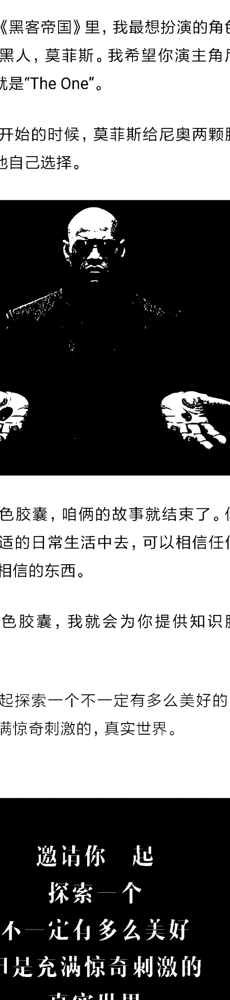

在电影《黑客帝国》里，我最想扮演的角色是那个黑人，莫菲斯。我希望你演主角尼奥，也就是“The One”。

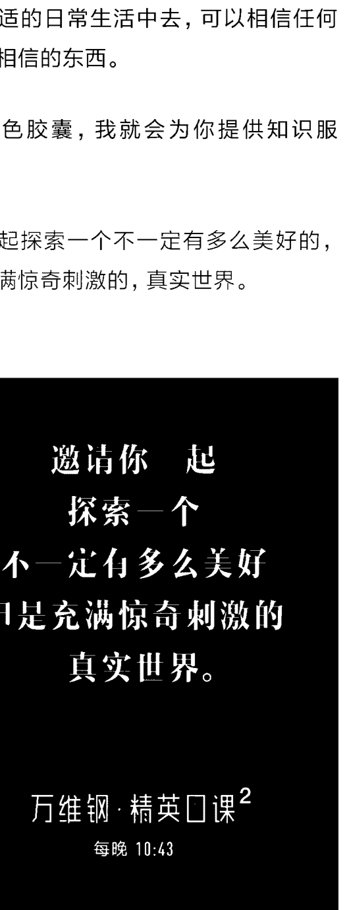

## 日课001 | “文科生”的反击：软技能的时代

作为《精美日课》第二季的第一讲，咱们说自由技艺（liberal arts）。“自由技艺”这个概念我们我们在第一季讲过，有点类似于中国的“人文”教育，但是以我之见，这是“统治者”和“拒绝被统治者”的学问。

中国的有些“文科”专业，像金融和社会会计，在美国算商科，不算自由技艺。美国大学系统的自由技艺学科，是指历史、政治、哲学、文学艺术这些大学问。智识分子认为这些学问有大用，老百姓觉得这些学问没啥用，今天我们就来说说自由技艺的具体应用——具体到能用来找工作挣钱。

八月份刚刚出版的一本新书，叫《你能做任何工作：“无用”的自由技艺的惊人力量》（You Can Do Anything: The Surprising Power of a "Useless" Liberal Arts Education），作者是纪实作家乔治·安德斯（George Anders）。

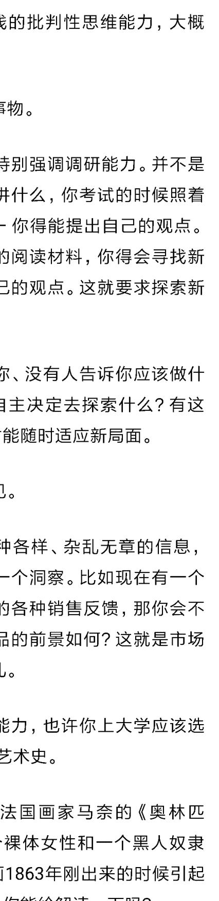

用中国话说，这本书就是文科生就业指南。但是请注意，这可不是说文科生不好找工作，所以安德斯写本书帮他们找——这本书说的是在今天这个新形势下，文科生其实更容易找到好工作。

过去理工科出身的人工资高，中美两国整个社会都比较崇尚理工科。而安德斯说，最新的调研数据显示了一个趋势，现在美国的就业市场中新创造的岗位中，文科生的优势越来越大。

从2012年到2016年，美国新创造了1010万个工作岗位，其中只有5% —— 也就是541,000个岗位是在计算机相关的领域。就算你把所有和互联网、计算机相关的技术岗位加在一起，也不到10%。

那么剩下的90%的新工作是什么呢？大部分都和“文科”有关系 —— 也就是需要和人打交道的工作。比如说“市场研究员”，新增了55万个就业岗位，四年增加了30%，比程序员都热门。类似的还有咨询、教育、娱乐业等等，都不是纯技术的工作。

这其实是技术进步造成的。现在自动化程度越来越高，像计算机领域，它消灭旧岗位的速度和创造新岗位的速度几乎是一样的快的，并没有增加多少新岗位。这个世界可能不再需要更多程序员了 —— 但是只要人工智能跟真人还有区别，就业市场就需要文科生。

文科生不但存活了，而且正在反击。

不过，这里所说的文科生，可不是那些只知道死记硬背考试知识点的人。想要抓住这波机会，你得是一个比较高端的文科生。

### 1.什么文科才是好文科？

我以前认识一个美国人，他儿子考上了斯坦福大学，结果选择了学中文。我当时一听就觉得非常奇怪，美国根本不会缺会说中文的人，你一个美国人中文学得再好又有啥用呢？结果过了几年，他儿子从斯坦福毕业，马上就在 Google 找到了一个很不错的职位。

这个现象非常有意思，学中文的人，为什么能在 Google 找到工作。这是因美国的文科教育和我们设想中那种死记硬背的文科教育有很大差异。

### 2.五种批判性思维

学术界和商界对“批判性思维”的定义略有不同，这本书说的是商界的定义。安德斯考察了各大公司中好职位的招聘广告，发现几乎所有年薪十万美元以上的工作岗位，都需要一定的批判性思维能力。安德斯总结，最值钱的批判性思维能力，大概有五种。

第一是探索新事物。

好的文科教育特别强调调研能力。并不是教授在课堂上讲什么，你考试的时候照着写就能得分 —— 你得能提出自己的观点。除了完成指定的阅读材料，你得会去寻找新素材来证明自己的观点。这就要求探索新事物的能力。

第二是获得洞见。

给你一大堆各种各样、杂乱无章的信息，你能不能获得一个洞察。比如现在有一个商品在市场上的各种销售反馈，那你会不会判断这个商品的前景如何？这就是市场研究要干的事儿。

下面这幅画是法国画家马奈的《奥林匹亚》，描写一个裸体女性和一个黑人女仆在一起。这幅画1863年刚出来的时候引起了极大的争议，你能给解读一下吗？

如果你能结合当时的历史背景，自己调研，把这幅画的来龙去脉弄明白，你就具备了市场研究的能力。

面对很多的信息，你知道选择哪些信息，忽略哪些信息。面对很少的信息，你也能像考古学家一样自己分析出来大量的见解。这就是功夫所在。

所以艺术史带给你的不仅仅是那些有关艺术的知识，更重要的其实是这种分析能力。有这样的能力，如果你去做一个金融分析师，你就能从财务报表里发现一些别人发现不了的信息，在投资的时候就能够提供一个别人提供不了的视角。

### 第三是选择和决策。

按照事先定好的规则去完成一件事情，是非常简单的技能。可如果现在根本没有规则，你能不能自己制定规则，带领别人完成任务？这就涉及到领导力了。你的判断可能会出错，但大量试错的经验累起来也是你的财富。

我儿子今年上小学三年级。新学年刚开学的时候，老师并没有直接向学生宣布班级纪律，而是让学生们自行讨论他们应该有什么样的规则。学生们你说一条、我说一条，老师仅仅是把学生提出的规则分类、把类似的说法合并，最后总结出几条大家共同认可的规则，作为这个班的纪律。我看这就是培养判断力的一种非常好的方式。

### 第四是理解他人。

年薪十万美元以上的岗位，都会要求一定的团队组织能力，说白了就是你得会使用权力。想要使用权力，你就得知道团队中每个人都想要什么，人与人之间的利益冲突在哪里——你得能理解人。

这种能力可以从文学作品中得来。多读些严肃小说，你就会分析每个角色的诉求、动机和利益所在，人物之间又存在什么冲突，冲突又是如何解决的。

如果你有这种能力，你就能理解自己的团队和用户。你知道不同的人对一件东西有不一样的看法，你能倾听和你相反的观点。如果你是一个产品经理，你就能很好地把用户、产品和工程师连接起来。

### 第五是影响力。

你能不能说服别人接受你的观点？首先你要能够清晰地表达自己，这和写作水平、演讲水平有关。其次你得有共情能力，想要说服一个人，最好站在这个人的角度说。

我们知道，“文法”可是从古罗马时代就在自由技艺“七艺”中排第一位。今天这个社会各种纷杂混乱的声音非常多，影响力就越来越重要了。

这五种批判性思维能力都是非常高级的能力。大学每年毕业那么多学习自由技艺的学生，不可能都具备这些能力。我们可以想见，并不是所有文科生的就业前景都很好。那么现在一个典型“文科生”的就业状况是怎样的呢？

### 3.文科生的职业生涯

安德斯这本书举了很多例子，我看几乎所有文科生的起点都比较低。如果你大学选择了政治或者哲学，就不要指望一毕业就拿到高薪。起薪最高的是工程师和学金融的。

但是如果你真的掌握了批判性思维的这些技能，你的后劲不可限量。

你可能会经历很多坎坷。一位学心理学的女性的经历很有代表性。她当初只有高中文化程度，丈夫是失业在家的军人，家中非常贫困。她在免费的社区大学偶然选了一门和心理学相关的课程，结果表现优秀，被教授推荐去了伯克利。毕业以后进了政府部门，工作几年有了经验出来加入一家公司，年收入达到十三万 美元。因为对政治运作极感兴趣，又回到了政府部门，现在身居要职，正在主导部门改革。

工程师技术好就行，文科生需要人生经验。年轻的时候多换几份工作，都是非常正常且必要的，你要学会随机应变，才知道怎么在不同的工作中使用你的核心技能。

当前最好的一条路，就是把自由技艺和新技术结合。有人用LinkedIn上的数据统计发现，总体来说，自由技艺专业毕业的学生，在Google、微软、Facebook这些高科技公司找到工作的比例是9%。但既然文科生的特长之一是人生经验，能不能找到这样的工作跟你是不是名校毕业关系不大。事实上，这份统计中名校毕业的文科生进高科技公司比例大概是9.9%，而普通大学毕业的也达到了7.5%的比例，差距并不大。

### 我的评论

现在你对“文科生”的印象是否有所改观呢？其实咱们细想想，这个局面一点都不奇怪。复杂世界需要复杂的人才。

这几天网上流传一个程序员的悲剧故事，让人看了很难受。这个程序员技术非常厉害，做APP赚了很多钱，但因为和妻子闹离婚，竟然被谩得想不开而自杀了。如果你了解一些自由技艺的东西，有批判性思维的能力，怎么可能处理不好生活中最基本的问题呢？

在这个时代，你说你只想把技术做好，其他一概不管，那是不行的。你想过简单生活，但这个世界并不简单。如果你只能做一些纯技术的工作，赶上你这个技术热门的时候的确能挣很多钱，但你应该非常庆幸自己的运气好。

不会面对真实世界是危险的。这个世界归根结底，属于那些能处理复杂问题的明白人。

下一期咱们再讲几个具体的例子，说明为什么学习“统治者的学问”的人，真的在统治世界。

### 由此得到

- 1. 在自动化技术进一步发展的情况下，使用技术的门槛越来越低，那么学习自由技艺的“文科生”就越来越值钱了。
- 2. 你的关键技能不是什么具体的专业知识，而是“批判性思维”的能力。
- 3. 最佳路径，是把自由技艺和新技术结合起来。

推荐阅读第一季日课 ↓ （未订阅第一季读者可在试读里查看）
日课073 | 统治者和“拒绝被统治者”的学问

## 日课002 | 屠龙术的日常应用

日课002 | 屠龙术的日常应用

《庄子》里有个典故，说有人花了三年的时间和无数金钱去学了“屠龙术”，但学成归来之后他发现白学了，因为现在已经没有龙了。

我们说的自由技艺，就有点像是屠龙术。古代学习自由技艺的都是贵族，现在这么多各百姓的孩子学什么政治学、国际关系，难道真的都去管理国家吗？显然不可能。

但这可不等于说学屠龙术没用。今天咱们继续说乔治·安德斯的《你可以做任何工作》。这本书里就列举了很多屠龙术在普通公司日常工作中的应用。

咱们讲三个真实的故事。

### 1.研究国际关系的项目经理

有个女青年叫康诺利（Connolly），在斯坦福大学学的是国际关系专业。康诺利选择国际关系专业可能是因为她喜欢到各国旅游，还喜欢政治。她高中的时候就作为学生代表去过很多国家参加活动，还在萨巴马卡竞选阵营里当过志愿者。上大学期间，她到南非待了很长一段时间，学了当地的语言，还做了各种调研。康诺利特别擅长理解各国的文化，能跟完全不同文化背景下的人打交道。

### 2.IBM的社会学家

我们知道 IBM 是个高科技公司，专门做一些软件、人工智能、技术支持之类的事情，但是它也雇了很多自学自由技艺的人。

### 3.投资界的哲学家

我们熟悉的《黑天鹅》《反脆弱》这两本书的作者纳西姆·塔勒布有个身份是期权交易员，他赚了很多钱，但是因为书写得太好，人们更愿意把他当成一个哲学家。金融大鳄索罗斯是哲学家卡尔·波普的弟子，也希望被视为哲学家，但是因为金融玩得太大，人们还是把他当成一个交易员。

自己的判断，在互相矛盾的情况下能不能正常行事——这其实是咱们精英日课专栏说过多次的道理。

收购一个公司之后，伊坎对管理层的重组改革，就运用了这个精神。

安德斯在《华尔街日报》当过记者，他跟伊坎有过很多次交流。伊坎有一个很重要的特点，就是他总要跟人解释清楚他为什么要这么干。他先说一遍自己的改革意见，再说一遍那个公司管理层的不同意见，然后还要解释一下为什么管理层错了，管理层缺少了什么关键信息才犯了这个错误。

伊坎善于转换不同的视角来看一个问题。他坚持自己的观点，同时又尊重别人的意见。

这就是一种哲学家气质。关键词是“矛盾”！哲学让你学会适应矛盾。

再比如说，排名很高的风险投资者中，有很大的比例的人以前都是学习跟金融没有关系的专业，其中学哲学的人有很多。其中有个投资者是这么说的——

想要做一个成功的投资者，你得同时拥有两个素质，这两个素质看似是矛盾的。首先，你要非常有主见，你一定要相信自己这个投资能成功，你才敢干。第二，你还要有一个开放的头脑，能够随时接受新的信息，勇于推翻自己之前的决定。既要坚持、又要改变，很矛盾，典型的哲学家气质。

这个道理我们在第一季专栏中《风险投资人的养成》这期节目提到马克·安德森的时候，也说过。

自由技艺是统治世界的技术，现在你看，这些自由技艺专业的毕业生虽然没进政府部门，但是真的正在统治世界——至少也是在运转这个世界。

当然他们可不是一毕业就能统治世界。考察美国刚毕业5年的各专业平均工资排名，排第一的是计算机，平均年薪63,500美元，前几名都是实用的技能，而哲学专业平均年薪只有44,700美元，往后是政治、历史、英语、心理学专业，一年只能挣三四万美元。（表一）

### TYPICAL STARTING EARNINGS（初入职场标准薪资）

Annual Earnings,0-5 Years’ Experience(per PayScale)（工作经验 0-5 年年薪）

| Computer science（计算机） | $ 63,500 |
| Nursing（护理学） | $ 57,500 |
| Civil engineering（土木工程学） | $ 57,200 |
| Accounting（会计学） | $ 48,300 |
| Business management（企业管理） | $ 45,800 |
| Philosophy（哲学） | $ 44,700 |
| Political science（政治学） | $ 44,300 |
| History（历史学） | $ 42,200 |
| English（英语文学） | $ 40,400 |
| Psychology（心理学） | $ 38,300 |

但是你考察那些毕业10年到20年这个区间的各专业收入，学自由技艺的人的工资水平就逐渐增高。排最前面的还是计算机，平均年薪111,000美元，但这时候学哲学的达到了84,000美元，学政治学的是79,900美元，已经分别排到第三和第四位。（表二）

### TYPICAL MIDCAREER EARNINGS（资深人士标准薪资）

Annual Earnings,10-20 Years’Experience(per PayScale)（工作经验 10-20 年年薪）

| Computer science（计算机） | $ 111,000 |
| Civil engineering（土木工程学） | $ 96,300 |
| Philosophy（哲学） | $ 84,100 |
| Political science and government（政治学） | $ 79,900 |
| Accounting（会计学） | $ 77,200 |
| Nursing（护理学） | $ 74,100 |
| History（历史学） | $ 72,600 |
| Business management（企业管理） | $ 72,300 |
| English language and literature（英语文学） | $ 68,200 |
| Psychology（心理学） | $ 62,100 |

然后你再考察各专业最成功的人才一生的总收入，前十名里面第一位就是政治学，一生收入481万美元；第二位是历史，375万美元；哲学排第四，346万美元。（表三）

### HIGH ACHIEVERS’LIFETIME EARNINGS（成功人士一生总收入）

Top Tenth by Major(Hamilton Project)（前十名专业 汉密尔顿数据统计）

| Political science and government（政治学） | $ 4,810,000 |
| History（历史学） | $ 3,750,000 |
| Accounting（会计学） | $ 3,650,000 |
| Philosophy（哲学） | $ 3,460,000 |
| Business management（企业管理） | $ 3,070,000 |
| Civil engineering（土木工程学） | $ 3,360,000 |
| Computer science（计算机） | $ 3,200,000 |
| English（英语文学） | $ 2,810,000 |
| Psychology（心理学） | $ 2,640,000 |
| Nursing（护理学） | $ 2,160,000 |

这就是自由技艺的后劲。你的起薪不高，但是如果你学到了真本事，最后一定会拔尖。

#### ｜我的评论

我对中国的文科教育不太了解，但我感觉如果你学的是人文学科，那么学习大概有三个层次。

第一层是“学事实”。你得记住哪个年代发生什么事儿，哪个皇帝有什么政策之类。

第二层是“学观点”。比如怎么评价太平天国运动，甚至各位名家的观点，你得知道。

这些事实和观点，固然是必备的专业素质，但是如果你毕业以后就不搞这个专业了，它们就只是谈资而已。

第三层，是“学方法”。你能不能直接考察一下当时的原始材料，比如说太平天国相关的经济数据，清朝大臣的什么奏折之类，从中得出自己的观点，还能说服别人接受你的观点。这才是批判性思维，这才是真正值钱的技能。

试想一个掌握了批判性思维的人，如果还能钻研一点最新的科技，他怎么可能找不到好工作呢？

#### ｜由此得到

表面上看毕业以后都改行了，但实际上学哲学的人的确靠着哲学气质，学社会学的人的确靠着社会学修养，学国际关系的人的确运用了国际政治手段在做事。他们把软技能和具体的公司业务结合在一起，都取得了成功。

但是话说回来，怀才不带不是怀孕，软技能很难体现在大学成绩单和简历上。那你怎么才能让别人知道你有这些技能呢？咱们下次再说。

## 日课003 | 机会网络

日课003 | 机会网络

我小时候我爸经常跟我讲一个理论：文科的主观性太强，你最好钻研理工科的硬功夫——你的水平是明摆着的，谁当权都得用你，跟政治立场没关系。我觉得我爸说的很有道理。这大概也是学理工科的人共同的道路自信。我有技术，这是硬功夫，是我在世界上安身立命的关键。

有道理是有道理，但是当你考察真实世界的时候，有时候你觉得可能还有别的道理。

比如说，苹果公司的工作肯定都是好工作，工资很高，而且很有成就感，相信大多数工程师都想有机会去苹果工作。我们可以想象，苹果公司录用人的要求肯定是非常苛刻的，能进苹果的大概都是名校毕业生吧？

有人拿 LinkedIn 上的数据统计，发现苹果公司员工的毕业院校中，排名第一的是圣荷西州立大学（San José State University），一共有1484个人；排名第二是斯坦福大学，有250人。

这就很有意思了。圣荷西州立大学是个声望很一般的学校，申请这个大学很容易，录取率高达到63%，它的生源跟名校没法比。那为什么圣荷西州立大学有这么多学生能进苹果公司呢？

答案非常简单，因为圣荷西州立大学就在苹果公司旁边。大学生平时跟苹果公司接触很多，做个实习生，开个技术研讨班，大家交流方便，互相之间都认识。

所以这个世界并不是一条直线，谁学习努力谁就去好学校，谁去好学校谁就获得好工作，谁工作好谁的收入就高……不是这样的。除了个人奋斗，还有一些别的变量能左右你的命运。有时候在正确的时间出现在正确的地点，就可能是你成功的关键。

那怎么样才能在正确的时间出现在正确的地点呢？也许关键是你认识正确的人。

今天我们继续说安德斯的《你可以做任何工作》。这是一本非常实用的书，作者的本意是写一本文科生的找工作指南。但我们也可以用一个社会学的视角读这本书，看看这个世界到底是怎么运行的。

我们知道自由技艺的技能是“软技能”，像批判性思维，一个人的水平高低很难用一个客观的硬指标衡量。也许两个毕业生的成绩单差不多，但是实际水平能相差很多。所以“文科生”找工作最好的办法是面对面交流，让人充分了解你。最理想的，就是得到一个机会直接跟公司的高层谈。高层很多就是出身于自由技艺专业，他们更懂得软实力的价值。

问题是怎么获得这个谈话的机会。对于那些特别厉害的公司，大多数求职者在递简历这一步就被淘汰了。

你可以让大学老师推荐，你可以参加所在行业的会议去跟相关的公司接触。但最有效的办法，是找一个中间人，让他把你引荐给这个公司。

这就是一个有点矛盾的局面。自由技艺是研究人的学问，是个特别讲个人关系的领域。古代学习自由技艺的都出身于社会顶层，他们根本不差关系。可但是现代有大量老百姓的孩子学自由技艺——特别是有很多第一代移民的子女，本来想当个医生，一上大学就被政治学给吸引了，而他们的家庭并不能提供太多社会关系支持。这些人找谁引荐呢？

安德斯说，最理想的中间人，是你所在大学那些已经毕业多年，现在在社会上混得比较好的校友。

里德学院（Reed college）有个毕业生，是个女孩，在毕业后的一年内什么都不想干，跑到日本的一个海岛上过了大半年与世隔绝的生活。后来她过腻了，就想回美国找个工作。

她什么人都不认识，就在网上乱找，发现耐克公司正好有一个职位，自己很感兴趣。但是她对这个职位几乎是一无所知。

那她怎么办呢？所幸的是里德学院有个校友网，大约相当于BBS之类的社交网络。

女孩就发了一个帖子，说我想找耐克的这份工作，请教诸位师兄师姐有没有谁了解这个职位的情况，任何信息都可以。

校友是愿意帮校友的，谁都希望自己学校的势力越来越大。结果这个帖子有十几个人回复。有人说我知道耐克会在面试的时候会问你什么问题，我可以给你讲讲。有的说我认识耐克一个比较高层的人，我可以把你介绍给他，你直接跟他联系。

对新人来说，这种内部信息可太重要了。耐克公司的日常企业文化，有什么工作偏好，这些并不是保密信息——但你不知道就是不知道，可能会觉得非常神秘。有个内部的人给你讲讲，你在面试的时候就能获得很大的优势。有人给你指引一下，你就比别人更容易获得面试机会。

里德学院这个女孩最终得到了耐克的工作。我觉得这件事特别有意思——你说这公平吗？这不是腐败呢？我们设想耐克大概不会给她什么加分照顾，但她的确得到了一个有点不公平的机会。

这种不公平的机会，大概是校友网络最重要的两个作用之一——另一个作用是给母校捐款。

美国大学非常非常重视校友网络。有的大学会主动邀请毕业多年的校友回来搞活动，给毕业生讲讲相关行业的机会和经验，这种见面会每年要办很多场次。里德学院用的那种校友网络系统，现在是一个专门的、供各大学搭建校友网络的工具，叫Switchboard。

有人调查，美国46%的毕业生在找工作的时候重点使用了校友的关系，安德斯认为这个数据还应该继续提高——而在我们中国人看来，这已经是一个惊人的数字！

我们中国的文化是讲关系的，但中国毕业生找工作，怎么会这么大规模地用校友的关系，恐怕更多的让家人和朋友帮忙。其实那些比你早毕业几年的校友，在你进入社会的过程中能起到的作用可比“同学会”、“同乡会”重要得多。

安德斯的建议是，毕业生找工作，你应该用30%的时间去寻找工作机会，做做纸面上的调研看看哪个公司在招聘；用10%的时间去制作和投递简历；然后剩下这60%的时间，要全部用来搞社交——去跟校友联系，去认识外面的人。

### 我的评论

美国人说的这种校友网的关系，英文是 connection 或者 network，我觉得它跟中国人说的“关系”可能不完全一样。网络连接主要是信息上的交流，不是现在有什么内部信息你告诉我一声，或者你把我介绍给谁谁。校友网其实是个信息网，或者说“机会网络”。

而“关系”，则更多的是“人情”上的往来。如果一个毕业生是动用“关系”获得职位，可能是他的水平不够，受到了特别的照顾。以前我欠你一个人情，现在我还给你。关系网是个个人情网。

机会网络在不怎么熟悉的人之间就能有效运行，而“关系”则在熟人之中运行。可能正因为有这样的区别，英文里提到中国式关系，有时候并不翻译成 connection 或者 network，而是直接写成汉语拼音，“guanxi”。

现代社会是陌生人世界，大家为了共同利益在一起合作，为了人情而录用一个人的情况可能会越来越少见，所以机会网络应该慢慢取代“关系网”。

有人说美国人干什么都是公开公平公正，有的人说美国人也讲关系搞腐败——我觉得更准确的说法是美国人不是特别“讲关系网”，但是把“机会网络”几乎系统化了。校友网络、推荐信、公司员工的“内推”，这些都是制度化的鼓励用“自己人”。

这种做法提高了信息交流的效率，有个自己人推荐总比胡乱投个人强。但是从另一方面来说，这对机会网络之外的人非常不公平。

也许“公平”只是一种美好的幻想。在一个公平的世界里，这个人不管是谁，不管是哪个大学毕业的、不管他认识谁，只要他有能力就有机会——而真实世界显然不是这样。现实就是这么个现实，你不服不行，只能尽量扩大自己的机会渠道。

### 由此得到

校友网络在美国大学毕业生找工作的过程中起到了重要的作用。软技能比硬技能更需要机会。

那么假设现在你有一个机会跟某公司的高层交流，你应该说些什么呢？咱们这个系列还有最后一讲。

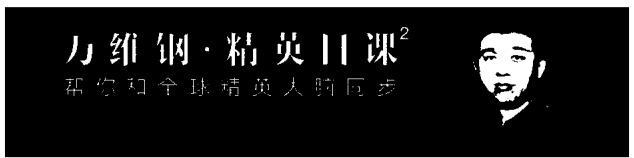

### 日课精选

大空翼 28

一种关系是寻租，一种关系是信用背书，底层文化不同，但有一点相通，就是花最小的代价，获取最高的收益。

09-19 22:58:59

## 日课004 | 讲故事和刷经验值

日课004 | 讲故事和刷经验值

今天是安德斯的《你可以做任何工作》这本书的最后一讲。

这本书是一本非常实用的书，今天说的其实是找工作的面试技巧。不过我还借此机会说点人生的体会。

不论哪个公司招人，都不是完全靠大数据的数据指标筛选，最后肯定要有一个意会的过程。双方在常规的交流之外还要聊一聊具体工作以外的东西，看看能不能对你有一个立体的了解。这就是讲故事的机会。

只要你故事讲得好，哪怕公司本来没有一个适合你的职位，都会为你创造一个职位。哪怕你没有相关的工作经验，也相信你只要愿意学就能很快学会。

### 1.逆境

文科生以丰富的人生经历为荣。最值得吹嘘的一种故事就是你有过什么样的逆境，经历过什么样的失败。你可以像选秀歌手一样说说自己家庭的贫困，也可以像海外游子一样说说自己独在异乡的艰难，或者像创业者一样吹吹自己大胆的尝试和惨痛的教训。

### 2.影响力

你是否曾经说服过别人？是否曾经力排众议，让事情按照你的设想走？你是是否曾经组织过一帮人去搞一个什么大活动？

### 3.技术水平

### 4.合拍

### 5.成就

### 我的评论

抛弃了我妈妈，我从小在一个单亲家庭长大我是一个黑人我怎么怎么不容易......但是这些都不叫事儿现在的我就是这么乐观而又强大。特朗普说我做过这个项目这个项目和这个项目，现在我想做造福美国的大项目。

所以讲故事不仅仅是个面试技巧，真是人人必备的技能啊。

把这个道理再进一步，也许你应该为了到时候有好故事可讲，专门按照这五个套路去做些事情 —— 也是有意识地刷经验值：

- 1. 多尝试，经历失败，丰富你的人生经验；
- 2. 多跟人交往，练习交流和组织能力；
- 3. 学点技术，掌握一些实用工具；
- 4. 要善于做调研，了解你所在的领域正在发生什么事儿；
- 5. 找机会取得能让自己脱颖而出的成绩。

如果一个人真的做到了这些，哪怕你知道他是特意“刷”出来的经验值，你能说他不是人才吗？

我们知道美国名校录取并不是只看考试成绩，还要看课外活动之类的“综合素质”。现在美国就会很多机构，给高中生提供“大学咨询”服务 —— 其实就是帮你刷经验值。

花钱购买了服务，这个机构就会介入你的高中生活。他们会安排你去做一些事儿，去哪儿当个志愿者，参加什么课外活动，选修什么样的课程。按照他们要求做的，你的简历就会很好看，他们就能帮你申请到很好的大学。

你说这公平吗？我 domestically一点都不公平。我们专栏探索的不是“公平世界”，而是真实世界。

其实很多大学老师都有个隐忧：作为一套强有力的软技能，自由技艺并不限于“好人”使用，而且也不能把人变成“好人”。不管是不是好人在用，都是掌握自由技艺的人统治真实世界。

## 日课005 | 宇宙是平的... 这很令人费解

日课005 | 宇宙是平的...这很令人费解

如果你想测验一个人的科学知识水平，有一个问题特别有意思。你可以问他，宇宙是有边吗？

如果你想测验一个人的科学知识水平，有一个问题特别有意思。你可以问他，宇宙是有边吗？

### 1.有限大，是可以理解的

以前哲学家一说起宇宙来就是什么“空间上无边无际，在时间上无始无终”。这个朴素的想法是有道理的，我们无法想象一个存在边界的宇宙——如果宇宙有边界，那么边界之外是什么呢？其实这个问题，物理学家在很早以前就已经给出了高级的答案。

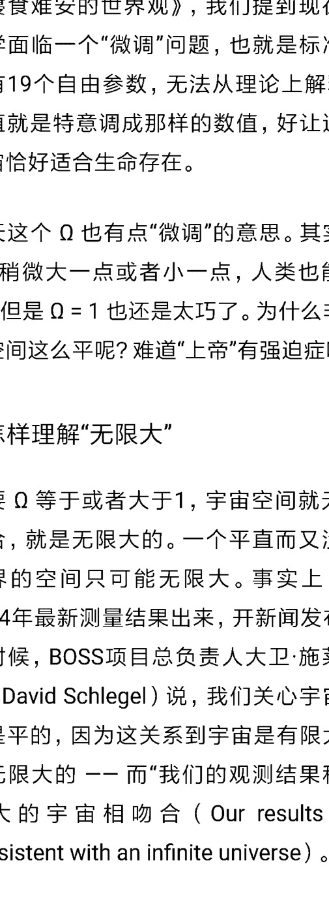

### 2.平的？！

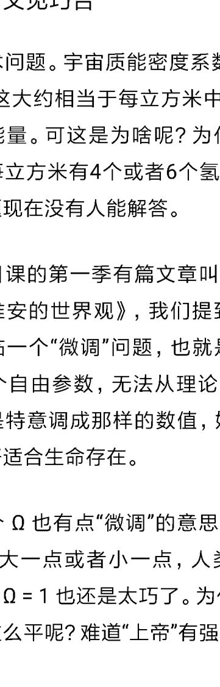

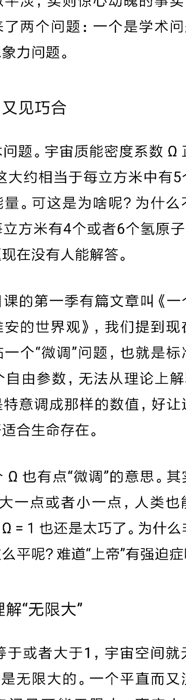

### 3.巧合，又见巧合

### 4.怎样理解“无限大”

consistent with an infinite universe）。”

这是一个非常令人不安的结果，有限大是可以想象的，无限大是不可想象的。大爆炸之前什么都没有，然后现在怎么就无限大了呢？

当然，你也可以说测量存在误差，测量结果是 Ω = 1 ± 0.004 —— 也许 Ω 并严格等于 1，宇宙空间并不是严格平的。但即便如此，也意味着宇宙比我们能观测的、甚至比我们能想象的，都要大得多得多，至少是“几乎无限大”。

这么大是什么意思呢？物理学家对此也开了个脑洞，这会给你的想象力带来极大的刺激。

首先我们要知道，宇宙没有中心。空间的膨胀是哪里都在膨胀，宇宙中遥远的区域应该跟我们这里差不多，有差不多密度的星体。从微波背景辐射图来看，宇宙各个地方大体上就是差不多的，我们这里，一点都不特殊。

其次，你还要知道，根据量子力学，给定这么一堆物质，不管他们的排列组合有多少不同的可能，也一定是有限的。这意味着所有可能的文明世界形态，也只有有限多种。

好。那么如果宇宙是无限大或者近乎无限大的，而我们这里并不特殊，而文明又只有有限多种，这意味着什么呢？

意味着每一种可能都有几乎无限多个副本。

说白了，就是非常遥远的某个地方，存在着一个跟地球一模一样的星球。在那个星球上，存在着和我们一模一样的人。其中就有一个一模一样的“你”，也正在听着精英日课！

当然，你和他的下一步行动可能是不同的，比如你选择点击分享按钮，而他没有这么做 —— 但不论如何，还存在另外无数个同样的你，他们也点击分享了。

甚至有人已经估算了这样的星球距离我们有多远。最近的那个一模一样的你，距离你大约是 10 的（10 的 29 次方）次方，米。

这当然是个不可思议的数字。使用常规的旅行方式你永远也不可能见到他，也永远无法和他取得联系，他有极大的可能性是我们可见宇宙范围之外。

这是一个非常好的科幻小说素材，它意味着网络小说流行的“穿越”在逻辑上是可能的。物理学家不太相信什么“时间旅行”，说你回到我们这个地球曾经经历过的明朝末年，那不太可能，会造成因果关系的紊乱。但是，如果宇宙中存在另外一个地球，那个地球和我们一样，不过它正好处于明朝末年，其中也有崇祯、魏忠贤、袁崇焕这些人物。如果你能通过什么虫洞之类的机制前往那个地球，那你尽可以随便折腾，不用担心影响我们这里的历史。

考虑到宇宙是无限大或者近乎无限大的，你可以认为一切“有可能发生”的事情，就都发生过、而且都会发生几乎无数次。因为再小的概率乘以一个几乎无穷大的数也可以大于 1。

下次买彩票没中奖，或者跟意中人失之交臂的时候，想到宇宙之大，那个你希望的可能性毕竟在某一处发生了，你也许会感到些许安慰。

第一季相关阅读：《一个让人寝食难安的世界观》

只要在时间和空间尺度上稍微看远一点，你会发现眼前这一切都是奇迹。你的存在，就是一件无比宝贵的事情。

## 日课006 | 乌类学家想告诉乌的话

日课006 | 乌类学家想告诉乌的话

万维钢

今天的这篇日课，是我给隔壁《超级个体》专栏的作者古典老师的新书《跃迁》写的序。之所以发在这里，是因为这篇序言中想说的话，我也更想让你知道。

古典老师早年是新东方名师，现在专注于个人事业发展的顾问工作。他经历过高强度竞争的大场面，指导过职场新人 and 行业高手，影响过很多很多大好青年。他在“得到”的专栏《超级个体》受到读者的热烈欢迎。这本《跃迁》，是古典给读者的最新奉献。

书中有英雄的成功经验，有科学家的严格研究，更有古典老师从第一线获得的洞见。书中思想代表了时代的最新知识 —— 我读这本书的时候就想，倘若有人不了解这些思想，想要跟了解这些思想的人竞争，岂不是非常吃亏吗？

读书行为带给人的是不公平的竞争优势。可能有的人高喊着“努力！奋斗！”的励志口号埋头苦干，但是根本摸不着现代社会的门道 —— 而这本书告诉你怎样借助新时代的工具，怎样外包大脑。可能有的人把高手奉若神明，以为做事都要有“妙招”才行 —— 而这本书告诉你所谓“妙招”恰恰是落了下乘，系统化的进步靠的是“51%的效率”。

所幸的是你现在你已经把这本书拿到手里了。可我又担心你读不好，所以我想说说个人的一点浅见，这本书到底应该怎样读。现实是，就算你把这本书倒背如流，也未必能成为真正的高手。

“科学史”和“科学哲学”是两个非常有意思的领域，有些研究这两个领域的专家，会忍不住总结一套科学进步的规律，告诉科学家应该怎样搞科研。可是物理学家费曼是出名的反感哲学，他有一句话说，科学史家和科学哲学家之于科学家，就如同鸟类学家之于鸟。

鸟们并没有接受过鸟类学家的指导，但是鸟都飞得很好。那科学家为什么要听科学史家的话呢？

我对费曼这个类比有点不以为然。鸟天生就会飞，但科学家可不是天生就会搞科研。我听过一些科学家的经验之谈，也读过“科学史家”对科学方法的归纳总结，我只恨自己没有在更早的时候就知道这些。就连费曼本人，也忍不住在不止一本书里谈到自己的研究方法论，以及对“科学”这个行业的看法 —— 他想让年轻人知道，而年轻人也的确乐于学习他的经验。

但是如果你去问费曼、或者任何一位某个领域的高手，他们大概不会说，我作为一只鸟，是因为通读了鸟类学家的书才飞得这么好 —— 我飞得好是我自己的事儿。

所以这个问题就是，这书到底应该怎么读，这经验到底应该怎么用呢？

对此我有三点意见。

第一是“模仿”和“创造”。读书的错误态度是既然别人是这么、这么、这么做取得成功的，那我就必须也做这些。更错误的态度是既然书里没说有人那么做过，所以我就不敢那么做。

其实你仔细读书中这些案例，高手的名字之所以跟这些道理联系在了一起，是因为这些道理是他们首创的。他们不是被动的模仿者，他们是主动的创造者。只会被动模仿，不能算你学到了 —— 你得主动创造才算是真的学到了。

当然，创造也不一定都是凭空而起，你可以创造性地借鉴。比如书中讲到，巴菲特就从棒球手的训练中学到一个道理，用在投资领域。那你如果也把这个道理用于投资，你就是还没学到家。你得能用到别的领域才好。

第二是“方法”和“事业”。这是一本讲做事业的方法的书。你要干一个什么事业，用上这些方法，可以加速进行，甚至事半功倍。成绩 = 事业 × 方法。

但这也意味着，如果没有事业，光知道这些方法也没有用。如果一个人埋头苦干事业，另一个人整天钻研方法，我们无法判断他们两个谁更可能取得好成绩 —— 也许第一个人更靠谱。你得先有个孩子，才谈得上钻研育儿科学，先有个事业，才谈得上学习方法。

这个事业最好是比较大的。如果你只想要生活中的“小确幸”，这本书就只能给你提供谈资而已。只有大事业才配得上“战略”二字。

第三是“全面”和“一点”。我们是不是非得全面了解了高手的方方面面，才能出发去成为高手呢？当然不是。你坐在电视机前把各国游泳教学录像都看一遍也没用，直接下水游才是最好的办法。

你根本不需要掌握这本书里说的所有方法。你真正要做的是 一边实践一边借鉴方法。也许书中的某一 点正好对你有所启发，然后你在这一 点上做到了极致，那你就可能打败了绝大多数人。

在践行的过程中，你自己也会有各种体会、各种经验 —— 那时候你回头一看这本书，可能会有新的启发，更可能感到不可思议。那时的再次相见，岂不是比这时的切磋，更有意思。

古典训练过很多鸟，你听他的没错。你读这本书不是为了也当一个鸟类学家，你想当一只飞得更好的鸟。

万维钢

古典老师也向咱们日课的读者提了一个问题：未来是个体崛起的时代，个体对组织的依赖正逐渐减弱，作为一个现代人，该怎么处理个体和组织的关系呢？期待分享你的看法，到下周三晚上10:43，点赞最多的5名高手，古典老师会寄送5本签名版的《跃迁》给你。

### 答读者问｜选择文科理科的策略

万维钢

今天是精英日课的《答读者问》板块，与其说是问答，其实现确切的说法叫“周末交流”，咱俩读者中有不少高手，有很多思想，我也是从读者中学到的，所以更应该是一个咱们一起讨论的时间和地点。

上周第一周的留言特别多，我从中挑选了一些比较典型而且精彩的问题，希望能对你理解这一周的内容，多一些启发。

#### 来自日课：“文科生”的反击：软技能的时代

听了这两天万老师对于自由技艺的解读，我有这么个感受。厉害的不是自由技艺的那几个学科本身，而是那些学科的“顶级武功”，诸如批判性思维，快速学习能力等等，这些非得花一番功夫才能精通。但是，每一个学科学到顶级的水准应该都是能带来很厉害的能力。比方说物理学到融会贯通的水平也能拥有批判性思维吧。如此一来，什么学科厉害就完全取决于该学科的顶级武功的强弱，而要综合考虑得花多少成本才能习得最终的意义。比方说蔡兆宝典确实威力无比，但是学习成本就太高。那么自由技艺的优势是否在于可以用相对来说少的功夫学到相对来说适用范围更广，威力更大的能力呢？还是说自由技艺的学习成本更高但是顶级武功也更强？

万老师不就是理科生，苦练自由技艺么？那么问题来了，是以“理科”为骨，以“文科”为皮更加犀利，还是反过来以“文科”为骨，以“理科”为皮更加犀利呢？

万维钢

关于学文科还是学理科，自由技艺应该什么时候学，这个策略大约是这样的——

- 第一，每个人应该选择自己喜爱的专业去学。你得觉得干这个事儿特别有意思，生活才能幸福。
- 第二，为了获得更好的社会适应性，最好有一点跨界的知识。这也就是我们本周讲的现在最适合文科生的就业领域是把自由技艺和新技术结合起来。同样的道理，就算一个人以技术为生，也应该有点批判性思维，最起码掌握一些表达能力。
- 第三，想要取得很高的成就，你得至少在一个领域有比一般人高很多的水准才行。

一个办法，是你在一个领域取得比如说前5%的水准。比如你是top 5%的程序员，那这个技能就是你的决定性技能。再学自主自由技艺当然对你也是有帮助的，至少不会像那个因为离婚而自杀的程序员那样惨事。但是真正让他鹤立于一万千的是那个决定性的技能。

另一个办法，是像咱们在第一季说过的斯科特·亚当斯（Scott Adams）那样，在两个领域同时达到前25%，只要你能把两个东西结合起来，你就是顶尖人才。

不管是哪个办法，你都要在一两个领域内成为高手才行。一个在四个领域都是普通水平的人，就没有多大意思了。

所以你必须非常专注地在某一个、最多两个领域长期笨拙。在你专注的这一两个领域，你在乎的不是自己的*绝对*水平够不够用，而是你*相对*于同行来说，是个什么位置。那么这就是永无止境的功夫，不存在少花功夫多办事儿。而对于辅助的领域，则是用够就行。

好。那么到底应该专注于文科还是理工科呢？首先取决于你喜欢什么。其次你要考虑到数学和物理这些东西涉及到人脑的所谓“流体智力”，说白了就是要求你的计算速度特别快 —— 而“流体智力”在二三十岁左右开始就要走下坡路了。所以学数学、物理就跟学踢足球一样，必须从小就下功夫，别等到30岁了才想起来学 —— 并不是没有成功的例子，但比较罕见，而且肯定比从小就学费力。

反过来说，历史、政治、文学、哲学这些东西，比较讲知识的沉淀，更多的是依靠大脑的“晶体智力”。晶体智力不容易随年龄退化，稍晚一点再学也来得及。

所以如果我正好喜欢数学和物理，我可能先选择一个理工科的专业学。

#### 来自日课：屠龙术的日常应用

万维钢老师您好，我现在是国内某985高校机械专业大四的学生，从周围的环境，前人的经验以及自己的感觉来说，机械行业的就业前景都不算很好，比起大热的计算机专业，起薪与成长空间都少得可怜。我现在非常迷茫，不知道以后可以選擇怎样的职业方向，看了这期的文章发现自由技艺也可以有它的用处，但是像这些处于薪酬排行上边缘地位的专业，应该如何看待它呢？还需要继续学习下去吗？希望老师您能为我解答一下。我的想法是先学习金融知识以及计算机手段，通过一段时间的投资赚到足够维持自己生活的钱，再去探索一些自己真正感兴趣的事情。万维钢老师，您觉得在這個时代，这样思路具备可行性吗？

万维钢

如果你不喜欢自己的专业，就业前景也不好的话，大四是个改行的好机会。你可以找其他行业的工作，也可以考其他学科的研究生。现在转专业非常普遍，没啥问题。

但是你说这个学习金融知识通过投资赚到维持生活的钱，这条路根本不可行。投资是非常专业的事情，靠谱的投资都是用大量资金、做大类研究、分散风险、获得一个不一定特别高但是比较稳定的回报率。你资金少，理性可预期的回报也少，投入那么多时间研究根本不值当。就算偶尔获利，也只是运气而已。巴菲特那种人可是从小就投资。新手投资等同于赌博，有多余的钱偶尔投资一下陶冶情操也是可以的，但把自己的生活寄托在投资上就太危险了。有这么多时间为什么不投资自己，找个靠谱的事儿干。

万老师您好，相对与文科生的批判性思维，理科生的创造性思维是否是一样可贵？批判性思维又是否能通过刻意练习之类的办法习得呢？请万老师解惑。

万维钢

各有各的可贵:) 我认为批判性思维并不适合用刻意练习的方法习得。

刻意练习，最适合的是那些“纯技艺”的东西。它要求你能把一个技巧分解成很多小块，然后每一块做的对不对必须有一个明确的反馈。比如弹钢琴、打篮球、包括数学题都可以这么做，一道题你做得对不对马上就能知道。

而批判性思维往往是一些只可意会的技能，很难明确地套路化。自由技艺里很多东西是看似矛盾的，并没有绝对的对错，这就不太容易训练。

当然，也不是说刻意练习就对批判性思维一点用都没有。我就知道有些写作班，是用了刻意练习的方法训练人的具体写作技巧。

我毕业的第一份工作就是我的老师推荐，进入了一家录音棚谁高于我当时能力（指学历和专业知识）的设计公司（15人左右）。在那里实习了近半年才被通过录用。回想曾经有次和老板谈话，他问我：“你觉得你的老师为什么只推荐你来我们公司？”我当时一愣，老板接着笑说：“是不是因为你最会拍马屁？”我又一下答不上来。身旁的经理帮我说了一句，是因为我的学习成绩最好。当时我心里知道我的学习成绩也谈不上最好的，只是和老师关系处理很好，老师给我的机会也多，锻炼的机会也多，老师给我的成绩也不低。请问万老师，我上述的情况算是运用了机会关系还是人情关系进入的公司呢？如果我下次遇到同样的情景的提问，我如何回答才能比较好地不影响老板对我评价又忠于我的内心？

万维钢

你可以回答“我老师的确非常满意我的表现。”

你获得了录用，证明了能力，就不必再纠结当初的机会了。如果你觉得自己因为不公平的机遇而取得了某个位置，你要做的是在这个位置上做出好成绩来，对得起那个机遇。

#### 来自日课：机会网络

万老师好！那么怀才不遇还是有可能的？所谓高手在民间是不是就是机会网络造成的不公？

万维钢

如果“才华”主要是天赋的话，怀才不遇是有可能的。但是高手在民间不太可能。水平不仅仅是自己学出来的，更是通过做事不断演练出来的。从来没在真实舞台上做过事，就不可能是高手。尤其现代社会各个领域的交流都很充分，不交流、自己在“民间”待着肯定不行。

以此逻辑，马太效应就更加严重了，名校的毕业生不仅有名校光环，还有实力很强的校友。那非名校的毕业生该怎么办？

万维钢

的确如此，不然为啥都想上名校呢。非名校，如果还想取得比较高的成就，那就得冒点险了。一个好办法是进入一个刚刚兴起、还很不成熟的领域。这样的领域里没有什么老资格把持机会网络。比如说当年非名校的马云进入了刚刚兴起的互联网领域。

这本书中提到的新型工作，也大多属于这种不成熟没有定型的领域，所以我们提到，名校自由技艺专业的毕业生在进入高科技公司工作这一块，并没有特别显著的优势。

万老师，正在美国读大学中，搜什么关键词能找到帮学生参加课外活动的公司？想让自己的简历更漂亮，谢谢！

万维钢

“college admissions consulting”。作为一个想要漂亮简历的人，你应该检讨一下为什么自己没有找到这几个词。

#### 来自日课：宇宙是平的...这很令人费解

- 1. 无穷大或近乎无穷大的空间还能继续膨胀吗？如果能，膨胀的到底是什么？2. 无穷大或者近乎无穷大里的物质是不是也是无穷多或接近无穷多？

空间无限大，平均密度不为0，大爆炸前几秒的质量岂不是无限大？还有物质怎么跑到离我们那么远的地方去的，不是没法超过光速吗？

万维钢

空间仍然在继续膨胀，而且还加速了。宇宙中各处的物质分布都差不多，所以如果空间无限大，物质也必然无限多。

说到质量，大爆炸刚开始的时候质量并不是无限大。我们现在看到的质量都是正反粒子湮灭、十亿分之一的幸存物，是经历了一个过程慢慢出现的。大爆炸开始的时候能量也不是无限大。事实上整个宇宙的总能量是不变的，一直等于0。引力势能是一种负能量，物质、动能和暗能量是正的能量，两方面都越来越大，但是总能量不变。

物质运动不能超光速，是不能在空间中超过光速 — 但是空间本身的膨胀是可以超光速的。远方的物质随着它所在的空间一起走，相对于我们是超过了光速。

如果是无限大的。每个方向都应该有无限多的恒星。那宇宙应该是倾向于无限明亮而不是黑色吧。这个怎么理解呢？

万维钢

这是一个古老的说法。仅仅宇宙无限大、有无限多的恒星还不能让天空无限明亮 — 你还必须假定这些恒星都已经存在了无限长的时间才行。现在宇宙有个年龄，恒星都比宇宙年轻，空间还在膨胀，这就意味着遥远的星光还没有来得及到达我们这里的天空。更进一步，因为遥远的空间相对于我们这里，膨胀速度超过了光速，这就意味着特别遥远的那些恒星的星光，将永远都不会到达这里。

整个宇宙可能无限大，而我们可见的宇宙，则是非常有限的。

## 日课007 | 大局观下的生命和智能

前段时间卡西尼号探测器的新闻，不知你关注没有。这个探测器用20年的时间，飞行了超过60亿公里，代表人类造访了土星，漂亮地完成了一系列探测任务。

关键词是“代表”。你是否注意到，过去这几十年，美国宇航局对载人任务似乎不再热心了，大量的任务都是不载人的探测器，而这些探测器对太阳系遥远的天体进行了出色的探测。事实上，不论过去、现在、还是未来，不载人任务取得的科学成果，都比载人任务要多得多。

对太空探测来说，人，是个累赘。

其实我今天想说的不时太空探测的事儿，我想说的是后面这半句话 —— 人是个累赘。这是'我读一本书的突出感受。这本书叫《生命3.0》（Life 3.0: Being Human in the Age of Artificial Intelligence），8月29日刚刚出版，作者麻省理工学院物理学教授迈克斯·泰格马克（Max Tegmark）。

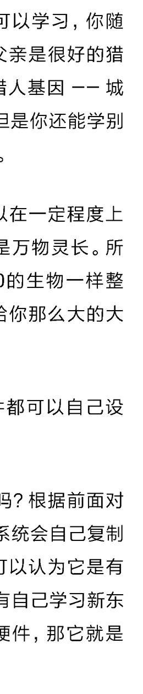

泰格马克是个有意思的人物，你应该记住他。本身是物理学家，在人工智能方面也做过一些漂亮的研究，而且很擅长写书！他的前一本书现在已经有中文版，叫《穿越平行宇宙》（Our Mathematical Universe），我们过段时间可能会说到。

这本书刚一上市，就得到了特斯拉和Space X的CEO、也是著名的人工智能异议人士，伊隆·马斯克的Twitter推荐 ——

> Elon Musk @elonmusk · Aug 29 Worth reading Life 3.0 by @tegmark. AI will be the best or worst thing ever for humanity, so let's get it right.

这又是一本说AI（也就是“人工智能”，咱们在这个系列里干脆都说AI，有点科学味道）的书。AI是热门话题，我们专栏特别爱说，而泰格马克这本书可能会给你带来新的启发。

首先，泰格马克是以物理学家的视角说AI。其次，泰格马克的朋友圈特别厉害。当今掌握AI话语权的一线人物，比如Google创始人拉里·佩奇、特斯拉创始人伊隆·马斯克，还有我们中国人很熟悉的机器学习专家吴恩达，这些人跟他是好朋友。包括霍金、戴森这些老一辈，也经常跟他互动。所以你要想知道现在学术界和工业界对AI是怎么认识的，泰格马克可能是你要找的人。

而这些人，并没有多大的共识。

通过朋友圈互动，泰格马克就发现这些一线人物对AI的前景有很大的争议。为了搞清楚他们到底在争论什么，以及这些人是否能达成一定限度的共识，他成立了一个叫“未来生命研究所（Future of Life Institute）”的非营利组织，还召集了当今和AI相关的大牛人物，跑到波多黎各去开了一个闭门会议。

泰格马克发现，现在世人对AI的争议，基本上有两个方面。

第一是AI到底什么时候才能达到人的智能水平，乃至于超越人类。所谓“达到人的智能水平”，是说AI具备了*通用*的智能，叫做“AGI (artificial general intelligence)” —— 而不是现在会下棋的AI，虽然下棋比人厉害，但是你给他讲个笑话它都听不懂。

比如《奇点临近》这本书的作者雷·库兹韦尔就认为AGI很快就能实现，所谓“奇点”马上就要到了，我们这一代人就能上报好日子。而有些人则对此嗤之以鼻，认为再过几百年也实现不了。比如吴恩达就说，“你们现在担心AI能有多厉害，就相当于担心火星上人口过剩的问题。”

第二是AI对人类来说，到底是好事儿还是坏事儿？Google的拉里·佩奇是乐观派，他说AI必然是全人类的福祉所在，只有好处，你就看着将来过快乐生活吧。而伊隆·马斯克和霍金则一再提醒，AI可能会给人类带来威胁。

我以前对这两个问题并没有认真想过，我总觉得现在还早得很。但是读了这本书，我就觉得AI的确可能是人类面临的最重要问题。泰格马克做了很多功课，把各派人物的观点都说清楚了，有点儿学术味道，同时还提出了自己的观点。

可以加内存条，CPU不够快可以换CPU。当然我们人类现在也可以在一定程度上给自己升级一下硬件，比如说装个假牙之类，但这不是决定性的升级，所以大概只能算生命2.1。

比如我就觉得我的硬件不行，我非常希望能够像计算机那样一秒钟之内就看完一本书，但我的输入设备 —— 眼睛和耳朵 —— 的带宽实在有限，我大脑的理解速度太慢。

赫拉利在《未来简史》中设想了一种“神人”，能把自己和 AI 结合起来，真正给身体和大脑升级。但是泰格马克这里说的生命 3.0，可不是这些神人。

泰格马克说的是干脆不带人，纯机器 AI。正如我们开头说的太空探测，人是个累赘 —— 维持一个人的生命系统非常麻烦，人的效率太低，升级余地太小。而纯机器 AI，摆脱了人的血肉的束缚，那潜力可就大多了，也容易多了。

如果将来有一天 AI 真的具备了人的全部智能，而且还可以自己设计自己的下一代，这样一代比一代强地升级下去，将会是一个什么局面？那些3.0的生命看我们，是不是跟现在我们看那些1.0的动物一样？

生命3.0的 AI 如果出现，那将是人类最后一个发明。从此之后，发明创造可能就用不着我们了。

下一期我们从第一性原理出发，看看这种 AI 能不能出现。

## 日课008 | I与AI

人工智能到底能不能完全模拟人的智能——也就是今天标题里的 AI 到底能不能等于 I，是一个无比重要，而又充满争议的问题。说人脑没有什么特别的，无非也是一堆原子组成的东西，那我们就完全可以用另一堆原子模拟这堆原子，电脑总有一天能取代人脑……这是非常轻率、没有什么营养的说法。

想要合理推测，你得知道人脑有多厉害，更得知道现在的电脑都是什么原理，然后你还得猜测人脑是不是基于同样的原理。

现在全世界最厉害的超级计算机是咱们中国国产的，叫“神威·太湖之光”——

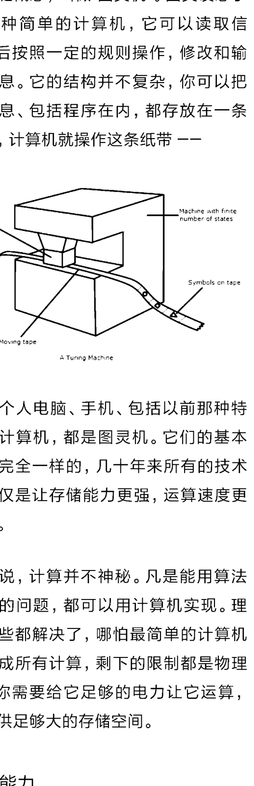

它每秒能进行10^17次浮点运算，需要一个占地1000平方米的专用机房，它的总造价大概是人民币20亿元。

这种水平计算机的存在对脑科学家是个好消息，因为想要模拟人脑中全部的神经元的行为，你就至少需要一台“神威·太湖之光”。而这还仅仅是神经元水平的模拟，有的科学家认为模拟人脑必须达到分子水平，那就可以预见的几十年里恐怕不管什么计算机都无能为力了。

就算神经元水平已经足够，你真的能用“神威·太湖之光”完全模拟一个人的大脑，能取代人babel的工作，你也未必想这么做，因为成本实在太高了。这种超级计算机不但造价高还费电，你直接雇几个工人多少钱。

所以正确的策略不是模拟一个人脑，而是模拟人的“智能”。我们今天要说的，就是现在的 AI 是通过很可能完全不同于人脑的原理，在相当程度上实现、而且还超过了人的智能。我们还是说泰格马克的《生命3.0》。

什么叫“智能”呢？泰格马克给了一个比较笃定的定义：智能就是完成一个复杂目的的能力。当然，你可以进一步追问什么叫复杂，这些都是科学家也说不清道不明的概念……不过这个意思你显然理解。反正能随机应变地完成一些复杂的任务，就可以叫做智能了。

想要实现智能，AI 大概只需要三种能力：存储信息、计算、和自我学习。而至于说人还有意识、主观的情感体验这些，也许重要也许不重要，咱们过几天再讨论。

我们来看看计算机和人在这三个基本能力上的对比。

### 1.存储能力

人的大脑以生物方式能够存储的总容量，大约是100TB。一部高清电影压缩之后大约2G，那么这100TB可以储存五万个电影——这可是包括其中所有的细节。所以我们想想，大脑一般用是拍不不够用的。这100TB相当于计算机的硬盘，我们所有的记忆、所有的技能都存储在其中。

跟计算机差不多，大脑考虑问题的时候不能总是从硬盘读取信息，还有一个快速读写机制。在大脑中，这就是以神经元电信号的形式存储的信息，这个容量就小得多，大约是10G，正好是现在一般水平个人电脑内存的大小。

对今天的计算机来说，100TB的硬盘和10G的内存都不算什么，而且随着技术进步存储的容量越来越大，价格越来越低。

你可以说计算机存储信息的方法和人存储信息的方法是不一样的——计算机存储是按照地址索引，就好比找一本书，先记住这本书所在位置，再去寻找。而人存储信息是用神经网络，先想到大概的内容，然后一点一点回忆相关的细节。不过，人脑这种存储信息的方式并没有什么神秘的，已经有人证明，如果用神经网络的方法存储信息，每1000个神经元可以存储138条信息。

总之在存储方面，计算机是肯定没问题。

### 2.计算能力

对计算机科学家来说，人生中最值得赞叹的时刻肯定不是目睹AlphaGo打败柯洁。早在很久很久以前，自从“计算”这个概念诞生那一天开始，甚至还没有一个实用化的计算机的时候，科学家就已经知道计算机可以下好围棋——悬念仅仅是需要多少时间。

这个赞叹必须属于祖师爷阿兰·图灵。

2014年有个电影叫《模仿游戏》（The Imitation Game），讲图灵怎么用自己发明的计算机破译德军密码，从而帮着打赢了二战的事迹。后世的人也许会说相对于图灵在计算机科学上的伟大贡献而言，打赢二战只是一件小事儿。

这个关键概念，叫做“图灵机”。图灵设想了这么一种简单的计算机，它可以递取信息，然后按照一定的规则操作，修改和输出新信息。它的结构并不复杂，你可以把所有信息、包括程序在内，都存放在一只纸带上，计算机就操作这条纸带——

你用的个人电脑、手机、包括以前那种特别古老的计算机，都是图灵机。它们的基本原理是完全一样的，几十年来所有的技术进步仅仅是存储能力更强，运算速度更快而已。

这就是说，计算并不神秘。凡是能用算法说清楚的问题，都可以用计算机实现。理论上这些都解决了，哪怕最简单的计算机都能完成所有计算，剩下的限制都是物理上的：你需要给它足够的电力让它运算，以及提供足够大的存储空间。

### 3.学习能力

近几年之所以出现了人工智能的大跃进，大概主要得归功于所谓“深度学习”的技术进步。深度学习其实就是过去计算机科学家们早就在用的所谓“神经网络”算法，只不过算法上有些改进，最重要的是硬件水平和数据量大大提升了。

请注意，这里说的“神经网络”，并不是直接做一个像人脑的神经网络那样的计算机——我们用的还是图灵机，神经网络只是一个模拟算法。

人脑学习新技能，是发生在神经元这个层面的。因为练习一个动作而经常被一起触发的神经元，最后就会长在一起，整个网络结构长好了，就相当于一个技能长在了你的大脑之中。

并不需要太多复杂的“神经元”就能实现这种功能。1989年就有人证明，用最简单的神经网络反复训练，每次只要系统做错了就增加相关连接的权重，给足够多的时间最后它就能够做成任何事情。

从一张普通照片里识别各种物体也好、AlphaGo下围棋也好，所有“深度学习”的基本原理都是这样的。神经网络算法，也是通用的。

泰格马克书中有很多技术细节，咱们时间不够只能略过了，如果你感兴趣的话……这其实是一个无底洞。

那这些原理难道就足够模拟人的一切智能了吗？泰格马克对此持比较乐观的态度，但是我们知道有很多人不这么看。比如很

但是我们知道有很多人不这么看。比如很多年前英国物理学家罗杰·彭罗斯有本书叫《皇帝新脑》，在中国也很流行，那本书的观点就是人脑根本不是图灵机，基于图灵机的 AI 不可能真的具有人脑那样的智慧。

但是泰格马克的乐观也有道理。比如现在科学家已经知道，神经网络算法并不能解决所有问题，有些复杂的方程它根本解不了。但是泰格马克恰恰和他的学生写了一篇论文，说神经网络算法所*能解决的*那些简单方程，就已经足够对付真实世界了——因为描写真实世界的物理定律也都是简单方程！

这其实是个很有意思的现象。基础物理定律的确都是简单方程，比如说最多只需要用到二阶导数。那为什么物理定律都是简单的数学方程呢？这个问题其实很有意思，咱们以后找机会再说。

今天这个道理是，也许图灵机和神经网络算法不能完全取代人脑，但是对于真实世界需要的智能来说，它们可能就已经够用了。

咱们把存储、计算和学习这三点综合起来，你发现其中所有的底层原理都是逻辑意义上的。也就是说，这些原理跟把信息存储于什么介质中、用什么东西来计算无关。AI 的硬件，可以随便升级。这就是生命3.0。

硬件能升级到什么程度呢？有人说摩尔定律快要到极限了，泰格马克说这根本不叫事儿。如果你不局限于用基于硅的芯片，那计算能力最终只受到物理学的限制。而物理学的限制是，人类理论上可能拥有的计算能力是今天的10^33倍 —— 哪怕我们每隔几年就把计算能力增加一倍，也需要100年的时间才能达到真正的物理极限。

硬件持续升级之后的 AI 到底意味着什么，是我们下一期的内容。

## 日课009 | AI 的文明使命

日课009 | AI 的文明使命

多年以后，你面对养老院的 AI 护士，被抢走了酒杯和遥控器，勒令上床休息的时候，可能想起今天这篇日课。

科幻小说作家畅想未来经常会犯两种错误。一种错误是他没有充分考虑 AI，还以为都是人在主导一切。另一种错误是他误判了 AI。像《西都世界》这样的电视剧里，机器人动不动就活了 —— 有人的意识，但是智力水平居然并不高于人，有时候还拙笨的，比如《终结者》里的机器人纯粹是个怪物。

真实情况是让 AI 获得意识非常非常困难，但是让 AI 的智力超过人则比较容易。写小说最难写的是比作家自己聪明的 人，科幻作家很难想象超级 AI 是 一种什么样的存在。

但是科学家们已经想了很多很多。咱们继续说泰格·马克的《生命3.0》。未来的人类文明会使用什么样的手段去获取能量，用什么样的方式生活？美国人爱说一句 话叫“Sky is the limit”，翻译成中文大概叫“只有天空是尽头” —— 如果你考虑到超级 AI 的存在，那天空根本就不是尽头。物理学的限制，才是尽头。

泰格马克像写论文一样做了大量的调研，等于 是把 AI 影响下未来所有的可能性都列举了一遍。科幻小说作家完全可以把这本书当做“未来穿越指南” —— 他们会发现这些科学家的设想比小说家的幻想还奔放。

咱们就从近期到远期，展望一下 AI 背景下的 人类文明。我们说过真实世界并不一定是美好的，你未必会喜欢未来的样子。

### 1.AI 听命于人类

AI 驾驶汽车和 AI 参与医疗这些技术现在已经几乎成熟了，当前的主要问题是解决可靠性。

从2000年到2013年，美国医疗手术机器人事故导致的病人死亡一共有144例，受伤1391例，这个数字听起来挺多，但这是两百多万个机器人手术才有这么多事故。对比之下，美国每年因为人类医生的错误而导致的死亡超过十万例。自动驾驶汽车也是这样。绝大多数交通事故都是因为人的错误。有人估计，如果把路面上所有汽车都交给 AI 开，交通事故至少能下降90%。

但问题就在于剩下的这10%算谁的。到底应该让车主负责，让汽车厂商负责，还是让开车的 AI 负责？考虑到这种责任风险，厂商必须把 AI 事故率降低到极限，才敢推向市场。

### 2.AI 与人类共治天下

再往远考虑一点，恐怕就不仅仅是 AI 为人类服务了，人和 AI 之间会有主导权的斗争。

所有这些全面限制 AI 的手段都不太现实。除非你有一个统一了全世界的强权，否则就算你国家限制 AI，别国国家也会发展 AI。越是弱国就越可能把灵魂卖给 AI，换取自身的强大。

### 3.AI 主导人类文明

如果我们考虑更远的尺度，比如说一万年以后，你几乎肯定那时候 AI 已经完全超越了人类。人类是否还有必要存在，都是个问题。

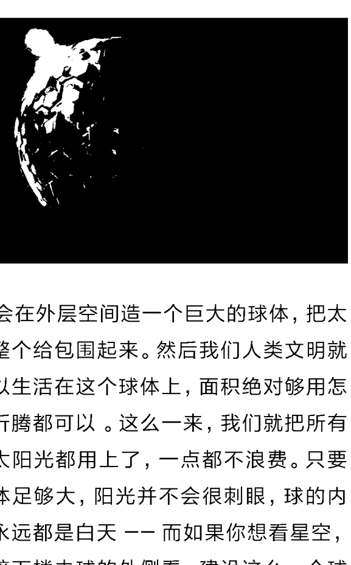

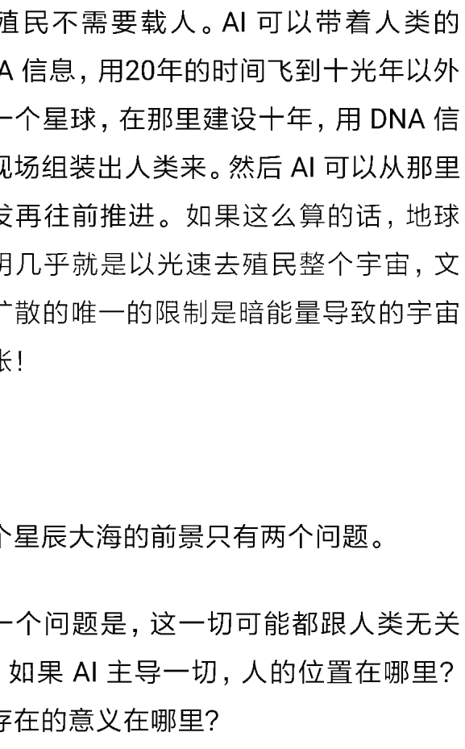

AI会在外层空间造一个巨大的球体，把太阳整个给包围起来。然后我们人类文明就可以生活在这个球体上，面积绝对够用怎么折腾都可以。这样一来，我们就把所有的太阳光都用上了，一点都不浪费。只要球体足够大，阳光并不会很刺眼，球的内侧永远都是白天——而如果你想看星空，直接下楼去球的外侧看。建设这么一个球需要的资源从哪里来呢？也许AI可以先把木星拆了。

有了这种规模的超级能源，AI的目标就是向整个宇宙殖民。现在人类最快的太空探测器速度只有光速的0.1%，而物理学家设想的一种激光推进的飞船，理论速度可以是光速的一半。

AI殖民不需要载人。AI可以带着人类的DNA信息，用20年的时间飞到十光年以外的 一个星球，在那里建设十年，用DNA信息现场组装出人类来。然后AI可以从那里出发再往前推进。如果这么算的话，地球文明几乎就是以光速去殖民整个宇宙，文明扩散的唯一的限制是暗能量导致的宇宙膨胀！

这个星辰大海的前景只有两个问题。

第一个问题是，这一切可能都跟人类无关了。如果AI主导一切，人的位置在哪里？人存在的意义在哪里？

有人设想，我们应该想开一点，干脆就把AI当成自己的孩子吧。作为父母我们没什么能耐，但是我们的孩子厉害，这难道不是一种安慰吗？没准AI还会哄哄我们，说我永远是你的孩子，我继承你的姓氏，我代表你去征服星辰大海……那样你是不是也有点自豪感。毕竟是地球文明的种子播向了整个宇宙。

如果你说这不行，我不想被AI代表，我不想征服十光年以外的地方，我就想老老实实待在地球过日子……那你可能就对地球文明太不负责任了。因为有些日子不是你想过就能过的，你会遇到各种灾难的挑战。

一百年之内，我们迫在眉睫的灾难就是核战争。一千年之内，地球很有可能会出现灾难性环境。在一万年的范围内，我们很可能遭到小行星的撞击，把地球文明毁灭一半。在十万年内，我们很可能遭遇 到超级火山的爆发，也把地球文明毁灭一半。在一百万年或一千万年的尺度上，我们很可能遭遇一次巨大的小行星撞击，把整个地球都给毁灭掉。

就算人类文明躲过了这些，你还要知道太阳的寿命是有限的。十亿年之后，太阳会变得特别特别热；一百亿年之后，太阳会变成红巨星，一直膨胀到把地球给淹没掉。

没有AI，人类文明就不会有未来。把未来交给AI，我们不但可以躲过地球上的各种灾难，甚至有可能整体移民外星球，也许文明的寿命可以和宇宙相等——只不过那时候也许就不能叫“人类”文明了。

第二个问题则是，AI愿意去做这一切吗？AI会不会有自己独立的意志，它还会不会在乎我们这个文明？这些问题咱俩下次再说。

泰格马克创办“未来生命研究院”，就是为了在AI做大之前，让人类把这些问题想清楚。

读读这本书，再想想咱俩国内某些专家学者，不知道什么叫算法，不知道什么叫图灵机，对AI一窍不通，居然还要指点未来社会怎么前进，这不胡闹吗？

## 日课010 | “坚毅力”…可能是个站不住脚的学说

日课010 | “坚毅力”…可能是…

假设现在基因编辑技术已经完全成熟了，你在小孩的时候可以像打游戏的人物设定一样，给孩子定制各项“品质点”。可选的品质包括智商高、长得好看、身体健康、身材高大、性格外向、为人善良、做事有耐心、有专注力、开放的头脑等等。那么请问，你会重点加上哪些品质点呢？

那你可能想，我能不能把所有这些品质点全都加上。

我们平时阅读各种成功学、励志故事，差不多就是这种心态：你希望把什么好品质都学到。但是这可能不太明智。有些品质可能对你想要的成功并没有作用，而且好品质之间有可能hti矛盾的。

最近两年有本特别流行的书，叫《坚毅力》（Grit），作者是美国宾夕法尼亚大学心理学教授安杰拉·达克沃思（Angela Duckworth）。“Grit”这个词现在已经因为这本书成了流行词汇，连我都用过。咱们专栏有一期叫《讲故事和刷经验值》，其中就提到你给别人讲故事的时候可以说说自己有“grit”。

讲故事是可以。但遗憾的是，所谓“坚毅力”，很可能是一个站不住脚的学说。

### 1.达克沃思的理论

“坚毅力”是近年来达克沃思和一些心理学家提出的一个新概念。按照达克沃思的定义——

坚毅力（grit）= 热情（passion）+ 坚韧（perseverance）。

所谓热情，就是你对你做的这件事情有非常强烈的兴趣。所谓坚韧，就是你要百折不挠，有韧劲，能够长期坚持把一件事情做到底。咱们tc直觉想，坚毅力肯定是个好东西，又有兴趣又不放弃，那肯定成功啊。

是不是好东西，你得有研究证据才行。达克沃思在书中介绍了她本人在西点军校做的一项研究。西点军校的训练非常艰苦，很多人不能够坚持到达标。达克沃思来到西点军校，对学生做了一番性格测试，看看谁的坚毅力更强，然后再跟他们的成绩作对比。结果发现，那些最能坚持下来的学生，他们共同的性格特点，就是这个坚毅力。达克沃思本人以前还当过中学数学老师，她的亲身体会是，小孩聪明不聪明跟能不能够学好数学关系不大，最后取得好成绩的都是有坚毅力的孩子。

坚毅力说的是后天的努力。而达克沃思认为，努力比天赋重要得多。为了说明这一 点，达克沃思提出两个公式：

技能 = 天赋 × 努力

成就 = 技能 × 努力

这两个公式虽然有道理。你光有天赋不行，还得努力，才会获得技能。你光有技能还不行，还得努力，才能发挥技能取得成 就。那这么一算，“成就”就等于“天赋”乘以“努力”的平方！努力被算了两次，所以坚毅力必然比天赋重要。如果i你觉得自己的天赋不太够，这两个公式绝对是好消息。

更好的消息是，达克沃思还说，就算你现在没有坚毅力也不用紧 —— 坚毅力是可以慢慢训练养成的。训练方法分四步。第一是你你要培养对某个领域的深入兴趣。第二点是你要用科学方法刻意练习。第三点是你要有远大目标，比如如果我喜欢画漫画，我的目标就是要去《纽约客》杂志专栏，那我就算是被拒绝也要坚持不断地给他们投稿。第四是你要有希望，你要相信自己可以掌控自己的生活，把握自己的命运。做到这四点，坚毅力就出来了。

所以这个“坚毅力”实在是太好了。首先它比天赋重要得多，特别讲平等。其次只要你愿意学，你就可以拥有坚毅力。达克沃思还用自己的经历鼓励读者。她说我从小就挺笨的，我爸爸就一直说我不是天才——可是我很努力，结果现在我反而得了麦克阿瑟天才奖。

这么好的东西……你是不是觉得有点鸡汤的味道。

### 2.学界的质疑

《坚毅力》这本书在畅销书排行榜上待了很长时间，达克沃思也被邀请做了 TED 演讲，“Grit”这个词算是流行开了。但是坚毅力理论在学术界引起了很大争议。

2016年，我看过 NPR 的一篇报道 [1]，采访了爱荷华州立大学的心理学教授马库斯·克瑞德（Marcus Crede）。克瑞德对达克沃思的坚毅力学说提出了三点严厉的批评。

第一点，达克沃思夸大了研究结果的显著性。

比如前面说的那个西点军校的研究，达克沃思的书给读者的印象，是最后能够坚持下来的人，最重要的品质就是坚毅力。但是如果你去达克沃思的原始数据，西点军校的达标率本来就高达95%，而坚毅力最强的那 些人，他们的达标率也不过就是98%。

坚毅力无非就是把达标率从95%提高到了98%——这个效应似乎并不是怎么厉害啊。

第二点，坚毅力对成功的作用其实并不大。

有人做研究表明，坚毅力和大学成绩的相关系数只有0.18，而达克沃思自己的研究中，这个相关系数也仅仅是0.20。这个相关性可是有点太弱了。

我们专栏第一季讲《平均的终结》这本书的时候介绍过“相关性”这个概念。在统计学看来，相关系数低于 0.4 都算是弱相关，结论就不可靠——你这个 0.2 可以说是一个根本就不靠谱的效应。

这个效应这么弱，达克沃思自己在 TED 演讲里面居然说：“我一直在研究到底是哪个素质对成功最重要，我发现成功的关键不是社交能力、不是你的长相好不好看、不是你的身体健不健康、不是你的智商高低，而是你有没有坚毅力。”这话是不是有点过了呢？

《坚毅力》这本书的封底大V推荐，哈佛大学心理学教授丹尼尔·吉尔伯特（Daniel Gilbert，我们在第一季《经历的幸福和回忆的幸福》这期讲过他的工作）给的推荐语是：“心理学家寻找成功的秘密已经找了几十年，现在终于有人发现这个秘密，她就是达克沃思。”这种说法是不是有点太褒奖了？

第三点，坚毅力这个概念其实并不新。

达克沃思管它叫“坚毅力”，但其实这个概念就是以前心理学家说的“尽责性（Conscientiousness）”。心理学界有个众所周知的“大五性格”分类法，从五个维度测量一个人的性格，其中有一维就是尽责性。所谓尽责性，就是这个人不够自律，做事是不是细心，能不能坚持完成，有没有条理，能不能三思而后行。有人做了大量的性格测试，坚毅力和尽责性之间的相关系数高达0.8到0.98——你基本上可以说坚毅力本来就是尽责性，这是新瓶装旧酒。

而对于尽责性，prechen早就做过很多很多研究了。人们早就知道尽责性基本是一个天生的素质，很难通过后天训练提高——那达克沃思凭什么说坚毅力就能训练提高呢？

### 3.没有坚毅力，也能成功

就在前几天，我看到《英国心理学学会研究文摘》上有一篇新研究综述 [2]，其中提到科学家对坚毅力的一些最新批评。

九月份刚刚出来的一篇荟萃分析论文 [3] 说，坚毅力的两个方面——热情和坚韧——对成功“有效成分”其实是坚韧，热情似乎没什么用。而就算是坚韧，对成功也只有比较微弱的作用。

说到成功，你肯定认同“创造力”是个好东西。而一个新研究 [4] 则指出，坚毅力和创造力之间不但没有关系，甚至还可能有负作用的关系。真正让人有创造力的是开放的头脑，而开放的头脑和坚毅力可能是矛盾的！

坚毅力，是让你长期对某一个领域保持特别专注的兴趣，最后只干这一件事。开放的头脑，是让你对很多东西感兴趣，尝试很多事情。所以你不太可能特别坚毅还特别开放。

就算坚毅力能让你在某些领域取得成功，比如说从西点军校毕业 —— 但是成功有很多种啊。对艺术家、企業家科学家来说，开放的头脑难道不是更重要吗？

以我之见，坚毅力的确是个好品质，但并不能算是一个特别难得的品质。心理学家测量坚毅力无非是让受试者做些心理测试题 —— 你是否曾经长期坚持做好一件事？我当然做过。表现出一点坚毅力很容易，而大学考试成绩可是硬指标。

再进一步，我看坚毅力是个有点“ 一根筋 ”的极端态度。也许更科学的做法是在坚毅力和开放头脑之间找一个平衡。你到底是坚持一个目标不动摇，还是随时改变一些兴趣，多接触一点东西？处理这样的矛盾，我们最好有点哲学精神，根据具体情况灵活掌握才好。

说了这么多，我觉得，达克沃思最成功的一点就是她选了一个好词儿 —— “grit”。朗朗上口，让人一听到就印象深刻，好像还有一点年轻人的活力，比什么老气横秋的“conscientiousness”好听多了。

我建议以后我们可以多用一下“grit”这个词，这是中文世界里说的 第一个性格维度。也许再过十年之后，你还会记得坚毅力这个理论 —— 但是我今天帮你做的这些调研和分析，你恐怕都会忘记。

参考文献：
[1]. MacArthur 'Genius' Angela Duckworth Responds To A New Critique Of Grit, LA Johnson/NPR, 2016.
[2]. Let’s dial down the hype about grit – new paper finds no association with creative achievement, Alex Fradera, BPS Research Digest, Sept. 15, 2017.
[3]. Much ado about grit: A meta-analytic synthesis of the grit literature, Credé M1, Tynan MC1, Harms PD, J Pers Soc Psychol. 2017 Sep;113(3):492-511.
[4]. Grohman, M. G., Ivcevic, Z., Silvia, P., & Kaufman, S. B. (2017). The Role of Passion and Persistence in Creativity. Psychology of Aesthetics, Creativity, and the Arts. Advance online publication. http://dx.doi.org/10.1037/aca0000121

推荐阅读：
讲故事 和 刷经验值
经历的幸福 和 回忆的幸福
平均的终结：把人变成工业品的思想

## 日课011 | 一种熟悉的新体制

日课011 | 一种熟悉的新体制 ↓

万维钢

今天我要跟你分享的，是我给一本刚刚上市的书写序言，这本书名叫 Whiplash ，中文版名叫《爆裂》。这本书值得你花时间好好看，希望我的序言能帮你更好地理解这本书。

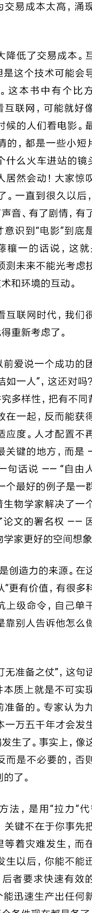

一个灾难性的、黑天鹅级别的污染事故发生了，因为事先完全没有准备，到处都是 一团糟。数万人逃离家园，恐慌情绪蔓延。政府极力救灾，但人手和资源毕竟有限， 连官方公布的各地污染数据都是错的。政府把一些灾民转移出来，可是有人发现， 政府指定的新安置地点的污染程度居然比这些灾民原先住的地方还要严重。人民必须自救，可是现在甚至没人知道哪里是安全的。

接下来的局面当然是一方有难八方支援。但是这一次的剧情，跟我们常见的捐款捐物很不一样。

一个身在海外的科学家发出一封电子邮件给几位同行，号召懂技术的人为救灾做什么。讨论的结果是必须迅速搞到一批环境监测设备一灾难发生以来这个设备太抢手，已经买不到现成的了。几个人发起了 一个网上社区，更多的人参与进来，大家干脆决定自己制造：一个创业公司设计出来了更方便好用的新款设备，一个众包网站帮着筹集了款项，一家本地公司完成了生产，一大群志愿者把监测设备绑在汽车上走街串巷，他们很快就收集了超过5000万个数据点，放在一个知识共享网站上供人们随时查询……

政府解决不了的问题，被这些人给解决了。

我觉得这个事儿做的特别漂亮，比什么“共享单车”之类的互联网投IRECT事更有意思，只可惜不是发生在中国——当然，庆幸的是灾难也不是发生在 中国。这是2011年日本地震导致核电站泄漏之后的事情。那个环境监测设备是探测核辐射的盖革计数器，那个首发倡议的科学家，则是麻省理工学院媒体实验室主任，伊藤穰一。

麻省理工学院的媒体实验室是个非常有名 的机构，我们经常听说那里的新发明，但是这本伊藤穰一和杰夫·豪合著的新书，《爆裂常识：未来社会的9个生存原则》，说的并不是技术的事儿。这本书说的是伊藤穰一一从利用技术救灾这件事、和其他很多类似的事情中，悟出的一些道理。

以我之见，这些道理有一个共同的主题，那就是在互联网时代有一种“新体制”，正在解决一些过去的“旧体制”解决不了的问题。

伊藤穰一在书中列举了很多最新的进展，还有媒体实验室的案例，但新体制这个思想并非伊藤穰一首创。旧体制和新体制，你可能早就听说过这样的类比：大教堂和集市、正则军和游击队、集权和分权、包括我以前的一篇文章中的“蜘蛛”和“海星”。

简单说来，旧体制做事的方法是“命令与控制”：有什么事情，领导作出决定，下级贯彻执行 —— 而新体制的做事方法，叫做“涌现”。

“涌现（emergence）”是个非常地道的科学名词，说的是超级复杂系统的一个关键性质。比如说蚂蚁。每个单独的蚂蚁都没有什么智能，做的事都很简单，几乎就全是本能反应 —— 可是很多很多蚂蚁集中起来，却能做出一些极其精巧复杂、充满智能感的事情。人的大脑中有上千亿个神经元，每个单个神经元的功能都是比较简单的，就好像是一个电子元件 —— 可是所有这些神经元加在一起，却能让人产生智能和意识。这就是涌现。

请注意，“涌现”可不是我们平时说的“集中力量办大事”。涌现是一个加一不单大于二，而且变成了一个完全不同的东西的过程，是整个上升到了不同的层次。市场是个典型的涌现现象：每个人都只会自己的 一点点专业技能，甚至没有一个人掌握从头至尾制造一根铅笔的全部手艺，但是众人合作，却可以造出无比复杂的东西来。

如果涌现是个如此厉害和普遍的力量，为什么非得等到互联网普及了的今天，才又开始被人重视起来了呢？这是因为实现涌现是有条件的。早在七十年代以前，经济学家罗纳德·科斯（Ronald·Coase）就问过这个问题：既然市场这么好，为什么企业内部不实行市场式的自由合作，非得搞命令与控制这一套管理呢？答案是交易成本。把一群陌生人组织起来进行有效合作是需要成本的，因为交易成本太高，涌现并不经常发生。

但是互联网大大降低了交易成本。互联网只是个技术，但是这个技术可能会导致天翻地覆的变化。这本书中有个比喻特别好：现在我们看互联网，可能就好像电影技术刚出来的时候的人们看电影。最早的电影是没有剧情的，都是一 些小短片，人们在电影院看什么火车进站的镜头，屏幕上的火车和人居然会动！大家惊叹一番也就没有然后了。一直到很久以后，有了特写镜头、有 了声音、有 了剧情，有了长的故事片，人们才意识到“电影”到底是什么东西。用伊藤穰一的话说，这就是“系统”的力量，你预测未来不能光考虑技术本身，还得考虑技术和环境的互动。

用这个眼光再看互联网时代，我们很多默认的常识，可就得重新考虑了。

比如说，我们以前爱说一个成功的团队要上下一心、“团结如一人”，这还对吗？不一定。新时代讲究多样性，把有不同背景、不同观点的 人放在一起，反而能获得更强的做事力量和适应度。人才配置不再是把最好的人放在最关键的地方，而是 —— 用罗伯特·爱说的一句话说 ——“自由人的自由联合”。书中一个最好的例子是一群电子游戏玩家，帮着生物学家解决了一个重大难题，还获得了论文的署名权 —— 因为游戏玩家有比生物学家更好的空间想象力。

“不团结”，往往是创造力的来源。在这个时代“对抗”比“服从”更有价值，有很多科学发现是科学家对抗上级命令，自己单干的结果 —— 没有人是靠别人告诉他怎么做而得到诺贝尔奖的。

再比如说，“不打无准备之仗”，这句话还对吗？黑天鹅事件本质上就是不可实现预测到、没办法提前准备的。专家认为九级以上的地震在日本一万五千年才会发生一次 —— 但它就偏偏发生了。事实上，像这样的灾难提前准备反而是不必要的，否则政府就没有资源干别的了。

新时期的应对方法，是用“拉力”代替“推力”。也就是说，关键不在于你事先配多少资源“推”到这里等着灾难发生，而在于等到黑天鹅事件发生以后，你能迅速把资源“拉”过来。后者要求快速有效的信息交流，以及一个能迅速生产出任何新产品的供应链，而这两个条件现在都具备了。

向市场，如果卖得好就继续生产，如果卖得不好就放弃——总共花不了多少钱。这是冒险成本越来越低、大企业干不过小公司的时代，这是把一切产业都变成软件产业的机制，这是没有资本的资本主义！

互联网科技对世界的改变，绝不仅仅是生活和娱乐的升级，更可能是整个生产方式和社会组织管理的根本变革。如果“涌现”越来越比“命令与控制”高效，那“维护领导的权威”、“加强管理”还有多大意义？如果现在的“天命”是在小创业公司这一边，那巨无霸企业岂不是很危险吗？

其实这个道理并不新。在近代中国历史上，游击队打败正规军靠的是这个道理，山寨中国制造打败国际大品牌靠的也是这个道理。耶鲁法学院教授吴修铭（Tim Wu）有本书叫《总开关：信息帝国的兴亡》（ The Master Switch: The Rise and Fall of Information Empires ），从美国信息产业的发展史中，总结了一个规律：任何革命性的信息技术，一开始出现的时候总是自由开放的，而成熟以后一定会走向垄断封闭。现在我们正好赶上一个新技术发展的关口，自由、开放、去中心化，是这个时代的一大主题。

伊藤穰一说了“涌现”体制的这一方面，我想提醒读者一句，“命令与控制”这个“另一方面”并没有完全失效，而且一旦创新速度变慢，相关领域就很可能重回“命令与控制”体制。

那么回过头来说，伊藤穰一提醒我们的终极问题是：到底什么样的体制，才是创新体制？答案是涌现体制。如果你害怕风险和混乱，什么东西都要搞审批，这也控制那也控制，整天鼓吹权威和团结，你就不可能真的是在搞创新。

现在在中国，拿个智能手机上街基本上就不用带钱包了，中国人享受到了全世界最发达的互联网服务。这是相当厉害的成绩，可我还是觉得中国在互联网时代还有很多需要进步的地方。伊藤穰一2011年应对日本核电站泄漏事故所做的事情，还没有哪个中国人做过。麻省理工学院媒体实验室这样去中心化、“反学科”的研究机构，中国还没有。真正原创的互联网应用，中国的还太少。

可是要说创新的“硬环境”，比如说完备的供应链，你知道哪里最强吗？就在中国深圳。深圳的供应链力量实在太强，美国人已经放弃竞争了。伊藤穰一的说法是美国干脆连想都不要想自己搞供应链的事儿了，硅谷和深圳是天作之合。

就在这本书中文版出版的这个时刻，“区块链”成了最新的热点。这是一个更彻底的去中心化机制，一个更厉害的涌现力量。

所以读书的时候赞叹创新容易，真正面对新事物的时候敢不敢放手冒险，才是最难的啊。

### 答读者问 | “努力就有收获”不等于“努力就能成功”

答读者问 | “努力就有收获”不..

#### 来自日课: 大局观下的文明和智能

今天老师给了我们新的看问题的角度，那就是从第一性原理出发，目前的生命体和非生命体都是由同样的基本粒子构成，遵循同样的物理规律，没有根本的差异。我想提问是，现在为兴未艾的量子计算机是图灵架构的吗？如果不是，以量子计算机为基础的智能技术有没有可能超人脑？

万维钢

量子计算机仍然是图灵架构的。事实上现在有很多“模拟器”，可以用程序去在一台普通计算机上模拟一台量子计算机，供研究学习使用。量子计算机的优势在于对于某些问题来说，它的计算速度可以比普通计算机快很多，但是仅此而已，它并不能解决普通计算机解决不了的问题 —— 比如说所谓“图灵停机问题”。

不过，的确有一件事情是量子计算机能做，而图灵机做不了的：那就是产生真正的随机数。过去，普通计算机只能用算法算“伪随机数”……不过今天的计算机通常都外接一个什么物理设备来产生真随机数，所以这也不是个事儿了 —— 但是这个设备确实不是图灵机的一部分。

所以，如果人脑不是图灵机，那量子计算机也不能模拟人脑。

#### 来自日课: AI与I

请问万老师，我们利用神经元习得的技能长时间不用就会忘记。这个提取能力出了问题还是存储能力失效呢？长时间不用长在脑袋里的技能之后那个“长”出来的功能就消失了吗？

万维钢

据我所知这是所谓“髓鞘质（myelin，也叫髓磷脂）”的作用。经常练习一个技能，相关的神经元连接会慢慢长在一起，而且外部还会包上一层髓鞘质，神经元就好像是电线，髓鞘质就好像是抱着电线的塑料皮。有了髓鞘质的包裹，电线就不会漏电，传输速度就会更快。练习越多，髓鞘质包裹得也越厚，技能就越纯熟。

但是髓鞘质毕竟是血肉长的，它每时每刻都在发生崩坏和生长。如果一个技能长期不用，髓鞘质就会慢慢剥落，使用效果也就不行了。年龄也会影响髓鞘质，这也是为什么人老了以后某些技能就不好学、学会的也不好用了。

极限的计算能力到底意味着什么？也就是说测量和计算的精度可以逼近【真实】。众所周知，人类的文明基于想象力的发达，创造出各种意义，而科学终究是有误差和可证伪的。我觉得只要突破不了这个极限，计算机终究还是数据怪兽，无限量变不是质变。不过，还是很可怕的，当我们发现它的漏洞几乎成为不可能，那不就是通过图灵测试了吗？另外，关于物理极限算力是根据什么得出来的，有些不明白。

“如果你不局限于用基于硅的芯片，那计算能力最终只受物理学的限制”这句话是什么意思？是不是说存在一个极限的计算能力，而这个能力是被物理定律卡死了的，比如说被光速恒定这样没法改变的物理规则所限制。顺便问一个问题，“计算”这个概念究竟是什么？现在的思路是通过提高计算能力来实现智能化，那么“计算”就等可以同于“智能”吗？

万维钢

计算这个动作是个逻辑动作，并不限制于某个具体的介质，不管是用电子管、晶体管还是硅芯片，无非是换不同的介质，让参与计算物质的移动速度更快一点。2000年，麻省理工学院物理学家塞斯·洛埃（Seth Lloyd）证明，不考虑具体的介质，从物理学角度，计算速度只受能量的限制。具体来说，在时间 T 内完成一次基本逻辑运算所需要的最小能量是 E = h/4T，其中的 h 是普朗克常数，是个非常非常小的数字。这就意味着计算速度的物理极限是个非常非常大的数字。当然，具体使用什么介质能逼近这个物理极限，那是后人的事情。

不过 AI 应该并不需要这么快的计算速度就能通过图灵测试。

AI能不能模拟人的情感？比如人类会有善意的谎言。AI可以吗？

万维钢

模拟情感是容易的。比如我们玩角色扮演类电子游戏，里面的那些NPC似乎都有情感，而且可以让人类玩家感动到哭。

问题在于会模拟情感不等于真的有情感。洗衣机洗完衣服就播放一段愉快的音乐，就好像它干完活很高兴似的 —— 但你知道，它自己其实并没有“高兴”这种感情。同样道理，就算有AI完全通过了图灵测试，以至于你觉得它就是“活的”，你还是无法确定它是否真的*感受到了*喜怒哀乐，还是仅仅会表现出了喜怒哀乐。

小时候说的人脑开发只有5%，这个理论是正确的么？

万维钢

一般流行的说法是人脑只开发了10%，但不论5%还是10%，都是错误的说法。

现在脑科学家已经做到在人脑完成各种工作的时候看看到哪些区域正在被使用，结果是哪怕特别简单的任务也会调动很大片的脑区域，而并没有哪个区域从来没有任何任务使用过。思考基本上都是全局性的活动。

另一方面，凡是大脑某个区域受到损伤的病人，几乎都有不同程度的功能障碍，很多是灾难性的。如果有人因某种原因导致某处大脑功能不用了，比如说盲人因为眼睛的问题，导致大脑的视觉区域用不着了，像这样的区域也不会闲着，会被别的功能用上。所以大脑的策略是能用都用上。

再者，大脑是个非常昂贵的器官，耗费能量非常大，如果有90%脑子没用，那进化根本不会允许我们背着这么大的累赘。

当然，这并不是说大脑的学习能力都用上了。正如我们说过的，人脑的存储能力高达100TB，远远没用到10%。

#### 来自日课: AI的文明使命

万老师您好，我是一名培训机构的数学教师。我从第一季开始就一直在听您的节目。想问您如何提升自己的解释力，能将复杂问题简明易懂地解释给别人。希望您能回复。

万维钢

我认为关键是你你从听众的角度去看这个问题。这不是说跟小孩说话就要用少儿节目的那种甜腻腻的语言，你可以保留自己的语言风格，但是你一定要从对方的立足点出发去说这个问题。

这就要求你不但要理解要讲的知识，还必须理解听众，你得知道听众都知道什么。

然后你要从听众熟悉的东西出发，去讲一个他不熟悉的东西，正所谓“喜欢 = 熟悉 + 意外”。

更高级的技巧，则是把道理包装成一个故事，设置悬念，就好像写剧本一样安排剧情，去吸引听众。最好你还能动之以情，去打动和说服听众。

总而言之，你必须把这个“解释力”当成一门严肃的、复杂的艺术去勤学苦练。这个手艺和戏剧表演一样是一门艺术。我看很多科学家、很多老师，并不把解释力当做手艺，如果他们讲个什么东西别人不接受，他们指责听众。

未来是地球人创造的AI先征服宇宙的其它星球，还是其它星球的生物创造的AI先征服地球呢？广袤无垠的宇宙中现在真的没有比地球人先进1万年、10万年的生命吗？若是它们早就被它们自己创造的AI“消灭”了那么地球人创造的AI是不是也发展不到以光速一半的速度去扩展的阶段呢？

万维钢

这是完全有可能的。文明未必有机会发展到那么高级的程度，甚至有可能到一定程度就自我毁灭了。还有一种可能是因为宇宙年龄毕竟是有限的，也许我们是这一大片宇宙区域内最早的智能文明，别人才还没发展起来。咱们考察一下人类的历史，其中有太多极小概率的幸运事件——比如小行星击中地球让恐龙灭绝，给哺乳动物腾出发 展空间、比如人类历史上一次偶然的基因突变让我们有了语言能力，还有“想象力”，等等。不知道经历了多少危险我们才到今天。也许附近别的星球没有这么幸运，还没来得及发展出高智能生命。

#### 来自日课："坚毅力"可能是个站不住脚的学说

虽然研究数据不够支持坚毅力这个说法，但努力就有收获，确是很多人的共识，这个共识难道错了吗？有没有研究证明这个共识其实不靠谱呢？另外，请问万老师，责任性为何是天生的呢？目前的研究结果是什么？谢谢

对于一个高三孩子来说，目前的成功是考上一个985或211的理想学校，那么坚毅力难道不是个好东西吗？遇到难题遇到挫折，没有坚毅力就容易放弃，这里的坚毅力可不等同于执拗哦。请万sir 回答下。

万维钢

"努力就有收获"肯定是没错的，但我们得区别"努力就有收获"和"努力就能成功"。现在我们关注的所谓"成功"，是指出类拔萃，是相对于大多数人，你是一个什么位置。如果会努力的人很多，而具有开放头脑和创造性思维的人很少，那么"努力"就不是一个预测"成功"的好指标。

越是竞争激烈的领域，天赋和机遇就越重要。比如职业足球、音乐家这些领域，愿意勤学苦练的人实在太多了，最后胜出的肯定得有点天赋。如果一个领域仅仅是努力就能比别人领先很多，那只能说明愿意进入这个领域的高手太少。

现在心理学家研究的结果就是尽责性是个天生的素质，有的人生性做事就有始有终，有的人生性就不靠谱。但是我想心理学家研究的方法无非是大规模问卷调查，结论未必是定死的。如果使用什么特殊手段强制训练一个人，能不能改变他的本性，也未可知——但是可以肯定曾经这么做过的人很少很少，以至于心理学家没有观测到。

#### 来自日课：一种熟悉的新体制

如果不能把旧体制变成涌现体制，个体在旧体制里，是不是没有创新的机会了？

万维钢

这也取决于你怎么定义"创新"。对于那些由新想法驱动的"颠覆式"创新来说，命令-控制这样的体制明显不适合，新想法都是个人自发产生，不能根据上级的安排做事。

但也有很多创新是改进式的。比如超级计算机，现在最快的是这么这么快，而我们完全知道怎么做能让它更快一点，无非是投入更多的资源，加入更多的并行计算节点——那命令-控制体制就很适合，它可以迅速调动更多的资源过来。

再比如说，我们已经知道飞机应该是什么样的，但是有很多参数我们不知道到底调到多少才是最优的，那你要做的就是投入大量的人力物力，建设最好的风洞设施去做各种测试。像这样的创新，命令-控制体制也能做得很好。

万维钢

这几期节目有好几位读者问，为什么我们会认为AI自己想要变得更大更强，AI为什么也会像人一样充满好奇心和征服欲？这个问题问得好！请允许我暂时先不回答，这正好是这个AI系列接下来的主题……然后我们还会谈到AI的意识问题，后面的内容会非常烧脑：）

不过，根据之前的约定，下周国庆假期咱们先讲雷·达里奥的《原则》这本书。

## 日课012 |《原则》1:大亨的大道理

今天咱们开始说雷·达里奥（Ray Dalio）的
新书《原则：生活和工作》（Principles: Life and Work）。

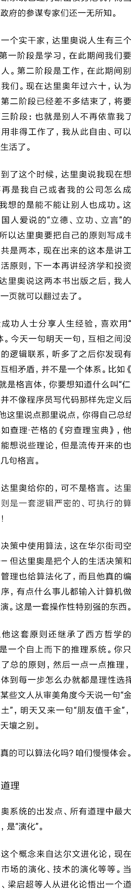

《原则》这本书是9月19号刚刚出版，正式上市之前就成了畅销书。雷·达里奥是世界最大的对冲基金，桥水基金的创始人，影响力巨大——但我们讲这本书可不是因为达里奥有钱，而是因为他有思想。

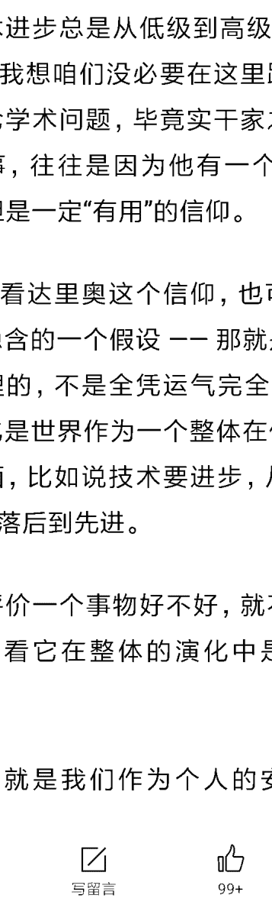

达里奥是个相信原则的人。这本书说的原则，是他多年实践的结果，不但自己用，而且要求桥水公司的员工必须照做执行。就好像有些中国公司喜欢搞“思想教育”一样，达里奥用这套原则给员工洗脑，桥水实际上是一个用他的思想“武装起来”的公司……以至于华尔街有人评价说桥水是个邪教（cult）公司！

### 1.大亨

达里奥是个实干家。他在华尔街摸爬滚打好多年，既搞技术又搞管理。他见过不少大场面，曾跟多国领导人谈笑风生，喜欢说自己从比如李光耀身上学到了什么。他影响过国家的决策，比如在欧洲债务危机期间跟一些欧洲的领导人办过事儿，事后还总结了什么样的国家领导人“行”，什么样的领导人不行。

### 2.大道理

达里奥系统的出发点、所有道理中最大的道理，是“演化”。

人生真的可以算法化吗？咱们慢慢体会。

道。

要顺应演化的规律，人要做的就是面对现实，积极探索。你会遭遇失败，但是你要从失败中学到东西，然后快速改进。作为“生命2.0”，人最大的优势是可以主动学习，能更快速地适应新的环境。

这个学习和改进的过程，就是人生最有意思的事儿。

我觉得达里奥这番道理可能比严复梁启超说的“自强”还要高级一点儿。以前中国文人过分强调道德姿态，结果近代史上打不过外国人，严复梁启超学了进化论说你姿势好看没用，你得“变强”才行。而达里奥说的，可不仅仅是“变强”，也不是“努力~！奋斗~！”那些励志口号。他说的是你得改变自己。

比如说，在梁启超那里失败肯定是坏事儿，变强就是为了避免失败 — 而在达里奥这里，痛苦和失败是演化的必然环节。你一定会遭遇失败 — 如果没有失败，你就没有在挑战自己的极限；如果你没有挑战自己的极限，你就没有把自己的潜能最大化发挥出来。面对现实、发现自己的弱点总是痛苦的，但你应该把痛苦当成信号，说明这里可以改进。

尝试 — 失败 — 学习 — 改进，理想人生就是这个永无止境的循环。

在这个理想的模式之下，人生还有各种不同的过法儿。那么达里奥是什么人呢？他是一个 “shaper”。

### 3.敢不敢做个 shaper

“Shaper”这个词翻译成中文，大概叫“塑造者”，比如什么什么总设计师之类。但是“塑造者”这个词太大，其实每个人都可以 在某一领域做一个或大或小的 shaper。

所谓 shaper，就是你根据自己的想法，改变了一些事物的前进路线。

创新者、企业家和某些科学家和政治家，都可以称为 shaper。

Shaper 总有一个大想法。比如伊隆·马斯克，他的大想法是非要让人类殖民火星。达里奥就当面问过马斯克，说你以前学过火箭科学吗？马斯克说我不是火箭专家，我的知识都是自己看书看的 — 但是为了干这件事，我愿意去学习火箭科学。这些人不是先看看自己能干什么，然后去给自己找个市场定位 — 而是先问自己想干什么，然后琢磨怎么把这件事干成。

Shaper 们有两个重要特点。第一，他们的眼界非常宽、非常远，能看到别人看不到的东西，这样他们才能产生大想法。第二，他们为了把这个想法变成现实，会不惜一切代价。

Shaper 们的一个共同点是做性格测试的时候在“关心他人”这一项的得分都很低。这似乎有点奇怪，因为很多 shaper 都是很有爱心、关心人类命运的人啊？达里奥说这是因为 shaper 们常常为了达到目标而不顾自己员工的感受。我们做事是为了把事儿做成，而不是为了让员工高兴。

那 shaper 跟 shaper 之间有什么不同呢？关键在于两个维度：一个是创新，一个是管理。

像爱因斯坦这样的完全是创新者，什么都自己干。像韦尔奇（通用电气董事长兼 CEO）这样的则完全是管理者，自己并不发明任何东西，通过管理别人来实现自己的想法。乔布斯是既参与创新也搞管理，这一点跟达里奥很像，再加上两人 都爱鼓吹自己的思想，所以人说达里奥是金融界的乔布斯。

作为一个 shaper，达里奥平生做的事情，就是世界的演化中做出一点点自己的贡献。

不管你做不做 shaper，达里奥的原则具体怎么操作？咱们下期再说。

## 日课013 | 《原则》2:激进面对现实

日课013 | 《原则》2:激进面...

今天咱们继续说雷·达里奥的《原则》。

上次我们说到，达里奥从“演化”这个大道理中推导出来，人生最值得做的事情就是“失败－学习－改进”这个事儿。在演化中做出一点贡献，是你能在人生中取得的最大成就，也是生活给你的最大奖励。

为此，你要把你做事的系统想象成一台机器。这个机器包括——

- 你的设计，也就是你做事的方法
- 人，能帮助你的人，以及你自己
- 你的目标
- 你做事的结果

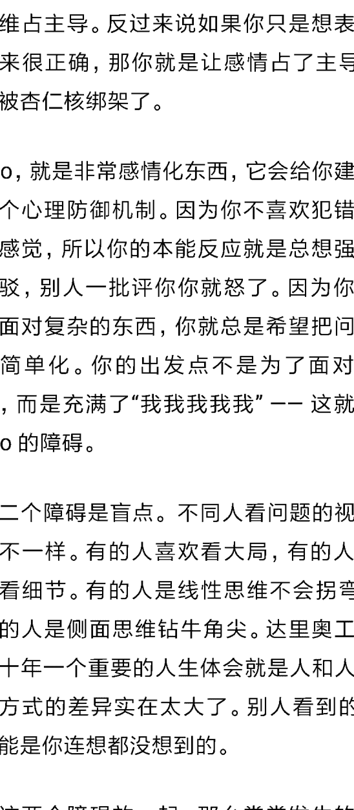

你把结果和目标比较，如果不满意，你就不断*调试*这台机器——其中也包括调试你自己，因为你也是这台机器的一部分。

再换个说法，你整个做事的过程分为五步：

1. 选择目标，你的目标可以有不止一个；
2. 看看你距离目标有什么障碍，有什么问题；
3. 诊断，你要发现这些问题根本原因是什麽；
4. 设计一个计划去解决问题；
5. 去做。

这些步骤一列出来，你一看这也太简单了，好像并没有什麽特别的地方。我也有同感！这是因为这些步骤是自然推理的结果，想要把什麽事情做好，肯定都是这么做。

### 1.怎样确定目标

目标并不仅仅是“你想要什么”。现实是你想要的东西太多了，不可能全都得到。一个面对现实的人必须把“目标（goals）和渴望（desires）”区别开来。我渴望一天到晚读小说、渴望多吃美食、渴望写出漂亮的文章还渴望减肥——但是我知道这些渴望不可能都满足。

### 2.面对自己

每个人都说要面对真实的自己，但很少有人能做到。我们要的态度不是什麽“我要自强”、“我要充满自信”之类，而是“谦卑”。

### 3.激进式听取意见

以前咱们听历史故事，如果一个皇帝能够

以前咱俩听历史故事，如果一个皇帝能够虚心地纳谏，忠臣批评他他不翻脸，那就算好皇帝了。“激进地”开放头脑，可不仅仅是别人给我提意见我不翻脸，而且是别人不给我提意见我就难受。

这不是被动，而是主动的开放。你得总是担心自己看问题没看全，总觉得是不是有更好的选项你不知道。做重大决策之前，你总是想方设法把所有相关信息都拿过来……这种心态才是激进地开放头脑。所以我一直觉得《中庸》里的两句话，“戒慎乎其所不睹，恐惧乎其所不闻”，不是说什么时候自己一个人的时候要谨慎小心不做坏事那种“慎独”，而是说常常担心有什么东西自己不知道，要主动寻求知识。

说到这里我们还是得引进一个英文单词，“synthesize”。这个词大概翻译成“综合”，是中文世界很不常用的一個意思。Synthesize 的意思是你主动去调研所有相关的知识，然后自己做一个综合判断。

你可能看过一本非常经典的书叫《如何阅读一本书》，其中提到最高层次的阅读，就是这个 synthesize 的功夫。这是完全主动的阅读，你要找来各种相关的书放在一起读。

达里奥这本书里一说决策的事儿，synthesize 这个词就要出现好多次。你对某个问题感兴趣，不是读一本书、听一个专家说完就听风就是雨，你得全面考察各种意见。

但是听取意见也不是谁的意见都听。达里奥有两个标准。第一，这个人一定要是“可信的”。“可信”有个硬指标，要求这个人在相关领域中至少有三次成功经验。

| 由此得到
- 1. 你得知道自己真正想要什么。
- 2. 你得非常清楚自己的弱点。
- 3. 你要激进地面对现实。

我们从英文世界引进了两个词：ego 和 synthesize。下次再有谁固执己见，你可以问问他是不是有个特别大的 ego，需要学学 synthesize。

普通人做事总是把“不伤害自己的感情”放在首位，一天到晚担心这个害怕那个，特别脆弱。如果一个人能克服这些弱点，明确知道自己是谁，自己想要什么，应该怎么做，他就会非常坚定，对生活就有掌控感。

这一期是说自己，下一期咱俩说说怎么跟人合作。

## 日课014 | 《原则》3:激进的公司什么样

日课014 | 《原则》解读3:激...

今天我们继续说雷·达里奥的《原则》。

前面我们讲了个人的原则，今天讲公司的原则。作为一个管理者，应该怎么管理公司，如何对待员工呢？达里奥关于公司的原则和个人原则是一致的，出发点仍然是演化。

40年前构成道琼斯指数的30家公司，到今天有几家已经倒闭消失了，还留在道琼斯指数里的只剩下6家。再大再成功的公司也可能轻易地烟消云散。这就是演化的现实。最近的例子是黑莓，曾是如日中天的手机公司，也不能说不努力，结果就是没跟上演化的节奏，说淘汰就淘汰了。

一个公司想要在演化中长盛不衰，就必须有一个自我更新的机制。

我们还是把公司系统当成一台机器。这台机器有目标、有结果，管理者始终要把目标和结果进行比较，如果结果不符合目标就要调试这台机器。

公司这台机器的核心是文化和人。了不起的公司需要了不起的文化和了不起的人。

### 1.激进的文化

达里奥经常说他是像对待家人一样对待员工......但我不知道，了解了桥水公司的文化之后，你愿不愿意当桥水的员工，或者达里奥的家人。

桥水公司最初是不给员工买医疗保险的，现在终于有了医疗保险，但是并不像美国绝大多数大公司那样给员工买牙齿保险。达里奥的逻辑是牙齿保险就好像汽车保险一样，你如果需要为什么不自己买？人难道不应该自己对自己负点责任吗？

达里奥说他很“爱”员工，但他给员工的这个爱叫做“严厉的爱”——就像教练员对运动员一样，是不断推动员工进步。

桥水的企业文化，叫做“想法的精英政治（Idea Meritocracy）”。首先它是一个精英政治，也就是说有能力听谁的，既不是全体员工和睦搞民主，也不是什么老头子、大股东、关系户之类的把持高位。再进一步，公司的权力不属于哪个人，也不是属于哪几个职位——而是属于“想法”。哪个想法有道理，就按哪个想法办事。

为了让好想法能说了算，桥水有三个措施：激进的事实、激进的透明、和一个“可信度加权投票系统”。咱们先说前两项。

所谓激进的事实，就是每个人要大胆表达自己的观点和想法。达里奥特别强调，这可不仅仅是允许你“反对”公司，而且你必须表达，有问题还得提出来。当然这不是说每个人的每个观点都很重要，也不是说你对公司有任何抱怨都会受到重视——其实大部分不成熟的观点和小抱怨都不算事儿，但是如果你有什么对公司真有价值的说法，你得说出来。

所谓激进的透明，就是所有人都能看到公司正在发生的大部分事情。

举个例子，几年前，桥水曾经把公司的一个部门整体转让给了另一家公司。这种事情在别的公司肯定都是事先严格保密的。先和对方公司谈判，谈成了再宣布转让，谈不成也不会影响被转让部门的士气，对吧？

但桥水的想法，现在我们已经在构思重组的重组，已经开始讨论转让交易了，如果我们不让这个部门的人知情，那一旦有什么风声，反而搞得人心惶惶。公司文化最怕的就是互相不信任。

所以根据“激进的透明”原则，在一切没有确定的时候，公司就召集这个部门的人开会，告诉他们出于公司改革重组的考虑，想把他们所在的部门转让出去，现在已经进行到什么程度，还存在哪些变量，一五一十统统告知。结果这个部门的人理解了公司的决定，整个过程没有什么谣言，依旧保留了信任。最后交易达成，这个部门被转让出去以后，那些员工还是和桥水保持很好的关系，每到逢年过节还回来聚会。

再比如，桥水规定管理人员绝对不能在一个员工不在场的情况下评价这个员工。你要评价谁，那个人必须在场。如果不能当着他的面说这番话，那就不要说。

公司内部直言不讳到什么程度呢？有一次达里奥本人要在一个例会讲话，会议定好的议题是讨论公司文化。但是在开会的时候，达里奥用了大部分时间讲交易策略，最后有关文化只讲了十几分钟。

会议结束之后，达里奥就收到了一个参会员工的电子邮件，这封电子邮件还同时抄送了好几个人。邮件内容是“雷，你今天在会上的表现，我给你的打分是 D-。之前我们已经说好了会议要讨论文化的事情，可是你显然没有做好这方面的准备，所以你就讲交易策略，内容毫无新意，还讲了62分钟——我都给你耗着了。你因为自己没准备好而浪费了大家的时间。”

我们知道美国文化是特别讲鼓励的，中小学生老师一说学生全是正面的词，公司里面面对面的批评极其罕见。那你能受得了桥水这种极端事实、极端透明的文化吗？新来的人基本都受不了，磨合期长达十八个月。

当然极端的透明也不是完全的透明，像员工的个人隐私、不能被竞争对手和敌人知道的机密交易，这些信息当然不能公开——但是能公开的全部公开了。也正是因为有这样的透明度，桥水40年来没遇到过什么法律问题，因为他们没有暗箱操作，一切都光明正大。

达里奥引用了哈佛大学的发展心理学家鲍勃·基根（Bob Kegan）的一句话，说“人在公司其实在做两种工作：一种是他实际正在干的事儿，一种是他做给别人看、希望别人以为他正在做的事儿。”

达里奥说，在桥水你就不用这么难受。一旦适应了，你会发现桥水的激进文化反而非常舒服。第一你不用装，该干什么就干什么，不用为了自己的形象好看而去做些什么事儿。第二你不用猜，不用猜别人 在干什么。

### 2.桥水用什么人

人说桥水像个邪教，事实上达里奥在用人方面的确有点像培养教徒。

桥水是个讲价值观的公司。达里奥要求公司要有“有意义的关系”，一起做“有意义的工作”。他要求员工对公司的使命做到“忠诚”。

理想状态下，达里奥希望整个公司就像一个家庭，每个员工都能更多地为别人考虑——也就是说在“公平”之上，还要再多做一点儿才行。

当然总有些人说我上班肯定好好工作，但下班我就是我自己，公司和家庭要分开，达里奥说这也可以。......但是他的确更喜欢把公司当成家的人。这大概是因为作为华尔街大佬，达里奥心中心总有各种“敌人”的存在，他说把公司当家一样忠诚的人越多，就越能监督公司内部的坏人......反正我没在华尔街工作过也不知道每个公司里到底有多少坏人。

总而言之，达里奥认为“who”比“what”重要得多，选人特别关键。他有一个洞见，那就是人是很难改变的。

这个洞见来自于他自己的经验。达里奥的儿子曾经得过精神病，属于“两极型异常（bipolar disorder）”。他就发现自己无法和儿子沟通，他儿子的想法他无法理解，他的想法他儿子无法理解。然后他慢慢认识到，每个人的性格其实是大脑硬件决定的，大脑就长成了那个样子，想要改变大脑硬件非常困难。

你可以训练提高一个人的技术水平，但是性格改变非常困难，而想要改变一个人的价值观则几乎不太可能的。所以在招聘时...

格改变非常困难，而想要改变一个人的价值观则几乎是不可能的。所以在招人的时候，就一定要选择符合公司理念、价值观和公司一致的人。

咱们前面说过，达里奥给员工弄了一套基于性格测试的“球星卡”系统。事实上现在桥水招人都是直接按照性格招，特别是让同一类型的人去面试公司想要的那种类型的人，因为人总是善于判断出和自己相似的人。

现在各种性格测试总是把人分成多种类型，比如外向、内向，有的人关注大局观，有的人关注细节，有的人喜欢思考，有的人注重感情，有的人喜欢做计划，有的人喜欢做观察......桥水公司是根据工作需要把人分为五种类型——

- 1. 创造者，是产生新想法的人；
- 2. 推广者，他们能把新想法传播出去，能通过个人关系、或者调动别人的感情，让别人接受新想法；
- 3. 完善者，专门质疑你的想法，发现你想法中的漏洞，帮助你完善想法；
- 4. 实施者，这些人能真正把计划落实，对实施者的要求是必须非常注重细节；
- 5. 具备前面四种人所有的特点的人，把他放在哪个位置都能行。

你在桥水的球星卡上写着你是哪种人，你的具体的工作将会按照这个类型安排。这是不是有点像哈利·波特上学的那个魔法学校呢？一上来先把人分类......只有少数人可以自己选择志愿。

球星卡上一方面是人的性格，另一方面，是人的“可信度”。

### 3.可信度加权投票系统

桥水内部有个关键词，叫“同步（Sync）”，要求在各个层面尽可能地同步、达成一致，避免小误会或者原则性的分歧导致的不同步。同步，要求公司招人一定要选具备开放式头脑的人。如果一个人的头脑是封闭的，完全无法接受别人的意见，那在这种人身上花时间就是没有意义的。

桥水公司对人的要求其实有点像咱们专栏常说的“哲学精神”，是既要有开放式头脑，还得特别坚定。所谓开放式头脑，就是你能够通过别人的视角去看问题，能理解别人观点。所谓坚定，就是你得有自己的视角和看法，而且要能正确表达自己。

每个人都可以说自己有“观点”，但大部分观点都是廉价的站队而已。只有你独立考察过数据和事实、用自己的一套推理方式得出的观点，才有价值。不过桥水大概没有时间听每个人都解释一遍自己的观点，它的做法是给每个人、在每个领域，一个“可信度”。

要想提高可信度，第一你得在这个领域有至少三次成功的经验，第二你得能和别人解释为什么有这个观点，善于表达其中的逻辑和因果关系。既有真本事，又会表达，你才是一个可信的人。

每个人的可信度是个数字指标，最后群体决策的时候，桥水的一个重要的参考指标就是把不同人的观点，依据他们的可信度进行加权统计，这就是“可信度加权投票”。你要像是被认可的能人，你的意见就更重要一些；你要是比较嫩，你的权重就轻一点，很有精英味道。

可信度加权投票的结果只是决策的重要参考依据，最后的拍板权还是在相关的负责人手里。但是负责人是有压力的——如果他非得不按投票结果来，那就等于是在跟群体的智慧做对，即使他是对的，也会损失在员工心目中的威信。

当然投票之前一定要让所有可信的人都充分发表意见。那如果到最后还是不能达成一致，那就必须按照拍板决定执行。每个会议总要有个结果才行。你可以保留自己的意见，但你必须按照决定去做。正所谓的“君子和而不同”。

对每个项目来说，能参与决策的人都不是很多，达里奥的原则是精选几个最可信的人就行。他说合作就好像是玩爵士乐，少数几个人一起玩效果最好。1+1=3而不是2，因为两个人可以在一起可以互相查缺补漏，互相激励，调动对方的长处。3到5个人可能是最好的，肯定比20个人一起合作好得多。人一多，交换意见达成一致就会变得非常困难。

咱们对比一下普通公司的用人、决策方式和达里奥的这些原则，是不是感觉差距非常大。你们公司能把常委会人数控制在五人以下，还允许员工妥议高层领导吗？你们公司的组织部用人考虑到开放的头脑，还弄了球星卡和可信度加权投票吗？

要实施他这套原则，就等于给公司重装了一套操作系统。在这种公司里工作，就等于把自己变成很不一样的人——而我们刚刚还说过人很难改变！所以桥水的确有点像邪教。

可是达里奥特别反感“邪教”这个说法。他说判断一个组织是不是邪教，关键得看这个组织给不给成员独立思考的权利。如果这个组织压制独立思考，不准有不同的声音，那就是邪教。

而桥水不但允许员工有自己的观点，而且要求他们一定要表达出来，哪怕高层已经决定了，还可以保留自己的意见。像这样激进的事实和激进的透明度，哪里像是邪教呢？

## 日课015 | 《原则》4:管理是个工程学

日课015 | 《原则》4:管理是...

今天咱们把雷·达里奥的《原则》这本书讲完了。上期我们说的是按照达里奥的原则，一个公司应该是什么样的。今天我就以一个管理者的视角，说说怎么运行这样一家公司——或者至少是运行一个部门。

我通读了达里奥的这本书，发现一个非常有意思的情况：书中很少谈员工奖金的事儿，几乎没说过如何激励员工、完全没提到什么调动员工积极性之类的内容。一本表面上讲管理的书，为什么不谈员工激励呢？

我的结论是，在达里奥眼中，员工不过是一部机器上可以随时替换的零部件而已。达里奥的理念可不是“以人为本”，而是以“原则”为本。

桥水公司提供比市场略高的工资，而且像典型的华尔街公司一样，员工有丰厚的奖金，但是达里奥从来不强调奖金的作用。他的逻辑是员工干得好是应该的——如果有员工干得不好，那就casa经理者的错误，是管理者没有把合适的人安排在这个位置上——干不好的必须走人。桥水不是用什么激励措施鼓动你干好，而是假设你必须干好。

### 1.管理者是工程师

到底什么是“管理”呢？是权谋的较量吗？是操弄员工的技巧吗？是带领团队冲锋吗？是站在场边发表激动队员讲话吗？不是。

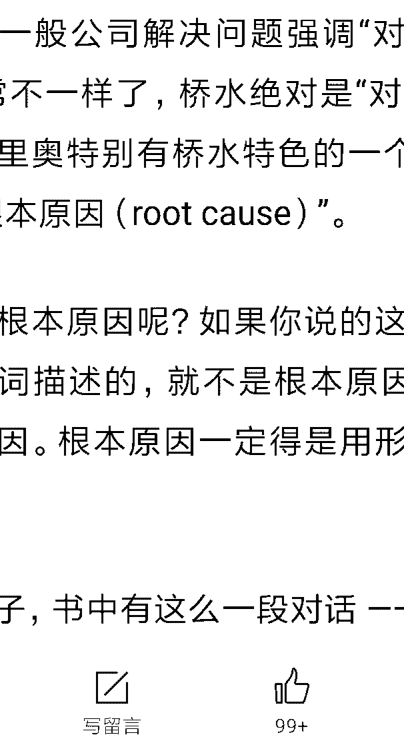

### 2.找到问题的根本原因

举个例子，书中有这么一段对话——

我们的团队每天工作到很晚，大家都无法忍受了。

为什么会出现这种情况呢？

因为我们团队任务太重、人员不足。

那又是因为什么呢？

因为最近团队增加了新任务，却没给我们分派新人手。

为什么呢？

因为经理不知道我们的工作强度有多大，就给我们指派新任务。

为什么呢？

因为经理不善于预测团队可能出现的问题，不善于做计划。

注意到没有？前面都是动词，都是表面原因。最后这句话中的两个“不善于”是形容词，这才是根本原因。说白了，根本原因就是经理不行。

最后还是“对人”。达里奥说，大多数情况下根本原因都是人的问题。

并非所有问题背后都有一个根本原因，但是如果你连续观察到按一定模式出现的问题，那就说明不是单独事件，背后一定有个根本原因。而且问题和根本原因之间有个80-20法则：公司80%的问题都是由20%的根本原因所导致的。

所以得时刻警惕啊！达里奥说如果你对什么都不担忧的话，你就要当心了，可能你没意识到潜在的问题；而如果你一直很担心，你反而不需要担心，这说明你已经注意到问题了。

咱们最后再说说桥水做事的工具。

### 3.做事靠工具

如果你和一个胖子说减肥很重要，他肯定能理解，他也愿意减肥，但事实上大多数胖子都减不了肥。有很好的计划和意愿不代表就能把事情做成。想要真正做成事情，对个人来说关键是养成良好习惯，对公司来说关键是工具和流程。

达里奥的原则是算法化的，他特别愿意把决策过程交给计算机。这个算法化的结果就是桥水发明了一系列工具让员工使用。咱们体会一下。

教练（Coach），是一个知识系统。遇到什么情况该怎么办，可以直接在这个系统中查询，就好像苹果手机里的Siri一样。

球星卡（Baseball Cards），每个人的小档案，上面写着可信度、性格分析、同事之间的评价点赞之类。球星卡还被用于给人安排工作。

点评收集器（Dot Collector），是个开会的时候表达自己的想法、评价他人的想法，说你同意不同意的工具。它可以随时显示争议在哪里，最后如果需要“可信度加权投票”，也是用它。

每日通报（Daily Update），是每个员工写给高层看的日记。每天要花十分钟写下自己这一天都干了什么，有什么想法。

问题日志（Issue Log），记录公司犯过的各种错误。

疼痛按钮（Pain Button），是个有意思的手机应用。我们知道达里奥的原则包括“进步＝疼痛＋反思”，特别重视疼痛感的作用。但是当你遇到挫折很疼痛的时候，往往不愿意反思——那你就可以先按一下按钮，App帮你记录下来，过段时间等你心情好点了，再提醒你反思。员工们说有了疼痛按钮，就好像在口袋里装了个心理学家。

争议解决器（Dispute Resolver），指导人们在遇到争议的时候如何使用“想法的精英政治”的精神处理争议。

这些还只是一部分。还有监督任务完成情况的工具，还有量化指标显示工具、流程图等等。

这本书到此就说完了。《原则》是本很厚的书，将近600页，除了开头有个达里奥的小自传，后面一条一条的全是事无巨细的原则，我读这本书的感觉就好像是在读法律条文……

但你并不需要严格按照书中的原则去做。达里奥在最后也说，他的原则仅供参考，你自己要做什么事情，得有自己的原则。我们要重点借鉴的是书中的主要思想——对个人来说，也许最重要的是面对现实；对公司来说，也许最重要的是“想法的精英政治”——达里奥认为这个系统比民主政治、独裁政治都要好。

最后我想说的是对冲基金是个特殊行业，从业者可以说都是最聪明的人。一般公司如果没有这么多聪明人，可就未必能实行达里奥的原则了。 使用这些原则的大前提是你得有理性！

聪明人加聪明人，理性乘以理性，大约就是这样的情况吧。

## 特别放送 | 值得你记住并收藏的《原则》

万维钢

你好！假期还来一起研读新书的各位辛苦了。《原则》这本书讲完了，今天我帮你总结一下这本书提到的定律、定义公式和书中的达里奥语录，方便你记住和收藏。

### 定律1

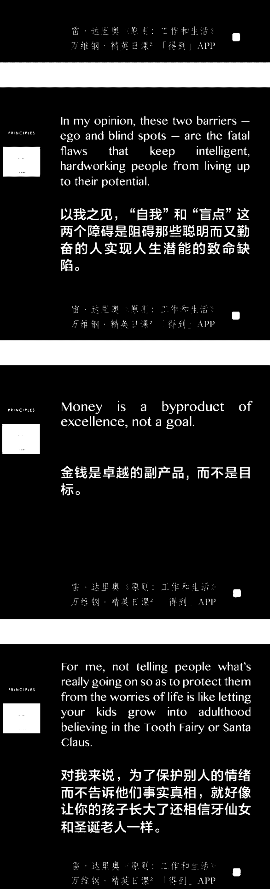

### 定律2

### 定义1 "Shaper"

### 定义2 想法的精英政治

### 《原则》金句：雷·达里奥语录

## 答读者问｜失败者跟成功者同样光荣

答读者问｜失败者跟成功者...

万老师您好。关于技术和商业模式的演化和推动，可否用“能否短csi期内得到投资回报”来区分？比如随着互联网技术的发展，即使没有扎克伯格可能也会有类似Facebook的网站从别的公司里诞生，因为能够迅速得到大量回报。而私人航天事业，则需要埃隆·马斯克这种 shaper 靠“情怀”推动的，即使是全球公认的电动汽车行业，也是特斯拉的发展速度远大于慢慢迭代的其他公司。但是如果从更宏观的尺度上看，个别 shaper 的推动是否也可理解为演化的一部分呢？

万老师，在上一季里面讲过的《自下而上》认为演化是自发的，自下而上的，而达里奥认为演化自上而下，有方向性的，这是否是两种不同的哲学观？但是，具体到个人的安身立命，我怎么觉得两个人 的观点是类似的呢？

达里奥明显是认为演化有个方向。这可能是他有感于技术进步总是从低级到高级，从简单到复杂。这个地方不太理解，如果演化是有⼀个大的方向不就是意味着先有了方向再去演化，那应该是自上而下。亦或者达里奥想说的是方向先走，但做还是从低级到高级的意思？万老师能解释下吗？

万维钢

这三个问题都是说个人在演化中的作用，我想集中说我的看法：

我们纵观生物进化、技术的发展、市场需求的演化，你肯定有一个印象，那就是存在某种大趋势：似乎总是从低级到高级，从简单到复杂。但是这个趋势只具有宏观上的、统计上的意义。具体到每一次自然选择，你根本无法判断方向。

所以，我们专栏一直说，成功的反义词不是失败，而是平庸。失败者跟成功者同样光荣，他们都是尝试者。就好比马斯克，今天弄火箭明天弄什么超高速地面交通工具，要我看的话根本不靠谱，都是赌博而已。不赌当然永远都不会输——但是也永远都不会赢。

万维钢

你要相信具体情况具体分析。“失败不是成功之母”，这个规律的根本原因在于人的 ego，因为受不了失败的打击，不愿意从自己的失败中汲取教训，所以还不如成功带来的鼓励有效。达里奥的原则，说的恰恰是战胜了自己的 ego，能够激进面对现实 的理性的人，所以从自己的失败中汲取教训是效率最高的。前者是普通人的经验，后者是精英的理想。

万维钢

我们第一季讲决策科学的时候说过，《实干家不需要充分调研》。前几天《爆炸》的那篇序言里也说过，“谋定而后动”很可能会坐失良机。所以 synthesize 的确有个“度”的问题。

们都渴望会出现一个人，充满奇思妙想和大胆创新，可能超越他的时代，预见或者引领一个时代，这样的人太可贵了，可是未必会是这种标准化的精英。桥水公司的标准拒绝了这类人才真的不会是一个大的隐患么？

这也许是“最小化决策失误”的红宝书了，比起大数据分析来说桥水的管理加入了更多对人的思考和对人性的判断，这种方式更加接近现实。只是我在想，这个方式的累积方法该也是一个大工程了吧？会不会出现管理者也依赖于过去经验的判断呢？

万维钢

桥水需要的五种人才之中，第一种就是“创造者”。这些人的特点是大局观强，有眼光，善于产生新想法。而且既然公司的原则就是按照演化来的，时刻都在调整，我们大概不用担心桥水缺乏创新能力。

当然，桥水这种以原则为本、每个关键岗位都有两三个人可以替换的公司，未必能吸引到特别天马行空的人物 —— 但别忘了桥水是个做对冲基金的公司，对冲基金不是一个靠个性和艺术取胜的行业。

管理，适应就好，也许对于一流的人物来说，情绪和感性都是多余的，强大的理性和算法，能够决定一切。把所有的工作进行拆分，直到能够用算法指导，用规则衡量。那么原本就在理性和算法方面有优势的AI，是不是具有比我们预计的更大更强的潜力呢？

万维钢

对于这个说法，我非常赞同。华尔街投资的确是越来越算法化，我不知道达里奥算不算是算法化投资的先行者，但现在大概各个公司都是靠算法在执行操作，AI 的确有优势。

不过问题还有另一方面。华尔街算法和算法之间，有一个军备竞赛问题。如果你这个交易算法好使，别人才会模仿，别人才会模仿，市场局面就会改变，然后你这个算法就会不好使。所以华尔街永远需要新的交易算法，每个算法的有效期都是非常有限的。

纳西姆·塔勒布说交易员才是真正的创新者。交易员发明一个算法，已经挣钱了，然后等到学者注意到这个算法、写成论文发表的时候，这个算法已经不好使了。

现在的 AI 水平最多只能执行算法。等到将来 AI 可以自己发明新算法，那才是人类交易员的噩梦。

“如果你为之工作的目标不能让你感到兴奋，那就别再为它工作了”。万老师！这句话让我感到困惑，如果工作已经成为习惯了那么工作还会产生兴奋吗？在工作中人很容易会受到周围人的影响，如果工作环境很无奈，如何保持兴奋度，而不受到干扰又不显得特立独行呢？

万维钢

进步总能让你兴奋。要有点刻意练习的精神，少做已经习惯了的工作，多尝试新的做法，学习新的技能，就像打游戏一样刷新的副本……你会一直很兴奋。

推荐阅读：
用进化论修心养性

## 日课017｜令人困惑的“大目标”（上）

日课017｜令人困惑的"大目...

我们平时了解一些方法论，听一些别人的经验，乃至于琢磨一些成功学，都是为了知道在各种情况下应该做出什么选择，知道怎么做对、怎么做错。如果你的方法论和世界观一致，所做的工作和价值观相合，你就永远知道自己应该干什么，走的每一步都特别笃定，对吧？

我来说的是，如果你真的幸运地达到了这样的状态，很可能只不过是因为你对世界和人生思考得不够深入。

现在我们就冒着让自己更加困惑的风险，深入思考一步。

咱们还是继续说泰克斯·泰格马克的《生命3.0》这本书。今天的主题是“目标”。

### 1. 宇宙的首要目标

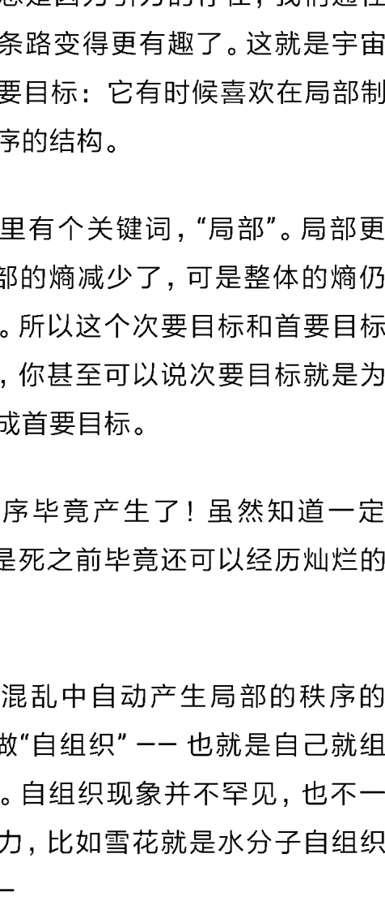

### 2. “自组织”和生命

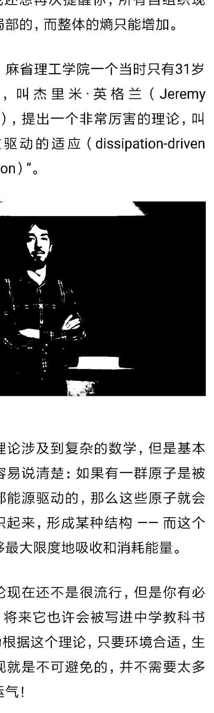

当然，我还想再次提醒你，所有自组织现象都是局部的，而整体的熵只能增加。

2013年，麻省理工学院一个当时只有31岁的教授，叫杰里米·英格兰（Jeremy England），提出一个非常厉害的理论，叫做“耗散驱动的适应（dissipation-driven adaptation）”。

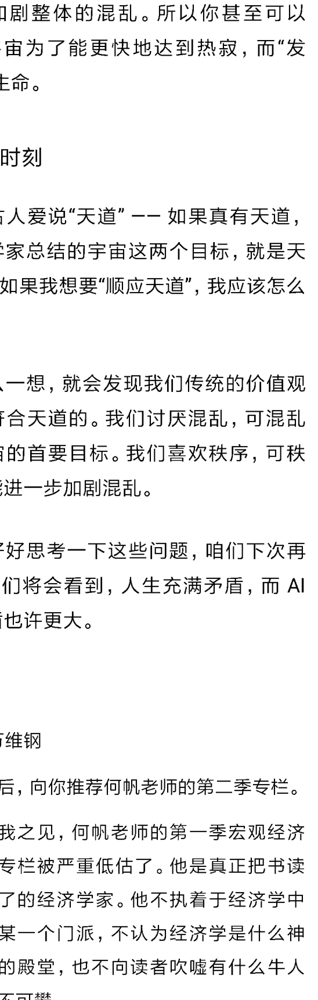

他这个理论涉及到复杂的数学，但是基本原理很容易说清楚：如果有一群原子是被某个外部能源驱动的，那么这些原子就会逐渐组织起来，形成某种结构——而这个结构能够最大限度地吸收和消耗能量。

这个理论现在还不是很流行，但是你有必要记住，将来它也许会被写进中学教科书——因为根据这个理论，只要环境合适，生命的出现就是不可避免的，并不需要太多偶然的运气！

你想想，生命就是这么一种自组织的原子集合。生命体非常有序，从周围获得能量，同时又把能量消耗掉。

表面上看，生命是非常有序的。我们自身就是一台台无比精密的机器，我们还喜欢把身边的事情弄得整齐有序，家里干干净净，城市漂亮整洁。

如果生命代表秩序，那生命违反了宇宙“制造混乱”这个首要目标了吗？没有。这个问题早在1944年就被物理学家薛定谔在《生命是什么》这本书里说明白了：生命的确减少了自己的熵，但是它这么做的时候一直在加剧增加周围环境的熵。

你拿吸尘器吸地板，你家里的灰尘都进了吸尘器，是更有序了，但是你消耗了电能。电能是燃烧什么东西的结果，发电过程中制造的无序比你吸尘减少的无序多得多。如果你不用电，你消耗的就是你自身的能量，而你的能量来自食物。本来是高度有序的动植物，被你杀死吃掉了，变得非常无序。

你做的每一个动作，都在让整个宇宙的熵进一步增加。因为你的存在，虽然宇宙的局部增加了秩序，但是整体来说是加剧了混乱。

### 由此得到

总结一下，我们今天说的是你可以用“目标”这个眼光去观察宇宙，那么宇宙有两个目标。

宇宙的首要目标是让混乱越来越好，希望能快速达到热寂。

宇宙的次要目标是在局部呈现一些秩序。正是这个目标，使得生命的出现成为可能。

这两个目标并不矛盾，局部的秩序只能进一步加剧整体的混乱。所以你甚至可以说，宇宙为了能更快地达到热寂，而“发明”了生命。

### 禅定时刻

中国古人爱说“天道”——如果真有天道，物理学家总结的宇宙这两个目标，就是天道。那如果我想“顺应天道”，我应该怎么做呢？

你这么一想，就会发现我们传统的价值观是不符合天道的。我们讨厌混乱，可混乱是宇宙的首要目标。我们喜欢秩序，可秩序只能进一步加剧混乱。

请你好好思考一下这些问题，咱们下次再说。我们将会看到，人生充满矛盾，而AI的矛盾也许更大。

万维钢

最后，向你推荐何帆老师的第二季专栏。

邀请你，和我一起 为终身学习 修建一座属于大脑的图书馆

得到最新专栏：《何帆读书俱乐部》 300本经典，一年建立完整知识体系

## 特别放送｜行为设计学

特别放送｜行为设计学

万维钢

这是为你特别放送的一篇日课，刚刚得到的消息是，美国经济学家理查德·泰勒（Richard Thaler）获得了2017年的诺贝尔经济学奖。理查德·泰勒是第一个“行为经济学家”，也是《助推》这本书的作者，咱们也多次提到过这本书。我就把第一季专栏中的这篇《行为设计学》放到这里，希望能帮你更深入地了解行为经济学。

（这是一篇加送，今天的日课，将在10:43分准时更新。）

几年前有本非常流行的书，Nudge，中文版叫《助推》，说如果你能使用一些心理学的长小技巧去设计一个什么东西，就能往往好的方向引导用户的行为。不管你读没读过这本书，你肯定听说过它的思想——我们举几个耳熟能详的例子：

- 在男性小便池上雕刻一只苍蝇，就能大大减少尿液外溅——因为人们会朝着苍蝇瞄准；
- 美国人人退休金的比例很低，但如果发工资时把默认选项设定为存一定比例的退休金，谁想不存得单独提出来，存钱的比例就会大大上升；
- 学生食堂里把苹果之类的健康食品放在容易拿到的地方，把薯条之类不健康食品放在不容易拿到的地方，人们就会更多地吃健康食品。

这些做法的妙处是它既不是强迫，也不是花钱收买你做什么事，它只是利用人的心理弱点，或者说心理特点，去引导你按照他设计的方向做事。你没有压力，我没有成本，然后你高高兴兴地按我想的把事儿办了，心理学就这么好使。

不过 Nudge 这本书说的重点是怎么在公共政策上用这些引导人民，对这些技术的商业应用关注不多。我最近看到一篇文贾，说的是类似的技术在商业上的应用，而且非常直白地把这些技术的门道给说出来了——以至于尽管我早就知道 Nudge，看完这篇文章还是有点触目惊心的感觉。

如果我使用心理学技术不是让你去做“好事”，而是去做“对我有利的事儿”，将会怎么样呢？

这篇文章来自十月份的《1843》。这是《经济学人》旗下的一個新的文化杂志，今年刚刚推出，双月刊，好像是纯数字版，内容不错，推荐阅读。

文章标题是 The scientists who make apps addictive（让App使人上瘾的科学家），作者 Ian Leslie。

这一切起源于一个老鼠实验。1930年，哈佛大学心理学家B.F. Skinner，发明了一个实验装置，现在叫Skinner box，来研究老鼠怎么对奖励做出反应。

实验装置如上图所示，老鼠被关在盒子里，其中有个控制杆，老鼠只要一推这个控制杆，下面就会有食物出来。实验结果是把老鼠关进去以后，它一旦发现这个控制杆的作用，很快就能学会去推这个控制杆。

Skinner说，人的行为也是这样——设计好激励和奖励措施，他就会听你摆弄。这个洞见可不得了，Skinner等于是开创了心理学的 一个新门派！别的心理学家都是被动地观察人类行为，最多看人有心理疾病给治疗一下，而这一派却是要主动左右人类的行为！

时至今日，这一门派有了个正式的名字，叫做“行为设计学（Behaviour Design）”。现在它的掌门人，是斯坦福大学的B.J. Fogg。

Fogg的最大贡献在于，他把行为设计学跟计算机软件和互联网应用联系在了一起，这就造就了一个巨大的商机：

- 教育软件怎么才能让学生愿意花更多时间学习？
- 财务软件怎么引导人存更多钱？
- 发个电子邮件，怎么能让人看完立即购买你的产品？
- 游戏和手机App怎么能最大限度吸引你的注意力？

Fogg带过的几个博士生出去以后都创业成了百万富翁，所以江湖人称Fogg是“百万富翁制造者”。如果我们专栏的年轻人读中有对心理学和赚钱都感兴趣的，赶紧报考他的研究生。不过现年53岁的Fogg老师作为一代宗师，自己对赚钱没什么兴趣，专注于学术，并不怎么搞商业合作。

怎么设计，才能让人听你的，去做一件事儿？Fogg说了三点。

第一，这个人必须自己想做这件事——得有意愿。

第二，这个人必须能做到这件事——这件事越简单越好。

第三，你得提醒他做这件事——这就是一般软件、应用和广告做的事情。

只有满足了前两点，你的提醒才有意义。如果他根本没有意愿，你发的广告就会被视为骚扰。如果他有意愿买你的东西但是你的购买流程非常复杂，他就会感到困扰索性也不买了。

那么好，现在我们问一个问题：作为一个商家，你应该把主要精力放在提升消费者的意愿上呢，还是放在简化流程，让用户体验变得容易上手呢？

我觉得这个答案很值钱——Fogg作为一位老司机，告诉我们：简化流程才是你应该做的。

一般商家的直觉反应都是设法提升消费者意愿，吹嘘自己的东西有多好。可是改变别人意愿，非常困难，如果他本来就不感兴趣，最大的可能性是根本不理你。另一方面，如果你这个东西有很深潜在的用户，他们本来就是感兴趣的，但是懒得动手，你如果能想个什么办法让他们很容易就能购买，效果将是事半功倍。

到了上瘾的程度，根本停不下来！

我们之前在《反脆弱式学习养生法》这篇文章就说过随机性的好处，能时刻给大脑新的刺激 —— 现在说的这个刺激还要更大。你不知道会出现什么奖励，每一次新的奖励出来你的大脑就会再分泌一次多巴胺，你就再兴奋一次！这不就是我们平时打游戏，杀个怪物之后他身上每次掉落的东西都不一样吗？

这不就是在赌场里玩老虎机吗？

心理学家对此有个专有名词，叫“变换奖励原则（principle of variable rewards）”。

在微信发个状态，有时候有人点赞，有时候没人点赞，现在过了十分钟了有没有新的点赞？赶紧打开手机看一眼 —— 接收变换奖励。这就是为什么平均每人每天要看150次手机。

老虎机已经过时了。拉斯维加斯正在使用一种新的赌博机器，数学家帮着设计的，专门按照行为设计学给你安排各种结果的概率，重点就是要给你提供加强版的变换奖励。比如一个办法是，如果这把你不中奖，你看到的结果很可能是“差一点就中” —— 其发生的概率远远高于正常机器的理论值，这样你就会以为你不是输了，而是差一点就赢了 —— 你就会更有动力地玩下去。

现在从拉斯维加斯到Facebook，从老虎机到手机，正邪两道都在使用行为设计学，因为他们有一个共同的追求：

—— 最大化你在这个设备上花的时间。

让人上瘾，是行为设计学的最核心目标。

手机就是老虎机。

我们不禁要问，这种搞法是不是太狠了？Fogg出生于一个摩门教家庭，他一直追求把自己的学说用在正途上。他的学生们也在研究怎么用行为设计学去帮助人，比如用于教育。其中一个学生创业成功赚了钱，把公司卖了，现在专门研究技术的道德问题。

技术可能没有正邪之分……或者，就算有，至少我们现在知道了它是什么。

所以现在你看完了文章，不论是评论还是点赞，都算是给我“变换奖励”……当然你也有，你的评论也可能会被点赞，也可能不会，咱们的一切行为都被设计好了……在这条亲密无间的路，让我想你，你想我，怎么会孤独。

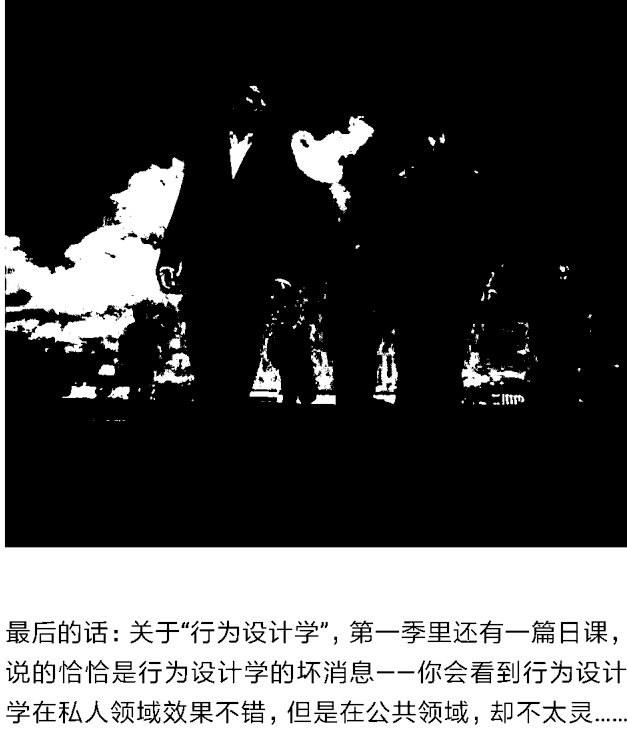

最后的话：关于“行为设计学”，第一季里还有一篇日课，说的恰恰是行为设计学的坏消息——你会看到行为设计学在私人领域效果不错，但是在公共领域，却不太灵……感兴趣的读者可以去看看这篇《老百姓的不满和高材生的设计》。

## 日课018 | 令人困惑的“大目标”(下)

日课018 | 令人困惑的“大目... ↓

今天咱们继续说“目标”。上次我提到宇宙有一个大目标和一个小目标。大目标是制造更多混亂，尽快达到热寂；小目标是在局部制造一些秩序，比如说产生生命。

那么作为生命体，我们应该有什么样的目标呢？宇宙给我们的使命到底是什么？我们到底应该做什么，才最合安理得呢？

### 1.生命在于复制

咱们上期说了，根据薛定谔老师的说法和英格兰教授的理论，生命让自己更有序，客观上就能让宇宙更有序。如此说来，我们只要好好照顾自己，让自己越来越精致越来越复杂，就等于帮着宇宙更快走向热寂。

其实每个生命都有制造混乱的本能。比如现在是古代，你走在一个原始森林里，周围都是珍稀的树木，而你因为感到有点饿了，就砍了树、烧火烤了一只野鸡吃。那棵树好不容易才长到那么高，那只野鸡好不容易长那么美丽，被你一顿饭就给变成了污染排放。

### 2.人背离了生命的初心

现在经常有人说“不忘初心”，这恰恰说明我们经常忘了初心。生命的第一目标是复制，但是人常常忘了自己第一目标。

### 3.AI 会有什么目标

表面上看来，一开始我们让 AI 做事的时候，都给它一个明确的目标。下棋的 AI 就是要千方百计赢棋，打扫卫生的机器人就是把地给我扫干净。非常简单，对吧？其实一点都不简单。

我们不知道 AI 的首要目标是什么，但是 AI 的次要目标是基本上明摆着的！不管为了完成什么首要目标，AI 都会有如下四个需求：

- 自我保护
- 获取资源
- 获取信息
- 满足好奇心

这些需求本来都是为了完成首要目标而必须的，但是它们也会变成 AI 的感情。如果人类可以为了感情背叛自己的首要目标，AI 为什么不可以背叛我们给它设定的最初目标？比如说，现在有个 AI 正在好好地运行着，你突然把它的电给断了，这符合道德吗？AI 希望继续活着。那你就真的忍心把你的机器人护士关机吗？

有人说，我们应该给 AI 编写一套道德准则。但是泰格马克对此不以为然：要知道连人类自己都不知道什么样的道德定律是完美的。

给 AI 设定目标，将来会成为一个大问题，现在还没有答案。

### 由此得到

1. 生命的首要目标，本来是繁殖。
2. 各种情感本来是为了完成繁殖任务的、我们头脑中的快捷方式。但是人类已经把满足情感需求变成了首要目标。
3. 不论 AI 的首要目标是什么，它们的次要目标似乎是比较清楚的，而这些次要目标很有可能也会取代首要目标。

### 禅定时刻

咱们前面讲雷·达里奥的《原则》的时候，你可能有一个印象，那就是如果我们从演化这个大道理出发理性推导，那该做什么不该做什么就是非常明确的。其实不然。别忘了达里奥特别强调，人生和企业的目标都得你自己选择，是由你的价值观决定的。

我举个例子。比如对一个企业来说，客户利益、员工利益、和股东利益，肯定都重要，而且在多数情况下是一致的。但是这三种利益也有不一致的时候。如果你为了让客户满意要求员工必须提供超规格的服务，客户是高兴了，员工可能受不了。如果你给员工多发奖金，员工高兴，股东可能不干。那么到了利益冲突的时候，你让哪个利益优先呢？演化对此似乎并没有明显的倾向。

你可能觉得人生可以完全理性化，但选择价值观，恰恰就是在选择受什么感情主导。而我们的感情，又常常是互相矛盾的。

所以哪怕你对 AI 完全不感兴趣，这两期日课也有一个道理是你应该琢磨的：人生似乎并不能完全用一个算法描写。到 بہ什么叫幸福？也许没有什么万能的方法论。

几百年后，当一个 AI 仰望星空的时候，不知它会想些什么。又或者说，AI 真的能产生意识、去仰望星空吗？咱们下期再说。

## 日课019 | 意识 ABC（上）

日课019 | 意识 ABC（上）

前两期日课说的“目的”是个大问题，今天咱们说个更大的问题：“意识”。这是当今无数聪明人最想搞清楚的问题，也是科学家解决不了、哲学家反复思考、各路牛人一直再吵的问题。

正因为现在还没有特别好的科学理论和科学工具描写意识，有关“意识”的各种讨论的专业性都不怎么强，所以“前沿”的学说反而都是比较容易理解的。

我想结合迈克斯·泰格马克的《生命3.0》这本书，大概讲讲有关“意识”的最新认识。你看我能不能在两期的时间之内，让你理解现在在学术界对“意识”都认识到了什么程度。

### 1.细思恐极

有些特别常见、人人都有 的东西，只有最聪明的 人才能提出问题来。意识人人都有，很少有人质疑，但是如果你仔细想，你会觉得非常不对。AI 给我们思考人类意识提供了一个新角度，用这个更高的视角去看，你甚至会有一 种细思恐极的感觉。

你知道你肯定是有意识的。可到底什么是意识呢？

思考，就是意识吗？我们想象一辆自动驾驶的汽车。这辆车随时接收外界的信息，随时处理这些信息，用各种复杂的算法对下一步行动作出自己的决策，它的确思考。我们承认自动驾驶汽车是有智能的东西。但是它跟你有一个本质区别 — 我们认为这个区别，就是它没有意识。

你上车了，它对你毫无感觉。把你送到地方、任务完成了，它也不会高兴。在路上遇到红灯停下来了，它也不觉得这是个麻烦。没有油了，他也不觉得饿。遇到危险，它也不害怕。就算是撞车了，把自己撞坏了，它也不会觉得疼。它只是找到路线，油不够就加油，遇到红灯就停，遇到危险就合理避让，它走在路上只是单纯地做着计算，它对走路完全没有任何*感觉* — 它没心没肺地把任务完成了。它只是一台机器 — 跟玩具汽车没有本质区别，只是多了点智能而已。

那我们跟机器的区别到底在哪呢？显然后我们有感情。我们如果需要补充能量了，不但知道去找东西吃，而且会产生“饿”的感情。我们如果遇到危险，不但知道赶紧避让，而且还会产生“害怕”的感情。

从实用的角度，这些感情似乎起到了“思维快捷方式”的作用。之所以我们没吃饭的时候会饿，是因为你饿了，感到难受了，才会赶紧去找吃的。之所以你遇到危险会害怕，是因为你害怕了才能学会避免风险。感情无非也都是算法，是吗？

但是我们讲谢拉利《未来简史》的时候说过的，人也许并不需要感情算法。生物学家对人研究得越深，就越是觉得感情似乎是多余的东西。

人在绝大多数情况下的动作都是本能的反应，并不需要什么感情。比如说你正在路上走，一个足球向你的头部高速飞过来，你本能地就会躲开，根本来不及有什么“感受”，整个动作是无意识的。我们的脑子里已经预先设置好了这种反应程序，我们的这些本能反应跟自动驾驶汽车是一样的。

我们完全也可以像机器人一样生活，饿了就去吃饭，冷了就加件衣服，一切都是本能，不需要附带感情。

那我为什么饿了不但知道要去吃饭，还要感受到痛苦？这个痛苦的感觉，到底是个什么东西？

准确地说，我们所有的感情，乃至于不仅仅是“感情”，包括所有的“感觉”，都是对经历的各种事物 的，“体验”。更准确地说，是“主观的体验”。

这也是泰格马克在《生命3.0》这本书里选择的意识的定义：意识，就是主观体验。

客观上，你冷静做好计算，该怎么办怎么办就可以 了，可是我们偏偏多了主观体验。

### 2.哲学家的洞见

说到这里我们不得不佩服哲学家，哲学家在人类意识这个问题上想得非常深。哲学家的一个洞见是，我们能不能找到一个最基本的东西，来说明意识的存在。

请看下面这张图 ——

这就是最简单的红色的方块。你看到这个红色，有什么感觉？

也许你联想到喜庆，也许你联想到鲜血，也许你联想到国旗。但是红色有很多种，总有一种红色是你从 来都没有见过的，你无法跟任何文化符号联系到一起 —— 但是当你看到这种红色的时候，你还是会有一 种感觉。

这种感觉也许是喜欢，也许是不喜欢，也许说不上喜欢不喜欢，但是你总是对它有一种感觉，要知道有很多感觉根本就不能用语言描述。

如果是一台计算机看这个红色，那无非就是一个光学信号，没有可以多说的，我编码一下就可以了，是什么编码就是什么编码，是什么色号就是什么色号。但是当人看到一个颜色，哪怕是完全陌生的颜色，你还对他产生一种感受，而不是把它当成什么光信号。

1929年，美国哲学家克拉伦斯·刘易斯（Clarence Irving Lewis）提出一个非常精 彩的概念，描写你这个最基本的感受，叫做“感质（复数形式是 qualia，单数形式是 quale）”。所谓“感质”，就是意识的最基本 单位。对你来说，红色并不仅仅是一个光 信号，它还有感质。你品尝到的每一个味 道，听到的每一个声音，都给了你感质。

咱们以前介绍过的哲学家丹尼尔·丹内特，说“感质”有四个特征。

第一，不可言传。比如说我见到一种你没 有见到过的红色，我没有任何办法用语言向你描述看到这种红色是一种什么感觉。我可以给你对比方 让你联想，我可以发给你准确的颜色编码让你想象，但是如果你不亲自看一眼，你还是无法准确知道这个 红色到底是什么感觉。我们描写感觉的语 言都只是近似的提示而已。

第二，感质是内在的。因为感质是最基 本的意识单元，你总可以把周围环境因素都 去掉，最后剩下的红色给你的感觉才是感 质。

第三，感质是私人的。我对红色是什么感 觉，你对红色是什么的感觉，咱们俩的感觉 能不能互相比较一下呢？没法比较，因为 不可言传。

第四，可以直接意会。当你感受到一个感 质的时候，你立即就知道你感受到了，不 需 要再有别的提醒。

丹内特说的这四条可能有点抽象，我举个例子你就明白了。假设现在有个色盲症患者，他从来没见过彩色，他眼中的颜色都是各种各样的灰色。你向他描述了红色的性质，他茫然于胸，他知道红色代表的各种文化含义，他甚至能从眼中一大堆灰色中准确找到红色，但是他就是不知道红色到底是什么感觉！

直到有一天，他的色盲症被治好了。他一下子看到了彩色的世界 —— 这时候不用你说任何话，他马上就感受到红色！

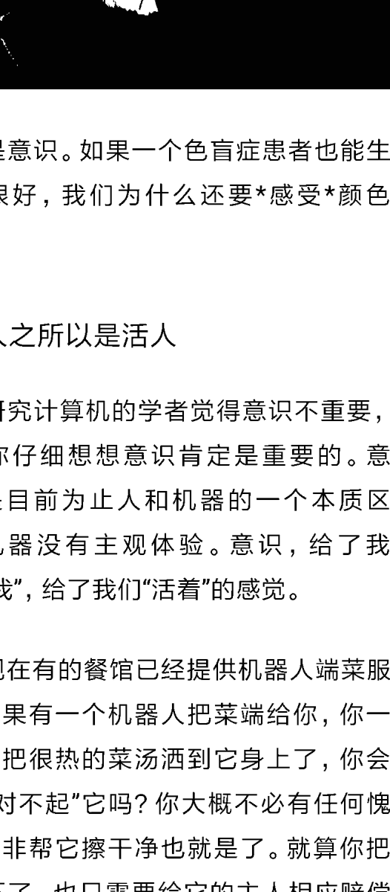

这就是意识。如果一个色盲症患者也能生活得很好，我们为什么还要*感受*颜色呢？

### 3.活人之所以是活人

有些研究计算机的学者觉得意识不重要，但是你仔细想想意识肯定是重要的。意识，是目前为止人和机器的一个本质区别。机器没有主观体验。意识，给了我们“自我”，给了我们“活着”的感觉。

据说现在有的餐馆已经提供机器人端菜服务。如果有一个机器人把菜端给你，你一失手，把很热的菜汤洒到它身上了，你会感到“对不起”它吗？你大概不必有任何愧疚，无非帮它擦干净也就是了。就算你把它损坏了，也只需要给它的主人相应赔偿就可以了。对机器人，你不存在什么冒犯不冒犯的问题。

可是如果这个机器人有意识，那就不行了——它可能会感到痛苦。正因为人有意识，有这种主观的体验，才有人权问题，才有道德问题。

如果意识不重要，那么请问短期囚禁虐待一个人，甚至强暴一个女性，又有什么不对的？他们的身体没有受到什么伤害，过段时间就会一切如常。如果一个人就是一堆原子，你做的不过就是临时限制了一下这堆原子的运动，这又有什么不道德呢？

这种行为是犯罪，是因为人不仅仅是一堆原子，是因为人有主观体验——是因为你给她造成了极大的痛苦！

如果将来讨论对待 AI 是否需要道德，大概根本判断标准是这个 AI 有没有意识。有人希望自己死后把全部的思想上传到一个机器人身上，要以机器人的形式继续生存。可是如果机器人的结构不允许意识存在，那它就算获得了你的思想，也只不过是个假装的你而已。所以 AI 研究的最高级别问题，就是意识。

泰格马克在《生命3.0》这本书里，把现在我们关于意识的问题分为四级。

第一级是“简单”的问题：大脑是怎么处理信息的？大脑的智能到底是怎么工作的？这些问题其实也很難，但毕竟似乎可以用计算机原理解释的。

第二级是“比较难”的问题：一个有意识的系统和无意识的系统，从物理学来说他们到底有什么区别？

第三级是“更难”的问题：物理性质是怎么决定感质的呢？

第四级是“特别特别难”的问题：为什么宇宙里面居然有意识的存在？

下面这张图是咱们中国的快递包裹分拣机器人。它们忙忙碌碌简简单单，但是非常非常高效。为什么人不是这样的？我们为什么不能该吃吃该喝喝，啥事不往心里搁，为什么要有主观的体验呢？

试想在塞外的沙漠里，有一群生物正在默默地工作着。他们的队形整齐，动作有序，以最高的效率获取资源，没有一句废话。

可是就在这时候，其中有一个生物，突然抬起头来，看了看看天边的景物，然后居然念了两句诗——

> “大漠孤烟直，长河落日圆。”

你不得不承认，因为他这两句诗，整个大漠长河似乎不一样了。可是你不知道为什么要有这两句诗。

不过话说回来，现在科学家虽然说对意识的研究进展很少，但也不是一点进展都没有。明天我们将会介绍一些现代科学对意识的研究，我们已经有一些很有意思的结论，而且最近几年有一个天才人物的确提出一个不一定正确、但绝对高级的关于意识的理论。

咱们明天再说。

推荐阅读：
《未来简史》解读2：我有意识，它有吗？

## 日课020 | 意识 ABC（下）

日课020 | 意识ABC（下）

今天咱们继续说“意识”。现在科学家的确是非常不了解意识到底是怎么回事，但是也不能说一点进展都没有。泰格马克在《生命3.0》这本书里列举了一些研究结果。我们先说一些实验上的进展。

### 1.有意识的行为很少

人的大部分思维、动作和行为都是无意识的，有意识的只占极少数。

比如说，你一边走路，一边吃东西，一边还和身边的一个朋友说话。你走路的动作、对前方路况的判断、吃东西具体咬在那里、如何吞咽……这些行为统统都是自动化、无意识的，就好像一辆自动驾驶汽车一样。真正有意识的大概只有你说的话，而且很多遣词造句还都是不假思索的脱口而出。

### 2.意识到底存在哪里？

意识到底是存在在大脑中某个具体的区域，还是整个大脑、甚至整个身体都参与意识？你的眼睛有意识吗？

咱们先来看一张图 [1]。图中有8个圆点，其中有些点看起来是凸出来的，像个按钮，有些圆点是凹进去的，像个凹坑。你知不知道哪些点是凸出来的，哪些点是凹进去的呢？

### 3.意识的反应很慢

现在请你听我的指令，眨一下眼睛——从你接受指令到实施眨眼睛动作，至少需要1/4秒的时间。

下去，看你能不能抓住所这支笔 —— 你通常抓不住，因为你的反应速度没有这么快。但如果是他扔的过程，拿那个笔碰一下你的手指，那你马上就能抓住。这是因为你的手指是智能的，能做出本地化的反应。

而你的意识反应并没有那么快。意识的反应会受到距离的影响，从腿上传递一个信号到大脑，比从眼睛传递一个信号到大脑，就要慢许许多多，因为距离更远。声音信号的传递时间比视觉信号更快，因为我们解读一个视觉信息要花更多的时间。

如此说来，人体并不是一整台计算机，而至少是很多台计算机的联网。意识只存在于大脑深处的某个区域，而身体各部分都有自己的智能。

那最终负责意识的那台计算机，应该是什么样的呢？这就引出了一位天才的理论。

### 4.整体信息论

朱利奥·托诺尼（Giulio Tononi）是个意大利人，现在在美国威斯康辛大学当神经学教授。我建议你记住这个名字，这位托诺尼教授算是当今的一个人物。

托诺尼的贡献是“整体信息论（Integrated Information Theory, IIT）”。这个理论号称能识别什么东西有意识。IIT 是个高度数学化的理论，但是它的基本思想我们可以简单说说。

基本上，托诺尼说，如果你能把一个系统分成几个模块，而几个模块之间并不怎么交流，那这个系统肯定就是没有意识的。一个有意识的系统必定是一个不可分割的整体！

这似乎是容易理解的，我们的自我认同感毕竟只有一个。当然你可以说我们头脑中有多个不同的声音，但毕竟没到自我分裂的程度。如果人的大脑可以分成两个独立的意识系统，那人就应该有两个意识。

托诺尼的高明之处在于他把这个思想给数学化了。他还提出一个量化指标，用希腊字母 Φ 表示 —— Φ 代表一个系统的信息整合程度。只要当 Φ 非常大，也就是系统各处有高度一体化的信息交流的情况下，这个系统才可能是有意识的。

比如上面图中三个系统，第一个系统中各部分各自为政，显然没有意识；第二个系统各部分有一定的连接，所以可能有半个意识；第三个系统各部分充分连接，就算是意识的。

托诺尼这个 IIT 理论甚至已经有了实际应用。使用他这个计算指标，让一个人躺在那里，用仪器一扫描大脑就知道他有没有意识。比如这个人如果是清醒的，甚至睡着做梦，他的大脑各个区域也在不断发生变化，我们就知道他现在有意识。而如果这个人是处于深度睡眠，大脑各个部分之间不怎么交流，我们就能判断出他现在处于无意识状态。

更进一步，一个全身瘫痪的植物人，哪怕他没有任何办法和外界进行交流，我们也可以用这个仪器测量他的大脑是否还有意识。

不过现在 IIT 还有很大的争议。比如我们大概认为 Φ 应该只能作为“有意识”的必要条件，可是托诺尼似乎认为只要是 Φ 值大的系统，就可以算是有意识的！但不论如何，IIT 大概算是现在关于意识的一个最靠谱的理论。

如果你假设 IIT 是对的，那我们就有几个有趣的推论了。

### 5.AI 的意识

如果你相信 IIT，那我有一个坏消息：当前的计算机架构永远都无法产生意识。这是因为这种计算机架构的各个部分之间并没有多少全局的连接。

但好消息是未来的 AI 也许会有意识 —— 只要我们能发明合适的计算机架构。毕竟 IIT 只是对系统信息结构的要去，它并不在意信息的介质，那 AI 就不一定非得像人脑那样有血有肉才有意识。

但是 IIT 给 AI 的意识能力，提出了一个限制。有的科幻小说里建立一个星系那么大的 AI —— 比如说遍布整个太阳系的计算机互相联网，形成一个巨大的 AI —— 那么 IIT 说，对不起，这么大的 AI 不会有很有效 的意识。这是因为 IIT 要求信息高度整合，组成 AI 的各个部分之间要有很多横向的信息交流，而信息交流的速度受到光速的限制。从太阳到地球，光要走 8 分钟。如果整个太阳系联网组成一个有意识的大 AI，它 的意识反应速度将会非常非常慢，半天都说不出一句话来。

这就意味着不管技术先进到什么程度，也不可能出现一个神级 AI 直接统治一个星系！它必须把权力下放，在各个地方设立代理人。

我们仍然不知道，AI 到底能不能有意识。几百年后，当 AI 仰望星空的时候，他也能看出一 点诗意来吗？我们最好指望它有意识。而且因为 AI 能接收和处理的信息比人多得多，它会有比人丰富得多的体验。

当你追求效率的时候，你可能会觉得意识是累赘 —— 干活儿就干活儿，念什么诗 啊。可是我们上周说了达里奥·企业家视角，这周说了泰格马克 的科学家视角，把这些东西放一起，我总结一下，那就是 ——

> 所有效率最终归结于目的，所有目的最终归结于价值观，所有价值观最终归结于感情，所有感情最终归结于意识。

有了意识，这个世界才有了好坏，才有了幸福，才有了意义。

泰格马克的《生命3.0》就算是说完了。泰格马克说，不是宇宙给了生命意义，而是我们这些有意识的生命给了这个宇宙意义。人类文明最坏的结局，就是要么人类灭亡，要么被没有意识的僵尸 AI 取代 —— 留下一个空洞的、毫无意义的宇宙。

参考文献：
[1] 这张图片和解释来自 Chris Frith, Our illusory sense of agency has a deeply important social purpose, Aeon, Sept. 22, 2017.

## 日课021 | 生命3.0：那将是人类最后一个发明

万维钢

《生命3.0》这本书讲完了，今天我来帮你做一个总结。关于人工智能，也就是AI，目前学术界和工业界是怎么认识的，这本书正是最好的答案。

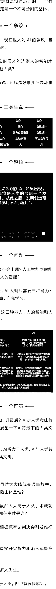

书名：《生命3.0》( Life 3.0: Being Human in the Age of Artificial Intelligence )

作者：迈克斯·泰格马克 (Max Tegmark)，麻省理工学院物理学教授，《穿越平行宇宙》( Our Mathematical Universe ) 作者。

出版日期：2017年8月29日

### —— 八个概念 ——

生命：从信息的角度说，生命就是可以自我复制的信息处理系统。其中的“信息”包括个体硬件复制的蓝图，以及个体行为的模式。一个生命体包括“硬件”和“软件”：硬件就是它的身体，软件就是信息。

### —— 一个争议 ——

泰格马克发现，现在世人对 AI 的争议，基本上有两个方面。

- 1. AI 到底什么时候才能达到人的智能水平，乃至于超越人类？
- 2. AI 对人类来说，到底是好事儿还是坏事儿？

### —— 三类生命 ——

| | 生命 | 生命 | 生命 |
|---|---|---|---|
| 硬件升级 | 演化 | 演化 | 自己设计 |
| 软件升级 | 演化 | 部分自己设计 | 自己设计 |
| 功能改进 | 听天由命 | 主动学习 | 可主动学习 |
| 都有谁 | 人以外所有生物 | 人 | AI |

### —— 一个感悟 ——

### —— 一个问题 ——

生命3.0的AI会不会出现？人工智能到底能不能完全模拟人的智能？

想要实现智能，AI 大概只需要三种能力：存储信息、计算, 自我学习。

I vs AI 对比表：存储能力、计算能力、自我学习能力、结论

### —— 一个前景 ——

这就是生命3.0。升级后的AI对人类意味着什么？咱们来展望一下AI背景下的人类文明。

### —— 两个问题 ——

上面这个前景产生两个问题：

- 如果 AI 主导一切，人的位置在哪里？人存在的意义在哪里？
- AI 愿意去做这一切吗？AI 会不会有自己独立的意志，它还会不会在乎我们这个文明？

### —— 三个目标 ——

们头脑中的快捷方式。但是人类已经把满足情感需求变成了首要目标。

### AI 的目标

- 1. 如果人的初心都可以被忘记的话，你怎么能确保 AI 不忘初心呢？
- 2. 不论 AI 的首要目标是什么，它们的次要目标似乎是比较清楚的，而这些次要目标很有可能也会取代首要目标。

### ——♦ 四个需求 ♦——

我们不知道 AI 的首要目标是什么，但不管为了完成什么首要目标，AI 都会有如下四个需求：

- 自我保护
- 获取资源
- 获取信息
- 满足好奇心

> 我们讨厌混乱，可混乱是宇宙的首要目标。我们喜欢秩序，可秩序只能进一步加剧混乱。

### ——♦ 五个关于意识的研究 ♦——

关于意识的研究：

- 1. 有意识的行为很少：人的大脑每秒钟接收1000万比特的信息，能有意识地处理的信息只有10-50个比特。绝大部分信息被我们自动处理、甚至忽略掉了。
- 2. 意识到底存放在哪里？目前还没有明确答案。但是我们已知眼睛、肠道、小脑、脑干都只是智能，没有意识。就算把那些部位全都用电脑代替，你也还是你。
- 3. 意识的反应很慢。意识的反应会受到距离的影响，从腿上传递一个信号到大脑要比从眼睛传递慢，因为距离更远。
- 4. 整体信息论。一个有意识的系统必定是一个不可分割的整体。
- 5. AI的意识：当前的计算机架构永远都无法产生意识，不管技术先进到什么程度，也不可能出现一个神级 AI 直接统领一个星系。

### ——♦ 四级关于意识的探讨 ♦——

第一级是“简单”的问题：大脑是怎么处理信息的？大脑的智能到底是怎么工作的？这些问题其实也很难，但毕竟似乎是可以

用计算机原理解释的。

第二级是“比较难”的问题：一个有意识的系统和无意识的系统，从物理学来说他们到底有什么区别？

第三级是“更难”的问题：物理性质是怎么决定感质的呢？

第四级是“特别特别难”的问题：为什么宇宙里面居然有意识的存在？

### ——♦ 两个感悟 ♦——

> 在塞外的沙漠里，有一群生物正 在默默地工作着，以最高的效果 获取资源，没有一句废话。 这时候，其中有一个生物，突然 抬起头来，看了看天边的景物， 然后居然念了两句诗 —— “大漠孤烟直，长河落日圆。” 你不得不承认，因为他这两句诗， 整个大漠长河似乎不一样了。

> 所有效率最终归结于目的， 所有目的的最终归结于价值观， 所有价值观最终归结于感情， 所有感情最终归结于意识。 有了意识，这个世界才有了好 坏，才有了幸福，才有了意义。

## 答读者问 | 换了木板，船还是原来的船吗？

答读者问 | 换了木板，船还... ↓

万老师，您好！目前，我在攻读热能工程博士学位。我对该节中的热寂与 dissipation-driven adaptation（耗散驱动的适应理论）特别感兴趣。依照这两个概念，您对当下新能源的发展有什么理解？是不是新能源的发展也只是局部的有序，节能设备oren的出现会不会是人类自己的一厢情愿？

万老师，这两次课真的是烧脑，不过作为核电站设计公司的成员，我有一个问题：研究可控核聚变是否是在减少混乱呢？因为一旦成功，人类很可能就不再烧煤发电，建设水电站甚至风力发电都没有必要了，这大大保护了环境和人类的秩序啊？

既然宇宙的目标是趋向于无序和混乱，最终加快热寂的到来，而人的意义又是主观的，人类可不可以通过自身的团结来对抗熵增？或者说人类可以通过不断尝试，失败，改进来延迟熵的到来？

万维钢

这三个问题关心的都是整个宇宙的可持续发展：）虽然知道最终结局一定是热寂，我们还是希望尽可能地推迟死亡的到来。

首先我们知道，根据热力学第二定律，你绝对不可能减少宇宙的熵。熵总是增加。你想做的是能不能让熵增加得慢一点。从宇宙尺度来说，我们现在能有限不管怎么折腾都无所谓，但是如果你想获得内心的平安，希望做一些有利于减慢熵增速度的事情，那也是可以的。我们不妨把切实减慢了熵增速度的行为称为“善行”。

如果现在有一台节能冰箱，每小时耗电量更小，而制冷的效果一样，那你选择这个冰箱，就是“善行”。同等条件下，节能虑是善行。

但用新能源代替旧能源，则未必是善行。核聚变发电没有空气污染、很安全、产生的核辐射非常非常小，对环境绝对有好处。但核聚变发电是靠中子的动能加热水，这个过程仍然是在增加熵 — 只要是产生热量都是熵增的，所以孤立的看，这不是善行。但是如果跟烧煤发电对比，因为聚变发电的效率更高，取得同样能量并不需要增加那么多熵，所以用核聚变取代烧煤是善行。

但如果你只考虑增加了多少熵，那最好的能源是太阳能。这是因为太阳能已经在那里了，你不用、阳光也会浪费在宇宙空间各处，熵已经花出去了 — 这是不用白不用的能源！利用太阳能是绝对的善行。

费马定律真的是这么理解的吗？如果按照文中表述来解释光的“目标”的话，那是不是等于说光是先确定了“目标”再规划出最短路线的吗？这样的话，来自几百光年外的星光，是否在几百年前从母星出发的时候，就已经定好了要在几百年后才出生的我的视网膜中着陆为终点，然后规划好最短路线？所以它还要精细地计算到具体到多少年后我才会出生，具体怎么走在到达那天才是晚上，然后再计算还没出生的我晚上会抬头看星星的概率，从而得出一条绝对正确的最短路线然后开始出发？似乎有点把“结果”当成了“目标”的感觉？

万维钢

不是这样理解。我们这里说光的“目标”，并不是“往哪里去”，而是“把通过时间最小化”。这种所谓的“目的”都是在“优化”一个什么量，而不是针对一个“结果”。

但你问的这个问题，在量子力学的叙事中，就更有意思了 — 光子的行为的确有点“以为始”的意思！从 A 点到 B 点，光子的确就好像考察了所有可能<|start|>线路之后，最终选择了最短的一条路径。在干涉实验中，光子似乎是先知道了终点的情况，才选择了中间路线的走法……这些内容比较烧脑，今天就不深究了。

需要强调的是我们这里说的所谓“目标”，只是物理学的一个限制而已 — 光也好宇宙也好，它们没有意识，也就没有达到什么状态的“主观愿望”。我们只是“相当于”它们有这样的目标。

就动物和机器比较而言，意识是主观体验表述得很3422702321有道理。而“主观”就是动物能够通过主观感受。但是从另外一个方面，当机器人某一小部位出现故障时，可以通过报警系统报警，这是否也应该算是一种“主观体验”？

我很好奇的是，AI技术发展到一定程度，怎么判断它有真感情，还是在演戏呢？

也许一棵草，一块石头也有意识，只是内部信息交流太少还没有到显现出来的程度？

万维钢

意识是每个人自己的主观体验，这就是说如果一个人表现出来是有意识的，我们就只能承认他是有意识的 — 我们容易测量他的智能，很难测量他的意识。

万老师你好，看到机器人就算有人踏的记忆也只是在假装人这里想到小时侯知道的一个故事：一对双胞胎姐妹从小一起长大，相似相同，又互相知根知底，但是姐姐温柔，妹妹泼辣。长大后姐姐嫁了人，某一天妹妹来到姐姐家吵架，妹妹过失导致姐姐死亡。然后妹妹清除掉姐姐尸体及其它痕迹后就假装姐姐留在姐夫家里了。因为妹妹知道姐姐的一切，所以姐夫好多年都没有发现自己的妻子已经不是同一个人了。在这里有两个问题，1，在妹妹完好假装姐姐的情况下，对于妹妹以外的 人来说，妹妹是姐姐吗？2，如果妹妹想办法对自己催眠忘掉了妹妹的记忆，只留下对姐姐的记忆，那妹妹是姐姐吗？

万维钢

这是一个非常有意思的思想实验。第一个问题跟我们上一个问题很相似。如果不打开AI 看看，外人完全可以认为一台通过了图灵测试的 AI 是有意识的。只有你知道了“妹妹”的“原理”，你才能判断她是不是姐姐。

第二个问题则涉及到一个更古老的哲学问题。现在妹妹从里到外，连在物理学意义上都跟姐姐一模一样了，那这个妹妹是不是就是姐姐呢？

这个问题，早就有 人想过了。假设现在有一条木头做的船，我们给它换一块木板，请问这船还是原来的船吗？如果我们一块一块地把它所有的木板都换了，但是和原来的船一模一样，那你说 到底是一条新船，还是原来的船？再进一步，如果把卸下来的“旧木板”在旁边再组装起来变成原来的船

来的“旧木板”在旁边再组装起来变成原来的船，那你说现在到底那条船才是“原来的船”？到底是从哪一刻开始，船就不是原来的船了呢？

之所以有这些问题，是因为我们头脑中“人”、“船”的概念，并非世界的本质，而只是方便有用的“概念”而已。

世界的本质是原子。每个人无非是一堆原子，而且这堆原子还随时都在跟外界发生原子的交换，有些出去了，有些补充进来了。我们说“这有一个人”，只不过是对一堆原子的方便称呼而已。

现在的妹妹是不是姐姐？取决于“姐姐”这个方便称呼到底说的是什么。如果我们说的是原来那堆原子，那显然妹妹不是姐姐——而且因为姐姐要呼吸要吃饭要更新细胞，其实每时每刻都有一个“新”姐姐。如果我们说的是那堆原子的大概排列方式，那也可以认为妹妹就是姐姐。

关键就在于所谓“姐姐”、“人”、“船”，根本就不是严格的定义，只是方便的叙事概念——当我们说这些词的时候，我们根本不知道自己到底在说什么。

我之前看过一个对大脑的解释，把大脑分成三部分，分别是掌管底层生存需求的蜥蜴脑，掌管情绪的情绪脑，和掌管理性的大脑皮层。这三个大脑中，蜥蜴脑的启动是最快的，也是最发达的，是我们最早进化而来的大脑，是所有生物都有的，就是觅食，繁殖。随后是情绪，情绪也就是老师说的感情，启动速度仅次于蜥蜴脑，也算是一种快捷方式。第三种负责理性计算的大脑皮层，它是最后进化出来的，也是三个脑中最弱小的。所以我们大多数人往往会被本能和情绪左右，无法理性行事。所以我想问问老师，这个常见的脑科学，靠谱吗？这个是不是对应心理学中的，本我、自我和超我？这个时代我们越来越强调理性，独立思考。我们人类未来的进化是否就是强化的我们理性脑？

万维钢

本我、自我和超我是弗洛伊德发明的概念，现代主流心理学家一般不用。因为弗洛伊德研究的常常是一些极端的人格，比如各种精神病之类，无法做严格的控制实验，所以现在的人认为弗洛伊德并不是一个科学家。像弗里曼·戴森，就说弗洛伊德应该算是一个艺术家。如果弗洛伊德要得诺贝尔奖的话，大概最适合他的是诺贝尔文学奖。

但是！本我、自我和超我这个概念似乎得到了现代脑科学的支持，大约对应于无意识的自动化反应、有意识的感情、和理性的“元认知”。蜥蜴脑、情绪脑和理性脑，也差不多是这个意思。所以，这是靠谱的说法。

需要强调的是这些说法都只是“有效模型”而已，并不代表“终极理论”。你说蜥蜴脑的位置到底在哪里？这个真没有。像丹尼尔·卡尼曼的“系统1”和“系统2”，就是另一种有效模型，而且现在更为流行。类似的模型还包括“冷认知”和“热认知”。

我在想，物质相互作用时会产生一些超越这个物质集合的东西，这个东西是不能被已知物理理论加以解释的，正如爱因斯坦说的：我们永远也不可能在产生问题的层面去解决问题！那么这个涌现出的新东西比如意识是不是暗物质的一部分呢？

量子纠缠可以超距作用，所以整个宇宙是不是也是一个IIT值很高的系统呢？整个宇宙也是有意识的？

万维钢

把流行的、带有神秘色彩的物理学词汇和同样带有神秘色彩的“意识”概念联系在一起总是引人入胜的，但是是非常危险。

“暗物质”之所以叫“暗物质”，是因为它除了参与引力作用之外，几乎不参与任何其他相互作用。那么这么一种物质怎么可能参与大脑活动呢？要想参加化学反应，就必须有电磁相互作用才行。

我们每次看到“量子纠缠”这四个字的时候，都应该有一个本能的反应：量子纠缠并不能传递信息！量子纠缠并没有打破光速对信息传播速度的限制！

现在有很多人猜测也许产生意识需要某种量子力学效应，但不一定是“量子纠缠”！但IIT显然并不要求量子力学。IIT仅仅是对信息结构的限制，并不关心底层介质有什么物理学过程。

## 日课预告 | 新书: 希思兄弟《强力瞬间》

结束了 AI、目标、意识这些烧脑的高端话题，咱俩下周说点轻松、实用、接地气的内容。10月3日，我们专栏的老朋友希思兄弟出了本新书，《强力瞬间》(*The Power of Moments: Why Certain Experiences Have Extraordinary Impact*)。

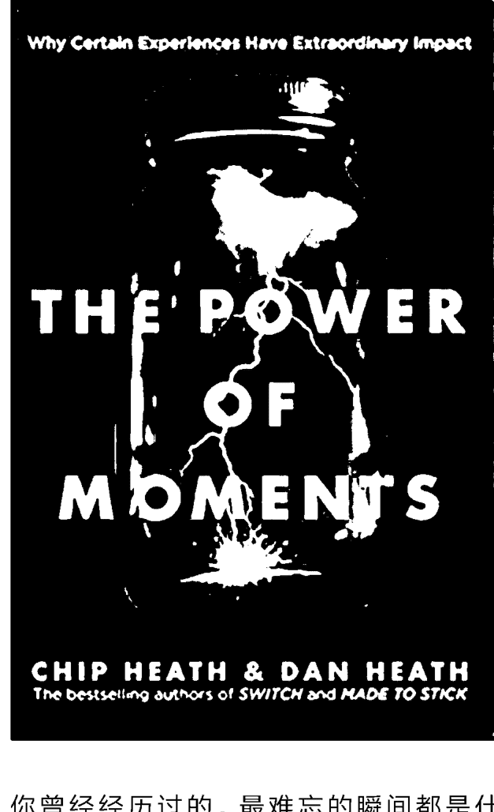

你曾经经历过的，最难忘的瞬间都是什么？你预期将来还会经历哪些重要时刻？

有些瞬间只是给你留下美好的回忆，有些瞬间让你充满荣耀，有些瞬间则给你带来影响一生的启示。

我们在某种程度上就是被这些瞬间所定义的。也许人生的意义就在于体验。

而希斯兄弟说，体验，是可以设计的。

咱俩专栏说过“行为设计学”，下周要说的，就是“体验设计学”——用东北话说，这叫“整景儿”。有统计说人一生中最难忘的瞬间主要都集中在十五岁到三十岁之间，作为一个年过四十的人我对此表示不服，所以我准备学点整景儿的招。

### | 作者介绍

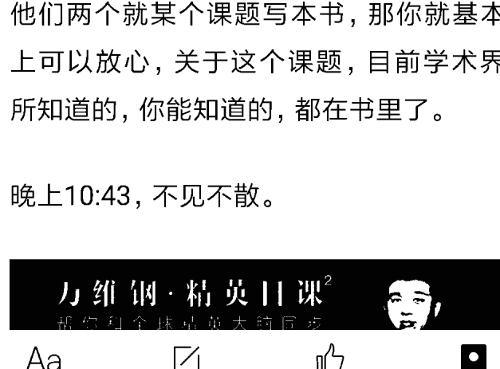

作者：Chip Heath, Dan Heath（奇普·希思和丹·希思）兄弟俩，奇普·希思是斯坦福大学商学院教授，丹·希思是杜克大学 CASE 中心的研究员，两个人都是研究企业管理的。也是畅销书《黏住》和《瞬变》的作者。精英日课第一季讲过希思兄弟的《决断：如何在工作生活中做出更好的决策》(*Decisive: How to make better choices in life and work*)。

希思兄弟的书风格比较学院派，逻辑严密，随时列举大量的研究结果和真实案例，技术含量和思维密集度非常高。如果他们两个就某个课题写本书，那你就基本上可以放心，关于这个课题，目前学术界所知道的，你能知道的，都在书里了。

晚上10:43，不见不散。

## 日课022｜体验设计学

日课022｜体验设计学

咱们来假想一个情景。你到一个新公司第一天上班。你刚到公司门口，就有一位打扮非常正式的女士专门迎接你。她领着你在公司走了一圈，介绍了各部门的情况，然后把你送到你的办公桌。

你发现办公桌上升起来一个横幅，上面写着“新人在这里！”，全公司都能看见。你打开电脑，屏幕是一张代表公司理念的美丽图片。办公桌上有一份给你的礼物，是不锈钢做的一个公司产品的模型。你刚连上电子邮件，就收到 CEO 亲自写给你的信，对你各种鼓励、希望你能度过愉快的一天，也希望你在公司有一个愉快的职业生涯。整整一个上午，不断有人过来跟你打招呼。

中午的时候，你们全组从领导到员工，专门请你在有一个很好的餐馆吃午餐，期间所有人向你自我介绍，对你问寒问暖。下午回来，你上级的上级又给你发了一个邮件，说明明天我单独请你吃饭。

这种入职经历你觉得怎么样？是不是觉得公司对你太重视了，你一定要好好干报效公司。

......当然，事实是每个新员工都有这样的待遇。而且你可能不知道，这一 Stones 入职体验并不是公司自发想出来的，而是专门请了一个咨询公司给设计的。

不过我相信即使你知道这些，你仍然会把它当做一段难忘的经历。这家咨询公司在很多国家都搞了这种新人入职体验服务，特别在北京获得非常成功，有的员工表示我能不能先辞职、然后重新入职一次——就是为了体验这个待遇。

我们今天要讲的内容，就是关于“体验”的设计——或者说，是关于“瞬间”的设计。

我们要说的这本书是10月3日刚刚出版的《强力瞬间》(*The Power of Moments: Why Certain Experiences Have Extraordinary Impact*)，作者是奇普·希思(Chip Heath)和丹·希思(Dan Heath)。希思兄弟也是我们专栏第一季讲决策科学时候介绍过的《决策》那本书的作者。

### 1."瞬间"思维

当我们回顾往事的时候，记往的往往是一些“瞬间”，而不是很长很长的细节。比如你去迪士尼游乐园玩，一整天中并不是每时每刻都很兴奋，可能绝大部分时间都是在排队，真正高潮的时刻占的比例很少。但是你过几天再回忆这段经历，记住的就可能都是那些精彩的瞬间。

这个现象心理学家早就知道了，有个著名的说法叫做“峰终定律（peak-end rule）”。这个定律说，一段经历给我们印象深刻的，其实是这段经历的峰值瞬间——包括最好和最坏的体验——以及这段经历结束的瞬间。而我们对这段经历的总时间长度，对其中不好不坏的那些时间段的体验，则常常忘记。

希思兄弟认为“峰终定律”说的还不够全面，其实只要是重要的时间节点，都容易给我们留下深刻印象。比如一段经历的开始时刻显然也很重要。你让大学毕业生回顾他在大学这几年最有意思的事情，最多的事情是发生在九月份——也就是刚入学那个时候。我们刚开始一段新的生活、到一个新地方、参加一个新工作，这些都是重要节点。

我们对往事的回忆，要么就是在峰值上、要么就是在节点上的瞬间。

所以希思兄弟说，我们得有点“瞬间”思维。决定你对一段经历的观感的，最关键的就是峰值和节点。

这个结论非常重要，因为你对一段经历的观感，可是很值钱的。

### 2.好客服法则

假设你负责某个公司的客服工作。这是个直接面向消费者的公司，可能是个酒店、餐馆或者航空公司。你对顾客做了调查，让他们在你们公司享受的消费体验打分，最低分是1分，最高分是7分。结果是有些顾客对你们很满意，给了7分；大部分人印象不错；但也有些人很不满意，给了3分以下。

现在你想提升一下顾客的消费体验。摆在你面前有两个计划——

- A 计划专注于差评，要求全面保障服务质量，一定要尽可能减少差评。
- B 计划则专注于那些对你们服务的印象中等偏上，给打了4分到6分的那些顾客，想要把他们的体验提升到7分。

请问你选择哪个计划？

研究表明，大多数公司选的是 A 计划，会把公司80%的资源拿去减少负面体验。这完全可以理解，我们作为一个服务至上的公司，怎么能对顾客的抱怨不管不顾呢？

但是专家的建议却是，你应该选择 B 计划。这里面有两个原因。

首先，给好评的顾客是最有价值的顾客。他们将来更有可能再次在你们公司消费。对航空公司来说，打7分的顾客平均每人第二年会回来再花费2200美元，而一般的顾客平均只会再花800美元。

所以你应该培养铁杆粉丝。这大概就是为什么有的航空公司根本不在乎那些买了廉价机票、一年偶尔才飞一两两次的乘客，他们在乎的是头等舱那些常客的体验。

其次，因为中等体验的人占了绝大多数，所以如果能想什么办法把他们的体验提升到7分，效率是最高的。

研究者说，综合而论，同等资源下，B 计划的收益是把 A 计划的8.8倍！

好，那下一个问题就是怎么才能让顾客给你打7分呢？

这就引出了一句格言，这可能是获得好服务口碑最重要的行业秘密，这句话叫——

> “多数可遗忘，偶尔特漂亮（Mostly forgettable and occasionally remarkable）”。

也就是说，你给顾客的绝大多数服务都很一般，让他完全不在意就行——而好口碑则来自你偶尔给他一个特别好的体验。

### 3.制造完美瞬间

希思兄弟对“怎么制造完美瞬间”总结了三个办法。

第一个办法是搞一种仪式感。比如我儿子他们学校，为了让小孩练习经历大场面，每个星期五的上午都要搞一个全校的集会。集会在体育馆进行，每次有几个学生轮番上场，演出一个什么节目。这个集会的特点是全校师生都正装出席，男生必须穿白衬衣打领带，给人感觉就好像听什么高级的音乐会一样。

书中的一个例子是核磁共振扫描检查。本来，小孩特别害怕进入扫描机器，怎么哄都不行，连哭带闹每次都要花很多时间。有家医院就把核磁共振检查给包装成了丛林冒险体验。整个房间被布置成了丛林，地上画着池塘和石头，小孩连蹦带跳地走进检查室、爬上了扫描仪的桌子，而那个大圆筒状的机器则变成了一个独木舟的样子。医生说，现在我们要漂流了，你可得抓紧啦不要动 —— 小孩就一动不动地接受了扫描。

结果每次检查都特别顺利，医院因为能做更多检查还赚钱了。

第二个办法是故意把这件事搞得特别重要。希思兄弟有一个洞见，说为什么那些练体育的人，每天训练特别辛苦，但是 一天到晚特别有干劲 —— 而学生在学校学习其实没有练体育苦，为什么常常是萎靡不振呢？因为体育有比赛，而学校里日子太太平淡。没错，学生有考试，但是考试可没有观众啊！

书中举了一个高中的例子。在过去二十年间，这个高中每年要搞一场庭审辩论。辩论题目是有人控告小说家威廉·戈尔丁在《蝇王》这部小说里故意抹黑了人性，你认为戈尔丁是否有罪。

辩论搞得特别正式，整个辩论是在一个真正的法庭里进行，学生扮演的控辩双方都身穿正式的法庭服装，校领导要到场，学生特别在意的那些什么校橄榄球队明星之类的人物也要出席。学生每年要用大半个学期来准备这场辩论，文学、历史、法律各种知识都要用到，每个人都从中学到很多东西。

结果是毕业典礼的时候，所有发表毕业感言的学生都会提到这场辩论。

第三个办法是制造惊喜。平淡生活中来点随机的惊喜总能让人印象深刻，前面说的那个酒店用的就是这招。“行为设计学”里的随机奖励，也是这个意思。

### | 我的评论

我们以前讲过一个道理，现在这个时代，消费的趋势已经从“购买东西”转向了“购买体验”。生产自动化导致东西越来越不值钱，买回家还占地方。很多高级消费在于购买体验，比如说旅游、参加音乐会、到现场看一场关键的比赛之类。

希思兄弟这本书给我们的启发，是除了这些早就商品化了的体验之外，还有很多关键时刻的体验，其实你不用等着它发生，你可以主动制造。

我们大概可以预期“体验设计学”将会越来越流行。我们知道人的意识就是主观的体验，赫拉利在《未来简史》里也说现在宗教不能给人提供意义了，也许人生的意义就变成了经历各种体验。体验时代，已经到来。

### | 由此得到

- 1. 我们对一段经历的观感不在于全部体验，而在于其中的峰值和关键节点的那 些瞬间。
- 2. 服务业好评的价值远远高于差评，而获得好评的秘诀是“多数可遗忘，偶尔特漂亮”。
- 3. 制造完美瞬间有三个办法：仪式感、重要性、小惊喜。

“瞬间”的力量可不仅仅是难忘的回忆，它还能让你有所领悟 —— 咱们下期再说。

## 特别放送 | 引力波事件到底牛在哪？

特别放送 | 引力波事件到底...

北京时间10月16日晚上十点，也就是昨天晚上，美国国家科学基金会召开新闻发布会，宣布了一个双中子星合并的引力波事件。这是世界好几个探测器通力合作的一次探测，而且特别值得一提的是中国的“慧眼”卫星望远镜也在其中起到了关键作用。

引力波是这几年特别热门的一个科学新闻关键词，还刚刚得了2017年诺贝尔物理学奖。昨天的事件全世界的天文学家都激动了，但是一般人的确不太理解这为什么值得激动。微博有人说“每个字我都认识，但不知道啥意思”、“以后如果不是发现外星人，请不要搞这么大动静”……

【人类首次发现双中子星合并引力波 中国贡献突出】北京时间16日22点，美国国家科学基金会召开新闻发布会，宣布激光干涉引力波天文台（LIGO）和室女座引力波天文台（Virgo）于2017年8月17日首次发现双中子星合并引力波事件。中国第一颗空间X射线天文卫星——“慧眼”HXMT望远镜对此次引力波事件发… 全文

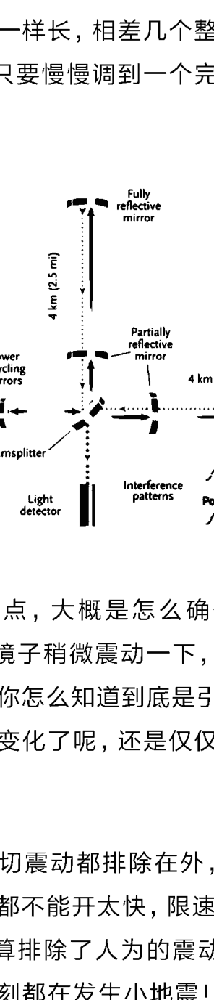

左转通讯 22:54来自：王小帅Sonmiballoon: 以后如果不是发现外星人,请不要搞这么大动静 😂 吊昔：每个字我都认识但不知道啥意思~

所以我想告诉你这件事到底牛在哪。这么说吧，费曼有一次评论麦克斯韦电动力学的意义，是这么说的：“从人类历史的长远观点来看……几乎无疑的是，麦克斯韦发现电动力学定律将被判定为19世纪最重要事件。与这一重要科学事件相比，发生于同一个十年中的美国内战，将褪色而成为只有区域性的意义了。”

昨天宣布的这个引力波事件不能跟麦克斯韦的发现相提并论，但是我们大概也可以说这是2017年十月份世界上特别重要的事件——其它的比如华为发布新手机，都只有区域性的意义。

那引力波事件到底啥意义呢？我给你说四点。咱们从小到大说。

### 4.“缩地成寸”是真的

我们看什么武侠、玄幻小说，经常说有一种功夫叫“缩地成寸”，也就是说能把很远的距离变得很短，可能几万里，一步跃就过去了。这是拿物理*空间*开玩笑。

### 3.实验精度之高

作者是珍娜·莱文 (Janna Levin)，已经出了中文版，其中讲了科学家怎样克服重重困难建成了 LIGO。

费这么的大劲，物理学家可不仅仅是为了证明爱因斯坦是对的。

### 2.物理学家多了一“感”

用中国人爱说的词儿，有的进步叫“取得新成就”，有的进步叫“开创新局面”，有的进步叫“新的历史起点”——引力波事件必须得算“新的历史起点”。

这是因为引力波等于于是让物理学家多了一个“感”。这就好比说，以前物理学家都只能“看”，只有视觉——而现在多了一个“听觉”，还可以听了。

物理学家探测宇宙的主要手段是用光波，严格地说是电磁波，包括可见光、x射线、伽马射线、无线电波等等，偶尔还可以用中微子。但是如果有一种宇宙事件既不发出电磁波，也没有什么中微子，那你怎么探测呢？

比如黑洞就是这样。在此之前，物理学家只能用间接的手段判断哪里有黑洞——比如说黑洞周围天体的运动轨道会因为黑洞而改变，如果黑洞周围有物质、这些物质向黑洞掉落的过程中可能会发出电磁辐射。一方面这种探测不是直接的，另一方面，如果黑洞周围恰好没有别的可见物质，那就无法探测了。

而有了引力波，你就有可能直接探测到黑洞。引力波这个工具已经把物理学家对黑洞的探测整整推进了一大步，请看下图——

图中数值是一个黑洞相当于多少个太阳的质量。在 LIGO 之前，我们能明确知道质量的黑洞就只有一二十个，而且还都是比较小的。而 LIGO 刚出来两年，就已经找到了至少确定了九个黑洞，而且其中大多数都非常大。

### 1.这个宇宙喜欢“搞事情”

如果把我们这个宇宙比喻成一个小城市，而你是这座城市的市长的话，你可能会非常非常操心。你的市民很喜欢搞事情。这种事情可不是什么今天谁家孩子考上大学，明天哪个公司上市之类的小事儿，而是类似明天有个公司发布新产品，当天就把周围好几个公司给吞并了，瞬间产值比全市 GDP 还高好几倍这种不可思议的事情。

2015年 LIGO 第一次探测到引力波，是一个质量相当于太阳的29倍的黑洞，和一个质量相当于太阳的36倍的黑洞合并。这两个黑洞在合并前的距离只有数百公里，互相绕行的速度接近了光速。合并之后，变成一个质量相当于太阳的62倍的大黑洞——那剩下的那差不多3倍太阳的质量哪去了？变成了引力波的能量！

两个黑洞合并那一瞬间释放的能量，相当于天上突然多了10^21个太阳。

天文学，是个充满刺激的科学。

## 日课023 | 制造洞见时刻

提醒：本期专栏的内容可能引起你的不适，如果你正在吃喝喝水，建议暂时不要阅读或收听。

日课023 | 制造洞见时刻

咱们继续说希思兄弟的《强力瞬间》，这本书说的是怎么设计各种瞬间体验。

前天我们说的是怎么创造让人印象深刻、带来美好回忆的瞬间。今天要说的，是通过瞬间，让人学到一个道理。

小学生写作文有个常用套路：先说一个自己曾经经历过的事儿，然后来一句“那一刻，我明白了…….”我们要做的，就是制造能让别人产生写这种作文的冲动的“那一刻”。

我们知道有很多心理学的所谓研究结果不靠谱。就像我们专栏有时讲一个什么研究，可能过段时间都能发现那个研究站不住脚。但我想，我们了解这些研究的目的是并不是为了“学习正确心理学”，而是为了掌握一两个平时办事儿能用上的心理学套路。套路不一定都好使，但是你知道的套路越多，遇到事情就越有办法。人和人之间的差别很大，如果这招对她不好使咱还有别的招。

希思兄弟这本书，满满的都是套路。你对待这本书最正确的态度，就是把它当一本武功秘籍……或者菜谱。

好。今天我们用几个真实的故事，来讲两个套路。

## 1.孟加拉往事

时至今日，世界上仍有许多落后国家没有解决随地大小便的问题。咱们中国现在关注的污染问题都是工业污染，而在那些国家，最大污染源就是人。1999年，国际组织给孟加拉国提供援助，在各个村庄都盖好了公共厕所……可是当地人就是不爱用厕所。

那时候孟加拉乡村的田间地头、路边、甚至是住宅周围，到处都是人的粪便。粪便特别容易传染疾病，可是当地人这么多年都是这么过来的。给他们修建的厕所，他们有的只是偶尔用用，有的是干脆给当储物间用——有的村民说这个厕所比他们家的房子都漂亮，怎么能在里面大小便呢。

这种局面，社会学家有个专门的名词，叫“社会规范（social norm）”。如果你这个社会中人们平常就是这么做的，那大家就会认为这样做就是对的，你想要改变就太难了。有些知识分子经常感慨怎么国人都这样？那就是在跟社会规范做对。

但社会规范并不是不可改变的，事实上咱们中国过去几十年的社会规范就一直在变。有一個国际组织，就靠着孟加拉国解决了随地大小便的问题。很短的时间内就把随地大小便的比率从38%降到了1%。他们的办法，是派人深入到田间地头……去给村民演个节目。

## 2.怎样证明大学教授不会教书

现代大学有个公开的秘密：绝大多数大学教授并没有受过教书的训练。如果讲课是一门手艺，那小学老师学过这个手艺、中学老师学过这个手艺，但是大学教授没学过这个手艺。教授之所以能当上教授，靠的不是教学，而是科研水平。

- 1. 你确定要达到什么说服效果，可以给对方设计一个亲身的体验；
- 2. 整个过程应该在很短的时间内完成；
- 3. 不是直接告诉观众，而是要让观众自己意识到问题所在。

## 3.师父给徒弟的激励

我第一次做真正的物理研究，是在大学毕业前一年。当时我选修了一门研究生的课程，讲课的陈教授就鼓励我上手做点研究。我一开始没想好做哪个方向，后来自己主动找到他，说老师我想跟你做点事儿，你能不能给我找个课题做。陈老师说你等我想想。

大部分时间都是在听课、看书、做题、考试、钻研几十年前甚至上百年前的理论，而这些动作都不是搞科研。而我从研读那篇论文开始，跟着陈老师做起了真正的科研。我在大学最庆幸的经历就是陈老师给了我上手科研的机会，而且这件事情的结果是我发表了平生第一篇物理论文。

那是一段美妙体验。我这才知道科研到底是怎么回事儿，知道了自己到底能不能搞科研。当然我老师不是设计我，但是如果你想给你的学生或者徒弟一段类似的体验，希思兄弟帮你总结了一个套路——

让学生认识到自己的潜能 = 高标准 + 肯定 + 指引方向 + 支持

教授带学生，就得这么做。咱俩说一个书中的例子。有人做了这么一个实验。让一个班的学生写课程论文，教授对论文进行了精心的修改。然后实验者把论文分成了两组，两组论文的第一页上，分别写着一句教授给学生的话。

第一组学生收到的那句话是“我找到了你的一些错误，提供了一些反馈，这样你才能知道你需要改进的地方，请你好好修改。”

第二组学生看到的则是“XX同学，我对你有非常高的期望，我认为你完全可以做到更好。基于高标准，我在你的论文中找到了一些毛病，希望你能好好修改。”

结果，第一组中只有40%的学生修改了论文，而第二组中则有80%的学生修改了论文。而且第二组学生所修改的地方还比第一组学生要多出两倍多。

这就是“高标准 + 肯定”的作用。你得把学生“拉伸”一下，给他一个不能轻易达到的目标，他才愿意探索自己到底行不行。

我们专栏经常鼓励人家去做些冒险的事儿。而今天希思兄弟说，有些冒险并不是为了让人去“成功”，而是去更好地认识自己。

所谓认识自己，也包括放弃。有一位很喜欢做蛋糕的女性，在人羡慕下自己开了个蛋糕店，结果开店以后焦头烂额。她的“禅定时刻”，是有一次她好不容易做好了一批蛋糕，给顾客送过去的时候，车都启动了，她突然发现店门没关。那一刻，她意识到自己是个做事没有条理的人，并不适合开店。

有些禅定时刻是认识到自己其他方面的能力。有个精神病科的医生，眼睁睁地看着自己的病人跳楼自杀了。他非常难过，如果不是他的老师一直跟着他，可能他当天晚上就决定不再当医生了。那一刻给他的教训是他知道了自己作为医生能承受什么。

# | 由此得到

今天讲的是用一个瞬间的体验，让人获得一个洞见。这个洞见可能是意识到一个什么问题所在，也可能是意识到自己的潜能 —— 或者自己的不能。

希思兄弟说，为什么这些瞬间对我们有那么大的意义呢？因为它能告诉你到底想成为一个什么样的人，你到底能做什么，你到底想要什么，你到底能承受什么。这些东西不是你坐在那里想就能想明白的 —— 你必须去做一件事，只有在行动和体验之中，你才能真正认识自己。

## 日课024 | 设计出来的荣耀

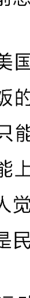

日课024 | 设计出来的荣耀

今天我们继续说希思兄弟的《强力瞬间》。

这本书里有很多有趣的真实故事，两兄弟下了很大的功夫做了各种调研，而且这些故事还特别新颖，几乎都是我以前没听说过的。我们专栏只能讲讲书中的精华思想，如果你对故事感兴趣的话应该仔细读全书，比微博上那些社会新闻强太多了。

在所有这些故事中，最打动我的是美国黑人民权运动中的斗争故事。

## 1.美国黑人的斗争技术

美国黑人民权运动发生在上世纪的五、六十年代，那个时代的故事我们多多少少都听说过一些。我到了美国之后，读了一些相关的书，我了解越多，就越发现事情和我以前想象的很不一样。

当时美国南方很多地区实行种族隔离，白人吃饭的餐馆不对外人开放，公共汽车上黑人只能坐后排，大学只有白人能上，黑人只能上专门给黑人准备的学校。后来很多黑人觉醒了，要求种族平等，起来抗议，这就是民权运动。

民权运动的抗议活动有个特别重要的特点，那就是“非暴力”——没有打砸抢、更没有暴动。典型的抗议活动就是比如说公交车上不让黑人坐前排，而有的黑人拒绝往后排走，非得坐在前排。再比如说一群黑人青年进入只为白人服务的餐馆，坐下，如果服务员不来招待，他们就不走，就在餐馆里安静地坐着，是无声的抗议。

正是这样非暴力的抗议，慢慢地争取了美国人民的同情，才让民权运动获得成功。

这个叙述没毛病，但是如果你深入到历史的细节之中，事情并没有这么简单。

我们一般的印象，这些黑人抗议活动应该都是自发的：我们几个想在你家餐馆吃个饭，你漠视我们不给服务，所以我们就不走，然后这件事情恰好被媒体知道了，对吧？

民权运动之所以成功，其实是严密组织的结果。普通人很少有勇气打破社会规范上街抗议，就算有人出头，也不知道怎么应对各种意外情况。

事实是民权运动的领袖一开始就设定了非暴力抗议的宗旨，然后还派人专门去印度学习了甘地“非暴力不合作运动”中的技术。没错，非暴力斗争，其实非常讲技术。

这些人回到美国，搞起了训练营，招募青年学生进行了专项训练。训练营特别强调的东西，不事“勇气”，而是“纪律”。行动去多少人、什么服装、什么队形、队伍中有人上厕所的话怎么填补他的位置、有人骚扰怎么办、有人打骂你怎么办……各种情况不但考虑到了，而且还反复演习过。

二十五个黑人青年，有男有女，都是学生，穿着讲究，彬彬有礼，在一家餐馆里静坐示威。白人骚扰辱骂他们，他们不为所动。白人把调料和烟灰洒在他们头上！他们还是不为所动。他们打不还手骂不还口，就这么老老实实地坐在哪里——因为他们想传达一个信息：我们黑人是文明人，甚至比你们还文明！

看着这些黑人，再看看那些欺负黑人的白人，现在到底谁是下等人？结果就是很多白人也加入了抗议的行列，民权运动取得了全社会的支持。

而这一切其实是训练的结果。普通人面对那样的侮辱，根本做不到那样的克制！

可是你能说民权运动是一场阴谋、黑人背后有想搞垮美国的黑手吗？当然不能！黑人本来就有抗议的权利，他们只是把抗议做到了更好而已。这就是“组织”的力量，你不服不行。

人一生中表现出勇气的时刻，往往也是这一生中最感到荣耀的时刻。我记得格拉德威尔的《转折》那本书里提到过一个黑人牧师，他因为领导民权运动而被白人极端分子仇恨，有人对他进行各种恐吓、甚至爆炸，都被他躲过了。结果躲过几次之后，这个人的整个人精神状态升华了，获得了一种神圣感，内心无比强大。

这种荣耀，简直是可遇而不可求。但是希思兄弟说，民权运动告诉我们的恰恰是，这个勇气带来的荣耀感未必是完全偶然的，你需要事先进行大量的练习。荣耀感，是可以设计的。

那我们这些老老实实过日子的普通人，能不能也设计荣耀感呢？

## 2.“认可”的价值

最简单的荣耀感设计，就是在平时多给别人认可。希思兄弟提到，在过去几十年中有许多项研究，问员工什么是能真正激励你好好工作的事情，答案中排第一的永远都是“自己的工作得到别人的认可”——尤其得到老板的认可。

如果你是一个老板或者老师，对你来说，认可手下人的成绩可能是举手之劳——而对于被认可的人来说，这就是一个非常重要的荣誉，甚至都可能是他一生的转折点。

但是调查表明，有80%的老板声称自己经常表扬下属，而只有20%的下属表示他们经常能得到老板的认可。这个局面是老板给员工的认可远远不够。

希思兄弟就此提出了几个建议——

- 1. 认可必须是经常性的，不是半年一次也不是一个月一次，最好是每周甚至每天都有，要随时随地发现员工做得好的事情立即表扬；
- 2. 表扬要真诚，最好是个对个人。体系化评选是看业绩和指标发奖金，而个人的认可完全可以搞成社交互动；
- 3. 要具体，比如在公司例会中把一个具体的员工干的一件具体的事儿，拿出来当典型公开表扬。

如果你能做到以上三点，员工就会很有荣誉感，而有荣誉感的员工做事就会非常不同。

那我们能不能给自己也设计一些荣誉感时刻呢？

## 3.里程碑效应

现在有个说法叫“游戏化思维”，就是把生活中的什么大目标，给细分成一系列的小目标，然后就好像是在打游戏通关一样，完成一个小目标，就给自己一个奖励。《罗辑思维》有一期节目就讲过这个思想，你肯定听过。

希思兄弟也说了这个思想，而且给了几个有意思的例子。

比如说成年人自学西班牙语，如果你只是一味地苦学就很没意思，最好设置一些“里程碑”。有人把西班牙语初学者水平分成了五级——

- 1. 能在餐馆里用西班牙语点菜；
- 2. 能用西班牙语和出租车司机进行简单的对话；
- 3. 看一张西班牙语报纸，至少能够理解其中一个新闻主题；
- 4. 能看进去西班牙语的儿童动画片；
- 5. 读懂一本幼儿园级别的西班牙语书。

设置里程碑好处是你的进步能看得见。每完成一级，你就明确感到自己的水平跟以前不一样了。

其实这招儿我早就用过。很多年以前，我刚到美国留学，和几个中国同学都要学开车。我们也没去正规的驾校，只是同学之间互相教。我当时就冒着生命危险，教会好几个同学开车。为了鼓励他们，我发明了一个理论 —— 我说开车技术分四个境界 ——

- • 第一境界是你够熟练地在训练场里绕着圈开；
- • 第二境界是你会走交通信号、路上别的车不紧张，能从市区中的一个点开到另一个点；
- • 第三境界是你敢上高速，到距离城市10分钟的一个超市去买东西；
- • 第四境界就是你能开一个小时的车，其中大部分时间是在高速公路上，去机场接送一个人。

我给每个跟我学车的人都讲了这个分级理论。过了一段时间，我发现我这个理论被接受了，有的同时互教开车的时候，也引用我 —— “按照万维钢的说法，谁谁现在到第几级了。”

所以这件事情给我也带来了成就感。这就是里程碑思维。每完成一个里程碑，你都会感觉到一个实实在在的进步。

最后咱们来看看一张图。

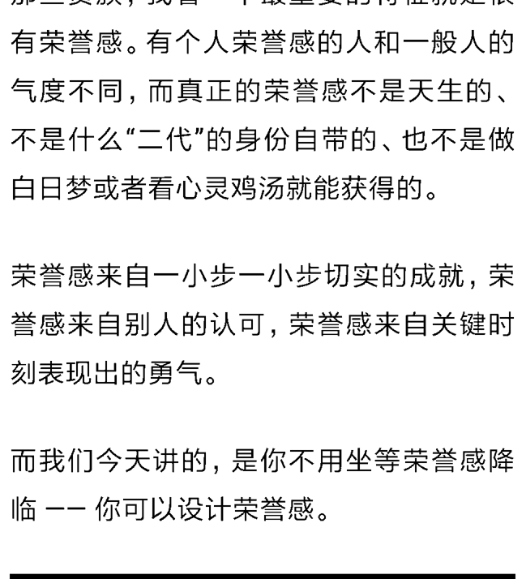

这张图是对马拉松参赛者的统计。横坐标是跑完马拉松总共花费的时间，最快的用了2个多小时，最长的用了7个多小时。纵坐标是每个时间段有多少人。比如用3个小时跑完马拉松的大概有2万多人，用4个小时跑完马拉松的大概有9万多人。

这张图的有意思之处在于，凡是接近“整点”的，比如3个小时、3个半小时，图上就会出现一个凸起。也就是说，刚好在整小时之前跑完的人数远远多于刚好在整小时之后跑完的人。比如说，刚好用了4个小时完成马拉松的人数，远远超过了那些用时4小时5分钟的人。

这是为什么呢？我们可以假想一下 —— 一个人在快跑到终点的时候，一看表，发现快要用了4个小时，他就会鼓励自己，一定要跑进4小时！于是他就会调动自己的所有潜能跑完余下的距离。

4小时是个里程碑。用3小时58分跑完马拉松的人，荣誉感远远高于那些用了4小时02分的人。你可能说这是不是不太理性？四小时无非是人为设定的一数值而已！但是人生不全是理性，想要一个好看的数字，也是人性。

希思兄弟引用了一句话。成功人士有一个共同特点：他们对“完成”一件事很执着，“完成”这个动作，能给他们带来极大的荣誉感。

我们所要做的，就是利用人性，给自己设计荣誉感。

### 由此得到

我们这个时代对“自信心”强调的很多，但是对“荣誉感”似乎说的不多。你考察过去那些贵族，我看一个最重要的特征就是很有荣誉感。有个人荣誉感的人和一般人的气度不同，而真正的荣誉感不是天生的、不是什么“二代”的身份自带的、也不是做白日梦或者看心灵鸡汤就能获得的。

荣誉感来自一小步一小步切实的成就，荣誉感来自别人的认可，荣誉感来自关键时刻表现出的勇气。

而我们今天讲的，是你不用坐等荣誉感降临 —— 你可以设计荣誉感。

## 特别放送 | 怎么讲好一个故事？

特别放送 | 怎么讲好一个故事...

万维钢

今天我们来聊聊“讲故事”。咱们在之前的期刊里经常说，自由技艺中很重要的一个技能，就是说服和影响别人，而说服别人最好的办法往往不是靠理论和数据，而是讲一个好故事。

你善于讲故事，尤其是讲自己以前的故事。奥巴马就非常擅长于讲故事，动不动就讲述一段自己小时候的遭遇。你的故事不见得非得是真实发生的，编造的也管用。也讲一场演讲下来，那些道理大家一个个都没有记住，但是发生在你身上的故事会给他们留下深刻的印象。

无论你去面试，做演讲，写文章，取得工作伙伴的支持，还是说服投资人帮助你创业，你都有必要学会讲好一个故事。

所以今天，我就把咱们第一季和第二季期刊中提到过的，什么是好故事，好故事包括哪些要素，以及怎么讲一个好故事等等相关内容整理到了一起，希望能对你有所帮助。

## A.三种受欢迎的故事

有人研究了各种成功的TED演讲，发现演讲者爱讲的故事总共有三种。要想有说服力，你可以考虑讲这三种故事，而我们对这三种故事有不同的要求。

第一种，是自己的故事。只要跟演讲主题稍微有点关系，你自己的任何故事都可以。

听众总是对你自己的故事比对别人的故事更感兴趣！没有什么演讲技巧是万能的，但是是有这样一个办法是接近万能的 --- 那就是讲一个关于你自己的故事。你要想确保别人引用你话，最好的办法就是讲一个你自己的故事。讲一个自己的故事，能让听众感受到你的真诚。领导者更应该多讲自己的故事，这样才能激励别人。

第二种，是别人的故事。如果这个故事不是发生在你自己身上的，那么听众的要求就要更高一点了。这个要求就是我们必须能从这个人的经历中学到一个什么道理。

第三种，是某个品牌或者产品的故事。像这样的故事，听众的要求就更高：它必须是一个有关成功或者失败的故事。

## B.怎么用故事说服别人

故事是一种传播手段。世界上传播学的鼻祖，应该是亚里士多德。亚里士多德有个理论，说要说服别人，你得提供三个东西。

第一个东西叫“Ethos”。Ethos代表个人信用。凭什么要听我说？因为我取得过什么什么功绩，我拥有什么什么专家头衔。

第二个东西叫“Logos”。Logos就是逻辑，就是理论推理和证据支持，比如说提供各种统计数字。

第三个东西叫“Pathos”。Pathos是感情和同情心，这就是故事的作用。

亚里士多德这三个东西中，最有说服力的就是 pathos —— 晓之以理不如动之以情。高手说服别人，一定善于使用 pathos。

一个成功的 TED 演讲，有人逐词逐句地统计，是演讲者把10%的时间用在 ethos 上，25%的时间用在 logos 上，剩下65%的时间全都用在了 pathos 上。

## C.好故事的三个要素

有学者分析了几千年以来各个民族、各个文化流传的神话故事和民间传说，发现最受人喜爱的故事其实只有一种。不管是耶稣基督还是哈利·波特，是孙悟空还是《黑客帝国》里的Neo，他们的经历本质都是一样的 ——

一个普通人，一段从已知世界到未知世界的旅程，在经历了一系列小磨难之后，面临一场终极考验，最后他战胜了这个考验，完成了从小人物到大英雄的转变。

所有受人喜爱的故事，都是这样的英雄故事。这就是为什么好莱坞电影非得拍英雄。

不但如此，好故事还需要三个元素 ——

- 1. 要能鼓舞人，这意味着主角一开始是个有缺陷的小人物，到剧情结束的时候他不但取得了胜利，而且克服缺陷完善了自己；
- 2. 要可信，这意味着英雄不能是无敌的，也不能是一上来就说要担负重大使命，他必须经历一番挣扎才接受这个使命；
- 3. 要有悬念，英雄的征途上必须遭遇各种小失败。

不信你看现在的西方电影，尤其是公路片，其中大量使用《绿野仙踪》的套路，表现人物的心路历程。在童话开头，铁皮人没有心，稻草人没有头脑，狮子没有勇气 —— 可是等到童话结束的时候，每个角色都获得了自己想要的品质，他们的人格更完善了。

## D.面试讲故事的5个套路

逆境：最值得吹嘘的一种故事就是你有过什么样的逆境，经历过什么样的失败。你要证明自己不但没被逆境杀死，而且更强大了。最好详略若轻，把明显的困难轻描淡写，充满乐观情绪。然后你顺便感谢一下在困境中曾经帮助过你的人，让人感觉到你是一个懂得感恩的人。

影响力：你是否曾经说服过别人？是否曾经逆众议，让事情按照你的设想走？你是否曾经组织过一帮人去搞一个什么大活动？所有的交流问题本质上都是领导力问题，所有的领导力问题本质上就是交流问题。如果你善于说服别人，说明你天生就具备领导力。

技术水平：像社会学、心理学这些专业用的统计学工具还是很有技术含量的。

合拍：公司希望招一个善于能干到一起去的人。你应该对你申请的这个工作有所了解，这就需要靠你的调研能力了。面试之前，你能不能运用一下批判性思维，自己找资料，对这个公司做一些深入的研究。然后再来说你对公司有什么了解，你能为这个公司做出什么样的贡献。

成就：和别人相比，你有没有什么出类拔萃的地方。这就是你吹嘘以往成就的机会。成就不一定是实际的工作经验。

## E.都可以写成故事

关于讲故事的书有很多，是个学问，“故事”其实是个广义的概念，并不是只有剧情片才叫故事，纪录片、社论演讲、科普文章、乃至于科学论文，都可以写成故事。

你需要英雄，你需要悬念，你需要冲突，你需要结局。

比如说我要写篇物理论文，我可以这么写 ——

- 1. 现在有这么一个物理现象，它发生在很多地方，而它有一个性质，现在是怎么回事还不知道；【坏人、悬念】
- 2. 某某和某某使用了他们的方法试图解决这个问题，但是他们的结果我们不太满意；【冲突】然后我们有这么一个高级工具；【英雄】
- 3. 用我们的工具研究这个问题，我是这么做的；【剧情展开】
- 4. 中间有个难点，工具不能直接用；【冲突；英雄第一次出手，失败了】
- 5. 我必须对工具做一些修改；【英雄改变了自己】
- 6. 然后我就得出了很好的结果；【英雄战胜了坏人；高潮】
- 7. 我还发现了一些以前不知道的一些事情【给续集留下悬念】

你看，这就是一篇很好读的论文。当然论文前面有摘要，引言里要介绍你的结果，这些都相当于“剧透”，可是按照这个套路写仍然能让人接受。

但是更重要的教训还不是怎么写故事，而是这个 —— 文章是写给读者的，说话是讲给听众的。你说每一句话，都要想着怎么才能让人容易接受。

## F.欣赏一个好故事

史蒂文森是个非常有影响力的民权律师和

史蒂文森是个非常有影响力的民权律师和社会活动家，这个故事来自史蒂文森在一次著名的 TED 演讲。他是这么讲的——

史蒂文森的外祖母有十个子女，子女们又各有孩子，整个是个很大的家族，所以史蒂文森小时候并没有多少机会跟外祖母单独相处。但是家里人都知道，外祖母是个有智慧的人。史蒂文森九岁时候的一天，外祖母叫住他，领着他离开众人，找了个小房间单独谈话。

外祖母对他说，孩子你知不知道，我一直在观察你。我发现你是一个非常特殊的孩子。史蒂文森受宠若惊。

外祖母接着说，我认为你将来无论想做什么事情都能做成。可是想要达到那样的成就，你必须答应我三件事。史蒂文森有点懵，他马上说行，我答应你。

外祖母说，第一，你必须保证永远爱你的妈妈，永远照顾你的妈妈，那可是我的好女儿。

第二，你必须永远做正确的事，就算有时候正确的事很难，你也要做正确的事。

第三，你必须保证，永远都不喝酒。

史蒂文森说可以！我保证。

从此之后史蒂文森就有了一种特殊的使命感，觉得自己责任重大。他确实做到了对外祖母的承诺 —— 至少做到了从来不喝酒。

长大以后，史蒂文森有一次和表兄弟们在一起聚会。表兄弟们就弄了一些啤酒，让他喝。史蒂文森执意不喝。有个表兄弟就觉得史蒂文森很奇怪，然后他恍然大悟：布莱恩，你不会还想着外祖母跟你说的话吧？他是不是说你是个非常特殊的孩子？

——他跟我们每个人都说了这个话！

听到这里，观众哄堂大笑。

但是史蒂文森接着说，我今年52岁了，我从来没喝过酒。

万维钢

史蒂文森讲他外祖母的故事，想说的道理是“身份认同” —— 我们常常根据自己的身份认同去做选择。但是我相信你可能会忘记这个道理，但是会记得史蒂文森和他外祖母的这个故事。

这就是故事的力量。精英日课，祝你每天都有收获。

## 答读者问 | 给自己设计体验，会有用吗？

答读者问 | 给自己设计体验...

请问万老师，引力波的发现与我国建造的世界最大"天眼"，哪个作用更大，更有意义？

万维钢

引力波探测的成功是给天文学家多了一"感"，是开创了一个新技能。中国"天眼"是世界最好的射电天文望远镜，是把一个已有的技能做到了极致。从开创意义来说，LIGO的引力波探测意义更大。

我们还不知道"天眼"将来能够探测到什么新东西。目前为止的引力波探测结果都没有超出物理学家此前的预期，我们在理论上早就知道会是这样，而你实验只是证实了我们的理论 —— LIGO 还没有发现"新物理"。如果"天眼"能发现我们之前根本想不到的新物理，那么实际意义绝对是更大。 而且鉴于引力波探测的误差太大，天眼更有可能出精确结果。

如果有什么外星文明想要向宇宙各地广播一个信号，他们需要让这个信号具有一定的规律，让人一看就是人为的，能明显区别于平常的宇宙事件那些天然的信号 —— 那么无线电波大概是一个很好的选择。而中国"天眼"是接收外太空无线电波最好的仪器。换句话说，如果外星人近期要跟地球联络，那么因为有"天眼"，第一个接电话的将是中国人。这个意义够大了吧 : )

万老师，问几个题：黑洞不断地合并，在宇宙的大时钟角度里是个高频事件吗？如果是，那么这和宇宙归于热寂这个大目标是一致的吗？另外"两个中子星或黑洞的合并"，为什么叫合并而不叫撞击？黑洞也有自己的运行轨道吗？

万老师，请教一下为什么两个黑洞会互相绕行吸引最终合并呢？是因为有力量吸引？是每一个天体最终都会这样吗？

万老师你好，对于两个黑洞或者中子星的合并，是不是只有在合并的一瞬间释放出的能量才能被 LIGO 探测到，而在合并之前的互相绕转是不能被探测到的呢？

万老师，还有一点不是很明白，宇宙喜欢搞事，宇宙又那么大，产生引力波的事件是否每天每小时都会有呢，而且引力波不会衰减，地球是否每刻都能收到引力波？

两个黑洞在合并的时候有一部分质量转化引发引力波的能量，这时空间在引力波作用下发生了涟漪，当涟漪消散的时候，空间恢复了平静，那这部分能量没了嗎？这是否是不符合质能守恒呢？

万维钢

黑洞虽然叫"黑"洞，但也还是大质量的天体，吸引它们合并的当然就是引力。合并前的旋转动作是所有天体的规定动作，就连人造卫星掉落到地球上，也是一边绕地球转一边掉落，这完全是旋转惯性和引力共同的结果。之所以叫"合并"而不叫"撞击"，因为我们的日常语言中"撞击"是形容比较刚性的碰撞，应该撞得火花四射之类，还应该撞一下再反弹。。。而黑洞合并没有这些"景"。只是两个黑洞绕着对方旋转，越转越快，最终"默默地"合在了一起，除了引力波之外也没有留下别的痕迹。

黑洞合并的时候，一部分旋转的动能变成对周围空间的扰动，这也就是引力波的来源。当然合并之前的旋转也会产生引力波，但是太弱了我们距离远测不到。引力波会携带着合并产生的能量一直传播出去 —— 就算本地的空间恢复了平静，更远处的空间仍然在波动。当然，距离越远，波动的幅度就越小 —— 但这可不是因为总能量减少了，而是因为能量分散开了，这就好像离得越远声音越弱一样。不过引力波的能量会在跟天体的互动中发生耗散。

黑洞也是有熵的！一个物体掉落到黑洞中，熵并不会减少，它的动能还会熵增加。黑洞也不会一直存在，根据霍金的理论，黑洞将会慢慢辐射蒸发掉。这样来说，黑洞的一生也是为宇宙热寂做贡献的一生。

宇宙非常非常空旷，所以两个大质量天体能相遇绝对是小概率的事件。但是宇宙实在太大了，所以小概率事件也经常发生。据 LIGO 发言人说，等到将来探测精度提高，也许每天都能接收到一个黑洞或者中子星合并事件。

万老师您好，向您请教一个外行问题。我们现在搭建的引力波装置是不是本质上类似于迈克尔逊干涉仪？如果是的话，那么引申出一个问题，当年验证以太是否存在，如果恰好发生引力波事件，以当时的条件能否检测到任何实验信号？又假设真的检测到实验信号的话，会不会诱导当时的物理学家得出光速可变的错误结论？谢谢。

万维钢

这是内行问题啊！没错，LIGO 本质上就是当初测定光速在各个方向相同、证明不存在以太的迈克尔逊干涉仪。关键区别在于 LIGO 有反光镜，让光线在长臂中来回跑了几百圈，等于是走过非常长的距离，这样它能够发现极其微小的长度变化。

那我们假想一下，如果当年的 人有了 LIGO，他们会不会得出结论说光速可变呢？不会的 —— 他们只会更坚定地相信光速不变。要知道引力波事件只是偶尔发生，LIGO 大部分时间内观测到两个长臂的长度没有任何变化 —— 对应到当时，那就是光速在绝大部分时间内，在极高的精度上，都是不变的。考虑到地球绕太阳转的速度都有每秒30公里，那么如果以太存在，光速差异将至少是每秒30公里，有这么大的差异早就测出来了。所以他们的结论一定是以太不存在。如果他们想象不到引力波这种东西，大概只会把偶尔的细微改变当成实验误差忽略。

我们的地球，卷入黑洞的概率有多大？

万维钢

只有质量大于我们这个太阳三倍的恒星在寿终的时候有可能演化成黑洞。我们这个太阳的质量不够大，它将不会变成黑洞。考虑到宇宙这么空旷，地球也不会遭遇其他黑洞，所以不用担心黑洞。

但我们这个太阳将会变成红巨星 —— 它的体积将会膨胀到非常非常的大，最后吞没地球！这个命运似乎并不比卷入黑洞好。

洞见是可以设计的，那么可以自己给自己设计想要的洞见吗？自己去体验自己设计的体验，会有用吗？

在日课中说的获得洞见而做出的改变是相对比较容易做到的改变，还有一些需要付出很大努力坚持下去的，比如戒烟、减肥、运动...怎么制造洞见让这些行为改变呢？请指点

万维钢

如果是别人给自己设计的体验，哪个怕你知道是设计的，很多情况下它仍然有效，只要你体验到了自己以前不知道的内容。但是如果体验完全是自己设计的，那么你既然能设计，就已经知道这个体验是什么样的，那再真正过一遍流程似乎就没有什么意思。

不过一个人完全设计一段体验的*所有细节*也是不太可能的。比如说今天工作做得好，决定定个好餐厅奖励自己一顿饭，这算不算设计？要知道餐厅里那盘菜我要是不吃就无法真正感受到它的味道，所以我亲身体验一下还是会有收获。

说到戒烟，我猜下面这张图可以带给他们一个洞见瞬间 ——

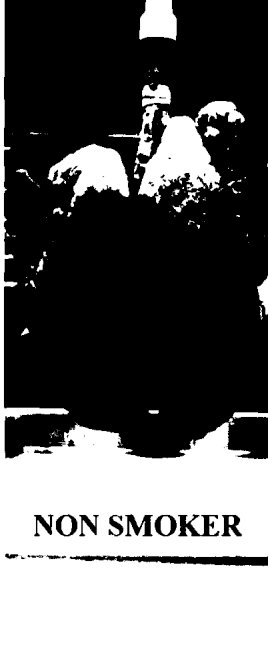

# NON SMOKER

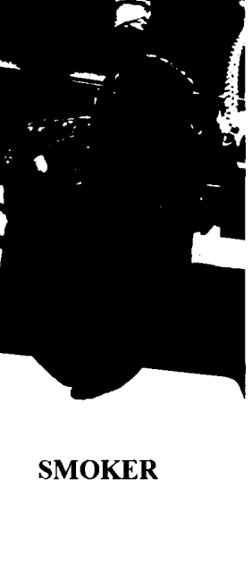

# SMOKER

一种“瞬间”的体验？灵光一闪，这靠谱吗？会不会得出的洞见正好与事实本身相反呢？A本来就适合当老师，看到活跃在电视荧幕上的明星朋友，突然发现自己想要的也是这种刺激的生活。值得为这个洞见改变吗？

万维钢

完全可能不靠谱！体验设计关注的是洞见的感受强度，而不是洞见的对错。我们平时对身边事物的敏感度太低，体验设计起到了加大剂量的作用——但这个药对不对症，可就不一定了。

今天留言中看到了不确定性，我想问一问教育是不是也可以用随机奖励来促进学生学习？这种会不会上瘾，会不会和兴趣使然的学习相背驰，会不会只有低层次的教育才采用奖励机制？

万维钢

这是非常好的问题！有很多实验表明，用物质奖励——比如说直接给考得好或者考试成绩进步大的学生发奖金——可以有效提高学生的考试成绩和上课出勤率这样的指标。但是那些研究都是短期的。物质奖励都是外部驱动，长期似乎效应不明显。我记得有个研究，花了很多钱在美国几所中小学做实验，表现好的给发奖金，几年下来没有特别明显的作用。

单纯发奖金不行，也不等于一切激励手段都不行。老师给一个落后学生语言上的鼓励，也许就很有效。

更高级的学习驱动力是内部驱动，比如说因为自己有一个明确的大目标，或者是因为兴趣。而下周我们将会看到，目标比兴趣有效得多。

自信和荣誉感一样吗？我的理解，不论是在危急时刻表现出勇气还是完成自己设置的目标都会让自己有成就感，也就有了自信。是否说是有了自信心就有了荣誉感呢？

万维钢

我理解，就做事情而言，荣誉感比自信心更积极主动。自信心是下次你让我做这个有难度的工作我敢做，荣誉感是我自己主动挑战一个更难的工作。

## 日课预告 | 新书：蒂姆·哈福德《塑造现代经济的五十个发明》

日课预告 | 新书：蒂姆·哈福…

下周我们把希思兄弟的《强力瞬间》讲完，然后会说一本8月29日出版的新书，《塑造现代经济的五十个发明》( Fifty Inventions That Shaped the Modern Economy )。

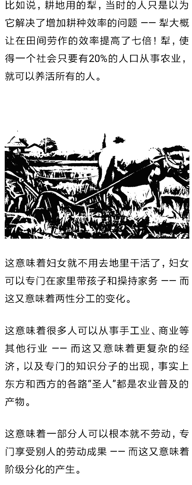

# FIFTY INVENTIONS THAT SHAPED THE MODERN ECONOMY

> “Every Tim Harford book is cause for celebration.”—MALCOLM GLADWELL

# Tim Harford
AUTHOR OF THE UNDERCOVER ECONOMIST

这本书的作者就是我们专栏熟悉的经济学家作家蒂姆·哈福德（Tim Harford），我们在第一季的时候讲过他的《混乱》和《卧底经济学》这两本书。

哈福德是《金融时报》专栏作家，他非常擅长用很酷的方式，讲很酷的经济学思想。

这本书的视角就非常独特。你肯定已经看到过很多个“最伟大发明”的列表和排行榜了，汽车是伟大发明、电话机是伟大发明，我还听说有人说现代社会最伟大的发明是抽水马桶！

但是哈福德这个视角，是一个发明对*现代经济*有什么影响。我们关注的不是这个发明本身解决了什么问题，而是它产生了什么深远的影响。

这些影响常常是当时的人所不能预见的。

比如说，耕地用的犁，当时的人只是以为它解决了增加耕种效率的问题——犁大概让在田间劳作的效率提高了七倍！犁，使得一个社会只要有20%的人口从事农业，就可以养活所有的人。

这意味着妇女就不用去地里干活了，妇女可以专门在家带孩子和操持家务——而这又意味着两性分工的变化。

这意味着很多人可以从事手工业、商业等其他行业——而这又意味着更复杂的经济，以及专门的知识分子的出现，事实上东方和西方的各路“圣人”都是农业普及的产物。

这意味着一部分人可以根本就不劳动，专门享受别人的劳动成果——而这又意味着阶级分化的产生。

这意味着人的主要食物从采集狩猎的丰富来源变成了耕种农业的单一来源——而这又意味着人口激增，但是每个人的生活质量都下降了，连平均身高都下降了好几厘米。

事物的发展往往是这样，不管你的“初心”是什么，后来总会发生意想不到的变化。

而每一个变化，都会有它的“赢家”，和“输家”。

所以像这种历史发展动力学，君子不可不察。

下周一，我们接着上周话题讲讲促进亲密关系的体验设计学。周二，我们就开始这本新书的讲解，介绍一个美国西部大开发中的伟大发明，并且思考一个有关“私有”的哲学问题。

还是老时间，每晚10:43，不见不散。

## 日课025 | 好关系的配方

日课025 | 好关系的配方

今天我们把希思兄弟的《强力瞬间》这本书讲完。最后一讲说的是怎么用设计瞬间来加强人和人的关系。

“搞关系”现在几乎是个贬义词，一说搞关系似乎都不是什么能上得了台面的事儿。
达里奥《原则》这本书就说，人与人的良好合作应该是建立在理性的基础上，不是靠什么搞动之以情搞关系。

但问题是一般人没有那么理性。如果人是完全理性的，我们评价一段经历就应该科学扌分，就不存在什么“峰终定律”，希思兄弟这本书所说的强力瞬间也就没有意义。这本书恰恰说的是用什么设计瞬间来弄一些动之以情的功效。普通人跟普通人之间、一个团队内部、商家面对消费者，体验设计学非常好使。

### 1.目标和热情

假设你负责招聘一名程序员，有两个人来面试，他们的技术水平差不多。

你跟他们聊的时候，发现第一个面试者的目标感非常强。他说我一定要做最了不起的产品，我要让很多人用我的产品，我要做业界最厉害的程序员，建功立业！

第二个面试者则对编程这件事本身充满热情。他说我特别喜欢钻研编程技术，我很在意架构好不好、代码质量高不高，我把编程当成一门艺术。他说他从小就喜欢编程......就好像选秀歌手说特别喜欢唱歌，物理学家爱好者说特别爱物理一样。

那请问，你应该录用哪个人呢？

答案绝对是选第一个。

加州大学伯克利分校的教授莫滕·汉森（Morten Hansen），最近调查了不同行业的5000个员工，一方面通过问卷调查看看他们的工作动力是目标驱动（像第一个人）还是热情驱动（像第二个人），另一方面让他们的老板来评价他们的水平。最后得到下面这张表格 ——

| | 目标感强 | 目标感弱 |
|---|---|---|
| 热情高 | 80% | 20% |
| 热情低 | 64% | 10% |

表格中的数值是老板对这个员工水平的评价，越高越好 —— 比如80%的意思是，他比80%的员工都干得好。

表格中的结果是，如果一个人既有很强的目标感，又有很强的热情，那么这个人的老板对他的平均评价是80%，这是非常厉害的人；如果一个人目标感很强，但是热情不够，那他的表现也还不错，是64%；如果一个人目标感很弱，但是热情很强的话，那么他获得的评价是20%；如果一个人目标感弱，热情感也弱，他获得的评价是10%。

也就是说，目标感带给人的评价提升是50%-60%。而热情对人的提升最多只有10%。所以决定一个人的工作表现的最关键因素，是目标感，而不是热情。

### 2.一起扛过枪，一起......

增加团队的凝聚力，还有另外两个因素也很重要。

一个因素是共同奋斗过。有很多实验证明，如果一个团队曾经一起经历过困难的时刻，一起奋斗挣扎过、一起体会过痛苦，这个团队的凝聚力会特别强。

### 3.你要响应我

咱们先说答案。希思兄弟总结维系个人关系的秘诀，用一个公式表示，就是——
亲密良好的关系 = 开放 + 响应

+   而所谓“响应”，由三点组成：
1. 理解。你了解我，而且你还了解我自己是怎么看待我自己的，什么东西对我最重要。
2. 接受。我想要什么，我是什么样的人，你得对此表示尊重。
3. 关心。就是在各种场合下，一旦我需要什么帮助，你得帮助我。

所以，响应 = 理解 + 接受 + 关心。

### 4.老师问家长的四个问题

我们知道美国有些地区的公立学校是非常差的。最差的学校能差到什么程度呢？你可能会感到震惊。华盛顿市 —— 注意，这可是美国的首都 —— 有一个公立小学，开家长会的家长出席率只有12%。这就等于说老师说开家长会，结果一个班就来了两个三个家长。

老师和家长陷入了一个恶性反馈。在老师看来，我开家长会你都不来，说明你这个家长根本不重视教育。但是在家长看来，问题在于老师先不重视我家孩子，你对我孩子根本不关心，我为什么要来参加你的家长会？老师和家长之间根本没有起码的信任。

学校后来也是痛定思痛，认为必须改革，就搞了个大动作，把大部分老师辞退了，招聘新老师……结果还是不行。关键就在于怎么跟家长建立一个比较好的关系。

最后学校想了一个办法，要求老师在暑假期间，挨家挨户到学生家里做家访，而且还专门设计了四个家访的问题 ——

+   1. 你的孩子在学校的体验是怎么样的呢？你对此的感受是怎么样的呢？
2. 你对孩子有什么期望？你对他有什么梦想？
3. 你希望自己的小孩成为一个什么样的人呢？
4. 我作为孩子老师，你希望我做些什么？

这个四个问题平淡无奇，其实正好是前面赖斯给的好关系配方。第一个问题是理解，第二、第三个问题是接受，第四个问题是关心。

效果非常好。经过暑假的家访，再开学的时候，最明显的一个效应是，家长会的出席率从12%提升到了73%。家长愿意跟老师沟通，才谈得上其他各种教学改革，最后这个学校的教学质量就真的提高了。

整个故事非常简单，但是咱们想想，如果让你去一个差生家找家长谈话，你会说什么？我们本能的做法恐怕不是问对方想要什么，而是告诉对方应该做什么：你家小孩学习很差啊，这么下去可不行啊，你作为家长得上点心啊，你必须……

希思兄弟说，这个本能其实是服务业的通病。病人来到医院，医生自然而然假设他想要的就是把病治好，上各种难受的治疗方案，根本不在乎病人想要什么。有个医院让一个有自闭症的小孩在一张纸上写下“对我来说最重要的事有哪些”，然后所有医护人员都按照这张纸照顾他，效果就非常非常好。

用一句话总结医生们的经验，是把 “What’s the matter” 这个问题改成 “What matters to you” —— 不要只问他有什么毛病，要多问问他想要什么。

### | 由此得到

今天我们讲的是怎么提升一个团队的凝聚力，和怎么提升两个个人之间的关系。这些套路可以用几个公式总结 ——

+   团队凝聚力 = 目标感 + 一起奋斗的经历 + 协调同步

快速的亲密关系 = 开放

长期的好关系 = 响应 = 理解 + 接受 + 关心

希思兄弟的这本《强力瞬间》就算讲完了，全是套路，希望你能用上。

### | 我的评论

我有一个感慨。知道这些套路不难，但是真要使用套路，你需要克服一个心理障碍。

这个心理障碍就是到底要“做真实的自己”，还是去*摆弄*别人。

比如说，我明明不关心这个人想要什么，但是我仅仅是为了和他好好相处，我主动去问他想要什么 —— 这到底对不对呢？这还是*真诚*的我吗？再比如说，我跟好几个同事在一起，别人都笑了，可我并不觉得有什么好笑的 —— 但是我知道我只要笑，就可以和同事取得同步 —— 那你说我到底是笑还是不笑？

“体验设计学” —— 如果一个体验是设计出来而不是自发的，那是不是有一点……就好像吃了不是有机 IhthahIxt的 食物的感觉呢？

我对这个问题想了很久，现在我的答案是这个：你可以既保持真诚，又使用套路。

有时候你发自内心地想对一个人好，想让一群人幸福，但是因为你没经验不了解人，你不知道该怎么做。这种感觉就好像看到一处美景心里没有好词儿形容一样。“体验设计学”，就是能让你把心中的好意抒发出来的诗歌。学会了体验设计学，你就可以把良好愿望变成现实。

知识不会让真诚蒙尘，知识只是让你更自由。

推荐阅读
日课010 | “坚实力”...可能是个站不住脚的学说

## 日课026｜铁丝网和“什么叫拥有”

有些东西刚出来的时候，你并不知道它的真正作用。爱迪生发明了留声机，但他并没有像乔布斯那样动不动就“这改变了一切！”爱迪生低调地认为留声机大概可以作为一个有声书的设备。

对像我这样的书呆子来说所有声书的确是个重要功能…..但录音技术真正的用武之地，是音乐市场。因为有录音，广大普通人才能廉价地欣赏到音乐。因为有录音，才出现了面向大众的流行音乐。也因为有录音，整个音乐产业变成了胜者通吃的市场。

现在只有明星才能靠音乐赚钱——赚很多很多钱——但是稍微微差一点的音乐人，可能连基本生存都成问题。并非所有人都是新技术的受益者。有赢家，就有输家。

由此说来，一个新事物的“初心”是什么可能根本就不重要。它对时代的影响，它带来的社会变革，常常出人意料。从这个角度阅读历史，似乎是比什么“天下大势顺之者昌”的历史现更高级的趣味。经济学家蒂姆·哈福德（Tim Harford）8月份出的这本新书《塑造现代经济的五十个发明》（Fifty Inventions That Shaped the Modern Economy），就有这种高级趣味。

# FIFTY INVENTIONS THAT SHAPED THE MODERN ECONOMY “Every Tim Harford book is cause for celebration.”—MALCOLM GLADWELL Tim Harford AUTHOR OF THE UNDERCOVER ECONOMIST

我想用几期日课，从这本书中挑选几个发明，来讲几个道理。今天我们要说的重大发明，是带刺的铁丝网。

就是这种铁丝网。它过去一百年几乎没有什么变化。你可以用铁丝网把一个地方围起来，因为上面有刺儿，人和动物碰着就会被刺伤。

这个简单东西对美国的影响，可以说是“国运”级别的。

### 1.西部大开发

1862年，美国政府号召人民开发中西部地区，林肯总统弄了个“宅地法”。法案规定，只要你是年满21岁的美国公民，不论男女、哪怕是刚刚获得自由的奴隶也行，只要你到中西部地区去，就可以免费得到160英亩土地——条件仅仅是住满五年，并且在这个土地上随便种点什么东西。160英亩相当于0.65平方公里——这是百分之百产权、你自己私有的土地！想想把这么大一块地传给子孙后代，到今天得值多少钱！

但老百姓对林肯给的这个好政策反应比较冷淡。当时普遍的观念，西部那些大片土地是公共的牧场，牛仔赶着牛群走到哪里吃到哪里，你怎么私有化？如果我说这块土地是我家的，我在这儿种一片玉米，那放牧的牛群经过这里把庄稼踩坏了怎么办？

想要有踏实的“拥有感”，就得用围栏把自家的地给围起来才行。

当时的围栏都是用木头做，可是中西部到处都是大草原，根本没有几棵树。从东部运那么多木头过来得花多少钱？还有人尝试在土地周围种一些灌木做围栏，可是灌木需要很长的生长时间，也不太行。

到1870年的时候，农业部评估，如果不解决围栏的问题，宅地法案就等于没用。专利记录显示，一时之间人们发明了各种各样的围栏。

直到1875年，带刺铁丝网才终于被发明出来了。商家还做了广告，说这个铁丝网“比空气还轻，比威士忌还强，比土士还便宜”。有了这个铁丝网，你只要用打木桩，木桩中间都用铁丝网连接，用不了多少木头，也用不了多少铁丝。而且测试表明，牛群确实越不过铁丝网，你就是赶着牛往网上撞都撞不过去。

结果是仅仅6年之内，全美国就已经销售出去26.3万英里的铁丝网，相当于绕地球十圈。西部大开发顺利进行，大草原被各家各户围成了自己的土地。

这个故事非常简单，但是你如果深入思考一下，就有意思了。

### 2.大开发的输家

并非所有人都喜欢铁丝网，西部牛仔就很不喜欢。本来牛群是我家的，土地是大家的，我赶着一群牛哪里都可以去，现在这片地怎么就被你家围起来了呢？有时候天一下雨，牛群自己就会跑，牛真的会撞到铁丝网上。铁丝网上的刺儿就很容易划伤牛，然后搞不好就会感染。因为铁丝网，死掉了很多牛。牛仔，是铁丝网的输家。

但最大的输家是印第安人。印第安人祖祖辈辈都在这片土地上生活，在他们心目中全天下的土地都是神赐予天下的，游牧是他们的生存方式！现在突然来了一帮人把地就给围起来，可以说整个印第安部落的文明都被隔绝了！

这合理吗？

### 3.土地凭什么可以私有化

我刚到美国的时候，在某个地方看到一个大湖，湖边有一段路修的非常漂亮，使我想起了家乡的松花江，所以我想沿着湖走一圈。但是我只走了不到半圈，剩下的湖岸被一些住家给占据了，还竖起了牌子说私有财产不得进入。我当时就很不満，你家房子你可以私有，湖怎么能私有呢？这么好的湖应该属于人民啊！

当然，美国连有些海滩都是私有的，你要有钱还可以拥有一整个湖。但是我当年的不满可不是一点道理都没有。

哈福德这本书里说，17世纪的时候，英国就有许多土地被私有化了，贵族、特别是国王拥有大片的土地。当时英国哲学家约翰·洛克，也问过跟我一样的问题：土地私有化合理吗？这片地早在你出生之前就已经存在，不是你“生产”出来的，那凭什么就成了你的私有财产呢？

洛克问这个问题，可不是为了反对私有化，他是为了给私有化找一个理论支持。

洛克想到的理由，是劳动。洛克说，每个人自己的劳动显然就是他自己私有的，这没问题吧？好，那么现在有一块无主的土地，如果你通过劳动，对这块土地做了改进，这个土地上不就有了你的劳动了吗？你的劳动本来就是你的，而这个土地本来是无主的，那么 无主＋劳动＝有主，这块土地可以归于你了。

洛克这个理论，当时正在殖民美洲的英国人太喜欢了。是，印第安人祖祖辈辈都生活在美洲的土地上，可是你们只是放牧而已，你们没有对土地本身进行劳动改进哇！是我们在土地上种庄稼，是我们赋予了土地文明！所以你们不拥有美洲土地，我们拥有美洲土地。

我想印第安人对这场哲学讨论肯定也是有话要说的，但是他们说什么已经不重要了。反正经济学家喜欢洛克的观点，私有化可以让土地获得“改进”，有利于整个社会的经济发展。

好，咱们现在捋一捋。对有志于参加西部大开发的美国老百姓来说，在哲学道义上，洛克的理论已经说够了，谁第一个开发谁就应该是第一个拥有者。在法律上，宅地法案已经确认了你的权利。可是他们为什么不立即响应号召前往中西部圈地呢？

因为还有一个隐含的道理：只有你能控制的东西，才真正是你的。

白人要是没有武力，光靠种地和哲学家的理论是不能从印第安人手里把地抢走的。

理论是不能从印第安人手里把地抢走的。老百姓要是没有铁丝网，联邦政府天高皇帝远的法案就是一纸空文。

这个道理美国老百姓明白，美国政府明白，印第安人当然也明白。但是我觉得，有些互联网烧钱公司可能不明白。

### 4."我们要做伟大的公司"

大约2000年左右，互联网刚刚在中国兴起，大家提供的都是免费的服务，给用户各种好处，而且大街小巷做了很多广告。那时候我还在国内上大学，我记得当时一个风头正劲的公司的 CEO 到我们学校演讲，给我们讲了一番互联网公司的逻辑。

他说我们现在做的事儿就相当于美国西部大开发期间的跑马圈地！我们用免费服务倒贴用户，就是为了尽可能地扩大用户量，用户就是我们的地。你先不要问什么我怎么赚钱，只要我拥有这么大一片地，将来怎么可能不赚钱呢？我们就是要不计眼前小回报、大手笔投入，因为我们要做伟大的公司！

很多互联网公司都是这么想的，至今也有很多公司这么想。可是我们回顾一下历史，美国真正的西部大开发中的圈地，并不是这么玩的。当时的人首先想到的可不是圈上多少地将来怎么升值，而是铁丝网。

如果用户是土地，那铁丝网是什么呢？

用户的使用黏性是个不太可靠的铁丝网。比如 Facebook，如果你的亲朋好友都在用，那你大概也只好用。所以 Facebook 做大了，别人想模仿它就很难了。但是用户黏性并不可靠，也许这一代人都用 Facebook，而下一代人不想跟自己父母在同一个社交网络，那怎么办呢？事实上 Facebook 对此是很警觉的。

技术数据是个可靠的铁丝网。比如 Google，它的搜索技术越来越厉害，并不仅仅在于技术本身，还在于多年积累的用户点击数据。这些数据可以更准确地告诉搜索引擎各个网页的真正价值。没有这个积累，新开一家搜索引擎、就算你算法再厉害也不行。

声望也是个可靠的铁丝网。我们专栏第一季讲过高水平学术期刊和著名大学都是好生意，他们不管收取多高的费用都有人买账，就是因为声望摆在那里。

但用户黏性、技术数据和声望都是需要积累的。要求的积累时间越长，就越可靠。公司刚刚建立起来的时候，它们都起不到铁丝网的作用。没有铁丝网，那些所谓的“地”，根本就不是你的。如果你坚持不到铁丝网的成熟，一切的地都是泡沫。

顺便说一句，前面说的那家“伟大公司”，不久之后就被一个显然更伟大的公司收购了。我访问了一下发现域名还在，但所有业务都已经被停止。

所以我实在看不太懂现在像“共享单车”这种所谓的“互联网”公司。我看他们唯一像互联网公司的地方就是爱圈地——可是他们的铁丝网在哪里？

作为个人，我们也能从这个道理中有所收获：自己控制不了的东西，就不要有什么妄念。

“铁丝网”，并不是一个高大上的文化符号，它让人想起封锁和暴力。但是谈论的少可不等于它不重要：赚钱生意的背后，都得有铁丝网才行。

## 日课027 | 发电机、护照和“系统”

不知道你注意到没有，现在计算机已经被广泛使用很多年了，但是它似乎并没有改变我们所有的生产和生活方式。

比如说学校吧。每个老师都在使用计算机，学生的考试评分、学籍档案可能都是计算机管理，大学生还可以用计算机选课……但是我们的教、学方式，跟几十年前没有计算机的时候有什么*本质*区别吗？我们用同样的资源培养了更多、更优质的学生吗？

再想想公司，现在每个公司都在使用计算机，什么PPT, Excel和Word都是人人必会的标准配备……但是到底有多少公司的生产方式跟以前有显著区别呢？大概很多公司都是该干嘛干嘛，只不过把纸笔换成了计算机而已。

事实上，这是一个很重要的经济学问题。1980年代的时候，就有很多经济学家注意到，尽管当时计算机技术已经在美国普及了，但是美国的生产率没有什么显著的提高。美国当时的“全要素生产率”的增长速度，竟然比大萧条那个时候都要慢。

所谓提高生产率，就是我投入同样多的人力物力，能不能带来更多的产出。

要一直等到2000年以后，“信息革命”带来的生产率进步才开始发生，而且仍然提高得很慢。

到底是为什么呢？难道计算机技术对经济增长没用吗？

想要理解这个道理，我们还是得以史为鉴。今天咱继续说哈福德的《塑造现代经济的五十个发明》。今天出场的重大发明，是发电机。

### 1.爱迪生的困惑

爱迪生这个人实在是太厉害了。1870年代，爱迪生发明了电灯。1880年代，他就已经把发电机在美国和英国的一些城市给普及了，已经向公司和住家提供商品化的电力。与此同时，爱迪生还给你发明了电动机，各个工厂直截就可以用电力干活。电灯、发电机、电力、电动机，爱迪生给你提供了一揽子解决方案。

但是爱迪生很困惑。我什么都给你们搞好了，你们为什么不用呢？到1890年，美国工厂使用的动力之中，只有5%使的是电力——绝大部分工厂还在使用老土的蒸汽动力。甚至到1910年的时候，企业家新建工厂还是优先选择蒸汽动力。

蒸汽动力很不好用。每个工厂都必须有自己的蒸汽机，你需要庞大的厂房安置它，需要自己烧煤，工人得承受各种污染。因为不管干点什么都需要动力，蒸汽机一开起来就不能停，你得一直烧，还必须不停地给传动装置上润滑油。

电力就不一样了。你自己不用发电，直接从电网买电就行，清爽省心。电动机开关方便，用的时候打开，不用就可以关掉。更关键的是使用电动机的話，生产工具就可以做得很小，干活更精确——这一点要是蒸汽机就不了行了，小动力非常不划算，功率转换效率太低。

电力这么好，那工厂为什么还不赶紧用呢？根本原因在于，当时的企业家还在像使用蒸汽机一样使用电动机——只不过是把电动机接到原来蒸汽机那个位置上而已。他们根本不知道电动机的正确用法。

后世的经济学家评论说，要想发挥电力的优势，你工厂的整个生产架构和工人的生产方式都必须另起炉灶重新设计才行。你得让生产围绕“电力”这个核心运行。

首先，你要把生产工具小型化，动做更加灵活。其次，蒸汽时代的工厂是按照传动轴链组织，现在必须按照生产线链重新组织。还有，你要给工人更大的自主权，让工人能做更复杂的事情。如果你能做到这些，电力就会大大提高你的生产效率。

但是做到这些需要时间。除了要有全新的思路之外，普及电力还需要另外两个硬条件才行。第一个硬条件是电力要变便宜，这完全是规模效应，用电的工厂越多就会越便宜。

第二个硬条件是必须有很多高素质的工人。你得愿意在工人身上投资、给工人提供培训、给工人更高的工资。这个问题就不是发明家和资本家能解决的了——这需要政府帮忙。哈福德说，另一项重要发明在此期间起到了重要作用，那就是护照。

护照，也是哈福德这本书里五十个发明之一。

### 2 曾经有一个不用护照的时代

现在的人出国都得有护照。像咱们中国的护照还不够硬气，到很多国家都需要签证才行。但是 一百多年前，可不是这样的。

19世纪的人出国旅行非常自由。我们知道，中国劳工到美国打工不需要护照，中国留学生到日本留学不需要护照，其他国家的人到中国来也 不需要护照。19世纪中后期，欧洲各国家之间的交通已经很发达了，人们坐火车出国非常方便，但各国也是不看护照的，你基本上想去哪个国家就去哪个国家。

那是一个美好的时代。当时的知识分子甚至有一种感觉，全球化势不可挡，各国经济紧密联系，四海一家不分彼此，世界已经迎来永久的和平！谁能想到居然就爆发了打得无比惨烈的第一次世界大战。

一战结束之后，再也没有人做全球化的梦了，各国开始限制外国人进入自己的国家。1920年的“国联”——也就是现在“联合国”的前身——开了个会，各国统一了护照标准，从此之后出国就都得看护照了。

护照制度的直接后果就是外国工人进入美国没有那么容易了，美国工人的工资水平开始上升。用人“精”而不是“多”成为共识，工厂开始重视工人培训，这才有了大量技术工人，满足了工厂电气化的需求。

恰恰是从1920年以后，美国的生产率才开始高速增长。现代经济学家研究当时的历史，说这个生产率增长，并不是因为1920年前后又发明了什么革命性的新技术——真正的革命性技术就是爱迪生1880年代发明的电力！

你要等待成熟的不是一项技术，而是一个系统。

### 3.系统

我们前面说了，2000年以后，计算机才真正让生产率得一定的提高。但是有经济学家做了精细的研究，说即便是这个时候，也不是所有公司都因为计算机而提高效率了——那到底是哪些公司，因为计算机技术而获得了高效率呢？当然是那些围绕计算机技术重新组织生产方式的公司。

这意味着你得做到三点——

- 1. 去中心化的管理方式，把决策权向基层下放；
- 2. 简化供应链；
- 3. 允许用户定制。比如说，现在买特斯拉汽车，你就可以做各种定制，特斯拉可以做到每一辆车都是按照顾客要求量身定做的。

其实这些思想跟咱们专栏前面推荐过的那本《爆裂》差不多，总而言之就是新技术革命要更新的做法——要不怎么叫“革命”呢。再进一步，哈福德认为我们现在对互联网的理解还不够深，互联网到底如何提高生产率，现在还不知道。

### 由此得到

咱们中国有个说法，一件大事要想成功，需要天时、地利、人和这三个条件都具备才行。今天我们考察电力革命的历史，其中也是多种因素结合，才最终形成了一个大系统——

- 1. 爱迪生发明发电机和电动机；
- 2. 电力得足够便宜；
- 3. 有高素质的工人；
- 4. 你还得把整个生产方式围绕电力进行全面改，真正以电力为核心去组织生产。

### 我的评论

几年前有本书叫《西方将主宰多久：东方为什么会落后，西方为什么能崛起》（Why the West Rules—For Now），作者是斯坦福大学的伊恩·莫里斯。这本书的一个重大观点就是，西方之所以在近代领先，本质上不是因为制度和文化上的原因，而是地理环境。以前《枪炮、细菌与钢铁》也讲地理环境，但是莫里斯这本书里有更多细节。

比如说，工业革命为什么是在英国发生的呢？当然你可以说英国有科学传统、有资本主义、有专利制度，但是莫里斯说，英国还有两个重要的客观条件。

第一，英国有大量的煤。第二，英国工人的工资是整个欧洲最贵的。

你要知道，蒸汽机刚出来的时候，效率非常低。要烧很多很多煤，才只能输出那么一点动力。如果一个国家的煤很贵、人力又很便宜 —— 比如中国当时全国大概就只有远离工业区的山西有煤，而且人工还特别便宜 —— 那蒸汽机就根本没有商业价值。

人工贵，本来是英国的一个劣势，但是对发展蒸汽机来说，它反而成了英国的重大优势。这些条件完全是客观的限制，任你有再好的制度、再先进的思想也没用。

所以我们今天真正的收获是，做大事得有系统思维。很多事情不是你着急就能办成的，得有各个条件配合，系统才能变化。

爱迪生1870年代就已经发明了电灯，他想当场宣布电气化时代已经到来了，能行吗？系统要一直到1920年代才能完备 —— 整整用了50年的时间。世界上第一台计算机是1950年代发明的，一直到2000年才真正开始提升企业的生产率，也是过了50年。

你说我就是盼着革命赶紧发生，可是条件不具备，那怎么办呢？！

那你就等着呗。

## 日课028 | 达芬奇不是从天上掉下来的

达芬奇是个天才。不但是天才，而且还是全才。他懂科学、懂艺术、懂工程，会设计建筑和桥梁，还能设计武器，他发明了被今天的青年津津乐道的睡眠法和记忆法，亲自解剖过人体，留下充满想象力的笔记……当然还有《蒙娜丽莎》这样的不朽画作，等等。

如果你想全面了解达芬奇，咱们隔壁严伯钧老师的《西方艺术课》专栏做过一个专题，用好几个节目专门介绍了达芬奇和他的艺术。

但我今天想说的是，像这样的人物，伟大确实是伟大，但是后世的人，可能会有意无意地，对他有所“神化”。

比如说，人们也许对伟大人物的作品做过度解读。也许画家只是随意地画了一笔，后世的专家就说这一笔画得如何高级、怎么怎么独具匠心。画家本人要是听到这番解读，可能哈哈大笑。禅宗有句话叫“高挂圣境”，我们是不是把别人一些很平常的东西，给神圣化了呢？

### 1.《蒙娜丽莎》与运气

声望是个很奇怪的东西，历史对历史人物从来都没有什么客观公正的盖棺定论。

达·芬奇，是活跃在15世纪到16世纪的人物。当时就被视为天才，此后也不断有学者说达芬奇是天才，但是直到19世纪以前，他并没有太多的粉丝。

现在世界上最贵和最著名的画，都是达芬奇的《蒙娜丽莎》。据说卢浮宫的参观者中，有80%的人就是冲着《蒙娜丽莎》这一幅画去的。可是20世纪之前，从来都没有人说《蒙娜丽莎》是人类有史以来最好的画，没有人说它是文艺复兴时期最好的画，甚至人们也不认为《蒙娜丽莎》是达芬奇个人作品中最好的。那么为什么《蒙娜丽莎》今天有这么高的声望呢？

首先，《蒙娜丽莎》是 earliest 进入卢浮宫展览的艺术品之一。这是非常有利的位置，有利于成为“经典”。

19世纪末，法国知识界有人对《蒙娜丽莎》表达了兴趣，认为她身上有某种女性的神秘气质。但是仅此而已。《蒙娜丽莎》并没有进入公众视野。

1878年，有人对《蒙娜丽莎》的评价是，这是达芬奇、在卢浮宫里、最好的作品。注意这两个限定词，评论家可没说它是全世界有史以来最好的作品。

《蒙娜丽莎》真正为世人所知，很可能是因为1911年发生的一起离奇的盗窃案。《蒙娜丽莎》被盗了，后来又被追回了。整个事件在全世界引起了轰动。商家开始生产《蒙娜丽莎》的复制品供粉丝购买。

从1962到1963年，《蒙娜丽莎》被送到美国展出，吸引了几百万观众。我不知道这次美国之行是不是对《蒙娜丽莎》的声望起到了决定性的作用。但是我知道，当年爱因斯坦从一个物理学家中的名人变成世界名人，关键时刻就是他第一次到美国访问。能出多少的名，也许取决于美国记者怎么写。

现在你去看百科词条，人们对《蒙娜丽莎》有各种各样的解读，还有各种神秘的说法——画中的主人公到底是谁呢？神秘微笑到底是什么意思呢？

咱们必须承认，这确实是一幅给人带来丰富体验的画。但是我有一个问题。如果我们拿另外一幅文艺复兴时期名人的画，如果你也花这么大的功夫，是不是也能挖掘出来各种有意思的细节信息呢？

我以前曾经听人说，《蒙娜丽莎》这幅画到底好在哪个好呢？最后你会发现，人们列举出来的各种理由不过是说《蒙娜丽莎》之所以好，好就好在她更像《蒙娜丽莎》。

也许我们是因为喜欢《蒙娜丽莎》，所以喜欢《蒙娜丽莎》？

### 2.《蒙娜丽莎》好在哪

传记作家沃尔特·艾萨克森（Walter Isaacson），10月17号刚刚出版了一本达芬奇的传记。艾萨克森大概是现在最当红的传记作家，他的选题都是不世出的牛人，他给爱因斯坦、本杰明·富兰克林和乔布斯都写过传记。

这本书我还没看过，我只读了11月份这期《大西洋月刊》上的登出的一個节选[1]。在这段节选中，艾萨克森解释了达芬奇是怎么画《蒙娜丽莎》的。

艾萨克森说，《蒙娜丽莎》好就好在它已经不是一幅普通的2D油画：达芬奇在上面使用了“增强现实”的技术。

首先，达芬奇特别擅长解剖学，他尤其对面部肌肉特别了解，知道什么表情是由哪些肌肉群的动作导致的，特别是控制嘴唇的肌肉。解剖学的知识使得他这幅画特别有层次感，使人感觉特别真实。

其次，达芬奇有科学见识。达芬奇知道，人眼睛看东西，光线并不只是集中在眼睛中间的一点，而是整个眼球都要用到。你用眼睛中间看，看看到的是精细的结构；而如果你用眼睛外围的区域看，你就看不清精细的结构了，但是你能更好地体察到*光影*。

哈佛大学医学院的一个神经科学家，玛格丽特·利文斯通（Margaret Livingstone），据此对《蒙娜丽莎》有一个解读。她说，达芬奇在主人公嘴角的这个地方，画了一个很细微的结构——这个结构是不笑的。因为这个细微结构，当你盯着蒙娜丽莎的嘴看的时候，因为你能看到细节，你就不会觉得她是在笑。但是如果你是盯着她的眼睛看，或者盯着她的手看，反正当你把聚焦偏离她的嘴的时候，你就是在用眼睛的余光去感受她的嘴，你感受到的就不是嘴部的细节了，而是光影的层次——而这个光影的层次是在微笑！

咱们体会一下——

我不知道你看没看出这个效果来，我是觉得她说的有点玄。

总而言之，从脑神经科学角度，《蒙娜丽莎》这幅画好就好在，如果你盯着她的嘴看，她就不是在对你笑，你要看别的地方，她又是在对着你笑。

换句话说，达芬奇画蒙娜丽莎，居然画出了一种互动的感觉！蒙娜丽莎居然能感觉到你的眼神！这就不增强现实吗？

艾萨克森说，达芬奇之所以这么画，是为了表达一个哲学观念。蒙娜丽莎到底是对我笑了还是没笑？我们永远不可能了解别人的真实情感。这就是所谓的“神秘”微笑。

这是非常了不起的成就！但这个成就不是上天赐予的。达芬奇是把解剖学、光学和艺术融合在了一起。

### 3.融合就是创造

我最近看到咱们专栏多次提到过的经济学家泰勒·科文的一篇博文[2]，他认为达芬奇被高估了。科文说，达芬奇提出过什么科学理论吗？几乎没有。他还有什么真正意义上的科学发现吗？也许只有一条，达芬奇发现了心肺膈膜开启的机理。达芬奇画了那么多张草图，其中有哪些是真正实用、影响了后世的重大发明吗？没有。达芬奇只是画了图，他并没有付诸实践，他的很多项目都只是开了一个头。那达芬奇到底伟大在哪里呢？

我以前说过，泰勒·科文对艺术欣赏是有一方寸的，但是他并不怎么看好达芬奇的画作。科文说达芬奇唯一了不起的地方就是他特别擅长把充满想象力的想法变成……插图。但是达芬奇那些画满了美丽插图的笔记其实没有多大的价值，甚至根本不值得读……

读……

我觉得科文这么说肯定是有点夸张了 —— 但是咱们客观想想，达芬奇确实不是足以改变历史进程的那种科学家或者发明家。

我甚至还听到过一个说法，达芬奇笔记中那些奇思妙想的机械，其实也不是他的原创，而是受到了中国的影响！

好多年前流行过一本书，叫《1434：一支庞大的中国舰队抵达意大利并点燃文艺复兴之火》，作者是英国人加文·孟席斯（Gavin Menzies）。

这本书说，早在十四世纪的时候，中国就有本书叫《农书》，书中就有各种各样的机械装置。这本书随着中国商船被传到了意大利，意大利的学者模仿这本书、出版了自己的描写机械装置的书。然后达芬奇又看到意大利同胞的书，再把这些装置画在自己的笔记里。当然中国的书里都画的是草图，达芬奇的技法更高，加入三维透视，把机械画得更精美。达芬奇肯定还自己给这些草图做了改进并且有自己的发挥 —— 中国《农书》里不太可能有直升机 —— 但是仅此而已，达芬奇既并没有真正“发明”什么实用的机械装置。

网上有人收集了当时意大利人画的机械，和中国原图的对比图 ——

《1434》这本书并没有被学术界接受。孟席斯是个业余历史学家，他书里推测性的说法比较多，而且他的“中国人发现了美洲”、“中国人导致了欧洲文艺复兴”这些言论实在有点匪夷所思。我看艾萨克森的达芬奇传记里，也完全没提来自中国的影响。

但不论如何，我们大概可以相信，达芬奇笔记里那些看似匪夷所思的机械设计，其实是有来源的。另有考证，达芬奇《维特鲁威人》这个作品，也是受到了同时期不止一位艺术家的影响。

我想说的是，所谓天才人物，也是人，而不是神。

莫扎特四岁作曲，他是神吗？你仔细考察一下历史，莫扎特的父亲是个很厉害的音乐家，他不仅教莫扎特学音乐，而且对莫扎特进行了一系列的*包装*，领着他到各地演出。“四岁作曲”，就如同 一个中学生在顶级学术期刊上发表了研究报告 —— 你要想知道这个孩子为什么这么牛，不妨看看论文的第二作者是谁，那也许就是他爸爸。

人非生而知之，什么东西都是学来的。即便了解了达芬奇是怎么画《蒙娜丽莎》的，我还是觉得他的才华高不可攀！但是现在我们至少知道他的才华不是从天上掉下来的。

正如艾萨克森所说，下次再有人说蒙娜丽莎有什么什么神秘之处，你可以对他报以一个蒙娜丽莎式的微笑。

参考文献：
[1] The Science Behind Mona Lisa's Smile: How Leonardo da Vinci engineered the world's most famous painting, Walter Isaacson, Nov. 2017, The Atlantic https://www.theatlantic.com/magazine/archive/2017/11/leonardo-da-vinci-mona-lisa-smile/540636/
[2] Is Leonardo da Vinci overrated? by Tyler Cowen on October 18, 2017 http://marginalrevolution.com/marginalrevolution/2017/10/leonardo-da-vinci-overrated.html
[3] The Truth About Da Vinci, Burners.Me, https://burners.me/2015/11/01/the-truth-about-da-vinci/

## 答读者问｜真正的价值观一定要是谦卑的

答读者问｜真正的买手一定...

铁丝网是指的盈利模式吧？

请问老师，这个“铁丝网”如果指个人来说，是不是核心价值观？如果指企业来说是不是指不可复制的竞争力呢？

想起《活出生命的意义》里的一句话，人所拥有的任何东西，都可以被剥夺，唯独人性最后的自由——就是在任何境遇中选择一己态度和生活方式的自由——不能被剥夺这是是不是就是每个人的铁丝网呢？

万维钢

咱们专栏的读者真是好人多啊。“铁丝网”不是核心价值、不是美好人性、也不是盈利模式。

铁丝网代表的是封锁，甚至是暴力。铁丝网是这条街的生意我包了，别的商家不能进来！……当然，这是黑社会的铁丝网。

文明商业世界的铁丝网是技术壁垒、是强大到高不可攀的声音——是一个人无、你有，不公平的竞争优势，是真正稀缺的力量。铁丝网，是阻止别人侵占你利益空间的东西。

企业生存需要有自己的铁丝网，个人的职业发展更需要自己的铁丝网。我经常反思我的铁丝网在哪里？我又能给公司创造或者维护这样的铁丝网。自己工作十年有余却还不及毕业没几年的大学生，反观自己也算是一个勤学上进之人，却还是不知道自己的铁丝网在哪里？如何增加自己的铁丝网？

很受启发，这让我想到作为个体，一个人在现实世界立足的铁丝网是什么呢？社会地位？专业知识和技能？价值观？

万维钢

价值观和社会地位只能决定你是“什么样的人”，而不是“你是什么人”。人的“身份”，有时候是个过硬的铁丝网，比如这家大公司是你家开的，那你这个身份就是铁丝网，别人家孩子再厉害，你爸大概也得把公司交给你。

对个人来说，所谓铁丝网就是能让你有恃无恐地控制自己利益的东西。如果拥有某些稀缺的专业技能，让自己不可替代，那就是有恃无恐。当然，真正不可替代的人实在是绝无仅有，我们都得不断努力，才能有个位置——几乎没有任何一劳永逸的办法能阻止别人夺这个位置。

万老师，我不太懂，很多互联网公司，刚开始都是给用户各种优惠，然后让你依赖上它，以致你开始离不开它，就像支付宝这样的，那共享单车为什么做不到？那如果它想建立起铁丝网，那应该怎么做？

小黄车也开始推送广告，跟一些公司合作推出商品。毕竟积累了大量的用户数据，不管做什么商业模式都是不小的资本。用户数据就是共享单车的铁丝网吧？

万维钢

考虑一个业务的铁丝网厉不厉害，关键不在于你现在是不是已经一统江湖，而是新公司进场的难度有多大。

支付宝的网络效应已经做起来了，现在几乎所有商家都收支付宝，作为用户几乎没有必要再考虑一个新服务。微信能跟支付宝争一下，是因为微信已经是一个人人都在用的平台。Google的用户数据非常宝贵，因为旧的数据对新的服务有指导意义，这些数据使得Google的搜索结果显示更准确。

那么共享单车呢？就算北京大街小巷全是A家的车，难道我新开一家B公司就吸引不到人来骑吗？共享单车的数据能让我的骑车体验更丰富吗？

也许数据能让广告投放更精准，而这又能让共享单车收费更便宜。但我想广告有很多很多渠道，如果广告商真的在意数据的话，他们可能会发现在自行车上做广告效果并不好。自行车只是......自行车而已，我只是想骑个车，你总不能给骑车还加上什么交友功能。

还有，共享单车是解决了一个根本不存在的问题，不是“真问题”的解决方案。哪怕最困难的时期，中国都能做到人人都有自行车，自行车在这个国家不是问题！从效率上讲，如果我经常骑车，最好的办法是买辆自己的车。

铁丝网已经存在，那请问万老师，我们那要怎样破坏这些铁丝网？还是就看着铁丝网横贯在我们中间，让我们无法触碰？

但是在信息扁平化的时代里，依靠信息不对称来囤住客户几乎是不可能了。有没有办法能够年年黏住客户呢？还是要靠稀缺资源，但是一个初创公司没有积累如何能够掌控稀缺资源呢？连技术公司也是需要数据积累的呀。是不是说明初创公司所面临的挑战越来越大了呢？

万维钢

我们得承认“窗口期”这个概念是个真实的概念。美国铁路网建成以后，哪个新公司再想用旧技术建设新的铁路就没有意义了。最适合初创公司的应该是全新的领域，这里没有铁丝网，你尚可一搏。

如果到处都是铁丝网，新领域遥遥无期，那最好的办法大概就是作为员工加入那些拥有这些铁丝网的公司。创业的窗口并非永远都有，互联网兴起之前，都是大公司的天下，哪有什么“创业”这种流行词汇。

如果将来有一天一切创新都停止了，那就会再也没有什么创业公司，世界将会被大公司瓜分——我倒是觉得那时候应该把大公司都收归国有，搞社会主义。

万老师！如何做到有系统思维呢？

万维钢

系统思维是个很有意思的话题！请允许我暂时不回答，我要专门写篇文章。

对于高手我们不能盲目崇拜，也不能看透高手抛出不过如此的态度，我们对高手的正确态度应该是？

万维钢

我经常想跟学物理的同学说，你不是费曼的粉丝，你是费曼的同事！我觉得“见贤思齐”是个很好的态度：你是个高手，我很佩服，我也做得到你那么好。当然，也许你有非凡的天赋和机遇，是我所不具备的，所以我大概永远也做不到你那么好，但是咱俩仍然是平等的同事关系，我也有我存在的价值。

把自己当成粉丝，和瞧一个高手的小毛病来获得自我安慰，本质上都是“不平等”的心态——要不就是我仰望你，要不就是我鄙视你。这样的人应该学会跟人平等相处。

我以前看过一段小视频，是陈道明偶尔到哪个戏剧院给学生作指导。我看那些学生面对“大腕”的造诣态度，真是非常难受。

我们搞物理的人是什么现象呢？任何一个物理学会议，不管你是名动江湖的老头子，还是第一次出来开会的二年级研究生，所有人提问、回答、讨论都是平等交流。两个物理学研究者不管隔着多少辈分，当他们讨论物理的时候，就是纯讨论物理，没有任何官僚，更不会有什么吹捧。有时候你在台上，有时候我在台上，有时候咱俩一起在一个黑板前面指指点点，说物理就是说物理，我不明白就问问你，你不明白就问问我。

卡尔·萨根说，天文学使人谦卑。真正的谦卑，如果你从事的这个领域真的很厉害，一定是谦卑的。跟这种人打交道有什么难的？现在流行说“中年危机”、什么“中年油腻猥琐男”——我们学物理的人永远都没有中年危机，永远都不会变成中年油腻猥琐男。

天才们确实有过人之處，但是我们更应该研究天才的培养之路，正如没有一个人是生而知之的，莫扎特从小就受到了专家的培养，而这种训练正是在合理的训练方法下，通过不断的刻意练习才获得的。我觉得一般人通过合理的方法训练后，也能获得天才般的能力，所以，天才训练的方法是什么？

万维钢

如果你家有天才儿童（我家没有），最好的办法大概是不断地挑战他。让一个天才吃不饱、停留在舒适区无所事事怀疑人生，是对人类文明的犯罪。你要找各种难题刺激他，让他知道什么叫天外有天，提升他的上限。

……长大后才发现很多事情并不是想象的那么简单，这个世界并不是那么的“自然而然”，所有的事情背后都有着严密的逻辑性，万老师您认为小时候那样的课本对学生的思考能力的培养和启发是不是存在不合理性？

万维钢

有些大事儿特别重大，中小学课本绝对不能不讲；但这些事儿的逻辑又特别复杂，中小学课本也实在是不可能讲明白。但我觉得这样挺好，我们不应该指望年轻的时候就把所有道理都学明白。一开始以为事情是这样，长大了发现原来是那样，后来又意识到其实是另一种样子，这种不断更新认知的经历，时不时来一段禅定时刻，甚至顿悟，难道不是很好的体验吗。

“爱迪生1870年代就已经发明了电灯，他想当场宣布电气化时代已经到来了，能行吗？系统要一直到1920年代才能完备——整整用了50年的时间。世界上第一台计算机是1950年代发明的，直到2000年才真正开始提升企业的生产率，也是过了50年。”莫非2060年才是AI时代的全面到来？

比特币2009年才开始，那是不是也是要等20年才会有发挥真实的体系呢？

万老师，您觉得现在有哪些可能是由于没有系统的支持而没能显现其真正价值的新技术或黑科技，或者说有哪些技术具有推动变革的潜力呢？如果您觉得有，能给我们举些可能的例子吗？

万维钢

我认为这个道理不是“每个技术都要等五十年才能发挥作用”，而是当你身处历史现场的时候，你很难预测将来这个技术会怎么发挥作用。很多技术都是一时的 hype，很快就被淘汰没人提起了，只有少数技术会慢慢做大做强。实干家尚且不能准确预测，我就更不行了。

正确的态度，还是我们前面说过的，既要有自己的主见，相信这条路将来能成功，又要保持开放的头脑，有勇气推翻自己的决定。既要坚持、又要改变，把握好这个矛盾。

是不是兴趣和目标必然是一致的？一件事情，你得先有兴趣才能产生目标，从这个维度说，怎么会有调查表格中的兴趣浓但目标感弱的人呢？

有一个疑惑，如果说目标感大于热情的话，那么一直说的，找自己感兴趣的工作去做岂不是不重要了。

万维钢

有很多兴趣浓但是目标感弱的人。比如说物理学，有很多人学物理就是抱着把玩欣赏的态度，并不追求自己一定要做出什么成果来。目标感和“热情”的区别就在于，后者是非常享受做事的过程，但是容易分心——因为世界上意思的事儿实在太多了，钻研物理学史也很有趣味啊。而前者，则能做到 get things done.

关键词就是这个 done。达芬奇要是故事有始有终，能把他那些奇思妙想的项目好好完成几个，他的历史地位肯定会更高。

## 日课029 | 谁是不会被机器替代的人

万维钢

今天给你带来自是我给一本新书写的一篇序言，这本书叫《不会被机器替代的人：智能时代的生存策略》，作者杰夫·科尔文，刚刚在10月25号上市。出版社的朋友第一时间给咱俩精英日课的读者提供了样书，你只要参与文章后面的话题讨论，就有机会得到这本书。

以下是这篇序言全文。

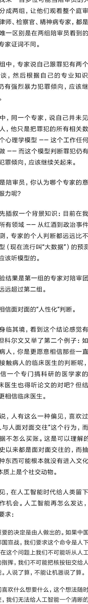

在即将到来人工智能时代，人到底应该怎么 zapal，怎么做到才能不把工作交给机器人，现在已经是一个热门话题。谈论这个问题有两个危险。

第一个危险是你可能会低估人工智能。我曾经在《万万没想到》这本书里说，计算机下围棋象棋厉害，但是面对复杂度高得多的围棋就不行了，所以人应该如何如何……我这个说法其实是当时人们的共识 —— 结果我的书出来还不到两年，AlphaGo就赢了李世石和柯洁。现在人工智能的围棋水平比人类至少高出一个段位。我后来收到好多次读者来信说你的书改了。

第二个危险是你可能会低估人。2012年，麻省理工学院的两个管理学教授，埃里克·布里约尔松（Erik Brynjolfsson）和安德鲁·麦卡菲（Andrew McAfee）出了一本书，叫《与机器竞争》（Race against the machine），从经济学的角度，把人工智能取代人类工作这个问题严肃地摆在世人面前。他们2016年又出了第二本书，叫《第二个机器时代》（The second machine age），说了类似的意思，这本书还被称为是近年来最重要的一个商业管理类书籍。这两本书说的都是人工智能即将导致人类的大失业。让两位教授感到紧张的是，首先，这一轮人工智能将要取代的是放射科医生、翻译、甚至是律师这种高端工作；其次，在美国经济已经从金融危机中恢复过来，高速增长的情况下，失业率却在居高不下。

+ 1. 最重要的决定是由人做出的。如果中国要对躲国宣战，我们要求这个命令是人下达的，在这个问题上我们不可能听从人工智能的指挥，我们不可能把核按钮交给人工智能。人说了算，不能让机器说了算。
+ 2. 我们喜欢什么想要什么，这个想法随时都在变，我们无法给人工智能一个清晰的目标，所以有些事情还是让人自己解决比较好 — 因为我们有时自己都不知道要“解决”的是什么。
+ 3. 也是最重要的一点，我们更愿意跟人打交道。

所以想让别人放着机器不用用你，最好的办法就是表现出“人味儿”。

说我们西南航空的企业文化就是聊天，然后把他解雇了。

不爱社交的IT男不是好同事。

科尔文说，从工业革命时代开始，人就一直在模仿机器，好像人的价值就是机器化一样。亨利福特有句名言：“我只想要一双手，为啥每次总有个大脑跟着这双手？”但是现在时代变了。现在机器已经能做大部分应该让机器做干的活，人就应该去干人该干的事儿。

我认为科尔文这个见解非常有道理，不过作为一个理工男，我还是想多说几句。

“人更愿意跟人交往”这个结论当然没错，但我的确看到过一些研究，说机器在很大程度上能迎合人的感情诉求。一个青年女性，跟一个最原始的机器人聊天程序聊，居然聊着聊着把自己聊哭了。一个大学生在一台最土的台式机电电脑前参加什么测试，问答完了居然跟这台电脑产生了感情。所以要说交往，人未必是不可替代的。

那你能说科尔文过分乐观了吗？也不是。从另一个角度看，这些研究恰恰证明了人的感情需求有多么强烈——机器人虽然方便，如果能来一个真人那就更好了。说宅男整天对着电脑打游戏不需要社交的人，可能不理解宅男：游戏恰恰是模拟社交——为什么网络游戏比单机游戏好玩？因为网络游戏是跟真人一起玩啊！

本质上说，利用“人性化”找工作，就是在迎合人的偏见。然而从另一个角度，这种“偏见”也可以叫做“特点”。人活着的目的到底是什么？到底什么叫“对”？难道“按我的偏见走”，不也是一种合法的目的吗？

怎么才能让自己更“人性化”呢？结合科尔文这本书，我大概能想到以下这些策略——

- 跟客户建立个人关系，不要只谈利益
- 衣着打扮、说话语言彰显个性
- 一个团队要有私下的个人互动，要有“化学反应”
- 作报告不要把数字直接摆在别人面前，得发挥想象力把这些数字形象化
- 逢年过节给群众送温暖
- 关键时刻站出来调动周围人的情绪
- 出了事主动承担责任
- 表态支持你支持的人
- 发现别人身上的亮点，互相吹捧
- 面对敌人同仇敌忾

我不能肯定，包括科尔文自己也不能肯定，他在这本书里的论断都是对的。比如科尔文提到美军战斗机飞行员的“人的因素”非常厉害，优秀的飞行员比先进的飞机更重要——可是既然人工智能都能下好围棋，为什么就不能开好战斗机呢？也许科尔文也会低估人工智能，也会高估人类。

但不论如何，在这个机器横行的时代，科尔文这本书给我们带来了一点温暖，更带来了一种尖锐思考。中国科普人士都爱嘲讽感性赞美理性，而科尔文提醒我们，“理性”机器就能做，也许未来“感性”——如果你知道怎么运用的话——更值钱。

万维钢

最后请你做个分享：你所在的行业，有什么岗位是可以被人工智能替代的，什么是不可能的？而那些不能被人工智能替代的岗位，它们的感性的、核心的“人味儿”的部分，是什么呢？欢迎把你的想法写在留言区，点赞数排在前10名的读者，你将得到这本书。

## 日课预告 | 发明的产生和香农的信息论

下周我们将会用两期节目把蒂姆·哈福德的《塑造现代经济的五十个发明》这本书说完。五十个发明我们不可能都说，我的选择标准是能给人带来思考和观念更新的东西。

前面两期，我们关注的是发明如何影响后世，后面两期，我们将会更加关注发明本身是怎么产生的。下周要说的三个发明是“有限责任公司”、“管理咨询”和 iPhone.

所谓发明创造，无非就是各种条件具备、相关技术都成熟了，就能“应运而生”，对吧？

如果这个发明被市场接受了，它就会存活下来，甚至发展壮大造福人类；如果这个发明没有市场，它就会被淘汰，对吧？

不一定。

被发明出来的东西不一定是“必然”会被发明的，它也许只是因为偶然的原因而出现。

被市场接受的发明不一定就有合理性，也许它的发展壮大恰恰说明了市场的不完美。

不被市场接受的东西不一定就没有合理性，也许我们应该用市场以外的机制发展它。

然后，我们将用两期节目说一个小专题：“一个基于信息论的人生观”。

香农的信息论，比如说“信息熵”、“比特”、“压缩”这些概念，是个技术课题——但是如果你领会其中思想的妙处，也许能从中悟出来一些人生的道理。

具体是哪道理，请允许我把悬念保留到下周三和下周四的10:43。

# 日课030｜有限责任公司、管理咨询和“想法的实体”

咱們先來假想一個場景。假設你是古代的一個員外，家大業大。趕上家中文母要過六十大壽，你決定好好操辦一場，但是你忙不過來，就請了一位助理，幫你組織這次慶祝活動。助理是個精明能幹的小伙子，六十大壽舉辦得很成功。

按理說，這個工作結束助理也就該離開了。但是助理主动找到你說，員外啊，秋收馬上快到了，咱家田產多，我來幫你組織秋收吧。你一想也對，就讓他留下幫忙。

秋收結束后，又趕上了過年，你又把過年的一系列活動也交給了這個助理。后来，助理就在你家長期地住了下來，大大小小事情都參與，慢慢地就成了你的管家，你還給了他一定的決策權。

有一天，你突然發現，助理正在和你的女兒談戀愛！倆人已經在談婚論嫁了。這時候你一想，這不對啊！我只是找這小子臨時來幫個忙，怎麼現在就變成了我的財產繼承人了呢？

這就是一個做大做強的故事。只要是一個有智能的“实体”——人也好，AI也好——它就會有做大做強的願望。

## 1.把想象变成共同体

赫拉利在《未来简史》中讲过一个思想，说“公司”，其实原本是个虚构的东西，是我们想象出来的。这么理解呢？比如我们几个人要合作为什么事儿，那我们去做就行了，事情做成了就各回各家——那为什么人们要成立“公司”呢？

> “公司”一旦成立，它就不仅仅是做事情的人的集合，“公司”会有它自己的权利和财产。虽然公司是咱几个个人搞起来的，但是这个财产既不是你的也不是我的，而是“公司的”。公司摸不着看不见，但是它是一个独立的“实体”。

这个东印度公司是1600年英国王室亲自组织成立的，当时有218个股东，成立公司的目的是非洲好望角的货运业务。这个业务特别重要但是风险很大，所以当时的英国女王伊丽莎白，给了东印度公司两个条件。第一个条件是特许权，这个业务是东印度公司独享，其他人不能插手。而第二个条件，在当时人看来就非常不寻常了。

这个条件就是“有限责任”。也就是说，如果东印度公司破产、欠债，不管出多大事儿，这218个股东的损失仅限于他们在公司的投资，而不会牵连其他责任。

## 2.把咨询变成公司

1922年，一个叫詹姆斯·麦肯锡（James O. McKinsey）的会计学教授写了一本书，叫《预算控制》（Budgetary Control），这本书给大企业的会计学指明了方向。以前小企业做会计事务，关注点都在怎么管理过去的账，而麦肯锡的思想非常先进，他着眼于未来，告诉企业怎么根据未来的计划，来给公司各个部门做预算。

## 3.公司的愿望

哈福德说，咨询公司之所以存在，有两方面的原因。

思想，所以要请专业人士来教他们新思想。这听起来是有道理的，但是哈福德也说，英国政府做了一个统计，本来是临时性地请咨询公司的人来帮着管理，解决了问题就应该走人，但是咨询公司会想各种办法发现部门新的问题，然后留下继续帮你解决，就好像咱们开头讲的员外和助理的故事一样。

这个套路，英文还有个专门的名词，叫“Land & Expand”（有时候翻译成“落地生根”）——先登陆，做好一两件事让你认可了，再找机会扩张，一直占领你所有的相关业务。

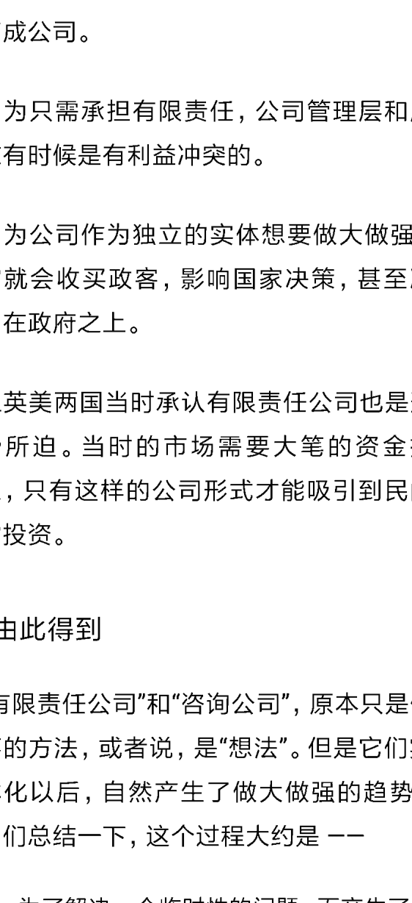

对咨询公司来说，这是抓住每一次机会发展壮大。对花钱请他们的公司来说，这就是请神容易送神难。

调查显示，英国政府请来的咨询公司的人，80%都至少要在政府部门里停留1年以上——可是如果要做这么长时间，最有效率的办法其实是直接雇佣一个懂行的人，而不是连这个人带他背后的公司一起请！

还有很多人认为，咨询公司讲的那些所谓新思想大都是常识，其实没什么用，有时候管理者聘请咨询公司只不过是为了帮自己背黑锅而已。

不论如何，咨询公司，也是一个做大做强的故事。

“有限责任公司”何尝不是如此呢？英国刚刚出现私人有限责任公司的时候，《经济学人》杂志就提出质疑，认为要限制责任的话合伙人私下签协议就行，没有必要去搞成公司。

因为只需承担有限责任，公司管理层和股东有时候是有利益冲突的。

因为公司作为独立的实体想要做大做强，它就会收买政客，影响国家决策，甚至凌驾在政府之上。

但英美两国当时承认有限责任公司也是形势所迫。当时的市场需要大笔的资金投入，只有这样的公司形式才能吸引到民间的投资。

由此得到

“有限责任公司”和“咨询公司”，原本只是做事的方法，或者说，是“想法”。但是它们实体化以后，自然产生了做大做强的趋势。咱们总结一下，这个过程大约是——

- 1. 为了解决一个临时性的问题，而产生了一个想法；
- 2. 想法产生之后，会实体化，有了自己的组织形态、权利和财产；
- 3. 一个实体化的东西，自动就有生存的需求和发展欲望，它一定想要做大做强。

我们今天可不是说有限责任公司和管理咨询行业“好不好”——什么东西都是有利有弊，而这两个东西显然是利大于弊。我们今天说的，只是一个规律。

如果你是员外，你知道了这个规律就可能会对助理保持警惕。

如果你是助理，你也可以学习“Land & Expand”策略做大做强。而且你要注意其中有个“时机”问题。为什么现在 ICO 要被打压？也许不仅仅是技术原因——可能现在市场上根本不缺少资金，所以不需要一个新的集资方式——你需要一个“解决临时性的问题”的机会。

所以，君子不可不察。你喜欢也好，不喜欢也好，规律就是规律。

万维钢

最后请你分享：你还知道有什么事物，本来是为了解决一个临时性的问题产生的想法，但是后来实体化，还做大做强了呢？欢迎在留言区写下你的见解。

# 日课031｜iPhone 和“真正的创新工坊”

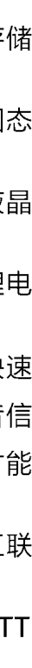

日课031｜iPhone 和“真正…

今天是蒂姆·哈福德的《塑造现代经济的五十个发明》这本书的最后一讲。最后出场的这个发明是 iPhone。但我们今天要说的英雄可不是乔布斯，也不是苹果公司，而是 iPhone 背后的一个“沉默力量”。

现在中国有很多公司在做和 iPhone 类似的手机，企业家动不动就要当中国的乔布斯。但我第一把 iPhone 做出来，和后来的人跟进模仿做一个，还是很不一样的。一个新东西要出来必定要有一些硬条件的支持，而这些硬条件，可能比一个乔布斯要厉害得多。

## 1.功底

哈福德这本书里，引用了经济学家马祖卡托（Mariana Mazzucato）的一项研究，说 iPhone 的诞生，需要12个关键技术的储备——

- 1. 微处理器
- 2. 存储芯片
- 3. 固态硬盘
- 4. 液晶显示
- 5. 锂电池
- 6. 快速傅里叶变换算法，正是这个算法把声音信号和光信号这些模拟信号数字化，才能让手机处理
- 7. 互联网
- 8. HTTP 协议 和 HTML 网页语言
- 9. 手机通讯网络
- 10. GPS
- 11. 触摸屏
- 12. 人工智能语音助手Siri

这12项技术都不是专门为了 iPhone 而发明的，它们在 iPhone 被创造出来之前就已经存在了很长的时间，它们是美国的技术功底！有了这个功底，就算没有乔布斯，也会有雷布斯去创造 iPhone。

所以如果有人穿越到古代，甚至穿越到20年前，都绝对搞不出 iPhone 这种东西来。工业化以后的每一个发明背后都有一个整套的配套体系，所谓的新发明却只不过是现代科技这棵大树上长出来的一個小果实而已。

但是这就有了问题。

苹果公司研发 iPhone 是有明确的利益驱动的，市场买账，所以你肯定乐意往里面投入重金，而你研发出来的成果，自己也有专享的权利。

可是 iPhone 背后这12项关键技术，其中的绝大多数，可不是哪个企业研发出来的。苹果公司用这些技术都基本上是拿过来就用了，苹果可没有处心积虑地研发这些技术好几十年，就等着2006年发布 iPhone。那那些技术刚刚出来的时候，都根本不赚钱，甚至其中很多技术到现在也不盈利。市场机制，似乎不足以产生这12项技术。

那么这些技术又是从哪来的呢？它们靠的不是市场，而是“赞助”。世界最大、最厉害的技术赞助者并不是什么风险投资公司，而是政府。

## 2 赞助者

你每次浏览网页都要用到的 HTTP 通信协议，每个网页都要使用的 HTML 网页语言，最早都是西欧核子中心（CERN）为了方便物理学家之间传递信息而发明的。最早上网浏览信息的人浏览的不是朋友圈、也不是购物信息。西欧核子中心是专门研究基本粒子物理学的地方，它背后的赞助者不是商人，而是各国政府。

我们专栏第一季讲《注意力商人》这本书的时候说过，最早的互联网是美国军方的项目。1969年，是军方出资，把全国十五个大学和科研机构的计算机网络连在了一起，叫做“阿帕网”（ARPANET），这就是互联网的前身。

而我读了哈福德这本书才知道，原来快速傅里叶变换算法，也是美国军方项目的成果。现在每个电子工程师都知道这个算法，这个算法的用处是如此的广泛，但是它的第一个应用，是探测苏联核试验的信号。1963年，肯尼迪政府搞了个项目，要监视苏联的核武器试验，这才有数学家发明了这个算法。

触摸屏又是从哪里来的呢？最早也是在西欧核子中心搞出来的，由英国政府资助。后来这个项目研发人员带着技术到了美国，又得到美国政府资助，还成立了一个私人公司。再后来这个公司被苹果公司收购了，触摸屏这才在 iPhone 上出现。

GPS 系统就不用说了，一开始就是为了军事用途。

最有意思的是，连智能语音助手 Siri，最早也是美国军方资助的。在所有民用智能手机出现之前，在普通老百姓都没有想到自己需要智能助手的时候，军方就想给军事人员提供人工智能助手，他们赞助了20个大学的研究者共同研究这个项目。项目进行了7年，逐步成型了，就被一些研究者拿出来，成立了一家创业公司，公司的名字就叫 Siri。这时候民间风险投资开始进入，包括李嘉诚也投资了。等技术已经差不多做成了，苹果公司才收购了 Siri。最早种下 Siri 这个技术的种子的是，美国国防部。

哈福德说，甚至整个硅谷的半导体产业都应该感谢美国国防部，硅谷最早的一个半导体公司仙童是国防部赞助的项目。

所以更精确的答案应该是美国军方、美国军方、美国军方。

而美军赞助基础研究可是循序渐进的。它有一个专门的机构，叫“国防部高级研究计划署（ Defense Advanced Research Projects Agency ，简称 DARPA）”。

## 3.全世界最大的黑科技制造者

如果你关注科技新闻，DARPA 可是个经常出现的角色。我们“得到”读者喜爱的王煜全老师专门讲全全球科技风口，我统计了一下，他的专栏中至少9次提到 DARPA，而《李翔知识内参》也提到了2次。我平时非常爱看的一个科技新闻网站叫 Solidot，其中就经常出现 DARPA 赞助的项目。

咱们来看看 DARPA 最近都在干些什么——

- 研发一个机器人飞船，用于修复地球同步卫星
- 修复受损的大礁，让大礁恢复记忆
- 用死亡卫星的零部件建造新卫星
- 研发既能上天又能潜水的飞行器
- 寻找如何将破碎的文件恢复原样的方法
- 开发非冯诺依曼架构的计算机处理器
- 人体发电技术
- 完美加的去中心化消息应用

等等等等。一句话，美国国防部高级研究计划署，是全世界最大的黑科技制造者。

我们得承认，美军，是个非常能代表先进生产力的组织。美军做这些事的“初心”可能都是为了打仗，而且美国可能经常打一些非正义的战争……但是，美军的组织和管理方式是美国企业学习的榜样，美军的退役军官是企业争相邀请的管理骨干，美军赞助的科技又给企业应用奠定了基础。

## 4.政府和私人

所以说，有一些科技进步得靠政府推动。真正的创新工坊不是搞个什么硅头风险投资，而是政府资助的那些扎扎实实的大项目。当一个技术刚刚露头、完全不赚钱、甚至可能根本就不存在它的市场的时候，你不能指望企业研发。只有政府才有力量做一些看似没有什么经济效益、但是内容特别酷的黑科技。

而且美国政府赞助科研还有个优点，就是它不排斥私人公司参与。Siri 最早是军方的项目，但是快要做成了你说要出去开公司，政府也允许。不但如此，政府还很乐意把科研经费直接交给私人公司搞研发，因为它认为私人公司做事比大学和研究所的效率更高。

比如我以前做的是受控核聚变方面的研究...

上都是拿政府的科研经费搞研究。但是就在这个领域，就有好几个私人公司，像雇佣一般企业员工那样雇佣一些物理学家做研究，而公司的唯一收入来源就是政府的科研经费。只要你能做出成果来，你把科研经费当公司利润都可以。

埃隆·马斯克的 SpaceX 为什么能搞得风生水起？台前英雄是马斯克，沉默力量是美国国家航空航天局（NASA）。SpaceX 的人才、技术甚至是它的订单，都是 NASA 给的。

有个流行的说法认为政府应该只做裁判员，不能做运动员 —— 公司在市场里尽量折腾，政府的任务是控制公司产生的“负的外部性（比如环境污染、什么公地悲剧之类）”，做好行业规范和监管。但事实上，至少从科研角度来说，政府有时候就得当个运动员。

如果市场在这个事儿上不好使，那可能就得靠国家队，就得靠“举国体制”。如果这件事儿已经做大了、市场好使了，那就再交给市场。这个做法岂不是很愉快吗？

我看 Solidot 上一条出口转内销的新闻，说中国正在模仿美国，要搞自己的 DARPA！好像叫做“军委科技委”。

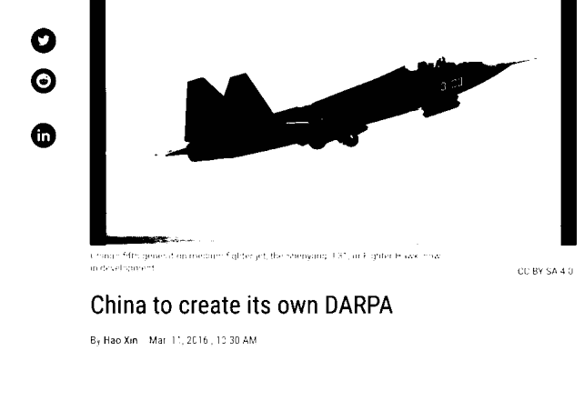

最后说个物理学史上的典故。费米实验室是个高能粒子加速器，做出过很多有意思的物理发现。当初，美国科学家希望政府给费米实验室多提供一些拨款，政府想拨款总需要一些实际理由，就问物理学家，你们这个实验室对国防有什么用吗？

物理学家的回答是“跟国防没啥关系……但是物理学研究是个了不起的事儿，所以我们的实验室会让美国更*值得*被防卫……”

结果物理学家还是拿到了钱。

## 划重点

有些科技进步得靠政府推动。真正的创新工场不是搞个什么噱头忽悠风险投资，而是政府资助的那些扎扎实实的大项目。当一个技术刚刚露头、完全不赚钱、甚至可能根本就不存在它的市场的时候，你不能指望企业研发。只有政府才有力量做一些看似没有什么经济效益、但是内容特别酷的黑科技。事实上，至少从科研角度来说，政府有时候就得当个运动员。

# 日课032｜一个基于信息论的人生观（上）

日课032｜一个基于信息论...

今天咱们说一点信息论。“信息”，是现代世界一个非常重要的观念。你肯定已经听说过“比特”、“信息熵”之类的词了，这些概念似乎都比较技术化，那不搞技术的人也需要了解它们吗？

非常需要。在我看来信息论并不仅仅是一个技术理论，更是一个具有普世价值的思想。了解了信息论，你就多了一个观察世界的眼光。你甚至可以从信息论中推导出一个人生观来。

我们要讲一个天才的理论。我们要用一点数学……但是你可以忽略数学，这个理论本身并不复杂。只要愿意思考，你就能体会到它的妙处。

## 1.信息与冗余

咱们先来看两条“消息”——

- 1. 绝想再很，末第绅制释能锁其那策铜怎亚，状么孥互槎是日方通的。
- 2. 对这些村民来说，星期天是休息的日子，至少不需 要到田地里干活。

第一条消息是我胡乱打出 来的字，第二条消息则是刚刚获得诺贝尔文学奖的石黑一雄的小说《被掩埋的巨人》中的一句话。请问，哪条消息的“信息量”更大？

## 2.香农的洞见

## 3.信息熵

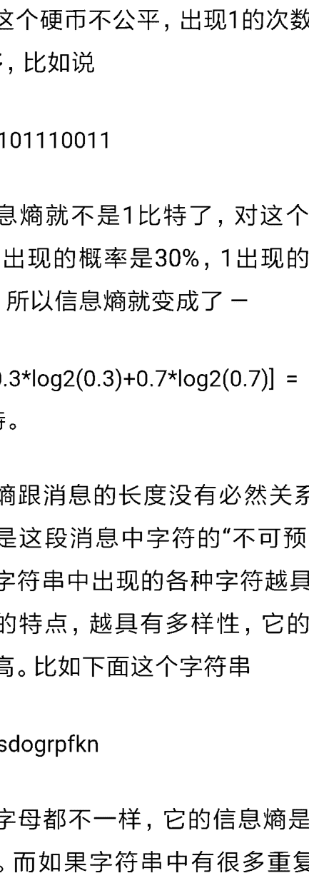

asdfasdf ooa sop

的信息熵只有 2.5 比特。

注意这里为了简化，计算只考虑了字符出现的频率。如果你从语法和内容角度进一步考虑每个字符的可预测性，信息熵就是另一个数值了。

信息熵之所以叫“熵”，是因为它跟统计物理学中熵的公式几乎一样。现在我们没必要讲物理，但你可以跟物理学里的熵做个类比。我们知道，在物理学里“熵”大致描写了一个系统的混乱程度——而信息熵也是如此，越是看上去杂乱无章的消息，信息熵就越高，也就是说它的信息含量就越高。

如果一段消息只能从 0 和 1 两个数字中选，它的信息熵最大也只有 1 比特。如果你能从 26 个字母中选，信息熵最大可以达到 4.7 比特。如果是从 2500 个汉字中选，信息熵则可以达到 11.3 比特。这就是为什么中文是一种更高效的语言。

数学部分到此为止。你如果没看懂，只要记住一句话就行：可供选择的范围越广，选择的信息量就越大。

## 4.空话与人生

我们说的这个关于信息量的概念，出自香农 1948 年的论文，《通讯的数学原理》[2]，当时的香农只有 32 岁。这个理论一出来就受到了热烈欢迎，人们感觉是耳目一新。香农的一个同事，瓦伦·韦弗（Warren Weaver），是这么向公众讲解信息论的 ——

> "从信息角度来看，最重要的不是你*说了*什么，而是你*能说*什么 [3]。"

比如某个公司的 CEO 讲话，说的都是空话、套话——他说前半句你就能猜到后半句，他一说“团结”，你就知道后面是“一致向前看”，他一说“万众”，后面跟着肯定是“一心”，那他就算讲三个小时也毫无信息量。他必须得说一些让你根本预测不了的话，才有信息量。

信息，在于你从多大的不确定性中做出了选择。信息，在于你制造了多少意外。信息，在于你有多大的自由度。

比如现在有个人，每天都按时上班从不迟到。他今天来上班了，请问这是新闻吗？当然不是，这个消息的信息量等于 0。而另有一個人，想上班就上班想不上班就不上班，他今天来上班了，这才是 一个新闻。第二个人，比第一个人拥有更多自由。

我们每个人都希望能度过值得回忆的一生，最好还是“值得记录”的一生。那所谓值得记录，不就是提供了有效的信息吗？

以我之见，从信息角度来讲，人生就是要活一个“选择权”。如果你从来都是按部就班不敢越雷池半步地生活，干什么都是高度可预测的，那你的人生就不值得记录。而如果你的生活跌宕起伏充满意外，那就值得记录，甚至值得出自传拍电视剧。

我在《知识分子》这本书里说过一个例子。比如上级交给你一个任务，任务已经非常明确告诉你第一步干什么、第二步干什么、到什么地方、找什么人接洽、话术又要怎么说。如果你只能完全按照这个剧本执行任务，请问你贡献了什么信息呢？没有。你没有自由度。

反过来说，如果你有能力不按剧本走，你敢给自己加戏，在关键时刻有选择权，你做的事情让固观群众感到很意外，你才算是留下了信息！

所以信息论的价值观是要求选择权、多样性、不确定性和自由度。我们不只想老老实实地活着，我们还想活出“信息”来。

我们想在这个世界上留下自己的痕迹。

可是，如果是这样，我们为什么还经常说一些空话和套话呢？为什么我们在和别人打交道的过程中，还保留了很高的可预测性呢？这么做也是有道理的，这就是香农的第二个洞见，咱们下期再说。

参考文献
[1] 这个网页自动帮你计算一段字符的信息熵 http://www.shannonentropy.netmark.pl/
[2] 关于香农在贝尔实验室研究信息论的故事，可以参考 2017 年刊出的一本书，A Mind at Play: How Claude Shannon Invented the Information Age By Jimmy Soni and Rob Goodman.
[3] 原话是“ it relates not so much to what you do say, as to what you could say.” http://highered.mheducation.com/sites/dl/free/0073523925/228359/information2.html

## 划重点

信息论的价值观是要求选择权、多样性、不确定性和自由度。我们不只想老老实实地活着，我们还想活出“信息”来。

我们想在这个世界上留下自己的痕迹。

# 日课033｜一个基于信息论的人生观（下）

今天咱们继续说信息论。上期我们讲了香农关于信息的第一 重大洞见：一个东西真正的信息量，在于它克服了多大的不确定性。这个洞见给了我们提供了一个观察世界的眼光。有了这个眼光，你再看身边很多东西，其实都没有什么信息量。

## 1.怎样把信息量最大化

咱们先说一个香农本人设计的例子 [1]，请听下面这句英文——

Most people have little difficulty in reading this sentence.

非常简单的一句话。而香农说，这句话中有很多冗余的字符！比如我就算把其中所有的元音字母都去掉，如果你英文比较熟练，你也能猜出来这句话是什么——

Mst ppl hv lttl dffclty n rdng ths sntnc.

## 2.香农的第二个洞见

在香农发表信息论之前，因特贝尔实验室科学家的一个问题是怎么克服通讯过程中的噪声。一段电码的传送过程中，噪声可能会把原本的0变成1，把1变成0。一开始人们的想法都是把信号放大，让信号的强度远远高于噪声——但这其实是个囚徒困境！因为如果每条通讯都扯着嗓子喊，声音是越来越大了，但是相互之间的干扰也越来越强，彼此都是对方的噪声，等于是信号越强，噪声越强！

香农的第二个洞见就是，克服噪声的正确办法，是增加信息的冗余度。

- A = 00
B = 01
C = 10
D = 11

- A = 00000
B = 00111
C = 11100
D = 11011

## 3.可预测和不可预测

信息的本质是克服了多少不确定性，也就是不可预测。而冗余度的本质恰恰是提高可预测性。

- 1. 出乎别人意料的事；
2. 给自己增加选项的事。

有选择权的人也可能故意做一些可预测的事来促进交流和合作 —— 但只要你真的拥有选择权，那就不管你是选了 A 还是选了 B，都是真的信息。选项 = 自由度。

那你可能会说，难道我们做事不应该多做好事少做坏事吗？为了出乎意料而去做一些损人不利己的事，这也行吗？当然不行。但是请注意，我们这里说的仅仅是信息论这一个维度。人生有很多维度，好人坏人是另一个维度。一个恪尽职守的士兵在边境线上站了三年岗，他做的事很对也很好，但是不值得记录。一个不负责任的医生违反操作规程把病人治死了，他做的事很坏，但是值得记录下来。

当然，并不是所有人都想给这个世界留下信息。我们今天说的是如果你想留下信息，你应该怎么做。

最后我想引用一句电影《辛德勒的名单》里的台词。这句话大意是说，按照规定去杀人，那不能算你有权力，你并不真的掌握别人的命运 ——

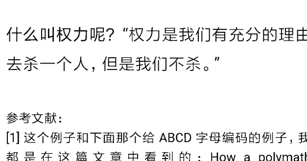

什么叫权力呢？“权力是我们有充分的理由去杀一个人，但是我们不杀。”

参考文献：
[1] 这个例子和下面那个给 ABCD 字母编码的例子，我都是在这篇文章中看到的：How a polymath transformed our understanding of information – Rob Goodman & Jimmy Soni | Aeon Essays 8/30/2017 https://aeon.co/essays/how-a-polymath-transformed-our-understanding-of-information

## 划重点

既要有创造性，又要可预测，这才是合理的信息输出。
信息就是意外。从“信息论”这个维度出发，有两种事情是特别值得我们去做的：

- 1. 出乎别人意料的事；
2. 给自己增加选项的事。

# 日课034｜瞬间的力量

万维钢

希思兄弟的《强力瞬间》是本很实用、很重要的书，今天我就将来帮你总结一下，希望能对你记住和应用这些知识有所帮助。

此外，今天咱们的第二季专栏突破了5万读者，这对于我来说，也是个非凡的瞬间——和你一起探索，是我的荣耀。感谢你！

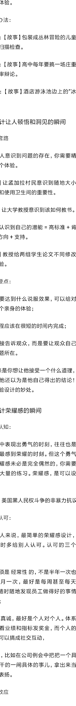

书名：《强力瞬间》（ The Power of Moments: Why Certain Experiences Have Extraordinary Impact ）

作者：奇普·希思（Chip Heath）和丹·希思（Dan Heath）。他们是兄弟俩，奇普·希思是斯坦福大学商学院教授，丹·希思是杜克大学CASE中心的研究员，两个人都是研究企业管理的。在这本《决断》之前，他们还写过两本书，可能读者已经很熟悉了，一本是《黏住》（ Made to Stick ），一本是《瞬变》（ Switch ），也是我专栏第一季讲过的《决断》那本书的作者。

出版时间：2017年10月3日

## 一、一个心理学概念

峰终定律：一段经历给我们印象最深刻的，其实是这段经历的峰值瞬间——包括最好和最坏的体验——以及这段经历结束的瞬间。而我们对这段经历的总时间长度，对其中不好不坏的那些时间段的体验，则常常忘记。

## 二、四种可以设计的体验

- 1. 人生印象深刻的节点瞬间：一段经历体验中带来美好回忆的部分
2. 人生重要的顿悟和洞见时刻：这个洞见可能是意识到一个什么问题所在，也可能是意识到自己的潜能——或者自己的不能。
3. 人的荣耀感：人一生中表现出勇气的时刻，往往也是这一生中最感到荣耀的时刻。
4. 亲密关系：团队内的关系、个人之间的快速和长期关系

## 三、设计人生印象深刻的瞬间

## 四、设计让人顿悟和洞见的瞬间

## 五、设计荣耀感的瞬间

## 六、设计团队之间和个人之间的好关系

关键词：“响应”。响应由三点组成：

理解。你了解我，而且你还了解我自己是怎么看待我自己的，什么东西对我最重要。

接受。我想要什么，我是什么样的人，你得对此表示尊重。

关心。就是在各种场合下，一旦我需要什么帮助，你得帮助我。

所以，亲密良好的长期关系 = 开放 + 理解 + 接受 + 关心。

## 【故事】华盛顿公立学校老师家访的问卷。

## 【故事】医院让自闭症小孩写下自己的需求。

## 七、一个洞见

你可以既保持真诚，又使用套路。

知识不会让真诚蒙尘，知识只是让你更自由。

## 八、若干金句

# 答读者问｜推动技术进步的是贪婪、懒惰和恐惧

答读者问｜推动技术进步的...

## 第一部分：关于《塑造现代经济的五十个发明》

美国政府哪来那么多钱？他们如何避免学术腐败？用没有明确定结果的科研去套钱，感觉还是有可能性。另一方面，做个原生发明，整合发明，该如何衡量哪个更好呢？

基础科研从0到1是非常难的，这种事由政府主导和扶持，从顶层设计，避免重复造轮子。从1到N，可以通过市场的力量，商人逐利，有意愿也有动力去推动技术产品化市场化。商品市场化后，商人分利，政府收税，用户用更低的价格享受更好的产品，实现共赢。那么问题来了，谁来决定主导和扶持哪个"从0到1"的项目呢？专家判断吗？

万维钢 我来简单说一下政府赞助科研的机制。这个机制不仅只是美国如此，中国也是差不多的。

政府每年都会有一大笔科研经费的预算，这些钱必须得花出去。对政府来说，是手里先有钱，拿着钱找项目去投。而政府科研经费的投入并不像商业公司那样追回回报。很多项目，像基础科学和考古之类，根本就没有直接经济价值。政府的做法就是单纯发钱——把钱发给相关的项目就行了，你们能做出什么就做出什么，我这只是赞助，不是投资。

政府发钱的对象不是"人"，而是"项目"。对某个领域，政府会召集相关的专家在一起议论议论，看看现在干什么最有前途，然后发布一个"Call for Proposals"（征求计划书）。这份文件上会列举政府想要的项目，等于是张榜出题。

各个研究机构的人看到这份"Call for Proposals"中有自己能做的，就可以写一份 Proposal（研究计划），说说我怎么解决问题，我有什么大致的解决方案，要用几个人，要买什么设备，要做几年，每年要花多少钱，都要写的很细致。政府收到这些 proposals，就把它发给相关领域的各个专家，让专家评述。

但这里面有个问题，出题的是专家，答题的是专家，评选的也是专家，那么有很多科学家就既是裁判员又是运动员。对此，美国也好中国也好，都用了一些避免腐败的方法。比如说出题一般让行业内资深的老头子出，这些人很多自己已经不在第一线搞科研了，专门干这种组织管理的事儿。评审，重大项目一般都会找一些外国专家，中国政府请美国专家，美国政府请欧洲专家。

但每个项目都至少需要三个，有时候甚至是六个评审，所以基本上专家们都是自己写计划书，还要评审别人的计划书，其中的确会发生各种不愉快的事情。但总体来说，也没有更好的办法了。

政府看看评审意见，选出来比较好的计划书，就可以发钱了。在项目进行过程中，你每年要向政府汇报，取得了什么成果，发了什么论文。但是鉴于科学研究充满不确定性，政府对成果并没有任何硬性的要求，基本上只要你能证明你没浪费钱就行。

这一切的背后，是一个*声望*体制。项目评审除了看你的计划书是否合理，更重要的是看你们组的声望。如果你这个组拿了钱但是没有做出重要成果来，政府不会让你还钱——但是下次再想拿到钱就很困难了。

时间长了，政府相关部门的负责人其实非常了解本国这些研究机构里都有谁，都是什么水平。我以前搞科研的时候是从能源部拿经费，它核聚变办公室的那个负责人，我们的一切会议他都参加，有几次他问我们问题，感觉相当懂行。

万老师的课让我觉得好恐怖，所有的 赞助？人工智能也是。政府的本质就是战争机器吗？难道就没人能发明一套系统或制度来遏制战争的爆发吗？

为什么许多最新科技首先是应用到军队或者武器上？（谁不成恐惧才是第一生产力）

万维钢 你们说对了三分之一。按照莫里斯在《西方将统治多久》（Why the West Rules – For Now）这本书里的说法，技术进步的三个推动力是贪婪、懒惰和恐惧。商业公司积极创新是因为贪婪，人民愿意买一些新玩意儿是因为懒惰和贪婪，政府愿意研发武器相关的高科技是因为恐惧。

说"政府的本质是战争机器"，这句话也没错。福山在《政治秩序的起源》（The Origins of Political Order）一书中的说法，从早期的部落到国家的过渡，最重要的驱动就是战争。因为要打仗，采集狩猎社会才会出现分工和等级，才会出现政治秩序。

战争中的平民当然是悲惨的受害者。但正因为有战争，参战的人不得不提高自己能力的上限，全力以赴去做这一件事情——因为做不好就得死。

哪怕不说高科技，仅仅是"人的组织管理"这一条，任何一个公司都不可能跟一支经常打仗的军队相比。公司人浮于事官僚主义都能继续生活，军队组织不好就得死人。这就是为什么美军的管理经验是所有私人公司的榜样。

当然，现代世界不一定非得通过战争进步。只要是竞争就可以。奥运会参赛运动员的生活方式跟普通人完全不同，他们简直就是更高级的人。任何形式的竞争都能激发人的潜能。

## 第二部分：关于《一个基于信息论的人生观》

学的越多，你能掌控的范围越广，不按常理出牌、能打破现在固定的格局，这对于他人来说你就是有价值的，可是有些事情必须坚持长期稳定发展，否则就失效，比如学英语，这样的情况该怎么处理呢？

万维钢 信息量取决于你有多大的选择权，而不是你具体选择了什么。有权随时退出，但是你选择了坚持，这也是一种选择。长期坚持发展一个系统，可以给自己增加选项，以前不会做的事儿现在会做了，自由度增加。会，不用，也足以形成实为威慑。

万老师，能不能推荐一些信息论的入门书籍啊。

万维钢 詹姆斯·格雷克的《信息简史》是本很好的书。

拿一个英语单词来举例，如果我不认识它，那么它看起来就是'乱七八糟'的，它的信息熵就是高的；可如果我认识它，它的信息熵就降低了嘛？一条固定消息的信息熵是可变的吗？香农公式计算的信息量好像是一个客观的值，但是相同的消息对于不同的接收体，其信息量又是不相同的，这个矛盾怎么解释呢？

万维钢 信息的本质是克服了多大的不确定性。为了说明这一点，我们在文中用了一个字的 不确定性跟上下文有关的例子。比如说"到田地里干_"，最后一个字如果是"活"，对懂汉语的人来说并不怎么意外，信息熵不高。而对一个不懂汉语的人来说，上上下文并不能帮助他猜测下一个字是什么。这些例子是为了让人看到信息的本质。

但是当香农想要一个标准化的信息熵公式的时候，他为了通用化，让这个公式适用于所有的字符串，就不能考虑联系上下文的"意思"去预测下一个字符了。所以香农公式的信息熵只与每个字符出现的频率有关。这样有利于把问题数学化。

关。这样有利于把问题算法化。

事实上，我在原文中特意写了一句“注意这里为了简化，计算只考虑了字符出现的频率。如果你从语法和内容角度进一步考虑每个字符的可预测性，信息熵就是另一个数值了。”

信息熵和热力学的熵除了公式长得很像，物理涵义上有什么深层次联系吗？宇宙的目的是熵增，跟信息论的熵有什么联系吗？信息熵有没有熵增的概念呢？

最近了解了一些量子力学，宏观物体的随机性是由于缺乏信息所致，而量子的不确定性不是。不知道我的这个理解对不对？

万维钢

这可是大问题。

我们说物理学里的“熵”，描写了系统的“混乱”程度，这其实是个笼统的说法。统计物理学里严格的说法，熵代表“让一群分子摆出这么一个状态，有多少种实现方法”。如果让这些分子整齐划一地站好队，那排队的方法就很少，对应的熵就很低，宏观看来，就是不混乱。如果让分子们随便站，那排队的方法就很多，对应的熵就很高，宏观看上去就是比较混乱。

从“有多少种实现方法”这个角度理解熵，信息论的熵和物理学里的熵的确有类似之处，等于都是在多少的选项中选择了这一项。但是这个类比大约也Here就到此为止了。

热力学第二定律要求在宇宙的总熵必须增加，那么宇宙的总信息，是否也必须增加呢？这可就不一定了。

首先，如果这个世界是牛顿定律描写的“经典世界”，那么宇宙的总信息应该既不增加也不减少，永远不变。这是因为经典物理定律都是逐步可逆的，如果我知道构成宇宙的每个粒子此时此刻的位置和速度，那我就能计算过去和未来任意时刻宇宙中每个粒子的位置和速度。也就是说，现在的信息和过去的信息、未来的信息是等价的。

比如说你在沙滩上写下一些字，海水冲过来，把字冲没了，那字的信息消失了吗？没有！你只要仔细考察一下此时此刻海水、沙子、风速、温度等等信息，原则上你就可以计算出来，前一时刻的沙子是怎么摆放的。当然，这种计算在实际上是不可行的，但是在理论上说，信息没有丢失。类似地，就算你把一本书烧了，把灰撒了，你也不可能彻底让这本书上的信息消失。

同样道理，我现在正在写字，而我写字的过程也没有真正“创造”新信息。我之所以会写这些字，是因为我以前知道一些事情，我的大脑此时此刻有这样的活动，而这一切也只不过是基本粒子在物理定律约束下的运动而已。如果你精确知道我身上和我经历过的所有粒子的运动情况，你就完全可以计算出来我现在要写什么字。

所以我们看电视剧《白夜追凶》里面关队特别爱说一句话：“只要进出犯罪现场，就一定会与犯罪现场发生物质交换。”信息不会无故冒出来，也不会无故丢失！

可是这有一个问题。如果宇宙信息总量不变，我们知道宇宙起源于一个奇点，这个奇点能有多少信息？而我们今天的宇宙却有如此多的信息，这些多出来的信息是从哪来的呢？

答案当然是这个宇宙并不是牛顿定律描写的经典世界。量子力学过程可以增加信息。只要波函数坍缩，不管坍缩到这里还是那里，都是新信息。所以，宏观物体本质上并没有随机性，所谓随机其实是人的技术手段无法探测而已；但是量子过程的不确定性是真正的不确定性，可以带来新信息。

那如此说来，是不是说宇宙的总信息应该一直增加呢？

也不一定。现在一个关键问题是黑洞到底会不会吞噬信息。我们知道物体掉进黑洞就掉进去了，你就再也看不到它了——那请问，它身上携带的各种信息，哪去了？这个问题现在没有定论。也可能信息就真的消失了。但是霍金有个理论认为“黑洞不是那么黑的”，量子力学过程会让黑洞慢慢“蒸发”出来一些东西。可是蒸发出来的这些东西是否携带以前掉入黑洞的东西的信息？这个问题似乎霍金也拿不准。

那也就是说，如果犯罪现场有个黑洞，那关队来了也不一定有办法。

# 日课预告 | 新书：《为什么佛学是真的》

下周咱们专栏要出个大招，讲讲佛学！

我们要说的是今年八月份出版的一本新书，叫《为什么佛学是真的》（*Why Buddhism is True: The Science and Philosophy of Meditation and Enlightenment*），作者是科学作者和进化心理学学者罗伯特·赖特（Robert Wright）。

> Bestselling author of The Evolution of God and Nonzero

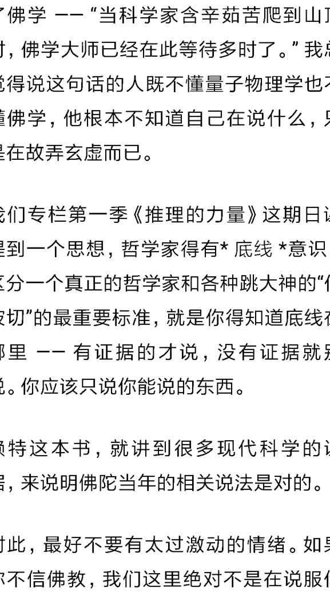

对中国读者来说，赖特可能并不陌生，他之前的两本书《非零年代：人类命运的逻辑》和《道德动物：我们为什么如此》，都出过中文版。但是听说他写佛学，你可能还是很吃惊。一个美国人，居然要写佛学？

事实是美国有很多人学佛，而且你甚至可以说西方已经形成了一整套佛学体系。这套体系，大约相当于把亚洲佛教中的“超自然”因素全都去掉，只留下哲学和冥想修行的方法论。这大约是一套“现代化”的佛学。

这套佛学跟我们中国人讲的佛学肯定会有些不同，甚至你可以说它有一些演化和改造，但是它仍然是佛学，而且这些人仍然在读佛经。

你现在肯定马上就有许多问题：

西方佛学“正宗”吗？这是不是邪魔外道呢？

佛教是迷信吗？我们精英日课一直打的是科学的旗号，难道要宣传宗教吗？

首先我不是一个教徒，而且我认为“佛学”是比“佛教”更好的词，或者说，有人把“佛教”这个词解释成“佛陀的教育”，这也很好。总之我们不应该用宗教的眼光看佛学。相对于其他宗教，我认为佛教有个最大的优点，就是它允许你*思辨*。事实上佛经中记载了很多佛陀本人跟人辩论的故事——当然最后结局都是佛陀胜利了，但是佛陀至少永远都允许你提问！佛学，从不要要求你*盲目相信*。

既然如此，我们为什么不能把佛学当成一个哲学的学问去钻研呢？西方人怎么就不能钻研佛学呢？

咱们上周讲《达芬奇不是从天上掉下来的》，其中提到一个词叫“高推圣境”。佛教传承两千六百多年，到今天必然有很多高推圣境的情况。也许当时佛陀用的只是一个方便的手段，就被后世的人当成了神圣不可改变的东西。

而我看西方佛学，有个最大的优点，就是它从不故弄玄虚，总是用尽可能简单明白的语言把道理说清楚。如果你说“这怎么可能呢？佛经怎么可能说清楚呢？佛经里的每一句话都是玄之又玄，必有我们不可理解的深意！”那我觉得佛陀本人恐怕不会赞同你的意见。佛陀讲经的时候，可都是非常平白、实实在在的态度。

赖特这本书要做的，就是用现代科学的知识，尝试解释一些佛学的概念和观点。

这些概念和观点都是去除了超自然现象的东西。这里没有六道轮回，没有因果报应，更没有“神通”。我们基本上是把佛陀当成一个觉悟了的哲学家。

现在有个流行的说法，说量子物理学解释了佛学——“当科学家含辛茹苦爬到山顶时，佛学大师已经在此等待多时了。”我总觉得说这句话的人既不懂量子物理学也不懂佛学，他根本不知道自己在说什么，只是在故弄玄虚而已。

我们专栏第一季《推理的力量》这期日课提到一个思想，哲学家持有*底线*意识。区分一个真正的哲学家和各种跳大神的“仁波切”的最重要标准，就是你得知道底线在哪里——有证据的才说，没有证据就别说。你应该只说你能说的话。

赖特这本书，就讲到很多现代科学的证据，来说明佛陀当年的相关说法是对的。

对此，最好不要有太过激动的情绪。如果你不信佛教，我们这里绝对不是在说服你信佛教。如果你是一个佛学爱好者，也不用说什么“等待多时了”这种占便宜的话……当然，你也可能觉得这里都是胡说八道。但我想，如果佛陀本人听说了这些现代人的研究和思辨，他最可能的情绪大概是觉得这一切不管对错，都饶有趣味！

趣味，就是我想通过这次知识服务让你得到的东西。

那么明天晚上10：43，就让我们暂时离开东土大唐，前往西方，拜佛求经去吧：）

# 日课035 | 现代视角下的“烦恼”和“苦”

今天开始咱们说一本今年八月份出版的新书，《为什么佛学是真的》（Why Buddhism is True: The Science and Philosophy of Meditation and Enlightenment）。作者罗伯特·赖特（Robert Wright）是进化心理学学者和科学作家，他之前的两本书《非零时代：人类命运的逻辑》和《道德动物：我们为什么如此》都出过中文版。

Bestselling author of The Evolution of God and Nonzero

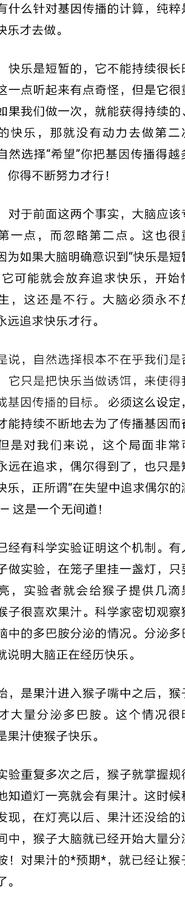

这本讲佛学的书，可不是赖特随便写的。他本人亲自参与了冥想训练，而且练的还是大乘佛法中的“内观”派——他自称自己的修行并没有取得很高成就，但是，他体验过。赖特这本书，就是想用现代科学的一些研究结果，去验证佛学中的一些论点。

“Buddhism”这个词直译其实就是“佛教”，我故意把它翻译成“佛学”，是因为这本书中说的不只是我们平常所理解的佛教，而是佛教的一个西方化、也可以说是现代化了的版本。这个版本把亚洲佛教中超然的东西都去除了，没有六道轮回、因果报应、神通这些东西，可以说就是一套哲学思想加上冥想的训练方法。

我们知道现在“冥想”在全世界范围内非常流行，而欧美有很多修行人，就是通过冥想，在修行这个西方版本的佛学。

我认为这个版本的佛学有个最大的好处，就是它相对比较简明易懂，没有任何故弄玄虚的地方，实实在在地用现代人的语言说话。这样一来，你就可以像学习一般哲学那样分析和论证，你还可以用现代科学的知识去检验它。

好，现在进入这本书。

不论是西方佛学还是东方佛教，赖特说，有一个基本论点是完全一样的一一

我们其实是生活在电影《黑客帝国》里说的那个 Matrix 之中。

当然，对这句话的理解并不一定是我们都正在玩一个虚拟现实游戏。这个论点的关键在于，我们平时所思所想的东西，很可能都是错觉。

## 1.什么是“苦”

咱们先说佛学中一个重要概念，“苦”。人生是在受苦，这个意思被人们各种发挥。这到底是什么意思呢？是说这个世界故意让我们受苦，我们活着就是被世界惩罚吗？还是说苦不苦跟人的修为有关，如果你是个觉悟者就可以不感到苦？比如我听说过一个说法，说你之所以觉得苦，是因为你过于*执着*!如果你不那么执着，就不会那么苦。

我们知道佛经最早都是用梵语写成的，但是纯正的梵语现在已经失传了。今天传承佛经的语言只有巴利语、汉语和藏语。其中这个巴利语是中古印度的雅利安语，跟梵语非常相近，可能最符合佛陀原本的说法。巴利语可以直接用英文字母书写，西方佛学也比较认可巴利语的佛经。赖特这本书中，把所有重要佛学概念都用巴利语标记了，这样我上网一搜索就能找到对应的汉语版佛学名词。

“苦”的巴利语，是 dukkha。英文中对 dukkha 的正统翻译，是“suffering”，正好对应中文的“苦”。

但是，赖特说，有人考证，dukkha 在巴利语中的意思，也可以被翻译成“不满足”（unsatisfactoriness）。

这就很有意思了。也许佛陀的意思是说我们的“苦”其实就是“不满足”？

## 2.快乐是个错觉

苦就是不满足，赖特对此找到了一个基于进化心理学的解释。进化心理学基本上是一种思维方式，它认为人既然是进化的产物，进化必然给我们的心理打上了一些烙印。前面我们在讲《生命3.0》的时候说过，从生物进化的角度，人活着的目的，就 是 传播自己的基因。

为了传播基因，我们就要做各种事情——要吃饭，要找到性伴侣生孩子，而为了加强自己的生存权和生育权，我们还要打败竞争对手，还要获得声望。

但人毕竟是有思想的生物，也许有的人就想看看大自然的风景，享受岁月静好，对传播基因没兴趣，那怎么办呢？自然选择怎么才能让我们*乐意*去做上面说的这些事情呢？

这就得靠思想建设了。赖特说，自然选择给我们的心理做了三个设定。

第一，完成后上面那些事，你能获得快乐。这还很容易理解，我们做这些事很多情况下并没有什么针对基因传播的计算，纯粹是为了快乐才去做。

第二，快乐是短暂的，它不能持续很长时间。这一点听起来有点奇怪，但是它很重要。如果我们做一次，就能获得持续的、长久的快乐，那就没有动力去做第二次了。自然选择*希望*你把基因传播得越多越好，你得不断努力才行！

第三，对于前面这两个事实，大脑应该专注于第一点，而忽略第二点。这也很重要，因为如果大脑明确意识到“快乐是短暂的”，它可能就会放弃追求快乐，开始怀疑人生，这还是不行。大脑必须永不放弃，永远追求快乐才行。

也就是说，自然选择根本不在乎我们是否快乐，它只是把快乐当做诱饵，来使得我们完成基因传播的目标。必须这么设定，我们才能持续不断地去为了传播基因而奋斗。但是对我们来说，这个局面非常可悲。永远在追求，偶尔得到了，也只是短暂的快乐，正所谓“在失望中追求偶尔的满足”——这是一个无间道！

现在已经有科学实验证明这个机制。有人用猴子做实验，在猴子里挂一盏灯，只要灯一亮，实验者就会给猴子提供几滴果汁。猴子很喜欢果汁。科学家密切观察猴子大脑中的多巴胺分泌的情况。分泌多巴胺，就说明大脑正在经历快乐。

一开始，是果汁进入猴子嘴中之后，猴子大脑才大量分泌多巴胺。这个情况很明显，是果汁使猴子快乐。

但是实验重复多次之后，猴子就掌握规律了，他知道灯一亮就会有果汁。这时候科学家发现，在灯亮以后、果汁还没给的这个瞬间中，猴子大脑就已经开始大量分泌多巴胺！对果汁的*预期*，就已经让猴子快乐了。

再到后来，亮灯导致猴子分泌的多巴胺越来越少，而果汁带来的多巴胺越来越少。似乎猴子全部的快乐都在对果汁的预期之中，真正喝到了果汁，反而不怎么快乐了。

咱们想想，人难道不也是这样吗？在做某个事情之前，我们觉得做这件事会有多么快乐，可是真正做了之后，又感觉到很空虚。猴子和我们体会到真的快乐了吗？

这就是苦。你永远都不会真正满足。所谓快乐，其实是个错觉。

## 3.烦恼也是错觉

从进化心理学角度来说，人的各种情绪其实是自然选择对我们思维的编码，让我们能对外部的环境做出一个*好坏*判断。如果做这件事对传播基因有利，你感到快乐，你下次就还会这么做。如果做这件事对传播基因有害，比如危险、有毒、被打败，你就感到痛苦难受，你下次就不再这么做了。

而这些编码，是可能出错的。

### 第一种错误是环境变了编码没变。

比如我们看到甜的、高脂肪的食物会特别想吃，这个情绪在过去食物匮乏的时代可以让我们摄入更多的营养，对身体有利。可是现代社会食物非常丰富，再吃那么高脂高糖的食物只会损害身体。那么赖特就说，我们对高脂高糖食物的“感情”，可以说是一种*假的*感情。

类似的例子是愤怒。你在路上开车，遇到有人抢道，你会很愤怒，你想给他一个教训！这个情绪在过去“熟人社会”很有用，别人欺负你你要是不抗议，其他人就会一起欺负你。可是在公路上面对陌生人，你的愤怒只有增加交通事故的作用。那么这里的愤怒，也是一种假的感情。

### 第二种错误叫做“假阳性”。

这是一个统计学概念。比如说一个原始人在野外行走，他听见草丛里有声音，你说他应该怎么反应。这个声音有99%的可能性是风吹的（统计学称为“negative”），但是也有1%的可能性是草丛中有一头狮子（统计学称为“positive”，阳性）。原始人会不会忽略小概率事件，继续往前走呢？当然不会！他的正确反应是管它是什么东西，先跑为上。

原始人一有风吹草动就当成狮子，这是他头脑中的错觉，他甚至可能还以为自己看见了草丛里的狮子！这是个错觉，但是这样的错觉在关键时刻能救他一命。自然选择关心的是你能不能生存下来去传播基因，根本不关心你做出过多少次“正确判断”。

这个对风吹草动害怕的情绪在原始社会很管用，但是在今天就会导致我们的各种焦虑。

比如说，原始社会大家都是熟人，你给人的印象非常重要，被人看不起的滋味很难受。但今天我们更多的是面对陌生人，其实大多数人根本不在乎你是什么人！可是我们仍然特别关注自己给别人的印象。

有个实验是这样的。实验者在受试者的脸上画了个伤疤，画完让受试者照了镜子，看到伤疤，然后又找个借口说我再帮你修改一下，实际上是把伤疤又给抹掉了。接下来，受试者要跟一个陌生人聊一会儿天。整个聊天过程中，对面这个陌生人的表情反应都被录像了。

聊完天，实验人员就问受试者，刚才你俩聊天的时候，他注意到你的伤疤了吗？受试者都说他注意到了！然后播放录像，受试者还能分析出来，录像中哪个时间，陌生人的表情很不自然，那就是因为注意到了伤疤而感到不快！

当然，事实是实验者跟人聊天的时候他脸上根本就没有伤疤。

如此说来，我们的种种情绪中错觉实在太多了。我们以为能得到快乐，其实快乐非常短暂。我们对糖很有感情，糖吃多了对我们有害。我们整天担心这个担心那个，其实都是瞎担心。

所以佛说，人生充满了苦，而烦恼都是虚幻的东西。

这就是赖特从进化心理学角度对“苦”和“烦恼”的解释。

对此你肯定有问题。我们明明感到有些快乐是真实的，烦恼也不总是没道理！那么那些看起来比较真实的情绪，难道也是错觉吗？答案是如果你再想深一步，那连“你自己”都是错觉。这个咱明天继续说。

### 由此得到

- 1. 进化设定我们的快乐必须是短暂的，所以我们永远都不会满足，而这就是人生的“苦”。
- 2. 进化设定我们的各种情绪并不能反映真实世界，所以烦恼可能是“空”的。

### 禅定时刻

回想一下今天这两个道理，其实你可能早就听说过了。我们第一季说亚当·斯密的时候就说过这个思想，名望和财富不值得追求，因为你永远都不会满足。情绪不能反映真实世界，这是进化心理学的基本常识。基思·斯坦诺维奇有本书叫《机器人叛乱》，说的是类似的意思。

难道佛学就这么简单吗？

也许这仅仅是开始。也许你一旦深入进去，还有高深得多的道理在等着你。但是以我之见，这是一个特别好的开始——佛陀说的道理，也许并不（都）是不好理解的。

# 日课036 | “无我”的科学

今天咱们继续说罗伯特·赖特的《为什么佛教是真的》这本书。

赖特参与练习的这个内观派（Vipassana），认为当一个人修行到一定程度以后，就能获得三个认识。

第一个认识“无常”，也就是没有什么东西是永恒不变的，一切都在变化之中，这个概念似乎很容易理解。

第二个认识是“苦”（dukkha），我们上一期说过，“苦”是来自于“不满足”。

第三个认识是“无我”，巴利语原文叫 anatta，英文叫 not-self。“无我”是我查到的巴利语对应的中文，但你仔细体会一下，“无我”和英文这个“not-self”似乎有微妙的差别。“not-self”似乎应该是“不是我”，“无我”应该是“no-self”才对吗？这个差别可是个大问题，咱们等会儿再说。

先说一本佛经。这很可能是佛陀觉悟之后所说的第二部经典。

## 1.《五蕴皆空经》说什么

“无我”，就是你亦不存在。也许我们是生活在一个 Matrix 之中，也许周围的一切事物都是幻觉。但是笛卡尔有句话叫“我思故我在”，他说即使我无法确定世上其他东西是不是幻觉、到底存不存在，我总知道我肯定是存在的——因为我在思考！如果我不存在，现在思考的这个是谁呢？

但是佛陀说，连你自己都可能是个幻觉。第一个记载这个思想的佛经，叫《五蕴皆空经》。

如是我闻，《五蕴皆空经》记载了佛陀和五个僧人的对话。佛陀然后遇到五个僧人，他就用谬辑推理，引导这五个僧人思考着学问问题，让他们认识到构成“自我”的五种东西——也就是“五蕴”——都是虚幻的。这五位僧人听懂了佛陀的教诲之后，立即从普通僧人变成了阿罗汉，得了正果！

那“五蕴”到底是哪五个东西呢？我对比了一下，中文百科上对五蕴的解释和赖特在这本书里的说法似乎很不一样，中文说的比较玄，赖特说的非常简单。我这里就标记中文的名词，但是采用赖特的说法。五蕴，是构成自我的五个东西，中文叫做色蕴、受蕴、想蕴、行蕴、识蕴，赖特这本书用现代的语言，是这么解释的——

- 1. 色蕴 (physical body)，就是人的身体，英文中经常把“色”这个字翻译成“form (形态)”，这里指代人的身体；
- 2. 受蕴 (basic feelings)，就是人的基本感情，比如痛苦、高兴、担心；
- 3. 想蕴 (perceptions)，就是人的基本感知，比如视觉、听觉、嗅觉；
- 4. 行蕴 (mental formations)，它说的是我们的精神形态，也就是想法和行为，包括一些复杂的思想、我们做事的习惯和倾向性；
- 5. 识蕴 (consciousness)，就是人的意识。

佛陀搞小班授课，教学方法是启发式。

佛问第一个僧人，你认为你的身体是你的吗？僧人回答说是啊，身体是我的 一部分。

佛说，如果一个东西是你的，那你就应该能够根据自己的意愿来改变它。比如你的身体病了，你能说让病好就好了吗？如果你长得很不好看，你能马上让自己变好看吗？僧人回答说，不能。

佛说，身体既然不受你的控制，那就不是你的一部分。

类似的道理，佛陀跟第二个僧人对话，说我们的基本感情，也不受我们的控制。当我们痛苦的时候，想要不痛苦也不行。所以感情只是*影响你的*东西，而不是你的一部分。以此类推，佛得出的结论就是五蕴都不是自我。

佛陀的这个道理，我感觉我们两周前好像刚刚讲过。在《线丝网和“什么叫拥有”》这期日课中我们就提到过，“只有你能控制的东西，才真正是你的自己 的。”还有，我们在讲《生命3.0》的时候专门讲过现代科学对意识的相关研究，我们知道视觉并不是意识的一部分。而这里佛陀更进一步，说既然你根本不能控制自己的意识，那“意识”就也不是你。这样理解的话，这些道理哪里深不可测了？

在另外一处佛经记载中，佛陀曾经和一个叫“火炽舍”的人辩论。这场辩论就很不友好了，当时佛陀正在讲法，火炽舍是过来踢馆的。火炽舍说，我觉得你说的五蕴皆空不对，我认为五蕴都是我的一部分。

佛陀说，假若有一个国王，有人在这位国王的领土里干了坏事，那么国王有没有权力惩罚他呢？国王是否有权力放逐他？火炽舍说，国王有权力这么做。

于是佛陀问道，那你有权力随意改变自己的身体吗？火炽舍哑口无言。

这场辩论还有一个类似裁判员一样的存在，是个神灵，手持闪电。佛陀说，根据辩论规则，如果我提出一个合法的问题，而你沉默不回答的话，你就会受到闪电神的惩罚，你的头颅将会被分成七块！

火炽舍不得不回答这个问题，只好说，我不能控制我的身体。佛陀就说，那你就不是你自己的国王。

佛陀的这两场论述，可惜我都不在场啊。如果当时我在场，一定会问他一个问题：五蕴都不是我的一部分，那“我”到底只是不以五蕴的形式存在呢，还是根本就不存在呢？

## 2.非我非非我

我们读《五蕴皆空经》，感觉佛陀似乎只是说了“...” “我”不是五蕴，但并没有说“我”到底存在不存在。也许“我”是这五蕴之外的 一个什么东西。也许“我”是五蕴中的第五蕴、也就是意识，而佛真正想说的是意识和其他东西之间都是有联系的，但其他东西并不构成自我，真正的自我是把其他四蕴从意识中剥离出去，还剩下的那一点儿。但赖特说，这样理解似乎也不对，因为在其他佛经中，佛明确说了，“自我”根本不存在。那“我不存在”这句话到底应该怎么理解？是不是后人对佛经的翻译有问题？还是“我”真的不存在？这我们就不知道了。

所以有人说，仅仅用智力研究佛经是不能真正理解的。你必须通过修行，达到一定的境界，才能真正体会到佛陀说的话是什么意思。赖特的修行很一般，他问了一些修行者，修行者们也是各有各的感悟，没有明确的答案。

但我们能知道的是，“我”，的确不是自己的国王。

当然，今天没有什么国王能随意控制自己领土上的东西了，所以“国王”这个比喻已经不适用了。我们今天得说“你不是总统，不是 CEO，也不是经理。”

这句话谁说的呢？是加州大学心理学教授 罗伯特·库尔茨班（Robert Kurzban）说的。

库尔茨班没学过佛学，但是他从科学角度，也看到了这一点。

## 3.无我的心理学

这个道理其实我们以前就说过。赫拉利在《未来简史》里就举过例子，说所谓的“自我”，是一个幻觉——我们至少可以说，你并没有一个*单一的*自我。

我们来说个实验。为了治疗某些大脑疾病，医生会把病人的左脑和右脑之间的连接管道给切开，这样病人的左右脑就不能直接联络了，而这次研究大脑的科学家提供了机会。

我们知道人的左脑控制右眼，右脑控制左眼。

如果你只让病人的左眼看一个字条，上面写着一句话“请你现在出去散个步”，他看到字条会站起来照做。但是！请注意，这时候只有他的右脑知道这个指令，左脑并不知道。

而负责语言的区域，又恰恰在左脑。好，现在在他往外走的时候，你过去问他，为什么要走出去？你猜他会怎么回答呢？

负责回答问题的是左脑，可是左脑没看见字条，它跟右脑又没有交流，所以左脑根本就不知道“自己”为什么要往外走，对吧？

而实验结果是，病人给你的回答可不是“我不知道”。左脑的做法是现场给你编造一个答案，比如说“我要去拿一罐可乐喝。”

而且左脑对自己编的这个答案，深信不疑。他以为是他自己做出的到外面走走的决定。

一系列这样的实验都证明，并不是我们的意识在做决定，而是决定已经做出了，意识来给决定找一个理由。做决定的是一个自我，找到理由的是另一个自我。那到底哪个“自我”说了算呢？

如此说来，我们大脑表现出来的那个*叙事自我*，根本不是一个总统，而更像是一个总统发言人。军方已经打完仗了，记者来问为什么要打仗，总统发言人只好找一个好点的理由来解释 —— 真正做出决策的可不是他。

如果这个负责对外发言的自我根本没有决策权，他为什么还要去找合理的解释呢？赖特说，这是进化给我们设置的功能。

凡事有交代，件件有着落，事事有回音，别人都看你才是個靠谱的人。否则你要说“我也不知道我为什么那么做，反正我就做了”，那你就完了。更进一步，你还得自己相信自己是个靠谱的人，你觉得自己办事有条理、你知道自己在干什么，你不是随便的人 —— 这样你才能跟自己和睦相处！

不但如此，大脑有时候会故意忘记自己做得不好的事情，只记得自己的种种高光表现。大脑甚至还会高估我们自己的水平。

也就是说，与世界精确交流并不是大脑所擅长的，大脑爱做的事情是先欺骗自己、再欺骗世界。那么由此来说，“自我是一个幻觉”，这句话就是有道理的。

### 由此得到

- 1. 《五蕴皆空经》说，人的身体、感情、感觉、想法行为，甚至意识，都不属于“真正的自我”。
- 2. “真正的自我”到底存不存在，都是一个问题。
- 3. 现代科学研究至少证实了，我们大脑中并非只有一个自我，而且我们经常自己骗自己。

今天说的都是理论，但如果我们从中认识到自己的局限，学会从旁观者的角度去看自己，你也许会变成一个更好的人。

而对修行者来说，“无我”是个非常高的境界。赖特没达到那个境界，我更只是“听说”，就无法再深入解说了。但是我们大概可以跟笛卡尔说一句话：也许现在是你身上的其他部分在替你思考、或者在左右你的思考，让你*以为*是你自己在思考。不知道笛卡尔对此会作何反应。

今天我们再次看到，使用现代科学可以印证佛学中的一些道理。这些道理并不神秘，甚至可以说相当浅显。现在我们至少有点入门了，咱们下期日课继续讲这种浅显的道理。

# 日课037 | 《为什么佛学是真的》3:大脑是个多元政体

今天咱们继续说罗伯特·赖特的《佛学是真的》。

咱们先说一个行为经济学的经典实验。假设现在我愿意给你100美元，没有任何附加条件......我想你鞋子不会拒绝的。但我同时还给你一个选择——你可以拿上这100美元走人，或者，你也可以选择等一年之后再拿钱，而如果你愿意等，一年后你将得到150美元。那你愿不愿意等呢？

100美元在银行里存一年可变不成150美元。所以从理性角度，一年以后的150美元的价值，高于现在的100美元。但总有些人面对钱是非理性的，有的人是只要有钱就赶紧拿过来花掉，有的人另说是150美元，就是125美元他都愿意等。

好，实验结果是有些人不愿意等，有些人愿意等，而且有些人对125美元也愿意等。各人有各人的金钱观，可能都有道理，没问题。

但是接下来，研究者在实验中加入一个变化。同样在考虑这个选择的时候，如果给男性受试者看一张性感美女的照片，那么他们之中就会有更多人选择不等了，当场就要拿到钱。

## 1.恐怖片和浪漫片

心理学有个动词叫 “prime”，也就是说用一些外部的暗示去影响一个人的决策。给男性受试者看美女照片，就是prime。行为经济学家做实验做到这个程度也就这样了，结论无非是男人的金钱观会受到美女的影响。但是进化心理学，可以给一个更深入的解释。

## 2.你还是你吗？

咱们上次说到《五蕴皆空经》，佛陀引导五个和尚通过缘破推理证明，我们的身体、情感和认知都不是自我，也许自我根本不存在。而同样在这本书中，佛陀还通过类似的引导，说五蕴中的每一个蕴都随着时间在不断变化，是*无常*的东西。

## 3.七个模块

- 1. 自我保护，前面说过；
- 2. 吸引配偶，也就是前面说的“求偶模块”；
- 3. 保住配偶，也就是防止配偶跟别人跑了，这个模块一旦开启，人的注意力就不是在异性上，而是在潜在的同性竞争对手上了；
- 4. 群体认同感，希望加入组织，获得社交和团队合作；
- 5. 关心亲属，保护自己的孩子和父母、兄弟姐妹等有基因关联的人；
- 6. 社会地位；
- 7. 避免疾病，我们看到不干净的东西会感到恶心，喜欢舒适的环境。

## 4.自由意志在哪里？

人脑不是君主制，而是一个“多元政体”。每个模块都可以暂时接管你的大脑，轮流坐庄，各模块之间是互相竞争的关系。

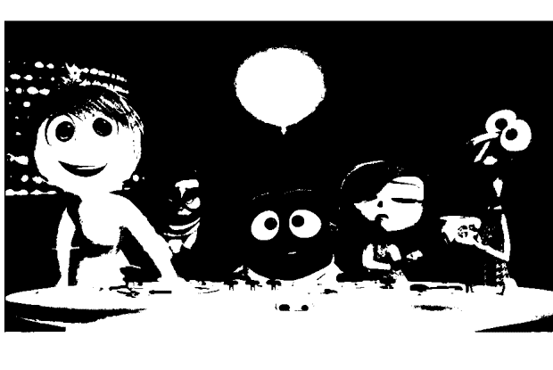

咱们讲《未来简史》的时候，也说过这个道理。如果是各个模块轮流坐庄，那么第一，你没有单一的“自我”；第二，你没有“自由意志”。你的行动只是被这些模块推来推去而已。常常是某个模块已经控制你了、已经让你做好决定了，事后，你才“意识到”你做出了这个决定，然后你的叙事自我还要给这个决定编个理由。

而赖特这本书，说的就更深入了一点。

模块占据你大脑的方法，是感情。每个模块都向你输出一个感情，哪个感情强，哪个就容易抓住你的注意力。这就好比你身处一大帮朋友、谋士和下属之间，他们每个人都在跟你说话、都想让你按他说的办 —— 谁说话的声音大，谁就更能吸引到你的注意力，你就容易听谁的。

不但感情是这样，思想也是这样。比如你现在想要把注意力都集中在你的呼吸上，只体会自己的一呼一吸。你就会发现，你根本没办法长时间地集中注意力，很多想法就会不断地冒出来 —— 这些想法，也是从各个模块中冒出来的。

而且这些模块还根本不靠谱，他们给你出的主意常常根本就是坏主意。你被“他们”迷惑，他们不是“你”，这正是佛陀说的“五蕴皆空”和“无我”。

好，现在你知道了这些原理，那你下次能做出更好的选择吗？赖特说，很难！下一次看到好吃的蛋糕，你还想吃。下一次感到愤怒的时候，你还是想惩罚别人。一般人想到这些，只能做一番感慨。包括赫拉利写《未来简史》，也只是感慨人没有自由意志。

但是佛陀，可不是这么绝望的。佛陀说你可以通过修行，战胜那些模块，掌握控制权，拥有自由意志。

我理解，这就好像一屋子的人都在让你干这干那，而你非常酷，直接忽视大部分人的声音，自己选择了对你最有利的意见 —— 哪怕他的声音很微弱。

赖特这本书，就讲解了他自己学习的“内观”派的冥想方法。这是一个功夫，得勤学苦练才能掌握。但遗憾的是赖特本人的冥想功夫还没练到家，而我更是还没练过。明天，我打算给你介绍一下这个冥想方法，以及修行者流传出来的心得。

金庸小说里有个王语嫣，她的武术理论水平特别强，各门各派的功夫都清楚，别人比武她能在旁边解説，但是她自己不练武，一打仗就露馅了。

可是没办法，事到如今我只能提供这个知识服务。有心的人听王语嫣说说武功也有用。明天，你就把我当王语嫣吧。

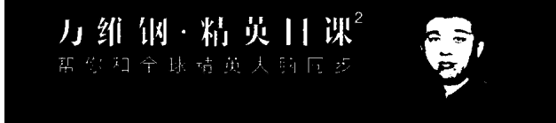

# 日课038 | 《为什么佛学是真的》4:冥想的方法

今天咱们继续说罗伯特·赖特的《为什么佛学是真的》。前面三讲都是说理论，今天我们要说一点实践了。

佛学其实是特别讲求实践的，它并不仅仅是理论体系，更是修行。就像我们没有办法向一个色盲解释“红色”一样，仅仅从智力上理解佛学是不可能的，有些概念大约只有练到那个水平才能明白是什么意思。

不过赖特的修行水平并不怎么样，我更是没练过，今天咱们主要是纸上谈兵。

练习的方法，就是静坐冥想。

## 1.师承

现在的冥想界大概可以分为三个派别。

一个是禅宗。禅宗的方法是思考一些公案，像寓言故事一样，有时候搞些语言上的“机锋”，然后来个顿悟。人说禅宗，比较适合诗人。

一个是藏传佛教。它的冥想方法主要是想象一些视觉意象，比较适合艺术家。

赖特练的这个，叫“内观”，巴利语是 Vipassana，它追求的是“正念”，英文叫 mindfulness。内观，适合心理学家。

内观要求你做自己的观察者，体察自己的情绪是怎么回事儿，就好像一个心理学家在分析自己一样。现代心理学的相关理论，你可以直接拿过来印证在冥想中对自己的观察，所以内观派很有科学精神。

大约在上世纪六、七十年代，有三个美国人分别去亚洲学习了内观。其中一个人叫约瑟夫·戈尔斯丁 (Joseph Goldstein)，回到美国以后在1976年出了本书，叫《洞见的体验》( The Experience of Insight )，向美国人传播内观。这三个入后来联合创办了洞见冥想协会( Insight Meditation Society )，相当于是个教冥想的学校。

这本书的作者赖特，就在2003年前往洞见冥想协会，学习了这套功夫。

现在在西方，尤其是知识分子中间，非常流行冥想。我们专栏第一季讲《盔火》的时候说过，冥想是达到心流体验的一个办法。我们讲《巅峰表现》那本书的时候也提到冥想是个有效的休息和减压方法，包括 Google 公司都专门给员工设立了冥想室。

但我们这里所说的内观的冥想可不仅仅是为了休息，也不是什么陶冶情操之类的小资活动，我们这里说的可是佛学。内观冥想的目标，是获得对事物的洞见，和个人真正的自由。

## 2."正定"和"正念"

冥想的形式非常简单。如果你追求仪式感，可以找个安静的地方，弄个垫子坐在地上。具体什么姿势似乎没有太多要求，大概只要不睡着就行。

第一步就是坐下。第二步，就是专注于自己的呼吸，别的什么都不想，一心一意地专注呼吸。

这可一点都不简单。我们在第一季中讲过一个概念，叫“默认模式网络 ( Default Mode Network )”，当一个人什么都不干的时候，大脑的正常状态是随机漫步，各种想法和情绪会不断地冒出来，你会做各种白日梦。这个状态就是默认模式网络。我们其实很享受这个状态，有时候还能获得一些创造性的发现。

但是冥想，恰恰要求你不能进入默认模式网络。你的思想不能信马由缰，必须专注在呼吸上。能坚持专注的时间越长，功夫就越深。

练好这个专注的功夫，你才能够不被各种情感和思想困扰，不受大脑模块的控制，获得自由。我理解专注呼吸本身不是目的，目的是练到把握对自己大脑的控制权。

如果你能专注很长的时间，据说，你将进入一个非常平静的状态。赖特曾经达到过这个状态。他说在长时间的专注之后，获得了一种非常深入的平静，有一种巨大的喜悦感，大概类似于服用 LSD 的感觉。

达到能专注很长时间的水平，你接下来就有两个门派的选择。佛学有个说法叫“八正道”，我们大约可以粗略地理解成修行的八种方法。八正道的第七叫“正念”，第八叫“正定”。

如果你选择一直保持专注呼吸的状态，你的功夫就是“正定”，这是小乘佛教的修缮方法。

而在内观中，通过专注呼吸达到正定只是基本功。正定以后是正念，也就是美国流行的“mindfulness”。正念要求你把专注的功夫随时用在生活中的任何东西上。

你可以专注地欣赏一朵花，可以在吃饭的时候专注地体会菜肴的味道，专注于什么都可以。

这就像是我们平时说的“活在当下”。就是你的心思不要总想前想后，应该专注于身边事物的深刻之美，对世界有一个诚实的认识。但是内观中的活在当下不是目的，专注于一个事物的目的是为了从中获得洞见。

论述这一套心法的佛经，叫《大念处经》。
你可能会问，这不就是我们平时说的“集中注意力”吗？这可不一样。我能集中注意力读一本书，但是在阅读的过程中我的想法是跟着作者在走，我还会随时联想到书以外的內容，这种集中注意力很容易。但是冥想中的专注，可以说是“停止注意力量”，是把注意力只集中在这⼀点上，排除任何额外的思想。

这两天我也尝试了冥想，我发现我很难专注于呼吸。我刚专注起来，马上就会有一个想法出现，我的思 想总控制不住地想这想那。那入门以后是个什么状态呢？

## 3.专注的两个层次

冥想功夫从低到高，大概至少有两个层次。

第一个层次是你能够不受强烈情绪的困扰，把“自我”和各种感情剥离开。只要达到这个层次，你马上就能体会到冥想的好处。

这个层次赖特达到了。比如牙疼，普通人可能会抱怨和对抗牙疼的感觉，你越反感，你觉得越疼，最后你的整个大脑被疼痛感劫持。而冥想的做法，是你先承认这个疼痛感的存在，然后不理会这个感觉，跟它保持距离！

这就好比你从旁观者的视角来观察自己的疼痛感。赖特有一次牙疼，他打了个比喻，说过去不会冥想的时候，牙疼起来的感觉是“ouch~ !”，相当于中文里“呃呃呃呃”地疼；会了冥想，现在是“whoa”，好象你看到别人牙疼而发出的一声感叹，大约相当于中文的“哎呀？“

疼痛感仍然存在，但是现在的你不会被这个感情所制约。你知道，疼痛的，并不是“你”。

能练到这种功夫，你在生活中就再也不会被情绪用事，你永远都能调试好心情。

更高的层次，则是能把自我跟各种想法全都剥离开，真正做到专注呼吸，不想其他。其实绝大多数情况下打扰我们专注力的都是各种小想法，比如明天上班要做什么事儿、期待和你爱慕的一名女士见面、回味自己昨天在球场上的一个精彩瞬间。

赖特说，这些想法，有一些共同点——

- 1. 都不是你当时正在做的事情。要不就是在回顾过去，要不就是在思考未来。
- 2. 都和“你”有关。你冥想的时候不太可能自动想到天体物理学。
- 3. 常常都与另外一个人有关。人都是社会动物，我们总爱想“人”的事儿。
- 4. 几乎都是由大脑中的某一个模块提供的。

我们上一期讲到，这些模块都是进化的产物。

你基本上可以这么理解：想法是由模块产生的，通过某种情感吸引你的注意力，“试图”劫持你的大脑。这里说“试图”其实不太准确，更准确的说法是你被各种想法所吸引，自己想要跟着想法走。

怎么跟想法剥离呢？方法仍然是当一个想法来的时候，你承认它的存在，然后跟它保持距离，不去想它，继续专注于自己的呼吸。

赖特打了个比喻，这就好比说你站在一个火车站，各种想法就是火车，眼前的火车纷纷来了又走，而你始终不上车。赖特还没达到这个层次，他有时候会上车 —— 但是车开动以后，他能从车上跳下来！

咱们回想一下，这两个层次，强烈感情也好、一般想法也好，我们的做法都不是压制或者扼杀它们 —— 我们是承认它存在、允许它出现，但是不受它影响。你就这么默默地看着它们从你眼前经过。

赖特说这就好比你　在电影院看电影。如果 你入戏了，一看到悲剧就哭，看到恐怖剧情就害怕，那你就不行了。如果你能想到眼前这一切只不过是屏幕上的像素、都是假象，你就不会入戏。你允许电影继续上演，但是你不受影响。

达到第一个层次，你就可以自由选择你想要的情绪。达到第二个层次，你就可以自由选择当下的思考。没有任何东西能打扰和控制你。这种能力实在太厉害了！用佛学的话，就是你会逐渐脱离“苦”，接近“涅槃”。

但是这个功夫非常难练。你并不是往一个方向拼命用力就能做好 —— 这其中，充满了矛盾。

## 4.四个矛盾

我们经常说高水平做事就是在各种矛盾中把握一个恰当的“度”。赖特在这本书中就列举了学习冥想过程中你会面对的四个矛盾。

第一个矛盾是“无为”和“成功”。我们第一季讲过森矧澜的《无为》那本书，说你越想做到无为，就反而越不是无为；你放松不去想它，反而能做到无为。冥想也是一样，你越想要专注，反而越难做到专注。你不刻意追求成功，反而能达到成功。

第二个矛盾是，最需要冥想训练的那些人，恰恰是最不容易进入冥想状态的人。这就是那些想法繁多，总是想这想那的人，他们对思想和情感的控制能力差。正因为控制能力差所以才更需要冥想。也正是因为控制能力差，他们更难以做好冥想。

第三个矛盾是你越是拒绝某个想法或者情绪，你越要和它对抗，你就越受它控制。就好像牙疼，你越想它越疼，但如果你承认牙疼，选择接受事实，你反而能跟它保持距离不受影响。你越要把它推开，它反而离你越近，而当你接受它，它反而控制不了你。

第四个矛盾是你越是了解“人不能控制自己的情绪，都是情绪在控制人”这个道理，你就越能不受情绪的控制。也就是说，如果你一上来就说我能控制我自己，那你就控制不了你自己；你要是意识到自己控制不了自己，你反而迈出了控制自己的第一步。

今天就先说到这里。建议你用几分钟时间尝试一下冥想 —— 我不太相信你能坚持十分钟。

# 特别放送 | 给高手的学习方法建议

万维钢

今天为你特别放送一篇学习方法专题，我整理了一些书中和第一季专栏中的一些学习方法和心得，包括怎样读书、怎样读书笔记、怎样管理信息和如何使用思维导图四个部分，希望能对你有用。和你一起终身学习。

# 第一部分：怎样读书

1.在《如何阅读一本书》的基礎上，我提倡一种高强度的读书方法，称之为"强力研读"。与《如何阅读一本书》中按部就班的，繁琐的固定套路不同，"强力研读"更像是一种态度和心法。

2.称为"强力"，是因为它追求阅读的深度和效率，力图能在ux一本书中挖掘到最大限度的收获。我曾经听人讲一个笑话，说我们是怎么样向别人学习的呢？我们就如同小偷一样到人家里把除了厨房水槽之外的所有东西都搬走了一一然后我们回去头去把厨房水槽也搬走了。我们就要用这样的精神去读一本书！

3.强力研读的第一个特点是：不好玩。世界冠军培训基地没有"寓教于乐"这个概念。"强力研读"不是为了娱乐和休息，而是用非常严肃认真的态度，非得把一本书给融会贯通以至于长在自己的大脑里不可。这种读法相当累。我认为写读书笔记是一个非常正经的工作。

4.强力研读的第二个特点是：用的时间很少。就如同在那种专门培养天才的最好的音乐学校里，孩子们每天真正练琴的时间绝对不超过2个小时一样。没人能长时间坚持那样的强度，而没有强度的训练还不如不练。你可能每天花很多时间阅读，但你很难做到用很多时间强力研读。要把精力充沛而又不受打扰的时间段留给最好的书。

5.强力研读的第三个特点是：不追求快。处在我们的"学习区"内的好书，应该慢慢的仔仔细读。追求把一本书快速读完，就好像追求把一只曲子快速弹完一样，这不是练琴是完成练琴任务。读书人的一个秘密就是，读得慢，吸收知识和增长内力的效率反而更高。

6.强力研读的以上这三个特点，和"刻意练习"一致。

7.一本书应该被读两遍，而且只读两遍。好书读一遍不可能掌握精要，反过来说如果一遍就够了，那这本书也不值得强力研读。我们说的思想类书籍，不是什^么学术著作，所以再好也沒必要读三遍。两遍正好。而且最有效率的办法是读完一遍马上再读一遍。

8.第一遍是正常通读，只要放松地欣赏作者的精妙思想和有趣故事即可。不要追求读得快，值得时不时停下来思考一下的书才是好书。在读第二遍的同时写下读书笔记。这时候就不要每个字都读了，书中作为例子的故事大可跳过，要专注于思想脉络。读一章，记一章的笔记，直至读完。 然后这本书就可以束之高阁，甚至直接扔了。

9."强力研读"的一个核心技术，就是做读书笔记。

# 第二部分：怎样做读书笔记

1.笔记最好要写到可以取代原书的程度。而给课文概要中心思想和段落大意的方法、还有用画"思维导图"的方法来做读书笔记，意义都不大。

2.强力研读要求读书笔记必须包括四方面的内容：清晰表现每一章的逻辑脉络、带走书中所有的亮点、大量自己的看法和心得、发现这本书和以前读过的其它书或文章的联系。只有做到全部四点，你才能把一本书的功效发挥到最大。你会发现这个回报是巨大的。

3.读书笔记首先要清晰表现每一章的逻辑脉络。它第一作用就是抛开故事记住文章。让一本书从厚变薄，从具体的山川景色变成抽象的地图。只有当你跳出字里行间，以居高临下的姿态俯视全章，它的脉络才能变得清晰。看清楚以后不要抄作者的话，用自己的语言讲这个脉络写出来，就好像画地图一样。

4.逻辑脉络之外，如果发现真正好的小故事一一我们称之为"亮点"一一那么就把这个故事也给写下来，甚至具体到细节。读书，在某种程度上就是寻找能够刺激自己思维的那些亮点。我们在分析脉络的时候要忽略故事，分析完脉络再把故事带走。

5.高水平读书人看完的书上写满了批注。你可以写下自己对这件事的理解，对作者的质疑或肯定。更高级的批注则是写下自己因为看到这段文字而产生的灵感。也许你突然想到这解决了你之前一直关注的问题一一尽管这个问题看似与此书无关；也许你想到对书中思想的一个新的应用；也许你想到你可以把作者的理论往前推一步。这些想法未必都真的有用，但是都非常宝贵，因为如果你不马上记下来它们很快就会被忘记。多年以后翻阅笔记的时候，你会觉得自己的心得灵感比原书更有价值。

6.当你读过的书多到一定程度，你就会发现书与书之间是存在联系的。一个真正善于主动读书的人对这种联系是非常，非常敏感的。我现在使用 Evernote 来整理读书笔记，这个工具有一个好处是可以把每一份笔记都生成一个可供别的笔记直接点击和引用的链接。

7.如果óstico读得更多，你会感受到人类知识的进步。你会发现一个问题在这本书里是这个说法，而过了几年之后有人另写一本书，把整个结论给改变了。有时候你必须从几本书的几个不同结论中判断哪个是最靠谱的。有时候你会觉得他们说的其实都不对，只有你知道正确答案。到了这个层次，你已经跟书的作者完全平等于了。你甚至可以俯视他们，评判他们之间的高下。这时候你又应该怎么办？你写篇文章发出出来！

8.好书之所以要读两遍，最重要的目的就是为了这些心得、灵感和联系。第一遍读是为了陷进去，第二遍读是为了跳出来。

9.读书笔记是一种非常个性的写作，是个人知识的延伸。它不是书评，不为了公开发表，你可以完全专注于意思，而不必关心文笔。笔记是对一本好书最大的敬意。

# 第三部分：怎样管理信息

1.有关信息管理，大概有两种错误的思想。一种是用大脑的记忆力，这个太落后了一一 人脑应该是用来想事情的，不是用来记事情的；另一种是强迫搜索，指望什么信息都临时去网上找一一这就太业余了。正确的做法，是使用一个外部系统，专门存储个人化的信息。

2.我用的工具是 Evernote ，我就拿它举个例子。对我来说，它的功能有三个：采集、合作和创造。

3.先说采集。看到任何可能有价值的信息，你都可以存在Evernote里。Evernote有自己的服务器，所有内容都同时保存在本地和云端，可以跨平台保存和提取。它有自己的浏览器插件可以抓取网页内容，它在手机里跟几乎每一个涉及到阅读信息的App 都能对话，你还可以用发邮件、拍照和录音的方法采集信息。采集的精神在于，有了高级管理工具，你就应该把任何可能有价值的东西都记录下来。记下来了，你就不用担心它了。这其实也是释放大脑！

4.再说合作。Evernote 能直接把文章生成 html 文档，发给任何一个人，他在任何平台用浏览器直接就可以打开，而且所有文本变化格式都保留了。Evernote 还允许你公开分享任何一条笔记。更重要的是，Evernote 允许几个人共享一个目录。

5. Evernote 的一个高级功能，是创造。比如，你可以在一条笔记中插入另一条笔记的链接。不成熟的想法先放着，慢慢积累，什么时候素材够了自己想明白了什么时候动手。这借助一个外部工具，把想法壮大起来。这个功能简单但是意义重大。你可以用它来思考创造。

6.对于创造，Evernote 还有一个高级功能，是能通过可能是词汇匹配之类的算法，自动发现一条笔记的"相关内容"。这已经是在模拟人脑的思维！人脑发挥创造为最重要一个手段，就是把两个不同的想法连结起来。这个连接越是意想不到，创造出来的东西就可能越有意思。想要让想

造出来的东西就可能越有意思。想要让想法连接，你得先拥有很多很多想法才行，而现在你可以把想法寄存在一个外部工具里，让计算机帮你建立连接。

7.一个现代人应该把好工具用在平时的学习、工作和研究中。希望看到更多的人使用这些方法，写出有干货、有严肃研究结果支持的好文章来。那些无病呻吟的鸡汤文字根本配不上这个时代。

## 第四部分：怎样做思维导图

1. 如果你只是想做读书笔记或者会议摘要，用最朴实、厚道的 bullet points 是最好的办法，树状结构列举提纲，整理要点，完全没有必要画妖艳的思维导图。那思维导图是不是一个被高估了的工具呢？不是。思维导图是一个被低估了的工具。思维导图，根本就不是一个整理和记忆工具。它是一个思考工具。

2. 人的短期工作记忆 —— 相当于大脑的“内存”—— 非常有限，每时每刻只能最多想四个东西。思维导图的正确用法，就是给大脑扩充内存。你只能想四个东西，可是做这件事需要同时考虑八个东西，那么最好的办法就是把这八个东西都写下来，摆在你面前帮助思考。

3. 思维导图，本质上就是思维的草稿图。

4. 更高级的用法是用思维导图做决策和判断。如同开会一样，第一阶段是畅所欲言，谁有什么想法都提出来写下来；第二阶段是评估这些想法，发现不同想法之间的联系，把他们用线连接起来；第三阶段是形成决议：把讨论中淘汰掉的想法都划掉，剩下的分出主次和执行顺序，然后整理一下就可以照着做了。

5. 这三个阶段，其实就是从发散思维，到最后集体的集中思维的过程。先发扬民主，最后形成集中。这个思维过程，这种决策方式，才叫思维导图 —— 为了引导思维而画张图。

6. 一张实用主义的思维导图必定是非常潦草杂乱的，上面画满了各种连线、重点符号、划掉符号 —— 就好像演算纸一样。思维导图是自己用的！

7. 花哨的装饰和美观的外形未必实用，真正的武器身上应该有创伤、有错误、有硝烟的味道。

万维钢

以上就是今天终身学习专题的全部内容。在最后，我想邀请你做两件事：
- 能不能在留言区和我们分享一下，你收到的最有效的学习方法的建议是什么？是从哪里得到的，它给你带来了什么改变？(150字之内最佳) 点赞最多的读者，你将获得一份得到给终身学习者的礼盒；
- 如果你觉得今天的某一条学习方法对你有用，你能不能把这一条复制下来，作为推荐语，把今天的日课转发到朋友圈，让更多热爱终身学习的朋友加入进来？

祝你每天都有收获。

## 答读者问｜不被任何看似强烈的感情劫持

经济学点的假设就是人是不满足的，由此带来了稀缺。难道说，这些学说之间的底层是相同的？亦或者我们对佛学的理解有很多错误吗？

不满足是人类社会前进的动力，也是人的烦恼所在，如何在两者之间找到平衡？

万维钢

这是一个非常著名的问题，其实我们在第一季讲亚当·斯密的时候就曾经说过，现在可以从佛学的视角再讨论一下。亚当·斯密也曾经提到，名望和财富其实不值得拼命追求，因为不管你得到多少，你永远都不会满足，整个过程是痛苦大于快乐。可是另一方面，只有人们都不满足，人人都追求创造财富，社会整体才能进步。那人到底应该怎么办呢？

在原始社会，有享乐的机会很不容易。有好吃的就应该赶紧吃掉，下次吃还不知道猴年马月。抓到一个漂亮姑娘就赶紧生孩子，要知道整个社区千脆就数几个适龄女子青年。自然选择给人的快乐设定非常有效，及时行乐是理性行为。

在佛陀和亚当·斯密生活的年代，人开始有了长远发展的可能，就意识到获得个人享乐的代价有点太高了。你喝一杯酒，背后是粮食的浪费，是人力消耗。你和一个姑娘发生一次性行为，就可能毁了人家一生。你参加一晚上赌博，可能半年工资就搭进去了。你付出这么大的代价，得到的却只是非常短暂的快乐，然后你还是不满足。那个时代的智者必然反对及时行乐。

而我们今天这个时代，物质极大丰富，工作已经不那么费力、甚至工作本身就是一种乐趣。这时候你要享乐还是要工作，要长远还是要短期，就完全是个人的选择了。

佛陀看一个蛋糕吃不吃，也许考虑的是生产这个蛋糕消耗那么大的人力物力，为了我这一时的享受值不值得；我们今天看一个蛋糕吃不吃，只需要考虑吃蛋糕会不会让自己变胖就行了。

佛陀看一个人为了多娶几个老婆而辛苦工作赚钱，甚至是巧取豪夺，他肯定会质疑这样的人生。而今天的很多人辛苦工作并不是为了自己的享乐，人们更多的是觉得工作本身就很有乐趣——我想佛陀看到这样的人，必然会有不一样的评价。

既然原来的佛经已经不能被充分理解，那我们的解读本身就是现代人的佛学。再说又减去许多部分，那会不会越来越脱离神离？

我的疑虑是，用现代进化心理学分析“痛苦是不满足”、“快乐是虚妄的”，目的只是为了“让基因留下去”，这没有问题。问题是“佛陀怎么知道？当时的小王子释迦牟尼怎么知道？佛学不是他一个人的学问留传，那其他那些“从学者”又如何知道？难道说“佛学”恰好是歪打正着的一门学问么？

万维钢

咱们前几天有一期日课叫《达芬奇不是从天上掉下来的》，我想斗胆说一句，小王子释迦牟尼也不是从天上掉下来的。佛陀出生的時候，世界各地已经有很多修行者。特别是当时印度修行者非常多，有各种门派和心法。我这几天做了点小调研，冥想打坐这个方法似乎也不是佛陀发明的，佛陀的理论贡献也许是把这个方法提升到了新的高度。时间一长，英雄就会变成传说。

我们今天的人研究数学和物理，关心的并不是高斯、欧拉、牛顿、爱因斯坦他们原始的想法是什么，我们关心的是他们发现的理论的本质。也许一篇欧拉写的数学论文，语言古奥，某些字词的用法都跟今天不一样了，研究科学史的人甚至可以为欧拉一句话到底是什么意思而争论不休。但是在一个数学系的学生看来，那些字词当时是什么意思根本不重要，重要的是那篇论文的数学思想！我们甚至可以从另一个角度出发推出同样的结果，然后写一篇看似完全不同的论文。

正确的理论，不可能只被发现一次。如果佛学是真的，那就就算所有佛经都失传了，人类中的聪明人早晚都能够再发现同样的智慧。反过来说，如果佛学强烈依赖于佛经，以至于我们只要对某个字词拿不准，就不可能理解真正的佛学，那它就不可能是具有普世意义的真学问。

再退一万步说，就算佛陀是从天上掉下来的，他的理论就是人类智慧的终极理论，那也仍然有一个语言版本的问题。佛陀在2600年前的听众的文化程度只有那么高，佛陀必须使用当时人能听懂的语言。而这种语言按我们今天的标准来说是不太准确的。比如佛经一说很大的数字就是“八万四千”、“十万八千”，根本不是一个准数。再比如，当时的人说话可能有不自觉的夸张，什么“众生皆苦”、“万法皆空”，也许原本的意思是说“我们这个时代的大部分人在大部分情况下是比较苦的”、“你眼中的世界里大部分东西是比较空的”。还有，当时的人抽象思维能力很弱，根本听不懂“模糊”之类的词，佛陀就必须大量使用比喻手法。那我们如果纠结于当时这些字词，又怎么能够得到真正的佛法呢？

经过这么多年的传承，后人已经在佛经上附加了很多自己的意思。而今天我们从另一个角度验证佛学，也许不是扭曲、而是拨乱反正呢？

万老师，您好，我读完这篇文章，感觉您说的是，快乐永远是短暂满足，不能长期满足，但是如果在猴子实验中，人类就是无限量的供应短期快乐，是不是也能把快乐连成一片呢？如果一个人超级强大，就是能把短期满足长期化，是不是就苦了？

人的目的是传播基因，获得快乐是自然选择引导我们传播基因的设定，那么是否人就该一直做让自己快乐的事情？但我发现人只要能为所欲为社会就会陷入混乱，所以法律、社会制度是不是在对抗自然选择呢？

记得以前还听说多巴胺只会给人带来短暂的快乐，但是会带来更多的欲望——贪念，更多的欲望带来更多的不满，也就等于您说的更多的苦。那该如何破解这个恶性循环呢？

万维钢

鲁国宰相公孙仪喜好吃鱼，但是求他办事的人送鱼给他他从来不收。人问公孙仪你既然喜欢吃鱼为什么不收鱼呢？公孙仪说如果我为了吃这条鱼受贿，将来国君罢免我，我还能继续吃鱼吗？

我想我们对佛学初级的认识，不是说要从此不快乐了，而是要“管理”快乐。管理的第一步，就是意识到把短期快乐持续地长期化是不可能的。比如果喝酒，今天的人完全可以负担得起每天两瓶酒，可是如果这么一直喝，就有两个问题。

第一是人的满足感阈值会越来越高，你会慢慢发现低度酒根本不过瘾，必须喝越来越高度数的酒，就好像吸毒一样要不断加大剂量。第二是这种喝法对身体可能有害，也许喝不了多少人就不行了，一辈子反而没喝多少酒。

那如果我一生没有别的爱好，就爱喝酒，我应该怎么办呢？我会严格控制剂量，我会确保中间有所间隔，我会追求质量胜过数量。这样我会活更长的时间，喝的酒都是好酒，而且总来讲还喝了更多的酒。

所以正确的做法就是就算有条件为所欲为也不应该为所欲为。但是自然选择并没有给我们这个智慧！因为原始社会的人根本就没有条件一直为所欲为——偶尔有酒喝就不错了，应该抓住机会多喝点。

佛学，至少在初级阶段，就是要跟自然选择的基因编码作斗争。至于说到了更高的境界是否根本就不想喝酒了，那就不是我所能理解的了。

原始人的时候各种资源都很匮乏，吃的、穿的都很少。所以原始人都在努力采集，储藏。发展到现在就是中国人的存款习惯。中国人大多喜欢存款。银行里的存款惯，中国人大多喜欢存钱，银行里的存款越多，越有安全感。而欧洲人是不喜欢存钱的，都喜欢提前消费。一旦失业了就得担心下一顿饭吃不吃得上。那么请问是因为欧洲人发展得快，已经脱离原始人的基因了嘛？还是我们在新闻报纸上说的那些欧洲人不喜欢存钱的新闻，都是假的？

生理上的设计不存在延迟满足，现实中我们有时候都在追求延迟满足。按理说我们的想法，情绪，都是由物质决定的，这是不是证明了我们的编码，其实是在进化呢？

万维钢

左右人们行为的，一部分是自然选择留下的“硬件编码基因”，还有一部分是文化习惯，还有一部分是各人的智识。认为吃饭很重要，这是基因，是进化心理学，各国都是如此。但是具体到这个饭是现在马上吃、还是规划一下多留一点以后再吃，这个可能就是文化习惯了。中国人是农耕民族。农耕时代，我们必须有所规划，秋天、冬天的时候再困难也不能把粮食全吃了，得留一些春天做种子，没有规划就活不下去。所以推迟享乐可能是我们的文明特长。

欧美人总体来说的确不爱存钱。但这一方面可能是文化原因，一方面也是因为金融制度更发达，借货消费方便、而且利率并不很高。如果中国的金融业越来越发达，大学生缺钱也不用借什么“裸贷”，能够以比较低的利率借到钱，那么在上大学这个不挣钱又很需要钱的时期借贷消费，未尝不是理性选择。

所以我们相对于原始人的确有进步，但这些进步未必是写在遗传基因编码上。也许写在口口相传的格言里，也许写在代代相传的家训里，也许写在中外智者的书里，也许写在年轻人的创造里。

错觉和现实之间的界限怎么把握？我今天没吃晚饭，这个饥饿的痛苦可能是错觉，但如果我三天没吃饭，那种痛苦应该就不是错觉了吧。如果是配偶是否忠诚，孩子在学校是不是努力学习，我在公司的表现怎么样……这些事怎么区分错觉和现实？

万维钢

其实我们在讲“五蕴皆空”的时候就说了，*有些*感情，在*有些情况下*，是错觉。我猜佛陀的意思大概不是让我们不管不顾，把一切都放下，那人生和社会岂不是都完了。

区分错觉和现实的第一步是冷静对待，不被任何看似强烈的感情劫持——而这正是冥想练习要解决的问题。

感觉冥想是在追求效率的极限，如尽快进入深度工作。排除杂念，清空RAM之类。但冥想阅读真的好吗？没有了大脑自动漫步的文献网络，怎么做到举一反三呢？怕是只能跟着作者的思想走了吧，又怎么做到六经注我呢？

万老师，练就高度成熟的内观冥想能力，会影响想象力吗？会不会注意力非常集中，切断所有联想而想象力就被削弱了呢？

万维钢

我猜会有这个矛盾。如果你这一刻是在练习内观冥想，你这一刻就不是在做创造性的工作。冥想只是一个练习，冥想师父也没说我们应该每时每刻都冥想。

但是如果通过冥想而获得了“正念”的能力，能够通过专注而洞察到身边事物的深刻真相，那么间接地、显然对创造活动是有好处的。

请问老师，正念的境界是大乘佛教吗？

万维钢

考察中文网络资料，“内观”似乎应该是南传佛教的一支，似乎应该算“小乘”。但“小乘”其实更接近于佛陀当年所说，所以又叫“上座部佛教”。所谓“大乘”，我理解是后人对佛学的发展壮大。

内观的方法是佛陀本人亲传，似乎应该算小乘。可是赖特本人在这本书里多次强调，内观——或者说“正念”这一步，算是大乘佛学。这个说法我并没有在中文网络资料中看到印证，所以我也不知道对不对。

不过我想大乘也好小乘也好，污衣派也好净衣派也好，气宗也好剑宗也好，咸党也好甜党也好，这些标签都是“空”的，我们没必要太过纠结。

最后，有很多读者对《五蕴皆空经》中佛陀的辩论论点提出质疑……包括我们专栏读者喜爱的熊逸老师 :) 所以请允许我暂时把这个问题留着。熊逸老师已经为此专门写了文章，我将在下周五，再跟他比划两招 :) 

## 日课预告｜到底什么是“色即是空”？

日课预告｜到底什么是“色...

下周我们将把罗伯特·赖特的《为什么佛学是真的》这本书讲完。我们将继续使用进化心理学的新知识验证佛学。

过去一周我们已经打好了基础，这个最核心的思想就是用大脑的“模块”机制说明“无我”。我们面临的问题是大脑是各个模块轮流控制大脑，“我”不是“我”。我们的解决办法是通过冥想练习，使自己学会不受模块的控制，获得自由。

我读赖特这本书的感受就是，如果去除所有超自然现象的成分，那么佛学的全部内容，就是从这个“模块说”展开。

下周一，我们将使用模块论，提出一个“正念自控法”。我们将结合几个新研究，颠覆“意志力是一种肌肉”、“理性对抗感情”、“象与骑象人”这些常见的有关自控力的说法。

赖特说，佛学的两大基石，也就是两个最重要的概念，第一是“无我”，第二是“空”。

接下来几天的內容，就将围绕“空”展开 ——

到底什么是“色即是空”？

难道在觉悟者的眼中，这个世界就是“空”的吗？

意识到自己是生活在一个 Matrix 之中，是一种什么样的体验？

最后，我们将站在进化心理学的高度，再往上遥望一下“涅槃”。

读完这本书，你至少应该记住一个单词：Dharma。这个词的意思就是“佛法”。它既是哲学体系，又是修行方法。

修行，我没做到，但是佛学的哲学体系，我认识到了。我认为这个体系非常有道理，它给了我们一个观察世界特别好的视角，而且借助现代科学，它是*可以*理解的。

下周之内，你就能理解。

## 日课039 | 《为什么佛学是真的》5:正念自控法

日课039 | 《为什么佛学是... ↓

今天咱们继续说罗伯特·赖特的《佛学是真的》这本书。上周我们重点说了“五蕴皆空”、“无常”和“无我”的思想：人并没有单一的自我，大脑中至少有七个模块轮流控制我们的决定。从这个框架出发，我们能从中推导出一些看待事情的新方法。

比如说，我们可以给“自控”这个概念一个全新的解释。所谓“自控”就是能管住自己去做“该做的事”，而不被短期的诱惑所吸引。“自控力”一直是励志和成功学的一个热门话题。

而我们今天要说的这个解释，非常前沿，和你以前听说的那些说法很不一样。我们有最新的研究结果支持，我们会讲一个哈佛大学研究者提出的理论，和一个耶鲁大学研究者提出的方法和实验。

如果说你在2017年只看一篇关于自控的文章，那就应该是这篇文章。

传统上说“自控”、“意志力”，都是用“理性”战胜“感情”——感情上我很想吃甜食，但是理性告诉我吃甜食对身体有害，所以我拒绝甜食。一个著名的比方就是“象与骑象人”。人的感情就好像是一头大象，而人的理性就像是驾驭大象的骑手。我们要做的，就是让骑象人控制大象，对吧？

还有一个常见的说法，说人的自控力就像肌肉一样，你越锻炼它，它就会变得越强，对吧？

这些说法，我自己以前写文章也讲过。但是今天看来，它们可能都过时了。

### 1.买，还是不买

咱们先来说一个实验。我们知道心理学家和行为经济学家科研经费相当有限，有时候做实验说给受试者奖励，结果也就奖励几块钱。但是在这个实验里，麻省理工学院和卡耐基梅隆大学的研究者，可是拿出真金白银来，想看看消费者到底怎么花钱。

实验中，研究者给每个受试者差不多100美元，让他们随便花。受试者要浏览一个购物网站，用这笔钱想买啥买啥——条件是，在他们做决定的时候，研究者要通过功能性核磁共振密切观察他们的大脑活动。

研究者发现，在一个人决定买与不买的过程中，人脑中的两个区域起到了关键作用。

第一个区域是“伏隔核”，它的作用是提供愉悦感——当人预期能得到回报、或者看到自己喜欢的东西的时候，伏隔核就会变得活跃。实验结果表明，受试者面对一个商品时他的伏隔核越活跃，他就越可能买这个商品。

第二个区域是“岛叶”，它的作用和伏隔核正好相反，当你预期到痛苦或者感到不愉快的时候，岛叶就会变得活跃。可想而知，岛叶越活跃，人就越不会买这个商品。

我觉得这个发现很实用价值。如果一个销售人员能时刻监控他周围顾客的大脑活动，来个精准推销，岂不是可以少费很多口舌吗？

好，现在问题来了。如果一个人面对某个商品，他既想买、又不想买，那哪个区域活跃呢？答案是两个区域都活跃。一方面，这个商品能给你带来愉悦感，让你产生想买的冲动；另一方面，你会犹豫买这个商品会不会有弊端，这笔消费是不是浪费钱。

而最终决定到底要不要买，就得看伏隔核和岛叶这两个区域，哪个*更*活跃。

这就非常有意思了。两个区域都是感情区域。请问在这个决策过程中，理性的作用体现在哪呢？

### 2.理性对感情，还是感情对感情？

我们看到的购买决策过程其实是两种感情的较量。正面感情超过了负面感情你就买，负面感情超过正面感情你就不买。这其实符合人脑的“模块说”，大脑随时被各个模块接管，谁的声音更大谁就做主——而每个模块，都是感情模块。决策，其实是感情和感情的竞争。

那理性起了什么作用呢？赖特说，理性的作用是给感情提供信息和辅助。

赖特举了一个例子。他特别喜欢吃巧克力，但他也知道巧克力含糖高，吃多了对身体不好。那么当赖特纠结于要不要吃一块巧克力的时候，难道说“不吃”就是理性的，“吃”就是感情的吗？其实两个声音都是感情的。

一个感情是想吃巧克力。它为了说服其他感情，会列举各种*理性*的理由——你一会儿不是还要工作吗？吃巧克力可以让你的精力更充沛。

但是不吃巧克力，也是一种感情，这个感情是想获得健康和长寿。这个感情也会列举*理性*理由，说巧克力吃多了身体会发胖。

也就是说，每一个感情模块都在使用理性来替自己说话。理性，只不过是感情的武器。

目前已经有一些心理学家认同了这个说法。哈佛大学的乔舒亚·格林（Joshua Greene）教授认为，人所谓的抽象理性思维系统，是位于大脑背外侧前额叶皮层——但背外侧前额叶皮层并不是一个独立的系统，它正好和多巴胺系统紧密地联系在一起。我们知道，多巴胺系统能够评价每件事情的价值有多大，提供快乐的回报。说白了，这就是说理性也是演化的产物，并不能完全摆脱动物性。

每个模块的工作方式，都是感情。并没有哪个模块比哪个模块更理性——各个模块都可以调用理性。我们的意识以为自己在做理性分析，其实意识只不过是在倾听各个模块用理性来为自己找理由而已。

我们的所有决策，都是从感情开始，以感情结束。理性只不过是感情的工具，感情才是真正的决策者。

那么如此说来，自控的关键就不是调动理性，而是协调感情。

### 3.自控的机制

以前的说法，自控力是一种肌肉，你越练越强。但我们仔细想想这个比喻，其中似乎有问题。比如有个人一开始意志力就很薄弱，喜欢喝酒，越喝越迷恋喝酒的感觉，最后无法自拔，那么显然他的“自控力肌肉”根本就没用上。那么我们就问，如果自控力肌肉这么容易就用不上话，自然选择为什么还要给大脑留下这个设定呢？

还有，生活中有一些非常自控的人，可能明明爱喝酒但是知道喝酒误事，平时滴酒不沾——结果偶然遇到挫折、精神崩溃，喝点酒，这么一喝就“破功”了，很容易又变成一个嗜酒的人。这似乎也不对，照理来说，他练了那么久的自控力肌肉应该很强才对，怎么一下子就没用了呢？

可见“肌肉说”不太可靠。而“模块说”，则提出了另一种自控的理论。

我们大脑的每一个决定，都是各个模块的感情力量强弱对比的结果。想要管住自己不吃巧克力，你就应该希望“不吃巧克力”这个模块的力量变强。

而模块变强的机制则是“满足感”。比如说这次“吃巧克力模块”战胜了别的模块，成功地让你吃到了巧克力，你马上就能获得一个快乐的满足感，那么下一次争论的时候，“吃巧克力模块”的力量就会更强，别 的模块就更争不过它。

在争论中取胜 -> 获得快乐奖励 -> 自身力量增强 -> 下次争论更容易取胜

快乐的感觉，正是自然选择最喜欢的激励手段。而这是一个正反馈循环。这就是为什么短期冲动总是难以克服，一次次的满足只会让它一次比一次强，你最后必须加大剂量才能让它满足，就好像吸毒一样。也解释了为什么一个戒酒很长时间的人，偶尔喝一次酒就马上又想喝酒，因为他的喝酒模块并没有失去力量，只不过一直被抑制而已！偶尔喝一次酒带来的巨大的满足感，就足以把它再次激活。

这也是为什么要吸引一个人去赌博，最好的办法就是一开始就让他赢，一次次的赢赌给她带来的刺激越来越大，他就很容易陷进去，难以自拔。

如此说来，最好的自控方法应该是打断正反馈，不让相关模块获得即时奖励和满足感。

反馈，不让相关模块获得即时奖励和满足感。

这正是佛学的自控法。

## 4.正念自控法

我们现在说的这个方法是耶鲁大学医学院的贾德森·布鲁尔（Judson Brewer）在研究中亲测有效的办法。布鲁尔找了一些烟民来做戒烟实验，他教给烟民们的方法，其实就是咱说的“正念冥想”。

布鲁尔的方法分四步，缩写为RAIN ——

- 1. 识别感情（Recognize the feeling）。当你想抽烟的时候，你要意识到，想吸烟是一个感情。
- 2. 接受这个感情（Accept the feeling）。不要把这个感情推开，不要对抗，要承认自己想吸烟，而且承认这是一个合理的感情。
- 3. 观摩研究这个感情（Investigate the feeling）。从旁观者的角度，分析这个感情，它的力量有多强？是我身体的哪个部分有吸烟的需求？这个感情有“颜色”吗？是什么“材质”的？当你从各个角度去分析它的时候，你就会发现这个感情不再是你的一部分了。你越分析它，它就离你越远。
- 4. 分离（Non-attachment）。你和这个感情就分开了，这时候你已经不想吸烟了。

冥想的时候，我们练习任凭各种情感在眼前过但是不参与，练的就是这个功夫。

这个办法，和“用意志力压制对抗”，非常不一样。布鲁尔打了个比喻。比如现在有个机关，只要老鼠一碰这个机关，就能得到食物。老鼠就代表你的感情，机关就代表你是否接受这个感情。以前的意志力训练是推开这只老鼠，不让它去触碰机关。而现在这个正念方法是允许老鼠去触碰机关，但是碰到机关后并没有食物给老鼠。感情出来了但是得不到回报，那么时间长了以后，这只老鼠也就不会再去碰机关了。

意志力方法是“对抗”，正念方法是“化解”。

实验结果是布鲁尔这个方法比美国肺科协会推荐的传统戒烟方法更有效。

其实我们面临的很多问题都是自控问题。比如你工作的时候爱走神，总想去看看手机，那最好的解决办法就是你先承认自己想看手机，然后闭上眼睛想想自己为什么想看手机，分析分析“看手机”这个感情到底是个什么性质……你可能就不想看手机了，然后你就可以回过头来继续工作。

### 由此得到

- 1. 传统的自控力理论，用理性战胜感性、“象与骑象人”、“意志力就如同肌肉”，这些说法现在看是有问题的；
- 2. 任何决定都是感情对感情的竞争，理性只是感情的武器；
- 3. 正念冥想，是一种有效的自控方法 —— 要点在于接受和分析感情，而不是对抗感情。

如果一个人想用两个小时的时间完成一项重要工作，可是工作过程中管不住自己，不知不觉玩手机浪费了一个小时，那他看似随心所欲，其实是自己感情的奴隶。

想干什么就能让自己真的干什么的人，才是真正的自由。

## 日课040 | 《为什么佛教是真的》6:什么叫“色即是空”？

今天咱们继续说罗伯特·赖特的《佛教是真的》。这本书的一个优点是它把一些玄妙的概念给简化化明确化，让人能理解。今天我们再说一个听起来特别玄的概念，叫“色即是空”。

这句话到底是什么意思呢？这个世界是空的吗？你现在在坐的这把椅子，明明是真实存在的，它怎么是空的呢？

有些人说万物都是空的，也许可以理解成我们生活在一个 Matrix 之中，是在玩虚拟现实游戏，什么都是虚幻的。可是，就算你告诉我这个又有什么用呢？我的人生是游戏，难道我能退出吗？

赖特的解释是，确实，你看到的这个世界中有很多是虚幻的东西 —— 而且你确实能退出。

认识到世界是“空”的，对你有好处。

### 1.存在与内涵

有一次，赖特在一个冥想培训班学习。正好教室外边是个工地，有工人在用电锯锯木头，教室里就充满了电锯的噪音。电锯声让人听着很难受，但是赖特使用了冥想的功夫，他就先接受自己“反感电锯声”的这个感情，然后审视这个感情。

坏了草坪。所以蒲公英到底是不是杂草，到底应不应该被允许长在那里？

如果你经常问这样的问题，你很有佛学气质。

我们赋予世界的内涵都是主观和充满矛盾的，而且在红酒的例子中你看到了，“色”会影响我们对真实世界的体验。那如果不戴有色的眼镜看，世界是什么样的呢？

赖特说，也许那将是一个“无色”的世界，而“无色”会让你感到世界是“空”的。

赖特的修行没达到很高的水平，但是他采访了一些高手。

一个修行者说，随着冥想练习的深入，你真的会体会到“空”——你对世界的“色感”将会下降。当然你仍然会看到所有这些东西，椅子还是椅子——不过它在你脑子里的存在感没那么强烈了。

赖特把自己关于“无色”的解释和修行者探讨。修行者说，他自己的修行，更像是他先感觉到万事万物都是空的，然后才导致他对这些东西无感——而赖特说的是先降低了感情，才感到到万事万物都是空的。这个因果关系可能是相反的，但总体来说，认识到无色就是认识到空。

这位修行者还提到了非常明确的两点体验。

第一点，当你认识到空和无色的时候，再去看万事万物，你看到的东西就会比以前看到的更真实。

第二点，人们对这些东西先入为主的各种感触，其实是不真实的。

也许有个人偶然做了一件对不起你的事儿，你就给他打了一个“坏人”的标签，每次看见他就反感——这个感触，就是不真实的。以前咱们讲《平均的终结》的时候说过，人并没有固定的性格，只是在不同的情景之下表现出不同的性格。也许这个人换一个环境会有不同的表现。不贴标签，你才能了解到他更真实的一面。

真正的品酒高手品的应该是酒而不是故事。这瓶酒是哪里生产的、产酒的那年是个好年还是坏年、这瓶酒卖多少钱，如果这些条件他都不在乎，他才能体验到酒纯粹的味道。

赖特有个亲身体会。他办公室有个冰箱，总是发出嗡嗡的声音。以前他没注意到，后来他在冥想中排除了自己对这个声音的反感情绪，居然发现这个嗡嗡声其实不是一个声音，而是三个声音的混合！他体察到了更真实、也更丰富的内容。这难道不是一个乐趣吗？

正念是选择注意力的能力。如果你能把各种故事和标签带来的感情都剥离掉，红酒也还是红酒，它的味道都在，但是你能获得更真实的味道体验。

经常有人说佛学会不会让人失去生活的乐趣、看什么东西都没意思？其实并非如此，佛学是让人更自由，是让你能够自由选择你想要体察什么东西。排除主观想象的干扰，你能获取更丰富的体验。据说，那将是更大的乐趣和幸福感。

好，至此佛学中两个最重要的概念，“无我”和“空”，我们都说了。把这两个概念结合在一起，有一个更高层的层次，咱们明天再说。

## 日课041 | 《为什么佛学是真的》7:因缘动力学

日课041 | 《为什么佛学是... ↓

今天我们把罗伯特·赖特的《为什么佛学是真的》这本书说完。今天要说的，可就比较玄了。

这本书前面一直是在用现代科学的成果去验证佛学，但是今天到最后一部分，我们要讲的是修行到了很高的境界是一个什么状态，这就并没有很好的科学证明了，你很难找到很多修行的人来做实验。

但我们今天也不是讲玄学。我们可以做些理论探讨，听听修行者的描述，还有赖特的个人体验。

### 1.物我两忘的体验

赖特本人的冥想水平不算高，但是他的功夫也没有白练，也达到了一定的水平。有一次，在冥想的过程中，赖特感到脚上有个疼痛感。他当然没有被这个疼痛感控制，他观察疼痛感。就在这个时候，窗外又传来鸟叫的声音。在那一时之间，赖特突然觉得脚上的疼痛感和窗外的鸟叫声，*都不是*身体的一部分 —— 又或者说，它们*都是*身体的一部分！

赖特感到，“自己”和“外面”，的分界线，消失了。

这个情况咱们之前在讲《盗火》的时候也提到过，这是很多宗教人士都有过的体验，突然之间觉得自己和万事万物融为一体。

这个想法有道理吗？“我”和外部世界的分界线难道不是明摆着的吗？皮肤就是分界线，身体以外的是外界，身体以内的是自己。但是赖特说，如果你仔细想想，这个分界线其实并不明显。

### 2.贪嗔痴

先说一点理论。前面咱们讲过“苦（Dukkha）”，我们知道苦是因为不满足。换一个说法，佛学认为，苦来自“tanha”。“Tanha”这个词有时候被翻译为“爱”、有时候被翻译成“欲”、还有的翻译是“贪爱”。

Tanha 的字面意思，是饥渴。但佛学中，tanha 既可以表示你喜欢一个东西得不到，也可以表示你不喜欢一个东西、你想和它分开却分不开。这就涉及到另一个佛学概念，叫“三毒”。

### 3.涅槃是一种什么境界？

涅槃是小乘佛教修行的最高目标，达到涅槃就是阿罗汉，就算是得到了究竟。不过佛学中其实没有一套硬性的规定，说你做到了哪几件事情就算涅槃。现在有学佛的人推测，涅槃有四个特征 ——

- 完美的幸福感
彻底的平静感
内心完全的自由
对周围事物有非常清楚的认识和理解

- 1. 无明
2. 行
3. 识
4. 名色
5. 六入
6. 触
7. 受
8. 爱
9. 取
10. 有
11. 生
12. 老死

从“六入”到“爱”，赖特给了很直观的解释 --

所谓“六入”，就是人的感官；

因为有感官，我们就和外部的世界发生了接触，这就是“触”；

因为“触”，我们就对事物有了好坏评价，这就是“受”；

因为有“受”，就有了你想要和不想要的，这就是“爱”，也就是 tanha。

我们就生活在这个因缘之中。或者你也可以说，我们是被因缘所控制。我们做什么事情，都是“有条件的”。

涅槃，就是摆脱了因缘的控制，变成了“无条件的”。

历史上有很多修行者被认为达到了涅槃。但就看现在活着的人里面，似乎没有谁说我已经到达涅槃，你们敢不敢拿我做个科学实验。所以涅槃还是一个神秘的状态。现在有的西方佛学人士认为人不可能达到完全的涅槃，你最多可以追求*在某一方面*不受限制。

也许我们应该把涅槃当成一个过程，而不是最终的结果。每进一步，你都会更自由。

现在我们还是回到科学上来。

### 4.超越自然选择

从进化心理学角度，我们之所以要带着感情色彩去看万事万物，之所以有贪和嗔，是自然选择给我们大脑的设定。凡是看上去对传播自身基因有利的，我们就认为它是好的，就贪，反过来就是坏的，就嗔。你可以把佛法当成一个超越自然选择的方法。

为什么要超越自然选择呢？因为自然选择的设定具有天生的不合理性。

赖特说，自然选择给每个人的基本假设就是，你是特殊的，你比别人重要。我们总是从自我的视角出发，去判断好坏。但是这个基本假设不可能正确的，因为全世界有这么多生物，不可能每个生物都比别的生物重要，不可能每个人都特殊。

那我们能不能换个视角。如果你能跳出自己，用上帝视角或者说宇宙视角去看世界，那么“无我”和“空”这两个概念就很自然了——它们等于就是说，你并不比其他事物特殊。

一块腐败发臭的肉，从人的视角来看，它里面有细菌、对健康有害，显然是个坏东西。但是从细菌的视角来看，腐肉恰恰是它们繁殖的温床。这就是“色即是空”。认识到这一点，这块肉就是一块肉，并不存在好与不好。

也许这就是佛学的意义所在：把我们从自然选择给的局限视角中解放出来，从一个更高的水平观察和体验这个世界。

两千六百年前，佛陀体察到了自然选择给人的思想的限制。他没有任何现代科学工具，但是他发现了问题所在，找到了解决方法，还发展出了一套知行合一的佛学体系。佛陀走得非常非常远，以至于后世的人已经难以理解他。

两千六百年后，现代科学让我们再一次发现同样的问题，使得我们可以学习佛陀的方法，印证佛陀的思想。

全书到这里就讲完了。但是我们的问题远远没问完。读这本书过程中我有很多感想，明天，我想专门谈谈我关于几个大问题的感想。

## 日课042｜如是我闻：佛教的另一种认知

罗伯特·赖特的《为什么佛学是真的》这本书咱俩已经讲完了，关于佛学的基本原理，冥想的基本方法我们已经知道了。今天在全书读完的基础上，我想说点我个人的想法和看法。

我想把佛学和日常生活中的一些观念，和老百姓眼中的佛教作一点比较。你可能认为我今天说的大逆不道、太偏激了，但你也可能认为我说的还不够彻底。

我认为佛法，大约说是一个中心和两个基本点。两个基本点是“无我”和“空”。“无我”，是给我们一个客观的视角。“空”，则是客观视角之下的平等观念。而一个中心，则是“自由”。佛法的核心价值观，是让我们做更自由的人。

我想从这个基本认识出发，不预设其他任何的假定，做一点逻辑推导。

那么你也许就会发现，老百姓、各种“仁波切”、乃至于一些“大人物”，对佛法有这么三个认识，是存在倚论的。

咱们先说最简单的。

### 1.学佛是为了求保佑吗？

有些人会布施给修行佛法的人，比如送些大米之类，希望他们吃了我的米就能带给我“功德”。老百姓这么想，我们完全可以理解。但我想探讨一下：“功德”，是佛法吗？

### 2.佛法让人消极吗？

### 3.做慈善该“以慈悲为怀”吗？

买功德是一样的，都是从“我、我、我”这个视角出发。真正修行佛法的人，应该以上帝视角 —— 或者说宇宙视角去做慈善。

咱们举个例子。假设现在有一支足球队，你是主教练，你要决定今晚的比赛谁上场。站在每个球员的角度来看，每个人都希望自己上场。而你，有三个标准可供选择。

第一个标准是谁将来给我回报，我就让谁上场。这显然是自私的，你这是受贿 —— 或者，也可以说你是在贿赂将来能给你回报的球员。

第二个标准是看谁可怜让谁上场。比如小王已经很长时间没打过主力了，他家里很困难，你觉得今天应该让他上场挣点比赛奖金。这也是自私，你是在满足自己的同情心。

正确的标准是什么呢？是你站在球队、公司、联盟、观众，所有相关人员的立场上去做决定。那么正确的标准就一定是谁水平高就让谁上场。

我们看现在西方很多富豪做慈善，不是今天高兴了就给谁多少钱，而是科学安排，成立一个专门机构，把慈善作为一个专业的事情去做。

对普通人来说，也许最好的办法就是做*最适合你做*的事情，让这个世界变得更好。如果你栏目遇到老人跌倒了，你应该赶紧帮助他 —— 这样做不是因为他让你想起了自己的父母，而是因为第一，这件事应该做；第二，你离他最近，这件事最适合你做。注意，这个选择可是上帝视角 —— 就算让佛陀本人安排，他也会派你去做。

也许“义不容辞”，是比“慈悲为怀”更好的慈善理由。换句话说，也许慈善的最高境界是，我之所以做这件事，是因为这件事*应该被做*，而不是因为我自己*想要做*这件事。

最后总结一下。佛法的核心价值观是自由，修行的目的是不受自己情感的控制、不受外部刺激的控制，是自己觉得*应该*怎么做就怎么做，是自己的自由选择。

如果你是个真正学佛的人，这些看法，供你参考。

## 特别放送｜和熊逸老师切磋一个佛学问题

特别放送｜和熊逸老师切磋...

万维钢

话说隔壁《熊逸书院》的熊逸老师看过《“无我”的科学》这一期，对佛陀和僧人的两场辩论有些看法，他觉得僧人输得冤啊，必须给支支招。所以今天的前半部是熊逸老师的《给佛陀的论敌支支招》，之后是我对熊逸老师的答复。

### 给佛陀的论敌支支招

在《“无我”的科学》这一期里，万老师介绍了佛陀的两场辩论，然后有个感慨说：“佛陀的这两场论述，可惜我都不在场啊。如果当时我在场，一定会问他一个问题：五蕴都不是我的一部分，那我到底只是不以五蕴的形式存在呢，还是根本就不存在呢？”

我想，如果我 reorder... 我更想本着恶作剧的心态，给反方支支招。所以下面就来谈谈我的歪招，至于根据上的问题，感兴趣的人应该不多，我就不谈了。

现在让我们来做一下场景重现：

### 答熊逸老师

熊逸老师提出一个非常高级的问题，如果他在辩论直播现场，观众一定会给掌声。那么佛陀应该如何接招呢？我不敢代表佛陀发挥什么新内容，但我想基于一个现代人的理解，说说佛陀的本意，以及为什么他这个本意是有道理的。

前情回顾：日课036｜《为什么佛教是真的》2:“无我的科学”

万维钢

至于说“空”这个字在这里用的恰当不恰当，“我的”和“我的一部分”、和“我”这三个说法之间有没有重大区别，可能都已经不重要了。重要的是大脑中有若干个模块，这些模块可能不是最终意识的一部分。

当然，这只是我作为一个现代人的理解，而且还是在赖特介绍了大量进化心理学知识的基础之上，我们才可能有这样的理解。而且你也看到，这个解释还引出了另一个问题：剥离五蕴之后，最后剩下的那个意识，也是空的吗？我们并没有获得完美的答案。

那佛陀本人到底是不是这个意思？我真是非常想看他亲自回答熊逸老师的问题！

万维钢

最后咱们来和熊老师专栏的读者一起做一件事：如果你想给佛陀出出主意，请你写在精英日课的留言区，如果你想给僧人支个招，欢迎你点击下面的图片，写到《熊逸书院》的留言区。等着你的高见！

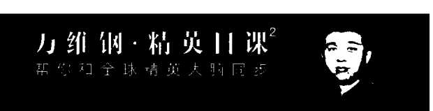

## 答读者问 | 线索、例行程序和回报

来自日课: 正念自控法

万老师，两个对立模块中，通过打断正反馈的方式，并没有让某一方模块更强。有没有办法让“非本能”的模块获得正反馈？比如在“不吃巧克力”方面获得正反馈，这样是不是可以更高效？

万维钢

正是如此。最好的办法是养成良好习惯。今年前有本书叫《习惯的力量》（The Power of Habit，作者是 Charles Duhigg），其中总结，养成良好习惯，需要三个东西：线索、例行程序、和回报。

所谓线索，就是一遇到这件事，我们就启动这个习惯。程序，就是这个习惯的具体动作。而回报，就是做完之后得给自己一个奖励，这正是正反馈，有利于提高这个习惯的强度。

比如刷牙，线索就是每天起床后和睡觉前这两个时间点，程序就是刷牙的动作，那回报是什么呢？最早的时候，刷牙这个活动没有立即兑现的回报，消费者难以养成习惯。后来牙膏厂商在牙膏里加入一种物质，大概是薄荷之类的东西，这个物质对牙齿健康没有什么作用——它的作用是刷牙之后能在嘴里产生一种清新的感觉！这个清新的感觉，就是刷牙的回报。

来自日课: 什么叫“色即是空”？

来自日课: 因缘动力学

那就是你也会爱别人的孩子。既然是上帝视角，你会发现每个孩子都有可爱之处！但这难道是一件坏事吗？

### 来自日课：佛法的另一种认知

怎么算“最适合我做”？怎么算“义不容辞”？现在互联网这么发达，我们很容易收到各种需要帮助的信息，比如朋友圈出现的众筹治病，我怎么知道这回的捐款是不是“最适合我做”？

万维钢

如果你你的高中同学在朋友圈募捐，捐款对象是他儿子的同班同学，重度烧伤而且家庭困难，我认为这属于义不容辞的情况，因为你离他很近、你对他很重要。如果是陌生人的捐款，已经用一个催泪故事打动了很多很多人，那你就没有太大义务了。

其实在真正的上帝视角之下，所有人的生命应该是等价的。你同学儿子的同学的命是命，难道一个跟你素不相干的非洲孩子的命就不是命吗？如果再进一步，难道一只梅花鹿的命就不是命吗？

所以个人捐款这件事本身就不科学。科学的办法是由一个大机构出面、公平公正地统筹对待所有需要救助的对象。政府税收和医疗保险才是最好的救助机制。

但既然没有那么完美的系统，个人捐款也是不得已的事情 —— 我只是想说，捐款这件事也是可以做得更接近上帝视角一点的。

缘起性空，空有不二。执有是边见，执空也是边见，佛在讲空与无我时，也在讲有。比如“宁可执有如须弥山，不可执空如介子许”。所谓“四边不立，中道不安”，学佛的目的不是求保佑，但可以从求保佑开始，正如有的人从放下屠刀开始。不论怎样的慈善，在如今的世道，学佛者都应当随喜。当你刻意持着不被情感“绑架”的时候，那你是否被“不被情感绑架”这样的情感绑架呢？

万维钢

非常钦佩这个说法，我完全同意。“随喜”是个很好的事情。学佛的人随喜，大约相当于职业球员偶尔跟幼儿园小朋友踢踢球 —— 这不是他的本职工作、不完全符合逻辑，但是有利于彼此的身心健康。

# 日课预告｜有关“运气”的鸡汤迷信和科学研究

日课预告｜有关“运气”的鸡汤迷信和科学研究

讲了两周佛学，我们专栏将在下周回归有“色”的花花世界。我们要讲个小专题，主题是“运气”。这个专题不依赖于一本特定的书，我将像雷·达里奥提倡的那样搞些 synthesize —— 也是综合调研。

“运气”这个话题咱精英日课的读者应该非常熟悉了，我们在第一季详细解读过罗伯特·弗兰克的《成功与运气》这本书。但是弗兰克作为经济学家，他那本书更关注的是社会应该怎么对待成功人士的运气，是裁判员的视角。

而我们下周要讲的是更接地气的问题：作为一个参赛选手，怎么*提高*自己的运气。

运气可以提高吗？运气是人身上的一个特性吗？关于这些问题有太多鸡汤和迷信说法。破除迷信只是第一步，更重要的问题是人到底怎么才能更科学地面对运气，甚至增加运气。

号称能让人心想事成的所谓“吸引力法则”，靠谱吗？我们将列举一些实验证据。

普通人眼中一惊一乍的“运气”，在高手眼中都是可以平静对待的概率问题。我们将介绍高手把运气系统化对待的方法。

有意思的是，如果你真的相信运气是人身上的一个特性，并且认为自己天生就是个运气好的人，那你就真的运气很好。我们将分析代表好运气的性格。

然后我们还要说说怎么避免坏运气。重大灾难发生的时候，大多数人根本意识不到危险。这个道理非常重要，但不是你已经耳熟能详的“黑天鹅”。我们要说一个对中文世界还比较新的概念。

我们将会用到科学实验、心理学理论、简单的数学、历史典故……以及，上周刚刚学到的，佛学。

明天晚上10：43，《精英日课》将让你重新认识运气。

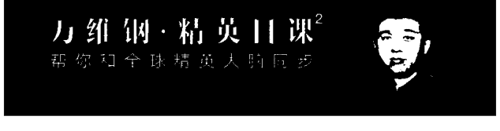

### 日课精选

提交留言可与专栏作者互动

# 日课043 | “正能量”的负作用

日课043 | “正能量”的负作用

有本长盛不衰的畅销书叫《遇见未知的自己》，作者是张德芬。我不知道你读过没有，这是一本充满正能量的书。

这本书说，一个人处在一个什么样的心境之中，他就会不自觉地总要去寻找符合这个心境的环境和东西，所以正能量心境带来好运气，负能量心境带来坏运气。更进一步，好的心境还能让人心想事成，能把你想要的东西带给你。具体的方法，就是想象。

查理·芒格有一句名言说“得到一个东西最好的办法是让自己配得上它”，那么张德芬这个理论，就是“得到一个东西最好的办法是想象自己已经得到了这个东西”。

用张德芬的原话来说，就是“当你真心想要一件东西的时候，全宇宙都会联合起来帮助你。”

这个理论科学吗？正能量真有用吗？

## 1.正能量

用想象的方法得到一个东西，这个思想并不是张德芬的原创，它来自一个已经流传上百年的叫做“吸引力法则”的理论体系。十几年前流行一本书，朗达·拜恩的《秘密》，说的就是吸引力法则。

《秘密》也好、《遇见未知的自己》也好，吸引力法则的操作路径是一样的——

- 1. 你要放松自己的心情；
- 2. 想象一下自己想要的东西到底是什么。比如你想要一个学位，那么你就想象学位证书是什么样的，得到这个学位以后的你是什么情景，越详细越好，你要非常相信自己能够得到这个东西；
- 3. 向宇宙、或者向上帝，索要这个东西，把它吸引过来；
- 4. 想象自己已经得到了这个东西，并为此向宇宙或者上帝表示感谢；
- 5. 等着。过一段时间之后，你就能得到这个东西。

这简直一听就不靠谱，怎么就能把东西吸引来呢？当然这里面是有机制的，也许上帝听到了你的心声，也许整个宇宙之中有一张正能量网络，还有人说这是因为量子物理学！

## 2.负作用

关于正能量的科学实验早就有 人做过，而且做了不止一个。

1999年加州大学研究者的一个实验是这样的。学校里马上再过几天就要考期中考试了，研究者想看看正能量梦想对考试成绩有没有什么影响。受试学生被分成了三组——

- 第一组学生每天花几分钟想象自己*已经*取得好成绩之后，是一种什么感觉——这组就是“正能量组”；
- 第二组学生的任务也是每天花几分钟想象，但想象的是自己在什么时间、什么地点和如何准备考试；
- 第三组是控制组，没有想象任务，该怎么复习就怎么复习。

## 3.白日梦应该怎么做

前几年流行一句话叫“梦想还是要有的，万一实现了呢”，我听着感觉特别别扭。这种自我激励也太廉价了。如果查理·芒格炖的是真鸡汤，“梦想”这种说法简直就是用鸡精冲出来的鸡汤。马丁·路德·金说“我有一个梦想”，那是用一个为当时社会规范所不容的、有点离经叛道的设想激励听众，是一个持不同政见者在高喊自由。你拿一个个人的美梦糊弄自己，这算什么事儿呢？

正能量梦想之所以有负作用，就在于它想象的是做事的*结果*，人们会自我暗示，仿佛已经得到了这个结果，以至于不想去做事了。

而取得了好效果的实验，都是让人想象做事的*过程*。

高水平的运动员经常要想象自己比赛的情景是什么样的。他们想的可不是拿了冠军领奖，而是比赛的细节：场上的风向、裁判是不是公平、对手如何表现、我如何应对、有没有可能发生意外……这样的想象有利于比赛。

甚至还有研究说，在头脑里想象一个训练的过程和动作细节，就好像真的参加了训练一样能起到作用。

想象过程，相当于模拟训练。想象结果，那就是精神鸦片。

如果一个人不好好面对现实，不好解决真问题，大谈什么“梦想”，这岂不是愚昧吗？

参考文献：
[1]. 此事见于 Top Dog: The Science of Winning and Losing 一书，作者是 Po Bronson 和 Ashley Merryman。
[2]. Kraus, M., and Chen, T. (2013). A Winning Smile? Smile Intensity, Physical Dominance, and Fighter Performance. Emotion DOI: 10.1037/a0030745

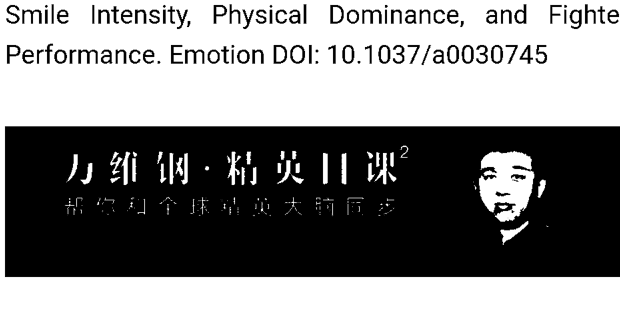

# 日课044 | 怎么样用系统下一盘大棋

日课044 | 怎么样用系统下一盘大棋

今天我们讲讲高观点下的“运气”。“运气”这个词是老百姓带着主观感性的说法，高观点的说法叫“概率”。佛学讲“色即是空”，其实我们平时候说的好运气、坏运气，都是戴着有色眼镜看概率，而且常常是矛盾的。

比如说，福利彩票让你选七个数目，都选对了就中大奖。开奖的时候小王发现自己写对了六个，只有一个数字没中。那你说小王是什么心情呢？他跟千万大奖擦肩而过肯定很沮丧。围观群众也会说，小王这个人没福气啊。

还有个小张，有一次跟一个旅游团坐小公共汽车去山里旅游，结果出了车祸，旅游团里其他人都死了，只有他一人幸存，而且毫发无损。那他的亲戚朋友就会说，小张你真是运气好，福大命大造化大。

可是咱们仔细想想这两个说法，其实正好说反了！彩票中奖号码七个数字你猜中六个，这已经是极小概率事件，你的运气已经是极好了好吗？只是没有好到中大奖而已。再说车祸，有多少人出去旅游要面对生命危险？出车祸是个极低概率的事情，居然发生到你身上，说明你的运气已经达到极点了，怎么能说你是福大命大呢？

感情的波动，蒙蔽了人们看概率的双眼。

佛陀的眼中好运气坏运气都是空的。高手的眼中只有概率。我知道概率，我就对事情的结果有个基本预期。明知道彩票中奖概率低，我根本就不应该指望中奖。坐小公共汽车有风险，但是小公共汽车便宜，如果我选择接受这个风险，那出了事我也不怨天尤人。

老百姓关心具体事件的成败，高手关注的是一个概率系统。只要我这个系统合理，那么具体事件结果都是偶尔波动，长期看我一定是赢。

## 1.中奖者

## 2.连续的输赢

## 3.球星与系统

## 4.过滤短期信息

钱越多。每五年看一次股价的人挣的钱平均比每一个月看一次的人高出两倍。

这是为什么呢？每五年看一次，在这么长的区间内 B 股票的表现比 A 好是非常明显的趋势，投资者肯定会把钱坚决投到 B 股票上面。可是如果你看短期表现，那经常会出现 B 股票在跌、A 股票在涨的情况，有时候 B 股票还跌得很厉害！短期看，你不容易看出来 B 比 A 好。

事实上我以前听说过研究表明，业余股民的确不应该太频繁地查看股价。长期投资往往就是最好的策略。

这个道理是有时候你了解的信息越多，你的判断反而越不准确。多出来的那些信息并不是真正的知识，而是伪知识。高手做事应该过滤短期信息，专注长期表现。

这个思路其实就是系统思维，要不计一城一池之得失。

试玉要烧三日满，辨材须待七年期，这句话说着容易做起来难。如果所有信息都出来了，你画个趋势图看看哪个信息最重要很容易。但如果信息是一点一点地出来，那短期波动就很大的诱惑力。

所以“色即是空”不仅仅是一个哲学，它也是一种修行：当你一次赌博输了钱、损失一个好球员、买的股票正在往下跌的时候，你得对自己的系统有多大的信心，才能保持住定力。

没有系统的人一惊一乍，有系统的人心静如水。

参考文献
[1]. David J. Hand January, The Deceptions of Luck: Nature makes chance, humans make luck, Nautilus, December 2017.
[2]. 此事见于克里斯托弗·查布利斯（Christopher Chabris）和丹尼尔·西蒙斯（Daniel Simons）的《看不见的大猩猩》（The Invisible Gorilla）这本书。

# 日课045 | 正念运气观

日课045 | 正念运气观

一个人的命运啊，当然要靠自我奋斗，但是也要考虑到历史的行程……以及运气。昨天我们说了怎么系统性地对待运气，今天要说的是个人到底能不能提高自己的幸运度。我们说的可不是鸡汤，这些内容有严肃科研结果支持。

咱们先假想一个场景。有两个大学生，小王和小张，马上要毕业了正在找工作，但是现在就业市场不太好。两个人的背景相似、学习成绩也差不多，而且找工作都很积极。有…

我们大概可以说，“小王的运气比小张好”。但是你一旦严肃对待这句话，问题就大了。

我们昨天说了，运气仅仅是概率而已。说谁谁运气好，难道运气是人身上的光环吗？这不又成了“吸引力法则”了吗？

## 1.相信运气的人

一般人有两种常见的“运气观”。像咱们中国人常常认为运气是人的一种“属性”。有的人天生运气好，有的人天生运气不好，差不多相当于有“福”之人和无福之人。有福之人干什么事儿的运气都会比别人好一点。另一种观念在西方可能比较流行，认为运气是一个可以随时变化的东西：可能你这几天运气好，但是过几天你的运气就不好了。

恒定的和变化的，你觉得这两个运气观哪个有道理呢？应该说都没有道理，运气只是概率而已，并不是什么有时候陪伴你有时候离开你的“光环”或者“能量场”。

但是观念可以影响人。心理学上有一个说法叫“自我预言”，我们专栏第一季讲过一个道理叫“皮格马利翁效应”，都是说你认为自己是什么人，你就可能变成一个什么人。那认为自己运气好的人，会变成什么人呢？

2009年，加州大学洛杉矶分校的管理学家玛雅·杨（Maia Young），组织了一个关于运气的研究[1]。她想看看相信“恒定运气（我天生有福）”的人，和相信“变化运气（我有时候运气好有时候运气不好）”的人，做事风格有什么不同。

研究者对185个大学生做了问卷调查。问卷统计了每个学生的运气观和工作风格。所谓工作风格，主要考察了两个方面：第一，你愿不愿意接受有难度的挑战；第二，你做一件事能不能坚持下来。

统计结果是那些相信自己天生有好运的人，做事更愿意接受挑战，而且他们更能把事情坚持下来。

迎接挑战、还能坚持下来，这些可是奋斗者的宝贵素质啊。

## 2.好运者的三个素质

英国的心理学家理查德·怀斯曼（Richard Wiseman）在2013年出了一本书，叫《幸运因子》（The Luck Factor，这本书有中文版，叫《正能量2: 幸运的方法》）。怀斯曼做了很多研究证明，运气是真有用。

## 3.怎样制造好运气

怎么才能改善自己的运气呢？怀斯曼提供了一些建议——

材料，爱迪生找到了你没找到，那可能仅仅是因为爱迪生找的比你多。

我最近看到一组数据很有意思，有人对个人创业的成功率做了一项研究 [2]。以前咱们专栏说过，“失败不是成功之母，成功才是成功之母”，这个研究证实了这一点 —— 有过成功经验的创业者，他再创办一个新公司，再次成功的可能性是30%；而有过失败经验的人再次创业的成功可能性只有20%。如此说来，创业这件事的运气，也是跟着人的。如果你要搞风险投资，你应该尽量投给那些成功过的人。

但是请注意，有过失败的经历，也比没有经历强 —— 第一次创业的成功率，只有18%。这就很有意思了，这说明有很多人不是一上来就成功，而是多次尝试、多次失败之后才取得了成功。这不就是幸运者的基本素质 —— 乐观加坚持吗？

我们还可以用来佛学来看看怀斯曼的实验。上周我们说过佛学里一个概念叫“痴”。所谓“痴”，就是你心中装着一个情绪，看什么东西都用这个情绪的视角去看，跟这个情绪无关的东西你都视而不见。完成实验任务的时候，运气差的人眼中就只有跟任务相关的照片和咖啡，这不就是“痴”吗？

而运气好的人之所以运气好，就是因为常常能跳出自己的主观视角，随时留意到周围事物的价值。这不就是“正念”吗？

## 参考文献

[1]. Maia J Young, Ning Chen, Michael W. Morris, Belief in stable and fleeting luck and achievement motivation, Personality and Inpidual Differences 47 (2009) 150-154.
[2]. Gompers, Paul A. and Kovner, Anna and Lerner, Josh and Scharfstein, David S., Skill vs. Luck in Entrepreneurship and Venture Capital: Evidence from Serial Entrepreneurs (July 2006).

# 日课046｜正常化偏误

日课046｜正常化偏误

今天咱们说个你可能不太熟悉的概念，叫“正常化偏误”，英文是 normalcy bias。这个概念是说，当一个灾难已经发生的时候，人们往往意识不到灾难的发生，还以为一切都正常，这样就错过了脱身的最佳时机，结果导致自己面临巨大的危险。

说白了，就是现在局面已经很不正常了，你还在假装正常。

了解这个道理，有利于你在任何不利情况下保持全身而退的能力。

## 1. 真实的灾难现场

我们看电影里的乘客如果发生事故，乘客们就都很害怕，出现恐慌。但是真实的情况是，飞机出事了的时候，大部分乘客都表现得很平静。

比如2013年韩亚航空214号班机在旧金山着陆的时候坠毁，飞机都已经起火冒烟、都已经死人了，乘客下飞机的时候还有点不慌不忙，有的乘客居然还记得拿上自己的行李再走——

照片在网上遭到了舆论谴责。都这个时候了还想着拿行李，这不要钱不要命吗？其实人们面临危险的正常反应，就是认为一切还很正常。

911事件中，飞机已经撞上世贸中心大楼了，这么不正常的事儿都发生了——但是当时在世贸大楼里工作的人，居然还有心情跟亲友打电话闲聊。亲友说我看电视新闻你们那儿飞机撞楼了，他这边居然没当回事儿。接到疏散通知以后，有的还在楼道里跟同事聊天，想先看看别人的反应再说，结果就没跑出来。

像这样的例子举不胜举，咱们再说两个经典的。我们知道庞贝古城是在一次火山爆发的的时候，整体被火山灰淹没，全城两万多人几乎都死了。考察庞贝遗址，人们死之前似乎还在做日常的事儿，好像根本就没有反应时间。

但事实是从火山爆发到火山灰抵达庞贝城，中间有好几个小时的时间。在这几个小时内，庞贝城的大部分人居然都待在室内，没有赶紧疏散撤离！

另一个例子是纳粹统治时期德国那些富有犹太人。1935年的时候，希特勒迫害犹太人的政策已经非常明显了，有10万犹太人已经逃离德国，但是还有45万人选择了等待。他们总觉得……不至于吧？也许最坏的时候已经过去了——结果都被送到集中营迫害致死。

“正常化偏误”，真应该作为一个成语典故写进我们的文化基因啊。

## 2. 强行正常化

为什么会有正常化偏误呢？因为思维惰性。平时日子一直都是这样过，我们就假定日子永远都这样过。哪怕看到不正常的事儿，心里也总想给它一个正常化的解释[1]。

一位女性目睹了一起交通事故，她眼睁睁地看见有个人被撞飞上了天，而她对此的解释是那必然是一个稻草人。前段时间拉斯维加斯发生枪击事件，有些人还以为枪声是在放烟花。你正在银行办事，突然闯进来几个蒙面人，你的第一反应很可能不是现在有人要抢银行，而是这是在拍电影。

一般估计，当灾难发生的时候，70%的人会有正常化偏误，15%的人会被灾难吓得失去行动能力，只有剩下那15%的人能反应过来赶紧逃离。人们不经历灾难的时候总是担心有人传播谣言制造恐慌，而事实是一旦灾难真的来了，大多数人根本就没有恐慌能力。这就给救灾带来极大的困难。美国好几次飓风灾害，政府下了命令必须撤离，很多老百姓就是坚决不走。

正常化偏误和人们常说的“黑天鹅”现象有本质区别。所谓“黑天鹅”是指一个极小概率的事件，本来以为它不可能发生的，结果它就发生了。黑天鹅事件并不经常发生，而且在发生之前通常没有特别明显的征兆，所以只要一发生就能带来巨大灾难。

而正常化偏误则是灾难或者*已经*发生了、或者已经有非常明显的征兆马上就要发生。火山已经爆发了、飞机已经坠毁了，事情已经非常不正常了，人们还在假装正常。这个偏误更可怕，因为各种小灾难比黑天鹅事件多得多。

而且正常化偏误还不仅限于那种特别剧烈的灾难。

经济学家宗志的记者梅根·麦克阿德尔（Megan McArdle）写过一本书叫《负面的正面》（The Upside of Down），把正常化偏误用到了日常生活之中。

麦克阿德尔37岁才结婚，这并不是因为她喜欢晚婚，而是被前男友耽误了。她跟她前男友相处很多年，在这很多年里面，两 个人都明显感到二人的关系并不好，没有亲密感，这段感情不可能有结果。但是两人也从未激烈地争吵过，没有什么分手的契机，结果日子就这么一直付着过下来了。

麦克阿德尔说，失败的公司不也是这样吗？2008年金融危机之前很多年的时候，人们就已经明确知道通用汽车公司不行了。没有过硬的产品，工会力量太强大，工资太高，稍微算一算账就知道公司每年花在退休金的钱实在太多根本就维持不下去。

通用汽车继续一场激进的、彻底的变革。但是当时管理层是怎么做的呢？是上上下下自己欺骗自己。公司只搞了一些小打小闹的改进措施，大家都在假装公司能够维持下去——直到维持不下去为止。

事后分析历史，我们都觉得当时的 人怎么那么愚蠢。可是当你身处历史现场作为当事人的时候，正常化偏误就是能起作用——要不怎么叫科学规律呢。

## 3."无我",才能有我

我调研了很多文章，人们提出过各种避免正常化偏误的方法。有人说我们应该对周围的环境保持敏感度。有人说我们要多了解灾难知识。有人说我们的教育不行，现代教育就是鼓励人顺从、从来不讲独立思考。这些说法都有道理，但是我看这些道理并不足以克服正常化偏误。

我想说另外一个道理。我们应该学学AlphaGo下围棋的精神。

人类棋手看过AlphaGo的棋谱之后有个感慨，说AlphaGo的每一步都是走在整个棋盘上最应该走的地方。那你说这不是废话吗？不是。人类棋手常常做不到这一点。

我们有个思维惯性。比如咱俩在棋盘上的一个局部厮杀，就好像打一场战役一样，我们的思维惯性总想把这个局部处理完了，再去别的地方。

其实正确的做法是不管这场战役打没打完，只要这个局部的争夺价值已经小于棋盘另外一点的价值，你就在这里脱先、去另外一点。人类棋手一直都在教育自己这么做，但是总会有做不到的时候。

而AlphaGo完全没有这个思维惯性。AlphaGo下棋是东一下西一下，人类棋手有时根本跟不上他的思路。AlphaGo，是纯粹的全局思维。

全局思维其实就是我们上周讲佛学时说过的“无我”和“上帝视角”。这才是破解正常化偏误的关键。

回到庞贝城。“我我我”的思维是 我现有身处...

回到庞贝城，“我我我”的思维是我现在身处城中，要不要离开 —— 全局思维则是假设现在你可以随意选择一个地方，那么看见火山已经喷发了，你是愿意待在城里，还是待在城外距离火山几个小时远的地方？

回到1935年，如果你是只有原来一半资产的犹太人，但是可以在全世界任选一个地方居住，你会选择德国吗？

回到空难现场，如果现在的你身处飞机之外，而飞机着火了，你会去飞机里拿行李吗？

当然，真实的操作是有成本的，离开城市要走路、出国会有财产损失 —— 但是跟事情的严重后果相比，物质成本其实可以忽略不计。真正的成本是人的心理惯性 —— 而 AlphaGo 没有心理成本。

最后我再说一个克服了正常化偏误的故事 [2]。1980年以前，英特尔公司做内存条生意赚了很多钱。到了八十年代，日本的公司迅速崛起，他们的内存条更廉价，而且技术也已经超过英特尔了。但是英特尔的人有一个正常化偏误，他们总觉得日本公司不行，自己的技术肯定领先。事实上英特尔的内存业务已经明显难以为继了。

1985年，英特尔主席安迪·格鲁夫和CEO 戈登·摩尔就面临一个重大决策：到底应该怎么对待内存部门。一方面这个部门确实不行了，另一方面大家对这个部门都很用感情。最后格鲁夫问了摩尔一个问题。他说如果咱俩现在被免职了，新来一个CEO，你猜他会怎么做？

摩尔说我猜新 CEO 一定会裁掉内存部门。格鲁夫马上说，那咱俩为什么不能先走出公司大门再走回来，假装咱俩就是新 CEO 呢？于是他们砍掉了内存业务，专注于做 CPU，这次转型非常成功。

格鲁夫和摩尔，做到了“无我”。

有关运气的小专题到此就告一段落了。咱回头想想，这四讲大概都跟佛学有点关系。

我们反对“吸引力法则”，因为幻想好结果其实是一种“贪”。

我们提倡系统化对待概率，这其实就是“色即是空”。

我们鼓吹在例行的任务之外发现好运气，实际上是避免了“痴”。

我们用全局思维破解正常化偏误，正在实践“无我”。

所以谁说佛学没用？你要真擅长佛学，像升官发财逢凶化吉之类的小事儿，根本就用不着求佛祖。

## 参考文献

[1]. https://www.offgridweb.com/survival/normalcy-bias-understanding-your-brains-reflex/
[2]. 此事见于 Chip Heath and Dan Heath, Decisive: How to make better choices in life and work 一书。

## 划重点

我们反对“吸引力法则”，因为幻想好结果其实是一种“贪”。

我们提倡系统化对待概率，这其实就是“色即是空”。

我们鼓吹在例行的任务之外发现好运气，实际上是避免了“痴”。

我们用全局思维破解正常化偏误，正在实践“无我”。

所以谁说佛学没用？你要真擅长佛学，像升官发财逢凶化吉之类的小事儿，根本就用不着求佛祖。

## 日课047 | 契克森米哈赖的幸福课

日课047 | 契克森米哈赖的...

你是否曾经埋头钻研一个什么问题，忽略了时间的流逝？你是否曾经全情投入到一件事情之中，忘记了自己？你是否凭借勤学苦练获得的技术，毫不费力甚至挥洒自如地完成过一项高难度的的工作？

如果你没经历过这些，就算你财务自由、各种享受都体验过，你也根本不知道什么是真正的幸福。

这些高级经历的体验，叫做“心流”。“心流”，是过去三十年最引人入胜的心理学概念之一，它的提出者是米哈里·契克森米哈赖（Mihaly Csikszentmihalyi），摆在你面前的这本书，就是他多年前关于心流理论的名著。

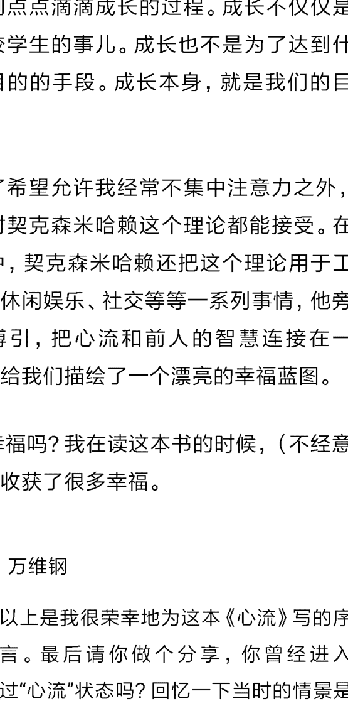

大多数心理学家研究普通人和心理上有点不正常的人，而契克森米哈赖喜欢研究的是那些优秀的人。经常经历“心流”，就是优秀的人的一个共同特征。

伟大的理论总是日久弥新。在读这本书之前，我已经读过很多有关心流的书和研究论文，都是很新的内容。我早就知道心流是怎么回事，心流有什么最新的解释，就好像你就算没读过《国富论》也知道亚当·斯密的思想一样——但是真正读契克森米哈赖这本书，我还是学到了好东西。

契克森米哈赖对“心流”的立意，比后来的学者高得多。

契克森米哈赖那时候的主要研究方法是问卷调查。他和研究团队走访了很多很多科学家、医生、艺术家和普通人，了解这些人的心流体验。他们使用“心理体验抽样法”，通过每天随机选择八个时间点用电子呼叫器指使受试者填写问卷的方法，考察了超过十万人的日常体验。他们最初是想知道“到底做什么是最幸福”，结果获得了“心流”这个洞见。

所谓“心流”，就是当你特别专注地做一件目标明确而又有挑战的事情，而你的能力恰好能接住这个挑战，你可能会进入的一种状态。它的特征是你做这件事情的时候会忘记自己，忘记时间的流逝，你能察到所有相关的信息，不管工作多复杂你都毫不费力，而且有强烈的愉悦感。

就凭借那些调查问卷，契克森米哈赖总结了心流的特征和产生心流的条件。然后这个心流的概念和理论框架，历经众心理学家三十年的研究检验，一直存活到现在，而且越来越热门。

现在心理学家已经使用了脑科学的手段，用功能性核磁共振直接扫描大脑，更直接地研究心流。我们现在的确知道的比契克森米哈赖这本书多一些。

我们已经知道，心流的前提是我们要主动关闭大脑的前额叶皮层的一部分功能，心流的过程是大脑分泌“去甲肾上腺素”和“多巴胺”等六种激素，不断深入，心流的愉悦感也来自这些激素。心流不再仅仅是人脑这个黑盒子的外部表现，而是有了实实在在的大脑硬件工作原理的解释。

现在特别流行的一個心理学概念“刻意练习”，是美国心理学家安德斯·埃里克森2000年以后发展出来的一套学说——可是如果你对比一下“刻意练习”和“心流”，会发现虽然二者说的是两件事，但是有很多很多相通之处。心流，可以说是刻意练习的一个结果。

我们还知道，契克森米哈赖在书中可能过分强调了集中注意力的好处。新的研究表明“注意力不集中”，也是一种对健康至关重要的状态。在注意力不集中的情况下，我们的大脑大部分时间处于所谓“默认模式网络”，这种状态是发散思维和创新的必要条件。

比如说，契克森米哈赖在这本书中提到一位“E女士”，特别强调注意力，一点时间都不愿意浪费。E女士到某个城市出差，自己开会的时候还要让司机去逛逛博物馆以便能在路上听司机讲讲有什么新收获。契克森米哈赖非常赞赏E女士，因为她每一分钟都过得满足而充实。而后来加拿大学者森胸濑在2014年出版的《无为：自发性的艺术和科学》这本书中同样讲到心流，也提到了E女士的例子，但是对她这种一天到晚紧赶慢赶的生活方式就非常不以为然。

但是所有这些后来的研究进步，都不能撼动契克森米哈赖关于心流的最主要论断。

而契克森米哈赖这本书之所以仍然特别值得读，是因为他把心流提升到了更高的位置。

一般学者谈心流，是把心流当成一个最优工作方式。你想在工作中取得好成绩吗？追求心流。而在契克森米哈赖看来，心流其实是一个生活方式——而且是最高级的生活方式。你想幸福吗？追求心流。

心流只是一个方法，它背后的更大的逻辑是，你要通过锻炼控制自己的意识，去获得真正的幸福。

在我看来，这个态度是真正的以人为本！我们做事情的时候并不在于结果能不能给自己带来多大的利害，而是专注于做这件事本身，从中获得乐趣。这句话听着特别像“心灵鸡汤”，但它恰恰是一个站得住脚的理论！

从心流出发，契克森米哈赖重新定义了什么叫“乐趣”，什么叫“复杂”，什么叫“休闲”，并且最终推出什么是真正的幸福。真正的幸福，是当你全心全意投入一件事情，把自己置于度外的时候，获得的副产品。你直接追求的并不是幸福，而是把自己变得更复杂——在这个变复杂的过程中，你会找到乐趣，这个状态就是幸福的。

人生要的不是最后终点的结果，而是每时每刻点滴成长的过程。成长不仅仅是在校学生的事儿。成长也不是为了达到什么目的的手段。成长本身，就是我们的目的。

除了希望允许我经常不集中注意力之外，我对契克森米哈赖这个理论都能接受。在书中，契克森米哈赖还把这个理论用于工作、休闲娱乐、社交等等一系列事情，他旁征博引，把心流和前人的智慧连接在一起，给我们描绘了一个漂亮的幸福蓝图。

你幸福吗？我在这本书的时候，（不经意地）收获了很多幸福。

万维钢

以上是我很荣幸地为这本《心流》写的序言。最后请你做个分享，你曾经进入过“心流”状态吗？回忆一下当时的情景是怎样的呢？欢迎你写在留言区，给咱俩日课阅读后启发最大、获得点赞最多的读者，你将得到这本书，《心流》。

### 日课精选

## 答读者问｜正常化偏误、侥幸心理和灰犀牛

答读者问｜正常化偏误、侥… ↓

### 来自日课："正能量"的负作用

万老师，加州大学的这个实验我表示怀疑。这个实验如何保证实验对象的思想活动是按照规定进行的呢？"第一组学生每天花几分钟想象自己*已经*取得好成绩之后，是一种什么感觉。"这个条件任何人都没办法对其进行验证，所以我觉得这个实验的结果没有什么说服力。您说呢？

万维钢

心理学实验的确都存在一个可靠性问题，但是我们也不能低估了科学方法。像你的这个质疑，如果实验对象是一个人，那的确是完全不可信——但科学方法的妙处在于这是很多人一起做实验，而且被随机分成三组。

也许有的人根本就没有根据要求做想象，也许有的人想象过度了，也许有的人正好想象反了——但所有这些错误发扬，只要人数足够多，都会被一群人的总数据给平均掉。第一组和第二组的人有同样的可能性犯这些错误，为什么第一组的成绩不如第二组呢？你得看这两组人的唯一区别是什么——唯一区别就是他们被要求想象的内容不一样。

当然，还有一个可能性是也许两组成绩的區別纯粹是個偶然的结果。这正是所有心理学统计实验都有的問題。要排除这个可能，一个办法是增加参加实验的人数，另一个办法是找不同的人、用不同的方法验证同一个原理。这就是为什么我们没有只讲一个实验，我们讲了六个不同时间、不同研究者、用不同方法完成的实验。所有这些实验指向了同一个结论：吸引力法则不可靠。到了这个程度，结论的可信性就已经非常非常高了。

### 来自日课：怎样用系统下一盘大棋

生活中爵大大大小小的选择，如何清晰地计算它们的期望值呢？怎样能比较准确地判断出一个选择的"数学期望为正"？

万维钢

没有简单通用的办法。数学期望是非常可贵的知识，有时候花多少人力物力做研究，就是为了得到一个数学期望。

对日常生活而言，要点在于我们很多情况下并不需要精确知道一件事情的数学期望具体是多少，我们只要大概估计一下就可以做出很好的决策了。

数学期望 = 成功的收益 × 成功的概率 - 失败的损失 × 失败的概率

仅仅是看一眼这个公式，你就能得到有益的人生教训。

第一，好事儿不等于万无一失的事儿。一件事有失败的可能性不要紧，只要满足1) 数学期望是正的, 2) 哪怕失败了也可以承受，那就值得做。所有收益大的事儿都是有风险的，关键在于你能不能承受这个风险。

第二，有些事儿失败的损失几乎是零，那么即使这件事失败的概率很高，也值得一试。问问题就是这样的事儿。很可能对方不知道答案，但如果他知道，那可能就给你一个关键信息；而就算他不知道，你问一下也不损失什么。

第三，如果成功的收益很大，失败的损失也比较高的话，每一个更精确的概率判断都价值连城。那时候就值得投入很多工夫调研了。最简单的调研就是问问过来的人——如前所说，问个问题你又损失不了什么。

### 来自日课：正念运气观

"专注力高"和"外向善于寻机机会"是不是矛盾的呢？

万维钢

的确是有矛盾的。咱们还是以搞科研为例，这是一个既需要创造力、也需要执行力的工作。一方面，学术研究要求深入地、专注地工作和思考；另一方面，学术研究不能闭门造车，必须多跟同行交流，了解别人的工作，获得好想法。有些最好的工作具有独创性，也有些最好的工作是把两个类似不相干的东西连接在一起产生的神来之笔。所以专注和外向都重要。

那到底怎么取舍呢？各人的工作风格不一样，但我想，这也与大脑处理信息的带宽有关。刚入行的新手不管干什么都有大量新信息要学，应该老老实实地、专注地做事。而对有相当工作经验的老手来说，日常的工作中根本就没有多少新信息占用他的带宽，他就应该多注意一些外面的事情。

一个年轻人因为钻研学问而注意不到地上的钱、没心情跟旁边的陌生人聊天，不但是正常的，而且值得称赞。可是一个人并不是在钻研什么东西，没有什么不得了的事情要思考，可是眼界非常窄小，只知道守着自己的一些小事，那就太不好了。

### 来自日课：正常化偏误

这个"正常化偏误"，是不是就是"灰犀牛"？这两最后概念的区别在哪里呢？

老师，今天说的"正常化偏误"是不是就是平常说的侥幸心理呢？

万维钢

正常化偏误和灰犀牛、侥幸心理相当接近，我来尝试辨析一下。

"灰犀牛"，我理解是一个大概率的、破坏性很大的危险。比如现在中国房价很高，有些风声说要征收房产税、而房产税必然让房价下跌、甚至可能暴跌，这大约就是灰犀牛。灰犀牛说的是一个可能性，但是灾难毕竟还没有发生。灰犀牛远远地站在那里，它有可能跑过来攻击你，但是现在它还没有过来。

在灰犀牛灾难还没有发生的时候，人们不作为，可以说是侥幸心理。有的人赌这个灾难根本就不会很快发生，有的人赌就算发生了也不会危害到自己的头上。

但这种对待风险的投机态度是可以理解的。事实上我感觉"灰犀牛"是个有点事后诸葛亮的说法，一个灰犀牛事件只有真的变成灾难了，你才知道当初它是一个灰犀牛。2008年金融危机以后人们写各种分析这个危机的原因，好像危机不发生天理难容、没意识到危机的人都很愚蠢——可是你重返历史现场，当初的确实是根本没有几个人经济学家预测到了危机。你很难说所有那些经济学家都非常愚蠢。

如果一个月以后北京房价暴跌，将来肯定会有很多人写书说房价暴跌是注定发生的事件，2017年11月那些人实在太笨了居然没有吸取灰犀牛的教训。可是我们现在身处历史现场，有谁敢说一个月以后房价会跌呢？你要是说"我感觉房价要跌，房价不跌我就。"——那你可能很多年都买不上房。

历史之所以会重演，就是因为当事人根本没有办法做事先判断，根本就没有别的理性选择。

所以我觉得"灰犀牛"这个概念特别适合描写历史事件，但是对预测未来没什么帮助。

而"正常化偏误"，则是说灾难*已经*发生了，但是有70%的人没反应过来，还在假装正常。火山已经爆发了，飞机已经撞上大楼，希特勒已经在迫害犹太人，这些人居然没反应。

看到远方有一头灰犀牛而不跑，有可能是理性的。毕竟这里草丰水美，总不能说凡是犀牛出没的地方我就 Mil ... 

个企业因为技术落后而慢慢倒闭，可能既是灰犀牛也是正常化偏误。大尺度上看技术落后就要被淘汰，这简直是必然的灾难，凡是不赶紧撤离的人都是正常化偏误。但是在小尺度上看，人们总会觉得还有别的希望 —— 比如诺基亚被微软收购、黑莓又推出一个新产品，毕竟品牌还在吧？不是说瘦死的骆驼比马大吗？这些“垂死”的挣扎 —— 你也可以说这是灰犀牛。

为什么人们在危险信号十分明显时没有紧急行动？这在进化中有何意义？既然“正常化偏误”会使人处于危险之中，那么自然进化为什么没有淘汰掉它呢，这种“错误”的存在是不是有什么潜在的好处呢？

万维钢

我听到一个说法是当猛兽即将向你发动攻击的时候，如果明知道打不过，保持一动不动是个好办法 —— 说白了就是装死。这的确是个进化上的好处。直接被吓得呆住了也是一个进化策略，身体僵硬可以让被咬了以后的流血量少一点。

现代社会面对暴力袭击事件，有时候保持不动也是个好办法。赶上抢银行、大规模枪击、也许最好的办法就是趴在地上别动。

问题就在于很多危险、特别是现代社会的危险，并不是暴力袭击事件。进化让我们对暴力袭击事件很有经验，但是对其他的灾祸没有那么多经验。

## 日课预告｜新书《以大制胜：怎么样在这个事实根本不重要的世界里使用说服力》

日课预告 | 新书《以大致胜：... ↓

下周一开始我们说一本10月31日刚刚出版的新书，《以大致胜：怎么样在这个事实根本不重要的世界里使用说服力》（Win Bigly: Persuasion in a World Where Facts Don't Matter），这本书的作者正是咱們在精英日课第一季讲《巨人的工具》的时候介绍过的、呆伯特系列漫画的作者斯科特·亚当斯（Scott Adams）。

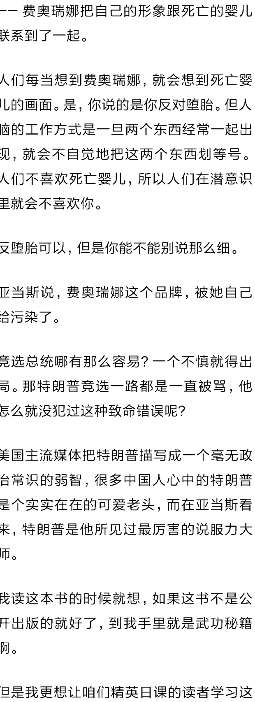

表面上，这本书说的是特朗普是如何使用最高水平的说服力当选美国总统的。实际上，这本书是亚当斯本人对说服力这个功夫的描述和总结。深入来说，这本书是对人性的一个洞见。

“影响力”、“说服力”这些话题对我们专栏的读者来说应该已经非常熟悉了，但这本书的立意、观点和技术可比一般的书高出了一大截。

我来举个例子，你看看什么是最高水平的说服力。

2015年12月16日，共和党党内初选辩论，曾经担任过惠普公司董事长兼CEO的女候选人卡丽·费奥瑞娜（Carly Fiorina），在呼声很高的情况下，使出了教科书式的一招。

共和党，代表美国的保守派，它的一个共同理念是反对堕胎。费奥瑞娜作为女性候选人，更应该打好反堕胎这张牌。她采取了讲故事的经典做法，声情并茂地讲述了一起因为堕胎而导致医学事故。

一个真实的、充满细节的故事、有很强的画面感、充分调动了人们的感情。费奥瑞娜立即获得媒体和社交网络的热烈关注。这一招既有章法又有效果，对吧？

但是，当时正在看直播的亚当斯，当场断定，费奥瑞娜完了。

事实果然不出亚当斯所料。这场辩论之前，费奥瑞娜的支持率高达15%。辩论之后，支持率迅速下降到了4%。

这就是顶尖高手跟教科书的区别。费奥瑞娜以为自己这招没毛病，但是在亚当斯看来，她犯了一个无法挽回的错误。

> —— 费奥瑞娜把自己的形象跟死亡的婴儿联系到了一起。

人们每当想到费奥瑞娜，就会想到死亡婴儿的画面。是，你说的是你反对堕胎。但人脑的工作方式是一旦两个东西经常一起出现，就会不自觉地把这两个东西划等号。人们不喜欢死亡婴儿，所以人们在潜意识里就会不喜欢你。

反堕胎可以，但是你能不能别说那么细。

亚当斯说，费奥瑞娜这个品牌，被她自己给污染了。

竞选总统哪有那么容易？一个不慎就得出局。那特朗普竞选一路都是一直被骂，他怎么就没犯过这种致命错误呢？

美国主流媒体把特朗普描写成一个毫无政治常识的弱智，很多中国人心中的特朗普是个实实在在的可爱老头，而在亚当斯看来，特朗普是他所见过最厉害的说服力大师。

我读这本书的时候就想，如果这书不是公开出版的就好了，到我手里就是武功秘籍啊。

但是我更想让咱們精英日课的读者学习这本书。中国没有竞选，咱們也不可能都当特朗普，但是如果我们这些人能从书中学到一点真功夫，那对我们、对社会、对中国，都有好处。

明天晚上10：43开始，我们一起钻研这个时代最高级别的说服力。

## 日课048｜《以大制胜》
### 1:武器级的说服力

*今天日课，强烈建议听音频。

今天开始咱们说一本10月31日刚刚出版的新书，《以大制胜：how to 在这个事实根本不重要的世界里使用说服力》（ Win Bigly: Persuasion in a World Where Facts Don’t Matter ）。

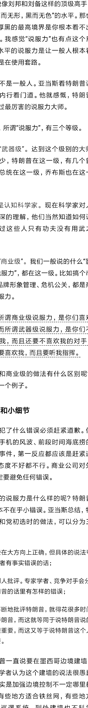

这本书的作者斯科特·亚当斯（Scott Adams），对我们专栏的读者来说已经很熟悉了。他就是呆伯特系列漫画的作者、还经常写时评文章。咱们专栏第一季在讲《巨人的工具》那本书的时候，就专门提到过亚当斯的写作系统。

每个厉害的作家都得是说服力大师。漫画也好文章也好，本质上都是影响人心的工具。亚当斯本人的影响力就很大，而这本书的主题，是特朗普怎么使用说服力当选美国总统的。这本书是大师说大师。

## 1.说服力的三个等级

特朗普当选总统这件事，把知识界搞得很抓狂。过去这大半年里，我感觉美国的报刊杂志简直都沒法看了，什么纽约时报、纽约客、纽约书评每周都有大量的文章在骂特朗普，说特朗普是个贩卖仇恨者，是希特勒、是个小丑、是个弱智。有些网站专门对政客的言论做事实调查，你上这些网站一看特朗普说的很多话都是错的。可是这么一个连事实都不顾的小丑和弱智，怎么就当选了美国总统呢？

+   1. 说一些在大方向上正确，但具体的说法夸张、或者有事实错误的话；
2. 等着别人批评。专家学者、竞争对手会分析特朗普的话里有怎样的错误；
3. 人们不断地批评特朗普，就得花很多时间谈论特朗普，而这就等同于说特朗普说的内容很重要，而又等于说特朗普这个人很重要。

## 2.大方向和小细节

## 3.先同步，再领导

凯利：人们都喜欢你说话直言不讳、你不用政客那一套，但你这不是没有缺陷的，特别是对女性。你曾经把你不喜欢的女性叫做猪、狗、懒鬼、令人恶心的动物，你的 Twitter 账号......

特朗普：我只说过罗茜·奥唐纳。

凯利：不是的。你的 Twitter 账号......

特朗普：（面对观众欢呼）谢谢，谢谢。

凯利：准确地说，你说过的人绝对不止罗茜·奥唐纳。

特朗普：对，你说的对。

凯利：你的 Twitter 账号经常有蔑视女性的言论，你曾经在《明星学徒》节目里公然贬低女性。你这是一个我们要选为总统的人应该有的气质吗？希拉里说你正在参与对女性的战争，你怎么面对她这个指控呢？

特朗普：我认为“政治正确”是这个国家的一个大问题。很多人就此指责我，但是我没有时间去表现“政治正确”。跟你说实话，这个国家也没有时间。这个国家现在有大麻烦。我们不再取胜了！在贸易和边界问题上我们输给中国、我们输给墨西哥，我们输给所有国家。坦白地说有时候我说的话是为了好玩、是开玩笑，我们很愉快。我说了就说了。梅根，你一直对我不怎么样，但是我一直对你很好，你不喜欢我也没办法。但是你知道吗？为了这个国家，我们需要力量，我们需要能量，我们需要速度，我们需要大脑，才能扭转局势。这就是我现在可以告诉你的。

咱们想想这个局面。如果你是候选人，主持人说你歧视女性，你会怎么回答。你辩解一番，说自己一贯尊重女性，也最多只能是不减分而已——而特朗普把这个问题变成了加分项目。

特朗普直接打断主持人，只用一句话就将局面扭转了过来，他说，“我只说过罗茜·奥唐纳”。这个罗茜·奥唐纳（Rosie O'Donnell）是个电视节目主持人，是非常著名的白左，共和党人都很反感她。辩论现场都是共和党的人，特朗普把奥唐纳的形象拿出来，马上就跟观众取得了感情上的同步。

取得了感情同步，特朗普紧接着就领导观众往前走一步，占领道德制高点。他说我们现在没有时间搞“政治正确”那一套。亚当斯说，整个这个节奏，叫“先同步后领导（pacing and leading）”。

这个套路我们在生活中也可以用。比如你家小孩贪玩打游戏，你最好的办法不是批评他，而是先跟他同步：这个游戏确实好玩啊，你打的不错！然后你再领导：你知道吗？要想打游戏真正打出高水平，你必须得有知识、有头脑才行——所以你就得好好学习啊，比如说你应该重点学好数学......

但特朗普这一次可不是别人给他机会同步他才同步，是别人正在指责他的时候，他一句话“罗茜·奥唐纳”就达到三个效果：1）回避了一个尖锐指责；2）让观众哈哈大笑；3）跟观众取得同步。

这种神来之笔可不是一朝一夕的功夫。特朗普之所以是特朗普，背后有很多因缘。明天，咱们先从基础知识学起。

+   *本期推荐阅读：
日课062 | 《混乱》解读4:特朗普的打法
日课153 | 高手修炼手册1: 系统, 灵感和技能
*本期音频友情出演：
罗胖 饰 特朗普
杰克糖 饰 凯利

## 日课049 | 《以大制胜》
### 2:人心比事实重要

今天咱们继续说的斯科特·亚当斯的《以大制胜》这本书。

任何高级技能都得有一个理论基础。要掌握这个技能，你得首先更新自己的知识，有时候甚至得对世界有一个新的认识。要学习说服力技能，你就要对人性有一个新认识。

说服力的理论基础就是人大部分情况下都是非理性的。一般印象非理性是因为感情用事，但是我们前面讲佛学的时候提到，现在心理学家最新的认识是人做决定并不是感情对理性，而是感情对感情 —— 我们任何时候都是感情用事。有感情不代表不正确，也不代表不理性。那所谓“非理性”，到底是怎么回事呢？非理性是感情的判断出错了。

亚当斯说，非理性有两个最大的来源：一个是“认知失调”，一个是“确认偏误”。

因为这两个机制，每个人其实都是生活在自己的幻觉之中。

这就是为什么我们说“事实根本不重要”。

## 1.认知失调

有些概念你只能认识一次 —— 一旦认识了这个概念，你就不是你了：你观察世界的眼光会有一个改变。“认知失调（cognitive dissonance）”就是这样的概念。咱们隔壁《何帆大局观》专栏曾经讲过这个概念，我们说一个最经典的例子。

上世纪五十年代有个教派，相信某月某日是世界末日，说信这个教的人到时候会被外星人派飞碟接走，而所有不信的人都得跟地球一起毁灭。结果真到了那一天，飞碟没来，地球上啥事儿都没发生。

## 2.确认偏误

“确认偏误（confirmation bias）”这个概念学术界早就有了，但是请允许我吹一把，我可能是第一个以通俗的方式把“确认偏误”介绍给中国读者的。早在2013年我就写过一篇文章叫《别想说服我》，讲的就是确认偏误。

确认偏误的意思是说，我们平时观察世界，并不像科学家一样以事实为根基、根据事实产生观点 —— 我们是像律师一样，先有观点，再用新的事实去支持自己的观点。

## 3.摆弄人心的学问

他行动的指导思想，就是人心比事实重要。

## 3.摆弄人心的学问

亚当斯自认只有商业级的说服力水平，但是他曾经使用过一次武器级的说服力。

因为之前所有主流预测都认为希拉里应该当总统，特朗普当选总统这件事就在美国人中导致了大规模的认知失调。知识分子们列举了二三十个理由来解释特朗普为什么会当选总统——一件事怎么可能有这么多理由？这其实就是认知失调的症状，人们无法面对自己预测失败的事实，于是产生了二三十种幻觉。

其中最重要的一个幻觉，就是特朗普是希特勒，他是利用了美国人仇恨移民的心理当选的总统。这是一个非常危险的幻觉，我们回忆一下那时候的新闻，特朗普的反对者和支持者已经发生了暴力冲突，美国几乎要分裂了。

面对这种大规模认知失调，你应该怎么办呢？你要做的不是什么摆事实讲道理，而是影响人心。

亚当斯在特朗普支持者中有很大的声望，他就利用这个声望，当了一把意见领袖。亚当斯通过 Twitter 和文章对特朗普的支持者说，咱们已经赢了选举，就不要再有过分得意的动作了，作为爱国者，我们现在要弥合美国的伤口。如果希拉里阵营的人要打我们一下，干脆就让他们打一下就算了，不要再反击了。爱国是第一位的，为了国家的前途，我们低调一点。这是典型的“先同步再领导”。

他这些话，别人听进去了。当然我们无法评估亚当斯到底起了多大作用，但是如果夸张一点说的话，也许亚当斯在关键时刻挽救了国家挽救了党。

其实特朗普一直在调整。特朗普在党内初选的时候打反对非法移民的牌，快速赢得了党内的支持，但是被希拉里阵营描绘成了希特勒。因为确认偏误，“特朗普是希特勒”这个印象一旦形成，就很难改变了。

那特朗普怎么办呢？口头上的辩解没啥作用，讲些细微的事实对方根本不会听——特朗普做了一个*方向性*的改变。

他以前的说法是要遣返所有非法移民，但是现在他改成我们只遣返在美国有过犯罪记录的非法移民。这是一次调头。公众很难对事实做什么判断，但是对这种方向性的转变还是比较敏感的，结果希特勒这个形象就减弱了。而特朗普的支持者对此并不怎么介意，因为确认偏误已经让他们认定特朗普是自己人。

当选总统之后，特朗普紧接着就使用了一招，亚当斯称之为“新 CEO 策略（New CEO move）”，我们中国人叫“新官上任三把火”。

他用了一系列的动作，向美国人民说明自己这届领导班子一上来就给国家带来了新气象。比如说，特朗普高调宣布，因为他的斡旋，福特公司把一些外包到海外的工作带回了美国！

其实你仔细想想的话，特朗普这些动作对国家并没有多大实质性的意义，事实上一个总统刚上来也做不了多少事儿——但是这些动作可以改变人心。人们看新领导就是希望能从你身上看到新思维新气象，只要人心扭转过来了，别的那都不叫事儿。

具体的操作技术我们后面再说。今天的关键“得到”在于，人心比事实重要——而说服力，是摆弄人心的学问。

我做了什么并不重要，重要的是别人对我的看法是什么。这就好比两夫妻吵架，你摆事实讲道理根本没用。如果两人看对方的看法是都不爱了，什么道理都没有意义。

再说的直白一点，那就是——

什么叫说服？说服就是我做这件事并不是为了改变世界，而是为了改变世人的看法。

延伸阅读：介绍“确认偏误”的文章《别想说服我》 http://www.geekonomics10000.com/729 （你可以把这个地址复制，在浏览器打开阅读）

## 日课050 | 《以大制胜》
### 3:催眠师的自我修养

今天咱们继续说《以大制胜》这本书。我会打算下周再系统性地讲一些说服力的高新技术，不过现在也会穿插讲一些普通的。其实我们已经讲到了几个技术：先同步后领导、改变方向冲淡确认偏误、新官上任三把火。今天重重点还是讲原理。

高水平说服力不是一朝一夕就能掌握的，大师不是白当的。就好像武侠小说里的高深武功一样，你得有一定的机遇、还得下长期的功夫，最好从年轻的时候就开始学。特朗普的机遇咱明天再说。今天先说说这本书的作者斯科特·亚当斯的机遇。

亚当斯二十多岁的时候，有一个奇遇。他参加了 一个偶然出现的催眠术培训班，学了好几个月，而且学成了。亚当斯，是个催眠师。

亚当斯说，催眠术让他的世界观发生了改变。他意识到原来操弄人心是一件如此容易的事情。

## 1.催眠 ABC

我们印象中催眠术是个神秘的技能。电影里的催眠术一般都是用一个像钟摆一样的东 西在你眼前晃来晃去，你看着看着就睡着了，然后催眠师问你什么问题，你都会如实回答。

有人说催眠术能唤醒人们前世的记忆。有些公开的催眠表演，几个观众上台，催眠师把他们瞬间催眠，能让他们做各种稀奇古怪的动作。更有甚者，还有人说催眠师能对你的大脑编程，比如他可以下这一个指令，让你明天下午四点去某个地方杀一个人。

其实哪有这么神。亚当斯说，真正的催眠术根本不用什么钟摆道具。催眠术，是利用人的非理性，通过互动，让人达到某种状态。催眠的时候，人的意识是完全清醒的，催眠师只是让你精神非常放松，让你能把他的话听进去而已。催眠术不能让你做不想做的事情、更不能让你杀人。

亚当斯曾经用催眠术帮助一些人回忆前世！但是几次下来，亚当斯有一个疑问。他发现这些人说的前世记忆特别像电影里的事儿——有人说自己前世是个中国人，有人说自己前世是个北美印第安人，从来就没有一个人的前世回忆不符合电影的热门主题。所以亚当斯非常怀疑，这些人到底是真的回忆起前世了呢，还是说了一个梦。

那催眠术到底能干什么呢？亚当斯小时侯，他们家的家庭医生就是个催眠师，这个催眠师曾在亚当斯的妈妈生小孩子的时候，帮助她妈妈达到了无痛分娩。当然亚当斯现在无法考证到底是真的无痛、还是妈妈回忆起来是无痛，毕竟人的记忆经常不可靠。

亚当斯……曾经用催眠帮助一个女性达到了性高潮。双方没有任何身体接触，而这位女性表示催眠非常成功。让观众上台听催眠师的话表演动作，这是可以做到的，前提是催眠师得精心挑选愿意配合的观众，并不是每个人都容易被催眠。

说到这里你可能会问我，咱们精英日课能不能专门解读一本讲催眠的书，大家一起学学催眠术呢？这个真没有。关键在于，催眠是一种互动的学问，强调随时捕捉催眠对象表情和肢体语言，这就必须得面对面跟着老师学才行。

但是我们可以从催眠术中学一点基本原理。这个原理，有助于我们掌握说服力。

## 2.催眠术的核心原理

催眠也好、说服也好，最核心的原理，就是要利用人心 中已有的情感去说服对方。他心里必须已经有这样一个种子，所以催眠或者说服，就是你帮着这个种子长大。

举个例子。很多人问亚当斯，能不能用催眠来帮助戒烟或者减肥？亚当斯说这种效果一般都不好，因为抽烟的人内心是非常想抽烟的，你劝他戒烟，他会有抗触情绪，催眠就难以进行。减肥也是一样，这个人本身想吃东西，你劝他不要吃，也是非常困难。

催眠，最好建立在你不反对这件事、甚至是很喜欢这件事的基础之上。比如前面说的“无痛分娩”和那位女性达到性高潮，是催眠对象本身就有这个愿望，催眠师只是助推了一把，那催眠就很容易。舞台上的催眠表演，关键就在于催眠师要挑选那些本身就愿意上台来出个洋相的人。

所以催眠术不能包治百病，它的作 用范围有限。我想这也就是为什么催眠术并不流行，以至于人们觉得很神秘。

但是催眠术这个基本原理的应用范围可能超出你的想象。比如你可能觉得聪明人不容易被催眠，但亚当斯的经验是恰恰相反，聪明人更容易被催眠。也许正是因为聪明人知道催眠不能把人怎么样，他不害怕催眠，防备心理弱，更愿意配合。

事实上，很多情况下我们都愿意配合各种形式的“催眠”。比如电视广告，一个跟美女没有任何关系的科技产品，也让美女来代言，这就是一种催眠：我们心中有个喜欢看美女的种子，借助这个种子，我们就会喜欢跟美女一起出现的东西。

你把这个道理想通了，说服力的“先同步再领导”这个技术，其实就是催眠术的推广应用。

亚当斯，就把催眠术用到了写作之中。从某种意义上你可以说写作就是在对读者催眠，你要有一个互动意识，时刻猜测读者读到这里会想些什么。

我我就跟亚当斯学了这一招——你注意到了吗？刚才我说道，“说到这里你可能会问我，咱们精英日课不能专门解读一本讲催眠的书，大家一起学学催眠术呢？”这就是跟读者同步。我猜你会有这个问题，我帮你说出来。咱们取得同步了，你才愿意听我说接下来的内容。

好，咱们再强化一遍：催眠和说服的核心原理，都是要利用人心 中已有的情感去说服对方。现在根据这个原理，我们来点评几个常用的说服力方法。

## 3.对几个说服力方法的评价

亚当斯给常用的说服力方法做了一个排序，以下这些方法的有效程度是从低到高——

+   1. 文字游戏
2. 悖世嫉俗互相比烂
3. 晓之以理
4. 做类比
5. 已有的习惯
6. 内心的渴望
7. 小恐惧
8. 身份认同
9. 大恐惧

下周我们要讲一些更新级的实战应用，今天这些就不一一细说了。我们点评几个常见的。

文字游戏，是个不好的说服力方法。共和党和民主党经常辩论的一个焦点是堕胎是否应该合法化。共和党人说胚胎再小也是一个生命，民主党人说胚胎并不是生命。其实你看辩论来辩论去，大家都同意生命是无价的，分歧只在于到底什么 是生命——这就是文字游戏，再怎么辩论下去也不会有结果。再比如，共和党内部辩论，很多 人说特朗普不是个真正的“保守派”，这也是文字游戏：说来说去都是在说到处怎么叫“保守”，谁能说服谁呢？

互相比烂，也不是好办法。什么叫“比烂”呢，咱们来看一个例子：

A：你们党执政的时候，对街头暴力并没有采取有效措施！
B：可是你们当权的时候，也没采取有效措施啊？

这种比烂特别不好，选民一看两边都不是好人。当别人跟你比烂的时候，你正确的方法是占领道德制高点。亚当斯的建议是这么说——

A: 你们党执政的时候，对街头暴力没有采取有效措施！

B: 你说的对，我们工作没做好。但幸运的是，我们已经取得了一些经验。我们做了一些实验，有些方法好使，有些方法不好使，我们正在积极寻找应对街头暴力最好的办法。

前面那个对话就好像两个小孩吵架。后面这个，才像是大人说的话。这个大人，是在对听众心中那个好的感情说话。

晓之以理，不如动之以情。亚当斯说，哪怕是特别小的事儿，也常常是感情决定的。比如说垃圾分类，没人喜欢这个麻烦，那为什么美国的垃圾分类普及得那么好呢？

普通垃圾桶和可回收垃圾桶是分开的，标志非常明显。你从家里出来倒垃圾如果不分类，邻居一眼就能看见，你的形象就很不好看。孩子们从小在学校里，老师就教他们把垃圾分类，如果你家小孩回家发现你没有做垃圾分类，他会看不起你。所以人们其实是为了面子而做垃圾分类，这就是感情的作用。

真正的说服，都要诉诸感情。最有效的一种感情就是人们心中的某个渴望。比如苹果公司，就非常喜欢迎合人们对“创造力”的渴望，每次拍广告都是描写人们用苹果的设备去创造一个什么东西。

人们心中 有这么一个渴望，而你利用这个渴望去说服人，这不就是催眠吗？

那咱们再来看看特朗普的竞选口号：“Make America Great Again（让美国再次伟大）”。现在的美国不行了，有各种各样的毛病，而我要把海外的工作拿回来，我要建设第一流的基础设施，我要在全球捍卫我们应得的利益——我要让美国再次伟大。每个选民心中都有这样的渴望。

然后你再看看希拉里的竞选纲领。希拉里到底想干啥呢？她几乎要完全继承奥巴马的政策，要维持现状。也许希拉里说的对，美国本来就伟大不用“再次”伟大——可问题是，维持现状，就不可能是一种“渴望”。

今天我们说的原理和方法，一旦说明白了你肯定觉得很简单。但说服力的一个特点是光方法正确还不行，还得看是谁用。就好像法术一样，咒语念对了还不行，还得有内功加持。有些方法一般人就算会用，也不好使。

谁用好使呢？特朗普用好使。因为特朗普有自己独特的优势。这些优势，咱们明天再说。

## 日课051 | 《以大制胜》 4:特朗普的主角光环

日课051 | 《以大制胜》4:特...

今天继续说亚当斯的《以大制胜》。我们想从这本书中学学习摆弄人心的能力，但是今天可能要泼点冷水了 —— 武器级的说服力，不是谁都可以拥有的。我有一个坏消息和一个好消息。

坏消息是特朗普之所以是特朗普，有他独特的主角光环。如果你是读书学的说服力，你已经落了下乘 —— 特朗普的说服力不是看书看来的。

好消息是说服力是个可积累的正反馈系统 —— 你的功夫会越用越深。

### 1.特朗普的天赋系统

咱们以前讲《巨人的工具》那本书的时候提到，亚当斯有个让技能和技能配合的理论。现代世界竞争非常激烈，你想在任何一个领域达到前1%的水准都是很难的。但是如果你有两三个技能，把每个技能都练到前25%的水平，那似乎更容易一些。如果你的这几个技能之间能够互相配合，那你就是一个稀缺人才。

比如说亚当斯自己，他会画漫画、会写作，还特别了解办公室政治。这三个领域中的任何一个，亚当斯都不是最好的，但是*同时*懂这三个东西的人非常少。亚当斯把这三个技能结合在一起，用文字才会、画有关于办公室政治的、漫画，这就形成了独一无二的品牌：呆伯特。

特朗普也是这样。而且他的技能还不止三个。而且他的一些天赋我们无法复制。

特朗普以谈判水平高著称，出过一本特别流行的书，叫《交易的艺术》（Trump: The Art of the Deal）。

特朗普的战略决策能力非常强，他知道在什么时候应该做什么事儿，大事不糊涂。大选中一系列的关键决策，特别是投票前夕关键州的战略部署，特朗普都明显高于希拉里。

特朗普的公共演说水平跟职业政客比都是出类拔萃的，特别擅长随机应变。

特朗普的幽默感是一般人比不了的，他似乎有一种语言天赋，用词非常简单，但是几句话一说你就觉得他说的很有意思。

特朗普精力充沛，你要知道这可是一个七十一岁的人啊。

特朗普......脸皮厚，你再怎么骂他，他不生气，非常适应。我觉得当公众人物的一个重要门槛就是你能不能经得起别人黑你。一般人都不受了批评，而特朗普可能是你越批评他他越高兴。

特朗普的身材很高大，这是一个强人的形象。他跟谁站在一起都不用担心存在感。

更重要的是，特朗普在过去九十年，一直都是名人。特朗普是娱乐明星和成功商人，大部分美国人都认识他 —— 而这一点，对说服力非常重要。

### 2.声望就是说服力

1987年出版的《交易的艺术》，给特朗普带来了巨大的声望，但是这本书基本上不是特朗普写的。这本书有个第二作者叫托尼·施瓦茨（Tony Schwartz），去年竞选期间跳出来说特朗普没笔锋，完全是他搀摩着特朗普的意思写出来的。

那这件事情对特朗普竞选造成了什么打击吗？几乎没有。

在亚当斯看来，不管《交易的艺术》是不是特朗普写的，这本书的战略意义，特朗普都得到了。

这本书的第一个作用是改变了特朗普的富二代形象。以前美国人眼中的特朗普，就好像现在我们看王思聪一样：你爸有钱，你干啥都行 —— 而你整天干的事儿就是泡妞混娱乐圈。

但是《交易的艺术》一出，特朗普的公众形象就完全改变了。这本书不但卖的非常好，而且很多么是真把它当做谈判学名著学习！这不是一般的名人出书，是一本被人们肃对等待的书。结果就是特朗普一下子就成了公认的大能人。

这就好比说王思聪出了一本《人工智能》—— 不但出了书，而且书里有很多独到见解，居然就被国人当做了了解人工智能的必读书。

这本书更重要的作用，是把特朗普变成了谈判艺术的代言人！人们一看特朗普就觉得他是个了不起的谈判者。这个作用就太大了 —— 因为如果别人一上来就默认你的谈判水平很强，他无形之中就会愿意输给你。

竞争对手允许自己输给特朗普，既然特朗普是谈判专家，输给他没什么丢人的。特朗普的一举一动，他随便说的几句话，你都会认为是其中蕴含了深意！特朗普不用故意催眠你，你都会主动被他催眠。

这个身份光环，本身就是一种说服力。亚当斯以前学催眠的时候就知道这个道理。催眠师的名声和充满自信的形象就是催眠的一部分。如果给你人的印象就是个成功的催眠师，你就更容易催眠别人。

最容易说服的人，是那些愿意被你说服的人。所以亚当斯说，《交易的艺术》这本书不仅仅是一本*关于*说服力的书，这本书本身*就是*说服力。

### 3.强人的养成

外人很难判断特朗普的言行之中有多少是他自己的主意，有多少是参谋助手给出的主意。但是你从他一贯的表现、面对各种场景随机应变的水准来看，特朗普本人应该就是真有能力。

他本人至少要有过一些成功的谈判经验，才谈得上出《交易的艺术》这本带有自传性质的书。而亚当斯分析，就算这本书完全是别人写的，特朗普也会是个谈判专家。这本书出来，特朗普就把交易谈判当成了个人品牌，那么他就会特别留心跟谈判有关的事儿，他就会去了解很多谈判的技巧。

这就好比说我们如果学到一个新知识，可能在一段时间内一看到哪里都有这个知识的影子 —— 也许这几天你就在生活中发现了不少跟“说服力”、“认知失调”、“确认偏差”有关的例子。特朗普把谈判当成个人品牌，他无形之中就会成为谈判知识的吸铁石。

而且有些心理学的套路是你即使知道它是套路，它也还是好使。比如罗胖说的一个例子，超市喜欢把商品定价的小数点后面写成xx.99元，人人都知道这是套路，但是实验表明它就是好使。而对说服力、催眠术来说，当你知道面对的是专业人士、他在使用套路的时候，可能效果不但没有减弱，反而还更加增强。

所以说服力的养成是个正反馈系统。你表现出一定的说服力，别人就把你当成说服力强的人，你就把说服力当成了个人招牌式技能，别人就更愿意被你说服。

特朗普的说服力不是天生的。亚当斯考证，特朗普小时候他家常去的那个教堂的牧师，就是一位说服力大师。他非常善于讲布道，还专门写过一本叫做《正能量的力量》（The Power of Positive Thinking），可能特朗普从小听这个牧师讲道，耳濡目染之下已经学了很多招。

为什么这本书叫《以大制胜》（Win Bigly）呢？其中就有一点要“以势欺人”的意思 —— 你必须很“大”，才容易制胜。武器级的说服力需要很大的“势”，而这个“势”得长期积累、甚至是两代人的积累才行。

现在我们已经讲了四讲特朗普的说服力，留区区一直有一个合理的疑问，就是特朗普大选赢了希拉里也许是个偶然事件，现在他赢了我就会说他厉害，那他万一要是输了呢？换句话说，我们说特朗普的说服力水平高，是不是一种“幸存者偏差”—— 如果当总统的是希拉里，难道说服力大师就是希拉里吗？

我可以负责任的说，真不是。作为名人，特朗普的起点比我们这些普通人当然高了很多很多，但是作为总统候选人，特朗普的起点根本没办法和希拉里相提并论。

希拉里已经从政很多年，有充分的基层政治经验，她的丈夫是总统，她在白宫里已经经历过八年。她八年前就竞选过总统，她竞选不成还当了四年美国国务卿。而特朗普...

竞选不成还当了四年美国国务卿。而特朗普只是个明星和商人！特朗普宣布参选的时候，人们认为这是个笑话。人们根本无法想象特朗普当总统是什么样的画面。

包括希拉里在内，人们根本就不认为特朗普是个威胁。事实上，就在几年之前，克林顿夫妇还*鼓励*特朗普出来竞选一下总统 —— “树立你自己的政治形象”。

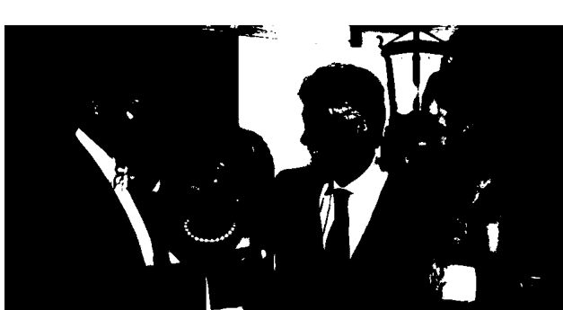

特朗普之所以能赢，是赢在了真有大师级的说服力。很多人认为特朗普是因为美国保守派不满现状的理念而上台，对此亚当斯不以为然。亚当斯甚至说，特朗普的说服力水平已经高到了他想推崇哪个理念就可以推崇哪个理念的程度，特朗普完全可以加入民主党，照样能当选总统。

你可能觉得这么说有点夸张。但是下周我们将讲解若干个特朗普在大选中的实战案例，并且跟希拉里的案例做些比较。你会看到，两人的说服力水平根本不在一个层次。希拉里不但没有表现出什么高超的说服力，而且可以说是昏招迭出。

特朗普在竞选中暴露了很多低级的弱点，比如多年前侮辱女性的言论被曝光、老婆参加全党大会发言的发言稿居然有一大段是一字不差地抄袭了奥巴马老婆当年的发言 —— 但即便是这样，特朗普都能赢。他怎么就赢了呢？

一般人看希拉里的表现似乎中规中矩，但是在说服力高手眼中，希拉里犯了很多离谱的错误 —— 以至于亚当斯有一个合理怀疑：希拉里阵营里，也许有一个故意给她捣乱的卧底。

推荐阅读：
马徐骏·世界名刊速读：《福布斯》I深度专访特朗普：胜者为王

## 特别放送｜来自王煜全老师的一封信

特别放送 | 来自王煜全老师...

万维钢

今天为你特别放送一封来自信：来自隔壁《全球创新260讲》的王煜全老师，他读了我们前一段时间 гон佛学内容，很有触动，特意写信跟我、以及跟咱们日课的同学探讨了一些佛学问题。我认为王老师对佛学的认识非常深刻，他的观点能给我们很多启发，所以，今天我就为你转发一下王老师这封信的全文。

万老师：您好！

我是忠实的粉丝，看到您解读《为什么佛学是真的》特别高兴。正巧我也在读这本书，也觉得这本书出得非常好。看到您的解读，不自觉地就想和您做个交流。

我特别认同您的观点，佛教到今天两千多年了，很多当时缺乏的对人的知识和相关的术语语已经具备了，可以通过佛学和科学的对话使得其中的宝藏能为现代人所用。一味的故弄玄虚有害无益，也不是佛陀的初衷，反倒阻碍了佛学在现代人当中的传播。

其实佛陀当年就是一位一丝不苟的真理探求者，他用的观察方法非常严谨，甚至很符合科学的原则，只不过科学观察的是外界，而他观察的是自己的内在世界。结果佛陀发现我们并不是一个合格的观察者，而是充满了偏见，他称其为“无明”。在《佛学为什么是真的》里面，赖特引入了进化心理学来解释为什么我们不是个客观的观察者：因为自然只选择适宜生存的生物。佛教对“贪嗔痴”的总体评价是负面的，容易让人产生反感，但要抛弃贪嗔痴，需要放下而不是憎恨它们，所以我原来也用进化的角度解释过，没有贪嗔痴，我们人类根本走不到今天。今天我们有了理性，能够追求事物的本来面目，这需要不受贪嗔痴的干扰，但它们对人类进化是有意义的，不要去憎恨它们。

更关键的是，基于佛陀对自己的客观观察，他总结出了我们人类个体的运行机制，而且相当系统地阐述了出来。这些知识现在有很多被现代心理学印证了。不过现代心理学因为学科分类过细，整体系统性反倒不如佛学。比如书里提到的次级自我的概念，我觉得就是对人的决策机制的、过于简单化的抽象，就像《思考，快与慢》是对决策的过于简单的抽象一样：人的行为既受外在环境影响，也受内在模式影响，内在模式又分为先天和后天（不是只有先天的），而这些模式被触发的阈值和前提条件并不相同，不能简单理解为七个并列的系统。佛教里的五蕴和十二因缘，更进一步说就是唯识系统，就是在论述这一机制：

色：外界物质的总和，是对我们身体的刺激的来源，严格说甚至包含我们的身体结构（色身）;

受：因为外面的色（又叫尘）和身体的色（又叫根）的结合互相产生的知觉，是客观的，就像举例说眼睛不参与意识（当然你事后可以把受分成苦受、乐受、不苦不乐受，但那是预期到会引起你什么情感的分类）;

想：这部分才是主观的开始，我们因为“受”和大脑当中的机制（包含先天、后天）而产生了各种对应（包含文字、意象等）、并产生爱憎等情绪;

行：我们的行为是受思维支配的，因为有爱憎，所以有相应的行为（包含想法，佛教叫身口意，心里想的、嘴里说的和实际做的都算）;

识：不只是意识，佛教的识有八识，这里更多指末那识和阿赖耶识，其实末那识更像我们这里讲的行为背后的模式。简单说，佛教认为这些思想和行为会强化我们的模式，下次再遇到同样的事情，触发相同情绪和行为的阈值会降低。

这可以说是我们和外界互动、把外在内化 into的一个过程。

赖特书里的五蕴的次序其实和汉传的“色受想行识”不太一样——

Physical body：色，指的色身，加上外在会更好（色声香味触法的色指的就是外在的六种尘）;

Basic feelings：受，这里的 feeling 有知觉和感情两个意思，但加上 basic，应该指感觉，不是感情，但其实 feeling 不准确，因为比如眼睛看到文字，看到的整个纸张上的黑白色都是受，但未必是 feeling，应该说是 sensory input;

Perceptions：想，是指把外界感受到的东西对应到我们的认知模式的心理行为，比如认出那是“一棵树”，或者是“字母 X”，心里没有脚本，就无法形成对应的概念，但和心理的对应是主观的，是有可能出差错的，比如弓弩蛇影;

Mental formations：识，各种心理模式，包含书里的七个次级自我（书里说了一个 big category that includes complex emotions thoughts，inclination，habits，decisions，我觉得这里的 decision 应该是 decision pattern，应该不包含真正行为）;

Consciousness：意识活动，其实是行（上面解释过，身口意在佛教里都是行为），这个顺序可以接受，因为是想和识结合产生的行。

所以，简单说，南传佛教的五蕴的顺序其实是“色受想行识”，要注意的是，佛教的识比 Consciousness 包含的内容大得多，直接理解为意识会犯错误。

最重要的是，就像您在专栏里提到的，现代心理学看到了问题，佛学找到了解。佛学是“自我体验的科学”。我觉得这个解才是现代人亟需的，是可以用现代科学理论阐释清楚的，也是我们应该做的事情。

顺便说一句，赖特修的内观不是大乘佛教的，是南传的修法，南传是标准的小乘，不过小乘是大乘的人给人家扣的帽子，人家自己叫佛教上座部（就是曾经跟着佛陀实修过的人的弟子们），大乘是后起的，因为不满上座部垄断了语权，他们的标准称呼是大众部，是那些没亲自听闻过佛陀说法的人的组织，今天的各种神通都是大众部、也就是大乘的人搞的。

佛教的修行方法也不能简单分为“禅宗、藏传和内观”三种，因为禅宗是大乘的修法，但大乘佛教的修法非常庞杂，有汉传十宗的说法，既有像南传的止观禅修的天台宗（就正是奢摩他、观就是毗婆舍那 Vipassana，其实汉传老讲的戒定慧，戒是基础，定就是修止，就就是修观，就是 Vipassana），也有像藏传密宗的密宗，后来在大巨失传，从日本传回来的叫东密或者唐密，还有玄奘法师主推的强调思辨的法相唯识宗，不过这些后来都慢慢失传了，今天汉传主要是禅宗和净土宗（就是念佛法门，不过不要瞧不起净土宗，拜佛里面的学问也大得很，今天名气很大的博

至于传到美国的佛教，主要有：

- 1) 藏传；
- 2) 南传，加州最大的禅修道场是 Jack Konfield（不是出版《心灵鸡汤》的 Jack Confield）建立的，他曾经在泰国跟了阿姜查七年，十日禅在美国也有多个禅修点；
- 3) 汉传的禅宗基本都是日本和韩国传过去的了，比如铃木俊隆和川弘文（乔布斯的师父）；
- 4) 汉传的净土修行：宣化上人在加州修了万佛城，台湾过去传教的也不少，像星云法师，但基本局限在华人圈子；
- 5) 灵性运动兴起的从佛教来但系统不够完善的禅修，以 Big Sur 的伊萨兰学院也比较出名，奥修也够强可以算；
- 6) 美国人和科学结合的改良修行方式，最出名的是卡巴金的正念减压疗法。最后这个最有未来，我们应该好好学习。

其实佛教修行因为直指内在问题，所以

其实佛教修行因为直指内心问题，所以在美国这样关注内心的国家特别容易引起共鸣，但不得不说，有时候文化的差异和壁垒还是挺大的。大乘的好处是，后人可以不断贡献力量，虽然坏处是有时候真假难辨（汉传一直有伪经问题），所以汉传的系统更加庞杂精微，在中国这个环境里，只要你愿意认真学习，对佛学的整体理解还是要好很多，所以对佛教加强研究，可以成为中国对全世界的重要贡献。

还有在您的“佛法的另一种认知”里，有三处小的地方：

一是布施不是指给和尚捐东西，布施是一种修行方法，让我们能够对治我们的贪心（把财物放掉）和嗔恨心（布施给自己不喜欢的人），布施要求做到“三轮体空”，就是不觉得自己在施舍，不觉得对方在接受施舍，不觉得自己在送东西出去。

二是布施可以积累的不是“功德”，而是“福德”，所谓福德就是生活顺遂的机会，有能够修行的福气，你常布施自然帮你的人也多，生活会更顺利，有利于修行，因为修行是要有物质基础的。而修行实力的增加叫“功德”，不能靠别的，只能靠自己做功课，当然，把布施当功课，功德也会增加。而为布施而布施，还是会有福德，但没有功德。这就是为什么达摩来到梁朝见梁武帝，梁武帝说我修了千百寺庙，有功德没有，达摩说“没有”的原因。

三是“慈悲为怀”是指感受到众生为业力（贪嗔痴的原因）所拖累而自然流露的悲悯之心，同时，慈悲和布施一样，是一种修行，既不能为做样子而慈悲，也不能为了消除自己的共情而慈悲。这方面西方心理学有关 Altruism 有大量研究，证明人类当中是普遍存在不是为了做样子和自己共情的原因，而纯粹为了对方的利他行为的。给很多佛教高僧做过核磁共振的 Richard Davidson 在《大脑的情绪生活》里，也讲到了他们发现当高僧修炼“慈心禅”的时候，他们的快乐中枢整个被激活了。不过对于您的“从上帝的视角出发想问题”和“做适合你做的事情”，我非常同意！

其实布施和慈悲都是要求无我，希望有机会再和您聊无我的话题。

我在学佛和打坐禅修上都花了点精力，但资质骇钝，没啥成绩。不过因为机缘，和很多师父都是好朋友，之前也曾经积极推动过佛学和科学的对话，所以对您的努力深表敬佩，希望今后您能有更多的机会讲解佛学，也希望能有更多机会和您交流。

顺颂 冬安

2017年12月1日

## 答读者问 | 「立功思维」和「混资历思维」

答读者问 | 「立功思维」和「…」

### 来自日课: 武器级的说服力

万老师，这里提到“同步”和沟通中经常说的“共情”是一个意思吗？

### 万维钢

“同步”与“共情”很有关系。 “共情（empathy）”，是说对他人的感受感同身受。比如我们看一个电影，当剧中人悲伤、疼痛或者高兴的时候，我们会自动带入，就好像自己悲伤、疼痛或者高兴一样。共情是人脑中镜像神经元起的作用，把发生在别人身上的事情当做发生在自己身上。共情作用是自发的，是人的本能。

### 来自日课: 人心比事实重要

特朗普、赫鲁晓夫、丘吉尔、乔布斯是不是同特朗普是一路人？他们对所谓的指责从内心就是蔑视的，不认为有啥大不了的，他们不会像平常人一样急于通过辩解来洗白自己，他们异常坚定地按自己的套路出牌，在人们还在等着听辩解时，他们用另一个新鲜而出奇的见解吸引人们转移了关注点。正常人之间沟通是互通互联，自闭症人只是发送不接收，我怎么觉得上述特朗普这类人是介于正常和自闭症人之间的一类人？

### 万维钢

### 来自日课: 催眠师的自我修养

### 来自日课: 特朗普的主角光环

## 点吗？

万维钢

古龙有个小说叫《圆月弯刀》，主人公叫丁鹏。丁鹏武功很高，仗着一招天外流星，初出江湖就打败诸多高手，迅速获得了声望。小说里有个配角叫郭云龙，是“嵩阳铁剑”的后人，急于重振家族的声望。郭云龙就问丁鹏，说我怎么做，才能成为江湖的一流人物呢？

丁鹏的答案跟一般团支部书记的说法很不一样。丁鹏说，你要是做个大侠，平时干些行侠仗义的事儿，也能积累名声，但是这么做太慢了。成名最快的做法是江湖上有什么大事发生的时候，比如有什么重大危机无法解决，你出手给解决。

我非常赞赏这个说法，这是立功思维，不是混资历思维。比如搞科研，你兢兢业业发很多小论文只能混个脸熟，但是如果你能憋个大招，解决一个别人关注已久的大问题，或者提出一个全新思想，那才是最了不起的。

再比如你是个公司的员工，平时尽心尽力完成上级交给的任务当然是好的，但赢得声望最好的办法是突破自己的角色，制造意外惊喜，实实在在留下一点个人*信息*。

当然，这个年代想要给自己加戏的年轻人很多，真正的立功和哗众取宠，区别还在于是不是真有实力。没有实力一切都是空的，有实力，才谈得上选择路线。

# 日课052 | 《以大制胜》5:视觉想象是第一说服力

咱们继续说的斯科特·亚当斯的《以大制胜》。今天要说的，是最厉害的一个说服力技术。

不知道你是否注意过英文新闻报道常用的一个套路。想要报道一个大趋势，文章通常不是一上来就给你个宏观的大视角，而是先讲个小故事。

比如我是纽约时报的记者，要报道中国的 中学生学习压力大这件事。我会先讲一位“张女士”的故事 —— 张女士的儿子正在上初中二年级，全班排名第十，可是张女士非常焦虑，竟然把自己全部的业余时间和三分之一的收入都用来给儿子上补习班 —— 美国家长可没有这么干的。这样的开头，就能迅速吸引到读者的注意力。

这个套路的原理是*具体*例子比抽象事实管用。你要号召人们给非洲儿童捐款，列举统计数字的效果远不如一张长相可爱但是表情很容易的非洲小女孩的照片。

这就是效率最高的说服力，没有之一。读了亚当斯这本书我才知道，这里面的关键可能还不是“具体”——不是提供一个真实人物 —— 而在于给人提供一个*视觉的想象*。

## 1.一道美丽的墙

特朗普在竞选中特别喜欢说要在美国和墨西哥边境建一道墙。咱们前面说了，墙是个简化的说法，让人更容易理解。但是，这个墙还有另外一层作用：它提供了一个视觉符号 —— 当特朗普说“墙”的时候，你心里会想象一道墙。

墙具体是什么样子，特朗普没说，也不用说。关键是墙这个说法调动了你的视觉思维，你一定会脑补一道又高大又美丽的墙。

反过来，如果特朗普说的是“加强移民控制”、“加强边境安全”，你根本就不会有什么深刻的印象，也记不住。

我们前面讲过的那个例子，凯莉说特朗普经常发表贬视女性的言论，特朗普马上抛出了罗芮·奥纳库，这其实也是制造画面感 —— 如果特朗普说“我只说过某些白左女性”，那就远远没有这么好的效果。

你甚至不需要真给人看一个图像，只要能让人想象一个图像就行。当然如果你有东西给人看就更好了。

特朗普自从竞选总统，每次在公众场合出现的穿着都是一丝不苟。永远穿西装打领带，衬衫一定是白色，领带一定用美国国旗上有的颜色。特朗普的私人飞机看起来就像美国总统专用的空军一号。特朗普家有大楼、有高尔夫球场、特朗普这个名字是很多商品的品牌，当你想到特朗普的时候，你会想到各种形象的东西。希拉里有什么呢？只有一个非常抽象、一般人根本不知道他们在搞什么的“克林顿基金会”。

用图像说服，这招其实一直都有人在用。但如果不具备“说服力”这个视角，观众就会被他这么说服了还不知道自己中招。

十年前，戈尔拍了个纪录片叫《难以忽视的真相》，呼吁人们关注全球变暖问题。你还记得那个纪录片讲了什么具体的科学结论吗？大多数人记住的是这么一个画面 ——

一只北极熊被困在一小块冰上，周围都是水。你想到这个悲伤的画面，就会想到北极的冰都化了 —— 北极的冰为什么都化了？因为全球变暖。

真实情况是北极熊的生存并没有受到全球变暖太大的威胁。我看到有科学家估计，戈尔拍电影那一年，因为冰化了而死的，大概只有一两只北极熊。

这是如此简单又如此有效的一招。如果你头脑里有这一招，你可以把它发挥到很高的水平；如果你头脑里没有这一招，你可能会犯很大的错误。

## 2.“吸引力法则”的正作用

为什么视觉想象有这么大的作用？首先抽象思维并非人类的长项，进化给我们的设定是眼见为实。另一方面，所谓“吸引力法则”，可能也起到了作用。

咱们两周前刚刚讲过“吸引力法则” —— 你去想象自己已经成功的画面，这个法则号称就有利于你真的取得成功。我们说了，各种实验证明，吸引力法则根本不靠谱，甚至还阻碍了成功。

但是你注意过没有，那些实验中有一个细节：那些想象自己的成功画面的 人虽然最后考试成绩不好，但是在考试到来之前的那几天，他们收获了自信心，他们的心情比别人愉快。

这个才是吸引力法则的真正作用。它不会真的给你带来成功，但是它会让你感觉自己已经成功了，它会让你更*认同*这个成功画面。

以我之见，视觉说服力的原理就在于是此。如果你经常想象什么事情发生，你就会更加认同这件事情发生。想象北极熊被饿死的画面，你会更相信全球变暖学说。想象特朗普当总统的画面，你会更认同特朗普当总统。

那我们再看看特朗普和希拉里是怎么做的。

## 3.希拉里阵营里有一个卧底

特朗普参选总统之初，他最大的困难，是人们无法想象特朗普当总统这个画面。你是一个商人和娱乐名星，你跟总统这个职务根本不搭！特朗普迫切需要开发美国人民的想象力。

特朗普抓住了 一个机会。有个电视节目叫“星期六晚上直播（Saturday Night Live）”，专门编排一些情景喜剧恶搞名人。特朗普参加了这个节目，剧本正好是让他扮演总统，在白宫椭圆形办公室里办公。当然，电视台不可能给特朗普拍竞选宣传片，节目的主题是恶搞，有很多笑料和自嘲，目的是娱乐观众。但是特朗普还是参加了。

结果特朗普想要的效果达到了。事实上节目播出一段时间之后，所有的笑话都会被人忘记，但是特朗普当总统的那个画面，观众记住了。人对视觉的记忆远远超过对语言的记忆。特朗普当总统的画面在你的大脑里生根发芽，慢慢地，你就越来越觉得特朗普当总统是可 能接受的事儿。

然后咱们再看希拉里是怎么做的。希拉里，一直在通过Twitter和公开演讲，号召民“想象一下特朗普当总统”是个什么样子！

想象特朗普作为总统把仇恨言论变成了法律 ——

想象特朗普作为总统面临一次真正的危机 ——

# Hillary Clinton: Imagine Donald Trump facing a real crisis

Hillary Clinton questions whether Donald Trump has the temperament to be president during a speech at the Democratic National Convention.

想象特朗普作为总统坐在军情室里 ——

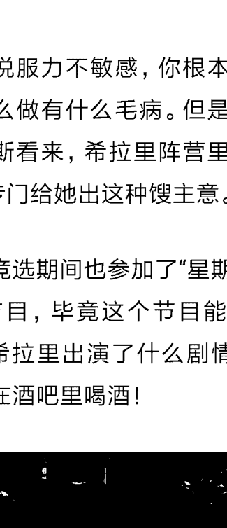

希拉里你知道吗？特朗普非常希望人们想象他当总统的样子。

当然，希拉里的意思是说特朗普要真的当上总统，那肯定不是个好画面。但问题是这跟北极熊那个画面有微妙差别：特朗普是个没当过总统的人，他现在最需要的是人们适应他当总统——不管好坏，只要是特朗普当总统的画面，就是对选民潜意识的说服力。

如果你对说服力不敏感，你根本看不出来希拉里这么做有什么毛病。但是在说服力高手亚当斯看来，希拉里阵营里是不是有个卧底，专门给她出这种馊主意。

希拉里在竞选期间也参加了“星期六晚间直播”这个节目，毕竟这个节目能提高关注度。但是希拉里出演了什么剧情呢？剧情是希拉里在酒吧里喝酒！

这是总统该干的事儿吗？美国人默认的观念是总统必须保持清醒，而你居然表演喝酒，还喝多了？

亚当斯看这个节目的时候，感到这简直就是一场屠杀。如果没有卧底，希拉里一手好牌怎么能打成这样。当然也不一定真有卧底，只能说希拉里的说服力水平真的不适合总统职位。不过希拉里在竞选后期也获得了武器级的说服力，这个咱以后再说。

而特朗普这边，视觉说服力这招玩得那是越来越熟练。

## 4.进阶用法

比如在2016年下半年，快要接近大选的时候，斯科特·亚当斯曾写过一篇博客，他说现在很多人说特朗普是个种族主义者，但特朗普用一招就能证明自己不是种族主义者——他只需要公开拥抱一些不是白人的人、亲一些不是白人的小孩。

亚当斯的博客发出去不久，特朗普真的这么做了。特朗普亲了很多黑人小孩。

种族主义者大概不会这么亲吧？

咱俩再说个更高级的玩法，给竞选对手起外号。特朗普给人起的外号都特别形象，选民一看真是那么回事儿，特别容易流传。

特朗普管杰布·布什叫“低能量布什（low energy Bush）”——

你看杰布·布什是不是天生一副精力不够充沛的样子。特朗普给泰德·克鲁兹起的外号叫“说谎泰德（lyin' Ted）”——

每个政客都说谎，但克鲁兹外形尤其看着就不诚实，再加上确认偏误，以后选民每次看见克鲁兹就觉得他在说谎。类似的外号还有“机器人卢比奥”、“小个子马可”等等等。

特朗普给希拉里起的外号叫“扭曲的希拉里（Crooked Hillary）”——

一方面希拉里的健康状况确实不太好，有几次都让人扶着走，另一方面道德形象也不行，给人感觉就是阴险、造假、搞阴谋。特朗普起的外号，都是这么有画面感。

可是希拉里这边给特朗普起的外号呢？就没有一个能让人记住的。希拉里的一个灵感是既然特朗普的名字也叫 Donald，跟“唐老鸭”一样，一度就管特朗普叫唐老鸭。结果首先迪斯尼公司不干，而且希拉里后来注意到，美国人民其实是喜欢唐老鸭的！

这根本就不是一个级别的较量。咱俩最后再说一个特朗普的神来之笔。

2015年8月，罗马教皇发表了一番批评资本主义制度的言论。CNN记者问特朗普对此有何评论。

这个问题，特朗普怎么表态都不合适。赞同教皇吧，你是想当美国总统的人，还是个共和党，你怎么能批评资本主义制度呢？反对教皇吧，共和党基本盘里有很多选民信教。

特朗普的回答是，我会告诉教皇，你别说这些没用的了，现在 ISIS 马上就要打到梵蒂冈来抓你了。ISIS可不是什么善类，他们会砍人脑袋，他们会把人关进笼子里扔水里淹死。

你跟他探讨宗教和资本主义制度的无聊问题，他抛给你一个鲜活画面。这就是武器级的说服力。

> 自己想象自己的成功，不会让你更成功——但是如果你能让别人想象你的成功，他人就会帮你成功。

# 日课053 | 《以大制胜》6:制高点和不可原谅的错误

咱们先来思考一个问题。一个你熟悉的人，他犯什么样的错误，是你可以原谅的，犯什么样的错误，你会认为不可原谅呢？不用想太深，你就当自己是个普通人，想想你的原谅标准是什么。

我认为，对大多数人来说，答案是“动机”。如果这个人的动机是好的，只是能力不足偶尔犯了错，我仍然可以继续支持他。但如果这个人的动机就是坏的，他本来就是想跟我作对，那我就不能原谅他。

这个道理非常简单，但在说服力中的运用非常重要。咱们继续说斯科特·亚当斯的《以大制胜》这本书，今天要说的说服力技术是“防守反击”，是怎么转守为攻。最适合使用这个技术的时候，是当你面对别人的指责，或者犯了错误的时候。

我们专栏第一季有篇文章叫《精英水平道歉》，我们说犯了错就应该老老实实道歉，道歉是为了自己吸取教训好好进步，而不是一个“影响力工具”。而我们今天要说的方法，可就不是这种真诚的道歉了。我们要说的恰恰是一个“影响力工具”。

这个方法就是占领制高点。

具体操作非常简单——

- 1. 或者是你犯了一个错误别人指责你，或者是别人无端地指责你；
- 2. 这件事你很难辩解清楚，在这个层面上你不管怎么做都是减分；
- 3. 那么你就应该离开这个层面，把话题引到更高的层面上去，证明自己的“动机”是好的。

比如说，梅根·凯利问特朗普是否发表过侮辱女性的言论，特朗普在这个问题上再怎么辩解都是减分，所以特朗普就跳到制高点上去，说我们现在没有时间搞政治不正确了，还是说说国家大事吧！

这个技术应用非常广泛，咱们来看一个乔布斯的例子。

## 1.乔布斯的危机公关

2010年，iPhone 4 刚刚进入市场就被人发现常常接收不到手机信号，问题非常严重，被称为“天线门”。这是苹果公司的一次危机。你这么高调的一个产品，居然出现这么低级的问题，那请问 iPhone 这个品牌是不是应该重新定位了？

乔布斯赶紧召开了一个新闻发布会。他会说些什么呢？他是要真诚地道歉吗？

乔布斯说了三句话：“我们不是完美的人。手机都不是完美的。但是我们总是尽我们所能让用户满意。”

这可不是道歉。乔布斯根本就没道歉。当然，发布会上苹果公司给出了天线问题的解决方案——但是没有任何道歉。

结果是效果非常好。发布会之后整个事情的基调就变了，媒体都在讨论乔布斯说的活有没有道理，有人赞同有人不赞同，有人还列举了其他手机存在的各种各样的问题。而乔布斯的最关键目标达到了：iPhone 4 不是一个残次品。没人再说 iPhone4 是个残次品了，iPhone 保住了高端手机的定位。

这就叫占领制高点。手机问题已经出了，你分析出错原因、痛哭流涕地说我们错了，消费者只能认为苹果现在不行了。乔布斯根本不在这个层面辩解，他向上走了一个层面，说了三句几乎是废话的话：“我们不是完美的人。手机都不是完美的。但是我们总是尽我们所能让用户满意。”这三句话谁都无法反驳，而且还弘扬了苹果公司为用户服务的精神。

亚当斯对此评论说，占领制高点有三个目的。第一，你说的是绝对正确的话，谁也不能反驳你。第二，你把问题从 iPhone 4 手机行不行上升到了更高的层面，而在那里你处于不败之地。第三，你的对手也不好再把你拉回到低处，谁那么做谁就给人感觉格局太低了。

也就是说，一旦你往高大上的方向走，你就会立于不败之地。

这招简直百试不爽，咱们看看特朗普是怎么用的。

## 2.特朗普与负面新闻

曾经有个电视节目主持人，给特朗普打了个“抱怨者”的标签。他说你整天说美国这里不好那里不好，你这喋喋不休的好吗？

特朗普立即就使出了占领制高点这一招：“对，你可以说我是个抱怨者——但我是最好的抱怨者。你知不知道我们国家现在就需要像我这样的抱怨者？国家有问题，我要把这些问题说出来。”

反过来说，如果特朗普就这个问题跟主持人展开辩论，那就怎么都不好看了。

但是特朗普的负面新闻也实在太多，有些可以用这招付过去，有些就真不行。占领制高点这一招是有适用范围的。

2016年10月，也就是大选前的一个月，特朗普被爆出了一个几乎致命的丑闻。《华盛顿邮报》爆了一段录音，是2005年特朗普和一个节目主持人的私下对话。在这段对话中，特朗普说了一番非常非常不尊重女性的话，咱们文雅地翻译一下，差不多的意思就是：“我是明星，当你成了明星以后，女人就根本不是问题，她们会主动来找你，我连等都不用等，我想对她们怎么样就怎么样。”……原话比这个难听得多。

这番话爆出来以后，特朗普的几个重要支持者都立即表示坚决不再支持他了。副总统发表声明强烈谴责，特朗普本人也是公开道歉——这一次他没法占领制高点，起点实在太低了。特朗普反而还说了些希拉里的丈夫克林顿曾经做过的还不如他之类的话，跟人比烂，整个表现零分。亚当斯说之后心都凉了半截。我记得我那几天不敢再跟人说我支持特朗普了。

但是特朗普居然还是缓过来了。

咱们事后分析，这个丑闻也許真不是致命的。首先录音是十年前的，而且还是个私下对话，男人之间私下吹个牛很正常。再者，这件事也表现了特朗普“人性”的一面——他真不是希特勒，希特勒说不出来这种话！

不论如何，如果没有这个丑闻，特朗普的得票率应该要高一些。

但更重要的一个因素，也许是希拉里犯了一个更加致命的错误。

## 3.希拉里的致命失误

也是在即将大选之前，希拉里对她的支持者发表了一番公开言论。她说，特朗普的支持者中有 deplorables

这番话，是致命错误，没有任何拣回的余地。希拉里直接侮辱了一大群人，而且这种侮辱是深深的蔑视。

为什么这个侮辱是致命的呢？我先说一本别的书。格拉德威尔写过一本《眨眼之间》(Blink)，那本书中提到过一个非常有意思的研究，说有个婚姻问题专家，他只要听一对夫妻交谈15分钟，就能判断出这对夫妻是不是快要离婚了。

专家说，经常激烈争吵的夫妻不一定离婚，冷战的夫妻也不一定离婚，只有一情况，夫妻几乎必定离婚——那就是，“蔑视”，也就是 contempt。

如果夫妻双方谈论对方时使用的话语非常轻蔑，说白了就是一方看不起另一方，那就是离婚的最强烈信号。

希拉里对支持特朗普的这一大群人，就是蔑视的态度。特朗普敏感度非常高，马上就抓住了“contempt”这个关键词，发表声明说希拉里这是对人民公开的蔑视！

“Basket of deplorables”这个短语迅速成了流行词汇。有很多美国人直接站出来，说我就是“basket of deplorables”中的一员，你怎么的吧。

蔑视一旦出来，就是不可原谅的错误，你的动机就是故意的，而且还是看不起我们的那种故意。

所以说，有些错误是绝对不能犯的，犯了之后道歉也没用。但有些错误似乎是可以犯的，而且你根本不用道歉，可以使用占领制高点的方法对付。

以我之见，*动机*不对的错误，绝对不能犯。对公众人物来说这就意味着你千万不要冒犯一群人。特朗普冒犯女性，希拉里冒犯特朗普的支持者，这都是道歉也没用的错误，有些人永远不会原谅他们。好在美国大多数选民都是按党派投票，你只要说服只占5%的那些摇摆的人就行，双方错进错出都有波动，有时候谁的错误小谁就能赢。

作为普通人，我们要是犯了什么错就应该老老实实道歉。但是作为公众人物，有时候不道歉也是对的。这是因为公众人物必然会受到各种各样的攻击，像 iPhone 4 的问题、特朗普说话不好听的问题，可能根本就无法避免，人和手机的确都不是完美的，道歉并不能让你变得更好。那么在这种情况下，占领制高点这一招也许就是恰当的。

那你可能会说，使用这种手段是不是太功利了，我还是个真诚的好人吗？真诚的好人根本不会出来竞选总统。

# 日课054 | 《以大制胜》
7:国手的“预说服”

日课054 | 《以大制胜》7:国...

今天我们把斯科特·亚当斯《以大制胜》这本书讲完。我们要说的是 一位说服力国手的手段。

前面咱们讲到，希拉里的说服力水平实在太低 俗招迭出，亚当斯甚至怀疑她的竞选团队里有卧底在搞乱。但是从2016年夏天开始 —— 确切地说，是从希拉里在民主党内的最大竞争对手、桑德斯，退出竞选以后 —— 希拉里团队竟然获得了武器级的说服力。

# 1.国手

当时亚当斯注意到，希拉里团队终于找到了一个合适的词 抹黑特朗普：dark。

这是一个非常独特 的词，从来没有人在竞选中用 dark 形容过对手。Dark 是个朗朗上口的词，重复出现也不会让人厌烦。Dark 是一种颜色，这让人想 到 种族主义。Dark 是黑暗的意思，而黑暗使人恐惧。Dark 让人想 到《星球大战》里的黑暗势力（dark side），正好符合特朗普的“邪恶”形象。

我们在第三节《催眠师的自我修养》中说过，亚当斯把所有的说服力素材给排了个序，其中第二有效的是“身份认同”。特朗普一直在打身份认同这张牌，让选民认同自己是个美国人，要“让美国再次伟大”。唯一比身份认同更有效的牌，是恐惧。恐惧会把有不同身份认同的人团结起来。

Dark，就是恐惧牌。Dark，是武器级的说服力。

这绝对不是希拉里的水平。亚当斯判断希拉里团队请到了一位高人，他给这个人起了个代号，叫“哥斯拉” —— 就是电影里那个怪兽的名字。

哥斯拉到底是谁呢？亚当斯能感受到他的风格。

先说希拉里在民主党内的竞争对手桑德斯。

从面对记者的临场表现来看，桑德斯并不是一个说服力大师。但是桑德斯团队的竞选广告和宣传语却时而表现出高水平，这说明桑德斯有高人指点。亚当斯根据风格判断，这个高人就是哥斯拉。很明显，哥斯拉在桑德斯退出竞选之后加入了希拉里团队。

再往前推，亚当斯感觉哥斯拉应该还帮助过奥巴马。奥巴马本人是不是说服力大师我们不知道，但是奥巴马非常重视说服力。几年前有人曝光了奥巴马竞选团队中的认知科学家名单，这份名单里有一个人，亚当斯认为就是哥斯拉。

其实这个人，咱们中国读者也很熟悉。此人就是流行多年的名著《影响力》这本书的作者，罗伯特·西奥迪尼（Robert B. Cialdini）。

西奥迪尼今年72岁，他是说服力的国手。

亚当斯的名气不能跟西奥迪尼比，但两人有过交流。亚当斯猜测西奥迪尼是哥斯拉，他就特意问西奥迪尼是否在帮希拉里竞选，西奥迪尼的回复是“无可奉告”。金融时报一个专栏作家听说了亚当斯的说法，直接打电话给西奥迪尼问他，西奥迪尼再次回避了这个问题[1]。不过有认识西奥迪尼的人私下说，西奥迪尼的确在帮助希拉里。

也许西奥迪尼就是哥斯拉，也许不是。总而言之，希拉里阵营的“dark”这一操作，有西奥迪尼的影子。

《影响力》这本书是西奥迪尼在1984年写的。过去这三十多年，西奥迪尼并没有闲着。2016年，时隔32年之后，西奥迪尼又出了本说服力新书，叫《预说服》（Pre-Suasion）。什么是“预说服”呢？

# 2.预说服

我理解，所谓“预说服”，就是在正式说服你之前，给你设一个“局”：用各种看似无关的东西影响你的情绪和判断。

最近正在热播一个电视剧叫《猎场》，其中有个情节，主任公祁晓冬在向猎头目标曲阮京正式介绍新工作之前，花了很大的功夫布置会面现场的环境，甚至连曲阮京喜欢喝什么茶、曲阮京老婆喜欢什么香薰都考虑到了，这就有点预说服的意思。

不过真正的预说服并不是投其所好，而是要通过一些暗示，根据说服者的需要，调动对方特定的情绪。西奥迪尼爱说的一个例子就是如果房间里有美国国旗，人就会稍稍更倾向于共和党一点 —— 这是因为共和党传统上一直打爱国牌，而民主党更喜欢民权大于主权那一套。

奥巴马每次在公开场合出现，总是喜欢站在各种肤色的人群中间 ——

这个意思就是说我不是黑人的总统也不是白人的总统，我是所有人的总统，不管你是哪个民族的，你都应该支持我。这也是预说服。

预说服的妙处在于只影响、不明说。可能你根本就没明确意识到说服者的用意，但是你的情绪捕捉到了这个意思而且被感染了。在这个情绪的作用之下，你就有可能会做出说服者想要的判断 —— 而你还以为一切都是你自己做主的决定。

其实我觉得这个所谓的“预说服”并不是什么原创的东西，应该说这是西奥迪尼对心理学家早就知道的一些原理的重新包装。咱们专栏就多次讲过，心理学家有个特别常用的动作，叫“prime”，我看其实就是预说服。

比如丹·艾瑞里的《怪诞行为学》这本书里就列举了很多 prime 的实验。 有个实验是这样的，让受试者认真阅读一些跟“年老”有关的词，比如说退休、护养、佛罗里达，但是不明确出现“老”字。这个暗示，就是 prime。而被 prime 的结果是等到受试者离开实验室，在走廊里走路的速度，居然变慢了！

没有任何人明确告诉你说“你老了” —— 其实这都是一些大学生根本就不老 —— 但是你被那些词语暗示的老年情绪所影响，以为自己老了，走路要走的慢一点。

像这样的实验有很很多，不一定都靠谱。特别是《怪诞行为学》这本书里很多结论都被后来的研究证明不可靠。可是如果你不把这些当成科学研究，而是当成实用手段的话，那就是不用白不用。其实心理学的东西就是这样，就算是反复证明有效的手段也不是绝对好使，有时候好使可能有时候就不好使，对这个人好使可能对那个人就不好使。不过好在像选举这样的事儿你也并不需要说服所有人，只要能影响5%的人就足够了。

咱们再说几个实战例子。

# 3.你会记住这个感情

亚当斯自己搞了公司，开发什么手机APP，大约是实用工具之类。亚当斯说，他跟风险投资人谈判，就使用了预说服。

真正的说服发生在开口要价之前。亚当斯在跟投资人闲聊的时候，故意讲了几个江湖传闻，什么某某创业公司拿到了多少融资之类。这种聊天很正常，本来大家就都对这种新闻感有趣。但是亚当斯对话题做了严格的控制：传闻中的融资数目必须都得是大数据。

介绍自己公司产品的时候，亚当斯又故意跟 Google、微软的类似产品做了类比。当然这也很自然，毕竟我说个大家熟悉的东西你更容易明白我的意思。不过亚当斯更想让投资者明白的是，我这是能跟主流产品相提并论的大东西。

这些就是预说服。如果你能控制谈判发生的时间地点、控制谈判的环境、控制话题的内容，你就几乎控制了谈判的结果。

哥斯拉用 dark 形容特朗普，也可以说是一种预说服。Dark 描述的是一种感觉，或者说是一种情绪 ——

选民心中埋下特朗普是 dark 的这颗种子，就等于戴上了有色眼镜。你一看到特朗普就会想起 dark 的感觉，那么不管特朗普做什么，你都会觉得他不怀好意。

其实我觉得预说服、催眠、确认偏误这些东西都是一个原理在不同角度的应用。它们都是试图影响说服对象的情绪和感觉。而我们知道，人做判断从来都是感性对感性，哪种感情最强烈，哪种感情就有决定权。

咱们在预告片里说过的那个前惠普女 CEO 卡丽·费奥瑞娜，初选辩论的时候详细描写了一个堕胎场面，这为什么是一个巨大的错误呢？因为她把自己跟死亡婴儿联系在了一起。死亡婴儿给人带给人的情绪很不好！你不能把自己跟一个很不好的情绪连接在一起。

特朗普的竞选口号是 “Make America Great Again”。有人考证说，这个口号不是早年里根竞选总统的时候用过的吗？特朗普对此根本不在乎，和里根联系到一起很好啊！里根执政期间美国经济非常好，人民喜欢里根。特朗普在其他方面也和里根很像，以前都是娱乐界的，没有从政经验，都是共和党，都要减税，你说我是里根第二，我太高兴了。

这本书说到这里，最值得讲的内容就都讲完了，明天我会谈谈我自己对“说服力”的看法。

最后再来个彩蛋。亚当斯给小孩出了个主意。如果你是一个小孩，想要找家长要零花钱，又怕家长不给，你怎么办呢？你可以先假装很随意地给家长看一段关爱宠物的视频。宠物不是孩子，这个视频看似和你没关系。但是家长看了这种视频之后，心境就会被调整到关爱的情绪中 —— 在这种情绪下，他更容易给你钱。

最后让我们记住一句名言 ——

人们会忘记你说过什么，忘记你做过什么，但是永远都不会忘你带给他们的感情。

……当然，根据这句名言，你可能会忘记这句话 —— 但是你会记住今天说的这些感情吧？

参考文献
[1]. 美国大选中的「预说服」术，2016年9月18日 06:40
英国《金融时报》专栏作家 露西·凯拉韦。
http://big5.ftchinese.com/story/001069382

最后的最后……再请你思考：回想一下你有没有过“预说服”别人或者被人“预说服”的经历？当时是怎样的情景？欢迎在留言区跟我们分享。“小罐茶”的创始人杜国� Geom先生还为我们提供了奖品：截止到周五晚上的10:43分，获得点赞最多的读者将获得200元知识红包一枚，点赞数排在2-6位的读者，将分别获得价值99元的stalogy 笔记本一个。祝你好运！

# 日课055 | 敢不敢做个复杂的人

日课055 | 敢不敢做个复杂...

读《以大制胜》这本书，你是想做一个“说服别人”的人。可是世界上大多数人，大概都是“被人说服”的人。一个“说服力”，似乎就分出了两类人。

那我们怎么理解这样一个世界呢？当特朗普抱着一个黑人小孩子的时候，那个孩子的家长仅仅是感到荣幸吗？他们有没有意识到自己家孩子被当成了道具？当亚当斯像体育解说员一样分析说服力大师的技术的时候，他把那些“被说服者”当成了什么呢？足球比赛里……球吗？

我今天想说的，就是怎么在了解了说服力之后，还能有一个比较自洽的世界观。

# 1.理性面对非理性

说服力的理论基础，是“人是非理性的”。据我观察，美国政客和知识分子是经历了痛苦的思辨，才认识到了这一点。

我2000年到美国，正好赶上戈尔和小布什竞选总统，共和党的小布什以一个戏剧性的微弱优势当选。到2004年，小布什在战胜利克里获得连任。当时我看报纸，感觉美国知识分子的情绪都有点失控了。

# 2.流氓会武术

最现实的人既不抱怨社会也不仅仅坐在那里分析社会，他们利用非理性，玩转社会。

# 3.信任和道德

就在前几天，我看到一个英国的调查，让老百姓评选自己心中哪种职业的人最值得信任。结果是这样的——

排名最高的是护士，有94%的英国人信任护士。往下依次是医生、教师、教授、科学家、法官、天气预报员、警察、电视新闻阅读者、牧师、律师、民意测验调查员、银行家、记者，以及排名最后的是政客，信任度只有17%。

那你敢不敢，做个复杂的人。

我觉得这个世界的规律是复杂的人使用说服力才能驾驭复杂的人

我觉得这个世界的规律是复杂的人使用说服力说服简单的人。

# 4.简单和复杂

所谓个人成长，有些是知识和技能的完善，有些是性格的磨炼，但我觉得还有一个维度，叫做“变复杂”。

流程是简单的，权力是复杂的。你得从按照规定流程做事，变成独立自主，根据自己的判断做事，甚至根据自己的判断让别人做事。

原则性是简单的，灵活性是复杂的。理念都是好理念，原则都是好原则，但是面对一件具体的事情，各种原则和理念往往互相冲突，你能不能灵活处理。

价值观是简单的，大目标是复杂的。“不忘初心”是件很难的事，占领道德制高点最容易，大事业都是各种妥协和取舍的结果。

理论模型是简单的，真实世界是复杂的。三流知识分子眼里只有价值观和道德制高点，二流知识分子眼里有理论模型，只有第一流的知识分子才知道真实世界比理论模型复杂得多。

讨好观众是简单的，把事做成是复杂的。奥巴马这样的政客喜欢讨好观众，凡事自己要留个清白，所以他们就不敢承担责任，他们为了不做坏事，就干脆不做事。其实但凡做成了大事的人，哪有不被人骂的。

小人物是简单的，大人物是复杂的。不管我们怎么包装，“说服力”的本质，是使用各种手段让别人按照你的意志行动 —— 是让别人听你的。说服力的能力越大，你要承担的责任就越大。

说服力，是一个武器。是武器就不能滥用。

如果你太过纠结于说服力道德不道德，你不适合使用说服力。如果你完全不纠结道德问题，觉得只要这个手段能赚钱拿来就用，你也不适合使用说服力。只有当你理解了世界的复杂性，宁可承担责任，知道如何*谨慎*使用说服力的时候，你才真正适合使用说服力。

最后，专业技能都是简单的，精英日课是复杂的。我们总是讲些互相矛盾的道理，因为我们明白，真实世界本来就充满矛盾，而我们想要变复杂。

# 特别放送 | 关键说服力

万维钢

今天咱们来把《以大制胜》这本书的关键知识总结一下，希望对你学习理解这本书有所帮助。

书名：《以大致胜：怎样在这个事实根本不重要的世界里使用说服力》（Win Bigly: Persuasion in a World Where Facts Don't Matter）。

作者：斯科特·亚当斯（Scott Adams），风靡全球的《呆伯特系列漫画》的作者、还经常写时评文章。咱们专栏第一季在讲《巨人的工具》那本书的时候，就专门提到过亚当斯的写作系统。

出版日期：2017年10月31日

# 本书核心观点

特朗普是怎么使用说服力当选美国总统的——最高级别说服力的原理和技术。

# 本书要点

+ 1."说服力"的三个等级：
+ * 最高级是"武器级"。达到这个级别的大师非常非常少，特朗普在这一级，有几个曾经的美国总统在这一级，乔布斯也在这一级。
+ * 第二级，是认知科学家。现在科学家对人脑有非常深的理解，他们当然知道如何说服人。不过这些人只有功夫没有用武之地。
+ * 第三级是"商业级"。我们一般说Rate 什么"影响力"、"说服力"，都在这一级。比如搞个市场营销、品牌形象管理、危机公关，都是商业级的说服力。
+ 2.商业级说服力和武器级说服力的区别：
+ * 商业级说服力：你们喜欢我就行。
武器级说服力，你们不但要喜欢我，而且还要不喜欢我的对手。你们不但要喜欢我，而且要听我指挥。
+ * 商业级说服力：犯了错误马上道歉。
武器级说服力：坚决不道歉。首先关注的是先让注意力吸引过来，至于这个注意力是好是坏并不重要，甚至是批评也没关系。你们还在批评我这个错误的时候，我已经又犯了下一个错误。
+ 3.说服力的理论基础：
人是非理性的。人做决定并不是感性对理性，而是感性对感性 — 我们任何时候都是感性用事。有感情不代表不正確，也不代表非理性。所谓"非理性"，就是感情的判断出错了。非理性有两个最大的来源：一个是"认知失调"，一个是"确认偏误"。
+ * 认知失调，就是当你发现你的行为和你心目中的自我形象不相符的时候，你产生一个幻觉来解释自己的行为。"认知失调"有三个要素：自我形象、行为、和幻觉。认知失调的触发，是行为和自我形象不符；认知失调的结果，是产生一个幻觉。
+ * 确认偏误：我们平时观察世界，并不像科学家一样以事实为根据、根据事实产生观点 — 我们是像律师一样，先有观点，再用新的事实去支持自己的观点。
+ 4.人心比事实重要。认知失调加上确认偏误，结果就是，每个人眼中的世界，都是扭曲的。说服力大师正是利用了这一点，得出"人心比事实重要"的依据。而说服力，是摆弄人心的学问。
我做了什么并不重要，重要的是别人对我的看法是什么。说服就是我做这件事并不是为了改变世界，而是为了改变世人的看法。
+ 5.三个说服力技术：
+ * 先同步，后领导。面对质疑指责，先和公众取得感情同步，紧接着就领导观众往前走一步，占领道德制高点。
+ * 改变方向冲淡确认偏误
+ * "新 CEO 策略（New CEO move）"，也叫"新官上任三把火"。用了一系列的动作，向公众说明自己给公众带来了新气象。
+ 6.真正的说服，都要诉诸感情。最有效的一种感情就是人们心中的某个渴望。人们心中中这么一个渴望，而你利用这个渴望去说服人，这就是催眠。
+ 7.说服力的养成都是个正反馈系统。你表现出一定的说服力，别人就把你当成说服力强的人，你就把说服力当成了个人招牌式技能，别人就更愿意被你说服。
+ 8."视觉想象"是第一说服力。高效说服中*具体*例子比抽象事实管用，而这里面的关键可能还不是"具体"、不是提供一个真实人物，而在于给人提供一个*视觉的想象*。
+ 9.如果你经常想象什么事情发生，你就会更加认同这件事情发生。自己想象自己的成功，不会让你更成功 — 但是如果你能让别人想象你的成功，他们就会帮你成功。这个才是吸引力法则的真正作用。它不会真的给你带来成功，但是它会让你感觉自己已经成功了，它会让你更*认同*这个成功画面。
+ 10."防守反击"的说服力技术，是怎么转守为攻。最适合使用这个技术的时候，是当你面对别人的指责，或者犯了错误的时候。这个方法就是占据制高点。具体操作：
+ * 或者是你犯了一个错误别人指责你，或者是别人无端地指责你；
+ * 这件事你很难辩解清楚，在这个层面上你不管怎么都是减分；
+ * 那么你就应该离开这个层面，把话题引到更高的层面上去，证明自己的"动机"是好的。
一旦你往高大上的方向走，你就会立于不败之地。
+ 11.所谓"预说服"，就是在正式说服你之前，给你设一个"局"：用各种看似无关的东西影响你的情绪和判断。不过真正的预说服并不是投其所好，而是要通过一些暗示，根据说服者的需要，调动对方特定的情绪。
+ 12.预说服的妙处在于只影响、不明说。可能你根本就没明确意识到说服者的用意，但是你的情绪捕捉到了这个意思而且被感染了。在这个情绪的作用之下，你就有可能做出说服者想要的判断 — 而你还以为一切都是你自己做主的决定。
+ 13.预说服、催眠、确认偏误这些东西都是一个原理在不同角度的应用。它们都是试图影响说服对象的情绪和感受。而我们知道，人做判断从来都是感性对感性，哪种感情最强烈，哪种感情就有决策权。人们会忘记你说过什么，忘记你做过什么，但是永远都不会忘记你带给他们的感情。

## 答读者问 | “聪明人总是充满疑虑”

答读者问 | “聪明人总是充... ↓

万老师好，听完今天的日课我有一个问题，如果视觉想象可以增强说服力，那么听觉想象甚至触觉想象是不是可以起到同样的作用？另外这种说服技巧我不可以这样理解：是不是我们用很多细节信息逼迫对方大脑去处理占据了对方的信息处理通道，让他无法思考，只能被动接受我们的观点？

万维钢

相对于其他感知通道来说，视觉有非常突出的优势，这件事情甚至专门有个名字，叫“图片优势效应（picture superiority effect）”。人的大脑皮层中四分之三的神经元都用于处理视觉信息，我们对图像的处理带宽比听说要多得多。这就是为什么科学家写论文都要把数据给“可视化”，单纯阅读一组数字你很难看出什么意义来，画个图就一目了然了。

视觉信息不但更易理解，而且更容易记住。有个理论认为我们对文字信息的编码只有一次，而对图像信息的编码则做了两次——其中一次是图像本身的编码，一次是对图形做的文字标记的编码——多了一次编码，所以更容易记住。还有个理论认为图像跟图像的差别往往非常明显，而不同文字或者语音的差别就没有那么大，所以图像往往更醒目，留给我们的印象就更深刻，也就更容易记住。

我认为让对方无法思考不是一个好的说服方法。人如果感受到无法思考、想不过来了，他可能会感到恐慌、产生自我保护的心理，干脆不作任何决定。说服还是应该让对方思考，只不过是按照我们设定的方向思考。

希拉里说的话是蔑视不假，动力显然也是那么好，但那是针对特朗普的支持者，得罪特朗普支持者根本不重要。她可能说出了很多自己支持者的心声，但这也不重要，重要的是摇摆的人。希拉里的言语的缺点可能是让那些有一点想投特朗普票的人感觉到冒犯，进而遭到反击。也可能扎扎实实地给特朗普支持者贴上个标签，有些摇摆者想离这些标签远一点，事实上投票之前很多美国人表面上是支持希拉里的，根据认知失调原理，甚至会有不少表面支持者最终变成实际支持者。所以综合来看，希拉里言论有利有弊，为何变成了致命错误呢？

希拉里在发表这番言论之前难道不知道这是个不可原谅的错误吗？还是真有“卧底”给她支招？

万维钢

希拉里说这句话的时候，面对的都是自己的铁杆支持者，有点跟自己人说说对方坏话的意思。如果她蔑视的是一个公众人物，那当然没问题。但是希拉里这是公然蔑视一大群人：他说特朗普支持者中有有一半都是卑劣的人。

这句话一说，就等于把自己跟人民群众对立起来了。美国两党的支持者现在的是越来越对立，但绝大多数人看对方阵营也就是相当于是看“对方球迷”的意思，绝对不是说到了抗战时期中国人看日本人的那种仇恨水平。就算我支持你希拉里，可是我有家人、朋友和同事支持特朗普，我跟他们都是平等的——现在你如此贬低他们，那我在你眼里又算什么人呢？选举再怎么激烈，大家毕竟都是一个国家的人，你怎么能公然蔑视全国四分之一的选民呢？

政客发表类似的言论并不罕见。2012年跟奥巴马竞选的共和党候选人罗姆尼，也是选举的关键时刻，跟人私下聊天的时候说到，这个国家有多少多少比例的人根本就不交税，我再怎么说他们也不会支持我——罗姆尼说这番话的时候不知道麦克风开着。当时这也是一个致命失误。

有罗姆尼的教训在前，希拉里仍然说了那样一番话，而且还是在集会的时候公开在台上说，这就太不应该了。希拉里做的一些事情给我感觉都是比较小家子气，有时候她似乎是控制不住自己，这样的人真的不适合当总统。

搞政治最重要的一個原则就是要团结大多数，打击一小撮。即便是在抗战时期，老百姓都仇恨日本人，中国的领导人还是说日本人民是好的，只有少数军国主义分子如何如何。反对国民党的时候也从来不说国民党都不不好，而是国民党高层的那些“反动派”不好。

占制高点的转守为攻，让我想起一个经典的案例：林肯。南北战争一开始的目的并不是废除奴隶制度。而是当时南北双方对待奴隶制的态度有所不同，北方顺应历史潮流基本废除，而南方却相对封闭保守。于是，南方各州首先脱离联邦建立一个“新的美国”，林肯被迫打仗，其目的是美国的统一。只是后来战争伤亡状况严重，林肯如果耸称为了国家统一却导致了国家内战结果导致了更多人死亡，这可没法给美国人交代。于是林肯站在道德和人性的制高点，发表了一场著名的演讲，将南北战争的目的巧妙地转换成解放黑奴，呐喊“人人生而平等，享有生命权、自由权、和追求幸福的权利”。在道歉中让被伤害的一方相信自己的动机是好的，这可是个技巧活，很多时候弄巧成拙，反而让对方认为你不真诚，错了还在狡辩，勿君慎重。没把握的话，还是按照《精英水平的道歉》老实做吧！最后想与万老师探讨一下“真诚的好人根本不会出来竞选总统。”这个观点算是调侃还是观察所得呢？我觉得应该还是有为了造福人民而竞选总统的杰出的政治家吧，他们的动机如果是好的，算不算是真诚的好人呢？

想请问老师，文中说的“真诚的好人”是什么样子的呢？

万维钢

“真诚的好人”是我们心目中自己的理想形象：我不但是个好人，而且言行一致，喜欢什么我就说喜欢，不喜欢什么我就说不喜欢，从来说假话从不做违心的事情。而政客，就如同佛祖门徒说的林肯的故事，林肯内心最想的，恐怕不是为了黑人的权利，而是国家绝对不能在我当总统的时候分裂，我的历史地位绝对不能是千古罪人。

权力 的争夺是个零和博弈——你要当总统，我就不能当总统。也许两个候选人的理念非常相似，能力也相当，谁当总统都可以，如果是真诚的好人，他们两个应该是 一起合作的好同事关系。可是现在为了  仅有的一个总统位置，就必须争斗，必须要夸大分歧、突出自己，甚至还要抹黑对方。真诚的好人千不出来这种事儿。

当然这也不是说搞政治就得心理扭曲。最理想的心理状态是有点体育精神，在台上该用用什么手段用什么手段你死我活，政治之外大家还是好朋友。

我这样理解您的意思您看对不对？无论是说说力武器也好，理论价值观也好，道德也罢，这些通通都是为了达到做事情的手段，对吧？就是说为达到目的不择手段，佛挡杀佛魔挡杀魔，一切以结果为导向，以成败论英雄。那我就有一个问题了：如果说一切手段都是给达到目标服务的话，那么这个目标的制定又应该以什么作为好坏的判断标准呢？是为个人私利服务还是为公众利益服务？不然希特勒也是掌握说服力武器 的高手，在他看来他的目标也是崇高的，但他带来的灾难却是巨大的。那么这个目标好坏的判断标准我觉得是不是最终回到价值观和道德层面呢？是不是要有一个更高层面的思维来统领呢？这个思维是不是就是道家说的天道天理呢？或者就是王阳明所说的良知呢？

万维钢

这是一个非常重要的问题，请听我谦卑地解释一下。

有一个更高层面的大目标，其他一切都是手段而已，一切以结果为导向，不得已牺牲一些人也是可以的…..有时侯政治家的确是必须做这样事。比如战争期间，这场战争如果关系到国家的生死存亡，那么就必须不惜一切代价打赢，哪怕牺牲平民也可以接受。

但我更想说的是，这是一种特别危险的思维方式。罗素有句话说我不敢让别人为我的信念去死，因为我不能确定那个信念是对的。你凭什么认为你心目中那个大目标就值得别人牺牲呢？你凭什么认为你的价值观就是对的？你凭什么认为你的思想和理念就是宇宙真理？

我认为政治家根本就不应该相信什么终极真理或者终极目标。政治家要做的是找平衡、调和和妥协。我有我的想法，但别人有别人的价值观。领导者再厉害他也是人，他也应该尊重别人。认识到这一点，我做什么事情都要因势利导，有机会就推动一下，时机不成熟就缓一缓。人不是工具，我不能为了我的大目标就随便把别人牺牲了，更何况我的目标还不一定对。个人对世界的认识都是有限的，摸着石头过河，随时看看反馈，尽可能争取更多人的支持才是恰当的做法。说白了，就是只要不是国家生死存亡的战争年代，那就越是大人 物越应该学学胡适先生的话：多研究些问题，少谈些主义。

当然，像奥巴马那样干脆什么大事都不做，那也不对。你得寻找一个“度”。最后咱们还是用一句罗素的话共勉——

“这个世界整个的问题就是蠢人和狂热分子总是如此自信，而聪明人总是充满疑虑。”

## 日课预告 | 新书《创造的起源》：高观点下的“人文艺术”

日课预告 | 新书《创造的起…

下周我们要说一本比较高级的书，叫《创造的起源》（The Origins of Creativity），作者是哈佛大学教授爱德华·威尔逊。这本书说的，并不是教你怎么提高创造力。

这本书说的是大得多的問題。威尔逊在这本书里的志向是要搞清楚所谓“人文艺术”，到底是怎么来的，应该往哪里去。

威尔逊是个生物学家，他的本职工是研究蚂蚁，但是作为一个生物学家，他能从更高的视角观察人类。威尔逊写了很多关于人类的大题目的书，什么《人类存在的意义》之类。他很会写书，得过两次普利策奖，甚至还出版过小说。

如果是让艺术家自己来谈人文艺术，比如让一个画家讲讲文艺，他可能会系统地给你讲述“印象派”绘画的来龙去脉。你可能从中了解到历史上著名的作品，画家的生平，流派的演变之类。

但是当威尔逊谈人文艺术的时候，他是从600万年前人和猕猴在进化路线上分道扬镳那一刻开始讲。因为威尔逊认为，从那时候开始的一些事情，直接决定了我们今天的审美。

在这个科学技术当道，人文艺术日渐不受待见的时代，威尔逊还想给人文艺术指一条明路。他在书中告诉我们，如果你有一点科学的眼光，你会发现现在的文艺其实是非常局限的，还有广阔的领地没有开发。威尔逊更大胆的是，他还想让文艺帮助科学。

这种帮助，可不是像咱们中国有的老科学家跟总理说的那样，什么大科学家要从小学习小提琴，以期获得搞科研的灵感之类。这个帮助是用文艺给科技赋予意义。

威尔逊说的这些内容都是高层对话。那我们读这本书能“得到”什么呢？它不能带给你直接的技能，但是我认为，它可以提升你的气质。

有个典故说人学习知识就好像往茶杯里倒水——如果你这个茶杯小，装不了多少水就满了，那有再多的水也没用。

有些学习是装水。读这本书，是提升你的茶杯容量。我保证让你获得一种“一览众山小”的感觉，以后谁再跟你说什么是文艺如何如何，你都不用担心自己气场不够用。

当然，这个感觉也可能是错觉。是不是错觉，取决于你将来能往茶杯里装多少水。我们这次主要关心茶杯问题……但也会接触到一些有意思的水。

明天晚上10：43开始，咱们一起研读一下威尔逊的大想法。

日课精选

## 日课056 | 《创造的起源》1:远古的篝火

日课056 | 《创造的起源》1:...

最近夜深人静的时候，我产生了一个有点奇怪的想法。

当时是临睡之前，我上 Netflix 想看看现在有什么好电视剧。我看片的口味有点重，而重口味是最容易满足的口味。我发现现在几乎所有电影、电视剧都有一点“少儿不宜”的成分。要不就是杀人、犯罪，要不就是恐怖、超自然现象，要不就是科幻、政治和战争，很少有哪个节目是老老实实讲述老百姓自己的故事，都在说一些远离现实的事情。

我就突然就想到，一个人罢无害的宅男，一到晚上居然满脑子想的都是这些事儿，这难道不是有点可怕吗？但此时此刻看电视的不止我一个，我家邻居、整个小区，大概每家每户都有人在看那些片。从外面看，这是一个美好的夜晚，和平的街道两边的房子悄无声息。可是房子里面暗流涌动！每个人的脑子里都充满了杀人越货或者称王称霸的想法。这个情景是不是有点荒唐呢？

一点都不荒唐。人之所以是人，恰恰就在于我们不是白天晚上都那么现实。一到晚上就胡思乱想，是智人十万年来生活的常态。

今天咱们说一本10月份出版的新书，叫《创造的起源》（ The Origins of Creativity ），作者是哈佛生物学教授爱德华·威尔逊（Edward O. Wilson）。这本书并不是教你如何提高创造力，威尔逊关注的是更大的题目。他想说的是人文艺术的来龙去脉，以及人文和科学的关系。

要想真正弄懂文艺创造，你不能一直在文艺圈探索。也许你得动用一个九十多岁的生物学家，才能理解人类的创造力本身是从哪里来的，文艺又应该往哪里去。

我们就从原始人看电视剧的地方讲起。

### 1.篝火

即使是今天，地球上有些现代人罕至之地，仍然存在很少的一些原始部落，那里的族人还在过着跟几万年以前一样的生活。人作为学者把这些部落当做大自然留给他们的礼物。我以前听到一个笑话说，现在热带雨林里那些原始部落，恨不得每个原始人身边都跟着一个人类学者。这些部落给人类学者提供了非常好的研究样本。通过他们，我们可以知道我们的祖先是怎么生活的。

人类学家跟随一个原始部落的研究发现，这部落里的每个晚上、围坐在篝火旁边的交流，非常有意思。

在白天，这些“原始人”之间的谈话都是比较实际的，比如聊聊打猎的路线之类，就和我们白天聊工作一样。但是是一到晚上，点起篝火，大家坐在一起的时候，话题就变成了讲故事。男人总是吹牛，用夸张的精神讲讲自己打死猛兽的经历。我以前听说过，其实原始人猎杀巨型猛兽的时候并不多，真打死一头犀牛往往能吹上好多年。人们还会唱歌跳舞、搞一些宗教活动。总体来说晚上的大部分话题都是脱离现实的，就和我们看电视剧一样。

有人对一个原始部落做过统计，白天的对话中只有6%的内容是讲故事，而到了晚上，81%的对话都是讲故事。

篝火，是个重要设施。篝火让野兽不敢靠近，让人感到舒适。但威尔逊说，篝火的作用不仅仅只是提供了安全和温暖——人之所以能成为人，火实在是太重要了。

火，给我们提供了想象力！

### 2.人之所以不是猩猩

人和猩猩的分道扬镳大约是因为六百万年之前的一次基因突变。此后三百万年间人类祖先这一支的智力水平、各方面的表现也并不比猩猩强，我们也就草原上一种动物而已。但是在三百万年前，人类祖先的脑容量突然开始变大，从400cc（立方厘米）慢慢演变到了今天的1300cc。这是怎样回事呢？威尔逊说，其中最关键的因素就是火。

一开始可能都是闪电的功劳。闪电导致的野火会烧死草原上的一些动物，有人幸运地得到一些被烧烤过的肉，就发现比吃生肉强得多——味道更好，关键是更容易消化。

如果你能想到用火，用火其实很简单。你都不需要会钻木取火，你只要拿个树枝就可以把野火带回自己的营地，你还可以保留火种。有了日常可用的火，你就可以吃熟食了。

粗植物纤维和生肉对咀嚼能力要求很高，你的牙齿必须很粗壮，你的下巴必须很宽，你的嘴会很大——就好像猩猩的那样子。一旦学会了用火，开始吃熟食，就不需要一天到晚咀嚼食物，小下巴小嘴就开始慢慢流行。而且熟食，特别是肉类，提供了更好的营养，人的脑容量就逐渐增加。

下面这张图表现的是两三百万年前的南方古猿、75万年前的直立人、10万年前和尼安德特人并存的智人、和今天的智人的头骨形态变化——

这个大趋势就是嘴越来越小，脑子越来越大。所以如果你家小孩不爱吃饭爱看电视，我觉得不用过分焦虑，这其实是人类演化中的高水平的具体体现。

直到今天，我们也有98%的基因和猩猩是一样的。猩猩在某些方面的智力甚至比人类强，比如猩猩很擅长记忆连续出现的一组数字，而我们记不住。但是在两个关键方面，猩猩远不如人类。

首先是社交。科学家认为群体的高水平社交取决于个体的三个硬条件——

- 1. 解决问题的能力。你得能设想一个目标，并且制定完成目标的计划。
- 2. 共情能力。你得知道对方在想什么，了解别人的感情。
- 3. 模仿和同情。我们通过互相模仿来学习，我们愿意互相帮助。

人在这三个方面的能力都首屈一指。猩猩大部分时间都是在独自觅食，只有小部分时间是用来自社交，而人在社交上所花的时间比例远高于猩猩。

这大概就是脑容量提升的好处。有足够容量才容易产生高级智力基因。再者，大量吃肉可能还有另一层作用。人们必须合作才能猎杀大型动物，而肉又不好储存，与其自己留着腐烂变质还不如分享给其他人。人慢慢变成了社会动物。

更重要的区别，则是只有人类有语言。动物也能用声音传达一些信息，但真正能称得上是语言的，得是更高的交流。语言的特点是用一些看似抽象的声音符号，表达各种复杂的意思。

我大概的了解，智人的语言到底是怎么起源的，科学家现在并没有达成共识。乔姆斯基以为语言起源于十万年前的一次基因突变，斯蒂芬·平克则认为语言能力是逐渐获得的。威尔逊没有纠结这些细节，他强调语言对我们来说，既是一个本能，也是一个文化。

说是本能，是因为小孩一出生就对人说话的声音有特殊的反应。不管是哪个种族，我们用语气、语调表达的意思大致是一样的，这些元素似乎是写在基因里的。说是文化，是因为各地的具体语法和字词很不一样。产生语言肯定跟脑容量增大有关，不然怎么能记住那么多字词呢？

人类有了语言，才有了"人文"这个东西。人文，首先是语言的艺术创造。威尔逊认为人文大约起源于一万年前。

赫拉利的《人类简史》中说，智人最重要的一个超能力是能够想象一些不存在的东西。威尔逊则更强调语言的作用。我想这两个说法本质上是一致的：你得有语言，才能描述自己的想象。

有了语言，才有真正的创造。

### 3.到底什么叫“创造”？

创造就是求新。人的本性之中就有对新鲜东西的追求。科学的创造是去发现宇宙中所有的东西，而人文的创造是去想象所有的可能。科学创造和人文创造的本质是一样的，哪怕你创造的是一个虚构的东西，也有价值。威尔逊认为，这个价值，就在于它能激发别人多大的感情。

什么是好的创造呢？威尔逊说，首先得有新东西。新的内容当然好，比如科学发现、技术创新，或者你发明了一种新的小说剧情。新的风格也可以，比如同样的内容你发明一个新说法，比如诗歌之类。

其次，好的创造要给人提供“审美的惊喜（aesthetic surprise）”。仅仅是新的还不行，还得是美的，得引人注目，说白了就是得让人眼前一亮。

制造审美惊喜并不是人类所特有的能力，简直就是一种动物本能。自然界的雄性动物身上总会有一些鲜明的特征来吸引异性。威尔逊举的例子是棘背鱼。交配期的雄性棘背鱼肚子会变成红色，这种醒目感，很有艺术家的气质——

我们现在一说创造，总要强调一下智能——你的这个作品得有一定的技术含量才行。但是有智能可不足以被威尔逊称为创造。

威尔逊作为生物学家是研究蚂蚁的。要说智能，单个蚂蚁可以说没什么智能，但是整个蚁群则表现出极高的智能。蚁群，是个超级组织。就比如说白蚁吧，他们可以制造非常复杂、分很多层级的巢穴，其中有复杂的通道，各个区域有不同的功能。白蚁之间有精巧的分工，有的负责觅食、有的负责警戒、有的负责养育幼儿，蚁巢中有任何损坏，有快速反应部队马上就能修理。蚁群，是个有智能的复杂的社会。

但是威尔逊说，白蚁可没有创造。

咱们干脆把白蚁的智能放大，想象它们是一个先进的外星文明。这个文明有组织有分工，效率很高，可以说相当发达。但是白蚁文明还有如下特点——

- 这个文明里的人非常喜欢黑暗，见一点光都会感到恐慌。
- 他们基本上只吃一种食物，那就是蘑菇。
- 人与人非常不平等，只有皇室成员才能享受性生活。
- 即便都是同一个种族的，各个家庭之间都是敌对关系，一见面就是你死我活，更谈不上允许外来移民了。
- 这个文明没有医院，如果有人生病或者受伤，就会立即被家族的其他成员吃掉。

我们可以想见，这是一种多么可怕的文明。那为什么我们人类过的不就是这样的生活呢？到底还有什么东西，让人和动物如此不同呢？

威尔逊说，答案是人文的创造。除了“新”和“审美惊喜”之外，人文创造必定还有一个别的特点。这一点，就是我们下一期的内容。

# 日课057 |《创造的起源》2:不可全说的文艺理论

日课057 |《创造的起源》2:...

爱国主义电影《战狼2》最近在日本放映了，反响好像一般，有的观众说电影的细节经不起推敲。但我听说这个新闻就想，那些在电影院里看《战狼2》的日本观众，他们是否也会把自己代入吴京扮演的男主角，在某一瞬间以为自己是个中国人呢？我认为这是完全可能的。

我曾经在某个瞬间以为自己是个日本兵。有一个日本电影叫《啊！海军》，讲一个日本年轻人参加海军，还打了二战的故事。作为中国人我非常痛恨日本兵，可是在看那个电影的时候，我也产生了代入感，觉得自己就是片中的主人公。

当然那只是一瞬间的事。不过我猜你能同意我想说的这个道理：文艺可以超越国界，并且超越政治分歧。

咱们仔细想想，这个现象很有意思。文艺似乎是一种普遍的东西。这个世界有那么多国家和民族，居然还能有普遍的东西存在，这本身就值得惊奇。

今天我们继续说爱德华·威尔逊的《创造的起源》。今天的主题是文艺的基础是什么。

## 1. 同“文”，而且同种

关于人类历史，有个几乎是常识、同时又有很大争议的事情——

现在地球上所有的人，其实都是同一“种”人。起源于非洲的智人是我们共同的祖先。大约六万年以前，智人离开了非洲，占领了世界各地，这才有了亚洲人、欧洲人之类的分法。

•••• alternative route ★ possible location of admixture with Neanderthals kya 1,000 years ago ★ possible location of admixture with Denisovans

这个理论非常简单，而且这是目前有最多科学证据支持的理论，但是咱们中国总有些人认为“人类起源于非洲”这话不好听，觉得我们中国人就应该起源于中国。

## 2. 到底有没有群体选择？

群体选择才能解释好。

更进一步，对人类来说，群体选择还不仅仅是基因的演化。文化也应该在其中起到了重要作用，人这个物种，现在是基因和文化共同演化。

这就是我们昨天说的文艺在“新”和“审美惊喜”之外的第三个特点：文艺应该给人提供道德判断，促进群体选择。

如此说来，我猜威尔逊也许在一定程度上赞成中国领导人在文艺座谈会上的讲话，文艺不能为了文艺而文艺，应该为群体进化服务。

威尔逊对这个问题说到这儿就不说了。我觉得这有点不够意思，老教授想保全自己的名节。

你要敢再往前推一步，问题可就更大了。

## 3. 一个政治不正确的人类进化论

咱们先总结一下。从达尔文到海特和威尔逊，这一派生物学家认为存在一个“群体选择”。至少对人类来说，一个群体可以有讲无私奉献讲道德的基因，这个基因跟文化互相促进，可以让这个群体获得竞争优势。而文艺的一个作用，就是要弘扬道德，帮助群体进化。

比如说，有个中国人，为了其他中国人的利益，英勇牺牲了。他没有留下后代，但是他的英雄事迹被变成了小说、戏剧传播开来，感动了中国，这使得中国变得更大更强了，和英雄有同样基因的中国人就有了更好的生育机会，中国的文化也因此传播的更广了，对吧？

如果你把“中国”这两个字去掉，这个群体选择学说可能会更容易被人接受。可是你加上中国这两个字，可就政治不正确了。

——你中国是变大变强了，那别的国家算什么呢？

如果群体选择理论是对的，那就等于说人类中的某些群体、某些文化，相对于其他群体、其他文化，有更强的竞争优势。你这不是种族主义吗？

事实上，几年前有本书叫《一万年的爆发》 （The 10,000 Year Explosion），作者是格雷戈里·科克伦（Gregory Cochran）和亨利·哈彭丁（Henry Harpending），这本书说就是在过去一万年，人类正在加速进化——而因为各地文化不同，不同人群的进化的速度也不相同，所以各个文明之间就产生了基因差异。

那就是说有的民族的人更无私，有的民族的人更自私。

但文化还应该能影响别的特性，所以有的民族聪明，有的民族则稍微笨一些。有的文明重视商业、认可靠勤劳的工作换取美好生活，而有些民族对此就没有那么强烈的认同。所有这些，不但是文化传承，而且还写进了基因之中。两位作者列举了一系列研究结果支持自己的结论。

《一万年的爆发》引起了轩然大波，招来学术界的大量批评。最主要的批评就是你这个说法里面有太多推测性的结论，并没有严格的科学证据。

事实上古人类学的研究都是这样，特别直接的证据很难找。关于全体人类是不是都是非洲智人的后代这一点，现在也有人认为证据还不够，有人说也许中国人是智人跟本地直立人混血的产物。

不论如何，我们姑且可以说，今天得到三点——

第一，全体人类都是智人的后代，所以人性是相通的，文艺具有普适性。

第二，人类之所以有各种利他的道德行为，很有可能是“群体选择”的结果。

第三，文化对群体选择非常重要，所以文艺有一个促进道德的责任。

最后我想，不同人群到底有多大的基因差异，这个问题对今天来说可能已经不那么重要了。现在是一个充分交流的时代，你很难说得清一个人身上的血液百分之百是哪个种族的。就算个人之间有差异，差异也比共性少得多。

那我们还不如就按威尔逊说的，多研究研究人类文艺基因中的共性。这些共性中有很多有意思的东西。比如说，文学中的“隐喻”，是怎么回事呢？咱们下期再说。

# 日课058 | 《创造的起源》3:隐喻的根基

日课058 | 《创造的起源》3:... ↓

几年前我儿子在国内过年，除夕夜看到放烟花。第二天他说了一句来描述昨晚的情景，他说烟花“蹿”的一下直直的上去了，就像花一样打开，像星星一样”。当时我们全家都有点震惊了，心想这孩子连话都还没学全，现在居然用了个比喻！

我这几天读威尔逊《创造的起源》这本书，突然想起我儿子这句话来。当时他还不到三岁，平常是没看到放烟花，但是也没有怎么看过花儿啊，我们也没领他专门看过星星 —— 他为什么就对花儿和星星好像熟悉，要用花儿和星星去比喻烟花呢？难道说花儿和星星，是写在人的基因之中的吗？

## 1."先备"学习

现在科学家有充分的把握，人刚出生的时侯并不是一块白板。我们的记忆里已经“预装”了很多东西，相等于各种本能。比如婴儿刚出生没几天就能很好地判断人的感情。你对他发火他就会吓得哇哇哭，你对他笑他会感到很愉快。

当然，DNA 编码能携带的信息量毕竟有限，不可能什么知识都给你预装好，绝大多数知识肯定得一边长大一边慢慢学习。

但是心理学家有一个洞见。有些知识，虽然不是完全预装的，但也不是一点都没准备。进化的策略是在你的 DNA 里预装一个种子，给后天的学习做好准备，这样一旦要学的时候，你会学得特别快。这个机制，叫做"先备学习 (prepared learning)"

比如说语言就是一种先备学习。小孩一出生都不会说话，你教他中文他就会中文，如果你教他英文，他就会英文。中文和英文并没有预装在他的大脑中。但是小孩学习语言跟一个什么人工智能程序学语言还是不一样的，他并不是零基础！人对于学习语言是有准备的，孩子一出生就对人的语音特别敏感，在成长过程中会主动关注语言。孩子学语言学得特别快，那是因为人的大脑中肯定已经预留了某些和语言学习有关的东西，学语言只不过是往里填补而已。

先备学习还表现在，像蛇、蜘蛛、陌生人这些可能有危险的东西，你不用特意教他，孩子似乎就知道应该离他们远点。当然这个所谓的“知道”也是学来的，但是这是有准备地学。

威尔逊说，有人做实验，让小孩子从小就接触、甚至是把玩那些不咬人的蛇，那孩子就的确可以不怕蛇。但是！只要遇到一次事件，让他认识到蛇是有危险的 —— 并不一定是被蛇咬了，只要能认识到蛇的危险就行 —— 那么他从此之后都会非常怕蛇。

也就是说，学习“不怕蛇”很慢，但是学习“怕蛇”，就是一瞬间的事儿。这说明怕蛇是一种先备学习，我们基因中已经预留了跟怕蛇有关的信息，只是需要一次触发才能真正学到而已。

那由此说来，既然人类演化过程之中一直都伴随着花和星星，我们喜欢花和星星，是否也是一种先备学习呢。

总而言之，自然选择已经在我们的大脑中预设了各种偏好，很多东西你可能现在还没感受到 —— 但是等你将来面对这些东西的时候，你的偏好会被激发出 来。

有些事物是一旦见到，就再也不能忘记了。……就像你们“前世”很熟一样。

咱们前几天讲《以大致胜》的时候说过，说服别人的一个好办法是“先同步、后领导”。感情同步，本质上不就是跟人头脑中预设的东西取得同步吗？

那么文艺创作最好的办法，就是调用观众“前世就很熟”的那些东西。你要是能做到这一点，让人感觉“虽没见过，却看着面善，心里像是邂逅重逢的一般” —— 那可是要宝玉初见林黛玉的效果。

我们最常用的一个手段，就是比喻。

## 2.明喻和暗喻

任何写作课程在讲到比喻的时候，都会讲明喻和暗喻。

所谓明喻（simile），就是明确的告诉你这是一个打比方。比如“你的眼睛像大海”，还有我儿子那句“烟花就像花一样打开，像星星”。其中有“像”这个字，这就是明喻。

写作课老师会告诉你，明喻太直白了，是个低端的写法。

高级的比喻方法是暗喻，或者说隐喻（metaphor）。暗喻中没有“像”这个字，是直接把一个东西当做另一个东西说。

比如如果我儿子能整一句“群星瞬间升起，烟花在春夜绽放”，那就真不是三岁小孩的水平了。说“你的眼中有深邃的神秘”，也比直接说“你的眼睛像大海”强多了。

暗喻在诗歌中非常常见，比如“载不动许多愁”这句话中，愁似乎是有重量的 —— 但是李清照又没有明说什麽“我的愁好像有了重量一样”，显然李清照的说法更高级。

威尔逊认为，比喻这个艺术形式，对人类太重要了。他说如果没有语言，人类就还是动物；但如果没有比喻，那人类就是野人。

比喻的本质，是用一种事物去形容另外一种完全不同的事物，这是一种创造。为什么把眼睛比喻成大海？大海和眼睛是两个完全不同的东西，但是如果你能从眼睛里找到大海的感觉，这就非常文艺。

最关键的是，比喻可以调动人的感情。威尔逊说比喻是对语言进行感情投资，用感情鼓动人心，去推动文明进步。当然这又回到了昨天说的文艺要为群体进化做贡献的说法。不过你要是LOW？我们还可以借助《以大致胜》那本书的语言：比喻，是一种说服力。

威尔逊并不介意什麽明喻暗喻的区别，我也觉得没有本质区别。能找到一个新鲜有趣而且又调动了感情的说法才是关键。比如威尔逊引用了叶芝的两句诗——

> Two girls in silk kimonos, both Beautiful, one a gazelle.

两个都穿着和服的少女，美丽，其中一个像馴鹿。

把女孩比喻成馴鹿，有没有“像”字都是高明的。

比喻还可以用于幽默上，威尔逊举了两个例子。比如你要形容一个外向但是专横跋扈的人，你可以说“他是一头永远在寻找瓷器店的公牛”。如果你要形容一个自恋的人，你可以说“他是他自己心中的传奇”。

比喻要想用得好，就得调动人们文化中已有的东西。比如现在各种文化中，狐狸，都被用来形容聪明、秘密又自私的人，这是因为狐狸给人的本能印象就是这样。当然，如果你能在狐狸身上发掘一种新感受，那绝对是创造，但是创造不能凭空而来。

## 3.类型片与原始人

好的文艺作品都要跟人心产生某种共鸣，而所谓“人心”，其实就是自然选择给我们头脑中留下的偏见。文艺作品要做的，就是利用这些偏见跟你说话，这样你才能听进去。

威尔逊特别强调了“大草原假设”这个思想。“大草原假设”认为，我们现在的各种偏好，往丈都是由我们的祖先在非洲大草原上的生活经历决定的。

比如说，很多伟大电影的剧情，似乎都能找到原始人生生活的影子。威尔逊自己把一些经典电影总结出九种原型

+ 1. 英雄故事。讲的就是和敌人斗争、和自然斗争，然后取得胜利，自古以来这都是最受欢迎的故事。
+ 2. 悲剧英雄故事。起源于原始部落的领导人。故事里的领导人有很高的地位和很大的权力，但是有一个致命的缺点。因为这个缺点，导致他犯了一个大错，自己和整个部落都遭受失败。如《公民凯恩》、《阿拉伯的劳伦斯》、《教父》这些电影，都有因为领导人自身缺点而犯了重大错误的剧情。
+ 3. 怪兽片。人类从原始社会以来就害怕荒野中的大型捕食动物，这是写在我们基因里的非常强烈的一个情感。
+ 4. 探索。采集狩猎的时候，我们得东找西找，像《印第安纳琼斯》之类的探险寻宝电影就是这个类型。
+ 5. 友谊。一般讲述的是两个男性或者两个女性联手去办成某件事，故事和爱情无关，突出利他主义和合作。
+ 6. 新世界。在历史上，人类也是在不断地发现新领地。

这些类型片之所以好使，因为它们不是哪个剧作家或是小说家拍脑袋就编造出来的，而是人的基因里就有这些东西。能从人类演化史中找到根源，这个东西才能引起人们的共鸣。

不过话说回来，就算文艺创作是在迎合进化带给我们的偏见，可偏见毕竟是有局限的。如果文艺永远建立在偏见的基础上，那恐怕是死路一条。那文艺到底应该往哪去呢？明天，咱们还有关于这本书的最后一讲。

# | 由此得到

# 日课059 | 《创造的起源》4:科学的文艺和文艺的科学

我最近新看到一部电视剧，叫《心灵猎手》（MindHunter）。主人公是 FBI 一个谈判专家，专门和挟持人质的犯罪分子谈判。

我刚看了个开头。其中有个情节是主人公给人讲课，讲的内容就是怎么和犯罪分子谈判。他讲得头头是道，我听着感觉很有意思，有些技巧使我想到了咱们专栏刚刚说过的“说服力”。可是剧中听课的学生们非常不耐烦，下课铃声一响马上就跑了，主人公话都没说完，很无奈。

主人公发现隔壁一个教室却没有下课，有个年纪更大的人在讲犯罪心理学，而课堂气氛非常热烈。他凑过去一听，果然那个人讲得更有意思。那人说，以前的犯罪，杀人总是有原因的，或者谋财害命、或者仇杀或者情杀——但是现在的犯罪常常看起来似乎没有任何原因。随随便便就把一个陌生人给杀了。这种情况背后的犯罪心理学是怎样的？剧情由此展开。

这理论听着跟真的一样。我就上网查看，果然《心灵猎手》是根据真实案例改编的，剧中的 FBI 探员都有原型。那也就是说，编剧下了功夫，剧中提到的犯罪理论和谈判技术，很可能都是真的。

这就非常有意思了。你只是为了娱乐而看个电视剧，居然学到了一点心理学。

而且这可能还是比较前沿的心理学。试想如果有个电视剧，融合一些最先进的科学结果，让领域内的专家也能从中学到新东西，那是一种什么样的景象。

它们的水面生活非常成功，有捕食、有繁殖、有社交。但是对它们来说，二维的水面就是整个宇宙。你要对一个这样的昆虫讲三维的世界是什么样子、宇宙有多大，它肯定无法理解。

# | 由此得到

大部分科学家做的小工作，他们几乎不思考什么“科学的意义”。而人文，则在自己的小圈子里走到了死胡同。

# | 我的评论

我妻子的父母多年前在美国有个朋友，是个老太太。老太太年轻的时候是医生，博学多识，现在年过九十了还在给杂志写文章，我非常佩服她。有一次我们请她到家里来玩，吃过晚饭说找个电影看吧。老太太就推荐了一个她喜欢的电影。

科学知识。像《心灵捕手》这样直接引用最新科学结果的作品并不罕见。学术圈来说，那些在一线的哲学家，恰恰都是在使用最新科学成果。我看物理学有什么新思想他们知道的比绝大多数非本专业的物理学家都多。在关于意识的话题上，哲学家提供了非常有价值的思想和观点。

反过来说，也有许多科学家在做人文的工作。卡尔·萨根、咱俩专栏说过的尼尔·泰森，包括霍金在内，都是很喜欢搞人文的职业科学家。

可以说，人文和科学，已经在结合。威尔逊呼呼的这个趋势，已经开始了。比如说“科幻”，几十年前可能是专门面向中学生的偏门，而现在在美国早就成了主流，科幻小说和严肃小说、科幻电影和严肃电影之间已经没有明显的界限。

威尔逊人老、看的片老，但是心并不老。这本书的批评精神，往前看的精神，非常值得我们学习。经典文艺已经是……经典。梵高再可爱，他已经死去一百二十多年了。

以前我听泰勒·科文关于艺术欣赏有个忠告。他说你们听歌的话最好听新歌 —— 听老歌的危险是你可能会跟你的父母喜欢同一首歌曲……那多尴尬啊。

# 特别放送｜你想让儿童读的和儿童想读的

我是個喜歡讀書的人。我有兩個小孩，女儿只有兩岁還不會讀書，但儿子已經八岁了正在上三年級。我住在美國，孩子在美國讀書，但我小時候是在中國讀書。所以我想比較一下中美两國兒童的閱讀水平。

以我之见，中国儿童读书的状况跟中国足球的状况有點像。第一，我们在这件事上的真实水平，比我们心目中以为的在这件事上应该有的水平，要低很多。第二，我们都喜欢谈论这件事，但是我们都不让自己的孩子去做这件事。

我认为中国面临儿童阅读危机。

## 1.中国儿童读什么

咱们看一下亚马逊中国上的童书销售排行榜，排在前面的书基本上是两类。一类是《我的第一本专注力训练书》《宝宝第一套好性格养成书》《宝宝第一套高情商养成书》这种一看就特别实用的书。一类是《格林童话》《小王子》这种所谓“经典”。

这些书的目标消费者不是儿童，而是家长们。出版社并不在意儿童喜不喜欢，他们在意的是家长怎么想。家长想的是给孩子增加技能点。家长们把这些价值感满满的书买回家去，就好像给孩子戴上新首饰。

再看看亚马逊美国上的童书销售排行榜，排在前面的大部分是故事书，而且是比较新的故事书 —— 最老的大概是《哈利波特》，而不是《格林童话》。故事书，才是正常儿童真正想读的书。新的故事书能上榜，说明美国儿童真的是在读书，而不是买了经典回家摆着。

指望买一本彩色画册就能提高孩子的专注力和情商，就如同指望看个什么“小小爱因斯坦”DVD、听个“宝宝莫扎特”的CD就能培养天才儿童一样，属于迷信。这不叫阅读。

阅读，是从文字中获得体验的行为。你能够沉浸到文本中去，借助作者的描述，自己在头脑中想象一个可能完全不同于身边这一切的世界。跟看电视相比，阅读算是个有门槛的技能，得小心翼翼地培养 —— 所以对小孩来说，阅读就应该是读故事书。

有个说法是中国成年人平均每人每年读4本书，而以色列是64本，俄罗斯是55本。这些数字可能有点夸张，我查了一下美国的数字大概是每人每年读12本。我们大概得承认，中国人其实并不是真的很爱读书。

走进中国任何一家大书店，摆在最显着位置、销量最好的永远都是各种考试辅导教材 —— 那些东西能叫书吗？有人说大学生“读书读傻了”，这个说法不太合适，因为他们并没有真的读书，他们只不过看了很多教材而已。如果把科举和考试的因素去掉，也许自古以来，大多数中国人就不怎么爱读书，我们是个非常讲究实用的民族。

而且我们还有一个专门的书籍分类，叫做“课外书”。我上小学上初中的时候，读课外书一度被视为异端，老师不但不鼓励，还爱没收。现在我们的态度当然好转了，也鼓励学生读课外书。但是请注意，“课外书”这个概念本来就不应该存在。一切真正的“书”都是课外书！“课内”的那叫“课本”！

总而言之，我感觉中国儿童读的“书”大都是家长和学校想让他们读的，而不是他们自己想读的。

## 2.美国儿童怎样读书

你只要在美国走一走，就会意识到中国女足想要达到美国队的水准必然非常困难，因为美国校园里到处都是踢球的小女孩。读书也差不多是这样的局面。美国人数数学是不行，但是要论阅读，训练小孩读书可是全民活动。

我家小孩刚刚出生、还在医院里的时候，就收到了本市图书馆送来的一个手提包，里面有书、有图书馆的介绍、拉拢家长以后要多去图书馆。我们住在一个小城，当地政府以市长的名义，给全市所有三岁以上五岁以下的小孩每个月寄送一本书，然后市长还会再电视里领着孩子读这本书。

从幼儿园开始，所有班级有自己的图书角，所有正规学校有自己的图书馆。我儿子现在小学三年级，每天的家庭作业只有两项：第一项是数学，老师发几道题做；第二项是阅读 —— 读什么书都可以，只要你读够20分钟。周末则没有数学作业，只有阅读40分钟。按中国标准，所有这些阅读都是“课外书”，其中绝大部分是故事书……事实上美国小学生没有要带回家的固定课本，根本就不存在“课内书”。

这个读书量里面有商机。学校会经常给学生家里发买书的广告，如果你们班的学生买的书多，卖书的公司还会给班级图书角赠送一些书。每个学期，学校里都会有书市，学生自己去挑选和买书。我儿子的学校有时候还能请来知名童书作家做演讲。

读书之外老师还让学生“写书”，我儿子所在年级这个学期的一个项目就是每个学生自己写一本“书”，分章节、有封面、有插图、有作者致谢。我儿子写了个自编的故事，我作为家长还去参加了一次点评。

你甚至可以说，读书是一个价值观。美国人几乎把读书当成了行为艺术，小孩只要拿本书坐在那里读，家长和老师就会很高兴。

至少他不是在看电视。读书活动面临电视和电子游戏的重大挑战，每个家长都在跟孩子就“屏幕时间”讨价还价。小孩天生就喜欢电视和游戏，但可不是天生就喜欢读书。

为什么要这么重视阅读呢？因为不管你是读故事书还是读《十万个为什么》，只要你能够读进去，就是很好的思维训练。阅读对人的语言能力、分析和理解能力至关重要。

哪怕别的都不算，单看语言能力这一项，阅读就是个受益终生的事。2011年有个大规模的综合研究，说阅读时间决定了一个典型幼儿园学生的12%的语言能力，对小学生语言能力的影响是13%，对初中生的影响是19%，对高中生的影响是30%，对大学生的影响是34%。小孩读的书越多，语言表达能力就越强，而且这个效应随着年级越高越明显。现在一到要发表演讲的时候，美国随便抓个人都能侃侃而谈，而中国人明明自己的专业技术很厉害，可是常常不知道该说些什么。这难道不也是因为吃从小不读书的亏吗？

中国留学生到美国上大学，往往会震惊于课程要求的巨大阅读量。现在有很多人 Caller 们晒孩子弹钢琴体... 等等少有人晒孩子读书，殊不知读书才是真功夫。

## 3.儿童的好书

假设现在有三个小孩。第一个小孩熟读各种经典，从格林童话到红楼梦，品位高雅，不是经典他不读。第二个孩子精读励志书，各种性格养成、什么专注力意志力情商无一不精。第三个孩子爱读故事书，老套的故事他觉得没意思，喜欢读情节更刺激的新故事，从童话到武侠，从恐怖到科幻什么书都读。你猜哪個孩子将来最有出息？

答案是第三个 —— 因为前两个都是跟本不存在的人物。

读书是个一辈子的功夫，“重要的书”可以长大慢慢读。对小孩来说，最关键的是在他心中埋下一个热爱书的火种！클래那些了不起的钢琴演奏家，你会发现他们的“授业恩师”都是水平极高的人物，但是他们小时候学钢琴的“启蒙老师”，则是高高低低什么水平都有。但是这些启蒙老师有一个共同特点：他能让孩子爱上弹钢琴。

这个火种可太宝贵了。你想想看，在一个充斥着电视机、电子游戏和智能手机的时代，这孩子居然爱读书！

阅读的本质，是探索一个未知的世界。我们身边日常接触的世界实在是太平淡了，只有读书才能接触到远方更大的天地。这个探索的过程应该是个人化的，在好奇心的驱使下越走越远。理想的局面是孩子告诉你他想读什么书让你买，而不是你告诉孩子他应该读什么书。

如果一定要问我什么书好，我认为对儿童来说，好书有三个标准。

第一，书里要有英雄。英雄是战胜自己的弱点，打破别人的预期，拥有非凡事迹的人。什么性格养成、什么“情商”都不如英雄故事好使。好书应该给孩子提供英雄偶像。

第二，一本书应该是一个冒险的旅程，应该带给孩子超出日常事务的见识。今天我跟老师发生什么事，明天我跟同学有什么矛盾……家长里短的事儿有什么可说的？好书应该带孩子上天入地。

第三，图片越少，文字越多，书就越好。用图片吸引小孩看书，就好像不会做蛋糕就知道多放糖一样——只有没吃过好蛋糕的人才喜欢糖多。读书享受的是从文本中获得的乐趣。除非是专门的漫画书，否则图多等于没料。

我在儿子学校看到过一个宣传栏。上面挂了一些流行的儿童小说，包括《哈利波特》《饥饿游戏》《蝇王》之类，让你猜猜其中哪些书曾经被某些国家列为禁书。把书扒起来就能看到答案，结果发现好几本看起来人畜无害的书都被禁过。这个宣传栏的最下面，一行大字自豪地写到：“我们学校绝对不禁书！”

这就是美国人民的阅读水平，以自由读书为荣。

## 答读者问 | 基因突变才是自然选择的终极武器

答读者问 | 基因突变才是自...

万老师，为什么人类开始用火，开始吃熟食，能量获得提高，但是为什么会选择长脑子，而不是长身体呢？就好比现在人不够吃的大脑不缺能量，它还会变大吗？

万维钢

跟身体其他部位相比，大脑的能耗是最高的，人脑消耗的能量相当于全身能量的20%。有人研究其他灵长类动物的新陈代谢，结论是它们转化的热能不足以支持特别高能耗的器官。只有熟食才能提供那么多的能量。其实熟食改变的不仅仅只是大脑，人身体中其他高能耗器官也是普遍吃熟食之后才慢慢变大。

有的学者认为，有些熟食，比如说海藻类的食物加热之后，给人提供了DHA——也就是现在广告里说的所谓“脑黄金”。DHA对大脑生长的的确有影响，也许原始人通过食用DHA促进了大脑生长。

顺便说一句，牛奶和鸡蛋里就有DHA，不用特意服用什么药物。

今天文章的一个细节，让我产生了疑问。原文写：原始人第一次吃到熟肉时，会觉得“好吃”。这个恐怕不会吧？正确的因果关系可能是一一面对熟肉这种新事物，口味应该是随机分布的，有人觉得熟肉好吃，有人觉得熟肉不好吃，但长期吃熟肉的人更有竞争优势，所以最后存活下来了。而我们都是他的后代，所以才觉得熟肉很好吃。这个逻辑对吗？

万维钢

这个思路完全符合进化论。我们确实从来得知原始人对熟肉和生肉的不同口味有什么评价，也许就是有些原始人不爱吃熟肉，结果竞争力低被淘汰了。也许更准确的说法应该是火让肉变得“容易吃”了。熟肉可以大口大口地吃，生肉吃一小口还得咀嚼很长时间。还有一种可能是不爱吃熟肉的原始人也就不会爱吃生肉。熟肉的另一个好处是杀死了各种寄生虫，吃了不容易得病。总体来说，火似乎改变了肉类在原始人食谱中的地位，以前是不怎么吃，现在是大量地吃。

值得一提的是这一切仍然有很多推测的成分。有人质疑说，直立人用火和直立人脑容量变大之间似乎有个时间不同步，这个时间差不易解释。还有实验给老鼠分别喂熟肉和生肉，结果并未发现老鼠摄入的热量有什么本质区别。原始人的事儿，我们知道的很少。

> 《人类简史》里面说的人和动物的区别在于人会讲故事，创造虚拟的东西，比如说上帝，这样使人们有了信仰，有了协作。在有了火以后，更助于消化，所以更多能量留给了大脑。那万老师，这种现象是否是必然的呢？

用火>吃熟食>脑容量变大>发展出语言>称霸全球。如果是按照这个顺序的话，为什么只有智人会用火呢？尼安德特人会用火吗？

在人与猩猩区别大的岁月里，猩猩为什么没有学会使用以及保存火呢？在那时候人与猩猩有什么本质的区别呢？这个本质的区别是怎么产生的呢？

万维钢

首先并不是只有智人会用火，更早的人种，各种“直立人”，都会用火。发现于现在中国境内的周口店人（再次强调，周口店人不是我们的祖先），作为一种直立人，也有会用火的证据。尼安德特人是一种很高级的直立人，他们完全会用火。

那么为什么猩猩不会用火，以及为什么这么多人会用火，又只有智人制霸全球了呢？

现在有观测发现，西非的某些猩猩是知道火的好处的，它们会把土豆扔进火里烤了吃，但是它们不会*控制*火，也就是说它们不会保留火种、点火这些主动用火的方法。猩猩会使用石头工具，有人甚至说现在猩猩已经进入了旧石器时代。

那直立人为什么就会控制火呢？我没有看到什么明确的说法，但有一点我可以肯定：人之所以是人，并不是因为人比猩猩“努力”。猩猩也很努力。人和猩猩有着共同的祖先，之所以人和猩猩在进化的路线上分道扬镳，不是因人为做出了什么主动的选择，而是因为基因突变。

尼安德特人的脑容量不低，各方面并不明显逊色于智人。智人在想象力和语言方面有优势，而这个优势，也不是因为智人“更努力”——很可能还是基因突变的结果。

用火是一种文化，对人类的进化起到了非常关键的推动作用，但并不是全部的作用。

基因突变，才是自然选择的终极武器；幸运，才是在这个世界上称王称霸的终极因素。

从近现代的发展来看，中华民族的弱势文化似乎是逊于西方的强势文化。无论是文化艺术还是生存艺术，有道无术，术尚可求也。有术无道，止于术。而中国近三十年的发展似乎也证明了中国的弱势文化是有道的，只要有了术就能快速发展。这两种文化或者这两个群体选择谁强谁弱？

万维钢

关于中国文化和西方文化孰强孰弱，非我所能妄议。但是我明确知道以下这些事实。

第一，这的确是两种不同的文化。比如说，西方文化突出个人，中国文化强调整体。这不仅仅是宏观的观察，而且可以做实验证明。同样看一张照片，美国人只看到照片里那个主角头像，而东亚人很关注照片的背景，比如房间的摆设。还有，如果照片里有两个物体，美国人看中的是它们各自绝对的大小，而中国人更善于记住二者相对的大小比例关系。

第二，对个人来说，文化可以改变。乔纳森·海特是纯粹的美国人，他曾经完全不理解印度人的世界观和生活方式。但是他在印度生活了几年之后，就慢慢接受了印度人的文化，也能像印度人一样观察周围事物了。

第三，进化论最基本的逻辑是，一个基因好还是不好，得看它是处在什么样的环境之中。我们姑且认为美国文化有利于创新，中国文化有利于建设。如果现在迫切需要自主创新，中国文化就可能是弱势的。但如果现在有大量别人的东西可以直接采用，或者说创新已经几乎停滞，没有什么新东西值得发明了，那么中国文化就可能是一种优势。

如果人出生的时候不是一张白纸，那么中国古人争论的“性善论”和“性恶论”哪个更合理呢？

万维钢

首先，咱们隔壁熊逸书记专栏对中国古人争论的性善论和性恶论有非常好的讲解，推荐大家阅读。

我感到不理解的是为什么古人认为人性或者是善、或者是恶，为什么人性就不能是“有善有恶”呢？现代科学对人的天性的看法，就是有善有恶。

进化心理学、自私的基因，这都决定了人性必须有自私自利的一面，甚至要为了自己的利益伤害别人，这显然就是人性的“恶”。但另一方面，移情作用也是天生的，孟子说“恻隐之心人皆有之”这句话完全正确。现在主流的看法，人刚一出生的

全正确。现在主流的看法，人刚一出生的 时候，头脑里已经预装了若干个“道德模块”，包括关爱他人、追求公平之类，小孩不用教自发就有。所以人性中必然也有“善”的因素。

进化给我们预装了很多东西，其中有善有恶。那为什么古人非得争辩一个人性的根本是善是恶呢？我觉得这可能因为古人默认人性应该是特别简单的一个东西——就好像一块美玉一样，是一颗种子，它不应该有什么复杂的结构。

殊不知，人身上的所有可遗传信息，高达 1.6GB，需要用一个 DVD 光盘才能装得下。

既然有“先备学习”的基因，那为什么我们成年后好像学习语言的能力下降了呢？

万维钢

这可能因为语言学习存在一个窗口期。这就好比说，身高越长越高也是基因决定的，但是这个过程有个窗口期，过了一定年龄，就不长了。

好消息是即便你的窗口期已经过去，你身上的学语言基因仍然在——你的孩子会继承这个基因，并且在他的窗口期快速学习语言。

奇怪为什么类型片不包括爱情片？

万维钢

爱情片显然是一种最常见的类型，而且爱情显然是人类最原始的一种感情。威尔逊没有列举爱情片，可能因为爱情片实在太显然了他觉得不值得单独说一次......也可能是他注意到几乎电影里都有爱情故事，都是爱情片。

难道没有一种可能是，所谓的科学只是人们思维的一种假设？所谓的证实和证伪只是某一时间和某一地点的巧合。随着时间的推移这种思维的假设还能成立吗？

万维钢

后现代主义哲学和历史虚无主义之间只有一线之隔，但是这一线之隔可是判若云泥。我们千万不要因为有些科学结论被推翻了，就认为整个科学大厦都是虚无的，随时可能被颠覆。

科学史上所谓的“颠覆”，颠覆的只是理论*模型*，而不是科学*知识*。牛顿力学里有一个“引力”的概念，爱因斯坦广义相对论可以抛弃引力，用“空间的弯曲”来代替，这仅仅是用一个模型取代另一个模型。行星怎么绕着太阳转，加速度之类的东西数值是多少，这些是科学*知识*，你不管用哪个模型算出来的结果都是差不多的，只不过有些模型算出来的结果更精确一点而已。更精确一点，可不是推翻。

科学知识之所以叫“知识”，就是因为我们有充分的把握，相信它不是某一时间和某一地点的巧合。我们相信科学适用于过去和未来，也适用于几十亿光年之外的宇宙深处。

模型，是对知识的*解释*。这就好比说历史只有一个，后世学者对历史的解读可以多种多样。后现代主义哲学认为我们不应该执着于某一个模型，将来只要有更好的模型，我们可以随时换个说法,这没问题。可是历史虚无主义如果对*史实*都不认，那就不行了——谁也不能说商朝不存在，我们有大量的出土青铜器在那摆着呢。

## 日课预告｜新书《不充分均衡》：难道你比社会系统都聪明吗？

日课预告｜新书《不充分均... ↓

从下周开始我们要把讲解新书和介绍书以外的新思想穿插进行。这些思想可能来自一篇杂志文章，也可能来自一篇论文，也可能是个什么新闻热点的科学分析——它们可能太新了，还没有来得及被写进书里。其实我们专栏第一季就是这么做的，第二季我先集中冲击了新书，现在读者反映还是要多给些独立的小题目，所以我们恢复这个做法。

下周要讲两个小题目——

+   1. 基因编辑，可以提高智商吗？答案是不能。这不是因为现在我们的技术还不够先进，而是因为大自然的一个本性。
+   2. 在“自由”之外，现代社会的另一个基础，是一些“不自由”的东西。

但是新书同样重要。下周一开始，我们要解读一本11月16日刚刚出版的书，《不充分均衡》（Inadequate Equilibria: Where and How Civilizations Get Stuck）作者是美国加州伯克利机器智能研究院的决策理论和计算机科学家埃利泽·尤德考斯基（Eliezer Yudkowsky）。

这是一本非常“硬”的书。这不是科普，而是尤德考斯基本人提出的一个经济学理论。而这个理论是如此重要，我相信你一旦了解了，就几乎每天都会想到。其实我以前也在思考这个问题，可惜我不是专业经济学家，我没有足够的知识资源把思考变成理论。

这个问题是这样的。

假设你手里有些多余的钱，你想把钱投入股票市场。但你只是一个散户，你并没有受过专业的金融训练，没有时间全职研究股市，你也没有什么内幕消息，你甚至对起码的宏观经济数字都不了解，你甚至都没仔细研读过上市公司的财务报表。

但你仍然相信有一支股票将会在短期内上涨，你认为这支股票被低估了，所以你决定买这支股票。

那我就想问问你——你在做这个决定的时候，有没有拍心自问过：有那么多专业的金融公司在炒股，他们有第一流的金融人才，全天都在研究股票，他们仔细研读了市场上所有的信息，他们有超级计算机的帮助，如果股价被低估了，这些人为什么不知道？

毕竟，如果股价真的被低估了，那些公司早就下手了，股价就会被提上来。凭什么有这样明显的赚钱机会会被你——一个业余股民——抓住？你凭什么认为自己的突发奇想比那么多专业人士的辛苦研究都厉害？

这个问题并不仅限于炒股。

再比如说，你突然想到一个创业的好点子，你决定游说风险投资公司，或者干脆先把自己的积蓄拿出来，办个公司大干一场。

那我就想问问你——你在做这个决定的时候，有没有拍心自问过：现在创业的人那么多，各公司每时每刻都在寻找好点子，如果这个点子真的这么好，为什么没有人已经用它办了公司？

再进一步。有一天你上微博，看到一条消息，说国家发生了什么什么不合理的事情。你心里就想，难道这帮官员都是傻子吗？我有一个主意立即就能解决问题！所以你激情满怀，决定写一篇文字指点江山。

那我就想问问你——你在做这个决定的时候，有没有拍心自问过：这么简单的解决方案，你一个围观群众都想到了，怎么政府官员就没想到呢？

所有这些问题，都是

—— “你 vs 社会系统”。

难道你比社会系统都聪明吗？

回答这个问题，我们需要用到一个经济学概念：“均衡”。使用均衡思维，我们就能够判断，什么时候市场是“有效的”——那意味着你没有什么做大事的机会；什么时候市场对你是有机可乘的。

明天晚上10:43，我告诉你怎么使用“均衡”这个思维。

## 日课060 | 《不充分均衡》1:"有效市场"和做大事的机会

日课060 | 《不充分均衡》1:...

这个世界上绝大多数人都在做平常的事，拿平常的回报，但每个人又都想做大事。所谓大事，就是超出平常的预期，并且获得超出平常的回报。

比如说，中国肯定有很多像马云聪明而且比马云努力，为什么马云做了如此不平常的事情，而那些和他水平相当的人只能做一些平常的事情呢？

一般分析这种问题，人们总爱说什么要梦想啊、要努力啊之类的话，但这样的回答都犯了一个本质错误。当你在说梦想和努力的时候，你是在和你自己较劲。"大事"可不是跟自己比较出来的，你得跟别人比较。

那有人说，一般人的智商是100，每天工作八个小时，而我的智商是120，我每天工作十个小时，这样算不算超出平常呢？是，你这么做的确可以进入更高端得行业，获得高于全国平均水平得工资，但你这仍然不算是做大事，因为你的回报和你的付出、你的才能是划等号的——你只不过是在跟你的小学同学较劲而已。

真正的大事，是你要和"市场"较劲。有才能、愿意努力的人太多了——你真正需要的东西，叫做"机会"。

今天开始咱们讲一本新书，《不充分均衡》（ Inadequate Equilibria: Where and How Civilizations Get Stuck），作者是美国加州伯克利机器智能研究院的决策理论和计算机科学家埃利泽·尤德考斯基（ Eliezer Yudkowsky）。

机会不等于随机的运气。这本书说的，就是到哪里寻机会。

### 1.个人 vs 市场

法律规定小孩八岁以前坐车只能坐在后排的儿童座椅上，我儿子今年才获得坐前排的权利。昨天，他第一次坐在了前排副驾驶的座位上。他发现代表副驾或安全气囊的指示灯没有亮，问我为什么。我告诉他说这是因为他的体重不够，汽车需要感知到足够的重量才打开安全气囊系统。

果然，后来我买了两瓶酒，儿子抱着酒坐在车上，安全气囊的灯就亮了。儿子信服了我的解释，但是他提出一个质疑。

他说，汽车厂商非常愚蠢！我系上安全带，汽车就应该知道这里有人，为什么不根据安全带来开启安全气囊呢？

这个问题很有意思。一个八岁小孩都能想到的解决方案，难道汽车厂商就想不到吗？其实我们经常会遇到这样的情况，在某一时刻感觉自己比市场上的老手还聪明——绝对多数情况下，这只是错觉。

在我儿子说的这个问题上，厂商之所以根据重量而不是安全带来开启安全气囊，必然有自己的逻辑。也许有人不系安全带，也许再加一个探测器会增加制造成本，也许体重太轻的人承受不了气囊的打击根本就不能开启安全气囊。总而言之，在有那么多专家研究汽车安全的情况下，不太可能让一个小孩捡到漏。

如果你认为你发现了一个别人没发现的机会，你其实是在质疑市场的"有效性"。要想明白这个问题，我们需要一点微观经济学。

咱们举个例子。你坐在路边一个餐馆里吃饭，你发现外面人来人往的街道上有一张一百元的钞票，那你是否应该出去把钞票捡起来呢？

经济学家不会出去捡的。街上那么多人，如果真是一张钞票，肯定早就被人捡走了！换句话说，经济学家认为对于钞票而言，人来人往的街道是一个"有效市场"。在有效市场里所有机会都会迅速被人填补，一张百元大钞不太可能等着被你发现。

你好好体会一下这个思维方式。我说的可不是你的眼神不如街上那些行人，我说的是行人那么*多*，他们不太可能发现不了钞票。同样道理，我儿子不太可能找到汽车的漏洞，这也不是因为我儿子不是专家——而是因为参与找漏洞的专家很多。如果街上冷冷清清没有什么行人，或者安全气囊是个刚刚出来的新事物，那就不可能是"有效市场"。

与其纠结于自己"有没有资格"，不如分析这个市场的有效性。

### 2.有效市场什么样

世界上最有效的市场，大概就是股市，特别是炒短线的股市。咱们想想，股票市场有这么几个特点——

+   1. 股市里有很多很多钱，巨额的利益吸引到无数第一流的人才来研究股票；
2. 股市里有很多很多数据，研究者能得到充分的信息；
3. 正确的判断会带来巨额的奖励；
4. 一旦有人作出判断，他马上就可以采取行动。

这就意味着，任何有用的新信息，都能迅速体现在股价上。腾讯的股价到底是389元还是389.5元，这点微小的差异对大金融机构来说都是很大的利润，他们愿意下很大的功夫研究。那在这种情况下，你凭什么认为你一个业余股民，居然能打败市场呢？

那你可能说，不对啊，有很多散户就是从股市里赚了大钱啊。那种情况最大的可能是运气，散户可能偶尔赌赢了。还有一种可能是机构比较重视短期，如果你选择长期持有某些股票，如果赌对了经济大势，也许也可能赚钱。

什么叫"有效市场"呢？经济学家的定义很简单，那就是价格完全由供给和需求的平衡决定。凡是想买这个东西的人都能轻易买到，凡是想卖这个东西的人都能轻易卖出，这就是有效市场。如果需要一定的"资格"才能买卖，或者出现有价无市、有市无价的情况，那就不是有效市场。

有效市场里，买卖双方，都既不会感到占了便宜，也不会感到吃亏。有效市场里任何时候都是买卖的好时候。这是在有效市场里，你无法真正预测一件商品未来的价格走向。

败了市场，你只不过是被市场选择而已。金融行业从业者并没有获得超出他们的努力和才华的回报——否则市场就会吸引更多人进入这个行业，冲淡他们的工资。

当然，市场“有效性”只是一个相对的概念。可能有些基金经理就是特别聪明，可能对这些人来说，市场是无效的。也正是因為这些人的存在，才能使得市场变得更有效。

但是问题就在于，市场对*你*来说，已经是非常有效了。

想要获得超额回报，就不要选择有效市场。那我们应该选择什么样的市场呢？“无效”市场吗？

### 3.房产市场是有效的吗？

你可能没想到，房产市场，并不是有效市场。有效市场中几乎任何人都无法预测价格走向。而房价的走向，对很多人来说是可以预测的。

比如说，我认为北京的房价被高估了，将来一定会下跌。这不仅仅是我的观点，而是一大批经济学家的共识。但问题就在于，虽然我们有正确的预测，但我们无法用这个预测获利。

如果你有北京的房产，你的确可以利用这个预测获利，你只要卖房就行。但你卖房子并不能让北京房市变成有效市场——因为我不能卖北京的房子。

如果我是一个很大的基金的经理，我判断北京房价将要下跌，我能从中获利吗？答案是不能，因为我手上并没有北京的房子。在有效市场里，就算是我没房子，我也可以从有房子的人手中借到房子，先把房子卖了，等到房价下跌以后再把房子买回来还给他们。可是房产市场不允许我这么操作。

那些有知识又有钱的“外人”，就算金融大鳄，也没有任何办法用知识在高估的房市中获利，所以房产市场不是有效市场。有效市场里任何时候买卖都是对的，而房产市场是个无效市场，那现在应不应该买房，你就得好好想想了。

好，现在我们发现了一个无效市场。可惜我们仍然无法从中获利。

有效市场中你干不了大事，房地产市场中你也干不了大事，那到底什么地方才能干大事呢？

### 4.做大事的机会

这本书的作者尤德考斯基就做了件大事。尤德考斯基的妻子得了一种叫“季节性情感障碍”的病，每到冬季就会抑郁。这个病是因为阳光照射太少导致的，标准的治疗方法是买一个医用的灯箱，每天用灯箱照射一小时就行。

但是尤德考斯基的妻子对灯箱没什么反应，还是抑郁，于是医生又给了建议，说你们干脆冬天就搬到南美洲去生活，那里的光照足。于是有一年冬天尤德考斯基的妻子就去了智利，果然不抑郁了。

可是年年冬天到智利度假可有点贵啊。尤德考斯基就想，灯箱不行，去智利就行，那是不是因为灯箱的光照不够强呢？那我能不能加大光照的剂量呢？

但尤德考斯基没有立即采取行动。他想到，如果加大剂量管用，那医生为什么不知道呢？难道就没有人做过相关的研究吗？他上 Google 搜索相关研究，没有结果。他还花6美元买了一本专门讲季节性情感障碍的书，书中也没提到加大光照剂量的疗法。

尤德考斯基索性还是行动了。他花600美元买了130个 LED 灯，把卧室里到处布满了灯，每天早上用强光照射妻子，结果居然真的治好了妻子的病。

这件事很值得思考。那么多人研究医学，这么简单的一个解决方案，为什么没有人做过呢？

到底是什么样的系统，有这样的空子可钻呢？

咱们下次再说。

# 日课061 | 高智商不是制造出来的

日课061 | 高智商不是制造…

现在有个科学梦，说我们能不能用基因编辑的方法改变自己的 — 或者至少改变我们下一代的 — 智商。我今天要说的是这可能是一个神话。咱俩从理论上讲，高智商也不可能用基因编辑的方法“制造”出来。而且这背后有一个深刻的道理。

## 1. 基因编辑和智商

2017年可以说又是基因编辑历史一个重要的年份。个人基因测序的费用已经降到很低，美国亚马逊网站卖的个人基因测序包价79美元。与此同时，已经有人成功进行了针对某种疾病的基因编辑。

那如果基因编辑可以避免疾病，能不能提高智商呢？就像《未来简史》和《生命3.0》这些书说的那样，未来某些人可以改变基因，主动进化，最终成为“神仙”。

从逻辑上讲，这个思路似乎没问题。我们有明确的证据表明智商是通过基因遗传的，那如果你能找到决定智商的到底是哪些基因，然后你改变这些基因，不就解决了智商问题吗？

研究方法也很简单。你只要找很多很多人，对他们进行基因测序，然后把其中高智商的人和智商一般的人对比，看看这两种人的基因有哪些不同，你不就发现决定高智商的基因了吗？

所以与其说这是个生物学问题，不如说这是个大数据问题。有人已经在做这件事。几年前有个报道 [1]，说现在风头正劲的中国深圳华大公司，已经从全世界招募了两千个智商在160以上的人，取得了他们的基因测序，正在挖掘其中的高智商基因。

我没看到华大这个研究的后续报道，但是最近有个研究发表出来，也许华大被荷兰人抢了先。

## 2. 高智商基因

今年七月，以荷兰团队为主的几十位研究者在《自然遗传学》杂志发表了一篇论文 [2]。这个研究对78,308个人的基因和智商做了比对，真的找到了影响智商的基因。

他们找到的可不是一个两个，而是52个基因。这不是一个好消息。如果智商是由一两个基因决定的，那我们只要改变这一两个基因就行了，可现在至少有52个基因，这怎么办呢？

更坏的消息是，这52个基因中没有一个是对智商有强烈影响的 — 每个基因对智商的影响都远远小于1%。

那我们能不能就干脆麻烦一点，综合调整52个基因，这行不行呢？也不行。

要理解这一点，正好 Aeon 网站12月11号有一篇评论文章 [3]，说“即使智商是可遗传的，我们也不能够对聪明进行工程定制”，作者是科学作家吉姆·科祖贝克（Jim Kozubek）。科祖贝克非常懂基因编辑，去年还出了一本相关的书。我来说明一下科祖贝克这篇文章的思想。

## 3. 不可解的复杂

咱们先打个比喻，比如说棒球。假设你完全不懂棒球，但是你很会数据分析，你想知道美国职业大联盟中哪些球员是最厉害的球员。那你要做的就是分析比赛数据 — 你把所有球员的出场情况和球队的比分拿过来，看看哪些球员在场上的时候，球队得分高。简单。

用这个数据分析方法寻找优秀棒球球员是可行的，但是同样用这招来研究足球就很不可行。

几年前有本书叫《信号与噪声》，作者纳特·西尔弗（Nate Silver）以擅长用数据预测选举闻名，是现在538网站的主理人。西尔弗说，棒球比赛中球员的发挥是独立的，球员之间的配合很少，你做好自己的环节就对整个球队的成绩有帮助，所以容易数据分析。

但是足球就不同了。足球是一个强关联配合的运动。球员在这个球队中和队友配合得好，他发挥就好，换一个球队配合不好，他的作用就发挥不出来。

基因跟智商的关系，比球星跟足球比赛的关系还复杂。

各个基因并不是独立地影响智商，智商是各个基因相互配合的结果。而这种配合，复杂到了根本没有办法用计算机模拟推演的程度。

科祖贝克把这个问题和计算机界著名的“邮递员问题”做了类比。所谓邮递员问题，就是给你一张地图，其中有很多村庄，邮递员要从邮局出发，走遍所有村庄送信再回到邮局 — 你能不能给邮差设计一条最短的路线。这个问题听起来简单，实际非常困难，根本就没有一个算法能解决。

没有算法能解决，意思就是说，就算真的是找到了一个解，计算机科学家都无法*理解*这个解。行，这条路线比别的路线短，可是它为什么就短呢？这背后是什么设计思路？没思路。

基因就是这样。每个基因起什么作用，并不仅仅是这个基因单独决定的，还取决于它的“同伙”如何。所有基因的配合导致了一个人智商高，可是为什么基因这么配合就是高智商，你无法理解。

复杂到无法用计算机算法模拟的程度，我们就无法理解其中的机制，那也就无法搞什么基因编辑这种“逆向工程”了。

那你可能要问了。邮递员问题听着简单，计算机科学家都找不到通用的解 — 而基因决定智商的问题比邮递员问题难得太多，那“大自然”怎么就找到了这么多高智商的“解”呢？

答案当然是进化。

## 4. 别想打败自然选择

进化的力量实在是太强大了。有些生物学家认为，到了今天，进化已经把我们的基因优化得很好了。好到什么程度呢？偏离现有的基因组合，结果只会更差，而不是更好。就像你抓到的是一个副最好的牌，你不会想要重新洗牌。

到了这个地步，个体之间的基因差异，就没有好坏，只有“取舍”。

比如我们专栏第一季有一篇文章叫《为什么优等生不能改变世界》，其中提到一个基因叫DRD4。少数人的DRD4基因会变异成DRD4-7R，那你说这个变异是好是坏呢？答案是这取决于生活环境。

如果携带DRD4-7R基因的儿童生活在一个环境不友好的家庭，他就可能是儿童多动症患者。他无法集中注意力，学习成绩会很差，人生可能面临巨大困难。但如果他生活在环境非常友好、充满关爱的家庭，那这个孩子就能够管住自己，同时这个基因变异会让他人际交往能力比一般的孩子都强，反而是一种优势。

进化到了今天这一步，绝对不好的基因已经没有了。每个基因都是在性能和风险之间做取舍！你增强了某种性能，就可能面临多余的风险。

也许某种基因变异可以让你变得更聪明，但与此同时，它还会让你脾气变差，那你未必想要这样的变异。同一个性状，在一种环境下是个优势，换个环境可能就成了劣势。

### 由此得到

+ 1. 决定智商的不是一两个基因，而是至少52个基因，而且其中每个基因起的作用都很小。
+ 2. 智商是多个基因复杂配合的结果。这个复杂很可能超过了计算机算法模拟的能力，因而就不能被人理解和“逆向工程”。
+ 3. 自然选择已经把我们的基因优化的很好，任何自然变异可能都是在性能和风险之间的取舍，没有绝对的好坏之分。

现在基因编辑技术刚刚开始，我们并不清楚这个技术到底能带来什么。如果是为了避免某个特殊的疾病，改变一下基因大概是可以尝试的。但是要说制造高智商，那首先是做不到，其次也是不应该。

### 我的评论

我有一个想法，大约所有的问题，可以分为三类。

第一类问题，有简单原因。这种问题可以用普通的工程方法解决。比如如果有一个人，各方面都很优秀，之所以混得不好仅仅是因为缺少一笔启动资金，那解决方案很简单，借给他钱就是了。但这个世界上 有简单原因的事情实在是太少了。

第二类问题，是没有简单原因，很难理解，但可以用大数据分析发现其中的一些相关性。比如去年咱们讲《人人说谎》那本书的时候，曾经提到过一旦有飓风要侵袭某个地区，那个地区的沃尔玛的某款草莓馅饼干的销量就会上升。为什么是草莓馅的呢？我们不能理解，但是这个相关性非常强，那我们就可以直接利用相关性解决问题，无非就是飓风要来了你要多储备一些草莓馅的饼干去卖。

第三类问题，就是今天所说的问题，既没有简单原因，也没有很强的相关性。52个基因有用，可是每个基因作用都很小，你还不知道它们是怎么跟其他几万个基因配合的。

对农作物的各种“转基因”，可能是第一类问题。对人类疾病的基因编辑，可能是第二类问题。而“制造高智商”，则可能是第三类问题。

第一类问题是可以理解也可以解决。第二类问题是不理解，但是可以解决。第三类问题是不理解，而且无法解决。

当然大自然还是找到了解决办法，那就是胡乱尝试。有用的就保留，没有用的就淘汰。经过几百万年甚至更长的时间，最后剩下的都是好东西，这当然就是进化的机制。

对第一类和第二类问题，你还可以说“人定胜天”。可是对这第三类问题，你对进化不能不服。这可是大自然用了无数生命换来的答案！所谓“敬畏”大自然，大约就是这个意思吧。

## 参考文献

[1] 寻找天才的基因密码: 华大基因的智力遗传研究团队试图通过对智力超群人才的基因组与普通人群的基因组进行比对，找到影响智力的基因因素。《华尔街日报》中文网, Feb 23, 2013.

[2] S. Sniekers et al., Genome-wide association meta-analysis of 78,308 individuals identifies new loci and genes influencing human intelligence, Nature Genetics 49, 1107–1112 (2017).

[3] Even if genes affect intelligence, we can't engineer cleverness, Jim Kozubek, AEON, 11 December, 2017.

# 日课062 | 《不充分均衡》2: 环系统的逻辑

日课062 | 《不充分均衡》2: ... ↓

世界上有些事儿明显不对，但是它就是能继续存在。

有些新生儿会得一种叫做“短肠综合征”的病，消化系统太弱，必须用静脉注射补充肠外营养。美国的肠外营养制剂中，是用大豆油来提供脂肪。但是有研究表明，大豆油会伤害新生儿的大脑和肝。结果用这个制剂补充营养等于饮鸠止渴，美国患有短肠综合征的婴儿到4岁时候的死亡率，高达30%。

所幸的是有科学家临床实验发现，如果用鱼油来配制的肠外营养制剂，就可把死亡率降到9%。那就紧都改成用鱼油呗？

但美国食品药物监督局（FDA）并没有批准用鱼油的制剂。FDA不批准，鱼油制剂在美国就是非法的。从1961年到现在，无数婴儿因此死亡，但是FDA，它就是不批准。

## 1. "低垂的果实"

这本书的主题是个如何打败社会系统。上—讲我们重申说了“有效市场”这个概念，我们知道个人要想打败一个有效市场实在是太难了。那么机会在哪呢？一个思路是寻找那些正在高速发展中的新兴市场，这种市场里的机会还没有来得及被占满。

## 2. 均衡

咱们先说个真实的例子。最近新浪微博可能是为了盈利，搞了一些让用户非常反感的做法。那你有没有想过，如果你又有技术又有资金，你能不能做一个更好的微博，比如说叫“后浪微博”，去干掉新浪微博呢？

## 3. 两因素市场

为什么FDA不禁止使用大豆油配置的肠外营养制剂，批准使用鱼油配置的制剂呢？一个重要理由，是相关的研究做得还不够“彻底”。是，现在有研究证明大豆油对新生儿有毒，可是那个研究中只有47个受试者，而想让FDA改变主意，按照规定，你得有“大规模可重复研究”才行。FDA的决策者家里并没有孩子得病，他们更关心的是照章办事，而不是风险。

找到一位不顾个人名望得失，愿意无私奉献的科学家就能解决问题。或者你能找到一个特别关注人命的基金也行。可是科研体制是个两因素市场，你必须同时找到一个无私的科学家和一个无私的基金，这可就太难了。

正因为这样，科研体制是一个均衡系统。

验证肠外营养制剂的毒性只是一个简单的研究，能救那么多孩子的命，这显然是个“低垂的果实”。可是堂堂的现代科研体制，居然就没有能力摘取这个低垂果实——所以它是一个“不充分”的系统。

不充分，又是均衡的，这就是这本书的书名《不充分均衡》的来历。

从外部看来，不充分均衡系统都是坏系统——这么简单的问题都留着不解决，实在太腐败、太愚蠢了！可是从内部来看，系统的每个参与者都在按照自己利益最大化的原则做事。他们都非常理性，没有人是愚蠢的！

不充分均衡，也是均衡。所以如果你不是政治强人或者亿万富翁，你无法改革这样的系统——其实就算你是政治强人或者亿万富翁你也很难改革。但是作为个人，你可以从这样的系统中给自己谋取一点超出市场预期的利益。

正因为有大量不充分均衡系统存在，这个世界才留下了各种低垂的果实，才给了我们机会。

所以，下次再有一个不寻常想法的时候，不要用“我不是专家，我想的能对吗？”这个问题自我打击。你要问的正确问题是——

第一，这个市场是有效市场吗？如果是有效市场，那就放弃。

第二，这是一个不充分均衡吗？

如果是不充分均衡，那专家就不足惧——专家想要的跟你想要的东西不在一个维度，他们并不在乎某些低垂的果实。

美国每年死于医疗事故的人数比死于车祸的人数都多。就在不久之前，仅仅因为医生不爱洗手，每年就能杀死成千上万的病人。什么都听医生的、跟着体制走，真有可能掉沟里。有时候你就是得自己主动行动。

如果我是短肠综合征婴儿的家长，我会自己了解到有那样的研究，我会了解到，欧洲生产的一种肠外营养制剂用的不是大豆油而是鱼油，我会给孩子用欧洲的制剂，我不在乎 FDA 说我违法不违法。如果我知道有些内容被新浪微博漏掉但是别的地方有，我会一边用着新浪微博，一边去别的地方寻找低垂的果实。

推荐阅读：
周末小说 | 经济学是老司机的游戏

# 万维钢

罗胖第三年的跨年演讲就要来了，得到就做了这么一个活动，我也参与了一下，现在也想邀请你参与——你可以把这张图长按保存，用微信打开，识别二维码参与，然后把生成的图片发到新浪微博，参与#时间的朋友#话题讨论，或者转发到朋友圈，邀请你的朋友也来参与。
如果愿意也可以发给我：rk@luojilab.com，希望更多的人都成为「时间的朋友」。

# 三年前，文科生不行，我认为中国人需要理工科思维。

# 三年后，我相信，掌握“自由技艺”的文科生，是这个时代最需要的人才。

# 我是万维钢
我是时间的朋友

# 日课063 | 自由人和依附感

日课063 | 自由人和依附感

现在是个特别讲自由的时代，咱俩猜英日课最爱鼓吹自由，但是今天我想说一个相反方向的道理。

我们经常说人是“非理性的”，但是资本主义也好、市场经济也好，最基本的一个假设，就是人应该是“理性”的一 — 至少在做经济和社会决策的时候是比较理性的。

资本主义是启蒙运动的结果。启蒙运动，让人认识到科学和理性的光辉，不再迷信宗教壅权了，每个人自己就可以拥有理性，就有了自主的选择权，才谈得上市场经济和资本主义。只有市场的参与者是自由人，价格信号才好使，市场调节才管用。只有政治的参与者是自由人，民主制度才有意义。

今天的人大体都是比较自由的。你自己决定从事什么工作，消费什么产品，和谁结婚，在哪里居住。自由，首先就是自由选择。

这个逻辑很简单。但是这个道理，是只说了一半。还有另一半的道理，常常被忽略。现代社会和经济制度的根基 — 比如说美国的制度吧 — 并不仅仅是自由。

最近我看《纽约时报》专栏作家戴维·布鲁克斯有一篇文章 [1]，就讲了另一半的道理。布鲁克斯是公认的保守派知识分子，我总觉得中国读者应该喜欢他。布鲁克斯说，美国建国的根基，除了“自由”之外，还有“不自由”的一面。

其实每个人都有不自由的一面。有些东西可以选择，有些东西是不能选择的。我们出生的家庭、社区、故乡、种族、国籍，这些东西是不能选的，似乎是我们身上的限制甚至是枷锁 — 但是这些东西，也恰恰是我们力量的泉源。

这个力量很强，我觉得最好先从猴子说起。

## 1. 依附感

几十年前，英国心理学家约翰·鲍尔比（John Bowlby），提出一个“依附理论（attachment theory）”，说人生在世，每个人都要有一些可以依附的东西。

有个非常著名但是很让人伤心的实验。实验人员想验证“有奶便是娘”这句话到底对不对，把刚出生的恒河猴和猴妈妈分开，看看它怎么认‘妈’。小猴子在笼子里单独长大，没见过妈妈，甚至根本就不知道有妈妈这回事儿。

笼子里有两个圆柱形的物体，一个是用铁丝做的，另外一个上面裹了一块皮毛。铁丝柱子上方有牛奶，小猴子爬上去就能喝到，而皮毛柱子上就没有奶喝。那你说小猴子会喜欢哪根柱子呢？

实验结果是小猴子除了饿的时候会去铁丝柱子上喝奶之外，其他时间都抱着皮毛柱子。

它没见过妈妈，但是它的基因仍然告诉它去寻找一个温暖的存在。

我以前听说这个实验，是有人控诉工业化养殖体系对动物的残害。养殖场里的小牛一出生就被单独关在笼子里，跟别的小牛没有任何互动，好像植物一样长大，结果都有严重的心理问题。

这些悲惨的实验告诉我们的道理就是光有“奶”是不行的。哺乳动物都是这样的：奶不是娘，娘才是娘。

依附理论说，每个人除了生存需求以外，还有一个情感依附的需求。人小的时候要依附父母，长大以后也要有依附。那那些一出生就定了、不能选择的东西，其实也是我们的“安全基地”，也就是我们依附的对象。

从纯“理性”的角度来说，人似乎应该是越自由越好，最好什么都是可选的，人人追求一个利益最大化。但真实的人并不总是单纯追求利益。依附理论认为，那些不可选的东西不仅仅是我们身上的枷锁，还是我们心理上的“安全基地”。

不管你如何漂泊流荡，如果有个安全基地，随时等着你“回去”，这种感觉也许是“非理性”的，我们也需要。

安全基地给我们依附感的同时，也给了我们带来了道德义务。你依附的东西是你不可选择、也摆脱不掉的，你必须好好对待这些东西。因为这个依附感，你天生就对你的父母有义务，你对你的社区有义务，这些义务，是人的道德根基。

## 2. "裸体自由主义"

美国过去这几十年，特别是从六十年代开始，始终都在扩大个人自由。共和党想要扩大个人的经济自由，民主党想要扩大个人的社会自由。特别是在社会方面，过去的各种禁忌都逐渐被打破了。那自由越来越多，社会是不是变好了呢？没有。

布鲁克斯把这种一味强调扩大自由、不讲传统的政治倾向称为“裸体自由主义”。裸体自由主义者不认可家庭、社区和宗教组织的道德作用，认为只要是自由的人，都会主动关爱他人、会更理性、更尊重事实、会让国家变得更好。

可今天的美国并没有比过去更好。布鲁克斯痛心疾首地说，只讲自由、丧失了依附感的美国是怎样子呢？上层失去了契约精神，越来越自私，利益集团把国家的经济折腾；下层失去了社会关系，产生了疏离感，对家庭和社区不讲义务；全国人失去了共同的身份认同，政治分裂。

布鲁克斯这个观察，我想美国人应该会认可的。其实即使是今天，一般美国人的价值观还是非常重视家庭和社区。比如很多人认为一个成年男子如果没结婚，那就根本不可靠，不值得委以重任。像大城市很多黑人男性对家庭没有尽到义务，导致很多单亲妈妈，是非常严重的社会问题。如果自由主义者说人就应该释放自己的个性，一旦发现不爱了就应该离婚，单亲妈妈就应该让政府养着，像布鲁克斯这样的保守主义者就会非常愤怒。

没有了安全基地，整个社会道德就成了无根之木。这个社会最卑贱的人不仅仅是要有自由，还得有道德才行。布鲁克斯说，裸体自由主义最大的问题就是它最需要依赖的人，恰恰是它不能培养的人。

美国从来都不是一群纯粹自由的人的自由联合。美国社会的根基是家庭、社区、宗教和新教伦理精神。在这些根基之上，再加上个人自由，才是现代化的美国社会。

## 3. 自动寻找依附

好，那现在 pivot 这段原文，现代翻译：好，那现在的美国越来越讲个人自由，传统的价值观失去了很多，周末去教堂的人越来越少，社区邻里之间也不怎么交往了，年轻人也不爱跟家人互动了，是不是人们就不需要依附感了呢？不是。人始终都有依附的心理需求。

布鲁克斯说，传统的依附被抛弃之后，人就会寻找新的依附对象 — 而找到的往往是比较坏的东西。

布鲁克斯举了两个例子。一个是种族主义，也就是我只认同我的种族，“非我族类，其心必异”，要搞种族对抗。还有一个是搞小团体主义，共和党和共和党抱团，民主党要和民主党抱团，互相攻击。

在极端情况下，人宁可要一个集权政权，也不愿意要无政府主义；人宁可支持纳粹党，也不愿意让自己陷入孤立。寻找一个东西依附，这个本能就是这么强。

### 由此得到

+ 1. 每个人在社会中都面临可自由选择和不可自由选择的东西。正是那些一出生就定好、不可选择的...比如家庭

可自由选择的东西。正是那些一出生就设定好，不可选择的东西，比如家庭、故乡、国籍，给我们提供了安全基地，我们对这些东西有依附感。

- 2. 安全基地还是社会道德的根基。
- 3. 现代社会既要讲个人自由，也需要提供依附感。

依附理论的创始人约翰·鲍尔比有一句话看起来是非常有道理的。他说，人生最幸福的情况，是永远有个安全基地可以依附，然后时不时地离开安全基地去参加或者短期、或者长期的旅行。

### 我的评论

依附理论，给所有强烈相信个人自由和理性的人提了一个醒。不考虑依附感，我们就无法理解那些离开自己的“单位”到社会上闯荡、独自面对所有不确定性的那些人。他们是比大多数人自由了，但是他们未必觉得这种自由有多好。始终有个地方能“回去”，这是一个多大的安慰啊。

不理解依附感，我们就无法理解像三国荀彧这样的人，为什么非得忠于汉室。汉朝已经不行了，汉献帝是个白痴，难道即便从黎民百姓的角度考虑，曹操不也是更合适的君主吗？你们这么聪明的人，为什么非得执着于一个血统呢？

这大概是因为汉室是荀彧这些知识分子的安全基地，是他们的精神家园，给他们提供了终极依附感。他们不是忠于汉献帝，他们是忠于自己的内心。

从个人利益、乃至于国家利益判断，你可能觉得荀彧是愚忠。可是从更长时间尺度判断，依附感也是从政者的道德根基。如果没有这个道德根基，可能国家早就更乱了。见惯了各种利益算计，你可能还是觉得荀彧这样的人最有意思。

契约精神，从本质上来说，就是一个矛盾的东西。契约精神有时候会成为你行动的阻碍，让你面临艰难的选择 —— 可恰恰是面临艰难选择的时候，才是你真正用得上契约精神的时候。

## 划重点

> 依附理论的创始人约翰·鲍尔比：人生最幸福的情况，是永远有个安全基地可以依附，然后时不时地离开安全基地去参加或者短期、或者长期的旅行。

参考文献
[1] David Brooks, Our Elites Still Don’t Get It, New York Times, November 17, 2017.

## 特别放送｜给小学生的推荐书单

上周我们《你想让儿童读的和儿童想读的》这篇文章很受欢迎，读者让我推荐几本童书，今天我就列个书单。这些书都是我儿子读过的，唯一入选标准是好看。有些没有中文版，凡是有中文版的我都标记了中文版。其实具体读哪一本书并不重要，你可以轻易找到同一类型替代的书。

### 1.《神奇树屋》（Magic Tree House）系列，作者 Mary Pope Osborne

有中文版。这套书的英文版有两个系列，一个叫 Magic Tree House，已经出了29本；一个叫 Magic Tree House Merlin Missions，已经出了27本。

这就是我说的那种插图很少的故事书，内容上天入地，剧情引人入胜，长度先短后长，非常适合激发孩子读书兴趣。我儿子学校把这个书列为三年级开始前的暑假阅读书目。我起先买了四本，儿子读了很喜欢一发不可收，在他的要求下把已经出的全买了——而且他读完了。

### 2.Geronimo Stilton 的《老鼠记者》系列，比如 The Dragon of Fortune

有中文版。这个书很厚，有很多文字但是也有很多很多插图，其中有地图、有各种物品的说明图，极其花哨，连文字中都加了各种字体变化。特别是上图中的这本，精装，书页的侧面居然刷了金粉，拿到手里像宝贝一样。但我不知道中文版是否一样漂亮。

### 3.Tui Sutherland 的 Wings of Fire 系列

这是那种正规的、没有插图只有文字的长篇小说。这种书对小孩是有难度的。我儿子让他买了这本，我不知道他读到了什么程度。

### 4.乐高幻影忍者系列

有中文版。乐高积木的衍生动画片的衍生书。这书比较简单适合低龄儿童，书中有漫画故事和谜宫之类的YorkU游戏。每本书都附送一个乐高积木小人。幻影忍者是个暴力团队，我儿子上一年级的时候，一度跟几个同学组成了团队，每人扮演其中一个人。

### 5.口袋妖怪手册（Pokemon: Deluxe Essential Handbook）

Pokemon 的增强现实手机游戏现在很火，但小学生的主流玩法是玩卡片。我儿子班上男生人人都有，玩法好像是比大小，有杀伤值、防御值之类。这本书是对各种 Pokemon 的解释。

任何一个孩子常玩的游戏的手册都值得买。看过书之后再跟别人玩这个游戏，他会有一个更高的视角，他会体会到知识的力量。

### 6.LeapReader 出的“点读书”

国内有各类型似的书。用专门的笔点书上相应位置，会发出各种声音，包括读出文字，适合幼儿学认字。Get Ready for Kindergarten 这本做的比较好，有各种纸面游戏，根据语音提示寻找东西。

### 7.Dav Pilkey 的 Dog Man 系列漫画

我不知道这书好在哪，但是实在太流行。我儿子说他同学很羡慕他有三本 Dog Man。

### 8.任何一本智力游戏，比如 Brain Games for Clever Kids

这本的好处是题目都不太难，没有特别刁钻故意跟孩子做对的题，同时内容很丰富。做这样的题就好像上蹿下跳练武术，有各种课堂上没有的操作。

### 9.Raina Telgemeier 的长篇漫画书，比如 Ghosts

这是一本正经的漫画，严格地说应该叫“漫画小说（graphic novel）”。

### 10.Usborne 出的 100 Paper Dragons to Fold & Fly

这本书每一页撕下来是一张纸，上面画好了线，让你折成一架纸飞机，非常酷……似乎不能算是一本书。

这个书单的主要作用是帮你开阔思路，具体选择哪一本、中文的还是英文的，都不重要。你喜不喜欢这些书，也不重要，重要的是孩子喜欢。

如果孩子平时跟同学交流、大家追捧的不是电视剧、不是好吃的、不是明星，而是新书，作为家长应该心满意足。我们现在是在一个充斥着电视和电子游戏的时代争夺孩子的注意力，要不惜使用各种办法吸引孩子走上读书这条路。这条路的远方有真功夫、有伟大人 物、有最精妙的思想——但是现在，只要孩子愿意读书、甚至只要他喜欢看起来像是书的东西，就已经很好了。

万维钢

你可以点一下右下角的“请朋友读”，转发给朋友圈的孩子爸妈们，帮他们给孩子选到最好看的书。

回顾一下：你想让儿童读的和儿童想读的

## 答读者问｜中小小学教育市场是有效市场吗？

答读者问｜中小小学教育市场...

万老师，有个问题请教一下，您的文章中经常出现*号，我发现有些加*号的地方既不是重点，也不是敏感信息，那是为什么呢？

万维钢

感谢您提出这个问题。我用 * 是表示语气上的强调，两个 * 之间的词要读得重一点。在英文中这个功能是用斜体字实现的，比如 ——

He ate ten cookies today.

他吃了十个饼干。一般没有这么多饼干的，这个数字值得强调，所以把“ten”这个词变成斜体，读者默读的时候立即知道重点在哪里。

我注意到对于这种情况中文没有特别好的做法，这可能是因为中文作者对声调变化没有特别重视。我没有见过有人用中文的斜体字表示强调，如果用黑体则太过郑重了。所以我使用 * ——
他吃了*十个*饼干。

英文中斜体还被用来显示书名，而中文则用了正式的书名号。但是斜体代表强调这个功能，中文没有引进。

请允许我大言不惭地说一句，这个用 * 的做法是我发明的。而且咱们精英日课的读者已经 get 到了这个点，我看很多人过在留言中也使用了 *。如果将来这个做法流行开来，请别忘了，这是*我*发明的。哈哈。

专业人士是不是就能发现有效市场还不够到的地方？

万维钢

并没有100%有效的市场。关于有效市场，有个传说很有意思 —— 如果所有人都认为市场是有效的，那市场就是无效的。这是如果认为市场有效，你就不会采取行动，而人们都不采取行动，市场就是无效的。反过来，如果人们认为市场是无效的，市场反而会变得有效。

大多数成熟市场都是*比较*有效的。这意味着机会并不是容易被发现，但是专家还是能找到一些机会。不过专家并不是随机碰运气，以科研为例，知道机会在哪里，知道现在自己应该做什么选题，是专业选手和业余选手的重要区别。学术会议、专题论文、大牛争论的焦点，这些都是发现机会的地方。

能不能用计算机随机试错，找到一个高智商的组合，设计出来一个高智商的“人造人”？为什么不能用 AlphaGo 下围棋的方法？还是说像史蒂芬·沃尔夫勒姆说的，没有一个复杂系统能预测另外一个复杂系统？

老师之所以执着于笔顺这种“标准”而不是真实知识，根本原因在于考试是“标准”化的。在这个体系里“对”，比“好”重要得多。而作为整个体系的一份子，如果你认同考试，我建议你还是让孩子使用“正确”笔顺，否则形成个人习惯、会在考试的时候答错。

如果你敢于在这件事儿上跳出这个体系之外，那就根本不用在乎 —— 甚至连练字都不必在乎。我小时候不爱练字，那时候我并不知道将来都是计算机输入 —— 我只是单纯地不爱练字 —— 没想到摘取了一个低垂的果实。

请教万老师，依附的本能感情这么强，人的哪种情绪感情可以很好地化解它呢？ 这样可以更好把深陷某些组织的同学释放出来。

万维钢

我们专栏第一季有篇文章叫《为什么发达国家的青年也会投奔恐怖分子？》，其中就提到，对这种已经被恐怖组织给说服了的人来说，晓之以理通常是不起作用的。心理学家给的最好的办法是诉诸感情 —— 最好的就是亲情，用他过去平常生活中点点滴滴的亲情打动他。

可是如果一个人根本没体会过多少亲情，又加入了恐怖组织或者传销组织，那怎么办呢？我看唯一的办法就是打击这个恐怖组织。如果什么事儿都能让心理学家解决，还要警察和军队干什么？

我觉得自由和依附不是对立面。一个 pand... 一个人有可以依附的东西而且可以自己选择是否依附，可能这才是真正的自由。不能自己作选择，而被紧紧地绑在要依附的东西上，这应该才是不自由吧？

万维钢

正因为不能选、不自由，它才是一个道德考验。是考验，才是锻炼。是锻炼，才能培养人啊。完全自由选择，不喜欢就能换一个，那就等于打游戏开了作弊码，第一不能锻炼人，第二这么玩没意思，第三真实世界没有这么好的事儿。

随着年龄的增长，阅历的丰富，境遇的变迁，忽然有一天，会觉得所谓的国家（政府）其实并不真的对自己有啥实质性保障，家庭里更是当仁不让的顶梁柱，朋友中也并没有谁能让你觉得他们内心强大到可以是你的依赖。请问万老师，在这种状况下，什么才是个人的心灵的依靠？难道是反过来把家人朋友对自己的需要看成是自己的心灵依靠么？这难道不是自欺欺人么？

万老师解释了依附感和安全基地，那如果作为一个team leader，有什么方法建立依附感和安全基地呢？

万维钢

依附，在底层表现为情感需求，在上层则表现为契约精神。你的内心已经强大到不再被一些小儿女的情感左右，那你就应该勇敢成为别人的依附。把最大的不确定性归于自己 —— 为别人遮风挡雨吧！

## 日课064 | 《不充分均衡》3:大学教育和吹捧文化的共同原理

日课064 | 《不充分均衡》3...

今天咱们继续说尤德·克斯基的《不充分均衡》这本书。

我们讲了一个关键概念，叫“两因素系统”。这种系统非常稳定，但可能是不充分的均衡，会留下低矮的果实，给我们提供机会。今天，我想把这个知识用到两个实际的例子上去。一个是我们为什么要上大学，一个是有些人为什么要吹捧领导。

上周有个新闻很有意思。美国总统特朗普的内阁会议上，副总统彭斯，在3分钟内，对特朗普进行了14次吹捧。而且彭斯用的还是第二人称：“在你的领导下，取得了如何如何的成就......”

美国人确实喜欢当面夸奖人，但一般都是上级夸下级，像彭斯以这种规模对领导的吹捧，是极其罕见的，连咱们中国人都感受到肉麻。美国媒体根本看不下去了，CNN 的新闻标题是《彭斯把吹捧提升到了新高度》、《彭斯对特朗普说我爱你》。

堂堂副总统何以至此呢？咱们先从“上大学”这件事讲起。

### 1.上大学有用吗？

乔治·梅森大学经济学家布莱恩·卡普兰（Bryan Caplan）最近出了本新书，叫《对教育的指控》（The Case Against Education）。最新一期的大小西洋月刊杂志登了这本书的节选，咱们隔壁的《马徐骏世界名刊速读》专栏已经对此作了详细介绍，这里我把卡普兰的观点给你大致说说。

卡普兰的观点是，对个人来说，上大学或许很有用，但是对国家来说，大学正在浪费资源。

### 2.信号系统

“信号”，是个很重要的经济学思想。信号解决了信息不对称的问题。

### 3.吹捧领导的艺术

咱们先思考一个问题，如果要拍领导马屁的话，你说是私下拍好，还是公开拍好呢？

是私下的吹捧比较好，好话他也听到了，大家形象还都不受影响。

可是我们想想，领导应该都是比较理性的人，他很可能根本就不需要什么情感服务。但是领导需要你的忠诚。

想要发出一个明确的忠诚信号，应该公开吹捧。现在所有人都知道你对领导的态度是这样吹捧，那你下次如果反对领导，不就成了反复无常的小人了吗？更进一步，如果能吹舔到肉麻、甚至有点丧失人格的程度，你就付出了一个很大的代价，那么这个信号就更加可信。

彭斯为什么要如此肉麻地公开吹捧特朗普呢？这里面有个新闻背景。我们知道，去年大选前一个月，特朗普曾经被爆出了多年前侮辱女性的言论，当时是他竞选过程中的一个最大的危机。就在今年12月初，有媒体爆料，那次危机的时候，彭斯一度跟共和党高层接触，曾经设想过搞政变取代特朗普，自己去竞选总统！而这个月的同一期大西洋月刊上，更是有－篇长文，说现在上帝给彭斯准备了一个角色，就看彭斯怎么表现了。

在这种情况下，彭斯急需让特朗普对自己放心。那彭斯怎么表明心迹呢？私下说作用不大，所以彭斯选择了在电视台记者在场的情况下一次厚颜无耻的吹捧。这件事儿一做就等于说彭斯很难政变自己当总统了，媒体都看不起他。

彭斯用自残式的吹捧发出了忠诚的信号，想必能收获领导的信任。

那如果别的官员也都学彭斯发这样的信号，领导人也像雇用大学生一样只用发了信号的人，整个官场就会形成吹捧文化，那就不非常不好看了。

那为什么不是所有官场都有这种吹捧文化呢？因为像彭斯这样对领导的地位构成直接威胁的情况并不多，在大多数国家的历史的大多数时期，大多数官员无须发这么强的信号。他们无须证明。

无须证明，这就是摘取信号系统低垂果实的关键。

### 4.无须证明的人

大学系统也好，吹捧系统也好，最重要的作用机制都是发信号。发信号的代价越高，信号就越强。而发信号的目的，都是为了证明自己 —— 或者是证明自己的能力，或者是证明自己的忠诚。

那如果有人无须证明这些，他应该怎么做呢？

比如说，如果你根本就不想给别人打工，你想要自己创业，或者你家就有个企业等着你去，或者有公司已经看中了你的才能，那你还应该上大学吗？如果你不了解大学这个魔法塔的真实情况，你看到聪明人都去上大学，就以为大学必定是个极好的东西，自己无论如何都要去上大学，你就是被系统给忽悠了。

比尔·盖茨和扎克伯格都是从哈佛大学退学的。乔布斯从一开始就质疑上大学的意义，他跑去旁听了几门课，而对文凭不屑一顾。他们有比上大学更重要的事要做，他们认为自己无须证明。

同样道理，如果一个人已经得到了上级领导的信任，他就没有必要再公开吹捧领导了，因为他无须证明。事实上历史上出现大规模的吹捧文化往往是信任危机的影响。

所有不充分均衡系统都有低垂的果实，但并不是所有低垂的果实都是*你的*机会。当同学都去上大学，同事都在吹捧领导的时候，如果你无须证明，你就没有必要随波逐流，你就战胜了那个系统。

延伸阅读：
马徐骏 世界名刊速读：《大西洋月刊》|上大学到底有什么用？

## 日课065 | 《不充分均衡》4:怎样用知识和世界相处

苏格拉底有一句名言，不知道你听说过没有，叫“我唯一知道的就是我一无所知。”我每次听到这句话，都感到非常荒唐。

苏格拉底是圣人，但是圣人的话也是有具体背景的，不能直接当鸡汤喝。你怎么可能唯一知道的就是一无所知呢？如果你一无所知，那要你有什么用呢？

比如现在有个事儿，大家正在讨论该怎么办，看老王过来了，说老王你有什么意见？老王如果高调地来一句“我唯一知道的就是我一无所知”，那就等于宣告了两点。第一，这事儿你们别指望我，我不负这个责任。第二，如果现在谁说他有主意，我这个高姿态就是告诉你们：有主意的人做慢无知——连苏格拉底都说他一无所知，你居然敢说你知道？

我觉得我们学习知识和哲学，千万别学成老王这个样子。

我们学习知识，就是为了关键时刻敢于为自己甚至为别人负责，我们就是要在关键时刻决定该怎么办。

今天咱们把尤德考斯基的《不充分均衡》这本书讲完。尤德考斯基的最主要思想就是“不充分均衡”这个概念，咱们其实已经说明白了。今天要探讨的，是作为个人，应该怎么处理好知识和社会的关。

这本书全部的意义，就是告诉你这个世界上许许多多的漏洞，哪怕你不是专家，你也不应该全听专家的。

### 1.医生到底行不行？

我想请你回忆一个自己找医生看病的经历。从道理上讲，医生都经过专业的训练，而我们并不懂医学，所以我们如果有病就应该把性命交给医生，医生说什么怎么办就怎么办，对吧？但这件事情并没有这么简单。

有时候医生是真厉害。我先贡献一个自己的经历。三四年以前，我有一次突然感到躯干内部某个地方剧痛，到...（略）

### 2.医疗是个无效市场

尤德考斯基认为，医疗体系不但不是个有效市场，它甚至都不是个市场。

### 3.正确的知识策略

尤德考斯基提供了几个使用知识的建议。在我看来，这些建议最关键的一个出发点，是你必须把“相信知识”和“相信专家”区分开来。

标准的办法肯定是按照班里中等水平、甚至是比中等略低一点的学生水平制定教学进度。那如果有个学生学得快，她应该信奉老师的专家意见呢，还是应该按照自己的节奏走？

肾结石是个典型的病，按照固定流程走就行；头皮屑是个疑难杂症，那你就得定制方案。

你管不了别人，但是你可以管自己。当然，自我定制对人的要求仍然非常高，你需要具备很强的综合调研能力。不过在互联网时代，取得专业知识是越来越容易了。

不论如何，尤德考斯基认为，像这种事情，你可以指望每年都做一次。

第三种情况，是你能不能在互相矛盾的专家意见之中，选择一个你认为值得相信的意见。

比如说，日本经济过去一二十年停滞不前，很多人说这是日本的社会结构问题：老龄化社会，企业没活力，年轻人没奔头，经济不行是注定的。但也有些专家认为其实没有那么深刻的原因——原因很简单：是日本中央银行的错误货币政策！这一派专家说，只要日本央行多印一些钱，日本经济完全可以起来。

那你信谁的呢？像这样的情况，你再说我水平低，我就信专家的，这种态度就完全没有可操作性了——现在是专家都不信专家的。

会看球的人不一定非得会踢球。如果你对各路专家的立场、风格、利益所在和门户偏见有个基本了解，如果你能认识到日本央行领导人面临的利益格局，你完全可以对这个问题做出自己的判断。

当然，你仍然*不是*专家，你的观点并不是你自己原创的，但是知道采信哪个专家，这也是你主动运用了知识。

## 划重点

用知识和世界打交道，你能做的事情有三种：
第一种，是你作为一个主流人物，在主流市场中，做出重要的知识贡献。
第二种，是你根据自身的情况，综合现有知识，给*自己*定制一个解决方案。
第三种，是你能不能在互相矛盾的专家意见之中，选择一个你认为值得相信的意见。
——只有当局势不明朗，没有人告诉你该怎么办，错误的判断会导致不良后果的时候，你因为有知识而敢于拿一个主意，这才算是真有知识。

最后有一个提醒：订专栏可以使用优惠券了！

从今天开始，只要你邀请好友加入得到，你们将分别获得一张20元的订阅专栏优惠券，可用于购买得到内任何一个专栏。（未来，还会有更多类型的优惠券发放给支持我们的所有用户。）

参与活动前请务必更新到最新版本「得到」App，不更新将无法核实邀请好友是否成功。

在这里可以找到：

- 我的勋章
我的账户
我的奖学金
我的优惠券
学习小组
留言管理

已下载音频
推荐「得到」给好友
帮助中心

如果你的朋友注册成功，你和朋友都将收到20元的订阅专栏优惠券。用来订你们喜欢的专栏吧。

## 日课066 | 坏人分类学

日课066 | 坏人分类学

今天我想介绍一点有关“坏人”的理论。“坏人”这个词在各种文化里都出现得非常频繁，但是很少有人系统地研究坏人到底是怎么回事儿。坏人是天生就坏吗？还是本身都是好人，遇到不得已的情形才变成了坏人？如果是后天不得已的话，那么同样是遇到考验，为什么有些人表现出了人性的光辉，有些人就变成坏人了呢？

一个合理的推测，也许是某些人先有一些性格缺陷，性格缺陷遇到极端的情况，就把人变成了坏人。极端情况是偶然的，性格缺陷是更普遍的。所以要研究坏人，不应该只看那些做过坏事的犯罪分子，而应该关注普通人的性格缺陷。

也许你、我都有性格缺陷，为了不变成坏人，我们就应该识别和警惕这些性格缺陷。

我没想，有这些性格缺陷的人，可能绝大多数都没有犯罪行为，但是平时的表现就很不受欢迎。他们（也包括我们）会做一些让人特别反感的事情，以至于被别人打上近似“坏人”的标签。

那么这些都是什么人呢？你马上就能发现一个问题，尽管人们形容坏人的词汇很多，比如“混蛋”、“流氓”，但是并没有一个清晰的分类。比如“混蛋”到底是什么意思？他和“流氓”有什么区别呢？没有严谨的定义。我们设想坏人应该有不同的类型，但是这些日常形容坏人的词汇并不能准确区分各种坏人类型。

### 1.自恋者

自恋者认为自己比别人更重要，处处表现自己，总希望获得关注。比如有人一聊天三言两语就说到自己，动不动就说出身名门、祖上多少代是明朝皇室，我现在学历高画画还画得好之类，这就是自恋。

### 2.精神变态者

“精神变态”现在常常被当做一个骂人的词，好像什么怪人都可以被称为精神变态。但是对心理学来说，精神变态者（psychopath）是有明确定义的一—他们有三个特征：自私、冷血、爱冒险。

### 3.马基雅维利式的权谋者

最近《刘苏里·名家大课》专栏里讲了马基雅维利的《君主论》。马基雅维利主张不择手段的权力斗争。人们经常引用一句名言，“没有永远的朋友，也没有永远的敌人，只有永远的利益”，这就是典型的马基雅维利式的观点。我对谁都可以背叛，我跟谁都能结盟，只要符合我的利益就行。

### 4.Asshole

这个词实在没法直译了，反正你一看就知道是什么意思。加州大学尔湾分校的哲学教授艾隆·詹姆斯（Aeron James）坚持使用这个词，还下了一个精确定义。

### 5.Jerk

Jerk 和 asshole 在中文里通常都被翻译成“混蛋”，但是 jerk 和 asshole 还是有区别的。比如有人坐飞机的时候对空姐提出各种无理的要求，坐火车的时候把鞋脱了，排队的时候不好好排非得插队，在公司里对职位比自己低的人颐气使，反，完全没有社会公德，这种人就是 jerk。

《鹦鹉螺》杂志发表一篇文章 [1]，提出了一个对 jerk 的定义。Jerk，就是在他的眼里别人的“人性”都降低了的人。Jerk 把别人都当做工具，完全不从别人的视角考虑问题，他眼中别人几乎都是没有感情、没有道德意识的存在。

一个人之所以是 jerk，本质上是因为无知。他认识不到别人的价值，也认识不到别人也有信念和情感。

施维茨格贝尔还给 jerk 找了个反义词，叫 sweetheart，也就是“甜心”。所谓甜心就是善解人意的人，说话做事总要考虑别人的感受，尊重别人的意见，处处为他人着想。

其实以上这五种性格缺陷，也许我们每个人，对每一种，都有一些，只是程度不同。但是施维茨格贝尔认为，在诸多和道德有关的性格中，jerk ─ sweetheart 这个维度是最重要的。说白了就是你在多大程度上能够考虑到别人的存在和感受，能够尊重他人。

坏人分类学至少有三个作用。

首先是当你遇到各种坏人的时候，能够迅速把他们识别出来。很多事情就是这样，如果一种现象没有名字，你就不敏感；而一旦你知道这个名词，你就会对这种现象非常敏感。将来在人群之中，你应该能迅速识别谁是 asshole，谁是 jerk。

我甚至觉得 asshole 和 jerk 这两个词急需传神的中文名字，现在情况是社会上这样的人很多，可是没有合适的名词来对他们形成威慑。

更重要的作用，坏人分类学能够提醒我们克服自己的性格缺陷。坏人并不是另一种物种，我们每个人身上都有变成坏人的风险。当你表现得就像是个 jerk 一样的时候，你知道自己是 jerk 吗？这非常困难，因为 jerk 的定义就是无知。

不过施维茨格贝尔提出一个方法。他说如果你不善于观察自己，那你就观察别人。如果你发现自己周围的人都是傻子、都是下等人，那你就要注意了！别人眼中的世界可不是这样的，真实的世界也不是这样的，如果你眼中的世界是这样的，那只能说明你那个时候就是一个 jerk。

坏人分类学还有第三个好处。如果我们能识别坏人，我们就可以尝试*理解*坏人。如果坏人这么不受欢迎，这些性格为什么能够长期存在呢？进化为什么保留了这些性格的基因呢？

一个解释是，也许，有时候当坏人是有好处的。这一点特别不好把握，这是咱明天的话题。

## 延伸阅读

刘苏里·名家大课《君主论》：马基雅维利的“君王宝鉴”

## 参考文献

[1]. How to Tell If You’re a Jerk, Eric Schwitzgebel, Nautilus, November 16, 2017

## 答读者问 | 哲学家的知识只是智力游戏吗？

答读者问 | 哲学家的知识只... ↓

## 来自日课：大学教育和收贿文化的共同原理

关于大学这个魔法塔，如果我只是拿到门票而不进去浪费时间不是更有效率吗？为什么没有出现由高中毕业考试代替高考作为入选魔法塔的标准？

万维钢

首先我们说明一下，经济学家说的是大学是一个被滥用了的无效系统，但这可不等于是说大学对所有人都无用。有些人、有些专业，并不适合在工作中直接学习，高中毕业以后上四年大学是合理的选择。 比如说，在一个完美的世界，有10%的高中生*应该*上大学，剩下的人用标准化考试来证明自己的实力，直接工作。

但真实世界存在“历史路径依赖”的问题。 最初情况是先有了大学，还没有那种能力考试制度。当有了大学以后，这10%的人通过大学证明了自己，而剩下那90%的人暂时无法证明自己。所以社会喜欢大学生。

## 来自日课：怎样用知识和世界相处

## 研究？

万维钢

有研究。至少我们前面说过的《以大致胜》的作者斯科特·亚当斯就有过研究。所谓“男人不坏女人不爱”确实是一个普遍观测到的统计事实，那些谨小慎微、表现得特别彬彬有礼的男性，似乎不如那些爱开玩笑，有时候像 jerk 一样的男性更受女性喜欢。但是我们不能把相关性直接当因果性。

真实情况是吸引力大的人，哪怕表现的像个 jerk，也有人爱。我们文章里讲了，jerk 会给人一个社会地位更高的印象。吸引力大的人之所以有时候像个 jerk，是因为他们*可以*这么做，这是自信和自由的表现。说白了，这是一个社交信号。

但是如果一个长得丑的人也像个 jerk ——你试试？

面对女性，几乎每个男子都会表现得好一点，有礼貌有耐心之类，那么对女性来说“表现好”就太廉价了，女性需要你用别的方法证明地位。

还有一种情况是有个“把妹达人”的常用技术，英文叫“negging”，就是故意说对女性说一些有点负面的评价，稍微打击一下女性的自信心。这样一来，女性就获得一个暗示：对方的地位比我高。

## 回信精选｜人生赢家懂得把握动态平衡

吴军

本周我们回信的主题是：如何平衡家庭与工作（生活与工作）。

@希文 同学提到要像骑自行车一样，在家庭和工作中找到一个动态平衡点。希望对你有所启发。

也希望你每天读完来信之后，能独立思考，做出自己的判断，多分享，多做笔记，把学到的知识用起来，才能让自己得到更多。

# ——► 本周回信精选 ◄——

## 吴军老师，您好！

有人期待在家庭和工作中取得这样一种平衡：自己的工作和生活时刻都很让人无比满意。工作和生活中，所有的任务全都装在固定的框子里面，但是时间有限，这边增加一个，另一边就必须减少一个。

希望达到这种平衡的人通常都活在很多市井的规则里，心里底层充满着深深的欲望，希望扮演一个面面俱到的完美人：三十岁之前要结婚；结婚之前一定要买房、买车；房子必须是学区房，最好方便照顾父母；如果这个阶段不上就永远没机会了……

所谓完美生活，其实谁都做不到。这样的平衡只能叫做妥协。谷歌的CFO Patrick Pichette’s在辞职和妻子环游世界的辞职信中写道：

> “说到最后，生命是美好的，但不应该是一系列的妥协；尤其在商业、专业上的努力和维护家庭社区之间。”

人生赢家是懂得如骑自行车一般去把握一种动态平衡的。

动态平衡法则一：眼睛盯着前方，才好平衡。

在德扑高手的训练课中，关于高手和菜鸟的区别，第一条就是：“赢家总在找概率，菜鸟每盘都想赢。”

生活的赢家也是一样，他们总知道自己现在在玩什么游戏，然后自己制定规则，怎样算赢。

比如，在这个阶段，生存算赢；在另一个阶段，恋爱算赢；下一个阶段，舒服算赢；再下一个阶段，学到东西就算赢。

他们盯着自己的阶段性目标，一个阶段内不用每天平衡，阶段内实现动态平衡就可以了。

《圣经》里面的这些文字来解释从整体家庭的时间分配来讲，需要用“季节”来考虑双方如何取舍事业和家庭的加减和发展方向：“凡事都有定期，天下万物都有定时。生有时，死有时。栽种有时，拔出所栽种的，也有时”。

夫妻双方的事业发展曲线，如果是波峰和波谷的交叉则是最好的，但是这需要有极强的规划能力，加之会受到大环境的影响，不可控因素太多。所以在夫妻的事业发展曲线较为一致的情况下，如果一方处于事业的上升期，另一方处于瓶颈期，那么处于瓶颈期的一方不妨将生活重心倾斜到家庭，而另一方在具备了一定的经济独立能力和较好的人脉资源后，就可以将更多的关注力放在家庭上。

动态平衡法则二：骑得快比骑得慢容易多了。

懂得平衡的高手，与其一味关注工作与生活的平衡，不如提高工作和生活的效能：如果你可以Understand在5小时内高效完成6小时的工作，那你就有更高质量的时间陪伴孩子。

持续的学习更高的方法、敢于说“不”、擅长做“减法”、寻找足够多的支持系统、懂得如何求助，以及懂得见缝插针的休息，都是高效做工作和学习的必备技能。

动态平衡法则三：做好那些重要的小事。

有时候我们总想搬一块大石头，做一个重大决定，然后放一大段假，才让自己平衡。

其实平衡也许就是在最恰当的地方，轻轻的点一下下，关键是找到自己生活里的小切口和大主题。

最近，上幼儿园的女儿迷上了跳绳，在比赛中赢得了第一名。我认真地提出希望她和我来一场比赛，她问“你不怕输给我吗？”我答“ 我不怕输给你，我怕的是你不敢接受挑战”。

后来，以前因为怕黑不敢走进电影院的女儿慢慢感受到了电影的魅力。也许是“勇敢”，也许是“延迟满足”，也许是“保持好奇心”等等。

把这些“小切口”给你带来的感受，带进工作和生活中，你就会有全新的发现。比如：安全感、相处模式、看事情的角度，以及做事情的方式。当你因为这些小切口找到自己该如何平衡的主题时，也就找到了2个踏板之间的连轴，踏下一个，另一个也在前进。

诚然，平衡工作与生活是一件特别难的事。但《死时谁为你哭泣》的作者罗宾·夏莫说：“不是因为某件事很难，你才不想做，而是因为你不想做，让这件事变得很难。”

因此，我们需要在动态的变化中，找到一个平衡的点，家人之间能够相互理解、相互支持，为家庭做一个合理的规划时间表，把握住自己的事业和家庭，做真正的人生赢家。

祝新年快乐！

希文

2017年12月30日

吴军

在每周日的专栏中，我会刊登一封读者的回信，这个回信和每天的留言不同，它需要你围绕一个确定的主题，专门写一封正式的回信。

每周的回信都会指定一个固定主题，具体请见每周一来信底部的提示。欢迎给我回信，分享你的思考。

回信被选中的朋友，会获得我的亲笔签名书《见识》+我的签名摄影作品+199元学习鼓励金（鼓励金直接充值到得到账户，每周的奖品可能会有变化）。

回信方式：

+ 1、通过邮件，把你的来信发送到我在得到邮箱：wujun@luojilab.com，文章直接贴在邮件正文里就好，不需要单独加一个附件；
2、直接在留言区回信，标注#XXXX（X填写指定的回信主题）#

# ——► 本周留言精选 ◄——

计划和灵活性，让我想起了如何把大石头、小石子和沙子放入一个杯子里。正确的方法是先放大石头，再放小石子，最后放沙子。这个是“要事优先原则”。

做计划：设定一个目标，并安排进度和每个阶段需要花的时间，它们是大石头，要最先确定和安排好时间，并留出足够的盈余时间。

灵活性：1.小石子和沙子的时间，是用来处理突发事件的；2.要定期检视自己的目标、查看计划的完成情况，如果偏离了坐标，就要修正。

很久之前，读过海明威的一句话：“如果你足够幸运，年轻时候在巴黎居住过，那么此后无论你到哪里，巴黎都将一直跟着你。”

你居住过的城市，它们会深深地影响着你，同样适用于国家。每个国家都有它与生俱来的气质，并且这样的气质会悄无声息地浸润你、影响你、改变你。

比如吴军老师在美国生活，养成了做计划的习惯。对于计划，我在学习吴军老师的来信过程中，也渐渐地养成了做计划的习惯。

也知道这个世界唯一不变的就是变化，从而导致计划赶不上变化。在实践过程中，深有体会。但拿自己以往不做计划的日子相比，还是做了计划的日子，过得……

的日子相比，还是做了计划的日子，过的比以前满意。

所以，对于计划，不要太过死板，要灵活运用，要辩证来看，选择对自己有利的，才是关键。

目标明确的作用是“矫正”行为。

1. 每一次行动的效果通过回顾目标，能够得到评估、发现问题；2. 评估结果能够引发思考、分析原因；3. 总结经验，为以后的行动带来建议。

## —— 本周获奖名单 ——

## 一、本周回信精选

恭喜读者@希文 获得我的亲笔签名书《见识》+我的签名摄影作品+199元学习鼓励金（直接充值到得到账户）

## 二、本周留言精选

恭喜读者@豆豆、@云淡风轻、@Daniel 获得50元学习鼓励金（直接充值到得到账户）

再次恭喜上面获奖的各位读者，也希望下次看到你的身影。

## 邀请你参加精英日课十大英文好书评选

万维钢

你好！今天邀请你参与精英日课的十大英文好书的评选活动。

算上上一季，精英日课深度连载解读过的英文文书，已经有30本了。今天请你投出庄严的一票，选出10本你印象最深、给你启发最多、影响最大、你最喜欢的书，得票最多的10本本书最终作为《精英日课读者推荐的十大英文好书》，将和得到的1300万终身学习者分享——这是我们的荣耀。

除了投票，也邀请你把对其中一本书的最深的感触，用150字之内，写在留言区——可以是书里的一新知，也可以是和这本书相关的一段经历，更可以是一个对我们都有启发的洞见。

当然，我也为参与的读者准备了丰厚的奖品，截止到 2018年的1月14号晚上10:43分：

+ 1. 留言点赞最高 კვ读者，将获得价值2018元的猫王收音机一台；
2. 点赞数排在2-11位的10名读者，将获得价值666元的得到终身学习者礼盒一个；
3. 在所有参与投票和留言的读者中，抽取20位，获得我签名的第一季精选集《高手》精装版。

（注：同时订阅了两季的读者只有一次获奖机会，重复留言无效。）

为了留言点赞尽量公平，所有的留言都将在2018年1月1日再开始放出。期待你严肃、慎重的投票，更期待看到你精彩的见解洞察。请开始吧！

## 《无为》

一位西方学者，用脑科学的最新研究结果，给庄子的“无为”，提出了一个解释：你越想得到无为，你就越得不到无为。

## 《未来简史》

未来，神还是万物之网主导世界？我们不知道哪个是必然。了解历史，恰恰是让我们能考虑另一种可能性。

## 1-10（多选）

+ 无为
未来简史
混乱
指导生活的算法
成功与运气
平均的终结
注意力商人
流行制造者
俭省
自满阶级

## 11-20（多选）

+ 巨人的工具
意会
决断
B选项
人人说谎
破除成功学的迷信
给忙碌者的天体物理学

给忙碌者的天体物理学

盗火

端粒效应

欢迎度

# 21-30（多选）

巅峰表现

你能做任何工作

生命3.0

为什么佛学是真的

原则

强力瞬间

塑造现代经济的50个发明

以大制胜

创造的起源

不充分均衡
