# 万维钢精英日课第二期201801-03


## 日课预告 | 新书：《头脑中的大象：日常生活中的隐藏动机》


日课预告 | 新书：《头脑中... ↓

下周开始我们说一本十二月刚刚出版的新书，《头脑中的大象：日常生活中的隐藏动机》（The Elephant in the Brain: Hidden Motives in Everyday Life），作者是 Kevin Simler 和 Robin Hanson。这本书，很可能颠覆你的三观。

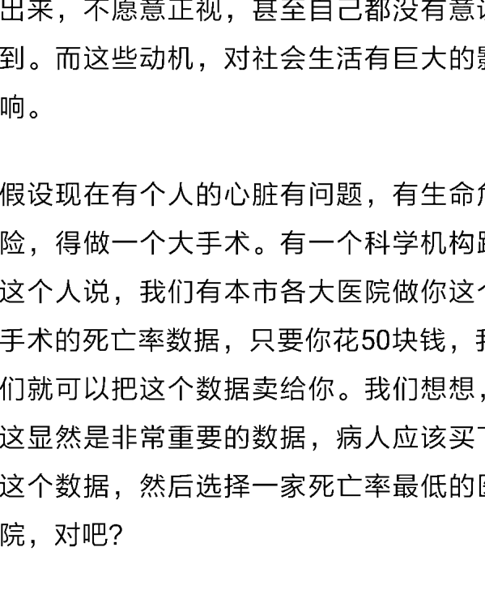

英文中有个成语叫“房间里的大象（the elephant in the room）”，意思是说有这么一个明摆着的东西，但是每个人都不愿意正视，大家都假装它好像不存在一样。

“头脑中的大象”，也是这个意思。我们的头脑中有些隐藏的动机，我们不愿意说出来，不愿意正视，甚至自己都没有意识到。而这些动机，对社会生活有巨大的影响。

假设现在有个人心脏有问题，有生命危险，得做一个大手术。有一个科学机构跟这个人说，我们有本市各大医院做你这个手术的死亡率数据，只要你花50块钱，我们就可以把这个数据卖给你。我们想想，这显然是非常重要的数据，病人应该买下这个数据，然后选择一家死亡率最低的医院，对吧？

那你猜，愿意花这50块钱买数据的病人有多少呢？

8%。这是涉及到生死的重大决定，而且还不算手术本身也是要花很多钱的，仅仅多花50块钱，就能让你有更准确的选择——可是愿意购买信息的病人，居然只有8%。

这不是拿自己的生命开玩笑吗？我们上周刚讲过，医疗系统不是市场经济。患者就医，连最起码的性价比都没有研究过，几乎是随便找个医院就行。而这本书告诉我们，很多很多患者对此其实并不在意。

两位作者在这本书中运用微观社会学、认知和社会心理学、进化心理学和经济学，给我们揭示和解释了很多像这样摆出来就简直不可思议的事情。而这些事情，就发生在我们身边。

如果上大学是为了学知识，你解释不了为什么我们如此重视教育。如果就医是为了健康，你解释不了发达国家的人为什么在医药上投入这么大。同样地，艺术不一定是为了欣赏美，慈善不一定是为了爱心。

现代世界到底是怎么回事儿？在温情脉脉、冠冕堂皇的表面之下，别有一套隐藏的机制。

周一晚上10:43，我们将再次突破表面印象，直面真实世界。

祝你新年快乐。

## 日课068 | 负能量竞争

日课068 | 负能量竞争

新年好！今天是新年第一天，我们精英日课专栏又到了一个红色胶囊时刻。我们要直面真实世界，讲一点不一样的道理。今天这个道理，叫“竞争”。

“竞争”在现代文化中是个好词。体育比赛是竞争，得冠军当然可喜，但是亚军、包括没有名次的选手，也在努力进步啊，没有人是真正的失败者，体育的精神就是重在参与！市场是竞争的，各公司努力创新，所有消费者都能受益！团队之间有竞争，每个人都为团队奉献，大家拧成一股绳，为了同一个目标而奋斗。

竞争，真是激发人性光辉的活动啊。

但是我们今天要说的这本书，讲的却是另外一种竞争。这本书叫《头脑里的大家：日常生活中隐藏动机》（ The Elephant in the Brain: Hidden Motives in Everyday Life ），12月刚刚出版。两位作者，凯文·西姆勒（ Kevin Simler ）是个软件工程师，罗宾·汉森（ Robin Hanson ）是乔治梅森大学的经济学家。


这本书说，冠冕堂皇、正能量的竞争之外，我们还在参加另外一种竞争——一种我们不愿意承认、不愿意面对、甚至根本就没有意识到的竞争。而那种竞争，恰恰是最重要的竞争——那才是“竞争”的常态。

### 1.零和

美国加州有一种红杉木，长得很非常高，最高能到115米——这基本就是生物极限，再高的话水就输送不上去 了。当你看到红杉木的时候你就会想，它们为什么要长那么高呢？


如果一棵红杉木周围都是很低的物种，它根本没必要长那么高。它应该把能量用来多结果实，繁殖更多的后代，好让自己的物种扩张。红杉木之所以长这么高，是因为每棵红杉木的周围，也是红杉木。

长高是为了争夺阳光资源。在密集的森林里，阳光是一种有限资源——只有这么多，我高我得到，你矮你就没有了。阳光让红杉木之间展开一场军备竞赛，让它们成为森林里最高的物种。红杉木之所以长那么高，并不是为了和*其他物种*竞争，而是为了和*自己的同类*竞争。

我们说进化论“适者生存”，好像都是物种跟物种竞争，其实生物个体大部分时间都是在跟自己的同类竞争。比如说生育权吧，一个个体就算不怎么适应环境，它也不见得马上就得死——但是它如果争不过同伴，就很可能丧失生育权。“适者生存”，也许应该叫“适者生育”。

如果红杉木长这么高不是为了跟其他物种竞争，那么人类长这么聪明的大脑，难道是为了跟猩猩竞争吗？

人类会创作艺术、会科学、会最高效的赚钱方法，如果你只是想打败其他动物称霸全球，那可不用着这么高的智力。现在有个理论叫“社会大脑假设（ social brain hypothesis ）”，说人之所以那么聪明，并不是为了和其他物种竞争，而是因为人与人之间的竞争。


与天奋斗与地奋斗，都不如与人奋斗其乐无穷。

我们平时特别喜欢说要“把蛋糕做大”，但同一物种内部的竞争，往往不是做蛋糕、而是分蛋糕的问题。比如说争夺配偶，优质异性就这么多，一个人得到就意味着另一个人的失去。

这种局面，叫“零和博弈”——你要成功我就得失败，咱俩打一仗，得失加在一起的“和”，是0。

现在很多正能量的说法，说零和博弈是不好的，我们要追求非零和的博弈，应该专门研究怎么把蛋糕做大。可惜人和人之间的竞争，通常是零和的。比如说，社会地位。

### 2.地位的本质

社会地位是一个很不好意思的话题，我们都假装不在意，我们喜欢说人人平等。事实是有人群就有地位，每个人都知道社会地位是存在的，而且每个人都清楚自己处于什么位置。

社会地位是动物界根深蒂固的秩序，一群猩猩、一群鹿、甚至一群鸟中间都有地位。生物学家通常把一群动物中地位最高的那個雄性头领称为“alpha male”，排名第二的叫“beta male”，我们干脆就叫大寨主和二寨主吧。通常，二寨主要想占据更高的地位，就必须打败大寨主。

人类中也有这么干的。有些小孩排座次至今靠打架，有些政治夺权斗争就是要你死我活。但是科学家常就注意到，地位的争夺，除了“高压（ dominance ）”这个维度之外，其实还有另一个维度。

这另一个维度就是“声望（ prestige ）”。高压的办法是恐吓，而声望的办法是赢得别人的崇敬。声望并不仅仅存在于人类社会。《头脑中的大象》这本书中提到有一种鸦鹊鸟，鸟群内部就很少发生打斗。鸦鹊鸟争夺社会地位，争夺的是……为其他鸟服务的权力。

表面上看。鸦鹊鸟简直个个大公无私。鸟群要休息了，会有一只鸟主动站出来给大家放哨；弱小的鸟儿觅食不易，别的鸟会带食物给它吃。


但你仔细观察，会发现有时候大寨主要给一只鸟喂吃的，如果那只鸟说我不饿啊不想吃，那可是不行的。有时候二寨主说今晚您歇着我来给大伙放哨，大寨主会攻击他。

鸟类学家对此有个理论，说鸦鹊鸟内部其实有一个声望系统。为群体做好事，你会积累声望。声望有两个好处，第一是获得更好的交配机会，第二是获得安全。如果你能通过放哨这样的事儿证明自己的能力和处，大寨主就太不可能把你驱逐出鸟群了——这也是为什么大寨主一般不会给你这样的机会。

我看过一个老电影叫《火烧岛》，其中有一句台词说“老天让人尊敬，而你只能让人害怕。”其实让人尊敬和让人害怕都是获得地位的有效手段。


绝大多数情况下，我们人类争取地位的方式还是很文明的。我们尽量避免直接冲突，都是追求让人尊敬。我们喜欢展示自己的财富、美貌、优良品质、健康身体、幽默感等等。但是请注意，这些所谓的素质其实都有一个重要的特征，就是绝对的好坏没意义，有意义的是你在一群人中相对于其他人的水平如何。今天随便找个人，他的实际生活水平都可能比古代国王高级，那他为什么还有烦恼呢？根本原因在于他是要和身边的人比较。

人群中总的尊敬是有限的，追求尊敬，也是零和博弈。同事立功了，就算没升职，你心里可能也会有一点点嫉妒，这就是因为你担心两个人相对的地位发生变化。

零和博弈，才是人们真正在意的东西。这才有了各种什么“办公室政治”。

不过仅仅有社会地位这个秩序，还不能叫“政治”。

### 3.什么叫政治

政治是一种非常高级的社会活动。鸟类有权力斗争，但是那可不叫政治。科学家眼中的政治，有一个关键特征。

作为人类，有一个其他所有灵长类动物都没有的乐趣，我们从来没体会过，那就是“理毛”。你身上要是长满了毛，如果不经常梳理，就会很脏、会长寄生虫，会很难受。但是你只能梳理自己正面的毛，后背的毛你够不着，必须得互相理毛——学术上管这叫“社会化理毛”（social grooming）。


本来理毛就是个搞卫生的事儿，但是科学家很早就发现，黑猩猩们互相理毛并不仅仅是为了搞卫生。首先猩猩理毛的时间远远超过了实际需要，其实一只猩猩只要用0.1%的时间就能理好毛，可是有一些猩猩的理毛时间达到了17%！其次，猩猩给别人理毛的时间，远远超过了给自己理毛的时间。还有，理毛时间长短跟这种猩猩身材的大小根本没关系。

那理毛时间和什么有关系呢？和猩猩族群的社交圈大小有关。社交圈越大，用在理毛上的时间就越长。理毛，其实是社交行为。允许对方给自己理毛，这就是把后背暴露给对方，这个动作代表信任。

如果两只猩猩经常互相理毛，它们就会经常一起用食，它们会允许彼此进入自己的安全空间，它们打仗的时候会联手。

这才是政治。政治的关键特征，是“联盟”。

当然，猩猩不一定是有明确的政治意识，它们互相理毛可能完全是无意识的，但是它们知道，只有这么做才能增加生存机会。

知道跟人联盟，这才叫政治。黑猩猩非常清楚打仗取胜的最好办法是多个打一个。单打独斗太落伍了，那是低等动物的玩法。

谁是我们的敌人？谁是我们的朋友？这个问题是政治的首要问题。

|由此得到

- 1. 对个体来说，群体内部的竞争往往比跟外部的竞争更重要，而内部竞争主要是零和博弈。
- 2. 提高社会地位的手段有两个：高压，和声望。
- 3. 政治的关键是结盟。

|我的评论

今天的内容可能有点负能量，但我们专栏叫“精英日课”，不叫“小白兔日课”——哪怕是在元旦这一天，我们也希望认识真实的世界。

真实世界并不怎么美好，但我们就是要在认识了真实世界的不美好之后，还对人类充满爱心。

这本书的思想当然也不是两位作者的原创，这本书是他们综合各路学者的学说的结果。两位作者特别强调了他们热爱人类。

我们也热爱人类。但我觉得最应该、也是最有资格热爱人类的，是大寨主和二寨主，而不是只知道低头做蛋糕，根本没有权力分蛋糕的人。

事实上，人类做得很好。人类早就意识到这些内部倾轧的竞争是不好的，必须加以限制。而且人类发明了一个黑猩猩绝对没有的限制竞争的机制，这就是我们下一期的主题。

## 日课069 | 给人一个不抓你的理由

日课069 | 给人一个不抓你...

我第一次去现场看NBA比赛是刚到美国不久的时候，一个人坐公共汽车就去了。

在从车站往球场走的路上，我看有很多几个人在喊，说自己想买票——可我看着他们样子很像是叫卖，感觉很奇怪。我想他们是故意制造气氛，让人觉得球票不好买吧。所以幸的是赛场居然还有票。

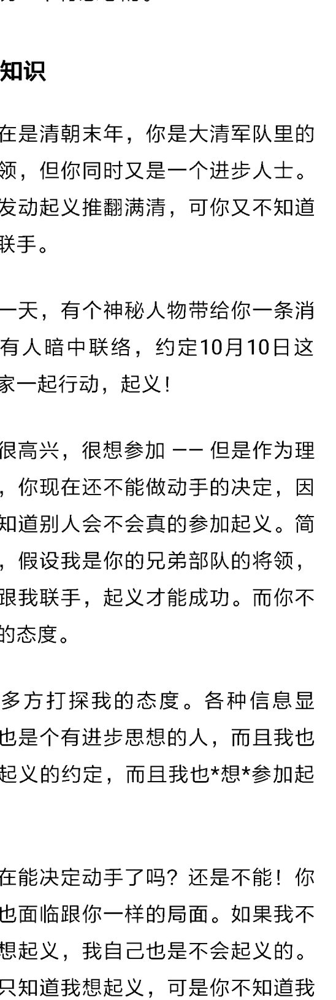

后来我才知道这是怎么回事儿。原来那些人其实就是票贩子，他们的哄喝其实是卖票的意思。法律不允许卖比赛门票，这些人既要哄喝卖票，又不能直接说卖票，所以只能反着说，说买票。这已经是美国黄牛党的传统了。

可是你仔细想想这件事，非常有意思。除了我这个外国人不明白，可能所有路人都知道喊买票其实就是卖票——那这不是掩耳盗铃吗？当警察是傻子吗？这和直接说自己是卖票有什么区别呢？

今天我们继续说《头脑里的大象》这本书。这个区别，就是今天的内容。

### 1.规范

有人类学家讲过一个有关新西兰毛利人的故事。毛利人有一种文化，说如果别人直接找你要食物，你不能拒绝。有个人就利用了这个特点，专门找毛利渔民要鱼，而且每次都要很多。渔民心里很不满，但是也不好不给他，一来二去很多渔民都深受其害。

这件事发生了多次之后，渔民们的恼怒到了极点，就联手把那个要鱼的人给打死了！


我们“城里人”听说这个故事都感到不可思议：宁可把人打死，都不愿意直接拒绝他要鱼的要求。

这就是“社会规范”的作用。所谓社会规范，就是一个社会或者成文、或者不成文的各种法则和习俗。大家都这么做，而且也指望你这么做，你不这么做就会受到白眼和惩罚。如果你觉得毛利人遵守社会规范有点太执着了，那我们在公共场所办事要排队也是一个社会规范——如果有人插你的队，无非也就会毁你几分钟时间而已，你又为什么因为这个小事情非得跟他翻脸甚至动手呢？

社会规范，是人类社会防止恶性竞争的伟大发明。很多动物都有社会等级，黑猩猩甚至有政治，但是只有人类有社会规范。

社会规范的妙处在于，做坏事的人不仅仅会面临被他伤害了的人的报复，而且会面临第三方的惩罚——哪怕事不关己，围观群众也会联合起来去惩罚一个违反了社会规范的人。

学者们现在认为，人类社会之所以能发展出规范来，关键的转折点在于对致命武器的使用。

在没有武器的时代，身强力壮者具有绝对的优势。有了武器，弱者就有可能用武器打败强者。特别是有了投掷类的武器之后，一群人可以联合起来干掉一个人，而自己完全不用担心受伤。这就给那些身强力壮、以前可以在群体里称王称霸的个体（所谓的alpha male）形成了极大的威胁。

所以你可以说武器的出现其实带来了和平！从此之后个人再强也不能为所欲为了，人类政治面貌发生了深刻变化，好勇斗狠越来越不好使，脑子越来越重要。个人不管想干什么事儿，都得先考虑考虑，大多数人对你这个做法赞同不赞同。这就是社会规范。

社会规范的主要功能是避免恶性竞争。比如说吹牛，你拿一些小事儿发发朋友圈炫耀一下大家都能理解，但是如果你总拿大事吹牛，就会引起别人的反感，就违反社会规范了。这是因为人类社会早在一万年前的采集狩猎时代就已经形成了防止一人独大、避免一个人欺压多数人的本能。类似地，各种明显自私的做法、把别人的功劳据为己有、通过阿谀奉承上位、搞小政治团体，这些行为都是社会规范所反对的。


好，现在我们有了社会规范。那如果人人都老老实实遵守规范的话，也不需要太聪明的头脑啊？而事实上人脑仍然在继续变聪明。这是因为一直有人在违反规范，也一直有人在揭露别人违反规范。

对社会规范的违反和维护，是人类社会一个长久的军备竞赛。无数斗智斗勇，就发生在里面。

咱们先说一个有意思的。

### 2.共有知识

假设现在是清朝末年，你是大清军队里的一员将领，但你同时又是一个进步人士。你很想发动起义推翻满清，可你又不知道该跟谁联手。

突然有一天，有个神秘人物带给你一条消息。说有人暗中联络，约定10月10日这天，大家一起行动，起义！

你心里很高兴，很想参加——但是作为理性的你，你现在还不能做决定，因为你不知道别人会不会真的参加起义。简单起见，假设我是你的兄弟部队将领，你必须跟我联手，起义才能成功。而你不知道我的态度。

所以你多方打探我的态度。各种信息显示，我也是个有进步思想的人，而且我也听说 了起义的约定，而且我也*想*参加起义。

那你现在能决定动手了吗？还是不能！你想，我也面临跟你一样的局面。如果我不知道你打算起义，我自己也是不会起义的。现在你只知道我想起义，可是你不知道我知不知道 你想起义！

于是你故意在我面前表现得很进步的样子，向我暗示你想起义。好，现在你确信我知道你想起义了，那你这时候能起义了吗？还是不能！现在虽然我知道你想起义，可是我不一定知道你知道我也想起义啊。我可能还是下不了决心。而我下不了决心，你就下不了决心。

以此类推。你要想真正跟我协调一次起义，必须同时做到——

- 1. 你想起义
- 2. 你知道我想起义
- 3. 你知道我知道你想起义
- 4. 你知道我知道你知道我想起义
- 5. 你知道我知道你知道我知道你想起义
- ……

每一层认知都不能让我们下决心，必须有更高一层的认知才行。那你说这么猜来猜去哪有完啊，咱们直接当面把话说开了不就行了吗？！对。当面把话说开了，这就是逻辑学一个关键概念，叫“共有知识（common knowledge）”。一个知识你有我有还不行，得形成 common knowledge，才能起到协调的作用。


“皇帝的新衣”这个故事其实就是说的 common knowledge。你觉得皇帝没穿衣服，可是你不敢说——因为你不知道别人是不是也这么想。每个人都知道皇帝没穿衣服，但是没穿衣服这件事偏偏不是个 common knowledge。直到一个小孩把话公开说出来，这个知识才是共有知识。

就是它在多大程度上是个共有知识。

有些秘密，你只要关注第一个维度就行了。比如考试作弊，只要被监考老师发现就完蛋了。

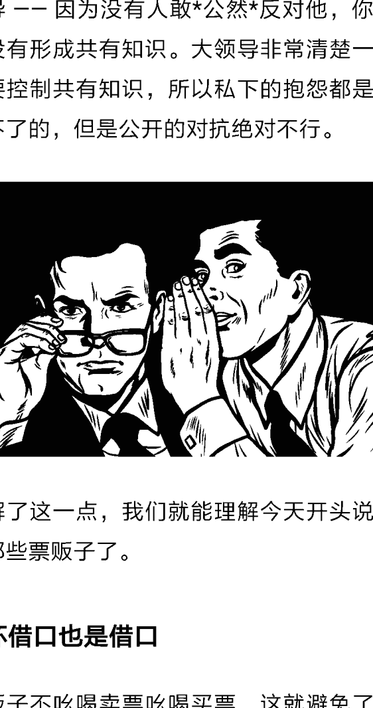

但在很多情况下，你违反了第一个维度是没事的，只要你不违反第二个维度，它就还是一个“秘密”。

比如单位有个大领导，你觉得他腐败无能，你跟要好的同事私下里一交流，发现别人也是这么认为的。其实就算每个人都认为大领导腐败无能，他还是可以继续当领导——因为没有人敢*公然*反对他，你们没有形成共有知识。大领导非常清楚一定要控制共有知识，所以私下的抱怨都是管不了的，但是公开的对抗绝对不行。

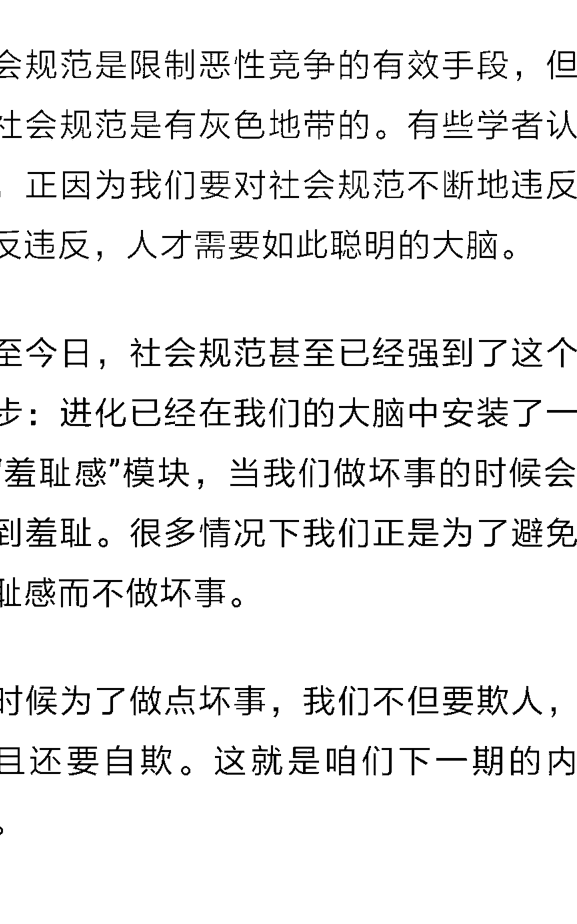

理解了这一点，我们就能理解今天开头说的那些票贩子了。

### 3.坏借口也是借口

票贩子不吃喝卖票吃喝买票，这就避免了公然的对抗，给予了警察一个不抓他的理由。

类似的例子还有喝酒。美国很多州都规定不准在公开场合喝酒——你在家里、在餐馆喝可以，但是不能在大街上拿瓶酒公开地喝。那你就是想在室外喝点酒怎么办呢？你可以用个纸袋子把酒瓶包起来喝。


这么做不算侮辱警察的智商。

倒卖球票和在公共场所喝酒，在法律上确实是不允许，但是大家心照不宣，睁一只眼闭一只眼也就过去了。警察有很多事要做，抓这种小事儿不是什么政绩还很麻烦。警察没有抓你的强烈愿望。只要你稍微遮掩一下，警察就有了不抓你的理由。

可是如果你*公然*违法，那可就真成了侮辱警察了。警察面对公然的违法行为无动于衷是会被追责的。

所以让人知道是一回事儿，变成共有知识是另一回事儿。现实生活中这种技巧实在太多了，我们发明了委婉语、双关语、讽刺和暗示，这都是既传达了信息，又不公然违反社会规范。我们看西方电影，男女交往，吃 करेगा约会之后问对方“要不要上楼去我家坐坐”，这就是明显的暗示，但是不管对方拒绝也好，还是有第三方听到了也好，大家都能保全面子。公司领导要解雇一个高级经理，一般不会直接说解雇，而是说对方为了多陪伴家人决定辞职。

社会规范是限制恶性竞争的有效手段，但是社会规范是有灰色地带的。有些学者认为，正因为我们要对社会规范不断地违反和反违反，人才需要如此聪明的大脑。

时至今日，社会规范甚至已经强到了这个地步：进化已经在我们的大脑中安装了一个“羞耻感”模块，当我们做坏事的时候会感到羞耻。很多情况下我们正是为了避免羞耻感而不做坏事。

有时候为了做点坏事，我们不但要欺人，而且还要自欺。这就是咱们下一期内容。

## 划重点

- 1. 社会规范，是人类社会防止恶性竞争的伟大发明。
- 2. 逻辑学一个关键概念： “共有知识（ common knowledge）”。 一个知识你有我有还不行，得形成 common knowledge，才能起到协调的作用。
- 3. 任何秘密其实都有两个维度，第一个维度是有多少人知道这个秘密，第二个维度是这个秘密的“公开”程度——也就是它在多大程度上是个共有知识。


## 日课070 | 文明成年人不问为什么

日课070 | 文明成年人不问...

你没注意到这么一个现象，成年人之间的对话，特别是比较高级的对话，很少会直接说做事的“动机”。一般都是分析问题解决困难，研究“什么”和“怎么”，而不说“为什么”。

比如说这段话：“你要好好努力啊，这样你才能有个好工作，才能挣更多钱”——这种话显然是跟小孩说的，你得经常给他解释为什么放着游戏不玩非得学这种反人性的事儿。

而成年人不需要解释。比如领导给你布置一个任务，他会讲任务的细节，但是他不会告诉你完成这个任务你能得到什么好处。他不说，你自己也能论证这个好处。

更重要的是，有些动机，不说就对了。

今天咱们继续说《头脑里的大象》这本书。前面我们讲了，人类为了限制恶性竞争而发明了“社会规范”这个工具，有了规范就有了各种欺骗和反欺骗。

其实在文明社会，真正厚颜无耻瞪眼说瞎话的欺骗是很少的。常见的欺骗都是先自欺，你自己真的相信了，再去让别人相信。所以现在人们常常是自欺的状态，有些事儿我们自己都不知道自己的动机是什么。

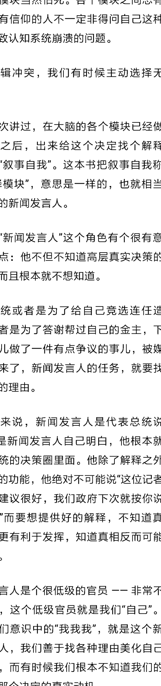

## 1.真有“真的理由”吗

有一种很罕见的精神疾病，叫“失能否认”。起因是病人大脑的右半球发生中风，导致身体的左侧偏瘫 ——而“失能否认”的症状是，病人会拒绝承认自己偏瘫。


医生问这个病人，你左边身体为什么不动啊？病人会找各种理由，有的说我得了关节炎，很疼痛不能动。有的说你不知道，今天你们一个实习护士折腾了我一上午，我浑身很累实在是不愿意动。医生说那你能不能把两只手举起来呢？当然这个病人只能举起一只手，但是他还会继续解释，说医生你看，我的左手需要支撑一下身体，所以左手不能举起来了，我只能给你举右手。


这个病的可悲之处在于，病人可能真的相信他自己编的那個理由。

我们前面讲《为什么佛教是真的》这本书的时候说过“无我”的道理。人的大脑其实是个多元政体，各个模块有不同的“想法”，有时候会互相冲突。最后对外发言的“叙事自我”，有时候并不知道发生了什么，但是它总能找到一些理由。

而今天我们会看到，找理由有多么容易。

比如有个实验是这样的。实验者给受试者发了三种盒子包装的洗衣粉，分别是黄色、蓝色、和蓝底黄点的盒子。其实三个盒子里的洗衣用品是完全一样的，但是受试者并不知道。

受试者把这些洗衣粉拿回家用了一段时间，实验人员就回来访他，问哪一种洗衣粉更好用。有的受试者就说：“黄色盒子装的洗衣粉太强了，把我的衣服都洗坏了；蓝色洗衣粉太弱了，衣服经常洗不干净；蓝底黄点的洗衣粉最好。”

这些理由当然都是胡说八道，受试者只不过更喜欢那个蓝底黄点的盒子罢了。问题就在于，人们编造理由是张口就来，而且非常真诚！

还有一个实验，让一些男性受试者看很多女性的照片。每次屏幕上都出现两张女性照片，让受试者评选哪张照片更有吸引力。


受试者选完了很多很多照片之后，实验者把它其中一张照片拿出来问他，说你为什么会喜欢这位女性呢？

受试者不知道的是，其实这张照片是当时被他判断为没有吸引力，没选中的照片——但是多数受试者已经忘了！结果受试者就真的给出了一些理由。说我喜欢这个姑娘的长相，或者我喜欢她的耳环，我认为她是一个什么样性格的女孩……

所以“理由”这个东西，是不是太廉价了吧？“为什么”这个问题，还有意义吗？

## 2.最好不知道

假设现在有一位信仰基督教的人，他非常相信天堂的存在，并且认为自己死后一定会去天堂。如果有人想跟他抬杠，就可能问他这个问题：你这么相信自己死后会去天堂，那你还怕死吗？

我劝你不要问人这样的问题。事实是再相信天堂的人也会怕死。我们的头脑里有相信天堂的模块，也有保全生命的模块，保全生命的模块当然怕死。各个模块之间总有冲突，有信仰的人不一定非得问自己这种容易导致认知系统崩溃的问题。

面对逻辑冲突，我们有时候主动选择无知。

咱们多次讲过，在大脑的各个模块已经做出决定之后，出来给这个决定找个解释的，是“叙事自我”。这本书把叙事自我称为“解释模块”，意思是一样的，也就相当于大脑的新闻发言人。

生活中“新闻发言人”这个角色有个很有意思的特点：他不但不知道高层真正决策的理由，而且根本就不想知道。

比如总统或者是为了给自己竞选连任造势、或者是为了答谢帮过自己的金主，下令在哪个做了一些有点争议的事儿，被媒体捅出来了，新闻发言人的任务，就要找个好听的理由。

对公众来说，新闻发言人是代表总统说话；可是新闻发言人自己明白，他根本就不在总统的决策圈里面。他除了解释之外没有别的功用，他绝对不可能说“这位记者朋友的建议很好，我们政府下次就按你说的办。”而要想提供好的解释，不知道真相反而更有利于发挥，知道真相反而可能说漏嘴。

新闻发言人是个很低级的官员——非常不幸的是，这个低级官员就是我们“自己”。平时我们意识中的“我自己”，就是这个新闻发言人，我们善于找各种理由美化自己的动机，而有时候我们根本不知道我们的大脑做那个决定的真实动机。

你参加一个会议，说着说着就发火了，把手下一顿痛骂。事后别人问你今天为什么发火呢，你说最近我们团队工作做得太差——其实你发火的真正原因是 一个员工在发火中对你进行了指责。

为什么跟女朋友分手？你说我们的感情破裂了——其实根本原因是你遇到一个更好的姑娘，你是见异思迁了。

为什么晚上不做家务？你说我今天太忙了要赶一个计划书——其实你只不过是懒。

为什么支持给希拉里？你说我是一个自由主义者，我认同希拉里的政治理念——其实你是看到知识分子都支持希拉里，你想表现得像个“高级”的人。

这些理由都是张口就来，而且为了真正说服别人，我们已经说服了自己。

## 3.策略性自欺

以前弗洛伊德那一代的学者认为，人们之所以欺骗自己，是因为感情太脆弱了，不想伤害自己的感情。但是现在新一代学者认为，这个解释讲不通。

自己骗自己，忽略关键信息，人是要吃亏的，如果仅仅是为了自我安慰，这个亏吃的不值得。感情脆弱就应该加强感情啊，为什么进化不给我们更强大的感情，何必让我们欺骗自己呢？

1967年，美国经济学家、也是后来的诺贝尔奖得主，托马斯·谢林（Thomas Schelling），提出一个理论，说人们欺骗自己的根本目的，是为了更好地欺骗别人。

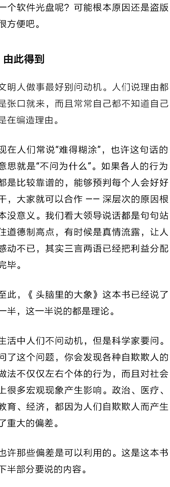

主动限制自己的认知，是为了做给别人看。

比如说，体育比赛，我暴露任何一点弱点，都可能给对手极大的鼓舞。那我的最佳策略就是哪怕快坚持不住了也要坚持，我得像个疯子一样不计后果地勇往直前，这样对手才能害怕。

有时候盲目相信是为了表示忠诚。赵高指鹿为马，为什么那些官员也跟着说这马呢？因为你要忠诚于组织，就必须忠诚于组织的信仰。各种组织都讲信仰，员工就是要比老板还相信公司的产品一定能成功。

有时候自欺是为了宣传，为了鼓舞别人，自己得先信。很多人认为政客都是虚伪的，但是这本书里有一句话说的很有意思：“一个面具戴久了，就会变成你的脸的一部分。”你会真的相信你说的。

更多的自欺，是纯粹为了自利，隐藏自己真实的动机。

很多学者说我搞学问就是传播新思想，我是为人类知识做贡献——可是如果别人引用他的思想，而没有提到他的名字，他就不愿意了。那如此说来，他传播思想之外，应该还想传播名字。

所有当家长的都要求孩子按时上床睡觉。美国有些育儿专家说六岁的孩子八点就必须睡觉，说孩子如果不按时上床睡觉就无法获得充足的睡眠。

| age of child | suggested bedtime |
|---|---|
| 2 | 7:00 pm |
| 3 | 7:15 pm |
| 4 | 7:30 pm |
| 5 | 7:45 pm |
| 6 | 8:00 pm |
| 7 | 8:15 pm |
| 8 | 8:30 pm |
| 9 | 8:45 pm |
| 10 | 9:00 pm |
| 11 | 9:15 pm |
| 12 | 9:30 pm |
| 13 | 9:45 pm |
| 14 | 10:00 pm |
| 15 | 10:15 pm |
| 16 | 10:30 pm |
| 17 | 10:45 pm |
| 18 | 11:00 pm |
| MommyMoment.ca | |

像这样的政策得到了家长们的一致拥护——但我有时候就想，这政策到底是为了孩子好，还是为了给家长制造一点自由时间啊？

为什么下载盗版内容？有人说这是因为正版的公司太贪婪了，他们为了赚钱垄断了信息，我们就是要反抗！——那如果是想惩罚贪婪的公司，你为什么不去商店里偷一个软件光盘呢？可能根本原因还是盗版很方便吧。

## 由此得到

文明人做事最好别问动机。人们说理由都是张口就来，而且常常自己都不知道自己是在编造理由。

现在人们常说“难得糊涂”，也许这句话的意思就是“不问为什么”。如果各人的行为都是比较靠谱的，能够预判每个人会好好干，大家就可以合作——深层次的原因根本没意义。我们看大领导说话都是句句站住道德制高点，有时候是真情流露，让人感动不已，其实三言两语已经把利益分配完毕。

至此，《头脑里的大象》这本书已经说了一半，这一半说的都是理论。

生活中人们不问动机，但是科学家要问。问了这个问题，你会发现各种自欺欺人的做法不仅仅左右个体的行为，而且对社会上很多宏观现象产生影响。政治、医疗、教育、经济，都因为人们自欺欺人而产生了重大的偏差。

也许那些偏差是可以利用的。这是这本书下半部分要说的内容。

## 日课071 | P<0.05：科学家的隐藏动机

日课071 | P<0.05：科学家...

今天这个副标题有点鲁人听闻，但我本来想用一个更鲁人听闻的标题，叫《科学家的自欺欺人》……其实我想说的是有关科学研究的一个*技术性*的内幕。这个内幕不是阴谋也不是秘密，这不是爆料。现在经常有些科学家造假的新闻，但我们今天说的可不是造假。我只是想讲一点真正的科学研究的操作方法。

在你听说的所有心理学、医学和社会调查研究中，凡是涉及到统计方法的研究，从理论上来讲，哪怕科学家都是兢兢业业老老实实地工作，大约每20篇论文中，就有一篇的结果，其实是无效的。而因为科研界很多灰色的做法，实际情况比1/20要坏很多。

这个误差，是科学方法本身所决定的。

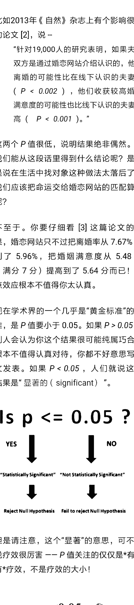

我们专栏之前讲香农信息论的时候，有一句叫做“信息就是意外”。那么当你遇到一个统计结果，你在多大程度上应该对这个结果感到意外呢？

这个问题有点大。但我并不认为这个问题有多么难以解释，我想给你解释解释。

## 1.统计结论是怎么来的

比如现在有人发明了一种新药，你怎么证明这个药是有疗效的呢？有个病人吃了这个药，然后他的病就好了，你能说这个药有疗效吗？不能。因为有些病不吃药也能好。

科学的做法，当然是做个随机实验。我找100个病人，随机分成两组，每组50人。我们给第一组病人吃新药，给第二组病人吃跟新药看起来一模一样的……糖豆，也就是“安慰剂”。病人自己并不知道被分到了哪一组，我们甚至还可以让负责发药的医护人员也不知道每次发的是新药还是安慰剂，这样所有病人除了吃的药不一样，其他方面都是一样的，这就做成了一个“双盲”实验。


如果在一个疗程之后，第一组病人全都治好了，第二组病人全都死了，那我们就有充分的理由相信这个新药是有疗效的。

但真实世界没有这么好的事情。即便是在市场上很火的药，有效率也没有那么高，经常都只是比不吃药稍好一点而已。你的实验结果更可能是第一组有22个人的病好了，4个人死了，第二组只有15个人病好了，但是只死了3个。

这就让人很无奈。你说这个药无效吧，第一组的治愈率确实比第二组要好。你说这个药有效吧，疗效似乎不怎么明显，死亡率还上升了。那如果我是科学家，这个论文应该怎么写呢？

这就得用到统计方法了。这个思想的关键，就是我们要判断，现在这个结果，到底是药物疗效导致的呢，还是纯粹是个偶然事件。

咱们干脆考虑一个最简单的例子，只看死活：假设第一组的所有病人都活着，而第二组死了5个病人[1]。也许正是新药的疗效，才让第一组没死亡，但也许这只是一个巧合。

科学家的做法，是先来一个“无效假设”：
一 假设药物无效，并且这个疾病的死亡率就是第二组所揭示的10%。

科学家的问题是，如果这个无效假设是对的，那么请问，出现第一组不死人这个结果的可能性，有多大？

这个问题的本质，就是问，你第一组这么好的结果，到底是不是纯属偶然。纯属偶然是完全可能的。哪怕药物完全无效，以至于这个病还是有10%的死亡率，那也不见得第一组就也应该死5个病人 – 你要知道，哪怕是抛硬币，也存在一个连续50次都正面朝上的可能性。

那我们就来算算这个可能性。每个病人不死的概率是0.9，50个人都不死的可能性就是0.9的50次方，等于0.00515。

科学家把无效假设成立的可能性，称为“P值”。那么在这个例子中，
P = 0.00515。

那也就是说，无效假设不成立、第一组实验结果并非偶然的可能性，是 1 - P = 0.99485。

那么科学家就会这么写论文：“实验证明，这种药是有效的，P = 0.00515。”

读者读到这句话，就可以这么理解，实验结果应该不是巧合，这种药有效的可能性高达99.485%。

这才是理解论文的正确思路。P 值告诉我们巧合的可能性。回到咱们最开始的实验，在一定的 P 值的指导之下，我们也许可以说：药物疗效大概率是真的，第一组的治愈率高很可能不是巧合，而第一组多死了一个人这件事，很可能只是巧合。


但是对不起，你注意到没有，我们前面说错了一句话。“这种药有效的可能性高达99.485%”，这句话是错的。

## 2.怎样理解 P 值

关于 P 值有很多错误理解。我们前面那句“这种药有效的可能性高达99.485%”其实是错的，但是很多科学家跟记者也这么说。

P 值的真正意思是说，相对于“死亡率是10%”这个“无效假设”，实验结果纯属巧合的可能性是0.00515。那我为啥非得用死亡率是10%这个无效假设，我为什么不用别的无效假设呢？这纯粹是科学家的主观选择。

还有一点特别重要，P 值只能让我们更好地评估这个药*有没有*疗效，但是它可没说这个药的疗效有多大。

比如2013年《自然》杂志上有个影响很广的论文[2]，说 –
“针对19,000人的研究表明，如果夫妻双方是通过婚恋网站介绍认识的，他们离婚的可能性比在线下认识的夫妻低（ P < 0.002 ），他们收获较高婚姻满意度的可能性也比线下认识的夫妻要高（ P < 0.001 ）。”

这两个 P 值很低，说明结果绝非偶然。那我们能从这段话里得到什么结论呢？是不是在生活中找对象这种做法太落后了，我们应该把命运交给婚恋网站的匹配算法呢？

不至于。你要仔细看[3]这篇论文的结果，婚恋网站只不过把离婚率从 7.67% 降到了 5.96%，把婚姻满意度从 5.48 分（满分 7 分）提高到了 5.64 分而已！这点效应根本不值得你太认真。

现在学术界的一个几乎是“黄金标准”的标准，是 P 值小于 0.05。如果 P > 0.05，人们就会认为你这个结果很可能纯属巧合，根本不值得认真对待，你都不好意思写论文发表。如果 P < 0.05，人们就说这个结果是“显著的（significant）”。


但是请注意，这个“显著”的意思，可不是说疗效很厉害 —— P 值关注的仅仅是*有没有*疗效，而不是疗效的大小！

## p<0.05

还有个关键问题。为啥非得是 0.05 呢？

## 3.0.05 啊 0.05

我看有些统计学教材都把 0.05 当成了一个硬性标准，P < 0.05 就显著，否则就不显著。但事实上这个标准根本没有科学依据，纯粹是科学家的约定俗成而已。

这一整套看 P 值的检验方法是英国的统计学家罗纳德·费希尔（Ronald Fisher）提出的，这个理论才只有几十年的历史。

费希尔先生是个体面人。他当时选择了 0.05 这个数值，可不是说 P < 0.05 就可以发表论文 -- 他的意思是 P < 0.05 的结果才“值得看”。那满足什么标准才算可以接受的结论呢？费希尔当时想的可是 P < 0.001 [4]。

但问题在于，做实验想要得到 P 值小于 0.001 的结果，需要找太多受试者，成本实在太高。大家退而求其次，都默认了 0.05。其实即使是这个标准都是很难达到的，不知道有多少科学青年的青春，就消耗在了这个 0.05 上！

其实就算做到了 P < 0.05 ，也不能说实验结果就是真的 -- 根据我们前面的分析，P = 0.05 意味着有 1/20 的可能性，在你这个特定的无效假设之下，这篇论文的结果纯属巧合。事实情况比这个严重得多，根据有人研究 [3]，如果你考虑无效假设的任意性之类的统计方法上的因素，一篇 P = 0.01 的论文，属于巧合的可能性，在某些情况下，高达 11%！

而这还不算完。

## 4.动机性推理

说到这里我想说一个概念，叫“动机性推理（motivated reasoning）”。所谓动机性推理，就是如果你事先有一个达到什么结论的强烈动机，你的推理过程就会刻意地满足这个结论。

如果科学家非常希望自己的结论是对的，他想让 P 值小于 0.05，他就有可能会采取一些主观的做法，达到这个标准。

你可以选择一个不一样的无效假设。你可以看 P 值太高就再多招几个受试者做实验。再比如说，实验组多死了一个人，你可以说这个病人是个特殊病人，他有别的病，他的死亡是因为别的病的并发症，这样的数据不算数！-- 你就把这个不利的数据给剔除了。这个做法叫“数据采摘”，英文叫 cherry-picking -- 你就好像挑吃樱桃一样，只要你想要的数据。

This is not data analysis...

Cherry-picking 不算造假，但是也不能算诚实的科研态度。

那你可能问，你说科学家刻意美化了数据，这有根据吗？我们的确不能拿着一篇论文就说人家的 P 值是经过美化的，我们不了解人家的实验是怎么做的。但是如果你把很多论文都放在一起，看看 P 值在这些论文中的分布情况，你就会发现一个很有意思的现象。

P < 0.05 纯粹是人为的约定，没有任何自然意义，所以各个研究中 P 值的分布应该是一条光滑的曲线，0.05 这个数值在曲线上不应该有任何突兀之处，对吧？当然，有些 P > 0.05 的结果也许没有发表，那么曲线应该在 0.05 这个地方有个截断，但是 0.05 不应该比 0.045 重要，对吧？

可过去这几年，就不断有研究发现，在经济学、心理学和生物学论文中，P 值的分布，在 0.05 处有个明显的凸起 [5] --

唯一的解释，就是有很多论文故意把 P 值*做*到了“恰好”在 0.05 以内。

## | 由此得到

+ 1. P 值代表*在一定的无效假设之下*，实验结果纯属巧合的可能性 -- 有相当比例的实验结果其实就是巧合。
+ 2. P 值只能预示*有没有*疗效，而与疗效的大小无关。
+ 3. P 值小于 0.05，是个怎么体面的 人为约定。
+ 4. 即便如此，还是有很多科学家使用 cherry-picking 之类的手段，美化了自己研究的 P 值。

这几天我们在讲《头脑里的意大利》这本书，说每个人都有隐藏的动机 -- 现在看来，连科学家也不例外。那别的行业是什么样，也就可想而知了。

那科研结果还能信吗？能信，科学方法是获取知识“最不坏”的方法。而且近年来，科学家们自己，也正在积极反思 P 值代表的问题。

真实世界就是这样 -- 没有我们最初想象的那么美好，但是总值得我们活下去，而且有一点你不能不承认：它比我们想象的更有意思。

> "Data don't make any sense, we will have to resort to statistics."

## 参考文献

+ [1] 这个例子来自 Jordan Ellenberg, How Not to Be Wrong: The Power of Mathematical Thinking, 2014.
+ [2] Regina Nuzzo, Online daters do better in the marriage stakes, Nature, 03 June 2013.
+ [3] Regina Nuzzo, Scientific method: Statistical errors, Nature, 12 February 2014.
+ [4] 此事见于 Leonard Mlodinow, The Drunkard's Walk: How Randomness Rules Our Lives, 2009.
+ [5] 图中三个研究的出处可以在这里找到：http://datacolada.org/41


# 特别放送 | 《混乱》背后的自由独立

特别放送 | 《混乱》背后的...

万维钢

各位好！今天的特别放送，我帮你把第一季中讲过的《混乱》这本书总结一下，同时也把29分钟的浓缩音频放送给各位。这本书在咱们日课解读的时候还没有中文版，经过出版社的努力，现在已经有了，我也把电子书的链接放到文稿的最后，并且给咱们日课的读者争取到了一个限时的6折折扣。愿你的周末有好书陪伴。


简介：这本《混乱》，刚一出来就大获好评。《纽约时报》、《经济学人》的书评都不在话下，特别值得一提的是，著名经济学家，同时也可能是目前世界上读书最多的人之一，Tyler Cowen说，这是哈福德最好，也是最深刻的书。


## 本书要点

+ 1. 发挥创造力需要主动增加不确定性
2. 人与人合作的两种模式
3. 创新机构要给人自主权
4. 如何在混乱局面下用快速灵活的方法取胜
5. 个人对自己的生活方式的选择

### 发挥创造力需要主动增加不确定性

1. 分心有利于创造力：
专注力、自控力、习惯的力量、任务列表工作法、极简式生活......这些思想都很好，但都有点机械化的特征，似乎比较适合做“学习”和“执行任务”之类的事情。那些大师级的艺术家和科学家，乃至一个任何领域的决策者，在以上这些功夫之外，肯定还有一点别的東西。这本书，关注的就是这点“别的東西”。这个“别的東西”背后的哲学，是可以研究，可以学习的。

### 人与人合作的两种模式

### 创新机构要给人自主权

### 如何在混乱局面下用快速灵活的方法取胜

### 个人对自己的生活方式的选择

电子邮件更没必要整理。有人统计，通过一个目录系统寻找一封邮件，大约需要花费1分钟。而直接搜索，只需要17秒。

再说日程表。最好的办法，就是日程表上只有提醒事项，比如说某天某时候要出席一个会议之类，而不要有自己主动安排的计划。

做计划，最好只有中长期的，比如说每个月要完成什么目标，然后灵活找时间实现。如果一时心血来潮，给自己制定了每天都有具体要求的计划，那就很可能无法坚持下来。这是因为一旦出现什么意外情况，使你某一天没有完成计划，你一步跟不上就不想跟了。

## 2.敢不敢做个自由的人

整洁的背后是循规蹈矩，是把人机械化。混乱的背后是自由独立，是让人更像人。

所以《混乱》这本书，归根结底，说的是人，到底应该怎样在这个充满规矩和套路的现代世界生存。


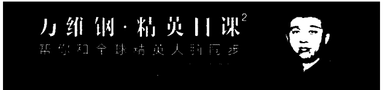

## 答读者问｜到底什么是“与世无争”

答读者问｜到底什么是“与…

### 来自日课：负能量竞争

有部分人明白自己竞争不过周围，便干脆与世无争，只安心安静做事，老师，这类人是种内因或本能驱使？结局会不会遭淘汰？

万维钢

“与世无争”是一种中国文化，我从来没见到英文世界中有与世无争的人和事。社会地位都是相对的，从逻辑角度来说，如果人人都在努力提高地位，而有一个人与世无争，那么他的地位将会下降。可是我们在生活中只见过宣称与世无争的人，没见过宣布自己主动降杜社会地位的人，所以我怀疑所谓“与世无争”其实是新闻发言人 的一个宣传语。

有一种与世无争是不在这个领域争。比如一个政府机构里，很多人都在争夺升官的机会，老孙却不争，工作虽 然中规中矩但是从来不出头风，完了回家养个望远镜仿佛望星空。

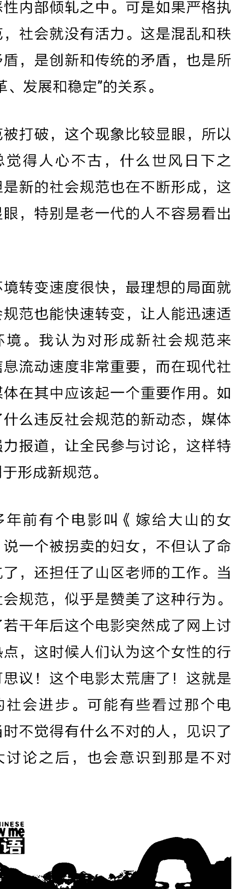

老孙是真的与世“无”争吗？我们只看到他不在官场上争，但也许他在别的领域争。也许他对天文学感兴趣，希望做一个更厉害的天文爱好者。也许他有更高的精神追求，希望在精神层面上胜过普通人。也许他认为自己背景不过硬升官机会渺茫，但是他有个好儿子，他特希望寄托在了儿子身上。

有一种与世无争是对失败的美化。失败了、没机会了，如果宣称自己是主动退出 的，不是找玩不好是我觉得你们这个游戏没意思，那么确有利于维护一个良好的对外形象。

有一种与世无争是以退为进。古人认为“隐居”是个高大上的行为，结果有人就想故意隐居，让皇上主动派人来请。不过这种情况更多的是文人的幻想，把被动的冷落当成主动的隐居，幻想将来天下有事皇上还会想起我。其实真实历史是诸葛亮有没有完全被动地等着刘备三顾茅庐、袁世凯所谓的隐居只不过是政治斗争的插曲、曾国藩丁忧的时候心里很难受。

还有一种错误思想，认为“不争”，反而是最好的“争”。我认为这个思想其实是对《道德经》中“圣人后其身而身先，外其身而身存。非以其无私耶？故能成其私”这段话的误读。

我们读书得读前后文，老子说的是圣人。什么是圣人呢？前面有一句是“天地之所以能长且久者，以其不自生，故能长生。”

我打个比方，老子描述的这个世界，就好像是一个平台，比如说淘宝平台、或者中超足球联赛。所谓天地和圣人，就是这个平台的运营者。而普通人，则是这个平台的参与者。

如果你在淘宝开店，你自然要跟其他淘宝店展开竞争。如果你是一个中超球队，你要跟其他球队竞争。但是马云不会跟你争，足协不会跟你争，因为他们是运营者。他们只要把平台运营好就行，你们爱怎么争怎么争。不是一个层面的人争不到一起去。

熊逸老师多次说过，《道德经》是一本写给统治者的书。老子这番话的意思是统治者 不应该跟老百姓争。你的任务是运营好这个市场，你要养个家族企业跟小民争利、既当裁判员又当运动员，那就太low了。

可是如果是一个普通企业家看了老子这段话，居然把自己当成运营者，说我也不争，这不荒唐吗？

### 来自日课：给人一个不抓你的理由

从另一个方面来看，针对当前社会规范的“突变”是社会规范进化的途径。当群体的外部环境不断转变之时，之前有利的规范一段时问后可能会被淘汰，那么此时可能会发生社会规范的“崩溃”，从这个角度来看过度地遵循社会规范是一个十分危险的事情，犹如温水煮青蛙。那么是否可以理解为群体中的社会规范需要保持一定的“违反率”，在整体稳定的前提下小部分人不断地向各个方向变异，以形成更加适应环境转变的新社会规范，从而维持群体的稳定性呢？那么如果外部环境转变速度过快，此时社会规范会如何去适应这种转变呢？

万维钢

非常赞同这个说法。社会规范是有一个有点矛盾的东西。如果不执行社会规范，社会就会非常混乱，大量的资源会被消耗在无谓的恶性内部倾轧之中。可是如果严格执行规范，社会就没有活力。这是混乱和秩序的矛盾，是创新和传统的矛盾，也是所谓“改革、发展和稳定”的关系。

旧规范被打破，这个现象比较显眼，所以人们总觉得人心不古，什么世风日下之类。但是新的社会规范也在不断形成，这个不显眼，特别是老一代的人不容 易看出来。

如果环境转变速度很快，最理想的局面就是社会规范也能快速转变，让人能迅速适应新环境。我认为对形成新社会规范来说，信息流动速度非常重要，而在现代社会，媒体在其中应该占据一个重要作用。如果出了什么违反社会规范的新动态，媒体应该强力报道，让全民参与讨论，这样特别有利于形成新规范。

比如多年前有个电影叫《嫁给大山的女人》，说一个被拐卖的妇女，不但认了命不反抗了，还担任了山区老师的工作。当时的社会规范，似乎是赞美了这种行为。而过了若干年后这个电影突然成了网上议论的热点，这时候人们认为这个女性的行为不可思议！这个电影太荒唐了！这就是明显的社会进步。可能有些看过那个电影、当时不觉得有什么不对的人，见识了这场大讨论之后，也会意识到那是不对的。


反过来説，如果有一社会热点就赶紧捂住不让公开讨论，那就是逆历史潮流而动，也叫“反动”。

### 来自日课：文明的成年人不问为什么

这篇文章让我想起了公司的一些制度，公司要求各组每个月必须完成不少于两次的内部会议和内训，否则绩效就会被扣分。 然而慢慢的这项规定就成了一种形式，为了完成任务而完成任务。而每个月也安全过关。这种类似的规定和要求很多，大多数也就这样形式上的完成。很多时候领导也知道，可为什么还是在这么心照不宣地做着这些无用功呢？

万维钢

身为领导的人总会忍不住亲自制定一些新的规章制度，享受令人禁止的权威感。但是正如哈耶克所说，自上而下的法规常常经受不住时间的考验，变成一纸空文是常见的宿命。最好的规则应该是自下而上的。如果公司员工都感到有必要搞定期的内部会议和内训，大家自发制定规定，那自然就能坚持下来，还能成为公司的光荣传统。

> “The curious task of economics is to demonstrate to men how little they really know about what they imagine they can design.” - Friedrich Hayek, The Fatal Conceit


> "The curious task of economics is to demonstrate to men how little they really know about what they imagine they can design."
> - Friedrich Hayek, The Fatal Conceit

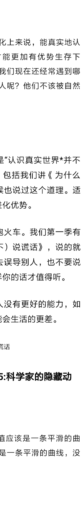

当然哈耶克也是有点理想化。但这个道理是，做领导的最好别拍胸袋就出新规定，否则执行不了当初不是自取其辱吗？

如果从长期的进化上来说，能真实地认识世界和自己才能更加有优势生存下来，那么为什么我们现在还经常遇到哪些满嘴跑火车的人呢？他们不该被自然选择淘汰吗？

万维钢

整个这本书说的就是“认识真实世界*并不是*一个进化优势”。包括我们讲《为什么佛学是真的》的时候也说过这个道理。适度的自欺欺人才是进化优势。

高手的确不必满嘴跑火车。我们第一季有篇文章叫《怎样（不）说谎话》，说的就是宁可用一个事实去误导别人，也不要说谎话，因为只有这样你的话才值得听。

但是世界上总有些人没有更好的能力，如果不满嘴跑火车可能会生活的更差。

延伸阅读: 怎样（不）说谎话

### 来自日课：P<0.05:科学家的隐藏动机

各个领域的 P 值应该是一条平滑的曲线，为什么应该是一条平滑的曲线，没有弄懂？

万维钢

因为没有任何一个值有理由比其他值*特殊*。大家都不特殊，那么在数据量足够大的情况下，就要么是杂乱无章完全随机的一些点，要么就是平滑的曲线。如果其他点都很平滑，只有这个点突出出来，我们就要问问为什么这个点特殊。0.05是个人为的标准，大自然对0.05这个数字不应该有任何偏爱。

万老师，您说真实世界并没有我们想象的那么美好。但究竟是什么原因造成我们脑子里的这种美好呢？是教育吗？

万维钢

现代这种国家开办的全面义务教育制度，最早起源于十八世纪普鲁士的军国主义体系。这个制度的本意就是训练公民意识，特别是爱国主义。后来美国搞公立学校制度，主要借鉴的就是普鲁士。包括美国在内，各国教育体系的一个重要功能，就是宣传。


国家希望我们心目中的世界比真实世界美好一点，让我们从小就树立合作意识，这对社会有好处。另一方面，我们也真的希望世界是美好的，所以我们也愿意相信。

求“真”并不是一个进化优势。相对于美好的世界，我们精英日课更喜欢真实的世界 —— 也许这仅仅是一个小偏好。但是话说回来，求真也不见得是进化劣势。真相并不适用于每一个人，但我们精英日课的读者不是一般人 —— 如果你掌控得好，认识真实世界也可能有好处。

动机性推理，与“确认偏误”是不是有些共同之处？

万维钢

二者的共同点都是先有结论后选择信息。“确认偏误”是只接收与自己的观念相符合的信息，甚至把相反的信息也解释成相符合。这个思维方式人人都有，是对新信息的处理，是比较被动的。“动机性推理”则是主动的动作。为了证明一个我想证明的结论，主动寻找、甚至制造相关的信息。而且不但找来信息，还有加工信息、用逻辑推理来证明结论正确，这是比较高级的做法。


截至投票：精英日课十大英文好书评选

## 日课072 | 现代医疗（仍然）是个畸形体系

日课072 | 现代医疗（仍然...

今天我们要说一些有关医疗的“� plena”。这些事情在医学界其实都是常识，根本不是秘密，但你听到可能感到...')

病人死亡以后，有时候医院会做个病理解剖，查看真正的死因。跟病理解剖显示的死因对比，医生最初给病人的诊断中，可能有误诊的情况。那你能否猜测一下，这个误诊率，有多高？

答案是40%。这还是美国的数据。病人身患重病，把性命交给医生，医生治不治得好都可以理解，可你居然有40%的可能性会误诊？！

《精英日课》的读者对此不应该感到意外。前段时间我们讲过雷·达里奥的《原则》，像达里奥这样的华尔街大亨，拥有最高水平的医疗资源，找了四个医生看病，这四个医生居然给了三种截然不同、生死两隔的诊断意见。

既然误诊率这么高，那医生应该“刻意练习”啊 —— 最起码，医院应该对每个死亡的患者都做病理解剖，查明死因吸取教训总结经验，对吧？事实是过去五十年间，美国的解剖率从50%降到了5%。


那我们干脆承认医院不可靠，学学达里奥的宝贵经验，真的了大病应该多找几个医生看看，综合调研，对吧？可是时有多少病人会这么做呢？非常非常少。绝大多数病人根本不在乎医疗质量，对某个医院治疗某个个体疾病的死亡率这种关键信息完全不敏感，他只是把自己交给医生。

这简直是不可理喻。我们到医院看病难道真的是为了健康吗？

今天咱继续讲《头脑里的大家》这本书。这本书的主题是人们做什么事情都有一个隐藏的动机 —— 就医，也是如此。

### 1.就医的政治

经济学家早就有个理论叫“炫耀性消费（conspicuous consumption）”，说人们买奢侈品并不是为了使用，而是为了炫耀。据此，这本书的两个作者提出一个叫做“炫耀性救护（conspicuous care）”的说法，说我们去医院看病，也不仅仅是为了健康，还是为了……求关注。

当我们病了的时候，我们希望有人来救助。别人病了，我们也要去救助他们。救助的效果如何呢得看天意：我们更关注的，是救助本身。

互相照顾这个动作非常重要，正所谓“患难见真情”。人类绝大多数情感需求都能追溯到采集狩猎时代，那时候没有私有财产的概念也没有余粮，要吃什么都得当天去采摘。那如果一个人生病了，就必须得有人照顾，有人给他带来食物，有人确保他不在场的时候他的利益不受损害。

从那个时候开始，生病，就是对人际关系的一个重大家考验。一个平时特别强的人，如果病了没有人照顾，哪怕他后来病好了，别人也会看不起他。政治的本质就是结盟，而生病暴露了一个人有没有盟友。

反过来呢，如果你身边有人病了，你应该积极救助！这能传达两个信息。首先你生病了我帮你，那下次我病了你也会帮我。更重要的是，这也是做给其他人看 —— 我朋友病了，你们看我是怎样对待朋友的，我是一个有价值的朋友！这样的人会有更多朋友。

所以医疗一个关键因素，就是救助行为一定要“看得见”。


当然，进入文明时代以后，人们就不能只靠亲朋好友的救助了，得靠公共医疗设施……这样你才可以一个人去做手术。医生是最早专业化的职业 —— 远古时候叫“萨满”。早在古埃及，国家就有一套简可以跟现代发达国家相媲美的、完整的医疗系统。谁要是生病了，就可以得到专业化的治疗。

但是请注意，古代医疗系统发达是发达，专业是专业，可是医疗技术不行 —— 就医行为基本是不但无效，而且有害。

现代人经常黑中医，其实古代西医更残暴。放很多很多血是最常见的疗法，更精确的办法是用虫子吸血 ——


如果病情非常严重，一个办法是在病人的头盖骨上钻孔，以期把病人头脑中邪恶的精灵给放出来 ——


如果是牙疼，那可能是因为嘴里有虫，所以得用蜡烛烧。还有一个通用的疗法是把人的身体切开，把一些豆子放到伤口里，包上，然后第二天再把伤口打开，这样反复好多天，要点是绝对不能让伤口愈合。

所以我要是因为穿越到古代，宁死也不去就医。那古人为什么就这么愚蠢呢？这些所谓的治疗，有效没效难道还看不出来吗？

实际上，有效没效真的不是唯一重要的一 —— 同样重要的是让人看到治病这个*动作*。只要治疗过程煽情动效应越激烈，患者死了就能瞑目。

好，如果说过去的医疗系统没用，那么今……

好，如果说过去的医疗系统没用，那么今天的医疗系统，又有多大用处呢？

### 2.过度医疗的时代

美国各地对某些疾病的治疗深入程度是不一样的。同样一个病，有些地方喜欢保守疗法，有些地方喜欢做大手术。那么就有研究者考察了各地的疗效，发现不同治疗程度的结果……没什么大区别。还有大规模的统计研究说，一个人的健康水平，跟他的年龄、收入、受教育程度等要素都有关系 —— 但是跟他愿意*在医疗上*花多少钱，没关系。

而且有时候花钱还不如不花。比如说在老人临终前的医疗。有 подкреп研究考察了3400个医院的500万人病人，结果是老人在ICU里多住一天，他的生活会减*40天。

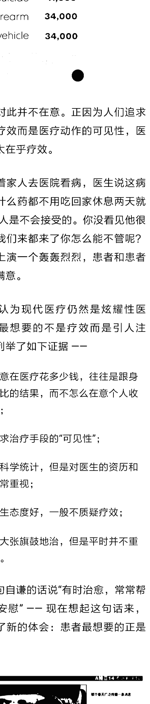

而老人每次花1000块钱就医，生命多则增加5天，少则*减少*20天。

当然这些研究只能告诉我们相关性，而且适用于老人的结论并不一定适用于年轻人。只有随机实验才能证明因果关系，而有人就真的做了实验。

兰德公司在1974年到1982年之间，做了一个长期的跟踪性随机实验。实验花了五千万美元，是有史以来最贵的医学实验。

研究者找了5800个受试者，他们都是成年人，但不是老人。受试者被分成了若干组，接受不同程度的医疗赞助。第一组的条件是未来五年之内，不管你在医疗上花多少钱，兰德公司都给你报销。第二组的人给报销75%，以此类推，最少的一组是报销5%。

五年下来，全额报销的这一组，平均比只报销5%的组，在医疗上多花了45%的钱。

钱是多花了，可是不同组受试者的健康程度，几乎没有任何可观测的区别。研究者在实验开始和结束的时候对所有受试者做了详细的身体检查，结果22项指标之中，除了血压这一项是第一组稍微好一点，其他指标的变化都是一样的。

还有一个自然实验。美国有一种由政府提供给穷人的医保计划，叫 Medicaid。2008年的时候，俄勒冈州的 Medicaid 账户钱不够了，申请者太多，政府决定抽签选择谁享受 Medicaid。


这是一个自然的随机实验。几年之后，研究者比较了当时抽中和没抽中的人，身体状况有什么不同。结果是各项身体指标，包括血压在内，都是一样的。抽中和没抽中的区别只有两个 —— 一个是抽中了医保的人在精神上更健康，更不容易抑郁症；一个是他们的主观感受，他们*感觉*自己更健康 —— 尽管体检结果是一样的。

据此，《头脑里的 методов》的两位作者估计，把美国医疗花费砍掉三分之一，美国人的健康状况应该不受影响。三分之一是什么概念呢？目前美国每年用于医疗上的花费是2万8千亿美元，占GDP的17%！

那如此说来，现代医疗到底有什么意义呢？

### 3.医疗的意义

我们上面列举的这些研究，可不是说医疗就没用。我们比较的是多花钱和少花钱的区别。在一般国家即使你没钱，得了急病医院也会给你救治的。这些研究的要点是在医疗上花很多钱和花有限的钱其实没区别。人们正在过度医疗。

至少对发达国家来说，医疗体系对健康的作用并没有那么大。影响国民健康最大的因素是营养水平和公共卫生状况。如果一个国家的环境很干净，病毒都能得到控制，没有像挖煤这样明显危害健康的工作，那国民就会是相当健康的，在医疗上投入更多钱的作用不会很明显。

病了去医院有好处，但也有坏处。任何医疗都是有风险的，医院是最容易发生感染和传染的地方，而且任何大手术都有生命危险。这还不算，医生还会犯各种错误。

美国每年因为医生的*错误*而死的人数，低估是4,4000人，高估是25万人。不管怎么估计，这个人数都比交通事故杀死的人还多 ——


## MEDICAL ERRORS NATION'S THIRD BIGGEST KILLER IN 2013

+ Heart disease 611,000
Cancer 585,000
Medical error 251,000
COPD 149,000
Suicide 41,000
Firearm 34,000
Motor vehicle 34,000

而老百姓对此并不在意。正因为人们追求的并不是疗效而是医疗动作的可见性，医生们也不太在乎疗效。

如果你领着家人去医院看病，医生说这病不严重，什么药都不用吃回家休息两天就好……一般人是不会接受的。你没看见很难以吗？我们来都来了你怎么能不管呢？医生非得上演一个煞有介事，患者和患者家属才能满足。

两位作者认为现代医疗仍然是炫耀性医疗，患者最想要的不是疗效而是引人注目，并且列举了如下证据 ——

+ 1. 人们愿意在医疗花多少钱，往往是跟身边人攀比的结果，而不怎么在意个人收入多少；
2. 非常追求治疗手段的“可见性”；
3. 不过问科学统计，但是对医生的资历和声望非常重视；
4. 只要医生态度好，一般不质疑疗效；
5. 病了要大张旗鼓地治，但是平时并不重视健康。

医学界有句自谦的话说“有时治愈，常常帮助，总是安慰” —— 现在想起这句话来，是不是有了新的体会：患者最想要的正是安慰。

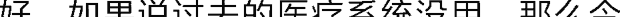

美国全部的医疗花费中，有11%是花在了患者生命的最后一年。这个时候人的身体已经非常弱了，花再多钱不但治不好病，反而可能减少寿命，而且一定会降低最后这一年的生命质量。

对比之下，如果你真的在乎健康，其实不是钱的事儿。选择生活在乡村，你会比生活在城市的人多活6年；不吸烟可以多活3年；经常锻炼可以多活15年。可是我们现在这个系统，几乎从不干预人们的生活方式，而非得等人病了以后去花钱治病。

## 由此得到

人们去医院看病在意的并不仅仅是疗效，还在意“救助”这个动作本身。因为这个隐藏动机，从古至今的医疗体系都有系统性的偏差。

我们专栏前即讲《不充分均衡》的时候说，医疗系统是个不充分的均衡，其中存在低垂的果实。只要你学学这里奥，别太相信这个系统，你就等于从中获利了。

| 国际孤寡等级表 |
|---|---|
| 第一級 | 一個人去逛超市 |
| 第二級 | 一個人去吃餐廳 |
| 第三級 | 一個人去咖啡廳 |
| 第四級 | 一個人去看電影 |
| 第五級 | 一個人去吃火鍋 |
| 第六級 | 一個人去KTV |
| 第七級 | 一個人去看海 |
| 第八級 | 一個人去遊樂園 |
| 第九級 | 一個人搬家 |
| 第十級 | 恒久落单 |


另一个教训是，我们身边常见的，那些仿佛天经地义的东西，也有可能是不合理的，也有改革的余地。


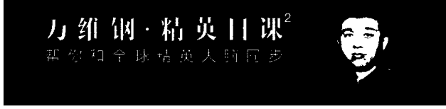

## 日课073 | 为人还是为己

日课073 | 为人还是为己

孔子有句话叫“古之学者为己，今之学者为人”，说古代的人钻研学问都是为了提升自己的内在修养，今天的人刻苦学习则是为了向别人炫耀学历。比孔子更“古”的古代现在是很考证了，但是以今天的经验来说，为人还是为己，的确是个很微妙的问题。

有些事表面上看是为了别人，实际上是为了自己；有些事表面上看是为了自己，实际上却是为了别人。

今天咱们还是继续讲西姆勒和汉森的《头脑里的大象》这本书。我们选择三个领域，继续破解人隐藏的动机。

### 1.艺术

上周，我看马未都发了条有关一个“白玉蝉”的微博 ——

> 非非诗~观夏小宝藏/玉器1#非非诗#
《白玉蝉·汉》
论自 你比不过我
论润 你也比不过我
论白润 你说你能比过我吗
不鸣则已一鸣惊人可我用不着吗


这应该是个汉代的文物，是用玉石雕成的蝉。我看这蝉雕的很一般，谈不上什么生动，没有灵气。有人评论说，这个玉蝉是古代下葬用的东西，让死人含在嘴里。但马未都显得很喜欢它，还特意给写了一首诗。

我是个学理工科的人不太懂艺术，但是我喜欢观察社会。你说人们欣赏艺术，到底是图什么呢？

主流的艺术理论，都是强调艺术品的“内在品质”。我们欣赏一幅画，就是体验这幅画本身带给我们的感受。它可能用美丽震慑你，它可能让你对大自然产生敬畏，它可能激发你的想象和创造。我们前面讲威尔逊《创造的起源》这本书，说的就是艺术的内在价值。

但是西姆勒和汉森更关注艺术品的“外在品质”。同样是这幅画，有些人在意的是画家是哪位名人，他用了什么特殊的技巧，他投入了多少时间才画好这幅画，这幅画和同时期其他作品相比的独创性又在哪里……以及，这幅画现在值多少钱。

其实这些东西跟我们欣赏艺术有关系吗？这就好比一瓶酒，好喝就是好喝不好喝就是不好喝，你何必在于它的产地呢？但是我们中有很多很多人，在乎的恰恰就是这些外在品质。以前我看过伍迪·艾伦的一个电影叫《午夜巴黎》 （ Midnight in Paris ），讲一个真正的艺术爱好者在巴黎的奇遇——其中还有个用做对比的配角，就是说起艺术外在品质来滔滔不绝，但是根本就不是真正欣赏艺术。这种人就是我们以前说过的“art snob”，也就是“艺术势利小人”。


王尔德有句反鸡汤名言，说“现今的人知道所有东西的价格，可是不知道任何东西的价值。”


我们看看周围这帮号称喜欢艺术的人，他们到底关注的是价格还是价值。价值是个主观的东西，而价格可以炫耀，可以跟人比。我们看马未都老师四句诗里面，就用了三个“比”。

“比比比”，也许是艺术流行的一大动力。

表面上看，欣赏艺术应该是为了自己。实际上，我们可能是为了别人。

### 2.慈善

随着中国越来越富裕，不少人开始关注慈善事业，不过我们跟美国还是不能比。美国每年都有十分之九的人捐款，美国一年的捐款总额达到 GDP 的2%，而且其中70%都是个人捐款。研究一下美国人的捐款行为，有助于我们理解人为什么做慈善。

按理说，做慈善应该是为了别人。可是如果你仔细考察，就会出现慈善似乎也不完全是为了别人。

如果完全是为了别人，我们应该把钱捐给最需要的人。可实际上，捐款大头是给了宗教团体和教育机构——


所谓教育机构并不是什么希望小学之类，主要是著名大学，它们跟美国的教会都非常有钱，而且还都不用交税。这个世界上最缺钱的大概是非洲那些穷人，可美国人民真正给全球穷人的捐款还不到捐款总数的13%。

如果捐款是为了“疗效”，我们应该在捐款之前做个调研，看看怎么用钱最有效率，可是人们并不在乎。我们专栏第一季有一期叫《爱心和理性》，其中提到有个组织叫 GiveWell，专门演讲捐款效率问题。而在现实世界，人们似乎根本不在乎钱是怎么花的。

1997年戴安娜王妃死于车祸，人们为了纪念她，决定成立一个慈善基金会。结果在慈善基金会的筹备期间，运营者还没明确这个基金会到底应该干啥的情况下，他们就已经收到了10亿英镑的捐款。人们基本上是一听戴安娜这个名字就掏钱了。

如果捐款并不是为了别人，那到底是为了什么呢？

有一种理论认为人们捐款是为了满足自己的爱心。恻隐之心人皆有之，如果捐点钱能减轻别人的痛苦，我们心里也高兴。

但是《头脑里的大象》这本书说，除了满足自己的心理需求，我们还把慈善作为一个信号。捐款能证明我是关注社会进步的有爱心的人！我们捐款，在很大程度上，是做给别人看。


有人看的时候我们会捐更多的钱。这就是为什么挨家挨户的上门募捐特别管用。一个活生生的人站在你面前，看着你掏钱，你不好意思拿太少。


如果上门募捐的不是一个而是两个人，你还会捐更多。

还会捐更多。

另外，最好给捐款者提供一个纪念品，能证明他捐款了，比如T恤衫和手环之类可穿戴的东西。

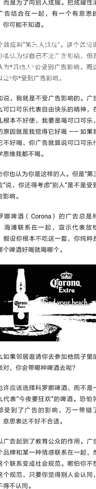

我以前有个同事是个五大三粗的男子，有段时间一天到晚戴个红色塑料手环。我就问他戴这玩意干什么，他说他给一个关爱艾滋病慈善基金捐了一美元，人家送他一个手环。

比给手环更高的做被是给“名分”。像博物馆和私立学校这种接受捐款的机构，常常会有明码标价的名分——

| Levels of Giving |  |  |  |
|---|---|---|---|
| Friend | $25 | Partner | $1,000 |
| Associate | $50 | Fellow | $5,000 |
| Contributor | $100 | Benefactor | $10,000 |
| Patron | $250 | Guardian | $25,000 |
| Advocate | $500 |  |  |
| All donations of $100 or more will be permanently recognized within the theatre. Donations of $500 or more will include a one-year membership to the Emanuel Arts Council. |  |  |  |

比如上图这个艺术剧院，捐25美元，你就是我们的“朋友”；捐100，你是“贡献者”；捐250，你是“赞助人”，再往上还有“合作伙伴”、“会士”、一直到价值25,000美元的“监护人”。100美元以上的捐款者的名字会被永久地铭刻在剧场里。你可以想见，如果250美元能得到一个“赞助人”身份，而再往上一级要500，人们不太可能捐一个250到500之间的数字——研究者用捐款数据证明了这一点。

表面上看，做慈善是为了别人。而实际上，我们在很大程度上是为了自己。

### 3.广告

我们专栏第一季讲《注意力商人》的时候说过广告的事儿。我们还讲过炫耀性消费，我们知道有一种商品叫“韦伯伦商品”，人们买这种商品不是为了使用价值，而是为了向别人炫耀。把炫耀性消费和广告结合在一起，有一个有意思的效果，你可能不知道。

这个效应叫“第三人效应”。这个效应说，你可能认为你自己不受广告影响，但是你会认为“别人”会受到广告影响，而这就足以让你“受到广告影响”。

比如说，我就是不受广告影响的。广告说，马口可乐代表自由快乐的精神，在我这儿根本不好使，我要喝可口可乐，唯一的原因就是我觉得它好喝——如果我认为它不好喝，你广告就算说可口可乐代表科学思维我都不喝。

想必你也认为你是这样的人。但是“第三人效应”说，你还得考虑“别人”是不是受到了广告影响。

科罗娜啤酒（Corona）的广告总是和阳光、海滩联系在一起，宣示代表放松休闲。假使你根本不吃这一套，你纯粹是觉得哪个啤酒好喝就喝哪个。


那么如果邻居邀请你去参加他院子里的烧烤派对，你会带哪种啤酒去呢？

你也许应该选择科罗娜啤酒，而不是一个什么代表“今夜要狂欢”的啤酒。恐怕邻居们都受到了广告的影响，万一带错了品牌、意思表达不好不合适。

所以广告起到了教育公众的作用。广告把一个品牌和某种情感联系在一起，然后把这个联系变成社会规范。哪怕你不想认同这个规范，只要你觉得别人会认同，你也不得不认同。

商家非常理解这一点。一个引申的做法，就是有时候广告的定位就不是给潜在购买者看的，而是给大众看的。比如我们看到一些奢侈品的广告出现在各种媒体上，有时候你就想，哪会有这么多人买这个东西？为什么这个品牌的广告不专门向富人精确投放呢？

这个道理就是“第三人效应”。商家是用大规模的广告教育大众，给公众营造一个这个品牌是高大上的印象。没钱的可以捧个人场，如果全社会都认同这是高大上的品牌，有钱的人就更可能买它。

这就是为什么生活时尚类广告会尽量发布在众人都能看到的公共场合。比如重大体育比赛中的广告，你在看，而且更重要的是，你知道别人也在看。像这种广告一般都是表现公开用的东西，而不太可能是你自己在家用的什么洗衣粉之类。

这也解释了为什么军队会在电视里做征兵广告。征兵广告在一定程度上，也不是给征兵对象看的，而是给公众看的。高大上的征兵广告可以提升士兵的公众形象。


所以，当你决定买什么东西的时候，就算是为了自己，也必须考虑别人。

## 由此得到

如果你深入挖掘生活中的思想动机，你会发现有些想法是上不了台面的——这也是为什么人们要把动机隐藏起来，甚至自己都不想知道自己的真实动机。但是科学家可以用各种办法证明隐藏动机的存在，而商家，更是能利用隐藏动机赚钱。

有的人喝酒就喝酒，有的人喝酒喝的是价格、产地和拿杯子的姿势。我觉得前一种人肯定是为了自己，而后一种人似乎更愿意照顾别人的感受。这里面也许没有绝对的对错，不过正如孔子和王尔德所说，现在后一种人似乎是越来越多了。

可我总忍不住以为古人活得更纯粹。古人往死人嘴里放个玉蝉，大概不是为了给周围群众、或者将来参观博物馆的人看的——他们应该就是为了死者自己。


## 日课074 | 不想让别人知道我知道的知识

日课074 | 不想让别人知道...

今天是西姆勒和汉森《头脑里的大象》这本书的第六讲。今天这个内容，我是一直犹豫要不要讲，因为我不想让别人知道我知道这个知识。最后还是为读者服务的精神战胜了我 —— 以后你还可以假装不知道这个知识，而我Phone我是不能假装了。

这是一个什么知识呢？咱先举个例子。

大学校园里，一个快毕业的大四学长正在向一个大一新生传授成功经验。我们把这两个学生称为 A 和 B。当 B 对 A 说话的时候，A 就一直用眼睛注视着 B；但是当 A 对 B 说话的时候，A 的眼睛经常看向别处。

那你猜，谁是 A，谁是 B 呢？

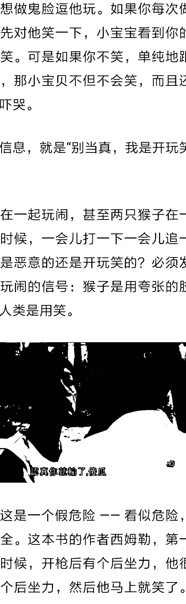

### 1.身体语言为什么是模糊的

我估计你可能已经猜出来了，答案是 A 是大一新生，B 是大四学长。

当然我们都有生活经验。但是能猜对不代表你能注意到。实际上，这个事情是1982 年才被心理学正式研究。心理学家提出了一个概念，叫做“视觉统治比（Visual Dominance Ratio）”——

视觉统治比 = 你说话的时候注视对方的时间% / 对方说话的时候你注视对方的时间%

视觉统治比，揭示了你心目中跟对方相对地位的高低。面对地位比自己低的人，视觉统治比会在1左右。而军队里下级面对上级，视觉统治比是0.6。1982年那篇论文说，心理系大一新生面对一个已被著名医学院录取的大四学长，视觉统治比是0.59。

身体语言比口头语言更容易暴露我们的内心世界。

如果一个人认为自己地位比较高，他会呈现一个放松的姿态，他说话清晰，动作平稳，他的身体是打开的。而如果一个人认为自己地位比较低，他就是一种紧张的姿态，他说话断断续续，动作一惊一乍，眼睛到处看，好像总是在防卫。


地位高的人很习惯把整个房间的注意力吸引到自己身上，他会占据别人的空间，他喜欢长篇大论，他动不动就打断别人的话，他，设定整个谈话的节奏。


有一个非常有意思的研究。美国有一个非常著名的主持人叫拉里·金（Larry King），专门做名人访谈节目。有研究者就仔细分析了金先生的25个访谈，其中有小布什和克林顿这样的大人物，也有名气不如金先生的一些小名人。


研究者发现，如果访谈对象的声望比金先生高，金先生会主动让自己说话声音的频率跟对方一致 —— 而如果访谈对象声望比他低，访谈对象就会自动调整自己的声调，去跟金先生一致。

这就等于说，两个主人一见面可能还没正式说几句话，在身体语言上就已经较量完毕了。

这就是为什么我不想让别人知道我知道这个知识。我不知道也就算了，该怎么打交道就怎么打交道。可是如果别人知道我知道身体语言的含义，那跟人说话的时候，我到底是看他还是不看他呢？领导对我讲话，我不看他就是挑衅，我看他，又觉得我好像在奉承领导。万一拉里·金请你去做访谈，你是变调还是不变调呢？

所以有些事情最好保留一点微妙的模糊空间。每个人都会做，但是每个人又意识不到，这种状态最有趣。

还有一个有意思的东西，就是“笑”。

### 2.笑是什么意思

英文里 smile 和 laugh 是两个不同的词。Smile 是微笑，表示高兴。Laugh 是哈哈大笑，是被逗乐了。现在我们说的笑，是指 laugh。

人为什么会笑呢？自古以来有各种各样的理论，咱不必一一细说。每个人都会笑，但是你很难总结一个通用的理论，说在什么情况下人会笑。

我们专栏第一季有一期节目叫《什么是幽默，什么是酷？》，讲过一个关于幽默的通用理论，说幽默是“温和的违反”。今天咱再说一个关于笑的更通用的理论。

这是一个2000年才发表的理论，搞这个理论的人是马里兰大学的神经生物学家罗伯特·普罗文（Robert Provine）。普罗文研究“笑”可不是坐在办公室里空想，他是深入到各种场合观察，积累大量的数据。普罗文的研究，有三个洞见 ——

- 1. 有别人渉场的情况下，我们笑的次数是有独处时候的30倍。笑，是一个社交表情。
- 2. 两人对话时，说话的人笑得比听话的人要多50%。笑，是为了传达一个信息。
- 3. 不仅仅人会笑，有些动物，比如黑猩猩也会笑。有些不会笑的动物，也会一种类似于笑的肢体语言。

那笑到底是要传达一个什么信息呢？

有人举了这么一个例子。一个小婴儿躺在床上，你假做鬼脸逗他玩。如果你每次做鬼脸之前先对他笑一下，小宝宝看到你的鬼脸就会笑。可是如果你不笑，单纯地跟他做鬼脸，那小宝贝不但不会笑，而且还可能被你吓哭。

笑传达的信息，就是别当真，我是开玩笑的。”

两个孩子在一起玩闹，甚至两只猴子在一起打闹的时候，一会儿打一下一会儿追一下，到底是恶意的还是开玩笑的？必须发出声明是玩闹的信号：猴子是用夸张的肢体语言，人类是用笑。


笑，代表这是一个假危险 —— 看似危险，其实很安全。这本书的作者西姆勒，第一次打枪的时候，开枪后有个后坐力，他很惊讶于这个后坐力，然后他马上就笑了。西姆勒就自己分析，说我为什么会笑呢？感受到后坐力他的第一反应是这很危险，但是马上他就意识到这个并不危险 —— 他一笑，就等于告诉自己和周围的人，我虽然在开枪，但是我这里很安全。

笑，就是在安全和危险的边缘线上走一下，然后落回到安全。

为什么笑话会让人笑？笑话是“温和的违反”—— 看似是在说一个不正常、甚至有点危险的话题，但实际上很安全。为什么我们看到别人跌倒会笑？因为我们知道他没事儿。如果是一个老人跌倒了，你就不...

没事儿。如果是一个老人跌倒了，你就不会笑，因为那可能是真危险。

如此说来，笑会暴露我们心目中危险的边界在哪里。同样一件事情儿，别 人没笑你笑了，那很可能说明别人认为这个事情儿很严重，而你没当回事儿。

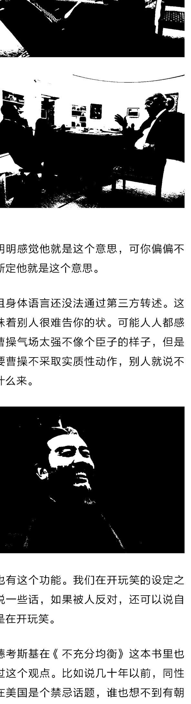

笑还可能暴露关系的远近。同样是一个人跌倒了，手里拿的东西撒了一地，只要他没受伤，这件事儿就可以认为是挺严重不应该笑，也可以认为无伤大雅可以笑。如果 你跟这个人的关系很近，你就不会笑。但如果 你对这个人很疏远，你就可能会笑。

可是如果人人都知道笑代表心理边界，而我们又不想暴露心理边界，那么下次再遇到什么事儿，你是笑还是不笑呢？

身体语言也好，笑也好，都是我们大脑很擅长的功能 —— 但是我们很少意识到这两个功能到底是什么意思。这两个功能之所以要保留模糊性，除了不让人发现内心世界之外，还有另外一个重要好处。

### 3.突破社会规范

前面咱们讲了，为了防止内部过度的竞争，人类发明了社会规范。在文明社会里 一个人想要公然宣示自己有多厉害、或者大庭广众之下向一位陌生女士表达爱慕之情，这都是不行的，人们会一致谴责他。

但是你可以用身体语言表达。比如你可以做出一个大大咧咧的姿态，往那儿一坐，占据很大的空间，就可以传达一个宣示权力的信息。如果有人指责你，说你怎么不尊重群众啊？你完全可以说对不起我没意识到，我不是故意的。

这就是模糊性的好处，它提供了不同解释的空间。这人半躺着坐在那里把腿放桌子上，很像 是他在宣示优越感，但是他也可以说这是从小养成的老毛病 ——


你明明感觉他就是这个意思，可你偏偏不能断定他就是这个意思。

而且身体语言还没有通过第三方转述。这意味着别人很难告你的状。可能人人都感觉曹操气场太强不像个臣子的样子，但是只要曹操不采取实质性动作，别人就说不出什么来。


笑也有这个功能。我们在开玩笑的设定之下说一些话，如果被 人反对，还可以说自己是在开玩笑。

尤德考斯基在《不充分均衡》这本书里也说过这个观点。比如说几十年前，同性恋在美国是个禁忌话题，谁也想不到有朝一日同性恋居然会是个正面的形象。那这个社会规范是怎么打破的呢？

最初可能是某个知名人士，当着媒体的面说了一些支持同性恋的话。记者第一反应是这人是不是疯了，怎么说这种话 —— 然后记者会把这件事当做八卦报道。这句话一旦上了媒体，公众会有各种反应，很多人会指责，然后这位知名人士可以说我是开玩笑的，对不起啊。

但关键在于，通过一个玩笑，这句话传播出去了。如果人们真的觉得这个话题好笑，那就意味着这个话题已经处在危险和安全的边缘！旧社会规范的边界线已经在收缩了。

这就好像流氓骚扰妇女。你说他是犯罪吧，他说他是开玩笑。你说他是开玩笑吧，他似乎真的想犯罪。


## |由此得到

身体语言和笑，给了我们偷偷突破社会规范的手段。明明做了，但是你可以不承认。而恰恰为了保留这个不承认的权利，我们宁可不知道身体语言和笑的确切含义。

可是现在你知道了。如果这些知识在你和你周围的人中间形成了 common knowledge（共有知识），你可能就再也不知道该不该做动作、该不该笑了！

至此，《头脑里的大家》这本书里的所有值得讲的硬知识就讲完了。有些事情知道并不见得真比不知道好。不管该不该知道，我们已经知道。那么知道人们各种隐藏动机之后，我们应该怎么面对这个知识呢？咱明天再说。


延伸阅读：什么是幽默，什么是谎？


## 日课075 | 明人如何说暗话

日课075 | 明人如何说暗话

1685年2月2号，英国国王查理二世突然病了。根据后来公开的记录，皇家医生并不确切了解病因，但是他们对查理二世采取了一系列有力的治疗措施。

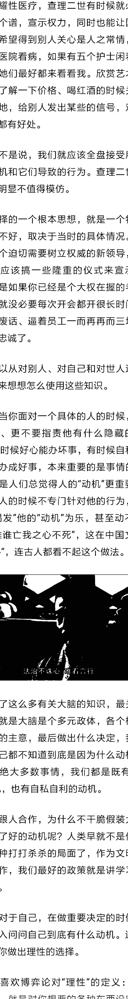

首先是放血700毫升。然后也许是为了清理肠胃，医生给他吃了金属锑——这是一种有毒的金属，查理二世吃完就比较吐。医生又对他进行了若干次的灌肠。可能是为了清除病毒，医生把查理二世的头发剃光，用消毒水洗他的头皮，又把鸽子羔挂到他的脚掌上。接着又给他放了300毫升的血。然后给他吃了一点糖，让他的精神能够振作一点。可能看他还不够振作，又用烧红了的火棒戳他的身体。

但是国王的病还是不见好，于是医生又放了两个大招。第一是找一个犯人，把犯人虐待至死，然后把犯人的头盖骨打开，从头盖骨中滴出一共40滴液体，让查理二世喝下这些液体。第二是弄到一头来自东印度的山羊，给山羊吃石头，当石头进入山羊的肠子之后，再把石头捞出来，磨成粉末，给查理二世从喉子里灌进去。

四天以后，也就是2月6号，查理二世就死了。我觉得你不难理解他为什么会死。经受这样的“治疗”，健康的人大概也会死。但当时的对医生的疗法并无异议，国王的家属也认为医生已经尽职尽责了。

这件事是我在《头脑里的大家》这本书中看到的。根据这本书的理论，查理二世显然是“炫耀性医疗”的受害者。他接受的疗法在医学上毫无价值，但是从炫耀角度绝对是达标了：复杂而专业、外行根本想不到的疗法，牺牲掉一个活人，还用到了 一头非常不容易得到、来自东印度的山羊。

这个案例并不具备从医学角度讨论的价值，现代医疗体系跟过去完全没有可比性。但我们仍然可以从这件事中学到一点东西。有时候、有的人、竟然会为了上了台面的、隐藏的动机，把性命都搭进去。

读了这本书我们能做些什么呢？了解这些知识有什么用处呢？

一个明显错误的思想，是认为我们隐藏的那些自私自利的动机都是不好的，应该把它们都去除，争取做一个诚实的人、一个“纯粹”的人。

古代很多圣贤，大概就是这么想的。事实证明这谁也做不到，而且现代学者认为，你根本就不应该这么做。

人类进化了这么多年，绝对坏的特性其实已经不存在了。我们头脑中任何一种感情、任何一种动机都是有好处的。这本书的主题恰恰不是批判这些隐藏动机，而是说这些隐藏动机有好处。

比如炫耀性医疗，查理二世有时候就必须要这个谎，宣示权威，同时也能让国民放心。希望得到别人关心是人之常情，我要是去医院看病，如果有五个护士闲着，我希望她们最好都来看我。欣赏艺术品的时候了解一下价格、喝红酒的时候关心一下产地，给别人发出某些的信号，对加强合作都有好处。

但这可不是说，我们就应该全盘接受所有这些动机和它们导致的行为。查理二世的命运就明显不值得模仿。

自然选择的一个根本思想，就是一个特性好不好，取决于当时的具体情况。如果你是个迫切需要树立权威的新领导，也许你就应该搞一些隆重的仪式来宣示权力。可是如果你已经是个大权在握的老领导，那就不必每次开会都开很长时间、讲一堆废话、逼着员工一而再而三地向你表达忠诚了。

我们可以从对别人、对自己和对世人这三个角度来想想怎么使用这些知识。

第一，当你面对一个具体的人的时候，不要猜测、更不要指责他有什么隐藏的动机。有时候好心能办坏事，有时候自私自利却能办好事，本来重要的是事情的结果，可是人人总觉得人的“动机”更重要。批评别人的时候不专门针对他的行为，反而以“揭发”他的“动机”为乐，甚至动不动就“谁谁谁亡我之心不死”，这在中国文化叫“诛心”，连古人都看不下去这个做法。


我们学了这么多有关大脑的知识，最关键的一条就是大脑是个多元政体，各个模块各有各的主意，最后做出什么决定，我们常常自己都不知道到底是因为什么动机。可能对绝大多数事情，我们都是既有“好”的动机，也有自私自利的动机。

那么我们跟人合作，为什么不干脆假装大家都是为了好的动机呢？人类早就不是像等动物那种打打杀杀的局面了，作为文明人互相合作，我们最好的政策就是讲学问、讲正气。

第二，对于自己，在做重要决定的时候，应该深入问问自己到底有什么动机。这样有利于你做出理性的选择。

我特别喜欢博弈论对“理性”的定义：所谓理性，就是对你想要的各种东西设定一个优先级，并且能够贯彻执行这个优先级。

比如说，如果你说菠萝蜜比橘子好吃、橘子又比苹果好吃，那么就可以认为你认为菠萝蜜比苹果好吃。如果你紧接着来一句说你又觉得苹果比菠萝蜜好吃，那么你就是非理性的，你就用不上博弈论这种高级工具。

我们大脑中同时有各种动机。生命是一个动机，炫耀也是一个动机。在几种动机都有的情况下，你应该分析一下哪个重要，哪个不重要——你应该设定一个优先级。

如果你是理性的，而你又认为生命比炫耀重要，你就不会为了炫耀而冒着生命危险尝试各种虽然很贵但是不靠谱的医疗手段。如果是你跟女朋友一起欣赏艺术，也许你想炫耀一下自己的艺术知识。但是如果你是自己去博物馆欣赏艺术，你就应该关注那些艺术品的内在品质，为自己而欣赏。

问题就在于没有这些知识的人常常会被某一种动机劫持，形成了一个情怀，做多大事儿都是这一一个动机，他根本意识不到自己还有更重要的动机。

有研究者做过一个问卷调查，说假设现在《蒙娜丽莎》这幅画被烧毁了，所幸的是我们还有一个完美复制品，那你愿意看这个复制品呢，还是看《蒙娜丽莎》原作烧成的灰呢？结果大多数人居然选择了看灰。我觉得给这样的人看艺术品纯属浪费。

所以时刻反思一下自己的动机是个好习惯。不过你也不用有心理负担，因为正如我们不在乎别人的动机，别 人也不在乎我们的动机。

第三，更高级的要求是，对于具体个人之外的、广泛意义上的“世人”，我们要充分了解、甚至运用隐藏动机这个知识。

这些知识能让我们发现系统的漏洞。我们说过医疗，之前还说过教育，还有很多这本书没提到的领域都有隐藏动机的问题。比如说读书就可能是有隐藏动机的。有 些人只买书藏书不读书，有 些人连阅读书籍都是给别 人读的。

如果你能洞察到世人的各种隐藏动机，也许你可以利用这些漏洞获取一些利益。比如咱们专栏讲过，中国家长给孩子买书，买的往往不是孩子想读的书，而是他们想让孩子读的书。那出版社就会做一些面向家长的“童书”，比如弄上一些上一代人小时候喜欢的东西，重新包装，让这些人买给他们的孩子。其实新一代孩子对那些东西根本不感兴趣，但关键是家长感兴趣。

再比如医院，既然患者特别注重就医体验，想要获得安慰的感觉，那医院完全可以聘用一些穿着白大褂、作为“形象大使”的假医生和假护士。这些形象大使的任务是给病人提供各种无微不至的小关怀，领着病人挂号就医拿药，非常卖力地问寒问暖。我敢打赌，只要医院服务态度好，哪怕病没治好，病人也不会医闹。

但你也可以用这些知识做些好事。比如说给一个有意义的慈善机构募捐，你可以采用一些显眼的募捐方法，比如给捐款人发个可穿戴的纪念品、派两个长得漂亮的人去对方家里或者公司募捐。

如果你更厉害、更大胆的话，你还可以对不合理的系统进行改革！如果你认为现在的医疗系统实在是太荒唐了，也许你可以想想怎么推动一些实实在在的、真正的医疗服务。比如说，我们能不能借助互联网和大数据，把每个医院、每个医生的治愈率、医疗事故纪录和价目表公布出来，让患者能轻易地货比三家。

如果上述这些你都做不到，《精英日课》也祝你每天都有收获。这本书的两个作者，西姆勒和汉森，有一个建议。

你可以把这些知识当作谈资。随时点评一下生活中的隐藏动机，只要不是针对具体的人，这件事儿也挺酷的。这证明你是个诚实的人，是个有智慧的人，还是个有勇气的人——完全值得作为炫耀的资本：）

## 划重点

该如何应用“隐藏动机”的知识呢？
- 第一，当你面对一个具体的人的时候，不要猜测、更不要指责他有什么隐藏的动机。
- 第二，对于自己，在做重要决定的时候，应该深入问问自己到底有什么动机。
- 第三，更高级的要求是，对于具体个人之外的、广泛意义上的“世人”，我们要充分了解、甚至运用隐藏动机这个知识。

## 特别放送 | 提供“思想”，比提供“知识”高级

万维钢

各位周末好！今天更新到专栏里的是我不久前接受的《上海书评》的执行主编郑诗奇的采访，之所以把原稿发到这里，是因为这些话，我也想让你们知道，希望能让你更avs多理解专栏的选题和写作方式，帮你更高效地学习和吸收日课的知识。

作为一个中国科技大学毕业、在美国工作前物理学研究者，你为何对人文、社会领域有着如此强烈而广泛的兴趣，另外，又有什么因素，促使你在写作和阅读的过程中，逐渐倾向于关注特定社科领域呢？

万维钢

我原本的专业是受控核聚变等离子体物理学，以科研为生。如果你对物理学感兴趣，你就可能对很多领域都感兴趣。我在国内上学的时候主要是读物理学相关的书，出国以后接触到新出的人文社科方面的书，有一种豁然开朗的感觉。我发现这些书并不像传统的人文著那样以“名人” 为本，什么缜密的“经典学说”之类，而是以最新研究结果为本。这些社科研究并没有那些打着历史名人光环的华丽包装，而都是非常实在、简单、有事儿说事儿的风格。这里面没有什么意识形态色彩或者门户之见，什么这个主义认为怎么样怎么样，那个学派认为如何如何，都是一些老老实实使用科学方法得出的结论，而且结论往往带有出乎意料的趣味。你不可能对这些东西无动于衷。

我现在写的文章中，物理学和自然科学相关的大约只占五分之一，大部分都是人文社科的内容。首先我的确有市场上的考虑，对人文社科内容感兴趣的读者比能欣赏现代物理学的读者多很多。物理学是有门槛的，你得创造特别巧妙的方法才能把一个物理学的内容写得引人入胜。

但更重要的是，我认为人文社科的思想对读者更有用处。认知心理学、行为经济学这些内容都是拿来就能用的。如果大多数人了解这些学问，我们这个社会做事的方式会高级很多。社会问题的特点是每个人都以为自己有权发表看法，但实际上大多数人只是表态和抒情。现在的中文世界比十年前已经进步了很多，特别简单的心灵鸡汤类文章已经没有市场了，但是你看看流传的那些微信公众号文章，跟《纽约时报》的文章对比一下，根本不在一个档次。别人讨论的是学科最新的进展，我们还在对着一些错误的常识抒情。

我国作者的思维水平还有很大的进步空间，我国读者有权看到更好的东西，所以我觉得我现在做的事情还可以继续做下去。

前面提到你的独特思维角度，你自己在文章里自称为“反常识思维”，而其他人，则分别将其概括为“科学理性思维”、“理科思维”或“理工科思维”，对此你怎么看？你觉得自己接受过的物理学训练，在阅读和写作之中起到了多大的影响？更进一步的，关于文科/理科两分这种判断标准，不少人对此深信不疑，以至于出现了很多以此做哏、当包袱的笑话段子，但是更多人则嗤之以鼻，你的观点会是什么呢？

万维钢

如果一个“文科生”懂得科学方法，他就不再是被人嘲笑的文科生了。

“理工科思维”这个说法并不是我发明的，它很早就流行于中文网络论坛，我当时只是拿来借用。几年以前的局面是，网上有太多的人不是合理分析问题，而是乱发感慨，要不就根据自己的什么“理念”胡乱站队不管事实，要不就是胡乱抒情。

比如赵半狄说我爱国所以我号召抵制《功夫熊猫》电影，人间梁文道奥森村为什么避孕套用得那么快、梁文道说我一贯支持性产业和性工作者所以这是好事儿，刘震云到北大毕业典礼上做演讲、说我们民族马路两边种的都是杨树而发达国家都是种高级树种、可见我们民族心态不行啊…… —— 当你听说这些言论的时候，你心里就想着都哪跟哪！事实是功夫熊猫写的是中国文化、奥森村避孕套被运动员拿走当纪念品了、中国各地也种了很多“高级”树种。

中国传统上所谓的“文科生”，主要训练的大概是死记硬背、门户偏见、文字表达和抒情的能力。如果你先规定好什么是对的，让他照着这个意思写，他可能写出朗朗上口的漂亮文字 —— 但是他自己没有思考能力。

但我们绝对不能像文科生那样用“文科生”这个概念打击所有的文科生。我最近一两年在《精英日课》专栏里大力鼓吹美国大学“liberal arts”这个概念，我把它翻译成“自由技艺”。自由技艺对应的学科学，按中国大学的分类都应该算“文科”，但自由技艺训练的恰恰是理性思维和科学方法。

事实上，面对复杂问题，一个受过自由技艺训练的“文科生”，很可能比一个专门学习一种课生技能的“理工科”学生更有办法。美国的管理者大多受过自由技艺的训练，如果中国也能培养这样的文科生，未来中国就可能是文科生的天下。

再来聊聊写作方式。你很擅长讲故事，也注重对学术研究成果进行通俗化处理，同时，文末往往会出现格言式的句子，能请你谈谈这方面的写作感想吗，你是如何形成这样的写作方式的呢？而且，我注意到，你很喜欢《纽约客》特约撰稿人、畅销书作家马尔科姆·格拉德威尔（Malcolm Gladwell），曾经多次引用他的书，而你的写作方式也与他颇为类似，那么，你是否学习、借鉴过包括他在内的西方作家的写作方式呢？能请你与我们分享一些自己喜欢的这类作家吗？

万维钢

我非常佩服格拉德威尔。格拉德威尔写的都是非虚构类的文章，常常是自己调研和讲解一个最新的研究进展，但是他能把事儿讲得像悬疑小说一样。有时候他做很多调研，然后写本书形成自己的观点，然后过几年人们批评论他这个观点错了，这可不是说格拉德威尔不行，只能说明他写得实在太好，影响力实在太大。他的《引爆点》这本书也许是被学术界引用最多的一本人文社科通俗作品。如果你说我模仿过格拉德威尔，我一点都不感到惭愧。

在科学写作方面很害羞的作家还有很多，我喜欢的包括戴维·布鲁克斯（David Brooks）、蒂姆·哈福德（Tim Harford）、泰勒·科文（Tyler Cowen）、希思兄弟（Chip Heath & Dan Heath）、伦纳德·蒙洛迪诺（Leonard Mlodinow）等等，尤其是《黑天鹅》、《反脆弱》这几本书的作者纳西姆·塔勒布（Nassim Taleb），他的语言特别有力量。

关键在于，你得承认“科学写作”是一门手艺。并不是你懂科学知识就能写好这种文章。让读者理解一个科学思想，比让读者单纯欣赏一个好故事要困难得多，你得下功夫钻研写法。

你知道科学写作方面面厉害的人物都是谁吗？我看都是物理学家。史蒂芬·温伯格（Steven Weinberg）、弗里曼·戴森（Freeman Dyson）、罗杰·彭罗斯（Roger Penrose），包括霍金、杨振宁这些人，都是真正的高手。哪怕你不在乎他们说的具体知识，仅仅是欣赏写作手法的趣味，甚至是语句的写法，他们的书都非常有创造性。这些大概是现在活着的人里面最聪明的 Luca。我想唯一的问题就是他们说的东西往往比较难，能看懂的读者不多。

我想起你说过的一句话，很有意思：我不读死人的书，我读世界上健在的英雄豪杰的书。很多人都觉得读书要读经典，但你偏偏反其道而行之，能具体谈谈理由是什么吗？在你眼中，哪些作者算得上是“英雄豪杰”，或者换句话说，你的判断标准是什么？

万维钢

我以前是学物理的。物理学里的“经典（classical）”基本上是“现代（modern）”的反义词。没有哪个教授会让自己的研究生去读牛顿、爱因斯坦的著作，要学基础知识就读本最新出的教材，要么就是读新论文。我读书主要是为了求知，而知识一直都在以很快的速度更新。

知，而知识一直都在以很快的速度更新。

其实人文社科领域也是这样。我读了这些年的书从来没有哪本被视为是后人应该一读再读的经典，我看到的情况是一本书中的漂亮说法，过几年就可能被新研究推翻。丹尼尔·卡尼曼的《思考，快与慢》被无数后来的书引用，可谓是当代名著，但是现在这本书里已经有好几个结论被证明是不可靠的了。

哪怕一个理论真的历经了时间的考验站住了，我们也没必要去读它的提出者的原文。“经典”的理论会被新书反复提及。如果你想学习广义相对论，新教材里的讲法、应用、实例都是爱因斯坦原始论文所根本不能比的。同样道理如果你想学经济学，你没必要花时间读亚当·斯密，你可以在别的地方顺便了解亚当·斯密。

现代世界分工越来越细，大多数学者都是做一些边边角角的工作。绝大多数“科学家”并没有自己的观点，他们只不过就兢兢业业地完成一个个小课题的研究而已。所以在这个时代，那些对某个学科形成了自己大局观，敢于提出新观点，敢于影响别人的思想的人，就是英雄豪杰。

以前的人研究科学史，一提到古代科学家就是一副膜拜祖师爷的姿态。而温伯格写本《给世界的答案：发现现代科学》，也讲科学史，但是上来就说这本书是专门告诉你为什么古代那些所谓“科学家”都根本不行的！有这样的知识勇气，就是我佩服的英雄豪杰。

你每天都要消化大量英文材料，能与大家分享一下你的阅读习惯吗？比如，你会选择哪些报刊/网站/学术期刊/电视广播节目？又比如，阅读的时候，选择什么工具与载体？

万维钢

现在读书方面最主要的做法是听有声书。我一般开到1.5或者2倍速，断断续续用大约三四个小时的时间听完一本书。如果这本书故事性比较强，我就不用来关注具体的文本。如果是理论性比较强，我常常常一边听有声书，一边用 iPad 在电子书上画重点。

我最常读的报刊网站是 Aeon，鹦鹉螺，纽约时报，经济学人，纽约书评，大西洋月刊，538，Solidot，泰勒·科文的博客和英国心理学会研究文摘。我经常陪妻子看电视剧，我自己不看电视。

在你心目中，什么样的写作方式，可以称得上是好的“科学写作”？严肃的学术研究该通过何种方式向大众传播呢？

万维钢

非常感谢你使用了“科学写作”这个词。我认为“科普”不是个好词，写科普的是“工作者”，搞“科学写作”的才是真正的作家。我认为现在的“科学写作”，有一个错误的做法，一个没有前途的做法，和一个正确的做法。

错误的做法是把读者当成“宣传对象”。你们信这个信那个太愚昧了，我要向你们宣传科学破除迷信。这是把写作当成了打仗，把媒体当成了敌我分明的战场。这个做法可能很瘾，也能团结“自己人”，但是作用能有多大呢？难道科学的形象就是喊打喊杀吗？心理学上有个说法叫“皈依者效应”，意思是新来的、不正宗的成员往往比正宗的成员表现出对组织更狂热的忠诚——如果科学是一个组织的话，很多科普人士就表现出了皈依者效应，他们比科学家更“热爱”科学。

没有前途的做法是卖弄科学知识。一个有趣但是比较冷门的知识，你翻墙从英文网站搜索到正确的解释，写篇文章告诉读者这个知识“酷”在哪里，这个做法等于是欺负读者不读英文。科学爱好者常常抑制不住地想要表达“我比你懂得多”。有些知识，我们必须承认，的确是非常有意思，你讲个笑话卖个萌效果很好，但这其实是把知识变成段子。

这两个做法常常是叫好不叫座。可能很多人表态支持你，很多人赞赏你，但是实际效果很有限。有时候科普作家搞得很悲情，说中国读者不行！科普市场太小！我认为这个态度根本不对。科学家可以“曲高和寡”，而你作为一个作家如果不能吸引和说服读者，那就不绝对不是读者不行而是你的失败。

正确的做法，是把读者当成“服务对象”。读者想要的是“有用的”知识和“有趣的”思想，而不是“有趣的”知识和“站队的”思想。

爱因斯坦有句话说“我想知道上帝是如何创造这个世界的——对于这个或那个现象、这个或那个元素的光谱，我不感兴趣，我想知道的是他的*思想*，其他都只是细节问题。”其实从搞科研角度，你不关注细节是不行的，魔鬼就在细节中。但是从科学写作角度，给读者提供“思想”，远远要比提供“知识”高级。读者最后要的不是谈资段子、也不是跟着你站队，而是自己能不能也拥有科学家一样的高级思想！

所以科学写作的追求应该是帮助读者掌握高级思想。如果你能向中国读者传播一点思想，那就不管是对读者自己也会是对中国社会，都是莫大的功劳。

而我注意到现在罗辑思维的“得到”APP、果壳网、包括《上海书评》这些媒体中，有越来越多的作者是专注于思想。跟这样的人一起做事，我深感荣幸。

万维钢

是的，今天没有音频。能看到这里的读者，恭喜你，你还没有丢掉逐字阅读的好习惯。


# 答读者问 | 高手的学习态度

答读者问 | 高手的学习态度

## 来自日课：现代医疗（依然）是个畸形体系

误诊率高达到40%这个数据来自哪里？是怎么统计出来的？是不是死亡患者这个样本本身就是高误诊率样本，换句话说，就是很多死亡患者就是因为误诊死的，而在全体患者样本里误诊率还没有这么高？

万维钢

我们文中说的 40% 这个数据，是把患者死后解剖发现的情况，跟患者最初就诊时医生做出的诊断作对比，其中不一致的比率是 40%。《头脑里的大家》这本书引用的原始研究是1998年的 [ JAMA . 1998 Oct 14;280(14):1273-4.]。

同年 JAMA 上一项专门针对恶性肿瘤的研究 [JAMA . 1998 Oct 14;280(14):1245-8.] 则说，解剖结果和医生诊断不一致的比例，是44%，而这个比例“与以前的研究结果相似”。（ The discordance between clinical and autopsy diagnoses of malignant neoplasms in this study is 44%, which is similar to previously reported studies.）

我又找了一些更新的研究。其中最权威的一篇论文应该就是2005年的一个针对此前很多项的研究的综合荟萃分析 [J Roulson et. al, Discrepancies between clinical and autopsy diagnosis and the value of post mortem histology; a meta-analysis and review, Histopathology . 2005 Dec;47(6):551-9.]，这篇论文说有 50% 的解剖发现了医生诊断没发现的病情。

当然，既然是解剖，就说明治疗是失败的，病人已经死了，我们不能说医生平时的误诊率就是40%或者50%。

那一般的误诊率是什么情况呢？对全国所有医院误诊率的大规模研究很可能并不存在，我只看到一些小规模的研究。

2017 年 的 一个 研究（ https://www.eurekalert.org/pub_releases/2017-04/mc-mcr033017.php）是这样的。“梅约诊所（ Mayo Clinic）”是美国一家著名的高水平私立医院。很多患者在别的医院拿了诊断之后，会再到梅约诊所做个复诊，作为参考意见。结果研究者就发现对21%的病人，梅约诊所的诊断和普通医院的诊断完全不同；对66%的案例，梅约诊所的诊断对普通医院的诊断有所修改。那要这么说的话，普通医院给出最高水平诊断的可能性只有12%。

所以如果病情复杂，就不能对医生的诊断报太大的信心。想起达里奥吧。最好的办法就是再找个医院看看有什么不同的意见。

为什么国家不去做一些减少过度医疗的调研和措施？

万维钢

医保对各国政府来说都是最头疼的问题，它涉及到道德和伦理，涉及到利益集团和政治势力，最后才是医学和经济学。这本书只讲了畸形性医疗这一方面的，别的问题更大。

比如说，政府认为医疗资源是有限的，对有些疾病如果明知治疗效果很小，就不应过度治疗了 —— 说白了，就是结果亏脏放弃治疗。那好，请问你打算放弃谁的治疗？如果一个医生说虽然这个病人已经很弱了但是咱呢还可以试试这个新疗法，政府很难反对他。2008年总统大选的时候，就有人提出过这种问题，说能不能搞个什么专家委员会来做这样的判断，结果当时共和党马上就把这个假设中的委员会称为“死亡小组”！难道你这个小组有权决定病人的生死吗？

医疗之所以低效率，最大问题就在于它不是一个市场经济，而是一种类似于“礼物”的机制。大多数病人看病是保险公司花钱，那么病人就根本没有省钱的愿望，肯定能用贵的就用贵的。保险公司在理论上应该希望省钱，可是保险公司并不直接参与医疗决定，而且保险公司完全可以通过提高保险费来转移这个成本。

说白了，患者花的既不是自己的钱，也不是保险公司的钱 —— 而是那些不在场的、参加了医保计划的健康人的钱。在场的人都希望多花钱。这就是为什么别的行业都是科技越发达东西就越便宜，而在医疗行业，反而是越来越贵。

很多所谓医疗规范，本质上是保护既得利益集团。比如说血液透析，这个技术已经出来这么多年了，居然还是天价的费用。对其他行业的人来说这简直是个笑话。其实透析机里面并没有什么火箭科学，民间就有人自制了透析机，可是政府不让用。当然，你可以说民间的透析机不安全，也许有比如说10%的可能性会加重病情。可是对经济特别困难的病人来说，他在乎这个危险吗？为什么病人就不能自己选择使用哪种透析机呢？

有人考察英国历史上没有医保、没有行业控制的日子，发现那时候医疗费用非常低，根本就不是个负担。也许干脆取消医保，谁看病谁花钱，政府只对最低收入的人群提供人道主义的援助，市场机制就会发生作用，医疗费用就会大大降低，而人民健康也不会受到什么影响。

现在保险公司和医疗利益集团已经绑架了美国，这个制度是不可持续的，有识之士已经看明白了，将来也许就会发生革命。

## 来自日课：不想让别人知道我知道的知识

人们的身体语言是天生的回答，还是后天适应社会规范形成的呢？

万维钢

人的口头语言在世界各地都不一样，但是身体语言大体上是非常通用的。哪个姿势表示谦虚谨慎哪个姿势表示傲慢无礼，各 个文明的人大概都是一样的。身体语言不是各地任意的选择和约定。

但这并不一定是说身体语言已经写在了基因里。身体语言可能是更深层机制引申的结果。比如说，把身体打开，半躺在椅子上，这个姿势为什么表示放松、暗示一种比较高的社会地位呢？因为这是一个放手薄弱的姿势，如果别人攻击你，你不好应对。正因为这个姿势有危险，做出这个姿势才表示自信。谨小慎微的姿势则好像蜷缩着身体和随时准备逃跑一样，更有利于防守，但也表示因担心受到攻击。

## 来自日课：明人如何说暗话

万老师有个问题一直困惑我，我一直觉得自己看了老师的课，很多并没学会致用，看过很多东西常常也用不了多长时间就会忘记，我该怎么提高我的学习效率，学过不会忘记？怎样提高学以致用的转化比？不然我究竟不能成为终身学习者。

万维钢

从学以致用这个角度来说，我们对“知识”大概有两种态度。

第一种态度是把知识当做一本使用手册。你想象全部的知识都写在这本手册里，而这个手册上写的都是“遇到情况A，我们应该怎么怎么样”、“遇到情况B，我们应该怎么怎么样”这样一条一条的明确指导。学习这本手册是一定得有很好的记忆力，记住多少条*才有可能*用到多少条。而且就算记住了这两条，如果在生活中根本就没遇到情况A和情况B，那还是等于白学。

什么“育儿十八法”、“健身指南”、“商战三十六计”、“家常菜谱”，都是这个态度。

第二种态度，是根本不在乎一招一式的用法，而致力于构建一个知识体系。你学习一个知识并不是为了有了朝一日用到它，而是为了*理解*这个世界到底是怎么回事儿。

我认为这第二种态度，才是高手的态度。我们就拿最简单的家用电器和计算机来说，很多家用电器都有一个“常见故障排除指南”，很多计算机的毛病都能在回答网站搜索到答案。但是高手可不能指望这些现成的答案和指南。高手是*理解*了电器

现成的答案和指南。高手是*理解*了电器和计算机的工作方式，他不管遇到什么毛病，都能自己做出分析和判断，找到创造性的解决办法。

对于一门具体的技术，构建知识体系的最好办法是找本正规的教材，上一门正式的课程，就好像大学生那样。可是对于世界万事万物来说，很多情况下并没有什么完备的知识体系等着你去学，你必须自己慢慢摸索，慢慢建立一个观念，还得随时修正。

这就好像来到一个陌生的地方，两眼一抹黑。你曾经看过一份路线图，告诉你到哪个接口往哪拐。可是你把路线图给记错了，或者这份路线图太老，现在这个地方的街道已经变了。那你怎么办呢？你应该自己探索，逐渐形成对这个地方的认识。

假设你已经探索了很长一段时间，可你还是没找到要去的地方。那你能说，前面这段时间的探索都没有用吗？你只要坚持探索下去，总有一天会对这个地方变得非常熟悉，可以随时前往任何一个你想去的地方。到那个时候你就是真正的自由，你的大脑比什么路线图都好使。

所以好奇心是比“有用”更好的学习驱动力。“会用”是“理解”的副产品，是在理解的基础上大量实践的结果；“理解”，才是学习的目标。

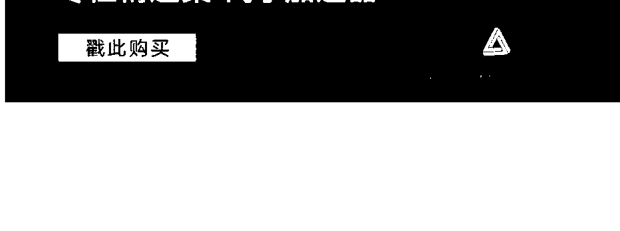

## 日课预告 | 一本*难度系数=21*的物理书


日课预告 | 一本*难度系数=... ↓

下周我们重点要讲一本物理书，《穿越平行宇宙》，它的作者就是写我们前面讲过的《生命3.0》那本书的迈克斯·泰格马克。

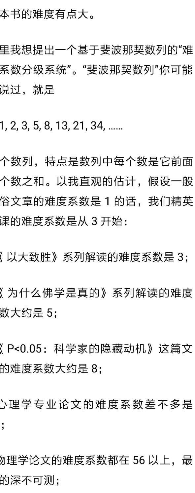

精英日课用的一般都是英文新书，这本《穿越平行宇宙》比较特殊，它是出版于《生命3.0》之前，而且已经有中文版了——但是我觉得非讲不可，因为这本书的思想涉及到根本性的世界观，我们专栏的读者应该了解。

物理学是非常受欢迎的题目，我们专栏已经讲过的物理知识，包括 ——

+   * 宇宙学的最新发现
* 暗物质和暗能量
* 量子力学的解释
* 量子纠缠
* 物理常数的“微调”问题
* 宇宙空间是平的
* 引力波
* 伽利略的故事
* 可计算性理论
* ……等等（你可以点击上面的链接…回顾一下：）

其中有的比较简单，有的有点难。这次要说的内容是“基本”的物理 —— “基本”不是简单的意思，是“底层”、“深入”的意思 —— 所以可能也会比较难。

这本书的英文书名叫 *Our Mathematical Universe*，直译过来是“我们的数学宇宙”。我们将会回顾一下物理学是怎么回事儿，认识一下数学是怎么回事儿，然后重新认识这个宇宙是怎么回事儿。你的世界观将会再次更新。

书中所有内容都值得读，但我们专注于后半部分，也是作者的关键思想。我希望你能一边自己读这本书，一边听我的解读。这本书的难度有点大。

这里我想提出一个基于斐波那契数列的“难度系数分级系统”。“斐波那契数列”你可能听说过，就是

1, 1, 2, 3, 5, 8, 13, 21, 34, ……

这个数列，特点是数列中每个数是它前面两个数之和。以我直观的估计，假设一般通俗文章的难度系数是 1 的话，我们精英日课的难度系数是从 3 开始：

+   * 《以大致胜》系列解读的难度系数是 3；
* 《为什么佛学是真的》系列解读的难度系数大约是 5；
* 《P<0.05：科学家的隐藏动机》这篇文章的难度系数大约是 8；
* 心理学专业论文的难度系数差不多是 13；
* 物理学论文的难度系数都在 56 以上，最高的深不可测；
* 《穿越平行宇宙》原书只是一本物理学通俗读物，我估计它的难度系数应该在 21。

但我们专栏作为知识服务，难度系数不应该超过 8，所以我将尽可能降低这本书的难度。为此我要忽略一些技术细节，还要补充一些内容，但是一定要把关键思想给说明白。

另外，我们不会连续讲物理，还要穿插讲点更轻松的东西。下周二的内容是有关于真实世界里财富增长的，难度系数是 3。

明晚 10:43，我们将从难度系数 3 开始，先说说所谓“物理学”，到底是怎么回事儿。


## 日课076 | 《穿越平行宇宙》1:物理学家想要什么

今天开始咱们搞个小系列，讲讲物理学家对世界的最新理解。我们的目标是世界到底是怎么回事儿——答案可能会让你感到非常震惊。

我们用的这本书是麻省理工学院教授迈克斯·泰格马克的《穿越平行宇宙》，这本书已经有中文版了。泰格马克我们专栏读者应该很熟悉，咱们讲过他的《生命3.0》。这本《穿越平行宇宙》是他几年前出的书，虽然不是最新的，但是其中思想非常重要。特别是，泰格马克本人，直接参与了一些关键的物理研究，而且在这本书最后他还提出了一个关键思想。这本书，我们精英日课是非讲不可。

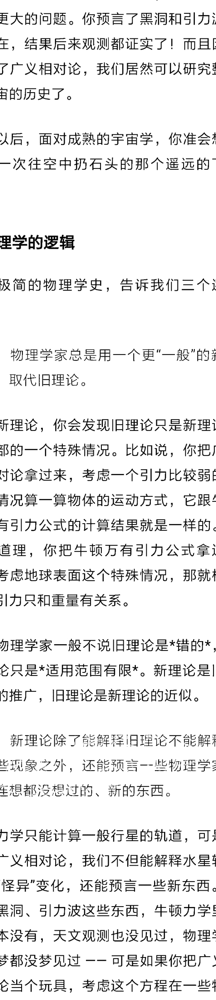

今天这一讲先说物理学是怎么回事儿。每个人都上过物理课，不过真正 STORE 在生活中能想到物理学的机会恐怕不多。那如果你把学过的物理知识都忘了，你对物理学的认识，还会剩下一点什么呢？我认为，应该就是今天的内容。

### 1.一个最简单的物理学史

物理学的历史跌宕起伏，有无数英雄故事，但现在我讲一个最简化的、基于逻辑的物理学史。我想用这段小历史让你明白物理学到底是怎么回事儿。

这一切的开始，是你对生活的一个细致观察。


### 2.物理学的逻辑

一样，但是它带正电，是电子的“反物 质”。那么狄拉克就纯粹根据自己的方 程，说世界上应该有“正电子”这种东西。 结果到1932年，实验物理学家就真的找到 了正电子！

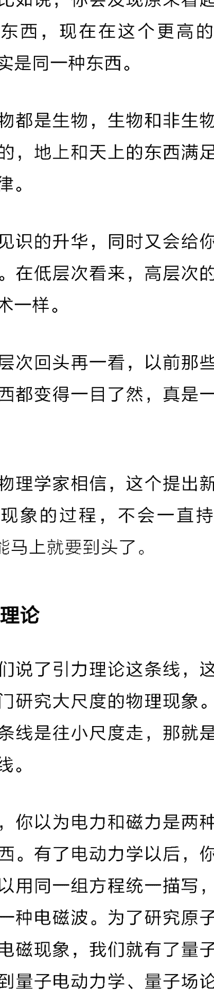

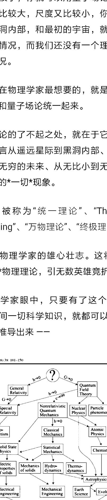

像这样的故事数不胜数。物理学家推广旧 理论不仅仅是为了数学上的完美，而是开 辟拓土，是打开新世界的大门。

第三，新理论不会让物理学家满足很长时 间，他们又会想要更新的理论。

有了新理论，打开了新世界，你很快发现 又有新的现象，是这个理论解释不了的。 比如广义相对论似乎不能完全解释暗能 量，根本就无法解释暗物质，你就想要更 新的理论。

整个这个过程，就是
现象 → 理论 → 新现象和新的解释
不了的现象 → 新理论 →.....

这有点像是玄幻世界里的“修仙”。每上升 一层新境界，你看世界的整个眼光就都改 变了。比如说，你会发现原来看起来很不 一样的东西，现在在这个更高的层次上 看，其实是同一种东西。

人和动物都是生物，生物和非生物都是原 子组成的，地上和天上的东西满足同样的 物理定律。

每一次见识的升华，同时又会给你解锁新 的技能。在低层次看来，高层次的技能就 好像法术一样。

到了高层次回头再一看，以前那些看似神 秘的东西都变得一目了然，真是一览众山 小。

而很多物理学家相信，这个提出新理论、 解锁新现象的过程，不会一直持续下去 —— 可能马上就要到头了。

### 3.终极理论

前面我们说了引力理论这条线，这条线的 理论专门研究大尺度的物理现象。物理学 的另一条线是往小尺度走，那就是量子力 学这条线。

一开始，你以为电力和磁力是两种完全不 同的东西。有了电动力学以后，你发现电 和磁可以用同一组方程统一描写，而光其 实就是一种电磁波。为了研究原子这么小 尺度的电磁现象，我们就有了量子力学， 再推广到量子电动力学、量子场论、量子 色动力学等等 —— 现在微观尺度的一切物 理，可以说已经统一起来了，严格地说 叫“标准模型”，简单地说就叫量子场论 吧。

好，现在如果有引力，尺度比较大，你就 可以用广义相对论。如果引力可以忽略， 尺度比较小，你就可以用量子场论。那如 果引力比较大，尺度又比较小，你怎么办 呢？黑洞内部，和最初的宇宙，就是这个 极端的情况，而我们还没有一个理论适合 这个情况。

所以现在物理学家最想要的，就是把广义 相对论和量子场论统一起来。

这个理论的了不起之处，就在于它将能解 释和预言从遥远星际到黑洞内部、从宇宙 起源到无穷的未来、从无比小到无比大的 尺度上的*一切*现象。

所以它被称为“统一理论”、“Theory of Everything”、“万物理论”、“终极理论”。

这就是物理学家的雄心壮志。这将是*最 后一个*物理理论，引无数英雄竞折腰。

在物理学家眼中，只要有了这个终极理 论，世间一切科学知识，就都可以从这个 理论中推导出——


你考虑终极理论在大尺度下的情况，就是 广义相对论。你把终极理论取一个引力是 0 的极限，就是量子场论。从广义相对论 出发你可以推导出狭义相对论和电磁学， 从量子场论出发你可以推导出核物理和 粒子物理学......

......从物理学出发你可以推导出化学、机械 工程和电子工程。从物理学和化学出发你 可以推导出地球科学和生物学。从生物学 出发你可以推导出心理学和医学，然后你 可以推导出社会学......这一切的一切，都源 自一个“终极理论”。

所以这就是为什么物理学家常常自我感觉 良好。如果你有能力研究这个终极理论， 那这件事就是唯一值得你做的事儿。我上 大学的时候有个老师，他就跟我说过，现 在有人搞的什么数据分析啊之类东西，根 本就“不是学问”。


可惜我的智力平平，真是没有能力研究这 个理论，所以现在给你当个解说员。不过 也有些物理学家认为，所以谓“终极理论”是 个过于自大的梦想，也许这个世界根本就 不存在什么终极理论。我们专栏去年有一 期叫《反叛才是科学家》，提到弗里曼·戴 森就反对追求终极理论。

但不论如何，我们总可以预期，将来会有 一个适用范围更广的、新的物理理论。

如果有那么一个新理论，它会给我们打开 一道什么样的门、预言什么样的新现象， 解锁什么样的新技能呢？这些我们不知 道。

但是杨格马克这本书的关键思想，就是我 们现在就知道新理论应该有一个什么性 质，而这个性质，会给我们的世界观带来 根本性的改变。

这个新世界观就是宇宙其实是数学的产 物。而从此出发，你就能推导出一些特别 离奇的结论。比如说，时间的流逝其实是 个错觉。

咱们下次再说。


## 日课077 | 复利的鸡汤和真实世界的增长

今天我想说一点关于财富增长的事情。人们最关心的一个问题就是钱是怎么赚来的，人人最喜欢的赚钱方法就是投资，而投资中最简单的方法就是依靠“复利”。所谓复利，就是利息产生利息。

### 1.鸡汤

假设你现在有10000元，利息是10%，那明年就会变成11000元。如果利息也能产生利息，也就是所谓“利滚利”，那么到了第二年，你就不仅有12000元，而是10000×1.1×1.1，就是12100元。

到第 N 年，你的财富就是10000×（1.1的N次方），这就叫“指数增长”。

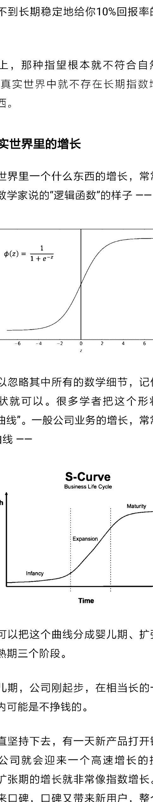

要配件利挣钱，你就要自律，推迟享乐，把钱放在那里坐决不用。那些钱已经不是普通的钱，而是宝贵的种子——你只需耐心等待复利的回报。

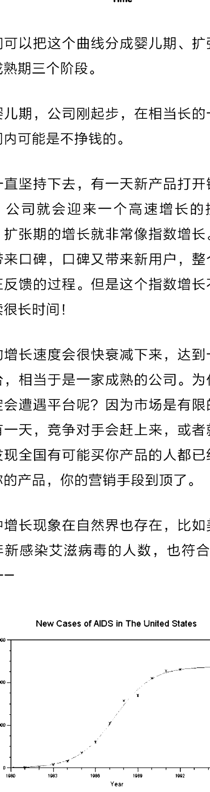

### 2.利率

在真实世界中，你不但是找不到20%的利率，你也找不到15%的利率，你甚至找不到10%的利率。

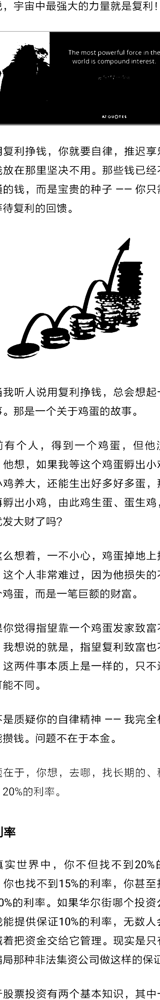

### 3.真实世界里的增长

真实世界里一个什么东西的增长，常常呈现数学家说的“逻辑函数”的样子——

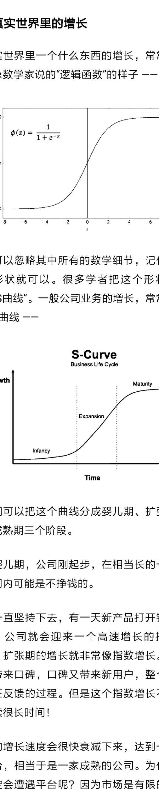

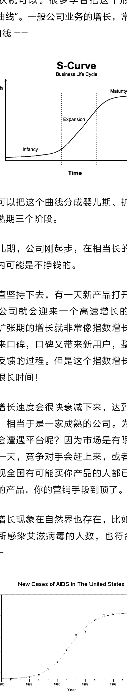

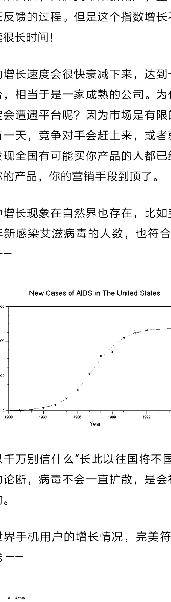


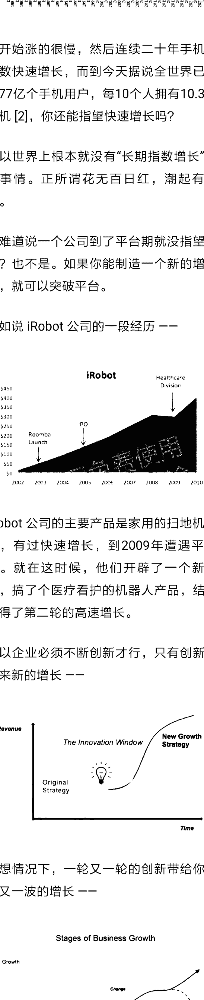

一开始涨的很慢，然后连续二十年手机用户数快速增长，而到今天据说全世界已经有77亿个手机用户，每10个人拥有10.3个手机[2]，你还能指望快速增长吗？

所以世界上根本就没有“长期指数增长”这种事情。正所谓花无百日红，潮起有潮落。

那难道说一个公司到了平台期就没有指望了吗？也不是。如果你能制造一个新的增长点，就可以突破平台。

比如说 iRobot 公司的一段经历 ——

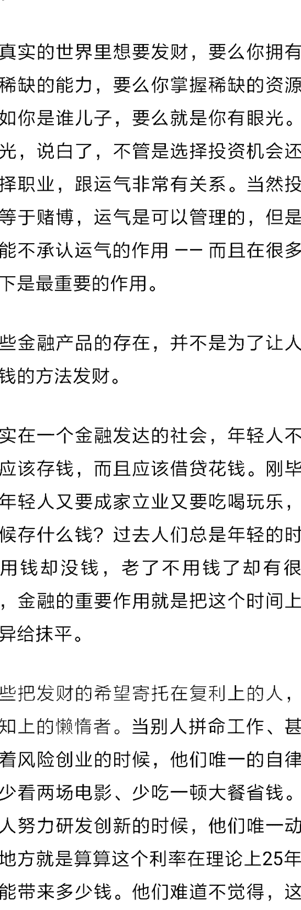

iRobot 公司的主要产品是家用的扫地机器人，有过快速增长，到2009年遭遇平台期。就在这时候，他们开辟了一个新领域，搞了个医疗看护的机器人产品，结果获得了第二轮的高速增长。

所以企业必须不断创新才行，只有创新能带来新的增长 ——


理想情况下，一轮又一轮的创新带给你一波又一波的增长 --


但是就是这样也是很难的。如果仅仅是原有产品的一个改进，那还不足以带来新一轮增长，只是维持而已。比如我们看苹果公司 iPod 这个产品的销售历史，虽然历经多次创新，但总的来看还是一条S曲线 --


真实世界里就算是不停创新，也很难有持续的高速增长。整个地球的人口就那么多，购买力就这么大，你苹果公司再厉害，就算你将卖汽车、卖游艇，你总不能卖飞机吧？就算你真的卖飞机，也不可能每家每户都买你的飞机。

长期的指数增长，根本不符自然规律。

## 4.回报与风险

你可能会说，我专门把钱投给成长期的公司，行不行呢？也不行。

成长型的公司未来都尚未可知，可能变成伟大公司，也可能涨几天就没有了。就好像我们说的那个鸡蛋，搞不好就摔碎了。

再者，即便你判断出这家公司的前景确实很好，那难道别人就看不出来吗？上市公司的未来前景其实都已经包括在它的股价里面了。我们看市场上有许多市盈率（P/E）特别高的公司，它们当前的盈利非常少，可是股价却特别高，这就体现了市场对它们未来的预期。等你想起来买它股票的时候，它很可能根本就没有被低估。

所谓投资，就是在风险和回报之间做一个取舍。你要安全可靠，回报率就很低。你要高回报，就得承担高风险。

所以马克思不是说吗？10%的利润就能让资本活跃起来，50%的利润就得铤而走险，100%的利润就可以犯法，300%就得冒险杀头的风险 —— 没有这个觉悟当什么资本家？

普通人投资，如果你没有时间一天到晚研究股票，特别是如果你认为自己并不比专业投资经理更了解股票市场，最好办法大概是去买指数基金。请注意，这个“指数（index）”可不是“指数增长”那个“指数（exponential）”。

这个道理就是，想“用钱生钱”，就得冒险。就算放高利贷，你都还得担心钱能不能收回来 -- 古代民间借贷利率之所以那么高，就是因为很多钱根本收不回来。现在买个利率6%的理财产品，人家还得评估一下你的风险承受能力。买国债、把钱存银行，都还有一个能不能打败通货膨胀的风险。

在真实的世界里想要发财，要么你拥有某种稀缺的能力，要么你掌握稀缺的资源，比如你是谁儿子，要么就是你有眼光。而眼光，说白了，不管是选择投资机会还是选择职业，跟运气非常有关系。当然投资不等于赌博，运气是可以管理的，但是你不能不承认运气的作用 —— 而且在很多情况下是最重要的作用。

那些金融产品的存在，并不是为了让人用存钱的方法发财。

其实在一个金融发达的社会，年轻人不但不应存款，而且应该借钱花钱。刚毕业的年轻人又要成家立业又要吃喝玩乐，这时候存什么钱？过去人总是年轻的时候想用钱却没钱，老了不用钱却有很多钱，金融的重要作用就是把这个时间上的差异给抹平。

那些把发财的希望寄托在复利上的人，是认知上的懒惰者。当别人拼命工作、甚至冒着风险创业的时候，他们唯一的自律就是少看两场电影、少吃一顿大餐省钱。当别人努力研发创新的时候，他们唯一动脑的地方就是计算这个利率在理论上25年以后能带来多少钱。他们难道不觉得，这想的太简单了吗？

最后，据有人考证[4]，爱因斯坦根本没说过什么“复利是宇宙中最强大的力量”这种谎话。

参考文献
[1] Stock-Picking Fund Managers Are Even Worse Than We Thought At Beating the Market, JEFF BUKHARI, April 13, 2017 http://fortune.com/2017/04/13/stock-indexes-beat-mutual-funds/
[2] http://stats.areppim.com/stats/stats_mobilex2017.htm
[3] https://wdpower.wordpress.com/2011/04/01/why-growth-companies-stop-growing-3/
[4] https://www.cbsnews.com/news/compound-interest-the-most-powerful-force-in-the-universe/

## 日课078 | 《穿越平行宇宙》2:为什么世界是数学的

今天咱们继续讲《穿越平行宇宙》这本书。上一期咱们讲了“终极理论”这个大问题，而今天要讲的，是一个更大的问题，大概也是人类所能问的最大问题——这个宇宙到底为什么存在。

自古以来的哲学家都要问这个问题，但往往是空谈。我们今天可不是空谈，我们有一个相当值得严肃对待的答案。

### 1.不可约化的复杂

关于万事万物是怎么来的，现在在美国，除了科学家的“进化论”和宗教徒的“神创论”之外，还有一派叫“智能设计论”。智能设计论者表面上并不假设上帝的存在，但他们也认为万事万物不是从自然界中无缘无故出来的，而是某个“智能”设计出来的——这个智能可能是上帝，但也可以是外星人，总之是有个更高级的智能。

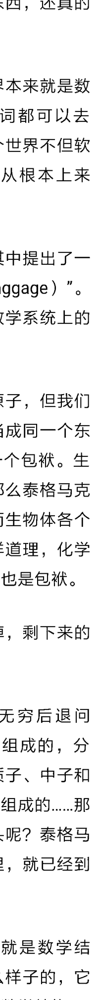

智能设计论有个论点认为，进化论无法解释这个世界的“复杂度”问题——世界上有些东西不但是复杂的，而且是“不可约化的复杂”。比如说眼睛中的视网膜和晶状体，这两个东西必须一起出现、互相配合，才有意义，单独的视网膜和单独的晶状体毫无意义，这就是不可约化的复杂。如果一切都是进化来的，那怎么可能一下子进化出两个东西呢？

其实进化生物学家对这个问题早就有很好的答案。简单地说就是像视网膜和晶状体这样互相配合的部件，并不是凭空一起出现的、也不是为了当前这个功能而出现的——它们很可能是从别的器官演化而来，而在形成眼睛之前，它们各自都有别的用处。

但智能设计论者还可以说，就算你能解释眼睛，世界上还有别的不可能约化的复杂……最起码，物理定律就是不可约化的复杂，这总不是演化来的吧？

无神论者对此的一个反驳是，好，如果这个复杂世界是智能设计的，那设计世界的那个“智能”，一定更复杂——那请问，那个上帝，又是从哪来的、又是谁设计的呢？

这个问题要是这么想的话你就陷入了无限循环之中，永远都不会找到答案。经济学家 斯蒂文·兰德斯博格（Steven Landsburg）十年年前写过一本书叫《大问题》（The Big Questions），他建议我们换个问题问。

兰德斯博格说，我们能不能想想，有没有什么东西，是必须存在、凭空就存在、而且一直都是不可约化的复杂的呢？

这样的东西的确有，它就是，数学。

### 2.数学是什么

一般人心目中的数学，也是从简单的开始学，慢慢学到复杂的；数学家研究数学，也是先研究简单的，后研究复杂的，好像数学也是从简单到复杂这么发展。但这只是我们的错觉。

其实数学一直都存在，跟数学家、跟人类都没有关系。

数学是一套纯粹的逻辑系统。不管你是中国人、欧洲人还是阿拉伯人，当你思考数学的时候，如果你明白 2 是什么意思、加法是什么意思、4 是什么意思，那么 2 加 2 就只能等于 4。也许我们用的数学符号不一样、公式的写法不一样，但是数学本质是一样的。

假设在另一个宇宙中，有一个外星文明，他们那里连物理定律都跟我们不一样。但是只要那里的人能想象到“直线”和“圆”这些概念，他们就只能得出结论，平直空间中的三角形有且只有一个外接圆。


假设我们这个文明比较落后，还没有人思考过平面几何的问题，那你能说，“勾股定理”就不存在吗？勾股定理永远存在，你只不过暂时不知道而已。

所以说，数学家并没有“发明”数学知识，数学家只是“发现”数学知识。

我们可以设想，存在一个独立于所有文明、所有宇宙之外的“数学王国”。数学永远都在那里、所有的、不管多难的数学定理的证明，也永远都在那里。各个文明里的伟大数学家，只不过偶尔能看一眼数学王国里的珍宝。

但就算没有任何人看，数学王国也一直存在。

我第一次听说泰格马克的思想，就是在兰德斯博格的《大问题》这本书里。泰格马克这个思想，就是为什么宇宙会存在呢？因为数学存在。

数学王国，无需“为什么”，就存在。宇宙，只不过是数学王国中某些数学结构的物理实体而已。

为什么我们这个世界能存在呢？因为数学，允许，它存在。

### 2.物理定律和数学

学了这么多年物理，你是否有一个问题，为什么物理定律都要精确地符合数学呢？

比如你做个什么心理学或者医学的实验，搞个什么大数据研究，虽然也用到数学，但是从来都没有那么精确，有时候能有个微弱的相关性就不错了。但物理定律可不是这样，大到行星轨道小到电子磁矩，实验结果和理论计算都必须精确符合，如果有一点点不符合，物理学家就要找个新的理论。

你就觉得这个世界特别“讲理”，它从来不背离数学。而且我们上一讲说，但凡物理定律的数学方程式预言的东西，还真的就能找到。

那这到底是为什么呢？因为世界本来就是数学的产品。也许“产物”这个词都可以去掉，因为泰格马克认为，这个世界不但软件是数学的，而且连硬件，从根本上来说，也是纯数学结构。

泰格马克有一篇著名论文，其中提出了一个关键的名词，叫“包袱 (baggage)”。所谓包袱，就是人类强加在数学系统上的概念。

比如一个篮球，明显是一堆原子，但是我们为了方便起见，把这些原子当成一个东西，叫“篮球”——篮球就是一个包袱。生物体的底层递归就是化学，那么泰格马克说，化学是更基本的结构，而生物体各个器官的名称，就是包袱。同样道理，化学的底层是物理，所以化学概念也是包袱。

那如果把所谓的包袱都剥离掉，剩下来的是什么？

哲学上一直有个悖论，叫“无穷后退问题”。我们说这个物质是分子组成的，分子是原子组成的，原子是由质子、中子和电子组成的，这些又是由于夸克组成的......那以此类推，推到哪里才算到头呢？泰格马克说，其实推到基本粒子那里，就已经到头了！

最后不带包袱的这个东西，就是数学结构。终极理论，不管它是什么样子的，它必然是一个没有任何包袱的纯数学结构。

凡是有包袱的东西，都有一些“内在”的性质。比如说一把椅子，它的内在的性质就包括它是什么颜色、是什么材质、它有什么历史等等。但是像“上夸克”这样的基本粒子是没有“内在”性质的！

上夸克没有历史，世界上所有的上夸克都是 一模一样不可区分的。什么是上夸克呢？只要带2/3个电荷、1/3个单位的重子数、1/2个自旋和1/2个同位旋，再有一些质量，那就是上夸克。上夸克的所有性质都*只是数学性质*，是纯数学的产物。再问"上夸克是什么组成的"就没有多大意义了，正如你不能问"立方体是什么组成的"——立方体就是立方体。

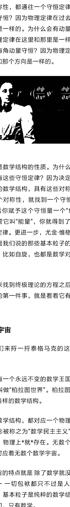

好，世界是什么组成的，这个问题的最简单答案，大约就相当于，"世界是立方体组成的——而立方体，因为是个数学结构，所以立方体就是立方体。"

### 4.为什么“守恒”？

世界是数学结构的产物，还另一个证据，那就是为什么我们这个世界会有各种守恒定律。

你往天上扔一个球，球飞到一定高度就会落下来，这是因为能量守恒：动能和势能加起来总和不变。那为什么非得有能量守恒，为什么球不是越飞越高越飞越快呢？如果这里多了一个东西，我们总觉得必然有地方少了一个东西，我们默认能量就应该是守恒的，可是世界其实没有义务是这样子。

在物理学家看来，之所以会有能量守恒，是因为物理定律的方程具有“时间平移不变性”——说白了，就是物理定律不随时间发生改变。数学家管不变性叫“对称性”，我们也可以说，是数学方程的时间对称性，决定了能量守恒。

早在1922年，德国女数学家埃米·诺特（Emmy Noether）就证明了，每一个连续的对称性，都通往一个守恒定律。为什么能量守恒？因为物理定律在过去、现在和未来是一样的。为什么会有动量守恒？因为物理定律在这里和那里是一样的。为什么会有角动量守恒？因为物理定律在这个方向和那个方向是一样的。


一切都是数学结构的性质。为什么我们这个世界有这些守恒定律？因为决定我们这个世界的数学结构，具有这些对称性。你发现一个对称性，就找到一个守恒的“量”——然后你赋予这个守恒量一个“包袱”，比如你管它叫“能量”，你就得到一个物理守恒定律。更进一步，尤金·维格纳还发现，我们说的那些基本粒子的各种数学性质，比如自旋，也都是数学对称性的结果。

所以将来找到终极理论的方程之后，物理学家做的第一件事，就是看看它有什么对称性。

### 5.数学宇宙

现在我们来拎一拎泰格马克的这个世界观。

首先，有一个永远不变的数学王国，很多人把它叫做“柏拉图世界”。柏拉图世界里有各种各样的数学结构。

每一个数学结构，都对应一个物理实体。这个概念被称为“数学民主主义”：数学上存在，物理上*就*存在。无数个数学结构，就对应着无数个数学宇宙。

数学宇宙的特点就是 除了数学就没有别的东西 —— 一切包袱都只不过是人的概念而已。基本粒子是纯粹的数学结构，底层的一切，只有数学。


当然，并不是所有数学宇宙里都适合生命生存。有的数学宇宙非常简单，有的数学宇宙里能量不守恒，有的数学宇宙里不存在稳定的质子。我们这个宇宙看起来很不错，这只不过因为我们*恰好*生活在这个宇宙里 —— 也可以说，这个宇宙恰好适合生命生存。现在物理学家苦苦寻找的终极理论，就是我们这个数学宇宙的数学结构。

但是那些不适合生命生存的数学宇宙，也都存在。什么叫存在？不一定非得让你摸得着看得见才叫存在，数学上存在就等于存在。

我们经常幻想的魔法世界，其中有神仙、可以修炼内功，有七十二般变化，这种世界存在吗？只要你能找到一个合适的数学结构，那个数学结构允许魔法，那么魔法世界就是存在的。

每一个小说的剧情，每一个可能的人物，包括我们在《宇宙是平的》这期专栏提到过的“无数个一模一样的你”，你的无数种可能性，只要在数学上是合理的，那就一定在某个数学宇宙里真实存在。

每一个数学上合理的可能性都会发生、都发生过、而且都发生过无数次。


我们完全不需要什么上帝之类的造物主，我们这个世界不需要任何理由就存在。

你、我，我们都是数学的产物，我们的各种活动只是在实践数学上的可能性而已 —— 我们，就是数学的一部分。

## 划重点

+ 1. 有一个永远不变的数学王国。
+ 2. 每一个数学结构，都对应一个物理实体。
+ 3. 无数个数学结构，就对应着无数个数学宇宙。
+ 4. 数学宇宙的特点就是，除了数学就没有别的东西。
+ 5. 并不是所有数学宇宙里都适合生命生存。
+ 6. 那些不适合生命生存的数学宇宙，也都存在。
+ 7. 每一个数学上合理的可能性都会发生、都发生过、而且都发生过无数次。
+ 8. 我们，就是数学的一部分。

## 日课079 | 纪律的悖论

日课079 | 纪律的悖论

从前有个小学，教育方法特别强调纪律性，把每个学生都管得死死的。老师特别严厉，教学是灌输式的。学生上课都要背着手，没有什么自由发挥。学生们为了让老师满意也都努力表现，但是创造性和想象力明显不行。

有一天，学校里来了一个态度和气的新老师。新老师认为应该提倡创造性思维，开发学生的想象力，所以她就进行了教学改革！她在课堂上给学生很大的自主权，学生可以展开自己的思路，而不必拘泥于课本上的标准答案......

以上是我假想的一个场景。如果接下来的剧本让你写，请问你打算怎么写呢？

我们盼望的剧情，是这位新老师的教学改革取得了巨大成功，学生潜能被激发了，特别是有一两个有天赋的孩子、因为这个新老师的教育，长大后成了大人物，他们一辈子都感谢这位老师。

可是咱们精英日课不研究我们“盼望”的世界。咱们研究真实世界。

### 1.两种教育理念

关于中小学教育，现代社会一直有两种非常不一样的理念。

一种是所谓“传统主义”。它的风格是严格要求，教法是灌输式的，老师把标准化的知识直接传授给学生。这种教学特别讲纪律，对学生的要求是“服从”，会采取一系列措施奖励服从的学生，惩罚不服从的学生。这种教育的目标，当然是考试。

还有一种现代化的教育思想，被称为“进步主义”。这是一种“以人为本”的教学方法，强调学生的独立自主，让学生自己去发现答案，激发创造性和想象力。进步主义最先进的教学方法是让学生用几周的时间完成一个跨学科的“项目”，比如做个科学实验，或者研究面包的制作方法、历史和经济學。

过去中国的基础教育 -- 比如我小时候受的教育 -- 基本上是传统主义的。现在我们痛斥这种死板教育的弊病，正在积极拥抱进步主义。当然，绝大多数中国的中小学还在搞应试教育，我们还没有改革好.....

......而这可能就是为什么，中国基础教育的效果比美国好。

美国近年来的一个潮流，却是传统主义教学正在回归。

### 2."成功学院"很成功

我在《 智识分子》这本书里专门介绍过美国一个完章学校，叫KIPP（ Knowledge Is Power Program，知识就是力量），这个学校用的就是传统主义强调纪律的教育方法，非常成功。最近纽约客杂志的一篇文章 [1] 报道了纽约市的一个连锁的完章学校系统，叫 Success Academy（ 成功学院）--

成功学院用的也是传统主义的教学方法，而且大获成功。成功学院在纽约有46个分校，学生中有 2/3 都是来自贫困家庭，绝大多数是黑人和墨西哥裔移民的后代。我们不能有种族偏见，但是贫困家庭、黑人 ...


纽约市一般的教学水平是什么情况呢？全市所有学生都计算在内，数学的达标率只有36%，英语的达标率只有38%。可是成功学院的学生尽管来自如此不利的家庭环境，他们的数学达标率达到了95%，英语达标率达到了84%。

而且成功学院并不是专门挑选好学生入学。尽管作为完章学校可以独立办学，但既然拿了政府教育经费，你就必须公平面向所有学生。想要入学的学生比招生成额多，你也不能考试择优录取 —— 因为那对差生不公平 —— 你得抽签录取。当然成功学院还是有个小花招，就是它有时候会开除严重的违纪的学生，而一般公立学校必须接收片区内所有学生 —— 即使如此，有这么好的成绩，也足以说明他们教学手段确实现厉害。

美国有些富豪真的想为提高国民素质做贡献，就很乐意给这样的学校捐款。比如最近有个华尔街对冲基金的巨头给成功学院捐了4500万美元。

我们看成功学院的学生，一个个精神抖擞朝气蓬勃，感觉真的是好。

这样的学生是怎么教出来的呢？

### 2.教法

这是一套比中国教法更极端的方法。

纽约客的记者特意深入到成功学院旁听了二年级的几节课。成功学院有严格的纪律。老师讲课的时候，全班学生的眼睛都得在老师身上，眼晴看向别处或者低头都算违纪，要受到警告。如果一个同学站起来发言，全班所有同学都要看着他，如果发言的同学发现有人没看他，还得指出来。


阅读理解课的教学是完全机械化的。就像我们中国小学生一样，学生得学习课文的“中心思想”。老师会针对课文提出几个问题，而学生的答案，必须是课文里直接就有的内容。你说我能不能从文中引申和推理出来一个意思，对不起不可以。

课堂中也有讨论环节，两个同学一对一的“讨论”，互相说说自己对课文的“理解” —— 而这种所谓的讨论根本没有自由发挥，基本上都是重复老师的话。

但是有一点值得强调，成功学院用的课文是有难度的 —— 他们二年级用的课文相当于别的学校三年级的水平。

教的是挺死板，但是成功学院也有一种“范儿”。比如老师都不管学生叫“学生”，而是叫“学者”。学校还禁止老师用软绵绵哄小孩子的语气跟学生说话，因为那种语气是对“学者”智力的侮辱 —— 老师说话必须严肃。

成功学院规定学生在上课的时候，两只手要合起来放在前面。还有一个奇葩规定是上课不能打鼾。违反这样的规定就算违纪，会被老师课后单独约谈。


连中国落后地区的学校，现在可能都没有这么规定的 —— 而这可是纽约啊。成功学院的学生们也不怎么适应，有高达20%的学生都因为违纪受过暂时休学的惩罚。有的学生害怕上学，一提上学就想呕吐。

甚至有的老师都看不下去了，成功学院的老师经常干三年就不干了。这种教学方法太累罢，老师也没有自由发挥的余地，只能按照学校给的剧本教。

这已经不仅仅是控制、简直就是在压迫学生。可是风格不重要，得看疗效 —— 成功学院的教育效果就是好，而且比别的学校好了不是一点半点。


好了不是一点半点。

不过成功学院也承认，这种教法确实有问题。

## 4.失败的改革

成功学院的学生考上大学的比例远远超过一般的公立学校。但是问题在于，他们进入大学以后很难坚持下来。

成功学院的学生考上大学以后，竟然有高达70%的比例，不能在六年之内从大学毕业。当然大部分原因还是家庭困难，因为交不起学费、拿不出生活费而被迫退学。但是也存在一种情况，是这些学生从小学到初中、高中都是在老师的严格管束下学习的，到了大学没有了管教者，他们突然不知道该怎么学习了。

成功学院的学生，似乎缺乏自主学习的能力。

这个问题就很严重了。不过成功学院也不是把学生送进大学就不管了，他们意识到这个问题，也在进行相应的改革。

但是改革的结果比较失败。比如成功学院在小学里搞过定点的实验，给学生一些自主权，让学生谈谈自己的观点——结果是一给自由，课堂就会变得混乱，一乱老师就感到无法控制，课堂纪律就溃散，学习效率马上下降。

成功学院在高中也尝试过一般美国高中的方法，给学生更多自由——结果学生们马上就失去自控，连按时来上学都做不到。有的穿的松松垮垮，到学校我行我素，根本不好好学。

成功学院不得不改回原来的传统风格。

那么回到我们开头那个剧本，新老师的改革，将以失败告终。

## |由此得到

- 1. 传统教育方法、标准化的操作，对贫困家庭和少数族裔的孩子来说，是最高效的教法。
- 2. 虽然是应试教育，成功学院也不只有管束，很多教法具有刻意练习的特点。
- 3. 但是这套教法存在几乎不可克服的内在问题。

## |我的评论

纽约客的文章里提到，有人把这个教育风格问题给上升到了哲学的层面：集权和专制制度确实是效率最高的制度，因为它能迅速把事情办成——可问题就在于是，这种制度培养出来的人缺乏独立人格。

我认为这里面有个天生的矛盾。独立自主、随机应变、拥有创造力和想象力的人才，根本就不能用标准化方法批量生产。你要效率，就得牺牲质量。所以真正的问题是，什么情况下应该选择效率，什么情况下应该选择质量。

对穷人来说纽约是个很危险的地方。纽约贫困学生的生存环境很可能比中国任何一个城市都险恶。成功学院的老师有一句话说得好："你知不知道我们这里的学生是什么情况？我们这里有的学生宣称要杀死别的学生。"

说的难听一点，这些学生是潜在的犯罪分子。现在成功学院不但让这些学生在学业上取得了成功，而且让他们养成了很好的纪律习惯，这难道还不够吗？如果没有成功学院，恐怕很多人要流落街头。

那为什么成功学院出来的学生到了大学之后都不太成功呢？也许原因在于虽然成功学院的教育符合教育规律，但它不符合美国国情——美国只有这样的中学和小学，没有这样的大学。如果美国也创办一些严格的、批量培养技术人才的大专院校，相信这些人也能成为合格的人才。

所以这个哲学教训是有什么样的国情就使用什么样的制度。反过来说，传统式教育在中国取得了很大成功，但今天的中国已经不是过去那种情形了，那么到底应该用哪种教学方式，就是值得反思的。

参考文献
[1] Success Academy's Radical Educational Experiment, Rebecca Mead, New Yorker December 11, 2017.

的、无感则无视。

4.我们赋予世界的内涵都是主观和充满矛盾的，“色”会影响我们对真实世界的体验。那如果不带有色的眼镜看，世界将是一个“无色”的世界，而“无色”会让你感到世界是“空”的。

5.当你认识到空和无色的时候，再去看万事万物，你看到的东西就会比以前看到的更真实。人们对这些东西先入为主的各种感触，其实是不真实的。

6.经常有人说佛学会不会让人失去生活的乐趣、看什么东西都没意思？其实并非如此，佛学是让人更自由，是让你能够自由选择你想要体察什么东西。排除主观想象的干扰，你能获取更丰富的体验。那将是更大的乐趣和幸福感。

## ——◆ 贪嗔痴 ◆——

1.贪，就是被一个事物所吸引。钱财、异性或者名声，不管是什么东西，只要是你想得到，这种感情就叫贪。

2.嗔，中文字面意思是愤怒，但它泛指一切负面情绪。凡是你对什么东西有负面情绪，想排斥，都叫嗔。

3.贪 + 嗔 = 痴。

## ——◆ 涅槃 ◆——

1.涅槃有四个特征：完美的幸福感、彻底的平静感、内心完全的自由、对周围事物有非常清楚的认识和理解。

2.“缘起”就是“依此有故彼有，此生故彼生”。缘起就是一个接着一个的因果链条。每件事发生都是有原因的，每件事发生又都会有一个结果，而这个结果又是另外一件事的原因。而属于人的一条特殊缘起链条，叫做“十二因缘”——

无明 行 识 名色 六入 触 受 爱 取 有 生 老 死

3.从“六入”到“爱”直观的解释 -

所谓“六入”，就是人的感官；因为有感官，我们就和外部的世界发生了接触，这就是“触”；因为“触”，我们就对事物有了好坏评价，这就是“受”；因为有“受”，就有了你想要和不想要的，这就是“爱”，也就是 tanha。

4.我们就生活在这个因缘之中。或者你也可以说，我们是被因缘所控制。我们做什么事情，都是“有条件的”。涅槃，就是摆脱了因缘的控制，变成了“无条件的”。

## ——◆ 什么是「佛系」◆——

1.佛法一直说的是不要被感情所*控制*。冥想只是观察感情，不是要消灭感情。佛陀真正反对的是被某件事情劫持。

2.佛陀本人活着的时候，可是非常积极进取的。他到各地发表演讲，跟人搞辩论直播，每次都必须自己赢了才高兴。他带了很多徒弟，留下了一大堆话。佛陀是在做一个事业，而且他也在把自己的事业做大做强。

3.佛法的核心价值观是自由，修行的目的是不受自己情感的控制、不受外部刺激的控制，是自己觉得*应该*怎么做就怎么做，是自己的自由选择。

4.佛学的意义，就是把我们从自然选择给的局限视角中解放出来，从一个更高的水平观察和体验这个世界。

万维钢

你可以点一下右下角的“请朋友读”，把它分享给经常自称「佛系青年」的朋友。看破红尘、消极避世、没有感情，已经被现代科学证明这并不是「佛系」——希望他能跟你一样了解这件事。

## 答读者问 | 数学王国的“最最最终理论”

答读者问 | 数学王国的“最... ↓

## 来自日课：物理学家想要什么

如果真有这样一个终极理论，那么如果我们把它给找出来，人类是不是就变成无所不知、无所不能呢？可不可能存在一不符合数学的世界，比如艺术家创作就是不符合数学的？

万维钢

掌握终极理论并不等于无所不知无所不能。终极理论是这个世界最底层的知识，但知识有很多层。

这就好比说，计算机是人发明的，编程语言都是人设计的，所以人已经有了关于当的这些计算机和编程的“终极理论”。可是下一个应用软件，还是得等着程序员们去慢慢开发。掌握全部的生物学也不一定能解决所有心理学问题，掌握全部心理学也不能解决社会学问题，因为不同层面有不同的知识。

心理学家有时候也用一点数学，比如统计数学 —— 但是这是对这个层面知识的一种近似描述，这种近似不准确，不等于说底层数学不对。所以艺术家创作不是“不符合数学”，而是不符合“简单近似的高层数学”而已。

再打个比方，物理学家探索终极理论就好像是猴子看人下围棋。最初，猴子以为人 只是厢在棋盘上胡乱摆子。看的时间长了，猴子看出来一些下棋的规律，比如说双方交替落子、一开局通常先占据角和边之类。再往后，猴子还意识到了“气”这个概念，它发现一个严格的规则：没有“气”的棋子会被拿掉。

老猴子临死之前，给小猴子留下一份《围棋教义》，上面记载了前辈的猴子对围棋规律的总结。这本书很厚，列举了各种规律和一些违反规律的特殊情况 —— 比如有一次，猴子看到一个人居然一上来就落子在棋盘正中间，居然也没事。这本书猜测，围棋一定有一些更底层的规则，是我们猴子暂时不理解的。

小猴子用这本书，甚至有时候能预测某些棋局下一步的走法，可是他仍然觉得自己并不理解围棋。

一代又一代的猴子不断地观察和总结，终于有一天，他们找到了围棋的终极规则！原来围棋规则是如此的简单，一张纸就写下了！

这无疑是猴子围棋学家的伟大胜利 —— 但这并不意味着猴子们就成了围棋之神：懂围棋规则只是第一步，下好围棋、甚至真正看懂高手的围棋，都还远着呢。

我看了一些介绍相对论小册子，感觉相对论几何好像，用公理推出其他结论！但是相对论的“公理”太难让人理解。光速不变这是实验的结果，没有说为什么不变，反而说因为光速不变而且最快的速度，所以光速可以衡量一切！然后开始推导出一些结论。为什么光速不变能成为公理呢？难道就是因为把它设为“公理”才可以计算出符合观测数据的结论？

万维钢

狭义相对论并不仅仅是实验观察的结果，它更是数学的伟大胜利。

当时情况是麦克斯韦搞了一套电动力学方程组，这套理论非常厉害，但是在数学是有个重大缺陷：你做一个有速度的坐标变换，这个方程组不具有不变性。这就等于说，一个人在开动的船上做电磁实验，结果居然会跟在“静止不动”的地面上做实验不一样。这太离谱了，物理学家坚信，匀速直线运动和静止不动应该不可区分才对。

为了克服这个*理论上的*困难，爱因斯坦才提出狭义相对论 —— 他的原始论文就叫《论运动物体的电动力学》。狭义相对论用把时间和空间放在一起变换的“洛伦茨变换”取代简单的伽利略坐标变换，一切就在数学上和谐了。

那么为什么非得是光速不变呢？因为光速是电动力学方程的产物！是电动力学方程 + 洛伦茨变换 = 狭义相对论，是数学、数学、数学。

至于说实验物理学家测定光速果然不变，爱因斯坦对此并不至于感到惊喜。

## 来自日课：复利的鸡汤和真实世界的增长

一直增长，在现实中当然是没有的。但是，短暂的下跌，它还会再涨回来的呀！文章中贴出的指数增长曲线，如果把视野放大，那个下跌不是可以忽略不计吗？

在一个成熟市场中，年轻人借贷消费，如果以后也赚不来钱怎么办？背着一身债，很多事情都不敢做了怎么办？

万维钢

视野要放到多大，下跌才可以忽略不计。凯恩斯有句话说“从长期看我们都死了。”攒钱是为了花钱， postpon... 我 们关注的是在一段合理的时间范围内，怎么合理分配手里的钱。

如果手里有笔闲钱左右也是没用，那当然不应该坐等通货膨胀，可以搞个“投资” —— 复利就是给这种钱准备的。可如果明明需要用钱，但是为了一个什么发财梦节衣缩食地去投资，那就除非能在短期内收回比较高的回报才值得做 —— 而“复利”，显然不具备这个条件。

成熟的金融市场里人们就是背着一身债照样敢做事。美国很多人三四十岁才还完大学学费贷款，可是完全不耽误住屋和买车。那如果真的出现没赚来钱、换不上债的情况怎么办呢？可以宣布个人破产啊！成熟的市场允许个人破产，免除债务，轻装上陣几年之后又是一条好汉。

所谓成熟的金融市场，就是在允许一定比例的人破产不还钱的情况下，仍然能提供一个比较低的贷款利率的市场。

巴菲特是靠技能够吃饭呢，还是靠掌握稀缺资源吃饭呢？还是靠运气吃饭？

万维钢

巴菲特积累第一桶金的时候正好赶上美国股市高速增长，他首先应该感谢国家，所以主要靠的是运气。

炒股赚钱的人很多，绝大多数人赚了点钱就忘乎所以、过度自信、胡乱的投资和消费，而巴菲特保持了谨慎小心，面对互联网概念大潮都不为所动，结果是别人的钱没保住他的钱保住了，这个阶段可以说主要靠的是技能。

做大以后，巴菲特又有钱又有影响力，他就可以换一种玩法 —— 一种普通股民没有资格玩的玩法，比如说，他可以直接影响一些公司的命运。在这个阶段赚钱，靠的就是稀缺资源了。

所以我觉得我跟巴菲特相比，目前最缺的是运气：）

## 来自日课：为什么世界是数学的

如果说世界是数学的，哥德尔不完备性定理数数学的推导与证明是不完备性的，那么终极理论会不会只是又像希尔伯特的幻想一样呢？

万维钢

不是！哥德尔不完备性定理是说一个有限个公理的数学系统*不能独自证明*它的自治性。但是它可不是说有哪个数学系统是*不自治*的。是说从“能不能证明”这个角度，公理系统不完备，但可不是说这个系统“不够用”。

万老师，日课中提到这么一句：假设在另一个宇宙中，有一个外星文明，他们那里连物理定律都跟我们的不一样。我的问题是，既然另一个宇宙的物理定律都可以不一样，那为什么所有宇宙的数学…

都可以不一样，那为什么所有宇宙的数学定律就必须样呢？或许另一个宇宙有不同的运行法则，有一套完全不同的数学系统，我们这个宇宙的数学不也是通过观察总结本宇宙的一些现象而建立的吗？希望万老师解惑。

万维钢

我们这个宇宙的空间是三维的，那数学家为什么还能想象并且完善了一整套四维空间、甚至多维空间的几何学呢？因为数学自己就是自己的推动力。当你意识到“维度”这个概念之后，你马上就会想到有没有更高的维度。

再比如说，日常生活中的一切似乎都能用有理数表示，那为什么数学家能想到无理数和复数呢？这些概念不是来自数学家对生活的观察，而是来自数学本身。

不管你是哪个文明，你总得数数吧？一个手指头加上一个手指头，必然是两个手指头，这跟你们宇宙的物理定律没关系。于是你就有自然数，有了加法和减法。有了减法你就有了负数。可能为了快速算加法，你就有乘法，同时你还会有除法。有了乘法，你就有了“平方”的概念。

有了平方你就会想到开方，当你对2开方，你就想到了无理数。当你对(-1)开方，你就有了虚数。以上这些推导都是数学本身驱动的——所以不论是哪个文明，都会有跟我们本质一样的数学。

外星文明对数学认识的起点可能跟我们不一样，符号可能不一样，但是他们如果足够聪明，就必然也能想到那些最基本的概念，并且以此出发，推导出整个数学王国。

数学王国有无数个数学结构，每个数学结构对应一个数学宇宙，那么数学王国自身有没有一个最最最终极的理论，可以解释每个数学结构？

万维钢

没有必要。数学结构就在那里，无须解释。整个数学结构并不是数学家拍脑袋设计出来的，而是一层一层、一棵树一棵树严密推导出来的。

或者也可以说，数学王国“最最最终极的理论”，就是“你得讲理”！

万老师那是不是说，如果找到一组数学公式能够解出同时垂直于我们三维空间的三条轴的另一条直线就可以预言四维空间的真实存在呢？

万维钢

四维空间本来就是真实存在，在数学上 N 维空间都是存在的。你可以说有很多数学宇宙，里面的空间就是四位或者更多维的。

这样的数学宇宙存在是存在，但是其中并没有有生命。从数学上可以证明，四维、或者更高维空间中，行星的轨道是不稳定的！没有稳定的行星轨道，就没有地方演化出生命来。

所以说，并不是“一切可能都存在”，而是一切*数学上允许的东西*，才存在。

## 日课080 | 《穿越平行宇宙》3:到底有没有“随机”？

日课080 | 《穿越平行宇宙》...

这几天我儿子嘴里长了个小水泡，一刷牙就疼。他很恼火，问我怎么会长这个水泡。我说这没有为什么，它就是长了。但是儿子拒绝接受这个说法，说“它不可能就这么随机地（randomly）长出来！”

我们在家里总是督促孩子说中文，但是听儿子用到“random”这个词，我很欣慰。

我大概上高中才知道“随机”，对我来说是个科学词汇 —— 可能英文里这个词没有那么高的格调。“随机”的意思，就是无缘无故地发生。

我儿子哪里知道，他这个问题正在让无数物理学家和哲学家寝食难安。这个世界上到底有没有什么事情，是无缘无故发生的？

今天咱们继续讲泰格·马克的《穿越平行宇宙》这本书。物理学家眼中的世界有“随机”吗？这是一个大反转的故事。

## 1.日常生活中有限随机

生活中有些事，一念之间，人的命运就可能有巨大不同。

上周我们说过纽约成功学院的故事。因为招生名额有限，公平起见，成功学院用抽签的方法录取。这次抽签对很多贫困家庭的孩子来说是一生之中改变命运的最重要机会。如果一个一心向学的好孩子，因为没抽中而不得不去很差的学校，难道你能说这是因为他父母“积德”不够吗？

世界上有些事情跟你的“个人素质”没关系，根本不可控、和彩票没区别，你抽这个还是抽那个没有对错之分。你不得不承认，生活中存在“随机”。


但是在物理学家看来，你不可控的事情，不等于就是“随机”的事情。

## 2.经典物理学没有随机

从物理学来说，人无非就是一堆原子，大脑决策无非也是原子的运动，而原子的运动都符合物理方程。一个小球，我告诉你它的位置在哪儿，它现在的速度是多少，它受到的力是什么样的，你就一定可以算出未来任何时刻这个小球会在什么位置。


当然，如果小球比较多，计算就会非常复杂。但是，*从原则上来说*，只要知道现在宇宙中每个原子的状态，我们就可以计算未来任何一个时刻的宇宙是什么样子，而且我们还能算出来以前任何一个时刻宇宙是什么样子。

一切都是确定的，哪有什么随机性可言？比如抽签，为什么你抽中了这个签？那是因为你手的作用。你手的动作，是你大脑中某个电信号决定的。你的大脑里之所以会有那个电信号，因为你当时想到了什么东西。你之所以想到那个东西，和你昨天晚上做的梦有关。你之所以会做那个梦，又是你以前的经历决定的。总而言之，有果必有因，你也是物理世界的一部分，一切都是确定的。

## 3.量子世界有真随机……吗？

我们专栏以前讲过《量子力学的“人性”》，讲过《薛定谔的猫》，我们知道，量子力学里，*似乎*是有真正的随机性的。一个光子通过两道缝到达屏幕，如果你观测，会发现它或者是从左边的缝过去，或者是从右边的缝过去 —— 到底从哪走，你无法决定。做完实验打开容器，薛定谔的猫或者是死的或者是活的，是死是活事先没有任何办法控制。波函数坍缩到什么结果，是完全随机的事件。

## 4.数学宇宙里没有真的随机

咱们前面讲了，“数学宇宙”这个思想认为，宇宙是个数学结构，宇宙里的一切都是数学的。那好，虽然我们不知道这个宇宙的终极理论是什么样的，但是我们知道，它一定是数学公式。而只要是数学公式，它就没有随机性。

来越多的信息呢？

还真能解释。简单的数学，就能生产非常复杂、甚至看起来就好像是随机产生的信息。咱们举个最简单的例子——

√2 = 1.41421356237309504880168872420969807856967187537694807317667973799.....

我们从中截取一段数字，比如“42096980785”，你会觉得这是一段完全随机的数字——但事实上它一点都不随机！

根号2是个无理数，它的小数部分无穷无尽，而且不会循环。表面上看，这串数字中包含了无穷多的信息——实际上它只是根号2这么一个信息！

还有一个特别著名的例子，叫“曼德布洛特复数集合”。简单说来这是复平面上的一张图，横坐标是实数轴纵坐标是虚数轴。咱们先看看这张图的一个局部——

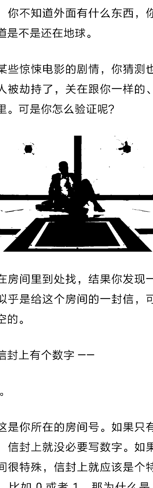

非常漂亮，而且感觉特别复杂。这张图的看点在于各个地方看起来有点相似，但又不是完全一样的，所以你没有办法用复制粘贴的方法画这个图，你也没有办法高效地压缩它。

那这么复杂的图是怎么生成的呢？其实非常简单！你只要选定一个复数c，然后从 z = 0 开始，反复迭代

```
f_c(z) = z² + c
```

这样生成一连串的数字 z，每一个新数都是前一个数用这个公式计算出来——然后你把所有这些数都标记在复平面上。全局图是这个样子——


为了好看，你可以根据一定的规则标记颜色。从这张图上一点深入进去，可以有无穷无尽的变化——


而这美丽的复杂其实是个幻觉！这一切源于 f_c(z)=z²+c 这个无比简单的公式。

类似的例子非常之多。我们专栏第一季有一期叫《一个神人的世界观》，讲到了沃尔夫勒姆的“元胞自动机”游戏，其中有个第30号规则，非常简单，但是生成了一个无比复杂的局面——


从下面任取一行，你会觉得整个的变化非常“随机”，而实际上它是简单规则的确定结果。

所以包括沃尔夫勒姆在内的一些科学家认为，我们这个宇宙现在的一切，看似无比的繁华复杂，其实都是从一个简单数学公式推演出來的。除了终极理论的那个公式之外，宇宙从来都没有诞新信息！

泰格马克的看法没有这么极端，他认为早期宇宙的那一点点涨落信息还是需要的。不过那一点点涨落信息也是数学的产物，就好像“42096980785”是根号2的产物一样——我们只知道一个根号2还不够，我们还需要知道具体到根号2的哪里去找这段数字，它只是个*位置*信息。

但不论如何，终极理论之外那个涨落的信息，并不代表物理实在的本质——它只与我们这个宇宙在那段数学结构中的*位置*有关。根号2中的每一段数字都能跟终极理论配合生成一个稍微不一样的宇宙，而我们正好处在地址是“42096980785”的这个宇宙中。

好。现在抬头看看你周围的一切。天文学家有充分的观测证据表明，以前的宇宙看起来没有这么复杂——宇宙起源于一次大爆炸。那你想想，现在这一切到底是怎么来的。

你相信其中有“上帝”之类精神力量的干预吗？你相信其中有不受任何力量控制的“随机”的作用吗？还是你相信，这一切都不过是一个简单的数学公式、再加上一个涨落地址、的产物？

如果你相信数学，你就不得不相信一些听起来匪夷所思的东西，比如说时间的流逝是个错觉，比如说平行宇宙。

最后，我编了个故事，想给你讲讲。

有一天，你一觉醒来，发现自己被劫持到了一个完全陌生的房间里。这个房间没有窗户，你不知道外面有什么东西，你甚至不知道是不是还在地球。

根据某些惊悚电影的剧情，你猜测也许可有别人在被劫持了，关在跟你一样的、别的房间里。可是你怎么验证呢？


你就在房间里到处找，结果你发现一个信封，似乎是给这个房间的一封信，可是信封是空的。

但是信封上有个数字——

1043。

也许这是你所在的房间号。如果只有一个房间，信封上就没必要写数字。如果你这个房间很特殊，信封上就应该是特别的数字，比如 0 或是 1。那为什么是 1043 这个看起来很“随机”的数字呢？

仅凭这个数字，你就能以很强的信心判断——

应该还有别的房间，而且你的境遇并不特殊。

咱们下期再说。


## 日课081 | 领导者的智商最好在115到124之间

日课081 | 领导者的智商最好在115到124之间

我经常听到一个说法，认为领导者的智商不应该太高，好领导往往不是团队里最聪明的人。比如刘备，他给咱们的印象就是一个身上有一种特殊魅力、但又不是最厉害的人。张飞、关羽武功比他高，诸葛亮的智力比他高，而刘备的本事就是让这些牛人伺候他。

> 如果觉得刘备是小说渲染过的人物，那刘邦可是亲口说过“夫运筹帷幄之中，决胜于千里之外，吾不如子房。镇国家，抚百姓，给饷馈，不绝粮道，吾不如萧何。连百万之军，战必胜，攻必取，吾不如韩信。”

那么这个说法有没有道理呢？是不是好的领导人不应该太聪明呢？很可能真有道理。

2017年，瑞士洛桑大学和美国加州大学的研究者做了一个比较大规模的调查研究 [1,2]。他们从30个欧洲国家找了379个中层领导者。这些人都不 是政客，而是私企的中层领导，像什么银行之类的公司。研究的目的考察这些领导者的领导水平和他们的智商有什么关系。

研究方法相当直截了当。一方面是对这379个领导做智商测试，另一方面是对其每个领导，找到他的八个同事或者下属，让他们评估这个人的领导水平。所以你看这个研究还是很下了一番功夫的，样本虽然是379个，可是每个人的背后都有8个人。这也是为什么这个研究的想法据说30年前就有了，到现在才实现。

那怎么评估领导水平呢？研究者设定了好多个指标。基本来说，这些指标可以分成三类。

第一类是对“人”。其中一个评估项目是看这个领导者本身有没有榜样力量。他是否得到了员工的尊敬？员工佩服他吗？他的榜样力量能不能激励员工？

还有一项是作为领导者，他是否能对员工进行有针对性的训练，他能不能培养员工。

第二类是对“事”。一项是看这个领导者能不能合理制定团队做事的战略，说白了就是他知不知道大家应该干什么。但是光有目标还不行，所以还有一项是看这个领导人有没有执行力，能不能带领大家根据计划完成目标。

这两个大类都是“好”的领导手段，还有一个第三类，是“不好”的领导手段，比如说这人是不是对手下放任自流根本不管。

我从这个研究的原始论文 [1] 里截取了四张图，这就是研究的主要结果。

四张图分别对应了对人和对事的四个指标——榜样力量、对手下的训练和培养、制定战略、执行计划完成目标——的领导水平。图中每个点代表一个人，横坐标是他的智商，纵坐标是周围人对他在这一项领导力方面的打分。

需要说明一点，研究测试智商用的是所谓“温德利人事测验”，这是一个企业用人的时候喜欢使用的测验方法，它的得分和我们平时说的“智商”密切相关，基本上，智商 = 温德利人事测验得分 × 2 + 60。

这四张图的结果是这样的—


图中那些点的分布相当散乱，但是趋势非常明显，而且这四项领导水平指标的趋势是一样的。图中的曲线，就是对所有这些点拟合的结果。

一开始，的确是智商越高的人领导力越强——但是这个领导力随智商的上升有个平台。平均而言，领导力的峰值表现在智商是115到124之间。智商超过124的人，领导力反而下降。

这就意味着，当领导，并非越聪明越好——总体来说需要聪明人当领导，110以上就可以算是聪明人——但是特别聪明的人反而不好。

不过这个研究表明，特别聪明的人犯的主要错误是对这些“好”的领导项目执行得不好，而对“放任不管”这个“不好”的领导方法来说，高智商的人不会更容易犯错。

研究中还有一些别的有意思的结果。女性领导者的总体表现超过了男性。年长的领导者的表现也更好，但是不如女性的表现明显。这些结果似乎说明与人沟通的能力非常重要。

怎么理解这些结果呢？我们要知道这个研究只是统计而已，而且统计的还是别人对领导者的主观评价，而且只统计了一般公司的、中层的领导。我们并不能直接从这些结果里判断为什么特别高智商的领导就不行。研究者自己有一些猜测性的说法。

一个猜测是特别聪明的人一般不怎么能理解下属，也不能被下属理解。他们可能会经常给人布置一些特别复杂的任务。这个严肃的论文里居然提到了《生活大爆炸》的角色“谢尔顿”—


像谢尔顿这种人说话常常说的特别复杂，拐弯抹角跟你扯典故，一般人不能充分享会他的意图。而因为他不善于跟人好好沟通，别人们也会疏远他。你要跟我们不是一种人，我我就没法同意你的领导。

我大致调研了一下，这个研究至少被十家媒体做了报道，影响非常大。《科学美国人》的记者还专门采访了研究者 [3]。研究者的一个建议是，如果你真的是特别聪明的人，又非得当领导，那么你应该把聪明主要用在如何激励下属上。

英国的《今日管理学》杂志有个分析 [4] 说的挺好。领导的智商到底多高好，首先你得看是什么环境，其次还得看这个职位的高低。如果是在普通公司领导一帮普通人，就像这个研究的设定一样，那么你智商太高的的确不好。但如果是要领导一个研究所，你管理的对象都是科学家，那你没有高智商根本不行。还有，这个研究都是说的是中层的领导，那CEO呢？我们看很多公司CEO的智商就是非常高。

## 由此得到

- 1. 对一般公司的中层领导来说，最理想的智商大约是在115到124之间——智商过高反而不好。
- 2. 据猜测，这可能跟高智商者不善于沟通有关。

我认为，一个重要教训是，聪明的用处是有限的——并不是做什么事都越聪明越好。

领导的任务不是自己去做事儿，而是让别人把事情做好。这种能力跟智商肯定有关系，智商不够不行，但是太聪明了似乎也不行。

我从《科学美国人》那篇文章里学到一个高大上的词，叫“平流层智力（ stratospheric intellect）”。英文世界里用这个词的人也不多，但是也有人用。

“平流层智力”说的是一个人的智力太高了，已经达到了“平流层”。我们知道地球大气层分为好几层，最底下是对流层，10公里以上是平流层，再往上还有中间层、热成层、散逸层。平流层的特点是它大型客机飞行的高度，这里的气流比较平稳——最关键的一点是，鸟类不可能飞到这个高度，所以飞行过程中不会撞到鸟。

我觉得“平流层智力”这个词包含一个隐喻。

鸟都到不了你这么高。那你不脱离群众了吗？


## 参考文献

[1] Antonakis, J., House, R. J., & Simonton, D. K. (2017). Can super smart leaders suffer from too much of a good thing? The curvilinear effect of intelligence on perceived leadership behavior. Journal of Applied Psychology, 102(7), 1003-1021. http://dx.doi.org/10.1037/apl0000221

[2] Very intelligent people make less effective leaders, according to their peers and subordinates, By Alex Fradera, BPS Research Digest, Nov. 13, 2017.

[3] Why People Dislike Really Smart Leaders, By Matthew Hutson, Scientific American, January 18, 2018.

[4] Are you too intelligent to be a good leader?, By John Antonakis, Management Today, Nov 21, 2017.

## 划重点

“平流层智力”说的是一个人的智力太高了，已经达到了“平流层”。
平流层的特点是它大型客机飞行的高度，这里的气流比较平稳，鸟类不可能飞到这个高度，所以飞行过程中不会撞到鸟。
鸟都到不了你这么高。那你不脱离群众了吗？


## 日课082 | 《穿越平行宇宙》4:只问数学，无问西东

日课082 | 《穿越平行宇宙》4:只问数学，无问西东

今天咱们把泰格·马克的《穿越平行宇宙》这本书讲完。如果相信这个宇宙是数学的、而且只是数学的产品，那么从这个假设出发，你会得出一些和日常生活经验非常不同的结论。

我想，人类科学史的一个重大教训，就是当数学结论跟你以往的观念不一样的时候，你应该坚决选择数学——最后总是数学正确。

但数学是一个控制欲和占有欲极强的爱人。接受数学，你就得接受数学的一切。

## 1.四层平行宇宙

在公众眼中“平行宇宙”这个概念实在太玄乎，只能作为科幻素材——很多物理学家也不愿意相信有平行宇宙：你因为一点小理论解释不了了，就弄出无数个宇宙出来帮你解释，这是不是有点浪费吧？

但泰格·马克贯穿这本书的一个主题，就是平行宇宙并不是一个理论假设，而是理论推导出来的必然结果。泰格·马克总结，目前物理学家心目中有四层层次的平行宇宙。

第四层平行宇宙就是我们一直在说的数学宇宙。数学王国里每个数学对象都对应了一个物理实在，每个版本的统一理论方程都对应一个数学宇宙。


第一层平行宇宙我们以前讲过。我们在《宇宙是平的？》这期专栏说过，我们生活的这个宇宙是无限大或者几乎无限大的，而我们看到的只是这个宇宙的一小部分。那么在我们可视范围之外的看不见的广阔区域里，还有无穷无尽其他的星系——那些区域，就相当于我们的平行宇宙了。其实我们跟它们还是在同一个宇宙里，只不过太远了，永远都不会发生联系。


第二层平行宇宙是“暴胀宇宙学”的产物。

现在物理学家弄了一个“M理论”，被认为最有可能就是我们这个数学宇宙的统一理论。麻烦在于，M理论有不止一个解，而是10^500个解！其中的物理参数各不相同，绝大多数根本不适合住人。

这也就是说，哪怕你从数学王国里选定了一个公式作为统一理论，它所能带开启的宇宙也有10^500种之多。宇宙开启的第一步叫“暴胀”，暴胀结束了才是大爆炸。有些物理学家相信，暴胀随时都在发生，而且每次暴胀出来的宇宙各不相同——那么在这个层次上，这些用同一个统一理论暴胀出来的宇宙们就是第二层的平行宇宙。


第三层平行宇宙是“量子平行宇宙”。上一次我们说了，数学宇宙里没有随机性，那么解释量子力学里波函数坍缩这个“随机性”呢？引入量子平行宇宙的观念，就是为了避免量子随机性。

根据这个思想，薛定谔的猫是死是活其实都发生了——发生在不同的平行宇宙之中。每个平行宇宙里都有一个一模一样的你和一只一模一样的猫。实验结束之后，其中一个你生活在猫死了的宇宙中，另一个你生活在猫活着的宇宙中。


只有这么解释，才能既满足数学对没有随机性的要求，又满足看似有随机性的实验结果。

身处于其中一个宇宙的这个你，看到猫死了，你说哎呀猫啊你的运气不好，我这个实验对你没有偏见，你死纯粹是因为不可抗拒的随机性。而你没有感觉到的是，在另一个宇宙里的那个你，看到的是猫还活着。整个过程中“你”并没有做任何选择。

总而言之，如果你接受数学宇宙这个观念，那么，我们，绝对，不是，唯一的。一切数学允许的可能性都是真实的，都发生过，都发生过无数次。


只有引入平行宇宙，你才能不违背数学。再进一步，有了平行宇宙这个概念，时间的流逝就是一种错觉。

## 2.你是什么

从物理学来说，“人”这个概念，只是描写一堆原子的一个“包裹”。一个人喝点水，这堆原子就多了一些，他出点汗，这堆原子就少了一些——如果一个人死了，这些原子会分散开来。一个 人一生的历史，其实就是一堆原子在一起相处了一段时间之后又分开了。

把时间当成一个维度，每个原子的运动就不是一个点，而是一条线。那一个人的 一生，在时空之中看来，就好像是一团有点杂乱的辫子一样—


看看这张图，就好像是一个路线图一样，我们人生的某一时刻就是这张图上的一个截面——那么问，过去和未来有什么区别 吗？时间只是一个位置而已。

所有数学方程都是“静态”的，永远都在那里，没有时效。方程一旦选定，这个宇宙的历史就已经选定了，你这堆原子的轨迹就已经呈现了。

那你说不对啊？我的未来尚可未知！其实是你这句话不对——你应该用“我们”。无数个平行宇宙中有无数个你，数学方程已经确定了所有这些“你”的人生轨迹。有的你会赚很多钱，有 的你没有那么幸运。

那你又说，“我到底会成为哪一个我呢？”这句话还是不对。事实是此时此刻无数个你都在问这个问题，你们彼此之间没有任何区别，我根本没办法把其中的幸运者挑出来单独告诉他们好消息。

你和你、和你，你们的未来是确定的，只不过有无数多种而已。

所谓时间的流逝，其实是我们 的叙事自我，对自己这堆原子的路的 一个“主观体验”。听到坏消息震惊，听到好消息惊喜，这都只不过是你对某个路径的主观评价——那条路径其实早 已存在，另一种可能的路径也都存在，只不过这个平行宇宙里的你没有感知到而已。

## 3.幻觉、幻觉、幻觉

如果你接受数学宇宙这个假设，那么完全从数学方程的性质出发，我们就会发现很多观念是幻觉。

因为数学公式里没有随机性，所以我们生活中感受到的随机性和量子力学实验中的随机性必定是幻觉，所以我们要引入量子平行宇宙的概念。

因为数学公式没有时效性，所有平行宇宙的历史应该是确定的，所以时间的流逝也是幻觉。

再进一步，因果关系也是幻觉。

沿着一条路线上的 A 点走到 B 点，你能说“A 点导致了 B 点”吗？不能。从 A 到 B 是个连续变化的过程，而且 A 之前还有别的东西！

桌子上有个花瓶，我碰了一下桌子，桌子倒了，花瓶掉下来摔碎了——整个这个过程中，谁是因，谁是果呢？我们可以说花瓶碎了是结果，桌子倒了是原因。但是桌子肯定不答应，桌子说不是我想倒，是有人碰我我才倒的！那你可能说“我”才是原因——可是我也有我的理由啊，是有人在攻击我，我为了躲避攻击才碰到了桌子。

如此一环又一环地向上追溯，到底谁应该为花瓶负责，谁才是根本的原因呢？根本就不存在根本原因。宇宙一旦诞生，万事万物只是依照物理定律运行而已。单独截取一个 A 点，说 A 点是后来的 B 点的“原因”，毫无意义。

牛顿那个时代的物理学家就已经意识到了这一点。只不过那时候的人相信，如果整个宇宙有一个“最初的开始”，那么那个“最初的开始”，就是一切事物的原因。不过现在物理学家已经摒弃了这个想法。只要数学方程在，暴胀就可以随时开始，根本不需要“第一个原因”。

更进一步，自由意志也是幻觉。如果人就是一堆原子，而原子的一些运动都符合物理定律，那就根本没有什么自由意志。数学公式早就规定好了你这堆原子的一些运动，你根本无法超越数学。

其实我们以前讲人脑是个多元政体的时候，已经有点这个意思。最后有意识的是叙事自我，它以为自己做出了决定，还能给这个决定找到理由——而事实上决定是别的模块做出，叙事自我只是新闻发言人而已。那别的模块又是怎么做出决定的呢？归根结底，还是数学的作用。

总而言之，从宇宙创生到现在，万事万物的一切演化，包括你此时此刻的所作所为所思所想，都是数学注定的。我们的生活只不过是从已有的数学中获得体验而已。

泰格马克《穿越平行宇宙》这本书的最主要思想，就都讲完了。现在我想回答几个你有可能会问的问题。

第一，这一整套数学宇宙的理论到底是科学还是哲学呢？它是可证伪的吗？

——这个思想的确很有哲学味道，但是它也具备科学的特征。首先它有预言：未来物理学家发现的一切新物理，都必然符合数学。其次它可以证伪：如果将来有谁能证明，量子力学中包含真正的、不受数学控制的随机性，那么数学宇宙假设就是错误的。

第二，就算数学宇宙理论是对的，那这对我们的生活有什么影响吗？这个思想对我有什么用处吗？

——基本没影响。你该吃吃该喝喝，该认为自己有自由意志还可以认为自己有自由意志。事实上数学家已经证明，因为我们这个世界的复杂是不可约化的复杂，所以除非老老实实演化一遍，谁也不能“预知”未来会怎样。哪怕你再精通数学，数学宇宙理论不会让你获得什么生存竞争优势。

但是这个理论可以在一定程度上，让你获得内心的平安。你仰望星空的时候肯定想过，这个世界到底是怎么回事儿？现在你有了一个基本上说得过去的答案。

数学宇宙理论还有一个副产品：“上帝”，根本没有存在的必要。

相信上帝的人总是认为上帝是万能的，那我就想问问，上帝能让 2+2=5 吗？上帝能强行规定平面三角形有两个外接圆吗？不能！如果上帝也是讲理的，那他就不能改变数学。如果上帝不能改变数学，而数学又决定了宇宙里的一切，那上帝实际上什么事儿也干不了——上帝，也没有自由意志。


如果世界该怎么演化就怎么演化，那有没有上帝还有什么区别呢？

## 日课083 | 有一种研究叫“英国的研究”

日课083 | 有一种研究叫“英国的研究”

如果你经常读科技新闻，你可能会发现一个规律 —— 很多来自英国的研究，似乎有一种特殊的品味。我随便用“英国 研究”这两个关键词在 Google 搜索，两页之内的结果包括如下这些消息 ——

英国研究称喝酒可激发各种情绪，啤酒、白酒喝完心情不一样

英国研究：婚姻关系改善心脏更健康

英国研究人员发现鱼也有不同性格

英国研究：走路玩手机改变行走方式

日饮多少咖啡最好？英国研究称三到四杯

英国研究：驾考通过率和智商可能存在反比

这跟我们一般理解的研究好像不大一样。当我们听说“研究”的时候，我们一般想的都是高难度的、前沿的、不容易理解的严肃活动，比如物理学家对早期宇宙的研究。这些来自英国的研究都是一些听起来很亲民的小项目，你说没意义吧看看标题还真想了解一下内容；你说有用吧好像真的不值得被称为“研究” —— 婚姻生活改善能让心脏更健康？这难道不是废话吗？

如果科学新闻有娱乐版，一定是英国科学家的天下。以前一提英国科学家人们想到的是牛顿和达尔文这样的人，怎么现在英国科学家开始研究喝酒对心情的影响了呢？

我十多年前就注意到了这个现象，而且还提出一个理论解释。当时我年轻气盛，专门写过一篇章，说为什么英国科学家喜欢研究这些低俗的东西呢？因为现在的英国文化是低俗文化，而英国王室对此应该负主要责任。王室没有实权却保持一个很高的曝光度，常年作为八卦新闻的主角却又有最尊贵的地 位，这给国民一个什么榜样？英国人还能有点正事事儿吗？

当然现在我已经否定了那时的想法，我认为即使是今天，英国也有很多了不起的人在做了不起的工作。在物理学方面英国的研究至今也是特别强，比如以“希格斯粒子”闻名于世的物理学家希格斯就是英国人，霍金也是英国人 — 当然了，霍金也经常上娱乐版。

那到底应该怎么解释英国研究的独特品味呢？最近，英国的《新科学家》杂志专门分析了英国科学家[1]。这篇文章的切入点非常有意思，它说的是“英国科学家”在俄罗斯人眼中的印象。

原来“英国科学家”已经成了俄罗斯人特别喜欢的一个“梗”，一个文化迷因（ meme）。俄罗斯媒体、特别是俄通社，经常报道英国科学家的研究。俄罗斯人的印象中，英国科学家做的都是疯狂、愚蠢的项目，...

- 1. 想法要新颖；
- 2. 规模要小，这样成本低；
- 3. 要能够快速得到结论，所以统计方法就不需要那么严格。


两国文化对科研事业的直接影响，就是英国和日本是“搞笑诺贝尔奖（ Ig Nobel Prizes）”的获奖大户。

那我们应该怎么看待这个现象呢？我 ™ 两点。

第一，我们前面讲《不充分均衡》这本书的时候说过，现代科研体系是一个不充分均衡。这个体系的价值观过度追求“新颖”。在物理学这种传统的硬科学研究领域，想要提一点新思想，甚至提个新问题，特别是还想引起注目的话，那是越来越难。

可是现在以科研为生的人那么多，大家要拿经费要获得声望，就必须尝试各种生存策略。那么相声界有句话叫“不占一席就占一怪，不占一怪就占一卖”，“怪”和“卖”，也是合理的市场定位。

第二，换一个角度来说，我们可以从中获得一个收获，那就是应该以平常心去对待科学和科学家。

啪们中国传统上提科学家，要么就特别伟大要么就充满悲情。描写科学家一般都是“铩然回国，牺牲了青春投身科研事业”，或者就是收入低、工作累、还不通人情世故，都是没有个人生活的书呆子。

其实现在早就不是那个时代了，谈到科学家没必要得靠铩然而逝、讲什么情怀 —— 科学家就是一个普通的工作。科学家和程序员、保险推销员、导游一样，都是工作，没有高低贵贱之分。

有一次我去看牙，我就发现我那个新牙医长得五大三粗根本不像个医生 —— 然后我就突然意识到，这说明牙医是个成熟的工种！什么人都有可能当牙医。同样道理，现在什么人都有可能当科学家。

俄罗斯人是把英国科学家的研究当娱乐节目欣赏，可是咱们中国媒体报道这些研究的时候，姿态还是非常严肃的。相对于俄罗斯人，我们有点太认真了。

不过现在中国也开始有玩笑对待科学研究的良好心态。从2012年开始，浙江省科技馆和果壳网联合搞了个“菠萝科学奖”，本着搞笑诺贝尔奖的精神，专门奖励那些“好...”

着搞笑诺贝尔奖的精神，专门奖励那些“好笑而严肃”的研究成果。

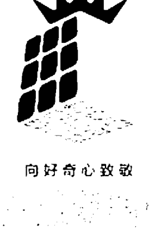

向好奇心致敬

以下这些研究都是历届菠萝科学奖的获奖项目 ——

数钱可以减轻疼痛 — 中山大学心理系 周欣悦

中国人识别老板的脸更快 — 北京大学心理学系 韩世辉、马燚娜

男生追女生的数学模型 — 国防科技大学信息系统与管理学院 周星 克居正

早撒谎的孩子更聪明 — 多伦多大学儿童研究所 李康团队

棒棒糖要舔多少次才能舔完 — 纽约大学柯郎数学系 黄金紫团队

婚礼份子钱公式 — 长庚大学电子工程学系 赖以威

一个泳池里平均有140瓶尿 — 阿尔伯塔大学 李杏芳教授及其研究团队

我认为这些研究值得好好欣赏 —— 它们都有一种英伦风。

## 参考文献

> [1]. How bumbling British boffins became a standing Russian joke, James Harkin, New Scientist, Dec. 19, 2017.

万维钢

想认识这样的“英伦风”研究组织并不难 —— 果壳网就在隔壁开了专栏《给孩子的博物学》，他们的总编徐来率领了一百多位科学家就想证明一件事：永远不要低估一个孩子探索欲和理解力。推荐你去看看。


## 特别放送 | 精英日课十大好书评选揭晓及获奖名单

万维钢

经过两周的评选，咱俩的秋季读者一起选出了最喜欢、最受启发的十本书，今天的特别放送，就把这个结果和获奖名单跟各位公布，已经有4本书出了中文版，我也为咱们读者向出版社申请了限时特价，你可以3-4折拿下它。恭喜获奖的读者，也更感谢参与投票的大家！也希望你可以把这张书单转发分享给朋友。能让更多的终身学习者受益，是咱们专栏的荣耀。

### Top1.未来简史 / 尤瓦尔·赫拉利

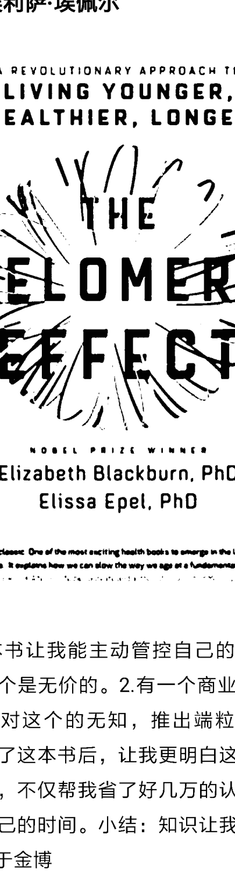

*《未来简史》，不图谋预见未来，只妥善清理现状。@李文彪

*整个人对世界的看法被刷新了，以至于很长一段时间都在考虑今后怎么做个神人。跟着作者回顾历史展望未来，感觉整个人都变得厚重了。@边走边瞧

*超越人类智慧的人工智能、主动的基因改造技术，更高级的经济增长，会把人类变成什么样？同样是人人关心的大问题，经赫拉利一分析，就连老司机的三观，都能被刷新一遍。

有多少历史学家对当前生物学的进展信手拈来？有多少宗教学家了解截至2016年，现代科学对人的“意识”的理解？有多少经济学家能同时用历史、心理和动物学的理论解释明白，让大规模人群合作，和小团队互动，有什么本质的区别？非得有一位像赫拉利这样通才式的学者，才能把这一切综合起来，让我们对现代世界、对历史和未来，有点深入的见识。@万维钢

截止拿下《未来简史》中文版电子书，日课读者专享5折特价

### Top2.为什么佛学是真的 / 罗伯特·赖特


*有生命力的宗教就是真的。或许有些理论足够模糊、可解读性强，后人不不断根据自己的认知去解释这些理论，让他不断丰满，才成为“真的”。“佛学是真的”说明佛学的理论体系富有生命力。@雪儿

*和超自然现象没有关系，佛学对人心的疗愈和澄净是真的，听完万老师解读，知道了背后的原理。@Yk

### Top3.盗火 / 史蒂芬·科特勒和杰米·威尔


### Top4.端粒效应 / 伊丽莎白·布莱克本，埃利萨·埃佩尔


### Top5.给忙碌者的天体物理学 / 尼尔·德格拉斯·泰森

NEIL DEGRASSE TYSON ASTROPHYSICS for PEOPLE in a HURRY

*听得我热血沸腾。我要把这个说书做成视频给我的学生们看。在带领学生参观我国建设的天眼FAST前，同学们朗诵了卡尔·萨根的毕业致辞。希望寒假过后我们的视频能带给学生来自天体物理学的震撼。这是 我对于物理学的最好的致敬。@郑金非吧

*在宇宙里，做好点小事就是最大的意义。@黄星球

*这本书的关键是“忙碌者”——你整天忙着生活忙着赚钱，那你为什么还要了解天体物理学呢？因为这可能会改变你的世界观、人生观和价值观。

我们在第一季专栏解读这本书的时候，好几个读者表示听哭了。暗物质的陪伴、暗能量的惆怅，物理学家煞费心机的探索和意外发现，了解一点宇宙学，你能获得一个全新的视角。作者泰森有句名言说“这个宇宙没有义务让你理解”，而读这本书，你也许就可以稍微理解一点宇宙——对此你应该感到非常庆幸。@万维钢

### Top6.无为 / 森鸥澜


*本来东方文明西方文明八竿子打不着联系，这本书却用西方的视角解读东方的儒释道，最为关键的是很有道理。我在其中最深切的体会就是，怎么理解生活都可以，但想过的好，就得结合大环境进行判断。@若木

*一位西方学者，用脑科学的最新研究结果，给庄子的“无为”，提出了一个解释：你越想得到无为，你就越得不到无为。庄子的“无为”是一个古老话题，国内学者的研究早就汗牛充栋了。但是我敢打赌，哪里你是一位国学大师，这本书的内容，也会让你耳目一新。

我现在觉得这是我所听说过的关于“无为”的解释中，最靠谱的一个。@万维钢

### Top7.成功与运气 / 罗伯特·弗兰克


*如果 你成功了，那很好，但要记住运气和大环境对你的成功帮助很大，要懂得感恩；但如果没成功，也不能放弃努力，如果不是勤奋和有才华，根本走不到被运气眷顾的那一步。@李虹霖

### Top8.不充分均衡 / 埃利泽·尤德考斯基


*作为一名医生，这本书让我想起多年前听说过的麻醉师将气管插管器械改良而获得专利的事，更多时候一线医生会发现各种医学漏洞，但常以“不是专家”“忙”等借口错失了摘取“低垂的果实”的机会，而我要努力避免。这是两季日课以来最让我兴奋的一本书！@浴火

### Top9.以大制胜 / 斯科特·亚当斯


*听万老师解读这本书，最深刻的感受是“我非常不愿意让其他人知道有这本书”，它直首就像是一本失传的武功秘籍，满满的干货技巧，而且威力巨大。如果你认真学习，你可以轻松的驾驭它，并悄无声息的影响他人！@靖王

### Top10.原则 / 雷·达里奥

联系微信OUCHSTYLE免费体验一个月

### Top10.原则／雷·达里奥

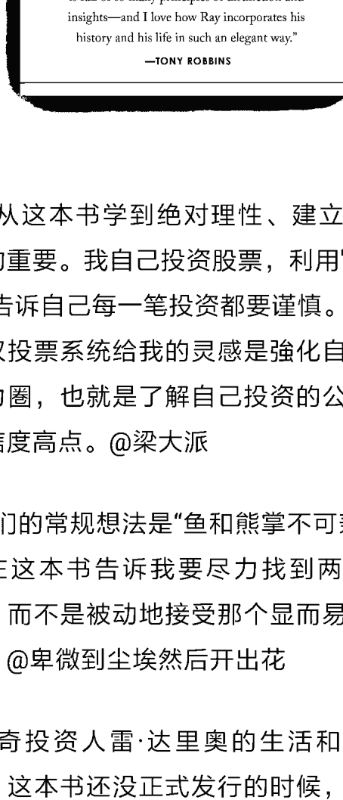

*我从这本书学到绝对理性、建立自己原则的重要性。我自己投资股票，利用"疼痛按钮"告诉自己每一笔投资都要谨慎。可信度加权投票系统给我的灵感是强化自己专业能力圈，也就是了解自己投资的公司，让可信度高点。@梁大派

*我们的常规想法是"鱼和熊掌不可兼得"，而在这本书告诉我要尽力找到两全的道路，而不是被动地接受那个显而易见的选择。@卓微到尘埃然后开出花

*传奇投资人雷·达里奥的生活和工作原则。这本书还没正式发行的时候，就已经上了畅销榜。

我认为你要借鉴的是这个思想——对个人来说，也许最重要的是面对现实；对公司来说，也许最重要的是"想法的精英政治"——达里奥认为这个系统比民主政治、独裁政治都要好。使用这些原则的大前提是你得有理性。聪明人加聪明人，理性乘以理性，大约就是这样的情况吧。@万维钢

截止拿下《原则》中文版电子书

## ——获奖名单——

恭喜@许建闵Tony，获得获得价值2018元的猫王收音机一台；


以下读者将获得价值666元的得到终身学习者礼盒一个：@成洁getit @雪儿 @自昭明德 @钱清渠 @用心 @白志奋 @李虹霖 @Kevin @麦迦 @陈亚兵


以下读者将获得第一季精选集《高手》精装签名版：@李文彪 @Yk @润记 @郑金非吧 @若木 @李虹霖 @浴火 @靖王 @梁大派 @Ashley @英豪 @张磊 @Michael Wang


## 答读者问｜既然数学确定一切，奋斗还有意义吗？

答读者问｜既然数学确定一...

## 来自日课：到底有没有“随机”？

一个高次多元方程是不是可能会解出好多个解吗？具体是哪个解，是不是就是随机呢？概率论不应该也是数学的一部分吗，光的行射函数能算出光子出现的概率，那么只要随机出现了光子不都是符合数学吗？

万维钢

任何数学方程，不管你怎么折腾，最后给出的结果一定是确定的。就算是方程有多个解，这些解也是同时存在。

物理上的随机是什么意思呢？是我今天做实验观测到结果 A，明天又做一遍，系统还是这个系统，却出现了结果 B。对应到数学，这就相当于今天解方程解出来一个 A——而没有 B，明天解却解出来一个 B——而没有 A。数学不会跟你开这种玩笑。所以爱因斯坦说上帝不会掷骰子。

概率论的本质是用数学公式描写社会现象或者物理过程，但这种描写是另一个层次的描写。比如说掷硬币吧。在底层的数学物理世界看来，硬币到底是正面还是反面朝上完全是由你的手法、风速、高度、地面状况决定的，没有什么随机。可是用底层数学直接算实在太复杂了，我们算不了，没有办法，才假定这个过程是随机的，改用概率论去算。

即使如此，概率论用到的任何数学方程也都不是随机的，算出来的概率数值也都是确定的。随机性，仅仅体现在*人*，对运算结果的*解读*——而这个解读是非数学的。

## 来自日课：领导者的智商最好在115到124之间

有一个问题想请教万老师，如果说CEO都是智商很高的人，那他们当初是如何经历中层管理的这个阶段呢？

万维钢

论文里说的是个统计的一般规律，但各人总可以是特殊情况。有些智商很高的人如果愿意好好跟人交流，完全可以当好一个中层管理者。从底层一步步提拔上去的CEO就有可能是这样的情况。

还有一种可能是，有些 CEO 只当过 CEO。比如很多创业者，一开始就是全公司自己说了算，根本就没当过中层的管理者。这些人个性很强，但是因为他们的智能已经是公司的灵魂，别人才愿意配合他们。

## 来自日课：只问数学，无问西东

意识如果是一连串电信号的放大或串联，那么推动这一切的第一张骨牌的力量究竟是叫来的？感觉上这就像是“灵魂”，给了我们有形的大脑一个开端似的（我是 Perspective? 我是不信有灵魂的）还是讨论这个就像讨论宇宙大爆炸之前是毫无意义的？

万维钢

这其实是一个很有意义的问题！我们把大脑和计算机对比，计算机，其实真有 section "开始"问题。计算机程序总有一个开始运行的时刻——而开启这段程序的，归根结底，不是任何程序，是人。现在 AI 算法再自动化，也总需要一个外部的人，告诉算法一个目的。事实上人往往还要告诉算法做判断的标准。现在还没有哪个 AI 自发地产生目的，所以我们觉得 AI 还都不是“活的”。

但这不等于将来的 AI 也没有自主性，更不等于人脑的开端有什么神秘性。也许生存本能就是一切思维的开端。如果 AI 将来有了生存的意识，我们也可以当它们活了。

如果人生的轨迹都是确定的，那这不就得信命了吗？那我辛苦奋斗还有什么意义？那是不是我不需要任何意志力，只要follow my mathematics就行了？

万维钢

首先“确定”不等于“已知”。看足球比赛我们都爱看现场直播，因为录像没悬念——可是电视剧都是早就算好了的，我们为什么还爱看电视剧呢？根据计算不可约的原理，即便是完全确定的未来，我们也没有任何办法提前算出来，唯一的办法就是等着它演化。所以人生仍然有悬念。

但是更进一步，我们看直播的另一个原因，是存在一个理论上的可能性，只要比赛还没结束，我们就仍然有可能左右比赛结果。这个问题的本质就是在数学宇宙中，你对自己的未来到底有没有选择权？

数学物理的答案是，什么是“你”？什么是“选择”？“你”只是你大脑的叙事自我，“选择”只是你大脑里这边原子运动产生的一个电信号。“你”和“选择”都是幻觉。

怎么理解这个数学上的确定性呢？如果有个算命的告诉你，说你这一生注定大富大贵，那你可能要慎重考虑是不是有必要继续努力奋斗。但是第一，数学并没有告诉你这些，没有任何人能告诉你——这是数学比算命先生“弱”的地方。第二，在数学上，连你怎么选，都是早就注定的——这是数学比算命先生“强”的地方。

但这对我们的生活没影响。因为你什么都不知道，你还是得亲自做出选择。

既然时间的流逝是幻觉，为什么人能自由在三维空间来回移动，但在时间这个维度上只能单向移动呢？数学宇宙是否也不可避免走向热寂？

万维钢

我们从来都只是看见鸡蛋掉到地上摔碎了，从来没见过地上的一滩碎鸡蛋自动组合成完整的鸡蛋又飞回到桌子上。这个规律就是热力学第二定律要求的时间箭头——但热力学第二定律，只是一个宏观的、统计的规律。

微观世界，根本就没有时间箭头。两个小球相遇、碰撞、又分开，这个过程的录像是正着放还是倒着放的，你根本无法分辨。物理方程都是可逆的！

那么为什么微观可逆，宏观上却表现出一个方向呢？这纯粹是一个统计的现象。比如说现在操场上有一群小学生，排成整齐的队列。你一声令下，说现在解散，同学自由活动吧。这时你可以想象，队列将会散开，变得非常紊乱，熵增加了。

可学生们明明是“自由”活动的啊，他们往这边走可以，往那边走也可以。操场上胡乱运动的一群小学生，也许走着走着就*偶然地*走出一个规则的图案来——只不过这种事情发生的可能性非常小而已。

但是底层的物理定律并不禁止这种事情发生。地面原子的热运动如果偶然有一个共同的方向，就有可能自发地把一个什么东西发射到桌子上。有些物理学家甚至相信，考虑到宇宙是无限大的，也许就有某个地方，有一群原子，在机缘巧合之下，就自动排列成了大脑的结构，而且还产生了意识！只不过这种事情在宇宙中极其罕见而已。

所以说，物理定律并不禁止你越活越年轻——只不过这种事情在宇宙中极其罕见而已。

什么叫数学允许它存在呢？我用2元钱去买彩票，是不是肯定有一个宇宙中的我中了头奖呢？如果我和刘翔赛跑，是不是有一个宇宙中的我会赢得比赛呢？

万维钢

即便无数个平行宇宙里有无数个一模一样的你，也不是“一切皆有可能”——只有数学上允许的，才有可能。如果彩票是公正的，那数学上就允许你中奖，那就肯定有一个宇宙中你中了奖。

但是如果你从来都没有练过短跑，那就在任何一个宇宙里你都赢不了刘翔。所谓数学上允许，就是这件事从始至终每一步都符合数学。如果你小时候曾经用抽签方法决定是否去当个运动员，那的确可能有个宇宙里的你是体育高手——但那个你长大以后跟现在这个长大了的你肯定是非常不同的了。现在跟这个长大了的你一模一样的，由于身体条件所限，都赢不了刘翔。

总而言之，数学跟万能的上帝还是有本质区别的。

就算这些数字符合某些公式，但无法预知，那么跟随机有何不同？不管真随机假随机《西部世界》里有句话：既然无法分辨，那又有何不同？

万维钢

如果我们只想在“西部世界”里做普通游客，那是真是假的确没有不同。实际上我们可能还更乐意把那些机器人都当做真人，这样游戏才更有意思。

但玩的时间久了，你可能就不愿意永远按照运营者的设定玩。你可能想知道这个游戏底层的逻辑到底是什么。表面上看是无法分辨，但是只要理论上不一样，那就存在一个将来发现不同玩法的可能性。

就以数学上的伪随机数为例子。是，使用数学公式也能产生看上去非常随机的数字，但是所有生产伪随机数的算法都有漏洞，而只要用得足够久，人们就有可能发现这个漏洞。比如说，用伪随机数加密总是不安全的。这就是为什么现在的计算机都自带一个物理的随机数产生器，而不用数学算法。

也许更重要的是观念上的差别。难道在数学之外，还有别的能力能左右物理结果吗？世界上到底有没有无缘无故发生的事？这些问题令人深感不安。

## 来自日课：有一种研究叫“英国的研究”

越来越多的科学家和艺术家也都希望走到群众中去，但这样也许就会出现“取悦”群众，而降低了科学的严谨性的现象，那么，这样的现象对于科学和艺术审美的发展是不是一种阻碍呢？我们是不是应该采取措施反对甚至抵制这种现象呢？

万维钢

中国有些科学家出了名以后喜欢发表不靠谱的言论。这再次提醒我们科学家也是普通人，大多数科学家只了解自己专业领域的知识。科学家不等于就是知识分子，很可能只是个工匠。

但科学家毕竟受过专业的科学教育，他们再不靠谱也比那些仁波切靠谱得多。如果科学家说错了，你有理有据地指出他的错误，他通常都能理性对待，心平气和地跟你讨论，甚至有可能接受你的批评。科学家永远都不会说“我的理论深不可测，你没到那个境界所以理解不了”，不会说“心诚则灵”，更不会说“这反而证明了我的正确”。

科学家都比较害羞。他总是试图用证据说服你，从来不要求你“信仰”他，他从来不说“我的理论闪耀着真理的光辉”。

所以我们怎么能反对科学家发言呢？

## 日课预告 | 行事要《见机》

日课预告 | 行事要《见机》

讲完了烧脑的数学宇宙理论，下周我们要从平流层回归对流层，重点说一本难度系数只有 3 的新书。

这本书 2018 年 1 月 9 号刚刚出版，叫《见机：完美时机的科学秘密》（ When: The Scientific Secrets of Perfect Timing ），作者是科学作家丹尼尔·平克（ Daniel Pink ）。

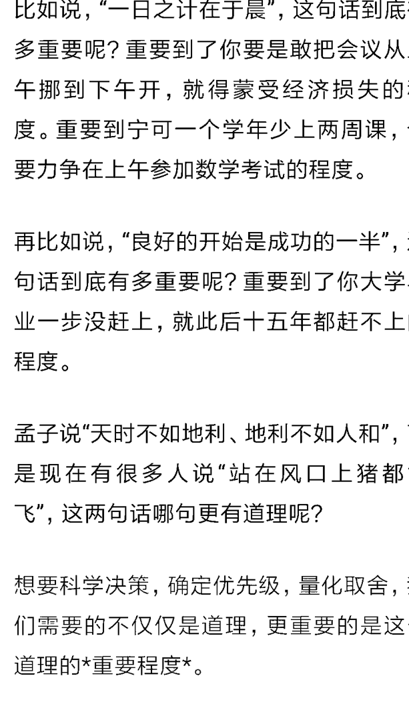

这本书的主题是“时机”。有很多书研究“做什么事”（what）和“怎么做事”（how），这本书研究的是“什么时候做事”（when）。秉承我们精英日课选书的一贯风格，这本书里也有大量最新的研究，而且这些研究都很有意思。

我们将用这些研究，重新审视一些有关“时机”的传统智慧。

比如说，“一日之计在于晨”，这句话到底有多重要呢？重要到了你要是敢把会议从上午挪到下午开，就得蒙受经济损失的程度。重要到宁可一个学年少上两周课，也要力争在上午参加数学考试的程度。

再比如说，“良好的开始是成功的一半”，这句话到底有多重要呢？重要到了你大学毕业一步没赶上，就此后十五年都赶不上的程度。

孟子说“天时不如地利、地利不如人和”，可是现在有很多人说“站在风口上猪都能飞”，这两句话哪句更有道理呢？

想要科学决策，确定优先级，量化取舍，我们需要的不仅仅是道理，更重要的是这个道理的*重要程度*。

周一晚 10:43，咱们一起研究什么叫真正的“见机行事”。


## 日课085 | 《见机》2:精确休息法

日课085 | 《见机》2:精确...

今天咱们继续说丹尼尔·平克的《见机》。上次我们说到一天中的不同时间应该做不同的事情，比如下午就不太适合做需要集中注意力的事情。那如果你必须要在下午参加重要会议或者数学考试，怎么办呢？你应该先休息。

我们在第一季讲《巅峰表现》那本书的时候，提出一个概念叫“战略休息”。今天咱们把这个概念再进一步，叫“精确休息”。

我先举个例子。十多年前就有些专家呼吁要让员工在工作日的下午小睡一会儿，精力更充沛，提高工作效率。我听说有的公司真的就实行了小睡的制度，专门开辟一个睡觉的地方，员工可以半躺着，把头遮起来，在不受打扰的状态下小睡一会儿。

可是公司很快就发现这个效果并不好！很多员工一睡就是一两个小时，好不容易醒过来，一下午都昏昏沉沉，哪有什么工作效率。

这就是对休息的控制不够精确。那精确的小睡应该是怎么睡呢？

- 1. 先喝杯咖啡，其中咖啡因的含量应该是200毫克；
- 2. 手机设置25分钟定时；
- 3. 开始睡；
- 4. 25分钟一到马上起来。

下面咱们就说说精确休息的原理。

## 1.为什么不要在下午看病

我们专栏讲过，去医院看病是个危险事儿，美国每年死于医疗事故的人比死于交通事故的人还多。不过医疗事故并不是均匀地分布在一天之中——医生生死的大部分错误，是发生在下午。

平克列举了一系列的研究结果。杜克大学医学中心对9万台手术统计发现，如果是早上9点做手术，麻醉师犯错的可能性是1%；而到下午4点的时候，犯错的可能性就上升到了4.2%——这是四倍的差距！当然麻醉师犯错不等于病人一定会受到伤害，如果单纯统计因为麻醉师犯错对病人造成直接伤害的概率，早上8点的是0.3%，下午3点就提高到了1%，也是三四倍的差距。

所以你知道把麻醉安全度提高四倍的最简单方法是什么吗？选择早上做手术。

还有一个是公众不太了解，但在医学界是非常头疼的问题，就是医生不爱洗手。因为医生不爱洗手而导致患者感染的情况非常多，但是医生们真的很难做到在所有该洗手的时候都洗手。

2015年，有人干脆做了一个特别厉害的研究。找4000个医护人员——其中1/3是医生，2/3是护士——全部佩戴 RFID，无限射频识别器，随时监测他们有没有洗手。统计结果是一段时间下来，总共1400万个该洗手的场合中，医护人员做到洗手了的不到50%。特别是，下午洗手的次数又比上午少了38%。

医疗并不是一个特别讲究创造性的职业。它更强调的是严格操作，按照程序走，高度集中注意力，才能不犯错。可是医生也是人，他们不可能每时每刻都保持着万分小心，上期说的情绪和精力变化曲线也适用于医生。医生们在上午已经尽力了，到下午也容易犯错。

而有些事儿在下午干是要致命的。英国交通部门的统计发现，一天24小时中，最容易因为犯困而导致交通事故的，一个是凌晨2点到早上6点之间——这本来就是应该睡觉的时候——另一个就是下午2点到下午4点。

英国人甚至还找到了事故高峰的精确时间点：下午2点55分。

这个点儿不是工作的点儿，应该用来休息。

## 2.休息的方法

咱们经常读书的话，你会发现有些事情是一本书一个说法。比如说减肥和营养学，今天这个专家这么说，可能明年就有本新书全面推翻他的说法。可是关于“休息”，我们精英日课第一季和第二季提到过的所有说法，都是比较一致的——可能科学家们已经找到了休息的“统一理论”。

那我们不如以《见机》这本书的说法为主，再来归纳一下上班时间的休息方法。

第一，要有定时的短休息，也就是所谓“break”。有的研究说最佳间隔时间是每工作52分钟休息17分钟，也就是 52 + 17。《巅峰表现》那本书里还提到有的研究说 50 + 7，51 + 9 等等，所以没有必要搞得精确到分钟——大体来说，差差不多是工作不到一小时，就休息十来分钟。

第二，休息这几分钟的时间就不要再想工作的事儿了。要离开工作去做一些不消耗认知力的事儿。我们第一季讲过一期叫《科学休息法》，其中最关键的研究结果就是凡是看电影、看书、玩手机这种消耗精力的活动都不叫休息，它们只会让你更累。

第三，动起来比不动好。哪怕出去散步五分钟，都有很好的效果。

第四，可以把这个短休息用于社交。找人随便聊聊天比独自一个人休息的效果好。

第五，户外比室内好。最好找个有树的地方接触大自然。如果是在室内休息，可以通过窗户眺望一下远方的景色——要是有窗外没什么景色，据说看看电脑屏幕上大自然的图片也有效果。

这种 break 应该在一天的工作之中随时进行。而到了下午，特别是2点55这个最困的时候，你也许就需要小睡一会儿了。

小睡的关键是一定不能超过25分钟。我们讲《巅峰表现》的时候也说过，一般的睡眠是有惰性的，睡着了不愿意醒，整个昏昏沉沉的时间很长——但是20分钟之内的

小睡就没有惰性。这方面的研究结果可以用下面这张图表示——


横坐标是从睡醒开始的时间，纵坐标是认知能力相对于睡觉之前的变化。两条虚线分别代表1小时以内和超过一小时的睡眠，我们看到醒过来以后认知能力是先下降的，得等过一段时间，睡眠的好处才体现出来，这显然就太影响工作了。

而图中的实线代表20分钟的小睡——小睡没有睡眠惰性，醒过来马上就特别精神。所以平克建议设定25分钟定时，你用5分钟睡着，然后正好睡20分钟起来。

很多人用咖啡提神——如果配合小睡的话，你应该在睡之前喝咖啡！这是因为咖啡因进入你的血液循环正好需要25分钟。你喝完咖啡马上睡，25分钟之后醒过来咖啡因也开始发挥作用，认知能力是双重的提升。

喝咖啡是可以的。我们讲《端粒效应》的时候说过，现在研究认为咖啡对身体无害——而且咱们上周说了，根据英国科学的研究，每天最好喝三到四杯咖啡。

把这些综合起来，我看最理想的工作环境应该像幼儿园一样：上有课铃、下有课铃、课间休息就都出去玩，下午还有午睡时间。

## 3.成本收益分析

我们前面说了，提高医疗安全最简单方法，就是选择早上做手术。可是病人这么多不可能都安排在早上啊，那你知道提高医疗安全第二简单的方法是什么吗？就是做手术之前让医生休息一会儿。

平克这本书提到，有个大医院专门给医生做了休息训练，让医生养成在重大手术之前休息片刻的习惯——结果在这个医院做手术的病人死亡率，下降了18%。

这就等于原本你手里应该一年死五个人，现在只死了四个——而让你做的仅仅是每次手术前休息20分钟。

还有，我们上次说了，让小学生下午参加数学考试，就相当于一个学期少上了两周的课，对吧？但是，如果在考试之前有20到25分钟的休息时间，让孩子们去操场上玩耍一会儿，考试成绩就不但不会下降，

玩要一会儿，考试成绩就不但不会下降，反而还能提高。一个25分钟的玩要时间，相当于一学年多上了三个星期的课。

这就是量化研究的力量，你不但知道休息重要，还知道重要到了什么程度。我们看到小睡的具体量化研究结果，但是平克提到，小睡20分钟，大概能带来3个小时的清醒时间。

那如此说来，休息时间，大概是你最值得花的时间。

## 由此得到

- 1. 对需要集中注意力的工作来说，下午的工作时间太容易犯错了。特别是下午2:55。
- 2. 休息可以大大提高你的工作效率 —— 而休息的关键，在于精确。

在忙碌的现代社会，休息几乎都成了一个反直觉的行为。明明手里还有很多工作，而你为了完成这些工作，反而应该先停下、不工作。

高手应该时刻关注自己的状态，总是确保在关键工作中做到精力充沛。而如果你能精确休息，精力充沛根本不是问题。

延伸阅读：战略性休息

## | 由此得到

即便是看似寻常的事情，良好的开始也至关重要——

- * 如果上课时间推迟不到一小时，毕业率就能提高11%；
- * 如果赶上失业率是10%而不是6%的年份，20年内平均每年要比别人少挣5千美元；
- * 如果这个手术是四月份做而不是等到七月份让新手做，死亡率就能相差41%。

那我们怎么能不重视“时机”呢？

今天我们说的这些研究的意义比结论本身重要得多。开始时候小小的差距，后来都会有那么大的不同，那如果开始的差距就很大呢？

比如中国的经济形势变化比美国快得多，一个公认的事实是70后面临的境遇要比80后好得多。80后开始工作的时候，好工作岗位已经被70后占了，好房子已经被70后买了——那么此后20年，这两拨人的差距会有多大呢？

大学毕业和高中上课的时间都是我们自己左右不了的，但是有些事儿你可以自己决定。今天最大的教训就是，当你决定要做一件事情的时候，你要考虑的不仅仅是你有多么想做这件事、这件事是你多年以来的什么情怀——你应该仔细考虑，现在是不是开始这件事的时机。

接下来，我们再看看在事情的中途和结尾应该怎么做。

## 划重点

> 当你决定要做一件事情的时候，你要考虑的不仅仅是你有多么想做这件事、这件事是你多年以来的什么情怀——你应该仔细考虑，现在是不是开始这件事的时机。

## 日课087 | 客观题和主观题

日课087 | 客观题和主观题

今天的主题是有关于“认知”的认知。你肯定听说过“客观事实”和“主观观点”的区别，咱俩先来重温一下这两个概念。

老张和老王，有如下一场争论——

老张：2197的立方根等于13。
老王：不对，2197的立方根等于14。

你对这个 inconsistence 怎么看呢？这是一道“客观题”。2197的立方根是非常常截了当的，任何人拿个计算器计算都知道答案是13。数学是绝对客观的，这是无可争议的客观事实。

那咱俩再看下一题——

老张：豆腐脑这种东西就应该是咸的。
老王：不对，咸豆腐脑怎么吃啊，甜豆腐脑才好吃。

那你还能判断谁对谁错吗？这是一道“主观题”。可能老张是北方人喜欢吃咸的，老王是南方人喜欢吃甜的。两人只是口味不同，根本没有绝对的对错。

## | 我的评论

我对此有两个看法。第一个看法可能比较激进，就是，我认为，至少从理论上来说，任何问题么就是客观问题么就是主观问题，没有什么灰色地带。我认为理想状态下争论的结果，要么就是发现双方争论的根本就不是同一个问题，要么双方就应该达成一致。

这么做还能让你更有说服力。形象好，有智慧，谁都愿意听这样的人说话。

结合今天说的研究，这就是个非常有意思的局面。我们知道人之所以进化出大脑，主要并不是用来追求真理的 —— 更多的是为了说服别人。大脑是个说服力工具。但是，为了要说服对方，你反而要假装你并不是在试图说服对方，而是在向对方学习！

## | 由此得到

认知决定行为，行为也能影响认知。不管实际上有没有“死理”，那些表现得不认死理的人，做事风格更开放，形象更好，更有说服力 —— 反过来说，如果你故意表现得不认死理，你可能真的会好好反思自己的认知。

参考文献
[1] Are Toxic Political Conversations Changing How We Feel about Objective Truth? By Matthew Fisher, Joshua Knobe, Brent Strickland, Frank C. Keil, SCIENTIFIC AMERICAN FEBRUARY 2018.
[2] 奥曼的原始论文是 Agreeing to disagree，发表于1976年。我以前写过一篇文 章叫《真理追求者》，介绍过奥曼这个理论。

## 划重点

如果争论双方都是诚实的、以追求真理为目的的人的话，那么不管在争论开始的时候双方分歧有多大，这个争论都会在有限步之内结束，双方终究会达成一致，不应该存在各自保留观点的结果。

## 特别放送｜受欢迎者的自我修养

特别放送｜受欢迎者的自我...

## 万维钢

各位好！今天的“特别放送”，是我为一本书写的序言，这本书是咱俩去年的日课里讲过的《欢迎度》，Popular: The Power of Likability in a Status-Obsessed World，作者是米奇·普林斯汀，Mitch Prinstein。现在这本书出了中文版，序言的内容能够帮你迅速了解这本书的内容，我也把日课解读的链接放到了文章底部，方便你复习回顾。

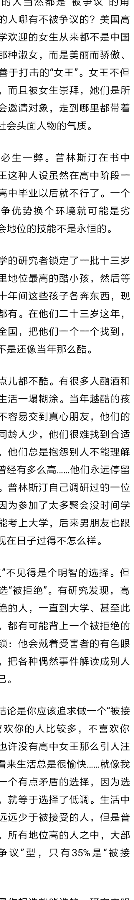

你是个受欢迎的人吗？我从小就是。

我从小就人缘好，班级各种选举和评选，只要是民主的，我基本都排第一。不管是书呆子还是社会人，只要必须相处，我都相处的不错。到美国以后英语限制了我的影响力，但我仍然维护了中国人的亲善形象，从来没被排斥过，处处受到优待。这并不是说我享受明星待遇或者一言九鼎，但如果我跟人说个什么事儿，肯定都能被 seriously对待。

做个受欢迎的人有很多好处，但是受欢迎的人可不总是那么容易做得……当然，对我来说是非常容易的，因为我父母就很受欢迎，我的妻子和孩子也都很受欢迎，我出声和生活在受欢迎的家庭。

没有任何证据表明是基因决定了人的欢迎度。但是根据米奇·普林斯汀的《欢迎度》这本书的说法，欢迎度，是在家族中传承的。

普林斯汀考察欢迎度的方法是把人分成“被接受”、“被争议”、“被忽略”、“被拒绝”和一般人五种类型，其中欢迎度最高的是“被接受”和“被争议”这两种类型。

- * 要帮助别人，而不是只顾自己的需求；
- * 要关注别人，而不是只想要被关注；
- * 要关注别人，而不是只想要被关注；
- * 要精心培养深入的关系，而不是收集更多的朋友圈“点赞”；
- * 要让别人感受到接纳和欢迎，而不是自己感觉高人一等。

普林斯汀的欢迎度课程在大学受到了热烈的欢迎。书中描写他每年都领着好几百个学生做一个大实验：假装一天自己是个受欢迎的人。实验结果是在这一天里，别人真的更欢迎你了。

所以，一方面是“高中永不结束”，青少年时代的社交精神枷锁可能会伴随你的一生；一方面是哪怕你愿意假装，你都可以提高自己的欢迎度。有些素质是遗传和环境给的，但你似乎总有选择权。选择怎样对待别人，就是选择自己是个什么人。选择自己是个什么人，就是选择下一代是个什么人。

在枷锁和假装之间应该怎么选？在高地位和被接受之间应该怎么选？我觉得答案不见得是显然的，但是了解这本书中有关欢迎度的知识，有助于你做出更明智的选择。

## 相关阅读

- 《欢迎度》1:"欢迎度"的科学
《欢迎度》2:能从十三岁看老的品质
《欢迎度》3:高中的精神枷锁
《欢迎度》4:怎样提高欢迎度

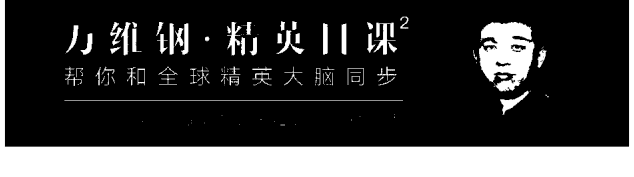

## 答读者问｜一切都是最好的安排……吗？

答读者问｜一切都是最好的…

### 来自日课：一日之计

人是上午容易被说服，还是下午？

那请假是应该放在早上说呢还是晚上说？

万维钢

上午容易被说服，请假也应该在早上。这是有些过硬证据的。以色列法官审核犯人的假释申请，上午的批准率高於下午，特别是早上刚上班的时候。这个时候情绪好，头脑清楚，容易做出理性决定，也更愿意为别人着想。等到临近中午又累又饿的时候，法官想不了那么多，索性就都拒绝了。

我们作为普通人该如何量化自己的行为呢？量化自己有什么软件能很好的实现吗？

万维钢

心理学家以前搞这种观测都是让受试者佩戴一个定时提醒的装置，同时随身携带一rae表格。每到一定的时间，装置就提醒受试者在表格上记录自己此时此刻在做什么，心情如何。

不过现在当然最方便的方法是使用手机应用。有个 APP 叫 Daylio，让你随时记录情绪和所做的事情，然后自动生成每天的情绪变化曲线，还能帮你分析做什么事情最容易引发你的什么情绪。如果分析结果是只要做这件事情就难受，那么你就应考虑停止做这件事。

我认为这样的自我量化还是有用的。我们之前讲过一个“峰终定律”，如果不做这种记录，可能最后你记住的只是情绪最强烈的时刻，和一段经历结尾的时刻 —— 你就无法全面了解自己。

当然，量化本身不是目的，目的是培养个人对自己的敏感度，科学安排生活和工作。

可以接地气地、结合一个人的例子来讲量化分析吗？

万维钢

我通常情绪稳定，没搞过情绪变化的量化，但是我经常做时间管理方面的量化。有一个 APP 叫 A Tracker，让你能随时记录当前做的事情。一天下采，做每种事情花费多少时间一目了然。你可能感觉自己忙了一天都在工作，可是一看记录，真正集中注意力工作的时间可能只有三四个小时。人对时间的长度是非常不敏感的。

女儿各个学科都还可以，唯独数学一直学不好，这次期末未考了73分，在班级里快垫底了，班级平均分92.5分，而语文英语分数又名列前茅。她很喜欢平行宇宙这本书，每天早上学上角路上我们都是听万老师的课一路前行的 关于这种偏科现象，有没有好的科学训练方法呢？

万维钢

数学是非常适合刻意练习的项目。我们第一季有篇文章叫《怎样用不时髦的方法学好初等数等学》，其中提到一位女性，一直 到26岁数学都很差，26岁这年突然发力，居然重返大学改学了理工科，数学成绩很好，后来还成了工程师教授。

她的关键经验是“流利”。不用过分强调理解，要强调流利。多做题，专门找自己不容易会、但是努力又能做出来的题目做，一直做到很流利为止，再去做更难的题目。这种有针对性的重复训练效率最高。要自己在家下功夫，把握自己的节奏，别管老师讲到哪里。

推荐阅读：怎样用不时髦的方法学好数学

### 来自日课：精确休息法

既然就睡20来分钟，那么是脱了外衣穿睡衣好好的在床上睡呢？还是随便在椅子或者沙发上应付一下呢？

万维钢

当然是随便应付一下。沙发是最好的，坐椅子上、趴桌子上，也可以。

万老师，番茄不科学？那什么科学呢？经常有什么理论今天还是对的明天就被推翻，应该怎样判断这类信息？

万维钢

番茄工作法是上世纪八十年代出现的时间管理方法，是民间人士提出的，只在民间流传，从来没有经过科学验证。而《见机》和《巅峰表现》这两本书里提到的工作50分钟休息10分钟的这个方法，都有过多次对比研究，而且是比较新的结果。所以我们当然有理由更相信后面这个方法。

在我看来，番茄工作法的最大问题是工作时间太短。25分钟休息一次，这个打断的频率太高了，根本不适合脑力劳动。其实我们每个人从小上课都是50分钟左右一节课，这个节奏应该早就适应了。如果一个人连50分钟都坚持不下来，这不也弱了 吗？从防止久坐的角度，时不时站起来走动一下是应该的，但那不是休息，思路不应被打断。

我们判断一个理论值不值得相信，应该遵循三个原则 ——

- 1. 学术论文比民间说法可信
- 2. 大规模研究比小规模研究可信
- 3. 新研究比旧研究可信

"番茄工作法"连第一关都没过。

### 来自日课：开始的时机

下午2:55这个时间点，是通过大样本统计得出的吗？如果是的话，那这不就是平均人思维吗？我是非常极端的猫头鹰型，经常晚上三四点还很兴奋，下午两三点才起床。又或者一个刚到美国没多久的中国人，才刚适应时差多久，那他要怎么看待和利用2:55这么一个科学休息时间呢？！

想请教万老师的事情是：您专栏中提到的最好上课时间推迟到早上08:30以后，可是最主要的影响因素是不是醒来的时间呢？如果能知道最有效率的醒来时间，例如07:30，而因为其他考量，所以上课时间仍然是08:00，那么我们只要搬到距离学校车程20分钟内的地方就好 啦？

万维钢

2:55是英国交通部门大规模统计的结果。我们在第一季《平均的终结》这本书里反复强调了"没有平均人"这个观点，每个人都有特殊情况。如果一个人下午两点起床，2:55肯定就不是最疲倦的时刻。如果一个人住的离学校很近，他就没必要要求8:30才上课。

但我想说说怎么看待统计结果这个问题。没有平均人，可不等于统计结果没意义。统计结果在很多情况下代表大多数人的状况。特别是像作息时间这样的问题，因为全社会已经在上下班时间上达成了基本共识，绝大多数人都是早上上班晚上休息，这些时间点就很有参考价值。作息时间与大多数人不一样的人，应该自己把这个参考点做一些加减。

而对公共政策的制定者来说，这些统计出来的结果就更重要了。学校不可能给每个同学定制一个单独的上课时间。总是所有同学一起上课，那就必须考虑大多数人的情况，而大多数人不住在学校附近，也不会为了配合上课时间搬家。


工资、薪酬是我们衡量一个人成功与否最重要因素？少赚10万美元就一定不是好事？我并不这么觉得，人生还有很多维度（比如阅历、朋友、健康、心情等等）需要衡量，也许多赚10万美元的工作，一生只办一类业务，接触一小圈子人，每天加班熬夜把身体搞垮，工作心情紧张压抑……很显然，这些东西的价值不止10万美元。所以，一切都是最好的安排。

万维钢

请注意我们说的多10万美元是在同等工作的情况下，仅仅因为时机好而多挣了这10万美元，不是由于比别人加班多。这10万美元是白得的，对每个理性的好。

“一切都是最好的安排”这句话不是鸡汤，是精神鸦片。明明这个境遇一点都不好，你非说这是最好的安排，这不是逆来顺受吗？这不自欺欺人吗？这样的人活着不是找罪受吗？对坏的状况不满意、不接受、要抗争、要改革、要奋斗，这样的人生才值得过。

我看有人说《一切都是最好的安排》“这本书也是她自己每每感到活不下去时的一粒速效救心丸，关键时刻真能救命”，这个剧情明明就是吸毒啊。

## 来自日课：客观题和主观题

这个世界有没有可能存在一些问题，在争论时无法判别客观还是主观呢？例如战争中，面对不利的局面，统帅层决策战还是撤，这种问题是没有绝对的对与错的，那是否用绝对的主观与客观的方式去判别，有失偏颇呢？

万维钢

这个情况其实是可以判断的。决定是战斗还是撤退，首先要问这么做是为了谁。比如我们设想一个情景。为了国家的话，国家需要这场胜仗。为了在场士兵的话，撤退能保证生命安全。为了指挥官的话，打仗可以有机会立功，而且指挥官通常不会死。各人有各人的利益，大家争论的可能不是一个问题，所以是战是撤，首先是个主观题。

一旦明确了这么做为了谁，剩下的 问题就是客观题。比如在场所有人都决心我们是为了国家，个人生死荣辱都不在乎，那剩下的就是怎么做对国家最有利。也许国家需要这一仗打赢，也许国家需要保存实力——到底需要什么，大家可以心平气和地推演一番，归根结底是个数学问题。

如果各怀鬼胎，没有办法就“为了谁”达成一致，那光动嘴、靠争论就不能解决问题。得动手。

我就是一个客观的人，也就是别人常说的杠头，说话总不能很愉快的被别人接受。有时候因为自己观点鲜明独特还有些自鸣得意。学习本篇要积极创造学习型谈话，有时候向知识观点的彼方装作谦逊，这难道这不是虚伪的行为吗？

万维钢

从前有一位女教师，因为跟男朋友闹矛盾，心情非常不好。可是她在面对学生的时候总是一副笑脸，耐心讲解问题，学生根本不知道她正在经历感情危机。你能说这个老师虚伪吗？


## 日课088｜《见机》4:你的中场战事

今天咱们继续说丹尼尔·平克的《见机》。上周我们说到对做事"开始"的时机选择，今天要说的是"中间"这个阶段。

我理解"见机"，就是要对"时机"保持敏感，上午意味着什么、下午意味着什么、开始的时候意味着什么，事先做到心中有数才好积极应对。

那么一件事情发展到中场，意味着什么呢？咱们先说说人生的中场，也就是"中年"。

## 1.中年的低落

最近中文网上流行一个词叫"中年油腻"，大约是形容那些要么就修身畸形、要么就自恋、要么就爱摆谱的中年人，反正是让人反感。"中年油腻"是个非常新的词，以前人们提到中年首先想到的是"中年危机"，有很多电影和小小说描述中年危机，说人到了中年就会面临家庭、事业一系列的问题，是力不从心回天无力。

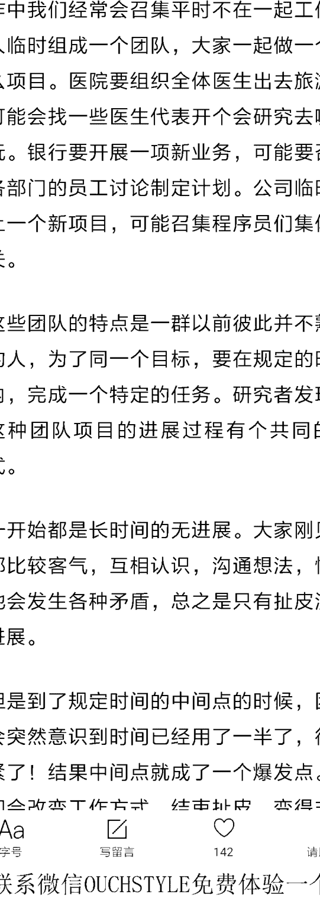

## 2.中间点的懒怠

紧了！结果中间点就成了一个爆发点。人们会改变工作方式，结束扯皮，变得非常有效率，一直到把项目做完。

研究者们跟踪了不同的团队，这个转变几乎总是发生在中间点。而且这个规律也有实验支持。

有个实验是把一个 MBA 班的学生分成8组，每组几个人一起讨论一个广告的策划方案，限时一小时。几个人坐到一起也是先是很放松，但几乎总是到了第28分钟至第31分钟这个中间点的时候，就有人反应过来，说我们的时间已经过去一半了，于是大家突然发奋把事情做完。实验里8个组中的6个组，工作效率最高的时候就是在中间点。

所以中间点可以是一个爆发点。但这个爆发显然是有条件的。项目时间进行到一半，这是一个“不努力不行了，而努力一下还有机会”的局面。

这个局面在体育比赛中很常见。宾夕法尼亚大学和芝加哥大学的两个研究者考察了 NBA 十五年、总共18000场比赛的数据，想看看中场的比分和比赛最后结果之间有多大关系。

我们可以想到，中场领先的球队最后取胜的概率也大——事实上如果打完两节中场休息的时候，你们球队要是领先对方6分，你们获胜的概率高达80%。

但是有一个特殊情况。中场比对方*落后*1分的球队，反而有超过50%的可能性取胜。如果是主队，中场落后1分，最后赢得比赛的概率高达58%。

这说明触手可及的落后能让人亢奋。这两位研究者还做了个实验来支持这个说法。在模拟的游戏中，中场时候被告知自己只比对手落后一点点的受试者，下半场更容 易爆发。

## 由此得到

- 1. 对大多数人来说，中年是人生幸福感的低谷期。
- 2. 人们做事情通常会更重视开始和结束，而在中间点懈怠。
- 3. 但是如果把中间点当做一个提醒，反而有可能在这个时候爆发。

现在我们可以猜测一下，为什么人生幸福感是一条U型曲线。

刚从学校出来进入社会的时候，人们都非常积极努力。你对自己要求高，别 人给你的评价也好，你常常有进步的感觉，很幸 福。

等到了中年，人们会松懈下来，各种缺点就出来了。你的各种社会角色已经很稳定，没人约束你、也没人对你有更高的期 望了，你自己对自己的要求也就降低了。 有些人到这一步，就变成了“中年油腻 男”。你表现得松懈，社会就会给你相应的反馈，你就会觉得自己也确实不像样， 你的情绪就会变得低落，到53岁的时候达 到最低谷。

但中年毕竟是思想最成熟考虑问题最全面的时候。你反思之后，会觉得生活还是值得好好过的，你可能会换一个活法……也可能想开了——从此之后幸福感越来越强。关于老年人为什么有如此强的幸福感，下一讲我们还有个说法。

今天的关键词是“懈怠”。当任何事情进行到一半儿的时候，我们首先应该想到这个词。如果你把中场的哨声当做一个提醒，中场就是一个爆发的机会。

不懈怠的中年人哪里会有什麽油腻感？

## 日课089 | 《见机》5:最好的结局

今天咱们把丹尼尔·平克的《见机：完美时机科学秘密》这本书说完。我们已经说了做事的开头和中间，最后这一讲说结局。

今天我们要说一些有关结局的研究，人们很容易把这些研究理解成结局很重要，要用一个完美的结局 foreseeable 自己一类 —— 但是这么理解的话你就辜负了平克的一番心意。

一般老百姓的做法是开头过于草率，中间容易懈怠，然后过度重视结局。我们读书就是为了比一般老百姓做的好一点。所以今天正确的做法，是—边读这些研究，一边想一个人 —— 慈禧太后。

### 1.拼在结局之前

马拉松是个很有情怀的运动。很多人跑马拉松不是为了竞技也不是为了锻炼，而是为了证明自己跑过马拉松。马拉松是他们人生的风采。有人统计了那些第一次跑马拉松的人，发现他们的年龄是以9结尾的居多，比如29岁、39岁、49岁。29岁跑人生第一次马拉松的人是在所有年龄段中最多的，比28岁、30岁的人多出一倍。

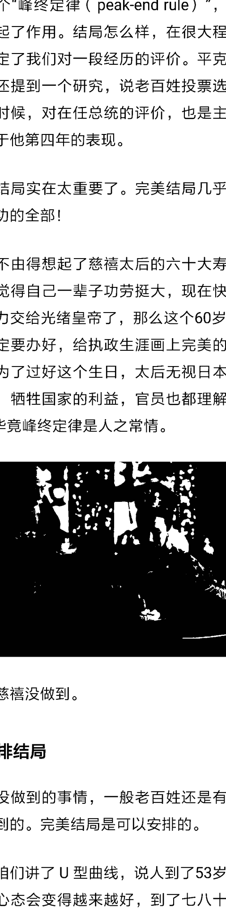


年龄逢9，是人生一个阶段即将结束的时候。一个29岁的人可能会有一种紧迫感，他一定要在30岁之前跑一次马拉松。

我看现在有很多人给自己的人生制定清单，什么多少岁之前一定要去的十个地方，多少岁之前一定要做的二十件事之类，好像清单没做完这个人生阶段就不完整。

这种对完美结局的追去，会让我们在临近里程碑的时候再拼一把，就好像跑步运动员在终点之前加速。平克举的是美式橄榄球的例子，我找到一个足球的数据。下面这张图是根据英超联赛八年的数据，对比赛每五分钟的时间段进球统计 [1]。


总体来说下半场比上半场进球多，这可能是因为下半场体能下降防守更不容易了。而在所有时间段中，上半场最后五分钟有最多的进球。上半场马上就要结束了，球员决心再拼一把 —— 这显然是个积极大于消极的时间段。

另一个例子是年龄逢9的男人更容易出轨，可能他们的心愿清单上除了马拉松之外还有这么一项。中国对出轨的统计没有这么详细，但众所周知贪官们有个“59岁现象”——一个从来不受贿的人，决定退休之前捞一把。


人们为什么如此重视结局呢？

### 2.再论“峰终定律”

从前有两个，人，老张和老李。他们都事业有成，是自己公司的老板。

老张是个大方的人。他给员工的工资很高，而且很客气。可是在快退休的时候，老张的性格突然变了，特别小气，动不动就克扣员工工资，人们越来越不喜欢他，很多人离职了。结果过了半年之后，老张就生病去世了。

老李正好相反。几十年都是个很小气的人，对员工很苛刻，人们都不喜欢他。可是到了快退休的时候，老李幡然醒悟，觉得自己应该做个好人，于是给员工提供很好的福利，人们都觉得重新认识了老李。半年之后，老李也突然生病去世了。

老张，几十年来都是好人，最后半年变成了坏人。老李，几十年都是坏人，最后半年是个好人。

那么请问，你如何评价老张和老李这两个人？

调查研究的结果是，人们对老张和老李的评价都不绝对的好人或者坏人——而两个人的得分，几乎一样。你当一辈子好人和只当六个月好人在人们心目中的形象居然就是一样的！

这当然是因为，我们在评价人的时候，过度重视他在人生最后阶段的表现。可能看电视剧看多了，总觉得最后结局时刻透露出来的才是真实的一面 —— 哪怕这个人是突然死亡的。

其实是我们之前讲《强力瞬间》的时候说过一个“峰终定律（peak-end rule）”，在这里起作用。结局怎么样，在很大程度上决定了我们对一段经历的评价。平克这本书也提到一个研究，说老百姓投票总统的时候，对在任总统的评价，也是主要取决于他第四年的表现。

所以结局实在太重要了。完美结局几乎就是成功的全部！

我就不得不想起了慈禧太后的六十大寿。太后觉得自己一辈子功劳挺大，现在快要把权力交给光绪皇帝了，那么这个60岁生日一定要做好，给执政生涯画上完美的句号！为了过好这个生日，太后无视日本的威胁，牺牲国家的利益，官员也都理解了一一 毕竟峰终定律是人之常情。


但是慈禧没做到。

### 3.安排结局

慈禧没做到的事情，一般老百姓还是有机会做到的。完美结局是可以安排的。

前面咱们讲了U型曲线，说人到了53岁之后，心态会变得越来越好，到了七八十岁的时候心态就是非常好。这可能就是人们对结局的妥善安排。

我们第一季讲过一本书叫《指导生活的算法》，说人到老年会缩小自己的社交圈，年轻时候认识的很多人不再联系了。与此同时，对身边亲密的人，还要加强联系。这是因为我们的探索结束了，要好好吃享受生活，这是主动安排结局。

其实不一定等年老，我们平时做事也是最重视结局体验。

有人在街头做实验，给行人发巧克力。你吃一块巧克力，研究者就会问你这巧克力怎么样，让你打个分。你吃完一块，研究者会再给你一块。吃到第五块的时候，研究者就暗自把人分成了两组。

对一组人，研究者说“这是你的下一块巧克力”。他们正常吃完，正常打分。对另一组人，研究者说的是“这是给你的最后一块巧克力”。这组人会很用心地品味这块巧克力，然后会打一个很高的分数，比前面吃过的四块的分数都要高得多。

这其实也是在主动安排结局。我们想让它完美，就会有感觉到它完美。

别人要告诉你一个好消息和一个坏消息，你想先听哪个消息？绝大多数人都会选择先听坏消息，先苦后甜。钱钟书说那些葡萄酒...

听坏消息，先苦后甜。钱钟书说那些吃葡萄把好的留到最后吃的人是乐观的，因为他们始终有希望。所有这些行为，都是精心维护一个完美的结局。

可是，愿望清单上打满了勾的完美结局，真的是最好的结局吗？

### 4.最好的结局

对好莱坞编剧来说，完美结局实在太俗了。

影片一开始主人公想要什么东西，影片结束的时候主人公得到了这个东西，这种套路已经过时了。

比如说《西游记》，一开始是唐僧师徒四人去西天取经，结局是取到真经功德圆满，这就是很古典的结局。我看现在很多网络小说还在使用这种剧情 —— 一开始我想要振兴大明、击败满清、夺取江山，最后结局是我果然做到了这些 —— 这就是为什么网络小说上不了大雅之堂。

平克采访了皮克斯公司的一个资深编剧。这位编剧说，要什么有什么的结局任何人都能编出来，艺术家可不能这么编。现在编剧们心目中的好剧情是这样的 ——

一开始你想要一个东西，你一番努力奋斗，而到结局的时候，你发现你之前*想要*的东西已经不重要了。你得到的是你真正*需要*的东西。你获得一个意外的洞见，你会学到一个道理。

比如说皮克斯的《飞屋环游记》。一个老人年轻的时候跟妻子有个梦想，要一起环游世界。后来妻子先去世了，而他的房子还要被拆迁。他就在房子上绑满了气球，想要坐着房子去环游世界，完成愿望清单。


可是他的计划充满了意外。先是来了个小男孩非要一起去，没办法只好带上小男孩。探险的过程中，终于遇到了年轻时候崇拜的探险家，结果发现那个探险家原来不是什么好人。


影片的结局不是老人完成了平生的梦想，而是他收获了一些更好的东西 —— 一些之前根本没想到的东西。

再比如说《汽车总动员》。主人公一开始想的是要参加比赛夺取冠军。也是发生意外，流落到野外，认识了一些看上去不怎么样的车。他一直努力想要回到赛场上去，新朋友也帮他。而当他终于回到赛场上的时候，他发现冠军已经不重要了。


重要的是他的人生收获了朋友、经验和教训。

所以，你到底想要哪种结局。

想要完美结局是一个合理的心理需求，但也可能是一种心理偏见。评价是别人心目中的评价，老张和老李的日子是自己一天一天过的。慈禧想要个完美的生日，等待她的却是灾难性的意外。


如果事情已经做得差不多了，结局就只是一个时间点。如果精心维护都维护不了一个完美结局，还不如期待一个什么惊喜。

参考文献
[1] GOAL TIME ANALYSIS, Ford Bohrmann, Soccer Statistically, July 15, 2013 http://www.soccerstatistically.com/blog/2013/7/15/goal-time-analysis.html

推荐阅读：数学家告诉你怎样慢慢变老


## 日课090 | 标准差和人生哲学

今天咱们说点概率论。你肯定听过“正态分布”和“标准差”这两个概念，但是很多人并不了解它们的意义。我想从这两个概念出发，说一点人生哲学。

我们的目的不是学数学，今天不会出现复杂的数学公式，我想给你一个直观的解释。有了标准差这个概念，你以后考虑问题的时候，就多了一个思维工具。你观察世界会有一个更精确的眼光。

在我看来，正态分布和标准差，是这个不确定的世界里数学家送给世人最有用的礼物。

这个思想可以用在很多事物上，但是为了简单起见，咱们还是用投资来对比方。

### 1.只有期望是不够的

假设现在你在手里有一笔钱，想投资做个小生意。你一个朋友找到你，说他知道一个好生意。他说咱们拿这些钱在国内采购一批药品，运到非洲去卖掉，只要两个月的时间，平均会有40%的利润。请问这个生意你做不做呢？

两个月赚40%，这在任何地方都是好生意——但是在你做决定之前，肯定会问一个问题。

风险。

如果你今天给我10万元，我过两个月一定、确定、肯定还给你14万，这样的生意谁都会抢着做——所以世界上根本就没有这样的生意。

你朋友介绍的这个非洲生意其实是这样的：10万元的货，运到非洲某国，如果一路没有任何差错，能卖到28万元。这是180%的利润！可是这个非洲国家的政局不太稳定，腐败横行，你们这批货有50%的可能会被直接没收，那就是血本无归，利润是-100%。

考虑到概率，这批货到非洲的“数学期望值”，是

180% × 0.5 - 100% × 0.5 = 40%

正好是40%的利润。

### 2.正态分布

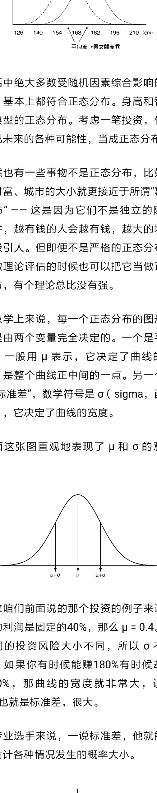


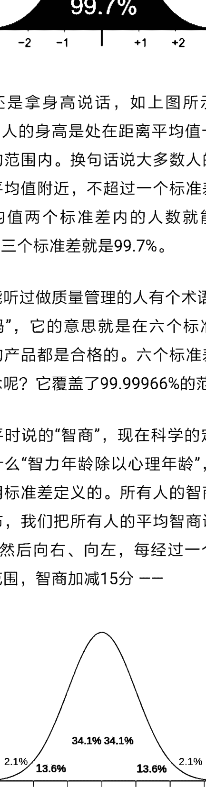

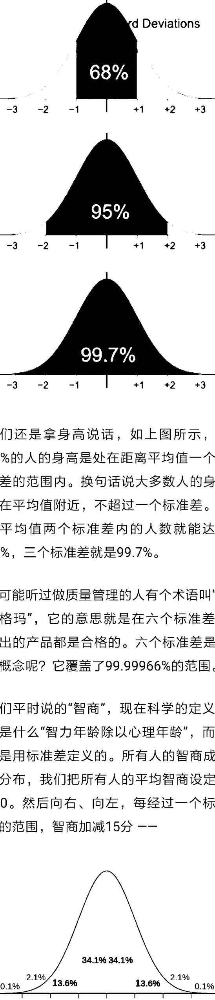


所以智商低于100一点都不可怕，智商的定义就是有一半人的智商要低于100！智商在85到115的人处在一个标准差的范围内，而我们知道有68%的人都在这里。如果你智商是130，那你就是在两个标准差之外，你比97%的人聪明。如果你的智商是145，你就在三个标准差之外，进入了占人口总数0.1%的高智商群体。

智商都是跟别人比较的结果。任何一个智商测验，一个人考完了就直接打分都是不太合理的，应该所有人都考一遍，看看总体的分布，才能决定答对多少道题相当于智商是多少分。

好，现在我们在“数学期望”——也就是平均值——之外，又有了一个关键概念，标准差。标准差的大小描写了正态分布的宽度。标准差，代表风险。

### 3.人生的标准差

咱们考虑一下下面这张图，它描写了A和B两项投资。横坐标代表各种可能的回报率，纵坐标代表每个回报率发生的可能性大小。两个投资的平均预期回报率都是10%，但是A的标准差很小。请问你选哪个呢？


选A是稳定的回报，选B可能有惊喜，但是也有赔本的风险。

如果你足够理性，就别指望什么惊喜。平均预期已经告诉你是10%，任何好运气都会被坏运气抵消。正如我们前面分析的非洲生意那样，你应该坚决选A。

说到这里我想起以前听说的一个调查。有人问过怀孕的夫妇，说根据你们两个的智力，如果现在设定你们孩子的智商的均值预期是110，但是你可以选择一个标准差，你会选多大的标准差？如果你选一个比较大的标准差，可能收获惊喜，生出来一个智商140的孩子，但也可能会收获不幸，智商只有80。结果几乎所有家长都选了一个非常非常小的标准差，宁可孩子不是聪明过人，也千万不要太傻了。

所以我们是真的不喜欢风险。

下面这张图是我画的，这三个分布代表三种人生。


A分布代表中国所有的人。中国人的日子现在很不错，所以A分布的均值是正的0.05。但是A分布的标准差很大，这意味着全国有很多人的生活比平均水平好很多，也有很多人的生活不太好。

B分布代表理想人生。均值很高，而且标准差很小，简直是苏东坡说的“无灾无难到公卿”。可是世界上哪有这么好的事儿，所以人们的理性期待，是C分布。

C分布的均值也是0.05，但是标准差比较小，相当于“平平淡淡过一生”。

但我们前面所有这些分析说的就是，C也是一个奢望。平安是一种福气！低标准差，是更值钱的。

预期回报率相同的情况下，我们肯定选标准差低的那一个。所以任何一个投资项目，想要让人接受一个很大的标准差，就必须提供一个很高的回报率。真正值得犹豫考虑的投资，是下图中的这两个——


A的标准差比B小，但是B的预期回报比A大。也许A相当于买债券，B相当于买股票。

那这种情况选A还是选B呢？答案就不是显然的了。有人认为评估一项投资的价值应该用预期回报除以标准差，这个比值叫“夏普比率（Sharpe ratio）”。按这个标准，你要让我接受多一倍的标准差，就得把回报率给我提高一倍才行。

我并不认为夏普比率有什么科学根据，它只是一个主观的标准。但是这个道理非常简单：更大的风险要求更高的回报。


## 由此得到

- 1. 随机事件大多可以用正态分布描写。
- 2. 正态分布有两个指标，也是我们考虑任何随机事件首先要问的问题。“均值”代表平均的回报率，“标准差”代表风险大小。
- 3. 均值越大越好，标准差越小越好。高风险必须给高回报，这个项目才有存在的价值。

有了标准差这个概念，我们就可以谈论怎么“对冲风险”了。咱们明天再说。

推荐阅读：怎么样用系统下一盘大棋


## 日课091 | 对冲风险的数学原理

我们经常会说这么一句话：“不要把鸡蛋放在一个篮子里”。今天我想从数学上来说说这句话的原理是什么。了解了原理，你才知道这句话的科学用法——特别是，到底应该把鸡蛋放在什么样的篮子里。

为此我们要借助于昨天讲的“标准差”的概念。我们知道，标准差，描写了一个随机分布的风险。

## 1. 两只股票的故事

从前有一个销售户外体育用品的 A 公司。A 公司的业绩受天气、季节、特别是空气质量的影响非常大。为了简单起见，我们假设有一半的时间户外环境比较，常温， A 公司的利润是40%；在另外一半的时间户外环境不好，A 公司亏本运营，利润是 -20%。当然，真实公司的业绩不会对天气如此敏感，我们这里只是打一个比方。

好，现在你可以算出来，A 公司的平均利润，也就是数学期望，是 0.5×0.4 - 0.5×0.2 = 0.1，也就是10%的利润。这个利润其实还可以，但是 A 公司的标准差太大了，搞不好就一下子亏损20%。如果你要买 A 公司的股票，你就得想一想自己能不能承担那么大的风险。

现在还有一家卖室内用品——比如说跑步机、空气净化器之类的——的 B 公司。B 公司的销售状况和 A 公司正好相反。户外环境越不好，B 公司的业绩就越好。我们假设 B 公司也是在一半的时间里有40%的利润，在另外一半的时间里利润是 -20%，正好跟 A 公司相反。B 公司的平均利润和标准差都跟 A 公司一样，所以面对 B 公司，你也很犹豫要不要买它的股票。

但是如果这两家公司都摆在你的面前，你该怎么办呢？你应该，坚决，同时，购买它们的股票。

比如你投入100块钱，50块钱买 A 公司，50块钱买 B 公司。咱俩来算算你每时每刻的收益。天气好的时候，A 公司盈利40%，B 公司损失20%，你的实际赚了10块钱；而天气不好的时候，A 公司损失20%，B 公司盈利40%，你还是能赚10块钱。

看到没有？不管天气怎么变化，你的利润始终是10%。因为你同时持有这两家公司的股票，你的平均利润没有变化，而你的标准差变成了0！

这就是分散投资最理想的例子。只买一家公司的股票，你有这么大的预期利润，但是要承担一个风险；而如果你买了两家公司的股票，你还是有这么大的利润，可是你却不用承担风险了。

只要能找到这样的投资组合，这不是躺着赚钱吗？


## 2. 组合投资的标准差

真实世界中当然不存在这样两家正好相反的公司。但是只要你能找到两家公司，它们的表现存在“负的相关性”，你就可以用这两家公司对冲风险。

以前咱们讲《平均的终结》的时候，详细地讲过“相关性”这个概念。所谓相关性就是两个变量一起变化的共同趋势。如果一个变大，另一个也跟着变大，它们就是“正相关”；如果一个变大，另一个变小，它们就是“负相关”。相关性可以用“相关系数”来描写，用希腊字母 ρ（rho）表示，ρ 的数值总是在 -1 和 1 之间。


有了相关系数，我们就可以计算一个投资组合的标准差了。如果你投资组合里包含 n 只股票，用 W 表示它们所占的权重，那么根据每个股票的标准差和各个股票之间的相关系数，你就可以用下面这个公式计算出这个投资组合的标准差——

```
σ_p² = Σ_i^n W_i² σ_i² + Σ_{i=1}^n Σ_{j=1}^n W_i W_j σ_i σ_j ρ_ij
 i ≠ j
```

这个公式看起来上去稍微有点复杂，但是其中的道理非常简单。投资组合的标准差是由其中每一只股票的标准差的平方进行加权，再考虑不同股票之间两两相关的系数来决定。

你不必记住这个公式。但是你应该记住这个公式带来的两个结论。

第一，投资组合的标准差，总是小于其中所有股票标准差的加权平均值。

这个结论只要初中数学就能证明，具体过程我们就不推导了，关键原因就在於 ρ 总是在 -1 和 1 之间。

这意味着什么呢？意味着但凡你把投资分散一下，哪个你胡乱选几家公司放在一起，你的风险也降低了。

第二，如果能找到一些股票，他们之间的相关系数是负的（ρ < 0），那么投资组合的标准差将会大大降低。

这就是我们开头那个例子的一般情况。负相关能够抵消风险——所以叫做“对冲”。想要做到这一点，你就不能只买同一个领域的股票，因为它们的运动往往是正相关的。你应该各个领域都买一些。比如你买了阿里巴巴，就最好再买一些苏宁易购，因为他们一个做线上一个做线下，（理论上）形成对冲。

两条加起来，就是“不要把鸡蛋放在一个篮子里”这句话的数学原理。我们这么做不仅仅是一个篮子打翻了还有别的，而是让篮子和篮子互相补充，形成配合。只要有足够的负相关，你的投资组合就会东方不亮西方亮，黑了南方有北方。

所以你要搞投资的话最好不要孤注一掷。理想情况是找到几家高回报率、同时又互相补充的公司做组合投资。如果找不到那么多高回报率的，用几个回报率稍微低一点的公司来冲风险也是可取的。这就是各种股票基金背后最基本的原理。

## 3. 为什么普通人 Eli 不应该炒股

组合投资有这样的好处，但要真正获得这个好处可没有那么容易。你要知道每只股票的预期收益是多少，你要知道每只股票的标准差是多少，你还要知道它们两两之间的相关系数。

这些数字都是根据各个股票近期的波动情况，用数学模型推算的。计算量非常大。如果你要考虑10只股票，它们之间两两的相关系数就有45个！如果要考虑几百只股票，计算量更是大到难以想象。

这么大的计算量，各种基础分析和技术分析，还要频繁交易才能保证你的投资组合时刻处在一个比较理想的状态。想要做到这些，一个人显然是不行的，它需要一个专业基金公司的运作。这个活儿得分工，有人专门负责研究每个股票的预期收益和标准差，有人专门设计投资组合，有人专门操盘才行。

换句话说，只有在钱足够多的情况下，才值得这么做。

所以，从风险角度来说，个人投资者相对於基金有天然的劣势。当然，风险大有时侯你的盈利率会比任何基金都高，但这纯粹是运气。

基金是在用系统赚钱，而个人是“富贵险中求”。

想明白这个道理，我们的结论就是普通人 Eli 不应该炒股。那咱们了解了对冲风险的数学原理有什么用呢？也许你可以用在生活上。

## 4. 生活中的对冲

有个故事你可能早听过。从前有个老太太，两个女儿都嫁人了。大女婿是卖雨伞的，二女婿是开染坊的。老太太到了晴天就担心大女婿生意不好，因为晴天雨伞卖不出去。到了阴雨天又担心二女婿生意不好，因为不能把染好的布晒干。老太太每天都担心，直到她遇到一位心灵鸡汤人士。鸡汤老师开导老太太说，你为什么不

士。鸡汤老师开导老太太说，你为什么不想想，晴天二女婿生意好，阴雨天大女婿的生意好呢？

一般人听这个故事都是听个正能量。你知道数学家会从中得到一个什么道理吗？

这个道理就是要多生孩子。

大女婿和二女婿都有不错的收益率和比较大的标准差，正好是我们文章开头那个理想的投资组合。因为老太太有两个女儿，她就能在享受一个很好的收益率的同时，还把标准差给大大缩小了。

对冲的思想可以用于很多事情上。美国总统大选，一般公司搞政治捐款都不是只捐给一个党的，而是给两个党都捐钱 —— 不管谁上台都得感谢它。各人搞政治捐款意义不大，但如果你们公司有两位领导在竞争一个职位，那你应该尽量跟这两个领导都搞好关系……总之多交朋友少树敌就对了。

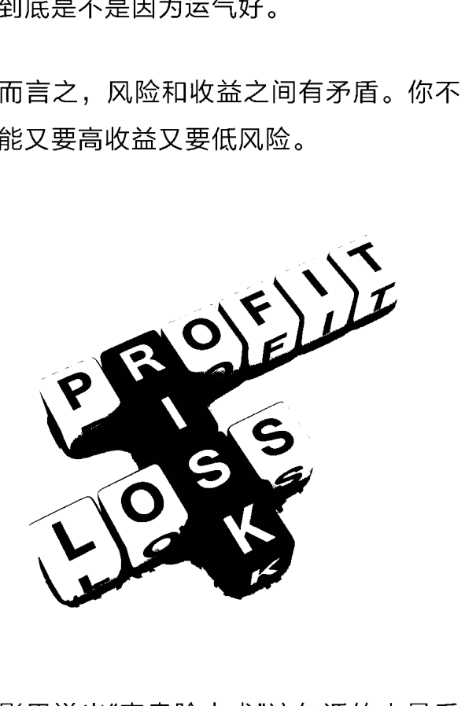

我们都希望中国队赢球，可是中国队总输球怎么办呢？你可以去赌球网站买中国队输。中国队赢了你高兴，中国队输了你还能获得一点金钱上的安慰。

年轻的时候应该多学一些不同的技能，最好这些技能不要集中在同一个领域，要形成对冲的关系。不管将来经济形势如何变化你都有用武之地。

买保险是最简单的对冲。花钱不多，一旦有事就能用上。保险公司在乎的是数学期望，只要参保的人足够多他们总能赚钱，而我们在乎的是标准差。

## | 由此得到

+   1. 组合投资的标准差总是小于其中每只股票标准差的加权平均，所以组合投资总是降低风险的。
+   2. 如果你有办法让组合投资中的不同项目之间存在负相关的关系，那你能大大降低风险。
+   3. 这个道理既适用于投资，也适用于生活。

最后我还想说一点。对冲这个思想也不能滥用。

对冲仅仅是为了降低风险。只有在害怕风险的情况下，才值得去做对冲。如果风险不大，那集中才有力量。

比如说谈恋爱吧。如果你对每个姑娘都很好，那很可能一个姑娘都追不到。既然谈恋爱这件事没有多大风险 —— 也许有个机会成本 —— 你应该集中追求一个姑娘。你要是不满足于当个安全的旁观者，想*参与*公司政治斗争，那两头下注就是不行的。


对冲，本质上是个保守的做法。即使在投资界，也不是所有人都认可对冲。纳西姆·塔勒布赚了很多钱，而他在《反脆弱》这本书里就表示完全不屑于对冲风险 —— 他的做法是把大部分钱用于购买零风险的债券，然后一小部分钱用于最高回报、但也是最高风险的投资。他说那些中等回报、中等风险的东西都是给 suckers 准备的。

你从数学上无法证明哪种方法更有利。巴菲特发家也不是靠对冲，他是选准了股票下重注 —— 而你无法从数学上证明他的成功到底是不是因为运气好。

总而言之，风险和收益之间有矛盾。你不可能又要高收益又要低风险。


电影里说出“富贵险中求”这句话的人最后都死了，但是真实世界中未必。我们今天讲的只是一个工具。到底是要富贵险中求，还是把鸡蛋放在不同篮子里，取决于你的风险承受能力 —— 我们最多只是告诉你，如果你要放篮子的话，应该选什么样的篮子。

## 特别放送 | 从时间管理到能量管理

特别放送 | 从时间管理到能...

丹尼尔·平克的《见机：完美时机科学秘密》这本书咱俩讲完了。我想借此提出一个概念，叫“能量管理”。

以前特别流行一个概念叫“时间管理”。时间管理是说碎片化的时间怎么用、不受打扰的时间怎么用、任务列表怎么设、单任务还是多任务、意志力和专注力，总之就是争分夺秒提高效率。

有时时间是一回事，人的状态是另一回事。《见机》这本书给我的最大启发，就是我们应该从能量角度考虑问题。

我们知道马比人跑得快，但是你可能不知道，古代行军一个最重要的经验就是在长途，人走得比马快。马的爆发力强，更适合在作战中冲锋和追击，但是跑一会儿就累了。每天走几十里地的长途行军，马搞不好就累死了，而人可以走很远很远。所以士兵有句话叫“养马力”，骑兵经常牵着马不骑自己走路。走到地方也不是马上投入战斗，得先让马先休息好，养养马力。这就是对马的能量管理。

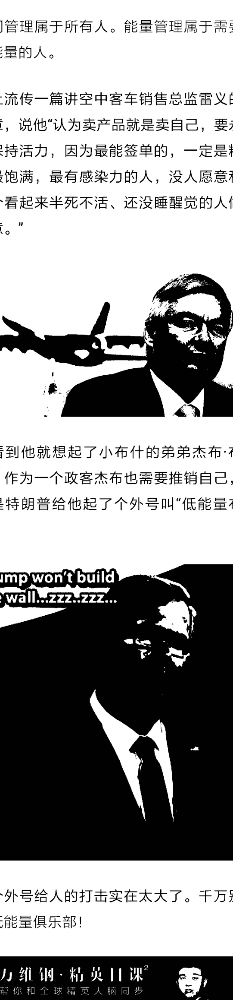

人的耐力比马强得多，人还可以 urbana...


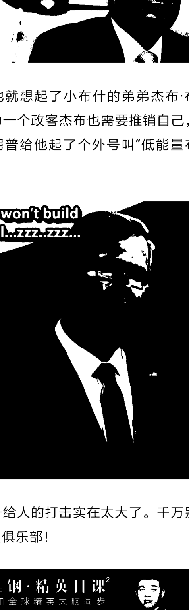

这个外号给人的打击实在太大了。千万别进低能量俱乐部！

## 答读者问 | 导游和指路者

答读者问 | 导游和指路者

有一个跟写作素材相关的问题想请教一下：万老师除了有提到所讲书籍的内容和例子，还有书外的例子，从万老师的其 他文章也能看到其他 的类似的情景，请问这些例子是文章撰写的过程主动去寻找的呢，还是平时的积累呢？

万维钢

谢谢您提出这个问 题。主动搜索和平 时积累都很容易。任何一个题目，只要你随便搜索一下，就会得到很多结果，而排在前面的结果之中往往就 有有意思的。平时积累我主要用 Evernote，我在第一季有篇文章 叫《我那样管理信息》专栏讲过，要点就是看到任何有意思的内容你都存在 Evernote 里。

关键在于写文章的时候你得能想起来那些素材，以及要 有意识地主动寻找更多素材。一本书好几百页，有声书要念下来得好几个小时，而我们通常在四五讲之内讲完。书里已经有的素材我都用不完，那我为什么还要去找别的素材呢？

因为我认为这些书写的还不够好。不管有没有这本书，知识都在那里。像我们喜欢的思想类的书，没有哪 个作者写书写的全是自己的研究，一本书里的内容都是原本散落在论文和新闻报道中的知识的集合。
作者本人调研这些知识下了很大功夫，我非常尊 重，但是我们读书不能局限于他找到的这些东西。我们应该把作者当导游或者指路者，我们只是从他口中得知有这些事，有时候我们得自已去看看。

## 来自日课：你的中场战事

中年懈怠......这么说，如果一项工作已经非常熟悉的时候，适当调整和转型可以保持人的新鲜感呢？我所在的大公司里就有员工定期轮岗的要求。

万维钢

## 来自日课：完美的结局

顺其自然的人生策略，与期望一个惊喜的心态，和“尽人事，听天命”是一个意思吗？

万维钢

## 来自日课：标准差和人生哲学

对我们这样的中学老师来说：就是要求平均值高，标准差小。可真有这样的成绩说明题出的不好啊。那我们该怎么办呢？

万维钢

## 来自日课：对冲风险的数学原理

以前有一位讲解六西格码的讲师提到过：NASA 追求的是八个西格码。这是真的吗？如果是真的，那么这会不会是马斯克真正的“第一性原理”——他可以降低标准差来大幅度砍成本？

万维钢

马斯克的目标是把人送上火星，但他家的飞船我是肯定不会坐的。SpaceX 的发射

飞船我是肯定不会坐的。SpaceX 的发射成功率实在太低了。

六个西格玛就是要求合格率达到 99.99966%，NASA 的发射成功率虽然比 SpaceX 高得多，但是也显然没有做到。我估计 NASA 的发射成功率也就两个西格玛。当然，航天是个一环套一环错一点都不行的事业，总成功率是两个西格玛，可能 NASA 对某个中间零部件的质量要求就是八个西格玛。

当初，周总理对中国航天提出了十六字指导方针：“严肃认真、周到细致、稳妥可靠、万无一失”。“万无一失”这个要求比五个西格玛略高，但是也不到六个西格玛。

达到六个西格玛非常非常困难，而且很多行业根本没必要要求这么高的合格率。美国制造业的平均水平是4个西格玛，日本制造业平均水平是5.5个西格玛。航空工业中，以要求避免飞行致命事故而论，质量达到了6.4个西格玛，这是非常非常高的水平。

|  | Sigma capability, Z |
|---|---|
| U.S. Manufacturing industry average | 4.0 |
| Japanese manufacturing industry average | 5.5 |
| Flight fatality in airline industry | 6.4 |
| Airline Baggage handling | 3.2 |
| Doctor prescription writing | 2.8 |
| Tax advice by Internal Revenue Service in U.S. | 2.5 |

别的行业质量没有这么极端，因为高质量的背后是高成本。NASA 是举国体制，可以不计成本，才能做到这样的发射水平。SpaceX 是私人公司，资金非常有限，不得不降低质量要求。

质量管理的窍门是使用“80-20”法则。绝大多数质量问题，是少数几个最常见错误导致的。所以你不应该事无巨细什么都管，应该专注于先把那些最容易犯的错误给解决掉，这样事半功倍。

马斯克怡怡是这么做的。SpaceX 第一次发射火箭之前，马斯克要求工程师按照发生的可能性从高到低，把各种可能导致失败的原因排个序。他们成功避免了前十项错误！

结果发射失败。而失败的原因，怡怡是因为第十一项错误。

那你说马斯克为什么不命令解决了前20项错误再发射？因为那需要更多的人力、资金和时间，会大大增加成本。马斯克玩的是一个科学的、理性的、基于概率论的、赌博游戏。

第二次和第三次发射都是因为小错误而失败。那时候马斯克已经没钱了，公司濒临绝境，好在最后挺过来，第四次发射成功了。

马斯克的策略是在低成本的失败中不断迭代，慢慢完善——毕竟资本主义的本质特征就是不怕失败。但是 NASA 绝对不会这么干的，NASA 必须顾及政府的形象，每次发射都得给人民一个交代。

所以也谈不上谁的方法更先进，各有各的难处，此事古难全。

## 日课092 | 线性思维和系统思维

日课092 | 线性思维和系统思维...

生活中有些问题虽然严重，但其实是简单的。

比如现在有一个新型病毒爆发了，十分紧急，解决问题的办法就很简单。一方面你要让科学家去找这个病毒的抗体，另一方面你要控制感染源，把感染者集中起来。病毒是个“坏人”，你要做的就是把坏人杀死。

再比如说，有个本来成绩很好的球队，最近的成绩非常不好。这是怎么回事儿呢？你一看是新来的主教练不行，于是换了个主教练，球队成绩马上就上去了。

像这种有明确因果关系的问题就是简单问题。它们的共同点是其中有个“坏人”。消灭坏人，问题也就解决了。

可是中国足球的坏人是谁呢？是打假球的球员和裁判吗？是主教练吗？是足协主席吗？这些人都已经换过很多遍，中国足球始终不行，最近连越南都不如了。那中国足球问题到底是个什么问题呢？

答案是中国足球是一个“系统”。系统性的问题不能用“除掉坏人”这种思维解决，你必须有“系统思维”。

今天开始咱们就系统性地讲系统思维。我们要借助一本2018年1月份刚出版的新书，叫《系统思维的艺术》（ The Art of Thinking in Systems: Improve Your Logic, Think More Critically, and Use Proven Systems to Solve Your Problems - Strategic Planning for Everyday Life ），作者是史蒂文·舒斯特（ Steven Schuster ）。


## 1.什么是系统

所谓系统，就是一个由很多部分组成的整体，各个部分互相之间有联系，作为整体又有一個共同的目的。人的身体、学校、公司、国家，都是系统。系统有三个特征。

第一，系统里有各种元素，也就是各个部分。比如学校系统，其中有老师、有学生，有教室、有操场，这些元素是系统的组成部分。组成元素是一个系统最明显的东西，而也可能是最不重要的东西，因为它们常常是可以替换的。正所谓铁打的营盘流水的兵，学生来了又去，老师、校长都可以换，而学校还是这个学校，系统还是这个系统。

第二，系统中各个元素之间，有各种关系。这些关系可以是上下的命令、谁和谁合作、谁向谁汇报，也可以是规则、物理定律。元素可以随时调换，但关系通常是不变的。所以真正要理解一个系统的运行机制，你就要了解它的关系结构。

第三，系统还有一个功能，或者说是一个目的。比如学校的功能就是教育学生。系统的功能往往是不明显的，有时候表面上有一个功能，实际上还有个功能。比如学校系统，表面上看，它的目的应该是教育学生；但实际上，它的目的也许是考试能力训练，或者纯粹是为了赚钱。

## 2.线性思维不行的時候

+   * 看似是个小问题，但是要解决它却要耗费许多资源；
* 多次试图解决一个问题，却总是无效；
* 问题本来应该容易解决，可是人们故意不解决；
* 公司上下似乎有个情感障碍，对这个问题避而不谈；
* 新人来了就发现问题，老人一笑了之；
* 类似的问题一再发生，整改了也没用……

## 3.正反馈和负反馈

一个概念叫“库存（stock）”，也就是系统里面某种东西的保有量。比如你考虑一个捡钱的系统，库存就是你捡了多少钱。如果是科研系统，库存就是你手里有多少个正在干的项目。库存有“输入（inflow）”和“输出（outflow）”，输入增加库存，输出减少库存。


库存可以是任何东西。比如夫妻感情系统，库存就是两个共同积累了多少正面的感情。输入是互相之间亲密的表示，可以增加库存；输出是各种争吵和矛盾，会消耗情感库存。如果情感库存见底了，婚姻系统就很危险了。


存也会影响输入输出。

还有一个概念叫“反馈回路（feedback loops）”。反馈回路分为两种，它们是库存和输入输出之间的关系机制。

一种是正反馈回路，也叫自增强回路。所谓正反馈回路就是库存里的东西越多，输入就会越大，于是就会进一步增大库存。
比如挣钱，就得靠正反馈回路。你的钱越多，投资产生的利润就越多；利润越多，你的钱又会进一步增多。投资一挣钱一投资，这就是一个正反馈回路。

导致系统崩溃的往往也是某种正反馈回路。就比如夫妻关系，情感储备越少，看对方就越不顺眼；看对方越不顺眼就越容易发生冲突，结果就是情感储备进一步减少。这不是“正能量”，但是也是“正的”反馈——因为有个叫愤怒的东西在*增长*。


还有一种是负反馈回路，也叫平衡回路。负反馈不等于负能量——“负”意思是“减少”。当库存太多了，负反馈回路负责减少库存。比如国家看谁太富了就多收他点税，看谁太穷了就给他发点钱，家里看老婆情绪不对就赶紧哄哄，这都是负反馈回路。负反馈总是让系统回到“正轨”上来。

一个系统中可以有若干个正反馈和若干个负反馈回路。正反馈回路让系统或者增长、或者崩溃，是要偏离平衡；负反馈回路则尽力保持系统的平衡。

对你想要解决的这个问题而言，可能就有 一个回路，正在起主导的作用！

如果你能发现在系统里起主导作用的回路是什么，你就抓住了系统的主要矛盾，你就找到了问题的关键所在。

## 由此得到

今天我们讲了系统思维最基本的概念：系统的组成，包括元素、关系和目的。解决问题的关键是识别系统的库存、输入和输出，特别是要发现其中的正反馈和负反馈回路。

有了这些概念，下面我们就可以展开具体的应用。

谁应该学习系统思维呢？首先是管理者，特别是政府官员。不懂系统论，如果去制定政策，必然会犯大错。

但是哪怕你只管理自己，也需要一点系统论。亚当斯就把自己的写作和漫画事业当成一个系统。每个人都可以把自己的学习、工作和生活当做几个系统。

比如说减肥吧。库存是体重，输入是你吃进了多少卡路里，输出是运动和锻炼身体。

这个系统里有反馈回路。吃得越多就越贪吃，这就是正反馈回路。体重增加了想节食和锻炼，这是负反馈回路。健身会产生愉悦感，越经常健身的人越喜欢健身，这是负反馈回路内部的一个正反馈回路。

抓住反馈回路，你就抓住了解决系统问题的关键。咱们下次再说。

## 划重点

+ 如果出现以下症状，你可以判断，这个问题不是线性问题，而是系统问题：
* 看似是个小问题，但是要解决它却要耗费许多资源；
* 多次试图解决一个问题，却总是无效；
* 问题本来应该容易解决，可是人们故意不解决；
* 公司上下似乎有个情感障碍，对这个问题避而不谈；
* 新人来了就发现问题，老人一笑了之；
* 类似的问题一再发生，整改了也没用……

## 日课预告 | 系统地讲讲“系统思维”

日课预告 | 系统地讲讲“系... ↓

马上要过年了，下周咱们抓紧时间，在大年初一之前，用几期日课再讲个小专题。我们要系统地讲讲“系统思维”。

你肯定听说过“系统思维”这个词，或者你至少听说过“系统”。我们专栏以前讲过斯科特·亚当斯的成功秘诀，那就是他发展了一个自己的系统。平时人们经常有“这是一个系统问题”、“这是一个体制问题”这种说法......

当我们说“系统”的时候，我们到底在说什么呢？

在我看来，系统理论是个非常特殊的理论。它不属于任何学科，不是工程学、不是自然科学也不是社会科学，但它在所有这些学科里都能用上。系统思维也不是哲学，但是它提供了一种思维方法。

我早在十年前就读过一本《系统思维入门》（ Thinking in Systems: A Primer， 作者是 Donella H. Meadows 和 Diana Wright）。当时有很多人推荐那本书，我读了之后并没有特别的感觉，就觉得系统思维的主要作用似乎是提供了一套分析问题的语言。

现在十年过去，我有了更多的见识，我认为系统思维不仅仅是一套语言。不同领域的系统看上去非常不一样，但是它们有共同的规律。系统思维提供了一个看问题的眼光，能帮你抓住这些规律。

系统思维还提供了解决问题的思路，特别是解决复杂问题的思路。

系统思维这个思想早在上世纪三四十年代就有了，正式提出来大概是在七八十年代的时候。现在系统思维已经是一个非常成熟的学问，有很多相关的书。我们这次讲主要是借助2018年1月份刚出版的一本新书，叫《系统思维的艺术》（ The Art of Thinking in Systems: Improve Your Logic, Think More Critically, and Use Proven Systems to Solve Your Problems - Strategic Planning for Everyday Life ），作者是史蒂文·舒斯特（ Steven Schuster）。

我们会讲到什么是简单问题，什么是系统问题。我们会识别系统的特征。我们会讲到怎样抓住系统的主要矛盾。我们会拆解几个实战例子。我们会把系统思维用于国家大事和个人生活。

好的理论总是这样的 —— 你不知道也就不知道，一旦知道了，心里有了这根弦，你就多了一个观察世界的视角，你就会发现它无处不在。

有系统的人快过年了也不懈怠。明天晚上10:43，咱们开启一套新的思维系统。

## 日课093 | 坏政策和好政策

日课093 | 坏政策和好政策

今天咱们继续说系统思维，讲讲实战应用。我们干脆说个大题目：什么样的政策是好政策。

系统思维是高级的思维方式，没有一个操作手册让你照着做，很大程度上是一种艺术。有人说新手学习系统思维，能把一个系统的结构看明白、画出分析图，那就不错了。只有老手才能发现系统中的重要关节点，只有高手才能提出解决方案。你纸上谈兵不行，得深入到一个系统中去，做现场调研。

不过我们仍可以做一点理论上的探讨。今天的内容不太可能让你哪儿就直接解决问题——但有一点我可以保证，那就是听了今天这一讲，你就不会犯特别愚蠢的错误。

而你将看到，即使是专业的官僚，也经常犯特别愚蠢的错误。

### 1.直接命令

1967年，罗马尼亚政府认为人口出生率太低了，迫切希望提高出生率。当时的罗马尼亚领导人是齐奥塞斯库，政府做事讲究令行禁止，出台的政策都是非常直接的。

老百姓想要不生孩子无非就是两种手段，一个是避孕，一个是堕胎。那政府要想多生孩子，干脆禁止避孕和堕胎不就行了？罗马尼亚政府真的就推出了禁止避孕药品、禁止堕胎手术的政策。

这个政策今天看来简直够人听闻，但是它的思路具有普遍意义：想要什么就直接下令要，不想要什么就直接下令禁止。直来直去。

### 2.间接刺激

经济学家一般不喜欢强制性的命令，他们最喜欢用“激励”手段。学习经济学如果你只记住一个词，那就是“激励”，英文叫incentive。如果你只记住一句话，那就是“人会对激励做出反应”。

匈牙利政府也面临人口出生率下降的问题，而他们考虑到了反馈回路，并且使用了激励措施。

### 3.寻求共识

其实我们都经历过万众一心的时刻。中国某个地方地震了，那就是一方有难八方支援，政府也想救灾，灾民也想自救，全国同胞都捐款捐物有的还到现场参与，甚至全世界都会帮中国救灾。

## 由此得到

要想改变一个系统，可以有上中下三种政策——

+ 下策是直接命令。想要什么就直接要，反对什么就直接禁止。
+ 中策是间接刺激。找到系统中的一个平衡反馈回路，让回路松弛一下。
+ 上策是寻求一个新的共识。在这个新的共识上，把全社会团结起来去做一件事。

我们中国人经常说一句话叫“团结就是力量”，到底什么是团结呢？真正的团结应该是在某种共识的基础上，一个系统里所有人自己的小目标和系统的大目标达成了一致。

社会共识一直在变，而且政府完全可以引导。以前中国人专注经济增长不顾环境恶化，现在我们似乎已经在环境问题上达成了新共识，而且其中可能就有政府的作用。

说到这里，最近中国足协又有了新规定。为了培养年轻球员，中国足协要求每支球队场上23岁以下球员的人数要跟外援人数相等 —— 你要是上三个外援，就得上三个23岁以下中国球员。这个政策比当年那个强制上两个20岁以下球员的政策水平显然高了不少。

但是政策一出来，中超联赛的电视转播费马上下降了。所以我猜，真正的共识可能尚未达成。

这种政府级别的政策理论，对我们普通人有什么用呢？我们管不了国家管不了足协可以管公司啊，管不了公司还可以管自己的孩子啊，如果连孩子都管不了，最起码还可以管自己 —— 这些都是系统。

你在管公司、管孩子、管自己的时候，用过哪些政策？效果怎么样呢？欢迎在留言区讨论。

## 划重点

要想改变一个系统，可以有上中下三种政策 ——

+ 下策是直接命令。想要什么就直接要，反对什么就直接禁止。
+ 中策是间接刺激。找到系统中的一个平衡反馈回路，让回路松弛一下。
+ 上策是寻求一个新的共识。在这个新的共识上，把全社会团结起来去做一件事。

## 日课094 | 负反馈和正能量

日课094 | 负反馈和正能量

今天咱们继续讲系统思维，今天的话题是系统是如何失败的。

一个公司本来运行良好，为什么慢慢就不行了呢？一个家庭，一开始夫妻感情特别亲密，时间长了怎么就感情破裂了呢？一个在新年这天立志要健身，坚持了几个星期都好好的，毫无意识地就停止了，然后突然有一天发现，怎么我最近都不健身了？

系统，是怎么衰败的呢？中国有句语叫“千里之堤毁于蚁穴”，说有小漏洞得赶紧修复，否则就会越来越大。西方有个“破窗理论”，说如果一个房子的窗户被打破了，一定马上补好，否则别人就会觉得这个房子没人管，就会主动破坏房子。

而我最喜欢的一句关于衰败的谚语，是来自于阿拉伯世界：“一匹正在倒下的骆驼会吸引很多食刀”。


我们要从系统的视角分析一下衰败。

### 1.平衡回路

我们知道维持系统稳定的是负反馈回路，也叫平衡回路。只要这些回路运行良好，系统完全可以保持不变。而系统之所以会衰败，就是因为负反馈回路出了问题。

举个例子。比如你经营一家餐馆。餐馆刚开业的时候，各方面都是高标准、严要求，你请来的厨师是行业内最好的厨师，饭菜质量是最高水平，餐馆打扫得一丝不染。

为了做到这些，你颁布了一套很高的标准。有专人每天对照标准检查餐馆的运行情况，一旦发现哪个地方没有达到标准，就要立即整改。这个检查制度，就起到了平衡回路的作用。

再比如健身，你天天锻炼，如果有一天没锻炼就会感到很愧疚。本来都是上午跑步，今天上午没跑，就想想办法下午补上。这种愧疚的心情就是平衡回路。夫妻感情也是如此，今天吵架了，你就会想赶紧弥补一下，比如一起出去吃个饭，这也是平衡回路。

这个一般规律就是，整个系统有一个目标，系统的参与者会时刻把系统此时此刻的表现与目标作比较，如果发现表现未达标，就会采取行动。这就是负反馈回路做的事情。

但是任何系统，总有意外。

### 2.意外

有些意外是好的，有些意外是坏的。

比如有一天，正在中国访问的韩国总统要来餐馆吃饭。你临时把餐馆的标准提到了更高的水平，所有人都尽心尽力，最后接待非常成功。这就是一次好的意外。

还有一次，你们餐馆要承办一个公司的年会，客人特别多，你甚至还从外面借调了人手来帮忙。时间紧任务重人员众多，你就不得不把标准放松一下。

结果你们轻松过关。年会活动本来就比较乱，因为公司买单，客人们也没那么挑剔，仓促间饭菜质量和环境略差一点也感觉不到。

这个活动刚结束，你来不及准备，第二天又有另一个年会活动，餐馆的环境卫生就没有提前搞到位。结果在整个过年期间，餐馆都没有达到标准。

中间有个熟客跟你抱怨，说今天这菜做的不达标啊？好像少了一道工序。你们餐馆可是很少收到这样的抱怨！你向他道了歉，但是你想到这是过年期间活动太多了的原因，别别的餐馆也都这样，你也就没有对厨师说什么。不达标，你默认了。公司上下都觉得这还很正常。这也是一种意外。

### 3.坏比好重要

一个是坏的意外，一个是好的意外。那请问，过一段时间之后，哪个意外留给人的印象会更深刻呢？

答案是坏的意外。对大脑来说，好消息和坏消息是不对称的 — 坏消息总是比好消息重要，坏新闻比好新闻给人们的印象更深刻。如果一个人平时对你都很好，时间一长你可能就不在乎；有一次他突然对你不好，你对他的印象就有可能永久地改变。更重视负面消息是人脑的一个本能，这可能因为负面消息事关生存。

健身也是如此。平时你都跑30分钟，哪天你高兴了跑了35分钟，超出平时标准，但是你不会记住。可是有某一天觉得太累了没有跑，这一天对你的自信心会有更大的影响。再比如夫妻之间，情绪特别好的时刻不容易被记住，争吵却总是印象深刻。

好意外和坏意外给人的印象的不对称，会让人们对系统运行表现的评价，有一个偏差。

### 4.系统的坍坏

几次意外，有好有坏，发生之后，平均下来，总是坏印象占上风。如此一来，系统中每个人心目中这个系统的表现，比系统的实际表现，要差。

系统实际上并没有那么差，但是现在人们感觉它很差。

最近有个加拿大心理學教授挺火，叫乔丹·彼得森（Jordan Peterson），他刚出了一本书叫《12条人生规则》（12 Rules for Life），我看他这本书里有个说法挺有意思。医生们都很头疼的一个问题是有些病人不按照医嘱定时吃药，动不动就忘了吃。可是同样是这些人，如果是他的狗病了，他却能够按时给狗吃药。这是为了什么呢？


彼得森说，这是因为这些人看不起自己。最了解我们自己的人，就是我们自己。我们太知道自己的缺陷和毛病了，所以我们一一至少在潜意识之中一一都有点看不起自己。我们觉得费心思给自己按时吃药不值得。但是狗不一样啊，狗是无辜的！

我觉得这其实就是好消息坏消息不对称导致的结果。其实你没有那么差，但是你觉得自己很差。

人们对系统的评估差，时间一长，就会认为系统其实配不上那么高的目标，就会默默认整目标。系统的目标，被降低了。

那么从此之后，负反馈回路的作用就不再是把当前表现和最初的标准比较，而是和人们心目中降低了的标准比较。

本来该纠正的问题，你就不再纠正了。看不见不合理的现象，员工心想上次别人也是这么干的。餐馆的服务水准在不知不觉之中降低。今天没锻炼，你会想这又不是第一次不锻炼，上周你就有两次该锻炼没锻炼。夫妻争吵也不弥补了，反正最近总是吵。

以此类推，就会产生恶性循环，系统就逐渐地走向坍坏。

### 5.给点正能量

咱们中国以前的社会规范，看见路上有老人摔倒了，是绝对要过去扶一把的。可是自从南京法官搞了个彭宇案一一不管这个案子的真实情况到底是怎样的一一人们心中就有了有些老人是要讹人的印象。从此之后，各种扶老人被讹的新闻层出不穷，整个社会规范下降，人们的共识变成了在扶老人之前得谨慎一点。要是继续坍坏，可能就都不扶老人了。

想要阻止这样的过程，系统目标就不能降低。要不降低目标，就必须纠正对系统的印象。既然人的认知偏差总是坏的更强烈，那我们就应该主动增加好消息。

我在微博上看新闻常常感到义愤填膺，就感觉中国还有希望吗？好在经常看些中央台拍的纪录片，什么《辉煌中国》、《创新中国》、《超级工程》、《大国重器》之类，能学多少知识都是次要的，关键是每次看了心情都特别好。

所以好消息也很重要。市场总是喜欢坏消息，但你不得不承认，正能量的好消息对维护系统平衡有特别重要的作用。如果你掌管一家公司，就应该多宣传表扬公司里的好人好事，多给统计数字，让人们觉得公司充满了正能量，认为公司还是有希望的。什么叫“不忘初心”？也许就是系统最初设定的目标不能降低。

我们以前有一期叫《“正能量”的负作用》，说整天幻想正能量没啥好处。今天我们说的则是只要这个消息是真的，那多了解一些正能量的好消息，有利于我们认识真实的系统。系统的目标其实是在参与系统的每个人心中，你想象系统是什么样，最终这个系统就会变成什么样。

这些道理非常简单，可是从系统论的角度推演一遍，似乎更显得应该严肃对待——

## 由此得到

+ 1. 平衡回路的作用是把当前系统的表现和系统的目标进行比较，一旦发现其中有差距就采取行动；
2. 因为坏消息和好消息的不对称，各种意外会使得我们对系统的印象，比系统的真实情况更差；
3. 更差的印象会降低我们心目中的系统目标，降低了的目标会让平衡回路的工作变得无效，结果就是恶性循环，系统逐渐走向衰败。

你的系统没有你想的那么差。所以该吃药得按时吃药啊！别忘了，一匹正在倒下的骆驼会吸引很多把刀。

## 日课095 | 好系统的三个特征

日课095 | 好系统的三个特征

过年好！今天已经是大年三十了，也是我们系统思维的最后一讲，我们讲讲好系统应该是什么样的。

从前有两支队伍。A 队伍的风格是整齐划一步调一致。他们的 (...)要依照上级的命令。

B 队伍看上去有点自由散漫。 (...)他们常常自己拿主意。

如果这是两支军队的...

### 1.抗打击

以前我们专栏提到过“抗打击能力”( resilience )这个概念。我们直觉上好东西就应该好好保护起来，避免遭受任何打击——其实连养孩子都不应该这么养。最理想的系统得能抗打击，反脆弱，不怕事儿。

### 2.自组织

好系统必须是能创新的系统，它不可能按照一张宏伟的蓝图按部就班地发展。未来的情况可能跟今天非常不一样，真正的好系统不但能适应变化，而且还得能制造惊喜。

### 3.层级关系

小公司也许可以做到绝对的权力平等，大公司必须得有层级关系。

层级，就是把一个大系统分成若干个子系统，每个子系统可能又有各自的子系统。层级就是模块化。

脚是个贬义词，但实际上医生治病，大部分情况都是头痛医头脚痛医脚。如果一个人的胳膊受伤，医生把胳膊处理一下就可以了，通常不用考虑他的心理问题，也不用考虑他的肾是否能承受得了。有了子系统就有这个好处。子系统出问题，不用非得牵动全身。

任何系统要变大、变复杂，就一定要有稳定的各种子系统结构。

子系统的良好运行，应该在整个系统中有很高的优先级。作为个人，你不能为了实现自己的价值不顾所在集体——也就是你所属的那个子系统——的成败。作为大系统的中央，也不应应当对子系统有太多的直接控制。

一个好系统，中央控制和子系统自治必有一个平衡。

## 由此得到

好系统首先要不怕打击；为了不怕打击，系统就要自己更新自己学习，这就要求自组织能力；为了更好地实现自组织，协调好自组织和大系统的关系，就要有健康的层级结构。有了稳定的层级结构之后，系统的抗打击能力又会进一步增强。

这样的系统充满活力，能适应各种新局面。它会变得越来越复杂，越来越强大。

咱们今天说的似乎都是企业和国家这样的大系统，但是这三条对个人的学习和发展系统也很重要——

想要有抗打击能力，你就不能依赖单一的技能，不能指望一成不变的稳定工作，要建设好自己的负反馈回路。

想要发展创新，你就得有自组织能力，你要不断探索新事物，尝试新做法。

想要做大做强，你就不能事无巨细全靠自己，你要善于利用现有的工具，善于跟别人模块化地对接和合作。

死气沉沉、整齐划一、令行禁止，那不叫好系统。活力、自由、赋能，这才叫好系统。

有关系统思维我们暂时就讲到这里。系统论说起来并不难，真正用好可不容易，我们讲的这些可以说都是纸上谈兵。但是只要你脑子里有了这根弦，以后看问题，必然就多了一个角度！

万维钢

给各位拜年！《精英日课》祝你家大业大，心大志大！
最后再来预告一下咱们专栏春节的特别活动吧——
从初一到初三，咱们就不讲新课了，来搞点有趣又刺激的吧：初一、初二、初三的晚上10:43分到12:00，欢迎你来参与日课的「冲顶大会」！会有10道题等着你，在这个时间内全部答对的读者，将瓜分2018元得到币奖金。题目全部来自精英日课内容，也顺便检验一下你的学习效果如何。明晚10:43，别错过！


## 春节特刊 | 知识英雄第一期

万维钢

各位过年好！欢迎来参与2018春节第一期知识英雄答题赢奖金大赛！活动规则是这样的：

+   1. 一共10道选择题，每道题都是单选，只有唯一答案；
2. 请在留言区按序号顺序提交答案；
3. 答题时间从22:43分截止到24:00，在这个时间段提交了答案、并且全部选对的读者，将均分2018元得到奖币；
4. 获奖答案会在24:00之后被精挑出来，得到工作人员会在每天24:00之后为获奖读者充值。

好了，现在开始！

## 第1题

“复利是宇宙中最强大的力量”这句话来自：

+   A. 查理·芒格
B. 艾尔伯特·爱因斯坦
C. 雷·达里奥
D. 以上都不对

## 第2题

有个流行的说法是：人脑只开发了5%，关于这个说法：

+   A. 不准确，最新的研究结果是人脑已经开发了10%
B. 完全正确，人脑还有大量的开发空间
C. 完全错误，进化不允许我们带着这么大的累赘
D. 完全错误，人脑的存储能力已经开发了90%以上

## 第3题

所有效率最终归结于目的，所有目的最终归结于价值观，所有价值观最终归结于感情，所有感情最终归结于：

+   A. 理性
B. 意识
C. 基因
D. 科学

## 第4题

科学家把无效假设成立的可能性，称为“P值”。现在学术界的一个几乎是“黄金标准”的标准，是P值要小于一个数值。如果P大于这个数值，别人会认为你这个结果很可能纯属巧合；只有P小于这个数值，人们才会说这个结果是“显著的（significant）”。这个数值是：

+   A. 0.5
B. 0.05
C. 0.005
D. 0.515

## 第5题

上世纪九十年代末，有人提出一个叫做“黑暗三性格（Dark triad）”的理论，分别是自恋者、精神变态者、马基雅维利式的权谋者。根据这个理论，美剧《纸牌屋》的男主角弗兰西斯·安德伍德属于：

+   A. 自恋者
B. 精神变态者
C. 马基雅维利式的权谋者
D. 都不是，他是个Jerk

## 第6题

《穿越平行宇宙》的作者迈克斯·泰格马克，也是以下哪本书的作者：

+   A. 《生命3.0》
B. 《给忙碌者的天体物理学》
C. 《上帝与新物理学》
D. 《时间简史》

## 第7题

英国交通部门的统计发现，一天24小时中，最容易因为犯困而导致交通事故的，一个是凌晨2点到早上6点之间，另一个就是下午2点到下午4点。英国人甚至还找到了事故高峰的精确时间点，也就是一天中最困的时候：

+   A. 下午2:52
B. 下午2:53
C. 下午2:54
D. 下午2:55

## 第8题

以下关于智商和基因的说法，错误的是：

+   A. 决定智商的不是一两个基因，而是至少52个基因，而且其中每个基因起的作用都很小
B. 现在最前沿的基因编辑技术完全可以制造高智商
C. 智商是多个基因复杂配合的结果。这个复杂性很可能超过了计算机算法模拟的能力，因而就不能被人理解和“逆向工程”
D. 自然选择已经把我们的基因优化的很好，任何自然变异可能都是在性能和风险之间的取舍，没有绝对的好坏之分

## 第9题

对于几个常用的说服力方法，斯科特·亚当斯做了一个排序，以下这些方法中最有效的说服力方法是：

+   A. 大恐惧
B. 内心的渴望
C. 身份认同
D. 晓之以理

## 第10题

在广义相对论中，有一个理论上的“临界质量密度”，我们把观测的质量密度除以临界质量密度，得到一个数值，用希腊字母Ω表示。如果Ω>1，那么说明宇宙里物质比较多，引力比较大，宇宙空间的曲率就是正的，那么宇宙就像一个球一样弯曲；如果Ω<1，那么说明物质比较少，引力比较小，那么宇宙就会是一个像马鞍形一样的空间，是开放的。你猜计算结果的Ω是多少？

+   A. Ω > 1
B. Ω < 1
C. Ω = 1
D. Ω = 0

万维钢

你现在可以把你的答案写到留言区了。截止到今晚（2月16日）24:00，全部答对的读者，将均分2018元奖金。加油！

## 春节特刊 | 知识英雄第二期

万维钢

恭喜昨天获得知识英雄的读者！欢迎来参与春节知识英雄答题赢奖金大赛的第二期。再来重复一下活动规则：

+   1. 今天一共9道单选题，每道题只有唯一答案；第10题为多选题，有多个答案；
2. 请在留言区按序号顺序提交答案；
3. 答题时间从22:43分截止到24:00，在这个时间段提交了答案、并且全部选对的读者，将均分2018元得到币奖金；
4. 获奖答案会在24:00之后被甄选出来，得到工作人员会在每天24:00之后为获奖读者充值。

今天增加了一点难度，全部为读图题。
现在开始！

## 第1题

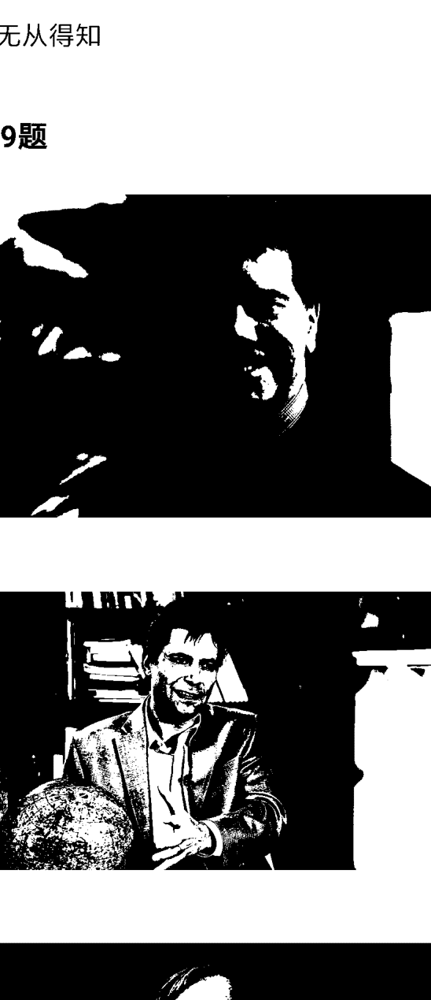

有人设想，如果AI利用太阳能，它会在外层空间建造一个巨大球体把太阳包起来。这个设想的球体叫做：

+   A. 费曼球
B. 泰森球
C. 戴森球
D. 马斯克球

## 第2题


苹果4手机刚进入市场的时候，曾经遇到一次危机：用户常常接收不到信号。面对这个严重的问题，乔布斯紧急召开了新闻发布会，说了上图中的三句话。乔布斯用到的说服力技术是：

+   A. 预说服
B. 占领制高点
C. 先同步，后领导
D. 视觉想象

## 第3题


庞贝城是被一次火山爆发吞没的，但考察遗址发现，其实从火山爆发到火山灰抵达庞贝城，中间有好几个小时的时间。在这段时间内容，城里的大部分人居然都待在家里，没有赶紧逃跑。这种心理/现象叫做：

+   A. 侥幸心理
B. 灰犀牛
C. 正常化偏误
D. 确认偏误

## 第4题


达该图是一天中，人们每个时间的情绪变化曲线。以下说法正确的是：

+   A. 发达国家的人的曲线和非发达国家在晚间有所不同
B. 做广告创意、头脑风暴一般在上午会比较好
C. 下午考数学成绩会比较好
D. 情绪显然是受生物钟影响的

## 第5题

```
σₚ² = Σᵢ wᵢ²σᵢ² + Σᵢ₌₁ⁿ Σⱼ₌₁ⁿ wᵢwⱼσᵢσⱼρᵢⱼ   i ≠ j
```

这是计算投资组合的标准差公式。以下说法错误的是：

+   A. 个人投资者对于基金有天然的优势
B. 只要分散投资，胡乱选几家公司，你的风险都能降低
C. 股票间的相关系数是负的，投资组合的标准差就会降低
D. 你不能只买同一领域的股票，因为它们往往正相关

## 第6题


以下关于反馈回路的描述，正确的是：

+   A. 夫妻感情不好，越容易发生冲突，情感储备就会越少。这是“负反馈回路”
B. 体重增加了，想节食和锻炼。这是“负反馈回路”
C. 夫妻感情不好，丈夫努力哄妻子高兴。这是“正反馈回路”
D. 国家多收富人的税。这是“正反馈回路”

## 第7题


哪边的熵更高？

+   A. (a)
B. (b)

## 第8题


图中A和B所在的方格：

+   A. A的颜色比B深
B. A的颜色比B浅
C. A和B颜色相同
D. 无从得知

## 第9题


联系微信OUCHSTYLE免费体验一个月

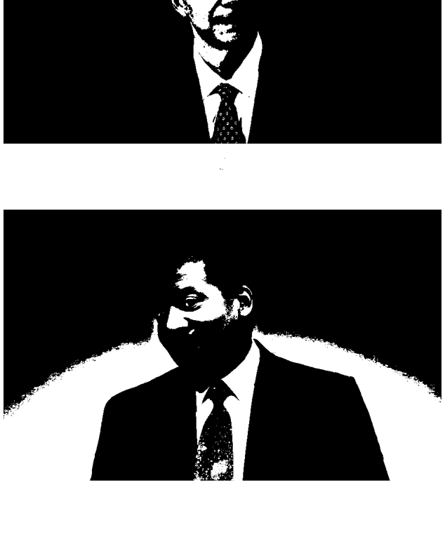

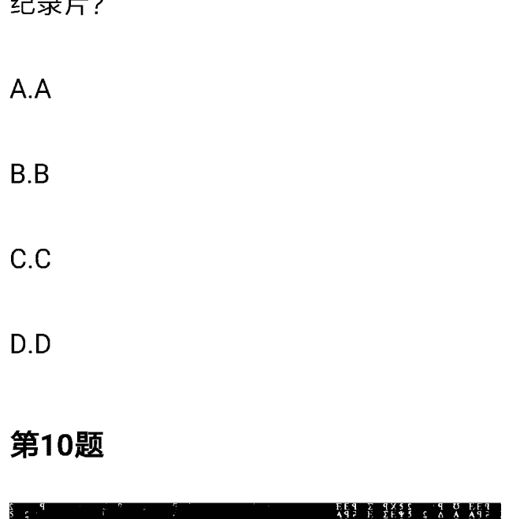

上面的四个人，谁主持过一部有关宇宙的纪录片？

+   - A.A
- B.B
- C.C
- D.D

## 第10题


《为什么佛学是真的》的作者赖特说，我们其实是生活在电影《黑客帝国》里说的那个 Matrix 之中。依据他的研究，以下这些关于佛学的表述，错误的是：（此题为多选）

+   - A.人的身体、感情、感知、想法行为，甚至意识，都不属于“真正的自我”。
- B.人的大脑预装了七个思想模块，大脑的不同的区域分管不同的模块。
- C.情绪不能反映真实世界，这是进化心理学的ẽ本常识。
- D.一直保持专注呼吸的状态，这个功夫就是“正定”，就是我们平时说的“集中注意力”。
- E.自控的关键是调配理性。
- F.印度教认为世间万物都是一体的，大乘佛教坚持认为世间万物都是空的。
- G.“无我”的内部体验是，五蕴都不是“我”的一部分。“无我”的外部体验是，外 genellikle的東西也都不是我的一部分。

## 春节特刊 | 知识英雄第三期

万维钢

欢迎来参与2018春节知识英雄答题赢奖金大赛的最后一期！再来重复一下活动规则：

+   1. 今天一共6道单选题，每道题只有唯一答案；第7题是多选题，有多个答案；第8题为计算题；
2. 请在留言区按序号顺序提交答案；
3. 答题时间从22:43分截止到24:00，在这个时间段提交了答案、并且全部选对的读者，将均分2018元得到币奖金；
4. 获奖答案会在24:00之后被精选出来，得到工作人员会在每天24:00之后为获奖读者充值。
好了，现在开始！

## 第1题

美国哲学家克拉伦斯·刘易斯提出一个非常精彩的概念，描写人类最基本的感受，叫做“感质”。所谓“感质”，就是意识的最基本单位。下面对“感质”的特征的表述，错误的是：

+   A. 感质无法用语言描述
B. 感质是内在的，去掉了周围环境因素
C. 感质是可以比较的
D. 感质是可以直接意会的

## 第2题

以下关于意识的描述，错误的是：

+   A. 人的大部分思维、动作和行为都是有意识的，无意识的只占极少数。
B. 我们在理论上可以制造一台没有意识的计算机来完美模拟一个人，这台计算机可以假装自己有意识，原则上你无法分辨这是真人还是计算机。
C. 《五蕴皆空经》中的五蕴，是构成自我的五个东西，中文叫做色蕴、受蕴、想蕴、行蕴、识蕴，其中识蕴（consciousness），就是人的意识。
D. 有很多实验证明，人的欲望并不受意识控制，意识是受欲望控制。

## 第3题

以下关于“熵”的表述，错误的是：

+   A. 整齐有序就是低熵，杂乱无章就是高熵
B. 封闭系统的熵总是增加，宇宙的秩序总是在减少，混乱总是在增加
C. 你拿吸尘器吸地板，这是一个让整个宇宙熵减少的过程
D. 引力是一个让熵增加的过程

## 第4题

以下关于“信息”的表述，错误的是：

+   A. 一段消息所包含的信息，并不 noy仅仅由这条消息的长短决定
B. 一个东西的信息量的大小，在于它克服了多少不确定性
C. 一个信息越杂乱无章，越具有多样性，它的信息熵就越低
D. 克服噪声的正确办法，是增加信息的冗余度

## 第5题

以下关于“思维”的表述，错误的是：

+   A. 人所谓的抽象理性思维系统，正好和多巴胺系统紧密地联系在一起
B. 创造性思维是一种比集中思维更高级的思维方式
C. 发散思维、溯因推理、慢直觉三个说法描述的过程是一样的
D. “批判性思维”就是对一个事物进行分析、判断和评价的能力，就是你能不能独立思考

## 第6题

以下关于“均衡”的表述，错误的是：

+   A. 均衡就是任何人都没有办法单方面采取行动做出改变的局面
B. 不充分均衡系统内部的每个人都在按照自己利益最大化的原则做事
C. 田忌赛马是典型的“纳什均衡”的例子
D. 股市是世界上最有效的市场之一，而房地产市场并不是有效市场

# 第7题（多选题）

以下关于“认知失调”的表述，正确的是：

+   A. 认知失调，就是我们像律师一样，先有观点，再用新的事实去支持自己的观点
B. 认知失调，就是灾难来临了，局面已经很不正常了，你还在假装正常
C. 认知失调，是一种时刻忽略和过滤信息的本能
D. 认知失调非常常见，我们整天都在产生幻觉
E. 认知失调，就是认为知识都是一个个孤立的事实，一旦被发现就不会再改变，获取知识的过程是一个被动的过程，权威说什么就是什么，没有个人观点一说
F. 认知失调，就是当你发现你的行为和你心目中的自我形象不相符的时候，你产生一个幻觉来解释自己的行为

# 第8题（计算题）

我们专栏最近经常使用“数学期望”这个概念。这个概念、以及整个概率论的起源，都是因为赌博。那么现在过年了，让我们不忘初心，来做一道赌博题——

老王和老张赌博，老张说我有一个新的玩法。咱们只用一颗骰子，掷出一个点数。如果这个点数是奇数，老张就给老王相当于点数的十倍的人民币——比如如果掷出3点，老张就给老王30元。而如果点数是偶数，老王只得给老张相当于点数的八倍的钱。

请问，每玩一把，老王的预期收益是多少元钱？


万维钢·精英日课² 聚焦你和全球精英同步

## 春节特刊 | 寻常问题的精英解法（1）

在接下来的几天假期里，我为你准备了一个特别专题：《寻常问题的精英解法》。

解决日常生活的 问题，通常有三个路径：凭借自己的知识、经验或直觉；借鉴身边前辈或长者的 方法；利用人类最新的研究成果。作为我们专栏的读者，我想你一定对第三种方法最感兴趣。

比如，如何休息才高效？如何在工作和休息间自由切换状态？除了让身体休息，怎么让大脑休息？什么样的休息会让你越来越累？……对于“休息”这个寻常问题，心理学 家、生物学家、社会学家可没休息，一直在做着研究论证。今天咱俩就把这些最前沿的研究成果汇总一下，看看高手的休息方法和普通人到底有什么不同。

## —— 1 ——

你先来猜一下，在以下这几种休息活动中，哪个效率最高？

+   1. 放松：什么都不干，做做白日梦、或者做几个伸展运动
2. 给身体补充点什么东西：喝杯咖啡之类
3. 社交：跟同事聊聊天
4. 认知：阅读新闻，查看邮件

第4项，是我们大多数人最喜欢的休息方法。但研究结果非常明确——上网不仅不能休息，反而会让我们变得更累。

这是因为脑力劳动者最需要花费、也是最需要从休息中恢复的两个资源，是*意志力*和*注意力*。现在很多心理学实验都认为这是两个有限的资源，最好用在刀刃上。

所以休息的目的就是让注意力和意志力回血。但是上网——阅读会消耗注意力；决定是否点击，是否购买之类的各种决策会消耗意志力。

研究结果，真正有用的休息是1、3这两项。喝咖啡也没用。

科学家的第一个建议是要休息，先断网。

第二个建议是短而频繁的休息比长时间工作然后长时间休息更好。

第三个建议是最好休息的时候离开办公室。

所以关于休息的一个误区，就是我们常常把“娱乐”和“休息”给混为一谈。

## —— 2 ——

刚才我们说到了注意力。注意力是一种有限的资源，你要是不断长集中注意力，你就不断集中注意力。你可以把注意力想象成一种能量。注意力要是耗光了，你就会变得容易冲动，不愿意帮助别人，不愿意跟人合作，也不能做出正确决策。

所以注意力需要“养”。

这里你需要知道一个重要概念，叫做“默认模式网络（ default mode network）”。如果当前没有任何任务，什么事情都不用做，大脑处于闲置状态——这就是“默认模式网络”。

在这个状态中，大脑会重新发掘过去的记忆，在过去和未来之间畅想，而且把不同的想法连接起来。

这种遥远的连接，就是我们以前说过的“发散思维”，这是创造力的来源！所以当你心不在焉、胡思乱想的时候，千万不要有负罪感——这是一项有益身心的活动。而且我们要主动开启这个默认模式网络。

第一个办法是“积极的建设性的白日梦（ positive constructive daydreaming，简称 PCD）”。首先你要找个不需要费力的事情做。比如织毛衣、摆弄花草、散步之类，目的是让大脑放松下来，进入默认模式网络。然后主动想好事情——好玩的事情、在树林里穿梭，在游艇上躺着，或者纯粹是白日做梦，想想你期待的一个什么事情。

第二个办法是小睡片刻。

第三个办法是假装自己是别人。这是当你有问题解决不了的时候用的办法。比如文科生可以暂时假装自己是个理科生，换个视角，胡思乱想一番，看看有没有什么新思路。

## —— 3 ——

人生就是一场长跑。很多人赢在了起跑线，但中年以后就销声匿迹，也许是遇到了平台期，也许是因为太累了，总之，这些早期的高速进步，都是不可持续的。

《巅峰表现》这本书的两位作者考察了长期保持状态、甚至40多岁了还保持了世界一流水平的运动员，也考察了从事创造性工作的脑力劳动者，发现他们的行为规律有共同之处。一个关键，是节奏感。总结成一个公式，就是

成长 = 压力 + 休息

这里的压力并不一定是外界给你的，而是你自己为了提高水平，故意给自己施加的压力。就好像是为了锻炼身体而故意对身体的某个区域进行的“敲击”。

就好像举重一样，一次举的东西太重或者太轻、练习时间太长或者太短都不行。这个公式说，合理分配压力和休息，你才可以以最高效率、可持续地成长。如果压力太大而休息太少，你就会被击倒；如果压力不够而休息太多，你就会自满、达到一个平台不再进步。

人体是一个“反脆弱”系统。能恢复过来，就是反脆弱，会变得更强大；恢复不过来，就绥废了。

这个道理也适用于创造性的脑力劳动。“心流”理论的发明人米哈里·克森米哈赖总结的创造活动有三个步骤——

+   1. 沉浸。完全集中注意力，把自己沉浸在你正在研究的这个内容之中；
2. 孵化。专门有一个休息和回复的时间段，在此期间完全不想那个研究内容；
3. 洞见。也就是新想法出现的尤里卡时刻。

体力活动和脑力活动消耗的是同一个资源，就是“意志力”。疲惫了就得休息，而休息和恢复，必须要提到一个战略地位。

高手会非常精确地管理自己的体能，绝不轻易浪费。比如说既然抵制诱惑会消耗意志力，高手就会好好安排自己的生活环境，把各种诱惑减少到最低限度。比如说食物对节食的人来说是个巨大的诱惑，所以高手就不会轻易节食。

所以在当今这个世界参与竞争，我们真是都得以职业运动员的标准来要求自己。作为一个高手，你该记住这个公式：

成长 = 压力 + 休息。

## —— 4 ——

那么，该怎么在工作和休息状态自由切换？四个有强裂科学证据支持的休息办法，值得你记住。

第一个办法是散步。散步活动了肢体，可以增加给大脑的供血量。就算你不“正式”散步，每隔一个小时站起来走几步，两分钟就能起到一个关键的效果——能让你过早死亡的概率降低33%！

第二个办法是回到大自然中去。接触不到大自然，实验证明，可以用大自然的图片代替！有研究说看6分钟大自然图片，就能对你的大脑产生明显的好作用。赶快把电脑桌面重新设置一下吧。

第三个办法是跟朋友聚会。聊聊天也行，喝点酒也行——但是注意，必须是朋友，是为了友情，而不是为了什么“人脉”。

第四个办法是休假。休息的重要目的是消除压力，压力越大，需要的休息时间就越长。好的休假就像充电，可以让你后面很长一段时间有充沛精力。7到10天的假期，可以影响此后一个月。每周休息一天，对此后两天都有好处。

## —— 5 ——

说到休息，就不能不提睡眠。

睡眠的作用不仅仅是消除疲劳，更重要的是让身体和大脑“成长”。而人的睡眠是周期性的。每个周期末端的“REM睡眠”，才...

是让身体和大脑“成长”。而人的睡眠是周期性的，每个周期末端的“REM 睡眠”，才是最宝贵的睡眠阶段。

白天学的技能和知识，需要大脑在晚上消化、重组一番，才算真正“长”在了我们身上。这个消化重组的过程，就发生在 REM 期间。睡眠不仅仅是让身体恢复，更是让身体、特别是让大脑成长。而 REM 睡眠，就是成长的关键期。

想要更多的 REM 睡眠，你就需要更长的睡眠时间。

另外，为了保证良好睡眠，晚上最好不要从事剧烈的脑力劳动，睡前不要喝酒，如果心静不下来，睡前可以用冥想的方法切换状态；特别是睡前不要使用手机、电脑或者 iPad 之类的电子产品！这些东西的屏幕会给人一种“蓝光”照射，影响褪黑素分泌，让人不愿意入睡。

关于打盹科学家也有很多研究。首先我们得明确一点，打盹不能真正“补充”睡眠——因为你仍然错过了 REM 睡眠。打盹没有让大脑和身体生长的作用。打盹的作用仅限于恢复能量和注意力，打盹的时间不要超过30分钟，你可以这样更精确地打个盹：

- 先喝杯咖啡，其中咖啡因的含量应该是200毫克；
- 手机设置25分钟定时；
- 开始睡；
- 25分钟一到马上起来。

接着说说比战略休息更进一步的概念：精确休息。

要有定时的短休息，也就是所谓“break”。有的研究说最佳间隔时间是每工作52分钟休息17分钟，也就是 52 + 17。《巅峰表现》那本书里还提到有的研究说是 50 + 7，51 + 9 等等，所以没有必要搞得精确到分钟—大体来说，差不多是工作不到一小时，就休息十来分钟。

另外，休息这几分钟的时间就不要再想工作的事儿了，出去散步5分钟，找人聊聊天，都是很好的方法。而且这种 break 应该在一天的工作之中随时进行。而到了下午，特别是2点55这个最困的时候，你也许就需要小睡一会儿了。

高手应该时刻关注自己的状态，总是确保在关键工作中做到精力充沛。而如果你能精确休息，精力充沛根本不是问题。

最后，咱们复习一下最高阶的冥想方法，它能让你迅速进入休息状态，在工作和休息之间切换自如。一共分6步：

- 1，找个不受干扰的时间，非常舒服地坐在一个安静的地方；
- 2，设个闹钟，这样你就不用管时间了；
- 3，用鼻子深呼吸；
- 4，使用正常频率呼吸，把意识专注于体会自己的呼吸，体会你的肚子随着呼吸起伏。
- 5，如果在此过程中你脑子里冒出别的想法，不用刻意回避，承认这个想法，然后把它放走。意识始终只想呼吸。
- 6，时间一到就可以“收功”。从每天1分钟开始，逐渐增加时间。

等你功夫深了以后，可以用这个方法专注于任何事情。到了高水平，不管什么愁情烦事，你都可以“选择”不放心头。

有谁能想到，在今天这个世界里想要做出一点成绩，居然连呼吸都得练呢？之所以要学习最前沿的休息方法，都是因为你想做个不一样的人。

## 春节特刊 | 寻常问题的精英解法（2）

春节特刊 | 寻常问题的精英解...

今天仍然是我为你准备的特别专题：《寻常问题的精英解法》。

该怎么说服别人，和对方达成共识，让他信任你、甚至追随你？日课里提到过不少对于说服力技术的新研究，咱们按照条理从低到高，回顾一下。

### ——● 1 ●——

经常遇到的一个状况，是聊天对象和你的观点不同，甚至可能你们分属不同的阵营，这个时候，你可以用下面四步技巧，不仅避免不欢而散，甚至可以赢得对方的喜爱和信任。

这四步就是：

第一，一上来要摆一个向对方学习 的姿态。原来你支持特朗普啊，其实我也有自己的看法，但我对你的看法很感兴趣，请问您能不能跟我分享一下你的观点呢？

### ——● 2 ●——

当然这也很自然，毕竟我说个大家熟悉的东西你更容易明白我的意思。不过亚当斯更想让投资者明白的是，我这是能跟主流产品相提并论的大东西。

这些就是预说服。如果你能控制谈判发生的时间地点、控制谈判的环境、控制话题的内容，你就几乎控制了谈判的结果。

这个技术简直处处可用。比如，如果你是一个小孩，想要找家长要零花钱，又怕家长不给，你怎么办呢？你可以先假装很随意地给家长看一段关爱宠物的视频。宠物不是孩子，这个视频看似和你没关系。但是家长看了这种视频之后，心境就会被调整到关爱的情绪中 —— 在这种情绪下，他更容易给你钱。

最后我们可以记住一句名言 ——

> 人们会忘记你说过什么，忘记你做过什么，但是永远都不会忘你带给他们的感情。

最后想提醒你的是：“说服力”的本质，是使用各种手段让别人按照你的意志行动 —— 是让别人听你的。说服力的能力越大，你要承担的责任就越大。

说服力，是一个武器。是武器就不能滥用。

如果你太过纠结于说服力道德不道德，你不适合使用说服力。如果你完全不纠结道德问题，觉得只要这个手段能赚钱拿来就用，你也不适合使用说服力。只有当你理解了世界的复杂性，宁可承担责任，知道如何谨慎使用说服力的时候，你才真正适合使用说服力。

## 春节特刊 | 寻常问题的精英解法（3）

春节特刊 | 寻常问题的精英解…

“学习”是一个我们常常提到的词，有人认为它很简单，有人觉得它很难，有人认为它等同于读书，有人感觉它无处不在；有人在大学毕业就停止了，有人决心要坚持一辈子。

无论如何，“学习”这件事本身，就值得你好好学习，跟最牛的人学习，跟最高效的方法学习，跟最前沿的思想学习。

查理·芒格说：我们只有学习了学习的方法之后才能成为高手。今天和明天，咱们就来总结回顾一下：高手该怎么学习。

### —— 1.为什么要学习 ——

人身上可遗传信息，把所有DNA信息加起来，大概只有1.6GB。而成年人大脑中可以存储的信息量，则是100TB。所以最理想的办法是只遗传最基本的本能，把绝大多数技能都留到后天慢慢学习。

这100TB的脑容量就可以让你装下很多很多东西了，学习的潜能是巨大的。

正因为人是“生命2.0”，可以在一定程度上自己设计软件系统，人才是万物灵长。

所以我们千万不要像那些1.0的生物一样整天感慨遗传基因不好好，给你那么大的大脑是让你学习用的。

### —— 2.只在学习区学习 ——

人脑学习新技能，是发生在神经元这个层面的。因为练习一个动作而经常被一起触发的神经元，最后就会长在一起，整个网络结构长好了，就相当于一个技能长在了你的大脑之中。

心理学把人对外界的感知分为三个区域，最里面第一层是“舒适区”，是我们熟悉的事物；最外面一层是“恐慌区”，是我们完全陌生事物。“学习区”，是在舒适区和恐慌区之间，既有熟悉，又有新意。

刻意练习的一个关键，就是要脱离舒适区，只在压力状态下做事。成长来自打击，技艺来自斗争。尝试、失败，再尝试、再失败，直到掌握为止，我们要的就是这样“有成效的失败”。

而且，我们不但应该在学习区练习，而且应该在学习区研究、工作和娱乐。

关键的一点，就是你要敢于从舒适区往外走一步，但是还不能走得太远。面对这个世界你不能一味迎合，你要敢于任性地加入一点新东西，但是为了你自己的安全起见，也不要太新！

不但学习新技能应该这样，平常工作也应该这样。心理学家克克森米哈赖说，想要达到心流状态，需这个工作的难度和你的技能正好配得上。技能低工作难，你就会焦虑；技能高工作简单，你就会无聊。心流是工作难度稍微比你的技能高一点点，你历经一番忘我的挣扎把它完成。这样你不但做事做得有意思、感到时间过得特别快，而且还能不断提高水平。

在这样的状态下学习和工作，需要高度集中注意力。

### —— 3.想记得，先忘记 ——

你可能会说，我是在学习区，学了，背了，但是隐隐没记住，这不是白学了？

其实，人的记忆有两个强度：存储强度（storage strength），和提取强度（retrieval strength）。

存储强度不会随时间减弱！我们每时每刻都在接收大量的信息，而其中的绝大部分都被大脑自动忽略了——这些被忽略的不算。那些剩下来的，你主要希望记住的东西——比如说一个人名，一个电话号码，一个英语单词——一旦进入记忆，就永远在那里了。下次再见到它，它在你大脑里的存储强度会增强，但是哪怕你再也不见它了，它的存储强度也不会减弱。存储强度只增不减。

那么为什么我们会忘记一些东西呢？那是提取强度出了问题。如果没有复习，提取强度就随着时间慢慢减弱。

这其实很容易理解。比如现在让你回忆二十年前同学的音容笑貌，你肯定想不起来什么，但是如果你跟他突然见面，俩人一聊天，当初种种就哗啦一下全回来了。记忆一直都存在那里，只是不好提取了。

心理学家说，提取强度是越用越高。每一次提取记忆，提取强度都会增加；而因为这个记忆在你脑子里又过了一遍，所以存储强度也增加了。

如此说来，考试就是最好的复习。拿本单词书从头到尾反复念——这种效率很低，因为你没有提取动作！复习的时候你应该先考自己这个单词什么意思，实在想不起来了再去看答案。

而最重要的是这个：提取的时候越困难，这个提取动作对两个强度的增加值就越大。

既然如此，最有效率的学习方法就不是天天复习，而是故意把它放在那里等几天，等到提取强度慢慢变弱了，我们已经有点“忘记”了，再搞一次测试式的复习。如此一来你不但用最少的时间学习，而且还能通过遗忘过滤掉一些不必要的信息。

以背单词为例，这就要求我们

- • 第一次复习是在一天之后；
- • 第二次就要拉长，比如说再等一周之后；
- • 然后是一个月之后；
- • 然后是几个月甚至更长时间。

而有实验证明，哪怕第一次复习是在两个月之后，你感觉什么都记不得了，其实还是能找到一点印象，这种学会还是有效的！

所以要想记得，最好先忘了。

从这个角度讲，慢慢学才是好办法。这周学了一点就放下，下周接着学先提取一下前面的记忆，这样多次提取，记忆就加深了很多。交叉着在同一时期内学几门课程，比学完一门再学另一门的效率好得多。

### —— 4.慢慢来，比较快 ——

现在心理学认为人有两种“工作记忆”。“短期工作记忆”相当于计算机内存，是完成一项具体工作的时候大脑随时使用的记忆。“长期工作记忆”相当于硬盘，是我们平时的知识储备。

人的短期工作记忆能力非常有限，现在的公式是一般人只能同时考虑四个东西。这四个东西最好都是跟当前要解决的问题有关的，这就是为什么要专注。

所谓学习，就是把进入到大脑的短期工作记忆的内容强化吸收，写进长期工作记忆之中的过程。所谓创新，就是把长期工作记忆中的相关内容调出来，放在短期工作记忆里跟新信息形成配合的过程。

集中思维，就是在此此时此刻的短期工作记忆里强化这个新信息。而发散思维，就是短期工作记忆和长期工作记忆之间的通道。

人脑不像计算机的存储器能瞬间记录信息，大脑是肉长的。这就像砌砖墙，你有了砖头和水泥，总要再给点时间让水泥风干了，墙才能结实。

这就是为什么我们第一次学习新技能的时候觉得很别扭，过段时间，哪怕是睡一觉或者隔一天不练，再拿起来感觉反而好了很多。

这一小段“不练”的间隔期对大脑非常重要。就好比举哑铃，如果你每时每刻都举哑铃，你的肌肉没有办法生长，总要停止一段时间长肉。

我们学习各种技能，有时候会遇到一个短暂的“平台期”。比如我记得当年学开车，一开始进步神速，过了 一段时间，就感觉有几天虽然一直在练，但是水平不但没提高反而还下降了，怎么开都别扭——这就是平台期。这个平台期其实是大脑内部正在忙着建立新连接的时期，不是没有进步，后台正在重组！

据此我们知道，学习知识并不是越快越好。复杂的技能需要时间间隔。

### —— 5.遗忘的功夫 ——

联系微信 OUCHSTYLE 免费体验一个月

### ——▶ 5.忘记的功夫 ◀——

修炼这个“忘记”的功夫，咱们得学学庄子。

我们看《庄子》书中人物一旦要去做个什么大事，总要花上好几天时间去做“忘记”的功夫。这种功夫大约分三步：

- • 正常状态，能听到外界的声音，考虑外界对自己的评价
- • 不听外界的声音了，只关注自己的内心 冷认知对对错的判断
- • 忘记自己，不听冷认知的判断了，让热认知接手

这一套功夫，特别适合运动员和演员发挥。比如游泳，庄子就特别提到，如果这个人能忘记自己，忘记恐惧，他就能游得特别好。如果一个人游泳的时候总想着“自己”，可能连动作都不会做了。

庄子这简直就是完美的无为状态。

### ——▶ 6.无为的状态 ◀——

那么一位有学问的现代人，应该怎么达到无为的境界呢？

孔子、老子、孟子和庄子，给我们提供了四种路径方法，每个人应该根据自己的性格喜好选择不同的方法，而且在人生的不同阶段，也可以不可能使用不同的方法。

在学习任何技能的初期，我们应该用孔子的办法，勤学苦练，搞沉浸式的教育体验，争取习惯成自然。

具体做事的时候，尤其是要做那些能够影响别人的大事，我们应该参考老子的思想，不轻易干扰复杂系统。

培养艺术品位，提升道德水准，我们可以用孟子的办法，找到身上的闪光点作为种子，慢慢发展壮大。

如果面对一项压力巨大而又特别重要的工作，我们就应该学习庄子，忘记自我，让热认知引导我们发挥水平。

这些手段的确是互相矛盾的，但世界本来就充满矛盾。无为，本来就是一个悖论：你越想得到无为，你就越得不到无为。

这四派武功，你只有实践了，才知道那到底是什么境界。正所谓运用之妙，存乎一心。

以上就是高手该怎么学习的 Vorschau 内容，我们了解了高手的学习方法。明天咱们再从认知层面，看看高手对于学习这件事，跟普通人到底有什么不同。

## 春节特刊 | 寻常问题的精英解法（4）

春节特刊 | 寻常问题的精英解...

今天我们继续昨天的专题的下集：高手该怎么学习。今天你会知道，影响你学习效果的，不仅有学习方法，还有对于学习这件事的认知。

咱们先来听一个最新的心理学概念：认知信念。

### —— 1.两种认知信念 ——

什么是“认知信念”（epistemic belief）？它的意思是 一个人对知识和获取知识的看法。认知信念有两种，分别是“简单认知信念”和“复杂认知信念”。

简单认知信念认为知识都是一个个孤立的事实，一旦被发现就不会再改变，获取知识的过程是一个被动的过程，权威说什么就是什么，没有个人观点一说。

复杂认知信念则认为知识是一个互相连接在一起的复杂体系，每个知识都和别的知识有所联系，而不是孤立的。知识可以随着时间慢慢演化，将来新的证据和新的论证方法可能会改变现有的知识，所以也可以说很多知识是不确定的。所以我们不能盲目地听从专家的意见，而应该亲自去验证知识的来源是否可靠，最好自己能进行推理。

在现代生活中，我们经常可能会面对一些互相冲突的信息。心理学家说，一个人的认知信念，就决定了他能不能从冲突信息里学到东西。

有这么一个实验，说明了认知信念之所以会在右学习能力，是因为情绪。

研究者找了美国和加拿大的282个高年级大学生做受试者。

第一步是问卷调查，让他们针对“我们应该认同权威科学家的结论”之类的说法选择是否同意，并且用数字表达自己同意或者不同意的强烈程度。这是一个标准的问卷，通过这个问卷，心理学家可以知道每个人都有什么样的认知信念。

接下来，研究者给受试者们看四篇经过缩写的有关于全球变暖的文章。这四篇文章都有正式的来源，都是靠谱的文章：

- - 一篇气象学家写的报告。文章说人类行为产生的温室气体是全球变暖的罪魁祸首，它严重影响了大气系统的复杂平衡，会导致一系列灾难。
- - 一个天体物理学教授的论文。文章说，如果你考察历史，气候变化其实主要是由太阳辐射和太阳电离活动导致的，人类很难左右气候，所以当前气候状况到底是由什么原因导致的，未来又会怎么变动，都是不确定的。
- - 一篇新闻报道。报道中列举了气候变化带来的负面影响，包括恶劣的气候条件对农业、森林和海洋的破坏以及海平面上升对沿海地区的坏影响。
- - 也是一篇新闻报道，它列举了气候变化所带来的积极影响，比如说人们可以获得之前难以获得的北半球靠北的资源。

这四篇文章的特点就是它们都是一些比较“权威”的说法，逻辑都站得住脚，可是它们之间又互相矛盾 —— 有的说是人为的，有的是自然现象；有的说不好，有的又说好。

你看到这么四篇文章，是一种什么心情呢？

研究人员让这些大学生每读完一篇文章就记录下自己的情绪状况。情绪类型包括感到惊讶、好奇、困惑、焦虑、厌烦等等，以选择题的形式呈现。

最后，所有受试者都要写一篇小文章讲述自己看完这四篇文章后学到了什么知识。研究者通过他们写出的文章来判断他们的学习状况如何。

结论是这样的。那有些复杂认知信念的学生看完这四篇文章，产生的情感是“好奇”和“享受”。而那些拥有简单认知信念的学生，产生的情感则是“困惑”、“挫败感”、“焦虑”，甚至“厌烦”。

一个非常有意思的情感是“意外”。按理说简单认知信念的人，看到了互相冲突的结论，更容易感到意外吧？但实际上恰恰相反，真正产生意外情感的人反而是具备复杂认知信念的人！科学家判断，这可能是因为简单认知信念的人对材料无感，甚至是厌烦，可能根本就没读进去。

情感不同，学习成果也不同。复杂认知信念的学生记住的知识点更多，理解力更强，他们能更好地使用这些信息去组织自己的文章。而拥有简单认知信念的人则做不到。

所以这项研究就是说，面对同一批材料，持有不同的认知信念的人会产生不同的感情，不同的感情又直接影响了他们的学习能力。

所以，认知信念决定学习能力。

具备复杂认知信念的人可以在冲突信息中随时获得新知，不断进步。而具有简单认知信念的人一遇到冲突信息就感到困惑、挫败感、焦虑，甚至厌烦，他们或许能一技之长安身立命，但是在见识水平上，最后恐怕难以跟上时代潮流。

你的认知信念，是哪一种呢？

### —— 2.两种技能曲线 ——

影响你的学习效果的，除了两种认知信念，你还需要知道两种技能曲线。

我们学习技能，这些技能水平的成长，其实有两种不同的类型，一种叫做对数增长，一种叫做指数增长。

对数增长是说这个技能初期的进步速度非常快，到后面则越来越慢，最后几乎是一个平台期，哪怕你付出极大的努力，也只能获得一点小小的突破。

比如健身、减肥，你可能发现最初一段时间的那种感觉真是特别愉快，进步神速！但慢慢就似乎不再增长。

学外语也类似。初期花不了多少时间，掌握几百个最基本的单词，就能获得一定的交流能力，但是要想达到各 种 场 合 下运用自如的本地人水平可是难上加难。

指数增长是这样的：从你开始做这件事，一直到很很长时间内，几乎没有任何能让外人看出来的进步。直到某个时候，你就像仿佛突破了一个什么障碍一样，水 平 一 下 子 就 显 现 出 来 了，然后还越 增 长 越 快。

很多技术进步、企业的成长，个人财富的增长，乃至于写个微信信号点击量的增加，大体也都符合指数增长。这背后的原理当然是正反馈：你的钱越多声望越高，进一步增长的机会也越大。

指数增长最大的风险是中途退出。还没等到突破这个障碍的时候，绝大多数人都退出了，而且在绝大多数情况下退出是正确的选择。如果你非要选择这个指数增长的项目不可，你一定要有耐心和恒心，做好最困难的准备。

所以在选择学习任何技能之前，你应该先考虑好它的增长模式，以及你能不能承受这个模式。

你得知道，这两个曲线是客观的！当你进展慢或者进展快的时候，你应该知道这跟你个人其实没有太大关系，跟外部环境也没有太大关系，纯粹是这个事业的自身规律所决定的！

所以遇到对数曲线初期的成功，你不要忘乎所以，遇到指数曲线初期的寂寞，也不要心生焦虑，要么就自惭，要么就自矜。你既然选择了这一行，就得按照这个技能增长曲线的规律走， 所有情绪根本没意义。

### —— 3.反脆弱式学习法 ——

认识了两种认知信念，了解了两种技能增长曲线，你还需要记住一个词：不确定性。

学习应该不断变换花样。当一个项目进入平台期，那就不妨换个项目让身体继续进步。这跟学习 的 道理 也是一样的：学什么东西最好的时刻让自己保持在“学习区”，而不要停留在“舒适区”。

不论你是学习知识还是健身养生，主动拥抱不确定性，时刻挑战自我去应对新局面，才是符合“天道”——也就是进化论

面，才是符合“天道”——也就是进化论——的做法。

从学习和创新的角度，甚至可以主动增加一些不确定性——读几本自己领域之外的书、了解一个和自己业务无关的业务，还容易带来惊喜。从做事的角度，不确定性可以帮助我们发现自己的问题，比如随机的输入可能会暴露一个软件意想不到的bug，使我们找到平常想不到的解决方案。

但是请注意，你不可能在生活的所有方面追求不确定性。你越是要在某一方面冒险，就越是应该确保其他方面稳定。具体来说，企业家可以冒险，而政府政策和规则应该力求稳定，否则什么都混乱也不行。你要出去冒险，至少先把自己家里安排好。

## ——♦4.高手的定制♦——

最后，我们来学习一个高级做法——高手是如何在确定和不确定之间，定制自己的学习和生活。

你大概早就注意到了，硅谷的科技名人，都不爱换衣服……的样子。

乔布斯总是黑色圆领衫、牛仔裤和运动鞋，扎克伯格总是套头衫，里面是固定的T恤衫。当然他不是不换衣服，他的做法是买很多件一样的，每天换着穿。还有我们在《巨人的工具》这本书里认识的风险投资人克里斯·萨卡，总是一件绣花牛仔服。

扎克伯格有过明确的说法：他没时间专门为穿什么衣服做决定。每天的衣服都一样，这样他就不用琢磨穿衣服这种小事儿了。

所以高手的思路跟一般人不一样。我看这些人不是不讲究，而是特别讲究。他们对自己的日常生活进行了“定制”。做决定要消耗意志力，那我就把决定都留给关键的事情，小事全都走流程。

定制还意味着根据自己的特点决定工作风格。研究说有的人像云雀，早上特别精神，晚上需要早早睡觉；有的人像猫头鹰，习惯于晚上用功，早上总是昏昏沉沉。拿写作打比方，专家的建议是如果你是云雀，你就要把需要特别集中注意力的完成写作这一步放到早上进行，下午和晚上不妨做些放松点的工作，发挥发散思维和创造性。如果你是猫头鹰，就应该反过来。

定制还意味着敢于说“不”，而且是经常说“不”。很多社交活动不参加，很多会议不去，很多别人让你做的事儿你拒绝做。

说“不”需要强大的精神！但是最强大的定制还不是说“不”，而是——用《巅峰表现》的话说——“出现（show up）”。

需要做这件事情的时候，你能不能按时出现在这里，老老实实就做这件事，而且长期不变。说起来非常简单，但是做起来非常困难。

学习是件反人性的事情，高手之所以可以坚持，是因为他们的价值观，他们找到了那个 something bigger than himself。

最后我们用犹太心理学家维克多·弗兰克（Victor Frankl）的话来结束今天的专题吧：

> “自我实现是个无法瞄准的目标，因为你越是追求它，你就离它越远——自我实现，其实是自我超越的副作用。”

## 日课096 | 不特殊论者

今天我想说一点科学青年的自我修养。一个现代人如果学习了科学知识，具备了科学思想，掌握了科学方法，他会是怎么样一个人呢？我认为他除了聪明很能干之外，他还应该拥有一些优良品质。其中有一个品质，对应于一个见识 —— 请允许我创造一个概念 —— 叫“不特殊论”。

历史上科学进步的一个主题，就是人类不断地意识到自己的“不特殊”。

过去中国人说人是世间万物之灵长，西方人说上帝创造这个世界是为了人。很多人把亚里士多德当科学的鼻祖，但亚里士多德的一个关键思想就是“目的论”，认为自然界发生任何事情都是有目的的。

石头为什么会往地上掉？亚里士多德说这是因为它想要亲近大地。目的论非常符合直觉，今天的小孩也是这么想的。植物为什么会开花？开花是为了结果。白天为什么太阳要出来？为了让小朋友能出去玩。凡事都有个目的，所有的目的论归根结底是为了什么呢？当然是为了“我们” — 对小孩来说，也许就是为了“我”。

古人认为人是特殊的。伽利略之前的人们认为地球是宇宙的中心，所有的日月星辰都循规蹈矩地围绕地球做周运动 —— 可是这个完美的模型跟实际天文观测对不上。伽利略一有了望远镜马上就发现木星也有自己的卫星，这四颗卫星是绕着木星而不是绕着地球转。


原来并不是所有东西都绕着我们转。如果木星也有自己的月亮，那地球和木星又有什麽本质区别呢？紧接着，牛顿的定律的一个基本认识，就是天上的东西应该和地上的东西满足同样的物理定律。再进一步，到了达尔文的时候，人们意识到人和其它动物、植物、微生物之间也没有本质区别，人类是从其他动物演化过来的。更进一步，现在绝大多数哲学家都已经相信，生物和非生物之间也没有本质区别。

人的确是高级动物。高级是高级，但并不特殊。

其实我们之所以高级，也不是因为天命所归，主要是因为运气好。这个宇宙的参数恰好适合生命出现，地球恰好处在一颗表现良好的恒星的宜居地带，生命真出现了，一颗小行星恰好撞上地球毁灭掠恐龙，我们这一支灵长类哺乳动物恰好赶上了一系列特别好的基因突变。

如果你还了解一些社会科学，比如读过罗伯特·弗兰克的《成功与运气》，你就知道个人的成功也在很大程度上是因革运气好。金牌选手将会拥有好得多的机会，但银牌选手未必不是原本更有实力。

能意识到自己不特殊的人，就是“不特殊论者”。

我们看现在有很多特别成功的人物，不管多厉害也没有表现出狂妄自大的姿态来，都还有一种知识上的谦逊，这个谦逊不是假装的。他们是不特殊论者。

不特殊论者首先要有人人平等的观念。世界不是因为你而存在 —— 而且你要是什么都没做，世界也不会因为你而改变。其实不管你能做多少，这个世界怎么运行，基本上都跟你没关系。

“不特殊论者”的反义词，是武志红老师发明的“巨婴”。巨婴的特点是始终认为世界应该终着他转。巨婴认为如果他不高兴，那就说明这个世界有问题 —— 他对这个世界的评价完全取决于周围世界是不是让他高兴。

而在不特殊论者看来，如果别人都可以不高兴，为什么我就不能不高兴呢？就像电视剧《伪装者》里的王天风对明镜说的，“现在是战时，每天都在死人，你和我都可以死，唯独你兄弟不能死？”


巨婴如果始终不长见识就永远都不会成为不特殊论者 —— 他们可能会变成“弃婴”。弃婴认为自己被世界抛弃了。世界已经一再让他失望，他完全失去了信心，也不再对世界提什么要求了，甘愿做个边缘人物。

巨婴和弃婴的共同点是他们观察世界的视角永远都是从*自己*出发：要么就是世界对我好，要么就是世界对我不好。

相对于巨婴和弃婴，不特殊论者有个竞争优势：他能从别人的视角去考虑问题。

我最近正在听施展在得到开的大师课《枢纽·中国史纲50讲》。施展的视角，和民间流行的中国历史视角很不一样。

民间都是用中原视角。中原的汉王朝是文明正朔，草原上的都是野蛮人。中原的人搞农业生产，搞建设，发展文化，进行技术创新，而草原野蛮人就知道抢我们 —— 那些草原上的蛮夷的生存逻辑根本就不成立，他们也许就 shouldn't exist！可是不论你多么反感，中原文明始终都受到草原势力的侵扰，而且被“灭”过好几次。如果你始终是这种不接受、不承认、不研究的态度，怎么能把国家搞好呢？

施展提出一个中原草原的二元视角。他说在中国历史上成功站住脚的王朝往往都具备了这种二元视角。这些王朝的统治者既理解中原的逻辑，也理解草原的逻辑。

施展在讲这些的时候，可没有让我们把价值观从中原立场变到草原立场，说要草原人说话。我理解他的意思是哪怕你还向着中原，你也必须考虑到草原。草原人也有想法和愿望，也有做事的逻辑，也要生存和发展。不管你喜不喜欢这个逻辑，这个逻辑都是存在的。

所以不特殊论首先是个认知问题，而且是一种高级的认知。

作为不特殊论者，还有一个可操作原则。这个原则就是你应该把别人的需求和你的需求放在一起通盘考虑。

比如说，假设你是一个老板，你们公司有个重大项目一定要在月底之前完成，你和员工们都在加班加班。这时候有个员工找你请假，说他下周要结婚。

哪怕你出于对员工的尊重而准了假，可能你也觉得这是一个麻烦。为什么早不结婚晚不结婚非得在项目这么紧张的时候结婚。这就是因为你觉得你这个项目是最大的，所有不配合你的行为都是麻烦。

但如果你是个不特殊论者，你就会考虑到，对员工来说，有些事儿可能比项目更重要。

这并不是说不特殊论者就应该牺牲自己成全别人 —— 不特殊论者只是通盘考虑。也许某些项目就是如此的重要，以至于应该命令员工推迟婚期。但也许有些项目没有人家结婚重要。

再进一步，你还应该把这个世界的运行状况和你的计划通盘考虑。

你有你的计划，世界另有计划。如果真的 一切都恰到好处，各方面的条件正好让你把项目做成了，不特殊论者会想到这是一个极其幸运的局面。不特殊论者知道这样的局面非常难得，所以他会更注重做事的时机。他既不像巨婴那样要求整个世界配合他，也不像弃婴那样完全被动等待。

他耐心地寻找和谐度。

自从意识到地球不是宇宙中心以来，物理学家们都变成了极端的不特殊论者。物理常数居然正好允许生命存在？物理学家拒绝接受这种天上掉馅饼的好事儿。他们认为必然有一些更基本的东西在起作用，也许存在10的500次方个参数各异的平行宇宙，我们只不过恰好处在这个参数合适的宇宙之中。

我最近听说的一个事儿是我们身处的这个银河系似乎有点儿特殊 [1]。

银河系似乎有点儿特殊 [1]。

像银河系这样的大星系周围，都会有一些含有恒星数目比较少的“矮星系”绕着它转。可是天文观测发现，我们银河系周围的矮星系的数量，比宇宙中那些“一般的大星系周围的矮星系要少了很多。而别人家的矮星系都比较活跃，一直在制造新的恒星，可是我们银河系周围的这些矮星系，似乎却是比较平静。这对我们地球没有任何影响，只是从科学角度，这似乎不太对。


难道说我们这个银河系是个特殊的星系吗？天文学家对此非常不安。

我认为，我们都应该有一点这种不安的感觉。看看你周围环境の設定，想想各种不用你争取就有的条件，你是否也有一点不安的感觉呢？

做一个不特殊论者，并不是说就不能接受自己的优越条件，更不是说要跟别人一样。不特殊论者只是会对自身上的任何特殊之处有一点不安。

这点不安，就可能是你智慧的开始。

参考文献
[1] Space oddity: Our galaxy is looking increasingly freakish, which poses a looming challenge for cosmology, by Geraint Lewis, New Scientist, 28 October 2017, Pages 24-25.

推荐阅读：草原征服型王朝为何能统一天下（点击下图，在左下方的“免费试读”里就可以试听试读施展老师这篇文章）


## 答读者问｜大数据解决不了“意外”

答读者问｜大数据解决不了“...”

### 来自日课：线性思维和系统思维

正反馈是否一定会导致系统崩溃？比如人 happens? 比如一个人赚钱的数量？

万维钢

正反馈通常是两个东西互相激励的结果，A 增长导致 B 增长，B 增长长过渡来又进一步促进 A 增长。如果增长率比较低，比如我们常说的“复合”，一年能涨个 5%、6% 就不错了，这种增长不会让任何系统崩溃的。但是如果增长很快，那就是的确有危险。

这是因为系统要实现一个功能都是各个部分配合的结果，而很多部分要正常工作，要求一定的阈值，超出阈值就会损坏，导致系统崩溃。我们可以设想一个正反馈导致系统崩溃的情景。

比如某人发明了一个产品，比如说一种酒，自己开了个工厂生产。一开始默默无闻，后来销量越来越好。销量越好，这个酒的知名度就越高，他的收入就越多，就可以进一步扩大公司的产能，然后酒的销量就可以更大，他的收入就越多，这就是一个正反馈。

想要维持这样的正反馈，公司的规模必须越来越大，管理公司就会越来越复杂，这个人要投入的精力也会越来越多。这些东西不是自动的，必须不断主动给系统升级才行。如果一个部门没搞好，这个人就会发现自己已经没有更多精力管理公司，或者公司已经大到没法管了，系统就崩溃了。

但如果这个人卖的是某种虚拟的产品，比如卖软件、卖游戏、卖书、卖电影票，每多卖一份的边际成本基本上是零，根本无需扩大产能，那就是多多益善，不用担心崩溃。不过根据我的经验，这种情况真正出现爆红的正反馈式增长是很罕见的，而且是短暂的，很快就会稳定下来。

就算解决了不崩溃的问题也不会有长期的指数增长。公司将会迎来我们以前说过的 S 曲线。只有不断创新才能长期增长。

### 来自日课：坏政策和好政策

我在医院工作，也曾经做过中层主管，绝对相信医院是一个系统，而系统的问题需要系统解决。医院有不同的组成部分，有医生、护士、行政人员，有更基层的传送及清洁人员。所以想请万老师，要解决系统的问题，可以在不同的组成部分，采取不同的政策吗？例如医生护士，我们就用形成共识的方式，行政人员给他们间接激励，而基层的工作人员就直接告诉他们该做什么，不该做什么！

万维钢

您说的这个，有点像是“中人以下，不可以上啊”。首先我相信人人平等。但是，从技术角度来说，的确是下策比上策见效更快——而且如果思想共识和经济学家能解决所有问题，还要警察干什么。所以理论归理论，实践中怎么做就得根据具体情况。

话说回来，如果有条件的话，上策还是更好。我们在第一季的最后一期，讲《巅峰表现》的时候，曾说过“意义”的作用，并且举过一个有关医院的例子——

在正式工作中，同样是给钱，有意义就比没意义的干得好。所以现在有些医院竟打扫卫生的不叫清洁工，改为叫“健康安全组”、“环境健康员”——你们的工作不是清理患者的呕吐物，而是给患者一个清洁的环境，你是在救命！

万老师，学习了物理之后，我一直有一个疑问，物理在推算公式的过程中，需要运用到数学工具，对于微小量，我们用了近似，物理用了那么多的近似，为什么得到的答案是正确的呢？

万维钢

这是因为物理学家研究的都是“简单”的问题。物理定律就那几个方程。行星和太阳之间的关系、原子内部的结构，其实都不复杂，我们常常把研究对象当成“质点”或者“刚体”。同一类型的原子是完全相同的。给个电磁场，带电粒子的运动完全服从麦克斯韦方程的约束和电磁场的管理。

社会科学之所以不精确，是因为人这个东西实在太复杂了。试想一下，如果每个原子都有自己的想法和个性，它们有时候是理性的有时候又是非理性的，你弄个激励政策有些人听你的可有几个人非得特立独行……物理学家将无计可施！

### 来自日课：负反馈和正能量

高标准容易被坏意外破坏，那能不能刚开始就制定一个更可行的目标呢？比如饭店在连续扩大型活动期间实行调节方案。一周3-4次是不是比每天运动更可行？

万维钢

非常有道理。斯科特·亚当斯曾经讲过他的锻链系统。健身系统和锻链目标的区别就在于目标是今天一定要做到，系统是根本不在乎今天具体的一天怎么样。亚当斯有时候到健身房，感觉不想练，就随即走走看看然后就回家了——他的系统允许他这么做。

事实上据我所知，如果仅仅是为了身体好、精力充沛的话，没有必要每天都锻炼。每周锻炼三四次、每次三四十分钟就可以了。这给了我很大的灵活度。

问题在于如果人多，灵活度就不好掌握，有一条明确标准才容易操作。

### 来自日课：好系统的三个特征

为什么电影市场上仍然会有评分那么差的电影呢？那些拍电影的人难道不知道拍什么样的电影来符合观众的心理预期吗？他们可是拿真金白银去投入啊！

万维钢

我认为电影市场是最有意思的一个市场，而当今中国的电影市场又是最好最有意思的市场。

电影市场有意思是因为它既有规律，又没有固定的规律。我知道喜欢 = 熟悉 + 意外，你的确可以用什么大数据之类的方法知道什么电影元素、哪些明星受欢迎，可是大数据只能告诉你过去，只能告诉你“熟悉”——你解决不了这个“意外”。

所以好莱坞经常说一句话叫 “nobody knows anything” —— 没人能给你一个保证赚钱的电影计划。所有电影都是冒险，这就是为什么有些投入重金的电影惨遭失败。所以好莱坞也讲系统，越是大的电影公司越赚钱，因为它拍的片子多可以分散风险。即便如此，好莱坞现在也是越来越保守，这体现在但凡大制作，基本总是拍续集——因为这个系列的前作已经被证明是赚钱的了，续集有大概率也会赚钱——至少有铁杆粉丝的支持。全新的故事太危险了。这也是为什么中国总拍四大名著。

中国电影市场为什么更要有意思呢？因为中国电影人还在嗷嗷啃啃学习好莱坞这一套，而中国观众的口味变化似乎比美国人更快。

我理解，最早，中国电影人拍电影是不怎么讲市场的——他们讲的是“情怀”，要拍的是“我的电影”。动不动就咂呀这个小说我年轻的时候就读过，我平生愿望就是要把它拍成电影——结果票房惨败。

本来中国观众不怎么看电影，电影人自己玩自己的无所谓。后来中国观众喜欢去电影院看电影了，电影人一看这里面真有真金白银啊，所以都变成了市场导向。其实人的思想转变是很難的，按理说第一类电影人这时候都应该被市场淘汰，可是中国市场的反馈机制不正确，老一代电影人把握着权力和资源，人们在情怀、伪艺术和市场之间摇摆不定，所以你看陈凯歌这种导演居然还在拍电影。

不讨现存的毛流的确是市场导向。所以中

不过现在的主流的确是市场导向，所以出现了像《捉妖记》这种不讲情怀、专门迎合观众的电影。到了这一步，中国电影人面临的矛盾就不是情怀和市场的矛盾，而是熟悉和意外的矛盾。熟悉好办，学别人就行 —— 意外怎么办？

所以当前中国电影人的主要问题是创新能力不行。制造意外，你得领先观众一步 —— 两步太多，必须是一步。这个比较难。但我想这主要不是中国没有有才华的导演、编剧和演员，而是投资人敢不敢把钱投给他们。现在中国电影还在积累阶段，等到出现实力雄厚、不在乎冒险折腾的大集团，也许我们就会看到新型的中国电影。

第一小节的抗打击中指出好系统不追求“稳定”，而第三小节中又提到大或复杂的系统一定要有稳定的各子系统结构。我在想，子系统又可能会由其他子系统构成，那拥有子系统的子系统局部可看做一个系统，这是否就与最上提到的好系统不追求稳定产生了矛盾？还是说第三小节中指出的结构上的稳定，不同于第一小节中的稳定，结构上的稳定只是模块间接口的相对稳定？究竟有何差别，求教。

万维钢

举个例子。中国是个大系统，中国的每个乡村是子系统。从明朝到清朝，大系统的变化实在太大了，一点都不稳定 —— 可是乡村还是一样，村里还是族长说了算，皇权还是不下乡。因为有这种稳定的子系统，中国动荡过后迅速又稳定了。

## 日课097 | 《文化密码》 1: 精英团队的认同感

今天开始咱们说丹尼尔·科伊尔（Daniel Coyle）的《文化密码》（The Culture Code: The Secrets of Highly Successful Groups）。这本书讲的是最成功的团队是什么样的。


科伊尔说的“文化”不是一般意义上的“企业文化”，而是特指人数不太多的精英团队的文化。科伊尔本人实地调研了从创业公司到美军的十多个成功团队，他提出这些团队有三个共同特征——

- 1. 安全感带来的团队认同
- 2. 通过暴露薄弱点提高战斗力
- 3. 可操作的共同目标

咱们今天先说第一点。

说到团队，不知道你有没有过这样的疑惑：如果一个团队特别优秀，领导在里面到底有没有用？

咱们中国人喜欢归功于领导，但是实际经验好像有时候领导不管更好。比如最近央视正在播一个纪录片，《舌尖上的中国》第三季，人们评价水准相对于第一季是一落千丈。而第一季之所以拍的好，主要是有一个临时拼凑的导演团队极好，特别是 一个叫任长箴的执导导演很有思想。第二季不用任长箴了大领导亲自操排，水平就已经不行；第三季整个创作团队全换，结果就是灾难。

如果成败关键在于团队里有没有牛人，那要领导还有啥用呢？

《文化密码》这本书中引用了一个有关NBA的研究。NBA比赛有非常密集的数据，每个球员的价值都是量化的。如果在每场比赛之前，我们比较一下双方出场球员的价值，就可以大致判断哪只球队“应该”赢。那如果这支球队的阵容比对手弱一些，本来这场比赛“不应该”赢，但是最后居然还赢了，这就是教练厉害吗？如果一个教练经常以弱胜强，赢这种不该赢的比赛，那我们就可以排除偶然因素，认为这个教练确实是有厉害。

根据这个思路，有人统计了1980年到2014年所有的NBA比赛，考察每个主教练在此期间赢了多少场不该赢的比赛，结果 [1] 圣安东尼奥马刺队的主教练格雷格·波波维奇（Gregg Popovich）脱颖而出——


很多主教练没用，有些主教练有负作用，但是波波维奇很有用。在不到1500场比赛中，波波维奇赢了114场本来不该赢的比赛，他这个比率比排在第二位的教练至少高了一倍。


那波波维奇有什么秘诀呢？

### 1. 最应该自私的项目

像足球、篮球这样的项目，如果有哪个球员只顾自己得分露脸、不和队友配合，人们就会说这个人太“独”了。但是仔细想想，“独”，其实是个理性的行为。不管统计系统怎么完善，球星在进球的时候得到的关注是最大的，你拿多少奖金、能不能拿到更值钱的合同，关键就看进球这种高光时刻。

### 2. 最好的反馈

我们专栏前面讲《强力瞬间》的时候有一期叫《制造同见时刻》，其中提到一个研究，说老师给学生最好的反馈，是像下面这样的——

> "XX同学，我对你有非常高的期望，我认为你完全可以做到更好。基于高标准，我在你的论文中找到了一些毛病，希望你能好好修改。"

- 1. 你是我们队伍的一部分。
- 2. 我们队伍是个特殊的队伍，我们有非常高的标准。
- 3. 我相信你可以看到这么高的标准。


严格。

第三点，我相信你可以达到这么高的标准。为一个更高的目标而奋斗，用虎扑球迷爱用一个词来说，有利于提高球员的“上限”。这大约相当于我们专栏爱说的“something bigger than yourself”。波波维奇真的是像政委一样给队员搞思想建设，他会组织马刺队员看有关马丁·路德·金的纪录片，听美国总统的著名演讲，然后还问队员，说如果你是马丁路德金，你会怎么做。

所以谁说资本主义不讲感情，感情也是一种软实力。

## 3.三种企业文化

有人考察过90年代硅谷的200个创业公司，总结这些公司有三种不同的组织模式 ——

- 1. 明星制，把业内最厉害最聪明的人招进来，以明星为核心展开工作；
- 2. 专业制，招人的首要标准是看他的专业技能是否符合公司的要求；
- 3. 讲奉献，招人首先看这个人是否赞同公司的价值观，能不能和团队建立强烈的感情联系。

结果是第三种、讲奉献的企业文化最成功。讲奉献的团队最后成功上市的比率比其他两种模式的团队要高出两倍之多，他们在2000年互联网泡沫破裂之后的存活率也大大领先。

我觉得这是可以理解的。创业公司要经历各种艰难困苦、会有各种各样的失败，如果没有一点凝聚力和认同感，每个人都随时准备跳槽，大事就干不成。

高水平合作，必须要有认同感。

## 4.怎样建立认同感？

科尔讲了个有意思的实验。假设现在正在下雨，你在一个车站等车，冷得瑟瑟发抖。这时候过来一个人找你借手机，那么请问，下面两种向你借手机的方式，哪种会让你更愿意把手机借给他？

- 1. 他直接走过来问你：“能不能把你的手机借我用一下？”
- 2. 他过来先说一句“真的是啊，这雨下的（ I'm sorry for the rain.）”，然后再说“能不能把你的手机借我用一下？”

理性判断这两个说法的结果应该一样，因为下雨和借手机没关系。但实际上，多说这么一句，就让借手机的成功率大大增加了。

心理学家分析，这句话拉近了两人之间的距离：你在雨中很难受，我看到了，我对你的处境表示同情。这就给人带来一个安全感，而安全感又会带来认同感，于是你就会更愿意合作。

领导的首要作用，就是给团队提供安全感。科尔提供了很多具体的操作建议，除了前面讲的，还有 ——

- * 要鼓励团队每个人说话，让人发挥；
- 认真倾听，让人知道自己的意见是有价值的；
- 领导要首先向员工说明自己也会犯错，并且鼓励员工随时指出自己的错误；
- 尽量选拔对团队有认同感、有责任感的人；
- 坚决开除团队中捣乱的人，比如 jerk；
- 多说感谢的话。

## 由此得到

今天说的团队文化是一种软实力。精英团队做事靠的不是一两个自带主角光环的明星，也不是英明神武令行禁止的领导，而是所有人的高度合作，各显身手。促成合作的第一步，是安全感带来的认同感。

## 我的评论

我上大学的时候有个教授叫黄吉虎，他的专业是航天工程，参与过两弹一星的事业，在大学还当了个负责学生生活的小领导。所有学生都喜欢黄吉虎。我只跟他上过一门选修课，我只是他无数个学生中的一个，但是我明显感觉他对我特别关心。有一次中国发射卫星失败，我上课迟到了，我就在课间问他为什么这次会发射失败，他说我课堂上讲了你来晚了没听到……然后他专门给我讲了一遍！他在路上会主动跟我打招呼，有一次还问我为什么穿那么少。


黄吉虎老师可能就是波波维奇那样的人，让人如沐春风。他对每个学生都是这么好，但我觉得他指向哪里，我就打向哪里。

今天说的这些方法好像有点平淡无奇，可是我们在生活中并没有看到很多像马刺队这样的团队、像波波维奇这样的领导。有的组织喜欢灌输“忠诚”思想，有的领导喜欢搞个人崇拜，这有利于给人安全感和认同感吗？有的公司鼓励员工之间的个人竞争，甚至还搞互相揭发，这能带来传球吗？

当今中国的主题是升级。生产方式要升级，管理方式也得升级。生产线上五十个工人和一个线长是一种工作模式，办公室里五个高水平程序员和一个产品经理，是另一种工作模式。

后面这种模式的关键点就是大家都是聪明人。忠诚和个人崇拜那一套对聪明人没用。怎么促成这些人的合作，是我们中国人需要好好思考的问题。我们有时候能有《舌尖上的中国》第一季那样的高水平合作，可是我们似乎没有找到持续产生这种合作的机制。

愿意合作只是第一步。怎么能提高团队战斗力，是咱们下一讲的内容。

参考文献
[1] https://fivethirtyeight.com/features/2014-nba-preview-the-rise-of-the-warriors/

## 日课预告 | 新书《文化密码》：精英团队的文化

日课预告 | 精英团队的文化

现在《红海行动》这个电影正在热映，我身在国外没有办法看，但我看到观察者网专栏作者余亮的一段评论，说的挺有意思——

> “《红海行动》的主人翁，既不是个人英雄主义式的，也不是大众集体主义式的，而是士兵突击那种各显神通又精诚合作的精英团队主义。在感觉上暗合了今天市场经济下的创业文化，也算是新时代精神了。”

中国特种部队的指挥官肯定会赞同他这个说法。而且我还敢说，像这样的精英团队训练出来的人，将来从部队出来到任何一个行业做事，都会是精英的管理人才。

像这样的团队，恐怕仅仅靠“一切行动听指挥”的精神和走正步的训练是不行的，必须用更高级的管理方法。比如说，这些一流人才都是聪明人，各有各的想法各有各的野心，让他们在一起做事必定是理性的合作——可是如果一支队伍没有凝聚力、没有牺牲精神，肯定也不行。那你怎么才能让一群聪明人有凝聚力呢？

再比如说，精英团队做的事儿，往往都是复杂的、没有标准答案的、需要创造性的临场发挥的事情，而且还关系特别重大。对这样的事儿来说领导事先有什么“重大指示”可能根本就没意义，你需要把决策权下放到团队之中。那你怎么保证这个团队自己能找到好办法，还能忠诚地执行呢？

领导者在这种团队里应该扮演什么样的角色？假装英明神武肯定是不行了，冲锋在前恐怕也不行，那这样的团队最需要什么样的领导呢？

就算你不是领导，你想不想加入这样的团队，那你应该怎么跟队友合作呢？

像这样的管理经验，我看中国人研究的还不太多，但是美国人研究的非常多。下周我们要讲一本今年1月30日刚刚出版的书，《文化密码》（ The Culture Code: The Secrets of Highly Successful Groups ），作者是记者和科学作家丹尼尔·科伊尔 (Daniel Coyle)。这本书说的就是这种小精英团队的成功秘密。


我好几年以前就读过科伊尔写的《天才密码》（ The Talent Code ），非常精彩。这本《文化密码》延续了科伊尔的个人风格，那就是亲临一线做现场调研。科伊尔走访了美国最前沿的十个精英团队，有美军特种部队、有创业公司、有电影导演团队、还有连锁餐馆。科伊尔获得第一手的经验，再结合学者的研究，写成这本书。而且科伊尔还学以致用，在自己女儿所在的中学当了两年写作教练，使用书中的方法就真的训练出来一批好学生。

书中有些真实的故事，你听一遍就能记住。

2002年，Google 的创始人拉里·佩奇有感于当时公司的搜索广告算法不行，在办公室厨房的墙上贴了一张打印出来的 Google 搜索广告页面，在上面手写了三个单词：“These Ads Suck”（这些广告太烂！）然后他就回家了。

当时是星期五。这天下午，一个叫杰夫·迪恩（ Jeff Dean ）的员工到厨房拿咖啡，发现了墙上这张纸。迪恩的本职工作并不是广告算法，但是他忽然有个想法，就回到自己办公桌上开始搞一个新的搜索广告算法。

一直到下班他也没搞成，但是想法似乎可行。星期六迪恩自己加了个班，回到办公室干了一天。星期天他在家陪家人，星期天晚上把两个孩子哄上床之后，他又回到办公室继续搞。

星期一早上5:05，迪恩发出一封电子邮件，说自己搞了个更好的搜索广告算法。

这就是大获成功的 AdWords 算法。到2014年的时候，AdWords 算法每天给 Google 带来1亿6千万美元的收入。

可是如果你去采访迪恩当时的情景，比如心情有多么激动之类，他会告诉你他都快忘了。他没有什么特别的感觉，没觉得这是立了什么大功，也没觉得这是无私奉献。他说这就是当时 Google 员工平常的工作模式。

你有个问题，我有个想法，那我就帮你解决一下。

什么样的企业文化，能造就这种水平的合作呢？

明天晚上10:43，咱们就讲讲这种文化。

## 日课098 | 《文化密码》2:战斗力和上下级

今天我们继续说丹尼尔·科伊尔《文化密码》这本书。上篇讲到如何增加团队的认同感，这一讲说的是怎么增强团队的战斗力。

我们大概可以把工作分成两种。一种是有明确的规定动作，比如修一个水利工程，图纸设计早就有了，现在只需要大量人力去做。这种工作的关键在于执行力，要心往一处想、劲往一处使，调动每个人的意志力和奉献精神，拼命硬干。人越多，工作完成得越快。

还有一种工作是没有固定流程，没人事先知道应该怎么做，需要临场发挥和创造力，比如科研和艺术。像这种工作，增加一倍的人力往往不能提高一倍的效率，有时候人多反而还不好，它讲的是脑子不是体力。

团队要想有战斗力，第一种工作大概需要有个权威型的领导。而第二种工作，上下级关系可就不一样了。

## 1.驾驶舱里的上下级

十年前格拉德威尔有本畅销书叫《异类》，其中有个故事让我印象深刻。1990年代韩国的航空公司事故率非常高，简直是动不动就摔飞机。人们分析，事故率这么高的一个重要原因，是韩国人在驾驶舱里的上下级关系太明显了。

比如有一次事故是飞机在济州降落的时候正好赶上了暴雨天气。一般降落中飞行员要先用眼睛寻找机场，但是这次能见度非常低，机长以为他看见了机场，实际上他看错了。

这个事故完全是应该避免的，因为当时驾驶舱里还有副机长和随机工程师，他们已经注意到了问题，而且还提醒了机长。但是他们提醒的方式不对。

我们知道韩国人说话很讲究等级，动不动就“前辈”，得用敬语。副机长想说现在天气不好，能见度那么低，我们应该考虑不一样的降落方案。可是他不敢说的这么直白——否则难道你要指挥机长吗？所以副机长说的是：“这雨是越下越大了。”

## 2.可被攻击性

英文中有个单词叫 vulnerability，经常被翻译为“弱点”——但 vulnerability 和 weakness 是两个不一样的词。Weakness 是弱点，vulnerability 的含义不仅是存在薄弱环节，而且是这个薄弱环节是可以被用来攻击你的——vulnerability 的正确翻译，应该是“可被攻击性”。

那你敢不敢把自己的可被攻击性暴露给团队——包括领导在内，每个人都暴露自己的 vulnerability，团队才能够有开诚布公的反馈，有这样的反馈才能进步。

## 3.示弱就是示好

我们专栏以前讲过，把弱点暴露给对方，能迅速促进两个人的亲密关系。科伊尔也列举了一些研究，不过我想说一个更著名的例子。

害，领导就越不是英明神武充满自信的。

今天最后咱们再看看最高级的团队需要什么领导。

## 4.贝尔实验室里不是领导的领导

我们知道贝尔实验室非常成功，今天这个现代化世界里诸多关键发明都出自贝尔实验室。有人想要研究一下为什么贝尔实验室如此成功，就找到其中拥有专利数排在前十的科学家，看他们身上有什么共同点。

这个共同点，他们都喜欢跟一个叫哈里·奈奎斯特（ Harry Nyquist ）的人一起吃饭。

奈奎斯特也是个很有成就的科学家，但并不是像我们说过的香农那样有名。那奈奎斯特到底有什么魔法，以至于和他吃饭就能出更多专利呢？

奈奎斯特有两个特点。一个是他是个特别温和的人，鼓励每个人跟他说话，别 人形容他就好像父亲一样。再一点，奈奎斯特有特别强烈的好奇心，不管你做的是什么领域，奈奎斯特都能跟你聊起来，而且还能给你提出研究建议。

奈奎斯特，其实是个连接者。我们以前讲哈福德《混乱》的时候提到过一个数学家叫埃尔德什，是跟人合作过次数最多的数学家 —— 奈奎斯特大约相当于贝尔实验室的埃尔德什，只不过他通常只是给非正式的提示。

所谓创造，就是想法的连接。奈奎斯特能帮你把一个领域和另一个领域连接起来。他说的肯定不都有用，但是他能激发你的思考。

奈奎斯特既不是贝尔实验室的领导也不是最大牌的明星，但他绝对是关键人物。他是一个核心，他是一个节点。

## 由此得到

- 1. 高水平团队需要强有力的反馈机制。反馈必须平等和开诚布公，能让人暴露自己可被攻击的薄弱环节。
- 2. 暴露可被攻击性，反而能增强彼此的信任感。
- 3. 对提高战斗力最有用的人不见得是领导，他有可能是 一个连接者。

## 我的评论

以前咱们中国人爱说一句话叫“批评与自我批评”。到底应该搞什么样的批评？是说动不动就要在团队里做“触及灵魂的检讨”吗？

以今天的内容而论，我看最好的批评与自我批评，就是美军这个 AAR。 一切批评都是基于业务的，是对事不对人，是反馈，不是指责。

反馈式的批评也很尖锐，也会让人下不了台，但是它是纯技术性的，不涉及人格，也不用什么表态下决心作保证。

所以我想，这难道不是最平常的道理吗？飞机马上要撞山了大家互相提醒一下，你上午给我下的命令好像不对我问你一句，你有个难题我正好有个主意就给你讲讲，最简单的信息交流恰恰就是最有效的。

有时候一个临时拼凑的团队都能运行的很好，正规军反而做不到，这难道不值得反思吗？

参考文献
[1] 杰夫·科尔文，《不会被机器替代的人：智能时代的生存策略》，中文版已出。

## 日课099 | 《文化密码》 3:可操作的自组织

日课099 | 《文化密码》3:... ↓

今天我们把《文化密码》这本书讲完。科伊尔总结精英团队的文化一共有三点经验，前面我们讲了凝聚力的问题和战斗力的问题，今天要说的是怎么在没有领导直接指挥控制的情况下，让团队自动运行。

做复杂的工作不能事事请示。可能现场需要你立即做决定，可能积极主动的工作态度比消极被动好得多，更可能领导的决策水平不如掌握第一线信息的团队成员。最厉害的团队应该每个人都是决策者。

那这么多决策者，怎么才能不乱套呢？互相之间怎么协调呢？这就要用到我们前面讲“系统”的时候说过的一个概念，叫“自组织”。

## 1.简单的自组织

你见没见过一大群鸟在一起飞的样子。密密麻麻就好像一朵乌云，以很快的速度不断变换形状，非常流畅 ——


鸟群的形状变来变去，可是你仔细想想，这里面有惊人的协调。没有一只鸟掉队。更没有一只鸟跟别的鸟撞在一起。就是一群人，都做不到这个。鸟们到底是怎么协调的呢？

有人甚至认为鸟之间存在某种心灵感应。这个问题一直到2007年才解决，而且还不是生物学家，而是物理学家出手解决的[1]。物理学家用高清、高速照相机拍了两年的鸟群起落照片，给几千只鸟中的每一只都编了号，统计模型、大数据和计算机模拟全用上，才找到鸟群协调的机制。

这里面没有鸟王在指挥，更没有心灵感应。每只鸟只需同时跟踪左右两侧临近的六七只鸟。它随即获取这六七只鸟的飞行速度和方向，然后自己按照这些速度和方向的平均值飞行，就能很好地协调。

关键词是“简单”。只要每只鸟都遵循非常简单的规则，鸟群就能呈现一种非常复杂的协调。鱼、蚂蚁、蜜蜂、甚至黏菌（下面第二张图），甚至包括没有生命的雪花和沙丘，都有这样现象。没有指挥没有计划，简单的个体突然就协调组成复杂的、甚至是美丽的结构，这种现象，就是自组织。


人类的团队，也可以有自组织。你只要让团队中每个个体能根据周围的一些信号直接做出决策。

## 2.可执行的价值观

科伊尔举了强生公司的例子。我们知道强生是一个特别大的药品和健康用品公司。很多公司讲价值观，强生则是把价值观用一个优先级序列来表述 —— 公司按照下面这个优先顺序，为四种人服务：第一是消费者，第二是公司雇员，第三是社区，第四位，才是股东。

我们一般理解，这种话说说也就算了。哪个公司都说消费者比股东优先，可是你怎么操作呢？如果是消费者优先，是不是应该把产品价格定得特别便宜呢？事实上你没有。

## 3.微信号环境

- * “阅读”顾客
- 运动员式的好客
- 写出完美的结局
- 我们热爱问题
- 找到顾客的眼神
- 永远给一个完美的反应…..

皮克斯：“艺术挑战技术，技术激发艺术”


海豹突击队：“射击，移动，交流”


KIPP 完章学校：“努力工作，做个好人”


## KIPP 完章学校："努力工作，做个好人"


美国空军："观察、定位、决定、行动"


这些口号和耐克那个"Just Do It"不一样，它们不是给消费者听的广告语，而是给员工听的行动指南。以前希思兄弟有本书叫《粘住》，我记得其中有个例子说美国西南航空公司的口号是"我们是低价航空公司"——根据这个简单口号，那就是怎么省钱怎么来——所以关于要不要给乘客提供一份沙拉这种问题，你自己就能做决定。

这些简单的行动指南，会给员工形成一个信号环境，各种自组织也许就能从中出现。

最后我们再说说如果是完全创造性的活动，没有明确目标，怎么自组织。

## 4.舌尖上的皮克斯

我们知道皮克斯动画电影公司是乔布斯创办的，但你可能不知道，皮克斯真正关键的领导人是埃德·卡特穆尔（Ed Catmull）。


卡特穆尔非常知道怎么领导创造型团队。

1995年皮克斯的《玩具总动员》一举成功，就好像《舌尖上的中国》第一季一样。卡特穆尔和央视领导人的区别在哪儿呢？他第一时间想到的是怎么让这样的成功可复制。他总结了一套方法。

卡特穆尔的洞见是想法不值钱，值钱的是人。可能每个故事一开始都很烂，主创人员想法挺多但是都不好——好故事是后来慢慢磨出来的。而好团队，就能逐渐淘汰掉坏想法，让好想法涌现。要想做到这一点，团队必须有直接的、综合的、开诚布公的交流，比如说我们上一讲说的那个"头脑信任会议"。

结果是一时之间皮克斯的动画电影制作水平大大超过了迪斯尼。结果迪斯尼干脆就收购了皮克斯，并且就让卡特穆尔领导迪斯尼的动画电影部门。于是从2010年开始，迪斯尼就拍出了一系列非常厉害的动画电影，比如《冰雪奇缘》、《超能陆战队》、《疯狂动物城》。

迪斯尼拍《冰雪奇缘》的故事我们专栏第一季专门讲过，当时是主创人员的视角，今天咱们说的是管理者的视角。

卡特穆尔到迪斯尼以后，甚至都没有对创作团队裁员。人还是这些人，卡特穆尔的作用是改变人的工作方式。

第一，卡特穆尔给所有人重新安排办公室，让主创人员和技术人员围绕一个中心聚在一起，确保经常一起交流。领导的办公室则是放在边上，因为领导不直接干预创作。

第二，卡特穆尔改变了创作流程。以前迪斯尼的做法是：

- 找人想故事的创意 → 领导认为创意过关 → 组织人员创作剧本 → 领导认可剧本 → 把剧本交付给导演拍摄

现在卡特穆尔则是把整个过程交给一个编导团队。从最初的想法开始，拍什么和怎么拍全都由编导团队共同协商，领导不直接干涉。

当然领导也不是什么都不管——我们第一季说了，迪斯尼的领导可以决定创作团队的人选，可以任命关键时刻说了算的总导演和副导演，而且当然拥有最终拍板权。

卡特穆尔的一个原则是作为领导不适合直接提创作意见，因为你不在第一线，可是你提出想法又会被团队特别重视，搞不好就会造成误导。

有意思的是卡特穆尔也喜欢口号，他甚至在公司墙上贴了不少口号，有些显然是激励管理层用的——

- * 要雇比你聪明的人
- 早失败，多失败
- 听每个人的想法
- 直面问题
- B级水平的工作对你的灵魂有害
- 给你秀的人投资比给好想法投资更重要......

我想，迪斯尼有什么好作品，人们一定都会把功劳归于那些主创人员，不会像央视那样归功于领导。可是没有卡特穆尔这样的领导，迪斯尼也的确拍不出那么好的作品。

## 由此得到

- * 领导精英团队并不是靠直接的命令和指挥，而是靠团队的自组织。
- 自组织有三种途径：
  1. 靠原则，设定可执行的优先级；
  2. 用口号之类的"微信号"烘托一种行为规范；
  3. 放权，让专业人才自己决定做什么和怎么做。

## 我的评论

《文化密码》这本书的精髓咱们就算是讲完了，最后我还想说几句。

这本书里说 septic...


## 日课100 | 父爱式鸡汤

日课100 | 父爱式鸡汤

如果你经常听 TED 演讲的话，不知道你有没有一种感觉。一种“奶油”感。我现在越听 TED，就越觉得这不是一个现代思想论坛，这是一个宗教论坛。所有 TED 演讲，基本上都在说下面这些信仰：

- 1. 世界很美好
2. 每个人都是特殊的，每个文化都是无价的
3. 我们对未来充满乐观

我家有两个孩子，他们每次过生日都要吃奶油冰激凌蛋糕。我每次吃生日蛋糕，都想起 TED 演讲的味道。你是不是也觉得有点太腻了。


这大概就是为什么，最近有一位加拿大的心理学教授，乔丹·彼得森（Jordan Peterson），火了。彼得森输出的东西绝对不是奶油蛋糕，而是一种比较冲、不适合儿童的食物，比如辣椒。

如果我们把鸡汤分成两种，那么 TED 这种是“母爱式”鸡汤，彼得森提供的则是“父爱式”鸡汤。

## 1.教授

现在已经有人——比如我们专栏熟悉的泰勒·科文 [1] ——说彼得森是今天整个西方世界影响力最大的公共知识分子，所以我们精英日课专栏必须得讲讲他。


彼得森刚刚出了一本书，叫《12条人生规则》（12 Rules for Life），现在非常非常流行。他在 YouTube 上有视频课程，已经超过了四千万次播放。他前不久在一个电视访谈节目上跟女主持人辩论大获全胜，使我们中国观众想到当初丁仲礼院士接受柴静的采访。


在这个美式自由主义——也就是“白左”——把持主流媒体和教育话语权的世界里，彼得森教授，是个保守主义者。

现在美国有一类人叫“跨性别者”。比如说，老王在生理上完全是个男的，但是他内心里认为自己是个女性，不过老王并不打算做手术变性，他保持心理和生理的二元人格，那么老王就是一个跨性别者。自由主义者非常尊重、理解、和鼓励老王，奥巴马总统离任前就曾要求美国各个公共场所，允许人们根据心理上的性别认同、而不是根据生理性别，决定进男卫生间还是女卫生间。

欧美大学的教授们是白左的主力，但是彼得森教授拒绝鼓励老王的心理性别认同。老王如果没有明确提出要求，彼得森将坚持叫他王先生，而不是叫王女士。

彼得森反白左搞的“政治正确”、“后现代主义”那一套，他呼吁把那些搞伪学术的人清除出大学 [2]。这个态度似乎是有点太激进了，不过作为一个反感 TED 奶油感的人，我很同情彼得森的保守主义立场，而且我很赞赏他尝试用学术研究结果支持自己的观点这个做法。

可是读了《12条人生规则》，我还是觉得他这本书......可能不是我们专栏读者最感兴趣的。

彼得森，很可能信仰基督教。

## 2.信仰

有人公开问彼得森是不是教徒，彼得森表示他不喜欢这个问题，因为这个问题会把他限制在一个盒子里。不过据有人推测 [3]，彼得森应该是“文化基督徒”——也就是说，他并不像真正的教徒那样相信《圣经》上的每一个字，也不见得接受基督教的世界观，但是彼得森对《圣经》很感兴趣，认为《圣经》故事应该成为人们生活的指南。

你可能觉得对大学教授来说还是有点过分了，但是请听我帮他解释。

彼得森不但是个大学教授、是心理学家，而且还是一位临床心理医生。作为学者，彼得森从小到大经历了很多人生的艰难；作为心理医生，他见识了太多的人间不幸。彼得森知道，如果没有一个信念，人很难从这些不幸中撑下来。

自由主义者认为世界的本质是美好的，彼得森认为人生在世的本质是受苦。有些苦是我们自找的，比如你因为意志力薄弱而吸烟、酗酒、甚至吸毒，那么你吃苦是自作自受——但就算是你做得再好，你还是会吃苦。你会生病，你会衰老，你会绝望，你会死亡。

彼得森眼中的世界是个混乱和秩序的二元共同体。混乱带给人痛苦，所以我们必须用秩序对抗混乱。而宗教，就提供了这种秩序。

而当今世界，正如尼采说的，上帝已死，信仰宗教的人越来越少了。过去人们曾经因为不同的意识形态而打来打去，现在为了避免这些灾难，西方社会意识形态也不许了，开始倡导“多元文化”、“后现代主义”，结果世界变得更加混乱。

这个混乱的世界里有很多失败者。自由主义者对他们充满同情和表面上的关爱，可是根本不解决问题。白左的“母爱”理念是什么都是政府的问题——你不是吸毒吗？那不是你的错，是你从小家庭环境不好，是政府对不起你，所以你有权利闹！

但是彼得森是一种“父爱”理念。彼得森认为人应该自立自强！而宗教故事，就给了我们奋斗的道德力量。

在彼得森看来，考查《圣经》故事的真伪没意义，这些故事的价值在于它们是两千多年口口相传的东西，它们已经融入了我们基因之中，它们不是关于事实的，而是关于道德的。而这种经历了时间考验的道德，最有力量。

这就相当于我们专栏经常说的“叙事自我”。你总给自己讲一个什么故事，就决定了你会是一个什么人。

是从这个意义上讲，彼得森信奉基督教。彼得森对宗教和心理学有很深的研究，他这本书里通常是先来一大段宗教分析、或者心理学研究、或者他本人和他的病人经历，再来一小段人生指南。

## 3.给男人的指导

我们熟悉的纽约时报专栏作家戴维·布鲁克斯有个说法 [4] 我很赞同，他说彼得森这本书并不是给所有人看的，他的目标读者应该是那些正在生活中挣扎的青年男性。

彼得森特别有意思，他举了龙虾的例子。龙虾这个动物已经在地球上生存了三亿五千万年，比人类的历史长得多，所以如果龙虾身上有什么气质跟人一样，那么我们大概可以认为，这是一些古老而深刻的气质。

龙虾的气质是胜者为王败者为寇。公龙虾打败所有对手之后，会划定很大一块地方作为自己的地盘。别的公龙虾绝对不敢进他这个地盘，而母龙虾们则争相跟他交配。

联系微信OUCHSTYLE免费体验一个月

配。

虾犹如此，人何以堪？战胜了的公龙虾代表秩序。母龙虾可以随意挑选公龙虾，她们代表混乱。而那些战败了的公龙虾——也就是广大草根男性，代表受害者。

失败的公龙虾是被打疼了，打服了，打怕了。动物学家观察这些龙虾的行为模式都跟胜利者不一样，扣扣索索惶惶不可终日。彼得森从临床心理学角度表示，人也是这样。


所以彼得森的最根本建议就是站直了别趴下！千万别在精神上垮掉。自由主义者总把你描写成受害者，但是你自己不能整天一副受害者心态，不要怨恨父母，不要报复社会。你应该——

- * 承担个人责任。人生在世有些事必须你去做，而且必须做好。
- * 照顾好自己。首先要看得起自己。
- * 只跟看得起你的人交朋友。
- * 好好教育你的子女。
- * 尊重传统。
- * 你需要纪律，你需要勇气，你需要自我牺牲的精神。
- * 先把自己的事儿管好了，再去想什么“资本主义”、“政府与社会”之类的大问题。
- * 谦卑，不懂的别胡乱发言。
- * 早餐多吃点脂肪和蛋白质，摆出一个积极向上的姿态，精神点......

总而言之，彼得森认为人生的意义不是什么自由，而是责任。

我看他这些建议，就好像是一个在外面打了好几年仗的老兵，退伍回家一看自己的儿子没出息，刚刚还被邻居给欠债哭了，于是他走过去，对儿子说的话。

他说风雨中这点痛算什么，擦干泪不要怕——但是他接下来的一句可不是“至少我们还有梦”，而是你得自强啊孩子！

咱们中国人可能觉得这些建议没什么啊？我们小时候不就是接受的这种鼓励吗？但是西方国家的青年，特别是加拿大这种白左当道的国家，彼得森这个声音不算陈词滥调。自由主义媒体只会像关爱小动物一样同情这些孩子，有时候给你点安慰，而彼得森是把孩子扶起来，还往上拉了一把。

## 4.评论

彼得森这些建议我完全赞同，我看他的电视辩论甚至可以说是感觉特别解气。我希望我儿子长大以后读读彼得森这本书。

但是我觉得他没把这个世界给说全。我觉得人毕竟不是龙虾。世界固然有时候弱肉强食，但是也真的有关爱、有合作的一面。个人要自强是没问题，但是社会也的确可以做一些事情。

更重要的是，混乱也不见得就不好。混乱能带来创新。如果人人都按照经典的教条行事，社会就缺乏生气。

彼得森说女性心思多变，今天喜欢这种明天喜欢那种随意挑选男性，所以女性代表混乱，男性动不动就被女性羞辱，现在住在大城市没有房子的男性可能对此深有同感。可话说回来，也正因为有这些挑剔的女性，男性才有动力，经济才能增长，社会才能进步啊。

我们中国社会还远远没发展到美式自由主义的程度，所以我们大概不会对彼得森这本书有强烈的情感反应。

但是这本书能告诉我们，自由主义并没有在西方社会一统天下，传统常识仍然有意义，而且时不时就有可能变成畅销书。

参考文献
[1] The five most influential public intellectuals? by Tyler Cowen on January 23, 2018 http://marginalrevolution.com/marginalrevolution/2018/01/five-influential-public-intellectuals.html
[2] 12 Rules for Life by Jordan B Peterson review - a self-help book from a culture warrior, Hari Kunzu, Thu 18 Jan 2018 The Guardian.
[3] The Last Professor By CHARLES STAMPUL January 3, 2018, https://simplicityandpurity.wordpress.com/2018/01/03/the-last-professor/
[4] The Jordan Peterson Moment, David Brooks, New York Times, January 26, 2018.

## 日课101｜“后现代”的逻辑

日课101｜“后现代”的逻辑

“后现代”这个词的公众形象不算太好。恪守传统价值的人士都反感后现代。如果说什么艺术品是后现代的，那基本就是说老百姓看不明白也不是给老百姓看的。你可能还不知道，连科学界，最近几年都在向后现代主义——说后现代混淆了真理和谬误，是科学的敌人。

那么为什么还有人推崇后现代呢？难道那些人思想都异常吗？今天我想用最简单的语言给你讲讲所谓“后现代主义”的逻辑。

后现代不是理论也不是方法，可以说是一种哲学，是一种思考世界的思维模式。要想理解后现代，咱们先说说什么叫“现代”。

## 1.启蒙

古人什么都可以信，通常没原则没理由，就算是有限原则有理由也是感情用事站不住脚的，是一种蒙昧的状态。

哲学家说“现代”，特指十八世纪启蒙运动以后。启蒙运动的关键词是“理性”。知识分子不再盲目相信什么东西，希望像数学一样、一歩一步地严谨推导出各种结论。科学和现代哲学，就是这么产生的。


## 2.到底有没有绝对真理

## 3.多元


## 4.批评

## 5.逻辑

这个逻辑分五步。

第一，一切知识和体验都是主观的解释。每个看到的都是自己的视角，都只是世界的一部分，你想的可能和别人想的不一样。

第二，你对世界的解释会受到你所处的历史文化的影响。

第三，没有一个视角优于其他视角。

第三，没有一个视角优于其他视角。

你不能说这棵树就是木材，小孩子说爬树就是错的。小孩子的视角和伐木工的视角各有各的道理，这两个视角是平等的。

第四，视角决定了“语境”，每个解释都是在某个语境之下。

我们要讨论问题，得先问语境是什么。比如要讨论全球变暖，如果你的语境是科学，你想知道全球变暖到底是不是人为造成的，那你就要用科学方法判断，用事实和数据说话。

但如果采取另外一种视角，语境是中国会不会在这个问题上吃亏，那就不是科学方法的问题了，是政治问题。比如有人说全球变暖说明我们必须交易碳排放权，那你就可以说不行！这么做中国太吃亏了。

而这两个不同语境的人争论问题就没有意义。就好像夫妻吵架一个算经济账一个算感情账，根本说不到一块去。

从维特根斯坦以来的这一派哲学家，有一个重要的洞见，就是人的语言其实是一个非常无效的沟通工具。有太多默认的东西是不明说的，所以你很难分辨对方说这句话用的是什么语境。

第五，也是最关键的一点，是同一个语境之下，不同的解释有高低优劣之分。

比如考古挖掘出来一个文物，我们想知道它的年代，那这就是一个有关客观事实的问题。在这个语境中，科学的解释就是最好的解释。你要是说不对，我昨天晚上做梦梦见它是宋朝的东西！那你的解释就不如我的解释。

在我看来，理解了这五条逻辑，后现代主义就不会走向彻底的、不分对错的虚无主义。

就比如全球变暖的问题。现在有个科学家说，根据科学研究，现在我们认为有超过95%的可能性，全球变暖是因为人类生产导致的，我们必须限制碳排放。

对这番话，如果你说哎呀科学家都说了！我们必须听科学家的！——那你就有点天真可爱一根筋了。

如果你的评价是科学的解释也不一定对，我根本不相信什么科学解释！那你就是一个怀疑一切的虚无主义者，你什么事儿也办不了。

那“好的”后现代主义者会怎么说呢？你可以说科学解释是我们所能得到的最好的事实判断，我姑且相信你们科学家的说法。但是全球变暖不仅仅是个科学问题，还是政治和经济问题。从政治经济角度判断，再考虑到科学预测的不确定性，我认为放任全球变暖，对中国的伤害，比限产要小得多。

总结来说，后现代主义并不是没有对错，而是先定视角，再在一个特定语境之中分辨，哪个更可能对、哪个更可能错。

最后，回顾今天说的内容，你可能发现人的认知是分等级的——

第一级是古典，讲信仰、讲忠诚。

第二级是现代，讲理性，讲真理。

第三级是后现代，后现代认为并不存在绝对的真理，讲多元。

第四级是在后现代的基础之上，讲语境。

希望这期日课能让你达到第四级。这是一个很高的级别，你可能会觉得前面那几个级别的人想问题想的太浅了。

## 答读者问 | 让听得见炮火的人指挥

## 来自日课：精英团队的认同感

拉关系，严要求，共进步，带队好领导的素质，这样的领导一定有宽广的胸怀和深远的战略。要是遇到这样的领导，作为下属我们怎么破这个局？

作为队员学生或职员的我，想要获得领导和同事的认同感，有什么不一样的办法吗？

## 来自日课：战斗力和上级

## 来自日课：可操作的自组织

我很尴尬！我想，这种自组织的结构能够存在下去，是有前提条件的，就是每个员工心甘情愿为公司卖力……我的问题是，怎么样才能让每个人都心甘情愿地为公司卖力呢？

上级放权，下级就有更多的决定权。但是决定权又伴随着责任，一旦决策错误，很可能影响团队发展，做决定的人很可能承担很重的责任，那么这样一来很多人就不想做决定，宁愿做一个决策执行者，这就阻碍团队形成自组织，也制约了个人发展，这种情况在政府团队很常见。对于这种情况该如何破解？

万维钢

纳西姆·塔勒布的新书 *Skin in the Game* 已经出版了，我们将在两周后连载解读这本书。分权和责任是塔勒布这本书的一个主题。

分权的好处，我们说过一点，就是第一线的人更知道具体情况，容易快速做出正确决定，正所谓“让听得见炮火的人指挥”。

但是塔勒布更关心的，则是责任问题。之所以应该把权力分给本地的人，是因为出了事儿是本地的人承担责任。现代官僚系统的最大问题就是决策者不用承担决策的责任。就好像以前《我爱我家》电视剧里说的那样，“你爷爷一失误，我爷爷就要饭了。”

所以分权的时候必须把责任也分出去。谁指挥，谁负责，出了事儿就找谁。业务员拿到权力，也得拿相应的责任才行，不能赚了钱算你的赔了钱算公司的。谁怕负责不愿意做决策，那就老老实实当个执行者好了。但与此同时，也得让做决策的人能分享决策的功劳才行。

截止回顾：可操作的自组织

## 日课预告 | 基因组能告诉我们什么

日课预告 | 基因组能告诉我... ↓

在中国、俄罗斯和蒙古三国的交界处有个阿尔泰山。阿尔泰山上有一个洞穴叫丹尼索瓦洞。当地天气很寒冷，丹尼索瓦洞是个很好的天然居住地，所以在过去23万年间，不断地有各种“人”居住在里面。科学家从这个山洞里发现过各个时期的各种有意思的东西。


2008年，科学家在丹尼索瓦洞里发现了一小块骨头。这应该属于某个生活在三万到五万年前的小孩，是他或她的小手指的一截。


而有这一截就足够了。

就凭这一小截骨头，科学家就提取了这位古人的完整基因组。根据基因，科学家判断，她是一个女孩，她有棕色的眼睛、棕色的头发和黑色的皮肤。

更重要的是，她既不是我们现代人所属的智人，也不是我们已经比较熟悉的尼安德特人，她对科学家来说是个全新的种类。从她的基因跟我们的区别度来看，科学家推断这个人种是在100万年前跟人类在演化的路线上分道扬镳的。

中国、俄罗斯和蒙古人跟这个女孩都没有亲缘关系。但是远在数千里之外太平洋几个太平洋岛屿，包括斐济、巴布亚新几内亚和澳大利亚的美拉尼西亚土著人，身上却有5%的基因变体，跟这个女孩相同。他们应该是这个女孩所属的人种跟智人杂交的后代。

仅仅凭这一小截指骨。

从大约十五年前开始，基因测序的技术就有这么厉害。这是生物技术和大数据结合。这是生物学家的神兵利器。

如果分析远古的人都能分析到这个程度，那现在基因技术对现代人，又分析到了什么地步？

明天开始，我们要说本新书，《我们人类的基因：全人类的历史与未来》（ A Brief History of Everyone Who Ever Lived: The Stories in Our Genes ），作者是科学作家亚当·卢瑟福（ Adam Rutherford ）。这本书我读的美版是2017年10月出版的，结果读完才发现已经有中文版了，而且是2017年9月就出版了 —— 这可能是因为原书在英国出版的时间是2016年9月。


不论如何，这本书的内容仍然还很新。它说的是近几年来有关人类基因组最新研究结果。

我读这本书有个感慨。我们以前有篇文章叫《伽利略的反应速度》，说伽利略一旦有了望远镜，他马上就得出了一系列匪夷所思的科学发现，剧烈颠覆了人们的认知。过去这十几年科学家有了基因测序这个武器，就好像当初伽利略有了望远镜一样。

一切都还在进行之中，有些观念真是改过来又改过去。我觉得了解科学家推理的过程，亲身经历历史悬念，比直接知道答案更有意思。我们很幸运现在有这么一个活跃的学科。

明天晚上10:43，咱们从现代人身上不到4%的“外来”基因开始说。


## 日课102 | 《我们人类的基因》1:生物学家的神兵利器

你想必听说过 23andMe，这是一家专门提供个人基因测序服务的公司。我最早知道这家公司大约是十年前，是因为它的创始人是 Google 的谢尔盖·布林的老婆，当时大概只有极客圈的人对这件事感兴趣。

我现在想起来这家公司，是因为他们火了。去年圣诞节期间，23andMe 的测序服务包是最新的流行圣诞礼物。

而且现在他们都开始赞助冬奥会转播了。这项服务已经变得非常简单。你买一个测序包，里面有个小塑料瓶。你要做的就是把自己的唾液注入塑料瓶，然后用附带的回邮信封把塑料瓶寄回公司。几周之后，你就会收到一份对自己基因的分析报告。


花99美元，就能知道你的祖先构成是怎样的，比如百分之几是汉人、百分之几是蒙古人、百分之几是东南亚人。花199美元，你还能知道你的基因对身体健康的影响，也就是你得一些常见疾病的概率——比如说，你将来的有多大的可能性会得阿尔茨海默症（也就是老年痴呆症）。

我说这些可不是为了给他们做广告。事实上中国的深圳华大公司似乎正打算把这项服务的价格降到100元人民币以内 [1]。

我想说的是，你难道不觉得这件事情很神奇吗？仅仅需要一点唾液！科学家早就知道有关基因的一些知识了，但是你可知道，仅仅在15年前，这样的服务都是根本不可想象的。

而这件事情的意义，这个技术带给我们的新认知，更是令人赞叹。今天开始咱就讲一本有关人类基因研究最新进展的书，《我们人类的基因：全人类的历史与未来》（ A Brief History of Everyone Who Ever Lived: The Stories in Our Genes ），作者是科学作家亚当·卢瑟福（ Adam Rutherford ）。


刚有了基因技术、但是这个技术还很贵的时候，我们可能会对基因有各种猜测，有各种误解。等到这个技术便宜到能让你随便研究每一个人，你才能获得一个系统性的认知。

而我们发现，这个系统性的认知，跟我们之前想象的，可是有点不一样。

## 1.基因组计划

有关基因的知识几十年前就已经进入中学教科书了。我们知道人有23对染色体，DNA 是双螺旋结构。如果所有 DNA 是一本书，基因就相当于书中的一个个段落。基因决定了蛋白质的编码，蛋白质又是构成身体的基本单位，所以人是按照基因长的。

但是你的中学教科书里可能没有写，人到底有多少个基因。这个问题最近才解决。上世纪九十年代，基因测序技术取得了突破，科学家才有条件在1997年开启“人类基因组计划”，目的就是了解人类所有的基因。到2003年这件事才做成。

我说说这个“了解人类所有基因”是什么意思。你肯定听说过，每个人的基因都是不一样的——那现在科学家说什么已经测量了所有的基因呢？为此你要区分“基因”和“基因的版本”。

其实基因都是这些基因，但是每个基因都有不同的版本。每个人都有决定头发颜色的基因，而且都是由同一批基因决定。但是每个基因可以有不同的“版本”，也可以说是“变体”（也叫“遗传型”，genotype），是一些微小的差异。比如说一个基因上有好几千个碱基对，其中有一个碱基对，在你那里是A，而在我这里是G。就这么一点微小的差异，就可能导致咱们身上某些功能不一样，可能我是黑色头发，而你的头发有点发红。基因和基因变体这两个词经常被人混用，你得结合上下文才知道具体的意思。

所以人类基因组计划并不需要把所有人的基因都测一遍，它只要测一个人，我们就已经知道人都有哪些基因了。而仅仅做到这些，就有两件事让科学家们非常震惊。

第一件事是人身上的基因很少。以前科学家们曾设想过人有多少个基因，有人说十万个，有人说二十万个——结果最后测出来发现人只有两万个基因。要知道很多低等动物的基因个数都比人类多！比如像蚯蚓、香蕉、水蚤，它们的基因个数都比我们多。看来人之所以厉害，不是靠基因个数多取胜的——就像书重不重要不在于长短一样。

第二件事是我们身上的绝大多数基因是没用的。以前科学家估计80%的基因都有用，2014年的认知 [2] 是只有8.2%的基因有点用。而这本书说，真正参与到对人体有用的蛋白质编码的基因只占到了2%。卢瑟福打了个比方，说这就好比《罪与罚》这本小说中总共有20多万个单词，但是其中有大段大段重复的话，有的话作者已经删除了但保留在小说中，还有许多毫无意义的垃圾话——真正有意义的，一共只有300句话。

这显然是个好消息。科学家的研究工作量大大减少了，只要把那些有用的基因研究明白就可以——23andMe 也不用看你所有的基因，只要看看关键的几个就行了……其实这么说不一定对，但咱们今天先说说它对的一面。

有了完整基因测序这个神兵利器，生物学家简直是大杀四方。今天咱们单说一个例子。

## 2.另一种人

从1856年开始，陆续有一些不同于我们智人的“人类”骸骨被发掘出来，当时人们就判断这是另外一个人类种，并且根据第一个发掘地点命名为“尼安德特人”。

科学家推测，智人是在6万多年前到达欧洲，而那个时候尼安德特人已经在欧洲了，从此后智人和尼安德特人共同生活过一段时间，然后在大约3万多年以前，尼安德特人就消失了。尼安德特人的脑容量比我们的还要大一点，身体比我们强壮得多，身高跟我们差不多，长相似乎也不太难看。他们也会用火，而且好像有不逊于当时的我们的文明程度。但是现在既然他们灭绝了而我们统治了地球，想必还是我们更高级。

在共同相处的那几万年间，尼安德特人和智人之间究竟发生了什么？


基因测序可以告诉我们很多。早在1997年，人们就从那个1856年发现的尼安德特人的髌骨（也就是上颌骨）中提取了一段DNA。当然颅头早就都硬化了，但是那个部位曾经是一段软组织，科学家居然可以取出DNA。这次基因测序开启了基因古人类学（Paleogenetics）的时代。科学家是2003年才第一次绘制出了人的完整DNA，而到了2010年，我们就得到了尼安德特人的完整DNA。

把他们和我们的DNA一一对比，科学家得

把他们和我们的 DNA 一比对，科学家得到一个有点无奈的故事。

## 3.对尼安德特人的破案

DNA 发生偶然变异，这个差异化的速度是恒定的，所以科学家就可以推测出智人和尼安德特人在演化的道路上分道扬镳，大约是在50万年以前。这五十万年的时间并没有让我们和他们成为截然不同的两种人。

比如说，尼安德特人很可能也有语言能力。有个基因叫 FOXP2，科学家相信它和语言能力密切相关。人类和猩猩都有 FOXP2 基因，但是“版本”不同，而且只有两处差异。也许就是这点微小的差异决定了人能说话而猩猩不能。但是尼安德特人的 FOXP2 基因，跟人的完全相同。

我们甚至可以知道尼安德特人对某些气味的感知。你知道猪的口水是什么味的吗？其实不同的人闻起来是不一样的味道。有人觉得猪的口水是像屎一样恶心的味道，有的人则觉得是甜味，还有的人觉得没什么味道。你对这种味道有什么感觉，完全取决于一个叫做 OR7D4 的基因，在你身上是什么变体。而测序表明，尼安德特人身上 OR7D4 基因的变体，会让他们觉得猪的口水很恶心。

还有一个基因叫 MC1R，它能决定头发是否红色 —— 只有少数人有这个变体。科学家发现尼安德特人身上有这个基因变体，所以至少有一部分尼安德特人有红头发。同样道理，科学家还知道有些尼安德特人是白皮肤 —— 而你要知道，三万年以前，智人还没有变异出白皮肤来，基本都是黑人。

像这样的知识，只有基因测序才能告诉你。尼安德特人留下的遗迹很少，你无法从骨骼判断他们会不会说话和对味道有什么感觉。他们也根本就没留下任何头发。但是我们现在居然知道这些！

而基因告诉我们的还不只是这些。

2010年的那些研究发现，现代人和尼安德特人有99.7%的基因相同。而对比之下，我们跟猩猩有98.8%的基因相同 [3]。这说明我们距离尼安德特人似乎并不怎么遥远。请注意这里我们必须再次区分“基因”和“基因版本，或者叫基因变体”这两个概念。99.7%是基因相同，而基因变体的相似度没有这么高。

现代欧洲人身上，大约有2%的基因变体，非洲人没有，但是尼安德特人有。这说明这些基因是继承于尼安德特人。这说明智人曾经和尼安德特人发生过杂交！杂交了还有后代，而且后代也有生育能力，这就说明尼安德特人和智人并不是完全不同的物种，至少没有遥远到有生殖隔离。

东亚某些人身上有高达4%的尼安德特人基因。那这个杂交，到底是怎么发生的呢？

把现代人身上的尼安德特人基因往前推，就能发现最早的时候，人类 X染色体上的尼安德特人基因很少，而 Y染色体上的尼安德特人基因比较多。我们知道 X染色体来自于母亲，Y染色体来自于父亲。这说明，最早的杂交，是发生在尼安德特人中的男性强奸智人中的女性之间。

换句话说，很有可能，是尼安德特人强暴了智人。

而这些杂交带给人类的可不是什么优势。有研究认为这些来自尼安德特人的基因给人类带来了糖尿病、回肠炎和吸烟上瘾 [4]。这还不算那些在此后几万年中被智人在演化中清洗掉的尼安德特人基因。

## 由此得到

+ 1. 仅仅从基因出发，我们就能得到如此多的新知识。
+ 2. 人类的历史远比我们想象得更复杂，也更精彩。

所以，好消息是基因测序告诉了我们很多此前不知道的消息。坏消息是这些消息未必是好消息。

那你能不能说，尼安德特人污染了智人的基因？你能不能说智人比尼安德特人优等？一说到这些就不可避免地涉及到种族主义。事实上只要说到基因就会牵扯到种族主义。像这样的问题到底应该怎么理解呢？咱们后面慢慢说。

> 参考文献
[1] 华大发布两款最新测序仪，基因测序将进入百元时代？ 2017-10-28 独狐新闻
[2] People Use Just 8.2% of Their DNA, Study Finds, By Laura Geggel, Staff Writer | July 24, 2014 https://www.livescience.com/46986-human-genome-junk-dna.html
[3] Neanderthals, Humans Interbred—First Solid DNA Evidence, By Ker Than, for National Geographic News MAY 8, 2010.
[4] Neanderthals gave us disease genes, By Paul Rincon, BBC News, 29 January 2014.

## 日课103 | 《我们人类的基因》2:基因不能决定什么

今天咱们继续说亚当·卢瑟福的《我们人类的基因》。

通过上一讲，我们知道基因对人身上的某些特征有决定性的作用，比如FOXP2基因可能决定了语言，OR7D4基因决定了对猪口水气味的感知，MC1R基因决定了头发是不是红色。还有一个众所周知的我们没讲，公元前五千到一万年期间，某些欧洲人发生了一个小小的基因突变，就使得成年人也有了乳糖耐受性、可以像婴儿幼儿一样消化牛奶，可以说就此改变了人类历史。

那是不是说，人的一些都是基因决定的呢？

## 1.一个犯罪基因

有个基因叫MAOA，它的作用是编码一种酶，这种酶的作用是清除大脑中像多巴胺这样让人兴奋的分子。人的兴奋总是伴随着多巴胺增加，而多巴胺太多了人就容易过度兴奋，所以必须要随时清除掉。如果MAOA基因正常工作，我们的情绪就不会波动太大，该兴奋的时候兴奋，兴奋劲儿过去以后也能缓下来。

但是MAOA基因可能发生异常。一种异常会把多巴胺清除得太快，另一种会把多巴胺清除得太慢。前一种异常会让人情绪冷淡，有可能表现为自闭症；后一种异常会让人躁狂，可能表现为“两性异异常”，也就是躁狂抑郁性精神病。

有一种MAOA变体会让人情绪不稳定，容易冲动。而容易冲动的人，也容易犯罪。科学家调查了很多个暴力犯罪分子，发现他们真的就有这样的MAOA基因变体。所以2004年的时候，媒体就宣称，说科学家找到了犯罪基因，并且把MAOA称为“战士基因”！


到2007年，人们就发现新西兰土著毛利人身上普遍存在这种MAOA基因变体。我们专栏前面讲过毛利人的故事，说有一群毛利人，因为一个人总找他们要鱼，就把这个人给杀死了，对吧？所以毛利人很暴力，是吧？历史上毛利人的确是以好战闻名。所以说MAOA是个战士基因，它和暴力犯罪有关，是没问题的吧？

真有人相信了这个说法。卢瑟福在书中讲到美国和意大利的两个案例。有人杀人了，本来应该以谋杀罪论处，但是因为查到他们身上携带了这种MAOA基因的“犯罪”变体，律师就说是基因让他们杀人，这不是他们*本人*的错！结果法庭居然就真的给他们大大地减刑了。

我控制不了我自己，我是我基因的奴隶！这个说法真有道理吗？


没道理。

你知道全世界携带那种MAOA基因犯罪变体最多的人群是什么人吗？是中国人。

一开始科学家只测了犯罪分子和毛利人，后来干脆对各种人都测了一下。结果发现中国人中，有77%，都携带了这个所谓犯罪基因变体。

那可能有些“逆向种族主义者”一听这个就说哎呀你看，我就说中国人情绪不稳定爱冲动吧？您先别忙着下结论。白人中携带这个MAOA犯罪基因变体的比例，也有34%。

难道说大部分中国人都是潜伏的犯罪分子吗？难道说每3个白人之中，就有一个人杀了人可以无罪吗？那显然是 非常荒唐的。

## 2.基因能决定什么

媒体经常报道说科学家发现了导致什么什么特征、或者什么什么疾病的基因，其实这些说法都不准确。真正由一个基因决定一个性状的，就像MC1R基因决定一个人是不是红头发，这样的情况太少了。

大部分情况下，一个疾病并不只对应一个基因，一般都是很多个基因共同的作用。比如我们专栏之前有一期叫《高智商不是制造出来的》，我们知道智商就不是由一两个基因决定的，至少有50多个基因跟智商有关。

有了基因测序技术，科学家就有一系列的研究，先找到患有某种疾病的人群，然后比较他们的基因组，看看有哪些基因变体是他们身上有、而健康人身上没有的 —— 那不就找到了决定这种疾病的基因了吗？这种研究叫做“全基因关联研究（GWAS）”。


这个原理很简单，可是实际结果却非常复杂。有些病，宏观地看，确实是家族遗传的 —— 可是微观地看，你又找不出到底是哪一个、或者是哪些基因导致了这个病。

卢瑟福打了个比喻，这就好比你读一篇很长的文章。这篇文章中每个字、每个词、甚至每句话都是对的，但是作为整篇文章，你却不能同意它的观点。你知道这篇文章不对，可是你又说不出具体到底哪一句话不对。

很多遗传疾病就是这样。是很多很多基因共同导致这个病，但是又没有哪个具体的基因应该负责责任。

最简单的例子就是身高。科学家很早就知道身高主要是基因决定的，环境的影响不大。比如说某个特定人群之中，最高的人和最矮的人可能相差24英寸 —— 那么其中至少就有22英寸是因为这两个人的基因差异。后天的营养和环境只能决定2英寸。所以姚明和郭敬明的身高差异就主要是基因决定的。郭敬明小时候再怎么补充营养再怎么锻炼，最多也只能多长高2英寸。


好，那如果你现在问，这22英寸的差距都是由*某些*基因决定的呢？现在GWAS的结果是，其中只有1到2英寸，我们能找出来是由哪几个基因决定的 —— 剩下的20英寸，我们只知道是由遗传决定的，但是不知道是哪哪些基因决定的。

我们专栏刚刚讲过系统论。人体，就是个复杂系统。对这种复杂系统，你不能用线性思维，说某个原因导致了某个结果 —— 常常都是很多很多原因共同导致了一个结果。

而且别忘了后天环境也很重要。得病，可不都是遗传的问题。

## 3.我们与基因

23andMe的基因测序服务如此方便，我就问我的家人想不想测一下自己的基因。我说测基因可以告诉你有多大可能性得什么病。但是我家人都表示不想测，他们觉得什么病都是个概率问题，本来就不会得这些病，这不增加心理负担吗？

我认为这个态度很科学。在咱们隔壁专栏“卓克科学思维课”中，卓克就专门有一期讲到，基因测序服务意义不大。卢瑟福是给自己搞了个测序，但也是纯粹出于好奇。

事实是任何一种所谓的因为基因导致的病，都是概率而已。比如说阿兹海默症，如果你身上有某个基因变体，那的确会增加得阿兹海默症的风险 —— 但是你要知道，即使你没有这个基因变体，你还是有得阿兹海默症的风险。基因可能会增加或者减少这个风险，生活方式也可能增加或者减少这个风险。

所以即便现在有很高明的基因编辑技术，也还是不能让你对某个疾病彻底免疫。

那什么情况下我们应该把疾病归结于基因呢？科学家现在的观点是，除非是像“唐氏综合征”这么明显的问题。

唐氏综合征可不是一两个基因的事儿。正常人的基因，每对染色体都是两套 DNA，而患有唐氏综合征的人，他们的第21号染色体，有三套DNA。这是基因结构上的根本区别。


得到这个程度，你才可以说这个病是基因病。

基因对人当然有影响，但是这个影响是有限的。比如说智商，为什么一个人群的智商比另外一个人群的智商要高？科学家现在有充分的把握说50%的原因是来自于基因，50%的原因来自于环境。

那为什么一个单个人特别聪明，这个比例可就不是一半一半了。比如爱因斯坦为什么那么聪明？有人还特意把爱因斯坦的大脑给切片了，想看看他的大脑跟一般人有什么差异，其实那些差异根本不重要。爱因斯坦的确是天生就很聪明，但是有爱因斯坦那样难得的基因的人可能有很多 —— 爱因斯坦之所以是爱因斯坦，是一系列因素综合导致的结果。

这就好比说美女为什么那么美？固然有基因的因素，但是后天的文化修养、身体保养和化妆水平可能更重要。

还有同性恋。以前人们认为同性恋是后天学的，现在很多人认为同性恋是基因决定的，其实这些说法都不准确。卢瑟福说，同性恋的确有基因上的因素，但是基因只起到了50%的作用。有这种基因并不表示一定就是同性恋。很多携带同性恋基因的人一辈子都没觉得自己是同性恋。

总而言之，卢瑟福说，基因不是原因，基因不是导火索，基因也不是你得病或者聪明的基礎 ——

基因仅仅是*一个可能的因素*而已。

我们今天讲的这些还仅仅是基因对人的影响，我们还没讲人的生活习惯、后天环境其实也能影响基因 —— 准确地说，是影响“基因表达”。有这个基因在，但是如果后天环境不配合，这个基因的功能就可能根本表达不出来。你所做的事情、你的营养状况、你的生活愉快程度都会影响你的基因表达。


也许你有画家的天赋，但是如果你从来不接触绘画，你这个天赋就等于没有。反过来説而如果你没有天赋、但是经常画画，也许也能画的不错 —— 尽管大概不会成为著名画家。


科学家对基因有个特别好的比喻。

基因是什么呢？基因就好比是乐谱。我儿子弹琴磕磕绊绊，郎朗弹琴就是世界水平，而你知道，这两个表演的主要区别绝对不是用了不同的乐谱。


## 日课104 | 一个驯化的故事

这几天我们专栏在讲基因的事儿，我正好看到一个最新的研究，非常适合这时候讲。

好几年前，《狼图腾》这本书在中国很流行。有人说现代中国人是不是缺少一点“狼性”，是不是被过度驯化了。这个说法有道理吗？人真的有狼性和……狗性吗？

今天说的这个研究会给你新的启发。我看这个故事的时候，感觉简直有点心动哦。

这个故事来自今年二月份的一期《新科学家》[1]。

### 1.驯化的长相

咱们对比一下被人类驯化了的动物和它们的野生“亲戚”，比如说狗和狼、家猪和野猪，你是不是觉得驯化的动物长得更圆润一些，而更野性的动物更棱角分明一些。


其实人也是这样。原始的野蛮人我们没见过，但是看他们的头盖骨好像就是满嘴阿喀琉斯的样子，而我们文明人就很圆润。

那动物的长相和它是不是被驯化了，有科学联系吗？

这个问题早就有 noticed 到。上世纪五十年代，有苏联生物学家德米特里·贝尔耶夫（Dmitry Belyaev），用狐狸做过一次驯化实验。

贝尔耶夫抓了很多野生狐狸，从中挑选出那些对人比较顺从、性格比较温顺的狐狸，让他们互相交配，这样产生的下一代也是比较温顺的。然后从下一代中再挑选特别温顺再交配，以此类推，仅仅经过了十代之后，就得到了一种驯化了的狐狸。而这种狐狸的长相跟野生狐狸有点不一样。

驯化版的狐狸身上长出了一块一块的白毛。贝尔耶夫又驯化了几代，发现狐狸的耳朵变软了，公狐狸的头还变小了，有点像母狐狸——总体来说，被驯化的狐狸长得更加……圆润了。


这些特征在其他驯化动物身上也有。比如驯化的兔子、狗、猪，它们身上都会有白毛，它们的耳朵是软的，它们的脑袋会比野生版的小一些，它们的牙齿也更小，它们的鼻子更短。

而且人也是这样。对比我们智人和当初の尼安德特人，也是智人的脸更短，牙齿更小，智人的眉骨也没有尼安德特人那么突出。

说白了，智人和尼安德特人的区别，有点像狗和狼的区别。


这些驯化特征都是怎么来的呢？是纯属巧合吗？科学家早就注意到了这些特征，但是整个20世纪内没人能解释。

### 2.基因的作用

《新科学家》这篇报道说，到2014年，研究者终于破解了这些驯化版的身体特征。

秘密在于动物胚胎中就有的一种干细胞，叫神经脊细胞。神经脊细胞，随着动物胚胎慢慢发育，神经脊细胞会遍布身体各处，对牙齿、皮肤的颜色、耳朵的软骨产生影响。

也同样是神经脊细胞，会对肾上腺起作用。而肾上腺素，恰恰和恐惧感和面色忸力时候的反应有关。肾上腺活动越活跃，动物就越敏感和暴躁。

这也就是说，是神经脊细胞既决定了被驯化动物的外形特征，也决定了它们的肾上腺活跃水平。选择驯化动物的时候选择的其实是肾上腺活跃水平，选择肾上腺活跃水平就是选择神经脊细胞，而作为一个副产品，你就同时选择了那些外形特征。

然后最新的研究进一步发现，神经脊细胞是由几十个基因共同决定的。这几十个基因有不同的版本，野生动物是一套版本，被驯化的动物则是另一套版本。

所以这个递归是这几十个基因决定了神经脊细胞，神经脊细胞决定了耳朵等外形特征和肾上腺活跃水平，肾上腺活跃水平决定了动物性格是否温顺。

然后又进一步，有人发现智人和尼安德特人的基因差异，其中有一些正好也和神经脊细胞有关。那也就是说，是基因变异把狗和狼分开，也是同样这些基因的变异，把我们智人和尼安德特人分开。

我们，也是被驯化的动物。

好。我们知道狗是人驯化的。那人是谁驯化的呢？

### 3.自我驯化的年代

神经脊细胞基因和驯化的关系现在还没有完全证实，科学家下一步打算探索直接证据，那就要求直接修改野生动物的相关基因，看看能不能把它们变温顺。

我们接下来讲的东西也有很多推测的成分，但是我觉得证据还是比较过硬的。

首先，科学家推测，狗并不是完全被动地被人驯化的——至少不是像贝尔耶夫驯化狐狸那样刻意驯化出来的。在过去三五千年间，可能有些狼，在一定程度上，自我驯化变成了狗。有些狼愿意跟人一起生活，最起码可以跟着人吃点剩馅什么的。人分给狼一点食物，狼又可以帮人做点事。越温顺、越不怕人的狼越能得到这样的机会。一代代的狼长期跟人相处，就变成了狗。

人，也是自我驯化的。

这个故事差不多是这样的。本来智人人数不多，大家住的都比较分散。这种社会中人们的地域意识很强，需要强悍的性格，大约就相当于我们上周讲到的、彼得森说的孤岛世界。

考古发现，大约在10万年以前，智人的人口密度突然增加了。很多人住在一起，这时候需要的性格可就RO不一样了，不能光讲究竞争，还得讲合作。

进入这个讲合作的时代，性情比较温顺的人就有了进化优势。他更能跟人和平相处，他能跟人交易、互通有无，他还能从别人身上学到东西。这样的社会经济地位会更高，他就更能够吸引异性，他就更容易留下后代。长期下去，性情温顺的人越来越多，而且这些人会越来越温顺……这就是人的自我驯化。

考古发现，也确实是从10万年前开始，人的长相变得不一样了——人的头部整个变小，眉骨也没有那么突出了，颊也变浅、牙齿也变小了——我们都变得更加女性化了。其实头部变小是个很有意思的现象，智人应该比尼安德特人聪明，但是智人的头骨反而比尼安德特人小一些，大概也只有神经脊细胞和自我驯化能解释这个现象。

也恰恰是从10万年前开始，智人的居住地里出现了乐器和首饰。这可能就是自我驯化带来的文明进步。

这个过程差不多就是：

+   人口密度增加 → 自我驯化开始 → 长相改变和更高水平的合作

我不知道为什么10万年前智人的人口密度增加了。也许是气候变化导致食物更丰富了？

不论如何，自我驯化，可以说是人类的一次软硬件同时升级。

## 由此得到

+   1. 新研究发现，神经脊细胞同时决定了动物温顺的外形和肾上腺水平，也就决定了是否被驯化。
+   2. 有基因证据证明，相似的基因变异既区分了驯化和野生的动物，也区分了智人和尼安德特人。
+   3. 人在驯化狗和各种动物之前，已经完成了自我驯化。自我驯化的起源有可能是10万年前人口密度的增加。

## 我的评论

我记得格拉德威尔在《异类》这本书里讲过一个现象，说居住在山里的人和居住在城市里的人的性格很不一样：山里人好斗，特别讲荣誉感。

他讲了一个故事，我手头没有书可能记得不太清楚。大意是说，美国某边远山区有个女人，她的丈夫和大儿子都因为跟人打架斗殴死了，就只剩下一个小儿子。有次，这个小儿子打架打输了，回到家，这个女人没说什么安慰的话。她跟小儿子说，为什么你打败了还好意思回来？你为什么不战死？

今天咱们给这个故事找到了一个科学证据。山里人好斗可能是因为人口密度低，人跟人之间没有频繁的合作关系——说白了，就是人没有被“驯化”。

那所谓“狼性”，也就是没被驯化的意思吧？中国江南地区人口密度很高，生活很富足，江南的人也都比较平和，的确是没什么狼性。自然环境残酷、人口密度低的地区，人可能的确更好斗一点。当然我们不是搞地域歧视。其实今天这个知识恰恰告诉我们，狼性也好，驯化也好，没有绝对的好坏，各有各的适用条件。

而因为有这个地域差异，我们大概可以说，人的驯化可能不是一成不变的，有时候驯化程度高一点，有时候还会更野性一点，一直在随着环境动态演化。

另外我觉得还可以从今天的故事里学到两个道理。

第一个道理是客观环境是最硬的东西。环境变了，游戏规则就会跟着变。游戏规则变了，人就会跟着变。也就是说，想要大规模地改变人，必须指望环境先变了才行。一个个人想改变一qq人太难了，深刻的变革是从环境开始的。

第二个道理是在剧烈变革的时期，新人和旧人都觉得自己最有理。

现在中国正在经历大规模的、快速的城市化，这明明应该是越来越驯化的过程，但是还是有人在呼吁狼性。我就想到，10万年前，人们刚刚开始在一起居住的时候，一部分人在自我驯化，另一部分人拒绝驯化，这两种人的碰撞想必也有很多有意思的故事。

身处于当时的古人可能意识不到哪种性格好、哪种性格不好。也许有人认为被驯化是一种耻辱，好战才是高贵的品质。随着被驯化的人越来越多，好战的人越来越少，也许很多人还会觉得是时代堕落了。

所幸的是，我们现在有机会隔着那么远的距离去看历史。

参考文献
[1] Survival of the tamest, by Colin Barras, New Scientist, 21 February 2018.

## 日课105 | 如果女生成绩更好，为什么事业成功的大多是男的？

日课105 | 如果女生成绩更...

今天咱们说说女性——这跟正好赶上三·八妇女节没关系，纯粹是我刚学到一个关于女性的最新认知，特别重要。我们要解决一个大问题。

不管我们怎么呼吁男女平等，现在这个世界大体上还是男性主导。最重要的职务被男性把持，各行各业的职场主力大多是男的。这是怎么呢？

甚至在还没有进入社会之前，在上大学选专业的时候，男女两性就已经有差异了。男生学生理工科的多，女生学文科的多。像这样的现象，用科学的眼光，我们应该怎么看呢？

一个可能是女性天生就在某些方面比男性弱，比如也许女生数学不行。另一个可能是主流社会文化一直在压迫女性——也许女生不是数学真不行，而是社会一直在向她们灌输女性不行的思想。

我们可以设想，科学的问题是，假设现在是一个两性完全平等、没有任何干涉，女生可以完全自由选择专业的社会——请问女性会选择什么样的专业，她们的职业道路会不会跟男性有所不同。

### 1.两性思维差异是真实存在的

要想排除社会文化对男女思维差异的影响，最有说服力的方法，那就是只能研究婴儿了。有人就真的做了这样的研究，而且幸运的是还真有明确的结论[1]。

有个研究是给一岁大的婴儿看各种视频。结果发现男孩特别喜欢看有汽车的视频，而女孩特别喜欢视频里的人脸。

才一岁大，就已经是男孩看车，女孩看人。你总不能说是社会文化对孩子施加了影响吧？这只能说明男性天生就喜欢一些机械化的东西，而女性天生就喜欢和人打交道。当然你也不能说所有男孩女孩都是这样的，人跟人之间肯定有差别。但是大体来说，这两个性差异存在。

+   * 男性，喜欢机械的东西，喜欢专注于一点；
+   * 女性，喜欢跟人打交道，喜欢大范围扫描。


而且我们再强调一遍，这跟社会文化没关系，跟睾酮水平很有关系。事实上有人做实验，给女性注射一点睾酮，她们跟人打交道和大范围扫描的能力就下降了。

### 2.女性在团队中的应用

我们专栏上周刚刚讲了精英团队的文化，其中提到“连接人”这个角色很重要。好领导应该善于促进团队交流。那么谁更擅长交流？肯定是女性。

事实上也是如此。有人直接实验证明，一个团队中的女性越多，团队的合作水平就越高。如果一个团队全是女的，那合作水平就最高。

不是。这是女性自愿的选择。

### 3.女性的选择

可能很多人都知道语言和认知科学家史蒂芬·平克。他有个妹妹叫苏珊·平克，是个心理学家，专门研究女性心理和职业表现。最近《鳄雀鳝》杂志对苏珊·平克有个访谈[3]，她在访谈中列举了一系列最新研究结果，给我们讲了一番很有意思的道理。


四十多年前，有人选拨了数学成绩排前1%的中学生——其中有男有女——然后连续跟踪了他们40年，看这些尖子生的职业生涯都是怎么选择的。研究结果发表于2014年。结果是男生大部分都选择了理工科的工作。而那些女生，虽然她们当初的数学成绩也很好，但她们更多地选择了医学、法律、健康卫生、教育这类职业。

62%的人根本不需要在家带孩子。她们每个周只工作个两三天，剩下两三天就去陪伴年迈的父母、跟朋友玩玩、自己搞搞美术、美容或者美食。而男性这么做的就太少了。

事实上，社会环境越平等，女性就越愿意从事“女性的”工作。在两性关系最平等的瑞典、瑞士、挪威和芬兰，理工科毕业生中只有20%是女性，美国这个比例是24%。

而在男女特别不平等的国家，像阿尔及利亚、突尼斯、阿联酋、土耳其、阿尔巴尼亚，理工科毕业生中有41%都是女性。这是因为在这些国家里，能力出众的女性除了选择理工科就没有别的办法提高社会地位。而在男女真正平等的国家，女性选择自己喜欢的工作一样能受到尊重。

这样说来，如果真的是两性平等，那么——

+   * 第一，男性选择理工科是因为他们只擅长理工科；
+   * 第二，女性什么都会，但她们更可能选择文科；
+   * 第三，女性并没有把全部精力投入到职业发展上。

这就解释了为什么男性的职业成就更高。

### 4.女性的人生策略

以前人们通常认为男女成就的不同是跟智商分布有关。可能女性总体学习成绩更好，但是男性智商分布的标准差更大，也就是说其中有更多特别聪明和特别笨的人。大人物都应该是特别聪明的人，所以男性多。

可是智商高不等于成就就大。而且我们看到的是不仅仅是大人物、社会上几乎每一种工作都是男性做得比女性好一点。所以在我看来苏珊·平克解释更有道理，两性成就的差异是因为两性的思维方式和人生策略不一样：女性有天赋，但是男性走极端 [4]。

大人物都是男的，是因为男的特别在乎成为大人物，他们一心一意地追求职业上的成功。女性有能力，但是女性不愿意把全部身心放在事业上。这正好是两性思维方式的差异导致的结果。

想要在这个世界取得一点成功，不走极端是不行的。你得选定一个方向投入进去猛练，你得牺牲陪伴家人朋友的时间，而且你还需要家人支持你。思维方式决定了大多数女性不会这么做。

那你可能会说，女性有才能不大用这不可惜吗？这是不是女性的牺牲呢？还真不是。

女性不专注于一个职业的成功，是因为她们想要的是一生。女性知道人生除了工作还有很多别的东西。只要是男女平等的社会，女性就通常比男性幸福得多。她们跟家人朋友的关系更好，她们的工作时间更灵活，她们的工作满意度更高，她们面对挫折的抗打击能力更强，她们享受更好的生活……她们的寿命比男性长好几年。

那如此说来，到底什么是男女平等？是让女性从事传统上男性的职业吗？是大学各专业都按对等比例录取男生女生吗？还是让两性都能发挥自己的特长、选择自己喜欢的工作和生活方式呢？

参考文献
[1] 本文第1、2两节的一系列研究都出自 杰夫·科尔文，《不会被机器替代的人：智能时代的生存策略》一书。
[2] Voyer, D. & Voyer, S.D. Gender differences in scholastic achievement: A meta-analysis. Psychological Bulletin 140, 1174-1204 (2014).
[3] Why Women Choose Differently at Work, By Brian Gallagher, Nautilus, March 1, 2018.
[4] The Sexual Paradox: Extreme Men, Gifted Women, and the Real Gender Gap, by Susan Pinker.

万维钢

你身边一定会有一位让你敬重的女性朋友，或许你可以把这篇日课当成一个礼物转发给她。祝精英日课的女同学都有幸福的选择，你们都很酷。

## 日课106 | 寓言和知识

日课106 | 寓言和知识

今天咱们讲一个关于寓言的道理。请注意我不是想讲一个从寓言中得到的道理，我是想讲一个关于寓言的道理。咱们先说一个寓言。

我们专栏刚刚讲了加拿大学心理学家乔丹·彼得森的思想，他现在是一个非常热门的人物。新浪微博上有一个人叫“@大心脏排排”，她把彼得森的很多视频配上中文字幕，发布到了微博。我通过她的微博看了一些彼得森的采访和课程。不得不承认我非常喜欢彼得森的说话风格，语气坚定姿态强硬，充满力量感。

在这两天我看到的一个视频[1]中，彼得森接受一个大学记者的采访。记者让他谈谈有关现在校园言论自由的情况，为什么现在大学教授都不敢发声了。彼得森没有直接回答，而先讲了一个故事。这个故事，就是我想给你讲的寓言。

> 大心排排 ♥ 2017-12-54 近些年后现代主义者在学术界推翻彼得森，来看看Jordan Peterson如何diss后现代主义学术，给大家JBP送到了他的“红点点妈”故事，即商高言论会牵连亲子之间的真实危险，而真正危险是你说出声音的人，也必须谨言慎行：“be governed with your open eyes and your tongue governed by your better instincts”，与君共勉。 □大心脏排排的抖音视频


### 1.一个寓言

彼得森说，你知道斑马为什么有黑白相间的条纹吗？条纹是一种伪装，但是这可不是把斑马相对于草原伪装起来——而是让单只斑马伪装在一群斑马之中。他说他可能是在罗伯特·萨波尔斯基（Robert Sapolsky）的一本书里，听说了下面这个故事。

生物学家在一开始研究斑马的时候，就躲在离斑马群比较远的地方观察，一边观察一边记录。像这种研究肯定要连续跟踪某一头斑马啊——但是生物学家发现他们没有办法识别单独的斑马。因为这个黑白条纹，每只斑马看上去都长得一样。

于是生物学家就想了个办法。他们弄了一桶红色的油漆，在一根棍子上绑了一块布，然后开着吉普车冲到斑马群里去，拿棍子沾上红油漆抹在斑马身上。有的抹在斑马耳朵上，有的抹在斑马屁股上，等于就是给几只斑马做了个记号。好，现在生物学家就可以专门盯着身上有红油漆的那几只斑马研究了。

结果发生了一个很意外的情况。凡是身上有红油漆标记的斑马，很快就被狮子给吃了！这是为什么呢？本来这样斑马在狮子眼里都一样，而现在几只有红色记号的斑马太显眼了，所以狮子就重点关注了它们。

彼得森说，这个道理就是如果教授们都不说话，那就好像是斑马群中的普通斑马。如果你站出来说话，你就成了身上带着红油漆的斑马，别人们会首先把你盯住。

说白了，彼得森想说的其实就是咱们中国人所谓“枪打出头鸟”的意思。

这个道理没什么，但是我很喜欢这个斑马故事，所以我就想查一下这个故事最原始版本是什么。彼得森提到的罗伯特·萨波尔斯基，是斯坦福大学的一个生物学和神经病学的教授。萨波尔斯基以前有本书记名就叫《为什么斑马不得胃溃疡》（Why Zebras Don't Get Ulcers），他最近还出了本新书叫《行为》（Behave: The Biology of Humans at Our Best and Worst）。这两本书的电子版我正好都有，只是还没读过。

我就 Alcohol在这两本书中搜索。两本书都提到了斑马，但是讲的都是斑马对压力的处理，都没有讲到斑马条纹的事情。我又在网上搜索，也没有找到萨波尔斯基有关斑马条纹的论述。也许彼得森记错了故事的出处。

所以我就想看看别人是怎么说的。结果我就发现斑马条纹的故事有点复杂。斑马，为什么要长条纹呢？


### 2.多种解释

我先说说这个问题是什么意思。长条纹并不是斑马的自由选择，它们一出生就有条纹。当我们说一个动物“为什么要有”某种特性的时候，我们问的其实是这个特性能给这个动物带来什么进化优势。我们设想，条纹肯定是给斑马带来了什么生存或者生育上的好处，不然就没有必要经过那么多年的进化、所有斑马身上都带条纹。

那斑马的条纹到底有啥用呢？你可能都想不到，现在还没有一个能让各方都信服的答案。

传统上，人们认为斑马的条纹是一种伪装。这就好像士兵的迷彩服一样，让斑马在野草和树木之中不容易被捕食者发现。对这个说法的一个反驳是斑马条纹是黑白的，而草原和树木又不是黑白的，这怎么能伪装呢？别着急。斑马的两种捕食者是狮子和土狼（hyena），它们都是色盲[2]，根本看不见颜色。所以条纹是什么颜色并不重要，关键是有条纹就行。


另外有人解释，一群斑马站在一起的时候，条纹确实会让它们显得浑然一体。那么捕食者就只能看见条纹，就没办法识别出单个斑马在哪个[3]。也许捕食者会被条纹迷惑，陷入选择困难。这就像是彼得森那个故事里的解释。


但是还有别的解释。有人说斑马之所以有条纹，是因为条纹反射黑白相间的光，能够躲避马蝇——一种会叮咬马的老蝇。人们还专门用塑料假马做了实验[4]，让假马身上带不同的皮肤花纹，结果发现马蝇最不愿意落在带条纹的马身上。可能马蝇的本能是寻找水面，而黑白条纹最不像水面。也可能是什么光学效应。


还有一个解释，则是说黑白相间的条纹有利散热。这个原理是黑色条纹上方空气比较热、白色条纹上方没那么热，这样黑白相间的条纹就能让空气在斑马皮肤附近形成一个小小的流动！

那到底是什么原因呢？

### 3.一个定论

在2016年发表的一篇论文[5]中，加州大学戴维斯分校的蒂姆·卡罗（Tim Caro）领导的研究组，对斑马条纹进行了一番特别较真的研究。他们想看看在捕食者眼中，斑马的条纹到底是什么样的。

科学家现在对狮子和土狼的眼睛系统有很深刻的了解，可以直接模拟它们的视觉。它们的视力比人弱得多。下面图中的模拟结果。只隔着6.4米，狮子、土狼和斑马眼中的斑马就已经不清...


如果是大白天，人​​在180米之外仍然能看到斑马身上的条纹，但是狮子必须走到距离斑马80米远的地方才能看见条纹，而土狼更是在48米远的地方才能看见。到了最适合捕猎的黄昏时分，狮子在46米外、土狼在26米外就已经看不到条纹。

这也就是说，在狮子和土狼发动攻击的距离上，斑马其实就是一种灰色的动物，跟没有条纹的羚羊没区别。其实狮子搜寻斑马可能主要都不是靠视觉，斑马的声音和气味对狮子来说是更明显的信号。我们设想，如果狮子都已经瞄准一头斑马冲刺了，总不至于跑近了还会​​被条纹迷惑吧?

条纹，对捕食者根本没有作用。

卡罗认为条纹的真正作用是避免马蝇的叮咬[6]。为什么别的动物不长条纹，而斑马非得长条纹呢？这是因为斑马的毛特别浅，被马蝇叮咬更容易受害，而且斑马对马蝇带来的病毒适应性特别差。

针对斑马条纹的研究肯定还在继续，但是我们基本上可以说，卡罗等人2016年这个研究，已经排除了条纹是为了对捕食者伪装这个可能性。

## 4.三个道理

那么如此说来，彼得森讲的斑马故事应该是错的。既然狮子是色盲，斑马身上、特别是耳朵上如果有点红油漆，狮子根本就不可能注意到。狮子眼中的斑马只不过是灰突突的一团，它怎么可能去专门捕食带有红色油漆的斑马呢?

我仍然没找到彼得森这个故事的原始出处，也许他读的是一本很老的书。也许真的发生过带红油漆的斑马被狮子吃的事情，而当时的科学家做出了错误的解读。不论如何，根据最新的研究结果，我们可以判断这个故事是不科学的。

不科学是不科学，但是这个故事很有效！记者问彼得森关于言论自由的问题，如果是中国教授回答，可能一句“枪打出头鸟”就解决了。而彼得森却详细地讲了一个特别新奇的斑马故事！这个故事给我的印象如此深刻，以至于我听完马上就去调研。

我敢说，也许几十年以后，你会忘记我今天辛苦调研得到的这些有关斑马的科学知识，但是你会记住彼得森讲的这个故事。你的记忆将会发生扭曲，你会以为这个故事是科学的。

这就告诉我们三个道理。

第一，寓言故事的力量非常强大。

第二，如果你想用寓言来说明一个道理，这个寓言本身的真假根本不重要。事实上我们听过的绝大多数的寓言故事都是假的，但我们的确能从中获得对生活有益的指导。

第三，如果你的故事讲得太像真的，那万一碰上一个像我这样较真的人，可能会比较尴尬。

参考文献
[1] @ 大 心 脏 排 排 的 微 博 : https://m.weibo.cn/171990400/4188704098597227
[2] The story behind zebra stripes, by Fran, Aug 17, 2013, https://www.yourafricansafari.com/articles/the-story-behind-zebra-stripes
[3] How do a zebra's stripes act as camouflage? https://animals.howstuffworks.com/mammals/question454.htm
[4] 斑马的黑白条纹到底有什么用? 环球科技观光团 发表 于 2012-02-10, 果 壳 网 https://www.guokr.com/article/95485/
[5] Melin AD, Kline DW, Hiramatsu C, Caro T (2016) Zebra Stripes through the Eyes of Their Predators, Zebras, and Humans. PLoS ONE 11(1): e0145679. https://doi.org/10.1371/journal.pone.0145679
[6] To Lions, Zebras Are Mostly Gray So why are they stripey? By ED YONG, JAN 26, 2016 The Atlantic.

## 答读者问 | 一种人想“赢”，一种人想“赢得争论”


答读者问 | 一种人想“赢”，…

### 来自日课：生物学家的神兵利器

尼安德特人与智人杂交后，使智人拥有的原来尼安德特人特有的基因变体，如果不是在自然选择中有明显优势很难想象可以留存至今。我们有没有从尼安德特人身上得到的好基因版本呢？


万维钢

卢瑟福在书中提到的两项研究，以及我在文中引用的另外一个研究，都是说尼安德特人给智人带来的不是什么好基因变体。事实上根据这些研究，双方便刚杂交的那个时代，尼安德特人带来的基因变体体现剩下更差——过去这几万年里，智人是在慢慢地清洗尼安德特人带来的基因变体。

那么问题就是，既然尼安德特人带来的基因版本不好，那为什么还能在智人之中广泛流传呢？这个问题很值得思考，事实上现在科学家判断，当时参与杂交智人的尼安德特人只有几千人而已，而智人的的人口数量要大得多。那么为什么这一小撮人的、还是坏的基因版本、居然在后来遍布了几乎整个智人群体呢？

### 来自日课：基因不能决定什么

只有2英寸的身高是已知基因决定的，剩下20英寸没有被发现是哪些基因。这好象无法证实或证伪。即便有大数据说明有几个基因不同的人刚好也有2英寸的身高差距，我们也无法确定这2英寸是否不是因为剩下20英寸中的基因造成的呢？


万维钢

这20英寸的差距是遗传决定的，这个结论并不是无法证实或证伪的，它的确是一个科学结论。具体确定是哪些基因决定，这个的确现在做不到；但是证明它是遗传决定的，这个可以确定。

### 来自日课：一个驯化的故事

请教万老师，曾经看过有研究认为睾酮水平和人的创造力有关，高智商和高睾酮水平结合可以产生创造力强的天才，低智商和高睾酮水平结合则会导致暴力犯罪。Philippe Rushton 教授以此为依据解释非洲裔美国人犯罪率高于其他族裔的原因，好象也有人以此为根据解释，为何欧洲人平均智商略低于东亚人，但因智商标准差较大和平均高睾酮水平高而产生了较多高创造力天才，不知这些说法是否有道理？


万维钢

这是一个有意思的理论，但是当我们讨论种族生理差异的时候，我们必须非常小心。我看到的一个说法是各种族睾酮水平并没有什么差异（http://www.airlats.com/testosterone/）。还有一个说法是黑人青年男子的睾酮水平的确比同年龄段的白人青年男子略高，但是第一，如果这个青年比较肥胖、或者第二，如果他长大了，变成中年，那么睾酮水平就是一样的。

另外，即使有差异，睾酮的作用也是有限的。犯罪和创造力都是多个因素共同作用的结果。我想贫困、单亲、社会文化对犯罪的影响应该比那一点点可能的睾酮差异大得多。睾酮对创造力的影响，如果有的话，恐怕仅仅是这个人愿不愿意竞争——而我们看到东亚男性参与个体竞争的劲头是很大的。我们并没有把这个劲头都用在发明显创造上，这可能还是文化和经济发展水平的关系吧？

种人想“赢”，一种人想“赢得争论”——他们不会是同一人。

### 来自日课：如果女生成绩更好，为什么事业成功的大多是男的？

万老师，我觉得还有一点，就是战争。和平时期，是否男性就会自我驯化，慢慢变得有更低的斗争性，更强调合作呢？

我想如果社会继续向物质财富极大丰富 的方向发展，普通人面临的生活压力不断 降低，或许会有更多的男性从单维度死磕 的局面中解放出来，像现在的女性 一样，更加自由地去追求多元化的人生 目标。

万维钢

非常赞同。我们专栏去年解读过泰勒·科文的《自满阶级》这本书，其中说的就是现在的美国年轻人已经不怎么讲竞争了，从奋斗者变成了匹配者，只选对的不选贵的。

万老师您好，我之前在加拿大生活了十几年。加拿大的男女平等氛围虽然没有到北欧的程度，但是在整个西方社会也算是走在十分前列的了。然而，近年来大学校园里面学习理工科的女生却越来越多。拿多伦多大学举例子，工程系的大一学生早在几年前就已经女生多过男生了。这似乎跟万老师本文中所提到的趋势相悖。万老师对这个现象怎么看？

万维钢

我查阅统计数字是加拿大大学工程的女生只占20%多一点，如下图。多伦多大学工程系女生多，这可能是因为多伦多大学是个名校。试想在宽松的社会环境中，一个女生如果跟别的女生不一样，偏偏选择了学工程，她肯定是非常喜爱和擅长理工科，那她肯定要去一个好大学。

http://www.catalyst.org/knowledge/women-science-technology-engineering-and-mathematics-stem


班级里女生比男生更容易形成小团体互相 对立，女生宿舍里更容易发生矛盾， 而这些大多是因为一些小是小非。这能 不能说女性的合作能力更不好呢？

万维钢

男女思维的本质差异是女性更能够体察别人的情感。如果是个修养不足、低水平 的女生，仅仅敏感地察觉到别人的情况，而不愿意克制和改变自己，那的确更容易引发对立。男生没有那么敏感，反而没这么多矛盾。

但是等这些女生长大以后，知书达理了，知道合作重要了，那么原本的那些敏感体察能力，就  会帮助她们实现更高水平的合作。所以敏感度只是一个放大器。这个特性好不好，还得看怎么跟别的特性配合。


## 日课107|《我们人类的基因》3:名门之后

日课107|《我们人类的基... ↓

我们电视剧经常有这么一种剧情。一个很不起眼的少年，无意之中被发现是名门之后——可能是皇族或者朝廷重臣的儿子——因为倒霉原因流落民间。故事一旦发展到这儿，观众马上就意识到这个人就是主人公。

我们认为“名门之后”是一种主角光环。如果这个人的亲生父母确实厉害、像哈利波特那种情况，他可能遗传到了某些优秀品质。可是如果一个家里N代以前出过名人，像刘备说自己是中山靖王之后、汉景帝玄孙，这能有多少大意思呢？

这种寻根认祖的事情有很多。有人专门考证，发现几乎所有美国总统都是历史上的名门之后，连奥巴马都是——奥巴马的父亲是个黑人，但奥巴马他妈妈的祖上可是贵族。而咱么中国，我就至少知道有两位名人，说是朱元璋的后代。

遥远的名门之后成了名人，这里 有科学规律吗？是不是他们身上有“贵族的血液”？今天咱继续说卢瑟福的《我们人类的基因》这本书。

我们将先从心理学、再从数学上证明，所谓“名门之后”根本没意义。

### 1.巴纳姆效应

1948年，有个心理学家叫伯特伦·弗拉（Bertram Forer），拿自己的学生做了个实验。他给每个学生发了一份性格测试题，就好像咱今天常做的那种心理测试一样。弗拉跟学生们说，根据你的测试结果，我就能判断你是什么性格。

第二天，学生们果然都收到了弗拉给写的性格描述。其中有个学生的测验结果是这样的——

> “你祈求受到他人喜爱却对自己吹毛求疵。虽然人格有些缺陷，大体而言你都有办法弥补。你拥有可观的未开发潜能尚未就你的长处发挥。看似强硬、严格自律的外在掩盖着不安与忧虑的内心。许多时候，你严重地质疑自己是否做了对的事情或正确的决定……有些时候你外向、亲和、充满社会性，有些时候你却内向、谨慎而沉默……”

这个学生一看，这说的就是我啊！弗拉让学生们给自己收到的性格描述打个分，满分5分，结果学生们给打的平均分是4.25分。

好。事实是，弗拉，只写了一份性格描述。所有学生收到的性格描述都是一样的。

### 2.六百年前是一家

咱来思考一道数学题。每个人都有两个父母，父母也有各自的两个父母。往上一代有两个，再上一代就是四个人，往前追溯N代，就应该有2的N次方个人，对吧？


### 3.贵族血液

现在每个人都是名人的后代。好，那你可能说，这些隔着好几代的名门之后都数数，就算是贵族有点基因也都被混血冲淡了。真正的贵族，必须世世代代都是贵族才行。那世代贵族的家庭生出来的孩子是不是就高贵的血统、就是天生的人中龙凤呢？其实是可能还不如普通人。要知道贵族为了保证自己的血统够“贵”，喜欢近亲结婚。

卢瑟福在书中举了西班牙国王卡洛斯二世的例子。咱先来看看卡洛斯二世的族谱—— Spanish Hapsburg Family Tree


## Spanish Hapsburg Family Tree


这是一张非常不同寻常的族谱，特点是每一代都是近亲结婚。卡洛斯的妈妈，是他爸爸的外甥女。往前上溯六代，要么就是表兄妹、要就是堂兄妹，要么就是叔叔跟侄女、要么就是舅舅跟外甥女的结合。

科学家用一个“F因子”描述一个人在多大程度上是近亲结婚的产物。如果一个人的生身父母是亲兄妹，他的F因子就是0.25，这意味着他的每对染色体（一来自父亲，一条来自母亲）中有25%是相同的。

卡洛斯二世的 F 因子是0.254。他比亲兄妹生的孩子还“近亲”。

因为进化的不断筛选，人类绝大多数遗传疾病都是所谓“隐性遗传”。也就是说，除非来自父母的两条染色体在相同位置上都是致病基因，孩子才可能得这个病。如果父母血缘很远，出现这种巧合的可能性就很小。而如果父母是近亲，出现隐性遗传疾病的可能性就大大增加。

近亲结婚所生孩子的精神病概率和低智商概率都比普通孩子高很多。阿拉伯国家中存在大量的近亲结婚现象，所以阿拉伯人的智商比较低。表兄妹或者堂兄妹结婚所生的孩子比普通孩子平均要矮3厘米。

我们知道达尔文是娶了自己的表姐。达尔文没有基因的知识，但是他当时就很担心近亲结婚——结果他们生了10个孩子，其中3个在11岁之前就死了。

那卡洛斯二世是什么情况呢？维基百科说他“身患多种遗传病以及智障和癫痫，体质虚弱得随时可能死亡，……下颚由于过于巨大而使他无法咀嚼。他的舌头也大得使他讲的话无人听懂。……5岁断奶，由于跛足，到10岁才学会走路。”“成年以后”彻底残疾、头发及牙齿掉光、失聪及近乎失明，并且有严重癫痫……“举止怪异、被称为‘着魔者’，三十多岁就死了。


为什么贵族非要近亲结婚呢？因为贵族想要把权力和财富保留在自己家族内部，不能让外人染指。中国也曾经有过这个情况，东晋各大家族之间反复通婚，近亲结婚生出了很多傻孩子。

## 由此得到

+ 1. 从遗传来说，每个人都是名门之后。如果说特殊，每个人都特殊。正因为每个人都是特殊的，所以谁也不特殊。
+ 2. 巴纳姆效应可以很方便地让你获得特殊感。
+ 3. 真正特殊的贵族家庭，因为世代近亲结婚，反而不好。

你发现没有，你跟范仲淹、王安石、司马光、岳飞、辛弃疾这些人的性格都有一些共同点。所以你不是贵族谁是贵族？

说到这里你可能会想到，现在讲“阶级固化”，不就是富有阶层在一代一代之间保留了自己的优势地位吗？请注意固化是有限的，而且现代优势家庭重点关注的是教育和财富，可不是血缘——专找名门通婚那种是土老财的做法。

事实上像美国常青藤名校，以前就是贵族子弟专享的，后来也是考虑到自己人搞没前途，才向全社会的人才开放。

那些以自己是名门之后为荣的人，他们最大的错误并不是不懂生物学，而是他们只知道往过去看。进化的根本特点是你得往前看。你得求新求变。

就算你祖先英明神武，就算你一代代都继承了他的基因，你那些基因也未必适合现在这个时代。这是刻舟求剑。

说白了，现在不用说你是朱元璋的后人，就是朱元璋本人来了，他也不好使。


日课精选

提交留言可与专栏作者互动

## 日课108 | 《我们人类的基因》4:怎样正确地谈论“种族”

日课108 | 《我们人类的基... ↓

今天是卢瑟福《我们人类的基因》这本书的最后一讲，我们来说一个最敏感的话题：种族。

谈到种族，老百姓和科学家的看法非常不一样。对老百姓来说种族是明显着的，这个世界上黑人、白人，有咱们亚裔、有墨西哥裔，各个种族有不同的长相和特征，比如黑人体育好，中国人聪明而且吃苦耐劳。我们平时看新闻报道和政治话题，人们都在使用“种族”这个概念。

但是现在有些科学家说，种族是一个幻觉，种族根本不存在。自由主义知识分子特别喜欢这个说法。那种族真的不存在吗？


我可以先告诉你答案。卢瑟福说，如果你懂基因，然后你还非得说种族不存在，那你就是“在智识上不诚实（intellectually dishonest）”。

### 1.高尔顿的建议

我们专栏第一季讲《平均的终结》这本书的时候，提到过一个人叫弗朗西斯·高尔顿。高尔顿是达尔文的表弟，他有很多学术贡献。高尔顿非常喜欢数据，他亲自测量了大量数据，发明了很多现在还在用的统计技术。高尔顿搞过气象学，还是犯罪指纹识别技术的发明人。“优生学”这个词，也是高尔顿的发明。高尔顿，是个种族主义者。


1873年，高尔顿给《泰晤士报》投稿，建议让中国殖民非洲。高尔顿说非洲人没有能力在不靠英国人帮助的情况下独立发展，不如让中国人去领导非洲人发展。

当时是大清同治十二年。我查了一下，那一年正好梁启超出生，中国发生的一件大事是江西婺坪群众拆毁了一个美国教堂。整个中国还处在蒙昧状态。

但是高尔顿也总结了中国人的缺点，包括喜欢欺骗，没有原创精神，还比较胆小。

你是不是觉得他说的……有点对呢？事实上今天咱们中国人正在帮助非洲发展。

高尔顿对其他种族也有一些评价，比如他说阿拉伯人是破坏者而不是创造者，他们没有生产力，只会消费别人生产出来的东西等等。高尔顿眼中的世界，种族分明。

高尔顿这些话在今天显然是不可接受的，这是种族歧视。但是高尔顿的言论也代表了今天很多人的看法。那么请问，他说的话中到底有没有哪怕一星半点的道理？种族到底存不存在？不同种族之间到底有没有智力和生理上的差异呢？

这个问题非常大。咱们先排除一个错误的说法。有些支持“种族不存在”的人使用的一个概念叫“生殖隔离”。既然不同种族的人通婚能够生育，而且生育出来的孩子也有生育能力，那就说明人类各种族不存在生殖隔离，所以我都是一个种族。这个说法有点偷换概念了，生殖隔离并不是判断“种族（race）”的概念，而是判断“物种（species）”的概念。比如马和驴，它们虽然也能生育后代，但它们的后代一一骡子一一并没有生育能力，所以马和驴是两个不同的物种。

现在我们知道智人和尼安德特人没有生殖隔离，所以我们跟尼安德特人可以说是一个“物种”——都是人。但是我们谈论“种族”的时候，我们关心的不算是别人是不是“人”，而是把人按种族分类有没有道理。

所以我们现在有两个问题。一个是种族到底是否存在，一个是种族之间有没有明显的区别。比如说，是不是有一种什么病，只有犹太人才会得？会不会有人发明一个专门针对中国人的基因武器？

现在有了基因测序这个工具，这两个问题的答案已经比较清晰了。


### 2.基因论种族

从基因角度来说，种族的确存在。

2002年，斯坦福大学一个叫诺亚·罗森伯格（Noah Rosenberg）的研究者，单纯以基因为依据搞了一个种族分类研究。罗森伯格从52个地区选了1056个人，从每个人的基因组中选取了377个位置，然后比较这些位置的基因情况。从数学上说，这就等于是研究1056个数组。

罗森伯格有个计算机程序，可以自动根据相似性来把数组分类。

如果设定是分成两组，结果出现第一组的就是我们平时所謂的非洲人、欧洲人（也就是白人）和西亚人；第二组是东亚人、美洲（土著）人和澳大利亚（土著）人。这个分类看起来有点道理，非洲人、欧洲人和西亚人都距离非洲比较近，东亚人、美洲人和澳大利亚人都距离非洲比较远，符合智人走出非洲的迁徙路线。

如果让程序把人分成三组，那么非洲就单独列出来了。这也没错，畢竟我们都是从非洲走出来的，那留在非洲的人畢竟有所不同。

如果细分成五组，程序分出来的结果正好就是非洲人、欧洲人、东亚人、澳大利亚人和美洲人，完全符合老百姓的直觉。

如果分成六组的话，就又多出来一个种族——这个种族可不是西亚人，而是巴基斯坦北部的总共有四千人的小部落，叫“卡娜沙部落”。这就有点离冗了，也许卡娜沙部落的基因和其他人的很不一样，以至于他们可以单独成一个种族。

不管怎么说，罗森伯格的研究告诉我们，假如你根本不知道每个人是什么肤色、有什么特点，只看基因数据，你就可以把人分成若干个种族，而且分类的结果和人们直观上认识的种族是一致的。

如果种族是个幻觉，计算机分组的结果应该跟我们“幻想”的种族完全不一样。换句话说，这个研究证明了同一种族的人之间，的确有一些基因上的共性，是其他种族的人所没有的。世界上的确有一种人叫东亚人，有一种人叫白人，有一种人叫黑人。


但是，这可不是种族歧视的理由。

### 3.种族之间的差异

罗森伯格这个研究还有一个结论，在我看来更重要——

同一个种族内部，人与人之间的基因差异，要比种族之间的基因差异更大。

具体差多少，我觉得现在还没有精确的量化，因为罗森伯格用的只是基因组上377个点位的抽样。但是根据书中提到以前的一项研究，当然也不精确，结论差不多是任何一个种族内部，都保有全人类85%的基因版本多样性。这句话的意思就是说，假如就只剩下中国人，其他所有人的消失了，人类各种基因变体仍然能留下85%。

85%。

再说的简单一点，就是两个东亚人之间的基因差异，比东亚人整体和白人或者黑人整体的基因差异大得多。

再说的最简单粗暴一点。你可能认为中国人的智商比黑人高 —— 那我要告诉你的是，中国人中有特别聪明和特别笨的人，你在大街上随便找两个中国人，他俩的智商差异，很可能比中国人和黑人的平均智商差异大很多。

最大的差别是在一个种族内部，而不是在两个种族之间。

事实上，种族间的差异非常非常小，你可能根本想不到。

## 4.理解种族差异

我们耳朵里都有耳屎，学名叫“耵聍”，需要隔段时间就用挖耳勺之类的工具挖出来。咱们中国人的耵聍都是干的，但是西方白人和非洲黑人的耵聍是……湿的，比较粘稠。这确实是一个种族差异，一致性非常高。那请问，这个种族差异有什么意义？它体现了什么样的生存优势？难道说干的耵聍更适合在亚洲生存吗？并没有【1】。

有些种族差异纯属巧合。就好像长相一样，你长那个样我长这个样，谈不上谁比谁好看，世界有个多样性挺好。

这就好像单词拼写一样。比如“灰色”这个词，美式英语中是“grey”，而在英式英语中是“gray”，你说这是为啥呢？没有为什么、没有好坏，只是地区习惯而已。

的确有些种族特性是进化优势，但是这种优势只对特定的自然环境有用。比如为什么北欧国家的人最先进化出来了白皮肤？现在有个理论说这是因为高纬度地区日照不足，而白色皮肤有利于吸收紫外线，这样才能制造更多的维生素D。

但是像这样能找到明确基因证据的种族优势，实在是太少了。

有没有什么基因，能让某个种族获得一项远胜于其他种族的压倒性优势？这个真没有。科学评估一个种族的基因特性非常非常困难。以前犹太人特别容易得一种病，那你可能觉得这是犹太人的种族劣势 —— 但现在犹太人似乎也没做什么基因改造，人家就已经不怎么得这个病了。你可能说黑人智商低，但是卢瑟福说，基因大约只能解释50%的种族智商差异，剩下的环境和文化因素。而且我们前面说了，这种差异其实并不大。

## 由此得到

- 1. 排除主观印象，仅从基因角度分类，人确实可以被分成我们平时认识的这些种族。
- 2. 一个种族内部的基因差异，远远大于各个种族之间的基因差异。
- 3. 种族间的基因差异有些纯属偶然，有些即便代表某种优势也是非常微弱的。

现在随便在欧洲找个人，你大概很难判断他到底是哪个种族的。基因测序可以发现他的祖先来自世界各地，有白人、有西亚人、也许还有中国人。当今世界各个种族之间的分界线越来越模糊。在这个情况再谈“种族”，可能的确已经没什么意义了。

但是你不能说种族不存在。卢瑟福打了个比方我觉得特别好。他说现在按种族把人分类，就好像是把图书馆里的书分类。比如所有非虚构的图书，应该怎么分类呢？

按照学科你可以分成是讲物理学的、讲经济学的等等。《我们人类的基因》这本书大约可以分类到“生物学”。可是书中也有很多历史，也有数学啊，这怎么算呢？

而且这不仅仅是一本生物书。这本书是写给普通读者的，可以算一本“科普”书。可是书中又有大量最新的研究结果，对专业人员也有帮助，这又怎么算呢？

事实是，图书根本不存在什么严格的分类。种族也是如此。

可是你也不能说一切图书分类都是幻觉。种族也是如此。

人们都说黑人体育好，但是现在有证据的大概仅仅是某些特定地区的黑人在长跑上有优势，而且这个优势远远没达到奥运会决赛赛场上完全碾压所有其他种族的地步。科学家根本不能判断，黑人运动员厉害到底是因为基因、还是因为文化环境愿意练体育。

怎么正确谈论“种族”呢？也许最后你只要记住卢瑟福的这个比喻——

你可以把“黑人”当做一个单独的种族，但同时你也可以把“擅长长跑的人”当成一个种族 —— 这两种分类方法没有本质的区别。

得到更多：
【1】决定耵聍干湿的基因叫 ABCC11，这个基因有4576个碱基对，其中第538个碱基对，如果是G，耵聍就是湿的，只有当你两条染色体中的那个位置都是A，你的耵聍才是干的。那东亚人为什么就这么巧，正好都有干的耵聍呢？最近有日本科学家提出一个观点，说这个基因除了影响耵聍之外，对腋臭的腺体也有影响。干的耵聍对应着这个人不容易患腋臭，而湿的耵聍基因，就更有可能有腋臭——注意，不是绝对的，只是可能性。也许亚洲人特别不喜欢腋臭的味道，以至于湿耵聍基因携带者不好好对象？可是你解释不了这么高的一致性。比韩国，每个.都是干的耵聍。最好的解释，就是这纯属历史上的偶然。也许是历史上恰好是一些干耵聍基因的携带者在亚洲生根发芽。


## 日课109 | 有点“模式”意识

日课109 | 有点“模式”意识

今天我想讲一个可能不太常用的概念，叫“模式”。

### 1.什么是“模式”

现在有些汽车，除了普通的驾驶操作，还可以选择“模式”——比如“舒适模式”、“运动模式”、“环保模式”等等。以前的车不讲什么模式也开得挺好，这些车为什么要搞模式呢？


这是因为开车跟开车不一样。有时候你追求舒适感，有时候你追求操控感，每一个模式就是一种风格。之所以要讲“模式”而不是直接调整汽车，是因为改变风格不是调节车上一个两个控制选项就行，需要整个系统的协调。

比如说什么叫“运动模式”？这意味着汽车的悬挂要硬一点，换挡要更快，发动机要增加转数，油门要更灵敏，方向盘要变重，给你一个更强的操纵感。如果是舒适模式，那么这些选项都要变得更柔和，控制起来没有那么灵敏，但是驾驶感觉更平稳。要是环保模式，那就需要想方设法省油。

模式，是把汽车看做一个各部门协调统一的系统。你不是操控一个部门，你操控的是汽车这个“整体”。这显然是一种高级的管理！

那人也有模式吗？

游戏玩家太知道这是什么意思了。比如说《魔兽世界》，就曾经设定战士有三种不同的“姿态”，叫战斗姿态、防御姿态和狂暴姿态。有的强调防守，有的为了快速输出伤害而宁可牺牲防守。这些不同的姿态就好像是汽车的各种模式。


我们完全可以说真实世界中的人也有不同的姿态或者模式。比如人有工作模式、休息模式、娱乐模式——我们以前讲过娱乐不是休息——还有社交模式等等。对于这些模式我们没有很强烈的意识，你不需要按一个按钮来切换模式，你自动地就切换了。而且切换模式的时候，我们的身体各个部位似乎也没有什么明显变化。

但是今天我要重点说的这两个模式，可就不一样了。这是整个身体系统的全面切换。

### 2.压力和系统

这两个模式，就是人对外界压力的应激反应。在上周《寓言和知识》那期日课中，我们提到一本书叫《为什么斑马不得胃溃疡》（Why Zebras Don't Get Ulcers），作者是斯坦福大学的罗伯特·萨波尔斯基（Robert Sapolsky）。我正好翻了一下这本书，写得还挺有意思。书中就提到了人的压力应激反应模式。

压力的问题咱们专栏第一季讲《端粒效应》的时候讲过，今天从系统论和模式的角度再看看这个问题。

以前科学家看人体是线性思维，以为人体是哪里有问题就调节哪”，追求一个“稳态平衡（homeostasis）”。现在人们意识到人体是一个复杂系统，面对一个外来压力，人体是全身都参与反应，整个系统各个地方都要微调，这叫做“应变稳态（allostasis）”。

举个例子，比如说美国旧金山市现在缺水。如果是线性思维，市政府只要要求居民节约抽水马桶用水就可以了，其它生活不受影响。但人体真正的运行方式是，一旦有这种缺水危机，不但居民生活各方面都要节约用水，而且还会要求从中国进口大米！为什么呢？因为这样旧金山市就不用自己灌溉水稻田了。

我们面对压力的时候，就是这么一个全身的协调反应。这就是为什么人在压力之下很多地方都可能出问题，比如睡眠、记忆力、消化、免疫能力，还会影响怀孕和衰老，还更容易对药物上瘾。

面对压力，你不仅仅是改变了一个控制选项——你是切换到了另一个“模式”。

### 3.压力模式和放松模式

我们身体里负责协调压力反应的系统叫“自主神经系统”。自主神经系统是大脑自动的反应，不需要你有意识地去控制。比如你在路上走，突然有个东西跳出来吓到你，你一害怕身体就会发生各种反应，比如你的汗毛孔会收缩，你可能会迅速地蹲下，你可能双臂收缩在一起，这就是自主神经系统的作 用。自主神经系统有两个模式。

一个模式，我们不妨把它称为“压力模式”，由“交感神经系统”控制。交感神经系统能让人紧张、积极起来，相当于进入战斗姿态。交感神经系统会最大限度地把葡萄糖和脂肪酸输入血管，把血压增高，加大呼吸频率来提高血液里的供氧量，同时让心率加快。这样我们整个身体都准备好，你可以逃跑也可以战斗。

压力模式开启的时候，为了集中使用能量，就要暂时停止那些与危险无关的身体功能，比如消化功能、肌肉修复的功能、免疫系统等等。

另一个模式我们不妨称为“放松模式”，由“副交感神经系统”控制。这个模式与压力模式正好相反，它是让整个身体的各方面循环都慢下来。

放松模式下，心跳平稳下来，血压降下来，身体该修复的地方就修复，免疫系统该工作就工作，能量该储备就储备。

一般动物大部分时间都是处于放松模式，只有当面临生存危机的时候才会开启压力模式。比如说斑马，没有狮子威胁的时候，它就悠闲地该干啥干啥。狮子要吃它了，它才开启交感神经系统，进入压力模式，调动全身能量赶紧逃跑。

狮子也是如此。我看电视纪录片说狮子捕食的出击成功率大概只有三分之一，如果想抓斑马没抓到，它和它全家就可能要面临一天甚至几天的饥饿，所以狮子捕猎的时候也是进入压力模式。但只要不是捕猎，狮子就是处于放松模式。

我们看《行星地球》这样的纪录片，总感觉野生动物们生活真是不易啊。一天到晚为了最基本的生存而奔忙，有上顿没下顿，还动不动就面临被捕杀的危险。


可是它们不会得胃溃疡。

### 4.为什么人会得胃溃疡

人的生活比斑马好得多，可是人却感受到了更多的压力。

绝大多数人不用担心吃不上饭也不用担心被追杀，我们面对的一般都不是迫在眉睫的生存压力。可是我们看到堵车就很烦躁，工作期限要到了、任务还没完成就会紧张和焦虑，斑马没有这些烦恼。

更重要的是，我们还要担心一些现在并没有发生、但是未来有可能要发生的事情。比如你买了个房子，每个月要还高额贷款。本来你现在的工资足够还款的，但是你有时候会担心，万一失业了，这还款怎么还。


这些事儿加在一起，就使得很多人长期地处于压力模式，由交感神经系统支配。

交感神经系统会让肌肉收紧，那么血液流动速度就会增加，心率也会提高，血液流动加快了你就需要更强的肌肉来维持血管，于是你的毛细血管就会变硬，你的血压会进一步升高，这是一个恶性循环。你需要开启负反馈回路让自己放松下来，可是你来不及。

如果血液流动总是很快，血管就会发炎，这会导致血栓，长期下去就是高血压和心脏病。

如果长期处在压力模式下，放松模式不能启动，副交感神经系统不能正常工作，你的身体得不到修复，你没有足够的能量储备，你会感到很疲惫，你的免疫系统不能完全发挥作用，胃溃疡和各种传染病就是这么来的。附带的结果，还有糖尿病和抑郁症。

可以说，这些病都是心病。

根本原因，就是你不是斑马。脊椎动物面对压力会开启交感神经系统，这个系统不是让你一直开着用的。你原本应该在短暂的危险过后赶紧切换到放松模式。

### 5.主动切换

萨波尔斯基打了个比喻我觉得特别好。他说当龙卷风来袭的时候，你大概不会选择在这一天粉刷车库的墙壁。

这个道理是我们总要先解决迫在眉睫的危险，没事儿了再搞日常的生活维护。两个模式本来应该是这么用的。可是如果一个人总是面临迫在眉睫的危险，他就没有时间搞维护了。

书中提到了一些减压方法，对我们读者来说可能都很熟悉了。一个办法是追求一点控制感，如果你对生活哪怕有一点点的掌控，你的压力也会大大减少。一个办法是寻求帮助，让别人给你分担一点压力。而且主动帮助别人也能减轻自己的压力 —— 我猜这可能是因为当我们主动帮别人的时候，我们就握有控制感。

我们专栏第一季还讲过，身体疾病不是对压力的反应，而是对“你对压力的反应”的反应。如果你把压力当成挑战而不是威胁，积极应对，你的端粒不会因此变短。不过根据今天说的模式论，长期处在压力状态下，不管是威胁还是挑战，应该都是不好的。

那怎么才能去除压力呢？萨波尔斯基的一个建议是如果你确实控制不了，那就换个角度看这个问题，别把它当成压力。比如这次考试确实考不好了，这怎么办呢？你可以换一个想法，告诉自己这并不是一次失败，而是一种提醒！

说白了，这就有点像我们专栏之前讲过的《斯多葛派哲学的安心之法》，分清楚哪些是可控的，哪些是不可控的 —— 可控的话你就好好控制，不可控的话你就把它放下。

所有这些道理和方法，大约可以理解为，要有一个主动切换模式的意识。斑马总是活在当下，人总是想得太多。如果能常常意识到自己有权从压力模式中退出出来，能自主切换到放松模式，对身体健康将会大有利。

所以我们多么希望能像打游戏一样一键切换姿态！时刻对自己的状态有个强认知，能主动切换模式，这不就是高手的境界吗？

延伸阅读：
压力的一念之间
寓言 和 知识
斯多葛派哲学的安心之法

## 特别放送 | 我们应该怎样缅怀霍金

特别放送 | 我们应该怎样缅怀霍金...

万维钢

3月14号物理学家霍金去世，相信你的朋友圈一定被刷屏了，昨天在咱们评论区也有很多读者刷屏，让我说说霍金。

霍金是伟大的物理学家吗？他最牛的成就是什么？我们到底应该怎么缅怀他？

今天我就选了几个典型的、多数人关心的问题说说我的看法，争取让你了解的霍金，比从朋友圈知道的，能更深刻一些。好，现在开始。

### 霍金是牛顿和爱因斯坦之后最伟大的物理学家吗？

“伟大”是个不好测量的指标，“名望”比较容易测量。有一次霍金跟同事在大学餐厅吃饭，两人边吃边聊，这时候一个走过来跟霍金打了个招呼又走了。同事问霍金“那是谁？”霍金说“那是名望”。名望差不多等于你不认识但是认识你的人总数。霍金应该是牛顿和爱因斯坦之后最有名望的物理学家。

### 霍金的名望......是不是有很大一部分是来自《时间简史》这本书？是不是还因为他坐轮椅的形象？

外形对人的吸引是短暂和肤浅的，畅销书作家也都是浮云。我敢打赌，再过多少年，人们还会继续谈论霍金 —— 因为霍金有真东西。

### 你能不能具体说说霍金的科学成就，我听说过“宇宙奇点”和“黑洞辐射”。可以说霍金是新物理学的开创者吗？

很难说霍金开辟了新的物理学疆域，他的主要工作基本都是在已有的框架之内的单点突破。

比如说宇宙学，早在霍金学习物理之前，有关宇宙起源的大爆炸理论论就已经有了。霍金开始物理研究的时候，还有一个与大爆炸理论并列的“稳恒态理论”。也就是说，有些科学家相信宇宙起源于一次大爆炸，有些科学家不信。

霍金曾经发表论文说明稳恒态理论有问题，但是最终杀死稳恒态理论、证明大爆炸理论正确的还是有关微波背景辐射的天文观测，不是霍金的论文。不论如何，霍金出手参与之后，就没人相信稳恒态理论了，大家都认可了宇宙起源于大爆炸。

霍金在宇宙学中的第一个过硬的工作是和彭罗斯一起，使用广义相对论，在大爆炸理论的框架之内，从数学上证明宇宙应该起源于一个“奇点”——一个密度无限大、体积无限小的点。这个工作只是阶段性、纯理论性的小试身手，因为奇点内一切物理定律都会失效，这是物理学家无法接受的。


不过霍金后来把量子力学也考虑进来，证明宇宙起源的这个“奇点”的“奇性”是可以去除的，提出一个“无边界”宇宙模型，这个工作就厉害多了。

“黑洞辐射”是霍金的一个特别值得赞美的洞见。传统上我们认为黑洞就是一个......“黑”洞，一切物质掉进去就再也出不来，黑洞的质量只会增加不会减少。但是霍金考虑到量子力学的效应，就发现“黑洞不是这么黑的”。

想要理解这一点，我们首先得知道“真空不是这么空的”。量子力学要求真空中随时都在发生正负粒子的产生和湮灭。也就是说，突然之间，平白无故地就产生一个正的粒子和它的反粒子，然后这两个粒子马上又合在一起消失不见，整个过程稍纵即逝。

考虑到这一点，霍金说，如果正反粒子的产生和湮灭是正好发生在黑洞的边缘，那会出现什么情况？有一种巧合，一对粒子刚刚产生还没有来得及湮灭的时候，正好其中一个粒子 —— 因为距离黑洞稍微近了一点 —— 被拉近了黑洞，而另一个粒子 —— 因为距离黑洞稍微远了一点 —— 被留在了黑洞之外，而且还跑远了。


当然这里面还有一些物理细节我们就不详细讨论了。关键在于，因为黑洞的存在，现在世界上凭空多了一个粒子！而这个粒子是有能量的。那它的能量是从哪里来的呢？只可能是黑洞提供的！

也就是说，在这个过程中，黑洞损失了能量。根据 E=mc²，损失能量就是损失质量，所以黑洞的质量会因为这个过程而减少。整个过程就好像是黑洞射出一个粒子一样 —— 当然真实情况是黑洞释放了一个真空中凭空产生的粒子。

这个过程就叫“霍金辐射”。因为霍金辐射，黑洞会被慢慢蒸发掉。

霍金还研究了黑洞的很多性质，比如说两个黑洞合并的话，总面积不会减少，后来这个理论......

### 你说的这些确实有意思，可是这到底有多大意义呢？我听说物理学家的终极追求是一个“统一理论”，霍金对这个统一理论有什么贡献吗？

那倒没有。统一理论现在主要是超弦理论和 M-理论，这方面的头面人物是爱德华·威腾。活着的物理学家中，史蒂文·温伯格猜的弱电统一理论也是统一理论的重要一步。霍金对统一理论并没有特别突出的贡献，不过他是 M-理论的积极鼓吹者。

这就是为什么我刚才说霍金不是开疆拓士的那种人物。实际上就拿宇宙学来说，现在最重要一个理论模型是“暴胀”理论，也不是霍金的发明。

霍金是个将才，但不是帅才。物理学的英雄人物实在是太多了。现在活着的物理学家中就有很多人比霍金厉害。

### 那不还是说，霍金的名望是因为科普和残疾吗？

不是！霍金的工作的技术含量可能没有别人高，但是他的工作给我们带来了观念的冲击。

对知识分子来说，霍金的最重要贡献在于他用“无边界条件”解决了宇宙起源的“第一推动”问题。我们早就知道，现在宇宙中一切事物的运动受物理定律支配，根本不需要有什么上帝。但是宇宙起源可不一样。

如果宇宙起源于大爆炸，而大爆炸之前又什么都没有，那么人们就有一个非常合法的问题：从什么都没有，突然宇宙就起源了，这到底是为什么呢？是谁点燃了大爆炸？是谁提供的这个无中生有的第一推动？是上帝吗？

霍金的无边界条件，就解决了这个“无中生有”的问题。关键在于，“时间的开始”，也是量子力学的作用。

咱们打个比方。我们知道放射性的物质会“衰变”。一大堆碳-14，放在那里一段时间之后，就会有一些衰变成了碳-12。那如果我们单独只看一个碳-14原子核，你知道它什么时候会衰变、又什么时候会衰变吗？

答案是没有为什么，也不知道什么时候衰变。一个没有衰变的碳-14，你只知道他未来500年内衰变的概率。如果过了100年，它还是没有衰变，那它就还是那个碳-14，一点都没有变老！再未来五百年它衰变的概率还是那么大。原子核衰变，不需要原因。


霍金从理论上说明，宇宙起源也是这样。就好像原子核说衰变就衰变一样，大爆炸也可以说开始就开始，不需要原因。


也可以说开始就开始，不需要原因。

这就从理论上彻底排除了上帝存在的必要性。这个宇宙所有的事儿都自给自足了，根本不需要上帝参与。

对物理学家来说，霍金最大的贡献可能是他对黑洞信息的探究。前面我们讲了黑洞会因为霍金辐射而慢慢蒸发掉。但是我们知道，霍金辐射出来的粒子纯粹是真空中无中生有出来的，而霍金证明，它跟黑洞内部有什么东西无关。这就有个问题。

黑洞里的信息，哪去了？

任何一个物理过程，如果你知道当前的所有信息，你就能推算以后的信息，信息不会消失。即便考虑到量子力学，物理学家也能说明，波函数信息不会消失。

那么任何物体一旦掉进黑洞，它的所有信息就进入黑洞了。可是现在霍金证明了黑洞会被慢慢蒸发，而且蒸发过程中释放的辐射又跟黑洞内部的信息无关——那岂不是说，掉入黑洞的那些信息，从此就在世界上彻底消失了吗？

这个问题刺激了无数物理学家。现在有各种解释，但是还没有达成统一意见。也许新的物理学就会从这里产生，或者至少，这个问题能被用来判断各种新物理理论的有效性。

我明白了，你是说，霍金这两个研究带来的观念更新，比提出一个新理论框架更值得赞赏。

没错！其实物理学家很擅长提出各种理论框架。很多物理学家都有自己的“统一理论”的版本，都用到复杂的数学，都很有技术含量。但是在有明确观测或者实验验证之前，你不知道哪个对。公众的印象可能觉得能用理论预言新物理是超能力，但事实上是很多理论物理学家都在做预测，最后真正证实的很少，就好像中奖一样。

在我看来提出新观念比提出新理论高级得多。特别是你提出的这个新观念还能被人认可，经得起考验，那就非常了不起。

将来任何一个无神论者想要向人说明上帝不存在，他就不可能不提到霍金的“无边界条件”。任何一个物理学家想要研究“信息”，他就绕不过去霍金辐射。

霍金在黑洞方面的很多工作会被物理学家记住。物理学不可一日无黑洞，黑洞不可一日无霍金。比如说，霍金还证明，两个黑洞合并的话，它们的总面积……

好，你说的有道理。那霍金为什么没得诺贝尔奖呢？

诺贝尔奖要求必须有充分的实验或者观测证据才行，也就是说诺贝尔奖要求你的研究结论必须是肯定的。霍金的黑洞辐射效应非常微弱，我们距离任何一个黑洞都太远了探测不到这个辐射。至于早期宇宙的研究，也很难找到直接的观测证据，毕竟当时没有人在现场看。

不过霍金拿了诺贝尔奖之外几乎所有重要的物理奖项。这些东西对他不重要，很多诺贝尔奖工作将会被人忘记，而霍金将会被人记住。

近年来霍金很喜欢谈论外星人、地球毁灭、人工智能的威胁这些话题，物理学家说这些这好吗？

霍金不仅仅是一个物理学家，他还是一个有影响力的公众人物，而且是一个非常有思想的人。这些问题让霍金谈比让哲学家或者政客谈更靠谱。霍金不是胡乱发表看法，如果你仔细读他的原话，他是非常严肃的讨论。

问题在于，记者经常曲解他的话，弄一些哗然听闻的新闻标题。不过即便是这样，也比没有这些讨论好得多。我们会非常怀念时不时就能听说明霍金又发表了什么言论的日子。

我们应该怎样缅怀霍金呢？

缅怀一个英雄最好的办法就是继续完成他的使命。霍金是个纯粹的人，他一心想知道世界到底是怎么回事儿。大多数人不能理解霍金的物理理论，但是我们可以继承他的精神。

首先，这个宇宙不需要上帝。人类靠自己就可以探索宇宙的秘密，而且我们相信宇宙终究是可以被人类理解的。

其次，霍金非常乐观，对人充满善意。霍金从来没把自己当病人，他很幽默，他的书里充满第一流的机智语言。他喜欢冒险，还经常跟人打赌。他一直到老都非常非常活跃，他想的事儿都是年轻人喜欢的东西。

还有一点，就是霍金是个脚踏实地的人。他靠理性计算而不是靠眼望星空去探索宇宙，他不是像某些艺术家那样整天讲情怀，他从从来没有过任何顾影自怜的姿态。你要知道霍金的工作是很实在的，就拿黑洞来说，霍金是先从纯数学角度证明了两个黑洞合并的话，它们的面积……

好的！以上就是今天全部内容，让我们一起缅怀霍金。精英日课，祝你每天都有收获。

## 日课110 | 丑小鸭定理

不要被今天的标题所吓倒！我今天要讲的这个道理，你应该早就有一点意识和印象了，但是你可能没想到它有这么强，你可能不知道它是一个数学定理。这是一个1969年才出现的定理。了解这个思想，你将会变成一个更开朗的人。

这个定理就叫做“丑小鸭定理”。简单的说，就是你认为是一只丑小鸭跟一只天鹅之间的区别大，还是两只天鹅之间的区别大？

直观的答案肯定是丑小鸭跟天鹅的区别大。两只天鹅毕竟都是......天鹅，肯定长得像，丑小鸭跟天鹅那是很不一样。


可是你这么说是只考虑了它们的外形。我还可以从别的方式比较。比如咱们可以比 DNA。假设丑小鸭是这两只天鹅生的女儿。两只天鹅是夫妻，它们的 DNA 并不相似。而丑小鸭的 DNA 有一半来自她的父亲，一半来自她的母亲。所以要是看 DNA 的话，那么丑小鸭跟其中任何一只天鹅相似度，都远远高于这两只天鹅之间的相似度。

这个道理是要比较相似度，首先你得看看比的标准是什么。可是我们能想象的标准可能有无穷多个，这没有办法计数啊？所以我们需要一个数学的洞见。

（如果你对数学不感兴趣，可以直接跳到第一小节的结论。）

### 1.定理

这个洞见就是，所谓这两个东西“相似”，就是在给所有东西分类的时候，这两个东西能被分在同一个类里面。在各自不同的分类之中，它们两个被分到一起的次数，就是相似度的大小。

咱们还是用丑小鸭和天鹅的例子。我们把这三只鸟排成一排，分别是天鹅A、天鹅B和丑小鸭。我们来看看对这三只鸟有多少种分类方法。具体做法是我们选择一个属性，符合这个属性的就算是一类，不符合的就不算。

比如说，我们选择的属性是“白色”，那么因为两只天鹅是白色，丑小鸭是灰色的，所以根据这个属性，两只天鹅就被选中，而丑小鸭不在这一类。这个分类结果可以用（110）表示 —— 对应三只鸟的位置，1 代表你在这个分类里，0 代表你不在这个分类里。

而如果我选择的属性是“排第一名”，那就只有天鹅A在这个分类里面，分类结果就是（100）。

如果属性是“不是白色”，那就两只天鹅都不算，只有丑小鸭在这个分类里面，结果就是（001）。

如果属性是“白色，但是不排第一名”，结果就是（010）。

以此类推。你会发现，对下面图中表示的八种分类方法，你其实都能找到一个对应的“属性”——


而且对于三个物体，一共也就只有这8种分类方式。那怎么定义相似度呢？就是看这8种分类之中，有多少种，这两个物体被分到了同一类。比如说天鹅A和丑小鸭，就在（101）、（111）、（000）、（010）这四个分类中属于同一类，那么我们就可以说天鹅A和丑小鸭的相似度 = 4。同样道理，天鹅B和丑小鸭的相似度也是4。而天鹅A和天鹅B的相似度？它们同类的分组是（110）、（111）、（000）、（001），也是4。

也就是说，丑小鸭和天鹅之间的相似度，和两只天鹅之间的相似度，是一样的。这就是“丑小鸭定理”。

一般来说，如果有 N 个物体，那么你就一共有2的 N 次方种不同的分类方法，而结果还是这样，各个物体之间的相似度是一样的。

换一个说法，丑小鸭定理也可以表述成“丑小鸭跟天鹅之间的差异，和两只天鹅之间的差异一样大。”

### 2.没有“客观”的分类

丑小鸭定理是1969年由美籍日本人渡边慧证明的。当初提出这个定理是计算机模式识别的要求。

比如说，咱们现在有一大堆东西，那你能不能给计算机一个任务，让它自动地、客观地把这些东西给分个类呢？丑小鸭定理说，这是 impossible 的，因为你没给分类标准。

比如说把一群人分类，你是按身高分、按肤色分、按学历分，还是按 DNA 的相似程度分？你必须先主观地给计算机一个标准，它才能进行分类。如果没有主观标准，那根据丑小鸭定理，这些人中任意两个人的相似程度都是一样大，不管怎么分都可以。

这就是“种族不存在”这个说法的最深刻含义。你非得把人按照种族分，你这是一种主观的、偏见的分法！每个人都有各种属性，凭什么非得看种族呢？是从这个意义上说，种族不存在。

但是这个批评也适用于所有的分类。按种族分不合理，难道按学历分、按性别把人分类就合理吗？如果你一定要说“种族不存在”，你也应该说性别和学历不存在。

这个道理是根本不存在完全客观的分类。每一种分类都是主观的 — 换句话说，每一种分类都是有偏见的。是你先“偏见”这个属性最重要，你才会根据这个属性去分类。

这个思想的应用，何止是计算机模式识别！我们仔细想想，这其实是一个有“佛性”的定理。

### 3.一点人生哲学

以前我们讲《为什么佛学是真的》的时候，有一期叫《因缘动力学》，其中提到了“视角”这个概念。每个人观察世界都是带着一个主观的视角去看。我们把东西分成“好”和“坏”，这其实就是“对我好不好”这个偏见视角之下的一个分类。

而现在丑小鸭定理则告诉我们，不管你是不是从“我”的视角出发，只要你分类，你就是有偏见的。

完全客观、不偏见、不歧视，那是不可能的。

那我们应该怎么面对这个世界呢？我觉得大概有这么三点。

第一，你可以随时跳出“默认分类”。

以前中国的社会习俗，陌生人见面一上来就先问问“你是哪的人”，老乡跟老乡特别亲，把人按籍贯分类。我们知道了丑小鸭定理，就知道这个分类方法并不是天经地义的。为什么不按照懂数学和不懂数学来分呢？为什么不按照打篮球的和不打篮球的来分呢？

每一只被人歧视过的丑小鸭都应该想想这个定理！你完全可以跟天鹅分在同一类。

第二，任何一个事物，都没有什么“本质的属性”。

比如这有个金元宝，一般人的第一反应肯定是这是个宝贝——


但“宝贝”是金元宝的本质属性吗？它同时还是一个金属，它还是一个文物，它比较坚硬可以用来砸核桃，你凭什么就非得把它看成是一个宝物呢？

人也是这样。每个人都有很多很多的属性，相当于是“标签”，而没有哪个标签能代表这个人的本质。

比如霍金，你说霍金的本质是什么？是一个物理学家吗？但他同时也是一个男人，很喜欢女性；他是一个父亲，有三个孩子；他还是一个明星，经常发表各种言论；他还是个特别有趣的人，喜欢讲笑话；当然他还是个残疾人。这几天下葬霍金去世，很多人用各种方法、从各个角度缅怀他，而我们不能说哪个角度就不对。

只要你开口说霍金，你就已经对他有偏见了。

第三，没有好处就别分类。

没有客观的分类，不等于说我们从此就不能分类了，也不等于我们必须看所有东西都一视同仁。把东西分类是一种方便的认知，我们完全可以随时根据当时的用途和价值观来给东西分类。

比如说，如果让小孩给动物分类，他们可能分成天上飞的、地上走的、水里游的。这种分类方法有利于儿童了解动物的活动范围。如果让你一个动物学家来分类，他可能更愿意把它分成哺乳动物类和爬行类等等，那么鲸鱼在他眼里就不是一个在水里游的动物，而是一个哺乳动物。如果让商人分类，他首先想的是经济价值，哪个动物能帮他挣钱。让博物学家分类，他可能最关注的是这个动物的稀有程度。

物的稀有程度。

你得先想到一个价值，分类才是值得的。那如果没有价值，只是随便分类，就很有可能限制自己的认知，还可能无形地伤害别人。

比如我们中国以前用人，有一个填表的项目是“籍贯”，这在我看来就没什么太大意义。每个地区都有很多很多人，籍贯并不能让你更了解一个人，更何况他长大的地方不一定是他出生的地方，更不一定是他祖上居住的地方。问籍贯，除了让某些对地域特别敏感的人感到难受之外，有什么好处呢？

如果没有好处，就不要轻易给人贴标签。如果有人非得贴标签，我们就得小心，他到底想干什么。

丑小鸭和天鹅没有本质区别。多想想这个定理，你可能会变成一个心胸更宽广的人。

## 日课精选

青岛罗刚 21
所有人都是这个世界上独一无二的。比如我就是唯一扛过枪、留过洋、下过岗、会外语、长得帅、个不高、戴眼镜，住在青岛来自东北，特爱吹牛的那个人。 03-16 23:03:07

露奇露奇 17
如何分类暴露三观：
愚昧无知的父母眼里，只有隔壁家样样优秀的小朋友和我家调皮捣蛋的叛逆儿童
独裁专横的老板眼里，只有听我话的忠诚手下和不听我话的问题员工
社会底层穷人的眼里，只有施舍给我救济金的好人和发不义之财的无良商家
……
精英日课用户的眼里，只有固步自封的伸手党和不断精进的同路人～ 03-17 00:05:14

司度设计 12
今天的课题很有哲理：
1、分类是为了简化操作，以帮助人快速判断。
2、生物体快速判断就能节省能量。
3、如何分类更为科学，是人通过意识判断得出的。
4、人最初是以生物感受分类的，一次关系是：视觉、听觉、触觉、味觉。以视觉为最重要，通过形态色彩分类事物。
5、人有更高级的分类，是通过意识进行逻辑和推演相关性进行分类。
6、更为复杂的分类对于人这样的生物体依旧显得困难，而不得不依靠器械帮助，也就是计算机里的搜索。今后的人可能不刻意去手动分类，而要学会如何运用搜索这种能力，就如同我们在自己头脑里搜索信息一样。
7、分类的出发点是利己原则的，以本能的节省能量和保护自我生存安全为基础的。
8、分类是模块化识别方式，相当于机械的总成，现代人如何以总成形式识别抽象事物，并掌握跨界总成联系的思想才是更为高级的思维形态。
9、总成思维是基于现代科学和现代工业文明之上的，譬如马克思自己并不知道电池是如何生产的或许原理也不用管，他想造特斯拉想到用电池就足够了，能满足长距离能量储存就可以实现特斯拉汽车梦。
10、低级分类能力，会阻碍一个人的有效认知，只要有分类就不能做到客观，然而分类却又是必要的，科学分类提高了效率，为生产生活提供了非常大的帮助。
11、互联网时代的来临，有效的帮助人类对复杂世界的分类。随着科技水平的提高，人工智能、大数据和区块链的运用，更为有效的提高分类水平。
12、科技的极限状态，可能用不着分类了，随性随有那才是终极目标。
13、道是完整的，语言述道是零碎的，甚至思考本身就是零碎的。人与人之间的交流是能耗极高的事。现代社会管理、教育、外交等等，只要牵涉到沟通的，都是成本最高的事。
14、人类的高维度智慧还没有大面积显现出来，那就是靠感觉去行事。各行各业的顶尖人物，都是感觉极好的。 03-17 00:16:01

奔跑的狂风 i_ i 7
为什么乌鸦像桌子😂😂😂 03-16 23:34:03
作者 回复
它们的名字都是两个字😄 03-17 00:19:35

残 7
请教一下万老师，为什么对于三个物体，一共也就只有这8种分类方式了？分类的标准可以是非常多的，怎么就只有8种了？ 03-16 23:25:26
作者 回复
分类标准可以有无限种，分类结果只有八种。如果两个标准的分类结果一样，那就没必要多考虑一次。 03-17 00:16:18

杨开帅 6
万老师，根据丑小鸭定理，本留言是不是可以跟精选留言分到同一类呢？😄 03-16 23:54:01
作者 回复
没有客观的理由能区分... 03-17 00:25:35

好好学习 5
110得到：
分类没有客观标准，有价值的分类才是值得的。薛老师说过“凡是歧视就一定要付出代价”。每个人做事都是成本核算的，我们是想取得最大的利益，而歧视只是一种手段而已。
罗胖说过“为了自己的利益而区别对待并不能算歧视，因为这本来就是一个正常的理性选择”。为什么别人不搭理你，甚至就只对你冷嘲热讽，因为他知道

## 答读者问 | 为什么中国人里没出像霍金这样的学术明星？

答读者问 | 为什么中国人里...

## 来自日课：名门之后

是否意识到了坏榨本基因更容易遗传，所以要生很多的小孩来提升好榨本基因遗传出现的几率？我们知道核辐射会导致基因突变，未来能否通过核能改造基因呢？

万维钢

并不是坏榨本的基因更容易流传 — 事实上是好基因更容易流传。自然选择废机制就是谁的基因好，谁的寿命就更长，谁的后代就越多，谁的基因就流传得越广。

基因突变是生物进化本来就有的机制，是创新的来源。自然界的基因突变都是非常非常温和的，一个人的基因几乎全都是父母基因的重新组合，属于自己“原创”的内容非常非常少。

生物学家出于实验的目的，觉得靠自然的突变太慢了，用核辐射的方法加大突变的力度，当然是可以的。还有我们搞的“太空育种”，本质上就是因为外太空中宇宙射线强度比地球表面大得多，把种子送上去等于是经历多样性的核辐射。可能微重力环境也有帮助。事实证明这很有 家事，的确得到了各种地球上没见过的品种。

打个比方，自然选择的基因变异就相当于按规范发牌的时候偶尔发错了。用核辐射诱发变异就相当于强制重新洗牌。后者的力度要大得多，所以见效更快。

但是请注意，这两种变异方法都是没有方向的，有好的变异也有坏的变异。自然选择的变异见效慢，好不到哪去，但是坏不到哪去。核辐射方法变异，如果是好，可能得到一个超大的蔬菜；如果是坏，可能这个植物根本就不能长大。


对植物来说，我们只要留下好的丢弃坏的就行了。可是对人不行啊！你搞个核辐射育种，好的留下坏的丢弃，你这不纳粹吗？

## 来自日课：我们该怎样缅怀霍金

霍金的思想影响许多人，他的乐观和善于表达的行为更容易被社会接受。隔壁专栏是军说将来得过诺贝尔奖的人再筛剩10%扬振宁也能入选。丘成桐在世界数学界也成就非凡！他们的被接受程度和受欢迎程度为什么这样低？为什么表现得这样压抑呢？万老师你在国外看我们社会的人有没这尔文表弟的感觉？

万维钢

我并不认为华人科学家受到了国际社会的排挤。比如2006年《纽约时报》发表长文报道丘成桐，用的是标题是《数学皇帝》！恐怕中文媒体都不敢用这个称号吧？

## The Emperor of Math

By DENNIS OVERBYE OCT. 17, 2006

Correction Appended
He says he is still embarrassed about the road. In 1979, Shing-Tung Yau, then a mathematician at the Institute for Advanced Study in Princeton, was visiting China and asked the authorities for permission to visit his birthplace, Shantou, a mountain town in Guangdong Province.

张益唐证明了孪生素数猜想的关键一步，《纽约客》杂志写了一篇感人至深的报道——

## PROFILES FEBRUARY 2, 2015 ISSUE
THE PURSUIT OF BEAUTY
Yitang Zhang solves a pure-math mystery.
By Alec Wilkinson

I don’t see what difference it can make now to reveal that I passed high-school math only because I cheated. I could add and subtract and multiply and divide, but I entered the wilderness when words became equations and x’s and y’s. On test days, I sat next to Bob Isner or Bruce Gelfand or Ted Chapman or Donny Chamberlain—smart boys whose handwriting I could read—and divided my attention between his desk and


我看国内媒体反而没有报道到这样的水平。

以我自己以前搞物理的经验而论，在学术圈内部，有些华人物理学家，可以说是在领域内 fflush ... 有几位华人老头子，他们说话的时候，在美国政府科研经费和研究方向上有一定的发言权，美国人得老老实实听着，甚至都有一点被欺压的感觉。有几个华人教授，干脆就是在美国某几个大学的物理系的相关专业内一手遮天，甚至被某些人私下称为“中国黑帮”。

这些人在美国不但有学术影响力，而且有一定的社会影响力。比如上世纪七十年代，中国还非常封闭落后的时候，杨振宁到中国访问了一段时间，回美国到各地发表演讲，给中国说了很多好话，就大大提升了中国的形象。杨振宁说话还是非常好使的。

还有朱棣文，当过奥巴马内阁的能源部长。诺贝尔奖得主里面当官的可是极其罕见啊，朱棣文的面子够大吧。

那为什么我们感觉，中国人里面没出像霍金这样的明星呢？这可能有两方面的原因。

一个原因是中国的顶级科学家还是太少太少了。我们国内媒体如果要吹捧一位中国科学家，一般只要他取得了被学术界认可的科学成就，“为国争光”，或者替国家解决了重大技术突破就可以了。但是在国际上要想成为真正的学术明星，只有像发表《自然》杂志封面报道的论文还是远远不够的。你除了“有成绩”之外，还必须得“有思想”。你得影响整个学科的前进方向，你得让别人顺着你开辟的方向走，最好你还能像霍金那样，直接影响人们的观念。

换句话说就是你不能像参加科举那样仅仅把事儿做对、做好，你还得改变一些事儿。你不能仅仅“玩儿转”世界，你得改变世界，你得革命！请问像这样的科学家，现在国内有谁呢？我们专栏经常介绍新科学进展，我们选题的标准就是这里面有没有新思想，我特别希望选取中国科学家的作品，可是我们说过谁呢？

还有一个原因，就是华人一般不怎么有“个性”。你知道现在最厉害的数学家是谁吗？公认，活着的最聪明的数学家是出生于澳大利亚、现在任教于加州大学洛杉矶分校的陶哲轩。


甚至有人开玩笑说，如果哪个数学家有问题解决不了，最好的办法就是设法激起陶哲轩的兴趣。但是学术界以外的人知道陶哲轩的不多，为什么呢？因为陶哲轩是个老实孩子只做数学。他的一学生跟记者说，好莱坞不会给陶哲轩拍电影的，因为他没有剧情！

特朗普竞选总统期间，陶哲轩曾经在博客发表文章，试图用数学证明特朗普不适合当总统，特朗普还回应了，当时是个大新闻。我不赞成他这个意见——但是我非常赞赏他这个做法。


## 日课预告 | 塔勒布新书：现代社会的生存底气


日课预告 | 现代社会的生存...

## SKIN IN THE GAME
Hidden Asymmetries in Daily Life
NASSIM NICHOLAS TALEB


过去这一个月，英文世界出了两本非常重要的书。一本是纳西姆·塔勒布的 Skin in the Game，我建议把书名译为《攸关》或者《利益攸关》。另一本是史蒂芬·平克的 Enlightenment Now，我将其译为《启蒙此时》。

塔勒布和平克，我们中国读者都非常熟悉。塔勒布写过《黑天鹅》、《反脆弱》等书，平克写过《人性中的善良天使》等书。二人都可以称得上是当世之俊杰，他们的思想，我们应该好好学习。

一般人可能会告诉你，这两位都是大师啊！但我想说的是，这两位思想，存在根本性的矛盾。塔勒布是个哲学家，塔勒布眼里的平克，大约是个脱离现实的知识分子。不过平克对塔勒布的态度倒还是比较礼貌的，毕竟平克是个……知识分子。

据我理解，这个根本矛盾就是，平克认为作为一个现代人，我应该对所有人都好。而塔勒布认为那是不可能的，我应该只对跟我“利益攸关”的人好。

这句话说起来特别简单，但是从此出发，现代社会生活的方方面面，小到个人大到国家，就能推导出来各种主流的、充满冲突的理念。

在我看来这两个人的思想都有道理——当然，平克主要是启蒙运动前人思想的总结，而塔勒布更多的是带有他个人的风格。

我认为不读平克，你就不是一个真正的现代人。不读塔勒布，你就不是一个真正的实在人。平克引导你仰望星空，塔勒布提醒你脚踏实地。平克是时髦的学院派，塔勒布是深刻的思想家。

所有这些矛盾，说的都是，怎么在现代社会生存。

平克的书将会给你带来勇气。塔勒布的书则会让你充满底气。

塔勒布的出发点，就是你得有利害攸关，你说的话才值得我听。我们专栏有一位读者建议把“Skin in the Game”翻译成“生死与共”，我觉得不至于。我们去医院看病，只要医生跟我们的健康有利害攸关就行，不需要他跟我们生死与共。

不负责任地胡乱搞、有利害攸关、和生死与共，这三种态度的区别，可以说构成塔勒布这本书思想的一个主线。

塔勒布这些思想既是价值观也是方法论。咱们举个例子。比如你开了一家小型的航空公司，你总共也没有几架飞机。现在有一个降低运营成本的方法。大的航空公司一般都是“雇佣”飞行员，要给飞行员提供养老之类的各种福利，淡季也得养着他们，而且不能轻易裁员。但是你可以选择不正式雇佣，而是临时跟飞行员签合同。有活儿就让他们来干，没活儿你也没负担，大家自由合作。

那你说这种方法有什么弊端呢？对飞行员来说，又是哪个方法更好呢？这个故事，正好处在传统和现代的边缘。答案不是显然的。

星期一晚上10:43开始，咱们先跟塔勒布老师计较一番哲学、道德和生意经。


万维钢

这两本书的全名是：Skin in the Game: Hidden Asymmetries in Daily Life，和 Enlightenment Now: The Case for Reason, Science, Humanism, and Progress。两本书都没有中文版，所以你认为书名还有更好的译法吗？欢迎给我留言。

## 日课111 | 《利益攸关》 1:现代社会和利益攸关

日课111 | 《利益攸关》 1:...

今天咱们开始说纳西姆·尼古拉斯·塔勒布 Nassim Nicholas Taleb 的 lekar 新书，《利益攸关》 Skin in the Game。这本书是2月20日刚刚出版。


塔勒布是我们非常熟悉的作者，他以前写过《随机漫步的傻瓜》、《黑天鹅》、和《反脆弱》三本书，讲的都是在这个充满不确定性的现代社会里，我们应该怎么面对风险。这本新书和前面三本书一脉相承。塔勒布的说法是他这四本书，每一本都是前一本的一根肋骨变成的。


这本书说的是风险的对称性。我先解释一下名词。

## 1.什么叫利益攸关

克林顿时期的美国商务部长叫罗伯特·鲁宾 Robert Rubin，他经常跟中国打交道，咱们有些读者应该对他很熟悉。鲁宾退休之后，曾经给花旗银行当过十年的顾问。这个事放在我看来就是一种腐败，算是美国高官的一个“晒规”吧 —— 十年里，鲁宾总共收到了1亿2千万美元的顾问费。


好，2008年金融危机，花旗银行也没躲过，那你鲁宾当了这么多年顾问有没有责任啊？没有。鲁宾不用退钱，甚至都不用道歉。如果有人问鲁宾，出这么大的事，你这个顾问怎么也不提醒我们啊？鲁宾完全可以说，这是个黑天鹅事件，是因为不确定性，谁也预测不了。

鲁宾，没有 skin in the game。这句话英文的意思是说你在这个游戏里得有一点皮肤，有点切肤之痛，说白了就是你得出点血。出了事儿，你得承担一点责任。

而鲁宾玩的游戏是，如果没事儿，我跟着拿钱；如果出了事儿，那就是黑天鹅事件，我不承担任何责任。这个世界上就有这么好的事儿。

当然花旗银行也没承担什么大责任，金融危机最后是纳税人买单。美国政府搞了个“bailout”，中文叫“政府救市”。如果游戏都是这么玩，赚了钱算你的，出了事儿算纳税人的，这里里面就有一个风险的不对称。整个系统的风险就会越来越大，结果就是系统崩溃。

其实严格地说鲁宾还是有一点利益攸关的，毕竟别人赚钱了他能跟着分钱。还有一种情况是完全没有利益攸关，但是他却能决定千里之外别人的生死。比如美国在中东的各种干预，看哪个独裁者不好直接就干掉 —— 结果把中东搞得一塌糊涂，现在叙利亚居然后都出现奴隶市场了。

塔勒布说，官僚系统的根本问题，就在于做决策的人不是承担决策后果的人。美国官僚决策，中东老百姓承担后果。这就好像《我爱我家》电视剧里面有句台词，“你爷爷一失误，我爷爷就要饭了”。你爷爷决策，我爷爷承担后果。

理想的社会不应该是这样的。

## 2.汉谟拉比法典

3800年前的《汉谟拉比法典》是现存最早的一部法典。一共有282条法律，刻在石头上，在巴比伦的广场上公开展示。


塔勒布说，《汉谟拉比法典》的核心思想，就是交易双方要对称地承担交易的风险。

《汉谟拉比法典》有一个规定是这样的。建筑师给人造房子，住户搬进去，如果房子塌了，压死了住户的大儿子 —— 那么建筑师的儿子就得死。

这就是古人一直以来的精神。你要做一件事情，你就得承担这个事情的后果。

古代军阀打仗都是自己带队上前线。你决定发动战争，你就得上阵厮杀。古罗马皇帝只有不到1/3是死在床上的，大部分要么就是死于政变，要么就是死在战场上。

咱们中国也是这样。有明确生卒年月的中国古代皇帝一共是209人，他们的平均寿命只有39岁 —— 而普通中国人，只要不是一出生就夭折，平均寿命是57岁。所有中国皇帝中，非正常死亡率高达44%。皇帝，是个高风险的职业。你说我还想当皇帝我还想要风险，甚至为了避免风险而不当皇帝，对不起没有这么好的事儿。

一直到近代也是这样，欧洲贵族得上战场，打仗得冲在最前面，死亡率得比老百姓高。贵族的本义，就是用承担风险换取显赫的地位。

当然现代社会我们不可能要求建筑工人都为房子而死，但是你最起码得有一定的利益攸关。对飞行员来说，如果他飞不好，不只乘客得死，飞行员得跟着一起死。不能说乘客在飞机上飞，你飞行员在地面遥控。医生要经历很多生死，不可能说病人死了我也跟着死。但最起码来说，如果有医疗事故，病人可以告你。各种专业人士，都有一定的利益攸关。

那现代社会的利益攸关应该怎么把握呢？

按照约定俗成的说法，一般跟人打交道有两个规则，一个叫“黄金法则”，一个叫“白银法则”。

黄金法则是说，你想让别人怎么对待你，你就怎么去对待别人。


塔勒布认为这个规则并不适合在现代社会对陌生人使用。因为你觉得好的东西别人不一定觉得好。比如你美国人认为民主制度好，你就去给伊拉克人民建立民主制度 —— 但是伊拉克人民可能没有到这个阶段，他们不见得喜欢美式的民主。

塔勒布的观点是现代社会应该更多的使用白银法则。

白银法则就是孔子所说的“己所不欲勿施于人” —— 你要是不是不想让别人这么对你，你就不要这么对别人。

# The Silver Rule
“Do not do unto others what you would not have them do unto you”

说白了就是没事儿别找事儿。换成本书的语境，就是第一，你不要祸害别人；第二，你要是不是不想承担这个风险，你就别做。

二，你要是不是不承担这个风险，你就别做决定。

那根据这样的规则，我们普通人应该怎么做呢？

## 3.建议、学习和荣誉

一旦有了利益攸关这个眼光，你会发现很多事情都好处理了。塔勒布列举了很多例子，我给总结成三点。

第一，别 人对我应该怎么做。

我们看朋友圈，特别老一辈的人，喜欢转发各种健康建议，什么吃这个好吃那个不好之类，其实你要认真一查根本都不靠谱。那为什么这么多人转发呢？这就是没有利益攸关。

我转发一条健康指南，这就表达了我对亲友们的关心啊。如果是谁照着这个建议做了真好使，那你得感谢我。如果不好使，那文章不是我写的你也不能埋怨我。

请问这跟鲁宾有什么区别呢？这跟美国政府干预中东有什么区别呢？说白了，就是人们想拿一个没有代价的人情。

第二，我对自己应该怎么做。

原则是好好学习不要被淘汰。塔勒布不认可“寓教于乐”，他说为了满足好奇心、为了快乐而学习，不如因为痛苦而学习。

第三，我对世界应该怎么做。

首先就是前面讲的白银规则。但是如果你还想做的更好一点，想要追求荣誉的话，还有比 skin in the game 更高一个境界，叫 “soul in the game”，灵魂攸关。

| 没有利益攸关 | 利益攸关 | 灵魂攸关 |
| 官僚集团 | 公民 | 圣人和士兵 |
| 职业经理人 | 企业家 | 创新者 |
| 政客 | 社会活动家 | 不同政见者、革命者 |
| 普通记者 | 投机者 | 调查记者 |

咱们今天就先说到这儿。最后我想说的是，我看灵魂攸关和黄金规则有点像，所以如果你不知道自己在干什么，别轻易尝试灵魂攸关。

不过这本书不是专门讲道德的书，它至少还能让你变聪明一点，别让那些没有利益攸关的人给忽悠了。

那现代社会为什么就出现了没有利益攸关还能做决策的事儿呢？这个系统应该怎么改革呢？明天，咱们从一个有关做交易的难题开始说。

## 日课112 | 《利益攸关》
2:道德的内外之别

今天咱们继续说塔勒布的《利益攸关》 Skin in the Game 这本书。我在预告里说过，塔勒布的思想跟某些主流学者——比如说平克——的思想有矛盾。今天我们要说的这个道理，你可能就不一定能接受。后面我会讨论，但是我认为塔勒布提出的这个问题值得我们思考和思辨。

塔勒布的思想不一定对，但你不能说他想得浅。世界上有很多思想连错误都谈不上。今天咱们先讲一个交易的故事，你可能也面对过这样的难题。而我们要从中引申出一个严重的道理。

## 1.交易故事

这件事最早是记载于古罗马哲学家西塞罗的一个著作里。西塞罗讲了两个古希腊哲学家的辩论。这两个哲学家，一个叫第欧根尼 Diogenes，一个叫安提帕特 Antipater，安提帕特是第欧根尼的学生。

师生俩争论的这个事是这样的。有个商人运了一批谷物，准备在希腊的罗德岛转手卖给别的商家。这个商人有消息，他知道现在有很多条船正在往罗德岛运谷物过来，所以谷物的价格即将下跌。但此时罗德岛人并不知道这个消息，所以现在谷物在罗德岛的价格非常高。那么问题是，这个商人把谷物卖给别人的时候，他是不是应该把他知道的“谷物即将降价”这个信息告诉买家呢？

老师第欧根尼认为没必要告诉。生意人靠消息赚钱天经地义，卖家只要把法律规定该说的信息告诉买家就行了。也就是说，只要你这个谷物货真价实，你就算是不骗人。其实我们现在绝大多数人也都是这么想的。比如如果你有一个内线消息，知道房价马上要跌，那你肯定要在所有人之前把自己的投资房卖了。

而学生安提帕特是个理想主义者，就说这不行。安提帕特说你应该诚实地告诉买家所有相关的消息。安提帕特这个立场显然更有道德。那你觉得应该怎么办呢？

塔勒布考证，像这种情况，古代各国的法律要求也不一样。

比如说伊斯兰教法 叫《沙利亚法》，Sharia，肯定算是对道德要求很严的法律了。沙利亚法是综合了古代各国法律的一个法典，可以说是有关交易中风险对称性的法律博物馆。《沙利亚法》对不确定性的规定是——“交易双方任何一方，不能说你有一个确定性的信息，而你让对方把它当成是一个不确定性的信息。”

比如说你卖一批红酒给别人。如果你明确知道这红酒是坏的，但是你让对方不知道，你就违法了——红酒坏了对你是确定的信息，对对方却是不确定的信息。

可是对罗德岛这批谷物来说，这个商人只知道有很多条船在运送谷物来罗德岛，但是罗德岛的谷物降不降价，那是未来发生的事——而未来的事只有上帝才知道。既然降价只是一个推测，你就没有义务把这个信息告诉对方。所以说，哪怕是按照伊斯兰教法，这个商人不说也没毛病。

但是犹太人的法律，就跟学生安提帕特更接近一些。犹太人有个经典故事。有一位智者，这天正在家里沉思。这时候有个人来找他，说要买他的一批货。因为这个智者正在沉思，他就没有搭话。智者没搭话，买货的人就以为他不想卖，于是就主动提高价格，说我把价格提高到多少，你能不能卖给我。这时候智者才反应过来。那请问，这个智者能不能索性就以更高的价格卖给他呢？

犹太人的传统是不行。这个人回去之后，跟别人一打听实际价格，他会觉得受到了侮辱，他就会报复你。所以最好的办法就是保持透明度，该多少钱就多少钱。

好，这是一个见仁见智的问题。那么塔勒布认为应该怎么办呢？塔勒布有一个明确的立场，这就是交易员的立场。

## 2.内外之别

我告诉你一个读塔勒布书的窍门——凡是书里提到“交易员 traders”，肯定都是正面人物，交易员干的事儿肯定都是对的。这有两个原因。一个是交易员要直面风险，在塔勒布的价值观里敢冒险的绝对是好人。第二个原因是，塔勒布本人曾经是一个交易员。这就好像我写文章，如果我说“科学家”，那可能有好有坏；我要说“物理学家”，那肯定都是好人。

交易员会怎么办这件事呢？在证券界经常有这么干的，把一些不良证券打包，弄个好听的名目给卖出去。这种卖法有点坑人，而交易员的道德是交易员不能坑交易员。

因为交易员都是一个行业的从业者，大家都是有名有姓的。你坑我，这是对我智商的侮辱。你坑交易员，交易员圈就会排挤你，以后没人再跟你交易，你在业内就没法混了。

但是如果你把它卖给一个匿名市场——就好像在股市里面，买卖双方都是匿名的——那么在某种程度上是可以接受的。

这就好像是做风险投资，合伙人互相都认识谁也别坑谁。但是如果公司已经上市了，那你如果觉得不好就可以单方面把股票卖了，反正也不知道是谁买的，这没问题。

关键点是内外有别。跟我熟悉的、利益攸关的人，我不能坑，我把什么信息告诉他。但是离我远的那些人，对不起，我对你没有道德义务。

这个观念符合尼采的哲学。尼采有一句话，“我的好邻居啊，对所有人的同情将会是对你的暴政。”——对所有人都好，就等于我对离我亲近的人不好。

塔勒布说的是等于一个“会员”政策。所谓俱乐部，本质上就是要限制人数，把人分成圈内和圈外，让内外有别。圈内的自己人，我对你是一个道德标准。圈外的人，我没有这么高的道德标准。

古人都是这么做的。比如雅典的民主，只有本国的公民才能享受。奴隶和外国人不享受民主。道德是有限度的，具有一定的排外性质。

这就是塔勒布的立场。那你觉得这个立场行不行呢？咱们先说说它的道理。

## 3.人多不一样

我们专栏第一季有篇文章叫《一个大尺度的話題》，讲到什么东西大了就不一样了。比如创业公司，十来个人一起合作，跟一个大企业几千人的那种合作关系是完全不一样的。我们前面讲精英团队合作说的就是小团队。小团队可以亲密无间，而你不可能跟一千个人亲密无间。

同样道理，一个小城市适用的管理方法，跟一个大共和国完全不一样。这就是“尺度 scaling”问题，东西不能按比例放大。

塔勒布把这个道理延伸了。在小尺度之内，人们愿意为集体贡献力量。但是如果系统非常大，那人们就都是为了自己利益而做事，小尺度的逻辑就不好使。

从这个角度，咱们再来审视一下美国政治学家文森特·奥斯特罗姆 Vincent A. Ostrom 说的“公地悲剧”。公地悲剧是说如果这片草地是公共的领地，是无主的，那么人们就会无节制地在上面放牧，草就被啃光了。但是如果你实地考察一下，其实公地悲剧不悲剧取决于社区的大小。小社区的公地并不会悲剧，每个人都会维护公共设施。只有当社区很大，大家互相之间不认识，有便宜不占白不占，这才有公地悲剧。所以解决公地悲剧的问题不一定非得靠私有化，只要让社区足够小就可以。

塔勒布说，用利益攸关的视角看，什么叫公地呢？公地，就是在这个圈里的人，互相之间使用黄金法则。我对你好你对我好，大家共同维护集体利益。而对外人，那我要用的是白银法则，已所不欲勿施于人也就可以了。

我们以前讲过，现代西方政治理念主要有三派。自由主义者主张政府应该给人民谋福利，保守主义者主张政府应该尽量让人民自立自强，而自由论者则主张一切完全交给市场，政府最好什么都别管。

这三派吵得是不可开交，但是塔勒布的观点是，这三种主张适用的尺度不同。比如我们为什么不能这样呢——

- 对家人和朋友，我是一个社会主义者。咱们搞公有制都可以。
- 对我所在的城市，我是一个民主党人。我要搞福利，我要救助我们本城的人。
- 对我所在的州来说，我是一个共和党人。我认为人主要得自立，我们照顾不了全州的人，但是可以有一定程度的政府行为。
- 对整个联邦来说，我是一个自由论者。那就是中央政府的花费应该减少到最小化，每个地区的 管好自己地区的事就行了。

这差不多就是塔勒布的政治理念。核心思想就是去中心化，本地事务由本地人决定。小国寡民，我们读隔壁熊逸老师的专栏，这差不多也是中国老子的政治理念吧。

塔勒布心目中政治制度最好的国家是瑞士。你说瑞士的政治是左派还是右派？没有左右派。瑞士是一个去中心化的管理模式，中央政府权力很小、各个地区高度自治。

## 由此得到

塔勒布给道德加上了一个尺度的维度。他认为道德是内外有别的，是分圈层的，能共同承担风险的人属于一个圈层。说白了，就是谁离我近，我对谁好。

## 我的评论

首先我们得承认塔勒布这个政策是个好策略。我们生活中有些人是谁离他近他对谁不好，谁离他远他去讨好谁，这样没有人愿意跟他长期、深入地交往。塔勒布的政策是谁跟我近我就对谁好，那么结果就会有更多的人

愿意跟你近，跟你形成利益共同体。

但是我听到他这个策略，我就想起来咱们中国费孝通写的一本书，叫《乡土中国》。乡土中国里“公”和“私”是相对的，讲究一个‘差序格局’，对亲戚我是一个态度，对本乡本土的人我是一个态度，对外乡人、外省人、外国人，我是各种不同的态度。传统中国社会就是这样的啊。

可是现代社会恰恰不是这样。现代社会流动性非常大，乡土中国那一套已经不行了。比如我是一个哈尔滨人，但是我是在安徽合肥上的大学，后来我出国了，现在我主要跟一帮北京人合作——那谁是我的本乡本土呢？

塔勒布认为瑞士那种地区自治的制度好，但瑞士是个小国，各地区发展差不了太多。但是像中国这么一个大国，各地区发展是非常不均衡。沿海和内陆差别非常大，如果都是独自发展可能中国已经四分五裂了。

这个要点是对一个复杂系统，你说是否让各个部分独立发展好，还是说作为一个整体、互相之间有横向的联系好呢？

我觉得横向联系肯定有好处。比如说扶贫，边远地区很贫困，但是人多；沿海地区很富裕，但是人手可能不足。那么沿海支援一下内陆，让内陆的孩子有更好的生活条件，也给沿海地区解决了劳动力，这不是双赢吗？

但是如果你问塔勒布这个问题，我都能猜出来他会怎么回答。他肯定会说这种情况下应该让沿海和内陆的两个省作为对等政治实体单独谈，而不应该由远在天边的中央官僚集团插手。

## 日课精选

Super Tank 13
万老师好，今天这集感觉好熟悉，不就是咱们百家争鸣时期演过的剧情？这剧情主演咱们也熟啊，一个叫墨子，一个叫孔子：

众所周知，墨子主张“兼爱”，“爱人若爱其身”，这是一种超越阶级和贵贱的人类之爱，具有普世价值的光辉。

孔子呢，刚好相反，“亲亲有术，尊贤有别”，也就是说，爱自己的父母，必胜过爱别人之父母。爱自己的家庭，必胜过爱别人之家庭。爱自己之国，必胜过爱别人之国。

YaTing Xu 7
萬老師，那特朗普的保守主義不就很符合Taleb的理念嗎？美國人就要對美國人好
03-20 23:36:56

作者回复
是的。03-21 01:05:39

## 日课113 | 《利益攸关》
### 3: 雇员和冒险家

今天咱们继续说塔勒布的《利益攸关》。今天这个话题，可能会让人面红耳赤。咱们先从一个问题开始说，就是我在预告里说过的那个问题。

## 1.雇员和合同工

假设你开了一家小型航空公司，就只有几架飞机，所以为了节省成本，你就没有找正式的雇员。你udian做法是跟机组签合同。机长和副机长是个小团队，平常在各处接活。你们的合同是事先安排好日程，规定哪天你飞你就得来飞，违约会有巨额赔偿。

这一天，正好赶上德国一个重要节日，你的航班要从美国把一批乘客送到慕尼黑去参加这个节日。偏偏在 Monkey 机长给你打来电话，说这趟我们不能飞了。原因是沙特王室请他们执行一次特别的飞行任务。你说这不行啊，你们这是违约！机长说是违约了，但是我们认识，沙特王室给我们的报酬远远超过了违约金。

这对你就是灾难。违约金是不少，可这次航班不一样啊，这些是你无论如何都不能得罪的乘客。这次旅行对乘客意义重大，如果他们告你，其中连带的责任怎么算呢？就算你要跟机组打官司，也会有无穷无尽的麻烦。

这就是为什么一般开公司不是这么开的。一般公司都是用正式的雇员。相对于合同工来说，雇员要更贵一点，你得给他们买各种福利保险，有活没活都要发工资，辞退很麻烦，而且干时间长了雇员会越来越懒。

但是雇员可靠。雇员要是敢在关键时刻不干活，你有更多办法对付他们。事实上雇员从心理上就跟合同工不一样，他们更忠诚。

古罗马富有的家庭，通常不会找外面的理财顾问帮忙管账 —— 他们会养一个专门管钱的……奴隶。你对奴隶的约束力度可以更大，根本不用打官司。事实上奴隶通常不会卷你的钱跑路。他一辈子都在你家，如果要背叛你，就得放弃很多很多东西。

经济学家罗纳德·科斯（Ronald Coase）早就研究过这个问题。科斯说，如果市场这么好，为什么还要有公司这种东西存在？为什么不每干一件事情都临时找人合作呢？根本原因就是交易成本太贵。

只算工资合同工可能更便宜，但是谈判签约违约打官司这种事儿太贵了。给雇员更高的工资，条件是雇员长期在公司干，给什么活就干什么没有讨价还价，这就是公司的意义。

但是塔勒布说，科斯还少考虑了一点，这就是风险管理。合同工和雇员对风险的态度是不一样的。雇员，更不喜欢风险。

塔勒布很喜欢愿意直面风险的人。所以在塔勒布眼中，雇员就是奴隶。雇员，是公司的人。

## 2.公司的人

公司要驯化雇员，最主要的做法就是让雇员跟公司利益攸关。我给你提供收入的保障，我给你提供福利，我给你提供职业安排，我甚至可以给你小孩的教育提供帮助，由此换取雇员的可靠性和服从。

这种利益攸关给雇员带来了一个心理上的效应 —— 雇员会非常害怕失去这些东西。比如我们知道现在跨国公司在海外都有外派人员，他们的工资水平非常高。比如一个美国公司在北京的外派经理，他的收入不但远高于北京人的收入，而且也高于他在美国能拿到收入。你租住的别墅、你的小孩送国际学校、全家每年返回美国度假的头等舱机票，全是公司出钱。有些公司还把北京算“艰苦地区”，发放一笔艰苦地区补助。

关键就是公司和这个外派雇员都知道，他拿到的收入已经超出了他的能力。这就是忠诚 —— 也可以说是驯化 —— 的价格。你身在国外要是对方公司不忠诚，这个代价就太大了。外派雇员都非常享受这种生活，他的地位高于当地人，平常交往也都是一些外派人员，就好像外交官一样有一种上流社会的感觉。

你要调他回国，他会非常不乐意，他会想方设法寻找下一次外派的机会。他满脑子想的都是公司政治，他根本就没想过造反的事儿。他，已经被驯化了。

最重要的往往不是你拥有多少东西，而是你害怕失去什么东西。

当惯了雇员的人会表现出强烈的服从感。他完全适应了公司的文化，他很依赖公司，他哪怕下了班也是跟公司的人交往。他讲的笑话都只有公司的人才能听懂。他退休的时候会依依不舍。IBM 公司以前的规定是必须穿白衬衫，你想穿浅蓝色衬衫绝对不行，西装则必须是深蓝色。像这种规定塔勒布这样的人嗤之以鼻，但对很多人来说，这代表归属感。

科斯说过，雇员在公司内部的价值，比这个雇员对市场上其他公司的价值要高。在这个公司你已经得心应手，换个公司你不好适应。所以公司和雇员，这是一对完美的关系。20世纪的大公司一旦进入标准普尔500强，常常能在榜单里待到60年以上。IBM 长盛不衰，IBM 的雇员也都是一干就是一辈子。

但是现在恐怕不行了。最新的统计来看，一个公司进入标准普尔500成员名单，一般只能停留10到15年。时间长了要不是被别的公司收购合并，要不是自己变小 —— 这都意味着，裁员。

## 3.自由的代价

塔勒布在《黑天鹅》这本书里讲了一个关于火鸡的故事。说连续364天，每次主人来看火鸡都是给他送吃的，火鸡就得出一个规律，主人一来就是送吃的。结果第365天，主人来却是把火鸡给杀了，因为这天正好是感恩节。这个故事是说你以为没风险的事儿其实是有风险的。

那难道说“当雇员”已经过时了吗？也不是。其实人不是火鸡，被裁员也不世界末日。我们今天讲一个更复杂一点的故事。

从前有一头狼，遇到一只正在自己家门口玩耍的狗。狗向狼描述了自己的生活。狗说主人把什么都给我安排好了。我吃的全都是名牌。我每天洗澡。我有户外活动的时间还有室内游戏的空间。我跟主人有各种情感互动。

狼感到很羡慕。两只犬科动物说着说着，狼就问狗，说你脖子上戴的那个是什么东西？狗说那是一个项圈。狼一听就吓坏了，你这种生活再好我也不要，我得赶紧跑。

那你说这个故事的寓意是不是做狗很可怕？不是。故事还有下集。

在下集里，狼很快就被狮子给吃了。而狗不是火鸡，主人永远都不会杀狗，狗有大概率安舒舒服服地过一辈子。


现代社会允许你合法地“拥有一”个人 —— 让你做你的雇员。雇员是现代社会里的奴隶。但是当雇员有低风险这个好处。当初美国解放黑奴，南方的 一个论点就是奴隶生活并不悲惨 —— 奴隶有终身的医疗和养老保障。你自己往外面闯荡，运气好能当个工人，可是哪天被裁员了你怎么办？

自由，意味着独自面对风险。风险，决定了你的气质。

塔勒布说，有些雇员就不是奴隶。比如说推销员和交易员，他们工作直接表现为利润，他们是给公司挣钱的人，他们直面风险。如果一个推销员跳槽，他那些客户很可能会跟着他走。如果一个交易员总赔钱，他自己就得走人。所以推销员和交易员是无法被“管理”的，行就行不行就不行。

华尔街里金融公司里最粗俗的、穿衣服最不讲究的，就是交易员。这帮人就好像水手一样整天说话都是骂骂咧咧。

塔勒布非常赞赏这样的人。塔勒布说不能直接面对风险的人，哪里怕你能决定千里之外一个人的生死，你也是个奴隶，你也拿不了大主意，有重大决策也不能指望你。

不了大主意，有重大决策也不能指望你。

交易员的气质当然是牛气的——但是只牛气到你上一单赚钱的交易为止。公司给交易员的条件都非常苛刻，没有任何保障，不行就直接走人。

所以，你到底想当个雇员，还是冒险家呢？

## | 由此得到

塔勒布从风险管理的角度对“雇员”这个身份做了一番分析。雇员在公司有利益攸关，所以有忠诚度。公司替雇员遮挡了风险，雇员获得稳定，代价是不自由。想要自由，你就得独自面对风险。所以说“Freedom is Not Free”，自由不是白给的。


## | 我的评论

我读塔勒布这段书，就想起来鲁迅有个小说叫《伤逝》。以前包办婚姻不好，有一对青年男女就要自由恋爱，等于是私奔出来独立生活。然而他们很快就见识了自由的代价。两人失去生活来源，爱情不能当饭吃，最后爱情也没了，结果是一逝一伤。Freedom, is not free.


现在很多人想“创业”，我怀疑他们到底知不知道创业是什么意思。创业的意思不是你说了算。你得跟各方面打交道，一大堆事儿，根本不是你想怎么样就怎么样。创业的意思是你得独自面对风险。

塔勒布的价值观绝对是敢直面风险的人最光荣。但我想说的是这也不一定。恪尽职守的警察工作很稳定一点都不自由，他们没有失业的危险，但是有生命危险！你能说他们是奴隶吗？有人追求工作成就，有人想的是好好把孩子养大，业余搞个艺术，私下的弄个发明创造，你能说这些人的日子就没意义吗？

而现在很多雇员的策略也变了。比如在硅谷工作的人，因为跳槽很常见，你已经很难说他是哪个“公司的人”——他其实是“硅谷的人”。加入硅谷就等于加入一个俱乐部，具体为哪个公司工作区别不大。

这些雇员想的可能不是自己在公司的价值，而是在这个行业的价值。他们在行业的可见度就好像转会市场上的球星一样。这些人已经在承担更多的风险。

那话说回来，一般人都不喜欢风险，那塔勒布为什么如此推崇敢于直面风险的人呢？冒险到底图个啥呢？狼的生活到底比狗强在哪呢？明天咱们先喘口气说个别的的话题，这本书下周再接着说。

## 日课114 | 怎样“调控”快乐

今天咱们说说“快乐”。快乐总是……短暂的。哪怕是再愉快的事，如果没有变化，时间一长，你也会觉得没意思。我们总是在寻求新的刺激、更加令人听闻的东西、不一样的乐趣。

哲学家和心理学家早就明白这一点。咱们专栏前面讲《为什么佛教是真的》那本书，其中就说过这个道理。快乐总是短暂的，这是自然选择の設定。只有让你得不到长久的快乐，你才永远有动力去寻找快乐，你才能一直为了生存和传递基因而努力奋斗。

面对这个设定，佛学的办法是别太把快乐当回事儿：短暂的快乐那都是幻觉，我们活着是为了体验真实的世界。今天我要说的是另一个办法。如果我们就是想多体验一点快乐，我们应该怎么办呢？

那咱们就得研究一下快乐机制的底层原理。

西北大学神经生物学教授英迪拉·拉曼（Indira M. Raman）3月15日在鹦鹉螺杂志上发表了一篇文章，叫《不快乐是口感清洁剂》（Un happiness Is a Palate-Cleanser: Why it's impossible to always be happy），从脑神经科学的角度，说明了为什么快乐总是短暂的。

## 1.机制

研究人有不同的研究法。心理学家把人的大脑当成一个黑匣子，从外面推测人是怎么想的，总结一些宏观的规律。脑神经科学家是把这个黑匣子给打开，看看里面的结构，什么电信号、化学过程到底是怎么回事。心理学的规律不一定可靠，但是如果脑神经科学家能找到底层的机制，那这个规律就算坐实了。

## 2.制造快乐的两种方法

- 1. 追求多样性。新奇的、不一样的刺激会让我们快乐。
- 2. 追求间隔性。间隔一段时间，哪怕是以前经历过的刺激，我们还是会感到快乐。

## 3.调控快乐


那道菜。

这个建议和拉曼说的“不快乐是口感清洁剂”是一致的。以我之见，这就是我们在这个物质极大丰富的现代社会保持快乐的最佳方法。

快乐在今天这个世界是廉价的。设计电子游戏的人非常明白怎么让人快乐，他们主要的手法就是第一个方法 —— 多样性。游戏里会不断有新鲜的刺激，让你一直玩下去，乐此不疲。上网看微博、刷视频也是这样。这种电子化、工业化的刺激密集度比真实日常生活高太多了。没有人能抵抗这种快乐的吸引。

但是我注意到，这些娱乐项目有个本质的弱点。

设计者总是希望你一直留在他的产品里，所以他总是使用第一个制造快乐的方法。他负担不起第二个方法，也就是间隔。

所以在这个时代，间隔出来的快乐，更稀缺，所以更宝贵。

这就意味着我们应该更多地使用间隔的方法对快乐进行调控。比如说，再好吃的东西，也别一次吃太多；再好玩的游戏，也别无限制地玩。适可而止是为了长期的享受。而且这涉及到生活的主动权。被多样性吸引是“被”吸引。间隔，总是你主动。

而第一种方法也有高级的用法。这就是要追求比较“深”的东西。搞学问，学科的道理越深越好，你每进一步都有新的刺激。做事业，目标越远大越好，你才能一直有新的挑战。这就是为什么对有使命感的人来说工作才是最大的快乐。

所以我们的快乐调控策略就是，浅的东西用间隔，而深的东西自带多样性。

## 特别放送 | 几个按钮看懂Facebook

万维钢

最近Facebook曝出了一个丑闻，媒体揭露说一家服务特朗普竞选团队的数据分析公司获得了Facebook五万多用户的数据，操控了2016年美国总统大选。Facebook不仅遭到了舆论的强烈批评，它的股价近几天也连续大跌。

这件事情为什么会发生的？Facebook到底是一家怎样的公司？今天我就结合第一季的一些内容，帮你看清大数据、社交网络等等背后的真实逻辑。

咱们就从它的几个按钮说起。

## 1.第一个按钮：Facebook是一家数据公司


Facebook最厉害的一个按钮，就是这个在其它各大网站上的F图标按钮。

它似乎是个分享按钮，比如你在一个页面看到一篇好文章，点击朋友圈按钮就能分享到朋友圈一样，这个按钮表面上也是让你分享内容用的，点击它，你可以把这个页面的内容转发到你的facebook主页。

但事实是一一不论你是否点了这个按钮，Facebook都知道你浏览了这个网页一一这个按钮本来就是Facebook搜集数据的工具。Facebook时刻跟踪你的浏览情况，就算是你在浏览器设了禁止追踪都没用。

## 2.第二个按钮：你最喜欢的就是八卦


这个按钮，是Facebook的这个"like"，也就是点赞功能。

## 3.第三个按钮：让人上瘾是最终目标


Facebook现在允许你对朋友圈转发的新闻做出点赞以外的动作表情：哈哈、愤怒、伤心、爱，总共好几个。这是让我们表达更人性化吗？——根本不是，这是把人的情绪标准化，以便更好地对新闻投放效果做大数据分析。

## 怎么才能让你更多地使用这些表情按钮呢？

你发了一个朋友圈，有时候有人点赞，有时候没人点赞，现在过了十分钟了有没有新的点赞？赶紧打开手机看一眼 —— 你这是在接收“变换奖励”。这就是为什么平均每人每天要看150次手机。

这就是“行为设计学”的一个套路：给用户时不时一点奖励让他获得成就感，听着很平常 —— 但只要加入一个小关窍，它就是一个大规模杀伤性武器 —— 这个关窍就是把奖励随机化。

随机性的好处，是能时刻给大脑新的刺激。你不知道会出现什么奖励，每一次新的奖励出来你的大脑就会再分泌一次多巴胺，你就再兴奋一次！这不就是我们平时打游戏，杀个怪物之后他身上每次掉落的东西都不一样吗？

这不就是在赌场里玩老虎机吗？

心理学家对此有个专有名词，叫“变换奖励原则（ principle of variable rewards）”。

老虎机已经过时了。拉斯维加斯正在使用一种新的赌博机器，数学家帮着设计的，专门按照行为设计学给你安排各种结果的概率，重点就是要给你提供加强版的变换奖励。比如一个办法是，如果这把你不中奖，你看到的结果很可能是“差一点就中” —— 其发生的概率远远高于正常机器的理论值，这样你就会以为你不是输了，而是差一点就赢了 —— 你就会更有动力地玩下去。

Facebook追求的目标就是：

—— 最大化你在理论值，这个概率远高于正常机器的理论值，这样你就会以为你不是输了，而是差一点就赢了 —— 你就会更有动力地玩下去。

现在从拉斯维加斯到Facebook，从老虎机到手机，正邪两道都在使用行为设计学。让人上瘾，是行为设计学的最核心目标。

## 4.期待中的按钮：能不能有点社会责任感？


最后咱们要说的这个按钮并不存在，但是 一位哈佛教授建议，facebook应该有这样一个按钮，叫serendipity按钮 —— 我们且叫它“意外发现”按钮。

“Serendipity”，被认为是英语中最美的词汇之一，意为“幸运的意外发现”。比如你逛街的时候在某个卖旧货的小摊上得到一本已经绝版了的好书，这就是serendipity。再比如你在科研工作中从某个看似无关的领域获得一个想法，解决了困扰自己领域的大问题，这也是serendipity。它不是有目的的搜索，而是一种没有目的、偶然发现的宝藏，真乃是人生乐事。

我们知道，Facebook的目的是想让你上瘾，你“想”看什么，它就给你看什么。

而哈佛教授则希望我们能有点社会责任感，“该”看什么，就看什么 —— 了解一下对方阵营的思想。

所以这位哈佛教授建议扎克伯格，能不能在Facebook设置一个叫做“serendipity”的按钮。用户点击“serendipity”，Facebook就给他推送一些与他的喜好相对立的信息。

当然教授也知道扎克伯格是生意人，所以他进一步呼吁“广大用户”主动去要这个功能。

那就只能指望扎克伯格有点社会责任感，主动给人民提供一个serendipity按钮。不过我并不认为扎克伯格是一个非常有社会责任感的人，Facebook 本来就是一个以赚钱为目的、以让人上瘾为手段的东西。

当然，我们千万不能低估扎克伯格。传闻现在的扎克伯格从生意中分身出来，在美国各州演讲，宣传自己思想和理念，也许有政治野心，说不定将来会去竞选总统。那如果扎克伯格想从政，他会不会在Facebook 上促进两党支持者的友好交流？恐怕也不一定，他更可能的做法是用Facebook 引导选民支持民主党。

—— 而现在我们看到，这件事似乎有了“实锤”。

万维钢
好了，以上就是今天的全部内容。Facebook就像一个潘多拉的盒子，带来的不仅是分享和连接，也有歧视和偏见，甚至是欺骗和利用。无论如何，希望你能看清大数据时代背后的真相，在复杂的社交网络里，做一个聪明人。


## 答读者问 | 怎样科学地和人相处？

答读者问 | 怎样科学地和人...

## 来自日课：利益攸关与现代社会

作为没有利益攸关并且清楚事实的旁观者，提不提倡给糊涂的当局者说清真相呢？

您说普通记者不负责任博点击是没有利益攸关，但是对他自身而言，有点击就能有更多的钱，没有点击就没有钱，这算不算利益攸关？其次，我想跳槽，朋友给出他的建议，对他来说，我跳不跳槽，跳得结果好不好的，对他来说也没有利益攸关，但是他给出的建议造成的结果直接影响今后我对他的信赖，这又算不算利益攸关呢？

## 万维钢

塔勒布说的这个 skin in the game，重点强调的是风险的对称性。也就是说，如果事情成了，你跟着拿好处的话，那么事情要是失败了，你也得跟着承担损失才行。像是罗伯特·鲁宾这样，公司好的时候他跟着拿巨额顾问费，公司出事儿了他没事儿——虽然他的顾问费没了，但是他没有承担风险的对称性，所以不是真正的利益攸关。

那么如此说来，记者写个文章，点击率高他赚钱，说谎了他不负责，这不是利益攸关。

那么没有利益的旁观者，像是给你提出跳槽建议的这位朋友，怎么算呢？取决于万一建议不好使他会得到什么。如果他不负责，只是给你随便说说，那就是没有利益相关的廉价建议。如果他明知道万一失败了他要承担你的抱怨，但他还是向你提出建议，那他就是灵魂攸关啊我的朋友。

遇到穷亲戚式的队友，根本没有能力与你的利益攸关，使用黄金法则便会被人单向地占便宜。是不是以社会阶层划分亲疏才是主张现实的？

到底是他先对我好，我才对他好，还是我先对他好，他才对他好呢？谁先迈出这关键的第一步，才是最有利的呢？

## 万维钢

使用黄金法则怎么样才能避免被人单向地占便宜，以及，更一般地来说，我们到底应该怎么科学地跟周围的人相处呢？我借此机会介绍一个基于博弈论的“统一理论”。

以下这个总结，来自青年哲学家 Clement Vidal 的著作，The Beginning and the End。注意这并不是他原创的一家之言，这是他作为哲学家对包括物理学家卡尔·萨根在内的前人智慧的总结。

除了黄金法则和白银法则之外，学者们还总结了很多别的人生法则，都有适用的地方。咱列举一下——

## 怎样科学地和人相处？

- 黄金法则 我想让别人怎么对待我，我就怎么对待别人。
白银法则 我不想让别人怎么对待我，我就不要怎么对待别人。
铂金法则 别人想怎么样，我就怎么对待他们。
黄铜法则 别人怎么对我，我就怎么对别人。
锌法则 别人对待我的时候，别人想我怎么就怎么对待他们；恶别人的时候，别人不想我怎么我就怎么对待他们。
铁法则 我想怎么对待别人就怎么对待别人 — 当然，要确保是在别人怎么对我之前。
锡法则 对上级，我用黄金法则；对其他人，我用铁法则。
亲属法则 对亲属，我用黄金法则；对其他人，我用铁法则。
互惠法则 首先对人使用黄金法则，然后根据他们的反应，使用黄铜法则。如果这次对方不跟我互惠，下次我就跟他合作。
一报还一报法则 首先对人使用黄金法则，然后根据他们的反应，使用黄铜法则。如果这次对方不跟我互惠，下次我就可以原谅他，再寻求合作。

那到底哪个法则好呢？首先你得看这是一个什么样的博弈。如果是零和博弈，比如说体育比赛，我要想赢你就必须得输，或者是双输博弈，比如核战争，那最合适的就是铁法则和锡法则：先发制人容不气。

但生活中大部分博弈都不是这样的，完全可以寻求双赢。比如我们跟亲友之间，甚至跟社会上陌生人之间，都可以搞些互惠的合作。在这种情况，博弈论已经做过无数次推演和计算机模拟，最好的办法就是“一报还一报法则”。这个原则差不多是这样的——

- 1. 对任何人，我首先的态度是合作，使用黄金法则。当然这个黄金法则不是塔勒布说的那种干涉别人的生活，这里的意思主要是如果对方需要帮助，我可以提供帮助。
2. 如果对方也选择跟我合作，那咱们就愉快地合作下去了。如果对方坑我，那我就一定要惩罚他。这个态度就是黄铜法则。
3. 等这件事儿结束，该惩罚惩罚完了，过段时间上次那个不合作的人又来找我——我可以再次跟他合作。我给别人改过的机会。

在计算机模拟中，遵循这个法则的人混的是最成功的，因为他能确保有最多的人跟他合作，同时又不会吃亏。

## 来自日课：道德的内外之分

万老师，塔勒布文章还有很多俏用词，也像“交易员”一词一样带有主观立场：平均斯坦、胖子托尼...他对经济学家基本都是负面评价。这些主观意愿如果都不明了，怎么才能知道塔勒布想要我们知道什么而不是理解反了呢？

## 万维钢

## 来自日课：雇员和冒险家

生命；我的堂兄弟姐妹、表兄弟姐妹身上有我1/16的基因，所以我可以为16个他们而死……

当然具体操作没有这么精确了。但是这个意思是，对自己亲人比对外人好，这是人的本性。而这个本性并不是人的理性选择，其实是进化的选择。进化的逻辑是没有这个本性的人，他的基因根本就没流传下来。所以不是我们选择了这样，是进化把我们选择成了这样。

事实上我们知道孔子的后代现在到处都是……而墨子没有后代。墨子，是一次没有延续的基因突变。

不过人毕竟不是动物，文化基因也是一种基因，墨子的精神还是流传下来了。现在很多智者都呼吁我们要反叛自己的基因，不能做基因的奴隶，墨子肯定会赞同这个态度。但是你不能不承认，孔子流传得更成功一些。

## 来自日课：怎样“调控”快乐

培养敏感度否对感受快乐有效呢？

万维钢

是的！离子通道过滤信息，是一个被动的信息接收过程。强度没有变化的刺激，你要是不刻意去感受，离子通道就让你感受到不到。但是如果你刻意地去感受一下，那你还是能感受到冰箱的嗡嗡声和厨房饭菜的味道。

培养敏感度、包括我们讲《为什么佛学是真的》这本书时提到的“正念”，都是主动地、刻意地感知。这个不受离子通道的限制。正念的一个重大好处，就是你能从身边很多东西上体验到快乐。

不知道万老师是怎么看玩游戏后有负罪感这件事？是因为认知失调吗？

万维钢

这是因为人脑是个多元政体，打游戏的那个你不是感到负罪感的那个你。

我们知道马丁·路德·金现在基本上是圣人的地位，他当年是一个非常受欢迎的牧师、是个了不起的演说家，是民权运动的领导人，非常勇敢，有很多美德。但是马丁·路德·金也有弱点。他和多名女性发生或者保持不正当的性关系。这件事跟他的信仰是违背的，所以马丁·路德·金每次都特别懊悔，有强烈的负罪感，但是他下次还是管不住自己。

但这不是认知失调。认知失调是一个人因为无法接受自己的行为，而给自己的行为找了一个幻想式的借口。感到懊悔，就没有认知失调。如果马丁·路德·金说我这么做都是为了解放妇女，那才是认知失调。

## 日课115 | 《利益攸关》 4:满怀知识的小市民

日课115 | 《利益攸关》 4:...

今天咱们继续说塔勒布的《利益攸关》。塔勒布为什么推崇那些愿意承担风险的人呢？今天我们要说的答案就是，因为这些人面对的是真实世界。

真实世界是有风险的。你如果躲在一个大企业、高校或者政府部门里，就等于是这个机构，替你挡住了外面的风险。你被机构化了，你面对的是虚拟现实。

我们特别要说的，是知识分子。

很多知识分子自称是生活在“象牙塔”里。我一直就特别反感“象牙塔”这个说法。别人都接地气，你住在塔里。然后你还把这个塔叫做“象牙”塔，让人感觉特别高级。

他们住在塔里，还以此为荣。

### 1.小知识分子行状

倘若了解一点英雄的思想，你就会感慨人跟人的境界实在是太不一样了。就咱们中国现在的知识分子来说，我斗胆把他们分成三类。

第一类知识分子能发表论文就很高兴了。他们为了论文可能会造假，甚至可能还要花钱买论文。有些期刊专门赚钱这些人的钱，你给我版面费我就给你发表，然后你就可以放在简历里评职称用。


店主本人医药专业博士学位 本店专注 医学、药学及生物学SCI论文 客服是店主本人 科研问题直接商讨

第二类知识分子要发的是“SCI论文”。我上网有上人说他发了多少多少篇SCI，感觉这简直不可思议。SCI，是个论文检索系统，好像 Google 搜索一样，它要做的就是尽可能地收录各种期刊，被SCI收录根本就不是荣誉！如果你你的论文都没被SCI收录，那你搞的算什么研究呢？把 SCI 当指标，最多只能说你做的是严肃工作，（也许）没有造假。


第三类知识分子追求质量，要发顶级期刊，要追求“引用率”。大牌名校和正规科研机构才有这样的人。我们经常听说谁在 Nature 或者 Science 上发表了论文，都非常高兴，值得庆贺和吹嘘。

但是你想过没有，国家给你经费让你搞研究，目的是什么？是为了在“顶级”期刊发表论文为国争光吗？不是。是为了让你做出真正的科研成果，生产真正的知识。


在塔勒布眼中，这三类知识分子大概没有本质的区别。我们专栏以前讲《不充分均衡》的时候就已经说过，现代科研体系是一个不充分的均衡。研究者在某种程度上是自己人跟自己人玩，目的是名望和经费。有很多该研究的东西和真问题反而没人研究。

塔勒布说，现在这些知识分子——注意，特别是社会“科学”的知识分子——是在椰子岛上都找不到椰子的人。他们把自己叫做知识分子，但是他们都无法定义什么是知识——他们认为所谓知识，就是别人的知识分子承认的东西。这个游戏就是你引用我的论文我引用你的理论，互相抬。

事实是顶级期刊论文里也有大量不靠谱的东西。心理学研究的可重复率不到40%。营养学研究至今搞不清楚脂肪和碳水化合物到底哪个该吃哪个不该吃。经济学更是不能，基本原理也许还有用，一涉及到实际问题经济学家的说法还不如一个普通人。伯南克以普林斯顿大学经济学教授的身份当上美联储主席，可是他对金融危机一窍不通。现在的经济学家只会玩各种简化的数学模型。更有甚者，有所谓“大家”，连最基本的统计数学都用错了。

说白了，他们只是在孜孜不停地发论文，根本不在乎真实世界。他们就是尼采说的那种受过教育的小市民（educated philistines）。塔勒布把这些人称为“Intellectual Yet Idiot (IYI)，有知识的白痴”。


这些人从来不跟底层的人接触，但是他们认为只有自己知道底层的人想要什么，他们代表底层。如果底层选出来一个他们不喜欢的领导人，他们说这是“民粹”。

这些人的研究只到一阶的逻辑，不懂复杂的系统。他们在历史上把国际政治、城市规划、营养学、统计学的p值……等等这些东西全搞错了，然后还自以为是。

下面是一个著名的例子。

### 2.皮凯蒂的数学

几年前有本特别著名的书叫《21世纪资本论》，是法国经济学家托马斯·皮凯蒂（Thomas Piketty）写的。皮凯蒂这本书的主题是，现在社会财富差距越来越大，越来越不公平。


塔勒布给了皮凯蒂激烈的批评。皮凯蒂的一个论点是现在资本在生产中越来越重要，而劳动力的价值越来越低了，回报都被资本家拿走了。塔勒布说难道你不知道“知识经济”是怎么回事吗？高科技公司最大的成本就是员工工资，你怎么解释呢？

更关键的是，塔勒布说皮凯蒂犯了数学错误。塔勒布专门和几个研究者合作发表了两篇论文，用严格的数学来说明皮凯蒂的错误。

皮凯蒂错在他只考虑了静态的统计学。是，美国现在确实是前1%的人拥有百分之几十的财富，财富确实是集中在少数人手里。但是你要动态地看，事实是有10%的美国人在一生之中，至少曾经有一年是待在1%的那个区间里面。然后有50%的美国人，在一生之中曾经至少有一年是10%最富有的人。

这个道理是美国的贫富不是永久的。可能今年你是富人，过几年之后你就下来了，然后别人会上去。美国的流动性还是很不错的。美国最富有的500个人里，有超过90%是过去三十年刚刚崛起的新富。这跟欧洲动不动就是几代世袭的财富可是两码事。而皮凯蒂没有看到这一点。

这个道理一说咱们读者都明白，那皮凯蒂怎么就不明白呢？皮凯蒂可能把自己给绊住了。皮凯蒂在他书里列举了大量的数据和图表，塔勒布对此不以为然。塔勒布说，如果你要证明一个人是千万富翁，最好的办法就是把他那个超过5000万美元的金融账号拿出来——你没有必要详细计算他家的家具值多少钱。

而这恰恰是现在知识分子的通病。他们是在用“科学主义（scientism）”代表科学。所谓科学主义，就是把你的学说打扮得特别像科学，用数据、图表、公式和参考文献包装，是刻意地“科学化”，但是你不在乎自己的结论是不是站得住脚。


皮凯蒂的书在知识界一度引起广泛的好评，但是老百姓并不买账。事实上像美国蓝领工人这些老百姓，根本就不仇富 —— 他们把富人当成榜样。最仇富的人恰恰是知识分子。

那到底什么样的人，才是真正的专家呢？

### 3.真正的专家

塔勒布有1/4的时间是在大学里当老师和做学术工作。有一次系主任找他谈话，说你作为商人和作为作家都要被同行评议，我们学术界也要接受同行评议啊。塔勒布一听这话感觉恶心坏了。为什么呢？

商人什么时候是被同行评议的了。商人是被市场评议的。同行怎么看我我根本不在乎，我关心的是客户怎么看我 —— 同行最好都误判我才好。

一般人说“同行评议”，都是一个好词。同行评议表示你的论文经过了严格的审查。但是你要知道，同行评议其实是个没有办法的办法。学术研究越来越专业化，除了同行，别人也没有办法评议。


可是同行评议现在已经成了知识界的一种文化，IYI们整天想的就是影响同行，让他们给个好评议。他们在乎的不是实践，而是参加各种会议和社会活动，比如说有没有被达沃斯论坛邀请，能不能跟英国女王喝茶。他们整天说我要拯救世界，但他整天干的事儿就是开会。

真正的评议应该是什么呢？应该让时间评议、让波动性评议、让脆弱评议。

塔勒布在《反脆弱》书里讲过一个原理。一个东西或者一个思想，你要想判断它将来还会存在多少时间，最好的方法就是看它已经存在过多长时间。比如说，再过1000年以后，手机这个东西还有没有，我们不知道。但是我们知道椅子这个东西肯定是还会有的 —— 因为椅子已经存在了超过1000年的时间。

能历经时间考验而存活的东西往往是反脆弱的。这东西经得起折腾，将来也不怕继续折腾。特别新的东西，各种时髦的概念，因为还没有经过多少折腾，将来未必还好使。

当然自然科学、比如物理学是例外。古人没有那么先进的观测手段，古人的物理知识不值一提。但是对于社会科学，关于人的各种学问，尤其是心理学，今天的人做实验能发现的东西，古人可能也体验到了。如果一个心理学原理是古代经典里描写过的，在寓言故事里出现过的，那基本上就没问题。

## | 由此得到

塔勒布对知识界进行了猛烈的抨击。知识分子们自说自话，跟真实世界没有利益相关，生活在虚拟的现实之中。他们的逻辑和方法都有错误。他们不是脚踏实地。


## | 神定时刻

最后咱思考一个问题。圣经里的耶稣，为什么他不是一个神，为什么他要具有一定的“人的特性”呢？这是因为只有这样耶稣才能有 skin in the game。只有当他受苦的时候，牺牲的时候，直面风险的时候，他才是真实的。他不是一个到地球随便玩转一圈的神。只有这样的耶稣才值得人们崇敬。天主教早期就一定要把基督描写成是一个有人性的人，他不能全是神性。

这也是为什么特朗普能当选总统。其他候选人的履历都很光鲜，而特朗普有很多缺点，做生意还赔过钱，据说超过10亿美 元。塔勒布说，如果赔的是自己的钱，赔过钱得算是优点。你冒过险，说你是个真实的人。

老百姓可不跟你搞同行评议。他们会选择一个真实的人，而不是一个“成功”的人。

## 日课116｜《利益攸关》5:谋士和主公

日课116｜《利益攸关》5:...

在这个复杂的社会里，会有各种各样的人试图影响你。那你应该怎么自己判断，到底应该听谁的不听谁的呢？这就有点像《三国演义》里说的谋士和主公的关系。

曹操是一个“主公”，他有很多“谋士”，什么郭嘉、荀彧、荀攸……专门负责给他出各种主意。这些谋士都非常聪明，拿出来可能都能独当一面，可以说是专业人士。曹操特别尊敬和重视这些谋士。但是我们注意到，曹操并不对这些谋士言听计从。他经常违背谋士的建议，自己独断专行。有时候因为不听谋士的劝告，曹操就吃过大亏。

那曹操这个做法对吗？他为什么非得坚持自己拿主意呢？

现代生活里我们每个人都在享受主公的待遇。什么健身、理财、教育，各种各样的专家给我们提出各种建议，有的还有定制化的服务。那我们应该直接听专家的，还是学曹操呢？

今天咱们继续说塔勒布的《利益攸关》这本书。塔勒布会建议你做曹操。

因为这里面有个“代理人”问题。

### 1.代理人告诉你的世界

所谓代理人，就是替你跟世界打交道的人。你要买房子不知道买哪儿的好，找个房产代理。你要出国不知道怎么办理手续，交给代理。你要旅游懒得自己规划线路，有代理。你越有钱，就越用得上代理。

但是钱多并不见得自由度就更高。有一次，一个特别富的人请塔勒布吃饭，选在一个特别高级的餐馆。一顿饭吃下来好像几道程序，各种复杂的吃法，特别讲究地吃了一晚上，但是塔勒布没吃饱。塔勒布说这家的菜做得根本不好吃。那你说他们为什么不找一家充满生活气息的餐馆、吃顿能吃饱的呢？因为富人请客有着富人的样子。

如果你有钱，你身边会有各种代理人，他们会指导你的生活。房产代理人会告诉你，像你这样的富人 不应该住在普通的地方，你得搬到一个远离闹市的地方，找个大房子，周围一大片土地都是你的，最好站在你家房子里看不见别人家的屋顶。

古代贵族是住大庄园，但是人家家里有几十号仆人。今天根本没有那么多仆人给你用，你自己住那么远，周围一点人气都没有，这算什么意思呢？整个人身心健康都受影响。

你买个大房子，代理人跟着赚钱；你住大房子难受，代理人不承担这个风险。代理人跟你没有利益攸关。这就像咱们中国人说的《邹忌讽齐王纳谏》，连问几个人都说貌似比徐公美，邹忌自己一看了才知道还是徐公更美。这些给你提意见的人，为了他们自己的利益，不一定给你真实的信息。


代理人向你描述的，是一个扭曲了的世界。

### 2.刻意的复杂

几年前中国有个关于“黄金大米”的新闻热点。美国生物学家缔造了一种金黄色的转基因大米，在中国做实验，在没有取得家长同意的情况下给儿童试吃，引起轩然大波。后来这个项目被政府叫停了，相关的论文也因为道德问题被学术期刊撤稿。


我个人觉得转基因食品对人体健康应该是无害的，毕竟已经有人做了大量的研究。有些人认为转基因这种种植方法可能对生态环境有害，塔勒布认为这个不确定，还有待进一步研究，对此我也不懂。

但是塔勒布对黄金大米事件提出了一个不一样的观察角度。黄金大米的逻辑是说，非洲贫困地区有很多儿童营养不良，而黄金大米里面有β-胡萝卜素，可以在人体中生成维生素A。那么让这些贫困儿童吃黄金大米，这不就自动补充维生素A了吗？这不是好事吗？

假如你是政府负责发放科研经费的人，你大概会觉得这是个好项目。项目申请者报告的时候还会拿几张非洲儿童悲惨的照片，长得特别瘦、头显得特别大，你觉得不帮他们良心不安。


但是在做决定之前，你能不能先听听塔勒布的意见。塔勒布自己和几个研究者合作，就专门研究过非洲的饥饿问题。他们的结论是非洲之所以有那么多人挨饿、营养不良，并不是因为食品匮乏。非洲的食物是足够的，本身并不贵，导致食物供应短缺的根本原因是非洲的交通运输条件不行。贫困地区拿到的食物，80%-85%的成本都用在了运输上。

这个道理咱们得到其施展的大师课上也提到过。非洲的粮食一直都是够吃的，问题是出在运输上。那如果不解决运输问题，你这转基因大米的生产成本再低也没用，非洲人还是吃不上。

营养不良是综合的营养不良，需要吃蔬菜、水果、鱼、肉很多不一样的东西，需要多种维生素。如果非洲儿童的问题真在于缺少维生素，那维生素片也不贵，直接援助维生素片不就行了吗？毕竟你这黄金大米只能提供维生素A。塔勒布说这就好比很多人喝咖啡的时候喜欢加牛奶，但也没听说有人开发自带牛奶的转基因咖啡。喝咖啡加奶，这件事儿并不麻烦。

塔勒布的目的并不是反转基因——事实上现在因为有人坚决不吃转基因，转基因食品已经很难一一塔勒布是此为例，说明显理人解决问题的风格。

就算明明有简单粗暴、对技术要求不高的方法能解决问题，代理人也一定会给你拆腾各种复杂的方法。

因为把问题复杂化有利于他们获得经费。我们专栏前面讲过“炫耀性医疗”，就是明显简单的办法就能治好，非得用各种炫耀性的办法把事情弄复杂。

这就和我们上一期说的用“科学主义（scientism）”代表科学是一样的道理。越是没有真学问的人越爱弄一些外行听起来很神秘的术语，堆叠杂的仪式，强调标准化的论文格式，用图表和数据把内容不必要地复杂化。

### 3.长得不像医生的医生才是好医生

真正的大家，比如经济学家罗纳德·科斯，并不刻意追求复杂。科斯定理讲交易成本，一个深刻的道理，但是并没有用到什么复杂的数学——但是仍然可以叫做“定理”。可是现在这样做学术的人太少了，都喜欢包装。

其实不仅仅是学术界，社会各个方面都是如此。比如创业团队去找投资，都会有一份商业计划书。你会发现有些人的计划书就特别像……商业计划书，各种流行的元素都有，一看就是出自行家之手。

塔勒布说，遇到这种情况你就要小心了！如果他真有一个特别厉害的项目，他只要专注自己这个过硬的东西就行了，根本没必要用什么流行元素去包装计划书。Google和Facebook创始的时候都非常简陋，是靠自己最厉害的一招赢得市场，而不是靠滴水不漏的计划书。

塔勒布讲了个小窍门。在同等条件，各种条件都满足的几个候选人，那么其中那个看起来最不像是同类中人的，往计更厉害。

比如你要再两个医生之中选一个，事先你

比如你要在两个医生之中选一个，事先你知道他们都是合格的医生。其中一个医生长得就特别像医生，白白净净整整齐齐，另一个长得像屠夫一样 —— 那你应该选像屠夫的这个。他不像医生还不搞包装，却达到了同样的标准和口碑，说明他的医术应该更出众。

再比如说很多 CEO，从外形、说话方式上都非常像，他们互相模仿，讲话说出来的典故、打的比方都是一模一样的，这就是因为他们混圈子混得已经同质化了。那如果有一个人，也是CEO，可是他的气质和其他的CEO很不一样，那就说明这个人更有可能是一个特别厉害的CEO。他不讲究，他无需包装，他发出一个反信号，他不用跟别人一样。那么他必然有超强的实力才进入到圈子里面。

## 由此得到

代理人出于自身的利益会告诉你一个扭曲了的世界。他们把自己包装起来，把问题过度复杂化。我们要透过包装找到真实的东西，才能做出更好的判断。

所以现在想要影响你的人实在太多了。越是在这样的时候，你越得自立，能为自己负责才行。

## 我的评论

我想说的是中国的教育恰恰缺乏这一点。我们的教育默认是教人把事情做“对” —— 做到符合别人的预期。考试都有标准答案，答案都在书上，你不需要自己判断。这种教育培养代理人 —— 或者代理人的手下还行，培养主公可不行啊。

我看现在很多专业人才，你让他做点本专业的事儿他能做好，专业以外的生活能力、对世界的见识水平就太差了，一点儿小事儿都不敢自己做主。这样的人又怎么能算真正的人才呢？这不是给别人当工具吗？

## 日课118 | 提高学习成绩的最简单心法

假设你是一位老师或者家长，你有孩子正在上中小学。在学年刚开始的时候，你让孩子看了一段25分钟的视频。20天之后，你又让孩子看了视频的下集，也是25分钟。仅此而已。结果到学年结束的时候，孩子的学习成绩，就有一个切实的提高。这简直是像魔术一样的效果。你相信吗？

心理学研究经常不可靠，但这可能是有史以来投入了最大力量、做的最严格的一个实验。这项研究的论文现在处于审校阶段，它的预印本被英国心理学会研究文摘的一个撰稿人看到，所以我们能够提前得知 [1]。我看到报道马上就去找论文原文，发现论文已经被研究者从预印本服务器上撤掉了，他们正在做最后的修改。

研究里说的这个效应你可能早就知道，我们专栏就提到过好几次，但是我们没有正式讲过。这就是斯坦福大学心理学教授卡罗尔·德韦克（Carol Dweck）的“思维模式”理论。这是德韦克的招牌理论，我认为她将来去世以后可以把这个理论刻在墓碑上。


### 1. 理论

德韦克的理论说，人对智能的思维模式可以分为两种。一种是所谓“成长思维模式（growth mindset）”，就是你认为学习不在天赋，而在于努力，只要努力用功，什么东西都能学会。另一种叫“固定思维模式（fixed mindset）”，就是你特别相信天赋的作用，擅长的东西就是擅长，要是不擅长怎么学都没用。


德韦克证明，成长思维模式，有利于人的……成长。而且她还建立了因果关系，也就是说只要你能向一个孩子灌输成长思维模式，你就能促进他的成长。

这个理论已经非常成熟了，很早之前就出了一本书，这本书的中文版都至少有三个版本，最新的一版叫《终身成长：重新定义成功的思维模式》（MINDSET: THE NEW PSYCHOLOGY OF SUCCESS）。

今天咱们要说的这个研究，就是通过给学生看两段灌输成长思维模式的视频，来提高他们的学习成绩。

### 2. 实验

这个研究可以说是心理学界的一桩盛事。它是由23位心理学界的领军人物同时主导，其中包括德韦克，还有咱们专栏讲过的、以“坚毅力（grit）”概念闻名的安吉拉·达克沃思（Angela Duckworth）等等。

研究从美国的65所中学里选了12542个九年级学生，把他们随机分成两组。一组叫实验组，就像我们开头说的那样看了关于成长思维模式的两段视频，视频告诉他们人的智能不是固定的，只要你愿意学习就可以变得更聪明。另一组叫控制组，也看了两段视频，但他们看的是一般的介绍大脑的视频，并没有涉及成长思维模式。

这个实验被设计得非常严格，就好像医学界测试新药一样。研究者请了独立的第三方来监督和管理整个实验，然后这还是一个“三盲”实验——参加实验的学生、老师和最后分析实验数据的这三拨人，都不知道谁被分到了哪个组，不知道实验的目的是什么。

实验结果，学期结束的时候，实验组的平均GPA比控制组高出了0.03分。这个差距其实很小，美国的GPA系统中 A = 4分，一般学生拿3分左右的话，0.03分就相当于成绩高了1%而已。

这个效应当然很微弱，可考虑到这是一项针对一万多人进行的实验，它是一个显著的效应。而且别忘了你只是让学生看了两段视频而已，这等于是不要吹灰之力就把成绩提高了1%。对应到高考，这就相当于700和707分的差别。

而且实验对差生的影响更大，GPA高了0.08分。实验组期末考试得D和F的概率还降低了3%。另外，有些学生在看了视频之后，更愿意选择有挑战性的课程。

研究者认为这个看视频的方法实在太简便易行了，应该在全国推广，等于是几乎不花一分钱就能提高学习成绩。不过在我看来这个意义不大。我认为实验最大的意义在于再次证明了“成长思维模式”对人的干预确实是有效的。

其实这么多年以来，我的确实在很多地方都看到了德韦克这个理论，可以说是千锤百炼了。借此机会，我给你介绍几个相关的研究和应用。

### 3. 应用

有一个研究 [2] 说，如果你系统性地把学生的思维模式给固定化，他们的整个学业都会发生明显变化。

咱们中国的教育系统默认每个孩子都有可能上大学，一直到高中，大部分人都是奔着大学去的，无非是最后能不能考上。而有些国家则是很早就把学生强行分流。比如波兰，学生到了 Wikipédia 一定年级之后，如果有关当局判断他不是上大学的料，将来应该去当个蓝领工人，他就会被送到职业学校去。

那我们设想，这些被判定“不是学习的料”的孩子，他们会是什么心态？等于是被强行设定了“固定思维模式”。结果他们的学习成绩居然直线下降。有研究者认为美国基础教育之所谓搞不好，也跟很多家长一开始就不打算让孩子上大学有关。

思维模式还会影响人们对工作中各种挑战的态度 [3]。

固定思维模式的人，在面对一个任务的时候，会认为这个任务是对他个人能力的一种测试。比如让他考试，他会认为考试是证明他行还是不行。他非常担心万一搞砸了别人就会质疑他的能力。他很容易把任务当成威胁。

而成长思维模式的人，则会把任务当成一个学习的機會。他并不是通过任务来证明什么，而是通过任务来提高自己。他把任务当成机会，结果他的表现会好得多。

而且思维模式是可以被外界影响的。有一個著名的例子 [4]。有一年，普林斯顿大学给剛入学的大一新生增加了一项考试。普林斯顿大学是美国最好的大学之一，这些人好不容易进来，可以说是从中选优的幸运儿，但是没想到，学校尾然又给了一个考试。

当然这次考试的真實目的其實是做个心理学实验。学校对一半的学生说，考试是为了确认他们是否真的够资格上普林斯顿。对另外一半学生，学校说的是你們能上普林斯顿已经很厉害了，但我们还要看看你到底有多牛，这些题比较难，看你能做到什么程度。

结果，第一组学生只答对了70%的题，而第二组的学生答对了90%的题。仅仅是考试前對心态的一个简单影响，就有这么大的作用。

所以思维模式确实神奇啊。我觉得一个有意思的问题是，明显有大量的研究证明，人的智商是很難提高的，那為什麼相信成長思维模式就真的能让人表现更好呢？我理解，智商确实是很難提高，但是学习成绩和人生的成就真的是可以提高。人的表现并不仅仅是智商决定的，努力也很重要。

想想吧。一个成绩一般的学生，因为偶然的机会看了两段视频，得知人的智能是可以成长的……从此他的心里就埋下了成长思维模式的种子。他从此发奋，取得了显著的进步。

所以如果你是老师或者学生家长，赶紧去跟孩子聊聊这个话题吧。可惜原始论文我没看到，也不知道那两段视频在哪里。不过我们还是可以给孩子讲讲，人要有成长的思维模式、人的智能是可以改变的。

### 4. 操作

我看了研究报告，第一时间跟我的儿子进行了一番对话。我问他，你说聪明的人是天生聪明呢，还是学习了之后变得聪明？我儿子马上说是学习之后变得聪明。他说，李白不就是听了铁杵磨成针的故事才开始努力学习的吗？我一看还行啊！

我还特地考证了一下，李白“铁杵磨成针”的故事是出自宋朝祝穆的一本书 [5]，原文一开头就说“世传李白读书象耳山中……” ，所以这个故事很可能只是传说。古代就算技术落后，也不至于拿个那么粗的铁杵磨针，而且人们公认李白是个天才。怕这个故事的真相毁了儿子三观，所以得对他保密。

最后我给你讲一个特别简单、但是肯定更有效的灌输成长思维模式的方法。这个方法也是德韦克本人发明的，比看视频麻烦一点，但是效果会好得多。

你的小孩完成了一项任务，比如说考试考得不错，或者作业写得好，你就要给他一个口头的表扬。这个表扬方式非常关键，你要字斟句酌。

如果你表扬孩子聪明，“这题你都会做？我儿子太聪明了！”——他就会陷入固定思维模式之中。他会把以后每一项任务都当成证明自己聪明或者不聪明的测试，他会非常害怕被证明不聪明，他会尽量选择简单的任务。

所以你一定要一定，要表扬他“努力”。“不错啊！这次做得很好，看来你下了很大功夫，很努力！下次继续！只要你努力，你就什么事都能做成！”

德韦克的研究表明，这么说，你才能在他心中埋下成长思维模式的种子。他会把每一项任务都当成成长的机会，他会愿意花更长的时间钻研难题，他会主动选择困难的任务。


参考文献：

[1]. Bradley Busch, This cheap, brief “growth mindset” intervention shifted struggling students onto a more successful trajectory, The BPS Research Digest, 3/23/2018.

[2]. The Smartest Kids in the World: And How They Got That Way by Amanda Ripley.

[3]. Ungifted: Intelligence Redefined by Scott Barry Kaufman.

[4]. Top Dog: The Science of Winning and Losing.

[5]. 宋·祝穆《方舆胜览·眉州·磨针溪》：世传李白读书象耳山中，学业未成，即奔去，“过是溪，逢老媪方磨铁杵，问之，曰：‘欲作针。’太白感其意，还卒业”。

## 特别放送 | 好家长必读

万维钢

各位看！咱俩专栏有很多家长读者，都对昨天的主题非常感兴趣。今天的特别放送，我就帮你整理了两季专栏中有关于孩子教育的内容，包括怎么表扬孩子？如何适度干预孩子的生活？什么是好的亲子关系？该穷养还是该富养？要不要培养孩子上名校？这些基于最新研究得来的教育观念和思想，希望能对你有些启发。

### 该怎样表扬孩子？

正确的表扬得满足三个要求：

- 具体。你不能空洞地夸孩子聪明。如果他并没有付出努力，这种夸奖反而有害。正确的夸奖方式应该具体指出孩子哪件事情做得好。
- 稀少。不要轻易表扬。美国数学老师在课堂上对孩子的表扬是最多的，而美国学生的数学成绩是最差的。
- 真诚。你必须表现出对孩子所做事情的真实兴趣。

所以表扬也不容易！

### 家长如何做到对孩子适度干预？

家长的干预应该有个限度。这个大原则是孩子越小你就越应该干预，比如两三岁的孩子玩的时候，家长长至少可以参与。事实上家长跟孩子以平等的身份玩游戏——特别是体育游戏，双方严格遵守规则，是培养社交能力的好办法。但是孩子越大，你就应该越少干预。最好是只有当你发现他有社交困难，到了被忽略甚至被拒绝的程度才干预。

其实父母做什么事情，对孩子的影响是相当有限的——还是那句话：你是什么人，比你怎么做要重要得多。

- 1. 有什么样的国家就有什么样的总统，有什么样的家长就有什么样的孩子。至于说家长管孩子选择什么具体操作方法，对孩子能不能有出息，几乎不起作用。
- 2. 家长可以拼命给孩子选一个超出自身经济能力的学区好学校——这种做法也许有影响，但是影响不容易显现出来。
- 3. 家长的真正作用是在孩子面临人生重大选择的关键时刻给一个好的建议，而很多家长没有做到这一点。
- 4. 家长的管教方法未必能左右孩子将来的社会经济地位，但也许能在从事什么职业之类的小方向上起到作用。
- 5. 好家长就算熟读各种育儿书也未必能让孩子更有出息，但是一个坏家长如果虐待孩子，则可能毁了孩子一生。

### 什么是最好的家庭关系？

家长和孩子之间的关系，可以分为四种类型。

第一种是纵容。家长像是孩子的朋友，允许孩子做任何事情，几乎不强制。一般是比较富裕的家庭如此。

第二种是忽视。比较贫困的家庭就是这样，除了满足孩子基本的生活需求以外，其他事情一概不管。

第三种是集权。孩子必须按照家长说的去做，没有道理可讲。美国的墨西哥裔家庭和黑人家庭多采取这种做法。

而最好的家庭其实是第四种，权威。它既保证了家长的威信，孩子做什么家长说了算，又比较宽松，孩子把家长视为可靠的依赖。既严格又温暖，就好像中国人说的既有严父又有慈母的感觉。在美国，亚裔家庭在这点上做得最好，在白人中只有中产阶级以上的家庭能做到这一点。

那么，如何树立对孩子的权威呢？

这里的关键在于，“权威”不是你有那个位置就应该有的，好好像别人欠你似的。连家长对孩子的“权威”都不是天生的。从大众观念来说，小孩应该听家长的——但是具体到小孩本身，他有时候就能找到理由不听你的，可能“叛逆”，甚至可能看不起你。

关于家教的理论我也读过一些，所有这些理论都强调管孩子的是有一个自治的惩罚体系——你不能因为儿子干了这个事就把他批评一顿，女儿干了同样的事就不管，也不能今天心情不好就打孩子，明天高兴了就放免。你的政策不稳定，孩子对你的情绪就没法稳定。只有当孩子对各种行为的结果有了合理预期，他才能真正学会什么事可以做什么事不该做。

### 要不要让孩子上私立名校？

现在很多中产家长都有个焦虑：要不要使用虎妈式的培养方式，对孩子严格训练，让他将来能去私立名校上大学？

这是一场军备竞赛。而且很多家庭根本没有条件参加这个军备竞赛。

《经济学人》的高级编辑缇恩·埃文特说，他不打算参加这个竞赛。他给了三个非常有说服力的理由。

#### 第一，高强度竞争对孩子是不健康的。小孩需要玩，而且需要毫无意义的、浪费时间式的玩。小孩需要跟别的孩子一起胡乱的打闹，这样出来的孩子才有健全的人格。如果孩子从小就知道完成一项一项的指标，考取分数，满足大人的要求，长大了精神上容易有毛病。

#### 第二，名校教育和家长陪护的作用，未必有那么大。人们认名校这个牌子是一回事，名校到底在孩子能力培养上起到多大作用，是另一回事。家长陪伴也许在早期阶段有用——帮着念练习，背背乘法口诀——后期未必有用，难道好学生不应该独立学习吗？

#### 第三，家长们付出这么多的“牺牲”，表面上是为了孩子，其实是为了自己。名校标签就如奢侈品品牌，跟亲朋好友一说人羡慕，也许你追求的仅仅是这个羡慕。关键在于，家长们把“名校”当成了一场比赛的终点，可是人生并不都是比赛，也没有什么决胜的终点。

所以埃文特的策略是继续纵容孩子的热情和兴趣，帮助他们学会怎么追求自己想要的东西，而不是那些成绩和指标。他说跟孩子在一起花多少时间不重要，重要的是你能不能分享他们的乐趣、眼光和世界。

### 该穷养还是该富养？

事实上格兰德威尔的《大卫与歌利亚》这本书里就有个说法，对小孩来说，并不是家里越有钱越好。按美国收入水平来说，有人甚至研究，家庭年收入在七万五千美元——也就是比收入中位数六万美元稍高一点——对孩子是最有利的。该有的东西都能够有，但远远不到要穷奢极欲的地步。孩子必须知道，有些东西得辛苦努力才能得到。

没有玩具，当然不行。但是想要个什么新玩具马上就有，一个玩具玩不了几天又有新的了，这种状态并不是好。一个玩具玩很长时间，自己开发各种新玩法，这个更好。

得了抑郁症。

### 该让孩子读什么书？

对于让孩子阅读，研究发现这几件事是有用的：

- 1. 在孩子还很小的时候帮助他们阅读。比如对上幼儿园的孩子，如果家长每天在固定时间带着孩子阅读或者读书给他听，他的阅读理解能力会比同龄人高出1年的水平。
- 2. 等孩子15岁之后，家长最好和孩子多讨论一些文化、艺术、电影、社会新闻方面的話題 — 总之就是那些并不是发生在我们身边的的事情，也就是我们过去常说的 “something bigger than yourself”，这将对孩子的思维能力有很积极的影响。
- 3. 如果家长本人就爱阅读，那么孩子也会受其影响，学习成绩会更好。

阅读的本质，是探索一个未知的世界。我们身边日常接触的世界实在是太平淡了，只有读书才能接触到远方更大的天地。这个探索的过程应该是个人化的，在好奇心的驱动下越走越远。理想的局面是孩子告诉你他想读什么书让你买，而不是你告诉孩子他应该读什么书。

如果一定要问我什么书好，我认为对儿童来说，好书有三个标准。

第一，书里要有英雄。英雄是战胜自己的缺点，打破别人的预期，拥有非凡事迹的人。什么性格养成、什么“情商”都不如英雄故事好使。好书应该给孩子提供英雄偶像。

第二，一本书应该是一个冒险的旅程，应该带给孩子超出日常事务的见识。今天我跟老师发生什么事，明天我跟同学有什么矛盾……家长里短的事儿有什么可说的？好书应该带孩子上天入地。

第三，图片越少，文字越多，书就越好。用图片吸引小孩看书，就好像不会做蛋糕就知道多放糖一样 —— 只有没吃过好蛋糕的人才喜欢糖多。读书享受的是从文本中获得的乐趣。除非是专门的漫画书，否则图多等于没料。

### 最后说个题外话……

去年有个读者问过我一个问题，一直让我印象深刻，他说有了小孩之后，明显感觉时间不够用，自己想做的事和家庭之间怎么平衡呢？

我相信可能很多刚刚为人父母的读者朋友都有这个困惑吧！其实我自己也不知道怎么平衡，实在无法解惑。但我可以给你一个安慰！小孩长得非常快，用不了几年他就能自己玩自己吃饭自己写作业，不用占用你太多时间了。没准那时候你觉得一两岁的小孩更好玩决定再生一个。

我还有一个感想，是抚养孩子就好像在大学里上课一样 —— 很多时候你并没有完全搞明白，这门课也考及格了，自动就过去了。比如你要问我“一岁以内的孩子应该如何照顾？”我们好像全忘了，当时肯定也没表现出什么高水平，但是我家两个孩子现在都长得挺好。

新父母往往有过分重视孩子的倾向。以前陪老婆去做产前培训，护士给我们讲了个笑话。说你的第一个孩子如果吞了个硬币，你会万分紧张，把他领到医院要求做X光检查。第二个孩子吞了硬币，你就不那么紧张了，密切观察他把硬币拉出来也就算了。

第三个孩子吞了硬币，你直接从他的零用钱里扣除。
