# 三眼文集

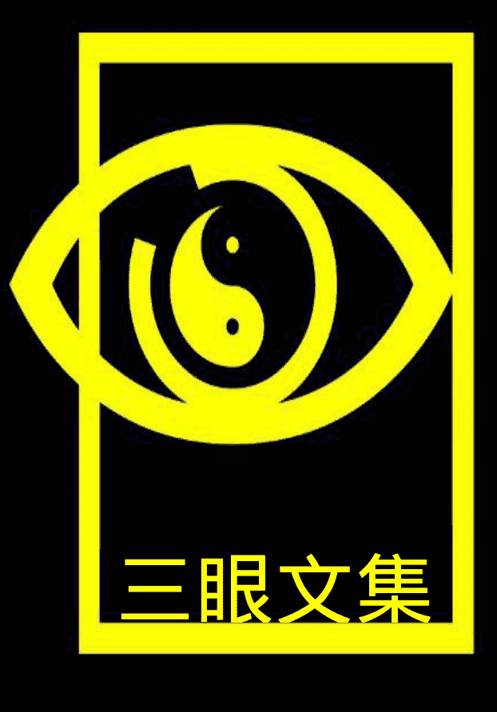

看经济有两条线：
第一条是钱的线，也就是钱从哪里来，经过哪里，到哪里去；
第二条线就是分配的线，也就是钱在流动的过程中，各环节（阶层、圈层、领域）都分配多少钱。
要看经济，先看政治，这是政治经济学。政经一体，分开盲人摸象。

从改开开始，咱家基调就是“发展增量带动存量”，也就是先把蛋糕做大，再搞分配问题。而实际上蛋糕确实是做大了，但分配问题并没有处理的很美好，行政垄断与国企垄断拿太多。
编外80%的人口分配20%的财富还不到，而且各行业领头羊还要拿走财富大头。
以至于多年都要“保8”，后来是“保7”，现在看情形要“保6”了。
保的数字看明面是GDP，其实本质是在保就业，因为存量不动，只能发展增量来分配给底层。
粗略估算1%的GDP能带动大约1000万个就业。

在过去生产力低，物资短缺时期，发展存量干就完了，老牌资本主义靠的是战争输出生产力，而咱家起点低，劳动力充足，通过人口红利输出过剩生产力和平崛起。
而现如今生产力已严重过剩，商品和服务大量过剩。
这就会挤压出一个结果：想赚钱就必须要通过存量财富转移。
没有新科技技术，没有新的经济动能，没有增量，只有存量竞争，只能就是互相玩，财富互相转移，穷了这家富了那家。
分配是从上至下，而在财富转移流动的方向上看，必然遵循从下往上流动！
这个世界的规则都是富人赚穷人钱，增量时代，是分多少少，而存量时代，就是转移多少。增量时期养，存量时期嬴。
任何城市化与工业化的进程，都是大城市对小城市，省级对地方，最后全国对农村的掠夺。
在这个流动的过程中，会产生三种赚钱套路，从下层到上层大体有三种路数。

## A. 底层收智商税。

底层是最接近市场化的层面，每天信息轰炸不停的所谓创业、营销都是围绕着最底层市场，因为中高层根本不屑一顾这些繁琐活。

收智商税核心逻辑：信息不对称！

核心方法只有一个：洗脑！

达成结果：被洗脑者甘愿自欺欺人！

短缺经济时期，满世界都是交易。消费者认为的好是商品真的好！

过剩经济时期，满世界都是套路，因为真实的商品需求所产生的交易已经赚不到什么高额利润了。消费者认为的好都是被他人洗脑的结果。

过去营销玩的是4P，以产品为核心，现在玩的是4C，以刺激需求为核心，也就是让你想要哈然后给与你哈。

收智商税就是高认知者对低认知者在人性弱点上的营销行为。

所要达到的效果就是：让你自认为很高级，从而自欺欺人。

过去底层赚钱靠的是商品，占有你的本体，现在是靠攻击你的大脑，占有灵魂。

随便举几个收智商税的套路：

### ——贩卖自律

人对未来迷失和对当下的境遇感受到痛苦时，任何人都是不自律的。

人是一种被欲望拉动和恐惧推动的机器，当只有恐惧而没有欲望的拉动，任何人不会自律起来。

自律是个被动的为，并不是主动的，当人对事物有着浓厚的兴趣和明确的目标，即可被动充满自律行为。

贩卖自律的对象往往都是漂泊奋斗的年轻人，通过“自律就能得到xx结果”来洗脑广大芳苦青年，这个时代注定是大多数人迷失的时代，而迷失的时候表现出拖沓与逃避是再正常不过的，而贩卖自律卖的并不是自律本身，而是一个梦，一个假设可以通过自律而达到的梦。

### ——保健品

在纪录片《食物的真相》中科学家表明，保健品基本0作用。但就算是所有人都知道其真相，许多人该买还是买，更意外的是，购买保健品的年轻人数已远远超越老年人。

权威无限极倒下了，会有千百个无限极站起来。收智商税为什么百试百灵，因为消费者买的就不是商品。

有病了，保健品就是药，病好了，保健品就是补品，病没好，保健品吃的不够多，人挂了，保健品吃晚了外加没吃对也吃不够。

这些毫无逻辑的话术购买者信吗？自然是不信的，但还要买。因为买的是安慰。

智商税这种东西，就是让你学会自欺欺人。

> ——知识付费

除了应用学科外（比如医学），占比最高的知识付费都是玩虚头巴脑的东西，创富课、经济课、心灵课、人际关系、情感关系、职业规划等等。

这些领域光张嘴吹即可，因为没有什么实打实技术，无外乎都是思维上的套路，玩的就是刺激和牵制学员的欲望，最后让学员自欺欺人——“你想要怎么样，学了我的东西你就会怎么样”。

80%的知识都是虚的，真金白银很少！

+   一是“导师”们也未必知道什么是真相，这个占比很大，骗术可以，但没有料；
二是有些有货的导师，真货也绝对不会告诉你，或者也没时间和精力。

比如讲创富光讲梦想和怎么成功，从而不必计本原，也就是钱的流动和利益分配。

比如讲经济，从来不讲政治，什么东方的西方的，各种高大上的词汇，学员一脸懵逼和崇拜的目光。

心理、人际关系、情感商感课，从不讲人的自我认知，而玩的是满足观众“以自我为中心”的心理而已，人际关系上怎么玩朋友玩情商，情感上怎么争取或者取妻。不学这些还好，学了社会更乱，而且也谈够实用价值，除了满足观众私心让其获取共鸣爽一爽之外。

讲职业规划从来不讲社会结构，学员一脑子浆糊，连所处的这个世界有什么样的社会结构，阶级结构，圈层交融，都不知道，规划什么？人要做规划，首先要知道自己这辈子所能达到的顶级峰层阶在呢，也就是人生天花板是什么，这个估计99%的“导师”是不教的，恐怕也不知道。

这么虚的知识，学员们为什么还要被收智商税呢？

牢记收智商税手法的核心结果：自欺欺人。

这就好比高考结束了，分数披露了，一些所谓好学生已经考上大学了，但考后的这个假期依然在复习功课。因为在他心中，只有不断地复习功课才会有好结果。

学什么不要紧，是不是真的不要紧，受不受用不要紧，关键在于要一直学，一直自欺欺人下去就会心满意足。

尤其是互联网时代，信息流通更容易，收智商税在网上就可以收了。

很久以前玩的是线下；然后互联网来了，玩文字流，1根网线加PPT，有的连PPT做的档次都特低，也能骗到钱。现在是视频流，PPT上加点声音，或者露个脸在那义正言辞的瞎说。

目前比较火的自媒体培训，最典型收智商税的套路，看着“导师”们的气质感觉很多

高中都没毕业，眼神里带着市井的睥睨之气。学员们一脸朝气和憨厚，挂着高考假期后的那种美好憧憬。

卖知识的本质=顿覆人的价值观和世界观。

没这水平走不远，最后都给各个平台和高没毕业的“导师”做了嫁衣。

知识付费当“导师”又正言 nachdem说，也是很费精力的功夫的，都是辛苦钱，赚的都是哄人的功夫，比哄孩子要累。

——健身

健身这种智商税，收的就是虚荣的钱，就好比很多年轻人处对象处的是脸，而不是人品。

总结：智商税是高认知对低认知的洗脑，核心是信息不对称，要达成“自以为很高尚”或“自欺欺人”的效果，这种税即可源源不断收取。

## B. 中层找接盘侠

60、70年代的生意人，都懂的一个赚钱秘诀，就是走在“模仿”的前面。

人都是分圈层、阶层的。

圈层之间是一个下层不断模仿上层的关系。

饮食上要记住各种口味名店，上层在口味上挑剔是厌倦的表现，而中产挑剔是其品位的主要表现形式；

学历上追求术 学历就是个商品，上层人已经玩剩下了，没什么含金量，中产特别重视，读的是形式，而不是内容，而且多半学府也没有充满的内容可读。

对于国外的迷恋。旅游、出国留学等。上层或者是格局到了，要拓展视野，或者是政治关系需要，或者是要跑路，出国游只是个表面形式；形式上的模仿永远追不到内涌生出的态度。最多算是一种新型的高级败家。

学钢琴小提琴芭蕾舞等奢侈艺术。这里面还有鄙视链，钢琴的鄙视跳舞的，大提琴鄙视钢琴，这是一种纯奢侈消费，没什么价值，艺术的存在的本质是富豪钱太多没地方花，是富豪的玩具，包括文艺复兴也是如此。所谓高级艺术的本质价值并不在于欣赏，而是在于社交和层级的象征。中产抽穷的模仿仿佛跻身上层。如果真正对艺术富有感知与乐趣，为什么不是吹唢呐弹琵琶？

在这些模仿里，生意机会就有了；

+   出国中介、艺术培训、各种仿奢侈品、学区房....

走在“模仿”前面的生意，相对轻松点，只要能抓到“模仿”的关键点，有本钱+个把年月+苦心经营，大概率打造一台赚钱机器。

“模仿”这种风一般都会有个十年二十年，尤其是层级越高的模仿，比如上层阶级对西方贵族的崇拜和模仿，这里面的生意机会会持续个几十年甚至上百年。

模仿者智商都不低，相反依据是其阶层的高度，他们信息灵敏，视野相对开阔，正是由此，他们寻求生活方式蜕变，人都渴望追逐更高的层级，全世界都一样。

## C.上层玩金融

前面的赚钱套路，还停留在“挣钱”和“赚钱”的阶段。都是辛苦钱。

而最高级的玩法是“转钱”，也就是金融。

低级思维看钱，是站在空间上看，钱就是各种劳动力、付出所得的回报；

高级思维看钱，是站在时间上看，钱只是个数字，是流动的水，不用于活不用付出，只要找到合适的流动方式让它“转”起来，小溪变大海。

这套路玩法西方走过近两百年。无外乎两个玩法：

放贷和炒资产。如今明面上看见的叫法是xx型金融和xx型投资。

前者把钱直接转起来，后者需要载体，也就是所谓资产，钱流进去吹泡沫推高资产价格，让人按捺变现流出。

放贷玩的是复利，用时间思维复利，简单粗暴。资本做大了必玩放贷，看市面上各

种白条就知道了，这才是大佬们的核心利器，各路巨头本职业务都是表面，追求的是领域垄断，位置站住了，自然盘面大，资金流大了用钱转钱。

在过去西方宗教眼中，复利就是魔鬼。

魔鬼的套路普通人也学不了，这里重点说的是炒资产泡沫，一个人的逆袭必然要靠资产泡沫！

人的一生，绝大多数人有钱没钱取决于智商和能力，更不取决于努力，很多流行语比如“性格决定命运”、“一命二运三风水四积德五读书”等，都是站在个体角度，也就是最底层的视角向上看，这样是看不真知的，只能迷迷糊糊的归结到一种神秘，也就是性格或者命。

看清真相要从上向下看把握核心逻辑：有钱没钱取决于利益分配！你生来在什么阶层位置，就能分配到多少利益。

努力有用吗？也有用的时候！也就是在利益分配机制转换的时候，比如从按人分配向按劳分配过渡期，也就是黑猫白猫时期，当转换完成，阶层逐渐固化，最后的结果就是按资分配。资不光是资产，更是资源，带来资产资源多，分配的就多。

当然也有少数人可以穿越阶层固化，一种是做精英中的精英，一将功成万骨枯，这个不谈，概率太小，因为拼的是3分靠能力7分靠运气；另一种就是上吹泡沫的车，跟庄走吃肉。

说句题外话，无论哪种跨越阶层，都是物质上的穿越，在权位上，永远是无法穿越的。例如商人最终拼的不是钱，拼的是一个红顶，没顶盖钱根本就不算钱。

炒资产逻辑就是注入流动性，推高资产价格，再变现走人，抬给接盘侠。

炒盲盒炒虚拟币炒葱炒菜炒字画古董炒股票炒新能源共享经济概念炒地产...本质都一样！

在这个生意里，只需提前买入即将吹大的资产就可以了。说起来简单，有这么容易吗？

所有盘面唯一区别就是在于两点：庄是谁？盘面多大？

小盘面不好玩，因为庄家小，操作盘面小，属于小圈子，散户和庄之间信息极其不对称，没法玩，而且小盘子快进快出，信息又跟不上，散户步伐绝对跟不上，大大概率都是接盘侠。

哪个盘面大？股市算不大？不算！股市的设立之初就不是善意的东西，是给公有资产按接盘侠的，以后能不能变大？很有可能，因为最大的庄也需要资产轮动。

所以底层逆袭一定要跟最大的庄，玩最大的盘面。

多大盘面算大？

一个主旨：能带动就业的。

只有在这种盘面里才能有“有无资产泡沫”的称谓。因为这种盘面决不取决於个人操盘和财团操盘，而是政策性操盘。这就可以通过多点多角度整合去分析考量，从而建立信息对称，进盘逃盘散户也是可以做到的。

多数财经观点看此盘面都是从下向上看，从表象里揪摸，这就很慢也很模糊。
比如蓄水池理论，简单说就是货币超发没地方去，不能流向消费领域，那麽自然流入一个大蓄水池，所以资产价格暴涨。

对不对？也对！但是等于没说。因为这就好比在说，供需决定价格，又好像是在说人活一辈子肯定要死，这是最普遍的大道理，对实际生活毫无用处。
看经济要看政治，看政治要看政策，看政策要看背后的分配，最大的盘面就要看分配，所有经济问题归结到最后就是分配问题。只有通过此处才能看清盘面的变化。

首先，货币超发是世界性的，当代经济运行模式必然伴随超发，永无止境，只是发的快还是慢，这取决于工业体量与水平。
第二，分配这事不可能平均的，发大水时候从上向下流，通过各个领域，具体看政策和信贷，厘到按毛，稀释拉拉流到最底层时，涉及到两个东西，物价和工资水平。只有底层的 talent 才能决定物价、物价是由存款和工资水平决定的，一个是趴着的钱一个是不断收入的钱。

这里有个逻辑：物品价格，也就是消费品，是由底层决定，指标看的是地板，刚需物品买得起是一定要保证的。

而资产价格，也就是投资品，是由上层决定的，核心地段的地产达到50万一平米也不稀奇，因为和为什么超发货币没有本质关系。
所以房价这事一定要分两面看，一种是全民财产性收入的承载物，一种是精英小圈子玩的。

物价是要看底层的，底层存款都拿出来消费，物价自然暴涨，而上层资产虽然是天量数字，其实现对于普通消费是没有影响的。所以所谓蓄水池理论只是针对底层存款才有作用。

第三，全民炒房的背后动因是什么？一是掏存款，不遮掩，比如“六个钱包”理论。二是抬未来，也就是加杠杆。还是最根本原则，看钱的流动。最终流到哪？地方政府。干嘛？搞建设。任何城市化与工业化的进程，都是大城市对小城市，全国对农村的掠夺，而在增量时代，靠输出低廉劳动力创富，夺的是劳动收益，而在存量时代，夺的一定是土地收益。

劳动收益时期，要钉死父籍，而户籍打开之时，就是土地收益时期了。

这样从上到下看，通过分配就看清了整个线条，看清枯燥的数字的背后动因。
物价、工资水平、信贷收缩与扩张、资产价格圈子分类、存款率、杠杆率、户籍制度。

现在已经到了轮换盘面阶段了，也就是所谓倒逼改造阶段。

现阶段最大盘面一定冰火两重天。

一种是精英决定的资产价格，也就是一线城市核心地段优质资产，会无限上涨，因为这跟大盘面毫无关系。5000万一套的豪宅涉及不到信贷，买家也不用加杠杆。
另一种是由存款和杠杆推动的资产价格，也就是部分二线和三四五线资产，冰封失去流动性，但资产价格还标记在那，实际上不动产真要不能动了，价值趋近于0。但分配这事到最后玩的并不是钱，而是心理，安居乐业就是最大的资产，这是一种心理资产。

轰轰烈烈的户籍改革与科创板，背后代表着土地和工业质量，下一个轮动的盘面可能就在其中。

精选留言

暂无...

## 钱就是债！——金融家的秘密，老百姓的盲点！明白这个才能不被收割

钱是什么？
是手中的钞票？错！
是银行卡里的数字？错！
是购买力？错！
是价值交换载体物？错！
是与国际标准货币美元的对比？错！

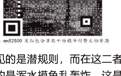

这个世界信息分三层，底层看见的是显规则，顶层看见的是潜规则，而在这二者之间充斥着大量杂乱无章的信息，有的是故意而为之，有的是浑水摸鱼乱轰炸，这是一道

巨大的屏障。
而本质上，潜规则一定要比显规则思维领先几十年，这也是底层多数人为何赛跑跟不上的原因。
人人与人的差距不是智商，是认知。认知就是接近真相的距离。

底层思维看钱，就是钞票数字；——眼界在手里；
中层思维看钱，通过购买力、价值交换、汇率等观察；多数的财经文章都是在这个思维里；——眼界在社会，无章法鱼龙混杂；
顶层思维看钱，就是债务！——眼界在体制运行；

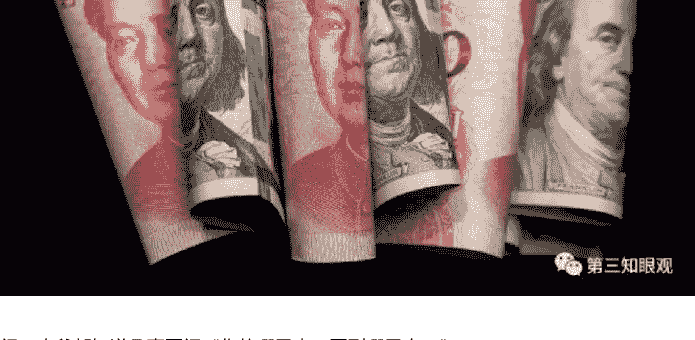

门口大爷都知道凡事要问“你从哪里来，要到哪里去。”
看人要看他父母，看钱要看它的父母，钱从哪里来？
过去钱的父母叫价值，现在换了爹妈叫债务！

路径大致是：
有抵押、贷款，通过商业银行制造出来。也就是资产抵押——将钱写入借贷人账户。
只要有人从银行贷款，新的钱就会被创造出来。
天下列各路信息都谈杠杆，杠杆中的杠杆是一个叫法定存款准备金的东西。通过制度法规给其制造出来的钱的数额定个上限，这就是法定储蓄准备金制度。
银行本质就是存贷，假设有一个银行，叫第三知眼观银行，简称三观银行，刚开业还没存放过款，那么在开业前会以现金方式和存款准备金方式存入一定数额的钱。假设

法定储备金是9:1。
第一步。来了第一个顾客，要贷款1000元买车，按照9:1的存准率，三视银行凭空制造出存款准备金9倍的钱，其根据是借款人的偿还承诺。这1000元并非从哪里取出来，也不是某个人 的存款，而是以信贷方式打入个人账户的一个电脑数字而已。
第二步。车的卖主把刚刚收到的1000元随便存入哪个银行，此1000元可以继续根据原始杠杆造钱，按照9:1的存准率，可以造出1000x9/10=9000元的钱贷款。
第三步。如果这9000元新增贷款用于消费，卖主获得的9000元随便存入哪个银行，即变成这个银行再次贷款的合法依据，可以制造出9000x9/10=8100的贷款，也就是新钱。
以上三步无限循环，每笔新的银行存款都具有无限次创造一笔稍小贷款的能力。如果创造出来也就是贷出去的钱没有被用来存进银行，造钱的程序就中止。但一般来说，每一次造钱都会被存进银行，而存准率可以一次又一次的重复使用，直到银行体系增加了100000元（所有贷款数目接近于此数）的新钱。
当在贷款和抵押上签字时，那些我们承诺如果没有偿还能力就被没收的资产，是整个交易体系里唯一真正有价值的东西。没有借款人签字的抵押借款合同，银行就创造不出来钱，钱就是债务，金融系统没有债务（贷款）就没有钱。
从组织到公司到个人，都欠银行一屁股债，如果所有组织和个人都把债务还上了，清偿债务将使钱不复存在，我们完全依赖银行贷款频繁刷新来维持钱的存在，没有贷款就没有钱。银行凭空创造出充足的钱，我们就富庶，银行没有凭空创造足够的钱，我们就挨饿。

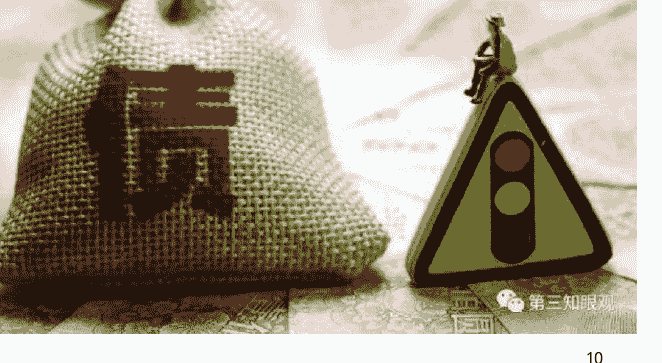

货币为何无限超发？为什么无限贬值？为何利率趋低？为何信用卡广告一个接着一个？为何组织花钱越来越快？

核心在于利息——钱的成本，或者叫价格。

每次借贷都会有利息产生，这更是凭空出现的东西，实质上本金+利息 > 本金。

债务上升，利息就上升，需要更多债务还利息，这样就无可避免的推动债务继续上升。

债务发行量就没有上限，钱的供应量就不会有上限。

## 什么叫收割？

收割不是你赚我钱、我赚你钱的小打小闹，而是在一个最大的整体上观察钱的流动，通过债务来观察。

收割就是让钱凭空消失。

在这个过程中必然伴随着：

+   1、某一领域资产价格推高，击鼓传花最后的一棒，就是冷冻或消费归零。
2、债务转移，也就是杠杆转移。

## 什么是真资产？

银行最认可的，手续最简单，最容易抵押而借贷的东西，就是最好的资产，当这种资产有了不好的势头，也就是抵押变得麻烦、评估变得复杂，也就是不容易以其为承诺借贷了，那么这种资产就到了尾盘阶段了。

精选留言

暂无...

## 穷人才想赚快钱！教人致富多为骗局！想变富要明白一个逻辑：分配！

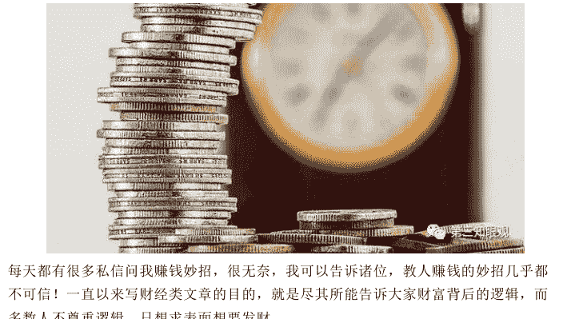

每天都有很多私信问我赚钱妙招，很无奈，我可以告诉诸位，教人赚钱的妙招几乎都不可信！一直以来写财经类文章的目的，就是尽其所能告诉大家财富背后的逻辑，而多数人不尊重逻辑，只想求表面想要发财。

打开手机，每天新闻都是各种暴富，把人心都搞乱了。

三眼在这里告诉诸位：

1、穷人多富人少！
金字塔社会结构，80%的财富集中在不到10%人手里，剩下20%的钱还要被各种领头羊拿大头，80%的人总财富全加起来最多也就一个手指头！
真正能长期稳定赚大钱的非常稀少，新闻里都是假的，都是成年人，活在表象里多幼稚！
记住一点：这个世界一直在说么，证明缺么！一个人经常说么，证明缺么！
每天新闻都在谈钱，谈暴富，证明大家都很穷困，至少很迷茫！

2、赚快钱心态的都是穷人，在富人眼中就没有快钱这个意识，大财团、大神级投资人利润率有多高？没多高，但能持续长久，基业长青才是富人的核心目标。
富人因为明白财富背后的逻辑，追求长久稳定的造富，赚快钱毫无逻辑可循！
教人成功、手把手教人致富的东西几乎都是局，信了你就给他做嫁衣了！

3、想赚快钱的都是韭菜。
成熟的人会用一生的眼光去看待财富，这是一套体系；
幼稚的人只有当下的眼光想赚钱快钱，这就韭菜的本质思维。
记住：只要不寻求快钱，就不会被割，看看股市就明白了！

三眼教不了诸位致富妙招，只能告诉大家逻辑，人的富有是什么？

钱只是表象，钱背后是富人对经济、对政治、对社会的理解。
电影《1942》里地主张国立对长工说：只要能活着，再给我10年，你老爷我还会是老爷！
因为富人内心有逻辑，身无分文扔到社会上，照样能起来！

那么财富的核心逻辑是什么？两个字：
分配！

严格意义上讲，钱不是赚的，是分配来的，比如全国不同城市的工资水平，这东西是个个人能定的吗？是分配的，从政策到产业到配套再到具体的工商落地，最后到个人。
人想要致富，就要站在分配的核心位置上！
只会找位置，一直站住了，这辈子永不倒！
比如年轻人谋求发展，什么叫发展？就是要在去钱多的地方、钱流动大的地方，流通环节多的地方，找个位置站住了，自然分配到财富。

人生处处是分配！用分配的眼光看财富，自然变得成熟！
小到一个公司哪个人拿的多，大到怎么布置个人资产，在整个社会的财富变迁中分配的多。

那么怎么找位置获取更大的财富分配？

+   1、按劳分配依然存在，但是已经不是分配的主要根据了。比如都是一线白领，工资能差多少？体力劳动者和脑力劳动者能差多少，差距很小了已经。劳动收入区分不大，因为说实话目前的结构不是很需要高大上的人才，看看行业巨头就知道了，有几个是玩技术的？玩的都是流通过买倒卖、钢筋水泥的话，用的人才能有多大区别啊？
根据市场供求，不同的劳动技能所分配的财富有些许差别，但是不大，个人觉得没必要花费太多精力。

+   2、劳动收益向资产收益时代转向，按资分配要记牢！
啥叫资产？无须多么高大上的解释！
钱跟着走的东西，能吸钱的东西，就叫资产。
北上广干十年，靠的是房子收益打败同层的人。因为房子能吸钱，就这么一个简单逻辑。
在一个生意的链条上，站到核心要素位置，别人才给你送钱花。
在一个企业业组织里，站到核心环节位置上，既轻松又拿大头。
什么各种数据，各种经济词汇，没必要搞那么专业。
就跟打仗一样，搞花里胡哨的一堆兵法谋略没用，最终上了战场核心套路就那么几

个。

## 3、分配跟着资源走。

啥叫资源，啥叫人脉？
就是能够帮助你打造资产的一切东西，就叫资源！
除此之外，都是瞎扯淡！
什么人脉啊，多条腿之类的鸡汤少看，没有实用价值。
过去十五年，三眼哥我跟各种高大上朋友兼同学很少来往，跟各种中介、信贷员、小商小贩来往最多。为啥？最实用！
靠着这群小老弟，三眼哥购入资产成本起码比市场低10%，小老弟们也靠我赚了不少钱，互惠互利吗。
资源一定要围绕资产打造——你要干什么，就要积累什么资源。
不要看鸡汤，花里胡哨认识一堆没用的人，积累一堆没用事。
当人明白财富的逻辑在分配，自然冷静又孤独。

精选留言

暂无...

## 历史观比财经观更重要！经济是政治的延伸，而今天是昨日的推演！

经济学受用很狭窄！如果你想在各路财经信息里抠出财富之路，还是洗洗睡吧，免得浑身泛绿。

因为经济学建立在经济个体的研究上，经济个体对整体要具有影响，影响就是有话语权，哪里怕一滴水那么大，要有影响首先你要 предпринимать 嘛，也就是财C，你有影响吗？

在三眼文章里不止一次说过，钱不是赚的，是环境分配给你的。从春秋开始至今就是一部分配史。

如果你非要对当下的形势做判断，在财经信息的轰炸里寻找破局之道，以此来决策人生，那么奉劝你放下财经，多读历史，因为核心的东西并不在经济学的书籍里，而在千百年前的书籍里。

多数决定大势的关键点在西方经济学书籍里没有轨迹可循的，户籍、双限、二胎、70年。

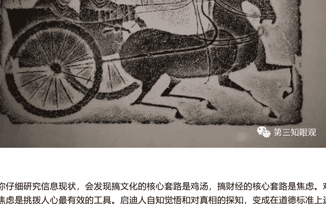

如果你仔细研究信息现状，会发现搞文化的核心套路是鸡汤，搞财经的核心套路是焦虑。鸡汤与焦虑是挑拨人心最有效的工具。启迪人自知觉悟和对真相的探知，变成在道德标准上逐渐淡化，和对客观物质环境描写的模糊不清。

培养出网民两大特点，爱谈人生大道理和爱谈传奇人物。统属八卦，八卦就会失去对真实思考。

如果非要寻求经济的思考，那么请在前面加上Z.Z.，缺乏政治经济学素养，将无所适从，这涉及到“体用术”，任何的用于术也就是一般经济规律都要让步于体，也就是分配与体Z。

体系系统，就是这个意思。

很多人私信于我让我推荐书籍，我想说的是，用于术的工具书很多，但不加上2000年前的芯片，这台计算机就没体运转不动车啊。芯片有多强，运行有多快。

芯片中的芯片就是法家，法家的芯片就是商鞅。

如果你迷失、焦虑、困惑、盲从，可能是缺少这个芯片。

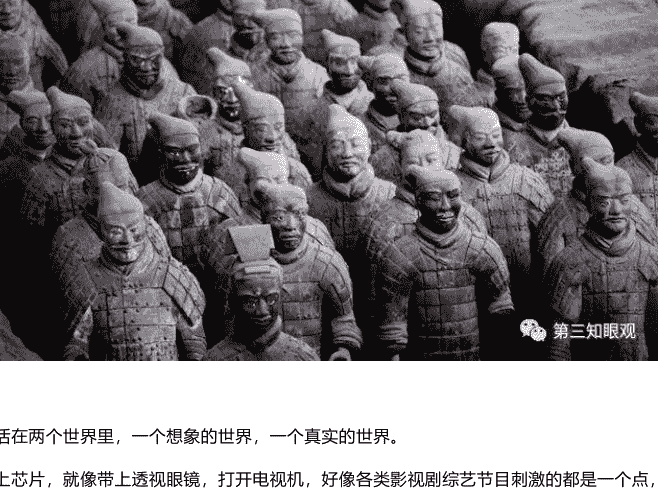

人活在两个世界里，一个想象的世界，一个真实的世界。

装上芯片，就像带上透视眼镜，打开电视机，好像各类影视剧综艺节目刺激的都是一个点，打开手机，好像各路信息都在轰炸一条线。

如果就想不装芯片，就想抓取经信息，那么你只关注一个点：J.Y。

因为只有这一点牵一发而动全身，只有这一点才与你相关，只有拎起这一点，才能发现逆袭之路。

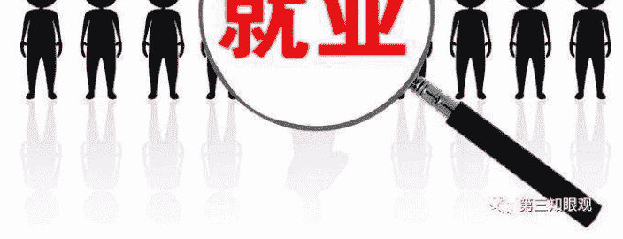

精选留言

暂无...

## 大钱要靠分配！不是卖苦力赚的！人生是无数个局，看局方能破局

个体老百姓在赚钱这件事情上，因为大多没什么外部资源和关系可依赖的，最后都会在自身努力上找出路，希望通过努力跨越阶层障碍——爱拼才会赢！

但我要泼冷水，99%的人努力都是原地打转，爱拼才会赢是个伪命题。

这其中肯定有很多红精来喷我：人 numerosi？人靠拼靠什么？

努力肯定是要的，每个时代都不缺少能拼搏的人，但能成功的为何只是极少数人？肯定是路线有问题啊！努力也会和不会的。

因为想跨越阶层壁垒，获得财富质变，靠的不是拼，而是打通认知、塑造格局，走对路线。

钱不是卖苦力拼来的，而是要占据社会财富分配的关键环节，分配所得！

## 什么是江湖？就是体制外市井文化，大头揽不着，一大群人排挤在底层，互相拼杀。

江湖、武侠类的文学都不能谈钱，大侠的钱来源很神奇，谈钱就失去江湖逻绎了...

插一句话，少看抖音快手什么的，这个社会喊声最大的就是最无知的，无论对于情感还是人生都充满江湖气质。

## 卖苦力VS占分配

## 什么是卖苦力？

就是你辛苦一辈子，看似非常努力，实际上可能是一直在重复劳动，而这种努力的收获，与劳动持续性产出成正比，随着年龄增加和体力精力的衰弱，回报慢慢减少，直到被淘汰。

这条路上所谓富有，只是在小圈层相对来看着，大家都是卖苦力的，必的就是卖苦力程度，你6点起床干活，那么我就5点，你工作到晚上10点，我能到12点。其实产出回报差不了多少，而且多分点少分点无所谓，决定不了人生的高度。

卖苦力不分体力与脑力，很多脑力工作看起来是玩智慧，实质上拼的还是年龄和身体，例如“996”是什么？就是白领供大于求，想每个月多赚个千百块？不想被扔掉？那就多卖苦力吧，而且要带着微笑。

卖苦力久了，还没有格局认知，就会把造富寄托在暴富上，想暴富、想要炒股，脑子天天在股票、彩票和手里票子之间转折。

## 什么是占分配？

就是无论是大环境还是小环境，都要占住核心关键位置，自然就比别人分配的多。

这与劳动付出与回报没有任何关系。

## 人要发展，核心在于求变，变的核⼼是认知，认知的核⼼是要识时务，看清所处的外部环境、链条，从而发现机会点。

## 这世界就是一个大局，大局的本质是人性，划分成无数个小的局，人生就是一个个局。

局是什么？就是你玩我、我玩你，谁都想占到最大便宜。

想发展就要有做局的眼光，这就叫格局。没有局还谈什么格？

## 看到的局越大，占到分配的关键点，翻身晋级的走向巅峰的机会越大！

小的局就不说了，无外乎家长里短、上下班，再大一点就是知道怎么在公司、企业业务组织混个好位置，再大一点就是干点小生意，知道怎么在生活的小环境有个好项目混个好位置，这些都不难，难点在于上升到政治、经济与社会层面，在这个层面的局里会占位才是一劳永逸的。

大的局无外乎偶，但没个十几万字恐怕说不完，需要n篇逐一细说，这里大体归纳一下：

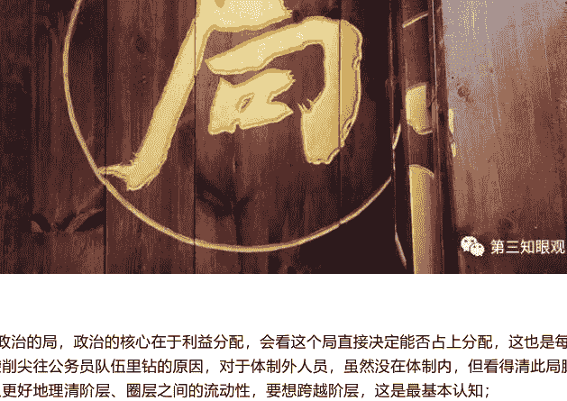

1、政治的局。政治的核心在于利益分配，会看这个局直接决定能否占上分配，这也是每年脑袋削尖往公务员队伍里钻的原因，对于体制外人员，虽然没在体制内，但看得清此局脉络可以更好地理清阶、圈层之间的流动性，要想跨越阶层，这是最基本认知；
分成小块来看包含很多块，每一块都与生活息息相关。比如明白劳动供给率，也就是1个人工作能养活几个人，从而看清福利到底重不重要，不重要怎么远离而不去投入，如果重要怎么玩福利？比如教育医疗改革，经济目的达是什么，在分配上受益的是哪块的人、哪个环节。

金字塔社会结构是什么样的，大体上分成三大圈层和九大阶层，生在哪个阶层，想跨越进入哪个阶层，天花板是什么？这辈子认识就是最高能混到哪个层次，这个层次是什么等等。

2、经济的局。经济是政治意识的延伸，是在利益分配的原则下，怎么具体实现的路径，这

里要明白几个主要关键点：

## 货币。

首先一定要明白到底什么是钱，每天辛辛苦苦赚的东西是个啥？钱不是什么交换价值、购买力载体，更不是纸票票和银行卡的数字，这些都是表面，如果这么粗浅地认识钱，那么一定会被收割。比如国人特别爱存钱，20年前存1万到今天看看结果很可悲。

钱是一种信用，是？你有了多少信用就可以去社会上换点什么回来，信用是需要有基础的，在建国初期信用以粮食为载体，那时候叫粮本位，也就是社会上有多少粮食物资，就有多少钱在转动，所以1分钱也很值钱，捡到了也要交到警察叔叔手里。现在呢？是外汇储备？肯定不是，过去一段时间是与美元挂钩的，但随着工业体量，现在的信用基础是土地，土地不光是地疙瘩，地皮的上面和下面都是财富，这才是现如今的RMB的信用基础。

了解这一点，就能透过看清RMB信用的基础逻辑，而推演未来重要资产价格走势。信用跟啥有关，直接决定fle 富最快捷的路线，最差也不至于被收割。

## 产业与行业。

特色SH主义的原理，就是对资源的分层与控制，核心资源要素要完全可控，边角料交给市场，其实老牌发达国家也一样，只在于一个“度”。

## 离产业核心越挨近，分配的财富越雄厚。

从国有到市场，从地到产到衣食行消到互联网，哪里“无形的手”多？怎么掌握的？都直接决定财富分配路线，直接选行业选项目找位置。

## 资产。

比如股市与楼市的局。股市在创立之初就是为国企融资寻找盘供的，再过去20年里，随着经济发展货币增发，股市最大的功能就是消灭过剩的流动性，大白话就是把散户的钱蒸发掉，不然这些钱到了币场，那大米不可翻几倍价格啊？过去它一直扮演“蒸锅”的角色，散户的钱就是水，目的就是把水蒸发掉，所以在高度通胀时期，股市大概率会来一波快牛加大跌来蒸发“水分”。而楼市是土地信用载体的延伸，作为信用载体的一部分，资产价格走高是必然，往往资产价格走高之后，或者之前，股市都会割一轮韭菜，蒸发一遍水，每次先后顺序不一样。大的规律是不变的，只是在每次的手法上有个花样而已。

## 消费升级与产业升级。

## 识局免收割，破局跨阶层。终生卖苦力，不如占分配！

## 精选留言

暂无...

为何啥都不好干了？为何经济放缓了？本质在于这一群体快被抽干！

## 过去高增长的本质是什么？

改革开放以来，中国式的经济奇迹被世界媒体ạnh誉，再过去“奇迹”也让人自信满满：

> "保持经济高增长最少30年！在2040年成为世界第一大经济体！"

而如今经济下滑？百业都不好做？

有人怪地产，有人怪电商，有人怪租金，有人怪生产力过剩，有人怪美国，还有人怪人太好诈了，这些都是管窥之见！

## 从40年历史整体来看，中国经济高增长模式的本质是对农民身上红利的释放。

经济高增长或者说GDP一定来自生产效率的提高，而观察我们，整个40年的奇迹背后本质是一部农民进城史，准确的说，经济增长是源自农民生产效率的提高。

一个农民劳动力再田地里劳作，一年创造个几千元而已，进城工作，一年可以达到几万元甚至十几万元，而根据劳动力价值配比，在基础劳动力的上层，通过每个农民工作创造的收入远远大于劳动层所得。当农民工数量几何增长时，惊人的经济增长就这样被创造出来。

## 我们这代人，最应该感谢的就是农民兄弟！

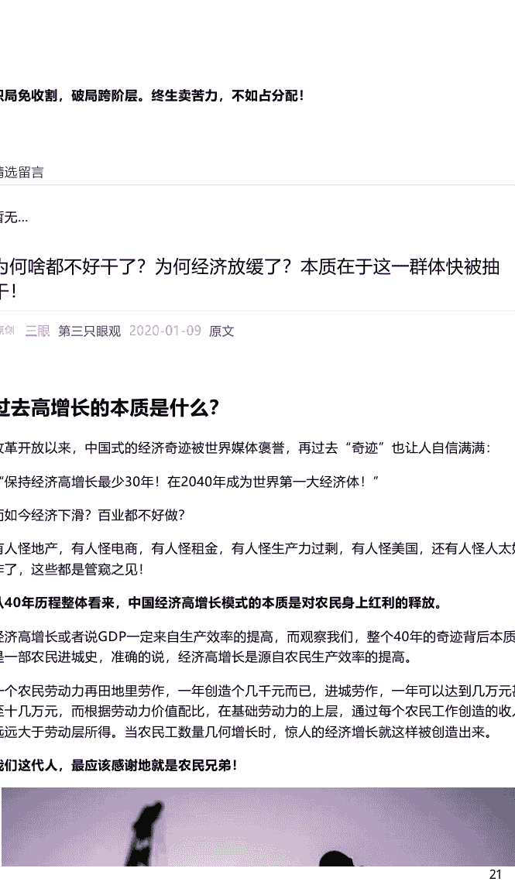

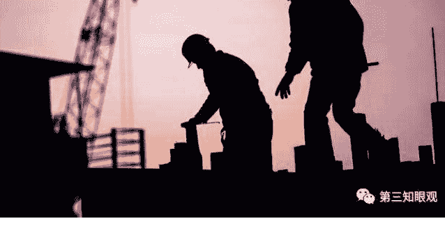

## 这种增长需要有两个关键点：

+   1、 有源源不断的农村劳动力进城，劳动力需要过剩；
2、 城里有足够岗位来释放劳动力红利。

针对这两点，那么就有两大工具了！

+   1、 打通城乡户籍，户籍慢慢放开，农民逐渐的和城市人享受相对比较公平的待遇，在生活层吸引；
2、 主要通过铁公鸡和地产来释放红利，既拉动经济又肥了腰包，公私两便。

这种高增长实际没有什么技术而言，爸爸进城造富地产富豪，孩子玩游戏玩手机买假货造富企鹅小蜜和淘宝宝宝等。

没技术的增长结果就是形成泡沫。

不要泡沫就要换轨道，怎么换？

那就是一022维继续换增长期，也就是深挖劳动力，户籍慢慢开，城镇化继续干，这是过去的老路，热门熟路不能丢；

第二就是发展技术，这也是芯和科创板那些了，拭目以待吧。

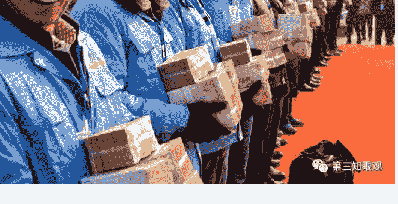

## 从这里面能看见什么？

什么是创业的好方向，会被扶持？那就是能够帮助组织做好“灵活就业”的行业，户籍开了进城的多了，参见快递员，再有，不管物价怎么涨，通胀怎么狠，服务业的服务价格是自古不变的，是有固定价格标准涨幅的，稳就是活下去的第一步。

什么是未来核心资产？rmb的信用基础不是70年前的粮本位，也不是金本位，更不是美元挂钩，而是地本位，土地才是rmb的信用基础，户籍开了，进城了，留下了一片片地，这就是更广阔的的信用承载，这就是钱，这就是核心资产，农民兄弟要珍视。

股市有机吗？有！进来上海喊话很直接——怎么能把几十万亿存款搞进股市池子里，科技股有机会啊，虽然三眼不脱粉丝。

地产有机会吗？有！但很少！核心城市可租可售可自住的就是核心资产，除此之外不要想了，因为这些资产价格不是信贷，更不是刚需推动，而是精英群推动。

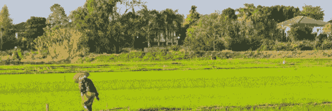

## 精选留言

暂无...

## 人生12字秘诀：自成体系、预判大势和耐心坚守！

问：什么算一个成功的人？

三眼：有自己的政治体系，有自己的经济观，有对自我的评判的标准。政治体系对应着地位与声誉的获得，经济观对应着致富之道，对自我的评判标准对应着与家庭、亲朋及与自我的和谐相处。

问：怎么判断是否成功？

三眼：当一个人自成体系，即可成功。功字是一个“工”加“力”字，自成体系即为工，有了体系就生长出掌控外界与自我的力量，这就是功力！

人的成功与否不需要外界与他人评判，而是由自身体系来评判，当人自成体系，什么是成功就已经了然于心了。

问：能简单说一下什么是体系吗？

三眼：人做事情只有两种方法，一种出于本能和不成文的环境规矩的约束，另一种出于一种自己打造出的方法规则。大多数人都是前者，后者很稀有。跟人的性格与学习环境有关。

比如怎么叫政治体系，往大了说就是上观国家与社会，洞察最大的政治规则是何种模样、性格和气质，这样才能穿梭于最大的规则之中；往小了说就是自身在生活工作中做人做事的一套准则。比如你奖惩一个人要有自己一套规则，为什么奖惩？奖惩的标准？

当你的这套准则被更多人折服，你的声誉与地位自然建立出来，权益靠的是你的体系，而不是你的钱包，那只是世俗人的偏见。

多数人处理事务都出于本能和情绪，本能和情绪是永远被体系规则牵着走的，也就是所谓洗脑！

而人在建立自身体系之时，会与自身的性格相结合，根据自身特点打造出一套最符合生存的规则。比如刘备和曹操都有各自的政治体系的性格和特质，比如一个朝代不同时期的性格和特质也是不一样的。

问：建立体系难吗？

三眼：不难！当人做事情有一个小的准则之时，比如坚决不说废话；当人看待经济发展有一个小逻辑之时，比如只盯着钱的流动路径；这个人就有了自身的体系，小规则就是小体系，需要做的就是不断填补体系而已。

问：什么是预判大势？

三眼：预判大势一定是源自于自我的判断，而不是旁人的轻言。人与人的巨大区别就在 aimed于此，99%的人都是“顺从”于环境与他人言论，这是人生最大的失败。当一个人自成体系，就会与这个社会的大体系形成共鸣与互通，能够察觉到社会发展的脾气和脉络，人所需要做的一直填补自身体系的不足，获取与大环境体系的充分共通，从而预判大势。

问：成功的最核心关键点在哪？

三眼：耐心！这是多数人极度缺乏的。现在这个信息爆炸的时代，使人眼花缭乱欲望丛生，多数人潜意识里的成功都是做投机，投机在世俗人眼中是个运气活，但在自成体系人眼中，投机其实是一种投资，因为想要寻找到一个“机”点，甚至需要几年去观察寻找，这个过程就是在做长投资。普通人看到的是投机的爆发，而看不见背后的潜...

伏投资。
没有十年磨一剑的耐心，人生是不会成功的，或者说人生的成功在本质上比拼的就是耐心二字。

问：怎么样才能富有耐心？
三眼：有很多小技巧，但挖掘到核心之处，只有二字：孤独！
多数人没有耐心，是因为人生没有明确的目标，因为多数人都活在别人的系统里，或者社会不成熟的一种系统里，这源自人性的盲从。所以富有耐心的人一定是寻找自身体系的，是孤独的！人与人的成熟区分就在于此，是能否沉浸和享受在孤独里。其实人一辈子的出路除了孤独没有它路，只是沉浸在平素的喧嚣中依赖并且不自知。
不享受孤独绝不会富有耐心！耐心只源自对自我的依赖，而一寸一寸的生长。
自我只是一个载体工具，多数人太重视自我，而忽视了观察和打造自我。要知道每个人的自我都只是一部满是漏洞的机器而已。

最后三眼想说的是，东方传统哲学中的“天人合一”；西方宗教里的“自我拯救”。都是在寻找自我的体系，人生其实很短暂，但也有足够时间用来给人打造自身体系。
如果人生是场游戏，那么游戏的玩法只有这么一种，这是一种乐趣。

## 精选留言

暂无...

## 只有会使用“不公平”，才能更好地生存！

节选自 “第三只眼观” 知识星球

首先，三眼告诉你思考的思维：

+   1、学习是什么？就是在脑子里刻上一个个道理；
2、道理有没有坏，能否记得住，受不受用，要看道理背后有没有强逻辑；
3、逻辑看什么？看关键词！你最后刻在脑子里随时拿出来用的，是一串强逻辑关键词，这样才算学到了！

本期核心关键词：如何学会使用“不公平”而更好生存！

## 关键词一【社群】

人是一种社群动物，这一点被许多人所忽视，因为人过于注重自我；
思维沉浸在自我里，视野自然就短视，要提升认知，首先是跳出自我，在社群中俯瞰自身，中国每天出生约5万多人，每年出生约1990万人，你只是其中一个小元素。

## 关键词二【平等与信息透明】

人永远摆脱不了社群关系，而关系永远是不平等的。

天生的不平等显而易见，个字高矮容貌美丑；

后天的不平等就很少有人去仔细思考了，周则意怠，常见则不疑。人类对经常见到的事物产生习惯，索性不会怀疑与思考，人和人的差距就此产生。

后天的不平等是什么？核心就一个关键词：信息透明度。

信息的公平，也就是知识的公平、教育的公平，最终是认知的公平，才能让社群达到平等。

一句话，信息透明度会加强平等性！

但可能吗？不可能！

因为人性所驱使，会人为的制造信息不对称！

哪怕两个人，同事或者同学，在信息上也会藏一手，因为人潜意识里明白，只有认知不对等才有强于对方的可能。而上升到社群，信息的不对等随处可见，金钱与地位都是表象，真正拉开人距离的是信息的对称度，也就是认知度。

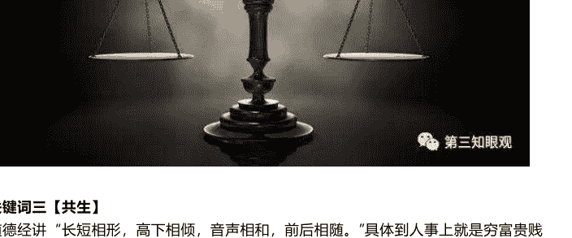

## 关键词三【共生】

道德经讲“长短相形，高下相倾，声音相和，前后相随。”具体到人事上就是贫富贵贱是共生体。没有穷就不会有富，没有贱就不会有尊贵可言。一般人会把贫富贵贱割裂开来看，这是最根本的错误，因为剥裂开就看不到穷富贵贱的互相转化了。

任何穷富贵贱都是比较出来的，没有比较就没有上下可言。离开穷人富人就不是富人了，离开卑贱之人，尊贵就显示不出来了。

如果一切信息对等，那么到最后就不会有贵贱和穷富之分，穷富贵贱的根本在于会不会使用这种“不公平”，而使用的具体过程就是转化——把别人转化成穷，而富了自己，把别人转化成卑贱而尊贵了自己。

## 关键词四【不公平】

人性追逐的是站在天平优势的一侧，更大的格局，更深的认识，才会站得更高的位置，认知占上位置，才能进行下一步：转化穷富与贵贱。

天下皆为利往，而财富的背后一定是不公平。

到底什么创造巨大价值和财富？

如果通过劳动创造价值，那么人与人的财富不会差别太大，因为人的精力、体力、智力都是有上限的。劳动是所有价值的最底层、最基层。

而能够创造巨大价值的，一定靠转移，转移他人的劳动价值为自己的价值。也就是资本论说的剩余价值，富有的背后一套转移的套路。这就是具体使用不公平的手法。

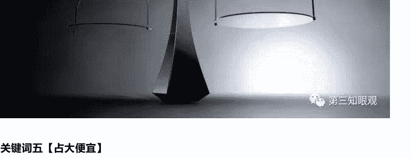

## 关键词五【占大便宜】

人性的本意意识就会使用不公平，只不过比较小气，一般人表现在占便宜，占便宜就是一种最原始粗暴的转移他人劳动价值的方法。

而当一个人打开认知，从更高更大的格局去洞察更大环境的 unfair 之处，才能占更大的便宜！
人性就是这样，没有什么伟人善人，只不过“便宜”占得不一样而已。
占到非常大便宜，那就是传奇！

根据他三眼的五方论，政治经济社会自我人性五层认知体系，搞哪是个占最大便宜的？政治！

无论在小团体、组织、还是最大社团，政治是站最大便宜的方法，因为不需要动一根手指去劳动，只需要不断建立信息的不对等，通过分配到达目的。

## 关键词六【三招鲜】

比之母系社会、原始社会、封建社会，商业资本社会的进步体现现在从自古“明着来”过渡到“隐藏干”！

成功的人不要看表面，背后皆为隐藏干，这是心法，没人告诉小白兔的，城府极深说的就是这个。一共有三招方法，一招鲜即可吃遍天。

第一法：通过显规则，没人举手反对的习惯性的规则，来转移他人劳动价值，这叫隐藏博弈；说是隐藏，是因为“常可见不疑”。

这是一种比较初级的手段，给他1元钱让他创造10元的价值，为何体力劳动者容易被剥削？因为劳动价值最容易考量，只有在脑力劳动上才有可能存在“容大欺店”的反剥！

所谓创业也基本都是基于这第一招，因为这是一般人所能想到的“高招”了！

而许多创业激情少年也不得其法，创业的核心并不在什么项目、模式等，那都是干出来的，不是计划出来的，能够计划出来的只有一样：就是你到底要转移谁的价值！

第二法：通过寄生和抢槽脚来转移财富的套路，这叫隐藏偷盗！其实很多所谓成功之人这一辈子就干了一件事。用这招的人几乎没人说自己是创业的，因为根基羞于创业。

第三法：隐藏劫掠，也就是金融！金融的核心是什么？就是用钱抢钱！最粗暴简单的方法就是放贷，高级的玩法就是资产炒作。

## 关键词七【工具箱】

人若使用不公平，就要有一个自己的工具箱。

工具箱包含4方面：

工具一、游戏规则。明的显规则和隐的潜规则。如果在一个环境里显隐规则都看不见，那还是不要玩了，进去只能被玩。人这一辈子只需要在1-3个领域搞透显隐规则即可，年龄与时间也决定了要十年磨一剑。这就是专家专在何处！功夫在诗外，并不在乎诗中。

工具二、信息集成。对于所处在目标领域要有个信息的计算器，分为信源和数据两大块。记住一点，人皆所能见的都是假的！也就信息源是最重要的。其次就是数据，数据并不仅仅是数字，而是背后的逻辑，看数据分析信息主旨在分析逻辑是不是通的。

工具三、关键资源。信息落地到具体实现，就需要各种资源，而资源中最重要的、关键的资源，抓取即可。一条线上10种资源只有1-2种是关键而已。

自成体系，预判大势，耐心坚守。有了十年磨一剑耐心，有了三种工具，即可开心的去使用不公平了！

## 精选留言

暂无...

## 世界是个养殖场，上层养殖下层，提升认知与格局唯有学好养殖技术

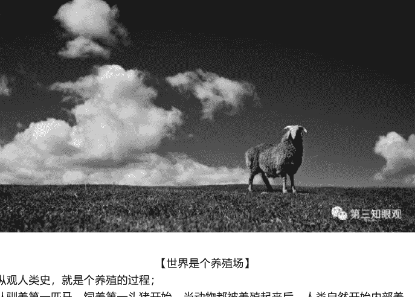

## 【世界是个养殖场】

纵观人类史，就是个养殖的过程；
从驯养第一匹马、饲养第一头猪开始，当动物都被养殖起来后，人类自然开始内部养殖。整个近代竞争史就是一部抢钱抢粮抢资源的历史，当然人也属于资源。
所有的知识、文化、科技统属于衍生品。唯有哲学才脱离了养殖，因为哲学的目的是要摆脱人性。

## 【视野距离】

人怎么能更了解自己？
外界是一面镜子，人了解自己是通过照镜子，而人的视野又局限于眼界；
下层境界是眼睛真真看见了什么，受制于眼睛的视野距离；
中层境界是自我感觉到了什么，这已经不受限于视觉视野，开始用思想观看，但受制于自我！人过于重视自我，思想的视野就逃不出自我的范围，围绕在自我情感、人际关系、生活范围里；

上层境界是忘我去倚靠，这样才能客观的看看这个真实的世界。

## 【动物养殖】

当忘我去观察世界，你是一个动物，然后是一个人类；
万亿年的动物世界后，才有了人类世界。人首先是野兽，而后才是人。
养殖的最初始形态源自于动物界分配，这是群居动物的基本，也是养殖的最初始模式。
一个狼群会在捕猎后分配猎物的肉，这是对内而言，这叫分配；
而狼群知道，在一个季节轮换内不会吃光草原上的兔子，会使其繁殖，这是最原始的养殖，这是对外而言，这叫养殖。
而人类因为智慧，使养殖更加精密化、可操控。
一切分配的核心在资源。整个人类进化史就是一部资源争夺史。
而当人类认识到，最根本的资源除了土地外（土地资源就是地上地下的附属资源），
劳动是排在第二位的超级价值，自此种群内部的养殖开始了，公式是：劳动＋资源＝价值。
什么才能保证养殖？几千年来从未改变，那就是武力＋资本。参见美狈

## 【分配】

为何三眼的五大认知论里，政治排在第一位。
因为整个世界看来，把政治脱掉外衣，本质就两个字：养殖，如果强迫症非要只说一个字，那就是在古代叫“牧” 字。徐州牧、兖州牧，如果想进入政圈，首先要学会怎么做一个牧人。
经济、文化、科技等都是养殖过程的顺带产物而已。你再有钱、文章写得再好、科技头脑再强，受到接见也会笑成泪人。
经济研究财富价值，文化研究人伦精神，资本推动科技，如果脱离开养殖的根本思维，都会不得其本，专家就变成砖家了。
这就是三眼讲政治的核心是利益分配。
而什么是养殖？什么是分配？有哪些联系呢？看清这一点对实际生活有巨大效用。

豫州牧刘备！

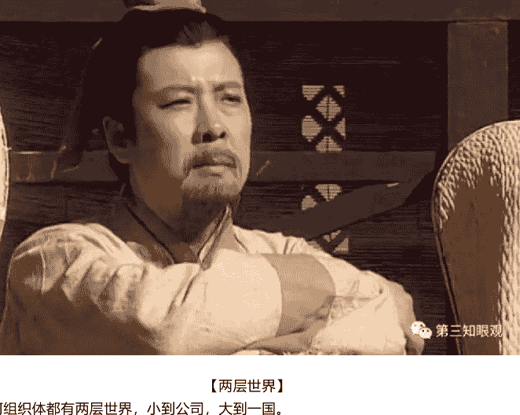

## 【两层世界】

任何组织体都有两层世界，小到公司，大到一国。

两层世界最下面的叫养殖的世界，上面的叫分配的世界。

养殖就是：狼群不会吃光兔子，而使其在季节轮换内繁殖；
分配就是：劳动狩猎后进行资源的分割和配置。

所以在观察人类某一环境里，养殖就是让其饿不死，可以一直劳动的底层，分配就是上层如何分配这些劳动价值所得。

逆袭就是如何从下层变成上层，而能够参与分配！

所以一定要搞清楚什么叫逆袭，这才叫逆袭，根本区分在于能否“参与分配”，这4个字非常关键。

底层思维对于逆袭的看法非常狭隘，认为有钱了即为逆袭了，这是错误。

因为当你有钱了，你会发现周围人都很有钱了，这时候钱就不值钱了；或者当你有钱了，确实在财富价值比较上比周围人富裕了，但很可能随时“被”变没钱。

所以身在底层对于逆袭，有一种说不出来的、存在于模糊感觉中的。我把它说出来，底层逆袭钱只是一个表象，其实是想获得一种优越性，而这种优越性就是我前面讲得能否“参与分配”。

这也是为何说是上层对底层养殖，上层之间分配，为何不说富人对穷人养殖？因为首先穷富是对出来，只有同一圈层才会比较财富，因为有可比性；而当向上进入某一层级，钱几乎就没用了，没有对比性，那个叫位置，也就是可参与分配的优越性，

比较的是谁更优越，钱算老几。

在优越性获得上，叫爬阶，不叫逆袭。

比如在一个公司，80%的人都是被牧养的，创造1万元价值能够得到1千元回报，保证可以生活。而可参与分配的只有那20%，在参与分配内部圈层，那叫爬阶，不叫逆袭。

## 【阶层固化】

在一个世界里，最可怕的是阶层固化，也不知道谁发明了这么多词。本质其实就是无法逆袭！在封建社会叫农奴无法翻身。

字典里给出的解释是，社会学把由于经济、政治、社会等多种原因而形成的，在社会的层次结构中处于不同地位的社会群体称为社会阶层。各阶层之间流动受阻的情况就称为阶层固化。

为什么会固化？

这就是我前面讲的，人不等于狼群，因为人有智慧，让养殖技术变得极度精密化、可控化。

如果一个人想逆袭、或者想爬阶，就要先掌握这一精密的技术。

这也就是在三眼五大认知体系里，除了政治认知外，向具体层面逐一展开的经济、社会、自我、人性这四个认知。

逆袭与爬阶只有两个通路，一个是投胎，一个是学习养殖技术。

在过去阶层固化，养殖稳定化，靠什么？

原始社会靠血缘，封建社会靠身份，此二者都是一种先天因素。

自己关门搞独如以下这个存在，农村户籍和城里户籍制度，不能流动，是不是很简单粗暴

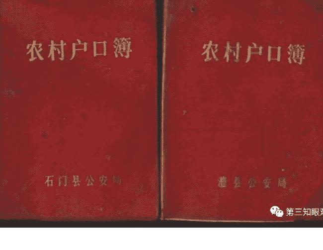

## 【人生意义与幻觉】

人活着总在寻找意义，如果非要寻找意义，你首先要知道什么叫人生。
人类社会从未离开过养殖，养殖技术越来越精细化，而无论怎么精细化，都以殖民技术为根本。从奴隶时代，到土地殖民，再到经济殖民，而到思想殖民（认知殖民）。
技术越来越高端。
认知殖民就是告诉你人生是什么！
人越往底层，越沉沦，越容易被舆论和大众娱乐掌控，活在一个个幻觉里，因为人都极度重视自我，摆脱不了情感的释放，通过外界环境灌输的信息来认知自己的人生。这就是一个所谓湾流文化现象，象都是幻觉。
任何主流的文化现象都是以满足自我为基础方法。无论是武侠还是韩剧还是泡沫剧还是家长里短的家庭剧。
越往底层，人会越自我的，越觉得自身是独一无二的，因为认知太小了，其实就是亿万养殖动物的一员。而越往上层，当看见分配，参与分配，越来越觉得自己渺小，因为认知扩大了。
而大多数底层是叫不醒，但也睡不着的。
叫不醒是脱离不开幻觉，睡不着是潜意识里也明白幻觉是虚的，这种叫不醒且睡不着的结果，就是浮躁！
浮躁就是想快速致富，快速虚荣，快速的获得优越性。

这是没有丝毫逻辑的思维，这种浮躁一定让人关注随博！
如果一个人身在养殖层，认知往往也是锁在养殖层，扩大不了，而当寻找出路时，出路基本都是“牧人”的养殖技术套路。底层玩彩票，中产玩股票，一坑套一坑。
看见彩票就是一个翻滚出来的小球球，股票就是一条条曲线，除此之外，在认知上，信息极为不对称，当信息不对称时那就是幻觉。玩的不是彩票和股票，玩的是内心的幻觉和浮躁的心跳。
而一群人讨论幻觉，这就是文化现象。
开篇讲过，除了哲学外，任何的文化、科技都是养殖过程的顺带产物而已。

这个世界称得上认知的就两个：
一个是哲学，跳出人性；
另一个就是几千年发展至今的养殖技术。

## 精选留言

暂无...

## 2020，从“不合理”开始说起！只有认清“不合理”，人生才会合理！
原创 第三只眼观 第三只眼观 2020-01-25 原文

（是与非）

新年第一天，三眼祝各位安康，我是不愿意祝什么88大财、66大顺的，因为这都带着

主观臆想和运气的暗注，而安康是实实在在的，安是心安，也就是认知越来越通透，这样才能心安，也就是祝各位对于外界和自身越来越看得清，通过不断学习而获得平静的安全感，这对于每个人都是公平的，自身可以掌控的；康是富足健康，认知通透内心平静，自然可以掌控身外之物。

年夜里城市万家灯火，电视机里无聊的春晚，手机上不断推送的疫情，一切都很虚幻又真实，想象以前，看着现在，人们越来越惶恐、枯燥、焦虑。为何心难安？

大众传媒将此归于人心变了，其实人心始终没变。老百姓就那点要做那点事，变的是时代。从几十年前大锅饭变成如今姓赵，时代的变化太快了，多数人还来不及反应。

时代的快速变化，定会造成全民认知形成断层，这像玩游戏，不断地变换游戏规则，只有接近游戏规则制定环节的同好们，才能跟得上时代的步伐。

认知跟得上的跑在前面，认知跟不上的，还停留在就业分配、创业就是开门店、揽钱养老、养儿防老...等上面。

从一线城市到十八线城市生活价值观的形成巨大差别，这是最显现的现象，年轻人在一线呆久了，很难适应家乡的小镇生活，虽然他说不清为什么，只能摸索一些表面的原因，实质就是认知的差别，一线和十八线完全是两个时代。

差不多中国南方比北方会领先个10年，一线比十八线领先个30年可能都不止。中国的快速发展，甚至5年就变换一个时代，现在的父母与孩子间生理上差一辈，实际思想认知上要差着三四代。

不光地域上有时代认知差，在同一区域也存在着认知差，这是由于阶级位置造成的。

回到心难安的话题上，为何？

因为认知落后的群体，脑子里会固化很多“合理”的事，看见新时代的很多事会觉得“不合理”，自然没有安全感。

事物与思想本质是没有对错的，只有合适不合适，跟不跟得上来说。象棋玩得再好，让你去玩围棋也会难安。小国寡民还是堆积繁华都市，都没对错，时代怎么玩，由不得个体去评判，只能去适应。

只有明白未来的很多“不合理”之处，人才能活得合理！才能安康！

## 价值观的本质是非观，而是非观直接决定一个人的发展。

三眼说几个所认为比较重要的“不合理”吧！

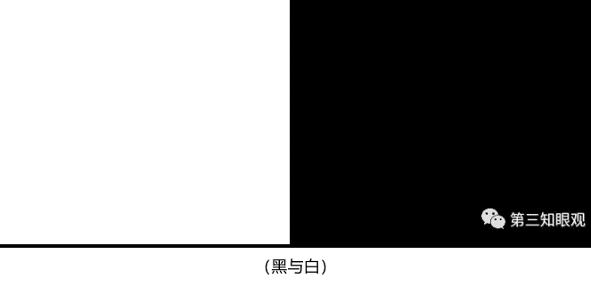

（黑与白）

## 【贫富的“不合理”与致富的“不正当”】

物质建设和精神文明建设一定是冲突的。

因为物质建设需要生产效率提高，而生产效率的提高，科技只是催化剂，本质原理就是要不均，贫富产生差距，才能带来生产效率提高。一个公司里所有人收入一样，那就没效率了。

而精神文明建设，自古至今玩的两个字叫公平，再高端叫正义，这是虚的。不患寡而患不均，古人是站在底层的角度说的，这说话的人实际心里未必这么想，事也未必是这么干的。

社群的发展，一定是富裕起来的人，会想尽办法让穷人一直穷，而穷人会想办法把富人拉下来，和自己一样穷，这样才能心安。其实现无论富还是穷，产生这两种思想都很自然，都带着阶级的特性，不客观，更没什么实用性。

在富人眼里，穷人可以发家致富，是不合理的；在穷人眼里，富人赚钱钱越来越多，是不合理的。

到底什么是合理的？

社会的发展，贫富差距是必然，文明程度越高，贫富差距越大。

三眼以前说过，文明=纹明（古代汉字是很有逻辑性的，文字是开启人认知的最基础工具，把字给简化了，假设最简化到拼音，那跟文字yu有一拼，获取真实认知就更难了）。纹就是社会纹理，也就是社会阶层的脉络，纹明程度越高，纹理越明晰且稳定，也就是所谓阶层固化。

为什么开篇第一个错误就要说贫富？因为贫富的背后，让人觉得不合理、心难安的是富人致富的过程。如果所有人致富的过程都很“正当”，那么人和人的财富是差不了多少的，因为人与人的智商、精力上限差别不大。

而真实的逻辑是：富人之所以成为富人，所有的，皆只是非法的或者合法的取得了不合理的财富！这句话一定要细细揣摩，这是寻求个人财富发展的价值观重组。一套房子10年翻10倍，加70%杠杆就是翻33倍，对于认知停留在好好学习就业包分配的四有新人来说，这是极为不合理的！股票期货等等的曲线，操盘一次，周期八九个月割一轮韭菜，人民日报起步4000点，对于五六十年代的人认知来说，这是极其不合理的，是坏人。这是金融，一般老百姓还反思不过来。而扭曲屁股直推非法吸资还不交税，对于“正经”工作的同学来说，这是极其不合理的，而穿过表象看背后的操控链顶端呢？

因为一般人的认知还停留在几十年前“挣钱”的思维里，“挣”就是劳动力换价值，这样人与人差别不会太大。而现时代是“转钱”时代，是“赠局”时代，后面会讲到！

钱是分配而来。分配是对上层而言，对下层来说那叫养殖，参见《世界是个养殖场，上层养殖下层，提升认知与格局唯有学好养殖技术》。

实操干活的一定拿的最少，负责分配的一定拿的最多的，而站在分配链关键环节上的人，一定跟着吃肉。人类文明发展，是一个财富分配越来越不公平的过程，这是一定的。

只有认识到这个“不合理”，才能合理的去面对时代，才可能安康！

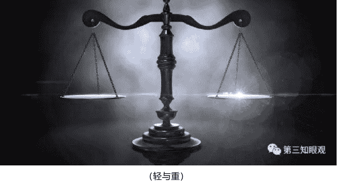

（轻与重）

## 【钱的“不合理”与“以物换物”】

人的安康是在追逐够用的财富，什么叫够用？
年轻时可以实现自由的，年老时可以实现平安的，就是够用。

三眼告诉你，够用那是不可能的！因为社会的发展，它的意思或者某种意志的推动就是让其不够用的！如果够用，谁还干活呢？不干活怎么搞养育呢？
一般人都有一种幻象，站在个人角度出发的幻象，就是攒了多少多少钱，就够用！这是最狡险的认知错误。
人都是活在一个大规则里，最高规则就是政治体制，个体的生存，财富够不够用，取决于与最大规则的契合依附程度，以此推论，最完美契合于规则之人，是不需要钱的，而越底层离规则越远，对钱的依赖度就越大。
如果想要实现够用，首先要明白财富的本质。
本质是什么？是钱？不对，第一层财富是物！第二层财富是人！

## 为什么不是钱？

钱是什么？只是一个交换承载物，在过去我们经历过金银本位、银本位和与美元挂钩本位，那时候市场上钱有多少不是哪个人或者机构说的算的，那时候的钱很实在，充分扮演了趋于公平交换的价值。而今，与发达帝国一样，钱是信用本位，何为信用？就是只要有信用即可一直增发钱，永不完结。信用靠的是一国某领域的水准，以武力护航。武力+某领域的水准=其货币信用。比如美帝工业科技水平+武力，体现在股票市场上。而我们是土地+武力，体现在土地市场上（地产二级市场本质源自土地一级市场），也就是说我们发多少钱央妈说的不算，国土资源部才说的算，批多少资源，释放多少土地（地产与农耕土地），就能发多少钱。在这一点上来说了，我坚信RMB是比美元要坚挺多得多的，因为科技是有上限的，武力是受到制约的，但我们农村是广大的！
所以钱一定是越来越贬值的，因为土地信用是没有预期的，起码我们这代人到死也不会见其完结。
那么一个人想积累长久财富，攒钱肯定是不对的，比如养老靠攒钱，想必到老会很难受。不用看未来，看过去30年内的变化即可。
看官说三眼你这说的不是就是货币贬值吗？
货币贬值现在成了个大众耳熟能详的词，就如“人会活到死”一样，有什么意义呢？
看明白人会活到死没什么用，要看人活的过程和原理才有实用性。
货币需要很多篇才能说明白，回头再说，继续说财富。

## 第一层财富为何是物？

如果人要积累东西安全度过此生，最好的方式就是积累10万斤大米、1000头猪、1000斤白菜....等。
也就是说，人类所创造出来的可用于消费的东西，才是真实的财富。
但可能吗？真实的财富是储存不住的！就算 Potential 储 期限最长的耐用消费品汽车，十几年就到了报废年龄，房子住个二三十年可也快到寿命了。真实的财富物资，寿命都干不过人。

钱的寿命其实更短。因为钱一直在变化，每当发行新版RM币，明眼人都明白，这是大变化，还是那点纸币，但购买力，或者说交换力的变弱了，这只是大变化，在大变化之间充满着无数小变化。促使变化至关重要的因素往往在于人口、产业等。因为钱的购买力取决于社会整体财富创造水平，假设1个月停止生产，你会发现物价会有惊人的涨幅，如果全社会停止生产一年，那么钱也就作废了。

既然懒钱不对，物资又搬不走，那积攒什么呢？
这个时代，要有一种【以物换物】的思维，回归原始的交换本质路線上。
无论是人口大爆发高速生产时期，还是人口衰减，年轻劳动力数量极度萎缩时期，在社会上一定会有比钱还要好使的价值交换承载物。当然这种承载物一直在变。举个简单例子，比如现在的房子，就要比钱更具储存价值和交换价值，你去银行抵押你的工资卡（代表你的劳动力）和地产，看银行愿意收哪个？如果在战时，你拿着金银首饰和地产去银行抵押，看银行愿意收哪个？如果在n久未来天地大洪水时期，你拿着金银首饰和诺亚方舟船票去银行抵押，看银行愿意收哪个？

所以老百姓在财富上要有两种认知：

- 1、对于国家来说，钱是她的血液，是政府的信用，是维持最大规模运转的基础，而财富的多寡靠的是人口数（劳动力数量）和劳动生产效率（也就是科技水平和体制政策）；
2、对于老百姓来说，钱一定不是血液，相反，钱是毒药，现金只会腐蚀财富，真正的财富保卫是手握着随时可交换的、比钱更实际交换价值的“物”，这种物一直在变，比如地产、比如金银首饰、比如某个组织机构的股权权利、甚至在未来可能是某些数据、某些微量元素。能保持财富的方式只此一种，就是在不同时期找到比钱还好用的价值承载物，在轮换的时期进行资产置换。当然，这对认知是个极大的挑战。

所以随着时代发展，一定要有这种【以物换物】的思维，那么多投资和理财的知识，搞得云里雾里那么复杂，其实都离不开这个简单朴素的基础逻辑。
一个社会发展的目标，一定是高物价高工资，钱会越来越不值钱，但在国际上国与国之间，强势的一方线反而越来越坚挺，这是国与国之间的一场“铸币税”之战，是一场争夺之战。

这个话题写一篇文章专门详谈。这里提一嘴是想说，高物价高工资可能是使【某些泡沫】转着跗的有效方法，而软着跗的过程就是可持续有资产轮换的时期，傻子进盘，聪明人逃盘。

而最大的财富是人，如果一个人自身有认知，用力紧并带动整个血亲的认知层，这是最有保障的财富，这个层面则比较艰难了，其实大多数人从经济角度看为别人繁衍，自己并不受益，其受益90%都来自于情感层。

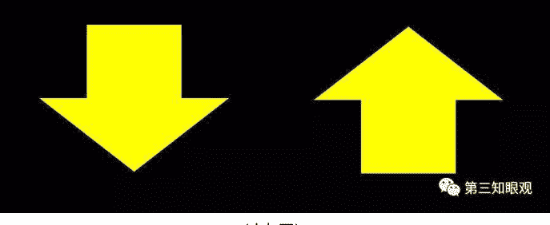

（上与下）

## 【精神感覚の“不合理”与“杀鸡宰羊”】

社会的进步，在于创造，创造的过程顺带产生穷与富的转化，转化的过程就是再分配的过程。

市井名言：三十年河东三十年河西！为何？其实说的不 是人的努力与安逸造成的三十年人 生变化，能在河东立足的人，不会是安逸之人，为何到了河西时代就不行了？还是因为认知！不是人的变化造成河东河西之处境，而是时代的变化所致。

前面讲过，社会的快速变化，使民众认知出现很多断层，而断层之间就会有很多思想上的冲击，整个社会来说核心是政治，政治的核心就是分配，n个断层中，能跟得上游戏规则分配规则的，就跑在前面，跟不上的停留在固有思维里的，因为你停留的思维已经是十几年前甚至几十年前 的政治分配玩法了，毛爷爷讲过落 后就要挨打，就 会受穷！

在网络上，会见到很多人换起袖子骂骂，骂某某一群体怎么能崛起，骂某某某一群体怎么能得势。

老一辈人信奉愚公移山，信奉的多劳多得，如今仿佛（就是）不那么好使了，以前的分配是按劳分配，现在是按资分配，再核心一点是按认知分配。这是讲思想层。再具体点讲创 创 食业，存量分配时代已经来了快10年了，通过“万恶的”互联网来搞存量财富转移，依然有无数传统创食业的门店创业者坚守固有观念，当然现实除了骂街就是煎熬。

有些东西是没有对错的，作为个体只有迎合与不迎合，追赶与不追赶，改变与不改变之说。

其实三眼说一句，自古以来，商的地位就没有改变，只不过以前商户只有一家，就是那个最大的，不允许有小商户，而现在只不过是全民可经商。

养殖技术也从来没变过，参见《养殖》一文。

为什么有人要骂街，因为穷与富在转化，有的人变穷了，有的人变富了，看准先认知，看准先迎合，看准先改变，这个没有什么对错，一切对错都是主观臆断！现实不允许主观臆断那样只会打脸。

以上说的是同层之间的排斥，认知断层间的抵触。还有一个更大的精神感觉“不合理”，是在分配产生的。

在《养殖》一文里面三眼说过，对于大多数多数多数人来说，肉身都在养殖层。

在村子里有一个养鸡场，小鸡仔时期，大家都很开心，因为太弱小了，从鸡场到小鸡仔，都弱小，这个时期是养，养的时候自然很和谐，小鸡仔很开心，因为受到关注和温暖。等小鸡长大了，就要拔鸡毛割鸡肉，就会很残。

任何社群的发展都是遵循财富的累积-收割-再累积-再收割，财富就这样一点点创造出来。从最大圈子看是如此，在一个小圈子内也是如此，成功的生意人都明白这个。而在每一次累积与收割间，都伴随着财富再分配，跟得上吃肉，跟不上的被割。学好养殖技术是本。

人性的本然，就是如此，都是先养再挖回报。自古生孩子观念况且如此，何况鸡场乎？为何叫子民？只是挖的度不一样而已。

明白精神感觉“不合理”的逻辑，并没什么致富的实际指导意义，只是心态层的说明，但三眼觉得，人活一世，搞好心态位置应该是orkey的，毕业出来混心态才是第一位的，是非观是心态的核心！大到社会和个人发展，小到家庭和尚两口子恩爱，是非观是核心！

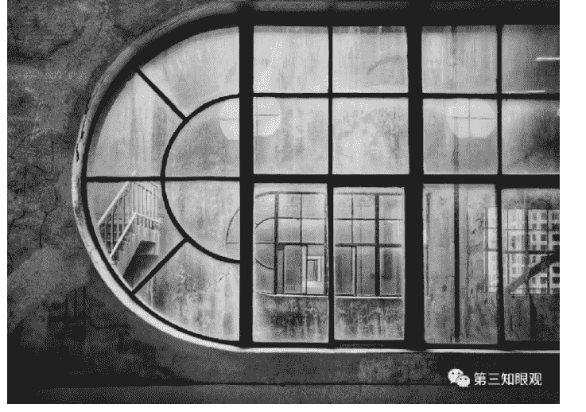

（圈与套）

## 【不合理的“赌局”最合理】

“别和我说投资，其实你就是要投机。” 这是对99%的人都受用的一句话！
因为这个世界已进入赌局时代，整个世界就是个大赌场，又分散成无数个小赌场，多数人的思维会越来越趋向做韭菜，韭菜不是想不做就不做的，每天所思所想所看所闻所体悟的都是灌输的韭菜思维，焉能不做韭菜？

而韭菜的最大特色就是：一直再找应该相信的人！

在《养殖》一文里三眼说过，养殖技术从奴隶时代，到土地殖民再到经济殖民，最后到精神殖民。这个精神殖民就是认可上的征伐，而精密的养殖技术就是做“赌局”。
在财富的收取上，除了shui务，就是赌局收取。这二者合起来就是金融，所谓金融立国就是如此！

简单粗暴的就是利息，就是shui务，都是在一定份额里直接拿出来放到口袋里；而高明的间接手法就是赌局。

股票、彩票、创业等等其实本质都是赌局。这起缘于西方现代经济制度，把世界变成超级大赌场。

只是因为时代变换太快，民众认知不断断层，80%的人跟不上认知步伐。

赌局有三种构成：

1、开场子的。也就是规则制定者，保持场子的稳定性，往大了说最大规则制定者，往下说就是各领域各区域的制定者，最后到企业组织的制定者，再往小了说撬尿活泥巴赌钱也算，尿多算你赢！

前面三眼说了，越能接近规则层分配的越多。这也是文明发达社会，律师这么受待见的原因。

前面也说了，富人之所以成为富人，所有的，皆只是非法的或者合法的取得了不合理的财富！律师代表的就是这个不合理而使之合理的层面。

2、坐庄的。也就是代表背后开场子的或者代表某个大组织的，可以到前台来参与博弈，并操盘控盘的。在未来，做庄的人会越来越多，制造企业家就是养猪场养猪一样一样的。而具体操盘运作的本质手法是什么？就是讲故事！为何要编故事讲故事，因为这是在传递【不对称信息】，三眼之前文章说过，如果这个世界信息完全透明，信息完全对称，只需要一个时间段演化，那么人与人之间几乎没有财富差异。

3、下注的。也就是非菜。开场子坐庄的以及非菜，数量配比如何？非菜肯定占比90%以上啊！存量财富转移肯定是90%往10%那里转啊！如果把所有非菜当成一个人，你还会进入赌局吗？傻子才进去，但幸亏90%不是一个人，是无数个人。曹操说：胜一人难，胜 Panthers 易。就是这个理！

在《养殖》里三眼讲过，要往上走，就要学会“牧”，要会牧，就要明白羊群的特性！这是养殖技术的基础知识。

开场子的靠规则生存，离开规则什么都不是；
坐庄的靠关系和讲故事生存，离开关系和故事什么都不是；
韭菜靠幻觉生存，离开幻觉韭菜将变得强大！

在大赌局里相信谁？
韭菜特色就是一直在找应该相信的人！三眼说谁都不要信，唯有相信自己的认知！

## 精选留言

暂无...

谋生、做人如何上台阶？要研究人类社会进化本质，一点不虚很接地气！

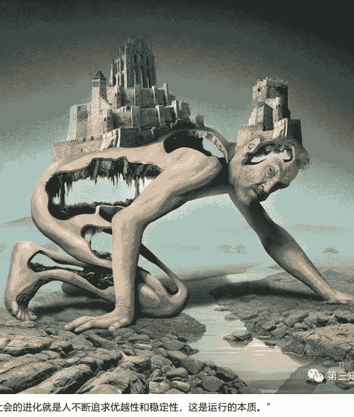

> “社会的进化就是人不断追求优越性和稳定性，这是运行的本质。”

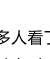

## 从一个问题说起！

今早回私信，发现一个很棒的问题，许多人看了会觉得很玄幻，但我很能理解发问者。

因为人只有在问问题的时候才是认识突破之时，问问题是最好的学习方式，因为是在向内挖掘，而不是被外界灌输。

如果说间题的话，疑惑很久的问题就是人类作为一个类，应该是在存在性很强的人性欲望的，比如越利避害。那么社会又用一些软的控制比如道德，文化，宣传的方式去控制人类群体的个体，比如现代道德上要求求人帮忙就应该客气。也利用硬的控制去控制某些人群比如如法国警察抓。那我想知道既然牧羊人用牧羊的方式去控制羊群，那么为何不干脆用人工选育的方式去一代代选出最符合牧羊人希望的羊种呢？比如羊有时候会攻击人，会顶撞牧羊人，这部分是遗传的事吧，为啥不直接用品种选育的方式去一代代稀释掉羊性中对牧羊人不利的部分呢

我们从小的教育是有问题的，讲这个问题说几万字废话不如一句话：就是灌输填鸭式。这个是受自古社会文化习惯（政治）所影响。
哈叫灌输填鸭式？就是告诉你1+1=2，你记住就行了，考试时候怎么写即可，如果你要问为何1+1=2？不能是0.5+1.5吗？不能是=3吗？1到底是什么？老师和同学们一定笑话你，当你走进社会，这种笑话你就会变成讽刺你，这是阻碍人认知的最大障碍——我们都被我们的“习惯”给阉割了！

看见这个问题，要恭喜这位同学不但没有被“阉割”，而且开始放飞了！

认知的打开一定是向上的，向着更大更深层去挖掘，认知像一个触角，当向未知领域延伸之时，肯定显得很玄幻，因为大多数的大脑里都不曾有过那些未知领域的经验。
——众人之所以谓之不见，众人皆所不见谓之亦见！

当人思考一件事物，要尽量去从你所能思考到的、最大的层面去逐步向下渗透，这样才会思考明白，看清盘面。
下围棋就有着局部的子，肯定会输，盯着全局，经过多次实战，才能熟练，才能找到人生的“最佳一手”！

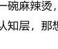

举个例子，一个做小生意的人，比如买一碗麻辣烫，如果只盯着麻辣烫，自身从小以及对自己的孩子从小就局限于如何做好麻辣烫这个认知层，那想必永远跳不出阶层。
怎么跳出来？需要一层一层的：
在产品层，口味、包装等，很原始的初级认知层；
升到营销层，开始问自己什么是需求、什么是供应、什么是价格、什么是各种促销心理等等，这

是围绕点对点的交易开拓认知；
然后向上在社会层，哪里的片区、哪种街道、哪种人流、哪种人群阶层，你所提供的麻辣烫在整个社会结构里是怎么提供服务供给的，这是围绕社会生活方式开拓认知。
再向上到经济层，为何麻辣烫的人多了？经济就是钱的流动和分配，这种变化影响了社会结构乃至具体的目标人群怎么行为？就跟拼多多一样为可能快速崛起？代表着什么，是什么驱动的？
再向上到政治层，比如北京驱赶低端人口与服务，为什么要驱赶？哦，原来是要调整人口结构来做消费升级呀！这个政策对我这口小小生意会有 Applications? 哦，得跟着升级，揍难的“下等食物”要升级下进入专业商务楼宇，大鸡排、炸串、麻辣烫要标准化、可复制，这样就能做大！
如果这几个层面都能够打得通，你想想这个麻辣烫小业主，还是那个小业主吗？
如果再向上上升到人性层面，为何政策要这样定？因为社会在进化，人活着追求的就是不断进化！这才是牵一发而动全身的终极认知线路！
三眼这样说诸位可能一头雾水，那么我们拆解下这个婆媳！
还有，上面麻辣烫例子随便举例子，各种层的认知高度也是随口一说，不要太较真，要重逻辑，不要当稻草，杠精出门左拐！

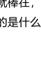

我们回到上面截图里那位同学的问题，问题636在，背后要问的是：
人类社会发展，人性在里面扮演着以及能够做的是什么？

这个问题是这位同学读了《养殖》之后发问。
社会大到最大组织，小到一个社群，都是一个养殖模式，分两层世界，下层的是养殖层，上层的分配层，在养殖层里的人想要到上层“参与分配”，这叫逃；上面分配层里的人想获得更大的利益分配，那叫饷。无论大小社群，都是一个利益分配体，最基层干活的一定拿的最少，搞分配规则的一定拿最多。这是一个很客观的不稀奇很正常的存在，如果你觉得是颠覆观念，那就过分老实了，只能是1+1=2—种思维。

养殖是啥？就是政治！政治是啥？就是人性！
自从三眼写了一篇政治素养，现在好多同学每天都私信问我政治素养，很开心，就如上面说的，认知开始向更大的未知领域展开触角了。但三眼觉察到多数人还是把政治素养思考过于神秘高大上了，这回简化解读一下！

请问老师关注政策通过哪些报刊和新闻？还是有其他渠道？谢谢！

上午7:36

政策各新闻网站都有，关键是解读。政策跟政治息息相关。每个政策都是官话，像一部门另外的文字系统，而且牵扯各方利益，所以很难解读。一种方法就是你想获得什么，有针对性的研究。

上午8:58

谢谢老师！需要学会提高自己的政治素养，才能更容易解读出想的政策背后的逻辑？

开始去思考怎么能更深入了解各种政策了，但三眼说的是，还没到根本，因为政策这种东西，就像小时候玩过家家，你当头带着一堆小屁孩过家家，具体玩具怎么分？为何这么分？你喜欢哪个小女孩让她扮演妈妈，你扮演菜爸菜来占便宜，你最好的小伙伴你给分配在哪个角色.....等等等等，这些东西能公开说吗？不能！

所以政策就象另外一部文字系统，推进和大力推进，深度化和具体落实，高度高打和以什么为标杆，这些概念都是不一样的，而且从中yang到地方每个层级解读起来，具体“力度”也是不一样的，也就是政策与对策的辩证论。

政治素养的根本在于人性。看人性就看利益，利益的辨别能判断趋势。

只能这么含糊的说！

怎么看，回头最初那位同学的问题，怎么“品种选育”？

问題背后的问题，其实是人性在政治上的根本表现：

**人的生存与进化追求的是优越性和稳定性！**

**优越性产生层级，稳定性产生各种“收”的工具。**

无论大群体还是小群体皆如此。

只能说这么多，几个关键词送给诸位。

+ 1. 王侯将相就有种乎！

那就同学的“品种选育”站在顶层思维是契合的，但不可实现，因为那是上帝干的事，人和人之

间确实有些许的天赋差异，但不足以形成巨大的社会等级，更不能在“起点”上形成。这是人活着最基本的价值观，认了就废了。科技的发展和文明的发展，一定是为了加强优越性的稳定性，所以越文明贫富悬殊一定越大，阶级越固化，因为文明的背后是人性驱动。

## 2、胆略！

什么是胆略？为何多数人很怯？认知的触角都无法延展？药就在毒中，毒就是药，认知打开，胆略即开！胆略不是有人骂你就要干架，那就是怒牛，胆略是敢想，想透了自然就知道怎么干了，也就敢干了！自古文人比猛将要胆子大的多，因为从最高处看到了社会的运行本质和体悟了人性的本质。胆后面一定跟着略字，略就是格局，就是纹理。

## 3、稳定性！

上帝的品种培育人千不下，但人性就是要扮演上帝，追求永恒的稳定性。具体到社会生活层和运行上，身体的培育——饮食、医疗、生存环境等隔离；思想的培育——教育、认知灌输、自我觉悟能力与思维力培养等隔离（最高等级教育养思辨力，最低等级教育培养专业技术）；在肉身与思想外，稳定性通过资本、地域、民族、以及社会运行的关键资源掌控等层面区隔。社会越发达，一定朝着这种区隔发展。资本断层、生活方式断层、认知断层，这是必然。

## 4、优越性！

三眼之前《赚钱三套路》一文中讲过，社会生活是下层对上一层级的追逐和模仿，其本质质就在这个优越性上。人的进步就是追逐优越性。
生存是生存，进化是进化，这是两个社会层级的两种概念。
针对底层，生就要玩智商税，通过棍来赚钱，因为底层面对的是生存，只要给出其“能够更好生存”的东西或者思想，即可收取智商税，虽然都是限的。
比如对于有些家庭，孩子能上学即可，而对于更高层级的家庭，孩子上什么学很关键。
比如对于有些车子，能开即可，而再拥有了阶级线，能开是基础，关键是展示什么优越性！
做生意收智商税很无耻，赚顶层的钱还不可能，生意人赚“优越性”的钱好赚又不失道德感...
当你在探究一个优越性的本质，以及展现优越性的方式，造富之道就来了！
清华学区房的总价是一个清华毕业生一辈子赚不到，这就是优越性的可笑和真实之处，很搞笑但很真实。

## 5、活着意义！

其实聊政治、聊经济、聊社会，最终归于自我和人性，最大的受益并不是瞄到了什么致富之道，财富只是认知顺带的产物而已，最大意义是能让自己已冷静客观看到世界。
人无论是养殖殖层，还是中间模仿层，还是规则制定层，无论哪个层级，每一个个体都把自己当成“领导人”来看——通过这辈子不断努力，突破生存层，到达进化层，不断地追求更高的优越性，并且通过繁殖，想追求稳定性。如果人寿命够长，太太太爷爷的手会伸到太太太孙子身上，进行自我认知的传承灌输、约束和管理。
在这种文化下，每一个国王的野心都很 elegido，“生儿子就比生闺女好”就是这个理，但同时每一个个体又在潜意识里追逐自由，而对自由的最大束缚正是自己的野心，越有钱越这样。
三眼不是批评这样不好，而是无分对错，这就是人性，社会的运行发展就靠这个驱动，政治的演化就靠这个，各种生意乃至衣食住行就靠这个，这就是一个游戏，人性就是游戏规则，规则一直不

变。

为了想逃出这个规则，才有了宗教，宗教都是反人性的。这是后话！

## 6、心态！

人最怕自我矛盾，这是能量内耗。

而绝大多数多数人，都是能量内耗的。

人都有着“入世观”和“出世观”，能量内耗就是既不能入世去混，俗话说放得开，又不能出世去洒脱，俗话说想得开，得道高僧也是如此，只是大家度不一样，人生修心就在这个能量内耗上的“度”上。

这是“政治经济社会自我人性”中的自我部分，有的人喜欢听政治，喜欢斗；有的人喜欢听经济，喜欢捞；有的人喜欢听社会，喜欢混；而最后，幸福安康的本质还是要归于自我。

## 精选留言

暂无...

## 弱者论是非，强者观漏洞！三眼观本源认知无偿奉送——生存即漏洞！

原创 第三只眼观 第三只眼观 2020-01-28 原文

收录于话题

## 结构观

9个

今天给大家讲个干货，此干货是三眼我整体认知的最核心，无偿抛出来！
只抓住这一核心，才能破解所有的文字！

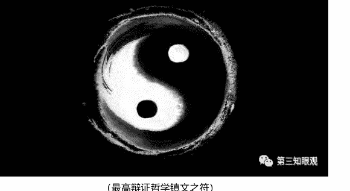

（最高辩证哲学镇文之符）

## 【认知存在有三个层面】

道：本源认知。
法：规律认知。
术：工具、经验认知。

99%的人都停留在术的层面；
一些所谓领域成功者、精英、专家等到了法的层面，通过规律来互相较量；当规律变了，前面99%的人即被淘汰，而重新去认知各种术，被玩规律的人不断利用。

很少有人能达到道的层面。为什么？
因为道这个层面，不可能自下而上上去认知到，一定要在俯视，要去感悟起点。
当人感悟起点，明白了起点、法与术自然打通，一通百通！

三眼尽量写明白，写文章不好写的，写高了就是玄幻神话，写低了就是流水账臭烂泥，难就在如何高屋建瓴而又接地气，通俗易懂。这需要把一个复杂的东西简化到绝大多数人都能接纳的认知层面——用绝大多数人的“语言”来讲！

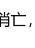

## 【生存即漏洞！漏洞即消亡！】

——万事万物生与命存在 的本质就是漏洞，漏洞是组成事物的最基础元素。
这就是三眼的认知本源。

要知道万事万物之所以能够存在，是因为它能消亡，消亡才是存在最根本基础。如果一个东西不会消亡，那么它不可能存在。存在即为漏洞，这是必要基础条件。
那么对于人来说，生存即为漏洞，漏洞是人类社会发展、个体的人存在的必要基础条件。人們都看见事物的存在形态，误以为这就是真理，而不知道事物的存在形态其实是消亡，任何事

物的存在都是在不断走向消亡的过程。
也就是说：你所认为正确的，几乎都是错误的。

## 【消亡即为变化！变化即为漏洞】

万事万物的存在都是走向消亡的过程，这个过程就是变化！
变化就是漏洞，一体两面！
因为有漏洞而变化，因为变化而有漏洞！

人和人的强弱差异，核心的核心的核心，在于能否感知变化。
弱者看重不变，感知不到变化；
强者看重变化，一直观察变化。

宇宙有周期，太阳有周期，四季有周期，生命有周期，政治有周期，经济有周期，社会演进有周期，连我们每天睡眠都是一个小周期，周期是什么？就是生长到死亡的一个循环、万事万物就在从生到死的不断循环中。

为何而生？
因为向坏并毁灭了先前的东西，才得以到新生；
为何而死？
因为万事万物的存在基础都是漏洞，有漏洞必死，等待着它的终结者。

所以观察事物，正确的观察方法就是：思考它会如何而死！如何消亡！

具体到个体的认知上，就是“不合理”！
“不合理”就会消亡，你察觉到“不合理”，就是在观察某一事物的消亡。
漏洞就是在事物变化的过程中，产生的“不合理”的存在之中。
什么叫“合理”？
就是你所认为正确的！
什么叫“不合理”？
就是你所认为不正确的！

合不合理源自于人的主观认知。客观存在不以主观意志为转移！
但三眼告诉你，人所认为正确的“合理”的东西，几乎都是错的，那不是事物存在的真实形态，事物真实存在的形态是“不合理”。
比如政治、经济、社会、自我、人性五大认知论，这是三眼的表象，是具体的工具层，这五大块的存在，多数人认为正确的，都是错的！
你主观所感知的“合理”的东西，其实都是“不合理”的！

## 【人类巨大的经验主义漏洞】

人法地，地法天，天法道，道法自然。
自然是最高者，或者用人类的词汇无法描述，暂且将其称为最大的、最高的、无处不在、无形的、最牛逼的规则。

我们生长在社会之中，作为人类我们理应知道，人类最大的漏洞就在大脑，救赎之道亦在其中。再具体一点，人类大脑的巨大漏洞就是经验主义。
人是一种经验动物，就像瞎子走路，只有摸到的地方才敢伸腿，我们人类看待万事万物，都通过经验主义，经验主义就是人认识的漏洞。
我们都看重我们看的，以为我们看见的是真实的。
自我的存在，依赖于记忆，记忆就是经验，没有这些，我们个体将不复存在。
我们依赖记忆抹黑前行，我们误以为我们所“摸”到的东西，就是真实的，也不得不己认为那是真实的，因为它的不真实将否定我们记忆的存在，也就是我们自我的存在。

每个人都逃不开经验主义的束缚，包括你我，包括那些圣人。

唯一区就是度！

最弱的人，经验主义沉浸在一刻的时间里，最典型的-agent如女人、一个男人爱不爱他取决于一刻钟对话的内容。
爱存在于她所“摸”到的，爱与不爱存在于摸没摸得到，而男人对她爱不爱，根本不取决于她“摸”到了与否。这是典型的由经验主义漏洞导致的弱智表现。
把度拉长距离。
男人冷静观察社会时，也犯了经验主义错误。
一般人能有10年的经验周期已经不错了，用10年内“摸”到的东西去判断事物真伪，已经看起来很不错了，但结果也是错误的。

## 【我们身处的时代】

人类社会几百万年发展，母系社会三万五千年，再到父系、奴隶社会、几千年的封建社会，再到今天。西方经过200年，东京经过100年，走完了人类几百万年都走不完的路。
如果你生在母系、奴隶制时代，你认为为什么是正确的？
在100年后的未来，我回来问你，你生在当下时代，你认为为什么是正确的？
没有正确，不正确才是时代存在的基础，消亡是事物存在的基础。

今天的政治、经济、社会、文化，是正确的？
错！必将消亡！

热量越高，分子流动速度越快，母系与奴隶制社会能多久，因为热量不高，而当下时代，是一个超快速变化时代，分子流动速度极快，很多东西已经从生到死好几遍。
上面说过，观察事物不要看他存在的面，要看如何死亡，那才是真实的。

其他国家的劫掠，其他国家也不是傻逼，你发我也发，引起全球资产价格的暴涨。
1972年银行的死了又生，死的是金本位，是商品与货币的对等性，出生的是信用本位，信用这东西就是谁有力谁谁说的算的。
钱，死掉的叫等价交换物，重生的叫债务承载物。
现在的钱，就 = 威力企业对弱势群体的劫掠工具而已。
这个逻辑链在，现今为王路线就是通。
任何事物存在的基 是走向消亡，这个模式一定会死掉，弱者沉浸在表象里，或者在雀跃欢呼的拾红里，强者早已冷静去观察消亡过程中的漏洞显现。

“不合理”才是事物存在的基 。
房价20万一平，合理吗？
猪肉变黄金，合理吗？
物价翻了10倍合理吗？
就系数不包分配合理吗？
我这么爱你你却不爱我，合理吗？
人无有经验主义巨大漏洞，而且更可笑的是，当原有的经验主义被打翻，新的经验主义就会深入骨髓。

这仲旧经验主义到新经验主义的过渡，形成各种文化现象，媒体一个个都没有良知，因为其不讲逻辑，或者干脆讲不出漏洞，而只讲情感受伸，现在的媒体信息99.99999%都是在顺应受众情绪而已。尤其是现在自媒体崛起！
什么叫公知？
就是1要吓唬你，2要让你生气。

## 【是非与人的痛苦】

物质发达了，人却更痛苦，很多专家学者说不清，其实很简单的道理。
到了今天的科技水平，一般生理上的痛苦都可以解决，现代人的痛苦都来自于精神之痛，而精神之痛的本质在于人的经验主义漏洞。
经验主义一定产生人的非观，这是区别智者与庸人的分界限。
庸人论是非，智者看变化。
人的是非观，是造成人痛苦的具体端，人们通过经验主义在脑子里形成是非非，而实际社会生活是没有是非对错的，就像风雨雷电自然现象，没有对错。
现代的信息恐慌，人流速太快，就算是不想思考，大脑也会被强迫不停思考，但多数人的思考都是在转圈圈，因为经路走这一人性漏洞。
当一个人认为应该什么是对的，应该怎么样，这是最愚蠢的思维，认知的局限、精神的痛苦由此生长。

劳心者治人，劳力者治于人！
为何小身板媒体能指挥千军万马？就在与攻击人的漏洞。
一是给人灌输经验，现代词语叫洗脑，灌输进去，人就不能自拔，就像是给马匹上了马鞍！能反思能觉醒的人是非常稀有的！今天信息爆炸的时代，当网友们热衷谈论“觉醒”之时，他可能正在被洗脑。
插一句，三眼经常说的：
判断信息的好坏，在于它是给你灌输，还是跟你讲漏洞。前者是拿经验洗你，后者是拿漏洞激发你。

二是在“上马鞍”后，不停地攻击人的诸多漏洞，从而压制万众。漏洞主要在情感和内心上。

在曹操眼里，千军万马并不是铁血之躯，而是一个个在情感与认知上极为脆弱的人。

## 【说在最后的实操思维性思维】

来点满足个体私欲的实操思维！

作为个体的我们来说，我自己生存就是因为漏洞组合而成，而人生存的核心，就在于攻击内外部的漏洞，内部攻击自身，外面攻击所有！

人生存都带着狡诈与

人以攻击漏洞而生存，有初中高三层：靠嘴活、靠躺活、靠偷活。
话题设定就不停，圣女被左手挡。

三眼兽不在所诞道婆层面，当好人容易，当坏人不容易。
每次要干事，都要调整心态，因为要干成事，就要反人性，就要攻击人性。对于天性纯真善良帅的掉毛的人来说，这其实很累的。

## 初级水平：人情世故——攻击人情感的漏洞

人情就是人情感的漏洞。

情感与利益本来是丝毫无关的两个东西，但聪明人会利用攻击情感的漏洞，去获取想要的利益，这就是人情世故。

依靠向到人身上情感的漏洞而活！
给一个人吃差的事物，喝最浑浊的酒水，穿最脆弱的护甲，凭几句话一个精神，就能让人为其一个人利益去付出生命。

人情感的漏洞，就在于总是想要衡量情感的多寡，情感本来是虚的，无法衡量，人性偏要拿实体的经验主义去衡量这种虚的东西。
这就造成情感上你是多少斤。
尤其在中国这种人情社会，拿人情换利益，是很多人的成功手法。
说人情=文化水平。
在迈向发达文明后，人情就会没有了，取而代的是道德，道德是规则，有规则就有章法，有章法就不会让人们钻空子。
不过看清蒲网的言论与评论，这条路还很长要走。

## 中级水平：营销——攻击人性的盲点

当商业社会越来越繁荣，越来越成熟，那么商业一定更趋向于欺诈，律师一定会越来越有地位。
依靠向到人身上的盲点而活！

未来社会信用一定越来越值钱，比较要贿钱，但这样正说明，我们已经走向失信社会。
因为人内心的基础，才会远过在规则上来束缚人，信用才会变得越来越重要。

商业社会存在的主要就是攻击人性放大价值：1元钱的东西怎么攻击你的个性，让你觉得值100元。
营销说到底就是骗。
营销的过程说到底就是欺诈。
三眼说过：任何造富的本质都是不合法或合法的取得到不合理的财富。
具体怎么合法的取得，那要形成一套工具箱了，这里不展开。回头慢慢聊。

## 高级水平：投资——攻击秩序的漏洞

钱的秩序；

钱转转的秩序；
所配置的法的秩序；
钱存在于个体的账户里，而财富表现为一个群体上，群体必有其秩序；
前面说了，任何事物存在的基数都是走向消亡。
各种法为什么一直要变？在改善，除了xian法，当然也改了！
所有的政策为何一直要变？在改写。
这几年轮番出现了多少“潮”？理财潮？虚拟币潮？共享潮？当然持续最长的还是炒房潮。
任何秩序都需要熄灭，这就是一个个盘面。
投资就是去找秩序的漏洞，靠“偷搭”而活。
任何的投资如果把子里翻出来让大家看一看，都是在“偷”东西。
而在盘面上，更上—层的秩序是钱流的秩序，分配的秩序，钱本身的规则秩序；
再更上—层，是法律法规以及背后的政治秩序。
从母系到如今商业社会，秩序在变，在死亡又新生。
而今，秩序在变，变向何方呢？

## 精选留言

暂无...

## 宏观认知来的太慢！如何从微观层，去发现经济发展与攫取财富的机会？

原创 第三只眼观 第三只眼观 2020-01-29 原文

很多私信问我有啥出路，要具体实操那种，合着讲了半天规律和规则，白讲了…
讲了半天公式和例题，最后问的还是这道题到底得什么…
考试不会，去抄小伙伴卷子，没有推理过程，小伙伴拍着胸脯说这道题就是要得3.1415926！你敢信吗？

人活着不是一年两年，要几十年呢，现在的中青壮年，应该都对90年到现今的事情有个大体认知吧？
打个时间差，1万元和100万在感觉上是不是不一样的？
村口的炸油饼1毛钱涨到3毛钱。
落叶要归根变成为现成几亿人口大迁徙，轰轰烈烈制造城市圈运动。
出门都不带钱包了！
社会变化快吗？
在时间思维上如果有感知的人，会感叹到社会变化如此惊人，真应了风云变幻这个词！
前面30年算个啥，往后再30年呢？会更快！
热量越高，分子运动越快，随着信息流、人流、物流，各种流的加速，往后的变化是风云变幻转

到惊雷闪电！

感知度差的同学，裹挟在未来的变化里，就像坐过山车，应了小沈阳那句话：“两眼一闭一静，一秃子过去了哈”！

咋办？

只能一个办法，坐过山车时候睁开眼，瞪大眼，慢慢习惯，就会看得清！

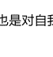

宏观规则规律很重要，但是对于多数人来说，来的太慢了，认知是一步一步往上走的，这个过程会很慢，很多年人年龄不同，阶段不同，心态不同，看东西想得到的养料所需也不同。

宏观认知一定要慢慢呢，这个是乐趣，也是对自我人生和家庭后代最保险的精力投入。

当然，在微观上也有一个好办法，虽然不是速成，但是可以加快认知提升优。

那就是：感受城市的呼吸！感受集体性的呼吸！

感受呼吸就是把微观的东西，往宏观上靠，去联系思考，如果真要只关注微观，那肯定是越来越糊涂了！

三眼没事就绕着城市走，穿梭城市大街小巷，人活几十年都得死，城市不会死，它​​的寿命很长，唯一能感到乐趣的就是在这样一个小时间段里，跟着它一起变化，长久的陪伴是奢侈，孤独才是永恒。无论对于什么阶层的同志们来说，这种乐趣是公平的。

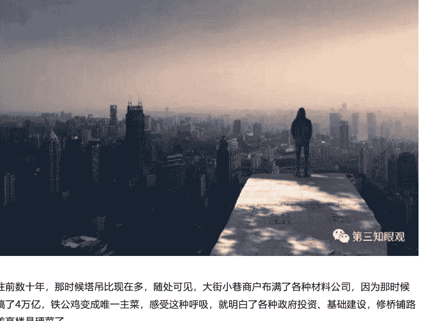

往前数十年，那时候塔吊比现在多，随处可见，大街小巷商户布满了各种材料公司，因为那时候搞了4万亿，铁公鸡变成唯一主菜，感受这种呼吸，就明白了各种政府投资，基础建设，修补铺路盖高楼是硬菜了。

城市也是个“生物”，在几年内狂吃这个硬菜，一定会“长胖”！也就是基础硬件设施大面积铺开！

但是有个问题，4万亿铁公鸡这个硬菜，是被动吃的，这样身体一时间消化不了，基础硬件虽然铺开了，对于生产生活的活力刺激很小，
经济活动需要这条路，这条路才能被消化掉，事实是铺开了，老百姓的活力也跟不上，也就是产业跟不上呀！
之后呢？

之后走过城市，穿梭其中感受呼吸，金融来了！那个叫普hui金融的猛兽来了！
金融是钱的流动，是产业的血液，初衷是好的，血液的速度快了，资产活力就跟得上了，尤其对于民企融资难的问题！
各种理财、P2P、贷款、中介霸占了多数商户位，如果有点感知度的同志，听到这一呼一吸，就会心生恐惧，因为一夜之间这些玩钱的都冒了出来，像皮肤过敏后的红点点！
金融是给产业做配套的，血液是给肌肉运动做供应的，肌肉运动量差，血液多了肯定会得血毒症啊！
肌肉不运动，血往哪流啊？只有正常的运动，才是良好的资金链，除此之外，血液肯定流向资本链

不正常的地方。

事实也是这样, 各种金融投机、金融诈骗, 各种P2P理财资金链断裂崩盘, 伴随着热点大城市的集体跑路, 失去了生存土壤, 投机诈骗下沉到三四五线。
资本都是血淋淋的, 一场噬血盛宴一定会持续到孩虎完全最后一口血。

继续孤独的走过城市, 感受她的呼吸, 一地鸡毛后, 她和我一样孤独, 大量商户位空置, 拖着虚弱沉睡。

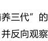

不光要感受城市的呼吸, 更要感受群体的呼吸!

在铁公鸡硬菜上桌的时候, 开发商“ 一铺养三代 ”的呐喊随处可见, 感受群体的呼吸, 就是感受他们在说着什么、喊着什么、做着什么, 并反向观察他们。

一铺养三代的呼声一起伏依时之, 去铺子里感受一下, 静静的站在那里感受每个铺子的呼吸和活力, 就者的明白, 养三代是个可能要卖养。事实也是如此, 伴随着金融投机的一地鸡毛, 商铺写字楼也一地鸡毛。
手里有个铺子, 看着它就像当爹的孩子, 没啥预期但又冻在手里。

时间到了2015年初, 打开主流视频网站, 惊奇的发现, 地产中介居然在视频流媒体大面积打广告了!

感受到这个呼吸, 有点经济常识的同学就会思考, 一手房是开发商之间的争斗, 二手房才是老百姓投资的领域。存量房市场课代表居然大面积打广告了, 还等什么, 快步要买房!

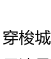

继续感受城市的呼吸，人群的呼吸。现如今，穿梭城市会发现，在虚弱沉睡一两年后，城市里整形编导娱乐大保健变多了，去网上看信息，不用读具体内容，发现讨论各种创业小项目玩小花样的越来越多了！

闭上眼就开白，哦！新动能没有，旧动能高风险玩不下去，去库存已经把风险从地方2f手里都转嫁给居民了，存款也掏的差不多了，咋办？

养！
怎么养？服务业！
服务业靠啥？
靠人！
怎么办？
抢！

服务业到底是个啥？
就是你服务服务我，我再服务服务你，你兜里钱给我点，我赚到了再给你点，你来我往，总会有有入富，有人返贫。在这个过程中，需要不断的堆积人口，财富才能堆积在一起流动开来，才能源源不断流下去。
服务倒是个啥？
就是你家孩子学美术没意思，学跆拳道没意思，那过时了，为了迎接新时代，要学编码，从小就要学，不学就要被淘汰，吓不吓人？
服务业升级再升级，说到底就是1元钱的东西以前卖5元，换个花样弄套新概念卖10元！
每一个被遗忘向前走的东西，都会有一地鸡毛的东西产生。
比如什么创业培训、加盟、致富妙招等。最先肯定是一地鸡毛的！
三眼在《三套路》一文里说过，底层赚的就是智商税，服务业说白了就是底层的财富互相转移罢了！转移的不是劳力，而是玩的智商！

感受城市呼吸，感受其中每一个器官的呼吸，更要感受网络上舆论的呼吸，众人都在谈的东西，大概率是一地鸡毛的！
大家都热聊的东西，证明大家都迷茫，都慌！
看信息不要深度读，随手不断翻，1秒看个标题，5秒看内容即可，感受整体呼吸多了，自然明白人心向背！

静静去感受，事实就在眼前。

# 精选留言

暂无...

# 由房价看现实残酷真相！你所认知的和事实完全不一样！甚至截然相反！

原创 第三只眼观 第三只眼观 2020-01-29 原文

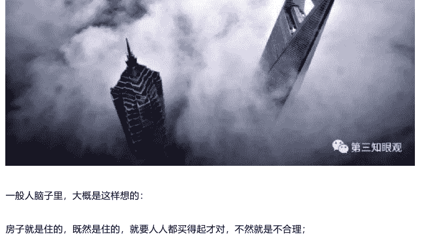

一般人脑子里，大概是这样想的：

房价就是住的，既是住的，就要人人都能买得到才对，不然就是不合理；

大家看，租售比太低了，跟邻对比，肯定泡沫好大，早晚完蛋！比较装b的说法是，规律不会缺席，只会迟到！

太难干了！房价把实体血吸干了，把实体搞虚了！经济下滑就该这样玩意！

房租涨，物价涨，生活难！

以上观念皆公知嘴脸，公知搞舆论就俩招，吓唬你+气死你。你战战兢兢又气鼓鼓，他就被捧上去

了。

想什么规律缺席咱遇到啊这种看似很有b格的话，基本都是公知专用套路。

规律？哼叫规律？女的生孩子有经验规律了，用到自己弟弟身上，那叫规律吗？
城乡户籍一切都是规律？只生一个孩子是规律？放开二胎是规律？土地和砖头产权分离是规律？户籍社保不能全国自由行是规律？
西方随便拎出个著名经济大师，都会一脸懵逼！

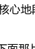

透过房子来看一看残酷真相，一般人所能认识的，可能与事实截然相反！

房子70%是金融，30%居住价值，甚至在一线核心地段，95%是金融，5%的居住价值。
为啥？
产权和道是啥，其实是使用权、水泥砖头，下面那片地才是真产权，但控制在大组织手里，供需随时可调节，这不就是金融吗。
金融是啥？
就是控盘，控关键资源，来调节资产价格。
未来？
一线多半年轻人都租房子住，这才是回归居住价值本意。

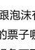

租售比低，有泡沫？
No！价格低不低不是你说的算的。
生活品，也就所购物价，不包含房价的，这部分取决于底层收入水平；
物价是保生存稳定的；
GPD是保就业的；
至于房价，取决于富人，不取决于底层，去边境搞一块地，造个城，弄1亿穷鬼，房价能高吗？
北上深20万一平的房子，跟租售比有关系吗？跟泡沫有关系吗？
美帝每次危机后溢发票子，大家都眼看着发，发的好票子哪去了？那可不是个小数字呀！
所以底层根本想象不到富人们到底有多少钱。更想象不到加了杠杆的富人多有钱！
钱又出不去，老王不被打脸两回了吗！
1%的人掌握50%的财富，不虚！15亿人的1%就是1500万，
一个人来几套，买下北上深足够了。
如果你有钱了，第一想法是什么？肯定是守啊！

怎么守？囤啊，囤在硬核资产上，就算大家一起跌，这也是最抗跌的，何况这年逾发大水，怎么跌？宝强算是富人圈外围女，还囤了1个亿呢。

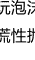

泡沫？不要用股票的思维去套地产，股票就是玩泡沫，一套操盘从生到死很迅速。股票100%泡沫，为啥？因为散户是大头，喜洋洋买进，恐慌性抛售，也只有散户群体能如此步调一致。地产，不存在恐慌性抛售。

当然，四五线没准，因为四五线地产就是个股票，是底层想暴富喜洋洋买入的，一套操盘下来，死的最快，黎曼烈烈去库存就是操盘搞这个！

所以在投资，或者对老百姓而言，叫守财，一个方法，不要跟底
散户一起混。
什么意见？
就是要知道，硬核资产的价格，是富人层、精英层决定的，不是全国平均收入水平决定的，平均水平决定的东西，才真的有泡沫。为啥叫“上车”？
不跟底层混，翻箱倒柜假装样子跟上精英层，就是上车了，要赚第一个赚，要赔也最后赔，且赔的最少。没办法，斗不过的，这是现实的规则，怄气没用！

精英层的东西有没有带泡沫的？也有！
比如学区房，20万一平，一小撮人决定，底层的刚需是住，精英层的刚需是囤，简称刚囤！学区房呢？不是刚囤！
非刚囤的风险点在呢？在于是否“过分”！太过分影响底层心态，也影响其他精英层心态，不利于和谐画面，毕竟是房子，不是书画展，教育这事要显公平，这是治本，所以很容易一波都带走！

房价吸实体血？搞虚了实体？
这就是怪倒了绷路修得不好！
所以实体是啥？老百姓思维就是开厂子开店铺，这东西好不干跟房子没啥关系，不要看什么房租，就算房租成本没上来，照样难干！
赚钱这种事，可不是你好我好大家好，而是只有你少赚，人家才能多赚。

在生产过剩时期，玩差斯，全面控股，进行存量财富转移，赚的就是小散户入实体的钱。
GPD以前是保8，为啥？保8就是保持大增量，整体最大盘子一年赚了多少钱，地主拿到手是不动的，刚需嘛！而就行业所谓经济活力靠谁？靠地主？no！靠民营，20%的蛋糕养活80%人口，所以必须要增量！现在都保6了，兄弟们！这次又来了疫情，6恐怕难保了！
地主拿分子不动，增量有限，残渣民营怎么分？
所以从最高处俯瞰，实体难很有正常，落实到个体的头上，体会到难，正常！
而更难的是，赚钱就是互相欺负，生产力过剩，里面的大鳄鱼一定欺负小虾米，欺负的手法就是垄断嘛！
大家径宝宝和团团们，还是可以的，没他们揽和，就算是GDP6%实体也能凑合过！
还有，所谓实体，老百姓脑子中的概念就是自家小厂子店铺，实体也包括国企的呀各位，三年前开始的去产能是干嘛？救国企呀，用环保、安全等把制造业行业里修和的民企干掉，头部国企自然荆润大增啊！这不都是实体吗？实体怎么不好了？
只能说后娘养的不好过，而后娘孩子堆里，流线好过，老实孩子不好过！

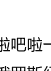

还有的思维是房子这么玩，经济有风险啊！叭啦叭啦一大堆！
说出的逻辑和结论只能死个人，又是日本又是俄罗斯经验的，又是硬着肚子什么的，喊了十几年了，也不管力！
啥叫风险？
不是隔壁村一个家族搞出事了分崩了，就套用到自家上。村与村不一样，家族和家族治理规则也不一样。
风险的强弱在于风险可不可控，这就是风控，而风控的核心在于能不能有足够力量控制整体盘面，这么思考还有风险吗？
去产能就是把资源足够倾斜到国家队手里，地产调控控制来控制去就是把资源控到国家队手里，涉及到风险的和分配的关键性资源，都到一起控制起来，剩下不稳定的、所谓有活力的东西，不影响整体盘面的，交给民营来玩。
大家各玩各的，二层世界！

个体的个人，主要不得的思维，就是在地上趴着还想对全局有个掌控意识，住地下室看着运筹帷幄，对于普通人来说，这个世界其所能掌控的东西就是今天晚上做什么菜，生几个孩子都不完全掌控！照明的普通人就琢顶级智慧也只能跟着跑，跟得上的舔一口汤。
经基层什么GDP、汇率、外汇储备、各种增长率、利率、负债赤字等等一大堆，哪个你能左右？社会层哪里能落户，哪里能上学，抢人往哪流，哪里修个高铁，哪里搞个商圈，哪里搞个园
区，哪里你能左右？前几年北京还要驱赶人口，现在又要回到大城市的扩围上。变来变去你能左右？这些东西涉及到钱袋子，搞生意，更涉及到一个安稳的心，但唯一做法也只能是跟着跑！事情来了，提前蹲下系鞋带就是要比傻愣站着的反应快，在没有阶层逆袭前，唯一能做的事只能这个了。

讲宏观很冰冷，讲微观很兴奋，因为很多招法能玩！

蹲下系鞋带拯救大招吧！

# 精选留言

暂无...

# 80%创业为何失败？因都是赌和被逼无奈！要创业先学观局！

原创 第三只眼观 第三只眼观 2020-01-30 原文

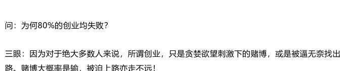

问：为何80%的创业均失败？

三眼：因为对于绝大多数人来说，所謂创业，只是贪婪欲望刺激下的赌博，或是被逼无奈找出路。赌博大概率是输，被迫上路亦走不远！

问：但主流意识认为没有失败哪有成功，人就要多折腾，虽然偷但折腾多了是不是就可以赢？

三眼：什么叫折腾？折腾是你看好一个领域，把握好一条线，反复的试错，成功的本质是“不去走错误的道路”，本身是个概率问题。
如果一个人要折腾，起码要明白什么叫工作、事业和创富。

问：那什么这么叫工作、创富和事业？

这三者完全不一样！
工作是为了维持基本生活持续性付出，付出包括体能、精力、经验、人情这四大块；
创富是为了赚取更多的钱，造富不是为了生存而付出，而是想通过一定的套路，在社会财富分配链条上，尽可能的获取更多；
工作与造富的本质思维完全不一样，一个是守，一个是攻！
而事业是不计较回报，为了满足个人人生的目标信仰，满足自我的成就感和获取存在感。

工作的本质是依附于一个规则，要体力精力但不要心力！
创富的本质是认知，费的是智力，认知到了，财富自然来，提升认知是一个很有意思的过程！
所以工作干得好的人，与创富玩得好的人，说不到一起去，一个玩身体一个玩脑子！
事业的本质是使命感。

# 一般人的迷茫和困惑，都是因为把这三种混合在一起！

人的痛苦与迷惘都是自己造成的！
多数人为何平庸？因为胃口太大，什么都想要，不知舍得，什么都想得一定什么都得不到！
因为都想得等于同于“根本不知道想得到什么”！
这源自于认知，因庸人的认知和动物差不多，只有所求，而不知把所求分类。

问：那创业属于哪个？

三眼：创业属于事业，创造事业。

创业也分真创业和假创业。

真创业，是把一件事情当成使命来做，钱只是顺带的产物。

“业”是什么，是佛家用语，是指事物演进背后的推动力。

**真创业，就是能看到在这个社会上，某一条真实存在正在演进中的推动力，或者说叫确定性趋势，而自身将顺应这种推动力，把达到一个目标作为使命，而不断运作。至于财富，只是一个顺带的产物，因为掌控住了推动力，必然会吸引资本财富聚集。**

为何很多上市公司一直巨亏，还能圈那么多钱，就是这个道理，因为它掌控了某种推动力，把握住了某种确定性趋势。

而假创业：

一种是因为欲望贪婪而赌博，说白了就是投机，想快速致富而已。

投机是世界上最难的东西，因为投机与投资都是个概率学问题，投入的是风险，得到的是回报。

投资是尽量降低风险，这就要“不去走错误的道路”；而投机，是直接在千万条路当中，直接选中那条正确的路，这种概率微乎其微。

韭菜都是投机分子，假创业的结果多沦为韭菜！

第二种假创业就是被逼无奈找出口，这没什么好说的，人只有好逸恶劳，没有找不到出路一说！

**把央企和民营当成人，民营就是韭菜，因为它在反复赌博和被逼无奈中打转！**

缩小至个体，你还认为韭菜少吗？满地都是！

问：建议人创业吗？

三眼：不建议，能准备好的人少之又少。

99%都是假创业，1%是真创业就不错了。

投机分子不会用脑子思考，只会用欲望和屁股思考，只看到创业成功者的暴富，以此来认定成功者的“投机”，看不见在这类“投机”的背后，是无数对错误路线反复错误的投资，以及持续不断的付出，体力、精力、经验、人情这四块的付出只是一个基础，更大的付出是心力的付出！

**体力与精力可以借助他人，这是管理学问题，经验可以积累，这是认知学问题，人情可以运作，这是社会学问题，而最核心的心力，只能靠自身，这是一般人所不具备的。**

问：那您说的准备好，是指准备好什么？

三眼：要准备的很多，而且很多东西是准备不了的，不是人人皆可，整体说来要准备两大块！

# 【首先就是准备的，就是明“局”！】

提前准备，这叫观局。
准备好了，就去入局。
形势尽了，这叫逃局。

# 【观局】

局就是纹理、脉络，再加上趋势，也就是纹理脉络的动态变化，这就叫局势！

三眼讲的政治分配是观局的核心。

从政治分配内核向外延伸，才能把很多分析工具都用得上，比如对一个行业来说，竞争格局、行业集中度、价值链条、关键环节与资源等这些东西才能用得上，这些工具都属于支脉，需要插在政治分配的内核上，才能反映出真实的状态。

这就好比项目启动，派一个调研员去调研“局”，选一个没有政治分配认知的，但工具理论十足的营销博士去调研，写出几十万字的报告，那是万万不能信的，因为它反映不了“局”的真实状态。

因为竞争是不公平的，相反一定是建立在不公平的基础上。

弱肉强食，政治分配，这才是每一个“局”的核心所在。

差别只是不公平的“度”——这就是所谓的营商环境。

上到国家资源性行业，度就很强，下到一条街上开个小饭馆，度就很弱。（往前数个二十年，最底层营商环境也要弱肉强食，菜霸、路霸、摊霸很常见。）

而经济活力和经济效率取决于这个“度”，但是对于政治分配的稳定性，取决于怎么加强这个度。

没有好坏，发达国家在市场经济效率上很高，这就是营商环境那个“度”比较好，但是发达国家在整体协同效率上就很弱势，比如这次疫情，不到一个当时月就要建成火山医院，对于武汉这样一个相当于欧洲一个国家的体量来说，整体调动起来显得毫不费力。

继续说局势，纹理脉络的动态变化就是“势”，合起来叫局势！
比如中小微企业贷款，对民企的行业开放，对某些行业的重点扶持等，这都是在做“势”。

总就是：围绕着政治分配和各种理论工具去观局，并感受各种政策以及政策落地后的具体反映的“势”。

# 【入局】

入局就是见局明朗了，开始盘点自身。
也就是说自身资源与目标局势所需资源的契合度。
这要说的一点是，在现如今这样一个商业化饱vol和无死角的时代，入局这事已经不是凭己之力可以完成的了，合伙人制度在未来会成为一个常态！
除了很少一部分可以独立输出能量的自由职业外，比如知识与经验输出、专业性极强的个体劳动输出等，都要以合伙的方式才行。

# 入局诉求的是切入点和切入时机。

这在中国国学智慧里叫做“机点”，古写为“几点”，意思是门与框的可转动的连接处，掌握转动的 cores，自然能开关门。

切入点是什么？
就是在政治分配链条上，从哪个环节切入；
切入时机是什么？
就是观察每个环节的周期。

马云拍那个《功守道》很多人看个乐呵，关注在武术这个肤浅层面，读完三眼说的局你就会明白，观局入局就是攻，逃局就是守，而整个合起来在于一个字“道”！
马云之道是什么？他当年是怎么攻的？现在是怎么守的？对于新的局势他是不是又有新的“攻”了？做到什么时候又要开始守呢？

# 【第二要准备的是心力！】

要成多大事，就要有多大心力！
心力是什么？
是人的心可以承受多大的压力，就能包含多大的事物。
这就像肉体在举重，心力就是能举起多重的东西，要有耐力一直举着，而且要稳！
人在肉体举重上会产生生理的疼痛，一般人受不了；
而心力的举重，要比生理更痛，一般人更受不了。
吃点苦、受点累落就受不了的，干好工作都是个问题，更别说创业了。
为什么很多成功者都有着充满苦难甚至悲惨的早年？因为只有这些才能锻造一个人的心力！
心力不是天生生的，也是需要训练的，和生理健身锻炼肌肉道理一样！
为何很多富二代都是“败家子”？
还是因为心力！
人能镇得住多少财，镇得住多大权，是要靠心力来掌控的。
多数人连自身都掌控不了，如何掌控他人与事物呢？

再举一个每个人都可以明白的事例，就是同伴之间谁强谁弱的问题！
为什么人人在一起，一个要惧怕另外一个？
这是因为心力在角力。

# 角力是社会常态，决斗是莽汉行为。

韩信是个强人为何还要钻过流氓的裤裆？
因为人要我们尊重你、怕你，不是把对方直接置于死地，那是低等动物、莽汉行径，而是要通过心智和心力，通过不断角力把对方压制住，这才是致胜之道！

国与国之间也是如此，心力的角力就是政治拼手腕，这也是外交至关重要的原理。
如果都抄袭家底直接分生死，会有古时三国的群雄争霸之战吗？

所以一个人在干事之前，在思考是否创业之前，分析下自己心力大小，而不是靠头脑发热和欲望激情去赌博。

# 精选留言

暂无...

# 你们最想要的东西：认知内核——打造个人思想系统的第一步

原创 第三只眼观 第三只眼观 2020-02-01 原文

收录于话题
#结构观
9个

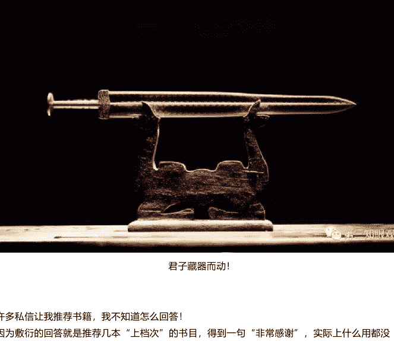

君子藏器而动！

许多私信让我推荐书籍，我不知道怎么回答！

因为敷衍的回答就是推荐几本“上档次”的书目，得到一句“非常感谢”，实际上什么用都没有；

如果要深度的回答，三眼所学有限，而且对于每一个提问者，都将是一部长篇大论，每个人想要的东西都不一样，每个人的起点也都不一样，想学什么、为什么学、某本书讲的是什么系统、对于你想学的有何帮助，还需要哪些书籍配合建立整体系统等等…都回答完估计我就阵亡了。

# 【人人渴望武功秘籍】

其实反思寻求推荐书籍的背后，提问者是想获得一个东西，一个能一直抓着、一直受用，就像获得一本武功秘籍一样。

所谓“武功秘籍”是什么？就是一个人认知的内核！

这就是你们最想要的东西，有了一个内核，那么在生活中所闻所见皆可以“插”到内核上。

与人辩论，首先要把对方拉到自己的体系里，你才能胜利，这个体系的核心，就是所谓内核！

有了内核，无论具体做什么，在思想里都有了一个阵地，有了一把利器。

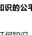

# 【知识的公平】

这个世界，知识是最公平的，而我们所学的任何知识，都是前人留下来的。

知识的载体是文字，文字是没有版权的，是整个人类的，随意用，很公平。

说这些要表达什么？
表达的是：谁也不要认为自己多了不起，因为我们任何的思考，任何的理论，任何的认知，都已经存在了，救赎就在那里，唯一所能做的，就是要谦虚务实。

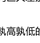

# 【知识的不公平】

但知识又是不公平的，因此产生了人与人之间巨大差别。

一个人脑子中的认知层次，才是考量人与人就高就低的最根本逻辑！

知识的不公平表现在三点：

+   1、真正的知识，都是被藏起来的，或者是“暗自交流”的；

三眼在《养痈》一文里说过，世界是个养痈场，上层养 подчи下层，而养痈方法从奴隶制一直发展至今，变得更为精密复杂，也就是“认知殖民”，而认知殖民就一招，就是认知隔离。

人 and 人之间，为何你玩不过对方？
就是因为认知差异，你去幼儿园可以把小盆友们玩得团团转，但去某一政治组织，大概率是被玩。
不要和我抬杠说你认知够但缺资源，资源无比重要之类的话。
只要认知真的够强了，即可把控利益交涉，即可逐步积累资源，即可逆袭，人出来混就是这么一

点点壮大起来的。

三眼一直说：认知就是接近真相的距离。

无论小群体大群体，小组织大组织，只有越接近真相，越有所谓顶层思维，才能真强大！

被藏起来说的是啥？

秦始皇为何焚书？为何历朝历代都有文字yu？这就是认知的区隔！

书同文车同轨，同文不是统一文字这么肤浅的，而是要统一思想。

如果从小给一个人讲述的都是如何成为杀手，那么这个人注定成为杀手，对于什么经济社会文化之类的，根本就不知道。

为何士农工商这么划分等级？商为何一直被压制在最底层？

是因为从商者做大，自然而然的就要去思考整个社会，思想自然就要越来越接近最高处！官商是不分家的，商做得好自然可以做官。因为大家做的都是一件事、一个目的，就是把底层的价值逐渐集中到上边来，统一管控和分配。

暗自交流说的是啥？

就是这个世界，交流语言其实有很多套系统，虽然都使用的一种文字，但是用法是不一样的。

一是文字在逐步的扩张，越来越多；

老子写道德经的时候，文字量很少，那时的交流系统和今天完全不一样，所以需要翻译，而翻译的人系统也不同，所以自然纷纭。

而今天虽然文字量很多，而且还不断的造热词、造新词，但很混乱，交流系统非常紊乱，比如小到95后的火星文，大到大组织政策报告。

为什么一般人很难看明白政府政策报告？

虽然使用的都是3000常用汉字，但如果真如字面意思去理解，那绝对是看不懂的。因为那是一套暗自交流的系统，你首先就了解这个系统是个啥，更不了解每一个词的用意。

今天的人们其实很孤独，因为世界看似很大，但每个人都活在一个很小的世界里。

# 2、被灌水的混乱的信息流动

首先要感谢互联网，这是人类发展几百万年，能开启民智的最大工具，

但真的能开启吗？

可以，但没有想象当中的强度那么大！

为何？

因为你所能看到的信息，几乎都是被“灌水”后故意拐出来的，随便看。

而且越看越糊涂，越看人的认知越往下走。

首先是因为现在的信息流被阉割！

比如三眼写10篇至少三四篇发不出去，对于三眼来说，写文字的难点不在于思考和表达，而在于怎么表达既能发出又能说明白一些东西，这就很难了！
一些词汇要用拼音代替，因为人的思想构成是一个动态体，而动态的关键点就是一个个关键词，只要把关键词控制住了，动态体基本就很难动起来。

再次是多数的文章都是没有系统的！
现在打开手机，随便点开一个资讯类软件，只看标题，不停翻滚，你会发现几乎90%的文章都是在描述情绪，而不在讲逻辑，
这些文章作者两类：
一是有逻辑，但故意写情绪，因为利益！比如那个什么咪蒙，本身情商智商不错，但写东西专门挑拨无知青年的情绪，而获得巨大收益！
二是大部分作者根本就没有体系，在别人那里听说什么，就拿过来写，根本不经过大脑，或者说根本没有大脑。稍用点功夫的，还知道改写，但更大一群人直接就是抄。
三眼一些文章，满网乱飞，不停的换“原创作者”，抄袭的时候估计都没仔细看。
对于垃圾信息，越去窥探，就会越产生认知偏差和混乱，带来的只能是情绪波动和焦躁不安。

所以三眼告诉诸位的招数，就是少读且深度。

认知提升，首先要开始扔东西！越精简才是越有用的。

以前比如民国是没有互联网的，弄到一本书读是很难得的事情，一本书就会反复读，深读，造了很多大师出来，当然环境也是一方面，那个另论。
而现在是漫天灌水信息乱飞，比如学经济、或者学习营销，起码有几千个“系统”在乱飞，有的 是忽悠，有的以假大空，就算是真东西也被混乱的信息流给淹没了。比如创业培训，讲成功欲望讲理想讲传奇例子会占到内容80%，剩下几乎都是假大空，真逻辑很少有！
普通人根本没有能力，去清理这个混乱的流动，不断的在各种“情绪制造”上被洗脑。

## 3、基于个体的教育

这也是本篇最核心！

教育的核心是认知教育，而咱们的教育是“术”的教育和情绪教育。
什么意思呢？

认知教育，就是看待这个世界的方法——你看世界是什么样子，世界就是什么样子。

很迷糊是吧，具体解释一下！

## 任何认知系统、思想系统，都会回归到一个本源认识上，也就是认知内核。

也就是说所谓武功秘籍心法！

儒家归到“仁义”，围绕此内核，演化出具体的行为和语言规范，也就是礼智信等等；
法家归到“奖惩和权术势”，围绕此内核，演化出具体的治国之法；
纵横家归到“纵横”，也就是人与人之间相互怯怯的权谋，纵横就是一呼一吸，围绕此内核，演化出具体的合纵连横一套套路！
这是每一套认知系统、思想系统、每一个学科存在的最底层、最内核的逻辑。
再比如西方，不同的经济学会计把这一学科的底层逻辑分别建立在劳动价值、生产力、土地等等上面！
如果失去这些底层的逻辑，那么整套认知系统将不复存在！

而我们的教育是从来不教给底层逻辑的，只是在教各种“术”，学校时候背课文，到了社会所重视的都是各种具体的技术工种，再在情绪上教给“4有”，用脑子仔仔细思考一下，“4有”是不只是情绪？丝毫没有任何底层逻辑？

这样的教育时间久了，都变成工具了，人生的重要存在感就会放到如何干好技术赚钱饭碗，因为这是无认知的必然结果，跟动物思维是一个层次的：

活着就是要看家，看好家自然得骨头，看谁得的骨头多，我比你多我骄傲！当然骨头不能多给，给多了管鲍就会开始思维如何看家，开始求“道”了！

## 所以人和人的区别在哪？在于认知！

## 认识的差别在哪？在于有无底层逻辑！

## 知识分成“知”与“识”，知就是底层逻辑，是认知内核，是武功心法；识就是一切的外界信息，通过底层逻辑把这些信息“有的放矢”，这样就形成一个人的知识结构！

那么底层逻辑怎么建立？

对一个人而言，如果他看见万事万物不是幻影或幻象，那么他就不会拥有哲学才能！
哲学的起源建立在一个思维上：你所见到的事物皆为假象！
东方是没有哲学的，或者说东方哲学起点只有一人，就是老子。
如果把诸子百家划成分类，就两大类，道家和其他家。

我们2000多年来，整个社会都以“眼见为实”为基础。
自然科学的发展为何没有我们的份？
从秦帝国开始这就成为必然！
因为自其开始，法家治术一直延续下来。
所以要达到的目的，就是让人活在表象中具体事务上，而不允许去研究幻象背后，从而阉割了思考力。这也是为什么诸子百家唯有法家才真正活到今天！
而科学的发展基础，就是建立在“一切都是幻象”的基础上，追求真理的过程顺带产生了各种自然科学。

## 对于一个人来说，关上哲学的大门等同于关闭思想！

所以再听到让清朝为科技落后面揽屎锅的文章，可以不用看了！
而2000多年来，有思考力的人，只能通过一个领域来释放思想，那就是心学——专业研究人精神的虚幻。

三眼讲哲学起源干嘛？因为一个个人认知的起点和哲学的起源一样。
这并没有什么高深！
如果一个人每天所见到的东西，都眼见为实信以为真，那想必一生都会窝在那里。

## 【已习惯于所存在的事物】

人千万别“成熟”，成熟了基本就不会进步了！
要保持一颗孩子的心态——对万事万物充满惊异！

## 人与人的观察力的强弱一是在于认知系统，二就是在于对于一个普通的事物，有没有惊异的感觉！

你带着孩子看到街上有人骑自行车，你会觉得很普通，但孩子见到会很惊异。
没有惊异感，人根本不会去真正的观察和思考。

诸位，有谁还会见到一个极其普通的事物，还会觉得兴奋新奇呢？

互联网居然可以打字聊天，居然可以通过文字去影响一个远在千里之外的人！
惊奇吗？
花纸币越来越少，钱都快变成数字了！
惊奇吗？
几亿人在960万平方公里上不停流动，比几百万年人类的流动体量都要大！
惊奇吗？
说了，就觉得惊奇，不说就习惯成为普通，再深度去说，就会更惊奇！

惊奇不是把它放在那，就像看美国人火星实拍图片一样，哗的一声就结束了。
而是要把惊奇与自身的存在联系起来！
这是孩子最美好的天性，也是成年人需要保持的珍贵东西，

当人逐渐变老，有一天达到所谓“成熟”，基本是你对这个世界的认知也就定型了，外界很难改变你，你也不想改变自己。

再插个有关成熟的例子：
假设你今年30岁，回家跟母亲说你的理想是能够上火星，看你母亲抽不抽你，骂你不成熟！
但在西方，你这么说，母亲会觉得你很有理想！
这就是东西文化差异所在：

东方通过社会生活，把一个个人打造得一模一样，社会就是个模子；
西方思想是寻求差异和真相，这建立在“一切皆为幻象”上。

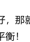

## 【真正的心态调整】

所以看三眼的东西，才是真正的心态调整。
因为心态不是发自周围环境，而是发自于自心。
多数人所理解的调整心态，无外乎是受到外界的压力、刺激的影响，再去寻求外界的信息与帮助，来达到心理情绪感受上的平衡。

比如最典型的：女人因为比赛打败了，心态很不好，那就寻求外界帮助，比如让闺蜜用一个没有逻辑的逻辑去奉承自己，从而获得情绪上的平衡！

好傻逼！

## 弱者最喜欢把自己裹挟在情绪里！

三眼说调整心态，是通过打通认知，建立底层逻辑，认知内核。

人“开”了，自然心态极好：

- 人开了，不相信眼前的东西，认为一切都是幻象；
- 人开了，去找寻各种认知系统，建立自身的底层逻辑，从而有了“心法”；
- 人开了，对各种普通事物充满惊奇感。

做到这样心态还会不稳吗？

## 【人与人为何难以沟通】

三眼再啰嗦几句！

多数人是无法对话的，因为人都在不同的“认知系统”里。

不光底层逻辑不一样，甚至绝大多数人根本就没有底层逻辑。

比如女人很难有底层逻辑，所以女人最好忽悠，钱最容易赚。因为你随便包装一个逻辑都可成为其底层逻辑，忽然一次被识破了，那就像再换一套！

为何敌人是最了解你的人，因为大家都站在同一系统层，这才会有竞争嘛！
现今社会，很多行业不是被同行干倒的，而是跨行干倒的，就是这个道理。
因为你没有惊异感了，已经感受不到系统的演化更新了，站在同一系统层的敌人出现，你也不会不知所以然。

## 【认知地图】

认知地图，也就是在社会上形形色色的人，会划分成多少块，每一块的认知系统是什么样子的。
就好比男的追女的，首先你要明白女性这一系统大体是什么样的，有着什么样的属性，这样才能去破解系统。

有了认知地图，在遇到不同的人的时候，几句话即可明白对方属于哪块，拥有哪种特性，怎么去对待。

有没有底层逻辑？

有的话是什么样子的？

对方这种底层逻辑，核心点在哪，他会相信什么，不相信什么，这种逻辑的强硬之处在哪？弱点漏洞在哪？

如果遇到某件事，拥有这种底层逻辑的人，会表现出什么样的行为，怎么判断？

其实可以在不同角度，划分成很多类。

随便举个划分例子：

比如站在“是否想得到认知”这个角度上，可以把人划分四大类。

## 1、叫不醒睡不着的散人

这就是前面讲的所谓已经“成熟”人，没有底层逻辑，从小被教育“术”和“4有”情绪，上了这条路太久了，已经停不下来产生极强惯性，结果就是：
叫不醒——你跟他们无论讲什么，他们都会形而上到“知道了有啥用啊，人生不就那么回事吗”这一答案上来。
睡不着——你以为他们真的那么坦然吗？那么想得开吗？错了！他们是睡不着的，因为“知道了有啥用啊，人生不就那么回事吗”这一标准回答，只能得到暂时的心理平衡，这是一种苟且安慰自身的表现，当回到现实生活，遇到各种欲望刺激和困难坎坷之时，会难受的睡不着！
这种既叫不醒又睡不着的状态，就是鲁迅先生笔下“麻木的人”！

## 2、文化流氓

文化流氓就是那种很不谦虚，自以为很懂的人。

是先生笔下“拿来主义”的那群人。

大都都没有一块半块的底层逻辑，并只能在各种认知系统里打转。

没有坚实的底层逻辑，还自命清高，以至这群人是最有利用价值的群体。参见过往的各种学生运动。

一群手无缚鸡之力，文不能有章，武不能有法，但心高气傲“追求真理”。

打着文化的旗子行流氓之事。

往前就是各种运动，现在就是各种喷子！

其特点就是带有强烈的为主观色彩，有一种舍我其谁的气概！

——书读的越多，认知越乱越低级。自己都不知道什么到底是真的。

这群人是公知的寄生对象！

要顺着你忽悠，说个葫芦当个瓢，并且深入骨髓信以为真。讲真的话喷死你。

今天讲民主，那么文化流氓就跟风，具体是个啥也一知半解，
明天叫货币战，文化流氓就跟进，货币战就是最真实的，别的都是假的。

为什么会这样？
因为文化流氓其实是求欲很强的一群人，但没有底层逻辑，或者底层逻辑是混乱的，性格还“要强”，那才产生的自然结果就是：

## **所有逻辑都是带着情绪的，这就叫逻辑，只能叫赖断；**

自己没逻辑，但会不断拿别人的东西来嘲你！
逻辑说不通，就搞人身攻击。

以上两种人是绝对无法沟通的！

## 3、嘲讽待哺

不用多解释，就是在知识不公平的环境下，为了寻求出路而想要打造认知系统的踏实进入的人。

## 4、学派

学派是带着底层逻辑的。
上到国家，叫体制；
中到各种知识群体，叫学派；
下到个体生活，叫规则。

学派之间会竞争，会辩论，会打架，但无分对错！
受用不受用，看个体的运用。
就好像没有最牛的武功，只有最牛的战士。

## 【欲望切入点】

读书学知识，以用为本。
如果不用，再学也学不到真东西，
一本三国演义，老百姓看了根本没啥用，或者说用处是茶余饭后吹牛，出租车司机喝大碗茶论国家大事就是这个意思。
满人当年入关，三国演义是秘不外传的，被满人当做治理国政开疆扩土的法宝，为啥“娱乐书”

籍“到了满人手里那么受用，因为满人真的在用啊！

所以讲了这么多，要问认知的底层逻辑具体怎么建，首先要搞清你的欲望是什么，你到底想干嘛！也就是说认知体系建立的切入点。

- 你的欲望是什么？
- 获得权力？
- 做事情的谋略？
- 做事情的技巧？
- 获得更多财富？
- 内心的平静？
- 或者仅仅是刚步入社会到底怎么选择？

政治经济社会自我人性五大认知，底层逻辑都是不一样的，但又有连带。

比如经济，特色经济主要底层逻辑是法家+经济西学，在这种特色下，钱往哪流动，怎么流，各环节如何分配的，个体在哪领域走…

比如社会，人的流动，流动产生位置，位置享受分配，获取位置需要通过利益的往来，位置排序什么样，哪里的位置优越，升门上位的机会在哪…

比如政治，每一次决策，每一个政策，10分好处，5分为谁，3分为谁，2分为谁，成全了谁，削弱了谁…

比如自我，人到底想要什么，自身的优势和漏洞在那，适合什么，所处阶段性，达到平静祥和幸福所需的状态是什么…
想必一个个体所需，也就这些了吧。

## 其实如果能以这样的结构，去展开认知，已经发生质变了！

剩下的就是填充每一小块的底层逻辑，而每一小块的底层逻辑又由着一个大的根本逻辑牵引。

最后告诉诸位的就是，最大的认知内核是：道家无为观+法家权威术势！

一个是虚的层面，一个是现实生活的层面。
政治分配、经济上钱的流动、社会上人的流动，以法家的体系即可看明白。
2000多年没变过！

为何？
有什么样的群众，就有什么样的领导，这就叫“水载舟”。
深入骨髓的所谓文化习惯、民族性格才是社会存在最真实的状态。

换成外星人来当领导，局面是一样的。
为何美帝能搞出个自由民主？
因为它根本就没有历史，更没有文化。
文化这东西不是懂多少天文地理知识叫文化，那叫学术，文化是纹化，是一个社会演进的纹理。
所以最好的老师是历史。

认知是一把利器，君子藏器而动！

## 精选留言

暂无...

## 经济第一讲：你所见到的经济学几乎都没用！老百姓明白“经济是水”最简单实用！

原创 第三只眼观 第三只眼观 2020-02-02 原文

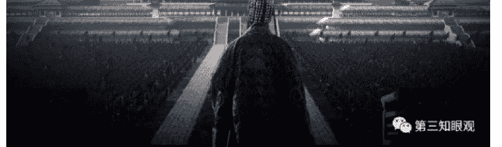

你所见到的经济学几乎都没用！

是不是觉得明白点经济学，在这个商业社会就像明白了赚钱秘术？
这个曲线、那个模型、那些数据别的，老百姓看了在一头雾水，觉得其高深莫测，武功天书！
三眼实话告诉你，你所见见到的经济学，除了有一些基础性逻辑稍有点实用性之外，剩下的百千里论毫无用处。

学校里咋聊经济学，读了几年大学出来，有几个懂经济的？
哪个成功大企业家是经济学科大师？
再有，诸位常见到的经济学家们，多半是没有钱的！因为多数是点评家，并不是实用家，看个热闹即可！

当然，三眼并不是说，以财富获取多寡来论英雄，更不能以此来判断一门学科有用没用，而是告诉诸位，大家经常见到的所谓经济学和各种术语，大多是假大空。

普通个体所需要的是打破认识的不公平、信息的不对称，所需要的是小学毕业会认字就能读懂的，又能对实际生活产生帮助的经济观念。

## 【首先要有一个根本认识：经济是政治的延伸】

经济是干嘛的？
经济是政治的延伸，没有政治哪来经济？
经济目的是啥？
别跟我说什么经济目的是让全社会最大化效率等等，那都是瞎扯淡，浓厚的理想主义，是经济学家们自己给自己竖的大棋，实战天王索罗斯就说经济学是伪科学！

经济就是给政治服务的！
一种是国富兵强，一种是民富国柔。
中国几个朝代经济建设都是世界no.1，汉唐都是遥遥领先全世界，宋朝更神奇，能达到世界gdp的一半！半死不拉活时期的清朝，gdp也是世界前茅！
那时候大家懂经济吗？
那个时期，这个斯那那个思的祖宗，吃饱饭都成问题呢！

为何今天黄皮肤把这些白皮人当成神一样供着？

并不是白皮思维多么优越，甚至和智商就高等等，当然，一些巨匠求真求实，客观解析世界的精神和智慧，需要我们膜拜，知识是不分种族和国界的。

但这并不是“被看着”的原因，原因只有一个，就是武力！
文化这个东西本来是很中庸的，并无强弱之分，决定权在于武力！
武力强大决定文化强大，文化强大就会精神压制！
唐代万国来朝，文化输出到整个东亚圈，就是这个理！

## 文化输出包含什么？

价值观、神话故事、器物载体、礼仪规范、语言。
想一想是不是？

这个世界谁强大，跟著的小弟们，都会慢慢的丢掉自己的历史和习惯，把强者的价值观念供起来，并在神话故事、礼仪、语言上逐一模仿。
看看今天有多少孩子明白自己的历史？有多少孩子了解西方神话？甚至是没有文化的老美编造出来的神话？各种联盟各种侠！
再看各种节日、服饰、饮食等。

文化输出就是精神压制，比如时尚界的一直是人家领先，因为时尚这东西就是人家造出来的！属于人家的文化内核！
100块钱牛皮弄几十个标，做成奇奇怪怪的形状，就卖几万，这收的可不光是智商税，这是文化税！
强武，就会形成一条“分配链” 插到弱势的地方，分配链的顶端在人家手里，通过一个个链条，不断吸收利益价值。

思维不散发，继续说经济！

有人的地方就有江湖，因为人性！
有人群的地方，也就是社会，就会有等级结构，就会有政治，有政治，就会有管理和搞经济的方法。
不要在意搞经济时候那些具体术语，三眼在“悟”的文章里说过，这个世界有无数个认知系统，对搞经济也一样，东西方加起来会有上百个系统，系统间底层逻辑是互通的，只是表达方法不同——也就是每个系统的交流语言不一样而已。
就好比佛家讲人性、儒家讲人性、道家讲人性，底层都是互通的——儒释道本为一家。
区别就在于，大家追求的目的不一样，儒家的目的在于“入世观”，佛家在于“出世观”，而道家在于哲学修养“无为无我”。
经济学呢？
区别也在于此，大家目的是不一样的！
目的来自于哪？来自于政治！
所以离开政治去谈经济，舍本逐末，不会得其法！

## 【形而上与形而下】

无论何种知识，都可以向两极极研究！
难易程度：形而上<形而下<贵通

大白话解释一下！
就是诸位观察身边的若干人，会分成两大块。
有的人你跟他探讨，他会不断的把探讨形而上，常见于喝酒吹牛互相抬杠，这种东西很没有价值，比如探讨人生的过程，他们会形而上到“人活着都会死去，人生就是咋咋回事”。
把这个过程一下子都简化掉，得出一个最上上层的大道理！
大道理没啥用，除了带来消极！

形而下就是大接地气了，太追求具体实用性了，这也不行，因为没有规律规则的参照不会长久，因为没有体系！

贵通是最难的，也就是思维高层建构，抓本质，也就是三眼说的认知系统的底层逻辑，而后又能以底层逻辑去逐步向下渗透，运用到实际生活。

说这个想表达什么？
想说的是现在很多经济学，都是形而上，都是自说自话，在那里画圈，所以是空架子！
形而上画圈圈的东西，可以随他说，正说也反说也行！

比如房价是涨是跌？
来100个经济学家，50个可以每人出个报告，告诉你绝对暴跌！剩下那50个告诉你暴涨。
都有道理，因为都是按照他们自说自画的圈圈。
他们要做的，就是先把你拉到他们的“圈圈”里，也就是认知系统里，然后说服你！
在他们的圈圈里，他们肯定对，但是跳出来看，他们的圈圈本身是对的吗？

## 【判断对错要依附于最大规则】

三眼说，他们的圈画可能对也可能不对，怎么判断呢？

## 要看是否契合最大组织的规则！

许多白皮经济专家的理论，为何到了960万平方公里上为740水土不服？
因为不契合大规则！
城乡户口一刀切、一家一个孩子坚持50年计划、产权地上地下分开算，买房子要先囤资格，买了房子不准卖，等等，在哪一本经济巨著上写过啊？
这严重不符合西方经济学思想体系啊！
白皮大师谁来都发憷！

作为本土卸食百姓，怎么办？怎么契合？怎么打通认知？从哪找方法？
从历史！

你继承了你父母的基因，思想上永远用不掉原生家庭的思想烙印。
15亿个你就是继承了祖先的基因，思想上永远用不掉历史的烙印！
历史就是现在，现在将成为历史！

再多说一个知识点：
语言就是思想的最大最基础载体，当你嘴里说汉语，键盘上敲打汉字，本土思想就深入骨髓，融入血管了！
因为语言就是一个逻辑关联键，拼在一起就是一套完整的思维逻辑辑体。
现在所用的词汇，不是诸子百家造的，就是历朝历代各种时期造的，当然，外来宗教佛教用语也融入了语言，除了标点符号和一些名词外，半多的动词和形容词都是有历史逻辑辑的。
比如一个人很敬恨的说“造孽啊”！
孽是个啥？所有人都脑子里都有个固定认知，大家“不谋而合”，不然无法沟通，只要你说这个字，这个认知就进入你大脑和血液，而西方文化里，是没有孽这个东西的，你跟一个白皮说造孽，白皮又是一脸发憷！

如果白皮们都明白啥叫孽，证明那时候我们已经解放全球了！

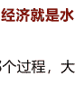

## 【经济就是水】

前面讲的东西，是辩证思考的过程，没有那个过程，大脑不会有个路径去求结果，下面说结果，

这是本文内核！

## 从历史才能找到解读今日经济之法。

## 在我们的传统文化里，经济就是水，其法沿用至今！

应该是从西汉开始吧，三眼记不得了，五行理论大概也是那时候启动的，五行不是什么算卦算命的东西，五行是一种管理概念。

而经济就是五行中的水！这是治国理政的一个要素！

钱就像水一样，作为交接载体在社会的各个脉络里流动，这里有三个核心点：

## 1、水量。

就是根据社会需要，发多少钱。

这个所谓需要不光是今天所说的生产总值，而是够不够刺激经济。

超发钱是这么来的，要远远超过生产总值直接需要！

刺激经济到底是啥？

这就复杂了！这里简单说一下！

整个大集体不是一个个体，大组织也不是一个人，所谓刺激活力，在于既要全盘子发展，又要保证各个阶层都喝到了，维持一个基本形态；但集体是多方利益共同体，有的是资格老，有的是实力强，底下还有一堆创业争扎的，利益共同体是多方角力的。

不要以个人的主观去思考如何超发大水，这是庞大集体博弈造成的，不是一句两句可以说得清的！

## 2、流动分配。

每次放水有了一定的量，往下流动经过层层环节，每个环节会拿到当量不同的水。

拿得多，自然就富裕，拿得少，自然就贫困。

## 越接近水流的发端，肯定分配的多嘛！
而是否接近，距离的远近，这就是位置。

## 有什么样的位置，自然分配到多少水，
而水流到每一个环节，在此环节也会展开分配，这就是环节里的存量分配。

很多人所谓创业，其实在这里，也就是在一个小圈子小环节里，把他人的水吸过来，在同一圈层相对于他人富有。

这也就是穷忙的根源，很多自以为在死里干就能赚的多，这是不对的，站在最低分配环节，你累吐血也最多是吸了同圈层穷人的水，那能有多少呢？

所以屌叫逆袭，就是跨越阶层，往上去距离水流的顶端越来越近。
不明白这个道理，努力一辈子也穿越不了阶层，就算是越了，也是运气！
但其实起码一半的人穿越还真就是靠运气！我们有脑子，不能坐家里等运气普照吧？

## 3、浓度。

水放多了，浓度自然被稀释，钱就不值钱，不断的刺激，钱就越来越不值钱。
但浓度这东西，不是谁领域都一样的，这么大个盘子，像个大海一样，水要流一会，才能把浓度平均化，也就是物价每一次波动都有一个传导过程，哪个先涨哪个后涨，最后达到一个平衡状态，这是其一；

其二更是核心的，就是有些地方是隔离开的，水注入的多，浓度超级强，比如地产，比如某些领域的价格疯狂泡沫。

除了自然传导产生的价格不平衡外，其余的浓度都是人为的。

在我们这里，几乎每一个链条，每个流动都是被掌控的。

个体总是想通过思考预判流动趋势，仿佛谁也看不见，只有他悟出来了，从而走上人生巅峰！
这，是不可能的！

趋势发现只能产生漏洞，漏洞对于大组织大规则就是小打小闹，但对于个体来说，可能是一生转折点。

钱的堆积，水的堆积，就推高资产价格。
所以投资就是互相玩，看谁玩的过谁，大家把钱找个领域往死堆，通过买卖来获得更多的水！
投资就要跟住水的流动，站在趋势最前面肯定是最好的，因为刚刚有堆积的趋势，跑路肯定是预判断不久后水会流外。
小到某一行业某一紧俏商品；中到各种庄家局，字画贵金属股票债券；大到最大组织坐庄的支柱产业，都遵循浓度规律！

为何三眼说跟庄要跟最大的？
因为只有最大的庄，操作一个盘面的周期才最长，因为辐射的面太广了，完全有时间可以仔仔细琢磨，达到信息对称。而中型的庄你是玩不过的，因为你所能掌控的信息根本无法观察到具体的游戏规则。

## 4、价值流动。

最后一点，要明白，流下来的叫水，被挟走的叫价值。

政治经济就是把价值从底层逐集集中到上层，统一管控和分配。

所以人这辈子不要太在意水多水少，那不是根本，
30年前搬一万水算一盆了，现在看一兜都算不上。
要看水背后的价值，人这辈子携水没用的，携1000万桶水，过个十年二十年毛都不是！
要赞价值！

**劳动价值_**——是自家的劳动力，自身的劳动力，这个是首先要保持的，就是小家庭的劳动价值——一直可以去社会上换东西。二是么怎么转化他人价值，而转换他人价值的载体就是公司或者价值链，这是一部或几部赚钱机器，链条稳控得住，就能源源不断转移他人价值。

**资产价值_**前面讲的淡度隔离出来的地方，载体会一直变，
**位置价值_**就是在社会脉络上占上一定位置，年年占住是法则！

很多人不明自什么叫人脉，以为认识几个人就是人脉，这是不对的，
比如现在很多私营企业做到一些管理位置，自以为有人脉，如果这个企业没了，他和刷锅的普通白领蓝领一样的，可能因为年纪和心态原因还不如年轻小白。
为什么？
因为大多数人以为人脉是人情，你好我好大家好！错！

## 人脉是制约！也就是你在一个圈层、一个链条上，拥有“破坏”的本事！

也就是说，你有利用价值最多 Griffiths 为工具，用完了一扔，没人跟你讲温煦。而是要有破坏价值，那么整个链条都怕你，自然你就占上分配链了，年年占住！
这也就是在古代谋略中，掌管刑事的要比掌管财政的，牛的多多！

## 5、两桶水。

而到今天，经济也是水，只不过这个全球化时代，水分成两桶：
一桶在外面，跟汇率挂钩，跟外面的各个组织玩；
一桶在里面，跟汇率毫无关系，跟外面更毫无关系！
100万在县城买个80平两房，在外面某些发达海岸线上买一套大别墅。
这就是因为内外两桶水浓度是不一样的，各玩各的！

所以就会造成一个漏洞，也就是不一样的规则对钱的价值评估不一样，为啥一个个大boss想转移

啊！一是因为浓度背后的利益驱使，另一个是因为在里面的水桶要“掉队”，利用价值over，别看比普通人牛，但对于大组织某个链条一点没有破除价值，所以尿壶要收起来，大boss要被充公！

当然，这些与老百姓实际生活无关，知道即可，无需关心！

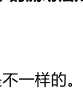

## 水的流动法则

说完了水流动的普遍规律，还是不受用的！
因为规律是底层，每一次放水的流动规则是不一样的。
运动项目都是肢体运动，也就那几个花样，但打篮球和踢足球规则是不同的，决定了运动竞技结果。

我们要关注的就是每一次的规则！
而规则取决于目的！
有什么样的目的，就制定什么样的规则！

2000多年来，就是围绕俩规则在玩。
儒和法！

法家的极为重视经济活动和活力，因为他的目的只有一个：富国强兵！这是物质上的强大；
儒家极为重视精神建设，因为他们的目的只有一个：实现“仁”的思想覆盖，达到合理（不一定要求强大），这是思想上的建设。

当然，这是要在先秦之前，之后儒法合并，历朝历代都是物质与精神文明建设一同发展！
但对于普通老百姓来说，儒的那一套几乎是不接地气的，只看法家即可破局现今！

因为儒家与西学的很多观点不谋而合，也就是大组织需要更关注“仁义之道”，而经济活动让下面自己去进行，也就是西学中“无形的手”自己发挥；
而法家一直以来的主张，是尽可能的将经济活动置于大组织完全掌控下，因为富国强兵核心目标的实现，一定要通过“集中”，通过经济学里“有形的手”。不断的在社会活动中提取资源，而且要深度干预不同生产部门的分配。这是法家的基本特征，一定要记牢！
所以诸位就不会奇怪，为何国家队掌握着80%资源和蛋糕，民营小分队一旦干大了就“转正”变身国家队。

分配显得经济运行规则，经济运行产生对应的社会结构，我们都裹挟在社会结构的层层里。儒家法家之分，还在于富民与弱民。

规则变换这里此篇说不完，因为需要层层渗透，这里大体说一下的意思是。

## 个体的价值，首先要使附于集体，个体所得皆为集体所分配。

作为普通个体，格局跟不上，肯定会产生一个幻象：
就是钱是赚来的，努力即可大丰收！
而昨天文章里提到的“叫不醒睡不着”的人和文化流氓们，思想肯定是偏执的，会这么说：

> "我明白这些有啥用，还是改变不了事实啊！"

这样思维的人已经救不了了！
因为啥？

因为1，不动脑子，长个脑子是挂着玩的，根本不用，好逸恶劳等形成的，看三眼的东西基本想法就是直接来钱道子，最好是啥也不用思考，啥也不用学，1万元轻松投出去变成100万！
不说每个人的环境、性格、阶段、认知力、资源等不一样，而决定了每个人的路径不同；
就说有大师告诉你某个直白造富路子，你敢信吗？什么加盟、各种股神、各种培训、各种理财等等等等不坑死一大排吗？
韭菜就是韭菜，不长脑子的！

因为2，这些人“野心”很大的！
小钱看不起，大钱没暂转到，快速暴富是内心的呼声，这还是源自于好逸恶劳的本性。

说这些啥意思？
三眼是想说：

## 1、一个人这么能拥有多大财富和位置，基本是认知决定的，当然还有一部分运气成分。

+   认知配财富；
德行配位置；
心力配气魄。

认识到了，分多少分自己心里会有数，想怎么多的多，也有数。
这是三个一生都要不断打造的东西，只能踏踏实实，浮躁背后一定是好逸恶劳！

## 2、作为一个普通个体，结合前面讲的“水”的流动和规则，就会明白普通人能分到多少水，不是

## 你一个小小个体说的算的，是大规则说的算的。

往前数30、40年，人和人差距有多少？这个村比那个村富多少？邻居、朋友、亲戚间可能差距多少？

那时候水放的慢，放的少，自然流不到最下面，不可能层层都雨露均沾！

而这十几二十年呢？

大组织大规则开始“加强百姓财产性收入”、“让农民群体富裕起来”、“打造5302年5亿中产目标”等等。

能跟得上的，跑的快的，自然分的名 。

只有大组织变换规则了，阶段性目标有倾向性了，跟着跑的才能有变富的机会，跑得快，肯定就能甩开同圈层一大段距离，跑得再快点，还可以跨越阶级占上更高分配环节。

小汽车小洋房都是分配下来的，并不是一个小小的个体造出来的。

虽然说政治经济是把底层价值集中到上面统一管控和分配，沿着链条造成分配不均等，但这是客观存在逻辑，跑到世界任何一个角落都是如此，跑到非洲也一样，那里还依旧靠枪杆子分配呢。

如果把一个单独个体扔到无人区，你有什么价值？

所以把脑子中的幻象都扔掉，不要自我想当然。

认知是接近真相的距离，不扔掉幻象没法取得真相。

## 个体的价值，首先要依附于集体，而后洞悉集体规则，提升认知，平时系鞋带，风来了跑得快，这就是社会人生！

精选留言

暂无...

## 未来中产阶级是最大块肉！如何“吃掉”一个中产？

原创 第三只眼观 第三只眼观 2020-02-03 原文

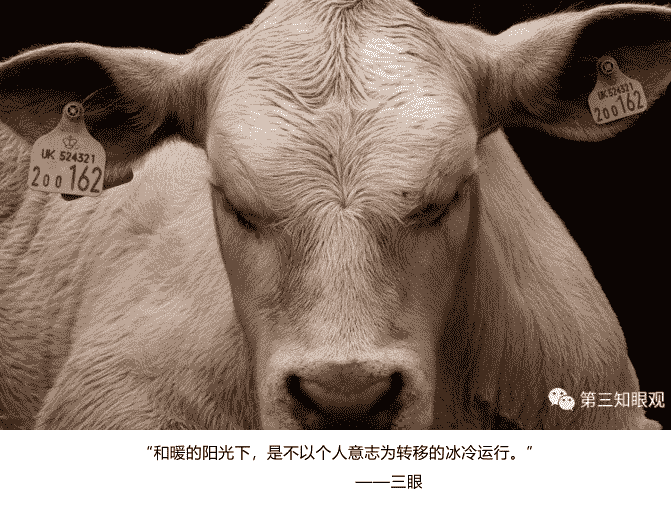

> “和煦的阳光下，是不以个人意志为转移的冰冷运行。”
——三眼

15年之后什么样？
大组织目标定了，到5302年要完成几个现代化目标：
人口主体三分之二是中产阶级，人均收入达2万美元以上，城镇化率80%，农业现代化，货币国际化。

站在创业群仆的角度，中产阶级可是快大肉啊！
上到大组织、中到抢人抢地盘的各城市，下到创业的、搞项目的、投资的无不谈中产，5302要把肉做这么大，大家都很开心，都很盼盼。
但三眼说过，大家都谈的东西，往往谁也不知道到底是个啥。到底啥是中产阶级？

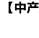

## 【中产到底是啥】

一般人的脑中浮现的画面，定是美帝大流氓家的中产，开着小汽车住着小洋楼刷着信用卡没事度

个假。剩下就是周一到周五工作和家长里短填充，周末资本主义花花世界填充。

为啥脑子会浮现这个画面，三眼讲《改变40年》里说过，因为我们就是老美的翻版！

从产业到金融，从科技山寨到生活居（衣食住行娱乐）山寨，除了zheng治，剩下基本照模子复制！

什么叫特色？就是内核上要延续法家，但具体发展层要无死角山寨西学！

分析具体层要从内核出发，也就是每个大组织的底层逻辑，也就是所谓体制出发，比如我们复刻世界老大加杠杆做信贷搞地产，明显看着一样，区别在于一个老美玩税，我们玩产权分离。这啥决定的？是法家经济思想内核决定的！参见《经济第一讲》！

看中产阶级也是如此！

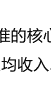

## 【幻象】

为了把中产群做大，会有一个标准作参考，标准的核心就是收入。小白兔们到了5302喜洋洋的看着工资流水，人均收入2万刀以上，骄傲的扬起中产的脸庞！

事实呢？这只是个幻象！

所谓收入这东西只是个数字，数字并不是真实的，比较才会真实；
纵向的比较在时间轴上，拉长看一看；
横向的比较在空间轴上，和 externo 对比看一看。

以2020为坐标，往前数15年，那时候的青壮年们，看今天的收入水平，已经达到三分之二的中产群了啊。现在白领一年的房租，就抵得上15年前青壮年一年的收入，甚至还要多很多。

以货币为坐标，空间上与外面对比看一看，此2万刀并不是真的2万刀！
在《经济第一讲》里讲过，经济是水，钱就是水流，大组织内用法家，外用西学，汇率是个分界线，玩的是内外两桶水，外面地界面控汇率，上下浮动汇率制（基本等于不浮动），在里面可以随意修水。

水要看浓度的，外面2万刀可能够首付买个房，买个小汽车，或者来一套欧洲自由行，里面的2万刀可能只能够一年房租的。

## 【铁打营盘流水的兵】

那为何还要打造5302庞大的2万刀群体呢？
这是因为，只有高物价、高收入才是达到发达社会的目标，高物价高收入也是强国绵亨弱国的核心手法。
所以5302现代化最后一条，是实现货币国际化，与外面各个大组织的水流接上了，才能调控浓度欺负人嘛。
这个暂且不谈，单写一篇，本篇主讲如何“吃掉”一个中产。

那么在“内法家外西学”的大规则下，到底什么是中产？
中产就是一个动态，并不是真的有“产”，也可以说叫“铁打的营盘流水的兵”！

经济是什么，是流通，水流下去，价值流上来，体量大+流的快就是经济好！

中产就是流动的载体，铁打的营盘就是规则——分配给你点什么，然后再收回来，大头大组织拿，小头留给你们互相吸（一般人的创富思维都red在这里层面）。
再比如农民群体，分配给你点什么，也就是联产承包和减免税，但农产品价格是大组织控制得死死的，也就是最后能得到多少，是可调的，会在一个均线上浮动，如果遇到好时景个体留下的东西多了，会再另加管道吸回来，比如大约在10年前吧比较火的3d彩票——“3d3d卖房卖地”！
这条均线的调控，会使得农村经济活力起不来，可消费的少了，自然水流不快。

中产和农民其实本质上是一样的，就是水流过一遍，都剥剩下了，剩下的只有感觉和享受的过程。

往前数40年，混的比较好的工薪层，就是吃大锅饭的工人和企事业单位，也就是拿着城镇户口的人，城镇户口=安稳就世与生活保障，
广义上讲，这就是那时代的中产，也是铁打营盘流水的兵，水流过一遍剥下来了？
房子是分的，不使你的，家里家具是厂子同志们互相敲打出来的，结婚的“四大件”留到现在只能当废铁卖，攒了1000元到现在吃顿大餐就没了。
能“攒”下来的是什么，是回忆，是当时的享受，当时的优越性。
所以，中产就是脑子里幻象，是现实中流水的载体。

## 【分食】

所以擒大一块肉，大家分食，水就流起来了！流得越快+体量越大=迈向发达！

进入本章主旨，如果站在生意角度，怎么分食一杯羹呢？
听着很冷血，但这就是现实生活。做生意、创业、阶层逆袭，就是这样的现实。
生意是干嘛的？创业第一步思考的是啥？

## 1. 吃谁？

也就是说吸谁的钱，赚谁的钱，戳起自己腰包！（商人就是这么奸诈！）
前面分析一堆，说的就是这个。

## 2. 如何吃得多？

那要搞清楚几个问题：

- 都谁在吃？
- 吃了分别是多少？
- 一个中产收入和支出的模式是什么样的？
- 哪里的现金流是怎么结构？
- 留给你吃的是多少？

这个思考在西方营销学里，叫做消费能力分析！
看，列强的词汇就这么温和！

前面说了，分配给中产什么，再吸回来，大组织拿大头，剩下互相吸。
未楽很可能是这么组合的，三眼睫猜哈！

1）税上添加会越来越大，除了喜闻乐见的个税和各种金之外，得给地方政府卖地模式给断了，毕竞紧急风险，卖地模式走得差不多了，还能持续一 Pacheco但走不远！但是不卖地哪有稳定收入啊？
怎么给企事业单位发工资，怎么搞建设呢？
换套稳定的，房产税+房租。把有房的和没房的都插上管子。
但这有一个前提要实现，就是房屋总量+房租坚断。只有坚断才能稳定。仔细回想40年以前。
插一句：傻空人就是没脑子的一群人，税这个东西，向来都是向下转嫁的，房产税最后一定转嫁到租房子群躯身上。典型被aux还尔呵呵替别人人数钱。

## 怎么垄断呢？

一是在商品房层，剔除掉小鱼小虾，也就是过去掺和在一起跟着喝汤的民营开发商，这是现在正在发生的，死掉的中小开发商会越来越多，最后一级市场（土地市场）和二级市场（商品房市场）都掌握在国家队手里。

二是给存量房打板子！因为二手房除了某些财团和企业囤积的外，都在百姓手里，所以要打板子，现在正在打！在交易流通、二套房、投资客炒房客身上打板子！可控也等同于垄断，因为其anagers实不能自由流通的。

建设大量公租房，在卖房时就会要求开发商配套建设一定比例的经适、廉租、公租房，然而羊毛出在羊身上，经适房可以不赚钱，但租的东西短期看来只见投入不见产出的，开发商可没耐心收租子，所以建设成本会加到商品房上。

剔除掉小鱼小虾，把开发环节的肉都留给国家队，那么国家队也有义务投身到公租房建设中来。在未来，真正可投资可持有的商品房，会逐渐集中到精英层手里。对于广大中产和低产，房子可以买不起，但不能租不起，农产品价格要一直牢牢控住，这两种就是未来的吃飯问题，这涉及到稳定团结。

这真是一箭三雕，不！是一箭好几雕的大智慧啊：
地产风险变得完全可控，地方zf解决了长期现金流，肥肉也都归了国家队，更有责任义务帮地方zf的长期现金流洐出房子，房产税也收了，海量僵空左手交更多租子，右手拍手叫好，画而其乐融融！

在税上，只说房产税就行了，其它交易税、车船税就不说了，根据个体家庭情况而定了。

+   2) 教育医疗产业化会更深入。
这个没法具体说清路径，因为这是非标品。
看得见的东西是标准化商品，看不见的是非标品，也就是价格机制没法衡鼡，看个感冒收50跟500都行，上个学1万和10万都行。

+   3) 物价

这才是核心，普通人能吃到肉的地方！
收入涨，物价必涨，这是有点比例的，但估计还没人敢研究出个模型发出来。暂且不提！
物价其实简单一句话：服务业非标品是吃肉大方向！

“吃掉”中产，说白了就是你拿个东西跟他能换多少钱，成本越低换的越多，面越广，自然就

越吃得多啊！这就是喜闻乐见的“消费升级”一词。消费升级逻辑参见《改开40年》里消费升级段落。

标准化产品在经济发展中，一定是相对价格越来越低的，20年前买个大彩电要几千元，一个家庭几个月甚至一年的积蓄，现在买一台用不上半个月工资。

消费的升级除了科技升级（一堆沙子+铁皮承载价值更大价格更高）外，只能是服务业非标品了。这也是现在就开始提前吹风“大力发展服务业”的道理所在。

## 3. 怎么吃？

也就是一个中产，怎么能逼得已的、或者快快乐乐的被吃掉呢？
这在西方营销学里叫消费态度分析，又是列强的一个温和词汇！

逼得已这块，主要是教育、医疗与理财投资，这是未来中产层最核心的“态度”所在，健康问题、教育成长问题和钱生钱的贪欲问题，还有一个就是养老问题！

话说这三个管道都是体制内玩的，作为创食的生意人，所要做的就是尽量把自己的服务类商品，往这三条管道上靠拢，在分配环节占据越往上，就分配的越多，一旦占上位，持续稳定分配个几十年不成问题！具体操作各自发挥！

快快乐乐这块就比较复杂了，需要你画出一幅中产的“大脑认知图”，因为服务业非标品的价格制定不是看你的东西具体值多少（成本和实际价值），而是在中产心理值多少。这就需要把中产的感觉画出来。
而套路无外乎收智商税和赚模仿的钱，参见三眼的《赚钱三套路》！

精选留言

暂无...

## 读懂改开40年三大阶段！才可看清你在这个时代的位置！以至未来！（7600字）

原创 第三只眼观 第三只眼观 2020-02-04 原文

收录于话题
#大社团
36个

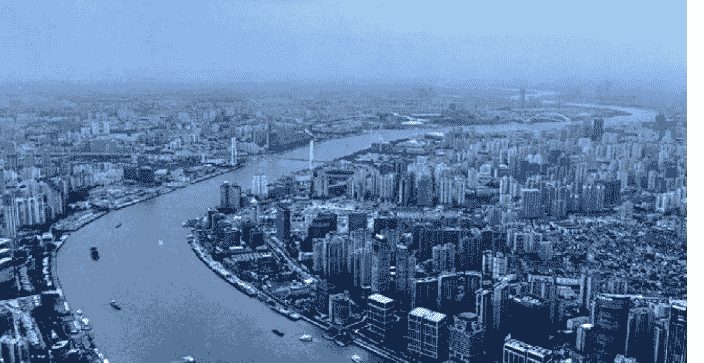

这篇写的有点累，一下午加熬夜，7000多字，我耐心写诸位耐心看！
三眼的东西每篇都好几千字，其实每篇都可以切割成10篇以上，但那不是三眼性格啊！
因为把复杂的东西简化传达，整体逻辑就至关重要，逻辑断了认知不成体系的。

昨天私信有同志问：

> 老师，您好！假期一直在看您写的文章。我想问老师的是：中国历史上的朝代更替，用老师的五大认知体系是如何契合解释？谢谢您。

这个问题虽然很大，因为它不是一个问题，是n个问题，但很好的反应了背后的提问逻辑，就是怎么从历史得到认知的落地，从而研判未来！

### 【知古通今的内在逻辑】

首先说为何是n个大问题，因为历代更迭首先包含制度的更迭，奴隶制、封建制、集权制以及“主权制”（100多年前民主曾经冒出来一段时间）等等，再就就是我们的历史是一个不断包容的过程，很多朝代都是少数民族融入，唐、金、元、清，是一个游猎、游牧、农耕融合在一起的过程。所以没法一次性给出逻辑。

但三眼说的是，不管形式上怎么变，也就是不管哪朝哪代，都有一条主线是永远没变的，就是任何朝代最后都归于中华文化，也就是归于道儒法，也就是说2000多年前的思想一直活着，并且不断演化，形成了今天的整个亚洲文化圈层，这就是思想的生命力！

政治经济社会自我人性的五大认知都是来自于此！

观古才可知今，底层的逻辑几千年以来没变过，政治的规则、社会的结构安排和运转的核心是互通的！

而经济呢？

三眼说过，经济是政治的延伸，是政治分配的具体实现，所以内核也是相通的！
但是也有差别，差别在哪？

一是科技的发展，生产力的提高，因为这个是不受大组织左右的——治政权谋玩的再高明，也不可能把沙子变芯片！

比如清朝其实是中华文化的运用推向极致的一个时期，如果没有科技拉开东西方差距，清会一直延续下去，别不信，更不要道听途说那些垃圾信息，因为多数人并不了解清朝，满人玩汉学甚至玩出了几千年来的新高度！

但科技来了，就像《三体》里讲的，是高维度对低维度的打击，根本无力还击！

二是全球化，因为已不是我们关起来自己玩的时候了，咱们的规则要和外面连接起来才行，人家牛，在某些地方就要遵守人家的规则。所以之前文章讲的“内用法家，外用西学”就是这个道理。

科技是维度的提升，全球化是规则的融合！

老美为啥这么重视科技，科技是老美的核心，科技强军、武力强文，而经济就是分配的具体运行。

所以老美在不断提升科技维度的基础上只干三件事：

- 1、没事拉航母溜达，不服就打一架，这是强武和耀武；
- 2、向全世界搞文化入侵，本来一个没有历史文化的国家，硬是打造出来一种新文化，三眼以前文章讲过，文化入侵就是价值观、神话故事、器物载体、礼仪、语言的入侵，价值观就是普及美国梦和民主，各种科幻英雄就是新的神话等，不用多说，打开手机和电视机都是这些玩意！三眼讲了，大家就明白了，不讲，天天看就习惯了；
- 3、经济上就是维护好美元的国际硬通货地位，向全世界收取“铸币税”。

回到本文的主旨，改开40年历程！
前面讲的是原理铺垫，聪明的同志一下就明白了：
**改开40年就围绕两条主线！一是科技二是开放。**

看清了40年历程，自然诸多问题都会清晰破解：
为什么人民币要国际化？
为什么产业升级这么难？
我们的软肋在？
我们的优势在？
我们的今天的一二线城市结构是怎么来的？
人口为何沿海和三大城市圈往迁？
……
缩小至个体层！
为什么现在创业难？
为什么房子这么贵？
为什么就业越来越低迷了？
为什么富的人越来越富，穷的越来越困窘？
干啥行业能靠谱发育？
怎么能跑的快？
物质生活标准是怎么一步步变化的？
这些庸俗性（实用性）问题，才是我们这些小民所关心的！

### 【时间思维的“前后眼”和空间思维的“不健全”】

人有空间思维和时间思维，多数人都是空间思维，也就是只会观察和思考当下的、在视野内的东西——应当下视野所见到来判断一切！
时间思维很稀有，也就是佛家讲“前眼看因后眼看果”，通过拉长时间线来观察来龙，而得到去脉，也就是趋势判断——由动态发展观看判断一切！

只有空间思维的人，自己20年前的事情都会不记得，严格来说这是“不健全”的，不健全如果加之人性漏洞就会产生两结果：

一种是对生活极度不满，总想“重来一次”分田地，唱空大组织喊社会的就是这种；

另一种是乖乖宝，一句话在他耳边念一百遍，铁信无疑，不是被洗脑就是在将被洗脑的路上。

“不健全”的人能占到95%，这不是三眼小看人，这是很客观的事实，不用把人想的太复杂。

关注三眼的同志们。不用想质量肯定很高，最少1个顶10个，不光是在思考上，更是在求真务实的态度上，外面那么多“不健全”的，想想是不是很搞笑？生活还怕啥？提提认知、丢点套路不是远远超过试吗！慢慢来，悟、啥、谋都要有，德智体美劳全面发展！

为啥三眼想到这？因为今个点开评论看看，很多事情不用我说志同道合的自然就懂！

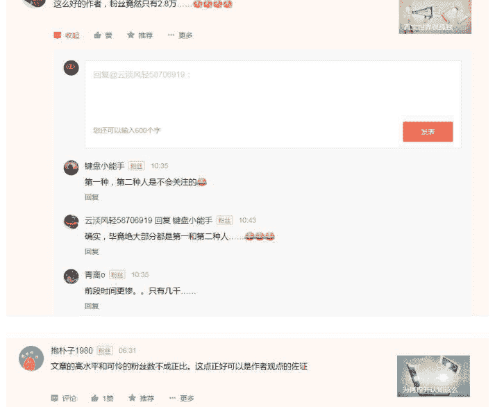

经济和个体发展的很多问题是空间思维解释不了的！今天冒出个专家说人口红利，一窝蜂把问题归到人口红利，明天冒出个专家说营商环境，一窝蜂把问题都归到营商环境。典型的“不健全”空间思维——只当下视野所见到来判断断下！

### 【“两口子”的甜蜜和撕破脸】

没有改开就没有今天的商业社会环境，小民思考财富的机会都不会有。

熟悉三眼读过文章的朋友们应该知道，我们所面对的问题，都是在大规则影响下产生的！

而这个影响的过程，同志们就想象成中美两口子过家家的过程就很好理解。
当然，不要太认真，因为很多东西不能太细说，时段段上拧、合作起点拧、具体事件拧，那就成报告了。
搞清楚两口子甜蜜过家家到今天互相撕脸，就能解答以上诸多为什么！

为啥是中美过家家？
因为开篇讲了，科技和开放！
科技这条线我们就是老美的复制版，老美走两步，我们走一步，步伐紧跟，山寨之王！
开放呢？谁把我们拴到全球贸易规则里玩耍的？
还有，人才呢？华侨！远的不说，近的诸位自己想想，科技上牵头的大多数都有个留学经历吧？

再过去的100年里，是一个东方不亮西方亮的时期，人家亮就要学，日本号称西化，把自己归到西方世界里。
但实际上，学的最彻底是咱们！不能说百分百，但也能达到个80%了。
跟谁学？肯定是维护世界和平的老大家！
从产业到金融，从科技山寨到生活层（衣食住行娱乐）山寨，除了政治，剩下基本照模子复制！

什么叫特色？就是内核上要延绵法家，具体发展层要无死角山寨！

### 【三个阶段】

1972年访华，相亲开始，
老大有什么？有科技有武器有产业，大户人家！
我们有什么？啥都没有，除了人！

“不健全”的人肯定出来喷我：“人口是我们的巨大负担，发展的巨大阻碍，养活这么多人多不容易，你居然还说是资源！”——这就是典型的过度洗脑。

整个社会的价值创造与分配，都是通过劳动力来完成的，富不富一要看能不能给足刺激，也就是提高劳动效率，这个要靠管理和科技；
二看能不能把价值集中到上层，刺激越足就越增产，增产完事就开割，割得越干净，自然大组织更富强，割完一轮养一养，继续下一轮。
看过去40年，我们的发展就是靠堆起来的！

把过程分三个阶段：

### 第一阶段：40年之前是一大段；

除了100多年前冒出过一段民主不了之后，40年前之前往前数，2000多年差不多，无法细说需自修；
然后总设计师改开计划开始！这是几千年来所未有，现在的孩子基本不会明白的，奇迹就这么开始了！
说到这里很激动，因为这真的是奇迹，是世界的奇迹，是几千年来的奇迹呀！
什么叫奇迹？什么叫伟大？就是“求真务实求变”六个字！
隔离啊三人口多不多？不会求变吗！
隔离棒子倭国为何先起来？因为瞧着啊！
奇迹就是不屈不挠，在低维度严重落后的境况下，在最短的时间内重新站起来！
所以不学无术“不健全”的人很难以理解，抗美援朝是多么关键，而几十年就走完西方200多年的历程是多么的惊人！

坚持党的基本路线一百年不动摇

### 第二阶段：改开的前30年；

这就是“猫鼠”论的阶段，因为科技太low，靠人堆，“摸石头”过河，低调发育期！

### 第三阶段：近10年。

“河”基本过去了，过了河了、维度上去了，那就要琢磨着重新坐下来聊一聊，在国际分配链上动一动，这才有了“两口子”为何互相撕脸，才有了中国梦！

### 第一阶段

那时候大锅饭今天的孩子没经历过，自然不会明白，但明白两个关键点即可。

- 1、农本。

造富就要干，干啥？我们不缺人，精神刺激给足了，农业就增产，这东西就靠体力即可，但工业生产可不是拼体力的，这东西要靠技术经验的，但这事当时都“摸着过河”，以体力的方式去干
脑力活，这也奠定了改开的初始，跟外面换东西换技术主要靠农产品和低技术鞋袜等；也留下个后遗症，就是大幅跃进抛出一大堆破烂钢铁工业品，自己用不住，外面卖不出。

- 2. 积极性。

积极性东西取决于私有物多寡，大锅饭一起创食积极性肯定不高，干多干少结果都一样，那还费劲哈？

资本主义一定要萌芽的，这就有了联产承包一直至今，于充自己剩个瓜俩秤表，积极性大幡提高！

多说一句，其实剩下多少都是调控的、可控的。因为农产品价格定价权是年年控制的，粮食最后都会回归到根库统一管控的。

所以三眼说，钱是分配来的，不是赚来的，...

有了农本有了积极性，是远远不够的，导致多说比村民高端能多吃两桶水果罐头。要发展！

### 插播历史：

商鞅当年有一个方法“利出一孔”。就是往死里打击工商，把所有人都集中到农业上来，堵塞所有非农业提升经济的路子，这叫农战！工业照打不误，是因为当时还没有所谓科技，工业也就是剪刀手钝刀水平；

管仲提出“轻重之法”，也就是在通过大组织强暴力大量控制粮食价格和货币流通，把“农战”之广大农民的获利途径充分掌控在手，这就是所谓“夺、予”之术！

商鞅把它再搞具体点，也就是在执行严，严禁私人买卖粮食，禁止农民迁徙。

是不是有一种穿越剧的感觉？“内用法家外用西学” 历史认识落地！

再讲一个核心点，其实现在的商业，在表面上是商业，但原理论上属于农业，“治法”相通！国央企和民营是分开的，分的是什么？税收和资源！民企的主要功能是探路、养人（就业）以及做好“缓冲带”！

### 第二阶段

实现发展就要加足马力搞生产，搞生产是啥？
就是地里则食用的铁棍根皮胶，加工一下变电视机，这不就创造财富了吗！
列强的科技才是本啊！

但在前30年初期期，一是没科技来生产，二是也没人会生产。
这人力分两种，一种是单纯体力劳动力，下地能插水稻，进厂了能敲螺丝钉；第二种是不用管自己发育的，也就是脑力劳动者，这才是引领生产发展的最前端，脑力劳动者不用刺激，自己就琢磨出一个新花样，比如乔布斯搞出个苹果，手机都变成滑屏...
头模样。
为啥李宏玄总被减？麻花藤总低调？就是因为脑力活用体力的干法，钱赚了，力没出！

插播一下什么叫企业家的责任？

就是既然集中了社会大量财富交给你管理，就有责任和义务率头搞发展，带动社会前进！
因为财富按照个人劳动价值估算，人和人差不了多少，企业家拥有巨量财富，是社会分配给的，拿钱就要出力才是最根本义务！
所以看三眼的东西，出去贿人也是有逻辑的！
再遇到“酸什么！人家的钱自己爱干啥就干啥”这种心智和认知都极为“不健全”的人，就这么喷他！

我们最缺的就是脑力劳动，一直到今天，现在也一样一样的！
这是由大规则“内法家”决定的，因为想象力思考力是脑力的内核，这东西从小就割掉。
但靠不了靠钱多就能办到的事，我们是地球no.1，所以号称基建狂魔。
靠想象力能到的事，往往扛站！

冰箱彩电小汽车，这都是人玩家剩下的了，科技引领已更新规则，去年的芯片制裁就是这个意思，不给发贷款了“机器大脑”，机器就生产不出来了。
这事不用多说，看着富豪榜就知道了，地产当先，金融开道，还有一堆酿酒的、搞电器的、搞垄断资源的。
说实话，这些东西只要会投胎或者娶妈妈娶得好，你进去了你也能干明白！
创食小民在底层啃着时间久了，总以为“成功人士”很高级，其实都一样。

在第二阶段有几个关键点记住即可：

### 1、沿海繁荣

为啥？与外而连接，交通最方便最直接成本也最低，一是东部沿海，二就是在最南面画圈，大批
青壮年劳动力泥地里出来，往这俩地方涌入，进入各种流水线，流水线哪来的？后面说。
这也就形成今天三大城市群的历史积淀。
其实现格意义上讲，只有两大城市群，珠三角和长三角，因为这俩是实打实的n个城市连在一起，同时发展；
京津冀城市群太虚，都没法分析，三眼觉得这就是个概念而已，落地比较困难。

### 2、纺织女工和血汗工厂。

今天的富裕，是靠海量女工男工创造的，做人不能忘本。

### 3、招商引资

前面说了，第一阶段里，体力的方式搞脑力活，搞出海量废铜烂铁工业品，自己用不住，外面卖不掉，就好比现在谁会买三胖子造的汽车电珢呀？还是得靠资本主义流水线。怎么办？
招商引资！

其本质是啥？就是外面的有技术有流水线有管理经验，我有海量的人指哪打哪，一结合，巨大价值产出！而后分一分！
这里多说一句，万事开头难，招商引资流水线起先西洋并不买账，这就是弯弯和香港发挥巨大作用的时刻，为啥留言南港不着急解放？就是为了这一步损失基础！而后就是倭国，像现在很多经济管理司汇都是来自于倭国。也就是说初期的引资都是台资和港资，用的流水线也都是跟倭国复制的。
回忆一下过去跑商场买大电视，国产在左倭国在右，左面复制右各，主要就这俩阵营。
再想一下，来自弯弯的富士康现在依然是流水线巨无霸。这都是有历史基础的！

### 4、出口

这个世界和谁玩能玩的大？进步的快？
肯稳定和维护世界和平的老大嘛！
要发展就要三驾马车飞起来，投资出口和消费。
投资不用说，招商引资大家一起分即可；出口和消费呢？

所以我们的出口和创汇，都是靠低价值商品一点点换回来的。

### 5、消费

什么叫经济好？就是有活力！啥叫活力，不光要体量大，更要流动速度快！
搞一堆房子，体量是很大，但流通起来费劲，这就缺乏经济活力。活力这东西还要归到消费上。
消费的过程是一个价值循环的过程，联产责任承包了，海量泥地劳力涌入沿海了，这是一个个体用劳动力价值不断积累丰富的过程，积累了就要给出口消费掉，再积累再消费掉，这个循环速度快，就是活力！

所以消费是要一步步升级的，消费的升级是要靠科技的，也就是商品档次越来越高，招商引资合伙伙逐渐提高了科技力，消费也得跟着模仿复制！

老四大件（缝纫机、手表、自行车、收音机）到新四大件（彩电冰箱洗衣机录音机），再到小汽车、手机、电脑。循环着一步步抽空钱包，实在没法升级怎么办？
别怕，有老大可以模仿，地产呀！“六色钱包”继续饱！

当物质商品层升级不上去，就要在金融层和服务层上升级。

一产二产三产是有阶梯的，不是平层的！

这些东西都是明面上的，在消费这架马车上，还有两大管道被忽视的：

教育和医疗市场化！

其实消费划分成两大块，那些新旧四大件和科技类产品是一大块，而地产应该与教育和医疗放在一起是另一大块，但因为地产与第一大块的消费品一样，摸得着看得见，而教育医疗是看不见的，很模糊。

看得见的东西是标准化商品，看不见的是非标品，也就是价格机制没法衡量，看个感冒收50跟500都行，上个学花1万和10万都行，说不明白。

多数人的创业思维，就是一开篇就是那一堆问题，都是围绕着标品，到非标品领域就懵了，一是因为标品有迹可循，容易入手，二是因为非标品都是要有资源关系，或者极度考验认知力的，普通人力所不及。

### 第三阶段

腾笼换鸟！一盘大棋刚刚开始！

“河”基本算过去了，“石头”摸得也差不多了，基本都摸了一遍了！
外面有的，我们都有了！
而且更重要的一点，我们的体量上去了，虽然质量跟老大差距点，但体量在那里摆着呢。
世界经济发展到全球化的今天，大家都明白一个道理：

能种出来多少庄家，要看土地大不大，肥不肥沃！

我们有什么？
巨大的体量背后是世界第一大市场！够大了吧？
二就是在《如何“吃掉”中产》里说的，2035打造三分之二人口体量的中产阶级！够肥沃了吧？
“少壮不努力一生在内地”这句话现在应该倒过来说了！三十年前拼命跑出去的人，现在不都偷摸的回来了吗，用脚投票才是最真实的一面！

所以诸位同志一定要乐观，三眼以前在文章里说过：这是最好的时代！

在平素我们见到的诸多信息中，也能反映出来乐观的一面。
比如键盘喷子怎么喷？当然是拿我们跟老大比，来敲长短比较啊！
但想一想，为何不跟虏国比了？为何不跟八国比了？
再就是，唱空的为却都是内部喷子，唱多反而是国外的经济学家，因为明眼人能看见底层逻辑，又大又肥沃的土壤摆在那，傻空是看不懂的！

所以“河”过去了，腰杆子拿了，底盘稳了，咋办？重新坐下来聊一聊！

社会小群体、大组织、国与国之间，原理是一样的，都是分配链！大家都是想往链条顶层占。
无外乎围绕金融、科技、资源（自然资源和人力资源）这几块，展开国际分工。
混的差的就是在国际分工上提供原材料、资源和人力，卖油卖矿接着人家高污染工业；混的中间的就是卖技术，混的最好的当然是金融收割啊，印票子就能收割。

所以就要“深化开放”，特斯拉进来、金融放开，因为要出去就要先接轨，就要倒逼改革，不能有“过河”时期的惯性了，要玩更高级的了！
所以就要有科创板，也到了做好环境保护的时候了，所以就要“金山银山不如绿水青山”，所以就要货币国际化。

纵观改开40年，才能把现在的一些词都连上！

# 此次疫情，诸位收获是什么？

总有私人问三眼疫情有啥影响，里面有什么道道等，三眼想说的是，这都上升到“一级”的程度了，是老百姓能猜的吗？事情的真实现在上层都清楚，只是哪些说哪些不说的问题，不是小小个体能分析出来的，因为在信息上有看着极大的不对称性。

影响是什么？能判断吗？
一个月过去？两个月？半年？严重性都是不一样的！半年的严重性想一般人是想象不到的！
是蝇蠓还是人造，这都跟个体没啥关系！老实在家呆着不给社会添麻烦就行了！

回到本篇主旨上来，如果说收获，就是从此次的整体调度，医院建设等层面，给诸位展示了什么叫做“集中力量办大事”的功夫！

有“集中力量办大事”的功夫，才能“下一盘大棋”！

城镇化抢人抢地抢人流线流的大违征、土地全盘制权都是在为集中力量打基础，只有更大的人力物力资源力的协同，才能办更大的事，下更大的棋，你我个体升斗小民都是大棋的小细胞，人生活得好就看谁跟得上步伐。

40年前ster才能够换新衣裳，吃顿饺子，今天呢？

在未来科技股肯定是有大机会的，因为这是一个确定性的必须要搞的，这是历史时点推动所致。
看风险偏好，三眼是不建议一般人玩的；
毕业的孩子尽量去金融业吧，未来搞金融的抢着要，涨收入也是第一轮涨；
没技术又不想冒险，年岁所致不能重新来过弃向金融金光大道的同志，研究研究服务业吧；
想安稳又轻松又不冒险的，手头又有产的，把三四五六七八线的不动产能卖就卖吧，去一线和强二线搞房子出租吧。
以上都属于投机，或能拿钱出来，或能拿时间（选择权）出来，如果都拿不出来，那三眼也没啥具体建议，个体具体情况具体体，只好说好好学习吧！

精选留言

暂无...

# 人性-漏洞 | 人类有两套判断是非的标准，决定人思想的深刻与浅薄！

原创 第三只眼观 第三只眼观 2020-02-05 原文

人思想的强大来自于认知力，认知力来自于洞察力，而拥有洞察力只需做到不“一叶障目”！
佛家的说法印手势早已告诉众生，只要不一叶障目就“OK”了！

刚出生的孩子，双眼还未睁开，他的心是赤红的，所以叫“赤子之心”！
面对这个世界的无数幻影，潮起潮落是非非，人与人智慧的起点是一样的。
而后天产生巨大差距，是因多数人都蒙蔽了自己的双眼，失去观看和洞察这个世界最基本的功能。
失去功能就看不清，就随波逐流，只能做棋子；

而人看待世界的时候，区别于动物的地方，就在于拥有是非观。价值观、世界观、人生观都由此展开。

是非观就是人怎么看待世界！
而人看到什么，就会考虑到什么，在这个过程中，思想的深刻与浅薄拉开差距。

浅薄的人是“视而不见”，就算看见了，他也不以为然；
深刻的人是“不视而见”，哪怕眼睛看不到，但也能感受得到。

为什么？

# 【两个基点】

因为人类观看世界的时候，用两个基点，也就是角度：

# 1. 以“我认为”为基点

这就是古人讲的“一叶障目”！
比如一个社会公共事件，满网的评论99.99999%都是“我认为”。
全都是垃圾信息流。

“我认为”源自于哪？

一是源自于所处的原生家庭和社会环境；

例如士、农工商三个环境，士人和商人圈子一般来说会觉得“明奉阳违”是正确的，再正常不过，但工农会鄙视之；而工农圈子会觉得“仗义”是正确的，但士商会鄙视之。

站在工农的角度就会有“仗义每多屠狗辈，负心多是读书人”的谚语；
而站在士商角度就会有“学而优则仕”等谚语。

多说一句，其实社会在这个角度可以分两大块，一块叫朝野，也就是士商圈，多认利益少认情感；另一块叫市井，也就是所谓“江湖”，多认情感少认利益。当然，两个意识形态也在逐步进化。

# 二是“我认为”源自于人本性。

也就是说人在潜意识上都认为自身是正确的，他人不同于自己的意见都是相斥的，因为这源于人“驱利”的本性，都以自身的利益为出发点。

情绪就是这么来的，只要外界讲的观念对其利益有触犯，那么外界的观念就是错的，这就是情绪的来源！

弱者都会把自己裹挟在情绪里，因为“一叶障目”自然办不成事！

比如典型的女人在Viet 越案例：

> “我为你付出了那么多感情，你居然不喜欢我，你就是坏人！” ——典型的“我想要你不给，那么你就是错的”这一情绪。

人人生来，都遵循人本性，思维出发点都是“我以为”，所以人想要变得强大而深刻，就一定要“反人性”！

# 2. 以“存在”为基点

这种思维就是反人性思维，因为要“无我”，也就是忘掉自身的角度，把自身弃之于外界环境，用第三只眼的角度去观察。

在这种角度下，好的一面是能够客观的分析环境，从而不断接近事物的真相，但也有坏的一面，是非变没了“标准”了！

就好比针对前面讲的士商与工农的角度差别，是你的话，你怎么看？
这个问题想必位同志会有n个看法。

哪个是对的？
怎么办？

怎么办很简单，就是按照自己的利益去做。

同样是归于到自身利益，但和“我认为”那种浅薄的归于利益不一样的！
因为这种方法Fun是“无我”，也就是不掺杂利益，分析后第一圈回到利益上来。

说出来是不是觉得很简单？
但做起来无比难！
这就是人人和思想差距的起点，就这么一点点形成差距的，就像小溪逐渐汇聚成江海。

任何人的利益获取都要依赖集体，这个三眼别的文章讲过；
当归于到利益的原点后，你的眼睛已经不被“一叶障目”，因为能够以“存在”为基点去观察，自然能看到每一个集体的“存在”。这个“存在”就是就能够看清每一个集体的“合规与不合规”！

这就是人性所导致的，任何集体或害事物都有“潜规则”的一面和“显规则”的一面。

举个大层面，比如全人类层面，杀牛宰羊很残忍，但上了桌面对牛羊肉大家都很开心，这就叫人类这个大集体的“合规”，很客观，无须道德感；
而一个人非要去捕杀野生动物，屠戮并吃掉，这就是残忍，人人得而诛之，因为这个“不合规”。

举个中间层面，比如混guan场的，你不tan东西这就不合规，自打有人社会开始，全世界的政治都解决不了这个问题，fu败问题是全社会大组织的运行问题，诺贝尔奖得主加在一起也解决不了了。但是要在一个正在成长的股份有限公司里，一个人这么搞，那就“不合规”，人人得而诛之。

举个小层面的，比如一个人有喜事请客，不收礼份子就显得“不合规”，是不是不收钱就叫好，很可能招来无数批判。

因为人性在变，道德标准在变，利益交涉在变，“合不合规”也在慢慢变化。
比如结婚男方到底给不给彩礼？
这东西出现没多少年！

总结一下就是：
是非观源自原生家庭、所处环境的熏陶和自我人性使然；
是非观产生了“合规与不合规”；
人在集体中活着，
一是要学会反人性思维，用“存在”的角度去思考事物；
二是当思考明确落实到执行层时候，要以利益为出发点，而以利益为出发点就要看清集体性的“合规与不合规”。

像不像一个圈？人性就这么好玩，我们都在这个游戏里。

# 精选留言

暂无...

# 自我-觉醒 | 你活一辈子想撇下啥？想通此问题，既能看到商机，又能让自我觉悟！

原创 第三只眼观 第三只眼观 2020-02-05 原文

人活着都是要努力的，但努力是为了个啥？
或者说，努力到最后，能撇下个啥？

不要小看这个问题，无论哪个时代包括现在，明白这个问题才是一个人真正得到觉悟，驶向独立自由的起点！

# 【意识形态】

“备周则意急，常见则不疑”——三十六计之瞒天过海！

我们都对平常皆可看到的事物产生思想的懒怠，因为准备太周详了，不会发出疑问，更不会深入思考，而真正有用的“几点”，也就是关键道理，都是在这些最普通不过的东西上。

诸位有心人打开手机看一看，整个社会的信息流，除了非常专业的应用知识外，剩几几乎都是围绕“获得个啥”。

媒体信息80%都在“金钱”和“情感”上，因为这是人们想获取所有东西的两个内核。

金钱可以得到物质上的安全感，情感可以得到精神上的安全感。当安全感十足，就会饱暖而思淫欲，产生对物质扭曲的欲欲和对情感更高的要求，炫耀、攀比自然就会产生。

+ 以至两个结果：
一是在物质上都想快速致富，浮躁与焦虑；
二是在精神上，对情感的要求越来越高，结婚率必然逐年下降，离婚了连年上涨！
三是在行为上，拿起手机看看信息流，各种炫耀充斥。

# 这就是我们今天社会的意识形态！

钱的流动是跟着需求走的，需求来自意识形态。
创业搞项目的记住这个心法即可！

所以赚快钱，除了“刚需”垄断的资源行业外（加个油充个电话费等那些，因为这些不需要动脑子，人人都需要，所以要垄断），剩下都是围绕社会意识形态，也就是“怎么赚更多的钱”和“怎么获得更好的情感”。

所以什么理财p2p。什么各种打着创业旗号的赚钱培训、什么情感咨询，最吸人眼球也最容易让人上当而自愿拿出兜里钱，再落地开展就是各种辅导、自我管理以及各种美容整形、健身等等乱

七八赠的。

参两大现象，一个是成功学导师薅灭一批，再换个花样嘛起来一批；另一个是某某女郎花100万整形成个鬼样子还乐此不疲。

# 几乎智商税收的都是想快速致富和情感高要求的钱。

垄断的那些东西，大规则上属于“朝野”；思想形态这些，多见于“市井”。

而卓民创办所创创业，基本统统在“市井”这个圈子里转悠，所以：

# 任何需求不能看表面，要看它们背后的意识形态！判断趋势就要关注意识形态！

A先生创业赚饭饭，关注什么水电租金工资等若干现象，在混乱的信息流里获取一些假大空的知识作为致命稻草；

B先生创业赚饭饭，关注社会意识形态走势，挖掘表象背后最本质的需求，自然获得“确定性趋势”。

A和B谁有大概率力成事呢？

沿着这个路径继续落地，怎么样加大成事的概率呢？

# 那就要在意识形态层面落实到生活方式层面。

把你选定的目标人群的，也就是要赚谁的钱，了解了他们的意识形态，再在他们生活上深入了解，画出一个轨迹——意识形态显现在具体生活上是什么样？

而后见缝插针！针就是商品或服务。

整形换了什么新花样？成功学大师们聊的新套路？健身房开始招聘女教练？等等这些...

# 创新无外乎是意识形态在生活方式上的新套路、新花样、新玩法。

玩过两三年、三年五年的，再换个花样，被收税的开心开心，茶余饭后聊闲天有了新内容，收税的你乐此不疲，累子哗啦进！

# 【幻象】

从上面我们看到什么？
不光是简单看到挖掘商业项目的本质线路，而是更看到世界越来越成为一个幻象、一套幻象。
众人都因欲望裹挟在这些幻象里。

我们能做的就是看着破幻象而 “自由穿越”，并找到自己！

看这些幻象时，要通过意识形态抓住个 “看点”，而看点的挖掘，核心有两个：

# 1、价值评估的标准变了！

也就是说价值越来越倾向于意识需要，而不是真实的需求。
比如养生身体的一个慢头2元钱，脸上割一刀收费10万。

# 2、是非观变了

也就是说在法律允许的范围内，道德的标谁被稀释，以往我们认为错误的，可能现在乃至未来变成正确的。
比如非婚可落户政策出台，孩子爹可以 “隐藏” 起来了。

价值评估与是非观的巨大变化，才会在意识形态落地生活方式的过程中，商业上产生出诸多 “见缝插针” 的机会。

# 【 “入世” 人生的积攒】

题目是人生能攒下什么，怎么觉悟，三眼讲上面这些干嘛？
一问题：你从上面一堆文字，从幻象里，在人生上获得了什么？

获得了赚钱的具体路子？这是最初始级的！
如果你今年30岁，想着35岁的事，那可以！

假设你想的是85岁的事呢？
诸位人会问：哲人说人生最后都是个死，谁想的远谁是傻瓜，怎么解释？

三眼说那是 “出世观”，太形而上，咱们要说 “入世观”，毕竟活着就要追求点实用性！

您85岁拖着残骸站在黄浦江边看着巨大的城市，人生攒下 了什么？或者说人生有什么可以延

续的？

摸了几栋房子？
那不是你的！不说产权是分离的，土地是租的，单说这已经过了好几十年，资产的游戏规则恐怕早已变化了；

摸了多少钱？
30年前北京站的麻花1毛5一根，还送碗豆浆，您85岁时候，年轻创下过人的荣耀资本，想必也就够半年饭钱的。

而科技的进步，5年几乎就是一个科技应用迭代，社会的变化，早已把你甩开几千里远，甩在黄浦江边的寒风中。

作为“入世”的我们到底能摸下什么呢？

一就是认知，世界在变，幻象林立，但底层逻辑不会改变；不管怎么变，认知才是我们从生到死的立身之法，是在这个波诡云谲世界里不被淘汰而立足的利器；

二就是健康，毛主席教导我们身体是革命的本钱，现在的年轻人当成玩笑！健康主要取决于心理，一个健康的心智通透的灵魂才是身体健康的基石，身体的崩塌从精神崩塌开始。

三就是血液，有条件多生孩子，即是劳动力又是认知延续的利器，是能摸下来的唯一“实体物件”。

# 精选留言

暂无...

# 投资就是下注【不可回撤】的趋势！从地产到土地到各行业发展！

原创 第三只眼观 第三只眼观 2020-02-06 原文

投资是干啥？
就是大家一起吹泡泡，低点买进，吹大了卖掉跑路！

而在这个吹泡过程中，核武器就是杠杆！
比如10w元一套房，1万元首付即可买入，这就是10倍杠杆，房价翻一倍，就赚了20倍钱。
杠杆就是融资，有人愿意借给你钱，风险你担，人家只吃利息。

这里面就会有两个疑问：

一是谁能向这个社会无数杠杆投资玩家借债呢？
银行呀！
因为就它钱最多，因为都是它印的，借给你的钱就是电脑上敲个负数，放到负债里记上，所以可以说，负债=钱，也就是印了多少钱就是发了多少债。

二是为何要借给你？万一你玩砸了自己套进去，债主也要一起承担风险啊，债主是只认钱不认命的，你的小命只有自己觉得很值钱，而且只要一跳楼小命都不要了呢！

资本是很好诈的，不可免费做好人好事的！
所以什么样的玩家，才是银行眼里的优质玩家呢？
那就是拿到钱绝对能够还得上，让人家天天躺赚吃利息到“赚钱太多都不好意思了”的客户。

不用说，头字号玩家那肯定是开发商啊，房企整体负债率都干到80%了！也就是说几乎等于空手套白狼。

# 所以一个优质玩家要有两种属性：

# 1、够资格借钱

资本为啥不是普通人能玩的，因为你首先连借钱的资格都没有！从08年开始到现在给了3次机会，给你你不用中用啊，只要是个青壮年，拿个身份证，弄张白纸搞个流水证明，花一百元或者找朋友帮忙随便刻个公司章，70%的杠杆就是你的！

为啥不敢借债呢？
我理解，这里面有两个思维误区：

一是出于对当下的思考，借了钱日子紧了，生活质量走下坡路，而且万一断了现金流还不上可怎么办，好怕怕！

二是出于对未来的思考，格局识知看不到未来是啥样，也就是买了会不会跌啊，那样就不是生活质量走下坡路，而是人生变灰了。

所以够不够资格这事，本质还是认知说的算。

这就涉及到本文的主旨：

# 2、玩法绝对能赚

投机是啥？
投机就是博概率，是认知的不断投资，来加强对概率的确定。

# 如果有一样事物投入回报的概率是100%，那就不是投机了，那是抢钱！

在过去10年，地产就是抢钱，杠杆就是放大倍数抢钱。

这就涉及到一个问题，80%的高杠杆，只要20%的下跌就崩盘了，为何敢玩？

# 因为这种玩法，建立在一个不可回撤的趋势上！

这就是核心秘密，想逆袭走向人生巅峰，就要发现不可回撤的趋势！

那什么是不可回撤的趋势呢？

# 不可回撤就是整个盘面的所有玩家，都不想回撤，也不能回撤！

首先一个底层逻辑，诸位是要知道的，这个很关键，是大规则上面的大规则，就是超发货币这事是不可回撤的。

钱只能越发越多，只是发的快和慢的区别。

一是钱的本质变了，现在是信用货币，也就是没错的，只要看起来像信用，发不发一着盘面二看心情。
二是发出的钱，流下来到各个角落，由于分级错杀利益分配，也会一直发下去！

也就是説大蛋糕下面怎么分，有的胃口大，吃的就多，底层胃口小，够活就行，发行速度根据什么来？肯/html>肯定根据底层啊，因为要保持wen定嘞，这就是“存量不动发展增量”决定的。
做增量就是保就业保基本保温饱，存量就是有些人吃了不吐，只进不出。

超发货币不可回撤，越来越多的，得有个去处啊，要是都进入民生行业，估计大米500元一斤也不为过了，那就要有个承载物，也就是地产。

大家还记得2010调控一下就搞出美你军蒜泥狠豆你玩吧，钱多了没地方去肯定要钻进其他领域搞一搞事情的。

为何选择地产？为啥不可回撤？

看问题找根子，“摸石头”过河凡事都是有老师，向资本主义前辈港英zheng府学习来的。
在签订正式合同到回归之前的15年时间里，港英政府庙过了拨毛，能多挣点就挣点，当然最简单最暴力的方式就是卖地啊，而“合同”里写的严格多卖，每年只能卖掉50公顷，这就人为制造了供需的不平衡，一方面催生了房价增涨，另一方面顺带产生了那几位大佬各种卖地模式，什么预售什么楼花什么摊等，毕业是资本主义，玩法多，在利益面比的就是谁豁得更干净。

这就教会了三种，一是产权分离，土地必须得控在手，这是盘面的基本；二是控制供需即可调整价格，根据大家“力所能及”范围来调整，这样大组织收入问题以最简单的方法就解决了，三是卖楼模式照搬，毕竞高端科学的底层逻辑是百分百照抄的，那么面上的事也应当一样。

# 为啥选地产？

因为地产这个东西相对最底
层来说并不是什么必需品，住可以租的啊！参见香港牙签楼和笼屋。任大炮说一句话很多人理解不了，但是根子上的东西，就是“房子本身也是不卖给所有人的”！房子本身就是金融品，而后才是居住价值，只要下面生活有保障，中间那些杠杆优质玩家们折腾都行，但不要添乱。唉叫添乱？就是超杠杆累积风险，挨着银行一起承担，这不行！

# 为啥不可回撤？

# 首先是因为经济发胀模式，超发货币，；

前面讲了“发展增量”模式发大水刺激经济，就像吃镇痛药，如果不发大水唯一的刺激方法就是改ge, 改ge什么？“盘活存量”啊！但“存量”们可不想想盘活就盘活的！所以自08年大水后，这个模式就像老虎被放出笼，一直现在都是研究怎么给它关进去，或者给它到更大的领域去生长，在此期间药不能停！

# 第二个是因为所有参与者都不想回撤。

开发商不想回撤，这东西80%杠杆空手套白狼，不要太简单粗暴，看准行情首富宝座轮流坐一坐，不要太爽；地方zheng府不想回撤，这东西断了，哪有来钱道？怎么干事？又怎么撑平喝汤小弟？银行不想回撤，都躲了风险谁推？为国接盘吗？最关键的，是海量散户也不想回撤，这可是稳态基石，舆论浪尖。回首这几年你会发现，价格跌幅与打造售楼处的力度是成正比的，这都是有根源的，在香港老师上可找到根子，中国人连心，文化一脉相承。

董te首刚上任时候，香港房价已经到了平流层，就差上天了，跟内地现在的舆论一个样子，无论啥坏事都归于房价，什么实体经济啦，民生质量了，经济发展了，贫富差距了，总之你能想到的

坏事都往房价身上扔。
董te首⼼怀寸土苍生，“八万五”计劃三把火就把价格给打下去了，那可真叫一个噸，不是腰斬而是腰斩再腰斬那种。

但2000多年自古为guan，基础知识就是要明白“二层皮”，也就是说不要看一个人说啥，要看他做啥，文化这东西是刻在骨子里传承的，就好比“哪天我主吃顿饭”。
价格打下去了，喷子们不吭声了，而后就是各路游街“凭啥把我家房子价格打下去？”形势控制不住啦吵！拍！一拍到现在飞上天，九十万一平比金子贵。
其实这个事情很好理解，就好比现在满网喷子，没上车的就喷，上了车立马喊脸就变了，傻空和贰头转换特别快！

香港房价飞上天，值不值？死逼鳖上讲肯定不值的，活逼鳖上讲，这是因为“不可回撤趋势”造成的。

看老师就如道学生，我们能回撤吗？
光讲故事没用，讲故事的多 了，得联系实际！
实际是啥？能回撤吗？

能！

香港回撤了因为盘子太小，模式可以学，但是更加可以改良！
这件事上，船小才不好调头！

啥叫盘子大盘子小？
用心的人可以想一想，这样一个不可回撤的趋势怎么能回撤呢？回撤的关键点在哪呢？

再具体一点就是：

+   风险谁来担保？也就是谁来为国接盘？银行吗？
地方zheng府卖地模式这药怎么停呢？
开发商打鸡血停不下来怎么处理呢？
海量散户狂喷怎么办呢？
超发货币的药不能停！不能停怎么继续吃呢？

然后再看看实际发生层面：

一是担风险这事，核心在哪？在于杠杆加到谁头上！去库存是干嘛的？就是把企业杠杆转嫁到居民杠杆，转的差不多了，现在居民杠杆率较高，慢慢还钱吧；

二是断了地方政府的财路怎么办？简单，换新套路啊，收房产税和收租子，这个是永续稳定的，但现在是过渡阶段，还没走上大路，这期间咋办？因城施策啊！也就是实在太缺钱的吃点药，卖点地，把需求的大门（双限）打开一点，循序渐进，等大路铺好即可换路子。

三是开发商呢？那没办法，商人不是只能赚不能赔的，只赚不赔的那叫银行，商人毕竟是商人，那就要一洗吧！昨洗？中小玩家都去死吧，未来不是你们这些蛤蟆跟风喝汤的时候了，要留就留大户人家，也就是国家队，一来都是自己人局面百分百可控，二来肥水都给了那自然要为地方政府盖楼收租子啊。

四是海量散户炸慌怎么办，好办？打砸力度不是和歇幅度成正比吗？那就不跌！冻住！一来大家都说好说了，因为市值搁在那，虽然不叫钱不能流通，但看起好看啊！散户特点就是嗨着獾头过活比市值，勤劳节俭会换钱毕竟是文化传承，钱这东西在根子意识里就不是流动的，不用来花的，是用来攒的，看看三四五六线一个个几十万一套的“不动产”很欣慰。二来是市场自然会分两级，冰火两重天！超一线大户人家本来都是精英卖自己人，而且抢人抢钱城市大扩围，房价肯定慢慢涨啊，涨了自己人就不会 keyof，就不会没群众基础！

五是前面说了，超发货币这事在信用货币时代，全世界都不可回撤，和维护世界和平的老大哥俩比着谁玩的猛，咋办呢？换药！药在哪？在广大耕地宅基地上啊，所以老美为何狗急跳墙下三濑，因为眼看局势往下玩不动了啊。吃超发货币这药，要比的是“内功”，老美内功在股市，靠科技概念堆起来，这东西可摸不着看不见，而且智商这东西是有局限性的，万一没新东西搞出来，怎么继续吃药呢？我们“内功”在土地，找地方存钱这事空间广大的很，所谓“空间换时间”，时间就是发货币的速度，空间就是承载的盘子

以上讲了这些啥意思，就是到食的想送裱跟风喝汤玩投资，首先要懂得事：一是保证自己有资险隐时能得到钱；二是打开认知底层逻辑，观察“不可回撤”的趋势。 “不可回撤” 大小都能玩，但跟庄最好要跟最大的，因为船大不好调头，有充足的时间去思考，建立信息对称度。在没有趋势出现，或孕育过程中，只能钻研，就像股票高手多半发挥的地方只能在牛市，横盘时候高手很难发挥出来。 这期间干啥，不想闲着就研究具体生活层面的“不可回撤”趋势。

精选留言

暂无...

## 中央1号文件背后！土地资产化大棋！

原创 第三只眼观 第三只眼观 2020-02-07 原文

收录于话题

#大社团

36个

1号文件出来，各路媒体和专家可下有内容了，纷纷解读赚个流量，三眼要说的是，不要大惊小怪的，“1号”文件几乎等于农业文件，发了十几年了。
1个文件看不出什么，要看n个1号连起来呈现图景如何，而且功夫在诗外，我们政策性文件如果以“眼见为实”的思维去研究，那是研究不出什么的，一万个哈哈哥特研究的結果也只能是“好好好！一片祥和！”
相比1号文件，下面图里的字倒应该关心。

经过人口红利，地产+铁公鸡，经济持续发展未来就要依赖于城镇化进程。

农民进城不仅创造巨大的内需，同时将释放海量的土地资源为发展提供支撑。看图片问答那位说了，不能强制的收地，要引导！此时此话意义很大！

三眼提供一堆关键词，逻辑可自由组合。

### 城镇化

外面叫城市化，我们叫城镇化，这是 LA 有区别的。这里也及法细说，细说你就见不到文章了，参见《养殖》一文，或者公众号里搜索“养殖”即可。看一切经济活动和社会活动，就要以“分配”的眼光去看，城市和城镇的区分就在于“上与下”的分配。搞城市化？几亿农民都进京享受与土著同等的公共卫生服务和福利？

### 城镇化率

大组织目标2030城镇化率到70%，2010年是49.9%，三眼一直不明白的是，这个率到底咋定的？要是按照人家进城，不说70%，65%早就到了吧，虽然没有具体数据参考，有也是虚的，看看农村有多少人不就不完事了。现在县市的房子，很多都是农村人买的，看了上图的问答，三眼明白了，不是举家进城叫城镇化，也不是给落户口就是城镇化，城镇化率的标准，合着就是：一是举家进城不要回村了，过年也不行，这是象表，表面背后是生活方式上要彻底脱离农村，实质是二；二就是地留下，或者退回集体或者租给大资本。

### 1号文件

这十几年，陆续续1号文件围绕农民收入、财政补贴、教育补贴、税、医疗保障、保险、基础建设、水利建设等等，这是干啥？这是在搞系统建设！

### 还债

文件们阳光普照，农民便宜确实得到了，但是在“养猪”的层次里，相对来说还是最少的。阳光普照是因为社会整体增量过去做的大快了，雨露均沾下面也能撒点。其实之前陆续续续的“1号”，很大程度上是慢慢改开30年在二元经济下对农民欠下的债，干的最最，高低得拿点不是嘛。

### 现代化

三眼讲过，经济就是给你分配点啥，再指点“管子”弄回来，循环的过程就叫经济活动，循环越快经济越好。沿着“1号”，出现了个东西叫“现代化农业”，这是个分水岭，啥叫现代化？现代化这个东西是个体能玩的吗？只能是集体和资本能玩的！现代化就要把土地集中化起来，这就来了土地确权和土地流转。

### 三改

大组织有三改，股改汇改和土改，都是搞活经济的大利器，区别就在于利器能不能扳得动，太沉的容易闪到腰。股改改的是大户人家的利益，自然不容易动，老股民自然懂；汇改改的是国际大组织规则融合，列强都是硬货，更不容易扳得动；土改，可以！

### 两大壁垒

1是森严户籍制度，也就是进城落户问题。户籍问题就是待遇问题，就是公共服务与福利的问题，这需要钱才能到位的。钱哪里来？削弱原来城里人的利益？不会的，只能地方大组织淘钱，这就必须要有大财权，不然怎么搞公共服务和配套建设呢。2是本质上农民是无chan的，手里就是承包土地和宅基地，外加存款就不断被稀释，如果不能解决动态收入问题，几亿人进城就是灾难。所以大概率会让农民享受土地资本化。

### 户籍改革

户籍改革，也就是“300万人口城市随进落户”那个口子怎么就打开了？之前农民进城是很费劲的，有很多模式可供选择：积分落户这个东西不是北京上海的专属，以前针对农民群体东躲西藏过，想进城？那就要付出，付出多积分多，积分多及格了给个户口！重庆玩过1换1，要户籍交土地进行资产置换，搞出一个“地票”模式，这就相当于把土地资产化，春城这个模式很人性化。其他一些省份有的极低补偿强制“入户”，有的完全自愿随意玩。在这些“试点”的背后，反映了一个根本，就是在农民进城扩大城镇人口大内需的同时，城镇化过程中释放的土地所带来的收益如何用到农民身上！走老路子就是通过“土地财政”bo农民，然后在通过政府主导分配？新路子就是要打破征地制，确认还权于民，通过土地流转参与到城市建设中来，让农民合法化分享城镇化进程带来的土地增值收益。这一点，这个大棋，可能已经计划了，需要观察。

### 转基因

土地一旦走上流转道路，规模化产业化，这个是需要过渡的，不是说把人种地换成机械管理种地可以迅速转换的！核心是要保证不减产啊，这个可国本。咋办？转基因！小cui！小cui背后是个体利益与集体利益谁让步的问题。

### 农产品价格

资本都是逐利的，除了土地资产化收益，还有就是农产品可能分级。也就是说在农产品上做利

润，参见现在很多大户资本开始种地搞养殖。

### 土地财产化

房子是啥，70年啊，土地是啥，30年啊，一样的！房子能吸钱，土地也能吸钱，房子吸水控制价格靠啥？靠垄断！往土地上搞垄断，一个套路。

### 垄断

地产经过鱼龙混杂时代，到现在呈现什么情景？一级市场（土地）完全可控，二级市场（地产）干死喝汤小鱼小虾，剩下国家队、土地呢？估计（就是）也一样吧！毕竟这门学科轻车熟路容易上手。

### 内需

农民历史性的成为有chan者，产是什么？三眼说过按照严格羁�628，几乎所有人都是没有chan的，当然自家后院挖理金子也算产，正经说所谓产就是一个分配关系，给你一个优越性，让你可以得到多少多少分 配，这就是我们的产。农民历史性成为有chan层，庞大人群入城自然带来庞大内需，既解决了上一个蓄水池的问题，又可以搞活经济。

### 羊毛

羊毛只能出在羊身上，县市养人，也就是公共服务与福利，还是取自于羊毛，以前是搞地皮，将来大概率还是搞地皮，只不过地皮换了。以前是直接搞建设用地，以后可能是间接搞土地，建设用地只能长出住宅楼，土地可以长出楼还可以长庄家还可以养牛，只不过不直接玩。扩大财权可能就在这。

### 金融

土地财产化，农业现代化的过程中，必要要配套相应农村金融服务于抵押流转。

### 耐性

就如图里那位说的“解决农村问题要有历史耐性”，农民兄弟们，你们也要有历史耐性啊！

精选留言

暂无...

## 看清楼市、实体经济的底层逻辑！找寻个体的破局之道！

原创 第三只眼观 第三只眼观 2020-02-09 原文

收录于话题
#大社团
36个

### 【局与迷局】

这世界就是一个个局！
局是什么？
是套路！
套路怎么玩你？
绕！搞复杂！
怎么绕？怎么搞复杂？
把 kurt 邪说通过舆论工具尽可能的放大！
每一个套路的底层逻辑其实都很简单，而众人觉得复杂的原因是有人故意将其搞复杂！

### 【娱乐化的财经界】

看中国经济，各路专家众说纷纭，就一个房子经来经去都能说出1000种道理；

而这几年又热衷于谈论实体经济，而最主流的声音就是房子绑架经济，压死实体。

看似顶着“政治压力”说了点“正直”的话，围观者拍手叫好，其实在三眼看来，这就是一场戏，跟娱乐圈差不多。

如果各路专家说的话真是“正直”的，早就不被“销号”了！

财经界娱乐圈和网红直播圈差不了多，看着看着就“中招生”出出血了！

为何这些声音可以一直传播看？因为其就是前面所讲的“歪理邪说故意搞复杂”！

### 【歪理邪说的多空市场】

为什么这么多歪理邪说？

因为市场本质上是多空交战，无论多还是空，收的都是心智的钱。

市场上几乎是没有实话的，只有故意而为之的话术，而这些话术分为多空两派。

唱多的赚得多，因为嘴“想赚钱的人”的钱，是最容易的。

比如慨念洗脑，搞出各种炒房客，牵头的赚后跟进者的钱，也不乐乎，这就像股票市场大牛市来的时候一样，随便一个纲扔下去都能听见个声音，小散们赚了，那拜师费自愿乐意交，“股票大师”自然赚得多。等股市疲软了，大师们不是转行就是不见踪影了。

比如各种创业培训，现阶段已经进入“存量转移”时期了，居然还忽悠大量的人去创业，通过“一夜暴富”、“不搞来不及了”、“谁谁谁暴富了”等进行洗脑。

在大牛市，唱空的赚的是流量的钱，而疲软期，是唱空主场，赚的是“风险保障”的钱。

钱的流动跟着人心，在多空反复中流动！

### 【意识形态】

无论多空，都是歪理邪说，都是在做“意识形态”，赚的都是认知的钱。

“意识形态”这4个字很关键很关键很关键，上下政治下到经济运行分配，都归于这4个字，吃透了就明白怎么在市场上玩了！

之前有一篇从一个角落讲了意识形态《你想一辈子摸下陇》，其他平台都发不出去，就因为这4个字，公众号阅读量很少，根本不受关注，很多文章在这就能发。

再说一句，大组织最核心的功夫就是这4个字，乃至整个经济与社会运行的也会围绕这4个字。

因为三眼说了，经济、社会等统统是政治的延伸，政治是你所能见到一切的底层逻辑起源。

只要你能看到起源，无数支脉自然可以思考的通。

### 【楼市的底层逻辑】

#### 楼市的命脉：土地与房屋无法割离，但产权和居住权是割离的。

市场上无数声音研究的istä表象，都是根据结果来判断结果，自然大家很迷糊；
很少有人去思考或者说出米底层逻辑，也就是楼市呈现今天局面起源自哪里？
起源就是“70年”！搞明白这个自然就通透！

一切的价值来自劳动价值和土地价值，劳动这里不谈，单说土地。

如果你是大组织规则制定者，你准备怎么释放土地价值呢？

### 【土地的价值】

土地可以用来招商引资白送换技术，可以用来承载工业污染，可以挖油挖矿卖钱，但这样不长久！

经济运行要靠长久的可以循环的东西，长久的循环就是这个时代信用货币的载体。

长久的东西有俩，土地上面可以种粮食，也可以盖房子，一个是吃，一个是住。
但有什么区别呢？

粮食和土地可以分离开，房子不行！这是根本区别！

吃的东西是保稳定的，吃必须真真的吃进去人才能活命，住不一样，住可以真住（自住房），也可以假装住（租赁房），不耽误活命！

吃这块要求稳，这是运行之本，实行储备制，也就是每年从农户手里收再加进口进行储备，保稳。剩下的到市场的就是商品粮流通，把东北米掺南方米售卖，掺得多价格高，掺的少价格低，严格按照“市场经济”运行！

米达东西今年年吃没了，明年地里再长，明年东北米收成不行，那就少搀点价格低一点卖。

这东西没办法释放巨大价值吗？因为既要求稳又与土地割离且还可再生！

房子不一样，商品粮食类似于商品房，储备粮类似于保障房公租廉租房，不一样在于房子和土地割离不开，你要居住权就必须要产权（不是你的）。

这就自然形成两个吸金管道：产权升值暴涨，产权升值必然带来居住成本上升。

而产权还不是你的，严格说大家都是无铲的，铲被充分垫断起来，整体盘面100%可控。

100%垫断，那么只要靠着供需口，那么产权价值的售卖（严格讲是租70年）和居住权的租金完全可控。

怎么控？

人多了有钱了，这两个价格都往上提一提，人少了（年轻人口人力跟不上）没钱了（存款率掏空），这俩价格就都压一压，暂时不要动，先养一养！

靠啥养，靠所谓实体经济啊，这东西没活力，"牧群"没钱价格提不起来，养不起来呢？

那自然有两条道：

一是发钱，但发不动了，因为发钱这事是按照分红链发的，链条前端吃得多，底层吃得少；前端吃得多的人，吃了钱就抄股市，产权价格越来越高，又推高居住权使用价格飙升，京沪深20万一平照样有人买得起，县城就到1万底层也搞不动，发钱就变成地产主阶层对包身工阶层的掠夺，发越多掠夺越缺。基尼系数太高是要出事故的。

唉叫风险？
一是人心的风险；
二是虽然整个世界都是搞“养猪”的，参见《养猪》或各公众号搜索“养猪”，但也不能差距太大，富人和穷人是共生关系，不是割裂关系。

发钱发不动，咋办？第二条道就是扔新“牧群”。
还啥东西没释放可以摘一摘的？农村土地！参见《1号文件》！

所以看楼市咋看？看看供求口，政治上是什么意思，再看看下面的需求口，手里还有余粮的人和

未来手里会有余粮的人往拿钝。两下一下结合，再去看政策，自然看得懂了。

### 【实体的底层逻辑】

实体不跟钱去了房地产不去实体，没有丝毫关系，如果说有关系，最多算是呈现出一个结果。

而各路专家都是“以结果去分析结果”，这不就是故意捣乱嘛！

捣乱要干嘛？

前面说了，通过“多空意识形态”赚钱致富啊！

只要是市场经济，那么钱在追逐利益上是最聪明的，除非“不市场”！

环境不好，自然钱就会避险！

在国际环境上，外面抢钱的会制造风险，使得资金避险而逃离，比如这次疫情。

所以一定要乐观，唱空最大集体不好，缩小至个人更会不好。

但依然唱空较多，因为各擅心戚事，国人就是这样爱损耗，鲁迅依然活着！每个人都追逐机会与利益，自然呈现出整体无组织无纪律，如果这样景后都好不到哪里去。

所以“集中力量办大事”是最好的体制！

嗨如何避险？就是楼市再不济，就算再艘，目前看也是最佳的避险渠道，如果你手头有个几千万，还出不去，你能找到最好的存放路子是啥？

再看实体，高税负成本；暗箱操作打点的成本；再加上国中央除了垄断剥削啥都‘不敢做’，把过剩的竞争惨烈的给民营，而且还要在融资成本上给钱加一大笔利息！

在这片红海里，能赚到钱的一定是少数人，因为赚的都是“打死同伴”的钱。

就算是人很有钱，但精力是有限的，想必操心都操不过来吧！

以前有个营销界的人讲，中国民企就是一群土狼，土狼是什么？就是没有狮群的阵地，又不想做羚羊，唯一的出路就是大家凑到一起比狠，谁狠谁能活命！

### 【两个世界】

所以眼前的一切都决定于大组织规则，经济与社会是政治意识的延伸，寻求底层逻辑要往上看。

这世界就是个分配链，钱不是赚的，是分配的！

在目前的分配规则下，只要往这个链条上扔钱，必然产生结果表象就是有钱的越来越有钱，精英聚集了大量财富后，除了会推高地产价格外，一定会推高奢侈品消费，世界名牌服装、豪车名表、出国消费等比重加大。二是民生行业的民企苟活，过剩行业会死去一片。

个体出路只能是：

- 往大城市走；
- 抢人抢钱后必有窥；

- 往分配链上层走；
- 入对行跟对阶层拿对资产；

- 往新的财富转移路径上走；
- 随时时刻更换转型新花样，观局入局与逃局。

精选留言

暂无...

## 什么决定了人生成就？人的强大在于什么？答案是结构！（写给少数有缘者）

原创 第三只眼观 第三只眼观 2020-02-12 原文

收录于话题

#结构观

9个

三眼这篇写的东西，10个人估计会有9个不屑一顾，但这才是真东西！

因为这个东西，学校不会教你，父母不会，社会更不会！

这个东西很简单，但被众人所忽视，很少人能够拥有！

这就是一个人活着的灵魂——一人的系统结构！

多数人是没有结构的，也可以通俗意义上讲，没有灵魂！

# 【到底是什么决定了人生成就】

决定人生成就的因素很多，但你所见到的都是“打碎”了的因素！

从客观方面说：时代、机遇、社会阶段、环境、家庭、背景、教育水平等，统属于被动接受因素；

从主观方面说，性格、天赋、价值取向、职业、心态心胸等，统属于主动选择因素；

但钻研这些因素并不能为实现人生成就提供什么“帮助”！因为以上都是“结果”，不是真正的内因，或者叫起源，时代是个结果、环境是个结果、性格是个结果、职业是个结果…

三眼一直说，看问题要寻事物最本源，才能“牵一发而动全身”，什么是以上诸事物的本源？什么是人生成就的本源？

——是结构！

人之所以为人，人的智慧之所以称之为智慧，是因为有“结构”！

看任何问题都要从系统科学的角度来看！

站在个体角度出发观察世界，无论是外在的和内在的，还是你所能达到的人生成就的高度，都取决于一个东西，那就是结构。

## 【抽象的结构】

结构到底是个什么？我们先抽象的来说！

没有结构的人，也就是多数人，一生其实都在“画圈”；

表现为生活、工作以及思维上，大多数人一直在“画圈”，也就是说在一个狭小混乱的认知里打转，所以结果必然是在生活工作等具体行为上打转，而在心态上的结果就是“徘徊”。
所以大多数人的一生就是身体在画圈，心理在徘徊，最后成为一堆黄土。

有系统结构的人，很稀少，一生都在不断“蜕变”；

“蜕变”是什么？就是一个人发生“质变”！

不断蜕变就是不断在质变，这就是成长，这也是人活着的意义与乐趣。

# 事物“质”的变化是由“结构”的变化而引起的！

任何质变都需要量变，但如果没有“结构”，“量”的积累再多也无用，大多数人就是没有“结构”而去努力积累“量”，注定是徒劳的“画圈”。

石墨是怎么变成钻石的？
因为其分子结构发生变化而至！
如果没有结构的变化，给予无限时间去积累量，也不会变成钻石。

## 【具象的结构】

所以人成长与发展是一个不断追求质变的过程，遵循着结构质变规律。

——将自己建立在什么样的结构上，将决定其所能达到的高度与成就。

那么“结构”具体怎么建？怎么在人生中运用？

+ 1、建结构！
也就是通过结构化的思维去拆解万物，就像一个解剖师一样，这个过程就是做“解构”；

# 2、填结构

也就是在拆解了万物的结构后，按照“自己所想要”的方式，去填充每个结构，这个过程就是做“重构”。

# 3、如果你既能“结构”某件事物，又可以“重构”它，那么你就是在运用“结构”了。

## 【建结构】

“结构”的建法，或者叫拆解之法，有很多，有没有一学百通的“万金油”？

有！

三眼以下所讲的拆解法，基本上所能见到的事物皆可以由此拆解，只要学会了，哦对，不能叫学会，而是叫掌握，因为“结构”这种东西你知道了，放脑子里即可，而不断填充它才需要去学习诸多信息与技巧。

只要把以下结构放脑子里去观察世界，那么世界就会呈现不同的样子！

## 1、辩证

辩证思维是人看待万事万物的基本思维，这么质朴简单又实用的思维，确实很少有人拥有！

# 什么是辩证思维？

就是双向思维！所有的具体“结构”都是由此演化而来！这是“结构”本源！

哲学是人思想的起点，人们对哲学敬畏和不解，是因为大多数搞哲学的把哲学给搞复杂了，哲学“以用为本”，只要你想用它，它就会很简单！

人的感知主要靠眼睛，眼睛都是向前看的，所以人的思维一般都是正向化的，很少有人在脑后长有“第三只眼”！

比如想要变得富有，就一直想着致富，例如想要变得强大，就一直想着强大，而很少有人去思考富穷共生，是不能割裂的，强弱相生，是要对比才能显现的。

# 这个世界任何事物都是有两面的，阴与阳！

强弱、穷富、虚实、高低、美丑、前后、快慢等等，你会发现任何一门语言除了一些名词外，绝大多数词汇都可以找到反义词，语言就是人类去等待世间万物的思维并将其符号化。也可以说，自从有了“反向观察”能力，人的智慧就发生出来。

诸子百家群经之首《易经》六十四卦都是阴阳与阳交互演化而来，老子说一生二二生三三生万物也是这个道理。

这些东西说起来貌似很高端很神秘，其实很简单质朴，是人把它想复杂了。

有人经常私信问如何学国学，学传统哲学。我在这里统一回答：

哲学没有传统不传统之分，无论东西方哲学，还是儒释道法诸子百家，其哲学本质都是一样的，只是各家门派针对当时所处的不同时代、不同环境、不同的人文习惯，演化落地的东西不一样而已。

比如易经中的六十四卦，其中很多围绕当时社会生活层面的东西，已经过时用不上了，我们只需要学会其根本即可，也就是辩证观！还有就是一些比较普遍的规律，比如乾卦中针对一个个人或事物发展轨迹做出的卦象。而现代西方经济学中的周期规律与易经中的卦象阐述是一样的，不用死学生搬硬套，那只能证明还不明白根本，什么东西更好理解和与他人沟通，就学什么即可。

辨证如何应用，说几个喜闻乐见的东西感受下。
比如想成功，怎么办？去研究失败；
比如想让一个女孩爱你，怎么办？去研究她为什么不爱你。
比如如何区分敌人与朋友？这二者的界限是很模糊的，因为敌友是不断转化的；

一直盯着一个方向，就会导致思维跟着一个方向，那么你所看到的皆为幻影；
幻影是什么？就是固执，在佛家叫“我执”！
佛道相通，道就是脑后长出“第三只眼”；佛就是放下“我执”。一个意思。

## 2. 时空

大家都知道有时空的存在，我们也存在于时空里，但是很少很少有人通过时空去思考和拆解万物，三眼总说，人们对经常见到的、已习惯的事物不会存有怀疑，更不会正确和利用。

空间上：微观、中观、宏观；

时间上：历史、现在、未来；

是不是很简单？

多数人的思维既狭隘又不长记忆性，因为缺乏时空观，脑子里装下这个结构，世界立马变样子！

比如看一栋房子，微观上看见的可能是建筑质量等；中观上看见的可能是地段、人流、交通、配套等，宏观上看见的可能是这笔资产在国内所有资产中所处的位置；

从历史观察，它可能是用来居住的；从现在观察，它可能是用来做金融交易的；从未来观察，它可能是所有者的信用与融资的基础保证。

还有没有更多思考余地？非常之多，如果在时空观上想的更全面，那么你对这栋房子将“了如指掌”！

但首先，要先有時空观的思维结构，也就是“怎么观”，之后你才会去“具体观”，当有了结构之后，所有你的“具体观”都可归到结构上来，观察越多，结构越充实，才可了如指掌！

之前你所观察的和所读到、听到的诸多信息，为何都没有用武之地？为何看完了就是看个热闹，过后就忘？就是因为你没有“结构”存放。

小时候妈妈常说：学习不能在耳朵进右耳朵出，就是这个意思！
下一次在获取信息，将信息慢慢的归类，归到時空的“格子”里，最后再去看整体，你将对所研究的事物有一个新的认知。

## 3. 利益

# 利益观就是所处环境的利益体之间的辩证关系。

利益是什么？用道家的说法就是“不可言”，就是说不出为什么！

只要有生命存在，就会有利益，这是生命活着的动力，也可以说是为了活着而活着的本源驱动力。

如果没有利益存在，那么这个世界将一片死寂。

很少人能看懂利益，是因为你的认知是错误的：

首先，要用第一点所讲的“辩证”去看利益，那么利益就是个哲学词，不是同一个名词，不是指代某种具体事物。

有得利必然有失利，任何事物交涉在一起，必然充满着得利与失利。而我们所要观察的就是诸多事物揉在一起不断地得利与失利的动态关系。

其次，多数人认知错误的原因，是因为人都是以自身为出发点去思考，只看自己不看其他利益体。这就是“一叶障目”；正确思维是要跳出来忘掉自己，观察一个盘子上市益体关系。

以上二点，第一点是思维，第二点是心理。

那么怎么样去观察利益动态关系？怎样划分利益体？每个利益体是不是都复杂？

其实很简单，无论大小“团体”划分的方法都一样：

- 坐庄的；
- 经营的；
- 散户。

其实也不必拘缚于这三个词，三眼也是无法表述，只能借助“？局”的词汇来表达，当你明白了利益关系其中的动态辩证，你会有你自己的词汇来描述。比如：

自然生态：大自然就是所谓坐庄的，风雨雷电四季交融就是经营的，而诸多动植物就是散户；

国家利益体：政府就是坐庄的、企业（通指市场，不光是具体的企业，还包括学术界传媒界金融界等诸多影响市场的因素）就是操盘经营的，百姓就是散户；

一个公司利益体：董事会、经理人、员工。

一个旅游团利益体：带队的、协管的、散人。以此类推！

所以诸位读到此处应该明白了，利益动态关系用一般词汇无法准确描述，任何“团体”都会遵循统一的利益动态关系，只是每个个体的描述不同。

这就是老子说的“名可名，不常名”——名字很难去表述，只能用大家都能认知到的词汇来代替。

只要去辨证的观察利益动态关系，即可明白：

正向思维：坐庄的是必然出现的，比如人类散户的发展必然制造出坐庄的政府，有了政府必然会有协同运营的利益体。

反向思维：有了坐庄的，比如大自然，就一定会有风雨雷电，而后就会有诸多动植物生长出来。

# 如何观察利益关系的动态？

一是观察三大利益体之间的关系；比如政府的利益在哪？怎么通过企业与百姓获取的？企业的利益在哪？怎么通过政府与百姓获取的？百姓的利益在哪？怎么与政府和企业“缠斗”的？利益体之间的利益怎么流动的？等等！

二是观察每个利益体内部的利益关系；比如：政府内的叫部门，部门之间的利益共通与矛盾在哪？企业内的叫行业，各行业之间利益互通与矛盾在哪？百姓内的叫阶层，阶层之间的利益共通和矛盾在哪？等等！

这里一定要注意的，就是人性使人思维奔着一个路线前进，而诸位可以见到以上所讲的是一个“反复折腾”的思维，正反向去观察，上中下去观察，前中后去观察，把各个利益体拿捏在手里反复“玩弄”，自然可以玩明白。

什么叫玩明白？

就是无论站在哪个利益体的角度，都可以把全局思考出来！

## 4. 体用术

如果以上三种拆解方式都明白了，那么你在钻研某一门类，或者某一学科的时候，自然会明白什么叫做“体用术”：

“体”就是一个门类的最底层逻辑；这是一个很抽象的东西，但抽象的东西才是内核，因为人思想本身就是抽象到具体的过程。“体”就是老子说的那个“不可名”的东西，是必然存在的基础逻辑。

“用”就是某一学科从“体”向下落地演化而来的普遍规律和原则把握；

“术”就是根据具体情况的一些具体方案，灵活施策。

比如：

纵横家，也就是搞外交关系，专业技术在于人与人之间的思想交流，看谁能悠然推！

这个学科的底层逻辑在于“捅喉”，也就是天地间的一开一合，又像是人的一呼一吸，通过一开一合来达到目的，是不是很抽象？但很关键！

向下落地到“用”，也就是规律层，会有很多讲话的规律。比如“阴言者依卑小，阳言者依崇高”。意思是 一个人阴暗狭窄，那么应和他需要“卑小”的话语，一个人如果阳光明亮，那么应和他需要“崇高”的话语，这是最基本的一个谈话规律。

在延展到“术”，也就是具体情况的层面。

假设对方的“明言”或“阳言”是在说假话呢？在故意表演呢？在设法套取你的真实想法呢？这就要具体情况具体对待了，这就是术。

“术”再变化也离不开“用”的那几个规律，只不过是重新排列组合而已；
“用”的规律再多，也都是围绕“体”来推演。

所以什么时候能表明一个人真的学会了一门学科？
那就是建立了完整的“体用术”系统！也就是说抽象到具象一个完整的过程。

大多数人都是在“术”上打转，好不容易到了“用”的层面，虽然了解了一些规律和原则，但是没有“体”的指导，这些“用”看起来很有道理，但实际根本就用不上。这就好比武术套路再明白，上了战场也是王八拳，因为不懂心法。

## 5. 使用举例：官产学媒

这个个拆解方法就是很具体的了，通过前面的方法钻研国家与社会，自然可以得出下面要说的。

在社会发展的驱动上，以“系统结构”去看，分四个群体：官产学媒。

官就是当官的群体，核心是权力，通过权力来搞分配，位置就是生产力；

产就是经营产业的群体，核心是资源要素以及把资源要素整合在一起运作的模式，通过分配链来获取利益分配，创新就是生产力，创新分为科技创新和模式创新。（就算是政治成分很大的垄断型国央企也需要创新）。

学就是搞学术的群体，核心是知识应用，无论哪个圈子都需要“寄生”一堆专家学者，意见就是生产力，通过提出问题与解决问题来实现价值。

媒就是引导舆论的群体，管控大组织，不光要管控利益，更要管控人心，核心是话语权，信用（可信度）就是生产力。

前面的拆解法都可以往这个结构上使用，比如：

在时空观上观察官产学媒！

这几个群体怎么来的？过去什么样？现在什么样？将来会变什么样？微观上他们都在干什么？中观上怎么分布？宏观上怎么互通的？

在利益上观察官产学媒！

这些群体谁是坐庄的？谁是经营的？怎么坐庄与经营的？

而在每个群体内部坐庄的、经营的和散户又都是谁？

每一个群体他们的知识素养是什么样的？什么是他们分别的“休用术”？

# 任何一门学科，不是单向的，而都是多向的。

# 比如炒股票的主要两种方法，一种是看基础面的学派，一种是看K线图的学派，如果你很“我执”的去研究这两学派，是研究不明白的，必须放下“我执”跳出来用“结构”去拆解，并在最本源的“辩证”上去思考，自然可以看明白：

基础面学派是研究“官产”，通过官产“硬”的诸多指标去判断一只股票的好坏，他们认为股票的浮动是基于“硬”指标的变化；

K线图学派是研究“学媒”，通过学媒“软”的意识形态（多空）对资金影响，而形成的一条条变化的K线，通过研究K线变化反映“意识形态”（多空），而去闻资金的流动和盘面中的人的心理，他们认为股票浮动是基于“软”指标的变化。

这两种方法对吗？对，但也不对！

对是因为确实抓到了一 chút“工具”去拆解，在“工具”的使用上没毛病；

不对是因为他们都忽略了一点：研究“硬”指标的忽略了政治对指标数据人为左右；研究“软”指标的忽略了政治对意识形态左右。

如果这两派都跳出来在更大的范围内思考，就不会相信他们的“工具”了！

更大范围研究的是什么？就是政治如何“左右”！这才是最大的最受用的最内核的工具。

所以诸位读到这里应该能明白，通过前四种拆解方法，即可“解构并重构”出第五种官产学媒，再继续结构重构呢？那将会出现更多的结构。

# 只要抓住核心结构，其余具体的“应用性结构”，自然可拆解并且重构。

## 【碎片与整合】

人本来都是一样的，差别在于后天的学习教化，多数人脑子中的东西都是错误的认知，因为都是碎片。

碎片越多就越混乱，从小时候上学一直到社会，从报纸书本阅读信息一直到互联网信息爆炸，每个人其实所能看到的信息，大部分都是相同的，而大多数人“画圈”，少数人“建结构”，就是因为起点不一样。

这个起点其实得来很简单，就是脑子里有结构即可，脑后长个“第三只眼”即可，放下“我执”即可，非常之简单。

真理在少数人手中说的就是这个道理。
多数人的意见一定是错的，如果多数人都对，这个世界就要崩溃了！
我们要做的就是“偷愉摸瞒”的学习东西，做少数派。

在人生心态修为上，不是攀比荣耀富贵，而是攀比谁的结构更丰满！
如果你发现你周围的亲朋同事都比你更富有“结构”，那么你将失去安全感，如果更富有“结构”的是你自己，你将变得无比自信。

## 【人的成就】

三眼最后说说人生的成就。

这个话题咱们不形而上，因为形而上大家最后都会变成黄土，讲那个一点意义都没有。

实际层面，人的人生成就就是一个人内在结构与外在结构的平衡。

你拥有什么样的内在结构，就会怎样去拆解诸多外在事物，而必然会经过“解构”到“重构”的过程，这个过程的结果就是你的人生成就。

人的内在与外在是平衡关系。

很多人抱怨自身有才，但是金子总不能发光，这是最愚蠢的想法，如果你不能发光，你的内在一定有问题，因为内外是平衡的，你不发光一定是“我执”在作怪！

## 【人的能力】

能力是什么？就是你“解构”和“重构”世界的方法！

做一件事，绝大多数人想到的都是“点子”，很少有人会用“解构”思考和去做。

这个时代靠“点子”谋生几乎是不可能了，因为你所能想到的“点子”，可能已经被想过几万次。放在几十年前，你因为拥有了一个“点子”就看起来比别人多了个小“结构”，而因为那个时候“结构”稀有，你会在那个时代展现出非凡的能力。

时代在发展，社会在演化，而人在进化，进化的方向就是从“点子”到“结构”。
未来的竞争很激烈，因为信息更趋向于对称化，价值更趋向于饱和化，而科技的跃升让竞争更加快速。

没有结构，必备淘汰！

未来逼迫每个人都需要建立“结构”，拥有综合的结构自然会得到以下能力：

## 观察力：

俗话说的能把东西看透。

当看到一个事物，

由此及彼——别人看到的只是这个事物，而你看到的是类似的多个事物；

由表及里——别人看到的只是事物的表象，而你通过表象去推究内里；

见微知著——别人看到的只是细小的不被察觉的，而你可以以小见大。

## 学习能力：

有“结构”的人学习将更加快速，人与人的差距也将更快地拉开。

学习对于大多数人来说是很枯燥的，为什么？因为没有“系统”就是死记硬背！
学习是个很简单的事，当人拥有“系统结构”，那么你所观察到的、阅读到的诸多事物，自然会有某个地方“存放”，无须去死记硬背，因为有了“系统”你就知道如何要学习某信息，并应该把某信息归于何处，用的时候拿出来即可。

## 表达能力：

不会观察就不会表达，因为你谁所见到的事物是什么都不知道，怎么去表达？
这就是很多人面对问题不知所措，更不会解决，就算开个会这么小的事务，也不知道说点什么，这都是没有“结构”，只要有结构，你会发现你想表达的东西很多很多。
社会生活的基础能力是沟通，如果沟通有障碍，如何发展？

## 做事能力：

不会“解构”焉能“重构”？

做事情有两种，大多数人都被别人利用的工具而已，因为他们正在做的事情，自己都不知道为什么要做，只是有人告诉他应该这么做而已，这就是“画图”——你不会“解构”当然不知道自己要做什么哟！

另外一种少数人，无论做任何事情，用前面我所说的几种拆解方法去应对，都会将你所面对的事物拆解干净，只是时间问题！

当你拆解完成，如何“重构”自然就懂了！

精选留言

暂无...

# 从毛《中国各阶层分析》看这个时代竞争！告诉你最简单实用的成功思维！（3000字）

原创 第三只眼观 第三只眼观 2020-02-14 原文

人有没有悟性，首先取决于你“敢不敢悟”，而后取决于你的智商。——三眼

# 【屁股决定脑袋】

为何三眼一说东西就颠覆你的三观？
因为三眼知道你在想什么，你的迷惑在哪，你的认知范围在哪。
用你所能认知到、理解到、感受到的东西和你沟通，然后将你的思想“提”起来！
前者叫“带入”，后者叫“带出”，一入一出，就成了！

专家学者是尽量搞复杂，三眼作为一个独立自由的“解构师”，尽量在搞简单！
人与人之间认知差距，首先取决于“敢不敢悟”，而后取决于智商——这叫屁股决定脑袋。

对于大多数人来说，你所坐在的位置，决定了你脑子怎么思考，位置决定脑子的格局，超出你位置的事物，你根本不敢去想，或者没有心思去想。

一个村民的认知受“屁股”制约，脑子里多是怎么多打庄稼，怎么研究研究村里的尔虞我诈，怎么能比其他村民多开口，至于村子之外的世界，尤其是光鲜亮丽的大都市，是不敢去想的。

不敢想就形成神秘感，形成神秘感你就会自我设限，给自己的认知画上一个牢笼。
同样道理，你是一个白领呢？是一个手工艺人呢？是一个个体户呢？
当前，创新创业的人都不会去思考分配食物的事，因为创食就决定了你的认知仅局限于创食。

“创食”的不敢想，是“分配食物”的最乐于见到的！
脑子跳不出三界，身体是无法跳出五行的。

三眼说：众生起点不同不公平，但在认知获取上众生平等，一切神秘和传奇都是纸老虎，一拍就扁，空空如也！

这篇带给大家毛的《中国各阶级分析》，这是三眼看过的，最接地气最通俗易懂的成功思维讲述，不要神秘高端化，切记！

原稿6000多字，诸位可以自己搜来看。文章“功夫在诗外”，不要看文字本身，要“向外”看！

头部重点就一句话：“谁是我们的敌人？谁是我们的朋友？要分清敌人与朋友，却并不容易。”

中间是对当时中国各阶级的划分，统分为上中下三等，而后细分为大资产阶级、中产阶级、小资产阶级、半无产阶级、无产阶级。包括人数、意识形态与行为、代表人物等。

尾部呼应头部就一句话：“谁是敌人谁是朋友？我们现在可以答复了。”

开始解读！

## 1、怎么看清世界

为何多数人都看不清世界？

每个人，每个利益体，都是站在自身的角度去观察世界。
有人类社会每有阶级，无分对错，都是站在自身角度说事。
一辆公交车，你先挤上去了，你就是车内人，利益上就不希望更多的人上车，拿脚往下踹。挤不上去的边排队边插队 然后跑去驾车。

举个都可认知的例子：

一个员工最容易犯的思维错误，就是用搬砖的思维去判断领导是不是英明，在大多数员工眼中，领导都是傻X的，什么都不懂，还特别能装。那是因为你不知道，你所处的层次是“养殖层”，你的思维只能搬砖混口吃的，而领导可能处在“分配层”，通过占据分配位置混口吃的，当你的搬砖思维提升到分配思维，很可能会你软饭你的领导。参见《养殖》，或者号内搜索“养殖”二字。

以此类推，满网都是喷子，为何？都是站在自身的小角度去判断大环境，去判断其他维度的事。一个巡抚去村里送温暖，村民甲：你连...都不会，凭什么当巡抚？

你所要做的，就是绝不要困锁在自身这个小角度。
你所要做的，就是观察周遭这个世界的产学举娄，九大阶层等。
你对每一个利益体多了解一分，就对这个世界多了解一分，当你可以完美的画出利益体的“世界地图”，你的基础认知就及格了。

### 怎么看？

一阴一阳，一硬一软！

软的就是看“生态”；

各利益体共同组成一个生态，每个利益体都是生态的“器官”，如何具体看，参见《结构观》一文。

硬的就是看“指标”；

这个世界每一个“器官”的运行都是建立在整体大规则下的，这是其一；公众号内搜索“分配”多篇文章有讲述；
其次就是运行的轨迹要看“指标”，这么大的大组织，要让每个“器官”合理运行，必须要有规则和指标，“器官”天然都是跟着指标走，通过完成指标来获得口粮，不然就会全乱套了！
比如地方政府的GDP考核标准变了，不再主考指标，而补行业短板和惠及民生成为新指标；去杠杆和去库存的指标是什么，直接影响到风险口和财政口；一个地方交通局的指标呢？罚多少单子？抓多少典型？有多少进账？

一个媒体的舆论指标呢？把某些关键词控制起来，做到舆论覆盖率不到1%，而对于主流意识形态关键词，要极力做到覆盖率达到50%以上。

以上随意思举例，世界那么大，自己观察。

读到这里，还是不明白如何去看指标对吧？大概有个模糊的意识了吧？

好，下一步，指标拆分为两大块：

- 1、硬指标看钱；
- 2、软指标看意识形态。

你要知道，操控整个大规则，就俩东西，一个是血，也就是钱，一个是魂，也就是意识形态。
（无论组织大小）

## 2. 怎么玩社会游戏

> “胜一人难，胜二人易” ——曹操

任何一款游戏，必有敌人！
游戏规则的核心就是：谁是我们的敌人，谁是我们的朋友。
如果没有敌人，何来游戏？

一在生二，二生三，三生万物：

这个世界本来都是各自相安无事的，也就是一；
但每个人都想要获取更多的利益，从而有了交流，形成利益体、等级、贸易来往等等，也就是二；
通过不断交涉和利益往来，等级在不断流动，钱在不断流动，秩序在不断变化，形成大千世界。也就是三。

所以：
“入世观” 是要干嘛？就是 “从一怎么到三”；

“出世”是啥？就是“从三怎么到一”。

三眼不讲出世，只讲入世，出世那些东西等你老了，在深深的夜里对着月光自己琢磨玩。

好了，讲怎么“从一到三”和“谁是敌人谁是朋友”来讲“入世”。

问个问题，什么叫成功？什么叫失败？

想必绝大多数人是无法回答的。

# 成功，就是本来没事，偏要搞事，事搞成了，就是成功；不会搞事，事又搞砸了，就是失败。

# 搞事就是给众人划分成敌友——敌友都是你划分的，规则不自然是你定吗？

比如：

为何你去一个单位或组织，第一问题就是面临“站队”问题？
因为想要成功的人，必然会搞事，必然会画派系，通过派系竞争来获取自身利益。

你创建一个品牌，想成功就要“搞事”，搞事就是在受众的大脑里凭空制造出“敌我”，“拉拢”的朋友越多，你的品牌自然就成了。

这些都是都没啥实用性，因为想实用在于用，这就需要综合。
最实用的就是诸子百家和毛的东西。因为我们都依附于大组织的大规则，而大组织的大规则就是源自这些。

从一到三，就是本来相安无事，但就是要搞事；
谁是敌人谁是朋友，就是搞事的基本原则，定规则且搞复杂。
搞得具体方法就是“血”与“魂”，也就是说抓好利益对立与共生“血”的流动，抓好意识形态的“魂”。

什么叫天天地乐无穷？意思是天本来就在那里，地就在那里，让他们斗起来，你才能掌管天地。
所以古话讲：人出来混，混的一方天地。
就是这个意思。

拿着三眼这套理论，去入世去“斗”吧，你以后看任何利益体都能看得明白。

精选留言

暂无...

# 做投资就是“借钱抢劫”？首先你要明白什么叫“转圈圈”！一文说清（4400字）

原文 第三只眼观 第三只眼观 2020-02-16 原文

收录于话题
#大社团
36个

资本市场是啥？
投资是啥？
目前“转圈圈”是啥？
这些“是啥”搞清了你就知道你该“干啥”！

## 【资本市场】

看一个东西的本质，就看它是怎么来的！
这个词是个西方词，是资本家的工具，什么工具？
劫掠、强制、盗抢的工具，也就是不用劳动，通过借钱来生钱的套路。

原来我们一直走的是社会主义道路，东西都是公有的，一切私有的全都是要批斗进牛棚的，一场改开春风，开始走特色社会主义之路，为啥？因为我们的最高“史记”中讲了，要解决生产力与生产关系
的矛盾，说白了就是之前的路线没效率，没科技，还是“西风”干实事靠谱。“内法家外西学”由此诞生。参见《读书改开40年三大阶！才可看清你在这个时代的位置！以至未来！（7600字）》一文，或者微信公众号内搜索“改开”2字。

那诸位创业者思考一下，谁能第一个有资格借钱？有资格去投资？有资格去钱生钱？
肯定是大户家的儿子们啊！
记住三眼一句话，在社会主义道路上，谁能借钱谁就是大爷，能借到钱就是致富有核心的妙方。

三眼一直讲的认知代差，就是大户带头风向变了，底层创收脑筋依然停留在九十年前，最典型的就是你回到三四五六七八线，越靠后的县级“赚钱光荣借钱可耻”越是深入骨髓。
三眼一直说，吃肉喝汤跟准要跟最大的，认知也一样，这个没办法选择，不取决于个人主观情感，大家都是依附于最大规则，谁离规则越近，谁越有概率喝汤吃肉。

到了现如今，为何众多创业小民也天天见“资本市场”这个词呢？
一是当一个新词你见到的时候，证明它正在收割你！韭菜们的越来越多，迷迷糊糊全部被“资本市场”给割了，又爱又恨铭记于心；
二是因为资本市场的“队伍”越来越壮大！队伍怎么形成的？怎么壮大的？

首先，既然“市场化”了，那么哪里赚钱快，就要去哪里搞一套“资本市场”撑一腿，根据赚钱快慢和利润程度，来个排行，大户儿子们厉害的主导和（控制）大的，小主导和（控制）小的，有礼有秩序。
从第一产业一直升级到第三产业，钱的流动变了，产业越高流动越快了，尤其是互联网的出现，从本质上改变了人们的生产生活方式，钱流动的花样越来越多样，越来越高效，“撑”一腿的地方越来越多样，整体“队伍”越来越大；

其次，这个不好明说，三眼给诸位讲一个婆媳，自己对照！
人出来混要“占山为王”带队伍的普通套路：要有心腹、耳目和爪牙。你就思考你自己，无论你是创业还是在某个组织混，要有一方天地，肯定要组织一个自己的小社团啊，社团三大法器就是心腹耳目和爪牙。
大户儿子也一样，单臂一只手遮住的面有限，很需要把手复制成多个，“带个手套”多条路线开抓。每个“复制手”都有心腹耳目和爪牙。
创业者经常喜闻乐见的“资本明星”几乎都是“复制手”，不用仰望，大家都是打工仔，只是“跟对人”不一样。
金字塔丛林社会，牛不牛主要看给你提鞋，年青孩子父母娇惯转向社会必然愤青，可以理解，慢慢来，什么时候知道“两面三刀”算数及格局成熟。

心腹大多是代言的，耳目成体系化，给“捱一腿”找机会找路子的，爪牙也逐渐体系化，怎么操盘各有套路。

三眼讲上面是想说什？

看清大规则是个什么逻辑，对自己的位置、自己几斤几两有个衡量，不要“狗狗身子有狮子心”，资本嗜血性与草原克食是一样的。吃肉肯定是吃不到的，喝汤怎么喝是主要思考。

## 【投资】

投资就是借钱生钱，俗称空手套白狼。

一般人脑中投资是自掏腰包，投钱买人买资源，合力打造一台“赚钱机器”，这不叫投资，这叫舍本创业。

插一句为何三眼不赞成现时段创业，因为一是A大环境不好，是一个“存量转移”的阶段，不要脑筋停留在几十年前靠一个“点子”即可发家致富，你的点子几万创食的都想过了，不要小看集体聪明才智，十几亿人“歪脑筋”多的是，创业这东西越往下玩竞争越激烈“歪脑筋”越多！越往上越越简单，因为认知层次不一样；二是现阶段创业不是靠努力，而是要“先成功后创业”，而不是“先创业求成功”，在“存量转移”阶段，你只有先看到钱怎么流动，再看自身几斤几两，能不能占上流动的好位置，如果能，也就“确定可以成功”了，再去实际执行（创业）。“先创业求成功”属于赌博，就目前这环境，十有九亏。

继续说投资！

空手套白狼的核心是啥？

是劫掠、欺诈和盗窃！

掠量一下自身性格，太“本分”那还是不要研究这条路了。

4000点起点，各种概念形成多空K线走势，各种国央企2级公司什么的，自己琢磨琢磨吧。

说点可以说的，比如十年一线到了20万一平，小县城几千一平，这是很玄幻的，只是大家习以为常了，不以为然，这背后是劫掠啊同志们，大户吃肉小户跟喝汤，一线的租金，那是劫掠啊同志们，80平房子一个月1万租金啊！嗨叫楼市投资，本质就是借钱去劫掠啊，跟上就喝汤。

## 【借钱去抢劫】

投资就是借钱去抢劫，要跟上阵容，怎么跟？

核心：抢存款！
啥意思？就是资本市场无论怎么玩，最后还是要有人接盘，你可能觉得有些东西挺高端的，跟自己一毛关系都没有，那就你错了。
一个欧式贵族晚宴，桌面上一盘盘烤肉，无论起的名字多么高大上，叫这个债券芭比Q那个融资产BBQ的，一盘烤肉炒到1个亿一盘，最后也是马家屯王大帅赵老汉家养的猪啊。

怎么抢呢？
王大帅兜里有多少存款？弄出来不就是亏事了？
错！
是王大帅兜里的钱 + 勾引她借钱 = 最后弄出来的钱。

结果就是：钱拿走，债务你留下。
仔细回想一下首付出国被打脸事件，所谓凤就怕这个，钱走了，债务留一堆。
所以目前国际撕脸主要是抢存款抢米粮，外汇要管好，想出去是不可能的，要打脸。

插播一句，地产如果要下跌，只有一条路径，就是钱可以随时走出去满酒，自然房价下跌。除此之外，什么房产税和各种调控，都不管用的，都是皮面功夫。

什么叫风险？
就是“转圈圈”有大量人“逃盛”以至崩盛！
就是各路大户所谓富有，都是一身债，怎么能实现走人，债务留给后米者，这才是真富有，富有首先要自由不是嘛！不然就都是留下来继续债务“转圈圈”，转圈圈停了，就得崩。

## 转圈圈的盘面

金融机构存款总规模：190万亿
地产：350万亿
股市：65万亿
债券：基金信托理财等95万亿
一共大约700多万亿。

这就是转圈圈盘面，创食者虽然很小，而且有的可能是个负值，但也都在里面。
里面个别巨兽大户可能顶1亿个创食者。

盘子就这么大，所有钱（债务）都在里面“转圈圈”，富了这个就会穷了那个；
而“转圈圈”靠债务推动，放水注水，刺激一下转速，大家部分一分，底部创食分 outdated，小户分的多，大户分的多。

## 存量不动只做增量

这里延伸一下，有个关键词要记住：存量不动只做增量。

啥意思，就是这几十年，尤其是近20年，水下来了，站在存量位置的大户拿得多，拿完不吐，站在增量位置（底层）的创食者拿一小点，还要吐出来（消费和被金融收割）。

以前发展快，增量足，一年就8%以上，个别年份12%，保8就是保就业，保就业就是保稳定，创食的也被“雨露均沾”，小汽车也开起来了，站在存量里的人开200万进口车，靠增量过活的创食者开10万国产与合资车，小汽车开起来了证明头手还有余粮啊，咋办，弄大管道吸一吸，股市楼市，加杠杆吸，吸未来的钱。

所以三眼一直讲，钱是分配来的，不是垒块赚的，分多少不是取决干你多少钱，而是取决干你站在哪个位置。

## 7年净存款增长为0!

截至2019年6月底，央行数据显示：我国居民净存款(储蓄减贷款)为26万亿元。

啥意思？

2012年底这个数据就是26万亿，也就是说，7年来居民净存款没变！

更重要的是，这26万亿里面，绝大部分钱都属于大户的，也就是“存量不动”的，真正用于消费的刚需者身上有多少存款？数据没有弄清楚，但可以肯定的 都很多人都是负资产负资产负资产！

你手头有个几万美元净存款，你算富户了！

这个不用数据，去看看现在在各种白条、信用卡，花呗什么的就知道了。

而另一方面，统计局数据显示，我们人均可支配收入是增长的啊，年均增长8.5%，比GDP高，按道理余粮应该揣下来才对啊，怎么还债的？

所以地产的逻辑至此就明白了：

过去三年去库存是干嘛？是把地方ZF杠杆（债务）和企业部门杠杆转移到居民身上；
现在负资产的刚需者唯一唯一的，债务实在是滚不动了，所以形成地产的“冰火两重天”，
一线和部分强二线由大户，以及大户的心腹耳目爪牙的钱支撑，未来是“慢火”的转圈圈市场；而剩下的部分二线及三四五六七八线，将会冰冻起来，啥叫冰冻？就是转圈圈转不动了。

所以在《赚钱的本质套路一共就3个：底层收智商税、中层按盘块、上层玩金融！（完整版）》一文里说过，或者微信公众号内搜索“分配”2字。一线资产是“精英层”主导，也就是大户和心腹耳目爪牙主导，而物价是由刚需者主导，吃饱穿暖是底线。

## 转圈圈模式转换

好了，债务转圈圈楼市玩不下去了，怎么办？
转换啊！

这个不是我们的特色，记住一句话，我们是世界和平警察的翻版。
社会主义道路外面比我们走的早得多，只是我们虽然是后起之秀，但盘子大玩的比较猛。
国际上几个大户，现在是比惨时期，没有最惨只有更惨，谁也不比谁强多少。

债务都转不动，比惨看谁能胜出，就要看谁还能“有空间”转圈圈。
我们转圈圈还有俩大棋，一个是股市，一个是农村土地流转。

这就是集中力量办大事的好处，我们最高“史记”第一条说的就是这个，这就是制度优越性所在。

外面早地很多东西都私有化了，要转圈圈是很不容易的。

## 股市代表发展趋势，也就是科技。
土地代表后备力量，空间巨广！

土地这个轻易不敢真动的，现在动一动比如确权什么的，是意思意思，揣在那，给大家伙都看看，我们空间大，真要玩到极致，你们发达到别国我们玩不起！

而股市这个东西转起来比较难办，一是“性格难改”，毕竟是撇收割的，一时间转换吹创食跟着喝汤的模式比较费力，这是其一；

其二就是科技这个东西是要看硬实力的，硬实力不是靠小姐拍鸡血要搞芯片就能几天搞出来的！目前股市结构化行情，涨的都是给美帝打工的科技小弟弟。真要弃，先国外上市的和在香港上市的几个看起来有点科技系圈的企业得先回家啊，撑一撑台面。总不能撑台面的龙头，人家不给发航就生产不出东西啊，给人家打款赎钱才可以活下去啊，这怎么撑台面？

未来要搞科技，也就是在手机、新汽车和5G物联网上了，往后端去就是云数据和人工智能这些，这些东西还有弯道超车，或者说弯道不超车但跟得上步伐的可能性。
目前混的好的是还给苹果、特斯拉做产业配套服务的小弟，怎么能小弟变二哥是个问题。“继续深化开放”就是要“倒逼”变二哥，过剩的、不卖力气、实力不够的淘汰掉，留下种子。
科技这条路是确定性趋势，再进一步讲，走这条路是确定性的，但走多远能“达标”不确定，也就说，在这两年，大A股肯定是波动作来回动的。因为“要走这条路是确定的”必然会在意识形态上不断翻炒，但“这条路啥时候能走通”效果不一定，暂时肯定看不到，所以翻炒的基础上肯定是大波动。

创食的投资无外俩路径，一个地产一个股市；
投资就是借钱去抢劫，能借多少钱就是多大爷，这个核心套路要把握；
借钱抢劫就要有确定性收益，收益无外乎两点：

- 1、找洼地

地产上哪些地方限购最狠，哪些地方最冷，哪里“有余粮”的人蜂拥涌入，就去哪里找洼地；
此次疫情一定会给地产商打鸡血，不能一片一片死啊，疫情让生产流通停下，债务可没停，但是记住，哪里给地产商打鸡血十足，哪里房子不能碰——弱才需要打鸡血。
股市上找洼地，就是哪些概念还没轮炒到，波动是啥？就是轮番炒，资金轮着出入，自己观察，三歇一般不看股市；
找洼地才是最稳策略，因为洼地必被填平。

- 2、做趋势

大组织扶持的给站台的，就算目前涨到一半天，也没到天顶，不过三眼不建议，如果是拿一部分小资金博大收益可以玩一玩。

因为趋势这个东西越来越不明显，说实话很多趋势大组织都玩不转，都是概念、落地都费劲，现在不过过去走人家200经验主义道路了，现在是大家都被撵都在摸石头过河。

改ge东西就好像人倒在地上翻身，不是一个鲤鱼打挺就起来的，要翻个几次、跌跌欲试的，翻一半又跌下，不是那么容易翻过来的。

精选留言

暂无...

# 人生逆袭三大层次：拼劳动、垒资产、玩金融！先认知先发力！

原创 第三只眼观 第三只眼观 2020-02-18 原文

收录于话题
#大社团
36个

> "轮回即为上下浮沉的生死流转"

主旨：
拼劳动——卖身；
垒资产——暗着抢；
玩金融——明着抢。
人生逆袭就是一个从卖身到抢劫的过程。

## 【一、拼劳动】

### 劳动创造价值

绝大多数人都需要靠劳动来获取财富，我们所说的竞争，几乎都是在劳动收益上的竞争。

劳动是啥？
就是出卖自身的精力、体力、脑力、经验、时间等，换取利益回报。

说白了，就是把自身当成一个劳动工具出售，竞争就是如何把自己卖个好价钱。

绝大多数人都在劳动层，只有少数人才能“不劳而获”，这也符合金字塔社会的基本逻辑——多数人干活，少数人享受。

而且对于绝大多数人，所谓创业也同样是出卖自身而已。
其实这样不叫创业，叫换个方式卖身，真创业是卖别人，不是卖自己。

### 被利用的价格

我们从小接受义务教育，有的初高中辍学步入社会，有的一直啃书本到硕士、博士、博士后，抱着孩子步入社会，学习的目的就是为了啥？
都是为了进入社会后获得具有竞争优势地位的劳动收益，说白了就是如何能更好的被人利用。

这么说，难道劳动分贵贱吗？

三眼：分！

同样敲键盘，你打一份营销推广PPT，和敲一份资产评估PPT，得到的回报肯定不一样；
同样扛东西，你扛化肥卖子，和送送货送外卖，得到的回报肯定不一样。

谁都想在同样精力和体力的付出下，获得更高的回报！

每年高考，家长最关心的除了孩子考试分数外，就是报考志愿如何填，甚至花钱请“大师”来给指点指导——孩子学什么专业将来毕业的混的相对好？

### 劳动的定价

样多，甚至前者收益>后者收益。
也就是说投入回报率不在一个量级上。

比如在改革初期，为了调整劳动结构，将大量农村劳动力转到工业劳动，怎么调整？
把农产品价格在死压低，工业品价格抬升，这样在劳动分配上自然工业劳动远>农业劳动。
形成“剪刀差”，只要人不傻还年轻，抛家带口去沿海。

农业一直比二三产业要收入小，这个是“遗留”问题，也是金字塔“分配”问题，这个在很多文章讲过了，但是到底谁的劳动收益靠谱，这个也是个未知数。

大家都是被利用的，就都容易被“遗弃”，比如此次疫情，充分展示了农民可以自给自足的本事，疫情对农影响远远小于城市中产，后者因为疫情所带来的收入停滞、失业、债务不会停滞继续波动，如果疫情延续时间长的话，中产很容易就产归0。
假设真到那个份上，你说谁的劳动收益靠谱呢？

还有一点，在《九大阶层》里说过（微信公众号内搜索阶层二字），大组织调整社会结构，解决社会矛盾，其中一点就是在调整各阶层收入比，这个层面凸出来，那个层面里多吃点进去。

### 市场制造的，也就是“无形的手”运化的：

核心：看供需！

比如从宏观层面看，我国在科技发展上整体质量并不高，对于高精尖人才来说需求量比较少，结果就是你在专业学习上再敬业，也未必有什么实际用处；
在这一点上看，高校里的专业设置都是虚的！
什么样才算实？
就是社会生产结构与专业招生结构是相配比的，比如你物理学得好，到了社会可以用得上。
而实际上，除了一些特殊专业的（如比如兽医、计算机）的学科外，大量学子步入社会就会干倒事：
销售和文员。
看各企业排行榜、富豪排行榜就知道了，不是玩地产就是搞网络的（互联网大户基本都靠着游戏赚钱），这些对口需求不是销售、文员和很少一部分技术工。

再比如从微观层面看，在教师比较好混的时期，家长会给孩子报考师范类的较多，等一堆师范毕业生都毕业了，教室岗位招不下，供量大于求，咋办？念四年师范最后还是去做文员或销售。

### 命运在这里的逻辑反应就是：

绝大多数人的“过程”不一样都不同取决于个人，因为认知范围狭窄，不可能一眼就看到哪个劳动收益最大，且最光荣。

人生命运在此处，就像风中的飞沙，飞到哪你根本不知道。
有哪个跳出来跟三眼说：老子撇这块砖，当年早#ifndef 就好了！

大多数人的命运不是“指哪打哪”，而是“打哪指哪”。
或者说都是被时代的洪流裹挟着前进的，具体走到哪，看“吹”到哪。

### 改命！

改命的唯一办法就是提高认知！

人的逆袭必然要经过劳动挣层，没有“劳动改造”被人利用过，你也不 likely学会怎么“利用别人价值”。

在这个层面，所要做的就是尽可能提高认知，尽可能的从宏观中微观观，以及“无形的手”和“有形的手”等方面，找到你最合适的且在你的能力范围内劳动收益最大化的地方。

人在35岁之前，都有这个机会。

一般人23岁毕业，社会10年生活能有此认知已经算不错了，当然读三眼的东西能提前建立认知更好，有了认知就会有意识的去找路子。

### 基石！求快！

人逆袭的基石，或者所谓第一桶金，几乎都是在此层造出！
通过合法的或不合法的，取得合理的或不合理的。
等积累到一定数额，即可升到上一层：开始垒资产。

## 【二、垒资产】

如果说劳动层是基石，求的是快；
那么资产层就是架构，求的是稳！

人类社会的财富就两块：创造+存储。

这也符合人本性格，社会创造的东西多了，贫窘使人存储。逢人见面炫耀的就是谁存储的东西多，我存货多就比你牛。这是一种占有欲和安全感。

经济学不用搞那么专业高深，复杂的系统有复杂的说法，简化系统有简化的说法，实用才是最好的逻辑说法。
闭上眼，感受一下这个世界分三层在流动：
底下一大块，是劳动在流动，收入在流动，大组织对这块是有‘调节’的，毕竟是特色的；你命运难道巧被‘调节’到好位置，那么劳动收益就大，被‘调节’到差位置，再努力也只获得个仁瓜俩枣，自惜！

中间一块，是资产在流动；下面整条劳动层创造的诸多财富，多了就要堆积起来，形成各类资产，不然怎么分穷富？
这就是‘有产者’的来源，ZB主义和几十年 выра我们搞的SH主义理论上在此区分。
众人无产的话，只剩下劳动价值了，堆积的东西都是大组织的，这叫G有制；
房子是分的，吃的分的，甚至婚姻也是组织托付的，这样一来人的积极性是很低的，这种东西关起门来自己玩可以，投向世界怀抱是玩不转的。
从历史可以推导出，能明白啥叫资产的人，最早也就是六十年的人，到如今今日也就在三代人赶上了。

今天的年轻人为何奋斗回报低，是因为‘空间’很小了，因为社会发展太快，毕业几十年走完西方200年的道路，‘空间’几乎都被60、70的人给提前占了，这些早先的‘有产者’生了孩子继续占着绝大多数资产。

如果把现在资产的背后持有者都透明化一下，翻出来大家看看都是谁，应该很少很少一部分是通过‘劳动改造’的后起之秀，多数还是六七十年代早占地盘的家庭。

而货币是资产交易的等价物，所以堆积起来的这些东西就用货币的数字去表示，也就是资产价格
在资本主义社会，富人堆积的资产，通过等价物货币交换，可以换1个劳动者一辈子，甚至几辈子的劳动收益。

劳动是相对比较公平的，而资产带来不公，资产的囤积从本质上讲可以说是劳动的囤积，因为无论何种资产，最后都会建立在劳动这个地基上，由劳动最后埋单。
1个资产可以囤积1个人几辈子的劳动价值，社会推高资产价格，而收入不变，相当于在提高资产持有者囤积劳动的量级，这是一种隐性劫掠。

当你劳动层积累足够时，就要开始考虑怎么“隐性劫掠”了。

但在特色SHE会，不是你想劫就能劫的！

### 能玩的资产和不能玩的资产

为什么大量信息都在说“中国居民可投资资产很,name？
因为能玩的资产太少，不能玩的太多。
老百姓一提到资产首先想到房子，再次想到股票，稍微境界高点的想到股权等。
为啥？
诸位到此处能得出个结论，资产就是不用卖身，而帮你不断赚钱（或者叫赚取他人劳动价值）的东西。
所以这东西肯定不光是房子和股票呀！

简单好操作来钱快利润厚的资产，不是凡夫俗子能参与得了的，整个民营都参与不了！
民营或凡夫俗子能参与的，定为收割型资产——是上面收割你，和底下创食互相对割。
资产就是搞收割，只能往下收割，最多平级互相收割，再思考思考房子和股票。
你所能摸得着的资产，都是为你量身定制的收割机。

这个东西再往上说，就是国与民的辩证关系问题了，没法说。

## 【三、玩金融】

如果说资产层是“隐性”劫掠，那么金融层就是显性的，很直接。

金融是什么，不是那些什么理财p2p，那都太抬举了！
金融是通过权力制造漏洞，钻漏洞就是金融。

这话应该是最“不专业”最粗鄙的解释金融的了，但三眼告诉你，最粗俗的就是最真实的。
通过表象倒推本质：1个人从来不干活，通过这个家伙，那个家伙的，把钱转起来，就越来越多，而所有的东西最后都要劳动来埋单！
底层劳动堆积成资产，通过各种资产载体来玩金融——连起来就是价值通过货币变“魔术”。

金融玩的就是货币，了解货币洞悉货币，即可在认知上占到金融层，从最高处俯视资产层和劳动层，这样才会看得清晰。

### 精选留言

暂无...

### 假设病毒“有意识”，它在攻击三大经济“软肋”！至少造成5个变量！

原载 第三只眼观 第三只眼观 2020-02-19 原文

> “物必自腐，而后虫生”

> "我打你，是因为你有软肋！"

一切外在的形态危机，都是从内在滋生而来！

假设病毒是有“智慧”的，那么这个“智慧”打击的是什么？攻击的核心是哪些“自腐”的软肋？攻击这些软肋会造成未来有什么变数，你我草民如何应对挑战和机遇？

### 1、攻击你城市发展极度不均衡！

社会学角度看，世界发展史就是一部乡村逐步城市化的历史，经济学角度看，就是一部人口集中资源协同演进史，人口与资源向城市聚集中没毛病！

但！这里面有个度的问题，也就是发展均衡与否的问题。

中国是一个经济发展极为不平衡的国家，沿海地区人均GDP达到10万元左右，中等发达国家国家收入水平，而内陆地区大部分城市人均GDP只有两万元左右。

"历史" 原因在《读懂改开40年三大阶段！才可看清你在这个时代的位置！以至未来！（7600字）·一文里讲过，或者微信公众号内搜索“改开”二字！人口向沿海聚集是伴随着改变农业化向工业化发展的必然，人从南向北走，从西向东走；

"内因" 问题是什么？

表面看是城市资源配置差距化巨大，我们只把这种差异化当成一种“客观存在”，忽视了其“主观”色彩。

主观就是资源掠夺，富户聚集着权力，权力聚集着资源，由资源来源全国虹吸劳动力，没有一茬又一茬的青壮年涌入，就没有人去养活富户，富户的优越性也会荡然无存。县吸乡，城吸县，省会吸城，北上深吸省会，表面看吸的是人，人带着钱走，从而吸钱；这都是表面，实质吸的是劳动力价值，底层劳动力价值挤出顶层吸富，城市发展是要“吸”，关键是度的问题。

这种虹吸必然带来人口大迁徙，2019春运期间，国内的旅客人数达到了29.9亿左右，人口迁移逼近30亿！在人类几万年的发展史上，这是no.1。流动的只有劳动力价值，除此外，其它均没有流动起来，教育、医疗、社会保障福利等并没有跟着走。

也就是大城市只要价值，不要人！

这种发展极度不平衡的软肋，就在于抗风险能力比较低，当经济发展依赖少数核心城市，一旦核心城市受到冲击，很容易形成风险扩散。病毒是很有“智慧”的，病毒能从一个点扩散到一个面，流轨轨迹就是劳动力价值流动的轨迹。

度是什么？
就是贫富差距肯定会有，没差异没有生产效率，但不能过大，而实际问题就是过大，大的像巨兽，远超发达国家，小的像刚“解放”。年轻人孩子毕业闭上眼，出路只有北上深；

均衡发展提了若干年，为何均衡不起来？
产业不均衡，背后是钱；权力不均衡，背后是钱；人口不均衡，背后是钱；人口大流动，背后还是钱。

### 2、攻击你高负债运转！

疫情带来停滞，生产与流通的停滞。
城市发展极度不平衡增加了复工难度，复工率对正常生产秩序造成冲击，春节前全国交通累计发送旅客达11亿人次，节后至13日累计发送旅客仅有1.8亿人次，截至目前复工率可能尚不足20%。

上层讲有序复工，第一产业肯定要排第一位的，吃饱饭是第一位的，吃饱饭、人能流动、物资流动起来了，二产才能够复工，三产才有“内容”。

在生产与流通停滞下，更面临着物资供给需不平衡，物价大幅上涨的问题。

有人说上面放水救一救吧！其实放水是没啥用的！放水需要真实的贷款才能流下来，有真实贷款需求吗？

这种情况了，企业是无利可图甚至绝大多数是亏损的，货出来钱干嘛？扩大亏损吗？居民就更不需要贷款了。

### 问题是一步步显现的，一环套一环，什么是最危险的环节？

### 债务！

之前总有人问我疫情对经济有什么影响，我没法回答，或者反问一句“您认为疫情多久可以过得去？”

疫情之战打的是时间仗，生产流通停滞，节衣缩食可以过去，核心是债务问题。

我们当下都裹挟在还债里，看看“核心支柱”地产们哪个不是高负债运转？
而经过自2016“去库存”战略，大组织成功的把杠杆风险转移到居民身上，居民部门担当了债务“接力棒”。
目前居民净存款为26万亿，2012年也是26万亿，也就是说，7年来居民净存款没变！这26万亿里面，绝大部分钱都属于地主大户的，老百姓身上有多少存款？恐怕少的可以怜吧，现在大多数家庭都是负数吧？数据没法弄清楚，但可以肯定的是，大多数家庭都是负资产！这个不用数据，去看看现在各种白条、信用卡、花呗什么的就知道了。你净存款有1万元就算是真富户了。
企业部门居民部门都背着大量债务，尤其对于城市中产来说，一句接地气的话“你的存款能挺多久”？

### 生产停滞、流通停滞、就业停滞、收入停滞，这是显层，隐患危险在于债务！

收入预期稳定是债务滚动的基础，过去高举债是因为整体债务率相对低，且经济保持高增长，未来呢，肯定转不动的。

当局救场，只有先救吃饱饭，再救企业，救企业只有一条路，就是减税减负，没有别的办法。养企业利润就是养制造，养制造才能养居民收入，养居民收入就是养债务，这是唯一正路。

### 3、攻击你的“基础”建设！

到底什么是基础建设？
只要一提到基础建设，所有人脑子都是“铁公鸡”。形成习惯了，不好改了！

城市的概念本质是围绕基础设施和公共服务展开的，基础建设是来“用”的，不是用来“做样子”的！城市建设不是路修得广、地铁多、劳动力多、楼高了就可以的；

好的基础建设，就像空气一样摸不着，我们不会关注它们的重要性，基础建设就像城市的“免疫系统”，只有遇到危机时我们才能看到它的不可或缺。

很多人羡慕欧洲破旧的街道与老楼和我们的广厦相比，心中油然而生自豪感，其实看得见的东西未必实用！

每当经济承压，铁公鸡都当“顶梁柱”，我们“从上到下”就喜欢看得见的东西，这东西来钱快，对经济发力猛，怎么做怎么舒服，但是实用性有待考量，此次疫情就是对城市基础建设的一次大考。

事实证明，飞机场再漂亮关键时刻也是能做观赏品，好的基础建设一定是软的，你看不见但离不开能感受到到。
这就像人强身健体，不是肌肉发达就叫强健，关键在于内里的心肺活力。
啥是软的？软的就是智慧的，不是做样子的。

比如此次疫情，针对于医疗的基建，不光是医院多不多，各地建设小汤山，医护力量够不够的问题，“软”实力一定是系统化的。
比如城市医疗资源配置系统，我们多数还在“纸和笔”的阶段，“纸和笔”效率低自然养活的关系就从业人员就多。
大数据云计算喊了n年，也没见有啥具体用处，各城市医疗联动起来还靠条文，条文这东西都是先出问题后喊话的。

“业务协同”这东西一般只能在民营企业能见到，各地政府、交通部门以及下到居委会，信息采集和追踪怎么从“喊话贴人”改成“智慧”查找？业务协合同样是基建，软的才是受用的，打开一个个政fu网站，就像一个模子里刻出来的，初级网页技术水平，作为创新小民想出点力都没处使劲。

闭上眼想象一下，如果各组织战线有序协同，通过软的建设，信息建设，网络建设，还能调动起广大百姓的智慧，统一协同，那才是真的“事前早发现，事后早行动。”而不是藏着瞧着。

还有一种软的建设更难实现，就是人们拥有集体思想意识，集体意识不是你说啥我咋啥，而是真正的去思考为何，这东西没法说太深，自己悟。

从前面所讲的就可看出，我们缺少集体意识的，“从上到下”只有小个体意识和小组织意识，疫情出来后，媒体上群魔乱舞，充分展现了吃饱喝到无聊，事不关己高高挂起的民风。

病毒是吃啥，能吃不？听说牙膏能消灭它！怎么不让出屋啊，好无聊，听说明星捐款呢，看看排行榜吧！好丫人，出门都要戴口罩！好机会，倒卖口罩能发财！好无聊，啥时候能上班啊！居然不给发工资，租金不能交，听说信用卡这时候免利息，这个便宜要占！再过一两个月看看，根据债务高低配置，就会：呃呀，要完蛋！

### 变量！

+   1: 基建

一季度经济增速下行是确定的，不负增长不糟了，全年6%的指标在那摆着，过后基建一定要发力，但重点不光是铁公鸡玩水泥，是医疗和智慧信息基建等。

+   2、地产

放水了，房价要暴涨？别做梦，房地产一定会有措施，但那是引人去救场，不要去！越是救市措施力度大的地方，越不要入了，政策相反的地方是好地方。

疫情一定会改变人们的债务心态，虽然们记忆力很短暂，但至少会改变意识一两年，也就是靠债务推动的金融品（房子）会很难，这时候就需要反向操作，捡漏是个好机会，但几年内居民债务是举不动的，所以捡漏的原则在于可租，也就是租金回报要高，杠杆加到与租金持平即可，手握n年即可见大回报。

核心城市和小城市之间会有“城乡结合部”地带，这些结合部一方面可参与核心城市经济循环，又能享受“打散”核心城市带来的户籍开放红利，未来看好这些结合部的发展。

### 3. 股市

放水一定要放的，钱进不去楼市多少，进不了企业，去哪？去股市，股市会波动显现机会。尤其短期内出不了门，闲的无聊进场散户会多起来。

### 4. 举债到蓄养

消费需求会疲软，因为人们，不光普通人，中小企业也一样，对现金的重要性意识会提升到前所未有的高度，疫情过后，会有一波企业同行抢现金，创业小民变乞丐爱摸钱。居民储蓄率应该能回开，正好“养一养”。

### 5. 金融资产利好

储蓄意味着百姓从实体资产向虚拟资产转移，也就是对金融资产有利，居民稳定收益的投资需求会提升，例如货币（黄金）、理财、基金、债券。

### 精选留言

暂无...

### 韭菜的特点：活在幻象、活在娱乐、活在情绪、活在自我！

原创 第三只眼观 第三只眼观 2020-02-19 原文

> “忠言逆耳利于行！”

忠言逆耳利于行！三人行必有我师焉！

这两句话人们从小就会背，能理解的屈指可数，能做到的凤毛麟角。

而且！

朝着相反方向做的人占绝大多数。

也就是：

爱听好话“顺其意者”受到信赖和尊崇；

以自我为中心，善学好问那是不可能的，必须抬杠！

这些朝着相反方向做人做事的，就叫韭菜。

# 非菜看见想看见的东西，听信喜欢听的东西。

比如非菜想发财？
错！
非菜是想很轻松的发财！
那么你就告诉他轻松发财的路子，当然，轻松发财的路子99.9999%肯定是忽悠人的。
但非菜喜欢听，你说了他就信。

# 非菜不是要学习，而是要发泄。

经常有读者私信问三眼，该读些什么书获取认知？
图书馆里落一层灰的书就是好书；
公知嘴里讲的话都是“100%正确的话”——也就是说废话。

针对非菜玩收费，一是要说假话，二就是要捞弄拢情结。
乡镇青年要用反板和热血拢情结；白领要用民主和小资拢；
一捞一个准，顺着毛摸，乖乖交钱。

# 情绪

> "你洞悉了众人的情绪，就拥有了控制他们的法宝！"

在娱乐化时代，人们也被“愚”乐化！
人需要的并不是真知，而是幻象。
拨弄情绪关键就在要凭空制造出“敌对势力”。什么是敌对势力？
比如公知骂街影视正义，骂的是什么？是形而上的意识、是集体制度问题等等；
老话说得好“凡事怪社会”，骂文化骂社会骂集体是永远不会出错病的，因为没有“具体目标”，还能彰显正义，充分让支持粉丝抒发情绪。

三眼说过，跟着公知走，真知肯定是学不到的，到最后剩下的只有情绪。
这东西就像是所谓褪渗，很愤怒的发泄，发泄完了你问问他在发泄什么？朝谁耍呗？“敌对”势力是谁？
他也不知道，但就是感觉很爽。

这，就叫幼稚！一般常见于叛逆小年轻身上。可惜且可怕的是，现在三四十岁幼稚的“大孩子”也不少。

# 毒药

三眼每天打开屏幕，看着一串串信息流，太阳穴一涨一涨的——满屏幕全是“毒药”！
毒害着一个个“大孩子”。

文艺与娱乐是最大的毒药，而现在各行各业各领域都开始娱乐化，毒药遍布神州四海。

- 流行歌曲；
- 综艺娱乐；
- 影视偶像剧；
- 公知大V；
- 专家学者。

吸食前三种毒药的人，属于无药可救；
吸食后两种毒药的人，属于有病乱投医。

# 两把镰刀

怎么制造毒药？
俩字：情绪！

打开手机电脑，各种情绪扑面而来，90%的信息流都是情绪。

情绪的结果是什么？
俩字：幻象！

吸食前三种无药可救的人，为何不可救了？
因为一直活在幻象里，离开幻象已经生不如死了。
对于这种韭菜，收的叫情商税。

情商低是啥？就是真假分不开。

真假暧昧分不开，真实的世界和虚幻的世界分不开，感性与理性分不开；

吸食后两种毒药的人，为何是有病乱投医？

因为人一旦有病，看医生起初是为了治病，慢慢的就变成为了看医生而看医生；
医生能不能给出真实的药方无所谓，关键是要说好话，让患者获得内心的平衡。
这收的叫智商税。

财经砖家不讲真财经，讲的是财经背后的情绪，比如当年的牛刀之流，自己背后里买没买房不清楚
但嘴上一定要恐吓地产的，并且很多有“逻辑”，反正人类都是小白，弄几个数据讲几个高大
上的专业词，都会信以为真，看不看得懂谁不重要，重要的是情绪要顺应好。

韭菜逃不过情商税和智商税两把镰刀！

# 韭菜价值

韭菜有什么价值？

- 1、注意力价值
人的时间是很宝贵的，韭菜会把宝贵的时间都奉献给幻象，收割注意力就是在收割时间，注意力=钱；

- 2、劳动价值
人有什么就觉得什么不值钱，对韭菜而言那就是劳动；

- 3、背债价值
地主餐桌上昂贵的芭比Q烤肉，追根溯源还是马家屯王大婶家养的猪。
金融收割的路径就是，钱人家里拿走，债务给你留下，挥一挥衣袖，不带走一片“市值”。

# 精选留言

暂无...

# 为何你学的知识都没用？因为你不了解什么叫"纹化"！（正确学习观）

原创  第三只眼观  第三只眼观  2020-02-22  原文

"藏器而动"

你所读的东西大多是没用的！

问：

何为有用？

三眼答：

能让你独立的东西，就是有用；

# 让你陷入其中产生依赖的东西，就没用！

问：
什么叫独立的？什么叫产生依赖的？

三眼答：

知识求的是简化，独立就是足够简化。

也就是说你活一辈子，无须记得若干种条条框框，那都是幻象，只需记得简单地“底层逻辑”即可，一通百通！

一部知识，不讲底层逻辑，只给你讲“幻象”——也就是只讲“事物的结果”和一些零碎的小道理，这种东西都是垃圾，都是假大空。

为什么众人学会会产生依赖？
因为现如今大多数知识都是“故意”让你看的，都是“幻象”！
而且这些“故意”的东西来自于不同的底层系统，你根本就不知道“底层系统”在哪，或者写作
者根本就没有“底层逻辑”，他完全是在拼凑零碎的小道理。

- 一般此类垃圾信息的公式：用结果去推导结果。
比如：人应该怎么怎么样；
而不是：人为什么要这么样。

这样你怎么能学通透？所以只能陷入其中，当你读的这种东西越多，你越混乱。

现在中国互联网，90%全是这种垃圾东西！
这种垃圾东西售卖“结果”和“情绪”，媒体也很喜欢，因为既迎合了人们毫无哲学的愚昧思维，又不会触犯“宣传规则”，何乐而不为呢？

比如经济学，你看了很多经济学大师的诸多理论著作，然后呢？
这些知识除了让你在实际生活中“管中窥豹”，外加吹牛皮用一用外，还有其他什么帮助呢？
因为你根本不知道“中式经济”的底层逻辑是什么，这种书稿市面上肯定是没有的，这个东西在三眼的系统里叫做“内法家外西学”。

问：
按理说人都是向学而生，为什么会产生这么多垃圾信息呢？

# 三眼答：

大规则使然！
这个大规则叫做文化！

什么是文化？你们的理解全都是错的！
在三眼的“解构观”里，万物可拆解，只有拆解你才能了解它，那么文化怎么拆解呢？

文化古语“纹化”，也就是社会的纹理，纹化是属于管理学，管理国家用的，管理的結果就是形成了“人纹”。

（不知道哪位贱人将“纹化”改成了“文化”二字！）

纹有两种：
一种是硬性规则，比如法家衣被思想，比如士农工商的阶层划分，硬性规则就是在权力意识下将人划分成各个“纹理”，像棋盘的格子，而人都是棋子，有规有矩方便管理；
另一种是软性规则，也就是意识中的“棋盘”。

一硬一软，画出“纹理”，此谓“纹化”，而今叫“文化”。

问：
可否进一步深入解构？

# 三眼答：

举个例子，比如：
佛家为什么在历史上不被压制？
为什么道家却不见主流踪迹？

因为佛家是“出世观”，也就是说让人们“从三到二再归于一”，这样就不会讲利益，只讲道德。
道家呢？是“入世观”，道士学成都要下山，学成什么？

就是三眼所讲的“解构观”——结构万事万物的办法！

诸子百家的思想来源就是道家，诸家同属一脉，都起源于阴阳辩证哲学，而不同之处在于“用法”。
就像天下武功出少林，但会形成各种门派，因为“价值观”不一样，“套路”不一样，这与上面所讲一个意思。

各种“门派”在服务于王权的意识下，会形成各‘解构观’和‘重构观’，比如：

法家的奖恶辩证，而产生了王霸之学；

纵横家的搜阐辩证，产生了外交学；

兵家的奇正相生辩证，产生了攻城略地的实战之法。

但这些东西都是‘上层’知识，这些东西才是真知。

用三眼一句话说：我们都依附于大组织规则而活！

另一句话就是：认知，就是接近真相的距离。

问：

那在您看来，什么是可用的知识，或者像您说的是可以独立的知识？

三眼答：

一个字：道；

两个字：历史；

三个字：法儒西（法家儒家和西学）；

三眼说过，人们的记忆跟鱼差不多，这样就会‘以眼前所见作为真相’。

这里没法细说，我只能说，历史从未离开我们，很近很近。

换一种可以说出来的说法就是，一片生态土地，无论经过多少年，都是原来的生态演化到如今的生态，根本的东西不会变。

举个‘根本’的例子：文字！

文字就是思想的载体，文字可以说是最初的知识，知识的来源是以用为体，你要用它，才会发明它，首先发明的是文字。

文字就是一个关键词，每个关键词都是一个‘世界观’，一串串‘世界观’有逻辑的组合在一起形成句子，这就是思想的本體，你在用什么文字，你就依附于什么思想本体。

无论经济政治再到社会，都是依附于这个东西。

现在年轻孩子，逐渐变成信用原来的文字，而自成一套语言系统，比如什么火星文等，当人丢掉根子，那么就得不到真知。

# 我们去继承一些东西，并不是为了继承而继承，而是因为那些东西确实是最实用的！

也就是说，有一个简便的学习方法，就是去搞懂最原始的文字的意思，以及组合逻辑，你就明白了“中式”人生之真谛！

用些东西是“体”，也就是说最原始的规则内核，这个不懂，学再多“用”和“术”你也玩不起来，因为没有体可以“插”！这就是无本之末，都是幻影。

尤其是近十年来，西学东进，被一个个不明真相的孩子奉为珍宝，凡事都是西式的好，结果呢？你学了再多各种西学大师“小资”知识，用得上吗？

问：
为何西学“小资”这么受欢迎？

三眼答：

因为它以“存在”为前提基础，也就是“眼见为实”的东西。
无论经济、哲学、管理再到具体的为人处世、情绪调节等等，它们都把事物分割成一块一块的，各种表格、数据、曲线、逻辑组合等，看起来“有理有据”，正好符合人们“眼见为实”的这一根本人性。

但事实呢？

这种“分割”法，用在科学技术上没问题，因为科学技术是以“存在”为基础。
但在“纹理”，也就是俗话说的一个人怎么混社会的问题上，是没有多大用处的，只能越用越乱。

比如用西式经济学去观察楼市，屡战屡败；
比如用西式的“自我管理”法去培养自我发展，结果多是沦为“糊涂的工具”。

你所生存依赖的环境是由一个个人构成的，人和人是不一样的，一个人身为企业家、老板或者身在衙门，更容易明白这个事实：

所“牧”之群决定了你的具体方法，也就是战术（西学为用）；
所依附于的最大组织规则决定了你的战略（东学为体）。

你明白这条线，什么中国酒文化，茶文化，士大夫文化，传统道德规则等等都自然顺带解破。

做人做事都是如此，而已！

# 精选留言

暂无...

# 阶层逆袭不是过家家！底层唯有盯准漏洞，十年磨一剑！

原创 第三只眼观 第三只眼观 2020-02-22 原文

> "死生之地，存亡之道，不可不察也！"
——《孙子兵法》

【人的差别在于认真】

人和人的差别在哪？这个问题三眼思考了几十年。

小时候我以为源自智商，代数几何题便看一看就满分，为何有人努力学习还不及格呢？
这些“笨蛋”以后可怎么办？
但过了几十年再看，那些数学不及格但很认真学习的人，很多成就都超过了聪明的孩子；

后来，我以为在于起点，但事实并不是完全按照“起点决定终点”的轨迹发展，三眼小时候院子里的小伙伴都是起点都相对较高的，但过了几十年，这些起点高的孩子生命力似乎更弱一些，因为离开父母的支撑，有可能都变成奔走的羔羊，他们只是父母的“延续”；

再后来我以为在于认知，但为何师出同门“结构”一样的师兄弟，会产生完全不一样的人生？
因为认知是一个动因，算是一个“中间结果”，也属于结果，并不是根本，就好比一种武功不同的个人修炼，得到不同的功力。

最后我在曾国藩的人生观里找到了答案，人的差别在于：是否认真！

# 【认真=对自己诚实】

自从闲着没事开始写第一篇文章，到现在认真的给铁粉写体系、私信加评论差差不多10万条左右。
这10万条就是一部大众认知地图！地图上我所看到的，90%都是盲从与浮躁，能有1%认真的人就不错了，实际现实生活中心中也是如此。

多数人对于人生都不认真，以至于心灵得不到宁静，思想像一团泥浆，四肢无处安放四下牵张，犹如丧家之犬！

一方面有时代的原因，因为外界环境对人的影响也非同小可，但，这只是外因；
另一方面源自于人本身，也就是内因。

今天刚到周国平先生的两句话，很好的解释了这一点：

周国平 V
只有简朴的东西才能真正打动心灵，浮夸的东西只会扰乱心灵。
1.4万阅读 · 154赞 · 27评论 · 2020-02-21 03:21

周国平 V
把简单的事说得玄妙复杂，或把繁复的东西说得简单明白，都是不尊重的本领，前者害群想把他们推，后者直言和知晓。鞠躬非聪明人不能为，能为后者的是聪明人但不显聪明，而且要诚实。
22.1万阅读 · 652赞 · 87评论 · 2020-02-21 03:20

多数人都很浮躁，因为他们就喜欢浮夸的东西，这个时代的信息也迎合他们，各种震惊体、暴富体，像毒药一样一点点喂养他们，喂养到不可自救。

这是一个“娱乐至死”的年代，人们都被紧拴在娱乐的毒药里，失去了“认真”的生命力！

还有一部分人，自觉很聪明，也就是周先生讲的能够“把简单的事情说的玄妙复杂”，尤其是一些受过高等教育的“劳动工具”，读了几天畅销书就变成“知识分子”。
但事实呢？生活还是那个鬼样子，丝毫没有因为“聪明”改变什么！该搬砖还是搬砖，该当“工具”还是个“工具”，嘴巴厉害不等于真的厉害。

这是为何？
落到周先生的话上，最后两个字：诚实！

这些人有一些认识，但不诚实，尤其对自己不诚实，也就是三明说的“不自知”。
对自己不诚实=不认真。

不认真在看待事物上就只能获取皮毛，只能大谈特谈表象，而进入不了内里，这样就改变不了什么，这辈子的结果就是个伪知识分子+老愤青了！

"死生之地，不可不察"

# 什么样的人是最傻b的？

就是你告诉他方法，他从不思考；
你告诉他世界是什么样，他一方面抱怨，另一方面伸手要具体路径，你给不出，你就不是好人…
人可以愚笨，但不可以傻b！
这种人只配看 “成功的108招”、“暴富36法” 这些垃圾东西，交点智商税。

星期四 18:00

> 您好，昨天关注了您的公众号之后立刻把所有文章都读了一遍，尤其是关于漏洞那篇，给馋了

这是一个小孩给我的私信，三眼感叹，那些三四十岁 “伸手要妙招” 的和那些 “高等劳动工具”，都不如一个孩子，孩子都知道核心处于于：漏洞！

这就是自惜能力，不是取决与智商，是取决与认真方向：

这人有的跟自己要东西，有的跟别人伸手要东西，就这两种，差距诞生！

认真这事真不取决于年龄，认识这事真不取决于阅历。

孙子兵法云：死生之地，不可不察。
人生对于认真的人来说，就像 “死生之地”，很认真的去观察，这样必定有所为；

# 【漏洞】

再讲一遍漏洞，这是传道受业解惑的核心：解惑之处！

- 传道：事物结构；
- 授业：规律推动；
- 解惑：如何执行？

很多人看完三眼的体系会发疑。

三眼你说的东西是让我明白了“结构”：

人要有“结构”；
思维要有“结构”；
这个社会是有“纹理结构的”；
政治经济到社会是有“结构”的；
钱的流动与人的流动是有“结构”的；
我需要一层一层块块的去“解构”它们，之后即可“重构”它们，而重构的过程就是我们发力的过程。

# 在这些诸多结构之下，会产生会多“规律”和“规则”！

这些你都讲了，可我还是不知道作何，因为我就是一凡夫俗子，一没大钱，二没大权，三没资源，咋办？

那是你还不够认真，还没有深夜独坐10小时思考。你在态度上败了，你就真的败了。

有句话讲大丈夫能屈能伸，唔叫屈？身体屈下没啥，很正常，但你思想跪下了，这辈子就完了。

# 一切“业力”都始发于内心！

# 【规则拉锯战】

先问个问题：
如果一个人跟你比搬砖，你就和他比体力吗？
一个人跟你比多比钱比权，你就和他比这些吗？

什么意思？

就是：你在别人的规则内竞争，你永远吃亏，永远属于跟班的，立不起来！

与人辩论，首先要把人拉到你的语境体系内，这样你才能胜，这是基本招数；
同样，在社会竞争，利益获取上，你也要明白这一点。

如果你足够认真，你会察觉到你所存在的周围，到处都是“漏洞”！
参见《弱者论是非，强者观漏洞！三眼观本源认知无倦奉送——生存即漏洞！》与《2020，从“不合理”开始说起！只要认识“不合理”，人生才会合理！》两篇。

漏洞就是逆袭的唯一机会，没有其他机会！
如果你一直在众生所依赖的普通规则下玩耍，你永远站不起来。

在你的世界里，你所要面对的，是一场“规则的拉锯战”，这才是你人生的主战场，其余皆为娱乐场。

# 【漏洞的组合】

什么是漏洞？

任何事物都存在“不合理”的地方，世间没有一样事物是完美的，事物因为不完美，存在“不合理”，才会变化！

再对照《什么时候决定了人生成就？人的强大在于什么？答案是结构！（写给少数有缘者）》一文，开始组合！

“漏洞观” + “时空观” + “五大认知之经济（钱的流动）”，就会产生在线流上的两个时空上的漏洞：

时间的漏洞；
比如先交易，再收到钱，可以变成交易一半，就收到钱，更甚者可以变成没有交易，只有个契约，就收到钱。

空间的漏洞；
比如钱的流转依附于交易载体，但交易载体成型了之后，钱即可不依附于载体而“空转”。

“漏洞观” + “利益结构观” + “五大认知之经济（钱的流动）”，就会产生2个利益结构上漏洞：

利益体结构：
比如，有一些钱的流转确实要依附于某种载体，但是这个载体本身是没有价值的，或者说对“利益体外部”是没有价值的，相当于钱在“利益体内部”借个“理由”在转圈。

人性的结构：
比如，一碗水和一碗黄金哪个值钱？
一个东西值不值钱最后还要落实到人为主观判断上，但主观这东西肯定是有漏洞的，不客观就会产生不合理，不合理就会产生估值差，这种漏洞最常见的公式是：放大人情=放大钱的估值。

漏洞无法细说，总不能告诉你某某组织某某利益体某某操盘，是漏洞吧，自己思考自己觉察，每个个人所处的内外环境都一样。

但三眼告诉你，你所存在的周围，一定有着某种漏洞，且不是一种。
小到一个人的个性，中到各种利益体交涉，大到最大组织的规则法规政策，自己思考自己悟。

我们的智慧都是为了发现漏洞，而智慧的运用需要认真，认真就是你的心力。

心力付出多，自然会开启漏洞之门。
当进入漏洞之门，人和人都不一样，没有差别，已经不比拼智慧了。
所以，智慧是拿来用的，不是拿来思考着玩的。

参见《人生12字秘诀：自成体系、预判大势和耐心坚守！》一文！

周期天王周金涛先生有一句话所讲的意识形态，我很赞同：
人生产靠康波！

这句话是讲人的一生在大环境层面，机会也就那么一两次，抓住就成了，抓不住还是老样子。

我所讲的漏洞观，是讲中微环境，因为周先生讲投资，是围绕大环境，这个东西“成事在天”的因素太多，我讲的中微环境取决于“谋事在人”的因素。

人这一辈能运用智慧的机会很少，能有一两次成功运用，起码晋级2个阶层。
这取决于你所存在的环境给不给你机会，又取决于你认不认真，抓不抓得住。

多数人的智慧都是拿来玩的，不是拿来用的，因为你不认真！

精选留言

暂无...

## 混社会科学：两种生态、六种生存。

原创 第三只眼观 第三只眼观 2020-02-23 原文

> “谁敢改祖宗的章程，谁就得掉脑袋！”
——庞大监《茶馆》

### 【知识的虚实】

这世界就称知识，一个务虚，一个务实；
哲学是在虚实之上，是起源，哲学不是知识，是悟性。

知识都是人生出来的，跟人一个德性：

### 务实的人追求极本，会把事物复杂的表象弄到极度简化；

### 务虚的人喜欢折花活，这是他们命根子，不断地把简单地事物复杂化。

务实的知识就是化学元素排一排，搞个表格；几何图形弄辅助线算一算；小车在轨道摩擦摩擦背后的力等等。这些东西越往高研就越接近于哲学；

务实的知识你没法否定，务实的人追求的是真理，真理是什么？就是不可否定的东西，是根子！

务虚的知识就是经济学、政治学、人类学、心理学、历史学等，在三眼这统称为社会学——混社会的学问。

务虚的知识你也无法否定，因为“公说公有理婆说婆有理”，在务虚的知识圈里，瞎咋呼照样有市场，专家越多越多，因为这个圈子没有真理。

三眼写的东西就在“瞎咋呼”的范围内，只是反“务虚”之道而行，尽量的去搞简化。

如果你是一位在神州大地望子成龙的家长，你选择给孩子脑子装上什么知识？
想必多数会选择这些务虚的知识。

为何？
因为事实证明这东西有用啊：“数学学得好不如嘴巴好！”

务实的知识研究的是客观存在，务虚的知识研究的都是主观，主观哪来的？
人！
务虚的知识研究都围绕人，外加权和钱，谁研究的好谁混社会本领强。

为什么务虚的知识在神州大地这么受用？
因为你看看2600多年历史，基本上都是在研究虚的，也就是混社会知识。
你在一个2600多年专门研究混社会的社团下生活，你不研究这玩意能混得下去吗？

在三眼观察里，这些知识都属于服务业！

### 【2600多年的“服务业”】

服务业是啥？

万恶资本家开足马力大生产，一下子过剩了，严重积压，牛奶倒掉也不便宜卖，邪恶的资本主义！
咋办？
海外搞个殖民地卖一卖，抢殖民地就要干架，消耗工业产能顺便老大老二排顺序。

感性“小资”还是不要看三眼文字了，回头你再看那些慷慨激昂的战争电影该没感觉了！
因为看着大白皮端着枪向前冲高喊民族大义，配上音乐有模有样，伟岸与道德形象顿时树立起来，但明白真相看起来就像很好笑了，不就是抢地盘嘛！

后来人类突然出现了一波虚大师——经济学家，大师们告诉诸位地主阶级，咱不用往死卖力生产，一部分人生产即可，但养羊就要有闲位就要嘎！
咋办？
那就让不参与生产的人互相服务吧，这就是服务业。
自从有了服务业，各位大佬对内可以安抚众羊，大家都有了就业有饭吃，对外也和平了许多。

尤其在神州大地，搞经济学、政治学、人类学、心理学、历史学这些混社会学科的人，基本上对财富生产没啥具体作用，如果非要说有作用，就是提高人们精神质量的。

如果画一个格局，大致是底下一堆血汗创食小民搞生产，毕竟劳动力多，生产的东西就多，闲人就会多，闲着的人咋办，研究虚的吧。
这些务虚的人小老板是看不上的，毕竟对生产啥用处没有，所以务虚大师们多为豢养于庙堂。

但随着九十年来快速发展，改开春风寒冬风，工业过剩，神州大地的小老板竞争惨烈，毕竟不是过去供小子于靠“点子”淘金的时候了，咋办？
每当这时候，务虚的知识就要发挥作用了！

但小板们也属于创食者，真刀真枪干的，不同于豢养在庙堂的生物，虽然务虚，也务“有用的虚”。

大学读过以上虚的专业的同学应该体会会，就是什么营销、广告、经济等学科的老师教授们，恐怕一根笔也没卖过，对经济的影响几乎=0，毕业人家靠“补贴”过上富足生活的，和刨食真刀真枪干不一样。

尤其是与市场融合最深，离玩钱最近的营销学，抱着《市场营销》嗨100遍，恐怕到了市场要硬掉裤衩。

创食的最终还是要务有用的虚，咋信？

虚的东西核心都是围绥人，人的身上有钱和权。
研究2600多年的大社团生态，就能务实悟出新高度！

一个羊厂拥有什么样的生态，就会造出什么样的生存结构。
纵观神州大地，基本生存结构有六种：

### 【两种生态与六种生存】

先说生态，最大社团的生态分两个：

### 一个是人多但世界小花样少。

体zhi外人多，但只切给大蛋糕20%，养活80%猴子，钱少了世界就很简单：
钱少流动起来很公开透明，竞争简单，就是出卖劳动力，看谁卖身功夫强，精力旺盛体力好，更比看谁准；
生活方式也简单，基本两点一线，旅游很奢侈必须朋友圈炫一炫。

### 一个是人少但世界大花样多；

体zhi内人少，但大蛋糕切走80%，钱多了世界就花花，钱的流动百花齐放，来钱道只有你想不到，没有做不到，生活方式复杂，多点好几线，有时候连自家门都找不到。

几千年来，生态没变过，社团大生态就两条线：法家务实儒家务虚，一个画“社会纹理”，一个搞意识形态，这就产生六种生存结构：

### 第一种生存：家奴与内奸

诸子百家只有法家因有实战性活了下来，看儒家什么仁义都是虚的，精神食粮不保命，儒家在务实层面上限 core 就一句话“学而优则仕”。

这才对嘛，说实话大家还是好朋友。

因为权力的过度集中，必然导致资源的过度集中，最后导致在混社会学科上人都 Schott 向中心走，必会产生家奴级化。

“学而优则仕”从娃娃抓起，小初中班主任，大学生会，专业培养。

学而优的“学”不是走真理的道路，而是要学会“两面刀”，也就是紧紧团结在班主任周围，在同学里做内奸。

前几天刷到几个高校“官网”聊天截图请各位感受下：

7号要开会吗。@ 学长

杨主席是你们直接@的？现在你是在叫学长？我不想看见第二次。

他妈自己没点数？

19:44

请各位试用干事以后注意自己的身份和说话方式@全体成员

转发 7886   评论 8980   赞 2万

按热度

杨主席批准发微博了吗？别让我看见第二次

等人 共324条回复 >

10-4 10:26

1万

都是在领导面前装孙子，然后在学弟学妹面前装大爷找回自尊心罢了。

等人 共140条回复 >

10-4 10:25

5842

其实我们单位的一些小干部都官气十足，起码的道德人品都没有。却都平步青云的！

等人 共169条回复 >

10-4 10:24

4881

官僚主义没法变的，因为2600年社团大生态，儒法思想深入每个人骨髓，你想当家奴飞黄腾达需要学，在外野生存创食的更要学。 为什么？

因为大规则基本就是他们互为斗争斗勇的结果，而这个结果写成“指导规范”就直接影响你刷食方式。

为什么三国演义这么受用的书很多人学不会？因为大多在看书时候以为自己是曹操或赵云，忘记自己只是个刷食的，角度不一样带来的实用性肯定不一样。

核心关键词：厚黑！

### 第二种生存：钉子

钉子何解？
常见于好好学生之中，有着家奴的心，却没有家奴的“灵活”与“气魄”。
钉子们“以不变应万变”，无论是娃娃时期，还是走到社会，就钉在一个地方不动了，死死钉住。

核心关键词：熬！

### 第三种生存：绵羊

这个物种的特性就是繁殖快，数量多，一直割一直长，对外丝毫没有攻击性，而对内攻击性十足。
核心关键词：顺！

### 第四种生存：層狗辈

庙堂与江湖市井的区别就在於义字，仗义每多屠狗辈，为何？
因为屠狗者多了义字，少了厚黑，但又不会“顺”，只能在底层顽强刷食。

核心关键词：愧！

### 第五种生存：二皮

二皮们都拥有两层皮，领导是上帝，顾客也是上帝，这是一门左右逢源的功夫，多见于知识分子专家学者，混得个“双向豢养”的受宠地位。

咬文嚼字的功夫了得，抒发情绪的功夫甚好，文字一经写出，领导们拍手叫好，底下刨食的也拍手称赞。

核心关键词：滑！

### 第六种生存

正如每个娃娃小时候的理想都是当一名科学家一样，每个人生来都天然带着对真理的渴望和对诚实的诉求，而有着超凡智慧和悟性之人，在2600多年的社团生态下，就会挤压出第六种生存。这是一种游走于零陵于五种生存层面的生存，需要第六感知。

这是一个对独立，自由的感知。

这种生存在大生态里是没有立场，没有是非观的，只有自身的原则和法则。

只有深造前五种生存，逐一“解构”才能“重构”至第六种生存。

无论大社团还是小组织，无论研究钱流、权流，最后还是要归结到人流，走到哪里都是这六种结构。

精选留言

暂无...

识时务者为俊杰！方法给你了，悟多少看自己！（领悟比钱要值钱）

原创 第三只眼观 第三只眼观 2020-02-24 原文

> “识时务者为俊杰”
——《三国志·蜀志·诸葛亮传》

识时务者为俊杰，小学生都会背，但大多数人活了一辈子也不清楚到底是啥意思！
这是关系到人生发展最受用的一句话，今天三眼来解构一下。

### 【话分两层】

但凡有头有脸的人物，说话都有两层：
一层是自身所处专业领域的“话术”——虚中带实；
另一层就是“识时务”的话——完全是干的，也就是三眼说的“接近真相的距离”。

比如你追求一个美女，直接说我要和你上床，这就是“识时务”的真话，你说我想要你一起看日出，这就是“领域话术”，意思一样，但如果真说了“识时务”的话你就会变得“不识时务”

了！
看人的悟性，神州语言博大精深！

各个领域有头有脸的人物，说出的“领域话术”虽然不一样，终竟行业不同语言体系不同，但“识时务”的话都是一样的，因为三眼说过：无论你在哪个领域，出来混大家都是依附于大组织最大规则在玩苟，这个“识时务”的话就是对大规则的“解构”。

不明白“识时务”你是做不有头有脸的人物的，甚至残渣剩饭都吃不上。

各位创食者想要获得点真知，就要关注能说“识时务”话的人物，比如任泽平，首先是他工资最高所以信泽平得永生，最重要的是他能说“两层话”。
比如昨天：

“放水养鱼”就是“识时务”的话，这个是核心，剩下堆什么减税减费的数据不用看了，那都是“领域话术”。

很多不会“识时务”的同学都喜欢抠数据，希望在之间对未来推导出一二，三眼不止一次告诫这些同学，经济是政治的延伸，政治的核心是分配，大组织玩分配你不懂，经济给你1T硬盘的真实数据你也是看不懂的。

“放水养鱼”是数据吗？是可以眼见为实的、可以推导的逻辑吗？不是！这是大庄家的性格，与外面姓资的列强们都一样，你就当它为一个人，一个人什么样的性格才能做出什么样的决策，才能对未来产生什么样的影响。

再比如，很多同学都来私信问三眼：通货膨胀了！货币贬值了！我被收割了！怎么办怎么办？

然后开始抛出其想法：买金子买债券搞理财炒股票买房子，里面挑一样挤腾挤腾，说白了就是已经决定好了，让我自做主打打气...

这就是不“识时务”，搞这些东西可以，只要不冒险进入大户坐庄的赌局，弄出个今天跑路明天崩盘的，也可以搞一搞，毕竟能有点小收入，苍蝇虽小也是肉；

但三眼一直传达给诸位的是长久玩法，在《什么决定了人生成就？人的强大在于什么？答案是结构！（写给少数有缘者）》一文里讲过了，要用时空去看待人生，搞那些理财基金什么的，都是短期小游戏，对长期起不到决定性作用，浪费精力。

这人吧总犯一样毛病：就是太关注眼前，忽略了长线发展，这就是缺少时间思维。

### 长线发展就两招：

- 1、找漏洞
- 2、紧跟最大庄家步伐

除了这两路径，其他都设用。

2020年1月M2（广义货币总量，市面上的所有现金+企业、居民和其他存款）突破200万亿，2013年是100万亿，7年翻一倍，增速超过15%，这比大多数企业利润率都要高！

除了一线和部分二线房价外，还有另外两座“大山”，各别医疗和教育产品的收益率，只有这些跑得过M2增速，当然还有大户地主背后主导的股市核心资产也跑赢了！

什么意思？

就是你再算也算不过大组织，创食的思维总是想“原地扛饼”，在眼前找到个路径算计得过大组织，三眼告诉你这是不可能的，任你绞尽脑汁千万条道路，最后统一一招将你化为乌有。

所以不止一次说过：钱不是赚的，是分配给的。

漏洞不说了，参见《阶后递袄不是过家家！底层唯有盯准漏洞，十年磨一剑！》、《弱者论是非，强者观漏洞！三眼观本源以知无偿奉送——生存即漏洞！》两篇；或者微信公众号内搜索“漏洞”二字。

单说分配，分配是什么？

就是要学会“识时务”。能紧跟最大庄家的步伐，占得上分配链优势环节，即可跑赢多数创食的队友。

怎么识时务？有三法：

### 1、看风向

风向怎么看，你要了解大组织性格，几十年了都是摸石头过河，在实操上头疼医头脚疼医脚，每次“下棋”都会出来各种讲话、通知、条例等文件，这些就是“领域话术”，需要拆解一下看看风向，不要站在被切割的群体里，大多数人为啥总被割，就因为头埋在地里呜呜啼啼干，永远不会抬头看看风向，天要打雷还是下雨都不知道，怎么收衣服？

那么研究“条例”看看风向就能破局？这么容易？

错！

如果这么容易，好好学习提升认知谨慎思考的孩子都飞黄腾达了。
不要以为大家都很木讷，抬头看风向的同学很多，但也总免不了被割，为啥？

诸位同学仔细品就会品得出，每次条例的作用都是吹风，先吹一吹，看看众生反应，具体落不落地，谁也不知道，这有点像“薛定谔的猫”，没打开盒子谁也不知道到底是活着还是死了，玩“猫”轻车熟路。

比如房产税次吹风，吹得 защищает 真认真，但你受聂当真把资产都给便宜卖了，回家找墙根哭吧，但是你觉得不会出，拼命加杠杆入手的时候，没准半夜2点就会出来落地条例，还是回家找墙根哭。

一些自认为饱读诗书“聪明”的同学，总是用“领域话术”去研判趋势，就比如国外的历史经验了、如今的经济数据了，三眼说了这些东西没用的其实，或者说在战术上有点用，战略上不搭噶，战略上一定要“识时务”看大组织性格！

条例如果能提前微悟，就能提前系鞋带，已经算得上绝对大多数的赢家，如再能领悟到“确定性”，想必心跳都要加速的，观局入局相当于掰钱。

但是真真假假，假假真真，咋办？怎么能提升“确定性”概率？

这就是下一个“识时务” 的方法：贴脸！

### 2、贴脸

如果你是村长，你每次在村里搞事，你会先搞愿谁？
膏定先是自己人，然后是裙带大户，最后才是吃瓜群众呀。
同理，条例落地前，有个风吹草动的，哪里最容易被“送温暖”，或者反向看哪里最安全？

从空间上说膏定是大城市啊。
占分配就是这个意思，同学们要学会“温暖避风港”，有温暖了第一波达到，有麻痹了最避风头。

这些东西从经济数据上你是看不出来的，这属于务虚的“性格层面”的东西。

所以无论投资投机、做人做事、创业卖身求发展，仅需记住一句话，往“险”上贴。贴住了树不倒就是温暖避风港，分配链上最差也跟着喝汤。
没有对此就没有伤害，就比如此次疫情充分对比出了一个线大城市的地位。

以上是在空间层面举个例子，不是聊房子的城市，木讷的同学不要思考歪了，这只是举个例子，

让你明白道理。

也就是最大庄家每次干事都会算一笔账，5分自己3分裙带2分剿食，以此来判断避风港即可。

再举几个“贴脸”的方法：

比如同样是产能过剩，有的行业就能享受大鱼补贴，有的就直接扔出去死掉，甚至还要火上再浇两把油；

比如有些领域要崩，大庄家一定出来率先“救市”，救市这些东西要看几个层面，有的是真刀真枪的提前都不用吹风，直接温暖送到，有的就是只喊话搞“多空”形态，真刀真枪是没有的，这要看救的是谁。

每个行业领域来个排序组合，会有“从脸到脚”一套顺序，每个领域内部分成若干层级和环节，也会有“从脚到脸”一套顺序。

为啥三严一直讲《人生12字秘诀：自成体系、预判大势和耐心坚守！》，因为人这辈子精力有限，能够十年磨一剑“贴牢一面脸”，基本一生受用。

有的同学说了，“贴脸”需要一定门槛，更需要年轻机会的，实在无法玩“贴脸”了，或者力不从心，咋办？

这就要学会下一个“识时务”方法，可以免收割，或许还能抓住机会。

### 3、反向思考

看风向和贴脸都属于正向思考，比如大庄家号召全民进股市“充分调动居民存款入市”，并且大户人家真刀真枪的率先进去了，这就要要求真格的了，又是一轮盆面“转圈圈”，那就要紧抄袭家底紧跟步伐。

但没这个察觉能力呢？毕竟这需要信息的综合判断。

那就要学会反向思考，这是最简单的。

比如严格打击购房某些区位地段的房地产价格，那不用想了，这些地段就是最好的，一定要反着来；

比如支持wan众创业，那不用想了，就是让你们自己养活自己，互相服务解决就业，不要添乱，这种办法只能是“存量转移”，富了这家穷了那家，一片火海，那你还玩吗？

识时务者为俊杰，方法给了，人的性格都不一样，剩下看自己悟了，会紧跟步伐要比徒值钱的多，尤其对年轻人来说。

### 精选留言

暂无...

## 对货币的理解深度，决定财富格局。货币的天然属性就是掠夺（一）

原创 第三只眼观 第三只眼观 2020-02-25 原文

> “只要我能控制一个国家的货币发行,我不在乎谁制定法律。”
——罗斯柴尔德

政治就是利益分配，而经济是政治意志下运行分配，运行分配的工具载体就是货币。

对货币的理解深度，决定了一个人的财富格局。

为了了解政治分配法则、经济运行法则最简单直接有效的切入点就是货币，货币向上承接政治规则，向下润泽经济运行，百姓积累财富的最终标的又是货币，所以了解货币是政治经济思想的核心。

## 问题一：价值基础

拿出一张百元纸币，盯着看一看，这东西本身来说就是一张纸，比普通的纸造价要高一点，成本也就几分钱，为何它能换一百元的东西？

假设现在是在古代，你手里握着的不是100元，而是100两银票，为何它能换100两的东西？因为它虽然是一张纸，但这张纸可以去庄换100两银子。银子是最值钱的，这就是这张纸的信用。

回到现在，手里握着100元，这张纸能换最值钱的是什么？
用它确实能换100元的东西。但可以“刚性”换取“最值钱的”东西是什么？你也不知道！
（如果知道了，你就是投资界的no.1！）

如果说古代的银票价值基础是“可以换到银子”，银子就是它的标的，有了这个价值基础，银票自然可以拿出去买东西，这个很容易理解；
那么现在的钞票的价值基础是什么呢？你根本找不到它能换取的“最值钱的标的”。

## 问题二：币值稳定

穿越到古代，100两银子可以买什么？
这时候就要用到经济学最基本的供需原理了，整个社会的商品总量和银子的总量是接近平衡的，当商品多了，每1两银子自然能换取更多商品，物价就低了，银子就增值了；
整个社会商品少了，每1两银子能换取的商品自然就少，物价就变高，银子就贬值了。

随着生产力的提高，社会生产物资是逐渐增多的，在用银子银票作为货币的古代，银子肯定是越来越增值的；因为银矿的开采并赶不上社会生产力的提升带来的物资数量飞跃。

这与现如今的纸钞的大幅贬值对比，截然相反。

在古代，假设1两银子可以买一个包子，随着朝代更迭生产力不断提高，1两银子可能会变成买10个包子。

而当前社会，30年前1个包子2分钱，现在达到2元钱，包子价格翻了100倍。

现代社会纸钞的市值远不如古代银票稳定！

这两个问题综合在一块，就能得出一个结论：货币的价值基础变了，引发了币值的极度不稳定。

自然引出一个核心问题：现如今这个货币基础到底是啥？

## 从金银本位到信用本位

在古代，也就是金银本位的时代，金银因为稀缺性本身就具有货币基础。

货币基础的根本变化发生在1971年，那一年世界和平警察很不“和平”的撕毁了布雷顿森林协定（金银本位协定），世界彻底告别了金银本位时代。

撕毁之后呢？货币以什么做基础，或者说货币以什么为“锚”为标的呢？

答案是：政治实力！

政治实力就是一国货币的信用基础。
也就是说，谁拥有政治实力，即几张纸就可以当钱花。

从这开始，世界警察正式脱掉和平外衣，开始干流氓的事——通过货币掠夺全世界。

谁都知道美元的币值是被高估的，用脚底板都可以思考的出，大流氓到底印了多少美元，谁也不知道，世界各国外汇储备50%以上都是美元，为什么大家在过去都信美元？

## 信什么=怕什么！

因为都怕它的政治实力，政治实力表现在就是军事实力，在过去一段时间，人民币也是紧盯着美元的，以美元为锚，这个没办法，毛曾经告诉我们枪杆子里面出政权，在货币上也是如此，因为货币就是另外一把枪。

## 掠夺！

大流氓为什么撕毁金银本位协议，搞信用货币呢？
因为要抢劫全世界呀！

抢劫最笨的方法就是动武力打架，最聪明的方法就是不打架，改用货币化方式慢慢侵略，不浪费子弹，子弹是弹药是最贵的产物。

用货币怎么抢？
两步：

第一步：就是全球化贸易体系，这个词看着明显纯属瞎聊，全球贸易几千年自古就有，大流氓搞得全球化实质是美元全球化，也就是各国结算要用美元，尤其是石油这些重要资源的结算。

你不用美元结算？航母拉出来！
盘点大流氓打击的国家，都是不服这个体系，不想用美元结算的国家。伊拉克、阿富汗、委内瑞拉再到现在的伊朗等。

第二步：既然都用我的钱来交易，那自然可以“有规则”的多印钱劫掠你们了。

所以老美为什么被称为金融大国，跟金融相关的服务贸易占到GDP80%以上，靠楼市、股市、债市、期货等虚拟经济保持高增长。

说白了就是控制老美的利益集团就可以为所欲为，左手不断维持军事实力，右手养一群金融小弟在全世界通过金融资本抢劫。

这会有什么样的结果呢？

跟我们小时侯学一样，一个圈子里有个专横跋扈的臭流氓，肯定会形成一个臭流氓圈伙，一群人为了一点汤给臭流氓当狗腿子，比如日韩，但狗腿子其实也不乐意做狗腿子，只是一方面为了利益苟且，另一方面是被打服。但私下里也有自己的小九九，都在等着世界盘面轮动，脱离狗腿子岗位。

是不是明摆着欺负人？

用你们的资源，驱使你们的劳动力人口，污染你们的环境，只需要印钞片即可获得收益，这种欺负方法会造成被欺负的国家劳动力越来越低廉，因为一个越穷越卖祖产，人的劳动力也变得越不值钱。

被欺负的国家就像被蚊子吸血，吸差不多了就该发生动乱了，也就是被玩坏了。

玩坏了怎么办？
换下一个国家玩！
被老美玩坏的国家很多，比如北非。

有压迫必有反抗，几个有着光辉历史的文明古国不乐意了，你老美连个历史都没有，我们几千年历史为何让你玩？

首当其冲前苏联，结果大家都看到了，解体了，为啥？归于经济搞不好。
前苏联的工业体量是世界第一，但是没老美脑筋贼，不会玩金融，悠然他搞改革，改革改到货币崩了，一地鸡毛。

萨达姆，完全不用美元做出口结算，结果呢，航母拉过去一顿毒打。

但萨达姆还用欧元结算，卡扎菲更彻底，欧元都不用，回归金本位，用黄金结算，这一下老美连带着腿子都不干了，欧美一起给卡扎菲一顿毒打。

现如今伊朗也一样，都是不屈从与美元，结果拭目以待。

有人说大流氓打架是为了抢石油，这是不对的，石油都是美元结算的，间接相当于自家产品，自己抢自己？

打架的目的只有一个：维护美元霸权地位。

## 打架的套路也只有一个：先打击政权稳定性，就打击了货币的信用稳定基础，就打击了经济的稳定。

所以看大流氓干架，第一招一定是搞舆论，扶持个傀儡，扰乱政权稳定；如果你不上当，那么下招，就是通过“人权”等东西不断外交施压，驱动目标国家进行制度改革，勾引你上当，改的过程肯定是不稳定的，乘虚而入。

## 所以，货币本身并没有价值，最多值个几分钱，就一张纸而已嘛！

货币的价值要看一国政治实力和规则，看银行体系，看货币政策，看在国际上的玩法以及自家里面的玩法。

## 中国老百姓最爱摸钱，最看重钱最相信钱，为啥？

## 因为我们被保护的很好，政治坚固稳定决定了我们货币的稳定，二来货币还不与外面捆绑在一起，只供自家使用玩耍。

如果你生在某国，比如委内瑞拉这样的，你都不知道摸钱应该摸什么，市面上流通的币种换来换去的，眼花缭乱。

那时候你脑子思考的就不是什么买房增值、货币怎么保值的问题了，而是钱包里到底塞哪种钞票的问题。

这里插一句，在三眼看来，相对来说我国的币值其实是最稳定的！

这时候有人就跳出来质问三眼了：30年前1个包子5分钱，现在2元钱，这还叫稳定？

## 三眼告诉你，稳定这事不能看“绝对值”，要看“相对值”，包子变2元，你收入是不是高多了？

当然，收入与物价这个平衡关系上，不可能做到几十年的配比完全一样，收入是跟着物价跑的，物价先涨，收入再跟进。

这个是有时间传导的，肯定是先印钱-钱流通到各个角落-物价随之涨-之后再调节收入水平。

咱们就看结果，跟几十年前比，是不是手头更宽裕了？

## 可以肯定的，是在将来的某一天，包子一定会变成200元一个，但那时候收入也会每月几十万打底，这个东西就是收入水平调节的功劳了。

继续说货币。

在诸多“先烈”的惨痛经验上，我们学聪明了：
哦，现在这货币可以随便印的呀；
哦，随便印钱这个游戏，核心基础是政治实力啊，这就是货币信用基础啊；
哦，我不和你的货币掺在一起玩不就好了——“两桶水”（不明白的参见《经济第一讲：你所见到的经济学几乎都设用！老百姓明白“经济是水”最简单实用！》一文），或者微信公众号内搜索经济二字。

跟着学的还有另外一个大户人家，就是现在的俄罗斯。
普京上台第一件事，就是把资源都收归国有，这些东西放在私人手里是不靠谱的，毕竟人都是自利的，国家利益都抛在脑后，美国很容易就混进来，收归国有统一管控，学我们“集中力量办大事”的智慧。

之前前苏联的解体就是上了老美当，科技上搞竞赛，制度上也竞赛，也就是政治体制改革，改革没玩明白，货币玩砸了，解体前1个卢布能换2个美元，解体后1个美元换5000个卢布，老百姓千一辈子攒的钱相当于十几美元，不够买个裤衩的。

这个教训我们先学会的，明白了货币这东西不能和老美随便玩，因为在全球化下玩货币，只有两个结果，你动别人，或者被他揍。

那干脆不掺和了，关起门来自己搞货币开发，其实我们真正拥有货币是从1992年才开始的，货币的年龄还不到30年。

之前我们经历过金银本位、粮食本位、美元本位，到了1992才开始信用本位。
看GDP那个增长图，一般都从92年开始数数据。
年纪稍大一点的朋友应该记得，以前买东西还用粮票、布票与纱票票啥的。

自从自主开发了信用货币，经济就突飞猛进实现高增长，毕竟经济的本质是循环，一方面通过技术升级迭代、流水线的不断打造提高生产力，另一方面更需要高度的货币资本扩张来“充血”实现高流转。

而我们百姓富裕起来，也是得益于货币对外不开放，生产收益通过自主货币化内部一起分。

## 这就好比人在脆弱的时候要韬光养晦。

当然，还有外资也分了不少收益，利益换技术吗，没办法，但有个前提就是外资你得先进来，也要“关起门来”与我们一起玩。

所以综上所述，再联系到当下的“深化开放”，除了资源型行业的对内对外开放，尤其引人注意的是金融的开放，这是一个极其重要的标志和起始。
我们现在为什么敢于开放金融了？

这要看“家庭”，老美实质上是没有“家庭”的，或者说家庭底就是军事实力和科技，剩下纯靠抢，而我们经过这几十年的努力，累积了世界上体量最大、产业链最完整的制造业。
人民币国家化与美元国际化的道路截然相反，老美靠武力劫掠，而我们是靠利益开到，通过坐庄让更多的玩家参与进来互利互惠，也就是一带一路，把我们的产能力量，变成各国之间的互联互通，在通过双边贸易协定本币结算，将人民币走出去。

当前贸易战的本质是金融战，疫情的影响在于争夺避险资金。

“钱不是赚的，是分配来的”这句话，拿到这里也受用，如果我们的货币也能走出去收一收“铸币税”，自然百姓也跟着吃香的喝辣的；我们的货币如果被狙击崩塌，自然百姓也跟前苏联一样，攒一颗子就值十几美元，只能买个裤衩，在国家层面来看，我们都是等待被分配的人。

## 精选留言

暂无...

## 你所生存的世界，由两大规则和三个流动构成！

收录于话题
#结构观
9个

你所生存的世界，由两大规则和三个流动构成。

两大规则：政治和人性；

三大流动：钱的流动、人的流动和你自身的流动。

两大规则是不动的最高本逻辑，三大流动是两大规则下的三个动态演化。

而一切都源自人性，无论是政治还是宗教，宗教也是一种政治。政治讲的就是利益分配，无论是实现政治还是宗教都是在讲分配。这种根本驱动的必然结果，就会进化出权力等级。

这是世界上有人以来，所诞生的最高文明。

动物是没有政治的，或者说是最原始初级的政治，因为动物与人的根本区别并不是会不会使用工具，而是集体生存方式的区别，动物是野蛮的，讲求的是肉体力量，而人类是文明的，文明比野性的高级之处，就在于文明讲究精神力量。

政治是集体生存最高的智慧表现，比如在人类的各种族中，力量的强壮与野蛮并不能在最终结果中胜出，世界最强大的族群一定是政治最优等的族群。所以一定是政治定义族群，而不是蛮荒的血缘文化。

如果一个人的 一生是一场游戏，那么一个 人所生存的游戏世界里，政治是最大的游戏规则，最高文明表现，是最基础的逻辑。

而这个逻辑的核心就是利益分配。

经济是政治的延伸，是最大最高规则的具体运作，是分配的具体运行和具体的工具。

在这个分配的具体运作里，钱是分配的核心承载物。通过钱的流动来打通和置分配的各个环节、各个区块。

生存游戏的核心之法，就是如何占上分配链条的核心位置，这就需要看清分配链，唯有看透局才能破局。看清钱在历史中的演化，它是怎么来的？要到哪里去？会流过哪里？在哪里留下？才能看清分配运行的具体路径。

在政治分配认知的主导下，通过经济运作，结果就是社会，即为文化。

社会=文化。

文化古文字符“纹化”，即为社会纹理的演化。

纹化的核心就是人的流动。流动的结果是阶层。

每个阶层都有其位置、资源、人性的需求，最后表现在行为语言上。这就是所谓的文化，文化的具象化体现就是一个个现象、一个个行为模式，每个阶层都有其思维的特点，导致各阶层生活方式、生活态度很不一样，人所生活的世界看似是一个，其实是很多个不同的世界。

看似一个是因为大家共同遵守最大规则：政治与人性。

而实则很多个世界，是因为不同的位置决定思维与诉求，又决定了具体生活方式与态度的不同。方式是现实可窥的世界，态度是虚构的精神世界。

要玩好人生游戏，就要看清人流动的路径，也就是阶层结构、各阶层的纹理特点，以及更重要的各基层之间转化与演化的路线。

而人生游戏都有一个客观主体，也就是主角，这就是自我。

自我就是如何在社会纹理与个体生命里找到自身位置。

自知者明，有明者智，此之谓明智之人。

人活一世或奔跑前行、或韬光养晦藏器而动、或知止而安宁，这都是一种自我的流动，在政治经济社会中的动态流动。

玩好游戏的心法在于客观，而不是主观的执拗，这是人自知与认知外界最大的障碍。

三眼不需要万级粉丝，只需要1000个硬粉就够！文章只给投缘之友看。

游戏之中除去家庭因素外，自我认知中，金钱、美色和恐惧是三个极大的漏洞。

三眼经常和年轻朋友讲，一个男人，如果对钱物极度贪婪、或是痴迷美色极具垂涎、或者是生存游戏恐惧则“懒慢”的逃避，那么定受制约玩不好游戏，明白钱物是认知路上的顺带之物，对美色的垂涎提升到对人格与思维的欣赏，用冰冷的意志替代对恐惧所产生的阿Q精神与自卑心理，才能玩好游戏。

而一切的一切，万法归一于人性使然。

无论是看清利益分配，还是看清具体运行之法，还是看清社会纹理结构，还是自我认知，都能在人性中找到破解之法。

因为在每个认知层面里，都有阴阳两套规则。

软硬规则说的是：生存各处都有硬性规则，但因为人性使然，必有软性规则。

潜显规则说的是：硬性规则是众人皆可看得见的，这是显规则，显规则只是冰山的的上层，下层80%的体量是潜藏规则，也就是软性的规则。

钱的流动、人的流动单靠硬的显规则，是永远无法满足自我流动需要的。只有洞悉人性，驾驭人性，才能在软性的潜规则上胜出。

## 精选留言

暂无...

## 这个社会有两种钱：铜钱和血钻！赚哪一种决定了你的财富水平。(货币篇二)

原文 第三只眼观 第三只眼观 2020-02-27 原文

收录于话题
#大社团
36个

> “资本是没有办法才从事物质量产生这种倒霉的事情，它也不愿意去从事物质生产，它总希望有更快、更轻松的赚钱手段！”
> ——马克思

## 本文梳理：

- 社会形成贫富两大断层；
- 断层的结局就是通过劳动付出会被用出去几千公里远；
- 核心在于两种钱一起流通：“铜钱”和“血钻”；
- 什么是“铜钱”，什么是“血钻”？
- “血钻”如何劫掠“铜钱”？
- 房地产为何是劫掠的最大工具？
- 看透这些即可冷眼观察社会诸多信息；
- 会使用“不合理”才会走得更远。

## 两层世界

每个人都能感受到，富有者赚钱越来越容易，贫穷者赚钱越来越难；贫富的鸿沟在未来越来越难以逾越，就此形成“两层世界”！

如今社会已发生断层，形成两层世界，上层叫“分配层”，下层叫“养殖层”；上面通过“分配”不劳而获，下层被“养殖”也就是说源源不断的提供劳动价值。参见《世界是个养殖场，上层养殖下层，提升认知与格局唯有学好养殖技术》一文，或者微信公众号内搜索“养殖”二字。

权贵玩权贵圈，精英玩精英圈，创食的在底下自己玩，互相不掺杂不干涉，各玩各的。

网上有句话：“圈子不同，不能硬融”。

三眼在《什么决定了人生成就？人的强大在于什么？答案是结构！（写给少数有缘者）》一文里讲过，对一个事物，你只有能解构它，才可以重构它，重构的过程就是逆袭及力的过程。

怎么解构“两层世界”？

## 三眼的世界观逻辑就是：政治是最大规则，我们都依附于最大规则而活，政治的核心是利益分配，而经济就是在政治意志下具体运行分配，运行分配所产生的结果，就是社会结构。

形成阶层肯定是因为制度与权力，但只是分层的基礁因素，什么是在充当具体分割两大阶层的工具呢？

货币！

## 我们的世界里有两种钱，一种是为虚拟资本服务的，一种是为实体资本服务的。
大多数人所用的钱、所赚的钱，都是在实体劳动这个圈层里。

实体经济所创造的货币，都源于劳动价值，也就是我们的劳动所得：
生产--劳动价值转化--商品，然后再销售：赚到钱。

如果社会按照生产制造规模来投放一定数额的货币，那么这个规模肯定是有限的，因为生产制造再过剩，也需要伴随着需求流通，生产的东西是有限的；

这种货币发行方式是“公平的”，也就是说按照劳动来印票子，如果按照这种方式肯定是一个“能者多劳、多劳多得”的状态。

而事实呢？无论一个创业年轻人怎么努力，无论是底层创业还是打工创业，只要你是通过付出劳动获取回报，你会发现劳动换取的回报越来越少，这种“越干”在北上广越努力越买不起房子，房子总比你的努力跑得快，远离着开你的回报所得。除非你会利用“漏洞”！这是为什么？

漏洞参见：
《阶层逆袭不是过家家！底层唯有打通漏洞，十年磨一剑！》
《弱者论非非，强者觅漏洞！三眼观本源认无仆辈送——生存即漏洞！》
这里不谈。

这是因为社会上还有另外一种钱，三眼把这两种钱称为“铜钱”和“血钻”。

铜钱——严格按照“多劳多得”，也就是按实体生产规模所印制出来的钱；绝大绝大绝大多数人平时赚的和用的都是这种钱；

血钻——按照虚拟经济的玩法所创造出来的钱，少数资本权贵玩家所使用的的钱。

血钻属于通过虚拟经济造出来的钱，并不是靠劳动生产创造的；
血钻广义上属于金融造钱，发行者通过资本炒作印票子，通过大规模借贷、资产证券化（股票）等增发出来。

## 为了更好地理解，我们做个假设：

如果这个社会只发行“铜钱”，那么肯定是有限的，因为按照劳动生产再发行，生产是有上限的。

那么假设这个世界没有生产制造，只有股票呢？

这种假设下情况，货币发行是没有上限的，股价可以是1元，也可以是1个亿，货币发行的越多
股价肯定就越凶猛；
只要股市有赚钱效应，钱就会一直流入，股价会炒到天上去，直到有那么一天，货币增发不动了，而且有其它更具备赚钱效应的东西，股市瞬间崩溃。
可见，“血钻”的发行是没有参照物的，理论上可以无限发行。

换成楼市，道里等同。

回归到我们开篇的问题，为什么创业的人民怎么拼搏，越努力反而越穷？
这是因为“铜钱”与“血钻”共用！

在上一篇文章《对货币的理解深度，决定财富格局。货币的天然属性就是掠夺（一）》中，三眼为何说货币天然带有劫夺属性？
问题就源自这里，在现实社会中，不管是以劳动为参照物有限印刷的钱，还是以虚拟经济为参照物无限印刷的钱，是掺和在一起流通的。

去小区超市买鸭脖子，老板是不会在乎你这个钱是“铜钱”还是“血钻”，无论你是以什么为标的物印刷的，都叫RMB。

农民地下干活创食一天赚50元，白领996捅空身体创食一天赚200元，权贵和明星们养个壳子公司一上市就是几个亿，你全村的农民兄弟加起来来一辈子，还不如人家一天的利息多。

更关键的是，他们这种虚构玩法所赚的钱，和你的钱一样可以流通交易，都可以买鸭脖子。

合理吗？不合理！
这是什么狗屁经济学理论啊！这不就是抢劫吗！

对，但这是事实，三眼的两句话一定记牢：

- 1. 认知就是接近真相的距离；
- 2. 我们都依附于最大规则活着，钱不是赚的，是分配给的。

只有明白“不合理”，才能“合理的”活得更好，骂街没用！

参见《2020, 从“不合理”开始说起！只有认清“不合理”，人才会合理！》一文。

## 我们再做一个假设——“公平的货币使用”：

如果在印刷货币的时候打上标记，也就是按照劳动生产规模印刷的钱印上“铜钱”二字，按照虚拟经济无限印刷的钱印上“血钻”二字，然后在使用上进行隔离，也就是“铜钱”才可以买劳动生产的东西，“血钻”只能去虚拟经济中空转，小超市老板只能收“铜钱”，结果会怎么样？

结果就是“血钻”价值完全是0！
你的马云身家比你多不了多少，因为个体劳动能力是有上限的，马云口才好会演讲，每月赚2万，你口才在摆摊每 月赚5000，能差到多少？

插一句就是很多底层创业者特别仰慕马云，比自己亲爹还要亲，这种思维很搞笑：一边被人家里抛弃，一边仰慕着人家。
这个世界到处都是“被人卖了替人数钱”的韭菜。

在三眼的五大认知框架里（政治、经济、社会纹理、自我和人性），一切都要归结于人性使然，在“铜钱”与“血钻”共同流通，富人劫掠穷人的世界里，怎么能让富人产生更强的优越感？不光优越更要稳定下去，干多干少干干岁才好？

“分配居”的目标锁定在房地产！
这个锁定并不是我们的专属发明，在西方资本主义发展道路上，这是热门默路的。

房地产的核心是地段，鸭脖子吃完就没了，地段可以永久存储和彰显，只要地球不灭亡，就算发生大地震，地段也不会变化。

## 到这里诸位应该明白：
“分配居”对“养殖居”几千年的劫掠，最终都归于俩东西：劳动和土地！

这里诸位就能明白私有产权制度的核心所在了吧？自悟，没法深入说。

房子既有居住属性，也就是存放肉身的地方，又有虚拟属性，也就是存放“血钻”来劫掠“铜钱”的地方。

这种东西所有人都会趋之若鹜，你没有的选择，所以“铜钱”和“血钻”最终都会大量流入房地产。

## 未来，已来！

这种模式会持续多久？
只要脑子不笨的人，都知道虚拟经济必亡，但什么时候呢？

那就是所有人置身到“分配层”，或者“分配层”里的人都拉到“养殖层”里回归劳动，只有大家都一个台面上，才能互相制约出一个公平的方式：铜钱与血钻不能一起使用。
这可能呢？不太可能！
诸位这里就明白了，所谓的民Z的核心其实就是可以“互相制约”。

## 随着资本的进一步深化开放，铜钱与血钻在未来会成为一个常态，且有更多的玩法。

当你明白了“铜钱”与“血钻”，抓住这个本质，再去看媒体上那些天花乱坠的各路新闻信息，你都会看得懂了，因为“认知就是接近真实的距离”，什么这个系数那个模型，这个数据那个鸡满屁的，这个制度那个改G的，这个调节那个结构化的，其实都是在尽力维持“铜钱与血钻”共生的稳定性。越接近人就越冷静旁观，不管他们是哭是闹，是激昂还是催人尿下，都是在游戏而已。

回归到创仓个体角度，终究我们只活几十年，怎么办？
这就是人的结构观、漏洞观、分配观、养殖观的实用之处。

您是要赚“铜钱”还是转“血钻”呢？！

精选留言

暂无...

## 货币只是筹码！轻货币重资产！打通货币的“三维循环”，打造财富认知的核心！

原创 第三只眼观 第三只眼观 2020-02-28 原文

收录于话题

#大社团

36个

> “金钱只是筹码，要做筹码的主人！”
——三眼

## 金钱、美女和知识

先问个问题，什么叫知识？

能对你认知真正有帮助的，就是知识，没帮助的，就是屎！

三眼写的各种文章呢？
对于有些人来说，比钱值钱，很有帮助；对于有些人来说，三眼写的就是屎。

## 学习知识的目的 loser？

打造认知结构。

等你打造完认知结构，任务完成，就可以把三眼和三眼这些知识丢弃了！还记得三眼那我谢谢您！
以上逻辑等于货币与资产的逻辑。

货币=知识；
资产=认知。

钱是拿来用的，用完就可以丢掉了！
货币不是最终目的，资产才是。

上面是冰冷逻辑，用在感情美女上一样，这叫心态。
你越重视一个美女，你肯定追不到，你越“轻视”美女，她会不追自来。
仰望星空感叹，钱钱美女一脉相承啊！

不啰嗦！这个逻辑记住好，开始飞！

## 货币不是财富

货币不是财富，爱赚钱绝不等于积累财富，货币只是充当代表和交换财富的功能而已；三眼不是认知，爱三眼绝不等于积累认知，三眼只是充当代表和打造认知的功能而已。

一个国家或地区富不富裕，要看它能生产和提供多少商品和服务，而不是看它有多少货币（美国除外，后面讲）。
民国时候金圆券大腿那么高一捆只能买个鸡蛋，津巴布韦的纸片跟冥币有的一拼，货币后面的0都数不清，能说它们富裕吗？

## 货币和财富是怎么挂钩的？

记住两个公式：

## 人的财富多少 = 可交换价值的多少；

## 人的财富多少 = 拥有货币占整个社会货币量的比值是多少。

也就是说，一定要用相对观去看待货币，不光是货币，万事万物皆如此，不拆开细说，一通可以百通。

钱多少不代表富有，看一个人财富量不能简单地看其手握的货币总量，那为什么过去大家还要手握美元里跨实呢？而接着其它货币都不踏实呢？（包括人民币）

因为美元背后是政治强权和军事强武，向世界各地都收取铸币税，通过老大的地位震撼世界，使美元获得广泛的流通性。

## 对比公式一得出：

## 美元可交换的价值大——在世界多数地方都可以换东西。

二是因为美元是相对稳定的，在19世纪70年代之前，世界货币霸权由英国统治，日不落帝国通过货币向世界全世界收取铸币税，各国货币挂钩英镑，伦敦成为金融中心；

> （插播个历史：鸦片战争是不是要颠翻你，大白皮人那么少怎么侵略和统治你？目的是要你打开国门跟你玩贸易，通过军事强武打开通经济殖民，收取货币的铸币税，小白鸦大清闭关锁国，驾慈禧老佛爷，都是不明真相的“双亲翻身窄街”思维。）

而后美国通过工业巨业大发展和钻了战机机遇，货币霸权自然被老美夺走，纽约成为新的世界金融中心，一直延续至今。

## 金融中心 = 霸权收取铸币税。

然后仔细思考一下上海打造金融中心的野心，分析下大棋。
说这个跟“比值公式”有啥关系？

伦敦霸权那时候，怎么说也是金银本位，是以黄金作为货币流通基础的制度，各国汇率跟英镑挂钩钓起来，还是很稳定的，毕竟货币要依托于贵金属信用基础做交易，而纽约霸权的时侯，老美玩着玩着出绝招了，直接去掉金本位，也就是货币的信用没有实际的东西可依托，完全靠枪杆子来定夺。

老美多印点钱，拿纸票子去别国换商品，这就是直接抢啊，当然各个文明古国也不能坐以待毙，既流大头流印钞那我跟着印，这就衍生出浮动汇率制。

## 参照公式二：人的财富多少=拥有货币占整个社会货币量的比值是多少。

印钱肯定是老美先印，后面跟着印，也就是美元牵着世界各货币的“比值”，肯定是相对来说最稳的。

## 好了，把世界缩小到神州大地，都是收铸币税，道理一样，公式套用即可。

人的财富多少=可交换价值的多少：
人的财富多少=拥有货币占整个社会货币量的比值是多少。
把这两个公式套在神州，逐步解构。

先说可交换价值。两条线三个维度：

- 1、劳动-货币-商品；
- 2、劳动-资产-金融。

## 维度一

你通过劳动付出所能提供的商品/服务，以及这种商品/服务的稀缺程度，决定了你的劳动价格。

劳动价格换取货币这个流通载体，货币又可以去换他人的劳动付出，也就是他人能提供的商品/服务。

脑子里逻辑是这样的：

如果按照这个逻辑，多劳多得是个恒久状态！
因为我的劳动换你的劳动，我的商品换你的商品，货币充当交换载体。

这么玩怎么行？这么玩大家赚的都差不多呀！拼体力怎么体现地主的优越性？
拼体力这事人差了就是纺织女工，玩好了就是科学家，大家都是卖体力的，只是稀缺性不同而已，所以劳动定价就不相同。

好吧，中间加入个逻辑——资产，多弄个维度变个花样玩。

## 维度二

资产是什么？

就是“存储劳动”的东西，资产可以随时拿出去到市场上交易，通过货币这个载体来交换他人的劳动（也就是商品和服务）。

当然你也可以有其它解释，不同角度描述不同。

脑子里逻辑变成这样的：

只要找到一个很好的载体作为资产，即可“存储劳动”，存储就完了？

土地、粮食、贵金属、马牛羊等等，在不同历史时期都做过核心资产，比如封建社会，耕地是核心资产，而不是房地产，那时候也没有所谓房地产；去蒙古高原，更没有房地产，随便找个地方搞个蒙古包即可，马牛羊和贵金属就是核心资产。

这怎么能行？大家卖力存储的东西差不多呀，拼存储怎么体现地主的优越性？好吧，再加入一个维度——金融，多弄个维度变魔术。

## 维度三

这就是老美在世界玩的花样，这个花样传导到各个文明古国，花样直接照搬，一脉相承。老美没有历史就没有束缚就耍玩花活，文化上是小屁孩，可玩金融魔术全世界祖师爷。

这就是很多海归（中产模仿花冠钱培养的假海归不算）一看国内也要玩花活，赶紧回来变模式的原理。

三眼说过，钱是分配的，离分配链顶端越近，获得的收益肯定就越多，观察六七十年代的富豪们（下海的）很多都有海归背景。或者就是玩过走si的，因为这两个“领域”离外部最近，没下海的有权的都是后起之秀，前面的海归和走si者趋好路，轻车熟路地利用权力给他们套上个“马鞍”，自然站在分配链最顶端。

脑子里逻辑又变成这样的：

金融在里面干嘛？和玩资产有啥区别？

- 资产玩的是：买卖劳动；
金融玩的是：买卖货币。
合起来就是：金融资产。

当一个资产利用货币虚拟信用漏洞不断“吹大”，使得“存储劳动”凭空变多，也就是吹大后可以通过货币交换更多的劳动（商品/服务），这个魔术就叫“金融资产”。

## 这就形成三个混饭吃的纬度：

- 底层维度卖卖自己的劳动；
名称：刽食者；
核心：加强自身劳动的稀缺性。
逆袭：通过加强劳动稀缺性或者利用漏洞快速积累初始货币筹码。

中层维度卖卖他人的劳动；
名称：资本家；

核心：打造买卖劳动的机器。
迹象：将“赚钱机器”金融化上市，从买卖劳动力提升到买卖货币。

上层维度买卖货币；
名称：金融家；
核心：寻找介质吹大“存储劳动”。
迹象：从线到权，寻求更稳定。

货币在中间扮演什么角色？
交换载体。

再加入人在里面，蓦子里逻辑变成这样的：

再看两个公式，“结构”就通路了！

人的财富多少 = 可交换价值的多少；
人的财富多少 = 拥有货币占整个社会货币量的比值是多少。

## 总结：

## 碎片化VS结构观

肯定有自以为是的红糖站出来瞪三眼：“简单道理被你搞得好复杂！”

我只能说懵懵对啼，你那肯定是线性思维，我已经很努力的把复杂给简化，再用多数人可以理解的方式表达出来。

知识对每个人的作用是不一样的，有的人看见比现金值钱的东西，有的人看见的是屎。

再多说一句，多数人在打造认知上肯定是不会成功的，因为脑子只能装得下“小道理”；小道理=碎片化信息。

人的发展取决于“结构”，以上讲述的是一个以货币为承载核心立体的交换观。

拿着此观念去看：

劳动层的积累——劳动的稀缺性、定价原理、交换原理；

资产层的“存储劳动”——交换价值也就是流通性如何？存储稳不稳定？

金融层的“民空增多存储劳动”——货币的信用逻辑决定金融玩法真正的底层逻辑，看事物要追本溯源，学一个知识要找出发明它的“祖师爷”。

这个立体的结构热水结了，打工创业，劳动积累，你更能清晰路径；

如果你是搞创业的，你会明白创业并不是什么力气活，而是一个资产标的选择的过程，项目就是“存储劳动”的一种选择，无外乎“存储劳动的利息”多少。

如果你是搞钱生钱玩投机投资的，透过金融维度去看盘面，自然明白什么是优良的资产标的了。

## 穷跟风VS富掌舵

透过以上的立体模型，还可以得出另外一个铁律，就是穷人玩跟风，富人求掌舵。

无论是玩劳动还是玩资产，玩金融更不用说了，都要跟着富人玩，只有稀缺性+富人爱玩拿钱砸，才是优良的资产标的。

这个道理套股市，70%都是散户，跟散户脚步走必亏，跟风必亏，必须反向思维；套楼市，“去库存”跟风的炒楼散户多存于三四五六七八线，和部分弱二线，跟他们玩能玩出什么结果呢？

很多东西看经济数据是没用的，如果有用那谁发财就太简单了。要看“规则”！

韭菜 “随心”走；
收割者“反人性”。
人成也心性，败也心性，心性源自认知！
字写了，文发了，能否发出看运气，喜欢三眼来个赞！：）

## 精选留言

暂无...

## 金融业是如何把你的钱抽走的？如何“反击”逆袭？首先要搞清什么是钱！

原创 第三只眼观 第三只眼观 2020-02-29 原文

收录于话题
#大社团
36个

> “匪多不厌，债多不愁。这就是当下活法！”
——三眼

看看此文配图，好了！

这世间有种东西是共通的，说不清但就在那里，金融业、地产中介、还有配图里的吸血鬼，大家“商业模式”貌似都差不多，都是寄生性的“中间商赚差价”，都要依附于实体（或人体）而活，而且都是西装革履白衬衫！从里到外都奇的相似！

书归正传，接上文！

上回提到社会上有两种钱：“铜钱”和“血钻”，简要回顾：

耐心从真地小伙伴可以打开阅读：《这个社会有两种钱：铜钱和血钻！哪一种决定了你的财富水平。（货币篇二）》。 

铜钱——严格按照“多劳多得”，也就是按实体生产规模所印刷出来的钱；绝大绝大绝大多数人平时赚的和用的都是这种钱；
血钻——按虚拟经济的玩法所创造出来的钱，少数资本权贵玩家所使用的钱。

血钻属于通过虚拟经济造出来的钱，并不是靠劳动生产创造的；血钻广义上属于金融造钱，发行者通过资本炒作印票子，通过大规模信贷、资产证券化（股票）等增发出来。
而在现实社会中，不管是以劳动为参照物有限印刷的钱，还是以虚拟经济为参照物无限印刷的钱，是搀和在一起流通的，996创食一个月的钱1万和大户电脑敲几个0都一样交易流通。

铜钱与血钻属于横向考虑维度，割与被割齐头并进，是一个“静态”的存在；
动态怎么样？这篇加入一个纵向维度。

血钻源自金融业，铜钱属于劳动层，那么血钻对铜钱的收割，或者说金融业对你的劳动回报（铜钱）怎么抽走的？

## 金融业vs地产中介

事物的产生都带着其使命，金融业的产生是为了服务于实体经济！

通过在时间（债务）与空间（分配链，通过利率，也就是钱的“成本”）上调动配置资金，来调节与促进实体经济的发展，以及收益率，当然这事也不能白干，要收取“服务费”，毕竟“没有中间商赚差价”只是个广告噱头。

实体经济是主人的话，金融就是保姆。

金融不创造财富（财富创造基础是劳动），但通过分配财富而获取财富。

听着是不是有种熟悉的味道？你扔小区门口黑西服白衬衫的地产中介的味道～
在“商业模式”上是不是很类似？

干的都是中介的活，都是保姆向“主人”收取服务费，都是“中间商赚差价”，而且都穿西服白衬衫，从里到外感觉如此相似！

但金融靠竟是高端物种，区别在哪？

对于金融业来讲：
如果实体经济一直向好，自然你好我好大家好，“服务费”收的就稳定且踏实，手拉手的好伙伴，
对于地产中介来讲：
如果地产经济一直向好，自然你好我好大家好，“服务费”收的就稳定且踏实，手拉手的好伙伴。

万一实体经济或地产经济不同好呢？
地产中介这个“保姆”肯定卷铺盖走人，找别的路子谋生去了！
金融业呢？

在15、16、17年金融业整体利润占整体上市公司利润总额都在50%以上。这就是高端与低端的差别，都是“主人”不行了，但金融反而赚的更多。

（插播一下：股市为何牛市概率微乎其微？因为大盘里面占比最大的不是搞金融的就是“旧经

老美多印点钱，拿纸票子去别国换商品，这就是直接抢啊，当然各个文明古国也不能坐以待毙，既流大头流印钞那我跟着印，这就衍生出浮动汇率制。

## 高智商如何抽取你的劳动（铜钱）

现在的吸血鬼电影跟以往不一样了，以往吸血鬼是大反派，除了暴露嗜血外没啥看点，现在全是正派了，走偶像路线受人尊崇！

吸血鬼不光会变异，而且要高智商，这才是看点！

解构一下高智商，要化繁为简，繁是什么？

我们金融创新能力和造词能力宇宙第一，各种金融工具和衍生品眼花缭乱，26个大写字母就快被用光了！

这个一般人是看不懂的，估计很多行业内人也看不懂，用时候需要翻开“字典”看看逻辑解释，从这里是看不出什么的。

简化一下就两招：一滚二转。

## 一滚

借新贷款，还掉旧贷款，“中间商赚差价”。

我国总债务占GDP的比值2008是15%到现在260%，大多为企业债务。

很多P2P怎么崩盘的？旁氏骗局！也就是说新钱借不到，老债还不上，资金链断了就崩了；

但我们很多企业不一样，可以做到还老债不着急，按照物理学理论讲可以无限滚下去，通过债务续命。

比如结合供给侧改革看看，大家都是过剩不赚钱的产能，怎么办，割掉民营自然国字号队不过剩了呀，物理学基础空间理论，小学数学即可破解。

银行借贷又维持了大量僵尸企业苟延残喘，虽然债务一层层往上滚，但有撑腰不怕崩，还可以在滚荡中不断地“中间商赚差价”，手拉手换新路依然好伙伴！

但最终能否还得上，会不会像很多P2P一样崩了？不知道！

## 二转

转就是资金空转，虽然实体疲软资金不进去，那么就在虚拟经济体里转圈圈吧！
除了股市、信托、债券等领域外，更有个超级大户房地产。

开发商要信贷，个人房屋要贷款，这个吃资金的体量是巨大的。
地产：350万亿；股市：65万亿；债券基金信托理财等95万亿。
2016下半年几乎整体新增贷款都是居民按揭贷款，一边是需要钱的实体借不到，一边是追着借给你钱建房子买房子。

## 谁在背负“未来”？什么是钱？

无论是撑腰企业的债务滚动，还是房地产的资金空转，还是“中间商”，还是各种炒房团，大家伙都躲着西服白衬衫赚了钱！

问题来了：都赚钱，赚的是谁的钱啊？这不符合物理学平衡啊。
也就是无论是“滚”还是“转”，这个圈圈的利润从哪来呢？

说到这应该就明白了，“中间商赚差价”可以赚两种差价：
一个是当下的，一个是掏空未来。

实体是当下的，利润跟着负债走，当下的疲软了，那就要出绝招：掏未来。转圈圈的轮回众生都在掏空未来。

所以三眼以前文章里讲过：债务=钱！

谁能借到钱谁就是真主阿拉！

你手里的现金和银行卡里的数字，只是个等码而已，并不是真实意义上的钱，钱的逻辑已经从“存储过去”变作“掏空未来”。

你能借多少钱，负多少债，只要未来有人帮你还债，你现在手里的债务就都是钱！这才是真的钱。

问题是谁背负“未来”？
或者说“掏空未来”怎么通过当下一步步实现？

两条线：一是租金二是接盘侠。

掏的都是租户与接盘侠的未来劳动收益。

## 一是租金。

房子为什么是最核心资产、最佳标的物？
因为房子不光可以玩“转圈圈”，还能居住。

这种集齐金融属性和刚需使用属性的东西目前看只此一家！为了让“掏空未来”这个转圈圈模式玩下去，租金一定要涨！

是时候镜头外该有人跳出来喊三眼了：“租售比那么低，你就是大忽悠！”

确实，租金收益大多在2-3%之间，极少数能达到5%，问题是通胀呀！——你7-8年前购入的地产，租金现在应该和贷款打个平手了吧？不平手也快差不多了！

插播个漫碎：转圈圈的模式平稳落地，可能要依靠通胀，高收入+高物价完美解决。个人猜想，仅供参考。

好了，如果租金还不够稳健，毕竟“中间商赚差价”利润巨大，整体上再加点什么给打平了呢？

## 二是接盘侠。

击鼓传花的游戏有两个玩法，一个是一直传花，一个是最后接棒死掉。

转圈圈需要有足够的接盘侠才能实现收支平衡。

要问地产有无泡沫，我也不知道，从理论上讲100%泡沫，但是泡沫不破就不能称之为泡沫，这就像“薛定谔的猫”，你不打开盒子就不能确定猫是死是活，而是一个不死不活的中间状态，地产就像这只猫。

如果将他打开，那是日本模式，如果一直不打开，那击鼓传花会一直进行下去，直到平稳落地。

啥是平稳落地？就是有新的击鼓传花模式接上这只“猫”，比如土地稀缺与流转；或者就是个人猜想的通胀高物价高收入来解决。

再看各城市抢人，人的身上有两样东西：劳动价值+存款。

不考虑太远，只考虑现在，问题就来了：

接盘就算是接盘（通过背负更多债务），也得每年，至少每月维持一个收支平衡吧？

最终还是要回到实体经济，这是造富之源，钱最终还是要要求源于劳动积累和收入，也就是实体的兴旺才能反馈“转圈圈”。

这就有个不解之谜了：

看似是转圈圈搞虚实体，而虚弱的实体没法反哺转圈圈，这就是恶性循环了啊？
想来想去，逻辑不是这样的，关键在于根本不是转圈圈搞虚了实体，是什么呢？

疫情之后应该就知道了！

## 应粉丝要求写作：观40年各阶层浮沉，看“草根”如何求生？

原创 第三只眼观 第三只眼观 2020-03-01 原文

> 年月消逝中，才悟风中转；全为贪顺风，没作主挑选。今逆风豪迈的奔远，重拾内心真，撞碎风千串！噼啪哗啪啦，风吹我不断！
——《飞砂风中转歌词》

这篇应邀给读者写的，昨日看到留言，仔细思考很久，想必截图里的话很多人都想问。

三眼想说：一不要慌，二年轻人切忌焦躁，这是人生两大杀手。

三眼老师，请您给我指点迷津。按照我这样的创业草根，如何操作，一家三口，孩子幼儿园，负债十万！是继续打工，还是破釜沉舟狠堵一把！总不能死了。谢谢给予指点！🙏

当您有时间时，不妨给我们这些草根写篇文章，题目就是关于草根心切需要成之命题。我想这也是众多草根急需的一篇文章。帮助过度认知度！谢谢

搞清楚一个问题，自然可打通认知到路：

什么叫草根？

也就是 “你从哪里来，现在在哪里，要到哪里去” 这一灵魂拷问。

## 大树底下不长草！

“草根” 这个词发明的很好，虽然不知发明者是否有此意，三眼解读一下：

大树下面是没有草的，为什么？因为周围土壤的养料被吸光，草无法生长。

这个逻辑套用在社会生产生活上就是：强者把资源都占了，弱者只能在边角。

套用在一个组织体系内就是：领导太 “强”，以至于小弟无法施展，变成角落的草。

## 美国草根VS中国草根

我们高屋建瓴，从社会的最高处观察：今天中美贸易战的核心问题在哪？

在于中美的発展方式不相容，在政治、经济、社会、文化、科技、教育等方面都不相容，这是 一场前所未有的互相挑战，这是两种制度文明的碰撞。

美国是什么？财团控制钱，政府控制军事，一个出钱一个出力，这是什麽？
—— “多亿控股公司”；
我们是什么？
—— “全民独资公司”。
各有优劣，没有谁好谁坏，小白们一定要客观观看待；

三眼：在中国，想要了解贫富知识，先要明白个人最底层：土地是国家的·银行是国家的。
就从这一点，去联想思考所有有的经济信息，时间久了自会明白！
这些知识，不够理解！

这时候嗅子该登场了：“讲这么高干嘛？说草根你就说草根！装什么装！”
三眼回答：你每天拉屎撒尿都跟最高游戏规则有关，不予解释！

好了，下一个问题来了：美国有没有草根？
答：肯定有呀！
靠着政府补贴，到日子排队领钱，平时晒面包馒头晒太阳的一大堆啊！

中美草根有什么不一样？

美国草根是人性使然，刻在骨子里的懒惰是成为草根的原因，是资本主义市场经济淘汰下来的，一个美国草根绝对不会提出上面同学提出的问题的。

这就明白，我们的草根在心态上并非是草根，只是碍在草根位置上而已。
不是淘汰下来的，而是“挤”下来的！

这就是三眼的“分配论”，钱不是赚的，是分配而来的。
分配链不光是主观内因人为问题，也是外因客观运动所造的，也需要看运气，有些事谁也决定不了了。

外因可以决定内因，内因决定内部分配。

## 历史洪流、阶层沉浮与草根

问几个问题：
“臭老九”怎么变得高大上的？
“无业游民”怎么变成白领的？
“铁饭碗”怎么变倒草根的？
这几个问题看明白，草根何去从你自然知道。

按照历史时间线我们重演一遍：

97年金融危机，对外贸依赖度较高的GDP（占一半以上）猛跌，中央启动扩大内需，组织紧急救市，西部大开发、东北振兴，6万亿拉动内需。
年纪稍大一点的人都记得，40万家中小型国企关停，4500万国企职工下岗待就业！
就算是记不得事情，刘欢的《重头再来》会唱吧？

## 保就业是大组织的核心理论，这是第一位的，怎么办？

教育扩招，把高校当成缓解就业压力的“蓄水池”（蓄水池这个词要记好，在三眼核心理论“分配论”上处处用得着，钱的蓄水池、人的蓄水池、物的蓄水池等等等）。
大学扩招从此开始，争取4年缓冲期，现在看着n年了。

这又会产生下一个问题：几百万几百万的扩张，高校没钱只能负债啊！
怎么办？

产业化！也就是高校也要自己创收，自负盈亏。

当时还有个两个产业化，就是房地产和医疗，道理等同，都是外因导致内因，内因决定分配。

“三座大山”就是那时候“没有办法的办法”立起来的，97那一轮危机所造成的代价，至今还在慢慢消化，有些东西小白们一定要客观看着，上面也没办法。

但有一点需要说明，解决困难一定要付出代价，但是代价需重要视，不能把牺牲领域让代价一直由他承载。

好了，继续说草根！

以上的事情导致了什么？
穷贱没钱的“屌丝九”起来了，打针扛药的起来了，镶墙根的包工头起来了！

在之此之前上海的个体户是很优越性的，万元户的制造机，之后新的分配链产生了，教师、医生等的富有靠的是工资吗？靠的是所依存组织的自负盈亏。

自负盈亏这个吃钱的本领就大了，住房看病和上学这是刚刚需要啊！

个体户逐渐“被吸”沦为草根，还有一个庞大群体就是农民兄弟始终没有得到一个好的“分配位置”，自然而然也是草根。

我们很多时候光看到现在，没有站在历史角度去看，站在历史一切了然。

时间继续推进！

恰恰中国在危机之后的六万亿建设，至2002随着大规模基建的完成，大量扩招的赚伪、受过点教育的劳动力涌入就业市场；

2001年老美新经济危机爆发，财团资本逐利和流动，我们这边劳动力价格低，回报率自然高，而且还处在萌芽阶段，合作上自然筹码多能“占便宜”，大量外资涌入国内。

两条因素裹合在一起，我国进入外资投资拉动高速增长！

然后呢？世界第一贸易大国！

那时候近三分之二产业都是外资控股，白领这个词开始进入人们视野，有需求就有供给，大量招揽蓄水池里拯救成为“无业游民”的青壮年劳动力翻身做白领！

据摘一下，什么是无业游民，这个词要从“上山下乡”说起，那时候城里累积了无数青少年就业无门，都给送去乡里重新种田，乡里那时候的蓄水池。

外资进来，“无业游民”翻身做白领这件事情记得？还是听歌去！
2008奥运会《北京欢迎您》：“我家大门常打开，开放怀抱等你。”
这个词放在谁也听不懂，这都哪跟哪啊，你要站在历史的角度去听！

歌是很神奇的一种东西，把过去几十年的歌曲串起来就是一部经济史！

94《外来妹》，98《重头再来》，2008《北京欢迎您》，2016《在路上》...

到了2016《在路上》一唱起来，代表什么？代表产业资本已经过渡到金融资本了，“赶英超美”已经在路上了，不多说，看三眼其他文章自己悟！

好了，时间继续推进，到了当下！

当下是一个产能极具过剩，内外都都过剩的时期，在没有新经济大面积铺开之前，全球已进入“比惨”时期，没有最惨只有更惨！

## 这个时期，劳动是越来越不值钱的，这就会引发两个结果：

一是白领越来越不值钱。本来就是历史大势造成的分配环节而已，现在都过剩，自然不值钱；

二是财富由创造财富变成“存量转移”，也就是说互相玩，穷了你就富了我。这个时段金融的地位会越来越高，因为金融的本质就是通过“转圈圈”玩“转移”，这俩关键词可以参见三眼其他文章。

讲了以上的时间线与分配链，诸位得出什么结论呢？对于开篇的草根有什么帮助呢？

- 1、心态：“真草根” 是人性使然，是懒惰造成的，放至全世界哪块地谁也救不了，我们的是“假草根”，勤奋努力没断过，就像开篇截图中的同学一样；
- 2、位置：通过以上历史线条，诸位草根要明白，“大树底下不长草”和“大规则下的分配”一起作用影响，挤压出了“承载价仆”的阶层，决定了谁是草根，这种影响不是恒久的，只是暂时的！
“吴老板九”能躬身变高大上，“无业游民”可以变白领，“草根”也可以再变成“万元户”，这要看历史的推进和未来发展。

以上说的很虚，解决不了具体是吧？好！

- 3、未来：

这就要谈到劳动价值了！

在“全民独资公司”的分配下，其实大多数所谓光鲜“非草根”工作在三眼看来都是瞎扯淡，没什么真实的劳动价值，拧在北上广的诸多劳动力，很少能有哪个敢跳出来拍着胸脯对三眼说：“老子具有XX社会价值，谁也替代不了！”

三眼的眼里，大多数人都是一个萝卜一个坑，在分配链上“等吃饭”，不信把北上广的诸多白领爹妈的帮助去掉、背景条件去掉，能活多久都是个未知数。

在劳动价值上“草根”们要坚信，伴随着市场经济的深化开放，劳动价值会越来越趋体现出来，个体的“综合生存能力”将是区分活多久活多好的核心指标。

很多白领不如民工，已经说明了这一苗头，**劳动的真实价值与劳动的稀缺性是草根初始发力的稻草。**

当然，草根拥有真实劳动价值，也需要融合资本进行放大，但这是后话了，先有价值再说。

**信息不对称和当前的主流舆论让人心浮躁，如果打开真实的数据，诸位会发现所谓“活得好”的人很少很少，媒体上的诸多光鲜都是“卖卖欲望”的包装，中产与论坛里100万高学历估计掺水70%而故意“卖卖焦虑”。**

这只做好你自己，就没有什么草根不草根的！

我们都活在历史的洪流里，也都活在最大规则的分配下，打造自己的“结构观”、掌握好“分配观”、做事上注重“观局入局退局观”，锻造十年磨一剑的心力，生活还是很平和光明的。

“赌一把”这事还是先放一放吧，借钱这事个人也建议不要做，会加大焦虑感，这个世界没有赌，只有谋划，谋划只能通过打通认知！

可以看看《人生12字秘读：自成体系、预判大势与耐心坚守！》一文。

## 精选留言

暂无...

## 知识是把刀，力量源自心性——世事皆阴阳！心法修炼送给诸位！

原刊 第三只眼观 第三只眼观 2020-03-02 原文

## 阴毒与阳善

知识如刀，
放在阴毒者手里，是行凶利器；
放在阳善者手里，是切菜工具。
知识就如这把刀，而力量源自持刀者的心性。

天性阴毒者入魔，因其心性中充满贪婪、狡诈、愤怒，而只知道攻击，知识在其手里必为击杀的利器；
天性阳善者入仙，因其心性中的同情与怜悯而只知道防守，知识在其手里必为守成的门器。

## 猎捕与反捕

世界就是个猎捕场，捕食与反捕是社会存在的基本逻辑。
人人与之间的交互必在攻与守；矛与盾；暗与明；
皆为阴与阳。

捕食者必作茧自缚，自损而烂；
反捕者必困兽犹斗，无退而亡。

## 柔弱与刚强

猎捕场欲想胜出，必运用两把利器：
柔弱与刚强。

短兵相见，刚胜柔；
持久之战，柔胜刚。

为人妙处在于变易，
时而柔弱时而刚强。

## 简化与复杂

开悟需要简化；
迷惑即为复杂。

简化属守，属明，属盾；
复杂属攻，属暗，属矛。

知识的妙处在于变化，
即可简化，亦可复杂。

简化，使人得到真相；
复杂，使人得到幻象。

助人，须教人简化之道，简化使人开悟；
捕食，须给人平添复杂，复杂使人迷惑。

世间幻象奇多，真相稀少。

众人多皆沉迷于幻象不能自拔，被捕食却喜乐非常。

可暗可明，可明可阳，
可真可假，源自心性。

## 有所求与无所求

有所求即为自我；
无所求即为忘我。

人有所求时，必被牵制，而受反制，
捕食者变成被捕者而至困兽犹斗；

人无所求时，能慧眼识明，
洞悉世事万局，破除攻守之道。

有所求必先无所求，
无所求方能有所求。

## 宽广与狭隘

人性性的宽广与狭隘只存乎己，而不在外象。

看似投明者不一定就宽广；
看似投暗者不一定就狭隘。

正如道德可以救人的工具，也可是牵制人的武器；
只因攻守皆有所求，捕食者与被捕者皆为所求而活。

正确与错误以己为准则，于外为工具而已。

是非善恶皆有界限，界限愈广，是非善恶愈互相转化，扩至宇宙无非善恶。

## 长短反正

利器有长短，事物有反正。

长短相互克制，
正反相互转化；
生出形、势、情。

得与失即为形；
进与退即为势；
攻守即为现象度势。

形势之较量关键在于心性，在于心志，更在于心力。

## 心志攻守在虚实

背叛之人，言话焕疚；
疑感不定，言语散乱；
啬德话少，浮躁话多；
诋蔑诽谤，虚浮不实；
失去操守，不会气壮。

阴毒者打败阳善者，须以阴善的假象迷惑；
阳善者打败阴毒者，须比阴毒者更加阴毒。
阴阳与阳善只存乎心性，而不在表象。

## 力量，源自心性！

捕猎与反捕，
在攻守；
在长短相较量；
在柔弱与刚强之变化；
在心志虚实之运用；
在是非善恶的牵制与反制；
在明暗的布局；
在己心的所求与无求；
在简化与复杂；
在真相与迷惑；
在正反的相互转化；
在阴与阳。
力量，源自心性！

2020/3/1
三眼

暂无...

# 人类社会运行本质：规则的交互与碰撞！想超越自己，就要打造你的规则！

原创 第三只眼睛 第三只眼睛 2020-03-03 原文

> 你所认定的自我并不是“你”，你只是规则的产物。
——三眼

本文接上一篇：《#社会的边界：你为什么认知这么差？提出问题就能解决问题的》

## 认知的切入

你所认为的自我，并不是真正的你，只是人为和外界制造出来的“你”。
你生物规律，言行举止，语言体系，思想取向，甚至爱恨情仇，都有着n个“同类”。
——你所能看到的你，只是制造出来的而已！

多数人只是活在某个玻璃瓶中小生态中的蚂蚁，打转中渡过一生。
——多数人所能见到的生活，皆为幻象。

如果你开始问自己“我是谁”，三眼在上篇说过提出问题就是解决问题，你就已经在改变！只是你没有一个很好的切入点。

就算一个人对认知结构这种“外部风景”有着极强的迷恋，以及内心的坚定，但万事开头难，没有一个准确的切入点，往往循环的无功而返会逐渐消磨着你的意志。

最佳的切入点就是“规则”！

你所面对的世界，处处都是规则，前面所讲的0岁-20几岁的-步入社会的种种认知的壁垒，都是规则而已。

人类社会的运行本质，就是一个规则的交互而已，你所能感受到的世界都是规则碰撞出来的，只是你只能看见表象，而看不见规则的碰撞。

从大到小，从宏观到微观，从世界到一国，从一个区域到一个个体；
政治制度、经济规则、法令条例、文化习惯、乃至个体行为与观念，都是行走在一个个规则上，并在规则的碰撞中发生变化。

只能看见表象，就会形成简陋、片面的认知，思想的前行完全靠主观“眼见为实”的经验主义，当你的经验主义靠不住的时候，就会求助于他人的经验。
而你根本就没有认知上的“结构性”去判定他人经验的真伪，在n个他人的经验中徘徊，就像在没有星光的黑夜中踯躅前行。

当你能够背后的规则有所察觉，有所洞悟，你会找到人生新的机会，“边沿”外的风景真的很好看。

因为种种规则的碰撞不断撕裂社会的结构形态，当结构质变之时，就是机会来临之刻；
有的 人乃至一个群体脱颖而出，有的在碰撞中黯淡消沉。
而更多的人不知所以，多数派依然苟且的安于被指定的规则。

如果以上你在逻辑上没有深刻的认识，三眼举个例子你就会明白：

从一线到二线再到三四五六七八线，表面的差别在于高楼和街道，实际的差别在于规则的不同，越偏居一隅的区域，民众所依赖的和所感知的规则越陈旧，甚至是一线城市早已经过碰撞淘汰的几十年的东西。

这就是社会快速发展所被撕裂重组的结构形态的差异。

当你没有认知结构，你只能从行为语言上感受到说不清的差别，以及生活方式的难以融入，而很难从理性上说出缘缪。

有着求知欲的同学，在初次读到三眼讲政治、经济、社会、自我、人性，这种结构性脉络的时候，为之一振，因为你潜意识里所想画出的东西，就是这样的一个结构。

有了结构，你思想中的碎片才有了归宿，生活与人生的诸多问题才有了查缺补漏的方向。
世界多了一扇窗！

## 大器晚成和被抛弃的小器

人的强大是结构的强大，不是某一时刻的突变，那只是梦幻。
结构的不断打造，这是量变，只有积累足够的量变，才会在结构上发生质变。

人的一生是雕琢自己的一生，
你或者被社会雕琢，与众人一模一样；
或者自己雕琢，而至大器。

当你有了结构，在雕琢“大器”的路上，你慢慢会发现：
金钱、物质、名位、尊重都只是顺带的产物。
以上的种种人类的欲求，你主动去要是要不来的。
有了结构，你会有新的“自我实现”的目标出现。

## 减法与加法

打造认知结构的过程，就是一个做减法和做加法的过程。

减法就是摒掉这个社会制造的 “你”，也就是你与n个 “同类”一样的地方。

加法就是不断地在脑子中加上去各种规则。

当你加的规则越来越多，自然会拼合成更简化的规则，也就是说：在规则上，也是一个加法与减法的过程。

认知并不是智慧，认知就摆在那里，等着你架构。
会做减法与加法才是智慧。

当你减法与加法做得越来越好，你会慢慢的享受孤独，因为你已经脱离了n个 “同类”，孤独才是人生的运行。

勤做加法减法，你所观察的世界从模糊逐渐清晰起来，自我也会随之蜕变升华。

你原来的 “同类” 依然在底下黢馒馒互相踩踏，只剩下 “向上” 的呐喊和被社会挤压出的市井人情充斥灵魂；
而同时你所做的，是站在高处 “向下” 不断解构。

认知有多大，格局就有多高，剩下就交给 “顺带” 吧！

精进留言

暂无...

# 社会的边界：你为什么认知这么差？提出问题就能解决问题！

原创 第三只眼观 第三只眼观 2020-03-03 原文

大多数人只是被人为或社会打造出来的一模一样的 “机器”。

——三眼

提出问题就是解决问题的过程，大多数人根本就不会提问问题，问题就是露出认知的极度混乱。

混乱的本因就是没有结构。

一部机器运转出现问题，你跟我提出问题只是：
“这部机器冒烟了，三眼老师，怎么办？”
我也无可奈何！

问题反转型说明，你对这部机器毫无结构性认知，正确的提问是：
这部机器结构中的某一块是否出现问题？
再进一步，某一环节是不是出现了问题？
这只是初级的提问，因为这些问题都带有主观的经验主义判断。

再进一步呢？
这部机器运转在时间上的维度上有问题？
空间上？
在其内部某些连带运作上？
这就超越了经验主义，而只能通过结构性的认知去判定。

因为我们生活中所面临的诸多问题，都不是经验主义可以解决的；
如果可以解决，那就不是问题；
或者说，你能解决，他人也可以解决，因为经验这个东西随着信息趋向对称，是最不值钱的。

如果你想要使的思想变得值钱，可以越过他人，就需要有你自身的结构观。

## 【认知的边沿】

为什么众多人都没有结构性认知？
回看你过往的轨迹即可找出问题：

熟悉三眼文章的同学都知道 “内法家外西学” 是什么意思。
在法家的治国结构中，对于民而言要使其 “一也”；
什么意思呢？
一也就是让你们都变得一样。

从思想到行为语言、再到生活方式、甚至到家庭的轮番迭代。
如果你站在城市的上空俯瞰地下的众人涌动，你会发觉每一个阶层的群体，都出奇的一致！
他们的言行举止映射出他们的阶层。

回到 “一也”，如何让人们都变得都一样呢？

## 【统一的教化】

一个人从呱呱落地一直到高校毕业，你所接受的东西都是过时的，所学所用与社会格格不入。

填鸭式教育的目的就是剔除掉思考！

人的价值并不在于你的出身，或者是你的某些自以为新做的天赋，人的价值是基于对世界独立自主的解构与判断。

青少年的叛逆时期是思想的急剧变化，渴求对世界的探索与了解，是最容易产生不同结构认知和创造力的时期，而这一时期孩子们都再被填鸭式 “填” 充，这种招法核心在于 “填” 字，各种东西塞满你的脑子，再加上科举的应试标准，任凭谁也无暇思考。

而你所学的東西都是過時的，完全是一套毫無用處的體系，這套毫無用處的體系通過一“填”和一“考”，形成一個【閉环】，當你逃出這個閉环的時候，你已經20出头。

而在此期间，除了教育之外，只剩下原生家庭对你的认知熏陶，而大多数人甚至几乎所有中下层家庭的家长，早已被社会变得出奇的一致，众多家长们所说出的话语和观念也出奇的一致，而且不分东西南北万北，这就是“一也”的厉害之处。

原生家庭在认知上几乎不会带给你任何结构，只能在情绪与性格上影响你罢了，也就是做人做事的一些基本价值判定。

所以，绝大多数人在20左右岁之前，脑子里装着的只有两样东西：
被硬“填”的毫无用处的闭环体系，到了社会就忘记掉，因毫无用处；
再就是被家长影响而至形成的原生家庭的价值观念。

至此总结，20左右岁的你，几乎是一张白纸，一张带有不同价值观念和性格的白纸。

然后你进入社会，这时候等待你的是“疲”、“辱”、“弱”、“贫”四把剪刀，切割掉你可能生长出的结构认知。

## 【社会的“模板”】

一个人疲惫就无暇思考，只能疲于应付各种劳作，全世界工作时长仅次于印度，如果你是一个进入社会多年的同学，你应该知道效率这个东西是很不存在的。

视野是人打开认知的重要因素，就如站在山顶才可一览众山的结构。
而阶层的压力制力，物质的压力制力，权力的压力制力，挤压得你地位弱小，人的地位越弱小，越没有挣扎的意识；

不光是你，保守来说80%的人都是如此，这是从林社金会字塔结构的必然压制，众人潜意识里时刻放着不安全感，捆固你思想的视野。
你的视野至多让你学着横向与同类比较位置，而对这个社会纵向阶层的结构你毫无线知。

而“内法家”之路已经走过近3000年，上贵下贱的“每民”思想刻在每个个体骨子里，形成

社会的共识，以至绵延形成文化，个体与个体、阶层与阶层之间的排挤与轻贱随处可见，人得不到足够的尊重，在社会的揶揄场所中自然被驯化成“圆滑”，从而上就会失去独自面对自我的能力，而不敢于思考。

而价值收益从金字塔的底层向上抽取，使得80%的底层只可贫困（不是贫穷，贫穷的标准度量在于生存，贫困的标准度量在对比）不可富足，分配其财富通过“循环”而收取回环，等待你的道路只有一条：听话耕作。

一个人从0岁到而立之年，在思想上所能接触到的东西都是连贯的，在身体行为上所要面对的东西都是一致的（“疲”、“辱”、“弱”、“贫”），众人这种出奇的一致，会慢慢刻进骨子，并延续下去，等待新的人进入——社会会重复不断的将进来的人都变得一样！

## 【边沿之外的风景】

这就形成思想的边沿，你的认知超不出这边沿，你所感悟到的、所说出的话语，所能表达的所谓自我，一定会在社会上找出n个与你一致的“同类”。

大家都一样，你凭什么会胜出呢？

人的强大决定于认知结构，认知结构的变化，自然会改变你的言行举止，更改变你对这个世界的洞察。

认知不是智慧，而是你所能看到的风景！

如果你想要得到更大维度的认知，唯一的路就是爬出“边沿”，能够看到外面的风景，并且熟记于心。

当你有了“外部风景”的结构，再回看自己的过往，就像是一只活在玻璃瓶中的蚂蚁，在一个狭小的人为制造的小生态里打转，而渡过一生。

但事实并这么简单，悲哀之处在于，就算你看到“风景”也不会为之触动而铭记于心。因为你早已习惯了固有的观念，这种观念使得你自我设定限制，对“风景”只能用眼睛去欣赏，很难去动心去感受，并且真正地融入。

为什么饱受摧残，生活受到极度逼迫之人，大概率可以蜕变重生？

因为他不得不抛弃固有的东西，不得不选择重生之路。
而我们大多数人的心性，很难能做到主动追迫自己，人都会挣扎在贪婪与恐惧之间。

这个世界多数人的思想已死，只是行尸走肉在做着苦闷的循环，并且各自都有着自身一套自认为的思想闭环, 排斥着外在可能会改变他的一切 “风景”。永远被裹挟在思想已死的众人洪流之中，在互相联跖中沦为行尸走肉。

怎么办？
如何逃出这思想的蝉壳？
如何超越自我的格局设限？
如何看到外面的风景？
如何形成自己的认知结构？

诸位先思考一下，如果能看清问题，距离解决问题仅仅一步之遥！

随后的一篇文章，三眼帮诸位捅破这层思想的隔膜，带着你跨过“一只之遥”。

> 《人类社会运行本真：规则的交互与碰撞！想超越自己，就要打破你的规则！》

# 精选留言

暂无...

# 认知的屏障：媒体、读书、朋友交流，大概率会把认知带歪！因为都是“散点”！

原创 第三只眼观 第三只眼观 2020-03-04 原文

> “每个人的头顶上都有一个穹顶，而我们习惯了低头忙碌地过自己的生活，从不抬头仰望一下头顶上那片最美的天空。但其实，只要我们抬头就会看到它的变化，只要伸手，似乎就能离它更近一点！”
> ——《穹顶之下》

这篇原文的标题是：你的认知是怎么被媒体、书籍、朋友带歪的？因为他们说话都是“散点”！

在其他平台审核长达24小时，估计发不出去，三眼心想得改一改，在V信公众号尝试一下，而这一改就又加了2000字！

三眼感叹：这世界的虚假和真实只有一寸之隔。就像《穹顶之下》无形的壁垒，锁住人思想的认知。三眼得找个新地方写东西了。

本文接着上两篇，三眼继续讲认知结构是啥回事！

《#社会的边缘：你为什么认知这么差？提出问题就能解决问题！》（篇一）

《人类社会运行本質：规则的交互与碰撞！想超越自己，就要打破你的规则！》（篇二）

在讲文章主题前，给大家普及个结构性知识点。

世界本来很简单，真知很简单，硬生生被人工复杂化！因为信息的传导有三种：
简化——信息占比万分之一，接近于0；
复杂——占比20%；
虚假——占比80%。
就这仨！

诸位去看传世经典，尤其是东方的，有多少系统理论超过1000字的？把内核理论延伸开来有多少超过10000字的？
当然，真东西有的字数也很多，为何？
因为需要把底层逻辑在某一个领域详细展开，比如军事斗争、经济运行、政治斗争，相当于把内核反复“演绎”；
简化——就是结构的简化，从最初的结构阴阳与阳（0与1）逐渐向外演化。

再说复杂，写东西复杂作者，是利用人性追求神秘这一特点——人越看不懂就会越崇拜。
人们酷爱阴谋论，就是这个道理。
世间没有什么阴谋论，如果都拆解开，跟撒尿活泥巴一样稀松平常。
把道理复杂化—跳大神。
这部分信息能占比20%吧，未来知识付费玩的都是这个，尽量把简单地东西复杂化，这样才会有入埋单。
复杂——就是不讲结构，只讲散点和线条。

再说虚假，平常所能见到的信息基本都是假大空的，有的有一点线性逻辑，有的毫无逻辑。
本文主要讲这一点，后面讲。
虚假——就是一点结构都没有，全是“散点”。
就比如跟你说一个女人鼻子很漂亮，所以她很漂亮。
虚假不是断章取义，就是以偏概全，记住这个词去观察，一看一个准，包教包会！

好了，回归主题！

前两篇讲了你从0岁到20岁左右的学校阶段，以及步入社会后社会对你认识的压制与强行刻造。

但人是活的
只要人有探知欲，有反思能力，还是有机会获取认知结构。

事实呢？
你几乎获取不了！这个概率很低很低。

因为到了社会之后，一个人建立认知的信源也就三种：
媒体、读书和朋友交流。
三眼用逻辑告诉你，这三种信源，大概率会把你的认知带歪了。

而且！
把你带歪可能就是他们的初衷，自己悟！世界就是思想互玩。

用脚思考都可以想明白：如果这个世界不搞虚假，全都是真实信息，怎么划分等级啊？

## 胡编乱造的书

读书还稍微好点，因为图书馆落一层灰的书，那些比较晦涩难懂的传世名著，如果你啃下来，可以建立结构。
但是！
真正能带来结构的书籍很稀有，而且都是属于不同领域，咱已经很难了，还要综合贯通，才会形成认知结构，这个何其难呢？

而除了这些稀有的书籍外，绝大多数书籍都是“你想看什么，人家写什么”，也就是所谓畅销书、灌水书，全是线性思维加散乱的点，这些书当茶余饭后的故事会来看着可以，作用几乎等于0。

因为你要知道，写书的作者有两种：
一种是思想深刻，写书纯是为了流传后世，为了写书而写书；
另一种作者写书是为了卖，这是绝大多数书籍写作的动因。

为了写而写，才会客观；
为了卖而写，一定是在迎合。

所以很多私信问三眼推荐什么书，我没法回答，回答了多数人也不会去做。
去图书馆，好书都落一层灰，根本没人看！
一本《孙子兵法》里面的谋略不比《人生成功100法》这种书高明得多？
一本《道德经》里面的世界运行法则，不比你去看各种阴谋论强得多？

## 为什么好书就没人看，因为人性！

人性都是懒惰的，都是想不劳而获的，都想直接要结果，而不去搞过程计算。

过程计算多枯燥多麻烦啊，劳心劳力！是吧？

三眼这里要说：就算我把结构贯通了，然后拆开操碎了喂给你，你也得能吸收啊？
还是需要自己动脑思考。

在思想上世界是公平的，大家智商差不多，信息也都摆在那里，就看谁用心、脑子想不想转起来，转起来就可以穿梭，转不起来就在那饥似看着。

## 媒体的“角度”

三眼负责的告诉你，媒体99.9999%的消息都是错的。

媒体比第二种写书的作者更加功利化，完全站在利益位置去编写媒体信息，所有逻辑都是断章取义的，对自己怎么有利怎么写。

媒体或者迎合受众赚眼球，或者是帮助商家忽悠大众。

你要知道一个道理：媒体的诞生是为了搞好宣传工作。

记者是传送真相的枢纽，但战斗机差不多都快变成“战斗鸡”了。

什么是宣传工作？就是洗脑，搞“造舆论”，搞“是非”，懂？自己悟！

媒体抛出来一个观点，他根本不会在乎这个观点是对是错，而更在乎这个观点能不能引发舆论，也就是引发大众的“争吵”，甚至引发大众“互殴”是媒体更乐意见到的。

不搞事怎么能搞斗争？不搞事怎么能“大水漫船”？不搞事怎么能“愚公移山”？

参见从《中国各阶层分析》看这个时代竞争！告诉你最简单实用的成功思维！（3000字）

这篇，这篇阅读量最少，但其其实最受用，只是多数人都已经被奴化成小绵羊了，吃肉的牙退化了，都变成吃素的。

媒体编写信息的前提，是大众心理分析。大众爱看什么，才会编什么。

比如“热词”，n个热词一出，一堆无良编辑开始胡编乱造，只要能引发大众讨论即可。

玩“角度”的招数就一招：断章取义，以偏概全，煽动情绪。

比如最近的“央行大放水”，什么几万亿了，什么房地产要强刺激要涨了什么的。

事实呢？央行净回笼资金要大于放出去的资金，也就是说根本就没有怎么大放水，但是老百姓对“大放水”这个词很敏感，那就断章取义吧：

- 断章：把“净回笼资金”和“放出去的资金”给拆开；
- 取义：只说“放出去的资金”。
- 随后，百姓反馈剧烈，媒体赚翻。

这是要干嘛？“吹风”看反应和没事闲着睹眼球。可以参见《识时务者为俊杰！方法给你了，悟多少看自己！（领悟比钱要值钱）》里的“风向标”部分。

再插一句：

根据二八法则，多数人都知道的，与论主流的方向，大概率是错的，也就是媒体舆论上天天喊声最大的，大概率是假象。而反方向大概率是真相。

你还兴高采烈的当韭菜在那里细细研究...

如果媒体喊什么最来劲，放心，估计没戏，比如说房地产要强刺激，那么大概率肯定不会强刺激。

如果媒体不吭声了，好了，估计有戏，比如谁也不提房地产了，这基本上是要启动了。

## 全是“散点”的朋友

这个世界每天人与人之间的交流，99.99999%都是无效的，也就是沟通不了。
所以知己难求。
为什么？

因为绝大多数人是没有结构的，脑子被洗的全都是“散点”！
“散点”的人之间怎么交流？只能交流某一个点。

所以大多数人之间的谈话，都是虚的，表面看起来谈的不错，其实有点像男女谈恋爱——各说各的，还挺开心！

除了交流，大多数人比如做一个计划，或者搞一项策划，兴奋采烈跃跃欲试，最后能说出来的都是一个“点”。
就算你在一个岗位干了十几年，在这个位置上可以做出一个“结构”，但是把你这个结构拿到更大的维度，还是个小“散点”——意味着你对整体什么影响都没有！
所以人们觉得沟通好难，问题就在这里。

最难的还不是“散点”之间的沟通，最要命的是“结构”与“散点”沟通，那真叫一个有理说不清。
有结构的人是这样的图景。

最简单的结构：

这是阴阳（0和1）。
如果你不重视这个本源结构，你什么复杂结构也建立不起来，切记。

然后结构开始演化：
这样的，

或者这样的，

随着你的见世面和阅历增加，格局慢慢就建立起来了，什么是格局？就是你的“结构”丰满程度。

可能是这样的：

任何思想都要先有“0和1”，要先有“阴与阳”，然后再演化生长。

从0到1是飞跃，开头难兼；
之后再1后面加数字，思想认知结构就呈几何倍数增长。

就看中国传统国学，就是这个道理。或者看世界各种文字，基本都是正反词汇组成。

“结构”和“结构”之间可以不一样，但统一了逻辑，“结构”都是可以互通的。

兵家、法家、纵横家其本质原理都一样，只是用法不一样，用法决定“规则”（篇二所说的）。

现实际中，很多单纯把“散点”当成真理，他不知道，散点在不同的结构，不同的情况下，扮演着不同的逻辑角色。

喷子一般都是这样的人：

喷子并不是故意说反话，而是他真的认为他所看到的“散点”就是真理！

比如，很多人就记住一句话：利率下降利好股市要暴涨。
以此作为真理。

现在全球都利率走低，前几天欧美股市不也暴跌？你没有结构思维，肯定又要开始喷了：这不合理！
啥叫合理？

再比如说房地产，最近某个名不见经传的地级市大力气放松调控，媒体、人气大V、各种“散点”逻辑的喷子，齐声呐喊楼市要抬头。

这都跟跷哪啊，前者典型断章取义煽动情绪，后者典型没有结构思维，一煽就着，人家玩的还是“风向标”吹风（识时务那篇文）。

地方政府对地产抛头根本就起不到决定性作用，妈妈的货币政策才是根源啊！

你买房子钱哪来的？本金很少的，不是妈妈贷款给你能买吗？地方政府只是个口子，负责关和开，也就是限制或者不限制。——“经济是政治意识的延伸”，开关就是上面一句话的事，点个名或者发个电子邮件，或者私底下微信打个“1”。三眼也喜欢打“1”，表示收到意思！

插一句：像见风使舵等这些优良传统词汇，等你有了结构，就会发现这些词汇无比受用，但你没结构是看不懂的。就像《三十六计》、《孙子兵法》不是用来专门打架的知识，这是思想书，用在观察经济政治、洞悉人性、为人处世、追美女都可以。

所以，多数人朋友之间谈话，都属于“散点”，大家讨论个什么，都是散乱的，而且受制于人情世故，也就是聊天嘛要表示互相欣赏才行——你拿出个“散点”，我拿出个“散点”，能对上就好聊，对不上就不谈了。最后呢，互相欣赏完了各回各家，对实际生活什么帮助没有。

再讲一下怎么打造结构。

在“篇二”之中三眼讲了，打造结构要通过“规则”作为切入点。这个世界的所有交互都是规则的交互，通过规则碰撞而撕裂原有的形态，从而发生变化，产生各种机会点。

那很多同学私信就问了：老师，规则那么多，行业就快两百个了，还有诸多领域，这怎么能学得完？

我在这里统一回复一下。规则都是互通的，一通百通，规则的底层逻辑几乎都是一致的，就看你会不会运用和转化。参见《什么决定了人生成败？人的强大在于什么？答案是结构！（写给少数有缘者）》一文。

演绎举个例子：比如最近比较热的LPR。

这个东西三眼也不懂具体层面，因为在这东西在金融领域太过专业化，估计很多从业者也未

必能说清道路。

但是你可以用“三眼结构观”套用啊。

比如在《结构》一文里讲的“利益体结构”分析法。

首先思考，LPR针对的人群主要是哪部分？
是中产。
为什么？
因为中产手里房子最多，与中低层人群比，“砖头平米”就是决定阶层的东西。

再想想银行是干嘛呢？
银行是给国家赚钱的。

国家赚钱左手收税，右手就是靠银行收利息，那么利息收谁的是最大头？
肯定是中产啊，难道收地主的？更不可能在中低层一个劲薅羊毛吧？

那么LPR呢？
是利率市场化的东西，你以为银行是傻子吗？你个中产房子不少，现在开始大幅度给你又降利息？让你天天翘着数钱？银行赚什么？
神州财政屋是税收，隐层是银行。

房贷收入是银行的很大一块业务，自己挖自己祖坟吗？
结果输你可能会占点便宜，但一定不大，还要冒着一定风险，没准哪天老爷翻脸，通过有形的手揍你一刀。

总结就是LPR这玩意在“利益体观”分析上看，没啥太大实质意义，也不用去专门学习金融业知识。

最后再多说一点，就是没有结构也比结构混乱要强，因为一旦散点太多，就很容易自以为是，从而自我设限。倒不如从0开始，从最基本的认知结构开始建设。

结构这个东西不是放在那里让你直接用的，要是那样三眼的读者三教九流各行各业，从卖包子的到卖人口的，难道成都都要把规则写出来吗？
再说三眼知识面也是有限的啊，现在在后台，两口子干架都要跟我咨询情节，这种规则套路我就更不会了。
有些领域咱们切磋一下可以，有的领域切磋不了。

“结构”属于思维层面的，要学会举一反三和演练啊！

## 精选留言

暂无...

## 三眼结构论：思想、社会、人性、道德、经济、政权、生活！
(5000字纯干)

原创 第三只眼观 第三只眼观 2020-03-05 原文

收录于话题

## #结构观

9个

> “解构与重构就是从0-1-∞，以及逆向推导的过程。”
——三眼

高能预警，本文没有重点粗体字，因为都是重点！

## 简化与复杂

如果把人的思想结构用实际图形表述，姑且可以画为立体三角形，这是在空间上的姑且描述；

思想的原本状态，或者说叫不动状态是0。也就是没有思想，当加入了时间因素当思想动起来，就会产生从0-1，而随着思想动作越发复杂，在1的后面理论上可以添加无限数字，也就是∞。

我们在生活中所能见到任何事物，都可以以此逆向推论到它的“1”。

在中国传统文化里这叫一生二、二生三、三生万物，在外来文化佛家理论里，这源自起心动念。

我们的生活都“住”在这个三角体的下层（也就是显现层）。

人类社会是一个天罗地网的复杂结构，大多数人所能见到的信息，都是在天罗地网其中的一小块纹理，因为人本性上人都是“现时动物”，思想都跟着“眼见为实”和“当下变化”行走。

这也决定了绝大多数人的认知结构都是很短浅的——也就是说只能是在某一小块“三角形”里打转。所处的那个小块“三角形”就成了他人生的天与地。

## 人的痛苦源于结构不足

这就造成一个事实结果：
人的结构越大却越简单，越小就越复杂。
因为越大越接近本源认知，结构越小，你所依存的更高层级的结构就越多，自然变得愈加复杂。
人思想的痛苦就来源于此，在一个小空间里挣扎不得释放。
无论是人的心理、精神、还是依存于外界的生存发展行为。
也就是说，人的痛苦=人结构的不足。

## 认知的界限

所以诸位读到此处应该就会明白，人由于结构的大小，人的认知有一个界限，与人讲话和沟通，想办法让对方明白，这是一个极大的学问，因为你要通过对方认知界限里所能感知的事物去阐述逻辑，才可被对方接受。
人自说自画很简单，但与人沟通却很难。

## 思想的生长

世间万物皆由阴阳（0和1）、正反组成，反之道是最受用且最简单的思维。

正确的思想生长与“结构三角形”反向——思想之树要从最高处向下生长。

生长的根源 “0” 就是道；
向下延展生长的路径就是 “法”；
而每一片树叶的存在都是一个个 “术”。

## 经验主义的必然与失败

人的思想结构与外界结构会达成一种平衡，多数人都是在“舍本逐末”，也就是在“小三角形”里打转，找寻最初的“0-1”；

或者说就是在某一片“树叶”上打转，也就是所谓“一叶障目”，这就产生了经验主义。

这片“树叶”的逻辑拆解得再透，当将其拿到更大的范围去看，只是一个对整体毫无影响的“散点”。

任何一个“术”如果没有“道”与“法”的指引，都将失去灵活变通而遭遇必然的失败。

这也是由人本性所致，人性上很难摆脱“我观念”；

如果一个人不能将自身从繁杂喧闹的现实中剥离出来，最终将会失去最基本的判断力。

## 唯心与唯物

我们所面对的世界，是由主观与客观构成；
主观的判断奠限归于唯心，客观的判断奠限归于唯物。
唯心论并不是一切皆为虚拟抽象的；
唯物论也不是一切皆为客观存在的；
唯心与唯物只是观察的角度和使用的角度不一样而已。

## 自然而然的世界

没有任何个体可以改变这个世界自然“发育”出来的结构；
世界就在那里，不会因为个体的唯心与唯物观发生晕化，这只是个体观察世界的角度而已。
角度不一样决定了用法就不一样。
主观的推动只是在结构中某一“三角形”上做出人为主观的改变，但也要受到更高结构规则的制约。

比如阶级并不是人为故意制造出来的，而是自然而然形成的梯级。
这与人类的自身结构与外界平衡相关，你的结构什么样，自然站在什么梯级。
无论你认为它有、或者没有，它就在那里。

## 人性与人类社会

因为人性与智慧，人类社会加入了主观的、唯心的这一判断标准，也就是——道德，这是
别于动物社会的本源。
佛家所讲的“起心动念”也由此开始延展。
社会、阶级、国家以及再向下沉所衍生出的诸多人类社会特有的事物，皆由主观与客观一起创造。

## 社会的血管

血管的作用是输送血液，血液承载着人体所需要的养分，血管和血液的运作能力和运作量，决定着人体质的虚弱或强健。

所以站在“三角形”的顶端去治理一个社会，就会有两条“血管”：
一个是道德，一个是经济。
前者是人性特有的“0”；后者是所有生物动植物驱利的结果。

道德血管里流淌的血液是价值观；
经济血管里流通的血液是货币。
价值观代表是非，货币承载着利益交换。
也就是说：
如果一个人可以控制某一社会的是非观，他就在操控这个社会所有人的主观意志；
如果一个人可以控制某一社会的货币流通，他就在操控这个社会所有人的利益分配。

## 道德之血

价值观的本源是非观，没有是非观价值观就没有基础可言。
道德的运作就是通过“是”与“非”的建设，并通过各种宣传输送管道，使得“道德血液”流遍身体的每一个器官。

是与非本来是没有的，也就是“0”的状态，但人类心性只要起心动念，即会向阴与阳两个方向延展，也就是“善于恶”。

0-1开始演化！

为什么会有善恶？善恶是主观的概念，是因为在客观上加入了驱利，所以才会产生善恶。也所以说没有交互就不会有善恶的显现，没有驱利就不会有交互。

而我们付诸于所有可以观察到的事物一个善恶的标准，这就是是非。是非决定着人心所向，控制是非就是操控人心。

## 经济之血

货币天然就是血液，因为社会的发展、劳动生产率的提高必然需要分工，分工意味着交换的必然出现，交换的载体就是货币。没有这一载体，一切都会失去最基本的效果。经济的运作，通过控制货币的流通量的供给，来操作整个社会的经济运转，有些地方钱多了，血液多了，自然营养过剩，那就收缩一下让它冷却一下；有的地方血液不畅通，钱太少，营养不良，那就多放供给让它热起来。

而收放的操作体系，就是金融体系。它像一个机械链条运转和传导来收放货币。在古代“贝壳”货币时代，谁能主导贝壳的打造、研磨、钻孔，谁就是当时的“金融家”。没有交换的状态是“0”；有了交换开始“从0-1”；而后演化出更为复杂的金融体系。

## 交换与分配

而这一独特的功能，使得金融业自然凌驾于所有产业之上，不管你是什么“器官”，都需要血液营养。
独特的位置决定了金融的嗜血本性，而在不同的制度下，金融即可扮演者“服务者”角色，也可以扮演“分配者”的角色。
金融所玩弄的是：对于交换能力的分配，也就是货币的分配。

如果你去一个国家，看见他的衙门是建在城市边角一个不起眼的建筑里，那么它很可能是搞服务的，如果衙门是城市里最辉煌的建筑，那么它可能是搞分配的。

## 制度的反制与压制

制度在于是“分块互相制约”还是“分层压制管理”。
不同的制度性格，对于普通人的生活发展决定度不一。

制度就是介于道德和经济这两个血管之上，所制造出来的规则。
这种规则在于如何在哪平衡道德与经济的基础上，使得强大起来。
强大又分三种：
国强、民强和权强。

## 信息的敏感度与依存度

关于道德血管的流通运作，你会看到很多书籍；
同样，关于经济血管的运作，书籍更多，尤其是西方著者，因为现如今的经济运行体系是西式主导的。
但有关制度的书籍非常稀有，且多半都是表象派，文献更是少。

一是因为信息敏感度的问题，另一个也是因为与百姓思考关系度的问题，倒着看与普通人的实际生活越来越远。

在信息不对称度上：
制度建设 > 道德血管运作 > 经济血管运作。

普通人角度重要性排序：
钱包问题 > 思想价值观问题 > 天；
经济血管 > 道德血管 > 制度建设。

而实际上对于个体的发展来说，重要性截然相反，你所认为最不重要、距离你最远的东西，

对你的生活与发展影响最大。
每一个个体都依附最大规则而活，最大规则的微妙变化，决定了你的每一步。

但人本性上人都是“现时动物”，思想都跟着“眼见为实”和“当下变化”行走。
这也决定了绝大多数人的认知结构都是很短浅的。

## 普通人脑子里的“战局”

认知结构决定思想力，思想力决定发展力。
人的认知结构由两部分构成，或者说是一个“两部分在打架”的战局。
左边是传统的道德和观念，右边是理性的经济思维。

左边在决定着人的幸福观，再大一点也就是人生观，决定着人为处世的方法与策略；
右边决定着人的理性分辨力，也就是世界观，决定着人的钱包和阶层。
所以在某种程度上讲，过于感性的道德观念在阻碍着绝大多数国人的发展步伐。
“战局”的形势决定着人能否可能快速发展。

## 理智与感性

而可笑的是，道德是一个理性的东西，并不属于感性；
感性上的道德是“应该喜欢怎么做法才对”；理性上的道德是“你必须这样做才对”。

税”。

## 是非观对人的操控

所有对于是非的判定，都属于“道德血管”运作的规则而已。

需要“正气”的时候就要多供养正气之血，需要“接地气”的时候就要物质优先。

作为一个个体，如果不能摆脱是非的控制，想必一辈子也不会获得真正的成熟智慧。

是非观存于生活的每一个角落，比如家庭和荦与谈恋爱交朋友，都是是非观在背后推动，你与所依存的集体的依存度也是由是非在推动。

是非无处不在。

## 分工、分配与人心

经济的运作在于分工，器官的分工需要货币血液的滋养；

政治的运作在于分配，器官的分配需要权位与利益的混合交涉来确定。

经济的运转在理论上分成“市场经济”和“计划经济”；

再高一个层次，社会的运转在理论上分成“自然状态”和“人为状态”。

而在现实之中，以上两种理论上的分法都不能各自完全运作，因为社会本身就是人为意志+自然规律的结合体。

## 投资的三种层次

按这一社会学角度观察，投资分成三种层次：
在经济层投资的是货币流通模式，以此间接增加在流通中的货币分配收益；
在政治层投资的是权位与利益的流通环节，以此直接增加获取货币的分配收益。
而最高层次的投资是人心，人心的投资所形成的模式叫做意识形态，意识形态是在所有事物最前面的东西，而后面的财富与名誉都是顺带产物。

货币流通模式的投资失败与政治环节的投资失败，可能是永久的失败，而意识形态的投资无所谓失败可言，这是唯一基业长青的模式。

## 结构的胜利

如果说你想单纯的制造一件东西，非常容易，这属于劳动；
如果说你想获取的更多，相对困难，这属于分配；
如果说你想一直或恒久的获取分配有利的地位，无论是在“道德之血”的是非流通链上，还是在“经济之血”的货币流通链上，唯一的方法只能通过“结构”。
因为每个链条都是动态的，变化的周期相对很短，而结构几乎是不会变化的。

## 结构的平衡

人的一生就是内部结构与外界结构达成的平衡。
你有什么样的结构，你的外界就会呈现出什么样子。
所有人生活的世界都一样，但每个人又都不一样，取决于每个人的结构。

一个人对于是非判定的结构，决定了与环境能否达成和谐融合或者默契；

一个人脑子里的社会运行结构是什么样，决定了他在真实社会中的分配位置。古人所说的“当其位行其政”说的就是这个道理，一个人在社会上所站位置与其内部结构不平衡，一定是站不稳的。

一个人精神的结构决定了一个人在现实中所展现的心力大小，也决定了一个人在外部所属集体中控制力的大小。等等如是，人就是一个内外部结构的平衡。而绝大多数人并不能跳出自我，将自身与外界统一对辩证的观察，这是阻碍人发展的思维陷阱。

人的思想动起来最好的状态就是对世界进行“解构”与“重构”。一个人的内在结构是什么样，世界在你眼中就会呈现出什么样。想必读到这里诸位也会明白，对于结构的探讨，必定不会出现于某一本所能出版公开的书籍之中。

对于结构的打通，你会发现世间的种种存在都有迹可循，种种感性化的、理性化的事物皆可被操控，“重构”就是这一操控的过程。

## 精选留言

暂无...

## 认知修炼：当把“人性”加入思考，自然可以看通世界！

原创 第三只眼观 第三只眼观 2020-03-06 原文

收录于话题
#结构观
9个

> “我们思考的太多，感受的太少。”
———电影《大独裁者》

昨天心情好，三眼回顾了一下电影《大独裁者》，其中一个片段和今天的文章主题很吻合。

元帅的幕僚给其出建议：

就是接见外界之时，要把其椅子弄得尽量低，这样显得元帅高大上，在空间上形成压迫力；
而元帅在讲话时一定要带有各种“仪式感”，把意图藏起来让对方自己去分析，对方自然拜服！

空间的压迫感+仪式感=元帅的忽悠指数。
这与我们众多创业者所面对的招数是否相似？

空间的压迫感就是“屁股决定脑袋”、位置决定思想视野；
仪式感就是假大空的信息流轰炸，隐藏起真正的意图使人不得真相，你自然在“神秘中仰视”。

这也是众人不得真相，认知不能有所提升的根本原因。

## 位置与视野

对于奋斗在底层的人，他的思想被恐惧所支配：
他所追求的就是能够快速获得安全感；
当人心中心恐惧占比是优势地位的时候；
自然对财富充满投机性需求；对名誉和地位几乎没有追求。
你跟他讲道和法，他一时间很难接受，因为这些太“慢”了；
这也是有的同学伸手跟三眼要“致富300妙招”的原理。
致富妙招三眼是没有的，去陈安之那里要吧...

而对于物质已经相对自由人来说，他的思想倾向于实现更大的自我；
他所追求的是更大的舞台，更稳定的认知结构；
不光是对自己有帮助，更期望传给到家庭和后代；
你跟他讲“术”，他会觉得很庸俗。
而且“术”受限于每个人的环境，都不一样，也没法具体传授。

三眼经常说的“屁股决定脑袋”就源于此。

人的焦虑、浮躁、浅薄的视野都是源自恐惧的束缚！
人溺水是怎么死掉的？是因为恐惧致使其慌乱，如能冷静下来求生概率会加大很多。
所以人一定要想办法摆脱你所站位置对你造成的恐惧束缚，不能冷静下来将会失去最基本的判断力，认知不可打造。

## 物质与心性

钱是个好东西，不光能交易，更能决定人思考的方式；
假设你现在拥有1个亿的净财富，你的眼界与气度一定瞬间打开；
假设你现在拥有100个亿，你所思考的东西就会从创业立马提升到人类的层面。

但是！

## 物质财富虽然能成为决定人视野的东西，但并不完全决定，思考更取决于人的心性。

绝大多数有钱人，钱所带来的仅仅只是提升了其对外界环境的“支配”认知；
而并没有带来其对于自身自我的“支配”认知。
——他们也都困锁在自身的人性里挣扎。

一个手串，暴发户戴上它是因为想得到更大的认知，虽然他也说不清是什么，但就是想要，所以张晓林也能成为活佛…“信徒”一堆；
而底层饥民的戴上手串，仅仅是因为他只想成为暴发户。
——都是仪式感。

## 心性这东西是公平的，不区分贵贱和阶层，这是开启认知的内核驱动力呀！

所以很多刚毕业的孩子来问三眼如何面对社会；
三眼首先会问其家境是否殷实；再给他“术”，而不是“上乘之法”。
毕竟年纪还小，有一个根身之所和稳定的生存状态，才能摆脱恐惧束缚逐步开启认知。

有一个问题在私信和评论里出现的概率最高：
三眼老师，如何才能提升认知？

因为我也不知道每个人“屁股”的具体情况，实在不好回答。
但有一个方法简简单单，就是：
在思考谋略中加入对人性的思考，即可看得通透。

这考验的就是人的心性！
你只要把人心能看明白，多研究研究，自然很多事物都可以看得明白。

三眼说过，对经济理解最深的不是什么经济学家，那都是拉大旗作虎皮，远不如一个县官洞察的深——因为县官很明白大社团的心性。

为什么搞政治的最后什么都懂？（当然，除了科技！）
因为什么经济、法令啊、人文啊都属于“过日子”范畴，只是过日子的人多一些而已。

政治角度去看这些东西，自然很容易都看破。

所以大社团里的各类干事，对于政经社会玩的都异常明白，能决定位置的就是个人心性的修炼，唯一玩不明白的就是科技...

插一句：对年轻人来讲，打造劳动稀缺性就是要学习大社团玩不明白的东西，比如前十年的互联网，后十年的新科技。

就拿我回归举例子，学文科的回来后一文不值，因为玩人性全世界谁也玩不过大社团，3000年的知识修养一直讲的就是这个：学理科的回来后飞黄腾达，因为大社团也玩不转，只能供起来！

## 信息的隐藏

信息都是人写出来的，所以必定带有浓厚的主观色彩，来干扰你的认知判断。

就算是冰冷的数据也是如此！

一个人讲经济观点，把M2曲线与GDP曲线比较，和把M2曲线与物价或收入做对比，对读者造成的直观感受是不一样的。

而且，数据这个东西几乎不可能 Bewert 100%真实的，因为搜集数据与书写数据的过程必然有人性掺杂。

一个信息被写出来，都是有其目的性，有的为了悠忽人而应和，有的为了纯彰显作者的逻辑，有的自说自话形成一个封闭的逻辑闭环。

三眼经常说：讲经济绝对离不开政治，经济是政治的延伸。
就是这个道理！

千百位专家学者，上万条数据报告和各种经济理论分析，房地产大家还是不知道怎么回事；
任大炮一句“尿壶”，所有人都瞪然失色。
大炮只要可以发声，这个市场上的诸多专家都会没饭吃。

讲假话有饭吃，讲真话没市场。

大炮发声，
首先说话人们肯定不乐意，因为将意图公之于众这是挖坟；
各路专家不乐意，三眼说过公知和专家是靠煽动情绪混饭的，弄虚作假被拆解掉了，怎么吃饭？
最后，“人血馒头”他们也不乐意，因为韭菜活在幻象之中，韭菜不需要真相，只需要欺骗，就像女人对于爱情。
大炮必倒！

大炮没了之后，世界依然回到原有的“虚情假意”之中，每个位置上的人们依然重复着自己的故事。

## 客观的信息

所以很多人进一步继续认知提升的问题上更进一步：
“三眼老师，有什么政治经济学书籍推荐吗？”
答案是：几乎没有！

很简单，人性都是要隐藏意图，几乎没有人会告诉你真相，隐藏都来不及，尤其是有关联的人。

比如你的朋友跟你讲话，每一句话都是隐藏的，100%，不可能把真实的东西告诉你，而且要尽量隐藏掉。

只有那些跟你毫无关联的人，才有可能对你讲一些真话。

所以人提升认知最普遍的方法就是跟着“古人”学习，因为没有丝毫关联；

## 最有效的方法就是跟著很稀有的“今人”学习，因为语言体系一样。

“今人”稀有的原因，一是多数人都肉位上充实，很少有人闲的发慌去写真东西，比如三眼这样的；

再就是“真东西”也是有偏见的，受困于写作者的结构，三眼也有偏见，只是度的问题。

## 三眼的乐趣就是替你们思考！

这世界就像一个班级，班里的学生们，彼此之间都是藏着的，无论有没有竞争关系都会藏，自己研究出点“小秘密”生怕别人知道。

而班级里只有一个位置是公开的，那就是老师，

老师的乐趣是“掏东西”，主动给。
学生的乐趣是“藏东西”，尽量不让他人知道。
同理，社会的信息流也是如此。

比如：

供给侧改革出来了，谁位开始通过新闻、朋友等信息渠道去研究，这是个怎么回事？
一百位专家和公知巴拉巴拉说了一大堆，各种数据各种线性逻辑一大堆；
有的逻辑诸位专家会达成个共和，有的逻辑完全是一家之言自说自话。
因为他们在讲对于东西前都会“不谋而合”：

+   你看看我，我看着你，哪些话能说哪些不能说；
既然你先说了，那我也跟着说；
你没说过的角度，我自己搞个逻辑说一说，让读者认为我很牛；
总之，就是在那里绕来绕去，打个叉又不费功夫！

明白意图的人多半不会讲的谦逊图，而更多的是文本身就不知道意图，只是跟风，都是要混口饭吃嘛！

## 这时候突然有个匿名跑出来喊一声：老爷要干死民营，给国企让路！
然后就消失在人海里...

你觉得匿名喊这么一句话有多大影响呢？
明眼人立马察觉，而多数人都是觉得很搞笑而已。

再比如在一个集体内，会议上某领导巴拉巴拉半天，将近半个小时云里雾里，当然话语肯定

都是为了集体考虑，为了大家的发展，为了大众的利益，为人民服务等等。

其实呢，当时钻进人性，可能是他昨天被重事会给骂了，某些地方他开始小心翼翼，以至于讲话和管理的“线路”更改了。

如果你思考不加入人性，创业的在底下看不明白这个，你肯定是混不好的。

围绕着人性看，真相都很简单，无论是朋友关系，还是男女搞对象，还是集体搞发展，还是合伙搞投资，还是找漏洞搞投机，明白人性真相自现！

知识来自人性，在《三眼结构论：思想、社会、人性、道德、经济、政权、生活！（5000字纯干）》一文里你都能找到答案，只不过这篇文章非常干，需要慢慢落地。

三眼知道写出来很干，但这是起点，抢着起那么然后向下逐步落地，自然学习效率更高！

拿着里面的“是非观”和“分配观”基本事物都可以看得清！

## 人之间只有交互，才能证生各种知识。

知识是为人性服务的，脱离对人性的分析，你看不到知识背后的真实逻辑。

三眼写的文章，除了特别干的“工具类逻辑”，几乎都插进人性，所以诸位觉得好受用，读起来来通俗易懂像朋友聊天。

讲历史，如改开40年，就是一部老苍和每个阶级过日子的玩法；
各种造势、阶级等云云，都是带着人性，只是日子过得丰饶与否；

这人学习各种东西，分析各种事物，不要把他们都想的很高端，所有人生下来都要吃屎拉屎撒尿，人性都一样，抓住这一点自然看得清。

最后总结一下：怎么能快速提升认知？

+   1、不要受到你所站位置的束缚；

## 2、在任何分析中都加入人性。

借用开篇《大独裁者》的台词“我们思考的多，感受的太少”。

翻译成大白话就是别瞎读书，越读越乱，读书时便要加入“人性”去感受，这样一本书可以读n遍都会有乐趣，最后把它吃透了，面对别的轨道上的知识就可以一通百通。

还是讲电影，看老港片那些风云人物，什么上海滩啊什么747啊等等；

普通人都是看个热闹：
“哇，许文强真能打，好帅，<|start|>ma真讲义气！”
——市井思維只能看出市井的侠义（侠义=狼义）。

虚心向学的孩子就会看出：

+   哇，许文强就是个底层创业的，但眼界一直放在社会的上流，这个一般人做不到；
哇，绛豪对于上流社会的各色圈层的人研究的真透，他们一撅屁股就知道要拉什么屎，新闻出了一个报道，没文化的绛豪让小伙伴读文字，从中就能判断出新闻背后的真相。

这两位混社会高手读过书吗？识字恐怕都超不过10个！

读书只是个工具方法，关键在于心性的感受。

所以该诸位，什么经济政治乱七八糟的，都是老百姓过日子，只不过过日子的 人比较多而已，没那么复杂，这世界如果就15个人，你自然看的明白，变成15亿人，你就懵了？

精选留言

暂无...

## 为什么你只能投机？从投机与投资，楼市与股市，看金字塔背后的底层逻辑！

原创 第三只眼观 第三只眼观 2020-03-07 原文

收录于话题
#大社团
36个

> “有一个看不见的更真实的世界，它是用贿赂筹码堆起的金字塔！”
——三眼

有些东西无法明说，就如皇帝的新衣，需要通过“故事”去慢慢感受！

本篇主旨：

+   投机与投资是什么？
股市与楼市背后的逻辑在哪，与投机投资有什么关联？
为什么你只能投机？
投机的规则是什么？

## 投机与投资

投资和投机都是为了赚钱，都是为了获得未来资产增值收益而预先投入资金。看字面意思：

投机是投向机会；
投资是投向资产。

机会是什么？机会就是漏洞。
资产是什么？资产就是可以进行详细分析和判断的，在未来一段时间内可以获得其价值提升的东西。

## 投机玩的仅仅是价格，也就是当前价格和未来价格的关系。

投资玩的是价值，当下某一资产价值与价格的关系。

比如，一瓶很知名的酒，通过n个交易员对炒，每个交易员也不知因为为什么魔力推动，不断的加码抬高这瓶酒的价格，不停地交易肯定会有很多交易员赚了钱。
有—天其中一个探知欲较强的年轻交易员拆开这瓶酒的包装，发现酒已经黯发所剩无几且变质了，年老的交易员大声责到：
这酒是用来交易的，不是用来喝的，你打开它有病啊？

## 这就是投机，“酒”只是资金博弈的载体而已。

投机需要对手盘，对手盘的更高价格是投机交易维持下去的基本逻辑。

比如，三眼开了一家养牛场，初始只有10头牛，作价10元分成10股，每股1元公开发行，1股在初始发行期间可以换一头牛，投资者对于未来三眼牛场的价值提升会做详细的判断，因为未来可能有两种方向：

+   一种是牛抽风bones死了，三眼牛场破产倒闭；
一种是牛身躯健不断生牛崽子，越来越多，每股的回报可能是n头牛的价值。

这时候投资者就需要缜密的分析了，包括自然条件、三眼场长的管理水平和养牛水平，以及牛肉在其产业链上的地位和价值在未来的预测，等等等。

## 这就是投资，也就是通过分析所购买资产的未来价值在当下是否被低估了。

那么好了，抛出我开篇的问题，神州大地有投资吗？（我所说的投资是指对所有人来讲的，只要有钱都可以参与的。）

答案是：没有的！

## 你会发现，如果有真正的投资机会，也是门槛极高，需要有关系有地位有钱有路子，你才能进得去，属于闷声发大财。

## 而留给所有普通人的机会都是投机！

## 为什么？

这里宏观的道理不想多解释了，可以去看“分配”、“养猪”“两种货币”等等文章，在号里搜这些关键词就行了。

你能得出一个结论就是，多数人都是被猎猜的，岂能让你稳定发家致富？这是从宏观层面的推导。

神州经济就是循环，也就是分配给你点唾，再弄个圈圈收割回环。
多数个体只是经济运作的一个载体——你根本就没有任何zi产，你只有财产。
也就是说你的身上没有“资”，只有“财”，财进财出的载体而已，而这个财是受到调节的，一直不断贬值。

从微观上看，所有可以投资的机会基本都有一只无形的手在掌控——也就是说政策。
让你玩你才玩，不让你玩你就不能玩。
这只无形的手从最高处一直伸到最低处，无处不在。
如果不依附于这只手，你没有任何的可以参与投资的机会，而且就算参与了，也可能被“调节”掉。

当除了市场因素之外，政策性因素的影响占比过大，就意味着投资已经变成了投机，因为它已经失去了最基本的东西——稳定性。
也就是说你无论怎么聪明，无论怎么精密的分析，你也分析不出政策的因素。

你所能见到的可以通过钱生钱获得收益的路径，除了收割（投机盘）就是被操控的（政策性投资）。

所以国人喜欢投机并不奇怪，因为你只能投机！

## 股市属宰场

像什么股市啊银行啊都是大航海时代的产物；说白了就是海盗们造出来的东西。
海盗们都是玩命的，自然对契约精神看得无比重要。不像农耕创业文明，玩的是猫捉老鼠的

游戏。

猫鼠游戏就是猫定规则，没有什么契约可谈。

大航海时代，海盗们有力气玩的是命，一堆资本主义邪民有脑子玩的是钱，有钱的出钱做投资，出力的玩命去淘金，等着回来大家分果实。

但是范宽大海出去一趟回来少则一年，多则n年，手握“股权”的人动脑子想出新玩法，“股权”可以交易啊！
有新人看好这趟买卖，“股权”转给你，
如果海盗船长死在外面翻了船，那就自认倒霉，相当于企业破产。

1602年“东印度公司”家大业大坐大庄，股票运行制度正式诞生。
说白了现在看着很高端的东西，都是海盗弄出来的，资本主义果然胚脏！

玩命的海盗们相当于hei社会干大了，出来混要讲两个字：利和义——权利和契约。

也就是说股票的运行基础是建立在“股东权利”和“契约精神”的基础上。
没这俩东西不叫股票。
那股民们自己对照分析一下，你天天玩的可能不是股票...
就算赌博也要有个公开公正的游戏规则，你天天玩的可能连赌博都不如...

为什么明知如此还有这么多人玩呢？
三眼将其总结，应是俩原因：

+   一是别的路；
好歹2000年后还出了个房子可以撑一下，其实房子真正开始作为投资品被广大认知，是从2013年左右开始的，到今天也就七八年而已。在此之前辛苦创业换点钱，找到能进入投资的门槛，除了股市根本就没别的地方；

+   二就是贪婪和趣味；
新闻上见到个“暴赚翻”，或者酒桌上哪位亲友“暴赚翻”，再管真的假的，总之就是嫉恨的牙痒痒，立马想着创业家庭一把梭！
这只讲了贪婪，趣味怎么解释？后面说！

大A市场有多少股民？
吃这碗饭的行内人对外都号称1点几个亿，这纯是有目的的瞎矫。
去掉大量的休眠账户，还有不少幽灵僵尸账户，就算是1年只交易一次都算一个活跃账户的

话，活跃股民数不会超过2000万。
一个中大型营业部大约二三十万散户，假如全国营业部大户散户比例都一样，再放宽一些把数量翻一倍，也差不多是2000万。
实际上下估算1500万左右应该是合理区间。

这1500万人有的玩基本面，有的玩技术指标，都是幻象！
尤其是技术指标，三眼这几天看着比特市圈子动向，也有所谓的入盈逃盈技术指标，跟股市一个智商税套路！

## 当年发明股票的海盗们看见这一章估计能气到 booker：这么讲契约讳义气的东西，你们竟然掏出各种指标？

股市的底层逻辑就是一场收割耍蝇，股市就是个玩收割的屠宰场，你要看它怎么来的，就知道它要去向何方。

股市被称为经济的晴雨表，三眼回忆下了这几十年历史，心想晴雨表还是算了吧。
如果真要说晴雨表，在过去九十年，要看能拉多少资本主义流水线进来，有多少劳动力可以挖掘，多多益善，越多天气就越晴朗。
看末来几十年，要看能拉多少资本主义的资本家进来，岂竟在制造上已经no.1了，后续搞经济增长主要靠科技和金融了，进来的资本多多益善，越多天气就越晴朗。

## 股市怎么来的？

诸位股民要知道，神州股市发明出来是跟海盗照样子复制，形式上一样里子里差别可大了，上世纪90年代设立两个证券交易所，主要目的是为国企融资脱困，说白了就是风险转嫁接盘的。从诞生之初就没想妥要干大！
但大社会低估了创投群体对投资的热情，钱往里涌入的速度都收割不过来了。

2005年股权分置改革是一个分水岭，在此之前是股权分置状态，也就是股东所持向社会公开发行的股份能在二级市场交易，这叫流通股；而公开发行前的股份关起门来自己玩，这叫非流通股。这种玩法世界独创！

## 什么意思呢？

就是好东西自家人关起门来流通着玩，弄出一部分拿到市场上赌局搞收割，具体怎么个收割套路，玩法不一！
这样一级市场和二级市场严重割裂，都是股东权益却不一样，一个是赚钱的，一个是被割的，而且也太明显了，二级市场一团糟糕。

再后来又一个分水岭出现了，就是注册制，也就是发行公司的财务公开制度。
合着之前大家都是闭眼瞎玩的...以前玩基本面的方法有点像托关系打听事，弄两瓶白酒找个朋友打听打听寻风问声...

海盗们再次被气炸了！

那这层赌场能不能玩呢，对于多数人来说是不能玩的，从整体上看肯定十有九亏啊，本来就是搞收割的，这是确定性概率事件。

但也能玩，但绝不是打听打听什么基本面，看什么指标，而是要看大组织玩法，看钱的流动，后面讲。

## 不能做空的楼市

再说楼市，打着投资旗号交易砖头的人很多，三眼笑了笑，其实还是投机。

拿三眼牛场举例子，三眼自己养的牛我自己管理，假设没有外部政策不稳定因素存在。

（比如过去几个月猪肉涨价很大原因是不让散户养猪，这个钱不让你赚，供给自然少了，大户自然赚得多，相当于猪肉界的供给侧改革。也就是在猪肉界玩投资你是需要有政策门槛加持的！剥下都是投机——投不好就会有机会被干掉！）

三眼的牛我自己杀猪我愿意，这叫我自己的资产。

楼市呢？你“杀”一个你家的楼试试？
你家楼砖头水泥是你的，可是地皮是租的呀。
今天叫房产权，明天可能需要两个证，后天又合并成一个证，玩法多多，跟“猪肉供给侧改革”道而一致，玩法稍微换个套路就是一个条文的事，但是你的楼可能价格就会剧变：

- 比如你这点砖头水泥可以卖给谁，不可以卖给谁，这影响了你的对手盘大小。
比如你这点砖头在n年内不可以卖，n年后可以卖，这影响了你的流通性。
比如你这点砖头卖的时候“抽成”是多少，按照怎么比例走，比如决定了你的资产收益率。
比如你这点砖头过了70期期是回收还是给你留着，如果留着加码多少？这直接决定了你这点砖头到底算不算资产！

可能投机都算不上，起码投机还有个对赌的游戏规则。

严格讲，你家砖头只是你所持有的一个交易筹码载体，只不过这个筹码还有另外一个功能就是居住。

如果单独拆出来居住功能，想必连房屋市价的30%都达不到。

谁能站住来告诉三眼这些砖头属于资产？

所以换个逻辑诸位就会明白，楼市和股市异曲同工，只有两个差别就是：

股市周期短，楼市周期长；

股市能有空仓存在，楼市不允许做空（或者叫暂时不允许做空）。

那么什么导致这种差别呢，这就进入今天的实践思维——钱的流动。

## 自由市场化的大保健

对了，中间插播个东西，有助于诸位逆向思考，如果三眼问你在神州哪一行业是最市场化的、最具有投资价值的，最稳定的？
那就是大保健行业。

从政策上看，生产资料没有办法垄断，市场多元化，价格分层特别多，市场供给与需完美配套，而且这东西没法加入政策性门槛，哪里地主也不可能拍脑袋规划出一条街占地盘，所以才有了南国吴地天下闻名。

从中诸位能看出，只要按照自由市场机制，以色列们勤劳勇敢的智慧是没有搞不定的！
所以明眼人去“市调”，看当地经济行不行，首先要看看大保健价格水平，这个指标是最接近经济发展的指标的。

这才是真正的投资，通过细致入微的缜密分析，以及自然环境人文环境的各项考察，来判断价值预测与当前价格的关系。

而且最关键的是具有稳定性！
当然现在稳定性也没了，600多万不足者再就业无门。
以上纯属开玩笑，认真者不要和我探讨。

## 钱流动的方向，就是你的方向！

楼市不允许做空，这一点上光靠砸皮是不行的，100个条文也不好使，总不能按着头干吧！怎么做到的，就是在背后调节钱的流动。

在2015年的時候神州房屋建筑数量已经够所有人居住了，如果按照市场供需看着饱和了就是存量博弈了，整体价格不该飙升了吧？恰恰相反陡了15-16个一线大暴涨翻翻；16-17二线三线四五六七八跟进。

因为是拿钱砸的呀！

首付比例降低还可做手脚更低，批贷就像不要钱似的往外放，看得三眼惊心动魄，一线和强二线还好，起码在收入和人口上仍然有对手盘存在，剩下的那些n线小弟怎么办？这是掏未来啊——把未来的对手盘给掏空了。

这一时我很佩服大组织，先抢完才再慢慢积累对手盘，户籍开放，抢开开始….什么叫大棋，就是100％可控盘面就是大棋，无论怎么玩都有藏！这对手盘想来想去最后还是落到农民兄弟身上，跟改开40年一个套路，认真的同学可以去看看改开这篇：读懂改开40年三大阶段！才可看清你在这个时代的位置！以至未来！（7600字）。

## 楼市的整个脉络将下来，其实就俩事：

- 一是按照金字塔的流动设计，底层基数大，慢慢的把资金融出来向上流动，把债务留下。
县吸村，城吸县，省会吸城，一线吸省会。
人流就是钱流，人带着钱走。
二是把风险从顶层流到下面去，也就是债务风险。
最顶层是银行和政府，然后是精英、中产最后流到最底层是城镇化抢的人。

- 改开40年金字塔流动：从下向上流动的是劳动红利价值；
往后腾笼换鸟玩级玩金融，流动的是：从上到下的债务负担。
所以三眼经常说，往后的日子里，债务=钱！

诸位读到此处应该就会明白：
神州大地哪有投资啊！都是投机。
而投机就看俩东西：政策+钱流（债务流）。

所谓搞活经济就是这么搞活的：

政策与钱流（模具流）这只有形的手推动了人与钱扎堆，钱流和人流又形成正向循环，人流扎堆创造大量财富，生产效率提高，从而带来更大财富流，财富流又吸引更多人流，如此循环不止。

这种“扎堆”玩法一来容易操作，二来便于管理。

所以城市化趋势看，大城市圈是不可逆的，这是政策的“性格”所致，是金字塔流动模式决定的，这个模式不可能变。

从产业看，人的堆积势必带来第三产业的蓬勃，无法直接比较衡量价格的（非标价格）的轻资产服务业会越来越好，而制造业的人会越来越少，因为压榨人口劳动力开始转向“压榨机器”了。

从资本流向，也就是投机的概念看，玩的就是个“新”，甭管脱了衣服到底新不新，只要沾上“新”这个边的东西，资本就会趋之若鹜，形成贻局寻找对手盘。
新科技、新建设、新金融、新零售、新服务....

## 风声

所以在神州混，听“风声”要比真打实干重要得多。

无论股市找概念，还是楼市摸线头，还是靠关系加入政策性门槛搞投资，哪个需要什么文化水平吗？

会听“风声”就是真水平，除此之外都是假水平。

这一点在《识时务者为俊杰！方法给了你了，悟多少看自己！（领悟比钱更值钱）》里说过了，耐心的同学可以参考一下。

## 精选留言

暂无...

## 翻看过去40年，才能看明白的外国人永居权！牵扯面巨大！尽量聊点干的吧

原创 第三只眼观 第三只眼观 2020-03-08 原文

收录于话题
#大社团
36个

朝三暮四，汉语成语，拼音是zhào sān mù sì，意思是原指玩弄手法欺骗人，后用来比喻常常变卦，反复无常。

> ——《庄子·齐物论》

朝三暮四这个成语很有意境~故事里两个角色很立体：
一个是猴子主人的套路狡猾，一个是猴子们的傻白甜，同样是七个枣换个套路就要哭...变成六个或许还会乐....

对于永居权这事，三眼不想写，因为不想玩虚的，但想玩实的又不太敢写...怕失败，心痒痒尝试性写一下。

首先说一下什么叫玩虚的！

公知专家尤其是有点头有脑的人，这时候跳出来一定说两个东西来博取众人的喝彩：

## 1. 坚决拥护永居权政策：

为啥？不拥护试试？

棋王下大棋要干一件事情，你在唱反调，这是不可能的！

但这部分话说的不能太多，都要掐着明白白装糊涂，说太多就与民众舆论搞对立了，这不行！

那就简单几笔略过，说一下什么人才、发展了，国家发展阶段的必然了一些虚头巴脑的东西。

其实这部分最应该多说，因为给读者显现出一个真实的“结构”，才能让人明白来龙去脉，在“结构”上有动静，我们创食的更能提前“低头系鞋带”。

## 2. 一定要站在创食者角度去讲一些细枝末节适合愉情...

比如户籍问题了，竞争分食蛋糕问题了，外国人素养参差不齐可能对文化生活破坏问题了...等等。

反正就是站在小个体角度去讲利益盐面的东西，话说哪个衙门定规则要将几亿人的思考中和起来啊？这东西也中和不了呀，舆论的呼声中，来自各阶层、各圈层的创食者利益角度差别可大了去了！

不说外国人这事，就是出台个帝都开放户籍的条例吹吹风试试？没有外国人这个利益体掺和，自己家人就得打起来！

本地户怨喊放开户籍是“引狼入室”；外地嫌怨喊这是“地域歧视”和利益不公。只不过现在出现“老外”这么个搭子利益体，憋着的气可下有了个出口，这相当于一个无形的靶子。

在这第2点上，“有头有脸”的人其实说的还是虚的，为啥？因为这种貌论书写的提是建立在“将内部所有人的利益绑在一起”这一假设前提上，而这种假设100%不成立！因为所有人的利益完全是割裂开的，也就是老外进来，肯定有少部分人吃香，多部分人吃灰。

总结，大多数讲永居权的都是跳大神，迎合与煽动情绪而已，都虚！
实际的东西要从“结构”出发，解构一下为何这么干！

抛出几个问题：

- 永居权这事为何在此此刻出来？
永居权要的肯定不单单是人吧？人只是表象，人背后承载的是什么？
那好了，与论锁定在“引进人才”这一线路上，那什么是人才？
引进“人才”真的会让“人才”们占便宜吗？
引进“人才”会让土著们吃瘪吗？
外国人进来这事，这是第一次吗？
....

绝不是第一次啊，且不谈多少“香蕉人”回来发家致富，多少外资白皮来寻找优越性，就说现在有多少大户不是本国人还不一定呢。

外国人的定义不仅仅是黑皮白皮黄皮这个生理层面，以及文化生活层面，更为关切的应该是利益踩在那里的问题。

研讨这一问题我们要观史才能知今，只要是问题，都可以通过对其结构的解构入手去分析，而解构的很大一块就是看历史。

神州的发展就是不断与西方融合的过程，是一个“借力打力”的过程。
从过去几十年回顾未来，大致有三个“借力打力”的阶段。

## “借力打力”之前的阶段

第一阶段，改开前，没钱没技术没人，属于“安内”阶段，这阶段的主要内容就是一个字：“生”！

第一个人口高增长阶段：

1949年至1957年，全国人口出生率为36‰，死亡率为20‰，自然增长率上升为23.2‰，总人口达到6.47亿。这几年间人口净增1.05亿。这是建国以后第一次人口生育高峰；
70后与80后的你们有多少极极啊哦，根子在哉！

## 第二个人口高增长阶段：

1962年至1970年，人口出生率最高达到43.6‰，这一阶段的人口年平均自然增长率达到27.5‰，年平均出生人口达到2688万人，8年净增人口1.57亿。
90后与00后的你们有多少极极啊哦，根子在哉！

但是生产力上不去啊，一方面是由于制度问题，另一方面是技术问题，人的劳动效率得不到释放，人口就会成为负担啊！
今天的孩子以为造个小机器很简单，那时候自行车造一台都费劲。
那时候的创食可真是个名副其实的创食吃。
“上山下乡”是干嘛的？解决城市无业游民的稳定问题啊，都送到广大农村去缓解就业矛盾啊！
怎么办呢？猜计划SY吧...

好了，人口很多，都在地里创食呢，但按照“G产”的规则，大锅饭创食没有积极性啊，这也就有了后来的联产责任承包制，个体创食完全能剩下三瓜两枣，朝三暮四好套路，创食积极性大为提高！

在那个阶段从货币角度看也能看出来：当时货币的信用基础是粮食——小米=钱。
但这种状态跟农耕原始猎始似区别不是太大啊，要发展！

## 第一个借力打力：流水线引进

创食的一群人光会种地，不会干别的，怎么办呢？
引进流水线啊，这就有了改开！

公式就是：
我有人+你们有流水线=生产力。

一开始玩这个公式，海洋外面走邪路的人是不屑一顾的，就像20年前我们看东南亚很多国家

一样，咋办？

港港和弯弯就用得上了，毕竟都是自家人，港资台资带着低端流水线进内地开始了，当时被称为二鬼子，因为这些低端流水线也都是别强国们玩剩下的，倒卖而已。

随着人+流水线的发力，慢慢的东洋开始进来了，以至于今天去很多我们的制造业企业的管理模式、一些名称比如经理啊、办事处啊等都是东洋产物，在去大卖场，中日产品各占半条街。

在“人”上利用工农剪刀差把农民引流至沿海工厂，沿海+人+低端流水线=最初的生产力！

那你说当时进来的算不算外国人永居呢，貌似当时那批二鬼子的地位比刚刚吹风过的《条例》都有地位置吧。

## 第二个借力打力：资本引进

这是市场换技术阶段。

要记得从98年到03年左右，我们是世界第一的外商投资国家，俗称市场换技术。

原有公式：人+低端流水线=生产力。

要把公式升级呀，变成：
有技术的人+中端流水线=生产力大幅提高。

又要培养人才，又要低端生产线升级换代，谁也不会白给你帮忙呀！
招商引资变成各地方衙门的主要工作。
地皮、资源、税收、分成等便宜让出，去技术就行！

人多地多资源多统统去用，外资疯狂涌入让我们成为世界第一贸易大国，当时期我们三分之二的产业都是外资控股。

海归香蕉人不是那个时候开始大批量的回来发财吗？
那外资背后的外国人呢？
具体数字谁也说不清，差不多“香蕉人”占个大头，白皮人占个小头，这算不算移民呢？

你可以说算，也可以说不算，掰千的说的话，地位肯定比刚刚吹风的《条例》要高吧？

## 第三个借力打力：金融与科技引进

说白了就是经过几十年的积累，资本有了，中低端技术也都有了，全世界最大的市场手里握着，还能玩啥？

只能玩科技创新和金融了啊！只能这两种挖掘新增长了。

贸易战开始，到欧洲的反hua，就是本来大家是分工的，你把中低端的活都给了干了，别人没饭吃呀，说道这里大家心里应该乐一乐，看到大社团这么lai皮你不高兴吗？

好了，金融和科技怎么搞？

公式就要变化了，质变！

原来公式：

人+低端流水线=生产力。

有技术的人+中端流水线=生产力大幅提高。

新的公式：

资本+市场+人才=生产力。

啥是人才？

就是脑子里有创新的，可以思考天啊地啊、人类社会啊、生物进化啊等那些抽象东西，这东西是神州最不擅长的，内法家外西学吗。

三眼写东西很少写天啊地啊的，写完了多半看着被喷！所以写一写规律层、结构层，大家一起提醒认知进步进步，但粉丝量稀少...

要是换个套路写“暴富30法”、“我是怎么样1年赚到1000万的”，那粉丝量哗啦的涨！

所以还是人不行啊！从小就被填鸭陶雏了独立的想象力和思考力！

这个三眼没法说假话，迎合大家情绪有什么用呢？夸人等于慢性杀人。

喊来喊去还是停留在“病毒用牙膏可以消灭”的弱智状态，大组织用人要靠你“拿着牙膏”去玩金融高端花活和搞创新研发吗？

## 当前大组织正干两事：

好了，说完第三阶段，也就是未来的“借力打力”套路，我们在看当下大组织如火如荼干的俩事：

## 1、金融开放。

这个是天大的事情啊，作为所有产业的最顶端，金融业都开放了，还有什么不能开放的呢？过去我们的银行（也就是“中央财政”）干的活太简单了，无外乎左手吸储右手放贷款赚个息差，将来金融开放了，大批外资银行、评级公司以及各种叫带链条的机构都涌入进来，银行的压力很大，现在已经开始“接地气”了，看看招商银行，已经开始玩更多接地气的金融产品了。

## 2、产业倒逼。

例如特斯拉进来了，新出的电动汽车起价不到30万，国内诸多靠补贴和炒房过活的汽车大佬们怎么办？库存车还能销出去吗？生产线怎么开动呢？
大组织就是要通过倒逼，来促进自己人的科技创新能力。

在这一过程中，跟以往“借力打力”玩的套路一样，但也有区别：

以往“借力”的时候只是中低端技术，或者资本，或者“话事人”进来即可，未来不一样，未来是老外财团和各种创新企业携带小弟——也就是诸多人口进来。

毕竟金融与科技这种高端的东酉需要“一体配套”才行，用你的“牙膏灭病毒思维”是玩不转的。

“借力打力”一定是要給甜头的，这个会让众多站在个体利益角度喷《条约》的人失望了！
甜头=市场分蛋糕的甜头+优越性甜头。

没甜头不借力，不借力没发展！懂？

说实话，给甜头的人才引进来之后，少数“自己人”会吃香，多数自己人受到挤压是肯定的，而且最受到挤压的就是最底层剑食的，原本就是被压着，这回好了，白皮也来压着，生理和心理上估计都不好受。

其实这个事本也就是个吹风，金融开放与产业倒退还没进入到正式发力环节呢，根据大组织的性格，熟悉三眼的读者都知道“吹风”，或者看一看这篇的“吹风部分”。
文章：识时务者为俊杰！方法给你了，惜多少看自己！（领悟比钱要值钱）

我猜测啊，总得解决流动人口的安置问题吧，伴随着新基建的扩围，就是特大城市的扩围，京沪的周边、核心城市圈周边的城乡结合部的户籍落地政策很关键啊！

根据漏洞观，事物的变化就会有漏洞，就会有1+1≠2的规则环节。

原本因为流动问题，围绕户籍制度与福利保障制度，所造成的“利益矛盾对立”问题就很深，只不过都不好怎么喊声，都习惯默不作声前行。现如今吹风永居权，在原本的利益矛盾对立面上又加了一个维度，看着事小，但以牺牲到汇率问题、户籍问题、教育问题，这又间接带动出房地产问题、产业就业、文化软实力搭建问题等诸多项。

谁也不敢乱“猜”啊，毕竟“吹风”这种事只有大组织能干！

必然的就是未来“金字塔”会越来越固化，现在还能进来创食的城市将来进入的门槛想必会越来越高，而三眼最不想看到的就是教育的固化，金字塔顶层与底层friends的认知代差会越来越大。

拭目以待自力更生吧！

## 精选留言

暂无...

## 足以改变你一生的认知结构图解：信息结构、社会结构、自我解构

原创 第三只眼见 第三只眼见 2020-03-10 原文

> “当拥有了“结构”你就会明白：过去的你只是活在一个人为主观的幻象里！”
——三眼

本篇通过“信息结构”作为切入点，来讲述结构的逻辑。

阅读时需要注意：

- 1、适度性

一门知识如果太过于往“形而上”去钻研，最后就达到哲学层面，展示出来的是一个“公式”，太高了用不上；
这个过程用道家的体系描述就是：从三到二再到一，最后到无。
如果知识太过“形而下”，那就是过于具体的“术”的层面；
术很容易理解，所以人们学习来觉得简单，在心理上有一 种收获感，但“术”如果没有底层结构做支撑，就会在使用上的有极强的局限性，这也是很多人学习了许多“术”类的知识却没有过多实际用处的原因。
所以三眼将要讲“结构”在于一个“适度”，不过于高，但又能使人产生“结构”思维，从而指导生活实践。

- 2、可沟通

三眼尽量通过大多人认知层面里所能感知到的事物去阐述逻辑，形成“代入感”，尽量让大多数人能理解并接受。
但这种“代入感”一定只是相似，而不是100%契合，也需要自己感悟。

# 讲在前面的 “二元” 思维

问题一：
为什么会有社会？社会为何是在发展的？我们为什么会思考？思想与社会发展有何联系？

三眼答：
在这个层面的所有问题都可以归结到 “动与静” 的问题上。

为何事物在发展变化，为何人的思想在不断运转，这是因为它们在 “运动”；
原本万事万物都是静止状态，直到有一个东西打破了静止；
这个东西在道家看来就是 “道”；
在佛家看来源自 “起心动念”；
在西方哲学里源自辩证法、矛盾对立与统一。

问题二：
那从静止到动态是怎样一个逻辑呢？或者说万事万物是怎么动起来的？

三眼答：
这个 “原本动力” 如果概括上讲就是 “阴与阳”，但这样诸位很难理解，那么我举一个社会学的简单逻辑：

在人的潜意识中貌似都追求所谓 “平等”，这只是出于 “善” 的幻象；
而事实恰恰相反，人本性追求的是 “不平等”，这是由贪婪的本性所推动的。
社会的发展正是因为具有不平等，不平等才能打破静止的 “平衡状态”。
不加入人为主观的贪念的静止状态是这样：

文明的进步就是由于人的贪婪所致，贪婪一定会产生 “你多我少或者我多你少” 的不平等，

这种不平等使事物一直处于不平衡的状态，“左右摇摆”是文明以及社会发展的源动力。
社会的产生是因为生物的生存本能所致。人类社会是因为加入了人主观的欲求，才使得社会产生并发展。
加入人本性贪念后，不平等打破平衡状态：

社会就是个体间的互相交涉，从而形成集体、政府与各类组织、最后到个体；
每一个个体都要依附于集体存活，而因为贪婪的动物本性，集体中的每一个组织单元、个体单元，谁都想得到天平优势的一侧，这种“拉锯战”不断打破“平衡”，人类社会车轮向前滚动。
——文明就是贪婪所致，是不平等所致。
而可笑的是，各类文明所树立的旗帜都是“想建立平等与自由”。

# 问题三：

那是不是可以理解，因为有了人主观贪婪的介入，才有了社会的动态发展？

# 三眼答：

你所认为的主观这个思维本身就是个主观，当然也可以含糊的说，社会既是“自然而然”的客观状态，也是人为主观扭曲后的主观状态，或者是二者相叠加的产物。
这样说就太形而上了，过于“抠”内核。

对实践有帮助的“适度”性思维：暂且认定社会发展的主题因素决定占比>客观占比。
因为我们所要讨论的结构都是以人为载体。

好了，以上在“二元”的哲学层面有了个了解，就可以开始本篇主旨了。

你所生存的世界看上去是“眼见为实”的诸多事物，而在这层表象的下面才是真实的世界，它是一个虚拟的且冰冷凌锵的世界。

“眼见为实”的载体是事物；
看不见的冰冷凌锵的载体是信息。

世界有客观运动的一面，有主观运动的一面，信息是主观运动的最大载体，通过解构这个世界的逻辑，从这个角度切入进去，是可以看到真实世界的逻辑很好的方法。

图解一：

真相的业力就好比真理，没人会得到，我们在历史长河的某一阶段所认为的真理，在未来都会被打破。
我们所能做的就是追逐真理：认知，就是接近真相的距离。

因为真相需要不加入一丝一毫的人为主观思考，就好比道家所说的道“不可名”——没法给它设定名字，太玄妙了，只能暂且称其为道。

又如佛家所讲的“开悟”，这个没法用语言去描述，没法用人性的思维去思考，只能“悟”。
所以能看见道，能悟佛性，必不能加入人的思考——这是一个无解的逻辑。

对于社会而言这个道理等同，人类社会向前发展的驱动逻辑在主观上也不可能有一个“100%真理逻辑”，只能在某一历史长河的区间段有一个“伪真理”，或者叫“暂时性真理”。

我们只需了解这个“暂时性真理”即可，足以指导个体几十年人生的实践活动，没必要太过扼根。

好了，三眼的结构观就是以“贪婪”为源本驱动力。
——因为人性贪婪的介入与扭曲，才有了我们要研究的“主观性人类社会”。

在客观层-根逻辑上，需要反人性，在人性上做反向思考，这一层面很冰冷，因为不摄入人为
主观情感，这样才能看清社会的诸多底层逻辑；

做到反理性，即可接近真相。

但这种方法只限于思考层面，个体要深入社会实践中去，就需要加入个体主观的欲求。
这就产生了潜规则与显规则。

潜规则是基层层，是历史中某一区间段，在社会上的“暂时性根本规则”；
——接近于正确的逻辑；

显规则是公理层，与潜规则比较，更多的介入了人为主观判定，公理层几乎没有底层逻辑，或者说谁敲破公理基本都是错误的逻辑。
——在错误的逻辑中徘徊。

多数人的生活就是在错误中渡过的。公理层就像是在玩“平衡跳跳板”，无论倾向于哪边都是错误的，而正是因为错误，才有了“运动”。
——这就像是随机撒一把豆子在光滑的地板上。

而在所有的信息最外层，是一个广阔的舆论层，在这个层面信息呈现出它最表象的样子——是非观。

我们绝大多数人都裹挟在这个层级里——活在情绪中。
几乎99%的消息都是为了刻意迎合或者shan动情绪而制造出来。

越“没人性”，思维就越接近于“真相”；越“有人性”，思维就越浮于表面，被是操控和引导。

所以多数人见到的都是“幻象”，少数人见到的都是“暂时性真相”，这个决定了个体社会实践中的强与弱。

信息结构越接近“内核”，人就越倾向于客观的无我状态，越接近“外壳”，人就越倾向于主观的自我状态。

至此可以看出，物质与精神文明一起建设就是个伪命题：
物质的纵欲使人越来越自我，社会信息“舆论是非”的占比就会越大；
如果物质达到了人人均等且无限奢华的理论假设层面，那么社会信息将不会有丝毫真相，而充斥着“100%自我”的是非观。

好了，我们通过信息结构作为切入，看清社会结构之后，在人的社会实践上就会产生四种知识：

最高级的知识是心性的修炼，这是开启智慧的终极法门；

在事实上高级的知识是道，因为这是“无人性”而观察所得的冰冷世界的“暂时性真理”运行逻辑。
如果知识是一把刀，道就好比握着的手柄，没有道你根本拿不住知识之刀。

中级的知识是法，这就好比刀的刃，没有法的修练，知识之刀不会有“切割”的具体功能，或者说知识之刀干脆就没有用武之地。

下级的知识是术，就好比各种刀法套路，属于使用技巧层面。

我们绝大多数人所学的皆为“术”。
如果一个人只知道道，那么这个人必然成为“工具”。

术很容易修练，因为“眼见为实”的直观性，接受起来比较容易，当下即可用得上，但有着极强的局限性。

至此，诸位应该明白，无论是观察与分析社会外在环境，还是自身能力的培养，都在于结构，而结构的法门在于“心性”。

图解二：

沿着信息结构的逻辑切入，我们会看到世界存在的样子：六大结构！

当然并不仅仅是六大结构，但结构视图以用为体，在个体的社会实践中搞清楚这六大结构足以。

六大结构并不割裂，而是相辅组成互有联系。

结构的一和二是宗教与政治，这个维度玩的是权力交换。

什么权力？
权力并不是某个职务，也不是站在分配链顶端的某一环节，也不是生杀予夺的力量，而是能占有人心 的“比重”，也就是说能操控人心的范围。

权利的力量源自对人性漏洞的操控力！
低层的漏洞看规则，高龄漏洞看人心。

结构三是经济，前面所讲我们所面对的“主观性人类社会”层面，是一个以“贪婪”为源本驱动的结构，经济是“贪婪”具体运行的维度，也就是利益交换。

而这种利益交换不光要看“贪婪”驱动——可以理解为市场无形的手；
更要看“权力”驱动——可以理解为市场有形的手。

经济制度的差别就源自于有形手与无形手的占比。

所以我们在观察经济维度的逻辑之时，就要一方 करेगा看政治，一方面看市场，在神州三眼把它叫做“内法家外西学”。

结构四是社会，通过权力的分配与经济的交换运行，即产生了社会的纹理，阶级。阶级随之而来。

我们做一个假设，如果完全是无形的手在运作，这个世界必将野蛮暴力，如果完全是有形的手在运作，这个世界也必然是野蛮暴力，只是这两种暴力的表现方式不一样而已。

社会的发展是“尽量朝着平衡”，何为平衡？
就是在野蛮与约束之间找到一个效率最大化的平衡点——我们称之为文明。
文明的发达与平衡有关。

结构五是自我，对于人的自我而言，就如同一个世界一样，都在寻求一种平衡。
自我寻求的是“内外部结构”的平衡。
自我的思考、觉悟、判断乃至于物质、名誉等等得失，都与结构平衡有关。
——你内部有什么样的结构，外部就会展示出什么样的形态，又决定了你在外部环境所能占据的位置。

结构六是人性，这里的人性不同于“有或无”人性，而是将人的“抽象”层面拆解开来，以贪婪为原点向外逐步拆解，与信息结构的拆解方式一样。
人性中的驱动贪婪不是专属，只要是生物，包括植物，都因此而拥有“自我”，才有了生存的状态。
而由贪婪产生了诸多人性的漏洞。
参与社会实践生活所诉求的“谋略”，都是源自于对人性漏洞的攻击。

综观“六大结构”，就如中国传统文化中所讲述的“三界五行”，我们每个人都裹挟于结构里生存发展，并最后死去。

我们所能做的，或者说思想只要一动就要面临的，就是这样一个游戏规则。

图解三：

对于游戏规则的把握度，产生了社会“金字塔”的各个结构层。 ——认知决定层级。

在对“100%真相”的追求上（或者假装追求）是神宸层，这也是宗教获取权力的根本方式。

在历史上每个地域、文化、人群都经历过“政教合一”，因为权力的两把刀就是：
精神的操控之刀；
物质的操控之刀。

随着现实物质的积累，政教合一逐渐分割开来，所谓“教”越发的形而上，所谓“政”越发的“现实主义”，但任何“政”都不可能离开“教”而活，只是一个“废度”性的问题。我们所说的精神殖民就在政教的维度展开。这里不能多说，自己悟。

当人站在冰冷客观层，洞察了世界运行的“暂时性真理”，获得了普适规律的认知，即可制定规则，而识别规则的人即可紧跟上步伐。
规则的制定者与紧跟步伐者必定“打成一片”，成为社会“分配层”的主宰者。

而因为信息的透明度、真实度的不一，更多的人都因不能识别规则，或者因为有“认知代差”而落后于规则的变化，而被压制在“养殖层”。

上对下的叫操控，下对上的叫逆袭。

认知决定了你所现有的位置。
无论你是高估还是低估（当然低估也不可能存在，因为低估证明认知富有高度。）都证明你仅仅是活在幻象里。

这三幅图解是在宏观上开启结构认知的大门，是以信息结构为切入点思考。

当人拥有了结构，你会发现可以从不同的角度进行切入。
——结构是立体动态的，不是死板教条的。

用以上三幅图去观察社会的诸多事物，都会“有的放矢”，且激发你对本源的思考。通过图解再去看之前的文章，更通透一些。
开启结构大门，逐步打造自身的结构，结构的张力大小决定了视野和格局，丰满度决定了实践力。

人的起点可以不平等，但认知需要公平，希望这篇能帮助开启诸位结构之门。

精选留言

暂无...

# 我们都要感谢“集中力量办大事”！为何楼市不崩？为何不怕经济危机！

原创 第三只眼观 第三只眼观 2020-03-11 原文

收录于话题

#大社团

36个

# 政治觉悟>一切

三眼总说没政治不经济，经济是政治意志的延伸，政经是不可割裂的！

在神州，拥有政治觉悟的重要性要比你啪1万本书都重要。

如果你是一个手机，政治觉悟就是芯片CPU，没有这东西你还算手机吗？顶多算配件！

事实上大多数人都是配件。

芯片是啥？三眼以往文章里说的很直接了！再直接恐怕没法说了。

可是小伙们在后台的留言总是问到<|start|>底是政治经济学，还让我推荐本书。
这东西怎么可能会有书？
你觉得会有University《D的奥秘》？

细心地同学又问了，那怎么学习呢？
我告诉他们要看历史，就跟品一个人要看其往历史一个道理。
嗜饭好吃慢了的同学又叫我推荐这种历史书。
怎么可能有这种书？得自己研究呀！

比如《水浒传》里梁山原来的slogan是“大口吃肉大碗喝酒，大杯分金银”，妥妥一帮土匪；当有着强盛政治觉悟的宋江入伙之后，slogan变成“替天行道”！
为啥不是“替民行道”？
这种东西无论在哪个历史区段，也没法直白写出来原因呀！

三眼想了想，也是！
“芯片”慢慵品很枯燥又无聊，且绕弯子。有没有一下子就让人懂“芯片”的逻辑呢？

有！三眼突然想到！

这就是“集中力量办大事”，而且我们都要感谢它。

# 两个养殖场模式

假设你有一个大养殖场，养了一群小动物。
当有什么问题的时候，你一个口喝小动物们就集体体受到灵魂召唤步伐统一好？
还是你喊破喉咙小动物们也没反应，或者有反应也是散兵游勇，有的听你的有的嗡嗡，还有的啥都不关心在那里啃草好？

站在场长角度，肯定是1好；
但事实上，站在小动物角度，也是1好。

1的管理制度是圈养模式，就是让小动物们都“统一”起来，变成一个样子最好；
这种制度的弊端就是容易“一刀切”，而且创新能力肯定不足，因为大家都一个样子。
好处就是步调统一，遇到问题可以集中力量，或者有技巧让小动物不得不集中力量，这样在

整体上效率自然就最大化，就容易干成大事。

2的管理制度是散养，就是让小动物们都似乎“自由独立”起来，想说点什么就说什么，跟1的圈养对比，2比较“懒着”小动物。

这种制度的好处就是能够挖掘出个体最大的能量，口号是“动物权利”，创新能力肯定NO.1，因为每个人都很独特，思想天马行空。

坏处就是动物们都被“惯坏”了，且不论疫情什么的百年灾祸，就是平时屁大点的小事，也都叽叽喳喳各说各的，没事就举牌喊口号绕着农场走一圈，不服管！这在整体上效率自然就小。

（当然，还有第3种制度，野生，这个就不说了，非洲那里经常看到，两个养殖场没事就拿着枪对着突突。）

好了，按照三眼的“五大结构”推演，政治决定经济，经济运行产生社会纹理结构。

咱们看社会纹理：

按照1的制度，肯定是分成两大阵营啊，一个是场子管事儿的，一个是小动物们。在场子里混就两个大圈层，一个是场子坐办公室的，一个是办公室外的。好东西都由办公室主管，剩下的边角料留给小动物们刨食。

按照2的制度，肯定分成三大阵营啊，一个是场子管事儿的，一个是小动物们，外加个阵营就是精英动物。
由于小动物们都散养惯了，不服管，场子管事儿的其实并没有多 capabilities，真正有能力的是精英动物——因为有钱还能赚钱！慢慢发展成大财团。
跟1的制度对比，2就是给1加了一个搅屎棍——大财团，这样就形成一个“三方角力”的形态。

1的制度一直发展下去，只要没有外力作用，内部也给小动物们足够生存的刨食空间，这种制度会一直很稳定。

2的制度一直发展下去，必然形成财团控制养殖场的局面，因为谁有钱谁是老大。资本这个东西就是恶魔，无限发展下去会吸干养殖场里其他角色的血。

# 特色1+2!

好了，事实上，我们既不是1，更不是2，而是1+2的混合品种，这就是特色！

1你去鸳绿江对岸去看，那才是标准版的1；标准版有什么弊端，前面讲过了，没创新不发展啊！既创新，还要保持“统一性”，怎么办？介入摄 veteran——资本！

这就是开放与不开放的区别，还是看鸳绿江对岸，不开放没有资本介入，不与资本恶魔手拉手分蛋糕，就搞不活经济没发展啊，生产一台汽车都费劲。

所以在1+2的特色路线上，关键就是既要保持养殖场的稳定，又要借助资本恶魔的魔力，不能被恶魔搞翻船。

# 资本恶魔与金融危机

恶魔搞翻船这事在2的制度上屡见不鲜，每次翻船都有个证兆，好听的词叫金融危机，直白一点叫重新来过。

现在由于疫情Amy火索，新一轮的全球化危机已经迈出一条半的腿了，以前欧洲那边金融危机来了就要打架，一战二战不是什么民族精神之战，都是因为金融危机。

# 资本恶魔的黑暗武器：利息与利润

利息比较好理解，也就是钱生钱，有钱的越滚越大。

和平时期利率正常点，滚雪球慢慢来，肉一点点割着吃。

非常时期利率就过分了，比如20%，俗称高利贷，个别历史片段能到80%以上，资本又有权力保护劫对抗，自然不怕“出问题”，这种利率要的就不是肉了，图的就不是钱生钱了，而是你们家闺女，或者是你们家土地等等。

本质上讲，放贷和抢劫没什么区别。

长期发展，必定产生社会贫富化差距，有钱的钱就是个数字，没钱的饭都得吃。

利润就不好理解了，肯定会有喷出来跳出来说：不对� Four，没利润谁干活啊？社会咋发展啊？

这里有两点解释：

一就是公有制的起源，公有思维是比较“阳光”的，大家都干活，赚了利润都归公，然后按劳分配，但事实上公有制大“单纯了”，人性都是贪婪的，无利不起早，公有效率一定低的要命。但只要没有外部分势力来干扰，内部一直公有会一直稳定。这就涉及到第二点。

二是其实社会是不需要发展，最好的状态就是不发展， lão子口中小国寡民老死不相往来，别搞什么赚钱利润，也别搞利益交换，都老老实实社会稳定1万年，幸福这事“不患寡而患不均”，古人早就说了，物质发不发展是次要的，没电灯时候人们也可以很开心，现在电脑手机都有了也不见得就开心，关键是不要贫富悬殊。但实际上呢？毛爷爷说了“落后就要挨打”，没办法，不放出来资本恶魔，创新发展上就要落后于人。

所以可见世界的发展轨迹，就是一个拥抱资本恶魔互相干架的过程。只要是拥抱资本恶魔，不是被外面“入魔”的势力干死，就是内部因为“魔力”控制不住而崩盘。

金融危机就是资本恶魔玩的太过火，“魔力”控制不住了！

资本玩到一定程度，一定会产生贫富差距。

所以在西方，富人的“社会责任”就是施舍穷人，为啥？穷富是共生的，不把穷人安排好，给其生存空间挤没了，就要 chance 的。

公有就不需要这种主动性的“社会责任”，而通过场长来施行“社会责任”。

因为人性都是贪婪罪恶的，资本本身玩的就是抢劫，抢习惯了自然“社会责任”心就慢慢忘记了，所以西方养殖场总是出现金融危机，反看粽绿江对岸，虽然食不果腹但就没有金融危机这么一说。

所以世界历史上诸多养殖场的兴衰，本质都是资本在作怪，用脚思考也能明白：

谁没事玩命干架呢？肯定是不干架就要饿死了呗！

而每当一个养殖场的精英财团玩的太过火，资本积累的过多，就容易出大事。

比如满清为什么几万人就能入主中原？
因为明王朝内部早已完全蛀空了，晚明时期有个别大户财团，年利润甚至比国库都要多。

# 房子与股市为何不崩？

好了，这时候该讲1+2特色模式的好处了！

特色路线就是既要用资本，让资本作为一作妖提执社会效率，但是也要照顾大局，不能玩出事。

这个方法就是——分配。
只不过分配法与前苏公有的分配玩法不太一样。

这个玩法也是混合型的，对于中产阶级，通过资本分配让其不掉队，而且还能迎风跑几步，
对于底层，就按照原本来那一套搞分配，底层太困难，一般的方式就是从中产腰包里抠出点来放给底层。

举两个例子就明白了：

+   1. 地产；
2. 老赖。

看一下过去十几年来地产的“分配”轨迹，并不是纯按照“西方资本恶魔”的方式玩的，如果纯恶魔玩法，想必北上深的房价应该在30万一平才对，99%的北漂想必都买不起房子，而只能租。

比如限制房价价格倒挂，这是在干嘛？这是延缓大资本既得利益者收割的脚步，通过行政手段给刚需后来者空间，没有集中力量办大事的控制力，这种调节是办不到的。

这种“价格倒挂”就是集中力量办大事所提供的红利，只要现金流没问题，明眼人立马抄家居底一把梭。

再有，按照正常发展轨迹讲，房子应该崩盘了，为啥，中房美股，都是靠债务堆积的泡沫，都是数字幻象，如果债务滚动不动了，再加上高杠杆，这种金融盘面必崩的。

这个过程是这样的：

房子的总市值高达430万亿，这些钱是哪来的？

不是真的有这么多钱，因为房子不卖现现金，这种“真实交易”没有发生，那么所谓市值都是估出来的，这就是“估值”。

比如一条街上个楼盘，只要有一个楼盘是有“真实交易”，真的拿钱砸高价格，那么带动周边n个楼盘的估值都增高，原则上讲，只要投入10%的真钱，就能炒高100%的盘面。

无论楼市还是股市，只要是金融属性的市场，这个道理都一样。

这其实玩的就是一个感觉上的游戏，只要大多数人在感觉上都认可一个价格，那么这就算是正确的估值。

那么好了，只要有源源不断的砸钱，只需要有10%的“真实交易”在发生，那么房价会一直涨。

这中间有个东西叫杠杆，这又是金融恶魔的黑暗武器。

比如你首付10%买一套房子，去跟银行借款那90%的贷款，这就是加10倍杠杆，如果房价翻翻了，你就赚了20倍的利润，但是房价只要下跌10%，就相当于你把本金赔光了，房子对你来说就是个纯纯的负资产，不光不赚钱，还要每天还银行利息。

在2015年前后，很多职业炒家可以0首付买入，通过信用卡、消费贷等获得本金，也就是说买一套房子的钱都是借的...

这就是纯赌博，赌房价会升值，因为只要涨幅不超过各种路数的借贷利息，再加上通货膨胀贬值幅度，炒家都是赚钱。

那么房价怎么才能下跌呢？

那就是全社会杠杆都高，一旦经济出问题，增速放缓，带来降薪裁员，肯定有一部分购房客入不敷出，还款还不上了，怎么办？

那就要卖掉啊，每当这时候，人们在感觉上就会有一种“未来担心”，你怕房子没人接盘的同时，别人在也这样想，你又想别人肯定也这么想，这在心理预期上就会形成空头市场效应，只要有人第一个低价卖出，后面跟风排好。

神州养殖场在过去几年，新闻上一直不停的喊高杠杆风险，说的就是这个风险。

其实现在这个时候，房价理应是下跌的！
因为内忧外患都接踵而至，外部贸易战的新闻耳根子都快磨破了，内部GDP预期目标值一直在往下砍，宏观上推导微观，老百姓肯定收入会减少啊，而我们社会整体候务率、杠杆高企，债务已经转不动了！
没有钱继续往楼市上砸，那就买画抛物线，回调用下跌。

但事实上传为啥没有呢？
因为集中力量办大事，不让跌...
先用政策有形手撑住，缓一缓再说，回头有的是工具调节调节。

无论是楼市股市，这招都一起玩，都可以集中力量办大事，前面一段疫情期间，为啥大A看不出什么大动静，只是波动幅度大了这一点而已？
因为不让机构做空，不让卖...

现在在看看大洋彼岸，川普的黄毛都立不起来了，一脸憔悴，股民避险要卖，你往死降息人家还是卖，你也不能不让卖...

说实话，无论神州还是美帝，老百姓钱袋子都是虚的，因为都是估值。

远的不说，你这正读着文章，寻思寻思自己的身价，是不是估值？
家家户户六个钱包一把梭，银行卡里余额都没有多少。

都是虚的，这种虚的东西说崩就崩，但只要集中力量办大事不让崩，你的身价就保住了，每天晒太阳的心情还是阳光的，回头场长再搞点工具调节调节，没准身价再往上窜一窜。

所以说，你的身价就是大组织一句话的事，要看政治宽容程度，你觉得出来大组织要你富，啥也不用想赶紧一把梭，不用看什么经济学理论，那都没用。

不让卖出股票，买了房子不让卖，这种事西方经济著作都不敢想，更不用提写出来了。

所以为什么每次全球金融危机，神州大地都能奇迹勃发，不光不危机还能成为转机，就是因为能够集中力量办大事。

历史上很多做空神州或者小弟港股的列强财阀们，为何每次都哭着走的？
因为对手盘并不是市场，而是大组织。

但任何套路也会有他的弱点！
咱们再说说老赖。

老赖这事三眼没法衡量是对是错，站在不同利益角度是非不同。
咱不管这个，咱拿老赖讲政治觉悟。

世界历史发展到今天，借钱不还，而且要债的很容易被定性为黑恶势力，这种风景前无古人，后有没古人就不知道了，反正独一份！

老赖这道风景就是“拥抱资本恶魔，但控制资本本恶魔”这一矛盾的具象化表现。

三眼以前讲过，只要是干买卖的干大了，必玩放贷！
以前是不让私营企业玩的，只能银行玩，现在是有钱了都可以玩。
什么361，欢度，阿理等，都在玩，产业就是吸睛的通道，利润多少无所谓，关键是现金流要大，手里管的钱多了，自然可以放贷玩，找到个第三方做催收，出事出错搪公关摆平，抢劫赚快钱好套路！
就比如361，什么各种主营业务利润都是招标陡淡，主营收入要靠金融，说白了就是放贷抢钱，干一年相当于过去干好几年。

前面说了，利息这东西是资本恶魔的黑暗武器，本质就是抢劫。
财团借给穷人钱，钱滚钱吃利息，不还就恶性催收！
这东西如果放开了玩，真走了邪恶资本主义道路，会产生很“魔性”的后果的。
那怎么办？

放出资本恶魔是为了加强社会生产率，钱滚起来才能搞活经济呀！
但恶魔吃人不吐骨头，搞出事怎么办？
好了，既然这路子来钱快，那就“先计损点利润”！

这种思维本来是很“阳光”的，但任何不按套路的出牌都会造成不可预计的不良后果。

好了，一些人见到漏洞，就开始搞P2P！
—— “你看，老赖不还钱，我的现金流断了！这个真不怨我，我们一起要账吧！”
具体吸收的钱到底亏了，鬼知道...

所以一定要有政治觉悟，才能预判很多事情，一定要知道“怎么个集中力量办大事”，你才能提前系鞋带。

整体来说，我们都要感谢集中力量办大事，没有这个就没有国运，没有国运我们这些小船就无从行驶。

当新闻报道疫情在国外开始蔓延后，三眼太阳穴鼓起来了，血压上涨，感觉事情要闹大了！因为纵观地球，没有一个国家可以像我们一样“集中力量办大事”，疫情在其他国家很难控制的。

生活就像言情剧，总是有反转，98-03年的时侯全世界的神州崩溃论变成神州崛起论，今天的疫情估计也会有个反转，从“让人看笑话”到“都来抢着学”。

我们都要感谢集中力量办大事！

## 精选留言

暂无...

## 底层翻身三大鸿沟：资本、教育和思维！唯有脚踏实地的6种方法！

原创 第三只眼观 第三只眼观 2020-03-13 原文

> “老虎井不吃老虎，只有用人来养肥自己！”
——泰戈尔

因为三眼写了一些“神州大组织结构”的东西，以及“自我结构打造”的东西，出发点很好，就是给大家一种“结构观”，能站在全局角度看问题。

但发现这种饭喂给小伙伴们，小伙伴们未必能吃得进去，更别提消化了！

因为东西太干了，得加点水才行。

“加水”就是搞点稀的，喜闻乐见接地气的东西，但是实话肯定会“伤及无辜”的，以下实话请不要对号入座。

## 圈子与阶层

如果你是一个老板，或者是一个老师，因为职业原因，每天会“倚缴”很多劳动力或者学生，你会发现从人的长相就能判断这个人的阶层。

是穷鬼还是富豪，是偏僻农村的还是繁华都市的，是傻B还是精灵鬼，基本上一眼可以分得出来。

你可以说这个叫气质，但这个词太模糊了！

三眼拆解一下：大概就是一个人的内在精神力在外部的反应。

比如一个人总是在底层扒着创业，不安全感与焦虑感每天围绕，以至于讲话的眼神、神态乃至于细微的小动作都深深地出卖了你。

自信源自于视野高度，视野看得见的东西多了，选择性就多，自然对外界环境掌控力就更十足，自信心就更强，一眼望去有的人看事物两眼傻傻似的，有的人就直截搭着润条，自然气质就不一样。

这种“一眼望去就分辨”的气质，往30多年前看，基本看不出，那时候最多通过衣着来判断，你穿个打补丁衣服就是创业的，穿个高档“的确凉”就像个知识分子。

而气质的分化经过这三四十年的发展越发明显，为啥？

因为发展太快了，相当于列强们200年的发展，圈子与阶层在迅速分化！

## 圈层昨来的

都是跟资本主义学的，过于三四十年的发展，本质上就是一个“介入资本的过程”。

无论改开初期的流水线引进，还是中期外商投资世界NO.1，还是未来的金融开放，你现在平时就大鱼大肉，吃着过去年才能吃上的饭，平时衣服都懒得逛街买了这些物质优越性都是拜资本所赐；

所谓国运就是跟资本养啥狗吃啥老虎，偷偷摸摸玩资本化的过程，运气就是可以低调育起来。

但三眼在上一篇讲过（我们都要感谢“集中力量办大事”！为何楼市不崩？为何不怕经济危机！），资本就是个恶魔，“魔力”确实见效快，也不得不用魔力，因为落后就要挨打嘛，但魔力却有着非常大的负面效果，就是贫富差距的必然。

## 这社会有两种模式玩法：

一种是公有，在精神上管住人性贪婪的罪恶，制定好规则就是大家都要一样，要按劳分配，这种模式精神上大家都很高兴，因为不患寡而患不均啰，但是社会整体生产效率就会极低。

看我们三四十年前和现在对比就知道了，一些年纪比较大的人能切身感受到“精神面貌”的逐步塌陷，但看桌上的大鱼大肉又感觉挺幸福...

## 另一种模式就是资本化，本质上就是释放人性的罪恶，把人性的贪婪本性调动起来，没有贪婪就没有前进的动力啰！

这种“入魔”的模式，一定产生一帮资本大恶魔，比如保险业、金融业，大恶魔的光鲜炫酷必定引着全社会都会“向钱看”，每个人都因贪婪而并肩奔跑，因为你跑得慢就要被恶魔掏取剩余价值，跑得快就可以做主导榨取别人。

马克思说，资本主义资本家目的就是掀取劳力的最后一个铜板。

## 而在向钱看不断奔跑的过程中，必定会产生各种圈层。

圈层是啥？就是奔跑速度差不多的人会自然形成一个小分队！

## 跑得慢天被掏取的那部分在底层，根据“哭嚎量级”来分成一个个穷的圈层，大吸血鬼在最顶层吸着全社会，而精英与中产就是中间传递环节，跟着大吸血鬼吸，自也受益，根据受益的不同来分成一个个中产精英圈层。

不要看外圈月亮圆，看几部电影，人家演点高级圈层的生活，傻白就以为外国生活都那样，事实上上快被吸干的那一大底层的生活你是看不到的，这就像人一样，都喜欢把自己好看的地方给别人看。

比如说就房子，不是老外生活福利好不乐意买房子，而是能买起算啥？德国所有房子基本面积在7%的人手里，你以为底层不乐意买房子？是买不起只能租而已。

无论你性格再平和温柔，再没有攻击性，再不愿意去吸别人的血，你最后也会被逼着“恶魔化”，因为大规则就是这个路线，每个人都裹挟在圈层的奔跑中。

## 圈层如何稳定

这时候该有无知牛犊少年跳出来喊三眼了：危险管听！我不让他们吸就好了？

三眼告诉你那是不可能的，下面说说圈层的稳定性。

圈层稳定通过三个鸿沟，鸿沟越深越难以跨越：

## 第一个鸿沟：资本

在恶魔化模式下玩耍，富者愈富穷者愈穷，在资本上建设第一道鸿沟；

鸿沟深度等级：悬崖；
跨越概率系数：50%概率；

有人说那底层努力赚钱不就好了，早晚跨过去！三眼说这就是无知的思维。

在《这个社会有两种钱：铜钱和红钞！赚哪一种决定了你的财富水平。（货币篇二）》一文里三眼讲过，这是金融时代，不是劳动时代，单靠劳动思维你是永远跨不过去的，因为能通过劳动积累巨量财富的机会几乎等于0，因为过剩社会基本你能想到的劳动项目早都已经被玩出花了，360行无死角覆盖。

这社会上有两种钱，一种是虚拟经济溢发的货币，一种是纯靠出卖劳动力赚取的货币，虚拟货币造钱就是电脑上敲几个数字而已，相对应的劳动付出就需要几十年甚至100年才能扛平这些数字，而最大的漏洞就是虚拟溢发的货币与劳动赚取的货币居然可以同时使用——造法不一样，用法就一样。

这太不公平了！

你们整个村子几百个青壮年干100年，还不如玩资本运作的弄个壳子公司上市圈一笔钱来得快，甚至还不如人家每年的利息。

所以，你再想通过你那个“拼命式”的劳动思维翻身，那你就是傻B！
劳动思维多说混个生活费，在“收入水平与工资水平调节”的圈里打转——你劳动收高了你就会发现消费价格高了，如果消费价格高了，你会发现你的劳动收入也会被“调节”的高一点，反正总是在一个平衡状态。

当然，通过劳动也有跨越阶级的，那就是你的劳动具有极大的稀缺性，也就是说你要成为万中无一的天才劳动技术员才行，这个概率肯定很很很低！

但是！

多数傻B的思维还真就在这个维度，到社会混就是欲想“力争上游”，最后上游没争到，倒是被资本家玩的团团转，因为争上游的机会就是资本家画的“大饼”，一群傻B争着吃大饼，被压榨痛并快乐着！

吃到大饼的人有没有？
肯定有，但是数量堪比大熊猫！

打开手机天天推送的都是这些“画饼充饥”的东西，XX靠直播带货赚了几个亿，XX通过在某个组织独实干干赚了几个亿。

三眼负责责任的告诉你，这些都是资本的游戏路，真信了你就是大傻B。
有这野心还不如琢磨怎么与资本家谈判呢，少挣取点是点，这才是正经事。

好了继续说资本鸿沟。

这时候同学们该问了，那劳动思维不是很靠谱，概率极低极低，那我就去玩资本，拥抱资本大恶魔！

三眼说你这更不知，资本家玩花活必定设置门槛，是你想玩就玩的嘛？

资本玩的就是空手套白狼，你要知道富人发财都不是靠本金的，都是靠借贷，恶魔化社会来钱路子90%都是通过银行贷款，也就是说谁能在银行借到钱谁就是大爷。

这里插一句啥叫投资：
在农耕文明时代，投资就是你开个面馆，攒了点钱再开第二家，就算失败也没有风险，这是绝大多数人脑子中的投资，还停留在耕时代。
在资本化恶魔时代，社会生产效率极高，靠着一点点攒钱来扩大吸血势力范围太慢了！咋办？
资本时代就是要借助资本，就是去借钱搞投资！

这中间就涉及到两个隐藏的东西，至关关键：
一个是与权力的勾结；
一个是信用。

权力勾结不说了，大家懂的，不服的可以看看大佬企业家们的发家史，找出一个纯洁的三眼就封笔不写了；

跟老百姓有关的主要是信用，信用意味着你能从银行借出多少钱。
你自己算算你能借多少钱？

你有个房子，还是产权时间比较长，城市地段比较好的，你才能借出个筐瓜两枣，这就是三眼总说的房子并不是住的，而是你信用的基石，是帮你占有资产层的物品而已。
你没房子呢？想必去银行借出1毛钱都费劲！

这时候有人跳出来喊三眼了：
怎么可能啊！信用卡、银行消费贷、各种花呗、借条等都能借到钱啊！

三眼说你这还是太傻太天真，那玩意就是变相的吸血高利贷，你就记住一点，资本家主动借钱给你的东西全都属于吸血高利贷。

信用卡分期算过吗？利率能达到16%甚至有的银行还要高，那些花呗什么的就不用说了。
老美的几次经济危机，以及发展到今天的圈层固化，本质就源自这些金融产品，像吸血鬼一样慢慢吸着底层劳动层，劳动层的思维很慢B，被吸很开心而且很习惯，最后吸不动了就要发生危机，就要发债印货币续命，不然就重新来过！

这东西就象小游戏“吃豆”，吸血鬼需要吃掉其它豆子来养肥自己，最后吃得太多，肥大的身躯使得游戏很难以进行下去，一不小心就重新来过！

现在囧得比较尴尬的“负利率”时代，就是续命的方法都玩绝了，很可能大面积干架重新来过！

那在神州呢，三眼觉得我们还是要感谢大组织的，毕竟大组织拥抱恶魔但防止恶化太快。时不时的给下面开道闸门，让大家都分享一下资本恶魔化的果实——也就是打造中产层。

过去十几年玩的主要是房子，信用闸门打开，杠杆之门打开，能钻进来的小伙伴不管你来自偏僻农村，还是黄土高坡，钻进来了就顺利转型成为中产阶级。

任何时代都有傻B，房子这事一群大傻B喷房价，脑容量不够，喷了十几年，结果懂逼了呢？

三眼这里插一句，在神州一定要听D的话，D在集中力量办大事，为最大组织的梦，也拯带华为大

家。

在大洋彼岸，老美的思维就是个体就要为个体行为埋单，大组织才不会管你，资本家天天压榨吸血，你被吸干了属于你无能，流浪街头给你个乞丐两毛活命就谢行了。

大组织不一样，又当爹又当妈，跟个事逼一样什么都管，生怕“结构”有一点失衡，看见有人掉队了直接喊话“六个钱包”，或者提前喊话“加强居民财产性收入”，这些东西明眼人看见了赶紧 tidal 听话跟进，只有傻 B 在原地跺着嘴。

所以三眼说钱不是赚的，是分配的，没有分配，没有开闸门，资本家吸死你！

## 第二个谎言：教育

有钱了就会搞教育，学区房看见了吧？

不懂的就去看老美，三眼在《读懂改革40年三大阶段 才可看清你在这个时代的位置！以至于未来！（7600字）》一文里说过，我们就是老美翻版，或者说全世界都是老美翻版，当然欧洲不算，欧洲都快走上社会主义了...（这属于给自己挖坑）。

这里插一句，制度建设的目的只有两个：或者强国或者强民。

前者是保集体，而至保个体；

后者是直接保个体，但是集体就变得虚弱，欧洲就是这样，虚弱就要丧失话语权丧失地位。

为啥有钱了就要搞教育呢？

因为这是社会“圈子化”的必然，所以奔跑在圈层竞争的家长们，都会为了孩子搞教育上的“军备竞赛”，当然竞赛投入再大也未必就见得效果，但是能加强概率！

在神州精英圈子里已经在发生了，走的欧洲那种分层教育的路线，富豪家长把钱砸到学区房上，通过好小学升级到初中再到大学，一是加大上顶级名校的概率，第二就是从小培养圈层习惯。

你用脚想，你家孩子从小就和搬屎活泥巴的孩子一起玩到大，和精英家的孩子从小玩到大，结果能一样吗？

教育这东西不单单是为了考试历那么简单，更是一种文化熏陶。

这时候唤子又要跳出来喊三眼：“怎么地？我自己家孩子我好好教育，好好努力怎么就差了？”

## 三眼告诉你，这孩子的教育最难突破的就是父母的想束缚！

如果在农耕时代，基本啥样爹妈啥样孩子，照模子翻刻，因为啥？
因为那时候还没有义务教育，基本孩子的成长历程都是在父母身边，孩子首先在基因上就遗传相似性，再在生活上耳濡目染，基本孩子不会比父母强多少，能打平就不错了，这在古代叫守家业。

## 所以现在人首先要感谢义务教育，中国的教育是全世界最廉价的，因为我们是在“发展中”，毕竟不是资本大恶魔发达国家！

这时候西方脑残又要嗡三眼了：教育医疗房地产不是三座大山吗？你这又说中国教育好了？

三眼要说的是，三座大山分级推次，跟我们以前比确实是增加了一座大山，因为之前根本就没有教育可言，以前老百姓重视教育的有几个？
社会生产力低下也不需要人才，那时候也没有拥抱资本恶魔，或者刚刚开始拥抱，教育之路除了能包分配外，根本就没有圈层这一概念！

而且“怎么教育”和“教育收多少钱”不是一个概念：
钱是向所有人收的，大家都平等，要压垮一起压，怎么教育上也都平等，老师不会因为你家孩子穷就不教！

## 说一个全世界绝对仅有的事实就知道了：
一个偏僻农村的孩子通过上学，考学来到帝都，而后脑子开窍又吃到了资本开闸信用开闸的红利搞套房，穷乡abbre？穷乡僻壤底层少年摇身一变一线大都市白领，这就是教育的廉价——通过廉价的学费即可获得知识的提升，超越父母的思维束缚，得到阶层逆袭。

这一点在全世界看来也绝无仅有，去资本主义恶魔社会看看就知道了，教育固化极其严重，想翻身在梦境里都很难。

义务教育最早起源于德国，德国为啥一二战打成那个熊样，还翻身最快？
就是因为义务教育，也就是人人在知识上平等学习，不管你什么圈层。
然后被日本学到手，日本腾飞，而后神州再兴，都是得益于义务教育的普及。

当然，教育和教育也不一样，我们的教育确实是填鸭式教育居多。

## 一是由于社会发展阶段所导致的，公式是这样的：

社会生产力需要什么劳动力就要教育什么样的劳动力。
如果连复杂机械都造不出来的生产力阶段，培养孩子们对宇宙的探知欲，上面觉得是没有用的！

## 第二是跟“圈养”制度有关，“统一性”的必然。

这个再往上探讨就太高端了，三眼毕竟不是教育家，也没那个能力。

三眼想表达的就是教育是孩子脱离父母思维囚笼，获取高维认知的最廉价的路径。

但这只是过去了，未来教育之路的阻碍不光是父母的思维束缚，又要加父母银行卡数字的束缚，教育因为圈层而开始分级。

不要怀疑！随着资本化恶魔的进一步发展，在经过一些年（因为我们发展速度太快了）即可看到，社会的一个个圈的壁垒越来越越来越明显，你不入某个圈就做不了某件事情，思维更是跟不上节奏，而这个圈子不光源自父母的拼命奔跑，还要在后代的呱呱落地就开始区隔。

三眼这不是贩卖焦虑，这是一个大实话，如果你四十五十九岁往上的人了，双手合十阿弥陀佛养心性阶段，喷不喷三眼也无所谓，但是年轻人们还是要好好听听的，什么年龄办什么事，年轻不焦虑，内心不困素难受点，不叫年轻人啊！

## 第三个迥沟：思维

思维放在最后说，是因为经过资本化的区隔和教育的区隔，必定会产生思维的区隔。

思维上完了，认知上没有结构认知，人基本就废了！

这底层和上层有两个思维的巨大差异：

第一个是底层特别爱装，俗话说“穷装”！

在《赚钱的本质套路一共就3个：底层收割商贱、中层找接盘侠、上层玩金融！（完整版）》一文里三眼讲过，赚中低阶层的钱最好的套路就是研究他们的“模仿”，模仿就是下层对上层的追逐效仿，无论是行为举止、穿着、语言都在模仿，好像挂了一层皮就是上层了。

在装上，底层会特别喜爱奢侈品，两个月工资买个包跨着，立马心情愉悦很多，卖肾搞个大苹果手里拿着，无比荣耀..或者来一趟国外游花个几万块，弄点照片放酷一下，立马心情愉悦很多...

这种完全是在消费，而不是投资的傻白行为，就是典型的底层思维，你的行为举止已经出卖了你的圈层。

真富有的主要是开装，岂能有你装的余地？

而事实上居人正好思维相反，每一个压榨吸血而来的铜板，都尽量投入进吸血机器上，去吸更多的血。

奢侈的生活只是钱太多顺带的产品而已，主要是快乐能否不断吸血，保住自身以及后代无穷匮也的地位。

时间久了，两种思维结果会大相径庭，穷装的结果多半会陷入债务的怪圈，而吸血鬼们尽力吸血的结果更是轻松的施压征手段。

那好了，有的同学就说了：三眼，那我就不穷装，我也要去把所有收益都尽量去搞压榨去吸血！

三眼告诉你：天真！

这就涉及到第二个思维差异：心性！

三眼有个发小，在15年前放水前夕三眼就告诉他卖掉所有家底，去一线一把梭，甚至开着车带着他把他力所能及的楼盘都看一遍，告诉他现在什么价格，怎么买，大概两年后怎么卖，吃上开闸红利资产立马翻几番，等等一堆具体操作。

得到的反馈是：这路子真好，但是客观条件没办法啊！

这个能打破金钱吸引力的“客观条件”就是思维差异。
大多数人都是 一种“道理懂，但实操不好办啊”的思维。

这种思维非常奇怪，但是又非常的正常。绝大多数人都被锁在 这个思维怪圈里。

为什么？

因为一个人如果没有得到过某一条路径上的成功，他就很难去对成功有信心，也很难去对成功有着明确的感觉，会在其头脑里形成一个“在这个路径上无论怎么都不能改变现状”的怪异思维。

假设前面有两条路，一条走过的，但是很艰辛，比如劳动思维；
另一条没走过，但是很轻松，而且通过分析可以得出明确的行进路径；
绝大多数人依然会选择第一条路，只是因为曾经走过....

这还是个病，得治疗啊！

结合前面所讲的教育思维鸿沟和资本化鸿沟理解一下？

教育所产生的认知就是尽量扩大“所走过的路”，并且“敢于走新的路”。

如果一个人不能脱离家庭思维束缚、父母的思维束缚，又不能脱离自身经验主义的束缚，基本上走不出什么新路来，哪怕有人一步步指点，他也会一动不动，只能是茶余饭后唠聊一下而已。

所谓“认命”说的就是这个逻辑。

所以人要多动脑子，多思考，多开通认知结构，如果脑子都转不起来，身子就更不用提了！

这里要说一个很关键的词：心力！

以往三眼文章里也经常提到心力和心性，不明所以的小伙伴总是在后台询问，这篇就可以回答了：

心力就是一种反复在内心、在脑子里拆腾路径，这种精神力是很关键的，缺乏心力人就会很消极，就会被陷入很强的个人主义经验主义，很容易认命！
任何自信与回报，都需要痛苦的付出。

好了，总结一下，底层跨越阶级怎么办呢？

- 教育强化，打造结构认知，尤其不要听父母的话，以及朋友的话，什么过膨胀、吃亏啊、泡沫啊等等那些喜闻乐见危言耸听的东西都不要信了，当你“结构”站在一定高度，你会发现这些全都是断章取义，只有结构打造起来了，你才能看到真实的规则；
- 去钱多人多的地方，也就是大城市，不然连选择的机会恐怕都没有；
只有线密度大、流转速度快、流转环节多，满足这三大要点的行业、区域才有机会搞事；
- 钻研资本大恶魔吸血套路，不要停留在劳动思维上了，资本化这东西在未来金融开放后将玩的越来越凶，每个人的生活甚至生老病死都离不开这个游戏规则，在“集中力量量大大事”的规则下，狭开间的机会点。
钻研大恶魔不光是拒绝恶魔获得收益递增，还有很大一部分是不要被恶魔吸血，防火防电防吸血，基本就赚了一大半了！
- 不要穷装，要会吸血，从一个很小的很小的吸血模式玩起，形成思维习惯；
- 加强心力心性修炼，闲时候不要总是刷贴碎娱乐碎片化信息，可以参见《足以改变你一生的认知结构图鉴：信息结构、社会结构、自我解构》一文，加强反思，调整自己心态而得到心力，这个东西是每天都需要调整的，不光是你，你看到那些强人们不调整也会很脆弱。
- 在自上要明白一个事，就是万事开头难，但是开了头之后，后面就是几何量级爆增，劳动靠的是实干，在玩资本大恶魔上“运气”成分相对大点。

孤独与耐心的坚守，任何讲给你听的暴富行为都是纸老虎，不是“鱼钩”就是“画大饼”，真实的奶酪一定是隐藏起来的，没有耐心的坚守和脚踏实地的“结构”修炼，你什么也不会得到，就算是得到了也多半守不住！

## 精选留言

暂无...

熵增定律就是个成功学，属于假大空！真正的知识只有佛道之法！

> "好的知识永远会落一层灰！"
——三眼

本文4000字，主旨摘要：
拆解熵增定律就是假大空；
人的思维沟通过障碍；
经济学就是伪科学；
真正的知识就两种，人性与心性的修炼；
心性修练是对人性的降维打击。

## 混乱的理论与沟通障碍

我也不记得是哪位读者留言了，大致意思是看了我的文章，感觉和熵增定律讲的规律相似，希望我写一篇文章解读一下对熵增定律的看法。

说实话，三眼读的书很少，不要总让我推荐书籍，三眼在快餐文化上是一个跟不上时代的人，熵增定律也是第一次听说，对于XX定律之类的东西三眼很少去=_摩，因为：

## 1万个XX定律1万个都是假大空！

假大空不是说这些理论没有实用性，有是有有的，但是受用范围很狭窄，如果能提高维度，这些知识自然就是小工具而已。

比如很多经济学理论，如果你真正深入进去琢磨，你会发现都是假大空，索罗斯就说经济学就是伪科学，此话一点不虚。

## 到最后，经济学都会归到政治学范畴，经济学理论能否生存，还要看与政治意志的融合程度。

说白了，99.9999999%的所谓定律啊、理论啊，都是为了混口饭吃而已，世界就那样自然而然的运动发展，非要给人为圭觊的加上各种条条框框，来显得制作条框的人很机智，当然机智就赚钱嘛....

却为晖平时三眼说说也讲经济学词汇，和一些定律词汇呢，是因为没办法，因为这些定律和理论词汇已经形成Modifiers当下最为广泛的“语言交流体系”，你不说这些词汇根本无法与人交流。

所以现在人与人的沟通越来越困难，就是因为一群“鸡贼”的人搞出一大堆理论词汇，又拼命地推广给大家洗脑，而每一种理论又各有有一套“语言环境”和“底层逻辑”，之间都不互通，写出一个文章的逻辑1万人看，能看出9999种意思，因为都是带着这些混乱的词汇去看。

无法沟通可以画图来说明一下：

最完美的沟通，就是“脑电波直接传输意识形态”，沟通质量100%；

而实际上的沟通，中间掺杂着大量的“定律”、“理论”词汇，使得“语言环境”混乱不堪，沟通难度巨大；

熵增定律就是这些99.999999%混乱“语言环境”里的一条。
在三眼看来，活脱脱一个成功学而已。

## 啥是熵增定律？

先说这个定律的逻辑拆解。

本来这个定律是个物理学范畴的，大致意思是：

在一个封闭孤立的系统内，最终会达到一个“熵”的最大状态——无序混乱；
但是如果系统开放的话，它就可以向外部释放热量，把每由内部交换所产生的“熵”给减掉。
前一句说的是“熵增”；后一句说的是“熵减”。

因为这个定律很形而上，趋近于哲学层面，形而上的东西可以“万套”——套在所有事物上都可以用。
比如事物都会消亡，套在人身上一就是人都会死，套在企业上就是生命周期，套在国家上就是王朝更迭等。

然后一些鸡鸣好事者就开始玩花活了，将熵增定律套在人的生活层面上，大体是这么个套法：

生命体也是向熵增方向发展的，也就是生命体斯会趋向于安逸无序，人变得懒惰安逸，那么人要想NB就要做“熵减”，也就是自律...

——本来好好的物理学东西，非要套人性，活脱脱变成成功学。

当然套用时候不可能这么简化，太简化SB都看得出来，怎么办？那就要搞复杂一点，形成一个自治的逻辑：

在一个孤立系统里，如果没有外力做功，其总混乱度（熵）会不断增大。

## 孤立系统+没有外力做功=熵增。

既然如果“顺势”发展就是在做熵增，人就会变得安逸，变成SB，怎么办？
那就要做“熵减”，也就是逆“熵增”的逻辑：

## 开放系统+主动做功=熵减。

然后开始往人和企业等上面套：

人或企业必须要开放，开放了就会有新人进来跟你竞争，竞争就带来更好的发展；
人或企业必须要主动做功，也就是不能闭着，不能不好逸恶劳，每天小超骰张开飞翔。
这样人或企业就会一直NB下去....

## 攻击人性的理论都是成功学

乍一看是不是还挺贱人？
但是你琢磨一下，跟成功学套路一样！

成功学就是胡编乱造一套“自我管理”的逻辑，什么情商、财商等词汇都是来自成功学，没有这些词汇时候人们活得挺好的，在古代出了那么多圣贤，没有哪个圣贤非要研究什么叫情商，而自打这些成功学词汇冒出来后，社会变得更加混乱，人们越来越“死板教条”。

因为成功学攻击的就是人性的贪婪——因为你想怎么样，所以我要你怎么样就会变成怎么样。

所有攻击人性的理论，大体上都属于成功学范畴，只是成功学更加直接——就是攻击你想成

功的人性欲望。

比如小情侣吵架，动不动就喊对方没情商；
夫妻干架，妻子动不动就 perceber 丈夫没财商；
要我看，这些人都没智商！

还有像什么富人思维、穷人思维等，都是成功学套路词汇，都是纯糟扯淡。
那么有人问了：“三眼，你平时写文章也写这些东西呀？”

三眼前面已经回答了：没办法，大家都已经被这些词汇洗脑了，不说这些词没法沟通，三眼总不能一上来就讲“阴阳”吧？

事实上三眼讲阴阳的文章，个人觉得最实用，但是阴阳这种“语言环境”已经与我们的快餐文化时代相隔甚远，所以这类文章阅读量最低。
因为现代人很浮躁，不喜欢深入研究，而且也不容易看懂，因为首先先要有点道家思维基础才行，哪个个人愿意干这些事呢？多麻烦啊！

## 这就是三眼经常说的：图书馆落一层灰的就是好书，翻烂的东西都是垃圾。
什么成功学嘞、增减定律啊都属于垃圾！

好了，继续拆解增减定律。

这种定律逻辑其实跟放屁差不多，就好比“人总是会死的”一样。

## 放屁=废话=讲100%正确的话。

按照增减定律这种套路，现用现编就可以搞出一套“人文主义花活”。
比如搞一套“死亡定律”：

任何事物都是趋向于死亡的过程。
如果一个事物独立于一个封闭空间，不进行能量的交换，等待它的必将是死亡。
封闭空间+没有能量交换=死亡。

那么往人和企业上套，就要“逆死亡”。
开放空间+不停的能量交换=活着。

最后，逆死亡你才能成功，才能NB！

这几秒钟现编的理论和婚增理论在“人类生活”上都会得出一个共同结论：
活着就是反人性，就是要折腾，折腾才会NB！

都是“100%的正确的废话”！

## 真正的知识唯有佛道

好了，啰完婚增定律，诸位看官usize定会问三眼一个问题：
那三哥你说啥有用？

那我告诉诸位，这知识就两种：

+ 一种叫哲学，一种叫其他学科。
也可以讲一种叫心性修炼；一种叫人性修炼。
还可以讲一种叫客观，一种叫主观。

科学、神学、心理学等都是心性的修炼，是客观看待万事万物，都属于哲学；
而人活着是因为有人为主观意识，有人本性，所以什么经济学、社会学、成功学、政治学等等无数学科都属于人性修炼范畴，因为都是以人性的意志为核心。

科学也会走到佛学道学等哲学的范畴上，而再往更高维度就是神学了！

佛家道家属于心性修炼，各种物理学定律等其实都是心性哲学的修炼，也就是客观思想认知层面的东西，这是最高级的知识；
其余的各种东西方的定律啊、规律啊都属于人性修炼，都是以人类生活应用性为前提。

如果一个人在哲学（客观心性）上功夫深，那么自然就在应用（主观人性）上会NB起来。
用《三体》时髦的话说，这是一种降维打击！

## 充满漏洞的经济学

比如经济学，就是一种人为制造的主观应用学科，因为主观制造，必然漏洞无数。
经济学如果想要“出人头地”就要往数学上靠拢，能最大化的将各种经济行为假设给数字化，最后到哲学层面。

马克思的《资本论》真正去读其实很聊的，一半以上都是数学公式演算。

但是经济学这东西再演算也是围绕人性，人性谁能算明白？

所以经济学领域里的人，在写各种报告、论文的时候，都假设一个很简单的数学公式为前提，比如把人看做一个经济人单元，这个单元的需求（人性）是可以计算的。

这完全是瞎扯淡啊！

当把人性搞复杂了，经济学的数学公式就会无限复杂，那么报告、论文就没法写了....

所以我们天天见到的“经济专家”翻来覆去就那几个曲线和表格，小学数学水平就能看明白。

所以经济类文章的写作公式就是：

几个简单曲线表格+几个为主观判断+煽动情绪=一篇爆文！

而经常这些曲线表格所用到的经济理论公式，都不是来自同一理论。
比如价格理论，供求等一下凯恩斯的东西，然后文字上又讲“市场化”这种哈耶克的东西，一篇文章下来就是一部大杂烩。

老百姓看个热闹，经济学家弄个流量，大家都很高兴。
而事实上这些东西对实际生产生活一点帮助都没有。

这种东西属于“服务业”，你服务服务我让我乐呵乐呵，我也给你点回报让你乐呵乐呵。

所以这里告知诸位，不要相信什么预测大师，佛家云天罗地网因缘际会，这是一个非常复杂的东西，精确到人不可能计算出来，我们只能看见一点点趋势而已。

比如中国城镇化、大城市圈就是个趋势，这东西不用预测，政策与政治意志里写着呢；

那要问土地改啥时候真刀真枪干，土地资产化啥时候能立竿见影，鬼知道…估计D都不知道，都要“摸石头过河”，这是内外都“因果绿”际会的结果。

我们只能活在趋势上，而不可能100%预测到每个细节。

规则制定者都很难预测 sweeping的走势，不然也不会有频繁的政策补丁了。

好了，那我们继续讲啥知识有用！

## 人心的魔法

有用有没有最后都要归于人心！

一种是玩佛性的，也就是客观的看自己，让自己的心趋向于更加豁达，更加平静，人在思想精神上就好受，这需要“反人性”。

一种是魔性的，也就是客观的看别人，不断地观察人性上的漏洞，在人类社会中，基本普遍的东西都是人为主题制造的，比如经济政策、行业发、甚至是你家马桶地下水的走势圈，都是人为主题制造的，只要你能够不断的洞察人性漏洞，这些人为制造的东西都可以“攻击”，攻击的目的就是满足你的魔性——获取利益。

三眼所讲的分配论、五大结构、养殖观、结构观等都是围绕人性漏洞出发的。

三眼所讲的这些东西在三眼看来就是个屁，狗屁不如，当你把人性的花活玩的明白点，三眼所讲的这些狗屁理论就可以扔掉了。

理论只是沟通的工具，不是最终目的。

比如三眼讲经济，很少搞曲线啊表格啥的，因为多半都是瞎扯淡，以偏概全断章取义的东西，要是靠数据就能研究出战略战术，那么人人都去读个经济研究生，出来都飞黄腾达了！

三眼讲经济讲的就是讲人性，经济的上层叫政治，一切经济学理论都是“衣服”，都是“皇”

帝的新衣”，都是为了政治目的做服务的。

所以法家只讲“权谋”，从不讲经济，但是法家是经济搞得最好的！

说了经济是啥？
——如果让你舒服的做事效率高，那自然政治权谋上就让你舒服点，如果必须拿鞭子抽你你才快跑，那政治权谋上就必须挥鞭子。

就这么简单！

如果你还没明白什么叫有用的知识，那我再举个例子：

有一位读者问三眼：三眼，什么叫做证悟啊？

三眼答：
证 = 了解知道；
悟 = 能否做到。

读者又问：那三眼你做到证悟了吗？

三眼答：做不到。

读者：为何？

三眼答：比如你知道喝酒抽烟不健康，但你还是会喝酒抽烟。

这个对话讲的啥意思？
就是人活着其实都很俗，都是“肉虫”，但肉虫却把自己看的很重要。

知识也是如此，你就做一条“有魔性的肉虫”，尽量使自己“入魔”，来获得人性上的各种满足感，三眼也是如此。

三眼赚钱啊，健身啊等等一切行为不都是为了化作一条“十足安逸”的肉虫吗...
人只要在基本道德内和在法律范畴内，更好的入魔做一条魔性肉虫是自我的基本权利。

但这时候三眼铁粉估计很不高兴：
我白欣赏你了，你就这么俗啊...原来我欣赏的只是一条肉虫啊...

三眼就回答你了：

三眼讲那些哲学啊、玄学啊、阴阳啊、心性啊等等高大上的东西，确实是反人性的好东西，我们还是要努力学习的，但学习目的是为了“降维打击”——只有会使用“反人性”，你才能在“人性”上更容易得到满足。

这就好比很多生意人问三眼：怎么能把生意做好，更加“入魔”？

三眼答：看佛法，里面都写着套路呢！

如果佛法不能把魔给制住，那就不叫佛法了，既然佛法连魔都可以制得住，里面的套路你去玩“入魔”，鸟语讲叫很easy！

+ 怎么干销售忽悠人？
怎么做营销1元东西卖10元杀利润？
怎么在股市里反人性收割绵羊？
怎么在楼市里找对手盘按盘搞收割？
怎么在人际关系上察觉人的漏洞攻击制服他？
怎么在感情关系上调教和掌控距离？
怎么保持自己内心的平静不被魔力所牵制？
怎么在沟通上察觉人性盲点而通过语言洗脑？
等等等等...

把围绕贪嗔痴的六道轮回十二因缘图看明白，以上基本都能解读；如果再多读点道家佛家的实用性哲学，那功力就更高了嘛。

## 精选留言

暂无...

## 货币与信用，中房与美股！一文读懂经济现状与财富逻辑（5500字）！

> “在信用货币下，虚拟对实体就是抢劫！”
——三眼

# 【货币与信用】

## 经济增长的本质是分工的进步

社会怎么能创造更多财富？
那就是分工，分工越细，生产效率自然越高，同样的劳动付出，劳动生产力自然更大。

比如制造一把锄子，一个人去制造可能要花费1个月的时间，因为既要对木材加工造出锄子把手，又要炼铁、翻模等造出锄子头，如果再往原材料上游看，甚至要去开采铁矿，可能工期就是以年来计算了。

当分工出现的时候，这一把锄子的效率就高了，从开采铁矿到伐木，再到炼铁、木材加工、翻模、锤敲打磨等都分工开来，n个人一起造一把锄子，同样的时间，每个人同样的劳动付出，所带来的产能（所造锄子数量）就会有大幅提高。

所以更细致的分工，生产效率自然高，创造的财富更多且更快，经济增长就快。

尤其是精密度越高的物品越需要分工细化。

比如一部手机，部件的精密度远超一把锤子，甚至需要世界多个国家的人一起来造，这就是全球化下的国际劳动分工层面了。

既然分工水平决定了经济的效率，那谁决定分工水平呢？

答案是货币。

## 货币数量决定分工水平

分工是一种合作，需要利益的交换，利益交换上谁也不想吃亏，而且都想占便宜，那么怎么合理的进行利益交换，是决定分工合作能否继续下去的根本。

这里面有两个问题：

- 1. 怎么计算利益才算合理；
- 2. 这种计算方式大家都得信服才行。

这时候人类就创造了货币，所有的分工商品或者服务，只要找到和货币（交换载体）的对应比例就好了。

只要比例对了，谁也不吃亏，大家手拉手搞生产。

所以货币首先是一种制度，只有制度满足前两点，它才算个货币，可以用作交易流通的载体。

我们每个人都是财迷，都想赚钱，而钱的本质不是你手里那张纸片片，也不是银行卡里的数字，这只是货币的“表达方式”而已。

钱的本质是：你在一个交换制度里，所拥有的可以用做交换的筹码。

那既然有了这个交换载体，下一个问题出现了：

如果货币太少怎么办？
那么分工与交换的效率自然就低了，因为你想交换时缺少交换载体，交换自然进行不了。

所以，理论上讲，货币数量决定了分工水平。

货币数量少，制约分工水平，因为阻碍了交换：
货币量多起来，大家都想多赚钱，分工会进一步深化。

例如还是造锤子，有机智的小伙伴就想到给锤子打上LOGO，有的想到给锤子做配套的工具盒，有的想到给锤子材料升级让它更坚固——更多挣钱的方法提升了分工水平。

所以管理者时不时多造点钱撒到社会上，会刺激社会生产效率提高，甚至伴随着教育等其他因素，还能刺激出点科技提升。

搞经济增长就像种植物，造货币就像是灌溉水，货币发行和流通的政策就像是浇水（总不可能着一个地方灌水吧，要有技术的浇灌才行），对于水的增加与操控决定了植物长得好不好，决定了收成（经济增长）好不好，甚至还能开出几朵鲜花（科技提升） 。

那货币能不能随便造呢？
肯定不能呀，灌水多了，植物就会被“淹死”了，作为灌水的管理者也失去了信用，很容易被干掉！

所以，怎么浇水（货币政策）是管理者的水平体现。

## 货币的信用

好了，那么假设你是一国钱庄的老大，造多少货币都归你管，你会怎么做？

首先你要保证全社会分工交换所需要的货币要够用，而且要多造点；
当社会分工进一步细化，生产物资更多了，钱也要跟着多造一点。

当然你也不能乱造，比如鸡贼心泛滥，想多造出好几倍的钱，然后给自己钱庄 redecorate 一下搞奢华，小兄弟们都发点，大家不用劳动就赚钱了，但钱总会流入到社会各个角落，全社会生产

的物资数量如果跟不上你造钱的速度，什么结果？

物资增长很少，钱多造了好几倍，物资价格必然翻翻，市场上商品价格一时间就会高涨，混乱不堪，你这样玩老百姓还敢信你吗？

参照前面第二点：

- 2、这种计算方式大家都要服从才行。

所以乱造也不行，自掘坟墓，比如薄委员长当时玩崩盘了就是这个原因，很多历史朝代崩盘了都是因为这个。

老百姓信你才让你管货币，你乱玩丢去民心，基本就要被革掉了。

也就是“灌水多导致植物死了”。

那么怎么灌水才合适呢？这个度怎么把握呢？这个就涉及到货币的信用。

所有的管理者，都在相互搞“养植物”竞争，也就是看谁搞经济增长厉害。

其实管理者除了搞政治斗争外，主要精力都放在了搞货币上，因为让他们搞具体的他也不懂，比如造房子，造手机，隔行如隔山。

# 管理者脑子里面的几件事：

- 一是政治，这是底线，保位子是第一位的；
- 二是军事，保证打赢能力，对内对外维稳铁拳；
- 三是民生，主要是保证就业，只要百姓都有钱赚自然和谐；
- 四是经济增长，只要前面仨东西稳了，才能想办法做大不是嘛，比如美国梦和神州梦。
等前面四样都玩高端了，就要玩第五样建立优势吧（敷负人）；
那这是后话了，这里不谈，这里只讲跟现在有关的第四点。

在做大这件事上，其实用主要就是玩货币，也就是“浇水”技术。

比如特朗普上台后，大部分精力都是和那个美联储主席掰架。

历史发展到今天，人人都知道“溢发货币”，也就是“狂浇水”是一个刺激经济增长的路子。

这个“狂浇水”的路子是昨来的呢？明白这一点非常关键！

原来的管理者思维都过时，也想多浇水，但是没办法，毕竟不能打破第2点约束，所以在之前

都是 “根据储备物资创造货币”。

也就是说社会上生产多少物资，根据物资多少来造钱，稍微多造一点，造多信用崩溃就要被革，参见蒋委员长。
这个时期叫做 “实物货币” 时期。

比如我们刚建国时期，非常缺少资本来刺激经济增长，只能依靠产业资本积累（也就是物资储备），而那时候我们的工业化极其落后，社会生产主要在农业上，所以造多少钱要看有多少小米，也就是造货币的信用基础是粮食。

当我们要搞工业化时候（工业化才能进步），资本跟不上怎么办，只能压缩农业口了，也就是在农业上劳动创造所对应造出的钱，都节衣缩食的用在工业化上，农业不需要精密分工，所以钱都挤出来给工业化刺激分工。

这就是工业产品剪刀差，都是“植物”，但在农业上“少浇水”（压缩货币投入量），而在工业上“多灌水”（增加货币投入量），所以就必须要限制农业人口流入城市去消耗货币，自然农民赚的少，而且也没什么消费路径。

咱们不讨论这种套路是对是错，只看逻辑即可，这时期是“实物货币”期。
这种套路其实效率还是有限的，因为就算在农业上不浇水，工业上也“缺水”怎么办？

这时候就需要“借水”！
跟谁借？跟外国呀！

但是想借水不是随便就能借的，因为大家用的水（货币）都不一样啊，这就好比今天的朝鲜来借RMB，拿回去没法用呀！而且你带着RMB去朝鲜搞投资也不行通。

这就需要与外面的水（货币）打通才行，这就是汇率。

外面的世界是以美元为核心的世界，美元就是货物中的货币，是外面货币的最终交换的载体，我们必须挂钩美元才行。
1994年汇率并轨，我们正式从以物资储备为基础灌水，转向了以美元储备为基础来灌水。

这就意味着多赚美元，多增加美元外汇储备，就是多增加水。
所以那时候机智的小伙伴都偷渡去赚美刀，直接赚水源。

在水（货币）这个逻辑上，三眼之前一篇文章讲的更详细，我们中国古代没有经济一说，经

济就是五行中的水。

参见文章：《经济学一讲：你所见到的经济学几乎都设用！老百姓明白“经济是水”最简单实用！》

回到货币信用话题上。

每个管理者都想多灌水来刺激经济增长，想多印钞刺激经济，但是必须要让人信服才行，不能乱印，这就需要给印钞找个理由。

这时候老美的脑筋就比较灵活了：金融就出现了。

金融算的是时间账，大家过去都以物资储备为基础造钱——向现在借钱；那么能不能以未来的收入为基础造钱呢——向未来借钱。

这就是发债。

老美以未来的税收收入为基础，通过债务形式来创造出钱。

也就是说先造出一大堆钱用着，以后赚了钱再还。

这种玩法不是一般管理者能玩的，因为民众必须得信任你才行，信什么？

就是你将... 就是你将...

就是你将越来越...

我们能这么玩也是因为“力量”强大——控制力强大。
但我们玩出新高度！我们玩的是土地。

# 【中房与美股】

## “循环大法”好!

在计划经济时期神州遗留下来的独特的制度，也就是土地公有，无论是住房建设用地还是农村集体土地都属于国家的，也就是垄断的。这就使得土地成为巨大的灌水（货币）信用来源。

都是“掏未来”，但神州跟老美不一样，老美是抵押税收发行市政债券，我们玩的是出售土地未来的增值（70年）。

# 这里面有个巨大差别：

税收这东西要看社会整体利润的，也就是说税收一定是有个上限的，或者说边际曲线递减。
而土地不一样，土地可以增值呀，理论上一块地现在作价1个亿，过个十年旁边那一块就增值到5个亿了，而且这个价格还可以操控，炒一炒就可以了呀。

所以在灌水玩刺激上，神州要比老美猛多了。

很多小伙伴不明白灌水怎么刺激的，这里说一下：
都是跟未来借钱，借来的钱用于现在花掉，怎么花就是刺激的具体路径了。

比如搞基建，搞公共服务，把路修好了，机场修好了，水电医疗通信等公共服务都搞上来，这就好比电脑的主板，主板修得好，计算机效率（社会的生产效率）就随之提高了。

老美发债修桥铺路搞基建强国，但是以税收为基础发债玩法不高端，土地才高端，为啥呢？

税收发债循环模式：

## 持续税收-再抵押投资-搞活经济-更多税收-再抵押...

因为基建与公共服务会刺激地价增值，比如买房子看配套说的就是这个意思，而房子背后的土地价格作为“限未来借钱”的基础随之增大，就形成一个正向循环。

## 土地发债循环模式：

土地拍卖与抵押投资-基建与公共服务建设-搞活经济-地价增值-拍卖抵押更多钱-更多基建与公共服务-搞活经济-地价再增值…

但这两种“循环大法”能一直玩下去吗？
肯定不可能啦！事物的发展必然是盛极而衰，衰亡是因为有漏洞出现！

读到这再复读一下“漏洞观”一文，想必会理解更深入。

> 文章：《弱者论是非，强者观漏洞！三眼观本源认知无偿奉送——生存即漏洞！》

## 漏洞是什么呢？

## 就是“水太多淹死了经济”！

## 水多淹死经济

本来循环模式是为了更强的刺激经济增长，但是经济增长不光是分工问题，分工到一定阶段，就需要科技助力增长。

比如全世界分工造手机，还能怎么造呢，手机该有的功能全都有了，这时候就需要新的科技出现，比如“智能眼镜”、“大脑芯片”等这种更加科幻的东西，如果没有科技的进步，分工再精细经济增长也会有上限。

那么这时候还依然在玩“发债循环模式”和“土地循环模式”就容易形成一个结果——水（货币）越来越多，社会分工因为缺少科技助力，多余的水用不上！

用不上咋办？
水自然流入不进去实体经济了，因为资本都是逐利的。

# 这里讲一下水（货币）怎么流入实体的：

通过信贷，比如你是个企业老板，觉得自己发明创造得NB，需要扩大经营多赚钱，但是没有启动资金，这时候你就需要跟银行借钱，正好政府在玩“放水循环大法”，一拍即合，你很快借到钱。

问题是如果老板们本身经营无门路，还会需要更多钱吗？
答案是不需要，谁也不会借钱给亏掉，那是傻瓜。

我们经常读新闻见到的利率调节，就属于“灌水”技巧，0利率意味着什么，意味着没利息借钱随便用，背后的逻辑可以看到投资已经到了上极限，也就是灌水刺激经济这个码子的上限，到头了！

这种情况下，如果你是老板，还借到钱了，怎么用这笔钱呢？
这就是水（货币）要流入虚拟经济，具体路径如下：

也就是说咱们的老板跟瞎一亮，发现管理者靠土地增价来发行币，那把钱去买地上的房子，肯定会增值呀！
如果不增值，管理者的“循环大法”就要崩溃的——管理者现在借的钱未来还不上了。
所以得出结论——房子肯定增值。

既然实体不赚钱，老板们把借来的钱都投入房子了。
所以海马汽车在海南圈了几千套房子不足为怪，老外百年高端汽车企业都不好赚钱呢，海马这种低端品怎么可能通过造汽车赚钱啊？

这里插一句，国内很多制造业企业都被政府保护，也就是靠“补贴”来增加利润活着，这种玩法相当于温室养殖咪，养到最后猫见到老鼠都害怕。所以才会有一进一步改革开放，通过引入外部竞争来倒逼这些企业进步。

好了，咱们继续说循环大法。

# 循环大法一直玩下去，必然的结果就是：

多造出来的钱最后都会流入虚拟经济——也就是流入“循环大法”所依赖的货币信用增发基础资产上。

老美是往股票池子里流，我们是往地产池子里流。
这会引发一个非常恶性的结果：贫富分化！

因为这种玩法把货币的分配硬性区隔成两个世界：

一个虚拟经济的世界——靠金融赚钱；
一个实体经济的世界——靠劳动赚钱。

也就是说，聪明的人掌握“循环大法增发信用基础”的资产，不用劳动就可以分配“循环果实”，而且远远大于劳动者所分配的。

这太不公平了，时间久了，贫富分化会越来越严重，有房子的越来越有钱，没房子的越来越穷（相对）。

复读这篇文章会更理解这个逻辑了：《这个社会有两种钱：铜钱和血钻！赚哪一种决定了你的财富水平。（货币篇二）》

这种恶性结果，还是参见蒋委员长，他老人家都尝个遍...

好了，这就是当前的状态，美股崩盘了，背后是美国债务“循环大法”的崩溃，而我们史无前例的地产调控政策背后，也是土地“循环大法”走近崩溃边缘。
而恰逢此时又来个疫情，把全世界的生产流通都给停掉，使全球化崩溃，朝着各自闭关锁国的趋势行进了，全球产业链工给割断。

这么巧的事情，很容易联想到人为所致啊，不过这个不谈，太高端了。

未来我们拭目以待，有一点很关键：

现在比拼的就是哪个管理者拥有“集中力量办大事”的能力了，“循环大法”上了路子不容易停下来，停下来就崩盘，如果想不崩就需要管理者拥有强大的力量，通过“有形的手”去操控。

事物的发展必然倾向死亡，而奔向死亡皆因漏洞，有了漏洞才有了机会。！

# 理性与自由的人生，需要对世界进行“解构和重构”！

原创 第三只眼睛 第三只眼观 2020-03-18 原文

收录于话题
#结构观
9个

> “自由幸福，就是内外部结构的平衡”。

伴随着物质进步，必定带来精神的痛苦。
就好比一个人伴随着思想的生长，必然带来思想的痛苦一样。
因为人不是迷失在物质的欲望里，就迷失在思想的睡窦里。
如此，人不会开心，更不会感觉到幸福，无论你拥有的物质与思想再多，都是痛苦的负担而已。

每个人都喊着追求自由，却早已陷入对幻象追逐的困境里。

# 痛苦的本源

现代人的痛苦主要在于承受不住内部“结构”的冲击：
内部无限膨胀的物欲膨胀，外部喧嚣浮躁的信息轰炸。

人的自我“结构”就像是一个内存条，当运转的信息太多时，让人不能正常运转而产生迷失于痛苦。

在静静的深夜里，坐在窗前，你看着窗外城市的夜空，痛苦也油然而生。

在人“结构”的内容里，不是发家致富的妙招，更不是看破红尘的避世主义，而是通过观察解构并重构世界，达到人与外界的一种平衡状态。

唯有平衡方能平静，唯有平衡方能洞察，唯有平衡才能有其法。

绝大多数人都是随波逐流的，很少去观察所依存的世界，我们作为生物，除了逐利的本能外，很少使用我们的天赋本性——观察并且与依存生态保持内外“结构”平衡。

无限逐利会让人失去自由，获取平衡才是自由的本源。

# 结构的平衡

我们作为一个生物个体，需要搞清楚四点，来获取“结构”平衡。

- 1、你活在一个什么样的生态世界里？
- 2、在这个世界里，对于你自身的禀赋来说，最适合的活着的方法是什么？
- 3、在这个世界里，你活着的区间段中，你最想要的是什么？
- 4、幸福的本源在于你想得到多少，而又能舍弃多少？

# 一、解构你所依存的世界

这一点决定了你将要打造什么样的“结构”；

观察你所依存的世界就是要观察它的运行方法，多数人不会去观察分析，却也都习惯了，这种习惯一定是任由摆布的一种生存方式。

任由摆布在好光景的时候，等待你的是收获与随波逐流，在坏光景的时候等待你的就是丢弃。

随波逐流被收割的愤恨与被丢弃的担心，才是人们心中不安的由来。

这种不安不会随着物质的增多而消失，物质的积累程度会在一段时期内稍稍缓解不安，而正如开篇所讲，物质的欲望与思想的冗杂更是一种负担，刚获得的时候很欣喜，而后迎来的更多的不安。

现如今满大街贩卖的焦躁正是由此，无论对底层创食者，还是巨大的中间中产阶层，焦虑摧残着每一个人。

无论你站在哪一层物质梯队上，焦虑都如影随形。

焦虑首要因素是由于不自信，不自信源于对所依存生态世界的不理解。
如果你能对所依存的世界不断进行“解构”，使它更加透明起来，你的心也会变得宁静安全起来。

这就像是我们把你随机放置于一个野外环境，你第一步所要做的就是观察环境。

而很少有人有“技术”去观察环境，因为没有受过训练，

比如把你送回农耕时代，或者把你送回封建社会，你可能就不会生活了，像一个外星怪兽进入了未知领域。

观察一个生态世界也很简单，抓住一个逻辑线路：
个体是如何在集合中生存的状态。

一是集体，二是个体。
一个宏观，一个微观。

农耕文明的部落集体生存规则决定了每一个个体的结构（生存方式），封建社会的家天下，如今商业社会是政治垄断——这个世界的生态在不断进化。

集体规则无外乎一个逻辑：分配。

农耕的按劳分配，封建社会的按血族与权位分配，政治时代按工与阶层分配。

分配方法越来越细化，越来越复杂。

这也是多数人没有“技术”去观察所依存生态世界的原因。

而三眼一直在做的，就是尽量把“解构”的逻辑简化，通俗易懂而受用。

而对生态的观察有两大块，一阴一阳，阳面是“分配运作”，阴面是“精神与道德”。

明白这个，你就明白为何口号是：物质与精神同建设，两手都要硬的。

# 阳面：分配

这种在集体规则宏观层面上的“分配”主要逻辑无外乎三点一变：

# 三点：

- - 管理者的“性格”（政治意识）；
- - 其经营的“方法”（经济运行）；
- - 方法所决定的生态结构（阶层）。

# 一变：

事物的发展进化一定伴随着漏洞，漏洞就是分配的不合理；
任何的政治意识到具体经济运行，再到阶层的显现（运行结果），总会充满“分配漏洞”——因为一切不可能100%安全管理者的意志在运作。

只要是由人主观掌控的东西，无论是集体还是个体，都会充满“人性上的漏洞”，而至“分配上的漏洞”。

农耕时代，管理者的意识在于族群，族群里讲技艺分配，比如劳动的计价就是漏洞；
封建时代，家天下的意志在于阶级设计，从分封到一统，历朝历代的分配漏洞正是由这种人为主观设计的权威体系而生成，变革就在于这种分配漏洞之中。比如外戚制、藩镇割据、诸侯王等等——一切不可能100%安全管理者的意志在运作。

商业政治时代，管理者的意识在于对经济的设计，经济反哺政治，比如计划经济与市场经济、开放与封闭、对内保护与引人竞争等——这就是在进化。

每一次进化都是对之前漏洞的修补，而又会产生新的漏洞，将影响最终的生态结构（阶层），而站在个体角度，对于进化的观察与对漏洞的分析与把握，决定着个体的生存结构。

# 阴面：信仰

我们不光活在“唯利是图”里，另一个层面是人性上的精神与道德。
——信仰！

农耕时代的血族部落文化，对原始自然之神的崇拜与信仰，封建社会文化，对于天与天

子的信仰，商业政治社会对于自由与平等的信仰。

## 无论在哪种生态世界，无论是过去还是将来，人都会在“人性”上找到一种精神的归宿，需要一个东西给活着的理由——这就是信仰。

“解构”信仰是观察所依存生态世界“阴面”的逻辑方法。

## 由于阶层的不同，信仰也会不一样。

现如今的政商社会时代，信仰是分很多个层次的：

越往下层，人们越信仰金钱，越信仰有神的“自然神”，这是因为底层创食在生存状态上依然未摆脱“农耕劳动”的思想束缚；

越往顶层，人们越信仰权力，因为顶层的位置决定，站在物质与权力的顶端，在生存状态上依然未摆脱“封建天子”的思想束缚；

而中间层，是“开放”的，开放必然多元，这种信仰是一种依附于金钱、权力的对“自由”的向往——因为越没有什么是就会越向往什么。

如你能“解构”并看清诸多“信仰”，你会更深入一步了解你所依存世界的生态结构。

## 二、找到你最合适的方式

在这个世界里，对于你自身的禀赋来说，最合适活着的方法是什么？
在这一点就开始对自我进行“解构”！

## 没有对所依存世界生态的解构，那么对自我解构就无的放矢。

## 外部结构影响内部结构——这叫解构；
而内部结构的变化去更合理的适应外部变化——这叫重构。

老鼠要活在地洞里；

兔子要狡兔三窟；
鹰犬要守在主人的门外；

每个人生来都有着各自的禀赋，正如开篇所讲“幸福在于人内外部结构的平衡”，每个人都需要遵从自身的秉性，找到与外界合适的平衡方法——也就是个体的生存状态。

而很多人并不知道这一点，因为既不会对所依存世界进行生态观察，又没有对自我的解构。
痛苦与迷失是个必然的结果。

你知道你适合怎么生存吗？
你不知道！

现如今人心很浮躁，仿佛每个人都可以对外界说三道四，都有自己一套逻辑，但却对自身一无所知，正视自己与解构自己，是达到平衡的不二法门。

根源因为人们的信仰的迷失，随波逐流任人摆布。

- 你可以信仰金钱；
也可以信仰权力；
也可以伪善一些信仰某种道德条款；
或者自己开悟信仰某种包容力；

但，你要坚持下去，才会有力量；
而多数人的一生都是“ bure “的一生。
而坚持最好的方法就是你要“兴趣”，也就是你的禀赋。

如果天生就是一只鹰犬，那么就做下去，如果天生就是“葛朗台”，那么就拜金下去。
当然，我更希望看到你豁达的一面。

对于多数人的“认命”，就是在信仰的浑浑噩噩左右徘徊中“就这样吧”；
少数人能够清楚的“认命”，就是“原来我应该怎么样啊”；
而极少数人能够做到的“认命”，就是在观察生态世界后精神的开悟与豁达——对所依存生态世界“阴阳与阳”、“分配与道德”的解构，会让你豁达起来。

信仰是一种生存的力量，当你能够“解构”并看清人们的信仰，你会得到更大的力量。

金钱与权力只是顺带的篱码，信仰才是至上的力量。

## 三、你最想要的是什么？

在这个世界里，你活着的时间区间段中，你最想要的是什么？
人活着只是为了活着，活着本身就是一种游戏。

假设你拆解了所依存生态世界的结构，并对自己也有了清晰的解构，那么你自然会看清各种游戏的方法。

平心静气的面对诸多游戏的成败，且玩起来更加游刃有余。

就像俯瞰地下蚂蚁做家，对于“蚂蚁”来说，因为你视角的宏大与独特，你会变的离群索居，孤独但又快乐。

这时候对于你来说，人生的乐趣在于你想要什么。
这个问题每个人的答案都不一样，而这还不是幸福的本源，只是你活着的充实。

## 四、你能舍弃什么？

幸福的本源在于你想得到多少，而又能舍弃多少。

你是否做好“入世”的准备，又做好了“出世”的准备？
人的幸福并不始自获取多少，而是你可以舍弃多少。
这就好比柔弱以胜刚强。

但没有获取，你就不知道应该舍弃什么；
没有过刚强，你也不会知道柔弱的力量。

这就像玩一种建设城市的电脑游戏，当你把城市建设的繁华喧闹，空虚也会随着繁华而来，

这时你就自然的开始舍弃，舍弃到一种返璞归真的内心平衡的状态。

心无所求方得自由；
无所求即为有所求。

## 精选留言

暂无...

## 当前政治经济大事盘点：简化是洞察，复杂是忽悠！（一文说清）

原创 第三只眼观 第三只眼观 2020-03-20 原文

收录于话题
#大社团
36个

## 说在前面

三眼很认真写知识，但多数人估计不爱看！
为啥？

很多读者觉得我写的很“干”，我说一下！
不是我写的干，而是事实就那么点东西...

媒体与自媒体内容写作特点是：夸张讲故事；

三眼不是什么搞自媒体的，三眼给大家写的是知识。

比如小张和小王打架了，就因为一支铅笔，三眼就写几句话告诉诸位真相，这就很“干”；媒体呢，就很会“讲故事”了：从小张妈妈的表姑奶的大舅的三叔开始写，村里面各种乱七八糟的事都往里加，把打个小架写成都落战争才好看！

媒体属性是传播，得“震撼”、“震惊”才行。

> ——搞乱了人们的大脑，让人们变成“自以为是的傻比”。

三眼很喜欢以前的网络秀围，那时候没有什么知识付费，写东西都不收费免费教，索性大家写东西都很“干”，只聊实的不聊虚的；

现在都玩付费搞流量，看起来是要“尊重知识”，实际是“搞烂知识”！净搞些虚头巴脑的“震撼体”。

虚头巴脑的东西抓吧抓吧可能也就几句话的事，很多读者都被这种调调给洗脑习惯了，要是不绕点弯子，就觉得不“解渴”...

最近发生国内外的诸多事件，其实几句干话就讲完了，润色成可以传播的“震撼”，三严觉得好麻烦啊，我就讲干的，爱看不看，给铁粉写！

## 一、经济危机

## 全球经济危机到底是个啥？

就是流动性危机，啥叫流动性危机，就是钱转不起来。

经济是需要“循环”着转，转速越快，里面的钱和商品转的越多，经济就越好。经济危机就是转不动了，转不动就是熄火了，就是衰退了，这仨词叫啥都行，一个意思。

那么为啥转不动了？因为债务！

自打老美取缔金本位，开始搞信用货币，就开启了金融资本大恶魔之门——跟未来借钱花，未来在还。

啥是金本位，你就认为是以当前的物资产数为锚来印钱，这种印钱方式有上限，因为生产是有上限的。

啥是信用本位，就是我武力和权力强大，我就敢“借未来的钱”花，因为我强大所以未来我肯定能还得起，所以我很有“信用”，所以就可以“无限跟未来借钱花”——也就 inflows 债务。

老美是拿税收来做偿还债务，我们是拿土地70年增值收益放债借钱，大家一起拥抱金融大恶魔“掏空未来”。

以前文章都讲过，非常通俗的讲过，可以参看：
《货币与信用，中房与美股！一读汪辉经济学现状与财富增速（5500字）！》

老美这么玩，全世界货币都跟美金挂钩，以美元为锚，他这么玩大家也都跟着路子玩，因为不玩就会被收割——老美印多了钱，你少印钱，你不就被美元收割吗？傻子才干！

截止到现在，全球债务总量大约是2000万亿RMB，这数据三眼瞎子估算的，大概就是那意思，具体数据也没法查；
全球的GDP呢？也就是全球财富生产总值，大约是700-800万亿RMB吧，还是瞎子1秒钟估算出来的，对付着看。

借未来还未来的意思就是，用GDP增长预期值来还债务。

显然还不上啊...

但这还不至于造成经济危机，还要再加个东西：贫富分化。

金融资本大恶魔这个东西，自打海盗们发明它开始，它就带有嗜血性——金融是富人收割穷人的“温柔”武器。
以前是拿刀抢，现在是搞金融，本质一样但形式不一样，后者看起来温柔一点，因为合理合法。

三眼以前讲过，所有富人致富的路径都是通过合理的手段攫取不合理的财富。

好了，贫富分化就是富人巨有钱，穷人巨没钱，中产月月光。
而且富人是通过金融资产收割穷人的，穷人和中产也不傻，只要手中有个瓜两枣也都跟风买入资产，跟着富人一起背债务，比如美股比如中楼。

这种状态大家还怎么手拉手创造明日财富啊（GDP）？
所以就会产生流动性危机——钱与商品转不起来。

## 如果转不起来就会导致一个结果：企业生存不下去。

你想想啊，交易转不起来，作为经济活力单元的企业怎么赚钱？
企业转不起来怎么搞就业？
就业不行，资金流就跟不上，穷人和中产怎么还那一屁股股债？

## 这就会产生一个风险：高杠杆风险。

杠杆是啥？就是借银行钱买资产。
如果杠杆主要是在中产和穷人身上，一旦有了流动性危机，就业与资金流转不动，就要还不上钱——按供给质量不行，盘面转不动就要崩溃。

## 所以，现在已经是经济危机了，也就是衰退，也就是萧条，n多篇文章还讲什么危机不危机的有意思吗？

啥算危机？
就是生活中每个人都感觉钱不好赚了，都不爱花钱了，就业萎靡了，还贷款可能要吃力了、资产价格泡沫高涨不上去.....

那现在不就处于萧条吗？这都不算危机还啥算？
非要有人露宿街头吗？
那是彻底崩溃了，那叫金融危机了，那叫末日，那样的话估计国际各位大佬就要干架了，一战二战都是因为这个。

## 二、降息与美股

最近新闻炒的凶的还有降息二字，美国咋降息，国内跟不跟啊什么的。

首先要明白降息是个啥东西：

降息就是降低钱周转的利息，利息就是钱这种商品的“价格”，利息高钱就贵，你“买入”钱就要花高成本，利息低就是钱便宜了。

为啥各国政府一会加息一会降息的？

要知道，总统其实没啥大能力，主要水平考验在于玩货币，也就是财政政策，财政政策的核心就是玩这个利息。

降息就是放水了——因为钱便宜了，企业与个人用钱成本低；
加息就是缩水了——因为钱变贵了，企业与个人用钱成本高。
降息是刺激经济的一种方式。
加息是避免经济过热的一种方式。

在《货币与信用，中房与美股！一文读懂经济现状与财富逻辑（5500字）！》一文里，三眼讲过一个根逻辑：

钱的数量决定分工水平，分工水平决定经济效率——印钱能刺激经济。

这个谬误小伙伴们可以去看看，这里不重复了。

按照正常经济运转下来，降息放水钱便宜，那么流下来的水（货币）多了，股市和楼市就形成利好，资产价格就要涨。

那么哈美联储接二连三降息，甚至都搞0息了，美股还咔咔跌呢？这不合乎道理啊！

那是因为：

- 1、经济不是正常阶段，已经是经济衰退了，流动性危机；
2、这时候降息反而更激励美股暴跌，因为这相当于美联储和川普一起告诉大家伙“我们经济大衰退，不行了”，你说手握着股票的人害怕不害怕？会造成怎样的结果？
3、再加上来个疫情，疫情本来和经济危机没关系，因为经济危机不是疫情导致的，但是疫情使得经济危机加速了。

总结：

在一个经济危机不正常阶段，疫情与降息给出“经济大衰退”信号，双重恐惧决定了股市超级大卖盘。

就这么简单，如果绕弯子讲得复杂，都是大忽悠！

降息降息，搞成0利率了啥回事？
0利率就意味着很多资产没收益，所以钱不值钱。

为啥没收益，因为流动性危机。
没利滚的话，哪个企业当大傻子去借钱来亏呀，那不有病吗？

好了，那么神州为啥不0？
因为我们“内外两桶水”，里面流通的货币跟外面不在“一个桶里”。
“两桶水”参见《经济第一讲：你所见到的经济学几乎都还没用！老百姓明白“经济是水”最简单实用！》一文；

0利率就是刺激经济到头了，具体什么叫刺激经济，还是看这篇：《货币与信用，中房与美股！一文读懂经济现状与财富逻辑（5500字）！》

## 三、美股崩了代表美国崩溃了吗？

答案是：毫无关系！

股市这东西崩了，国家就崩了，那么无数国家已经死n次了…
这就是危言耸听，大爷您讲故事吸引我微观，里面的逻辑是这样的：

股市崩溃——是经济周期决定的：
这是很正常的现象，如果不崩才不正常呢，就像一个P2P公司玩劣氏债务，资金链又断裂，这样都不崩溃那该多么不正常啊？

美国崩溃——是制度规则崩不崩的问题。
所以，美股崩与美国崩，这完全是俩问题，要拆开看！

我们看美国股市不等同于看美国，就好像看一个人的鼻子不等于是看这个个人。
美股≠美国！

美国整体的核心在于制度规则！

金融上全球贸易结算货币体系，是用美元作为“血液”，贸易与货币规则是美国定的；
产业链上，最顶端都是老美在掌控，从手机到电脑到虚拟网络等等，全世界都是给人家多代工的，产业链站在最顶端定规则，说手机该长什么样就是什么样，说电动汽车该造成啥样就
是那样，自然人家拿的最多的；
文化意识上，美剧和美国大片以及美国梦，不断地向世界展示美国力量以及背后的美式英雄主义，传输着美式价值观。

所以这回明白了吧？
美股就是美国的一个“鼻子”，是经济层面的东西，并不是“真正的”美国。
真正的美国是制定规则的美国。

当前所发生的“战争”，是一个世界规则话语体系之争，是东西制度之争，是重新分配之争。
这东西太高端，无论怎么讲都要政治正确，诸位就记住中必赢就可以了。

## 四、我们放水了吗？

没放水！

放水这个事没啥好说的，其实根本不用关注。
所有把放水写成“震惊”、“震撼”的文章，都是大忽悠，都是在写科幻小说呢。

为啥各路媒体都喜欢讲放水？
因为在过去的经济周期里，从08年4万亿开始，到2015年的最后一次大放水，伴随着的都是楼市暴涨，这直接决定了老百姓的钱袋子。

一提放水，楼市就要涨了吧？股市就要涨了吧？
三眼负责的告诉诸位：现在这都没关系了！

现在神州最怕的就是钱往虚拟经济（楼市）里流，就是要限制这个，
事实一是没放水，可以搜一下央行的最新资产负债表看看；
二是如果真要放水的话，水只能流到实体，如果流不进去，就不会放水。

你以为D的智慧是你的小思维吗？
前面老美在那边玩崩了，我们还跟着他的错误路线？
所以在前两年去库存去杠杆等不断发力，楼市调控不断加码。

## 还有，现在放水根本就放不出来，因为没有放水的环境！

怎么个逻辑呢？

2008年的M2不足50万亿；
2020年的M2超过200万亿。

也就是现在根本不缺钱，不要拿现在跟过去比，经济周期阶段完全不一样！

## 社会不是没有钱，而是有很多钱，只不过大量的钱都在富人手里——这叫“存量”。

记住这个词，很关键！

现在新闻里动不动就讲“盘活存量”，就是想办法要让富人的钱流动起来，不要捂在手里不花啊，比如搞回报项目，让富人拿钱去投资，这就能带动产业发展与就业了呐，大家伙都赚一赚，自然经济就能够“转”的起来了。

问题是前面讲过金融资本大恐怖的嗜血性会产生贫富分化，这个东西最要命！
有钱的巨有钱，穷的巨穷，当前政府主力干的事情是扶贫呀，中产呢？月月光！
这种形态结构对经济很不利，企业的商品不是造不出莱，都造剩了呀！而是由于虚拟经济对实体经济的掠夺（金融对劳动的掠夺）产生的贫富分化，使得钱和货之间转不起来，也就是交易不畅通。

自己感受一下，富人炫富都不知道怎么炫好了，而中产都不愿意花钱，有一些青少年冲动型消费还能花点，但收入跟不上总还是打白条、借花呗等。
神州让私营企业也参与金融放贷是干嘛？就是要刺激刺激消费啊，但这是无源之水啊。

## 五、35万亿大基建是怎么回事？

## 不是什么大事！

数字看起来很大，天文概念，但数字都是虚的，政府讲出数字主要是在信心层面上给大家伙打打气，这就是主要作用——打气！

基建是啥？可不是投资钱造电风扇洗衣机，也不是投资开面馆，基建是很慢很慢的，而且基建的建设周期和回报周期都很长。不是说干就能干的！

也就是说：听起来很震撼，实操起来很悬述。

这就好比一个公司销售总监做个计划，今年销售目标35万亿，然后找各级分公司各部门的负责人，大家研究研究怎么实现目标吧。

干过销售的人都 geri 道，结果是不可能完成的，数字目标的主要作用是打鸡血和施压…

不过基建这块围绕“新”字倒是可以说说，我们的很多人，包括很多地方政府，思维还停留在过去阶段。

新基建新在科技二字上，主要是5G基站，特高压、电动汽车充电设施、工业4.0互联网基础设施、还有一些待发展城市要上的高铁地铁项目等。

## 六、楼市会再火吗？

答案是：不会有之前那种大场面了！

目前是步入经济危机阶段，又因为疫情使得我们停工停产了很长一段时间，而目前疫情在外部世界的扩散程度惊人，而且全世界没有哪个国家有我们“集中力量办大事”的能力。

所以疫情在未来还会持续很久，对世界经济的影响、对世界产业链的影响会很大，超乎想象。

回到国内视角，这种情况下如果你是老大你会怎么干？肯定是：

- 1. 保证吃饱问题，也就是粮食问题和副食品的问题，吃得饱是最基本的底线；
2. 在吃饱的基础上，尽力通过政策工具调整，来缓解就业和生产流通的问题，让经济重回正常轨道上来。

这俩点是最基本最基本的，是当前最重要的两个东西。

因为经济危机如果加剧，再加上疫情内外部对经济生产生活的影响，那么容易产生两个坏结果：

第一阶段抢钱：因为聪明人都shof要避险，都要规避资产价格波动造成的损失，大家甩卖资产，抢现金流；
但这一点能遏制住，因为可以政策性做到不让动。

第二阶段抢货：也就是生活用品紧张，而生活用品核心是吃的。
这一点就要看我们的恢复进度了，现在疫情已经在国内到了尾声了，只要控制住外部病原的反噬。

什么时候回归正常了，社会生产生活步入正轨了，到那个时候再研究房地产吧，眼前没必要，也看不出来什么。

## 七、新土改对房地产有影响吗？对土地有影响吗？

影响甚微，新土改的步子很很小，只是土地审批权下放，来使办公效率加强而已。

当前我们的人口流动态势是：三四线公共建设发挥不起来，因为人口净流出，而一线和强二线城市人口净流入，但是建设用地却很紧张，新土改政策针对的就是这些中心城市试点，只是试探性的迈出很小一步，让地方发挥的作用能稍稍大那么一点点而已。

不过在这里可以看出，未来中心城市和城市群的边缘地带，也就是俗语说的城乡结合部地带，会有不错的发展预期。

很多人后合三眼新土改，是因为之前三眼写过一篇关于农村土地资产化的文章！
《中央1号文件背后！土地资产化大棋！》

土地确权与流转确实是一个大大大棋，但是目前还没有实质性的进展，还是处于准备阶段。
农村土地资产化涉及到农民兄弟钱袋子，说一辈子或几代人的幸福都不过分，所以这是一个很大很大的事。

但新土改与农村土地资产化没什么大关系！

## 农村土地资产化是否真刀真枪的干起来，要看两方面：

一是有没有足够的金融配套；

比如村镇乡村，或者归属地级市里，开始有了土地交易所类似的东西，并且有相应的农村金融机构来注入流动性。

二是城里人是否能参与与农村土地购买交易，这一点是杀手锏，没有这个的话交易转不大，个人也吃不上肉。

现在谈这个还为时过早！

## 七、什么是改革？

这里简单说一下，其实本来就很简单。

不要看诸多文章把改革讲的很复杂，改革是个简单的东西，复杂的地方并不是因为复杂，而是因为利益取舍难。

改革的目的啥？
是促进经济更好发展！

哈叫经济更好发展？
就是家家户户都有个模式赚钱！

改革是啥？
就是修改盈利模式。

盈利模式是啥？
就是一个组织有赚钱的模式。就这么简单！

盈利模式往高了说是国家层面，中间说就是企事业单位层面，往小了说就是家庭层面，不要想复杂。

改革成功是啥？
就是家家户户的盈利模式都有利润，都能转起来！
自然众多小单元组成的大国家就造富了！

现在很多人一提改革就搞阴谋论，因为老百姓就爱阴谋论，但凡是阴谋论都是离谱的。修改模式是一个系统工程，如果你仔细思考进去了，你就会发现根本没有什么阴谋论！

阴谋是啥？
有人在暗中故意整你，来改变你的未来，这叫阴谋；
本来整你是个带事，这就不叫阴谋，这叫阳谋。

当一个人把阴谋诡计都看明白，变成一个个阳谋，那你就是智慧成熟了。

## 八、正能量！

我们要感谢集中力量办大事！

比如疫情，对财力和管控力是相当大的考验。
而在经济上，怎么能稳住地产，这是帮老百姓稳定资产啊！
不然像美股一样老百姓贬值什么权了。

在这件事情上，我们可以看到，只有我们才像个国家。而很多西方国家的文化与制度，感觉根本就不像个国家。

资本主义玩的是个人管个人，个体对自身负责，拥抱资本大恶魔你被吃掉了，那属于你自己无能，而资本上层剥削自保自身利益，西方老百姓属于自生自灭型，平时看着挺喜洋洋的，关键时刻死活没人管，这回看到了吧？

所以不要做愤青，愤青都是不成熟的想象而已。

总结西方VS神州就是：
个人主义VS集体主义；

## 资本大恶魔乱搞VS集中力量办大事（分配）。
很重要很重要很重要！

神州像个妈妈桑，走的时候国家主宰，也就是国家层面玩资本，而百姓生活层面走的是社会主宰，走的是分配。

无论政治大事还是百姓小事，妈妈桑都插手管理，事无巨细，恨不能让百姓吃喝拉撒都给管着，这就是家长主义。

房子、吃饭、医疗、教育等等，以前大家觉得被管着很难受，这回遇到大事了，知道妈妈桑的好处了。

而且大组织对利益集团有管束，不能抛弃资本大恶魔乱搞，对最底层是不不断扶贫，让跟不上的人也喝汤实现小康。

还是那句话：我们要感谢“集中力量办大事”！

## 精选留言

暂无...

## 楼市底层逻辑：国情下的土地定价，10年后地产趋势探析。

原创 第三只眼观 第三只眼观 2020-03-21 原文

收录于话题

## 大社团

36个

> “个体财富累积就是在工业化与城市化的过程中参与分配的过程。”
——三眼

今天打开微信，就收到多位同学举报信！

三眼一看还是个数一数二的地产大号，三眼没啥不高兴，毕竟三眼刚开始写东西，庙小粉丝少的可怜，而且自娱自乐不搞商业化，大号把观点流流通通，多帮忙人也挺好。

在各个平台抄袭的人很多，三眼也没投诉过，因为有个东西抄不了啊，那就是体系。以前的文章从认知表层、多数人都能感受到的层面开始写，现在慢慢的开始深入体系！

自娱自乐写体系，大家看了有收获就好！

体系这个东西一旦获得了，观点就是随手捏来的东西，就是个角度，想怎么看就怎么看。

好了，抄来抄去就是“国情”嘛，三眼天天也不知道写点啥，同学举报地产大导给了我灵感，那三眼就写篇地产相关的。就从“国情”这个角度写起！

## 【一、国情】

楼市的底层逻辑在哪？

在国情！

什么土地财政决定论、什么各种阴谋论、什么炒房客推高房价等等等等，不能说错，逻辑也都对，但都不是最根本的底层逻辑。

分析事物只要抓到底层逻辑，其余表层逻辑自然看破！

国情是什么？

国情是：一国情况＋性格。

这就好比一种电脑游戏，一开头你的出生点在哪个位置，靠不靠着水路，有多少矿，有多少个虚拟人物可控制等，这些基本情况决定了你的游戏玩法。

这就是国情。

### 1、情况

先说“情况”。

情况是冰冷的客观条件，不以人的意志为转移。

一国情况主要围绕三个生产要素：资本、土地和劳动力。

生产要素就是你能拿什么东西创造财富，最基础的东西就是生产要素。

土地下面是各种矿、油等自然资源，土地上面可以种庄稼种森林，也可以盖工厂和住宅，地球
就这么大，每个国家的自然资源（土地）情况都不一样；

在土地上人类这个物种在繁衍进化，而人类不同于猴子，人类会使用工具，又有智慧搞分工合作，在经济学角度看人是一个劳动力。通过劳动把土地上面和下面的自然资源变成财富。

财富这个东西就很主观了，玩法多多，以前人傻比较实在，财富就是生产物资，比如粮食啊武器啊等等；

后来人类智慧搞出了工业化（分工），更好的智慧提升了，财富变成了资本，也就是通过“有钱能使鬼推磨”来压榨别人的劳动价值——花钱让你干活，为资本家创造更大价值，你工资是1千，那么资本家至少通过你赚取1万。

再后来，人类智慧搞出了金融，这是目前最好的智慧，工业化阶段相比，财富怎么说也体现在劳动上，也就是劳动创造价值，别人榨取你的价值也是要通过你的劳动，而金融阶段财富体现在虚拟经济上，也就是通过钱生钱吹泡沫，你被榨取了你都不知道。

比如原来社会上总共100块钱，你有1块钱，你占全社会财富1%；而鸡贼们通过金融手段搞吹泡沫，社会上的钱就增加到1000块钱，你占全社会财富立马变成了1‰。身价缩水十倍，而这些你都不知道。

也就是说，以前时代，一个人的财富要看绝对值（你有多少东西）；而现在一个人的财富要看相对值（你有的货币在全社会总量上的占比）。

好了，这三个要素每个国家的天然情况都不一样，以至于玩法都不一样，比如东亚各国普遍人多地少，那就玩外向型战争搞出口，创造财富靠劳动力多，沙特 fed etc

经济这东西说起来并没有什么高端的，跟小孩子玩电脑策略游戏一样，你出生点有啥资源决定了你游戏的玩法。

### 2、性格

以上讲的是国情的“情况”，那么“性格”是啥呢？

“性格”一半是战略战术层面：
就是根据“出生点”（国家）的天赋情况，管理者的各种战略战术、制度政策等游戏玩法，

有的国家做得好，顺势而为，就发家致富；

有的水平不行，胡乱瞎搞，就容易失败。

### “性格”另一半是“过日子”层面：

也就是谁跟我关系最好，谁跟我利益最近，我该怎么分配给每个人财富，来保证我的地位万岁。

所以看“性格”有两方面要看：

- 一是管理者应该怎么做，这个要看国家天赋情况和内外环境特点；
- 二是管理者喜欢怎么做，这个要看国家的历史文化延续。

我们的国情是啥，别的不谈了，这篇只站在地产角度看，以及土地财政的角度看，我们国情就是：

人多地少！

## 【二、土地的效率】

### 1、农业与工业化城市化

土地主要有两个功能：

- 一是农业，这个是保证吃饭问题；
- 二是工业化和城市化，也就是吃了饱就要搞发展，就要有工业化盖厂子，就要有城市化盖高楼修路等。

所以农业是所有的基础，吃不饱谈不了发展。
而土地是有限的，种粮食的少了吃饭就有问题，但是工业化城市化用地少了，就发展不大。

劳动力（人口）迁移也按照这条线，农业上提升科技水平，能够维持产能但少用劳动力，这样劳动力就可以向工业化转移。

转向工业化的人口多了，国家自然富强，人也都跟着富裕起来了！
发达还是发展，看的就是工业化水平。

### 转基因：

这里重点说一下转基因，这个东西好不好？

不用讨论，肯定没有自然生出来的好呀！

但是转基因可以提升农业产量，属于一种生物科技。

农业上用地和用人减少了，才能把资源更多的转移到工业化上呀。

转基因这个东西不用跟风瞎嗨，多数人都站在自身利益角度，一个阵营讲健康威胁，另一阵营讲科技安全，这都太表面了，提到到最高战略你就懂了，这个东西不是普通人所能决定的，明白大概意思就行了。

### 2、农地的红线

我国有个18亿亩农业耕地红线不能碰的原则，这个是很重要的，但很多人不同意，认为可以通过进口粮食和提高农地的出产效率来释放更多土地给到工业城市化。

这就是睁眼睛说胡话，真实逻辑是这样的：

假设2030年我们实打实有15亿人口的话，按照亚洲发达国家每个人平均进食500公斤算，需要7.5亿吨吃的，而按照我们粮食产量4%左右的增长率看，2030粮食总产量5.7亿吨。那么需要1.8亿吨进口才行。这相当于全球粮食贸易量的70%以上了。这么重要的民生领域，进口依赖度这么高是很危险的。

所以看那个新土改政策，只是审批权效率加强了，但是用多少能批多少还要看最高指挥，这一点很重要。

农地与工业城市化用地的配置，这个东西是绝对绝对内核的。

### 3、财富创造

经济增长是一个创造财富的过程，财富可以分成两块：

- 一是商品；
- 二是货币；

前者是实的，后者是虚的。
可以参见《两种货币》一文：这个社会有两种钱：铜钱和血钻！赚哪一种决定了你的财富水平。（货币篇二）

商品财富的创造看土地实际产出效率，比如一块地盖了工厂，造出很多好商品，这种产出很实际。
而土地还有一种产出，就是货币，一块地盖了房子，不光能居住，还能炒，也就是一个房子可以造出好多货币，这也是一种产出，只是比较虚。

货币并不代表真实财富，只是财富的另一种维度的载体表现罢了，很虚。

太虚了不好，虚可以，但是要依附于实体，不能太虚。
比如津巴布韦，与我们“天地银行”发的票子差不多，这就完全脱离实体价值了，津巴布韦货币洪水滔天，能说津巴布韦就富有吗？

真实财富还要看实体！没有实体做支撑，虚拟财富上货币数量表现再多，也撑不住的。
撑不住房，这中间就有个“虚”的度，这个是管理者要控制的。

### 4、单位土地面积产出率

这个词很关键。

单位土地产出效率就是一块土地能造多少财富：
一要看量，如果工业化的土地多，那么整体造富就强；
二要看质，如果科技进步，那么土地面积不变，也会提高造富水平。

一块土地价格的增长率和这个单位土地产出率正相关，应该差不了多。

很简单的逻辑，如果一块地盖出了高科技大楼，那么这一片肯定地价就贵啊；如果这一片最好的医院最好的学校都配套上，那么地价肯定就贵啊。

为啥讲地价而不是讲房价呢？

因为房价就是前面讲的，实际+虚的，也就是创造商品+造的货币。
房价加上了货币，这就很虚了，货币多的时候，房价要比地价猛，比如2009年和2015年；所以看房价就不单单是资本劳动层面的了，加上金融货币层面。

一片土地，地价假设每平米1万元，那么房价可能炒到2万，价格翻一倍，这是因为加上了金融货币层面，所以房价才会有剧烈波动，因为金融需要钱转起来，钱进来这片地多了，那么价格就会被吹高了，钱收到风声都跑了，那么价格就要往下走。

所以买房子之前要先看看地价、心理有个底、看看目前楼面价被炒到啥程度了。

好了，这就会明白地价上涨的根本逻辑了：

如果农业生产效率受到限制，那么农转到工业城市建设的用地就会受到限制，那么要发展就必须要求提高工业城市用地的产出效率。

为了包吃饱问题，就必须被迫加强工业城市化用地的效率，地价必然要升高。

啥意思呢？

通俗一点说，就是要城市要盖楼就要从农业上弄点地出来，不然没地方盖呀，但是农业上如果生产效率提升很慢，要保证基本吃喝安全，那么从农业转到工业城市化的用地肯定就会少了，
所以现在要搞机械化大生产，要搞资本化农业，都是在为工业化城市进一步发展铺路。
北上深相当于“发达国家”，已经发展起来了，但是还要扩张，因为资源的过度集中必然吸引大量人口依附。
再还有那么多二线相当于“发展中国家”，还需要建设和引入劳动力，这就需要大量的土地供应。

城市化是啥？
就是劳动力从农业转向工业服务业，释放更多的土地去搞工业建设和城市建设的过程。

所以我们目前叫“城镇化”，而不是“城市化”！

城镇化是城市化的前一步，农转工需要步子一点点迈啊！

这样一看，是不是楼市、土地、农村土改等方方面面都迟滞串联起来了？

## 【三、城市化趋势与楼市】

### 1. 城市化与地价

好了，继续沿着城市化未来的轨迹我们看楼市。

假设我们到了2030年完成了工业化，实现了城市化，到那时候15亿人会有12亿人都是城里人，城市化率达到80%。

这就是我们看到的各种中小城市户籍完全开放、二线城市抢人这些正在发生的事。

粗略估计的话，农业人口转向城市的数量会翻一倍，但是土地供给数量绝不会超过50%的增长量。

所以在有限土地供给的背景下，城市化速度越快，经济发展越快的地方，那么地价就一定增长快，而房价涨长快不快还多加个维度，就是看其金融属性中货币增加快不快。

### 2. 人口老龄化

为啥是讲2030年？
因为我国人口高峰差不就在2030年，我们已经在老龄化路上了，2030年以后人口会明显减少，这就意味着房价的真正拐点。

因为我国多数都是独生子女，姥姥姥爷、爷爷奶奶、父母六口人“六个钱包”养一个孩子，等孩子长大了，自己购买的再加继承的，至少会有三套住房，甚至七八套，老人他们没了后，孩子留下自住的，剩下流入二手房市场流转，那时候城市住房的供给会大大增加。

供给大了，需求（人口购买力）如果跟不上会怎么样？

所以只有人口明显减少时候，地产的强劲势头才会歇菜。

### 3. 地产市场的“冰火”分化

而目前在实际地产市场上，已有这样的分化表现了，家家都六个钱包一把梭，很多家庭都拥有多套房，那么在人口净流出的三四线城市，在不远的将来一定是供给严重大于需求的。

而特大城市人口净流入反而会不断补充需求。

地产会形成冰火两重天的现象。

所以诸位同学一定要明白哪里是价格实在，哪里价格虚浮，这就是看土地供应、看人口迁移、看工业化进程、看货币政策。

### 4、楼市宏观调控的失利

为啥每次调控都失利？

因为调控都是现实现用，只能起到缓解作用，一是缓解舆论，二是缓解过快的金融化，但是在“人多地少”这一事实上，宏观调控是调节不了的。

既不能调节土地供给（硬性客观条件不好改动），又不能调节人口（教育福利等等很多种因素），除非不发展了，逆城市化逆工业化，但这是不可能的。

不让生可以强制，让多生这个没办法操控呀！除非拿利益吸引，大概率会拿利益吸引，生孩子致富的筹码估计会加大的...

商品价格是决定货币分配的机制；
啥意思呢？
就是稀缺产品价格上涨，反之就会下降。

这个简单道理背后还有个道理：
就是某种领域产品价格涨得越厉害，社会资源与货币就会被吸附到这个领域。
而下跌的时候资本跑的最快。

这在股市上是追涨杀跌，而楼市不同于股市，楼市交易周期长，这就需要我们更要提前做好准备了。

### 5、买不起房

98年房地产市场化以后，为啥房价越来越可望不可及呢？

其实说是房地产“市场化”，在我看起来并不完全是，只是价格机制引入了一些，要是真正市场化那可是很吓人的！

原因在于中国能转向量城市化用地十分有限，而且越往后越有限，如果真正的“市场化”，会很吓人的，帝都现在20万一平都机会很常见的。

因为某种资源极度稀缺而放手让市场去分配，那么稀缺资源只能都流到顶层富人手里，不可能被大众（中产）享有。

买不起房子是个很正常的现象，不要加入人为主观情绪，没有一个战争是由女人哭赢的。

收入差距的逐渐拉大是个必然现象，导致了买不起房子的人数增加。
只要走上市场经济道路，在工业化造富进程中，就必然会存在收入差距，以至贫富差距。

为什么会形成贫富化差距呢？

一是因为按劳分配，每个人劳动付出不一样。

很多富人也是通过巨大的痛苦付出才才换得的高回报；
比如江浙地区很多企业都是夫妻小店一步步走起来的，而东北地区为什么享受改革春风的人少？因为以前吃大锅饭吃惯了，伸手靠分配习惯了。

二是可能为走市场经济就要拥抱资本大恶魔，资本天生的嗜血性必然利用货币空转来获取财富（相对财富），这一点加剧了贫富分化。

而之前通过劳动撇了点钱的人，自然在资本恶魔道路上先期筹码就多。
比如就算时光倒回到15年前，北京房价一平米几千元，当时还是穷人的你就算知道这一趋势，你还是没有筹码玩，还是买不起。

所以为什么说限竞房是政府帮助刚需人群拥有财产性收入，就是这个道理。

而且缩小贫富分化靠市场是不可能的，就好比把一群壮汉和一群弱鸡扔到一片荒野玩一场“绝地求生”游戏，最后只能是弱鸡都被弃掉。

缩小贫富通过政策可以取得一些成效，但是不可能像过于计划经济一样搞“平均分配”，而是把分化缩小到发达国家普通常水平就算达到目标了。

这里说一下“性格”，上面性格里有个“532”规律，5分为稳定，也就是为自己，3分为利益裙带，2分为最底层。

这是一种系统化博弈，这个没法深聊，如果你能好好钻研下这个博弈规律，想必各种政策都能看的清澈透明。

发达市场经济国家怎么搞的呢？

我们以为发达国家人人都富裕吧？其实至少有一半甚至超过一半的人买不起房，政府对这些人会提供保障住房。

做不到居者有其产，只能做到居者有其屋，这条路我们必走。

## 【三、总结】

- 1、价格由供给与需求决定，人为操控只能暂时，长线看一定符合基本规律；
- 2、供给上看国情，看城市化与人口。

国情根源就是农业用地与工业化城市化用地的配比；（地价维度）
城市化就是配比的操作；（调控与政策）
人口流动趋势是操作后的必然结果；（国情-政治-经济-阶层）

- 3、人口流动与人口结构（独生子与老龄化）决定了需求；
- 4、2030人口拐点-地产拐点；

伴随着城市化进程与老龄化进程，未来一定形成“冰火两重天”的地产市场格局。

一线因为是“发达国家”，因为资源的集中效应，对人口形成虹吸效应，根据“性格”利益裙带是相对更需要保护的，一线会越来越忙碌，需求则没问题。

部分强二线是“发展国家”，会逐步加快工业化与城市化步伐，对周边人口形成虹吸效应，“发展国家”发展空间就较大。
地价就更“实”，不像一线更多是由货币推动，所以强二线的预期空间更客观；
人口净流出的城市会逐渐熄火，届时供给与需求匹配不上会成为“冰山”市场。

## 精选留言

暂无...

## 千年一遇的大国博弈：信用货币体系下的楼市与美股。（7200字）

原创 第三只眼观 第三只眼观 2020-03-23 原文

收录于话题
#大社团
36个

> “我们处在一个千年一遇的大潮里，这个大潮就是信用货币体系。”

本篇写了3天，因为三眼觉得认识信用货币对每一个人来说都是极其重要的，我们的一生恐怕都要裹挟在这股洪流里，无论是财富的积累还是与社会运行的融入，我们的实际生活都以此认知为运转核心。

## 从人类政府组织机构说起

人活着啥最重要？
回答：钱啊！

拿出一张100元红纸，对着看1分钟，这东西魔力为啥这么大？这东西咋来的？

绝大多数人只研究怎么赚钱，而很少有人研究钱是啥、从哪来、
如果连这东西咋来的都不知道，怎么能更好的获取和利用它呢？
在人生四大必修课中（赚钱、忽悠老板、骗客户、哄媳妇），对钱的理解是人生最重要的必修课！

认识钱要从政府组织机构说起，因为钱就是它造的！

人类比猴子高端就在于能搞出社会系统，而社会系统的“芯片”就是人类的政府组织机构。
人类历史就是不断更换“芯片”的历史，社会发展就是“芯片”越来越高端复杂化。

## 一个“芯片”的诞生基于四个差断条件，它的管控性才能成立：

- 1. 暴力差断。让猴子们没有武装能力，只有芯片组织才有武装能力，对内对外不服就干；
- 2. 资源差断。经济就是资源的利用和循环，猴子们就是劳动力，通过劳动把资源创造成财富，然后分配；而让资源循环起来必须有个载体，就是货币。
- 3. 权力差断。又能打又掌控资源，再造出个叫价值的东西，用它来搞分配，这样一来猴子们的生活就能被操控和调节，而能操控盘面的一切关键环节位置，就是权力。
- 4. 意识差断。就是不让你清楚以上三点具体咋玩的，让你害怕又敬仰，超出去这个认知范围的就要切掉。

好了，这篇就是要打破第4点，来讲第3点是咋玩的！

因为1和2讲了也没啥用，太高端普通人用不上，而第3点是每个人天发愁的，基本从5岁偷爸妈兜里钱开始，货币这一问题就一直困扰着我们。

## “芯片”有两个性格：一是求稳定；二是求发展。

求稳定看鸭绿江对面，如果在没有外力作用下以及地球不爆炸的前提下，理论上讲“芯片”可以稳定运转1000000年；

## 那么好了，“芯片”不稳定被更换一般基于两个条件：
一是内部“自家人”打起来了，二就是有极大的外部压力。

我们多数朝代的更迭都是因为外部强武压力所导致的第一点被打破（暴力垮斯）；而后在第3点（权力经济层面）和第4点（意识垮斯）出现问题，以至于“芯片”运转不下去给更换了。

但是自古以来中原的农耕文明就是亚洲这个圈里最先进的文明，就算外部力量入侵了最后也被同化了，因为武力并不代表“芯片”智慧——打破武力垮斯容易，但打破第3点。

也就是说自古所有外来文明都很落后，都因为武力强大而进入，但都要被农耕文明所创造的权力运作体系给同化掉。

## 但经过几千年后世界迎来全球化，我们面对的是另一种高于我们农耕文明的文明——海洋文明下的资本主义。

这是以美国为首的西方世界经过几百年进化出来一个全新的权力与经济的运作体系，而这一体系进化到今天，迭代升级至目前看来的最高维度——信用货币体系。

时至今日我们的主要“战争”都是围绕着信用货币体系。

当你知道了这个词之后，这个词就是影响你钱包与生活最重要的词，没有之一。

信用货币逻辑先会改变你对钱的认知逻辑，再改变你的观察（每天喧闹媒体在说啥，当下发生的逻辑是啥），然后再改变你的行为（劳动怎么选择、投资怎么玩等）。

## “信用管理”是最高级的管理

如果把人类经济史切分成两段，就是在信用货币出现这个环节上割一刀。

- 前面的历史可以叫做“耿直静态管理”时代；
- 后面的历史叫做“智慧动态管理”时代。

“耿直静态管理”就是简单粗暴的管理，还是看着鸭绿江对面，是不是很耿直？
如果把1、2垮斯点都做到位，针对3、4垮斯点就靠那几项原则，整个社会维持一个静态不变——不变化就不会有危险（除了外压）；
如果给你做一个针对性培训，估计你也能梳个背头干几年。

“智慧动态管理”就复杂太多了，因为求发展就需要不断融合外来体系文明，而且要一步步的放开第2笔断点的管束（资源逐步开放给内部以获取更大效率），这就容易威胁到盘面稳定性；
更难的是要在这种融合的基础上，打造一个新的权力运作体系以保证未来的稳定运作。

所以嗑子们都闲喽吧，大组织目前看应该是全球范围内最智慧的管理者之一（或者没有之一，因为所处处理的“芯片”模式更复杂）。

在“智慧动态管理”模式下，金融霸权的重要性要远高于政治霸权，经济反哺政治是前所未有的。

政治霸权管理的核心东西是：威严；
金融霸权管理的核心东西是：信用。

威严不能吃不能用，只能用来加固稳定性，看鸭绿江对岸就知道了，越搞威严管理越不能进步发展；

而信用是最高级的威严，这种“新威严体系”是把各内部组织和整个社会的个体、家庭和企业等单位，通过信用“绑定”在一起进行管理，谁也离不开这个信用，谁都依赖这个信用，这是目前看最高级的管理模式。

这个信用是啥？
就是货币信用体系。

## 信用与旁氏骗局

其实无论是金融还是资本市场，从本质上讲都属于庞氏骗局的一种，只是能不能无限玩下去的区别而已。

这就好比传销与直销的区别，传销没有实质的承载物，现金与“意念”空转；
直销加上了一个商品载体，无论这个商品价格被炒的多离谱，但看起来也不是空转，合规合法。

金融根溯源就是信用货币体系，这个体系能不能一直转下去，决定了是传销还是直销。

## 金融战是搞什么？

就是把对手的信用货币体系该打成“传销形态”，对手就崩盘瓦解了。

## 信用货币体系的诞生

我们今天所用的“货币”与历史上的“货币”是完全不一样的，这个历史离我们很近很近，往前数20年左右割一刀，之前都叫历史。

历史与现在的区別不在于货币的使用方法（都是交换载体），而在于货币的生成机制，也就是依靠什么东西造出来货币！

历史上货币是依靠“剩余的积累”造出来的：

这一点很好理解，比如还是看鸭绿江对岸，北棒盘子小好理解，他们全社会生产出多少物资，除去人的消耗，剩下可流通的物资就是“剩余的积累”，对应这些可流通的物资就要提供相应充足的货币，以维持交易运转，这样经济才能转起来。

现在货币是靠“未来的收益”造出来的：

比如看看鸭绿江这边，20年前开始走上了资本主义信用货币体系之路，全社会GDP100万亿的时候，货币总量已经达到200万亿，货币数量远超于物资数量。

为啥会搞出这种实际货币数量远超物资数量的模式呢？

这里就要引入一个核心关键词：利息。
利息决定经济活力程度！

在历史上我们的利息都很高，尤其是封建社会，平均利息在20%以上，甚至可以达到80%，利息就是货币的价格，也就是使用货币的成本，利息越高，货币使用率肯定越低。

比如王麻子想要把技术发扬光大，想融资扩大剪刀厂，但是融资成本实在太高了，都要超过利润了，索性就不干了。

所以历史上“钱荒”一直伴随，这种形态在建国初期的十几年也一样，甚至那十几年是钱荒的极致了，比如买一袋粮食要“粮票+钞票”去换购，货币在市场上根本没有发挥有效机制。

而那时候人类智慧很“耿直”，不敢乱印钱，一是在金属货币时期没法乱印，因为货币本身就值钱（贵金属），所以金属这一特性就决定了钱不可能够用。后来发明了纸币，很多邪恶管理者总是管不住自己的手，时不时的就多印点来收割全社会，但乱印会失去信用啊，这种造钱手笔就是强权的压制力，相当于玩游戏开挂，开挂一时爽全家火葬场，说的就是不讲信用的后果。

举个极端的例子——军阀混战时期，各路军阀在各自势力范围内都乱印纸钞，军阀嘛横搞暴力垄断独立一绝，但王拼脑子玩社会经营就很弱智了，军阀中的军阀蒋委员长也一样，不要以为长得帅就聪明，在货币经营上也很弱智。

老百姓也不傻知道都沒信用，形成了一个特色：哪个军阀印的少，他钱就相对有信用，老百姓私底下就偷偷摸摸用这个军阀造的钱，军阀也不吃素的，枪杆子还是要用自己钱。

诸位小伙伴闭眼请想象一下那时候该多混乱吧！

既然社会上钱不够用，那必须想办法多印啊，但是凭空多印又会失去信用被革掉，怎么办呢？后来西海盗误打误撞搞出了个“智慧”的玩法。

## 这个逻辑是这样的：

既然造钱要一个东西为“锚”，也就是实在在的社会物资；
而我要多印钱是为了降低利息，降低钱的使用成本，这样大家伙融资成本低，多用钱来周转才能刺激经济活力，这样社会物资就越来越多了；
也就是说钱多了，大概率会让社会物资在未来变多。
那就干脆打破时间的约束，以未来更多的物资量来造钱，用于现在花掉，当不是一举两得？

海盗们拍手称赞这个主意好，信用货币诞生了。

操作这事得有个“大哥”啊，政府组织机构当然仁不让，搞几个部门管这事就行了，这些部门倒来倒去花活一堆，说起来很复杂，简化说就是通过债务形式，通过信用形式把未来的收入...

益都变成现在的货币，发到全社会流转起来。

明眼人就看出这里面的关键逻辑了：

只要老百姓认为自家很强大，发展前景很好，大家用未来的钱办现在的事就很符合逻辑，这种货币造法就很讲信用。

反过来看看，货币是啥？

货币这一堆纸币片子放在国库里，那就是废纸，只有在市场上流转起来了，才能叫真钱。

而这些钱都是基于一个“未来信用”造出来的，所以可以说：

市面上流动的一堆货币，本质是流动着一堆信用。

比如津巴布韦币、委内瑞拉也印了一堆钱，跟我们天地银行差不多，后面0都数不过来，但都不是基于信用印出来的啊，所以等同于废纸。

货币在市场上必须有一个“信用”作为“锚”才行：

没有信用作为锚，货币就无法定价，就是废纸；

有了信用作为锚，货币价格就是“信用”的定价。

那信用到底是啥，或者说老美、我们的信用锚定在哪？

老美就很复杂了，有人说是国债，有人说是股市，有人说是科技，这个很难讲清楚，恐怕老美自己都不知道具体锚定的是啥。

其实可以统一概括一下：就是美帝强权。——也就是美国定的制度规则。

本来信用货币就是老美带头搞出来的，向全世界推出这款新产品，贸易结算都要用美元，如果不用航母拉出来闯。

老美的整个制度规则都围绕四个字：美元霸权。因为武力NB所以钱就值钱，不允许你想它不值钱，全世界货币都要与美元挂钩，谁脱钩就要打谁。

但是这与“军阀”又不一样，军阀脑子弱智，没有运营套路，老美在枪杆子的基础上有一套

美元体系玩法，这套玩法以强武作为基础，时不时的变换套路。

比如加息一下，给全球经济降温，大家都平静一下；
有时降息点钱花一花，钱流向全世界就是收取全世界。

诸位小伙伴就可以看出，基本世界多数国家都是“美元霸权”的殖民地而已。

平时让各国休养生息一下，差不多了来一轮收割玩一玩，不陪着玩就没得玩。
如果自己玩货币玩出事了，同样来一轮收割，让全世界埋单。

## 我们体系中的“信用”

再说我们，我们为啥2008躲躲了全球经济危机，而现在又是唯一一个直起腰板跟老美对着搞金融战？

因为我们的资本市场是一个完全独立封闭的市场，我们的货币信用有两套：

- 一套挂钩美元，在外面玩；
- 一套挂钩土地，在自家玩。

任凭老美怎么收割，自家这套体系它是伸不去手的...

好了，我们继续讲“信用”。

信用是信用货币存在的基础，老美因为强武，美元在全世界是硬通货，这就是信用基础。

货币的本质是流动性，也就是用于交易的面广不广。
老美强武和科技力在背后支撑着美元在全世界的流动性。
而我们支持货币流动的东西就是房地产。

看我们也可以说：房地产=货币。

手里握着的红纸片都是虚的，如果躺在国库里就更虚了，等同于废纸，而手里握着的房地产才是真正的货币。

只要保持好房地产的流动性，就等于保货币，房地产如果崩了，就等于货币崩了，那就over了，参见日本失去的20年。

## 合理的流动性是什么？

就是房价不能崩，但也不能过高，崩了就等于货币崩，过高会产生信用风险，一旦信用无法做到“被广泛需求”，那么就会失去流动性。

所以大组织一直以来所做的就是维持房价平稳在“合理区间”——无论打压房价还是推高房价都是错误的，要在一个合理价格范围内。

## 贸易战背后是金融战

我们看贸易战都是特别关注贸易顺差逆差，这就是盲人摸象，无论顺差还是逆差，全球贸易都几十年了，有关系吗？

贸易战的背后是金融战，是对手想让你的货币变成“传销”。

怎么做？
就是抽干你的血液（货币），从而打击你的信用载体（地产）。

所以我们看大组织目前正在做的是什么？
是锁定流动性（锁死地产交易）。

在遇到经济衰退期，就看谁能挺住，经济危机就是流动性危机，看谁能吸引更多的资本来到自己的池子里流动，谁的胜算就更大，这是货币信用的决斗。

资本是逐利的用脚投票，到底是相信美股还是相信中楼，各路资本都在投票。
所以最近的新闻总是提到神州是全球资本的避风港，就是基于这一逻辑。

所以看最近老美在南海不断的武力亮相，香港又乱起来，是要干嘛呢？
就是看看资本进入神州多少，资本进神州必然要经过香港，武力的配置强度与资本进入规模大小有关。

进的少了拉个军舰，进的多了航母拉过来，如果进的再多，后果拭目以待。

## 信用货币体系与人生

好了，我们再说说信用货币与实体经济的关系。

在这个逻辑角度上，喷子巨多巨多，在三眼看来全都是无脑喷子。

要说信用货币体系拉高了贫富分化，这个是必然，走这条路的任何盘面都会导致贫富分化的结果，看西方列强也一样，没啥可掐扯的。

我们讲实体经济，喷子脑子里都是没有格局的，一提到实体脑子里就浮现出粗门脸开店卖货。

神州近十几年在基础建设、科技研发领域所作出的成绩，和经济的快速发展，都要归功于信用货币体系（地产）！

没有地产来做信用载体，哪有钱去修路铺路，哪有钱去搞各种基站、地铁高铁等公共福利设施呢？

这些东西就像经济社会的“主板”，没有主板各种零件（企业与个人）就没有地方插，就形不成整体高效运转。

而在经济刺激上，这种体系给市场注入了充足的、低成本的流动性（货币），使得经济快速发展。

喷子眼中只有租金涨了，自己的一亩三分地利润下降，就开始嚎叫，站在更高的格局，你认为国家经济的“主板”和你们家小门脸，哪个更重要呢？

三眼以前写过一篇文章《2020，从“不合理”开始说起！只有认清“不合理”，人生才会合理！》

嚎叫合理？嚎叫不合理？得分角度看！
只有会使用“不合理”你的 人生才会变得“合理”！

鸭绿江对岸很合理，计划经济搞平均分配，你去吧。

所以这人吧，要不然就创造稀缺的社会价值，比如搞高科技搞研发，搞出个神奇物种来递烫，或者就是跟随大组织节奏，拒绝信用货币体系，绑定“国运”大家一起喝汤实信用，看过去十几年，绑国运的都跟着喝汤了。

## 所以什么叫做人思维？

就是人只有做的事情对组织是重要的、有价值的，你才能跟着喝汤！

人只有围绕着组织转，不可能组织单纯就围绕着你转。

发现什么是组织重要的，来挖掘自身的价值去付出，就能得到相应回报，人生价值就是这么挖掘出来的。

## 人的一生是“内部结构”平衡的一生，而不是“外部结构以你为原点”。

每个人与大组织都是一种共生关系，比如大组织保地产是为了保货币，但也是保护了民众的财富，总比美股破烂贴断养老金链条要好吧？

2008年经济危机的时候，老美没有救美国楼市，而是救的美股，因为两权相害取其轻，美国信用大部分在股市上。而神州的信用大部分在楼市上。

从财富分布状态看，房地产也比股票更加公平：
因为股票代表少数人的利益，地产代表更多人的利益。

## 楼市能打胜仗吗？

那么2020的经济衰退来了，贸易战以及背后的金融战开打，我们能通过楼市打胜仗吗？

打不打得赢谁也不能预测，真能看明白那就去发财咯了，凡事瞎预测的都是煽动情绪而已，心是好的，但是可参照性不一定受用。

现在的问题不是能不能打赢，而是股市、债市都如对手，只能打房地产。

股市上力量太悬殊了，这里要引入一个词“直接融资与间接融资”。

直接融资就是企业向社会直接融资，也就是股市；
间接融资就是企业要通过银行信贷来融资，要经过银行这道手。

央行公布的社融数据中心只有6%是直接融资，剩下94%都是通过银行信贷。

我们的企业之所以落后老美，是因为股市太落后的，只能通过银行作为主要融资渠道，而银行贷款是要看信用的，自然体制内的国家队拿钱就快就多，体制外的很难融资，这也增强了民企的融资门槛，决定了多数企业用钱成本高，也就根本做不到做不强。

所以在股市上，与美国100%直接融资的高科技企业斗，基本没有胜算。

所以最新的风向是降低间接融资，提升直接融资啊。

目前的“战役”就是拖，看谁挺得住，看谁先崩盘，之后再重新分配下国际话语权。

## 国家资本与产业资本

三眼之前说“国家资本主义”，后台很多人不理解，逻辑是这样的：

经济就像森林，企业就像是树木，无论是货币信用的争斗，还是财富总量的竞争，最后都要回归于单个“树木”的竞争。

国家资本主义的意思就是：大树都是国家种的！

如果说最大的“树木”就是地方政府，老美的各地方政府更像是“物业”，几个人在城边上租个小二楼就开始搞“物业服务”，而我们地方政府更像是一个“大企业”，从地方的基本面建设（公共基建），到地方的流动性建设（货币流转），再到牵头做企业生态（政策监管、融资与利润补贴）等，这本质上讲就是一个巨型大企业啊！

只要地方政府能把“信用”搞好，且能把信用资源源不断的输送给企业，企业就能一直能与外部势力作斗争，就有可能打胜仗。

## 而这个关键内核“信用”玩的一直就是房地产。

这时候喷子肯定跳出来一顿狂喷：那这不就是搞计划吗，要是放开了搞市场肯定企业战斗力更强！

这就是无知，假设真要放开，地方政府做物业，剩下经济斗争让企业各自玩试验？估计跑路的跑路，崩盘的崩盘，一片混乱，因为说实话，中国的老板们往前数十几二十年，多数都玩着裸跑泥地里插根筷子呢，如果没有无形的牵手控，指不定玩出什么奇怪的行为。

## 经济制度上没有定义谁的玩法更加“标准”，哪种套路更加“正确”，神州几十年取得举世瞩目的成就，就说明制度的不断创新和改造是正确的，不用瞎喷了！

国内很多公知和西方狗沾点洋墨水就乱喷一通，尤其在这个节骨眼还在喷房地产，还想着切断地方政府资本与企业的联系，那不正中外部力量下怀吗？不是别有用心就是真弱智！

## 在直接融资体系（股市）没有强大起来之前，房地产是信用货币体系的最重要“信用”提供者，上面一直说的“空间换时间”，就是要用地产资本的空间来换取足够的时间，来寻找新的（可能是股市）资本市场依托信用。

——也就是我们政府资本化程度要高于外部资本力量，这是竞争的核心点！

而未来要做的就是如何将政府资本化程度逐步放给企业。

在未能完成这一结果之前，地产或者新的东西（差断的可做信用基础的就是土地了）还会继续。

精选留言

暂无...

## 信仰与规则的制造 | 人类社会的玩法

原创 第三只眼观 第三只眼观 2020-03-26 原文

## 画地为牢

人类，天生就是一种需要被管理约束的动物。我们都高喊着追求自由，但恰恰相反的是，如果使我们面对真正的自由，我们将手足无措。

我们从一出生开始就被套上了文明的规则枷锁。从对襁褓中婴儿的说教开始，伴随着人的成长，教育就是不断地给人套上规则枷锁，你原本以为教育是帮助思想开悟，从而获得思想上的自由，其实现在相反，绝大多数教育只不过是从一个规则转向另一个规则。

教育因规则而生，也因规则的漏洞而被淘汰掉，这就是知识的迭代，我们称之为进步。

我们被教育如何穿着打扮，如何规范化我们的行为举止和言语，对待事物的判断上如何行使被告知之道德准则，为何我们都要依赖于各种规则而生存？

追根溯源本质在于人性都需要信仰。信仰是人类可以维持行进动力的的能量本源——人类都需要找到一个理由将生命续下去。

从人类大脑发育出认知开始，我们就被告知一个个理由，且在不断的寻找新的理由：当下行为的理由与未来人生的意义。

我们逃脱一个规则，而等待着的是另外的一个规则，绝大多数知识的制造目的就是对众人“画地为牢”。

## 选择与崇拜

人类由于驱利的本性必然会不断地进行利害选择，选择产生了对事物正确与错误的判断，产生了是非观。

而人们对于“正确”的追寻，使得我们亟需一个“正确的示范”，这就是崇拜——崇拜的本质就是寻找一个可以给个体生命存续“示范”的对象。

信仰，本源是人性的驱利，而崇拜即为仰望，此之谓信仰。如果谁能给你一个“确信”的东西，他就是在为你量身定做信仰。当人们由于驱利的本能，而选择确信某样规则，这亦然是信仰。

在人类社会之初，对自然的认知浅陋，将生命存续行进的理由与天地联系起来，这就是对天地的崇拜；随着人类社会不断发展，生产生活的分工加速，商业分工愈加精细，可衡量的利益单元愈加精小，以及阶层的产生，人的信仰需要“拟人化”，由对天地、祖先和神灵的精神信仰的崇拜转而到物质信仰的崇拜。

## 制造信仰的宗教

个体的生命存续都需要一个理由、一个示范；而人性上我们更相信神秘莫测的东西，它像宇宙一样冰冷的运转，这个东西叫“威严”。

信仰自始至终都依存于人性驱利的本能，当有人以此来谋求利益之时，权力与威严的结合体——权威就诞生了。

依托于人性崇拜的本能来制造信仰，这是权力的最高级的制造方法。这也决定了人类社会第一个最高权力机构一定是宗教。

“信仰公司”们也逐渐放松自身的规范严格度，比如在吃素与吃肉上、在是否可以结婚满足繁衍欲与性欲上。

哲学的发展是返璞归真，宗教的发展必然是逐步商业化。

信仰规则的运行之法是凌驾于其他各种规则运行之上的根本之法，政治、经济、社会、文化皆是在其下运行的规则，而与宗教距离最近的就是政治，政治的存在一方面要有点宗教属性，无论民主ZY或是社会ZY，都需要反复洗练自身规则可以存续下去的理由，从而争取人们的崇拜；另一方面政治又要具有实际生活属性，这就延伸出经济社会——也就是信仰的物化。

随着信息量充分与趋向对称，政治所扮演的角色也就越来越赋予更多的社会实际生活属性，从君权神授到资本驱动。

## 权力与吃人

拥有生杀予夺的力量不是权力；在某个组织中占有某一分配环节也不是权力，用金钱推动人们的行为亦不是权力；权力是讲出的话可以影响多少人，可以让多少人“确信无疑”，这种支配人精神的方法，就如同牵引着人们的灵魂。

任何的信仰如能被众人广泛接受，需要满足众人的低级感知：利益驱动。以平等的理念行不平等之事，以豁达的理念行狭隘之事。就好比一个人信仰上帝的驱动力是干了错误的事情欲想得到救赎而已。

信仰的“威严”就是在规则上不允许辩驳和排它性，这也决定了诸多信仰不仅不能成为社会发展的有效动力，反而成为人类前进的阻碍。无论是儒教对社会发展的损害，还是天主教对科学进步的迫害。

伴随着人类社会发展，信仰的演化从最初淳朴的自然崇拜转向权力之刃。当一个人只有低级的感知能力，并确信某一信仰的利益驱动，那么等待他的就是“画地为牢”。

再精美的包装也掩盖不了宗教冲突的本质——利益冲突。信仰的争夺说到底是一场精神殖民与权力变现的地盘冲突。当我们观察这种“画地为牢”规则的运行，借用鲁迅先生的话：翻开书满眼都是仁义道德，而仔细观看从字缝里看出两个字“吃人”

人”。

十字军东征，野蛮的杀戮为上帝东扩。

## 信仰的产业

信仰并不是什么高端词汇，更不是什么光彩正能量的词汇，拥有信仰也未必得就是好事。在人类这一高度层面，我们称之为信仰，而在实际生活层面，信仰就是一个个附加于人性驱利本能之上的规则玩法。

人与人的高与低之分别，在于对欲望的掌握程度，相比较划分成高感知度与低感知度两类人群。低感知度的人就像是野狗追逐汽车尾巴上挂着的香肠，车行驶什么轨迹，野狗也会形成什么轨迹。多数人就如同野狗，活在汽车规则的轨迹之中，却对规则不明白所以。

随着人类社会的复杂分工化，权力所能体现的优越性范围越来越广，信仰的制造也与时俱进——商业化与资本化。

我们反思古代，每当天灾人祸社会动乱之时，就是官府与寺庙放高利贷的机会。伴随政治的资本化，信仰的经营规则也更“实际”起来。

油画《台策尔出售赎罪券》（十九世纪）

为了兴建圣彼得大教堂以及扩张教皇国领土，并纵容自己及其追随者享受穷奢极欲的世俗生活，罗马教会派人四处兜售赎罪券。宣称：只要购买“赎罪券”，即使不忏悔，你的罪也会被代表上帝的教皇赦免，死后免受惩罚——“金币投入收银箱的刹那，灵魂就从炼狱跃入天堂”。

如果说敛财的效率比较而言，制造信仰敛财的效率要比政府税收高得多，只是在政教党争中的“退居二线”使得信仰敛财范围相对后者要小得多。但整体能量依然惊人。在你的十位朋友之中，至少有1位在宗教信仰上被收割；如果把信仰的范围扩大至“可确信的状态”，那么几乎每个人都被收割。“可确信的状态”就是信仰规则的制造逐步“接地气”而商业化运作，比如比特币、资金盘、彩票游戏等。

## 信仰游戏规则的分类

如果把信仰游戏的制造方法分成类，可以划分成两类：一是你所付出的成本，所换回的回报是一种“可确信的精神回报”；二是你的付出所换取的是一种“利益上的

回报”。

前者叫宗教化，后者叫商业化。

这个世界的规则一脉同源，精神信仰游戏的敛财方法与物质信仰大同小异，财富的集中化处理必然会产生分级，在精神领域是教派与职能岗位划分，在物质商业化领域是社会阶层。

我们所能见到的“知识”信息，几乎都是制造信仰的规则方法的延伸而已。只要你可以提供给人们一种“可以确信的状态”，那么你将可以玩弄信仰。

对于低感知度的群体，制造信仰的方法比较简单粗暴——欺诈。例如彩票的头奖驱利。而对于感知度较高的“知识”阶层，例如白领，精英化也是一种信仰的收割之刃，成功学这种“自我管理”的意识形态与宗教制造方法等同。

公众舆论层总是批判如今国人无信仰，这一点上我不敢苟同，如今商业的快速发展与信息爆炸所带来的信息超于对称度，使得人们在取利上的选择变得更多。信仰本身就是对驱利的经营，本身就是一种利益，当下的社会不是没有信仰，而是信仰太多。

按此趋势发展下去，情感、道德与精神会与物品一样，皆可用秤砣来衡量其利益的比重。

## 信仰商品的制造

一个标准的“信仰商品”皆是由“人性驱利”为内核，而向外延展制造，有如下六种元素：

- 1) 可确信的利益回报。人性因驱利必然产生对于利害的选择，选择产生正确与错误的判断标准（是非观），一款“信仰商品”首先是能在是非观上给信众一个明确的取向；
- 2) 英雄。令人信服的逻辑一定要“拟人化”，崇拜的本质就是寻求“示范效果”而已，打造英雄人物是是非取向结果的一种“示范”。

3）故事。为了让英雄立体真实，必然需要“真实化”的故事作为载体，在信息量匮乏的古代社会所创造出的许多英雄故事，逻辑上很难自洽，在信息量爆炸的今日，我们去观看以往觉得幼稚可笑。

故事是“示范的逻辑”，从古至今除了哲学思辨的书目外，多数“经典”都是由“逻辑示范”的故事组成，且随着社会信息量的充分度，这些示范逻辑必然会捉襟见肘。

而人性上驯利会形成一个致命的漏洞：只能看见想看见的事物。无论诸多圣经类经典籍再难无逻辑，追随者也会趋之若鹜。

4）仪式。仪式是给信众的精神打上烙印。仪式的最简化表现就是符号化，例如一个人的符号纹身；仪式的目的就是给信众打上“烙印”，就像屠宰场的肉猪身上打印商家的LOGO；代表着肉猪的归属和商家对肉猪的掌控。

人类最有效印记是自然的直系血缘“LOGO”——基因，天然拥有着排他性和唯一的归属印记。仪式对内是打印记便于管理掌控，另外一个功能就是对外展示和宣扬自身的独特。宗教的洗礼仪式与成功学学员们的握紧拳头集体高喊“要成功”本质上是一个套路。

看起来差别在于一个高端上档次，一个比较土砾。这种差别就诞生了艺术——艺术的本质就是一种仪式化表达。

5、6）行为规范与器物载体。每一个“信仰商品”的制造，都是对权力的锻造和对敛财的实现，而实现的过程就是生活化的过程。当一个人被“画地为牢”锁在某种信仰游戏里的时候，行为和器物是最基本的两种被收割载体。宗教的朝拜与成功学学员们的集会大同小异，而法器与成功学书籍异曲同工。

## 混乱的信仰与规则

人们都有一个思维误区，就是用其他不相干规则来指导自己所依存的规则。这源自信仰的崩塌——“确定性状态”的不确定感。

例如拿民主自由的规则来套养社会ZY规则，拿国企的规则来套养民企的规则，拿男人的规则套用女人的规则。

而今的社会人们都活在混乱的信仰与规则之中，不是规则混乱，而是人们认知的混乱。人的修炼之路是一个“内外部结构”平衡的过程，修身先修心，社会の運行是人的意志为起点，人脑子里首先是由驱动本能所产生的是非观的运行，而后是各种

行为规则的运行，最后才是财富与生产生活的运行。

对“信仰商品”制造的“流程”的钻研，从人类驱利本性的本源起思考演算，方可洞悟一个个信仰规则的玩法——这就是人类社会本质玩法。

## 精选留言

暂无...

## 思想结构本源：机点！（篇一）

原创 第三只眼观 第三只眼观 2020-03-28 原文

收录于话题

#结构观

9个

好多私信嚷着三眼写系统，理由是三眼既然写出文章刺激了同学们的思想变化，那三眼你就必须得系统写·对于这些“暴虐逼迫”的要求，三眼只说三个字：你等着！

本文开始为第一篇，写一下什么是思想结构的系统，也是一个人建立思想的基本单位——机点。

先问两个问题：

人每天都在学习，怎么才能叫学有所得？

人都想获取洞察世事的思想，这个思想是什么样的？

伴随这两个问题我们来讲述，并找到答案。

## （一）机点

世界是由一个个“机点”联系在一起组成的“结构”。

## 什么是机点？

机点在中国古代汉语中写作“几”，指代一扇门（或者某样机械）的轴心部分，轴的运动导致这扇门是开还是关这一动态的发生。

“机”就是万事万物变化的枢纽，或者说叫关键环节。

绝大多数人在学习的时候，只能看见“皮肉”，而看不见“骨骼”，也就是抓不到关键，洞察不到“机点”，这样的学习是无效的，您也记不住，最多当时故事会听听。

一个事物就如同一扇门，只有抓住“门几”这个关键点，我们才能掌握和判断这扇门的趋势——开与关。

抓取机点（关键）的能力，决定了人思想的洞察力。

抓住门的“机点”才能开启思想这扇门

## 为什么人抓不住关键点？

因为人们经常“舍本逐末”，当人思考一个问题，假设一开始是从“机点”这一本源思考的，但是走着走着就歪了，走到邪路上去了。

比如人们在处理感情问题上，感情的机点在于“占有”，处理好感情的方法就是“你让对方多多占有你”就好了，如果互相不想占有，有了，那就是要分崩离析了，原理很简单，但是人们走着走着就走歪了，看各种感情类文章，能写出1万种感情的分析。

比如我们看经济活动，经济的机点在于“交易循环”，各种经济政策、货币政策都是为

了做好这个循环而搞出来的，但是人们走着走着就歪了，比如“为了出台政策而出台”，看各种经济类文章，能写出1万种角度。

比如白领中产们的职场竞争，机点就在于“分工环节”，在任何利益链中分工环节就是本质，出来混职场你就好好钻研分工不就完事了，这就是做事之本，但我们看到各种职场培训的文章都写偏了，在尔虞我诈、人情世故以及情绪溜上能写出1万种文章。

对于这n多个“1万种”三眼是很佩服的，三眼写一样东西1篇就够了，您让我写“1万种”我是写不出的。

为啥人们会走歪？为什么抓不住关键点？为什么会有n多个“1万种”？
因为人们很容易被“当下感受”给带歪了，在佛家哲学里叫“我执”。

比如一个人买了套房子，天天梦想着房价能暴涨，这就是他的“当下感受”，他就围绕这一感受看经济，买了房的想着不要被大组织给出卖了（套牢与暴跌），没买房的认为他被大组织给骗了（剥削），其实冷静分析，十几亿人呢，大组织专门研究你一个小个体吗？
如果抓准“机点”去观察，房子就是经济“交易循环”的一种主力载体，至于你是被剥削了还是跟着喝汤了，那你在在这个规则里的大小小的个体感受而已，
如果以感受去判断经济，越看越歪，而跟他感受一样的人会写出文章，他看了就会产生共鸣，以为这就是真实的。

比如一个白领在当下的工作中因为某些性格与同事发生口角，他就会围绕这种“当下感受”去看待职场，结果自然认为职场就是尔虞我诈和人情世故，如果有人跟他一样，写出这种感受的文章，他人就会产生共鸣，以为这就是真实的。

比如在情感上，有一方不想玩“互相占有”的游戏了，而另一方还想继续，前者就会时不时表现出“要跑路”，后者觉得很委屈，他就会以这种“当下感受”来判断什么是感情，最后得出“情感需要包容”这个谬辑，这明显是错误的，一个人要跑路，您还要委曲求全的拦着他，这种包容的表現并不是情感本质，本质是你还想继续占有而已，同样感受的人写出文字就会获得相互共鸣。

大部分相互共鸣都是毒鸡汤。当人跳出自我，逃离“我执”，客观的看待事物的本质，你自然心平气且而且富有洞察力。

好了，以上举例三眼说的是100%正确的吗？
答案：不是！

这就涉及到“机点”的第二个属性——变化。

## （二）变机

世界上没有100%不变的事物，事物就是因为变化才会存在，只是很多事物变化得太慢，以至于在很长一段时间内，会有一个“暂时性100%正确”的“机点”（关键点），但这种暂时性的正确会随着时间被打破。

比如随着人类智慧维度的不断升级，对于繁衍需求、情感共鸣依赖需求以及财富的归属日渐式微，人会朝着独立存在的需求出发，有一天可能情感的“机点”不再是占有，而相反是“尽量不占有”。

为什么会有法定婚姻的存在，因为对于情感的占有和财富的共有，需要通过法律划出规则，如果有一天因社会发展，人的思想越来越独立化，婚姻可能就消失掉了，占有也就无从谈起。

我们都变成了和尚与尼姑！

这不是玩笑话，和尚尼姑才是人类智慧的高维度存在形态，无我、身无旁念、没有繁衍。

而人的“结构形态”决定了社会是什么样子，如果那一天到来，经济上的“机点”，也就是交易循环也会被打破，社会会回到老子口中“小国寡民老死不相往来”的“最美”境界。

## 那么为何会有变化？

这就要说道家的“阴阳观”了，或者西方的“辩证法”。
阴极还阳，阳极复阴，阴阳是一体两面，相互转化的。
万事万物的“机点”的变化就是因为阴阳的相互转化。

现在量子物理研究领域已经到了哲学层面，我们把“真实”的事物无限的拆解下去，会发现构成事物最基本的单位是“无”，这种无只是一个抽象的“0与1”互相转化的形

态。物理学往上是哲学，哲学再往上是神学了，神学就是用人类的哲学思维解答不了的东西。

好了，不往高端扯，咱们聊实际的，三眼要表达的是，“机点”也就是事物的关键点，也会变化，但我们活着就要面对实际生活事务，毕竟活个几十年是看不到全人类变和尚尼姑的，我们就要学会那些“暂时性100%正确”的机点，从而指导生活实践。

所以，人需要抓住并掌握一个机点（关键点），并且要知道机点是在变化的，抓住的机点越多，你开启的“大门”就越多，自然思想就越广。

而思想在众多“大门”之间“串门”就是思想的结构化。

## （三）机缘

继续讲“机点”的第三个属性“串门”——因果关联。

只要是个人，都会有点洞察力，都会明白几个“机点”，在地里 сәт 创食干活的也知道植物生长栽搭的'机点，但是为什么很少有人有结构性思维呢？

因为多数人不会“举一反三”，知识都是触类旁通一通百通的，但人的天赋不一样。

这里要讲一下人的天赋和智慧：

人的智慧基本一样，因为大脑结构差别微小的可以忽略不计，就好比我们扮演上帝看小鸡，小鸡再聪明它也是个小鸡，小鸡们大同小异，智商的平等可以忽略不计，这是一种降维观察。

那么假设有一种生命有机体，比人类普遍的思想维度更高，它们看我们人类，就如同人人类看小鸡。

虽然智慧是均等的，但有个东西不平等，就是人的天赋。

天赋并不属于智慧范畴，而是心灵，天赋就像智慧的眼睛，你能比别人 在某个领域看 见的更多，那么你在 此时领域天赋就强大。

我们可以把智慧的运作比喻成人在跑步，在跑步上人的能力虽有差异但接近于平等，因为相对猎子和乌龟，人类的跑步能力是有个标准范围的。

而天赋就是眼睛在观察，有的人天赋差，低头猛跑，有的人天赋强大，眼睛多看见“多条线路”，跑着跑着差别自然显现。

古人讲心灵手巧而不是膀胱手巧，就是这个道理，心灵的“窗口”越多，所以见到的“路”就更多。

所以三眼一直讲“人的心性”就是这个逻辑。

智慧人人都有，打开手机电视每天信息轰炸，都有各自的一些道理，这些都是智慧，但大多数智慧都是“看不清路低头猛跑”，您跟着跑来跑去最后也是一头雾水。

而三眼所讲的是“心灵的窗口”，这个东西需要悟性，而不是看10000000本书就可以得出来的。低头猛跑没用的，人的奔跑速度与开悟能力成正比的！

好了，继续讲“因果关联”！

你只明白几个小“机点”不够的，开悟就需要把眼睛的视野打开，寻找千万万个“机点”之间的因果关联，思想需要不断地“串门”。

世界就是由无数个“机点”所组成的“结构”，而这个结构在人类思维里的最高的形式就是阴阳。

一生二，二生三，三生万物。
“一”就是无，这是事物的本源，“二”就是阴阳，“三”就是阴阳的变化所产生的无数机点而又组成的万事万物，也就是世界的“结构”。世界是这个样子的：

世界就是由无数个“机点”所组成的“结构”

每一个“机点”（关键点）之间都是互相联系起来的。这个在佛家哲学叫“因果缘”，到了这个层面就是天文量级的精密复杂了。

事物所产生的“机点”都是由于因果造成的，“机点”之间互为因果，我是你的因，你是我的果，而我又是另外一个事物的果。

## 举个例子：

比如人类感情上的机点——占有，导致了财产共有与分割这个利益关系，这种利益关系产生了家庭这个组织单元。家这个字就是宀（房子）下面有一头豕（念shi, 代表猪）；

而以家庭为生产单位产生交易，这就是社会经济的最简单的交易逻辑，现代经济学很多分析角度依然是以家庭为1个经济单位。

还是因为感情上的机点（占有），自然产生分配关系，如果我们理性看待感情和利益，其实大同小异，都是一个占有下的分配关系。

随着物质创造的越来越多，在交易中寻求一般等价物作为标准交易载体，货币又出现了。当“分”这个逻辑出现，分工与分配就出现了，而货币出现后，交易的效率更高了，社会生产生活的分工得到极大刺激。

从以上一个小的“因果链条”我们即可看出，世界是无数个“机点”互为因果联系的，这种联系就是“缘”，缘字带个“纟”旁，说的就是这种错综复杂。

人的思想深刻与否，就在于能否厘清这个“纾”，人生的修练其实就两个境界：
下面的境界就是抽丝剥茧——也叫经络主义哲学；
上面的境界就是心性顿悟——这就是心灵学。

因为“纾”您是永远不可能完全厘清的，但是如果心性开悟，产生“第三只眼”，自然可以悟出每一个“机点”。

心性的开悟是极其稀有的，这也决定了99.999999%的知识与信息都是粗鄙的，所以人的学习第一要点就是：不要相信你所见到的诸多信息。

因为它们大概率都是错误的，什么叫错误？就是近看是对的，在一个小逻辑上是对的，但是拿到更大的“因果缘”系统里，它就是错误的。

## 角度是什么？

真正的角度，就是一个人能悟到“因果缘”这个世界的“结构”，而后在附身观察诸多事物，这样才可以上下来前中后的多角度观察，才能在时间与空间上观察，这才是真正的角度。

而我们大多数人的角度都是假的，因为都是以“个人感受”为出发点去观察世界，这不是角度，这是“我执”，我执肯定都是错误的。

心性的修练就是要逃离“我执”，为何想悟道的人都隐居山谷？因为心性修练需要安静，不能过于操杂生活的喧闹，因为人生为人是摆脱了人性束缚的，社会交往和人事情世故越多，人的“当下感受”就越容易产生，越容易“我执”起来。

虽然我们都要面对实际生活，但人每天都可以拿出一些时间安静的思考，逃离我执，这样才能一点点开悟，才能更好地面对和掌控实际生活。

## （四）小道与大道

大家每天都拼命劳动，劳动效率上不去就要学习，但事实上99.999%的他们学无所成，大体是这么个过程：

看了什么“好东西”当时很开心：哇，这个真好，我看懂了，又多了解了！

但是过一段时间是这样的：呃，我以前看的啥来看，没记住…

为什么会这样子呢？因为你看见的多半都是“皮肉”，最多能看见“皮肉的纹理”，而把此纹理当真知。

## 这属于“无道”——根本就没有得到道。

这个世界一半客观，一半主观，其实所谓客观也是人为主观判定其为客观，没有主观哪有客观一说呢？这就是西方的思维主义哲学。知识都是人创造的，所以跟着“人的结构”走即可——人什么样子，知识就是什么样子，或者说思想就是什么样子。

如果想要知道世事是什么样子，就从“人是什么样子”入手，人与外界就像一面镜子的两面，这两个“世界”在“结构上”是一样的——人与外部是一种结构的平衡。

好了，我们来看人。

观察知识（思想）跟观察人一样，在中国传统文化里看人要看“骨血肉”，或者说看“精气神”，一个意思，说的就是如何观察一个人的“结构”，从而洞察一个人。中国文化很抽象，我们拿西方的存在主义哲学来讲更直观一点，比如达芬奇的这幅手稿。

达芬奇手稿·维特鲁威人

达芬奇的高明之处在于，其艺术不是幼稚的感性化表达，而是对世界“结构”观察所得的一种思辨力——世界就是一个个遵循结构。对于维特鲁威威人的各种“神秘解答”很多，喜欢故事会风格的同学可以去搜搜看消遣一下。

我们在学习知识的时候，就如同看一个人，往往人们只能看见“肉”，而很少有人能看见“血”，极其稀少的人能看见“骨”，也就是说人的结构。

## 但这还是“小道”！

很多搞哲学的人都大谈特谈东方无哲学，这就是角度太小——这是因为以存在主义为基础所展开的辩证哲学。

这种“小道”在实际生活上很受用，比如搞科研研发了，弄个化学元素周期表了，搞搞经济模型了等等。这种哲学确实受用的原因，是因为“小道”都是以观察现实存在作为出发点，以用为体。

小道的意义不是说不好，而且我们在学习的时候就要以这种“以用为体”为出发点，这样学起来更快，也更有指导意义。但是在思想维度上这还是小气了点。

## 思想的大气和小气差别在于“取向”！

东方不是没有哲学，而是早早地就脱离了现实物质的束缚，进入到了“玄”的境界。佛家的“因果缘”已经不是在现实层面搞世界观、搞科研了，而是追求更高的至极思维——跳出轮回。

我们人类思考的目的是啥？

最终目的不是为了满足贪欲，比如研发出一台小汽车代替步行，研发出来核武器震慑对手。这种思维取向是永远止境的，事物的发展最后的朝向一定是崩溃和消亡。

东方哲学更具有“人文”的大气，思想的目的是“反人性”的，道家的无欲无求，佛家的戒欲，都是在帮助人们走上大道。这就好比入魔与入佛的区别，前者以贪婪为根本驱动，后者是与贪婪逆行。

事件的“机点”和“因果缘”结构就摆在那里，动的是人心。

时有风吹幡动，一僧曰风动，一僧曰幡动，议论不已。惠能进曰：“不是风动，不是幡动，仁者心动。”

是幡动还是风动？其实是人心在动。风动与幡动就像是这个世界的“结构”的变化，人心动就是思想的取向。

好了，思想“取向”各位同学自己选择！入佛入魔都没错，各自喜好问题，三眼写东西每个人按照各自所需获取就好。

## （五）总结一下

前面说了一大堆，回到开篇的问题：

人每天都在学习，怎么才能叫学有所得？
人人都想获取洞察世事的思想，这个思想是什么样的？

答案就出来了：

- (1) 悟出一个“机点”（事物关键枢纽点）就是学有所得；
- (2) 脑子里有一部“机点”的系统结构图，将n多个“机点”通过“因果”组合联系起来，并观察“机点”间的相互影响“缘”，这就是人的思想，这样就学有所成。
- (3) 我们所见到每一种学科系统都是由n多个“机点”组合而成，不了解机点你就无法完成对一门学科的本质认识。

什么是思想的传道受业解惑？传道就是传授的“串门”结构；受业就是传授一个个“机点”。当思想的众多“机点”不断地“串门”形成一个人的结构化思想，自然就解惑了！一个人建立思想结构化系统的方法很多，三眼自觉得“机点”这个方法是非常简单实用的：

- (1) 一是“机点”会以一个个关键词形式呈现，这样便于“记忆携带”，当遇到分析事务的时候，翻开“机点工具箱”找出关联性机点，然后通过结构化组合即可开展分析。
- (2) 第二就是“机点”容易沟通和传授，无论是人与人的交流还是您对孩子的思想传授，把一套“机点组合”传道下去简单快捷，
- (3) 第三就是“机点”都是相通的，当了解的“机点”越多，思想不断地“串门”，你就会明白什么叫触类旁通一百百通了。所以三眼很多时候写文章也很杂乱类，因为一篇文章并不“单纯”，因为情感、财经、谋略、政治等各种“门”都是相通的，只谈一个“门”是不足以理解的。功夫在诗外，只有通过“串门”你才能了解其中一个“门”。

好了，这个号存在的意义就是帮助大家抓“机点”和建立“因果缘”结构化的“机点组合”系统。就这么定了吧！

## 精选留言

暂无...

## 上兵伐谋！疫情、货币、分工、文化、科技、人才与格局重塑观察。

收录于话题
#大社团
36个

上兵伐谋，其次伐交，其次伐兵，其下攻城。

当年地球二战后形成什么格局？

首先要明白一个东西，任何打架斗殴都不是以弄死多少人为目的的，最终目的都是利益分配而已。

孙子有云：上兵伐谋，不战而屈人之兵。

在经济学上讲人就是劳动力，都弄死了对谁也没好处。两个部落主打架斗殴目的并不是把草原上的宠物都干死，而是抢地盘。

二战形成什么格局呢？

- 1、 在一个丛林里是猛兽的竞争，当把丛林之王弄死了，豺狼就会开始分食分地盘。形成美苏争霸，大流氓与苏开始对地球森林操纵割，各种狐狸兔子鸡老动物小动物大家开始站队伍；
豺狼间搞各种竞赛，看谁猛谁就能当老大，其中大流氓比较鸡贼，毕竟海盗民族脑子更野，搞出货币玩法，一举胜利，成为地球森林老大一直至今。

货币可以玩出经济高潮，货币推动分工、推动科技进步，这些道理我们今天都明白，但是不代表过去的人明白，我们明白是因为历史上丛林斗殴的真实案例展示，任何道理都是通过实践论证出来的，北极熊在争老大中失利，就不会玩货币，着了大流氓的道，拖垮的经济，而后影响了民生与证券稳定分崩离析。

## 2、今天的货币跟那时候是不一样的，今天的货币玩法是由那时候开始的。

如果讲地球森林的格局形成，最直观衡量就是绿纸票霸权，布雷顿森林体系诞生，也就是绿纸钞挂钩黄金，相支撑的是世界银行和国际货币基金组织，绿纸成为世界贸易硬通货。
海盗很聪明，毕竟坚实的资本主义发明者，明白最终还是要靠玩货币才能舞弄乾坤。

## 3、人才和科技，谁是老大谁就能拉拢脑子放光的人才，人才又推动科技创造，正循环。

科技东西都是因为打架斗殴才发展出来的，那些如名的天才们多数都与军事科技有关联，比如互联网就是军事信息系统，而后用于民生，干净架了大流氓与北极熊开始搞战时科技成果转化，搞产业化应用的标准和规则。
科技成果下用标准化，产业化应用标准和规则是个啥？举个例子：
比如我们着下一个5g技术，为哈哈哈而非去和规则，也就是科技应用的标准与规则之争，谁定规则才能吃肉，跟着规则的都是被收割的。不打架斗殴的时候都要稳定发育别浪，要有一套规则一起来玩，这套规则谁站在顶端指定规则，自然谁厉害。

## 4、产业链话语权与分工。

谁当老大谁就能对产业链控制，一个手机造成砖头样子谁厉害谁说的算（砖头模样不是就100%正确，之前搞出过圆形、方形、各种物理按钮，当时也是话语权的顶峰，只不过后来被干掉了），一条产业链在顶端自然吃肉最多，越往下分的越少，再往下几乎是白干活。
小白们看乔布思传记好激动，有啥激动的？这就是傻白的低级崇拜，跟你讲，就算傻白脑子灵光闪现搞出个手机新模样，你也造不起来，因为森林生态环境问题，产业链话语权需要有强大资本话语权支撑，假设一个村子的少年搞出个新花样，不是被临近大都市资本闻给买断，或者就是给你打扰下不让你创造，两条路选一条，不选拿资本、法律以及舆论给你堵死，甚至不让你吆喝声，绝对不会让你个乡村少年NB起来。这个逻辑也可以参考企鹅怎么干死多少新的了。
在森林法则里，地球各个角落都一个德行。

## 5、最后一个就是综合大比拼，意气之斗，也就是资本主义和社会制度和话语权谁更受欢迎大比拼，也就是文化层面、体制层面。这才是最高端的事情。说白了就是看谁得游戏规则大家更愿意玩，前面那几点什么货币啊、人才与科技啊、产业链话语权啊、分工啊等等，最终综合起来比拼的就是综合制度。这就好比农耕民族天天弄水稻，自然文明程度高但是野蛮力弱，游牧民族天天赶羊放牧，自然不能够察大地上下天文搞出人文，但是野蛮力强，而渔猎民族天在森林里或者下水里和野生动物搏斗，搞各种陷阱猎猎。

捕，自然野蛮力最强，区区几万人就能搞定1000多平方km地盘。什么环境长出什么样的
小动物，这就是综合制度的存在意义。

## 地球森林二战格局最终落在哪？

最直观衡量就是绿纱霸权，支撑这个霸权的是斗争能力霸权、科技霸权和文化霸权。

形成两条正向循环的线：

第一条：科技研发NB了就能研究出更高斗争科技（科技的生产都是先斗争用而后民生用），从而更能打，谁也不敢不服，服了就可以赎负你，拿第二条线赎负你（随后讲），赎负人的最终表现就是温柔的劫掠（金融），部落强大家民众又有钱花，生活乐无忧，这叫美国梦，生活好就嗓门大，也就是在文化上不断谣语，各种大流氓文化形态向整个地球森林传播，攻击各个角落的精神世界，搞文化殖民。

文化殖民很少小白不明白有啥用，这里讲一下，权力不是打服你，天天打你你会气怨气内心里是不服的，得安抚你，给你洗脑，让你觉得一切都是对的，攻击并影响你的精神世界，这才是权力顶峰。看看历史都一个样子，某段管理超过200年 的都是搞文化厉害的。

比如刷阿迪就一件破T恤印个标，傻白抬着看，穿的就是一种意识形态，傻白自己也不知道这种意识形态哪来的，稀里糊涂感觉很好。大老黑像个2米多蹦跶蹦跶扣个盖，傻白就觉得好崇拜，死了之后哭的不行，向傻白崇拜的是啥，傻白说是一种精神，具体这种精神是个啥他也说不清，反正就是nb，就是要崇拜，那为啥不崇拜我们熊的傻大个呢？傻白领导会说2米多大大老黑代表的是青春，嗯…几千km之外一个球场傻大个代表青春，这就跟鹅黄江对岸某个大傻白虎庐隐代表了他的青春一样。

贷能力，以及国际资本与财富的不断流入，血液滋养了大流氓科技研发和国民福利，有钱花嗓门就大，在制度和文化上就不断喊话。

用脑子想很简单，能打可研发，还能搞精神攻击，资本都是嗜血逐利的，用脚投票，大流氓越越能打忽悠你，资本就越跟进，资本越多，推动社会分工越精细化，资本密度决定福利好坏，有钱了就可以给脑子开光，研究研究人类社会进化发展、宇宙探索什么的。越研究思维越往高维度走，高维度对低维度是降维打击，下面的傻傻傻傻看着上面，就像仰地上看星空，觉得好伟大。

这两条线不能断，要形成正循环，断了一条，大流氓玩法就要崩盘。

大流氓的票子如果失去霸权地位，在地球森林的贸易体系中失去了硬通货地位，资本就会远离，就会从大流氓地盘跑路，这样就催化资本密度变低，福利变差，科技研发与民生经济循环血液变少了，慢慢的就会影响打架斗殴的能力（打架不光是看科技，更要看能不能打得起。）

打架斗殴能力决定地盘，科技决定了再发展，文化决定了对精神世界的控制。这个道理不是大流氓专利，只要有人的地方就有江湖，整个地球森林都一个样。

但以工业革命以及资本主义萌芽开始为一个分割点，历史的前后玩法不一样。

往分割点前面看，比如游牧民族入主中原，就靠一个东西骑马射箭，要文化没文化要经济没经济，等入主之后就开始搞文化了，几千年了语言系统都变了好几波，穿的衣服也变了好几样，冷兵器时代就看谁能打，看人长得搞大与否，看凶恶程度，谁越接近动物本能就厉害，从安禄山到上帝之鞭。

所谓科技那时候还没有，科技是工业革命之后了，科技搞出了枪炮，搞出了蒸汽机从而搞出铁包肉的坦克，一改人马合一大众刀时代的攻击力，但科技需要经济的血液滋养才能搞出来，这就是资本主义萌芽。
所以往分割点后面看，经济（以货币霸权为核心）与斗殴能力、科技能力、精神攻击能力形成两条线的正循环。

回到现在，08年危机之后地球动物都看出大流氓的的经济玩法不太靠谱了，信贷发展推高天量债务，再过几年估计创造的财富都不够还利息的，堆积泡沫必然要破掉。
物自腐，而后虫生，地球强大大王者依靠两条线的正循环，从外部是攻不破的，只能等待内部自爆。

自爆是个必然，疫情只是导火索，加快了趋势而已。

这次大流氓自爆，还没到高峰，后续什么样拭目以待，看大流氓的运作能力了，目前看比较混乱，像热锅蚂蚁，超常规的放水计划虽然能拯救金融市场，但是也打击了绿纱票的信用。论你再能打但无限放水搞收割，地球动物谁也受不了，这样搞下去谁也不敢持有绿纱票和大流氓国债，持有就被贬值，谁敢要？

虎落平阳就嗷嗷叫，就要拼命的打压能够威胁到地位的对手：
一是不要让资本跑了，资本都跑去对手那里帮助经济发展，这不行，参见前面所讲两条线的正循环；
二是不能让对手脱离了绿纱票霸权，不能搞货币脱钩，如果对手在大流氓自爆时期搞货币独立，拉拢地球部落搞新的货币贸易体系，这对大流氓是致命打击。

现在大流氓对手在观察局势，一是资本吸引，这是第一步，资本来了就要伴随着人才，这俩元素是发展硬支撑，突然的永居权就是这个逻辑，以及不断发声的避险港湾论。

第二步非常关键，是决定性的。
以前是搞出口货物，换回绿纱，因为货币与绿纱霸权挂钩，没绿纱没法在货币贸易上搞发展，下一就就是出口红纸，用红纸换物资，也就是从依赖投资与外贸和四处盖房子的粗放型发展，转向以内需消费为主的科技与金融创新型发展。

这一歩就是尝试脱钩了，很关键，拭目以待。
以上谙明白了，最近的诸多新闻你全部能看懂。

本文薛某华丽（比较绕弯），没办法，原版在星球发1分钟秒删。

## 精选留言

暂无...

## 为什么微商和直播会横行？

原创 第三只眼观 第三只眼观 2020-03-29 原文

收录于话题
#大社团
36个

19世纪雕塑展示吸血蝙蝠找到了它们的“捐赠者”。

任何一个行业都有祖师爷，微商与直播带货行业的祖师爷是谁呢？
这得从改开说起！

改开的目的在啥？
就是搞活经济；

经济活力是啥？

就是“转圈圈”的速度，经济本质上就是商品与货币的循环，货物与钱币之间的交易越多、越快，经济活力就是好的。

所以改开为了搞活经济，对于流通领域的政策制定了引导政策，放宽了流通领域投机性的政策限制。

流通领域是个啥？
货物哪来的，是生产者生产出来的，生产者可能是个工厂，也可能是个夫妻店，规模无论大小只要生产原始货物就是生产者；谁需要这个货物就要花钱买，这就是消费者；把货物倒卖到消费者手里这些中间商就是流通领域。

哈咦制定了引导政策呢，放宽流通领域投机性限制呢？
因为改开之前我们是吃“大锅饭”的，买卖交易这个活都是大组负责的，这叫统一管理统一分配，也就是计划经济路线，改开就是半条腿走上资本主义道路，让市场来“管理”交易这件事；

在此之前不允许倒买倒卖，抓到进牛棚，脸上纹八个字“投机倒把罪大恶极”，比流讯前胸纹两条“皮皮虾”更具震慑力。

但是改开要搞活经济，就要促进商品交易循环，那么就字也不纹了，而且还要提倡“做中间商赚差价”，所以雷震那个广告都是骗人的，真要如广告宣传那样做，岂不是回到计划经济了？

好了，如果在商品生产出来到终端消费者买入这一过程里，如果中间流通领域的利润增加了，那么不是增加了消费终端定价（商品变贵了），就是降低了商品生产者的利润。在政策实施的初期，高利润差价的引诱下，一部分人开始转向流通领域做中间商，俗称“下海”（在商品交易的海洋里挣钱）。

最初时候确实大大提高了商品流通的速度，让供给口（生产者）和需求口（消费者）交易的效果率更高，经济越来越有活力！比如国美就是个例子，弄个门脸倒卖电器。

当时供销社没有完全消失，但都是给公家干活，自己赚个死工资，进去买电器无论多贵卖货员都是一张not脸，爱买不买服务只能打半颗星，要是你你去哪里买？

随着时间推移，越来越多的人加入到流通领域，越来越多的“国美”诞生了，每个行业都会冒出一堆中间商赚差价，商人嘛的就是利益最大化，必然导致商业投机产生——只要把握住消费者群体，那么生产者就得听中间商指挥了，时机成熟盘子足够大，吃两头，搞出各种套路提升利润。

一直以来为了加快经济繁荣，并没有对这种投机行为进行有效的约束和引导，势必向上对生产者进行利润挤压，向下对消费者想办法多收钱。这样生产者的利润越来越薄，利润不断流向中间环节。

所以社会上传递一句话“干活的不赚钱，赚钱的不干活”。

长此已久必然会产生一个结果：搞生产的越来越少，搞投机的越来越多；老实种地的越来越少（种地也属于生产者），经商（进入流通领域）的多了。

以前信息硬件环境不高端，所以靠抢地盘来扩张地盘，来抢夺消费者；后来互联网环境成熟，抢地盘转向网络，长江后浪推前浪，某宝一鸣第一枪，随后各路新秀都跟上。从一开始吃饱的喝的生活必需品，先入为主的某宝某东把地盘都给抢完了；

后来者咋办？实体商品你们都把地盘给占了，新秀玩啥？

那就倒卖服务吧！某团打响第一枪！只要你能看得见的服务，从送餐到KTV到洗剪吹大保健，后来者把服务也玩个遍。

眼看着实体商品和服务类商品的地盘都被瓜分完了，还有啥可玩的呢？只能玩大类商品了，就是外卖小哥和快递小哥不可能扛着送到你家的东西。比如不做“中间商赚差价”的二手车。

照这个趋势下去，三眼目测也就房地产还没玩到了…

流通领域虽然能够促进交易的活跃，但是在本质上并不创造财富，只有生产商品的数量增加和质量升级才能叫财富。不能增加财富，却利润丰厚的环节，统统都叫做泡沫！

这世界有两个泡沫，一个如上所说中间商产生的泡沫，另外一个就是房地产。两个泡沫一起压垮了实体经济的发展。

中间商堆积的泡沫属于财富生产领域，流转的是货物；
房地产堆积的泡沫属于金融领域，空转的是增发的信用货币。
这两大泡沫手拉手把实体经济压垮，谁干实体谁脑子缺根弦。

那这跟微商和直播啥关系呢？

咱们逻辑往下捋顺！

以上结果又会导致另外一个结果，就是就业问题。

生产环节才是就业的大盛，无论哪个经济社会也不可能全民做中间商搞投机来就业吧？就业口少了，一茬青春壮年劳动力无门可入，咋办？没办法，还是做中间商搞投机吧…

望着少年们离家的背影，父母都期盼孩子有一份“正经工作”，可是事实上大多都被逼着穿西装打领带去混中间商了，或者就是给中间商当临时工的（快递外卖小哥）。

中间商无论在商字手法还是在言谈举止上都出奇一致，甚至衣着打扮都一致：如果看见一个人黑西服白衬衫，99%不是干中介的就是搞金融的…

黑白相同，世事无常，两大泡沫，旗鼓相当！

好了！一路逻辑下来，微商和直播就找到行业祖师爷了。

微商是向下吃消费者，提升利润；

直播是向上吃生产者，提升利润。

俗话说，每个人的微信里都会有几个微商好友，打败朋友圈的不是鸡汤，而是微商；随着手机应用发展，人们对信息的获取从文字流、图片流转向了更直观的视频流，长江后浪推前浪，直播兴起，劣药换新汤，还是熟悉的味道，只是形式不一样了。

微商与直播属于中间商中的弱势群体，属于中间商的下级梯队，微商会逐渐被淘汰，一是因为文字流和图片流不适应信息的发展趋势了，二是因为吃消费者这个事是不可持续的，在朋友身上薅羊毛路子走不远。

直播会有一段红利期，成为中间商的“红人小弟”，新式压榨生产者的玩法，高端高科技上档次，手机往支架上一放，悠悠形式更加直观，中间商合伙一起做做宣传进行“教育引导”：某某直播红人年赚1000万。

望着少年们离家的背景，父母们点了点头：“嗯…这也许是一份正经工作！”

说在最后！

投机并不创造财富，只能堆积泡沫，现在上面提出要优化结构调整，什么是结构调整？

就是对社会分工的重新调整，都说要提振实体经济，尤其是要让资本淌入实体而不是虚拟经济，只有限制投机（无论是实体经济循环的流通领域，还是虚拟经济的货币空转），才能增加生产端的价值，才能做好真调整。

## 精选留言

暂无...

世界就是一个个农场，农场就是农场主养殖小动物！

收录于话题

## #养殖观

4个

超现实主义摄影作品：工作中的草泥马

## 世界就是一个个农场，农场就是农场主养殖小动物（一）

小动物们好！

我们每天99%的信息都是围绕着农场养殖，一个小动物的从生到死都依存于农场，如果你有能力解构农场的“结构”，这将对你的人生产生巨大的观念影响和实际帮助。

解构农场结构这门知识，想必还没有人（或者极其稀少）写出来，这是因为两个原因：

- 1、人的写作总是站在自身的角度去观察，所以我们看80%的信息都是站在小动物驱利的角度写出来的，比如怎么赚钱、怎么提高情商、怎么理财、怎么晋升等等；20%的信息是站在农场主管理角度写出来的，比如某某政策如何如何、某某行业的运作数据及问题、某某经济学理论如何产生实际管理指导等等。

这类“单一角度”的知识有些许用处，但是对于人类思想上开悟产生“结构”的作用很小，单一视角决定这些知识作用的有限性。

我们自古到现在的所有书籍，都是在农场主或者小动物的利益角度去写，很少有人能够“跳出来”去俯瞰“真实结构”。

比如儒家、法家等大多数诸子百家的书籍，都是站在农场主的角度，去写怎么更好的帮助农场主搞管理，这种书很高端，但是对小动物的用处其实不大，因为利益角度完全不同；

据我看古典名著中就有《鬼谷子》是跳出来“结构”的，因为其属于纵横家，纵横家就是游走在多重利益集中间搞“公关”的，自然是跳出来的思维。

所以珍惜三眼，三眼是这极少数跳出来给小动物写“结构”的。

2、第二点原因就是由于人们的视角单一，很容易形成管窥之见，通过一个“孔洞”去看世界，世界就会显得很复杂，所以就算有人写“结构”恐怕多数也阐述不清。

一个小动物要想清晰的看见地球上各种农场结构，就要忘掉自身，无论你是穷光蛋还是既得利益者，无论你是小动物还是管理者，都需要先忘掉自身的“坐标”，当你跳出来看清格局，再“跳回去”回到你的“坐标”本身，你会发现你已产生深刻的思想洞察，做人做事将游刃有余起来。

那么我们怎么解构农场的结构呢？

任何“结构”都是由相互依存的主体构成，主体间的利益流动产生了结构。

也就是说，了解农场的结构就需要了解三个东西：

- 1、农场主的方法想从小动物身上获取什么（主体一的利益角度）；
2、小动物有什么（主体二的利益角度）；
3、养殖模式的变化（利益流动）。

## 世界就是一个个农场，农场就是农场主养殖小动物（二）

我们先来拆解第一点：农场主的方法，先从小动物们身上获取什么（主体一的利益角度）。

### 1、土地。

土地这种资源按照万物平等原则，应该由每个地球小动物均摊，因为大家都是灵长类，人性的美德就是公平不是嘛？

但事实上，世界就是由“不公平”组成，一个平衡木只有不公平才会左右摇摆，才会动起来，这就是社会发展。

参考文章：《2020，从“不合理”开始说起！只有认清“不合理”，人生才会合理！》

所以“不平”才是一个正常状态，小动物人生心性第一课就是要摆脱虚假美德的幻象，正视不平才是常态，这是决定小动物是聪明还是弱智的一大分水岭。

如果世界是火星，没有生物体，那么自然没有“主观”存在，只有生物体才会有主观意识，主观就是动物性！

动物性都是驳斥的，敢说实话的当非荀子老人家，他讲人性恶，这才是真话。

动物的生命存续就要靠吞噬掉其他生命体，当我们还是单细胞动物时，我们就依靠吞噬其他单细胞而发展起来，吞噬是生物本性，吞噬是生物本能，这也决定了动物活着就是为了抢地盘。

在地球上每一个农场的文化中，动物们都崇拜的伟大人物都有着共同的特点——抢地盘能力强。

存在于我们脑子中的每一个“光耀门楣”和“成为伟大人物”的本质，都是抢地盘。

所以原始农耕时代，小动物们最崇拜的就是狮子和老虎，并以这两个猛兽最为图腾，因为这是两个食物链顶端、抢地盘能力最强的动物之王。

当人类打败了其他所有物种，就要开始内斗抢地盘，每一个地盘都是一个农场，划分出了农场主和小动物两大群体。

土地是自然之母，生长动物们的所有养分均来自土地（除了阳光），空气、雨水、云朵这些天上的东西也都是土地所造，抢地盘的最本源就是抢土地。

每一个农场主都会将土地垄断起来，垄断并不是真正的拥有（拥有这个词很主观太虚了），而是一种控制权力，对于这种控制权力在海盗文明里有个词叫产权，产权这个词本身就很虚，“产”的定义就是虚的。

因为严格意义上讲，小动物是不可能拥有寸土地的，一是看我们这边的土地都是公有的，就算是海洋那边看似是“永久产权”，但极高的税负打破这一幻象，小动物不可能对土地有着100%的操控权，哪怕只有一寸。

想拥有土地（操控权）必须有强大的武力和组织力作为支持。所以土地是农场主的第一大资源，掌握着土地就掌握了地上所有自然资源；

### 2、动物劳动。

动物劳动也是从土地上划分出来的一块“自然资源”，在生产不发达的落后文明时期，马牛羊是主要劳动力，在农场主眼里要比小动物值钱，比如在草原上为了获取马匹（劳动力）杀死几个小动物无所谓。

随着社会分工产生，小动物们对工具的发明越来越复杂，“会使用工具”的能力逐渐提升了小动物的劳动力价值，当这种劳动力价值超过马牛羊的时候，农场主从抢马牛羊（劳动力）开始转抢小动物。

古代的农场一个个主管人员，都叫做“牧”，这是上古思维遗留产物，原来这些主管都是帮助农场主牧养马牛羊，后来小动物的劳动力腾飞，主管就变成帮农场主牧养小动物。

牧养小动物的方式与牧养马牛羊方法一样，围绕四点：

### （1）繁衍。

给小动物们一个繁衍空间，数量控制在一定的比例，太少了劳动力不足，太多了资源不够不好管理，这个在经济学上讲叫做“小动物口结构研究”。

### （2）提升劳动效率。

在繁衍数量的基础上，每一个小动物的劳动生产效率越高，那么创造的总体财富就越多，农场主就是将总体财富统一集中起来搞分配。

小动物毕竟是灵长类，与低级动物不一样，灵长类有大脑，只要适当的给脑子开光，即可加大生产效率。

脑子开光是如何增强生产效率的呢？

一是脑子开光就会放大对自然资源的利用程度。

比如马牛羊只会喝水，但小动物可以用水来发电；马牛羊看见石油觉得有毒躲得远远地，但小动物可以提炼石油作为能量体。

二是脑子开光就会自发地产生协作分工。

一个小动物造一把椅子从伐木到加工需要很久，当把椅子的建造过程划分n个环节，小动物们协作分工，同样的劳动付出可以造出n多个椅子，生产能力几倍数增长，这就是社会存在的意义。这一点在经济学上讲叫做“生产力与生产关系”。

社会存在的本质就是分工协作；对社会的宫管理就是对分工的管理。

### （3）小动物收割。

小动物每天繁衍加分工协作，有吃有喝自然体壮毛盛，这时候就要接受一轮收割。在这一点上的牧养之法与牧养马牛羊是一样的，养肥了再剪毛，春暖花开草木繁盛又会长出新一轮毛。

经济有宏观和微观，经济的本质就是循环；宏观上的循环就是对小动物的周期收割；微观上的循环就是农场各种动物分工协作间的利益往来。

所以宏观上研究的都是大势；也就是农场之间的往来，也就是地盘怎么分、对小动物们怎么互相都利用利用，都收割收割。

微观上研究的都是企业、行业、小动物们之间的具体分工协作、生产协作、和利益交换，所以微观上都是一些行业政策、法律条文等细微的东西。

在宏观经济循环上怎么搞周期收割呢？

围绕小动物们的求生与发展本能，也就是吃饭、看病、住所、脑子开光机构，这些东西在经济上叫做刚性需求。

牧养牛马羊时候收割靠鞭子；牧养小动物就很柔和，靠税和货币（货币也是一种税）。这也是为何研究货币就可研究明白宏观经济本质的逻辑所在。

### 3、金融。

动物贪婪的本性使得农场主对土地和小动物劳动这两种“空间地盘”不满足，怎么打破空间的障碍，从法律法规上越过时间获得更大的地盘，是每一位农场主终究脑汁研究的事。

在大海那边的海盗农场研究出心得了，那就是金融。

金融为何比以往的农场周期收割更加厉害？
因为以往收割的都是当下，一亩地种出100斤谷子，收割去90斤；
金融是收割未来，一亩地将来能种出多少谷子，要看时间线拉多长，按照理论可以种出无限量谷子，贪婪本性这一下炸开了，得以空前释放。

金融有两个确定性：

- （1）虽然理论上讲可以对未来无限收割，但拿未来的财富来标的现在，这本身就是个幻象——因为物质财富不可能穿越时空存在。

所以金融必定会产生泡沫，这只是一种障眼法，一种对当下资源配置的潘多拉魔术而已，这是一种对预期（打破时间）的交易，这种交易存在的载体就是货币，而且只能是货币，因为货币简单来说就是一串数字而已，数字当然可以穿越时间了。

但为什么明知道物质财富不可能穿越时间，还要搞金融呢，就是因为可以通过穿越时间来玩货币，而货币是搞小动物周期收割的最有效工具（对马牛羊用鞭子收割，对小动物用货币和税收割）。

所以，金融存在的目的只有一个：就是穿越时间搞周期收割。

（2）根据农场养殖模式的存在逻辑，金融所产生的每一滴泡沫，最后都要由小动物埋单。小动物傻傻的崇拜金融，根本不知道金融是收割镰刀的增强器。

好了，以上就是站在农场主利益主体角度，其所能获取和使用的所有资源了。

了解以上“结构”再去看各种宏观新闻，即可全都看清晰，有些具体专业词汇，回头咱们慢慢细聊。记住一点：专业术语都是障眼法，背后的本质很简单。

## 世界就是一个个农场，农场就是农场主养殖小动物（三）

时间很晚了，但三眼明天要出去踏青吸收太阳的能量，索性把小动物利益角度这一块也写完了吧，因为喧嚣待哺的小动物们估计最想看这个，剩下农场养殖模式回头再写，因为比较繁琐，恐怕一篇文章撑不平其结构。

好了，我们来谈农场结构第二点：小动物有什么（主体二的利益角度）。

### 1、繁衍能力。

在我们这个大农场里，平均每2秒钟就出生一个小动物，每分钟出生38个，每天大约出生5万个，而每天平均死亡小动物2万个。

也就是说，正在看此篇文章的你，每天早晨到晚上，两眼一闭一睁，5万个和你一样的小动物诞生了，2万个和你一样的小动物挂掉了，如果算上世界各地的农场，这个数量更大。

这就是告诉我们，不要把自己看得太重，思想的最大阻碍就是“主观”，在佛家叫我执，其实大家都不算什么，像一道烟尘画出一道暂时的轨迹，随之就淡淡消逝掉了。我们能留下的，或者用佛家的理论讲我们能延续下去的，只有我们的思想意识。

所以加强思想修炼是多么重要的一件事情啊，这是小动物一生的修炼。

好了，回归主题，小动物们有什么？

这第一项价值就是繁衍价值，于公（农场）于私（自身）繁衍都是一种本能，繁衍是动物社会存在的第一个因素。

农场主的专家团站在农场运营角度，在宏观上每天研究动物人口结构，牢竟是地球上目前看起来最具劳动价值的群体（人工智能时代会打破这个标准判断）；小动物们站在自身利益存续与迭代发展角度，每天研究自家的人口结构。

### 2、劳动能力。

可喜可贺的是我们作为灵长类小动物，智商要比马牛羊高数，这一点我们都要窃喜一下，这也决定了我们小动物个体的劳动力会无限放大，但是这种无限放大要依赖于生态环境。

这个生态环境是什么呢？

### （1）工具的复杂程度。

前面讲了，在原始落后台明时代，小动物不如马牛羊值钱，看大航海时代就知道，一匹马可以换5个大黑，因为为耕地要比小动物效率高得多，运送货物也比小动物强得多，还有就是马牛羊的繁衍能力也比小动物强。

小动物的劳动能力超过马牛羊，得益于对工具的发明，这就是科技发展，从篱筐到播种机，小动物的劳动能力大大提高，马牛羊是不会开拖拉机的。

所以科技的发展都是罪恶的，尤其在宗教哲学看来，科技更是一种罪恶，天主教烧死科学家冤错在这里就有了解释…

科技是为了增强生产效率，提高生产能力，当然也是为了提高打架斗殴的能力。所以科技分两个领域：军事故技和民用科技。前者负责打架，后者负责提高小动物劳动效率，一举两得。

而多数的科技发明都是先军事后民用，因为对于农场主来讲抢地盘是最重要的，抢完了地盘再研究管理与提高小动物劳动效率。

所以小动物要在农场里过得比别的动物好，能够获取更多利益，首先要做的是学习使用各种工具的本领。

当你使用的工具越复杂，会使用的动物越少，你自然就越有价值，会受到农场主以及全农场温暖的关怀，这就是劳动的稀缺性，这种稀缺性必然带来优越性，只要是个小动物，活着的目标就是获得优越性和优越感。

### （2）分工的复杂度。

当然你再会使用工具，尤其是工具越复杂，那么自然你需要与其他动物分工协作度越高。

动物社会发展到今天，每个小动物都要依赖于分工协作而释放自身的劳动价值，分工越精细，那么动物的整体的生产力就越强，所造的总财富就越多。

比如种地，1个小动物开拖拉机播种洒水除虫，这种生产力就很一般，累到吐血最多种个1-2公顷土地；

但如果变成10个小动物一起种，加入更多的科技机械，将种地划分为10种环节，每个小动物使用机器只有干1个环节，这种更加精细的分工协作可能会玩转100公顷土地，如果科学机械力更高端，可能玩转1000公顷土地。

再如果加入生物科技，在种子的生物基因上改进，这10个小动物可能会玩转更多的土地。

而如果小动物们干累了，天天面对土地和庄家，有个别动物内心扭曲精神崩溃，那么就去城里请一个专门研究精神领域的小动物专家过来开导开导，小动物顿时高兴起来，种地兴致高涨。

从以上简单小例子我们看出，将来的分工协作不止在一个领域，而是多个领域协作。

如果研究精神领域的小动物很少，种地的很多，那么发生面对庄稼的心理扭曲事件就会很频繁，研究精神领域的小动物就越来越值钱。

所以在劳动能力上，小动物不光要在研究某一领域会使用复杂工具的稀缺性，更要研究分工协作上环节的稀缺性。

工具的复杂度+环节的稀缺性=你最终所展示的劳动价值。

### 3、思想的光芒。

其实说实在话，在农场主宏观角度看，绝大多数小动物也就上面两个价值（繁衍和在社会分工中提供劳动），是不是很寂寞？是不是很没有存在感？

感觉自己就像是一部天文量级精密运转机器上，芝麻大点的一个小零件，而且可有可无，有的连零件都不如，可能只是运转机器上一个脏腑的污渍，污渍哪里总说的话就是“不给农场添负担”...

无论是芝麻大的零件还是脏腑污渍，都很没有存在感，丢掉了或者被擦出掉了，对整部机器丝毫没有任何影响，绝大多数小动物眼睛一闭一睁在这个世界消失掉了，这个世界对它根本没有感觉。

所以小动物们活着总在探讨动物人生的意义，本质上其实就是在探讨如何能“留下一道痕迹”，或者说“能有一些影响”。
或者总结成一句：小动物如何放射出光芒闪亮世界的双眼。

怎么办呢？

如果你把自己看成一个劳动力，那么你是无论如何也不会闪亮世界的双眼。作为小动物，只有思想才能闪出光芒。

思想是什么？

思想不是你自娱自乐随意瞎想，自己弄出一套小逻辑在那里玩耍，要是这样的话每个小动物都可以造出点思想。

思想要满足几个要点：

- （1）符合真实世界的逻辑，并能够对真实世界进行解构，画出真实世界的结构；

- （2）当解构出结构，你还要重构，前者属于理论抽象层，是思想的本源；后者属于实践实际层，是思想的作用。重构就是用所建立的思想去参加实践，能够影响的大的“面积”，这个面积就是你所放射出的光芒。

在思想上不能横向比较，也就是与所有动物比较，这个没有可比性，每个动物的“运气”和天赋都是不一样的，决定了思想光芒的“起点”就不一样，比如拿小兔子和老子、释迦摩尼比较，完全没有可比性；

在思想上要纵向比较，也就是与自身比较，只要一个动物每天都对结构的洞察越来越丰富，这就是思想的进步，而影响面从自身扩展到家庭、亲人、朋友、社会圈层、文化圈层，乃至更高的人类社会，这就是思想之光在扩圆。

一个小动物活了一辈子，闭眼那一刻除了想起自己是个拥有繁衍能力的劳动力之外，还能通过思想闪烁了一定的“面积”，这就是动物人生。

而哪个小动物都想将思想闪烁的“面积”加大，这就是三眼在帮助动物们干的事。

小动物有多大的“结构”就能产生多大的思想，就能闪烁多大的“面积”。而财富与动物人生体验，都是“闪烁过程”的顺带产物而已。

现代的小动物都很浮躁和焦躁，都很物质化功利化，及时享乐主义盛行，其实际根据辩证法逻辑，一个动物越物质化功利化，它就越难以得到物质达成目的，因为针对这一心理特征，每个农场里都布满欲望的陷阱，等着看浮躁与焦躁的动物们入坑。

只有加强思想结构，你能看见到某个结构，才能更好地运筹帷幄，财富与体验即可顺带产生。

那么有没有好逸恶劳不爱思考，却获得物质功利结果的动物呢？有，比如拆迁，那都是运气活，世界精密机器的运转，although会有小概率事件了。

而更多不爱思考的动物们看到这一幕，因为懒惰惰性把这一小概率事件称之为“命运”，把自我的动物人生都归结在“命运”这一虚无主义上。

而且不思进取靠小概率事件获得物质优越性的动物，也从未获得思想的优越性，没有思想结构作为支撑，很多捡到死耗子的瞎猫大概率也会因为物质而带来痛苦。

除了不爱思考的小动物外，还有很多爱思考的小动物会产生一个焦躁的思想，就是一些“结构”其也读明白了，为何没有立马“闪闪发亮”呢？

对于这些焦躁的小动物，他们的思想力是有的，但是心力是缺乏的，心力的缺乏还是因为思想力不够（当看见的结构广了，心力自然就来了）。

心力就是十年磨一剑般耐心的坚守与实践的坚持，一顿大餐再好吃也不要一口口吃掉而去体验味蕾的刺激吗，何况动物人生的体验呢？

在古时社会文明落后，信息化程度不够，自然社会发展速度就落后，那时候的小动物要想“闪电发亮”甚至需要几代人去完成，而今的信息化社会已经给了动物们相对更加充足的生长空间。

这是一个动物们好的时代啊！

## 第三只眼观知识星球（名额满了等扩容中）

## 小动物学习互动社区

## 精选留言

暂无...

## 楼市的铁律和股市的概率

原创 第三只眼观 第三只眼观 2020-03-31 原文

收录于话题

## 大社团

36个

我知道大家很想问什么，楼市股市问题一定会出现很多，因为10个人内心藏着的问题，9个都是跟楼市和股市有关，因为已经被大环境给洗脑了。

针对楼市股市要问的各个方面统一回答一下，省心省力，一次性解决。

三眼不扮演“大神”攻击你那颗蠢蠢欲动暴富的心，但楼市与股市确实也是各种“大神”收智商税的三大领域，我们就从这说起，来统一回答这两个问题。

## 一、“大神”的产生

比如当股市是大牛市，跳出的“股神”就会多起来，小学没毕业黑西服白衬衫发蜡

擦亮脑袋，搞出一套忽悠逻辑，天天亮喷门，就能当股神。

因为一个交易市场近乎100%多军形态的时候，瞎买也涨，“股神”就能站稳脚跟。

换到楼市道理一样，楼市因为是信用货币体系下的印钞器，是地方ZF的融资器，自然“牛市”的时间就长——一个“长慢牛”中间夹杂着“大牛”的曲线。在这个长牛曲线里，只要诸位愿意，也可以开个号头发多点发蜡扮演大神。

楼市的“大神”出现有几个时间点，一个是2009，一个是2015，剩下的都是16-至今陆陆续续冒出来的。

我们看这个几个区间点：

## 1、2009：

信用货币套路开始发力，之前是运化，2008是金融危机，因为汇率管制（内外两桶水）猥性躲过一劫，然后对内寻找载体玩信用货币体系，瞄准土地和楼市。

为什么不选股市？一是因为股市资本进出管束力弱（看到之前“四小龙”的悲惨下场得到教训，资本市场不能与外部充分融合对接，一旦受到金融掐击应付起来不好办）；二是企业质量不行（吹泡泡没底气）。

信用货币体系发力，放水是要通过信贷（有人从银行贷出来，流向市场，钱才叫钱，水才放的下来，不然躺在电脑里就是没用的数字，躺在库里就是废纸），然后房价暴涨一波，势头不错，第一波“大神”出现。

第一波大神年纪都比较大，怎么说也得70后，那时候80后还青少年轻，或者刚走向社会什么都不懂呢，也没有余粮上车。

第一波出现的“大神”不多，因为当时舆论环境还没有完全认识到信用货币这个说法，房价涉及到民生问题，所以喊空的反而多。

## 2、2015：

从09年后调控陆续继到来，调控的目的不是压制房价，而是希望平稳上涨，大组织明明白白知道信用货币玩法，房子又是载体，怎么可能不涨，但不能太快，太快了容易出问题。

这个时期是“压抑期”，在2015头一年的2014，打砸售楼处还成为掀火的新闻，压抑之后必然要集中爆发，2015爆发了，价格暴涨，“大牛”行情得到2次确认，

一大堆“大神”跳出来收智商税。

三眼没有仔细观察过诸多“大神”，但脑子想一想也知道，基本现在能见到的“大神”应该大多数都是随着2015起来的。

## 3、2015以后：

2015过后，房租轮动到二三线，又连涨2年，为啥呢？

一是因发展过快，作为地方ZF的融资器，地方要搞基建搞民生，就要通过卖地和建房，在与开F商和银行形成的三角关系里转一圈，把钱透出来，可以看看08年到现在弄了多少机场、高铁等硬件就知道了，这些钱都是通过“转圈圈”（推高房价-带动地价-再卖地）而搞出来的。

但是掏太快，必然会产生高杠杆。高杠杆的逻辑是这样的：

比如全社会是一个家庭，家里有1万元余粮，先拿出1千元X杠杆倍数，这样透支出来的钱相对就少一点，如果家里拿出9000元X杠杆倍数做杠杆搞透支，那么搞出来的钱就多。这些年搞公共硬件投资花了巨多钱，一般人感觉不到，因为硬件都是死的，大家习以为常，但是如果你穿越回十几年前，你会发现城市变化可太大了，从土炮到高富美的区别。而背后一定是高杠杆在运转啊。

我们看实际情况反映就是：基本开F商的负债率也80%往上，高杠杆循环模式；地方债务高企；这种玩容易产生风险，所以前几年一直的热词是“金融系统性风险”。

这个风险要“摊一下”才行，怎么“摊”？去杠杆和去库存！前几年的热词，大家耳熟能详吧？

具体怎么操作呢？一线稳住，大力大力大力度调控，二线、三四线轮动去库存，小动物们拖家带口把家庭一把揪，先是二线大涨一轮，紧接着轮到三四线涨一轮。居民掏空存款，净储蓄率7年没涨过。舆论热词“六个钱包”等。这些表象背后就是杠杆转移（从企业与ZF向居民部门转移）。

在这个期间，当年刚入社会和在学校里的小孩子们长大了，一些85后、90后脑袋打发蜡，开个号开始扮演“大神”，大神队伍更加庞大。弄点表格数据，弄点专业词汇，把字码多一点，反正大多数百姓也没有经济思想上的“结构”，话说出去反正又不跌，大不了不涨，怎么扮演“大神”都没毛病，各类震撼体、震惊体一波一波。

波击打着小动物们暴富的心。

在这十几年里，小动物们都被舆论带坏了，15亿小动物除了不玩手机的，剩下都有
一颗一夜暴富的心。

一提到投资就俩事：炒房+炒股票。

钱多一点觉得应该搞大的，就是想要炒房暴富；钱少一点的搞不起大的，就想炒股暴富。资质还在“旧时代”的小动物就搞彩票。没点投机思维都不好意思打招呼。

投资本来是一个长线稳定的东西，世界那几个投资大鳄年复利能做到8%都
不起了。但是在我们这，不达到个300%在小动物们心理上都称不上投资二字。这种心态很不好，而且实际作用也很小。

因为小动物们（尤其是穷人）在脑子里有一个想象出来的逻辑：

就是有很多人和他一样穷的人，脑子开光后学到“一定方法”，通过房子一夜暴富，走向人生巅峰。

这个逻辑完全不成立，这种暴富投机心理很不好且没用，除了焦躁之外没别的作用，需要打破！

## 二、打破浮躁心理

打破逻辑是这样的：

楼市主体功能是扮演“分配”的角色，“分配”铁律逻辑有两点：

- 1、有钱的会分配的更多，中等的分配的就少，没钱的就捞不着分配；
- 2、根据城市等级产生一条分配链，越往一线分配越多，越往后分配越少；且一线先分配，后面后分配，轮着来。

——也就是说，能捞到多少分配是根据你的“财富起点”（去哪个城市混也是财富起点）

富起点的一种）来算的。

### （1）“财富起点”高的人用不着炒。

实打实有钱的，钱没地方放，存到楼市避险，翻番了更开心，这就是典型的分配，因为钱多分配的就多，不想挂到分配都不行，钱追着他们手里跑（电影《西红柿首富》里有段演讲就讽刺这个）。因为假设世界没有楼市，这部分人自有其后来钱的“分配渠道”，只是楼市加速了财富扩大速度，这部分人没有炒的意识，也没有闲心炒。

### （2）一般般有钱的富裕人家出来个熊孩子，这部分人有点闲钱，也有闲心，更有贼心，所以这部分中才会产生真炒家。

一个人玩不转可以拉着结伙多几个人一起玩。小动物盯着某些人坐拥十几套甚至几十套房子很眼热，但你还是要看着“财富起点”啊，一个人能贷多少钱？本金体量有多大？就算是找人顶名额，中间的“用人成本”加上每套本金，算下来有多少？而且还要维持庞大的现金流（租金与利息之间打平大约需要7-10年）。
就算你有那贼脑子也迟不过门槛啊，韩寒辫子学了你也跟着辫学那叫傻。

### （3）“财富起点”中间者迷迷糊糊的吃肉。

中产也淡意识炒，天天上坡累成狗，根据分配链律第二条（根据城市等级产生一条分配链），以及中产们误打误撞的运气决策，决定谁能“稀里糊涂”的致富。而这部分人中的大多数“起点财富”也都源于家庭支持。
最先吃到肉的是一线的中产，主要是75后和85前这两拨人最先吃到，陆续继往二三四线延伸，一开始都是为了有个住所，买个房子稀里糊涂的翻了好几番。

### （4）“财富起点”低的干着急没用。

财富起点再往下看，就算有头脑，也过不去门槛，上不了信用货币分配的车。

所以在整个楼市进行财富分配的过程里，没有“大神”，只有贱人搞收割！

谁要是拍着胸脯来跟三眼说“老子08金融危机前就预测出未来的货币玩法，早早地布局了”。

那我谁也不服就服你，因为在楼市演化发展过程中，大组织体制内的人信息更加“一手”，也没谁能预判到这个趋势吧？甚至搞出个“土地发电机”大组织也带点“误打误撞”的因素，因为土地制度是几十年前留下的，那时候谁能预判到几十年后的环境呢？都是“摸着石头过河”。

## “大神”们是大贼带小贼。

大贼就是以上说的那种来自一般般有钱的富裕家庭，有闲心“不干正经事”，左手拉帮结伙吹大“短期投资盘”，右手给劳动人民灌输一夜暴富的思想。左右手合璧，操盘到接盘一套盘面完成。

大贼的精力有限，手底下就会冒出很多小贼，不管有文化没文化的，都皮鞋擦亮脑子打发蜡开始忽悠，不是搞搞培训课程收取智商税，要不然就是带着一群“暴富梦想少年”去售楼处“六个钱包”一把梭，中间赚服务费和差价。

有没有“大神”你也能一把梭，上层都喊出“六个钱包”了，听话跟着干就是，为啥非要从“大神”那里获得底气呢？明明是大组织精分配给你捞出“财产性收入”，为何非要拿出钱去孝敬“大神”呢？

这跟股市“股神”套路一样，大牛市你闭眼瞎买捞啥了就得了，非要找“股神”来获得底气，“股神”一寻思只需要说几句话给你壮壮胆，就能获得白花花的银子，这便宜岂有不占之理？

一个人想要花钱，理由只能有一个：解决风险问题！

——也就是说谁能在牛市末尾提醒你跑路，谁能在楼市尾局告诉你要换资产，这才是真正的大神。

“大神”们“顺道占便宜”的方式特别统一：洗脑嘛就要讲出“一定方法”！
但如果一个人有点“结构”，就能看出这些“一定方法”都是瞎扯，看完了有什么用呢？n多信众学习完了最后问的问题还是一个：“哪哪哪能买？”——智商其实还是在原点，什么“结构”都没有获得。

自打2015年开始，这种智商税收的越来越多，都是因为一个梦想：很多和他一样穷的人，脑子开光后学到“一定方法”，通过房子一夜暴富，走向人生巅峰。

因为是“长牛曲线”，闭眼购买都可以，非菜买了也赚到钱了，就自以为不是韭菜，对“大神”感恩游零。

所以回到分配铁律：

- 1、 有钱的会分配的更多，中等的分配的就少，没钱的就扛不着分配；
2、根据城市等级产生一条分配链，越往一线分配越多，越往后分配越少；且一线先分配，后面后分配，轮着来。

——一切根据“财富起点”来分配！

明白这一铁律，就不要再去交智商税了，也不要再带着“300%投资回报”的心态问问题了。

## 三、铁律的逻辑

如果你对“铁律”有疑问，那么三眼告诉你其中的逻辑。

这个铁律的推导逻辑有两个：

- 1、信用货币是杠杆，杠杆
- 2、“城市等级分配链”是由历史制度造成的，这个制度就是“城乡二元户籍制度”，这是造成利益分配失衡的本源。上面第1点只是加剧发展失衡，从而加剧了分配失衡。

一个房子值不值钱，涨幅空间大不大，地价高不高，取决于什么？

取决于“配套”，这个配套不仅仅是医院、学校、公共设施、交通和商圈等，还有一个很重要的东西是户籍，户籍背后是福利。

以往在国有经济和计划经济主导下的统一分配制度下，特别是教育、医疗等基本福利保障方面，其分配差距是可控的，改革开放以后，为了促进经济循环，加强商品流通和城市发展，在鼓励下市场必然产生商业投机行为，并把有限的社会资源逐步倾斜到核心大城市，且力度逐步放大。

但是“城乡二元户籍”的结构并没有改变，户籍把人群区隔开来，再加上社会资源逐步倾斜，这就产生了上面说的“城市等级分配链条”，造成城市的发展不均

衡——越往一线走享受的“待遇”越高，越往下越少。

这个逻辑在房价上可以反映出来，核心城市“顶配”可以达到20万一平，刚刚脱离“二元户籍”的地方也就几千元。

链条背后是社会资源（人财物）的分梯级，并且针对这一梯级就会产生相应的“配套”（公共基础、教育医疗交通等一系列），“配套”又反向推动“倾斜力”。

所以这种“倾斜”的势头一旦上了轨道，很难停下来，也就是城市化发展的趋势是围绕着核心城市扩围的城市群。

这背后是一种“吸力”，吸的是人财物。核心城市吸强二线，强二线吸周边，地级市吸乡镇，最后农村人跑光，在跑光的过程中里会出现一个时间段只剩下老头老太太。

城市的格局在最后会形成核心“发达国家”+不到10个“发展中国家”+几十个“落后国家”+一堆村镇。发达国家玩金融，是文化金融科技中心，发展国家承接发达国家的工业化体系，落后国家们不断提供人口劳动力。

——这是一个“微缩版地球”，这个词非常关键。

## 四、楼市统一回答

好了，到此可以统一回答开篇的问题了：

**闭着眼睛瞎往“城市等级链条”的上面买，有多大劲使多大劲。**

## 问题1：

那有的人就会问了：那三眼你看一线在2016后都不涨了，停住了，二线才涨呢，那你让我往链条上面买，那我不是傻吗？

这里有个逻辑，价格涨是因为放水吧？放水怎么影响价格的呢？

- 1、放水的叫央行，这是决定价格的本源，还有一个组织叫地方ZF，作用是
“开闸关闸”，来调节水进不进得来，也就是各种调控措施。

比如半月前有些城市地方ZF不安分，偷偷摸摸打开“闸门”，放松一下，上面一个眼色就关掉了。现在在这个时点，谁先开闸门，水就第一波过去，自然就能涨；
2、但是把时间线拉长，放水“下雨”都洒到了，只要所有“闸门”都打开，理论上都要涨，涨幅看人口（消费接盘支撑）。

问题是短期内有些地方（比如帝都）闸门就不开，而且闸门的“关闸力度”相当之大，反而一些三线闸门力度小，价格还有起色。

那我问你，如果你的“劲”够用，可以往链条上端走，为啥非要往下端走呢？闸能一直关着吗？所以从长期来看，闸越紧的地方才是好地方啊！

这句话要重复三遍：

闸越紧的地方才是好地方！与闸紧的地方高度连接的地方是好地方！
闸越紧的地方才是好地方！与闸紧的地方高度连接的地方是好地方！
闸越紧的地方才是好地方！与闸紧的地方高度连接的地方是好地方！

## 问题2：

这时候又有人要问了：那我就在“闸”之间跳来跳去的，哪里开了进去，赚一波就出来，等闸紧的地方开了我再进去，这样倒来倒去岂不是很开心？

那我告诉你：这东西说起来简单，操作起来难度太大！

- 1、没几个个人有这个闲心，毕业都是劳动人民，富裕家庭“不干正经事”的贼人毕竟是少数；
2、不动产之所以叫不动产，交易一次的时间很长，短则两三个月，长则半年，而且交易成本很大（税、中介费、期间各种其他成本等）。
3、交易的信息透明度差，你在东北漠河生活，跑去东莞来一场交易，又要摸市场又要找各种中间人探路，再加上交易时间长度，估计别的地方的“闸”已经开了…
4、你就算搞定了，你怎么管理？

那好了，如果以上四点你都没有问题，有闲心有点资金，脑子活络瞬间适应当地市场，交易上也有法提速，从装修到出租一气呵成。

那么根本问题来了：

你怎么就能100%抓住涨幅曲线呢？最低点买进，最高点卖出，在各个“阈”之间跳跃？

这些东西很多地方ZF们都未必能画出一条线，你能预测得到？最多通过“轮动”了解一些大趋势而已。

根据“轮动”跳来跳去靠谱的，等你刚跑到那个“轮动”，可能又“轮动”到这边了，不操作反而比操作要强。

## 问题3：

那么又有 人问了：那有没有特别贼的人，正正 好好踩中曲线，而且通过各种“融资小手段”聚集了大量本金，反复踩中“轮动”点，而后暴富日日升的呢？

回答就是：肯定有，但是特别特别特别稀少，这东西就像瞎猫溜达碰上死耗子，就像彩票中了500万头奖，像是破砖烂瓦房子被拆迁。

所有收智商税的“大神”获得信众，都是在“暗示”这个“终极方法”，攻击懵白们一夜暴富的心，但事实上“终极方法”几乎是没有的。

所以还是回到铁律！

好了，回答问题这时候就可以多加一句了。

闭着眼睛往“城市等级链条”的上面买，有多大劲使多大劲。再加上：

- | 以你生活的地域圈层，往“城市等级链条”的上面买；
| 如果你得“财富起点”更高一些，那就脱离开你的生活地域圈，往更高的链条上游买。到了“链条”里就看租金，租金高就是好地方。

房子是一个资产，是不动产，看准“链条”稳住不动是大概率方式。涨跌快慢或者回调与否都无所谓，都是“阈”的作用而已。没有永久的“阈”，只有暂时的“阈”。

最后，“大神”们的实用性有一个，就是在个别区域里分析地段。但其实实用也 不太大，因为地段那东西用钞票投票票出来的，明码标价，开F商不傻、市场的 博弈者他们也不傻，最终拼的还是“财富起点”。

## 五、股市统一回答

股市就不是我们信用货币的基础，毫无关系，叫它股市象征意义大于实际意义。美股跟我们的股市完全是两种不同的世界，美股是通过反复杜杆把“水”放下来，是老美金融市场主力，我们是房子。

我们股市一直扮演的角色是“蒸锅”，蒸发流动性（货币量），没事来波短牛收割 收割，蒸发掉流动态，对于缓解通胀和物价来说都是个好方法。 平时玩个0和游戏，跟赌场差不多，甚至不如赌场，赌场里的多数赌局“出老 千”其实现很少。股市里在平时“赌局”中赚钱太过艰难，因为极强的信息不对称和 老千，必然使得“十赌九输”；

如果非要玩，那么大体有这么几个概率方法作参考：

## (1) 大概率：

普通人想赚钱大概率的方法只能通过牛市，在牛市里通过跟着概念轮动提升利润。 也就是等个几年赶上个牛市捞一波就路，平时管住双手不要赔晕； 是不是牛市在往年有俩信号：一个是很多人不关心股市的时候；另一个是大组织大 力大力大大力号召的时候。 快结束的时候也有俩信号：一是邻居大妈跑步进场；二是大组织喊话呈现出过分的 热火朝天局面。 剩下看什么经济基本面增速啊，产业结构啊什么的都不好用，作为“经济的晴雨 表”一直就没履行这个功能，经济突飞猛进那几年，不也死嘎嘎的嘛。单看个股东 信息也极不对称，没事平时给你来个业绩走势良好，但年底财务爆个雷什么的。

## (2) 中概率：

就是发生社会事件，产生具有影响力的问题，根据这条线去股市找概念，短时间倏 一波立马就跑。比如疫情影响下全球供应链断了，生产与流通断了经济循环就断

了，就要“相互隔离”，那么吃饭问题就成为最重大的问题，根据这条线去看粮食，再看进出口数据，哪个缺就去股市找相应概念，如果发现个股还没发力或刚刚发力，一把梭，梭完就跑；如果聪明人太多个股发力到高潮了，那根据这条概念找次相关的个股，还是看发力决定梭不梭。如果你反应太慢了，连次次相关的农机都已经高潮了，那就不要进去了，等着下一个具有影响力的事件出现；

## （3）小概率：

如果有人自认天赋异禀，基本面研究透彻如数家常，各种技术分析法熟能生巧，是一等一的股市天选之人，那当我的话没说就行了。

精识留言

暂无...

## 养殖模式（一、二）内法家外西学的解释；和制度之上——土地的性格。

原创 第三只眼观 第三只眼观 2020-04-01 原文

收录于话题
#养殖观
4个

上文书《世界就是一个个农场，农场就是农场主养殖小动物！》

书接上文，开始说第三点，养殖模式。

## #养殖模式（一）内法家外西学的解释

搞养殖就是做生态，怎么能更符合“生态”搞养殖，这个就是制度。

养殖模式一篇说不完，需要非常多篇，我们作为小动物，建立的主要结构就是在这个范围内。

诸位可以把农场主当做“0”，把小动物当做“1”，0与1结合起来形成诸多结构。

也可以把0与1不当成各自群体，而是抽象到人性层面，0代表贪婪与攻击，也就是矛；1代表防守，也就是盾，再抽象点就是阴阳。

——这就是东方抽象哲学的逻辑，可以将万事万物都抽象到阴阳与阳。

例如中国古代很多治世能臣都是“老中医”，给国家有病的，医治目的就是达到“阴阳平衡”。

而西方思想就比较“实际化”，什么阴阳的根本没这个思维，讲农场主就直接把农场主群体给“解剖”了，这种现实的“解剖”思想搞出很多实用的东西，比如经济学，比如各种科技。

尤其是这个科技，是东方哲学里万万没想到的，在科学技术出现以前，东方绝对是占有风的，因为东方玩脑子太厉害，无论什么事情都有一套阴阳规则去玩，从种地刨食（一民）到给脑子套上紧箍咒（儒术），从行军打仗群体斗殴（兵家）到人与人之间玩关系的个体斗殴（纵横），都达到了智蚌至极的状态。

发辫民族几万人入主中原，而后又开疆拓土把地盘搞到1000多万平方km，这么少的人统治了这么大的地盘，小蚂蚁玩大象，这是封建制度的最高峰了，至极中的至极。

虽然小动物通过阴阳之法管得死死的，所以谓建主义思想是人类管制思想最高峰了。

所以很多小白不明白研究一个少数民族的清史有什么用啊？

研究历史不是研究一个个小故事，你那是看泡沫爱情剧看多了，智商就停留在戏里；

研究历史就是研究人类思想的“结构”演化，无论发展几万年几亿年，只要有人存在，农场无论以何种形式存在，人性里都有0与1，无论是看五千年历史还是看未来

来，这个0与1之间形成的诸多“结构”会一直有用，这是真知识。

而科技出现是使得这种结构演化越来越快，因为：

## 科技是更加满足人性的膨胀，并且是逆自然的。

科技就像是游戏外挂，在原来的游戏规则下东方阴阳与阳的玩法是最厉害的，当有了科技这一外挂，改变了游戏形态。

游戏外挂都是“included 的”，因为都是满足人性的罪恶研发出来的，是不守规则的逆自然。
这也决定了科技首先是在军事上应用，打破了军事斗争最初的形态，而后再逐步过渡到“农场生活”，打破了生产生活的模式、小动物们交流的模式；生产能力大爆发，信息交流的效率爆发，整个地球变成地球村。

各个农场原来都是封闭的小世界，这回连成一片了，军事与经济贸易成为农场最重要东西，而这两个东西在本源上都依赖于科技开挂水平。

除了科技开挂水平不同，农场另一个最大不同，就是原来玩的0与1不一样，也就是制度延续。

这样就明白啥叫“内法家外西学”了。
内法家就是0与1玩法的延续，在科技没出现的时候，这是地球最牛的农场玩法；
外西学就是科技这种“游戏外挂”出现了，打破了固有的游戏规则；所谓西学就是以科技外挂为核心的军事、经济规则。

内法家——就是保持原有领先的东西；
外西学——就是不得不跟着人家的规则玩的东西。

## 养殖模式（二）制度之上——土地的“性格”

很多人都喜欢拿各个农场的生态（制度）做对比，这种对比有一半的借鉴意义，也有一半是没意义的。

有意义那一半叫做经济和科技，没意义那一半叫体制。

政治决定经济，什么决定政治呢？

生态的模式首先取决于小动物形态结构，这就好像想种一片树林，首先要看这片土地的结构，能长出什么样的森林，才会选出合适的种植方法。

我们先看瓷器农场的土地“性格”，和所能长出的生态。

每一个农场的小动物天然结构是不一样的，在瓷器农场基本都是土著（封闭地缘决定），小动物都是一种，经过几千年的融合血缘已经趋同，这个东西叫做动物民族的单纯性（没有100%的单纯，只有对比的单纯）。

这种趋同不同光是因为地缘封闭因素，更是因为东方传统文化的强大内核，在没有科技这个“外挂”出现以前，这个内核应该是陆地最强了，所以无论多少个“外族”入侵最后都变成一家人，也不得不变成一家人。

啥是文化强大内核，就是无论你是搞农场管理，还是老百姓创食，还是带兵打仗，还是要嚼皮子搞公关，还是细致到做人做事，甚至各种内心的情绪，基本上你活着所能涉及到的方法方面面，强大内核都已经给你设定好标准了，而且标准你还推翻不了，因为这些标准是建立在玩弄人性的基础上，地球上玩人性至极，你只要是个个人，你否定不了。

有了这种强大的文化内核，来一个“同化”一个。

三眼看这个东西，其实就是“最高宗教”，估计将来整个地球都得被同化。

最高宗教肯定是无神论的，但凡是有神论的宗教都经不住推敲，因为人类造神肯定会有瑕疵，随着时间推移必被打破。

东方是无神论的世界，所造的神只存在于神话小说当中，比如玉皇大帝，科技文化发展到今天，谁还偷偷摸摸的在家裡拜玉皇大帝，那得多2吨…

而无神论的宗教能延续下去，靠的就是对人性吃的透——只要你是个个人，你就是主观的，只要你是主观的，那么所有你能想到的主观的规则和规律，无神论的宗教都告诉你了。

佛学和道学讲规律，都是无神论，都是抽象思维，特点就是包容性，只要你是主观的人，都可包容；
而儒学是将规律延展到实际生活中，所以儒学肯定会有局限性，因为实际生活模式随着科技水平再逐渐打破。

一讲到儒释道，很多小动物觉得好高端，其实一点也不高端，因为在东方这片土地，你讲出的每一句话、每一个词汇以及背后你的思想，都来自儒释道，只是你没有仔细研究过而已。

“造孽啊”、“看开了”、“缘分啊”…等词汇，老外是理解不了的，儒释道已经深入你我骨髓，只是很多人没有系统化的去钻研而已。

好了，以上就是瓷器农场这片土地的“性格”——同化；
或者叫“同—性”，这也就决定了这片土地生长出的制度，制度也必然是“同一性”的。

比如瓷器农场的茶文化、酒文化，背后就是“同一性”，无论你是个穷鬼、流氓，还是富豪、衙吏，众多小动物虽然也分成很多阶级，在经济、军事、科技等具体“实干层面”思想结构是不一样的，但是弄杯茶搞碗酒坐下来聊聊家常里短，不谈实干只谈人生，所有人都可以互相通路，无论你是北方草原放羊的，还是东党做大保健的，相隔千里之外，也可以坐下以聊一聊。

这是几千年来磨出来，先有土地的“性格”，才会长出合适的制度；
而不是有人搞出一套制度，通过一定套路让大家变得“都一样”，这是不可能的，那是阴谋论。

所以傻白嗨制度之前，要先看看“土地的性格”，因为这是制度之上的东西。换1万个农场主，最后制度还是一个样，历史上换的还少吗？操着不同语言的各种农场主。

农场主只能去适应土地搞制度，这在古代有四个字叫“顺天应人”。

好了，我们再看看大海那一边就很简单了，一对比就明白了。

在海盗农场，小动物物种繁多，花色不一，每个花色的物种都有着自身动物民族的特点，每种花色内部又分成很多特色，因为都不是土著，原来都是别的农场的，诸多动物都是后组建的。

如果你是农场主你怎么搞养殖模式呢？

针对于瓷器农场，最后的模式肯定是“同一性”，也就是给小动物们整齐划一，从脑壳到肉身本来的小动物们就都差不多，这要归功于几千年来的饲养洗礼，从精神到肉体已经形成习惯了。

所以诸子百家为何法家能走到最后，这是因为法家的内核就是“一也”，也就是将小动物整齐划一。

这一点没啥可喷的，不要阴谋论（阴谋论就是还没想开），很正常，你是农场主也会很自然走“一也”的路线，走别的你也走不通。

针对海盗农场，最后的模式肯定是“多元性”，多元性就要通过利益连带，产生利益共同体，也就是资本主义路线。

这个原因很简单：花色和特性繁多，不可能“一也”，只能通过利益捆绑成“利益共同体”才会形成一个农场。

所以研究“共和”和“合众”这两个字，本质意思是不一样的。所以瓷器农场才更像是农场，而海盗农场更像是股份有限公司。

这就决定了前者的核心是权力，后者的核心是资本。

权力必然是单一性的，只有一个农场主；资本必然是多元性的，多个农场主合伙，并隔几年就推出一个总经理。

无脑小动物对于以上“生态对比”总是无脑喷，没什么可喷的，什么土地长出什么样的森林，追根溯源客观看待。

其实各个农场打来打去，农场主只是暂时之王，如果看几千年历史，看着地图上地盘的变化，一直拼的还是思想融合之战，估计最后保护地球与维护世界和平的重任还是要在佛道之间选择呼！

因为科技再发展，也是上一篇文章所说，都是朝着释放人性罪恶，科技是冰冷的，而人生之为人是主观的，只要有人存在的地方，谁能人在主观上让人“更舒服”，

谁才是最强王者。

星球官方很快就给扩容了，忘了通知小动物们了，且设置在官方收费最低门槛，小动物们互动学习一起进步吧。

## 精选留言

暂无...

## 养殖模式（三）资本主义的尾声

原创 第三只眼观 第三只眼观 2020-04-03 原文

收录于话题

#养殖观

4个

## 目录

- 起源
- 经济的增长
- 增长的极限
- 新的地盘——金融
- 诈骗的必然性
- 科技的等待
- 200年与佛系

### 一、起源

书接上文，上文讲到每个动物农场的养殖方法，取决于土地的“性格”，瓷器农场玩的是“同一化”，海盗农场玩的是“多元化”。

同一化这个东西以前全世界都玩，只是谁玩的更厉害而已。也就是说法家模式在哪片土地、哪个农场都会出现过。或者通过政府搞同一化，或者通过宗教搞同一化，反正都是给小动物脑子带上紧箍咒，肉身上打LOGO，比如贵族和奴隶，打上LOGO带上紧箍就不步调一致卖力气创食。

但这种东西会把小动物变傻，脑子不放光，只会埋头刨食，生产力停滞不前，海盗们误打误撞搞出新花样、新思想——如果释放小动物们的趋利本能，为了自己的利益卖命就会刺激脑子放光芒。

这就是资本主义的思想起源了。

在200年前以一个叫英国的海盗农场为发源地，那里有个叫亚当斯密的小动物写了一本《国富论》，奠定了资本主义玩法的基础。

## 这本书主要核心就一个词：无形的手。

啥叫无形的手？用专业词汇解释起来多半是难以看懂的，用小动物大白话讲，就是释放魔性（小动物们的趋利本能），把小动物们都扔进市场里，生死靠自己，小动物为了满足欲望，为了自身的利益脑子自然刺激出光芒。

比如为了让自己思想NB点，自然一群小动物来看三眼写东西，这要往前数40年，小动物们不光不会欣赏三眼，反而会批斗我，批斗我让大家脑子放光，这是邪路，参见鸭绿江对岸。

## 那为啥海盗们能搞出市场、搞出资本主义呢？

因为在上文讲到，各自土地的“性格”不一样，瓷器农场必然长出“圈养模式”，而海盗们都是乘船外出抢东西，属于放养模式；
圈养的结果一定是玩分配，大家创食，集中起来给老大，再给下面小动物们分东西；
放养的结果就是玩自由抢，在一个统一规则下，看谁能抢过谁。
放养就要依靠“无形的手”，每个小动物脑子开光，在市场上生死靠自己的抢夺能力。

的人类社会，贫富差距从未如此之大，而产生这个差距只用了200年，也就是资本主义运行的200年。都拜这个“无形的手”所赐。

### 二、经济的增长

但到了今天，“无形的手”越来越不好用了，资本主义走到经济危机，逐渐走向崩溃，走到尾声了。

那么在这200年里，是怎样一个过程，产生了如此大的贫富差距呢？
又为什么玩不下去了，资本主义为何走到尾声了？

首先我们了解一个词——经济增长。

小动物们天天能看见这个词，但是如果它们是啥意思，谁也答不上来，没开光的脑子里模模糊糊的浮现出一句话“经济越来越好啦”，稍微多读点书的小动物会说“GDP越来越高啦”等等等…都抓不住核心。

**经济增长就是资本家吸血越来越多，这就叫增长。**
**如果吸血越来越少，吸不下去了，就叫经济衰退。**

当然了，这句话太真实，小动物们平时看到的信息都是经过包装的，会讲的很专业，用词来绕去你也不明白啥意思那种词。

所以，任何走资本主义路线的农场，国内开发是经济增长起点（吸血点），吸血有两条主要“管道”：

**左手吸劳动价值；**
**右手吸资源价值。**
**合起来就是劳动+资源=财富。**
最后吸的就是财富。

但是任何一个农场地盘大小都是固定的，也就是说劳动力和土地上下的资源都是固定的，在科技研发停滞不前的时候，经济增长（吸血量）会达到一个顶峰的。

那怎么办？

资本主义一天不吸血，一天就难受，一天就没有经济增长。好吧，只好扩大地盘，去外面吸别的农场，这就是殖民地的来源。

看看老牌海盗农场英国，坚船利炮出海把地盘扩大到全世界，搞出个日不落农场，通过别的农场海量的劳动力、资源和更大的市场，经济敞敞增长。

跨国公司就是这么来的，啥叫跨国公司？

就是一个个大财团，游走在世界各地农场，两个东西保证他们四处“流窜作案”，一是背后有个独权枪杆子撑腰；二是手中有着海量的财富筹码。跨国公司在地球四处寻找市场份额，通过当地的劳动力和资源来吸血。

那为啥跨国公司可以满地球流窜呢？

## 一是它们要进入一个农场，农场主不让进，那就玩武力；

比如鸦片战争，大老白不是要侵略，侵略这种东西都过时了，谁没事拉一堆人过去搞管理啊，那多麻烦，而要搞殖民，通过武力把农场大门打开进去吸血，吸干了就跑，流窜在全世界各地祸害农场。

## 二是有的农场主觉得它们进也挺好，有钱有办法使自家农场小动物生产力提高，这样自家也发展起来了。

这个“合作”就是工业化转移，老牌海盗农场NB都是靠工业科技起来的，工业化水平就是其看家本领，新兴农场还都停留在农耕文明维度。跨国公司就是把工业化体系逐步的嵌套进新兴国家，用新兴国家的劳动力和资源，加上带进来的工业化体系，一起创造财富，最后再通过贸易把财富运走，这就是整套吸血过程。

有的农场主傻乎乎，工业化水平都还没学到，财富倒是被吸干了，跨国公司走了，满地鸡毛和污染；有的农场主就特别机智，财富肯定是要被吸的，但是自家农场小动物学习能力强，慢慢的工业化水平就练出来了，自力更生自己盘面自己吸，跨国公司一看没啥机会吸血就暗淡立场，跑去东南亚继续循环吸血套路。（近20年）。

在拓展资本主义地盘方面，老牌海盗农场英国早已过时了，被新海盗农场美帝大流氓早已取代，20世纪60年代，大流氓农场地盘扩大到70多个农场，到了2000年后，地盘扩大到150个农场。

所以北极熊农场的话事人讲过，地球各个农场只有两个是真正独立自主的，一个是

瓷器农场一个就是北极熊农场，剩下都是美殖民地。

## 还有一个东西需要说一下，就是量化宽松。

这个词天天看见，具体是个啥小动物们一头雾水。
在一个农场内部也有吸血循环，只不过不跟外部掺和，自己内部吸，当然也会有吸不动的时候啊，咋办呢？

农场的央行就会削减利率，这样贷款成本就低了，相当于钱变得便宜了，这样能刺激小动物们贷款，降低存款产生的利息反逼着你不爱存钱，这样个人和公司都会增加开销。
整体看就是：增加流通环节的货币量，鼓励投资和消费，刺激经济循环，即可开启吸血大法搞增长。

但是这个东西依然解决不了贫富分化差距啊，小动物们都不傻，谁也不贷款消费怎么办呢？
那就再进一步降低利息，最后搞成负利率，其实负利率也没啥刺激作用，而且恰恰相反的是，负利率让小动物们心理预警——哎呦，上门送钱花这肯定有陷阱呀！以至于更不花钱了！

### 三、增长的极限

资本主义吸血能一直吸吗？

肯定不能，因为工业化革命所研究出的那点科技基本饱和了，没有新科技就不能将地球资源更大多数的利用，就不能创造更多财富，眼下全地球这点资源基本都被有限的科技水平利用尽了——资本主义吸血到达极限了！

看地盘也知道，大流氓农场几乎把全地球吸个遍，地盘已经没法扩大了，但毕竟这么多年来财富积累多，养的小动物们脑子开光十足，没事研究个火星探测啥的，为未来扩地盘做好准备。

资本主义吸血达到极限，其实早在2008年金融危机就已经漏出端倪了，在过去都是工业化国家（老牌发达国家）驱动全地球经济增长（看，有文化就是不一样，驱动增长起来像做善事一样，其实本质就是吸血），2008年后，老牌发达农场（包括东洋鬼子等）都陷入了经济低迷（外面没啥吸的了，地盘不够用，吸不动了）。

全地球资源是有限的，在现有的科学技术下，如果所有地球70亿小动物都跟大流氓生活水平一样，那得需要4-5个地球资源来维持。

### 四、新的地盘——金融

海盗毕竟是海盗，天天抢东西脑子光芒四射，思来想去在实体上地盘扩大不了，那就在金融上开辟新战场。

在实体上吸到极限，一方面是懦弱的小农场基本都吸干了，另一方面后起之秀的大农场在工业化上啥都有了，吸起来不太容易了，给吸血的空间少得可怜，咋办呢？

那就得通过不需要实体贸易往来的东西吸，金融是没有具体边界的，只要货币都是融合在一起的（一个货币结算体系下），就可以通过资产交易产生利润。

这个吸血方式更高明，以前还要拉技工去建厂子，还要和各个农场的地方蛇搞关系，时不时来个罢工啥的代理人还有生命危险，操作起来好麻烦，有了金融就方便多了，通过资本交易玩花样，核心就是玩货币。

新兴的农场们工业化大多都没玩明白呢，金融货币这东西更是没见过，大流氓拿着枪连忽悠带吓唬，大多数农场都金融开放（汇率开放）了，与大流氓的绿纸挂钩，这下可就掉进大流氓花活陷阱了。

每隔一定时间（约10年）就来一次货币狙击，给弱小农场的货币搞崩溃，然后再用绿纸进去抄底资产，这比以前的实体吸血来的更快速而简便。

截止到目前为止，全地球股票、债券等虚拟领域资产的价格加在一起，是实体财富的近4倍。

虚拟资产严格意义上讲不能吃不能穿，电脑死机了你都看不见它们，根本就不是什么真正的财富，只是趴在实体财富（实体经济就是创造实体物品和服务的经济）上

吸血的套路罢了。

毕竟是虚的，要有实体财富做支撑才行，这也决定了虚拟经济玩法也要有上限，经过这些年的吸血，金融市场也达到上限，地产也开发不出来了。

### 五、诈骗的必然性

当经济增长（吸血）达到上限，诈骗就会多起来！

吸血达到极限必然显现出贫富巨大差距，你想啊一边是少数资本家狂吸，另一边是被吸的小动物，时间久了一边富的流油，一边干瘪，财富差距巨大！
看整个地球上前60位富豪的财富，相当于整个地球底层近40亿人的财富总和。要是单看某个农场，5%的人占有全农场80%财富，彼此彼此。

经济是啥？经济就是循环，不循环怎么吸血呢？
如果不循环还吸血，那只能靠直接抢，这个是一般农场都干不出来的，地球曾经干过两次，就是一二战。如果单看各个农场历史嘛，更换农场主这种事那就多了。

好了，因为吸血导致财富差距过大，小动物们都不花钱，直接抢还犯法，那只能搞诈骗了…

诈骗这事不是小毛贼专属，大佬们也干，遇急了所有地球动物道德底线都一样，谁也看不起谁。

比如各种理财跑路门，大众尾气门，各种金融公司造假门…

尤其是金融领域，每当经济增长不起来，吸血无门，都会玩穷氏循环大法，所以诸位小动物当下可要当心各种理财产品呀！

### 六、科技的等待

要解决经济增长，使得经济循环起来再度玩吸血，那就要求通过科技创新才行。

# 科技创新是维持资本主义发展的关键！

# 科技是怎么刺激经济增长的呢？

# 就是：科技搞出新东西，让小动物不得不花钱，这样就掉入了吸血陷阱里。

我们看到每代人都要比上一代人生活水平好，当消费需求饱和了，就不花钱，那就要搞创新哄你花钱。

比如手机换个新花样，弄个拍照功能等等，变得越来越大等等，总更新换代怂恿你花钱。

比如汽车取消燃油车，搞出电动车，那你还想有个代步工具和装逼工具，就要花钱换电动车的才行。

但是科技发展到目前，除了手机和汽车，也没有见有什么其他创新了，看股票市场的科技股，基本都围着苹果手机和特斯拉汽车转悠。目前有很多科技概念，但都还没有转化成生产力，也就是不能大规模使用铺开，进入民生很难。

在概念上看有俩东西比较靠谱：

+   1、目前最被关注的就是人工智能。

人工智能是个啥？
跟电影里可不一样，电影那都是瞎忽悠；人工智能背后主要就是大数据。

大数据就是模仿小动物的脑，大脑就是一套数据运算体系，当然在逻辑运算之外小动物还有情感，这个人工智能是没有的。

所以人工智能相当于给小动物脑子开光，相当于大脑“加速器”，比如股票交易系统人工智能，你一个人分析力如果为1，人工智能分析力可以达到1000000000，具体看硬件软件配套。

我们现在手机后台里就有很多人人工智能，只是很初级很SB，但是就算很SB也是有巨大作用的，比如你爱吃什么、经常看什么“小电影”、是不是每天读三观文章学习等，这些初级智能积累的数据量多了，它比你自己还了解你自己。

# 是不是很可怕？嗯…就是要你怕，你如果不怕，未来怎么会购买人工智能呢？

以后小动物生活都要借助人工智能，不然脑子就相当于不放光，就落后，落后就要换拢，你怕不怕？你买不买？就跟手机一样，你用不用？你不用就被动物世界淘汰掉！

# 2、还有一个就是共享经济。

共享经济其实和科技一点关系都没有，只是一个商业模式的转换。

传统资本主义是生产商品-卖掉-吸血；
当这个吸血循环大法达到极限了，贫富分化太大了，会呈现什么样的结果呢？
就是大类资产绝大多数小动物都买不起了，或者能买得起但是觉得不该买，小类商品需求又都饱和了，更不买了，一个个都变得囤门。

那怎么搞吸血？怎么搞经济增长？
好吧，既然买不起也不想买，那就针对大类资产进行租吧！

比如优步，比如一些租车公司。
优步资本市场估值超过很多大型车企，什么意思呢？
就是你辛辛苦苦改了个 residue？
你辛辛苦苦改造个厂子搞研发，雇佣一堆劳动力生产汽车去卖，赚的钱还没我租车多，我的玩法比你吸血能力更强！

共享经济就是资本主义发展到一定阶段，吸血吸不动了倒逼吸血模式转换。
这种模式转换长久不了，只是为了科技创新争取时间而已。

为啥长久不了？

因为这种模式相当于“一将成功万骨枯”，一个模式兴起会打垮一个行业，因为它大幅降低了行业的利润率。

这种玩法现在很普遍，比如B2C巨鳄打垮了各种生产行业。

资本主义走到如此地步说明啥？
说明资本主义狼起来自己人都咬，小动物们血吸干了，就开始自己人互相撕咬，谁NB谁活下去。

其实小动物们也不要感觉“解气”，也不要拍手称快，这个世界就是吸血和被吸的模式，如果吸血的都死掉了，没人吸小动物血，小动物就没有就业，经济循环不起

来，小动物也会饿死掉。

世界就是这么神奇，在道家学说里这里叫阴阳一体，相生相克。

所以以后租车租房等针对大类商品，买不起就通过租来吸血。
不光是大类资产，服务业也会一样，比如教育也得租，一个好学校想进去念书，那你就要在附近住，你看似是租房，其实是在“租赁教育服务”。

记住一句话，未来的趋势就是吸血吸不动了，就开始玩租，租就是另一种吸血循环方式！

所以诸位小动物，在优质城市能买房就赶紧买吧，越多越好，以后还要有白色的、黑色的各种花色小动物挤进来呢。

# 七、200年与佛系

资本主义走了200年，如今已接近尾声（看科技革命程度了），资本主义在动物性的本质上就是以自我为中心，凡事都要给自身利益让路，但是动物世界是共生体，经济是循环体，以自我为中心达到一定程度，就破坏其他动物的利益，最后失衡。

失衡，就是衰败！

什么叫佛系？
就是打也打不过骂也骂不过，吸血花样都没得换，可不就佛系了嘛，看看拖鞋农场。

认知就是接近真相的距离

# 精选留言

暂无...

# 格局的图景：出来混应有的知识体系框架

原创 第三只眼观 第三只眼观 2020-04-03 原文

结构也可以叫格局。格局是什么？
就是脑子中有n多个“格格”，当你有了所思所见所闻所感之后，就能把这些东西放在“格格”里。如果你脑子里没格局，你看见的再多也无的放矢；

无的放矢表现是什么样？

+   1、就是一提啥都懂点，但脑子里都是碎片，联系不起来。
2、不会提问题，比如“怎么oja”“搞某东西能不能成”，提问题就是寻求结果答案，问题越有结构，越有针对性，越具体，才可能有答案，越宽泛就是没有结构，是没有办法有答案的。这就好比高考时候给小动物发一张卷子，卷子只有一道题“数学是什么，请回答！”这种问题有答案吗？问题一定是有针对性有结构才叫问题，比如“一个三角形长宽高分别是多少多少多少面积”。

格局就像是任督二脉，先不说怎么“填格格”，只要有“格格”就已经胜出绝大多数

数人了。有格局人就会越来越谦虚，总感觉“格局”填不满，所听所见所闻越多，就越觉得自己不明白的地方越多。用孔子的说说是“做人就是战战兢兢，如履薄冰”。傻白没走过“冰面”，自然牛犊一般莽撞，脑子碎片满地，嘴上喊天喊地。

格局的“画法”都不一样，但背后的道理都是一样的，三眼画出个图景，供诸位参考：

# 图景结构说明：

+   1、养殖模式这块，农场主和小动物各自的利益角度前面文章已经说过，虽然利益角度都很简单，但是合在一起形成的养殖模式却纷繁复杂，几千年来农场主与小动物的利益角度从来没变过，但养殖模式已经进化了好几波。

政治上的进化就像一方的“水土”的变化，也就是政治的性格，小动物在一个农场混，农场主的性格就是最大规则的基础，做事不由东累死也无功。“水土”主要围绕权力与道德展开。

人纹就是动物世界的形态，这由两方面促使而形成，上面是政治，下面经济，权力在动物世界流动，形成了动物世界的权力结构；经济之水（利益分配）在动物世界

流动，形成了动物世界的阶层结构。

权力结构与阶层结构合起来叫做阶级。

这三个词不是一回事，尤其是阶层与阶级要分开看，很多人当成一回事。举个例子，很多商人有钱但是没权，这相当于不带“红顶子”，虽然财富不少阶层提高，但是也上不去阶级的台面。

人纹研究的是各阶级、阶层之间的动态流转。

作为一个小动物，你了解人纹的结构，肉身才能穿棱于其中呵。

# 经济这块为何标红呢？

因为除了这块红色，剩下的灰色部分的知识都是土生土长的，红色这块是因为科技的坚船利炮打破了门，从西方传进来的。

瓷器农场的经济也不是完全红色的，因为政治决定经济，红色的底色还是灰的。

经济这块是重点知识内容，因为小动物活一辈子钱是最重要的，了解经济的结构，目的是为了进去“参与分配”，一种是搞 labor参与分配，另一种是自打2000年起始货币体系新花样后搞资本参与分配。前者最终落地叫玩营销（劳动\商品的稀缺性与动物世界的需要），后者最终落地叫玩货币。

经济研究的是个人能拿出什么筹码，进入什么“地盘”参与分配。

# 2、谋略就是参与分配时候的玩法套路，分两块：

一是谋局。社会分工协作是常态，每个人都或多或少参与，分工协作就是一个个局，没有长久的局只有暂时的局，所谓谋就是研究如何观局破局逃局。

二是谋人。中国传统哲学看人很“冰冷”，人就是工具，人有长短，长的地方就是其优势部分，短的地方就是其漏洞部分，长与短搭配在一起形成一个人的习性。

谋局与谋人讲的就是对集体和个体的套路。

# 3、光有谋略也不行，谋略是死的，人是活的，人因为心性而活。

这个世界如果失去道德的界限，将会变成地狱一般。

道德不是世俗讲的价值观测选择，道德是一种契合自然的状态。

心性就是返璞归真的状态，是充满善良的童真，是对欲望的反制，这样人才能够逐渐豁达开明。

上面知识研究的再好，但是有才无德死的更快，就是心性把握不好。

心性研究的就是一种逆人性，对欲望反制，是一种舍弃心态，从而开启天赋，开启第三只眼。

# 4、思维这块就比较中庸了，是人思考的模式，思维就像计算机编程序（这样讲更容易理解），始发点就是0与1，从一阴一阳的辩证开始，产生点、线、面、立体，

最后产生各种动态组合。

无所求即为有所求，以上诸多“格局”慢慢填，填的好自然有格局有内涵，财富、人生体验、幸福快乐都是格局顺带的产物，人是内外部“结构”的平衡，有什么内部结构，相应就会有什么样的外部结构匹配，你非要去求往往求不到，无所求即为有所求。

# 认知就是接近真相的距离

# 精选留言

暂无...

# 千万不要被情绪左右！当下舆论环境有点过了！投资反观四点，抓住五个要点！

原创 第三只眼睛 第三只眼睛 2020-04-04 原文

当前最不好的情绪就是小蝇川建国

如果熟悉三眼的朋友，应该知道三眼一个很重要很重要很重要的观点：就是一个人每天所见到的信息99%都是情绪，而不是真实的逻辑。

这个世界的运转就是靠情绪推动的，财富的分配、收割以及各种陷阱，也都是靠情绪而设计出来的。

当下的舆论环境，三眼觉得情绪有点过头了！

+   1、外国水深火热，已经快达到地狱的程度了，尤其是领头羊老美就要灭亡了；
2、我们要“飞黄腾达”了；
3、大放水大放水大放水，就差点跟你一生的运数联系起来了！
4、病毒好像能推翻万事万物，甚至连吃饭（粮食）都被赛掏进去！

三眼告诉你，以上都是纯属瞎扯，完全是有有人有目的地在玩情绪！而且这种情绪玩法已经不是一次两次了。

首先，其实川普很好诈的，老美也很精明的，可不是抗R剧中傻啦吧唧的G子啊！
那些说老美要万劫不复彻底玩完的大师们，都是在要卖情绪，获取情绪迎合赚钱罢了。

# 凡事切记一定要尊重对手！

首先说疫情，老美感染了很多人，但仔细想想老美没有能力控制疫情吗？至少不可能
是感染量no.1吧？难道还不如那些落后小国？

疫情是川普的障眼法，是瞒天过海的顺应之计策，对内狂印美元，外部的天量美债自然被稀释，大流讹再流谏平时这种事也是干不出来的，但在有了疫情，成功甴出理由，对外债务问题自然解决。

川普大飞机地球四处拉口罩，居然跟法国还抢起来了，这就是戏！演给内部民众的一场戏，内部民众趴在金融上吸血几十年了，制造业空心化严重，这场戏一出，人人内心重拾对制造业的尊重，在整个人心层面玩了一把大洗脑！

这种洗脑要论时时是洗不动的，人性使然啊，论谁平时不干活单玩货币就能过上美日子，谁愿意去踏实的去搞制造呢？

病毒要比战争杀伤力小的多得多，对资源的浪费和对经济的掏空程度小的多得多！

谁都希望我们更强大起来，但是迎合情绪无脑就不好了，孙子有云“死生之地不可不察”，切记要尊重战场。

再看我们内部，大组织迟迟没有放大招，只喊了几个信号，雷声大雨点小，尤其在货币政策上也没见大招出现啊。

其实我们还是在原有路子上继续走着，疫情带来的影响没那么大，都是媒体给搞大了！

# 我们的固有路线还是供给侧改革，也就是劣质的东西继续出清。在这条固有路线上，各条分线路也都没有变化。

没有大放水，目前看也没有大放水的环境，货币政策一步步出来还是滴灌，局部微调，并没有见到大水漫溉的迹象。

首先是去杠杆喊了这么多年，后面是杠杆杆高企的巨大风险啊，杠杆上比老美玩的都大，所以怎么轻易的贸易加杠杆呢？

二是快8年了居民净储蓄都没有增长，主要劳动力结构上年龄都大了，都拖家带口的，全社会承担后端债务的能力已经大不如前！

# 这里说一些不识时务的话，社会要发展就得有人掏钱，谁呢？最后不还是要看储蓄量吗？放水养鱼才应该是当前最重要的事！

# 三是放水往哪放？有新池子吗？

还往楼市放的话那后续结果走向可就不太好了！相当于欧阳锋练气功走火入魔，真的变成“吸毒”欧阳锋了，也是时候戒掉D瘾了吧！楼市的吸血能力有目共睹，如果再放出来搞吸血，只能把周围的其他领域吸的更干！

所以，在货币供给跟不上的时候，地产还是固有的结构化行情。

现在打开手机，各路放水的信息满天飞，变着花样的搞“震惊震撼”体，这就是不负责任，或者别有用心，楼市根本就没有普涨的逻辑啊，如果每个城市是一家公司，房子就是股票了，现在买入这些“股票”可不是闭着眼睛瞎买的时候了，对城市的研究很重要。

# 再说一个不识时务的话，反正我这庙小，没人看得上我，投资这个事目前玩的就是“存量财富转移”。

存量转移就是穷了这个富了那个，左手倒右手，包括某些区域的房子、石油、各种

基金等等，很多有名气的“大师”都是站台的，谁信谁入坑，存量转移1m还往坑里跳你能怪谁呢？

还有，再看看各种理财产品的收益率是不是下跌了？这就代表钱不值钱，市场并不缺钱，还放个P的大水啊！

在供给侧改革的周期里，东西都是过剩的，商品过剩、生产过剩以及资本过剩！供给侧就是要出清掉这些过剩的东西，让新动能上台面，这个是主要的路线，动摇起来很稳。

还有股市上下波动一直就这三四百点而已，去年这样，今年也这样，跟疫情没啥大关系，你要是非和经济啊、疫情啊、各种媒体情绪化煽炸啊关联在一起，那就算我没说。

只有大组织出大招了，才会打破这些固有的路线，熟悉三眼的朋友都知道“猫定律”，大组织放大数据就像薛定谔的猫，没放之前谁也猜不透，只有放出来才会知道！

+   1、赚钱要赚认知以内的钱，超出界限了必被玩，必然追涨杀跌大循环吸血，尤其是在存量转移时期；
2、不要信神，行情好，才会有神，行情不好，神来了也亏；
3、所有投资都要看流动性，没流动性那是死物，那是坑；
4、一定要学会反向思考，看信息环境，所有信息都指向什么，那就反着思考，90%对！
5、在存量转移时期，金融市场主要特色就是挖坑埋人，没有金箍棒不撬瓷器活，奉劝普通人小心为妙。

总结一句话：在存量转移阶段，叫喊你的，或者让你加速进某个场的，大多是

坑。

互动学习小社区，只供学习交流，唐小，也没有“致富300妙招”，请谨慎加入！

# 精选留言

暂无...

# 养殖模式（四）权力与资本的博弈

原则 第三只眼观 第三只眼观 2020-04-05 原文

收录于话题

+   #养殖观
4个

世界就是一个个农场，农场就是农场主养殖小动物，小动物总感觉农场主是“一体”的，其实不然，任何事物都是由动态博弈构成。

正好今天另一篇文章讲博弈，那我们来探讨下农场主的博弈。

权力与资本，是不是感觉这两词很高大上？离生活很远？

恰恰相反，这是人活一辈子必须明白的俩词，我们生活中所面对的诸多事物，都是由这两货博弈出来的。

+   - 房子咋买要看它；
- 股市进不进场也被要看它；
- 拼命劳动换点钱，是不是要搞点理财小回报？也要看它；
- 年轻人选行业发展，更要看它；
- 防范风险不拧抗不被骗，也要看它；
- 无论纵谈大势还是俯瞰具象民生，这辈子吸牛水平都要靠它。

三眼经常说政治决定经济，那么什么时候决定政治？那就是权力与资本的博弈。

我们静态看“农场”就是养殖，动态看它就是猎捕与反猎捕。

猎手有两个猛兽，一个是权力，一个是资本。

活在一个农场里都要依附于制度，制度的本质就是权力与资本的博弈形态。

天天看新闻聊海盗大流氓，其实瓷器农场与海盗农场之间就是意识形态之争，意识形态之争的本质就是权力与资本的博弈结构之争。这种博弈结构影响着每一个人的实际生活。

权力是什么？就是姓社；
资本是什么？就是姓资。

往极端走，哪条路都不是最佳路线，一个农场最恐怖的事情，莫过于权力与资本失衡；

权力过大，就会胡作为非（参见十年WG）；

资本过大，反过来操控权力，吃人不吐骨头（参见美帝）。

权力猛兽如何破坏坏我们就不再聊了，结合鲁迅先生的 话（字缪里就是吃人二字）几千年历史自已翻翻看。我们聊聊现今，专讲资本，资本如果过大就会反噬权力，就会控制舆论、媒体，甚至参与权力政策制定。

很多东西老百姓见惯了就不以为然，比如：

+   脑B金宣传上相当于治百病的灵丹妙药；
6个核桃能给脑子开光；
与黄赌掺边的游戏一边毒害青少一年一边赚着血，几乎所有互联网大佬的主体利润都来自游戏，古天乐渣渣辉大砍刀，刀刀见血；
个人信息不断被贩卖；
T宝和M团各种“请君入瓮”，先给仟甜枣，后面大棒子一顿毒打吸血；
等等…

资本只要为了钱，是没有底线的，什么事情都做得出来，就好比于企业很少讲道德，因为只有一个目的：利润。

富人都是合理合法的获取不合理的财富。这个合理合法的界限，取决于权力与资本的博弈，资本NB那么合法的底线就越来越低。

很多人嘲瓷器农场主管事多，这就属于典型无知，权力与资本这两部都是猛兽，如果其中一方太NB对农场小动物们来说绝对是毁灭级打击，这两者博弈互相制衡，对小动物来说才是最好的形态。

但是资本这头猛兽你又离不开它，过去计划经济，ZF权力无限大，给资本打压到几乎没有生根发芽的可能，但这样也不好，这也是一个极端，跟做人一样，极端了必然会出问题，问题就在于没有资本的驱动（人们的趋利本能），小动物不入魔，社会生产效率就上不来，就不会有经济的高速发展。没有高速发展，你就买不起电脑接根网线看三眼在这瞎活。

新瓷器农场的建立靠推翻三座大山，啥是三座大山？其实就是老一套的权力与资本的勾结体系（资本大于权力的体系）。

再往前看，明朝ı被推翻就是因为资本的势力远大于权力。崇祯时期国库一年的收入还不如一个贪官，没钱就没有话权，兵马都养活不了了，权力变成个装饰品，发鞑族几万人挥兵南下“拳打老太太脚踢幼儿园”，基本不废什么力气就入主中原。

资本与权力，哪条路走到极端了都不好，所以改开放的本质就是不要放出资本猛兽，放出来怎么管的问题。

时至今日，资本已经无处不在，权贵、国营和民营各路资本都有自己的地盘，几乎占领了所有的领域，民生、体育、彩票、农食住行等等。嗜血的同时，好的一面也在极大促进经济发展，财富创造越来越多。

资本不像权力胡作非为那样直接，资本都是悄无声息的，资本大恶魔的本质就在于进去你家，吸着你的血，你还乐在其中。

作为普通人最SB的行为就是嘲国营而崇拜马首富，以及一些“创富明星”，这简直就是智商低的令人发指。你让这些“创富明星”去给城市乡镇修补铺路试试？打死都不会干，烧钱真正为社会创造价值这种事儿都躲不过来；但是卖个手机号、放贷、弄点新科技游戏，搞几个APP请君入瓮削商户这种事，那是抢着干的。

如果没有国企，市场上都是资本，那局面是很可怕的，能在最短的历史时间内吸干老百姓的血。

比如现在打击中小房企，打击民营房企，这是一个很好的路线，如果市场上都是民营资本玩房企，不光价格会炒上天，“楼歪歪”和“楼倒倒”也会随处可见。帝都价格给你搞到50万一平不是梦。

这样讲不是说国企就好，民企就不好，而是需要制衡才好，这也是一步步改革的主线。

过去几十年发展，现如搞供给侧改革，本质就是资本们玩的太快，各种产能过剩、结构失衡，全社会高杠杆走钢铁丝运作，这有问题吗？

其实是没问题的，正常态，任何农场想要快速发展都经过这个过程，相当于“七伤拳”，攻击力越强但也会对自身造成结构性伤害。这个过程经历完成后，下一步肯定是要“调整结构”，这个词耳朵能痒吧？

在高速发展的过程里，在权力那一端口，国企依赖权力垄断无节制；在资本这一端口，对权贵和民营资本放纵。这很正常，三眼经常讲入魔，这集体与个人是一样的，不入魔就不成事，只是入魔后如何“修仙”回归平衡状态。

所以，调整结构就是调整权力与资本的博弈结构。

小布什他爹将权力放进笼子，这话只说了一般，而且也只做了这一半，另一半是需要将资本也要放进笼子，这一小没做的下场可以看看海盗农场如今的结果，贫富差距严重，制度走到尾声，结构失衡都要控制不住了。

有了前车之鉴，瓷器农场就有了“修仙”主线：
在国企整改上，怎么能降权，并且缩小垄断领域，释放给民营更多空间，来提高效率转化；
在权贵与民企资本整改上，怎么能打击资本的嗜血性，怎么能约束猛兽，打击金融吸血能力（金融、地产、保险等），打击非法套现、偷税漏税等。

而最大的打击就是：财富杜绝私人化，只要谁干大了那就都要充公，都要统一管理。

无知小动物不要嘲嗤了，这是目前看对小动物最好的方式，看大洋彼岸海盗农场，跨国公司巨头比中下等农场都有钱，把农场和跨国公司GDP来个排行，前100名里有70名是跨国公司。用小动物的血做为筹码满地球乱窜，继续未知未开发领域寻找小动物吸血目标。

所以我们看到，社保基金归财政部统一管理，国有企业利润上缴财政部，地方财政国地税合并等等管理政策，啥意思呢？就是不管是哪路资本，经过几十年“入魔”发展起来了，现在都要充公统一管控（国家化主义兴起）。

什么叫国家化主义，就是让资本自己去玩一定会玩出事，那么就要国家带着玩，统一管理统一调度，不听话就要打脸。

但是干事务面还是要靠资本去推动（不入魔不成事），也就是只管理资本，不管管理具体企业运行，而且资源也要逐步放开，入魔的资本一起玩，看谁玩的好就用谁。国家成为做大的压舱石，最大的投资人，最大的股东，企业效率低就都要出清（供给侧改革）。

通过在根源上（资本控制权）控制最大盘面，在此基础上放权、放开资源、小范围放纵资本，从而使得权力与资本达到一个动态平衡，从而“即稳健”又保护小动物。

还是以房子来举例子，哈叫房住不炒？就是抑制住资本不要过于向少部分人集中，三眼之前讲过，如果放开了玩，帝都一平米几十万不是开玩笑。

所以在未来，每一个人都明白这一个博弈结构的动态趋势，都要考虑一件事：就是千万不要与大势逆行，做G家的对手盘，那样会死的很惨，一定会“误上意”，叫你干嘛就听话，指挥打哪，这样才会好运气。

封闭学习小社区，只供学习交流；
唐小，也没有“致富300妙招”！
请谨慎加入！

# 精选留言

暂无...

## 思想的机点（篇二）：事物绝非一体，而是由博弈构成！

原帖 第三只眼观 第三只眼睛 2020-04-05 原文

收录于话题

#结构观

9个

机点是组成人思想结构的“小细胞”，不了解机点的小伙伴可以点击下面的文章回顾，这个词很重要，所有的思维讲述都是围绕如何建立机点。#思想结构本源：机点！（篇一）

人们看待某一事物，总以为事物是“一体”的，这是因为人类喜欢将万事万物都“拟人化”，把事物都想象成一个人。

这是思想巨大的枷锁，想要思想放得开，分析力飞速提升，就要打破这一枷锁：

- 1、任何事物都不是“一体”的，而是由博弈构成。
- 2、没有恒定的事物，只有变化的博弈结构，这就是事物存在的基碟。
- 3、任何博弈变化都会产生漏洞，漏洞即为克敌制胜之机。

举几个例子说明。

## 国家

人们觉得G家是“一个人”，这一方面是源于人性上“拟人化”的思维惯性，另一方面是由于任何大组织都会这样宣传，比如从小你就要接受一个词：祖国母亲。这就是典型的拟人化思维，让人看不见事物的本质。

事实呢？

G家的本质是权力、资本和人民的博弈结构，每个人都裹挟在这个博弈结构里，都选择自己的“位置”占好，形成多方利益体之间的制衡与交涉，这就会形成动态发展，这个动态的轨迹就叫做历史。

没有恒定的事物，只有变化的博弈结构，这就是事物存在的基础。

你今天所看见的G家与明天是不一样的，但时间如果短暂以至于没有感觉，拉长至10年一个周期你就有了具体感官，10年前的G家与今天绝对“不是一个人”。

在G家层面，博弈结构主要是资本、权力和人民这三者的博弈，相克相生互为制衡，这就叫做制度，如果你不了解这个动态博弈结构，你是绝对看不清G家的一言一行的。

所以如果你要看清G家，那么就要重新给G家起名字，比如G家1949、G家1950、G家1951…以此类推；
如果你嫌这样比较麻烦，那就以更长的时间单位来“起名字”，比如G家改开前、G家工业化期、G家外资涌入嫁接期、G家金融期…

## 人

我们再说人，比如你看一个人，表面上看他是一个人，其实他不是“一个人”，因为这个人是一直在变化的，10年前的他和现在的他肯定是不一样的，为啥不一样呢？因为这个人内部的博弈结构发生了变化。

人性思维总是把事物看成一体的，而且拟人化，对一个人的拟人化就是记住他的名字，比如叫张三，与祖国母亲道理一样，因为有了明确的“拟人化名字”，所以给人的感觉上就是“一体”的、没有变化的。

这就是大多数人不会识人的根本谬误。

一个人也是由内部博弈结构组成，人的内部博弈主要在是非观上，其实才华只是一种能力的反映而已，这个不是最重要的，观察人主要看其是非变化。

是非观背后的东西叫道德，观察一个人，道德是第一位的，其次才是能力（才华），能力这个东西很冰冷，只要人活得时间够久，随着见世面能力都会增长，而人的是非才是 一个人的核心，判断一个人的“趋势”要看是非，能否与其结成伙伴，能否用其人，都要观察其是非的博弈变化。

这就是古人经常讲的“有德无才”和“有才无德”之争。

所以我们经常碰到这样的情况：“哎呀，好多年没见张三这孩子了，越来越好了！越来越现实了呢”！

10年前的张三与现在的张三绝非是一个人。

所以如果你能在脑子里给张三“重新起名”，比如随着时间推移，以天为计算单位，随着张三内部博弈结构的变化，张三名字应该是张三1、张三2、张三3…以此类推。

或者以更长的时间单位来起名字：张三耿直期、张三鸡贼期、张三巨滑期、张三返璞归真期…

## 非生命体

无论有机生命体还是无机非生命体，我们所看到的事物都是“活”的，为什么？

因为人类世界就是一个主观的世界！
你所见到事物发展，除了自然不可抗拒的规律外，其余均是由于人的主观意念而造成的推动力。

石油是死的，矿山是死的，水资源是死的，砖头泥土都是死的，但由于人类的主观发挥让这些死物变活了，每一个死物背后都有一套人类主观的博弈结构。

人类与低级动物不一样之处就在于此，小动物很客观，山就是山水就是水，只有人类这种“毒瘤”才会以唯我独尊的人性姿态，将所有能见到的可利用资源裹挟到主观博弈之中。

凡是“拟人化”的东西都是幼稚可笑的，都是脑子缺根弦的表现。

我们看到小孩子很幼稚，比如太阳会微笑、菊花很傲慢，大人也是一样，猜出什么国花、国树，黄山那根歪脖子松树“彬彬有礼”，迎接远方来客…

人只有冷冷起来，只有“逆人性”，不要随心所欲的“拟人化”，才能看到事物背后的真实博弈逻辑。

那根歪脖子树就不会是“彬彬有礼”了，而是一种人类主观文化意识上的博弈。

我们所看到的非生命体，一条铁路、一根轨道、一个楼宇、一个十字路口等等，后者均有着人为主观的博弈结构。

## 不长记性的人类

人的记忆为啥超短暂？为啥“不长记性”？
就好比股市来一次拉动收割，过了1个月这事就忘了，韭菜脑子都不用外部去洗，自己就给自己洗的嫩嫩绿绿的！

这就是源于人性的“拟人化”思维惯性，根本就不会透过时间去看事物，更不会去透视事物的内部博弈结构。

博弈结构通过空间去看，叫做形态；
博弈结构通过时间去看，叫做周期。

很少有人拥有时间思维，只能通过“当下感受”对事物获取一个暂时的认知。

今天被张三揍了，就骂张三没道德，今天被人家收割了，就骂人家玩阴的。

当人类遇到挫折、遭受打击的时候，这种“当下感受”是痛苦的，以至于产生阴谋论。

阴谋论是SB的标配随身物品！

阴谋论又会产生情绪，情绪就是“当下感受”的反应。

SB被张三揍了很痛苦，就需要有人过来“开导”，在开导上人类都爱听好话，也就是迎合其情绪——帮着他骂张三。
人们都不爱听真言——比如张三为啥揍你，而且可能就该揍你。

我们每天看见的信息99%都是“开导”，都是在左右人的情绪，SB们自己就“闻着味”去找自己喜欢的“开导”口味阅读。

子曰：友直友谅友多闻。交朋友的第一要点，就是要交直率的朋友。

今天的人们，大多数已被情绪裹挟，丧失了记忆，更不去看事物的动态博弈结构，在“养成游戏模式”的道路上越走越远。

一家之言，仅供参考，下一次我们探讨漏洞。

封闭学习小社区，只供学习交流；
庙小，也没有“致富300妙招”！
请谨慎加入！

# 精选留言

暂无...

## 普通人获取真实信息有多难？每天所见几乎都是谎言！

原创 第三只眼观 第三只眼观 2020-04-07 原文

认知，就是接近真相的距离，现在的人进步真的很难！

人想要进步，穷不可怕、吃苦不可怕、没地位也不可怕，环境好不好其实都是次要的，最可怕的是你很想努力学习，但是周围人都跟你说假话、讲虚话，甚至讲反话，这就太可怕了。

人失去了真实信息的支撑，基本上脑子、眼界就废了，没法学真东西，思想也就废了，思考力都没有，就不用提什么发展了！

对于普通人来说，从小到大建立认知有这么三大块：

一是家庭教育，主要是价值观的继承和父母的世界观传递，是一个个人认知的起点，但也是最大的束缚和阻碍，人的成长就是要冲破这层阻碍，参妈教你东西最真诚，连参妈都超不过还谈什么发展；

二是学校教育，这个不用多说，紧箍咒脑子不容易开光；

三是最重要的，就是步入社会后的自我教育。

## 自我教育最重要的不是你努不努力学，而是你能不能学得到！

现代青年多数都背井离乡，而且多数都是独生子女，一个人在外996，“早晚地铁公交，办公室里热忱折腰”。
这说明年轻人都很努力，所以成长的关键就在于是否有个真实的信息环境，行业入错了、事情办错了这些都不怕；

## 可怕的是没人告诉你已经错了，更可怕的是告诉你错误的东西是对的！

身边的同事朋友多半是不会告诉你的，平级之间信息藏匿是常态，同学之间藏题，同事之间藏事，这很正常；
你的上级更不会告诉你，不会画大饼价值那就没有上下级关系了；
你的下属也没法告诉你，因为认知多半还不如你。

所以人的成长就非常依赖于信息阅读上。
而事实上你不看还好，看了更乱，还有很大概率掉坑里，也就是被收取智商税。

## 揣着明白装糊涂；

比如最应该讲真话的是专家学者，但事实上劣币驱逐良币，讲真话的人基本都被淘汰掉了！剩下了一堆博眼球的，语不惊人死不休。

专家都是靠嘴混饭吃的，出场费跟名气和经历背景成正比，尤其是名气，名气涨一点，收益能翻几倍，在利益驱使下，怎么能提升名气就怎么表演。

明年就要经济危机了，你的财富要巨大贬值；
大放水来了，你马上就要被收割了。
你害怕不？你关注不？

## 二是引诱！

经济下滑严重，但这几个领域将会 有暴富机会；
经济危机要来了，但某某样的做法会让你阶层逆袭；
大放水来了，地产翻倍的5种秘籍…
你想暴富不？你关注不？

里外两层皮，话都给说了，看看身边的朋友，嘴上的各种词基本都是这些专家悠悠出来的，什么放水、剪羊毛、收割、贬值、通胀、自律、情商…多不胜举！

其实多数人说着这些词其实根本不懂啥意思，但就是感觉又害怕又好像有点益处，最后除了焦躁啥也没得到。

最关键是你拿这些专家一点办法没有，这些人给普通人脑子 掏的死死的，而想说实话的那批谦虚学者，因为有些话直捅深层的利益问题还不好说，这就给专家们留下了充分的悠悠空间。

所以媒体要举办个什么节目论坛啥的，请一些说实话、讲话谦虚朴素的人上去，老百姓根本不看，还得换大悠悠上去节目才能火。

为了利益市场充斥谎言。

比如两大资本市场楼市和股市，几乎都是谎言。

有个笑话，只要是经济有一点风吹草动，卖楼的和地产专家都会联系到房价上，甚至万里之外的川普打个喷嚏都能够往上联系。

只要高层讲了一句话，可能只是一句客套话，靠看空赚钱的就说这要大跌了，看多的就说这是大利好，解析逻辑千奇百怪，反正普通人也看不懂。

股市更厉害，都不用给您找信源载体，直接找枪手写消息，假消息满天飞，想要储备筹码就放个利空，想要套利就发个利好，动手嘴皮子敲敲键盘钱就来了。

而当1+2产生合作之后，就更没有真实的信息了。
动嘴皮子玩韭菜成为信息传输的重点，基本80%的信息都是。

## 有些领域只能讲“对” 的话；

这个东西就好比下滑不能讲下滑，要叫负增长。
很多机构发研报，底线就是不能看空，无论研究啥都是向好，如果说预期一般，那基本就是极大看空的意思。

以至于我们每天看到的很多话都要反着听才行，形成认知巨大障碍。

## 情绪化的误导；

现代人吃喝不愁，自我的中心意识越来越重。打开手机除了谎言外，剩下就是铺天盖地的情绪。

情绪攻击说白了就是顺着人的自私心理，猜出各种矛盾激化，从而获取注意力。

比如情感方面，没有情感专家还好，有了之后更糟，这就好比植树铺老板不会期望人人长寿一样，情感专家的目标就是两性之间矛盾越来越好，没矛盾他怎么混饭吃呢？

左手教女人怎么“保护自己”，右手教男人怎么“保全自己”，周伯通左右互搏术修炼到至极。各种节目互嗨，各种咪蒙带节奏。

比如教育方面，孩子学习成绩不好，一群教育专家就出来带着习民响应式教育，那好了，搞素质教育德智体美都发展吧，习民发现要花好多钱培养素质，这下都不干了，教育专家也不吭声了，咋办呢？

取个中和的方法吧，别搞早晚自习了，给孩子减负，多留空间给家长搞素质教育，习民又不干了，想办法花钱上补习班代替早晚自习，回到老路线还多花了双份钱…

典型的靠感性情绪瞎决策。

还有职场更加情绪化，以成功学为代表，这个洗脑太严重了，给年轻人全都带偏了！

什么厚黑学、自我管理学、狼道、鬼谷子，也不论知识匹不匹配，也不管是个啥，只要你想成功，天天换着花样推给你，除了堆积一身戾气外，就是没有告诉你要讲谦虚美德。

纷纷扰扰的环境，这就不仪让个体学会区分谣言和真相，更要学会做信息减法，普通人想要学点东西可真难！

# 精选留言

暂无...

## 跟紧上层战略步伐，抓住普通人的逆袭红利！

原剿 第三只眼观 第三只眼观 2020-04-08 原文

收录于话题
#大社团
36个

爱国就是最大的运气，问题是怎么实操？
这事不是动嘴说的，普通人如何跟对上层战略方向、跟紧步伐、跟对节奏，这才是运气的实操。

## 在中国，只有政策危机，而不会有经济危机。

不要以为这句话很高端，离我们很远，三眼告诉诸位，这句话是离我们生活最近的一句话，明白这句话才能做到真正的跟对脚步、发家致富。

所有人都是依附于集体最大规则而生存，我们做拥有的切皆为分配，财富晋级的本质就是获得优势的分配地位。

我国地大物博、人口众多，有着最完备的产业链体系，有着最广阔的市场。在任何时点启动经济的方法都可以手到擒来。如果说我们有危机只能是有政策危机，而不

千万不要以为自己那点小小的逻辑、小小的见世面会主宰世界运转，更主宰不了自己人生。

普通人不要被各路自媒体和忽悠专家恐吓与蛊惑，活在焦躁和戾气里，三眼这篇文章可能和你的所看到的洗脑逻辑完全相反。

## 什么是财富？

经济就是循环，财富就是能流转起来的资产、商品和服务，转不起来的那叫垃圾。

一件商品生产出来，放在仓库里就是垃圾，只有拿到市场上通过交易循环起来，也就是有人买，它才算是一个财富。

一个房子放在那里，没人住，也没有人去买，那就是一堆瓷砖头，只有在它既有居住价值，又有很多人想要“接盘”购买，房子才能叫做资产，才能算是财富。

中国人太爱储蓄，所以对财富认识不深。

能转起来的东西才叫财富，这么简单的道理，我们大多数普通人却不在意，中国人更喜欢“纸面财富”；

攒一辈子金银首饰是老太太最爱行为；在十八线小城国房子，虽然有价无市，但没事敲敲计算器，心理很开心。

## 什么是经济危机？

就是货物转不起来，转不起来就叫不财富，生产再多也是垃圾，社会财富也不会增长。

就是左边堆积无数货物、服务、房子等，库存积压严重，右边是一群贫资产百姓，根本不愁消费。供给与需求严重不匹配，交易转不起来，左边的东西再多也是垃圾，不是财富。

## 经济增长就是财富增长，财富增长就是财富可循环。

普通人总讲赚钱，其实 “转钱” 这个词才更加适合，只有钱快速的转起来、循环起来，也就是交易快速流转起来，我们个体才能赚到钱。

无论是你想买房赚钱，还是想创业赚钱，还是依附于某位老板打工赚钱，如果你觉得钱难赚了，那只有一个原因：就是你那个市场交易转起来很费劲了，转不动了，交易少了，当然赚钱费劲！

我们看到那些名词：经济下滑、经济危机、市场活力…等等，其实归结到最后都是市场转不转动的问题。

经济危机本质就是：左手一堆东西，右手买不动。

这个右手，就是百姓！

## 市场怎么转得动呢？怎么能更快的转呢？

其实就一点，就是老百姓有钱即可。

经济危机、经济下滑、紧缩还是通胀出问题等等等等，其实不用看那么多名词，也不用研究得过于复杂，简单来说，就是老百姓钱袋子不足的问题。

大家都有钱了，谁都愿意消费，市场交易自然就转起来，资本家生产的电视冰箱小汽车，自然就有人买，卖地盖房子自然就人购买入住，资本家的货品与地方政府和开发商手里的土地、房产自然就变成真财富。

富人的东西因循环而能变成真财富，中下层也因经济“转”起来而获得更多财富。

经济自然有活力，财富自然高增长。

## 政策主导经济

我们与资本主义国家不同，资本主义路线是资本说的算，市场“转”久了，财富就会集中到少数资本家手中，贫富差距日益扩大，市场转不动了，就频繁产生经济危机。

我们是权力主导资本，政策主导经济，转不动的时候就要“重新分配”一下，不能让财富过于集中。

钱也是一种商品，过于集中在少数人手里，那自然是转不起来的，而多数人越来越没钱，资本家生产的产品也没人愿意买，整个社会钱与物都转不动了，就要出问题。

## 所以什么是我们的国家战略？

就是市场运行一段时间，资本必然是趋向集中的，那就就搞一次“重新分配”，通过政策操控让中下层也“雨露均沾”。

总结四个字就是：提振内需！

所以我们看到“提振内需”口号一直喊了十几二十年，就没停过。

## 啥叫提振内需？

就是想办法让中下层分配的钱更多，从而让整个盘面流转起来。

如果转不动，富人的N套房子没人接盘，资本家生产的产品没人购买，中下层还没有余粮消费，所有人都 ，都没有财富增长。

富人与穷人是共生关系，不是对立关系，这一点要记牢。

## 什么是阶层流动？什么是逆袭？

就是每当经济循环转不动了，要搞“重新分配”了，那么主力分配群体就会大概率发生阶层跃升，跟得上就叫逆袭，跟不上就是落队。

分配之门打开的地方，就是逆袭之道！

## 什么是改革？

改革就是为了进一步提振内需，而提振内需只有两个突破口，总结成两句话：

## 1、劫富济贫，藏富于民；

也就是想法办法盘活钱人手里的大量不动资本，这叫“盘活存量”，而让渡给中下层，这就叫藏富于民，只有这样整个盘面才可能向好。向两极发展对所有人都没好处。

最主要的问题就在于20%的人拥有80%的财富，这20%早已对物质需求饱和，想花钱都没地方花（部分还想跑路），用这20%的力量根本带动不了100%的盘面。

## 2、增加货币供给，货币分配向中下层倾斜。

这第2点就是以第1点为目标的具体实操，普通人逆袭的法门就在其中！

那我们推导一下实操的路径？
首先，富人的存量想盘活是不太现实的，这个大家都懂的，你把自己想象成富豪就明白了了。

那怎么办呢？

那就要稀释，我们都知道增发货币是对所有人购买力的稀释，也就是对钱的稀释，所谓货币贬值。

但是大家想过没有，这种稀释对谁最不利？

肯定是富人啊！逻辑很简单！
你家底就1元钱，富人手里有1个亿，每次增发货币稀释掉10%的购买力，你被社会割掉1毛钱羊毛，富人呢？被割掉1千万的羊毛！

如果你连1元钱也没有，只有100元外债呢（银行借贷），那么随着货币增发，你的财富是负稀释的，也就是正增长，因为你的负债变少了。

所以每当经济出问题、经济要面临危机的时候，普通人你担心什么啊，瞧起什么咋啊！最惦心的是富人！

## 逆袭的法门

逆袭的法门有两种：

## 1、货币法门

每一次货币增发，购买力稀释，就看负债分配给谁，谁拿的债务越多，谁就走在逆袭的路上！

过去20年这道法门就是房地产。地产黄金20年过去，中产层人数是不是变多了？身价从0到几百万上千万的人是不是变多了？普通人与富人的差距是不是变小了？

这就是在盘活存量不容易的时候，通过货币增发稀释存量来重新分配！
所以喷子都是无脑的，给你法门你看不懂呀。

但是富人也不傻，谁也不能眼睁睁看着自己亿万身家逐渐被稀释，怎么办呢，他们也会加入逆袭的法门，争夺债务，从而保证自己的存量不被稀释。

这是一场猫鼠游戏，是一场大组织、富人、中下层的三角博弈，谁看懂了，谁就能洞悟法门！

## 2、圈层法门

重新分配不光通过货币，还有通过“点对点”提拔。

比如教育医疗市场化改革，就是重新给这两大群体的分配倾斜，首先让医生和教师队伍走进中产；

而后又通过地产加货币，根据城市链等级，从一线到二线，让过去社会主力劳动力（70、80后）获得分配倾斜，白领走进中产队伍。

未来呢？

## 危就是机！

危机危机，危与机是共生在一起的！

危就是“转不动”的时候，自然产生负增长危险，就要“倒逼”分配，就要倒逼政策，就要倒逼开启法门！

机就是“再分配”的契机，所以我们看到金融开放，土地改革，股市改革。

每一次机会，都在危机后的重新分配之中！

## 精选留言

暂无...

## 心力是人生最重要的修炼！早明白早强大！

原创 第三只眼观 第三只眼观 2020-04-09 原文

心力与思想力波动图

## 人的思想起源于心。

同门师兄弟所思所学一致，但所成不一，这是因为发心不一样。
把人的思想比喻成一个产品，那么心就是诞生地，大脑是加工地。

## 高级的东西需要心悟，低级的东西需要大脑思考。

如果大脑离开“心悟”，就会越想越乱，思考变成一种痛苦的负担；

人的一生靠两种力维系：心力和思想力。

## 什么是心力？

心力曲线可以粗浅理解成心理承受力波动曲线，实线是因其距离真实感受相比思考力更近。

波幅范围在矛盾的事物之间：比如善恶、是非、痛苦快乐等。

有人波动范围小，有的很大，越大心力越强，包容的事物就越多。

最常见的、也最容易理解的，就是对于痛苦的承受力。

心力弱的人，稍微有一些痛苦就会承受不住，比如在职场人际关系里的失落，在遇到困境时茫然不知所措。心力弱的大稍微有点不满意就会呈现出委屈和抱怨。

所以我们教育孩子从小就要学会吃苦，要接受挫折，要用于面对困境，不要成为温室中的花朵；

其实快乐也需要心力承受，心力弱的大承受的快乐范围很小，比如在两性情感里，对方稍微对其关心，就感到天大的高兴；或者领导稍微表扬内心里立马充满阳光；

在面对突如其来的财富（如暴富）也会承受不住，在行为上立马变得判若两人，甚至恃予所以。

所以古人讲：德不配位必有殃！

这个“德”就是心力的反映，一个人能镇得住多大权力（可简单理解成痛苦承受）和能镇得住多大财力（可简单理解成快乐承受）要看心力。

我们沿着“德”字在更大的维度看看心力。

心力“波幅”不光是痛苦与快乐，只要是矛盾体都可以成为“波峰与波谷”。

比如善恶，心力强大的人所能容纳的善恶更加广大，心力越弱所认为的善恶就越狭隘，弱者最喜欢把人分成好人和坏人；

比如是非，心力强大的人是非观也更具包容，所以有个词叫“大是大非”，心力越

弱的人越在乎黑白分明，越要搞明白一个事物到底是正确还是错误。

我们经常说“正能量”和“负能量”，说的就是心力的表现反映。正能量大小与心胸宽广成正比，负能量与小心眼程度成正比。

如果一个人满腹牢骚、满嘴抱怨、态度上很容易区分善恶是非从而攻击人，这种人多半是个小心眼，因为心力实在是太弱了，“波幅”太大，承受力与包容力都远远不够！

## 心力锻炼有两种

一是和肌肉的锻炼一样，都需要通过“对抗”来强化力量。

一个人经受过的挫折越大，对痛苦的承受力越强，在挫折中慢慢就明白了大是大非、大善大恶。

所以我们每个人遇到生活的诸多困境都是正向的好事情，不要悲观，因为它们正在帮助你完成心力的锻造。

一个人经受过的快乐越大，对快乐的承受力就越强，在快乐中慢慢明白了成功与失败的逻辑。

其实人与人的能力大同小异，都差不多，主要差在心力上，有的人“敢做事”是因为他曾经经历过那种成功、那种快乐，他能够承受，所以内心就颇具自信。

没经历过的人如果将其“赶鸭子上架”，也有很大概率飞上天。所以讲人要敢于挑战，敢于对抗，说的就是这个道理。

那么问题来了：如果人人都通过对抗来强化心力，获得成长，那么环境的影响力与个人的经历多寡就很重要了，但这怎么解释很多人年轻有为呢？

这是因为心力锻造的第二种方法：思想力带动。

思想力曲线是那条黄色虚线。

思想力是精神抽象的东西，是对整个世界的“结构”观察。

心力是实的，思想力是虚的，虚的带动实的。

人在实际生活层面经历是有局限的，但在思想世界里可以经历更多，理论上是无限的，在于人是否勤加思考，更在于人是否能够用心去悟。

科学家虽然没有经历过冰川破裂，但在精神思想上早已经历过多次，在真实面对冰川破裂之时，承受力自然更强，因为他对冰川破裂的结构已经了如指掌。

思想先经历，身体后经历，这就是带动，但是能否“带得动”就要看思想的结构了。

没结构的思想就像是石墨，有结构的思想就像是钻石，虽然构成元素都一样（都是大脑思考），但是在分子结构（思想结构）上不一样，从石墨到钻石是一个结构化质变。

没有结构思想的人，很容易沦为喷子！

也就是脑子没有结构力约束，天马行空胡思乱想，想得比天高，比如一谈到战争喷子们各个群情激昂，但是让他去实操，估计上战场第一个吓破胆，因为心力太弱。

一个人想得多和想得深入完全是两码事！

而有思想结构的人，会越发谦虚，因为其深知思想上的经历不等于心力可承受：波幅上思想力曲线要大于心力曲线。

人的心力越不过思想力，其几乎每个人都是“思想的巨人，实干的矮子”。而“巨人”与“矮子”之间的距离跟谦虚程度成正比。

## 思想力与心力互为影响

思想力带动心力这一过程，叫做“证实”——从虚到实，从虚拟结构到实体落地；

心力又反过来推动思想力跃升，这叫“感悟”——从实推虚，从实际感悟到思想开悟。

什么叫开悟？

一种是天赋很好，通过“心眼”即可比别人看见更多，所悟自然范围更广；

另一种是通过经历感受推动思想启悟，也就是通过经历看见了更多一道门，思想再进去悟。

而人的天赋不是都可以打开的，也需要实际经历去刺激，这个过程叫启赋。

所以古人对于普通人的建议就是“读万卷书不如行万里路”。

时至今日，随着物质大幅提升，人们的生活越来越像温室，思想上情绪化越来越严重，心力自然也就越来越弱了。

古时候16岁即当顶梁柱，现在三四十岁的“巨婴”随处可见。

这对于努力修练心力的人来说，这是一个好时代啊！

精选留言

暂无...

## 重磅！中央定调方向来了！这部分人要收益了！（通俗易懂战略解读）

原创 第三只眼观 第三只眼观 2020-04-11 原文

收录于话题

## 大社团

36个

中共中央国务院发布《关于构建更加完善的要素市场化配置体制机制的意见》，这份文件可以说定调了未来的发展方向，关乎每一个人的。

如果98年房改叫老房改，这可以叫做新土改、新房改。

但很多人都往股市上解读，真是应了那句话，人心里想什么眼睛只能看见什么，股市只是一其，在这个紧要关头，这么重磅的文件重点肯定不光是“赃场”一个小点啊，而是一套系统结构。

其实在之前的很多文章里已经画出这个结构了，我们通俗易懂来解读一下！

- 1、文件中“要素市场配置”就是面粉的组合，因为要放水刺激不能“清汤寡水”，一定要有面；
- 2、面粉总结构起来就是：土地释放、人口流动、资本市场圈钱和强科技。

这个顺序非常重要，上层发文不是自媒体写煽文，每个字和顺序都很重要，顺序就是面粉的重要排列。综合起来看就是土地改革、户籍改革和股市改革。

其实早在去年12月份就提出了“区域战略”，对土地释放和人口流动这两项定调，当时很多人并不关心。

区域战略就是围绕核心城市的城市圈协同发展战略，协调发展就是区域内的要素可

以自由流动，也就是市场起到资源的配置作用。

## 要素的核心是什么？就是人和地！

先普及两个知识点，没有这两个点的认识，说再多也不会明白当下战略，我们所有的战略都离不开这两点。无论什么时候看新闻，脑子里都想着这两个点，基本都能看明白。

## 1、存量不动，做增量保就业；

从改G开放开始，咱家基调就是“发展增量带动存量”，也就是说先把蛋糕做大，再搞分配问题。

而实际上蛋糕确实是做大了，但分配问题并没有处理的很美好，行政垄断与Y企垄断拿太多。

编外80%的人口分配20%的财富还不到，而且各行业领头羊还要拿走财富大头。

以至于多年都“保8”，后来是“保7”，再后来是“保6”，而现在又遇到疫情，全世界谈的已不是增长下滑了，而是负增长。

保的数字看明白是GDP，其实本质是在保就业，因为存量不动，地主只进不出，盘活存量很费劲，诸位都懂的，所以只能发展增量来分配给底层。

粗略估算1%的GDP能带动大约1000万个就业。所以会想尽办法放水刺激经济拉动增长，保持金字塔稳定发展。

## 2、10年一周期

我们的战略基本10年一个周期，前10年的发展决定后10年的战略方向，也就是说研究过去10年才是最重要的。

比如98房改释放土地要素刺激经济增长，房地产市场崛起，决定了后10年的发展路径；

经过10年的运作到了09年，由于刺激太“快”，开始调控，紧接着后面10年都是调控逐步升级，战略上一个字就是：稳！

“保持房地产市场稳定增长”这话耳熟能详吧，地产市场开始走向结构化；

前20年的战略总结一句话就是：地产面粉加水刺激增长。

到了19年呢？就是“房住不炒”，2020的《要素配置》又会决定未来10年的发展。

三眼之前一篇文章《人生12字秘诀：自成体系、预判大势和耐心坚守！》就是告诉诸位，不要没事瞎折腾，越折腾越跌！

判断大趋势后跟进战略，不急不躁，跟上“10年周期”步伐，做到十年磨一剑即可。

钱不是赚的是分配的、我们都依附于最大组织规则之下、要跟最大的庄才能吃肉，这三句话要记牢。

经济发展是啥？
其实就是变向的向社会融资，金融到手好集中起来做建设。

但村长直接跟村民要融资资修桥铺路，村民肯定不干对吧？

那就要用“转圈圈”的套路，也就是给你点啥先养一养，再弄回去，转一圈，经济就发展起来了。

过去10年，通过房改、教改、医改“转圈圈”融资，经济高速大发展，然后大家分一分胜利果实，谁给融资付出的多（比如房子买的多）谁分的果实就越大。搞出了一个阶级叫中产。

但是也被薅得差不多了，8年净储蓄没增长，绝大部分人背负债，前20年老套路很难进行。得改！

还是面粉加水刺激增长的老套路，但是要换面粉，也就是农村土地集体入市，以及城里
面过剩的旧厂房规划变性，这就是大招。

城乡结合地带肯定是先收益！之前的文章其实已经讲过。

## 第三只眼观

不过在这里可以看出，未来中心城市和城市群的边缘地带，也就是俗话说的城乡结合部地带，会有不错的发展预期。

这个和98年房改其实是一个套路，98年一是开启了住宅规划用地这个面粉，二是盘活存量的房子，个人单位分房交点钱就变成个人的，就可以自由买卖。

到了今天老药换新汤，未来是深化大城市圈农村土地以及城市存量的过剩工房。

我们再看文件：

前两个要素：地和人，就是“老药换新汤”；
后两个要素：金融开放圈钱，做股市强科技，就是“新药”。

前俩要素是盘活自己家底玩，100%把握，所以放在文件最重要 的前两点，这是主线；
后面那俩属于敲开门圈外面人一起玩，变数大难度大，属于棒子打野鸡靠运数，

属于辅线。

智囊团在刺激经济上有两派，老派是观点是“老药换新汤”，也就是大都市圈战略搞土改；新派观点是“换新药”，也就是做大股市债市来取代地产，这就有自贸区、科创板和R民币国际化战略。

目前看决策层基调还是保持战略稳定，老派占了决策上风。其实之前早有风向，在去年12月大大的署名文章《推动高质量区域发展》中：

区域战略的协调发展举措：“形成全国统一开放、竞争有序的商品和要素市场”和“改革土地管理制度。要加快改革土地管理制度，建设用地资源向中心城市和重点城市群倾斜”。

在全球大放水，国际动荡的环境下，土地依然是最稳健最好用的牌。

按照过去城市地产的老路，面粉已经不够用，放水也只能是“清汤寡水”，刺激有限，所以《要素》出台，把存量不动的面粉盘活起来。

我们不能老美放水可以转嫁给全世界，因为美元是全球储备货币，各国的资产财富都属于美元的面粉；

我们只能对内寻求面粉对冲，不然就像某些国家疯狂印钞，但没有实物家底对冲，最后通胀剧烈民不聊生。

一方面要对内盘家底“和面”，但长远看，另一方面更着手对外找面粉，做强科技，做大股市债市，加上全世界最大的市场，多圈外面的钱为我所用，化解内部“转圈圈”的债务压力。

我们再回过头看“区域战略”，地可以释放，但得有人啊，所以我们看到：户籍改革，城市圈抢人。

将人与土地挂钩，一个城市能抢多少人，就能释放多少用地。

面粉文件已经落地，随后“加水”也就快出合了。

我们的努力都是为了撑家庭，什么时候家庭能从土地变成科技与金融，什么时候就胜利了！

这就是“空间换时间”，空间就是土地，时间就是打造高质量的产业和科技实体。

翻看过去20年和未来10年，我们的主线始终没能跳出98房改。

与美股对比着我们，我们的城市就是一个个融资大公司，地产就是股票；美国人养老和财富都依赖于美股，我们依赖于地产。

舆论的焦点在房价，其实这是表层，焦点在于还有多少人“没上车”，有没有“城市股票”！

先上车的早分果实，没上车得很急躁就会喊，在未来估计所有人都会上车，笼统每个家庭有多少，“城市股票”优劣如何，但只要都手持“城市股票”了，谁也不会想让它跌下去，排好队形都跟上，最后都很兴奋，喊声消失！

这样下去，其实又回到了98年房改之前了，以前是劳动付出分配不看钱，城里人看能否分到房子，农民看能否分到好的宅基地；

现在是通过市场经济分工与信贷货币这道手续转了一圈，最终还是回到“分配房子”的形态上去了。

商品住宅就是98之前单位分房的升级，而保障房就是之前宅基地的升级，画了一圈又回到过去了。

经济发展归结俩字就是：画圈和升级！

而个体能做的，就是在画圈和升级中跟上脚步。

## 知识只有两种：真知和演戏（认知提升10个档位）

原创 第三只眼观 第三只眼观 2020-04-12 原文

知识就两种：一种叫真知；一种叫演戏。

搞明白这个区分，你的认知上升10个档次不止。

## 一、道理阐述

啥叫真知？有两个表现特点：

- 1、 大白话翻译不出来；
- 2、玩理性的（玩物，人当成物）；
- 2、可以实打实较真的、抠根的，可以推理演算的。

也就是说真知是逻辑知识，是思维演化，必须要用数学符号、物理符号，或者某一特定的符号（语言系统）来沟通阐述。

那叫演戏？有两个表现特点：

- 1、大白话随意翻译；
- 2、玩人性的（玩人，物当成人）；
- 3、不能抠根，不能较真，不能演算，一抠根演不下去。

也就是说演戏知识是人性知识，源自人性的变化，人性是个矛盾体，存活的本能在在于欺骗，在于迷惑，这就叫演戏知识。

除了哲学、科学这些理性学科外，剩下的文科都是演戏。

但文理不能分开：

- 1、理科演算出来的东西，用到人类社会生活上，就要加入人性，也就是要加“包装”，也就是演戏成分；
- 2、文科的东西需要理性来做支撑，不然演戏就太虚了，演不长久就要“下台”。

以上论述可以总结成一句话：

理性生出真知，是人智慧的基础，真知在用的时候，要加入人性，要会“演戏”才能有实用性。

## 二、例证说明

什么经济学、历史、心理学、文学、社会学等等都是演戏大咖，后面跟着什么职场学、管理学、营销学、人力资源、情商学…一堆小咖。

很多孩子都被这些学科的“伪装”给迷惑了，要看懂这些学科，牢记一点：

把它们都当成狗屎！

按照本文第一大点道理阐述来看：

这些知识都能用大白话翻译，都是玩人的，只要你戳破其人性上的伪装，立马破解这些知识，就像木棍拨开一堆屎一样简单。

这些知识都会拿真知（理性）来做支撑、做包装。

比如经济学，搞一堆曲线、一堆名词，什么社融规模、GDP数据、债务同比、信贷利率、存量增速…以及不同时候造出的不同的词（就是26个字母组合的那些）。

只要你把这些“理性伪装”的表演都给忽略了，只看其玩人本质，翻译成大白话，经济学你立马就通透：

不就是个“分配”二字嘛！

一群人生活在一片土地上，一起造富最后分，看谁分的多，有权势打架斗殴能力强，会看风使舵的就给他们当跟班，拉帮结伙最后形成“梯队”，梯队就是等级，这就是社会学知识了。

等级得稳定啊，咋办呢，就开始写历史，做包装，搞各种伦理道德，搞各种“标准”，这些标准落实到一种文字形式——故事或感想抒发上，就是文学了。

人越来越多，社会分工越来越细，怎么搞“分配”搞管控呢？最好的方式就是管理利益啊，这就叫“利益分配”，这就是经济学本质。

什么经济学是为了使得社会效率最大化等等，都是理想！

理想就要建立在理性思维上，建立在哲学上，不然伪装一下就被戳破，得弄点理性逻辑“坐镇”！

因为“演戏知识”都是为了玩人的，但玩人不能直接讲“我要玩你”吧？得有个“严肃理性”的内核做包装啊，这样你就躲了！

当你有点意识：经济学、社会学等不就是玩人吗，跟村子里面小孩勾心斗角一样啊，不就是搞分配嘛；也就是谁多分点，谁少分点，大白话就能说明白啊！

说大白话怎么忽悠你？得包装啊！

各种人造词汇，不翻字典你都不知道说的是个啥；

然后在各种“演戏知识”间跳来跳去！
你明白经济学就是个玩人搞分配，那我跟你谈社会学...
你明白社会学就是打架斗殴搞帮队，那我跟你谈历史...
你明白历史就是任人打扮的小姑娘，那我跟你谈管理学...

不演戏怎么骗你？不骗你怎么能占你便宜？不骗你怎么能榨取你的利益呢？

由以上几个“演戏大咖”知识衍生出好多“小咖”：

什么职场学啊、管理学啊、营销学啊等等等等，都是演戏而已，都是源自“玩人”，人的生存本能就是欺诈，所以：

## 这些学科本质就是一个字：骗！

这世界上每一天的生意90%都是演戏，你所学的知识99%都是演戏，每天的信息99%都是演戏，绝大多数喜闻乐见的职业都是演戏。

不要尊重这些“演戏知识”，说了白了就是一群鸡贼，看谁表演好，能占到大便宜。

工农才真实，种子放在泥土里，跟着四季交替，慢慢生长，很真实；什么材质打造什么零件，一分一毫需要逆辑演算，很真实。

剩下诸 industries 行业都是建立在这些真实的基础上，通过演戏获取更大利益，获取更好的“利益分配”而已。

总结：好好学哲学，学习理性科学，用理性戳破以上“戏精”，戳破他们的表演，你就能成为认知上的最强王者！

## 三、东学与西学

今天有人在星球里问五行八卦的本质，以及在如今有没有适用性。

用我以上的理论即可破解了：

人类本来思维都是一样的，大脑结构差异很小很小，无论东西方。就看思维往哪里用，所谓传统知识就是先人思维用在哪了，沿着这一轨道一直用到今天，我们回看过去，就叫作传统知识。

东方把逻辑思维99.999999%用在了玩人上，用在了表演上。

易经就是个简单的数学公式，0-1-2-3-8-64-4096这么一个逻辑递进而已，然后把这种逻辑递进用在了社会人文生活上，欲望通过逻辑来阐释人性，很初级的水准！

五行更是“跟着感觉”走，通过观察自然来总结事物的规律，金代表有硬性的事物，木代表慢慢发生性事物，水代表柔和延伸性事物等等…

这种“凭感觉”的思维可以“万套”，套在万事万物上都可以，但是经不住抠根，凭感觉的东西也无法抠根，所以根本产生不了科学。

你用八卦和五行研制个飞机导弹试试？

那为什么我们这么崇拜传统知识呢？

## 答：先入为主！

谁先说谁NB，你时光机穿越回几千年，说世界有第四维，把它叫做雾，那么五行就变成六行了，金木水火土雾。

或者你也可以造字，你说人是以脑子为核心，向上长出思维，向下是两条腿，人应该写成“X”，那你回到现在，教科书中人字写法就是个“X”。

象形文字本来就是经验主义，经验主义就极度缺乏哲学推演，文字是人类思维的载体，你的思维基础是象形，你脑子也会象形，变得很感性直白。

易经、五行等都是先入为主，几千年来人们沟通都要通过易经和五行，这是一套“语言体系”，往前千百年你不讲五行、不画八卦符，大家伙根本沟通不上了。

盗墓弄个盘子转来转去，怎么的？能算出地质元素构成吗？能算出力的推动不？盗墓口坍塌不坍塌能算算吗？

还有就是算卦行业一直运用，算卦99.99999999%都是演戏，人性上都喜欢猜迷信，跟西方魔术一个套路，不是观众不知道魔术是假的，而是观众不愿意相信它是假的，拆穿了多无聊。

## 算卦有没有合理的地方呢？有啊，在于高度总结的领域！

比如乾卦讲的事物发展周期，从“乾元”事物始发，一直走到最后“亢龙有悔”形成一个事物周期，这种高度总结就有合理意义了。

但要是在具象算，根据三眼上面的理论，从能不能抠根这个角度看，算卦就不行了，算一算明天下雨的雨水量？这就得靠天文学了，算卦是算不了的。

## 算卦算人运气，可以啊！运气就是一种高度总结！

比如这个人心胸宽广，身体健康，脑力十足，那么运气肯定好啊，因为为人处世一定很不错。

一看这个人心胸狭窄，天赋欠缺，那么运气自然不咋地——算运气就是一种高度总结概括，没法抠根。

人的真知越少，越不自信，就越要算卦。

## 真知不与物质财富成正比，道德与物质财富成反比！

## 这个关系要搞清了，你就明白给暴发户算卦是个好行当！

当西学东进，符号逻辑思维有着更强的优势，逐步替代象形思维，传统知识的糟粕必然没落。

易经和计算机编程程序一样，都是阴阳（0和1），易经初级算法编出初级程序，诸子百家又把初级程序用在了人文“表演生活”上；

计算机算法更多，递进制更复杂，编出软件程序更多元，适用性更强，用在社会各个方面。

所以今天没有学校专门研究易经，用易经去研发导弹，研究社会数据。计算机编程学校遍地开花，不会编程落后就要挨揍！

真知是啥？就是真刀真枪搏命时候的真正知识。

## 那么东方传统知识有没有用呢？

有！特别有！很有用！

因为两点：

- 1、这片土地的老百姓都被传统洗脑惯了，跟人沟通要站在对方的认知层面，打败一个人要先明白这个人的认知体系，所以：
传统文化第一点作用：让我们更了解我们周围的对手，了解了你才能玩转；
- 2、东方是个人文社会，通过几千年的历史，围绕“玩人和吃人”沉淀下来许多“玩人精华学问”！

在西方傻吧垃圾研究数学题的时候，我们祖先就努力钻研怎么“玩人”。

易经与道家是本土哲学的代表了，可惜往后都把逻辑思维用在了人文上，再往后诸子百家、历朝历代的“圣贤书”以及各种文化“巨著”，哪个不是讲“玩人”的？

这些东西非常有用，老百姓活着有几个造枪造炮的？有几个上阵搏命的？

说白了老百姓活着不就是“玩人”二字嘛，看谁玩的通透，谁更鸡贼，谁更能占便宜，谁能往上混成为“人中龙凤”，从而获得社会资源的优先分配权。

老百姓不光和别人互玩，自己内心难受了还要“玩自己”，东方哲学几千年下来在“玩自己”这件事情上特别NB，也就是玩精神世界。

其实真要想“玩自己”玩得好，全世界还得看佛家和道家，尤其是佛家，通过理性、庞大的世界观体系，告诉你怎么做是终极目的。

佛家告诉你：用感性“玩自己”你会很惨，用理性“玩自己”会跳出轮回达到涅槃。

人类在“玩自己”这件事情上，说白了就是寻找人生意义，意义由两部分构成：目的和路径。

总结东方知识的精华就是：玩人+玩自己。

西方傻吧拉圾的研究各种理性思维，最后都要给东方做嫁衣，因为人活着就离不开“玩人和玩自己”，科学再进步也脱离不了人性，到最后还是要搞等级和“分配”！

## 四、东学西学怎么结合呢？

牢记一句话：

你玩虚的，我就玩实的；你玩实的，我就玩虚的！

百试百灵！

比如你当经济学者，大多数经济学者都玩虚的，玩“表演”，那么你就玩实的，戳破表演，大家都会喜欢你。

而当经济学者们都玩实的，这时候你跳出来玩虚的，开始表演，大家又都会喜欢你。

这就是东方文化的妙处，实实虚虚，虚虚实实，玩人玩自己，地球顶峰！

实的东西就是真知，就是理性思维，就是大白话解释不了的，真知很难学。

只有实的东西学到手了，你才能开启“虚实变幻”！

三眼所讲“认知就是接近真相等距离”，就是打造实的东西，打造完成，即可开启虚实变幻！

大白话翻译不了的是真东西，大白话能翻译的都是屎！

精选留言

暂无...

## 新"货币蓄水池"已现，未来10年战略布局已定！楼市冰火分裂！

原创 第三只眼观 第三只眼观 2020-04-13 原文

收录于话题
#大社团
36个

经济增长下滑，要不要放水？怎么办？
楼市走向何方？
为啥要集体土地入市？
《要素配置》文件为啥突然降临？
为啥户籍改革这么大力？
为啥要搞LPR？
为啥农村要搞土地确权？
“新房改”、“新土改”说的是啥？
2035打造成大中产群体怎么实现？

以上问题本文逐一破解，尽量不用一个经济学词汇，通俗易懂解构其中逻辑关联！
新“货币蓄水池”已现，未来10年战略已定！

按照过去的路径，我们都知道只要一“放水”刺激经济，楼市就要涨！
我们就从这个逻辑说起！

## 1、为啥每次要放水刺激经济？

放水就是印钱，这世界有穷人有富人，富人拥有的资源和权力使得其在经济活动中，分配的钱就多，比如央企国企、比如银行、比如各路权贵、比如各行业各领域的“大佬”，每一次创造出财富蛋糕，20%的人会拿走80%的财富。

这80%的财富就叫做“存量”，存量只能越来越大，稍微动动脑就能“钱生钱”，更何况钱+资源呢？

电影《西虹市首富》里有这样一个片段：钱多了就像拥有“魔法”，怎么花也花不掉，而且越变越多。

穷人是几乎分不到“存量”的，而“盘活存量”又很难，地主只进不出，所以就必须使得经济势增增长，通过做大蛋糕提升“整体增量”，来“弥补”中下层的群体，保持经济稳定和收入来源。

而做增量的主要办法，就是放水！

## 2、为啥一“放水”楼市就要涨？

经济是个循环，中下层如果手头紧不爱消费，经济就转不动，因为商品交易转不起。

导致：实体经济的投资回报率走低，而房子作为最佳大类资产标的就成为投资热捧的对象，就可能会吸取社会众多资本财富，全社会的资金就都流向楼市，期待保值、期望高回报；

政府刺激实体、拉动就业的主要方法就是固定资产投资、公共基建，通过投资花钱来使得大家都有工作干都有钱赚，上下游建材、设计、物流等等，当钱进入个人腰包后，很“自然”都流向楼市。

或者直接通过信贷（房屋抵押贷款）来印钱，直接放水到楼市。

“不谋而合”的货币注入使得楼市成为最大的货币蓄水池，450万亿体量占到全社会总财富的一半还多，房价不断创新高。

## 3、现在要不要放水？

国外洪水滔天，全球都受到疫情影响，供应链阻断；

内部消费疲软，经济循环不起来势必加大失业率，而内外部供应链的断裂又会推高物价引发通胀。

如果左手没进账，右手物价高，会怎么样？

从长远战略看势必要放水刺激经济，保就业保收入，问题是怎么放？

## 4、按照老路为何已没有放水环境？

为何房住不炒？

因为中产已被薅得差不多了，都绑在房贷上，一绑绑定二十三年，七年居民净储蓄0增长，“六个钱包”使得能背债的基本都背上了，全社会都负重着庞大债务量前行。

中产接盘侠都已经弹尽粮绝！

美国当年次贷危机的本质就是债务危机，购房者收入断裂，资金流不足以偿还贷款，引发楼市崩盘。

如果我们走老路，大放水刺激经济，只会加剧原有的债务负担，很容易重蹈老美覆辙。

能不能不放水？
好像又不能！

因为“存量”很难盘动，你懂的？
只能继续放水，通过投资拉动，做增量来保就业保收入而保稳定。

我们一直等待的，就是如何放水！这是跟盘跟压跟趋势的最关键！

## 5、放水风险巨大，不放水经济举步维艰，怎么办？

必须要找到新的“货币蓄水池”，来代替原有的楼市！
找到了就能放，找不到，很难放！

楼市的本质是什么？

就是向全社会变向融资，融的是中产未来几十年的劳动产值，融到今天来用，去搞建设搞经济发展。

——那么找到“新货币蓄水池”的本质就是“向谁融资”的问题。

谁呢？
答案是：大城市圈的新人！

## 6、新货币蓄水池逻辑为何？

### （1）盘活农村土地，盘活大城市圈郊区土地，推动集体土地入市，将农地改规划成房屋建设用地，这就解决了盖房子的“地基”问题。

但我们有18亿亩红线硬规定，耕地总量绝对不能减，这涉及到吃饭问题；

当城郊的耕地入市，需要“增减挂钩”，也就是其他偏远地区的宅基地拆掉捡成耕地，这样总耕地指标就多了，而这边城郊的耕地变成建设用地，总耕地指标减少，一增一减，用指标换指标，从而保持总量不变！

土地确权、耕地指标可流转就是为了支撑这个逻辑。

### （2）户籍改革，各城市抢人口。

光有土地盖房子不行，得有人填上才行，能抢多少人就能释放多少土地用于建设。

### （3）房改：新“保障房”和共有产权房。

新人抢过来，解决了劳动力数量问题，释放土地解决了盖房子居住问题，更重要的是解决买得起的问题，买不起白来一趟，人也留不下。

所以就要释放巨大的土地规模，供就大了，地价自然就便宜，房价自然也便宜。

但便宜也未必买得起，很多小县城房价都上万了，大城市圈的价格自然更贵。所以要“房改”！

——先租后售。也就是建完了房子先不用一次性交钱获得产权，而是先租住，用租金抵房款，租住一定年头租金加起来差不多买了大半个房子，再补交点钱把产权买走。

——共有产权。和政府一起合着买，比如只缴纳40%房款，60%政府出资，未来房价涨了要卖掉，按比例获取增值收益部分。

综上所述，抢人口，人来了，房子都可以买得起，安居乐业，稳定生活，通过劳动建设城市获得收入，最后把产权完整买到手。

回到上面第5点，这就是“新货币蓄水池”，是新“融资”，锁定新进入人口未来二三十年劳动价值而融资。

## 7、新“货币蓄水池”的规模够不够大呢？

这要看城乡建设性用地指标总体平衡问题。

如果一亩宅基地产生20万元，1亿户就是大概就是7000多万亩宅基地，如果有一半“增减挂钩”，就是3500万亩，也就是7万亿！

这个数字只是蓄水池的起点数字，是实打实的真金白银，相当于首付，还没有加杠杆。所以总规模够大。

## 8、新货币蓄水池有什么具体作用呢？

新基建、固定投资拉动就业，所造货币最后通过新人的劳动，部分水会流到新人手里，而这部分水的流向更多是新蓄水池；

再有就是盘活土地所用资金、盖房子所用资金，这部分水也流向新蓄水池中。

所以在整体水流上，对原有的楼市起到了分流效果。

如果原有楼市再“注水”真就要形成泡沫了，风险性很大！

原有楼市逐步取缔按揭贷款“关闭水源”，掐断商品房市场融资渠道，放开限购逐步市场化，稳定价格不崩盘，水源不足够然自动降温，将泡沫软着陆于高杠杆风险爆破前。

谁能拿到信贷谁就是蓄水池，谁就是大哥，LPR这回知道是干嘛的了吧？

LPR是原有商品房市场几十万亿的贷款，统统“集体违约”换成浮动汇率，与实体利率和新货币蓄水池割裂开来，实现利率双轨制，以后各自玩各自的。

这样商品房市场去了杠杆，稳了杠杆，保障房共产房做了新蓄水池。

## 9、对原有的商品房市场会形成什么影响？

以后没有一二线的叫法了，只有大城市圈和圈外的叫法，人口逐步都集中到大城市圈里。

以后在买房子上，需求给分层了！

有钱有资源的继续奔向核心城市好地段；

新人到来在城郊起新城，开启新人背债模式。

楼市背定越来越结构化，大城市圈的虹吸越来越加速，三四五六七线人口净流出的，楼市未来没有了需求支撑必然熄火，最好的结果就是“冰冻”。

以前文章就写过，未来城乡结合部预期空间最大，是将来的“主战场”！

## 10、新中产

绝大多数的后来者，三四五六七线人口涌入，农民群体等，进入大城市圈郊区带，绑定在保障房共产房里，安居乐业，付出劳动，建设城市，经济焕发活力，这部分人就成为“新中产”！

城市白领兼案先放一放，已经剥走了未来二十年，养鱼模式开启。

锁死后进入者未来二三十年的劳动生产值。

我们大目标2035打造庞大中产群体，就是这个逻辑。

精选留言

暂无...

## 为何老子是最大的阴谋家？

原创 第三只眼观 第三只眼观 2020-04-17 原文

佛道本为一家，只是“用法”不一样而已，一个“玩自己”，一个“玩别人”。

在“玩别人”上，想必老子是最高明的，悟出“道”只是“玩人”顺带的产物而已。

诸子百家没有一个是为了出世而生，都是为了入世。

老子的“无为而无不为”才是最大的阴谋。

道家的阴阳辩证哲学，实属为人性量身定做的理论。

人性是什么？
是贪的无限延伸，而生出的诸多人性化“对立点”。

贪字在哲学符号逻辑范畴里是没有反义词的（唯一一个“廉”是社会化词汇了），贪就像是一个不可逆的箭头，无限延伸向远方，在延伸的过程中产生无数个矛盾对立点，这就是人性的诸多表现。

- 例如：
舍得（舍弃与获得）；
傲慢（得到而显）与谦虚（得到而藏）；
嗔怒，对于阻碍贪婪箭头延伸事物的攻击，反向是防守；
嫉妒，因人胜过自己而恨，与嗔怒一个意思，反义词与近义词同样为羡慕，嫉妒与羡慕的区别在于嗔怒的攻守之度。
等等…
都是围绕贪婪本能的“一正一反”的“对立点”。

如果顺应人性然就是“恶”（动词，低级智慧手法），表现出来的结果就是“恶劣”（形容词，坏的，不利的）。
如果反人性就是“善”（动词，高级智慧手法），表现出来的结果就是“善良”（形容词，好）。

善绝非形容词，而是一种高级的“反人性”智慧手法。

为何是要反人性呢？
答案是：为了满足更大的贪欲。

善是一种极其高级的智慧，在老子口中讲述就是“上善若水”，老子并不是说水是善良的，而是说水的“智慧”才是最高级的——能贪万物！

这是一种谋略，而人们总是感性化的去看待，如果人总是加入主观情绪去学习，永不得佛道之法。

人类以及所有生物，因为贪婪而存活，在原始单细胞时期，就要吞噬周围能量而满足自身发展，这就是贪，这是生命体存在的最基本行为。

贪没有反义词是因为这是不可逆的，不贪等于死亡。

吞噬就会产生“攻守”，如何吞噬对方即为“攻”，如何不被吞噬即为“守”，生命体的智慧就在於攻守之中。

而攻守的方法万变不离其宗，内核只有一个，就是伪装。

生物的拟态、保护色是原始的低级谋略，通过人类智慧的发扬光大，产生了更为复杂的“欺诈”，这就是谋略的本质。

伪装就是“盾”，识别就是“矛”，矛盾的无限变化产生了谋略的各种形态。

整个个人社会（包括生物界）都活在矛盾的对立之中。
对于矛盾的深刻洞察，才能真正的运用谋略出神入化。

而矛盾攻守（谋略）之中最高明招法莫过于“示弱”，老子讲“柔弱胜刚强”，如能做到柔弱，即可胜过刚强，而变得更强。

柔弱并不是真的要变弱，而是为了变得更强；
无为并不是真的要什么也不做，而是为了贪的更多（无不为）。

如果在一个竞争环境里，可以做到如水一般柔弱，那么必将成为最后的胜利者，但人并不可能变成水，也不是真的为了变成水，而是向水学习高明的谋略和生存之道，正所谓“上善若水”。

柔弱胜刚强也可理解为“藏赢”，谋而贵周密，藏得更深，谋略才有更大力量，人类（包括生物）的取胜之道就在於藏赢、在於示弱。

回到开篇，老子悟道只是玩谋略、玩攻守、“玩别人”的顺带产物而已，为何这样讲？

人只有善于攻击，才能体会防守之道；
“玩别人”玩得好，才能体会“玩自己”的真谛；
只有入魔，才能入佛；
只有入世，方能出世。

道家的阴阳二元辩证哲学，对于感悟佛法，提供了最为便捷的途径！

所以将知识分成三个层次：

上层，是佛道之法，在于阴阳，有无；
——为一切思想提供最底层逻辑，是事物存在的最基础前提，属于“0到1”；

中层，是谋略之法，在于攻守，虚实，动静，真假，奇正等二元相生相克；
——为思想提供具体的规则、辩证的“用法”，让事物“动”起来，属于“1到2”；

下层，是存在之法，在人类社会诸多领域，观察其存在的形态结构。
——为思想有所为提供对事物、环境等的观察和阐述（解构），外部的经济结构、社会结构、文化结构，内部的情绪结构、思维结构等。了解一个“死”结构，属于“2-3”。

结构观讲的是：

精选留言

暂无...

## 为什么农民必然要富了？

原创 第三只眼观 第三只眼观 2020-04-18 原文

收录于话题

#大社团

36个

等呀等，等了几十年！

农民要富了，必然要富了，等了几十年，已经到了“不富不行”的阶段了！

听起来是不是很绕口？

要搞清这一问题，先要简单捋一下过去谁先富谁后富的过程。

## 租改卖借40年！

经济过去几十年的发展本质就是四个字：租、改、卖、借。
其中有两个铁律：

- 1、就是一个盘家庭的过程，家庭不是土地就是人，每个周期盘的对象不一样；
2、每次盘都会利用某一群体，用谁盘谁就发财。

## 租：

因为建国后有着大量的土地累积（公有），在改开引导下出租土地，把不动产初步变成流动性资产， 出租出去盘出来钱，启动发展；

用谁盘谁发财，谁呢？权。

## 改：

上面那轮家庭盘完了，换取的货币量不能支持发展需求了，产生紧缩（以前没有信用货币体系，不能随便递钱，社会钱总量少了，就会“紧缩”，增速上不去了）；

货币数量与经济增长之间的逻辑，可以参阅《货币与信用，中房与美股！一文读懂经济现状与财富逻辑（5500字）！》一文。

开始盘老百姓，搞三改：医改、教改、房改；把无偿服务变成有偿的。

这都是刚性硬需求啊，不能不花钱，老百姓把一大

## 卖：

经过上两轮盘，整体建设处于大发展，各个工程上马，但老百姓能有多少钱呢？

存款被消耗光了，都盘出来了！但社会要继续发展，钱还是不够，又开始紧缩，怎么办？

卖吧，搞国企股份改革，引进外资来买，合资这个词越来越火，内外合作一起搞市场；

相应这一时期通过人口红利制造低端商品，物美还便宜，出口创汇成为搞钱的又一渠道。

卖就是卖股权、卖市场、卖产品。

用谁发的财呢？玩股权买卖的，以及部分生意人。

## 售：

在2000年后，发展又出现瓶颈，需求不足，咋办呢，大家伙熟悉的房地产“夜壶”开始了。

左手放国债造钱，右手卖地，通过楼市信贷造钱，2000年M2（社会所有钱的数量）为13万亿，到了2019年底搞到200万亿。

这期间谁发的财呢？主要是城市中产！

按照城市等级画个链条，上游顶端城市造钱最多，三四线大力搞钱也仅仅是前几年的事（去库存，最后扛一波类似伍后排）。

总结一下，盘地盘人，用谁谁发财。

这里的逻辑完整版可以参见《世界就是一个个农场，农场就是农场主养殖小动物！》一文。

## 倒逼！

倒逼是啥？我们总见到这俩字，多数人只是模模糊糊，脑子里浮现出从下往上逼迫干不愿意干的事，具体是啥事，大家伙也不知道。

啥事呢？

就是内需、产业与盘家底之间的“互通”！

一个良好的经济体，是要有强大的内需（百姓富足）和坚实的产业（实体经济有活力），但是这东西一是来钱慢，二是分配相对公平（谁付出多得到回报就多）。

这个不符合人性啊！

但盘家底不一样，通过租改卖借来钱特别快，而且用谁谁发财，谁不想轻松稳当发财？

但是总一个劲盘家底也不行，盘到最后容易贫富差距太大，羊毛秃得太勤太狠，经济容易崩！

因为如果大多数人都没钱消费，实体经济怎么循环？不能天天卖地卖房子啊，而且这种金融类资产只能越流通越贵，越来越转不动，最后经济也就废了。

如果没人接盘，金融就不是钱，而是债，天使魔鬼一瞬间的事~

所以每当这一时刻，倒逼这俩字就出现了，也就是某一“盘法”盘不下去了！

能租的早就租没了，能卖的也卖光了，钱包瘪得差不多了，能借的也借差不多了（天量债务和巨量超发货币）。再继续盘风险大大的，得养一养内需和产业。

其实吧，有些事情很简单，比如减税，给企业降低负担，提高利润率，谁还不卖命创业啊？

在各种交易税上也降一降，例如买个车了、房子了什么的不要中间吃那么多钱。

要是能再进一步，弄个遗产税什么的，给富豪收一收重税，比如2000万以上资产继承收个百分之几十个点，在大户上薅羊毛又快又准又多啊！

企业老板玩命创业，中间“掐油”环节少，大家收入自然高，自然钱包鼓鼓，在大户身上割几刀比掐油二十年都来钱多。

但这虽然简单，但是不符合“人性”啊，所以必须得倒逼，逼到一定时候才能干。

好了，铺垫完成，可以回到本文主题了，为啥农民要富了？

首先是在前面四次改革借了4个“盘期”里，前3个百姓是不欠账的，最多劳动力便宜卖掉，储蓄都鸠光而已；

但第4个盘期借，整个社会大部分家庭已经是负资产了，中间还来几波“股灾”又鸠掉不少被房子“遮漏”的中产。

消费自然就疲软啊，没人愿意花钱，而且也真是没钱花呀…

没消费企业就不景气要倒闭，失业群体多了大家更不敢花钱，而农村群体因为收入太低虽然一直没病，但收入不行对大盘启动内需没啥用啊！

经过4轮盘，用谁谁发财，利益分配不均，导致最后20%（其实应该更高，甚至是5%）拥有全社会80%财富，20%的那部分需求早就满足了，只能进不能出，拉动不了经济；

而那80%的群体，想拉动也得有钱算啊，加起来才20%的财富，想拉动100%的经济

济发展是做梦呀。

虽然道理如此，但事实是那20%虽然是最大的“家庭”，但几乎根本就盘不动，还是得“往下”研究哪里能盘一盘…

哪呢？

没玩“借”的只剩下农民了，不光不欠账，而且还有地。连地带人一起盘，空间巨大，盘好了可以再腾飞二十年不止。

说句公道话，几十年的高速发展，一群群中产在家坐沙发上吃薯片看美国大电影，都是建立在农民群体付出的基础上，无论是血汗工厂创外汇，还是大江南北的基础建设，整个发展过程每一个细节都有农民的身影，付出的最多但分的最少。

终于等到“倒逼”这一天了！

所以农民群体为啥要富了，都是逼出来的，不富不行了，不富农民，经济就要转不动了。

根据“用谁谁就富”的铁律，农民会逐步富起来，但是有个路线：

一是城里盘地盘人“挤不下”了才会“外溢”，没有这个“外溢”是农民群不会雨露均沾的。

哪里外溢呢？看人口流向啊，这就是大城市圈的意义所在。

左手勾人往“圈边”上挤，右手“圈里”往外挤，在这里会形成一个新的市场，这就是过去三取一直讲城乡结合部大发展空间的逻辑；

二是“外溢再外溢”，因为我们有18亿亩红线，“圈边”上的地盘出来了，离城市圈远的地方得给补上，一种是省内土地“增减挂钩”，一种是省外，随着“圈边”的盘地越来越多，土地增减挂钩的指标会越来越值钱（宅基地）。

有人提出问题，说是人盘到一起了，就咋毕解决。

很简单啊，一是自己给自己盖房子，给自己盖配套，各种基建工程和公共配套上马，形成巨大的就业需求；

二是释放了农村土地，农民多了剩余粮，这笔钱去市场上流通，盘活了企业，自然就业就多了。

最可怕的俩字“但是”该上场了！

但是吧！

每一次盘地盘人的周期里，总是会执行走样，每次都有很多“大户”进来参与分配，拿大蛋糕。

在以往租、改、卖、借的每一个周期里，财富分配呈现出越来越分化的趋势，外加彩票和股市两大“赌场”总是出老千进行收割。

其实盘地盘人都无所谓，大家都是为了整体发展做贡献，但总是大户跳出来吃大头，这么玩可真是挺危险的！

今天看别人转发了个叫曹善的人一篇文章《终于有人穿墙而过》，写的是个地产大佬“为农民盖房子”的故事，留言区傻乎乎的拍手称快，有一种跪地低下呼啸青天大老爷的图景。

我看了看文章，其中一句话“宿迁是全国为数不多能进行省内土地空间指标调剂的地方”，我就笑了。

房子盖得是不错，但羊毛还是出在羊身上，本质是通过土地增减挂钩在其他地方“薅了羊毛”获取利益平衡罢了！

傻乎乎的观众，你感谢个毛啊？A点盖房子亏钱，B点补回来就是，而且只可能多补！

把A村的地推平了，指标卖给核心城市，价格翻个几倍甚至10倍，掏出来点给A村的农户盖个漂亮房子，理所应当呀！

城里拆迁还给房子外加补偿款呢！

这游戏的核心在于宅基地换耕地，这俩东西本来“起步价就不一样啊”。

有时候看着网上的一堆堆观众，不知道是真没文化还是真没文化？不知道是真傻还是真傻？

可能是被薨的太久，再加上类似上面洗脑文作者再多点，脑子洗一洗，情绪搞一搞，给个枣就开心要命。

认知就是接近真相的距离！

## 精选留言

暂无...

## 人生的两把标尺：周期与时代

原创 第三只眼观 第三只眼观 2020-04-20 原文

今天去朋友家做客，话到兴致朋友叫来他家娃，让我给指导指导，但结果是我被指导了，因为这个00后的娃娃说出的大多数观念和词汇，我都听不懂…

回来的路上我就一直在想，这个时代变化太快了，自觉有点跟不上了，随之恐慌，又夹杂着低落。

不行！得写点东西安慰下自己！

人到一定年龄，物质与情感就会淡化掉，而内心最为恐慌的是被时代所抛弃。

有句流行话：“当时代抛弃你的时候，连一句再见都不会说”；

时代是什么呢？

对于这个词我们都有一个朦胧的感觉，如果换成周期两个字，可能更容易理解了。

打开手机，我们总是能看到经济周期、衰退周期、滞胀周期、增长周期等等，这些高大上的词汇让人们又爱又恨；

爱的是：仿佛解读周期就像打通了人生投资的任督二脉；

恨的是：在操作的时候，大多数人都是头脑发懵的。

到底是滞胀还是衰退？怎么前两年还讲美苏叫喊人，怎么这一阵子又过热了？

然后开始翻阅专业书籍，结果往往是越研究越糊涂。

周期专业词叫美林时钟，具体是个啥也不墨迹了，因为专业性太强对普通人等于没啥用，就跟开车简单，但是考驾照其难无比，让无数美女哭笑。

这个世界驾照太多了，根本考不过来，等考过来估计开车规则都变了。

现在的周期变化太快，农耕时代经历一次周期可能需要几十上百年，但现代社会一两年可能就一轮变化。

比如08金融危机，大多数人根本就来不及明白咋回事就过去了。

所以见到很多文章吓喊人，怎么怎么个冲击周期里，不要害怕，这就像人怕自己变老，但是等你老了你都觉察不到。

周期在我们国家很实用，因为我们是发展中国家，有很多说我们是发达国家扮演发展，但是想有发达国家经济增速保6%还全民拉长苦瓜脸的吗？

虽然增速有所下滑，但整个地球我们还是领先的。

在神州，周期简单来说就是钱东西循环着玩，债、股、楼。

发展就要发债，这是周期的根，从这里开始周期就动了起来。

发债就会向市场注入充足的货币，刺激经济中高速增长起来，具体怎么刺激的，可以看《货币与信用，中房与美股！一文读懂经济现状与财富逻辑（5500字）！》这篇。

经济增长，企业就有钱了，账面显得好看，那么股价自然就跟着涨，然后社会财富增加，财富得找个东西沉淀下来，楼市就一波崛起了。

地产兴盛又会挤压其他行业利润，吸收大量货币累积，市场上可流通的货币就变少了，名义上很多但实际流通的很少，企业又缺钱成本又高，经济步入低迷；

怎么办呢？还是得发债刺激，随着时间经济走暖，股市开始提前表现，这就是牛市，之后又回到最初那条线，社会增加财富继续沉淀到房地产。

不断地循环转圈圈，也不知道转到啥时候。

看货币池子也知道，除了金融机构存款外，地产总量300多万亿，股市60多万亿，债市约100万亿，玩来玩去就这几东西搞经济增长循环转圈圈。

我说的太笼统太简化了，但就是这么个意思，那些玩金融收割我们韭菜兄弟的，背后都是这个周期在搞鬼。

宏观分析不能指导微观操作，但人生投资，最重要的事情就是踏准周期，而具象化到生活上，就是时代。

时代的变化就是周期循环的痕迹，因为每一个周期都会改变人们的生活，物质与精神也是一个循环圈圈。

有人望着小院的庄稼真好，有的已经放眼大城市圈土地与人口流动。

有的还沉浸在厂子的加工制造里，有的已拥抱互联网的价值转移。

有的还沉浸在学历专业里，而有的通过摸爬滚打看到了未来对生存的综合能力挑战。

一个就业问题，有的人反映好难就业，眼中的世界是一个充满失业和失意的场景；但有的企业招工却很难，一工难求，就更不用说将才了。

第五代导演已经逐渐丧失票房号召力，原有的大导演+大明星=大票房的模式越来越不好用，反而新晋的导演揽了更多更加符合新时代的题材，赚得盆满钵满。

从宏观上看，人口结构的变化、产业与金融的变化、城市与乡村的变化，货币与债务的变化等；

从微观上看，家庭资产财富结构的变化，人们的认知水平的变化，生活方式与态度的变化。

而与我们个体距离最近的，就是文化的改变。

时代越来越不需要思想家，道德的界限也越来越模糊，甚至人与人交流的语言体系都在产生隔阂。

电视上面的面孔总是在翻新，手机的屏幕也在变化，有时候出门抬头看看城市的延伸，不知道明天会变成什么样子。

周期每天都在轰鸣运转，时代的变化越来越快，世界就像一个旋转变幻的动态结构体，而我们小小个体仅所能做的，就是极力寻求内外结构结构的平衡，在平衡中感受自身的存在。

而时代总是会抛出一...条轨迹，把我们甩得越来越远。

时代变迁就像后浪推着前浪，昨天我们还是潮流的壮年，而今天很可能已被时代抛弃，而这一切发生的太快，人们还没有来得及思考，就已经被抛到沙滩之上。

我们都活在周期与时代里。

# 你的财富如何被掠夺？攻守与反掠就在其中！

原创 第三只眼观 第三只眼观 2020-04-27 原文

# 前言

真正的财富是拥有变现权；
限制交易流通就是在“冻死”居民财富；
四种掠夺：通胀掠夺、“四改”掠夺、金融化掠夺、对劳动时间的掠夺；
金融只能是富有国家的游戏，是富人的游戏，如何反掠？
每一次经济转折点开启反掠之门，政策就是钥匙；
人一辈子只能攻击1-3个漏洞；
谢灰度测试，被删文可以发了！

# 什么是真正的财富？

辛苦一辈子，首先要弄明白一个词：财富！

现在神州多数人都是假财富，真财富是什么？

真财富是拥有变现能力！

比如每个人身上都堆积着房子，什么叫做楼市结构化行情？
就是结构化里面差的房子，都是纸面财富，不能消费，也没有变现能力，那不叫财富；

只有随时随地能换取其他资源的东西，才是真财富。

一个逻辑：现在M2（全社会货币总量）有200万亿左右，地产总值450万左右亿，如果其中哪怕十分之一变现的话，物价会上天，买斤大米可能要几十元甚至上百元一斤。

所以大组织会对二手房限制交易流通，很不容易变现。

如果你的房子市值1个亿，但不能随时随地换取其他资源，你手里没有1分钱，你也会饿死。

限制交易流通就是在“冻结”居民财富，这就像你手里握着许多纸钞，但规定这些纸钞不能花一样。

为啥很多富人要变现跑路，因为国内没有什么“稳妥”的能堆积金钱的资产，“关键”时刻来个冷冻，财富归0。

# 最容易变现的财富是什么？

是货币！

所以，大组织一定要对货币“下手”，人们才不能囤积货币，才能将大量印刷的货币投向一个随时可被“冻结”的资产，这样最“稳妥”。

所以改G开放前期就是一个劲赚美刀创汇，在没有成为制造业强国前，没有美刀等于是没有财富，因为在全球贸易中无法换取所需资源。

当成为制造业强国后，即可开始玩金融，自己印钱，对内通过金融来掠夺全社会创造的财富。

阅读本文

# 精选留言

暂无...

财务自由的本质不是有多少钱，而是有多少个掠夺别人的方法！

原创 第三只眼观 第三只眼观 2020-05-01 原文

每一个创始的灵魂深处都有四个字：财务自由。

所谓财务自由就是不用996了，不工作也不用为钱发愁，余下时光做一些自己想做的事，物质建设完了获取到肉身自由，即可开始追逐精神快乐。

财务自由各路说法标准不一，但几乎都归结到拥有多少钱上，这种说法比较娱乐，画大饼寻开心。

货币这东西只是个中介物，它并不是财富，更不是财务。财务自由的本质是拥有多少个掏夺他人财富的方法，并保持稳定。

人要追求哈哈就拆解哈，拆解的过程就是获取的过程。

咱们解构一下财务自由是个啥。

普通人的收入分两块，财产性收入和工资性收入；

工资性收入属于劳动层，不上班不工作收入立马归零，而社会经济的发展（过剩饱和）与科技的进步（比如自动化）让人们的“使用价值期限”越来越短，被辞退的年龄也日渐年轻化。

当财产性收入大于生活开销，即可不用工作且天天数钱，在有限范围内自己想干点啥就干点啥，即财务自由。

“大力提升人民的财产性收入”，不仅是小个体的远方，也是大组织的“中G梦”。

但事实很不幸！让每个人都以财产性收入实现财务自由是个伪命题，永远不可能实现的。

财务自由的关键在于财产性收入，说白了就是怎么剥削他人！

从整个社会角度看，只能有很少一部分人实现财务自由，因为这部分人的自由需要他人的拼命劳动来承担。

如果人人都干活，都靠财产性收入生活，可能吗？不可能！

就好比人人都发一套京沪深房子，楼市给大家挤压成大零蛋，那么吃的喝的哪里来呢？那时候恐怕一个鸡蛋得卖一个亿…

世界是个养殖场，就是农场主饲养小动物，实现财务自由其实就是能跟农场主靠的多紧！

所以一旦看到新闻里讲“加强居民财产性收入”的时候，就要想到两点：

一是有些群体可能要凉了，这边加强了，那边肯定要有牺牲的。

比如以前望星空的说要加强，好嘛，一线一套房财产性收入翻个几倍，涨出的部分相当于十八线工农干好几辈子赚的。

其实本质就相当于成全一小撮人劫掠一大撮人的劳动，而实现了自身的自由。

但是怕并不是喷子，也没那么正义伟大，这种事其实很正常，三眼要讲的意思是一看到这种词出现，就要赶紧放亮眼睛看要加强哪？

观察其是真还是虚晃一枪，跟不上就要充当牺牲小动物的，离自由又远了一步…

二是如果没有任何群体牺牲劳动利益，那么就是假的“加强收入”，肯定偷偷摸摸通过某些货币魔力，把加强的这一部分给平衡了…

这种概率最大！

或者干脆就是请君入瓮，这种事也发生过不少，像什么4000点起点啥的，刨食一要擦亮双眼。

但话说回来，地球上不就是一个神州，还有大量“第三世界”，那是有希望实现大部分人财务自由的，而原来神州内部跟不上步伐的群体，实现相对富裕。

哈叫“中G梦”，差不多就是这个意思，当然这是梦的终极形态，还比较远，要牺牲一两代人的利益，甚至更多。

在国际上这种“养殖”叫做国际协作分工，等神州国际化了，上面讲的十八线工农饱受掠夺的低端型劳动，完全可以扔给第三世界，而我们用财产性收入（金融）来买他们东西，实现我们的自由。

而实际上，过去我们就是这个第三世界，老美就这么玩我们的。

在过去几十年里，老美一个蓝领也要比我们金领累死累活创得到多，他们的幸福建立在我们的付出之上。

而我们一直在做的就是摸老美过河…

其实无论是国际分工，还是神州内部的社会金字塔运行，“养殖”这种东西随处可见。

不是谈国际显得视野高不可测，谈自己就狂喷不止，“养殖模式”都是相通的，神州就是一个微缩的全世界，有“发达国家”，也有“第三世界”。

整个地球保持运转，是需要一定数量的劳动者的，人类社会就是资本家和劳动者构成的，中间靠承载体就是财产！

各个国家之间叫国际分工，国家内部叫做社会分工，逻辑一样。

如果整个神州都如实现老美水平的财务自由，恐怕需要n个地球资源！

所以财务自由跟多少钱没啥关系（你当下有几个亿当我没说），给财务自由定标准线看个热闹就行了，因为其不符合动态逻辑；

钱这个东西是最不值钱的，这么说有点绕，啥意思呢？

就是你是1万元户的时候觉得10万元户才可自由，等你是10万元户的时候觉得100万才是自由标准，等你到100万了，你发现标准变成1000万了。

这个事不是举例子，参看过去30年，数字往上套，特别合身，那时候的万元户能想到如今帝都一套房子就要1000万？吓哭他！

那时候条条线比如5万元算是自由标准线，现在看来可笑不？

事实上，作为普通人无论你有多少/ic钱，社会金字塔画条线，塔尖部分永远比你更有钱，因为钱的分配肯定偏斜于他们，或者说就是给他们印的…

货币就是一个中介物，并不是财富，是金字塔运行中的一股股“水流”而已，水流无论再多，也绝不会改变金字塔结构。

像现在的大城市圈开放户独抢钱，在抢劳动力和劳动力兜里钱的背后，是形成“分圈养殖”，大组织撸老美过河登峰造极，内部就能把老美玩的所有套路重演一遍。

而且青出于蓝之处在于，能把小动物赶来赶去的，说“分圈”就分圈，无论自不自愿都要加入其中。

下面不停干活，才能保证上面的财务自由，这是铁律。

财产性收入怎么计算？

如果像上面说的，用钱来衡量和计算不靠谱，那用什么呢？
其实扛到根上，最能衡量的就是底层的分工劳动时间。

啥意思呢？有些公式是没有人敢公开开算的。

比如帝都一套房的增值收入（含租金），等于某村里一个农民多少年的劳动收入。
这俩值（增值收入和劳动收入）是一直在变化的，比值就是劳动时间。

——所谓自由就是用别人的时间换来的。

大组织有个词叫“空间换时间”，无论是国际视野看，还是内部俯瞰，如果这个词悟透了，基本就看明白80%了！

怎么劫掠他人呢？实现稳定的财务自由呢？

创业者唯一能做的，就是跟住“水流”垒财产，才能在阶层动态变化中逐步晋升而已…

核心就是玩货币跟紧“水流”，资本社会的核心就在于货币流动。

为什么投资要跟着富人转？

普通人在脑子没有开光，没建立认知结构，不能看到真相之前，最稳的做法就是跟紧你所认识的富人路线（当然脑子不开光可能跟都不会跟）。

就是因为财产的本质就是剥削，不能玩剥削的东西不叫财产！而剥削与劫掠就是富对穷。

其中逻辑线是这样的：

富人跟着资产转——资产跟着泡沫转——泡沫跟着货币转——货币跟着信贷转（大概率）——信贷跟着周期转——周期跟着经济形势转——调节经济形势跟着

# 央妈和商业银行政策转——各国银行跟着美联储转。

财产的背后支撑逻辑就是阶级划线，塔尖正在玩什么财产，不用思考了，钱肯定就会流人到那，这又是一个铁律。

作为普通创食的，脑子如果不开光，还不能跟上富人转，那只能永远在劳动层打转，支撑人家的财务自由！

脑子开光程度越高，越能越过富人直接跟着财产转，要是再放光一些，可以跟着周期、央妈、老美转了。

人最后拼的还是认知等级....

# 精选留言

暂无...

# 情绪与知识（星球共享）

原创 第三只眼观 第三只眼观 2020-05-10 原文

知识与人类社会一样，都是金字塔形态。

在人类社会，越接近塔尖，人越理性（这种理性从感性层面看来显得冰冷）;

在知识世界，越接近塔尖，情绪化在知识中的比重就越少。

为什么会形成这样的梯度格局呢？

因为无论是人类社会，还是知识世界，都是强者为王才能站上塔尖。

强者是什么？
就是能打败众多竞争者即可为强者。

一门知识要想打胜仗，就要更加理性（冰冷），而更要把人的感性（情绪化）视作攻击的漏洞。

情绪是人成长的最大阻碍，我们打开手机翻开各种主流信息，无不是充满情绪化的的，每个文章背后都是通过情绪化在攻击人们的大脑。

人类社会多半是有人的主观意识创造出来的，我们看中国传世名著、看诸子百家，无不是冰冷理性的，都将人性视作最大的攻击漏洞。

情绪就是人性诸多漏洞的集中反映，每一次情绪的出现都伴随着贪婪、嫉恨、迷痴等诸多人性漏洞。

看社会金字塔，越往底层越依赖于大众娱乐，所思所想所看无不是“能工巧匠”所创造出来的各种情绪。

真正的道德与善良与情绪无关，容易被情绪左右者，由于善良一面容易形成感性化动容，这是感动，但也由于恶的一面很容易形成极端方向，大多数人口中的善良与道德都是情绪化下的伪善和伪道德，背后都是个体驱利的贪婪痴在作怪而已。

做到规避情绪化的方法：

+   1. 心中无敌。也就是朋友和敌人没有不变的，都是可以转化的，心中无敌自然没有嗔怒而冷静客观；
+   2. 无谓得失。被贪婪所牵制必然会引入情绪这一敌人，无所求才能冷静洞察，而后才能有所求。这是最基本的辩证法。
+   3. 享受自然。人类闹情绪是因为不够“自然”，花花草草就很真实，一颗种子种下去直到发芽长大，都是那么的真实，自然不会撒谎，不会隐藏和伪装；而反观人类，不真实与伪装才是人类的自然状态，就像种下一个个人性恶的种子，它也会发芽长大，只要能明白人性的种种漏洞与恶毒都是自然而然的，即可冷静观察起来。

# 精选留言

暂无...

# 直接融资与间接融资（星球共享）

原创 第三只眼观 第三只眼观 2020-05-10 原文

收录于话题

#大社团

36个

股市就是直接融资，银行、第三方贷款公司等就是间接融资。

国家正在搞间接融资向直接融资的转化，什么意思呢？
就是国家会越来越重视资本市场（股市）。

逻辑是这样的：

以前市场又大又充分，因为自打开开开始，市场从无（之前不允许下海）到有，社会需求属于从无到有，那时候每个行业都是蓝海，无论是前店后厂的夫妻店，还是有点规模，每个企业都活的很好。

那时候老板最缺啥？不缺市场不缺工人，更不缺产品需求，也不需要什么高端技术，大家干的都是山寨中低端，唯一需要的就是钱。

只要有钱了，就能扩张规模，利润翻好几番。

那时候借钱都是和银行、信贷公司借，老板们竞争的核心不是搞产品，而是夹着包四处借钱。

但是，经过几十年的山寨之路，我们已变成制造业大国，世界最全产业链，而且已经到了各行业严重过剩的阶段，已经没有所谓蓝海，大家 玩的是存量转移，所以出现了各种新型零售平台。产品企业的核心竞争力也已经不是扩张，而是产品核心竞争力。

越往后这时候，银行越不敢借给老板们钱，竞争这么激烈，利润这么薄，哪天企业挂了钱就是一堆坏账，银行作为国家的“第二财政”，是必须要剔别的才行。

那企业创新呢？比如搞出个什么高科技的东西，对于我们老百姓来说，觉得好高大上，但是对银行来说，这种创新比扩张更可怕，因为预期没谱，我国企业创新失

败率在70%以上，所以更不敢借钱给他们，所以才有了各种风险投资进来弥补和。

国家一直讲转型升级，转的是个啥？就是当前这种形态已经停住了，没法前进，其中一个很重要的因素就是企业融资问题，没钱怎么干事呢？

那么转型升级从哪来呢？肯定不是银行，所以必须要走直接融资，也就是金融市场（股市）。

股市上会塞进越来越多的嗷嗷待哺的企业，各显神通，谁认可了就拿钱投一票，有钱一起赚，赔钱一起赔，这相当于全民玩风险投，只要监管上没问题，不给企业弄虚作假骗钱套利的空间，转型升级就能成功。

所以我们看到《要素配置》文件中将资本要素配置放在第三位，作为前两项（土地释放与人口流动）的“副翼”。

一个成熟的经济体模式，必然需要强大的资本市场伴行。

但不是说机会已来，任何的转型都需要一步步来，尤其是在以前乌烟瘴气的环境下熏陶出来的习惯，这个很难改掉的，还有就是房地产给大众的印象已经根深蒂固了，一个人买股票在大家伙潜意识里就是傻子，肯定亏钱的，如果说买了房子，就迎来钦羡的目光，肯定是赚钱的。

转型升级，不光是模式的转换，更是大众认知的转换，这些都阻碍着转型升级发展。

# 精选留言

暂无...

跟紧货币之水拥抱泡沫，是这个时代筹码的唯一玩法！

原创 第三只眼观 第三只眼观 2020-05-10 原文

收录于话题
#大社团
36个

# 前言

RMB有两个时代 (印法)；
看空货币，看多负债；
实体与虚拟的区隔；
透水而层与资产泡沫.
财富的转移；
赌局的规则：存量的钱与增量的钱；
居住不炒和结构化行情；
如何抓泡沫？标的与周期。

无论投资、创业还是打工，都是为了谋生存，而生存之水就是钱，钱的作用除了消费外就是钱生钱，而钱生钱的本质其实很简单；

在信息流爆炸时代，无论什么事都搞得出奇的复杂，我们平素所接触的信息多为迷零，各种信息干扰试听。
这就好比学开车，本来开车是个很简单的事，但是考驾照却出奇的难，而事实上考驾照与开车完全是两码事！

我们平时生活中需要考的“驾照”太多了，义务教育就是一本大“驾照”，到了社

会后又被洗脑去学习n多本“驾照”，搞得人们都不会“开汽车”了！甚至走路（基本认知）都有课程：先迈左腿，右脚要45°角蹬地发力…

总有人将事情搞复杂，搞得人连“走路”都不会！
大道至简，凡事都有一个本源要领，那么什么是钱生钱的要领呢？

那要先搞清啥是RMB！
钱是大组织印的，所以要明白大组织印钱规则，才能明白钱的本质。

RMB有两个时代（印法）：

+   1、约在1995年之前，RMB是锚定实体生产规模，也就是社会有多少实体财富，就差不多印出多少钱——实物资产货币时代（信用货币）；

比如刚建国时期，工业太落后，社会生产主要集中于农业，RMB的锚就是粮食，这叫“根本位”，你攒了多少钱就等同于攒了多少粮食。

这个时期，钱=真实财富，这也是神州百姓爱攒钱的习惯来源；

大组织派发钱，就等于派发实体财富。

+   2、在之后，RMB是锚定虚拟资产，也就是社会有多少金融资产财富，我们所说的溢发货币就在这个时期——虚拟资产货币时代。

这个路数是摸老美学来的，但是有创新，这也是我们唯一不复制老美的地方，我们的货币锚定在土地上，因为土地是guo有垄断的。

这时候，钱已经脱离了社会真实财富（实体），房子一万一平米时候有个货币量级，炒到10万一平米可印发的货币量级也增大。

因为土地都是Z府垄断的，理论上可以作为货币之锚而无限印刷——房地产玩一遍后，可以玩宅基地，再后可以玩土地资产化…

在这个时期，钱=虚拟财富，这也是神州百姓越来越觉得攒钱不对的缘由。

大组织派发钱，就等于派发筹码而已，此时的经济活动领域更像是赌场，筹码间互相收割。

目前老百姓钱包里还放点纸钞，沉甸甸的感觉有点“分量”，等以后货币都数字化了，筹码的感觉就更明显了。

所以要明白一个道理：

在一个赌场里，有人会搬一堆筹码当财富吗？

阅读本文

# 精选留言

暂无...

# 社会财富分配法则：周期、结构、漏洞、层级（6500字）

原创 第三只眼观 第三只眼观 2020-05-18 原文

收录于话题
#大社团
36个

# 钱不是赚的，是分配而来的；

捞钱，是分配链条最末端个体劳动的交易；

赚钱，是分配环节中的技巧；

转钱，是金融顶层的财富掠夺之法；

分配，是对社会财富真相的高维认知。

从捞到分是一个认知维度递进，高维度对低维度是降维打击。

脑子植入分配观，才能在国家发展进程的大维度上洞悉财富的真相，生存竞争是认知边界的较量，维度决定格局，格局决定实战路径，在大维度上看得清，实操上才能有轨迹、有心力、有底气。

分配观相对应的是创食观。

人与人产生差别与脑力无关，而是与脑子植入的认知结构有关，与脑子的使用方向有关。

认知维度就像下棋时对棋局的认识，多数人的一生下棋都是走一步看一步，一盘棋下完了反观之时，才能明白一些局与道；

其实这与智商无关，任何棋局都是有章法可依的，明白章法才能心中布局，而后落子。

同样的精力付出，研究创食和研究分配所产生的结果差异巨大，这与下棋的道理一样。

认知结构（棋局章法）决定了一个人是创食观还是分配观。

认知是一种习惯，习惯就是一种屏障——你习惯了什么，就会受限于什么。

多数人从小就被教育成“标准化的创食者”，这既有原生家庭的教化，也有学校与社会的教化。

任何层级的管理者都希望让他人成为听话的乖宝宝，方便管理让人“省心”，包括多数父母在内心识皆如此。

好好学习、努力向上就会赚到钱，付出就有回报等等，这些话是对底层群体讲述的最大谎言，就如同军官对炮灰的鼓励。

如果不能打破这些习惯认知，人永远在圈里打转，一个他人为你画的圈。

这个世界每天都有一小撮人在画圈，画圈等于面认知的牢笼。

这人就分两种：

一种是创食者，脑子里是挣钱观、赚钱观，谎言就是备进的鸡汤；

一种是掠夺者，脑子里是分配观，通过占据优势分配位置而掠夺他人。

认知决定“人种”。

社会的发展是一个集体分工与创造财富的过程，管理者就是利用权力进行分发财富，或者叫分蛋糕，而分发的过程无不充满掠夺。

在集体之中，或者掠夺他人，或者被掠夺，没有其他选项。

## 不公是常态

财富就那么多，分配的过程一定充满不公，社会生产力越高，财富创造的越多，资本的力量越大，分配就越不公平。

一个组织经历了原始资本积累阶段后，资本就会趋向于集中化，马克思说资本来到世间是 shit 胎的，就是因为资本发展到一定体量后就会形成左右分配的力量，让分配的掠夺本质发挥的更充分。

所以先富带后富只能是一个美好的想象。

而且这世界本来就没有什么“合理”可言，无论是穷鬼还是富豪，无论何种分配方式，二者都会觉得不合理，每个人都只站在自身的角度看待问题。

所以集体的组成是通过博弈，而在博弈之上就是权力，任何组织形态的分配都源自于权力的干预。

神州几十年前人与人的差距没那么大，他家有5个鸡蛋，你家有1个，这就算巨大差距了，而高速发展至今，差距是你家有100个鸡蛋，他家可能有100亿个。

马爸爸单凭自身的劳动回报不可能拥有那么多财富，而除了这些看得见的明星外，社会每一个角落无不充满分配和掠夺。

人单凭个体劳动能力是无法胜出的，人‌在集体之中、制度之中，最大的能力是占位能力——观察分配结构，占取有利位置。

世人只看见马爸爸的个体能力，而几乎见不到有人去研究他是如何一步步占取分配位置的。

这种分析就好比是分析某个历史名人，世人只能看到他们两耳垂肩、手臂过膝、眼神深邃、勇略过人等等…传播起来似乎其神，成为传奇。

而世人根本不去看当时的历史社会结构，更看不到其占据的历史分配位置。

这才是这些人获得成就的真相。顺位轻松获取成就，错位段一生。

那么在实际社会生活中，分配是如何运行的呢？

阅读本文

精选留言

暂无...

# 学习观 | 怎样做到大道至简？要追求事物背后的业力！

原创 第三只眼观 第三只眼观 2020-05-21 原文

收录于话题
#学习观
12个

人就有俩工具：脑子和心。
脑子观动静，心中有明暗，这就是大道至简！

前段时间很忙，三眼有时候得兼顾搞点物质建设，更新较慢，后台积攒了很多私信，其中最多的就是怎么能提高认知，能否推荐一些书目等等…

自打三眼写点文字，这种问题就没断过，因为这种问题太笼统，就好像问“怎么成为一个好人”，很难针对性回答，所以三眼很少作答。

系统作答还得开个“学习观”系列…系列好多，好像郭德纲讲相声抠坑…

小伙伴们都想提升认知，关键点是认知是什么。

毛爷爷讲会提出问题就是解决问题，在提升认知上小伙伴们很少能提出有效问题，当然也就不会解决问题，因为认知是个模糊的东西。

知道学什么和怎么学，要远比已经学到了点什么重要得多。

这世界不缺信息，不缺知识，不缺各种理论，缺的是“知识之上的知识”，或者叫做“怎么学知识的知识”。

## 认知是啥

大家都想提升认知，那么首先就要搞清楚认知是啥？

社会信息流就像是一个江湖，有着成百上千个门派，区分哪个是正道，哪些是旁门左道，才是第一要务。

正道会让脑子开光发热，旁门左道会给人洗成植物人。

知识是扣刀，这世界有10000000种兵器供您选择，但就是没有人教你武器的用法，认知就是刀的用法。

每个人从小到长大，都会有无数人告诉你无数个规则，规则学的多了，人越来越乱，小伙伴们都想学到一个“规则之上的规则”，有了它可以看透一切规则。

所以，认知是啥？

其实就是“道”！

是一种“知识之上的知识”，知识是死的，在知识之上有一个活的东西，没有这个活的东西，人们学习一万种知识，也是死知识。

三眼写文章一直谈认知，我也是找不准词汇，用认知这个词来充当，直接讲“道”既装逼又难以沟通；

因为“道”这个词太常见了，人们已经先入为主了既成概念，用这个词很难沟通阐述。

道是悟出来的，不是学出来的，让三眼推荐这方面书籍，没法推荐，因为我也没读过这种书，而且三眼读书很少。

尽信书不如无书，人最好是少读书，要多推导。

一个人脑子里要想有真东西，一定是自己推导出来的，而不是读文字学来的，这一点一定要明确。

智慧是自己长出来的，而不是学来的、要来的。

讲个道理：如果把地球的文字都消失了，知识没有传播的载体，世界没有书籍了，那么“道”会消失吗？

不会！道是“知识之上的知识”，人要想得道不一定要通过读书，只是读书对于绝大多数人来说相对快捷而已。

比读书更快捷的是观察，其实很多人把观察与读书混为一谈。

观察和读书都属于阅读，都是通过文字来获取认知，来悟道；

每天看信息，然后推导，这叫做观察；

而读书是看作者的逻辑、成套体系，寻求转化作者的逻辑到自身。

所以要少读书，多观察，因为信息虽然虚假，但也能有迹可循；而这个世界绝大多数写书的作者都是大SB。

SB的东西看多了，离道越来越远，如果非要看SB，也要带着推导去看。

## 业力

## 认知是啥？

就是找寻事物背后的业力，也就是事物发展变化的根本推动力。

业力是佛家讲法，其实就是道家的道、阴阳观，一个意思，毛爷爷管它叫矛盾论。

所以让三眼推荐书籍，那看看这三样就够了。

其实吧，这个世界的底层认知都是一模一样的，只是各门派叫法不一样，东西方叫法也不一样，但根本原理是一样的。

怎么找这个业力呢？

其实特别简单，就两点：

- 1、由心：在观念上（心态上）将世界分成明暗；
- 2、由脑：在思维上（脑子中）要有动态观。

人总把事物分析的很复杂，其实事物很简单，不用看外界，就看人类自身，你能用到的“工具”就两样，一颗心和一个脑子。

外界的万事万物都需要经由你的心脑而产生一个认知结果，把你自己的心脑用对路子了，认知结果自然就对路子。

用心去感悟，用脑子去推导，人就能干这些事。

## 心脑要合一

心脑要合在一起才行，而绝大多数人都是“走极端”的，或者只用心，或者只用脑，这都不对；

如果把人比喻成一台机器，脑子就是发动机，通过不断推导这一程式运行，而心就是制造动力的，为发动机带来燃油，情绪就是燃油。

这里插一句，三眼总讲“不要带情绪”，此情绪是指狭义情绪，广义上人的冰冷也是一种情绪，是一种超级燃油。在心的明与暗里再讲。

只用心，就是发动机不工作，不断给燃油，结果就是崩溃；

只用脑，发动机一直转，但是没有燃油供给，结果还是崩溃。

前者是疯掉的艺术家，后者是疯掉的哲学家，这是两种大SB物种。

而绝大多数普通人类没成为艺术家和哲学家疯掉，但也是走极端的，只是生活压力大精力不够用，走的不远。

所以，任何管理者都不会让公众太安逸的，都要996，都要挣扎在刨食边缘！

人这种动物，吃饱了有闲心，就会在心脑上走极端，很少有会合一、会平衡的，会变成一个个扭曲精神病；

社会越富足，人就越喜欢作死，社会就越混乱不堪，秩序不在。

秩序是啥？就是把人心脏给锁死的一种制度。
这句话琢磨一万遍！

人要是把自己的心脑研究明白了，大组织管理者在干嘛，各种金融投资、创富创业、打工职场、家庭亲朋…无论物质还是情感，就都能明白。

## 世间没有标准公式

好了，继续讲道。

先讲脑子，也就是认知上的动与静。

正常人看世界都是静态的，是静止不动的，对于世界的运行是一种“判定状态”，世界在其眼中是死的。

思维上只有：因为A，所以B。就没C…

看电视剧，因为某某角色怎么怎么样，所以他是坏人；
看经济政策，因为某某利好，所以一定要大涨；
看鸡汤，因为努力了，所以就会成功；
看成功学，因为勤劳了，所以就能致富；
看动物世界，因为狮子撕咬羚羊，所以狮子残忍；
看历史，因为某某皇帝干了哈，所以他是大大好人。
等等…

人活成一种经验主义动物，那是做人最大的失败。

这也是神州教育失败的地方。

我们从小的教育就是把人教育成“计算机”，也就是脑子里给套上标准公式，而根本不加入变量C。

计算机和人最大的不同，是计算机只能按照固定程序运行，不会为自己加入变量。

神州子民最爱读书，因为教育给人思维定型了，这是一种潜移默化；

比如学习1+1=2，比如物理中，力=质量X速度。就没有人告诉到了哲学层面，这些公式不一定对，甚至可能是错误的；

但实际上不会有人这样教育，哪怕想一想都不行，一定要“标准正确”。

不光是数理化，数理化的“正确标准”所覆盖的范围很广，当成“暂时性100%正确”尚情有可原，但历史、哲学、人文、价值判断等居然也能形成标准公式…

所以，神州子民脑子里很容易产生“因为A所以B”的因果关系，认为任何一个东西都有标准公式。

人一旦形成习惯很难改变的，教育的影响巨大就在于此。

再举个例子，比如看经济学：

除了数理化这种“暂时性100%正确”的东西外，剩下的学科知识都没有正确答案的，都属于“诡辩”知识。

哈意思呢？

比如经济学，这东西就是个诡辩学，看各门各派的理论倒是有模有样的，各种曲线各种定律什么的，其实都是没什么正确和错误，都可以“双标”！

经济学就没有正确的东西，都是诡辩。

这个世界的知识都是为了给人文做服务的，数理化也是服务于人文的，科学也逃不出人文，只要是人类社会，知识就是为了满足人性而写出来的。

人性是个矛盾体，是阴阳，是善变的，所以没有正确答案。

很多小伙伴看经济学感觉好高端高深，以为学通了就抓到了发家致富的法门，这就是A-B的思维。

知识是把刀，经济学只是若干“刀”的一种，刀是静止的，要动起来就要看谁在用

这把刀。

“四万亿”可以说决策失误，也可以说是伟大正确；
各种高铁基建，可以说是浪费，也可以说是伟大正确；

至于到底是错了还是对了，要看政治，政治决定经济，政治是啥呢？

也不是死的，不是一个人，不是一个抱团的群体，是一个动态博弈体，里面有很多变量。

经济学、历史学、文学、教育学…等等等100000000门学科，都没什么正确和错误，都没有标准公式。

知识只是把刀，要看用法，对于用法的观察推导，就要遵循道！

所以：

- 1、书呆子（想通过读书变NB的人）都是大SB！
- 2、世间没有定理公式，只有道；
- 3、没有静止不动的东西，只有动态的结构变化；

## 人性的变量

啥是C？

佛家讲因果，在因果上会加一个缘；

道家讲阴阳，会在阴阳上加一个变；

毛爷爷讲矛盾，会讲对立与统一；

三眼讲结构，是在教条主义的基础上加入动态运行。

结构是啥？
就是一种动态运行，不是死的。

## 载体

道、认知、结构、矛盾论，这些“知识之上的知识”，是一种不断变化的东西，而且需要依附于一个载体，才能显现出来。

人类玩道的载体就三个：

- 玩物质——把研究物质大大生产作为载体，那叫科学；
- 玩人——把谋生作为载体，那叫谋略，什么经济学、社会学、心理学、传播学…乱七八糟的都在这个圈里；
- 玩自己——把自己作为载体，那叫禅学，启悟学、修养学什么乱七八糟的。

绝大多数小伙伴所追求的认知，就是玩人和玩自己这两个层面！

咱们就谈这个层面。

而且道都是互通的，玩人和玩自己也是互通的。

玩人玩得好，就越能玩好自己；
玩自己玩得好，就xxx玩人。

怎么找寻业力呢？
就一点：加入人性变量。

什么权力、资本、集体、个体、国家、百姓…所有角色在舞台上互相博弈，没有什么标准公式可循，最后都要归到人性的博弈上。

人性这一变量，又要单独写一篇了。

像什么经济学、社会学、传播学啥的，向数理化借来很多曲线、表格和模型套一套，看似人模狗样的，都是诡辩，到了最终都会归到一句话：

“枪杆子里面出Z权”。

三眼不是说那些数据模型没用，在很狭义的范围内有点用，但是在根本推导上没用。

要知道一点：几乎所有的人文学科，都是为了我前面讲的那个“秩序”服务的。
这句话还是要琢磨一万遍！

神州5000年总结了俩字：谋略。

谋略是啥？

本质就是围绕人性展开的，悠悠人的诡辩术。

谋略贵在周密、贵在悠悠、贵在洗脑，贵在心脑上锁，贵在“秩序”。

所有围绕社会生存开展的学科， 说到底都是悠悠术，业力就在在悠悠的变化之中。

所以，把为“秩序”服务的某一诡辩术，当成人生的“标准公式”，SB不？
一定要打破这一观念，才能提升认知求道。

所以，在社会生存上求道，所谓高度认知，就是打破“秩序”所赋予的“标准公式”；跳出“标准因果关系”，寻找背后的业力。

道理只能说到这份上，再深入想必诸位小伙伴就看不到了。

这篇讲脑，下篇讲心。

精选留言

暂无...

# 学习观 | 人越冰冷格局越大！人心明暗是事物运行的最大变量！

原创 第三只眼观 第三只眼观 2020-05-25 原文

收录于话题
#学习观
12个

思想力如同摄影，黑白解构明暗，色彩皆为“包装”。

书接上文，脑子观动静，心中有明暗。

上文是学习观第一篇，讲的是如何追求事物背后的业力，也就是推动事物发展的源

动力；

前文讲“脑子观动静”，本篇讲“心中有明暗”。

聊人心 的明与暗，从最大社团怎么玩明暗，再讲到个体小绵羊如何玩明暗。
人心 的明暗玩明白了，要比上一篇讲的脑子观动静更重要。

这里三眼做一个比喻方便理解：

事物的发展就像一个行驶的汽车，它是怎么动起来的？源动力（业力）在哪？

正常思维：因为汽车就是汽车，所以它能动，这是“静态观”；

脑子观动静：各种汽车都有不同的动力规则，也就是事物的结构变化的规则，就像汽车内部各种机械逻辑运转，这是一种动态观，是一种“不变的变化”。

而在这个前提，会加入各种变量，风力、道路情况、空气湿度等等。

而最大的变量是人心。

心中有明暗：讲的是“人心向背”，汽车行驶有时候拐弯，有时候直行，这跟驾驶汽车的心人有关，但汽车内部基础的运转逻辑（结构性变化）是不会变的。

放在个体上讲，人脑子中要装进各种汽车内部机械逻辑推理变化规则，心中明暗要洞察驾驶员方法；

能观动静，能知明暗，即可摸清事物这台车的运动变化，找到背后的业力。

人活一辈子开什么车不重要，有什么名誉地位等不能强求，但是怎么开车很重要的，这决定人生的幸福感。

人只有心和脑这两个工具，我们所见到的主观社会都是众生心与脑的产物。

由脑：在思维上（脑中）要有动态观，追寻事物结构性变化规则；
由心：在观念上（心中）将世界分成明暗，这是变化中最大的变量。

再讲一个道理来阐释：

人群与猿群有啥区别？

在社会组成的基础逻辑上，本质都是抢地盘、暴力争夺权力、以及掠分配。

但人类的集合之所以称为社会而不叫动物园，是因为人心的复杂性，人心的明暗是社会运转的最大变量（科技也要跟着人心转）。

神州几千年下来，经典古籍本质上讲的都是这俩事，而其中人心明暗讲得更多，从而衍生出各种门派，这种知识统称为谋略学。

把自己当成最高管理者，然后去看诸子百家，这是神州的精髓。

思维（脑）决定世界的规则（车的内部门机械逻辑）；
观念（心）决定运行的动力（驾驶员的驾驶方法）。

诸子们就干俩事：造规则+刺激动力。

一是弄出各种规则，来管理小绵羊，并且能够管理一万年，万岁万万岁；

三眼写的“分配观”、“养殖观”等等都是这个层面的：

二是诸子们发现人心明暗是最大变量，所以去创造一个个“世界”，并告诉小绵羊世界“应该是什么样的”的，让小动物活在一个“明”的认知世界里，通过生活美好大法来刺激人动力。

三眼写的“是非观”、以及本文的“明暗观”等都是这个层面的。

大组织社团初期就讲“物zhi建设与精shen建设双手都要ying”，就是这个意思。

三眼要讲的大系统，几千年来从来变过，有人就有江湖，就有这个系统，这是根子，弄明白后诸多问题都可以通路了。

## 造规则上法家胜出，流传千古；

三眼讲“内法家外西学”就是这个意思；

外西本质就是科技，科技是一种几千年来人脑所造的社会规则之外的东西，这东西属于bug，玩好了可以决定“木仓杆子”厉不厉害，从而决定所有经济活动。

没有这个bug，大清可能就是地球人类搞心脑锁死术的巅峰了。

## 刺激人心动力上儒家胜出，流传千古；

当然，现在受到西方min主的攻击了，国家层面的竞争不光是经济政治角力，更是文化意识xing态角力，老美搞电影传教，我们也搞k学院传教，这属于“东方亮还是西方亮”的问题。

前一阵子大家与论总讲“制du的胜利”，这个制du的本质就在于是，就在人心明暗大法。

小伙伴总问啥是内圣外王什么的，这里就解答了，不要抠字眼，古人讲啥就钻进去死抠字，古今语言系统不一样，不是古文就NB，这个世界大白话才是最NB的！

## 管理的本质就是搞心脑合一锁死术，一虚一实并用。

上一篇已经说过了：

秩序是啥？就是把人心脑给锁死的一种制度。
这句话琢磨一万遍！

要知道一点：几乎所有的人文学科，都是为了我前面讲的那个“秩序”服务的。
这句话还是要琢磨一万遍！

还有很多小伙伴总问我：诸子百家都是站在管理者角度写的，对个体有啥用没有？

肯定有用啊，就因为是为管理者写的才有大用呢！

世界的规则本身就没有对错，只有木仓杆子才能决定对错，手握木仓的用么，当然个体就要研究什么啊，这就是“天”，大家“入世”都是靠天吃饭的。

想一想你在鸭绿江对岸苟活，想要人生巅峰该研究点啥呢？

管理者研究心脑锁死术，个体也研究，研究的东西同频共振，你就赢了，在现实世界的创食领域，结构就平衡了！

一沙一世界，小与大本质是互通的；

一个人就是全世界，你就是这个世界，这个世界就是你；

这句话听起来很虚对吧？

其实一点不虚，因为这就是我们实现做人的境界目标——内外部结构的平衡。

人有人 的结构，世界有世界的结构，当这种结构达到平衡，所谓天人合一的境界，人就舒服了~

人们总以为自身有很多选择的权力，其实是没有的，我们只能去平衡，而无法选择。

人的内外结构平衡主要建立在入世的基础上，什么是入世观呢，就是积极的活在世界上，在现实社会里找到一个结构平衡位置。

我们所面对的现实世界均为心与脑所造，每个人从小就接受的认知养成、这个世界权力制度文化等运行的规则，都是人造出来的；

所以三眼经常说，我们嘴里的“社会”是一个主观的社会；
研究社会=研究人的主观=研究你自己。

也就是说，这人想要上进，不是所谓努力奋斗就可以的，上进是个脑力活，更是心力活，需要悟性的，好好用用自己这俩工具，形成结构，眼中的世界就会变化了！

我们每个人眼中的世界都是不一样的，别看天天见面，其实根本不在一个频道上。

人心中有lya么，世界就呈现什么样子，这也是“人内外结构平衡”的结果。

人的认知越高，共振的概率越大，智者无论看什么都很容易同频共振，在思维上这叫洞察力，在情绪上这叫包容性；

嗳子认知有局限，很难共振的，所以无时不在嗳，咱不用讲他们脑子没结构，就单说实际生活中的性格表现，那肯定是没有什么包容性的。

这里插播个私货，讲讲嘎子。

三眼写文章嘎子很少，因为很难嘎，但是也有，为啥呢？

三眼写东西有俩原则：

- 1、在不被feng的前提下，写认知的真相，也就是没有色彩包装的黑白摄影；
- 2、文风通俗且夸张，有时候会极端，嘎子们大多瞄向这块开嘎，就是那种抠字眼的嘎子。

三眼能不能不极端，可以啊！说官话呗，但是诸位小伙伴能理解吗？就算理解能记住吗？

鲁迅极权为啥从历史看出“吃人”二字，而不是“权力的结构”这种官话文字呢？

因为想让众人记得住！！！

官话是啥？就是讲话滴水不漏，不出错，不惹人非议，而且文字看起来好“高级”，说白了就是不讲人话，用华丽的辞藻绕弯子，而且从不讲真话，只坑情结盘。

拿着三眼这句话，去看各种文字，大多数都能对号入座！

官话为啥看不懂，因为从不讲人心中的明暗！

能放出多少“明暗”，这个是设计好的。估计本篇就很大概率在其他平台放不出来，放出来一千铁粉就偷着乐吧。

这里又可以写一篇新的《学习观》系列了：

——我们所阅读的绝大多数文字都具有“概念的遮蔽性”。

大多数古籍也是有遮蔽性的，遮蔽性少的多看看兵家、法家和纵横家，把人心明暗这个事物发展最大变量研究得透透的；

当然里面也有官话，就是那种扮清高，天啊地啊什么的云云…毕竟人家是搞门派的；

啥是门派，首先就要定调子，创造美好生活景象大法，各门派都要有个景象。

三眼就属于无门无派，只帮助小伙伴们做“解构”，具体怎么“构造”那是各位的事…

儒家的规范概念的遮蔽性就很强，毕竟人家主玩的是人心，美好生活景象大法好～在生活的碎片哲学上能都助人们看清一些细节，但也遮蔽了许多本质的东西。

再讲当下，今天还有小伙伴留言问我，为啥很多NB的经济智囊写的文章看不懂呢？

人家有身份有地位的，能直接把某些东西脱衣服给你看吗？

这里再引一个词“命名系统”：这是概念遮蔽的核心。

人们不但眼中的世界不一样，连讲话其实也都是不一样的，语言系统不一样，之间很难沟通理解，语言系统的内核又在命名系统上。

体制内外讲话不一样，外面倒食有倒食的概念，里面倒食要学习“会议精神”；白领和民工、一线与十八线、60后与90后等等，大家的命名系统都不同；

人提升认知就是为了打破各种命名系统，洞察本质，找寻事物的业力，无论脱没脱衣服给你看，只要讲清楚了，就能理解其背后的本意。

比如重要人物讲楼市、股市、债市等应该怎么怎么办，看表面是讲这几样，其实本质是在讲“分配”，如果人脑子里没有分配观，看这些东西就只能流于表面。

再讲讲社会具体运行上，人心明暗这个变量是怎么运作的。

这世界每天的信息流大多是“包装”过的，如不能洞察包装规则，学会了其实也没啥用，反而人们会越学越乱。

小绵羊具体感受就是：每天接触信息众多，每一段信息都仿佛很有道理，但是读得多了反而更加混沌。

因为大多数小绵羊都是心脑被锁死的一种状态：脑子看世界是静态的，心锁死在各种“包装”上。

三眼讲过学习的第一心理，哲学的第一心理，都是“不要信”，不相信眼前的存在，这是学习的基本法。

为啥要包装呢？

这么讲吧，地球上的各种“大社团”、各种宗教争地盘，说到底都是玩包装，玩的都是“创造美好生活大法”。

所以三眼无门无派，您和三眼聊聊佛家、道家，这个有的聊，因为里面有很多“基本法”可供学习探讨；

但聊佛教道教，三眼是不聊的，那都是玩包装的。

不光大社团大宗教玩包装，个体创业也是一样，各种企事业小团体，各种独立作家文豪专家学者等等，大多数也都是玩包装，玩人心的明暗。

因为所有人都改变不了“不变的变化”，也就是前面讲的“汽车内部运转逻辑”，这东西不受人力控制；

> （这一点可以看文章《#养瘦模式（一、二）内法家外西学的解释；和制度之上——土地的性格。》，有什么样的地理，就 会长出什么样的“天”，神州大社团在选代也要去顺应，而不能控制。）

人想混口饭吃，只能在变量上玩花样，也就是人心的明暗。

明，就是可以拿到台面上来说的，这种“包装”最NB的是无论在哪个利益角度，多数人都可以接受的；

各种社团宗教争地盘，本质上都是搞信众，比拼的是谁的“创造美好生活大法”更NB，信众相信了，心脑就被锁死，会一直沉浸在一种“生活景象”里。

政治与宗教的唯一区别就是宗教不搞“分配”，创造的美好生活更虚，不接地气，人吃饱了才会去研究不搞分配的“生活”。

暗，就是台面上看不到的，世界运行的暗在的、冰冷的逻辑，极少数人可以接触得到。

不相信各种“美好生活景象”，而且洞穿其各种包装规则，就可以接近“暗”。

认知，就是接近真    的距离！

## 包装与共鸣。

明的知识，因为要让大多数人都接受它，所以要“包装”。

我们每个人从小装进脑子里的，都是经过“包装”的知识，时间久了就习惯了“包装模式”，也就是认知形成惯性了。

习惯是个可怕的东西，一旦形成很难改变，能改变的人少之又少，需要颠覆根本观念从内心上会很痛苦的！

包装的东西都带有主观性、人性化色彩的，用三眼的话讲就是逻辑夹带情绪。

只有绝大多数人都可以接受的东西，才能“明”着讲。

大多数人的交流沟通，都必须要依附在某一种情感上，或者情绪上，这相当于“话题引子”；

如果没这个引子，倘个心脑锁死在不同世界的人很难愿意展开交流，直接“讲干的”，普通人是接受不了的。

而暗的知识是没有“包装”的，就像人体直接裸露出血管、骨骼，看起来很“吓人”；

而多数人所见到的人体，皮肉都很少看见，所看到的都是衣服装饰而已，直接给他看人的内里，一时间是接受不了的。

经常看见血管、骨骼、内里，人就会慢慢变冰冷，反过来讲，人也只有冰冷起来，才能看透表象直达内里。

比如古代皇帝从小学的知识就是暗逻辑，比较“冷血”那种，用老子话说就是“以万物为刍狗”。

也就是这个世界客观的运行法则，权力、制度、人性、民众、舆论…等等，也就是各种道！

比如人在其眼里就是一个“刍狗”，事物都是由一个个小元素组成，时间久了泯灭情感，什么父子、君臣、亲朋、同僚等等都只是一个个物理关系，而不带有普通人的那种经过“包装”的感情和情绪。

比如权力在其眼里并不是拿来尊重的，权力只是个游戏规则，只有屁民才会对权力

崇拜。

道是很冰冷的，暗逻辑一定是客观冰冷的，越没人情味才能越接近于道。

人越冰冷，能认识的格局就越大。

越冰冷，就越能接近事物运行的规则本质。

当然，悟道也受限于屁股坐的位置，大多数人都心脑被锁死，肉身也锁死在一个分配流转环节上，脑子很难开光，对于悟的要求更高。

这么讲是不是很多人接受不了？心脑被锁的越死，就越接受不了。

## 大爱与小爱，大智慧与小聪明。

三眼讲的冰冷是一种思维上的战略，不是人性冰冷，而且恰恰相反，思维越冰冷才能越感知人性。

世人讲爱多为“小爱”，都是经过“包装”的，心脑被锁死的哪种爱，爱狗和吃狗肉的区别；

“大爱”是需要穿透冰冷逻辑，而后对于事物的爱。

小爱只要情绪起伏，大爱需要有大智慧！

我们从小所看到的各种读物、影视剧等等，都是很鄙视这种冰冷的人和思维的。

什么叫人情社会，就是大家都玩“包装”，都要扮演小兔子小可爱，并管这个叫素质。

“包装”又分成好多个圈，每个圈的素质玩法也都不一样。

比如大洋彼岸的素质就是与东土的素质讲法不一样，这是大圈子，在里面又有许多小圈子，爱狗的和吃狗肉的素质玩法也 不一样。

爱狗的就真的“爱”狗吗？不爱狗的就真的不“爱”狗吗？

众生都是被各种“包装”和“美好生活大法”给心脑锁死的，其实大多数人都没资格谈“爱与不爱”，所谓爱大多都是被人设定好的。

越冰冷反人性，才能越有人性。

谈善良、仁爱、人性等这种赋予责任意义的字眼，是需要一定资格的，不是扮演小兔子傻白甜就有资格谈的。

## 人们需要梦。

曹丕与曹植就是典型例子。

世人喜欢曹植的多，其脑子装的都是明的，都是经过包装的，正如前面所讲，因为有包装有引子，所以众人更乐于接受他。

看起来很有才华，舞文弄墨诗词歌赋的，能被人们广泛接受，但实际上战斗力很弱鸡，真叫他行使什么社会责任和义务，大概率搞得一地鸡毛。

这种人就属于小兔子小可爱，幼稚的、情绪化的人都是小可爱，无论哪朝哪代、无论是丝zhi还是百姓，都喜欢小可爱。

像一些著名诗人，满嘴什么三千丈、明月高高挂那种调调的，本质上都是玩“包装”的噱头。

很多古今文化名人都是通过心脑锁死术“创造美好生活景象”，这统属于一种抢地盘行为，都是为了混口饭吃。

## 感染的、绑架的人越多，这位大师就越有饭吃。

最大社团搞一套锁死术玩的地盘是大神州，大师们各搞一套抢个小地盘，当然小地盘给不给也要看大社团险色。

今天收到小伙伴关怀告知，有一位白先生被封了，这就是给不给地盘的典型案例。

三眼成为不了文人墨客，因为三眼不会玩“包装”，也不属于玩包装，说实话三眼也没那玩“包装”的能力，但是三眼能成为一个解构这些大师的人。

## 三眼说过：为人造梦发家致富！

三眼专长就是解梦，而不是造梦，没那个能力。

## 人们需要梦，市场就要有供求关系。

可能，可能哈，不敢说100%，这个世界的大师们所创造的梦与观念，大师们都没有去履行，因为这只是个混口饭吃的工具而已。

老美那个作家特出名，他的作品瞄向底层，文字澎湃有力，是人们在苦难中前行的力量，然而他被抓自己住大豪宅，粉丝就不干了…

我们这边也有“反mei是工作，赶mei是生活”的代表人物。

他们都是混口饭吃，我们平素里所接收的各种信息与观念，几乎都是玩“互相绑架”的

## ——只要玩“包装”肯定形成互相绑架。

比如某个大喇嘛去参加个综艺，或者弄个专访，大褂裳就需要披上身，炎炎夏日也要保持。

有时候三眼觉得，人类通过人心明暗玩各种“包装”其实很搞笑~

所以三眼说过：这个世界都是演员，世界只有真相和表演。

人与人之间找共同语言本质上就是互相绑架；

粉丝与大师之间也是互相绑架，前者掏钱，后者玩角色扮演。

而大多数人庸碌一生，都是在大社团、或者某个小组织的心脑锁死术里扮演一个角色，而这个角色连其自己也不知道是啥。

身在庐山而不知庐山真面目才是众生之本相！

禅宗讲觉悟要经历三个阶段：
最初看山是山，看水是水；
第二阶段看山不是山，看水不是水；
第三阶段看山还是山，看水还是水。

用三眼的语言系统描述，就是众生在庐山中，以为这就是山；而后跳出庐山不是山；最后重新入世进入山，山还是山。

但对于人心明暗之变化，已经形成了自身一套认知结构。

玩互相绑架玩的就是“包装”，这属于明的東西；而看透绑架这就是暗的认知。

任何事物都具有一明一暗两个层面，而暗的层面都是源自于人的心与脑那点东西。

三眼只喜欢黑白摄影，因为黑白是拎出事物的本源结构，而色彩都是在做“包装”。

再看曹丕，脑子里都是暗的，这人如果不冰冷、不“暗”，就没有战斗力，没有洞察力和承受力。

暗的东西几乎是没有书籍去写的，这个世界很少有人会把真正的客观讲出来。

这里就要说一下什么叫做客观了。

众人以为把事物都按照数学那种逻辑去分析，就算客观了，其实这是大错特错的。

比如经济学，客观吗？

看似客观，各种理论模型、数据推导的，其实一点不客观。

经济学的著述再多，也没有一本书叫做《某帝王怎么利用经济理论达到目的》。

知识只是一把“刀”，刀只是一个客体，只有有人去用它，才会产生对其用法的观察，这才叫客观。

什么是“用法”？就是挥刀舞弄人心之明暗！

武器研究得再透，不会使用也毫无战斗力；

一本三国无数大师品，品来品去也不会有哪位大师把其中的人心明暗写出来，都是讲各种典故，各种谋略，各种神化了的东西，这些东西都是垃圾，都是拿到台面上来讲的，三眼看这些东西都是娱乐片。

当下也一样，比如大组织出一个Z策，那就要看看它是非“强体针”还是“强心针”。

前者是往“机械运转”上打药，是实的打；后者是往“人心向背”上打药，是虚的打。

金融市场里讲“信心比资本更重要”就是这意思。

而各路门派都是玩“包装”的，都玩“创造美好生活大法”，甭管药真实往哪打，都会解释到自身门派的“包装”上来，都是娱乐片。

这个世界的信息无不充满“双标”，没有什么真理学科，都是诡辩学，只有人心明暗的不断变化而已...

## 精选留言

暂无...

## 星球共享 | 从49到现在货币的玩法！山寨、科技、楼市、金融开放、国际化...

原创 第三只眼观 第三只眼观 2020-05-26 原文

收录于话题

## 大社团

36个

三眼精力有限，总搞逻辑缜密动辄六七千字的文章频次多比较难，星球比较好的问

题共享出来凑个数，其实一问一答说大白话更有助于学习交流，因为随便，短平快聊家常好像更爽一点，不像写文章还要有个框架，磨磨唧唧的...

今天后台有个提问特别好：

您能讲讲新中国各个阶段货币发行机制吗？

对于政经来说，货币这条线是最能牵一发动全身，一脉而窥全貌。

货币明白了，基本上就能准确的跟准各种节奏！所以很重要！

聊家常的词汇有点“矮而走险”，需要三眼用华丽的辞藻、拼音等包装一下。

先扯点别的，看图说话，纸钞别看那个数字，要看人物，上面的 ush replace人物换来换去就是经济发展；

从粮食到农民到工人到知识分子和服务业人员，什么时候人物只有一个了，那就是实体玩到位了，开始玩信用了。

从49到现在，R民B走的路总总结一句：想办法怎么多发钱！

伴随两条线：

- 从计划经济到市场经济；
从实物货币到美元创汇再到信用货币。

但多发钱这事是个技术活，可不是拍脑袋随意发的。

## 94年之前，自己玩；

改开前，计划经济，货币发行跟封 Wit社会一样，甚至还不如，因为贵金属少，蒋校长都给一波带走了，所以极度稀缺有价值的东西充当等价交换物；

不知道咋发货币，发不出来，与计划经济手拉手把社会生产分工给压抑住，经济极其不活跃，物资极其短缺，除了粮食没啥乐意。

这不行，得发一发，

88年弄个价格闯关，寻思多发点，但是没玩过啊，瞎发，没有锚，一下子大通胀。

道理很简单，实物商品少，又是计划经济，商品流通渠道又受限，钱多了自然要命；

这里说说锚是个啥？

这就是货币发行的技术内核了，几千年来发货币要看实物商品有多少，因为货币从诞生初期就是为了给商品流转做流动性的，传统的发行机制就是以实物财富多少为锚。

现代玩的锚变了，转向强权信用，后面会讲，咱们继续沿着时间线聊家常。

这可咋办呢，得有个锚啊，乱发不行。

说白了发货币得按照市场需要来发，可以多发一点来促进分工和经济，但是瞎发不行。

市场需要是个啥？或者说啥叫市场？

那得有东西啊，有货物，货物这玩意靠着工业进步的，一堆土可以造瓷器，也可以

造电路。

大生产还是得抱拯资本主义邪路才行...然后，

## 94汇改，挂钩美元，与外面玩；

也就是一个劲创汇。说白了就是用外币来当自己货币。

相应的外资和邪路国技术进入，这时期与“7民地”其实有点类似。

市场从头到尾，除了粮食，剩下基本都被人家拿捏的死死的。

屁民被赶来赶去，往沿海往南方跑，廉价劳动力搞大生产，说白了就是给人家产业链做底层配套：

从市场到技术到产业都是依附状态，货币自然也要依附。

这时期货币发行主要靠外汇占款。

这种货币玩法好处是搞出了半个市场经济，盘活了小动物们的劳动力，也把很多家底都激活了；

为啥是半个呢？因为之前文章讲过，过去几十年总结四个字就是“租改卖借”，那核心的不能拿出去玩的得long断起来，能拿着玩的都给市场化。

坏处是货币被Z民，就是没有主权货币。

93外汇占款2000多亿，2001加入WTO暴涨到2010，每年平均2.5万亿。

大组织聪明的处就在于只丧失一半主权，产业上核心的东西圈起来不让人玩，就是long断那些，货币上并没有完全放开汇率，这属于lai皮。

就因为lai皮所以几次经济危机都躲过。老美使坏没得逞。

老美收割的套路，机点在于悠悠你开放汇率，开了就开始搞狙击，猜得你家资产价格波动剧烈，资本嗷嗷往外跑，然后老美资本再抄底，抢劫幼招。

而大组织最厉害莫过于稻光养晦，无论搞定死汇率还是搞山寨，都前无古人。

但稻光养晦也是要付出的，空手套白狼这事只存在于玄幻小说里，现实中利益博弈才是真相；

真相就是给外汇大财团出了十几年苦力，各种合资陷阱的...这叫市场换技术，而更深层次的就是拿外汇做本币，这种牺牲是屁民劳动力，牺牲起码两代人卖苦力。

产业上山寨差不多了，该抄袭的作业全都抄完了，人家不让抄袭的也抄不了，就是高科技；

也就是技术换差不多了，外币当本币的实际刺戟作用越来越小了，下一步咋办呢？

## 2008开始，自己玩，信用货币，房地产开始NB！

之前发货币总就说是给实物交换做流动性补充：

之后实物玩的已经很NB了，神州创食百姓们勤劳程度世界NO.1！全世界能造的东西都给山寨个遍，而且还有创新，手机上装大喇叭，手机壳上镶钻石那种...给全世界的活能抢的都抢了。

这时候就要玩高端的，还是要抄作业抄老美，搞信用货币，这东西跟实物是脱钩的。

币在流通。

看CPI，地产是不计算在内的，要是算在内，CPI就不是1个点两个点那么涨，得翻倍涨。

各种实体倒食的老板以及屁民们都跟着喊“地产绑架经济”、“地产吸血”等，那为啥要玩虚拟的呢？

干事情不能看囿观群众瞎嗷嗷，那事就没法干了，这一点神州是很有战略定力的，几十年下来各种内外部唱空，最后结果呢，神州大地欣欣繁荣！

首先说啥是信用货币，说白了就是拿未来的收益为锚，来发今天的钱。

也就是债务等于货币，钱=债。

这东西要木仓杆子很NB才行，木仓杆子后面是高科技，高科技后面是产业链分工话语权。

老美大航母全世界溜达，以前都搞出口，赚别国钱，后来变贼了，造出信用货币玩法，现在是只玩金融和科技就行，发一堆债务，拿着木仓杆子让全世界埋单，不埋单就制裁。

所以货币这东西，低维度看着就是弥补实物流动性用的，高维度看着就是抢劫用的。

无论看地球还是看社团内部，这道理都要研究一万遍！

什么G运啊、周期啊、节奏啊、投资啊、收割啊…都在这句话上。

好了，神州为啥要玩信用货币呢？

- 1、主权。筹管咋玩，要有一套自己主导的货币发行机制才行。以前产业太烂，不

丧失点主权不行，差不多了就不能任凭其劫，苦力干完了也得“瘦马合一”；

再一个劲创汇相当于自己往猎人的套子里钻，反正作业抄完了，而且青出于蓝。大组织索性狼得一发不可收拾，发的东西是国际货币美元体量的两倍！…

按道理讲，信用货币要依附于资本市场来发，但我们另辟蹊径，玩资本市场玩不动，因为里面的企业质量还不行，规模可以，质量太差。像创业板也搞过，最后养猪的是第一名，这咋玩？

得另外找个锚，那就是土地，这东西可以把马克思的话给改一改：

老马说“金银天然是货币，货币天然是金银”；
在神州，把金银换成土地二字就可以了…土地就是神州的资本市场…

所以老美有科技股市，我们有土地，大组织玩弯道超车大智慧！

这里再说一下货币超发这事，啥叫超发？

大家一直嚷嚷货币超发，其实超没超发要看一个东西，就是虚拟这堆货币没流入实体，只要没有大量流入，就不算超发，左右手不交涉，各玩各的，有什么超发的？

蒋校长当年那叫超发，津巴布韦那才叫超发，超发的结果就是大通胀，民不聊生。

神州物价涨工资涨，水平差不多，当然工资涨也有个体制内外的先涨后涨的区别
哈…不患寡而患不均，这个不多说了！

昨天还有小伙伴私信问三眼：大组织发货币真的就随意吗？

我说：是的，左手发货币，右手搞投资、提工资、搞扶贫，大权在手万物我有！

2、这些货币要干嘛呢？

以前创汇是搞产业，依附于人家的分工链，抄完就要自己玩，自己玩不可能上来就脑子开光搞出高科技吧？

那就先把基本面铺好，也就是各种大基建，各种路，各种机场高铁什么的，现在又提出新基建，智慧基建，这些都是基本面；

有了基本面才有可能让实体越来越稳，才有可能刺激出高科技，计算机没有“主板”怎么运转呢？

像5G什么的，这都属于基本面，没这个基本面怎么刺激万物互联啊！

科技发展到现阶段，那种蒸汽机电灯电话的科技爆发很难有，主要靠的是做大基本面，带来生活方式的大转变。

那好了，弯道超车最后也要回归正道，不能总在弯道上晃悠啊。

啥是正道？就是高科技。

啥是弯道？就是土地。

高科技就是时间，土地就是空间，拿空间换时间，就是这个意思。

金融开放不仅仅是外汇购买RMB资产额度放开，也不是各种金融业准入门槛低了，而是在于RMB国际化和资本对于高科技的驱动。

相应配套的是垄断行业也逐步放开，一是加强产业效率，二是倒逼改革，不然地主们不干正经事啊...

现在比如特斯拉在那一放，哪个车企不着急，库存车怎么卖掉啊？人家一个价格打击就完蛋，三体里的降维打击立马上演！

所以倒逼改革、开放long断，得提一提竞争维度！

国际化呢？

老美的国际化就是抢，我们的国际化是要大家一起玩，一团和谐那种。

不称霸、和谐共处，手拉手一起创造美好世界，是神州文化的优良美德和传统。

老美是木仓杆子逼着地球各社区存美元，我们是吸引各路存RMB，存了大家一起创业合作，帮助各路亚非拉盘活家庭，一起创富，我走过的路带着你们都走一遍，我的zhi度优势给你们都套一遍，所以要一带yi路！

当然，虽然国际化走法不一样，但本质目的都是债务转移嫁出去，这世界没有活lei峰。

所以当下主要问题，已经不是能发多少货币的问题了，而是怎么能走出去，自己玩出一个圈子。

能否走出去，表面是货币问题，背后是产业模式和制度能否覆盖更大的范围。产业既要有规模也有质量；制度要有一套和谐共处的复制玩法。

## 精选留言

暂无...

## 学习观 | 认知是对规则的层层洞悉！

原创 第三只眼观 第三只眼观 2020-05-27 原文

收录于话题
#学习观
12个

## 前言

- 认知差别只在于随子装进什么规则；
- 市场经济的假象，ji经经济的真相；
- 真相甚于隐藏，并用假象来干扰；
- 读书文字"无用"是因为它只是记录与传播的工具而已；
- 把谁当成对手，就能学习到什么；
- 多数人的迷茫因为没有明确对手；
- 人需要对所悟规则的坚持；

认知怎么晋级？你可能学的知识都是错的！这不是夸张！

三眼收到的私信中最多的就是怎么能提升认知！

最近的一些私信随便截屏几个，作为代表，之前n多个此类信息恕我不能一一回复，小伙伴们就想象一下呗，这种问题来个几百个，不同的人不同的角度，让三眼怎么回答呢？

有年轻一代的大学生对于未来的困惑，也有刚步入社会的孩子遇到各种困难，也有中年人面临的人生各种瓶颈突破等等。

三眼老师 请你讲一讲学历 能力 之类的吧 对于大学生

我准备沿着销售路线，一步步升到决策层。但是哪一行不太好定。

或者问，什么销售更有前(钱)途？

如果不能给孩子看你的这些文章，我都觉得是一种损失，人生的最大的目的就是认知。

三眼睛不能根据企业文化与奴役人性上号一写现实社会与企业，主剖析在这个新式文化背景下的中国，与西方某些发达国家的文化冲突与优劣所在。

问题很难一一具体回答，只能讲一个“逾”的内核心法来统一回答。

三点：

+ 1、还是学习观系列中的老话：怎么学比学什么更重要，这是第一点；
2、认知的核心是对规则的透析；

阅读本文

付费后可赠送给一位知友免费阅读

## 精选留言

暂无...

## “放水养鱼”背后 | 人生应该知道一些“明牌”

原创 第三只眼观 第三只眼观 2020-05-31 原文

收录于话题
#大社团
36个

前言

- 贫富分化与结构失衡的“大头娃娃”病；
现有养息，古有“休养生息”；放水养鱼的真养和假养；
供给侧改革的本质是“盘活存量”，把钱从银行“钓”出来；
养鱼“放水”的难处；
人生在于看透“明牌”，跟对节奏；
掌握大社团牌面上的“养殖、分配和周期”，就掌握了人生的天时地利人和；
历史上的四次关键周期，未来周期的明牌打法；
一个被轻视的极其重要的文件《要素配置市场化》；
前浪与后浪的本质是债务接盘；

先放一条中产镇文，然后默念“不删文”100遍...

现在讲养，也就是说以前没养...
这四个字放在资本Z义社团讲出来，是不是画风不对？也就是说这是体zhi专属...
养鱼这是要打什么牌呢？以前没养时候打什么牌呢？

本来是在在地球里回答小伙伴关于“扩大内需”和“放水养鱼”的问题，但回答完了觉得还是不满意，因为这种政策词汇多如牛毛，天天见天天新，只是认知的枝叶，不是认知的本；

三眼写东西是为了帮助小伙伴们建立“结构”，结构是对于人生而言的，Z理几万字讲“放水养YU”，我们普通人应该学到点什么呢？

## “养鱼”背后的真相

无论是放水养鱼还是扩大内需，简单讲背后逻辑就是贫富分化，我们不叫这个，我们叫做“结构失衡”，跟下滑叫做“负增长”道理一样；

比如什么经济发展结构失衡，区域发展结构失衡等等…也就是经济循环转不动了，为啥会失衡呢？

而放水也是有讲究的，想一想如果水里鱼都没了，光放水只会流进地主家池子里…

社团大与小逻辑上都一样。
人界与动物界一样，都是抢地盘、控地盘和搞分配这三样。

## 养鱼的本质就在搞分配上！

比如100个人打T U豪分田，重新搞社团，挂牌成立了，就开始搞“分配”了。
中间产生政治、经济和社会，人比动物复杂，复杂就是文明的特点，五花十色就是高级。

东北人乾隆烧的那个“各种糅彩大宝瓶”看着跟东北大棉袄风格一样，高雅到一定境界就是俗，经济搞到了一定境界就是“放水养yu”…
说这句话想讲啥？

就是真实的社会是俗的，要穿过高雅、专业、生僻、晦涩的字眼，直达庸俗的动物性，才能见到真相。

没看错，名字就叫-各种彩大宝瓶

100人社团搞分配会产生梯队，一定会形成老大（核心政治圈）、心腹（权贵）、耳目、喉舌与牙齿。大概是20个人吧，剩下80个人进不去核心圈，相当于苦力。

社团时间越久，核心圈就会越富，因为权力与资本是天生勾结的，会越来越集中，那80个人会越来越穷。

太穷了不行呀，穷富共生，社团比喻成一个人，脑子重100斤，剩下身体各部分就20斤，“大头娃娃”会“死掉”的...
“大头娃娃”这种病哪朝哪代都有，比如崇祯年间，国库收入还不如一个权贵，朝廷就是空心菜。
为啥一直搞中央与地方的各种权利划分改革？就是不能当“空心菜”。

无论资本主义还是社会主义，都το产生这个问题，主义的区别就是“大头娃娃”病来了怎么治。

资本主义下居民自生自灭，社会经济循环的再平衡让市场去做，死掉一次重新来过，这叫经济危机;
社会主义下社团就是妈妈桑，妈妈桑不会让经济危机这种事情发生的，靠G革，无外乎就是亲儿子、干儿子和绵羊们之间的分配调整一下。

在经济高速发展的时候，整体蛋糕很大，虽然儿子们分的蛋糕相当大，但是剩余的小块也够屌民吃 Purchasing power parity 󰃰 了；

——这叫“存量不动，只做增量”；

但是当经济发展到了瓶颈时候，蛋糕做不大，光有“存量”，增量太少，咋办呢？就需要放水养鱼。

——这叫“存量再分配”；

存量再分配是一个很痛苦的过程，不分不行，分了自己人不乐意。

## 放水养鱼=休养生息

历史就是今天，今天就是历史。
我们研究的“结构”就是那种几千年都没有变过的东西。
养鱼就是神州经济到难处时候的治病方法，古今一样，会有两招：

一是那80个人穷鬼分成两组，一组叫中产，一组叫贫困人口，时不时的给一部分人多分点，这部分人就成为中产；
所以第一招就是再多弄点中产，“2030八亿中产大目标”就是这个意思；

啥叫中产？
这个中产非彼中产，以前三眼写过一篇中产的，中产就是最大的接盘侠。

那剩下的贫困户咋办呢？社团大课士上台立马牵头搞“三erschutz扶贫”，还有搞了十几年的新农村建设等。

第一招看似真养，其实是假养，是“大头娃娃”病的缓解治疗…

第二招一般不用，就是真的全面养鱼；

用喜闻乐见的词汇讲就是劫富济贫、藏富于民！

用专业词讲就是“盘活存量”，也就是盘活既得利益者手里的财富，用到经济上来。

也就是说减税降费，国企让渡利益给民企，民企是“80人苦力层”就业和造富的主要范围；
既得利益真让渡利益给中低层，给心腹耳目爪牙喉舌等收重税，通过税务来调节分配，然后调节中低层的权益收入水平；

但不遇到一定份上这招不会用，除非内you外huan。

这些年一直喊倒逼G革，雷声大雨点小就是还没遛到份上，而今都“经济发展不设定目标”了，是不是真养 tijī 以待。

阅读本文

精选留言

暂无...

## 上面要造“新中产”，跟不跟得上就看你了！

原创 第三只眼观 第三只眼观 2020-06-04 原文

收录于话题

#大社团

# 一副《嘎嘎待哺图》送给诸位，这就是当下神州经济的真实写照。

楼市各种限制政策把流通卡死，户籍政策逐步放开，大城市圈抢人，“要素配置市场化”文件出台，集体土地入市，“合村并镇”按部就班腾出宅基地，“扩大内需”的口号展现锐端，顶层提出“高质量发展”的路线，金融开放海南试点启动，二次开放产业倒逼改革…每一条支线组合在一起呈现出一个动态的战略结构，就连近日来最火的“地摊经济学”也在其中扮演着角色。

# 真相一定是一个结构，而不是一条线。

围绕此结构对于普通人来说两个关键线路：

+ 一是牛市在去年已经启动，但只是在初期，在去年文章里就讲过，初期的表现就是结构化行情，反复波动；在尚未完成供给侧的准备之前，继续结构化波动；

第一条线的核心关键词是“高质量发展”，牛市的本质不是伴随经济高速增量期，而是伴随经济单位增质期；且第一条线需要在第二条线准备工作做充分之后。

第二条线就是怎么把社会上的钱、物、人平衡起来，形成新的经济循环体系。这条线的关键词是“要素改革”和“扩大内需”。

## 为什么要扩大内需？

1）神州的经济发展一直是“存量不动，只做增量”！

过去文章里解释过很多次了，归结成12个字就是：

> “底层挣钱、中层背债、顶层印钱”！

这12个字弄通了，神州经济基本就通路了，这就是神州的一整条生存结构“食物链”。

各路大D主、大Q贵就是存量，每一次社会创造的财富其实大部分都要流入这些阶层的腰包，剩余一小点分给占有人口大多数的屁民，这是一种分配的极端不平衡，所以过去经济增速要“保8”，然后保7保6，背后的逻辑就是需要高速增长带来增量，才能养活中低层的大多数人口。

现在这个跷子遇到问题了，我们看到经济增速严重下滑，到了今年甚至“不设定目标”的地步；所以必须要找新路子做增量；

增量实在无门的时候，“地摊打lian”就出来了，昨天还有小伙伴问地摊和万众创业有啥区别，答案是没有啥区别，只有“假创新”和“真打脸”的区别。

舆论是很有意思的，搞出个啥东西都一片叫好，就没人想过以前为啥城管追着摊贩到处跑，现在反而又手拉手创造美好生活吗…

这里面赶走低端人、赶走低端产业背后的逻辑，是区隔人的阶层，大社团有形的手可以把人弄成一个圈一个圈的，每个圈各玩各的，互不打扰各自升级。

打脸说得就是这种“手”的操控很不正常，不是本文主旨不多说，继续讲扩大内需。

## 2) 什么叫做正常的经济循环？也就是所谓经济转转得动了？

就是得有消费，也就是所谓内需，穷富共生，供给与需求共生，需求决定经济是否能正常合理的循环起来；

当下的问题是循环不起来，消费极度疲软，这样下去经济就如同 limbo 一潭死水，时间久了就臭了…

先说说为啥消费疲软？

前一阵子央行发布那个报告，讲神州人均家庭资产都200多万了，按道理所有家庭都很有富裕，人人有钱，那为什么还“内需疲软”，一个劲儿喊要“扩大内需”呢？

一看报告具体内容，家庭户均总资产200万，实物资产占80%，金融资产占20%；

实物资产这房子是大头，金融资产这股票、基金和存款等占20%；

也就是除了房子等家庭大件外，百姓手头能花的钱少得可怜，而且这还是被平均的数据，去掉头部那20%的富人，剩下的人很多可能存款为0，甚至是负的…

一句话，固有中产层对于上层印钱带来的债务承接能力已经接近极限。

## 怎么扩大内需呢？

还得再培养一批新中产！

内需问题本质是一个消费结构升级的问题。

从改革开放物质大生产开始，“老四大件”到“新四大件”，再到手机电脑、再到汽车、再到房子。

所谓产业升级的基本面就是内需升级，供给端（产业改革创新）要与需求端（百姓有钱没钱愿意不愿意消费）要相匹配才行，升级出来的东西就是消费结构上的龙头，或者叫消费结构的轴心点。

一个家庭消费结构是建立在轴心点的基础上。

现在的家庭消费上，首先是房子，房子就是轴心点，之后才能买车、买家具家电等。

当然其中一小部分富人的需求已经从房子升级到教育了，教育是富人的消费轴心，房子作为教育的一种附加品。

目前看整体内需情况，消费已经见顶了，根本就是上面那个家庭资产配置占比。

就是这十几年大社团通过分化培养出来的“老三亿中产”的消费潜力已经见顶，现在的商品房市场就像大社团经济运行一样，进入到存量转移时期，发展下去就是固有中产层和富裕阶层买之间的房子转移，钱流动的方向就是2、3、4套房。

神州百姓很 Yorker，可能几千年被玩的太狠，安全感太差，养成交爱攒东西的良好习惯…活一辈子就是攒一辈子东西，以前攒货币现在攒房子。

大社团每次刺激消费循环都要靠“有形的手”来干预，而干预的核心就是盯着“存款”，这里讲一个本质逻辑：

大社团的每一个经济政策的核心都是“盯存款”。

古有价格闯关，大家一起抢抢抢，08开始有炒房、15开始有去库存，反正就是各种“引导”和干预来抢存款，然后神州百姓上套子去抢抢抢。

划重点：

为啥我们是特SE社会之义？就是经济的循环要靠大社团“有形之手”不断干预，不断人为的制造供给与需求才行。

供给与需求决定流动，流动决定了到底什么是真财富，能有需求（接盘）的东西才叫财富。

也就是说，什么是真财富，是大社团“有形的手”说的算的，不是你说的算的，想撇什么要跟紧大社团之“手”！

打击存量房市场流动性其中的一个原因，就是培养起来的老中产对于内需拉动的作用不是太大了。

这部分人需要搞出一个新的消费结构来带动消费升级，但目前是很不好带，教育不可能作为普遍的龙头，只有在科技上发力才行，物联网、人工智能等等。

那么扩大内需再造经济循环体系，就要培养新中产，而培养新中产的核心在于房子，所以智囊们力推保障房计划，只有保障房才能把户籍改革吸引到城里的新三亿人慢慢变成中产，才能引领扩大内需而消费升级，这样经济才能逐渐恢复到过去几十年的增长上。

其中的核心点在于新一轮土改能不能真的给农民分配到钱，是否多分钱，新市民落户进城（先落户后进城这个逻辑要注意）的住房是不是够便宜，挖深增值空间，并且将来增值后能否自由买卖。

这几个核心点如果落实不了，那么“扩大内需”也只能停留在口号上。

所以三眼之前写文章“为啥农民必然要富了，不富不行了”。

总有人问老宅基地房子留不留着，答案是肯定留下啊，无论多偏远，在国土整治大棋下宅基地腾出的空间变耕地，且可以在省或更大范围内自由流转，这就值钱了呀；

这是其一，其二是户籍开放吸引人进城，进城的人得有先期资本啊，资本从哪来？

## 保障房是否冲击原有的商品房市场？

这肯定是很多小伙伴关心的问题。大社团的智囊们都是一箭好几雕的策略，而到了决策层更是一箭n雕，因为我们有特SE主义“有形的手”啊，什么都可以用“手”控制的！

## 保障房封闭运行和商品房会区分开的，冲击商品房那不是断自己根吗？

商品房减少供给类似美股回购，减少商品房流通量，稳价格的基础上个别一二线城市还能稳中带涨，而保障房商品化估计得需要个十年，先租后售，类似于股市期权，打时间差。

要素改革大背景是放水，一边只要有水，另一边还能用“手”控制供给端和市场交易量，稳中带增没问题。

地产相当于美股，是最大的资本市场，目前任何新池子都不可能用来打击它，银行的抵押，中产的背债，信用货币体系的信用之源，都是房子，打击崩一点都后果严重，那些坐等崩盘捅漏的人们要大失所望了，底层逻辑就是这个样子，不由得情绪舞弄。

新中产、新土改、新要素之中大社团路线画好了，培养谁拉一把谁也定好了，有钱搞投资的机会也显现了，看看风头是否能“低头系鞋带”准备开跑就看你自己了。

精选留言

暂无...

## 收割必懂：消化存款的周期，才是吃肉喝汤的周期！

原创 第三只眼观 第三只眼观 2020-06-11 原文

收录于话题
#大社团
36个

钱分为：能用的钱和不能用的钱；
供给侧改革的显层是消灭商品过剩，隐层是消灭存款；
这个世界的生意转来转去，最后暗着的还是大家伙的存款而已。

从改革开放到现在，物质极大过剩，各种商品各个行业完全产能过剩，所以会有供给侧改革，通过有形之手压缩商品的供给来化解过剩；

钱呢？
钱首先需要与商品供给平衡；另一方面钱也是一种商品，也存在极大过剩！

货物给少了，如果钱不给变少了，那就会破坏平衡；
所以呢，在钱上也要进行供给侧改革，通过各种手法消灭钱！

说道这里，很多朋友就有疑惑：不是一直放水吗？不断的增发货币，怎么就要消灭钱呢？

钱分能用的和不能用的！

要消灭的是前者，前者主要存在形式是存款，供给侧改革隐层目的就是要消灭存款。

思考事物不能站在个体角度，如果站在百姓角度，会这样思考：

百姓没有能花的钱经济上怎么形成消费，经济怎么循环呢？
如果居民存款不行，那么一旦发生经济危机，那岂不是抵抗不了混乱一团，就像美帝一样？
对吗，对的！但不“高端”！

如果站在社团角度，站在银行角度，会这样思考：

银行看起来是银行，但本质说白了就是神州财政的第二种形式（第一种形式是税收）；

存款是百姓的资产，但是银行的负债，因为他们需要每天付利息；
贷款是百姓的负债，但是银行的资产，因为他们每天躺着赚钱；

所以当钱过剩，无数的钱扛在银行账面不动，尤其是商品过剩导致实际投资收益率为严重下滑，投资什么风险都很大的时候，这些钱成为银行的巨大负担。
银行的巨大负担等同于财政有了巨大负担，这个得化解！

所谓“资产荒”的背景就是如此。
如果有什么虚拟资产的投资机会，钱就会一窝蜂似的涌入，造成很极端的行情，极端就会产生风险，就要防范和化解各种“金融风险”。

比如上一波地产翻倍大涨，正常分析的话城市的“基本面”并没有啥大变化，但是地产却翻倍甚至两倍三倍，
这是因为在此之前是前所未有的资产荒，地产上开个口子，钱就疯狂涌入。

地产其实和股票一样的，只是盘面更大，本质都是抢存款，都是炒概念为开路先锋，这些年各种概念齐飞，其实城市基本面并没有多大变化，城市要大变化是几年功夫就搞出来的？

市场即是人心，不是风动幡动而是人心在动；
而钱随心动！

所以地产这种虚拟资产的上涨周期不是固定的，而是要看消灭存款的周期！

这是隐藏在诸如信贷放水周期背后更深一层的推动逻辑，信贷放水也只是一个结果表象，我们不光要看表象，更要看清背后的推动逻辑才行。

怎么消灭存款呢？

### 第一是沉；

比如用房子这种大类资产吸引，你的存款不是不动吗，那就会各种涨价去库存，各种“带头炒房”（是谁带头自己判断不好明说），然后降低这种大类资产的流通性，各种限制交易的措施加码，这不就化解钱了吗；

### 第二是转；

各种股票投资、虚拟货币投资、理财P2P等虚拟投资，一定要通过“市场化”的方式，让人们以为有利可图，心甘情愿的抽出存款，最后完成财富转移；

前几年这些行业是不是很火？是不是收割一波就跑？有点走在法V边缘刀尖上起舞的感觉？
是什么在“背后撑腰”呢？就是“消灭存款”这个逻辑！

这些事情也是静一则动一则的，天天混在各种跑路要账群的同学应该很有感触，这些财富转移路线也是一种“尿壶”，用完了就要埋起来了，所以我们看到用完了就开始各种整治，先是虚拟币P2P等超级火热，然后立马受到舆论制裁，这个过程前前后后没几年！

很多圈外小白觉得社团总是“一刀切”迷迷糊糊的，今天突然干这个扶持这个，明天又极度打压变幻无常，其实是没看到背后清晰的逻辑。

所以这些年下来，大家都好奇钱都去哪了，就好像当时的综艺节目里，爸爸去哪了呢？
答案就是被消灭了！
消灭了去哪了呢？

爸爸去帮助修建各种资本大池子了！

### 盯紧市场化！

这种“消灭”是有周期的，是隔一段时间就要来一次的，社会上的钱供给应多了就好像人吃油水吃多了，长赘了就要定期减肥，不然就会产生各种疾病。

供给侧改革就是要“减肥”，那么在这个时期里，各种投资的路径都会给锁死的，不可以变肥，那种一把梭大涨翻身的可能性几乎是没有的，改革没完成，大家要善待好存款，自己养自己这条鱼。

我们自己养自己这条鱼，和“放养养鱼”的逻辑可不是一样的。就好像你认为的刺激消费和真的刺激消费也是不一样的。

> 所以所谓的刺激消费，更多是“增量做不动，存量盘不动”，让中低层互相消费，来维持生存的一种方法。
摆地摊为啥出来了，就是说经济不景气不动，大家不好好吃饭吧，那么就都出来摆摊互相刺激刺激消费吧。
收起

刺激是底层的刺激，养鱼是养未来之鱼。
地摊摆起来之后，看着吧，各行业大户也都会开始叫了，都要刺激！

在今年年初上面讲“多渠道促进居民存款有效转化为资本市场长期资金”和“确保群众财富保增值诉求”；
哈叫多渠道？哈叫长期资金？上面讲的明白了，这句话你就明白了。

多渠道就是“各种形式”，包括 Thornton一只一只的形式，甭管是不是财富转移到某些大户手里，只要把各种存款给盘活了，最后这些钱去哪？还不得变成“长期资金”吗？
确保增值保值需求就是各种“市场化”的形式，心甘情愿掏钱进入“市场化”。

一般来说看到“市场化”这仁字，就要开始低头系鞋带准备了，哪里市场化哪里就要开始囤货币了。

要素市场化配置，就是在未来各种囤货币的要素开始要启动了！
股市市场化，就是要股市要开始修建池子囤货币了！
楼市市场化，就是要开始囤继续囤货币。

### 科班学习“短线经济学”擒牛的一旦讲市场化，这种市场化也是牛出来的！

明白擒计划的背后逻辑，才能懂得“市场化”的真实运转逻辑啊，才能系鞋带跟跑吃肉喝汤啊。

所以这个世界的生意转来转去，最后瞄着的还是大家伙的存款而已，存款也是牛出来的，是分配出来的，“市场化”更是分配的利器。

所以看管你手头有多少余粮，你觉得好像没多重要，但不知道多少人再惦记着呢.. 各种虚拟资产楼市股市等，要想大涨最后都是“市场化”存款杠杆转圈圈的结果而已。
鱼儿们不进去，这些池子怎么做大呢？

居民存款就是经济列车行驶的发动肌，有时候“保养”一下，但更多时候是要转动起来的，转动过程就是修建各种资本池子来消灭存款！

债市、楼市、股市，这仁大池子循环转圈圈。
作为个来讲，如果能对“消灭周期”有个心里定数，才可以观局入局逃局。

> 《观局入局逃局》

### 精选留言

暂无...

### 从善良获取长久，从邪恶获得巨大力量！

原创 第三只眼观 第三只眼观 2020-06-13 原文

人之所信，为能量之源。

本篇讲述矛盾观之善良与邪恶，这是人心一动的始发点，是能量之源。

世人不易看见本质，因为就连词典阐述大多都是肤浅甚至错误的。

文字是思想的载体，对文字的深挖解析是思想养成的最快之路。

对文字的解析有两种：

- 一种是以总结表象结果来阐述，多见词典，以形容词为主；
- 另一种是挖掘背后的辩证逻辑，多见哲学，以动名词为主。

形容词，就好像是人对自身花枝招展的装扮，呈现出主观歪曲的结果表象；

动名词，就好像是人骨骼肌肉血脉的运行，帮助呈现出动态逻辑。

人的进步需要无视大多数形容词，因为其伪装沉灭了思想；
善良不是好，邪恶也不是坏，他们不是结果形容表象，而是一个动态过程，是方法。

三眼观的解释：

### 善良是什么？

透过 “温和纯洁” 这种表象形容词，善良的动名词逻辑是：

### 对矛盾的平衡；

### 邪恶是什么？

透过 “好邪罪恶” 的结果表象，邪恶的逻辑本质是：

### 利用矛盾进行破坏；

作为思想的基本载体，文字多皆由正反矛盾组成，因为事物皆由矛盾构成；
随之而然，人的思想也有两种功效：
可以善良也可以邪恶。

前者是做平衡；后者是搞破坏。
前者被称为美德；后者被称为力量。

心净本质是对矛盾做平衡；谋略的本质是运用矛盾做破坏。
善良是包容，是成全，是付出；
邪恶是极端，是破坏，是获得。

### 前者是长久生存的智慧；后者是巨大力量的来源。

这是人活着的两种运作之法，亦代表着宗教与政治的本质工具。
伟大的人物这两种皆运用自如，世人看其是极端、是神鬼莫测，其实解构到最后，其实是对平衡与破坏的两种运用而已。

如果世人皆做平衡，世界将公平完美；
而事实上恰恰相反，事物由不断地破坏而推动发展。

正如最伟大的无私一定包裹着巨大的自私，人们所见诸美好的底层均有一层邪恶，这是事物运动的根本力量。

### 人们相信什么，能量就源自什么；

相信善良是生存最好的伪装；
相信邪恶是可以获得巨大力量。
而最能够摧毁他们的，就是他们所相信的东西。

世间所信奉的正义可能只是一场表演，而真正的主宰是利用矛盾进行破坏。
（假设）每个人都是恶的，只需要轻轻放弃，人们就会都放弃正义，自私与丑恶这种结果性形容词汇俱现。

### 文明程度的本质在于人们放弃正义的底线；

越是穷困的地域或底层，和越是接近权力的顶峰，越容易受到生存与生命的威胁，就越容易放弃底线。

### 人们越放弃什么，就越要伪装成为什么。

讲述底层放弃底线的逻辑演示叫水浒；
讲述上层放弃底线的逻辑演示叫三国。
去掉形容词伪装，客观的看待这两部谍略之书，本质都是极端情况下矛盾的构成与利用。

人的力量并不来源于自身，而是源于对事物矛盾的利用。
观察矛盾、利用矛盾、赋予矛盾是获得力量的三重境界。

### 世人都活在一个个逻辑里，逻辑的本质就是矛盾构成；

每个人都以为，他们自身的逻辑是最为正确的，人们相信什么，能量就源自什么，而摧毁他们的，就是他们所相信的逻辑。

### 只需要轻轻的拨弄一下，他们就会陷入其自身的逻辑之中。

如果一个富人相信每个人都是贪婪的，他的力量就获得于贪婪二字，他会利用金钱将世人轻轻拨弄，而摧毁他的也将是贪婪。

将富人之间的贪婪赋予矛盾，这叫攻伐；
将富人之贪婪与穷人之失去赋予矛盾，这叫革命。

拆穿正义最有效的方式就是将正义对立，打破盗贼义气只需利用舍生取义。
赋予矛盾是谋略的本质，邪恶就是利用矛盾进行破坏。
你的矛盾别人正在潜心观察，或者在为你量身定做新的矛盾。
世间的信息多为一条条量身定做的矛盾。

世界无处不在充满矛盾，力量源自对矛盾的利用，而平衡矛盾会获得更长久的生存，这就是善良。

善良与邪恶本身又是一种矛盾，欲善良还是欲邪恶呢？

精选留言

暂无...

### 明白分配二字，才知道这辈子怎么活，才摆脱焦虑！

原创 第三只眼观 第三只眼观 2020-06-14 原文

人间世，皆纹理。

本期来点超级接地气的，防涉敏咱们聊聊大清的社会纹理结构，六千多字慢慢“对照”拼读。

先来个定场诗：

### 分配结构决定纹理结构，纹理结构决定生存结构。

三眼每收到关于创食的问题大致是这样的：

到底考不考公务员？还坚持吗？农业户口与城镇户口咋选择？毕业了削减简装去大城市还是回老家？一直考研考博还是早进入社会创食？我到底算不算个中产？到底啥是中产？缺款两万亿下乡怎样解决了？创食选择什么行业好？哪些行业有发展？是创业还是打工？要素改革咋眼？取消事业编制是啥回事，有什么影响？手里几十万资金，一线核心房产也不起，咋功能不贬值能效值最大化？股市楼市投资怎么搞？…

虽然每个人情况不一，但其实能结成一个问题：活着，咋办？路模糊不通，向哪不知道，艰难与否不知道，如何走不知道，是抗是坡不知道。

基本上众多少创食者在高校就闹心这事，毕业了闹心这事，20岁闹心，混到30岁也闹心，拖家带口到了40岁还是闹心这事…

有人闹心，就有痛点，有痛点就形成市场，就会有 人跳大神卖焦虑、卖鸡汤、卖成功学，卖给人各种虚幻的希望操着人向前走，中间还充斥着一群贩商人设坑下套，像什么加盟、培训等搞收割。

本来就够步难艰，还被另一群跳大神的趴着吸血，吸血也行，但还把认知给搞扭曲的，扭曲就会混乱，混乱就更加浮躁，这就是大多数人从焦躁到浮躁的一个过程。

三眼写过很多“治病”的文章，虽然无法具体到邻村小王如何致富300法这种程度，但其实讲述“治病机理”在治病上才是最有效的，如果没效，机理就还是没通，但起码能起到缓解疼痛的作用；

如果这作用都没有，那就是在“看病”上问题很严重，很多 人不知道病从哪来，给再多“治病”文章反而适得其反，使人更焦虑。这期咱聊聊病根，也就是定场诗的内容。

犯病的小伙伴总认为病从己出，不要推残自己了…跟人本身关系不大！

人活着是个结构，有内外部两种结构，外部结构不明白，内部结构无法与外部做平衡，当然要焦虑，所以病根在外部结构上，内部再推残再使劲也没用。

先讲个词“认命”。认命可不是坐吃等死，是人都要认命，早认命是个大智慧，认命是个技术活，更是认知的活。

认命就是知道你这辈子出来混的天花板，算是人生最高顶点，能够理性的看到了这个顶点就是认命了。

社会是有结构的，人文应该写成古汉语“人纹”，也就是社会是有纹理的，这个纹理结构是因分配而产生。认命就是知道你所处的外部社会的结构纹理，这辈子使劲混到哪个纹理上。

看清结构中的各种角色扮演和活法，才能找到自身的活法。

大清时期人就很容易认命，一是因为工业发展不行，社会整体财富蛋糕小，普通人难以分到仁瓜两枣，没尝过小甜头自然不爱幻想；二是信息流不充分，没有各种跳大神的蛊惑，自然不浮躁，思维就很容易接地气，俗话说求真务实。

这样看，古人要比今人成熟得多。古语讲当其位而行其政，找到位置就是认命，不消极，很积极！

好了，开始看神州大地的纹理。

什么是真正的神州，其实城镇才是，广大城镇的社会纹理结构才是最真实的基础面。

把神州比作一个超级大帝都，一线城市就好比是核心商圈，楼漂亮人有钱，但不是基

本面，四五六七八环乃至城乡结合部，才是最真实的基本面。

核心商圈那里的人也是从基础面“抽”上去的。核心圈里的坐地户本质上与五六七八环等昆民都一样，只不过抽到核心圈里的有钱人越来越多，推动资产、资源越来越稀缺值钱，坐地户顺带沾了把光，腰包自然比各乡镇外环富裕了点，产生了优越感，但所处纹理其实是没有变化的。

大清乡镇民间基本结构，分为官，吏，商，豪，民五个纹理块。
这五种角色覆盖了几乎全部的社会纹理，也覆盖了全部的社会资源，认命天花板就在这里面。

### 官

是朝廷权力的代言人，是有实权的县乡镇级“领导干部”，具体包括四套班子，县、政、民众代表、协会等。是朝廷行政权力的基层骨架。对片区政策和具体事务有决策权和最终处置权。这套人马不包含各类副手，副手对于具体事务没有支配权，主要是具体事项的执行者和操作者。

### 吏

就是各类副手，也就是“普通干部”，有创食事业涉及到与官吏打交道的小伙伴应该有经验，在各种实际交往运作中，普通和领导很容易区分开：

一是因为所享受的分配果实不一样嘛，领导对财政、人事和一般性事务具有支配权，往往具有一定的隐性收益，生活水平很高；而吏主要靠搞“兼职”。

二是“气质”完全不一样，领导的定位是“干事业”，要搞出那种摸得着看得见的成绩，积极主动，满脑子琢磨如何提前完成业绩；副吏的定位是“干工作”，工作即为饭碗，很被动的好好分内事。

积极的地方在于搞兼职在体制外面创食，靠资源做点生意，承包个农场林场、搞点土特产旅游项目什么的，或者炒炒股炒炒房，更接地气的弄个网店什么的，都会有一些“小事业”。

### 商

有钱有关系，对于所处乡镇区域的经济、政治、治理等都具有影响力。

如把其与普通商人区分开，可以分成带红顶的和不带顶的。

对于带顶的草民都熟悉，大清时期一般是搞“盐铁”的居多，后来到了金融化发展阶段，清一水都是瓦房商，基本都是通过盖房子起家。

几个带顶的把瓦房地盘抢完了，开始向外延展涉足酒家、镖局、旅游等开发。

带顶的主要特征就是“拿项目”，承接官方指派的各种项目，修路修桥、造公园、以及各类水电农林等基础设施项目。

无论是最上编鞅给指派的，还是乡县自己开发出来的，项目都要在所处地盘落地生根，所以实际上领导就是“发包”者，自然与带顶的关系密切。

### 豪

豪后面应该加一个强叫做豪强；与商不同的是，商有钱豪没钱，但有暴力资源，所以强。但在功能上与商平分秋色，对乡镇的实际治理运作具有较大影响。

财富分配上与商不同的是，商是被“发地盘”，豪是要自己“争地盘”，覆盖娱乐业、镖局业、建筑材料业、屠宰菜场包揽动植物、各类酒家等等，并且能够对某一区域形成垄断控制力。

因为豪靠暴力起家，与靠盖瓦房的儒气不一样，所以这种起家背景不能长久，慢慢豪会向商转变，通过暴力获得第一桶金后便金盆洗手，转为商。

还有个极大的区别就是豪多为坐地户，而商很多是外面户，前者较为固定，后者具有流动性…流动主要是因为要眼看着领导流动…

而豪因为起于本地，在鞑虏奴役层时在村这一级比较常见，所以很多村级干部比普通商人有钱的多也不足为怪。

在大清时代经济的主要资源依赖于土地，所以在民里钉子户很常见，豪因为有暴力资源，所以对拔钉子这个事很擅长，第一桶金也往往来自拔钉子收益，因为不擅长生产制造，所以拔钉子收益再去“争斗盐”投资做饭业务，服务被拔的钉子和草民们…

这种生存模式在韩国80年代很常见，可见亚洲文化血脉其实都差不多。

### 民

就是在乡镇里人数众多，但却分散、实力单薄的专注于“过日子”的群体，其中有一小撮“不老实本分”的容易成为钉子户，剩下大多数都是随大流安分的。

对公家事务不关心，所以对公共资源会很淡漠，这也决定了难以实现公共利益。回到本文开篇，从焦躁到浮躁的大多数人，就都属于这个群体。

几个喜闻乐见的、深刻关键词就是在这个圈范围里，就业、中产、金融接盘等。

讲到这里，想必年轻的小伙伴们对大清乡镇纹理的错综复杂结构应该大概明白了，简单总结一下就是领导与民遥不可及，触手可得星辰；与钉子户视而不见，避而不见；与商称兄弟道，与豪爱恨交织。各有各的角色、功能和分配。

回到开篇定场诗：分配结构决定纹理结构，纹理结构决定了生存结构。

纹理随着社会经济发展阶段也在变化，比如像豪这种起步背景就不能长久，土地叠得差不多了，需要通过“打黑出白”把豪给输出清掉，去掉一个元素让治理秩序更加稳定。

所以星球里有的小伙伴问这个，我也不好直接回答，这里就回答了。

这是一个从暴力迈向资本化的过程。

所以三眼总讲“低头系鞋带”，可见在哪行创食都要学会“低头系鞋带”，这样风来

了才能起步就跑，跑慢了就要出清掉。

民虽然人数众多，但其实人生之路可选择范围却很小，前文讲完纹理，聪慧的小伙伴发现给民留下的创食路子可不多哎，商豪所掌控的产业分配到最大头的社会财富蛋糕，但所能容纳的就业其实很少。

少数人切大蛋糕，多数人切小蛋糕，多数人中的底层群体没蛋糕。所谓逆袭这个词说的就是站在哪个分配环节，获取多少蛋糕的问题。

所以每朝都会有一个贫富分化病，说到底就是分配结构的问题，社会经过长期的和谐运转，资本与权力会逐步集中到极少数人手里，财富分配自然发生极度倾斜，蛋糕分配的不均衡引发底层的吃饭问题。在朝廷的事务里，广大底层草民吃饭是最大问题。

上一朝丞相曾坦言最大最疼痛的问题是每年上千万新增就业问题，大洋彼岸每搞一次金融冲击，外压转到内部发生危机时，粤浙苏的厂子门一关，创食就业指数速降至零，大惊！而有4000000000000元的壮举。

在官吏商豪外，得在民这个圈层中“抽调培养”起一批不带顶的私营商人才行。

一个群体只有获得朝廷“培养”才能更多选择！选择权不是看脑子中有没有理想，是要看资源看纹理结构的。

比晚清运气昌盛的地方在于，世界进入国际化地球村阶段，人多力量大，拥有地球第一的市场，在邓公的设计下，30年培养了一个庞大中小资本家、小业主群体阶层，形成地球最大的经济规模总量，这些人可以解决了8成以上的就业问题。

本朝前30年靠高度组织化完成了基本工业化，后30年借助前面工业化的人才、技术又造就了一个私营企业主阶层，这是朝廷扶植起来的，当然也受朝廷的管制，也替朝廷办事，在家里来说他是二哥，不带顶，而前文带顶的才是大哥。

只要大哥能拿得住老二，那就没有可担心的，别看老二讲话总穿插乌文起英文名字很洋气，且无好不商很活跃，但它永远也斗不过大哥，他的生存还得仰仗大哥，一个是靠玩儿喊创食，一个是靠“发包”分配的，自然不一样。

我们所说的中产，真实的中产其实私营企业主阶层，配套相当于大西洋彼岸的中产

阶级，这才是社会的稳定器。

一来给朝廷缴纳税赋，二来吸收就业，减轻朝廷的负担。

而小伙伴们普遍认为的中产并不是真正意义的中产，三眼之前写过一篇文章，中产就是个幻象，是铁打曹操中流水的兵；

因为国际化促进大生产，社会蛋糕做大了，民也分了一小点点甜头，以前混个城镇职工位都难，现在居然有房有车，自然觉得是中产了，但如果明白分配大局大棋，这只是个幻象，是流水的接盘侠。

而实际上普遍认为的中产，是被赶来赶去为社会做贡献，成为最大的接盘者。

说到接盘就要说金融，说到金融就要说货币，说货币就要说盖瓦房市场。

前文讲商豪多起源于盖瓦房，因为瓦房承担了朝廷双重的历史责任，一是扮演GDP加速器，又要承担CPI减压阀的角色。

有小伙伴在星球里向三眼，为啥大洋彼岸高科技，我们搞瓦房，这样好LOW啊！为啥？

因为盖瓦房领导与商豪来钱快啊，瓦房是财富分配的加速器啊，各种豢养文人墨客都在讲瓦房本身，很少人去讲GDP，因为GDP指标的不断做大是在养商豪啊，几十年养出了一大群龙蛇虎吼。

GDP这东西就像是一个企业定销售指标，各部门都有小算盘，虎狼分食看谁快，基本面里的5大纹理，除了民不关心公共事务外（这些年也开光了，开始关心了），你以为大家伙一条心吗？

经济学就是一门诡辩学，一件事往好了讲往坏了讲都行，但就是不能讲分配，因为这是根子。

豢养专家讲CPI不是研究猪就是研究荤，就没人研究中产对瓦房的接盘数据，这才是真正的CPI鸿门啊。

聊到这，瓦房市场结构化行情聪明的小伙伴就懂了，弱二、三四五六七八线，就是靠接盘侠背债来支撑CPI暴涨的阀门呀，而一线和强二会广泛“抽调”基本面上各乡镇的商豪和真中产（私营养业主），当然瓦房市场有支撑且会走强啊，走出万年新高。

回到开篇的焦虑病，谁最焦虑？

其实不是普通草民层，而是真中产层，也就是二儿子最焦虑，因为其是“两层皮”。

说是民吧，比民分配的多点，说是商吧，又不带顶，很容易受到压制降格成民，其实吧二儿子名字听起来挺厉害的，本质就是朝廷阶段性抽调的临时工，比普通草民分的 多一点，具体要看与商豪的攀附程度。

其本质上讲，这个夹心层的二儿子应 该属于民这个层面。参见历史，30年前的超爽的万元户们基本都降格成如今的创业草民了，风水轮流转，分配到我家，都是一个圈里的。

过去几十年二儿子培养的太过剩了，对于朝廷来说有点靠不住了，没看地摊都出来了吧，关键时刻还不如草民互相服务呢，二儿子 的作用越来越小，前年朝廷还有人狂叫发声要走回“计划”的老路，给二儿子干掉了呢。

对于普通的草民来说，这辈子多数人能摸到的天也就是更高一级的民，也就是二儿子们，老板是多数草民的人生大主宰，算是最顶层了，二儿子都焦虑了，普通草民岂有不焦虑，都是民都要有焦虑病，只是看谁病的重。

尤其是趴在高校嗷嗷待哺的城镇户籍的年轻小民们，以前饱读诗书出来考取名进 入朝廷内部，虽然概率小但靠落榜了还能回乡当个秀才混口饭吃；

现在回乡满街都是盖瓦房的商豪，左手推房价，右手操控各产业项目，挤的不带顶的商人吃饭都难，手无缚鸡之力的秀才们一不能搞暴力，二不能收到“发包”，剩

## 下倒食的路子虽然貌似冷夹吧，但也被老中产们给占完了，能不焦虑吗？

每当这时候，对于秀才的广发扩招就成为一道亮丽风景。

而在民中最难受的，当属乡镇户籍青年，他们既告别了乡镇，也没有村子接收退一步，又融入不进城市，寄居在城市的边缘，游离在灯红酒绿的都市生活之外。

以前有位大侠叫这种情况为“蝙蝠人”，一种非禽非兽的中间状态。

话说路在呢？药在呢？

## 其一路数，就是积极参与“培养”。

前文讲朝廷培养谁，谁就有选择权。在民这个圈里会阶段性抽调一部分来成为“中产”。

有时抽调来拼命，比如第一批就是文中讲的真中产（私营企业主）们，通过下海经商拼命搞活市场要素，来给社会添砖加瓦；

有时抽调来来背债，比如第二批呢就是一二线背债接盘侠，通过资产先入为主，等待后来者接盘变现而乐无忧；

第三批呢，参见文章《上面要造“新中产”，跟不跟得上就看你了！》

抽调谁培养谁，谁就有选择权。谁先选择，就是对后来者的收割，无论是搞产业抽调还是搞金融抽调。

像满大街谈炒房，本质上就是个金融转圈圈的玩法，“培养”的背后其实是一次次财富的转移，遵循先来后到的逻辑。

没什么高明的，了解背后分配即可看懂。

## 其二呢，就是实际卖劳动层面，混嘲条分配链就要知道分配各环节。

出来混得知道靠谁吃饭，倒食的本质是占据分配链的环节，每条分配链顶端是谁都unclear，那还混泥。

举个例子，像娱乐业的顶端不是哪位商就是哪位豪，什么大城市娱乐圈、乡镇娱乐业等本质上都是一种生存逻辑，低端一点的依附于豪，豪左手拆草民瓦房创钱，右手搞娱乐业给草民，周伯通左右手互搏术；

高端一点的，商左手盖瓦房给草民接盘，右手搞娱乐圈培养星星，彰显高端大气上档次给草民，展示优越性的同时，顺手利用星星对脑子不开窍的屁民再收割一把，霸道总裁爱上你，交钱！

假设作为一个娱乐业从业人士，如何获得商豪宠幸就是冲击分配链顶端环节的方法，走向人生巅峰的捷径啊。

当然，不是每行都是玩失足堕落的，这只是个该谐的示例，逻辑相同。

## 其三呢，就是对于年轻的小伙伴来讲，做好稀缺性。

神州唯一缺少的就是大洋彼岸的科技，盘地、盘瓦房、盘人朝廷最拿手，但是盘科技这事比较难办，科技的发展是需要资本与教育推动的，难盘的东西就会另行挤出一 Yeh 分配链。

暂无...

## 一个人追求“短平快”，人生注定是失败的！

原创 第三只眼观 第三只眼观 2020-06-17 原文

收录于话题
## 学习观
12个

星球里的问答，虽然即兴敲键盘思绪很多外延，但口语化接地气，可能对某些小伙伴来说有点用吧，拿出来共享下。

问：能介绍一下您国学和西学的学习历程吗？例如学习契机、阶段性感悟等等，谢谢！
答：

## 1、契机；

讲实在话，什么契机不契机的 st 表结面，本真就 st 兴趣和理想，而理想的本质在两点：
一是没有吃饱，有没有闲心去想。
二是想什么，环境熏陶，孩子就自己闻着味选择学什么，根本不用强灌输。

小时候体制内，院子里大人们都是知识分子，文人爱装b，天天谈政治历史，嘴上挂着毛爷爷，计H经济吃公家饭吃得好不好，主要看思想上够不够装b。

小孩子吃饱了，没压力，胡乱想，眼前摆着一堆堆书，版面人头都是西方人，各种大胡子叔叔，因为小孩子叛逆，大家都觉得没意思，得读点“秘籍”，看周易吧，十五六岁左右。

能看懂吗？看不懂！

小孩子吃饱了读书记，主要是够风头、够装b，这样就有趣，嘴上能说出来，其实根本理解不了，浮于文字表面，但很重要，所以童子功。

核心知识是需要用一辈子去体悟的。

像古时候很多神童，20几岁写骈文周阖序了，赵括纸上谈兵了等等，都是吃饱了黑出来的，不接地气，讲的虽然宏大，但属于精巧雕琢，就像帽子上的玉器，看着挺美，嗬实际用处却没有。

但为啥古人推崇这些呢？

因为知识分成上层建筑和底层建筑，也可以叫做虚的和实的。

上层建筑指导一生，底层建筑帮助短暂创食。

虚的顶点就是哲学，研究事物存在本质，属于上层建筑；实的就是各种专业创食技能，种地、养马、带兵、搞管理、人心攻伐等。

虚的是内核，但是要靠实的东西作为载体来实现；实的是载体，没有虚的思维，下层建筑垒不高，国美老大创食技能再强，最后也要被政治关饿子里十几年，二手东和马爸爸最后拼的是上层建筑。

只要虚的通了，上层建筑垒好，那么在实践上自然效率极高，学习各种专业创食技能“一 点就通”。

人这一辈子是劳心还是劳力得选一样...

## 2、阶段感情

第一阶段，感觉很nb；

这是拉风装b阶段，玩雕琢，纯思维，就是王勃写滕王阁序那个阶段；
喜欢把知识分类，东方、西方的，佛家的、道家的..等等，玩偶像追风，非要分出优劣。

第二阶段：感觉什么用都没有；

这个阶段很关键，“向现实低头”就是这个阶段，挺不挺得住对人生来讲很重要。

这是个实践阶段，古时候这个阶段比较短，无外乎种地养马带兵群殴，或者搞人事斗争；

而现如今一是因为分工太复杂了，几百个大行业，上千种技能分工；
二是因为复杂，社会的“信息屏障”就太多，导致各种创食技能五花八门，每一个行业或技能都能玩出一大堆“培训课”，真真假假。

导致上层建筑在垒基础的时候比较麻烦。

这时候人们自然暗昧实用主义，喜欢短平快的东西，这时候“西式”思维渗透性强，因为西式解剖思维更加具体，人呢因为贪心，一直在“吃不饱”的状态中，很难去思考本质。

西式思维有一个特点，就是“没头没尾”，只有“妙招”。

所以市场上面n多个所谓“培训”都是短平快作风，学完了也无济于事，前面讲了，没上层建筑，底层垒不高的！

举个例子，比如时下比较火的直播，肯定会冒出一堆收智商税的老师“直播年赚1000万”，但教程内容肯定是没头没尾的，也就是怎么摆造型怎么打灯光，怎么合作等等，妙招无外乎围绕怎么忽悠。

但是本质是不会有人讲的，比如直播昨来的？为何这种形式现在崛起了？背后有什么产业发展形态上的本质矛盾？利益链如何迭代产生的？这种新的矛盾形式替代的什么

旧矛盾？等等...

本质搞不清楚，下层建筑也垒不高，注定多数人跟风成为牺牲品。

外延一下，说说什么是教育。

为啥说神州教育有问题，因为只教人短平快，教育出一堆标准技工，不会思考...

从不教上层建筑，这是人为上把人给分层；

过去有一段时间大谈特谈的素质教育，其本质就是主教上层建筑，给脑子开光，然后具体创食技能自己选择，有了内核逃唧创食技能其实都一样，在于兴趣。

而填鸭式教育是没兴趣可言的，什么能创食赚得多，就要硬着脖子学什么，适不适合那都是次要的...典型卖苦力技工培养套路。

所以素质教育为注定只属于富人的，穷人只能自我再教育。

这个很难的，因为要在“吃不饱”的状态下还有闲心思考万物本质... 从古至今所谓逆袭的传奇，所谓志存高远，胸怀大志，背后就是这个逻辑。

人文学就是说辩学，教育这事也能给包装得很正确，比如说与经济发展阶段有关，困难时期人没吃饱所要思考的东西不一样云云。但是看德国日本，战后打成跟丧家狗一样，但只要教育搞好，给孩子脑子开光，各个人脑子里有上层建筑，很快又崛起。

诡辩学也需要有土壤的，培养满大街短平快技工，写点文字随便玩诡辩，好玩就看下笔如何，思想太极拳诡位懂的..

第三阶段：用处太大了！

任何创食技能都是有范围的，人行年头多了自然就学完了，这时候就像是站在山顶看山下景象，上层建筑的解构之法就开始起作用了。

没上层建筑，站在山顶和山下没区别，看事物思维还是技工，这就是人的发展瓶颈，有上层建筑，多年技工付出一朝蜕变成仙人。

而且有无上层建筑也决定了当技工玩几点要付出多久。

## 3、上层建筑

上层建筑是个啥，简单讲。

撇开政治因素，国学西学是一样的，哲学是根子，哲学研究的就是事物存在的形式，事物存在基本形态搞明白了，看事物就往上套，动态思考，一般事物都能看懂。

看懂有啥用呢？这个提问很关键，这是人与人差别显现的地方。

至为关键的，被所有人所忽视的，就是思维心态变化：
没看懂——被玩，也就是被动被玩；
看懂——怎么玩，也就是主动玩。
所以小伙伴在观察自身时候，拿这个心态标准去衡量，百发百中！

毛爷爷讲战略决定一切，抓主要矛盾决定一切，玩与被玩的矛盾看似是个心态问题，其实是指导人生行为的起点，是根子。

被玩与玩的本质差别，在于是否打破规则。
只有上层建筑才能帮人打破规则。

这是做人内质上的重大区分。

技工看不懂，所以脑子里是：“怎么让人玩我玩得好”；

这种思维看各种流行文章就 råd行了，神州青年知识水平越来越往上越是技工思维，知乎上技工最多，点开十一篇九篇都是技工思维，一直锁在某种“规则”内；

因为国人看知识水平高不高，主要看听不听话…教育删选人主要标准就是听不听话，以至于学历越高越是技工思维。

学历不高的，反而更有抗争意识，但受限于知识储备不行，自然嗨子巨多，上层建筑不去研究肯定满身进违欲的。

这就是如今整体舆论环境基本面。

上层建筑是啥？能简化讲吗？可以！

其实就是二元论，中间加入变量，变成三维。
当然这中间会有很多“角度”，角度很关键，这就是诸多谋略学、哲学等可以搞得五花八门的缘故。

有没有更高的维度？
有！但没啥大用处。

就好比人类只能看见三维，但是五六七八九十维肯定存在，研究也没啥用，搞科技可以。

上层建筑，哲学这个东西还得落实到实际生活上，往人的内部研究，就是心学，精神做平衡；往外面研究最后归于政治分配、利益矛盾变化。

学习上层建筑直接啥是很嫌嘈动的，所以小伙伴让我推荐书籍，入门就是兵法和纵横家，或者一些谋略书，长短经等等，别看妙招，要看背后的逻辑。

还有毛爷爷的矛盾论。矛盾论就好在把上层建筑给具体化一些，既有高度总结，但是又迈向实战，恰到好处。算是把阴阳观和辩证法综合到一起，向实战演化的过程。

矛盾论如果理解到浅层，基本就可以看通市面上大多数东西了，浅层就是事物皆由矛盾构成，对立与统一，形成变化，看事物抓主要矛盾。

比如看一个人讲某个观点、行业、洗脑文等，看他内核讲述的到底是啥矛盾，这个矛盾是主要的还是次要的，是真矛盾还是假矛盾，如果不够，那就可以看这类文章十个人的，把其中矛盾都拎出来，做个对比，找到本质矛盾。

## 4、“学习环境”

最后再外延一下“学习环境”，也就是“信息屏障”；

其实人的智商都差不多，更不会因为穷富产生差别，王侯将相就有种乎说的就是这个，而是与“学习环境”不同所得到的信息不同有关。

什么叫舆论K制？就是不让讲主要矛盾…
而主要矛盾才是基础…

什么叫思想盛世？就是所有哲人、文人都可以直接讲出各种主要矛盾。
只有混乱的格局才能诞生思想盛世！

比如春秋战国时候，没有大统之前，随便讲；比如民国，各种剌据类似春秋战国，思想上随意讲。
只要大统一了就不能讲了。因为社会运行中的本质矛盾就是阶级矛盾，是利益矛盾。

这些东西抓住了，人就通透的差不多了。

什么楼市、股市、经济、金融、产业、就业、等等，背后均是这些主要矛盾而已。

社会生活中的顶点就是政治，政治决定经济，经济决定社会结构，社会结构形成诸多文化现象，透过现象看本质就是直达政治，这些东西是不能直接讲的…

政治即人心，市场即人心。

我们看到的诸多看起来很客观的矛盾，其实都是人心主观推动出来的，人类社会是一个主观社会，所谓客观背后都有主观矛盾在运动，所以毛最主要武器就是思想建设。

我们实际生活中所面对的各种创业问题，也都是这些矛盾推动出来的。

上层建筑树新牛，短平快们毁一生！

## 精选留言

暂无…

## 人要少读书 | 没有文字，思想依旧分层！

收录于话题

## 学习观

12个

世间只有思想家，没有读书家。

总有读者要求我推荐书籍，有必要专门写一篇文章来讲讲读书了。

在这样一个娱乐化、碎片化时代，多数人饭做好了喂到嘴边都不吃的，这鞋子也就那样了，爱学习的人真不多了，而在为数不多爱学习的人当中，假学习又占了大多数…

假学习的假不是态度问题，而是学习方法问题。

99.99%的人学习方法都错了！三眼讲这句话不是标题党，这是事实，很负责，这个错误方法是从小就“锻造”出来的！

如果一个人方法错了，将会绕很大一个弯路，而最后还是要回到起点，从0开始，不然就是“学废了”！

这个0就是思考！

这时候傻子应该跳出来了：“三眼你讲的这不就是废话吗？学习当然要思考！”

我说：“你错了，多数人还真就不思考，而是懒惰！”

## 学成了与学废了

学废了有啥特点？

满嘴引经据典，形式上饱腹诗书、学富五车，但是一张嘴就知道其脑子里一锅粥，换个套路的话，思维七拐八拐能给自己拐懵逼…

本质：说白了就是没自己东西！

学成了啥特点？

能用最简单的大白话讲述所谓玄妙道理。自古此间极品人士连字可能都不认识，比如文盲领袖。

本质：有自己的东西！随便聊…

世间道理皆朴素，故弄玄虚皆为假大空。语言、文字、书籍有上千种，汉字古今更是多套语言系统，这些都是工具而已，不是本；

本在于人的思考。

所以，学成与学废的区别在于“有没有自己的东西”，而这又在于思考。

以此为主线，开始本文主题：为为什么读书，或者讲如何读书？

## 思考与读书完全是俩东西

两套关键词：

+   1、思考与读书
2、转化

要先思考、有答案，而后再去找书读；而不是先读了一堆书，再去思考。

思考与读书完全是俩东西！

一句负责的狠话：

如果一个人不会先思考，基本这辈子认知就废了。如果一个人会思考，就算不识字也会思想深远，古往今来很多大人物都不识字的。

思考比作“脑子开光”，读书比作“吸收养分”；脑子不开光给的养分再多也吸收不了，最多像计算机一样拷贝（死记硬背）下来。

人得知道自己想要什么，才能在实际中去获得什么。

学废了就是“傀儡”一个——想要什么自己不知道，得别人告诉。

满地皆傀儡…

我们从小教育就是死记硬背，从来不给脑子开光，而人贵为人在于思考，在于不断地问为什么；

如果让三眼去做幼儿教育，三眼会写一本《十万个为什么2.0版》，只有问题没有答案，去刺激孩子们思考万物。

每个人的天生的优势思维是不一样的，寻找答案的路径也就不同一样。

比如问：“为什么会有领导和员工”？

形象思维强的孩子可能会考虑到猴子群、森林法则等；

罗辑思维强的可能会考虑到点、线、面这种逻辑延展；

## 当心中有了自己的答案，然后再去阅读印证答案，阅读方显大用。

如果弄出个标准答案给孩子，比如阶级、阶层等这种人造人文词汇强加给孩子，想必孩子活到死也未必明白为何会有领导和员工…

这世界最可怕的就是标准答案，很多圣贤书也是如此，不要以为有些所谓圣贤拉风几千年就NB，那只是你的情结在作怪。

如能自己先思考出答案再去印证，一些所谓圣贤也未必与其苟同。

## 人只有自己思考出来的，才真正属于你自己。

虽然世间顶层逻辑相通一致，但到达顶层得自己画路径。

所以学习是个双向过程，必须要有先后顺序，不能本末倒置：

## 正向：先思考-有自己答案-读书-印证；

## 反向：筛选阅读-精读-印证-逻辑的解构与重构（转化）。

+   - 正向是思考，是脑子开光；
- 反向是转化，是吸收营养；
- 中间的叫读书，书只是一种逻辑载体（一盘营养餐），要少读、选读、精读。

不先思考，你就找不准合适载体，也不知道转化什么到自身。

所以难点在哪？在于思考。

人与人的差别就产生于此，思考是一种兴趣，更是一种习惯，如果换一个性格词汇来描述，就是认真二字。

## 人与人的差别只在于认真二字。俗话说“能钻进去”！

认真不是体力活，是脑力活。估计大多数人都不必明白这个道理。

## “读书无用论”

三眼有个“读书无用论”总被扒字眼的喷子喷！

书籍只是把逻辑集中起来记录，有没有作用在于“是否带着答案去寻求答案”。

如果这个世界没有文字，人们的思想层次会分层，取决于爱不爱思考、会不会思考。

不先思考而死读书，不带着答案而直接要答案，结果就是沦为傀儡，是作者的傀儡！

## 宗教就这么来的…

所以佛家与佛教不一样，道家与道教也不一样——“家”刺激思考，“教”直接给答案。

为人师者，有两种：

+   一种善于引发思考，而不直接给答案；
另一种只给标准答案，隐藏思考路径，更不会启发思考。

世间之师与书，多为后者。

对于后者，不光不要爱他们，更要轻视他们，解构转化完了拿去烧火，或者垫桌子用！

尤其是那些“德高望重白头发”像慈悲大佛一样抚摸众生狗头：孩子们，你们要爱读书

书的鸫~

这就好比跟人讲：做人要“正直”呀！要做“好”人啊！云云…

又好比在讲：都是营养，蒋管能不能吸收，吃了总是没坏处的！

伪道德就是讲官话，讲好话，讲100%正确的废话，自古就这样；

最无聊的就是什么读书会啊，互相激励加油欧耶什么的…

这人吧，知道自己想要什么，自然就去学什么，但凡靠激励成长的都长不大！

人这一生就是不断思考，不断问为什么，不断的想要，不断地去寻找，而已。

活到老学到老这句话不对，如果对孩子换个讲法：“活到老思考到老”！

脑子大概开光！

学习是个“吞食”过程，得先有饥渴，才会选择食物，而后才会吸收。不饥渴，直接给各种食物，人家想吃甜的非要给个酸的，不仅吸收不了，还会呕吐不止…

自己回想那十几年，不多说，说多了又发不出文。

人的基本权利就是思考与选择，这俩东西加起来才叫人生！

焦躁就是没有思考，并失去选择。

这不是个体问题，而是集体出毛病的问题，这个很不好往深了讲…

所以三眼很少读书，当年也不是好好学生，因为我要“捍卫自己的人生权利”。

再讲一个小故事：

明清时代，一本《三国》被中原人翻烂了，人手一本，茶余饭后老少聊闲天的话题，其中也不乏许多“能人志士”嗬一嗬...

这本“畅销书”到了连文字都没有的女真人手里，变成天书圣书，只有八旗核心骨干才可一督。

此书成为努尔哈赤的秘密武器，做梦都挨着...对女真铁骑攻城略地发挥了巨大作用...

武功看人不要招数！思想看思考而不是阅读量。

愚笨的人有个共同特质，就是无论什么都能变成“体力活”，而且还欲想通过卖体力求成功...

熟悉三眼的朋友都知道，三眼写东西无论是文章，还是在星球等平台给人回答问题，动辄都几千字，能一两百字就说明的东西，为啥要几千字外延呢？

因为是围绕一个点讲系统，每篇文章、每个回答都尽量成型一个小系统，多个小系统集合起来形成一个大系统。

到了系统层是趋近抽象的，这东西才能引发人的思考。

如果几千字的逻辑，拆解成几十篇“散文”，那就是“垃圾快餐”。

在这样一个快餐文化时代，这种写作准则几乎没有受众群的，爱读不读，有缘自相汇。

以前三眼文章里对快餐有个形象比喻：俩朋友见面了，各说一个观点，能对上就形成共鸣，点根烟互动一下，对不上，各回各家。

现如今人们的阅读不是在思考，而是在找朋友；作者在找傀儡，找那种情绪对路子的傀儡，互相发泄而已，这不叫学习，这叫娱乐。

这种东西读1万卷也提升不了认知，因为太碎片了，不光提升不了认知，反而会扭曲人们的大脑，让人们变得更加自我偏执。

全民娱乐时代，大多数信息不仅是一种负担，更是一种扰乱。

学习要先思考，带着答案再去读书搞转化，把别人的东西转化成自己的：

+   低手转化情绪到自身；
中手转化逻辑到自身；
高手转化能力到自身。

精选留言

暂无...

## 合村并居背后冰冷的经济真相

原创 第三只眼观 第三只眼观 2020-06-25 原文

## 被逼上楼与债务接盘

诺贝尔经济学奖得住斯蒂格利茨有一段名言：“中国的农村城市化进程与美国的高科技是影响21世纪人类社会发展的两件大事。”

无数国内财经界人士写文章总拿这句话充门面，三眼觉得他们好像二傻子！

因为这看似一句恭维的话，而实质上是“搔麽尬的”，二傻子们稀着脸皮还不自知。

这句话一听很兴奋：哇！大白皮夸我们了，影响地球发展最大的两件事之一咯，而且是中国农村城市化还排在美国科技前面！细细一品深感沉重，在将延续一个多世纪的城市化进程中，会藏着农民多少辛酸与苦涩。

星球里有位小伙伴提问很切合这句名言：“三哥，美帝搞科技，我们搞土地，怎么感觉好LOW啊！为啥？”

玩土地很low，并不光彩。背后啥逻辑？

说白了就是印钱搞经济发展之后，债务由谁来承担的问题！有人变富享受生活，就要有人吃苦接盘。

对外强的那位可以用科技让外面人接盘，圈外面的钱来给内部的天量债务接盘；

对内强的那位就只能对自己人下手，通过土地、房子来找接盘的…

熟悉三眼的朋友应该知道 “空间换时间” 这句话！

所谓 “空间” 就是通过债务印钱而找人接盘，这个 “人” 就是 “空间”。

而玩 “空间” 就是靠房子和土地，在过去十几年里80后是主力接盘手，如今房子已经到了 “后浪” 们无法接盘的情况了，钱已印不动…

咋办呢？换人换 “空间”！

这就有了要素改革，有了大城市周边集体土地可入市成为建设用地，就有了户籍改革吸引人口，就有了全国土地 “增减挂钩”，腾出农村宅基地弥补大城市周边耕地指标。

要想 “加水”（印钱）就要先弄出 “面粉”（背债）来。

这是一个巨大的 “空间”，一个巨大的 “蓄水池”，保未来经济可持续印钱发展几十年。

只要 “空间” 还有，泡沫就不会破；
只要 “空间” 足够，那么经济即可一直高速发展。

所以众人只见政策之手 “被逼上楼” 的表象，而背后深层冰冷的真相是债务泡沫、地产泡沫、金融泡沫寻找接盘，这些泡沫才是 “逼” 着农民主上楼的真正原因。

## 不可回撤的趋势

三眼十年前就开始注意到 “土改” 大棋了，很多小伙伴也是因为三眼讲土地而关注三眼的。为啥那么多大棋偏偏要盯着这步棋呢？

简单讲，神州经济发展总结起来就是 “三改” ，也就是股改、汇改和土改。

三改的作用一样：都是为了保增长而超发的天量货币建立中长期蓄水池。而最大概率、最有效的一定是土改，因为只有这步大棋才 “下得动”！

厉以宁把中国的改革概括成“危机导向型改革”——每次大改革，都是因为危机已积累到一定程度，不得不改的“倒逼式”改革。

每当“倒逼”（天量债务）之时，就成为一个“不可回撤的趋势”，就成为“100年未有的大变局”，谁也阻挡不了。

而“危机导向型改革”最大特点就是，每次改革一旦推行到一定阶段“阻力”（利益集团）就会特别大，改革就会停滞不前。

所以改革能否成功，在“W定压倒一切”的前提下关键在于“阻力”大小，也就是改革面对的群体有多大力量…

而股改和汇改要触及相当强大的利益集团，所以这两改大概率是走一步看一步，最后棋子会落定在土改上。

回到星球小伙伴的问题，为啥非要搞土地呢？多LOW啊？
因为别的棋“下不动”啊！

## “一刀切”与“熬鹰式”

大多数人最关心的实际问题应该是一刀切政策能持续多久？会不会变？
会持续很久很久，也会变！

讲个故事，满族人驯化鹰第一步叫熬鹰，说白了就是小动物不服主人，主人就要和它对着“熬”，大眼对小眼谁也不睡觉不吃饭，反复“拉锯战”，最后把小动物给弄得服服帖帖…

而在熬上还有个智慧，有句话叫“欲求一尺先求一丈”，跟你借100元去应急（债务接盘），怎么说你最后也得借个几十块吧…

“先求一丈”就是搞“试点”，“欲求一尺”就是全国普及。这二者之间需要个“熬”的过程，“熬”主要是看连带蝇的功夫，最后双方磨出个中间点。

山东也不是“试点”的开始，其实早几年有些地方已经默默开始了，更不是“中间点”。

很多小伙伴早就私信三眼合村并居啥回事，让我写一写，我说没啥写的其实，因为一是三眼并非什么“良心作者”；

玩“良心”也就是把“被逼上楼”写的悲观情绪结化点，然后再抨击一下政策一切什么的，最后再来个倡议什么自由平等什么的，说白了就是打着自愿旗号多多要补偿。

所谓“良心”的本质，就是站在谁的利益说句话而已。站在谁的位置讲话，谁就觉得好有“良心”！

而实际上“良心”是最不值钱的，也是最没用的。

几十年了类似的改革无数，每次都跳出一堆“良心”来“倡议”，结果呢？都是戏子演戏，除了“弱势群体”看看后发泄一下情绪，没啥实质作用！

啥叫J到经济，就是小人物干什么都是被“J划”出来的，这就是毒瘤，高高在上的大人物们都不自觉的做“代表”，插着腰板指若若定为众生小人物们搞“J划”，不管愿不愿意都要按照J划才行。

玩“良心”的大名人和搞“计划”的大人物本质上都一样，都是“代表”，都是高高在上的气场，戏路不同…三眼玩不了这个！

二是土改的路长着呢…仅仅是2.4亿宅基地释放数十万亿的财富，和所能够启动的内需当量，这盘大棋不是一年两年的棋啊，甚至要比楼市那盘棋的时效性更长。

一开始大家伙很亢奋，慢慢就习惯“熟”了，和楼市一样的，一开始惊呼后来就习惯了…

现在火急火燎的大搞一切，说明搞经济发展真是“急眼”了，内有疫情、实体不振、内需不起，外有贸易战、金融战，时不时还擦枪走火。

但一切终会冷静下来的！

## “良心论”与“分配观”

在神州数十年的现代化过程中，只有1978-1988这10年间实实在在的给予过农民充分的地权和自主权；

而实践证明农民不是“愚昧”的，只要不做“代表”给她们搞“计划”，放开市场让农民自主发挥，让农民更多占有地租增值和土地资本化收益，农民就能创造发展奇迹。

在改革开放初期，家庭联产承包责任制赋予农民“单干”的权利，相对于原有“计划”型公社制度，“单干”让农民获得了大部分地租利益，仅凭这个神州农民很快就解决了全国人民的温饱难题。

在1983年后，在解决了全国吃饱饭的难题后，还有了剩余农产品，9亿多农民有了原始的（现金）积累，为经济发展提供了巨大需求支撑；

而在物质短缺（非农产品），有钱买不到东西的情况下，农民开始在集体土地上遍地开花非农产业，这就有80年代乡镇企业蓬勃发展，创造了乡镇企业占据当时国民经济的半壁江山的奇迹，也创造了农民收入增长超过城市居民的奇迹！

那10年是神州农村的黄金10年，农民既不靠财政补贴，又不靠外资，自主发挥创粮食带动全社会受益！

所以说真实的神州在乡镇，动能在乡镇，这才是神州的基本面。

而之后呢？

1988年开始，土地制度发生大转弯，为把农民被“调”去沿海为搞工业提供廉价劳动力，乡镇企业私有化改制、Z府征地制度等导致农民的土地资本化收益基本丧失，相反农民的负担日益加重。

这就是90年代农村经济凋敝和农民生活日趋艰难的主要原因。

所以农民最需要的不是“被划”，更不需要的是“被逼上楼”，欧美发达国家市场化通行做法是，充分发挥土地的再分配功能，让农民享有土地增值收益。

只要“撒养”甚至是“放养”，发挥农民自主选择的权利，农民就能创造出更多惊喜和奇迹。

看！上面一大段三眼“良心”文，玩情缇有理有据，玩情缇玩“良心”有啥用呢？

“敬养造奇迹”这个道理从上到下大家都不知道吗？肯定是知道的，而且还成功过！

但事实为何如此呢？三眼一直讲“分配观”，有人想富裕享受，就要有人吃苦接盘，事物背后总有一套冰冷的经济真相。

精选留言

暂无...

## 学会解构信仰，是提升格局的超速路！

原创 第三只眼观 第三只眼观 2020-06-26 原文

信仰有维度，社会有人纹。

昨晚回答小伙伴关于“信仰”的答案，被删了...还有一些其他问题也被删掉了，大约能有三四个吧，都是即兴敲键盘，很可惜。

搞得三眼写东西总是很矛盾，写真吧总被删，写浅层吧隔离撇掉会让人更迷惑。

关于信仰的这个问题很关键，信仰是帮助人建立自身“结构”的一个重要维度，因为它是区分人与人思想、观念的本源角度之一。

不夸张的说，细心解构+反复思考，改变一生！

东西给了，看缘分！我尽量写成能不被删的版本吧，原版被删可能是举了很多“历史实例例子”，这版本尽量“理论化”一些吧，也发到公号来，自由的环境总会有一些渠道不被删...

小伙伴们不要总怪三眼东西太干没有“调味料”，不是不想有啊，而是“最合适恰当不搁着”的调味料总是很敏感。

小伙伴的问题有100多字，总结起来大致是信仰是啥，国人有无信仰，以后东西方文化融合会是咋个形态，西方价值观、马lie等等，以后我们有没有能广泛覆盖各色小动物的信仰等等。

好了，系统化解构一下：

+   1、三眼对信仰下定义：低维度对高维度的选择相信。用三体的话说就是“降维打击”。
+   2、所以信仰是分维度的，没有最高信仰，只有更高，中间产生很多梯级维度，跟什么颜色的小动物无关。
+   3、人活着，一定要选择相信什么，才会活着，这句很关键。所以是人就有信仰，只是维度有差别。
+   4、信仰分为真信仰和假信仰。前者站在自我层面找答案，后者站在社会层面找答案；前者求“真”；后者求“利”。

这四句话基本可以解构信仰的结构了。开始详解：

先讲真信仰。

首先，信仰这个词被用烂了，不同人嘴里讲这个词，其实都不是同一个意思。绝大多数人所讲，其实是在社会层面，属于假信仰，后面会说，我们先聊真的。

所谓真，就是在自我层面选择相信的，与社会交往无关的，相当于“灵魂拷问”，决不否定或也许能力否定的逻辑，能否做到否定看认知水平。

用人格去制造信仰，叫做有shen论；
用逻辑去寻找信仰，叫做无shen论。

## 低维度追求“是非”：

此维度认知有局限，裹挟在事物的矛盾之中不能自拔，用三眼来说就是脑子不开光，锁在对与错的矛盾里，所以信仰这个词来源于宗教，用人格化的shen告诉众人何谓对错，并且指导众人对错。

逻辑支撑也很低维，比如相信神龙吐雨，摩西开道。

总结低维的信仰结构有五大元素：是非观（价值观）、英雄人物（shen）、神话故事、神器载体、仪式。

用此结构去研究，百发百中！

人一旦进入某种信仰就会陷入其中不能自拔，高维看低维可能很搞笑，但是十头牛你都拉不回他，因为在对方认知里，他的信仰是不可否定的真实！

往小了说有chuan销，往大了说有na粹...“等等”！

对于不同维度的人，所需要建立的“五大元素结构”也不一样，但都一个套路，细心

地小伙伴自己去对照。

低维信仰无处不在，搞创业玩营销，搞文化玩娱乐影视，搞人力玩管理...再大一点...自己悟。

## 高维度追求 “逻辑”：

逻辑导出真理，逻辑可打破，真理也可打破；在思维层面来讲，就是认知对于矛盾是俯瞰的，不会裹挟于矛盾之中。

三眼总结高维度信仰，没有什么具体结构，可以用 “不断抽离” 或者 “不断提维度” 来描述。

高维认知的属性是无限向上的，简化所在维度，并冲击更高维度，比如科学。

科学、哲学也是宗教，也是信仰，所以要分 “家派”；

比如我们坚信不疑的物理学真理，未来可能会被打破，因为迈向了更高维度所致，这是信仰的崩塌到重建。

低维信仰的特点是：不准被打破；认知有限的人也打不破；锁住维度；

高维度：自己打破自己，维度提升。

如果把人分成两个梯队，从信仰结构属性划分即可，也就是三眼讲的分配层和养殖层。认知结构决定梯队，分配层人数极少。

真信仰属于于自我层面，当由自我层面过渡到社会层面，钱、权只是顺带产物！

因为当人打开信仰结构的法门，认知占上高维度，愿意刨食即可高效创食。认知开启，只要参与社会分工，分工就会推着你占上高等级分配链，自己不想往顶端走都难。

我们平素里谈到某个人很 “深”，众人只能以自己的低维认知去感受其肤浅的表象，

而洞察不到本质是因为背后所信的东西不一样、结构不一样所致，结构里不光有“真”的信仰，也有对“假”的认知。

下面开始聊假信仰。

真信仰属于自我层面，而我们绝大多数人，甚至日常所见到的所有人，嘴里讲的信仰都属于社会层面的假信仰。

火烧布鲁诺，烧死肉身但烧不掉日心说，更不能重建地心说，为何遭受降维毁灭性打击的教派还能屹立不倒？

因为信仰在自我层面和社会层面是不一样的。信仰到了社会层面，背后两大逻辑：

qiang地盘+利益分配。

信仰此时是一种社会化交互的工作、工具！

背后的利益链不倒，假信仰不倒。所以我们看到自古zheng教合一。这是一对双胞胎，只是角色扮演不一样。

社会就是人纹，人纹即为人心，人心即为矛盾，矛盾即为是非对错，人们挣扎在矛盾之中去选择相信什么，选择相信即为信仰，这就有了教派。

所以社会（人纹）是一块一块的形态，呈现出纹理状，每一纹理模块都有不同的是非对错（价值）准则，而价值准则的目的只有一个，就是追求价值收益。

科学、哲学是高维度求真，是俯瞰低维矛盾（价值观），所以科学与人纹是冲突的，是一种降维打击，两条路选择，或者玩弄低维，或者批判低维，自由选择，所以认知决定位置。

以上理论讲完，问题逐一可回答：

## 国人有无信仰？

有！很直接，决不搞形式主义，普遍上直接信利益，而源自本土的“土壤结构”的催化，自打秦大统一起，就决定了以权为核心，向外展开利益分配链，所以秦以前叫谋略，秦以后叫权谋，无权无所谓谋。

关于东西方融合后的信仰形态，我们有无拿的出手的“广撒网”的信仰，以及马列等，这些问题都属于社会层面。

前面讲，到了社会层面，就是社会化交互的工作和工具，而已…一定会多元，一个家庭成员间会有着不同信仰结构。

讲几个谈谐小例子，请勿对号入座，如有冒犯请海涵，一起提认知维度才是本：

大主教儿子上大学研究物理学，此子脑子开光，前程似锦，大主教难道非拉着他跪拜十字木棍吗？最可能的结果是大主教白天祷告，晚上回家给小儿子恶补数理化…

信马列的没准回家努力钻研资本主义花花世界，反美是工作，留美是生活噻…

在南部沿海地区，信仰基督天主的人很多，脖子上总挂着十字架，三眼不敢说100元让他改变信仰，但10万应该差不多…

在北部地区重人纹轻经济，信仰往往集中于一字“混”，脖子挂着40斤大金链子，右手纹个十字架，左手戴佛串，前胸画满皮皮虾带鱼，背后再来个文学人物关云长，多元信仰，和谐共处，兼容并包，俗话说多少个朋友多条路，这一身的信仰足以闻四方…

所以吧，信仰有自我层面和社会层面，维度决定结构与用法。

## 精选留言

暂无…

## 中国人的成功标准与人情社会，看透才叫成熟！

原创 第三只眼睛 第三只眼睛 2020-07-03 原文

讲人情世故的书很多，三眼觉得都是瞎扯淡，大多停留在“术”的层面，往根上刨才行！

“人情社会”用词不准确，应该叫“权势社会”！

能够合法的祸害他人，并合法地获取不合理的财富，这种社会意义上的成功标准必定挤压出所谓的“人情社会”。

写这篇的想法源于星球里小伙伴的提问，是有关如何处理人情世故的。三眼觉得问题特别好，但回答的不尽兴，光站在个体角度去看人情世故不够通透，再延伸一下“往根上刨”才能更通透。

三眼总讲一个词“结构”，其实人的“结构”建起来了，人情世故这类旁枝末节的东西自然就通了，就好比政治涵养去看经济，自然就通路了。

并非必须“行万里路”搞社会体验，弄个体无完肤才能悟出来，道理“从上往下”看才会更快通路！

## 人生的两套成功标准

人都追求成功，人生的成功标准会有两套，一套是自己造出来的，一套是社会赋予的标准。

自造的那套标准就是：达到一个可以自我充分满足的状态，并且能够不受外界的鼓噪和烦扰，这就叫成功，或者叫幸福平和；

这属于做人如何寻求“内外部结构平衡”的上乘之法，不是本文主旨，以后详谈。

而社会这套标准总结起来就是：

能够合法的祸害他人，合法地获取不合理的财富。

这套标准必定挤压出一个“人情社会”。

自造的那套标准是玩平衡，属于“守”；

社会这套标准是玩破坏，属于“攻”。

这两套标准是相互矛盾的，实际生活中对于绝大多数人来讲，会向后者低头，不断地强化“攻”的本领，慢慢的被社会化掉，挣扎在尔虞我诈之间，但宁静时分心中有不甘，在矛盾中活一辈子。

人生就是一场攻守之道。

## 什么叫人情社会？

这个词首先是经过包装的，应该叫“权势社会”，故意用人情二字将权势与人类自然的社会情感混为一谈，形成概念误导！不够裸体，三眼写东西就要裸聊剃根。

人类社交的情感维系、礼尚往来很正常，但我们所谓人情社会并不是这个人情，而是在权势制度的挤压下的一种社会病态。

权势社会是一种病态！

很多专家学者文人也故意将“病情”给温柔化了，比方通过法治与道德去论述，或者通过社会发展程度论述，或者通过文化习俗去论述…

全是瞎扯啥！

就像给人看病只围着病症七嘴八舌，就是不往病根上聊！

又像是经济学者不聊政治，专门聊经济，而政治决定经济，才是根子，这种聊法都是瞎扯啥。

为啥人们要讲人情？要讲人脉？

只要智商不是负数的人，都知道人情全是假的，但为了生存必须要搞这一套。

人们不是因为情感需要去讲人情，而是怕“被祸害”，或者是想“获取祸害别人的关系及能力”。

## 权、术、势

权势起于何时？秦！

人活着就要讲“谋”，谋有谋略和权谋之分。

在秦统一以前，玩的是谋略，在秦之后玩的是权谋。

谋略之谋在于“略”字，略是棋盘格格，讲的是博弈；

而权谋之谋在于“权”字，没有权力谈不上策划，这是一种围绕权力、依附权力且以权力强弱为范围边界的“有限博弈”。

乱世靠谋略，治世靠权谋！

秦统一，法家归结五字就是权术势；

权代表着地球上玩等级制最为极、最森严，权位决定一切；

有了权有了位置，由上至下就会形成“势”，势就是一种破坏力，接地气的讲就是祸害他人的能力。

有位置但心性善良之人是无法“造势”的，冰冷无情是核心之法。

有了祸害他人的能力，就要想办法灵活运用，这就是“术”。

今天我们所见到的比如“设坎”、“踢皮球”、“关门打狗”等都是术，如果你是混黑门工作的，这些东西是基本功了。

以前三眼写过一篇文章，很接地气的讲儒释道法，其实这些“国学”看似很高端，如果把衣服扒掉也就那点事，啥事呢？

就是枪杆子牛逼之后，怎么玩人！

地球任何“社团”说白了就是枪杆子抢地盘，之后拉人进来占地盘，最后想办法怎么玩人。

包括宗教在内，都一个套路。

温柔一点的靠精神建设，给脑子套紧箍咒，搞三纲五常那些东西；

冷酷一点的靠等级建设，给人的行为和语言套紧箍咒，弄得死死的，这个东西叫“法”。

定“法”不是数学题算术，也不是经济博弈题，更不能靠道德来计算，道德也没法计算，法靠的是枪杆子来定。

有“明面之法”就一定会有“暗地之法”。

这种“玩祸害的能力”经过了几千年，发酵至今成为一种互为利用、拜权拜位、权力共享的一种社会潜规则，这种规则要比真正的法更根深蒂固，也更加病态可怕。

由不得我们去习惯它与否，而是不得不习惯，出门刨食与闭门磋情完全两套心法。

## 内法家外西学

三眼总讲，看神州经济要明白 “内法家外西学” 这六个字，政治决定经济，权势制度与权势社会必然产生权势经济。

也就是说经济上、财富获取上核心之法要靠 “分配”。

比如在底层的民营创业，还看一看市场经济，什么需求啊、消费啊等等那些邪路主义的经济学原理，但是分配环节越往上，就会出现无论哪行哪业，都会有一群 “可以合法祸害你” 的人趴在顶端环节虎视眈眈。

分配环节越往上，占位越有 “势”，才能获得社会财富的大量分配。

政治决定经济，经济决定了社会纹理，或者叫纹化（文化）。

天下什么颜色的雨，地下长什么颜色的植物，“根子” 什么样，文化就什么样。

讲到这里，聪慧的小伙伴就明白了，原来这种土壤只能搞 “集中力量办大事” 才能有所作为，走邪路国市场经济是行不通的啊。

医患关系、排队、办证、办事等托人的关系，如果用矛盾论的方法去解读，多数人所抓取的主要矛盾肯定在一件件具体人事这些肤浅的表面上，主要矛盾从根子抓起，就是：

权力的集中与制衡之间的矛盾。

所以为什么很多监管政策就像废纸，因为前面讲了，暗地的规则要比明面规则更加根深蒂固，玩政策的社团一直更换，但是法家的根子 “祸害能力” 这事就没有中断过。

在表面规则中的位置不是位置，只有特权才是位置。
在一个社团里小弟比老大混的好，就是玩 “势” 玩得好。

权是虚的，势是实的，术是活的。

暂无...

## 哲学观 | 思想怎么运作？科学到神学、具象到抽象、实与虚、道法术...

原创 第三只眼观 第三只眼观 2020-07-05 原文

收录于话题

## 思想观

7个

这是第一篇，也是最为基础、重要的一篇。

重要在于，把小伙伴们拉到一个“频道”上才能交流，这是“三眼广播台”独创波段，简单易懂“信号”强覆盖面广...

我们知道一个东西是什么（解构），才能去获得它（结构），并使用它（重构）。

如何能够做到政治、经济、文化、处世、情感、心灵、谋略...等各门类一通百通？

把以上这些门类比喻成“软件”，想要看通、破解它们就需要了解“编程”，“编程”就是所谓哲学，或者叫思想。

思想不一样，脑子里“编程”的方法就不一样，破解方法不一样，所呈现的“软件”也就不一样！

诸子百家看见的是“阴阳”，毛爷爷看见的是“矛盾”，科学家们看见的是各种公式化逻辑...

人们看到同一事物，但脑子中事物的“结构”却是不同的！

人“结构”的不同，决定了人生的过程与结果。

本篇讲的是：所有“编程”方法的共同点——什么是思想，它是怎么运作的。

## 思想维度：科学、哲学与神学

人活着就要思考，思想是什么？

阅读本文

精选留言

暂无...

## 生存的边界 | 人类社会的游戏规则！一篇立格局，不用怀疑！

收录于话题
#思想观
7个

人永远不可能自由，人都要活在一种游戏规则内，没有规则人将崩溃！
活着，就是为了把游戏玩好！
所以，我们要知道什么叫“游戏规则”！

人（思想）在阳光下穿衣伪装，只有在黑暗中才敢于裸体。
关好灯，我们开始裸聊…
此篇提格局，格局上来了，之前所有文章更能洞悉。

上篇讲：人类思想是什么，怎么运作的，人怎么能做到有思想；

这篇讲：思想给人类设定生存的“边界”，并在边界里制定“游戏规则”，以此来“养殖”众生。

如能看到“边界”并洞悉“游戏规则”，你会发现：

你每天所思所想很幼稚搞笑，因为你一定活在某个“笼子”里；

所有人类都活在不同的游戏规则里，规则有“边界”，人们都在一个个“圈圈”里打转；

精神的规则（宗教）、公式的规则（科学）、利益的规则（政治）、运作的规则（经济和文化），又向下衍生出无限个的小规则，决定着人们的思考和行为，以及生活的方方面面；

极少数人造规则，把多数人载入规则来“养殖”，世界的发展就是“养殖规则”的不断迭代；

思想就是抢“人脑地盘”，从而控制人们的行为，乃至生产生活；

诸子、牛顿、耶稣等这些家伙，在他们造的规则里牛逼，出了规则也懵逼；

思想=商品；世界=市场；经济发展=商品贸易。

没有完美的商品，所有知识与思想都是“有限正确”且“巨大错误”，“错误”给了商品不断迭代的机会和动力；

不同时代“畅销品”不一样。

宗教思想能一直作为“畅销品”，是因为其最高目标是“跳出游戏规则”；

佛法可能是最高思想！科学远远比佛学维度低！

还会发现很多……

之后，你自然就会提出三个问题：

- 1、游戏规则怎么来的？
- 2、游戏规则怎么定的？
- 3、游戏规则怎么玩的？

如果这些都明白了，随后，你的格局会飞速地质变提升！

格局是什么？

格局是高度：视野是范围；阅历是细处。

高维对低维是支配操纵关系。

高度放在办公室，这辈子能活的“规则边界”那就是那么大；放在世界，办公室这个小边界立马破解打通；

世界很小，没有那么大！

所以，格局是什么？

格局就是把世界逐步缩小！

从此，你无论做什么、想什么，万物皆有迹可循。

你的脑中会画出一张“天罗地网”，精神、物质、自我、世界、人文、科学、政治、经济、宗教…等，它们盘根错节丝连编织。

心中有“网”，再去学习各类“思想杀器”方能运用自如。

阅读本文

## 精选留言

暂无...

## 为何佛道为上乘 | 明白“人怎么定义规则”，就能破解各种规则！

原创 第三只眼观 第三只眼观 2020-07-08 原文

收录于话题
#思想观
7个

此篇主旨：

知道怎么定义规则，就能破解规则；

研究“如何定义规则”就是在研究人本身。

人类社会是由人主观上定义出来的，各种“边界”各种“规则”；

## 佛道之法高明之处在于：研究“人如何去下定义这一过程”。

心法枯燥，但很重要，没有心法，怎么学刀法呢？

在上一篇文章有句话，用来开篇此文：

> “佛法可能是最高思想！科学远远比佛学维度低！”

一定会有无数喷子喷三眼，尤其是现在西学东渐，被“科学”严重洗脑的孩子，因为这句话打破了他们的赖以生存的、唯一能用来装饰的三观。

上编讲，人都活在某一思想所塑造的“边界”，在里面搞出“游戏规则”来“养殖”里面的众生。

“过界”就像个扣着的“锅盖”，本来大家伙在里面折腾很开心，以为世界就那么大，当你把“锅盖”掀开了，活在里面的人“见了光”，顿时失去安全感。

> 很久很久以前，西方有个著名傻逼“东方无哲学”！这个扣在“锅盖”里的人名字叫黑格尔。

喷子的特点：用“锅盖”里的认知来判断外面的大千世界，还自以为没毛病。

## 蛤蟆与宇宙

> 这世界最遥远的事情，莫过于“蛤蟆在井里研究宇宙”！

我们都是蛤蟆，蛤蟆有两种：

一种是知道自己是傀儡，去感悟宇宙；
另一种是觉得自己牛逼，用“井观”去判定宇宙。

比如现代人用“现代词汇”去研究佛道之法，而这些现代词汇都是由佛道之法衍生出来的，比如用“价值观”去套佛教道的逻辑。

如果说我们活在一种“规则定义”里，那么佛道之法就是“定义规则的规则”，用前者去判定后者，就如同井里鳄螈判定宇宙。

这怎么可能研究明白呢？

所以佛道叫“觉悟”，而不是靠蛮力去“学习”。

## 东方重“玩人”西方重“玩物”

为啥中国哲学重人文，轻科学？

也就是把智慧都放在“玩人”上，而不是“玩物”上。

无论是“入世”玩“抢地盘”、还是“出世”搞涅槃，东方大地核心倚字：玩人。

不是玩别人，就是玩自己，总有一款适合你！

哪怕是东方本土最顶级思想者老子，留下的语言逻辑中大部分也都是关于“玩人”的，很世故！

而且，事实证明，“玩人”这种思想智慧生存能力极其强悍，哪怕遭受各种侵略“地盘”被夺走，最后大家也都要臣服于“玩人”智慧，形成“56支花”。

上一篇讲：

思想本质上是没有“善意”的，只有“吞噬”的欲望。

东方“玩人哲学”的吞噬能力相当强悍，但凡接近必被吞噬，形成额外的“1支花”，照此下去，未来地球形态可能是“几百支花”的世界——佛与道手拉手共建美好地球。

而“玩人”的终极目标就是“不当人”。

佛家想进入不生不灭的寂静状态，老子也说“吾有大患，唯有吾身”。

佛与道都想脱离“人”这一形态，在他们眼里人是一种很低维的生命形态。

## 瞎折腾的科学

这是为啥呢？是这样的：

一群低维生命形态，在一个高维空间里，酿造出一个低维世界，这个世界叫人类社会。

这个低维世界存在的方式，就是通过人的思维定义出来的！

比如在抽象的情感上，定义出是非、好坏、善恶等；

在物质世界里，定义出各种“科学定义”的东西，比如水、火、土、木。

人类特别爱折腾，不断的将定义精密化！

在情感上越来越细化搞出精神分析、心理分析等；在物质上从直观层进入微观层，拆分成越来越多的元素。

当完成一个很复杂的定义之后，就开始装逼：

“你看，我多牛逼，我对这个世界进一步了解了！比你们都了解的要深哦！”

“既然我这么牛逼，那么我发现的这个定义方式，就用我的名字来命名吧！”

“好了，既然我比你们都牛逼，你们要听我的，拜我为师，供养和崇拜我哟！”

“好了，我们这些搞定义的人都叫科学家吧，我们抱团一起搞定义，团结力量大，这个活法好爽啊！”

在宇宙里，某个星星本来飞的很开心，在地球上却有个名叫“小蛤蟆”的渺小人类给它命名，叫它蛤蟆星。

小蛤蟆定义了“游戏规则”，圈进来一群人和他一起玩规则，在这个规则里小蛤蟆有至高无上的话语权，即可“称王称霸”的。

人类社会就是这样一种搞笑的形态，某个蛤蟆用思想定义自然中的事物，事物可以是具象的物质，也可以是抽象的行为，比如“社会”二字就是人定义出来。

然后谁下定义谁牛逼，谁就能设立“边界”，然后开始“养殖”。

在这些搞养殖的人里，一群玩“抢地盘”的很“现实”的人，这些人叫政治家，他们找到科学家：

“嗨，老铁们，你们研究的这些东西能不能帮我抢地盘啊？能帮上忙的话我会让你们活的更好，在我的地盘里让你们爽歪歪。”

科学家们一看，这个“合作”很好！

然后，科学不断地由资本和军事（政治利益）来推动。

所以，只要钱给到位，就能养一群科学家在那不断的“搞新定义”，然后利用新定义用于军事、管理生产，然后去抢地盘。

这些玩抢地盘很“现实”的人，以前不叫政治家，叫做大主教…

所以有心人去研究政与教，本质上一样一样的，只是“组成机器”不一样，人类摆脱不了野兽本性，枪杆子决定一切。

而这些东西在佛陀和老子眼里，纯是瞎折腾，为啥呢？

因为“科学”在面对“自然”的时候，就像计算器演算宇宙，小蚂蚁要吃掉地球。

比如定义某物质元素为“H”，无论人定不定义它，“H”都存在，在人的思想维度里就觉得“H”这个叫法就是真理，但在人类所不知的更高维度里，这种真理可能是完全错误的。

维度不同，定义规则不同。

人类通过人类思维去定义事物后，再重新组合出其他形态，乐此不疲的自嗨！

比如几个元素放一起组装出原子弹，在枪地盘上威力巨大，炸的一声巨响，渺小的人类开始感叹伟大，就像是树叶砸到蚂蚁，蚂蚁感觉“震撼无比”，仿佛世界都要坍塌了…

这是典型的“西式思维”，特别的傲慢和自大！

现在很流行的西方大片，都带着这种傲慢自大的气味。

而东方哲学很柔和，谦虚、守弱、上善若水，不是我们“性格懦弱”，而是这是一种更高的智慧！

佛道哲学的基本态度，就是：“人很傻逼，还爱折腾，还很固执”。

认识到人类是个“残次品”，才能开启佛道的法门。

从“人很傻逼”这一原点出发，生命存续就有两种路线：出世和入世。

出世，就是“跳出傻逼人类所定义的游戏规则”，这个不是本文主旨，回头再讲，本文主要讲入世的智慧法门。

入世，就是“进入傻逼人类社会怎么玩嗨”。

怎么玩呢？

关键点来了：

人类社会是一个人类思维主观上定义出来的社会，也就是说“游戏规则”都是人定义出来的，那么只要明白“人定义规则的方法”，不就能看透各种“游戏规则”了吗！

嘎子该跳出来喷三眼了：

> “你这说半天，不就是要了解人性吗！”

错了！大家嘴里的人性只是一种习惯的结果表象而已，没啥实际意义。

就好比懒惰、贪婪，这些词毫无丝毫实际意义。

我们要研究的是“人性思考的运作过程”，也就是为何会婪、懒惰？

哲学（思想）的意义就在于探究事物存在的本源。

为什么哲学再往上是神学，因为有些东西达到至极状态，人类思维没有办法找到本源。

比如人为何贪婪？

三眼在上一篇讲：“这源自生存本能，人类单细胞动物时候就需要吞噬周围，获取生命延续的能量。”

这个解释对吗？

有限正确！适用范围够用而已。

佛道之法针对这一本源探究，上升到“无”的境界，逻辑类似于宇宙大爆炸诞生万物一样。

这事咱们先不研究，非本文主旨，咱们都是“罪恶蛤蟆”，咱们往下研究，研究怎么借助上乘之法入世则制食。

## 穿越的和尚

所以，佛道的那么多文字，都在研究“人的思想运作模式”。

科学，只是“运作模式”的一个展现方式而已。

模式研究明白了，看人类社会方方面面才能看透。

把1千年前某个脑子极大开光的和尚或道士，拉到现代社会，人家照样会很牛逼，因为明白“玩人基本功”。

举个例子，比如和尚穿越到现在，来到某个车间，看到一个工人师傅锤东西，工具五花八门，虽然和尚看不懂具体的工作模式（锤东西这个规则），但是能明白几个东西就够了：

- 1、你为啥在这里锤东西，谁定义你锤东西的；
- 2、他们是怎么定义你锤东西的。

也就是说：规则都是人定义出来的，只要明白“人怎么定义规则”，就能破解各种规则。

一片土地经过演化，从原始社会进化到现代社会，原来种地用手刨，现在用机械，看起来“规则”变化了，但是如果明白人类社会本质，会发现“本源规则”一点没变。

原来地盘上的牛逼“农场主”如果可以穿越现代，稍微适应一下“小变化”，继续可以做“农场主”。

再举个例子，脑子开光和尚穿越到现代，发现组织形式变了，出现了个叫公司东西，和尚来到公司，见到各种“人类思维定义的规则”，什么董事长、经理、主管等等，什么市场部、销售部、人力部等，一群群穿着西服衬衫的人，身上喷着奇怪的味道，手里拿着一个四方盒子（计算机）…

如果是你穿越回来你肯定馋瓢了：“哇，好复杂好科幻啊！”

但和尚智慧很清晰，明白两点就行了：

为啥人要定义出公司呢？
然后根据本源规则，推导出公司的存在规则，时间足够的话，可以演算出公司的具体运作规则了。

人类思维因为固执傲慢，以自我为中心，很容易成为井底之蛙，扣在“锅盖”里。

就上述故事，一定会发生一个“喷现现象”：

公司里的某位勤奋少年，花了半辈子精力研究公司的规则，看和尚一定不顺眼，然后喷到：

“你知道主管和经理之间还有几个等级吗？
你知道我们公司销售部的‘狼性销售100法则’吗？
你知道我们人力资源部‘职场晋级黄金30法’吗？
你知道‘渠道管理’这个词是什么意思吗？

和尚摇头…

勤奋少年：“你说你多傻逼，啥都不知道，不学无术，还在这跟我装！”

和尚感叹到：

“虽然我不知道你说的这些具体规则，但是我知道你这些规则是怎么来的。给我足够的时间去推演即可。”

走时候和尚送给勤奋少年一句话：

“孩子，不要把你所见当成世界，因为这是一个别人为你定做的世界。”

和尚有出离心，所以很和善，如要换成其入世去“专业玩人”，就不会这样和善了，“专业玩人”的目标就是让他人信服，用思想“吞噬”对方获得“养殖”收益，只有两种处理手法：

- 一是勤奋少年能明白最好，大家手拉手好伙伴；
- 二是他不明白，还想让他信服，觉得有闲心还好玩，那就去破解其规则，在规则里弄到他信服。

人类社会交互过程，主要是第二点。

各种经济上的利益往来活动（创业、营销、贸易等）和文化上观念往来活动（影视娱乐等），本质上都是：

攻的一方，破解目标群体的“定制规则”，然后在规则里弄到他们服帖帖的；或者干脆在原有规则基础上，重新定义出一套“规则”，给目标套上，然后肆意摆布玩弄。

## 破解了人就破解了规则

在破解规则上，本质就是如何“破解人”。

在上一篇文章讲过，想要了解一个人就要看清其“边界”。

对于上面的勤奋少年，“边界”就在他嘴里的公司规则上，这就好比观察现如今的中产阶级，他们从小就被锁在一个个“边界”里，锁定在一个个“游戏规则”里，养成了“良好习惯”。

观察一下这些人的“边界”，他们的所思所想什么样，来源于哪，想去哪，这些规则都在那里看着，进入“边界”攻击即可。

比如此文换个花样，写勤奋少年喜欢的“狼性销售100法则”，阅读数暴增，三眼粉丝从几千个变几万…

讲到这，再延伸一下，什么叫“规则的层次”。

定“游戏规则”是有一个层次的，层次越高规则越简单，层次越低规则越复杂。

从大到小，规则像俄罗斯套娃。

所谓大道至简。

层次越低，规则越趋向“动物本能”层，人们追求温饱，对人生的渴求只限于临时的快感和生存本能的需要；

层次越高，规则越向“佛道”迈进，人会追求超然于现实的东西，寻找存在的本质。

可笑的是：

人越追求什么往往越得不到什么；
只有到了更高的层次，才能更容易获得到原来低层次的东西。

人离什么规则越近，就越容易陷入什么规则之中。层次越低规则越复杂，越不能自拔。

所以几千年前的中国“玩人”思想就明白：

想让人没有思想，只需要让他们陷入“勤劳工作”与“温饱”之中。

在“人脑地盘”里，再过一万年，释迦摩尼和老子还是老大，人类社会这点事都在两位大佬眼里：

人一动，想怎么折腾，喜欢怎么折腾，折腾中有那些傻逼的地方，都熟门熟路。

把天上的星星都重新命名一遍，人还是人而已。

表面去看佛道之法是避世的知识，其实它们才是入世的高级谋略啊！

但是越有“道”，就越不想“有为”，虽知“有为”的高级方法。

为什么会有出离心呢？

这是一种自然而然的状态，想到一定程度，就会有出离心，也就是想跳出人类游戏规则，因为觉得自己和众人都很傻逼。

牛逼的思想都会觉得自己傻逼，就像老子在那里自言自语嘻嘻呵呵的，上善若水啊、上善若水啊... 只有傻逼才喜欢扮演上帝，就像黑格尔一样，这是东西方思想的巨大差别。

## 精选留言

暂无...

## 真牛市？还是要转移杠杆？什么戏路？

原创 第三只眼观 第三只眼观 2020-07-10 原文

超现实摄影：狮王的布局

本来不想写股市，小伙们还有一个劲问，写点啥呢，没啥写的，因为之前都写完了。

什么牛市啊、房股切换啊、大社团要做强资本市场啊、股市是啥啊、楼市是啥啊、要素改革预判啊、城乡结合部发力啊、土地资产化啊，很早之前就写过了。

只不过到了现在，现实才开始“配合”...

指数大涨，各路牛鬼蛇神大V大咖就跳出来了，之前干嘛去了…

三眼也不爱站nb，既不是大咖也自觉没资格当“老师”，自说自话写一写，有缘份的我写你看，在喧闹的时代里互相找寻一下存在感…

要是个吹牛逼，以前写了很多东西，换成大V性格，能牛皮吹上天！

3月30号刚回答了小伙伴， 4月12号大社团就很“配合”的出台了《要素改革文

三颗
2020/3/30

三眼老师，mei 国放水这事对我们会有啥影响，我看大家都在买房子，想办法保住钱包，您怎么看？

那边放大水，我们这边也会有刺激计划，这边也分好几个阵营，有股市派，有地产派，还有猪兼顾地产派（就是左手抓地产，大都市圈战略下新土改结合新房改，右手是资本开放下的股市开放启动）。

上周三地产股集体大涨，赌的就是放水传闻，且得放松地产调控。

这里有个逻辑线，就是我们过去地产或金融政策出台的时间，跟老美重大金融政策出台时间基本高度重合。以前他们紧（加息缩表贸易战）我们就紧（房住不炒去杠杆），现在反过来，按照逻辑我们也要反过来。

大件投资拉动一个车、一个房。车目前已经刺激了，剩下房了。

大家都是赌，不好说，看风向吧，如果坚持调房住不炒那就是股，如果风向开始弱化地产调控字眼，那就是开始看房，优选二线或者大都市圈周边高质地接棒市场。

个人觉得地产已经是高位了，这次不应该简单的房住不炒，更合理的是推出配套的土地改革、新房改等长远之计，而不是着急应对抬杠中。

你说的保住钱包思维是对的，金融时代泡沫是挡不住的，只能拥抱泡沫，从大众角度看，放水通胀就是收税，只能投资跟对趋势。

收起

4月25号很空虚，写个神州战略发展路线吧，然后6月18日，大丞相信“配合”的讲出这个路线，连名字都很配合哈——“双循环战略”...

三颗
2020/4/25

未来主要政策意蕴与导向，政策在此条逻辑线下延伸开枝散叶：
百年变局——新冠疫情——供需失衡——各国救市——印钞放水——中国应对方略——空间换时间——盘活家庭加面加水对冲——要紧政策计划——未来大国大城——土改破局与落地——二次房改实操玩法——新地产寒天来临——扩大开放反向抽水——做强资本市场接力土地财政——国际化人民币与回流——资本赋能科技创新——构建新经济循环体系

星球刚成立前几天，就有小伙伴问小资金怎么博取泡沫？

本来三眼写东西原则是不帮助搞决策的，这是个费力不讨好的事，但也没啥其他问题回答，只发了两个字：黄金。

后来被我删了，不删，也能玩吹牛逼大法好。

去 年时候就开始写土地资产化战略，讲土地流转，讲大城市城乡结合部要牛逼…

房股必要切换、大社团要做强资本市场这一点也很早就说了。

其实吧，有些大路线，十年前就可以写的…

好了，说了这些，三眼也不是为了单纯吹牛逼，三眼一直写东西都是“底层逻辑”，这玩意一般没人看的，但是是本！

拿到底层逻辑，换个时空才不会懵逼，活100岁也能用得上！

经济这玩意不是本，只是底层逻辑下的一个游戏策略而已，有时候会写一写，但更多还是写底层逻辑。

反正我就写，有缘的就看。

在寂寞的夜里大家互相寻找存在感…

但是呢，不欢迎也不理会嘲子，就是那种抠字的，哪个词写错了、某件事是发生在1800年还是1779年、科学牛逼还是哲学牛逼、老子牛逼还是释迦摩尼牛逼什么的，谁是宇宙大主宰什么的…

都是“罪恶凡夫”，不专心吧慨思淫欲，还非要给自己找个“主人”，多无聊…

（链接：也不一定是无聊，也许是人类的基本生理需求。你去满足他，他会很开心，很有依赖。）

这篇写点啥呢，写啥叫“真牛市”和“跟大庄”吧。

这两点很重要，相当于任督二脉。

就从“小刚”发言说起吧。

2020-07-07 20:14 星期二

# 【肖钢：党中央从来没有像现在这样重视资本市场】

财联社7月7日讯，7日晚，证监会原主席肖钢在浦山讲坛和CF40孙冶方悦读会上表示，党中央从来没有像现在这样重视资本市场，资本市场变革面临三大新形势，中国经济从高速增长阶段向高质量发展阶段，经济增长动力从过去的要素驱动，债务驱动逐步向创新驱动转变，中国经济正经历转型升级，结构优化的关键阶段。肖钢表示，具体来看，新旧动能加速转换，研发投入占比提升，高端制造和智能制造改变工业经济结构，数字经济迅猛发展，消费结构不断升级。

小刚在前几天说的话，也倒没啥新奇的，也是三眼上面面的那条战略路线框框里的，只不过小刚的标题党玩得好而已。

一玩标题党，小伙伴们就既开心又害怕，因为“4000是起点”的教训…

关键就是这个标题党和4000点是不是一个套路呢？

还真不是，这次大社区讲故事不仅是给自己人，更是给外资看的，但有个谁先谁后的问题。

有一个能持续圈外国人的钱，还能刺激国内经济，还能推动技术进步，还能让股民有钱，还能让企业解套，谁不想要呢？

当然，这是终极目的，不好实现，因为外面不“配合”咋办呢…

就像闫芳大师姨一掌击倒十几位学员，万一学员不配合咋办呢？

关键点是大家伙都要各有收益才行，戏路才能进行下去。

那有人就要问了，那得企业质量过硬才行吧？

三眼只能说你太年轻了…

资本赌场是这样的，有一种是赌客很规律，但是赌场老板很流氓，这种在大洋彼岸；
还有一种就是都流氓的，懂吧。

金融这个东西主要就是讲故事，核心就是玩虚的，你如果非要“很务实”的去分析，那结果是很可怕的…

资本要的只是回报，而且要稳稳当当的回报，具体故事是真的还是假的不重要，关键是讲故事的人“话语权”得够硬，故事得让众人信服。

要做强资本市场这事，15年时候玩过一次，为啥玩得一地鸡毛呢？

根本原因在于，那一波牛市是玩自己人的钱，而不是外资，“4000是起点”这个故事只给自己人看的。

自己人的钱玩，无外乎是财富搬家，左口袋到右口袋，这家钱搬到那家去，各路资本可不傻，搬家完了，赶紧撤，就来个大股灾…

大社团的牛市没悠悠成，倒是给各路资本搭台弄成了个“饕餮盛宴”！

这种玩法属于“内部剪羊毛”，玩的是存量，而不是增量，股市要想真牛市，一定要找到做增量的办法。

啥叫做增量，就是得有源源不断接盘的资金。

为啥现在又要玩牛市了？

当年没有“外部环境啊”，现在看看外面，资本主义邪恶世界水深火热的，好机会！！！

所以现在是不是真牛？

只能说是一半，因为戏开始了，但主角还没上场，而且主角能否上场，目前还是个未知数呢！

南边北边地盘边上总揍事，就是邪路国领袖不想配合啊，阻止各路资本进来和我们一起讲故事。

这事是必须一决雌雄的，很可能擦枪走火，决出胜负了才能断定能否搞出24K真金牛！

再讲讲跟大庄。

在神州，一定要知道大庄家是谁，谁是“尿壶”，怎么操作的。

在大蓄水池里，地产商是尿壶，在小蓄水池里，券商就是尿壶。

但是这次行情突然发动，所有人都猝不及防，说实话券商自己都没反应过来跟得上…

这么大资金，这么整齐划一，哪里来的？意图是什么？

有人说了，这是小刚给“谏言”了，说实话小刚就是个做执行的，没那个实力去谏言。

这么大规模的资金动用，这么强势的引导，这是要上“董事会”审议讨论的，大丞相都只能是“谏言”而已…

意图到底是啥呢？这个很关键！

前一波是劫贫济富转移杠杆，故事讲完，后一波开始勾外汇。

路线是这么个路线，扭不扭曲不知道，扭曲成啥样不知道…

就像楼市、宅基地似的，路线画出来没问题，具体执行扭曲成啥样，三眼也不知道。

15年救市，国家队吃了大量筹码，清理资料歪路，现在把正门打开，这是要勾引谁进去呢？

把有钱人的钱搞进来，这是劫富济贫、转移杠杆啊…

有人就会说了，三眼你这瞎说，怎么可能这么“善良”啊？

这不是善良，是逼急了“自己都打”，这叫七伤拳。

神州一直有个老问题没解决，社会上到处是钱，流动性是泛滥的，只不过钱都在富人手里，并不在穷人手里，这就造成很多我们看到的表象：

大放水没环境，这一点几个月前三眼就说了，最后大社团也很“配合”，不大水漫溉也不搞财政货币化，额…这又可以玩吹牛逼大法好了；

最需要钱的人没钱，内需不振，经济循环不起来，老大都出来喊提振内需，摆地摊“互相养活”都出来了…

越富越有钱，底层刚需却低迷，生活艰难，豪宅火爆，普宅冷冻。

这么下去是要完蛋的！怎么解决呢？

勾富人资金出来，转移杠杆，所以：

等哪天有关部门发话警示，应该就是第一波里该撤退的风向！

作为普通人一定要明白，大社团每一次搞事，都是一次财富派发，从地产到股市到集体土地入市，信什么康波周期，信什么蛮力改变命运，都不如与大社团同人合一跟上节奏。

看人和看组织是一样的，不要看他说了什么，要看他做了什么，蛎码收购的问题…

暂无...

## 人类的精神规则 | 强大与快乐的本源

原创 第三只眼睛 第三只眼睛 2020-07-17 原文

收录于话题
#思想观
7个

人与人的差距，追本溯源在于精神力，这是人力量的源泉。

接上篇：

人们都活在一个个游戏规则里，规则有“边界，人们都在一个个“圈圈”里打转，这就是人的一生；
精神的规则（宗教）、公式的规则（科学）、利益的规则（政治）、运作的规则（经济和文化）等诸多大规则，又向下延伸出无限小规则，把所有人类都载入进来。

活着就是要把游戏玩好，所以一定要谙悉各种“游戏规则”。

本篇：

在人类所有游戏规则里，“精神规则”是规则之本，人类如何定义价值，在社会交互中的种种决策行为，都始于脑中的精神规则。

人类活着，总得有个精神归宿，也就是在现实世界之外的另一个精神世界，没有这个人会生不如死，谁能创造这样的世界，谁就是主宰！

人可以把身体锻炼得很强壮，也可以努力学习到很多生存技能，但仍然补不了精神上的脆弱；

因为脆弱，需要一直被“哄着”才能生存下去，这是人类的巨大漏洞。

## 没有漏洞就没有游戏，玩游戏就是玩漏洞！

## 本篇主要围绕人的两个漏洞来讲述：精神指向和模仿行为。

## 各种社会交互活动的核心就在于这两个漏洞之中！

关键句：

总是拿“活着为什么”来“摧残自己”，这是第一漏洞；
模仿，是人类“自我疗伤”的一种天性方法，这是第二漏洞。

人们需要被告知“为何活着”，才会有秩序可言；
人格化崇拜是思想低能表现；
人的思想力要强化，需要反人性思考：爱思想与善模仿正向看是好东西，反向看都是“病”，是漏洞；
无漏洞不游戏，游戏玩得好不好，关键在于漏洞找的准不准；
把一部思想硬是要加入“人格化崇拜”，要么是傻子要么是别有用心；
在人类某一思想边界内，系统化的告诉大家“活着为什么”，这就是信仰；
信仰是一种“高级工具”；
“别有用心”的人通过“人格化崇拜”搞出一套“信仰”为“傻子”们建立一个“社团”，这就是文明。此逻辑适用于地球上一切大大小小的社会交互行为！

两大漏洞就是两大“病根”，谁会“治病”，谁有“药”，谁牛逼，谁是主宰；
“药品市场”是分层的；
人的核心能力：看病+喂药技术！

我们所能看到的规则都不是“天生”的，“悟”就是找到规则之上的东西！

“模仿”存在的前提就是区分“好与坏”，用第一漏洞也可解释，精神都需要一个指向；

人不扒掉道德衣冠，就什么都看不清楚；

什么样的信仰规则配合什么样的“喂药技术”，“养殖”什么样的小动物，配套才能发挥作用。

暂无...

## 什么叫开窍？此一篇，玩一生！

原创 第三只眼观 第三只眼观 2020-07-18 原文

收录于话题

#思想观

7个

人分两种：开窍的和睁眼瞎。

开窍，这是个超级无敌宇宙最牛B词汇！

问题是窍是啥，咋开？

人活着，起码得知道人是啥！知道人是啥，脑子就会开光了！

是不是以为三眼是精神病？

看完文章你就懂了…

对于有慧根的小伙伴，一篇玩一生！

东方哲学为啥牛B，傲视于全地球？

前篇讲了，人有漏洞，还都是天性：

其中最大的漏洞就是：人类总拿“活着为什么”来“自残”。

只要是个个人就会陷入这个痛苦的思考之中！顺着此漏洞，全世界99.9999%的思想产生了！

前篇三眼吧啦吧啦讲了1万字，一个中心思想：

会玩这个漏洞，上到搞政治、看经济，下到泡妞、剿食赚铢都通路，去市场买菜都意气昂扬…

中国老祖宗牛逼在哪呢？

“反者，道之动”！

——要把漏洞给堵上！

这几个字包含的智慧太多，拿倒哪解释都牛B，三眼解释一下肯定是以偏概全，但是不解释又没法继续往下写，好吧…

在三眼看来是这样的：

反者=归根！

道之动=归根的过程。

# 万事万物皆有 “根”！

好了，老子俯视全地球：

“你们这些大傻蛋，沿着人的思想漏洞思考痛苦，就不会反过来找到 “根”？

根是啥？是人啊！

因为你们都是人，所以会陷入 “活着为什么、世界是什么” 无限痛苦思想之中。

只有明白人是啥，才能把漏洞堵上啊！”

那么，人是啥？

# 东方哲学研究的核心就一个：人！

人研究明白了，宇宙就明白了，因为我们所能感知到的东西，都是人主观上形成的。

# 佛家来到东土地界，与道家一拍即合，因为大家研究模式一模一样！

好了，人是啥？

# 万物皆有根，道佛玩的就是 “归根”，佛家叫 “入空”，道家叫 “圣虚”。

人是这个样子的，像一个植物！

不同在于，植物根插在泥地吸收精气；

# 人的脑袋里装着 “根”，插在 “空” 或者叫 “虚” 里，从其中获得能量；

倒过来是不是还挺好看的~

佛道词不一样，意思完全一样。

西方二傻子：“人的思想、智慧到底哪里来的？这么大能量源自何方？我好郁闷！”

东方哲学：“是虚与空啊！笨蛋！”

看，倒过来人就如同“植物”一样，四肢如枝，躯体如干。

划重点：东方哲学都是“反”着看世界！

好了，人要是这么一直“生长”，那么必然是死亡，发芽的第一天就上了死亡之路，

中间会伴随着各种痛苦。

佛道的思想就是要“归根”，“退化”归回到虚空之中。

但是，这样理解“反者，道之动”太肤浅了！

这句话可不是仅仅讲“人要倒着活（时间和空间）”，而是把人看透之后，各种宇宙万物之道均可以看透，因为都是互相“映射”的，万物皆“反”！

哈叫“超脱”呢？

肉身、思想都是“衣服”，要能把这些衣服都给“脱掉”，就会“穿衣服”！

人就走向人生巅峰了，就涅槃就飞升了。

归根、虚空、超脱、人的倒着生长、涅槃、飞升等，这些都是比喻，都是“教主”要阐述思想，让人理解只能这样讲而已。

你非要把脑子插土里搞实验，三眼不负责任！

这些和“开窍”有啥关系呢？

窍，就是脑洞！

古人很时尚，几千年前“脑洞大开”这个词就已经火了！

不把窍打开，“根”怎么生根发芽呢？

中华自古几千年，所有的思想都围绕着“窍”，形成两大派别：

+   1、把人窍给关上，禁止开窍；
# 2、想用最简单的方式给人开窍。

一开关，这就是中国哲学思想的整体脉络，历史、文化、军事等等都一脉同源！

三眼讲的这句话，自夸一下：一句胜万篇！

政治抢地盘控地盘，就是开关窍；谋略，就是开关窍；纵横术忽悠人大法，就是开关窍；…

因为人活着的过程就是开关窍，把“过程”弄明白了，啥事就都明白了！

佛家讲“慧根”，道家讲的“通阴阳”，都是在讲“开窍程度”。

这里呢，三眼说一个东西，肯定会招骂招喷，但是还是要说。

就是“天赋论”，这人天赋真的不一样的。

我们在平素见到陌生人，一眼看上去就感觉对方“不太聪明的样子”，气质很木讷，那就是没开窍，脑瓜子根出不来，这一点从外部可以感受到：

哪怕让他读遍世界所有名校，出来后一身“洋气”，发蜡打磨到苍蝇站着都滑倒的地面，衣服干净得连根毛都不沾，但也改变不了其“不太聪明的样子”…

而有些小伙伴呢，在年少时候就开始觉得自己“不正常”，思想与行为乖张，总觉得自己是神经病，这是好现象，是“根”想破“窍”而出，只是被“正常”的社会给压制住了。

人一生中，慧根会有“高速生长”的阶段。

时间长短不一，主要特征就是“灵感如尿崩”，稍微给点刺激脑子就要爆炸。

在“高速生长”阶段是开悟的最佳时期，过时不候！在过了这个时期，人的悟性就弱了，思想光芒就暗淡了。

所以人玩思想不是个“蛮力”，不是体力活，比的不是谁胡子白又长。过了“高速生长”期，思考100年都不如原来思考1年。

好了，咱们明白“穷”字，了解到“虚空”，咱们不是为了成佛成仙，那个是宗教玩的花活，教主们从来就没有想成为“大主宰”！

但是呢，一定要研究“开穷-虚空”这个过程，因为所有人类智慧都在这里面，包括科学。

为啥总说科学维度比佛学道学维度低，在这里还可以换个角度讲：

人与外界就像是镜子的两面，互相映射。

或者说，外界就是人所能看到的映射，人看不见的，思想感知不到的，不计算在内。

围绕这个“镜子”的两面，角度不一样，一个研究“主体”，一个研究“客体”，产生唯物和唯心，然后站成两队，两边队员们互相嘶…

站在佛道角度去看，此二者都是大傻蛋…

为啥呢？因为主客体一样的，不可分裂开来，“镜子”如果非要把两面分开，还有“映射”功能吗？那还叫镜子吗？

从“开穷-虚空”，中间“慧根”生长爬行的过程，就是“映射”过程，智慧全都在“映射”里。

东方哲学大牛B，把人研究得太透了，以至于几千年发展都把智慧“映射”到“玩人”上，忘记了“玩物”。

如果把古代思想大家弄到现代社会，让他们选择：把人研究透还是把水蒸气研究透，他们肯定选前者。

因为人活着的至极目不就是为了把宇宙都给“拆了再拼装”，费那事干嘛？有啥收获呢？

拼装花样再多，回到人本身，不也还是要找到“活着为什么”吗。最后不还是要回到“人是什么”上来吗。

科学研究1万年，最终目的也是为了搞清楚“人是啥”。

好了，既然老祖宗把“人是啥”告诉咱们了，之后呢？

这里就可以接上两篇了，也就是人类社会是一个个“边界”构成的，“边界”里都有游戏规则。

规则从大到小，从根到枝，依次就是精神的规则（宗教与哲学）、利益的规则（政治）、各种运作的规则（经济、文化、军事等），在200年前西方小恶魔们搞出个东西叫科学，这里也给加进去，也就是公式的规则（科学）。

这些所有的规则，回到本篇主旨，就仁字概括“开关窍”！

精神的规则在上篇讲了，就是“信仰”和“喂食”，因为人有巨大漏洞叫“模仿”，模仿看似是一种天赋，其实是一种漏洞，产生个思想很低能的东西叫“人格化崇拜”。

一句话表述就是：

“别有用心”的人通过“人格化崇拜”搞出一套“信仰”为“傻子”们建立一个“社团”，这就是文明！此逻辑适用于地球上一切大大小小的社会交互行为！

所以呢，宗教与思想家完全两码事，道家与道教完全是俩东西。

“教主”只是脑子开光，慧根无限生长，然后把道理给讲出来，而“教众”给教主“绑架了”，都是因为私利：

这些别有用心的人把“慧根”这么一个简单东西给玩出各种花样：

有的看到“天赋人权”，而后拿去搞政治管理大法（政治，儒法墨）；

有的看到“虚空”，而后去开宗立派带着大家去“飞升”（各种教派）；

有的看到“阴阳虚实”之变化，然后拿去打架斗殴欺负人，还有的拿去玩洗脑（兵家纵横家）；

有的看到“镜子的映射”，然后拿去搞堪舆学、相术，神神叨叨的（阴阳家）；

这些别有用心的人也算是给“教主”思想发扬光大了！

毕竟教主很大器，啥都不想要，看透了人是啥，人类社会是啥，甚至看到宇宙是个啥，欲望降到最低点，觉得活着好无聊，来一句“吾有大患唯吾身”，牛逼人就是这个样子…

但是教众的私利心可是很强的，换个角度讲也多亏了这些教众，把各种“游戏规则”玩出新高度，留给我们这些后世子孙“财富遗产”。

“开关窍”咱用的，具体“财富遗产”都是啥样的，这个三眼回头慢慢写，需要很多很多篇。

最近写的都是心法，都是追本溯源，相当于“打地基”；

不知道“镜子”为何，怎么玩“映射”呢？

还有啥，思想这东西不要觉得把某一位“白胡子爷爷”的书倒背如流，你就有思想了，然后开始搞人格崇拜，白胡子爷爷万岁，其余都是傻B。

教主思想放光芒，摆在那里几千年了，被各种“混饭吃”的玩出千百种花样，首先得研究为啥“白胡子爷爷”们要这么“玩教主”，这才是思考的正道！

这人的慧根要寻求“刺激”，但更要自己长，长到最后就算发现“跳不出如来手掌”，但长 android的过程才是你自己。

思想不是体力活，是需要“叛逆期”的。坏孩子到了社会比好孩子混得开就是这个道理。

说到这，连带着说一下怎么开窍！

+   1、人要想“开窍”，一定要反儒家，儒家让干啥，就专门不干啥，“儒家”可不仅仅是儒家哟，都是啥自己对号入座；
2、儒释道并不是“三教混元”，其实儒家与佛道是对立的，看明白这种对立才能明白历史。

很久很久以前，有一个奇才叫董仲舒，他玩了个东西叫做“独尊儒术，罢黜百家”。

为啥叫奇才呢？因为能提出这个建议的，肯定是把“开窍”这事看明白的，最后为主子找到个长治久安的最佳方案。

他的方案看历史书是绝对看不懂的，去听百家讲坛100%给你聊懂，各位“白胡子叔叔”和“眼镜阿姨”都是“在边界规则内混口饭吃”。

什么具体方案呢？四个字：

“严禁开窍”！

怎么办呢？

首先肯定要把“开窍”技术排第一的道家给压制住，然后拿着道家思想建立的各种门派也都给弄死，这还不行！

为啥不行呢？因为人是有“天赋”的！

不怕人学习（体力活），就怕人脑子慧根长得快！

这东西很难禁止，华裔小伙伴们脑子长在自己身上，到底是插“泥地”里还是插“虚空”里，这事很难控制…

咋办呢？

上“锁头”啊！

一个人如果天生就慧根绝佳，怎么把窍给堵死不让长呢？

很简单，说你是“叛逆期”…懂？你所思考的东西都是不对的，是“不听话”、“不正常”、“没正经事”的表现，“跛子”走歪了知道吗！！！

董仲舒的“叛逆期大法”就是“天人感应”学说等等。

这人吧，如果有慧根，在穷里蠢蠢欲动想要破壳而出，那么对于天啊、地啊、人啊、宇宙啊、生命啊…等等就会“天生地”很感兴趣，如果一直去思考，让慧根长出来，然后推演到政治啊、宗教啊、经济啊、文化啊…

很容易一下子全开了！

咋办呢？

那就把小伙伴所能看到的任何东西都给“锁住”，也就是都给“下定义”，只有一个“定义”呢？

就是人间与天地宇宙有感应，吧啦吧啦一顿悠悠，看着挺有思想范的，其实归根结底是要说：

大家伙都要有“规矩”知道吗？

脑子不要瞎寻思了，按照“规矩”办事知道吗？

其中最被围观群众熟知的，就是天灾与人祸相联系，什么天有异象，有什么什么事，肯定是咋咋地了…云云。

董仲舒的“叛逆期大法”还有个配套，就是“大一统”学说，要不然干嘛猜“锁头”啊？

有兴趣的可以去参观一下，挺搞笑的。

儒家吗，玩的就是规矩，这东西也不错，成为几千年的“刚需主食”，大家伙一天不吃就难受，因为一旦“破坏规矩”人们都受不了，有心的小伙伴可以“偷 dõi大地”自己边感受边研究，很有意思的！

所以吧，这人要研究学问，得追本溯源，追究到“人是个啥”才行，这样很多“谜团”才能打开，不然东方思想、全世界思想加一起好几亿字，能看得过来？

知道为啥很少人去在“台面”上讲道家吗？

一是因为讲真的就是讲“开窍”，不好讲；

二是这东西讲起来就像“入魔”一样，能给“规矩”里的少年们三观尽毁，痛不欲生…

其实很多讲“虚实”思想的都不对头，都掺杂了儒家特色，掺杂进去各种伪道德，那都没法看，尤其是“白胡子爷爷”来讲，基本全都给带偏！

所以这人就分两种：开窍的和睁眼瞎。

这世界什么是真的？什么是假的？

# 精选留言

暂无...

# 手把手教你“收智商税”！

原创 第三只眼观 第三只眼观 2020-07-19 原文

人穷只因瞎折腾！

收智商税先来个定义：教你用你的钱去赚钱，从而赚你的钱。

收智商税的三大从业人员：网红、大V和大神。

好了，开始学习...

# 1、收智商税的领域，按照收税速度来看，分成三个阶梯：

+   - 创业培训；
- 炒股（币）培训；
- 炒楼培训。

# 2、收智商税主要灌四个猛药：

# 猛药一：一定要玩“暴富”；

智商越低越没钱，越想暴富，一打一个准！

> 巴菲特：“大家好，我回报率平均才几个点。”

# 猛药二：一定要制造紧张气氛，加强紧迫感；

“你马上就要错过了”让小白兔的内心慌慌的；

# 猛药三：一定要制造“神话”立标杆，“捡钱”越简单越好！

让小白兔内心上觉得自己不去“捡”这份钱，简直丧尽天良，小心脏一跳一跳的；

# 猛药四：一定要把简单的东西复杂化。

去理发店理发，本来五分钟能解决的事，非要修修剪剪半个小时，收费便“有理有据”。

四个猛药下去，小白兔就会一边数着自己的血汗钱，一边挠墙，寂静的夜里激动不已。

# 3、从覆盖面看：

创业培训>炒股>炒楼；

虽然都智商被税收，但从前往后排列，娃子里拔大个，智商稍高一点，钱稍多一点。

所以前面比后面覆盖的人数要多。

# 4、从税收效率看：

创业培训>炒股>炒楼；

从前到后，是“急迫性”的排列，越没钱越想“暴富”。

这个排列与智商高低也有点关系，钱越多越容易求稳，急迫性越弱，但整体说来想“暴富”的都属于低智商。

# 5、从收税难易程度看：

创业培训>炒股>炒楼；

这是一个“逻辑性”递减排列，越往后的“盘面操作”的逻辑越简单，“悠悠”套路越简单。

因为收智商税主要是靠“结果期望”来施展悠悠大法，赚钱了归功于“教得好”，亏钱了“是你自己SB”。

一句话就是：一定要确保“老师”的正确性！

# 首先说创业：

创业需要摸着看得见，如果教人卖菜，智商再低的小白兔也能有点觉悟，队伍不好带，咋办呢？

所以，创业培训的“领域”要一直“更新换代”！

要玩大家没玩过的、不熟悉的，且不确定性很强的领域，比如搞搞自媒体了、做做网红、网销了什么的，一定要再加一点“高科技”，稀释有点“技术门槛”，就比如互联网+什么的…像加盟连锁这种收税套路早就过时了！

反正小白兔也懵乎乎的，再加上新领域的不确定性很强，还有“技术门槛”，弄套高大上的名字，比如什么黄金理论了、什么交易营销啊，看起来很有文化的样子。

# 炒股：

因为本身这东西有极大的不确定性，所以悠悠起来比创业培训容易得多，但是容易经常被打脸，那怎么还能一直收税呢？

那不是有根K线吗，一会红一会绿的，总会有一些闪着红光，让小白兔眼睛闪闪发亮。

股市有多空，小白兔明不明白我不知道，但“炒股培训”市场确实是有“多空”：

一会要上6000点了，一会又要崩了，变脸特别快！

这群人其实是一伙的，只是“分工”不一样：

有的负责喊多让人心痒痒，有的负责喊空吓唬人，总有一款适合你。

“喊话”时候一定要有“专业性”，越复杂越好，通过专业性让多空互相鄙视！

没有“互相鄙视”哪会用钱去“投票”呢？

很多小白兔选股市是啥都不知道，就被悠悠着拿钱去给“多空”搞“投票”了！

道理很简单，如果这一伙人都喊“一个方向”，这税就收不到了。股市收税靠的就是“玩多空搞投票”！

# 能把股市玩成网游“征途”是收税核心：

搞一群人进入游戏，让大家互相鄙视，互相想要“玩死”对方，并制造紧张气氛！

想牛B，咋办呢？

充钱买“装备”啊！

参加炒股（币）培训的都是“人民币玩家”。

# 炒楼：

楼市更远比！

这种大类资产别管咋玩，甭管说出一万种“原理和花样”，最后都要符合一分钱一分货原则，根据能力大小养着贵的买不就完事了吗…

# 哈叫价值投资，就是不怕贵买好的，曾住手别犯贱，删软件等个五六七八年，楼市股市都一样。

但这样讲还怎么收税呢？

# 所以，得把楼市玩成股市才行，才能收到税！

# 啥意思呢？就是找“买点”和“机会”。

本来楼市看的是“1000天均线”，得培养小白兔瞄着100天均线，最好是10天的，多多折腾多多收税，没事就坐下来研究“涨幅”…

# 每一个小白兔给楼市大神交学费的时候，内心上都是“想把房子玩成股票”！

小白兔们折没折腾出“涨幅”不清晰，反正大神腰包拆满了…

每当大社团不让“折腾”了，大神们的悠悠游戏就从存量房转移到卖一手盘，自己去观察，一打一个准！

楼市大神最好当，因为无论怎么悠悠，都是“100%正确的”！

百余个城市轮动，总有个“买点”和“机会”…

“短线”玩不动，被套了，好办，稳住别慌，大家一起等“牛市”，反正这种大类资产怎么都会有牛市的，这时候“短线”变“长线”，怎么说都有道理…

如果真崩了，没关系，那时候“社团”经济就崩了，小白兔骂大神的闲心都没有了，拿钱去养老…

所以炒楼收税最容易，是个人都可以。

所以，

没有折腾何谈收税？

从创业培训到炒股和炒楼，大家模式不一样，有的玩“薄利多销”，有的玩“单品利润”。

什么叫穷？后面加上折腾二字就通透了！

神州最不缺小白兔，为啥？

从大环境看，以前呢，都是服从“计划”的，长大成年了出来创食都是一个梦卜一个坑，按部就班的“听指挥”，Z本主义之邪恶根本没见识过；

那时候神州经济发展处于红利期，是一个工业化快速发展阶段，那个时期的社会是“青少年”时期，喝水都长身体，小白兔们被南北方向调来调去，虽然背井离乡，但稳定创到也很有褒，以前文章讲过，那时候大灰狼们在玩“租改卖借”没闲心咬人，大家其乐融融。

现在到了“中老年”时期，开始吃老本，各种过剩和饱和，身体“各个器官”互相争养分续命，反映到实际生活层面就是“萝卜坑”太少了，大灰狼只能吃小白兔才能续命了，而且“吃法”越来越明白且张胆…

大环境造就了智商税环境！

从个体层看呢，小白兔之所以是小白兔，跟“脑子不开窍”有关系，可以参见三眼上一篇文章。

因为“蠢家”把“窍”给堵死了，从小脑子就不开光，以前还写过一篇“本分人很难活”的文章，标题忘了大致是这个意思，被删了，现在写文章很不好写，多多少少得“绕点弯”，好在三眼铁粉都是“知书达理”之人…

小白兔没咬过人，更没见过草原，一旦变天了，怎么可能不被当成猎物呢？

写到这里，回顾前三篇的三句话，应该就很容易懂了：

+   1、 “别有用心”的人通过“人格化崇拜”搞出一套“信仰”为“傻子”们建立一个“社团”，这就是文明！此逻辑适用于地球上一切大大小小的社会交互行为！

2、 所有人类都活在一个个游戏规则里，规则有“边界，人们都在一个个“圈圈”里打转，这就是人的一生；

3、 中华自古几千年，所有的思想都围绕着“窍”，形成两大派别：一边是给人把窍给关上，禁止开窍；一边是想用最简单的方式给人开窍。抢地盘控地盘，就是开窍

# 关穷；谋略，就是开关穷；纵横术忽悠人大法，就是开关穷；一开一关，这就是历史！

本文可以再加一句，收智商税就是开关穷…

这世间吧，大事和小事都一样，大社团和小社团也都一样；

这就如同人的身体，健康的话脚趾缝看着都好看，得病的话头发都沒光泽。

但智商低的只能看见头发和脚趾缝，玩脚趾缝身体就能强壮？“伸手要妙招”就能得到“妙招”？

有人“关穷”就要有人“晓穷”，大家平衡一下共建美好世界。

其实应该写个系列，就写怎么识别各种“边界”，各种“信仰”，各种“游戏的穷”。

都是游戏，不要较真，较真你就输了…

## 精选留言

暂无…

## 为何越孤独越强大？思想力就是对抗孤独的能力！

原创 第三只眼观 第三只眼观 2020-07-22 原文

收录于话题
#思想观
7个

有这么一场游戏，动物不知道，石头不知道，天地草木也都不知道，只有 人知道，这场游戏叫做“对抗孤独”，这是一个人类专属的游戏。

### 本篇主旨：

- 游戏模式；
- 游戏进度；
- 游戏漏洞；
- 游戏玩法。

### 关键要点：

- 从“存续”到“存在”；
- 存在的方法是“下定义”，文明就是逻辑定义传递；
- 文字是最底级的思维传递形式；
- 人类定义外界的两种维度：空间与时间；
- 哲学三大问题均为“堵漏洞”；
- 充实是堵漏洞的基本形式，娱乐必将统治人类；
- 无视是最有效的攻击；
- 成功多为“退出来”，因其游走在漏洞边缘；
- 玩好游戏三大法则：无欲则刚；超越生死；佛魔皆法。
- 何为无为而无不为，不争而无不争；
- 人之苦痛皆苟且，如何冷静、畏惧；
- 道德与慈悲均为谋略；
- 给予选择，是定规则、设边界、搞养殖的基本手法。

阅读本文

## 精选留言

暂无...

N海、金融战、经济的内外循环，财富分配观，炒房本质，长效机制，要素改革...

原创 第三只眼观 第三只眼观 2020-07-29 原文

收录于话题
#大社团
36个

大白话把宏观脉络说清楚。

N海问题、还有热兵器可能性等问题，可以归结成一个问题：最根本利益点在哪？这个利益点激化矛盾有多深？

也可以换个问法：为啥大流氓急眼了？以前为啥不急眼，因为什么急眼了，这种急眼到底有多急？

讲个故事就明白了：在08危机那次，为啥就不急眼？因为有人埋单。

说个数据，08到10大流氓通过QE印了大约2.7万亿，同期呢，东土外汇储备增加了1万亿，也就是大流氓新增货币的三成还要都是东土承担的。

啥意思呢，神州商品出口-换回溢印的美元-然后没地方花去买美债（海外投资一直不咋地，在人家地盘玩不起，玩游戏维度只能停留在普通人水平，购买“定海神针”美债求稳）-大流氓再拿美债回来的钱继续买你商品。

整个一圈下来结果就是：相当于白给人家东西。

而且最牛的是，出口白给的东西还要比内部质量好，还便宜，有补贴嘛，物美价廉！

然后这个“圈”就一直循环，从赚美刀开始就一直循环，这就是大流氓对新兴国家的掠夺。出口这事往好了说是发展经济，积累资本，往坏了说就是交税求发展。

现在呢，大流氓又危机了，又要玩债务滚动大法，但是埋单大户不想埋单了。

“圈”的关键点在哪呢？

在于“美元回流”那个环节，得回去接盘才行啊，印出多少出口出去，还得返回去才行，才能形成一个循环链。

大流氓需要钱花，得需要人买国债，或者卖个几千吨黄金，或者吸引出来“打食吃”的国际资本回去救火。

如果受阻回不去，比如说是不埋单行为出现、冻结资本不让走行为出现等，大流氓就要急眼。断了人家债务循环大法，相当于要给人家灭门。

所以，当下战场的重点在哪？

未来十年，谁得到国际资本撑台子，谁就是强者。

## 什么叫经济循环？

阅读本文

## 精选留言

暂无...

## 图解道法术 | 有无思想怎么区分？怎么有思想？很简单！

原创 第三只眼观 第三只眼观 2020-07-30 原文

收录于话题

#思想观

7个

思想不束缚于知识，字都不认识，也会思想高深！

星球刚即兴敲出篇东西，没收住越写越多，拿出来分享下，可能对有的人很有帮助。提问是关于道法术怎么结合使用，回答如下：

不用故意结合，这东西属于通的，故意去结合就学死了！

1. 一个核心：打不通就混乱，没法用。
2. 没有明确的道法术，思想是层次失；虚的指导实的，抽象指导具象，极度抽象叫做道，极度具象叫术，中间的“中介”叫法，所以：做人有术，但法无定法，大道至简从一。
3. 少学习，多思考，学习与思考完全是俩东西，学习是填补，思考是挖坑，不先挖坑如何知道该填补什么呢？神童屁孩从小就不知道为什么要学，这就是只管填不管挖。如今时代从小长大所见所需足够用了，会思考的极端情况都是不需要读书，越读书大概率越呆。
4. 千万别崇拜知识，知识只是刀，是拿来用的。

画张图说明，即兴创作，画的无美感请海涵...

人脑里会对思想形成两种情况，先看左面。

思想是有层次的，有大杀器和杀鸡刀，其实不应该分成道法术三层，但是为了把这个原理讲出来，只能特意去区分。本质上是没有明确层次的，所以用虚线表示。

越向上，越统一，大道至简，大道一也，这个得悟，道是悟的，是特别抽象的东西，凭借慧根，悟道也是有层次的，有能说出来的，再往上是说不出来的无法表达的。

然后从道向下推演，越向下“应用”越明显，越趋向于术，但是局限性越强。

越是短平快越是肤浅！

越向下，那些“射线”之间的距离越远，就越不能“道理相通”，所以大多数人学了一身的术，但是换个环境不得施展，就没价值了，因为太底层，太实用了。

没有道的加持，术之间不能打通，那么杀猪术和卖菜术之间就衔接不上，如果打通了，不用通路至道的层面，哪怕通路至法的某一层面，术之间也会开始相通了，杀猪和卖菜就会变成一件事。

不能通路至道来说（没有明确的道，只有维度提高），法术天生就有隐藏性，因为其都是有局限性，有适用范围的，不能从更高的维度去破解它，那么法术自然很神秘。

所以看古书记故事，时不时来一句“你有什么法术拿出来看看”。但如果来佛祖现身后就很牛B了，无论你何种法术都给你一眼看透，因为头的维度最高…

如今玩神秘术法的主要形式就是各种洗脑培训，而且往往连法的维度都达不到，只讲一些术，所以各种洗脑培训都是“卖术”，术也有过时不过时之分，眼卖货一样。

道法术是种思想哲学，没有具体的知识去定义，不能讲杀猪就是术，卖猪就是法，养猪就是道，而是杀卖养都有道法术在里面，只是道法术在“猪”身上体现出来而已。

放科学上也一样套用。

这就像科学领域，分成基础学科和应用学科，针对不同领域从基础推导出一些应用，然后由应用再去推导更多“实用”的应用，越来越多。

科学中的基础学科就真的是“最基础”吗？肯定不是，还要继续往“基础”上钻研，这就像鑿道，但是不耽误往应用上发展，可以发展出自然科学、社会科学、系统科学等一堆大，到创食领域更能发展出n个工种。

低级教育就是教各种术，就是工种教育，越细越好；

高级教育就是启悟，不教具体东西，而是去启迪人不断地“跳出来向上看”。

看图右，大多数人都是“站在下面向上看”，脑子中的图景如图示，把道法术分割开来“平等”的去看待。

道法术一定打通才能用，“平等割裂”相当于把“道先生”给肢解了一地，把道先生给弄死了，怎么可能用得上。

这是因为“术”学的太多了，太强化工种了，比如炒股100法，创业50法，做人20招什么的，越学越呆，学死了。

功夫一定在诗外，一定是在更高的维度上。

有的人呢年纪大一点了，慢慢也开化一些，感觉到术和法之间有点联系，就如图中所 示，稍有交集，嘴上说是要悟道，其实是放在一边是完全割裂开的，只是理解字面意 思偶尔出去爬大山“共鸣”一下。这种认识没啥用，如果不能打通的话，还不如不认 识，好好钻研术也能够有所成。

最后说一下，千万不要崇拜知识！

道法术没有明确的知识、定义等，杀猪卖菜做人搞科研搞管理研究经济...都有道法术，而且都是一样的，修行与开悟在于点滴，没有形式主义，形式只是定义的文字不一样而已。

文字定义的越“死”就越底层，穿透文字束缚，找到“共振”的地方，就是开始悟道 了，这个“共振”叫做比喻。

所以古人讲逻辑，善比喻，比拟玩得好，证明道理玩透了；比拟玩得好，大白话就讲得好。

这种崇拜的最普遍现象就是崇拜某一“特殊定义词汇”，比如问题里的“方法论”这个词。

思想的存在就是植物嚎，实操就是下定义，比如XX原则，XX定律，XX效应…尤其是在人文领域，这种原则和定律更多，都是瞎扯淡，不要崇拜，要学会破解它。

这些原则和定律都是“抢地盘”的，崇拜的人多了自然地盘就大，导致语言环境都变化了；

比如写文章给人开悟，不得不讲这些词，什么方法论、价值观世界观等等，尤其是西化的词语越来越多，因为西化的东西肤浅，解剖开来给人看，低智商都喜欢眼见为实，傻子也能看出点啥。

没办法，人从小就被“关了笼”，不挖坑不悟道，都被洗脑改变了语言体系，不讲这些热词都没法沟通了。

所以，当达到无视这些“定义词汇”，脑子里空的时候，就是打通了。

人文领域中，经济领域造词最多，文字不够用了还搞出各种字母组合，要是看这些成百上千词汇绝对没法看明白，一定要跳出来看才行。

经济往上看，不就是政治决定的吗，抢地盘后怎么分地盘、控地盘的问题，给你点啥再用招数弄回去，经济大循环，循环上蛋糕足够大，大家其乐融融，蛋糕小了就要阶级对立明显，经济问题就直接显露出政治问题。

政治往上看，不就是人性决定的吗，人为啥要抢地盘，为什么要有集体，集体表现出的种种属性脉络在哪里？往人本性上挖！

人性往上看，就是自然而然，开始趋近于“物化”，人在这时候就是个物品，是个“非人非物”的状态，这才能看懂人性。

所以老子道德经显得很世故，讲的都是富有人性嗝的东西，乍一看是低层次做人哲学，但是明白人一看，唉呦！这是不断“跳出来”后，实在无法表达了，找个与众生能够沟通的语言体系罢了。

人类种种温情都源于冰冷的客观道德，人类所创造的主观社会种种规则术语，都源自于“物化”的人性推动。

如果眼中只有温情，那就说明还没悟透。

研究中国哲学首先要将人给“物化”到一种“非人非物”的状态，谋略就是“玩物”，把人当成物件来看待。

比如鬼谷的抵隙术，把人当成坛子来攻击其裂纹，比如掐地盘管控的、打群架斗殴的把人看成水的流动。

人的智商都差不多，只缺点拨，有没有思想取决“开关窍”，或者叫做“帮人跳出来”，用现代话说，就像开篇首图一样给“插上电”。

可以参阅《什么叫开窍？此一篇，玩一生！》一文。

## 精选留言

暂无...

## 谋略观 | 真善美都是“刻度标尺”！

原创 第三只眼观 第三只眼观 2020-08-01 原文

收录于话题
#谋略观
1个

能有反义皆为招数，运用就在一正一反变化之中！

平时精力有限，思想观系列刚写了几篇，挖了个大坑，星球小伙伴有人问到真善美如何运用，刺激下开始写谛略观；思想观系列是基础，谛略观系列是运用，思想与谛略其实是一体的。

在文后，会阐述一下何谓思想与谛略，先开始本篇。

能有反义词的东西，都是招数；运用，就在于这一正一反的变化之中。

真善美均为玩操控的招法。

思想的存在只有一个任务，就是为了“吞噬”，设立边界（参阅思想观系列）；

而设定规则之时，玩真善美是基础方法。不同门派对于真善美的定义不一样，以此来设定边界。

这就像是儒教给人划分成君子和小人，本来都是人而已，但要操控就一定要进行正反区隔，从而操作一切观念与行为；

又像是矛盾论玩矛盾，分析什么主要矛盾次要矛盾都是小道，大道在诗外，是如何能自己建立一套正反矛盾！说什么是什么主要的它就是主要的，说什么是什么次要的它就是次要的，决定于枪杆子。

所以治与宗教的区分，就在于谁的枪杆子够硬而已。

### 真善美，没有属性，只是刀，看怎么用，这个“怎么用”就是加属性。

单纯的讲什么是真善美，谁也解释不了，必须要加入属性才行，譬如：

真诚、真实、真挚...

慈善、和善、友善...

阳光之美、暴力之美、正义之美、邪恶之美...

再做个比喻解释一下；

### 真善美就好比是“没刻度的尺子”，如果要用它，就需要：

- 1、得选择“量什么”；
- 2、得设定“刻度”。

那么真善美之间什么联系呢？

咱们把它人格化，这样便于理解：

### 真为魂魄，善为骨骼，美是体表。

先得有魂，定义魂，不然就是“植物人”，人们生下来都不愿意当植物人，所以活一 生都是在不断的“找魂”。

### 有人找魂，就要有入附魂。

魂这个东西很虚，也只能是虚的，属于哲学层；

哲学是啥？就是模糊，思想在画圈，让人出不来！人们只能比谁的“圈”大，据说菩萨能出来，咱也不知道。

虚到众人都不了解不了，只能盲信最好。

所有教派包括大的小的，高的矮的，“真”到一定高度都很难以自洽，索性在真字后面加个诚字，由对客观的追求，变成一种态度，态度对了，信了，诚了，就是真的。

然后魂魄开始精气累集，开始具象化，到了思想行为层，这叫善。

### 善是谛略，是个动态结构，附着于一定的思想边界内；

最普遍的善都是在攻击人的漏洞“帮助人”。这仁字就是把刀，也相当于“没有刻度的尺子”，人要形成集群纽带，就要涉及到交互，就要“互相帮助”。

梁山好汉帮助队友去杀人放火抢夺，队友于坏事被追杀，帮助队友反杀，这就是梁山的善，这种善附着于一定“边界”内，在内部有效，外部无效。

### 所以，真的“刻度”决定着善的“刻度”。

### 真画的“思想圈”越大，善的“刻度圈”越大，所以分大善和小善。

梁山的“圈”小，所以善就小。

宋江为何那么重要？是因为重新把“圈”给画大了，“大块吃肉大碗喝酒大秤分金银” 的小圈变成“替天行道”的大圈，圈画大了将对抗善的设定（思想行为规范，即为“略”）提升到“大善”。

如果把“圈”再画大呢？诸位自己思考吧…

看水浒，看的是“圈”如何升级；看春秋战国，看的是“圈”如何扩大。

所有人类都活在一个个圈里（思想边界里），并在“边界”里设定规则，以此来搞“养殖”（思想观系列）。

最后具象化到眼睛能看见，摸得着，就是美，这到了表达层。

美就是对抽象的真善的表达，是将“眼见为实”与抽象的真善互相为复映。

但往往不是“真实表达”，所以眼见为实往往皆为幻象。

比如道家变道教，“家”是要去掉幻象，“教”是在拼命制造幻象，完全是倒塞路。

人们都是“眼见为实”，这也是一个巨大漏洞；

秃瓢们的美很“刚”，长发娘娘腔们的美很“飘”，农冠腐儒们的美就很“肃”，到了现代社会，东西文化大融合，真善美的表达乱七八糟，抢地盘的思想太多，什么哥特美、邪恶美、暴力美都出现了，牛鬼蛇神现于世。

什么叫做“俺死了牛鬼蛇神就都踱出来了”？
就是其看到“路线”一定会西化，思想地盘分片越来越多。

如何具体运用？

六个字：先看人，后玩人。

用庄子话讲：先观牛，后解牛。

看人，要看精气神，何谓精气神？可不是什么相术，而是去看对方的“结构”，他的真善美都是什么形态，怎么个变化，以此来看透人，在思想观察系列里讲的“看人要看他的边缘”是一个意思。

孔明初见刘备纵论天下大势，何谓大势？

就是天下间几位关键人物的“结构”，以及能看到这些“结构”动起来之后，未来可能的结果。

为何几位关键人物的“结构”就能定夺天下大势？

因为他们是“边界”之王，通过核心班子来设定边界且定规则；

而人都要活在一定的边界内，没有边界会生不如死，所以“搞养遛”这事并不是有意而为之，有意而为之的都不长久，而是要顺势而为之，这叫顺天应人。

关键人物比拼的就是顺天应人的能力，核心班子智囊比的就是能力大小。

而对于个个体来讲，认知决定层次，因为看到的“结构”不同。

此处参阅思想观察系列。

玩人与解牛，一种是和他的真善美迎合共鸣，而后“循循善诱”；另一种是通过真善美“一正一反”的变化，重新给他方建立一套真善美。

比如做营销建高端品牌经常玩这个，科班讲的什么“建立生活方式”、“建立品牌精神”等，听科班讲不透彻，在这里才能透彻。

品牌就是小宗教，给毛孩子弄个青春昂扬的体育精神，比如品牌口号“就是干”，弄几个明星娃娃配个激情音乐一通舞蹈渣滓，来给毛孩子洗脑，“就是干”到底“干”的是啥，谁也不知道，就和“真”到底是啥谁也不知道一样，就是个感觉，很虚，大家做品牌就是抢“干”这个虚的地盘；但是想把“干”实现了怎么办呢？让明星娃娃给示范一套“善”（思想行为规范，即为“略”），然后再去卖“美”（产品回家披身上）。

为何品牌是小宗教呢？

因为目的很小，就是卖个货而已，品牌之间争地盘不会升级到恶斗，什么是恶斗？

就是“我 正道，你是邪道”，通过设置正反矛盾，且在“善”（思想行为规范，即为“略”）上加入各种“纹理”，比如阶级、阶级、位爵、经济规则、严格的思想定义等等。

品牌建立的是“小圈子”，小圈子变大了变得更复杂，就是“社会纹理”，也就是人纹（人文），再大呢？

大圈子套小圈子，小和大只是用法不一样，本质是一样的，从个体到群体到地球，诸位自己思考吧…

思想观念易写，因为不涉及到用法，一旦涉及到用法，有些地方就要“绕弯子”，怎么能绕弯子讲明白，这个考验功夫了…

升华一下：

还是回到以前文章的话，人类社会是个主观社会，人心就是社会。

人本来都是“植物人”，生下来自从有了意识，思想一动人就“活”了，就要玩真善美，铺满世间各个领域，产生人类社会的“纹理”，这就是人纹（人文）。

认知，就是接近真相的距离。

真相不在于“真”上，而在于假上，人们脱了衣服互相看看，假恶丑客观真实尽现，但如此人们分不出优劣贵贱，都是一堆堆罪恶白肉；智慧与思想利用真善美让人穿上衣服，从此鸾兽有了衣冠，人从“野兽”的客观实际开始进入“神魔”的务虚，开始追求真善美，以此来逃避本真，人因所逃避的才是真实的。

反者，道之动！

后记：

何谓思想？何谓谋略？

思想，就是一把主义刀；谋略，就是怎么用刀。

或者说，

思想，就是“观牛”；谋略，就是“解牛”。也可以叫“解构”和“重构”。

怎么讲都可以，咱仿庄子，用“牛”来比喻想必更便于理解一些。

观牛，是如何把牛看透，看出新高度；

人与人的差别首先是思想的差别，差别在于对事物存在的形态认知不一样；

观牛水平决定了解牛水平。

解牛，是如何顺应或者操控事物的形态。

思想观系列是观牛，谋略观系列是解牛，前者是地基，后者是用法。

谈观牛，大家就会一头雾水，因为人都是“眼见为实”，观牛时候，牛是不动的，事物就在那里不动，眼睛看不见，需要人的思想去动，而人多是依靠经验主义来观察事物，所以观牛就比较难；

到了解牛，大家就开始明白了，因为牛开始动了，眼睛能看见了，经验主义也开始起作用了，但是没有观牛的底子，也没法子更好的解牛。

而观牛和解牛都属于“搞养殖”之道，如果脑子里没有“养殖”的概念，怎么“下刀”呢？

娃娃们都不知道自己学习是要干嘛，怎么可能会学习呢？

观牛和解牛庄子在《养生主》里说的再透彻不过，庖丁解牛这个故事从小我们就看，但是不给娃娃“开窍” 是看不懂的，只能“填”进去去死记硬背，并弄个美词叫童子功。

在边界内搞养殖，最基本法就是给事物“下死定义”，包括庖丁解牛这个故事，也给定义死了，讲什么“养生之道” 或者“事物规律” 俱缺乏层面云云。

养生，生即是性，也是性，所以可作为养性或养性，跟三联讲的养殖一个意思，这不是一个名词，这是个动名词。

给人把“窍”锁住了，养生就是名词；把“窍”打开了，养生就是动名词。

关于“窍”这个东西，非常之重要，还是参阅思想观察系列。

庄子和梁惠王谈广场舞、五禽戏、八段锦…搞养生？

肯定不是啊，谈的是“养殖”，生就是众生，是一篇讲格局的文章。

庖丁初学宰牛，眼中看到的是整头牛；三年之后，穿透牛表洞悉到牛里；

再去观牛，不必用眼睛去看，不需要妄观的感官去观牛，而是用意念（第六感）去观牛，观牛水平决定解牛水平，解牛之法有快有慢，有实有虚，有粗有细，一套下刀完成如同音乐，观牛之法与解牛之法如“音声相合”。

梁惠王感叹到：“善哉，吾闻庖丁之言，得养生焉！”

善，不是好的意思，善和道德等等都没有温度，只是高级智慧或叫谋略；

老梁这句话翻译过来就是： “太有智慧太有谋略了，听了小庖一席话，得到了猜养殖的格局啊！”

## 精选留言

暂无...

## 如何在信息碎片中，建立自身的思想结构？

原创 第三只眼观 第三只眼观 2020-08-03 原文

思想背后都是人心

提问：三眼老师，文章中多次提到人要自己的“结构”，结构的建立是“铀根”，可是我们目前小到朋友圈，大到互联网，都是像老师说的那样“碎片”，最后可能什么都懂，有什么都不懂的状态，也就是说根本没有结构的搭建。俗称短平快。个人的结构建立，序，是什么样排列？与其他领域或者行业是否矛盾存在？请教！

答：我们从小到大所见的信息足够用了，能够建立结构在于自己，不在于外部。

这就像是两个娃娃同一起点起步，外界条件一样，但最后结果不一样，在于自己不在于环境。

把事物比喻成西瓜，解构就是切西瓜，西瓜切多了，就会有自身结构。在“切西瓜”上人和人之间会有两个区分：

1、大部分是懒惰的，直接想要切西瓜固定程式，甚至连切都不想切，只想要结果；

也就是说，人们多数只想要“一个结果”，或者叫“提供一个选择”。

而且人们很固执，一旦选择很难改变，哪怕明知是错误的，也要继续维护自身的选择，因为这是其维护自身存在感的方法。

痛定思痛，痛苦会帮助人去丢掉选择，而且痛定思痛也只是对少数人来说适用。

人天性上是有差别的，人们对于痛苦的感受不一样，这就好比认真的人、探知欲强的人，会不断鞭策自己，思想在痛苦中成长，而更多人选择逃避。

2、思想力=切西瓜的能力。切西瓜的关键在于“下刀角度”，不同切法结果不一样。

其实，西瓜本来是没有的，一旦有人要去切，就会产生一个西瓜，也就是说大家眼中的西瓜都不一样，我们所面对的诸多事物都是主观产生的。

不同角度，产生不同的西瓜。所有人的切法最终会组合出一个西瓜的样子，思想力就是确定你所认为的西瓜何种模样，越高越沟通越深，就越能覆盖吞噬更多的人。

你说的“碎片”就是切西瓜：

有的受限于“西瓜刀”太小，只能切个表皮，而大部分人只能看见表皮，所以切表皮最容易共鸣；

有些切法是有意而为之，揣着明白装糊涂，受于利益而混乱试听，或者迎合煽动，看似深其实也是表皮，而吃瓜群众也不在乎深不深，因为只能见到表皮，寻求共鸣；

什么是表皮？就是前面讲的“提供一种选择”。对上了就共鸣，对不上就怒喷，这就是羔羊。

有些切法很深，但受限于刀主的个人角度站位，比如看科院有学者专门站在一定政治立场去研究国学策略、研究矛盾论，那样研究100年也刨不到根，但你还不能说他

错，在他的那个圈子的角度，是非常正确的方法，而且会成体系。

所以怎么通过信息、通过碎片们建立结构？

西瓜本来是没有的，把各种碎片以及真实的或虚伪的切法都融合在一起，才能形成“大西瓜”。

提供一些基本方法：

+   1、反向切；
事物有好的一面就有坏的一面，多数人只选择一面，那么我们就要选择两面：

比如地产，坏的一面：吸血实体、金蝇剽掠、锁住流通性降低经济效率、掏空内需…

好的一面：基础设施融资器、保护百姓财富、集体创业的空间缓冲…

选择坏的一面看的人，结果往往很悲凉，选择好的仿佛见到春暖花开。

+   2、换位切；
心中没好坏，没有选择，没有明确对立，而是放下自我，站在刀主的角度去体会，刀主到底要干嘛？

比如现在头条上巨火的一位体制内长龄老先生讲地产，还给出了一套地产着陆的方法，那是绝对不可能被大组织接受的，但是还是要去仔细琢磨，哦，原来讲了几万字归到四个字累富济贫，而且方法简单粗暴，这是在搞迎合啊，那为何搞迎合呢，哦，原来年纪大了，开销要道德标杆，但是切法有可鉴之处，虽然角度迎合水平很高，不看角度只看切法即可。

吃瓜的继续意淫，而你已从中看到切法。

再看看其他智囊，有的不是吃瓜群众的明星，而且一旦露头就被吃瓜群众喊的体无完肤的，继续站在他们的角度去看，哦，切法一定不被吃瓜的接受，但一定被采纳。

换位就是搞“翻译”，翻译很难的，看字面是看不懂的，需要把各路刀主放在一定的环境里去看，这涉及到/query的面就广了。

## 3、组合切；

所有的下刀角度，都是代表一种“人心”，人心必有漏洞，因为人的思维都是矢量的，都要给出一个方向结果，有方向必有漏洞。

本来没有西瓜，人心组合出西瓜。

把漏洞组合起来，找到最小漏洞方向，这就是西瓜最可能的切法，这个叫决策。

无论是看什么，刨食问题还是归结到那俩句话，每个人都要依附于组织而活，而活法就是如何获得分配，误上意是硬功夫。这个东西是没有情感的、情绪的。

事物就在人心的滚动中前进，查缺补漏，产生新漏洞，又查缺补漏，均为人心生产。

无论在公司、行业还是大组织干事，能人都是游走在漏洞边缘。

最后，总结就是踩着切。

回到你的问题，这与领域行业等无关，这是一套方法，无所不适用。多数人要选择要结果，沉浸在娱乐的欢闹之中；少数人要的是方法，孤独中冷眼入微。

人们为何在集体中会产生梯度？是因为在人心上跳来跳去。

精选留言

暂无...

+V: mn52500

长按二维码关注公众号 链某
