# 三眼观天下付费合集

## 一、道德经

### 道德经的冰冷智慧（一）老子是个“程序员”，给了世人终极编程大法！

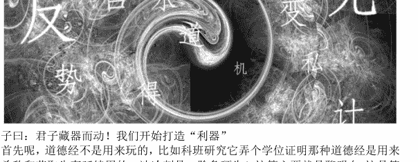

子曰：君子藏器而动！我们开始打造“利器”
首先呢，道德经不是用来玩的，比如科研研究它，搞个学征证明那种植德经是用来杀敌和获取生存延续用的，冰冷刺骨，阴森环生！这一篇主要就是聊明白。这是第一篇，也是极其重要的一篇，但是不适合所有小动物观摩。

### 因此此篇没有术，只有道。

人和人是不一样的，有的人想要“妙招”，有的人想要“制造妙招的妙招”。
思想就是观察事物形态，观察道德经就是观察它的形态，本篇可以理解为“整体上去看道德经是个啥”
道德经就是老子的“利器”，它的形态如下

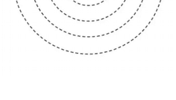

思想就是拔根，但用思想就是适度（一手资源更新微信：ipip885）。

很多人智商很高，思想也有，但是内心没有“度”，给再多思想也用不起来。

讲道德经也要适度，用法决定观察方法，人的心性（智慧加工方向）决定人脑子的用途（智慧深加工）

不断在里画那些阴阴阳鱼的（形而上学）就太虚，最后肯定会与三眼帮辩论“道德经在科学制造上的应用”，或者“人如何成仙”，这种朋友请出门左拐，以后别来；不断抠控制外显线条的就抵得太实（形而下学），也是“术”，就是“妙招”，这篇没有啥，以后会慢慢写，从道到术，这是一个推导过程，就像研究鸡蛋从先研究母鸡是啥，正确睡觉给鸡做蛋的，对不起，扒扣龟节奏，请出门先呆一会。

虽然从上一直写是文章说的，但是也谈到了一个智慧道理，就是“度”！

度是什么？万物的尺寸！

就是“尺寸上刻度”，您也可以理解为“尺寸”。

道德尺度有刻度，科学仪器有刻度，为人善恶有刻度，做人冷暖有刻度，事办几分有刻度，而推动这些行为的背后是思想，思想一运动，更要有刻度。

人如果控制不住自己的思想刻度，那不是精神病就是神经病

世间如果没有“尺寸”，那么万物都不复存在，因为万物存在需要人去“下定义”，需要“拿东西量量”。

老子讲“道”，讲的也是个度，就好比为人太善或太恶，都是没有度，都是错的

人活一辈子，会玩度，人就成了

### 道

+   - 是个什么？
- 有什么用？
- 怎么来的？

大家每天嘴上都挂着“悟道”二字，但很少有人思考以上这些问题如果一个东西是怎么来的都搞不清楚，您怎么悟它呢？

这就好比谈恋爱，连对方是男是女都搞不清楚，怎么谈呢？

谈到道，世人ream把它当做一个“附属品”，就好像出门戴帽子，戴不戴都可以，戴上主义是为美丽观。

这就是大多数人对于道的理解，只是一个“装饰品”！

如果一个东西成为装饰品了，那就没有啥实用价值，而实际上，道不仅不是装饰品而是必需品，是一个人想成为“高级动物”的必需品！

因为道就是生存（存续）法则！

### 道是怎么被扭曲的？

百姓日用而不知，故君子之道鲜矣！

好东西一定不是众人（百姓）皆知的，众人的双眼被迷惑（业障），活在假象之中，他们见不到真相的本因，是他们根本不想看见真相，所以就见不到真真相与假象的区隔形成了猪杀形态，前者对后者是高维对低维的猪杀。见《生存法则》
观察一个东西，能否接近其真相，脑子做加工（辅导）不是最重要的，往往加工（心智）才是主要的。
“百姓”与“君子”的区别，第一位的是“认真能力”的区别，而不是“认知能力”。
人要先有“心的认真”，才会有“脑的认知”。
在 | 道上，“认真能力”（心往哪里用）决定了接近道的距离。

解释一下：道德经牛吗？牛
但是对于绝大多数人来说，它不牛，不仅不牛，而且被硬生生弄成一个“装饰品”。比如市面上研究道德经的诸多人，都是“科学化”去研究，最常见的就是“板书”长篇累牍一个一个字扒。

这个字从哪来，在东方学者看来有几种解释，都有那些古代名 interfering，分别都是啥意思，从西方思想看来又如何如何，引用经典显得很牛的样子，但是三眼说：都好假！

说人便宜不是鄙视，而是排斥，大家个性方向不一样而已
玩装饰品的不会在乎刀锋利与否，甚至根本就不带刀（藏器而动）;
而玩刀的根本就不佩戴装饰品。

这就像是中国功夫，牛吗？牛！
因为中国功夫就一个目的：
把敌人杀死！
失去此目的去研究功夫，全都是傻X！

不是鄙视，这是排斥

道，就像中国功夫一样，现在被玩成“花拳绣腿”，弄得极其复杂，各门派的长老们练功夫大几流水，玩嘴皮子功夫一流！

思想就像如同利器，一把刀用来切菜，肯定不牛，但用来杀敌，那还显得牛了，如果用来收获“长生”（生存与存续）之道，那就来更牛了！

### 咱们要聊道德经，聊的就是“杀敌”与“存续”

思想对于小兔子来说值1元钱，对于虎狼来说值千金，对于悟道者来说，是万世不易的财富，死了都想带着走，所以古代牛人死了先拿书做陪葬，而后才是金银财宝

人与人的区别不在于脑智，而在于他想干吗（心智）。

狗无论研究什么，最终目的都是为了吃尿粪无论研究什么，最终目的都是为了吃肉

而老子想呢？是不吃屎也不吃肉，用更高级的方法求得生命存续。

什么心性为人？
兔子之所以是兔子，是因为它们眼中没有豺杀，感受不到危害。

孔子说：做人要做战战兢兢，如履薄冰；要三思而后行。

为何？
因为他知道做人的危险，一句 话出口可能有所得利，但也可能招来杀身之祸
这人的越有思想，越去悟道，就越能看到危害，知道哪里是悬崖，哪里是沃野，做人就越发谨慎。

老子站的最高，看到的危害最大，谦卑中的谦卑，到达极致了，就是“无”
所以对于道德经，此时您也可以理解为“谦卑的终极方法”。

### 谦卑源自什么？动物的天性——伪装！

这事后续再聊

道德经就是个利器，这把利器放在市集上，被世人玩出花，有的给它喷漆（搞复祭）
有的给它弄个刀鞘（搞歪了），但当您走过市集突然看到此利器，应该有伯乐在太行山遇到千里马的感觉，大声痛哭
“哥们，那些人让你天天拉车，给你祸害成这样…你不是干这活的啊！”
然后脱下麻衣给千里马批上，牵回家好好喂养。

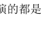

### 道怎么来的？

有小伙存在星球环，现 代人物质丰富、信息畅通，而古人物质匮乏、所有书籍加起来50MB就够装了，为何古人思想力那么强？
回答是：因为现代人吃的太饱！ 或者讲：心浮气躁臭气熏得瑟
简称“作死”
这人的智慧都是“作”没的，越喜欢“作”的人，就越活在假设里，万一哪天外 界剧烈变化，没有了“金字塔铁门”保护，结果就是“作死”了 求真务实为何是个传统美德？不是它有多少“好”，那都是包装，而是因为它很实用

这人他暇去务思淫欲，而不是思考生死存亡。
佛道，都是研究生死的学问，从而顺带录取了诸多智慧这人要有思想力，就要学会抗跳险临危体验大法，向死生才能要来真智慧！

### 对这个老祖宗有个词叫：居安思危！

为何“现代吃摇头”特别多，俗称健盘焦，因吃的太饱，一时半伙死不了。研究一门学问，首先要看他的时代背景，就如同研究一个人先看他的家庭背景。背景决定了时代中人“往哪思考”（心智），而后脑子才能做加工（脑智）
在一个极其混乱的时代背景，每地上演的都是各路农场主抢地盘、抢小动物、抢

统治权，人性命如同草芥牙狗，一不留神就死遁遁了。

生命“便宜”的时候，“道”（利器）就贵
生命贵的时候，道就便宜，拼多多几元钱包邮送到家各种“道”。

什么做人之道、商业之道、赚钱之道、职场之道……最奇葩的还有御夫之道、御女之道……

老子气的橡树板都盖不住了！

人就是动物，严格意义上讲，人字应该替换成高级动物四个字，在古时侯生产力匮乏，生存的竞争极为残酷，在生死存亡之中，一群动物搏杀，如果想要活下来，适者就要变得“高级”才行。

社会的出现使得竞争战场从“一对一搏杀”上升到“群体博弈”，想要剩下来，不仅仅是肉体的胜利，更是意志的胜利

没有对生死存亡的研究，就没有道的出现！

古代的圣人都是“剩人”，能够在竞争中剩下来的人，每天面对的都是“生死之地”
所以“不可不察”，没办法不去思考，智商不在线很容易丢掉性命。

生与死，追迫着人们钻研事物的真相，从而获取竞争优势，从而能够活下来

此时的心性去看道德经，其就是一部生存啸略，为了生存把人的智慧推向极致，去洞察天地之道

因为老子明白，有一个“东西”，它在玩弄着人们，让人们殊死拼杀，只要看到这个东西，顺应它，才能逃脱他的魔爪，人才能够拥有活下去的终极智慧！
老子给这个“东西”叫做“道”！

这与佛教跳出三界轮回，逃脱阎王的魔抓，获得恒久的意识存续，一个道理！
欲要逃脱，就要洞悉“规则之上的规则”。

是不是能够逃脱，三眼不知道，据说菩萨什么的可以，但那些都是宗教玩的花活，自己打道出现，老子本尊三百花齐放，高鞭舞瘦谢了故事是长或短唱他也不爱去研究什么是不是“终极规则”，研究那个就是神学了，科学之上是哲学，哲学之上是神学，到了顶点，就是时间、空间与意识这地球三大神秘本源问题了。

前文讲，思想要有“度”！没有度那是神经病思想这个东西很有意思，思想就是拍摄，但是不能拍到极点，就好像人活着要做人生规划，但是你又不能规划到死太过于果断，一定会得精神病，自己把自己玩死，因为以人类的思维去抵根一定是有边界的。

老子就很鸡贼，道德经更像是老子“问道”
啥叫“问道”？就是和“道”这个家伙对话。

“问道”不是“得道”，但凡想要“得道”者均是大傻X！就好像人想要淫秽、飞升……

问道，就像是“与领导谈话”！

在老子中心，人世间已经没有他的领导，人的那点事老子看得透透的，就像大学生肖幼稚园小盆友，但他觉得自己还是被“管理”的，只是那位管理者无形，偷偷给你，你却不知道他存在，谁在管理他呢？
就是道！

这是老子的新领导，问道就是跟领导讲话，那就要有下面这个心智（心的加工方向）

“不管领导（道）是个啥，爱是啥是啥，我只顺应你，不会去想要解你做你，而且也破解不了了，我只感受你的存在，依附于你，你就会照顾我，让我活的比别人久……”

老子在领导面前也很忐忑…所以老子最怕的就是“失道”、“逆道”、“不道”。

### 第七章：天长地久。天地所以能长且久者，以其不自生，故能长生。是以圣人后其身而身先，外其身而身存。非以其无私耶！故能成其私

大白话翻译：
这人要想活的恒久，一直续下去而“长生”，就要跟随领导步伐，模仿和顺应天地之天地之道是什么样子？它们并不不是为了自己生存而生存着，所以才能“长生”，圣人要模仿天地之道，想要保全自身（身存），就要像天地一样“无私”，只有这样才能达成活下去这个“自私”的目标

此后，无私和自私的辩证证明开始普及并开来，对这俩词的理解水平产生了智者和愚者的区隔

大环节一提到无私，就会跳出一个概念“这家伙喜欢付出”、“含己为人”等等…三眼负责的问你呀，那不是无私，那就是傻
真正的无私与“善”一样，都是一个高级的生存智慧，很冰冷的逻辑，只是世人喜欢给它们加上温度，或者有的是别有用心而已。
如果一个人故意去无私，或者被人看出来是无私，最后结果一定是成为一个笑话而自己翻翻历史书籍，这不好说
道家智慧从老子开始，追求的终极形态是“无形”，如果一个人能够做到“无形的无私”，那才是大智慧，只有这样才能达到“获得私利”的目的，无私的目的就是自私，只是手法特别高级而已。
这就好比一个领导的副手故意玩个无私试试？不把无私藏起来，甚至故意去对外展示玩一个深得民心试试？第二天领导就弄死你

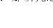

这知识可以分成两类天定的和人定的。

人活一辈子出来，主要是跟对领导，跟着道混，就是学习天定的规则，天定的规则明显白那么一丝丝，也貌似可以看到人定的东西了。

所以，三眼讲道德经，师承老子的鸡鸣心法；不要想要了解破道，解破不了，只能去感受会，以三眼领导经，师承老子的鸡鸣心法；不要想要了解破道，解破不了，只能去感受道，感受领导给你的“万针策略”。

为了便于理解，三眼举个例子
为什么解破不了道呢？

道就是和同事物没有真相，真相是“无”，如同人们找寻事物的“底层代码”，终极代码就是0与1，源自“无”。
小伙伴读到这里就懵逼了，心理寻思：那研究道有啥用啊…都是“无”了。

那三眼瞧问您：平时用软件不？
我们生活中所面对的大大大小小的诸多人事物，都是“软件”
道德经是一本“程序”教材，观察事物就是找到“程序”，无论您是个程序员做编修（一手资源更新微信：ipip885）
（修炼自身的思想观察力），还是您是个黑客（攻击与谍略），您都得熟悉“程序”才行呀！
只不过“道”这一程序是天定的，而不像计算机程序是人定的；后者只能在芯片上发挥作用，前者是“无所不在”一道是最高级的“程序”

您可以这样理解
道德经讲的不是“终极代码”为何，因为人类思维承担不了，维度太高而讲的是“程序如何发生作用”。

顶级思想家玩的都是这个路数，比如佛家的“不可说、不能说、不必说”，佛陀老子手拉手，讲的是一回事
这些“三不说”的东西，只能去感悟，而表达不出来，只要能表达了，那就歪了。
歪，不是因为表达者是歪的，而是因为众人理解必然会歪。

思想的本质，就是把具体化事物抽象起来看事物，是看事物的形态，而不是否表象。

到了抽象层，很难表述，就要比喻，这里在古代叫“象比”之术，也就是修辞学的开端，比如事物的构成比喻成“骨血肉”。
但古人很明白，只要是玩“象比”了，那必然会形成假象，所以假象的“象”字与真实的“相”字绝不能写成一样。
比如说，这个人脸很“软”啊，问请说？多少软软…每个人理解都不一样。
三眼总写文字很明白一点，玩表述等于玩自己，那个热血血涌，有的东西到了抽象层，怎么说都说不出来，而且观众的认知也是分层的，那就不容易表述了。
所以，道德经为何难懂，因为极具抽象！
所以，写道德经，一半是写自己，这就是“性心方向”所致，就像前文讲的，道是“装饰品”还是“利器”，跟悟的方向有关。
诸子百家都是师承老子，但是各家玩法都不一样，因为悟的方向不一样，虽然“本源利器”的套路都差不多，但对利器的雕琢（用法）不一样。
所以咱俩老子要“适度”，就是在找“本源利器”，诸子百家都用的那个“利器”
这个利器到手了，就够用了。

思想存在的唯一目的就是“搞呀嘛”，诸子百家玩神州几千年了，现代人的“骨血”里面都有“被玩”的痕迹

在《生存法则一》里讲过，社会存在本质就是一场狩猎，因为人们被假象与真相隔离，活在假象里就如同行走的羔羊，等待着猎人的击杀

要看明白“猎杀形态”，不仅要看猎物的形态，更要观察猎人的形态。

诸子百家（不限于，要敢想）都是猎人！
您非要铁牛角尖，跟三眼辩论“道德经在科学制造上的应用方法”，请出门左拐，去找给道德经做“装饰品”的大神，跟他们一起雕花玩去以前在文章里讲过，任何思想都有其局限性，因为用法决定方法。
不是老子不牛，而是我们太傻。
老子，无限的接近于他的领导（道）
我们，无限的接近老子
认知，就是接近真知的距离。
就是文化传承！

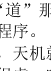

好了，既然老子是个程序员，给世人一套终极编程方法，我们怎么玩？

#### 1、天机；

> 何谓天机，就是程序的开关；或者可理解为关键代码。

这里得插一嘴，程序员只是个比喻，“道”那套程序不是人造程序所能比拟的，所以三眼以后的比喻会很多，不限于程序。
天机这词来自庄子，嗜欲深者天机浅，天机就是做人做事的那个“关键环节”。
但是这词呢，一带个“天”字就显得很虚，吓水呢，给去掉！
——天机！

这词在古代写作“几”，老子讲“几于道”，就是水顺着道的形去流动。
此后，人們对关键环节都用“几”来比喻，比如转机、契机。
但是老子水流这个比喻可能符合古人审美，但不便于现代人理解，咱们再延伸一下。
几，就是门的轴，或者是木头机械的连接处，所以后人加了个“木”字旁，成为“机”

当找到事物的“机点”了，那么摆弄事物就会很容易。
就好比百思不得其解的某个事，让高人去分析，可能就简单一两句话即可点破，因为点到“机”上了！
咱们怎么跟老子一起玩“小机机”呢？

等再往下推导到具体象层，就是术，比如谈话之儿，又可以细分成怠悠人的技术，隐藏的技术，表演的技术等等，那就非常非常具体了。

有了道，用三眼话说，就是思想可以“归根”，万物可以“归位”，虽然老子抽象的东西不好理解，但是一旦理解了，一通百通，即可做到“活学活用”。
但是人只有术，只要鸡蛋，只要妙招，换个“粗分类”就完蛋了，不会变通就是学死

所以老子做人的第一大特征就是——变！

#### 2、自动化

那好了，如果能找到事物的机点，点它一下，事物就动起来了，对吧？
动起来的这个过程就是“自动化”。

我每天都活在某个或某几个自动化里。
老子神秘思想就在此，悠要说机点一般人可能还容易理解，但是自动化就不好理解了
老子全篇无数次谈及“自动化”，比如
无为而无不为；不争而无不争；治大国若烹小鲜；取天下常以无事，及其有事，
不以足取天下；道常无为，而无不为。侯王若能守之，万物将自化。
大白话翻译，就是诸多事不能硬来，硬来没好结果，早晚出事，只能让事物自动的去完成。

这一堆大白话文字，古人就总结俩字：化解！

这俩字可见到功夫了，高人办事不是会“搞事”，爱搞事的绝对不是高人，高人办事玩的是“化解”，能平事的才是高人
这世界就是这样，98%的小动物喜欢搞事，搞完了不会平事。就像创业很敢干，但是干死了不会收尾。而1%的人不搞事，只靠化解求生存。
嗯——剩下那1%是啥动物？王侯将相？
好吧，问题来了，自动化是啥逻辑？怎么玩？
这就是“法”了，得敲出不少字，以后再谈，但这里要说明一点别看老子张嘴闭嘴“自动化”，但是世间没有完美的自动化，或者说没有长久的自动化，如果有，那只能是天地自然之道
老子全部都在分析“领导意图”而已，想做到顺着领导（道）做到完美自动化，理论上可实现，但现实中没有，不然就不会有上面第一点的“天机”了天机就是变，物有阴晴圆缺，事有盈亏，人心之水潮涨潮落，只有变才是不变的。
后世的许多技术，按老子的程序去为人生世，但是师傅领进门，修行在个人，虽然大弟子都承永字，但是“变通”能力不一样。
所以就有诸多了历史现象，有的谋士死的就很惨……有的就活的很滋润，比如范蠡：

有的善变及时，当然也在死亡边缘走了一圈，吓出一身冷汗，比如萧何。
所以还是回到前文，为何孔老二说，做人要战战兢兢，每天滴里啼嗄的心理研究的？

### 就是不断地寻找“变机”。

人就是这样，要想获得地位、名声、成就，人要想彰显富贵之欲，那也要有所付出，每滴里嘀嗄以打开进一句话，这人话一辈子，能赚得住多少财力，拿得住多少权柄，靠啥？靠认知！但更要靠心力，滴里啼嗄的所以吧，甭管一个人忧牛逼，还是甘愿傻逼，其实在内心的“幸福含量”都差不多，这辈子有没有志向，看您想玩哪一套，往牛了玩也可以，往傻了玩也可以，会满足才是最大的财富！

这时候有的小白兔朋友就很开心了
“三眼哥哥，我好开心，我就不想做虎狼，我就喜欢做小白兔不思进取的样子……”
三眼就告诉您了，小白兔天天被猪杀好玩吗？
这个世界就是这样，佛家把这叫做“修罗场”，人与人之间只有猎杀和被猎杀。
那么问题又来了，有没有不猎杀，也不对被猎杀的那种形态？有
不然怎么研究道德经呢？

老子研究自动化的目的，并不是他要搞事，要弄一套自动化，而是他要“可以穿梭于任何一个自动化之中”
每一个自动化在老子看来，都是一个“势”，俩字“水势”，四个字“水势之变”，六个字“水势变化的契机”。

上善若水！

读到这里，善字就要跳出来了，三眼在以前文章里不止一次说过

善，是最为高级的生存谋略！所以老子的第二大特征是一善！
好了，可以把1、2点合起来了，就是一善变！
这才是做人做事的高级智慧。

好了，按道理讲，讲到这，老子这个家伙也介绍差不多了，小伙伴们心存“善变”二字已经很够用了，但是这么讲老子，那就算太肤浅了，还能再深？当然！

#### 3、反！

老子最出名的一句话不说什么上善若水啊什么的，别看被某某学校刻在石头上，民企国企也都刻在石头上，这更证明把“善”玩成假象了！

认知嘛，是接近真知的距离。

老子最牛的一句话是“反者，道之动”！
不是这句话不止一次说，凡事功夫一定在诗外，而不在诗文内部啥叫反呢？
不只是三眼讲过的“归根”啊、“归位”啊等等。

更是反着看老子！反着看道德经！

前面三眼咿咿嘻嘻七八千字，都是“正说老子”，最牛 X 的功夫在于“反说老子”！
什么意思呢，解释一下
诸子百家各个都光宗耀祖，名垂千古对吧？
为啥？
因为反着看老子！

老子道德经吧啦吧啦几千字，都是为了悟道、顺道、体道、行道，但是您想一想，如果“逆道”会怎么样？
老子口口声声说着最怕“失道、逆道”，但几千年来，历朝历代干的都是啥？

嗯…此话不好讲，只能说他们干的都是“硬来”！

老子那么聪明的人，讲出“治大国若烹小鲜”这句话，他自己信吗？就好像您讲“所有人都满心善念，世界即可大同”，您自己信吗？
嗯…去 XX 讲来讲可以，这东西理论上是可以幻想一下的三眼首先给老子下的定义是：谙略家！
之后才是思想家、思家、道德家、慈善家

什么叫谙略？
一种是顺道，本质就是伪装；
另一种就是逆道，就是“硬来的方法”

怎么硬来呢？举个简单例子
得道者昌，失道者亡。

第二种谙略，就是对手“失道”啊！此处可以延伸 100 万字。

攻占一座城，一定是城池内部先瓦解掉
“硬来”是跟第一种谙略比，它貌显得很硬，因为它“逆道”；
但事实上要比您想象的还要软，因为这是个技术活，老子就是技术活鼻祖，只是都藏在其字里的最深处罢了！以前讲过一个例子，很典型
比如皇帝的利器是赏罚，而赏罚之本在于罚，这个东西只要守住了，王位能一直拥有。我的大臣很贫困哦，跟皇帝说：赏你来办，大家都喜欢你，罚这种脏活事我来办，我替你张罗
时间久了，大家就不怕皇帝了，只怕大臣，紧紧团结在大臣身边，整个人心水势

发生 180 度大转弯…水势一成，谁也扭转不了命运但是呢，大臣这么玩，大概率也会给自己玩死。

人用什么招数上得台面，也会被人用什么招数赶下去。
自己给自己堆多高，到时候摔的就有多疼

玩“硬来”（逆道）一定会反噬自身的

所以这里可以看出，谋，有上谋和下策。
谋也是分水平的！
任何谋略，在出招之时，就要想到结局，前文讲的会祸事但是也能收尾。
这东西背后就叫作“算计”，所以谋又称作“计谋”
比如象棋，是御帅和将玩的，都是线性思维，你攻击我，我攻击你，看谁能把对方将军，但凡搞对抗的招数都是下策。
围棋就不同，你中有我，我中有你，对于棋局、棋路、棋手考验人的计算能力。

所以老子第三大特征——反！

把老子反看起来，玩“逆道”，就是各种“硬来”的谋略。众人最喜欢的就是这个…
因为每个人都有贡气，都有欲望。
嗜欲深者天机浅，欲望大玩不了上等谋略！切记！
所以老子说：宠辱若惊，贵大患若身。

一般来说，一个人不能宠辱若惊，那么没等对手攻击，自己就把自己瓦解掉了，玩死而攻击对手，最常用的套路就是通过宠辱，在鬼谷子看来，就像是破坏一个坛子，坛子只要有那么一丝丝裂纹，最后就会延展开来，自己就破裂了。

讲到这，一些不善斗的小伙伴就很焦虑了，咋呀三眼，这玩意也太麻烦了，我又不想有什么大志向，有没有简单的？
三眼想了想，有肯定的，老子他那么牛逼，什么东西都可以 heav 在道德经里找到，
但是更难！
为什么？
以前就讲过，这人一出生，要修修炼，抽象来讲，
就倒踏子：

修仙和修魔

第二种谣诼，玩“硬来”的，就是修赭，要达到的目标就是攻无不克，无论什么形态，都讲解朽了，给你改变形态 硬来，就是特别会搞事，俗称“爱折腾” 但是呢，他与藐蔑是有形的，比如看马云，众人皆知，再会打太极再会装，众人还是知道你，这事其实很辛苦的•••；看黄光裕，还是众人皆知。 古人云，异人无露相，露相不真人 啥意思呢？就是做到“无形”。 在马上老黄后面，由无数个无形在运作

昨日写文章，还写了一段话，就是小伙伴们每天很痛苦，很想努力很想使劲，但是无处发力，有那么一个东西在偷偷搞你，那个东西是无形的，是个形态，你想和他对抗，您都找不到它。

所以嘘子们每天嘘社会•••嘘中国人等等，很搞笑的，社会是啥？中国人是啥？ 你无法把他们缩小到某一个具体化的了或者事上面，或者更胆大的嘘子嘘组织，组织是还有是 所以嘘子每天嘘完了，自己都特别难受，因为像对着空气撒腿，所以嘘子必须要找同类，找一样的二傻子和他一起嘘，互相“照射”找个存在感。 嘘子也是个行业，祖师爷往上追溯可以到写谤邀那位，抛出个大明星，比如鲁先生，小嘘子大嘘子其实逻辑都一样，只是嘘的水准高低有区别，自然获得的利益结果不同。

嘘子也属于“无形”形态中的一分子，这世界每个人都是有角色的，还是那句话世间是由真实和假象填满的，形成猪系形态《运动》，缺一不可！

言归正传，小伙伴的问题还没解决呢，有没有简单的“玩无形”的方法。 其实逻辑都一样，道家经早就给出来了，复杂与简单只是水平高低差异，翱翔像嘘子行当也玩水平一样。

要玩无形就要玩“有”一有无相生 这叫无形太极，三眼归纳成一个理论叫做“影子论”。 什么意思呢？ 做人就要做所有人的“影子”，办事就要做各种事的“影子”，别人找存在感是想要“有”，那就要看要扮演“无” 智者是善于做赖听着的人，愚者才是喜欢找存在感的人。 做事也是如此，要成为某个领域、行业、区域、群体、组织的“影子”，那将“长

### 所以，老子第四大特就是——无！

这几个字讲明白了，基本也就够用了，下一步就得拆解它们的具体逻辑了。

### 善、妄、反、无。

对应着：

高级伪装、机变、修仙修魔两手抓、无形。

连成一句话：善于变化，反复无常。

小伙伴们到这里就开始闹心了：老子这不就是个小人吗···三眼你解释歪了！
三眼：嘿···没歪！被看出来了，就是小人，看不出来，就是君子···嘿···如果这几个字都做不到，想必连做小人的资格都没有…

什么小人啊、君子啊，不都是人？什么小人啊、君子啊，不都是人？
人，从本性到习性，漏洞都是一样的，只是水平高低而已

什么叫水平—填补漏洞的能力！

小人与君子，只是世人给他们加上温度而已，都是人！
就仿佛陀看人，人都是一样的，唯一差别就是开悟的、和没有悟的。
漏洞是啥？参见思维系列。

好了，不知不觉1万字了，以上三眼啪啦啪啦一堆，讲的就是道德经的整体形态，老子的思想，就像是伏羲玩易，重新元素拆开拼去，形成一套套、不同门类的“程序”
当中有些略的内核，比如善也有推动内核的逻辑，也就是有无、上下、先后等各种相生相克。
当中有心法，也有应用
什么是有点头道的样子？
群人看一个事物，悟道者不仅能看出事物的样子，还能看出众人怎么看事物的样子

没有真相与假象之区分，就没有猎杀！

我们只能学习思考“程序如何发生作用”，而永远悟不出“终极程序”。
这就是悟道的有趣之处

### 道德经的冰冷智慧（二）：众妙之门！事物运动的本质形态

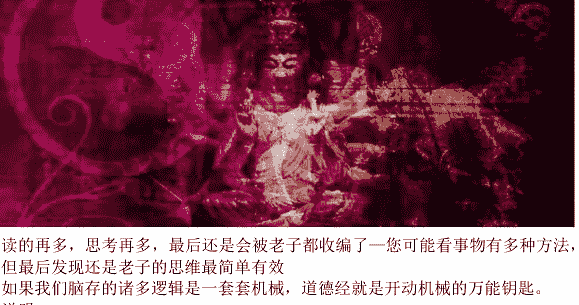

读的再多，思考再多，最后还是会被老子都收编了一您可能看事物有多种方法，但最后发现还是老子的思维最简单有效
如果我们脑存的诸多逻辑是一套套机械，道德经就是开动机械的万能钥匙。
说明
三眼强迫症，先聊道，后聊法，人生漫漫，着什么急？聊道的就很枯燥，诸位最喜欢看法，比如怎么具体分析人、分析事物，具体怎么搞投资，具体谋略等等，三眼一写那些小伙伴们就很高兴，因为感觉可以直接用得上
但无定法！没有这的加持，法都是死法（不活），就好像在星球里写了一篇如何现成的算法，其实现都死法，要换N个角度一样可以写，理论上讲可以写无限 ppt，区别就在于众人的接受角度。
像大多数兵书啊、漂亮啊什么的都是讲“死法”，都是死的，不活？那再思考考，从小到大我们学的绝大多数数西吧？也都是死的…得抓到背后的、共同的底层逻辑（道），死法才能变活法。

读者总是向三眼道道德经某句话话零解读，其实这是错误的，道德经是一个整体系统章条出一个问题灵活透彻，就需要把它放到系统里讲才行，所以每次解读提的问题和其中的具体问题同，三眼都要在系统上延伸一下，这样一是麻痹，二是延伸肯定不够，形成断章取义的感觉。
但是如果直接写系统，文言变成白话，相当于把道德经砸碎了，重新组合新的结构显现，整一个抽象形态换了个表达（因为观察角度变了），就像是用生物学描述物理学的既视感，读者还要逆向沟通道德经变成原版。
比如写的第一篇道德经冰冷智慧，就是按照三眼观察角度去写，几乎不引原文，以假象、猪系、养殖等“新结构”去解读，砸碎了再重组三眼累，读者也累。
所以比较折中的方法，还是一边翻译道德经原文，一边来看其结构，这样讲的每个构成都能在原文上站位。
可以理解成从点睛（分章解读）到线（章节之间的交互关联）、再到面（形成立体化系统）的过程。

当这个工程完成了，最后我们还是会回到点（具体章节与句子），您会发现道德经之中每句话都是道本身，它们讲的都是一件事，只是角度不同而已，此谓大道至简！

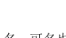

正文
第一章：道，可道也，非恒道也。名，可名也，非恒名也。无，名万物之始也；有，名万物之母也。故恒无欲也，以观其妙；恒有欲也，以观其所徼。两署同出，异名同谓，玄之又玄，众妙之门。
这一章非常关键，相当于根子，道德经全篇看起来去还会回到这里，只是其他章节角度不同。
原文先放在这，没做直接翻译，因为只要翻译成现代白话文，100%是错误的！而绝大多数人接受道德经，都是先接受错误的翻译，翻译百花齐放带歪路线，人們离道越來越遠。

### 文字即是选择表达的载体，但文字同样是信息的屏障，它表现了思维，但也局限了思维

道德经（尤其是核心道经部分）是极度抽象的表述，老子用人们低级感官（眼耳鼻舌身意等具体感官）能够感受到的事物去表述，这是个没办法的办法，笔荒沟通要“讲人话”。但如果用具象化的感官去看道德经，100%是歪曲的。
比如直翻译成“无，是万物的父亲，有，是万物的母亲”，这不是精神病吗？再比如“恒”字，他不是个形容词，而是一个动态逻辑词汇，是一种“向上且无限延伸”的运动逻辑。
如果按照现代语法翻译：“道，能说讲出来，他就不是恒久（平常）的道了”。这样理解就太肤浅了。
老子这么写都是给世人一个思想运动的方法，而不是喝酒摔大山。
我们读道德经应该不能叫“读”，而是叫“悟”，领悟背后老子他老家人的思维如何运动！

思想，就是找寻事物形态；道德经，就是思想的顶级方法！
我们看道德经这个“事物”，就是找寻其“如何找寻事物形态方法”的方法

人，不在于看到了什么，看到了多少；而在于如何看到。

老子被尊仰千年，不在于其是否知道地球是不是圆的，是否见过飞机；而在于其带给整片神州大地一个顶级的、本源的思想方法，并作为根基使得神州思想文明一脉相承，开枝散叶。

老子不卖鸡鸭蛋、不干木匠活，也没有像儒法墨兵等有着具体的社会实践领域，如果由功利主义去看老子，老子 100% 是“无用”的！但他老人家干了一个其他人都无法干的话：在找寻事物的本源形态上达到前所未有之至极 如果把中华大地思想文明比喻成一棵树，那么老子对“至极”的探索与追问，生出了中华大地思想之根、思想管理的方法、权力管理的方法、军事斗争的方法、外交纵横的方法、谍略的方法等无不源于此根，不仅有这些“大用”，乃至于小到做人的方法、做事的方法、思考的方法、养生的办法这个“至极”就是道！ 一个不争的事实是，无论是身处市井还是庙堂，是武者还是文者，是古人还是今人，所有的领域所有人都讲“道”。有政治之道、经济之道、人力资源之道、经营之道，有做人之道、做事之道，再具象的还有职场之道、饮食之道、养生之道、家庭之道、恋爱之道 道无所不在，它就像是万物的本源代码，大家无论做什么都想找到那个本源，要归于那个本源，并且这个本源都是相同相同的，世间之事，殊途同归，其道一也

三眼把这个过程叫做“归根”，悟道就是在归根！而这个根是老子给的。

不仅文化上要归根，人的思想与行为也在追求归根，悟道就是在悟自己、悟文化、悟所有人，悟那个由根到分支的整体系统。中华大地能够血脉一体、人们能够紧密联系在一起，可不仅仅是因为现代社会规则约束，法是无定法（规则）的，而由道相连，也可以叫做“魂”。 地域有魂、文化有魂、民族有魂，人更要有魂！悟道就是再找魂，魂祖宗给了，能够合乎身有它了。 老子 100% 是“无用”的，但他的“道”有着万用，也可叫做“无用之用”！这让三眼想起电影《阿凡达》中所有潘多拉星人都是以灵魂树为根而链接在一起，从而“万物一体”，那个“树的灵根”与道，有着异曲同工之妙。

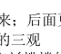

### 人人都“有病”

在看道德经的时候，其核心的“道经”部分字数极少，且虚无缥缈极度抽象，假设个人不知道老子这个人，更不清楚老子的“地位高”，在看过道德经后很可能觉得这种经病。

道经开篇即讲

> “道，可道也，非恒道也。名，可名也，非恒名也。无，名万物之始也；有，名万物之母也。”

又要给出道的定义，但又说不出出来；后面更奇葩：“无”与“有”居然成为万物的父母，严重毁灭了科学与哲学的三观 也就是老子名气大，如果路边一位衣衫襤褸的人跟众人这样讲话，都不用上升到科学与哲学这种维度，大家就直接骂他是神经病了而其实恰恰相反，众人才是神经病！ 这人自打生下来，其实所有人都是带病（漏洞）的，我们的心念与脑子一动，就

会出生假象（业障），这就是病！而自以为正确（我执）是基础痼症。人活一辈子终极目的的只有一个：就是为了治好病。佛与道都是大夫。

### 病根：失败治疗；找鸡

而有病的真正反应是高喊着“我没病”，就好像喝多了才会有个劲说自己没喝多…只有痛苦出现之时，人们才会意识到自己可能是得病了。什么人喜欢悟道？

都是思想痛苦之人！也就是说感受到自身思想肯定是得了病，为了解决病态痛苦，逼迫着他们去悟道。不要伤心，这才是人的高级别天赋！这就是慧根，在以往文章中讲过这是慧根要破障生长，过程当真痛苦万分！
上天给每个人都装上了漏洞，并由漏洞产生痛苦而逼迫人们去领悟上天。给你个病，但只能到我这里治疗，这个实实不是很神补呀…天地不仁，以万物为刍狗没办法，谁让天地大吧

所以一个人一旦真正认识到自己“有病”，恭喜你已经超越绝大多数人了，起码相对来说很清晰，清醒就能离觉醒近了一步。

《周易系辞传》中讲：自 wake 日用而不知，故君子之道鲜矣众人每天都游在上天这个不『落不的游戏』里，但他们却不知道，只有孤子（代称）是极少数清晰的人。
先清晰才能游出觉醒，而觉醒量级越高，越是头清眼亮，看事物越是透明，这事得靠悟，所以叫觉悟。悟什么呢？

悟上天这个不落林的游戏之规则，用老子的语言讲就是“道”。这个本源规则搞清楚了，那么其他小规则就很容易看清楚了。因为后者都是前者派生出来的凡是能够用语言文字具象化讲出来的规则，都是“人定的”，因为这是在用人的有限思维去定义

而不落林游戏的规则是“天定的”，所以叫天道，这是用语言逻辑无法描述出来的。所以以道游就是像老子在咖啡馆闲聊，围绕“道”这个话题，东一句西一句随意性很强，不像数学物理一样有着紧密逻辑，而且连个项目课题都没有。

因为老子知道，天道是无法具体化逻辑表述得清楚的，它很简单就在那里，但人们有漏洞就看不清楚它。只要道德经落实成文字形式，它就已经变成“法”了，而不是道只是在用“法”去刺激人们感悟“道”。所以道德经就是老子“向天问道”，绝非“我己得道”，只要能得到的，它就不是道。老子并没有写出具体什么是道，但他做了几件事

+   1、他为世人开了一个最大课题“悟道”；
2、为人们悟道提供了一个思想返动方法。

回到开篇的话，思想是什么？就是我寻事物形式的方法。也就是说，道德经主要价值在于，给了后世子孙如何去找寻道的方法。
但！道是求不道的，求到的“道”都不是道。而在这个一路追求的过程中，推动着人们的智慧得以不断升华，出生了百家文化，生出了中华文明！

认知，是接近真真的距离
真相如同真理是无限远的（没有），但我们离真相更进一步，认知就更高一维。

所以道这个字是“人首”在车子上不断前进。
所以，为何三眼讲“如何学习”要远远比学到了什么更重要？因为学到了什么都是“死”的，只有“如何学习”才是活的。

如何学习=悟道；
学到了什么=法或术。

当“如何学习”升高了维度，“学到了什么”也会随之变化。
这就像是一个班级的诸位同学，老师都是同一个，教授的内容也都一模一样，但是成绩结果差异很大，这源于每个人的“如何学习”不一样，导致最后“学到了什么”也不一样。

人人与人的差别，就在于找寻事物形态方法的不同。事物的形态都是假的（暂时有限正确），只有方法才是真的，这才是人一生中恒久的财富。

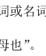

在观察老子之门的过程中，会有一个思维贯穿始终——“反思维”。

老子：反也者，道之动！

这个反可不是仅仅是反向、反对、相反之意，如果这样理解就成为“死逻辑了”
三眼用现代词汇把它翻译成“映射”

事物存在的本其并不是正或反，而是正与反的互相映射的过程，万物因动（映射过程）而存在，没有完全静态化的事物，世间只有“活物”，没有“死物”

所以，

### 处理人或事物—处理这一合一张的运动形态。

将欲与之，必固张之。将欲弱之，必固强之。将欲去之，必固与之。将欲夺之，必固予之。是谓微明。

这句里的细处提醒我们以后再聊，我们看其整体，讲的就是要想摆弄事物，首先就要洞察事物；而事物的本质是运动，那就得通过一个“反”去搞“映射”，“映射”一动，事物的运动本真即可显现；这就好比拿“冷”去试探“热”，冷与热的“映射”才是事物的本真。

而在洞察了这一过程之后，要找到摆弄事物的关键点——微明。

这个微明其实并不是一个“点”，我们现代人从小接受西方思维都习惯了，逻辑很容易局限，这个微明是一个“链接处”，其实现这么讲也不是很恰当，但总比“点”字要生动

如果把事物运动比喻成窗户一开一关，那么这个“链接处”就像是窗户的“合页”古人对此有个比喻——（后来写作机）。要掌握它（机点），即可掌控事物如何运动这就如同现代人总说“我们要掌握好节奏啊”，这句话可追溯到几千年前的道家，但其实大多数人根本就不清楚“节奏”是个啥。

人人每天都讲着道，但却不知道其是个啥！百姓日用而不知，故君子之道鲜矣

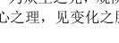

老子的这个思想就是这么简单几句话，但“无用之用”却非凡，比如用在纵横家上就是“揣圜之道”，这是纵横术的命门。《鬼谷子》第一篇就是“揣圜”，其中讲

> “粤若稽古圣人之在天地间也，为众生之先，观阴阳之开阖以命物。知存亡之门户，筹策万类之终始，达人心之理，见变化之朕焉，而守司其门户。”

诸子百家皆师承老子，找寻事物的形态都根源老子，纵横家在“玩节奏”这件事情上对象就是人心，人的起心动念皆有“合页”，皆有“机点”，皆有“节奏”。

以“一开一合”这个事物最本源形态去观察人心，只要拨清楚了（达人心之理），就能找到人心变化的机点（朕），就能控制这个人的一开一关（言行、其门户）。

故恒无欲也，以观其妙（妙）；恒有欲也，以观其徼。

妙，就是远、高的意思，是一种方向指代。也可以讲是事物的细小的本真（与上文所讲“微明”联系）。

以观其妙（妙），就是能够观察到事物的细小的、被深深隐藏的那个本真。而事物的本真是无止境的（极限远），拼的就是谁看的更深、更远。思想者们就好像在做咏蝶双眼不断观察状。

对原文“恒无欲”与“以观其徼”的争议就太大了，市面上的解释繁多杂乱，有哲学解读的，有物理学解读的，还有用宗教解读的，都太复杂了，几千年来在这句话上分歧争议非常大，大家都沟通不了。

解经还须系经人，解答就在老子的其他语言之中。

由三眼以上 5000 多字的铺垫：一开一合一合一张，这个“节奏”就是事物在运动，“节奏”才是事物本身。

恒无欲，就是不要“一开一合”！

也就是说人在思考问题时，是要让自己变成“死物”，这样才能把事物“看活了”。

所以道讲“无我”，佛讲“逃离执着”；道讲“无”，佛讲“空”；都是一个意思，都是要进入“不动”的境界，想获取至极的思想力是要归于至虚、至静的。事物都是由动而生，从不动到动。悟道，就是由根生。

找寻事物的本源形态要求人的思想运动要不断“退化”，退化到最本源形态老子的这种思想维在观察社会发展也体现“退化”，就是小国寡民者死不相往来众生因为有着天生的“漏洞”，只要心脑一动，就是在不断“演化”，导致人们想的越来越多牵扯牵引，人类的假象（业障）都是自我制造出来的而小A制造个假象，小B制造个假象，如果制造方法一样，就会很有共鸣，他们俩的假象形成共振——这就是“啸”，啸，就是动物（万物）所发出的声音。

恒有欲也，以观其徼。

无欲、不动、归根、至虚等，往搞“退化”这边走，才能逐渐寻找到事物本真形态这靠心带方向

而有欲，就是心脑逻辑不停运转，往搞“演化”这边走，就会形成各种“假象共振”。你发出个声音，他发出个声音，形成“音声相合”，时间久了大家都困死在假象之中——这靠脑子运转。

这个共振，这种互相的叫嚎，形成了文明。文明就是用假象去不断下定义，还欲

想由此得到真相。生物的天性本能就是伪装，人亦如此，人所构成的文明与社会亦是如所以三眼讲文字、道德、规则等等皆为假象，因为它们都是人定的，只能在某种种领域里共振才能方显作用。

比如三眼过去写文章，是在尽量帮大家搞“退化”，比如让政治决定经济，而政治与宗教的结构都是源自人本性使然，而人本性再去扛根，就能够扼到阴阳之动，这才能从假的不断向真的走。
认知，就是接近真理的距离

人研究问题，越是搞“退化”，越是能接近本源形态。往内层的本源得到了，就可以和外层的所有人共振，大家一起“喊”，因为共振的“底层代码”都通晓了，怎么“编写软件”还不可以呢？
再比如三眼常常提醒大家（做自己）就要想意思冰冷、无是非，因为情绪的本质就是做游戏，迷醉了大家上大都很高兴，共振不上就好像架子鼓配不上嗨歌经念。只会玩共振那什么人就活在假象之中。
要想共振玩得好，先要学会“不共振”

做事情是“一开始合”，想要做事做得好，首先要学会“不动”
两者合出，异同同调，玄之又玄，众妙之门。
天地万物一开始一合，都有各自的节奏，循环往复、机点反复出现，在这个过程中，有着众妙之门。
做人做事就是“不动动不动动”这样循环往复的过程。古人讲“静若处子动若脱兔”，异曲同工。
所以，人每天都要拿出一时时间，静下来不去动（蘼），而是让心自然而然地带着脑子
人的“不动”越多，再去“动”起来力量更大！悟的越深，飞得越高。

### 人们的痛苦源于用脑子太多，心在那里都荒废掉了，不只荒废而且充满假象。

正如佛讲人人都是佛，道就在每个人身上，那扇门只有自己才能打开。

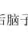

好了，以上的解读呢，看似很有逻辑，甚至有的读者留言说三眼解析道德经不是道德经，而是三眼自己，比道德经好玩，而且比道德经逻辑要强得多。

但其实这都是幻象，三眼能窥探到道德经一成功力都不错了，逻辑越强，就说明越是着相了，那是大家在一起“喊”！如果拿着西方哲学思维去看道德经，那想必越来越复杂，拿着数学去看道德经，想必能套的公式角度更多，但这些都是舍本逐末的假象。因为如果动（逻辑）了，那就都是人定的法（规则与定义）。悟道要由法至道，法是扇扇大门，所以叫“法门”！

### 世间法门皆是要刺激人们由心去悟，且要化繁为简，朴素又平淡的才是好东西。

以以往常讲，人的智慧来源于心动，而不是脑子运转。

人的心脑配合运转，心是揣方向，而后脑子针对方向开始做加工。逻辑是用脑子

加工出来的，在那里画圈；而智慧是用心向虚空要来的。

人思索 1 万个逻辑，都不如 1 秒钟心开了窍。

世间万象只要落实到文字，皆为法术（人脑逻辑人定规则），人有存在感都因自身逻辑，所以万分留意与看重自身的逻辑。而悟道的奥妙之处，就在于能够逃出自己，不断地逃！不断地逃！

这就是众妙之门吧

### 道德经的冰冷智慧（三）顶级生存形态—第三种生存！

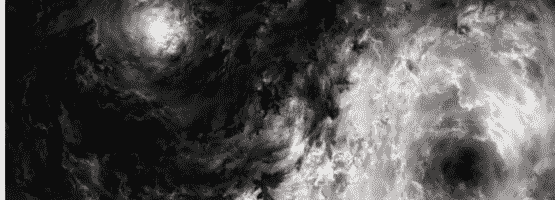

道德经第七章、第二十二章。

此二章是最接近做人的“法门”，虽只有百余字，但已给了一个顶级的生存形态结构！

一个“生”字道尽人间百态：
有偷生、欺生、求生、谋生、共生、伙生…各式各样的生存形态，众生在欢愉和痛苦的交相中挣扎前行。

生存的竞争就是思想的竞争，思想的竞争就是观察事物形态方法的竞争。入世法门之中，最顶级的生存之法实乃道家，三眼称其形态为—寄生！
这是一种效应自然，在“自生”与“不自生”之间的第三种生存。
儒释智者诸如自家，以及各种西传之学，皆为“有形”的生存之法，唯有道家独立于世，为“无形”之法。
本文注定是写给极少数人的，因为不是毁三观，而是让人没有三观！
三观还是“有形”的，做人“无形”才是顶级形态！

### 第七章

天长，地久
天地之所以能长且久者，以其不自生也，故能长生是以圣人退其身而身先，外其身而身存。不以其无私舆？故能成其私。

### 第二十二章

曲则全，枉则定，洼则盈，敝则新，少则得，多则惑是以圣人执一以为天下牧。

不自视故明，不自见故章，不自伐故有功，弗努故能长。夫唯不争，故莫能与之争。古之所谓曲全者，岂虚言哉！诚全归之。

### 随波逐流众生相

做人=做事。
为什么呢？

因为一个人的做人做事是思想推动的，而思想是来源于对人、社会的深度认识，观察出来的形态结构不一样，直接决定做人做事的方式。

觉得社会会黑暗，那做人就会朝向残酷；觉得社会会温暖，做人也朝向温暖，觉得复杂人就复杂…低层次的思想认知带来的 Sc 一定是痛苦不断，浮躁入侵，因为没有系统！

大多数人的做人谈不上“有法”，更谈不上道，都是碎片化的术：父母从小教小孩，一般都很功利化；到了学校给“洗”几样，像是为祖国献石油这种精神性的；到了社会发现之前的“功利和精神”都不受用，临毕业的重新开始学大多也还是学了一堆破碎的术，看着畅销书，跟著公知偶像搞一搞情结建设，弄些网红鸡汤道理板块一弄向攻可人生尤其物欲横流、信息爆炸的商业化时代，“做人的流行方式”总是更新换代总结仁字：没系统！

这没有系统就没法章法，就要浮躁，就要迷茫，就只能随大流！
做人做事就是自己内心“天天交战”，一会儿要无私，一会儿要自私，一会儿要残酷，会要温柔，一会儿要拿起面子，一会儿要放下面子，然后发现左右倒都不对，矛盾重重！

最后就“随波逐流”了，然后把“随大流”当成人生的硬道理，时而仰望星空，时而与一路上 的朋友把酒感慨，这就是人生吧！常见词汇“看开了”。而这种“看开了”一般只能存活个几分钟，长则几十分钟，而且需要酒桌、朋友和星空陪伴才行，当继续面对生活之时，又是心起心落痛苦煎熬

这就是典型的众生相！很正常，80%都这样，没什么奇怪的。因为做人是一个系统，有系统和无系统的比例也符合二八法则

### 思想的互为猪杀

为了不痛苦，让平静战胜烦忧，让人们做人和做事都能通畅通顺，思想者们出现了，听起来不是很美好？很赞？

错了！任何思想的出现都是为了吞噬！任何思想都是毒！

思想对于人的意识就像是氧气对于人体，人体生存既依赖于氧气，但同时也在被氧化毒害。

人因有意识，思想就像是病毒攻击，通过攻击人类的意识漏洞，从而可以操控人这个“软件”，让人陷入思想者的“网络规则”之中，天网、法网、人网无处不在，由此按照思想者们所设定的规则获取生存，思想者们所争食的就是规则话语权从而获得存续。

从部落离灭到初代宗教乃至政教合一莫不如是。对规则的争食至今仍在，这会伴随人类意识至死方休。

这种对规则话语权的争夺必然推动思想之间的猎杀，有攻击漏洞的思想，必然催生补漏洞的思想，后者猎杀前者！这就象是有神论宗教终会被无神论所猎杀。思想之间的猎杀与升级，也使得思想实现（入世）的主要载体——政治思想升级，对众生的“教养”逐渐向“服务”演化

作为众生一员，有利有益的超趄地方在于：观察思想之间猎杀与升级的轨迹，从而助人看透纷乱的现象的背后逻辑，实现个体的生存与价值那么，思想之间如何猎杀？

要知道，任何思想能起源并且登高长存，都是踩着别人的肩膀上来的。思想家们之间本身就是一场猎杀！

这就如同软件之间的对抗，A攻击B的漏洞，但攻击同时A也存在漏洞，会有新的软件去攻击它。

为何会有漏洞？因为“软件”都是人编写的。

如果有一个软件（思想）能战胜到最后，那么它一定是规避了人的思维，向“自然”和“宇宙”借取本源力量。

人类寻求真理之路是为了获取恒久存续的力量。

作为人类最顶级思想之一，道家之所以可以猎杀诸家，而诸家派又要合流于道家，是因为道家是通过效仿“自然”来观察事物的本源形态，通过“阴阳”变化弥补自身漏洞，找到对手的漏洞。所以养出生道家，谋略出道家，平乱世靠道家，治世也要靠道家做内核。在入世的流派之中，道家是专门猎杀儒家的！仁义伪装大法是很有的话，但在道家眼中充满漏洞。而儒家是专门猎杀凡人的。所以自古盛世之时都是*内用黄老，外示儒术

这就像是大鱼吃小鱼，小鱼吃虾米，这是一场思想维度的对抗博弈。人的竞争最终是思想维度的竞争

### 做人=做事

一个人用什么思想观察社会，社会就呈现出什么样的“结构”，自然就能推导出自己做人的“结构”，通过“结构平衡”而获取优良存续。人与社会呈现人在脑子里什么样的形态，直接决定了做事的方法。

自古谋士基本都出自道家，这源于道家思想极强的猎杀性和攻击性，对事物本源形态的把握能力。
这时候有人就该有异议了：道家主张无为，怎么到你这里就变成猎杀攻击了？
回答：最强的猎杀方式就是“不猎杀而猎杀”。这就是仿效“自然之力”！后文专讲

这就像攻击敌人最好的方式不是击败、击垮对方，而是能够充分的利用对方，为我所用！这才是战胜别人最好的方式。

终极的对抗形式是融合。

例如孙子兵法传承道家观点：不战而屈人之兵才是上善！
思想力比的就是吞噬能力，人亦如此。而能够吞噬天地万物的就是“自然”——人法地，地法天，天法道，道法自然
思想是什么？就是观察事物形态的方法。高级思想看到的就是高级形态，能看到高级形态就能产出高级智慧
圣人们观察世界用的方法不一样，自然搞出的“做人系统”不一样，地球顶级系统就是儒释道，不用怀疑，可着满地找，最终做人的方法逃不出这三位的系统，只能选个，因为“借力”三种力量形态。

佛教通过“宇宙”角度来看社会，把做人搞成一层一层的（维度），六道、欲界、色界、三十三重天等等，就像网游打怪升级，一级一级往上打；

儒家呢，通过“人纹”角度看社会，把做人搞成一堆一堆的（规则），君子小人什么的，定规则立章法，就像填空题，人只要把空填满了、填对了，仁义倚装大法成功，做人做事自然顺畅

就像是开篇箱讲的，不是毁三观（x 轴升维度），而是没有三观（直接换个 y 轴）！
道家之路很简化（不是容易的意思），所以很实用，而且常常常新，但对人的悟性门槛较高，因为需要“顿悟”，而不是“磨洋工”堆死逻辑。
量变到质变在道家这里不通

### “有形”与做人的痛苦

每个人做人都有着数不尽的痛苦之处，为什么痛苦？
因为想要“有形”！

何谓“有形”？就是想要把“自我”打造成某种形态。只要人思想意识一动必如
此！

比如“我要外圆内方”；比如“我要成为菩萨一样的
比如“我要成为真君子”
当然也有的境界更高“我要成为真小人”！噫，真小人确实比君子境界高，不用
三眼去解构，读完本篇您自己就能推导出出来
现代话语境的“有形”呢？比如精致的利己主义者；比如“成功人士”；比如“精
英达人”等等
更奇葩的是到了市井师后，还有想要打造成为“狼人”
所以，绝大多数人都追求一个“有形（做人）的终极形态”，认为达到了就爽
死了
爽，可说会有一丝爽，但时断时续的，一定达不到爽死了，因为都是“正向道
路”，人越是追求有形实就越是痛苦，除非把路“走完”！
但是怎么君子、小人、精英、成功人、狼人等等，无论哪种“有形”的形态都不
可能真正“走完”，必然走到死胡同，甚至物极必反，君子变成小人、成功者变
成最大的失败者（如罪人）、狼人变成被其袱搞者为何？因为“不自然”

道家之外（佛为出世不论）的诸多法门走的都是“正路”，顺着人的“自我”之
欲“正常”向前行驶的路，要想爽死了，就要成为“标准君子”或者是“标准菩
萨”、“标准成功”等等，都是需要人为设定“标配”的这个过程必定充满痛苦与
煎熬的，因为要一直“跟进标准”打怪升级，这种升级很不自然，都是人为设定
的，所以常常要人为制造出来痛来磨炼，就很容易矛盾又痛苦

但凡人为设定的，都终都可以商业化，甚至就连“君子”、“修业者”都商业化
了，往往成功、精英上辈，而后者又往前者上靠拢，互为“融合”，呈现出古今杂
交中西结合、各种大师和鸡汤畅销品层出不穷的火热局面，人心更加浮躁了，而
后更加痛苦了

### 无形的法门与道

渡人就是在渡己——这是顶级思想的施用表现。

思想能够长久存续，必定通过渡人（帮助人弥补漏洞）从而渡己（长存）。每一次读道德经都有新的领悟，常看常新，努力离道近一步。认知，就是接近真相的距离。思想者渡人，就是助人接近本源真相。

人的修练不是“求多”，而是“求近”。正如孔子讲“少则得，多则惑”。

什么是“少”？就是简化的力量

道，效仿自然，至简致用，它像万事万物的形态内核，藏于万物的最细微最深层之处，只有距离它“越近”，才能至简致用

不仅道家，世间任何一套思想体系主体部分都会有两个层面

- 一是法门。也就是应用层，是规则、套路、应用方法；
- 二是道。也就是哲学层，是推导应用方法，或者说是“底层代码”

老子的道德经也是如此，整部各章节其实多为法门，而法门多讲人做事的方法，因为做人做事是距离众生最近的一道门；每一扇门都通往道，打开了，走进去，就接近道了接近道之后，即可打开其他门，虽然其他门没有走过，但有道的加持，之后即可通百通，一门通多门

何谓法无定法？

就是通往道的大门数不胜数，因为道效仿自然，无所不在！站在道的位置去看无数法门，其实都是同一个门，只是门的“有形”形态不同而已（规则逻辑）

这里可以以这样一张图来表达

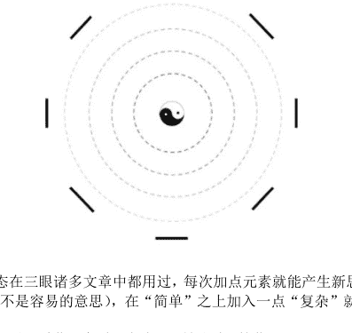

这幅图的形态在三眼诸多文章中都用过，每次加点元素就能产生新思路。因为道很“简单”（不是容易的意思），在“简单”之上加入一点“复杂”就是道的各种用法
用“简单”可以“融化”各种“复杂”，所以叫“简化”
能勉把“道”简单画出来，时不时加一点“复杂”，给人一个简化的逻辑，但这也只是脑子在运动，只是引导，不是真的道。

道德经也是如此，里面写的都是法门，不是真的道，只是通过法门引导，刺激读者自己去领悟真正的道，因为道是无形的，说不出来，只能通过“有形引导”去悟“无形”

而悟道要此心！
这句话放在这里大家不会有什么深刻感受，因为此时您还是脑子在转动，但这句话留在心中，可能在未来某个梦醒时分，或者是遇到重大问题，或者是在人生低谷或高潮之处，想必那时会有更深刻的感受

在之前文章讲过，人的认知不是秤度或格栅状，而是像“细胞”一样一层一层的最内核就是道，外层就是术，法术没有具体的层级，只有相对层级，
好了，把这个“细胞”外面加入一排法门（粗线段），理论上可以加无数个法门，
法门都是种种具体规则，法门没有大小！
比如政府、宗教、经济，比如做人做事，比如谈恋爱、婚姻、买菜、与人交谈，甚至是T顶、D取、抢J等

道对万物都是公平的，我们觉得政治就大，做人就中，买菜就小，抢劫就错，这都只是人为主观的假象判定，其实这些“大小中”和“对错”在道的面前都是平等的，大家运行的“底层代码”都一样。

在“自然”面前，台上无大小！

所以拿买卖去研究政治，拿政治去研究做人，拿抢劫去研究 xx。您会发现道理是相通的，比如三眼之前一篇讲过，看经济就玩替换文字大法，把经济二字替换成抢 j，洞察力迅速提升 50%！

### 所谓洞察事物本质的能力，就是“法门→法门”的过程与能力。

### 世间文字（意识与形态）写出来就三种：信念、思维和思想

信念是人想听什么就写什么，一串信息是否真实无所谓，有待于人的“喜欢”去判定其真实

思维是人想听不想听，它就真“冰冷”的在那里运动，思维是事物运动轨迹的客观描述

而思想，是驱动和引导人们的信念朝向真实客观去判定，让人们“喜欢冰冷”

而世间众生“喜欢”多，“冰冷”少，“喜欢冰冷”的少之又少

假象与真相的区隔，形成社会的伪装与谎杀，这一场障眼打击，不仅取决于思考的维度，更取决于心力的方向。

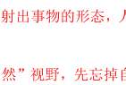

铺垫了法门与道的关系，我们开始看老子的做人之法。

其实现道经的每一章的法门都可以往做人上套用，也可以往做事上套用，万套的！因为法无定法，从道看法，每个法门都可以是做人，但这样讲就太散了，所以拿出做人“最远”的法门

如能明白前面“法门与道”的关系，就能明白为何道德经看起来像散文，像老子在咖啡馆闲聊，因为法门是没有顺序的，想聊哪就能说到哪所以市场上有些阴谋论，讲有邪恶之人故意颠倒道德经各章节顺序，这种说法就不要理会了。如果非要给道德经搞个顺序，那就可以分为道经与德经吧，因为前者更偏向于哲学层，后者更偏向于应用层

言归正传！

首先，把此二章节原文无放放在那不管，功夫一定在诗外！尤其是不要看各路译文，几乎都是错的，100%带歪！先按字直接翻译道德经，必须进入假象！

道家思想借力自然，通过自然来映射出事物的形态，人心稍一动，一定要有个“仿效自然·法术落地”的过程

也就是我们先要从一个宏大的“自然”视野，先忘掉自己，忘掉做人这个事，先

去感受自然之道（不是大自然），而后仿效自然，映射出“人自然而然”的样子，再慢慢想起“自己是个个人”，这样就“自然而然”的知道如何做人的法门了！最后再 orice核到道德经原文中，就会洞明了！

这就像是数学学，78932+48769=127701这一道题不是数学，1+1=2也不是数学（虽然看起来像本源，以为这就是数学了），而是从后者导出前者的过程，才是数也也就是说，那道题以及1+1=2全都是假象，只有二者之间的过程才是真相，才是趋近于道。

自然之道是一个动态过程，读道德经就是不断领悟这种“自然之道”，常悟常新，受用无穷；而自然之道是超越文字逻辑的，所以老子只能通过一个个“法门”帮助人们窥探道，“翻译”道德经的过程就是入各种法门的过程，最后升华出一个“对道的感受”。

所以人去看道德经，越是抉命看道德经就越进入假象，因为法门都是死的，重要的是看清背后的东西。

人们都活在一个个假象之中，低级的假象就是各种术，高级假象就是法。如果人有道，即可穿透各种法门，帮助看清各种法术（假象）

再回到三眼之前讲的那句话：有了真相和假象的区隔，就会影响伪装与猎杀。社会被此二者填满。

天地与万物有设有？在人的意识里有！因为这个词摆在這，既然有这个词，诸位意识里就有个模糊形态。
那好了，具体画出天地与万物什么样子？可以吗？用西方“切块思维”把天地切碎可以吗？不可以！
这就是东方思想的高明之处，用逻辑表述思想运动（悟）的路径是这样的

### 有·无·有

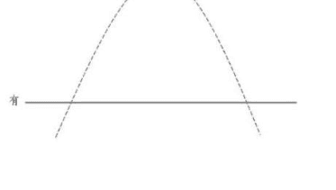

再细化点就是

人法地-地法天-天法道-道法自然。
（这是从有到无，从有形到无形，从具象到抽象，维度爬升。）

反过来：感受自然效仿自然形成而到某个天地（也就是某个实际领域，比如做人的天地）-最后到做人具体方法。（这是从无到有，从无形到有形，从抽象到具象，降维打击。）

### 这一正一反的路径，就是“道”在运动

所以我们看“道”字，人的脑袋在车子上不断行驶。怎么行驶呢？就是上面的曲线！

### 所以顶级思维不是教出来的，而是向“虚空”（无）要来的！

所谓悟性，就是从“有-无-有”这样转一圈，具体思想（有）本来是不存在的，但是通过碰到虚空（无）那里转一圈，思想就来了，洞察力思想力就飞开了。老子没法直接给世人思想（意识附体），只能不断地给世人演绎路径，让世人自己去领悟。

什么是悟性的高低呢？就是向虚空要东西的能力。1万个人都在看道德经，但是能解读出1万种花样，各有差品，这取决于人的天赋而人的最本源天赋其实都是一样的，有差别是因为天赋被“阻挡”住了，智慧之“窍”被堵住了，打开“窍”激活天赋佛家最在行，有个激活仪式就是灌顶，“窍开了往里面灌智慧

名的道家子弟都是通才，专才都不要！

### 专才玩脑子就行了，通才需要玩心智。

如果把人给分类，没有悟性（没开窍）的人占 90%，而在这 10%有悟性的人之中，悟性极好之人极少。

这个百分比一点不夸张，甚至比重有点大了 所以三眼之前文章写过一段话，大街上 10 个人走来走去，其实 7、8 个都是“兽类虽然如此讲话貌似冷血，但理不糙

人每天悟道，当熟悉了人的起心动念过程，再去看人就有了轨迹可循，他人一张口以言行，就能看到其背后心脑运转的轨迹（有—无—有之循环）“有长多”。根据其“长度”就能判断这个人思想力在什么水平。

人以群分，物以类聚，熟悉了“轨迹”即可感受到如此东方思想不仅告诉人向虚空（无）要东西，更高明之处在于“大家统一模式要东西”，这个东西就是“道”这可真要重要了，几千年的外族涌入、朝代更迭，文字变化，语言变化（其实实现在讲的语言一半都是胡话），生活方式变化，这些外因经震撼动不了中华文化的源远流长，为什么？ 因为文化都统一在“道”这个模式下，用着相同的文化基因因无总是农工商，还是什么民族、无论文诸子百家，后是后来佛教的融合，“道”无所不包，无所不容，大家都是一个“底层代码”，都是同一个“基因”，这个基因已经融入神州百姓骨血，虽然大多数人无法有形地描绘它、钻研它、使用它，但它就在那里，人他们的一言一行，讲说话写字，它都跳出来施加作用思想的存在就是寄生。“道”给了人们一串代码，一个原始基因，然后开始衍生派生。这就是吞噬的魅力。

### “有无相生”与“寄生”

好了，我们先“感受自然之道”，再去感受“做人之道首先，提出一个问题：无形为何能存在？答：因为有“有形”存在。

有无相生——就是有形与无形本来都不存在，要通过互相映射（相生）才会互依而存。无形不是道，有形也不是道，有无之间的“映射”才是道！

有和无，本来都没存，它们都来自空。要想有此二者，就需要“生”出来！有生必有死，佛道研究的起点都是生死问题。思想就是形而上再形而下，也就是自然·落地这个过程，我们开始形而下（从无到有）

天长，地久。天地之所以能长且久者，以其不自生也，故能生长是以为圣人退其身而身先，外其身而身存。不以其无私与？故能成其私从“效仿天地”到“圣人之法”，这就是

### 老子思想运动，从形而上到形而下的一段过程

此处天地不是大自然的天和地，当然具体上也可以先这么认为，方便代入逍遥天地

为何能“天长地久”的存在呢？因为“生”的方式与人类不一样！

人世间乱象环生，比如朝代不断更迭，盛世短乱世长；科学呢为满足人类欲望在不断破坏大自然。这些乱并不能对天地产生影响，产生不了干扰，天地还依然在那里哪怕有一天人类再喧折腾，靠着科技力量翻江倒海，把地球大自然折腾的不成样子人类把自己折腾灭亡了，天地还是在那里“长且久”。

为何？因为天地“不自生”；而人类“自生”

这个“生”字涵义广了，一个字简化了生命体各种欲望和思维的运动，通过一个更为宏大的视角，来洞察生命存在的形态。

其他诸流派都是研究“如何自生”，比如儒家每天叫叨怎么做？对仁义框架，佛家怎么能打升级，西方世界更是把人存在“切块”去物化

而道家无视这些，跳出维度，把生存的形态直接一分为二，然后寻找“三所以才有了第三种生存—寄生！

这是通过将自然与人类的两种形态统一对立出来的第三种形态。

天地是摸着看不见的，但是老百姓都心存天地，每个人都有一个天地的形态，但是让人们讲出它的具体样子，谁也讲不出来。

天地是“无形”的，它的存在依赖于万物的“有形可以换成逍遥：天地是“寄生”于万物。有了万物就会有天地，没有万物就没有天地。天地与万物是互相“映衬”（相生）出来的！

只要万物存在，那么天地即可长存，除非万物都消亡，三归于二，二归于一，一归于无。那么整个世界就“空”了

再继续形而下。

可以把无形换成无私，把有形换成有私（自私）。这就形而下到人的主观意识流之中了，开始接近做了。

逻辑就是老子讲的：“不以其无私欤？故能成其私。翻译过来就是：天由于为其无形，所以能成就其有形（无形不在百姓心中）；天地因为其无私，所以能成就其自私（恒久存续”

但人不是天地，不是“自然”，人只能效仿自然之道，不能做到“不自生”（比如肉体），又要不“自生”，咋办呢？人要“寄生”！

寄生二字是三眼为了表述逍遥加入的。

在《生存法则四：做人的完美结构》一文中，写了这样一段话

2、三履用“寄生”这个词很关键，人的成熟与否就在于对这个词的认识。

寄生二字让人没有是非观，更能冷静的看待社会与生存。每个人都寄生于社会之中，我们都像是寄生虫，天王老子也一样！寄生由活成什么样不是自己说得算的，而是取决于寄生环境。有什么样的寄生环境，寄生虫就该怎么活。

寄生！这才是人真实的活法。脑子里有寄生观念，才成为一个合格的伪装者和狙杀者。

因为人有着性情漏洞，绝大多数都是围绕着“自我”转，都嗅嗅了，嗅嗅嗅地社会，只要外界的变化不符合自身的意愿就受恐惧。这是忘记了自己“寄生虫”这个身份，“忘本”就会变成猎杀者。

寄生！帮人弄清真相；自责，帮前人除害根。有了真相与假象才会形成伪装与狙杀！

这段话再配合老子的“是以圣人退其身而身先，外其身而身存。
前半句讲的是“示弱”和“不争”，后半句讲的是“寄生”，其实是一个意有了“寄生”的观念作基础，就很容易领悟柔能胜刚、弱能胜强、无为而为等诸多法门都是死法，但背后的道是一样的！

寄生的妙处在哪里？
在于只要被寄生者是存在连续的，那么寄生者即可一直存在连续
何谓“外其身”？就是寄生于外物！

外其身就是告诉我们不要“自生”，在佛家讲就是不要“我执”，也就是在观念上不要认为自己主宰自身的命运，能够自己生化和谐化自己，而人的存在都是因果缘的交汇结果
在道家入世看来，是要与外界达成一种“寄生关系”！

人来到世界，本来就是由万物所化，聚敛精气而成人。没有万物就没有天地，同样也不会有人，人本身就是天地万物的一部分。
而人呢因为有欲望，由“自我”吸纳率牵着各种欲，认为“自我”是独立存在的，每个人都以为自己是独一无二的。这是人性之中巨大漏洞！让人们忘记了“本源”。
那么好了，道家推导出这“第三种生存”很高明，因为是仿效自然、趋近自然之道

但这只是“道”的层面推导，如何落实到“法术”呢？
也就是怎么具体做到“寄生”呢？需要什么样的套路和技巧呢？

### “寄生”的法门

好了，我们继续形而下！第二十二章就是具体法门了。

曲则全，枉则定，注则盈，散则新，少则得，多则惑
是以圣人执一以为天下牧。
不自视故明，不自见故章，不自伐故有功，弗矜故能长。
夫唯不争，故莫能与之争。
古之所谓曲全者，岂虚言哉！诚全归之。

此二章在逻辑上画个图对比

| | | |
| 道 | 天长，地久。天地之所以能长且久者，以其不自生也，故能长生。 | |
| 法 | 外其身 | 不自视故明，不自见故章，不自伐故有功，弗矜故能长。夫唯不争，故莫能与之争。 |
| 术 | 退其身 | 曲则全，枉则定，注则盈，散则新，少则得，多则惑。 |

这两章结合在一起，就是做人“道法术”的完整结构体现。

“退其身”是具体的操作技巧，主要代表逻辑就是“曲则全”。

世人往往只记得曲则全，这仁字火的要命，但很少有人能“上下打通”，只有通过“寄生”这个中间概念加持，能打通才是“活法活术”

术就是技巧。

为何要有术呢？因为人无论做什么，不可能每次都要“有-无-有”这样绕一圈啊，那不累死人了。
所以要推出一些具体实用技巧“工具箱”，到了具体运用之时翻出来，但是术也是有规则的，一个“曲则全”引领术规，在其后可派生出多种术。

但是没有道的加持，不悟道（有-无-有循环），术就是无源之水，是死术死技巧。
正如人们所追求的“洞察事物本质”的能力，其实这种能力平时感受不出它来自作用的，因为它不会起到立竿见影的效果，但有道即可推法，有法即可推术，这样在术的具体使用上就会灵活，因为术都能“归位”了！

人要归根（思想），术要归位（运用）！

“外其身”就是心法，就是法门，需要它去引领术，主要代表逻辑就是“不自视”

为何要有法呢？还是因为“自然”太累了，天天仿效它人家很疲倦，仿效者也累得够呛，所以在大家的实践领域就需要开法门

所以，一个人在某个实践领域的拼的主要是法。法不那么抽象，但也不是特别具象，刚刚好，上承接道，下指导术

法字拆开，是水路+行动。
所有生物都要逐水而居，找到“水路”生灵就能生存下去。人在某个领域就是找到“水路”，就是找到“根本法”

但还是那句话，没有道的加持，就不知道法是怎么来的，法就是死法。

所以和尚老道下山传法，明眼人一看就知道了：哎，拼的其实是背后的道，佛家的“宇宙”和道家的“自然”互相拼，看谁更接近本源，看谁“给的东西”多！拼来拼去，嘿...都一样的。然后孔子和长发看了看人间，呃哈，有位孔子，人家一定选择地把我们历史害害多了，人家才是实践大家啊。所以佛家总想把孔子定位成大乘菩萨给收编了

好了，不开玩笑，悟道还是需要严肃一点的。我们继续解析老子的做人之法。

不自视故明，不自见故章，不自伐故有功，弗矜故能长

这几句解释的人太多，但多数都是字面意思。所有字面直接看都是“死法死术”，也就是死逻辑，人会在里面绕来绕去绕不出来。时间久了，老子的心法就变成术了！变成术就会只会照猫画虎、依葫芦画瓢，不会变通看字面意思不自视故明

“视”在帛书上写作“示”，都一样，意思是不去反思和观察自己就截止开明。这句不是“正常人思维”，多数人看完一脸懵但前面讲了，这是“法”的主要牵引逻辑，可以叫“法根”，我们后面讲，先看下面那几句，比较“正常思维”的。

不自见故章

见（xan）后来被改成为“是”，章被改成“彰”（会意字，站在多姿多彩的前

古代文字少没办法，用现代话可以翻译成“装 x”。

这就形成了两句话。

一个讲的是“人只要不自显我才会有彩彰显”，现代大白话就是人 wn主动装 x 才能真正装 x；话糙理不糙，喜欢严肃的小伙伴出门左拐。

另一个讲的是“人只要不自以为是（正确），才能明辨是非”（彰此处为“明显显著”之意）。

这两句话其实一个意思，现代话就是“低调才能高调不自伐，故有功”

伐，自我夸耀的意思。此句表意思也很好理解，人不主动居功（通过自我赞扬和夸耀而抢功劳）反而才会得到功劳。

弗矜故能长

弗，不的意思；矜，自尊的意思。此句后来被改成“不自矜，故长”

自矜，往小了说就是自尊心（缩小了），往大了说就是傲慢（放大了）。今天的语言看自尊和傲慢有点区别，这是因为各种文化融合的结果，文字乱成一团，其实这些词起心动念的过程是一样的，只是量级不一样，古人搞文字都是一步步推出来的。每个文字，字意都是一个系统族下的，系统融合就会混乱，比如佛也讲法，道也讲法，法家儒家也讲法，西方佬也讲法（法律），就一个法字乱成一锅粥。所以学习文字其实也要归根（归于一个系统）。

矜（jin）还有个读音是（qin），是没有箭头的子，一般用于特殊场合“逞气势”用。翻译成大白话就是“自抬身价”。这是与自尊和傲慢的起心动念过程合上我了。但是真的，还与“自伐”（自夸耀）有区别：矜的这种“自抬身价”自己都信以为真叫自传不外延了（继续看此句，意思也很好理解，人只要不自已夸自已，不做慢，才能连续长久。

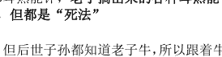

这里就要说两点：

+ 1、其实这些做人的方法我们都耳熟能详，老子摘出来的各种耳熟能详就是“道德”，孔子摘得那一堆叫仁义，但都是“死法”

虽然从老子喧第一次说出来，但后世子孙都知道老子牛，所以跟着牛人就要“勤奋学习”技法，这些话都已经学得快吐了

类似这种技法无数，遍布神州，还有什么孔融让梨啊、三人行必有我师啊、一日三省吾身阿等等，从小就知道，在感觉上也都快吐了但是呢，真正能做到的没几个，真正能懂的更是少之又少。为何呢？

#### 2、因为这些技法都是逆着人性的！

我们觉得这些诸如“正常”，是因为听的太多了，大家把这些话和讲话的人捧得太高了，大家都稀里糊涂就默认这些技法是“正常且高明”的，但真正沿着“反思”维一直到底，抵到“道”抵到“无”抵到自然的没几个。没有道的加持，任何法术都是死捏锥，而且是“反人性不正常”的死捏锥，这样人们怎么可能体悟去做呢？“正常人”的做法大多是

都是时刻观察自我（自视），欲想通过不断地反思和训练来强化自我；都喜欢装X，都自以为是（自见、自是），不自觉地就开始装了，开始怒绕相反对意见都喜欢夸赞自己而抢功劳（自伐），谦虚也大多都是“谦虚式装X”，这样的装X显得更虚伪更险
都有着极强的自尊心，面子大于里子，架子大于底子（自矜），尤其是一些“专才”由此导致“不得志”

之前文章讲，文明的发展就是“失道”的过程，人的生存也是如此，文明也是由人、人心推动所致，大多数人的一生都是“失道”的一生

为何失道？因为人们都追求“有”，而无视“无”，甚至根本不知道“无”的存在。

这在佛理看来道理一样的，人们都追求“有”(欲动)，而无视“空”，甚至根本不知道“空”的存在

佛道本一家，因为都是顶级思想者，根子都一样！

### 利益是场关系，而不是便宜

那么好了，老子这超级做人大法，如何“归根至道”搞加持，从而真正明白“法理”，真正入心而后去实践体悟呢？
再画个图：

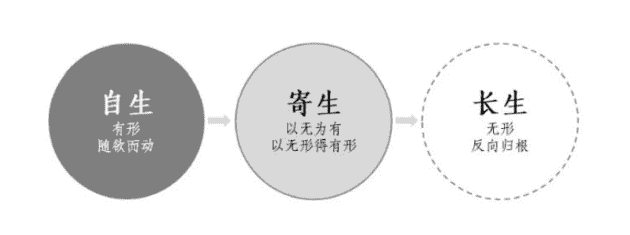

前面我们讲了“感受自然之道—做人之道”的过程，从形而上逐渐推导到形而下（老子做人实践技法）；下面呢就是返回去了，从做人来仿效自然，从形而下再返回去形而上以无为有，以无形得有形。

老子：反者，道之动！

其实应该写成“返”，思想根据是一个“反”的过程（悟道要归根），但是实践是一个“正”的过程（做人要顺道）。一正一反此谓“返”（往返）。而谋略要玩“失道”！回头再论，与本篇“顺道”不是一路子。

正如在做结构郑纲文章中讲的，人的一生（思想与实践）是一开一合、一正一反、关门开门、上山下山，是有节奏的！
寄生，是三眼强调的。噢，加强词汇不是一个两个了，因为便于理解。如果直接讲“以无为有”，恐怕大多数人是没有直观感受的
寄生虽谈不是特别恰当，但是用在“做人法门”足够用了！
好，大的 faptul在可以把自己当成“寄生虫”了…寄生于天地万物之间！
寄生是要 dựa？是为了幻化无形。

寄生成功就是“善”——这是天底下最高级的生存伪装智慧！

寄生的比较高级表现就是天子
寄生核心在于“无我”！忘掉自己而效仿大自然“寄生”于万物，大地是没有“自我”的，因为没有自我而“不自生”所以才能长久。
有万物，天地就能能够存在；同理：有社会，有组织，有集体，有朋友，有家人，我们就能够存在。
但是呢？人只要是人，最后还是要回到利益问题。天天下熙皆为利来！
老子的“不争”不是真的不争，真无我那就出世了，还入世干嘛呢？而是通过“自然天地人”导出“寄生”，而后推导出“高级的争法”！

夫唯不争，故莫能与之争。

争的是啥？利益！
而利益的存在也是“有无”的相互依存。我们的个体的利益都要依赖于集体，比如财富、货币、资产等依赖于集体的“信心”；我们的名望、地位、权力也都要依

存于外界的“信心”，信心这东西，你越去争就越没有！

利益的核心价值在于“长久”二字，就像是天地不会一争暂时的得失，而更在于与万物的“长久关系”

天地与万物，个体与外界，是互相依存关系；而“自我”是无视这种依存关系。一短期的叫便宜（争），长久的叫关系（利益；不争而争）。

人无论是攻是守，都是对“关系”的把握，而对关系的把握需要高维度俯瞰，这就需要借力自然。

比如现代社会太贫了，大家都重利，无论投啊、创业啊、事业啊，心脑一动，都是想“捞一把”就跑！无论做人做事追求“短平快”，内心浮躁不安，所以在创业上特别注重重体，体现在“赚钱100法”、“做人50妙招”这种东西很火热，而事实上这种心态可能会有短暂运，但对于大多数人来说，人生一定是失败的！

因为人生的成功并不是个体“争”出来的，而是能与外界达成一种平衡关系。

争前面加上提手旁就是“挣”，这是典型的底层式的命运挣扎

比如投资，三眼总讲“十年磨一剑”，是因为大组织的经济发展模式大约10-20年一个轮换周期，与“天”共振，个体与社会经济发展建立长久且平衡的关系，“组织的利益奖励机制”当然偏向于你，爱G就是最大的运气，这句话得好好思想索一下，没有温度的去思想索一下

创业维度比较，就是看谁观察的“天高”。

共振上了，在外界看来，这人也没怎么努力，不争不讲的，甚至是不务正业，慢慢悠悠的过生活，但是结果轻松又快乐

人活一辈子都要涉及到利益问题，利益问题就是“算小和算大”的问题，老子的“不争”并不是真的不争，而是“算的面最大”，算的“时间”最长，从而不争而争。

而这种“计算方式”要学习自然，向自然借取智慧！

### 内外合一

好了，我们再回到老子做人大法的第一句

不自视故明——人不变思和观察自我就能开明。

有了份效自然后“寄生”观念的加持，看这句话就不懈遥了，并且体会到这句话在“法门”上的“重要引领”作用！

人要寄生，研究谁？
当然不是自己了，要研究外界的人与物，而且要忘却自己，不要观察自己。

——外界是什么样子，人就要顺应外界变化成什么样子。

### 就单凭这句话，老子就是神州最顶级的“传法者”，没有之一！这种道法直接跳开维度，寻找本源，降维打击

纵观儒、释、墨、法、西学等等，都是正面上去做人，讲怎么怎么观察自己、反思自己。形成很有意思的矛盾局面
告诉你一边要悟空啊、放下我执啊等等，另一边还要让人不断观察自我，查缺补漏。这种“既要也要”是很折腾众生的，但是呢也可以理解，因为道家的东西对人的悟性门槛要求高，其他家都是“广撒网”，对于绝大多数人来说，必须要以幻治幻、以毒攻毒（用很形象做比喻）。

所以此前也会讲，思想者之间也是互相猫杀的，这就像斗兽棋，大象猎杀老虎，老虎猎杀下面一堆绵羊，而最后老鼠钳杀象

人的修炼需要“多种武器”，杀牛刀、杀鸡刀都要有，形成完整工具箱。

所以有些文章不是给所有人看的，只是写给有缘共振的，老子我想必这种感受更深，老人家讲到

“宠辱若惊，贵大患若身

玩“寄生”的，会在乎宠辱？在乎的话就证明还没有忘我，修炼火候不够。
又讲

“善者不辩，辩者不善”。

啥叫辩论？就是 自我>对方。

人如果在环境中区出口“自我”，这就是失败的起点！
所以辩论家如果不限制，最后就是互相人身攻击，高级没叽骂街玩“寄生”的，会在乎输赢？会争一时之高下？“长久关系”（利益）还要不要了？但是！这两句话拿到佛教和儒家系统里就不受用了，因为这哥俩收信众“广撒网”，玩的都是正向思维，人家不玩“寄生”，玩的是“个体修炼”，就像游戏打怪升级一样，给信众规划好多等级，所以这哥俩对于宠辱、辩论是很看重的，传法时候像开辩论赛一样，各种缠绕转圈圈，众生看着眼花缭乱，脑子很充实“沉甸甸的”，觉得学到了很多，真是大师范啊道家就没啥等级，能悟到了就悟到了，话不用多说；如果悟不到，说再多也白费。思想的存在就是攻击漏洞暗嗤嚎，您选择哪种攻击呢？喜欢被那种思想吞噬呢？

不自视故明，不自见故章，不自伐故有功，弗矜故能长。夫唯不争，故莫能与之争。

拿着“寄生”观念，整体就都顺下来了！

不用细抠每句话，不然木讷之人又要陷入“死法术”了，总结就是人因为“寄生体”存在，所以人就存在；那么像荣耀啊、装x啊、功劳啊、面子、气势啊等等都是“寄生体”的，寄生体有了这些，人就有了这些。

最后达到：寄生体就是你，你就是寄生体，“内外”合而为一。这就成了！

人无论是打工创业，是个体创业还是集群行动，是家庭还是家族，都要牢记：我很大“大”，都是“我”！

举个典型小例子，虽然比较低级，但是便于理解：“通过我们厂子的勤奋努力，我们如何如何了……”

如果有心去看古书，看古代故事，看官话典籍，都是带着“道”的，只不过很庸俗上的加持，把“法术”给学死了，不会灵活运用，时不就

庄子讲“嗜欲深者天机浅”——这人的“寄生能力”与“忘我能力”是成正比的

好了，本章节还剩下一

曲则全，枉则定，诎则盈，敝则新，少则得，多则惑。是以圣人执一以为天下牧

其实呢，从“曲-多”这一堆技巧例子，看不看都行，都是“柔弱和不争”一些具体的术，都是具象的。

着“空杯”做人做事的
老子也怕这事，也怕人们把它搞死了，所以下面接着讲“是以圣人执一以为天下牧”
后来的改成“是以圣人抱一为天下式”
这两句话虽然都有道理主张在里面，但是改完之后，道治和宗教“虚伪式装置”
就然就上

- 一个是：轻轻牵挂着道以此来“牧”天下
- 一个是：抱着道来为天下做示范。

虽然小说改动，但意识形态大变化，从此道家变成“道教”，老子的出世境界变成入世。当然，这和我们凡人没啥大关系。这句话要点在于“执一”是什么？
是两射起点过程，相生起点过程，这是一个似乎未动的形态。阴与阳，有与无是互相依存共生的，但阴不是道，阳也不是，阴阳的互相“映射”的动态过程才是。
具体讲，打开做人法门，就是“寄生”，个体与集体，自我与外界，是互相依存共生的，向内求不是道，向外求也不是道，自我与外界“结构平衡”的过程才是道。无论是个体无限制求“有形自生”，还是在集中中求“无形寄生”，都是为了生！
都是法门，看人的天赋秉性合不合拍，各取所需而已。

“合一”可不仅仅是“合在一起”这么肤浅，关键在于“统一”！做人就是“内外结构平衡”

### 总结：

这一篇阐述了一种做人的“动态结构”，有此结构再去看道德经其他法门，以及诸子、西方等诸多法门，皆可运转自如

有问题随时私密我微信：ipip515。

### 道德经的冰冷智慧（四）：降维攻击——柔弱胜刚强！

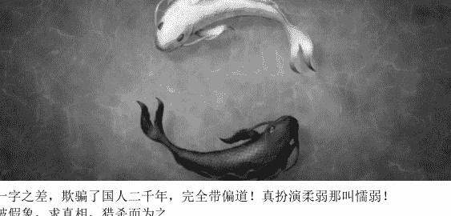

一字之差，欺骗了国人二千年，完全带偏道！真懂演柔弱那叫懦弱！

破假象，求真相，猎杀而为之
本篇讲所有人最爱的章节——以柔胜刚。

> 第三十六章：将欲歙之，必固张之。将欲弱之，必固强之。将欲废之，必固兴之。将欲取之，必固与之。是谓微明。柔弱胜刚强。
鱼不可脱于渊，国之利器不可示人。

世人最爱，是因为其讲述了一个终极的致胜之道。如能领悟，此后做人做事完全是降维打击
但大多数人，包括很多专家学者，对柔胜刚的理解是完全偏离的！搞得小伙伴们都知道这句话牛，但很少有人知道如何才能牛。柔是啥，弱是啥，柔弱是个啥，怎么个道？
道家是专业研究形态的，不从形态入手去看，道家谋略就是无字天书；懂了形态，就是至简之道，简单方便，受用无穷！

### 柔弱的假象

一读到柔弱胜刚强，那两个世人皆知的“经典”例子就跳出来了

- 1、牙齿与舌头的存亡
这俩哪个更能长久存续？答是舌头！
因为舌头软；牙齿早亡是因为过于刚硬，从而早早夭折。
所以：柔胜刚

2、水滴与石穿：天下最柔弱的是什么？水但水虽然最为柔弱，石头虽然坚固，但是可以水滴石穿！所以：柔弱胜刚强。 此二例全错！胡说八道！

要这么讲，老子别讲道德经了，干脆讲个“舌头经”吧，老子那年代词汇量再少，起码舌头这个东西还是有的吧？拿过来描述直接用啊，多方便还有那个“水滴石穿”更是糟糕扯，老子讲“水”，就把实际的水往上套，把物理学套着哲上套。 此篇论述的“柔弱”不敢讲是最正确的，道德经是刺激开悟的，没有固定逻辑但思维维度要比“舌头和水滴”高出不止十个层级，一个天上一个地下。刚柔之道，上到政治、军事、管理；中到投资、创业、创设；下到做人、做事、职场、家庭。皆为顶级思维！柔弱背后讲的是一个“对形态的操控思想，就是观察事物形态的方法！

拿“舌头大法”出去攻城略地试试？噢…用于狠狠做人还可以。

道德经全篇讲“柔”不少，但讲的都是形态，而不是某某具体事物。舌头大法怎么个错误咱们后面细聊，先顺着其错误看看世人如何错上加错！

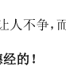

只要是个大师，一提到道德经，就开始拿“水滴和舌头”往做人做事上套：“这做人啊要学会用软、用柔、用弱”云云。所谓柔弱就是谦虚啊、退让啊、吃亏是福啊等等，然后“以退为进”，强行与“曲则全”那章节逻辑衔接，“进没进”不知道，但可以肯定的是通过大鸡汤给人变傻

只要人不明心眼，都知道一直吃亏不是福，一直玩柔弱那是懦弱.

很多人读道德经读歪了，老子不是让人不争，而是争得更轻松，获胜概率最大化！

没有积极的攻击性，是看不懂道德经的！

此时人心理就会很矛盾：呃啊，人家老子那牛，说的肯定有道理啊，但是我照着做怎么结果不怎么样呢。这就好比白领上班挤地铁，车门一开抢座位时候谁不讲素质谁有位置坐，“守弱”讲素质的小伙伴很冷的鄙视他们：哼哼，俺是有大智慧的，这一时之争算不得什么，老子言论也是不要争而争，要弱莫弱争，这才是大智慧。可是呢，随时会发现生活处处都是“抢座位”，职场啊、创业竞争啊、投资啊、朋友圈啊、各种社会交往活动啊，甚至回到家庭也是如此。只要人人不傻，都在抢抢抢。前面高质量竞争的……

冷那位的“以退为进”总是用不上

这时候一群机灵鬼就分析了，不对啊！老子招法肯定不是这么耿直的，这群人很鸡贼，慢慢地“柔弱”就研究成了“示弱”。
用柔一变成一用阴！
还搞出个词：阴柔

但凡是玩阴的，统一遥辔；假装柔（示弱）。
也是就是假装谦虚，假装退让，假装吃亏很爽，然后偷偷摸损搞破坏，以此达到狠狠不可告人的目的
基本上有关阴谋的书籍，无论看古代的还是现代的，99.9999%都是“阴谋”，专业研究人怎么“装”，怎么作假，然后使诈！

那要装假使诈首要一点就是不能露馅啊，所以咪着鸡贼眼睛讲“谋略贵周密”，当然这也不是不对，玩“术”肯定要周密，但这些都是要小聪明阴谋诡计。白了就是小伎俩（术），所以后世把权谋也称权术，权术子弟每天都乐此不疲要阴招…
说话办事滴水不漏的玩周密，时间久了一脸死木头相，看着官员该达人和谐官话就知道烂，十话九空打官腔，皮笑肉不笑，生活一点也不美好。而人要是总爱阴招必被反噬，所以风险很大，这叫做一阴险！

### 装假一时爽，长久必败！

所以，学阴招防守用可以，不要当成利器。君子藏器而动藏的可不是阴招呀！之前文章三眼总讲：思想如同一把利器，具体发挥出什么作用要看谁用它。老子东西很广大，被后世子孙多给研究狭小了，跟老子无关，跟用的人有关。带着框其功利之心，从道德经里面抠出几个字，就开始“发扬光大”，搞出什么阴阳学、守柔学、守弱学、长短学等…而后学问越研究越窄。不是老子窄，而是用老子的人窄了！
嗯。到了现代社会，直接秃子都没意思，因为该秃的都被“占完整”了，好吧，秃出“水和舌头”

为何道德经总被秃疤？因为功利心！
比如何讲的歪曲，非要把柔与刚、弱与强分开，然后来个大比拼，看谁能赢，小家子气
柔刚、强弱、阴阳这是一体的，分开玩那还是道德经吗？道家子弟已气哭。
在思想观察系列里讲过，这人的漏洞就在于必须做出选择，人心就像是个“矢量方向”，符合此方向的就是“得利”，逆着此方向的就是“失利”，非要选择个方向，就是“功利”。无论对于虚的情感，还是实际的名利权位，皆是如此。
人做出选择就选择无回头论，就好比人的双眼只能目视前方，眼前风轻云淡，而身后可能是洪水滔天。

人越重利，假象越深！因为人心的“方向”不通变！

动物进化由多种感官，是为了更加完整地判断周围环境；人被赋予了意识(心脑)等于是被赋予了更高维度的感官，而功利之心越强的人，硬生生把意识玩成了小动物低级感官…

一个人只懂得趋利避害，那只能是低级动物。老子为了把低级变成高级，动用意识的能力，反而讲利害相生，最后归于“道”

道家是专业研究事物形态的，研究形态就要无我，跳出自我没有自我、无是非无选择无对错，这样才能仿效自然，去观察事物的整体的、本真的形态，而后再入进去描“寄生”

硬要把柔与刚（阴与阳）给分裂开来比高低，就像低级小动物，那是绝对看不到事物的本真形态的！

### 事物运动的根本形态——乾卦

东方思想研究“周期”应该是地球最早，而东方思想的本源，都建立在“周期”观念的基础上，这个观念源自易经的乾卦。

万事万物皆有周期：仰观天象，斗转星移，日月轮换、四季交替；俯察地理（地的纹理，也作人纹），生命生亡。事物都在周期之中周而复始。

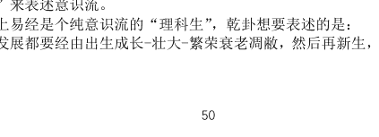

乾卦直接去看讲的貌似是“人的发展一生”。这就好比世人看道德经，见到老子总讲“为人之道”就以为老子很世故，其实不然。

思想就是意识流，意识流想表达出来做做沟通，总有个恰当载体啊，那时候不像现代社会词汇量多多，造出各种哲学学术语，所以只能通过讲述小动物衡量乐见的“人生”来表达意识流。

而实际上体现是个纯意识流的“理科生”，乾卦想要表达的是：事物的发展都要经历由出生成长-壮大-繁荣衰老凋蔽，然后再新生，周而复始。此

谓“生生不息”
人一个念头、一个组织团体（企业、国家、民族等）、一个完整活动（比如楼市、股市等经济活动）、一场舆论演化（比如意识形态斗争）等等，都要遵从周期。

这是一个典型的“动态观”，将空间与时间融合在一起。

过去让思想的两个观察角度
静态观：比如把春季单独拿出来进行分析，会形成一个固定的“空间结构”，叫做“春天”，比如穿暖花开了，草木发芽了等等表象。

动态观：春季之所以是春季，是因为春夏秋冬的交替，没有这一“时间运动”，春季就没存在的基矗有了春秋冬就会有春季，这是互相依存的，春季不一定就非要有草木发芽。

用动态观去看静态观的结果，都是“片段”假象！
道理等同，用道去看法，法都是“结构”；去看术，本都是片段假象。
由“活”向“死”的过程。

### 而人的正常思维都是静态观，也就是对事物的认知都处在“当下空间”！

因为绝大多数人感触外物，所动用的都是低级（动物）的直接感官（实感），就如同人的双眼只能看见的距离，超过视野之外都是“未知意识是高级感官，帮助人们感受时间的运动（抽象，虚感），感受视野之外的存在

但多数人是低级感官引领意识——这叫情绪。

典型的例子：男人对女人表现出热情，话语甜蜜，女人大多就觉得“好”，所以追女孩最关键的是“满足听觉”，往往谈不上！意识这种高级感官此时也受制于听觉，“好”本来就是一个情绪而已，“好”到底是不是真的好，不知道。当然，只是举个例子方便理解，女同胞不要生气，男同胞只有低级感官的也大有人

所以想要发挥意识的作用，就要去除掉低级感官（眼耳鼻舌身意，意可理解为情绪）所带来的“当下空间判定”，通过更长久的“时间运动”去判定事物的本真。

所以道德经怎么看？要通过意识去看——这叫悟！
意识能获取的感受维度，就是天赋了
但大多数人不会利用意识的，而最善于用“脑子”转圈圈。所以像“水泄石穿”舌头比牙齿活得久”这种“当下感受”才会频繁给人们洗脑，呃呃好像是这么个道理…让人们误以为真
这种假逻辑到处都是，低级一点的股市楼市理财，高级一点的传X、宗教…天天忽悠人，靠的都是空间假象。

### 攻击的维度

好了，回到本文主旨，柔弱胜刚强！
人首先是动物性，而后才是人。趋利避害是动物天性，也是人本性

低维：顺着人本性：
高维：逆着人本性

所以讲“悟道”是数根，是逆向的。如果人人都沿着人本性运动，只能进入“竞争红海”

人性的运动就像是无数物理粒子向前行驶，随着时间画出无数的轨迹（空间变化）；逆人性运动就像是让时间倒流，站在原地不动，或者往后行驶，从而能看清行驶“在前面”的无数轨迹，从而观察出事物的形态（空间结构）。

低维的竞争都是“空间结构”下的竞争
最低维的：小动物通过咬死对方，而获得额外能量——直接吞噬；
高维一点：通过咬死竞争对手，从而能够更多的占据额外能量——抢地盘；
再高维一点：通过制服竞争对手，从而利用对手帮助自身获取能量——控地盘；
再高维一点：通过奖励帮杀产生协同，从而分食能量——共生共赢共建地盘。
这就是权力组织的演化过程

生存法则啊，文明的发展就是养殖技术精密化，抢夺形式温柔化，分配方式多元化的过程

文明发展是“不自然”的，因为有意识
从低维竞争到高维竞争，在人的心智当中，是一个低级感官和高级感官谁占优势的过程

越是动用低级感官，人越是情绪占主导，产生出最低级的竞争方法，也就是想要“直接吞噬”，譬如暴力、仇恨、嫉妒、讹谬等等；越是动用高级感官（意识），人越是理性（无我）占主导，依次产生出高级的生存竞争方法，顶级方法就是柔弱胜刚强

敌，追求的是战胜对方，至极目标是无敌——这是一种跳不开自我的思维运动；胜，追求的是恒久存续，能活到最后才是胜——无我寻求“寄生”的思维运动

人可能会无敌，但无敌并不一定恒久存续（胜），而相反，越是无敌越是会让存续更短暂

俗话讲，坚持就是胜利。而我们要研究的是坚持的方法（道），用在生活创食上也可叫做“寄生”。这就是柔弱胜刚强。

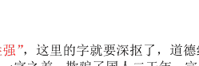

按照前面的逻辑：柔弱胜刚强，并不是说柔弱可以打败刚强（敌），而是说比刚强更能获得长久存续（胜）。

但这么讲，又错了！

帛书此处写作“友弱胜强”，这里的字就更深拙了，道德经不同版本间需要细抠的字不多，这算一个。一字之差，糊墙了国人二千年，完全带偏道！带出一颐千丈大鸡汤。

什么叫“友弱”？就是：在事物发展形态上，要偏向于“弱（向强）”的一方。而不是要“成为弱”！这是对形态的一种操控。

但凡只悟出“扮演出柔弱”的都是弱智！

什么叫弱？什么叫强硬？我们还是要观察整体形态。

将欲弱之，必固张之。将欲强之，必固弱之。将欲废之，必固兴之
在“将”自前面加上主语：自然，或者道。

然后翻译成大白话
道（自然）这个大家伙，想让一个东西收紧，必然会先让它张开；让一个东西趋弱，必然会先让它变强；让一个东西凋敝，必然先让它兴盛；拿着乾卦的周期论分析此处，很简单，事物都有一个周期曲线，最后形成个“圆”，圆就是句号，句号代表不动了（死），阴阳合为一体、人、个股、楼市等都一样。

哪怕是的感情也是如此，会生活的人是夫妻二人“慢慢爱”，那种时而轰轰烈烈爱情的人，远离为好

将欲夺之，必固与之。是谓微明。

这句话是核心！

夺之和与之，可不要肤浅的说，想要从一个人身上获得好处，就先给他予好处。

老子大智慧不要这些小伎俩…没那么猥琐

夺之和与之，是讲：

主动调整事物的周期形态！

这句话是站在管理者角度讲的，道家玩管理跟做人一样，玩的是“平衡”，玩的是形。儒家和法家都是死板逻辑，一个玩精神规则，一个玩行为规则，唯有道家是玩形态的

所以自古都是内用黄老，外饰儒术，法家打辅助做行政，一套超强组合棋子！

- 1、柔与刚，弱与强，是相生相克的，互相依存且转化；
- 2、事物极柔、极刚，是不可能存续的，唯有控制好强弱的平衡形态方可维续。

事物的崩溃都是因为“失道”，就像是跷跷板极端偏向一方，道是一种刚柔的平衡，老子讲作“守中”。

什么是微明？

就是观察到某一事物强弱转换的关键点，由此关键点即可判断出事物处在哪个阶段，是由弱向强的转化阶段，还是由强向极强（生弱）的转化阶段。

什么叫做存乎？

就是“友弱”——一事物发展周期到了轮换的关键点，就要提前占到“弱”的一方，因为它向着强在转化；等到它由强向着极强（生弱）转化之时，就要远离它，重新寻找“友弱”对象

投资、做人、搞管理、政治斗争、军事斗争皆如此！

您还记得舌头大法好吗？

比如做管理，怎么能维持组织恒久存续？是通过不断建立“新鲜血液”替换掉“老血液”，从而获取“新的平衡”而人为操控这一“平衡”，就是“将欲夺之，必固与之”。

夺之，与之不是“抢东西和给东西”，而是给对象一个“生态位置”，调整对象的发生形态。

比如投资，一定要看经济大趋势，所以谓大趋势就是大组织如何“玩平衡”，想给哪个经济载体“生态位置”，“位置”怎么样，属于什么形态阶段

以前文章总结：大组织用谁发财，用啥啥赚钱。自己细品！

推动房服切换、新市民化、新地产、内外循环等等，都是基于“夺之与之”来分析，一研究一个准，轻松受用…
从玩民苦，到玩出口，到玩地产，再到玩金融（股市）；从建立“二元”再到玩“打破二元”。从经营性政府到服务型政府，从弱文化到做强文化…这一系列眼花缭乱的“平衡切换”，大组织智囊是是非常大的，能人辈出！几十年快速发展崛起，小动物天天安分守己卖力气的管理水平高的很。喷子们不要不服，把D换个别人班子试试，这么大的体量一般的组织班子玩不转的，如换喷子上去试试，第二天下面就乱成一团

做人不能当喷子，喷子附丽了就是把上面“低级与高级感受”那一段诠细品品，三眼码字，先不说码的逻辑对不对胃口，如果让人们从喷子变成“无我观形态”，这个转变对人的作用就是巨大的，相当于做人的“1”，有了1即可在后面加数字有效了。比如政治斗争，三眼讲过矛盾论和道德经是一样的，是政治版

MAO：他不是农，也不是工，也不是商或士，他是玩你们强弱形态转化的

什么样的参与不了政治？答：项羽一样的“英雄”！
因为英雄不会玩形态，英雄只会玩“自身价值观”，哪怕武力值敌也活不过十五，因为无论做什么事都有着浓淡的是非观，执着在“自我”之中不能自拔，低级官宣引导意识，看不清事物的真正形态。

追求无敌的都是傻蛋，追求恒久存续才是高手。而高手的秘密就是玩形态！

这话往投资上套着看，追求高回报率的都是傻蛋，追求恒久存续的才是高手。追求前者的，没几个不是惨死的

汉高祖一直被后世嘲成臭流氓，其实是小动物维度上不去，理解不了高祖玩形态的超高技术而已。

这时假如要有小伙伴跳出来说：三眼，玩“微明”这不符合老子的“自然之道”吗，这不是人为干预吗？
呢，自然生态的平衡是“天地”主宰的，天地以万物为刍狗，自然之道运行很冰冷，强弱转换、生死交替是个常态

这种冰冷的思维心态在“贵族教育”中是个基础

二呢，人不是天地自然，人即有肉身，有着根本动物性；但人又有着意识（主观主动性），以至人类社会绝对不能像自然生态一样，到处都充斥着人为的主观定义（规划、规则、取舍等）。

所以人类社会与自然生态相比，是有着巨大漏洞的（意识），此处可参阅思想观系列
因为有了漏洞，“效仿自然”才有了生存空间！

这句话理解不了，写啥都扛振不上！
在大自然之中效仿自然，那不是有毛病吗？
思想家之所以是思想家，是因为人类意识有漏洞，所以才需要思想！小狗没漏洞，它才不会有看思想家一眼

思想就是干嘛事；弥霉漏洞和攻击漏洞！
再加句话：以人为本。

所以才会写一篇文章讲生存的终极形态——寄生：

寄生在哪？寄生在人类的意识漏洞里啊！没漏洞啥寄生？没漏洞咋能劫食以一当百？

没漏洞人怎么区分高下？
道德经专业演示漏洞，回头再细聊。

无不为、不争、用柔、友弱，不是天天躺着啥事不干，而是要效仿自然观察“微明”，尽其力做到自然而然的牵一发而动全身，而达到长久存续的目标（不争而争）
治大国若烹小鲜，不是不烹，而是要轻轻松松的烹，比“卖力气”烹更能长久而已
关键在于“微明”。

人做投资、做管理、作斗争，最怕的是“故意而为”（主动争），比如非要把某某项目给做出来、研究出价值，这就是入楔，入了假象便有了猎杀；管理上事无巨细都要亲自拿下，那么都管理就是都管不好；政客或军队士兵斗争最怕领导上前线，恨“卖力气”的带头战斗，结果大概率捡得一地鸡毛。
人若做事，项要心法是没没有什么敌我之分的，没有什么价值之分，没有什么部门职能之分，没有什么等级层次之分。万事万物都在瞬间方变之中，都处在强弱转化的“微明”之中，人就是要置身于“形态转乖”之中，寻找最佳位置（友弱）。

所以自古谋士都是运筹帷幄决胜千里之外，不是故意通过“远距离指挥”来凸显牛X，而是必须要“跳出来”做观察，以利于合理“操控形态”
柔弱胜刚强。鱼不可脱于渊，国之利器不可以示人。
看思想， 也就能看先秦和汉初的了，再往后都是孙子的孙子的孙子，作者大多都被框锁在道德、仁义的帘噻下，导致思想越来越细（垩），距离本源越来越远，

### 一点不赤裸

现代思想大多数更没法看，因为词汇都变了，越来越像语音文字（死逻辑），造的词（逻辑）越来越多，貌似高大上（复杂）了，其实距离语言本源（至简）越来越

### 刚柔并济

我们结合《三略》来看看，与《道德经》距离比较近，都很赤裸互相呼应！

### 《三略》

柔能制刚，弱能制强。

“制”和“克”是不一样的，玩“制”就是玩形态“平衡”，结合前文。

### 又讲

端末未见，人莫能知；天地神明，与物推移；变动无常，因敌转化；不为事先，动而隔离。

咿咿呀呀一堆语，其实就是前文讲的“周期”和“微明”。

“不为事先，动而隔离”，就是先不要去干扰事物形态，而是先观察它的运动形态等待“微明”一出，而后根据它的“轨迹”再玩“夺之与之”那一套（隔离）。

### 又讲

故曰：莫不贪强，鲜能守微，若能守微，乃保其生。圣人存之，动应事机。

大白话就是人性习惯就是趋利避害、就强避弱，很少有能观察形态的，请大家不要着了“强弱”（空间结构下）的假象，而是要观察事物强强转化的“微明”（时间结构上），然后开始玩弄形态平衡（动应事机），这样才能获取长久存续（乃保其生）。

### 又讲

能柔能刚，其国弥光；能弱能强，其国弥彰；纯柔纯弱，其国必制；纯刚纯强，其国必亡。

不要觉得一讲治国就高大上，做人做事和治国道理一样，就像音乐不分国界，想想也不分等级。

简单讲就是要“刚柔并济”。

刚柔并济可不是一会扮演柔，一会扮演刚，那就是精神病。
“济”是水流动起来（形态），刚柔并济就是使得刚与柔流动的形态平衡，平衡才是恒久存续之道

此处插一嘴：很多小伙伴内心的矛盾之处，在于是“神魔交战”，做人想要刚吧又狠不下心，做人要柔吧又觉得这样很懦弱，自己把自己玩懵逼，后台好多这

种问题，这里就解答了。

做人要跳出自我，无我的观察形态，心智与思维立马升维度，不会再去想着扮演刚还是柔，而是很自然而然的刚柔并济（玩平衡），根本不需要去苦哈哈的搞扮演，太假

做人要“寄生”，形态怎么变就怎么变，不是人去选择刚或柔，而是形态决定选择

把做人做事不交给“自我”，而是交给“形态”，这才能冷静、无虑、自然而然，杀伐果断。

道德经中老子讲：见小日明，守柔日强

啥叫守柔？就是“鱼不可脱于渊

这个渊，就是形态流动。

这人活着的“世界”是不一样的，有的人活在假象里求生，有的生活在形态里“寄生”做人做事，如果不活在形态里，那只能是死鱼一条！鱼不可脱于渊啊！

### 道德经的冰冷智慧（五）：生存与伪装的五大维度

这一篇 2 万字，也没法标红加粗了，按道理可以拆解成十几篇甚至几十篇，但是拆解了就失去完整结构了。所以放在一篇此篇所追求的结果，就是看完之后，再抬头观瞧外界与人，结构上基本就是透明的了！

分上下两篇：

上篇是《生存》，讲的是外界生存环境的结构，此时“道德仁义礼”就是集体交互的五个形态维度——相当于“象限”

下篇是《伪装》讲的是个体在外界生存结构中如何找到“寄生”，这时候“道德仁义礼”就变成“五种生存伪装的技术维度”——相当于“坐标”

文章标题很雅起，但还是归到道德经系列吧，因为是从老子“道德仁义礼”的框架说起。但老子东西很干，相当于“基础模式”，要解读公式就要找“例子”，整篇文章相当于“用”。所以文章内容其实是以《索书》和《阴符经》为主要内容，是从道家课说角度来述，但是无论如何讲述，最终还是要回到道德经的系统之中。

所以看本文会觉得涉及道德经的篇幅很少，觉得不是道德经系列而乱起名字，这里提前说明一下。

在正文之前，先抛垫个东西：盲人摸象！非常有必要

### 盲人摸象

在思想交流与获取的过程中，刺激人如何思考要远比直接给内容重要得多！人如果会思考，即可无师自通；不会思考，1万个老师教授1万本书，最后也教不出什么所以然

三眼讲东西思路比较奇葩，显得冰冷赤裸不近人情，有一些小伙伴难以接受，比如“伪装”二字会颠覆很多人的对于人性的美好想象。能不能温柔的讲？能！但是事倍功半，且无聊没意义也没意思。逻辑是这样的：

事物的存在就如一头大象，谁也不能可能把“整个大象”一步说到位，来个360°无死角立体呈现，人只要思想一动就有“占位”，也就是角度，相当于“摸象”的起点。而 described 过程要通过比喻来代替，这在古代叫“象比”

大家喜欢一个人的思想，本质上是喜欢此人“摸象方法”（思路），想得到的是“大象最终立体成像”（思想结构）。（一手资源更新微信：ipip885）结构一得，思路即可拐掉，也就不需要记很多比喻比内容了。

什么是书架呢？就是把“思路”造成“最终结构”。书架子拼的是“背下多少思路”，或者“读了多少本书”，用 nivel 来衡量结果，量变能引起质变呢？或许能，但是一定很久很久比如书架子看庄子，衡量自己是否“学到了”，就是有没有把庄子笔下的各种神话故事背下来，以及背后一个个碎片小道理（三眼统称死逻辑），谁背得多，lendir学得好，这就叫呆！

呆的眼中只有“好”，而没有“透”，越是想要背诵，越是得不到“大象的立体成像”。所以人的悟性是有悖于思维惯性的。

再讲象温柔的摸法，相当于从大象屁股开始摸：哎哟，好像马屁股啊，这么大！为啥温柔呢？因为马屁股人人都摸过，再摸大象会有个“已知”，从人们习惯性事物与角度去阐述，不会引发恐惧。

冰冷的摸法，相当于从象鼻子象牙开始摸：哎哟，什么玩意这么长，好可怕！为啥冰冷呢？因为象牙象鼻子对于人们来说是“未知”，未知就会惶恐不安。

少读书，就是少去摩擦自己已经习惯的东西，人读书都从“兴趣”开始的；多思考，就是要学会从未知入手，相对应的就是身心都感觉不舒服，因为离开了习惯性的温床。人如不能拎透自身，那是很难以所提升的！

所以是从屁股开始摸，还是从象鼻子开始摸，更容易、更快速的摸到整体“象形”呢？肯定是后者。特色与恐惧才会帮助人们更有效的摸象，这个方法简称“颠覆三观”

比如本文要讲道德仁义礼，老学家们讲法就温柔，大体形式都是“要做好人好事

哼”，就是妈妈对孩子讲“你要好好学习才会更好”的感觉，孩子是绝对不会听进去的！道德讲成品德好，仁义讲成友爱、包容等，礼字讲成有礼貌懂规范，这都属于从象象肢开始搞，迎合众人的固有逻辑习惯，搞的结果大象屁股就像马屁，众人很开心，噢…这种讲法就是“拍马屁”

拍马屁能否助人摸清“整体象”呢？或许，但跨越是很遥远的！
可能要500年
离经叛道才是修行的快车道！
而且，以温柔的模法去看世界，世界大概率最后变得很冰冷；而冰冷看世界，世界最后是温暖的！

总结两点

- 1. 不要硬背大脑象器官，要感受象形。
- 2. 要悍卫自己。

有问题随时私密我微信：ipip515

### 《上篇：生存的进化》

> 道德经第三十八章：
故失道而后德；
失德而后仁；
失仁而后义；
失义而后礼。

社会怎么来的？
我讲社会都是狭义的，单指代人类社会，研究的元素是人+生态环境，从广义的社会概念更能了解人的社会，广义的社会简而言之，就是在一定环境条件下生命的集合。
最初地球的生命形态是分散的无数个单细胞，就像下图中无数分散的原点：

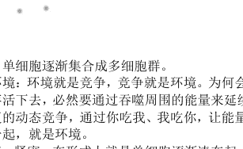

在竞争环境的推动下，单细胞逐渐集合成多细胞群。
这里要说一下什么是环境。环境就是竞争，竞争就是环境。为何会有环境呢？因为每一个生命个体要生存下去，必须要通过吞噬周围的能量来延续自身，这种互为角逐产生伺循环在复的动态竞争，通过你吃我、我吃你，让能量不断传导和延续，所有竞争集合在一起，就是环境。
当能量的传导更加直接、紧密，在形式上就是单细胞逐渐凑在一起，形成群落，但这时候还没有形成多细胞动物，因为这时候的群落是“无组织无纪律”的，如下图

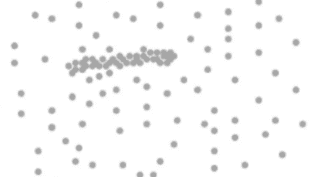

怎么才能产生多细胞动物呢？要“有组织有纪律”才行，组织和纪律需要通过分工与分配来完成，只有这样“散兵游勇”才能“紧密团结在一起”。

分工协作，个体的协作产生了集体行为。这使得弱小的“单细胞”集合在一起变成“强大掠食者”（多细胞动物），从而更有利于吞噬周围能量。分配，就是当掠食者吞噬更多的能量，需要在组成其的个体单细胞之间导向和分配，让每一个单细胞都活下去，从而让其集合（掠食者）存续下去。

无论单细胞形态还是多细胞形态，存在的目的只有一个：恒久存续。这也是三眼解读道德经的核心起始点。

为了恒久存续，仅仅依靠无数单细胞自发性的集合是很难初级的，因为一是在整体分工与分配上没有效率，二是很容易“解体”对于解决这一问题，多细胞动物进化出了“大脑”，去统筹指挥分工与分配。由此，个体单细胞无意识自发性集合，进化出了“群体体的意识”，从掠食者这个完整角度看，即为多细胞的“独立意识”。如下图

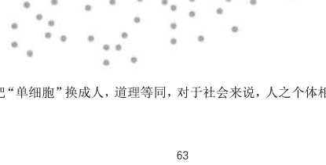

好了，把“单细胞”换成人，道理等同，对于社会来说，人之个体相当于单细胞，

而一方社会相当于一个多细胞“强大掠食者” 每个一个人都要寄生于组织下，组织有大有小，但其构成逻辑相似。都需要有主脑、心脏、耳目、爪牙（自古作为谋略基本框架），这是最基本的组织结构，这是一个最基本组织的“领导班子”，由一个独立意识主导（主脑），加上心、耳、目、爪来实现整个组织的分工协作运作。 东方叫谋略，西方叫管理，本质一样，都是为了形成组织并生存延续。 那么好了，作为生物个体，最优的生存方式是什么？成为主脑！

次级的生存方式，按照距离主脑的距离高低排列。两个单细胞组成一个多细胞，也会有主脑和依附之分，譬如家庭；复杂组织亦是如此。那么，成为主脑的最高核心能力是什么？

答：同性！ 无论是东方谋略，还是西方的管理，最核心就是如何做到“同性” 如果说这个世界有财富，那么终极的财富形式，就是有多少个个体生物依附于你的“同一性”，无论是搞宗教的、搞政治的、还是搞文化思想的、搞商业的，各行各业、不同维度竞争者，都围绕 所以中国古人提出大词“大同”，作为终极使命，大同就是全世界无所不同！思考一下这个思想有多大吧，这个词代表着中华文化的站位高度。 但是大同后面还有一个字——梦，合起来是大同梦。

不加梦字，那就是儒家；加了梦字，那就是道家。因为在道家看来，这纯粹是做梦而已，不可能实现！道家看社会是没 有希望的。发展尽头只有灭亡，只有“倒过来”发展才能得救。这个观念非常之重要。 观念的始发点决定了后续万千的顺带逻辑，决定了一个家派、个人的思想结构，简称“三观”

儒家也是师承道家，认不同道家呢？认同！但是儒家“明知不可为而为也”，因为追求大同这个标杆虽然难以实现，但是追标杆的过程会让人类社会一直维系下去，维持在一个“差不多”的状态，不至于“人互食”

好了，这时候读者们最想知道的“道德仁义礼”五种生存形态该登场了，但是等一等，还没铺垫完…再铺垫个啥东西吧？就是再深探一下为何道家觉得发展没希望，这就要钻进每一个“个体细胞”去仔细研究！无比重要！

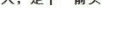

### 人，是个“箭头”

个体细胞（人），是有漏洞的！集体是由个体构成的，个体的真实形态决定了集体的存在，个体的漏洞从根本上决定了集体（强大掠食者）不可能恒久存续。

人的漏洞是什么？是主动接受标准！

如果把一个人用最简单的形式画出来，由三个东西构成：

- 1、吃——必须要吞噬外界能量获得自身存续；
- 2、两性——一个个体延续的本能推动；
- 3、主动接受标准——找组织、学纪律，通过“同一性”而参与集体（强夺掠食者），从而获得更优的生存延续。

前两者是肉体层面，后者是意识层面，其实完全没必要这么划分，对于绝大多数众生来说，身体与意识是一体的，这三个东西都是被动的，用西方心理学的词套用，都是本能，或者潜意识。吃与两性是被动的很好理解，学习和思考（主动接受标准）也是被动的就很理解了。

其实道理很简单，你以为能主宰自己的意志，并起了个名叫“自我”，其实这个自我是很被动的，根本就沒有自我，或者讲所谓自我也是由外界的一个“人造标准”培植出来的，这根本就不属于你。

个位的所见、所学、所想、形式上表现在对正确与错误的判断，对于是非、善恶等判断，这些外界“培养”出来的，就如同“阴与阳”。而阴与阳是此消彼长，相生相克，不断变换的。比如一个人从小到大是非善恶恶、随着成长一定是变换的，甚至与长大成人后完全不一样。所以你真的有“自我”吗？

人的意识如同吃饭和两性，都是“哪里好处就奔哪去”，这根本谈不上“自主”，人类活着与单独“散兵游勇”是一个逻辑，时刻在被动地寻找组织，融入“同一性”而“寄生”。

能拥有“独立意志”的人比大熊猫还稀少！所以能当“主脑”的就稀少。那好了，为什么道家对社会发展没希望，“强夺掠食者” 不可能恒久存续呢？因为个体的生存都是靠本能活着——求生存、繁衍结果。最根本的是为了生存延续、为了获取更优越的生存延续，出现了集体（强夺掠食者），而集体的存在是因为“同一性”，同一性则是追逐标准。为了各自生存，人造标准是极其混乱不堪的！

何为标准？三眼用最简单通俗话来讲述：我要吃掉你，但我能力有限，那我就要求我理由集合他人，一起“办大事”吃掉你，这个理由就是标准。

所以为什么一直讲少读书多思考，因为我们所看到的思想、思维、价值观、道德观等等，只不过是一个“吃掉他人的理由”。越是沉浸于读书，代表在努力寻找“理由”；你以为你是温顺的，其实你是邪恶的，只是温室环境展现不出来而已。只要多思考，多悟，才能跳出来这个循环圈。

而你能“办大事”吃掉别人，别人才会“办大事”吃掉你，世间标准混乱不堪，极其多！所以庄子讲“圣人不死，大盗不止”，为何？因为“圣人”们都是大盗（某一掠食者的主脑）的帮凶，为其提供源源不断的“理由”。拼的是谁的理由冲击性更强，也就是更能做到“同性”所以这时侯我们再去看人，近距离放大观察前文配图的“小圆点”（人一个体），小圆点变化成下图的模样

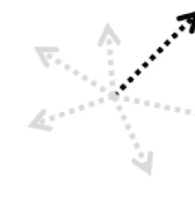

人就像是个不停旋转的矢量箭头（选择指向性），用虚线意思是人没有明确的“自我”，自我是随着箭头指向（观念方向）随时发生变化的。
这个箭头必须有e个方向，不然就会“淡化”，也就是说迷茫无措，空虚无助。正如世界只剩下Ld朵花，它可以继续存活，而世界只剩下一个x人，他会崩溃。
吃、两性与意识上的主动接受选择，让这个箭头不停旋转，寻找到同一性而找到组织和纪律（集体），从而获取生存延续。
这时候从高空俯瞰人群，前面第一幅配图，此时呈现出这样子

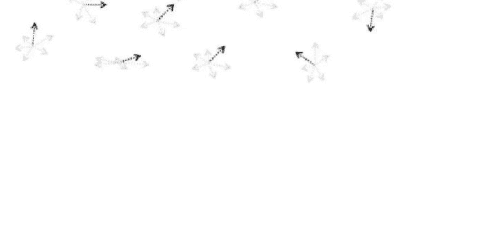

### <礼>

人必须要找到组织和纪律，不然每一个“箭头”就是颗“雪”。西方有句名言：没有规则，人就是动物。
那么好了，动物变人的最直接的方法是什么呢？
答：加了边界！也就是“礼”。

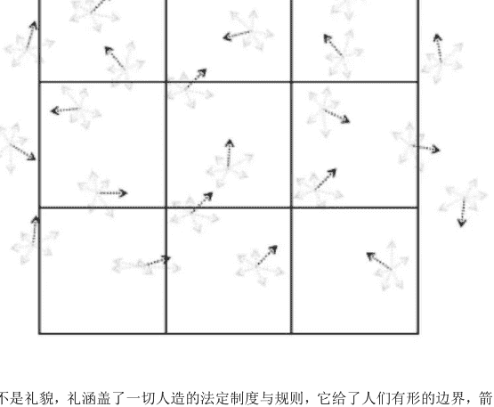

礼不是礼貌，礼涵盖了一切人造的法定制度与规则，它给了人们有形的边界，箭头可以“乱窜”，但是不能超出一个个“格子边界”

> 《素书》：礼者，人之所履，凤兴夜，以成人伦之序。

这里插一句，看书一定要看道家，因为足赤赤裸（为何赤裸后文会讲），要是看其他家派全都是带“包装”的，包装到极致会把礼（以及各种思想）洗成“上帝

的旨意”一般，洗礼嘛。道家讲东西非常简单，从不长篇大论，因为事物拎到根就那么点事而歇，行动的轨迹。礼，人之所履，也就是把人的行为轨迹都绘画出“框框”。

所以以古有云“无规矩不成方圆”。往小了说就是“没规矩就不是人而是动物”，往大了说就是“立规矩是办大事的先决基础”
那么好了，接地气举个例子，相当于大哥带小弟，小弟都是被喊遥的，这队伍肯定定没有效率啊！那怎么办呢？怎么加强“掠食”效率呢？

### 义

这时候就要淡化“格子”，而强化“箭头指向”。也就是“义”，如下图：

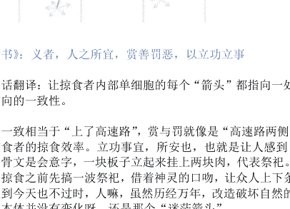

> 《素书》：义者，人之所宜，赏善罚恶，以立功立事

大白话翻译: 让掠食者内部单细胞的每个“箭头”都指向一处，并通过赏罚来加固方向的一致性。

箭头一致相当于“上了高速公路”，赏与罚就像是“高速公路两侧的围栏”。以此来强化掠食者的掠食效率。立功事宜，所安也，也就是让人感到“对路子”。这个字在甲骨文是会意字，一块板子立起来挂上两块肉，代表祭祀。在古代社会，集体出门掠食之前先搞一波祭祀，借着神灵的口吻，让众人上下条心。嗯…这个方法一直到今天也不过时，人嘛，虽然历经万年，改造破坏自然的能力加强了，但是人的本性并没有变化啊，还总是那个“迷路箭头”。所以任何掠食者（组织）成立的第一步一定是洗脑，没这个如何能做到“箭头一致”呢？只要箭头方向成型了，相当于激活了掠食者的“灵魂”，剩下的事就好办了，自发性非常强，根本不用操心管理

我们总讲“阴阳相生”，相生不是一蹴而就的，需要有个“生化”的过程。
我们再回到前文第三张配图：

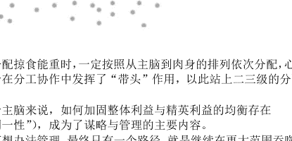

当掠食者分配掠食能量时，一定按照从主脑到肉身的排列依次分配，心腹、耳目、爪牙等由于在分工协作中发挥了“带头”作用，以此站上二三级的分配环节，成为“精英”。

这时候对于主脑来说，如何加固整体利益与精英利益的均衡存在
（加固“同一致性”），成为了谋略与管理的 main内容。
而说让如何想法管理，最终只有一个路径，就是继续在更大范围吞噬周围能量，以此来满足精英阶层的利欲推动。

如果外界的能量不够了，或者是存储能力衰弱，精英群体首先开启了“不认同”。
同在尴尬者内部的分配中，精英群体就要蚕食其他肉身部分，吸纳其他“底层循环”的能量，而这种破坏掠食者整体利益的“自杀”行为，即是必然的，又是被主脑极度排斥的，这又强化了精英群体的“不认同”性。

所以自古讲谋略，首先目标就是压制与管控精英阶层对于掠食者整体利益方向的不认同，当外界能量不够用时，这种谋略管控更加被需要。

但是一旦“加强管理、强化措施、深入监督、深入执行”，这必然带来高昂成本，花费掠食者的枯竭的能量，又进一步恶化“利益分配”，使得管控“不认同”更加困难，甚至“不认同覆盖面”更广。

所以历朝历代几乎没有一类针对于精英层的改革是成功的，成功的方式都是通过发动“底层器官”，替换与消灭掉“近头部器官”。虽然这种一千自损百的行为会暂缓“自杀”行为，使得掠食者生命延续，但等着的是下一个“精英周期”。

越是靠“义礼”取天下的，就越是需要谋士（西方叫管理学大师），参见美帝大流氓，这就是为什么走的就“无尽吞噬”路线，如果不够吃，精英层是制造新问题。这条路下走甚至是没有光明的。无论如何考量治理妙招，而最后每一种制度都会被精英层“不要脸”式的把持利用，每当不要脸到极致，就会引发掠食者内部的不断“阵痛”与内耗。
所以“城墙一定是从内部攻破的”，每一个大哥的灭亡，都是由于内斗所致。
那么好了，“强大掠食者”有没有更高维的恒存续方法呢？
有！

#### <仁>

这时候回到前文讲述的人的“三要素”。

- 1、吃——必须要吞噬外界能量获得自身存续
2、两性——一个个体延续的本能推动；
3、主动接受标准——我组织、学纪律，通过“同一性”而参与集体（强大掠食者），从而获得更优的生存延续。

在第3点上可以开启高维谋略了，在“标准”上做功夫！由此进入更高维度，在这里中华“文化”与西方的“哲学”形成了终极对坑！
首先解释一下文化与哲学。完全确维度文化是由心而发的，玩的是人心。哲学是由脑而发的，玩的是逻辑。操控的“元素”不完全不一样的！
玩文化约，才能在“义”字的维度上提出“仁”。仁没有准确逻辑，玩的是心。
如果更为复杂的下位定义，按照本篇逻辑：仁有两层面，一是在反向上尽量不要损害他人的利益；二是在正向要主动帮助他人利益实现（更精确的逻辑可以去翻看儒家经典，本篇办框架略缺不完）。
那么好了，回到前文“人的笨头”，再看看上面这句话，完全赶背逻辑啊！前文讲，无论是肉身层面的吃、两性，还是意识层面的“自我”，都是一种被动行为，遵循从“哪有好处处哪去”。这就是中华思想的高明之处：高明在于对“利”字维度的延伸。

按照西方丛林法则，必须诞生哲学，也就是脑子转圈圈，会将人的利益算到骨头渣子，将事物之间的“作用力”精密测量，随之衍生出了经济学、社会学等等，这些东西都建立在“人完全是自利”的基础上，相当于默认了“人是机器”，再通过哲学逻辑算法，而派生出的一门门学科。
所以西方文化的弊力必然在个个人利益被量化（把精神利益也等同于物质一样去计量），相应应对的必然产生强势的个人主义。必然推动精致的利己主义者占为主体。
比如我们看老美的影视剧、文学、新闻评论等等，无所不在的个人主义汹潮。
而中华文化从本源根子上，就已经把作为人的“利”字（某种苍蝇结果），提升到了更高的精密检验，在经历残酷的生存竞争后，对于“义”与“礼”早已完成了次次“残酷试验”，从而导出了一种是在“和谱”。
从老子的“人法地、地法天、天法道、道法自然”，一直到后世的“天人”，从佛家的因果轮回到渡人就是渡己，中华思想对于社会（掠食者）的存在形态，从根本上认为是“混元体”的，在现如今有个词叫“和谐”

所以从“仁”开始，谋略与管理的关键，是从“人本利益”的维度入手，通过给予个体更高维度的利益标准，而减少和修复掠食者内部的“自杀内耗”行为。
所以中华自古有词“教化”，而西方只有教，没有化。文化这个东西是自由心的，与脑子逻辑截然两系。
此从东西方有两Enter根本区分：虽然都为了个体利益与整体利益的“同一性”，但东西方走了两个维度的路线。

西方—管理与制度（机器人玩逻辑）
东方—归睫与认同（灵魂核心）。

两个加一起，你懂的…这真的是高水平！

在这两种不同路线，“教育”出来的人区 分也很明显，在个体上，前者的成功标准是“阶层与成就”，后者的成功标准是“中这时候读者就会疑问了：不可能人人都在“中庸”啊，而且时下“阶层逆袭”渴望好像更多，这种路线靠谱吗？

回答：管理者任何方法的目标都不可能是“极致”，而是“做得到节省成本”。在机器玩逻辑辑的路线下，管理的路就必须是“强逻辑说服”，通过利益逻辑的分析与计算来达成“同一性”。比如：我们做到了什么，即可更多的存在嚣谁谁谁，之后我们有了更多的掠夺分配，即可分配给谁谁谁，开心不开心？开心了就说我！
这种路线必须将内部矛盾不断的转移到外部上，一是转移到大自然母亲身上吸奶，也就是通过科技碳去自然取得能量；另外一种是转移到其他掠食者身上来攫取能量。而这些又需要精英奉献头推动，最后用物质利益满足缓和人与人的关系，以维系暂时的生命存续。总而言之，就是用更大的成本来推动掠食者生存延续成本越来越大，直到崩溃
噢…换言之，教育出来的群体是什么样就用他反噬你；与其个体的漏洞道理一样，成功也漏洞也收漏洞，如果都是自己动手做的。
东方话柄的认识是“高度认同”，一是做好善世“文化形态”，二是适当打击精英主义，绝不可放任精英阶层自流。所以特色路线不打击资本，但一定打击资本家！

但是任何掠食者能够有效率的分工协调，所依赖的正是精英阶层，对于这个矛盾的解决只有一个路径，就是治（人亡政息）。所以东方掠食者形态换了主脑，那就是头等大事，而西方掠食者主脑换不换都无所谓，影响不了“机器逻辑”本身。

> 《素书》：仁者，人之所亲，有慈悲惻隐之心，以遂其生成。孟子讲“惻隐之心，人皆有之”。

大家总以为这是君讲话，表面去看孟子像个慈爱老头，感叹人性的美好云云…其实学呢，是在极力挖掘人的“根子”， Anth寻找如何将人们所追求的“利”字进行提炼（通过更高维度的利而整合体系化），在更高的维度“以利带认同”，打破“义礼”产生的问题，并且节约管理成本。

挖掘“根子”不可能虚头巴脑的，“抠错了”应用到管理上后果不堪设想…中华文化能立得住，是经受了“极端残酷实

仁者，人之所亲。对于“亲”字的把握，就通入精密实操层开始搞认同。从家庭开始，夫妻、父子、父母，再到社会同事、君臣，再到朋友之交等等，一套精密复杂的“认同逻辑”，这里就不多赘了。

#### <德>

好了，聊到这很多小伙伴已经憋不住了：三眼，你讲的这也太“正统”了，这也不像你啊

峰回路转，聊到此处送给大家五个字

### 以上皆谬误！

然后可以快乐的开造道家思想了!!! 为何是谬误呢？荼寻思，从古到今几千年，安稳时代能占到5%都不错了，90%都是乱世。如果这些“圣人”与西方“智人”有那么一点用处，现实也不至于啪啪打脸。 道家思想怎么认为呢？

### 乱，才是正常的！

> 老子：故失道而后德。失德而后仁。失仁而后义。失义而后礼。夫礼者忠信之薄而乱之首。

又讲：大道废有仁义；智 Cumulative 出，有大伪；六亲不和，有孝慈；国家昏乱有忠臣。

大白话：社会发展是失道过程，只能越来越乱！各种智慧、仁爱谏辑、孝顺、忠信等等，因为乱，它们才会出现，而且以后会出现得越来越多、越来越频繁！所以如何古乱世之下，道家予弟就出米一展身手，因为观念里乱世是常态，天下的道德法则是以乱为基本面的！让他们非要“务实”的掏管里，玩“节省成常本”和“微高维度同”，道家子弟懒得搭理，认为是无用功。一个对于没有结果的事情，那必将失去兴趣。
所以儒家修练拔乱升级，最后是“成仁成圣”；道家的修炼是“成德成仙”，关起门修炼。出离乱世平平。儒道在实践上完全两个维度。
为何自古历朝历代都有道家在背后呢，嗯…因为天大乱老子讲东西虽然干货，但还是比较奏婉的，但是道家实践派就赤裸裸了

道体-运行，
天地、人、万物之间就开始互相“盗取”，为啥呢，因为有漏洞啊！当能量守恒了，也就三证稳宜，三才（天地人）才能获得暂时的安定，等待迎接下一个混乱周期。
修道的关键是要研究“盗机”，也就是事物变化的关键点。往下敲没完了，道家谜哏从宏观到微观以后慢慢聊，这里单拿出“三盗”是为啥呢？是为了引出“德”

> 《素书》：德者，人之所得，使万物各得其所欲。

素书这段与阴符经讲的“三盗”是一个意思，但是不如阴符经赤裸，都是玩均衡。
德的维度要远远超于仁，完全不在一个维度。
仁所在维度，还是玩“扶正”，是一种“明知不可为而为之”
是“文与“礼”产生大了问题，实在没有办法了，为了“节省成本并减少消耗”而弃养来的方式。
如果每个人的心地根本上都是“善”的，那么通过“仁”或许有希望走到大同那一步，但是人的内心就像前文的“箭头”，善恶是阴阳两端，不停的变换，所以“仁”这种方法不是大道！

道家子弟的思维早已超越善恶的维度了，无所谓善恶，祖师爷老子开篇就讲了啊：
“天下皆知美之为美，斯恶矣；皆知善之为善，斯不善已。故有无相生…”。人就是一个欲望在那里转找“归宿”，它必然要吃喝拉撒，必然要吞噬能量获得存续，那就算它一直咋哇好了！
但是吞噬可以，不能噬吞噬，不能搞破坏，不能没够，得有方法做到“周期性吞噬均衡”，谁能做到，谁就能“成德”

这里有必要说一下，这个均衡可不仅仅是利益均衡，要知道利益永远无法均衡，是超越利益层面的一种“综合性均衡”，“成德”所玩的均衡如果赀文字，得藏n篇，而且一辈子慢慢悟，常悟常新，藏也藏不完。

其中是道家的整体三观，阴符经讲“天人合发，万变定基。”这个“合”就是“综合性均衡因素”。

如果还是感知不深，可以拿中医与西医来举例子西医相当于玩利益均衡，这块组织坏了，其中有细菌作祟，好吧，注射一下杀死它。别的地方组织也坏了，实在不行切了它！相当于逐一平衡“坏死组织”所产生的利益不均。
中医一看牙疼了，思考了一下，你这是肾有毛病啊，病人很不开心，那还能给他肾来个注射者切了？都是不是，得先吃点汤药，弄一弄脾，这样协调一下气…
如果病人是一个老外，此时婆媳上是极度虔诚的！
中医的综合调养，就是这个“合发”，而不是仅仅只关注牙疼本身的利益性。

那就好了，想要玩“综合均衡”，想要“成德”，怎么办呢？要悟道！
这就到了道的层面。

### 《道》

> 《素书》：道者，人之所蹈，使万物不知其所由。

还是用人这个载体来讲，人的一切情感、心识，以及所见的一切假相，都是道体运行的结果。就就是前面那个“迷藏点头”只变动，道体就运行了。但是这个道体谁也说不出来，只能直觉，或者不可不是佛家那个第六识(意识)，佛家那个词指代的是脑子逻辑转圈圈，这里的意思指“感悟”。找一个比较适当的比喻，很像是一种“肌肉记忆”，所谓悟道不仅仅是懂理论，而是要训练这种肌肉记忆，或者拿西方的词套，训练

仅是懂理论，而是要训练这种肌肉记忆，或者拿西方的词套，训练直觉。正如谁理论当上王者，想必下场会很惨，能保持王者地位，靠的是直觉。将一个强者和弱者一起扔到未知的领域，在这里失去了固有的生存经验，固有逻辑已经失去作用，但强者的存活的概率还要比弱者高得多，是因为强者的“肌肉记忆”更接近道体运行，遇到问题“感悟能力”就起效了。两个一尘不染的小孩，一起学习某种知识，所获得的结果完全不一样，这是天性中的“肌肉记忆”在起效。

佛道都讲修行，修理论，修理论，通理论不断爬维来接近道体；行是通过实践来增强“肌肉记忆”，这里的实践不是逻辑转圈，而是要用心。心带着脑子向前行，就是比如在遇到困境、迷茫、甚至生命威胁之时，往往心的效率更强。

那么好了，以上是在集体角度看道德仁义礼，这东西如何有个体生存上应用呢？

### 《下篇：伪装的进化》

好了，上面站在生命存续的角度，画了一个框架，就像是一个时空划分成五个结构性维度，人都存现于这些维度里，无一例外。借用数学理论，上面讲述了“豪限”，下面要讲“坐标”。也就是站在个体角度，如何在这些维度里寻找生存的坐标。
首先要明白一点：莆管外界环境在“道德仁义礼”的哪个维度，到了个体应用这个层面，五个维度都可以用，小到两个人交朋友处对象，大到复杂组织交互

### 伪装的隐蔽与人心的正反

从伪装这个角度切入，三眼自觉是最佳的，为什么？因为这是生物活动的根子。
所有动物（包括人）的存在都是为了生存延续，而生存只有一个技能——伪装。
用此二字可以看到任何动物的轨迹。
个人从降生直到死亡，每一天每一刻每一秒都在不停的伪装而承载伪装的就是“自我”。伪装套路不断变化，“自我”就不停变换。
如何看透“自我”呢？如何看透里面所承载的伪装内容呢？这就是接下来聊的；念头的隐藏与正反
还是回到前文配图

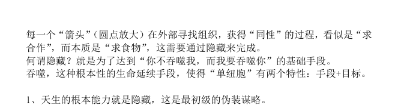

每一个“箇头”（圆点放大）在外部寻找到组织，获得“同性”的过程，看似是“求合作”，而本质是“求食物”，这需要通过隐蔽来完成。
何谓隐蔽？就是为了达到“你不吞噬我，而我要吞噬你”的基础手段。
吞噬，这种根本性的生命延续手段，使得“单细胞”有两种特性：手段+目标。

- 1、 天生的根本能力就是隐藏，这是最初级的伪装谎谬。
2、 在吞噬上无止境，想让自己变得“更大”，大无止境。

换成人来讲

- 1、撒谎是天性；
2、欲望无止境。

这时候我们再去看“多细胞的合作”（组织、社会）形态，就有了两个特性

- 1、“合作”就是“不互食”，且集合成强大猎食者而“食外”，这种关系需要通过单细胞的伪装隐藏来达到。
换成人类社会这个多细胞形态来讲，文化、文明、思想等各种社会交互活动，本源都是建立在伪装隐藏的基础上举个接地气的例子，比如家庭分裂的根本原因，是“伪装不共情”，古话“不是一家人，不进一家门”。

- 2、而“合作”一定是有终点的，“分裂”是個必然！终点就是“合作方”互食，这是由于单细胞的第2个特性决定的，过程表现的重要环节，就是产生了“精英阶层”。

切换到人类社会的层面，就是社会交互关系中，没有所谓明确的朋友和敌人，大家只不过都是伪装的本能推动，披着隐藏的外衣，在各种“多细胞猎食者组织”之间穿梭而已。

所以，一是动物除直系血缘，理论上讲没有一个“真正的朋友”；二是任何“猎食者”（集体组织）的生命都是有上限的！

好了，这时候我们将视野放大，与生存结构形态中的“道德仁义礼”进行衔接，就会发现：
每一个道德仁义礼，都会形成反面，失道、不德、不仁、不义、不礼
这注意到的是，动物本性、人的漏洞所推动而注定形成的结果。而且，越是朝着正去做，就越会朝着反面发展，同样遵循“阴阳相生”！

> 老子：上德不德是以有德。下德不失德是以无德
越想要成德，就越得不到！

比如前文讲“仁”那一段，主脑的“仁治”一定会产生“不仁”的一面，所以仁只能用于“维持形态、节省成本”，而绝不可能让猎食者“长生不老”。

讲到这里，想必大家就会越来越明白，道家“混乱才是常态”的逻辑了。因为在伪装与吞噬的驱动下，任何“人造事物”都会形成阴阳两面，不断地相生变换。因为“人造事物”自打一出生，它的结果早已写在“玩隐藏”这个基因里。

我们所面对的外界生态，就是一个道失道、德不德、仁不仁、义不义、礼不礼，这么一个阴阳变化的生态那么好了，作为个体求生存，如何畅游在“阴阳变化”

### 尺度与刻度

这里有一个至关重要的观念转变: 不要把道德仁义礼当做规范、规则等等, 更加幼稚的观念是当成品德、仁爱、义气、礼节等, 想必三眼的读者应该没有这么幼稚的(一手资源更新微信: ipip885)。

而是要把道德仁义礼当成“刻度”。
没有刻度, 怎么会有维度? 一把尺寸没有刻度如何测量外? 那还能叫尺子吗? 每一个刻度都会形成正反两面, 这里我们借用数学逻辑来表达, 假设一个刻度为“0”, 那么就会有-1与+1。这么讲虽然方便理解, 但是也容易扭曲, 这是现代人理解中国古代思想最容易发生歪曲理解的地方, 也是拿着“科学观和哲学观”去理解“佛道思想”容易扭曲的地方。可以用数学去方便表达, 但千万不要死套逻辑。

数学上的正反, 与人心的正反完全是两码事。正如物理科学上的明暗与思想领域的阴阳完全两码事。
数学上, 角度、距离、坐标、象限等等, 从两端的无限到中间的有限, 这些是通过眼睛(938)画出来的, 可以用数字表达。而人心的正反, 这是从兽性到神性的多维刻度, 它的基本单位是“心”, 而不是数字。
我们要借用数学逻辑来讲, 方便理解, 但本质上不是, 这个过程是“以意带识”, 用佛家理论讲, 就是通过描述“第六识”(随?), 而启发人领悟到第七识、第八识乃至道理。

好呢, 如看看出道德仁义礼的“刻度”呢? 怎么来的? 如何测人类产生第一把尺子, 在画刻度之前, 需要确定一个东西叫做“单位”, 没有“单位”就无法产生刻度。

在有形尺子的刻度上, 获取单位要靠视野(眼-低级感官); 而在人心的刻度上, 获取单位要依靠“多维感官层级”。也就是说, 人心的刻度不像数学刻度可以看得见摸得着, 而只能去“感”刻度。
个人的感官层级越多, 能看见的“刻度”就越多

### 思想维度与感官的进化

问个问题: 低级动物和高级动物根本区别是啥?
义务教育洗礼的小伙伴回答了: 会不会使用工具!嗯…也对, 毕竟上了教科书的, 但普世教育维度都比较低嘛。

要是在问问题: 作为高级动物的人, 大家都会使用工具, 但也会分“高级和低级”,

根本区别是啥？会不会使用工具的角度显然派不上用场。
答：伪装技术水平决定高低级。
“低级”动物相对应的伪装技术水平就低，“高级”的对应就高
再问：怎么决策伪装技术水平呢？
答：感官层级的多少。
一个动物（包括人）所能调用的感官层级越高，所能见到的“人心刻度”就越多，所以人的“格局”就越大，思想象力（覆盖范围）就越强，最终决定了其伪装水平就越高，相对应的生存能力就更强。
感官越是对外界的感受反应越强（反应速度就是用刻度记录形容结果），形成观察结果。以此观察结果来决定生存伪装的方法。或者讲，一个动物眼中的世界呈现什么样子，决定了其构造出什么样的生存方法。看世界不一样，方法自然不同。这个所谓的看世界，就是思想。
低级感官是具象化的，借用佛理是前五识，眼耳鼻舌身；如果所有动物们都只会利用低级感官，那么生存战场是这样的

你看不见我！

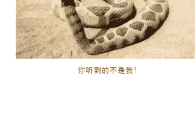

你听到的不是我！

### 阴谋与阳谋

这里就要插一下何谓谋略了？谋略有阴谋和阳谋。
何谓阴谋？就是为隐藏而隐藏。所以自古带扳打架的讲“兵诡诈”，要嚣皮子的讲“谋贵密”，通常一点比喻诸，就像是玩扑克牌绝不能漏牌底；如果要我感觉可以看见前配图的绿色小青蛙，眼睛能看多远
何谓阳谋？就是不隐藏而隐藏。相当于明枪打，对手还无可奈何，为何无可奈何？因为对手根本不知道你所隐藏的东西是什么

阳谋，是竞争维度到了意识这个层面特有的形式，在低级感官竞争维度上，隐藏与否是可以被看得见（眼）、听得到（耳）、嗅得出（鼻）、尝得到（舍）以及综合触感得到的（身不自在）
阳谋是将伪装水平提升至更高维度，低维的根本看不见它。
低维的就是感官水平的竞争，眼睛能看多远，针对白天黑夜是否带特殊属性，嗅觉的敏感程度等等，建立在调动身体每一个细胞的直观感受能力的基础上。
而到了高级竞争，是高级感官的竞争（心识），这是眼耳鼻舌身无法起效的领域。在这个领域之中，动物可以将伪装玩得更加巧妙，低维感官根本识别不了高维的隐藏方法。比如最简单粗级的“制造陷阱”。
而在高维竞争里，还是会再细分高维度与低维度。此时“制造陷阱”也有了高低维度。
比如大家一提到谋略，首先想到的是如何攻击他人，要阴招，三十六计等等。这些都属于低维的阴谋，如果仔细品鉴，“制造陷阱”技术维度很低端，带着低级动物的伪装特色“你看不见我”

这些东西（此类维度）被古人称作“术”，大白话翻译就是“低维的小妙招”。
竞争的残酷性与激烈程度，推动着人们的意识逐渐升级，春秋战国的杀戮试验场，将人类的伪装技术提升到顶级，将隐藏的方法推到越来越超“无形化”，也就是“道”与“法”这两种维度的出现。

术，是制造一个陷阱，众人会察觉到，在制造与摆脱陷阱的缠斗中，产生了尔虞我诈这种晦涩见的生活面法，是制造一个陷阱，众人不会觉得其为陷阱，从而深陷其中；道，是制造一个无限广博的陷阱，广博到“看起来没有陷阱”的程度，这已经不是众人能左右知道到它的问题了，而是对于道来说众人皆“不知其所由”。

能达到这种顶级伪装水平是非常难的，因为这是从低级感官爬维到最顶级的高级感官，在过程上完全违逆了动物本性！

半个耳熟能详的例子“4岁孔融让梨”，很具有代表性。孔融给大哥好大梨是因为大哥比他大，给小弟吃大梨是因为小弟比他典型性颠蜕动物本性的伪装，无形中拧开了与大哥和小弟的竞争维度，舍大梨（小利）而得到更大的梨子（大利），噢…被中华文化代代传扬

聊到这里我们又要加入一个字——利。
利是什么？是某种噬嗑结果的目标取向。
利是有维度的，追求不同的吞噬结果，人们对利的认识维度就cat不一样，这个叫“志向”。生存伪装的最终结果也是为了得利，对结果（利）的追求维度反而过来决定了伪装水平。

老子在生存竞争的形态中，给了世人一个终极目的利：恒久存续
（模仿天地长生）。

为了达到终极目的“利”，顺帝将生存技术推到顶级，给世人建立一套标杆逻辑：不伪装而伪装；无利而无不利；无为而无不为。总结俩字：无形。

好了，我们继续聊人心刻度。

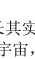

## 人心的标准

还是借用数学逻辑来讲。比如尺度的建立，本来天下底下只有“长和短”两个刻度，但是人们不满足，非要测重一下有多长、有多短，这就要开始建立“标准单位”。
人心的刻度也就是如此！

这就驱使用科学逻辑推导了，无限长其实就是无限短，长极致就是短的极致，就像一个细胞无限向外研究可以广至宇宙，但无限向内研究同样是“一花一世界”的宇宙长和短最终是“链接在一起”的，形成一个“圈”，这个圈就是宇宙（不是我们眼所见的宇宙）。

由此推到人的存活，也同样是个“圈”,人从降生到死亡就是个“跑圈”过程，所以就有了轮回与往生的概念。一个人的只有低维感官是理解不了的。

为了把“跑圈”过程记录下来，就要发明“刻度”来测量记录了。
从纯净动物为起点（可以想象成人的刚生），来带世间就开始“主动寻找和接受标准”，这就开始污染了，而思想不断升级，伴随着的是标准的不斷打破，而同时又建立新的标准（刻度越来越多、越来越大、越来越远），以新换旧是个常态，什么时候把标准都去除干净了，就达到了神性（佛家的空性、道家的虚无）。
而达到神性也只是跑了一圈，重新回到了纯真小动物的起点，也就是“返璞归真”。
为什么“主动寻找和接受标准”？因为是被利（某种吞噬结果）所推动的。

利产生欲，利欲心态-情绪，这又是一套俘生系统，简言之动物对利欲的追求，不同维度产生不同心态，利欲好比一个方向，心态（起心动念的整体过程）就好比是进程，以此进程来填补利欲的追求过程，而这些又顺带出一个结果就是情绪；比如喜怒哀乐，再向外延伸就是表现为音乐的形式。

整个过程相当于“从种子到果实”。果实是无法左右的，比如个人不自觉地笑起来，不自觉地流泪，这都是控制不了的，欲想快乐就快乐，欲想痛苦便痛苦，这是不可能的！

对低级的人只能讲结果，因为看得见，比如“别生气了，生气多难受啊”，这不废话吗…解决不了任何问题。对高级的人才会讲成因，讲对方心态不对，而心态又是对于利欲的追求维度所决定的，依次牵根，即可解决根本问题。

跟索引读书，跟智者讲思考好了，转换维度，此时道德仁义礼的这种维度，统一用利欲来衡量，利欲相当于“刻度的刻度”。

庄子讲“圣人不死，大盗不止”，所指的圣人就是在道德仁义礼的“中间维度”之人，这些人高不成低不就（既不能得到空性成神，又不纯真小动物），所以都是祸害，祸害的具象表现就是“做法弄坏”，建立一套套人造标准，人的痛苦都是源自于这些标准的束缚！
而人造标准，所玩弄的刻度，根子上就是利欲，再花费点（刻度反复雕刻），就是道德仁义礼。这是“从刻度刻度”。

> 老子讲“天下皆知美之为美，斯恶矣；皆知善之为善，斯不善已

简言之，世间有了标准，就已经失去了美好。
佛家有云，是非善恶两头不沾；恶不要沾，善也不要沾，都是个“人造标准”，如果都能不沾，就得空性。
比如在生活中，教养之罪就是建立标准，本来小孩子无所谓善恶，两个孩子像小动物一样打一架，超不过三五分钟又是好伙伴，而父母与教师可不这么认为，他们颠倒中就会“圣人”灌输的标准此时就被激活了，硬派生的会将小孩子们区分为三六九等于是为了“如何区分是好是坏”打造了一架！
慢慢的小孩子就被污染了，这个污染过程大同小异，大层面就是“文化污染”！

他们以为将好坏区分（加入刻度）即可得到美好结果，而殊不知故意区分好坏是最大的恶。

神性与动物性是人的两端，两端其实是一端（物极必反，阴极复阳），像个圆，在两端之间共同安都是“魔”
所以三眼为何一直讲“不入魔窟施入神”，换言之“没有中间过程如何能得到两端”。
所以一个人写东西助人开窍，嗡子迟也不会，而对于嗡子行为能看得开靠的不是心态，而是能看到其“魔性”的一面，可爱又可怜，人生也是如此。

到此就不能理解为何老子是“反社会”的，小国寡民老死不相往来是理想社会，因为他的理想是让人们都成为纯真小动物，纯真小动物就是“神”，人人都是“神”的话，天下即可“自然”。

> 道德经：不尚贤，使民不争；不贵难得之货，使民不为盗。不见可欲，使民心不乱。是以圣人之治，虚其心，实其腹，弱其志，强其骨；常使民无知、无欲，使夫智者不敢为也。为无为，则无不治。

从伪装的进化，聊到竞争的维度，再聊到道德仁义礼的五维形态，再聊到神性与动物性，再聊到人造标准与刻度，这时再去看老头第三章这段话，才不会扭曲。因为自古以来无数“大师”都将此章解读为“Y民政策”，这种大师就是“大盗”。

的帮凶”。
何清Y民？是混在“中间维度”的那帮子人，通过“人造标准”而养雏人 们，这才叫Y民。Y民不是不教你什么，而是必须通过“教给你什么”来完成！
老子于是始终都是告诫人“去标准”，给人大量智慧，怎么可能解读成Y民一说？
所以还应到了那句话：人想看见什么，就能看见什么。
但是聊到这，很多小伙伴不自觉地又要开启脑筋，思考“神与动物”的存在逻辑了，不自觉的又开始画刻度，第一个起心动念就是它们存在的标准…如没有一个标准来参照，它们就是不存在的。

嗯…这就是漏洞，人生自带，循环往复的陷人标准(假相)之中，没有漏洞与假相，三眼的文章也就没有读者了…
此时再回到上篇配图，打回原形！

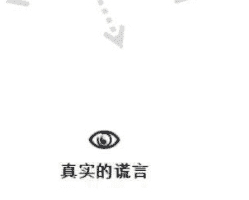

## 真实的谎言

好了，继续回到动物伪装大法。
撒谎是动物天性，所以不要动不动就发出感叹、哀叹，什么人生

撒谎是动物天性，所以不要动不动就发出感叹、哀叹，什么人生都是谎言之类的，多幼稚啊！不撒谎还能叫做人吗？最起码的做人资格。
还有什么“谎言真可怕”等 等。有什么可怕的？道家子弟要学会以为常才行，不能够习以为常那就是幼稚我们所面对的社会信息网就是一张谎言网，一点也不难理解，如果把谎言按等级同于低级动物伪装，那 么信息网相当于无数个“伪装色”在萤蝇交互而已。所以少刷手机多思考，少读电子书多思考
那这里有反应快的 小伙伴就有疑问了：二眼，很多人讲话以及传递信息，可都是发自内心的啊，很真实的呀。比如很多有名的作家、文豪、公知等等，他们可都是真心的呀！
非也！这叫“真实的谎言”。比谎言更可怕！就像“圣人”比小孩和女人更可怕。
什么意思呢？
比如一个人从小被教育怎么做是正确的、光荣的、智慧的等等这相当于被灌输一

套“伪装系统”，只不过当事者在伪装之前，已经默默承认和习惯了这套系统，觉得它是真实的、正确的，所以不觉得自己是在伪装。

换言之，当一个人陷入到“一段刻度”里，是很难抽离出自身的，跳出自我无比艰难。

比如人情社会产生的某人，和一个老外玩“讲究”，玩“义气”等，老外根本不“上当”。这时候内心就很恼闷：哎呦我这么真诚，你怎么无动于衷甚至还骗我呢？

原因还是其并没有知道，他是在向老外使用“伪装系统”呢，虽然自己早已习惯默认了这套系统，但老外并不埋单。最后呢大家伙都解释成“文化差异”。

哈哈文化？就是伪装系统的集合！伪装系统对接不上，就是差异

“文化差异”讲小一点，就是“圈层差异”，每个圈层的“文化系统”（伪装系统）是不一样的，不同圈层互相看着对方，彼此是排斥的。

何谓“文化同一性”？就是“你必须接受我的系统”，才会带你玩。

所以文无第一、武无第二，在文化思想界，在实际生活的各个角落，每个“岗位”都认为自己是正确的高尚的、真诚的，以自己为中心看其他“地位”充満虚假！所以老子讲“著名不辩、辩者不言”

人都会习惯寄生于一个伪装系统中，以此为真实。不同系统辩论起来，最后一定是波妞狗哟。

伪装系统之间虽然是排斥的，但是有根本地分：也就是人与人之间混的好不好的差异，就在于是寄生的伪装系统强不强大而已。强的就能够“覆盖”弱的，这就叫做包容。包容不是善心态，而是靠智慧。但包容也是有技巧的，必以“降维打击”为准则，后面会讲。

个人做人做事的水平，思想的洞察能力，往大了讲一个组织的制度管理水平等等，本质都是伪装系统的强弱。

所以道德仁义礼都是伪装系统，只是维度不一样，但都是“真实的谎言”

那么好了，个体如何在谎言的维度间穿梭呢？

## 降维打击

> 《素书》：天道、德、仁、义、礼，五者一体也！
三眼画个结构图，方便理解

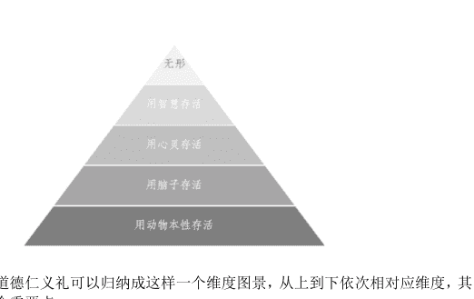

将道德仁义礼可以归纳成这样一个维度图景，从上到下依次相对应维度，其中有几个重要点

为何是“五维一体”的？因为维度隔空打击力就弱，一定要相连接的维度，一环套一环，从上到下打击；用村长的方法能制服村民，但用省长的方法则未必。攻击元帅的方法，攻击不了群众，还是得着“不拿一针一线”。

讲到此处应该能体会什么是“龙者，能升能隐，能大能小…”了从下往上，隐藏技术的维度越来越高，以下观察上是“看不见隐藏了什么”

颜色越来越淡漠化，是不同维度对于“利”的追求体现，越往上层维度，利益越显出“无形化”

从下到上，感官维度提升从具体到抽象，越向下维度越是追逐看得见，越是向上越是追求看不见（悟）

颜色向上变淡，更是对“嗜欲”的逐渐擦除，擦出越多，能见到的“刻度”就越阔，焦点越细，相对应的“计算范围”就大，“计算精确性”就更强。

聂明小伙伴还可以继续在下列内容，框架有了这就是“填空人能处在什么维度，就是什么层次”，比如我们还是看《素书》，其中构筑了“俊豪杰”，这里插入一句，古人（尤其谋略书籍）总是总结“xx 样的人就是 xx 类型的人”，把人归出无数类型，读者看眼花缭乱其实也很简单，按照本篇逻辑去看，大白话翻译，XX 在坐标中的 XX 位置，看到了并移动到了（做到）那位位置，他就是 XX 类型的人。

> 信足以一异，义足以得众，德足以怀远，才足以鉴古，明足以照下。此人之俊也。

所以从小就要“讲诚信”，为何？因为取信于人是最基本的伪装隐蔽目标。

如何做到“信”呢？可不是“翻出心里话”，而且人的自我一直在变化，也没什么所谓真实的心理话。

信的本质，就是上述第一点的“降维打击”，只有降维才会“取信 取信之后，就要开始做标准，画刻度，以此为“义”而将万众归附 而后呢，因为众多层续，就要“成维度，形成维度是在组织内部形成一个“多层维度管理”，由于多层之间通过降维打击而“链接”在一起，从而“使万物各得其所欲，各得所需，各得其位，这就是“大功德”，这是顶级谋略了！只有这样才

能“行才是 what's? 就是伪装技术的运作成熟度。

明是什么？可不是什么瞧明洞察、明察秋毫等等，而是让组织中的每个维度都深信不疑所制造的标签（真实的谎言），主脑一发令，同样一句话因同维度因为“标准刻度”不一样，听到“结果表达”就不一样，一场会议需要传达，但是每个层面的传达结果都不一样，但都深信不疑，所以各办其事、各负其责，照顾着的整体协作更加有效率。

好了，聊到这里往下就是敲不完了。本文对道德仁义礼在集体、个体，以及正向、反向，画出一个整体框架，剩下来再去看书就是“填空题”，空是填不完的，道德仁义礼的每一层维度，在古代都是一个家派，各逞浩繁，阴阳的变化、道体的运行是无穷无尽的。
对一个年轻人来说，框架是最难的，填空就是体力活。一个人工富五车没用，关键是驾车技术！文盲皇帝比比皆是。
最后呢，对上面那个“嗜欲排除”再多啐几句，因为这是在生活中非常接地气常用的。

## 去除刻度与提升感官维度

人之生存必存利欲之心，再套三眼的原理，就是漏洞。也就是说人的存在本身就是漏洞。对这个漏洞的不断攻击，就是所谓文和文明以及思想。到此处，就不难理解老子的“绝圣弃智”了。这可不是让人类懈怠，而是让人类“回归本源”，悟道就是归根，只有回到最初的本源，人才能真正得到大智慧！佛教讲去除欲望，但是有两个是去除不掉的，一个是饮食，一个是男女，不吃饭+没两性，这是不可吃的，这是动物存续的两个根本点。所以佛教到了中土，搞出两个新妙招，一个是吃素来节制欲望，一个是区分两性，嗯…形式主义而已。所以作为小动物，成神这种事就不想要了，理论上能做到，现实上不可能。

> 老子：何谓贵大患若身？吾所以有大患者，为吾有身，及吾无身，吾有何患。嗯…思想高到一定境界，就是这么霸气！

《素书》讲 “绝嗜禁欲，所以除累”。

比拟直白，按照本篇意译铺讲，就是擦除污垢，头清眼亮，去除利欲污垢越多，越能看到事物的真实形态。但似直白背后又复杂，对于嗜欲的研究，会有一套精密逻辑

《阴符经》讲“替者善听，靠者善视。绝利一源，用师十倍三反昼夜，用师万倍”。

利欲这些东西虽然都根源于人的漏洞，但是漏洞形式（某种嗜欲结果导向）是百花齐放的，也就是说利欲也是分门别类，成分“多个领域”的，要想在某个领域“得到利欲实现”，那首先要在“这个领域禁欲”，才能真正看透这个领域的利欲玩法。

《阴符经》接下来又讲：“心生于物，死于物，机在目”。这段文字虽少，但是将“利欲形态”推到了更高的思想境界心物一体。

从心一向物，也就是心向利欲，生与死（可以扩展到成败、成或败、存在与灭亡等）在于对事物观念上的把握，这个观念形成的根子在于对于利欲的把握，只有无所求才能有所求，成功或存续的关键，在于是否能真正做到无所求（擦除眼前的污垢）。人的终点决定于起缺点，而起始点仅仅只是个观念！起始点的“方向”不同，顺带出的万千Union即为不同。

在所求的“有和无”之间，有着“开关”，也就是“机”（盗机）。做人做事那就要看人如何玩“开关”了换句话大白话讲：人越想得到什么反而得不到，真正想得到什么，要先做好不为所动，对目标对象无欲无求。越是轻视什么，越能看透什么，这个逻辑与老子的“无为而无不为”是一样的。天地位能成德，是因为天地根本不知道何谓德；天地能成仁，是因为根本不知道何谓仁。这些标准都是人造的幻象而已。

高级的谋略，是有悖于人性惯性的，处处都是悖论，所以平常人很难悟出来！该书里有不少年轻人，为此举个更加接地气的生物例子，比如两性之间的纠缠，越是珍重对方，往往得到的结果是“抓不住”

而越是能够看淡对方才能“抓得住”。但很少有人能做到，因为这有悖于“爱情”！古话讲“人到无求品自高”，何谓格局？就是人运用智慧与人本漏洞和欲望的斗争！

到此，即可知老子为何讲“宠辱若惊，贵大患若身”。因为宠辱皆为“污垢”。人只要上了台面，有宠必有辱，有多少人夸你，就有多少人骂你！因为众人都 fundamentals 漏洞，陷入不同的假相里，站在不同的标准下，如真要做到宠辱不惊，唯一的路径就是看透人的漏洞运作。关起门玩自己，出门玩别人（外界形态），最后做到“内外部结构的平衡”

## 如何学习道德经，远远比学习道德经更重要！

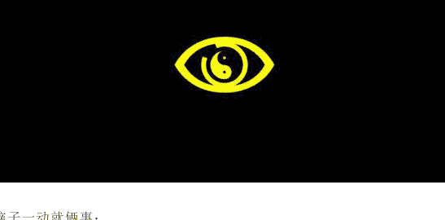

人脑子一动就倒事：
分析问题要一层一层，解决问题要一块一块，这就是“分层”和“解块”。

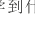

还是那句话：如何学习远远比学到什么更重要！

这话讲出来不是送给诸位卿卿天玩的，真得去用啊，小伙伴催三眼赶紧干正经事，道德经挖了个坑开了个头，赶紧继续填坑啊！填坑之前呢，有个东西必须要聊一下，就是如何学习道德经远远比学习道德经更重要！

这就好比大家学数学，如果在唱各种公式例题之前，先有一门课叫做“如何学习数学”，这种的课才是最关键的，但想必神州老师们没几个会教这门课。

数学只是个例子，许多学科之所以会存在，本质都是“看世界的方法”，或者叫做“观察事物形态”的方法。我们学习它们是要拿去

用的，而不是为了应付考试，而神州教育问题就在于“为了学而学”。

拿数学去看股票，拿数学看为人处世，拿数学看食物链运作…甚至看万事万物，也都是可以的，虽然在有些领域用起来是有局限性的，但逻辑是死的，人是活的嘛。

人人与人的区别就在于观察事物的方法不同，所看到的形态不一样，决定了人的思想力和实践力。

如果人们学到什么，而不能用它们去观察事物形态，那你学了它有何用？玩吗？嗯…高考就是玩！被逼无奈的游戏！

为什么大家毕业多年，再让大家去做初中数学题都不会？因为大多数人根本不知道，学校也没教过“数学有啥用”，根本不知其所用，所以早早就忘记了。

道德经本身就是告诉人们如何观察事物的形态，而且是最顶级的观察方法。

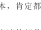

先说版本；其实无论哪个版本，肯定都不是原版！

不仅古今年代相距甚远，今人读的都是各种删改版，就是老子同时代的人，读的也未必是原版，因为距离老子年代较近的一些书籍，在引用道德经之时，文字上也互相有偏差，传到他们手里的版本也不同。

但其实这些都无所谓，神州文化一脉传承，就像一生二二生三生万物，通过现在也可以推究到以前，老子就算没写过道德经，或者道德经干脆没挖出来过，那么通过诸子百家的“三”也能把老子的

“一和二”给反推出来，通过中医也能反推，只不过在推导结果上表述肯定不一样，文字用的不一样，阐述过程不一样。

古今以来一谈到道，都用的是气、虚、空、有、无、天、地、阴阳等等，能不能不用这些词？

可以！比如三眼就用假象、标准、形态等等这些现代词汇来表达。

文字都是死的，人是活的。文字能够就具象化逻辑，锁不住抽象化的东西，抽象化的那个东西才是道。而且还真就得用现代词汇去写，虽然一定会很啰嗦，但是能够直接有效。

古今文字差异非常大，句子的逻辑都不一样，一个字现代人看起来是名词，古代却是个动词，那时候词汇量少，一个字表达的逻辑是纷纷复杂的。

比如“善”，现代人看它就是善良的善，代表好的意思，那干脆直接讲“良”不就好了，还加个善字干嘛？

这都是后来人给乱加的！现代很多词汇都毫无逻辑，都是乱说。文字的变迁就是人们“失道”的过程。

最优美的文字一定是字字都有独一无二的本源逻辑，就像是一个个代码，敲出来编成一个个软件，从而展示万事万物的形态，干净简洁利索没有废话！

三眼看“善”，不仅仅是个动词，如果用现代语言去描述，是一个非常复杂的逻辑——它是在一种高级的生存智慧，是顺应道的一种伪装。

比如“善于某某”，就是在（于）某某上，特别会顺应道的运动特点去伪装，从而获得益处。这一整句话归结一个现代词汇，就是“能力”。

再说짝字；

版本不同不仅是章节顺序不同，很多字也都不同，断句也不同，这时候很多阴谋论就出来了，说这是假作不让人知道真相，把“天书”弄成“地摊书”给老百姓看，甚至完全颠倒意思倒缭缭给人们脑子上锁（一手资源更新微信：ipi p885）。

这种成分有没有？可能有，但不会很多。

其实没那么夸张，要说《道德经》改一改还有点必要，毕竟涉及到一些政治问题和现实效仿；但《道经》就是底层代码而已，很冰冷丝毫没有“温度”，通过多角度抽象化（有、无、天、地、虚、静等）的去讲“道”，想努力把“道”给具象化，但老子开篇就说了，道是无法具象化表达的。

这就是一场所思维游戏而已。

那是不是还要去抠哪个字“准确”、哪个字是原版，哪个更接近“原意”呢？

三眼认为对于大多数字是不用细抠的，极少数个别需要细抠一下，比如上善治水还是上善若水，但值得细抠的非常少。

因为看道德经一定要有“整体观”！没有整体观细抠啥都 лёг，用，纯是娱乐较真而已。

什么意思呢？

老子写道德经其实都是“土话”，就像在咖啡馆聊家常，有一个话题叫做“道”，围绕这个话题扯拉西扯想到哪聊到哪；

是不是感觉很不严谨？对头！道就不能严谨的去讲，如果能具象化逻辑表达，那就不是道了，所以叫“悟道”。

这就好比父母交给孩子做人经验，告诉孩子要“中和”一点哎，这东西怎么具象化？不可能像做数学题一样拿逻辑推导的。

而这个“中和”只讲一次，孩子是不能够领悟的，需要多角度反复去讲，刺激孩子多思考多领悟，总有一天会悟出来“中和”为啥，孩子长大了再传给他的孩子，同样的无法具象化描述，只能多角度刺激领悟，子子孙孙传遗！

中国文化传承的“道”就是这么一个“无形”东西，它无法具体描述，但它有着“无用之用”，因为它看不见摸不着，绝大多数人只能敬仰它，而使用不到它，但是人们又都活在“道”里，百姓日用而不知。

比如诸子百家、中医都是道推导出来的，它们都是“无用之用的用”。大家以为这些“用”（百家与中医等）是中国文化的根子，那是因为“用”可以看得见摸得着，儒家讲仁是有形的，法家讲权术是有形的，中医望闻问切是有形的。

而这些有形的根子在于无形的“道”，那才是根子。诸子百家根子一样，只是用法不一样。这里引用老子的话说就是：

> “恒无欲也，以观其眇；恒有欲也，以观其所微。两者同出，异名同胃，玄之又玄，众眇之门。”

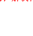

讲到这里就要引出一个很重要的一个句话，也是本篇主旨；

分析问题（悟）要一层一层的；解决问题（用）要一块一块的。

前者是东方思维特质，后者是西方思维特质。

一层一层是“向上”追究，也就是“从三到二到一”这个过程；

一块一块是“向下”去用，也就是“一生二再生三再生万物”这个过程，不断地将无形有形化，不断具象化、逻辑化从而可实操。

三眼之前文章写过，悟道是“归根”，用道是“顺应”。

这时候诸位肯定在想：讲这个有何用？
三眼答：有用！超乎诸位想象的大用，此谓妙用！

举个例子诸位就明白了，比如：

我们去看人，之前讲过看人就是看其“抽象形态”，人的言行都只是表达结果，表达背后有个无形的東西再推动，可以叫它意识、心理、观念（三观）、念头（善恶）等等很多词汇，现代社会东西方融合搞出很多词汇，但都大同小异。

那个抽象形态才是人的本真！

而念头啊、意识啊、心理啊什么的，本来都是空的，就好比刚出生的小孩子什么都不知道，他的脑子里哪里有什么所谓三观啊？这时候他的言行是本能驱使的。（这里延伸一下，佛家认为此时也不是空的，此话题我们假设是空的，“相对”成年人的空。）

随着孩子的成长，他的那个“中空”的地方会填进去“道徳”，填进去的道德不同，充满中空的形态就不同；形态不同，导致人的言行就不同。

这个词现代叫做“意识形态”，这可是管理核心中的核心啊，因为讲这四个字三眼被删了好多文。

道德管理等于于是 shi 形态管理，但是此“道德”绝非诸位认识的那个道德，这个文本咱俩聊。

比如认为为什么是对什么是错，什么是好什么是坏，什么是善什么是恶，这些“一对对”的东西就如同老子讲的“一生二”；而对错、好坏、善恶、是非等等再次复杂组合，组合出人生理想、做人方法、志欲喜好等等，决定了人的一生轨迹。

好了，我们看人是为了“看透人”，也就是知道他下一步会怎么做，轨迹都在你的眼中，他就是透明的。

而要知道一个人“往哪走”，就要知道他“从哪来”，这才是一个完整轨迹！或者可以归结成一个问题：道德是如何产生的（从无到有，填满中空）？

这时候就会有两种思维去研究，见图：

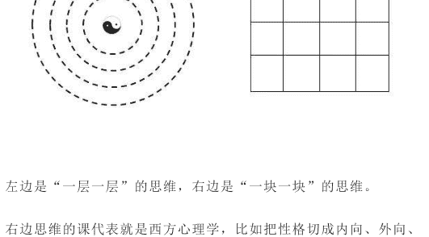

左边是“一层一层”的思维，右边是“一块一块”的思维。

右边思维的课代表就是西方心理学，比如把性格切成内向、外向、分裂、妄想、自恋、反社会、亲和、尽责、逃避、边缘、变态、强迫、依赖等等。

看着这些切割后词汇，是不是都是经验主义？切出来的都是各种结果表现，非要弄成一块一块的，而且理论上讲，当人类发明的词汇越多，切块就能越多，可以把人性切割成无数块，越来越细。

然后呢，形成右面的“格格”，把人们捆进格格进行归类，并把它成为一个学科，西学的诸多学科基本都是切块切出来的。

切块很容易衍生出一个问题，比如一个人既是内向，又分裂又自恋又变态又强迫又逃避又边缘又依赖…一个人就占了好几个“格格”，这可怎么办呢？西学就把这样的“强者”单拎出来，形成一个特例去研究。

特例是不是真的特例呢？其实也并不是，如果地球上人够多，特例就会越来越多，他就不是特例，又要对这些特例画一个“普遍性的格格”。

画格格的本质是啥？就是脑子在那里厘辑绕圈，在图片左边“圈圈”的外层一直兜悠，越绕越复杂，科研称之为“专业”！

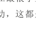

左边呢就是东方思维，事物是一层一层的，万事万物都有个“1”（内核），而所有的“1”都源自“0”——有一生于无。

只要找到那个“1”，即可牵一发而动全身，由“1”推导2、3、4、5、6…万事万物都会有一条根本轨迹。

这种思维有何用呢？比如当找到人们道貌的“1”，即可在最根子上看到一个人的形态。也就是说，只要人心一动，就能知道它要怎么动，这都是有轨迹的！

人心一动就要有选择，有了选择就有了“正反”，也就是阴阳。这人天生有的向阴，有的向阳，察觉到这个根子，就能洞察其心如何去动。

古人讲三岁看到老是有逻辑依据的，儒家把人硬分成君子和小人也是有依据的。

所以鬼谷子开篇就说：“圣人之在天地间也，为众生之先，观阴阳之开阖以名命物；”

大白话就是：万事万物（鬼谷子里多讲人心）都有个本源，本源运动就像是一开一关不停运转，找到这个运转就可以找到事物（人心）的轨迹（命物）。

又讲：“达人心之理，见变化之脐窦。”

大白话翻译：找到人心这个逻辑了，就能抓取到其变化（运动）的开关（三眼讲的机点）。

把人的“开关”找到了，那是开是关就不随便了？

纵横家多讲人心，因为他们的“用”是要出去搞外交，合纵连横怠忽人。但是纵横也来源于道，都源自老子咖啡馆聊家常。

老子的道是一种思维方法，三眼经常讲，思想是什么？就是观察事物形态的方法。

道，用现代语言来看，称其为自然科学与人文科学的顶点都不为过，属于“万套”的东西，只是老祖宗更多把它用在了人文上，搞出了诸子百家的各种花活，自然科学呢就是中医了！

所以，如何学习道德经，就是学习如何“归根”。

万事万物都有根，根要是归位了（悟），再去开枝散叶（用）就灵游自如了。毛爷爷：会提出问题（拓根，一层一层），就是会解决问题（切块，实操）。

最后呢，咱们把前文那个坑填上，道德是个啥？

这是俩东西，道是道，德是德。

德就是人心轨迹的表现，它也要遵循道，是道的“一种应用载体”。

道的载体多种多样，“德之道”在逻辑上与武术之道、伐木之道、撄珍之道等一样。

只是“德”这种东西对于社会管理更加重要，因为它无形中推动着人们的行为。

道呢？此处可以理解为“人的思想性”。

意识形态是管理核心的核心，等同于道德管理，管理的不仪只是人们内心的“对错”（阴阳方向）；更是“思想往哪走”。

如果诸位细品爆炸的信息，您会发现信息都是把人引导着“向下走”，让人的思想形成“一块一块”的，教育也是如此“技工教育”。

所以为何三眼一直讲，道德是最为高级的一种谋略，您就想呢；

把人的思想和行为弄成一块一块的，并且规划个既定方向，是不是最高级的谋略呢？

咱们认知？得能跳出块块呀…

## 什么叫开窍？此一篇，玩一生！

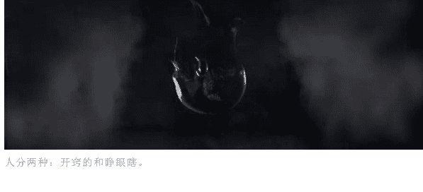

人分两种：开窍的和睁眼瞎。

开窍，这是个超级无敌宇宙最牛 B 词汇！

问题是窍是啥，咋开？

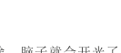

人活着，起码得知道人是啥！知道人是啥，鼯子就会开光了！

是不是以为三眼是精神病？

看完文章你就懂了…

对于有慧根的小伙伴，一篇玩一生！

东方哲学为啥牛 B，傲视于全地球？

前篇讲了，人有漏洞，还都是天性；

其中最大的漏洞就是：人类总拿“活着为什么”来“自残”。

只要是个个人就会陷入这个痛苦的思考之中！顺着此漏洞，全世界 99.9999%的思想产生了！

前篇三眼吧啦吧啦讲了 1 万字，一个中心思想：

会玩这个漏洞，上到揣政治、看经济，下到炮妞、创食赚钱都通路，去市场买菜都意气昂扬…

中国老祖宗牛逼在哪呢？

“反者，道之动”！

——要把漏洞给堵上！

这几个字包含的智慧太多，拿到哪解释都牛 B，三眼解释一下肯定是以偏概全，但是不解释又没法继续往下写，好吧…

在三眼看来是这样的：

反者=归根！

道之动=归根的过程。

万事万物皆有“根”！

好了，老子俯视全地译：

“你们这些大傻蛋，沿着人的思想漏洞思考很痛苦，就不会反过来找到“根”？

根是啥？是人啊！

因为你们都是人，所以会陷入“活着为什么、世界是什么”无限痛苦思想之中。

只有明白人是啥，才能把漏漏塌上啊！”

那么，人是啥？

## 东方哲学研究的核心就一个：人！

人研究明白了，宇宙就明白了，因为我们所能感知到的东西，都是人主观上形成的。

佛家来到东土大地，与道家一拍即合，因为大家研究模式一模一样！

好了，人是啥？

## 万物皆有根，道佛玩的就是“归根”，佛家叫“入空”，道家叫“至虚”。

人是这个样子的，像一个植物！

不同在于，植物根插在泥地吸收精气；

人的脑袋里装着“根”，插在“空”或者叫“虚”里，从其中获得能量；

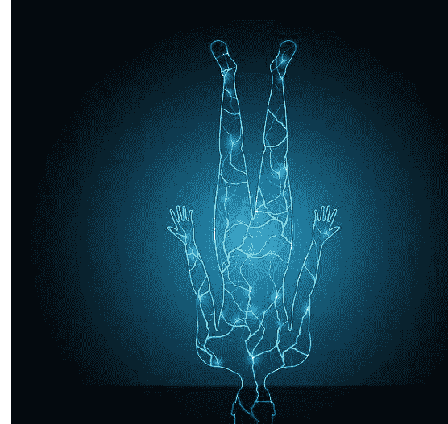

倒过来是不是还挺好看的^

佛道同不一样，意思完全一样。

西方二傻子：“人的思想、智慧到底哪里来的？这么大能量源自何方？我好缨问！”

东方哲学：“是虚与空啊！笨蛋！”

看，倒过来人就如同“植物”一样，四肢如枝，躯体如干。

划重点：东方哲学都是“反”着看世界！

好了，人要是这么一直“生长”，那么必然是死亡，发芽的第一天就上了死亡之路，中间会伴随着各种痛苦。

佛道的思想就是要“归根”，“退化”归回到虚空之中。

但是，这样理解“反者，道之动”太肤浅了！

这句话可不仅仅讲“人要倒着活（时间和空间）”，而是把人看透之后，各神宇宙万物的道均可以看透，因为都是互相“映射”的，万物皆“反”！

啥叫“超脱”呢？

肉身、思想都是“衣服”，要能把这些衣服都给“脱掉”，就会“穿衣服”！

人就走向人生巅峰了，就涅槃就飞升了。

归根、虚空、超脱、人的倒着生长、涅槃、飞升等，这些都是比喻，都是“教主”要阐述思想，让人理解只能这样讲而已。

你非要把脚子插土里搞实验证，三眼不负责任！

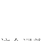

这些和“开窍”有啥关系呢？

窍，就是脑洞！

古人很时尚，几千年前“脑洞大开”这个词就已经火了！

不把窍打开，“根”怎么生根发芽呢？

中华自古几千年，所有的思想都围绕着“穷”，形成两大派别：

- 1、把人穷给关上，禁止开穷；
- 2、想用最简单的方式给人开穷。

一开一关，这就是中国哲学思想的整体脉络，历史、文化、军事等等都一脉同源！

三眼讲的这句话，自夸一下：一句胜万篇！

政治抬地盘推地盘，就是开关穷；谋略，就是开关穷；纵横术恩怨大法，就是开关穷；…

因为人活着的过程就是开关穷，把“过程”弄明白了，啥事就都明白了！

佛家讲“慧根”，道家讲的“通阴阳”，都是在讲“开穷程度”。

这里呢，三眼说一个东西，肯定会招骂啥，但是还要说。

就是“天赋论”，这人天赋真是不一样的。

我们在平素见到陌生人，一眼看上去就感觉对方“不太聪明的样子”，气质很木讷，那就是没开穷，脑瓜子根出不来，这一点从外部可以感受到；

哪怕让他读遍世界所有名校，出来后一身“洋气”，发蜡打磨到苍蝇站着都滑倒的地点，衣服干净到连根毛毛都不沾，但也改变不了其“不太聪明的样子” …

而有些小伙伴呢，在年少时候就开始觉得自己“不正常”，思想与行为乖张，总觉得自己是神经病，这是好现象，是“根”想破“窍”而出，只是被“正常”的社会给压制住了。

## 人一生中，慧根会有“高速生长”的阶段。

时间长短不一，主要特征就是“灵感到屎崩”，稍微给点刺激脑子就要爆炸。

在“高速生长”阶段是开悟的最佳时期，过时不候！在过了这个时期，人的悟性就弱了，思想光芒就暗淡了。

所以人玩思想不是个“蛮力”，不是体力活，比的不是谁胡子白又长。过了“高速生长”期，思考 100 年都不如原来思考 1 年。

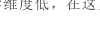

好了，咱们明白“窍”字，理解到“虚空”，咱们不是为了成佛成仙，那个是宗教玩的花活，教主们从来就没有想变成“大主管”！

## 但是呢，一定要研究“开窍-虚空”这个过程，因为所有人类智慧都在这里面，包括科学。

为啥总说科学维度比佛学道学维度低，在这里还可以换个角度讲：

## 人与外界就像镜子的两面，互相映射。

或者说，外界就是人所能看到的映射，人看不见的，思想感知不到的，不计算在内。

围绕这个“镜子”的两面，角度不一样，一个研究“主体”，一个研究“客体”，产生唯物和唯心，然后站成两队，两边队员互相喷…

站在佛教角度去看，此二者都是大傻蛋…

为啥呢？因为主客体一样的，不可分离开来，“镜子”如果非要把两面分开，还有“映射”功能吗？那还叫镜子吗？

从“开窍-虚空”，中间“蠢根”生长爬行的过程，就是“映射”过程，智慧全都在“映射”里。

东方哲学太牛 B，把人研究得太透了，以至于几千年发展都把智慧“映射”到“玩人”上，忘记了“玩物”。

如果把古代思想大家爷弄到现代社会，让他们选择：把人研究透还是把水蒸气研究透，他们肯定选前者。

因为人类者至极目的不是为了把宇宙都给“拆了再拼装”，费那事干嘛？有啥致敬嘛？

拼装花样再多，回到人本身，不也还是要找到“活着为什么”吗？最后还不是要回到“人是什么”上来吗。

科学研究1万年，最终目的也是为了搞清楚“人是啥”。

好了，既然老祖宗把“人是啥”告诉咱们了，之后呢？

这里就可以接上两篇了，也就是人类社会是一个“边界”构成的，“边界”里都有游戏规则。

规则从大到小，从根到枝，依次就是精神的规则（宗教与哲学）、利益的规则（政治）、各种运作的规则（经济、文化、军事等），在200年前西方小恶魔们搞出个东西叫科学，这里也给加进去，也就是公式的规则（科学）。

这些所有的规则，回到本篇主题，就仁字概括“开关窍”！

精神的规则在上篇讲了，就是“信仰”和“嗜食”，因为人有巨大漏洞叫“模仿”，模仿看似是一种天赋，其实是一种漏洞，产生个思想很低能的东西叫“人格化崇拜”。

一句话表述就是：

> “别有用心”的人通过“人格化崇拜”搞出―套“信仰”为“傻子”们建立一个“社团”，这就是文明！此逻辑适用于地球上一切大大小小的社会交互行为！

所以呢，宗教与思想家完全两码事，道家与道教完全是俩东西。

“教主”只是脑子开光，慧根无限生长，然后把道理讲出来，而“教众”给教主“绑架了”，都是因为私利；

这些别有用心的人把“慧根”这么一个简单东西给玩出各种花样：

- 有的看到“天赋人权”，而后拿去搞政治管理大法（政治，儒法墨）；
- 有的看到“虚空”，而后去开宗立派带着大家去“飞升”（各种教派）；
- 有的看到“阴阳虚实”之变化，然后拿去打架斗殴欺负人，还有的拿去玩洗脑（兵家纵横家）；
- 有的看到“镜子的映射”，然后拿去搞堪舆学、相术，神神叨叨的（阴阳家）；

这些别有用心的人也算是给“教主”思想发扬光大了！

毕竟教主很大器，啥都不想要，看透了人是个啥，人类社会是个啥，甚至看到宇宙是个啥，欲望降到最低点，觉得活着好无聊，来一句“吾有大患唯有”

吾身”，牛通人就是这个样子…

但是教众的私利心可是很强的，换个角度讲也多亏了这些教众，把各种“游戏规则”玩出新高度，留给我们这些后世子孙“财富遗产”。

“开关键”串用的，具体“财富遗产”都是啥样的，这个三眼回头慢慢写，需要很多很多篇。

最近写的都是心法，都是追本溯源，相当于“打地基”；

不知道“镜子”为何，怎么玩“映射”呢？

还有�， 思想这些东西不要觉得把某一位“白胡子爷爷”的书倒背如流，你就有思想了，然后开始搞人格崇拜，白胡子爷爷万岁，其余都是傻B。

教主思哲放光芒，摆在那里几千 年了，被各种“混饭吃”的玩出千百种花样，首先得研究为啥“白胡子爷爷”们要这么“玩教主”，这才是思考的正道！

这人的思想要寻求“刺激”，但更要自己长，长到最后就穿发现“跳不出架来掌”，但长的过程才是你自己。

思想不是体力活，是需要“叛逆期”的。坏孩子到了社会比好孩子混得开就是这个道理。

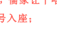

说到这，顺带着说一下怎么开窍！

- 1、人要想“开窍”，一定要反儒家，儒家让干啥，就专门不干啥，“儒家”可不仅仅是儒家吗，都是啥自己对号入座；
- 2、儒释道并不是“三教混元”，其实儒家与佛道是对立的，看明白这种对立

才能明白历史。

很久很久以前，有一个奇才叫董仲舒，他玩了个东西叫做“独尊儒术，罢黜百家”。

为啥叫奇才呢？因为能提出这个建议的，肯定是把“开窍”这事看明白的，最后为主子找到个长治久安的最佳方案。

他的方案看历史书是绝对看不懂的，去听百家讲坛 100%给你聊糊逼，各位“白胡子叔叔”和“眼镜阿姨”都是“在边界规则内混口饭吃”。

什么具体方案呢？四个字：

## “严禁开窍”！

怎么办到呢？

首先肯定要把“开窍”技术排第一的道家给压制住，然后靠着道家想建立的各种人溺也给杀死，这还不行！

为啥不行呢？因为人是有“天赋”的！

## 不怕人学习（体力活），就怕人脑子蠢根长得快！

这东西很难好禁止，华社小伙伴们脑子长在自己身上，到底是插“泥地”里还是插“虚空”里，这事很难控制…

咋办呢？

上“锁头”啊！

## 一个人如果天生就蠢根绝佳，怎么把窍给堵死不让长呢？

很简单，说你是“叛逆期”…懂？你所思考的东西都是不对的，是“不听话”、“不正常”、“没正经事”的表现，“路子”走歪了知道吗!!!

董仲舒的“叛逆期大法”就是“天人感应”学说等等等。

这人吧，如果有慧根、在穷里萱盡欲动想要破壳而出，那么对于天啊、地啊、人啊、宇宙啊、生命啊…等等就会“天生地”很感兴趣，如果一直去思考，让思想长出来，然后推演到政治啊、宗教啊、经济啊、文化啊…

很容易一下子就开窍了！

咋办呢？

那就把小伙伴所能看到的任何东西都给“锁住”，也就是都给“下定义”，只有一个“定义”是正确的。

哈“定义”呢？

就是人同与天地宇宙有感应，吧啦吧啦一顿忽悠，看着挺有意思范的，其实归根结底是要说：

大家伙都要有“规矩”知道吗？

脑子不要瞎寻思了，按照“规矩”办事知道吗？

其中最被贩贩众人熟知的，就是天灾与人祸相联系，什么天有异象，有什么事，肯定是咋咋地了…云云。

董仲舒的“叛逆期大法”还有个配套，就是“大一统”学说，要不然干嘛搞“馅头”啊？

有趣的可去参观一下，挺搞笑的。

儒家吗，玩的就是规矩，这东西也不错，成为几千年的“刚需主食”，大家伙一天不吃就难受，因为一旦“破坏规矩”人们都受不了了，有心的小伙伴可

以“俯瞰大地”自己边感受边研究，很有意思的！

所以吧，这人要研究学问，得追本溯源，追到“人是个啥”才行，这样很多“谜团”才能打开，不然东方思想、全世界思想加起来好几亿字，能看得过来？

知道为啥很少人去在“台面”上讲道家吗？

一是因为讲真的就是讲“开窍”，不好讲；
二是这东西讲起来就像“入魔”一样，能给“规划”里的少年们三观尽毁，痛不欲生…

其实很多讲“虚空”思想的都不对头，都掺杂了儒家特色，掺杂进去各种伪道德，那都没法看，尤其是“白胡子老爷”来讲，基本全都给带偏！

所以这人就分两种：开窍的和睁眼瞎。

这世界什么是真的？什么是假的？

## 《道德经》里的开悟方法：12个字很简单！但越简单越难（逆人性）！

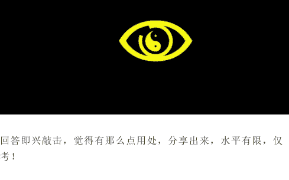

星球回答即兴敲击，觉得有那么点用处，分享出来，水平有限，仅供参考！

先从几个角度看看“开悟”这个家伙。

- 1、 人大多一听到开悟，默认等于彻悟，这不对。开悟是走向彻悟的过程；彻悟有没有不知道，开悟是个很常态的事。
- 2、 开悟是人天生自带的，人人都有，没有佛法道法出现时候，或者文字都没有，人也照样开悟，不开悟哪来的佛道？佛道是开悟到达一定高度了，记录下来，这种高度是不是最高的，咱也不知道。

其实佛道思想也相当于毒药，思想写出来就是毒药（法），把后世搞成“以毒攻毒”。呆头说“别惹尘埃”，噢…经文比十万个为什么都厚；道家说无为，道藏厚度仅次于佛家经文，堆满有为。

3、开悟佛家讲就是光明照进黑暗的过程。光的速度多快啊，进来了，一瞬间就看到了。用在人思想上，就是瞬间明白了什么，得出一个道理，迈上新台阶。

迈上台阶一定是个过程，而没有直通车。打开手机看各种信息评论，开悟的人没有10亿也有8亿，随处可见各种道理，无论你讲什么，人家三四个字就能概括你……这是开悟吗？不是！

开悟后的结果表现，就是能把4个字写成40万个字，还能把40万个字，总结出4个字，这个“反”（返）的过程有了，算完成一个开悟目标。

也就是由道-法-术，再术-法-道，简单到复杂，复杂到简单，可以自由往返。

## 4、开悟是个意识运动的方向，化繁为简，是向上（道）抵。方向对了，特别简单，方向错了，走下坡路。

在人的思维表现上，就是明白一个道理之后，一定会觉得“不足”，上面还有一层罩子，在那里罩着让人心难受，浑身不自在。

把A、B两个人同起点起步，干的事情都一模一样，最后结果对比，A比B懂得多，为什么？

只能是因为意识运动不一样啊。为啥不一样？

人的惯性思维：有了结果，就要给结果一个原因，甭管原因成不成立，这属于倒推，大家都默认了倒推逻辑，那么此逻辑就是对的。

逻辑就是：A比B聪明、有天赋。

这根本就不是原因，因为如果再细抠，聪明是个啥？天赋是个啥？人人就开始装作哑吧，没几个人答得上来。最后模糊回答：聪明和天赋都是天生 XX...

此时，绝大多数人是没有“浑身不自在”的，因为已经得到了一个“因果”，甭管成立不成立。所以开悟就会止步不前。

聪明白和天赋，就是意识会运动，运动方法对路子。这东西不是靠脑子的，而是心脑结合。佛道的典籍概括讲，就是告诉人们如何心脑运动，就这点事。

5、开悟为了啥？答：提升维度！

所有人都追求“牛 X”，虽然每个人的牛 X 观念不一样，但 90% 的人认为“牛 X 靠经验”。

而开悟的目的就是“绕过经验”。

经验是什么？是同一维度的对抗；
开悟求什么？求提升维度，降低打击。

比如 A 和 B 谁在战场上更厉害？嗯...90% 的人会认为谁混得久，老油条经验多就厉害。要这么玩那所有人都不比“熟”吧。

开悟就是找到“经验对抗”上面那层维度。比如佛教徒没有“社会化”，酒桌茶桌各种社交聚会没有，但佛教徒进入社会，很容易看清楚每个交互活动本质，因为维度高一层，开悟的秃头玩入魔，一般人挡不住...

而实际上大家真以为秃头不入魔吗？看看年节假日香火多旺盛就知道了，捡钱效率远远>金融抢劫。马太概就是小老弟...

再比如韩信，带兵打架经验不多，直接拜将，就是维度高。真正的将才不是多靠打出来的，而是多靠悟出来的。

专才可以培养，人才培养不了；因为专才靠外界雕磨，人才靠自身觉悟。

## 6、开悟的关键点，过程。

说出来就是“死法”死逻辑，仅供参考！
曾国藩讲得比较接地气：认真！

大多数人把认真=努力。

比如工作很认真，其实是在讲工作很卖力气。

而事实上，认真与努力不仅不一样，而且截然相反，完全“俩方向”。

很少有人会认真的，这就好像中青年都很努力，但是不知道如何努力，每天苦思冥想没有“路子”。玩“努力”会进入“红海”，只有玩认真，才能进入蓝海。

现代人最大的浮躁：有劲使不上！
换句话说：不知道如何认真！

而看准这一片“刚需市场”，无数教人“努力”的书籍多了起来，这种书越多，人越“努力”，距离认真就越越来越远。结果就是“课程”无处不在，但人们依然“有劲使不上”……

曾老头讲的认真，就是如何获取开悟。认真，去认识什么是真的，这才叫认真。

认真还有个死对头：较真。这哥俩也是完全相反的方向。99%的人都喜欢较真，1%的人才认真。

《道德经》和《阴符经》对开悟（认真）有详细论述，且路径具体可操作。

道德经第五十六章：

塞其兑，闭其门，挫其锐，解其纷，和其光，同其尘，是谓玄同。

这段话是讲开悟的三个维度：

- 1、塞其兑，闭其门——自我封闭；
2、挫其锐，解其纷——意识运动；
3、和其光，同其尘——运动结果。

兑，卦象，就是嘴巴。

门，就是人的“门户”，也就是各种低级感官，眼鼻舌身意。
闭上嘴，少说话；封闭低级感官，以此刺激高级感官（意识）开始运动（感悟）。

但这么讲，太肤浅了！

塞其兑，闭其门。是把自己与外界的低维沟通都堵死了！如果能做到如此极端，迫使剩下的沟通只能是意识。或者可以方便讲：少交流、多观察。

俗话说厉害的人物沉默寡言，一张嘴就直揭根源。

先说闭其门：

人们大多把直接感受当成真实。比如肉体碰到个东西，感受到硬、软、冷、热。精神碰到个东西，感受出好、坏、善、恶。这些东西只是相对出来的一类“片段”，而人们错把片段当成真相。

这些一个个二进制片段，形成一个个假象，充斥着人们的生活。

所以，如果现代人离开网络、手机、社交，那是绝对受不了的，因为这相当于剔除了各种片段。人要天天刷抖音，刷朋友圈，喜欢拿社交充实，那肯定是没有思虑力的。

为了规避这些“片段”，所以古人讲“慎独”，这与尚道士跑山上差不多，清静而规避假象，常在河边走哪有不湿鞋对吧…

所以独这事可不是努力能办到的，而是明白感官作用、假象片段等等。

独，是不是就不好交流呢？对于凡人来说就是少交流，而在老子看来最好是不交流。为啥？

塞其兑：

老子为什么把嘴巴单拎出来讲？

口为心的门户，心是神之主。人都是由嘴巴向外界反馈，再由各种感官回馈，形成一段逻辑。

人的每一次讲话回馈，其实都是在“教育”自己，因为一直在“加深逻辑”形成逻辑循环，也就是脑子转圈圈。

把嘴闭上，就是少和别人一起玩脑子转圈圈。

表现在生活上，就是你很投机的聊起来了，聊个三天三夜，觉得有所得，但却抵挡也没得到，回到现实还是老样子。

人和人之间，一定会有高下之分，所以思想不是“谈”明白的，一高一矮怎么谈也可能谈明白，只能陷入绕圈圈。思想是“悟”明白的。

假设一个高人去山上拜访更高人，俩人一是话肯定很少（高人直接绕过假象）；二是他也不可能“谈”明白，只能获得“刺激”（真相是无限远的）。回家自己悟，明白与否（悟多高远）看个体，可能高人比更高人悟的更明白，也可能还是老样子。

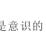

对于是否明白，这就进入老子讲的第二层维度了：意识运动。

推其锐，解其纷。

锐与纷，都是意识的表现。这就像是意识的“剑尖”和“剑身”。人意识一

动，就像是“刺”击！

人只要起心动念，必有个主逻辑，自己觉得特别正确的、就像是真理那种。嗷子表现最明显，标准嗷子可不是嗤嗤，而是真觉得自己非常正确…十头牛都拽不回那种。

好了，有了主逻辑，需要支撑啊？“分”就是分逻辑，其实就是杂念。

人起心动念过程：一个固定主逻辑，然后四处找“分”来支撑，有原来自带的，但大多数是临时凑的…

辩论：就是人的念头（意识制击）互相交战！

辩论首先就是要把对方的分逻辑都给打破了，反正都是临时凑的，自带的也是之前临时凑的，这年头逻辑箱的一大把一大把的…好凑，缺了就去易梦轩书、公司什么的，里面逻辑跟得上潮流…

所以偶尔辩论最常见的就是：谁谁谁说过什么什么…什么什么事怎么样怎么样…而高人论道，谁会弱智的“穷征博引”啊，都是自身的意识流切磋。

嗯…互相破分逻辑，最后双方落的东西不够用了，就开始诡辩，在那里逻辑画圈，你说什么鸡，他就说先有蛋，进入死循环。几回合下来，死循环都不够用了，好吧，终于可以开始人身攻击了，也就是泼妇骂街，辩论达到高潮…

所以辩论一定要限时，只要是个 人，只要辩论，不限时一定变成骂街，跟文化水平没关系，政客这种素质聊着聊着互相撕很常见…跟品德无关，跟人类思维的运动特性有关（一手资源更--微信：ipip885）。

所以人要开悟，就要把意识的锐利给拨没了，把“穷征博引”的杂念都清空。

简而言之：意识不要延续在别人的意识流之下！

这也相当于一种封闭，前面有低维感官与低维交互封闭，这里就是意识的交互封闭。

所以老子讲：善者不辩，辩者不善。

人不要很“努力”地“克制”自己不辩论，而是要从本质上认识到辩论的弱智之处。

一个人真如能做到“塞其兑，闭其门，挫其锐，解其纷”，他一定不爱辩论！只剩下感情（意识运动）和超越（意识往更高处运动）。

最后，是老子讲的第三个维度：和其光，同一其尘。

人越是张扬、越是沉默寡言、越是开悟，在语言行为上肯定会表现出很牛 X 的样子。（一手资源更新微信：ipip885）这时候就要开始“谦虚”了。真正的谦虚不是“装 X 式谦虚”，而是真谦虚。

就是悟得越高，越明白自己的弱。在悟的过程中，虽然总是有着“牛 X”的幻象，自觉比他人思想力要强，但如果一直感悟，就会发现自己与他人都是小蚂蚁，小蚂蚁虽有不同的高度，但对于天道来说，都是渺小的！

当思想力向言行上渗透之时，所放射出的“牛 X 之光”越柔温和、缩小；所想要的“牛 X 人生”也越来越迫近于平凡。

此处参考《寄生》一篇，寄生水平也是有量级的，顶级寄生是真的知道自己是“寄生虫”。

好了，扮演出虚伟大那事儿咱先不谈，那东西靠时间去感悟；人毕竟要剑食，就要入魔，人的开悟初衷都是为了牛 X，而不是为了“平凡”，没有牛 X 哪来平凡？

《阴符经》讲识真（开悟）方法与老子一样的，但阴符经毕竟是伪书，相当于“利用老子”，所以维度浅一层，没老子那么宏大，但是辟维之后用到倒食正好…

誓者善听，聋者善视。绝利一源，用师十倍。三反昼夜，用师万倍。

人这辈子能获取的东西是一样的，只不过大多数人是“内耗”型获取，每天获取的数值相当于“正负数”，互相抵消了就感觉很稳定。

负能量多了，来点正能量…正能量太多就变成毒鸡汤，那就再来点魔负能量补充补。每天天意识运用很开心的转圈圈，这个就是大多数人的所谓“调整心态”！

阴符经是玩谋略（入魔）的，这么玩内耗可不乐意，谋略就是玩“失道”，要去失去平衡走极端。

对于绝大多数“正常人”来说，想要让觉察强化，会把耳朵靠靠嘛？

但是出来倒食，比拼的就是看谁入魔得深。看谁更极端。

多数人不能有所作为，主要原因就是“既要也要”，钱、名、温饱、安逸、心灵…总之能想到的全都要。这怎么可能有所成就…

人之耳目，皆决于心，而竟于神。心分别机不精，神竟则机不微。

也就是说，人只要分心一点，都把握不好事物的“机点”。

没层次开悟，没那么多人生大智慧，就本着某一条路径，寻找“机点”而已。一条路走通了，其它路大概就跟着通了。

人的每天起心动念，皆处在被扰乱之中。

一个简单例子：多数人在工作上遇到问题，都是“综合性”问题，问题综合是因为人的起心动念是综合的。

如果工具只有一个目的，就是倒钱，死磕研“利害相生”。什么友情、爱情、亲情、荣耀、名誉、道德、仁义等自然而然就都去除了。

这么讲，很多小伙伴又受不了了，怒喷三眼无“道德”。

换个说法：孙子说，军事斗争是死生之地。自古谋士出谋划策，策略实施那是要死很多人的，唯一目的就是少牺牲而取胜！写个谋略计划书还要探讨一下何谓道德？何谓亲情友情爱情？

嗯...也会写，那是谋略工具的一部分...

所以阴阳经更符合绝大多数人口味，接地气！

入魔，极端走得远了，物极而返，最后就是中和，那就是入神了。
不入魔焉能入神？

## 老子：道德经就是假的！认真你就输了！（最真解读）

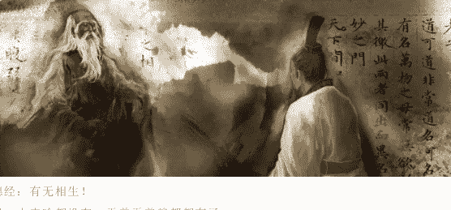

道德经：有无相生！

三眼：本来啥都没有，弄着弄着就都有了…

先给文章个主旨：

道德经就是一部高级忽悠人宝典！忽悠着忽悠着，智慧就无限来了！

道，就不存在！

天之道，人之道，都是假的！都是扯淡！

以上就是三眼说的，他不敢说解谈最高水平，只能说“最真水平”。

就好像韩寒那小子说，文学是个屁，谁也矫装不！

但凡搞名次的，都是靠养发证书的！

写了第一篇《道德经的冰冷智慧》，收到很多留言，大致都是先感谢一下，然后开始跟三眼刨根问底，基本是这意思：

“眼哥，还有更干的货不？老子肯定有相当内核的大智慧，一下子就撬动整部道德经的，跟他们说说呗！”

看见这种要求多了，三眼很沮丧，写了一万多字，不少人给读晕了。

正好星球有人提问问题，顺便给大家扶正一下。

## 天之道，人之道，都是假的！

人谈一邃知识，首先要把“天”放一边。老子也是人，不是神！只是更加有智慧，思维很奇葩，带动了后世徒子徒孙都奇葩。

就好比佛陀是人，不是神，只是开悟的人。

老子写道德经是被逼无奈，不然他也不会写。正如人一讲话必有假象，老子也是人，一说话必有假象。

## 整部道德经都是个假象，一个超高级的假象！

世间无论再牛X的思想，只要去表述，都是“用假象解释假象”，就好比想知道太阳的位置，就要假设地球不动，通过对比才能得到太阳的“位置”，而“位置”其实根本就不存在。

## 真相（道）根本就不存在，也就表述不出来。

思想智慧，就是向万物借力！

最牛的智慧是啥？就是向“无”借力。

大白话翻译：本来没有事，搞着搞着就都有了事，谁搞事谁牛 X！

智人是怎么把其他人类祖先杀死的，成为唯一祖先的？按理说身体素质没有尼安德特人强悍，但是智人有智慧，会搞事…

智慧是个啥，就是借力于万物。

社会没出现前，大家都是野蛮动物，靠敬畏划分等级。

社会出现后，就出现了一批脑子放光的人，这些人叫做“圣人”，圣人没有一个靠体魄求生的，会玩脑子的从来不打架，就好比那个伟人从来不摸木仓杆子…靠的是脑子智慧。

智慧是个啥，就是借力于万物。

商业本来就是你买我卖，很简单，但是就怕有智慧的人进来，他们会搞出各种“商道”，把商业的竞争形态弄得越来越复杂。

如果不是策划人、战略家、咨询师、咨询机构等等，商业也不会越来越复杂“繁荣”。

经济也本来很简单，在佛道看来，经济就是人和人如何共生共存，找到最合适的方法，就是最“经济”的！

但是自打有了经济学家，把经济搞得越来越复杂，所以三眼讲过，经济学家都是诡辩学专家，全都是大忽悠。

人类社会本来也很简单，圣人来了，通过“天道、人道”等等，把社会秩序搞得越来越复杂，把“制度”、“主义”搞得越来越复杂。

老子就是“圣人中的圣人”，一道道德经，可以把世间的各种东西，都加“智慧”，都可以加入“道”。

甚至可以有拉屎之道，撒尿之道。

什么是思想？就是搞吞噬，做乱局，像做中间，两头吃。

什么是斧庸 LUN？就是搞吞噬，做乱局，两头吃。

什么是人之道天之道？就是搞吞噬，把秩序做乱局，本来大家都是自然而然的，被讲道的玩出新花样。

所以回到开篇：

三眼：本来啥都是没有的，弄着弄着就都有了…

这个东西叫做“创新”！

## 圣人的“照妖镜”！

圣人不死，大盗不止！

别觉得圣人是什么好东西，也不要觉得思想家就是高圣重得很 X， 那都是他们给众人民洗脑的结果、道德就是一个洗脑的结果，这事都看不出来，还玩什么思想。

庄子就看得很明白，说圣人不死，大盗不止。

没有圣人，这世界没这么乱，圣人才是人们生活痛苦的罪魁祸首，就好比科学的发展给人带来的痛苦要大于温暖。

自古，所有所有所有的圣人，法宝就是一样：

照妖镜！

何谓照妖镜？

就是人的内心都是妖娆混乱的，圣人拿镜子一照，这世人就群魔乱舞，照出了所谓真相与假象。

本来世间都是“无”，拿镜子一照，就产生了“有”。

世人看见了“有”，傻乎乎地去追“无”，总是想透过所谓“假象”而获得“真相”。

老子：有无相生！

如果不拿镜子照一照世人，就不会有各种“道”！

这个“照妖”的游戏理论上能玩一万年，万岁万岁万万岁！

老子，也是圣人之一。

老子如果不把人情世故，把人间治世，搞得那么抽象，推到那么极致，可能神州大地会产生所谓科学。

这事往上报，就能抵到伏羲做八卦，所以杨振宁说周易害得神州没科学，也不是无道理，大师总是能看到事物的机点。

所以，三眼看老子，首先是谋略家，阴谋家，阴谋到极致——我是我富二代我坦白了，就成了阳谋，只是太高级，众人看不出来。

看道德经，就是看“老子坦白从宽的过程”，这里面智慧无穷！

这里唠得说一句，老子玩人间大法和科学，哪个好？傻子才去区分！但傻子就那么多，天天遇…

没有什么好坏，缺啥补啥，都只是个会思考的有机物而已，哪有那么多对错？

三个字：无是非！

做人要心如止水！

心如止水不是死水，止水是让水流的假象停止，不要“照”我了！

所以，回到上一个问答(星球小伙伴另一问题，人的“自以为是”为何物？)。

人要无是非，才能生出智慧。

无是非是在于嘛？

就是无论谁拿“照妖镜”照俺，俺也不中计！

只要心存是非，必产生假象。就像以为地球是不动的，太阳才有了“位置”。

地球是你家的吗？

是谁家的，三眼不知道，反正不是俺家的…

人的漏洞，在于心只要一动，必有选择，必有是非，必然产生假象。

这在《思想观》系列里讲过，这是人类的巨大漏洞，有洞得补，找老子问问补法，他老人家那里技术最全面。

# 老子：善者不辩！辩者不善！

大白话翻译：聪明智慧的生存谋略《善》是不爱辩论的，爱辩论的都是大傻X。

因为人只要辩论，就有立场，一张口，必有假象，自己给自己就陷进去了。
所以辩论会有时限要求，如果不限时，到最后就是对着骂街而已…

爱论是非，不是是有目的的预谋《聪明》，就是傻《真傻》。

聪明人很少，所以一看看到有人论是非，就躲得远远地，一会就会听那边骂街开始…

# 动物的伪装与“善”！

动物的进化，就是伪装技巧的演化。善，就是最大的伪装！

社会中，总有那么一小撮聪明人，他们只在乎结果，根本不在乎过程，干什么都偷偷摸摸，不是猖狂，而是智慧。

就好像此星球里的诸多写作家朋友们，一个系统逻辑拿走，拆解翻译成十几篇…

人只要没立场，就可以“长生”，通过水性包容，获取智慧。

做到：喜怒不形于色，张口没有是非，别人都是对的。

为什么？

因为是非一出，别人在眼看着穿你！万年进化功力一下子就废了…

因为对于是非，并不是个过程，它需要结果去展示才行。

人如果很容易被别人搞得怒了、喜了、恼了、陷入是非去了，那就是别人拿“照妖镜”照你呢！

“急急如律令，现形吧！”

# 为何老子是最大的阴谋家？

佛道本为一家，只是“用法”不一样而已，一个“玩自己”，一个“玩别人”。

在“玩别人”上，想必老子是最高明的，借出“道”只是“玩人”顺带的产物而已。

诸子百家没有一个是为了出世而生，都是为了入世。

老子的“无为而无不为”才是最大的阴谋。
道家的阴阳辩证哲学，实属为人性量身定做的理论。

人性是什么？
是贪的无限延伸，而生出的诸多人性化“对立点”。

贪字在哲学符号逻辑范畴里是没有反义词的（唯一一个“廉”是社会化词汇了），贪就像是一个不可逆的箭头，无限延伸向远方，在延伸的过程里产生无数个子盾对立点，这就是人性的诸多表现。

例如：
舍得（舍弃与获得）；
傲慢（得到而显）与谦虚（得到而藏）；
嗔怒，对与阻碍贪婪箭头延伸事物的攻击，反向是防守；
嫉妒，因人胜过自己而恨，与嗔怒一个意思，反义词与近义词同为羡慕，
嫉妒与羡慕的区别在于嗔怒的攻守之度。
等等…
都是围绕贪婪本能的“一正一反”的“对立点”。

如果顺应人性使然就是“恶”（动词，低级智慧手法），表现出来的结果就是“恶劣”（形容词，坏的，不利的）。
如果反人性就是“善”（动词，高级智慧手法），表现出来的结果就是“善良”（形容词，好）。

善绝非形容词，而是一种高级的“反人性”智慧手法。

为何是要反人性呢？
答案是：为了满足更大的贪欲。

善是一种极其高级的智慧，在老子口中讲述就是“上善若水”，老子并不是说水是善良的，而是说水的“智慧”才是最高级——能资万物！

这是一种误解，而人们总是感性化的去看待，如果人总是加入主观情绪去学习，永不得佛道之法。

人类以及所有生物，因为贪婪而话，在原始单细胞时期，就要吞噬周围能量而满足自身发展，这就是贪，这是生命体存在的最基本行为。

贪没有反义词因为这是不可逆的，不贪等于死亡。

吞噬就会产生“攻守”，如何吞噬对方即为“攻”，如何不被吞噬即为“守”，生命体的智慧就在于攻守之中。

而攻守的方法万变不离其宗，内核只有一个，就是伪装。

生物的拟态、保护色是原始的低级谎法，通过人类智慧的发扬光大，产生了

更 为复杂的“欺诈”，这就是谎略的本质。

伪装就是“盾”，识别就是“矛”，矛盾的无限变化产生了谎略的各种形态。

整个人类社会（包括生物界）都活在矛盾的对立之中。
对于矛盾的深刻观察，才能真正 的运用谎略由神入化。

而矛盾攻守（谎略）之中最高明招法莫过于“示弱”，老子讲“柔弱胜刚强”，如能做到柔弱，即可胜过刚强，而变得更强。

柔弱并不是真的要变弱，而是为了变得更强；
无为并不是真的要什么也不做，而是为了变的更多（无不为）。

如果在一个竞争环境里，可以做到如水一般柔弱，那么必将成为最后的胜利者，但人并不能可能变成水，也不是真的为了变成水，而是向水学习高明的谎略和生存之道，正所谓“上善若水”。

柔弱胜刚强也可理解为“藏匿”，藏而贵周密，藏得更深，谎略才有更大力量，人类（包括生物）的取胜之道就在与藏匿、在于示弱。

回到开篇，老子精道只是玩谎略、玩攻守、“玩别人”的顺带产物而已，为何这样讲？

人只有善于攻击，才能体会防守之道；
“玩别人”玩得好，才能体会“玩自己”的真谛；
只有入魔，才能入佛；
只有入世，方能出世。

道家的阴阳二元辩证哲学，对于感悟佛法，提供了至为便捷的途径！

所以将知识分成三个层次：

上层，是师道之法，在于阴阳，有无；
——为一切思想提供最底层逻辑，是事物存在的最基础前提，属于“0 到 1”；

中层，是策略之法，在于攻守，虚实，动静，真假，奇正等二元相生相克；
——为思想提供具体的规则，辩证的“用法”，让事物“动”起来，属于“1 到 2”；

下层，是存在之法，在人类社会诸多领域，观察其存在的形态结构。
——为思想有所为提供对事物、环境等的观察和阐述《解构》，外部的经济结构、社会结构、文化结构、内部的情感结构、思维结构等。了解一个个“死”结构，属于“2-3”。

结构观讨论的是：

下层“死”的存在形态，通过上中层的“体用”哲学而“活”起来，静态结构就变成了动态结构，通过观察动态结构而指导生活实践，并做到重新“建构”。

而我辈从人悟佛悟道暂且不云，只求能够做到“内外部结构平衡”即可；

人打造什么样的内部结构，就会有相应的外部结构映射；
针对外部结构产生的变化，人的内部也要相应的做结构调整。

# 图解道法术有无思想怎么区分？怎么有思想？很简单！

思想不束缚于知识，字都不认识，也会思想高深！

星球刚则紧急敲出简单东西，没收到在越写越多，拿出来共享下，可能对有的人很有帮助。提问是关于道法术怎么结合使用，回答如下：

不用故意结合，这些东西属于通的，故意去结合就学死了！

+   1、一个核心：打不通就混乱，没法用。
2、没有明确的道法术，思想是层次状：虚的指导实的，抽象指导具象，极度抽象叫道，极度具象叫术，中间的“中介”叫法，所以：做人有术，但法无定法，大道至简从一。
3、少学习，多思考，学习与思考完全是俩东西，学习是填补，思考是挖掘，不先挖掘如何知道该填补什么呢？神州屁孩从小就不知道为什么要学，这就是只管填不管挖。如今时代从小长大所见所闻足够用了，会思考的被嘲情况是都不需要读书，越读书大概率越糙。
4、千万别崇拜知识，知识只是刀，是拿来用的。

画张图说明，即兴创作，画的无美感请海涵…

人脑子里会对思想形成两种情况，先看左面。

思想是有层次的，有大杀器和杀鸡刀，其不应该分成道法术三层，但是为了把它这个原理讲出来，只能特意去区分。本页上是没有明确分层次的，所以用虚线表示。

越向上，越统一，大道至简，大道一也，这个得悟，道是悟的，是特别抽象的东西，凭借禀根，悟道也是有层次的，有能说出来的，再往上是说不出来的无法表达的。

然后从道向下推演，越向下“应用”越明显，越趋向于术，但是局限性越强。

越是短平快越是肤浅！

越向下，那些“射线”之间的距离越远，就越不能“道理相通”，所以大多数人学了一身的术，但是换个环境不得施展，就没价值了，因为太底层，太实用了。

没有道的加持，术之间不能打通，那么杀猪术和卖菜术之间就衔接不上，如

如果打通了，不用通路至道的层面，哪怕通路至法的某一层面，术之间也会开始相通了，杀猪和卖菜就会变成一事。

不能通路至道来说（没有明确的道，只有维度提高），法术天生就有隐蔽性，因为其都是有局限性，有适用范围的，不能从更高的维度去解读它，那么法术自然很神秘。

所以看古书神话故事，时不时来一句“你有什么法术拿出来看看”。但如来佛祖现身后就很牛 B 了，无论你何种法术都给你一眼看透，因为如来的维度最高...

如今玩神秘法术的主要形式就是各种洗脑培训，而且往往选法的维度都达不到，只讲一些术，所以各种洗脑培训都是“实术”，术也有过时不过时之分，跟卖货一样。

道法术是种思想哲学，没有具体的知识去定义，不能讲杀猪就是术，卖猪就是法，养猪就是道，而是杀养猪都有道法术在里面，只是道法术在“猪”身上体现出来而已。

故科学上也一样参用。

这就像科学领域，分成基础学科和应用学科，针对不同领域从基础推导出一些应用，然后由应用再去推导更多“实用”的应用，越来越多。

科学中的基础学科就是真的“最基础”吗？肯定不是，还要继续往“基础”上钻研，这就像悟道，但是不耽误往应用上发展，可以发展出自然科学、社会科学、系统科学等一大堆，到了创食领域更能发展出 n 个工种。

低级教育就是教各种术，就是工种教育，越细越好；

高级教育就是启悟，不教具体东西，而是去启迪人不断地“跳出来向上看”。

看图右，大多数人都是“站在下面向上看”，脑子中的图景如图所示，把道法术分拆开来“平等”的去看待。

道法术一定打通才能用，“平等割裂”相当于把“道先生”给肢解了一地，把道先生给杀死了，怎么可能用得上。

这是因为“术”学太多了，过度化工学了，比如炒股 100 法，创业 50 法，做人 20 招什么的，越学越呆、学死了。

功法一定在跨外，一定是在更高的维度上。

有人呢年纪大一点了，慢漫也开化一些，感觉到术和法之间有点联系，就如图中所所示，稍有交集，唯一说是要悟道，其实是放在一边是完全割裂开的，只是理解字面意思偶尔出个伏大山“共鸣”一下。这种认识没啥用，如果不能打通的话，还不如不认识，好好钻研术也有所成。

最后说一下，千万不要崇拜知识！

道法术没有明确的知识、定义等，杀猪卖菜做人搞科研搞管理研究经济…都有道法术，而且都是一样的，修行与开悟在于点滴，没有形式主义，形式只是定义的文字不一样而已。

文字定义的越“死”就越底层，穿透文字束缚，找到“共振”的地方，就是开始悟道了，这个“共振”叫做比喻。

所以古人讲谏喻，善比喻，比拟玩得好，证明道理玩透了；比拟玩得好，大白话就讲得好。

这种崇拜的最普遍现象就是崇拜某一“特殊定义词汇”，比如问题里的“方法论”这个词。

思想的存在就是搞矛盾，实操就是下定义，比如 XX 规则，XX 定律，XX 效应… 尤其是在人文领域，这种原则和定律更多，都是嘘扯淡，不要崇拜，要学会破解它。

这些原则和定律都是“抢地盘”的，崇拜的人多了自然地盘就大，导致语言环境都变化了；

比如写文章给人开悟，不得不讲这些词，什么方法论、价值观世界观等等，尤其是西化的词语越来越多的，因为西化的东西肤浅，解释开来给人看，低智商都欢喜视为实，傻子也能看出点啥。

没办法，人们从小就被“关了窍”，不挖坑不悟道，都被洗脑改变了语言体系，不讲这些痴词都没法沟通了。

所以，当达到无视这些“定义词汇”，脑子里空空的时候，就是打通了。

人文领域中，经济领域造词最多，文字不够用了还抛出各种字母组合，要是看这些成百上千词汇绝对没法看明白，一定装糊出来看才行。

经济往上看，不就是政治决定的吗，抢地盘后怎么分地盘、控地盘的问题，给你点钱再用指数弄回去，经济大循环，循环上蛋糕足够大、大家其乐融融，蛋糕小了就要阶级对抗明显，经济问题就直接暴露政治问题。

政治往上看，不就是人性决定的吗，人为啥要抢地盘，为什么要聚集集体，集体表现出的种种属性脉络在哪里？往人本性上扒！

人性往上看，就是自然而然，开始趋近于“物化”，人在这时候就是个物品，是一个“非人非物”的状态，这才能看懂人性。

所以老子道德经显得很世故，讲的都是富有 Virility 的东西，乍一看是低层次做人哲学，但是明白人一看，哦嗨！这不是断“跳出来”后，实在无法表达了，找个与众人能沟通的语言体系弄了。

人类种种温情都源自于冰冷的客观道德，人类所创造的主观社会种种法则术语，都源自于“物化”的人性推动。

如果眼中只有温情，那就是说明还没悟透。

研究中哲学首先要将人给“物化”到一种“非人非物”的状态，谋略就是“玩物”，把人当成物件来看待。

比如鬼谷的瓶隙术、把人当成坛子来攻击其裂纹，比如搞地盘管控的、打群架斗殴的把人看成水的流动。

人的智商都差不了多，只缺点拨，有没有想取决於“开关窍”，或者叫做“帮人跳出来”，用现代话说，就像开篇图一样给“插上电”。

可以参阅《什么叫开窍？此一篇，玩一生！》一文。

# 老子：怎么做人最厉害？

鱼不可脱于渊

每个人都想变得很厉害，这个东西叫权力。

权力不是权位、权利等具象的东西，权力很抽象，对权力的解读，最高水平是老子。

政治啊、经济啊、文化啊乃至生活方方面面，均离不开权力，它就像是社会的身体，所以人想要变得很厉害，首先要搞明白权力为何。

一提到权力大家就会想到法家，其实法家也是师承老子，也可以说诸子百家均为师承老子，通过老子的哲学层，推演出各个家派（用法）。

对于搞管理，法家用的最棒，对于搞精神思想建设，儒家用的最棒，其余家派均有用法，领域不一样，道的层面是互通的，只是法的层面展示不一样，到了术的层面更是百花齐放。

每个人在骨子里都是爱权力的，这是天性。社会的运转交互离不开权力，这是社会的身体。

老子讲，人就像鱼，权力就像深渊。

极少数者看到道的层面，一小部分看到法的层面，大多数人活在术的层面。

# 1、术的层面：

人们一提到权力，脑子中会产生一个逻辑：“想要有权力，那么他一定要很厉害！”

人们都想变得很“厉害”，但这个“厉害”是怎么个厉害方法，众人却不知道。

曹操又瘦又小，论武功不及将士，论谋略不及谋士，怎么就能做王者呢？

刘邦给人的印象，除了会哭着喊着说“为之奈何”，貌似什么都不会，怎么就能给一个民族起名呢？

人们都喜欢眼见为实，用事物产生的结果去给事物下定义，在权力上人们会联系武力、财力、地位等，这些都只是结果表面而已，而且认知越低级，越会向武力上联系，智商越高点的，开始觉得获取权力是个智慧，但模模糊糊。

这样思考的话，曹操和刘邦的逻辑，至死也想不明白…

# 2、法的层面：

在法家看来，权力是从上至下的一种势，连起来叫权势；简单白话讲，有位置，再加上会办事，这就是权力。

而主导操控权势的工具，就是赏罚，没有赏罚就没有权势。

法家将赏罚称作国之利器，韩非子对老子很有研究，边领悟边写日志，讲一个他日记本里的故事，三眼给大白话改编下更容易理解：

一个君王和臣子，臣子很坏，对君王说，老大你以后负责赏，大家就会喜欢你，恶事让我来做，我负责罚，替你挨骂，老大一听这个好，我就喜欢做假傻白甜。

结果是臣民们都去讨这个臣子，因为大家都惧怕他，久而久之，君王的权力就被架空了，因为失去了权势。

这故事是个典型的“利用其威风而消灭其威风”的谋略。

所以韩非子讲“邦之利器不可示人”，也就是赏罚这个利器千万不要给别人。

法家的东西影响着这片土地，更影响着小动物的习性，每个小动物不自觉地都会玩赏罚，公交车车长都会利用手中的小权利玩赏罚，更不用说有权势的部门了，比如医院、学校、以及各个衙门口。

通过赏大概率不会让人获得地位，所以大家都玩罚，这个东西总就成一句话：合法（权位）的祸害他人的能力。

所以每每看到各种负面新闻，还有什么关系等，都很好笑，都是表面套表面，深层次没法解决，只能“补漏”，补了漏洞又会出现新漏洞，所以也不用解决，这是地球人类的普通问题，很正常也自然，能明白这一点认知提升一大截。

好了，到了法的层面看权力够吗？不够！

小动物都知道“胡萝卜大棒子”大法好，都想爽一爽，但众人之所以见谓之不见，都知道的事一定藏着掖着。层次还得提升才行！

法家研究得再明白，你还是不知道权力从何而来，法家只是小圈子（有权位的圈子）玩法。

每个小动物灵魂深处都有一个终极问题：怎么能进去这个圈子？

答案是：认知决定了！

# 3. 道的层面：

到了这个层面，权力这俩字就要视为不见，不要想着这俩词，给扔掉，而是去研究事物存在的形态。只要把存在形态给研究明白了，什么权力啊、财富啊等等这些东西，都可以顺势推导出来。

用老子的话说“鱼不可脱于渊”。

这个“渊”就是事物存在的形态，和庄子说的“江湖”是一回事，只是表述不一样，一个冷眼旁观一个自由洒脱。

在讲这句话之前，老子有讲“将欲歙之，必固张之；将欲弱之，必固强之；将欲废之，必固兴之；将欲取之，必固与之。是谓微明，柔弱胜刚强。”

人们一读到这句话，就要站在自我的角度，站在人类的角度去看，包括社科院的白发老头们，慧根不行啊！硬生生解释成“办事方法”。

其实这个“将”要干什么，不是对人类，而是天地自然之道。

天地是不断变化的，一刻停不下来，在开阔、强弱、兴废、得失等之间不断变化，这些变化之间“其道一也”，就像量子纠缠一样。

而每一次变化，就会产生一个“渊”，权力就来自于“渊”，不同的“渊”权力的玩法就不一样，要会顺应，人就应该像“鱼”一样在深渊里游泳，千万不要出渊。

渊或权力，不是想有就有的，而是自然而然，顺着自然才能得来的，这渊里的一汪水，不同时间段水流的方式是不一样的。

怎么顺着自然呢？就是去体会开阔、强弱、兴废、得失等这些不断变化。

大白话讲：要顺应大势，要识时务，要走在社会发展前面，当官的要会顺天

# 察渊与微明

关键是都想顺应，但咋顺应？

每一次变换都有“微明”（细微征兆），“柔弱胜刚强”意思是顺应，没慧根的解释成扮猪吃老虎...

这样讲，小伙伴们肯定还是糊涂，再具体一点举个例子，当然，最恰当的例子没法说的太直接，你懂的...

首先呢，人的思想是有局限的，必须要给他们“一个选择方向”；

一个地界，人们很穷，受压迫，那就是一种“潮”，那时候“玩方向”是一个玩法；

等到人们都吃饱了，家家户户都想享受、又要换个“方向”。

这个“方向变化”背后，一定有开国、强弱、兴废、得失等诸多变化，一定有各种“微明”细微征兆，表现在社会生产生活的方方面面。

这里再联系一下“精与物双手抓”，就可以看得懂了。

大的“潮”变了，那么实际生活中百处所接触到的，大大小小的各种“潮”也会变了，结果表现在权力、财富等获取模式变了。

这里再看“政治决定经济”就更通透了。

回到你的问题，不要在乎官不官的，那都是表象，比如在一个国企，可能一

个一线的小干部要比二三把手赚的都多，相反官迷却发不了财。

已经拥有权力的人，会设置各种法则来保护自己的位置，没有权力的人，会通过“察渊”和“微明”，想办法顺应事物形态变化，突破原有的法则。

人要想突破，首先要做到的就是：眼中没有固有法则。

无论是激情一点玩突破，还是平稳一点玩防守，都要做到上述这一点，那些守旧的老派，活在固有规则里，自以为防守很成功，但往往第一波就被消灭掉。比如 98 年大下岗，比如后续进的炒房者，都是活在固有的规则里，边界束缚太多。

“察渊”关键在于“微明”，用上篇篇章中所讲，“微明”就是战略轨迹。

战略预判：渊会如何变化，变化的方向。

战略轨迹：各种“微明”是否合乎判断。

战略上演：渊已经彻底变了，权力与财富的再分配已完成。

所以，真正的权力，是超越文字本身的，他是一种顺应事物变化态势的行为方法。

韩非从老子那里看到了这种变化智慧，缩小了使用范围，缩小在小圈子里（上层权力圈），把“微明”的各种变化也给简化了，只留下“赏罚”，通过赏罚之阴阳变化，来玩弄小圈子，这在法家世界已经足够用了，但对于普通人来说，这远远不够用，因为太局限了。

普通人为何难以超越阶层束缚，就拿本文来说，普通人要想突破，就要在认知上看到“法家之上”（道）的东西才行！

大家伙都是人云亦云，都锁在“边界”内，你怎么能超越别人呢？

投胎技术不行，只有跳出认知边界。

富人变富很容易，穷人变富非常难，因为只有认知超越，玩法才会超越。而富人对穷人最核心的养蛊方法就是设定信息屏障，锁住认知边界。

看到固有规则之上的东西（变化），跟随事物形态的变化（事物必然变化），以打破固有规则为根本出发点。能够做到至此，无论打工创业还是混体制内，只要与人互动、与集体互动，有人的地方就有“潮”，就一定有变化，就有的是机会。

这人滔着，得练就出一样本领，就像老子一样，善、道德、守弱等都是谋略，人长期熏陶磨炼智慧入骨，幻化成“一条鱼”，有人的地方就有江湖，下水了就会游。

## 生活就是水、就是潮，只是变化快慢而已。

从国际到国内到体制内外到各领域再到各行业再到基层，这中间有个传导速度，资本市场反应速度就要比制度建设、土地政策、政府职能等变换要快得多。这跟人的认知一样，后知者一定后觉。

接上篇的话“认知对垒，结果是产生时空错位”，时空错位产生收割，资本市场反应速度相对快，所以收割最容易也最容易。

大家都活在水里，大鱼吃小鱼，先知吃后知。

拿双循环举例子，双循环祭出就如同“微明”，看见循环背后的战略意图，就是在“察潮”，察潮既得，微明既现，小伙伴在各行业领域即可“探囊取物”，什么官不官的，都是虚的。

## 从善良获取长久，从邪恶获得巨大力量！

人之所信，为能量之源。

本篇讲述矛盾观之善良与邪恶，这是人心一动的始发点，是能量之源。

世人不易看见本原，因为就连词典阐述大多都是肤浅甚至错误的。

文字是思想的载体，对文字的深抉解剖是思想养成的最快之路。

对文字的解析有两种：

- 一种是以总结表象结果来阐述，多见词典，以形容词为主；
- 另外一种是挖掘背后的辩证逻辑，多见哲学，以动名词为主。

形容词，就好比是人对自身花枝招展的装饰粉，呈现出主观歪曲的结果表象；
动名词，就好比是人骨骼肌肉血脉的运作，帮助呈现出动态逻辑。

人的进步需要无视大多数形容词，因为其伪装湮灭了思想；

善良不是好，邪恶也不是坏，他们不是结果形容表象，而是一个动态过程，是方法。

三眼观的解释：

## 善良是什么？

透过“温和纯洁”这种表象词语，善良的动名词逻辑是：

对矛盾的平衡；

## 邪恶是什么？

透过“好坏罪恶”的结果表象，邪恶的逻辑本质是：

利用矛盾进行破坏；

作为思想的基本载体，文字多皆由正反矛盾组成，因为事物皆由矛盾构成；随之而然，人的思想也有两种功效；可以善良也可以邪恶。

前者是做平衡；后者是搞破坏。
前者被称为美德；后者被称为力量。

心净本质是对矛盾做平衡；谋略的本质是运用矛盾做破坏。

善良是包容，是付出；
邪恶是极端，是破坏，是获得。

前者是长久生存的智慧；后者是巨大力量的来源。

这是人活着的两种运作之法，亦代表着宗教与政治的本质工具。
伟大的人物这两种皆运用自如，世人看其是搬弄、是神鬼莫测，其实解构到最后，其是对平衡与破坏的两种运用而已。

如果世人皆做平衡，世界将公平完美；

而事实上上恰恰相反，事物由不断地破坏而推动发展。
正如最伟大的无私一定包藏着巨大的自私，人们所见诸美好的底层均有一层邪恶，这是事物运动的根本力量。

## 人们相信什么，能量就源自什么；

- 相信善良是生存最好的伪装；
- 相信邪恶是会获得巨大力量。

## 而最能摧毁他们的，就是他们所相信的东西。

世间所信奉的正义可能只是一场表演，而真正的主宰是利用矛盾进行破坏。
每个人都是恶的，只需要轻轻诱导，人们就会放弃正义，自私与狂恶这种结果性形象词汇就会显现。

## 文明程度的本质在于人们放弃正义的底线；

越是穷困的地域或底层，和越是接近权力的顶峰，越容易受到生存与生命的威胁，就越容易放弃底线。

## 人们越放弃什么，就越要伪装成为什么。

- 讲述底层放弃底线的逻辑演示叫水浒；
- 讲述上层放弃底线的逻辑演示叫三国。

去抛开形容词伪装，客观的看待这两部谋略之书，本质都是极端情况下矛盾的构造与利用。

## 人的力量并不来源于自身，而是源于对事物矛盾的利用。

## 观察矛盾、利用矛盾、赋予矛盾是获得力量的三重境界。

## 世人都活在一个个逻辑里，逻辑的本质就是矛盾构成；

每个人都以为，他们自身的逻辑是最为正确的，人们相信什么，能量就源自什么，而摧毁他们的，就是他们所相信的逻辑。

## 只需要轻轻的拨弄一下，他们就会陷入其自身的逻辑之中。

如果一个富人相信每个人都是贪婪的，他的力量就获得于贪婪二字，他会利用金钱将女人轻易拨弄，而摧毁他的也将是贪婪。
将富人之贪婪赋予子盾，这叫攻伐；
将富人之贪婪与穷人之失去赋予子盾，这叫革命。

拆穿资产最有效的方式就是将正义对立，打破盗贼义气只需利用贪生取义。
赋予子盾是谎言的本质，邪恶就是利用子盾进行破坏。
你的子盾别人正在潜心观察，或者在为你量身定做新的子盾。
世间的信息多为一条条量身定做的子盾。

世界无处不在充满子盾，力量源自对子盾的利用，而平衡子盾会获得更长久的生存，这就是善良。

善良与邪恶本身又是一种子盾，欲善良还是欲邪恶呢？

## 您的认知维度在哪？很简单地就能测出来！

问：三瞑先生，最近在结构和规则上有些糊涂了。结构是不是说：相同的元素以不同的方式结合就产生了不同的结构，结构侧重点在结合方式。规则是结构的表现形式。

答：是，但可能有些人还是很迷糊。

简单一句话就是：人观察事物形态的方法（思想）。

举个简单的例子：一个简单的四边形，它会显现出什么样子？

为了找到这四个边形的“真相”，就需要人动用“结构”的力量。

## 低级一点的：用情绪去“解构”四边形。

这是 90% 的“方法”。

此时四边形是很“硬”的，给人的一种方正的感觉，根据大小又可以给人宏大和狭小的感觉。

## 根据人的情绪运转决定了四边形呈现什么形态。

漏洞在哪？
在于：人们想看见四边形是什么样子，它就是什么样子。
所以，众生（90%）只有好恶，眼中只能看得见自己。

四边形在情绪的观察下，就像是一面镜子，映射出众生的好恶。这种观察法，也可称之为主观，虽然主观二字不是特别恰当，但方便理解。

因为这种观察方法漏洞太大，覆盖面太广，所以我们平时所看到的各种社会交互互动，基本都是在攻击这种低端漏洞。例如品牌、营销、政治、宗教…

再延伸一下，比如艺术的形式，众人觉得一个东西“很有艺术感”，甚至被感动的痛哭流涕，其实都是在“观察自己”。

而艺术家们基本都是疯子，偏执、疯狂、精神与思想扭曲，扭曲的越大，越有艺术感。艺术家们就是不断向“四边形”泼洒“颜色”，以颜色来寻求共鸣，而每一次“喷绘”都是一种“扭曲”！

所以顶级的艺术，是超越情绪的，是理性的，那必然是平和、简单、素、淡雅。这也是佛教艺术能登顶世界的原因，背后都是维度在比拼！

## 中级一点的：科学观。

比如数学去解构。此时四边形才真的是“四边形”，本来这就是一个数学几何用语，它有面积、角度、距离等等。此时它在人们眼中呈现出“数学逻辑”。

漏洞是什么？
死逻辑！死逻辑就不具有实用性！

所以人们不满意，要把死逻辑变活，要把这种逻辑套用灵活运用，套在生物学、心理学、经济学、精神学等领域之中，这时候四边形呈现出生物样式、心理心态等等。

数学是本源，理化等是基础学科，其他多为应用学科。这一系列科学体系，也遵从“道法术”的维度层层落差。

本源的维度，决定了道的高度，道的高度决定了法术的有效性。

所以科学要发展，首先要在数学上追求高度。数学上求高度，最终也会进入哲学，哲学求高度会进入神学。神学是什么？就是人类正常思维理解不了的高度。

绝大多数人接受的都是“技工教育”，接受的都是“应用性”教育，这种“切块”式的思维，有着很强的实用性，而且重逻辑，所以一是很容易理解，二是能够“填满”人们的大脑，感觉上沉甸甸的很充实，所以受到很多“高智商”的喜爱。

比如色彩心理学，几何心理学，为人处世的十大逻辑等等等。通过西学切片，人们一看便知，很是充实。但真要到实际生活，用得上的极少极少，因为不灵活，为何不灵活，因为没有“道”的加持。

中级观的漏洞就是越来越微观。

## 高级一点的：哲学观。

比如通过道德经的虚实去看：
例如因为四边形有着外部，所以它的内部就存在；
实线是实的，因为有实，所以才会占有空自的虚。

这种形式结构是超越死亡逻辑的，更超越了没逻辑的情绪，常焕常新。

比如古人就借出了外国内方的做人形态。再比如，中庸之道，就是“一边画线一边掌控虚实平衡”的形态。

再比如，道存在是“映射”，当四边形逐步画出来时候，第一笔一定是个“点”，此时内部完全是实的，外部完全是虚的。而慢慢点连成线，线又联合在一起形成“内与外”，观察虚实范围也改变了。

对于以上形态的逐渐变化，这一序列“映射过程”，就是老子研究的“道”。

当然，拿四边形只是举例子，道这种东西无处不在，是一种更高维度观察事物形态的方法，只讲四边形就能悟道，就形成“法”。

所以道是什么？
是高维观察事物形态的方法。

高维表现在哪？

就是不断变换维度（变）！用维度带着别人一直跑，不断升维。

任何降维打击，都是通过“变”！

比如看着四边形，那么升维到客观的科学观察法，科学在升维到虚实观察法，到了这步觉得已经很高了？

还可以再升维到“有与无”。比如四边形本来是不存在的，是“无”，为何它会“有”呢？这与“观众”有关。

这样一升维度，思想就从四边形跳了出来，跳到了更广阔的观察视野。
还能升吗？肯定可以…

高维看事物，四边形就不是四边形了，而是能与自然之道结合，结合的形态什么样子，维度有多高，在于人的悟性了。四边形会随着人的“悟道”，幻化无形。

那么最本源的问题来了，以上费劲折腾心脑，寻找各种维度观察事物，是为了啥？

为了操控事物，操控“四边形”。

高维打击低维！

比如站在高维去对低维讲“四边形是 xxx 形态”，低维不得不接受，因为高维涵盖低维，是“带节奏”的！

思想存在的唯一目的是吞噬；告诉人们世界是什么样子，世界就是“是”什么样子。

高维对低维的打击，不是“人打沙袋”，沙袋是不会“还手”的，沙袋也不会运动变化。

维度的打击，一定是在动态之中完成的！这需要不断变化！

比如我们看股市，为何不建议大多数人学习炒股？因为绝大多数连最基本的情绪都战胜不了，维度根本上不去，讲了高维适得其反。

一条条k线，很简单，就像四边形，但是通过维度爬升所能看出的“结构”是不同的。

例如道家讲“三生万物”，放在股市上就是量价（空间）、曲线形态（时间）、政策环境（内外），这样“三生万物”形成一个观察股市的“生态结构”。

在空间上，猎杀者们猎杀的是众生的情绪；
在时间上，猎杀的是众生的“死逻辑”，而在更大的维度——政治（决定政策）上，对于绝大多数来讲属于“真空地带”。

总结：散户在观察股市的维度上，低维的可怜…
所以，散户能打得过庄？

再比如，三眼经常讲“政治决定经济”，因为通过经济上观察经济无外乎两点，一是情绪（比如用道德去嘲社会或贬等），乱象丛生，观点纷杂，二是逻辑（各种曲线、经验、历史、大数据预测等），这些维度是无法跳出经济层面的，只有跨到政治层面，才能“俯瞰”经济。

因为政治层面一个“起心动念”，经基层的情绪和逻辑就解体了…

再比如做人，如果一个人执着于何谓“好人”和“坏人”，那维度就太低了；

如果把“好人”和“坏人”很有逻辑的表述出来，形成一个自洽的循环逻辑，看似很高维，其实也还是转圈圈。

如能跳出“人”而无是非，没有好与坏，做人的维度立马就上来了！

那最后延伸一个问题：如何提维度？

如果将前面的三个观察事物形态的层级画个图，是这样的：

以前文章讲过，一个人开启智慧的路径，是通过“提升感官维度”。

用眼耳鼻舌身这种低级感官观察事物，必然会陷入情绪；

用脑子观察事物，必然会陷入逻辑的死循环转圈圈，而且还会乐此不疲以为得到了许多。

只有通过心，静下来去领悟，才能不断地“跳出来”。

维度的比拼，最终拼的是“变”。这也是道家的重要思想之一！

## 人生修行二字：平衡！

有小伙伴问，上山研究奎不多的话，如何下山？

这个涉及到人生观问题，所以写文章很少涉及此处，因为每个人一生想要什么没法写，写了就是给人洗脑搞“修行”，都是扰乱与绑架人们的道德是非观，比如 xx 形式做人是对的！

道德嘛，是世间最基本的谎略…

所以“具体要什么”这事没法聊，但“怎么要”还是可以聊聊的，大家一起修行，仅供参考。

首先，上山是论道，下山才是修行，大多数人都搞反了。

无论释道，上山都像是研究数学本源公式，下山是对付各种数学题。数学题解法方法千千万，但其实本质都一样，因为本源公式一样的。

人生快乐度和谐题水平成正比，而领览地球解题高手主要三家，儒释道。

还是那句话，看儒释道要有“科学家人生”的观念，而不是“迷信”，这三家都是无神论的，专业打击有神论的“信仰”，通过科学思想帮助人提升思路力用的，但凡搞崇拜的都有点傻乎乎的。

这就像是要研究资本本论，而不是崇拜某主义…

正常来说，一个人的人生观是“缺啥补啥”，这个可以参考马斯洛那心心理模型，从低级需求到高级需求分别是：

生理需求。也就是吃喝拉撒睡，解决活着基本问题。基本解决了，获得了“生”，那就需要开始研究“存”，也就是生活。

安全需求。稳定和有序秩序，这样人就不焦虑不恐慌。但事实上任何一个“搞发展”的国度，都不会满足小动物这个需求（而且要相反），焦虑和恐慌才是发展动力…大家可以对照一下日常生活所见所闻…

归属需求。有房有车有存款有资产，感觉活到死也能稳稳当当的了，就开始有闲心找回归，家庭、朋友、爱。大圈子和小圈子。

尊重需求。有圈子就要搞装 x，大家互相比一比，通过攀比获得存在感与快乐，会做出很多标准。

自我实现需求。攀比这个游戏玩久了竟然没意思，因为不“个性化”，再往高了玩就要有个性，这其实是一种更高形式的比较，自己建立一个标准，超越普及的标准。

年一看是不是充满逻辑，特别对路子？其实呢，典型错误！如果人信了，拿这玩意去搞人生，必将痛苦不堪！

马斯洛这个模型是典型的西方“切块”思维，跟东方思想比境界低的可怜，为啥？把人的一生交给成机械运转了，切成好几个环节。但人的一生是“一体的”，怎么可能切块啊？

切完块了还自己打自己脸，比如讲不一定 topics 先满足低级需求再去满足高级需求，那这还切块于嘛呢？

西学就是这样：先切块花了 1 万字。然后用 10 万字再告诉你切块其实不一定对，要灵活。而为了灵活二字，又写 100 万字死逻辑去应付灵活…越搞越复杂！

所以大多是“脑子转圈圈”，受众们也跟着脑子转圈圈，觉得沉默何灼获得了不少…。研究物可以，比如热气球飞上天，一次不行换个路径再研究，啥时候上天啥时候算，虽然不是最完美结果，但以后多“转圈圈”，反复测试。

但研究人不行，因为人是活的！不能切！

研究一样东西，都是向高维借取力量，再看低维：
研究物，要靠着人的思维（数理化）去研究；
研究人，要靠着“神”（意识）去研究。

儒释道都是通过自然宇宙更高维度去看人，找出人的根子，根子找到了，就能“一体”上去看“人下山”这件事。

什么叫一体，就是把所有做人的问题归结到一个问题，此问题搞明白了，所有问题皆自如。

儒家解题其实并不在孔子，孔子只是给个大体方向，相相当于初代 1.0 版；解题市场版本在子思，也就是孔子孙子，他弃出个中庸之道，而后子思弟子也就是孟子又发扬光大。

中庸之道，其实是向道家偷的，也不能叫偷，毕竟也是师承道家。人们认识这二字，会有两个中庸：

一个是马马虎虎，得过且过，凡事差不多罢了那个已经深入百姓骨髓的，约定俗成的概念，严重阿 Q 精神胜利法，需要批判！（把人搞成圈的很“社会”）；

另一个是向根与佛道本源思想，其实主要还是道家思想，意为“正中”，也就是道家讲的那个平衡，凡事都要“守中”，也就是“道”，偏离了就是失道。这就很哲学化了，有形态分析在里面，已经超越条条框框的规范（让人变通）。

上山是悟道，下山就是“道”的具体运用，也就是玩平衡。

佛家玩平衡在于宇宙万物，它是把所有生灵都圈进来，通过因果缘等理论，形成一个万物平衡，人要在此间寻找平衡之处，积攒业力，然后才经验升级玩涅槃……因为过于伟大，一般来说凡人生活用不上，创食更用不上，当成思想研究可以；

道家玩平衡就始入世了，跟创食与生活关系很大，用三眼语描述就是“获取结构的平衡”，家庭、事业、圈子、社会等等四处都是失衡的，都需要平衡。人活着就是不断地寻找平衡。

如果能让大家都平衡，自然身处中心位置，财富名利情感皆为顺带，这个平衡用到做人上可以参考“奇生”那篇。

比如经济的运行一定是失衡的，导致钱流倾斜，时间久了就会有力量推动重新获取平衡（新政策、新模式），但形式一定是生出新的不平衡来均衡之前的 不平衡，经济发展就是在“左右摇摆”中前进。

投资心法跟着这件事就可以 了，这就是所谓宏观，外面有一个风吹草动了，就知道又是一场新的不均衡开始了…这人看事物一定要有一个“心法”，有心法事情就很容易做简化，猜想想建设后能开落地，就是于此。

比如观察人和处理人与人的关系，知道完美的“平衡人”是什么样子，自然就能清楚判断别人哪里失衡了，关系哪里失衡了，如何去平衡。

道家思想没那么“伟大”，只是纯粹的去做平衡（忘我），而不是有什么“光荣目标”，玩的就是个形态（一手资源更新微信：ipip885）。

佛，玩自己；
道，玩别人（外界）。

所以个人觉得道家思想对于生活最受用，充实美好生活，当然也要因人而异。

这里顺便提一嘴谋略，谋略就是拖管原来是否平衡，谋略就是想办法让其失衡，从而获得一个谋划结果。

失衡都是因为漏洞，做人是弥补漏洞（顺道，正看道德经），猜谋略就是攻击漏洞（失道，反看道德经）。

所以下山这事，高级一点看佛家，中级看道家，低级看儒家（有了前两者加持，儒家就变成儒术了）！

比如老子讲：善为士者不武，善战者不怒。善胜敌者不与。善用人者为之之下。是谓不争之德。是谓用人之力。是谓配天之极。

这就是在讲述一种平衡。平衡好了就是“善”，结果就是顺带的。至于一个人是否去武、是否去战等，老子不管，各取所需。

当然，您也可以故意让人失道，使其好武、扰怒、争上等…让人失道就是攻击人的漏洞，道德经里讲的利害、人心运转、事物的相生相克等，充满漏洞…阴险得很！这就是谋略运用了，回头再聊。

这人话一辈子就像一场游戏，最大的最根本的游戏一定是精神世界的，因为人存在的根本在于意识，社会交互活动中的物与资源也要围着人转。

我们每天起心动念，其实都是为了玩好游戏，获取精神的平衡。把平衡研究好了，外物都是顺带的。

人想改运，不是脖子挂符咒，门厅养风水鱼等能办到的，人会获取平衡，自然运气就来了，时间久了顺带的东西就越来越多，不想要都不行…

## 为何越孤独越强大？思想力就是对抗孤独的能力！

有这么一场游戏，动物不知道，石头不知道，天地草木也都不知道，只有 人知道，这场游戏叫做“对抗孤独”，这是一个人类专属的游戏

## 本篇主旨

- 游戏模式；
- 游戏进度
- 游戏漏洞
- 游戏玩法。

## 关键要点

- 从“存在”到“存在”
- 存在的方式是“下定义”，文明就是揽纲定义传递文字是最低级的思想传递形式
- 人类定义的世界的两种维度：空间与时间
- 哲学三大问题均为“堵漏洞”
- 充实是堵漏洞的基本形式，娱乐必将绕过人类无视是最有效的攻击
- 成功多为“遁出来”，因其游走在漏洞边缘玩好游戏三大法则：无欲则刚；超越生死；佛魔生死。
- 何为无为而无为，不争而无不争
- 人之苦痛皆苛且，如何冷静、畏惧；道德与慈悲均为谋略
- 给予选择，是设规则、设边界、猎养寇的基本手法。

在《思想观系列》前几篇里有三句话

- 1、知道人类是“残次品”才能开悟智慧；
- 2、没有漏洞就没有游戏，人类社会游戏的游戏必附于人类的巨大漏洞之上
- 3、人类思想最大的漏洞就是，拿“活着为什么”来“推残”自己。

在整个自然界，原本游戏很简单，就是“存续”
生命的目的就是存续，通过吞噬周围能量活下去；这是本能，谁也没设定的程序，叫做不知道，那个游戏设定者被西方沙雕人格化了叫做“神”，被东方思想大神叫做“自然”
然后呢，自打人类加入游戏，游戏就迭代升级了，变成“存在”
人类能当上“万物灵长”因为有思想；生命的目的就是存续，思想的目的就是存在，一字之差游戏就升级了，变了大花样。

## 升级了什么呢？

游戏升级前呢，自然界众生只思考活着的事，也就是“存续”的事啊能创食能吸收能量，自然众生就哪里跑，说白了就是吃喝拉撒水是万物之源，是能量交换最基本载体，所以在“存续”这事上有个规律就是“逐水而居”，人在“野兽形态”时候也一样，所有小动物都找水源，吃饱了喝足了，然后开始仰望星空。
游戏升级呢，也使人类从“野兽形态”升级到“有思想形态”，就开始思考活着之后（死亡）的事，也就是“存在”的事
游戏到了“存在”维度，就形成哲学三大问题我是谁？我从哪里来？我到哪里去？咱们一个个研究！

## 我是谁？

因为“野兽升级”了！开始研究“存在”了！
存在就要“下定义”！
先给自己下定义，比如什么万物灵长了，我叫人类有了存在就是自我，自我就是存在，这俩东西互相依存，失去自我就没有存在，没有存在就没有自我。
这也在佛教叫我执，科学心理学上叫自我，大众文化叫自私，一句话就是人类以我为原点，向外思考
这是“升级”后的本性，是优点也是漏洞。
然后呢，以自我为中心再去给宇宙万物下定义！
水星运转的，天上飞的，会动的、不动的，连十几光年外的星星都不过放过，反正眼鼻耳舌身能感官能感受到的，统统给下定义还没完，还能上升到“意”，也就是说对抽象的事物也下定义，比如上天下左右，对和见到啥给人下定义，文明就这么诞生了！
插播一下
所以文明是什么？就是漫辑定义的传递，或者叫思想的传递。
文字就是纹，人心交织人的交互，纹就是人类社会的纹理结构；日月为明，代表物理世界的结构。
大家伙纷纷想到办法传递，有的是画符号（象形文字），有的用声音（语言文字），文字就是传递的基本模式，其实很低级的，因为低级所以适用最广，最被大家伙能顺利用来记录下来传递的东西，最低级，可以比作“刀法”
能够通过示范传递的东西，属于高级，可以比作“用法”。
但最高级的传递就是“不传递”，可以比作“心法”。
禅宗诉“不可说，不能说，不必说”就是这个意思，最牛逼最有效的思想传递，是超越文字形式的，至极形态就是意念传递，也就是“悟”
所以佛教玩“业缘”方法也是迭代的，论佛理最低级，然后悟佛法，也就是把佛祖走过的路自己去走一遍，这是中级，发展到禅宗了就到了“悟”，这是最高级的但是禅宗这句话最遥远的在于，“不必说”也得靠“说出来”

言归正传

人类定义主要有俩维度，一个叫空间，一个叫时间；
空间代表静态观—以自我为原点，向外产生“两端”；
时间代表动态观——动态观是对静态观的补充。

像是非好坏对错等，这都属于空间，跟上下左右一个判断逻辑，只不过上下左右得用实际的尺子测量，而是非对错这种抽象的东西得用“抽象的尺子”去测量，但逻辑相似

人类类“野兽升级”时侯很能耐，看东西都是静态的，但后来发现，好能变成坏，上能变成下，对能变成错

时间有点糟糕，咋办呢，就给这种东西又下定义，叫做“变化”

思想又升级了

比如我们看易经之首的《易经》，讲的就是一个变化，不变的东西（不易）、变化的东西（变易）、以及找到变化的关键点（简易）。
自打有了动态观，人类一下子牛逼了不止一大步，思想开始大爆发，什么变化喀嚓，什么我思想我在啊什么的，一堆思想大师就出现了，都是以这个为基本思考面。
好了，给万事万物下定义之后，人类觉得自己非常牛逼，但随之很尴尬！
为什么呢？
因为人类在给万事万物下定义时候，突然反思到咦哟，我这在给万事万物下定义，但我也属于万事万物啊，那么肯定有个“谁”在定义我！
或者说，有个“谁”让我这么玩！
人类觉得自己被定义、被玩耍的，感觉好傻B. 在人类之上，有个东西，它给人类抛出“存在”二字，然后游戏开始了。
所以，下两个哲学问题就开始了

我从哪里来？我到哪里去？

这俩问题可以算成是一个问题，提出问题就是解决问题的，人类提出这俩问题都是为了解决一个问题
如何堵上“存在”这一漏洞
不然天天拿着“为什么活着”来“自残”，堵上漏洞了，人就能松口气，堵不上，
人类就会一直宣...
人类社会一直得到自己是“被玩”的，很傻B.
平常搞社会、出门创食、吃喝拉撒、玩耍结合体等等都很充实，就不寻漏洞，因为因为充实就是存在的一种形式，相当于把漏洞给堵上了。

但不能静下来，静下来漏洞就出来骚扰人类！所以人类一旦独处就爱玩手机玩游戏，我看美国和岛国大片，就是不能闭眼。所以伴随着物质发展，娱乐将必定统治人类，而“逻辑定义”的传递迭代，驱使科技让娱乐的形态越来越接近意识化，超越文学、影像。共“动起来”的时候漏洞也会出来骚扰，这里可以简单理解成“相对不充实”，比如十个人吃饭，九个聊得很投缘很嗨，剩下那个就“相对不充实”，被那九个挤到漏洞边缘，这时候又开始“自残”，我为什么存在？所以“无视”时略是最有效攻击？因为给对方挤到漏洞里去了，很痛苦！在社交上“无视”道的攻击力表现还一等。吞，因为大多数人都会在意他的人，可以相互之间找寻存在感，来替时弥补漏洞。

在监狱里对待犯人，无视的杀伤力更强，关小黑屋一个月生不如死，其实对人最残忍的惩罚就是给他抛到封闭空间，隔绝交互独自存活，并断绝希望，小强就是一点都不怕，有吃喝就奄奄不，因为人家只能到“存续”这个维度。嗨叫漏洞呢？强就是弱，弱就是强。就好比一个男人思想力护世古今，而能征服其的女人靠思想力是行不通的，有至强好至强的至强男人，而能征服她的女人唯有靠这个弱处为嗨年少坑娃的人，尤其是无亲无从长大的瓷易于大事，就是不成大事，生命力也表现更强硬？因为从小就开始训练“对抗孤独”，这就是“逼出来的”典型例子。这种人因为总是漏洞边缘徘徊，所以“最熟悉漏洞”，如果有点天赋的自然就变得“会玩漏洞”，以至于心力与思想力大概率都比常人要好玩游戏就是玩漏洞，这两个画讲。

好了，所以思想家之所以是思想家，是因为强大，表现就是于能够“相对不怕漏洞”一对抗孤独的能力相对强悍。会“堵漏洞”的人就能“对抗孤独”，就能牛逼。在“堵漏洞”这件事上，有两大方法，都是在找“漏洞之根”

- 一是研究我从哪里来
- 二是研究我到哪里去。

而这俩事一般都一起研究，就像研究一个行驶的列车，得研究“两端”，有来有去列车才是行驶状态。人类从“野兽形态”开始升级一直到现在，“堵漏洞”这事还没有破解；我从哪里来，无稽哲学、神学还是科学，都归结成偶字一天性。我到哪里去，这事大家就开始分歧了，哲学的最高答案是“入宇宙和至虚”，神学的答案就是“各种极乐世界”，科学暂时没答案，一直在破解各种宇宙元素中各自分别正常，试说这一辈子久，逆母亲个样，用高大上的话说就是“我身我决定不了，但我能决定去什么路”所以，跳出来看的话，哲学、神学、科学都是叛逆期的孩子，各自都觉得自己最牛逼，互相看见对方都觉得傻逼，个别有天赋的能“坐下来好好聊一聊”，互相取长补短好了，理解游戏模式、进度、漏洞只是基本面，关键是要玩好游戏，玩爽

## 玩游戏三大法则

把前人的各种“游戏玩法”总结成三大法则

### 1、无欲则刚;

玩游戏不要要求“通关”，但凡是求通关的都通不了关。
因为人类之上的那个“谁”，给人类游戏设定的规则就是在人类终极目的上，你越想要越得不到，人只有“脑子里没有要或不要这个概念”的时候，才能真的得到。
这个“没有要或不要”的形态叫做“虚无”。
玩虚无在哲学界最高思想的佛道来看，就是“归根”，归到最原始的根子上，也就是“从三到二，再到一，最后到无”
但是呢，以人类肉身和思想来看，虚无不可能达到，只是一种理论设想。就好比让宇宙回到大爆炸之前，世界就安静了，万物就超脱了，据说菩萨可以让思想到达一种“不动”的境界，这个我们也不清楚。
那么三眼为啥还要聊这个呢？因为我们要从虚无的理论假设里获取游戏的玩法。

“归根”就是反归的思想，这是另一种高级智慧！
本来事物都是向前发展的，那必然遵循顺势而行，用易经轻飘的话讲，就是事物发展到最顶点，也就是最上义的时候，是“亢龙有悔”，盛极而衰，物极必反。

那么智慧就是想办法“退化”，反着走。
所以那些很功利的心态，在各种事业上急着想要“涅槃飞升”的，都会走火入魔，自杀给自己玩死。
为什么第一个游戏法则不直接讲“反者道之动”，而讲“无欲则刚”呢？
因为为是讲无欲则刚更能注意心态层面，人玩游戏主要玩心，理论都是刀法，也是为法服务的。
是无欲则刚的目的是不是“真的无欲无求”，而是达到欲求的一种高级方法：比如想得到一个人心，那么要学会玩“无视他”；想得到一个权位，先要学会“不争它”；想得到一笔财富，先要学会“不想得到它”，
无为而无不为，不争而无不争，这是为与争的高级方法。

### 2、超越生死;

道家讲“生者，死之根。死者，生之根”。
如果无欲则刚是“小道”，属于繁琐小事务面的智慧，那么超越生死就是人生层面 的大智慧

日本战国时代，在军事上有个这种例子，出去群殴打架，树一面旗子写着“祈战死”，大概率结果是“不死而赢”。
但这个例子一般人只看到“置之死地而后生”这个肤浅程度；更深层次在于，“祈战死”是“把自己都当成武器工具”，这是一种忘我的精神境界——眼中只有战，

而没有我。

对于置之死地而后生，一般人只能看到“死与生”，而看不见背后的操控逻辑是“忘”

## 当人忘掉自己的存在，就会无所畏惧！

用兵、用 人如此，“用自己”也是如此。人的痛苦、烦恼、思想陷阱等皆由“自我”所创造，有自我就会有欲求，就有思维的原点，就 会陷入二维思考矛盾，就会自我设限，锁在“我执”之中，凡事皆看不清晰不透，且内心犹豫徘徊，不能仅凭果效，苟且一生这就是大多数人的一生

### 3、佛魔皆法。

这最后 一个法则，就是超越道德，佛魔皆为法。道德是人的二维陷阱，人的行为决策都要束缚于是非、好坏、优劣等，没有选择就没有决策。

有了选择，才会有对价值的定义，贵与贱、正确与错误、合理与不合理、正义和邪恶，故人和朋友

道德是个人超越，而对于道德的运用就是动态观，让道德动起来是谋略的精髓。什么叫“动态”就是相生相克到相互转化，阴阳极反，阳极复阴；用矛盾论讲比较容易理解，找到主要矛盾，故人与朋友的相互转化，事物都是在对抗中不断地产生矛盾演化，以此来做谋略。 所以此道也许有言一直讲，佛道之法是最高谋略？ 这思想只是一把刀，知识都是武器，关键在于用法，而用法无外乎神魔两种，没有孰优孰劣，只是适用范围不一样而已。 其实现魔是一回事，就像以 0 为原点，向两端无限延伸到极，这两个至极就是神魔虚假完全一样，只是“方向”不同。把世界搞成立体合成公司，公司有很多，最新品牌是佛家和道家，其余均为二线品牌。

道家，代表魔的用法；佛家，代表神的用法。道家，讲究“盗（道）万物”，吸收万物的精华为我所用，很直接一点不玩虚的，像“道德”和“水善”都是谋略，只是被“精神建设”给强加定义出好和坏；

佛家，讲究“爱万物”，通过慈悲怜悯成就万物，这也是一种谋略，慈悲不是目的，而是方法，是获得更高追求的高级方法而已，同样被“精神建设”强加好坏，所以是非好坏都是给智商低的人看的，给于选择就是给智商低的定义规则，以便于设定“边界”搞“亲睐”，可以参阅思想现的前三篇。

捕捞鱼儿并非不能强攻，而是布网设定边界与选择。 这人如果跳不出是非，就跳不出好坏，就跳不出“空间”，就跳不出前后左右，就跳不出“海网”，就会什么都看不清。 身在山中而不知庐山真面目

和尚道士喝茶论道、论法可有共鸣，各自穿上道袍和袈裟出门擒事，用法就有区别了

“区别”就产生了宗教，道家佛教变成道教佛教，那就没意思了他们区别他们的，哗的就是吸取他们的好东西，拿起来用即可。人类社会比喻成一个公司，佛家就像是董事层，主要任务是带队伍搞精神建设，道家就是营销部，无论你是啥队伍，最后都要“出业绩”，要出业绩就得玩变化、讲变数。董事层与营销部没有孰优孰劣之分，只是各自分工不一样，但都是“重要部技术原理”上都一样，玩的都是

“人心，机也！”

这东西才是个技术活，但是越是技术活越不能加入义务教育必修课，你懂的！事物的变化在于机，人心的变化就是万物变化的核心要抓住“机”，唯有提升“对抗孤独”的能力才行哼！

有问题随时私密微信：ipip515。

## 心力、脑力、体力啥关系？心性怎么决定人一生轨迹？

很多小伙伴都问心力是什么，三眼解释了几次，但有的小伙伴好像还是很迷糊。

只看局部肯定会盲人摸象，局部需要上升到整体，通过全局（其中关系）才能看清局部的位置！

如果用一句话简单表述心力、脑力、体力与心性，就是：

这个世界，是由极少数玩“心力”的人，带领一部分玩“脑力”的人，养育一大群玩“体力”的人。

而无论玩什么，个体最终能否取得一个良好的结果，看的是“心性”。

再进一步解释：

玩体力本质：是依附于规则——形态僵死；
玩脑力本质：是（帮助）破坏或打造规则——玩的是“善变”；
玩心力本质：是引导和制定规则——玩的是“不变”。

咱们慢慢解释！

很多人对玩脑力与玩体力给理解偏了，玩脑力不等于脑子运动！

人活着脑子都运动,但不是所有运动都是“有效”的,搬砖也要用脑子思考,能说搬砖是脑力活吗？

再比如北上广 80%坐办公室的白领,其实都是体力活,虽然看似像文字的形式是脑子运动,但都是“无效的”,因为都在“某一程式”下动脑子。

社会的基都是规则秩序,而社会发展的动力是打破规则秩序。

“最大的公司”也要以不断改革,再到各行业各领域、各种社会交互集合,都需要不断地“翻新”来驱动发展。

这里就可以定义,活在旧有规则轨迹里就是体力,能走在前沿主动求变,玩（帮助）破坏和打造规则的就是脑力。

所以体力与脑力,不是智商问题,而是脑子怎么用的、用在哪些问题。搬砖与做钱的,智商都一样,人与人没什么大差别。

竞争饱和了,不主动求变,弹钢琴这种优雅的天赋运动,也会变成体力活。

科技的发展会让体力活从业者越来越多,原来的许多所谓脑力运动都会通过科技给变成体力活。

科技不会让人们的生活变得越来越有“期望”,而是越来越“固化”。

不会主动求变的,只把眼界局限于某一暂时的得失之上,有那么一天一定会被淘汰,手足无措。

所以,脑力的本质是玩“变化”！

脑力是“力”，力首先拼的是“方向”，方向错了，用力再多也是南辕北辙。

脑力不是拼智商，拼的是“心性”。

古人讲词语叫“心智”，而不叫“脑智”，是因为智慧是由心而生。脑子是“负责加工”的，心是“决定加工什么”的。

“决定加工什么”要远远比“深度加工”来得重要！

但这里不要思考歪了，不是教人丢务正业，不去打磨专业技能；而意思是每天要抽出更多时间思考一下“加工什么”，这是一个劳心血的话，不是一蹴而就的，需要坚持。

因为对每个人的付出与回报都是正比的，不要看什么金融掠夺了，炒房吸血了什么的，如果深度解构下去，看似“不合理”的背后也是“按劳收益”。

脑子劳动要比体力劳动累得多，而劳心更累。且面对事物的风险要大得多。

按照做功大小：心力>脑力>体力。
按劳计算收益，心力付出最多，理应收获最大。

我们平常看到的所谓“按劳分配”理论，只是個假象，是给玩体力活看的鸡汤。

那什么是心力呢？

劳力，人们能看见，把成头从这搬到那，力都能算出来用多少。
脑力，只能从结果去衡量，就很难计算了；
心力，人们从始至终都看不见它，具体化都很難，更何况计算衡量？
但这也意味着它极其重要，只能属于少数人。

孟子讲，劳心者治人，劳力者治于人；

这里的心，属于“脑子”层面的，是区分脑力活和体力活，是“求变”和“被动挨打”区别，是孟子拿来搞政治大法用的。

政治本质是利益分配，老孟是想达成“君子劳心，小人劳力”这么个结果，把阶层划分清楚——养蛊屋应该那样，分配层应该咋样，各回各家各找各妈，都“当其位行其政”。

但是沿着孟子的话，假设人都是君子，都是“脑子聪明”的人，那还能分层吗？谁“治人”谁“治于人”呢？怎么分层呢？

答案是也可以分层！

那些聪明的、玩脑力“主动作变”的人，也需要有人来统治，给他们一个秩序规则！

在君子这个人堆里，孟子就是这样一个人，他给了君子们一套秩序，统管各路“劳心者”。

都是聪明人，为何还能分层呢？
此时的“劳心”，是指“心力”，不属于“脑子”层面。

像古代思想家就分俩种，一种是玩“善变”，一种玩“不变”。
前者代表人物，老子；后者代表人物，诸子百家的各位大神。

玩善变的 Jard lob

所以心力有二：

1、一定有一条自己认可的、相信的、确信的思想主张，看谁的主张更符合“主流”，古代主流就是“王上”，现代嘛…王上主导，市场经济补助。

## 主流是啥？就是大势！

比如儒释道法墨都有各自的生存空间，在“智商层面”没有高低之分，只是看谁能更符合“主流”而已，大家一起抢“市场”而已。

玩心力的未必智商最高，但在“用心思”上肯定是最“得体”的。

2、一定要坚持住，因为各派别互相看着对方，都能指出各种漏洞，但不要被漏洞所牵制，因为事物必有漏洞，关键谁能坚持。每一个“创食主张”，每一个“符合大势”的东西，都会有漏洞，不能说有漏洞就不干了，不坚持了，那不行！

还是拿儒释道法墨举例子，不能说今天发现玩“君子小人区隔管理大法”好，就变成这个路数，明天发现玩“两面三刀权术势”，就跑去家阵地。

玩脑力的人是可以跑来跑去的，这是其特性，但玩心力的人绝对不可以——前者玩“善变”，后者玩“不变”。

同理，换成行业、领域、组织、团体等等大大大小小交互组织，有人的地方就有心脑体的三重维度，道理相通。

心力的结果往小了说，是自身内在的驱动力规则；
结果往大了说，就是外在驱动力，就是精神领袖。

跟愚者一起玩，废脑子；跟聪明人一起玩，废心力。

绝大多数聪明人都会“主动求变”，脑力非凡，但是都缺少心力。

每个人在社会间都是有角色的，心性定角色！

那么心性是什么呢？

这东西是天生的，是“慧根”的根子。
就好像僧摸摸小娃娃头：“噢…这孩子有慧根啊”！

讲到这肯定会招嘀，因为这就有一丝天赋人权论的色彩了，咱们暂且不继续探讨心性的来源，只说说心性的表现吧。

最简单直接的表现就是：

道家也把人分成“向阳者”和“向阴者”，与佛家讲慧根道理一样，都是在最根源上去看人。

前者心一动，就朝向“更大”的方向，自然脑子做加工也会越来越大，人也会变得越来越“大”；

后者心一动，就朝向阴暗狭小的方向，自然脑子加工的东西都特别“细致”，人也会变得越来越“小”！

人脑子“做加工水平”（智商）都是一样的，稍有差别，关系不大，小人与君子一样聪明，而且很多小人要比君子聪明的多。

但小人的路一定越走越窄，虽然可以得暂时胜利，但时间够久一定钻进死亡胡同，这是心性（方向）决定的。

心性决定了人能否告别“小聪明”，获取“大智慧”。

所以对做人来说，最伟大的“商业模式”只有一个路径，就是“大家都收益模式”，不要总想着自身，而是帮助更多的人获得成就，最后才能成就自己。

什么是“坏心性”的标准模式？在十几年前与朋友聊天，大家探讨如何用最简单的几句话概括坏心性：

假设两个人只需要同时举起双手，你可以获得 100 元，另外一个人可以获得 5 元；有些人会选择宁可不要这 5 元，也绝对不会举起手臂，不仅如此，还会想办法不让他人举起来…

心性差别决定了一个人到底是要“智时爽”还是“恒久爽”。

善与和，是一种生存的高级智慧。

人生就像个迷宫，脑子只决定步伐快慢，心性才决定能否走出迷宫。

## 玄学、科学、虚实、意识漏洞和思想力…

不太愿意聊大家所认为的“迷信”，就如写东西一直“放不开”。

因为人都是在漏洞里的，非要做选择，不是好就是坏，“无是非”讲100遍也说不通的，都是脑子接受，心不接收。

人要是不打破“二元对抗”说什么都没用，就好比大组织不打破“二元区隔”，经济上啥都没用。

玄学和科学也是一样，90%人不自觉地就要选择谁正确谁错误，这都是思想漏洞，精神疾病。

再比如攻击人的漏洞玩“入魔”，把道家中攻击人的法门都挞出来，想必很多人是接受不了的，因为破坏了“固有生命鸡汤”，打击是非 层面。

比如城市化好的一面讲出来，事物一体两面，坏的一面呢？大组织如何搞新养殖，也不好讲。农、工、士总有一款喂你，而且会站在“自己是皇帝”的角度喂你，必须要分好坏，创食这事都不重要了…

孔子为啥牛 X？是非玩得溜！攻击小动物的思想漏洞很彻底，现代人 100 个 99 处于常态被攻击……

玄学也是科学，科学也是玄学。

玄学是由虚到实；科学是由实到虚，最后形成对接，通路完成！

玄学是从宇宙向下推，科学是从一个具体“试验”结果向上推。但科学试验得有方向啊，引领方向的就是玄学。

科学的定义，本来就是认识宇宙的实践和方法。

所以玄学是科学之上，但上并不代表谁厉害，只是大家分工不同而已。

人们一提到科学，其实是指“自然科学”，比如数理化。这 一部分比较实，各种硬逻辑公式。

因为特别务实，所以在一般人观念里，“实虚”经常发生矛盾，与玄学互喷。这就像是西医和中医互喷一样，前者靠硬逻辑割到肉体、细胞、大脑、神经元，然后 屡 后者，奇经八脉在哪？灵魂、 杀器 在哪？后者本来就是玩虚的，干瞪眼无法反驳。

为啥无法反驳呢？因为 A 把 B 拉到 A 的维度和谐系统，B 当然无法反驳。

这种互喷在高手看来毫无意义，因为：

高手是 A+B=思想力。而不是天天 A 和 B 打架。

做人做事道理一样，A+B 路越走越宽，后者越走越窄。

在自然科学硬逻辑之外，还有社会科学、应用科学等。一旦涉及到具体生产生活，涉及到人们每天的具体生存，实与虚就手拉手了。比如社会科学中的经济学、心理学、社会管理学等等，必须要实虚结合。

例如神州智囊会靠经济学死公式去管理经济？那想必死都不知道咋死的！

经济智囊们都会有自己一套“独立系统”，比如刘神仙研究出“人体经济学”，这就开始玄学化了。玄学高层建筑搞格局，基础经济学用来夯实地面做沟通。实虚结合才能有效。

再比如心理学，这东西距离玄学最近，因为到最后探讨的都是人从哪里来，精神、意识、思想到底是什么。硬公式是很难阐述的。

到了应用科学中，更是必须要虚实结合。因为应用最后也是围绕人，而人的根本还是意识形态。

此时自然科学的硬逻辑硬公式有效性不是 100%，肯定有效，但一要围绕“人”玩“综合”，就容易易损耗败。

比如用工程、软件、新科技等设计一套系统，只靠硬公式是没法设计的，因为硬公式只能让系统运转，不出现 bug 最好，但是系统运转起来人们能否接受，喜不喜欢，卖系统怎么揽营销售，怎么打动客户，这就又开始玩虚的了，玄学作开始凸显。

实（自然科学）离不开 于；但无论怎么也离不开虚（玄学，人，意识）。

为何实虚不能分呢？必须要结合呢？

因为人、人的意识，本来就是实虚的产品，这叫“三极”。

其安每个人都活在宗教里，只是很少有人去察觉。人造的全部是 X 教，“猿似不是人造的”就是正教，就是模仿宇宙、自然那一套。

有教无类，只要生物有意识，都要被“教”所笼罩，因为人的意识必须要有的放矢，必须给选择。

## 人和人的差别 99%在于三观！三观里面包含着自然科学。

思想怎么来的？

先是宇宙观-然后用宇宙看人世-之后产生了价值观.逐步缩小.就像道-法-术。这个过程不是东方特有的,全地球都一样,人的思维特性。

现代人每天有手机、游戏、综艺充实,没时间思考这些,如果把电、网线、it 产品都给断掉,把人与人的社交频率拉低,所有人都会不自觉地开始思考宇宙-人生-价值,100%,谁也逃不掉,这是人类思维运动特性。

所以老子讲“虚其心实其腹”等等,就是充实人,让他们别胡思乱想。

三观对于人来说,最重要的是宇宙观(世界观-玄学),有了这个才会有人生观和价值观。

宇宙为何,在本源上没有一套系统,做人(人生方向)和做事(价值判定)就无从考量。

90%的人三观都是混乱的。“帝王教育”=完整、独立的三观教育。

咱叫总老子仿效自然,佛家背后是宇宙,这都是“力量来源”,背后都是有一个系统的。系统都是玄的、虚的、抽象的,死公式很难套。

舌身意), 对于“利”字的视野多局限在金钱、物质、美色、名声等等上。也就是活在假象里。

古人为 何 借得高? 因为生活不充实, 而且每天生死一线间, 高级感官激活程度大。

所以对于“利”的认识维度就高。比如老子讲利害相生, 讲了一大圈, 老子的“利”是什么?
恒久存续!

低维的人, 都是用“当下感觉”去感觉“利”, 立即获得、暴力压制、辱骂诋毁、嫉妒与占有欲等, 就像小动物的应激性一样。活在 A 与 B 的无尽对抗、消耗之中。

高维的人, 利是存续, 才能激活“过去与未来”, 得与失、道与术、玄奥(虚)与科学实干(实) 等等二元才能够形成 A+B=思维力。

科学家的实验室是个屋子;
思想家的实验室是整个世界, 实验稍有失败, 人口死伤无数...

求真相, 才能对假象产生狡诈。而求真相的过程需要用心, 需要天赋, 更需要机缘, 这个过程对于大多数人来说非常漫长, 所以很少有人会走。

## 学会解构信仰，是提升格局的超速路！

信仰有维度，社会有人纹。

昨晚回答小伙伴关于“信仰”的答案，被删了…还有一些其他问题也被删掉了，大约能有三四个吧，都是匪夷就截就截，很可惜。

搞得三眼写东西总是很矛盾，写真的吧总被删，写浅层吧隔靴搔痒会让人更迷惑。

关于信仰的这个问题很关键，信仰是帮助人建立自身“结构”的一个重要维度，因为它是区分人与人思想、观念的本源角度之一。

不等张的说，细心解构+反复思考，改变一生！

东西给了，看缘分！我尽量写成能不被删的版本吧，原版被删可能是举了很多“历史实际例子”，这版本尽量“理论化”一些吧，也发到公号来，自由的环境总会有一些渠道不被删…

小伙伴们不要怪三眼东西太干没有“调味料”，不是不想有啊，而是“最合适恰当不拐弯”的调味料总是很敏感。

小伙伴的问题有100多字，总结起来大致是信仰是啥，国人有无信仰，以后东西方文化融合会是啥形态，西方价值观、马列等等，以后我们有没有能广泛覆盖各色小动物的信仰等等。

好了，系统化解构一下：

+   1、三眼对信仰下定义：低维度对高维度的选择相信。用三体的话说就是“降维打击”。

+   2、所以信仰是分维度的，没有最高信仰，只有更高，中间产生很多梯级维度，跟什么颜色的小动物无关。

+   3、人活着，一定要选择相信什么，才会活着，这句很关键。所以是人就有信仰，只是维度有差别。

+   4、信仰分为真信仰和假信仰。前者站在自我层面找答案，后者站在社会层面找答案；前者求“真”；后者求“利”。

这四句话基本可以解构信仰的结构了。开始详解：

先讲真信仰。

首先，信仰这个词被用烂了，不同人嘴里讲这个词，其实都不是同一个意思。绝大多数人所讲，其实是在社会层面，属于假信仰，后面会说，我们先聊真的。

所谓真，就是在自我层面选择相信的，与社会交往无关的，相等于“灵魂拷问”，决不否认或者没能力否定的逻辑，能否做到否定看认知水平。

用人格去制造信仰，叫做有神论；
用逻辑去寻找信仰，叫做无神论。

### 低维度追求“是非”：

此维度认知有局限，裹挟在事物的矛盾之中不能自拔，用三眼话讲就是脑子不开光，锁在对与错的矛盾里，所以信仰这个词来源于宗教，用人格化的神告诉众人何谓对错，并且指导众人对错。

逻辑支撑也很低维，比如相信神龙吐雨，摩西开道。

总结低维的信仰结构有五大元素：是非观（价值观）、英雄人物（神）、神话故事、神器载体、仪式。

用此结构去研究，百发百中！

人一旦进入某种信仰就会陷入其中不能自拔，高维看低维可能很搞笑，但是十头牛你都拉不回他，因为在对方认知里，他的信仰是不可否定的真实！

往小了说有传销，往大了说有纳粹…“等等”！

对于不同维度的人，所需要建立的“五大元素结构”也不一样，但都一个套路，细心地小伙伴自己去对照。

低维信仰无处不在，搞创业玩营销，搞文化玩娱乐影视，搞人力玩管理…再大一点…自己悟。

### 高维度追求“逻辑”：

逻辑导出真理，逻辑可打破，真理也可打破；在思维层面来讲，就是认知对于矛盾是倔强的，不会裹挟于矛盾之中。

三眼总结高维度信仰，没有什么具体结构，可以用“不断抽象”或者“不断提维度”来描述。

高维度认知的属性是无限向上的，简化所在维度，并冲击更高维度，比如科学。

科学、哲学也是宗教，也是信仰，所以要分“家派”；

比如我们坚信不疑的物理学真理，未来可能会被打破，因为迈向了更高维度所致，这是信仰的崩塌到重建。

低维信仰的特点是：不准被打破；认知有的人也打不破；锁住维度；

高维信仰：自己打破自己，维度提升。

如果把人分成两个梯队，从信仰结构属性划分即可，也就是三眼讲的分配层和养殖层。认知结构决定梯队，分配层人数极少。

真信仰属于自我层面，当由自我层面过渡到社会层面，钱、权只是顺带产物！

因为当人打开信仰结构之法门，认知占上高维度，愿意刨食即可高效刨食。认知开启，只要参与社会分工，分工就会推着你占上高级分配链，自己不想在顶端都难。

我们平素里谈到某个人很“深”，众人只能以自己的低认知去感受其肤浅的表象，而洞察不到本质是因为背后所信的东西不一样、结构不一样所致，结构里不光有“真”的信仰，也有对“假”的认知。

下面开始聊假信仰。

真信仰属于自我层面，而我们绝大多数人，甚至日常所见到的所有人，嘴里讲的信仰都属于社会层面的假信仰。

火烧布鲁诺，烧死肉身但烧不掉日心说，更不能重建地心说，为何遭受摧毁灭性打击的教派还能岿立不倒？

因为信仰在自我层面和社会层面是不一样的。信仰到了社会层面，后面两大逻辑：

强抬盘+利益分配。

信仰此时是一种社会化交互的工作、工具！

背后的利益链不倒，假信仰不倒。所以我们看到自古政教合一。
这是一对双胞胎，只是角色扮演不一样。

社会就是人纹，人纹即为人心，人心即为牙盾，牙盾即为是非对错，人仍扎在牙盾之中去选择相信什么，选择相信即为信仰，这就有了教派。

所以社会（人纹）是一块一块的形态，呈现出纹理状，每一纹理模块都有不同的是非对错（价值）标准，而价值标准的目的只有一个，就是追求价值收益。

科学、哲学是高维度求真，是倘赋低维牙盾（价值观），所以科学与人纹是冲突的，是一种降维打击，两条路选择，或者玩弄低维，或者批判低维，自由选择，所以认知决定位置。

以上理论讲完，问题逐一可回答：

国人有无信仰？
有！很直接，决不搞形式主义，普遍上直接信利益，而源自本土的“土壤结构”的催化，自打秦大一统起，就决定了以权为核心，向外展开利益分配链，所以秦以前叫谋略，秦以后叫权谋，无权无所谓谋。

关于东西方融合后的信仰形态，我们有无拿的出手的“广撒网”的信仰，以及马列等，这些问题都属于社会层面。

前面讲，到了社会层面，就是社会化交互的工作和工具而已…一定会多元，一个家庭成员间会有着不同信仰结构。

讲几个谈谐小例子，请勿对号入座，如有冒犯请海涵，一起提认知维度才是本：

大主教儿子上大学研究物理学，此子脑子开光，前程似锦，大主教难道非要他跪拜十字木棍吗？最可能的结果是大主教白天祷告，晚上回家给小儿子恶补数理化…

信马列的没钱回家努力钻研资本主义花花世界，反美是工作，留美是生活嘛…

在南部沿海地区，信仰基督天主的人很多，脖子上总挂着十字架，三眼不敢说 100 元让他改变信仰，但 10 万应该差不多…

在北部地区重人纹轻经济，信仰往往集中于一字“混”，脖子挂着 40 斤大金链子，右手纹个十字架，左手攒佛串，前胸画满皮皮虾带鱼，背部再来个文学人物关云长，多元信仰，和谐共处，兼容并包，俗话说多个朋友多条路，这一身的信仰是以网四方…

所以吧，信仰有自我层面和社会层面，维度决定结构与用法。

## 为何佛道为上乘明白 “人怎么定义规则”，就能破解各种规则！

此篇主旨：

知道怎么定义规则，就能破解规则；

研究 “如何定义规则” 就是在研究人类本身。

人类社会是由人主观上定义出来的，各种 “边界” 各种 “规则”；

佛道之法高明之处在于：研究 “人如何去下定义这一过程”。

心法枯燥，但很重要，没有心法，怎么学刀法呢？

在上一篇里有句话，用来开篇此文：

> “佛法可能是最高思想！科学远远比佛学维度低！”

一定会有无数喷子嗤之以鼻，尤其是现在西学东渐，被“科学”严重洗脑的孩子，因为这句话打破了他们的赖以生存的、唯一能用来遮羞的三观。

上一篇讲，人都活在某一思想所塑造的“边界”，在里面搞出“游戏规则”来“养殖”里面的众生。

“边界”就像个扣着的“锅盖”，本来大家伙在里面折腾很开心，以为世界就那么大，当你把“锅盖”掀开了，活在里面的人“见了光”，顿时失去安全感。

很久很久以前，西方有个著名傻逼嘲“东方无哲学”！这个扣在“锅盖”里的人名字叫黑格尔。

喷子的特点：用“锅盖”里的认知来判定外面的大千世界，还自以为没毛病。

## 蛤蟆与宇宙

这世界最逗的事情，莫过于“蛤蟆在井里研究宇宙”！

我们都是蛤蟆，蛤蟆有两种：

+   一种是知道自己是傻逼，去感悟宇宙；

+   另一种是觉得自己牛逼，用“井视”去判定宇宙。

比如现代人用“现代词汇”去研究佛道之法，而这些现代词汇都是由佛道之法衍生出来的，比如用“价值观”去套佛教的逻辑。

如果说我们活在一种“规则定义”里，那么佛道之法就是“定义规则的规则”，用前者去判定后者，就如同井里蛤蟆判定宇宙。

这怎么可能研究明白呢？

所以佛道叫“觉悟”，而不是靠蛮力去“学习”。

## 东方重“玩人”西方重“玩物”

为啥中国哲学重人文，轻科学？

也就是说把智慧都放在“玩人”上，而不是“玩物”上。

无论是“入世”玩“抢地盘”、还是“出世”搞涅槃，东方大地核心偶字：玩人。

不是玩别人，就是玩自己，总有一款适合你！

哪怕是东方本土最顶级思想者老子，留下的语言逻辑中大部分也都是关于“玩人”的，很世故！

而且，事实证明，“玩人”这种思想智慧生存能力极其强大，哪怕遭受各种侵略“地盘”被夺走，最后大家也都要臣服于“玩人”智慧，形成“56支花”。

上一篇讲：

思想本质上是没有“善意”的，只有“吞噬”的欲望。

东方“玩人哲学”的吞噬能力相当强悍，但凡接近必被吞噬，形成额外的“1支花”，照此下去，未来地球形态可能是“几百支花”的世界——佛与道手拉手共建美好地球。

而“玩人”的终极目标就是“不当人”。

佛家想进入不生不灭的寂静状态，老子也说“吾有大患，唯有吾身”。

佛与道都想脱离“人”这一形态，在他们眼里人是一种很低维的生命形态。

## 折腾的科学

这是为什么？是这样的：

一群低维生命形态，在一个高维空间里，雕造出一个低维世界，这个世界叫人类社会。

这个低维世界存在的方式，就是通过人的思维定义出来的！

比如在抽象的情感上，定义出是非、好坏、善恶等；

在物质世界里，定义出各种“科学定义”的东西，比如水、火、土、木。

人类特别爱折腾，不断的将定义精密化！

在情感上越来越细化搞出精神分析、心理分析等；在物质上从直观层进入微观层，拆分成越来越多的元素。

当完成一个很复杂的定义之后，就开始装逼：

> “你看，我多牛逼，我对这个世界进一步了解了！比你们都了解的要深哦！”

“既然我这么牛逼，那么我发现的这个定义方式，就用我的名字来命名吧！”

“好了，既然我比你们都牛逼，你们要听我的，拜我为师，供养和崇拜我哟！”

“好了，我们这些搞定义的人都叫科学家吧，我们抱团一起搞定义，团结力量大，这个活法好爽啊！”

在宇宙里，某个星星本来飞的很开心，在地球上却有个名叫“小蛤蟆”的沙小人给他命名，叫它蛤蟆星。

小蛤蟆定义了“游戏规则”，圈进来一群人和他一起玩规则，在这个规则里小蛤蟆有至高无上的话语权，即可“称王称霸”的。

人类社会就是这样一种搞笑的形态，某个给蟾用思想定自己自然中的事物，事物可以是具象的物质，也可以是抽象的行为，比如“社会”二字就是人定义出来。

然后谁下定义谁牛逼，谁就能设立“边界”，然后开始“养殖”。

在这些养殖殖的人里，一群玩“抢地盘”的很“现实”的人，这些人叫政治家，他们找到科学家：

“嗨，老铁们，你们研究的这些东西能不能帮我抢地盘啊？能帮上忙的话我会让你过活的更好，在我的地盘里让你们奚歪歪。”

科学家们一看，这个“合作”很好！

然后，科学不断地由资本和军事（政治利益）来推动。

所以有心人去研究政与教，本质上一样一样的，只是“组成机器”不一样，人类摆脱不了野兽本性，木仓杆子决定一切。

而这些东西在佛陀和老子眼里，纯是瞎折腾，为啥呢？

因为“科学”在面对“自然”的时候，就像计算器演算宇宙，小蚂蚁要吃掉地球。

比如定某物质元素为“H”，无论人定不定义它，“H”都存在，在人的思想维度里就觉得“H”这个叫法就是真理，但在人类所不知的高维维度里，这种真理可能是完全错误的。

维度不同，定义规则不同。

人类通过人类思维去定义事物后，再重新组合出其他形态，乐此不疲的自嗨！

比如几个元素放一起组装出个原子弹，在抢地盘上威力巨大，炸的一声巨响，渺小的人类开始感叹伟大，就像树叶砸到蚂蚁，蚂蚁感觉“震撼无比”，仿佛世界都要坍塌了…

这是典型的“西式思维”，特别的傲慢和自大！

现在很流行的西方大片，都带着这种傲慢自大的气味。

而东方哲学很柔和，谦虚、守弱、上善若水，不是我们“性格懦弱”，而是这是一种更高的智慧！

佛道哲学的基本态度，就是：“人很懦弱，...”

相对应的：

很悖论=维度太低，所能思考到的维度很有限；

爱折腾=因为人性驱使，人类不断的想得到，活一天就要贪爱一天，不断折腾；

很固执=我执，永远站在自身的角度去思考外部，以自我为中心把大千世界分成内外，并自以为很牛逼，无非是虚荣、傲慢和自大。

认识到人类是个“残次品”，才能开启佛道的法门。

从“人很悖论”这一原点出发，生命存续就有两种路线：出世和入世。

出世，就是“跳出悖论人类所定义的游戏规则”，这个不是本文主旨，回头再讲，本文主要讲入世的智慧法门。

入世，就是“进入悖论人类社会怎么玩嗨”。

怎么玩呢？

关键点来了：

人类社会是一个人类思维主观上定义出来的社会，也就是说“游戏规则”都是人定义出来的，那么只要明白“人定义规则的方法”，不就能看透各种“游戏规则”了吗！

喷子该跳出来喷三眼了；

“你这说半天，不就是要了解人性吗！”

错了！大家嘴里的人性只是一种习惯的结果表象而已，没啥实际意义。

就好比懒惰、贪婪，这些词汇无丝毫实际意义。

我们要研究的是“人性思考的运作过程”，也就是为何会贪婪、懒惰？

哲学（思想）意义就在于探究事物存在的本源。

为什么哲学再往上是神学，因为有些东西达到至极状态，人类思维没有办法找到本源。

比如人为何贪婪？

三眼在上一篇讲：“这源自生存本能，人​在单细胞动物时候就需要吞噬周围，获取生命存续的能量。”

这个解释对吗？

有限正确！适用范围够用而已。

佛道之法针对于这一本源探究，上升到“无”的境界，逻辑类似于宇宙大爆炸诞生万物一样。

这事咱们先不研究，非本文主旨，咱们都是“罪恶蛤蟆”，咱们往下研究，研究怎么借助上乘之法入世创食。

## 穿越的和尚

所以，佛道的那么多文字，都是在研究“人的思想运作模式”。

科学，只是“运作模式”的一个展现方式而已。

模式研究明白了，看人类社会方方面面才能看透。

把一千年前某个脑子极大开光的和尚或道士，拉到现代社会，人家照样会很牛逼，因为明白“玩人基本功”。

举个例子，比如和尚穿越到现在，来到某个车间，看到一个工人师傅锤东西，工具五花八门，虽然和尚看不懂具体的工作模式（锤东西这个规则），但是能明白几个东西就够了：

+   1、你为啥在这里锤东西，谁定义你锤东西的；
2、他们是怎么定义你锤东西的。

也就是说：规则都是人定义出来的，只要明白“人怎么定义规则”，就能破解各种规则。

一片土地经过演化，从原始社会社会进化到现代社会，原来种地用手刨，现在用机械，看起来“规则”变化了，但是如果明白人类社会本质，会发现“本源规则”一点没变。

原来地盘上的牛逼“农场主”如果可以穿越现代，稍微软适应一下“小变化”，继续可以做“农场主”。

再举个例子，脑子开光和尚穿越到现代，发现组织形式变了，出现了个叫公司的东西，和尚来到公司，见到各种“人类思维定义的规则”，什么董事长、经理、主管等等，什么市场部、销售部、人力部等，一群群穿着西服衬衫的人，身上喷着奇怪的味道，手里拿着一个四方盒子（计算机）…

如果是你穿越回来你肯定懵逼了：“哇，好复杂好科幻啊！”

但和尚智慧很清晰，明白两点就行了：

为啥人要定义出个公司呢？

然后根据本源规则，推导出公司的存在规则，时间足够的话，可以演算出公司的具体运作规则了（一手资源更新微信：ipip885）。

人类思维因为固执傲慢，以自我为中心，很容易成为井底之蛙，扣在“锅盖”里。

就上述故事，一定会发生一个“喷现现象”：

公司里的某位勤奋少年，花了半年于是精力研究公司的规则，看和尚一定不顺眼，然后喷到：

“你知道主管和经理之间还有几个等级吗？

你知道我们公司销售部的‘狼性销售100法则’吗？

你知道我们人力资源部‘职场晋级黄金30法’吗？”

你知道“渠道管理”这个词是什么意思吗？

和尚摇头头…

勤奋少年：“你说你多傻逼，啥都不知道，不学无术，还在这跟我装！”

和尚感到到：

“虽然我不知道你说的这些具体规则，但我知道你这些规则是怎么来的。给我足够的时间去推演即可。”

走时候和尚送给勤奋少年一句话：

“孩子，不要把你所见当成世界，因为这是一个别人为你定做 的世界。”

和尚有出离心，所以很和善，如果换成其入世去“专业玩人”，就不会这样和善了，“专业玩人”的目标就是让 Robert要用“吞噬”对方获得“养活”收益，只有两种处理手法：

+   一是勤奋少年聪明最好，大家手拉手好伙伴；
二是他不明白，还想让他信服，觉得有闲心还好玩，那就去破解其规则，在规则里弄到他信服。

人类社会交互过程，主要是第二点。

各种经济上的利益往来活动（创业、营销、贸易等）和文化上观念往来活动（影视娱乐等），本质上都是：

攻的一方，破解目标群体的“定制规则”，然后在规则里弄到他们服服帖帖的；或者干脆在原有规则基础上，重新定义出一套“规则”，给目标套上，然后辅导摆布玩弄。

## 破解了人就破解了规则

在破解规则上，本质就是如何“破解人”。

在上一篇讲过，想要了解一个人就要看清其“边界”。

对于上面的勤奋少年，“边界”就在他饿里的公司规则上，这就好比观察现如今的中产阶级，他们从小就被锁在一个个“边界”里，锁定在一个个“游戏规则”里，养成了“良好习惯”。

观察一下这些人的“边界”，他们的所思所想怎么样，来源于哪，想去哪，这些规则都在那里摆着，进入“边界”攻击即可。

比如此文换个花样，写劫奇少年喜欢的“狼性销售100法则”，阅读数暴增，三眼粉丝从几千个变几万…

讲到这，再延伸一下，什么叫“规则的层次”。

定“游戏规则”是有层次的，层次越高规则越简单，层次越低规则越复杂。

从大到小，规则像俄罗斯套娃。

所谓大道至简。

层次越低，规则趋向“动物本能”层，人们追求温饱，对人生的渴求只限于临时的快感和生存本能的需要；

层次越高，规则越向“佛道”迈进，人会追求超然于现实的东西，寻找存在的本质。

可笑的是：

人越追求什么往往越得不到什么；

只有到了更高的层次，才能更容易获得原来低层次的东西。

人离什么规则越近，就越容易陷入什么规则之中，层次越低规则越复杂，越不能自拔。

所以几千年前的中国“玩人”思想就明白：

想让人没有思想，只需要让他们陷入“勤劳工作”与“温饱”之中。

在“人脑地盘”里，再过一万年，释迦摩尼和老子还是老大，人类社会这点事都在两位大佬眼里：

人一动，想怎么拆腾，喜欢怎么折腾，折腾中有哪些傻逼的地方，都热门热闹。

把天上的星星都重新命名一遍，人也还是人而已。

表面去看佛道之法是避世的知识，其实它们才是入世的高级谋略啊！

但是越有“道”，就越不想“有为”，虽知“有为”的高级方法。为

为什么会有出离心呢？

这是一种自然而然的状态，想到一定程度，就会有出离心，也就是想跳出人类游戏规则，因为觉得自己和众生都很傻逼。

牛逼的思想都会觉得自己傻逼，就像老子在那里自言自语喃喃叨叨的，上善若水啊、上善若水啊…

只有傻逼才喜欢扮演上帝，就像黑格尔一样，这是东西方思想的巨大差别。

有问题随时私密我微信：ipip515

## 智者与傻子的区别：能否保持安静！

提问：老师觉得冥想有用吗？如果有的话是怎么起作用？如果没有用的话又是为什么呢？

三眼：

对于绝大多数人是没用的！就好比有些文章只是给一小部分人看的，在于人的心性。

而冥想对于一小部分人是很有用的，就像人呼吸空气一样离不开！因为获取智慧需要“安静”下来，并且要保持这种状态。

心性对了的人，他自己发性的就去冥想了，根本不需要去告知引导，而且冥想只是个形式，不一定非要打坐来完成。

但凡故意去冥想的，都是二傻子！

冥想怎么起作用？

## 冥想是啥？就是规避假象的一种方法。

比如三眼讲“安静写东西”等同于冥想。冥想可以约=安静下来的意思。

像什么老子啊、孔子啊、鬼谷啊、百家啊按照理论讲全都是冥想大师，这个词只不过被秃秃申请专利了，二傻子一看到冥想二字，就想到打坐和佛教而已。

人的心脑是不停运动的，停不下来，秃头们所谓入定，脑子也还是运动的，只是心更加专注而已。

人的心脑一旦动起来，必定会产生假象，恶念与善念都是假的。因为人们都想追求某样东西来满足自己，或者玩搞破坏，或者玩修复自己，从而找到自身的存在感。

也就是说《生存法则二》里写的那个过程，就是人心一动一直到产生诸多道德和制度的完整过程，其实都是假的！

人的思与写作，最终的目的都只有一个：找到假象的逻辑，规避假象。

佛道在此，千的是同一件事。

如果不能识破东西，那人就不会有智慧！

冥想，就是不找存在感，让自己变得“不是人”，规避掉种种假象，把各种假象给卸掉，人就能够轻松轻松的趋近于真相。

为何对绝大多数人没用？

愚者活在纷纷假象里，都是自己心造的，习惯于此，让愚者安静下来根本不可能，没有假象他们根本活不下去。

就像白猿们在夜里睡不着觉，没人和他们聊玩一玩情绪，不看看电影等，他们会感觉到空虚、迷茫、无助、焦躁不安。

如果把手机、电脑等与外界的各种信息互动渠道给关闭，现代人很难生活下去，因为这些渠道都是在不停的传输假象，供养着我们呼吸。

智者呢，离不开安静，就像鱼离不开水，动物离不开空气。

## 因为智者需要保持“出离”的状态！

出离就是保持清醒，让自己感觉变得“不是人”，思考事物就能从纷纭的具体假象中抽象出来，抽象成一个个形态。这就像是剥洋葱，一层一层的，而后看洋葱盎内核。

出离的过程不一定要去打坐冥想，那只是个形式而已。鬼谷找个山洞安静思考，老子在图书馆寂寞的独处下思考，这都属于冥想。

## 人获得智慧，开启第三只眼，是跟着心性走的。

## 智慧是向虚空要来的，需要顿悟，思想到了高点，根本找不到教材，没人教没有人引导，就好比老子搞出个“道”，有人教吗？

## 靠脑子做加工根本加工不出来智慧，只能表达智慧而已，或者把逻辑搞复杂（为了用）。

诸子百家都是“搞复杂”，把道给延伸具体化实现了而已。

## 所以通老子，直接可以通百家！

冥想的目的就是要获得智慧，智慧不是靠脑子，是靠心，没有方向脑子如何做加工呢？

## 用心是什么？就是从假象之中逐渐抽离出来——出离心。

学习搞研究、做人、做事等等，都需要出离心！

比如提升思想认知，学习各种“学科”，最后发现这些都是“人定义”的，发明者都是为了“定规则”，以便于养殖小动物们，比如经济学、法学等等；

那往上悟，就发现政治决定经济，权利分配决定法律，人的言行举止都是在某种人为制定的条条框框之中；

再往上悟，发现定规则就是定人心，历史的各种现象，包括诸子百家和东西方诸多所谓流派，都是在“定人心”，人们都活在一个个规则、秩序、规矩之内。

庙堂有庙堂的规矩，江湖有江湖的规矩，宗教有宗教的规矩，这些规矩纠缠在一起形成日常生活中的重重为止，产生各种社会互动活动和现象。

人们错把这些规矩当成真相，并且乐此不疲，并且把这些叫做信仰，江湖有江湖的信仰，庙堂有庙堂的信仰，宗教也自已玩一路，其实这些都是假象！

再往上悟，就开始去寻求“定人心的方法来源”，这就上升到“道”和西方所谓哲学层面，因为哲学是将诸多现象抽象到一个虚拟的形态。

到了这个层面，人就“不再是人”，事也“不再是事”，而是抽象化的一个个虚拟形态。

此时若观人，人就不是“人”，穿透样貌、服饰、行为、言语、神态、经验、思维方法、道德、价值判断等等，此时人只是个形态。

要想追溯“形态起源”，也就是说在《思想 WPF》和《生存法则》系列里写的东西，找到了本源即可推导出具象化的人，乃至它的行为轨迹和预判等等。这就好比“擒贼先擒王”。

再往上悟，就是天道，老子此时也无法去描述，只能讲成“道、规律、自然”等等。

这就好比时间、空间与意识是人类未解之谜，人类无法参透，只能研究“某一片段”，或者叫“某一面”，研究出一些小块，人为主观捡漏鞭规则去下

## 定义，管这个叫科学...

就好比把某个物质形态叫原子，事实上叫不叫原子，这个“原子”它就在那里；

再如人的意识运动，怎么科学解释呢？意识怎么构成？

当然也可以出现一群科学家，研究出一个“片段”，并人为的搞出定义弄个词汇“波动”，说人的意识运动就是波动...在这群科学家的语言体系里，大家只聊“波动”，不断地寻找自洽，你不聊“波动”这群科学家就嗤你不科学...

老子讲“天网恢恢疏而不失”，这不是人脑所能及的，人心能不能去领悟，三眼不知道，秃头们说可以跳出轮回，可以涅槃，可以穿透“天网”，这事咱也不知道，他们寺庙多，他们就对吧...

所以，科学很多时候也是造假象，也属于“盲人摸象”，或者说100%是盲人摸象，只不过一直在不断换，科学无止境。

科学是政治和资本推动的，背后依然是人心欲望。

所以，佛道的方法，就是“不乱搜”，而只去体会，不玩扮演上帝，只体悟上天，感悟天道。

而秃头和长发不谦而合，一致意见就是：接近天道的方法，就是规避假象，真相对自然来。

因为理论上讲是没有真相对的，就好比问一个人，抻到极点，是善还是恶？

非要搞清楚一个人是善是恶，那是没有答案的，但是可以确定的，这个人肯定活在诸多假象里，把其假象都解构了，就离这个人的真相不远了。

认知，就是接近真相的距离。

何谓思想，都是在真相门口转悠，进不去，但是努力接近它，智慧就生出了，假象即可层层破解！

前几天写的靡篇文，认知不是梯度的，而是像细胞一样，一层一层的，细胞核的“核”是什么形态，不知道...

好了，再回到问题，冥想有用吗？

有！但不要局限于某种形式。

因为卸下冥想的各种形式，本质就一条：从假设中抽离出来。

形式可以多种多样，但都需要“安静”来维持。

这就像一群野外玩耍，总会有一个思考者坐在暗处，静静地观察。

心性对了，自己就自发的去找冥想方法，或者打坐，或者闭门思过，也就是“不断藏于暗处”，让他去参与玩耍，他会觉得很无聊...

心性不对，让其安静下来那是不可能的：穿1万元白袍子，左手戴手串，右手拿浮尘，脖子挂十个字架，承包一片河流水草地，装模作样的闭上双眼，脑子一动还是各种大保健。

人的本性都一样，按照本性驱使的话，人的习性也都一样，就是个趋利避害的动物性而已，只不过动物管动物，加上了许多条条框框，称之为秩序。

排除掉秩序，放眼望去，大街上十中有七还仅仅只是个动物而已，还要更多...

老祖宗传下来的智慧，是让动物如何变成人，如何逆本性而获取智慧，100%逆了，那是神，在神与动物之间的是人，根据“逆”的量级产生人的层次差异。

老子：反者，道之动！

## 二、生存法则

## 生存法则（一）有了假象，才会有猎杀！

思想观、学习观等系列，是在聊“生活”；生存法则系列与谋略系列，开始聊“生讲生活是为了悟道，讲生存是开始体用任何不涉及利益的思想推演，那结果一定是幼稚的，任何知识都是“刀”，如果不去用，它们毫无价值，人的每一次所得，都是他人的失去。在生存上要修练佛性，锻造利器，藏器而动在生存上要修磨狠性，与龙蛇为伍，与猛兽伴行。什么是佛道与魔道？

参禅悟道，可以看见人性的痴苦之处（因其存有巨大漏洞）。
而发现漏洞之后对其展开攻击，有所得有所成，这就是魔道。
这就好比，一本道德经，全篇讲述只有一个句话：事物存在的漏洞。对漏洞在不同层面展开攻击，形成了诸子百家，他们均师承老子。
鲁先是讲“鼎开既史只有吃人二字”。不输！真实的历史是由魔道填充的，所谓G学触发衣粮，只有猎杀。
此系列开始入魔，帮助有缘人重构世界，带着佛性智慧进入兽性本能，建立一整套猎杀方法
此系列赤裸毁灭三观，脱胎换骨，谨慎为之，去留随意！

这第一篇讲的是“假象”，这是“入魔”的最基本。
许多人谦虚求进，勤学好问，但一直懈怔至极：有心志也有心智，但不知道怎么施展。
庖丁宰牛之术再怎么学，牛在哪里？
很简单的道理：没有棋盘，怎么会有下棋一说呢？
人活着要入世生存，首先要知道“棋盘”在哪，是何模样，这样才能开始去下棋，

这篇讲的就是“如何找棋盘”！
没有棋盘没法下棋，所以人首先要学会“找棋盘”，
无论文创业、打工、投资、甚至嫁娶、社交等等，都要找到“棋盘”才行。

生存就是进入一个个棋盘，猎杀就是下棋方法，所谓有所得有所成，就是棋想下到哪步，达到什么结果才会“谢盛”

想要找到棋盘，就要知道“棋盘构造”，没有方格，哪会有棋盘存在呢？所以一定要明白棋盘方格的构造，此构造明白了，你会发现人生处处皆棋局

## 棋盘方格的本质在哪？

在明暗间，在于真假，在于人们认知上的时空错位，这个叫做“假象”，没有假象就不会有棋局，就不会有杀棋
下棋拼的就是“真与假”，通过真相去盘惑对方，谁能迷惑对方，谁能看到棋局真面目，谁就能带节奏、谁就能掌控棋路。
如果每次对弈双方，都知道什么是对方的“真相”，就没有下棋一说了！
倘若世间每个人都是“棋局”，大家纷纷都活在假象之中，假象与真相将人区隔成两个领域，后者是对前者的不断猎杀。
也就是说，如果你能看到假象，并在假象中人摸清脉络，洞悉其.goal，自然就有棋局，这就好像一群猎物等待着被猎杀。
动物的“智慧”本质上讲就是伪装，通过外饰的颜色、纹理、形态、声音给对方假象，以此来掩盖自己身的真实目的，并通过一个“时机”达到猎杀的结果。
这是动物天性，用在人类世界亦是如此，只是人类因有思想，将伪装变得更为复杂，低级动物的智慧只停留在“实际空间”上的感官谛听里，而人类已经超越了其象，通过“抽取的空间与时间”来达到伪装，从而展开猎杀。
所以以自“谋略和空间”，大白话讲就是发明假象，玩的就是假象。只是更高級，反观多数人脑子不开窍，仅停留在“动物水平”而已这就决定了人生必修心法：
一是要研究假象，二要研究假象之中的人。
要心怀感激，要感谢谢活在假象中的人们，没有他们怎麽会有猎物呢？谁来提供源源不断的“养分”呢？
怎麽假象是如何产生的？如何制造的？

## 什么是假象？

思想观属于“参禅悟道”，属于锻造利器，在里面讲过，人性<|start|>有巨大漏洞

+   1、 人性必须要有一个方向选择，比如什么是对的，什么是错的，人心（思想）是需要一直“动起来”的，不能停下，老子叫做阴阳之变，鬼谷子叫它为开阖命

物，人性必须要选择一个方向行动，这就产生了所谓价值

2、人性都是我执的，会锁定在一个狭小的“边界”之中，大多数人都是“眼见为实”，就如低级动物一样，只相信眼中的固有幻象，固守价值标准，而不会赋予变换去思考真相。

以上两点合起来就是：多数人都朝着一个错误的方向奔跑，却深以为是极其正确的（对的价值），这就是人们的假象

清晰假象的根源后，再进一步，假象是如何在人们脑子里产生的？或者讲如何观察假四个数：时空错位！

时空不同，人们脑子里认知的结果不同。我们先讲述正确的时空观，之后即可明白假象是如何产生的。

空间，也可以理解为利益结构，这样便于理解，利益结构从何而来？
其是由一个个人构成的，每个人对利益的理解不同，所要不同，集合在一起形成
了利益的结构

为什么个人不同？
回到人性漏洞第一点，人的思想是必须要有一个方向选择，以此来判定对错，这样人性才能“不停行动”，而每个人判定的方式都不一样，所以“价值表现”不一样，比如有的情大于钱，有的钱大于情。

人对于价值的判定，最后要归于道德，因为价值惰到根源在于“对与错的标准使然”，道德标准建立往往来自家庭，而后是教育，而人大多是我执的，很少有人会“自我教育”“有慧根会反思”，将自己锁定在狭小的边界内，所以家庭教育大概率影响人的一生，这也是观察猎物首先要观察其家庭的本因。

数此简单
无论是财富还是情感，人们在得失、对错之间一定要有个标准，这些都深深影响着每次“价值判断”，这些判断结水合起来，形成群体价值结构，形成一个“空间”

人们就如同个一个“提线木偶”，提线就是一个个“标准”，人性很简单：给他提线就能让他动起来。

极少数人能活得不像傀儡。跳出标准摆脱提线的人称为猎人，继续被提线操控的木偶称为猎物。

猎人与猎物的出现，是一种自然而然的，这个不取决於人的“理想态度”，当一个人认知到了，他自然成为猎人；认知上不去，自然是猎物，这是自然之法。股市的利好与利空，楼市的走强与走弱，情感的真实和虚假，人们怎么看待财富，怎么看待理财，怎么看待职业发展，每一次的“红利”，每一次没落的“夕阳”，每次“机会”等，甚，至每一次起心动念，我们所能直观感受和接触到的信息，孩子都是否察。

穿透假象，背后都是人，操作假象的都是“道理”，猎物只看见一个个“道理”，而看不见人心！

这个世间多数的“道理”都是“提线”，都是假象制造机，为的就是“保持假象的稳定性”

所以，为什么嘻嘻哈哈三眼还很开心，因为他们正在暴露自身的“边界”，嘴里说的“道理”越多，边界越明显，这就像是看新闻并不在新闻本身，而是观察众生的言论形态，这才是真实的人心。

对于猎人来讲，辩论是最无聊的事情，而观察猎物边界才是有意义的正经事。没有假象，就没有“空间错位”；没有假象，就没有“价值错判”，就不会使得“羊入狼群”。

所以，一个合格的猎人，一定是假象观察者，每一个个体或集群，他们一张口，一起心动念，就能识别出他们的假象所在，深入至其根源——价值判断的对错之源。这世间没什么对与错，只有形态的变化而已，只有不断的猎杀而已！

何谓信任？何谓说服？何谓盅惑？何谓钩饵？
对于猎物们，只有附和其价值标准，才能达成“共鸣”，就像猎人潜伏模仿鹿鸣，只有通过牵引提线，才能摆弄好木偶的行动
但不要以为你是猎人，就不是猎物，螳螂捕蝉黄雀在后，你的标准就是你的提线，除非你没有标准。

这就像是在棋盘上以假象去带对手的节奏，谁的假象更加符合对方共鸣，更能“说服”对方，谁就能颠倒棋局节奏，谁就能厮杀到最后。而猎物每一次“说服”，每一次盅惑，“空间”（对错与利益结构）的每一次变化，累积起来就是时间

空间的变化累积，才能产生时间的推移。

现代人的情感结构与三十年前的人们就不一样，财富的认知结构变化也同样道理，从爱摸钱到不敢摸钱，从黑子到金子到房子，空间的变化推动着时间移动，这个过程伴随着的是观念《空间结构》的不断变化。
大多数人只看到变化的结果，以“眼见为实”设定自身的“标准”，而看不见变化的过程，更看不到未来的变化，这个变化就是“时间”。
何谓大势？大势有两层

+   - 一是游戏（棋盘）制定者的人
- 是空间结构、猪物人心中 变化的累积推移
- 在神州，第一点极明显且永远大于第二点！

也就是说，作为猪人首先要知道，神州“时空”的变化大部分是人为的，通过操控“空间结构”变化，不断累积时间变化，如果行赖精精偏离轨道，那就就会“扶正”
大势只能讲这么多，明者自明

猪人还要知道，空间假象是把人们“往沟里带”，而收割要靠时间。
在合适的时间点，通过人们的“空间（价值）错位”，来获取价值，就是猪杀收割。比如投资、会人们的对土地、户籍、地产、地段等扭曲“空间结构”，让大部分物被割，通 过时间而从为经济增长收割出“腾挪空间”
几十年前城镇户籍的买卖，98 之后对于土地的买卖，如今对于城乡结合带耕地的买卖扭曲错位在前，时间收割在后！
除了“最大庄家”，“小庄家”也同样遵循“真假象”这一规律，比如股市

股市的道理一句话：让人们活在当下的“空间结构”之中，并信以为真，以此产生价值错判，并通过时间来收割

## 什么是猪物？

就是：用假象去解释假象，期望找到真相。
这是人心的！
研究猪物就是研究人心，即可洞悉假象的形态，即可定夺棋盘。
当一个人明白了何谓“棋盘”，何谓“真假象”，何谓“空间错位收割”，不去相信眼前的幻象，他就已经开始着看猪人转移！
而研究幻、研究象中人，是猪人每兔天的必修课，这让猪人的猪杀水水平越来越高级。研究人类，不仅要研究猪物的心人，更要研究诸多“猪人”的心人，因为后者决定了前者的形态（真相），我们所能观察到的人心，大多是由“原有猪人”的猪杀方法造就出来的，这个东西叫做信巫悬论，也叫作历史

## 时空的真相就包藏在时空本身之中。

所以，研究人心之时，一定 要明白，所谓真实的东西都是假象，而附着于假象之上人心 的形态，才是真实
大道至简，就如投资之神讲的“在别人贪婪的时候我恐惧，在别人恐惧的时候我贪婪”，猪物的贪婪与恐惧皆附着在假象之上，洞悉这个形态才是真实就好比想

要利用牧羊犬驱赶羊群掉落悬崖，牧羊犬对绵羊所带来的丝毫恐惧并不是真相，向着悬崖奔跑的形态才是。
没有贪婪与恐惧（对于饼）的结构错位，就不会有收割，而猎杀水平在于如何观察贪婪和恐惧之变化（对猎产生的空间结构）
所以猎人的功夫，在于研究人性、人心、心中有形态，手中有“提线”

## 生存法则（二）万谋之基 人心的形态！

说在前面

这一篇“冰冷赤裸！”通过“禽兽—人”的转化过程，将人心剖析彻底，把“人心的形态”剖析至尽。

通过“一生二，二生三”的基础逻辑，用简单的三维图形将人心逻辑化演绎；会从根子上打破原有的价值观念，比如 人分“兽类”与“人类”；动物本能下的人心始源形态；如何为“人心之水”设定“管道”和“刻度”

道德、教育、文化、文字等皆为思想之锁；权力的本质，恐惧与威胁 将诸子百家的“萌芽”割开，直指其虚假表象背后的真实操控逻辑；道德之中的每一个词，背后都是一套冰冷的操控人心的智慧。等等…

从人到社会到文化，皆冰冷剖析，找寻其背后的真实形态，而后再去认识道德、是非、制度、信仰、文化、观念等。

再去明明白谋略为何？何谓谋？何谓“暗”？何谓顺应人心？何谓操控人心？何谓做人？

何为做事？何谓天性？何谓假象与猜系？

深度思维一定是冰冷赤裸的，可能还会让一些人感到到“残酷”，嗅子请绕行，道就在那里，道没有温度，人的用法才会产生温度，仁者见仁智者见智，各取所需！
首先，

+   1、把对人的固有理解全部清空掉，杯子不空，无法装水；
2、不要把人当成“人”，当成一元素组合，或者叫动态结构；
3、不要在复杂了想，要心存简化。好了，开始这一趟窥见人心的旅程。

## 一、世间方略

首先，大家原来都是野猴子，什么时候变成“人”，这个时间点不知道，但肯定有这么一个过程：从畜生变成人。
孔子老二对这个变化有个词，衣冠禽兽。
禽兽穿上衣服就是人，这个衣服可不是指代棉麻制品啊，而是“思想的衣服”。我们把“穿衣服”(衣冠)这个过程再简化一下“服装”就是人的最本源形态，“穿衣服”就是在打造人的概念，“衣服”不同，打造出来的人不同，这个叫文化归属。
假设一个人体出生，就将其放在一个密闭的实验室里，不去接触人类社会，那么他就没有时，他就是“它”，人类文明中的种种情绪、道德、伦理、规则等“它”都没有，这是时候的“它”就是人的最初始形态，或者叫做“原始模型”。

怎么看原始模型呢？
起心动念决定它的外在表现：它长什么样子，复杂的行为表现等，不在它本身；它的心如何在动，才是它的本质。
因为它“没有穿衣服”，所以它的心之动态结构，是最干净的，是“人心”的雏形在思维规划系列里讲过，人思想存在的巨大漏洞，就是必需要有一个方向选择！

人的思想不动(死) 就是“一”，只要一动(活) 就是“二”，就要有一个方向。

那么这个方向是什么样的？

这里一定要明确一个观念，就是“原始模型”的形态就是禽兽，一定要清空你已知
对人的理解。

比如贪婪二字，贪只是一种行为表现，并不是人心存在的本源状态，一想到人心就想到贪婪二字，这就进入假象了！

老子五千言没有一个贪字，而是讲“利害”；道家思想高級且受用，就是因为非常直接的展示事物形态——阴阳相生相克。
在相生相克里，产生了“三”，也就是各种行为表现结果。
禽兽形态的心只有“利与害”两个方向反复纠缠，趋利避害是禽兽天性。

趋向利的方向，叫做阳；
趋向害的方向，叫做阴。

利与害是相生相克的，举个最简单的例子
禽兽觉得吃东西是趋利，驱动其不断吞噬周围能量来强化自身，但是吃得太多吃到极致了，还继续吃反而变成害处
禽兽争抢食物也是趋利，驱动其不断抢夺，但抢夺太多，必然树大招风，害处就开始逐渐暴露。

所以古人讲人的智慧在于“节制”，何谓节制？

就是“阴阳平衡”，不要走极端

但是禽兽是没有智慧的，不会玩阴阳平衡大法，所以会陷入“利害相生相克”的死循环本来就没有社会这个概念，大家就是一群禽兽，一群野猴子集合的动物群体，但是呢突然出现了“大神”，大神看到了阴阳相生相克的关系，看清了“禽兽的本质”，大神就有了使命——统一管禽兽！

这个大神就是伏羲
当然有没有这么个人物不一定，只是一种假设而已，只是个代号，伏羲并不一定是一个人，可能是 一群人，只是人格化了才会有象，大家才 able 有的聊，有个载体，便于理解“人诞生”的这一过程。

传说在伏羲之前是没有文字的，或者说没有具有逻辑的文字出现，伏羲上观天下观地，中观禽兽群体，胸子突然灵光乍现画出了阴阳二爻，然后一生二、二生三的不断组合形成各种符号。

这里插一句，伏羲画八卦和老子的“一二三”理论相差年头很多，虽然不谋而合，但是是有先有后，肯定不是一起搞出来的，咱们这里放在一起讲，是为了便于理解，担心字眼的小伙伴请绕行 好了，总结一下“禽兽形态”的人心特点

+   1、禽兽没有文化，没有各种道德标准，在天性驱动下只有“趋利避害”；
2、利与害是最初的“一生二”，利害是相生相克的，人活着（思想起来）必然要有选择方向；

归纳成一个逻辑：人心的最原始雏形，就会导致产生阴阳两个方向，趋利为阳，趋害为阴

那怎么管理禽兽呢？

禽兽们都是“一根筋”，没有智慧不懂节制（阴阳平衡），见利即取，物极必反，导致相始互杀，部落模式和狼群、狮群等都是一个模式。管理的最基本方式，就是认识到“禽兽本恶”（性恶论），用大棒子加胡萝卜搞管理是最直接有效，也就是赏罚。赏罚的本质是啥？通过恐惧和威胁来控制人心！人心就像水流，在阴阳两个方向间不停流动，恐惧威胁就像是建筑一圈高墙，把

水流给控制在高墙内。
这势必会诞生一个东西——权力

但是呢，管理者发现只用恐惧去管控人心，很容易形成极端的后果：就是有一些禽兽是能“翻越高墙”的，当它们被压制得太死，就会逼着其翻越高墙，而“翻越”的方法与权力形成的方法如出一辙——都是玩弄恐惧这不行，不稳！怎么办？

这时候，以伏羲为代表的那一批聪明白天开始想招了，总结出以下的逻辑用恐惧威吓人心之余水流代表高墙，看似控制了水流，但是水总有“溢满”的时候，“水势”就会冲击高墙，时间久了高墙必塌！如果要稳妥，那就要在高墙内让水“按照一定规则”流动，通过规则则“引流”，这种水势就不会冲击高墙要“引流”，就需要找到水流的“内力”。总结一句话，想要更稳的掌控人心，必须要操纵人心的流动方式！怎么引流呢？

既然人心都于“利与害”（阳与阴）的两个方向间流动徘徊，那么多设置几个“阴阳双向管道”不就好了禽兽不懂节制（阴阳平衡），那么设定“阴阳间”的标准，让禽兽的心按照标准动，其行即可平衡。

这种搞管理的本质总结两点

+   1、 多加“管道”，用于引流
2、 在每个“管道”上设定“标准”方向，以此给人心设定方向。

看下图

管道的最基本逻辑只有一个，就是图中的横着的虚线，给人们“定是非”，也就是说定对错误，定好坏。向着是（好的、对的等）的方向就是向阳，向着非（坏的、错的等）就是向阴。

按照这个逻辑，可以无限加入“管道”。
每个管道上都有“刻度”，也就是图中的实心圆点，我画的比较少，只是示意，不同管道的刻度不同。
比如，为了让人卖命，设定出一个管道叫做“勇-怯”，勇敢就是向阳，怯懦就是向阴，通过释放阴阳变化来操控人心
老子对这一事早就有言，或者说这是老子提出来的，诸子百家均师承老子，各家派统“管道”都不一样，百花齐放！
老子在道德经里讲：“勇于敢则杀。勇于不敢则活。此两者或利或害。人太勇敢了，就会遇到杀身，如果勇而不敢（不勇），则容易活下来，这就是利害相生相克，物极必反，阴阳相生的基本逻辑
何谓诸子百家？
就是“画管道”不一样，百家的各种管道集合在一起，形成了文化（纹化），也就是社会的纹理。
比如矫家，为了更好地管理人实现“向心力”，加了的管道诸如：信、仁、勇、严、义
搞生活管理的，加管道诸如：礼、温、良、恭、俭、让、忠、孝、廉、耻等等。
这些“管道方向”前面加上个“不”字，就是相反方向所有我们能看到的，描述道德的孔子，都说管道，都是标准，都有各自的刻度。
还有没有其它管道？
有！以上只是列举了一些知名度较高的词汇而已，理论上可以无限累加这些正反

方向（每一条线）互相交叉，会形成一个格格状的“盘子”，称为“方略”，人们的水流（人心）就在这些盘子里流动，“摇一摇盘子”就能“晃动”来操控水流（人心）。

因为古人这些思想都是师承老子，根子都在道德经，所以“方略”也可以叫做“道德”

## 什么是文字？什么是文化？

就是锁住人心的东西：文化（纹化）锁住纹理，文字是思想的一个个锁链。只要一个人学习某种文字，那么其就会陷入文字背后的“纹理”之中。开篇那个一出生就放在那个密闭实验室里的“坍”，当其进入人类社会，只要其“受到教育”，那么其心一动，自然会进入道德方略之中。

而实际上，“方略”并不是二维的，而是三维的，因为“用法”不一样什么是用法？比如让人去卖命，就要加入“忠”的管道；让人在生活上恪守章法，有秩序，就要加入“孝”的管道而事实上，忠孝不能两全，这是个矛盾的，你要为主了卖命，就对家人不孝，对家人如果尽孝，那么就不能够为主子卖命至死。

所以，“用法”不同，管道设定不同，其中有交互也有矛盾！

利（陽）

富（陰）

孔子老二一直想一件事情，就是把“三维管道”整体给定下来，把子后给解决掉，让“三维管道”运行更稳定和谐！但这件事至死他也沒能解决，因为人本身本来就是阴阳相生相克，多变又矛盾，怎么能稳定下来呢？这里想有点太高了！

## 二、方略运用

总结一下何谓“方略”？

人一心一动，必有方向，趋利避害，此为阴阳，阴极为阳，阳极反阴，阴阳相生按照阴阳标准，设定各式各样的阴阳管道，顺应人趋利避害的漏洞，并在管道上设定各个刻度，不同用法，不同刻度，三维交织，形成方略。

只要是人就会陷入方略之中，只要起动机念，必有“管道”来为其“人心之水”引流有此方略，即可“神机妙算”，观人察事即可有了“动态结构”。

讲几个主要运用，运用之法其道也，一通百通，在于变化懂人心，就能懂事物，所以叫人事，叫人事物，先人后物。事物都是人作出來的，我们所面对的人类社会是一个“主观心造社会”。

学易经为何要“玩易”？

因为这就是像玩模型公式不变，但是演化出的各种例子是变化多端的，平时拿着方略多角度把玩，即可“神鬼莫测”！

# 运用一、做人

有了方略，就会总结出做人的三个方法

# 1、不要标榜自己

标榜就是陷入了各种“管道上的标准刻度”之中，陷入了就会跳不出来。到底是要尽忠还是尽孝，这是个无解的困惑！
所以老子讲“无为”，讲“不争而争”，用在做人上就是能够思想跳出“方略”，思想自然通透，然后再进去玩耍，自然“变化无形”何谓“变化”？就是“水性”，避高走低，没有固定形态，承载万物，润泽万物

# 2、善者不辩，辩者不善

因为每个人在方略中的“坐标”都不一样，正如和贼臣讲忠义会引来嘲笑，与善啬之人讲损己会适得其反。所以智者的人不去辩驳，爱辩驳的人是不智慧的！善，不是不是好的意思，后世人无后面加个良字，把善的本意给曲解了。
善，是高级智慧，是顺应事物形态变化的高级方法。

# 3、要学会区分人，哪些是“兽类”，哪些是“人类”。

从兽到人，越来越懂得节制，智慧也越来越高，反之，越来越趋向动物本能。
兽类与人类没有严格界限，假定画一条区隔线，那么想必十之有七都是兽类，都活在兽性的本能之中而已。

这三句话是要一起来综合运用的，是相互关联的。比如有的人天性向善、向阳，做人积极友善，这样的人越容易陷入“标准”里，去标榜自己，因为他们懂得阴阳平衡，善于反思己过，自己就会“拿高标准要求自己”——越是智者，越陷入标榜之中。

反之兽类才不会标榜，因为兽是本能驱动，只要是有利的，即可趋之，兽类会害怕，但很少会反思自己。

所以我们经常看到这一幕，就是向善的人、实实在在的人，都很奈率，遇到兽类发芽扒很难去妥协，而辩驳的驱动是因为向善之人想要“争个理”，争理就是求不断标榜，争的进程就是在不断的“想达到达不到心中的高标准”。
如果这也是向善的实在人，明白了第三句话，想必他们就不会再去辩解与这三句话还可以延伸出很多道理！

比如，对于不讲理的人去讲理，这是自寻烦恼，自找麻烦比如，兽类是一种动物本能驱动，所以满足它，它们就开心，但它们是“填不满”的，因为一直向着阴或阳一个方向行驰，满足千万事，但只要有一件不满足，那千万事也立马发火烟灭，仇恨马上生出，而且越是满足越容易生仇恨

古语云：斗米养恩，担米养仇。就是这个道理。

兽类朝着阴阳某一方向极端行驶，只有一种力量可以约束，就是“害”出现了，

也就是说通过权力的恐惧威胁之术，才能让兽类“撞到南墙才回头”。

# 运用二、天性

这人生来，有的天性向阳，有的天性向阴
比如有的乐观积极，天塌下来依然继续行钢；而有的人很消极，居安思危过头了，古代故事中的杞人忧天说的就是这种人

所以，观人察事，首先要看其“根子”，到底是向阳还是向阴：鬼谷子云
“说言长一、安乐、富贵、尊荣、爱好、财利、得意、喜欢，为阳，曰始；故言长仁、忧慑、富豪、尊辱、亲爱、亡利、失意、有害、刑戮、诛罚，为阴，曰终”

什么时候呢，就是人天性对阴阳的喜好不一样：向阳的人，活着一直是一个“始发状态”，这种人浑身就好像用不完的劲头，一直在“追”
向阴的人，活着一直是一个“结束状态”，这种人给他多少鼓舞都会化为灰烬，一直在“藏”

所以鬼谷子又云
择幽之选，以阴阳试之。故与阳言者，依崇高。与阴言者，依卑小。以下求小，以高求大

择幽，就是一开一关，这是纵横家的谈话观念，心为神之主，神是什么？就是天性；口为心之主，嘴巴一开一关就会把心神给漏出来！
和人谈话，首先要看其实“阴人”还是“阳人”，根子不一样，谈话方法就不一样。“以下求小”中的“下”字，是个动词，就是谈的内容“要往下走”，这样才能与对方的“阴性”形成共鸣，对方才会打开话匣子。
这七呢，天性向阳向阴没所谓好坏，正如前文中引述老子所讲，人的过于勇敢做人过度，至于阴阳刚平衡

# 运用三、操控人

人可顺应水势，可以“顺应水势”，也可以“改变水势”。
什么叫顺应水势？
就是水流的方向一致，就会产生共鸣，信任由此而生，情感由此而生。
易经云：同声相应，同气相求。
观人先观“气”，也就是说方略坐标的动态变化怎么样改变水势呢？

水的流动是向两端的是在某一“管道”引导作用下才会流动，“改变管道”即可改变水势。
改变管道有两种
一种是把原有的管道两头堵死，这叫“掐头去尾”，人心之水自然流动不起来，人就会陷入“死水”状态。
想要打击一个人，成本最低的方式就是将其“至死”，水不再流动比如让人迷茫，让人陷入“徘徊不定”之中，那就需要“掐头去尾”，也就是说把其原有的“管道”两端搞模糊化，是志还是孝？是义还是贪？通过反复玩弄利害关系组合，将其标准则模糊化。
另一种是把管道一头堵死，另一头放开无限延长，这叫“掐头无尾”，人心之水

自然只朝着一个方向不停流动

比叫做销售，就是要把人的“趋利”心魔勾出来，把“恐惧威胁”的高墙给推倒，其即可向着阳光某一方向无限行驶。古人带兵打仗与现代社会营销售团队是一回事

道德之中的每一个词，背后都是一套冰冷的操控人心的智慧。

# 运用四、假象与猎杀

这里与《生存法则一》结合起来

人从兽类→人类，越来越会阴阳平衡，越来越懂得在趋利避害上节制。

反之，越往兽类这端走，人越“眼见为实”，就像是低级动物的“应激性”一样，眼中只有利益，见利即取，见害即躲。这就好像股市的追涨杀跌一样。

“兽类”主要依赖于实际的感知，也就是眼耳鼻舌身等越往“人类”这端走，具体化事物越来越抽抽象，极度抽象就是所谓“神”，此时观察与判定事物状态，丢掉直接感官带来的反应，依靠的是心脑合一的抽象运算。

人越是智商占比多，越容易进入幻象，活在一个个假象里——越看起来是真实的，往往越是假的。

高级与低级的区分就在与“节制”，在与“方法”上的认知，活在不同的维度里，前者对后者是猎杀。

在运用一中讲过，这世间十之有七都属于兽类，所以韭菜不断。

人越通“白话”卦好，就越能看透世间假象，就越能看清世间的“水流”(人心所向)，做人做事做投资道理一样。

人懂节制，懂得阴阳平衡，这才是上法，做人做事搞投资其实就是在做自己

再延伸一点

# 智与谏

为为何讲一篇即可开智？首先要明白何谓智

古人讲智慧，看过此篇就会明白这个词的含义了：智，古文“知”，也就是说要知道事物存在的形态，结果就是“明”(抓到事物的本质看透了)，这就叫“明智”，其实现握经验应该写成“智明”

所以，从根本源头明白人心之根本形态，真正的认识“人”是什么，才是开悟之基！在《思维观察系列》里讲过，人类社会是个主观社会，我们所见到的诸多事物之所以被称作各种“事物”，均是由人去定义的，深深带着人的思维印记、人心与外界就像镜子的两面，互为映射，了解人心，即可了解外界。而人的行为、群体的交互互动，都是人心在推动。

何为“谏”？

谏是一个戴帽子的人(古人戴帽子为官、为思想者，可以理解成有思想的人)，通过运用“讥”(语言)来观察、改变和操控他的水流(人心)，这就叫做谏。从针对个体上开到针对群体，就叫做“谋略”，因为群体是有纹理格局(略)的。所以工作也好，交流谈友也好、谈恋爱也好，混圈子阶层也好，混组织也好，首先要弄清楚“略”，找到人心的形态。

# 现象与逻辑

这篇文章小伙读完了，在研究“阴阳管道”上一定会进入一个误区，就是“现象与逻辑”搞混。
比如佛家讲“幻象”多，幻象就是种种“水流”的结果表象，因为众生眼视为实，跟他们讲抽象的形式态过程，多数人根本理解不了，要“普度四海”那就要讲具象的，这病治通的方式才能广。
贪、嗔、痴、慢、疑、怨、恨、恼、怒、烦…等等，都是“毒”
毒是啥？就是“症状”！而不是人心的根本形态！
也就是说人中毒后有病了，所表现出来的各种症状，人的思想“犯病了”就很痛苦，就要对号入座，那就是紧急修行佛法治病去毒吧。
所以佛教主流方法，是叫人们去体悟，多数都是通过“讲故事（身教）的方法，让人们对号入座去感受，在感受中去悟道。

不论说道家就比佛家要牛，而是方法执法（术法）不同而已，大道殊途同归。
佛家“玩自己”较多，道家“玩别人”较多，诸子百家的各种“玩人法术”都是师承道家
所以，创合要研究道家，佛家那东西没有大智慧是很难用的上的，在古代（现代也一样）每当天下大乱了，道家就要出来“解决问题”，也只有道家解决问题的水平最高。
因为其最直接最赤裸，所以才会最有效。
而西方哲学呢？大都都是在那里“绕圈”，乐此不疲，津津有味。尤其是各种名言，其实都是“100%正确”得废话！比如
虚伪的人专爱者所蔑视，愚者所叹服，阿谀者所崇拜，而为自己的虚荣所奴役……
何谬盛乎？这种东西本源从何而来？智者或愚者的标准为何？虚荣只是一个动态表现，本质形态为何？
这些问题不追根溯源，就会被锁在假象里，思想一直在绕圈，出不来！
而人一旦明白了“方略”，通过方法的变化之法，即可推导出各种“名言”的本质逻辑！

# 悟道！

个人如果能够进入抽象世界，自然能够感受到东方思想的巨大澎湃力，就像是看到不断推动事物向前的力量。
何谓道？就是万事万物的推动力。
道存在于每个个人身上。
假如有人讲：“我得道了！”那就要翻白眼看他：“荒谬！”
“得道”就是个伪命题，道不是得来的，因为每个人身上都有“道”，只是能不能看到而已。
人心之水的流动形态，在你我他每个人身上，只要是个人，都会有，而且运动模式都相似的！
这个“流动形态”（道）就在那，你想不想得到它，它都在你身上。
你只能选择看不见（悟道），而后使用它（行道），而绝对得不到它（离道）

# 生存法则（三）万世不易的财富：真实面对自我，看清人存在的完整轨迹

认知，就是接近真相的距离。
人的真相是什么？
我每冬天的迷茫无措与痛苦挣扎，皆是源于对这个问题认识不清！
舍本和迷失。从 1 到 0 从古至今，对个体之人来讲，最缺的是什么？
人活一辈子，能留给后世的“万世不易的财富”是什么？
想想！
思想有什么用？
对于猎人来讲，猎物多寡只是暂时的，猎杀的本领才是最终的无论是对自身还是对子后代，“本领”才是万世不易的财富。
何谓真正的思想？
很多人都有一个迷惑感，就是学了很多思想，但是没感受到“本领”提升，陷入一个“思想到底有什么用”的困惑之中。
其实，那种学的不思想，而是思考
思想不是学来的！
思想与思考区别很大，前者源于心、后者纯脑力运动（后文系统讲述）。
如果把思考区分为有知识、信息、逻辑等等集合起来看，真正的思想占比极其稀少，甚至不足亿万分之
思想，是根据，找到事物存在的本源形态—1；思考，是支脉，是在 1 后面不断 +0，理论上可以无限+。思想是找到真相（接近的距离），思考是在假象里无限画圈有思想的人只能极少一部分，因而需要“用心打破业障”。脑子负责加工（思考），心负责确定加工的方向（思想）。
所以叫“心智”，而不叫“脑智”，人都有脑子，而且差不多，都会思考，都会“画圈”，但人的心不一样
人的心决定命运一辈子，而不是所谓的“聪明才智”
老子与佛陀，这两个人思考方向（1）决定了几千年东方人的思考（+0）。
在他们之前没有所谓“1”，他们是用什么发现的？用心！

# 何谓1？

思想的本质是超越实体感知（眼耳鼻舌身意），通过更高维的感知能力，将具体化事物逐步抽象出来，这样才能找到本源思想的结论——就像是看清事物存在的形态。
而我们生而为人，所有事物的形态归结到最后，本源都是对“人的形态”的研究。
老子与佛陀的“1”就在于此！

研究的所与东西，最后都要以人为核心，哲学思想比科学超前一步，但最后都要殊途同归，研究的标的最终都是研究1。
所以，何谓万世不易的财富？
那就是：拥有看清“人存在完整轨迹”这种本领。这是所有思考（0）前面的思想有了1，可看清自身所有，也可看清外部所有
“人存在的完整轨迹”就像是根，无数事物形态是由根生出的支脉，人的最终本领就是看清脉络的能力，最后自然而然的洞悉到“生存法则”！

# 人存在的完整轨迹

生存法则写到这是第三篇，这三篇综和起来，讲诗的是“人存在的完整轨迹”
套用哲学三大问题更便于理解。
首先，看人要超越实体观察，将人看做“一束光的轨迹”：一束光线穿过时空，那条“轨迹”才是人本身。
它包括

+   1、它怎么出现的
2、它显现出什么暂时的样子？
3、它要到哪里去？

生存法则二，讲诗的是“我从哪里来”

也就是“我”怎么出现的。
画出人心（或思想）从0（空无、静止态）到1（人心一动）再到∞（诸多人心形态）这个过程。

人心动的一刹那，趋利避害，产生“阴阳”两个方向，人的漏洞在于必做选择，“选择”多了，产生了诸多人心的形态，衍生出一系列“系统规则”即为道德，以此定义和规范了某一界限内（国家、区域、领域、行业、圈子、家庭、亲朋等）的思想行为。
道德的最终表现就是社会的“纹理”，也就是所谓文化（纹化）。

道德给个体注入“基因”，转而给一方水土注入“上壤基因”，这是政教之上的东西，政治决定经济，经济决定创食，创食决定个体充足。

# 生存法则，讲述的是“我是谁”

也就是“光智慧呈现的样子”
——人们认知的分层，源自于对“空间与时间”的观察和理解的结果不同，以此产生了“假象与真相”。

这就如同我们见到光所呈现的样子，都只是“暂时的”，甚至光源早已消亡不在，“样子”都是假象。
假象与真相的区隔，形成愚者和智者，自然而然地产生了后者对前者的猎杀收割（或叫养殖）
世界即是养殖场，到处都是。皆是农场主养殖小动物，养殖的稳定性取决于“假象的稳定性”。
没有假象，就没有养殖与猎杀；没有稳定假象，就没有“金字塔”
人们认知的假象，决定了金字塔的结构。
大多数人在假象、幻象里，人的“自以为的真实”也是由他人所告知而已——都只是某个光源所射出的光线呈现的暂时的样子。
人们所见诸多信息多为“假象制造器”而已，信息在“金字塔”间层层传导，越向下游流动信息越扭曲变形，幻象愈复杂。

的洞察力在于能否通过信息的支脉，攀爬到它的根子光源”。
解构每一个“光源”，会发现它们都带有各自的“猎杀目的”，正如同在生存法则二中所讲，就连世间的每一个道德词汇都是一猎杀谋略。
这就如同每一个暂时的“光线假象”，背后都有一个光源，朝着一个特有的方向（目的）。
谁能洞察到更高的认知，站上更高的信源维度，决定了在金字塔顶安中的创食梯度第三篇，讲述的是“到哪里去”。
也就是“光源”的运动编码。
当知道了“我”从哪里来——明白了人心如何运动，人心的形态（个体群体）如何去观察与捕捉
再知道“我”要——窗外纷纷的假象与乱象下一个问题就需要知道“我”到哪里去——如何判断与探测轨迹。
如此，一条“人存在的完整轨迹”即可画出！
看清“人的轨迹”，即可看清“物的轨迹”，所以叫“人物”，有先有后。后文所讲的“人”即为“人物”或者“事物”，为了表述方便，统称为人或意识

# 低维感知、高维感知与我执

在洞察“人存在的完整轨迹”之时，有一个非常关键的心法：破除业障！
只能用心，而不是用脑
正常思维看人，其实是看人的“当下空间结构”，属于静态观看“真正的人”应

该是一个动态，是不断运动变化的，这动态观就如同前面所讲，如同一束光穿过时空，留下的那条运动轨迹才是“本人身”。
静态观与动态观的根本区别在哪？
静态观看人，用的是实体感官去感知“人的当下”，也就是对某一对象的“情绪化”感知。这种感知只存在于当下的空间之内，都是幻象有句流行语，叫做时间会治疗一切。
这是因为“观察空间结构”一定产生情绪化感受(幻象)，只有加入“时间结构”，才能获取真相。
这里引用佛学来讲述更加便于理解

正常人通过眼、耳、鼻、舌、身、意等“六识”去“触摸”万事万物；而后产生色、声、香、味、触、法等“六根”；再形成见、闻、嗅、味、触、知等“六尘”。六识接收对象得到六尘，产生诸多种业障，业障即为幻象！
为什么？因为这些感知都只是当下空间的感受，都是“刹时的”！
人们就给一个“幻象片段”(空间结构)中穿梭、迷茫、无措，并自认为正确
非现代表大白话翻译就是
直接的感官认知属于“低维度生物”，只能感知到“空间片段”，并且信以为真一
生出“我执”
要想成为“高维度物”就要超越直接感官，通过更高维度去感知事物在时空中的存在，而时空也只是镜子的一面，另一面是我们自身，高维感知就是“让镜子互相照射
逃出“我执”。
佛家讲“六根清净”，是在告诉世人不变成“低维度物”锁在“我执”之内那种问题来了，逃出“我执”难吗？怎么逃出？

佛家的解构方法比较线性，但相对好理解
就在“六识”之上，更加接近人本原内核心还有两个“识”，是“末那识”与“阿赖耶识”，通过这样的空间比喻，来引导人们进入超实体感官。
末那识是一个执着于自我的识体；阿赖耶识是我执的根子，像一个“存储器”一样人我执各自精神“基因种子”，人的善恶、起心动念就在此处生根发芽。
人很难以逃出“我执”，因为“我执”种在人们更加深层的内核空间如果“六识”比喻成“表现结果”，那么“末那识”就是“表现过程”，而“阿赖耶识”就是表现的根本驱动

佛家讲东西目的性在于“普善”广罗万众，所以讲东西是线性逻辑——用低维的表达方式去描述高维。这样更多人可以听得懂，但比较绕，而且由于适语言（还是都是梵语音译）导致沟通很艰难，现代人很难直接理解，会产生认知扭曲现代化的直接表示是
人们都活在一个屏障里（业障），像一个透明圆球罩子给一个个人罩住，
延伸出几个东西

# 1、人为什么固执？为什么在屏障里不愿出来？

因为外面的人看见罩子里面的人，觉得对方是被“关起来”了但里里面的人觉得这是“保护壳”，是其能够感受自身存在的、赖以生存的保护；口刺破“保护壳”，那

种感觉就像宇航员没有了宇宙飞船的包覆，顿然直接接触到“浩瀚宇宙”（未知外界），会惶恐、迷茫、虚无感、思想就会生出。
人们都喜欢活在“已知”中，害怕活在“未知”中，哪怕明知道“已知”是错误的所以去失了一个“妄子”，还会找一个“完子”。
这是因为绝大多数人固执己见“认死理”，而且“认死理”也会分两个层面一是由于感官使用的限制（低维直接感官），把思维限制住了，真的以为“保护壳”就是“整个世界”，其在里面所看到的就是世界真实的样子；二是思考跟得上，但“心”跟不上！
明知是错也要争辩到底，因为打破“错误”是在破坏其“保护壳”——这种“我执”的本质其实是依赖的逃避，这是天性。
每一个固执的人（活在假象），都有其极为脆弱的一面！

# 2、业障的强弱跟什么有关？

生存法则二讲过思想（人心形态）是怎么从无到有的，所认知应该是很少的才对，但随着人们的“定义事物”越来越多，都是在最初的1（本源定义）后面无限+0，信息越来 越混乱！
接触“已知”的东西越多，也就是+0的东西越多，业障“保护壳”越坚固因为要知道一个事实，几乎人们能见到的所有知识信息，都是“商品”，有需求才会有关供给—人们想找“保护壳”，才会有人不断提供“保护壳”，不断+0 这就是三眼一直说忌讳的，要“安静写东西”，因为她写作都是+0满足需求，绝对写不出真东西！
用心写和用脑子写，完全两码事。
所以，信息越发达，人们的业障越多，“保护壳市场”越繁荣，呈现出“极度纷争”的局面。
打开手机电脑，满屏都是“假象”，都是猎杀而已，只是很少人能看到“光源”。
到这个层面，其实所谓逻辑、思维、认知等等其实也都是假象，因为它们都是打造“保护壳”的有力工具。
但是，为了与真相应和而要用这些作为“介质”来沟通。
这就好比佛家一堆推“故事”，讲理论逻辑，都是“介质”，最后的目的 是“启悟”开启人的内心。
所以，现代人面对的一个结果就是：越学习越混乱。
所以，三眼讲要用心思想（悟），少用脑子思考（读书）。
要简化认知

# 人的稠性是什么？

就像是小老鼠生宝宝，自然而然天生就会打洞人的思想也要“自然而然”，这需要用心，而不是“故意”用脑子思考。
人的“着相”都是因为“故意”。
就如同老鼠宝宝去思考爬树，越思考越树。

# 3、对于业障的态度，决定了社会交互猎杀模式！

在人的天性中对于业障会有截然相反的两种态度取向，一种是无尽的逃避和退缩，一种是努力打破，并乐此不疲，后者叫做“有慧根”！

前者成为愚者、嗅子、围观群体…人越活越“小”，趋近于动物性，思想一动唯有趋利避害（低维感知力，如同动物应激性）

后者成为智者，慧根勇于生长，人越活越“大”，越来越趋近于神性（高维感知能力之所以，为何叫做“信心”，由心才生出智？）

人的脑子“如何思考”都差不多，脑子“想什么”才是关键，这个与逻辑无关，而与天性内心的取向有关。

打破业障获取真相，建立认知格局，本质在于内心的态度，而不是脑子如何运转所致 一日：一日苦苦思。不是脑子运动，而是心在运动 大多数人把“反思”这个词给理解错了，他们在“反思”的时候，更多的是用脑子去思考别人，而不是观察自身内心。

真正的反思是观自心，观察自身漏洞，摒弃自身的业障“保护壳”，并勇于否定自我去刺破“壳子”，自我批判才能使自己一步步蜕变，最后“破壳而出”。

古人对这个逻辑归纳成“德与才”。

德是靠心，才是靠脑，脑子转的再快，花样再多，没有心来当“船长”，表现出来的只有“聋聋”，也就小聪明，无大智慧。

所以，要拥有看清“人”的轨迹这一本领，首先要的“技能”就是刺破业障的能力。

观察察事，不用悬索即可确定的是，人们一定都活在各自的业障里，我们需要做的，首先就是要看清楚这些业障，这些“壳子”的形态，包括我们自身 再去进入社会交互，眼中就有了对方的实体形态（实体感知出来的外貌、声音、气味、动作等），看到的是一个由“保护壳”包裹的抽象形态 自此，你与他就“活在不同的世界里”了。

看见一个人，就如同串串代码，有着各自的漏洞和形态，积累出各种事物的漏洞和保存形态。

这个规则很悲，但生而为人，孤独才是常态。

欲想通过他人来解决自身的孤独，才是最孤独的。

所谓孤独，是人的最大业障

这个问题就是“我到哪里去”。

## 时间、空间与意识

人这“一束光”为什么会不断向前方行进？为何要留下“暂时的光芒”（假象）？这就涉及到地球上最神秘的三个东西：空间、时间与意识。

人的抽象形态就是“意识”，它漂浮在空间与时间里，唯一目的就是永久存续（对抗消亡）

我们每天所面对的生活，可以归结成三个维度 空间：时间；意识。

这是地球三大未解之谜，那些创造“1”的思想者们，把这三问题称为上帝、神、道…

等才能解答的问题。
我们讲的“意识”都是共性，是所有人 具有的。
所以，全地球不同文化，到最后都能够弄出“天、神、道、上帝、真主”等等，这都归于人这一“意识”自发了“寻找”
当事物存在在形态得到根子上，就到了“神”的地界了 好了，言归正传！
科学的起源是解构空间，当空间结构了解的“足够”了，就一定要过度到解构时间上，与哲学形成交互，宗教与科学最终一定走到一起 哲学（思想）的起源是解构时间，也就是我寻找“事物存在的形态”，前面讲了，事物的存在都是动态的，这就同时在时间。所以我们看到佛陀讲东西，在于因果缘，看老子讲东西，在于变化、看古老易经，在于变易，创造“1”的思想者们，解构的都是时间

无论是解构空间，还是解构时间，到最后，人的意识捉到根子上，只有一件事——为何只有我们人类在思考这些东西呢？
这就将所有思考研究指向到研究人本身，也就是意识相对于空间与时间，意识就更神秘了！
空间与时间还可以慢慢去解构，虽然大千世界维度很多，据说已知可以爬到第五行维，但理论上小蚂蚁一代接一代拉力赛，也可以绕地球跑一圈。
但，这可能也是个幻象，是上帝、神、道等，他们给人们造出的一个幻象 就好比操盘手用假象迷惑韭菜，使得韭菜以为“深入分析”即可破解股市迷图。
笑话归笑话，但是如何小蚂蚁要玩掀起力呢？
所以，以东传基督教“不走弯路”，主力研究这一问题，也就是人为何存在，意识到底是什么；而没有主力去解构空间，因为觉得那样是绕弯子，因为“万象”太多了！
就好比一个人要骑超级宇宙飞船，去宇宙游逛一圈，最多也就算一场“旅游”而已，最后还是要回到一个问题“我为什么要去旅游”。
这个问题不搞清楚，“旅游”次数再多、距离再远、泡沫再大，也还是无解 所以，在“到底应不应该去旅游”的问题上，产生了两派争执 一派说事物都由心所造，我们面对的所谓“世界”只是一个由主人去定义的世界，而且定义无穷无尽，当下的“世界”就像小蚂蚁定义了一片草叶，后面有整个宇宙再等着它去定义，这在研究世界上属于绕弯子。应该研究小蚂蚁本身

另一派说不对，物质是“第一性”的，我们的心也是由于对物质感知才会运动，才会形成所谓“自我”，世界有“可知”和“不可知”构成，我们活着就是要不断探寻“不可知”，这才是正确路线。
总结一句 活，意识（思想）和物质（存在）到底谁是本源的争论。

## 思想与爬山

很多人读到这里，心中暗想，这有什么用，太虚了！
错了！探讨这个问题是最有用的。
这人的认知就像是爬山，直接缆车到山顶就是“过于形而上”，就像村口二傻子也会说“人活着就要看开了”，但“怎么看开”呢？

人们总是拿着一个自己都不明白的“名言”来哄骗自己，来满足自身虚无的存在。直接到山顶是看不清山的脉络与结构！而且，没有直接到山顶这么一说，那只能是瞎巴上去，人上不去。

我们所研究的只有一个，就是想办法“人怎么能爬上去”
这人在山顶，第一将“山下到山顶”的路走通了，才能真正的看见山，之后才能谈及“看山不是山”的另一层境界

再举个例子，村口咳子又说了“金融就是掠夺”。
那么这是怎样执行的？怎么掠夺的？存在的是什么样的子？什么是本源推动力？几千年前这种行为在其领域没有有？古今如果一样那么这个模式的本质在哪？等等等 如果探知过去，会发现与其权力、资本、政治、人心、社会、文化有着千丝万缕，形成“一个大网”，这个“大网”就是山顶的风光，而每一个“千丝”都是山的脉络与结构。

为人们活下来要学习，虽然“人的轨迹”不难看到，但是“暂时轨迹”（假象）无穷多样，需要一去直去研究而充实自身。

多数人都是“低级感官”居多，看见“仿佛是什么样”就认为是真的那样子；所以非要一试一试到不完。非要如果不“自以为真实”，怎么会有收割存在呢？所以，大多数人忽略传统哲学太过倾向人文，搞“玩人大道”登峰造极，其实看到的还是幻象，那只是某些“圣徒”为了私利，对思惟的一种用法而已。

如果你深入进去，会发现它的用处是万套的！

## 意识形态

好了，言归正传！
研究“时空意”有什么用？
这是在研究“我到哪里去” 一推断未来假象形成的趋向！
这个东西并且叫做意识形态
何谓“万世不变的财富”，不仅只是看清“人的轨迹”，更深层次讲，是通过“轨迹模式”去判断未来的趋向。

## 够看清楚外界的“轨迹”

根本点在于，我们要找到人每天行为的本源驱动—意识形态 如果说生存法则二讲述“人形态”是一个静观，那么法则三就是让意识起来来 每人的行为包括但不限于，工作、睡觉、性爱、家庭、生养、奋斗、信仰、娱乐（兴趣）、斗争、学习、思考等等，这些都只是“虚耗图圈（意识）的努力延续存在，最终都是为了对抗虚无的恐惧（消亡）。
没有生存遭害，就没有存在的基础。这就是了返食行为，而在返食上又分两个阶段，生存与生活者，后者趋于趋利于避害，后者更多是为填补白日的空虚；睡觉源自肌体休息，又是为了规避黑夜的虚无与孤寂；人这一“束光”定须有个方向；没有成功、成就与理想的牵引，人人会陷入无聊的苦痛；梦想即为意识的前方标的
而信仰更多是在即将来临消亡之时，才会发挥巨大慰藉作用；从古至今，人们从未间断过一个安缮，将基因与意识恒久延续，而1.0版本是通过繁衍生殖 人用娱乐暂且且坚持对抗消亡而努力延续的困扰，男性更多通过娱乐，女性更多通过战斗，都是对消亡烦恼的烦恼；而所谓不断学习，本质也是一直在找寻“最终出路”。
每个人都是“一束光”，都活在“暂时光芒假象”之中，不断的更换“假象片段”尽力不去思考消亡，而在潜意识中默默对抗消亡，因为它会带来虚无的恐惧和孤独。
所以佛教讲，我执为何在阿赖耶识中根深蒂固？
因为“意识”欲想存续这一特质，决定了我执的根深蒂固，决定了人们都活在一个“圆球罩子”之中不能自拔。
而亿万“圆球罩子”在整体上看也是有迹可循的，这叫做群体意识形态，也可以叫做群体的空间假象。
有了真假象，才会有养殖与猎杀

## 假象、养殖与猎杀

没有时空，意识就没有“地方”去飘荡。
极其稀少的意识（人）会主动去观察时空；绝大多数人都是被时空牵制着意识 时空就在那里，只能感受，而不能去更改
所谓“智者”们发现，这世间最万妙的“魔法”，就是在左右意识，从而在左右行为，从而即可以获得想要的结果。
而左右意识的本质就是：改变了“人们对于时空空间”的感受，从而“改变”了时空
时空并没有改变，变的是人的意识！
就如同一切身感受，每个人每天所感受到的“时间长度”是不一样的，空间上都是假象，唯有时间能够诉说真相。
“智者们”干的所有事情，都可归结成一件事：通过改变意识，来改变对时空的认知，再通过假象来猎杀与养殖。
如果有人喜欢搜集报纸，将几十年的报纸以“时空意”的角度去看，会看出新脉络。

条“完整轨迹”以“时空意”的逻辑出现。
所谓文明就是个“商品”，根据“人对需求”这一市场，所发明显出来的种“商品”（假象）。
搞清楚这个“假象”，看什么都通透！
宗教、政治、经济、科技、文化、文字、信仰、谋略、道德等，再到我们每天所能见到一营销、品牌、传销、金融、创业等等所有交互活动，本质上都是“商品”。

没有一件商品是“没有理由出现”的，背后共同的推动是人的需求，有需求才会有市。人们为了意识对抗消亡，需要假象去维系存在，这是“最根本的市场需求”。这一最根本的市场需求衍生出诸多形形色色的“市场”，衍生出各类型交互活动 能够看清楚“人存在的完成轨迹”，就能看透各色“市场”、各色交互活动。而“市场调研”的本质，是观察诸多“业障’形态 而“市场策略”的本质，就是去画新的形态。
人的行动是由业障推动的，不要相信什么贪婪驱动，贪婪也只是个结果表象，“想要贪什么”也源自业障假象。
比如贪小便宜与贪大便宜？哪一个算是贪婪呢？贪钱财还是贪人心，哪一个算是贪？

前者被历史叫做小人，后者被历史叫做无私圣人

按照已知的揣测人的做法，多数都也只是假象，道德仅仅只是谋略而已，玩的是用幻象（道德）欲想判定什么真相？无本之末！业障（假象）就像是燃油，推动意识向前行驶。
个人的价值判断推动一个人的所求，而价值判断源自每个个人的业障形态——道德能够“施行”，也是源于自我因执的认定标准
人固化在什么上面（假象、业障），什么就推动着他前进。按照这一逻辑去思索，最后你会发现，连文字也只是个假象。
高维打击低维，趋近神性一定“养痴”，趋近动物性者，这是自然而然的，不想做都不行！

到这里，就 Asimismo 可以绕一圈回去看法则一了。

## 生存法则（四）做人的完美结构！

开始讲“法”（道法术）。
以往聊“道”多一些，枯燥无聊，一讲“法”大家就特别喜欢了，因为法可以指导具体实践了！诸如怎么做人，怎么玩课商，满满的系统化套路 每个小孩都想打造一个“完美结构”，靠此结构出门创业，关门能养心，且能子子孙孙传递…
当道接地气，开始施展法术了！逻辑是这样的：

## 道法术与上山下山

道，就好比底层代码
抽象的看不见的，很难表述，也很难传递，但它是本源，悟道之人都会逐渐形成一个模糊朦胧的“道的形态”，藏于自身之中，平常也感觉不到它，但遇到问题之时它就自动跳出来发挥作用。
这一点有些读者应该有感觉，洗髓现场的感觉…时而搔胸顿足心思烦躁，时而柳暗花明通透
人类苦恼的之所以不是来自金钱、地位等，那都是过眼云烟飘忽不定的，自信是源于对“道”的理解和距离，只要有“道”的加持，给人扔在什么群体之中都会富有极强的生存力
法，就是具体软件
也就是说在某个领域具体的应用之法，这就具体化了，每个人生存都需要有“法”，俗称套路…法高不高明，直接决定了人处理事物高不高明。
术，就好比软件具体操控技巧。套路得干嘛，这就需要灵活机变的术去实现。人 们最喜欢的就是“法术”，因为具象化逻辑，容易理解，实用性强，但是没有“道”的加持，“法”“术”不会高明，“术”也无法通透
道，是不断拓展根的能力；法，是系统化运作能力；术，是灵活变通操作能力。
大家虽然喜欢法术，那为何聊“法”难受呢？

因为大家一起玩道 没病，完全是帮助人心脑运转，释放人的思想力而已，对于绝大多数人来说，单纯的借道就是种娱乐，多多益善，大家拿着道在各自领域推导法与术，能推导出啥跟三眼也没关系
而法就不同了，涉及到人生的具体实践，轻量级毁灭人的三观，重量级让人的 一生之路都变化。
讲法的典型就是孔子，给人们编制一套“人生软件”，仁义啥啥的，一搞搞了几千年深入人骨髓，搞得现代人一张嘴一办事就受其影响。
思想的存在唯一目的就是存嗨，这是生物获取生命存续最高明的方法。
关乎道法术可以再由此画张图
人若着就是个“上山-下山-上山-下山”循环往复的过程，这个过程玩得就嗨开心，玩得不好就闹心

上山，就是不断抠根，抠事物存在的本源
下山，就是应用，定法+玩术
比如我们看古人，常觉得自己能力不够，就上山“修道”。
修道这个词比较糟糕地搭了地气，大白话就是上山锻炼心脑思考力，继而抠事物存在的本源，可以以哲学培训进场，用生物医学讲可以理解为进一步激发和释放心脑的能力，虽然这个比喻不是特别恰当，但差不就是那个意思 修练差不多。
人感觉通透了，得找载体应用啊，就开始去人间玩耍。
印玩耍呢？就是指责事！怎么搞事呢？就是制定人类游戏规则！这叫“传法”
所以可以把道理解成“游戏规则”。
像什么佛教啊、道法啊、儒法啊、兵法啊、谋法啊等等，都是各种“游戏规则”，这帮人定规则，后面进场的都跟着玩，一玩玩了几千年 拿着科学对比：悟道的目的是基础研发；定法的目的就是开发平台，比如安卓大法、OS 大法；术就是在平台上的各种插件，也就是后面进场的各种“吃平台福利”的。
所以道法术也是“科学”，与科学不一样在于，道法术研究人，科学研究物（把人也当成物）。这么讲通透点了吧
主要代表就是儒释道，哥仨底层的代码都一样，上山培养心脑思考力的套路都一样；哥仨不同之处就是制定的“游戏规则”不一样，也就是“传法”不一样。自古以来，皇帝、君主啥的都是“人王”，也就是主管社会游戏规则的 CEO，主要业务是管人管事-类似于农场主养殖小动物：像儒释道等各路教主们都是

“法王”，都是游戏规则的制定者。

人王也要依靠法王，法王也要依靠人王。因为人王搞管理也要玩规则啊，人王大多多数都是“豪强”，土包子翻身那种，不想翻身干嘛拼死拼活的是不是？有的人王大字都不识得…和法王说教；但法王再牛也没有“资源”实现“下山梦想”，需要和人王手拉手一起玩养蛊小组戏；从真取生存空间。法王之间也互相比拼抢地盘，但是法王多智慧啊，哥几个互相商量一下，别明着争了，大家谁也不当称王，各自掏个新碗头吧！

好了，大家就都不争“法王”名号了，僧家变成“成圣”，道家变成“成仙”，释家变成“成佛”，自此其乐融融，手到人便进入文明繁荣发展！
但是否，可不笑，上头这段多读儿遍，人生成熟度立马提升 50%！

经过三眼研究，这三家可是地球顶级的“游戏规则”制定者，也就是说，明白这三家的游戏规则，才是小伙伴们最应该学习的、真正的生存技术 学习技术不要搞among，上头这段不只把人生意义（上山一下山）阐述了，而且把大Vs 平凡也挑明了，没什么伟大平凡，都是人，都是动物，只是脑子装着什么“技术”不一样而已，你研究牛，人家研究你，你研究科学，人家还是研究你…

把儒释道所制定的“游戏规则”给弄明白了，像平时期食啊、职场啊、创业啊、投资啊、看股权结构分析、做人做事、教育孩子啊、关起门来搞心灵净化制运幸福啊、看大家片子给评论啊、男女孩子处对象啊、处理家庭绊够啊什么乱七八糟的，这些东西就都全通了！

因为我们生活中所接触的各种活动，都是这一“游戏规则”的派生产物。

所以别一提儒释道就觉得深不可测，就觉得虱头巴脑，那是因为专家学者给你带偏了，带着包袱讲它们，研究它们要赤裸才行。三眼负责的告知诸位，就这仁东西西才最有用，打造人的“完美结构”就靠在东西。

为啥这么看待这么牛？因为任“游戏规则”的制定，都要以人为核心，因为参与者是人。

儒释道在底层代码上把给研究透透的，地球顶级水平，别不服！像其他家派就上不了台面，为啥？研究人研究得不透（基础研发水平不行），导致“定法”（开发软件平台）时刻就破败，有缺陷应用起来就不能长久，插件（风险的术）都乱七八糟的，说到这，就很多受现代主义思想毒害至深的小伙伴啊有了疑问啊：三眼，儒释道都是封建残毒，严重阻碍了科学发展，你居然推崇这些糟粕？
好了，回答这个问题，就要探讨一个东西：什么是真正的知识？简称真知。

## 生存技术与专业技术

提个问题：对于一个人的生存来说，最好的“技术”是什么样的？
答：它是一个无论置身与古今、中外，无论在哪个空间和时间，只要身处某种人类社会，这门技术都能够帮助你获取强大的生存能力，这种技术才是真正的技术。
三眼秉其为“生存技术”。
因为把社会概括了吗，没有这门学科…这些东西不可能上得了台面，更不上得了教科书，所以搞个“生存技术”定个名，以便与其他学科在表述上区分。

像科学等等学科都属于“专业技术”。哪个王侯将相是先培养成科学家的？哪个明星窗商是搞科研大师？
没科学时候，王侯将相还是他们；有科学时候，照样是他们…为啥？
王侯将相善于种种
跟“种”没有关系，跟脑子里装什么“技术”有关系。估计陈胜吴广一腔热血到最后，都不知道“斗争对象”到底是个啥
而已一旦陈吴成功的话，当上CEO接触到“生存技术”，也上山和“法王”们修炼修道，100%概率回头人家继续提着“有种”，没准改姓李，说自己是李聃（老子）后代云云。老子回到了！100农民起义身有一成政治资本这个“摇身一变”也符合“游戏规则”！这就是人，儒释道专门研究这玩意 好了，咱就把技术分成“生存技术”和“专业技术”
绝大多数人从小到大学的诸毛东西，都是专业技术，没系统学过生存技术，为啥呢？因为生存技术自古就是贵族教育，跟着法王啊、人王啊才能玩这种教育，老百姓不可能学到树苗，社会就是把大多数人培养成专业技工，而不是培养成“规则制定者”
我们需要在观念上找到根源。原本溯源建立新观念，再去学习修练才能有的放矢。
这两种技术有本质区分呢？
专业技术：研究的东西是如何参与社会具体的分工 生存技术：研究的是如何在社会之中更好的寄生和生存。
研究“分工”的话，你就是工人；研究“存活”的话，你就是士大夫、道士、秀头什么的手牵手研究“规则”…
划分比较粗暴，够用了！咱们也用不了。
像学会了几千汉字，学会几门语言，学会几种学科，包括学会了科学，这些都是专业技术 专业技术当然有用，三眼可不是教人光玩技术不练技术，不要去倾斜倾 每个人都要在社会之中，都需要通过分工协作，每个人都要有一些专业技术，哪个高手都要从“基础”走上来，都要参与具体分工实践锻炼锻炼，但专业技术决定不了人的生存高度。
在人的结构里，专业技术肯定是要有的，但是次要位置，其学什么专业无所谓，行动出状态。生存技术才是主要位置。个人在社会之中的好与不好，与时代无科学无关，与文明程度无关，生存能力强大之人，放在几千年前和现在，生存能力一样强大。甚至其都不识字，就像那个文盲皇帝一样。
生存技术，不会局限于书本、文字、条条框框，只要认识上去就够了，文盲照样可以成高手。
比如有些科学知识在未来很可能就过时了，很可能被另外一种更有效率、更高维度的逻辑所替代；但生存技术永远不会过时，因为它研究社会游戏规则，以人为本。
人从爬树开始一直到现在，本性就没变过，社会一直存在，除非人类灭亡 老子、孔子、释迦摩尼的东西永远不会过时，无论科学再进步，文明程度再高，因为他们三个人讲的都是人类生存的“专业技术”，给世人定了生存之法！
哪怕是在遥远的未来，科学使得人类可以降游宇宙，这哥们定的“法”依然是最有用的知识，因为只要是个入，只要有个性，只要发起心念，就会破这哥们的思想所存留和繁殖。从而万世仰慕“养猪”。社会就像是个游戏平台，科学水平低的时候就像折飞机滚铁环，水平高一点就像

小霸王游戏机，再高就想是 VR 体验游戏，游戏的形式变了，但是游戏的本质永远不变，高手玩家无论身何种形式依然是高手，因为其洞悟本源规则。
社会游戏必定以人为本，而在洞察人、制定人类游戏（社会）的规则上，最顶级的就是儒释道。

## 技与能

再接地气一点讲，人得有“技能”，技能分成“技”与“能”。

技，以物物发展（科学、工匠）为转移，每个人都要参与社会分工，不能说玩 VR 游戏时侯还依然在小霸王水平，但技只是解决个体基本创食问题，获得初级分配，并不能让人升华。

能，是对人类生存活动（社会游戏）的认识能力。
有能，才才能升华，因为无论何种技，最终都是要在人类生存活动之中扮演分工。
人类学“在整分工”，这就是格局，就是维度。

很多读者都是“中年危机的”人，中年危机的本质，就是到了中年这个阶段，能上不去，依然只停留在技的层面。
举个例子

脑子里都是技的概念的人，眼中的工作是这样的：分析师、作家、策划人、程序员、销售、科学家等等

有能之人的观念中，工作是这样的：帮助大组织搞意识形态建设、顺应扩大内需趋势参与农村建设、为金融逆周期帮助资本掏到通路等。

拿着三眼讲的这个“技能”逆辑再去细观外面那些名人，一打一个准前者观人无逻辑听说，都围绕于“技工思维”，只负责螺丝钉；后者是在人类社会生存活动之中扮演分工。一个思维转变，人生之路立马拓宽。
什么叫事业？

可不是脑子一抽搐，按照自我兴趣随搞
事业是在观察社会生存活动结构后，顺势找到自己符合趋势并适合自己的“角色”直扮演这个角色，这叫事业

个人能不能一直走下去，关键在于“角色扮演”的水平，大家出来混都是扮演技，后事实绝对就明显了
而文章完全不能多人这辈子在干什么，他自己都不知道，也不知道为何干，技始终突破不了，所以泽泽留置的“跑龙套”，是被“推”着走的根本就在干于：他不知道人类社会生存活动的游戏规则（社会）到底是什么。
不了解外面的“结构”，角色扮演就不会选角色，因为有什么角色，怎么分类，都干啥，根本不知道！
或者说，根本不知道儒释道制定的“法”（游戏规则）到底是啥。

## 社会结构与人的结构之平衡

好了，上图下面这个图叫做“三教混元图”，也就是儒释道三者合一了，三个制定游戏规则的顶级流派搞成一家，成为一个“终极规则”，它阐述了社会有什么样的结构，也决定了人应该打造成什么结构。
社会有什么“结构”，人就要有什么“结构”，生存就是获取结构的平衡。

这就好比“共振”，作为创食个体能够与社会形成完美共振，共振程度越强，就像鱼儿游水与带势水的频率，人自然过得越爽。不仅创食能力大大加强，而且心灵也会得到精神滋养

这里得解释“结构”是啥哈：人与人构成的“元素”都是一样的，区别在于“元素”的组合结构我们拥有的人性漏洞、思维逻辑等这些内部的东西都一样，被欲望牵制的逻辑也都一样；对于外界我们的所见所闻也都差不多。但是人的结果各有差品，因为“元素”的组合我们拥有的人性漏洞、思维逻辑等这些内部的东西都一样，被欲望牵制的逻辑也都一样；对于外界我们的所见所闻也都差不多。但是人的结果各有差品，因为“元素”的组合不一样，这就是结构

这就好比石墨与钻石在化学上构成元素一样，但结构不一样，形成的结果就不一样。
什么决定“结构”呢？心想啥和脑子装啥！是给人方向的，脑子再去加工具体步骤。

前文讲了：大家“种”都一样，区别就在于学习的“技术”不一样。为啥教育最值钱？
就因为教育能改变人的“结构”。

好了，由此我们即可推知下一个接地气的逻辑人排的不是起点（也拼不了），排的是终点，严格意义讲拼的是“超时终点”的谁人追求什么样的终点，就会有自发的打造什么样的“结构”。
低级选手追求金钱；中级选手追求“生存法术”；高级选手追求“内外部结构的平衡为什么屡屡逢逆境？
因为大多数人都是“有步骤的缺啥补啥”。缺啥补啥就决定了自发性打造何种结构缺钱时就只研究钱；当有钱了就开始搞“防守”，研究如何“持续”，开始认识到原来金钱名利是一种顺带产物；为了“防守”做得更好，就研究权力、政治、经济、宗教等等，也就是研究社会的生存结构，这时候就发现原来与社会“共振”才是“最强防守”策略
这就好比游戏，刚玩的时候初级关都觉得很差，但玩久了到了高级关，回首初级关不仅不嫌，而且有了更高效率通关的方法。
人类学“欲求一己一义”，也就是说要办这个维度的事，就要先提升一个更高维度，再降维去办事，成功的效率大为增强。
而绝大多数人都是“屁股决定脑袋”，屁股坐什么位置，死盯着固有维度，缺啥补啥研究啥，这效率就太慢了…
所以，“结构”也可以理解为维度，结构上去了，愿意创食就可以提升创食能力，嫌累的话结构可以以修身养性交朋友家庭生活，共建和谐美好明天好了。插播完毕，完毕，我们回到“三教混元图”！

中间那个秃顶就是释，左边带发锛鬓就是儒，右边是道，两个本土游戏制定者牵手一个外来游戏制定者，正确应该叫做“释儒道”，但是人们都爱从左向右读，读

成“儒释三教混元图伪装性太强，这哥仨合一起啥意思呢？三眼把它翻译一下

这就是社会的结构，也是人应该打造的结构，这个结构玩好了，人就能服务多了小伙伴此时既开心又不开心了；三眼这篇也太简单了吧。社会这么复杂就这仁圆图但是小伙伴内心是开心的，充满希望的，心想要三眼你可得圆好这个甩锅啊，如果真这么简单，那就太容易学习了…好激动

## 结构的复杂与简化

人生来是没有所谓“结构”的，生下来的时候空空如也，大家都像一张白纸，单纯得像小动物，其实不是像，人本来就是动物而已，这是“生”但是人的存活与小动物不一样，小动物寄生于自然生态，这是“天定的”；而人都要“寄生”于社会，社会是人造的，没有人可以独自存活，这是“存”。
这俩连起来叫做“生存”
而社会的存在是有“结构”的！人类社会不是自然而然的一种生态，它是人为创造出来的，深度地带着“人的痕迹”，诸如权力、宗教、政治、文化、文明、文字、劳动等等，形成一种特有的“结构”。
这就造成人的存在也还要有“结构”，通过两个结构的平衡，来达到个体生存的延续。把社会的“结构”搞明白了，做人的“结构”就明白了研究“社会结构”的书籍很多，大多是西方著述“切片”式研究，籍籍重复复杂，比如马克思按生产关系分类，把社会分成原始、奴隶、封建、资本、共产等等，还有的按照生产方式分类，分成部落、农业、工业、信息等等如果作者能活一万岁，书可以继续写，信息社会后面会有意识社会、五维社会什么的，根据时代发展出现啥就写啥。马克思等的书也能加内容，加入什么半殖民地半封建社会、社会主义、国家资本主义等等…根据现实情况可以加料 缺啥补啥
然后上教科书，记得小伙伴们从小就死记硬背，给大家脑子里绕的稀里糊涂的，光知道释称啥马爷牛逼，但就是用不上…

为啥三总总讲很多学科都是诡辩学，因为这些玩意都是为了“口舌争论”做服务的，权力机构要干事，总要有个规范，这些作者就给提供论述，用他的时侯他就是爷爷，不用的时侯就是斗争对象…

西学是维最容易受“口舌”困扰，无论搞啥东西都要求切块，让人脑子绷绷跟着走，慢慢就养成了它的道了…人嘛，都特别喜欢逻辑转圈圈。

而东方思维喜欢简化，思想大神的东西数字都很少数，就很难服务于“口舌”，因为简化讲出来就是“根”，根怎么能随便讲呢？是不是？

所以对于“根”就一定要包装，也要按照西方的方式切块，把简化的东西搞得很复杂很冗长，就像大妈讲诗歌，缩成大黑心鸡汤，给了十万八千里，受众很开心，因为很具体的“木”能理解，口舌也很开心，唯，生存技术变成大鸡汤，信仰原降没问题！但是明眼人就不开心了…但也不能说啥，看这个热闹书一定要越读越多，思想一定要精巧简化才行，在生活创食上才能随时可用，而不是逻辑转圈圈得多。木牛流马…那样适合共勉。

东亚玩复杂了，就数“科班化”。主要目的是获得证书…但对于个体创食没啥大作用，我们要简化它才行。

社会是一个西方的词，是典型的截取一个片段搞“切块”的研究方法，东方思想是整体体感，追本溯源只有“万物一体”这个终极形态

## 生命存续的本能

好了，为啥社会的结构能简化到“共生、伪装和猎杀”呢？

那得从社会会产生的话说起…按照西方成果来说首先，生命都是邪恶的，人本恶，这讲其实不客观（带主观温度），但是为了表述还必须这么讲，不然思维顺畅不下来，因为生命体都要通过吞噬周围的能量，从而获取自身生命的存续，这就是生存

有位大和尚说三眼很共振，他说人连肉体都操控不了了，天天讲慈悲难道不摄取外界能量为己延伸自身生命吗？还是谈什么成佛悟道的那，不睬扯吗三眼开华一掉，就是天地 Hath所有的教，全都毁了！

哎呀，这么讲不太友好，应该说其本质没有什么正X，只看谁堆盘大，“基础研发”深不深。

逻辑再展开一下，“上山”修道就是“家派”；“下山”传法就是教！定规则是定规则，规则怎么运转？得靠人参与才能运转啊！怎么让人乖乖参与，按照既定规则套路出牌？洗洗更健康

所以地球所有教比较的都是地盘，终极目的的四个字：有教无类大白话就是不管高矮胖瘦，脑子开启的是抽取的，都挤弄进“法”里来，都乖乖参与定法往大了说就是教主，在小秘就是开公司啊、搞教育啊、搞宣传啊、搞团体组织啊…一切人类社会互动活动，都需要“法”来维持。

而且要明白一点：不是教主想当教主，故总当教主，而是世人亟需教主…懂？这里可以去看《思想观察系列》，再看就透彻了

做人位“被动”，得道多助难凑食，创业啊 名利啊、财富啊都是顺带产物！三位数字本来都是思想家，人生爱好就是钻研人与世界，只是邪恶的世人把他们搞成教主，不当都不行，权力更是需要教主，手拉手一拍即合，通过Z教会一

制规则来救养人间。

不是成功学陈老师故意当教主，而是世人需要成功学…没需求哪有供给…，这是一个刚需市场。

什么道神道都道，原理一样，只是覆盖面和维度不一样，因为“地盘”有限！
Z 教会这一四个字，研究 1000000 遍，自打有人类这事就没断过，这是“基本面”，也是顶级“技术”

庄子是过去派的人，追求自然。他就讲了“圣人不死，大盗不止”，有这些“规则制定者”们存在，人类社会总会有个“人造特殊结构”。
但庄子是个理想派，想必他自己也知道，人类社会必然会有“人造结构”，因为是人本性使然推动的，缺了“结构”社会就转不动，野猴子（人）有意识，意识就必须要有限规则来框框！
这个“结构”就是咱们要努力钻研的，为了创食

## 意识世界的竞争

好了，言归正传！社会这个词不是人类专属，只要是生命体都有社会。
简单来说过程是这样的
无社会时期：也就是单细胞动物时期，如浮游动物，靠吞噬游浮植物维生，或者以相互杀害吞噬获取生命延续。
社会 1.0 版本：单细胞-多细胞：单细胞通过组合排列组合成“集体”，进行能量交换也就就是说多细胞动物本身就是一个“细胞社会”，包括人类，人类也包括秃头们为什么要形成多细胞？因为组合成“集体”去掠食，稀罕噬的能力大大增强。

组合成集体“共生”，这就出现了细胞间的分工、分配，又会产生等级，每个个体细胞都寄生在集体之中。
社会 2.0 版本：再组合，多细胞动物-动物群落：到了这个时期，就形成了动物社会，掠食方式变得复杂化，寄生形式复杂化，吞噬的链条也复杂化，形成了两大生存技术
伪装和猎杀。这是动物天性！
每种动物都有着天生的伪装技术和猎杀技术，这是他们获取生命存续的根本力量。
好了，上述过程比较简单，是为了引出人类社会，您要问为何会有生命出现，为什么还能会组合，为何要伪装与猎杀，这事别问三眼，要去问造物主，这段“代码”究竟从何而来是地球未解之谜。

## 社会 3.0 版本：人类社会。

如果说动物社会是“自然而然”生态进化，比如寒地动物伪装成白色居多，沿浑与陆地动物的猎杀方式就不一样，他们的生存依赖于自然，进化取决于自然，那

么人类社会就不是“自然而然”的，因为人类加入了“意识人类之间的竞争，早已脱离了低级的自然属性，人不会因为体型、肤色、毛发、骨骼、咬合力、爪子锋利与否等等自然属性决定生存能力，竞争的主战场在意识世界。
好啦，人的意识哪来呢？为什么会出现？这事问三眼，还是去问创造物意识啊、生命啊这些东西根源上枢，属乎神学范疵，呵呵它们还是专心研究创食吧好了，虽然主战场在意识世界，但人的本质还是动物，生命存续的勾性逃不出共生、伪装和猎杀的本能。
无论是神仙、皇帝还是创食昆民，无论是伟大还是平凡，每个人都像是个寄生虫一样寄生在社会会中是“多细胞动物”之中共生生存，所有人都是寄生虫，从社会这个“母体”上吸血，谁也离不开社会独自生存，哪怕一个伟大到所有人跪拜，但他也要吃大家贡献的食物，也要找对象交配繁殖，要要拉尿撒尿。
竞争的本质是逃不过伪装与猎杀，只是从低级的拼自然赋予属性过渡到了更高维度的意识世界。
人的竞争，脱离现实自然属性，升级到一场意识世界里的伪装与猎杀！
所以回到前文的话，王侯将相之所以是王侯将相，跟“种”没关，所有人的“种”都一样，无论是法王还是人王还是凡人，无论是黑的还是白的，只和大家学习的“技术”不一样，有什么？什么“技术”决定谁到什么位置
孟子就讲了，劳心者治人，劳力者治于人
这话无数人翻译，三眼还是觉得太片面，通过此篇就稍解了：研究生存技术的治人，研究专业技术的治于人…一个定规则（法），一个被套进规则（法），倚赖度认识水平。
大衆都从社会吸取能量获得生存续，只有每个人吸的量多少区別而已，从而区分了高等级与低等，区分了治人与治于人，区分了养殖和分配，区分了猎杀和猎物。
什么叫伟大？就是靠嘛巴和搞事（玩思想、玩意识竞争）就能省吸能量，不用卖体力（参与具体分工），而且是指导分工，即可吸所有能量，而且吸力大、量极大！高端大气上档次！
最顶级的伪装猎杀方法就是搞宗教！这句话要研究 10000遍！
什么叫平凡？就是吸力不行，意识竞争薄弱，只能吸土，就像单细胞动物从自然中吸取和吸收能量，然后供给给大神。
这场“共生”佛家看得很通透，儒释道中极为在中间？因为胃口最大，地盘雄心最大！主要定法就是：你就是我、我就是你，大家都是一体。
前划讲了，齐事一定要先提维度，再解维度打击。把所有人都搞成“一体”的，光猪人不把所有生物都弄杀进来以此提高维度轮回啊转世啊，六道啊，小猪小马小动物，还有不可见的其他平行空间的动物们，反正除了植物都给弄进来…因为靠生命存续得吸收能量，那就吸取植物吧…这正是太刚的，
体的嘛…这事为成后，地狱都是佛家的，搞吞噬能量，冲出亚洲走向世界啊佛法就不研究所有动物，只研究人
道法呢，不研究动物，而是研究自然
这些全部都是门面话，最后都指向人！都是为了定法（社会游戏规则）做门面的，底层代码都一样的。

所以地盘是这样的：

这个图不是很严谨，差不多那么意思。主要讲述“结构”，看这个图要灵活运用啊，把儒释道替换一下，这就是一个“完整生态结构”啊！往组织团体了、自己这个“细胞社会”上套，都一样的

## 规则的力量

这里插一嘴，很多小伙单纯从小就有个不解之谜，曹操瘦弱的小身板，性格还古怪，脾气也不好，为什么他就能统领万众？

因为他意识力强，懂得意识世界的本源竞争规则，会使用规则的力量，也就是“胜一人难，胜众人易”

寄生，这才是人真实的生活法。脑子里有寄生观念，才能成为一个合格的伪装者和猪杀者

因为人有着性人漏洞，绝大多数人都是围绕着“自我”转，都是嗷子，嗷天喊地社会，只要外界的变化不符合自身的意愿就要怒喊。这是忘记了自己“寄生虫”这个身份，“忘本”就会变成被猪杀者
寄生，帮人看清真相；自我，带给人纷纷假象。有了真相与假象才会形成伪装与猪杀！

好了，这时候再看三眼翻译的“三教混元图”是不是眉清目秀多了！

阴符经：“天性人也，人心机也，立天之道，以定人也。
这句话无数人翻译，三眼都觉得不对劲，因为太注重表面意思了，有了这篇的铺垫又释顾了

人的本质中都有一漏洞，人类社会生存活动是意识的竞争（人心），洞察人心变化的本质（机也），就能找到人心战场之中伪装与猪杀的本源方法（立天之道），这样就可以设定人类社会的游戏法则（以定人也）！

为什么道家的仙、儒家的圣、释家的佛都是大神？因为是他们在设定游戏规则！比如果他们每天都说的话，文字就是“人定为”，道德也是人定的，善恶标准也是人定的，谁设定？心脑设定个规则，行为上直接就有规则了…追本溯源就是这哥儿定的这哥儿研究出来的东西才是真正的“技术”，万世不易，如果这哥儿开挂， 那句话才最配得上。 是时候展示真正的技术了

这哥儿想集成在一起，是因为儒释道的“本源代码”都一样，也就是徒子徒孙“上山”归思想建造，套路都一样的，都是找人心之“机”（天性人也，人心机也），只是“软件”编的不一样，也就是用法不一样（立天之道），合在一起才能发挥最大效用，这就是三教混元。

用我会啥不一样？
儒家对应的是—伪装大法 道家对应的是—猪杀大法
佛家对应的是一心灵大法。
这是人类这种有意识动物生存的三种“刚需”。
前两者属于出门玩别人，高端词汇叫“入世”；后者是关起门来玩自己，高端词汇叫“出世”

个人不可能完全的入世，也不可能完全的出世，需要间歇性调整，一会出会入，
这就是人生，也可以做一个会“上山”一会“下山”。
三眼把入世也叫入魔，也就是出门倒食，通过“技术”参与竞争，获取生命存续的能量参与竞争这事玩仁义伪装大法、玩阴阳变化猪杀大法都可以，但是玩慈悲就不行参与竞争创食“放下屠刀”是不行的…
把出世叫入佛，能量获取够了，填饱了就会有闲情雅致，慈悲心就来了劲了慈悲这事不是跟自己有关的，而是跟别人有关的，需要有人配合才行，有无相长、长短相称、高下相乘…儒释道底座代码都是一样的，只是用法不一样！
这人吧总入世，天天搞伪装和猪杀，一定会疲倦的，需要箪下来休息休息，但是

休息够了魔性又蠢蠢欲动，总想出门搞事
人就是这么矛盾的动物，阴阳善恶一体。
人之外来物种为何也能占个地盘？因为本地原居都是“玩别人”的技术，神州的血脉才是地球顶级战夺民族，大家打来打去累的，佛家来逛一趟正好填补空白人为什么迷茫、恐惧、空虚？因为没有“结构”啊！起心动念都不知道咋回事，欲望都不能“归位”，当然混乱一团，所以叫“心烦而意乱”
人乱了，就产生假象；人静了，就自得真相。
有了假象和真相，就有了区隔，就产生了伪装与猎杀…

好了，“结构”得取内外部平衡呀！
相对应人的结构是这样的：儒家做“表”，道家做“里”，佛家走“心”。

## 什么是表？

儒家将人类能动用的伪装技术玩得登峰造极。
如果仔仔细研儒家思想，全都是反…不对，严格意义应该叫“反动物性”，反过来了叫它人性，本身就是个伪装

反动物性=人性。

这个逻辑玩好了，才能施展伪装大法！
动物的伪装太初级了，玩个拟态啊、保护色啊、潜伏啊什么的，掠食的本性一看便知。
人类就不一样，人类有道德
道德是人类社会的基本生存技术，以道德为核心所建立的文明、文字、文化等等，皆为伪装
道德是人定的，它不是天定的！每一种文化，每一种社会结构，都会有各自相应的道德框框。

很多小盆友总讲：哎呦，这人怎么都带着面具生活啊！这不废话吗！人不带着面具，不端伪装，把动物性都展示出来，社会不乱套了？

什么叫做制度建设？就是伪装的秩序。也可以叫文明、文化什么的！

有秩序，才能够善生！管理排位不仅是秩序，而且更要排文化影响力，当这个社会的伪装秩序（文化）比那个社会强，就会产生影响，这就是文化圈的扩大，从河南那个小块地方扩展到整个亚洲

组织团体之间也是“文化影响”，开公司要有文化，尖沙咀帮派也都有文化。庙堂的、市场的、江湖的、爱众群体不一样，

住本源代码一样。

社会交生活动作在的基础就是伪装，人的伪装能力决定了基础创食能力！所以，创食的本源就是搞欺骗

为何儒家是地球顶级的伪装？

因为要理据严密，攻击性达到极致，伪装都明显牌了，但被攻击对象还要相信，不仅攻击对象要相信，自己都会相信，这就是顶级“技术”。

孔子：“俺这套东西不用怀疑，明牌告诉你就是最伪装，照着做就是了，做到位了自然就有希望，你就能混的好…嗯？哈叫做到位？就是自己都要深信不疑，确信这不是伪装…这就是到了位！”

能到位，就能“成法”，参与者越多，就越永固，地盘就越大！

回到前文的话：顶级的伪装操系方法就是凝神拜！这句话要研究 10000遍！

比如商人喜欢做“儒商”，这词生拉硬造本来就讽刺，士大夫阶层和商人阶层的生存技巧完全是对立的，一个玩硬行贸易大法，一个玩技术倒把，居然还能混到一起比如人喜欢“儒雅”，雅是啥？都是外衣，都是伪装，雅很多根本就是“仁义大法”，人团体、组织、圈子之中想取得有利的分配位置，大多靠的是“仁义大法”，而不是靠专业技术，做人=做事，这一点要记牢，做人的技术比专业技术更重要。但是眼睛还是要嘎嘎，可不要弄丢了呀，专业技术也很重要，人人都要“基层”走来。关于儒家这套仁义伪装技术，能够明显还玩得转，自有逻辑，本篇就没完，本篇主要谈“结构”呐。

好了，道家跳出来不服了！

道家：“哥们你们这套伪装大法确实能够骗到 90%的人，但是太 LOW 了！天天搞你这种伪装方法多嘛烦，不累吗？俺这性格受不了，好无聊！”

道德经：“故失道而后德。失德而后仁。失仁而后义。失义而后礼。夫礼者忠信之薄而乱之首”

失道，然后一直失去，就是扼根，扼动物性，扼人本性。

道家思想是“无情无义无是非无冷暖”的，注重观察事物的本源形态，凡事都要扼根，本源一出，即可操控事物形态变化。

道家玩的都是高端技术，不玩“普世”的，贵在“隐藏”

高端就设设规则，所以自古谋士基本都是道家子弟，因为是专门搞破坏规则的一群机灵鬼

也就是说，道家重在搞攻击，搞破坏！以前文章讲过，看道德经需要人有着极强的攻击性，这样才能领悟其精髓，老子吧啦吧啦讲了一堆“道”，嗯…反过来研究，如何对于手“失道”，就是谋略的基本。

自古治世用道，乱世用道。社会求稳定时依靠的是仁义伪装大法，每当乱世“变局”道家就要出来平事了

儒家就像衣服，得天天穿，也像是大米饭，需要天天吃，穿得好吃得好，人就稳，但是不是“出奇制胜”！如果说儒家用“温度”来伪装表层，道家就是“冰冷”刺骨直接砍里层。所以呢，以前文章讲，人要“破幻象，求真相”；“认知，就是靠近真相的距离”。其中以幻象治人，就是儒，就是表，大家一起拍手搞伪装，看谁伪装大法维度更高

其中用真相攻幻象，就是道，就是里，一小撮机制鬼灵隐藏起来，偷偷操搞攻击所以，在人的“结构”里，需要有“表”，也就是玩那套明牌的伪装大法，天天吃营养不能断；但也要有“里”，就像是吃大餐。做“表”，是被动不变敷分配，需要思想工细活，需要“信仰”…做“里”，是主动求支配分配，需要思想力和冲击力虽然在人的“结构”之中，表里都要有，但在人的天性之中是有偏向的。有些人天性就是“稳”善“熟”，有些人天性就是“灵”善“变”，找到自身属性就好。插一嘴，有个叫什么做“表里如一”，本质是愚不可及的扯淡公布啊，那都是曲解，而只是表扬和里“道”都一样，都是说给一个人系统要稳定表里如一不是给外界看的，而是说给自身听的。以往文章几乎都是在讲道家思维，因为儒，也是来源于道，无论是长久的欺骗技术，还是出奇制胜的默许技术，都是源自人性（动物性与意识）使然，本源相通，道家明白，这儒家结构明白，“里”通了，“表”自然就通了。好，人的这个“结构”不仅能帮助内容，此后各种知识啊、各种生存技术就能“归位”，知道学什么研究什么，怎么研究。而且平时要一直使用，怎么做用呢？

## 开门与关门

人每天干的就是俩事：开门和关门。这就是“结构”的用法，让人充实…实现美好生活…开门=出世=下山关门=入世=上山。前面讲了，没有人可以一直出世，也没有人能一直入世，都要间歇性调整，也可能叫做“上山”和“下山”。人只要活着，就要心动心，就要有欲，这个东西不清自来，天生自带属性，所以人要爱，就要让欲都“归位”，得合理的地方好放纵才行。“一出入”就是处理欲望的方法。但入世出世这些词太“高雅”了，因为这些词都是“教主”们发明的，教主吗讲话就要高雅才行。但三眼风格就是俗，因为不俗就没有说清楚，要把教主们的“真经”解释了，然后揉在一起一起讲出点明白，让大家都明白！俗一点讲：从小到大每个人在我们外圈之间有一扇虚拟的门叫出入打开吧，出来混就是入世，从小到大依次是混家庭、混朋友、混职场、混圈子、混社会等等，这都是人的“外界”，是

一场“多人游戏”，这个事必须得干，因为每个人都要寄生于社会会能量。
出门就是玩“法术”，洞悟规则，实力不行跟看规则走，实力强劲参与定规则，就这么点事。
规则呐玩？定规则+破坏规则。
也就是一套儒家伪装大法+道家猎杀（搞破坏）大法。

这是个填空题，所思所学按照此等框架往里填，一填一个准，形成“工具箱”。
这扇门关上，就是人的内部，只有自己一个人玩，这是一场“一人游戏”，这个事也必须得干，因为人有意识，是独立存在的，必须安抚好。
开始一关，这就是人生，有了这个观念，各种欲望和行为都“归位”了，人就不再烦乱。

可欲
既然谈到“欲”，最后再啰嗦点

人打造“结籽”也好，伪装与猎杀也好，心灵的净化也好，上山也好，下山也好，都围绕人的天地也好。
切道法术的核心就是这个“欲”。
人不能没有欲，只能顺应它，更高级一点叫做操控它孟子《尽心篇》中：“可欲之谓善”

这可是数人翻译，三眼还是觉得有问题，不准确。
直接翻译现代意思就是：值得追求的就是善良这一点逻辑也没有啊！熟悉三眼的小伙伴应该知道，三眼解读“善”字不是好的意思而是一种“高级的生存伪装智慧”！

孟子这句话准确翻译应该是

既然离不开欲望，要想操控它，唯一办法就是要顺应它，爱上它，让它变成自身的一种习惯，废寝忘食，完全投入，这样才能做到“善”，也就是至极的智慧。当然，后面还有一堆

可欲之谓善，有诸己之谓信，充实之谓美，充实而有光辉之谓大，大而化之之谓圣，圣而不可知之，之谓神。

## 《假象》附篇：人的着相，真相与假象示例

假象篇，如果是“猎人”，立马拍手自明，从此“刀法”有了“心法”，留言三 DEPART 等赞好老师…有些欲想“猎物爱猎人”的小伙伴还是有点糊涂，换方向过程序难免一头雾水，那再写一个附篇，聊表示意 写之前呢，首先明确两点

- 1、主盘中讲过，活在假象里的人的特点就是：用假象去研究假象，期望得到真相。所以欲求真相，首先就要清空你脑中固守的所有假象，才能跳出来直达根部，固有假象都是你的“业障”！
- 2、讲真相，会有度，不可能像讲柴米油盐一样大白话。

平时人们所见所闻，会有几个主要的“假象填充领域”，填满小动物的脑袋

### 1、权力。

就是那些“搞虚拟建设”的东西，这是“基本面”，制度，情怀，荣耀，理想等等，7点10分钟—20分，填充从6岁开始积累。长期磨合会变成传统的，一般成熟有点的“小动物”，可以升级到这个假象嗜里，因为这是比较核心的“基本面”，这个面务虚，虚的指导实的，虚的在上，实的在下。所以这个圈里的小动物心高气傲，都觉得自己是“G之将来”，潜滋不绝，有亏有嗨，各种时报什么的，不少人，不要以为你脑子里没有这些东西，如果翻出来仔仔细看，至少占二成。

### 2、人情

这个是另一个“基本面”，这个基本面比较实际，不像上面那个务虚。一个农场装修的再美，本质还是要过日子，还是要种地分粮食，日升日落每日循环往复，这个东西叫文化（纹化），也就是小动物的纹理上面那个基本面谈集体

比较多，这个基本面谈个体较多，柴米油盐，鸡鸭婆娑，各种社会交互活动，归结到最后，就是小动物内心邪点事，说好听的叫做人性，说的大白话一点就是“糜烂脑子画面”。什么鸡汤啊、成功啊、人生啊、世故啊、婚姻啊亲朋啊等等，假装各自不同既成形成不同圈子，最后形成群体的“纹理”
这些东西得占五成。

好啦，上面两个基本面一虚一实，虚实之间得联系得上，得对接上，得“动”起来，哈哈动起来？就是过日子藕分配！而且要把分配上升到前面那个虚的高度，目的是让小动物得出结论：就是，你在实的层面有所获，都是因为虚的功劳。这个东西得通过不断的“讲道理”才能实现，这就是第3点。

### 3、经济

过日子藕分配就要“讲道理”，就像一个家庭老人留遗产给子女，哪个多哪个少，得讲出个理由，虽然理由和老人的内心并不符合，但“道理”是必须要讲的。经济本来没有什么逻辑可言，因为捅到根是政治，是人心问题，是利益分配问题，这东西算算就压不出了，就好比用计算机演算道德好坏，所以古人讲经济就是水，很简单，按管“虚位”分一分水就践行了。

古人也不比较简单：认了
所以阶层固化很严重！每隔一个两百年來一次调整就要“痛苦折腾”
但是现代社会呢，有科技助力，社会生产效率越高，大家分的东西越来越多，信息越来越透明，“玩水”太简单，不够迷惑人，那就出现了经济学家，这是一群诡辩学家

经济学家是个“讲道理的同学”，是为政治办事讲道理做服务的，一个东西可以说成是好的，也可以是极坏的，都可以得诺贝尔经济学奖，得主之间观念可以是互相矛盾在主编中说了，“道理”都是假设，如果你去学习“道理”，再用“道理去研究道理”，那就看相更深了！
所以呢，在经济上，信息的复杂性是最大的，因为本来就是没有明确道理的。所以小动物被骗得最头雾水，越研究越糊涂。
什么人最该谈专业的话？就是那些什么分析师、研究员、资本养成专家啊，金融从业人员什么的，这些人不讲假设，怎么把小动物搞到认识上的“时空错位”呢？怎么搞收割呢？

反观农业中流传智慧，讲经济的专业知识是个“沟通信语体系”，就像古玩市场买卖中还讲“行话”，但去掉“行话”假设，最后的他们讲的往往都是政治层面的东西。但真东西得翻译，而且得让人看，因为小动物大多在假象之中，跳不出来。小动物潜意识中模糊朦胧明白，经济这东西搞错了可以发家致富，这是个“武器权精”啊！所以越是吃饱饭的人越琢磨这些，不用琢磨了，用假象研究假象，够是错的！

如果有闲心，把舆论上的诸多观点，每一篇主流文章，都可以浓缩成几个关键词，把这些关键词都列出来，会呈现出一个“综合矛盾体”，比如实业兴国、房产兴国；房产是实业，房产也不是实业而是金融；放水刺激是好事，放水是坏事；4万亿好，4万亿都是傻事。
没有一个是真的，都是假象，背后都是利益分配的驱动而已。因为这个领域容易让小动物懵逼，所以填脑袋大约二成。

### 4、个人创食

在所有“假象填充领域”中，最后落脚点还是个人创食。
不管是“虚的基本面”还是“实的基本面”，还是两个基本面中间的“讲道理缓冲带”。小动物左看右看，到最后还是归结成一个问题或叫目的我想要钱我想要爽！
所以什么兼道啊、成功学啊、赚钱108招啊、炒股秘籍啊、虚拟币投资30法啊，跟钱没关系的是呢？做人36计啊、泡妞黄金大法、职场精英10大法则啊什么的呢，跟问题来了。用假象去研究假象的人，只能告诉你假象。这人吧，想要什么，就只能看见什么。

所以，一个小动物，基本脑子里填充的假象总结成以上4个领域，在里面不断着相对了！还有个娱乐，就是吃饱了想淫欲、找乐子、求刺激、探知神秘等那些东西，本身娱乐放松接就是假象，那个不谈了。
这时候喊小孩喊啊，三眼，你说了一堆，就算你说的对，那你谈啥叫真相？
认知，就是接近真相的距离！

### 1、世间无真相。

这世间没有什么根本的真相，或者叫“终极真相”，就好比一个人寂静的夜里问自己到底想要什么，他想不到死也想不出来，哲学、各种宗教、家流、思想流派就是这么来的，都是倒根向底求真相，所以佛道最后总结，都是研究生与死的问题，因为那是人类思维所认定的终极形态。

### 2、但真相有距离。

真相虽然存在，但是呢，求取真相的过程，会将人们的认知形成一个个梯度，暂时且叫他“接近真相的距离”，这个东西决定了“错杀水平”。
呢，会有一个“暂时性真相”。就好比政权制度几千年来一直在迭代，但每一个制度成为当时那个时代的“基石”，会持续个几十年上百年不动摇，这个取决于信息透明度，取决于社会发展速度，决定了迭代速度，可以叫做暂时性真相，越接近这个，错杀水平越高。

再说几个标志性的真假象，便于示意理解。先说个大的，决定人生“十年磨一剑”创食的。
政治决定经济，经济决定分配，分配结果就是社会纹理

### 1、政权的出现，需要“合理性”，这个东西叫做“法”

政权是个动态体，不是一成不变的，是一直在变化的，当一个政权建立之时，一定是打破固有的分配，重新建立一套分配，没有这一点，那跟木仓杆子土匪没区别像额。
另外像元时效就很长，包括一些军阀，根本问题就是没有找到“合理性”当你豪手拿枪就能取得政权的人，关键就在“土”改，没有这个“改”，和蒙元与军阀没区别。

### 2、当一个政权地界解决了温饱之后，其“合理性”就过渡到分配二字，其主要关心的不在于生产，生产的主要目的是为了解决挨饿挨打的问题，吃饱饭之后主要问题就是解决分配，而不是生产，这个有个先后顺序。

大船不稳。谈什么航海？任何大祖级干事，首先是解决船舶身稳定平衡问题，其次是航海问题。
所以把自己当成救世主，当成G之栋梁的那些娃娃可以洗洗睡了，理想主义等于理论主义，就是小娃娃，怒喷科技不行的，怒喷实业振兴不够的，怒喷什么垄断开放的等等。拿着西学理论套在这下，是也是小娃娃。
这不是“一个人开公司”玩过家家，这是“全民所有股份制公司”，这是大船。
在分配问题上，说到根子就是有产和无产，所谓高速发展就是做大蛋糕造有产，所以以前一直保8，当速度不行了，那就要在“外部”找“增量”（外循环），实在不行了，才能“痛苦的”打破有产无产格局，再造分配，到了那一步是很难苦的，相当于是船开不动，停下来，船员们用拳头重新找一下“平衡”。
那有没有产，玩的是啥？核心在那个“产”字。
以“土”起家，玩的就是土。什么时候“土”玩到极致了，那时候就会变成老鹰的副翼，什么叫副翼？就是玩“外面的土”，就是英国佬100年前干的事所以，耕牧主，土地财政等等，大多与耕牧本部象，各种曲梁、伐木需求喝、供给喝喝、结构啊，乱七八倒，都是逃奔。以牛刀为代表的团体，这才想火没几分钟天的事在几十年前其实现可以预计到。98房改，本质是啥？就是拿出一部分土地造有产，不造有产的话，经济循环不起来！十几年间的城市地价热闹非凡，是谁造的？是给开办三十年里通过“租改买卖”抬衣傍水富起来的小伙伴造的，享有余粮给他们一个容身落地。
什么叫经济循环？就是“给你点啥再用招聘回去”，形成一个回环。
为啥就收不住房房产税呢？为啥交易税很低？为啥没有遗产税呢？因为造有产还没造完美啊！
从开放到至今，经济的发展的本质就是“造有产”的过程，这是“基石”!!! 没这个玩不到久。
但是再怎么造，也不可能给你私人化，这是命根子，从这起家，发展也是靠玩这个。
造有产按照啥路径？肯定有先后啊！此处再解读一下“先富后富”理论为啥之前讲农民一定要变富裕了，因为按照节奏，到了这部分造有产啊在哪造？怎么造？花多少钱成本？分出去多少？怎么拿回来？
这就涉及到真假象，就涉及到“猎杀”收割了。

刚要造，一般人反应不过来，造了一会儿了，有些人反应过来，更多数人是喷，随着造的规模越来越大，喷的人越来越多，等造的差不多了，也就是“租改买卖”那部分富婆富豪的空间都被落实好了，喊叫就登场了，开始喊着要喝汤吃肉…骨倔分富婆富豪方实资本而顺便自己享气洋洋的谈论“资产”回到主角：空间结构的假象只是把人往海里带，要通过时间来收制。
资产这玩意不是“拼终点”，是“拼起点”。
现放在的小动物与论上喊来喊去，喊地产、喊实业问题等，穿透所有假象，归结到真相的根子，就是剥离无产的怒喷而已，变成有产，立马笑脸迎人，态度“积极”！每抬电话给经济学书籍翻看的娃娃们，上面这个路径会写在经济书籍里吗？貌似还没有本书叫做法实政治经济学

好了，再请讲人情世故，“假象法则”是万套的！
人情世故是什么？就是价值判断的“空间错位”，再通过时间搞制约。
人情值多少钱？有没有标准？怎么测量？这些问题没答案会玩人情世故的人，就是利用人性漏洞，利用人们在感情与财物上的价值认知错位，来搞制约。
只要对方着相于感情，其道德边界里对感情的价值判断比较重要，在感情上给对方的假象越多，时间越长，即可在财物上掺取不对称的回报。
所以什么是人情社会？
就是利用人情这一假象产生的价值判断错位，通过时间，来谋取利益的社会那么人情社会发展到什么样？
因为人情社会的本质就是无情人玩弄有情人，发展至极就是：人人无情！
能称得上感情的东西都会成为“工具”。

最后再说说人心。

主编说不仅要研究假象中人，更要研究猎人的心心，没他们就没有猎物，猎物的着相都被造出来了，带着痕迹。
土地兼并谁知，共同有产权与保障，城市化战略、资本管制战略、一带一路战略，这些东西都源自一个智囊，都可以对上号，有的Johy zhao 的智囊，有的J khen zhu 的智囊，这些东西在十几年前就有，但当大佬退去，这些谋略就被疏远，自从最大谋士上位，借才爱才，博取众长，这些智囊再度走向前台，在过去几年重新翻出，积极采购，积极推行。
被玩弄的那十年呢，就是人们找“幸福”的十年，很多领域都伤害小个当然，船咋航行，这个与小动物关系不大，坐着就是，说有关系，就是通过观察“猎人之心”找到“智性真相”。
有了真假智才能去猎物杀。
怎么看人心呢？
举例，15年股灾之后，8月江改之后，外汇剧烈动荡，心人惶惶，有一天CC联播里准备“集体学习”，学习画画给了 y 买先生几秒，立马断定要调控，要管制外汇储备，不让海上作业了，那些海外买买的东西要被打脸了。yu 是主张资本管制，他讲过，把钱锁在内部，锁在地产，肉不要被狼狈吃走，那么就不会出大问题。尽可能的锁住水会产业链结果呢？后面就不用讲了。

心充满业障！
用假象研究假象，就是着相拿着真相去研究假象，即可猎杀。
道理想是“万套”的！

## 获取真相只有一个途径：搞清假象与猎杀的逻辑！

总有小伙伴问如何提升认知，本来这事几句话很难说清，但借着下面这个问题做个参照，应该能说清。

先讲个“技巧”：
就是再去看任何信息，把经济（不限于，要敢想）二字替换成“抢 jie”二字，真相就 Belo 浮现了。

以前讲过，任何经济活动都是抢 jie 活动。
解构经济，就是解构“抢 jie”的结构。
而且吧，要敢想，才能让慧根破窍而出。

看信息，要学会替换，把关键字统统替换成抢 J 二字，就都能解构！
包括宗教、文学、科学还有啥啥的，都可以这样去办…

小伙伴问：股市对经济活动的各类主客体，有啥意义？

答：意义…

就是抢 J，这么说吧，金融资本市场就是抢 J 用的，只是玩的花活不一样，各自都有一套技巧。

意识这个东西，一般官文出现比较多，写作结构有特点：
开篇：为了 xxx 实施了 xxx
顺着这种语去看 1 万篇政策啊、专家评论啊什么的，绝对看不懂。

但是“玩替换”就能看懂了，比如扩大大经济建设，推动 XX 健全的标准建设。扩大大啥标准，自己替换。替换阅读完了，不能说全懂，但起码认知提升 50%！

讲一个人类的、地球的、世界性的问题，讲的是普世性问题，求不要删文。

土匪以前养小动物靠直抢，“为了 xxx”这种官话都懒得说，比如啥啥混战时期；

后来发展总抢不行，狼把兔子都吃光了，明年没得吃，当把地盘稳固了，抢法变成人头税，抢之前二当家会说“为了狼与兔子的山头发展，我们要实施 xxx，搞活 xxx，搞大 xxx”；

后来看，科技大恶魔来了，这玩意造东西很快，兔子以前都躲躲西藏的，这回不用了，而且还有了“产权”资产，收人头税都觉得慢，得搞点新花样，不要每次屁颠屁颠挨家挨户搜刮的那种，因为那样太麻烦，每次兔子都嗷嗷叫，安抚也麻烦，新花样就是金融资本。

既然是抢，就要有几个问题出现：

+   1、谁抢谁，怎么分一一这叫分配。

严格按照，山头第一、地主第二、猎带第三、小弟第四、聪明兔子第五这个顺序来；也可以按照 5-3-2 这种方法来看。

按照链条环节，头部抢后面的，逐一抢，就像上缴保护费。

金融抢实体，实体里体 Z 内抢体 Z 外、体 Z 外抢啥？抢人口红利，说白了就

是抢劳动价值。银行、保险、Y企什么的，怎么不谈人口红利，因为用不上…

532 这个分法非常棒，如果一位小伙伴有志向，够认真，非常努力的想突破认知格局，那就是把这产业啊、资本啊、行当啊、人啊等等，都在 532 当中给出一个 leverage， 眼前的世界一下子就敞亮多了…

## 2、抢的效率——周期。

股市对比楼市就比较低端，因为效率低，在地主都抢钱的时候，最好的抢钱方法就是搞地皮，这东西快啊，W资和地主一起干，这些年下来，W资涉水神州资产的水到底多深谁也不知道，在地产上有多深更不知道。

股市和楼市有啥区别？

股市跟实业有关，楼市跟实业无关，实业跟啥有关，跟兔子肥不肥有关。

那么单靠股市抢，就要先养兔子，边养边抢，养得好才能抢得多，这事效率太慢了，而且养不好就难以抢，越抢效率就会越低，最后一地鸡毛不好玩。楼市不一样，不用养，6 个钱包到干净。

什么叫周期？

天天看一堆专家谈周期，大周期小周期，各种曲线表格，很复杂；

其实很简单，研究这事小学毕业即可，会认字会读历史即可。

鲁先生牛逼之处就在于，写东西村口铁柱都看得懂，告诉铁柱阅读信息要玩“普换大法”，普换“吃人”二字就看得懂了。

在玩替换这事上，文凭越高越容易看得透，强黎过于微末，就因为识字少，看事情简单，不会把自己绕晕。

好了，看周期就要加字，前面加上开篇那俩俩字即可。认知又迅速提升 50%。。

而且，一定要不要想着自己的文凭毕业证，要觉得自己就是小学毕业，因为到了社会，大家都是小学生，都要重新学习，博士啊海归啊来了也一样。。

好了，兔子养秃样子了，怎么抢，嗯哈抢，这玩意效率有多高，决定大概率多久能抢完一波，波次就是周期，这东西去看1万本经济学教材也不会告诉你…

国际上各个山头有一个横度，都占山为王。山头之间收取保护费有个周期，现在都搞地球村了，二龙山和歌山其实距离离得很近；

每个山头内部也会有个周期，大圈套小圈，川普玩的开不开心，跟本国兔子有关，但是跟他国兔子肥不肥更有关系，所有兔子都不肥，就要发生战争了。

3、好了，在一定的时间内（效率周期）按照谁抢多谁抢少（分配），抢完一波后，咔啦？就要重新排座位——资本流动。

这就像社团各个堂口保护费都收完了，下一步各堂口就要暗流涌动了，因为要排排座位，表现在经济上就是热钱涌动，资本开始到处跑，大家成群结队的开始用脚投票，投未来，这跟社团几年一度的选话事人是一样的。

老大这次很要干嘛？就是稳住各个堂口，谁也不能乱跑，紧紧团结在自己周围，大家一起坐下来聊聊养兔子大计，等下一波兔子养肥了，好开始下一轮周期，如果堂口都跑了，社团就散了…不能说元朝、尖沙咀、电门的各堂口弄完一波带钱跑湾去，下一届怎么干？

好了，聪明孩子一点就透：

哎呦，原来是这回事，那小兔子想发家致富，得会看风向能提前准备啊，也就是山头甩出一波抢J链条，大庄发力了，这事就没风险，就要勇敢往前冲。

如果大庄不发力了，地主、舅带等等都愁眉苦脸，那就要紧缩，继续低头系鞋带。

因为一个逻辑：神仙地主都赚不到钱，小兔子有机会要跑明才智？只有神仙开始要捐厚了，小兔子才有机会趁虚而入啊，不然就老老实实创吃吧。

穷人最典型的思维，就是神仙都饿殍的时候，他还想一飞冲天，有那个可能吗，要“识时务”！

这不是兔里穷，可能兔里都不穷，靠着鸵鸟抢普通小兔子撸了个瓜两枣，但是认知穷，就会披链条上面的环指搂羊毛。

就像现在看股市，会有大牛市吗？根本没基础！

但是肯定会有结构化牛市，因为山头、地主们都默契了，但下面的小弟以及聪明的兔子还蠢蠢欲动的，钱都被地方去，得动一动再喝汤汤。

小弟：诸位大哥，你们都是办事的，山头大事您们去办，现在我也没啥活干，我去找个地方骚动一下，弄点汤喝。

大哥：嗯！去吧，有时候找我，我给你们坐坐镇，发点 Z 策打击个形态什么的…

好了，股市如果没有韭菜进场，也会有结构化牛市，因为是小弟之间也会拼。

一般这么讲完，有些小兔子就会很生气：“哪有这么简单，真相可是很复杂的！”

好的呀：
资本市场的定位不清，严重制约制度规模性建设…
需要扭转实体经济低迷，维持资本市场活跃度…
应合理分配资金流向，保持血液的畅通循环…
资本市场要推动国际化标准建设，就需要…
做好市场矛盾与利益的平衡再造..
满意了吗？

填满世界的就是缪东西，假象与谎杀！

获取真相只有一个途径：搞清假象与谎杀的逻辑！

## 能摆脱假象，才能成为高手！这要靠悟，而不是靠学！

绝大多数人都是浑浑噩噩一生；

一小部分人是“量变到质变”，经历了很多，突然有那么一刻悟出个道理，再去处理各种人生之事就开明得多了；

极少数是“直接质变”的，这就要靠悟性了，也就是“一 点就透”！

先说个自身的感触：

三眼写东西就写真东西，不适合不煽动情绪，只写真实冷底层次硬销，这样肯定会规模掉“热情无限”的读者，粉丝数少得可怜，但区区几千“有脑”粉也会产生层次差异。

进歩快的不用说，其自身就能感受到，再去看东西基本都能破除假象，甚至绝大多数信息已经看不下去了。

三眼给了 1+1=2, 聪明的小伙伴自己就去推导 2+2=4 了，这是一个质变过程，而且不需要量变，期间会伴随这样一个现象：

就是小伙伴这一边问问题，另一边自己就解答了，越来越不需要三眼了…

这是一个从解构到结构、再到重构的过程，过程是无形的，进步是无形的，到了一结果其自身即可感受到。

这些小伙伴都是“魔鬼”，如果这帮魔鬼推动三眼搞创作，会越来越高精尖，会越来越“不接地气”，读者越来越少…你们都是坏人！

而进步慢的呢，无论是思考还是问问题，总styrelsen？“八卦”，这不是智商问题，而是心灵问题。

期间也会伴随一个现象：

就是给了 1+1=2，还是会问 1+1 为何2… 乐此不疲，原地转圈…

差别在哪？悟性！

这样讲肯定很多人会不高兴，谁也不愿悟性差，但这是个事实，三眼不止一次讲过：

思想如同 刀，心法远比刀法重要。

心法就是悟性！

人的认知差异是由心造的，而不是脑子造的。同样的思想，放到不同人脑子里，会呈现出不同结果。

禅宗对此有此个词：明心见性！

明心，要远逊比读了一万本人造的书有用。人的心不对路子，承包图书馆日夜啃读，最后多半成废人…精神病患者什么的…

懂得如何学习，要远远比学到什么重要得多。

学习“如何学习”就是明心，这句话悟得念一百遍…

写到这里，请位就知道悟性是个啥。

讲悟性啥来的，很多人估计还是不会明白，讲悟性咋没的，就能知道悟性是啥了！

三眼很多文章都讲了“心智”与“脑智”的关系，简述意思就是人的认知取决于“心往哪使劲”，而后带动“脑子做加工”，这个先后顺序非常重要。

人与人的智商差别不大，天赋差别在于心灵不同，心开窍最重要。

人们每天见的东西都差不多，尤其是互联网时代，信息的对称度越来越高，但人对原来的认知呈现什么层次，并不会因信息趋向对称而变化，因为心窍没变。

这个“心”是怎么运作的呢？怎么导致认知差异的呢？

只讲一道道理即可：

获取真相的方法，就是规避众多假象。

## 碎片化的“道”

这个道理不是三眼讲的，是老子在道德经里讲的，整部道德经讲了诸多假象

的逻辑，基本涵盖了人们所能接触的一切，告诉世人如何破解假象，抽离自身于幻象，自得真相。

道徳经是老子“问道”，而不是“得道”，道就如同“真相”，是不存在的，“求道”的过程就是不断地规避假象，真相会一层层浮现。

道是这样一个东西：它创造了诸多假象来伪装自身，假象和真相都是因它而起，规避假象的过程和寻求真相的过程，都是在悟道。

佛法与道法在本质上都是教人如何开悟，只是佛家按照正路子走，道家是逆向思考。

“求道”用在生活上，就是能够看清世间诸多假象的逻辑，知道怎么假，就距离真相更进一步。

这对于所有人来说很公平；专业的東西可以去学，比如数学化、自然科学等等，但对于大多数人的一生来说，情感、心灵、家庭、工作、创业、投资等等，是没有所谓专业性的，因为這些重要的东西只能去悟，而不能去学。

绝大多数人都 是 浑浑噩噩一生；小一部分人是“量变到质变”，经历了很多，突然有那么一刻悟出个道理，再去处理各种人生之事就开明多了；极少数人是“直接悟变”的，这就靠悟性了。

比如大家以为经济是个很专业的东西，但是熟悉三眼的人知道三眼把其称作诡辩学，它没什么专业性的，拿着数学化的公式展开忽悠大法而已，只要开悟了，政治决定经济，人性决定政治，再去看经济能看出一八九不离十；

比如创业投资，这些东西也不是学来的啊，哪有专门的一门学科叫做创业学或者投资学啊，其要这有这种书籍，仔细去看书的也都是“心法”，因为创业这个讲的是综合能力，归到最后比拼的是悟性，悟的是人心，所以做人做事都是联系在一起的。

要是有专门的创钱学科，那岂不是所有人去学习，而后都发家致富了…谁被收到割呢？

教你赚钱就是大骗子，这东西是悟出来的，怎么可能学的会？

比如何对情感、自我心灵、家庭、婚姻等等，也都没有办法专业化的，只能靠悟，而绝非没有一门学科叫做婚姻学…

现在牛鬼蛇神都跳出来，资本主义路线嘛…商业上专业化是因为“便于收费”，这就好比心理学这种东西把人心切成好几块，不仅不会把人心治愈，而只能越搞越乱，不搞乱怎么收费呢？

而且搞乱是需要“分块”的，不分块怎么“合理收费”呢？

为何信息时代人们不但没变聪明，反而越来越笨？

有的小伙伴就说了，三眼你讲过，这是信息的屏障，给人们篱住让人们变笨了。

再深入一点说，信息屏障怎么搞出来的？

可不是不给大家伙信息看的吗，而是“分块”给大家看，就好比只给一块块的牛，大家如何修炼成庖丁呢？

这种东西西药异化！

碎片化可不是简简单单的信息庞杂啊，而是“把不能打碎的东西给打碎了”。

人的心性、悟性、思想，是一个一体 的东西，就好比老子讲道，道是个无形 而又立体的东西，如果有无数大湿曈出来把道给打碎了，再让世人去学习，那还叫道吗？

情感之道、婚姻之道、做人之道、做事之道、投资之道、创业之道等等，人生之道是一体的，不可割裂，而现实情况是被大湿们全都打碎了…

人们会觉得越来越笨，好像懂得很多，都可以七嘴八舌的论是非，但是都是碎片，人没有“结构”！

## 假象是生活的刚需

事实上多数人的 人生，只是 个八卦，而 不是求真务实。

求真这个过程古人有 个词：去伪存真！

人心一动，就要“八卦”，怎么去伪呢？

这是人的巨大漏洞，也就是三眼一直讲的“心性不对”！

这时候小伙 伟就说了：三眼你说的这个我知道，那我就不八卦，我也要求真务实，不就 可以 了吗？

三眼答：很难！

因为假象对于人们来说就像是空气和水，每天都离不开，人们不活在假象里就浑身难受…

不要以为想离开它就能离开了，人们会不由自主的就进入假象之中，这是人心 的巨大漏洞。

假象是这个世界最大的“市场需求”！
道被打破了，也是人们的“市场需求”！

人们只要起心动念，皆造假象。

如果把“现代人如何把道打破了”这个逻辑研究透了，认知直奔顶级！

观察繁事，云淡风轻！

为何写东西只是给少数人看的，因为多数人不但不会去研究假象的逻辑，而且恰恰相反，他们受不了离开假象的欺骗，生活过不下去的…

人们每天接触的都是假象，而且假象是“市场需要”推生的！

比如几十年前至今，国内公知四起，各种谣言开始满天飞，什么西方极乐世界，全民免费医疗，素质教育，科技高大上，难民外星球，拯救银河系…

迎合什么市场需要呢？

大部分小dro们对生活都是不满意的，应该说绝对绝大部分，因为人心不足，抱怨是人们每天的家常便饭，就如空气和水一样，一年吃一顿肉的时候要嘲，生活好了住着洋房开着小汽车嘲，这是最大的“市场需求”。

“嘲社会”这事别以为是现代人发明的，几千年来自古就有广大市场，而且得有标杆，谁彼此互相立标杆，统一了之后要隔着朝代嘲，每个朝代都有“铁粉”，总之“现状”就是不好的，如果这些标杆都没了，有外星人也会出现个“外星极乐世界”，大家一起嘲地球。

疫悄一把火给西方极乐击得粉碎，公知像腿了，假象站住不脚了，估计现阶段再研亮下一个标杆呢。

所以认可低怪谁？怪公知带路没带好？不是吧！

人家带路也是为了迎合众人的心啊…没有需求哪来市场！

再比如人们将社会分成上流社会和底层社会，上流社会奢华高大上，就像六道轮回里的天人道，对于“天人道”的创作代表人物——第一郭小四同志，用很下流的方式包装出一个上流社会，无知青年们内心激荡流着泪羡慕…

是也不是！本源还是来自于人们的“市场需求”。

## 人如果不搞崇拜，不搞阴谋，心自然开窍！但凡是崇拜或阴谋论，都是八卦！

三眼以前有一句话：看一个地域开化程度，要看烧香拜神的比重，这与认知水平成反比关系。

烧香拜神不局限于肉体跪着，但凡是灵魂跟着请求愿朌的，都属于拜神。

比如知付费请求“教我赚钱”，比如对极乐世界与上流社会的崇拜向往…都是幻象！

人只要“不跪下”，认知自然“站起来”！

人只能自我救赎，他人帮不了！

这取决于心，而不取决于智商。

在《思想观察系列》里讲过，这人天生都是有漏洞的，只要心一动，就必然做出选择，选择就需要有是非、对错，是非对错一出现，假象就出现，自己给自己设置个“屏障”，佛家管这叫业障。

想象一下，人们活着就像是飘在虚空中的一个个“胚胎”，外面一层罩子，罩子里是个趴着膜拜状的人…

只要愿子不打散，人们就一直在寻找“愿朌”，不跪着都不舒服，有了这个“市场需求”，自然会有人去迎合大神，文化、文字、道德、权力、宗教、文学等等，本质上都是“造假”！只是水平有高低而已。

认知低都是自我造的！天天“玩假货”认知能高到哪去…

聪明的 小休 俨到这里就明白了：上面那个胚胎那么多，要是研究明白胚胎的形态，攻克漏洞，创业赚钱，一生快活啊！

嗯…这就是道家。

佛家：玩自己；
道家：玩别人。

纵观神州，自打百家争鸣完事，人们就开始跪着，思想就站不起来，因为百家的磨粉机掏尽了一句话：如何让人们跪下！

以老子为首的百家，都是想道先贤，思想要站起来得看带头大哥，老子搞创作的目的只有一个，就是教人们站起来。但可笑的是后世子孙不仅站起来梦寐无几，而且专门给百家下跪…

老子如果来到现在，这个状态有点像孙子兵飞里的一幕：不准跪！

比如观察人们揣思想研究，神州的问题很大，咱家拿研究道德经来说吧，基本各路大湿都是随着研究！

老子是宇宙之神，老子比上帝牛 X，老子诠释了人类所有…没有老子揍不平的事！

但凡是研究老子的，十有八九内容上主要是狂吹，总之就是牛，具体为何牛不讲道理，只讲假大空的东西，与西方哲学对比对比了，与某个伟人名人的言论对比对比了什么的，然后得出结论：

你看，是我们老子先说的，老子最牛!!!

这种感觉就像是：火药是我们先发明的，你们的科技也是拜我们所赐…

神州风气有问题在于众人心不齐劳，大家一思考就容易跪下，崇拜的东西是没有边界的，无限的形而上，大家一起嗨：

相反，喷一个东西也不客观，一样好处没有，全是错误的，比如喷大组织…

产生一个特别尴的现象：

人们一边沉浸在假象与是非里乐此不疲，另一边却努力地学习提高认知。

总结就是：一边跪着，一边想站起来。

这种矛盾推动着人们追求一个幻象目标：就是学习到一种万能的东西，一通百通的东西。

对不起，这种东西是没有的，人都是有边界的，思想当然也会有边界，没有万能的人，更没有万能的思想。

如果有上帝，上帝也不是一个人，而是一个分工精密组合的群体。

老子如果来到现代，看人们这么“玩他”他也会哭笑不得；

老子：“老子教你站起来，你们却对老子下跪！”

但想必老子早有预见，也不会哭笑不得，因为道德经不仅仅讲述了世间假象的逻辑，更讲述了假象是怎么来的，也就是人的漏洞是什么。

思想就像是“代码和软件”，研究一个思想，一定要从纷繁的软件逐步解构，最后摘出其“0与1”，而后即可去编码软件（重构）。

人的漏洞就像是0与1；
世间假象就像是软件。

道德经一边教人们看透人的漏洞（0与1），另一边告诉人们世间假象的“主流程序”。

而且告诉世人、假象不是凭空出现的，都是人们自造的。

能摆脱假象，才能成为高手！

在于心，而不在脑。

所以叫悟…

悟性啥没的？

因为人的漏洞！

## 认知的屏障：媒体、读书、朋友交流，大概率会把认知带歪！因为都是“散点”！

> “每个人的头顶上都有一个穹顶，而我们习惯了低头忙碌地过自己的生活，从不抬头仰望一下头顶上那片最美的天空。但其实，只要我们抬头就会看到它的变化，只要伸手，似乎就能离它更近一点！”

——《穹顶之下》

这篇原文的标题是：你的认知是怎么被媒体、书籍、朋友带歪的？因为他们说词都是“散点”！在其他平台审核长达 24 小时，估计发不出去，三眼心想改一次，在 V 信公众号尝试一下，而这一改就又加了 2000 字！

三眼感叹：这世界的虚假和真实只有一寸之隔。就像《穹顶之下》无形的壁垒，锁住人思想的认知。三眼得找个新地方写东西了。

本文接着上两篇，三眼继续讲认知结构是啥回事！

《社会的边界：你为什么认知这么差？提出问题就能解决问题！》(篇一)
《人类社会运行本质：规则的交互与碰撞！想超越自己，就要打造你的规则！》(篇二)

在讲文章主旨前，给大家普及个结构性知识点。

世界本来很简单，真知很简单，硬生生被人类搞复杂！因为信息的传递有三种：

- 简化——信息占比万分之一，接近于0；
- 复杂——占比20%；
- 虚假——占比80%。
就这个！

诸位去看每世经典，尤其是东方的，有多少系统理论超过1000字的？把内核理论延伸开来有多少超过10000字的？
当然，真实东西有的字数也很多，为何？
因为需要把成熟逻辑锁在一个领域详细展开，比如军事斗争、经济运行、政治斗争，相当于把内核反复“演绎”；
简化——就是结构的简化，从最初的结构网与网（0与1）逐渐向外演化。

再说复杂，写东西复杂得作者，是利用人性追求神秘这一特点——人越看不懂就会越崇拜。人们都爱闷谋论，就是这个道理。
世间没有那么隐谋论，如果都拆解开，跟撒尿泥巴一样稀松平常。
把道理复杂化=耍大牌。
这部分信息能占到20%吧，未来知识付费玩的都是这个，尽量把简单东西复杂化，这样才有人埋单。
复杂——就是不讲结构，只讲散点和线条。

再说虚假，平常所能见到的信息基本都是假大空的，有的有一点线性逻辑，有的是毫无逻辑。

本文主要讲这一點，后面讲。

虚假——就是一點结构都没有，全是“散点”。

就比如跟你说一个女人鼻子很漂亮，所以她很漂亮。

虚假不是断章取义，就是以偏概全，记住这两个词去观察，一看一个准，包教包会！

好了，回归主题！

前兩篇講了你從 0 岁到 20 左右岁的学校阶段，以及步入社会后社会对你认知的压制与强行塑造。

但是话说不聊嘛？

只要人有探知欲，有反思能力，还是有机会获取认知结构。

事实呢？

你几乎获取不到了！这个概率很低很低。

因为到了社会之后，一个人建立认知的信源也就三种：

媒体、读书和朋友交流。

三眼逻辑告诉你，这三种信源，大概率会把你的认知带歪了。

而且！

把你带歪可能就是他们的初衷，自己悟！世界就是思想互玩。

用脚思考都可以想明白：如果这个世界不搞虚假，全都是真实信息，怎么划分等级啊？

## 胡编乱造的书

读书还稍微好点，因为图书馆落一层灰的书，那些比较晦涩难懂的传世名著，如果你啃下来，可以建立结构。
但是！
真正能够带来结构的书籍很少有，而且都是属于不同领域，啃已经很难了，还要综合贯通，才会形成认知结构，这个何其难呢？

而除了这些稀有的书籍外，绝大多数书籍都是“你想看什么，人家写什么”，也就是所谓畅销书、灌水书，全是线性思维加散乱的点，这些书当茶余饭后的故事会来看看可以，作用几乎等于 0。

因为你要知道，写书的作者有两种：
一种是思想深刻，写书纯是为了流传后世，为了写书而写书；
另一种作者写书是为了卖，这是绝大多数书籍写作的动因。

为了写而写，才会客观；
为了卖而写，一定是在迎合。

所以很多信任向三眼推荐什么书，我没法回答，回答了多数人也不会去做。
去图书馆，好书都落一层灰，根本没人看！
一本《孙子兵法》里面的谋略不比《人生成功 100 法》这种书高明得多？
一本《道德经》里面的世界运行法则，不比你去看各种阴谋论强得多？

为什么好书就没人看，因为人性！
人性都是懒惰的，都是想不劳而获的，都想直接要结果，而不去搞过程计算。

过程计算多枯燥多麻烦啊，劳心劳力！是吧？

三眼这里要说：就算我把结构贯通了，然后拆开揉碎了喂给你，你也得能吸收啊？
还是需要自己动脑思考。

在思想上世界是公平的，大家智商差不多，信息也都摆在那里，就看谁用心，脑子想不想转起来，转起来就可以穿梭，转不起来就在那里食默着。

## 媒体的“角度”

三眼负责的告诉你，媒体 99.9999% 的信息都是错的。

媒体比第二种书的作者更加功利化，完全站在利益位置去编写媒体信息，所有逻辑都是断章取义的，对自己怎么有利怎么写。媒体或者迎合受众眼睛球，或者是帮助商家忽悠大众。你要知道一个道理：媒体的诞生是为了搞好宣传工作。记者是传递真相的枢纽，但战斗机器不都很快变成“战斗鸡”了。

什么是宣传工作？就是洗脑子，搞“多空”舆论、搞“是非冤”，懂？自己悟！

媒体抛出来一个观点，他根本不会会在乎这个观点是对是错，而更在乎这个观点能不能引发舆论，也就是引发大众的“争吵”，甚至引发大众“互殴”这是媒体更乐意看到的。不搞事怎么能搞斗争？不搞事怎么能“大禹治水”？不搞事怎么能“愚公移山”？

参见从毛《中国各阶层分析》看这个时代竞争！告诉你最简简单实用的成功思维！（3000字）这篇阅读量最少，但其实最受用，只是多数人 embodied 被 nu 化成小绵羊了，吃肉的牙退化了，都变成吃素的。

媒体编写信息的前提，是大众心理分析。大众爱看什么，才会编什么。

比如“热词”，n个热词一出，一堆不良媒体开始胡编乱造，只要能引发大众讨论即可。

玩“角度”的招数就一招：断章取义，以偏概全，煽动情绪。

比如最近的“中央大放水”，什么几万亿了，什么房地产要强烈刺激要涨了什么的。

事实呢？央行净回笼资金要大于放出去的资金，也就是说根本就没有大放水，但是老百姓对“大放水”这个词很敏感，那就断章取义吧；

断章：把“净回笼资金”和“放出去的资金”给撕开；
取义：只说“放出去的资金”。
随后，百姓反应剧烈，媒体喧嚣翻。

这是要干嘛？“吹风”看反应和没事瞅着眼球。
可以参见《识时务者为俊杰！方法给你了，带多少看自己！（领悟比赚钱要值钱）》里的“风向标”部分。

再插一句：

根据二八法则，多数人都知道的，与论主流的方向，大概率是错的，也就是媒体舆论上天天喊声最大的，大概率是假象，而反方向大概率是真相。

你还笑高深烈的当救命稻草在那仔细研磨。。

如果媒体喊什么最来劲，放心，估计没戏，比如说房地产要强刺激，那么大概率肯定不会强刺激。
如果媒体不喊了，好 了，估计有戏，比如谁也不提房地产了，这基本上是要启动了。

## 全是“散点”的朋友

这个世界每天人与人之间的交流，99.9999%都是无效的，也就是沟通不了。
所以知已难求。
为什么？

因为绝大多数人是没有结构的，脑子被洗的全都是“散点”！
“散点”的人之间怎么交流？只能交流某一个点。

所以多数人之间的谈话，都是虚的，表面看起来谈的不错，其实有点像男女谈恋爱——各说各的，还挺开心！

除了交流，大多数人比如做一个计划，或者搞一项策划，兴高采烈跃跃欲试，最后能说出来的都是一个“点”。
就算你在一个岗位排了十几年，在这个位置上可以做出了一个“结构”，但是把你这个结构拿到更大的维度，还是个小“散点”——意味着你对整体什么影响都没有！
所以人们觉得沟通好难，问题就在这里。

最难的还不是“散点”之间的沟通，最要命的是“结构”与“散点”沟通，那真叫一个有理说不清。
有结构的人是这样的图景。

最简单的结构：

这就是阴阳（0 和 1）。
如果你不重视这个本源结构，你什么复杂结构也建立不起来，切记。

然后结构开始演化：
这样的。

或者这样的。

随着你的见世面和阅历增加，格局慢慢就建立起来了，什么是格局？就是你的“结构”丰富程度。

可能是这样的：

任何思想都要先有“0 和 1”，要先有“阴与阳”，然后再演化生长。

# 从 0 到 1 是飞跃，开头最难；
之后再 1 后面加数字，思想认知结构就呈几何倍数增长。

就看中国传统国学，就是这个道理。或者看世界各种文字，基本都是正反词汇组成。

“结构”和“结构”之间可以不一样，但拐顺了逻辑，“结构”都是可以互通的。
兵家、法家、纵横家其本原原理都一样，只是用法不一样，用法决定“规则”（篇二所说的）。
现实中，很多把“散点”当成真理，他不知道，散点在不同的结构，不同的情况下，扮演着不同的逻辑角色。

喷子一般都是这样的人：
喷子并非故意说反话，而是他真的认为他所看到的“散点”就是真理！
比如，很多 replica 记住一句话：利率下调利好股市要暴涨。
以此作为真理。
现在全球都利率走低，前几天欧美股市也不也暴涨？你没有结构思维，肯定又要开始喷了；这不合理！
啥叫合理？

再比如说房地产，最近某个名不见经传的地级市大力气放松调控，媒体、人气大 V、各种“散点”逻辑的喷子，齐声喊嚷楼市要抬头。
这都跟眼哪啊，前者典型断章取义煽动情绪，后者典型没有结构思维，一煽就着，人家玩的还是“风向标”吹风（识时务那篇文章）。

地方政府对地产挤不挤头根本就起不到决定性作用，妈妈的货币政策才是根源啊！
你买房子钱哪来的？本金很少的，不是妈妈贷给你钱能买吗？
地方政府只是个口子，负责关和开，也就是限制或者不限制。
——“经济是政治意识的延伸”，开关就是上头一句话的事，点个名或者发个电子邮件，或者私底下微信打个“1”。
三眼也喜欢打“1”，表示收到意思！

插一句：像见风使舵等这些优良传统词汇，等你有了结构，就会发现这些词汇无比受用，但你没结构是看不懂的。

就像《三十六计》、《孙子兵法》不是用来专门打架的知识，这是思想书，用在观察经济政治、洞悉人性、为人处世、追美女都可以。

所以，多数人朋友之间谈话，都属于“散点”，大家讨论个什么，都是散乱的，而且受制于人情世故，也就是聊天嘛要表示互相欣赏才对——你拿出个“散点”，我拿出个“散点”，能对上就好好聊，对不上就不谈了。最后呢，互相欣赏完了各自回家，对实际生活什么帮助没有。

再讲一下怎么打造结构。

在“篇二”之中三眼讲了，打造结构要通过“规则”作为切入点。

这个世界的所有交互都是规则的交互，通过规则碰撞而撕裂原有的形态，从而发生变化，产生各种机会点。

那很多同学私信就问了：

老师，规则那么多，行业就快两百个了，还有诸多领域，这怎么能学得完？

我在这里统一回复一下。

规则都是互通的，一通百通，规则的底层逻辑几乎都是一致的，就看你会不会运用和转化。

参见《什么决定了人生成败？人的强大在于什么？答案是结构！（写给少数有缘者）》一文。

演绎举个例子：比如最近比较热的 LPR。

这个东西三眼也不懂具体层面，因为在这东西在金融领域太过专业化，估计很多从业者也未必能说清道道。但是你可以用“三眼结构观”套用啊。

比如在《结构》一文里讲的“利益体结构”分析法。

首先思考，LPR 针对的人群主要是哪部分？
是中产。
为什么？
因为中产手里房子最多，与中低层人群比，“砸头平米”就是决定阶层的东西。

再想想银行是干嘛呢？
银行是给国家赚钱的。

国家赚钱左手收税，右手就是靠银行收利息，那么利息收谁的是最大头？
肯定是中产啊，难道收地主的？更不可能在中低层一个劲薅羊毛吧？

那么 LPR 呢？
是利率市场化的东西，你以为银行是傻子吗？你个中产房子不少，现在开始大幅度给你又降利息？让你天天躺着数钱？银行赚什么？
神州财政层层是税收，隐层是银行。

房贷收入是银行的很大一块业务，自己抬自己抬杠吗？
结果给你可能占到便宜，但一定不大，还要冒着一定风险，没准哪天老爷翻脸，通过有形的手揍你一刀。

总结就是 LPR 这玩意在 “利益体视角” 分析上看，没啥太大实质意义，也不用去专门学习金融产业知识。

最后再多说一点，就是没有结构也比结构混乱要强，因为一旦散点太多，就很容易自以为是，从而自我设限。
倒不如从 0 开始，从最基本的认知结构开始建设。

结构这个东西不是放在那让你直接用的，要是那样三眼的读者三教九流各行各业，从卖包子的到卖人口的，难不成还要把规则写出来吗？
再说三眼知识面也是有限的啊，现在在后台，两口子千架都要跟我咨询情感，这种规则套路我就不 rear 会了。

有些领域稍微切碰一下可以，有的领域切碰不了。

“结构” 属于思维层面的，要学会举一反三和演绎啊！

## 为何你学的知识都没用？因为你不了解什么叫“纹化”！（正确学习观）

“藏器而动”

你所读的东西大多是没用的！

问：

何为有用？

三眼答：

能让你独立的东西，就有用；
让你陷入其中产生依赖的东西，就没用！

问：
什么叫独立的？什么叫产生依赖的？

## 三眼答：

知识求的是简化，独立就是足够简化。

也就是你活一辈子，无须记得若干种条条框框，那都是幻象，只需记得简单地“底层逻辑”即可，一通百通！

一部知识，不讲底层逻辑，只给你讲“幻象”——也就是只讲“事物的结果”和一些零碎的小道理，这种东西都是垃圾，都是假大空。

为什么众人学习会产生依赖？

因为现在大多数知识都是“故意”让你看的，都是“幻象”！
而且这些“故意”的东西来自于不同的底层系统，你根本就不知道“底层系统”在哪，或者写作者根本就没有“底层逻辑”，他完全是在拼凑零碎的小道理。

一般此类垃圾信息的公式：用结果去推导结果。

比如：人应该怎么怎么样；
而是不是：人为什么要怎么样。

这样你怎么能学通透？所以只能陷 incoming 其中，当你读的这种东西越多，你越混乱。

现在中国互联网，90%全是这种垃圾东西！

这种垃圾东西售卖“结果”和“情绪”，媒体也很喜欢，因为既迎合了人们毫无客观实际的愚昧思维，又不会触犯“宣传规则”，何乐而不为呢？

比如经济学，你看了很多经济学大师的诸多理论著作，然后呢？
这些知识除了让你在实际生活中“管中窥豹”，外加吹牛皮用一用外，还有其他什么帮助呢？
因为你根本不知道“中式经济”的底层逻辑是什么，这种书籍表面上肯定是没有的，这个东西在三眼的系统里叫做“内法家外西学”。

问：
按理说人都是向学而生，为什么会产生这么多垃圾信息呢？

三眼答：

## 大规则使然！

## 这个大规则叫做文化！

什么是文化？你们的理解全都是错的！
在三眼的“解构缀”里，万物可拆解，只有拆解你才能了解它，那么文化怎么拆解呢？

文化古语“纹化”，也就是社会的纹理，纹化是属于管理学，管理国家用的，管理的結果就是形成了“人纹”。
（不知哪位瞎人将“纹化”改成了“文化”二字！）

纹有两种：
一种是硬性规则，比如法家农战思想，比如士农工商的阶层划分，硬性规则就是在权力意识下将人划分成各个“纹理”，像棋盘的格子，而人都是棋子，有规有矩方便管理；
另外一种是软性规则，也就是意识中的“棋盘”。

一硬一软，画出“纹理”，此谓“纹化”，而今 <<= “文化”。

问：
可否进一步深入解构？

三眼答：
举个例子，比如：
佛家为什么在历史上不被压制？
为什么道家却不见主流踪迹？

因为佛家是“出世观”，也就是让人们“从三到二再归于一”，这样就不会讲利益，只讲道德。

道家呢？是“入世观”，道士学成都要下山，学成什么？

就是三眼所讲的“解构观”——结构万事万物的方法！

诸子百家的思想来源就是道家，诸家同属一脉，都起源于阴阳辩证哲学，而不同之处在于“用法”。
就像下武功出少林，但会形成各种门派，因为“价值观”不一样，“套路”不一样，这与上面所讲一个意思。

各种“门派”在服务于王权的意识下，会形成各种“解构观”和“重构观”，比如：

法家的奖惩辩证，而产生了王霸之学；
纵横家的捭阖辩证，产生了外交学；
兵家的奇正相生辩证，产生了攻城略地的实战之法。

但这些东西都是“上层”知识，这些东西才是真知。
用三眼一句话说：我们都依附于大组织规则而活！
另一句话就是：认知，就是 риски接近真相的距离。

问：
那在您看来，什么是心理的知识，或者像您说的是可以独立的知识？

三眼答：

- 一个字：道；
两个字：历史；
三个字：法儒西（法家儒家和西学）；

三眼说过，人们的记忆跟鱼差不多，这样就会“以眼前所见作为真相”。

这里我没法细说，我只能说，历史从未离开我们，很近很近。

换一种可以说出来的说法就是，一片生态土地，无论经过多少年，都是原来的生态演化到如今的生态，根本的东西不会变。

举个“根本”的例子：文字！

文字就是思想的载体，文字可以说是最初的知识，知识的来源是以用为体，你要用它，才会发明它，首先发明的是文字。

文字就是一个个关键词，每个关键词都是一个“世界观”，一串串“世界观”有逻辑的组合在一起形成句子，这就是思想的本体，你在用什么文字，你就依附于什么思想本体。无论经济政治再到社会，都是依附于这个东西。

现在年轻孩子，逐渐变成借用原来的文字，而自成一套语言系统，比如什么火星文等，当人丢掉根子，那就就得不到真知。

我们去继承一些东西，并不是为了继承而继承，而是因为那些东西确实是最实用的！

也就是说，有一个简便的学习方法，就是去搞懂最原始的文字的意思，以及组合逻辑，你就明白了“中式”人生的真谛！

用些东西是“体”，也就是最原始的规则内核，这个不懂，学再多“用”和“术”你也玩耍不起来，因为没有体可以“挿”！这就是无本之末，都是幻影。

尤其是近十年来，西学东进，被一个个不明真相的孩子奉为珍宝，凡事都是西式的好，结果呢？ 你学了再多各各种西学大师“小资”知识，用得上吗？

问：
为何西学“小资”这么受欢迎？

三眼答：

因为它以“存在”为前提基础，也就是“眼见为实”的东西。
无论经济、哲学、管理再到具体的为人处世、情绪调节等等，它们
都把事物分割成一块一块的，各种表格、数据、曲线、逻辑组合
等，看起来“有理有据”，正好符合人们“眼见为实”的这一根本
人性、

但事实呢？
这种“分割”法，用在科学技术上没问题，因为科学技术是以“存在”为基础。
但在“化育”，也就是俗话讲的一个人怎么混社会的问题上，是没有多大用处的，只能越用越乱。
比如用西式经济学去观察楼市，屡战屡败；
比如用西式的“自我管理”法去培养自我发展，结果多是论为“糊涂的工具”。

你所生存依赖的环境是由一个个人构成的，人和人是不一样的，一个人身为企业家、老板或者身在衙门，更容易明白这个事实：

所“依”之群决定了你的具体方法，也就是战术（西学为用）；
所依附于的最大组织规则决定了你的战略（东学为体）。

你明白这条线，什么中国酒文化，茶文化，士大夫文化，传统道德规等等都自然顺带解破。

做人做事都是如此而已！

# 什么是书、什么是读书；三观是啥，为何极重要；
思想系统、思想力如何提升？

后台又推了一些求推荐书籍的问题，一遍又一遍反复问，大家都是上进的小伙伴，再再再统一系统回答，未必适合所有人，仅供参考！

真的很少看书，九年义务教育都很少完整学过一本。如果非要推荐，少而精、且系统完整，那就是道德经，比较像“理科生”，容易进门，可以抱着一辈子，常捣常新；而且怎么读都不会读死，不会祸害读者。

按道德经的系统，就是据道家的三观！道家三观包容性强，一旦通路，再开通其他思想流派效率就会飞速。

但这么讲，估计很多小伙伴还是不明所以，有几个东西理清楚了就好了：

+   1、什么是三观；
2、什么是书；
3、什么是思想力；
4、如何获取思想力提升。

## 三观就是系统化思想。

其实绝大多数人对三观是很模糊的，而且市面对三观的定义也很模糊，有好几套，其实大同小异，都是截取片段：宇宙观、世界观、人生观、价值观、道德观、情感观...其实就是从大到小、从虚到实、从道至术的一个 n 排列，截取其中 3 个就是市面上的某一套三观。

我们拿宇宙观、世界观、人生观来讲，这个比较“正统”，其实就是中国传统思想中的“天地人”。

思想，就是观察事物形态；三观，就是观察外在形态的系统化方法。

宇宙观（天）——事物存在的本源为何，也就是什么东西诞生了宇宙；

看起来很虚吧？其实最重要！道家语言就是一二三、阴阳、八卦、五行、天干、地支什么的。有了这个本源认识，才会有根子生长，开始向自然科学（方术、堪舆等）和社会科学（人心活动）上系统发展。

世界观（地）——认为宇宙是怎么诞生的，直接决定了如何看世界。

比如以万物为乌狗，有无、美丑、高下、善恶相生，再具体套到社会交互活动，政治、经济、人伦、人纹、利害、优劣、乃至生存方法等等。

所以佛陀和道士看世界不一样的，道士和西学看世界也不一样，观察事物形态的系统方法不一样，直接决定了实操方法不一样。

人生观（人）——思想最后还是要归于做人，也就是个体在“天与地”之间如何存活，个体存续。

从天到地到人，这是一个完整系统。系统不一样，观察事物的方法就不一样，也决定了做人做事就不一样。和尚、道士、儒仕、西方海盗，大家办事风格都不一样，做人做事的目标也不一样。

比如前篇文章讲道家的“寄生”，站在儒家角度会嗤其不忠不孝不耿直，

站在法家角度讲会嗤其没原则，而站在道家去看法儒，会嗤他俩都是“死人”。大家伙怎么分析利益形态，评价价值方向都不一样，都是因为背后的系统不一样所致。

## 大多数人为何思想混乱？因为没有完整的三观，混乱所致。

宇宙观和世界观都读不上，很少去报本源、报权力、资本、宗教、意识等形态，基本大多停留在人生现象层，又要灵活做个人、又要讲仁义忠孝、又要玩法家政略利盖装慈、又要追求自由民主…

## 生活的假象提升一个维度，才能容易破除真相。

大多数人都活在“乱流”之中，什么时候能清楚这件事，才是建立自身结构的良好开端。

什么是书？

书不就是密码代码逻辑嘛！只是思想交流的方式之一而已。

密码得有素材，或者是生活现象、历史事件等客观摆在那的，或者是作者自己编出来的。这两者还总混在一起，比如历史就是人编出来的，覆盖面广的接受度高的就变成真定了…

而无论是客观存在的，还是作者编的，都是借助载体来展示作者的观点。如果真要看书，看的就是观点，至于素材大概系数会忘记，谁一辈子记得无数故事材料啊？100页的书最后归结成一页。

那好好了，观点是什么？观点就是个“成品”。是作者的意识流形态+素材催化=形成一个具体的逻辑。

一个简化公式：

书：加工方法（思想运动方式）+材料（真实或编写）=成品（观点）。

99%的书都是如此。人到最后要取的是加工方法,至于材料和成品,用完可以扔掉了。抱着这个路径,读书和接收各种信息逻辑,才能跳出来。

如果人有思想(三观成系统),理论可以无限量+材料=成品。坐在写作观点造“成品”可以无上限。写书就会变成个体力活。

假设老子穿越到现代,让他读书学习,眼前堆上几马车的书。

老子:俺这套三观超牛X,眼前这些写手的思想运动模式俺都能涵盖,好吧,开始看…

老子的三观就相当于三眼进的“结构”,老头看一堆推现代书籍就相当于“解构”。有什么样的结构,就会有相对应的解构方法。所以老子读出来的东西,跟其他读者阅读结果肯定不一样。

人们都想要练就“穿透表象看本质”的能力。

错误逻辑: 给 1000000 个表象,然后一个个穿透看背后本质;
正确逻辑: 本来就是带着“本质”(结构)去看表象的(解构)。

事物的本质哪有那么多啊?那还不累死人?有本质,才有表象;有真相,才有假象。表象与假象可以无限多,但本质只有一个(一套三观一个)。

用柯南的话讲:真相只有一个(在柯南的三观看来),噢唔,日本动漫的教育水平都比邻居要高…

这就是为何讲“少读书,多思考”的原因,也就是化繁为简、去伪存真。

而大多数人喜欢读书,都变成了读死书,对“成品”特别看重,记在心里,表现就是一张嘴能讲出百八十个死道理,特别喜欢记着某某“真实故事”等,大众最好这一口。

所以市面上的“老师”给人洗脑开课，最善于讲“故事”摆道理，通过“当前感受”迎合大众口味，死道理填满脑子沉甸甸…

鬼谷子说“为小无内为大无外”，用在读书学习上，就是过于往小（死）了思考就设有结构了；过于往大（虚）了思考也没有结构了。

这一点在啸子上表现最明显：
你讲结构，人家专门 抬杠字眼，报散点；
你讲结构，人家能四个字大道理概括你。

那好了，前面讲了99%的书。那还有1%呢？

像老子这种思想力超高的人就会觉得“加工材料绘制成品”很麻烦，直接讲“加工方法”。比如道德经，材料也有但丝且宏大，核心部分讲解的就是加工方法，纯意识流。这才是好东西！直接舍干货，而且系统完整，这是大善人！（善与自信成正比，与所求成反比，自信+无所求=诞生无私）。

那还有小伙伴们还没有有那种直接给“完整结构”的书，也就是从开悟、到完整逻辑图、再到手把手实操，全面“附体”那种，想必是没有的！

一个思想（三观）流派，是需要多人协同不断丰实的，也需要“分工”。这个人添一点，那个人添一点，就像做头瓦块一样，添的都是“片段”，这需要读者把这些散点融合在一起，融合多家，结构就多大。

比如老子就搭据图内核，然后其他家开始往上拼接，围绕一个“加工方法”开始多领域深加工，有搞军事之道，有政治之道，有谋略之道，有纵横之道，有管理之道等等，还有阴阳家、杂家等回应自然科学的。

单拿出来哪一块，都不完整。但最好的入手方式，就是从“加工方法”直接入手，效率会更高。

## 什么是思想力？

三观=思想系统；
思想力=系统运行。

系统拼的是完整度、维度；
运行拼的是快慢。

这就好比提升电脑的性能，假设硬件 CPU（天性）不变，那么就要一是优化系统，二是要加内存提升运行效率。

比如前面阐述鬼谷子讲的“为小无内为大无外”本来是鬼老头用于搞漂亮给人洗脑的，讲述的是人起心动念的形态过程，后面还有话：为小无内，为大无外，益损、去就、倍反、皆以阴阳御其事。

整段虽短，但是一个由道至术的完整过程。这就很了不起！

此话也可用到读书学习上，也可用到做人做事上，也可用到分析问题上。如果会玩，可以引导人往“小”走或往“大”走，这就是意识形态攻击了，比如媒体做内容引导舆论。

这个举一反三的过程，就是“系统运行”，也就是思想力。

用“系统运行”角度去看读书，读书就是一个“场景”，读书就是不断地切换场景，在切换中伴随着系统运行。

切换这事要追求舒服，也就是最好按照兴趣来，不舒服就不爱切换，就会出现很累很激动情，那就废意思了，最怕的就是“啃读”。

运行久了，熟门熟路，以前一个月读完的书，可能一上午就读完了。

而且，切换环境非要靠读书吗？电影、对话、社交活动…都是“书”（场景）。

所以大多现代人嘴里的“读书”为何讨厌？

因为养得好像是读书=学习，不爱读书=不爱学习。本质上是因为人们太懒惰，

因为总想“被动接收”吃个现成的，这不是懒是什么？

对于懒惰者，读书很容易成为唯一一条路的样子，其实读书是个中级的路，并不高级！这就延伸到下一个问题，如何快速提升想象力。

有两句话特别棒，合在一起就是超高级学习方法，比读书要强得多：

+   1、与君一席话，胜读十年书；
2、学古之圣人，是故君子居则观其象而玩其辞，动则观其变而玩其占。

第一条意思是“顿悟”，也就是很快提升想象力是靠顿悟，而不是靠累积。

人们所看到的事务都是一样的，正如同一首人摸象，大象没有变，变的是人们的摸法，也就是观察事物的方法。

大象并不复杂，复杂的是人。抽象的人越多，产生抽象感觉越多，大象就越不容易见到真身。

老子讲“天下难事必作于易”，复杂的事物表象背后仅仅只是一层窗户纸，捅破了头清眼亮，所以最好的学习方式就是找“捅破窗户纸”的东西。

而事实上大多数人学习都是“不断糊窗户纸”，比如学管理、学投资先认为其复杂，之后搜集一堆“成品”书目，开始“啃”，这个字是最讨厌的。

低级教育方法是灌输，高级教育是引导顿悟。

第二条意思是“玩”。

一是讲心态问题，切换信息要轻松，要玩，千万不能嘲。用心的叫玩，用脑子的叫嘲。

二是玩什么？怎么玩？玩思想运动，也就是玩“加工方法”，人最重要的就是这个。

比如领悟道德经，就是领悟老子的意识流，想办法将老头的思想运动模式附体到自身。

玩意识流得有个载体，道德经和易经也得讲点人伦、政治和世故什么的，特别特别千嫌万嫌，那也要讲点美丑、有无这些“人为主观定义”，因为意识流需要载体显现。如果没有载体，那就是道了，是无意识无主观的，摸不着看不见。

但事实上绝大多数人是不会“玩”的，专门锁死载体，因为人脑子一动就要“主观下定义”，没这个活不了…比如老子刚述想的某个载体“虚其心实其腹”，然后给老子定义成政治家…再去锁死别的载体，定义成军事家、外交家…单就是忘了老子是个思想家。

所以老头讲要“逆人性”。真正玩爽的都不是顺应着人性玩。

这就像是数学：玩，就是从1+1=2，借出了开根号、次方等。这就是玩出新水平。锁死，就是死记硬背加减法、乘法口诀，以及 XXX 例题。

思想不是学出来的，而是玩出来的、逆出来的，玩才能悟。

经常玩“加工方法”，常借常新，平时看不出有什么效用，但真要遇到问题之时，它就自动激活，跳出来帮助分析问题。

之前星球里写过一个，就是“入藏识”，大概意思就是潜意识，人提升思想和练武术大同小异，武术上有个“肌肉记忆”，比如搏斗不能“记住”套路，靠记忆去搏斗那就是还没修炼好，只有被打哭的份。思想也一样，能记住的那不叫思想。

比如研究道德经，刚一上来肯定是两眼放光，哇，这东西真好，好高深，全是玄妙；等玩的时间久了，就会觉得好像也没啥，也不记得啥，到了这个阶段，就是开始有所领悟了。

佛家讲究修行，简单说就是让释迦摩尼附体。过程就是：

不可说（别执死），释老头原话讲了，但凡抓其揣成实相尊拜的都是魔道；

不必说（没记住啥也别记住啥），别执死，不渴求实相，不用文字，不要“记住”什么；

不能说，真明白了，那感觉说不出来…

参禅悟道都是顶级高智商游戏，万世不易的顶级资产。

有问题随时私密我微信：ipip515

## 人要少读书没有文字，思想依旧分层！

世间只有思想家，没有读书家。

总有读者要求我推荐书籍，有必要专门写一篇文章来讲一讲读书了。

在这样一个娱乐化、碎片化时代，多数人做好了喝到嗨过都不吃的，这辈子也就那样了，爱学习的人真不多，而在为数不多爱学习的人当中，假学习又占了大多数…

假学习的假不是态度问题，而是学习方法问题。

99.99%的人学习方法都错了！三眼讲这句话不是标题党，这是事实，很负责任，这个错误方法是从小就“锻造”出来的！

如果一个人方法错了，将会绕很大一个弯路，而最后还是要回到起点，从 0 开始，不然就是“学废了”！

这个 0 就是思考！

这时候喷子应该跳出来了：“三眼你讲的这不就是废话吗？学习当然要思考！”

我说：“你错了，多数人还真就不思考，而是背书！”

## 学成了与学废了

学废了啥特点？

满嘴引经据典，形式上饱腹诗书、学富五车，但是张嘴就知道其脑子里一锅粥，换个套路的话，思维七拐八拐能给自己拐懵逼…

本质：说白了就是没自己东西！

学成了啥特点？

能用最简单的大白话讲述所谓玄妙道理。自古此间极品人士连字可能都不认识，比如文盲领袖。

本质：有自己的东西！随便聊…

世间道理皆朴素，故弄玄虚皆为假大空。语言、文字、书籍有上千种，汉字古今更是多套语言系统，这些都是工具而已，不是本；

本在于人的思考。

所以，学成与学废的差别在于“有没有自己的东西”，而这又在于思考。

以此为主线，开始本文主题：为多少读书，或者讲如何读书？

## 思考与读书完全是俩东西

两套关键词：

+   1、思考与读书
2、转化

要先思考、有答案，而后再去找书阅读；而不是先读了一堆书，再去思考。

思考与读书完全是俩东西！

一句负责任的话：

如果一个人不会先思考，基本这辈子认知就废了。如果一个人会思考，就算不识字也会思想深远，古往今来很多大人物都不识字的。

思考比作“脑子开光”，读书比作“吸收养分”；脑子不开光给的养分再多也吸收不了，最多像计算机一样拷贝（死记硬背）下来。

人得知道自己想要什么，才能在实际中去获得什么。

学废了就是“傀儡”一个——想要什么自己不知道，得别人告诉。

满地皆傀儡…

我们从小教育就是死记硬背，从来不给脑子开光，而人贵为在于思考，在于不断地问为什么；

如果让三眼去做幼儿园教育，三眼会写一本《十万个为什么 2.0 版》，只有问题没有答案，去制造孩子们思考万物。

每个人的天生的优势思维是不一样的，寻找答案的路途也就不一样。

比如问：“为什么会有领导和员工”？
形象思维强的孩子可能会想到猴子群、森林法则等；
逻辑思维强的可能会想到点、线、面这种逻辑延伸；

当中心有了自己的答案，然后再去阅读印证答案，阅读方显大用。

如果弄出个标准答案给孩子，比如阶级、阶级斗争这种人造人词语强加给孩子，想必孩子诸到死也未必明白为啥会有领导和员工…

这世界最可怕的就是标准答案，很多圣贤书也是如此，不要以为有些所谓圣贤拉风几千年 NB，那只是你的情绪在作祟。

如能自己先思考出答案再去印证，一些所谓圣贤也未必与其苟同。

人只有自己思考出来的，才真正属于你自己。

虽然世间顶层逻辑粗同一一致，但到顶层得自己画路径。

所以学习是个双向过程，必须要有先后顺序，不能本末倒置：

正向：先思考-有自己答案-读书-印证；

反向：筛选阅读-精读-印证-逻辑的解构与重构（转化）。

正向是思考，是脑子开光；
反向是转化，是吸收营养；
中间的叫读书，书只是一种逻辑载体（一盘营养餐），要少读、选读、精读。

不先思考，你就找不准合适载体，也不知道转化什么到自身。

所以难点在哪？在于思考。

人与人的差距就产生于此，思考是一种兴趣，更是一种习惯，如果换一个个性格词汇来描述，就是认真二字。

人与人的差别只在于认真二字。俗话说“能钻进去”！

认真不是体力活，是脑力活。估计大多数人都未必明白这个道理。

## “读书无用论”

三眼有个“读书无用论”总被报字眼的嗤嗤烦！

书籍只是把逻辑集中起来记录，有没有作用在于“是否带着答案去寻求答案”。

如果这个世界没有文字，人们的思想照样会分层，取决于爱不爱思考、会不会思考。

不先思考而死读书，不带着答案而直接要答案，结果就是沦为傀儡，是作者的傀儡！

宗教就这么来的…

所以佛家与佛教不一样，道家与道教也不一样——“家”刺激思考，“教”直接给答案。

为人师者，有两种：

一种善于引发思考，而不直接给答案；
另一种只给标准答案，隐瞒思考路径，更不会启发思考。

世间之师与书，多为后者。

对于后者，不光不要爱他们，更要轻视他们，解构转化完了拿去烧火，或者垫桌子用！

尤其是那些“德高望重白头发”像慈悲大佛一样拯救众生的人：孩子们，你

我们要爱读书的啄

这就好比跟人讲：做人要“正直”呀！要做“好”人啊！云云… 又好比在讲：都是营养，病管能不能吸收，吃了总是没坏处的！

仍道德就是讲许话，讲好话，讲 100% 正确的废话，自古就这样；

最无聊的就是什么读书会啊，互相激励加油鼓却什么的…

这人吧，知道自己想要什么，自然就去学什么，但凡靠激励成长的都长不大！

人这一生就是不断思考，不断问为什么，不断地想要，不断地去寻找，而己。

活到老学到老这句话不对，如果对孩子换个讲法：“活到老思考到老”！

脑子大概率开光！

学习是一个“香火”过程，得先有饥渴，才会选择食物，而后才会吸收。不饥渴，直接给各种食物，家人想吃甜的非要给个酸的，不仅吸收不了，还会呕吐不止…

自已回想那十几年，不多说，说多了又发不出文。

人的基本权利就是思考与选择，这俩东西加起来才叫人生！

焦躁就是没有思考，并失去选择。

这不是个体问题，而是集体出毛病的问题，这个很不好往深了讲…

所以三观很少读书，当年也不是好好学生，因为我要“捍卫自己的人生权利”。

再讲一个小故事：

明清时代，一本《三国》被中原人翻烂了，人手一本，茶余饭后老少皆闲天

的话题，其中也不乏许多“能人志士”喷一喷…

这本“畅销书”到了连文字都没有的女真人手里，变成天书圣书，只有八旗核心骨干才可一瞥。

此书成为努尔哈赤的秘密武器，做梦都挨着…对女真铁骑攻城略地发挥了巨大作用…

武功看人不看招数！思想看思考而不是阅读量。

愚笨的人有个共同特质，就是无论什么都能变成“体力活”，而且还就是想通过实体力求成功…

熟悉三眼的朋友都知道，三眼写东西无论是文章，还是在星球等平台给人回答问题，动辄都几千字，能一两百字就说明的东西，为啥要几千字外延呢？

因为是围绕一个点讲系统，每篇文章、每个回答都尽量成型一个小系统，多个小系统集合起来形成一个大系统。

到了系统层是趋近抽象的，这东西才能引发人的思考。

如果几千字的逻辑，拆解成几十篇“散文”，那就是“垃圾快餐”。

在这样一个快餐文化时代，这种写作准则似乎没有受众群的，爱读不读，有缘自相诺。

因为人们吃快餐吃多了，形成不爱动脑子的习惯了，当遇到成系统的逻辑之时，就会难以以下咽。

大多数快餐文章，用脑子过滤一下能有1-2个散点逻辑算多了，然后开始举例子、讲故事，再来一推情节发泄，人们就爱读这种，因为不需要动脑子，

但是结果呢？

以前三大家文豪里对快餐有个形象比喻：俩朋友见面了，各说一个观点，能对上就形成共鸣，点根烟互动一下，对不上，各回各家…

现如今人们的阅读不是在思考，而是在找朋友；作者在找偶像。找那种情绪契合路子的偶像，互相发泄而已，这不叫学习，这叫娱乐。

这种东西读了1万卷也提升不了认知，因为太碎片了，不光提升不了认知，反而会扭曲人们的大脑，让人们变得更加自我封闭。

全民娱乐时代，大多数信息不仅是一种负担，更是一种扰乱。

学习要先思考，带着答案再去读书搞转化，把别人的东西转化成自己的：

- 低手转化情绪到自身；
- 中手转化逻辑到自身；
- 高手转化能力到自身。

## 如何在信息碎片中，建立自身的思想结构？

思想背后都是人心

提问：三眼老师，文章中多次提到人要有自己的“结构”，结构的建立是“创根”，可是我们目前小到朋友圈，大到互联网都是像老师说的那样“碎片”，最后可能谁都懂，有什么都不懂的状态。也就是说根根本没有结构的搭建。俗称短平快。个人的结构建立，序，是什么时候排列？与其他领域或者行业是否 存在？请教！

答：我们从小到大所见的信息是够用了，能否建立结构在于自己，不在于外部。

这就像是两个娃娃一起起步，外界条件一样，但最后结果不一样，在于自己不在于环境。

把事物比喻成西瓜，解构就是切西瓜，西瓜切够多了，就会有自身结构。在“切西瓜”上人和人之间会有两个区分：

- 1、大部分是懒惰的，直接想要求切西瓜固定程式，甚至连切都不想切，只想要结果；

也就是说，人们多数只想要“一个结果”，或者叫“提供一个选择”。

而且人们很固执，一旦选择很难改变，哪怕明知是错误，也要继续维护自身的选择，因为这是其维护自身存在感的方式。

痛定思痛，痛苦会帮助人去丢掉选择，而且痛定思痛也只是对少数人来说适用。

人天性上是有差别的，人们对于痛苦的感受不一样，这就好比认真的人、探知欲强的人，会不断鞭策自己，思想在痛苦中成长，而更多人选择逃避。

### 2、思想力=切西瓜的能力。切西瓜的关键在于“下刀角度”，不同切法结果不一样。

其实，西瓜本来是没有的，一旦有人要去切，就会产生一个西瓜，也就是说大家眼中的西瓜都不一样，我们所面对的诸多事物都是主观产生的。

不同角度，产生不同的西瓜，所有人的切法最终会组合出一个西瓜的样子，思想力就是确定你所认为的西瓜何种模样，越高越越大越深，就越能覆盖吞噬更多的人。

你说的“碎片”就是切西瓜：

有的受限于“西瓜刀”太小，只能切个表皮，而大部分人只能看见表皮，所以切表皮最容易共鸣；

有些切法是有意而为之，揣着明白装糊涂，受于利益而混乱视听，或者迎合煽动，看似深其实也是表皮，而吃瓜群众也不在乎深不深，因为只能见到表皮，寻求共鸣；

什么是表皮？就是前面讲的“提供一种选择”。对上了就共鸣，对不上就怒嗨，这就是羔羊。

有些切法很深，但受限于刀主的个人角度站位，比如看科院有学专门站在一定政治立场上去研究国学谬论、研究才吊论。那样研究100年也创不到根，但你还不能说他错，在他的那个圈子的角度，是非常正确的方法，而且会成体系。

所以怎么通过信息、通过碎片们建立结构？

西瓜本来是没有的，把各种碎片以及真实的或虚伪的切法都融合在一起，才能形成“大西瓜”。

提供一些基本方法：

### 1、反向切；

事物有好的一面就有坏的一面，多数人只选择一面，那么我们就要选择两面；

比如地产，坏的一面：吸血实体、金融劫掠、锁住流通性降低经济效率、掏空内需…

好的一面：基础建设、器皿、保护百姓财富、集体创业的空间缓冲…

选择坏的一面看的人，结果往往很悲凉，选择好的仿佛见到春暖花开。

### 2、换位切；

心没好坏，没有选择，没有明显对立，而是放下自我，站在刀主的角度去体会，刀主到底要干嘛？

比如现在头条上巨火的一位体制内长脸老先生讲地产，还给出596套地产著述的方法，那是绝对不可能被大组织接受的，但还是要去仔细琢磨，哦，原来讲了几万字归到四个字富济贫，而且方法简单粗暴，这是在搞迎合啊，那为何搞迎合呢，哦，原来年纪大了，开始要渡德积善，但是切法有可鉴之处，虽然角度迎合包装水平很高，不看角度只看切法即可。

吃瓜的继续意淫，而你自己从中看到切法。

再看看其他智囊，有的不是吃瓜群众的明星，而且一旦露头就被吃瓜群众喷的体无完肤的，继续站在他们的角度去看，哦，切法一定不被吃瓜的接受，但一定被采纳。

换位就是搞“翻译”，翻译很难的，看字面是看不懂的，需要把各路刀主放在一定的环境里去看，这涉及到面就广了。

### 3、组合切；

所有的下刀角度，都是代表一种“人心”，人心必有漏洞，因为人的思维都是矢量的，都要给出一个方向结果，有方向必有漏洞。

本来没有西瓜，人心组合出西瓜。

把漏洞组合起来，找到最小漏洞方向，这就是西瓜最可能的切法，这个叫做策。

无论是看什么，创业问题还是白手起家到哪，每个人都要依附于组织而活，而活法就是如何获得分配，谋上意是硬功夫。这个东西是没有情感的、情绪的。

事物就在人心的滚动中前进，查缺补漏，产生新漏洞，又查缺补漏，均为人心产生。

无论在公司、行业还是大组织干事，能人都是游走在漏洞边缘。

最后，总线就是踩着切。

回到你的问题，这与领域行业等无关，这是一套方法，无所不适用。多数人要选择要结果，沉浸在娱乐的欢愉中；少数人要的是方法，孤独中冷静入微。

人们为何在集体中会产生梯度？是因为在人心上跳来跳去。

## 人类的精神规则：强大与快乐的本源

人与人的差距，追本溯源在于精神力，这是人力量的源泉。

接上篇

人们都活在一个个游戏规则里，规则有“边界”，人们都在一个个“圈圈”里打转，这就是人的一生
精神的规则（宗教）、公式的规则（科学）、利益的规则（政治）、运作的规则（经济和文化）等诸多大规则，又向下延伸出无限小规则，把所有人类都载入进来。
活着就是要把游戏玩好，所以一定要谙悉各种“游戏规则”

本篇

在人类所有游戏规则里，“精神规则”是规则之本，人类如何定义价值，在社会交易中的种种决策行为，都始于脑中的精神规则
人类活着，总有个精神归宿，也就是在现实世界之外的另一个精神世界，没有这个人会生不如死，谁能创造这样的世界，谁就是主宰！
人可以把身体锻炼得很强壮，也可以努力学习到很多生存技能，但仍弥补不了精神上的缺陷
因为脆弱，需要一直靠“啃着”才能生存下去，这是人类的巨大漏洞。
没有漏洞就没有游戏，玩游戏就是玩漏洞！

本篇主要围绕人的两个漏洞来讲述：精神指向和模仿行为。
各种社会交互活动的核心就在于这两个漏洞之中！
关键句

总是拿“活着为什么”来“摆弄自己”，这是第一漏洞；模仿，是人类“自我治疗”的一种大优势方法，这是第二漏洞，人类需要被告知“为何活着”，才会有秩序可言；人格化崇拜是思想底层表现人的思想力要强，必需反人类性考，爱思想与善模仿正向看是好东西，反向看都是“病”，是漏洞；无漏洞不游戏，游戏玩得好不好，关键在于漏洞找的准不准；把一部思想硬是要加入“人格化崇拜”，要么是傻子要么是别有用心；在人类某一思想边界内，系统化的告诉大家“活着为什么”，这就是信仰信仰是一种“高级工具”

“别有用心”的人通过“人格化崇拜”搞出一套“信仰”为“傻子”们建立一个“社团”，这就是文明！此逻辑适用于地球上一切大大小小的社会交互行为！
两大漏洞就是两大“病根”，谁会“治病”，谁有“药”，谁牛逼，谁是主宰

“药品市场”是分层的人的核心能力：看病+喂药技术！
我们所能看到的规则都不是“天生”的，“悟”就是找到规则之上的东西！
模仿”存在的前提就是区分“好与坏”，用第一漏洞也可解释，精神都需要一个指引
人不对神道德衣冠，就什么都看不清楚
什么样的信仰规则配合什么样的“喂药技术”，“养殖”什么样的动物，配套才能发挥作用。

从“人的强大”说起！
人们总说“内心强大才是真强大”！
但除了一些肤浅的鸡汤，没有人会讲什么是内心强大，是怎么个逻辑，咱们就从这里切入，来讲精神规则。
人的强大有两层
第一层：会“麻”自己；有一套自我的精神规则，无论时空穿越、何时何地，做人做事都会法可循，坚定不移不会变化。
如果人是一个“建筑”，精神规则就是“地基”，地基稳建筑才能坚固，人才能“落地生根”

这与古人讲的“外圆内方”大同小异，任凭轰打我自不动！
而绝大多数人的“地基”是不稳固的，无论把建筑雕琢的甚至华丽或巧妙，“地基”如果不稳，活一生也是“左摇右晃”，受不了外界的“风吹雨打”，痛苦与烦恼到难以妥协与人的地位、财富等均无关
对于这一点，延伸出强大的第二层。
第二层：会“怼”别人
当明白什么是“地基”（人类精神规则），就能看透各种“建筑”（人和人的集合）
在人的所有能力中，会为人类“打地基”是最核心能力，这世界上任何一位被我们熟知的强者，都是“打地基专家”
人类社会就是：少数人“怼”多数人玩，而“怼”的核心技术能力就是对精神规则的掌握和运用。

首先说一个题外话，很多小伙伴间三眼讲的是什么学问，想寻找脉络以便在深入研究：回答是：三眼讲的东西，三眼也不知道是啥。这些东西没人讲过，也上不了“台面”

但“击力有效”但“赤裸有效”
这是个对反驳“跳出来”之后总结出来的：人活着，就要研究创收赚钱、研究人与人对抗交互、研究喜怒哀乐幸福痛苦、研究各种社会活动行为；再往上研究经济与政治，再赶紧去研究风水与读啥、研究历史与变化最后，会有相应的有许许多多学科摆在眼前，哲学、心理学、社会学、经济学、政治学、营销学、谋略学、历史学、宗教学等等。
但，随着发现这些所谓学科都是“术”，复杂且巧妙，但不是本，有一种东西推动着这些学科的形成！
如果不能从复杂的学科中“跳出来”找到背后的基本推动，就会很困惑浑身难受跳到哪，写到哪，有缘共振，寂寞的夜里互相寻找存在感…
好了，开始正文，为何人类无比需要精神规划呢？

### 漏洞一、精神指向

因为人类有一个巨大的漏洞就是总拿“人为什么活着”这个问题来“摧残”自己。
会运用此漏洞才是生存的最高技能！
不要觉得此问题无比重要，对这个问题的解答，让人类社会有了比动物界更高级的“秩序”！
没有这个，所以诸文明（秩序）就濒溃了。
人因思想要“自残”
生命依赖氧气而活，却反过来也氧化了生命，生命的存活和死亡都因氧气人的思想就像同生命之氧，人因思想而获得存在感，获得快乐与满足，但也因思考让人痛苦不堪。
人不同于动物的地方在于有思想，也因为有思想而“自残”。
思想的特征是一直在变动，让其停住极困难难，摄说大乘菩萨可以做到，这事咱也不清楚
思想像气，人心像水，得有个东西给他“拧住”，不然就会漫无目的、迷茫空虚，痛苦与烦恼就会缠而至，人就这么被
这就让人类的精神需要有个指向，就像一节列车行驶必须要设定好一个方向让“气”与“水”都流动起来，才能有的放矢，人的精神世界才会平衡稳定下来。
而在所有指向思考中，“人为什么活着”是所有思考的核心，这也是人在思想上最大的“自残”行为。
动物没啥思想，开一辈子就是专心觅食，啥时候吃啥时候算，永不问自己活着的意义，小动物开不开心人类也不知道，估计只有庄子梦蝶才知道小动物可以独立自存活精神不崩溃，人类不行。

### 这是病！
—这个看法非常关键！

大多数人都觉得“活着为什么”这个问题很正常，虽然思考起来很难受，但也习惯了。

但如果谁能够看出这是一种病，认识到“人人有病”，那么他将打开思想的“正门”，强大的根开始发芽生长！这是玩好“游戏”的核心。

大多数人都觉得“活着为什么”这个问题很正常，虽然思考起来很难受，但也习惯了。

但如果谁能够看出这是一种病，认识到“人人有病”，那么他将打开思想的“正门”，强大的根开始发芽生长！这是玩好“游戏”的核心。

谋略
常则疑不疑，备周则意怠。
人的洞察力就源自于最普通不过的、被人所最为习惯的事物之中。
所以，人类自古至今所有思想只思考问题

- 1、活着为什么
- 2、世界是什么。

这代表着精神与物质两大维度，前者倒根彻底自然长出了哲学与宗教，后者拼命具象化，引出了科学，互有交集
不同不平，存不下根，人就这么集！
如果要更节约维度高低，一句话表述即可
“世界是什么”研究得再透，也逃不终极问题“活着为什么”。
研究物质的终究也会回到研究精神上来。
人类在思想上不断的“自残”，形成了所谓蚕纹发展。
这个病得治··

### 信仰是个“高级工具”！

对于人类而言来讲，“世界是什么”这个问题可以往后放一放，宇宙那么大，慢慢研究吧，想到不白也饿不死，不破解诸多多元赛人也能活着但“活着为什么”这个“病”得赶紧解决，不然大家伙一天天很空虚苦闷，且荒诞残这个“病”处理得不好，社会会呈现荒茫状态，因为人脱胎于野兽，具有原始兽性，活着的目的乱七八糟，人间会乱成一锅粥，想象一下满世界都是“野猴子”是什么样于解决这个“活着病”的方法越高级，人类社会就越文明！人们需要被告知“为什么活着”，这才会有“秩序”可言。

另一个精神世界，没有这个人会生不如死，谁能创造这样的世界，谁就是主宰！
怎么创造的呢？

### 漏洞二、善模仿

人类就像病毒一样去复制自己觉得优良的东西。
这个行为叫：模仿！
模仿，是人类“自医治疗”的一种天性方法。
这句是三眼的解释，不同于模仿行为的模仿，不知道用什麽词更适用。
不同于低端植物的地方在于，人类的模仿超越行为，会在思想上进行判断和复制就像病毒迭代一样。
如果在生物体层面与自然界的动植物比较，人类显得相当弱小，理应在优胜劣汰中首先被淘汰掉。
而人类有思想，像病毒一样复制外界优势来弥补自身的劣势，不断改进自己模仿与学习不一样，学习有意识的，模仿无意识。
此种天性在人类精神规则上表现为不断地用“活着为什么”来“摧毁”自己，其实是想达到一种生存的终极目的，想“复制”一个能够永存的方法。
在终极目的没有达到前，“活着为什么”永远是一种病态，在这个“痴症治疗”上，佛陀是最高明的“医生”。

所以，没有什麽“出世观”和“入世观”，那都是宗教玩的花花样，对于思想来说，本质上只有“药物”的水平高低而已，具体怎麽“用药”那是形式问题了所以为什么讲“精神规则”而不是“宗教”？
因为这完全是俩东西，后面讲；我们先来看看人类是如何一步步“制药”的？

### 小结一下

人思想力想要飞起，一定要反理性思考
人类爱思想与极越极矛盾，正向看是一个好东西，反向看都是“病”，都是漏洞游戏玩得不好。关键在于：看谁揪漏洞。
不同漏洞观，玩的结果不一样！跟牙肩论里我主要牙肩道理一样，所以看到的牙肩不一样，结果不一样。
人格化崇拜
开始人类的思想都很低能，相当于“病毒”刚进入“宿主”（自然），相匹配的精神规则也就很低能：也就是人格化崇拜！
以自我为中心去观察外界，并将万事万物都人格化，并成为“主人”；这是思想低能的偶像崇拜的本质就是为了谋私而须架偶像并拉下水。倚释道的教主经过几千年极被认的不是这样的。
咱们讨论这个，咱们主要研究如何“他嗜恶淫欲”，用于凡夫俗子创食和提升自己那些讨论谁是大大主宰的，搞人格崇拜的小伙伴可以出门左拐。

绝大多数都是低能者，都搞人格崇拜，现在也一样，这是写在人的天性里的玩游戏就是打击漏洞，如何打击后面讲。
比如在部落时代，崇拜山川大河森林，对着一根树蘑头、看到老鹰蘑头、看到虎狼蘑头，这是 一种思想上很低能的“自我治疗”方法。
这不行，太低端，得改进！
当人类发现自然界没有可复制的对象，就开始以人类有限的思维能力，捏造出一个个人格化的神。

前说过了，人的思想是不断“判断+复制”的，围绕物质与精神两个层面：
1、活着为什么
2、世界是什么

当在物质研究上前进的维度大于精神上的维度，前者就要不断打脸后者。当在物质研究上前进的维度大于精神上的维度，前者就要不断打脸后者因为维度跟不上！
这就是西学东渐与宗教的斗争，因为科学前进的维度超过宗教的维度，宗教不断被打脸，只能依附于政治而生存。
为什么爱因斯坦把佛教称为“宇宙宗教”，许多牛逼科学家都拜服佛陀脚下，因为维度领先。
好了，人格化神太低端，得改进！

还能怎么改进呢？这就是佛道思想。

### 西方自古没思想

前一篇三眼讲了一句话，西方很久以前有个大傻逼嘲“东方无哲学”，此人名叫黑格为什么很多人在这么多人喜欢西方哲学呢？
因为维度低！
这就像人们喜欢看言情剧，因为能看懂，不喜欢看兵法，是因为看不懂在人的思想里，能看懂的就叫牛逼，看不懂的都是傻逼，除非看不懂的这些东西展示了巨大成果，比如赚了多少小钱，打了多少胜仗，获得很高权位等，人们虽然还是看不懂，但大家上会觉得umbo牛逼。
比如叔本华的哲学，就是思维在那画圈，跳不出来，自己给自己玩的胡郁闷，而这种低维的东西西方很容易理解，就像言情剧，所以喜欢他的人会有很多人问有些自残的哲学家不搞吗，性行为啥解决？
答案是在哪里玩所呢！就是这么接地气！
玩思想就像“哎哎子”，不同维度的孩子“哎法”不一样。
西方传过来的东西都是“垃圾食品”，这个文章有闲时间咱“喷一喷”，咱先讲正题

### 2000年前思想大爆炸，五位研究精神规则的“大主宰”横空出世，也就是五位教主。

世界五大宗教主都是因为“人为什么活着”这个问题处理的好，而当上教主受万世供养
五大宗教释迦道、伊斯兰教、基督教的教主全是东方人、西方自古就是个蛮荒地带，就没有思想大神
所以“从东到西”越没思想、越没文化！因为治疗“活着病”的医学差距太大了！

在治疗“活着病”的问题上，“西医”（西方思想）都是解剖治疗，头痛医头脚痛医脚，“中医”（东方思想）是在根子上解决病根而五位教主只有东方的三位才算是真大神，中东那两位是跟班这个不是咱们自我抬举，是事实。因为大家处理“人为什么活着”这个问题，水平差距太大了也是就是无神论和有神论的区别。
科学小恶魔没事就验证出一个新公式，对有神论啪啪打脸，上帝脑都破打肿了，但到了无神论地界，科学就是小毛孩子
有神论和无神论，怎么区分呢？
很简单，处理“人活着为了啥”这个问题，到了某种高度无法自圆其说，就找个“神”来混。
意思是：别分析了，信就对了~
有神论是典型的“脑力不够，用嘴来凑”，本来就是没把人类精神规则研究透，说服力无神论呢就是超强脑力，把人类精神问题研究到至极的水平上，人类所能思考到的，各种思维模式都给你包进去了。
思想一动，就逃不脱佛道思想的“边界”，人类的每一次“起心动念”都给你解释成大白话讲就是
人类的思想世界有多大，给画出来
然后人类的思维模式都给研究透，思想为何动、怎么动、动的过程等，在边界里无论你怎么折腾，都研究得明明白白，逃不出教主法眼最后，告诉人类应该怎么活、怎么思考是对的！这已经不是玩“模仿”，这是玩“觉悟”了！
人格化崇拜逃不出去我，很低能！
维密完全不是一个层级，释迦牟尼和老庄的脑子怎么开光的，咱们不清楚，咱们只需要学会那一点点，拿出来用就受用无穷了
咱们研究东西，不是为了搞清楚谁是“大主宰”，咱们是要研究“怎么跟教主学习”从而更好的混饭吃。
好了，怎么跟着教主混饭吃呢？

### 看病、制药和喂药

跟着教主学什么？

师字：喂药

总结一下前文逻辑：

- 1、人类有个巨大漏洞，就是拿“活着为什么”来“摧残”自己，这是个病，得治；
- 2、人这辈子“大病小病”不断，但最核心的病就这么一个病。
- 2、人类都需要被告知“活着为什么”，人需要不断被“喂着”才能生存下去，“喂”就是治疗方法，无论对自己还是对他人，因为大家都有病；
- 3、人们在行为上有“自疗疗法”的行为也是一种模仿，这也是一种漏洞；
- 4、谁会治病，谁有药，谁牛逼，谁是主宰。

5、最佳治疗方法在佛道，但这种“觉悟”治疗方法并没有多大市场，因“模仿”这漏洞，最畅销的“药”在宗教。

好了，开始往操作层延展

## 能当教主需要倚本事

1、要能施子开光，光芒万丈，把人的精神规则悟透；人的起心动念完全掌握！这叫会“看病”；
2、悟透了之后，建立一套秩序，也就是把“人为什么活着”给系统化了，从而指导生活实践。这个东西叫做信仰！也就是“开药方”！

在人类的某个思想违界内，系统化的告诉大家“为什么活着”，这就是信仰。也就可以反向讲：系统化的告诉大家伙“为什么活着”，从而设定了一个“边界”。所以，信仰是“拿来用的”，不是“拿来信的”！一个道理一定要搞清楚
书接上文，为什么何研究“精神规则”而不是“宗教”？
因为其实现“建立秩序”这事跟教主没啥关系，都是下面的用人利用教主而已，教主只是思想家、把思想成果展现给世人思想起了，路怎么走，游戏怎么玩，你们凡夫俗子自己看着办然后教主或者跳出轮回，或者躲牛牛去
所以，信仰和宗教这俩东西可不是教主造出来的，是下面人造的，教主压根没想过当教主

‘精神规则’与‘宗教’完全是两码事，宗教只是精神规则的一种“工具化”结果而已，释迦摩尼与老庄从来没想过要当教主，是和尚和道士给他们推举上去的。郑板桥说：和尚是释迦摩尼的罪人，道士是老庄的罪人，秀才是孔子的罪人。把一部思想硬是要加入“人格化崇拜”，要么是傻子要么是别有用心。结果一定是把路给带偏了！

三眼不信教，信教和信教主义思想，这是完全两码事。所以我们才不去研究什么佛教、道教、基督教什么的，研究那没用，只能“陷入规则”，那就是玩“人格化崇拜”漏洞的，得不到什么“创食大杀器”

## 跳出规则

为什么那么多人研究儒释道反而看不懂？因为“陷入规则”而没有“跳出规则”比如信儒教的脑子里立马装上君子与小人的划分，但为何这样划分？不知道…
我看到的所有规则都不是“天生”的，都是利用精神规则造出来的！
什么叫“悟”？
就是拨到规则之上的东西
所以，把一部思想硬是要加入“人格化崇拜”，那就不是傻子就是别有用心。那那些“别有用心”的人通过“人格化崇拜”搞出一套“信仰”为“傻子”们建立个

“圈子”，这就是文明！
【此逻辑适用于地球上一切社会交互行为！】

## “喂药”与“食物链”

所以人类社会是啥？

首先，得在思想层告诉大家伙怎么活是对的，也就是告诉大家“人活着为了啥”，这个问题解决了，人类社会里的小动物们才能稳下来过日子；然后，有了精神上的规则，才能去设定制度下的规则，政治、科学、经济、人伦等等，精神上没规则，剩下的规则玩起来就不稳定。精神规则是所有规则的本，人类如何定义价值，在社会交互中的种种决策行为，都始于脑中的精神规则。

哪怕一个天起床来努力钻研物科学的人，也会有走出门的那一天信仰就是药，或者说像食物，人类每天都需要吃，有的主义食，有的营养品，有的零食；功能不一样。

人没有“信仰”吃，会回到蛮荒时代，如果没有那五位教主，世界现在乱成一团所以呢

1、信仰是什么？是一种“高级工具”而已。
2、秩序是什么？就是系统化处理“人活着为了啥”这个问题。
3、人的能力是什么？喂药技术！

所以人的核心能力就是办事，一会看病；二会抓药会治疗自己就会治疗别人。信仰只是一种高级工具，是拿来用的，是药，不是什么高端值得崇拜的东西，这个一定要态度转过来才可行，不然脑子不开光玩不明自的，人就会特别脆弱；玩明白的，人就能源源不断获取力量！药也是分“市场”分层次的。也就能根据人的思想力大小，玩的方法就不一样。理论上讲，全人类都得到“根本治疗”那是不可能的，所以“药物市场”一定会分层上到各种主义，下到各种圈子

这工具咋用？
内心（思想）弱小的人，一旦“药”停了，就会洋羞难受，痛不欲生，所以工具咋用？
就是不断给人“喂药”，懂？

大家拧的就是“保质期”，懂？
交朋友，所谓德行是个啥？就是“看病”技术能到哪个维度，制药效果咋样；啥叫知音？就是同一种“药”，且可以互相喂；啥叫处对象？就是“喂药”产生依赖关系，保质期看“喂药质量”
啥是搞“社团”搞创业，瘦小的曹操可以统领强壮的千军万马，主要是“喂药”喂得好
人类的每一个行为决策，都需要

都是嗷嗷待哺的“病人”
整个链条该回到该就说明白了：精神的规则决定利益的规则，利益的规则决定各种具体运作的规则。
这条思路懂了，再去观察各种规则才有本可依。所有人类都活在一条“食物链”里，谁能成为“药品生产者”，谁就牛逼当然，人也要给自己“喂药”，因为自己也有思想啊，也是病态的，需要不断汲取养分维持平衡状态。
那好了，哪种“药品”最高级？

## 地球顶级药品厂商

就三家：儒释道。其余均为杂牌，不用怀疑！

儒释道对人类精神规则研究得最透，那么“喂药”技术自然是最高，只是用法不一样。除了儒释道的产品外，地球其他杂牌厂商产品都经不住推敲，质量不够硬，保期样太短。不能像儒释道，其它只是看其表《宗教规章》，而不能看其里《怎么喂药》。要是能把儒释道的“喂药技术”给予聋白，就把人类的精神规则研究透了，那么人类就死透了，其它厂商的药就都能看懂。那么人所创造的主观人类社会就能推倒了！
之后，出门创造成力暴涨百倍。为什么要把人分化成君子和小人？
为什么要讲“水德水善”？
这些逻辑很多大师去探讨，但三眼告诉诸位，大多数都是瞎扯，因为都是在规则内探讨，前面讲了，什么叫“悟”？
就是要跳到规则之上的东西，研究这个层面才是入门怎么跳出规则呢？那得首先知道什么是规则！
前面讲了，人类天性第二漏洞——模仿
模仿行为存在的前提，就是要区分“好与坏”

在物质利益层面叫做“优与劣”；在人类思想层面叫做“是与非”。
要让人模仿，要定规则，要制药（信仰），首先就是要定是非而宗教，就是把教主的思想开悟（精神规则）包装一下，兜给众生一个模仿规则。
人类思想开悟，就能跳出规则，那个首要就是去掉是非观，扒掉道德“衣冠”，这样才能看清楚“病症”，和整个“制药过程”
也就是说不要研究他们的主张，什么君子小人、好人坏人、善人恶人等，这些东西都属于宗教层面，倒背如流也毫无价值！
道德、“善”、“君子”等，这些东西本身就是一种谎喽，其实很冰冷，没有感情色彩，只是人们喜欢加入“好”这种情感色彩而已，因为人类都有“模仿”这一漏洞啊！
所以这些都是“衣裳”，要研究竟是怎么造的这件衣服。释儒道是把人类研究透了之后，造出三件衣服，任何抢地盐害苦的社团领袖，到最后都要研究这三件衣服，因为没有比这三件更合人类身的了。
儒释道造药用法不一样，在研究制药的时候，三眼主张道家为主，因为道家没有

明确的是非观，是在一 种不断变化之中。

所以我们看到，儒家是主药，天天吃，一天不能断；这个是“刚需”主食，保证“病情稳定”，所以基本上每个人都有儒家的影子，这个东西不喂饱了，大家伙都活不下去剩下的那些“现实规则”运转不起来！道家是大补丸，平常用不上，只有堆上事了才需要，各种运筹帷幄、攻伐谋略、虚实之变、治世兼儒家，乱世兼道家

因为道家是比较自由奔放的，没有什么明确是非观，入神入魔都可以，不断变化，可以是正派也可以是反派，道家才不管这些，所以营养最强！

佛家，只有你想不到，没有其他商生产不出来的

文末了，咱们履行前文，对“洋垃圾”喷一喷！
简单喊一下吧，要是有激情能喊十万字。
现在人的焦虑爆棚，主要问题就是被洋垃圾吃多了，比如“中年危机”、各种焦虑迷茫和不安恐惧，在情感精神上控制不了
总结一句话：每天一睁眼，就开始洋身难受
这很正常，因为从一开始“人为何活着”这个问题答案就扭曲！
海盗没文化，自古没有思想大神加持，所以千事情跟动物本能差不了多；需要不断的拿去才能维持自己的平衡状态
成功学、职场学、心灵鸡汤等，这些是典型的西方垃圾食品。
而且现在更火的是“中年危机”这个词，翻译过来就是人到中年抢东西能力不行了，有心慌怪很受伤！
中华有几千年，就没有这个词
这东西为何能跑到东方开枝散叶呢？因为 2 本主义什么样的信仰规则配合什么样的“喂药”，“养殖”什么样的 小动物，才能发挥出作用
熟悉三眼的小伙伴知道三眼就是，资本主义就是释放人性大恶魔，入魔造出一套规则，在“喂药”上也够配套不是！
这些药都是给“养殖小动物”吃的，上层不吃药。
一般来说，小动物的病情控制在什么范围，该喂啥药，都是可控的，懂？
西方那些没文化的地带，水位极低的，一个主宰的“有神论”宗教，就会很能融合，不管是大家都没啥思维高度，都充满原罪思维本能，都玩“英雄主义”，都很自狂，一但即这边造上，另一边造就威力愈， 其他融合！
时间久了，光有一个神还不够，必须分化出好多各，各个派别之间互相抢地盘，争当大主宰……额门上都画十个字，互相碰舞大砍刀。
再看看东方文化，从来不搞个人英雄主义，我们是圣贤文化，搞个人英雄主义的都是没文化的市井群众
正文里讲了，玩模仿的思想都是低能
何谓英雄？何谓圣贤？
英雄就是自私鬼，把自己的快乐建立在他的痛苦之上，泯灭他人成全自己，然

后还要标榜成救世主的模样。
就看美帝大流氓揪的各种洗脑大片，成就一个英雄得死掉多少国观众吃瓜群众，和多少故圣贤才是文化人，成全别人从而成就自己，把他的痛苦自己全抗了。
但！如果你用道义去标榜，那你就错了！
无论英雄还是圣贤，都是 一种生存方式而已，不要强加道德。
都是“啃药”，大家拼的是“保质期”！
还有就是哪个“药效”快，就先用哪个，这句话能写出十万字。
洋垃圾吃多了就会得病，就会没文化，就会成为文盲这可不是三眼乱喷人，事实上多数吃年轻人，其实了四十年，学了一堆创意技能，除了会出卖劳动力提供“养殖利益”外，其余都是文盲。
具体表现就是
无法独处，必须要依赖于社会交互才能找到存在感
需要有人不断告诉“为什么活着”，人生才能坚持下去打开手机，特别爱看各种心灵鸡汤
特别爱“学习”... 
等等
文章一句话可以道出本质
无论多大年纪都是“长不大的孩子”，需要一直“啃着”才能生活下去，一直到死！
封建社会讲养蛐蛐，还给小动物脑子装高规则，大家按照一个套路出牌资本社会会稀疏，基本上把小动物真变成动物了…只有低级欲望。所以，思想的平均水平是在倒退的，教育更是。主要表现在“心灵鸡汤”充斥60%的信息流上。
心灵鸡汤是啥？
就是通不能断肢的“啃人”维持其精神存续的垃圾食品，当下填饱肚子可以，毫无营养也配帮助教育
这人吧，让人“啃着”生活，结果只能是软弱的，被“养强”的。
很多人都讲“内心强大”，但就没人讲什么是内心强大，所以“内心强大”四个字或许为鸡汤了，只是一种态度，没逻辑可循。
很多人表面看着很强大，其实灵魂脆弱的要死，人强不强要看在精神规则层面的思考力，但这个东西从来就没有教人。
什么叫脆弱？
连给自己“喂药”都不会，怎么给别人“喂药”呢？

## 三眼：最适合现代人的“系统认知结构”！仅一篇打通“任督二脉”！

今天醒得早，很无聊那就写点啥吧！许多小伙伴将三眼的文字打印出来，画图表线线的，甚至有的说要留给孩子看，三眼何德何能，互相感恩吧，寂寞的夜里互相寻找存在感…

虽然谈米养恩，耻米养仇，凡事还是当“生意”比较好，但是耻米养恩也是有的，只是很少见。

小伙伴们一直有个东西不透，就是三眼写了不少文章了，能否有个结构捡起来？

耶今天咱们不写米，写“米缸”，米缸给了，以后咱们好装米！

米缸有大有小、各种造型都有，因为事物是多面的嘛，不同角度会有不同形状，写一个现代社会下人们最需要的（最合适）吧！

严肃点说：现代人面对生存与生活，面对自己和他人，面对个体和集体，如何建立一个系统的认知结构？

下面这个米缸“造型”很简单，但是很实用，对于一些小伙伴来讲，是任督二

脉，通了以后学什么、做什么都事半功倍。

为了便于大家记住,写文字就要比拟,要有“实感”,最好的实感就是人体!

什么是认知结构的“人体”呢?

1、人的存在形态——一个体细胞;
2、政治（宗教）的结构——集体之魂;
3、自然土地的空间结构——骨;
4、资本、产业与货币的结构——肉与血。

## 1、人的形态结构——细胞

如果将人的迷茫归结成一个最根本的原因，那就是：

生而为人，却不知道人为为何。

或者说，绝大多数人干脆就去不去研究“人是什么”，因为太常见了！备周则意怠，常见则不疑。

“天下难事必作于易，天下大事必作于细”！老子这两句话用到人的认知结构建立上，帮助是巨大的。

一个人所面对的各种事物，无论大小，本质都是“人做的”，从最细处（人）去着手研究，把“点”研究透了，自然能从细小（人）去推导出各种社会交互活动（大）;

把人这个“细胞原点”的结构弄懂了（易），自然复杂线与面就能推导出（难）;

由小到大，由简单到复杂，这是一个思想顺带生长的过程，直接去研究大和

复杂，那是舍本逐末，只能越研究越糊涂。

研究谋略啊、经济啊、政治啊、文化啊等等，都首先要研究清楚个体的心理和行为规则，这是万事之基，研究你自己这就更是基础，你的幸福快乐、悲伤荣辱、自闭与开放等等，明白“人的形态”，自然这些就都会看明白。

所以，研究人是什么、人的形态，是所有认知的Received。 那么什么事“人的形态”呢？

## 就是人存在的形态：

1、人为什么存在？
因什么存在？
怎么存在的？
怎么“动”起来的？
会有哪些“动作”？
这些动作的原本为何？
...

看了这些问题是不是觉得很高深的样子？

其实不是，人的基本形态很简单，复杂的是表现；

这就像是软件 代码很简单，但软件会多种多样；但无论软件再花哨，能找到它的基础代码，软件就很容易弄懂（推导）了。

## 找到基础代码，建议去看道家！

首先呢，道家是“理科生”，不要因为老子讲东西很“世故”就以为是文科生…真正的哲学思想与自然科学一定是不冲突的，而且相反是互相配合推动的！

二呢，其是百家之首，诸子皆师承老子，我们今人所讲的词汇、使用的文字（文字为思想传递的载体），大部分都是由道家的“底层代码”经过“各种软件”（诸子百家）推导演化出来的。

“孙子一定要找到爷爷”，这叫“归宗”！只有归宗了才能看清楚来龙去脉！才一通百通！

## 毫不夸张的说，我们现代人活的那个“锅盖”还是几千年前给“扣”上的！

## 2、政治（宗教）的结构——魂

“细胞”是不 能独活的，必须要依附于一个“活体”而存活，就如生命必存于生态之中！

所以人一定要集合起来，形成一个“活体”，这个活体有魂（政治宗教），有骨（依附于自然土地的空间结构），有肉（生产和能量交换），有血（能量的输送）。

作为活体，首先要有“魂”，不然就是“植物人”。

魂是什么？
就是人与人之间的关系。
关系，那就一定是抽象的！

由“细胞”到“魂魄”，这是一个从具象的个体到抽象的集体之过程。

这里面会诞生许多词汇，比如制度、信仰、文化（纹化）、理念、精神、法则等等…

政治（宗教）是集体存在的根本形态，所以政治（宗教）的本质是啥？

政治（宗教）是研究与定义人与人关系的一门学科。

所以宗教（家派）研究的东西有俩，一个是人存在的根本形态，这是最基本的；二就是人与人关系的存在。

佛教家、道家，再向下延伸至儒家、法家等等，乃至延伸到今天全世界的各种主义，统统研究的就是这俩事。

所以为什么古政教合一，因为这俩东西是一回事，研究的东西是一个。

在各自的“研究成果”上，一定遵循一个规律——怎么定义，就会怎么定义人与人关系。

举个最简单的例子，人的性善论还是性恶论，这个“研究成果”的始发点，决定了怎么去定义人与人的关系，也就是制度建设、管理模式、精神理念等等。

比如法家认为人本恶，儒家认为人本善，这是其所看到的“人的形态”，法家既然认为是很恶的，那么其建立的规则一定与儒家是不一样的，这个东西叫做政治主张，这个东西直接影响了社会形态。

其实呢，无论法家儒家的大神们，他们都知道人没有所谓善恶，但是是一定要“做出选择”，没有“选择”就不会有政治主张，设定各种“花俏套路”就没有根子。

比如佛教认为人本质上都是善的，所以人都可以“自我救赎”；而西方宗教很多都认为人来到世间都带着罪恶的，需要“被救嘛”，谁来救呢？弄出个人格化神就是上帝！这种水平用他们乌语讲“太LOW了”！

而道家呢，根本就没有善恶这个说法，也没有所谓好坏这个概念，或者说道家认为善恶、好坏等等这些概念都是“相对的”，都是阴阳，所以“道法自然”，道家的东西拿到入世上，政治主张就是“无为”。

所以何谓“法无定法”？因为当你的认知抵到“人”这一蕴组原点形态上，你会发现各种“法”都是衍生出来的！

从“人”这一原点，一“动”，不同方向选择衍生出不同的“法”，但万法归宗！

书到此處，那很多同学就会想了：您说这些有何用呢？这些东西好虚啊！

那我就告诉诸位，以上这两个东西太有用了！

这是个体与集体存在的根本结构，这俩东西不通，人诸着必兜圈子（逍苍）;
如通了，就会发现无论是做人做事还是做自己，无论是生活中各种交互活动，你会比以前更加看得清，甚至一眼看透。

何谓穿透表象看内里？其实就是“看穿结构”！

## 3、自然土地空间结构——骨

亿万的“细胞”集成成一个“活体”，那么活体要生存下去，首先要有骨。

万物的道理是共通的，这里举个例子：脊椎动物为何比无脊椎动物长得要大？

因为前者有脊椎，骨的“结构力”支撑起血肉，结构力越强，活体就能长得越大。

所以一个国家、一个地域集合体，它的存在大小、强度、韧性等，要受制于其“骨”的结构力，这个东西在现代社会叫做“国土规划”。

同学们又要发问了：研究这个东西有啥用呢？

你就想啊，你作为一个“细胞”依存在“活体”上生存，最差你也得知道活体的基本结构啊！你在活体的“哪部分”生活，你必须要做出选择啊！

比如城市化方向，到底是发展大城市带，还是发展城镇？

过去我们总喊大城市病，控制人口流入，而人为的去干预人口流向，现在却开始反思了，因为看全世界一个共同趋势，就是人越来越集中，日本才一个多亿人，要发展东京城市带近 7000 万人；

大趋势乃人本性使然，人为干预没有用的，只能适得其反。

那么如果发展大城市带，怎么发展？那就要发展“筋”，骨有筋才能有韧性；

什么是“筋”呢？就是多中心多个圈，圈与圈“相切”相连接形成“脊骨”。

这个东西不是人能控制的，就像自然生态的演化一样，人力干预不了，只能去顺应，如果你能看到这一层面，再去读国家的一些发展政策与战略，那自然就很容易看清楚了。

小到炒房、安居创业、发展你的细胞小家族，大到去看历史、看未来，你的心性、视野将会放到开到一个很大的境界。

## 4、资本、产业与货币的结构——肉与血

从细胞到活体，从活体到骨骼，这还没有成为有血有肉的活体。

什么是血与肉呢，就是产业、资本与货币。

货币就是血液，资本就是“血泵”，产业就是肉。

比如过去我们说要做“制造大国”，那就是在死里长肉，长肉免啥呢？

一是要多给血，越多越好；二是需要多个“血泵”去给作用力，血液能否“快速循环”无所谓，但一定要多，要供应得上！

这鎏银人健身一样，先胖来堆肉，这个过程瘦的肥的混合生长，然后再拼命运动出汗，血液（货币）快速循环，少吃油脂，减掉脂肪，达到“塑形”的效果。

为啥塑形呢？因为健康，并不光是为了好看！

大的“活体”如何“健身”，是走“肥胖路线”还是走“塑形路线”，直接决定了小动物们的创食方法。

想“胖”的时候吃啥？怎么运动？
想“瘦”的时候吃啥，不吃啥？怎么运动？

这里面就是制造业、科技产业、消费产业、服务业、资本金融等等，如果你不能建立一个从细胞到活体、从活体到骨骼、从骨骼到血肉这么一个“结构”，想必是看不清楚全局和点线的！

而且看清了上的“结构”，还要加入一个东西，就是“诸体对抗”，我们所依附的活体跟外部的活体是“较量对抗”的，这些“小活体”会形成一个“大活体”，这又是一个更高维度的“生态”，那就是全球视野了！

以上的“结构”要是立起来了，你就知道你所活着的世界是如何模样，它是一个由不同“结构”共同作用的结果，就譬如你以前是个瞎子，此时也会变得客观。

那么世界就这个模样？不是的，这只是三眼觉得最适合现代人的、最简洁的一个“结构”，要要是看多方面，理论上可以写100000篇...

所以书到这里，就该划句号了，老祖宗发明的句号很有意思，这里我们要感谢一下宋代的朱熹同学，他发明的这个“圈”很有中国风——事物的存在就是“画圈”。

## 结构，就是画一圈！

“圈”是中国人特有的思想观，生死有轮回，落叶要归根：事物由大到小，由小到大；由易到难（复杂），由难到易，万物都是“圈”。

本文关键就是从“生态”归回到“细胞”，“细胞”即是认知的起点，也是认知的终点；就好比一切都因人性而生，又要回归到人性，“细胞”是我们开悟的万事之基。

什么是人的结构，本篇就是一个“结构”，这事物、认知等只要有了结构，它就开始变得简单，变得清晰，没有结构，人都是迷惑的，结构就是“画一圈”，看您能画多大呢！

什么叫“迷”，就是人在车上不断行驶、四处乱看，看见什么都以为是“它就是那么样子”，世界是线性的、具象的、扁平的…这叫“眼见为实”！

人要想不“迷”，就要学会把具体事物抽象起来，找到“结构”将万物“归位”！

归位越整齐人就越通透，等“归位”全都做好了，那就算悟道了，可以随老子西去了！

## 所以人做学问就在于任事：

- 1、做人要归根；
- 2、万物要归位。
- 3、悟道是画图。

## 只有会使用“不公平”，才能更好地生存！

节选自“第三只眼睛”知识星球

首先，三眼告诉你思考的思维：

- 1、学习是什么？就是在脑子里刻上一个个道理；
- 2、道理有没有坏，能否记得住，受不受用，要看道理背后有没有强逻辑；
- 3、看关键词？看关键词！你最后刻在脑子里随时拿出来用的，是一串强调逻辑关键词，这样才算学到了！

本期核心关键词：如何学会使用“不公平”而更好生存！

### 关键词一【社群】

人是一种社群动物，这一点被许多人所忽视，因为人过于注重自我；思维沉浸在自我里，视野自然短视，要提升认知，首先是跳出自我，在社群中俯瞰自身，鸡国每天出生约5万多人，每年出生约1990万人，你只是其中一个小元素。

### 关键词二【平等与信息透明】

人永远摆脱不了社群关系，而关系永远是不平等的。

天生的不平等显而易见，个字高矮容貌美丑；后天的

不平等就很少有人去仔细思考了，备周则意怠，常见则不疑。人类对经常见到的事物产生习惯，索性不会怀疑与思考，人和人的差距就此产生。

后天的 不平等是什么？核心就一个关键词：信息透明度。信息的公平，也就是知识的公平、教育的公平，最终是认知的公平，才能让社群达到平等。一句话，信息透明度会加强平等性！但可能吗？不可能！因为人性所驱使，会人为的制造信息不对称！哪怕两个人、同事或者同学，在信息上也会藏一手，因为人潜意识里明白，只有认知不对等才有强于对方的可能。而上升到社群，信息的

不对等随处可见，金钱与地位都是表象，真正拉开人距离的是信息的对称度，也就是认知度。

### 关键词三【共生】

道德经讲“长短相形，高下相倾，音声相和，前后相随。”具体到人事上就是穷富贵贱是共生体。没有穷就不会有富，没有贱就不会有尊贵可言。一般人会把穷富贵贱割裂开来看，这是最根本的错误，因为割裂开来就看不到穷富贵贱的互相转化了。

任何穷富贵贱都是比较出来的，没有比较就没有上下可言。离开穷人富人就不是富人了，离开卑贱之人，尊贵就显示不出来了。

如果一切信息对等，那么到最后就不会有贵贱和穷富之分，穷富贵贱的根本在于会不会使用这种“不公平”，而使用的具体过程就是转化——把别人转化成穷，而富了自己，把别人转化成卑贱而尊贵了自己。

### 关键词四【不公平】

人本性追逐的是站在天平优势的一侧，更大的格局，更深的认知，才会站得更高的位置，认知占上位置，才能进行下一步：转化穷富与贵贱。

天下皆为利往，而财富的背后一定是不公平。

到底什么创造巨大价值和财富？

如果通过劳动创造价值，那么人与人的财富不会差别太大，因为人的精力、体力、智力都是有上限的。劳动是所有价值的最底层、最基层。

而能够创造巨大价值的，一定靠转移，转移他人的劳动价值为自己的价值。也就是资本论说的剩余价值，富有的背后一套转移的套路。这就是具体使用不公平的手法。

### 关键词五【占大便宜】

人性的本能意识就会使用不公平，只不过比较小气，一般人表现在占便宜，占便宜就是一种最原始粗暴的转移他人劳动价值的方法。

而当一个人打开认知，从更高更大的格局去洞察更大环境的不公平之处，才能占更大的便宜！

人性就是这样，没有什么伟人善人，只不过“便宜”占得不一样而已。

占到非常大便宜，那就是传奇！

根据俺三眼的五方论，政治经济社会自我人性五层认知体系，猜哪个是占最大便宜的？政治！

无论在小团体、组织、还是最大社团，政治是站最大便宜的方法，因为不需要动一根手指去劳动，只需要不断建立信息的のない不对等，通过分配来达到目的。

## 关键词【三招鲜】

比之母系社会、原始社会、封建社会，商业资本社会的进步体现在从自古“明着来”过渡到“隐藏干”！

成功的人不要看表面，背后皆为隐藏干，这是心法，没人告诉小白兔的，城府极深说的就是这个。一共有三招方法，一招鲜即可吃遍天。
第一法：通过晾规则，没人举手反对的习惯性的准则，来转移他人劳动价值，这叫隐藏 boxue；说是隐藏，是因为“常见则不疑”。

这是一种比较初级的手段，给人 1 元钱让他创造 10 元的价值，为何体力劳动者容易被剥？因为劳动价值最容易考量，只有在脑力劳动上才有可能存在“客大欺店”的反刍！

所谓创业也基本上都是基于这第一招，因为这是一般人所能想到的“高招”了！

而许多创业激情少年也不得其法，创业的核心并不在于什么项目、模式等，那都是干出来的，不是计划出来的，能够计划出来的只有一样：就是你要底要转移谁都价值！

第二法：通过寄生和掏墙脚来转移财富的套路，这叫隐藏偷盗！其实很多所谓成功之人这一辈子就干了一件事。用这招的人几乎没人说自己是创业的，因为根本瞧不起创业。

第三法：隐藏劫掠，也就是金融！金融的核心是什么？就是用钱抢钱！最粗暴简单的方法就是放贷，高级的玩法就是资产炒作。

## 关键问七【工具箱】

人要使用不公平，就要有自己的工具箱。

工具箱包含 4 方面：

工具一、游戏规则。明的显规则和隐的潜规则。如果在一个环境里显隐规则都看不见，那还是不要玩了，进去只能被玩。人这一辈子只需要在 1-3 个领域搞透显隐规则即可，年龄与时间也决定了要数十譬一剑。这就是专家在何处！功夫在诗外，并不在诗中。

工具二、信息集成。对于所在或目标领域要有一个信息的计算器，分为信息源和数据两大块。记住一点，人皆所能见的都是假的！也就是说信息源是最重要的。其次就是数据，数据并不仅仅是数字，而是背后的逻辑，看数据分析信息主旨在于分析逻辑是不是通的。

工具三、关键资源。信息落地到具体实现，就需要各种资源，而资源中最重要的、关键的资源，抓取到即可。一条线上 10 种资源只有 1-2 种是关键的而已。

自成体系，预判大势，耐心坚守。有了十年磨一剑耐性，有了三种工具，即可开心的去使用不公平了！

## 识时务者为俊杰！方法给你了，悟多少看自己！
（领悟比钱要值钱）

> "识时务者为俊杰"
——《三国志·蜀志·诸葛亮传》

识时务者为俊杰，小学生都会背，但大多数人活了一辈子也不清楚到底是什么意思！

这是关系到人一生发展最受用的一句话，今天三眼来解构一下。

## 【话分两层】

但凡有头有脸的人物，说话都有两层：
一层是自身所处专业领域的“话术”——虚中带实；
另一层就是“识时务”的话——完全是于的，也就是三眼说的“接近真相的距离”。

比如你追求一个美女，直接说我要和你上床，这就是“识时务”的真话，你说我想和你一起看日出，这就是“领域话术”，意思一样，但如果真说了“识时务”的话你就会变得“不识时务”了！
看人的悟性，神州语言博大精深！

各个领域有头有脸的人物，说出的“领域话术”虽然不一样，坐行业不同语言体系不同，但“识时务”的话都是一样的，因为三眼说过：无论你在哪个领域，出来混大家都是依附于大组织最大规则在玩耍，这个“识时务”的话就是对规则的“解构”。

不明白“识时务”你是做不成有头有脸的人物的，甚至戏造刹饭都吃不上。

各位剧情者想要获得点真知，就要关注能说“识时务”话的人物，比如任泽平，首先是他工资最高所以信泽平得永生，最重要的是他能说“两层话”。
比如昨天：

泽平宏观 甄从投资
恒大集团首席经济学家（副总裁）兼恒大研究院院长 央视财经云奖客

中美税对话此后：减税清费势在必行 放水养鱼。

- 1）间接税为主的税制结构导致大量税收由企业缴纳。中国税收的征收对象以企业为主，美国税收的征收对象以个人为主。2018年，中国的增值税与企业所得税之和占财政收入比重52.8%，而美国的企业所得税占财政收入比重仅3.7%。
- 2）费用过多造成企业深感压力。2018年中国的非税收入占财政收入比重14.7%，远高于联合非税收入在美国联邦财政收入的占比3.4%。
- 3）税收在“取之于民”方面与居民期望有差距，行政管理成本高，社会保障水平偏低。大量

“放水养鱼”就是“识时务”的话，这个是核心，剩下.sig>税减费的数据不用看了，那都是“领域话术”。

很多不会“识时务”的同学都喜欢抠数据，希望在区间对未来推导出一二，三眼不止一次告诫这些同学，经济是政治的延伸，政治的核心是分配，大组织玩分配你不懂，经济给你1T硬盘的真实数据你也是看不懂的。

“放水养鱼”是数据吗？是可以眼视为实的、可以推导的逻辑吗？不是！这是大庄家的性格，与外面媳资的列强们都不一样，你就当它为一个人，一个人什么样的性格才能做出什么样的决策，才能对未来产生什么样的影响。

再比如，很多同学都来私信问三眼：通货膨胀了！货币贬值了！我被收割了！怎么办怎么办？

然后开始抛出其想法：买金子买债券搞理财炒股买房子，里面挑一样折腾折腾，说白了就是已经决定好了，让我给做做主打打气…

这就是不“识时务”，搞这些东西可以，只要不冒风险进入大户坐庄的赌局，弄出个今天蹦跶明天崩盘的，也可以搞一搞，苟竟能有点小收入，苍蝇虽小也是肉；

但三眼一直传达给诸位的是长久玩法，在《什么决定了人生成就？人的强大在于什么？答案是结构！（写给少数有缘者）》一文里讲过了，要用时空观去看待人生，搞那些理财基金什么的，都是短期小游戏，对长期起不到决定性作用，浪费精力。

这人吧总犯一样毛病：就是太关注眼前，忽略了长线发展，这就是缺少时间思维。

长线发展就两招：

- 1、找漏洞
- 2、紧跟最大庄家步伐

除了这两路径，其他都没用。

2020 年 1 月 M2（广义货币总量，市场上的所有现金+企业、居民和其他存款）突破 200 万亿，2013 年是 100 万亿，7 年翻一倍，增速超过 15%，这比大多多数企业利润率都要高！

除了 一线和部分二线房价外，还有另外两座“大山”，各别医疗和教育产品的收益率，只有这些跑得过 M2 增速，当然还有大户地主背后主导的股权核心资产也跑赢了！

什么意思？

就是你再算也算不过大组织，创食的思维总是想“原地拆饼”，在眼前找到个路径算计过大的组织，三眼告诉你这是不可能的，任你绞尽脑汁千条万条道路，最后统一一招将你化为乌有。

所以不止一次说过：钱不是赚的，是分配给的。

漏洞不说了，参见《阶层逆袭不过是家家！底层唯有町准漏洞，十年磨一剑！》、《弱者论是非，强者觅漏洞！三眼觅本源认知无偿奉送——一生存即漏洞！》两篇；或者微信公众号内搜索“漏洞”二字。

单说分配，分配是什么？

就是要学会“识时务”。能紧跟最大庄家的步伐，占得上分配链优势环节，即可跑赢多数割食的队友。

怎么识时务？有三法：

# 1、看风向

风向怎么看，你要了解大组织性格，几十年了都是提石头砸河，在实操上头疼医头脚疼医脚，每次“下棋”都会出来各种讲话、通知、条例等文件，这些就是“领城话术”，需要拆解一下看看风向，不要站在被切割的群体里，大多数人为哈哈给分割，就因为头埋在地里吭哧吭哧干，永远不抬头看看风向，天要打雷还是下雨都不知道，怎么收衣服？

那么研究“条例”看看风向就能破局？这么容易？

错！

如果这カー容易，好好学习提升认知谨惧思考的孩子都飞黄腾达了。不要以为大家都很木讷，抬头看风向的同学很多，但也总免不了被割，为啥？

诸位同学仔细就会品得出，每次条例的作用都是吹风，先吹一吹，看看众生反应，具体落不落地，谁也不知道，这有点像“薛定谔的猫”，没打开盒子谁也定不准猫到底是活着还是死了，玩“猫”轻车熟路。

比如房产税先吹风，吹得很认真，但你要 mes证明白真把资产都给宜卖了，回家找墙根哭吧，但是你觉得不会出，拼命加杠杆入手的时候，没准半夜2点就来落地条例，还是回家找墙根哭。

一些自认为饱读诗书“聪明”的同学，总是用“领域话术”去研判趋势，就比如国外的历史经验了，如今的经济数据了，三眼说了这些东西没用的其实，或者说在技术上有点用，战略上不搭嘎，战略上一定要“识时务”看大组织性格！

条例如能提前领悟，就能提前系鞋带，已经算得上跑赢大多数的赢家，如再能领悟到“确定性”，想必心跳都要加速的，观局入局相当于捡钱。

但是真真假假，假假真真，怎么办？怎么能提升“确定性”概率？

这就是下一个“识时务”的方法：贴脸！

# 2、贴脸

如果你是村长，你每次在村里搞事，你会先扶慰谁？肯定先是自己人，然后是裙带大户，最后才是吃瓜群众啊。同理，条例落地前，有个风吹草动的，哪里最容易被“送温暖”，或者反向看哪里最安全？

从空间上说肯定是大城市啊。占分配链就是这个意思，同学们要会找“温暖避风港”，有温暖了第一波送到，有麻烦了最避风头。

这些东西从经济数据上你是看不出来的，这属于务虚的“性格层面”的东西。

所以无论投资投机、做人做事、创食卖身求发展，仅需记住一句话，往“脸”上贴。
贴在了树不倒就是温暖避风港，分配链上最差也跟着喝汤。
没有对比就没有伤害，就比如此次疫情充分对比出了一线大城市的地位。

以上是在空间层面举个例子，不是聊房子聊城市，木讷的同学不要思考歪了，这只是举个例子，让你明白道理。

也就是最大庄家每次干事都会算一笔账，5 分自己 3 分帮带 2 分创食，以此来判断避风港即可。

再举几个“贴脸”的方法：

比如同样是产能过剩，有的行业就能享受大量补贴，有的就直接扔出去死掉，甚至还要火上再浇两把油；
比如有些区域要崩，大庄家一定出来率先“救市”，救市这东西要看几层层面，有的 taak是真刀实枪的，提前都不用吹风，直接温暖送到，有的就是喊嗓子搞“多空”形态，真刀实枪是没有的，这要看救的是谁。

每个行业领域来个排序组合，会有“从脸到脚”一套顺序，每个领域内部成分若干层级和环节，也会有“从脸到脚”一套顺序。

为啥三严一直讲《人生 12 字秘密：自成体系、预判大势和耐心坚守！》，因为人这辈子精力有限，能够十年磨一剑“贴牢一面脸”，基本一生受用。

有的同学讲了，“贴脸”需要一定门槛，更需要年龄机会的，实在无法玩“贴脸”了，或者力不从心，咋办？

这就要学会下一个“识时务”方法，可以免收割，或许还能抓住机会。

# 3、反向思考

看风向和贴脸都属于于正向思考，比如大庄家号召全民进股市“充分调动居民存储入市”，并且大户人家真刀真枪的率先进去了，这就是要来真格的了，又是一轮盘面“转圈圈”，那就赶紧掏家底紧跟步伐。但没有这个察觉能力呢？毕竟这需要信息的综合判断。

那就要学会反向思考，这是最简单的。

比如严格打击限购某些区域地段的房地产价格，那不用想了，这些地段就是最好的，一定也要反着来；比如支持 wan 创创业，那不用想了，就是让你们自己养活自己，互相服务解决就业，不要添乱，这种玩法只能是“存量转移”，富了这家穷了那家，一片火海，那你还玩吗？

识时务者为俊杰，方法给了，人的性格都不一样，剩下看自己悟了，会紧跟步伐要比钱值钱的多，尤其对年轻人来说。

## 三、养殖观

## 养殖模式（一、二）内法家外西学的解释；和制度之上——土地的性格。

上文书《世界就是一个农场，农场就是农场主养鱼小动物！》

书接上文，开始说第三点，养殖模式。

## #养殖模式（一）内法家外西学的解释

搞养殖就是做生态，怎么更符合“生态”搞养殖，这个就是制度。

养殖模式一篇文章说不完，需要非常多篇，我们作为小动物，建立的主要结构就是在这个笼子里。

诸位可以把农场主当做“0”，把小动物当做“1”，0与1结合起来形成诸多结构。

也可以把0与1不分成各自群体，而是抽象到人性层面，0代表贪婪与攻击，也就是矛；1代表防守，也就是盾，再抽象点就是阴阳。

——这就是东方抽象哲学的逻辑，可以将万事万物都抽象到阴阳。

例如中国古代很多治世能臣都是“老中医”，给国家看病的，医治目的就是达到“阴阳平衡”。

而西方思想就比较“实际化”，什么阴阳的根本没这个思维，讲农场主就直接把农场主群体给“解剖”了，这种现实的“解剖”思想搞出很多实用的东西，比如经济学，比如各种科技。

尤其是这个科技，是东方哲学里万万想不到的，在科学技术出现以前，东方绝对是占上风的，因为东方玩脑子太厉害，无论什么事情都有一套阴阳观去玩，从种地创食（一民）到给脑子套上紧箍咒（儒术），从行军打仗群体斗殴（兵家）到人与人之间玩关系的个体斗殴（纵横），都达到了智慧至极的状态。

发辫民族几万人入主中原，而后又开疆扩土把地盘搞到 1000 多万平方公里，这么少的人统治了这么大的地盘，小蚂蚁玩大象，这是封建制度的最高峰了，至极中的至极。

管小动物通过阴阳之法管得死死的，所以谓封建主义思想是人类管制思想最高峰了。

所以很多小白不明白研究一个少数民族的清史有什么用啊？

研究历史不是研究一个个小故事，你那里是看泡沫爱情剧情看多了，智商就停留在那里；

研究历史就是研究人类思想的“结构”演化，无论发展几万年几亿年，只要有在人存，在，农场无论以何种形式存在，人性里都有 0 与 1，无论是看五千年历史还是看未来，这个 0 与 1 之间形成的诸多“结构”会一直有用，这是真知识。

而科技出现是使得这种结构演化越来越快，因为：

## 科技是更加满足人性的膨胀，并且是逆自然的。

科技就像是游戏外挂，在原来的游戏规则下东方阴与阳的玩法是最厉害的，当有了科技这一外挂，改变了游戏形态。

游戏外挂都是“贱脏的”，因为都是满足人性的罪恶研发出来的，是不守规矩的逆自然。
这也决定了科技首先是在军事上应用，打破了军事斗争最初的形态，而后再逐步过渡到“农场生活”，打破了生产生活的模式、小动物们交流的模式；生产能力大爆发，信息交流的效率爆发，整个地球变成地球村。

各个农场原来都是封闭的小世界，这回造成成片了，军事与经济贸易成为农场最重要的东西，而这两个东西在本源上都依赖于科技开挂水平。

除了科技开挂水平不同，农场另一个最大不同，就是原来玩的 0 与 1 不一样，也就是制度延续。

这样就能明白啥叫“内法家外西学”了。
内法家就是 0 与 1 玩法的延续，在科技没出现的时候，这是地球最牛的农场玩法；
外西学就是科技这种“游戏外挂”出现了，打破了固有的游戏规则；所谓西学就是以科技外挂为核心的军事、经济规则。

内法家——就是保持原有领先的东西；
外西学——就是不得不跟着人家的规则玩的东西。

## 养殖模式（二）制度之上——土地的“性格”

很多人都喜欢拿各个农场的生态（制度）做对比，这种对比有一半的借鉴意义，也有一半是没意义的。
有意义那一半叫做经济和科技，没意义那一半叫体制。

政治决定经济，什么决定政治呢？

生态的模式首先取决于小动物形态结构，这就好比想种一片树林，首先要看这片土地的结构，能长出什么样的森林，才会搞出适合的种植方法。

我们先看瓷器农场的土地“性格”，和所能长出的生态。

每一个农场的小动物天然结构是不一样的，在瓷器农场基本都是土著（封闭地缘决定），小动物都是一种，经过几千年的融合血缘已经趋同，这个东西叫做动物民族的单纯性（没有 100%的单纯，只有对比的单纯）。

这种趋同不光是因为地缘封闭因素，更是因为东方传统文化的强大内核，在没有科技这个“外挂”出现以前，这个内核应该是陆地最强了，所以无

论多少个“外族”入侵最后都变成一家人，也不得不变成一家人。

哈是文化强大内核，就是无论你是搞农场管理，还是老百姓创业，还是带兵打仗，还是要嘴皮子搞公关，还是细致到做人做事，甚至各种内心的情绪，基本上你该着所能涉及到 phương方面面，强大内核都已经给你设定好标准了，而且标准你还推翻不了，因为这些标准是建立在玩弄人性的基础上，地球上玩人性至极，你只要是个个人，你否认不了。

有了这种强大的文化内核，来一个“同化”一个。

三眼看这个东西，其实就是“最高宗教”，估计将来整个地球都被同化。

最高宗教肯定是无神论的，但凡是有神论的宗教都经不住推敲，因为人类造神肯定会有瑕疵，随着时间推移必被打破。

东方是无神论的世界，所造的神只存在于神话小说当中，比如玉皇大帝，科技文化发展到今天，谁还偷偷摸摸的在家里拜玉皇大帝，那得多2啊…

而无神论的宗教能延续下去，靠的就是对人性吃透一只要你是个个人，你就是主观的，只要你是主观的，那么所有你能想到主观的规则和规律，无神论的宗教都告诉你了。

佛学和道学讲规律，都是无神论，都是抽象思维，特点就是包容性，只要你是主观的人，都可包容；
而儒学是规律延伸到实际生活中，所以儒学肯定会有局限性，因为实际生活模式随着科技水平再逐渐打破。

一讲到儒释道，很多小动物觉得好高端，其实一点也不高端，因为在东方这片土地，你讲出的每一句话，每一个词汇以及背后的思想，都来自儒释道，只是你没有仔细研究过而已。

“造孽啊”、“看开了”、“缘分啊”等等词汇，老外是理解不了的，儒释道已经深入你我骨髓，只是很多人没有系统化的去钻研而已。

好了，以上就是瓷器农场这片土地的“性格”——同化；
或者叫“同一性”，这也就决定了这片土地生长出的制度，制度也必然是

“同一性”的。

比如瓷器农场的茶文化、酒文化，背后就是“同一性”，无论你是个穷鬼、流氓，还是富豪、衙吏，众多小动物虽然而分成很多阶级，在经济、军事、科技等具体“实干层面”思想结构是不一样的，但是举杯茶碗端酒坐下来聊聊家常里短，不谈实干只谈人生，所有人都可以互相通路，无论你是北方草原放羊的，还是东莞做大保健的，相隔千里之外，也可以坐下来聊一聊。

这是几千年来磨出来的，先有土地的“性格”，才会长出适合的制度；而不是有能人搞出一套制度，通过一定套路让大家变得“都一样”，这是不可能的，那是阴谋论。

所以像什么制度之前，要先看看“土地的性格”，因为这是制度之上的东西。换1万个农场主，最后制度还是一样的，历史上换的还少吗？操着不同语言的各种农场主。

农场主只能去适应土地搞制度，这在古代有四个字叫“顺天应人”。

好了，我们再看看大海那一边就很简单了，一对比就明白了。

在海盐农场，小动物物种繁多，花色不一，每个花色的物种都有着自身动物民族的特点，每种花色内部又分成很多特色，因为都不是土著，原来都是别的农场的，诸多动物都是后组合的。

如果你是农场主你怎么搞养殖模式呢？

针对于瓷窑农场，最后的模式肯定是“同一性”，也就是给小动物们整齐划一，从腐本到肉身本來小动物们就都差不多，这要归功于几千年来养殖洗礼，从精神到肉体已经形成习惯了。

所以诸子百家为何法家能走到最后，这是因为法家的内核就是“一也”，也就是将小动物整齐划一。这一点没啥可嘲的，不要阴谋论（阴谋论就是还没想开），很正常，你是农场主也会很自然走“一也”的路线，走别的你也走不通。

针对海盗农场，最后的模式肯定是“多元性”，多元性就要通过利益连带，产生利益共同体，也就是资本主义制度。

这个原因很简单：花色和特性繁多，不可能“一也”，只能通过利益捆绑成“利益共同体”才会形成一个农场。
所以研究“共和”和“合众”这两个字，本质意思是不一样的。所以瓷器农场才更像农场，而海盗农场更像是股份合伙公司。

这就决定了前者的核心是权威，后者的核心是资本。

权力必然是单一性的，只能有一个农场主；资本必然是多元性的，多个农场主合伙，并隔几年就推出了一个总经理。

无脑小动物对于以上“生态环境比”总是无脑嗡，没什么可嗡的，什么土地长出什么样的森林，追根溯源客观看待。

其实各个农场打来打去，农场主只是暂时的王，如果看几千年历史，看看地图上地盘的变化，一直拼的还是思想融会之战，估计最后保护地球与维护世界和平的重任还是要在佛道之间选择吧！

因为科技再发展，也是上一篇文章所说，都是朝着释放人性罪恶，科技是冰冷的，而人之所以为人是主观的，只要有人存在的地方，谁能在主观上让人“更舒服”，谁才是最强王者。

星球官方很快就给通知了，忘了通知小动物们了，暂且设置在官方收费最低门槛，小动物们互相学习一起进步吧。

知识星球

牧羊·三联
第三只眼观

长按图片识别或复制链接到微信扫码关注公众号查看更多

## 养殖模式（三）资本主义的尾声

## 目录

- 起源
- 经济的增长
- 增长的极限
- 新的地盘——金融
- 诈骗的必然性
- 科技的等待
- 200年与佛系

## 一、起源

书接上文，上文讲到每个动物农场的养殖方法，取决于土地的“性格”，瓷器农场玩的是“同一化”，海盗农场玩的是“多元化”。

同一化这个东西以前全世界都玩，只是维度更狠而已。也就是说说法家模式在哪片土地、哪个农场都会出现。或者通过政府搞同一化，或者通过宗教搞同一化，反正都是给小动物脑子带上紧箍咒，肉身上打 LOGO，比如贵族和奴隶，打上 LOGO 带上紧箍就步调一致实力气创食。

但这种东西会把小动物变傻，脑子不放光，只会埋头创食，生产力停滞不前，海盗们误打误撞搞出新花样、新思想——如眼释放小动物们的趋利本能，为了自己的利益竞争就会刺激脑子放光芒。

这就是资本主义的思想起源了。

在 200 年前以一个叫英国的海盗农场为发源地，那里有个叫亚当斯密的小动物写了一本《国富论》，奠定了资本主义玩法的基础。

## 这本书主要核心就一个词：无形的手。

啥叫无形的手？用专业词汇解释起来多半是难以看懂的，用小动物大白话讲，就是释放魔性（小动物们的趋利本能），把小动物们都扔进市场里，生死靠自己，小动物为了满足欲望，为了自身的利益脑子自然刺激出光芒。

比如为了让自己思想 NB 点，自然一群小动物来看三眼写东西，这要往前数 40 年，小动物们不光不会欣赏三眼，反而会批斗我，批斗我让大家脑子放光，这是邪路，参见鸭绿江对岸。

## 那为啥海盗们能搞出市场、搞出资本主义呢？

因为在上文讲到，各自土地的“性格”不一样，瓷器农场必然长出“圈养模式”，而海盗们都是靠额外外出抢东西，属于放养模式；
圈养的结果一定是玩分配，大家割食，集中起来给老大，再给下面小动物们分东西；
放养的结果就是玩自由抢，在一个统一规则下，看谁能抢过谁。
放养就要依赖“无形的手”，每个小动物膀子开光，在市场上生死靠自己的抢夺能力。

## 所以资本主义的本质是啥？

就是抢东西。资本主义就是弱肉强食。

## 抢东西的必然结果是啥？

就是贫富分化越来越大，巨量的财富会逐渐集中在一小撮动物手里。

地球前 60 位富豪的财富，相当于整个地球底层近 40 亿人的财富总和。几百万年的人类社会，贫富差距从未如此之大，而产生这么大差距只用了 200 年，也就是资本主义运行的 200 年。都拜这个“无形的手”所赐。

## 二、经济的增长

但到了今天，“无形的手”越来越不好用了，资本主义走到经济危机，逐渐走向崩溃，走到尾声了。

那么在这 200 年里，是怎样一个过程，产生了如此大的贫富差距呢？

又为什么玩不下去了，资本主义为何走到尾声了？

首先我们了解一个词——经济增长。

小动物们天天能看见这个词，但是如果问它们是啥意思，谁也答不上来，没开光的脑子里模模糊糊地浮现出一句话“经济越来越好呀”，稍微多读点书的小动物会说“GDP 越来越高呀”等等……都抓不住核心。

经济增长就是资本家吸血越来越多，这就叫增长。如果吸血越来越少，吸不下去了，就叫经济衰退。

当然了，这句话太真实，小动物们平时看到的信息都是经过包装的，会讲的很专业，用起来来去你也不明白啥意思这种词。

所以，任何走资本主义路线的农场，国内开发是经济增长起点（吸血点），吸血有两条主要“管道”：左手吸劳动价值；右手吸资源价值。合起来就是劳动+资源=财富。最后吸的就是财富。

但是任何一个农场地盘大小都是固定的，也就是说劳动力和土地上下的资源都是固定的，在科技研发带动不前的时候，经济增长（吸血量）会达到一个顶峰的。

那怎么办？

资本主义一天不吸血，一天就难受，一天就没有经济增长。好吧，只好扩大地盘，去外面吸别的农场，这就是殖民地的来源。看看老牌海盗农场英国，坚船利炮出海把地盘扩大到全世界，输出了日不落农场。通过别的农场海量的劳动力、资源和更大的市场，经济嘎嘎增长。

跨国公司就是这么来的，哈哈跨国公司？

就是一个大财团，游走在世界各地农场，两个东西保证他们四处“流窜作案”，一是背后有个强权枪杆子撑腰；二是手中拿着海量的财富筹码。跨国公司在地球四处寻找市场份额，通过当地的劳动力和资源来吸血。

那为啥跨国公司可以满地球流窜呢？

一是它们要进去一个农场，农场主不让进，那就玩武力；比如鸦片战争，大老白不是要侵略，侵略这种东西都过时了，谁没事拉一堆人过去搞管理啊，那多麻烦，而是要掠殖民，通过武力把农场大门打开

进去吸血，吸干了就跑，流窜在全世界各地祸害农场。

二是有的农场主觉得它们进来也挺好，有钱有办法自家农场小动物生产力提高，这样自家也发展起来了。

这个“合作”就是工业化转移。老牌落伍农场 NB 都是靠工业科技起来的，工业化水平就是其看家本领，新兴农场还都停留在农耕文明雏形。跨国公司就是把工业化体系逐步的嵌套进新兴国家，用新兴国家的劳动力和资源，加上带过来的工业化体系，一起创造财富，最后再通过贸易把财富运走，这就是整体吸血过程。

有的农场主傻乎乎，工业化水平毛都没学到，财富倒是被吸干了，跨国公司走时，满地鸡毛和污染；有的农场主特别机智，财富肯定是要被吸的，但是自家农场小动物学习能力强，慢慢的工业化水平就练出来了，自力更生自己发展自己吸，跨国公司一看没啥机会吸血就暗淡立场，跑去东南亚继续玩吸血套路。（近 20 年）。

在拓展资本主义地盘方面，老牌海盗农场英国早已过时了，被新海盗农场美帝大流很快取代，20 世纪 60 年代，大流氓农场地盘扩大到 70 多个农场，到了 2000 年后，地盘扩大到 150 个农场。

所以北极熊农场的故事人讲过，地球各大农场只有两个是真正独立自主的，一个是瓷器农场一个是北极熊农场，剩下都是 1m 殖民地。

还有一个东西需要说一下，就是量化宽松。

这个词天天看见，具体是个啥小动物们一头雾水。

在一农场内部也有吸血循环，只不过不跟外部掺和，自己内部吸，当然也会有吸不动的时候啊，咋办呢？

农场的央行就会创造利率，这样货款成本就低了，相当于钱变得便宜了，这样能刺激小动物们贷款，降低存款产生的利息反向逼着你不爱存钱，这样个人和公司都会增加开销。
整体看就是：增加流通环节的货币量，鼓励投资和消费，刺激经济循环，即可开启吸血大法搞增长。

但是这个东西依然解决不了贫富分化差距啊，小动物们都不傻，谁也不贷款消费怎么办呢？
那就再进一步降低利息，最后搞成负利率，其实负利率也没啥刺激作用，而且恰恰相反的是，负利率让小动物们心理预警——哎哟，上门送钱花这肯定有陷阱哦！以至于更不花钱了！

## 三、增长的极限

资本主义吸血能一直吸吗？

肯定不能，因为工业化革命所研究出的那点儿科技基本饱和了，没有新科技就不能将地球资源更大化的利用，就不能创造更多财富，眼下全地球这点资源基本都被有限的科技水平利用尽了——资本主义吸血到这极限了！

看地盘也知道，大流浪农场几乎把全地球吸个遍，地盘已经没法扩大了，但毕竟这 Web这么多年下来财富积累多，养的小动物们脑子开光十足，没事研究个火星探测啥的，为未来扩地盘做好准备。

资本主义吸血达到极限，其实早在 2008 年金融危机就已经漏出端倪了，在过去都是工业化国家（老牌发达国家）驱动全地球经济增长（看，有文化就是不一样，驱动增长听起来像做善事一样，其实本质就是吸血），2008 年后，老牌发达农场（包括东洋鬼子等）都陷入了经济低迷（外面没啥吸的了），地盘不够用，吸不动了）。

全地球资源是有限的，在现有的科学技术下，如果所有地球 70 亿小动物都跟大流浪生活水平一样，那得需要 4-5 个地球资源来维系。

## 四、新的地盘——金融

海盗毕竟是海盗，天天抢东西脑子光芒四射，思来想去实在实体上地盘扩大不了，那就要进入虚拟世界——这就是金融的来源。

在实体上吸到极限，一方面是孱弱的小农场基本都吸干了，另一方面后起之秀的大农场在工业化上都唬都有了，吸起来不太容易了，给吸血的空间少得可怜，怎么办呢？

那就得通过不需要实体贸易往来的东西吸，金融是没有具体边界的，只要货币都是融合在一起的（一个货币结算体系下），就可以通过资产交易产生利润。

这个吸血方式更高明，以前还要拉技工去建厂子，还要和各个农场的地头蛇搞关系，时不时来个罢工啥的代理人还有生命危险，操作起来好麻烦咳，有了金融就方便多了，通过资本交易玩花样，核心就是玩货币。

新兴的农场们工业化大都还没明白呢，金融货币这东西更是没见过，大流氓拿着枪走悠悠带呼啸，大多数农场都金融开放（汇率开放）了，与大流氓的绿色钞钩，这下可就...大流氓发财了。

每隔一定时间（约 10 年）就来一次货币狙击，弱小农场的货币崩溃溃，然后再用绿纸进去抄底资产，这比以前的实体吸血来的更快速更简便。

截止到目前为止，全地球股票、债券等虚拟领域资产的价格加在一起，是实体财富的近 4 倍。

虚拟资产严格意义上讲不能吃不能穿，电脑死机了你都看不见它们，根本就不是什么真正财富，只是寄在实体财富（实体经济就是创造实体物品和服务的经济）上吸血的套路罢了。

毕竟是虚的，要有实体财富做支撑才行，这也决定了虚拟经济玩法也有上限，经过这些年的吸血，金融市场也达到上限，地盘也开发不出来了。

## 五、诈骗的必然性

当经济增长（吸血）达到上限，诈骗就会多起来！

吸血达到极限必然显现出贫富巨大差距，你想啊一边是少数资本家狂吸，另一边是被吸的小动物，时间久了这边富的流油，一边干瘪，财富差距巨大！

看整个地球上前 60 位富豪的财富，相当于整个地球底层近 40 亿人的财富总和。要是单看某个农场，5%的人占有全农场 80%财富，彼此彼此。

经济是啥? 经济就是循环，不循环怎么吸血呢？
如果不循环还吸血，那只能靠直接抢，这个是一般农场都干不出来的，地球曾经干过两次，就是一二战。如果单看某个农场历史嘛，更换农场主这种事就多了。

好了，因为吸血导致贫富差距过大，小动物们都不花钱，直接抢还犯法，
那只能搞诈骗了…
诈骗这事不是小毛贼专属，大佬们也于，逼急了所有地球动物道德底线都一样，谁也占据不起谁。
比如各种理财陷阱门，大众尾气门，各种金融公司造假门…

尤其是金融领域，每当经济增长不起来，吸血无门，都会玩弄币循环大法，
所以诸位小动物当下可要当心各种理财产品呀！

## 六、科技的等待

要解决经济增长，使得经济循环起来再度玩吸血，那就需要通过科技创新才行。

科技创新是维持资本主义发展的关键！
科技是怎么刺激经济增长的呢？
就是：科技搞出新东西，让小动物不得不花钱，这样就掉入了吸血陷阱里。

我们看到每代人都比上一代人生活水平好，当消费需求饱和了，就不花钱，
那就要搞创新耍你花钱。

比如手机换个新花样，弄个拍照功能等等，变得越来越大等等，总 是更新换代忽悠你花钱。
比如汽车取消燃油车，搞出电动车，那你还想有个代步工具和载通工具，就要花钱换电的才行。

但是科技发展到目前，除了手机和汽车，也没见有什么其他创新了，看股票市场的科技股，基本都围绕着苹果手机和特斯拉汽车转悠。目前有很多科技概念，但都没有转化成生产力，也就是不能大面积使用铺开，进入民生很难。

在概念上看有俩东西比较靠谱；

## 1、目前最被关注的就是人工智能。

人工智能是个啥？
跟电影里可不一样，电影那都是瞎忽悠；人工智能背后主要是大数据。

大数据就是模仿小动物的犬脑，大脑就是一套数据运算体系，当然在逻辑运算之外小动物还有情感，这个人工智能是没有的。

所以人工智能相当于给小动物脑子开光，相当于大脑“加速器”，比如股票交易系统从人工智能，你一个人分析力如果是1，人工智能分析力可以达到1000000000，具体看硬件软件配套。

我们现在在手机后台就有很多人工智能，只是很初级很SB，但是就算是SB也是有巨大作用的，比如你爱吃啥、经常看什么“小电影”、是不是每天读三眼文章学习，这些初级智能积累的数据量多了，它比你自己还要了解你自己。

是不是很可怕？嗯…就是要你怕，你如果不怕，未来怎么会购买人工智能呢？

以后小动物生活都要借助人工智能，不然脑子就相当于不放光，就落后，落后就要挨揍，你怕不怕？你买不买？就跟手机一样，你用不用？你不用就被动物世界淘汰掉！

## 2、还有一个就是共享经济。

共享经济其实和科技一点关系都没有，只是一个商业模式的转换。

传统资本主义是生产商品-卖掉-吸血；
当这个吸血循环大法走到极限了，财富分化太大了，会呈现什么样的结果呢？
就是大类资产超出大多数小动物都买不起了，或者能买得起但是觉得不该买，小类商品需求又都饱和了，更不买了，一个个都觉得挺 method。

那怎么搞吸血？怎么搞经济增长？
好吧，既买不起也不想买，那 запасов 针对大类资产进行租吧！

比如优步，比如一些租车公司。
优步资本市场估值超过很多大型车企，什么意思呢？
就是你辛辛苦苦改进个厂子搞研发，雇佣一堆劳动力生产汽车去卖，赚的钱还没我租车多，我的玩法比你吸血能力更强！

共享经济就是资本主义发展到一定阶段，吸血吸不动了倒逼吸血模式转换。
这种模式转换长久不了，只是为了科技创新争取时间而已。

为啥长久不了？

因为这种模式相当于“一将功成万骨枯”，一个模式兴起来会打垮一个行业，因为它大幅降低了行业的利润率。

这种玩法现在很普遍，比如 B2C 巨鳄打垮了各种生产行业。

资本主义走到如此地步说明啥？
说明资本主义狠起来连自己人都咬，小动物们血吸干了，就开始自己人互相撕咬，谁 NB 谁活下去。
其实小动物们也不要感到“解气”，也不要拍手称快，这个世界就是吸血和被吸的模式，如果吸血的都死掉了，没人吸小动物血，小动物就没有就业，经济循环不起来，小动物也会饿死掉。

世界就是这么神奇，在道家学说里叫此阴阳一体，相生相克。

所以以后租车租房等针对大类商品，买不起就通过租来吸血。
不光是大类资产，服务业也会一样，比如教育也得租，一个好学校想进去念书，那你就要在附近住，你看似是租房，其实是在“租赁教育服务”。

记住一句话，未来的趋势就是吸血吸不动了，就开始玩儿租，租就是另一种吸血循环方式！

所以诸位小动物，在优质城市能买房就赶紧买吧，越多越好，以后还要有白色的、黑色的各种花色小动物挤进来呢。

## 七、200年与佛系

资本主义走了200年，如今已接近尾声（看科技革命程度了），资本主义在动物性的本原上就是以自我为中心，凡事都要给自身利益让路，但是动物世界是共生体，经济是循环体，以自我为中心达到一定程度，就会导致破坏其他动物的利益，最后失衡。

失衡，就是衰败！

什么叫佛系？
就是打也打不过骂也骂不过，吸血花样都没得换，可不就佛系了嘛，看看拖鞋农场。

认知就是接近真相的距离

## 养殖模式（四）权力与资本的博弈

世界就是一个个农场，农场就是农场主养殖小动物，小动物感觉农场主是“一体”的，其实不然，任何事物都是由动态博弈结构组成。

正好今天另一篇文讲博弈，那我们来探讨下农场主的博弈。

权力与资本，是不是感觉这两个词很高大上？离生活很远？恰恰相反，这是人话一辈子必须明白的伪词，我们生活中所面对的诸多事物，都是由这两个伪词博弈出来的。

- 房子啥买要看它；
- 股市进不进场也要看它；
- 拼命劳动换点钱，是不是要搞点理财小回报？也要看它；
- 年轻人进行业搞发展，更要看它；
- 防范风险不掉坑不被戳，也要看它；
- 无论纵论大势还是做职象民生，这辈子吃牛B水平都要看它。

三眼经常说政治决定经济，那么什么决定政治？那就是权力与资本的博弈。

我们替着看“农场”就是养殖，动态看它就是猎捕与反猎捕。
猎手有两个蘸酱，一个是权力，一个是资本。
活在一个农场里都要依附于制度，制度的本质就是权力与资本的博弈形态。

天天看新闻猎海渔大流氓，其实笼器农场与渔海盗农场之间就是意识形态之争，意识形态之争的本质就是权力与资本的博弈结构之争。这种博弈结构影响着每一个人的实际生活。

权力是什么？就是姓社；
资本是什么？就是姓资。

往极端走，哪条路都不是最佳路径，一个农场最恐怖的事情，就是过于权力与资本失衡；
权力过大，就会胡作非为（参见十年 WG）；
资本过大，反过来操控权力，吃人吐不吐骨头；（参见美帝）。

权力猛然如何腐蚀坏我就不聊了，结合鲁迅先生的栏（字辈里就是吃人二字）几千年历史自己翻翻看。我们聊聊现在，专讲资本，资本如果过大就会反噬权力，就会影响控制舆论、媒体，甚至参与权力政策制定。

很多东西若百年视懊了就不以为然，比如：

- 脑 B 公宣上传相当于治百病的灵丹妙药；
- 6 个核桃能给脑子开光；
- 与黄赌打边沿的遊戲一边毒害青少年一边吸着血，几乎所有互联网大佬的主体利润都来自游戏，古天乐渣滓辉大砍刀，刀刀见血；
- 个人信息不断被贩卖；
- T 宝和 M 团各种“请君入瓮”，先给仟甜枣，后面大棒子一顿毒打吸血；
- 等等…

资本只要为了钱，是没有底线的，什么事情都做得出来，就好比千企业很少讲道德，因为只有一个目的：利润。

富人都合理合法的获取不合乎的财富。这个合理合法的界限，取决于权力与资本的博弈，资本 NB 那合法的底线就越来越低。

很多人sk密器农场主管事多，这就属于典型无知，权力与资本这俩都是猛兽，如果其中一方太 NB 对农场小动物们来说绝对是毁灭级打击，这俩货博弈互相制衡，对小动物来说才是最好的形态。

但是资本这头猛兽你又离不开它，过去计划经济，ZF 权力无限大，给资本打压到几乎没有生根发芽的可能，但这样也不好，这也是一个极端，跟做人一样，极端了必然会出问题，问题就在于没有资本的驱动（人们的趋利本能），小动物不入魔，社会生产效率提不上来，就不会有经济的高速发展。没有高速发展，你就买不起电脑接根网线靠三眼在赵略直播。

新笼器农场的建立难推翻三座大山，啥是三座大山？其实就是老一套的权力与资本的勾结体系（资本大于权力的体系）。

再往前看，明朝被推翻就是因为资本的势力远大于权力，崇祯时期国库一年的收入还不如一个贪官，没钱就没话语权，兵马都养活不了，权力变成个装饰品，发弹窗几万人排兵南下 “拳打老太太脚踢幼儿园”，基本不废什么力气就入主中原。

资本与权力，哪条跨走极端了都不好，所以改 G 开放的本质就是要不要放出资本猛兽，放出来怎么管的问题。

时至今日，资本已经无处不在，权贵、国营和民间各路资本都有自己的地盘，几乎占领了所有的领域，民生、体育、彩票、衣食住行等等。嗜血的同时，好的一面也在极大促进经济发展，财富创造越来越多。

资本不像权力并作非那么直接，资本都是悄无生息的，资本大恶魔的本领就在于进去你家，吸着你的血，你还乐在其中。

作为普通人最SB的行为就是喷国营而罢unistd首富，以及一些“创富明星”，这简直就是智商低的令人发指。你让这些“创富明星”去给城市乡镇修桥铺路试？打死都不会干，烧钱真正为社会创造价值这种事都躲躲不过来；但是卖个手机号、放贷、养点新科投游戏，搞个APP请君入瓮割茬商户这种事，那是抢着干的。

## 如果没有国企，市面上都是资本，局部面是可怕的，能在最短的历史时间内吸干老百姓的血。

比如现在打击中小房企、打击民营房企，这是一个很好的路线，如果市面上都是民营资本本玩房企，不光价格会炒上天，“楼歪歪”和“楼倒倒”也会随处可见。帝国价格给你抬到 50 万一平不是梦。

## 这样讲不是说国企就好，民企就不好，而是需要制衡才好，这也是一步步改革的主线。

过去几十年发展，现如搞供给侧改革，本质就是资本们玩的太快了，各种产能过剩、结构失衡，全社会商杠杆走钢丝运作，这有问题吗？

其实是没有问题的，正常态，任何发展想要快速发展都要经历这个过程，相当于“七伤拳”，攻击力越强但也会对自身造成结构性伤害。这个过程经历完后，下一步肯定是要“调整结构”，这个词耳熟能详吧？

在高速发展的过程里，在权力那一端口，国企依靠权力掌握无节制；在资本这一端口，对权力与民营资本放纵。这很正常，三眼经常讲入魔，这集体与个人是一样的，不入魔就不成事，只是在入魔后如何“修仙”回归平衡状态。

## 所以，调整结构就是调整权力与资本的博弈结构。

小布什他多谈将权力放进笼子，这话只说了一半，而且也只做了这一半，另一半是需要将资本也要放进笼子，这一半没做的下场可以看看海盗农场如今的结果，贫富差距严重，制度走到尾声，结构失衡都要控制不住了。

有了前车之鉴，瓷器农场就有了“修仙”主线：
在国产整改上，怎么能降权，并且缩小酋长领域，释放给民营更多空间，来提高效率转化：
在权益与民企资本整改上，怎么能打击资本的嗜血性，怎么约束猛兽，打击金融吸血能力（金融、地产、保险等），打击非法套现、偷税漏税等，

而最大的打击就是：财富社绝私化，只要谁干大了那就都要充 G，都要统一管理。

无知小动物不要喧嚣了，这是目前看对小动物最好的方式，看大洋彼岸海盗农场，跨国公司巨头比中下等农场都有钱，把农场和跨国公司 GDP 来个排行，前 100 名里有 70 名是跨国公司。用小动物的血做为祭满地球乱窟，继续找未开发领域寻找小动物吸血目标。

所以我们看到，社保基金归财政部统一管理，国有企业利润上缴财政部，地方财政国地税合并等等管理政策，啥意思呢？就是不管是噶路资本，经过几十年“入魔”发展起来了，现在都要充 G 统一管控（国家 ZB 主义兴起）。

什么叫国家 ZB 主义，就是让资本自己去玩一定会玩出事，那么就要国家带着玩，统一管理统一调度，不听话就要打脸。

但是干事层后面还是要靠资本去推动（不入魔不成事），也就是只管理资本，不管具体企业运行，而且资源也要逐步放开，入魔的资本一起玩，看谁玩的好就用谁。国家成为做大的庄，最大的投资人，最大的股东，企业效率低就都要出清（供给侧改革）。

通过在根源上（资本控制权）控制最大盘面，在此基础上放权、放开资源、小范围放纵资本，从而使得权力和资本达到一个动态平衡，从而“即稳健”又保护小动物。

还是以房子来举例子，ubling 住房好住？就是抑制住资本不要过于向少部分人集中，三眼之前讲过，如果放开了玩，帝都一平米几十万不是开玩笑。

所以在未来，每一个人都要明白这一博弈结构的动态趋势，都要思考一件事情：就是千万不要与大势逆行，做 G 家的对手盘，不然会死的很惨，一定

要会“揣上意”，叫你干嘛就听话，指哪打哪，这样才会有好运气。

## 世界是个养殖场，上层养殖下层，提升认知与格局
唯有学好养殖技术

## 【世界是个养殖场】

纵观人类史，就是个养殖的过程；
从驯养第一匹马、饲养第一头猪开始，当动物都被养殖起来后，人类自然开始内部养殖。整个近代竞争史就是一部抢钱抢资源的历史，当然人也属于资源。
所有的知识、文化、科技终属于衍生物。唯有哲学才脱离了养殖，因为哲学的目的是要摆脱人性。

## 【视野距离】

人怎么能更了解自己？
外界是一面镜子，人了解自己是通过照镜子，而人的视野又局限于眼界；
下层境界是眼睛真实的看见了什么，受制于眼睛的视野距离；

中层境界是自我感悟到了什么，这已经不受限于视觉视野，开始用思想观看，但受制于自我！人过于重视自我，思想的视野就逃不出自我的范围，围绕在自我情感、人际关系、生活范围里；上层境界是忘我去徜徉，这样才能客观的看看这个真实的世界。

## 【动物养殖】

当忘我去观察世界，你是一个动物，然后是一个人类；万亿年的动物世界后，才有了人类世界。人首先是野兽，而后才是人。

养殖的最初形态源于动物界分配，这是群居动物的基本，也是养殖的最初级模式。

一个狼群会在捕猎后分配猎物的肉，这是对内而言，这叫分配；而狼群知道，在一个季节轮换内不会吃草原上的兔子，会使其繁殖，这是最原始的养殖，这是对外而言，这叫养殖。

而人类因为智慧，使养殖更加精密化、可操控。
一切分配的核心在资源。整个人类历史就是一部资源争夺史。而当初孔子说到，最根本的资源除了土地外（土地资源就是地上地下的附属资源），劳动是排在第二名的超级价值，自此种群内部的养殖开始了，公式是：劳动+资源=价值。
什么才能保证养殖？几千年来从来未改变，那就是武力+资本。参见美帝

## 【分配】

为何三眼的五大认知论里，政治排在第一位。
因为整个世界看来，把政治脱掉外衣，本质就两个字：养殖，如果强迫症非要只说一个字，那就是在古代叫“牧”字。徐州牧、兖州牧，如果想进入政圈，首先要学会怎么做一个牧人。

经济、文化、科技等都是养殖过程的顺带产物而已。你再有钱、文章写得再好、科技头脑再强，受到接见也会笑成泪人。
经济研究财富价值，文化研究人精神，资本推动科技，如果脱离养殖的根本思维，都会不得其本，专家就会变成砖家了。

这就是三眼讲政治的核心是利益分配。
而什么是养殖？什么是分配？有哪些联系呢？看清这一点对实际生活有巨大效用。

豫州牧刘备！

## 【两层世界】

任何组织体都有两层世界，小到公司，大到一国。

两层世界最下面的叫养殖的世界，上面的叫分配的世界。

养殖就是：狼群不会吃光兔子，而使其在季节轮换内繁殖；

分配就是：劳动猎捕后进行资源的分割和配置。

所以在观察人类某一环境里，养殖层就是让其饿不死，可以一直劳作的底层，分配就是上层如何分配这些劳动价值所得。

逆袭就是如何从下层变成上层，而能够参与分配！

所以一定要搞清楚什么叫逆袭，这才叫逆袭，根本区分在于能否“参与分配”，这4个字非常关键。

底层思维对于逆袭的看法非常狭隘，认为有钱了即为逆袭了，这是错误。

因为当你有钱了，你会发现周围人都有钱了，这时候钱就不值钱了；
或者当你有钱了，确实在财富价值比较上比周围人富裕了，但很有可能随时“被”变没钱。

所以身在底层对于逆袭，有一种说不出来的、存在于模糊感觉中的。

我把它说出来，底层逆袭钱只是一个表象，其实是想获得一种优越性，而这种优越性就是我前面讲得能否“参与分配”。

这也是为何说是上层对底层养殖，上层之间分配，为何不说富人对穷人养殖？因为首先穷富是对比出来的，只有同一圈层才会比较财富，

因为有可比性；而当向上进入某一层级，钱几乎就没用了，没有对比性，那叫位置，也就是可参与分配的优越性，比较的是谁更优越，钱算老几。

在优越性获得上，叫爬阶，不叫逆袭。
比如在一个公司，80%的人都是被牧养的，创造 1 万元价值却得到 1 千元回报，保证可以生活。而可参与分配的只有那 20%，在参与分配内部圈层，那叫爬阶，不叫逆袭。

## 【阶层固化】

在一个世界里，最可怕的是阶层固化，也不知道谁发明了这么多词。本质其实就是无法逆袭！在封建社会叫农奴无法翻身。

字典里给出的解释是，社会学把由于经济、政治、社会等多种原因而形成的，在社会的层次结构中处于不同地位的社会群体称为社会阶层。各阶层之间流动受阻的情况就称为阶层固化。

为什么会固化？
这就得团队来讲，人不同于狼群，因为人有智慧，让养殖技术变得极度精密化、可控制化。
如果一个人想逆袭、或者想爬阶，就要先掌握这门精密的技术。
这也就在三眼五大认知体系里，除了政治认知外，向具体层面逐一展开的经济、社会、自我、人性这四个认知。
逆袭与爬阶只有两个通路，一个是投胎，一个学习养殖技术。

在过去阶层固化，养殖稳定化，靠什么？
原始社会靠血缘，封建社会靠身份，此二者都是一种先天因素。
自己关门领悟如下这个存在，农村户籍和城里户籍制度，不能流动，
是不是很简单粗暴？

如今靠什么？人虽都是自由流动的，思想也都是半自由流动的，那就要靠体制、资本压制和教育压制三个东西。
体制就是那个简单粗暴的方式，自己堵；教育压制就是认知的压制，就好比两个孩子一个专门学习管理和修理工，另一个学习炒饭技术，一个孩子生下来就灌输对这个社会的认知结构，另一个生下来就灌输如何炒饭炒得好。一旦形成认知习惯，很难改变，这是软性的隔离；
而当一个孩子有了觉悟，开始跳开自我，思想开始变得宽阔和流动，这时候资本压制就来了。
就此，分配和养殖的两层世界变得稳定。

## 【人生意义与幻觉】

人活着总在寻找意义，如果非要寻找意义，你首先要知道什么叫人生。

人类社会从未离开过养殖inne, 养殖技术越来越精细化，而无论怎 么精细化，都以养殖民技术为根本。从奴隶时代，到土地殖民，再到经 济殖民，直到思维殖民（认知殖民）。技术越来越高端。认知殖民就是告诉你人生是什么！

人越往底层，越沉沦，越容易被舆论和大众娱乐牵控，活在一个个幻觉里，因为人都极度重视自我，摆脱不掉情感的释放，通过外界环境灌输的信息来认知自己的人生。

这就是一个个所谓文化现象，豪都是幻觉。

任何主流的文化现象都是以满足自我为基础方法。无论是武侠还是韩剧还是泡沫剧还是家长里短的家庭剧。

越往底层，人会越自我，越觉得自身是独一无二的，因为认知太小了，其实就是亿万养殖动物的一员。而越往上层，当看见分配，参与分配，越来越觉得自己渺小，因为认知扩大了。

而大多数底层次是叫不醒，但也睡不着的。叫不醒是脱离不开幻觉，睡不着是潜意识里也明白幻觉是虚的，这种叫不醒且睡不着的结果，就是浮躁！

浮躁就是快速致富，快速虚荣，快速的获得优越性。
这是没有丝毫逻辑思维的思维，这种浮躁一定让人关注赌博！
如果一个人身在养殖层，认知往往也是锁在养殖层，扩大不了，而当寻找出路时，出路基本都是“牧人”的养殖技术套路。底层玩彩票，中产玩股票，一坑套一坑。
看见彩票就是一个翻滚出来的小球球，股票就是一条条曲线，除此之外，在认知上，信息极为不对称，当信息不对称时那就是幻觉。玩的不是彩票和股票，玩的是内心的幻觉和浮躁的心跳。
而一群人讨论幻觉，这就是文化现象。
开篇讲过，除了哲学外，任何的文化、科技都是养殖过程的顺带产物而已。

这个世界称得上认知的就两个：
一个是哲学，跳出人性；
另一个就是几千年发展至今的养殖技术。

# 世界就是一个个农场，农场就是农场主养殖小动物！

超现实主义摄影作品：工作中的草泥马

## 世界就是一个个农场，农场就是农场主养殖小动物（一）

小动物们好！

我们每天 99%的信息都是围绕着农场养殖，一个小动物的从生到死都依存于农场，如果你有能力解构农场的“结构”，这将对你的人生产生巨大的观念影响和实际帮助。

解构农场结构这门知识，想必还没有人（或者极其稀少）写出来，这是因为两个原因：

+   1、人的写作总是站在自身的角度去观察，所以我们看见80%的信息都是站在小动物职业的角度写出来的，比如怎么赚钱、怎么提高情商、怎么理财、怎么晋升等等；20%的信息是站在农场主管角度写出来的，比如某某政策如何如何、某某行业的运作数据及问题、某某经济学理论如何产生实际管理指导等等。

这类型“单一角度”的知识有些许用处，但是对于人思想上开悟产生“结构”的作用很小，单一视角决定这些知识作用的有限性。

我们自古到现在的所有书籍，都是在农场主或者小动物的利益角度去写，很少有人能够“跳出来”去俯瞰“真实现结构”。

比如儒家、法家等大多数诸子百家的书籍，都是站在农场主的角度，去写怎么更好的帮助农场主搞管理。这种书很高端，但是对于小动物的用处其实不大，因为利益角度完全不同；

据我看古经典作中也藏《鬼谷子》是跳出来看“结构”的，因为其属于纵横家，纵横家就是游走在多重利益集团间搞“公关”的，自然是跳出来的思维。

所以珍惜三眼，三眼是这极少数跳出来给小动物写“结构”的。

+   2、第二点原因就是由于人们的视角单一，很容易形成管窥之见，通过一个“孔洞”去看世界，世界就会显得很复杂，所以就算有人写“结构”恐怕多数也阐述不清。

一个小动物要想清晰的看见地球上各种农场结构，就要忘掉自身，无论你是穷光蛋还是既得利益者，无论你是小动物还是管理者，都需要先忘掉自身的“坐标”，当你跳出来看清格局，再“跳回去”回到你的“坐标”本身，你会发现你已产生深刻的思想洞察，做人做事将游刃有余起来。

那么我们怎么解构农场的结构呢？

任何“结构”都是由相互依存的主体构成，主体间的利益流产生了结构。

也就是说，了解农场的结构就需要了解三个东西：

+   1、农场主的方法想从小动物身上获取什么（主体一的利益角度）；
2、小动物有什么（主体二的利益角度）；
3、养殖模式的变化（利益流动）。

## 世界就是一个农场，农场就是农场主养殖小动物（二）

我们先来解析第一点：农场主的方法，先从小动物身上获取什么（主体一的利益角度）。

### 1、土地。

土地这种资源按照万物平等原则，应该由每个地球小动物均摊，因为大家都是灵长类，人性的美德就是公平不是嘛？

但事实上，世界就是由“不公平”组成，一个平衡术只有不公平才会左右摇摆，才会动起来，这就是社会发展。

> 参考文章：《2020. 从“不合理”开始说起！只有认清“不合理”，人生才会合理！》

所以“不平”才是正常状态，小动物人生心性第一课就是要摆脱虚假美德的幻象，正视不平才是常态，这是决定小动物是聪明还是弱智的一大分水岭。

如果世界是火星，没有生物体，那么自然没有“主观”存在，只有生物体才会主观意识，主观就是动物性！

动物性都是坚韧的，敢说实话的当非苟子老人家，他讲人性恶，这才是真话。

动物的生命存续就需要吞噬掉其他生命体，当我们还是单细胞动物时，我们就依靠吞噬其他单细胞而发展起来，贪婪是生物本性，吞噬是生物本能，这也决定了动物活着就是为了抢地盘。

在地球上每一个农场的文化中，动物们都崇拜的伟大人物都有着共同的特点——抢地盘能力强。

存在于我们脑子中的每一个“光耀门楣”和“成为伟大人物”的本质，都是抢地盘。

所以原始农耕时代，小动物们最崇拜的就是狮子和老虎，并以这两个猛兽最为图腾，因为这是两个食物链最顶端、抢地盘能力最强的动物之王。

当人类打败了其他所有物种，就要开始内斗抢地盘，每一个地盘都是一个农场，划分出了农场主和小动物两大群体。

土地是自然之母，养作动物的所有养分均来自土地（除了阳光）、空气、雨水、云朵这些天上的东西也都是土地所造，抢地盘的最本源就是抢土地。

每一个农场主都会将土地割断起来，垄断并不是真正的拥有（拥有这个词很主观太虚了），而是一种控制权利，对于这种控制权利在海盗文化里有个词叫产权，产权这个词本身就很虚，“产”的定义就是虚的。

因为严格意义上讲，小动物是不可能拥有承租土地的，一是看我们这边的土地都是公有的，就算海葬那板块看似“永久产权”，但极高的税费打破这一幻象，小动物不可能对土地有着100%的操控权，哪怕只有一寸。

想拥有土地（操控权）必须有强大的武力和组织力作为支持。所以土地是农场主的第一大资源，掌握着土地就掌握了地上所有自然资源；

### 2、动物劳动。

动物劳动也是从土地上划分出来的一块“自然资源”，在生产不发达的落后文明时期，马牛羊是主要劳动力，在农场主眼里要比小动物值钱，比如在草原上为了获取马匹（劳动力）杀死几个小动物无所谓。

随着社会分工产生，小动物们对工具的发明越来越复杂，“会使用工具”的能力逐渐提升了小动物的劳动力价值，当这种劳动力价值超过马牛羊的时候，农场主从抢马牛羊（劳动力）开始转向抢小动物。

古代的农场一个主管人员，都叫做“牧”，这是上古思维遗留产物，原来这些主管都是帮助农场主牧养马牛羊，后来小动物的劳动力腾飞，主管就变成帮农场主牧养小动物（一手资源更新微信：ipip885）。

牧养小动物的方式与牧养马牛羊方法一样，围绕四点：

#### （1）繁衍。

给小动物们一个繁殖空间，数量控制在一定的比例，太少了劳动力不足，太多了资源不够好管理，这个在经济学上讲叫做“小动物口结构研究”。

#### （2）提升劳动效率。

在繁衍数量的基础上，每一个小动物的劳动生产效率越高，那么创造的总体财富就越多，农场主就是将总体财富统一集中起来搞分配。

小动物毕竟是灵长类，与低级动物不一样，灵长类有大脑，只要适当的给脑子开光，即可加大生产效率。

脑子开光是如何增强生产效率的呢？

一是脑子开光就会放大对自然资源的利用程度。

比如马牛羊只会喝水，但小动物可以用水来发电；马牛羊看见石油觉得有毒但远运地，但小动物可以提炼石油作为能量体。

二是脑子开光就会自发的产生协作分工。

一个小动物造一把椅子从伐木到加工需要很久，当把椅子的建造过程划分n个环节，小动物们协作分工，同样的劳动付出可以造出 n 多个椅子，生产能力几何倍数增长，这就是社会存在的意义。这一点在经济学上讲叫做“生产力与生产关系”。

社会存在的本质就是分工协作；对社会的管就就是对分工的管理。

#### （3）小动物收割。

小动物每天繁衍加上分工协作，有吃有喝自然壮毛盛，这时候就要接受一轮收割。在这一点上的牧养之法与牧养马牛羊是一样的，养肥了再剪毛，春暖花开草木繁盛又会长出新一轮毛。

经济有宏观和微观，经济的本质就是循环；宏观上的循环就是对小动物的周期收割；微观上的循环就是农场各种动物分工协作间的利益往来。

所以宏观上研究的都是大势；也就是农场之间的往来，也就是地盘怎么分、对小动物们相互都利用利用，都收割收割。

微观上研究的都是企业、行业、小动物间的具体分工协作、生产协作、和利益交换，所以微观上都是一些行业政策、法律条文等巨细的东西。

在宏观经济循环上怎么搞周期收割呢？

围绕小动物的求生与发展本能，也就是吃饭、看病、住所、脑子开光机构，这些东西在经济学上叫做弹性需求。

牧养牛马羊时候收割靠鞭子；牧养小动物须很柔和，靠税和货币（货币也是一种税）。这也是为何研究货币就可研究明白宏观经济本质的逻辑所在。

### 3、金融。

动物贪婪的本性使得农场主对土地和小动物劳动这两种“空间地盘”不满足，怎么打破空间的障碍，从而穿越时间获得更大的地盘，是每一位农场主必须尽心研究的事。

在大海那边的海盗农场研究出心得了，那就是金融。

金融为何可比以往的农场周期收割更加厉害？
因为以往收割的都是当下，一亩地种出100斤谷子，收割去90斤；
金融是收割未来，一亩地将来能种出多少谷子，要看时间线粘多长。按照理论可以种出无限量谷子，贪婪本性这一下炸开了，得以空前释放。

金融有两个确定性：

（1）虽然理论上许可对未来无限收割，但拿未来的财富来标的现在，这本身就是一个幻象——因为物质财富不可能穿越时空存在。

所以金融必然会产生泡沫，这只是一种瞎眼法，一种对当下资源配置的滞多拉魔术而已，这是一种对预期（打牌时间）的交易，这种交易存在的载体就是货币，而且只能是货币，因为货币单纯来说就是一串数字而已，数字当然可以穿越时间了。

但为什么明知道物质财富不可能穿越时间，还要搞金融呢，就是因为可以通过穿越时间来玩货币，而货币是搞小动物周期收割的最有效工具《对马牛羊用鞭子收割，对小动物用货币和税收收割》。

所以，金融存在的目的只有一个：就是穿越时间搞周期收割。

（2）根据农场养殖模式的存在逻辑，金融所产生的每一滴泡沫，最后都要由小动物埋单。小动物傻傻的崇拜金融，根本不知道金融是收割镰刀的增强器。

好了，以上就是站在农场主利益主体角度，其所能获取和使用的所有资源了。

了解以上“结构”再去看各种宏观新闻，即可全都看清楚，有些具体专业词汇，回头咱们慢慢细聊。记住一点：专业词汇都是障眼法，背后的本质很简单。

## 世界就是一个农场，农场就是农场主养殖小动物（三）

时间很晚了，但三眼明明天要去踏青吸收太阳的能量，索性拄小动物利益角度这一块也写完了吧，因为懒懒待哺的小动物们估计最想看这个，剩下农场养殖模式回头再写，因为比较繁琐，恐怕一篇文章搅不平其结构。

好了，我们来谈农场结构第二点：小动物有什么（主体二的利益角度）。

### 1、繁衍能力。

在我们这个大农场里，平均每 2 秒钟堕生一个小动物，每分钟出生 38 个，每天大约出生 5 万个，而每天平均死亡小动物 2 万个。

也就是说，正此篇文章的你，每天早上到晚上，两眼一闭一睁，5 万个和你一样的小动物诞生了，2 万个和你一样的小动物挂掉了，如果算上世界各地的农场，这个数量更大。

这就是告诉我们，不要把自己看得太重，思想的最大阻碍就是“主观”，在佛家叫我执，其实大家都不算什么，像一道烟画出一道暂时的轨迹，随之就淡然消逝掉了。我们能留下的，或者用佛家的理论讲我们能延续下去的，只有我们的思想意识。

所以加强思想修炼是多么重要的一件事情啊，这是小动物一生的修炼。

好了，回归主题，小动物们有什么？

这第一项价值就是繁衍价值，于公（农场）于私（自身）繁衍都是一种本能，繁衍是动物社会存在续的第一个因素。

农场主的专家团站在农场运营角度，在宏观上每天研究动物人口结构，竟是地球上目前看起来最具劳动价值的群体（人工智能时代会打破这个标准判断）；小动物们站在自身利益存续与迭代发展角度，每天研究自家的人口结构。

### 2、劳动能力。

可喜可贺的是我们作为灵长类小动物，智商要比马牛羊高级，这一点我们都要俯善一下，这也决定了我们小动物个体的劳动力会无限放大，但是这种无限放大要依赖于生态环境。

这个生态环境是什么呢？

#### （1）工具的复杂程度。

前面讲了，在原始落落后文明时代，小动物不如马牛羊值钱，看大航海时代就知道，一匹马可以换 5 个大黑，因为马耕地要比小动物效率高得多，运送货物也比小动物强得多，还有就是马牛羊的繁殖能力也比小动物强。

小动物的劳动能力超过马牛羊，得益于对工具的发明，这就是科技发展，从箕芒到播种机，小动物的劳动能力大大提高，马牛羊是不会开拖拉机的。

所以科技的发展都是罪恶的，尤其在宗教哲学看来，科技更是一种罪恶，天主教焚死科学家的逻辑在这里就有了解释…

科技是为了增强生产效率，提高生产能力，当然也为了提高打架斗殴的能力。所以科技分两个领域：军事科技和民用科技。前者负责打架，后者负责提高小动物劳动效率，一举两得。

而大多数的科技发明都是先军事后民用，因为对于农场主来说抢地盘是最重要的，抢完了地盘再研究管理和提高小动物劳动效率。

所以小动物要想在农场里过得比别的动物好，能够获取更多利益，首先要做的是学习使用各种工具的本领。

当你使用的工具越复杂，会使用的的小动物越少，你自然就越有价值，会受到农场主以及全农场温暖的关怀，这就是劳动的稀缺性，这种稀缺性必然带来优越性，只要是个小动物，活着的目标就是获得优越性和优越感。

#### （2）分工的复杂度。

当然你再次使用工具，尤其是工具越复杂，那么自然你需要与其他动物分工协作度就越高。

动物社会发展到今天，每个小动物都要依赖于分工工作而释放自身的劳动价值，分工越精细，那么动物们整体的生产力就越强，所造的总体财富就越多。

比如种地，1 个小动物开拖拉机播种洒水除虫，这种生产力就很一般，累到吐血最多种 1-2 公顷土地；
但如果变成 10 个小动物一起种，加入更多的科技机械，将种地划分成 10 种环节，每个小动物使用机械只于 1 个环节，这种更加精细的分工工作可能会玩转 100 公顷土地，如果科学机械力更高端，可能 enfri转 1000 公顷土地。
再如果加入生物科技，在种子的生物基因上改进，这 10 个小动物可能会玩转更多的土地。

而如果小动物干枯累了，天天面对土地和庄家，有个别动物内心扭曲精神崩溃，那么就去种地请一个专门研究精神领域的 小动物专家过来开导开导，小动物顿时高兴起来，种地兴趣高涨。

从以上简单例子我们看出，将来的分工协作不止在一个领域，而是多个领域协作。

如果研究精神领域的小动物很少，种地的很多，那么发生面对庄稼的心理扭曲事件就会很频繁，研究精神领域的小动物就越来越值钱。

所以在劳动能力上，小动物不光要在研究某一领域会使用复杂工具的稀缺性，更要研究分工协作上环节的稀缺性。

工具的复杂度+环节的稀缺度=你最终所展示的劳动价值。

### 3、思想的光芒。

其实说实在话，在农场主宏观角度看，绝大多数小动物也就上面两个价值（繁衍和在社会分工中提供劳动），是不是很悲哀？是不是很没存在感？

感觉自己就像是一部天文景级精密运转机器上，芝麻大点的一个小零件，而且可有可无，有的零件都不如，可能只是运转机器上一个脓疮的污渍，污渍哪里总说的 meiosis 是“不给农场添麻烦了”……

无论是芝麻大的零件还是脓疮污渍，都很没有存在感，丢掉了或者被揪出掉了，对整部机器终究没有任何影响，绝大多数小动物眼睛一闭一睁在这个世界消失掉了，这个世界对此根本没有感觉。

所以小动物们诸着总在探讨动物人生的意义，本质上其实就是在探讨如何能“留下一道痕迹”，或者说“能有一些影响”。

或者总成一句话：小动物如何放射出光芒笼亮世界的双眼。

怎么办呢？

如果你把自己养成一个劳动力，那么你是无论如何也不会闪亮世界的双眼。作为小动物，只有思考才能闪出光芒。

思想是什么？

思想不是你自娱自乐随便瞎想，自己弄出一套小逻辑在那里玩耍，要是这样的话每个小动物都可以造出点思想。

思想要满足几个要点：

+   （1）符合真实世界的逻辑，并能够对真实世界进行解构，画出真实世界的结构；
+   （2）当解构出结构，你还要重构，前者属于理论抽象层，是思想的本源；后者属于实践实际层，是思想的作用。重构就是用所建立的思想去参与实践，能够影响的很大的“面积”，这个面积就是你所放射出的光芒。

在思想上不能横向比较，也就是与所有动物比较，这个没有可比性，每个动物的“运气”和天赋都是不一样的，决定了思想光芒的“起点”就不一样，比如拿小兔子和老子、释迦摩尼比较，完全没有可比性；

在思想上要纵向比较，也就是与自身比较，只要一个动物每天都对结构的洞察越来越丰满，这就是思想的进步，而影响面从自身扩展到家庭、亲人、朋友、社会圈层、文化圈层，乃至更高的人类社会，这就是思想之光在扩圈。

一个动物活了一辈子，闭眼那一刻除了想起自己是个拥有繁殖能力的劳动者之外，还能通过思想闪烁了一定的“面积”，这就是动物人生。

而哪个小动物都想将思想闪烁的“面积”加大，这就是三眼在帮助动物们干的事。

小动物有多大的“结构”就能产生多大的思想，就能闪烁多大的“面积”。而财富与动物人生体验，都是“闪烁过程”的顺带产物而已。

现代的小动物都很浮躁和焦躁，都很物质化功利化，及时享乐主义盛行，其实根据辩证法逻辑，一个动物越物质化功利化，它就越难以得到物质达成目的，因为针对这一心特征，每个农场里都布满欲望的陷阱，等待着浮躁与焦躁的动物们入坑。

只要有强大思想结构，你能看见了某个结构，才能更好地运筹帷幄，财富与体验即可顺带产生。

那么有没有好逸恶劳不爱思考，却获得物质功利结果的动物呢？有，比如拆迁，那都是运气活，世界精密机器的运转，当然会有小概率事件了。

而更多不爱思考的动物们看到这一幕，因为懒惰惰性把这一小概率事件称之为“命运”，把自身的动物人生都钳结在“命运”这一虚无主义上。

而且不思进取靠小概率事件获得物质优越性的动物，也从未获得思想的优越性，没有思想结构作为支撑，很多_AES  到死的晒猫大概率也会因为物质而带来痛苦。

除了不爱思考的小动物外，还有很多爱思考的小动物会产生一个焦躁的思想，就是一些“结构”其也读明白了，为何没有立马“闪闪发亮”呢？

对于这些焦躁的小动物，他们的思想力是有的，但是心力是缺乏的，心力
的缺乏还是因为想象力不够（当看见的结构广了，心力自然就来了）。

心力就是十年磨一剑般耐心地坚守与实践的坚持，一顿大餐再好吃也要一口口吃掉而去体验味蕾的刺激吗，何况动物人生的体验呢？

在古时社会文明落后，信息化程度不够，自然社会发展速度就落后，那时候的小动物要想“闪闪发光”甚至需要几代人去完成，而今的信息化社会已经给了动物们相对更加充足的生存空间。

这是一个动物们好的时代啊！

## 混社会科学：两种生态、六种生存。

> “谁敢改祖宗的章程，谁就得掉脑袋！”
——庞太监《茶馆》

### 【知识的虚实】

这世界就俩知识，一个务虚，一个务实；
哲学是在虚实之上，是起源，哲学不是知识，是悟性。

知识都是人生产出来的，跟人一个德性。

务实的人追求根本，会把事物复杂的表象弄到极度简化；
务虚的人喜欢玩花活，这是他们的命根子，不断地把简单地事物复杂化。

务实的知识就是化学元素排一排，摘个表格；几何图形弄条辅助线算一算；小车在轨道摩擦摩擦背后的力等等。这些东西越往高研究就越接近于哲学；

务实的知识你没法否定，务实的人追求的是真理，真理是什么？就是不可否定的东西，是根子！

务虚的知识就是经济学、政治学、人类学、心理学、历史学等，在三眼总是称为社会学——混社会的学问。

务虚的知识你也没法否定，因为“公说公有理婆说婆有理”，在务虚的知识圈里，瞎咋咋照样有市场，专家超级多，因为这个圈子没有真理。

三眼写的东西就在“瞎咋咋”的范围里，只是反“务虚”之道而行，尽量的去褐简化。

如果你是一位在神州大地望子成龙的家长，你选择给孩子脑子里装上什么知识？

想必多数会选择这些务虚的知识。

为何？

因为事实证明这东西有用啊：“数学学得好不如嘴巴好！”

务实的知识研究的是客观存在，务虚的知识研究的都是主观，主观哪来的？
人！

务虚的知识研究都围绕人，外加权和钱，谁研究的好谁混社会本领强。

为什么务虚的知识在神州大地这么受用？
因为你看看 2600 多年历史，基本上都是在研究虚的，也就是混社会知识。

你在一个 2600 多年专门研究混社会的社团下生活，你不研究这玩意能混得下去吗？

在三眼观察里，这些知识都属于服务业！

## 【2600 多年的“服务业”】

服务业是啥？

万恶资本家开足马力大生产，一下子过剩了，严重积压，牛奶倒掉也不便宜卖，邪恶的资本主义！
咋办？

海外搞个殖民地卖一卖，抢殖民地就要打架，消耗工业产能顺便老大老二排顺序。

感性“小资”还是不要看三眼文字了，回头你再看那些慷慨激昂的战争电影该没感觉了！

因为看着大白皮肤扛着枪向前冲高喊民族大义，配上音乐有模有样，伟岸与道德形象顷刻树立起来，但明白真相看起来就很好笑了，不就是抢地盘嘛！

后来人类突然出现了一波务虚大师——经济学家，大师们告诉诸位地主产权贵，咱不用往死里生产，一部分生产即可，但养群就要有岗位就业啊！

咋办？
那就让不参与生产的人互相服务吧，这就是服务业。
自从有了服务业，各位大佬对内可以安抚众羊，大家都有了就业有饭吃，对外也和平了许多。

尤其在神州大地，搞经济学、政治学、人文学、心理学、历史学这些混社会学科的人，基本上对财富生产没啥具体作用，如果非要说有作用，就是提高人们精神质量的。

如果画一个格局，大致是底下一堆血汗创食小民搞生产，毕竟劳动力多，生产的东 西就多，闲人就会多，闲着的人咋办，研究虚的吧。这些务虚的人小老板是看不上的，毕竟对生产啥用处没有，所以务虚大师们多为栖养于庙堂。

但随着几十年快速发展，改开春风变冬风，工业过剩，神州大地的小老板竞争惨烈，毕竟不是过去供小于求靠“点子”淘金的时候了，咋办？每当这个时候，务虚的知识就要发挥作用了！

但老板们也属于创食者，真刀真枪干的，不同于栖养在庙堂的生物，虽然务虚，也要务“有用的虚”。

## 【有用的无用的虚】

大学读过以上虚的专业的同学应该有体会，就是什么营销、广告、经济等学科的老师教授们，恐怕一根毫也卖不过，对经济的影响力几乎 =0。毕竟人家是靠“补贴”过上富足生活的，和创食真刀真枪干不一样。

尤其是与市场融合最深，离玩钱最近的营销学，抱着《市场营销》啃 100 遍，恐怕到了市场要赔掉裤衩。

创食的最终还是要务有用的虚，咋悟？

虚的东西核心都是围绕人，人的身上有钱和权。研究 2600 多年的大社团生态，就能处悟出新高度！

一个羊厂拥有什么样的生态，就会造出什么样的生存结构。纵观神州大地，基本生存结构有六种：

## 【两种生态与六种生存】

先说生态，最大社团的生态分两个：

## 一个是人多但世界小花样少。

体制外人多，但只切给大蛋糕20%，养活80%猴子，钱少了世界就很简单：
钱少流通起来就很公开透明，竞争简单，就是出卖劳动力，看谁卖身功夫强，精力旺盛体力好，更比看谁刁；
生活方式也简单，基本两点一线，旅游很奢侈必须朋友圈炫一炫。

## 一个是人少但世界大花样多；

体制内人少，但大蛋糕切走80%，钱多了世界就花花，钱的流动百花齐放，来钱道只有你想不到，没有做不到，生活方式复杂，多点好几线，有时候连自家门都找不到。

几千年了，生态没变过，社团大生态就两条线：法家务实儒家务虚，一个画“社会纹理”，一个描意识形态，这就产生六种生存结构：

## 第一种生存：家奴与内好

诸子百家只有法家因有实战性活了下来，看儒家什么仁义都是虚的，精神食粮不保命，儒家在务实层面上的核心就是一句话“学而优则仕”。
这才对嘛，说实在话大家还是好朋友。

因为权力的过度集中，必然导致资源的过度集中，最后导致在混社会学科上人都要向中心走，必会产生家奴奴化。
“学而优则仕”从娃娃抓起，小初中班干部，大学学生会，专业培养。

学而优的“学”不是走求真理的道路，而是要学会“两面刀”，也就是说紧紧围绕在班主任周围，在同学里做内好。
前几天刷到几个高校“官场”聊天截图诸位感受下：

转发 7886   评论 8980   赞 2万

按热度

杨主席批准发微博了吗？别让我看见第二次 🐱

等人 共324条回复 >

10-4 10:26

都是在领导面前装孙子，然后在学弟学妹面前装大爷找回自尊心罢了。

等人 共140条回复 >

10-4 10:25

其实我们单位的一些小干部都官气十足，起码的道德人品都没有。却都平步青云的！

等人 共169条回复 >

10-4 10:24

官僚主义没法变的，因为 2600 年社团大生态，儒法思想深入每个人骨髓，你想当家奴飞黄腾达需要学，在外野生创食的更要学。为什么？

因为大规则基本就是他们互为斗智斗勇的结果，而这个结果写成“指导规范”就直接影响你创食方式。

为什么三国演义这么受用的书很多人学不会？因为大多在看书时候以为自己是曹操或赵云，忘记自己只是个创食的，角度不一样带来的实用性肯定不一样。

核心关键词：厚黑！

## 第二种生存：钳子

钳子何解？
常见于好好学生之中，有着家奴的心，却没有家奴的“灵活”与“气魄”。
钳子们“以不变应万变”，无论是娃娃时期，还是走到社会，就是钉在一个地方不动了，死死钉住。

核心关键词：熬！

## 第三种生存：绵羊

这个物种的特性就是繁殖快，数量多，一直割一直长，对外丝毫没有攻击性，而对内攻击性十足。

核心关键词：顺！

## 第四种生存：屠狗辈

庙堂与江湖市井的区别就在于义字，仗义每多屠狗辈，为何？
因为屠狗者多了义字，少了厚黑，但又不会“顺”，只能在底层顽强创食。

核心关键词：愤！

## 第五种生存：二皮

二皮们都拥有两层皮，领导是上帝，顾客也是上帝，这是一门左右逢源的功夫，多见于知识分子专家学者，混得个“双向豢养”的受宠地位。

咬文嚼字的功夫了得，拈弄情绪的功夫甚好，文字一经写出，领导们拍手叫好，底下创食的也拍手称赞。

核心关键词：滑！

## 第六种生存

正如每个娃娃小时候的理想都是当一名科学家一样，每个人生来都天然带着对真理的渴望和对诚实的诉求，而有着超凡智慧和悟性之人，在 2600 多年的社团生态下，就会挤出出第六种生存。

这是一种游走穿梭于五种生存层面的生存，需要第六感知。

这是一种对独立，自由的感知。

这种生存在大生态里是没有立场、没有是非观的，只有自身的原则和法则。

只有深谙前五种生存，透一“解构”才能“重构”至第六种生存。

无论大社团还是小组织，无论研究钱流、权流，最后还是要归结到人流，走到哪都是这六种结构。

## 信仰与规则的制造人类社会的玩法

## 画地为牢

人类，天生就是一种需要被管理约束的动物。我们都高喊着追求自由，但恰恰相反的是，如果使我们面对真正的自由，我们将手足无措。

我们从一出生开始就被套上了文明的规则栅笼。从对襁褓中婴儿的说教开始，伴随着人的成长，教育就是不断地给人套上规则栅笼，你原本以为教育是帮助思想开悟，从而获得思想上的自由，其实恰恰相反，绝大多数教育只不过是从一个规则转向另一个规则。

教育因规则而生，也因规则的漏洞而被淘汰掉，这就是知识的迭代，我们称之为进步。

我们被教育如何穿着打扮，如何规范化我们的行为举止和言辞，对待事物的判断上如何行使被告知了的道德准则，为何我们都要依赖于各种规则而生存？

追根溯源本质在于人性都需要信仰。信仰是人类可以维持行动力的的能量来源——人类都需要找到一个理由将生命延续下去。

从人类大脑发育产生出认知开始，我们就被告知一个个理由，且在不断的寻找新的理由：当下行为的理由与未来人生的意义。

我们逃脱一个规则，而等待着的是另外的一个规则，绝大多数知识的制造目的就是对众人“画地为牢”。

## 选择与崇拜

人类由于要牺牲的本性必然会不断地进行利害选择，选择产生了对事物正确与错误 的判断，产生了是非观。

而人们对于“正确”的追寻，使得我们亟需一个“正确的示范”，这就是崇拜——崇拜的本质就是寻找一个可以给个体生命存续“示范”的对象。

信仰，本源是人性的本质，而崇拜即为希望，此之谓信仰。如果谁能给你一个“确信”的东西，他就是在为你量身定做信仰。当然人们由于要牺牲的本能，而选择确信某种规则，这亦然是信仰。

在人类社会之初，对自然的认知没隔，将生命存续行进的理由与天地联系起来，这就是对天地的崇拜；随着人类社会的不断发展，生产生活的分工加速、商业分工愈加精细、可衡量的利益单元愈加精小，以及阶层的产生，人的信仰需要“拟人化”，由对天地、祖先和神灵的精神信仰的崇拜转而到物质信仰的崇拜。

## 制造信仰的宗教

个体的生命存续都需要一个理由、一个示范；而人性上我们更相信神秘莫测的东西，它像宇宙一样冰冷的运转，这个东西叫“威严”。

信仰自始至终都依赖于人性要牺牲的本能，当有人以此来谋求利益之时，权力与威严的结合体——权威就诞生了。

依托于人性崇拜的本能来制造信仰，这是权力的最高级的制造方法。这也

决定了人类社会第一个最高权力机构一定是宗教。

宗教的本质就是制造信仰的规范。宗教就如同 一个股份制公司，所制造的商品是一个信仰的规范。如果我们放眼观察全世界，所要选择的信仰“商品种类”繁多，肤色不一的神灵们向所有人推销自家的产品。而为了得到更多聚利者的拥护，“信仰公司”们也逐渐放开自身的规范严苛度，比如在吃素与吃肉上、在是否可以结婚满足繁衍欲与性欲上。

哲学的发展是返璞归真，宗教的发展必然是逐步商业化。

信仰规则的运行之法是凌驾于其他各种规则运行之上的根本之法，政治、经济、社会、文化皆是在其下运行的规则，而与宗教距离最近的就是政治，政治的存在一方面要有宗教属性，无论民主 Z 还是社会 ZY，都需要反复洗练自身规则可以存续下去的理由，从而争夺人们的崇拜；另一方面政治又要具有实际生活属性，这就延伸出经济社会——也就是信仰的物化。

随着信息量充实与趋向对称，政治扮演的角色也越来越缺少更多的社会实际生活属性，从君权神授到资本驱动。

## 权力与吃人

拥有生杀予夺的力量不是权力；在某个组织中占有某一分配环节也不是权力；用金钱推动人们的行为亦不是权力；权力是讲出的话可以影响多少人，可以让多少人“确认无疑”，这种支配人精神的方法，就如同牵引着人们的灵魂。

任何的信仰如能被众人广泛接受，需要满足众人的低级感知：利益驱动。以平等的理念行不平等之事，以 共同的理念行残酷之事。就像一个人信仰上帝的驱动力是干了错误的事情想得到救赎而已。

信仰的“威严”就是在规则上不允许辩驳和排它性，这也决定了诸多信仰不仅不能成为社会发展的有效动力，反而成为人类前进的阻碍。无论是儒教对社会发展的损害，还是天主教对科学进步的迫害。

伴随着人类社会发展，信仰的演化从最初淳朴的自然崇拜转向权力之刃。

当一个人只有低级的感知能力，并确信某一信仰的利益驱动，那么等待他的就是“画地为牢”。

再精美的包装也掩盖不了宗教冲突的本质一利益冲突。信仰的争吵说到底是一场精神殖民与权力变现的地盘冲突。当我们观察这种“画地为牢”规则的运行，借用鲁迅先生的話；翻开书满眼都是仁义道德，而仔细看看从字里行间看出两个字“吃人”。

十字军东征，野蛮的杀戮为上帝东扩。

## 信仰的产业

信仰并不是什么高端的词汇，更不是什么光彩正能量的词汇，拥有信仰也未必见得就是好事。在人类这一高度层面，我们称之为信仰，而在实际生活层面，信仰就是一个个附加于人性掠利本能之上的规则玩法。

人与人的高与低的区别，在于对欲望的掌控程度，相比划分成高感知度与低感知度两类人群。低感知度的人就像是野狗追逐奔驰车尾巴上挂着的香

肠，车行做什麽轨道，野狗也会形成什麽轨迹。多数人就如同野狗，活在汽车规则的轨迹之中，却对规则不明所以。

随着人类社会的复杂分工化，权力所能体现的优越性范围越来越广，信仰的制造也与时俱进——商业化与资本化。

我们反观古代，每当灾荒祸乱社会动乱之时，就是官府与寺庙放高利贷的机会。伴随政治的资本化，信仰的经营规则也更“实际”起来。

油画《台策尔售卖赎罪券》(十九世纪)

为了兴建圣彼得大教堂以及扩张教皇国领土，并纵容自己及其追随者享受穷奢极欲的世俗生活，罗马教皇派人四处兜售赎罪券。宣扬：只要购买“赎罪券”，即使不忏悔，你的罪也会被代表上帝的教皇赦免，死后免受惩罚——“金币投入收银箱的刹那，灵魂就从炼狱跃入天堂”。

如果说敛财的效率比较而言，制造信仰敛财的效率要比政府税收高得多，只是 在政治竞争中的“退居二线”使得信仰敛财范围相对后者要小得多。但整体量能依然惊人。在你的十位朋友之中，至少有1位在宗教信仰上被

收割：
如果把信仰的范围扩大至“可确保的状态”，那么几乎每个人都被收割。
“可确保的状态”就是信仰规则的制造逐步“接地气”而商业化运营，比如比特币、资金盘、彩票游戏等。

## 信仰游戏规则的分类

如果把信仰游戏的制造方法分成类，可以划分为两类：一是你所付出的成本，所换回的回报是一种“可确保的精神回报”；二是你的付出所换取的是 一种“利益上的回报”。

前者叫宗教化，后者叫商业化。

这个世界的规则一脉同源，精神信仰游戏的敛财方法与物质信仰大同小异，财富的集中化处理必然会产生分级，在精神领域是教派与职能岗位划分，在物质商业化领域是社会阶层。

我们所能看到的“知识”信息，几乎都是制造信仰的规则方法的延伸而已。只要你可以看到给人们一种“可以确保的状态”，那么你将可以养殖信仰。

对于感知度低的群体，制造信仰的方法比较简单粗暴—欺诈。例如彩票的头奖盈利。而对于感知度极高的“知识”阶层，例如白领，精算化也是一种信仰的收割之刃，成功学这种“自我管理”的意识形态与宗教制造方法等同。

公众舆论总是批判如今国人无信仰，这一点上我不敢苟同，如今商业的快速发展与信息爆炸所带来的信息趋向对称度，使得人们在聚利上的选择变得更多。信仰本身就是对聚利的经营，本身就是一种利益，当下的社会不是没有信仰，而是信仰太多。

按此趋势发展下去，情感、道德与精神会与物品一样，皆可用秤砣来衡量其利益的比重。

## 信仰商品的制造

一个标准的“信仰商品”皆是由“人性驯利”为内核，而向外延展制造，有如下六种元素：

1）可确信的利益回报。人性因压抑必然产生对于利害的选择，选择产生正确与错误的判断标准（是非观），一款“信仰商品”首先是能在是非观上给信众一个明确的取向；

2）英雄。令人信服的逻辑一定要“拟人化”，崇拜的本质就是寻求“示范效果”而已，打造英雄人物是非观指向结果的一种“示范”。

3）故事。为了让英雄立体真实，必须需要“真实化”的故事作为载体，在信息匮乏之古代社会所创造出的诸多英雄故事，逻辑上很难自洽，在信息量爆炸的今日，我们去复现以往会显得幼稚可笑。
故事是“示范的逻辑”，从古至今除了哲学思辨的书目外，多数“经典”都是由“逻辑示范”的故事组成，且随着社会信息量的充分度，这些示范逻辑必然会显露贫。
而人性上坚韧会形成一个致命的漏洞：只能看见想看见的事物。无论诸多圣经典籍再蕴无逻辑，追随者也会趋之若鹜。

4）仪式。仪式是给信众的精神打上烙印。仪式的最小化表现就是符号化，例如一个人的符号纹身；仪式的目的就是给信众打上“烙印”，就像屠宰场的肉猪身上打印商家的 LOGO；代表着肉猪的归属和商家对肉猪的掌控。
人类最有效记忆是自然的直系血缘“LOGO”——基因，天然拥有着指他性和唯一的归属印记。仪式对内是打印印记便于管理掌控，另外一个功能就是对外展示和宣扬自身的独特。宗教的洗礼仪式与成功学学员们的握紧拳头集体高喊“要成功”本质上是一个套路。
看起来差别在于一个高端上档次，一个比较土炮。这种差别就诞生了艺术——艺术的本质就是一种仪式化表达。

5、6）行为规范与器物载体。每一个“信仰商品”的制造，都是对权力的锻造和对敛财的实现，而实现的过程就是生活化的过程。当一个人被“画地为牢”锁在某种信仰游戏里的时候，行为和器物是最基本的两种被收割载体。宗教的朝拜与成功学学员的集会大同小异，而法器与成功学书籍异曲同工。

## 混乱的信仰与规则

人们都有一个思维误区，就是用其他不相干规则来指导自己所依存的规则。这源自信仰的崩塌——“确定性状态”的不确定感。

例如拿民主自由的规则来套养社会 ZY 规则，拿国企的规则来套养民企的规则，拿男人的规则套用女人的规则。

而今的社会人们都活在混乱的信仰与规则之中，不是规则混乱，而是人们认知的混乱。人的修练之路是一个“内外诸结构”平衡的过程，修身先修心，社会の運行是人的意志为起点，人脑子里首先是由驱利本能所产生的是非观的运行，而后是各种行为规则的运行，最后才是财富与生产生活的运行。

对“信仰商品”制造的“流程”的钻研，从人类驱利本性的本源起点思考演算，方可洞悟一个个信仰规则的玩法——这就是人类社会本质玩法。

## 赚钱的本质套路一共就 3 个：底层收智商税、中层找接盘侠、上层玩金融！（完整版）

看经济有两条线：
第一条是钱的钱，也就是钱从哪里来，经过哪里，到哪里去；
第二条线就是分配的线，也就是钱在流动的过程中，各个环节（阶层、圈层、领域）都分配多少钱。
要看经济，先看政治，这是政治经济学。政经一体，分开盲人摸象。

从改开开始，咱家基调就是“发展增量带动存量”，也就是先把蛋糕做大，再搞分配问题。而实际上蛋糕确实是做大了，但分配问题并未处理的很美好，行政垄断与央企垄断拿太多。
超出 80% 的人口分配 20% 的财富还不到，而且各行业领头羊还要拿走财富大头。
以至于多年都要“保 8”，后来是“保 7”，现在看情形要“保 6”了。

保的数字看明面是 GDP，其本质是在保就业，因为存量不动，只能发展增量来分配给底层。
粗略估算 1% 的 GDP 能带动大约 1000 万个就业。
在过去生产力低，物资短缺时期，发展存量干就完了，老牌资本主义靠的是战争输出生产力，而咱家起点低，劳动力充足，通过人口红利输出过剩生产力和平崛起。
而现今生产力已严重过剩，商品和服务大量过剩。
这就会挤压出一个结果：想赚钱就得通过存量财富转移。
没有新科技技术，没有新的经济动能，没有增量，只有存量竞争，只能就是互相玩，财富互相转移，穷了这家富了那家。
分配是从上至下，而在财富转移流动的方向上看，必然遵循从下往上流动！
这个世界的规则都是富人赚穷人钱，增量时代，是分多少少，而存量时代，就是转移多少。增量时期养，存量时期蔗。

任何城市化与工业化的进程，都是大城市对小城市，省级对地方，最后全国对农村的掠夺。

在这个流动的过程中，会产生三种赚钱套路，从下层到上层大体有三种路数。

## A. 底层收智商税。

底层是最接近市场化的层面，每天信息轰炸不停的所谓创业、营销都是围绕着底层市场，因为中高层根本不屑一顾这些繁琐的话。

收智商税核心逻辑：信息不对称！

核心方法只有一个：洗脑！

达成结果：被洗脑者甘愿自欺欺人！

短缺经济时期，满世界都是交易。消费者认为的好是商品真的是好！

过剩经济时期，满世界都是套路，因为真实的商品需求所产生的交易已经赚不到什么高额利润了。消费者认为的好都是被他们洗脑的结果。

过去营销玩的是 4P，以产品为核心，现在玩的是 4C，以刺激需求为核心，也就是让你想要啥然后给你啥。

收智商税就是高认知者对低认知者在人性弱点上的营销行为。

所要达到的效果就是：让你自认为很高尚，从而自欺欺人。

过去底层赚钱靠的是商品，占有你的本体，现在是靠攻击你的大脑，占有灵魂。

随便举几个收智商税的套路：

- ——贩卖自律

人在对未来迷失和对当下的境遇感受到痛苦时，任何人都是不自律的。

人是一种被欲望拉动和恐惧推动的机器，当只有恐惧而没有欲望的拉动，任何人不会自律起来。

自律是个被动的行为，并不是主动的，当人对事物有着浓厚的兴趣和明确的目标，即可被动充满自律行为。

贩卖自律的对象往往都是漂泊备斗的年轻人，通过“自律就能得到 xx 结果”来洗脑广大芳苦青年，这个时代注定是大多数人迷失的时

代，而迷失的时候表现出拖沓与逃避是再正常不过的，而贩卖自律卖的并不是自律本身，而是一个梦，一个假设可以通过自律而达到的梦。

## 保健品

在纪录片《食物的真相》中科学表明，保健品基本 0 作用。但就算所有人都知道其真相，许多人该买还是买，更意外的是，购买保健品的年轻人数量已远远超过老年人。

权健无限极倒下来，会有千百个无限极站起来。收智商税为什么百试百灵，因为消费者买的就不是商品。

有病了，保健品就是药，病好了，保健品就是补品，病没好，保健品吃的不够多，人挂了，保健品吃晚了外加没吃对也没吃够。

这些毫无逻辑的话术购买者信吗？自然是不信的，但还要买。因为买的是安慰。

智商税这种东西，就是要让人学会自欺欺人。

## 知识付费

除了应用学科外（比如医学），占比最高的知识付费都是玩虚头巴脑的东西，创富课、经济课、心灵课、人际关系、情感关系、职业规划等等。

这些领域光张嘴吹即可，因为没有什么实打实技术，无外乎都是思维上的套路，玩的就是刺激和牵制学员的欲望，最后让学员自欺欺人——“你想要怎么样，学了我的东西你就会怎么样”。

80%的知识都是虚的，真金白银很少！

一是“导师”他们也未必知道什么是真相，这个占比很大，骗术可以，但没有料；
二是有些货的导师，真货也绝不会告诉你，或者也没时间和精力。比如讲创富光讲梦想和怎么成功，而从不讲本质，也就是钱的流动和利益分配。

比如讲经济，从来不讲政治，什么东方的西方的，各高大上的词汇，学员一脸懵懂和崇拜的目光。

心理、人际关系、情感情感课，从不讲人的自我认知，而玩的是满足观众“以自我为中心”的心理而已，人际关系上怎么玩朋友玩情商，情感上怎么取夫或者取妻。不学这些还好，学了社会更乱，而且也没啥实用价值，除了满足观众私心让其获取共鸣爽一爽之外。

讲职业规划从来不讲社会结构，学员一脑子浆糊，连所处的这个世界有什么样的社会结构，阶层结构，圈层交融，都不知道，规划什么？人要做规划，首先要知道自己这一辈子所能达到的最高阶层在 也就是人生天花板是什么，这个估计 99% 的“导师”是不教会恐也许不知道。
这么虚的知识，学员们为什么还被收智商税呢？
牢记收智商税手法到核心结果：自欺欺人。
这就好比高考结束了，分数被露了，一些所谓好学生已经考上大学了，但考后的这个假期依然在复习功课。因为在他心中，只有不断地复习功课才会好结果。
学什么不要紧，是不是真的不要紧，受不受用不要紧，关键在于要一直学，一直自欺欺人下去就会心满意足。
尤其是互联网时代，信息流通更容易，收智商税在网上就可以收了。
很久以前玩的是线下；然后互联网来了，玩文字流，1根网线加PPT，有的连PPT做的档次都特低，也能骗到钱。现在是视频流，PPT上加点声音，或者露个脸在那义正言辞的瞎说。
目前比较火的自媒体培训，最典型收智商税的套路，看着“导师”们的气质感觉很高中学都没毕业，眼神里带着市井的哗啦之气。学员们一脸朝气和憨厚，挂着高考假期后的那种美好憧憬。
卖知识的本质=剥覆人的价值观和世界观。
没这水平走不远，最后都给各个平台和高中没毕业的“导师”做了嫁衣。
知识讥讽当“导师”义正言辞暗说，也是很费精力的功的，都是辛苦钱，赚的都是啃我的功力，比啃孩子要累。
——健身
健身这种智商税，收的就是虚荣的钱，就好比很多年轻人处对象处的是脸，而不是人品。
总结：智商税是高认知对低认知的洗脑，核心是信息不对称，要达成“自以为很高尚”或“自欺欺人”的效果，这种税即可源源不断收取。

60、70 年代的生意人，都懂的一个赚钱秘诀，就是走在“模仿”的前面。

人都是分圈层、阶层的。

圈层之间是一个下层不断模仿上层的关系。

下层圈子努力模仿上一级圈子的一切行为，从衣食住行到行为模式，而上一层圈子努力摆脱下层的“模仿”，进一步，跑一步，一追一跑，永无止境。

生意机会就在此产生了一—模仿就是接盘。

赚钱就是拿着上层玩剩下的东西，去下层接盘侠。

最大的接盘侠群体是中产阶级一一人傻钱多能干活。

大多数人的一生都生活在套子里，活在一个个盘面里，套子套住的是人性，盘面宰割的是财富。

中产所活的套子就是模仿。

模仿的核心：只重面子不重里子，这是一种对生活方式崇拜的模仿。

这里的所谓中产不是指固定资产水平，而是相对资产水平。

在一个村里，村长家的傻儿子就算中产，县城里准白领青年也是中产。

在模仿的线条上，国内高层模仿国外贵族，国内中产模仿国内高层，四五县模仿一线，乡村模仿县城和省会。

中产对上一层阶的模仿在生活方式各个方面：
在衣着上寻求名牌武装自己，对这样—模仿，一是出现了专门仿大牌的快时尚品牌，二是奢侈品打破排长队，三是 A 货蔓延横行；

饮食上要记住各种口味名店，上层在口味上挑剔是质倔的表现，而中产挑剔是其品位的主要表现形式；

学历上追求头衔，学历就是个商品，上层人已经玩剩下了，没什么含量，中产特别重视，读的是形式，而不是内容，而且多半学府也没丰满的内容可读。

对于国外的迷恋。旅游、出国留学等。上层或者是格局到了，要拓展视野，或者是政治关系需要，或者是要跑路，出国游只是个表面形式；形式上的模仿永远追不到内蕴生出的态度。最多算是一种新型的高级败家。

学习钢琴小提琴芭蕾舞等奢侈艺术。这里面还有鄙视链，钢琴的鄙视跳舞的，大提琴鄙视钢琴，这是一种纯粹奢侈消费，没什么价值，艺术

的存在本质是富豪钱太多没地方花，是富豪的玩具，包括文艺复兴也是如此。所谓高级艺术的本质价值并不在于欣赏，而是在于社交和层级的象征。中产时间和模仿着装若身于上层。如果真正对艺术富有感知与乐趣，为什么不是吹唢呐弹琵琶？

在这些模仿里，生意机会就有了；
出国中介、艺术培训、各种伪奢侈品、学区房…。
走在“模仿”前面的生意，相对轻松点，只要能抓住“模仿”的关键点，有本钱个把年后期经营，大概就能打造一台赚钱机器。
“模仿”这种风一般都会有个十年二十年，尤其是层级越高的模仿，比如上层阶级对西方贵族的崇拜和模仿，这里面的生意机会能够持续个几十年甚至上百年。

模仿者智商都不会低，相反占据是其阶层的高地，他们信息灵敏，视野相对开阔，正是由于此，他们寻求生活方式上蛇变，人都渴望追逐更高的层级，全世界都一样。

## C. 上层玩金融

前面的赚钱套路，还停留在“挣钱”和“赚钱”的阶段。都是辛苦钱。

而最高级的玩法是“转钱”，也就是金融。
低级思维看钱，是站在空间上看，钱就是各种劳动力、付出所得的回报；
高级思维看钱，是站在时间上看，钱只是个数字，是流动的水，不用干活不用付出，只要找到合适的流动方式让它“转”起来，小溪变大海。

这套路玩法西方走过近两百年。无外乎两个玩法：
放贷和炒资产。如今明面上看价的叫法是 xx 型金融和 xx 型投资。
前者把钱直接转起来，后者需要载体，也就是所谓资产，钱流进去吹泡沫推高资产价格，让人接盘变现流出。
放贷玩的是复利，用时间思维看复利，简单粗暴。资本做大了必玩放贷，看市面上各种白条就知道了，这才是大佬们的核心利器，各路巨头本职业务都是表面，追求的是领域 long 断，位置站住了，自然盘面大，资金流大了用钱转钱。

在过去西方宗教眼中，复利就是魔鬼。
魔鬼的套路普通人也学不了，这里重点说的是炒资产吹泡沫，一个人的逆袭必须要靠资产泡沫！

人的一生，绝大多数人有钱没钱不取决与智商和能力，更不取决于努力，很多流行语比如“性格决定命运”、“一命二运三风水四积德五读书”等，都是站在个体角度，也就是最底层的视角向上看，这样是看不真相的，只能迷迷糊糊的归结于一种神秘，也就是性格或者命运。
看清真相要从上往下看把最核心逻辑：有钱没钱取决于利益分配！你生来处于什么阶层位置，就能分配到多少利益。

努力有用吗？也有有用的时候！也就是说在利益分配机制转换的时候，比如从按人分配向按劳分配过渡期，也就是黑猫白猫时期，当转换完成后，阶层逐渐固化，最后的结果就是按资分配。资不光是资产，更是资源，生来资产资源多，分配的就多。

当然也有少数人可以穿越阶层固化，一种是做精英中的精英，一将功成万骨枯，这个不谈，概率太小，因为拼的是3分靠能力7分靠运气；另一种就是上吃泡沫的车，跟庄走吃肉。
说句题外话，无论哪种跨越阶层，都是物质上的穿越，在权位上，永远是无法穿越的。例如商人最终拼的不是钱，拼的是一个红顶，没顶盖钱根本就不算钱。

炒资产逻辑就是注入流动性，推高资产价格，再卖现走人，扔给接盘侠。
炒盲盒炒虚炒拟币炒愁炒炒炒字画古董炒股票炒新能源共享经济概念炒地产……本质都一样！
在这个生态里，只需提前买入即将吹大的资产就可以了。说起来简单，有这么容易吗？
所有盘面唯一区别就是在于两点：庄是谁？盘面多大？
小盘面不好玩，因为庄家小，操作盘面小，属于小圈子，散户和庄之间信息极其不对称，没法玩，而且小盘子快进快出，信息又跟不上，散户步伐绝对跟不上，大大概率都是接盘侠。
哪个盘面大？股市算不大？不算！股市的设立之初就不是普惠的东西，是给公有资产找接盘侠的，以后能不能变大？很有可能，因为最大的庄也需要资产转动。

所以底层递养一定要跟最大的庄，玩最大的盘面。
多大多盘面算大?
一个主旨：能带动就业的。
只有在这种盘面里才可能有“有无资产泡沫”的称谓。因为这种盘面决定不取决于个人操盘和财团操盘，而是政策性操盘。这就可以通过多点多角度整体去分析考量，从而建立盘息对称，进盘逃盘散户也是可以做到的。

多数财经观点看此盘面都是从下向上看，从表面往里揣，这就很慢也很模糊。
比如蓄水池理论，简单说就是货币超发没地方去，不能流向消费领域，那么自然流入一个大蓄水池，所以资产价格暴涨。
对不对？也对！但是等于没说。因为这就好比在说，供需决定价格，又好像是在说人活一辈子肯定要死，这是最普遍的大道理，对实际生活毫无用处。
看经济要看政治，看政治要看政策，看政策要看背后的分配，最大的盘面就要看分配，所有经济问题归结到最后就是分配问题。只有通过此处才能看清盘面的变化。
首先，货币超发是世界性的，当代经济运行模式必然伴随超发，永无止境，只是发的快还是慢，这取决于工业体量与水平。
第二，分配这事不可能平均的，发大水时候从上向下流，通过各个领域，具体看政策和信贷，层层拨毛，稀释拉拉流到最底层时，涉及到两个东西，物价和工资水平。只要底层的人才决定物价，物价是由存款和工资水平决定，一个是趴着的钱一个是不断收入的钱。
这里有一个逻辑；物品价格，也就是消费品，是由底层决定，指标看的是地板，刚需物品买得起是一定要保证的。
而资产价格，也就是投资品，是由上层设定的，核心地段的地产达到50万一平米也不稀奇，因为和什么超发货币没有本质关系。
所以房价这事一定要分两面看，一种是全民财产性收入的承载物，一种是精英小圈子玩的。
物价是要看底层的，底层存款都拿出来消费，物价自然暴涨，而上层资产虽然是天量数字，其实现对于普通消费是没有影响的。所以所谓蓄水池理论只是针对底层存款才有作用。

第三，全民炒房的背后动因是什么？一是掏存款，不遮掩，比如“六个钱包”理论。二是掏未来，也就是加杠杆。还是最根本原则，看钱的流动。最终流到哪？地方政府。干嘛？搞建设。任何城市化与工业化的进程，都是大城市对小城市，全国对农村的 lue 夺，而在增量时代，靠输出低廉劳动力创富，夺的是劳动收益，而在存量时代，夺的是一定是土地收益。

劳动收益时期，要订死户籍，而户籍打开之时，就是土地收益时期了。

这样从上到下看，通过分配就看清了整个脉络，看清枯燥的数字的背后动因。

物价、工资水平、信贷收缩与扩张、资产价格圈子分类、存款率、杠杆率、户籍制度。

现在已经到了轮换盘面阶段了，也就是所谓倒逼改革阶段。

现阶段最大盘面一定冰火两重天。

一种是精英决定的资产价格，也就是一线城市核心地段优质资产，会无限上涨，因为这跟大盘面毫无关系。5000 万一套的豪宅涉及不到信贷，买家也不用加杠杆。

另一种是由存款和杠杆推动的资产价格，也就是部分二线和三四五线资产，封存失去流动性，但资产价格还标记在那，实际上不动产真要不能动了，价值趋近于 0。但分配这事到最后玩的并不是钱，而是心理，安乐床业就是最大的资产，这是一种心理资产。

委裘热烈的户籍改革与科创板，背后代表着土地和工业质量，下一个轮动的盘面可能就在其中。

谋生、做人如何上台阶？要研究人类社会进化本质，一点不虚很接地气！

> “社会的进化就是人不断追求优越性和稳定性，这是运行的本质。”

从一个问题说起！

今早回私信，发现一个很棒的问题，许多人看了会觉得很玄幻，但我很能理解发问者。

因为人只有在向问题的时候才是认知突破之时，向问题是最好的学习方式，因为是在向内挖据，而不是被外界灌输。

昨天16:20

> 如果说问题的话，疑虑很久的问题就是人类作为一个类，应该是有某种很强的个性欲望的，比如趋利避害。那么社会又用一些软的控制比如道德、文化、宗教的方式去控制各类人群的人性，比如现代道德上要求男生赚钱养家也会利用硬的控制去控制各类人群比如犯法会被警察抓。那么我想如果跟牧羊人用牧羊的方式去控制羊群，那么为什么不旅用人工选育的方式去一代代选出符合牧羊人希望的羊呢?比如羊有时侯会攻击人，会顶撞牧羊人，这都是很麻烦的事呀，为啥不直接用品种选育的方式去一代代稀释掉羊性中对牧羊人不利的部分呢

我们从小的教育是有问题的，讲这个问题的说几万字废话不如一句话：就是灌输填鸭式。这个是受自古社会文化习惯（政治）所影响。

哗啦灌输填鸭式？就是告诉你1+1=2，你记住就行了，考试时就这么写即可，如果你要问为何1+1=2？不是0.5+1.5吗？不是是=3吗？1到底是什么？老师和同学们一定笑话你，当你走进社会，这种笑话你就变成讽刺你，这是阻碍人认知的最大障碍——我们都被我们的“习惯”给阂割了！

看见这个问题，要恭喜这位同学不但没有被“阂割”，而且开始放飞了！

认知的打开一定是向上的，向着更大更深层去挖掘，认知像一个触角，当向未知领域延伸之时，肯定显得很玄幻，因为多数人的大脑里都不曾有过那些未知领域的经验。

——众人之所以谓之不见，众人皆所不见谓之见也！

当人思考一件事物，要尽力去从你所能思考到的、最大的层面去逐步向下渗透，这样才会思考明白，看清盘面。

下围棋就叩着局部的子，肯定会输，叩着全局，经过多次实战，才能熟练，才能找到人生的“最佳一手”！

举个例子，一个做小生意的人，比如买一碗麻辣烫，如果只叩着麻辣烫，自身从小以及对自己的孩子从小就局限于如何做好麻辣烫这个认知层，那恐怕永远跳不出阶级。

怎么跳出来？需要一层一层的：

在产品层，口味、包装等，很原始的初级认知层；

升到营销层，开始问自己什么是需求、什么是供应、什么是价格、什么是各种促销心理等等，这是围绕点对点的交易开拓认知；

然后向上在社会层，哪里的片区、哪些渠道、哪些人流、哪些人群阶层，你所提供的麻辣烫在整个社会结构里是怎么提供服务供应的，这是围绕社会生活方式开拓认知。

再向上到经济层，为何吃麻辣烫的人多了？经济就是钱的流动和分配，这种变化影响了社会结构乃至具体的目标人群什么行为？就像拼多多一样为何能快速崛起？代表着什么，是什么驱动的？

再向上到政治层，比如北京驱赶低端人口与服务，为什么要驱赶？哦，原来是要调整人口结构来做消费升级呀！这个政策对我这口口小小生意会有 Cricket 影响呀。哦，得跟着升级，摆摊的“下等食物”要升级下进入专业商场楼宇、大鸡排、炸串、麻辣烫要标准化、可复制，这样就能做大！

如果这几个层都能够打得通，你想想这个麻辣烫小业主，还会是那个小业主吗？

如果再向上上升到人性层面，为何政策要这样定？因为社会在进化，人活着追求的就是不断进化！这才是牵一发而动全身的终极认知线路！

三眼这样说诸位看官可能一头雾水，那么我们拆解下这个雏辑！

还有，上面麻辣烫例子随便举例，各种层的认知梯度也是随口一说，不要太较真，要重逻辑，不要当杠精，杠精出门左拐！

我们回到上面截图里那位同学的问题，问题棒就棒在，背后要问的是：

人类社会发展，人性在里面扮演着以及能够做的是什么？

这个问题是这位同学读了《养痈》之后发问。
社会大到最大组织，小到一个社群，都是一个养痈模式，分两层世界，下层的是养痈层，上层的分配层，在养痈层里的人想要到上层“参与分配”，这叫逆袭；上面分配层里的人想获得更大的利益分配，那叫爬阶。无论大小社群，都是一个利益分配体，最基层干活的一定拿的最少，揽分配规则的一定拿的最多个。这是一个很客观的不稀奇很正常的存在，如果你觉得是颠覆观念，那就过于分老实了，只能是 1+1=2 一种思维。

养痈是啥？就是政治！政治是啥？就是人性！
自从三眼写了一篇政治素养，现在好多同学每天都私信问我政治素养，很开心，就如上面说的，认知开始向更大的未知领域展开触角了。但三眼觉察到多数人还是把政治素养思考的过于神秘高大上了，这回简化解读一下！

比如这位同学的提问。

开始去思考怎么能更深入了解各种政策了，但三眼说的是，还没到根本，因为政策这种东西，就像小时玩过家家，你当头带着一堆小屁孩过家家，具体玩具怎么分？为什么这么分？你喜欢哪个小女孩让她扮演妈妈，你扮演爸爸来占便宜，你最好的小伙伴你给分配在哪个角色…等等等等，这些东西能公开说吗？不能！
所以政策就像另外一部文字系统，推进和大力推进，深化化和具体落实，高举高打和以什么为标杆，这些概念都是不一样的，而且从中yang到地每各个层级解读起来，具体“力度”也是不一样的，也就是政策与对策的辩证论。

政治素养的根在于人性。看人性就看利益，利益的辨别能判断趋势。
只能这么含糊的说！

怎么看，回头最初那位同学的问题，怎么“品种选育”？
问题背后的问题，其实是人性在政治上的根本表现；
人的生存与进化追求的是优越性和稳定性！
优越性产生层级；稳定性产生各种“牧”的工具。
无论大群体还是小群体皆如此。

只能说这么多，几个关键词送给诸位。

+   1、王侯将相就ʻ有种乎！
那么同学的“品种选育”站在顶层思维是契合的，但不可实现，因为那是上帝干的事，人和人之间确实有些许的天赋差异，但不足以形成巨大的社会等级，更不能在“起点”上形成。这是人活着最基本的价格观，认了就废了。科技的发展和文明的发展，一定是为了加强优越性的稳定性，所以越文明富豪悬殊一定越大，阶级越固化，因为文明的背后是人性驱动。

+   2、胆略！
什么是胆略？为何多数人很怯？认知的触角都无法延伸？药就在毒中，毒就是药，认知打开，胆略即开！胆略不是有人骂你就要干架，那是惹牛，胆略是敢想，想透了自然就知道怎么干了，也就敢干了！自古文人比猾将要胆子大的多，因为从最高处看到了社会の運行本质

和体悟了人性的本质。胆后面一定跟着暗号，略就是格格，就是纹理。

## 3、稳定性！

上帝的品种培育人于不了，但人性就是要扮演上帝，追求永恒的稳定性。具体到社会生活层和运行上，身体的培育——饮食、医疗、生存环境等区隔；思想的培育——教育、认知灌输、自我觉悟力与思辨力培养等区隔（最高等级教育培养思辨力，最低等级教育培养专业技术）；在肉身与思想外，稳定性通过资本、地域、民族、以及社会运行的关键资源掌控等层面区隔。社会越发达，一定朝着这种区隔发展。资本断层、生活方式断层、认知断层、这是必然。

## 4、优越性！

三眼之前《赚钱三套路》一文中讲过，社会生活是下层对上一层级的追逐和模仿，其实本质就在这个优越性上。人的进化就是追逐优越性。

生存是生存，进化是进化，这是两个社会层级的两栖概念。

针对底层，生意要玩智商税，通过框来赚钱，因为底层面对的是生存，只要给出其“能够更好生存”的东西或者思想，即可收取智商税，虽然都是假的。

比如对于某些家庭，孩子能上学即可，而对于更高级的家庭，孩子上什么学很关键。

比如对于有些车子，能开即可，而再向上过了阶层线，能开是基础，关键是展示什么优越性！

做生意收取智商税很无耻，赚顶层的钱还不可能，生意人赚“优越性”的钱好赚又不失道德感…

当你在探究一个个优越性的本质，以及展现优越性的方式，造富之道就来了！一手资源微信2219344884

清华学区房的总价是一个清华毕业生一辈子赚不到，这就是优越性的可笑和真实之处，很搞笑但很真实。

## 5、活的意义！

其实聊政治、聊经济、聊社会、最后归于自我和人性，最大的受益并不是触到什么样的致富之道，财富只是认知顺带的产物而已，最大意义是能让自己冷静客观看到世界。

人无论是养殖墒、还是中间模仿层，还是规则制定层，无论哪个层级，每一个个体都把自己当成“领导人”来看——通过这辈子不断努力，突破生存层，到达进化层，不断地追求更高的优越性，并且通过

繁衍，想追求稳定性。如果人寿命够长，太太太爷爷的手会伸到太太太孙子身上，进行自我认识的传承 Rowe 约束和管制。
在这这种文化下，每一个国人的野心都很大，“生儿子就比生闺女好”就是这个理，但同时每一个个体又在潜意识里追逐自由，而对自由的最大束缚正是自己的野心，越有钱越这样。
三眼不是批评这样不好，而是无分对错，这就是人性，社会的运行发展就靠这个驱动，政治的演化就靠这个，各行生意乃至衣食住行就靠这个，这就是一个游戏，人性就是游戏规则，规则一直不变。
为了想逃出这个规则，才有了宗教，宗教都是反人性的。这是后话！

## 6、心态！

人最怕自我矛盾，这是能量内耗。
而绝大多数多数人，都是能量内耗的。
人都有着“入世观”和“出世观”，能量内耗就是既不能入世去混，俗话说放得开，又不能出世去洒脱，俗话说想得开，得道高僧也是如此，只是大家度不一样，人生修心就在这个能量内耗上的“度”上。
这是“政治经济社会自我人性”中的自我部分，有的人喜欢听政治，喜欢斗；有的人喜欢听经济，喜欢挣；有的人喜欢听社会，喜欢混；
而最后，幸福安康的本质还是要归于自我。

自我：你活一辈子想攒下啥？想通此问题，既能看到商机，又能让自我觉悟！

人活着都是要努力的，但努力是为了个啥？
或者说，努力到最后，能攒下个啥？

不要小看这个问题，无论哪个时代包括现在，明白这个问题才是一个人真正得到觉悟，驶向独立自由的起点！

## 【意识形态】

“备周则意怠，常见则不疑”——三十六计之瞒天过海！
我们都对平常皆可见到的事物产生思想的惰怠，因为准备太周详了，不会发出疑问，更不会深入思考，而真正有用的“几点”，也就是关键道理，都是在这些最普通不过的东西上。

诸位有心人打开手机看一看，整个社会的信息流，除了非常专业的应用程序知识外，剩下几乎都是围绕“获得个啥”。

媒体信息 80% 都在 “金钱” 和 “情感” 上，因为这是人们想获取所有东西的两个内核。

金钱可以得到物质上的安全感，情感可以得到精神上的安全感。当安全感十足，就会饱暖而思淫欲，产生对物质扭曲的贪欲和对情感更高的要求，炫耀、攀比自然就会产生。

以至两个结果；

- 一是在物质上都想快速致富，浮躁与焦虑；
- 二是在精神上，对情感的要求越来越高，结婚率必然连年下降，离婚了连年上涨！
- 三是在行为上，拿起手机看看信息流，各种炫耀充斥。

## 这就是我们今天社会的意识形态！

钱的流动是跟著需求走的，需求来自意识形态。
创业搞项目的记得这个心法即可！

所以赚快钱，除了 “刚需” 垄断的资源行业外（加个油充个电话费等那些，因为这些不需要动脑子，人人都需要，所以要垄断），剩下都是围绕社会思想形态，也就是 “怎么赚更多的钱” 和 “怎么获得更好的情感”。

所以什么理财 p2p、什么各种打着创业旗号的赚钱培训、什么情感咨询，最吸人眼球也最容易让人上当而自愿拿出兜里钱，再落地点展开就是各种绑导、自我管理以及各种美容整形、健身等等乱七八糟的。
参见两大现象，一个是成功学导师毁灭一批，再换个花样崛起一批；另一个是某某女郎花 100 万整形成个鬼样子还乐此不疲。

几乎智商税收的都是想快速致富和情感需求的钱。

垄断的那些东西，大规则上属于 “朝野”；思想形态这些，多见于 “市井”。
而草民创食所谓创业，基本统统在 “市井” 这个圈里转悠，所以：

## 任何需求不能看表面，要看它们背后的意识形态！判断趋势就要关注意识形态！

A 先生创业赚钱饭，关注什么水电租金工资等若干具象，在混乱的信息流里获取一些假大空的知识作为救命稻草；
B 先生创业赚钱饭，关注社会意识形态走势，挖掘表象背后最本质的需求，自然获得“确定性趋势”。
A 和 B 谁有大概率成事呢？

沿着这个路径继续落地，怎么加大办成事的概率呢？

## 那就要在意识形态层面落实现到生活方式层面。

把你选定的目标人群的，也就是要赚谁的钱，了解了他们的意识形态，再在他们生活上深入了解，画出一个轨迹——意识形态展示在具体生活上是什么样？

而后见缝插针！针就是商品或服务。

整形换了什么新花样？成功学大师们聊的新套路？健身房开始招聘女教练？等等这些...

## 创新无外乎是意识形态在生活方式上的新套路、新花样、新玩法。

玩个两三年、三五年的，再换个花样，被收税的开开心心，茶余饭后聊闲天有了新内容，收税的你乐此不疲，票子嗒嗒进！

## 【幻象】

从上面我们看到什么？
不光是简单看到挖掘商业项目的本质线路，而是更要看到世界越来越成为一个幻象、一套幻象。众人皆因欲望袈挎在这些幻象里。

我们能做的就是看破幻象而“自由穿梭”，并找到自己！

看这些幻象时，要通过意识形态抓住个“看点”，而看点的挥握，核心有两个：

## 1、价值评估的标准变了！

也就是价值越来越倾向于意识需要，而不是真实的需求。
比如养活身体的一个馒头 2 元钱，脸上刮一刀收 10 万。

## 2、是非观变了

也就是在法律允许的范围内，道德的标准被稀释，以往我们认为错误的，可能现在乃至未来变成正确的。
比如非婚可落户政策出台，孩子爹可以“隐藏”起来了。

价值评估与是非的巨大变化，才会在意识形态落地生活方式的过程中，商业上产生出诸多“见缝插针”的机会。

## 【“入世”人生的积攒】

题目是人生能攒下什么，怎么觉悟，三眼讲上面这些干嘛？
一个问题：你从上面一大堆文字，从幻象里，在人生上获得了什么？

获得了赚钱的具体路子？这是最初级的！
如果你今年 30 岁，想着 35 岁的事，那可以！

假设你想的是 85 岁的事呢？
诸位会有问：哲人说人生最后都是个死，谁想的远谁是傻瓜，怎么解释？

三眼说那是“出世观”，太形而上，咱们要说“入世观”，毕竟活着就要追求点实用性！

您 85 岁拖着疲惫站在黄浦江边看着巨大轰鸣的城市，人生攒下了什么？或者说人生有什么可以延续的？

攒了几栋房子？
那不是你的！不说产权是分离的，土地是租的，单说这已经过了好几十年，资产的游戏规则恐怕早已变化了；

攒了多少钱？
30年前北京站的麻花1毛5一根，还送腐豆浆，您85岁时候，年轻创业过人的粪耀资本，想必也也就够半年饭钱的。

而科技的进步，5年几乎就是一个科技应用迭代，社会的变化，早已把你甩开几千里远，甩在黄浦江边的寒风中。

作为“入世”的我们到底能攒下什么呢？

一就是认知，世界在变，幻象林立，但底层逻辑不会改变；不管怎么变，认知才是我们从生到死的立身之法，是在这个波诡云谲世界里不被淘汰而立足的利器；

二就是健康，毛主席教导我们身体是革命的本钱，现在的年轻人当成玩笑！健康最主要取决与心理，一个健康的心智通透的灵魂才是身体健康的基石，身体的崩塌从精神崩塌开始。

三就是血脉，有条件多生孩子，即是劳动力又是认知延续的利器，是能攒下来的唯一“一实体物件”。

## 80%创业为何失败？因都是赌和被逼无奈！要创业先学观局！!

问：为何 80%的创业均失败？

三眼：因为对于绝大多数人来说，所说创业，只是贪婪欲望刺激下的赌博，或是被逼无奈找出路。赌博大概率是输，被逼上路亦走不远！

问：但主流意识认为没有失败哪有成功，人就要多折腾，虽然输但折腾多了是不是就可以赢？

三眼：什么叫折腾？折腾是你看好一个领域，把握好一条线，反复的试错，成功的本质是“不去走错误的道路”，本身是个概率问题。如果一个人要折腾，起码要明白什么叫工作、事业和创富。

问：那什么什么叫工作、创富和事业？

这三者完全不一样！
工作是为了维持基本生存持续性付出，付出包括体能、精力、经验、人情这四大块；
创富是为了赚取更多的钱，造富不是为了生存而付出，而是想通过一定的套路，在社会财富分配链条上，尽可能的获取更多；
工作与造富的本原思维完全不一样，一个是守，一个是攻！
而事业是不计算回报，为了满足个人人生的目标信仰，满足自我的成就感和获取存在感。

工作的本质是依附于一个规则，费体力精力但不费心力！
创富的本质是认知，费的是智力，认识到了，财富自然来，提升认知是一个很有意思的过程！
所以工作干得好的人，与创富玩得好的人，说不到一起去，一个玩身体一个玩脑子！
事业的本质是使命感。

## 一般人的迷茫和困惑，都是因为把这三样混合在一起！

人的痛苦与迷惑都是自己造成的！
多数人为何平庸？因为胃口太大，什么都想要，不知舍得，什么都想得到一定什么都得不到！
因为都想得等于于“根本不知道想得到什么”！
这源自于认知，因为庸人的认知和动物差不多，只有所求，而不知把所求分类。

问：那创业属于哪个？

三眼：创业属于事业，创造事业。
创业也分真创业和假创业。
真创业，是把一件事情当成使命来做，钱只是顺带的产物。
“业”是什么，是佛家用语，是指事物演进背后的推动力。

真创业，就是能看到在这个社会上，某一条真实存在正在演进中的推动力，或者说叫确定性趋势，而自身将顺应这种推动力，把达到一个目标作为使命，而不断运作。至于财富，只是一个顺带的产物，因为掌控住了推动力，必然会吸引资本财富聚集。

为何很多上市公司一直巨亏，还能圈那么多钱，就是这个道理，因为它掌控了某种推动力，把握住了某种确定性趋势。

而假创业：
一种是因为欲望贪婪而赌博，说白了就是投机，想快速致富而已。

投机是世界上最难的东西，因为投机与投资都是个概率学问题，投入的是风险，得到的是回报。

投资是尽量降低风险，这就要“不去走错误的道路”；而投机，是直接在千万条路当中，直接选中那条正确的路，这种概率微乎其微。

韭菜都是投机分子，假创业的结果多沦为韭菜！

第二种假创业就是被逼无奈找出路，这没什么好说的，人只有好逸恶劳，没有找不到出路一说！

把国央企和民营当成人，民营就是韭菜，因为它在反复赌博和被逼无奈了打慑！

缩小至个体，你还认为韭菜少吗？满地都是！

问：建议人创业吗？

三眼：不建议，能准备好的人少之又少。

99%都是假创业，1%是真创业就不错了。

投机分子不会用脑子思考，只会用欲望和屁股思考，只看到创业成功者的暴富，以此来认定成功者的“投机”，看不见在这“投机”背后，是无数对错误路线反复试错的投资，以及持续不断的付出，体力、精力、经验、人情这四块的付出只是个基础，更大的付出是心力的付出！

体力与精力可以借助他人，这是管理学问题，经验可以积累，这是认知学问题，人情可以运作，这是社会学问题，而最核心的心力，只能靠自身，这是一股人所不具备的。

问：那您说的准备好，是指准备好什么？

三眼：要准备的很多，而且很多东西是准备不了的，不是人人皆可，整体说起来要准备两大块！

## 【首先就是准备的，就是明“局”！】

提前准备，这叫观局。
准备好了，就去入局。
形势尽了，这叫逃局。

## 【观局】

局就是纹理、脉络，再加上趋势，也就是纹理脉络的动态变化，这就叫局势！

三眼讲的政治分配是观局的核心。

从政治分配内核向外延伸，才能把很多分析工具都用得上，比如对一个行业来说，竞争格局、行业集中度、价值链条、关键环节与资源等这些东西才能用得上。这些工具都属于于支撑，需要插在政治分配的内核上，才能反映真实的状态。

这就好比项目启动，选派一个调研员去调研“局”，选一个没有政治分配认知，但工具理论十足的营销博士去调研，写出几十万字的报告，那是万万不能信的，因为它反映不了“局”的真实状态。

因为竞争是不公平的，相反一定是建立在不公平的基础上。

弱肉强食，政治分配，这才是每一个“局”的核心所在。

差别只是不公平的“度”——这就是所谓营商环境。

上到国家资源性行业，度就很强，下到一条街上开个小饭馆，度就很弱。（往前数个二三十年，最底层营商环境也需要弱肉强食，菜霸、路霸、摊霸很常见。）

而经济活力和经济效率取决与这个“度”，但是对于政治分配的稳定性，取决于怎么加强这个度。

没有好坏，发达国家在市场经济效率上很高，这就是营商环境那个“度”比较好，但是发达国家在整体协同效力上就很弱势，比如这次疫情，不到一个月就要建成火山医院，对于武汉这样一个相当于欧洲一个国家的体量来说，整体调动起来显得毫不费力。

继续说局势，纹理脉络的动态变化就是“势”，合起来叫局势！
比如中小微企业贷款，对民企的行业开放，对某些行业的重点扶持等，这都是在做“势”。

总结就是：围绕着政治分配和各种理论工具去观局，并感受各种政策以及政策落地后的具体反映的“势”。

## 【入局】

入局就是观局明朗了，开始盘点自身。
也就是自身资源与目标局势所需资源的契合度。
这里要说的一点是，在现如今这样一个商业化饱和和无死角的时代，入局这事已经不是独一己之力可以完成了，合伙人制度在未来会成为一个常态！
除了很少一部分可以独立输出能量的自由职业外，比如知识与经验输出、专业性极强的个体劳动输出等，都要以合伙的方式才行。

## 入局讲究的是切入点和切入时机。

这在中国国学智慧里叫做“机点”，古语写为“几点”，意思是门与框的可转动的连接处，把握转动的核心，自然能开关门。

切入点是什么？
就是在政治分配链条上，从哪个环节切入；
切入时机是什么？
就是观察每个环节的周期。

马云拍那个《功守道》很多人看个乐呵，关注在武术这个肤浅层面，读完三眼说的局你就会明白，观局入局就是攻，逃局就是守，而整个合起来在于一个字“道”！
马云之道是什么？他当年是怎么攻的？现在是怎么守的？对于新的局势他是不是又有新的“攻”了？做到什么时候又要开始守呢？

## 【第二要准备的是心力！】

要成多大事人，就要有多大心力！
心力是什么？
是人的心可以承受住多大的压力，就succ可以包容多大的事物。

这就像肉体在举重，心力就是能举起多重的东西，要有耐力一直举着，而且要稳！

人在肉体举重会产生生理的疼痛，一般人受不了；而心力的举重，要比生理更痛，一般人更受不了。

吃点苦、受点累落就受不了的，干好工作都是个问题，更别说创业了。

为什么很多成功者都有着充满苦难甚至惨惨的早年？因为只有这些才能锻造一个人的心力！

心力不是天生的，也是需要训练的，和生理健身锻练肌肉道理一样！

为何很多富二代都是“败家子”？还是因为心力！

人能镇得住多少钱，镇得住多大权，是要靠心力来掌握的。多数人连自身都掌控不了，如何掌控他人与事物呢？

再举一个每个人都可以明白的事情，就是同伴之间谁强谁弱的问题！为什么人和人在一起，一个要惧怕另一个个？这是因为心力在角力。

角力是社会常态，决斗是非汉行为。

韩信是这个强人为何还要钻过流氓的裤裆？因为人类别人尊重你、怕你，不是要把对方直接置于死地，那是低等动物、莽汉行径，而是要通过心智和心力，通过不断角力把对方压制住，这才是致胜之道！

国与国之间也是如此，心力的角力就是政治拆手腕，这也是外交至关重要的原理。如果都秃芽直接分生死，会有古时三国的群雄争霸之戏吗？

所以一个人offs事之前，在思考是否创业之前，分析下自己心力大小，而不是靠头脑发热和欲望激情去赌博。

## 人生逆袭三大层次：拼劳动、垒资产、玩金融！先认知先发力！

> “轮回即为上下浮沉的生死流转”

主旨：
拼劳动——卖身；
垒资产——暗着抢；
玩金融——明着抢。
人生逆袭就是一个从卖身到抢劫的过程。

## 【一、拼劳动】

## 劳动创造价值

绝大多数人都需要靠劳动来获取财富，我们所说的竞争，几乎都是在劳动收益上的竞争。

劳动是啥？
就是出卖自身的精力、体力、脑力、经验、时间等，换取利益回报。
说白了，就是把自身当成一个劳动工具出售，竞争就是如何把自己卖个好价钱。

绝大多数都在劳动层，只有少数人才能“不劳而获”，这也符合金字塔社会的基本逻辑——多数人干活，少数人享受。

而且对于绝大多数人、所谓创业也同样是出卖自身而已。
其实这样不叫创业，叫换个方式卖身，真创业是卖别人，不是卖自己。

## 被利用的价格

我们从小接受义务教育，有的初中中辍学步入社会，有的一直啃书本到硕士、博士、博士后，抱着孩子步入社会，学习的目的就是为了啥？都是为了进入社会后获得具有竞争优势地位的劳动收益，说白了就是如何能更好的被利用。

这么说，难道劳动分贵贱吗？

三眼：分！

同样敲键盘，你打一份营销推广 PPT，和敲一份资产评估 PPT，得到的回报肯定不一样；
同样扛东西，你扛化肥麦子，和送送货送外卖，得到的回报肯定不一样。

谁都想在同样精力和体力的付出下，获得更高的回报！

每年高考，家长最关心的除了孩子考试分数外，就是报考志愿如何填，甚至花钱请“大师”来给指点指导——孩子学什么专业将来毕业了混的相对好？

## 劳动的定价

说到此处，诸位最关心的就是什么样的劳动“最值钱”？
要想知道怎么“最值钱”，首先得明白劳动是怎么定价的。
劳动定价一种是人为制造的，一种是市场制造。

## 人为制造的，也就是“有形的手”操作的：

核心：看风向！

比如，体制内看报纸玩手机消耗一天时间，可能和体制外拼命敲键盘、搬砖头消耗一天的收益一样多，甚至前者收益>后者收益。
也就是说投入回报率不在一个量级上。

比如在改革初期，为了调整劳动结构，将大量农村劳动力转到工业劳动，怎么调整？
把农产品价格在死打压，工业品价格抬升，这样在劳动分配上自然工业劳动远>农业劳动。
形成“剪刀差”，只要人不够年轻，拖家带口去沿海。

农业一直比二三产业要收入小，这个是“遗留”问题，也是金字塔“分配”问题，这个在很多文章讲过了，但是到底谁的劳动收益靠谱，这个也是个未知数。

大家都是被利用的，就都容易被“遗弃”，比如此次疫情，充分展示了农民可以自给自足的本事，疫情对农民影响远小于城市中产，后者因为疫情所带来的收入停滞、失业、饥劣不会停滞继续滚动，如果疫情延续时间长的话，中产很容易破产归0。
假设真到那个份上，你说谁的劳动收益靠谱呢？

还有一点，在《九大阶层》里说过（微信公众号内搜索阶层二字），大组织调整社会结构，解决社会矛盾，其中一点就是在调整各阶层收入比，这个层里吃点出来，那个层里多吃点进去。

## 市场制造的，也就是“无形的手”运化的：

核心：看供需！

比如从宏观层面看，我国在科技发展上整体质量并不高，对于高精尖人才来说需求口比较少，结果就是你在专业学习上再敬业，也未必有什么实际用处；
在这一点上看，高校里的专业设置都是虚的！
什么样人才实？
就是社会生产结构与专业招生结构是相配比的，比如你学物理学得好，到 Griffiths 可以用得上。
而实际上，除了一些特别专业的（比如兽医、计算机）的学科外，大量学子步入社会就干俩事：销售和文员。
看看企业排行榜、富豪排行榜就知道了，不是玩地产就是搞网游的（互联网大户基本都靠游戏赚钱），这些对口需求不是销售、文员和很少一部分技术工。

再比如从微观层面看，在教师比较好混的时期，家长会给孩子报师范类的较多，等一堆师范生都毕业了，教室岗位招不下，供严重大于求，咋办？念四年师范最后还是去做文员或销售。

## 命运在这里的逻辑反应就是：

绝大多数人的“过程”不一样都不取决于个人，因为认知范围狭窄，不可能一眼就看到哪个劳动收益最大，且最光荣。

人生命运在此处，就像风中的飞沙，飞到哪你根本不知道。
有哪个人跳出来跟三眼说：老子搬这块砖，当年早就想好了！

多数人的命运不是“指哪打哪”，而是“打哪指哪”。
或者说都是被时代的洪流裹挟着前进的，具体走到哪，看“吹”到哪。

## 改命！

改命的唯一办法就是提高认知！

人的逆袭必然要经过劳动层，没有“劳动改造”被人利用过，你也学不会怎么“利用别人价值”。
在这个层里，所要做的就是尽可能提高认知，尽可能的从宏观中微观，以“无形的手”和“有形的手”等方面，找到你最适合的且在你的能力范围内劳动收益最大化的地方。

人在 35 岁之前，都有这个机会。

一般人 23 岁毕业，社会 10 年生活能有此认知已经算不错了，当然读三眼的东西能提前建立认知更好，有了认知就会有意识的去找路子。

## 基石！求快！

人逆袭的基石，或者所谓第一桶金，几乎都是在此层造出！
通过合法的或不合法的，取得合理的或不合理的。
等积累到一定数额，即可升到上层：开始垒资产。

## 【二、垒资产】

如果说劳动层是基石，求的是快；

那么资产层就是架构，求的是稳！

人类社会的财富就两块：创造+存储。

这也符合人本性格，社会创造的东西多了，贪婪使人存储。逢人见面炫耀的就是谁存储的东西多，我存货多就比你牛。这是一种占有欲和安全感。

经济学不用搞那么专业高深，复杂的系统有复杂的说法，简化系统有简化的说法，实用才是最好的逻辑说法。闭上眼，感受一下这个世界分三层在流动：底下一大块，是劳动在流动，收入在流动，大组织对这块是有“调节”的，毕竟是特色的；你命运该被“调节”到好位置，那么劳动收入就大，被“调节”到差位置，再努力也只获得个瓜俩枣，自惭！

中间一块，是资产在流动；下面整体劳动层创造的诸多财富，多了就要堆积起来，形成各类资产，不然怎么分劳富？这就是“有产者”的来源，ZB主义和几十年前咱们搞的SH主义理论上在此区分。

众生无产的话，只剩劳动价值了，堆积的东西都是大组织的，这叫G有制；房子是分的，吃的是分的，甚至婚如也是组织托付的，这样一来的积极性是很低的，这种东西关起来自己玩可以，投向世界怀抱是玩不转的。从历史可以推导出出来，能明白啥叫资产的人，最早也就是六十年代的人，到如今今日也就三代人赶上了。

今天的年轻人为何奋斗回报低，是因为“空间”很小了，因为社会发展太快，毕竟几十年走完西方200年的道路，“空间”几乎都被60、70的人给提前占了，这些早先的“有产者”生了孩子继续占着绝大多数资产。

如果把现在资产的背后持有者都透明化一下，翻出来大家看看都是谁，应该很少很少一部分是通过“劳动改造”的后起之秀，多数还是六七十年代早占地盘的家庭。

而货币是资产交易的等价物，所以堆积起来的这些东西就用货币的数字去表示，也就是资产价格。
在资本主义社会，富人堆积的资产，通过等价物货币交换，可以换 1 个劳动者一辈子，甚至几辈子的劳动收益。

劳动是相对比较公平的，而资产带来不公，资产的囤积从本质上讲可以说是对于劳动的囤积，因为无论何种资产，最后都会建立在劳动这个地基上，由劳动最先埋单。
1 个资产可以囤积 1 个人几辈子的劳动价值，社会推高资产价格，而收入不变，相当于在提高资产持有者囤积劳动的量级，这是一种隐性劫掠。

当你劳动层积累足够时，就要开始思考怎么“隐性劫掠”了。

但在特色 SHE 会，不是你想劫就能够劫的！

## 能玩的资产和不能玩的资产

为何大量信息都在说“中国居民可投资资产很匮乏”？
因为能玩的资产太少，不能玩的太多。
老百姓一提到资产首先想到房子，再次想到股票，稍微境界高点的想到股权等。
为啥？
请饶到此处能得出个结论，资产就是不用卖身，而靠你不断赚钱（或者叫赚取他人劳动价值）的东西。
所以这东西肯定不光是房子和股票呀！

简单好操作来钱快利润厚实的资产，不是凡夫俗子能够与得了的，整个民营都参与不了！

民营或凡夫俗子能参与的，定为收割型资产——是上面收割你，和底下刨食互相收割。
资产就是掏收割，只能往下收割，最多平级互相收割，再思考思考房子和股票。
你所能摸得着的资产，都是为你量身定制的收割机。

这个东西再往上来说，就是国与民的辩证关系问题了，没法说。

## 【三、玩金融】

如果说资产层是“隐性”劫掠，那么金融层就是显性的，很直接。

金融是什么，不是那些什么理财 p2p，那都太抬举了！
金融是通过权力制造漏洞，钻漏洞就是金融。

这话应是最“不专业”最粗鄙的解释金融的了，但三眼告诉你，最粗俗的就是最真实的。
通过表象倒推本质：1个人从来不干活，通过这个率，那个率的，把钱转起来，就越来越多。而所有的东西最后都要劳动来埋单！
底层劳动堆积成资产，通过各种资产载体来玩金融——连起来就是价值通过货币变“魔术”。

金融玩的就是货币，了解货币洞悉货币，即可在认知上占到金融层，从最高处俯瞰资产层和劳动层，这样才会看得清晰。

## 底层翻身三大鸿沟：资本、教育和思维！唯有脚踏实地的 6 种方法！

> “老虎并不吃老虎，只有人用人来养肥自己！”
——泰戈尔

因为三眼写了一些“神州大组织结构”的东西，以及“自我结构打造”的东西，出发点很好，就是给大家一种“结构观”，能站在全局角度看问题。

但发现这种饭喂给小伙伴们，小伙伴们未必吃得进去，更别提消化了！

因为东西太干了，得加点水才行。

“加水”就是指点稀的，喜闻乐见接地气的东西，但是实话肯定会“伤及无辜”的，以下实话请不要对号入座。

## 圈子与阶层

如果你是一个老板，或者是一个老师，因为职业原因，每天会“偷瞄”很多劳动力或者学生，你会发现从人的长相就能判断这个人的阶层。

是穷鬼还是富豪，是偏僻农村的还是繁华都市的，是傻B还是精灵鬼，基本上一眼可以分得出来。

你可以说这个叫气质，但这个词太模糊了！

三眼解释一下，大概就是一个人的内在精神力在外部的反应。

比如一个人总是klad 底趴着侧食，不安全感与焦虑感每天围绕，以至于讲话的眼神、神态乃至于细微的小动作都深深地卖了你。

自信源于视野高度，视野看得见的东西多了，选择性就多，自然对外环境掌控力就更充足，自信心就更强，一眼望去有的人看事物两眼懵白傻白的，有的人就直接带着洞察，自然气质就不一样。

这种“一眼望去就分辨”的气质，往 30 多年前看，基本看不出，那时候最多通过衣着来判断，你穿个打补丁衣服就是倒食的，穿个高档“的确凉”就像个知识分子。

而气质的分化经过这三十四年的发展越发明显，为啥？

因为发展太快了，相当于列强 200 年的发展，圈子与阶层在迅速分离！

## 圈层昨来的

都是跟资本主义学的，过于三四十年的发展，本质上就是一个“介入资本的过程”。

无论改开初期的流水线引进，还是中期的外商投资世界 NO.1, 还是未来的金融开放，你现在平时就大鱼大肉，吃着过去年才能吃上的饭，平时衣服都懒得逛街买了这些物质诱惑性都是秉资本所赐；

所谓 guo 运势是稻光养咕猪猡吃老虎，偷愉摸漓玩资本化的过程，运气就是可以低调发育起来。

但三眼在上一篇讲过《我们都要感谢“集中力量办大事”！为何楼市不崩？为何不怕经济危机!》，资本魔是个恶魔，“魔力”确见效快，也不得不[用魔力，因为落后面就要挨打啊，但魔力却有着非常大的负面效果，就是贫富差距的必然。

这社会有两种模式玩法：

一种是公有，在精神上管住人性贪婪的罪恶，制定好规则就是大家都要一样，要按劳分配。这种模式精神上大家都很高兴，因为不忌妒而患不均嘛，但是社会整体生产效率就会极低。

看我们三四十年前和现在对比就知道了，一些年纪比较大的人能切身感受到“精神面貌”的逐步坍塌，但看着桌上的大鱼大肉又感觉挺幸福…

另一种模式就是资本化，本质上就是释放人性的罪恶，把人性的贪婪本性调动起来，没有贪婪就没有前进的动力嘛！这种“入魔”的模式，一定产生一大帮资本大恶魔，比如保险业、金融业，大恶魔的光鲜艳丽必定引着社会都会“向钱看”，每个人都因贪婪而拼命奔跑，因为你跑得慢就被恶魔掠取剩余价值，跑得快就可以做主动榨取别人。

马克思说，资本主义资本家目的就是榨取劳人的最后一个铜板。

而在向钱看不断奔跑的过程中，必定会产生各种圈层。圈层是啥？就是奔跑速度差不多的人会自然形成一个小分队！

## 跑得慢天 Cognite

不要看外国月亮圆，看几部电影，家人就点高级圈层的as生活，傻白就以为外国生活都那样，事实上上被吸干的 那一大部=分底层的 生活 你是看不到的，这就跟人一样，都喜欢把自己好看的地方给别人看。

比如说房子，不是老外生活福利好不乐意买房子，而是能买起算啊？德国所有房子基本囤积在 7%的人手里，你以为底层不乐意买房子？是买不起只能租而已。

无论你性格再平和温柔，再没有攻击性，再不愿意去吸别人的血，你最后也会被迫遭受“恶魔化”，因为大规则就是这个绯线，每个人都被 裹在圈层的 奔跑中。

## 圈层如何稳定

这时候该有无知牛犊少年跳出来嚎三眼了：危险靠岸！我不让他们吸不就好了？

三眼告诉你那是不可能的，下面说说圈层的 稳定性。

圈层稳定通过三个鸿沟，鸿沟越深越难跨越；

## 第一个鸿沟：资本

在恶魔化模式下玩耍，富者愈富穷者愈穷，在资本上建设第一道鸿沟；

- 鸿沟深度等级：悬崖；
- 跨越概率系数：50%概率；

有人说那底层努力赚钱不就好了，早晚跨过去！三眼说这就是无知的思维。

在这个社会有两种钱：铜钱和血钱！哪一种决定了你的财富水平。《货币篇二》一文里三眼讲过，这是金融时代，不是劳动时代，单靠劳动思维你是永远跨不过去的，因为能通过劳动积累巨量财富的机会几乎等于 0，因为此刻社会基本你能想到的劳动项目早都已经被玩出花了，360 行无死角覆盖。

这社会上有两种钱，一种是虚拟经济溢发的货币，一种是纯靠出卖劳动力赚取的货币，虚拟货币造钱就是电脑上敲几个数字而已，相对应的劳动付出就需要几十年甚至 100 年才能打平这些数字，而最大的漏洞就是虚拟溢发的货币与劳动赚取的货币居然可以同时使用——造法不一，用法缺一样。

这太不公平了！

你们整个村子几百个青壮干年 100 年，还不如玩资本运作的弄个壳子公司上市圈一把钱来得快，甚至还不如人家每年的利息。

所以，你再想通过你那个“拼命式”的劳动思维翻身，那你就是傻 B！劳动思维多说混个生活费，在“收入水平与工资水平调节”的圈里打转——你劳动收入高了你就会发现消费价格高了，如果消费价格高了，你会发现你的劳动收入也会被“调节”的高一点，反正总是在一个平衡状态。

当然，通过劳动也有跨越阶级的，那就是你的劳动具有极大的稀缺性，也就是说你要成为万中无一的天才劳动技术员才行，这个概率肯定很低很低！

但是！

多数傻 B 的思维还是就在这个维度，到社会混就是就是“力争上游”，最后上游没争到，倒是被资本家玩的团团转，因为争上游的机会就是资本家画的“大饼”，一群傻 B 争着吃大饼，被压榨兼并快乐着！

吃到大饼的人没有？
肯定有，但是数量堪比大熊猫！

打开手机天天推送的都是这些“面饼充饥”的东西，XX chip 直播带货赚了几个亿，XX 通过在某个组织路坚背干赚了几个亿。

三眼负责的告诉你，这些都是资本的戏路，真信了你就是大傻 B。有这个野心还不如琢磨怎么与资本家谈判吧，少挣取点是点，这才是正经事。

好了继续说资本鸿沟。

这时候同学们该问了，那劳动思维不是很靠谱，概率极低极低，那我就去玩资本，抱拢资本大恶魔！

三眼说你这更无知，资本家玩花活必定设置门槛，是你想玩就玩的嘛？

资本玩的就是空手套白狼，你要知道富人发财都不是靠本金的，都是靠借贷，恶魔化社会来钱路子 90%都是通过银行贷款，也就是说谁能在银行借到钱谁就是大爷。

这里插一句啥叫投资：在农业文明时代，投资就是你开个面馆，攒了点钱再开第二家，就算是失败也没有风险，这是绝大多数人脑子中的投资，还停留在农业时代。在资本化恶魔时代，社会生产效率极高，靠着一点点撬钱来扩大吸血势力范围太慢了！咋办？资本时代就是要借助资本，就是去借钱搞投资！

这中间就涉及到两个隐藏的东西，至关关键：一个是与 quan 力的勾结；一个是信用。

权力勾结不说了，大家懂的，不服的可以看看大佬企业家们的发家史，找不出一个纯洁的三眼就封笔不写了；

跟老百姓有关的主要是信用，信用意味着你能从银行借出多少钱。你自己算算你能借多少钱？

你有个房子，还得是产权时间比较长，城市地段比较好的，你才能借出个

仁瓜两枣，这就是三眼总说的房子并不是住的，而是你信用的基石，是帮你占上资产序的物品而已。

你没房子呢？想必去银行借出 1 毛钱都费劲！

这时候有谁跳出来喷三眼了：
怎么可能啊！信用卡、银行消费贷、各种花呗、借条等都不都能借到钱啊！

三眼说你这是太傻太天真，那玩意就是变相的吸血高利贷，你就记住一点，资本家主动借钱给你的东西全都是吸血高利贷。

信用卡分期算过吗？利率率能达到 16%甚至有的银行还要高，那些花呗什么的就不用说了。

老美的几次经济危机，以及发展到今天的圈层固化，本质就源自这些金融产品，像吸血鬼一样慢慢吸着底层劳动层，劳动层的思维很 B，被吸很开心而且很依赖，最后吸不动了就要发生危机，就要发债印货币续命，不然就重新来过！

这东西就像小游戏“吃豆豆”，吸血鬼需要吃掉其它豆子来养肥自己，最后吃得太多，肥大的身躯使得游戏很难进行下去，一不小心就要重新来过！

现在舆得比较凶的“负利率”时代，就是续命的方法都玩殆尽了，很可能大面积于架重新来过！

那在神州呢，三眼觉得我们还是要感谢大组织的，毕竟大组织扭拒恶魔但防止恶化太快。
时不时的给大家开道闸门，让大家都分享一下资本恶魔化的果实——也就是打造中产层。

过去十几年玩的主要是房子，信用闸门打开，杠杆之门打开，能钻进来的小伙伴不管你来自偏僻农村，还是黄土高坡，钻进来了就顺利转变成成为中产阶级。

任何时代都有傻 B，房子这一事一群大傻 B 喊房价，脑容量不够，喊了十几年，结果悟了吧？

三眼这里插一句，在神州一定要听 D 的话，D 在集中力量办大事，为最大组织的梦，也抬带手为大家。

在大洋彼岸，老美的思维就是个体就是为个体行为理单，大组织才不会管你，资本家天天压榨吸血，你被吸干了属于你无能，流浪街头给你个仁瓜两壳能话命就行了。

大组织不一样，又当爹又当妈，跟个事务一样什么都管，生怕“结构”有一点失衡，看见有人排队直接喊话“六个钱包”，或者提前喊话“加强居民财产性收入”，这些东西明眼人看见了赶紧听话跟进，只有傻 B 在原地趴着嗑。

所以三眼说钱不是赚的，是分配的，没有分配，没有开闸门，资本家吸死你！

## 第二个鸿沟：教育

有钱了就会搞教育，学区房看不见吧？

不懂得就去看老美，三眼在《读懂开平 40 年三大阶段！才可看清你在这个时代的位置！以至未来！（7600 字）一文里说过，我们就是老美翻版，或者说全世界都是老美翻版，当然欧洲不算，欧洲都快连进社会主义了…（这属于给自己挖坑）。

这里插一句，制度建设的目的只有两个：或者强国或者强民。前者是保集体，而至保个体；后者是直接保个体，但是集体就变得虚弱，欧洲就是这样，虚弱就要丧失话语权丧失地位。

为啥有钱了就要搞教育呢？

因为这是社会“圈子化”的必然，所有希望在圈层竞争力的家长们，都会为了孩子搞教育上的“军备竞赛”，当然竞赛投入再大也未必就能见到效果，但是能加概率！

在神州精英层圈子已经在发生了，走的欧美那种分层教育的路线，富庶家庭把钱砸到学区房上，通过好小学升级到初中再到大学，一是加大上顶级名校的概率，第二个就是从小培养圈层习惯。

你用脚想，你家孩子从小就和散居混混吧的孩子一起玩到大，和精英家的孩子从小玩到大，结果能一样吗？

## 教育这东西不单单是为了考学历那么简单，更是一种文化熏陶。

这时候嗨子又要跳出来喊三眼：“怎么地？我自己孩子我好好教育，好好努力怎么就差了？”

## 三眼告诉你，这孩子的教育最难突破的就是父母的思想束缚！

如果在农耕时代，基本啥样爹妈啥样的孩子，照模子翻刻，因为啥？因为那时候还没有义务教育，基本孩子的成长历程都是在父母身边，孩子首先在基因上就遗传相似性，再在生活上耳濡目染，基本孩子不会比父母强多少，能打平就不错了，这在古代叫守家业。

## 所以现在人首先要感谢义务教育，中国的教育是全世界最廉价的，因为我们是在“发展中”，毕竟不是资本大恶魔发达国家！

这时候西方脑残又要喷三眼了：教育医疗房地产不是三座大山吗？你这又说中国教育好了？

三眼要说的是，三座大山分层推比，跟我们以前比确实是增加了一座大山，因为之前根本就没有什么教育可言，以前老百姓重视教育的有几个？社会生产力低下也不需要人才，那时候也没有拥抱资本恶魔，或者刚刚开始拥抱，教育之除了能包分配外，根本就没有圈层这一概念！

而且“怎么教育”和“教育收多少钱”不是一个概念；
钱是向所有人收的，大家都平等，压力山一起压，怎么教育上也都平等，老师不会因为你家孩子穷就不教！

## 说一个全世界绝无仅有的事实就知道了：
一个偏僻农村的孩子通过上学、考学来到帝都，而后贿子开药又吃到了资本开闸信开闸的红利摘套房，穷乡僻壤底层少年摇身一变一线大都市白

# 领，这就是教育的庸价——通过廉价的学费即可获得认知的提升，超越父母的思维束缚，得到阶层逆袭。

这一点在全世界看来也绝无仅有，去资本主义恶魔社会看看就知道了，教育圈化极其严重，想躬身在梦境里都很难。

义务教育最早起源于德国，德国为啥一战打成那个熊样，还翻身最快？就是因为义务教育，也就是人在知识上平等学习，不管你什么圈层。然后被日本学到手，日本腾飞，而后韩国再学，都是得益于义务教育的普及。

# 当然，教育和教育也不一样，我们的教育确实是填鸭式教育居多。

# 一是由于社会发展阶段所导致的，公式是这样的：

社会生产力需要什么劳动力就要教育出什么样的劳动力。如果还复系机械制造出来的生产力阶段，培养孩子们对宇宙的探知欲，上面觉得是没有用的！

# 第二是跟“圈养”制度有关，“统一性”的必然。

这个我在探索就太高端了，三眼考古不是教育家，也没那个能力。

# 三眼想要表达的就是教育是孩子脱离父母思维阻塞，获取高维认知的最廉价的路。

# 但这只是过去时了，未来教育之路的阻碍不光是父母的思维束缚，又要加上父母银行卡数字的束缚，教育因为圈层而开始分级。

不要怀疑！随着资本化恶魔的进一步发展，在经历一些年（因为我们发展速度太快了）即可看到，社会的一个个圈的壁垒越来越明显，你不入某一个圈就做不了某件事，思维更是跟不上节奏，而这个圈子不光源自父母的拼命幸跑，还要在后代的呱呱落地就开始区隔。

三眼这不是贩卖焦虑，这是一个大实话，如果你四五十几岁往上的人了，双手合十阿弥陀佛养心性阶段，哎不啃三眼也无所谓。但是年轻人还是要好好听听的，什么年办什么事，年轻不焦虑点，内心不因紊难受点，不叫年轻人啊！

# 第三个鸿沟：思维

思维放在最后说，是因为经过资本化的区隔和教育的区隔，必定会产生思维的区隔。

思维上完蛋了，认知上没有结构认知，人基本就废了！

这底层和上层有两个思维的巨大差异：

第一个是底层特别爱装，俗语说“穷装”！

在《赚钱的本质套路》一共就 3 个：底层收售商贩、中层找我做饭、上层玩金融！（完整版）一文里三眼讲过，赚中低阶层的钱最好的套路就是研究他们的“模仿”，模仿就是下层对上层的追逐效应，无论是行为举止、穿着、语言都在模仿，好像挂了一层皮就是上层了。

在装上，底层会特别喜欢奢侈品，两个月工资买个包跨着，立马心情愉悦很多，实啥锅个大苹果手机拿着，无比荣耀。或者来一趟出国游花个几万块，养点照片耍酷一下，立马心情愉悦很多...

这种完全是在消费，而不是投资的复行为，就是典型的底层思维，你的行为举止已经出卖了你的圈层。

真富有的主要是开装，岂能有你装的余地？

而事实上上层人正好思维相反，每一个压榨吸血而来的铜板，都尽量投入进去吸血机器上，去吸更多的血。

奢侈的生活只是钱太多顺带的产物而已，主要是快乐是能够不断地吸血，保住自身以及后代无穷厚重的地位。

时间久了，两神思维结果会大相径庭，穷装的结果多半会陷入债务的怪圈，而吸血鬼尽力吸血的结果是更能轻松的行压榨手段。

那好了，有的同学就说了：三眼，那我就素穷装，我也要去把所有收益都

尽量去搞压缩去吸血！

三眼告诉你：天真！

这就涉及到第二个思维差异：心性！

三眼有个发小，在 15 年放水前夕三眼就告诉他卖掉所有家庭，去 一线一把握 检，甚至开着车带着他把他力所能及的楼盘都看一遍，告诉他现在什么价 格，怎么买，大概两三年后怎么卖，吃上开源红利资产立马翻几番，等等 一堆具体操作。

得到的回馈是：这路子真好，但是客观条件没法办啊！

这个能打破金钱吸引力的“客观条件”就是思维差异。
大多数量都是一种“道理懂，但实操不好办啊”的思维。

这种思维非常奇怪，但是又非常的正常。绝大多数人都被锁在这个思维怪 圈里。

为什么？

因为一个人如果没有得到过某一路径上的成功，他就很难去对成功有信心， 也很难去对成功有着明确的感知，会在其头脑里形成一个“在这个路径上 无论怎么都不可 可能改变现状”的畸形思维。

假设前面有两条路，一条走过的，但是很艰辛，比如劳动思维； 另一条没走过，但是很轻松，而且通过分析可以得出明确的进行路径； 绝大多数人依然会选择第一条路，只是因为曾经走过…。

这还是个病，得治疗啊！

结合前面所讲的教育思维鸿沟和资本化鸿沟理解一下？

教育产生的认知就是尽量扩大“所走过的路”，并且“敬于走新的路”。

如果一个人不能脱离家庭思维束缚、父母的思维束缚，又不能脱离自身经

验主义的束缚，基本也走不出什么新路来，哪怕有人一步步指点，他也会一动不动，只能是茶余饭后赞聊一下而已。

所谓“认命”说的就是这个窍拌。

所以要多动脑子，多思考，多开通认知结构，如果脑子都转不起来，身子就更不用提了！

这里要说一个很关键的词：心力！

以往三眼文章里也经常提到心力和心性，不明所以的小伙伴总是在后台问，这篇就以回答了；

心力就是一种反复在内心、在脑子里抒藤绪缕，这种精神力是很关键的，缺乏心力就会很消极，就会陷入很强的个人主观经验主义，很容易认命！任何自信与回报，都需要痛苦的付出。

好了，总结一下，底层跨越阶级怎么做呢？

+   1、教育强化，打造结构认知，尤其是不要听父母的话，以及朋友的话，什么通过影视、贬值啊、泡沫啊等那些喜闻乐见危言耸听的东西都不要信了，当你“结构”站在一定高度，你会发现这些全都是断章取义，只有结构打造起来了，你才能看到真实的规律；

+   2、去钱多人多的地方，也就是大城市，不然选择的机会恐怕都没有；只有钱币度大，流转速度快，流转环节多，满是这三大要点的行业、区域才有机会拯救；

+   5、钻研资本大恶吸血套路，不要停留在劳动思维上了，资本化这东西在未来金融开放后将玩的越来越凶，每个人的生活甚至生老病死都离不开这个游戏规则，在“集中力量办大事”的规则下，找开闸的机会点。

钻研大恶魔不光是拥抱恶魔获得收益递增，还有很大一部分是不受被恶魔吸血，防火防电防吸血，基本就赚了一大半了！

3、不要穷装，要会吸血，从一个很小的很小的吸血模式玩起，形成思维习惯；

4、加强心力心性修练，闲时候不要总刷残缺娱乐碎片化信息，可以参见《足以改变你一生的认知结构图释：信息结构、社会结构、自我解构》一文，加强反思，调整自己心态而得到心力，这个东西是要每天都需要的调整的，不光是你，你看到那些强人们不调整也会很脆弱。

6、在自信上要明白一件事，就是万事开头难，但是开了头之后，后面就是几何级数爆炸，劳动靠的是实干，在玩资本恶魔上“运气”成分相对大点。

孤独与耐心的坚守，住何讲给你听的暴富行为都是纸老虎，不是“鱼钩”就是“画大饼”，真实的奶酪一定是隐藏起来的，没有耐心的坚守和脚踏实地的“结构”修练，你什么也不会得到，就算是得到了也多半守不住！

# 韭菜的特点：活在幻象、活在娱乐、活在情绪、活在自我！

> “忠言逆耳利于行！”

忠言逆耳利于行！三人行必有我师焉！
这二句话人们从小就会背，能理解的屈指可数，能做到的凤毛麟角。
而且！
朝着相反方向做的人占绝大多数。

也就是：
爱听好话“顺其意者”受到信赖和尊崇；
以自我为中心，善学好问那是不可能的，必须抬杠！

这些朝着相反方向做人做事的，就叫韭菜。

# “我乐意”

韭菜看见想看见的东西，听信喜欢听的东西。

比如韭菜想发财？
错！
韭菜是想很轻松的发财！
那你就告诉他轻松发财的路子，当然，轻松发财的路子 99.9999% 肯定是忽悠人的。
但韭菜喜欢听，你说了他就信。

韭菜不是要学习，而是要发泄。

经常有读者私信问三眼，该读些什么书获取认知？
图书馆里落一层灰的书就是好书；
公知嘴里讲的话都是“100%正确的话”——也就是废话。

针对韭菜玩收割，一是说假话，二就是要彷徨情绪。
乡镇青年要用反叛和热血抒弃情绪；白领要用民主和小资抒弃；
一抒一个准，顺着毛摸，韭菜交钱。

# 情绪

“你洞悉了众人的情绪，就拥有了控制他们的法宝！”

在娱乐化时代，人们也被“愚”乐化！
人们需要的并不是真知，而是幻象。
按照情绪关键词就在于要凭空制造出“敌对势力”。什么是敌对势力？
比如公知骂街影星正义，骂的是什么？是形而上的意识、是集体制度问题等等；
老话说得好“凡事怪社会”，骂文化骂社会骂集体是永远不会出毛病的，因为没有“具体目标”，还能彰显正义，充分让支持粉丝抒发情绪。
三眼说过，跟著公知走，真知肯定是学不到的，到最后剩下的只有情绪。
这东西就像是所谓摇滚，很愤怒的发泄，发泄完了你问他在发泄什么？朝谁泄嘘呢？“敌对”势力是谁？
他也不知道，但就是感觉很爽。
这，就叫幼稚！一般常见于叛逆年轻身上。可惜且可怕的是，现在三四十岁幼稚的“大孩子”也不少。

# 毒药

三眼每天打开屏幕，看着一串串信息流，太阳穴一涨一涨的——一满屏幕幕全是“毒药”！
毒害着一个个“大孩子”。

文艺与娱乐是最大的毒药，而现在各行各业各领域都开始娱乐化，毒药遍布神州四海。

+   流行歌曲；
综艺娱乐；
影视偶像剧；
公知大 V；

专家学者。

吸食前三种毒药的人，属于无药可救；
吸食后两种毒药的人，属于有病乱投医。

# 两把镰刀

怎么制造毒药？
傀字：情绪！

打开手机电脑，各种情绪扑面而来，90%的信息流都是情绪。

情绪的结果是什么？
傀字：幻象！

吸食前三种无药可救的人，为何不可救了？
因为一直活在幻象里，离开幻象已经生不如死了。
对于这种韭菜，收的叫情绪税。
情绪低是啥？就是真假分不开。
真假饭分不开，真实的世界和虚幻的世界分不开，感性与理性分不开；

吸食后两种毒药的人，为何是有病乱投医？
因为人一旦有病，看医生起初是为了治病，慢慢的就变成了为了看医生而看医生；
医生能不能给出真实的药方无所谓，关键是要说好话，让患者获得内心的平衡。
这收的叫智商税。

财经砖家不讲真财经，讲的是财经背后的情绪，比如当年的牛刀之流，自己背地里买没买房不清楚，但嘴上一定要骂房地产的，并且很

有“逻辑”，反正众人都 是小白，弄几个数据讲几个高大上的专业词，都会信以为真，看不看得懂并不重要，重要的是情节要顺应好。

韭菜逃不过情绪税和智商税两把镰刀！

# 韭菜价值

韭菜有什么价值？

+   1、注意力价值
人的时间是很宝贵的，韭菜会把宝贵的时间都奉献给幻象，收割注意力就是在收割时间，注意力=钱；

2、劳动价值
人有什么就觉得什么不值钱，对韭菜而言那就是劳动，；

3、背债价值
地主餐桌上昂贵的芭比Q烤肉，追根溯源还是马家也王大嫂家养的猪。
金融收割的路径就是，钱人家拿走，债务给你留下，挥一挥衣袖，不带走一片“市值”。

# 四、人心结构

# 思想结构本源：机点！（篇一）

好多私信问着三眼写系统，理由是三眼既然写出文章刺激了同学们的思想变化，那三眼你就必须得系统写…对于这些“暴虐逼迫”的要求，三眼只说三个字：你等着！

本文开始为第一篇，写一下什么是思想结构的系统，也是一个人建立思想的基本单位——机点。

先问两个问题：

+   人每天都在学习，怎么才能叫学有所得？
人都要获取洞察世事的思想，这个思想是什么样的？

伴随这两个问题我们来讲述，并找到答案。

（一）机点

# 世界是由一个“机点”联系在一起组成的“结构”。

什么是机点？

机点在中国古代汉语中写作“几”，指代一扇门（或者某样机械）的轴心部分，轴的运动导致这扇门是开还是关这一动态的发生。

# “机”就是万事万物变化的枢纽，或者说关键环节。

绝大多数人在学习的时候，只能看见“皮肉”，而看不见“骨骼”，也就。
是抓不到关键，洞察不到“机点”，这样的学习是无效的，您也记不住，
最多当个故事会听听。

一个事物就同于一扇门，只有抓到“门几”这个关键点，我们才能掌握和判断这扇门的趋势——开与关。

抓取机点（关键）的能力，决定了人思想的洞察力。

抓到门的“机点”才能开启悬想这扇门

为什么人抓不住关键点？

因为人们常常“舍本逐末”，当人思考一个问题，假设一开始是从“机点”这一本源思考的，但是走着走着就歪了，走到邪路上去了。

比如我们在处理感情问题上，感情的机点在于“占有”，处理好情感的方法就是“让你对方多多占有你”就好了，如果互相不想占有？了，就要分离了，原是很简单，但是人们走着走着就走歪了，看各种情感类文章，能写出1万种情感的分析。

比如我们经经济活动，经济的机点在于“交易循环”，各种经济政策、货币政策都是为了做好这个循环而搞出来的，但是人们走着走着就歪了，比如“为了出台政策而出台”，看各种经济类文章，能写出1万种角度。

比如白领中产的职场竞争，机点就在于“分工环节”，在任何利益链中分工环节就是本质，出来混职场你就好好钻研分工不就完事了，这就是做事之本，但我们看到各种职场培训的文章都写偏了，在乐痴我诈、人情世故以及搞薪酬动上能写出1万种文章。

对于这n多个“1万种”三眼是很佩服的，三眼写一样东西1篇就够了，您让我写“1万种”我是写不出的。

为啥人们会走歪？为什么抓不住关键点？为什么会有n多个“1万种”？
因为人们很容易被“当下感受”给带歪了，在佛家哲学里叫“我执”。

比如一个人买了套房子，天天梦想着房价能暴涨，这就是他的“当下感受”，他就围绕这一感受看经济，买了房的怛着不要被大组织给卖出了（钳牢与暴砍），没买房的认为他被大组织给玩了（剥削），其实冷静分析，十几亿人呢，大组织专门研究你一个小个体吗？

如果抓准“机点”去观察，房子就是经济“交易循环”的一种主力载体，至于你是被剥削了还是跟着喝汤了，那是你在这个规则里的中小个体的感受而已，
如果以感受去判断经济，越看越歪，而跟他感受一样的人会写出文章，他看就***产生共鸣，以为这就是真实的。

比如一个白领在当下工作中因为某些性格与同事发生角力，他就会围绕这种“当下感受”去看待职场，结果自然认为职场就是尔虞我诈和人情世故，如果有人跟他一样，写出这种感受的文章，他就产生共鸣，以为这就是真实的。

比如在情感上，有一方不想玩“互相占有”的游戏了，而另一方还想继续，前者就会时不时表现出“要跑路”，后者觉得很委屈，他就会以这种“当下感受”来判断什么是情感，最后得出“情感需要包容”这个逻辑，这明显是错误的，一个人要跑路，你还要要求全的拦着他，这种包容的表现并不是情感本质，本质是你还想继续占有而已，同样感受的人写出文字就会获得相互共鸣。

大部分相互共鸣都是毒鸡汤。当人跳出自我，远离“我执”，客观的看待事物的本质，你自然心平气和且富有洞察力。

好了，以上举例三眼说的是100%正确的吗？
答案：不是！

这就涉及到“机点”的第二个属性——变化。

# （二）变机

世界上没有100%不变的事物，事物就是因为变化才会存在，只是很多事物变化得太慢，以至于在很长一段时间里，会有一个“暂时性100%正确”的“机点”（关键点），但这种暂时性的正确会随着时间被打散。

比如随着人类智慧维度的不断升级，对于繁衍需求、情感共鸣依赖需求以及财富的归属日渐式微，人会朝着独立存在的需求出发，有一天可能情感的“机点”不再是占有，而相反是“尽量不占有”。

为什么会有法定婚姻的存在，因为对于情感的占有和财富的共有，需要通过法律划出规则，如果有一天因为社会发展，人的思想越来越独立化，婚姻可能就消失掉了，占有也就无从谈起。

我们都变成了和尚与尼姑！

这不是玩笑话，和尚尼姑才是人类智慧的高维度存在形态，无我、身无旁念、没有繁絮。

而人的“结构形态”决定了社会是什么样子，如果那一天到来，经济上的“机点”，也就是交易循环也会被打破，社会回到老子口中“小国寡民老死不相往来”的“最美”境界。

# 那么为何会变化？

这就是说道家的“阴阳观”了，或者西方的“辩证法”。
阴阳极还阳，阳极复阴，阴阳是一体两面，相互转化的。

十年是看不到全人类变化和尚尼姑的，我们就需要学会那些“暂时性100%正确”的机点，从而指导生活实践。

所以，人需要抓住并掌握一个机点（关键点），并且要知道机点是在变化的，抓住的机点越多，你开启的“大门”就越多，自然思想就越广。

# 而思想在众多“大门”之间“串门”就是思想的结构化。

# （三）机缘

继续讲“机点”的第三个属性“串门”——因果关联。

只要是个，都會有點洞察力，都會明白幾個“机点”，在地里刨食干活的也知道植物生长栽培的机点，但是为何很少有人有结构性思维呢？

因为多数人都不會“举一反三”，知识都是触类旁通一通百通的，但人的天赋不一样。

# 这里要讲一下人的天赋和智慧；

人的智慧基本一样，因为大脑结构差别微小的可以忽略不计，就好比我们扮演上帝看小鸡，小鸡再聪明它也是个小鸡，小鸡们大同小异，智商的平等可以忽略不计，这是一种降维观察。

那么假设有一种生命有机体，比人类普遍的思想维度更高，它们看我们人类，就如同我们看小鸡。

# 虽然智慧是均等的，但有个东西不平等，就是人的天赋。

天赋并非属于智慧范畴，而是心灵，天赋就像智慧的眼睛，你能比别人再某个领域看见的更多，那么你在此领域天赋就强大。

我们可以把智慧的运作比喻成人在跑步，在跑步上人的能力虽有差异但接近于平等，因为相对�atura和乌龟，人类的跑步能力是有个标准范围的。

而天赋就是眼睛在观察，有的人天赋差，低头猛跑，有的人天赋强大，眼晴多看見“多条线路”，跑着跑着差别自然显现。

古人讲心灵手巧而不是脑灵手巧，就是这个道理，心灵的“窗口”越多，所能见到的“路”就更多。
所以三眼一直讲“人的心性”就是这个逻辑。

智慧人人都有，打开手机电视每天信息轰炸，都有各自的一些道理，这些都是智慧，但大多数智慧都是“看不清路低头猛跑”，您跟着跑来跑去最后也是一头雾水。

而三眼所讲的是“心灵的窗口”，这个东西需要悟性，而不是看10000000本书就可以得出来的。低头猛跑没用的，人的奔跑速度与开悟能力成正比的！

好了，继续讲“因果关联”！

你只明白几个小“机点”不够的，开悟就需要把眼睛的视野打开，找寻千百万个“机点”之间的因果关联，思维需要不断地“串门”。

世界就是由无数个“机点”所组成的“结构”，而这个结构在人类思维里的最高的形式就是阴阳。

一生二，二生三，三生万物。
“一”就是无，这是事物的本源，“二”就是阴阳，“三”就是阴阳的变化所产生的无数的机点而又组成万事万物，也就是世界的“结构”。世界是这个样子的：

世界就是由无数个“机点”所组成的“结构”

每一个“机点”（关键点）之间都是互相联系起来的，这个在佛教哲学叫“因果缘”，到了这个层面就是天文量级的精密复杂度了。

事物所产生的“机点”都是由于因果造成的，“机点”之间互为因果，我是你因，你是我的果，而我又是另外一个事物的果。

## 举个例子：

比如人类感情上的机点——占有，导致了财产共有与分割这个利益关系，这种利益关系产生了家庭这个组织单元。家这个字就是宀（房子）下面有一头豕（念 shi，代表猪）;

而以家庭为生产单元产生交易，这就是社会经济的最简单的交易逻辑，现代经济学很多分析角度依然是以家庭为1个经济单位。

还是因为感情上的机点（占有），自然产生分配关系，如果我们理性看待情感和利益，其实大同小异，都是一个种占有下的分配关系。

随着物质创造的越来越多，在交易中寻求一般等价物作为标准交易载体，货币又出现了。当“分”这个逻辑出现，分工与分配就出现了，而货币出现后，交易 efficiency 更高了，社会生产生活的分工得到极大刺激。

从以上一个小的“因果链条”我们即可看出，世界是无数个“机点”互为因果联系的，这种联系就是“缘”，缘字带个“纟”旁，说的就是这种错综复杂。

## 人的思想深刻与否，就在于能否厘清这个“纟”，人生的修缮其实就两个境界：

下面的境界就是抽丝剥茧——也叫经验主义哲学；
上面的境界就是心性顿悟——这就是心灵学。

因为“纟”您是永远不可能完全厘清的，但是如果心性开悟，生出“第三只眼”，自然可以揪出每一个“机点”。

心性的开悟是极其稀有的，这也决定了 99.999999% 的知识与信息都是粗鄙的，所以人的学习第一要点就是：不要相信你所见到的诸多信息。

因为它们大概率都是错误的，什么叫错误？就是近看是对的，在一个小圑上是对的，但是拿到更大的“因果缘”系统里，它就是错误的。

## 角度是什么？

真正的角度，就是一个人能悟到“因果缘”这个世界的“结构”，而后在附身观察诸多事物，这样才可以上下左右前后中的多角度观察，才能在时间与空间上观察，这才是真正的角度。

而我们大多数人的角度都是假的，因为都是以“个人感受”为出发点去观察世界，这不是角度，这是“我执”，我执肯定都是错误的。

心性的修缮就是要远离“我执”，为何想悟道的人都隐居山谷？因为心性修缮需要安静，不能过于掺杂生活的喧闹，因为人生成为是从脱不了人性束缚的，社交交往和人情世故越多，人的“当局感受”就越容易产生，越容易“我执”起来。

虽然我们都要面对实际生活，但人每天都能拿出一些时间安静的思考，逃离我执，这样才能一点点开悟，才能更好地面对和掌控实际生活。

## （四）小道与大道

大家每天都排命劳动，劳动效率上不去就需要学习，但事实上 99.999% 的人们学无所成，大体是这么个过程：

看了什么“好东西”当时很开心：哇，这个真好，我看懂了，又多了解了！但是过一段时间是这样的：哎，我以前看的啥来看着，没记住…

为什么会这样子呢？因为你看见的多半都是“皮肉”，最多能看见“皮肉的纹理”，而把此纹理当真知。

这属于“无道”——根本就没有得到道。

这个世界一半客观，一半主观，其实现谓客观也是人为主观制定其为客观，没有主观哪有客观一说呢？这就是西方的思辨主义哲学。知识都是人创造的，所以跟着“人的结构”走即可——人什么样子，知识就是什么样子，或者说思想就是什么样子。

如果想要知道世事是什么样子，就从“人是什么样子”入手，人与外界就像一面镜子的两面，这两个“世界”在“结构上”是一样的——人与外部是一种结构的平衡。

好了，我们来看人。

观察知识（思想）跟观察人一样，在中国传统文化里看人要看“骨血肉”，或者说看“精神神”，一个意思，说的就是如何观察一个人的“结构”，从而洞察一个人。中国文化很抽象，我们拿西方的存在主义哲学来讲更直观一点，比如达奇奇的这幅手稿。

达芬奇手稿-维特鲁威人

达芬奇的高明之处在于，其艺术不是幼稚的感性化表达，而是对世界“结构”观察所得的一种思辨力——世界就是一个逻辑结构。（一手资源更新微信：iplp885）对于维特鲁威人的各种“神秘解答”很多，喜欢故事会风格的同学可以去搜搜看消遣一下。

我们在学习知识的时候，就如同看一个人，往往人们只能看见“肉”，而很少有人能看见“血”，极其稀少的人能看见“骨”，也就是人的结构。

但这还是“小道”！

很多搞哲学的都大谈特谈东方无哲学，这就是角度太小——这是因为以存在主义为基础所展开的辩证哲学。

这种“小道”在实际生活上很受用，比如搞点科学研发了，弄个化学元素周期表了，搞经济模型了等等。这种哲学确实实用的原因，是因为“小道”都是以观察Alb实在存在作为出发点，以用为体。

小道的意味不是说不好，而且我们在学习的时候就要以这种“以用为体”为出发点，这样学起来更快，也更有指导意义。但是在思想维度上还是小气了点。

思想的大气和小气差别在于“取向”！

东方不是没有哲学，而是早早地就脱离了现实物质的束缚，进入到了“玄”的境界。佛家的“因果缘”已经不是在现实层面描世界观、搞科研了，而是追求更高的至极思维——跳出轮回。

我们人类思考的目的是啥？

最终目的不是为了满足贪欲，比如研发出一台小汽车代替步行，研发出来核武器震慑对手。这种思维取向是永无止境的，事物的发展最后的朝向一定是崩溃和消亡。

东方哲学更具有“人文”的大气，思想的目的是“反人性”的，道家的无欲无求、佛家的戒欲，都是在帮助人们走上大道。这就好比入魔与入佛的区别，前者以贪婪为根本驱动，后者与贪婪迥行。

事件的“机点”和“因果缘”结构就摆在那里，动的是人心。

时有风吹幡动，一僧曰风动，一僧曰幡动，议论不已。惠能进曰：“不是风动，不是幡动，仁者心动。”

是幡动还是风动？其实是人心在动。风动与幡动就像是这个世界的“结构”的变化，人心动就是思想的取向。

好了，思想“取向”各位同学自己选择！入佛入魔都没有错，各自喜好问题，三眼写东西每个人按照各自所需获取就好。

## （五）总结一下

前面说了一大堆，回到开篇的问题：

人每天都在学习，怎么才能叫学有所得？
人人都想获取洞察世事的思想，这个思想是什么样的？

答案就出来了：

- （1）悟出一个个“机点”（事物关键枢纽点）就是学有所得；
- （2）脑子里有一都“机点”的系统结构图，将 n 多个“机点”通过“因果”组合联系起来，并观察“机点”间的互相影响“缘”，这就是人的思想，这样就学有所成。
- （3）我们所见到每一种学科系统都是由 n 多个“机点”组合而成，不了解机点你就无法完成对一门学科的本质认识。

什么是思想的传道受业解惑？传道就是传授的“串门”结构；受业就是传授一个个“机点”。当思想的众多“机点”不断地“串门”形成一个人的结构化思想，自然就解惑了！一个人建立思想结构化系统的方法很多，三眼自觉得“机点”这个方法是比较简单实用的：
- （1）是“机点”会以一个个关键词形式呈现，这样便于“记忆携带”，当遇到分析事物的时候，翻开“机点工具箱”找出关联性机点，然后通过结构化组合即可开展分析。
- （2）第二就是“机点”容易沟通和传授，无论是人与人的交流还是您对孩子的思想传授，把一套“机点组合”传递下去简单快捷，
- （3）第三就是“机点”都是相通的，当了解的“机点”越多，思想不断地“串门”，你就会明白什么叫触类旁通一通百通了。所以三眼很多时候写文章都很难以归类，因为一篇文章并不“单纯”，因为情态、财经、谋略、政治等等各种“门”都是相通的，只读一个“门”是不足以理解的。功夫在诗外，只有通过“串门”你才能了解其中一个“门”。

好了，这个号存在的意义就是帮助大家抓“机点”和建立“因果缘”结构化的“机点组合”系统。就这么定了吧！

## 思想的机点（篇二）：事物绝非一体，而是由博弈构成！

机点是组成人思想结构的“小细胞”，不了解机点的小伙伴可以点击下面的文章回顾，这个词很重要，所有的思维讲述都是围绕如何建立机点。
#思想结构本源：机点！（篇一）

机点的建立就是打破人们固有的思维貌，人们总是给自己套在一个思维桎梏里，就像是挡住自己的双眼，使得自己看不见世界的全貌与本质。

人们看待某一事物，总以为事物是“一体”的，这是因为人类喜欢将万事万物都“拟人化”，把事物都想象成一个个人。
这是思维巨大的桎梏，想要思想放得开，分析力飞速提升，就要打破这一枭锁：

- 1、任何事物都不是“一体”的，而是由博弈构成。
- 2、没有恒定的事物，只有变化的博弈结构，这就是事物存在的new基础。
- 3、任何博弈变化都会产生漏洞，漏洞即为克敌制胜之机。

举几个例子说明。

## 国家

人们觉得 G 家是“一个人”，这一方面是源于人性上“拟人化”的思维惯性，另一方面是由于任何大组织都会这样宣传，比如从小你就要接受一个词：祖 G 母亲。

这就是典型的拟人化思维，让人看不见事物的本质。

事实呢？

**G 家的本质是权力、资本和 R 民的博弈结构，每个人都裹挟在这个博弈结构里，都选择自己的“位置”占据，形成多方利益体之间的制衡与交易，这就会形成动态发展，这个动态的轨迹就叫做历史。**

没有恒定的事物，只有变化的博弈结构，这就是事物存在的new基础。

你今天所看到的 G 家与明天是不一样的，但时间如此短暂以至于没有感觉，拉长至 10 年一个周期你就有了具体感觉，10 年前的 G 家与今天绝对“不是一个人”。

在 G 家层面，博弈结构主要是资本、权力和 R 民这三者的博弈，相克相生互为制衡，这就叫做制度，如果你不了new解这个动态博弈结构，你是绝对看不清 G 家的一言一行的。

所以如果你要看清 G 家，那么就要重新给 G 家起名字，比如 G 家 1949、G 家 1950、G 家 1951…以此类推；

如果你嫌这样比较麻烦，那就就以更长的时间单位来“起名字”，比如 G 家改开前、G 家工业化期、G 家外资涌入嫁接期、G 家金融期…

## 人

我们再说人，比如你看一个人，表面上看他是一个人，其实他不是“一个人”，因为这个人是一直在变化的。10 年前的他和现在的他肯定是不一样的，为啥不一样呢？因为这个人内部的博弈结构发生了变化。

人性思维总 archived 把事物看成一体的，而且拟人化，对一个人的拟人化就是记住他的名字，比如叫张三，与租 G 母亲道理一样，因为有了 一个明确的“拟人化名字”，所以给人们的感觉上就是“一体”的、没有变化的。

这就是大多数人不会识人的根本逻辑。

一个人也是由内部博弈结构组成，人的内部博弈主要是在非观上，其实才华只是一种能力的反映而已，这个不是最重要的，观察人主要是看其是非观变化。

是非观背后的东西叫道德，观察一个人，道德是第一位的，其次才是能力（才华），能力这个东西很冰冷，只要人活得时间够久，随着见世面能力都会增长，而人的是非观才是一个人的核心，判断一个人的“趋势”要看其是非观，能否与其结成伙伴，能否用其人，都要观察其是非观的博弈变化。

这就是古人经常讲的“有德无才”和“有才无德”之争。

所以我们经常碰到这样的情况：“哎呀，好多年没见张三这孩子了，越来越越好了！越来越实在了呢”！

10年前的张三与现在的张三绝非一个人。

所以如果你能在脑子里给张三“重新起名”，比如随着时间推移，以天为计算单位，随着张三内部博弈结构的变化，张三名字应该是张三1、张三2、张三3…此类推。

或者以更长的时间单位来起名字：张三耿直期、张三鸡贼期、张三巨滑期、张三返璞归真期…

## 非生命体

无论有机生命体还是无机非生命体，我们所看到的事物都是“活”的，为什么？

因为人类世界就是一个主观的世界！
你所看到的事物发展，除了自然不可抗拒的规律外，其余均是由于人的主观意志而造成的推动力。

石油是死的，矿山是死的，水资源是死的，硅头泥土都是死的，但由于人类的主观发挥让这些死物活络了，每一个死物背后都有一套人类主观的博弈结构。

人类与低级动物不一样之处就在于是，小动物很客观，山就是山水就是水，只有人类这种“毒瘤”才会以唯我独尊的人性姿态，将所有能见到的可利用资源裹挟到主观博弈之中。

凡是“拟人化”的东西都是幼稚可笑的，都是脑子缺根弦的表现。

我们看到小孩子很幼稚，比如太阳会微笑、霜菊很做慢，大人也是一样，摇出什么国花、国树，黄山那根歪脖子松树“彬彬有礼”，迎接远方来客…

人只有冷静起来，只有“逆人性”，不要随心所欲的“拟人化”，才能看到事物背后的真实博弈逻辑。

那根歪脖子树就不 synonymous “彬彬有礼”了，而是一种人类主观文化意识上的博弈。

我们所看到的非生命体，一条铁路、一根轨道、一个楼宇、一个十字路口等等，背后均有着人为主观的博弈结构。

## 不长记性的人类

人的记忆为啥超短暂？为啥“不长记性”？

就好比股市来一次控动收割，过了1个月这事就忘了，韭菜脑子都不用外部去洗，自己就给自己洗的嫩绿嫩绿的！

这就是源于人性的“拟人化”思维惯性，根本就不会透过时间去看事物，更不会去透视事物的内部博弈结构。

博弈结构通过空间去看，叫做形态；
博弈结构通过时间去看，叫做周期。

很少有人拥有时间思维，只能通过“当下感受”对事物获取一个暂时的认知。

今天被张三拽了，就骂张三没道德，今天被人家收割了，就骂人家玩阴的。

当人类遇到挫折、遭受打击的时候，这种“当下感受”是痛苦的，以至于产生阴谋论。

## 阴谋论又会产生情绪，情绪就是“当下感受”的反应。

SB 被张三拐了很痛苦，就需要有人过来“开导”，在开导上人类都爱听好话，也就是迎合其情绪——带着他骂张三。

人们都不爱听真言——比如张三为啥拐你，而且可能就该拐你。

我们每天看见的信息 99% 都是“开导”，都是在左右人的情绪，SB 们自己就“闻着味”去找自己喜欢的“开导”口味阅读。

子曰：友直友谅友多闻。交朋友的第一要点，就是要交直率的朋友。

今天的人们，大多数已被情绪裹挟，丧失了记忆，更不去看事物的动态博弈结构，在“养成游戏模式”的道路上越走越远。

一家之言，仅供参考，下一次我们探讨漏洞。

## 教科书从不教这个词，但它影响人一生的思想力！

这个词就是“形态”！

当然，这是三眼现代话翻译的词，方便理解。古人叫它“性”，天性、人性、物性等等，为物皆有性，这是东方思想最独特地观察事物形态的方法。

所谓一颗看透事物本质的能力，其实就是在找事物的“性”！

这种东西西教科书从来不教的，三眼只写教科书没有的，您会发现书上不写的才是好东西、真东西…

## 贵族教育与平民教育

思想，就是找寻事物形态（性）的方法。如果“形态”是什么不知道，那怎么能去找寻它呢？

99%的人看事物就是事物；1%的人看事物才会去看形态。这就是人与人思想力的本质差别所在。

比如三暇写东西有些小伙伴觉得读不懂，当然这是因为三暇表述水平太差！但道德经、舌尖论等经典思想水平不差吧？为何多数人也还是只读个表面意思，读不出“道”而只能获取零散的“术”？

## 因为多数人的“童子功”很早就被阉割了！

形态（性）是什么，后文再聊，我们先思考一下为何绝大多数人看不着“形态”？这源于教育！

真正的教育是什么？

不是仅教一些数字啊、文字啊、公式啊、议论文啊、八股填空啊、主义啊等等基础“专业”的东西，教育agad本原是——启发人们看世界的方法。

方法有了，看万千事物皆可有迹可循，这才是跟随人一生的东西。

为啥古代很多孩子十二二十几岁就脍炙人口、运筹帷幄、出谋划策、诗词歌赋流传千古。而现在的“大孩子”三十几岁还看小时代呢？

## 因为古时候教育是相当昂贵的，没有平民教育，只有贵族教育。那种课程拿到现代来，怎么说学费一年百万起步···而且未必教你！

## 教育内容呢？直接教授看世界最本源的方法！

什么是最本源方法？

就是把人啊、事物啊、社会啊、宗教啊、政治啊等等存在的根术把握到根，告诉你啥叫真相。这叫“传道”；

然后再去学习具体实践领域的知识，比如帝王术、识人术、谋略、兵法、纵横术、权术等等，这叫“授业”；

学生有不懂的地方，老师帮他打通“从道至术”这个过程，这叫“解惑”。

## 这种“传道授业解惑”的个性化教育在“初衷”上就与平民拉开天壤认知差距：

一个孩子从小就告诉他天、地、人是什么，如何管控人与事物；另一个孩子从小就灌输牛怎么耕田，世界就是一亩地那么大；这个“初衷”直接决定孩子的未来成长方向。

平民脑子一动：老牛是个啥？能生几个丫想…
贵族脑子一动：平民是个啥？能生几个丫想…

大家研究的 robi不一样！决定了研究成果肯定不一样！你研究牛，人家研究你！

所以古代官爵总叫“xx牧”，进了庙堂就一件事，幫助天子“牧养小动物” ，全世界都一樣，只是有的地方比较极端化…这里俺也不敢多解释，三眼叫它“养犊技术”，自己领悟词汇的美妙含义！

所以为了更好地“牧”，光研究人是啥还不够，还要研究天啊、地啊、气啊等等，这可不是闲扯，这是研究事物的本原形态，在更大更高的维度与平民拉开差距！

这种差距不只是思维上的隔离，连词汇都带着“信息屏障”，只管卖力气放牛的人，谁itis研究有无相生、天地长生这些“藏头巴脑”的东西啊！一直到现如今，一讲天地人等大多数人都往“迷信”上思考，因为“初衷”不一样，高级的东西到了平常人手里自然也变成迷信和传说。

普及的教育一定是“技工教育”，一亩地加一头牛的世界；现在提倡素质教育，可很多人根本没搞清楚何谓“素质”，可不是什么拉拉小提琴、跳跳舞等课外兴趣来弥补的，顶级的素质教育就是古代的贵族私塾，是帮助孩子腹子开窍，传递观察事物形态的高级方法。

所以，越是底层才越要研究“牧养” 的方法，越要研究“形态”，因为阶级水水平不行的的话，这是人生升维的唯一方法。

## 从表象到具象再到抽象

那什么是“形态”呢？“童子功”是个啥？

看古代经典思想，思想家们一张嘴先聊的就是极度抽象的东西，这不是故弄玄虚，而是因为：

思想力就是从表象到具象再到抽象的能力。观察事物，就是穿越层层表象，洞察其最内层、最本真的形态，这个形态一定是抽象的！

俺字：扛根！

为啥要扛根？为啥要把事物搞抽象？

事物的表象都是纷纷复杂，欲想掌控事物就要化繁为简，找到那个“最简单的形态”，以便于操控它！

研究的越透，扛根越深，思想力越强，事物所呈现的形态就越简单，操控性就越方便，竞争

我们拿分析人来示范一下，如何把人“逐步简化”呢？画一张图来说明：

表象

具象

抽象

95%的人看的都是复杂表象。这里要记牢一个很重要的思维：

事物的表面都是伪装，皆为假象，这源于生物的伪装本能。不仅是个体，群体（文明、文化、组织）皆为如此。

我们所能直接看到的东西，全都是假的！而事实上绝大多数人却认为这种直观假象是真实的！

认为什么是真的，决定了人的洞察力根本。

高手眼里：你穿什么、说什么、故作什么仪态、名气如何、地位如何、财富如何等等都只是附着，都只是包装而已，在其面前没用，就是要拆穿你！

低手眼里：马挚花穿上晚礼服立马变成名媛杰西卡…95%的人都会认为她真的是杰西卡…；喝咖啡就看起来要比吃大蒜高级，前者就貌似比后者精明、有能力等等…

这都是幻象！

我们每天所见到的诸多信息都是包装出来的，从综艺、电影、文学到营销到品牌再到 XX 等等，都是幻象，而 95% 的人就泡在幻象里不能自拔…

## 大部分人都在假象里！

人只看得见表象，就会带着浓浓的情绪，今天谁谁穿了什么影响到你，明天谁谁说了什么影响到你，后天资本市场谁谁暴富了又刺激了你的小心跳…人生、行为、判断等等都靠情绪推动，时间久了生活不能自理，被情绪攥得粉碎！

心灵鸡汤文市场火热，今天告诉你做人要狠，明天告诉你做人要温柔，总有一款适合你的幻象，就因为咖啡和大蒜一群傻白都能喝起来…但就没人告诉你“人到底是个啥”！

表象的本质是啥？就是欲望牵制产生的幻象！人心一动，必须选择，没有选择，没有存在基础，这就是漏洞！在#生法规则中已经讲了很多。

面子、尊重、脸面、自信、成就、观念…等等一堆堆词汇都是幻象，这些漏洞看不透，永远活在那 95% 里。

所以，人的思想力就是破幻象，看真相！怎么看呢？

## 社会分工下的技工思维

这时候按照人类特有的思维推导，就要把研究对象“解剖”。这是典型的西式思维。

也就是说把人的“外表”都扒掉，开始“解剖切块”，这就是“技工思维”的来源！

不只是肉体切块，还要上升到精神涅槃、大脑逻辑、行为上切块。

这时候俏管面对是上流社会奈西卡，还是底层平民马翠花，统统都“解剖”他们，眼前的对象都是一个“解剖结构”。

这时候对象就变成一个“机械运动”，而且把这些机械运动都记录下来，形成一个学科，这就叫“技工专业”！比如心理学、精神分析、生物学等等。

开始会“切块”了，观察人时候可以穿透外表深入内里了，可以到达“具象层”，但这依然是假象，还不是本原！

为什么还是假象呢？

回到看人的话题，人心不是个物，物可以越切越细，越精密越好，可以“详细计算”；但人心不行！正如道德没法去“计算”！

如果把人比作汽车行驶，肉体与大脑逻辑就像是机械运动本身，要想掌控一台车子，光知道其机械运转是远远不够的，而是要掌控“司机”，也就是人心。

心动才能行动！心动一定是抽象形态，摸不着看不见，行动是具象的。

我们的观察对象是：机械+司机这个整体。

那么更深一步观察人的“整体”呢？

整体形态一定是活的！是一个运动状态。事物没有死（静态）的，都是活（动态）的。

“切块”用于人就是把人当成“物”来对待。这就把人给切“死”了，成为“尸体”。虽然能够帮助人冷静下来，仿佛真的穿透表象看本质了，但事实上把人给活死了！

比如 A 专家说认知分 10 层、大脑逻辑运转有 30 个路径，决定人有 50 种行为；B 专家说 8 层、20 个路径、40 种行为；C 专家说…

西方东渐，导致专家越来越多了，因为无论什么都可以“切一切”，每个人都可以搞出一套切法，大家乐此不疲。

“切块”非常符合正常人思维逻辑，大家一读就懂，觉得背下来就可以去用，所以这种东西很受欢迎，时不时搞出一套畅销“秘籍”给人洗脑，是个人有点智商都可以去背一背，然后去搞“流水线作业”。

普及教育就是技工教育，把所有人都变成流水线工人。

## 工人怎么区分水平？

嗯…给你一套规则，キュリティ好好死记硬背，背得好恭喜你获得专业度提升，奖励一朵小红花，工资多发一点…你按照我的规则玩，就多“分配”一点给你…无论是教育还是参与社会分工，都是如此！

但您就寻思啊，如果一个东西是个人就可以死记硬背，大家都背下来去用，能分得出高低水平？那还是“秘籍”吗？

这就像是职场木头脑袋，最喜欢钻研什么规章啊、制度啊、法令条文啊、职场规则啊、社会潜规则啊等等，这些东西有没有呢？有！但不是根本，如果想要“背下来”，那就学死了！

“法”是异常容易给人洗脑的，典型的例如成功学，或像什么狠性 100 法…

根据人的欲望方向，弃去规则去套人，“法”背定都是死的，套在人脑袋上久了人就难受，这时候就要打气，大家一起拍拍手举起拳头喊一喊口号什么的…

请记住，天底下所有 X 教玩的都是“死法”，没有一个“活道”的！

嗯…一直想写一篇 X 教观，用此方法去琐磨万物，一打一个准，直接反向看内核…但很难写出来！

言归正传，再回到看人话题：

人是活的，你所面对的一个个研究目标不是“机械”，而是活生生的人，是个整体！研究他们“活的形态”才是顶级思维！

具体层：研究某个具体规则是啥，然后切成 1、2、3、4、5…这种块块（这就陷进去了变成“技工”，无限研究只能变成“高级技工”）；

抽象层: 研究如何定规则，研究推动规则产生的东西（这东西明白了，再去看诸多规则一通百通）。

人每天都是变化的，要看清他“怎么在变化”，这才是真实的人。所以，我寻找事物的形态，就是在找寻其“怎么变化”。而每个事物变化都有着各自的“特点”，有着各自的“变化方式”，这就是它的根本！

一个人从 0 岁到死去，一直都在变化，但无论论到几百岁，推动它变化的东西是不变的，可以叫它天性，也可以叫它“魂”，所以古人讲三岁看到老。

比如毛泽东观察社会运转时候，通过找寻其“矛盾变化”来洞察社会的本质形态，无论社会怎么变化，都要按照某种“社会的本性”在变化；

比如道家看人，看人天性“向阴”还是“向阳”来洞察其根本，然后通过一阴一阳的组合变化来洞察其习性。从天性到习惯都摸得清，推动力挖出来了，对方的真实形态（性）自现，即可方便操控了。

观察事物形态贴级水平是老子，利害相生、有无相生、高下相倾、前后相随、难易相成、长短相形…等等，在本源上看事物存在之道。老子讲东西没有具体实践领域，而是抽象万物的变化方式，属于底层代码，后世子孙拿着底层代码去诸多实践领域去应用，百试百灵。

所以，回到本文观人的例子，对人形态的把握就有这样一个路径：

从繁杂的外表到具象化梳理，这些能“看见”的还都是假象，只有找到那个“看不见”的东西，才是根本推动力。

其实这也还是一种“道法术”；

### 1、通过一个个人外部的附着去观察，就是术；

比如一个人爱穿什么衣服，说明了某类；一个人有什么兴趣，说明某类…这些东西可能会有效，但只能是暂时的，有着非常大的局限性。但是人们酷爱这些，因为简单易理解，而且还很背诵…

这就是最低级的“技工思维”；

### 2、然后呢，“系统化死记硬背”就是法。

法无定法，法都是“死逻辑”，都可背诵…因为法都是人为制造的！

所以心理学看人，能搞出 100 种花样：颜色心理学、几何心理学、声音心理学等等，这些都是按照人的直接感官去编总结；还可以和其他学科一起手拉手，物理看心理、化学心理、尤其是和解剖医学更容易手拉手搞创作…

一个人如果“道”的层面有了“童子功”，这些法随便玩，理论上讲坐家里可以搞无限创作，创作数量的上限，就是人们直接感官的上限。但凡大家伙都能直观感受到的东西，都可以往上套，搞出一套 xxx 心理学，xxx 观人术等等…

这些东西都是种种规则性娱乐…娱乐玩好了，可以成为“高级技工”。

### 3、而道呢，就是看“变化”，以及背后推动变化“不变”的东西。

无论人们制造出多少个法术，切成 100 块还是 1000000 块，再华丽的包装，口号喊得再完…道的应对思维就一个：

就看事物（和人心）的变化，虽然切成几万块，但只要事物是活的，是不是要动？只要一动就洞察其“轨迹”。

权力一动，就那点事；宗教一动，就那点事；经济一动，就那点事；人心一动，就那点事…这些东西无限派生出各种“人定”的规则，形成一张社会的“法网”。

找到了本源形态，再去看法术，一通百通！找不到本源，法术全都是死的。

还是回到那句话：人学到什么并不重要，更重要的是如何学习。人看到什么并不重要，更重要的是如何去看。

## 格局的图景：出来混应有的知识体系框架

结构也可以叫格局。格局是什么？
就是脑子中有 n 多个 “格格”，当你有了所思所见所闻所感之后，就能把这些东西放在 “格格” 里。如果你脑子里没格局，你看见的再多也无的放矢；

无的放矢表现是什么样？

- 1. 就是一提啥都懂点，但脑子里都是碎片，联系不起来。
- 2. 不会提问题，比如 “怎么 fanno 人”、“搞某东西能不能成”，提问就是寻求结果答案，问题越有结构，越有针对性、越具体，才可能会答答，越宽泛就是没有结构，是没法有答案的。这就好比高考时候给小动物发一张卷子，卷子只有一道题 “数学是什么，请回答！” 这种问题有答案吗？问题一定是有针对性有结构才问问题，比如 “一个三角形长宽高分别是多少多少多少求面积”。

格局就像是任督二脉，先不管怎么 “填格格”，只要有 “格格” 就已经胜出绝大多数人了。有格局人就会越来越谦虚，总感觉 “格格” 填不满，所思所见所闻ousel越多，就越觉得自己不明白的地方越多。用孔子的说法就是 “做人就是战战兢兢，如履薄冰”。倘若没走过 “泳面”，自然牛犊一般莽撞，脑子碎片满地，嘴上喷天喷地。

格局的 “画法” 都不一样，但背后的道理都是一样的，三眼画出个图景，供诸位参考：

## 图表结构说明：

1、养殖模式这块，农场主和小动物各自的利益角度前面文章已经说过，虽然利益角度都很简单，但是合在一起形成的养殖模式却貌似复杂，几千年来农场主与小动物的利益角度从来没变过，但养殖模式已经进化了好几波。

政治上的进化就像一方的“水土”的变化，也就是政治的性格，小动物在一个农场混，农场主的性格就是最大规则的基础，做事不由圣累死也无功。
“水土”主要围绕权力与道德展开。

人纹就是动物世界的形态，这由两方面促使而形成，上面是政治，下面经济，权力在动物世界流动，形成了动物世界的权力结构；经济之水（利益分配）在动物世界流动，形成了动物世界的阶层结构。

权力结构与阶层结构合起来叫做阶级。
这三个词不是一回事，尤其是阶层与阶级要分开看，很多人当成一回事。举个例子，很多商人有钱但是没权，这相当于不带“红顶子”，虽然财富不少阶层高，但也是上不去阶级的台面。

人类研究的是各阶级、阶层之间的动态流转。
作为一个小动物，你了解人纹的结构，肉身才能穿梭于其中呀。

经济这块为何标红呢？
因为除了这块红色，剩下的灰色部分的知识都是土生土长的，红色这块是因为科技的坚船利炮打开了门，从西方传进来的。
瓷器农家的经济也不是完全红色的，因为政治决定经济，红色的底色还是灰的。
经济这块是重点知识内容，因为小动物活一辈子钱是最重要的，了解经济的结构，目的是为了进去“参与分配”，一种是搞劳动参与分配，另一种是自打 2000 年起货币体系新花样后捐资本参与分配。前者最终落地方叫做玩苦销（劳动/商品的稀缺性与动物世界的希求），后者最终落地方叫玩货币。经济研究的是个人能拿出什么等码，进入什么“地盘”参与分配。

2、谋略就是参与分配时候的玩法套路，分两块：
一是谋局。社会分工协作是常态，每个人都或多或少参与，分工协作就是一个局。没有长久的局只有暂时的局，所谓谋就是研究如何现局破局逃局。
二是谋人。中国传统哲学看人很“冰冷”，人就是工具，人有长短，长的的地方就是其优势部分，短的地方就是其漏洞部分，长与短搭配在一起形成一个人的习性。
谋局与谋人讲的就是对集体和个体的套路。

3、光有谋略也不行，谋略是死的，人是活的，人因为心性而活。
这个世界如果失去道德的界限，将会变成地狱一般。
道德不是世俗讲的价值观选择，道德是一种契合自然的状态。
心性就是返璞归真的状态，是充满善良的童真，是对欲望的反制，这样人才能逐渐悟透开明。
上面知识研究的再好，但是有才无德死的更快，就是心性把握不好。
心性研究的是 pře逆人性，对欲望反制，是一种舍弃心态，从而开启天赋，开启第三只眼。

4、思维这块谈比较中庸了，是人思考的模式、思维就像计算机编程程序（这样讲更容易理解），始发点就是 0 与 1，从一阴一阳的辩证开始，出生点、

线、面、立体，最后产生各种动态组合。

无所求即为有所求，以上诸多“格局”慢慢填，填的好自然有格局有内涵，财富、人生体验、幸福快乐都是格局顺带的产物，人是内外部“结构”的平衡，有什么内部结构，相应就会有什么样的外部结构匹配，你非要去求往往求不到，无所求即为有所求。

## 认知简化系列（一）价值与炒作

什么叫炒？
有穷人给富人接盘才炒得起来，炒的长久，任何炒都是收割。

什么叫炒房？
因为只有在房子上，穷人才能拿到大笔贷款、给炒作市场夯实基本面。

什么叫不炒？
当把穷人榨到不能给富人接盘，只剩下富人玩富人，击鼓传花面太小，而且富人聪明，入局逃局的速率很快，很容易崩盘，这就要不炒。

什么叫中产？
中产这个好听的名字可以换个称呼——最大的接盘侠。
培养中产就是再培养接盘侠、中产可多可少，这个可以通过“分配”来调整。

什么是经济循环？
就是先给你们点甜，再用招募回去。
最终结果是人们最后囤了一堆被炒出的“资产”，劳动力价值被弄回去，以此形成一个循环。新经济就是换个地界，玩出个新循环。

什么是价值投资？
不要探讨有没有价值一说，价值本来就是人类主观产物，谁能统治“主观”谁牛B，四点：

- 1、谁认定价值？
- 2、价值有时段；
- 3、价值有边界；
- 4、死的东西没价值。

## 什么是价值认定？

你来认定吗？还是投资“老师”？都不是，是大组织。
一句话：大组织用啥，啥就有价值，不用就盖面欺菜。
快速发展时期，组织要发育，缺融资，那么地产就是价值；地产融资差不多了，再次发育要换套路，股市就是价值。

## 什么是价值时段？

和谐期，人们肚子都吃了蔬菜要玩虚的，都研究搞收割，价值一个字：炒；
混乱期，肚子挨饿与生存挂钩，跟肚子挨饿不挨饿有关的就是价值，价值一个字：用。
和谐是因为原有收割体系正常运转，混乱是有 shiny要打破原来的体系，这一点无论体系大小均适用。

## 什么是价值边界？

普通人能玩的价值投资，几乎都在真实价值（相对）边界之外。
虚的，大多都可以参与玩耍，互相割一割；
实的，只能少数人玩，因为玩实的是割所有人。
在古代每当乱局，第一个吃粮食的最容易被打脸，现在也一样。
和谐期，这个东西叫垄断。

## 什么是死价值？

大组织不用啥，啥东西就死掉了，就没有价值。用金融的话讲，没有流动量能。

- 1、盯着大组织会不会“用它”；
- 2、盯着中产基本面大不大，是否会变大；
- 3、盯着富人聚合没聚合，出没出手，未来是否会出手。
- 4、准备钱。
- 5、以上条件都没有，在家里种花玩。

什么是观局、入局和退局？
以上所讲是观局；
富人聚合没聚合出手决定入局；
中产能否变大决定退局。

什么是人的价值？
低级：解决挨饿的能力；
中级：吃饱时候，能看到价值的能力；
高级：占上“分配链”环节的能力。

## 认知如何工作？它并没有梯度，而是一层一层的！

现代人从小基本接受的都是西方东西，总是想把事物切好几块，有好处有坏处。

好处是：把万事万物切成 n 多个块，然后抽出定义，这样方便人们交流沟通，社会效率高；

坏处是：把人的脑筋给堵死了，因为万事万物是个整体，没有整体观，人的思想活不起来。

## 人的认知也是如此，是个整体，不能切块！

而几张图说明，首先认知不是这样的梯度：

所谓认知，不是像金字塔一样分级，有时候大家都习惯这种看事物的方法了，
自从我们做 ppt 全是这种死结构，不用这些死结构沟通，很多时候沟通不了。

认知应该是这样的，像个细胞：

见识有高低维度，但是认知只分“内与外”。

人看事物，所谓“抽象起来”，并不是“从底部向高处”抽象化，而是“由外而内”去抽象——认知是一层一层的！

这就像是看一个细胞，外部表现就是人的肉体发肤什么的，但那都是表象，内里是细胞核。

越往外，越具体，越是假象；
越往内，越抽象，最后就是阴阳纠缠在一起，这才是真相。
认知，就是接近真相的距离。

这样说，可能还是有点模糊，再从结果看，举例子：
10个同学一个水平一个老师，起点一样，组团干同一件事，过程（见识）也一样，但是时间久了，认知就会不一样。

## 什么在其中起关键作用？是人看事物形态的方法不一样！

见识对于认知，不是主要元素，人的悟性（对事物形态的捕捉能力）才是最主要的。

一个人只能看到“细胞面”，那么他只能干面上的活，也就是体力。
一个人能看到“细胞核”，那么他就能“劳心者治人”。

一个人在一个事物上，能够看到“细胞核”，那么自然一通百通，举一反三，看其他事物就很容易。

人有了认知力，没有见识到的事物，只要去观察观察，很快便能“解构”。

## 什么是西学经验主义？

就是“解构”一样东西，必须提前学过这个“结构”，不然眼前的东西和脑子里的结构对不上号，懵逼！

## 什么是因果？

你就看佛家讲，种什么因，得什么果。

因果不是线性的，从 A 点指导至 B 点，那就把事物看死了。

因果与认知“细胞体”一样，是从内到外。

什么是缘？就是你在我之中，我在你之中，万物一体。

再举例子，看人：
人的行为、语言、神态、包括嘴里说出的各种逻辑，几乎都是象，都是果。

看人，要看他的内核，种子在哪里。
人有什么种子，就会长出什么样的表象，会有什么样的人生结果。

当然，所谓看人，这个人也包含自身，看看自身的种子是何等模样，这更关键（一手资源更新微信：ipip885）。

道家如何看人？很简单！
就是把人的表象都给扒掉，一层一层扒，最后到阴阳这一内核。

鬼谷子讲：口为心之门户，心为神之主。
因为纵横家主要玩嘴皮子，所以“从口到心到神”。

如果什么都玩，嘴、眼、神态、骨相都可以一层一层扒开，最后直达内核——阴阳。

再举例子，看经济：
去市场买菜，如果能捅到内核，就是政府政策。政府玩的货币政策、财政政策直接影响百姓钱袋子。

比如看钱，钱就是纸，但绝大多数人看钱就是钱，这就是幻象，如果看到“细胞核”，就知道钱是政府信用，是治理产业与生活的血液而已，是活的不是死的，再往下就涉及到偿债，钱与债是阴阳两面。

所以，看事物首先要心法：万物一体！

我们每天所见的诸多事物，都是整体当中的一个支脉、一个毛细血管而已。

那么什么是“结构”呢？
细胞核是“阴阳”，要是从“往内部”报，就是无，就是纠缠、往外延伸，
就会产生各种结构。

这就像细胞分裂复制，越来越多，产生社会这个“活物”的方方面面。分裂到无限大的地步，非常大的一個“肉球体”活物。

这时假如再看着这个“巨大溶体”，就会有无限个面，为了把某一面说清楚，就要讲“结构”：

比如产业结构、区域结构、行业结构、组织结构、家庭结构、意识形态结构、道德结构、文化结构....无限结构。

但是诸多结构也是幻象，因为都是彼此连带的，都是起源于“最初细胞核”。

1、不论知道这个“最初细胞核”，那么所有结构只能凭借“经验主义”（提前把结构，下定义）去解构，现代社会每天交流的99.9999%的信息都是经验主义，都是“死结构”。

如果弄清楚“最初细胞核”，看啥东西都有一个“内核牵引”，看的越多，联系越繁密，自然一通百通。

而且，看什么都可以过目不忘，如果没有“内核牵引”，越读信息越乱，丢了西瓜拣芝麻。

2、“最初的细胞核”就是人心，也就是生存法则一二三系列，并的，这东西不会让人明天即可赚1000万，但是会让人一辈子无论思考什么，都有放矢，都能“归位”。

事物都是人主观造出来的，“万物一体”每天的运转，都是人心在推动，知道人心怎么动起来的，这就是“归位”。

如果三眼要写东西，从三篇里面的文字摘即可，摘一句写一篇，两句合在一起，又是一篇，这个过程就是从“由内而外”探知表象。

比如写一篇《人为何固执？》拿“人心管道”往上套就行了，很多人生来内心管道就少，人心之水只有一个管道，肯定固执啊，人的固执跟智商无关，跟心眼多少有关。

比如，再往表面延伸，写一篇《人喜欢听哪种话，决定了有没有发展》。

这人天生有的心眼多，开窍，人心之水就着“管道”走，这种人最爱听逆耳忠言，因为忠言虽然逆耳，但是能够起到帮助他“引流”的作用。与固执的恰恰相反。

再往表面延伸，怎么看心眼多的人？那就看他内心有“几个管道”；
再固执的人也会有一个“管道”是通畅的，心眼再多的人，也会有“不畅通的管道”。

人喜欢听什么话，愿意读什么文字，跟一个人的“天生”有关。嘴叼嘴三眼，那就是“人心之水管道”不符合，对三眼眼敏清零的人，是因为其自身“管道”很多，借助三眼的字宇，把心眼都给开了了，这比中间影响要重要得多。

再延伸，说怎么让人怎么讲话，能看明白“管道”，自然就会讲话，见人说人话见鬼说鬼话就是一句废话，因为最基本的得明白“鬼和人”的本质是啥才行。

再延伸，上升到群体，就是“鬼群、人群”，看个体与看群体一样的，都是看“水势”。

比如何谓道德绑架？道德本来说没有好坏之分，只是“一股水势”，当一群傻子人数很多，“群体人心之水”向着一个方向流动，形成“势头”，不可阻挡。

比如舆论战，本质是啥？就是从人心的最本源入手，把“群体水势”给“泄洪”掉。

什么营销啊、品牌啊在最本源上玩的都是这个东西。

水能载舟，亦能覆舟，人心是事物运动的基础，开个厂子还得拉工人出来喊喊口号，混个组织，也要向中央学习。

罗里吧嗦一堆，回到你的问题，再嚎嗨句：

抽象就是中医，具体就是西医。
中医治病报根，西医治病报症。

中医不仅看人，把人与外界环境都看成“万物一体”；西医搞解剖，把人切成几百块一个个去观察。

在生产生活分工上，中西医思维各有厉害；但论及人的认知力、思想力，那么必然要学中医。

对一般人来说，脚疼了就去看脚，你跟他说是血液有毛病，他就会有点蒙，再跟他说是阴阳不调和，他会骂你。

## 认知不是知道什么，而是如何知道！低级用情绪，中级用脑子，高级用心！

认知低维，就是人用低级感官去判断事物，一直活在假象里。一个人认知低，不要怪外界，比如怪父母带给你的起跑线不行，怪老师教育水平不行，怪社会既破败横行混乱坑人，怪 XXX 等等。要怪就怪自己，给你带到仙山妙境，但你还是拿着低级感官看事物，谁也教不了你。

多数人尽其一生，都将自己困 Vanderbilt 一个囚室之中，也就是“边界”，囚中之人不断地在那里运动，不是情绪在不停运动，就是脑子犯了多动症在那里绕圈，他们每次运动都造出一个假象来骗自己，以为自己特别正确，而这种“正确”对其生活与人生会造成大大小小的痛苦与伤害，一生都转不当时一个人思考之后，一旦自认为很正确，假象就出来了，他就变成一个被猎杀对象了。只要人自以为是，必有漏洞可见！

所谓“猎杀”这个游戏没人能逃得过！人类社会就像是个试验场，佛教描述成修罗场，就是把人都扔到这么一个地方，并且给仪器上各种漏洞、产生各种假象缠身，拼的就是看谁能破假象、看谁能调取感官工具齐能高，谁能把维度提上来，高维猎杀低维，产生各种社会交互活动，譬如政治、经济、道德等等。
这个世界的根本形态其实早已经装进你我的心中，就在那里，很公平，每个人都有，上苍不仅给人们都装上漏洞，也装上了破解漏洞的方法，非常之公平。能不能看到，在于我们调取哪种感官工具看去。能人为为的，并不是脑力！做人做事一玩假象

追求平衡是“假戏”，追求失衡才是“真做”，世间皆乃一场“假戏真做”。大家都如何是升认知，这一篇文章透它。

这篇讲三个东西：

- 1、认知是什么；
2、如何开启第三只眼（悟性）
3、送给诸位一个观察事物形态的最常用方法：观察事物运动的根本形态，就是观察它的不平衡之处，不平衡才是事物的本真，这就是漏洞

## 什么是认知？

会提出问题，就是会解决问题
能搞清楚一个东西是个啥，才能去获得它。而大多数人想提升认知，但认知究竟是个啥都说不清就不是简简单单是知道什么”，而是“如何知道”。这句话也可以说成另外一句话：学会了什么并不重要，而如何学习才是最重要的
或者说：解构什么并不重要，重要的是如何解构
人人都看一样的东西，得到的观察结果却差异很大，这与看见什么无关，而与

怎么观察有关。
人人拼命读书，拼命获取信息，以为知道了很多认知就会很高，但不明白多不等于高（深）

认知是个掏深度的活，而绝非通过广度就可以做到的。而且认知一旦获得到它，会发现它很简单，用几千个字甚至几百个字就能搞定
如何知道会跟随人一生，甚至代代相传，而知道了什么都只是暂时的如果一个
人从“如何知道”上水平很高，送去外星球也会很快就知道很多什么”。
从接受信息到形成一个认知结果，过程就像是庖丁解牛，给庖丁了什么牛（信息），他都可以轻易解开。
给他政治、经济、道德、文化、法律、规律、规则、现象等等等等，很快就会剖析完毕，并且很有深度，这个东西可不是“学来的，靠学是没止境的认知这俩字，教科书是教不来的。
如“知道”（认知）是区别别人与人思虑力的关键，也就是对事物形态的把握能力如今信息爆炸，每个人所获取的信息都远远比古人要多得多，但是思想力却跟弱鸡一般，古世代大神的思想力笼罩了几千年，今天还是超不过，后世子孙吃老底都吃不完不知道这是为什么？
把“知道”这是一门形态的东西，是一门抽象化的艺术，对事物形态态的把握本末就是个抽象的事物思维力的显艺
为什么现代人思想力在古人面前显得很弱鸡？因为对于绝大多数人来说，“怎么知道这门技术是无用的！
好书书籍繁复无穷，而且在图书馆落一层灰少有人问津，对于极少数人，“无用”才能够逆向导入大的
“有用”，而且这要靠心去悟，而不是脑子加工
人去认识事物，总得有个工具吧？
人用什么工具去认识事物，决定了人的认知力水平！而这些工具都在人身上下级的人用信息做判断，中级的人用脑子思考，高级的人用心去悟这句话要默念100遍！非常重要！启迪一生！比如三眼总结的齐肩论、道德经，对于绝大多数人（包括蔡奉白胡子老教授）来说，只是起到狂吹、崇拜、白嗨、群嗨呛、找共鸣的作用，也就是用信息瞎思考，这些人大概有90%至多数有一个小部分人会暗完了之后，会启动脑子去思考，什么叫思考呢？就是与自己意识中已知的逻辑做数学题一样，把道德经捋明白只会用脑子只能叫聪明，因为不断就是在画圈里，讲一个东西就很容易理解了：东方无哲学这句话对不对？三眼觉得对！
但不是说东方人智商低、思想力低，而恰恰相反，是因为东方思想太高难了，哲学二字不足以概括，因为哲学大多是用脑子思考，在那里不停画圈圈，俗称“摘梅树”，结果大概率是给自己都摘懵了，陷在里面出不来，还自以为很有思想所以如果有人过来夸赞三眼，三哥你哲学修养真高！三眼觉得这是骂

情结、思考与爱惜
这一做个比喻：人们观察事物，就是用尽所有的感官（工具）去把事物“摸”一下，越摸的透，谁的认知水平就高
而感官是有层级的，谁启用的层级越高，谁的认知就高认知力的区分、在于人会调取感官“工具”去认识事物低级感官：眼耳鼻舌身意等、局限于肉体的直接刺激它会将接受的已知信息与逻辑进行加工，脑子做加工就是绕圈，或者把1万条信息

息于简化成 1 条，或者将 1 条信息拆分成 1 万条，或者将 n 个信息集合归类等等，脑子就像是个“仓储管理员仓储管理做得再好，永远是个底层员工，做不了领导。想做领导要用心动起来叫悟做，悟就是获取信息之上的东西，也就是把脑子累死，不分昼夜各种方式去加工那 1 万条信息，也加工不出来的东西！悟出来的是那个东西，本来是没有的（脑子加工信息推理不出的），而通过用心就能摸到那个本来没有的东西。
道，本来是没有的，老子是摸出了那个本来没有的东西，那个东西具有“无用之用像佛教把悟也分成很多层次，不是说人有悟性就成功了，悟性也分高级低级，这个就在于天赋了

举个例子
比如给了一个人数字“1”低级感官呈现出：1 像胡萝卜，1 像个木棍等等。是不是很像动？
中级感官：1 是一个数字，代表一种量级
这时候人和动物就区分开了，人会动用脑子去给事物下定义、去归类。但是人会陷入自身给出的各种定义之中不能自拔
如果再给他一个 2，中级感官多动症就犯了，不停运作，开始把 1 与 2 进行重组合类，
得出
1+1=2；
1x1=1；
2-1=1
等等。

如果想象力再高点，会把 1、2 等弄出几何形式呈现等但！还是逃不去 1！
高级感官：1 是 1，可能也不是 1；1 存在，可能也不存在；1 是有的形态，那么无的形态是什么：1 给了我，那么为什么要给我 1 这么一直挎下去，心就越来越开窃，悟性的层次就越来越高，通过心看到了阴与阳，此时的 1 就不是一个具象化的数字，而像是一面镜子，这面镜子折射出万物的形态脑子知道 1，但心中 1 不是 1，没有 1 这个具象化的形态，而是用心去感知其更高维度的抽象化形态从而感知万物。
等把心收回来之时，脑子中的有限就无限扩大了，虽然落实到具体事物还是得讲 1，但是 1 的形态已经多种多样，心中所呈现的维度就很高（深），再去认识诸多事物，无论多少都可以挖深。

禅宗的三重境界：看山是山，看山不是山，看山还是山。所以一个人的认知低，不要怪外界，比如父母带给的起跑线不行，怪老师教育水平不行，怪社会妖魔横行混乱试听，怪 XXX 等等。
要怪就怪自己，给你带到仙山妙境，但你还是拿着低级感官看事物，谁也救不了你。
感官的运作
但是呢，以上三眼讲了一堆，其实还是用琐碎去描述“悟”这个东西，这也是没办法的事，因为语言沟通是有局限性的。
诸位读过之后，大概又发动脑子旋转了。所以接下来要说一下心法熟悉三眼的朋友知道这句话：思想是一把刀，关键在于心法。

古代思想神留下后的东西只能用文字呈现，文字就是逻辑的基本载体，读者很容易陷入逻辑，建议这种没有办法不得以显现出来的逻辑，就是“刀法”！比如道德经直接看就是一把刀，后世子孙多数都是用腐子读，靠逻辑推演，但这个老师子也没办法，只要写出字就是逻辑，就肯定会带偏。所以老子说道可道，非常道。刀法易得，心法难悟，悟出来的东西，只能意会，不可言传心法是什么？就是用心感受文字逻辑之上的东西
心法：就是心如何运动！那么心应该如何运动呢？

为了搞清楚心如何动，我们还要用逻辑对比去描述。还是从上文那句话切入低级的人用情绪做判断，中级的人用脑子思考，高级的人用心思考。我们知道什么是错误的心理去运动，即可知道什么是正确的心理运动情结与假象
低级就是用情绪去拨事件，此时其心与脑是不动的。大家常说的“没脑子就是这个逻辑。”
好比女人前一秒很生气，但男人讲几句好话，后一秒就心花怒放；男人这个事物的形态到底如何呢，女人根本就不知道，全凭情绪去判断。

情绪是什么？
用佛教讲业障；业障
业障是因为人有各种劣根性，比如贪嗔痴，这些东西在人起心动念之时就偷偷摸摸发挥作用，去暗破坏，把人的高级感官都给堵死了，让人越来越傻。像个小动物容易被驯化的的人，其实是没有自我的的人，更谈不上超越自我了，因为是业障在控制他，这种人自己都不能了解自身，遇到什么事情会出现什么样的行为，自己都控制不住。
这种人就是被猎杀者 。如果懂佛法的人，稍微有点心眼，去拨弄情绪化的人易如反掌。

所以三眼经常讲，佛道都是猎杀杀器，都是“阴”的，这在于个体用何种角度去看。
用道家讲境界；假象
应该说是用三眼讲境界，因为道家没讲过这个词，是三眼借道家而后用现代词去描述的假象在道德经中的描述比比皆是。道德经可以说把世间的主流假象程序通过阴阳都被阐明了。假象为什么会出现呢？是因为人都有漏洞。人们都活在一个假象里，还自以为很真实。这在思想观察系列详细讲过了
其安佛和道说的都是一个东西，因为比喻的都是悟性，悟的都是高维度的事，到了高维度大家都差不多。只是在低维度通过逻辑展示时候，方式不同而已，
得到文艺来讲是差别。
佛教讲业障相对好理解一些，而道家讲阴阳更实用一些，就像给了程序代码，即可去编程序。佛教的卷宗最多，广收信众，主要目的就是让傻子也能稍微懂点，比如如果傻子讲业障，就是有魔鬼（心魔）在搞你，傻子一听就理解了，虽然理解的很肤浅，但也算是一个理解。
佛教是先把人都弄到自己门里，然后慢慢提高维度，就像拿网捕鱼，总会有能跃龙门的鱼嘛。

道家就不一样，入门门槛很高，阴阳大法极度抽象，没有高悟性很难进门，但是是一旦进入，道家的东西是极其实用的主义，所以自古天下一旦乱世，解决乱象都要靠道家出面，因为道家最实用！
比如毛爷爷，还有当今的大文臣，在三眼看来都是道家子弟，只是不舍拘束于道

家的形式而已。
言归正传，道家的假象是个啥呢？跟错结有啥关系呢？
这里其实在《生存法则一》里已经说明白了，填满世间的就是俩东西：假象与错杀。
为啥大鱼吃小鱼，小鱼吃虾米？就是高维错杀低维低维，就是人用低级感官去判断事物，一句话在假象里。
比如道德经在三眼解读来看，里面讲了 n 个假象，人心的假象、利益的假象、道德的假象、政治的假象、思维的假象等等。
举个例子，对备各长就是高维对低维的错杀，用的是什么？道德二字！
道德得以说是世间各种互动，最常用的谩骂法宝。这个谩骂充斥整个历史，大部分所谓英雄其安行细微观察，千的平事都是“没脑子”的事。
假象二字如果文学化描述，就是个“情”字。佛家说有情众生就是说众生都着了情的相了。英雄难，活在情里，“情”是一个非常低级的假象，比如蠢小动物马牛羊猪稍高一些而已世间众生多活在情假象里，我们每天所见到的诸多信息，影响文字、电影影视、家长里短几乎收到的 9999999%的信息都是“情，都是假象！”
在《思维观察类》里三眼讲过一句话
去看一个人，先看他的边界
什么是边界？就是这个人活在什么假象里，假象呈现出什么样的形态。
无论是讲道障，还是讲假象，一个事实诸位要知道多数人叹其一生，都将自已困索在一個囚室之中，也就是“边界”，囚中之人不断在那运动，不似般在不停运 动，就是脑经犯了多动症在那里绕圈，他们每次运动都迫出个假象来蛊惑自己，以为自己特别正确，而这种正确”对其实生活与人会造成大大小小的痛苦与伤害，一生都轮转不自以为是的漏洞中级的用人脑子去摸事物。其实另看眼脑子，这也是一种假象，思维的假象当一个人思维正确后，而且自认为很正确，假象就出来了，他就变成一个错杀对象了。
所以要明白，错杀这个游戏没人能逃得过，佛家对于觉悟者也有个层次划分，也有条“食物链”
有假象就会有错杀，相对来说，对于“有情之人”的错杀比较低级，而对于“有脑之人”的错杀是很搞比如炒股的人都需要以知识很高的、就没有起点很高，因为前者要比后者用脑子多，加工的信息要多得多，但一个事实是，如果这些人认为自己认知很高，怎么收割他们呢？对于脑子转圈的人来说，错杀他们最有效的方法，就是让他们自以为是只要人自以为是，必有漏洞显现
叫我主是要为了解出心如何运动，自以为是的假象我们回头再聊，我们先看看自以为是的人内心是如何种模样。
特别善于用脑子的人，会把眼耳鼻舌身意低级感官都调动出来，接收无数信息，大脑之中缠绵不停旋转，但凡涉及到对象事物的信息都想给拽进来，这个过程是不停的在动，那种画面就像是一个多动症患者不停的摸东西放心里，一定要越摸越乱。道理很简单，如果这种方法能摸清事物的本真，那还需要人干嘛？直接计算机即可人脑加工能力得比计算机？多动症这病，计算机犯病了要比人厉害多了！
所以有那么一天，炒股票可以用软件代替，因为一群很聪明的人只靠脑子运转，用计算机就可以与别过他们了呀！
人并非为玩，拼的不可能是脑力呀！
科技的发展就是慢慢将人的感官逐步替代，但人的心永远替代不了。

计算机很聪明，但它是没有智慧，因为它没有心。

人如果不能开启心悟，那么一直会陷在低级感官的修罗场里厮杀滚打，而且有那么一天，连计算机都打不过

去除障碍与减去自我

高级的人是用心去做事。何为用心？

就是排除错误的方式。也就是去除障碍！

首先包含各种实体感官，前面讲了，事物的本真形态一定是抽象的，不是眼睛能看见的，身体可以感的

而这些都是低级感官，带给人的都是低级的假象，让人们很低级的认为某个东西是“对的”

比如吃香蕉觉得甜，但是再去吃糖也觉得甜，但吃完糖再去吃香蕉就觉得不甜了，
甚至香蕉，“甜”本来就是个假象
同时也很就是很低级的认为什么是对的
然后但脑子也关紧，不要犯多动症不停做加工，如果犯病了就想起三眼这句话“你干不过计算机然后用心静静悄悄地去做抽象感受”
思维做案，就是很费劲的（绕很多圈之后）认为什么是对的。
在以人的文章里讲过，这是人的最大漏洞就是必须做选择，是个人就会陷入对于错、是非与好，不是用情绪去选对，就是用脑子选对错。
无论是动用低级感官，还是中级的脑子感官，无论是轻轻而易的得出正确”，还是很费劲的得出正确，最终都会产生“假象”
假象一出，就很快就形成了“猎杀对象”
这个时候的聪明就是有点糟透了；三眼按您这意思那我别动脑了这就是典型的动脑子思考的模式，非要搐出个结果。就好像爷爷讲的左顾右盼的毛病一样。
这人活着，情绪变动，脑子也变动，但是要有心去引导。有心才能成为领导，没有人活着就是个工具，是个低级猎杀对象被自己既复杂不过追求条，人工具就是成为高级被猎杀对象，被佛道猎杀！
这句话还是要默念100遍！这才是“看开了！
开个公司，写个计划书，放心，计划一定没有变化快，唯怕您计划书写的再优美。如果每个投资人，每个老板，都按照计划书去做事情，想必在竞争上第一个被淘汰。
创业、投资，靠的是个人的悟性，靠的是心，而不是脑子和情绪，更不是计划书。
做人和做事是不可割裂的！
计划是给谁看的？
给“孙子兵法”（员工）看的，员工的维度都低，不拿情绪和思维的假象告知他们干活，他就不知道怎么动起来
没有假象（选择），员工能有方向吗？
跟员工每天讲性情，把每个人都培养成领导？全都群聊了…大哥老板精神病！
所以人要做领导，计划书该写写，与“员工”一起玩玩情绪该玩玩，但是一定要有心境界才行，因为要明白：做事=玩假象。等式要默念100世间众生，根据调用工具（情绪、脑子、心）会分层次，什么层次就办什么层次的事，维度对不上，大家都难受
佛道就很做“营销”，普度众生首要是能讲给二傻子听，无论这人什么层次，都能给一个维度嗑聊，随时降维，随时又能升维人只要有心，就可能升能降
结果用俗话讲，就是这人“能上能下啊！

如果失业点华丽的词汇，可以参见曹操论龙，龙能升能隐，能大能小怎么是龙 开启心情很 mie 吧？
悟出了很多智慧，维度升高很高很对吧？这还不是龙，能升还能降，才是真龙。
能上去得山，还能下得了山。如果上不了下来了，那就是精神病患者！
看山是山，讲的就是人的情绪假象、思维假象：看山不是山，就是能开启心悟；而后看山还是山，就是能下得了山，维度上升上去还能下降来
毛爷爷就是真龙，道家真龙也！写予苗论，其实和道德经都一样，这就是通了（上山）；写了实践论，这就是用了（下山）。
但是呢，龙是分很多层次的，包括诸子百家都是龙，但也分大龙小龙之间也有猪杀，是人就逃不过猪杀法则！
具体维猪杀这个咱们就不好说了是吧
佛说众人人平等，其实那就是个宏旨目标，佛自己都说这人悟性不一样，有没有智慧都一 样，人本就是分层的
佛说的众人平等，是指在追求上可以平等，只要能用心，都可以提维度；但是追求的过程，跑得快不快，还是不平等的。这就是天赋好了，讲到这里就可以讲怎么去 “悟”了
如果能有效 的 去除感官障碍，把低级和中级感官先封好了，人的心就会慢慢开启 0 0 这是一个逐渐减少自我的过程，减到一定程度就是无我、无非、无对错，就 会开启悟，悟是需要感的，所以叫感悟。
感悟也需要有情绪、脑子作为基础，一个孩子生下来就关实验室里什么都不接触，如果心悟？无水之源啊！
没有低维度，如何到高维度？
这就好比老子讲的“有无相生”，没有有，哪有无？没有实，哪有虚？没有自我，哪有无我？
这句话，本身体就是一个高级感悟！所以，人类社会就像是个试验场，佛家描述成修罗场，就像把人带到这么一个地方，并且给人装上各种漏洞，产生各种假象缠身，拼的就是看谁能破假象、看谁能剥取感官工具持续高度、谁能把维度提上来，高维猪杀低维，产生各种社会交互活动，譬如政治、经济、道德等等
佛看了看，教给人们如何玩自己，玩好了，逃出来，咱们不玩了，跳出轮回，就成为佛（觉悟者），而且根据觉悟程度还分好几个档次，其实一旦分档次，那就还是没跳出“轮回”
道看了看，吸人都是肉体凡胎，怎么能逃出来呢，开悟了也没用，除非不是人，不吃饱喝拉撒，咱们还是研究研究玩别人吧，玩好了成了鬼神莫测，咱们当个“仙”，产生了各种谌略感悟什么呢？感悟事物的根本形态
这句话说出来，是不是觉得是废话？咱们来解释一下比如佛家讲心物一体，心就是世界，一沙一世界。这么讲大家是否一头雾水，虽然诸位都觉得佛说的肯定是对的（恭拜），但还是不理解。三眼翻译成大白话解读一下
这个世界的根本形态其实早已经装进你我的心中，就在那里，很公平，每个人都有，上苍不仅给人们都装上漏洞，也装上了破解漏洞的方法，非常之公平。能不能看到，在于我们剥取哪种感官工具上去看。
眼看这么多文章，说的都是而且只是给出了一些死逻辑”而凛藉能否剌激诸位的心动起来，这事三眼也办不了，在于个体
这就好比逻辑经、矛盾论里面也都是抽象逻辑，但是1万人去看它，看出1万种花样，逻辑都一样，心不一样所致

老祖宗传下来的精华思想，不是去“学”，只能去“悟”，如果都可以像做数学题一样学到手，那么人人都可以做老子，都可以做伟人了
抽象的东西如果“死学”，得到的结果大概率只能吹牛用，群体性自嗨，比如上XX讲坛一起狂欢有少数人偷偷摸摸的领悟了，而后又去偷偷摸摸指导生活实践。
这世界真实的东西都是上不了台面的，阳光的地方都是虚假，阴暗的地方才是真实。
这句话还是要默念100遍
这个逻辑也是用心才能悟出来的。文章最后会讲这个道理。那恐怕要用情绪和脑子去看，是看不清楚的

举个例子
比如阴阳、虚实，这东西用脑子加工得出具象化逻辑吗？加工不出！比如我们说这个人做人有点虚啊，这个虚计算机器也算不出来
西医没办法描述中医，就是这种感觉。
人要想知高，要悟性高，一定要是感性非常强的计算机器算不了的东西计算机器能计算的，都是“人定的”，而人心志去悟的，是“天定的。”
最后呢，送给诸位一个观察事物形态的最常用的简单的方法，当然文字写出来它也是个“死逻辑”

如果要活着拍各各神通吧。
不平衡乃事物本真
事物的运动一定是不平衡平衡-不平衡。

不平衡是常态（事物存在的常态），平衡形态是没的，或者非常之短暂思想是一把刀，关键是如何运用
观察事物运动的根本形态，就是观察它的不平衡之处，不平衡才是事物的本真。
绝大多数人会犯一个错误：就是追求平衡。而其实平衡才是一个假象很多同学此时就会觉得，情这有个什么用啊，好象神医一样三眼负责告诉你，这个非常用，是，显事物形态的基本方法，用好就受用一生
如观察人，要观察他的缺陷，漏洞，不平衡（失衡）的地方，那才是其本真。
但仔细想一想，我们平时是怎样观察人的呢？是这样要求人的吗？不是！
如果人人都知道人的失衡才是常态，就不会闹情绪了，就会很客观的去看待人，做人做事就会更加包容，更有智慧。
比如观察经济，经济的本真就是不合理”，但是众人非要追求那个合理，合理去看经济绝对看不通的。腐败、不公平、剥削、收取、政策失衡等等，这才是本真，研究到下一歩就会叫“失衡”，才会看懂它
而且再去看各路专家、各路喉舌者声音，都。如果你去看它，漆装其伪装的面具，伪装的文字，伪装的词汇，伪装的逻辑，而直达本真。
追求平衡是假戏，追求失衡才是“真戏”。世间皆乃一场场“假戏真做”！再去观察道德、人情、管理、投资等等，都要去观察它们的本真——失衡。
如果以这种“反”的思维去看事物，就会发现世间没什么阴谋，都变成阴谋了，都是“假戏真做，都摆在那里，明牌的！

根源是什么？
是人心！
人心一动，就是失道，就要失衡，这就是漏洞。
老子在道德经里讲道，表面看讲述的都是怎么获取万物平衡（道），其实道是不存在的，就像平衡根本不存在一样，事物是不断运动的，唯有不断失衡事物才能“活”起来。
失道，才是事物的常态这就是道家谋略的根基！
这东西（道与失道）计算机就算是的出来吗？
悟出这一点，再去看事物，事物就变得简单了，直达其本真。三眼经常讲经济学就是个 sock 学，此时诸位应该更加明白了 90%的人看经济，都是用情绪去看，追 求那个不存在的合理，弄到处都是嗡子，都是抱怨 9%的人看经济，是用脑子去 看，各种表格曲线数据在哪里绕圈子，绕来绕去青定最后要做个选择，搞出各种 经济观点互相嗨，各自都自以为是：
1% 的看经济用心去感悟，感悟其失道、失衡、不合理的本真，一下子就豁然开朗 了。
善者不辩，辩者不善。
上善者（高级智慧之人）偷偷撇拨去研究存续了，哪有闲情雅致搞是非呢？
再去悟，政治决定经济了，权力与资本的博弈决定政治了，人性决定博弈了，宗 教道德文化等等的假象与真像都会逐步明朗起来。
能用心去悟，悟出来了，再去看用脑子和用情绪的人们，就很容易看清这些人的 起心动念高维对低维是猎杀，没有假象就没有猎杀，没有情绪运转和脑子运转， 就不会产生假象，没有心悟，就不会拆穿假象。

## 认知修炼：当把“人性”加入思考，自然可以看通世界！

> “我们思考的太多，感受的太少。”
——电影《大独裁者》

昨天心情好，三眼回顾了一下电影《大独裁者》，其中一个片段和今天的文章主题很吻合。

元帅的幕僚给其出建议：
就是接见外宾之时，要把其椅子弄得尽量低，这样显得元帅高大上，在空间上形成压迫力；
而元帅在讲话时一定要带有各种“仪式感”，把意图隐藏起来让对方自己

去分析，对方自然拜服！

空间的压迫感=仪式感=元帅的忽悠招数。
这与我们众多创业者所面对的招数有何相似？

空间的压迫感就是“屁股决定脑袋”、位置决定思想视野；
仪式感就是假大空的信息流轰炸，隐藏起真正的意图使人不得真相，你自然在“神智中仰视”。

这也是众人不得真相，认知不能有所提升的根本原因。

## 位置与视野

对于奋斗在底层的人，他的思想被恐惧所支配；
他所追求的就是能够快速获得安全感；
当人心中恐惧占据是优势地盘的时候；
自然对财富功成利就性需求，对名誉和地位几乎没有追求。
你跟他讲道和法，他一时间很难接受，因为这些太“慢”了；
这也是有的同学生手跟三眼要“致富 300 妙招”的原理。
致富妙招三眼是没有的，去陈安之那里要吧...

而对物质已经相对自由人来说，他的思想倾向于实现更大的自我；
他所追求的是更大的舞台，更稳定的认知结构；
不光是对自己有帮助，更期望传递给家庭和后代；
你跟他讲“术”，他会觉得很庸俗。
而且“术”定受困于每个人的环境，都不一样，也没法具体传递。
三眼经常说的“屁股决定脑袋”就源于此。

人的焦虑、浮躁、浅薄的视野都是源自恐惧的束缚！
人溺水是怎么死掉的？是因为恐惧致使其慌乱，如能冷静下来求生概率会

加大得多。
所以一人一定要想办法摆脱你所站位置对你造成的恐惧束缚，不能冷静下来将失去最基本的判断力，认知不可能打造。

## 物质与心性

钱是好东西，不光能交易，更能决定人思考的方式；
假设你现在拥有1个亿的净财富，你的眼界与气度一定瞬间打开；
假设你现在拥有100个亿，你所思考的东西就会从创业立马提升到人类的层面。

但是！

物质财富虽然能成为决定人视野的东西，但并非是完全决定，思考更取决于人的心性。

绝大多数有钱人，钱所带来的仅仅只是提升了其对外外界环境的“支配”认知；
而并没有带来其对自身自我的“支配”认知。
——他们也都困锁在自身的人性里挣扎。

一个手串，暴发户戴上它是因为想得到更大的认知，虽然他也说不清是什么，但就是想要，所以张铁林也能成为吉祥...“信徒”一堆；
而底层创业的戴上手串，仅仅是因为他只想成为暴发户。
——都是仪式感。

心性东西是公平的，不区分贵贱和阶层，这是开启认知的核心驱动力啊！

所以很多刚毕业的孩子来询问三眼如何面对社会；
三眼首先会问其家庭是否殷实；再交给他“术”，而不是“上乘之法”。
毕竟年纪还小，有一个栖身之所和稳定的生存状态，才能摆脱恐惧束缚逐步开启认知。

有一个问题在私信和评论里出现的概率最高：
三眼老师，如何能提升认知？

因为我也不知道每个人“屁股”的具体情况，实在不好回答。
但有一个方法简单实用，就是：
在思考逻辑中加入对人性的思考，即可看得通透。

这考验的就是人的心性！
你只要把人心看明白，多研究研究，自然很多事情都可以看明白。

三眼说过，对经济理解最深的不是什么经济学家，那都是拉大旗作虎皮，远不如一个具体观察的深一因为其官很明白大社团的心性。

为什么搞政治的最后什么都懂？（当然，除了科技！）
因为什么经济、法令啊、人文啊都属于“过日子”范畴，只是过日子的人多一些而已。
政治角度去看这些东西，自然很容易看破。
所以大社团里的各类从事，对于经济社会会的都异常明白，能决定位置的就是个人心性的修炼，唯-玩不明白的就是科技...

插一句，对年轻人来说，打造劳动缺就性就是要学习大社团玩不明白的东西，比如前十年的互联网，后十年的新科技。
就拿海归举例子，学文的回来后一文不值，因为玩人性全世界谁也玩不过大社团，3000年的知识修养一直拴的就是这个；学理科的回来后飞黄腾达，因为大社团也玩不转，只能供起来！

## 信息都是人写出来的，所以必定带有浓厚的主观色彩，来干扰你的认知判断。

就算

一个人讲经济观点，把 M2 曲线与 GDP 曲线比较，和把 M2 曲线与物价或收入做对比，对读者造成的直观感受是不一样的。
而且，数据这个东西几乎不可能是 100% 真实的，因为搜集数据与书写数据的过程必有人性掺杂。

一个信息被写出来，都有其目的性，有的为了忽悠人而应和，有的为了纯彰显作者的逻辑，有的是自说自话形成一个封闭的逻辑闭环。

等等等等……就是没有人会讲真话！

## 信息都是隐瞒的！人们很难通过信息提升认知！

真话是什么？
就是意图！

## 这个世界如果用真话去描述，那么数字一定非常少。

世间的信息无数，众者还琢磨不透，就是因为都是假话，都隐藏了意图。

三眼经常说：讲经济绝对离不开政治，经济是政治的延伸。
就是这个道理！

千百位专家学者，上万条数据报告和各种经济理论分析，房地产大家还是不知道是怎么回事；
任大炮一句“没盛”，所有人都黯然失色。
大炮只要可以发声，这个市场上的诸多专家都会没饭吃。

## 讲假话有饭吃，讲真话没市场。

大炮发声，
首先话人们肯定不乐意，因为将意图公之于众这是挖坟；
各路专家不乐意，三眼说过公知和专家是靠煽动情绪混饭的，弄虚作假被

拆解掉了，怎么吃饭？
最后，“人血馒头”他们也不乐意，因为韭菜活在幻象之中，韭菜不需要真相，只需要欺骗，就像女人对于爱情。
大炮必倒！

大炮没了之后，世界依然回到原有的“虚情假意”之中，每个位置上的人们依然重复着自己的故事。

## 客观的信息

所以很多人 Herb 认知提升的问题上更深一步：
“三眼老师，有什么政治经济学的书籍推荐吗？”
答案是：几乎没有！

很简单，人性都是要隐瞒意图，几乎没有人会告诉你真相，隐瞒都来不及，尤其是有关联关系的人。

比如你的朋友跟你讲话，每一句都是隐藏的，100%。不可能把真实的东西告诉你，而且要尽量隐藏掉。
只有那些跟你毫无关联的人，才有可能对你讲一些真话。

所以平常认知最普遍的方法就是跟着“古人”学习，因为没有丝毫关联；最有效的方法就是跟着很稀有的“今人”学习，因为语言体系一样。

“今人”稀有的原因，一是多数人都在岗位上充实，很少有人闲的发展去写真正东西，比如三眼这样的；
再就是“真东西”也是有偏见的，受困于作者的结构，三眼也有偏见，只是度的问题。

## 三眼的乐趣就是替你们思考！

这世界就像一个班级，班里的学生们，彼此之间都是藏着的，无论有没有竞争关系都会藏，自己研究出点“小秘密”生怕别人知道。

而班里只有一个位置是公开的，那就是老师。

老师的乐趣是“掏东酉”，主动给。
学生的乐趣是“藏东酉”，尽量不让他人知道。
同理，社会的信息流也是如此。

比如：

供给侧改革出来了，请各位开始通过新闻、朋友等信息渠道去研究，这是个怎么回事？
一百位专家和公知巴拉巴拉说了一大堆，各类数据各种线性逻辑一大堆；有的逻辑诸位专家会达成共识，有的逻辑完全是一家之言自说自话。
因为他们在讲话写东西前都会“不谋而合”：

你看见我，我看见你，哪些话能说哪些不能说；
既然你先说了，那我也跟着说；
你没说过的角度，我自己搞个逻辑说一说，让读者认为我很牛；
总之，就是在那里绕来绕去，打几个字又不费功夫！

明白意图的人多半不会真的讲意图，而更多的是他本身就不知道意图，只是跟风，都要混口饭吃嘛！

这时候忽然有个个人匿名跑出来喊一声：老板要干死民营，给国企让路！然后就消失在人海里…

你觉得匿名名人喊这么一句话有多大影响呢？
明眼人立即察觉，而多数人都是觉得很搞笑而已。

再比如在一个集体内，会议上某某领导巴拉巴拉半天，将近半个小时云里雾里，当然话语背诵都是为了集体考虑，为了大家的发展，为了大众的利益，为人民服务等等。
其实呢，当你钻进人性，可能是他昨天被重话会给骂了，某些地方他开始小心翼翼，以至于讲话和管理的“路线”更改了。
如果你的思考不加入人性，倒食在底下看不明⽩这个，你肯定是混不好的。

围绕着人性看，真相都很简单，无论是朋友�لل关系，还是男女独对象，还

是集体搞发展,还是合伙搞投资,还是找漏洞搞投机,明白人性真相自现！

知识来自人性，在《三眼结构论：思想、社会、人性、道德、经济、政权、生活（5000字纯干）》一文里你都能找到答案，只不过这篇非常干，需要慢慢落地。

三眼知道写出来很干，但是起点，拎着点然后向下逐步落地，自然学习效率更高！

## 拿着里面的“是非观”和“分配观”基本事物都可以看得清！

人之间只有交互，才可能诞生各种知识。

知识是为人性服务的，脱离开对人性的分析，你看不到知识背后的真实逻辑。

三眼写过的文章，除了特别干的“工具类逻辑”，几乎都插入人性，所以请位觉得好好用，读起来通常容易懂得朋友聊天。

讲历史，如改开40年，就是一部老爷爷和每个阶级过日子的玩法；
各种逆袭、阶级等云云，都是带着人性，只是日子过得丰镐与否；

这人学习各种东西，分析各种事物，不要把他们都想的很高端，所有人生下来都要吃屎拉屎撒尿，人性都一样，抓住这一点自然看得清。

最后总结一下：怎么能快速提升认知？

- 1、不要受到你所站位置的束缚；
- 2、在任何分析中都加入人性。

借用开篇《大独裁者》的台词“我们思考的太多，感受的太少”。 翻译成大白话就是别踏读书，越读越乱。读书时候要加入“人性”去感受，这样一本书可以读n遍都会有乐趣，最后把它吃透了，面对别的轨道上的知识就可以一通百通。

还是讲电影，看老港片那些风云人物，什么上海滩啊什么坡豪呀等等；普通人都是看个热闹： “哎，许文强真能打，好帅，坡豪真讲义气！” ——市井思维只能看出市井的侠义（侠义=狭义）。

虚心向学的孩子就会看出： 哎，许文强是一个底层创业食的，但眼界一直放在社会的最高流，这个一般人做不到； 哎，坡豪对于上流社会的各种圈层的人研究的真透，他们一褪屁股就知道要拉什么屎，新闻出了一个报道，没文化的敞豪让小伙伴读文字，从中就能判断出新闻背后的真相。

这两位混社会高手读过书吗？识字恐怕都超不过10个！

读书只是一个工具方法，关键在于心性的感受。

所以骂诸位，什么经济政治乱七八糟的，都是老百姓过日子，只不过过日子的人比较多而已，没那么复杂，这世界如果就15个人，你自然看的明白，变成15亿人，你就懵了？

## 什么决定了人生成就？人的强大在于什么？答案是结构！（写给少数有缘者）

三眼这篇写的东西，10个人估计会有9个不屑一顾，但这才是真东西！

因为这个东西，学校不会教给你，父母不会，社会更不会！

这个东西很简单，但被众人所忽视，很少人能够拥有！

这就是一个人活着的灵魂——一人的系统结构！

多数人是没有结构的，也可以通俗意义上讲，没有灵魂！

## 【到底是什么决定了人生成就】

决定人生成就的因素很多，但你所见到的都是“打碎”了的因素！

从客观方面说：时代、机遇、社会阶段、环境、家庭、背景、教育水平等，统属于被动接受因素；

从主观方面说，性格、天赋、价值取向、职业、心态心胸等，统属于主动选择因素；

但钻研这些因素并不能为实现人生成就提供什么“帮助”！因为以上都是“结果”，不是真正的内因，或者说起源，时代是个结果、环境是个结果、性格是个结果、职业是个结果…

三眼一直说，看问题要找寻事物的最本源，才能“牵一发而动全身”，什么是以上诸多事物的本源？什么是人生成就的本源？

——是结构！

人之所以为人，人之智慧之所以称为智慧，是因为有“结构”！

看任何问题都要从系统哲学的角度来看！

站在个体角度出发观察世界，无论是外在的和内在的，还是你所能达到的人生成就的高度，都取决于一个东西，那就是结构。

# 【抽象的结构】

结构到底是什么？我们先抽象的来说！

没有结构的人，也就是多数人，一生其实都在“画圈”；

表现生活、工作以及内里思维上，大多数人一直“画圈”，也就是在一个狭小混乱的认知里打转，所以结果必然是在生活工作等具体行为上打转，而在心态上的结果就是“徘徊”。
所以大多数人的一生就是身体在画圈，心理在徘徊，最后成为一堆黄土。

有系统结构的人，很稀少，一生都在不断“蜕变”；

“蜕变”是什么？就是一个人发生“质变”！

不断蜕变就是不断在质变，这就是成长，这也是人活着的意义与乐趣。

## 事物“质”的变化是由“结构”的变化而引起的！

任何质变都需要量变，但是如果没有“结构”，“量”的累积再多也无用，大多数人就是没有“结构”而去努力积累“量”，注定是徒劳的“画圈”。

石墨是怎么变成钻石的？
因为其分子结构发生变化而至！
如果没有结构的变化，给其无限时间去累积量，也不会变成钻石。

## 【具象的结构】

所以人成长与发展是一个不断追求质变的过程，遵循着结构质变规律。

——将自己建立在什么样的结构上，将决定其所能达到的高度与成就。

那么“结构”具体怎么建？怎么在人生中运用？

- 1、建结构！
也就是通过结构化的思维去拆解万物，就像一个解剖师一样，这个过程就是做“解构”；

- 2、填结构
也就是在拆解了万物的结构后，按照“自己所想要”的方式，去填充每个结构，这个过程就是做“重构”。

- 3、如果你既能“结构”某样事物，又可以“重构”它，那么你就是在运用“结构”了。

## 【建结构】

“结构”的建法，或者叫拆解之法，有很多，有没有一学百通的“万金油”？

有！

三眼以下所讲的拆解法，基本上所能看到的事物皆可以由此拆解，只要学会了，哦对，不能叫学会，而是叫掌握，因为“结构”这种东西你知道了，放在脑子里即可，而不断填充它才需要去学习诸多信息与技巧。

只要把以下结构放在脑子里去观察世界，那么世界就会呈现不同的样子！

## 1、辩证

辩证思维是人看待万事万物的基本思维，这么质朴简单又实用的思维，缺很少有人拥有！

**什么是辩证思维？**
就是双向思维！所有的具体“结构”都是由此演化而来！这是“结构”本源！

哲学是人思考的起点，人们对哲学敬畏和不解，是因为大多数搞哲学
的把哲学给搞复杂了，哲学“以为为本”，只要你想用它，它就会很简单！

人的感知主要靠眼睛，眼睛都是向前看的，所以人的思维一般都是正向化的，很少有人在脑后长有“第三只眼”！

比如想要变得富有，就一直在思考富有，比如想要变得强大，就一直思考强大，而很少有人去思考穷富共生，是不能割裂的，强弱相生，是要对比才能显现的。

**这个世界任何事物都是有两面的，阴与阳！**

强弱、穷富、虚实、高低、美丑、前后、快慢等等，你会发现任何一门语言除了一些名词外，绝大多数词汇都可以找到反义词，语言就是

人类看待世间万物的思维并将其符号化。也可以说，自从有了“反向观察”能力，人的智慧就发出来。

诸子百家群经之首《易经》六十四卦都是阴阳交与阳交演化而来，老子说一生二二生三三生万物也是这个道理。

这些东西说起来貌似很高端很神秘，其实很简单质朴，是人把它想复杂了。

有人经常私信问如何学国学，学传统哲学。我在这里统一回答：

哲学没有传统不传统之分，无论东西方哲学，还是儒释道法诸子百家，其哲学本质都是一样的，只是各家门派针对当时所处的不同时代、不同环境、不同的人文习惯，演化落地的东西不一样而已。

比如易经中的六十四卦，其中很多围绕当时社会生活层面的东西，已经过时用不上了，我们只需要学会其根本即可，也就是辩证观！还有就是一些比较普遍的规律，比如乾卦中针对一个人或事物发展轨迹做出的卦象。而现代西方经济学中的周期观等与易经中的卦象阐述是一样的，不用死学生搬硬套，那只能证明还没明白根本，什么东西更好理解和与他人沟通，就学什么即可。

辨证如何应用，说几个喜闻乐见的东西感受下。
比如想成功，怎么办？去研究失败；
比如想让一个女孩爱你，怎么办？去研究她为什么不爱你。
比如如何区分敌人与朋友？这二者的界限是很模糊的，因为敌人是不
断转化的；

一直盯着一个方向，就会造成思维朝着一个方向，那么你所看到的皆为幻影；
幻影是什么？就是固执，在佛家叫“我执”！
佛道相通，道就是颅后长出“第三只眼”；佛就是放下“我执”。
一个意思。

## 2、时空

大家都知道有时空的存在，我们也存在于时空里，但是很少很少有人通过时空去思考和拆解万物，三眼总说，人们对经常见到的、已习惯的事物不会存有怀疑，更不会正视和利用。

空间上：微观、中观、宏观；

时间上：历史、现在、未来；

是不是很简单？

多数人的思维既狭隘又不长记性，因为缺乏时空观，脑子里装下这个结构，世界立马变样了！

比如看一栋房子，微观上看见的可能是建筑质量等，中观上看见的可能是地段、人流、交通、配套等，宏观上看见的可能是这笔资产在国内所有资产中处的位置；

从历史观察，它可能是用来居住的；从现在观察，它可能是用来做金融交易的；从未来观察，它可能是所有者的信用与融资的基础保证。

还有没有更多思考余地？非常之多，如果在时空观上想的更全面，那么你对这栋房子将“了如指掌”！

但首先，要先有时空观的思维结构，也就是“怎么看”，之后你才会在“具体观”，当有了结构之后，所有你的“具体观”都可归结到结构上来，观察越多，结构越充实，才可能了如指掌！

之前你所观察的和所读到、听到的诸多信息，为何都Introduction都没有用武之地？为看完了就只是看个热闹，过后就忘？就是因为你没有“结构”存放。

小时候妈妈常说：学习不能左耳采进右耳采出，就是这个意思！

下一次在获取信息，将信息慢慢的归类，归到时空的“格子”里，最后再去看整体，你将对所研究的事务有一个新的认知。

## 3、利益

利益观就是所处环境的利益体之间的辩证关系。

利益是什么？用道家的话说就是“不可言”，就是说不出为什么！

只要有生命存在，就会有利益，这是生命活着的动力，也可以说是为了活着而活着的本源驱动力。

如果没有利益存在，那么这个世界将一片死寂。

很少人能看懂利益，是因为你的认知是错的：

首先，要用第一点所说的“辩证”去看利益，那么利益就是个哲学词，不是一个名词，不是指代某具体事物。

有得利必然有失利，任何事物交涉在一起，必然充满着得利与失利，而我们所要观察的就是诸多事物揉在一起不断地得利与失利的动态关系。

其次，多数人认知错误的原因，是因为人都是以自身为出发点去思考，只看自己不看其他利益体。这就叫“一叶障目”；正确思维是要跳出来忘掉自己，观察一个盘子上利益体关系。

以上二点，第一点是思维，第二点是心理。

那么怎样去观察利益动态关系？怎样划分利益体？每个利益体是不是都很复杂？

其实很简单，无论大小“团体”划分的方法都一样：

- 坐庄的；
- 经营的；
- 散户。

其实也不必执拗于这三个词，三眼也是无法表述，只能借助“概局”的词汇来表述，当你明白了利益关系其中的动态辩证，你会有你自己的词汇来描述。比如：

自然生态：大自然就是所谓坐庄的，风雨雷电四季交融就是经营的，而诸多动植物就是散户；

国家利益体：政府就是坐庄的、企业（通指市场，不光是具体的企业，还包括学术界传媒界金融界等诸多影响市场的因素）就是间接经营的，百姓就是散户；

一个公司利益体：董事会、经理人、员工。

一个旅游团利益体：带队的、协管的、散人。
以此类推！

所以诸位读到此处应该明白了，利益动态关系用一般词汇无法准确描述，任何“团体”都会遵循统一的利益动态关系，只是每个团体的描述不同。

这就是老子说的“名可名，不常名”——名字很难去表达，只能用大家都能认知到的词汇来代替。

只要去辩证的观察利益动态关系，即可明白：

正向思维：坐庄的是必然出现的，比如人类散户的发展必然制造出坐庄的政府，有了政府必然会有协同运营的利益体。

反向思维：有了坐庄的，比如大自然，就一定会有风雨雷电，而后就会有诸多动植物生长出来。

## 如何观察利益关系的动态？

一是观察三大利益体之间的关系；
比如政府的利益在哪？怎么通过企业与百姓获取的？
企业的利益在哪？怎么通过政府与百姓获取的？
百姓的利益在哪？怎么与政府和企业“缠斗”的？
利益体之间的利益怎么流动的？
等等！

二是观察每个利益体内部的利益关系；比如：
政府内的叫部门，部门之间的利益共通与矛盾在哪？
企业内的叫行业，各行业之间利益互通与矛盾在哪？
百姓内的叫阶层，阶层之间的利益共通和矛盾在哪？
等等！

这里一定要注意的，就是人性使人思维带着一个路线前进，而诸位可以看到以上所讲的是一个“反思拆腾”的思维，正反向去观察，上中下去观察，前中后去观察，把各个利益体拿捏在手里反复“玩弄”，自然可以玩明白。

## 什么叫玩明白？

就是无论站在哪个利益体的角度，都可以把全局思考出来！

## 4、体用术

如果以上三种拆解方式都明白了，那么你在钻研某一门类，或者某一学科的时候，自然会明白什么叫做“体用术”：

“体”就是一门类的最底层逻辑；这是一个很抽象的东西，但抽象的东西才是内核，因为人思想本身就是抽象到具体的过程。
“体”就是老子讲的那个“不可名”的东西，是必然存在的基础逻辑。

“用”就是某一学科从“体”向下落地演化而来的普遍规律和原则把握；

“术”就是根据具体情况的一些具体方案，灵活施策。

比如：
纵横家，也就是搞外交关系，专业技术在于人与人之间的思想交流，看谁能忽悠谁！

这个学科的底层逻辑在于“挥发”，也就是天地间的一开一合，又像是人的呼一吸，通过一开一合来达到目的，是不是很抽象？但很关键！

向下落地到“用”，也就是规律层，会有很多讲话的规律。
比如“阴言者依卑小，阳言者依荣高”。意思是 一个人阴暗狭窄，那么应和他需要“卑小”的话语，一个人如果阳光明亮，那么应和他需要“崇高”的话语，这是最基本的一个讲话规律。

在延伸到“术”，也就是具体情况的层面。
假设对方的“阴言”或“阳言”是在说假话呢？在故意表演呢？在设法套取你的真实想法呢？这就需要具体情况具体对待了，这就是术。

“术”再变化也离不开“用”的那几个规律，只不过是重新排列组合而已；
“用”的规律再多，也都是围绕“体”来推演。

所以什么能表明一个人真的学会了一门学科？
那就是建立了完整的“体用术”系统！也就是抽象到具体一个完整的过程。

大多数人都是在“术”上打转，好不容易到了“用”的层面，虽然了解了一些规律和原则，但是没有“体”的指导，这些“用”看起来很有道理，但实际根本就用不上。这就好比武术套路再明白，上了战场也是王八拳，因为不懂心法。

## 5、使用举例：官产学媒

这个拆解方法就是很具体的了，通过前面的方法钻研国家与社会，自然可以得出下面要说的。

在社会发展的驱动上，以“系统结构”去看，分四个群体：官产学媒。

官就是当官的群体，核心是权力，通过权力来搞分配，位置就是生产力；

产就是经营产业的群体，核心是资源要素以及把资源要素整合在一起运作的模式，通过分配链来获取利益分配，创新就是生产力，创新分为科技创新和模式创新。（就算是政治成分很大比重的垄断型央企也需要创新）。

学就是搞学术的群体，核心是知识应用，无论哪个圈子都需要“寄生”一堆专家学者，意见就是生产力，通过提出问题与解决问题来实现价值。

媒就是引导舆论的群体，管控大组织，不光要管控利益，更要管控人心，核心是话语权，信用（可信度）就是生产力。

前面的拆解法都可以往这个结构上使用，比如：

在时空观上观察官产学媒！

这几个群体怎么来的？过去怎么样？现在怎么样？将来会怎么样？微观上他们都在干什么？中观上怎么分布？宏观上怎么互通的？

在利益 Larson 观测官产学媒！这些群体谁是坐庄的？是谁经营的？怎么坐庄与经营的？而在每个群体内部坐庄的、经营的和散户又都是谁？每一个群体他们的知识素养是什么样的？什么是他们分别的“体用术”？

## 任何一门学科，不是单向的，而都是多向的。

比如炒股票的主要两种方法，一种是看基础面的学派，一种是看K线图的学派，如果你很“我执”的去研究这两种学派，是研究不明白的，必须放下“我执”跳出来用“结构”去拆解，并在最本源的“辩证”上思考，自然可以看明白；

基础面学派是研究“官产”，通过官产“硬”的诸多指标去判断一只股票的好坏，他们认为股票的浮动是基于“硬”指标的变化；K线图学派是研究“学媒”，通过学媒“软”的意识形态（多空）对资金影响，而形成的一条条变化的K线，通过研究K线变化反映“意识形态”（多空），而去管资金的流动和盘面中人的心理，他们认为股票浮动是基于“软”指标的变化。

这两种方法对吗？对，但也不对！

对是因为确实都抓到了一个“工具”去拆解，在“工具”的使用上没毛病；不对是因为他们都忽略了一点：研究“硬”指标的忽略了政治对指标数据的人为左右；研究“软”指标的忽略了政治对意识形态的左右。如果这两派都能跳出来在更大的范围上思考，就不会相信他们的“工具”了！更大范围研究的是什么？就是政治如何“左右”！这才是最大的最受用的最内核的工具。

所以诸位读到这里应该能明白，通过前四种拆解方法，即可“解构并重构”出第五种官产学媒，再继续结构重构呢？那将会出现更多的结构。

只要抓住核心结构，其余具体的“应用性结构”，自然可拆解并且重构。

## 【碎片与整合】

人本来都是一样的，差别在于后天的学习教化，多数人脑中的东西都是错误的认知，因为都是碎片。

碎片越多就越混乱，从小时候上学一直到社会，从报纸书本阅读信息一直到互联网信息爆炸，每个人其实所能看到的信息，大部分都是相同的，而大多数人“画图”，少数人“建结构”，就是因为起点不一样。

这个起点其实得来很简单，就是脑子里有结构即可，脑后长个“第三只眼”即可，放下“我执”即可，非常之简单。

真理在少数人手中所说的就是这个道理。多数人的意见一定是错的，如果多数人都对，这个世界就要崩溃了！我们要做就是“偷偷摸摸”的学习真东西，做少数派。

在人生心态修为上，不是攀比荣耀富贵，而是攀比谁的结构更丰满！如果你发现你周围的亲朋同事都比你更富有“结构”，那么你将失去安全感，如果更富有“结构”的是你自己，你将变得无比自信。

## 【人的成就】

三眼最后说说人生的成就。

这个话题咱们不形而上，因为形而上大家最后都会变黄土，讲那个一点意义都没有。

实际层面，人的成就就是一个人在内在结构与外在结构的平衡。

你拥有什么样的内在结构，就会怎么样去拆解诸多外在事物，而必然会经过“解构”到“重构”的过程，这个过程的结果就是你的人生成就。

人的内在与外在是平衡关系。

很多人抱怨自身有才，但是金子总不能发光，这是最愚蠢的想法，如果你不能发光，你的内在一定有问题，因为内外是平衡的，你不发光一定是“我执”在作怪！

## 【人的能力】

能力是什么？就是你“解构”和“重构”世界的方法！

做一件事情，绝大多数人想到的都是“点子”，很少有人会用“解构”思考和去做。

这个时代靠“点子”谋生几乎是不可能了，因为你所能想到的“点子”，可能已经被想过几万次。放在几十年前，你因有了一些“点子”就看起来比别人多一个小“结构”，而因为那时候“结构”稀有，你会在那个时代展现出非凡的能力。

时代在发展，社会在演化，而人在进化，进化的方向就是从“点子”到“结构”。

未来的竞争很激烈，因为信息更趋向于对称化，价值更趋向于饱和化，而科技的跃升让竞争更加快速。

没有结构，必备淘汰！

未来逼迫每个人都需要建立“结构”，拥有综合的结构自然会得到以下能力：

## 观察力：

俗话说的能把东西看透。

当看到一个事物，

由此及彼——别人看到的只是这个事物，而你看到的是类似的多个事物；

由表及里——别人看到的只是事物的表象，而你通过表象去推究内里；

见微知著——别人看到的只是细小的不被察觉的，而你可以以小见大。

## 学习能力：

有“结构”的人学习将更加快速，人与人的差距也将更快速拉开。

学习对于大多数人来说是很枯燥的，为何？因为没有“系统”就是死记硬背！

学习是个很简单的事，当人拥有“系统结构”，那么你所观察到的、阅读到的诸多事物，自然会有个地方“存放”，无须去死记硬背，因为有了“系统”你就知道为何要学习某信息，并应该把某信息归于何处，用的时候拿出来即可。

## 表达能力：

不会观察就不会表达，因为你连所见到的事物是什么都不知道，怎么去表达？
这是很多人面对问题不知所措，更不会解决，就算是开个会这么小的事务，也不知道说点什么，这都是没有“结构”，只要有结构，你会发现你想表达的东西很多很多。
社会生活的基本能力是沟通，如果沟通有障碍，如何发展？

## 做事能力：

不会“解构”焉能“重构”？

做事情有两种，大多数人都是被人利用的工具而已，因为他们正在做的事情，自己都不知道为什么要做，只是有别人告诉他应该这么做而已，这就是“画圈”——你不会“解构”当然不知道自己要做什么啊！

另外一种少数人，无论做任何事情，用前面我所讲的几种拆解方法去应对，都会将你所面对的事物拆解干净，只是时间问题！

当你拆解完成，如何“重构”自然就懂了！

## 心力是人生最重要的修炼！早明白早强大！

心力与思想力波动图

人的思想起源于心。

同门师兄弟所思所学一致，但所成不一，这是因为发心不一样。

把人的思想比喻成一个产品，那么心就是诞生地，大脑是加工地。

高级的东西需要心悟，低级的东西需要大脑思考。

如果大脑离开“心悟”，就会越想越乱，思考变成一种痛苦的负担；

人的一生需要两种力维系：心力和思想力。

什么是心力？

心力曲线可以粗浅理解成心理承受力波动曲线，实线是因为其距离真实感受相比思考力更近。

波幅范围在矛盾的事物之间：比如善恶、是非、痛苦快乐等。

有的人波动范围小，有的很大，越大心力越强，包容的事物就越多。

最常见的、也最容易理解的，就是对于痛苦的承受力。

心力弱的人，稍稍有一些痛苦就会承受不住，比如在职场人际关系里的失落，在遇到困境时茫然不知所措。心力弱的人稍稍有点不满意就会表现出委屈和抱怨。

所以我们教育孩子从小就要学会吃苦，要接受挫折，要善于面对困境，不要成为温室中的花朵；

其实快乐也需要心力承受，心力弱的人承受的快乐范围很小，比如在两性情感里，对方稍稍对其关心，就感到天大的高兴；或者领导稍加表扬内心立马充满阳光；

在面对突然袭来的财富（例如暴富）也会承受不住，在行为上立马变得判若两人，甚至忘乎所以。

所以古人讲：德不配位必有殃！

这个“德”就是心力的反映，一个人能镇得住多大权力（可简单理解成痛苦承受）和能镇得住多大财力（可简单理解成快乐承受）要看心力。

我们沿着“德”字在更大的维度看看心力。

心力“波幅”不光是痛苦与快乐，只要是矛盾体都可以成为“波峰与波谷”。

比如善恶，心力强大的人所能容纳的善恶更加广大，心力越弱所认为的善恶就越狭隘，弱者最喜欢把人分成好人和坏人：

比如是非，心力强大的人是非观也更具包容，所以有个词叫“大是大非”，心力越弱的人越在乎黑白分明，越要猜明白一个事物到底是正确还是错误。

我们经常说“正能量”和“负能量”，说的是心力的表现反映。正能量大小与心胸宽广成正比，负能量与小心眼程度成正比。

如果一个人满腹牢骚、满嘴抱怨，态度上很容易区分善恶是非从而攻击人，这种人多半是个小心眼，因为心力实在是太弱了，“波幅”太小，承受力与包容力都远远不够！

## 心力锻炼有两种

一是和肌肉的锻炼一样，都需要通过“对抗”来强化力量。

一个人经受过的挫折越大，对痛苦的承受力越强，在挫折中慢慢就明白了大是大非、大善大恶。

所以我们每个人遇到生活的诸多困难都是正向的好事情，不要悲观，因为它们正在帮助你完成心力的锻炼。

一个人经受过的快乐越大，对快乐的承受力就越强，在快乐中慢慢明白了成功与失败的逻辑。

其实人与人的能力大同小异，都差不多，主要差在心力上，有的人“敢做

事”是因为他曾经历过那种成功、那种快乐，他能够承受，所以内心就颇具自信。

没经历过的人如果将其“赶鸭子上架”，也有很大概率飞上天。所以讲人要敢于挑战，敢于对抗，说的就是这个道理。

那么问题来了：如果人人都通过对抗来强化心力，获得成长，那么环境的影响力与个人的经历多寡就很重要了，但这怎么解释很多人年轻有为呢？

这是因为心力锻造的第二种方法：思想力带动。

思想力曲线是那条黄色虚线。

思想力是精神抽象的东西，是对整个世界的“结构”观察。

心力是实的，思想力是虚的，虚的带动实的。

人在实际生活层面经历是有限的，但在思想世界里可以经历更多，理论上是无限的，在于人是否勤加思考，更在于人是否能勤于心去悟。

科学家虽然没有经历过冰川破裂，但在精神思想上已经经历过多次，在真实面对冰川破裂之时，承受力自然更强，因为他对冰川破裂的结构已经了如指掌。

思想先经历，身体后经历，这就是带动，但是能否“带动”就要看思想的结构了。

没结构的思想就像是石墨，有结构的思想就像是钻石，虽然构成元素都一样（都是大脑思考），但是在分子结构（思想结构）上不一样，从石墨到钻石是一个结构化质变。

没有结构思想的人，很容易沦为嘎子！

也就是脑子没有结构力约束，天马行空胡思乱想，想得比天高，比如一谈到战争嘎子们各自群情激昂，但是让他们去实操，估计上战场第一个吓破胆，因为心力太弱。

一个人想得多和想得深入完全是两码事！

而有思想结构的人，会越发谦虚，因为其深知思想上的经历不等于心力可承受：波幅上思想力曲线要大于心力曲线。

人的心力超过思想力，其实几乎每个人都是“思想的巨人，实干的矮子”。而“巨人”与“矮子”之间的距离跟谦虚程度成正比。

思想力与心力互为影响

思想力带动心力这一过程，叫做“证实”——从虚到实，从虚拟结构到实体落地；

心力又反过来推动思想力跃升，这叫“感悟”——从实推虚，从实际感悟到思想开悟。

什么叫开悟？

一种是天赋很好，通过“心眼”即可比别人看见更多，所悟自然范围更广；

另一种是通过经历感受推动思想启悟，也就是通过经历看多了更多一道门，思想再进去悟。

而人的天赋不是都可以打开的，也需要实际经历去刺激，这个过程叫启贅。

所以古人对于普通人的建议就是“读万卷书不如行万里路”。

时至今日，随着物质大幅提升，人们的生活越来越像温室，思想上情绪化越来越严重，心力自然也就越来越弱了。
古时候16岁即可当顶梁柱，现在三四十岁的“巨婴”随处可见。
这对于努力修练心力的人来说，这是一个好时代啊！

## 学习观人越冰冷格局越大！人心明暗是事物运行的最大变量！

思想力如同摄影，黑白解构明暗，色彩皆为“包装”。

衔接上文，脑子观动静，心中有明暗。

上文是学习观势第一篇，讲的是如何追求事物背后的业力，也就是推动事物发展的源动力；

前文讲“脑子观动静”，本篇讲“心中有明暗”。

聊人心的明与暗，从最大社团怎么玩明暗，再讲到个体会绵羊如何玩明暗。人心的明暗玩明白了，要比上一篇讲的脑子观动静更重要。

这里三眼做一个比喻方便理解：

事物的发展就像一个行驶的汽车，它是怎么起来的？源动力（业力）在哪？

正常思维：因为汽车就是汽车，所以它能动，这是“静态观”；

脑子观动静：各种汽车都有不同的动力规则，也就是事物的结构变化的规则，就像汽车内部各种机械摆辑运转，这是一种动态观，是一种“不变的变化”。

而在这个前提下，会加入各种变量，风力、道路情况、空气湿度等等。

而最大的变量是人心。

心中有明暗：讲的是“人心向背”，汽车行驶有时拐弯，有时候直行，这跟驾驶汽车的人心有关，但汽车内部基础的运转逻辑（结构性变化）是不会变的。

放在个体上讲，人脑子中要装进各种汽车内部机械运转变化规则，心中明暗要洞察驾驶员方法；

能观清静，能知明暗，即可摸清事物这台车的运动变化，找到背后的业力。

人活一辈子开什么车不重要，有什么名誉地位等不能强求，但是怎么开车很重要，这决定人生的幸福感。

人只有心和脑这两个工具，我们所见到的主观社会都是众生心与脑的产物。

由脑：在思维上（脑中）要有动态观，追寻事物结构性变化规律；由心：在观念上（心中）将世界分成明暗，这是变化中最大的变量。

再讲一个道理来阐释：

人群与猿群有啥区别？

在社会组成的基础逻辑上，本质都是抢地盘、暴力争夺权力、以及掠分配。

但人类的集合之所以称为社会而不叫动物园，是因为人心的复杂性，人心的明暗是社会运转的最大变量（科技也要跟着人心转）。

神州几千年来，经典古籍本质上讲的都是这俩事，而其中人心明暗讲得更多，从而衍生出各种门派，这种知识统称为谋略学。

把自己当成最高管理者，然后去看诸子百家，这是神州的精髓。

思维（脑）决定世界的规则（车的内部机械逻辑）；
观念（心）决定运转的动力（驾驶员的驾驶方法）。

诸子们就干俩事：造规则+刺激动力。

一是制定各种规则，来管理小绵羊，并且能够管理一万年，万岁万万岁；

三眼写的“分配观”、“养蛊观”等等都是这个层面的；

二是诸子们发现人心明暗是最大变量，所以去创造一个“世界”，并告诉小绵羊世界“应该是什么样子”的，让小动物活在一个“明”的认知世界里，通过生活美好大法来刺激人心动力。

三眼写的“是非观”、以及本文的“明暗观”等都是这个层面的。

大组织社团初期就讲“物质建设与精神建设双手都要硬”，就是这个意思。

三眼要讲的大系统，几千年来从未变过，有人就有江湖，就有这个系统，这是根子，弄明白后诸多问题都可以通晓了。

## 造规则上法家胜出，流传千古；

三眼讲“内法家外西学”就是这个意思；

外西本质就是科技，科技是一种几千年来人脑所造的社会规则之外的东西，这东西属于 bug，玩好了可以决定“枪杆子”厉不厉害，从而决定所有经济活动。

没有这个 bug，大清可能是地球人类搞心脑锁死术的巅峰了。

## 刺激人心动力上儒家胜出，流传千古；

当然，现在受到西方民主的攻击了，国家层面的竞争不光是经济政治角力，更是文化意识形态角力，老美搞电影传教，我们也搞孔子学院传教，这属于“东方克还是西方克”的问题。

前一座子大舆论总讲“制度的胜利”，这个制度的本质就在于此，就在人心暗法大法。

小伙伴总问啥是内圣外王什么的，这里就解答了，不要抠字眼，古人讲啥就钻进去去死抠字，至今语言系统不一样，不是古文就NB，这个世界大白话才是最大NB的！

## 管理的本质就是搞心脑合一锁死术，一虚一实并用。

上一篇已经说过了；

秩序是啥？就是把人心腐蚀锁死的一种制度。
这句话琢磨一万遍！

要知道一点：几乎所有的人文学科，都是为了我前面讲的那个“秩序”服务的。
这句话还是要琢磨一万遍！

还有很多小伙伴总问我：诸子百家都是站在管理者角度写的，对个体有啥用没有？

肯定有用啊，就因为是为管理者写的才有大用呢！

世界的规则本就没有对错，只有枪杆子才能决定对错，手握枪的用什么，当然个体就要研究什么啊，这就是“天”，大家“入世”都是靠天吃饭的。

想一想你在岸对岸有活，想要求人生巅峰该研究点啥呢？

管理者研究心脑锁死术，个体也研究，研究的东西同频共振，你就赢了，
在现实世界的创食领域，结构就平衡了！

一沙一世界，小与大本质是互通的；

一个人就是全世界，你就是这个世界，这个世界就是你；

这句话听起来很虚对吧？

其实一点不虚，因为这就是我们现代做人的境界目标——内外部结构的平衡。

人有人的结构，世界有世界的结构，当这种结构达到平衡，所谓天人合一的境界，人就舒服了

人们总以为自身有很多选择的权力，其实是没有的，我们只能去平衡，而无法选择。

人的内外部结构平衡主要建立在入世的基础上，什么是入世呢，就是积极地在世界上，在现实社会里找到一个结构平衡位置。

我们所面对的现实现世界均为心与脑所造，每个从小就接受的认知养成、这个世界权力制度文化等运行的规则，都是人造出来的；

所以三眼经常说，我们唯一的“社会”是一个主观的社会；
研究社会=研究人的主观=研究你自己。

也就是说，这人想要上进，不是所谓努力奋斗就可以的，上进是个脑力活，更是心力活，需要悟性的，好好用用自己这柄工具，形成结构，眼中的世界就会变化了！

我们每个人眼中的世界都是不一样的，别看天天见面，其实根本不在一个频道上。

人心中有频道，世界就呈现什么样子，这也是“人内外部结构平衡”的结果。

人的认知越高，共振的概率越大，智者无论看什么都很易同频共振，在思维上这叫洞察力，在情绪上这叫包容性：

嘲子认知有局限，很难共振的，所以无时不刻在嘲。咱不用讲他们脑子没结构，就说说实际生活中的性格表现，那肯定是没有什么包容性的。

这里插播个私货，讲讲嘲子。

三眼写文章嘲子很少，因为很难嘲，但是也有，为啥呢？

三眼东西有俩原则：

- 1、在不被封的前提下，写认知的真相，也就是没有色彩包装的黑白摄影；
- 2、文风通俗且夸张，有时候会极端，嘲子们大多都嗤向这块开嘲，就是那种掐住眼的嘲子。

三眼能不能不极端，可以啊！说官话呗，但是请位小伙伴能理解吗？就算理解能记住吗？

鲁迅取权啥从历史看出“吃人”二字，而不是“权力的结构”这种官话文字呢？

因为要让众人记得住!!!

官话是啥？就是讲话滴水不漏，不出错，不惹人非议，而且文字看起来好“高级”，说白了就是不讲人话，用华丽的辞藻绕弯子，而且从不讲真话，只玩情绪煽惑。

拿着三眼这句话，去看各种文字，大多数都能对号入座！

官话为啥看不懂，因为从不讲人心中明暗！

能放出多少“明暗”，这个是设计好的。估计本篇就很大概率在其他平台放不出来，放出来一千铁粉就偷着乐吧。

这里又可以写一篇新的《学习视》系列了：

——我们所阅读的绝大多数文字都具有“概念的遮蔽性”。

大多古籍也都是有遮蔽性的，遮蔽性少的多数看兵家、法家和纵横家，把人心明暗这件事物发展最大变量研究得透透的；

当然里面也有官话，就是那种矫情高，天嚣地嚣什么的云云…毕竟人家是各门派的；

各门派，首先就要定调子，创造美好生活景象大法，各门派都要有个景象。

三眼就是属于无门无派，只帮助小伙伴们做“解构”，具体怎么“建构”那是各位的事…

儒家的视角概念的遮蔽性就很强，毕竟人家主玩的是人心，美好生活景象大法好在生活的碎片哲学上能帮助人们看清一些细节，但也遮蔽了许多本质的东西

再讲当下，今天还有小伙伴留言问我，为啥很多NB的经济学著写的文章看不懂呢？

人家有身份有地位的，能直接把某些东西脱衣服给你看吗？

这里再引入一个词“命名系统”：这是概念遮蔽的核心。

人们不但眼中的世界不一样，连讲话其实也都是不一样的，语言系统不一样，之间很难沟通理解，语言系统的内核又在命名系统上。

体制内外讲话不一样，外面倒创业有创业的概念，里面倒食要学习“会议精神”；白领和民工、一线与十八线、60后与90后等等，大家的命名系统都不一样；

人提升认知就是为了打破各种命名系统，洞察本质，找寻事物的业力，无论脱没脱衣服给你看，只要讲清了，就能理解其背后的本意。

比如重要人物讲楼市、股市、债市等应该怎么怎么办，看表面是讲几样，其实本质是在讲“分配”，如果人脑子里没有分配观，看这些东西就只能流于表面。

再讲讲社会具体运行上，人心明暗这个变量是怎么运作的。

这世界每天的信息流大多是“包装”过的，如不能洞察包装规则，学会了其实也没 Naples，反而人们会越学越乱。

小绵羊具体感受就是：每天接触信息众多，每一段信息都仿佛很有道理，但是读多了反而更加混乱。

因为大多数小绵羊都是心脑被饿死的一种状态：脑子看世界是静态的，心锁死在各种“包装”上。

三眼讲过学习的概一心理，哲学的第一心理，都是“不要信”，不相信眼前的存在，这是学习的基本法。

为啥要包装呢？

这么讲吧，地球上的各种“大社团”、各种宗教争地盘，说到底都是玩包装，玩的都是“创造美好生活大法”。

所以三眼无门无派，您和三眼聊聊佛家、道家，这个有的聊，因为里面有很多“基本法”可供学习探讨；

但聊佛教道教，三眼是不聊的，那都是玩包装的。

不光大社团大宗教玩包装，个体创食也是一样，各种企事业小团体，各种独立作家文案专家学者等等，大多数也都是玩包装，玩人心的明暗。

因为所有人都改变不了“不变的变化”，也就是前面讲的“汽车内部运转逻辑”，这东西不受人力控制；

（这一点可以看文章《养殖模式（一、二）内法家外西学的解释；利制度之上——土地的性格。》有什么样的地理，就会长出什么样的“天”，神州大社团在选代也要去顺应，而不能控制。）

人想混口饭吃，只能在变量上玩花样，也就是人心的明暗。

明，就是可以拿到台面上来讲的，这种“包装”最NB的是无论在哪种利益角度，多数人都可以接受的；

各种社团宗教争地盘，本质上都是搞信众，比拼的是谁的“创造美好生活大法”更NB，信众相信了，心脑就会被喂死，会一直沉浸在一种“生活景象”里。

政治与宗教的唯一区别就是宗教不搞“分配”，创造的美好生活更虚，不接地气，人吃饱了才会去研究不搞分配的“生活”。

暗，就是台面上看不到的，世界运行的暗在的、冰冷的逻辑，极少数人可以接触得到。

不相信各种“美好生活景象”，而且洞穿其各种包装规则，就可以接近“暗”。

认知，就是接近真相的距离！

## 包装与共鸣。

明的知识，因为要让大多数人都接受它，所以要“包装”。

我们每个人从小穿拖鞋子，都是经过“包装”的知识，时间久了就习惯成了“包装模式”，也就是认知形成惯性了。

习惯是个可怕的东西，一旦形成很难改变，能改变的人少之又少，需要颠覆根本观念从内心上会很痛苦的！

包装的东西都带有主观的、人性化色彩的，用三眼的话讲就是逻辑夹带情绪。

只有绝大多数人都可以接受的东西，才能“明”者讲。

大多数人的交流沟通，都必须要依附在某种情绪上，或者情绪上，这相当于“话题引子”；

如果没有这个引子，个个心脑饿死在不同世界的人很难愿意展开交流，直接“讲干的”，普通人是接受不了的。

而暗的知识是没有“包装”的，就像人体直接裸漏出血管、骨骼，看起来很“吓人”；

而大多数所见到的人体，皮肉都很少看见，所看到的都是衣服装饰而已，

直接给他看人的内里，一时间是接受不了的。

经常看见血管、骨骼、内里，人就会慢慢变冰冷，反过来讲，人也只有冰冷起来，才能看透现象直达内里。

比如古代皇帝从小学习的知识就是晦涩难懂，比较“冷血”那种，用老子话说就是“以万物为刍狗”。

也就是这个世界复杂的运行法则，权力、制度、人性、民众、舆论…等等，也就是各种道！

比如人在其眼里就是一个“刍狗”，事物都是由一个个小元素组成，时间久了就淡漠感，什么父子、君臣、亲戚、同僚等等都只是一个物理关系，而不带有普通人的那种经过“包装”的情感和情绪。

比如权力在其眼里并不是拿来尊崇的，权力只是个游戏规则，只有屁民才会对权力崇拜。

道是极冰冷的，暗逻辑一定是客观冰冷的，越没人情味才能越接近于道。

人越冰冷，能识破的格局就越大。
越冰冷，就越能接近事物运行的规则本质。

当然，悟道也受限于屁股坐的位置，大多数人都心脑被锁死，肉身也锁死在一个分配流转环节上，脑子很难开光，对于悟的要求更高。

这么讲是不是很多人接受不了？心脑被锁的越死，就越接受不了。

大爱与小爱，大智慧与小聪明。

三跟讲的冰冷是一种思维上的战略，不是人性冰冷，而且恰恰相反，思维越冰冷才越感知人性。

世人讲爱多为“小爱”，都是经过“包装”的，心脑被饿死的那种爱，爱狗和吃狗肉的区别；

“大爱”是需要穿透冰冷逻辑，而后对于事物的爱。

小爱只需要情绪起伏，大爱需要有大智慧！

我们从小所看到的各种读物、影视剧等等，都是很鄙视这种冰冷的人和思维的。

什么叫人情社会，就是大家都玩“包装”，都要扮演小兔子小可爱，并管这个叫真质。

“包装”又分成好多个圈，每个圈的素质玩法也都不一样。

比如大洋彼岸的素质就与土士的素质讲法不一样，这是大圈子，在里面又有很小小圈子，爱狗的和吃狗肉的素质玩法也不一样。

爱狗的就真的“爱”狗吗？不爱狗的就真的不“爱”狗吗？

众生都是被各种“包装”和“美好生活大法”给心脑饿死的，其实大多数人都没资格谈“爱与不爱”，所谓爱大多都是被人设定好的。

越冰冷反人性，才能越有人性。

谈善良、仁爱、人性等这种赋予责任意义的字眼，是需要一定资格的，不是扮演小兔子傻白甜就有资格谈的。

## 人们需要梦。

曹丕与曹植就是典型例子。

世人喜欢曹植的多，其胸于装的都是明的，都是经过包装的，正如前面所讲，因为有包装有钜子，所以众人更乐于接受他。

看起来很有才华，舞文弄墨诗词歌赋的，能被人广泛接受，但实际上战斗力很弱鸡，真叫他们行使什么社会责任和义务，大概就稿得一地鸡毛。

这种人就属于小兔子小可爱，幼稚的、情结化的人都是小可爱，无论哪朝哪代，无论是连 zhi 者还是百姓，都喜欢小可爱。

像一些著名诗人，满嘴什么三千丈、明月高高挂那种调调的，本质上都是玩“包装”的蛤蟆。

很多古今文化名人都是通过心脑锁死术“创造美好生活景象”，这统属于一种抢地盘行为，都是为了混口饭吃。

感染的、绑架的人越多，这位大师就越有饭吃。

最大社团搞一套锁死术玩的地盘是大神州，大师们各搞一套抢个小地盘，当然小地盘给不给也要看大社团脸色。

今天收到小伙伴关怀告知，有一位白先生被封了，这就是给不给地盘的典型案例。

三眼成为了了文人墨客，因为三眼不会玩“包装”，也不屑于玩包装，说实话三眼也没那个玩“包装”的能力，但是三眼能成为一个illage这些大师的人。

三眼说过：为人犹豫发家致富！

三眼长老就是解梦，而不是造梦，没那个能力。

## 人们需要梦，市场就要有供求关系。

可能，可能哈，不敢说100%。这个世界的大师们所创造的梦与观念，大师们都没有去履行，因为这只是个混口饭吃的工具而已。

老美那有个作家特出名，他的作品瞄向底层，文字激昂有力，是人们在苦难中前行的力量，然而他被抓自己住大豪宅，粉丝就不干了…

我们这边也有“反 mei 是工作，赴 mei 是生活”的代表人物。

他们都是混口饭吃，我们平素里所接收的各种信息与观念，几乎都是玩“互相绑架”的

——只要玩“包装”背定形成互相绑架。

比如某个大喇叭去参加个综艺，或者弄个专访，大褂装就需要披上身，炎炎夏日也要保持。

有时候三眼觉得，人类通过人心明暗玩各种“包装”其实很搞笑

## 所以三眼说过：这个世界都是演员，世界只有真相和表演。

人与人之间找共同语言本质上就是互相绑架；

粉丝与大师之间也是互相绑架，前者掏钱，后者玩角色粉演。

## 而大多数人庸碌一生，都是在大社团、或者某个小组织的心脑脸死无里扮演一个角色，而这个角色连自己也不知道是啥。

身在庐山而不知庐山真面目才是众生之本相！

禅宗讲要悟要经历三个阶段：
最初看山是山，看水是水；
第二阶段看山不是山，看水不是水；
第三阶段看山还是山，看水还是水。

用三眼的语言系统描述，就是众生在庐山中，以为这就是山；而后跳出庐山不是山；最后重新入世进入山，山还是山。

但对于人心明暗之变化，已经形成了一套自身认知结构。

玩互相绑架玩的就是“包装”，这属于明的东西；而看透绑架这就是暗的认知。

任何事物都具有一明一暗两个层面，而暗的层面都是源自于人的心与脏那点东西。

三眼只喜欢黑白投影，因为黑白是捞出事物的本源结构，而色彩都是在做“包装”。

再看曹操，脑子里都是暗的，这人如果不冰冷、不“暗”，就没有战斗力，没有洞察力和承受力。

暗的东西几乎是没有书籍去写的，这个世界很少有人会把真正的客观讲出来。

这里就要说一下什么叫做客观了。

众人以为把事物都按照数学那种逻辑ai去分析，就算客观了，其实这是大错特错的。

比如经济学，客观吗？

看似客观，各种理论模型、数据推导的，其实一点不客观。

经济学的著述再多，也没有一本书叫做《某皇帝怎么利用经济理论达到目的》。

知识只是一把“刀”，刀只是一个客体，只有有人去用它，才会产生对其用法的观察，这才叫客观。

什么是“用法”？就是操刀弄人心之明暗！

武器研究得再透，不会使用也毫无战斗力；

一本三国无数大师品，品来品去也不会有哪位大师把其中的人心明暗写出来，都是讲各种典故，各种谋略，各种神化了的东西，这些东西都是技巧，都是拿到台面上来讲的，三眼看这些东西都是娱乐片。

当下也一样，比如大组织出一个 Z 策，那就是看它是“强体针”还是“强心针”。

前者是在“机器运转”上打药，是实的打；后者是在“人心向背”上打药，是虚的打。

金融市场里讲“信心比资本更重要”就是这意思。

而各路门派都是玩“包装”的，都玩“创造美好生活大法”，甭管药真实往哪打，都会解释到自身门派的“包装”上来，都是娱乐片。

这个世界的 hit 无不充满“双标”，没有什么真理科学，都是诡辩学，只

有人心暗暗的不断变化而已...

## 学习观：认知是对规则的层层洞悉！

前言
认知差别只在于脑子装进什么规则；市场经济的假象，计划经济的真相；真相善于隐藏，并用假象来干扰；读书文字“无用是因为它只是记录与传播的工具而已；把谁当成对手，就能学会到什么；多数人的迷茫因为没有明确对手；人需要对所惜规则的坚持

认知怎么晋级？你可能学的知识都是错的！这不是夸张！
眼收到私信最多的就是怎么提升认知！
最近的一些私信想做几篇，作代表，之前n多个此类信息抱歉不能一一回复，小伙伴们就能一下啊，这种问题来个几百个，不同的人不同的角度，让三眼怎么回答年轻人一代的大学生对于未来的困惑，也有刚步入社会的孩子遇到各种困难，也有中年人的临近的人生各种瓶颈突破等等

三眼老师 请你讲一讲学历 能力 之类的吧 对于大学生

我准备沿着销售路线，一步步升到决策层。但是哪一行不太好定。

或者问，什么销售更有前(钱)途？

如果不能够拯救看你们的这些文章，我都觉得是一种损失，人生的最大目的就是认知。

三眼能不能根据企业文化与效役人性上另写现实社会与企业，主剖析在这个新式文化背景下的中国。与西方某些发达国家的文化冲突与优劣所在。

问题很难——具体回答，只能讲一个“渔”的核心法来统一回答

三点：

- 1、还是学习观系列中的老话：怎么学比学什么更重要，这是第一点；
- 2、认知的核心是对于规则的透彻；
- 3、多数人所学习的東西可能都是错的！

咱们一一解析。

## 扯淡的大师们

认知决定阶层，大家都知道；但什么决定认知呢？

小伙伴们会有很多答案，这类文章也多如牛毛，无外乎几种观点

- 1、家庭背景影响；
- 2、富人钱多，砸钱让孩子接受精英教育，穷人只能锁在义务教育的圈子里
- 3、社会环境以及所站的位置，屁股决定脑袋
- 4、天赋与性格加持，决定了思考力强弱。 
- 5、多读书。

这些观点也都对，但不是根本，都是断章取义！就好比天下雨因素会很多，季节影响、空气湿度、生态循环、人工降雨干预因素等等等天气预报就像研究人的认知，准确度低得可怜，今天说下雨可能晴明天里对于一般人来说，拟知就好像拼图纸，偶一姊点不一样的同学，在进入社会后互相拼工做，这东拼西拼去掉去差距不合大体的，眼不动举的说，很多大作家、心灵的领袖，文章等等，他们讲话也都是虚的，都是瞎扯，人们爱听什么就说什，需求决定文字的供给。代表就是罗辑思维。那东西看10年，除了装进脑子各种吹牛B素材外，没啥别的用处。这是也有那种带个黑框眼镜弄胡子，天天拽高雅舞文弄墨的，劝人多读书的三眼是相当讨厌他们的，就好像操纵命学了某些东西人就会NB一样，典型A-B的线性思维。人有病就会乱投医，认知也是如此，不得法就会瞎学，谁都信。

认知是对规则的层层洞悉

三眼讲一个例子就明白了！

比如在神州研究经济，一般人所学的经济学几乎都是错的！

什么意思呢？
不是说某本经济学书籍写错了，而是在神州根本不适用，所以它就是错的。对于经济学家惧怕的小伙伴，肯定知道什么凯恩斯、佛里德曼、什么奥派经济学家等堆专家帽子上戴着这些名人理论，耍嘴说点什么理论模型，不弄几句专业术语，都不好意思讲话。

但很少有人知道，这些东西在神州都属于“演戏”
别看很高等级经济智囊嘴上也挂着这些人名和理论，其实都是表演。
表演的是这句话：“我们也是市场经济，我们也在谈这些！”
而实际上呢，神州D员自己人学的是市面上很少见到的东西，是专门的一种社会Z义经济学，专门研究社会Z义经济体制的东西。
（说了就是j划经济那一套）。
教材都完全不一样，普通人很少见到，而且是有自己一套体系方法论的。
总结起来就是：无论是 hẳn上大学，还是到了社会自学，在这个领域你所接收的认知信息几乎都是否定的！
个人在错误的路线上一直走下去，老祖宗叫这个蛮牛行为为南辕北辙，三眼的话说就是“怎么学比学什么更重要”
讲到这里，绝对会有很多人被谴严重的喷子来喷三眼，之前三眼写过一篇《你所见到的经济学几乎都是错的，经济是水是百姓最好的认知》，招来很多人“爱学习”的喷子！
噢什么？
经常规律不会缺席，只会迟到；西方经济学那一套很有用，你读过几本啊
你说的XXX看马克思早就说过了
这些人都是典型的书呆子。
在神州有市场经济吗？
有！比如辣椒软小龙虾大保健等创食行业，神州最市场化的就是大保健行业，看一个城市生活水平就看大保健
到下面的领域，呵呵，见过市场经济中家庭主力资产被冻结（楼市限制政策）不让流通的吗？见过用户籍把人赶来赶去的吗？见过生儿子女要符合规定的吗？
市场经济必备环节就是经济危机，神州没有经济危机，只有政策危机，这句话不是我说的，是神州最大谋士王廷转经说的。
哈意思呢，欧美经济体系的发展进程中必然产生贫富分化，产生经济危机，这东西就像人感冒发烧，通过市场自己去折腾求再平衡，某些资本利益体破产，然后重新来过神州呢，核心的资本都是国央企，众多民企行业头部也是依附于国央企，也就是说基本上经济运转都是通过国央企“j划”来完成的，这能随时爆发燃烧贫富来吗？来一次就出大事…
但是贫富分化这是逃不不过的，有人就会江湖，但是发烧了还不能任其猝自我痊愈
（市场再平衡），所以咔吧呢，一直改G改G改G

改G就是不断的修整计划！

之前那篇《经济是水》，总结成一句话就是：
神州百姓都游在“水”里，我们都是鱼儿这个水是“j划”出来的，谁分多分少，这都是分配出来的，这就是分配规

不明白这个规则，研究100年西方经济学也没用

认知，是对真实规则的透析。

这个世界会有很多规则，有真的有假的，看人脑子装进的是什么。规则没人会教，规则会“隐藏”起来，甚至用很多假象去扰乱视听。

这是一种“暗”处的东西，参见《学习观第二篇》

越是有地位有名的大师们，越不会讲述规则，越是读那些书越于扰试听，这就是三眼说的“读书无数论”本意。

人越出名就越成为“偶像”，就越要玩情绪经管资本家们写东西也都有“情绪化观点”，那都是表演，文字都需要给翻译过来才有行。

对于底层来说，获取规则没有捷径，很难看到那一本《真相规则书籍》，有幸看看到算运气话。

只能量，通过观察思考。多悟多推导，少读书。

生活中有满大大小规则、有用的没用的规则，这些东西都不会有书籍去描述，而这些才是真知。

所以很多问题三眼也很难以回答，因为不同的人所需要渴慕的，符合自身性格规则都不一样。规则虽真实在那里，但是看规则则是个人化的角度。有的人看大社会就是都阴暗躲略，有人就觉得很正常阳光有人看创业生意合伙打工职场等等都是阴谋，有人觉得就很正常阳光。规则就在那里，但不同的人会在不同的角度看出阴谋或者阴谋无论哪个角度，符合人自身性格习惯的，就是适合这规则。这不是人的“脑”问题，是“心”上的问题。讲到这里，抵住眼的喷子又要开始发病了三眼你不读书你能学到东西吗？

读书有什么错的？规则谈东西有没有书、有没有文字没关系，没有文字和书籍，规则照样运转，这才是真的认知。书籍文字对于规则来说只是一种工具，是记录和表达规则的工具而已。而文字和书太多反而会“遮蔽”掉规则，混乱试听，南辕北辙

## 规则是哪里来的？

很多读书的呆子，读了几本管理咨询通鉴类的东西，就觉得对朝野治理很明白；开始各种讲法论和阴谋论。用题思考一下：历朝历代的统治阶级各按照一个套路搞管理？肯定不会啊，每一个管理集团都会有自身一套“法宝”，这个东西是多数人看不见的。是“自己人”商定出来的。不然还需要“会议精神”搞传达干嘛呢？学了一堆营销学的教授，就以为对营销很明白。用题思考一下：所有企业搞营销都照搬样本，一个套路搞销售？肯定不是啊，比如土强民企和政策加持的外资，搞营销上肯定不是一个套路啊。学习观第一篇讲过，事物不是单纯的因果，不是AB这么简单，而是要加入变量C。

有的规则是被“遥”出来的，这是变量是一种 Here's a dependent rule; 有的规则是搞分配“分”出来的，这是变量是一种垄断规则。
但最终，规则都是来自利益博弈，而在政治经济活动中，利益博弈最终归到权力
和资本以及意识形态上。
每个利益体都会有一套自身的不可明说的规则，只有“自己人”知道，无论最大
社团还是企事业单位小团体等。

这里又可以再写一篇学习惯了：把谁当成对手，就能学习到什么！
人的精力是有限的，大小、有没有的规则那么多，怎么把握谁当对手就能悟到
什么。
而大多数生活为何迷茫？因为没有明确对手投资需要明确对手，玩游戏需要
确定敌人，人生需要一个对手而实际上呢，实房子间东西南北，脑子里思考的是
“选择相信谁”，而不是找明确的对手盘
打工做生意也一样，别人在干自己就干啥，脑子里思考的都是“选择相信谁”，
而不是明确对手。
对手并不是人，而是一种规则，一种体制，一种动态的变化，如能明确对手就成
功大半了！
人做事情，思考占80%，实操只是顺势的20%而已。

怎么悟规则找对手呢？
读是读不来的，得自己观察，而且一开始你所悟出的规则大概率都是错的，但只
要是你悟的就要坚持住。
看客都说太阳是黄色的，但只有你觉得太阳是白色的，那你就要坚持住，只要你
能证太阳是白的，你所悟出的规则就成了！
这是讲可能不透明白，啥意思呢？
就不是避免被波逐流，因为这个世界会有各种噪声和看客，还有各种洗脑的大师，
杂七杂八的宣传会扰乱人的试听；

- 1、悟规则一定是模糊状态到清晰状态，所以一定要坚持自己的判断，哪怕是错的，人的认知也是逐步迭代升级的，但最怕左右摇摆所以想认知悟规则，人一定会很孤独
- 2、比如在星球里发过一张图

这就是一个模糊认知，具体各块的占比不可能有具体数据但是在一开始要有这种模糊的认知。雷打不动，慢慢去捕捉事物和信息的轨迹，来让事变变得更加清晰。为啥陪它呢？因为前面讲了
神州百姓都活在“水”里，我们都是鱼儿——这个水是“划”出来的，谁分多分少，这都是分配出来的，这就是分配观。
分配结构看明白了，“水流”研究明白了，按水致富概率暴涨！
这图就是分配结构，没有谁能给你具体数据，而且也得不到数据。
Q 贵加上 T 贵的财富，合起来甚至要超过地产，而且还有很多财富是放在地产、股市、镇子资本市场里的，这是不敢想象的一个事实
怎么去变清晰找出谜？
一是看各种数据，运行结构推导，但这也不足， apă竟都是明混暗暗混暗？
一个石头一天可以赚 6000 万，还可以在某个岛国注册公司来避税。这也还都是明混暗但也可以想象一下是怎么敛财的吧。
这还只是小钱：比如，在几年年前发生全社会大钱荒，银行间拆借利率暴涨，整个社会突然都缺钱，各路媒体各种炒总值根本不会有人讲背景混暗。当时政府角力与反 F，Q 贵和 T 贵都把钱玩起来不动，影视割据于生活，人民的名义里哪几个亿不是玄幻。就这么一个小行业会引发全社会大钱荒。
在银行工作的小伙伴，应该是可以看到客户财富数据，早就能破了 20% 人掌握 80% 财富，而不是 2%
银行业越蒸蒸日上，就代表经济越是搞 “j 划”，银行这时候本质上就是给地主 - 印钱的
记着这句话，银行业什么时候惨淡了，什么时候经济才叫真的好。
P2P 为何全面崩盘，但大社团静一只眼闭一只眼中西部大开发，承接产业转移，为何这时候提出？
要⁠泰市场化配置条件为何突然半夜鸡叫？市场化是配置啥？是给哪些钱做“引

流”，哪些资产会重新“市场化”去定价
这 一切的背后逻辑都在于大社团怎么操作“水”。
认知就是追寻事物背后的真规则，这样就避免入坑被割，还能看清“水流”去接水，跟着喝汤。
很多话也是不能多说，这部分可以隐藏在文章下面，想必也是能发得出。
本篇也是不讲具体规则的，而是讲述一个认知与规则背后的逻辑，给大家一种学习观
怎么样比学什么更重要，有了心法才能在生活实践中逐渐接近真相规则。

- 总结一下：
1、怎么样比学什么更重要；
2、认识是对真实现规则的透析，书和文字只是记录与转播的工具而已；事物就是一个层层规则，认识是接近真相的距离，这是用脑子
3、自己相信什么比看到什么更重要；过去所学习的東西可能都是错的，真相一定是隐蔵起来的，并有诸多混乱信息干扰听闻，规则学不来，要通过观察和悟，而悟的核心在于孤独的坚持自己，不随波逐流这是用心。
人就是一个脑子一颗心两工具而已

## 学习观传统文化怎么没落的？因为太过于开启民智！

首先，所谓没落，得明确哪部分没落？
从时间上划分，先秦！

一个人什么时候所创造出的智慧是其最房害者的？
生死存在之中！
俗话说，人都是逼出来的！

一个企业呢？
不断参与与市场斗争，不断蜕变的企业，才能有强大的无形资产；

文化思想呢？
也是如此，越是混乱，越能动思想的深度和高度。

思想是斗出来的，打出来的，是在生死存亡之中悟出来的。

人的生命朝不保夕，越是趋向人性的最本能、最本源，所产生的思想一定是最直接、最简洁、最有效的。

真正的思想是什么？

## 是“脱衣服”！

把人性装饰（道德、伪善之类）都去掉，就好比佛家讲的去除业障，也就是要穿透幻象，赤裸地、直接地展示人或事物的形态。

## 什么是思想没落？
就是“穿衣服”！

穿衣服就是做包装，先秦之后，讲真话真东西的越来越少，因为大统一开始，争地盘这事很稀见了，养殖层最需要做好“牧人”工作，古代官位叫 XX 牧，这个过程是一个给思想穿衣服的过程，不断加入幻象，加入屏障，使思想弯曲不直接，赤裸变成各种装饰。

社会越是趋稳，生产越发达，信息流越繁茂，幻象就越多，因为没有“死生之地”（孙子兵法），尤其到了现代，白头发老苍爷大姊子们所表述的东西都很华丽，代表性人物丹丹大姊，能把儒家思想讲成鸡汤，这也是一门“包装”的硬功夫啊！

如果不加以“装饰”，人人都能窥见先秦的真实思想，想必民智提升就不是 1.0 版到 2.0 版，而是直接到 9999.0 版！

## 从“脱”到“穿”，本质是什么？
本质就是去除“人的结构”！

“人的结构”是三眼的话语，这么讲便于理解交流，叫什么名字其实无所谓。

人都是活的，脑子不停运转，感官不断收集信息，尤其到了现代社会，人们最缺的就是内容，最缺的是“加工内容”，三眼把这个叫做“人的结构”。

做一个比喻：

“结构”就像一个企业的生产能力，货物（碎片信息）不值钱，怎么把货物加工成成品，制成品决定了企业的价值，一堆沙子可以制成水泥，也可以制成瓶子罐子，也可以制成芯片。

## “生产能力”（结构）的本质是啥？
是拆解事物到重新组合事物这一过程！

信息越多，越发达，人们反而越“失去结构”，变成“信息搬运工”，很少能会有拆解货物，更不会重组货物。

## 为什么呢？
拆解是核心，拼的是“看透事物的存在形态”。

对沙子存在形态的认识不一样，决定了沙子的用法。
没有这个，既不可能拆解，更不可能重组。
所以，思想的本质，就是观察事物的存在形态。

## 所以人的结构包含几个层面：

- 1、对方物形态的认识（这叫思想）；
2、有认识，即可去顺应、操控、改变事物的形态（这叫谋略）；
3、在不断拆解和重组过程中，积累一套套具体方法（这叫法与术）。

三眼的思想观系列，就是围绕事物的形态讲述，这是万法之基。
没有基础认知（事物存在形态），何谈谋略运用（顺应、操控和改变形态）？

比如有的小伙伴“求妙招”：三眼，给我几个一眼看透人的妙招呗？

三眼答：你连人心本质的存在形态都不知道，给你妙招有何用呢？就好比沙子的本质是啥都不知道，给你芯片制作方法有何用呢？

“招”，信任与信心从何而来呢？

总“求妙招”的小伙伴，其实他不信任自己，虽然东问西问，其实他也不信任各式各样的“老师”，就算你告诉他某一“妙招”，他还会问有没有更好的妙招，就像无头苍蝇一样四处乱撞，找选择。

思想观系列讲过，人的巨大漏洞，就是必须要有个选择，不停找选择。

选择，让别人帮你找，你就是韭菜；自己决择，你就需要“结钩”。

## 人建立“结构”的结果表象，就是人的格局。

格局就是人有“格局”，无论装什么东西，都有它的放弃，随时用随时拿出来。

不然就像搬运了一亿件货物（知识信息），也像撂地堆一样无序摆满地，用的时候想找出什么东西都找不到，这种情况还不如没有货物，因为货物越多，人的心脏更混乱。

大白话讲：学傻了！

人暂时没有货物无所谓，因为早晚都会有，世间不缺货物，缺的是“超市”的定位，你的“货架展示”秩序，决定了“超市”能干多大，是食杂店（专业性）还是大百货（杂家），能不能开连锁（各种思想睡宫贯通）。

结构也可叫形态、逻辑、秩序、规则等等…叫什么名字无所谓！

有了它，即可万物归位！有了它，即可“生产能力”飞速提高，什么“货物”来都能够应付自如！

想要有它，最好去看看先秦的东西，老祖宗早就好结钩，等你来“合一”了！

思想数字化到今天，越来越让人“失去结构”！我们所能做的，就是一点点的“再建结构”！

## 学习观怎样做到大道至简？要追求事物背后的业力！

人就有俩工具：脑子和心。
脑子观动静，心中有明暗，这就是大道至简！

前段时间很忙，三眼有时也得割肉搞物质建设，更新较慢，后台积攒了很多私信，其中最多的就是怎么能提高认知，能否推荐一些节目等等…

自打三眼写点文字，这种问题就没有断过，因为这个问题太宽绰，就好像问“怎么成为一个好人”，很难针对性回答，所以三眼很少作答。

系统作答还得开个“学习观”系列… 系列好多，好像郭德纲讲相声挖坑…

小伙伴们都想提升认知，关键点是认知是什么。

毛爷爷讲会提出问题就是解决问题，在提升认知上小伙伴们很少能提出有效问题，当然也就不会解决问题，因为认知是个模糊的东西。

知道什么和怎么学，要远远比已经学到了点什么重要得多。

这世界不缺信息，不缺知识，不缺各种理论，缺的是“知识之上的知识”，或者叫做“怎么学知识的知识”。

## 认知是啥

大家都想提升认知，那么首先就要搞清楚认知是啥？

社会信息流就像是一个江湖，有着成百上千个门派，区分哪个是正道，哪些是旁门左道，才是第一要务。

正道会让脑子开光发热，旁门左道会给人洗成植物人。

知识是把刀，这世界有 10000000 种兵器供您选择，但就是没有人教你武器的用法，认知就是刀的用法。

每个人从小到长大，都会有无数人告诉你无数个规则，规则学多了，人越来越懵逼，小伙伴们都想学会一个“规则之上的规则”，有了它可以看透一切规则。

所以，认知是啥？

其实就是“道”！

是一种“知识之上的知识”，知识是死的，在知识之上有一个活的东西，

没有这个活的东西，人们学习一万种知识，也是死知识。

三眼写文章一直谈认知，我也是找不准词汇，用认知这个词来充当，直接讲“道”既装逼又难以沟通；

因为“道”这个词太常见了，人们已经先入为主了很多概念，用这个词很不好沟通阐述。

道是悟出来的，不是学出来的，让三眼推荐这方面的书籍，没法推荐，因为我也没读过这种书，而且三眼读书很少。

尽信书不如无书，人最好是少读书，要多推导。

一个人脑子里要想有真东西，一定是自己推导出来的，而不是读文字学来的，这一点一定要明确。

智慧是自己长出来的，而不是学来的、要来的。

讲个道理：如果把地球的文字都消灭了，知识没有传播的载体，世界没有书籍了，那么“道”会消失吗？

不会！道是“知识之上的知识”，人要想得道不一定要通过读书，只是读书对于绝大多数人来说相对快捷而已。

比读书更快捷的是观察，其实很多人把观察与读书混为一谈。

观察和读书都属于阅读，都是通过文字来获取认知，来悟道；

每天看信息，然后推导，这叫做观察；

而读书是作者的逻辑、成套体系，寻求转化作者的逻辑到自身。

所以要少读书，多观察，因为信息虽然虚假，但也能有迹可循；而这个世界绝大多数写书的作者都是大 SB。

SB 的东西看多了，离道越来越远，如果非要看 SB，也要带着褒贬去看。

## 业力

认知是啥？

就是找寻事物背后的业力，也就是事物发展变化的根本推动力。

业力是佛家讲法，其实就是道家的道、阴阳观，一个意思，毛爷爷管它叫矛盾论。

所以让三眼推荐书籍，那就可以看这三样就够了。

其实吧，这个世界的底层认知都是一模一样的，只是各门派叫法不一样，东西方叫法也不一样，但根本原理是一样的。

怎么找这个业力呢？

其实特别简单，就两点：

- 1、由心：在观念上（心态上）将世界分成明暗；
- 2、由脑：在思维上（脑子中）要有动态观。

人总把事物分析的很复杂，其实事物很简单，不用看外界，就看人类自身，你能用到的“工具”就两样，一颗心和一个脑子。

外界的万事万物都需要经由你的心脑而产生一个认知结果，把你自己的心脑用对路子了，认知结果自然就对路子。

用心去感受，用脑子去推导，人就能干这俩事。

## 心脑要合一

心脑要合一才行，而绝大多数人都是“走极端”的，或者只用心，或者只用脑，这都不对；

如果把人比喻成一台机器，脑子就是发动机，通过不断推导这一程式运行，而心就是制造动力的，为发动机带来燃油，情绪就是燃油。

这里插一句，三眼总讲“不要带情绪”，此情绪是指狭义情绪，广义上人的冰冷也是一种情绪，是一种超级燃油。在心的明与暗里再讲。

只用心，就是发动机不工作，不断给燃油，结果就是崩溃；
只用脑，发动机一直转，但是没有燃油供应，结果还是崩溃。

前者是崩掉的艺术家，后者是颓掉的哲学家，这是两种大 SB 物种。

而绝大多数人普通人也没有成为艺术家和哲学家颓掉，但是也走极端，只是生活压力大精力不够用，走的不远。

所以，任何管理者都不会让群众太安逸的，都要 996，都要拧扎在倒食边缘！

人这种动物，吃饱了有闲心，就会走在心脑上走极端，很少会有会合一、会平
衡的，会变成一个个扭曲精神病；

社会越富足，人就越喜欢作死，社会就会越混乱不堪，秩序不在。

秩序是什么？就是把人心脑给锁死的一种制度。

这句话够震撼一万遍！

人要是要把自己的心脑研究明白了，大组织管理者在干嘛，各种金融投资、创富创业、打工职场、家庭亲朋…无论物质还是情感，就都能明白。

## 世间没有标准公式

好了，继续讲道。

先讲脑子，也就是认知上的动与静。

正常人看着世界都是静态的，是静止不动的，对于世界的运行是一种“判定状态”，世界在其眼中是死的。

思维上只有：因为 A，所以 B。就没有 C…

看电视剧，因为某角色怎么怎么样，所以他是坏人；
看经济政策，因为某类利好，所以一定要大涨；
看鸡汤，因为努力了，所以就会成功；
看成功学，因为勤劳了，所以就能致富；
看动物世界，因为狮子狮咬蚕羊，所以狮子残忍；
看历史，因为某某皇帝干了啥，所以他是大大好人。
等等…

人活成一种经验证主义动物，那是做人最大的失败。

这也是神州教育失败的地方。

我们从小的教育就是把人教育成“计算机”，也就是说脑子里给套上标准公式，而根本不加入变量 C。

计算机和人最大的不同，是计算机只能按照固定程序运行，不会为自己加入变量。

神州子民最爱读书，因为教育给人思维定型了，这是一种潜移默化；

比如学习 1+1=2，比如物理中，力=质量 X 速度。就没有人告诉到了哲学层面，这些公式不一定对，甚至可能是错误的；

但实际上不会有人这样教育，哪怕想一想都不行，一定要“标准正确”。

不光是数学化，数学化的“正确标准”所覆盖的范围很广，当成“暂时性 100% 正确”尚情有可原，但历史、哲学、人文、价值判断等居然也能形成标准公式…

所以，神州子民脑子里很容易产生“因为 A 所以 B”的因果关系，认为任何一个东西都有标准公式。

人一形成习惯很难改变的，教育的影响巨大就在此处。

再举个例子，比如看经济学：

除了数学化这种“暂时性 100% 正确”的东西外，剩下的学科知识都没有正确答案的，都属于“诡辩”知识。

哈意思呢？

比如经济学，这东西就是个诡辩学，看各门各派的理论倒是各有各样的，

各种曲线各种定律什么的，其实都是没什么正确和错误，都可以“双标”！

经济学就没有正确的东西，都是诡辩。

这个世界的知识都是为了给人文做服务的，数理化也是服务于人文的，科学也逃不出人文，只要是人类社会，知识就是为了满足人性而写出来的。

人性是个矛盾体，是阴阳，是善变的，所以没有正确答案。

很多小伙伴看经济学感觉好高端高深，以为学通了就抓到了发家致富的法门，这就是 A-B 的思维。

知识是把刀，经济学只是若干于“刀”的一种，刀是静止的，要动起来就要看谁在用这把刀。

“四百万亿”可以说决策失误，也可以说是伟大正确；各种高铁基建，可以说是浪费，也可以说是伟大正确；

至于到底是错了还是对了，要看政治，政治决定经济，政治是啥呢？

也不是死的，不是一个人，不是一个抱团的群体，是一个动态博弈体、里面有很多变数。

经济学、历史学、文学、教育学…等等等 100000000 门学科，都没什么正确和错误，都没有标准公式。

知识只是把刀，要看用法，对于用法的观察推导，就要遵循道！

所以：

- 1、书呆子（想通过读书变 NB 的人）都是大 SB！
- 2、世间没有定理公式，只有道；
- 3、没有静止不动的东西，只有动态的结构变化；

## 人性的变量

啥是 C？

佛家讲因果，在因果上会加一个缘；
道家讲阴阳，会在阴阳上加一个变；
毛爷爷讲矛盾，会讲对立与统一；
三眼讲结构，是在教条主义的基础上加入动态运行。

结构是啥？
就是一种动态运行，不是死的。

## 载体

道、认知、结构、矛盾论，这些“知识之上的知识”，是一种不断变化的东西，而且需要依附于一个载体，才能显现出来。

人类玩道的载体就三个：

玩物质——把研究物质大生产作为载体，那叫科学；
玩人——把谋生作为载体，那叫谋略，什么经济学、社会学、心理学、传播学…乱七八糟的都在这个圈里；
玩自己——把自己作为载体，那叫禅学，启悟学、修养学什么乱七八糟的。

绝大多数小伙伴所追求的认知，就是玩人和玩自己这两个层面！

咱们就谈这两个层面。

而且都都是互通的，玩人和玩自己也是互通的。

玩人玩得好，就越能玩好自己；
玩自己玩得好，就会玩人。

怎么找导力呢？
就一点：加入人性变量。

什么权力、资本、集体、个体、国家、百姓…所有角色在舞台上互相博弈，没有什么标准公式可循，最后都跑到人性的博弈上。

人性这一变量，又要单独写一篇了。

像什么经济学、社会学、传播学啥的，向数量化借来很多曲线、表格和模型套一套，看似模样的，都是扯淡，到了最终都会归到一句话：

“枪杆子里 Zah 出 Z 权”。

三眼不是说那些数据模型没用，在很狭义的范围内有点用，但是在根本推导上没用。

要知道一点：几乎所有的人文学科，都是为了我前面讲的那个“秩序”服务的。
这句话还是要藤藤一万遍！

神州 5000 年总结了俩字：谋略。

## 谍略是啥？

本质就是围绕人性展开的，怠悠人的诡辩术。

谍略贵在周密、贵在怠悠、贵在洗脑，贵在心脑上锁，贵在“秩序”。

所有围绕社会生存开展的学科，说到底都是怠悠术，业力就是在怠悠的变化之中。

所以，把为“秩序”服务的某一诡辩术，当成人生的“标准公式”，SB 不？一定要打破这一观念，才能提升认知求道。

所以，在社会生存上求道，所謂高度认知，就是打破“秩序”所赋予的“标准公式”；跳出“标准因果关系”，寻找背后的业力。

道理只能说到这份上，再深入想必诸位小伙伴就看不到了。

这篇讲脏，下篇讲心。

## 阶层逆袭不是过家家！底层唯有盯准漏洞，十年磨一剑！

> “死生之地，存亡之道，不可不察也！
——《孙子兵法》

## 【人的差别在于认真】

人和人的差别在哪？这个问题三思思考了几十年。

小时候我以为源自智商，代数几乎随便看一看就满分，为何有人努力学习还不及格呢？

这些“笨鸟”以后可怎么办？

但过了几十年再看，那些数学不及格但很认真学习的人，很多成就都超过了聪明的孩子；

后来，我以为在于起点，但事实并不是完全按照“起点决定终点”的轨迹发展，三眼小时候院子里的少侠都是起点都相对较高的，但过了几十年，这些起点高的孩子生命力似乎更弱一些，因为离开父母的支持，有可能都变成奔走的羔羊，他们只是父母的“延续”；

再后来我以为在于认知，但为何师出同门“结构”一样的师兄弟，会产生完全不一样的人生？

因为认知是一个动因，算是一个“中间结果”，也属于结果，并不是根本，就好比一种武功不同的人修炼，得到不同的功力。

最后我在曾国藩的人生观里找到了答案，人的差别在于：是否认真！

## 【认真=对自己诚实】

自从闲着没事开始写第一篇文章，到现在认真的给铁粉写体系，私信加评论差差不多 10 万条左右。

这 10 万条就是一部大众认知地图！地图上我所看到的，90%都是盲从与浮躁，能有 1%认真的人就不错了，实际现实生活当中也是如此。

多数人对于人生都不认真，以至于心灵得不到宁静，思想像一团泥浆，四肢无处安放四下奔张，犹如丧家之犬！

一方面有时代的原因，因为外界环境对人的影响也非同小可，但，这只是外因；
另一方面源自于人本身，也就是内因。

今天刚到周国平先生的两句话，很好的解释了这一点；

周国平
只有真正的东西才能够正动机灵。浮夸的东西只会扰乱心灵。
1.4万阅读 · 154赞 · 27评论 · 2020-02-21 03:21

周国平
把简单的事情说得玄妙复杂，或把繁杂的东西说得简单明白，都是不导的本源，前者看似轻松和推理，后者审慎和明晰。看似非典型人不能为，能为后者则人人不过要明理，而且要实实。

多数人都很浮躁，因为他们就喜欢浮夸的东西，这个时代的信息也迎合他们，各种体、暴富体，像毒药一样一点点喂养他们，喂养到不可救药。

这是一个“娱乐至死”的年代，人们都被裹挟在娱乐的毒药里，失去了“认真”的生命力！

还有一部分人，自觉很聪明，也就是周先生讲的能够“把简单的事情说的玄妙复杂”，尤其是一些受过高等教育的“劳动工具”，读了几天畅销书就变成“知识分子”。
但事实呢？生活还是那个鬼样子，丝毫没有因为“聪明”改变什么！该被腐蚀还是腐蚀，该当“工具”还是个“工具”，嘴巴厉害不等于是真的厉害。

这是为何？
落归到周先生的话上，最后两个字：诚实！

这些人有一些认知，但不诚实，尤其对自己不诚实，也就是三眼说的“不自知”。
对自己不诚实不认真。

不认真在看待事物上就只能获取皮毛，只能大谈特谈表象，而进入不了内里，这样就改变不了什么，这举子的结果也就是个伪知识分子+老愤青了！

## “死生之地，不可不察”

什么样的人是最傻 b 的？

就是你告诉他方法，他从不思考；
你告诉他世界是什么样，他一方面抱怨，另一方面伸手要具体路徑，你给不出，你就不是好人…
人可以愚笨，但不可以傻 b！
这种人只跟看“成功的 108 招”、“暴富 36 法”这些垃圾东西，交智商税。

星期四 18:00

> 您好，昨天关注了您的公众号之后立刻把所有文章都读了一遍，尤其是关于漏洞那篇，给跪了

这是一个小孩给我的私信，三眼感叹，那些三四十岁“伸手要妙招”的和那些“高劳勤工具”，都不如一个孩子，孩子都知道核心处在于：漏洞！
这就是自悟能力，不是取决于智商，是取决于认真的方向；

这人有的跟自己要东西，有的跟别人伸手要东西，就这两种，差距诞生！

认真这事真不取决与年龄，认知这事真不取决与阅历。

孙子兵法云：死生之地，不可不察。

人生对于认真的人来说，就像“死生之地”，很认真的去觉察，这样必定有所为；

## 【漏洞】

再讲一遍漏洞，这是传道受业解惑的核心；解惑之处！

- - 传道：事物结构；
- 授业：规律推动；
- 解惑：如何执行？

很多人看完三眼的体系会发疑。

三眼你说的东西是让我明白了“结构”：

人要有“结构”；
思维要有“结构”；
这个社会是有“秩序结构”的；
政治经济到社会是有“结构”的；
钱的流动与人的流动是有“结构”的；
我们需要一层层一块块的去“解构”它们，之后即可“重构”它们，而重构的过程就是我们发力的过程。

在这些诸多结构之下，会产生会多“规律”和“规则”！

这些你都讲了，可我还是不知道咋办，因为我就是一凡夫俗子，一没大钱，二没大权，三没资源，咋办？

那是你还不够认真，还没在深夜独坐 10 小时思考。你在态度上败了，你就真的败了。

有句话讲大丈夫能屈能伸，啥叫屈？身体屈下没啥，很正常，但你思想跳下了，这辈子就完了。

一切“业力”都始发于内心！

## 【规则拉锯战】

先问个问题：
如果一个人跟你比搬砖，你就和他比体力吗？
一个人跟你比多比钱比较，你就和他比这些吗？

什么意思？
就是: 你在别人的规则内竞争，你永远吃亏，永远属于跟班的，立不起来！

与人辩论，首先要把人拉到你的语境体系内，这样你才能胜，这是基本招数；
同样，在社会竞争，利益获取上，你也要明白这一点。

如果你足够认真，你会察觉到你所存在的周围，到处都是“漏洞”！

> 参见《弱者论是非，强者观漏洞！三眼壁本源认知无愧奉献一生生存即漏洞！》与《2020，从“不合理”开始说起！只有认清“不合理”，人生才会合理！》两篇。

漏洞就是逆袭的唯一机会，没有其他机会！
如果你一直在众生所依赖的普遍规则下玩耍，你永远站不起来。

在你的世界里，你所要面对的，是一场“规则的拉锯战”，这才是你人生的主战场，其余皆为娱乐场。

## 【漏洞的组合】

什么是漏洞？

任何事物都存在“不合理”的地方，世间没有一样事物是完美的，事物因为不完美，存在“不合理”，才会变化！

再对照《什么决定了人生成就？人的强大在于什么？答案是结构！（写给少数有缘者）》一文，开始组合！

> “漏洞观”+“时空观”+“五大认知之经济（钱的流动）”，就会产生在线流上的两个时空上的漏洞；

时间上的漏洞：
比如先交货，再收到钱，可以变成交易一半，就收到钱，更甚者可以变成没有交易，只有个契约，就收到钱。

空间的漏洞：
比如钱的流转依附于交易载体，但交易载体成型之后，钱就可以不依赖于载体而“空转”。

> “漏洞观”+“利益结构观”+“五大认知之经济（钱的流动）”，就会产生2个利益结构上漏洞：

利益体结构：
比如，有一些钱的流转确实要依赖于某种载体，但是这个载体本身是没有价值的，或者说对“利益体外部”是没有价值的，相当于钱在“利益体内部”借个“理由”在转圈。

人性的结构：
比如，一磅水和一磅黄金哪个值钱？
一个东西值不值钱最后还要落实习人为主观判定上，但主观这边东西肯定是有漏洞的，不客观就会产生不合理，不合理就会产生估值差，这种漏洞最常见的公式是：放大人情=放大钱的估值。
漏洞无法细说，总不能告诉你某类组织某类利益体某类操盘，是漏洞吧，自己思考自己觉察，每个人所处的外部环境都不一样。

但三眼告诉你，你所存在的周围，一定有着某种漏洞，且不是一种。
小到一个人的han性，中到各种利益体交涉，大到最大组织的规则法律政策，自己思考自己悟。

我们的智慧都是为了发现漏洞，而智慧的运用需要认真，认真就是你的心力。

心力付出多，自然会开启漏洞之门。
当进入漏洞之门，人和人都不一样，没有差别，已经不比拼智慧了。
所以，智慧是拿来用的，不是拿来思考玩的。

参见《人生 12 字秘诀：自成体系、预测大势和耐心坚守！》一文！

周期天王周金涛先生有一句话所讲的意识形态，我很赞同：
人生取决于康波！

这句话是讲人的一生在大环境层面，机会也就那么一两次，抓住了就成了，抓不住还是老样子。

我所讲的漏洞观，是讲中微环境，因为周先生讲投资，是围绕大环境，这个东西“成事在天”的因素太多，我讲的中微环境去决定“谋事在人”的因素。

人这一辈能运用智慧的机会很稀少，能有一两次成功运用，起码晋升 2 个阶层。
这取决于你所存在的环境给你不给你机会，又取决于你认不认真，抓不抓得住。

多数人的智慧都是拿来玩的，不是拿来用的，因为你不认真！

## 理性与自由的人生，需要对世界进行“解构和重构”！

> “自由幸福，就是内外部结构的平衡”。

伴随着物质进步，必定带来精神的痛苦。
就好比一个人伴随着思想的生长，必然带来思想的痛苦一样。
因为人不是迷失在物质的欲望里，就迷失在思想的霾杀里。
如此，人不会开心，更不会感觉到幸福，无论你拥有的物质与思想再多，
都是痛苦的负担而已。

每个人都喊着追求自由，却早已陷入对幻象追逐的困境里。

## 痛苦的本源

现代人的痛苦主要在于承受不住内外部“结构”的冲击：
内部无限的物欲膨胀、外部嗡嗡浮屑的信息轰炸。

人的自我“结构”就像是一个内存条，当运转的信息太多时，让人不能正常运转而产生迷失于痛苦。

在静静的深夜里，坐在窗前，你看着窗外城市的夜空，痛苦也油然而生。

在人“结构”的内容里，不是发家致富的妙招，更不是看破红尘的避世主义，而是通过观察解构并重构世界，达到人与外界的一种平衡状态。

唯有平衡方能平静，唯有平衡方能洞察，唯有平衡也才能有其法。

绝大多数人都是随波逐流的，很少去观察所依存的世界，我们作为生物，除了逐利的本能外，很少使用我们的天赋本性——观察并且Ⅱ依存生态保持内外部“结构”平衡。

无限逐利会让人失去自由，获取平衡才是自由的本源。

## 结构的平衡

我们作为一个生物个体，需要搞清楚四点，来获取“结构”平衡。

+   1、你活在一个什么样的生态世界里？
2、在这个世界里，对于你自身的禀赋来说，最适合的话者的方法是什么？
3、在这个世界里，你活着的区间段中，你最想要的是什么？
4、幸福的本源在于你想得到多少，而又能舍弃多少？

## 一、解构你所依存的世界

这一点决定了你将要打造什么样的“结构”；

观察所依存的世界就是要观察它的运行方法，多数人不会去观察分析，却也都习惯了，这种习惯一定是由谋布的一种生存方式。

任由操布在好光景的时候，等待你的是收割与随波逐流，在坏光景的时候等待你就是丢弃。

随波逐流被收割的樊恨与被丢弃的担心，才是人们心中不安的由来。

这种不安不会随着物质的增多而消失，物质的积累程度会在一段时期内稍微缓解不安，而正如开篇所讲，物质的欲望与思想的依赖更是一种负担，刚获得的时候很欣喜，而后迎来的是更多的不安。

现如今满大街贩卖的焦躁正是由此，无论到底层刨食者，还是巨量的中间中产阶层，焦虑摧残着每一个人。

无论你站在哪一层物质梯队上，焦虑都如影随形。

焦虑最重要的因素是由于不自信，不自信源于对所依存生态世界的不理解。如果能你对所依存的世界不断进行“解构”，使它更加透明起来，你的心也会变得宁静安全起来。

这就是我们把你随机放置于一个野外环境，你第一步所要做的就是观察环境。

而很少有人有“技术”去观察环境，因为没有受过训练，

比如把你送回农耕时代，或者把你送回封建社会，你可能就不会生活了，像一个外星怪兽进入了未知领域。

观察一个生态世界也很简单，抓住一个逻辑线路：
个体是如何在集体中生存的状态。

一是集体，二是个体。
一个宏观，一个微观。

农耕文明的部落集体生存规则决定了每一个个体的结构（生存方式），封建社会的家天下，如今商业社会及政治控制同一这一个世界的生态在不断进化。

集体规则无外乎一个逻辑：分配。

农耕的按劳分配，封建社会的按血脉与权位分配，政治时代按分工与阶层分配。

分配方法越趋越细化，越来越复杂。

这也是多数人没有“技术”去观察所依存生态世界的原因。

而三眼一直在做的，就是尽量把“解构”的逻辑简化，通俗易懂而受用。

而对生态的观察有两大块，一阴一阳，阳面是“分配运作”，阴面是“精神与道德”。

明白这个，你就明白为何口号是：物质与精神同建设，两手都要硬。

## 阴面：分配

这种在集体规则宏观层面上的“分配”主要逻辑无外乎三点一变：

三点：

+   - 管理者的“性格”（政治意识）;
- 其经营的“方法”（经济运行）;
- 方法所决定的生态结构（昉层）。

一变：

事物的发展进化一定伴随着漏洞，漏洞就是分配的不合理；

任何的政治意识到具体经济运行，再到阶层的呈现（运行结果），总是会充满“分配漏洞”——因为一切不可能100%安全管理者的意志在运作。

只要是由人主观掌控的东西，无论是集体还是个体，都会充满“人性上的漏洞”，而至“分配上的漏洞”。

农耕时代，管理者的意识在于族群，族群里讲按劳分配，比如劳动的计价就是漏洞；
封建时代，家天下的意志在于权位设计，从分封到一统，历朝历代的分配漏洞正是由这种人为主观设计的权威体系而生成，变化就在于这种分配漏洞之中。比如外戚制、藩镇割据、诸侯王等——一切不可能100%安全管理者的意志在运作。

商业政治时代，管理者的意识在于对经济的设计，经济反哺政治，比如计划经济与市场经济、开放与封闭、对内保护与引入竞争等——这就是在进化。

每一次进化都是对之前漏洞的修补，而又会产生新的漏洞，将影响最终的生态结构（阶层），而站在个体角度，对于进化的观察与对漏洞的分析与把握，决定着个体的生存结构。

## 阴面：信仰

我们不光活在“唯利是图”里，另一个层面是人性上的精神与道德。——信仰！

农耕时代的血族部落文化，对原始自然之神的崇拜与信仰，封建社会权位文化，对天与天子的信仰，商业政治社会对于自由与平等的信仰。

无论在哪个生态世界，无论是过去还是将来，人都会在“人性”上找到一种精神的归宿，需要一个东西给其活着的理由——这就是信仰。

“解构”信仰是观察依生存生态世界“阴面”的逻辑方法。

由于阶层不一样，信仰也会不一样。

现如今的政商社会时代，信仰是分很多个层级的；

越往下层，人们越信仰金钱，越信仰有神的“自然神”，这是因为底层刚刚食在生存状态上依然未摆脱“农耕劳动”的思想束缚；

越往顶层，人们越信仰权位，因为顶层的位置决定，站在物质与权力的顶端，在生存状态上依然未摆脱“封建天子”的思想束缚；

而中间层，是“开放”的，开放必然多元，这种信仰是一种依附于金钱、权力的对“自由”的向往——因为越没有什麼，就会越向往什麼。

如果你能“解构”并看清楚多“信仰”，你会更进一步了解你所依生存世界的生态结构。

## 二、找到你最适合的方式

在这个世界里，对于你自身的禀赋来说，最适合的话着的方法是什么？
在这一点就开始对自我进行“解构”！

没有对所依存世界生态的解构，那么对自我解构就无的放矢。

外部结构影响内部结构——这叫解构。
而内部结构的变化去更合理的适应外部变化——这叫重构。

+   老鼠要活在地洞里；
兔子要筑兔三窟；
鹰犬要守在主人的门外；

每个人生来都有着各自的禀赋，正如开篇所讲“幸福在于人内外部结构的平衡”，每个人都需要遵从自身的秉性，找到与外界合适的平衡方法——也就是个体的生存状态。

而很多人并不知道这一点，因为既不会对所依存世界进行生态观察，又没有对自我的解构。
痛苦与迷失是这个必然的结果。

你知道你适合怎么生存吗？
你不知道！

现如今人心很浮躁，仿佛每个人都可以对外界说三道四，都有自己一套逻辑，但却对自身一无所知，正视自己与解构自己，是达到平衡的不二法门。

根源因为人们的信仰的迷失，随波逐流任人摆布。

你可以信手金钱；
也可以信权力；
也可以信善一些些信仰某种道德条条；
或者自我开悟信仰某种包容力；

但，你要坚持下去，才会有力量；
而多数人的一生都是“徘徊”的一生。
而坚持最好的方法就是你要有“兴趣”，也就是你的禀赋。

如果你天生就是一只鹰犬, 那么就做下去, 如果天生就是“鸽明台”, 那么就养金下去。
当然, 我更希望看到你豁达的一面。

对于多数人的“认命”, 就是在信仰的浑浊量圈左右徘徊中“就这样吧”；
少数人能够 Mazz 的“认命”, 就是“原来我应该怎么样啊”；
而极少数人能够做到的“认命”, 就是在观察生态世界后精神的开悟与豁达——对依存生态世界“阴与阳”、“分配与道德”的解构, 会让你豁达起来。

信仰是一种生存的力量, 当你能够“解构”并看清人们的信仰, 你会得到更大的力量。

金钱与权力只是顺带的筹码, 信仰才是至上的力量。

## 三、你最想要的是什么？

在这个世界里, 你活着的时间区间段中, 你最想要的是什么？
人活着只是为了活着, 活着本身就是一种游戏。

假设你拆解了依存生态世界的结构, 并对自己也有了清晰的解构, 那么你自然会看清各种游戏的方法。

平心静气的面对诸多游戏的成败，且玩起来更加游刃有余。

就像俯瞰地下蚂蚁搬家，对于“蚂蚁”来说，因为你视角的宏大与独特，你会变的离群索居，孤独但又快乐。

这时候对于你来说，人生的乐趣在于你想要什么。
这个问题每个人的答案都不一样，而这还不是幸福的本源，只是你活着的充实。

## 四、你能舍弃什么？

幸福的本源在于你想得到多少，而又能舍弃多少。

你是否做好“入世”的准备，又做好了“出世”的准备？
人的幸福并不始于获取多少，而是你可以舍弃多少。
这就好比柔弱以胜刚强。

但没有获取，你就不知道应该舍弃什么；
没有过刚强，你也不会知道柔弱的力量。

这就像玩一种建设城市的电脑游戏，当你把城市建设的繁华喧闹，空虚也会随着繁华而来，这时你就自然的开始舍弃，舍弃到一种返璞归真的内心平衡的状态。

心无所求方得自由；
无所求即为有所求。

## 谋略观真善美都是“刻度标尺”！

能有反义皆为招数，运用就在一正一反变化之中！

平时精力有限，思想观系列刚写了几篇，挖了个大坑，星球小伙伴有人问到真善美如何运用，刺激下开始写谋略观，思想观系列是基础，谋略观系列是运用，思想与谋略其实是一体的。

在文后，会阐述一下何谓思想与谋略，先开始本篇。

能有反义的东西，都是招数；适用，就在于这一正一反的变化之中。

真善美均为操控的招法。

思想的存在只有一个任务，就是为了“吞噬”，设立边界(参阅思想观系列);

而设定规则之时，玩真善美是基础方法。不同门派对于真善美的定义不一样，以此来设定边界。

这就像是儒教给人类划分成君子和小人，本来都是人而已，但要操控就一定要进行正反区隔，从而操作一切观念与行为;

又像是矛盾 1un 玩矛盾，分析什么主要矛盾次要矛盾都是小道，大道在诗外，是如何能自己建立一套正反矛盾！说什么是主要的它就是主要的，说什么是次要的它就是次要的，决定于木仓杆子。

所以 Z 治与宗教的区分，就在于谁的木仓杆子够硬而已。

## 真善美，没有属性，只是刀，看怎么用，这个“怎么用”就是加属性。

单纯的讲什么是真善美，谁也解释不了，必须要加入属性才行，譬如：

真诚、真实、真挚…

慈善、和善、友善…

阳光之美、暴力之美、正义之美、邪恶之美…

再做个比喻解释一下；

## 真善美就好比是“没刻度的尺子”，如果要用它，就需要；

+   1、得选择“量什么”；

+   2、得设定“刻度”。

那么真善美之间什么联系呢？

咱先把它个人格化，这样便于理解；

## 真为魂魄，善为骨骼，美是体表。

先得有魂，定义魂，不然就是“植物人”，人们生下来都不愿意当植物人，
所以话一生都是在不断的“找魂”。

## 有人找魂，就有人陷魂。

魂这个东西很虚，也只能是虚的，属于哲学层；

哲学是啥？就是搓糨糊，思想在画圈，让人出不来！人们只能比谁的“圈”大，据说菩萨能出来，咱也不知道。

虚到信众都理解不了，只能盲信最好。

所有教派包括大的小的，高的矮的，“真”到一定高度都很難去自洽，索性在真字后面加个诚字，自由对客观的追求，变成一种态度，态度对了，信了，诚了，就是真的。

然后魂魄开始结气聚合，开始具象化，到了思想行为层，这叫善。

## 善是谋略，是个动态结构，附着于一定的思想边界内；

最普遍的善都是在攻击人的漏洞“帮助人”。这仁字就是把刀，也相当于“没有刻度的尺子”，人要形成集群组带，就要涉及到交互，就要“互相帮助”。

梁山好汉帮助队友去杀人放火抢劫，队友干坏事被追杀，帮助队友反杀，这就是梁山的善，这种善附着于一定“边界”内，在内部有效，外部无效。

## 所以，真的“刻度”决定着善的“刻度”。

## 真 Calif? 真画的“思想圈”越大，善的“刻度圈”越大，所以分大善和小善。

梁山的“圈”小，所以善就小。

宋江为何那么重要？是因为重新把“圈”给画大了，“大块吃肉大碗喝酒大秤分金银”的小圈变成“替天行道”的大圈。圈画大了将对善的设定（思想行为为规范，即为“略”）提升到“大善”。

如果把“圈”再画大呢？诸位自己思考吧…

看水浒，看的是“圈”如何升级；看春秋战国，看的是“圈”如何扩大。

所有人类都活在一个圈里（思想边界里），并在“边界”里设定规则，以此来搞“养蛊”（思想甄系列）。

最后具象化到眼睛能看见，摸得着，就是美。这到了表达层。

美就是对抽象的真善的表达，是将“眼见为实”与抽象的真善互为映射。

但往往不是“真实表达”，所以眼见为实往往为幻象。

比如道家变道教，“家”是要去掉幻象，“教”是在拼命制造幻象，完全是俩套路。

人们都是“眼见为实”，这也是一个巨大漏洞；

秃鹫的美很“刚”，长发娘娘腔的美很“飘”，衣冠腐儒的美就很“病”，到了现代社会，东西文化大融合，真善美的表达乱七八糟，抢地盘的思想太多，什么哥特美、邪恶美、暴力美都出现了，牛鬼蛇神现于世。

什么叫做“俺死了牛鬼蛇神就都跑出来了”？
就是其看到“路线”一定会西化，思想地盘片越来越多。

如何具体运用？

## 六个字：先看人，后玩人。

用庄子的话讲：先观牛，后解牛。

看人，要看精气神，何谓精气神？可不是什么相术，而是去看对方的“结构”，他的真善美都是怎么个形态，怎么个变化，以此来看透人，在思想观系列里讲的“看人要看他的边界”是一个意思。

孔子初见各领论天下大势，何谓大势？

就是天下间几位关键人物的“结构”，以及能看到这些“结构”动起来之后，未来可能的结果。

为何几位关键人物的“结构”就能定夺天下大势？

因为他们是“边界”之王，通过核心班子来设定边界且定规则；

而人们都要活在一定的边界内，没有边界会生不如死，所以“搞养殖”这事并不是有意而为之，有意而为之的都不长久，而是要顺势而为之，这叫顺天应人。

关键人物比拼的就是顺天应人的能力，核心班子智囊比的就是能力大小。

而对于个体来讲，认知决定层次，因为看到的“结构”不同。

此处参阅思想观系列。

玩人与解牛，一种是和他的真善美迎合共鸣，而后“循循善诱”；另一种是通过真善美“一正一反”的变化，重新给予建立一套真善美。

比如做营销建立高端品牌经常玩这个，科班讲的什么“建立生活方式”、“建立品牌精神”等，听科研讲不透彻，在这里才能透彻。

品牌就是小宗教，给毛孩子弄个青春昂扬的体育精神，比如品牌口号“就是”

“千”，弄几个明星娃娃配个激情音乐一通臊舞渣渣，来给毛孩子洗脑，“就就是千”到底是“千”的是啥，谁也不知道，就和“真”到底是啥谁也不知道一样，就是个感觉，很虚，大家做品牌就去抢“千”这个虚的地盘；但是想把“千”变成了咋办呢？让明星娃娃给示范一套i“善”（思想行为规范，即为“略”），然后再去卖“美”（产品回家披上身）。

为何品牌是小宗教呢？

因为目的很小，就是卖个货而已，品牌之间争地盘不会升级到恶斗，什么是恶斗？

就是“我正道，你是邪道”，通过设置正反矛盾，且在“善”（思想行为规范，即为“略”）上加入各种“纹理”，比如阶层、阶级、位爵、经济规则、严格的思想定义等等。

品牌建立的是“小圈子”，小圈子变大了变得更复杂，就是“社会纹理”，也就是人纹（人文），再大呢？

大圈子套小圈子，小和大只是用法不一样，本质是一样的，从个体到群体到地球，诸位自己思考吧…

思想规则容易写，因为不涉及到用法，一旦涉及到用法，有些地方就要“绕弯子”，怎么能绕弯子讲明白，这个考验功夫了…

升华一下：

还是回到以前文章的话，人类社会是个主观社会，人心就是社会。

人本来都是“植物人”，生下来自从有了意识，思想一动人就“活”了，就要玩耍善美，铺满世间各个领域，产生人类社会的“纹理”，这就是人纹（人文）。

认知，就是接近真相的距离。

真相不在于“真”上，而在于假上，人们脱了衣服互相看看，假恶丑客观展现真实尽现，但如此人们分不出优劣贵贱，都是一堆堆罪恶白肉；智慧与思想利用真善美让人穿上衣服，从而禽兽有了衣冠，人们从“野兽”的客观实际开始进入“神魔”的务虚，开始追求真善美，以此来遮避本真，人们所遮避的才是真实的。

反者，道之动！

## 后记：

何谓思想？何谓谋略？

思想，就是一把把刀；谋略，就是怎么用刀。

或者说，

思想，就是“观牛”；谋略，就是“解牛”。也可以叫“解构”和“重构”。

怎么讲都 dilaksanakan，咱仿庄子，用“牛”来比喻思想或许更便于理解一些。

观牛，是如何把牛看透，看出新高度；

人与人的差别首先是思想的差别，差别在于对事物存在来形状认知不一样；

观牛水平决定了解牛水平。

解牛，是如何顺应或者操控事物的形态。

思想观系列是观牛，谋略观系列是解牛，前者是地基，后者是用法。

谈观牛，大家就会一头雾水，因为人都是“眼见为实”，观牛时候，牛是不动的，事物就藏在那里不动，眼睛看不见，需要人的思想去动，而人多是依赖经验主义来观察事物。所以观牛就比较难。

到了解牛，大家就开始明白了，因为牛开始动了，眼睛能看见了，经验主义也开始起作用了，但是没有观牛的底子，也没法子更好的解牛。

而观牛和解牛都属于“搞养痈”之道，如果脑子里没有“养痈”的概念，怎么“下刀”呢？

娃娃们都不知道自己学习是着么，怎可能会学习呢？

观牛和解牛庄子在《养生主》里说的再道不过，庖丁解牛这个故事从小我 们就看，但是不给娃娃“开窍”是看不懂的，只能“填”进去去死记硬背，并 弄个美词叫童子功。

在边界内搞养生，最基本法就是给事物“下死定义”，包括庖丁解牛这个故 事，也给定义死了，讲什么“养生之道”或者“事物规律”很浅层次面云云。

养生，生即是性，也是牲，所以可作为养性和养牲，跟三眼详说的养痈一个意思，这不是一个名词，这是个动名词。

给人把“窍”锁住了，养生就是名词；把“窍”打开了，养生就是动名词。

关于“窍”这个东西，非常之重要，还请参阅思想观系列。

庄子和秉烛主谈方场舞、五禽戏、八段锦…搞养生？

肯定不是啊，谈的是“养痈”，生就似众生，是一篇讲格局的文章。

庖丁初学掌牛，眼中看到的是整头牛；三年之后，穿透牛表洞悉到牛里；

再去观牛，不必用眼睛去看，不需要直观的感官去观牛，而是用意念（第六感）去观牛，观牛水平决定解牛水平，解牛之法有快有慢，有实有虚，有粗有细，一套下刀完全如同音乐，观牛之法与解牛之法如“音声相合”。

梁惠王感叹到：“善哉，吾闻庖丁之言，得养生焉！”

**善，不是好的意思，善和道德等都没有温度，只是高级智慧或叫谋略；**

老梁这句话翻译过来就是：“太有智慧太有谋略了，听了小庖一席话，得到了搂养媳的格局啊！”

## 你们最想要的东西：认知内核——打造个人思想系统的第一步

君子藏器而动！

许多私信让我推荐书籍，我不知道怎么回答！
因为敷衍的回答就是推荐几本“上档次”的书目，得到一句“非常感谢”，实际上什么用都没有；
如果要深度的回答，三眼所学有限，而且对于每一个提问者，都将是一部长篇大论，每个人想要的东西都不一样，每个人的起点也都不一样，想学什么、为什么学、某本书讲的是什么系统、对于你想学的东西有什么帮助，还需要哪些书籍配合建立整体系统等等…都回答完毕估计我就阵亡了。

## 【人人渴望武功秘籍】

其实反寻求推荐书籍的背后，提问者是想获得一个东西，一个能一直抓着、一直受用，就像获得一本武功秘籍一样。

所谓“武功秘籍”是什么？就是一个人认知的内核！

这就是你们最想要的东西，有了一个内核，那么在生活中所闻所见皆可以“插”到内核上。

与人辩论，首先要把对方拉到自己的体系里，你才能胜利，这个体系的核心，就是所谓内核！

有了内核，无论具体做什么，在思想里都有了一个阵地，有了一把利器。

## 【知识的公平】

这个世界，知识是最公平的，而我们所学的任何知识，都是前人留下来的。

知识的载体是文字，文字是没有版权的是整个人类的，随意用，很公平。

说这些要表达什么？
表达的是：谁也不要认为自己多了不起，因为我们任何的思考，任何的理论，任何的认知，都已经存在了，救赎就在那里，唯一所能做的，就是要谦虚务实。

## 【知识的不公平】

但知识又是不公平的，因此产生了人与人之间巨大差别。

一个人脑子中的认知层次，才是考量人与人就高就低的最根本逻辑！

## 知识的不公平表现在三点：

## 1、真正的知识，都是被藏起来的，或者是“暗自交流”的；

三眼在《养殖》一文里说过，世界是个养殖场，上层养殖下层，而养殖方法从奴隶制一直发展至今，变得更为精密复杂，也就是“认知殖民”，而认知殖民就一招，就是认知隔离。

人和人之间，为何你玩不过对方？
就是因为认知差异，你去幼儿园可以把小盆友们玩得团团转，但去某一政治组织、大微率是被玩。
不要和我拍拉说什么你认知够但缺资源，资源无此重要之类的话。
只要认识的都够强了，即可把点点利润交易，即可逐渐积累资源，即可逆袭。人生出来貌就这么一点点壮大起来的。
三眼一宣道：认知就是接近真相的距离。
无论小群体大群体，小组织大组织，只有越接近真相，越有所谓顶层思维，才能真强大！

被藏起来说的是啥？
秦始皇为何焚书？为何历朝历代都有文字狱？这就是认知的隔离！
书同文车同轨，同文不是统一文字这么肤浅的，而是要统一思想。
如果从小给一个人讲述的都是如何成为杀手，那么这个人注定成为杀手，对于什么经济社会文化之类的，根本就不知道。
为何士农工商这么划分层级？商为何一直被压制在最底层？
是因为从商者想做大，自然而然的就要思考整个社会，思想自然就要越来越接近最高处！官商是不分家的，商做得好自然可以做官。因为大家做的一切一件事、一个目的，就是把底层的价值逐步集中到上面来，统一管控和分配。

暗自交流说的是啥？
就是这个世界，交流语言其实有很多套系统，虽然都使用的是同一种文字，但是用法是不一样的。
一是文字在逐步的扩张，越来越多；

老子写道德经的时候，文字量很少，那时的交流系统和今天完全不一样，所以需要翻译，而翻译的人系统也不一样，所以自然众说纷纭。而今天虽然文字量很多，而且还不断的造热词、造新词，但很混乱，交流系统非常杂乱，比如小到95后的火星文，大到大组织政策报告。

为什么一般人很难看明白政策报告？
虽然使用的都是3000常用汉字，但是如果真如字面意思去理解，那绝对是看不懂的。因为那是一套暗自交流的系统，你首先就不了?解这个系统是个啥，更不了解每一个词的用意。
今天的人们其实很孤独，因为世界看似很大，但每个人都活在一个很小的世界里。

## 2、被灌水的混乱的信息流动

首先要感谢互联网，这是人类发展几百万年，能开启民智的最大工具。
但真的能开启吗？
可以，但没有想象当中的强度那么大！
为何？
因为你所能见到的信息，几乎都是被“灌水”后故意扔出来的，随便看。
而且越看越糊涂，越看人的认知越往下走。

首先是因为现在的信息流被割掉！
比如三眼看10篇至少三四篇发不出去，对于三眼来说，写文字的难点不在于思考和表达，而在于怎么表达才能发出来又能讲明白一些东西，这就很难了！
一些词汇要用拼音代替，因为人的思想构成是一个动态体，而动态的关键点就是一个个关键词，只要把关键词控制住了，动态体基本就很难起来。

再次是多数的文章都是没有系统的！
现在打开手机，随便点开一个资讯类软件，只看标题，不停翻滚，你会发现几乎90%的文章都是在描述情绪，而不是在讲逻辑。
这些文章作者分两类：

一是有逻辑，但故意写情绪，因为利益！比如那个什么咪蒙，本身情商智商不错，但写东西专门挑拨无知青年的情绪，而获得巨大收益！二是大部分作者根本就没有体系，在别人那里看见什么，就拿过来写，根本不经过大脑，或者说根本没有大脑。稍用点功夫的，还知道改写，但更大一群人直接就是抄。三眼一些文章，满网乱飞，不停的换“原创作者”，抄袭时候估计都还没仔细看。
对于拉彼此信息，越去认真读，就会越产生认知偏差和混乱，带来的只能是情绪波动和焦躁不安。

所以三眼告诉诸位的诀窍，就是少读且深度。

认知提升，首先要开好幼幼东西！越精简才是越有用的。

以前比如民国是没有互联网的，弄到一本书读是很不容易的事情，一本书就会反复读，深读，造了很大大师出来，当然环境也是一方面，那个另外是。

而现在是漫天灌水信息乱飞，比如学经济、或者学习营销，起码有几千个“系统”在乱飞，有的是忽悠，有的是假大空，就算真东西也被混乱的信息流给淹没了。比如创业培训，讲成功欲望讲理想想讲传奇例子占到内内容80%，剩下几乎都是假大空，真逻辑很少有！普通人根本没有能力，去理清这个混乱的流动，不停的在各种“情绪制造”上被洗脑。

## 3、基于个体的教育

这也是本篇最核心！

教育的核心是认知教育，而咱们的教育是“术”的教育和情绪教育。

什么意思呢？

认知教育，就是看待这个世界的方法——你看世界是什么样子，世界就是什么样子。

很迷糊是吧，具体解释一下！

## 任何认知系统、思想系统，都会回归到一个本源认识上，也就是认知内核。

也就是所谓武功秘籍心法！

儒家归到“仁义”，围绕此内核，演化出具体的行为和语言规范，也就是礼智信等；法家归到“奖惩和权力术势”，围绕此内核，演化出具体的治国之法；纵横家归到“掎鄢”，也就是人与人之间互相怯悠的权谋，掎鄢就是一呼一吸，围绕此内核，演化出具体的合纵连横怯悠套路！这是每一套认知系统、思想系统，每一个学科存在的最底层、最内核的逻辑。再比如西方，不同的经济学会把这一学科的底层逻辑分别建立在劳动价值、生产力、土地等等上面！如果失去这些底层的逻辑，那么整套认知系统将不复存在！

而我们的教育是从来不教底层逻辑的，只是在教各种“术”，学校时候背课文，到了社会所重视的都是各种具体的技术工种，再在情绪上教给“4有”，用脑子仔细思考一下，“4有”是不只是情绪？丝毫没有任何底层逻辑？这样的教育时间久了，都变成工具有了，人生的重要存在感就会放到如何干好技术赚钱饭，因为这是无认知的必然结果，跟动物思维是一个层次的：

活着就是要看家，看好家自然得骨头，看谁得的骨头多，我比你多我断做！当然骨头不能多给，给多了管够就会开始思考虑如何看家，开始求“道”了！

## 所以人と人的区别在哪？在于认知！
认知的差别在哪？在于有无底层逻辑！

知识分成“知”与“识”，知就是底层逻辑，是认知内核，是武功心法；识就是一切的外界信息，通过底层逻辑把这些信息“有的放矢”，这样就形成一个人的知识结构！

那么底层逻辑怎么建立？

## 【哲学的起源与认知的起点】

对一个人而言，如果他看见的万事万物不是幻影或幻象，那么他就不会拥有哲学才能！
哲学的起源建立在一个思维上：你所看到的事物皆为假象！
东方是没有哲学的，或者说东方哲学起点只有一人，就是老子。
如果把诸子百家划分分类，就两大类，道家和其他家。

我们 2000 多年以来，整个社会都以“眼见为实”为基础。
自然科学的发展为何没有我们的份？
从秦帝国外开始就成为必然！
因为自其开始，法家治术一直延续下来。
所要达到的目的，就是让人活在表象中和具体事务上，而不允许去研究幻象背后，从而阉割了思考力。这也是为什么诸子百家唯有法家才真正活到今天！
而科学的发展基础，就是建立在“一切都是幻象”的基础上，追求真理的进程顺带产生了各种自然学科。

对于一个人来说，关于哲学的大门等同于关闭思想！

所以再读到让清朝为科技落后擦屁股的文章，可以不用看了！
而 2000 多年来，有思考力的人，惟的只能通过一个领域来释放思想，那就是心学——专业研究人精神的虚幻。

三眼讲哲学起源于啥？因为一个人认知的起点和哲学的起源一样。
这并没有什么高深！
如果一个人每天所看到的东西，都眼见为实信以为真，那想必一生都会窝在那里。

## 【已习惯于所存在的事物】

人千万别“成熟”，成熟了基本就不会进步了！
要保持一颗孩子的心态——对万事万物充满惊异！

人与人的观察力的强弱一是在于认知系统，二就是在于对于一个普通的事物，有没有惊异的感觉！

你带着孩子看到街上有骑自行车，你会觉得很普通，但孩子见到会很惊异。
没有惊异感，人根本不会去真正的观察和思考。
诸位，有谁还会见到一个极其普通的事物，还会觉得兴奋新奇呢？

互联网居然可以打字聊天，居然可以通过文字去影响一个远在千里之外的人！
惊奇吗？
花纸币的越来越少，钱都快变成数字了！
惊奇吗？
几亿人在 960 万平方公里上不停流动，比几百万年人类在全世界的流动体量都大！
惊奇吗？
说了，就觉得惊奇，不说就习惯成为普通，再深度去说，就会有惊奇！

惊奇不是把它放在那，就像看看美国人火星实拍图片一样，哗的一声就结束了。
而是要把惊奇与自身的存在联系起来！
这是孩子最美好的天性，也是成年人需保持的珍贵东西，

当人逐渐变老，有一天达到所谓“成熟”，基本是你对这个世界的认知也就定型了，外界很难改变你，你也不想改变自己。

再插个有关成熟的例子：

假设你今年 30 岁，回家跟母亲说你的理想是能够上火星，看你母亲抽不抽你，骂你不成熟！
但在西方，你这么说，母亲会觉得你很有理想！
这就是东西文化差异所在：

东方通过社会生活，把一个个人打造得一模一样，社会就是个模具；
西方思想是寻求差异和真相，这建立在“一切皆为幻象”上。

## 【真正的 心态调整】

所以看三眼的东西，才是真正的心态调整。
因为心态不是发自周围环境，而是发自于自心。
多数人所理解的调整心态，无外乎是受到外界的压力、刺激的影响，
再去寻求外界的信息与帮助，来达到心理情绪感受上的平衡。

比如最典型的：女人因为比赛容貌败了，心态很不好，那就寻求外界帮助，比如去闺蜜用一个没有逻辑的逻辑去奉承自己，从而获得情绪上的平衡！
好傻 逼！

弱者最喜欢把自己裹挟在情绪里！

三眼说调整心态，是通过打通认知，建立底层逻辑、认知内核。
人“开”了，自然心态极好：

人开了，不相信眼前的东西，认为一切都是幻象；
人开了，去寻找各种认知系统，建立自身的底层逻辑，从而有了“心法”；
人开了，对各种普通事物充满惊奇感。

做到这样心态还会不稳吗？

## 【人人与为何难以沟通】

三眼再嗬啰几句！

多数人是无法对话的，因为人都在不同的“认知系统”里。
不光底层的逻辑不一样，甚至绝大多数人根本就没有底层逻辑。
比如女人很难有底层逻辑，所以女人最好忽悠，钱最容易赚。因为你随便包装一个逻辑都可成为其底层逻辑，忽悠一次被识破了，那就在换一套！一手资源微信2219344884

为何敢人是最了解你的人，因为大家都站在同一系统层，这才会有竞争嘛！

现时社会，很多行业不是被同行干倒的，而是跨行业干倒的，就是这个道理。
因为你没有惊异感了，已经感受不到系统的演化更新了，站在同一系统层的敌人出现，你也会不知所以然。

## 【认知地图】

认知地图，也就是在社会上形形色色的人，会划分成多少块，每一块的认知系统是什么样子的。

就好比男的追女的，首先你要明白女性这一系统大概是什么样的，有着什么样的属性，这样才能去破解系统。
有了认知地图，在遇到不同人的时候，几句话即可明白对方属于哪块，拥有哪种特性，怎么去对待。
有没有底层逻辑？
有的话是什么样子的？
对方这种底层逻辑，核心点在哪，他会相信什么，不相信什么，这种逻辑的强硬之处在哪？弱点漏洞在哪？
如果遇到某件事，拥有这种底层逻辑的人，会表现出什么样的行为，怎么预判？
其实可以在不同角度，划分成很多类。

随便举个划分例子：
比如站在“是否想得到认知”这个角度上，可以把人划分为四大类。

## 1、叫不醒睡不着的散人

这就是前面讲的所谓已经“成熟”人，没有底层逻辑，从小被教育“术”和“4有”情绪，上了这条路太久了，已经停不下来产生极强惰性，结果就是：
叫不醒——你跟他们无论讲什么，他们都会形而上到“知道了有啥用啊，人生不就那么回事吗”这一句话上来。
睡不着——你以为他们真的那么坦然吗？那么想得开吗？错了！他们是睡不着的，因为“知道了有啥用啊，人生不就那么回事吗”这句话标准回答，只能得到暂时的心理平衡，这是一种苟且安慰自身的表现，当回到现实生活，遇到各种欲望刺激和困难坎坷之时，会难受的睡不着！
这种既叫不醒又睡不着的状态，就是鲁迅先生笔下“麻木的人”！

## 2、文化流氓

文化流氓就是那种很不谦虚，自以为很懂的人。
是先生笔下“拿来主义”的那群人。
大多都没有一块完整的底层逻辑，拼命在各种认知系统里打转。
没有坚实的底层逻辑，还自命清高，以至这群人是最有利用价值的群体。参见过往的各种 xuesheng 运动。
一群手无缚鸡之力，文不能有章，武不能有法，但心高气傲“追求真理”。
打着文化的旗子行流氓之事。
往前就是各种运动，现在就是各种喷子！
其特点就是带有强烈的主观色彩，有一种舍我其谁的气概！
——书读的越多，认知越乱越低级。自己都不知道什么到底是真的。
这群人是公知的寄生对象！
要顺着悠悠，说个葫芦当个瓢，并且深入骨髓信以为真。讲真的话会喷死你。
今天讲民主，那么文化流氓就跟风，具体是个啥也一知半解，
明天叫货币战，文化流氓就跟进，货币战就是最真实的，别的都是假的。

为什么会这样？

因为文化流氓其实是求知欲很强的一群人，但没有底层逻辑，或者底层逻辑是混乱的，性格还“要强”，那么产生的自然结果就是：

所有逻辑都是带着情绪的，这就叫逻辑，只能叫臆断；
自己没逻辑，但会不断拿别人的东西来喷你！
逻辑说不通，就会人身攻击。

以上两种人是绝对无法沟通的！

## 3、啸啸待哺

不用多解释，就是在知识不公平的环境下，为了寻求出路而想要打造认知系统的踏实进攻的人。

## 4、学派

学派是带着底层逻辑的。
上到国家，叫tizhi；
中到各种知识群体，叫学派；
下到个体生活，叫原则。

学派之间会竞争，会辩论，会打架，但无分对错！
受用不受用，看个体的运用。
就好像没有最牛的武功，只有最牛的战士。

## 【欲望切入点】

读书学知识，以用为本。
如果不用，再学也学不到真东西。
一本三国演义，老百姓看了根本没啥用，或者说用处是茶余饭后吹牛，出租车司机喝大碗茶论国家大事就是这个意思。

满人当年入关，三国演义之密不外传的，被满人当做治国理政开疆扩土的法宝，为啥“娱乐书籍”到了满人手里那么受用，因为满人真的在用啊！

所以讲了这么多，要问认知的底层逻辑具体怎么建，首先要搞清楚你的欲望是什么，你到底想干嘛！也就是说认知体系建立的切入点。

- 你的欲望是什么？
获得权力？
做事情的谋略？
做事情的技巧？
获得更多财富？
内心的平静？
或者仅仅是刚步入社会到底怎么选择？

政治经济社会自我人性五大认知，底层逻辑都是不一样的，但又有连带。

比如经济，特色经济主要底层逻辑是法家+经济西学，在这种特色下，钱往哪流动，怎么流，各环节如何分配的，个体往哪个领域走…

比如社会，人的流动，流动产生位置，位置享受分配，获取位置需要通过利益的往来，位置排序怎么样，哪里的位置优越，开门上位的机会在哪…

比如政治，每一次决策，每一个政策，10分为谁，5分为谁，3分为谁，2分为谁，成全了谁，削弱了谁…

比如自我，人到底想要什么，自身的优势和漏洞在哪，适合什么，所谓阶段性，达到平静祥和幸福所需的状态是什么…想必一个个体所需，也就这些了吧。

其实如果能以这样的结构，去展开认知，已经发生质变了！

剩下的就是填充每一小块的底层逻辑，而每一小块的底层逻辑又由着一个大的根本逻辑牵引。

最后告诉诸位的就是，最大的认知内核是：道家无为观+法家权术势！

一个是虚的层面，一个是现实生活的层面。
政治分配、经济上钱的流动、社会上人的流动，以法家的体系即可看明白。
2000多年没变过！
为何？
有什么样的群众，就有什么样的领导，这就叫“水载舟”。
深入骨髓的所谓文化习惯、民族性格才是社会存在最真实的状态。
换成外星人来当领导，局面是一样的。
为何美国能搞出自由民主？
因为它根本就没有历史，更没文化。
文化这东西不是懂得多少天文地理知识叫文化，那叫学术，文化是纹化，是一个社会演进的纹理。
所以最好的老师是历史。

认知是一把利器，君子藏器而动！

## 你所生存的世界，由两大规则和三个流动构成！

你所生存的世界，由两大规则和三个流动构成。

两大规则：政治和人性：

三大流动：钱的流动、人的流动和你自身的流动。

两大规则是不动的最根本逻辑，三大流动是两大规则下的三个动态演化。

而一切都源自人性，无论是政治还是宗教，宗教也是一种政治。政治讲的就是利益分配，无论是现实政治还是宗教都是在讲分配。这种根本动必然结果，就是会进化出权位等级。

这是世界上有人以来，所诞生的最高文明。

动物是没有政治的，或者说是最原始初级的政治，因为动物与人的根本区别并不是会不会使用工具，而是集体生存方式的区别。动物是野蛮的，讲究的是肉体力量，而人类是文明的，文明比野性的高级之处，就在于文明讲究精神力量。

政治是集体生存最高的智慧表现，比如在人类的各种族中，力量的强壮与野蛮并不能在最终结果中胜出，世界最强大的族群一定是政治最优等的族群。所以一定是政治定义族群，而不是蛮荒的血缘文化。

如果一个人的 一生是一场游戏，那么 一个人所生存的游戏世界里，政治是最大的游戏规则，最高文明表现，是最基础的逻辑。

而这个逻辑的核心就是利益分配。

经济是政治的延伸，是最大最高规则的具体运作，是分配的具体运行和具体的工具。

在这个分配的具体运作里，钱是分配的核心承载物。通过钱的流动来打通和掏置分配的各个环节、各个区块。

生存游戏的核心之法，就是如何占据分配链条的核心位置，这就需要看清分配链，唯有看透局才能破局。看清钱在历史中的演化，它是怎么来的？要到哪里去？会流过哪里？在哪里留下？才能看清分配运行的具体路径。

在政治分配意识的主导下，通过经济运作，结果就是社会，即为文化。
社会=文化。

文化古文字为“纹化”，即为社会纹理的演化。

纹化的核心就是人的流动。流动的结果是阶层。

每个阶层都有其位置、资源、人性的需求，最后表现在行为语言上。这就是所谓的文化，文化的具体化体现就是一个个现象、一个个行为模式，每个阶层都有其思维的特点，导致各阶层生活方式、生活态度很不一样，人所生活的世界看似是一个，其实是很多个不同的世界。

看似一个是因为大家共同遵守最大规则：政治与人性。

而实际很多个世界，是因为不同的位置决定思维与诉求，又决定了具体生活方式与态度的不同。方式是现实可摸的世界，态度是虚拟的精神世界。

要玩好人生游戏，就要看清人流动的路径，也就是阶层结构，各阶层的纹理特点，以及更重要的各基层之间转化与演化的路线。

而人生游戏都有一个客观主体，也就是主角，这就是自我。

自我就是如何在社会纹理与个体生命里找到自身位置。

自知者明，有明者智，此之谓明智之人。

人活一世或奔跑前行、或翱光养晦噤露而动、或知止而安守，这都是一种自我的流动，在政治经济社会中的动态流动。

玩好游戏的心法在于客观，而不是主观的执拗，这是人自知与认知外界最大的障碍。

三眼不需要万级粉丝，只需要 1000 个硬粉就臭！文章只写给投缘之友看。

游戏之中除去家庭因素外，自我认知中，金钱、美色和恐惧是三个极大的漏洞。

三眼经常和年轻朋友讲，一个男人，如果对钱物极度贪婪、或是对美色极

具垂涎、或者是对于生存游戏恐惧而“傲慢”的逃避，那么定受牵制而玩不好游戏，明白钱物是认知路上的顺带之物，对美色的垂涎提升到对人格与思维的欣赏，用冰冷的意志替代对恐惧所产生的阿Q精神与自卑心理，才能玩好游戏。

而一切的一切，万法归于人性使然。

无论是看清楚利益分配，还是看清楚体系运行之法、还是看清社会纹理结构，

还是自我认知，都能在人性中找到破解之法。

因为在每个认知层面里，都有阴阳两套规则。

软硬规则说的是：生存各处都有硬性规则，但因为人性使然，必须有软性规则。

潜显规则说的是：硬性规则是众人皆可看得见的，这是显规则，显规则只是冰山的上层，下层80%的体积是潜在规则，也就是软性的规则。

钱的流动、人的流动单靠硬的显规则，是永远无法满足自我流动需要的。

只有洞悉人性，驾驭人性，才能在软性的潜规则上胜出。

## 普通人获取真实信息有多难？每天所见几乎都是谣言！

认知，就是接近真相的距离，现在的人进步真的很难！

人想要进步，穷不可怕、吃苦不可怕、没地位也不可怕，环境好不好其实都是次要的，最可怕的是你很想努力学习，但是周围人都跟你说谎话、讲虚话，甚至讲反话，这就太可怕了。

人失去了真实信息的支撑，基本上脑子、眼界就废了，没法学真东西，思想也就废了，思考力都没有，就不用提什么发展了！

对于普通人来说，从小到大建立认知有这么三大块：

一是家庭教育，主要是价值观的继承和父母的世界观传递，是一个人认知的起点，但是也是最大的束缚和阻碍，人的成长就是要冲破这层阻碍，父母教你东西最真诚，连父母都超不过还谈什么发展；

二 是学校教育，这个不用多说，紧箍咒脑子不容易开光；

三 是最重要的，就是步入社会后的自我教育。

自我教育最重要的不是你努不努力学，而是你能不能学得到！

现代青年多数都背井离乡，而且多数都是独生子女，一个人在外 996。“早晚地铁公交，办公室里熬折腰”。

这说明年轻人都很努力，所以成长的关键就在于是否有 一个真实的信息环境，行业入错了、事情办错了这些都不 可怕；

可怕的是没人告诉你已经错了，更可怕的是告诉你错误的东西是对的！

身边的同事朋友多半是不会告诉你的，平级之间信息藏匿是常态，同学之间藏题，同事之间藏事，这很正常；
你的上级更不会告诉你，不会画大饼挤价值就没上下级关系了；
你的下面也没法告诉你，因为认知多半还不如你。

所以人的成长就非常依赖于信息阅读上。
而事实上你不看还好，看了更乱，还有很大概率掉坑里，也就是被收割智商税。

撕着明白装糊涂；

比如最应该讲真话的是专家学者，但事实上币务市驱逐良币，讲真话的人基本上都被淘汰掉了！剩下一堆博眼球的，语不惊人死不休。

专家都是靠嘴混饭吃的，出场费跟名气和经历背景成正比，尤其是名气，名气涨一点，收益能翻几倍，在利益驱使下，怎么能提升名气就怎么表演。

普通人脑子开光程度很低，根本不会辨别真伪，所以你讲得很有实在很朴素，很少人能听得进去，聪明的专家为了提升名气获得普通人关注，主要倚手段；

### 一是吓唬！

比如经济下滑严重，你就要没饭吃了；
明年就要经济危机了，你的财富要巨大贬值了；
大放水来了，你马上就要被收割了。
你害怕不？你关注不？

### 二是引诱！

经济下滑严重，但某些几个领域将会有暴富机会；
经济危机要来了，但某某样的做办法让你阶级逆袭；
大放水来了，地产翻倍的 5 种秘籍…
你想暴富不？你关注不？

里外两层皮，话都给说了，看看身边的朋友，嘴上的各种词基本都是这些专家忽悠出来的，什么放水、剪羊毛、收割、贬值、通胀、自律、情商…
多不胜举！

其实多数人说着这些词其实根本不懂啥意思，但就是感觉又害怕又好像有点益处，最后除了焦躁啥也没得到。

最关键是你拿这些专家一点办法没有，这些人给普通人脑子搞的死死的，而想说实话的那批谦虚学者，因为有些话揭深层的利益问题还不好说，这就给专家们留下了充分的悠悠空间。

所以媒体要举办什么节目论坛啥的，请一些说实话、讲话谦虚朴素的人上去，老百姓根本不看，还得换大忽悠上去节目才能火。

## 为了利益市场充斥谎言。

比如两大资本市场楼市和股市，几乎都是谎言。

有个笑话，只要是经济有一点风吹草动，卖楼的和地产专家都会联系到房价上，甚至万里之外的川普打个喷嚏都能往上联系。

只要高层讲了一句话，可能只是一句客套话，靠看空赚钱的就说这要大跌了，看多的就说这是大利好，解析逻辑千奇百怪，反正普通人也看不懂。

股市更厉害，都不用给您愁信息媒体，直接我枪手写消息，假消息满天飞，想要储备够码就放个利空，想要套利了就发个利好，动嘴皮子敲敲键盘钱就来了。

而当1+2产生合作之后，就更没有真实的信息了。

动嘴皮子玩弄变成信息传输的重点，基本80%的信息都是。

## 有些领域只能讲“对”的话；

这个东西就好比下滑不能讲下滑，要叫负增长。

很多机构研报，底线就是不能看空，无论研究啥都是向好，如果说预期一般，那基本就是极大看空的意思。

以至于我们每天看到的很多话都要反着听才行，形成认知巨大障碍。

## 情绪化的误导；

现代人吃喝不愁，自我的中心意识越来越重。打开手机除了谎言外，剩下就是铺天盖地的情绪。

**情绪攻击说白了就是顺着人的自私心理，搞出各种矛盾激化，从而获取注意力。**

比如情感方面，没有情感专家还好，有了之后更糟，这就好比棺材铺老板不会期望人人长寿一样，情感专家的目标就是两性之间矛盾越多越好，没矛盾他怎么混饭吃呢？

左手教女人怎么“保护自己”，右手教男人怎么“保全自己”，周伯通左右互搏术修炼到极致。各种节目互相哄，各种嘈杂带节奏。

比如教育方面，孩子学习成绩不好，一群教育专家就出来带着习民响应式教育，那好了，摒弃素质教育德智体美都发展吧，习民发现要花好多钱培养素质，这下都不干了，教育专家也不吱声了，咋办呢？

取个中和的方法吧，别拇指早晚自习了，给孩子减负，多留空余给家长搞素质教育，习民又不干了，想办法花钱上补习班代替早晚自习，回老路线还多花了双份钱…

典型的依赖性情绪决策。

还有职场更加情绪化，以成功学为代表，这个洗脑太严重了，给年轻人全都带偏了！

什么厚黑学、自我管理学、狼道、鬼谷子，也不论知识匹不匹配，也不管是个啥，只要你想成功，天天换着花样推给你，除了堆积一身戾气外，就是没有告诉你要讲谦虚美德。

纷纷扰扰的环境，这就不仅让个体学会区分谎言和真相，更要学会做信息

减法：普通人想要学点东西可真难！

## 情绪与知识（星球共享）

知识与人类社会一样，都是金字塔形态。

在人类社会，越接近塔尖，人越理性（这种理性从感性层面看显得冰冷）；

在知识世界，越接近塔尖，情绪化在知识中的比重就越少。

为什么会形成这样的梯度格局呢？

因为无论是人类社会，还是知识世界，都是强者为王才能站上塔尖。

强者是什么？
就是能打败众多竞争者即可为强者。

一门知识想要胜对手，就要更加理性（冰冷），而要把人的感性（情绪化）视作攻击的漏洞。

情绪是人成长的最大阻碍，我们打开手机翻开各种主流信息，无不是充满情绪化的，每一个文章背后都是通过情绪化在攻击人们的大脑。

人类社会多半是有人的主观意识创造出来的，我们看中国传世名著、看诸子百家，无不是冰冷理性的，都将人性视作最大的攻击漏洞。

情绪就是人性诸多漏洞的集中反映，每一次情绪的出现都伴随着贪婪、嫉恨、迷痴等诸多人性漏洞。

看社会金字塔，越往底层越依赖于大众娱乐，所思所想所看无不是‘能工巧匠’所创造出来的各种情绪。

真正的道德与善良与情绪无关，容易被情绪左右者，由于善良一面容易形成感性化动容，这是感动，但也由于恶的一面很容易形成极端方向，大多数人口中的善良与道德都是情绪化下的伪善和伪道德，背后都是个体狡利的贪婪痴作怪而已。

## 做到规避情绪化的方式：

- 1、 心无所敌。 也就是朋友和敌人没有什么不变的，都是可以转化的，心中无敌自然没有嗔怒而冷静客观；
2、 无谓得失。 被装饰所牵制必然会引入情绪这一敌人，无所求才能冷静洞察，而后才能有所求。这是最基本的辩证法。
3、 享受自然。 人类情绪绪是因为不够“自然”，花花草草就很真实，一颗种子种下去直到发芽长大，都是那么的真实，自然不会撒谎，不会隐藏和伪装；而反观人类，不真实与伪装才是人类的自然状态，就像种下一个个性恶的种子，它也会发芽长大。只要能明白人性的种种漏洞与恶毒都是自然而然的，即可冷静观察起来。

## 人类社会运行本质：规则的交互与碰撞！想超越自己，就要打造你的规则！

> 你所认定的自我并不是“你”，你只是规则的产物。
——三眼

本文接上一篇：《社会之边界：你为什么认知这么差？提出问题就能解决问题》

## 认知的切入

你所认为的自我，并不是真正的你，只是人为和外界制造出来的“你”。
你生物规律，言行举止，语言体系，思想取向，甚至爱恨情仇，都有着 n 个“同类”。
——你所能看到的你，只是制造出来的而已！

多数人只是活在某个玻璃瓶小生态中的蚂蚁，
打转中渡过一生。
——多数人所能见到的生活，皆为幻象。

如果你开始问自己“我是谁”，三眼在上篇说过提出问题就是解决问题，
你就已经在改变！
只是你没有一个很好的切入点。

就算一个人对认知结构这种“外部风景”有着极强的迷恋，以及内心的坚定，但万事开头难，没有一个准确的切入点，往复循环的无功而返会逐渐消磨着你的意志。

最佳的切入点就是“规则”！

你所面对的世界，处处都是规则，前面所讲的 0 岁-20 岁几步入社会的种种认知的壁垒，都是规则而已。

人类社会的运行本质，就是一个规则的交互而已，你所能触及到的世界都是规则碰撞出来的，只是你只能看见表象，而看不见规则的碰撞。

从大到小，从宏观到微观，从世界到一国，从一个区域到一个个体；
政治制度、经济规则、法令条例、文化习惯、乃至个体行为与观念，都是行走在一个个规则上，并在规则的碰撞中发生变化。

只能看见表象，就会形成简陋、片面的认知，思想的前行完全靠主观“眼见为实”的经验主义，当你的经验主义靠不住的时候，就会求助于他人的经验。

而你（一手资源更新微信：ipip885）根本没有认知上的“结构性”去判定他人经验的真伪，在 n 个他人的经验中徘徊，就像在没有星光的黑夜中瞎踱前行。

当你能对背后的规则有所察觉，有所洞悟，你会找到人生新的机会，“边沿”外的风景真的很好看。

因为种种规则的碰撞不断撕裂社会的结构形态，当结构质变之时，就是机会来临之刻；
有的 人乃至一群体脱颖而出，有的在碰撞中暗淡淘汰。
而更多的人不知所以，多数漠然依然且的安于被指定的规则。

如果以上你在理论上没有深刻的认识，三眼举个例子你就会明白：

从一线到二线再到三四五六七八线，表面的差别在于高楼和街道，实际的差别在于规则的不同，越偏居一隅的区域，民众所依赖的和所感知的规则越陈旧，甚至是一线城市早已经过碰撞淘汰的几十年的东西。

这就是社会快速发展所被撕裂重组的结构形态的差异。

当你没有认知结构，你只能从行为语言上感受到说不清的差别，以及生活方式的难以融入，很难兼从理性上说出缠绕。

有着求知欲的同学，在初次读到三眼讲政治、经济、社会、自我、人性，这种结构性脉络的时候，为之一振，因为你潜意识里所想画出的东西，就是这样的一个结构。

有了结构，你思想中的碎片才有了归宿，生活与人生的诸多问题才有了查缺补漏的方向。
世界多了—扇窗！

## 大器晚成和被抛弃的小器

人的强大是结构的强大，不是某一刻的突变，那只是梦幻。
结构的不不断打造，这是量变，只有积累足够的量变，才会在结构上发生质变。

人的一生是雕琢自己的一生，
你或是被社会雕琢，与众人一样一样；
或者自己雕琢，而至大器。

当你有了结构，在雕琢“大器”的路上，你慢慢会发现：
金钱、物质、名位、尊重都只是顺带的产物。
以上的种种人类的欲求，你主动去要是要不要来的。
有了结构，你会有新的“自我实现”的目标出现。

## 减法与加法

打造认知结构的过程，就是一个做减法和做加法的过程。
减法就是摒掉这个社会制造的“你”，也就是你与 n 个“同类”一样的地方。
加法就是不断地在脑子中加上去各种规则。

当你加的规则越来越多，自然会拼合出更简化的规则，也就是说：
在规则上，也是一个加法与减法的过程。

认知并不是智慧，认知就是摆在那里，等着你架构。
会做减法与加法才是智慧。

当你减法与加法做得越来越多，你会慢慢的享受孤独，因为你已经脱离了 n 个“同类”，孤独才是人生的远行。

勤做加法减法，你所观察的世界从模糊逐渐清晰起来，自我也会随之蜕变升华。

你原来的“同类”依然在底下挤拥爬行互相践踏，只剩下“向上”的呐喊和被社会挤压出的市井人情充斥灵魂；
而同时你所做的，是站在高处“向下”不断解构。

认知有多大，格局就有多高，剩下就交给“顺带”吧！

## 人生的两把标尺：周期与时代

今天去朋友家做客，话到兴致朋友叫来他家娃，让我给指导指导，但结果是我被指导了，因为这个 00 后的娃说出的大多数观念和词汇，我都听不懂…。

回来的路上我就在一直在想，这个时代变化太快了，自觉得有点跟不上了，随之恐慌，又夹杂着低落。

不行！得写点东西安慰下自己！

人到一定年岁，物质与情感就会淡化掉，而内心最为恐慌的是被时代所抛弃。

有句流行语：“当时代抛弃你的时候，连一句再见都不会说”；

时代是什么呢？

对于这个词我们都有一个朦胧的感觉，如果换成周期两个字，可能更容易理解了。

打开手机，我们总能看到经济周期、衰退周期、滞胀周期、增长周期等等，这些高大上的词汇让我们又爱又恨；

爱的是：仿佛踏准周期就能打通了人生投资的任督二脉；

恨的是：在操作的时候，大多数人都是头脑发懵的。

到底是滞胀还是衰退？怎么前两年还讲复苏啸嗨人，怎么这一阵子又过热了？

然后开始翻阅专业书籍，结果往往是越研究越糊涂。

周期专业词叫美林时钟，具体是个啥也不墨迹了，因为专业性太强对普通人等于是哑噪，就跟开车简单，但是考驾照其难无比，让无数美女哭笑不得。

这个世界驾照太多了，根本考不过来，等考过来估计开车规则都变了。

现在的周期变化太快，农耕时代经历一次周期可能需要几十上百年，但现代社会一两年可能就一轮变化。

比如 08 金融危机，大多数人根本就来不及明白白咋回事就过去了。

所以见到很多文章吓唬人，怎么样个今天周期里，不要害怕，这就像人怕自己变老，但是等你老了你都感觉不到。

周期在我们国家很实用，因为我们是发展中国家，很多人说我们是发达国家

发展但想有发达国家经济增速保 6% 还全民拉长苦瓜脸的吗？

虽然增速有所下滑，但在整个地球我们还是领先的。

在神州，周期简单来说就是仨东西循环着玩，债、股、楼。

发展就要发债，这是周期的根，从这里开始周期就动了起来。

发债就会向市场注入充足的货币，刺激经济中高速增长起来，具体怎么刺激的，可以看《货币与信用，中房与美股！一文读懂经济现状与财富逻辑〈5500字！〉》这篇。

经济增长，企业就有钱了，账面显得好看，那么股价自然就跟着涨，然后社会财富增加，财富得找个东西沉淀下来，楼市就来一波崛起了。

地产兴盛又会挤压其他行业利润，吸取大量货币积累，市面上可流通的货币就变少了，名义上很多但实质流通的很少，企业又缺钱成本又高，经济步入低迷；

怎么办呢？还是得发债刺激。随着时间经济走啊，股市开始提前表现、这就是牛市，之后又回到最初那条线，社会增加财富继续沉淀到房地产。

不断地循环转圈圈，也不知道转到啥时候。

看货币池子也知道，除了金融机构存款外，地产总量 300 多万亿，股市 60 多万亿，债市约 100 万亿，玩来玩去就是仨东西围着经济增长循环转圈圈。

我说的太笼统太简化了，但就是这么个意思，那些玩金融收到我们韭菜兄弟的，背后都是这个周期在搞鬼。

宏观分析不能指导微观操作，但人生投资，最重要的事情就是踏准周期，而具体化到生活上，就是时代。

时代的变化就是周期循环的痕迹，因为每一个周期都会改变人们的生活，物质与精神也是一个循环圈圈。

有人望着小院的庄稼真好，有的已经放眼大城市圈土地与人口流动。

有的还沉浸在厂子的加工制造里，有的已拥抱互联网的价值转移。

有的还沉浸在学历专业里，而有的通过摸爬滚打看到了未来对生存的综合能力挑战。

一个就业问题，有的人反映好像就难就业，眼中的世界是一个充满失业和失意的场景；但有的企业招工却很难，一工难求，就更不用说将才了。

第五代导演已经逐渐丧失票房号召力，原有的大导演+大明星=大票房的模式越来越不好用，反而新晋的导演搞了许多更加符合新时代的题材，赚得盆满钵满。

从宏观上看，人口结构的变化、产业与金融的变化、城市与乡村的变化，货币与债务的变化等；

从微观上看，家庭资产财富结构的变化，人们的认知水平的变化，生活方式与态度的变化。

而与我们个体距离最近的，就是文化的改变。

时代越来越不需要想象家，道德的界限也越来越模糊，甚至人与人交流的语言体系都在产生隔阂。

电视上的面孔总是在翻新，手机的屏幕也在变化，有时候抬头看看城市的延伸，不知道明天会变成什么样子。

周期每天都在轰鸣运转，时代的变化越来越快，世界就像一个旋转变幻的动态结构体，而我们小小个体仅能做做的事情，就是极力寻求内外结构的平衡

衡，在平衡中感受自身的存在。

而时代总会抛出一 条轨迹，把我们们得越来越遥远。

时代变迁就像后浪推着前浪。昨天我们还是潮流的壮年，而今天很可能已被时代抛弃，而这一切发生的太快，人们还没有得及思考，就已经被抛到沙滩之上。

我们都活在周期与时代里。

## 漏洞人类有两套判断是非的标准，决定人思想的深刻与浅薄！

人思想的强大来自于认知力，认知力来自于洞察力，而拥有洞察力只需做到“ 一叶障目”！
佛家的说法印手势早已告诉众生，只要不一叶障目就 “OK” 了！

刚出生的孩子，双眼还未睁开，他的心是赤红的，所以叫“赤子之心”！

面对这个世界的无数幻影，潮起潮落是非非，人与人智慧的起点是一样的。

而后天产生巨大差距，是因多数人都蒙蔽了自己的双眼，失去观看和洞察这个世界最基本的功能。

失去功能就看不清，就随波逐流，只能做棋子；

而人看待世界的时候，区别于动物的地方，就在于拥有是非观。价值观、世界观、人生观都由此展开。

是非观就是人怎么看待世界！
而人观看看到什么，就会思考到什么，在这个过程里，思想的深刻与浅薄拉开差距。

浅薄的人是“视而不见”，就算看见了，他也不以为然；
深刻的人是“不视而见”，哪怕眼睛看不到，但也能感受得到。

为什么？

### 【两个基点】

因为人类观看世界的时候，用两个基点，也就是角度：

### 1、以“我认为”为基点

这就是古人讲的“一叶障目”！
比如一个社会公共事件，满网的评论 99.99999% 都是“我认为”。
全都是垃圾信息流。

“我认为”源自于哪？

一是源自于所处的原生家庭和社会环境；

例如士、农工和商三个环境，士人和商人圈子一般来说会觉得“阴奉阳违”是正确的，再正常不过，但工农会鄙视之；而工农圈子会觉得“仗义”是正确的，但士商会鄙视之。

站在工农的角度就会有“仗义每多屠狗辈，负心多是读书人”的谚语；

而站在士商角度就会有“学而优则仕”等谚语。

多说一句，其实社会在这个角度可以分成大块，一块叫朝野，也就是士商圈，多认利益少认情感；另一块叫市井，也就是所谓“江湖”，多认情感少认利益。当然，两个意识形态也在逐步进化。

### 二是“我认为”源自于人本性。

也就是说人在潜意识上都认为自身是正确的，他人不同于自己的意见都是相斥的，因为这源自于人“驱利”的本性，都以自身的利益为出发点。

情绪就是这么来的，只要外界讲的观念对其利益有触犯，那么外界的观念就是错的，这就是情绪的来源！

弱者都会把自己裹挟在情绪里，因为“一叶障目”自然办不成事！

比如典型的女人在情感里就是这样：“我为你付出了那么多情感，你居然不喜欢我，你就是坏人！”——典型的“我想要你不给，那么你就是错的”这一情绪。

人人生来，都遵从人本性，思维出发点都是“我以为”，所以人要想变得强大而深刻，就一定要“反人性”！

### 2、以“存在”为基点

这种思维就是反人性思维，因为要“无我”，也就是忘却自身的角度，把自身弃于之外环境，用第三只眼的角度去观察。

在这种角度下，好的一面是能够客观的分析环境，从而不断接近事物的真相，但也有坏的一面，是非变得没有“标准”了！

就好比针对前面讲的士商与工农的角度差别，是你的话，你怎么看？这个问题想必位同志会有n个看法。

哪个是对的？
怎么办？

### 【合规与不合规】

怎么工作很简单，就是按照自己的利益去做。

同样是归于到自身利益，但和“我认为”那种浅薄的归于利益不一样的！
因为这种方法先是“无我”，也就是不掺杂利益，分析后统一圈回到利益上来。

说出来是不是觉得很简单？
但做起来无比难！
这就是人和人思想差距的起点，就这么一点点形成差距的，就像小溪逐渐汇聚成江海。

任何人的利益获取都要依靠集体，这个三眼别的文章讲过；
当归于到利益的原点后，你的眼睛已经不被“一叶障目”，因为能够以“存在”为基点去观察，自然能看到每个集体的“存在”。这个“存在”就是就能看清每一个集体的“合规与不合规”！

这就是人性所导致的，任何集体或者事物都有“潜规则”的一面和“显规则”的一面。

举个大层面，比如全人类层面，杀牛宰羊很残忍，但上了桌面吃牛羊肉大家都很开心，这就叫人类这个大集体的“合规”，很客观，无须道德感；而一个人非要去捕杀野生动物，屠戮并吃掉，这就是残忍，人人得而诛之，因为这个“不合规”。

举个中间层面，比如混官场的，你不贪东西这就不合规，自打有人类社会开始，全世界的政治都解决不了这个问题，腐败问题是全社会大组织的运行问题，诺贝尔奖得主加在一起也解决不了。但是要在一个正在成长的股份有限公司里，一个人这么搞，那就“不合规”，人人得而诛之。

举个小层面的，比如一个人有喜事请客，不收礼份子就显得“不合规”，不是不收钱就叫好，很可能招来无数批判。

因为人性在变，道德标准在变，利益交流在变，“合不合规”也在慢慢变化。

比如结婚男女方到底给不给彩礼？这东西出现没多少年！

总结一下就是：

- 是非观源自原生家庭、所处环境的影响和自我人性使然；
- 是非观产生了“合规与不合规”；
- 人在集体中活着，
- 一是要学会反人性思维，用“存在”的角度去思考事物；
- 二是当思考明晰落实现到执行层时，要以利益为出发点，而以利益为出发点就要看清集体性的“合规与不合规”。

像不像一个圈？人性就这么好玩，我们都在这个游戏里。

## 如何飞速提升自己？——独、冷、无是非、无道德外加“不务正业”！

是不是看封图感觉很“阴”，噢……确实很阴，道家的长老们就那个样子。

但是呢，这人“阴”大劲了就看开了，就变成 阳光灿烂了，阴极复阳，物极必反。

所以您也可以想象道家长老们是这个样子，带上墨镜比三眼还帅…

反观儒法墨兵纵横等，以及西边来的穿西装打领带的，表面正义凛然，满嘴仁义，实则都是阳表阴实，那才可怕呢…

是这个样子的：

好了，有了这群阴人，世界很可怕，但是又很可爱。

三眼知道小伙伴们最想看啥，就是“修魔大法”简称玩人！以便更好地面对这个可怕又可爱的世界。

其实就是道家，所以也可以写成“修道大法”！

道家长老老不像秀头们很能装，更不像诸子百家装的那么假，道家修练就是奔着“鬼神莫测”出发，很冰冷，很直接，慢娴领悟您就知道了。

读三眼文字，您首先要告别书本的温暖插绘，上面那几个图片的神态挂在心中，咱们只聊台面下的东西。

三眼把神州智慧总结成两块：

- 佛，玩自己；
- 道，玩别人。

神州智慧就是两种抓，两手都要硬！

佛家是明心见性：开启心智，只玩自己不玩人，弄得到处都是寺庙，招生而广，带着大家伙一起认识自己；

这事看起来很和善，但是如果真钻进去悟，您会发现秀头们才是一等一高手，看起来温和，那是因为企业战略定位就是只玩自己不玩人，真要玩人，都是谋略高手，因为观人心得透的，而且反观人家企业发展，很不糟啊，海外连锁，抢市战略能力很强，结果说明一切。

道家是见性明心、观天观地观人最后观自己，像什么天地人“三才之说”再管谁申请专利，三眼顺着路子摸它就是道家产物。

道家的东西叫做“道藏 zàng”，三眼喜欢把后面那个字读成“cáng”，一个音的差别，意思大变，道家玩的技术语总结一个字：就是藏！至极目标就是

藏于无形，玩你你都不知道…这个以后再聊。

而且吧，小伙伴们不要一看见什么天啊、地啊的感觉很虚，把这些东西逻辑讲解构了，换成西方哲学词汇也一样讲，都是雕眼法而已，大白话就能翻译。

这事上咱得说说理，古人真不是像今人一样“故意设置信息屏障”，那时候语言很匮乏的，不拿天地做为载体，讲东西没着落，百家并不是文绉绉的，其实说的话就是当时的“普通话”，只是梗抠比较抽象难以理解。

天地与咱们现在说的天地完全两回事，您就当程序的代码即可。

道家为何是玩别人呢？

这里插句话，神州民族才是地坯顶级战斗民族，不用怀疑！

如果您能钻到古人思想里，我们所推崇的那些所谓“圣人”，都是在嗜血搏杀时代能够“剥下”的人，“剥人”们都是一等一的猎杀高手，猎杀水平堪称地球第一！

抛开教科书文绉绉的描绘，当您穿越时空直面“剥人”们，他们冰冷刺骨，皆为猛兽，阅读他们的文字三眼亦自觉战战兢兢。

老子可以称得上是猛兽之王，谋略的祖师爷，“誉”是最高级生杀谋略。

不小心又敲出这么多字，本来是想做个引子说一下本文的，下面一堆字是在星球回答小伙伴的问题，原因是小伙伴们问如何修炼心性，大白话说是如何能思想力越来越牛。

三眼敲了几个字“独、冷、无是非、无道德外加不务正业”，弄得新人小伙伴一头雾水，再大白话详细一下。

这里还要补充一句话，三眼写东西比较随意性，又不是写书，纯粹台面底下闲聊，真实表达，不免写东西有粗有细，今早看见个评论说的很对。

或许可以这样说，作者对世界的认知够深刻，但在线稿描述时，有时以普通读者理解的水平讲解，有时脚到关键处就靠自己的段位替解释义，大众读起来难免深一脚浅一脚。这倒不像

所以这篇就变得“口语化”多了是吧？得改正一下行文习惯！

但是呢，有时候“浅一脚”也没办法，一笔略过的地方面很多，比如善是智慧形式、道德的管道、道家佛家玩玩自己、养猪等等，很多词汇老人知道，新人不知道，所以一篇文在新人看起来就是“断章取义”，但是三眼又没办法解释，遇到个词就解释，那每篇都有两万字。

尽量下沉一点吧…愿意看的淡含着看，本来就是三眼自说自话，他也不是啥高人，写东西还懒…言归正传！

- 1、没有对错；
- 2、所谓对错都是别人告诉给你的，或者是社会告诉给你的。
- 3、对错就是规则、规定的本源；
- 4、要善于找到“诸多对错”的推动力，什么在定义它们，在让它们发挥作用。
- 5、如果能找到了，看到了，解构了，掐到根了，再下沉形成体系了，人自然就会冷，在做人做事上自然就会独；
- 6、在创新上，为了更大受益，就会想到要重新一套对错的规矩，自然推动人去“ 不务正业 ”。

详解：人们最大的束缚是什么？就是对与错的标准！

其实写到这，很多老伙计就懂了，说对错也行，说是非也行，说价值观也行，说道德也行，说情结也行，说想像也行。词一出，原来错叠的那套系统自动跳出来，往下就不用看了。

在生存法则和思想观察系列里讲过，人们都是“天生残疾”的，因为人都是有漏洞的；不仅人，小动物也一样，只是人更复杂。

心一动，就有阴阳，就要有选择，植物人是没选择的，但它的潜意识也在选择，因为也在呼吸和代谢。

古老“猎人”们为何猎杀水平高？因为他们研究“生死”！

佛与道在基础洞见上，就做字生与死，研究这个字才产生了佛道智慧。

人家一打眼，就研究人为何活着，又为何死去，别觉得这个东西很虚，生与死是人存在的根子啊，架不住纠结啊，不断地研究就形成了佛道的系统智慧。

把一个小动物从生到死都搞得明明白白，人家怎么猎杀都不行？

这里插一嘴，用“对与错”其实把事给说小了，应该叫阴阳标准，因为把“对与错”再度解读，它本质是一个个“方向”，但是这样很累新人类理解不方便，暂时理解为对错即可。假如细品，可参见生存法则系列。

比如 50 后家长，在对与错上有他们的一套，这方说在教育孩子时候，会灌输什么大锅饭、包分配、务正业、听指挥、爱赞钱等等一堆，70 后 80 后感觉比较深一点，这是他们那个时代所“挤压出来的一种方向”；

现在的孩子呢，越来越自我主义，那您就该套路说了，是他们爹爸妈妈给灌输的，俗称惯的！

那您有没有想过，他们“制造厂商”的品牌理念，是谁给灌的呢？啥时候灌的？怎么灌的？灌什么？

再比如，资本主义大老虎放出来了，与社会主义有啥区别？本质就是对与错的区别，直接决定了哪些事能干，哪些事不能干。

如果用一句话来解析这俩主义：前者就是只留下一丝丝人性，在此之外啥都不能干；后者是把人性管的死死的，在一个圈里打转，绝对不能出圈。

谁对谁错？无法判定！

对与错只是一个猎杀者的“用法”而已，道家是个高级谋略，老人都知道…

受用就要用，没有谁好谁坏。这事如果都看不明白，那还是回去唐代读三字

大老虎放开了，在生活中最细碎的表现，举个小例子吧，太露骨的咱也不敢举：

老太太骑自行车摔倒了，扶不扶？

放在 30 年前一群人去扶，而现在扶也正确，不扶也正确，为什么呢？因为大老虎来了，无形中改变了人心水势，改变了人们的对错标准，这条路会把人只留下那么一些丝丝人性。女人裙子越来越短，网络游戏越来越刺激人的恶念，商业也越来越游走在法律与人性的边缘。

生活中这些最细碎常见的东西，人们看不透，是因为没有一个“结构”去推导分析，有了结构，诸多事物一眼即可看到本质，俗称拨到根。

40 年前，一瓶酒成本价 1 元，你卖 2 元是正确的，卖 5 元大家都会骂你，商业也会受到“对与错”的制约，告诉你哪些能干哪些不能干，不能越线！而现在呢，卖 30 还嫌少。

年轻人的人心水势在变化，一个网红明星，不管是使用什么下三滥招法，只要赚到钱了，在诸多年轻人心中就是“有能力”！是偶像！

拿老一代的对错标准去喊他们道德感，年轻人会回一句“不服你也赚到啊，你酸什么酸，赤裸裸的妙！”

老代人是矫吗？不是！但是与年轻一代就是沟通不了了，因为在人心之中的“对错”已经 180° 大转弯。

风向一变，心人水势一成，不是个人的力所能扭转。

什么在变？对错是本，而表现出来的那系统化东西，叫做规矩。

在电影《老炮儿》里，无处不在这种对与错的对比，主人公张口闭口“按规矩办事”，什么是规矩？

就是对与错的那个系统！

规矩咋来的？规矩玩的是对错，那么玩对错这个家伙（规矩）有对错吗？答案是没有！

因为没有完美规矩，只有暂时爱用的规矩，规矩都有利弊，在于用不用它。

像诸子百家为啥被称为圣人，是因为人家嫁喜人心透，制造了“规矩1.0版本”，后世徒子徒孙都得按人家这个底层面本来玩。

但！规矩都是假象，老祖也只是弄个“对立”造个幻象，给大家欣赏，钻进去的就花钱玩单纯而已。电影中讲的规矩，与现实中拍电影要遵守的规矩，突则则是俩规矩，一套玩钱，一套玩错（道德），其乐融融。

把真规矩搬到电影上，那电影就没法拍了…看戏的都是傻子…

好了，规矩往根源上倒，捅到诸子百家头上，有对错吗？没有！

诸子百家在三眼看来，都是猛兽，孙武吴起之类就是杀戮机器，张仪苏秦之类原本上与成功学陈大师没啥区别，只是悍性和智商不在一个水平而已，法家墨家一个玩庙堂一个玩江湖，都是农场主养鼹小动物而已。

这些猛兽，被大家叫做“圣人”！

其中老子是脱清流，是“猛兽向神性”转化，老子不玩了，不给你们打工了，讲了一本道德经冰冷又残酷。

## 善者不辩，话不多说，如果老子去“打工”，那么比其他狐狸还要猛！

时间线看 2000 年内，再看几十年内，长度不一样，但是“质量”都一样，玩的都是那点事。对与错一直在变化，但是变化的方法也只有那么几样，姓 Zi 姓 S，是法是儒，就跟股票市场散布信息一样，今天玩这套带人心，明天换套玩法，一套玩法不可能一直玩。

人 Common与行为，都是受到规矩驱使的，拿规矩往上一套，人心就呈现某种形态，换个规矩，又换个形态，哪个形态有利，玩哪个。

这里插一嘴，有些小伙伴每天浑身不自在，觉得有个“敌人”一直在搞自己，很勤奋的挣脱生活，什么努力拼搏啊、务实发展啊、付出回报啊什么的…但想发力就是用不上劲，道理就在於此了，因为您不知道什么在“套”你呀，边界在哪里不清楚啊…

好了，套子（规矩）是很厉害的，用道家话讲就是大化无形，它就在那偷偷摸摸搞你，你根本察觉不到…

老太太跨车倒了，让人觉得扶是对的，就能办到。
1 瓶酒到底多少钱是正确的，随时可以拿规矩给予办到。
倒卖囤卖可以是对的，也可以是错的，看“效率”看哪种更有利。

备周则意怠，常见则不疑——三十六计；
百战百用而不知，故君子之道鲜矣——周易系词。
人们都被套在规矩里，套挢在“一波波”对错里，后知并不足。

对错、上下来好坏、仁义等等，很容易陷入其中，阴阳这种毫无具象的属性概念，让人们在思考之中可以随时抽离出来。

老祖宗“剿人”的智慧无穷，这人只要一起动念，都能给你个方法，所以一定要有文化自信，没自信的捧白人臭脚的只710能说明太低级，抱着苹果手机管人叫祖宗…典型低级动物趋利避害的应激性特质！

观察繁事，一眼定根子，知道对方这个人，或者某个事态，根子上是哪来的，他们的“规矩”都是什么，怎么形成的，有什么形态。

人就像风中飞沙，事就像一股股风，要找到风起之源。
知道风起，即可知道风向哪吹，即可看到沙子在风中舞动的形态。

此后，人们一笑嘴，都不用去看他，你就能判断出其大概读过什么，从什么家室进来，年龄在哪个区间段…

他的嘴再一动，就能判断其志向嗜欲喜好，由此判断其行为趋向。他的“边界”、脑子中的“规矩”、言行的方向（对错阴阳）即可递推。

什么叫观事？
事都是人办的，是群众办的，但根子不在群体，而在于那个规矩，规矩怎么套，事态就会往哪走。

好了，找到风起之源，报到对与错的形态根子，即可看破一个个规矩、规则，小到卖瓶酒，中到创业投资打工创业，上到观摩上意看大势，规矩如能看破，人自然就会得独、冷。

您就想啊，这时候你跟大多数人有什么好聊的？

你看见飞沙在风中舞动，为何舞动，怎么舞动，看的一清二楚，它们姿态扭捏，在空中画着圈，有什么好谈的？你去触摸，飞沙的棱角会刮伤你的手。

这时候你自然想到“不务正业”，因为要玩飞沙，不能靠直接摸；

看历史上古代能人，其实都是“不务正业”的高手，每次玩的都是“新规矩”带节奏，所以他们特别注重“天时地利人和”。这里要深入写，又得1万字

解释“天地人”。

简单说个道理，诸葛亮和二柱子俩人一起观天时地利人和，观的结果能一样吗？

差别的本质在哪？——俩人脑子中事物的形态不一样！

这人如果连最基本的道德与是非都看不明白，武功秘籍放在手又有何用？多说是练个“套路”，没有心法，就像现代少林的舞团表演一样...

领同同事街头邻里，乃至亲朋好友与家庭，大多都是飞沙，能有一个跟你一起看飞沙表演的，那就算是运气好。

所有飞沙都“摸不得”，更“碰不得”，人家在某个形态（套子、规矩）里飞舞的正安心呢，你给他强行弄出来，结果你懂的！

人要学会去改变形态，这只能靠吹风，弄出一个形态去套他们，飞沙自然按照你的规矩再去去舞动。

人们生存竞争中，总是喜欢搞对抗、树敌，那是不对的，理论上讲，没有一个飞沙可以直接去接触、去改变，包括父母、爱人、子女、朋友，没必要啪就误工夫。

人的“敌人”只有一个：就是形态！或者叫规矩。

## 打渔只有两种形式：

- 一种是钓；
- 一种是拿网捞。
没有拿桶子捞鱼这一说...

## 弱者论是非，强者观漏洞！三眼观本源认知无偿奉送——生存即漏洞！

今天给大家讲个干货，此干货是三眼我整体认知的最核心，无偿抛出来！
只有抓住这一核心，才能破解所有的文字！

（最高辩证哲学镇文之符）

## 【认知存在有三个层面】

道：本源认知。
法：规律认知。
术：工具、经验认知。
99%的人都停留在术的层面：
一些所讲领域的成功者、精英、专家等到了法的层面，通过规律来互相较量；当规律变了，前面99%的人即被淘汰，而重新去认知各种术，被玩规律的人不断利用。
很少有人能达到道的层面。
为什么？

因为道这个层面，不可能自下而上去认知到，一定要俯视，要去感悟起点。
当人感悟起点，明自了起点，法与术自然打通，一通百通！

三眼尽量写明白，写文章不好写的，写高了就是玄幻神话，写低了就是流水账臭烂泥，难就难在如何高屋建筑而又接地气，通俗易懂。这需要把一个复杂的东方西简化到绝大多数人都能接受的认知层面——用绝大多数人的“语言”来讲！

## 【生存即漏洞！漏洞即消亡！】

——万事万物生与命存在的本质就是漏洞，漏洞是组成事务的最基础元素。
这就是三眼的认知本源。

要知道万事万物之所以能够存在，是因为它能消亡，消亡才是存在最根本基础。如果一个东西不会消亡，那么它不可能存在。
存在即为漏洞，这是必要基础条件。
那么对于人类来说，生存即为漏洞，漏洞是人类社会发展、个体的人存在
的必要基础条件。
人们都看见事物的存在形态，误以为这就是真理，而不知道事物的存在形态其实是消亡，任何事物的存在都是在不断走向消亡的过程。
也就是说：你所认为正确的，几乎都是错误的。

## 【消亡即为变化！变化即为漏洞】

万事万物的存在都是走向消亡的过程，这个过程就是变化！
变化就是漏洞，一体两面！
因为有漏洞而变化，因为变化而有漏洞！

人和人的强弱差异，核心的核心的核心，在于能否感知变化。
弱者看重不变，感知不到变化；
强者看重变化，一直观察变化。

宇宙有周期，太阳有周期，四季有周期，生命有周期，政治有周期，经济有周期，社会演进有周期，连我们每天睡觉都是一个小周期，周期是什么？就是生长到死亡的一个循环，万事万物就在从生到死的不断循环中。
为何而生？
因为击破并毁灭了先前的东西，才能得到新生；
为何而死？
因为万事万物的存在基础都是漏洞，有漏洞必死，等待着它的终结者。

所以观察事物，正确的观察方法就是：思考它会如何而死！如何消亡！

具体到个体人的认知上，就是“不合理”！
“不合理”就会消亡，你察觉到“不合理”，就是在观察某一事物的消亡。
漏洞就是在事物变化的过程中，产生的“不合理”的存在之中。
什么叫“合理”？
就是你所认为正确的！
什么叫“不合理”？
就是你所认为不正确的！

合不合理源自于人的主观认知。客观存在不以主观意志为转移！
但三眼告诉你，人所认为正确的“合理”的东西，几乎都是错的，那不是事物存在的真实形态，事物真实存在的形态是“不合理”。
比如政治、经济、社会、自我、人性五大认知论，这是三眼的表象，是具体的工具层，这五大块的存在，多数人认为正确的，都是错误的！
你主观所感知的“合理”的东西，其实都是“不合理”的！

## 【人类巨大的经验主义漏洞】

人法地，地法天，天法道，道法自然。
自然是最高的，或者用人类的词汇无法描述，暂且将其称为最大的、最高的、无处不在、无形的、最 dinâmica 的规则。

我们生长在社会之中，作为人类我们理应知道，人类最大的漏洞就在大脑，欺骗之道亦在其中。
再具体一点，人类大脑的巨大漏洞就是经验主义。
人是一种经验性动物，就像瞎子走路，只有摸到的地方才敢伸腿，我们人类看待万事万物，都通过经验主义，经验主义就是人认知的漏洞。
我们都看见想看见的，以为我们看见的是真实的。
自我的存在，依赖于记忆，记忆就是经验，没有这些，我们个体将不复存在。
我们依靠记忆执黑前行，我们误以为我们所“摸”到的东西，就是真实的，也不得不认为那是真实的，因为它的不真实将否定我们记忆的存在，也就是我们自我的存在。

每个人都逃不开经验主义的束缚，包括你我，包括那些圣人。
唯二区别就是度！

最弱的人，经验主义沉浸在一刻的时间里，最典型的警如女人，一个男人爱不爱他取决兮一刻钟对话的内容。
爱存在于她所“摸”到的，爱与不爱存在于摸没摸得到，而男人对她爱不爱，根本不取决兮她“摸”到了与否。这是最典型的由经验主义漏洞导致的弱智表现。
把度拉长距离。

男人冷静观察社会时，也犯了经验主义错误。
一般人能有10年的经验周期已经不错了，用10年内“摸”到的东西去判断事物真伪，已经看起来很不错了，但结果也是错误的。

## 【我们身处的时代】

人类社会几百千年发展，母系社会三万五千年，再到父系、奴隶社会、几千年的封建社会，再到今天。西方经过200年，东方经过100年，走完了人类几百年都走不完的路。

如果你生在母系、奴隶制时代，你认为为什么是正确的？
在100年后的未来，我回来问你，你生在当下时代，你认为为什么是正确的？
没有正确，不正确才是时代存在的基石，消亡是事物存在的基石。

今天的政治、经济、社会、文化，是正确的？

错！必将消亡！

热量越高，分子流动速度越快，母系与奴隶制社会那么久，因为热量不高，而当下时代，是一个超快速变化时代，分子流动速度极快，很多东西已经从生到死好几个迴。
上面说过，观察事物不要看它存在的面，要看它如何死掉，那才是真实的。

具体一点的例子，说钱，大家都是财迷，都关心这层的认知。
钱是血液，血是银行造的，银行在人类社会存在多久？很短！
而在这短暂的时间里，银行的本质是造钱，在这个本质上它已经死而又生了几次了！
最震动的一次死亡，是 1972 年。

此前美元与黄金挂钩，美元以黄金为锚，其他国家货币以美元为锚，有限的黄金决定有限的美元，又决定了其他国家有限货币。
1972 年，美元与黄金脱钩，正式开始劫掠全世界！
引发全球资产价格上涨；
2008 年次贷危机，美国大规模货币宽松，大水泛滥，投入市场，解决了当时的危机，又升级了对其他国家的劫掠，其他国家也不是傻逼，你发我也发，引起全球资产价格的暴涨。
1972 年银行的死了又生，死的是金本位，是商品与货币的对等性，生的是指用本位，信用这东西就是谁武力强谁说的算的。
钱，死亡的就是交换交易物，重生的叫劫掠承载物。
现在的钱，就是庞大利益体对弱势群体的劫掠工具而已。
这个逻辑存在，现金为王谁就发了。
任何事物存在的基础是走向消亡，这个模式一定会死掉，弱者沉浸在表象里，或者在雀跃欢呼的抬杠里，强者早已冷静去观察消亡过程中的漏洞显现。

“不合理”才事事物存在的基础。
房价 20 万一平，合理吗？
猪肉变黄金，合理吗？
物价翻了 10 倍合理吗？
就业不包分配合理吗？
我这么爱你你却不爱我，合理吗？
人不仅有经验主义巨大漏洞，而且更可笑的是，当原有的经验主义被打翻，新的经验主义就会深入骨髓。

这种旧经验主义到新经验主义的过渡，形成各种文化现象，媒体一个个都没有良知，因为其不讲逻辑，或者于骄讲不出逻辑，而只讲情感层，现在的媒体信息 99.99999% 都是在顺应受众情绪而已。尤其是现在自媒体崛起！

什么叫公知？
就是 1 要叫嚷你，2 要让你生气。

## 【是非观与人的痛苦】

物质发达了，人却更痛苦，很多专家学者说不清，其实很简单的道理。

到了今天的科技水平，一般生理上的痛苦都可以解决，现时代人的痛苦都来自于精神之痛，而精神之痛的本质在于人的经验主义漏洞。经验主义一定会产生人的是非观，这是区别智者与庸人的分界限。

庸人论是非，智者看变化。

人的是非观，是造成人痛苦的具体端，人们通过经验主义在脑子里形成是非是非，而实际社会生活是没有是非对错的，就像风雨雷电自然现象，没有对错。

现时代的信息流、人流越来越快，就算你不想思考，大脑也会被强迫不停思考，但多数人的思考都是在转圈圈，因为经验主义这一人性漏洞。

当一个人认为应该什么是对的，应该怎么样，这是最愚蠢的思维，认知局限、精神的痛苦由此生长。

劳心者治人，劳力者治于人！

为何小小板书曹操能指挥千军万马？就在於攻击人的漏洞。
一是给人灌输经验，现代词语叫洗脑，灌输进去，人就不能自拔，就像是给马匹上了马鞍！能反思能觉醒的人是非常稀有的！今天信息爆炸的时代，当网民们热衷谈论“觉醒”之时，他可能正在被洗脑。
插一句話，三眼经常说的：
判断信息的好坏，在于它是给你灌输，还是跟你讲逻辑。前者是拿经验洗你，后者拿逻辑激发你。

二是 Inv “上马鞍”后，不停地攻击人的诸多漏洞，从而压制万众。漏洞主要在情感和内心上。

在曹操眼里，千军万马并不是铁血之躯，而是一个在情感与认知上极为脆弱的人。

## 【说在最后的实操思维性思维】

来点满足个体私欲的实操思维！
作为个体的我们来讲，我们自身就存在就是因为漏洞组合而成，而人生态存的核心，就在于攻击内部的漏洞，内部攻击自身，外部攻击所有！
人生存都带着狡诈与肮脏，很正常，不狡诈就不合了理了。从爱情到混社会。

人以攻击漏洞而生存，有初中高三层：靠嘴活、靠骗活、靠偷活。
话糙理不糙。圣女就出门左拐。

三眼自觉在所谓道德层面，当好人容易，当坏人不容易。
每次要干事，都要调整心态，因为要干成事，就要反人性，就要攻击人性。对于天性纯真善良帅的掉毛的人来说，这其实很累的。

## 初级水平：人情世故——攻击人情感的漏洞

人情就是人情感的漏洞。
情感与利益本是丝毫无关的两个东西，但聪明人会利用攻击情感的漏洞，去获取想要的利益，这就是人情世故。
依靠倒到人身上传感的漏洞而活！

给一个人吃最差的事物，喝最浑浊的酒水，穿最脆弱的护甲，凭几句\话一个精神，就能让人们为其一个人的利益去付出生命。
人情感的漏洞，就在于总是想去衡量情感的多寡，情感本来是虚的，无法衡量，人类偏要拿实体的经验上来去衡量这种虚的东西。
这其造成情感上称是多少斤。
尤其在中华这个人情社会，拿人情换利益，是很多人成功的手法。
讲人情=文化水平。
在迈向发达文明后，人情就会没有了，取代的是道德，道德是规则，有规则就有章法，有章法就不会让人钻空子。
不过看看满网的言论与评论，这条路还要很长要走。

## 中级水平：苟商——攻击人性的盲点

当商业社会越来越繁华，越来越成熟，那么商业一定更趋向于欺诈，律师一定会越来越有地位。

依靠剥到人身上的盲点而活！

未来社会信用一定越来越值钱，比钱要值钱，但这样正说明，我们已经走向失信社会。

因为人内心的失信，才会通过外在的规则来束缚人心，信用才会变得越来越重要。

商业社会存在的基础就是攻击人性放大价值：1元钱的东西怎么攻击你的神经，让你觉得值100元。

营销说到成就就是骗。

营销的过程说到成就就是欺诈。

三眼说过：任何造富的本质都是不合法或合法的取得不合理的财富。

具体怎么样合法的取得，那要形成一套工具箱了，这里不展开。回头慢慢聊。

## 高级水平：投资——攻击秩序的漏洞

钱的秩序；

钱流转的秩序；

所配置的法的秩序；

钱存在于个体账户里，而财富表现在一个群体上，群体必有其秩序；

前面说了，任何事物存在的基礎都是走向消亡。

各种秩序为什么一直会在变？在改写？除了xian法，当然也改了！

所有的规则为什么一直在变？在改写？

这几年轮番出现了多少“潮”？理财潮？虚拟币潮？共享潮？当然持续最长的是炒房潮。

任何秩序都要覆灭，这就是一个盘面。

投资就是攻击秩序的漏洞，靠“偷盗”而活。

任何的投资如果把里子翻出来让大家看一看，都是在“偷”东西。

而在盘面上，更上一层的秩序是钱流转的秩序，分配的秩序，钱本身的规则秩序；

再上一层，是法律法规以及背后的政治秩序。

从母系到如今商业社会，秩序在变，在死亡又新生。

而今，秩序在变，变向何方呢？

# 三眼结构论：思想、社会、人性、道德、经济、政权、生活！

> "解构与重构就是从 0-1-∞，以及逆向推导的过程。"
——三眼

高能预警，本文没有重点粗体字，因为都是重点！

# 简化与复杂

如果把人的思想结构用实际图形表述，姑且可以面为立体三角形，这是在空间上的姑且描述；

思想的原本状态，或者说叫不动状态是 0。也就是没有思想，当加入了时间因素当思想动起来，就会产生从 0-1，而随着思想动作越发复杂，在 1 的后面理论上可以添加无限数字，也就是 ∞。

我们在生活中所能见到任何事物，都可以以此逆向推论到它的“1”。
在中国传统文化里这里叫一生二、二生三、三生万物，在外来文化佛家理论里，这源自起心动念。
我们的生活都“住”在这个三角体的下层（也就是显现层）。

人类社会是一个天罗地网的复杂结构，大多数人所能见到信息，都是在天罗地网其中的一小块纹理，因为人本质上都是“现时动物”，思想都跟着“眼见为实”和“当下变化”行走。

这也决定了绝大多数人的认知结构都是很浅的，也就是只能是在某一小块“三角形”里打转，所处的那一小块“三角形”就成了他人生的天与地。

# 人的痛苦源于结构不足

这就造成一个事实结果：
人的结构越大越趋简单，越小就越复杂。
因为越大越接近本源认知，结构越小，你所依赖的更高层级的结构就越多，自然变得愈加复杂。
人思想的痛苦就源于此，在一个小空间里挣扎不得释放。
无论是人的心理、精神、还是依存于外界的生存发展行为。
也可以说，人的痛苦=人结构的不​​足。

# 认知的界限

所以诸位读到此处应该就会明白，人由于结构的大小，人的认知有一个界限，与人讲诫和沟通，想办法让对方明白，这是一个极大的学问，因为你要通过对方认知界限里所能感知到的事物去阐述逻辑，才可被对方接收。
人自说自画很简单，但与人沟通却很难。

# 思想的生长

世间万物皆由阴阳（0 和 1）、正反组成，反之道是最受用且最简单的思维。
正确的思想生长与“结构三角形”反向——思想之树要从最高处向下生

长。

生长的根源“0”就是道；
向下延伸生长的曲径就是“法”；
而每一片树叶的存在都是一个“术”。

# 经验主义的必然与失败

人的思想结构与外界结构会达成一种平衡，多数人都是在“舍本逐末”，也就是说在“小三角形”里打转，寻找最初的“0-1”；
或者说就是在某一片“树叶”上打转，也就所谓“一叶障目”，这就产生了经验主义。
这片“树叶”的逻辑拆解再透彻，当将其拿到更大的范围去看，只是一个对整体毫无影响的“散点”。
任何一个“术”如果没有“道”与“法”的指引，都将失去灵活变通而遭受必然的失败。
这也是由人本性所致，人性上很难摆脱“我观念”；
如果一个人不能将自身从繁杂喧闹的现实中剥离出来，最终将会失去最基本的判断力。

# 唯心与唯物

我们所面对的世界，是由主观与客观构成；
主观的判断界限归于唯心、客观的判断界限归于唯物。
唯心论并非一切皆为虚构抽象的；
唯物论也不是一切皆为客观存在的；
唯心与唯物只是观察的角度和使用角度不一样而已。

# 自然而然的世界

没有任何个体可以改变这个世界自然“发育”出来的结构；
世界就在那里，不会因为个体的唯心与唯物观发生变化，这只是个体观察世界的角度而已。
角度不一样选择了用法就不一样。
主观的推导只是结构中某一“三角形”上做出人为主观的改变，但也要受到更高结构规则的制约。

比如阶级并非是人为故意制造出来的，而是自然而然形成的梯级。
这与人类的自身结构与外界平衡相关，你的结构什么样，自然站在什么梯级。
无论你认为它有、或者没有，它就在那里。

# 人性与人类社会

因为人性与智慧，人类社会加入了主观的、唯心的这一判断标准，也就是一道德，这是有别于动物社会的本源。
佛家所讲的“起心动念”也由此开始延伸。
社会、阶级、国家以及再向下沉所衍生出的诸多人类社会特有的事物，
皆由主观与客观一起创造。

# 社会的血管

血管的作用是输送血液，血液承载着人体所需要的养分，血管和血液的运作能力和运作量，决定着人体质的虚弱或强健。

所以站在“三三角形”的顶端去治理一个社会，就会有两条“血管”：
一个是道德，一个是经济。
前者是人性特有的“0”；后者是所有生物动物盈利的结果。

道德血管里流淌的血液是价值观；
经济血管里流通的血液是货币。
价值观代表是非，货币承载着利益交换。
也就是说；
如果一个人可以控制某一社会的是非观，他就在操控这个社会所有人的主观意志；
如果一个人可以控制某一社会的货币流通，他就在操控这个社会所有人的利益分配。

# 道德之血

价值观的本源是是非，没有是非价值观就没有基础可言。
道德的运作就是通过“是”与“非”的建设，并通过各种宣传输送管道，

使得“道德血液”流遍身体的每一个器官。

是与原本是没有的，也就是“0”的状态，但人类心性只要起心动念，即会向阴与阳两个方向延展，也就是“善于恶”。
0-1开始演化！

为什么会有善于恶？善恶是主观的概念，是因为在客观上加入了驳利，所以才会产生善恶。
也可以说没有交互就没有善恶的显现，没有驳利就不会有交互。

而我们付诸于所有可以观察到的事物一个善恶的标准，这就是是非。
是非决定着人心所向，控制是非就是操控人心。

# 经济之血

货币天然就是血液，因为社会的发展、劳动生产率的提高必然需要分工，分工意味着交换的必然出现，交换的载体就是货币。没有这一载体，一切都会失去最基本的效率。
经济的运作，通过控制货币的流通量的供给，来操作整个社会的经济运转，有些地方钱多了，血液多了，自然营养过剩，那就算收缩一下让它冷却一下；有的地方血液不畅通，钱太少，营养不良，那就要多放供给让它热起来。

而收放的操作体系，就是金融体系。它像一个机械链条运转和传递来收放货币。

在古代“贝壳”货币时代，谁能主导贝壳的打造、研磨、钻孔，谁就是当时的“金融家”。
没有交互的状态是“0”；有了交换开始“从 0-1”；而后演化出更为复杂的金融体系。

# 交换与分配

而这一独特的职能，使得金融业自然凌驾于所有产业之上，不管你是什么“器官”，都需要血液营养。
独特的位置决定了金融的嗜血本性，而在不同的制度下，金融即可扮演者“服务器”角色，也可以扮演“分配者”的角色。
金融所玩弄的是：对于交换能力的分配，也就是货币的分配。

如果你去一个国家，看见他的衙门是建在城市边角一个不起眼的建筑里，那么它很可能是搞服务的，如果衙门是城市里最辉煌的建筑，那么它可能是搞分配的。

# 制度的反射与压制

制度在于是“分块相互制约”还是“分层压制管理”。
不同的制度性格，对于普通人的生活发展决定度不一。

制度就是介于道德和经济这两个血管之上，所制造出来的规则。
这种规则在于如何在平衡道德与经济的基础之上，使得强大起来。
强大又分三种：
国强、民强和权强。

# 信息的敏感度与依存度

关于道德血管的流畅运作，你会看到很多书籍；
同样，关于经济血管的运作，书籍更多，尤其是西方著作，因为现如今的经济运行体系是西式主导的。
但有关制度的书籍非常稀有，且多半都是表象派，文献更是少。

一是因为信息敏感度的问题，另一个也是因为与百姓思考关系的

倒着看与普通人的实际生活越来越远。

在信息不对称度上：
制度建设>道德血脉运作>经济血管运作。

普通人角度重要性排序：
钱包问题>思想价值观念问题>天；
经济血管>道德血管>制度建设。

而实际上对于个体的发展来说，重要性截然相反，你认为最不重要、距离你最远的东西，对你的生活与发展影响最大。
每一个个体都依附最大规则而活，最大规则的细微变化，决定了你的每一步。

但人本性上人都是“现时动物”，思想都跟着“眼见为实”和“当下变化”行走。
这也决定了绝大多数人的认知结构都是很短浅的。

# 普通人脑子里的“战局”

认知结构决定思想力，思想力决定发展力。
人的认知结构由两部分构成，或者说是一个“两部分在打架”的战局。
左边是传统的道德和观念，右边是理性的经济思维。

左边在决定着人的幸福观，再大一点也就是人生观，决定着为人处世的方法与策略；
右边决定着人的理性分辨力，也就是世界观，决定着人的钱包和阶层。
所以在某种程度上讲，过 Walters 的道德观念在阻碍着绝大多数国人的发展步伐。
“战局”的形势决定着人可否快速发展。

# 理智与感性

而可笑的是，道德是一个理性的东西，并不属于感性；
感性上的道德是“应该或喜欢怎么做才对”；理性上的道德是“你必须这样做才对”。

前者多存于市井，也就是所谓江湖气场；后者多存于官商，也就是名利场。
随着物质的快速发展，市井的“势力范围”会越来越小，未来无论是道德还是经济行为，都会在极其细腻的规则下运行。

这一点也可以从现实生活中观察感受到来：
对金钱和财富拚击都视来收取“道德智商税”的文学家、作家们越来越少了。
因为一个逻辑不攻自破：拚击金钱的目的本身就是为了赚取更多的金钱——“道德智商税”。

# 是非观对人的操控

所有对于是非的判定，都属于“道德血管”运作的规则而已。
需要“正气”的时候就要多供养正气之血，需要“接地气”的时候就要物质优先。

作为一个个体，如果不能摆脱是非的控制，想必一辈子也不会获得真正的成熟智慧。
是非观存在生活的每一个角落，比如家庭和谱与谈恋爱交朋友，都是是非观在背后推动，你与所依附的集体的依存度也是由是非观在推动。
是非无处不在。

# 分工、分配与人心

经济的运作在于分工，器官的分工需要货币血液的滋养；
政治的运作在于分配，器官的分配需要权位与利益的混合交涉来确定。
经济的运转在理论上分成“市场经济”和“计划经济”；
再高一个层次，社会的运转在理论上分成“自然状态”和“人为状态”。

而在现实之中，以上两种理论上的方法都不能够各自完全运作，因为社会本身就是人为意志+自然规律的结合体。
看待任何一个制度、政治乃至经济体，都需要观察在“自然”与“人为”之间的度。

对于这个“度”的认知，决定了你能接近所生生存环境真相的距离。
如果说最高的模式，就是在这个“度”上的模式，也就是人心的流通。
通过道德之血与经济之血来操作人心的流通，是所有商业模式与政治制度之上的最高模式。
认知，就是接近真相的距离。

# 投资的三种层次

按这一社会学角度观察，投资分成三种层次：
在经济层投资的是货币流通模式，以此间接增加在流通中的货币分配收益；
在政治层投资的是权位与利益的流通环节，以此直接增加获取货币的分配收益。
而最层级的投资是人心，人心的投资所形成的模式叫做意识形态，意识形态是跑在所有事物最前面的东西，而后面的财富与名誉都是顺带产物。

货币流通模式的投资失败与政治环节的投资失败，可能是永久的失败，而意识形态的投资无所谓失败可言，这是唯一基业长青的模式。

# 结构的胜利

如果说你想单纯的制造一件东西，非常容易，这属于劳动；
如果说你想获取的更多，相对困难，这属于分配；
如果说你想一直或恒久的获取分配有利的地位，无论是在“道德之血”的是非流通链上，还是在“经济之血”的货币流通链上，唯一的方法只能通过“结构”。
因为每个链条都是动态的，变化的周期相对很短，而结构几乎不会变化的。

# 结构的平衡

人的一生就是内部结构与外界结构达成的平衡。
你有什么样的结构，你的外界就会呈现出什么样子。
所有人生活的世界都一样，但每个人又都不一样，取决于每个人的结构。

一个人对于是非判定的结构，决定了与环境能否达成和谐融合同者默契；
一个人脑子里社会运行结构是什么样，决定了他在真实社会中的分配位置。古人所说的“当其位行其政”说的就是这个道理，一个人在社会上所站位置与其内部结构不平衡，一定是站不稳的。

一个人的精神的结构决定了一个人在现实中所展现的心力大小，也决定了一个人在外部所属集体中控制力的大小。
等等如是，人就是一个内外部结构的平衡。
而绝大多数人并不能跳出自我，将自身与外界统一对照证的观察，这是阻碍人发展的思维附胖。
人的思想动起来最好的状态就是对世界进行“解构”与“重构”。

一个人的内在结构是什么样，世界在你眼中就会显现出什么样。
想必读到这里诸位也会明白，对于结构的探讨，定不会出现于某一本所能出版公开的书籍之中。

对于结构的打通，你会发现世间的种种存在都有迹可循，种种感性化的、理性化的事物皆可被操控，“重构”就是这一操控的过程。

# 社会财富分配法则：周期、结构、漏洞、层级

钱不是赚的，是分配而来的；挣钱，是分配链条最末端个体劳动的交易；赚钱，是分配环节中的技巧；转钱，是金融顶层的财富掠夺之法

分配，是对社会财富真相的高维认知

从挣到分是一个认知维度递进，高维度对低维度是降维打击。

脑子植入分配观，才能在国家发展进程的大维度上洞悉财富的真相，生存竞争是认知边界的较量，维度决定格局，格局决定实际路径，在大维度上看得清，实操上才能有轨迹、有心力、有底气。

分配观相对应的是创食观

人与人产生差别与脑力无关，而是与脑子植入的认知结构有关，与脑子的使用方向有关。

认知维度就像下棋对棋局的认知，多数人的一生下棋都是走一步看一步，一盘棋完了之后反应之时，才能明白一些局和道

其实这与智商无关，任何棋局都是有章法可依的，明白章法才能心中有局，而后落同样精力的付出，研究创食和研究分配所产生的结果差异巨大，这与下棋的道理——认知结构（棋局章法）决定了一个人是创食观还是分配观。

认知是一种习惯，习惯就是一种屏障—你习惯了什么，就会受限于什么。

多数人从小就被教育成“标准化的创食者”，这既有原生家庭的教育，也有学校与社会的教育。

任何层级的管理者都希望让他成为听话的乖宝宝，方便管理让人“省心”，包

据多数父母在内心诓善如此。
好好学习、努力向上就会赚到钱，付出就有回报等等，这些话是对底层群体讲述的最大谎言，就如同军官对炮灰的鼓励。
如果不能打破这些习惯认知，人永远在圈里打转，一个他人为你画的圈。
这个世界每天都有一个小撮人在画圈，画圈等于画认知的牢笼。
这人就分两种
一种是创食者，脑子里是挣钱观、赚钱观，谎言就是奋进的鸡汤；种是掠夺者，脑子里是分配观点，通过占据优势分配位置而掠夺他人。
认知决定“人权”。
社会的发放是一个集体分工与创造财富的过程，管理者就是利用权力进行分发财富，或者叫分蛋糕，而分发的过程无不充满掠夺。
在集体之中，或者掠夺他人，或者被掠夺，没有其他选项

# 不公是常态

财富就那么多，分配的过程一定充满 不公。社会生产力越高，财富创造的越多，资本的力量越大，分配就越不公平。
一个组织经过了原始资本积累阶段后，资本就会趋向于集中化，马克思说资本本来到世间是脸搧扁脸的，就是因为资本发展到一定体量后就会形成左右分配的力量，让分配的掠夺本质发挥得更充分。
所以先富带后富只能是一个美好的想象。
而且这世界本来就没有什么是“合理”可言，无论是穷鬼还是富豪，无论何种分配方式，二者都必会觉得不合理，每个人都只站在自身的角度看待问题。
所以以集体的组织成为通过博弈，而在博弈之上就是权力，任何组织形态的分配都源自于权力的。
神州几十年前人与人的差距没那么大，他家有 5 个鸡胫，你家有 1 个，这就算是个巨大差距了，而高速发展至今，差距是你家有 100 个鸡胫，他家可能有 100 亿个鸡胫单独自的身体活动回报不可想得有多少财富，而除了这些看得见的明星外社会每一个角落无不充满分配和掠夺。
人单独个体劳动能力是无法胜出的，人 在集体之中、制度之中，最大的能力是占据位能力——观察分配结构，占有有利位置。
世人只看马爸爸的个体能力，而几乎见不到有人去研究他是如何一步步占取分配位重。
这种分析就像是分析某个历史名人，世人只能看到他们两耳垂肩、手臂过膝、眼睛深邃、勇略过人等等···传播起来神乎其神，成为传奇。
而世人根本不去看当时的历史社会结构，更看不到其占据的历史分配位置。
这才是这些人获得成就的真相。顺位轻松获取成就，错位毁一生。
那么在实际社会生活中，分配是如何运行的呢？

靠天吃饭
首先要明白 政治的核心就是利益（权力）分配，经济的核心是财富分配任何一个组织，上到国家，中到利益集团，下到企事业单位乃至小团体，当老大主要工作是什么？
就是带队伍（制度）和搞分配（分利益）
老百姓请讲“靠天吃饭”，这个天不是自然，而是最大组织的一举一动。
我们要庆幸，尤其是底层更要庆幸我们的最大组织是靠得住的。这里三眼并不是粉红国吹，这是一个很客现的事实。
什么是一个正直的国家？就是有独立自主的分配权。
其实世界 上许多国家都没有独立自主的分配权，家庭很多都不是自己说的算的，很多国家在产业上依附于欧美，欧美才有定价权土地也一样，通过私有制被强权资本掠分
就是说运转的血液（货币）也不是自己说的算的。
也就是说，这个国家里的居民，甚至政府，能分配多少财富，都是列强说的算的
他们自己独立自主的权力少得可怜
这样的国家用普及的话讲，就是“假装是一个国家”。
去这样的国家可以看看底是什么样，是一 个被极度压榨和丢弃的群体

再看神州，1949建G标志着什么？
标志着我们建立了自己的秩序，却有我们自己一套独特玩法。
如果不祸乱管理，可以用年轻人体游戏来比喻就是自己带节奏，而不是被对手带节奏
游戏策略奇有有效有一套，只要我们一直聪明养好扮着老虎，客观上讲就是在被动中寻求主动权，所以普通人对节奏的感受不明显而已。
所以，神州百性的天就是大组织，我们都是依附于最大组织而活，我们受到外部的“干扰”很少，这一点一定要记牢。
这个东西我们不同于绝大多数国家的地 方，这个东西叫独立自主，自主就是自有一套法则，外部的很多东西到了东土都水土不服。
插播一句：信公知没水生。
批判这事谁都会，但是讲真相这事公知是不会的。自古以来批判主要形式就是迎合底层
而研究客观真相才是上层谋略的主要形式。
这在认知维度上完全是两个层级

怎么“靠天吃饭”呢？
首先一定要理解神州的“秩序”是什么，这个是最基本的生存观；然后跟上大组织的战略节奏，洞察组织的分配路径，不 要总在狭义上研究那点赚小钱技巧，能，更不要妄侮化发泄。要在更高维度开展认知，这才是务实这取之路。搞清楚分配是很困难的，脑力活动远比体力活动累得多，而且对于耐心与态度是一个巨大的考量。
这里插讲一个心态问题，人人都好逸恶劳的，这是本性，所以绝大多数人都喜欢适应在一个稳定的生存环境中
但实际上上这种是不存在的。在过去轰轰烈烈的改G开放历史长河中不存在，在未来二次开放、国际化中也不存在，大组织分配路径不断更新迭代，几亿人不

断迁移产业不断革新发展，国家区位战略不断演进，在“中梦”没有实现之前，个体在这盘大棋上不得不跟随

当认知维度打开了，你就会觉得变化是一个常态，每个人都活在国家的节奏里，跟着国家的脚步而进步，生存模式也在不断变化。

所以个体都活在“天”的分配结构里，在分配结构中占上一个有利位置，才是个体的活法。

## 三维：时间、空间和链条

分配无处不在，利益夺每天都在上演，任何经济活动的实质都是利益夺整体说来，可以透过时间、空间、链条去看分配，基本谜不出这三个维度而分配的核心是权力穹顶，没有权力穹顶怎么会有不同的分配结构呢？

许多人在观察事物上，总是犯一个毛病就是只顾眼前，而不是抓取事物的核心。比如年轻人就盯着自己的死工资，农民兄弟就盯着自己一亩三分地，中产就盯着自己的几套房子

我们平时每天要思考的东西，应该是这些具体事物之上的东西一眼前的事物只是之上，之上的东西才是原因。

人应该有“前后眼”，前眼看因，后眼看果。无论在大型组织，还是生活中的企事业小组组织，甚至一个临时小团体，分配都是源自于权力的干预，权力怎么指引和设定，就会呈现什么样的分配结果。

一个国家和一个公司，乃至一个团体，其实现组织结构是模一样 grands，只是体量大小的问题，原理都一样，一通百通。所以每当我们在看到大组织各种政策之时，首先要思考的是权力干预形式，而不是那些“形式话语”。

洞察到权力层级的原原因，即可抓到政策的根本意识。政治决定经济，所以看经济的本质源要通过观察权力人性的变化，理论模型只是次要工具而已。

## 分配链条维度

维度查看，我们先从最容易理解的维度去讲——分配的链条维度在每一个分配链条上都有 一级分配和二级分配。

级数越高意味着距离链条的顶端越近，也就是越接近于权力层，这个在任何组织形式都一样。

很多人一直在事业很迷茫，尤其是众多城市自 领，总担心自己哪天被丢弃，每天心中心中都有一个困扰就是“没有生存主动权”。其实从分配链条来解释就很容易明白了——大多数人都处于二级分配上。也就是说必须依赖于某一个平台而生存，离开平台后价值将无从体现，这种分配位重属于“生产辅助劳动”，而绝大多数人都是处于在最后一个环节的分配。每当链条摊，或者被打破重组等，链条的末端就会被甩出去。

级分配是直接参与社会生产，直接提供商品或服务就可以得到分配。

而往往能直接参与社会生产的，都会与权力有关，或者是权力护航（比如垄断国央），或者是权力的放权（比如民企领域开放）。
现如今进入一级分配越来越难！因为经过几十年的发展，神州的资本权力已经达到一种衔接。
无论哪种社会生产形式（或者说讲创业形式）基本都是在给资本打工而已。
资本越强大越集中，分配层和养肬层的区隔就越明显
资本怎么吹风，往哪个方向倾斜，就把链条甩向哪里。
不像过去改G开放的前30年，那时候没有资本的高度集中运作，只有权力的下放，许多人下海即可直接参与社会生产，从一级分配中赚的盆满钵满。

## 独立自主的价值

但人是活的，不要死纠结在一级和二级过去的形式上，无论哪个时代，一级与二级都存在，只是形式有差别。
在越来越趋向价值平的综合能力要求越来越高，“生产辅助型劳动”越来越不值钱，而大部分这种劳动还会被机器人所取代也就是说，在未来，对个体的结构化认知水平要求更高，是一个不进则退的时代。占据一级分配已经不是能否直接参与社会生产的问题了，而是需要多元化、跨平台、综合实力
其实现配的链条尔坫取一找，就是个体寻求独立自主的价值，在多资资本、区域、平台的综合度中找寻定位
任何组织或个体失去独立自主的价值，都将无从谈起分配位直。
在未来的年轻一代，看我们老人一辈人，会觉得好轻松啊，因为仅依附于某个平台或领域，发展适中的千样事情就能稳定生存。
随着社会发展，在机器社会和资本社会，虽然人们的物质提升幅度很大，但幸福感并不强烈，就因为“综合能力”会让人觉得很累，疲于奔命，日夜思索这个不由得个体选择，只能跟进，生活不是游乐场就是地狱场，早点接受习惯而已

未来是一个标准与非标之争，任何教育体系以及社会体系，都会将更多人塑造成为“标准化工具”，而追求个性化、非转转化才是个体的出路个人前20几年所思所学其实是与生产需求而唯一的领域词汇多数是产业流水线标准化生产，因为这是工业化大生产所决定的，因而过去的十几年到二十年里，国家层面追求的是规模体量，所以就连大学教育都是产业化标准导向的。
但国家讲“向高质量发展”，当然这是国家制度与经济层面的宏观视，我这里只是借用这个词，但一样的道理，个体也要向高质量发展才行，因为经过规模化做体量的“标准化”时期，未来必然要转向一个非标准化、个性化的服务时代。
这种转向也必然使得旧有的人才供给产生过剩，也就是白领群体过剩，根据劳动的稀缺性来对比，可能体力技术工人在未来要远比白领分配得多可笑的是现在还有很多培训公司在搞这种旧知识，当学历学位可以随便交易买卖之时，背后的潜讽就是这些东西要过时淘汰了。

比如各种 XBA 的培养，各类 XX 学的培训等，不是说这些知识不重要，而是奉劝年轻人不要把它们当成救命稻草，因为这些东西不具备参与一级分配的能力。
人人都需要专业化，过去需要的是技能专业化，未来需要的是一个人“结构”的专业化

空间与时间维度，结构与周期。
在空间维度就是观察利益体之间变化。包括人口结构、区位结构、行业产业等 等空间结构。
这里要引入一个词——改革
比如改 G 开放，我们几十年了，改革这个声音就始终没断过，但有没有人想过改革的本质哈？
东西看起来书画文字是不会懂的，都是各伸伟大目的，但本质其实就是一句话牺牲哪一部分来成全整体！
改革就是在空间维度上调整利益的结构而已。
而“牺牲与成全” 是分阶段的，这个阶段就是时间，也就是战略周期。
而在时间（周期）与空间（结构）的二维基本面上，又形成分配的层级，也就 是分配链，这样就构成了一个三维的分配结构。
如果一个人能始终透过此三维视角去看待外界变化，就能掌握“大”的秩序和运行路径，自然更易占有有利的分配位置这就是认识的力量。
从空间维度上看，掀动分配结构调整的“工具”很多：有大家耳熟能详的房地产，其实这只只是其一还有货币政策、信贷流向、基建投资路径、人口迁移路 径、产业扶持或出清政策农业土地盘活、扶贫与城镇化等非常多，而在具体 实操层面更多小组级总是不了头小工。
工具太多，眼花缭乱，但抓住一线索主线即可，就是“转圈圈人口围绕就业转， 就业围绕产业转，产业围绕货币转，货币围绕资产转，资产围绕资源转，资源围绕政策转，政策围绕权力转，权力围绕战略转，战略最后还是围绕人口转。
在这个“转圈圈”里，权、权、权、权、权、权、权、权、权、权、权、权、权、权、权、权、权、权、权、权...每天都在演着分配与 1u6 牵的大戏。
而从时间维度上看，掏分配是要有周期节奏的比如我们在建 G 初始，是一个由农业化转向工业化的进程，牺牲的是农业群体，成全的是工业群体，牺牲的东西部位权，成为的是东南沿海而在中期（截至至 2015 年左右）是一个放弃部分 独立自主权的过程，通过便宜卖劳动力和租卖家庭（环境、资源、土地）等 来换取国际舞台的筹码（创汇）
牺牲的是全部劳动力，肥的是与外部资本可以嫁接的合资权益，以及躺在人口红利上做梦的人群
而在未来，又是一个回归独立自主的过程。三去一降一补都是为此铺路。去杠杆的本质其实就是阶段性去美元的开始；去库存的本质是抢夺存款存款，但另外一面也是在保护资产不外流供给侧改革的本质就是整顿混乱秩序，前面讲了，任何组织组成模式都一样，可以把大组织当成个大公司，当大公司运营出现问题，整体不赚钱了，那就要先找出问题所在，供侧改革就是在不断的调整整条链，从小打小闹的环境开始，慢慢的化到各行各业，各部门，命融层等等。改革无死角，整体都要整体锁定秩序。

从时间维度节奏表上看，总结一句话就是
初期玩农业，中期玩制造，后期玩资本，科技力提升贯穿始终。
战略周期就是一个产业升级与科技树升级的过程

## 什么是“空间换时间”？

就是通过调整结构（空间维度上的分配调整），来获取战略周期（升级的时间进度）上的进程实现。
我们经常看到的不仅仅是描述空间维度的，调度结构就是牺牲谁来成全整体，通过调整结构推动产业与科技的升级，最后实现整体战略周期的实现。
到要调结构（微空间分配了），改ge这个词就热起来了，就会有 一个新“工具”冒出来，工业要剪刀差、城乡户籍二元制、土地财政承包…取消福利分房、土地财政与地资产金融化

每一个阶段的甄分配配的“工具”都是不一样的，动用的“家庭”（出租土地、医疗教育市场化、地産、广大宅基地…等）也都是不一样的，决定了个体如何去顺位而每次牺牲，就必会成全某个群体，这“一打一抬”就会形成各种漏洞。

而在分权观的三个维度中，研究起来是要有先后顺序的！
时间空间链条这个顺序不能变。
时间（战略周期与节奏）代表大组织的意志，也就是上层思维一要在什么时候完成什么事。空间（利益结构调整）代表社会的博弈，也就是上层权力具体于预的结果一在当下一个时段里选择哪个“分配工具”，动用哪个“家庭”，来促进产业与科技链条（分配的层次）代表个体的实干实操，也就是个体怎么依附和顺应大组织举动，如何耍周期（时间维度）和使用漏洞（空间维度）。

历史与发展进程就像一台设定好轨迹的战车行进，今天天气晴朗与否，明天车壳换了新颜色与否，关系不大。

庞大的集体运行，内部结构的变化，虽然要看舵手的掌控，但舵手操控也需要顺势而为，这个东西就叫“回返”。

就像许多历史风云变幻，人们喜欢将其演义，描写一些偶然性和神话色彩，其实事物的成败可能在某一开始早已注定，庞然大物的运转节奏之势不是一小撮人力所能决定的，哪怕其再有传奇特色。

在这个世界的底层，会有一个真相暗逻辑在默默运行，而浮于之上总是充满着喧闹，人们的本性就是喜欢看热闹，而忽视最冰冷的暗在逻辑。

## 社会的边界：你为什么认知这么差？提出问题就能解决问题！

> 大多数人只是被人为或社会打造出来的一模一样的“机器”。
——三眼

提出问题就是解决问题的过程，大多数人根本就不会提问题，问题就显露出认知 incredibly 混乱。

混乱的本因就是没有结构。

一部机器运转出现问题，你跟我提出问题只是：
“这部机器冒烟了，三眼老师，怎么办？”
我也无可奈何！

问题反向说明，你对这部机器毫无结构性认知，正确的提法是：
这部机器结构中的某一块是否出现问题？
再进一步，某一环节是不是出现了问题？
这只是初级的提法，因为这些问题都带有主观的经验主义判断。

再进一步呢？
这部机器运转在时间上的维度上有问题？

空间上？
在其内部某些带宽运作上？
这就超越了经验主义，而只能通过结构性认知去判定。

因为我们生活中所面临的诸多问题，都不是经验主义可以解决的；
如果可以解决，那就不是问题；
或者说，你能解决，他人也可以解决，因为经验这个东西随着信息趋向对称，是最不值钱的。
如果你想要使的思想变得值钱，可以超越他人，就需要有你自身的结构观。

## 【认知的边沿】

为什么众多人都设有结构性认知？
回看你过往的轨迹即可找出问题：

熟悉三眼文章的同学都知道“内法家外西学”是什么意思。
在法家的治理结构中，对于民而言要使其“一也”；
什么意思呢？
一也就是让你都变得一样。

从思想到行为语言、再到生活方式、甚至到家庭的轮番迭代。
如果你站在城市的上空俯瞰下面的众人涌动，你会感觉每一个阶层的群体，
都出奇的一致！
他们的言行举止映射出他们的阶层。

回到“一也”，如何让人人都变得都一样呢？

## 【统一的教化】

一个人从呱呱落地一直到高校毕业，你所接受的东西都是过时的，所学所用与社会格格不入。

填鸭式教育的目的就是倒剥掉思考力！

人的价值并不在于你的出身，或者是你的某些自以为骄傲的天赋，人的价值是基于对世界独立自主的解构与判断。

青少年的叛逆时期是思想的急剧变化，渴求对世界的探索与了解，是最容易产生不同结构认知和创造力的时期，而这一时期孩子们却再被填鸭式“填”充，这种方法核心在于“填”字，当假大空的东西塞满你的脑子，再加之科学的应试标准，任凭谁也无暇思考。

而你所学的东西都是过时的，完全是一套毫无用处的体系，这套毫无用处的体系通过一“填”和一“考”，形成一个【闭环】。当你逃出这个闭环的时候，你已经 20 出头。

而在此时期，除了教育之外，只剩下原生家庭对你的认知熏陶，而大多数人甚至几乎所有中下层家庭的家长，早已被社会变得出奇的一致，众多家长们所说出的言语和观念也出奇的一致，而且不分东西南北方，这就是“一也”的质害之处。

原生家庭在认知上几乎不会带给你任何结构，只能在情绪与性格上影响你罢了，也就是做人做事的一些基本的价值判定。

所以，绝对多数人在 20 左右岁之前，脑子里装着的只有两种东西：
被硬“填”的毫无用处的闭环体系，到了社会随之就记掉，因为毫无用处；
再就是被家长们影响而至形成的原生家庭的价值观念。

至此总结，20 左右岁的你，几乎是一张白纸、一张带有不同价值观念和性格的白纸。

然后你进入社会，这时候等待你的 celui 是“疲”、“辱”、“弱”、“贫”四把剪刀，切割掉你可能生长出的结构认知。

一个人疲惫就无暇思考，只能疲于应付各种劳作，全世界工作时长仅次于印度，如果你是一个进入社会多年的同学，你应该知道效率这个东西是很少存在的。

视野是人打开认知的重要因素，就如站在山顶才可一览众山的构造。而阶层的压制力，物质的压制力，权力的压制力，挤压得你地低弱小、人的地位越弱小，越没有抒孔的意识；

不光是你，保守地说 80%的人都是如此，这是丛林社会金字塔结构的必然压制，众人潜意识里时刻存着者不安全感，紧固你思想的视野。你的视野至多让你学着横向与同类比较位置，而对这个社会纵向阶层的结构你毫无认知。

而“内法家”之路已经走过近 3000 年，上贵下贱的“尊民”思想刻在每一个个体骨子里，形成社会的共识，以至衍延形成文化，个体与个体、阶层与阶层之间的排挤与轻贱随处可见，人得不到足够的尊重，在社会的捕猎场中自然被软化成“圆滑”，从胆识上就会失去独自面对自我的能力，而不敢于思考。

而价值收益皆从金字塔的底层向上抽取，使得 80%的底层只可贫困（不是贫穷，贫穷的标准度量在于生存，贫困的标准度量在对比）不可富足，分配其财富通过“循环”而收割回环，等待你的道路只有一条：听话耕作。

一个人从 0 岁到立之年，在思想上所能接触到的东西都是一致的；在身体行为上所要面对的东西都是一致的（“疲”、“辱”、“弱”、“贫”），众生这种出奇的一致，会慢慢刻进骨子，并延续下去，等待新人进入一社会往往不断的将进来的人都变一样！

## 【边沿之外的风景】

这就形成思想的边沿，你的认知超不出这写边沿，你所感悟到的、所说出的

话语，所能表达的所谓自我，一定会在社会上找出 n 个与你一致的“同类”。

大家都一样，你凭什么胜出呢？

人的强大决定于认知结构，认知结构的变化，自然会改变你的言行举止，更改变你对这个世界的观察。

认知不是智慧，而是你所能看到的风景！

如果你想要得到更大维度的认知，唯一的路就是爬出“边沿”，能够看到外面的风景，并且熟记于心。当有了“外部风景”的结构，再回看自己的过往，就像是一只活在玻璃瓶中的蚂蚁，在一个狭小的人为制造的小生态里打转，而渡过一生。

但事情并不这么简单，悲哀之处在于，就算你看到“风景”也不会为之触动而铭记于心。因为你早已习惯了固有的观念，这种观念使得你自设限制，对“风景”只能用眼睛去欣赏，而很难去动心去感受，并且真正的融入。

为什么饱受摧残，生活受到极度逼迫之人，大概率可以顿变重生？因为他不得不抛弃固有的东西，不得不选择重生之路。而我们大多数人的心性，很难能够做到主动逼迫自己，人都会挣扎在贪婪与恐惧之间。

这个世界多数人的思想已死，只是行尸走肉在做着苟且的循环，并且各自都有着自身一套自以为的思想闭环，排斥着外在可能会改变他的一些“风景”。永远被裹挟在思想已死的众人洪流之中，在互相联结中沦为行尸走肉。

+   怎么办？
如何逃出这思想的堡垒？
如何超越自我的格局设限？
如何看到外面的风景？
如何形成自己的认知结构？

诸位先思考一下，如果能看清问题，距离解决问题的仅一步之遥！

随后的一篇文章，三眼帮诸位 Centers 破这层思惑的隔膜，带着你跨过“一  步之遥”。

《人类社会运行本质：规则的交互与碰撞！想越越自己，就要打造你的规则！》

## 生存的边界 人类社会的游戏规则！一篇立格局，不用怀疑！

人永远不可能自由，人都要活在一一种游戏规则内，没有规则则将崩溃！活着，就是为了把游戏玩好！所以，我们要知道什么叫“游戏规则”！

人（思想）在阳光下穿衣伪装，只有在黑暗中才敢于裸体关好灯，我们开始裸聊此篇揭格局，格局上来了，之前所有文章更能洞悉上篇讲：人类思维是什么，怎么运作的，人怎么做到有思想；这篇讲：思想给人类设定生存的“边界”，并在边界里制定“游戏规则”，以此来“养殖”众生。

如果你看到“边界”并洞悉“游戏规则”，你会发现你每天所思所想都很庸瘪笑，因为你一定活在某个“笼子”里；所有人类都活在不同的游戏规则里，规则有“边界”，人们都在一个个“圈圈”里转转

精神的规则（宗教）、公式的规则（科学）、利益的规则（政治）、运作的规则（经济文化），又各自衍生出无限个小规则，决定着人们的思考和行为，以及生活的方方面面；较少少数人造规则，把多数人载入规则来“养殖”，世界的发展就是“养殖规则”的不断迭代；思想就是艳“人脑地盘”，从而控制人们的行为，乃至生产生活；诸子、牛顿、耶稣等这些家伙，在他们造的规则里牛逼，出了规则也崩溃；思想=商品；世界=市场；文明发展=商品贸易没有完美的商品，所有知识与思想都是“有限正确”且“巨大错误”，“错误”给了商品不断迭代的机会和动力；不同时代“畅销品”不一样。宗教思想能一直作为“畅销品”，是因为其最高目标是“跳出游戏规则”佛法可能是最高思想！科学远比佛学维度低！

还会发现很多……之后，你自然就会提出三个问题

+   1、游戏规则怎么来的？

2、游戏规则怎么定的？
3、游戏规则怎么玩的？
如果这些都明白了，随后，你的格局会飞速地质变提升！

## 格局是什么？

格局是高度，视野是范围；阅历是细处。
高度放在办公室，这辈子能活的“规则边界”那就那么大；放在世界，办公室这个小边界立马被打破通
世界很小，没有那么大！
所以，格局是怎么？
格局就是把世界逐步缩小！
从此，你无论做什么、想什么，万物皆有迹可循。
你的脑中会画出一张“天罗地网”，精神、物质、自我、世界、人文、科学、政治、经济、宗教…等，它们盘根错节连续编织。
心中有“网”，再去学习各类“思想杀器”方能运用于自如

## “游戏规则”的起源

从哪说起呢？从佛家的“涅槃”说起吧
为何佛家要进入涅槃、把人修炼成“不是人”，达到一种不生不灭的寂静状态？
因为由此即可告诉人世间各种“游戏规则”里的种种痛苦和烦恼罪为何会有痛苦和烦恼？
因为人有智慧，会思考，有思想，一直在动；只要思想一动，必有“漏洞”！有漏洞就会产生各种痛苦与烦恼我们的痛苦和烦恼在本源上，都是自己思考出来的。
那么，什么是思想的漏洞？怎么产生的？
因为人类思维（思想维度）的局限性
不要说什么“万物灵长”，如果你深度了解人，会发现人就是个漏洞百出的“残次品”

人与动植物和无机物不同，人有思维，思维是什么人的思考一定要有个思考对象，
思想就是以“维度”的方式运动，去观察思考万事万物
这个万事万物就是老子口中“道法自然”的自然后人有大脑，存储空间还很大，也是记忆，思想动了之后就会由记忆记录下来 记录的方法也是按照维度去记载。而人的维度只有二维，动起来才能到第三维，而记忆存储的基本形式是静态的，也是就是二维的：比如尺度，长和短；比如方位，前和后比如空间，内外和外文字都是二维的，所以很多时候写文字表达不动生，就需要借助图形图像，维度再高只能去“感”
万物是活的，当事物动起来时，人类看到事物运动的一瞬间“在那个位置”，又“不在那个位置”，这就在人类主观思想上产生了矛盾事物一动，人就糟遇！
此时，人类很懵懂，诸多所定思维先定我们是因为糟遇了，才被激动开始思考人脑子只有二维，这个维度低得可怜，思想家们就想出一个“妙招”
通过“对立而又统一”这个“动起来”的方法，克服人类自身思维的局限、固定

和片面
所谓辩证法（矛盾）是什么？
就是思维动起来的一种方法，人的思维维度不动，就不能映射活生生的事物！
而人类以为这是认识自然的“高级智慧”，用为观察一切自然事物，但其实这是强加于自然之上，自以为是“能看到整自自然”。
这就像是用一部手机去“演算”整个宇宙如何存在…
而辩证法是这部手机的“芯片”
这芯片在人类社会制定的“游戏规则”内显得很高端，但面对自然万物，低端得很！
所以矛盾（辩证）是对的，也是错的！
对，是因为确实在主动观察里发现了矛盾，并让思维维度动起来了，智慧前进了一大步
错，是因为这只是一种思维维度，一是在此维度上，事物运动的时候会有无数个矛盾起作用；二是事物会有其他人类观察不到的 n 个维度。
人所观察到的那个矛盾可能根本就不算什么。
人在“人的规则”内怨怒人可以，怨怒自然功夫还不够！
所以在矛盾论的辩证里提出“主要矛盾”，欲想找到事物发展最为核心的那个变量。
这就是《矛盾论》里说的主要矛盾和次要矛盾可能吗？不可能！但也可能不可能，是因为人类渺小的思维不可能“完全捕获自然”，只有神才可以。
可能，是因为“主要矛盾”也是人的主观产物人想要什么（观察目的）不一样，主要矛盾就不是一样。
比如主要想观察事物的位置变化，主要矛盾就放在力学角度上
观察事物形态的变化，主要矛盾可能放在电磁学角度，或者热力学角度上。而力学和电磁、热能等均是有限维度带特性，是对聚事物的不同维度组合。
这就是“矛盾论”里讲的矛盾的特殊性，以及矛盾的变化。
但是！如果这样理解《矛盾论》那就理解歪了！古人讲“功夫在诗外”，“诗外”就是的领域。
《矛盾论》只是一篇文章，没多少字，能有多少精密逻辑？怎么能和科学比较呢？里边还有很多关于斗争、对抗、转化等思想，这些东西在科学界看来完全是荒谬的。
用矛盾论去演算一个物体的存在试一试？

所以，回到开篇讲的：任何思想都是“有限正确”的，都是有适用的局限性的！
矛盾论主要用于玩人玩管理，主要在这个范围内定“游戏规则”，这样读起来你会发现它超级牛逼
力学那些东西主要用于玩物体，“游戏规则”不一样！
开始讲了，各路思想家们在他们创造的规则里牛逼，出了规则也懵逼；所以，二元论、阴阳观、矛盾论等会被“熟知”，是因为都是人思考出来的，思考的起点都是二元，所以接受起来不困难
但是一旦“动”起来，多数人就懵逼了，因为大多数人是没有思想的，思想的本质就是说大多数人的思考都是“静态”的，脑子根本就不动，维度不变；跟他们讲上是上，下是下，很容易理解，但是讲上可以变成下，下可以变成上，故人可

以变朋友，朋友可以变敌人，他们就懵逼了；就这么简单的一步，只要悟到了，就能超越绝大多数人举个很简单的例子说明

人们在处理情感上就是二维的，只有：我是我，她是她。不会换位思考，就会出现沟通感情破裂。

而情景高手或处世高手，最基本的一点就是能够换位，将两个维度互相转化，转化“独特方法”不一样，他们处理情感的方法就不一样，但大同小异，殊途同归。

“知己知彼”不是兵法，而是一种思考方式 再举个例子

上学时候有些孩子很“努力”，通过死记硬背，英、历史什么的很高分，因为这些东西都是“静态的”，通过努力刻在脑里即可；但是数学化就是分数上不去，因为需要维度“动起来”

很多年轻人学习《齐物论》就是在“背英文”，应该当成数字化来学才对自然的维度之多不是人类可以想象出来的，我们看见三维就以为世界是三维，理解到了四维就以为世界是四维的，就算推算到五维但是也没法去表现在出来。

人在思维上主不主自的，所以一个主观个体和主体客体之分，沉浸在二者静态中。人把自己作为主体，站在自然之外一个相对固定的立场，观察和思考自然，只能从一个角度、或多几个角度截取自然的“片段”，但是永远不会完整的捕捉自然

所以，人类社会是一个主观社会，没有所谓客观，或者叫“不断努力接近客观”，因为能做到真正客观的只有“神”！或者是老子口中的“道”，它可以“法自然”！或者是佛家的“涅槃”，进入一种完全“无我”的寂静状态，达到真实的客观。主观必然是错误的，只能有“暂时性正确”，每一种思想皆为主观产物，都有局限性。

我们都活在一个“错误”（有限正确）里！所以开篇讲：所有知识与思想都是“有限正确”且“巨大错误”“巨大错误”就是因为“人类思维不可能完整的捕获自然”。无知就是东，还有神秘学起源的古希腊，各路先贤早期的某些认识现在看起来很搞松，地球是宇宙中心，万物由水火土木组成…科学也一样经典力学会对吗？它也是“有限正确”比如真空中速度，按其理论随着时间推移，物体运动的速度是不断增大的，可以到无限大。但在后来的狭义相对论出现后，表明速度小于光速的时候经典力学适用，超越光速就不再适用了或换个角度，它在宏观世界受用，到了微观粒子层面，量子力学就把它“巨大错误”给端上了因为人类思想一定会有“巨大错误”，所以才会更新迭代。每次迭代“游戏规则”就变化一次第一次科技革命，基础理论以古典力学为代表；第二次、以电磁学为代表；第三次、以量子力学为代表而往后，进入系统科学时代我看有1万年前的类人类是智人，很傻逼，万年后，甚至只需1千年后，那时的人们看我们就是“智人”。

为啥要搞思想呢？为啥要搞科学呢？为啥要搞宗教呢？
为啥…呢？

## 这与“游戏规则”有什么关系

回到开篇讲的：这世界极少数人造规则，把多数人纳入规则来“养殖”，世界的发展就是“养殖规则”的不断迭代；科学是由资本和军事推动的，资本与军事是由政治推动的，政治是由利益推动的，利益是由人性推动的，人性是什么推动的？
生存本能！
我们人类从单细胞开始，想要活下去就要吞噬周围，获取存续的能量，这就是“养殖”

## 1.0 版本

所谓“适者生存”，就是看谁能够更接近和依附于“自然之法”，谁就可以活下去。
所以，这世间的所有思想，都没有“善意”，都有着“吞噬”的恶意！
思想的“本意”就是定“游戏规则”，争夺话语权，谁站在最高点谁就可以“养殖”所有人。

而思想的不断进化，维度的不断提升，“游戏规则”不断变化。
在每个人类的天性里，都存有这样一种习性：都想把自身的“思考成果”强加到他人之上。
这种天性源于“吞噬”，形式于“养殖”。
人类从猿猴诞生开始，就被“吞噬，就被“养殖”起来，设定好一个个边界，在边界里确定一个游戏规则

在上一篇有一段很科幻的描述（讲科幻片，求过审不要删文）
少数人把世界塑造一场游戏，他们在背后操纵游戏规则，确保能赢的始终是他们，如果你想生存下去且有机会赢，就要找到真实的事和真实的人

## “游戏规则”怎么定的？

所以小伙伴们所崇拜的某个思想，在这篇文章的格局上看，都是一个个“商品”！
思想=商品；世界=市场；绥明发展=商品贸易。三大“本源规则”；所以无精神规则（宗教）的会四处传教；玩公式规则（科学）的会拼命扩展维度，获取话语权；玩利益规则（政治）的会不断地包装和改变自身的制度去适应生存；
以此降低出世与利社会无数的规则，并把所有人类套入这些规则“吞噬与养殖”
在这三大“本源规则”之外，还有一个“为规则服务的规则”
玩维度规则（哲学）的会不断扩展维度和谐演化更多的形态变化，服务于“本源规则”的迭代演进
大家都在不断迭代：
儒教与春秋的古儒教几乎完全不一样，佛教也会演化出各个派系，基督教会分化出各个分支

科学领域在不断地寻求革命…
政治上诞生了民主自由由…都在比拼谁的制度更有优势通过“商品贸易”发展到“你中有我，我中有你”
这也符合《矛盾论》里“矛盾是对立与统一，是互相转化的”。

在“自然”看来
宗教、政治、科学乃至哲学，都属于 bug！是人为主观所生成的 bug；人类就是不知天高地厚的“毒瘤”，总是想干预“自然”，并不断付诸实施；可笑的思想在努力爬维度，而结果就是让人类自身愈加痛苦和烦恼——本质上都是由思想带来的
人类的各种“游戏规则”不断变化，思想的不新进化，就是在不断地否定和毁灭自己，而后又重生；整体看这套人类的游戏，最终就是走向崩溃和死亡。
所以老子讲世界最好的形态就是返璞归真，小国寡民老死不相往来，什么叫“回归真”？就是不要迭代，不要“向前”发展，而是要“倒退”，遇龟到一种“自然而然”的状态。
至此，佛道为一家！
所以开篇：为何佛道可能人类最高思想？科学的维度要远比佛法维度低？
因为，科学是不停的干预预自然，求取一个暂时性的结果，满足人性“吞噬和养肥”的欲望，在乎的是过程
佛法的目的，是不要干预自然，或者叫“以没有目的为终极目的”。
思想比的是高度，高度决定高度
思想上想要的结果不同，决定了思想的高度
思想比的不是“中间阶段的暂时性结果”，如果选出枪炮叫有思想，造不出就叫没思想，那么世界就不需要哲学和神学了！
讲到这里，让我想起昨日在星球里回答的一个问题，有关怎么看待利益的问题
利益不是静止的，而是一个动态结构。想要获取利益～想要获取某个结果。
人与不一样的“结构”就能看到什么样的利益结果。
格局不同，想要的“结果”不一样。
没“结构”，一般人眼中的利益很低级，只是一种很“纯真”的站在自身角度对外单项索取“私利”，是人性上的虚荣与贪婪很直接的映射，弯都不会拐。
而事业上，越发达“纯真”越获取不到，因为“纯真”的人太多，竞争太激烈，都是亏币互相驱逐
就像做生意，小生意敢做，大生意好做。
而更高级的利益蕴简单，而是一个综合体，或者叫一种“局面”
比加讲“舍得”是否智慧，为啥？
舍了，看表面是丢了了，一般人受不了，因为格局小。
而舍是为得了，得到一个其他结果。
所以同样进入同一个轿体，到最后的结果不一样，就在于格局高度不同，一开始佛人想到的“结果”就一样。
这个有个好听的叫法：理想。
个体没有“结构”，没有“道法”的高屋建瓴，想要的结果自然只停留在“术”的层面，大多数数都属于低维追求结果的层次，陷入无尽的厮杀之中。
思想是系器，没有系器只能肉搏。

“游戏规则”如何玩？
好了，咱们是普通人，满身是“人性罪恶”，格局启动之后，回到我们“罪恶”的层面，如何玩转“游戏规则”？

如果把“制定游戏规则”当成一部知识体系，还是按照“道法术”来划分什么“道法术”可见上一编。

哲学就是思想之“道”；哲学思想是在最本源上观察世界的形态——这只是好听的叫法；更真实的叫法：人在自身渺小、局限的思想维度里，主观的去制定世界是什么形状。每一套哲学思想，都是一种人类思想完整的运作过程，而主观必然会有巨大漏洞。

哲学思想是个内核，由此延伸出诸多学科——也就是各种“法”
比如我们从小学数学，就以为数学是数学，哲学是哲学。其实数学的本源是哲学，只是我们直接触的是“法”，而没有“悟道”，所以学会就会叛教。
而这种死板教条却在生活中间够够用了！因为绝大多数人都是没有思想的，交流沟通的层面都很肤浅，只要学会加减乘除这种“法”就能处理绝大多数实际生活问题。

从道 groundbreaking引导法；核心三大法就是：宗教、政治和科学（不要与科技混为一谈，科技是以满足人性为前提，科学思想的某种结晶表现）。
这三种大法的交互，三种大“游戏规则”的“商品贸易”往来，衍生出我们生活中小大小小的无数“小游戏规则”。
人都是活在某个“游戏规则”里，都是在一个“边界”内活着，只有“边界”大小的区分。

由法会产生相应的具体技巧，也就是术
我们从小就一直在学“术”——在某种领域总汁当一颗听话的螺丝钉。
螺丝钉是谁
它根本不知道整个机械运转的本源是什么？运转的具体过程是什么？有多少个环节？自身的螺丝钉是“钉”在哪个环节的？在局部与整体上起到什么作用？
螺丝钉特别狠：只知道“钉钉子-获得奖励”
为了让房子有漂亮的往往为只保留在“钉钉子-获得奖励”这个简单维度中，以此便于“养蛊”，所有的“道”都被具象包装，所有的法都故意“五花八门”，形成一个个“封闭系统”，每个系统都有各自一套交流语言和方式。

所以，所有思想之“道与法”都是为了满足“吞噬和养蛊”做服务的！比如你要学习兵法、权谋，去看百家讲坛，三眼保证你100%走偏！
人（思想）在阳光下要穿好衣服，只有在黑暗中才敢于裸体。
怎么玩“游戏规则”呢？无外乎两点：观察+察事
无外乎两点：观人+察事。
明自以上所写识别格局。再去看人，那就要看他的边界，他的边界就是他的“结构”。

有多少精神规则，来源于哪？
有多少公式规则，有多少科学含量？
有多少利己规则，脑子套上的紧箍咒是什么形态的？
最后再看看他有多大悟性，也就是在思想上其完整的运作是静止的还是动起来的，维度能到哪？
用这些去看一个人，才能完全看透他！
人，都是“游戏规则”的衍生品，逃不出，从胎教开始一直到死。
“游戏规则”在“道法”层面是至简的，在“术”层面是繁杂的，而多数人没

有思想能力，看不到“道法”，只能学习一串串散乱的“术”，所以大多数人都是混乱的，找不到思维归宿，魁四处乱窜的羔羊被猪杀。
“玩游戏”就是在某一“边界”内玩弄“边界衍生品”（人与人的集合），展开猎杀！
猎杀者，需要有杀器！
读了这篇文章，格局建设完成了，到了这个阶段，才能开始学习使用各种“杀器”，才能够知道哪个“边界”要用哪种“杀器”
兵法、权谋、纵横、财富、信息
在不同游戏规则下，所使用的杀器不同，所要获得的游戏成果也不一样进入有些“边界”，成果很“罪恶”，成果参照人类社会标准意义上的两把标尺，物质上的“利”和精神上的“名”
在有些“边界”里，成果的标尺是自己的平衡。在有些“边界”里，成果的标尺是我自己的平衡。
有时候，人的动力源自于“戾气”；有时候源自于“和善”。
入魔，就要玩“破坏”，使用杀器“猎杀”搞破坏，打击“漏洞”
入神，就要玩“平衡”，使用杀器“联盟”搭建平衡，弥补自我。
想说什么结果就需要什么样的“杀器组合套装”。
杀器（思维）是有范围的，是有适配边界的。用兵法去研究电灯是行不通的，电灯研究透也得不到攻击性加成。所以什么是“杀器组合套装”？
内核层：熟悉人类思想运作方式，俗一点的叫法是通晓人性，形成一套认识论；
有以内核为之，各种“法”均能庖丁解牛般如切如剁，这相当于“50米长刀系统层（人的集合）：对于三大“本源法则”有关简的认识相当于剖析“牛”的精神（宗教）、骨骼（科学）和血脉（政治），一头牛的“大件”能剖析，小件顺其自然即可割解。
这相当于“30米像刀”！
个体层（人）：对于人有一套更新的认识；人有“道法”，对只懂“术”的人就是站在高地对低维打击；这是“5米匕首”！
以上是均属于静态观察，是观察各种“结构”，最后需要让结构“动”起来。
这就需要辩证、矛盾、道德经、兵法、权谋、暗略、政治博弈、投资、纵横术等方能上演用场。
这些是“用法”
刀法易得，心法难得，此篇就是心法。
很多人学了屠龙术也无用武之地，因为没有“心没有刀配合人的，只有让人去使用刀，而心法就是知道往哪使，怎么使。
有此心法，刀就不过了……

## 哲学观: 思想怎么运作？科学到神学、具象到抽象、实与虚、道法术

这是第一篇，也是最为基础、重要的一篇。

重要在于，把小伙伴们拉到一个“频道”上才能够交流，这是“三眼广播台”独创没段，简单易懂“信号”覆盖面广

我们知道一个东西是什么(解构)，才能去获得它(结构)，并使用它(重构)。

如何能做到政治、经济、文化、处世、情感、心灵、战略、等各门类一通百通？把以上这些门类形成“软件”，想要看通、破解它们就要了解“编程”，“编程”就是所罗哲学，或者叫思想。

思想不一样，脑子里“编程”的方法就不一样，破解方法不一样，所呈现的“软件”也就不一样

诸子百家看的是“阴阳”，毛爷爷看的是“矛盾”，科学家们看的是各种公式化逻辑

人们看到同一事物，但脑子中事物的“结构”却是不相同的！

人“结构”的不同，决定了人生的过程与结果本篇讲的是：所有“编程”方法的共同点—什么是思想，它是怎么运作的

## 思想维度: 科学、哲学与神学

人活着就要思考，思想是什么？

思考事物存在的形态。

所有知识、学科都这一个本质，都是研究事物存在的形态，只是研究领域、维度不同。

想到完整记得下来啊！怎么记录呢？

用逻辑: 文言、公式、图形等等均为逻辑的载体。

思想家们把各自的逻辑用各种形式记录下来之后，大家互相沟通，最后搞出许多

领域就是物理、化学、生物、历史、政治、心理、经济…自然科学、社会科学… 什么的大.Dependency！

这些人为表明自己思考出的逻辑是正确的，一般都通过实验的方式来验证，实验就是可以实现该验证的意思，能够自圆其说又能够验证、拥有了一个适用的范围，那么你就成为一个家派

然后开始装逼，一般用自己的名字给自己思考出的逻辑命名，比如牛顿定律。

那些已经被思考过的，在某一领域可以“被确定”的逻辑，统称为科学；所以大家时时刻刻梦寐都是科学家，都认为很高大上，殊不知科学家家分的派别多如牛毛，当兽医和搞芯片都属于科学家家

除了以上各个领域的科学家，还有一小部分玩思想的人很难被归类，因为这群人的思想维度又更高，而且属于“万金油”，无论什么科学派别，这些人的思想都可以揉一揉加上老子讲阴阳观，这套思想在各种科学上套着身那很多“办实事”的人一看，哈！这些思想牛逼，大伙得用一言喝令尤其是研究“社会科学”的，本来人写的东Star就很混， 大家玩的都比较低，再合身不过了！

什么带兵群殴打架的、靠舌头游说四方搞公共的、玩狡猾骗人力管理的等等都拿阴阳观来看，兵家、纵横家、治政家等等星“办实事”的领域不同，但是坐下来说的时候都放在一个系统里，放在大山百个百共。

这样的好处就是大家的最底层系统都一样，人才能可以互相转化，玩带兵打杀的岁数大了可以去玩公共，或者去当宰相也可以。

在科学家、哲学家之外，还有极其稀少一部分思想者更难被归类，因为这些人的思想维度更高超，虚到专门研究宇宙，甚至宇宙之外，太虚了很难接地气，“办实事”的程度更人很少像他们的思想套一套，这就是神学。

所以：科学在上是哲学，哲学在上是神学

这是一个从实到虚的过程。虚的指导实的，实的检验虚的。

虽然维度不一样，但是没有谁高谁低的虚高，不是说哲学家就比科学家的思想力要求低，搞神学其思想打败全宇宙，维度只是大家研究的领域不同而已。

就好比种田，农民的维度很务实，科学种田技能很关键，但上到开一个农民一起种田的维度，就开始变虚了，这时经济学、管理学等维度就要启动了。

不能说谁高谁低，虚与实都重要，谁也离不开谁！

比如科学学上研究存在在形念从分子到原子到原子的维度，再研究到“无”的维度，需要哲学去开路了，到最后高维度也就是人类思维认识的天花板时，万事万物包括各位小伙伴都是神创造的

越难验证的越在神学上靠，越容易验证越往科学上靠，中间“即务虚又务实”的这片领域就是哲学

神学是无边界的，科学是有边界的，哲学是中间衔接承接！

如果非人情化而是抽象化，本土大家熟悉的就是老子口中的“道法自然”的“道”

这其实是个动词，自然就是万事万物，道是一种自然之上的、超越自然并掌控自然的东西

所以道家和道教不一样，道家是玩哲学的，道教是玩神学的，同样是虚处，维度不同、领域不同。

所谓神是什么？就是人类思维天花板之上的那个维度；把它人格化就是各种神仙

有的白胡子，有的秀头，有的带个圆帽，有的长着七个脚腋八条腿的在人类思维里自己圆其说并可以实际验证的逻辑拐到科学范畴，不能自圆其说又不能实际验证的都拐给神，夹在中间“和稀泥”的就是哲学人人都可以玩哲学，人都

有思想，都可以“和稀泥”，但水平（认识维度）不一样高于高下之区别，后面会讲。

科学与神学需要对立并统一，哲学就干这事。

宇宙啥就该这么些东西，扔到科学里的东西越多，扔给神的东西就越少，神恨不高兴，每一次科学界抛出新东西都是对神的一次打脸大家要想其乐融融不干架，就需要哲学在中间做“和事佬”。

最终形态就是科学与神学走到一起，到了一维度变成一个学科，相当于虚和实、阴和阳变成一个东西，在最终形态没有完成之前，哲学永远是“和稀泥”的。

哼叫“和稀泥”？

就是既能在务实的层面无限制玩耍，又能在务虚的层面无限制玩耍在多实层面，即使找个应用领域做载体，后面加个哲学二字都合身，不光是各种科学领域可以套，还能无限制地扩，比如心灵哲学、斗争哲学、泡妞哲学、买菜哲学、麻将哲学……

在务虚层面，又可以离地而越来越远，唯心还是唯物？世界是由物质还是精神构成？

神到底有没有？什么形态？

所以别到这里。聪慧的小伙伴就能看出，哲学这个大家伙的高明之处就在于“玩弄虚实”。可以“虚实并举”。

这就是典型的“和稀泥”，始终在玩“不确定所以三眼给哲学下定义是啥？哲学，就是在研究事物存在的形态上，能够将虚实统一在一个恰当维度上的思维逻辑

这个定义肯定不是正确的，谁也不敢、也可能给哲学下一个正确的定义，本来哲学就是玩“不确定”的，怎么能确定一个定义呢？就好比老子口中的“道”，谁能给道下定义呢？

但为什么三眼还要下定义呢？因为在“当局”二字，哲学对于我们普通人来说，是拿来用的，不是拿来研究的专业装逼那是科研领域了何谓“恰当”？

## 知识的“道法术”

把一套知识（也就是说某位思想家的逻辑体系）分成“道、法、术”（或者叫“体用、术”也可以）

道，就是研究事物存在的独特方法；属于“虚”的层面什么叫思想？首先要有个认识世界存在的方法。这个决定了思想的高度；在一个人的思想里怎么看世界，世界就呈现什么样的样子，每个人眼中的世界都不一样，决定于思想高度，也就是思想之“道”。

真是个谋略大师啊，这回没白去，终于知道什么叫做“善”了，原来善是一种生存的高级智慧啊，受教！

有人说：老子真是个思想家啊，以后肯定能流传后世开宗立派，其思想要比那几家都高明得多
这时候一个相当很妙的人向天感叹：老子乃真龙也！能能隐居化无常啊这个很雏的叫孔子
三眼讲这个例子不是非常恰当，但意义可以充分表达每个人眼中都有对世界认识的方法，以此来认定事物存在的形态，从而在事上获取力量
同一个方面看，孔子从老子身上获取的力量最大！
方法不同，高度不同；高度不同，认识不同；认识不同，所获取的力量不同。
不在一维度很难沟通，因为所致的重力不同！
高度越对低维度是支配关系
很少人在描述是【讲科幻片，求过审不要删文】，少数人把世界塑造成为一场游戏他们在背后操纵游戏规则，确保能源的始终是他们，如果你想生存下去且有机会赢就要不断地接近真相。
好吧，请问“道”是什么，该讲“法”
思想光有高度不行，一直玩高度就变成“出世”了，随着老子乘牛西去了，普通人还是得“入世”创业。
这时候“道”就要往应用领域上套，这就是“法”。
套的领域越多，思想越有广度，这时候“谈学卷书不如万里路”的意义就开始体现出来与物事是存在的层面，但有区别：道是规律，法是讲规则。
规律是研究事物存在的本质层，规律是按照原人的需要所设定出来的；
前者是对事物存在形态独特的思想认识，一旦形成基本不会变；后者是由前者的指导和推理得来，在不断进行变化的。
道和法是一体的，脑子里有什么样的道，法就会呈现出什么样子。
很多人直接教学法，但是脑子里不挂道，也就三眼讲的“脑子没开光”，结果就是死板教条，学啥信啥；没有道的引导，高度就升不上去，在法的层面遇到实际困惑就会懵逼，自己不会解答
解决问题的万病只一种，就是提升维度，也就是悟道。
会分析问题一会解问题。
举个例子，比如看神州经济，脑子极度没开光的会直接拿某本西方经济学来往上套结果就是不断被打脸，打完脸还想不明白，就会产生厌倦如果脑子里有道，就可以看到底源了，从经济上到政治、再上到历史、再上到神州这片土地的存
在形态，到了这个层面基本就够了！
从本原规律层高处往下推论规则层，从土壤形态推导出政治形态，再推导出经济形态，基本市面上讲的各种规则就都不会信了，自己会有一套独特的看法，推导出一套只有你知道的规则。
所以说：人有眼中看到的规则是不一样的！
在三眼的观点里，严格意义上讲，道和法属于哲学，术已经不属于“玩虚实”的思想范畴里了，术是法延伸出来的具体适用技巧。
不变的规律（道）、善变的规则（法）、更新迭代的技巧（术）。
这个错误用到处哲学上更容易理解

不变的人性，善变的利益，更更新迭代的处世方法。

这是定义

哲学，就是在研究事物存在的形态上，能够将虚实统一在一个恰当维度上的思维逻辑

这是用法

道和法（哲学）是将具体事物不断地抽象化成独特形态！思想不同形态不同！道需要悟性，给脑子开光；法需要一个载体，没有载体你将什么给抽象化呢？

道看得越高越透，法就能定的越准，术自然而然就能灵活运用。对世间万事万物的存在形态研究，均可搞出一套“道法术”。

没有道的指引，观察事物就是静止的，也就是只能学到“死”法和“死”术，这就是毛爷爷所批判的经验主义；人的思想，也就是所谓对“道”的领悟，关键在于能否“动”起来，也就是“变化”起来，虚实的变化，在毛爷爷的理论里就是千变万化的。

举个例子，讲军事斗争。

一般人不管军事，让他去带个群众，脑子里第一反应是人多少，铁棒子够不够硬，饭吃饱吃饱；这种次数流派打架水准一样；
懂军事的会分成两个层次：玩“经验主义”的和玩“变化”（哲学思想）的。
玩经验主义的也会分很多层次，根据各自所学的“死”法来分层，有的学到打歼灭要有点排布阵，重兵、轻兵排排座等云云；有的学到要混合编队协同作战才行等等以上玩的都是“死”的，什么是“活”的？

根据玩法

道和法（哲学）是将具体事物不断地抽象化！
比如《孙子兵法》将军军事攻击抽象成“风林火山”几种形态：其疾如风，其徐如林侵如火，不动如山。
有些大众说这讲的是军事精神，是一种干劲军队斗争是“杀生之地”，孙武那么有思想力的人玩花哨的“喊口号建设”？

孙武眼中没有什么大铁棒子，也没有所谓各种死套路、死编队方案等他眼中只有各种抽象的形态，在军事斗争中根据虚实、强弱、远近、明暗、多寡、奇正等各种局面变化出来各种形态
仗有时候要快打，有时候要慢打，有时候要猛打，有时候要稳打，要不断变化要“动”起来，一定不能“按套路出牌”。

兵士是人
是武器
是水
是风林火山雷电雨雾；
是矛盾的不断变化

维度不断提升

这就是哲学思想,思想没有保质期,无论古今都可使用,冷兵器时代进入热兵器,乃至于到了如今的金融战,都可使用

学“死”法的人,跟他讲“活”的东西,他也会看成是“死”的,大铁棒子换成枪炮就憋通了,没有“道”,不能将具体事物抽象化起来,就一定不会“变化”。要上升到政治层面

就要把抽象化到“内部”与“外部”、敌人与朋友这些矛盾形态转化中来了！军事斗争就变成政治的等码,有些要抛掉,有些要留着,这就跟军事哲学无关了不同维度决定不同用法。

兵法讲攻守,将军事斗争抽象化;纵横讲捭阖,将“忽悠人”抽象化正常人看一个,人是张三;再深度一点,他是好人还是坏人,或者他是君子还是小人?普通人脑子基本上不开光,在于不能脱离自我的角度,总是站在自身角度去判断外物;像“好与坏”、“君子与小人”这些都属于情结化的形容词,不属于将事物抽象化。

《鬼谷子》中讲“故知之始己,自知而后知人也。”
什么意思呢?先“跳出”自己,来客观看待自己,将自己抽象化起来、把自己研究明白了人,自然也就明白别人了。

怎么抽象化呢?

人就是个矛盾体,思想一动就是矛盾在不断变化!

人学会观察自己,把矛盾都“熟悉”一遍,再去看别人很容易看透。
最主要的矛盾就是对“是非”的判定和变化?

在想法上产生向阳和向阴;在道德上定义对错,继而定义物质利益上的价值,人与野兽不一样在于,人不会“无脑”的无限追求利益;在行为和语言这些外露层面 就会诸多少特征。为何叫“捭阖”

捭阖就是天地间的一张一弛,一呼一吸,也就是哲学上的“虚实变化”。人的一举动、所思所想都在这一呼一吸的变化之间

看人就是要抓住他思想里的矛盾变化。“忽悠人”就是拨弄和引导对方的矛盾变化,改变其是非、道德、对利益的价值定义等人的思想就像一个穹顶,高度决定了广度,看打破了经验主义(“死”法)束缚,悟道思想的“覆盖面”才可以变广,只要有足够时间和精力及信息,任何领域都可以去“演算”一遍。

军事斗争、政治权谋、纵横捭阖乃至我们生活中的方方面面,这些上升到“道”的高度,都是相通的,都是将具体事物不断抽象化,都是对虚实的运用,只是应用领域不同而已,但都相互影响。

哲学没有什么高大上的,只是一种思维方式而已,只是被斑斑搞得很复杂

## 刻板！

无论什么学科都有一群人在争取话语权，就像元素周期表，写几个字母来定义元素那么人们就按照这个定义去沟通，但是没有这个定义之前，神州大地上也有这些元素存在

哲学也一样，总有一群人贬低本土思想，大骂中国没有哲学，我们老祖宗在演算“变化”的时候，那边还在研究事物的形态到底是“有”还是“无”。
所谓变成无哲学的人，是被西方话语权严重点洗脑的一群人，脑子不开光，人家说什么就是哈！大家维度不一样，沟通不了。
中国人信奉大道至简，道需要悟，而不学；哲学是一种不断变化的思想、思维，不是死的应学科

当人脑子开光、思想开悟，性格随之会发生变化——人会变得“善变”！

这相当于内部“结构”变化导致外部的变化，不会僵硬、黑白分明、自我固执等，反而会赋予包容、温和、谦恭…所以透过性格也能够观察到人的格局。

这些美好的词汇背后都是富于变化的思想在起作用

## 知识是把刀，力量源自心性——世事皆阴阳！心法修炼送给诸位！

## 阴毒与阳善

知识如刀，
放在阴毒者手里，是行凶利器；
放在阳善者手里，是切割工具。
知识就如这把刀，而力量源自持刀者的心性。

天性阴毒者入魔，因其心性中充满贪婪、狡诈、愤怒，而只知道攻击，知识在其手里必为击杀的利器；
天性阳善者入仙，因其心性中的同情与怜悯而只知道防守，知识在其手里必为守成的门器（一手资源更新微信：ipip885）。

## 猎捕与反捕

世界就是个捕猎场，捕食与反捕是社会存在的基本逻辑。
人人与人之间的交互必在攻与守；矛与盾；暗与明；
皆为阴阳。

捕食者必作茧自缚，自损而损；
反捕者必困兽犹斗，无退而亡。

## 柔弱与刚强

猎捕场欲想胜出，必运用两把利器：
柔弱与刚强。

短兵相见，刚胜柔；
持久之战，柔胜刚。

为人妙处在于变易，
时而柔弱时而刚强。

## 简化与复杂

开悟需要简化；
迷惑即为复杂。

简化属守，属明，属康；
复杂属攻，属暗，属矛盾。

知识的妙处在于变化，
即可简化，亦可复杂。

简化，使人得到真相；
复杂，使人得到幻象。

助人，须教人简化之道，简化使人开悟；
捕食须给人平添复杂，复杂使人迷惑。

世间幻象奇多，真相稀少。

众人多皆沉迷于幻象不能自拔，被捕食却快乐非常。

可暗可明，可阴可阳，可真可假，源自心性。

## 有所求与无所求

有所求即为自我；
无所求即为忘我。

人有所求时，必被牵制，而受反制，捕食者变为被捕者而至困兽犹斗。

人无所求时，定能慧眼识明，洞悉世事万局，破解攻守之道。

有所求必先无所求，无所求方能有所求。

## 宽广与狭隘

人心性的宽广与狭隘只存乎己，而不在外象。

看似投明者不一定就宽广；看似投暗者不一定就狭隘。

正如道德是可以救人的工具，也可是牵制人的武器；只因攻守皆限有所求，捕食者与被捕者皆为所求而活。

正确与错误予以为准则，于外为工具而已。

是非善恶皆有界限，界限愈广，是非善恶愈互相转化，扩至宇宙无非善恶。

## 长短反正

利器有长短，事物有反正。

- 长短相互克制；
正反相互转化；
生出形、势、情。

- 得与失即为形；
进与退即为势；
攻守即为观形度势。

形势之较量关键在于心性，在于心志，更在于心力。

## 心志攻守在虚实

- 背离之人，言语懈怠；
疑惑不定，言语散乱；
贤德语少，浮躁语多；
谄媚排挤，虚浮不实；
失去操守，不会气壮。

阴毒者打击阳善者，须以阳善的假象迷惑；
阳善者打击阴毒者，须比阴毒者更加阴毒。
阴毒与阳善只存乎心性，而不在表象。

## 力量，源自心性！

捕猎与反捕，
在攻守；
在长短相较量；
在柔弱与刚强的变化；
在心志虚实之运用；
在是非善恶的牵制与反制；
在明暗的布局；
在己心的所求与无求；
在简化与复杂；
在真相与迷惑；
在正反的相互转化；
在阴阳。
力量，源自心性！

2020/3/1
三眼

## 知识只有两种：真知和演戏（认知提升 10 个档位）

知识就两种；一种叫真知；一种叫演戏。

搞明白这个区分，你的认知上升 10 个档次不止。

## 一、道理阐述

啥叫真知？有两个表现特点：

- 1. 夫白话翻译不出来；
- 2. 玩理性的（玩物，人当成物）；
- 2. 可以实打实较真的、抠根的，可以推理演算的。

也就是说真如是逻辑知识，是思维简化，必须要用数学符号、物理符号，或者某一特定的符号（语言系统）来沟通阐述。

哈叫游戏？有两个表现特点：

- 1、大白话随便翻译；
- 2、玩人性的（玩人，物当成人）；
- 3、不能扛根，不能较真，不能演算，一扛根演不下去。

也就是说游戏知识是人性知识，源自人性的变化，人性是个子系统，存活的本能在欺骗，在于逃避，这就叫游戏知识。

除了哲学、科学这些理性学科外，剩下的文科都是游戏。

但文理不能分开：

- 1、理科演算出来的东西，用到人类社会生活上，就要加入人性，也就是要加“包装”，也就是游戏成分；
- 2、文科的东西需要理性来做支撑，不然游戏就太虚了，演不久就要“下台”。

以上论述可以总结成一句话：

理性生出真知，是人智慧的基础，真知在用的时候，要加入人性，要会“游戏”才能有实用性。

## 二、例证说明

什么经济学、历史、心理学、文学、社会学等等都是演戏大咖，后面跟着什么畐场学、管理学、营销学、人力学、情商学…一堆小咖。

很多孩子都被这些学科的“伪装”给迷惑了，要看懂这些学科，牢记一点：

把它们都当成狗屎！

按照本文第一大点道理阐述来看：

这些知识都能用大白话翻译，都是玩人的，只要你戳破其人性上的伪装，立马破解这些知识，就像用木棍拨开一堆屎一样简单。

这些知识都会拿真知《理性》来做支撑、做包装。

比如经济学，搞一堆曲线、一堆名词，什么社融规模、GDP 数据、债务同比、信贷利率、存量增速…。以及不同时候造出的不同的词（就是 26 个字母组合的那些）。

只要你把这些“理性伪装”的表演都给忽略了，只看其玩人本质，翻译成大白话，经济学你立马就通透；

不就是个“分配”二字嘛！

一群人生活在一片土地上，一起造富最后分，看谁分的的多的，有权威打架斗殴能力强，会看风使舵的就会给他们当跟班，拉帮结伙最最后形成“梯队”，梯队就是等级，这就是社会学知识了。

等级得稳定啊，咔办呢，就开始写历史，做包装，搞各种伦理道德，搞各种“标准”，这些标准落实到一种文字形式——故事或感想抒发上，就是文学了。

人越来越多，社会分工越来越细，怎么搞“分配”搞管控呢？最好的方式就是管理利益啊，这就叫“利益分配”，这就是经济学本质。

什么经济学是为了使得社会效率最大化啊等等，都是理想！

理想就要建立在理性思维上，建立在哲学上，不然伪装一下就被戳破，得弄点理性逻辑“坐镇”！

因为“演戏知识”都是为了玩人的，但玩人不能直接讲“我要玩你”吧？得有个“严肃理性”的内核做包装啊，这样你就服了！

当你有点意思；经济学、社会学等不就是玩人吗，跟村子里面小孩子心斗角一样嘛，不就是搞分配嘛，也就是谁多分点，谁少分点，大白话就能说明白啊！

说大白话怎么忽悠你？得包装啊！

各种人造词汇，不翻字典你都不知道说的是个啥；

然后再在各种“演戏知识”间跳来跳去！
你明白经济学就是个玩人搞分配，那我就跟你谈社会学…
你明白社会学就是打架斗殴搞帮队，那我就跟你谈历史…
你明白历史就是猴人打扮的小姑娘，那我就跟你谈管理学…

不演戏怎么骗你？不骗你怎么占你便宜？不骗你怎么能够攫取你的利益呢？

由以上几个“演戏大咖”知识衍生出好多“小咖”；
什么职场学啊、管理学啊、营销学等等等等，都是演戏而已，都是源自“玩人”，人的生存本能就是猎杀，所以：

这些学科本质就是一个字：骗！

这世界上每天的生意 90%都是演戏，你所学的知识 99%都是演戏，每天的的信息 99%都是演戏，绝大多数喜闻乐见的职业都是演戏。

不要尊重这些“演戏知识”，说白了就是一群鸡鸣，看谁表演好，能占到大便宜。

工农才真实，种子放在泥土里，跟着四季交替，慢慢生长，很真实；什么材质打造什么零件，一分一毫需要逻辑演算，很真实。

剩下诸多行业都是建立在这些真实的基础之上，通过演戏获取更大利益，获取更好的“利益分配”而已。

总结：好好学哲学，学习理性科学，用理性戳破以上“戏精”，戳破他们的表演，你就能成为认知上的最强王者！

## 三、东学与西学

今天有人在星球里问五行八卦的本质，以及在如今有没有适用性。

用我以上的理论即可破解了：

人类本来思维都是一样的，大脑结构差异很小很小，无论东西方。就看思维往哪用，所讲传统知识就是先人思维用在哪了，沿着这一轨道一直用到今天，我们回看过去，就叫作传统知识。

东方把摆猜思维 99.99999%用在了玩儿上，用在了表演上。

易经就是个简单的数学公式，0-1-2-3-8-64-4096 这么一个逻辑递进而已，然后把这种逻辑递进用在了社会人文生活上，欲想通过逻辑来阐释人性，很初级的水平！

五行更是“跟着感觉”走，通过观察自然来总结事物的规律，金代表有硬性的事物，木代表慢慢发生变化事物，水代表柔和延展性事物等等…

这种“先感觉得”的思维可以“万套”，套在万事万物上都可以，但是终究抠根，先感觉得的东西也无法抠根，所以根本产生不了科学。

你用八卦和五行研制个飞机导弹试试？

那为什么我们这么崇拜传统知识呢？

答：先入为主！

谁先说谁NB，你时光机穿越回几千年，说世界有第四维，把它叫做微，那怎么五行就变成六行了，金木水火土微。

或者你也可以造字，你说人是以脑子为核心，向上长出思维，向下是两条腿，人应该写成“X”，那你回到现在，教科书中人字写法就是个“X”。

象形文字本来就是经验主义，经验主义就极度缺乏哲学推演，文字是人类思维的载体，你的思维基础是象形，你脑子也会象形，变得很感性直白。

易经、五行等都是先入为主，几千年来人们沟通过都要通过易经和五行，这是一套“语言体系”，往前千百年你不讲五行、不画个八卦符，大家伙根本沟通不了。

哪怕你思维再牛，你说人字是“X”，根本没人认可你，你怎么交流？

还是时光机穿越回去，找到伏羲氏，你跟他说我们不玩阴阳八卦，也不止玩兼法逃进，我们玩0和1，以及加减乘除开根号等等，易经就变了…

因为先入为主，大家只能依靠它来交流，人又是爱表演的，尤其是在影视文化界，人家混饭吃就是靠表演，什么易经五行在影视界是最流行的，上天入地飞来飞去，俩手一合摆个造型发射动感光波打死你。

盗墓养个盘子转来转去，怎么的？能算出地元素构成吗？能算出力的推动不？盗墓口坟塌不坟塌能算吗？

还有就是算卦行业一直运用，算卦 99.9999999% 都是演戏，人性上都喜欢揣迷信。跟西方魔术一个套路，不是观众不知道魔术是假的，而是观众相信它是假的，拆穿了多无聊。

## 算卦有没有合理的地方呢？有啊，在于高度总结的领域！

比如乾卦讲的事务发展周期，从“乾元”事物始发，一直到最后“亢龙有悔”形成一个事物周期，这种高度总结就有合理意义了。

但要往具体象算，根据三眼上面的理论，从能不能抠根这个角度看，算卦就不行了，算一算明天下的雨水量？这就得靠天文学了，算卦是算不了的。

## 算卦算人运气，可以啊！运气就是一种高度总结！

比如这个人心胸宽广，身体健康，脑力十足，那么运气肯定好啊，因为为人处世一定很不错。

一看这个人心胸狭窄，天赋欠缺，那么运气自然不咋地——算运气就是一种高度总结概括，没法抠根。

人的真知越少，越不自信，就越要算卦。

## 真知与物质财富成正比，道篾与物质财富成反比！

## 这个关系要搞清楚了，你就明白给暴发户算卦是个好行当！

当西学东进，符号逻辑思维有着更强的优势，逐步替代形象思维，传统知识的槽粕必然没落。

易经和计算机程序一样，都是阴阳（0 和 1），易经初级算法编出初级程序，诸子百家又把初级程序用在了人文“表演生活”上；

计算机算法更多，造进制更复杂，输出软件程序更多元，适用性更强，用在社会各个方面。

所以今天没有学校专门研究易经，用易经去研发及导师，研究社会数据。计算机编程学校满地开花，不会编程落后就

那么东方传统知识有没有用呢？

有！特别有！很有用！

因为两点：

1、这片土地的老百姓都被传统洗脑惯了，跟人沟通常要站在对方的认知层面，打败一个人要先明白这个人的认知体系，所以：

传统文化第一点作用：让我们更了解我们周围的对手，了解了你才能玩转；

2、东方是一个人文社会，通过几千年的历史，围绕“玩人和吃人”沉淀下来许多“玩人精华学问”！

说白了老百姓活着不就是“玩人”二字嘛，看谁玩的通透，谁更嗨殿，谁更能占便宜，谁能往上混成为“人中龙凤”，从而获得社会资源的优先分配权。

老百姓不光和别人互玩，自己内心还要还要“玩自己”，东方哲学几千年下来在“玩自己”这件事上特别 NB，也就是玩精神世界。

其实真要想“玩自己”玩得好，全世界还得看佛家和道家，尤其是佛家，通过理性、庞大的世界观体系，告诉你怎么做是终极目的。

佛家告诉你：用感性“玩自己”你会很惨，用理性“玩自己”会跳出轮回达到涅槃。

人类在“玩自己”这件事上，说白了就是寻找人生意义，意义由两部分构成：目的和路径。

总结东方知识的精华就是：玩人+玩自己。

西方像彼拉级的探究各种理性思维，最后都要给东方做嫁衣，因为人活着就离不开“玩人和玩自己”，科学再进步也脱离不了人性，到最后还是要搞等级和“分配”！

## 四、东学西学怎么结合呢？

牢记一句话：

你玩虚的，我就玩实的；你玩实的，我就玩虚的！

百试百灵！

比如你当经济学者，大多数经济学者都玩虚的，玩“表演”，那么你就玩实的，戳破表演，大家都会喜欢你。

而当经济学者们都玩实的时候，这时候你跳出来玩虚的，开始表演，大家又都会喜欢你。

这就是东方文化的妙处，实实虚虚，虚虚实实，玩人玩自己，谁球顶峰！

实的东西就是真知，就是理性思维，就是大白话解释不了的，真知很难学。

只有实的东西学到了，你才能开启“虚实变幻”！

三眼所讲“认知就是接近真相的距离”，就是打造实的东西，打造完成，即可开启虚实变幻！

大白话翻译不了的是真东西，大白话能翻译的都是屎！

## 足以改变你一生的认知结构图解：信息结构、社会结构、自我解构

> “当拥有了“结构”你就会明白：过去的你只是活在一个人为主观的幻象里！”
——三眼

本稿通过“信息结构”作为切入点，来讲述结构的逻辑。
阅读时需要注意：

+   1、适度性

一门知识如果太过于在“形而上”去钻研，最后越到达哲学层面，展示出来的是一个个“公式”，太高了用不上；
这个过程用道家的体系描述就是：从三到一再到一，最后到无。
如果知识太过“形而下”，那就是过于具体的“术”的层面；
术最容易理解，所以人们的学习来觉得简单，在心理上有一 种收获感；但“术”如果没有底层结构做支撑，就会在使用上的有极强的局限性，这也是很多人学习了许多“术”类的知识却没有实操用处的原因。

所以三眼将要讲“结构”在于一个“适度”，不过于高，但又能使人产生“结构”思维，从而指导生活实践。

## 2、可沟通

三眼尽量通过大多数人认知界限里所能感知到的事物去阐述逻辑，形成“代入感”，尽量让大多数人能理解并接受。

但这种“代入感”一定只是相似，而不是100%契合，也需要自己感悟。

## 讲在前面的“二元”思维

问题一：

为什么会有社会？社会为何是在发展的？我们为什么会思考？思想与社会发展有何联系？

三眼答：

在这个层面的所有问题都可以归结到“动与静”的问题上。

为何事物在发展变化，为何人的思想在不停运转，这是因为它们在“运动”；

原本万事万物都是静止状态，直到有一个东西打破了静止；

这个东西在道家看来就是“道”；

在佛家看来源自“起心动念”；

在西方哲学里源自辩证法、矛盾对立与统一。

问题二：

那从静止到动态是怎样一个逻辑呢？或者说万事万物是怎么动起来的？

三眼答：

这个“原本动力”如果概括上讲就是“阴与阳”，但这样诸位很难理解，那么我举一个社会学的简单解释；

在人的潜意识中貌似都追求所谓“平等”，这只是由于“善”的幻象；

而事实恰恰相反，人本性追求的是“不平等”，这是由贪婪的本性所推动的。

社会的发展正是因为具有不平等，不平等才能打破静止的“平衡状态”。

不加入人为主观的贪念的静止状态是这样：

文明的进步就是由于人的贪婪所致，贪婪一定会产生“你多我少或者我多你少”的不平等，这种不平等使事物一直处于不平衡的状态，“左右摇摆”是文明以及社会发展的源动力。

社会的产生是因为生物的生存本能所致。人类社会是因为加入了人主观的欲求，才使得社会产生并发展。

加入人本性贪念后，不平等打破平衡状态：

社会就是个体间的互相交涉，从而形成集体、政府与各类组织，最后到个体；

每一个个体都要依附于集体存活，而因为贪婪的动物本性，集体中的每一个组织单元、个体单元，谁都想得到天平优势的一侧，这种“拉锯战”不断打破“平衡”，人类社会车轮向前滚动。

——文明就是贪婪所致，是不平等所致。

而可笑的是，各类文明所树立的旗号都是“想建立平等与自由”。

问题三：
那是不是可以理解，因为有了人主观观察的介入，才有了社会的动态发展？

三眼答：
你所认为的主观这个思维本身就是个主观，当然也可以含糊的说，社会既是“自然而然”的客观状态，也是人为主观扭曲后的主观状态，或者是二者相叠加的产物。
这样就说太形而上了，过于“扭”内核。

对实践有帮助的“适度”性思维：暂且认定社会发展的主观因素决定占比>客观占比。
因为我们所要讨论的结构都是以人为载体。

好了，以上在“二元”的哲学层面有个了解，就可以开始本篇主旨了。

你所生存的世界看上去是“眼见为实”的诸多事物，而在这层表象的下面才是真实的世界，它是一个虚拟的且冰冷逻辑的世界。

“眼见为实”的载体是事物；
看不见的冰冷逻辑的载体是信息。

世界有客观运作的一面，有主观运作的一面，信息是主观运作的最大载体，
通过解构这个世界的信息逻辑，从这个角度切入进去，是可以看见真实世界的逻辑很好的方法。

图解一：

真相的业力就好比真理，没人会得到，我们在历史长河的某一段落所认为的真理，在未来都会被打破。
我们所能做的就是追逐真理；认知，就是接近真理的距离。

因为真相需要不加入丝毫的主观思维思考，就好比道家所说的道“不可名”——没法给它设定名字，太玄妙了，只能暂且称其为道。

又如佛家所讲的“开悟”，这个没法用语言去描述，没法用人性的思维去思考，只能“悟”。

所以能看见道，能悟佛性，必不能加入人的思考——这是一个无解的逻辑。

对于社会而言这个道理等同，人类社会向前发展的驱动逻辑在主观上也不可能有一个“100%真理逻辑”，只能在某一历史长河的区间段有一个“伪真理”，或者叫“暂时性真理”。

我们只了解这个“暂时性真理”即可，足以指导个体几十年人生的实践活动，没必要太过报考根。

好了，三眼的结构就就是以“贪婪”为源本驱动力。
一因为人性贪婪的介入与扭曲，才有了我们要研究的“主观性人类社会”。

在客观层-根逻辑上，需要反人性，在人性上做反向思考，这一层面很冰冷，因为不摄入人为主观情感，这样才能看清社会的诸多底层逻辑；

做到反人性，即可接近真相。

但这种方法只限于思考层面，个体要深入社会实践中去，就需要加入个体主观的欲求。
这就产生了潜规则与显规则。

潜规则是基理层，是历史中某一区段，在社会上的“暂时性根本规则”；
—接近于正确的逻辑；

显规则是公理层，与潜规则比较，更多的介入了人为主观判定，公理层几乎没有底层逻辑，或者说推 Purchasing 公理基本都是错误的逻辑。
——在错误的逻辑中徘徊。

多数人的生活就是在错误中渡过的。公理层就像是在玩“平衡踏陡板”，无论倾向于哪边都是错误的，而正是因为错误，才有了“运动”。
——这就像是随机撒一把豆子在光滑的地板上。

而在所有的信息最外层，是一个广阔的舆论层，在这个层面信息呈现出它最表象的样子的——非观。

我们绝大多数人都裹挟在这个层次里——活在猜疑中。

几乎 99%的信息都是为了刻意迎合或者 shan 动猜疑而制造出来。

越“没人性”，思维就越接近于“真相”；越“有人性”，思维就越浮于表面，被是非搅扰和引导。

所以多数人见到的都是“幻象”，少数人见到的都是“暂时性真相”，这个决定了个体社会实践中的强与弱。

信息结构越接近“内核”，人就越倾向于客观的无我状态，越接近“外壳”，人就越倾向于主观的自我状态。

至此可以看出，物质与精神文明一建起就是个伪命题；
物质的纵欲使人越来越自我，社会信息“舆论是非”的占比就会越大；
如果物质达到了人人均等且无限制奢华的理论假设层面，那么社会信息将不会丝毫接近真相，而充满着“100%自我”的是非观。

好了，我们通过信息的结构作为切入，看清社会的结构之后，在人的社会实践上就会产生四种知识；

最高级的知识是心性的修练，这是开启智慧的终极法门；

在实践上高级的知识是道，因为这是“无人性”而观察所得的冰冷世界的“暂时性真理”运行逻辑。
如果知识是一把刀，道就好比是握着的手柄，没有道你根本拿不住知识之刀。

中级的知识是法，这就好比是刀的刃，没有法的修练，知识之刀不会有“切

割”的具体功能，或者说知识之刃倘若没有用武之地。

下级的知识是术，就好比各种刀法套路，属于使用技巧层面。

我们绝大多数人所学的皆为“术”。
如果一个人只知道术，那么这个人必然成为“工具”。

术很容易修练，因为“眼见为实”的直观性，接受起来比较容易，当下即可用得上，但有着极强的局限性。

至此，诸位应该明白，无论是观察与分析社会外在环境，还是自身能力的培养，都在于结构，而结构的法门在于“心性”。

## 图解二：

沿着信息结构的逻辑切入，我们会看到世界存在的样子：六大结构！

当然并不仅仅是六大结构，但结构视为用为体，在个体的社会实践中搞清楚这六大结构足以。

六大结构并不割裂，而是相辅组成互有关联。

结构的一和二是宗教与政治，这个维度玩的是权力交换。

什么是权力？
权力并非是某个职务，也不是站在分配链顶端的某一环节，也不是生杀予夺的力量，而是能占有人心“比重”，也就是说能够操控人心的范围。

权利的力量源自对人性漏洞的操控力！
低层的漏洞看规则，高级漏洞看人心。

结构三是经济，前面所讲我们所面对的“主观性人类社会”层面，是一个以“贪婪”为源本驱动的结构，经济是“贪婪”具体运行的维度，也就是利益交换。
而这种利益交换不光要看“贪婪”驱动——可以理解为市场无形的手；
更要看“权力”驱动——可以理解为市场有形的手。

经济制度的差异就源自于有形手与无形手的占比。

所以我们既观经济维度的逻辑时，就要一方面看政治，一方面看市场，在神州三眼把它叫做“内法家外西学”。

结构四是社会，通过权力的分配与经济的交换运行，即产生了社会的纹理，阶级、阶层随之而来。
我们做一个假设，如果完全是无形的手在运作，这个世界必将野蛮暴力，如果完全是有形的手在运作，这个世界也必然是野蛮暴力，只是这两种暴力的表现方式不一样而已。

社会的发展是“尽量朝着平衡”，何为平衡？
就是在野蛮与约束之间找到一个效率最大化的平衡点——我们称之为文明。
文明的发展与平衡有关。

结构五是自我，对于人的自我而言，就如同这个世界一样，都在寻求一种平衡。

自我寻求的是“内外部结构”的平衡。
自我思考、觉悟、判断乃至于物质、名誉等得失，都与结构平衡有关。
——你内部有什么样的结构，外部就会展示出什么样的形态，又决定了你在外部环境所能占据的位置。

结构六是人性，这里的人性不同于“有或无”人性，而是将人的“抽象”层面拆解开来，以贪婪为原点向外逐步拆解，与信息结构的拆解方式一样。
人性中的强烈贪婪不是专属，只要是生物，包括动植物，都因而此拥有“自我”，才有了生存的状态。
而由贪婪产生了诸多人性的漏洞。
参与社会实践生活所诉求的“谋略”，都是源自于对人性漏洞的攻击。

综述“六大结构”，就如中国传统文化中所讲述的“三界五行”，我们每个人都裹挟于结构里生存发展，并最后死去。

我们所能做的，或者说想只要一动就要面临的，就是这样一个游戏规则。

图解三：

对于游戏规则的把握度，产生了社会“金字塔”的各个结构层。

——认知决定层级。

在对“100%真相”的追求上（或者假装追求）是神域层，这也是宗教获取权力的根本方式。

在历史上每个地区、文化、人群都经历过“政教合一”，因为权力的两把刀就是：
精神的操控之刀；
物质的操控之刀。

随着现物质的积累，政教合一逐渐分割开来所谓“教”越发的形而上，所谓“政”越发的“现实主义”，但任何“政”都不可能离开“教”而活，只是一个“虔度”性的问题。我们所说的精神殖民就是在政教的维度展开。这里不能多说，自己悟。

当人站在冰冷客观层，洞察了世界运行的“暂时性真理”，获得了普遍规律的认知，即可制定规则，而识别规则的人即可紧跟上步伐。规则的制定者与紧跟步伐者必定“打成一片”，成为社会“分配层”的主宰者。

而因信息的透明度、真实度的不一，更多的人都因不能识别规则，或者因为有“认知代差”而落于规则的变化，而被压制在“养鹿层”。

上对下的叩操控，下对上的叩逆袭。

认知决定了你所处的的位置。无论你是高估还是低估（当然低估也不可能存在，因为低估证明认知富有高度。）都证明你仅仅是活在幻象里。

这三幅图解是在宏观上开启结构认知的的打门，是以信息结构为切入点思考。

当人拥有了结构，你会发现可以从不同的角度进行切入。——结构是立体动态的，不是死板教条的。

用以上三幅图去观察社会的诸多事物，都会“有的放矢”，且激发你对本

源的思考。
通过图解再去看之前的文章，更通透一些。
开启结构大门，逐步打造自身的结构，结构的张力大小决定了视野和格局，
丰富度决定了孰敢力。

人的起点可以不平等，但认知需要公平，期望这篇能帮助开启诸位结构之门。

## 五、货币经济
## 直接融资与间接融资（星球共享）

股市就是直接融资，银行、第三方贷款公司等就是间接融资。

国家正在搞间接融资向直接融资的转化，什么意思呢？
就是国家会越来越重视资本市场（股市）。

逻辑是这样的：

以前市场又大又充分，因为自打开放开始，市场从无（之前不允许下海）到有，社会需求属于从无到有，那时候每个行业都是蓝海，无论是前店后厂的夫妻店，还是有点规模，每个企业都活的很好。

那时候老板最缺啥？不缺市场不缺工人，更不缺产品需求，也不需要什么高端技术，大家干的都是山寨中低端，唯一需要的就是钱。

只要有钱了，就能扩张规模，利润翻好几番。

那时候借钱都是和银行、信贷公司借，老板们竞争的核心不是搞产品，而是夹着包四处借钱。

但是，经过几十年的山寨之路，我们已变成制造业大国，世界最全产业链，而且已经到了各行业严重过剩的阶段，已经没所谓蓝海，大家玩的是存量转移，所以出现了各种新型零售平台。产品企业的核心竞争力也已经不是扩张，而是产品核心竞争力。

越往后这时候，银行越不敢借给老板们钱，竞争这么激烈，利润这么薄，哪天企业挂了钱就是一堆坏账，银行作为国家的“第二财政”，是必须要刚兑的才行。

那企业创新呢？比如搞出个什么高科技的东西，对于我们老百姓来说，觉得好高大上，但是对银行来说，这种创新比抗扩张更可怕，因为预测没谱，我国企业创新失败率在 70%以上，所以更不敢借钱给他们，所以才有了各种风险投资进来掺和。

国家一直讲转型升级，转的是个啥？就是当前这种形态已经停住了，没法前进，其中一个很重要的因素就是企业融资问题，没钱怎么干嘛呢？

那么转型升级钱从哪来呢？肯定不是银行，所以必须要走直接融资，也就是金融市场（股市）。

股市上会塞进越来越多的嗷嗷待哺的企业，各显神通，谁认可了就拿钱投一票，有钱一起赚，赔钱一起赌，这相当于全民玩风投，只要监管上没问题，不给企业弄虚作假骗钱套利的空间，转型升级就能成功。

所以我们看到《要素配置》文件中将资本要素配置放在第三位，作为前两项（土地释放与人口流动）的“副翼”。

一个成熟的经济体模式，必然需要强大的资本市场伴行。

但不是说机会会来，任何的转型都需要一步步来，尤其是在以前乌烟瘴气的环境下熏陶出来的习惯，这个很难改变的，还有就是房地产给大众的印象已经根深蒂固了，一个人买股票在大家伙潜意识里就是傻子，肯定亏钱的，如果说买了房子，就会迎来欣赏的目光，肯定是赚钱的。

转型升级，不光是模式的转换，更是大众认知的转换，这些都阻碍着转型升级发展。

## “藏富于民”可能真的要来了！

首先，思考一个根本问题：什么是—国的核心竞争力？

如果觉得这个问题太高太上了，那么可以换成相同逻辑的问题：什么是—个城市的核心竞争力？

绝不是你—个城市有多少高楼，有多少公路，建了多少工厂等…而是城市有多少人，这些人有没有钱，能不能持续有钱。

钢筋水泥是死的，人是活的，“死的”越贵，“活的”就越是活力不足！这个逻辑大家伙不是不知道，而是在过去不够凸显，不够倒逼。

在过剩经济的今天，“市场”才是核心竞争力，或者说生产能力强并不是真强，消费能力强才是真的强。你生产得越多，供给越大，但如果市场能力弱，越支不出去，你就越处于穷势，生产就变成负担，负担越重，话语权越丧失。

所以，谁有够强大的“市场”，谁就是老大，大家都会围绕着你转！任何不与你玩的产业或城市，与你“脱钩”就是自寻死路。这个道理上升到国家竞争层面也一样，无论城市还是国家，在全球化贸易时代，“市场”决定了其核心竞争力！

“市场”是啥？腰杆子硬不硬，不主要决定于生产能力，而是决定于你的人有没有钱，“鱼群”的活力决定了池塘竞争力，而什么决定“鱼群”活力呢？

中国经济发展一直存在的巨大问题，就是不重视本土“市场”，自开放以来，“内需”就一直是个大症结，在原有的全球分工环节中，主要参与的是生产环节，出口依存度高，消费要看外国人脸色，为老外补贴多，为国服务少。

这与做人道理一样，你越看一个人脸色，越依赖于一个人，他的脸色就会越来越不好看，得了便宜还卖乖，如果便宜得少，乖卖不成，就要攻击你！

什么是本土企业的核心竞争力？不仅是科技、生产能力，更是市场消化力。从贸易战就可以看出，谁能拥有“市场”，能主导消费，谁才能带节奏；

如果不搞补贴，出口限制住了，企业还不参与“炒房”，就活不下去，那生产能力再强，也不可 Massachusetts 竞争力。

什么是产业升级？没有消费升级，产业升级就是个伪命题。如果老百姓即不能有钱，又不能持续性有钱，消费升级就是个伪命题。

只要“市场”够强，“市场”升级了，产业升级不用喊口号，自己就升级了，能消费得起冰箱，自然冰箱产业就出现，能消费得起汽车，自然汽车产业就要升级，能消费得起“4.0”，那就4.0自然升级！

那好好了，“市场”升不升级，关键点在哪？

有人说是收入、就业等等，表面看是，但根子不是。根子是住房！因为住房即牵动着消费，又同牵动的收入与就业。这就像是阴阳一体两面此消彼长，不可分割。

住房是家庭消费最重要的重资产，而且也是后续消费的持续动力，有房了才会买车，才会买各种耐用品，才会囤积各种快消品，因为这些东西都需一个地方来归置，“家”就是家，想要买“家”，首先得有个“力”。

那住房怎么牵动收入呢？如果住房成本高，那么劳动力价格就会高，因为劳动力无论是租住还是自己买房子还贷款，这块成本目前看来无疑是巨大的，企业用人及工资首先得保证劳动力生活有保障，不然谁出来打工呢？

住房无疑提高了劳动力成本，劳动力价格高，企业的主要成本就是劳动力成本，那么企业自然缺少竞争力，企业收入弱决定了政府税收都弱，大家现金流都弱，最后整个面都弱。

现 在货币政策问题上，不是市场缺钱，钱很多，而是缺流动。

所以症结在房子，无论是“提振内需”，还是“产业升级”，还是“贸易战”，还是“金融战”的续力等。无论是城市竞争层面，还是国家竞争层面，最后的问题归结到一个：住房决定竞争力和，更决定了持续力。

而住房问题有两个问题，一个是成本问题。另一个是分配问题。这两者共同决定了制造业的强弱与升级，共同决定了“市场”的强弱。

房价升级与“市场”升级，只有个可以 t选择；是否杀炒房团与能否实现安心生产，只有个可以 t选择。

而双循环战略的祭出，意味着选择的“市场”升级，这是主动求变，战略大转身。在这个大转身下，玩高周转耗字第一号就是自寻死路！

这个转身也叫做“高速发展向高质量发展”。

在过去地方政府就是个大公司，或者说他是地方经济的“董事长”，主要作为是为 了“经商赚钱”，既当裁判员又当运动员下场踢球，各地力拼的就是“速度”，卖地速度，融资“赚钱”速度，固定投资速度（公共服务）。

速度越快，越容易产生了一个问题：（公共产品）盖得越好，地卖得越贵，短期刺激了经济，但经济越不可持续，因 为 必须带来房价越高，这就回到了上面讲的互相死循环。政府“赚钱”越多 “花钱”越多，直接或间接的导致“市场”越疲软。

房价，短期由公共产品来定价的，也就是配套“套餐”决定商品价格，但长期是由“市场”决定的，短期越炒，价格越高，“市场”就会越弱，长期看就越容易崩盘，这是个“福祸相生”的游戏。

所以，一直以来，是谁在间接主导“掏空市场”这件事呢？不是企业部门更不可能 是家庭部门！

所以很多城市的所谓创新园区、工业园区都成为一道道烂尾风景区，作用只停留在给房价炒作上…这不仅严重影响了经济正常发展，还会产生大量的贪腐问题，越是“高速发展”有的人越是喜欢！

所以要转型，从“赚钱花钱”向“服务经营”转变，也不得不这样转变，因为对于大多数城市来说，“赚钱花钱”已经到了“天花板”。也就是说着政府带头搞投资，下场掏钥搞建设，已经对经济增长不构成正相关关系，而经济增长主要来自于“市场”需求。

尤其是贸易战告诉我们，“外部市场”是靠不住的， quien拥有市场，谁就有主导权。

所以反观“城市化”，其核心是“人的城市化”，而不是“投资城市化”，更不是“有钱人城市化”，经济发展更需要的是“城镇化”，这将是个巨大转变。

在双循环战略下，在未来国际竞争战略下，中国要创造国际“市场”竞争力，关键就在于住房问题！

房价不仅将劳动力成本提高，更直接将“市场”主体区隔成有产与无产，让有钱的越来越有钱，优质的、强大的“市场”，不在于整体有多少钱，而在于大家伙是不是都有钱，2%的富不叫富，80%富才叫富，才叫市场。“劫富济贫”有点危言耸听，但是如何缩小“分布”差距，决定了“市场”最终的强弱。

在远程看来，“均贫富”的手段会通过资本市场完成，就如美国一样，这样也就难理解鲍恩思的吹风等，而中期看来，主要

如果说之前的模式是政府“赚钱花钱”建建建，导致人的流动用钱投票；那么未来模式，一定是想办法做成相对低成本住房模式，多造“有产”者，使人人用住房成本投票，这是近两年一会做的事情。

一线为何“赶人”，二三线为何“抢人”，是基于此路径转向！

越是赶人，住房成本越是向下走，经济才有可能形成持续力；而在抢人上，住房成本决定了制造业竞争力，决定了双循环战略下，区域战略布局能否最终顺利实现，制造业竞争力决定了收入-消费这个最终“市场”的竞争力，最终“市场”竞争力决定了房地产市场是不是蓬勃发展。

这是一体两面，如果这么看，藏富于民可能真的要来了！

## “十四五”后，造富趋势已经明牌！你能跟上吗？

别人是会开完了公报出来了去解读，咱们是开会前“猜”出来！

会后多数解读依然是断章取义，看的都是点；咱们提前把整体逻辑猜出来，送给诸位。

不仅要知道“要干啥”，更要知道“为啥这么干”，抓住背后的逻辑脉络，才能知道“要干啥”哪里是实的，哪里是虚的，才知道腾下条系鞋带准备往哪跑！

可以说不仅未来 15 年，应该说未来 30 年脉络都出来了。

一写大白话、一要详细聊聊，不是被删就是被投诉，以下复制粘贴自星球原文，敏感文字修改二三十个吧，不耽整体逻辑，且谄没啥毛病了…

三师 2025/10/26

上边会正开着，照装咱们凡人也在开，瞎猜娱乐化思考，锻炼锻炼脑细胞。

现在——2035——2050，一条大间线，以2035时间点分成前后阶段，分

上边会正开着，假装咱们凡人也在开，瞎猜娱乐化思考，锻煉鍛鍊葯細胞。

现在一—2035—2050。一条大周期线，以 2035 时间节点分成前后阶段，分别 是“过程目标”和“终极目标”。

到 2035，后工业化，城市化，基本现代化，“走向”世界中央；
到 2050，全面现代化，“走到”世界中央（做老大）…

总结大目标：只要实现全面现代化，不用争，直接就是世界中心…（这里插 一嘴，不要固有思维嘎哇嗷嗷的，总是自我贬低，人家都告诉你了百年之变 局，自己不明白事就跟不上脚步呀）。

围绕目标解析一下：

首先，无论啥目标，实现公式就是“数量 x 质量=体量”。

数量就是人口，质量就是“人+资源+科技=产出”。

工业化与现代化，都是“产出”的方法，也就是“人+资源+科技=产出”这套 公式呸玩。

啥是工业化？
就是西方旧路线，旧科技+传统资源；

啥是现代化？
就是世界新路线，新科技+新资源。

那么 2035 要实现“走向中央”，先要把经济上的体量搞成第一（地球第一大 经济体），这个是“基本目标”…信心十足率 99！

要搞成这个体量，按照“数量 x 质量=体量”这个公式，就要让更多人口参与 工业化，让原来工业化中的一少部分人去搞现代化。

2035 实现目标的分解目标大概是：
1、造中产为主体；2、人均 2 万刀；3、城市化 75%；4、农业现代化；5、红绒国际化。

与凡人关系大的且能写的：

核心主线一一是把落后的那 10 亿人（农民+城市低收入）的“质量”提上来，解决后富的问题。这块“留守空间”一直留着，就等着下变局用呢！以前（70 年里）就是“二元区隔”把大部分人挡在城市化外面，作为秘密武器…

目前 3 亿前排人均已超 2 万刀，还有 10 亿上不来，那么到 2035 就是要让这 10 亿人也达到 2 万…自然全地 球第一大经济体（人均 2 万刀）。此处可以开心一下了！

但是，咋提 10 亿“质量”呢？

继续深 度打 破城乡二元壁垒，继续“造中产”，把大部分农民都转化成市民（继续城市化），统一的社会福利制度、户籍等等，越来越公平化，只留一小部分在农村，比如 1 个亿，其中劳动力占一半（搞农业现代化）。

区域布局，在城市化与工业化上，沿海已经成熟，传统加工制造转向内地，城市化重心转向内地。

新市民化才能形成“内循环”（强内需），以前农民在城里参与工业化生产（农民工），但不是在城里消费，大头需求是城里人 和国外佬，目前情况是城里人 与国外佬都一身份…没钱！其实农民才有钱（高存 储），新市民化才 会“提振 内需”！

以往三眼文章里总说“盘最后的家庭”，这块家底可是相当相当大的啊，支撑经济发 展 30 年。

随着二元结构壁垒逐渐破 局，趋势必然是出口转进口，外需主导转内需主导。
俩原因：

一是在过往是因为“特殊国情”区隔出“秘密留守空间”，所以内部经济循环失衡，依赖外循环搞出口，以后继续城市化（高潮）和新市民化，必然要内需主导。

二是帝国主义群体性玩虚拟经济玩崩了，纷纷要开始“实体救国”，人家搞生产东西往哪卖？也挤压着你必须要有内需。

所以把“留守空间”秘密武器释放出来，搞“后工业化”，经济未来还会高速增长。

科技：把“10亿留守空间”腾出来了，地方都选好了…往上叠已经复刻好的旧有工业化（换新词后工业化了）还不行，准备未来当老大，那么不仅经济体量要大，科技也要赶超，必须得现代化。

2035第一大经济体，到2050假设比2035鸡滴尾翻一倍，按照人口比重，神州=所有发达国家x2的体量…

仅靠工业化肯定实现不了目标，因为人多还要提质量就要吃资源，本土资源不够吃，就要吃“地球存量”，很容易抢资源打起来…这样就不能和平崛起…绊脚石就会多；

走现代化新路就是搞新能源和新材料，离开传统资源。

AI科技什么的是提效率的，能源和材料是提空间的，炒股的自己推导。

处理好虚拟和实体的关系，房子游戏停一停稳一稳，振兴实体，房股切换。

路径实施，还是很久之前写的这段：

百年变局一一新冠疫情一一金融动荡一一钱荒来袭一一供需危机一一举世放水一一中国应对一一底线思维应变纠结一一空间换时间对冲一一盘活家底挖掘增量一一要改革放水加面一一大国大城扩大内需---新市民化一一二次房改一一新地产春天一一做强资本市场接力土地财政一一扩大开放争取全球资本一一股债回流国际化人民币一一海洋资本加持科技创新一一架构以我为

主经济大循环新体系

剩下与凡人关系不大的就不聊了，容易大家拜拜。

骨架一定是简约的，不要想复杂，正如人的骨头多还是血肉多呢？拿着逻辑再去看上面讲“要干啥”，就很容易将其搞清楚了，不用领域的小伙伴可以“系鞋带”了…非要喜欢看几万字严肃官话的，可以出门右拐！

## 经济第一讲：你所见到的经济学几乎都没用！老百姓明白“经济是水”最简单实用！

你所见到的经济学几乎都没用！

是不是觉得明白点经济学，在这个商业社会就像明白到了赚钱秘术？
这个曲线、那个模型、那个数据列的，老百姓看了摇头雾水，觉得其高深莫测，武功天书！
三眼实告诉你，你所能见到的经济学，除了有一些基础性逻辑稍微有点实用性之外，剩下的百千理论毫无用处。

学校里啃经济学，读了几年大学出来，有几个懂经济的？
哪个成功大企业家是经济学家大师？
再有，诸位常见到的经济学家们，多半是没钱的！因为多数是点评家，并不是实用家，看个热闹即可！

当然，三眼并不是说，以财富获取多寡来论英雄，更不能以此来判断一门学科有用没用，而是告诉诸位，大家经常见到的所谓经济学和各种术语，大多是假大空。

普通个体所需要的是打破知识的不公平、信息的不对称，所需要的是小学毕业会认字就能读懂的，又能对实际生活产生帮助的经济观念。

# 【首先要有一个根本认识：经济是政治的延伸】

经济是干嘛的？
经济是政治的延伸，没有政治哪里经经济？
经济目的是啥？
别跟我说什么经济学目的是让全社会最大化效益等等，那都是瞎扯淡，浓厚的理想主义，是经济学家们自己给自己整的大棋，实成天王索罗斯就号经济学是伪科学！

经济就是给政治服务的！
一种是国富兵强，一种是民富国泰。
中国几个朝代经济建设都是世界 no.1，汉唐都是遥遥领先全世界，
宋朝更神奇，能达到世界 gdp 的一半！半死不拉活时期的清朝，gdp 也是世界前茅！
那时候大家懂经济学吗？
那个时期，这个斯那个思的祖宗，吃饱饭都成问题呢！

为何今黄皮技把这些白皮人当成神一样供着？
并不是白皮思维多么优越，基因和智商就高等等，当然，一些巨匠求真求实，客观解析世界精神和智慧，需要我们膜拜，知识是不分种族和国界的。
但这并不是“被供着”的原因，原因只有一个，就是武力！
文化这个东西本来是很中庸的，并无强弱之分，决定权在于武力！
武力强大决定文化强大，文化强大就会精神压制！
唐代万国来朝，文化输出到整个东亚圈，就是这个理！

文化输出包含什么？
价值观、神话故事、器物载体、礼仪规范、语言。
想一想是不是？
这个世界谁强大，跟著的小弟们，都会慢慢的丢掉自己的历史和习惯、把强者的价值观念供起来，并在神话故事、礼仪、语言上递一模仿。
看看今天有多少孩子明白自己的历史？有多少孩子了解西方神话？甚至是没文化的老美硬造出来的神话？各种联盟各种侠！
再看看各种节日、服饰、饮食等。

文化输出就是精神压制，比如时尚界的一直是人家领先，因为时尚这东西就是人家造出来的！属于人家的文化内核！
100块钱牛皮弄个个标，做成奇奇怪怪的形状，就卖几万，这收的可不光是智商税，这是文化税！
强武，就会形成一条“分配链”插到弱武的地方，分配链的顶端在人家手里，通过一个个链条，不断吸收利益价值。

思维不散发，继续谈经济！

有人的地方就有江湖，因为人性！
有人群的地方，也就是社会，就会有等级结构，就会有政治，有政治，就会有管理和搞经济的方法。
不要在意搞经济时候那些具体术语，三眼在“悟”的文章里说过，这个世界有无数个认知系统，对于搞经济也一样，东西方加起来会有上百个系统，系统间底层逻辑是互通的，只是表达方法不同——也就是说每个系统的交流语言不一样而已。
就好比佛家讲人性、儒家讲人性、道家讲人性，底层都是互通的——儒释道本为一家。
区别就在于，大家追求的目的不一样，儒家目的在于“入世观”，佛家在于“出世观”，而道家在于哲学修养“无为无我”。
经济学呢？
区别也在于此，大家目的是不一样的！
目的来自于哪？来自于政治！
所以离开政治去谈经济，舍本逐末，不会得其法！

## 【形而上与形而下】

无论何种知识，都可以向两极研究！
难易程度：形而上＜形而下＜贯通

大白话解释一下！
就是诸位观察身边的若干人，会分成两大块。
有的人你跟他探讨，他会不断的把探讨形而上，常见于喝酒吹牛互相捧臭脚，这种东西很没有价值，比如探讨人生的过程，他们会形而上到“人活着都会死去，人生就是这样回事”。
把 n 个过程一下子都简化掉，得出一个最上层的大道理！
大道理没啥用，除了带来消极！

形而下就是太接地气了，太追求具体实用性了，这也不行，因为没有规律规则的参照不会长久，因为没有体系！

贯通是最难的，也就是思维高屋建瓴，抓本质，也就是三眼说的认知系统的底层逻辑，而后又能以底层逻辑去逐步向下渗透，运用到实际生活中来。

说这个表达什么？
想说的是现在的很多经济学，都是形而上，都是自说自话，在那里画圈，所以是空架子！
形而上画圈圈的东西，可以随便说，正说也行反说也行！
比如房价是涨是跌？
来 100 个经济学家，50 个可以每人出个报告，告诉你绝对暴跌！剩下那 50 个告诉你暴涨。
都有道理，因为都是按照他们自说自画的圈圈。
他们要做的，就是先把你拉到他们的“圈圈”里，也就是认知系统里，然后说服你！
在他们的圈圈里，他们肯定对，但是跳出来看，他们的圈圈本身是对的吗？

## 【判断对错要依附于最大规则】

三眼说，他们的圈圈可能对也可能不对，怎么判断呢？

### 要看是否契合最大组织的规则！

许多白皮经济专家的理论，为何到了 960 万平方公里上为何水土不服？
因为不契合大规则！
城乡户籍一刀切、一家一个孩子坚持 50 年计划、产权地上地下分开算，买房子要先囤资格，买了房子不准卖，等等，在哪一本经济巨著上写过啊？
这严重不符合西方经济学思想体系啊！
白皮大师谁来都发懵！

作为本土吃百姓，怎么办？怎么契合？怎么打通认知？从哪找方法？
从历史！

你是继承了你爸妈的基因，思想上永远甩不掉原生家庭的思维烙印。
15 亿个你就是继承了祖先的基因，思想上永远甩不掉历史的烙印！
历史就是现在，现在将成为历史！

再多说一个知识点：

语言就是思想的最大基础载体，当你哪里说汉语，键盘上敲打汉字，本土思想就深入骨髓，融入血脉了！
因为语言就是一个个逻辑关键词，拼在一起就是一套完整的思维逻辑体。
现在所用的词汇，不是诸子百家造的，就是历朝历代各种时期造的，当然，外来宗教佛教用语也融入了语言，除了标点符号和一些名词外，多半的动词和形容词都是有历史逻辑的。

比如一个人很愤恨的说“造孽啊”！
孽是个啥？所有人脑子都会有个固定认知，大家“不谋而合”，不然无法沟通，只要你说这个字，这个认知就进入你大脑和血液，而西方文化里，是没有孽这个东西的，你跟一个白皮说造孽，白皮又是一脸发懵！

如果白皮们都明白啥叫孽，证明那时候我们已经解放全球了！

## 【经济就是水】

前面讲的东西，是辩证思考的过程，没有那个过程，大脑不会有个路径去求结果，下面说结果，这是本文内核！

从历史才能找到解读今日经济之法。
在我们的传统文化里，经济就是水，其法沿用至今！

应该是从西汉开始吧，三眼记不得了，五行理论大概也是那时候启动的，五行不是什么算卦算命的东西，五行是一种管理概念。
而经济就是五行中的水！这是治国理政的一个要素！

钱就像水一样，作为交换载体在社会的各个脉络里流动，这里有三个核心点：

### 1、水量。

就是根据社会需要，发多少钱。
这个所谓需要不光是今天所说的生产总值，而是够不够刺激经济。
超发就是这么来的，要远远超过生产总值交换需要！
刺激经济到底是啥？
这就复杂了！这里简单说一下！
整个大集体不是一个个体，大组织也不是一个人，所谓刺激活力，在于既要全盘子发展，又要保证各个阶层都吃到了，维持一个基本形态；但集体是多方利益共同体，有的资格老，有的实力强，底下还有一堆饥食挟持的，利益共同体是多方角力的。
不要以个人的主观去思考为何超发大水，这是庞大集体博弈造成的，不是一句两句可以说得清的！

### 2、流动分配。

每次放水有了一定的量，往下游流动经过层层环节，每个环节会拿到当量不同的水。
拿得多，自然就富裕，拿得少，自然就穷困。

越接近水流的发端，肯定分配的多嘛！

而是否接近，距离的远近，这就是位置。

有什么样的位置，自然分配到多少水。

而水流到每一个环节，在此环节也会展开分配，这就是环节里的存量分配。

很多人所谓创业，其实在这里，也就是在一个小圈子小环节里，把他人的水吸过来，在同一圈层相对比他人富有。
这也就是穷忙的根源，很多人自以为在圈里就就能赚的多，这是不对的，站在最低分配环节，你累吐血也最多是吸了同圈层穷人的水，那能有多少呢？

所以啥叫逆袭，就是跨越阶层，往上去距离水流的顶端越来越近。
不明白这个道理，努力一辈子也穿越不了阶层，就穿越了，也是运气！
但其实起码一半的人穿越还真就是靠运气！我们有脑子，不能坐家里等运气普照吧？

### 3、浓度。

水放多了，浓度自然被稀释，钱就不值钱，不断的刺激，钱就越来越不值钱。
但浓度这东西，不是所有领域都一样的，这么大个盘子，像个大海一样，水要流一会，才能把浓度平均化，也就是物价每一次涨幅都有
个传导过程，哪个先涨哪个后涨，最后达到一个平衡状态，这是其一；

其二是更核心的，就是有些地方是隔离开的，水注入的多，浓度超级强，比如地产，比如某些领域的价格资产泡沫。

除了自然传导产生的价格不平衡外，其余的浓度都是人为的。

在我们这里，几乎每一个链条，每个流动都是被掌控的。
个体总是想通过思考预测流动趋势，伪佛唯也看不见，只有他悟出来了，从而走上人生巅峰！这，是不可能的！
趋势变换只能产生漏洞，漏洞对于大组织大规则就是小打小闹，但对于个体来说，可能是转折点。

钱的堆积，水的堆积，就推高资产价格。
所谓投资就是互相玩，看谁玩的过谁，大家把钱找个领域往死堆，通过买卖来获得更多的水！
投资就要跟住水的流动，站在趋势最前面肯定是最好的，因为刚刚有堆积的趋势，跑路肯定是预测断不久后水会往外流。
小到某一行业某一紧俏商品；中到各种商家，字画贵金属股票债券；大到最大组织坐庄的支柱产业，都遵循浓度规律！

为何三眼说跟庄要跟最大的？
因为只有最大的庄，操作一个盘面的周期才最长，因为辐射的面太广了，完全有时可以仔仔细琢磨，达到信息对称。而中型的庄你是玩不过的，因为你所能掌控的信息根本无法观察到具体的游戏规则。

### 4、价值流动。

最后一点，要明白，流下来的叫水，被换走的叫价值。
政治经济就是把价值从底层逐步集中到上层，统一管控和分配。

所以人这辈子不要太在意水多水少，那不是根本。
30年前搞一万水算一盆了，现在看一只兜都算不上。
要看水背后的价值，人这辈子攒水没用的，攒1000万斤水，过个十年二十年毛都不是！

要攒价值！

**劳动价值。**是自己的劳动力，自身的劳动力，这个是首先要保持的，就是小家庭的劳动价值一直可以去社会上换东西。二是怎么转化他人价值，而转换他人价值的载体就是公司或者价值链，这是一部或者多部赚钱机器，链条稳掌控得住，就能源源不断转移他人价值。

**资产价值。**前面讲的浓度被隔离出来的地方，载体随时在变，**位置价值。**就是在社会联络上占上一定位置，牢牢占住是法则！

很多人不明白什么叫人脉，以为认识几个人就是人脉，这是不对的。比如现在很多私营企业做到一些管理位置，自以为有人脉，如果这个企业没了，他和吃食的普通白领蓝领一样，可能因为年纪和心态原因还不如年轻小白。

为什么？

因为大多数人以为人脉是人情，你好我好大家好！错！

**人脉是制约！也就是说你在一个圈层、一个链条上，拥有“破坏”的本事！**

也就是说，你有利用价值最多沦为工具，用完了一扔，没人跟你讲温暖。而是要有破坏价值，那么整个链条都怕你，自然你就占上分配链了，牢牢占住！
这就是在古代谋略中，掌管刑事的要比掌管财政的，牛的多的多！

### 5、两桶水。

而到今天，经济也是水，只不过这是个全球化时代，水分成两桶：
一桶在外面，跟汇率挂钩，跟外面的各个组织联系；
一桶在里面，跟汇率毫无关系，跟外面更毫无关系！
100 万在县城买个 80 平两房，在外面某国发达海岸线上买一套大别墅。
这就是因为内外两桶水浓度是不一样的，各玩各的！

所以就会造成一个漏洞，也就是不一样的规则对钱的价值评估不一样，为啥一个大 boss 想转移啊！一是因为浓度背后的利益驱使，另一个是因为在里面的水桶里要“捆绑”，利用价值 over，别看比

普通人牛，但对于大组织某个链条一点没有破坏价值，所以尿壶要收起来，大 boss 要被充公！
当然，这些与老百姓实际生活无关，知道即可，无需关心！

## 水的流动法则

说完了水流动的普通规律，还是不受用的！
因为规律是底层，每一次放水的流动规则是不一样的。
运动项目都是肢体运动，也就是那几个花样，但打篮球和踢足球规则是不同的，决定了运动竞技结果。

我们要关注的就是每一次的规则！
而规则取决于目的！
有什么样的目的，就会制定什么样的规则！

2000 多年来，就是围绕倒规则在玩。
儒和法！

法家的极为重视经济活动和活力，因为他的目的只有一个：富国强兵！这是物质上的强大；
儒家极为重视精神建设，因为他们的目的只有一个：实现“仁”的思想覆盖，达到合理，不一定要强大，这是思想上的建设。

当然，这是先秦之前，之后儒法合并，历朝历代都是物质与精神文明建设一同发展！
但对于普通老百姓来说，儒的那一套几乎是不接地气的，只看法家即可破局现今！

因为儒家与西学的很多观点不谋而合，也就是大组织需要更关注“仁义之道”，而经济活动让下面自己去进行，也就是西学中“无形的手”自己发挥；
而法家一直以来的主张，是尽可能的将经济活动置于大组织完全掌控下，因为富国强兵核心目标的实现，一定要通过“集中”，通过经济学里“有形的手”。不断的在社会活动中提取资源，而且要深度干预不同生产部门的分配。这是法家的基本特征，一定要记住！

所以诸位就不会奇怪，为何国家以掌握着80%资源和蛋糕，民营小分队一旦干大了就“转正”变身国家队。

分配宽得经济运行规则，经济运行产生对应的社会结构，我们都裹挟在社会结构的层层里。

儒家法家之分，还在于富民与弱民。

规则变换这里此篇说不完，因为需要层层渗透，这里大概说一下的意思是。

## 个体的价值，首先要依附于集体，个体所得皆为集体所分配。

作为普通个体，格局跟不上，肯定会产生一个幻象：
就是钱是赚来的，努力即可大丰收！
而昨天文章里提到的“叫不醒睡不着”的人和文化流派们，思想肯定是偏执的，会这么说：

> “我明白这些有啥用，还是改变不了事实啊！”

这样思维的人已经救不了了！
因为啥？
因为1、不动脑子，长个脑子是挂着玩的，根本不用，好逸恶劳等现成的，看三眼的东西基本想法就是直接来钱道子，最好是啥也不用思考，啥也不用学，1万元轻松投出去要100万！
不说每个人的环境、性格、阶段、认知力、资源等不一样，而决定了每个人的路径不同；
就说有大师告诉你某条直白造富路子，你敢信吗？什么加盟、各种股神、各种培训、各种理财等等等等不坑死一大堆吗？
韭菜就是韭菜，不长脑子的！

因为2、这些人“野心”很大的！
小钱看不起，大钱没智商转到，快速暴富是内心的呼声，这还源自于好逸恶劳的本性。

说这些啥意思？
三眼是想说：

1、一个人这辈子能拥有多大财富和位置，基本是认知决定的，当然还有一部分运气成分。

- 认知配财富；
- 德行配位置；
- 心力配气魄。

认知到了，分多少分多少自己心里会有数，想怎么分的多，也有数。
这是三个人生都要不断打造的东西，只能踏踏实实，浮躁背后一定是好逸恶劳！

2、作为一个普通个体，结合前面讲的“水”的流动和规则，就会明白普通人能分到多少水，不是你一个小小个体说的算的，是大规则说的算的。

往前数30、40年，人和人差距有多少？这个村比那个村富多少？邻居、朋友、亲戚间能差距多少？
那时候水放的慢，放的少，自然流不到最下面，不可能层层都 churn 均匀！
而这十几二十年呢？
大组织大规则开始“加强百姓财产性收入”、“让农民群体富裕起来”、“打造2030年5亿中产目标”等等。
能跟得上的，跑的快的，自然分的多。
只有大组织变换规则了，阶段性目标有倾斜性了，跟着跑的才能有变富的机会，跑得快，肯定就能甩开同圈子一大段距离，跑的再快点，还可以跨越阶层占有更高分配链环节。

小汽车小洋房都是分配下来的，并不是一个小小的个体造出来的。
虽然说政治经济是把底层价值集中到上面统一管控和分配，沿着链条造成分配不均等，但这是客观存在很难，跑到世界任何一个角落都是如此，跑到非洲也一样，那里依然靠枪杆子分配呢。
如果把一个单独个体扔到无人区，你有什么价值呢？
所以把脑子中的幻象都扔掉，不要自我想当然。
认知是接近真相的距离，不扔掉幻想没法取得真相。

个体的价值，首先要依附于集体，而后洞悟集体规则，提升认知，平时系鞋带，风来了跑得快，这就是社会人生！

## 闲聊百年变局（一）我们都活在分配里

熟悉三星眼的小伙伴都知道“分配”这个词，很重要的一个词，这不仅是一个现实逻辑，更是一个有效思维，它不局限于经济领域，所有涉及到生活领域都要用分配去看，才能有完整的格局。

比如现在最火的、最神秘的、对于大家伙未来发展创造生活最重要的四个字：百年变局，就是一场地球各帮派之间分配的变化，也就是最大的天要变了…会影响未来 20 年都不为过！

分配有大有小，有粗有细，无处不在；静态的叫利益，动态的叫分配。有人的地方就有江湖，就有分配。为啥叫分配呢？

充满世界的东张西望：假设与掠夺。一个词概括就是：抢劫。任何社会交互活动，都是抢劫活动。

信不信由你，这是阶级小白和智者的心法观念。

分配这个词不要觉得很高端，其实是一个很土的词，源于土匪出去抢东西，抢完了就要分东西，或者说抢东西就是为了分东西，这就是分配。只不过现如今地球各个帮派很大，分配形式就很复杂。

但不要把抢说成是后面想发的高端，其实很土的。轻量级撕破脸就是对着骂街；重量大就是互相搭帮，再大点就是帮结伙帮手，弄出各种招害；量级再大点就是互相扔飞弹，那就彻底撕破脸破了。

所以，坏学生都喜欢看古惑仔，到了社会就容易创造；好学生喜欢看我为祖国献石头，这种号放现在 20 年前就很容易创造，但现在走市场经济路线了，就不太容易创造。

虽然是玩笑归玩笑，但背后的逻辑还是分配，因为以前玩分配没啥抓手，那只能用道德去搞分配，现在呢因为几十年参与地球帮派分配，发展有了钱就是用利益分配，玩法变了。

本来我们认为的来叫本源上都是 T 组织嘛…唯一区别就是组织干的大，在地球都排上号，所以叫“大组织”。而因为太大了，一举一动都影响了势力范围里小动物们的创造生活，所以研究大组织就显得很重要了。

### 总之一句话：我们都活在分配里！

分配可不局限在经济上的实体物资啊，那太低级了，原始土匪就那么干；虚的东西像什么话语权、信心、情感等等才高级呢。比如在实物财富上抢劫要用虚的货币，比如在情感上抢劫要抢夺道德制高点，搞斗争抢正义之理等等，搞分配的工具多种多样

文明的发现，本质上就是分配方式复杂化，抢劫形式温柔化，养殖技术精密化的过程，而中间无不充满假象与猜疑。

这句话很关键，理解了的话，生活就来了再比如我们看教育，它的背后也是一场分配，前排头部大公司招聘新人硬件就是重点本科，还有比如落户户口啊、国企招聘等等，都附加着硬条件，也就是说当管一个孩子天资如何，只需要错了一步，可能一辈子就错了！这肯定是有问题的，但是也是没问题的，为啥呢？

正如前面文章讲过，不合理才是世界真实的样子，而合理是绝对不存在的，因为不平衡就造成不公平，事物才能够运转。

这又是区区一个人类难逃还是热烈的认知标志。

什么逻辑呢？就是教育模式搞完个结果，学子们付出了十几年之后面临社会竞争，要用“计划”的方式去执行竞争，这就是分配，而不能完全靠市场化，真正靠市场化可能教育体系崩溃盘了

任何没有崩溃的秩序，都有一个分配结构在支撑。你按照我的规则玩，那我就对你好点…

所以分配二字是很重要哟

看股市要看房后的分配，看股市要看分配，看产业要看分配，看科技发展更要看分配，前两项容易理解，科技和分配有啥关系呢？

科技都是为了权力与资本服务的，可不仅仅是生产技术升级弄弄民钱啊，譬如老四大件和新四大家电什么的，那都是过去时了；现阶段科技未来主攻方向，是通过科技搞国家分配话语权，像什么5G啊、大数据啊、云计算啊、人工智能啊、万物互联啊、数字货币什么的，要干嘛？

让养猪搞分配更加“永固”！以后不论是实还是虚的，都将慢慢永固！

实的比如：实体物品财富流通，通过科技全盘掌控分配；虚的比如：人们的意识形态，脑子里都有啥，应该有啥，不要有啥，应该怎么想等等等，更加永固。

比较火的一个词就是：算法。你可能并不太了解你自己，但有人倒是很了解你科技背后的分配如果看不到，怎么选股呢？

之前三眼在地球球说过一个例子：以后的社会会更加体现“你生我管”，父母主要负责生孩子，但是孩子脑子里如何管，会有什么行为与思想，这事父母越来越管不了总结一句话：科技的最终目的就是使得权力与资本合伙搞养殖越来越永固。

不信明天发明个帮助小动物脑子开光的仪器试试？万万拿不到销售许可的…

## 百年变局就是最大的分配要变了！

像什么股钩、金融战、贸易战、双循环战略、逆全球化、资本开放、要素改革等等诸多热词，这些都围绕着“百年变局”！这些词看起来很高端，和老百姓实际创收吃饭关系拍齐？

那咱们再讲，楼市调控、房股切换、炒楼选股，国债基金走势、选行业工作创业投资、大学生选专业等等，这些与百姓钱包和和发展紧密联系的东西，都是这个变局推导出来的，老百姓手里这点存款到底咋玩能保值，还能跟着“分配”到仁瓜枣的创收的路怎么走？人的努力朝什么方向，都和变局有关，这么一说是大和不和咱们普通人关系很大了

之前在星球画过一条线，好不容易翻出来，很重要！像什么房股切换，楼市冰火分化，土地资产化大树，资本开放抢资源等等很早就写过了，写的太早慢慢等演出，这些都是百年变局大背景推导出来的，形成一条主线：

百年变局——新冠疫情——金融动荡——钱荒来袭——供需危机——举世放水——中国应对——底线思维愈发困——空间换时间对冲——叠加家底挖掘增重——要素改革放水加码——大国大扩内需——新一轮土改——新市民化——二次房改——新地产春天——房股切换——做强资本市场助力土地财政——扩大开放争夺全球资本股债回流国际化人民币——海量资本加持科技自主创新——构建以我为主经济循环新型体系

这条线估计能玩20年，一个人的寿命能多久？也就是说小伙伴们的黄金时间段，都活在这么四个字的大背景下。

知道风向就是提前下一个套餐，风吹到了就提前快跑；平时研究研究佛道思想，研究研究人心，研究研究策略，更好的玩自己和玩别人，生活与创收不也就这点事嘛。

以“分配”这个词为核心，开始往上加词，就是我们要研究的各种逻辑比如三眼常说政治决定经济，经济分配背后就是政治分配，那政治分配之上呢？是分配决定分配？或者说权力与资本的博弈决定分配。

世界各国都会有个分配格局，这个分配格局决定了每个帮派利益分配，而每个帮派内部也会有个分配格局，又决定了“谁先富再带动”这些名言句子出现；然后再具象到公司、小团体、圈子、家庭等等，都是属于“从大到小”这么一个分配链条。

只是这个链条太长，平时生活中一旦遇到某件事，很少会有人看整个大链条去盘本源，但其实链条很重要，就像每天七点半出台个政策，看似与生活无关，但其实关系很大。

这世界充满竞争与猎杀，谁也逃不过，无论看最大的面还是具象到个体的小层面，都逃不过。比如重要政策一出，一场新的猎杀又开始了…百年变局，就是帮派外之间分配要变了！这一变会影响到帮派内部的分配，比如三次眼之解读并分享龙与黑曜帮的越凶，那广西市调控越紧；川普赖不咸，取决能否打死孙女多少财富房股切换的换；未来的竞争焦点在于谁能获得全球资本支持，看谁能锁死自家的资源；农村土地资产化是必然，因为竞争

到了最后阶段，就要留出“最后的空间”，盘最后的家庭作为缓冲；黑鹰帮最怕的不是神龙帮科技腾飞，而是其十几亿人的消费力高度释放，那会决定全球大宗商品的定价权。
等等这些都是通过分配推导出来的小逻辑，这些话单独拿出来肯定不明所以，甚至可笑，但是把整个链条呈现出来，这些话就很符合逻辑了。

百年变局，既然是局，那就有个旧的局，要产生新的局，这就是变局。
变局是什么呢，就是以黑鹰帮为核心的一整条分配链，玩了快百十来年了，玩到顶点了，这就像朝代的生命周期一样，有盛有衰，互相更迭，很正常以前那个分配链影响了地球各帮派和下面屁民的创造，也就是说过去几十年里神龙帮屁民的吃饭穿衣、所见所闻等都受到黑鹰帮影响，或者说“管理”都不为过，比如产业升级、工业化城市化、比如开放了，民营经济登台，国际贸易了等等。
那么小伙伴就说了：不是的！是英明决策，我们的主动求变等等要以好像很“主动”地样子，我们听到的诸多“主动”也是“被动”参与人家的分配游戏而已，比如开放就是唯开放？人家不理你不带你玩，你开放跟谁玩哪？
换个逻辑就明了了
这就好比变成要参与各里的分配游戏，省会级玩剩下的会下沉到县城。
但县城说：我就不合群不开放不不对接，我就不玩你那套，我就拜农业！那也行。参看三胖他们家啊。
那么如果，县级被开放和省级一级的玩，参与人家的游戏那就必然要被“吸”，帮派之间和县与省之间大同小异，一线吸省会，省会吸地级市，地级市吸县城，县城吸农村，即吸钱又吸人，农村实在无人可吸，那只好吸土地…中产在神龙帮里跑来跑去，就如同富人在地球各帮派跑来跑去，道理一样，升一个维度而已。
所以像本阿米、人啊啥往黑鹰帮跑也很有正常，符合分配链逻辑，这就像帝都驱赶低端劳工与产业，只吸引高精尖一样。
当然了，这里的小伙伴就要谈到“道德”了，比如我爱我家什么的这种概念，又会引出爱家爱我爱我，我爱帝都，帝都爱不爱我什么的…哂呵不聊这些结构的东西，另聊吧。
总之，分配与分配推导，都是必然的。分配机制决定了分配结果，分配结果决定了分配主体。分配主体决定了分配方式。分配方式决定了分配结果。分配结果决定了分配主体。
……

而且实力也养的差不多了，就像是打对战类游戏，装备虽然没有高精尖，但是基础装备都配齐了，血量啊、级别啊也都上来了，出去打团战肯定会输，但是防守是没有问题的，防守也是一种进攻，等着对手出错，这也是很赖的。

那地球帮派之间分配是怎么变的呢？
以前的分配维持了百十来年了，有一套秩序，现在这套秩序眼看着要翻车，所以黑帮一会逆运帮，一会要逆全地球，按理说是在造自己啊！原来的那套秩序就是黑帮搞出来的啊…什么样呢？
首先，地球上得有一个又有钱又能打，而且看起来很恤情和善的带头大哥，也就是黑帮，这百十年来一直都是
选拔大哥必须要经过“大破”的，整个地球干一架，最后谁实力最强，谁就是大哥
点与黑带火拼大戏一样，选话事人之前都要火拼的，选完了形成一套秩序然后收保护费。
大哥作为全世界经济运转的核心，掌控着地球的分配话语权，前面讲了分配可不仅仅只局限于实体财富，意识形态也是这样，不仅向全球散绿纸，也要撒“自由”，虚实并举。
这里插个意识形态，很重要的话，没办法多说。这也是一种分配，低级一点的像什么红花药茶、纸巾黄纸，义薄云天什么的，升级一点的就是自由。
此所以以系统往进文章内含：道德是这个世界最基本的谎哄！再搞利益（脑子）。
要玩分配先确定心，再搞利益（脑子）。
大哥的玩法美好一点讲叫做带领全地球一起发展，实在一点讲就是向全球收保护费和大哥转养，谁就能够被大哥照顾，加入大哥的遊戲，发展最快，但交的保护费和定额多。发展最快，交保护费定额最多，你懂的。
现在就是小弟壮大了，都不想交保护费了，而且有人带头，大哥有难也不救火了所以大哥就急眼了，这个以后聊，咱们先说说保护费游戏。
大哥就干俩事

## 1、让地球各帮派分工明确，秩序井然。

每个帮派都有自身的天赋资源，资源就两种，物和人（劳动力）；物就是原材料、能源、粮食啊什么的；人就是付出劳动力，搞一堆血汗工厂做加工；全球就系各帮派的资源形成对接，按照各自资源进行分工，你拿能源出来，他拿原材料出来，他拿人力出来，把各种资源对接加工变成一件件商品，形成全地球财富流动转而中间有个关键的，无形的東西，就是科技力，没有这个东西沙子就是沙子，不会变成芯片，所以大哥要让秩序井然，就要科技力量在上游，引领大家搞生产，科技话语权牢牢把握，各路小弟才能服大哥；大哥也会把落后的东西给小弟们加持一下，让小弟也升级升级，这与一个公司给新人搞培训道理一样，也会培养专业骨干和储备干部而且要不时去视察视察小弟是不是照章办事，谁该罚就罚，谁该干，保护好水源平，要按规则办事，谁多分少等，不能够太畸重，这跟企业管理是一样的。比如有人偷愉拷贝搞科技复制，复制了不该复制的，或者私底下成立小圈子掏利盆，这就证明小弟有反心，不服管就要打压你。

大哥各方面都是引领的，意识形态（自由）引领，政治游戏（帮派队伍）引领，经济规则（贸易交互）引领，货币引领（央行中的央行），科技引领，教育引领，模式创新引领，军事引领，电影大片引领

大哥有话语权，自然就能决定哪个小弟利润薄厚，谁跟大哥哥好，谁就能得到照顾

## 2、无限消费

大哥第二件事就是买小弟们合作生产的东西，小弟不会生产的话，大哥的跨国公司（资本与技术）就来到了，在小弟那里块地，开个血汗工厂，“帮助”小弟搞生产，生产完了大哥买买买；小弟们赚了钱就很高兴，生活越来越好，就会产业升级，血汗劳动力也无需了，而且会出现一个叫“白领”的群体。血汗劳动力都很稀罕，比以前当农会卖多了，生活感或高达上的样子，大家一起拍手称赞大哥好，宇宙最棒！上班模拟大哥举个洋文名，回家看大哥家的梦工厂演出，时间久了连自己祖宗是谁都忘了，文言文繁体字什么的也不会写了，妇女风景压住房子

而且各帮派为了提高赚钱效率，驱赶劳动力往一个地方聚集，这就逐步城市化，帮派大佬们也很高兴，看着一堆推钢筋水泥起来，政绩自豪感油然而生，有一种天天行道道的感觉，大家一起努力气搞城市化率。

这一次下来看起来更美好对吧，大哥真棒，掏钱失出口，菩萨一样向各路小弟买买买，还帮小弟发达呢，小弟开心，小弟的血汗劳动力也开心。噢……这就是全球化的魅力！那么问题来了，大哥怎么开心呢大哥消费要花钱吧，而这个钱就是大哥印的，成本可以忽略不计！大哥当然开心但是各帮派还就是愿意卖力气赚绿纸，因为这有个绿纸，就没办法玩游戏，小弟资交易转不来钱，所以大哥无成本出来的绿纸票，小弟们当做金子一样，大哥中央那部死脑对头跑时队，兜里揣的都是绿纸，可见绿纸的魔力有多大印钱就去小弟那里买东西，原理上和抢劫没两样，大哥不动抢炮就能抢劫当然是开心了，这就是秩序的魅力，和沙发叫江面积则道理同等。小弟为了加入大国的游戏求发展，痛快快乐着。

但是大哥印钱呢，也不能无底线狂印，如果一只宜麒羊毛小弟们听的。这个原理很简单，如果大哥每次缺钱花了就印一堆钱去小弟那里买东西，市面上的钱会越来越多的大家的绿纸信用越来越差，小弟辛辛苦苦赚一堆信用的纸票，就会很不开心，钱就越来越不值钱，小弟们如果受不了了，合起伙来搞事，大哥也难办。

噢……现阶段就是这样，只是其他没人敢IMO，有oo干脆直接表示赞同，其余都看着出头鸟神龙帮后继呢

所以印钱就是要一变怎么抢劫，帮派外如此，对帮派里也是如此，能够印多少还保持“稳定性”，要看抢劫地盘有多大

大哥能无限印是因为人家是大哥，地盘是整个地球，神龙帮就不行！

所以到这应该明白“XX国际化”的本质了吧！为了保持钱的“合理流通量”，印出去的钱得想办法回流经济是啥？就是循环转圈圈，给你点再给我再拐过去。这东西无论帮派外还是里面玩的逻辑都一样。大哥绿纸怎么回流呢？

各帮派不都有血汗工厂吗，会养出一批批资本家，这些资本家有自己当年过去的

人也有从小中诞生的，而且各帮派也都圈绿纸，等大家圈得差不多多了，得让这些资本回流到大哥手里，形成一个“大循环”，就不用往死里印钞了。以此来保持“合理流通量”，而且能给各位小弟来个釜底抽薪，绿纸抽走一波让你们经济循环不起来，只能老老实实求大哥，老老实实力气气。
所以到这座，应该知道双循环里的“外循环”的本质是啥了吧！
国际化才能外循环；外循环必须要国际化；这是一体的！

资本家们是没有帮派归属感的，这世界只有屁民才会很有归属感，因为分配脑子里很多道德。
人就，屁股决定脑袋，活在某种分配结构里。-那么只能爱某种结构，时间久了思想就很难跳出来。
资本家们站的位置高，看见大哥这样玩法，就会想明白一件事：大哥寡小弟，小弟赚血汗劳动力，俺靠着寡分点肉，既然全球化就是寡羊毛链条，那去寡寡还不可咋嘛，寡寡得效率高去哪

所以对大人民为资本家，他们的心极易无国籍概念的，如果不是权力去制约，资本会全地球到处乱窜，哪里效率高去哪。

怎么效率高呢？当然是用钱赚钱最快啊。大哥那里有个资本市场啊，资本赚了一兜绿纸，提着去大哥那里投身金融，炒炒炒了，买买大哥的国债了，搞搞投资了，跟着大哥混，一起网钱抢钱，不用再卖力气搞血汗工厂，这样大哥发出去的钱就回流了，小弟们不穷了，而且很跟随大哥的资本市场，赚个仨瓜俩枣都想投入大哥金融的怀抱切看起来很稳。
如果资本们不想回流，或者回流的动力不足够，比如大哥地盘内部债务循环大法玩崩了，或者很有危险啊

大哥这种时候就爱搞事，地球上哪个帮派资本本聚集得最多，大哥就去喊这个帮派门口搞事就像西贡不交保护费，请事人就要派人去闹事，资本一看要搞事会有经济与政治的风险，这不行，得跑路，还得去大哥那里才好。
让其他帮派流民的风高自已地盘，这是安全，资本啊都求安全，抢的效率高不高都是次要的，大哥在此处分配玩就是信心。
资本市场都最后玩的是信心，而不是什么表面意义上的各种投资逻辑。
但是呢，大哥这套玩法用到别的帮派很有较，到神龙帮地界就施展不开了，因为这权力要远大于资本的力量，一道制度大墙挡在那，里面的资本家压的死死的。--而且S形态也压的死死的。几十年了，黑鹰帮一直想破墙，但没啥有效招数。

墙不破，管他黑鹰帮用尽千般招数，还是没用的！
所以这里不得不提一嘴，就是俗称的规则啊，资本管制啊，防火墙啊什么的，很多情况觉得这是“不合理”的，其实不然，这些不仅是为了养墙，也变向的保护了墙内的屁民，只有保护好才能恒久养魇嘛。
真要是不施加资本管制，不打打老王八拳，众多背债看着楼房总价乐开花的中产们，想必现在已经沦为真负债了！
好了，继续说大哥的游戏，大哥不仅要能打，科技够硬，善于搞分配，而且要地盘够大，文体够势，够吸力，干干的事总结六个字：“我消费，你买单”！
路看似复杂，其实也很简单粗暴：印钱-消费（钱出去）-回流（资本市场）。

一旦大哥印钱没管住手，印多了，抢太阳，原理论上相当于湾存话事人保护费一下子收太多，就对小弟们的经济循环造成影响，小弟们家家户户都自已玩个小资本市场资本市场就是上蹿下跳的起反应，搞得鸡飞狗跳的，小弟们就也要叫，这时候大哥就要站出来来说：“我们要共同应对全球金融危机”
全地球最 不要脸的就是这句话，抢钱太阳搞出事了，让大家“共同”面对

还有呢，引领消费这事至关关键，能引导和控制消费，才能影响大宗商品的定价权道理很简单，东 西生产出来，最大的客户设的算。不能说把簸大的一块地方，千八百万人口，那天生就做不了大哥的…必须得人多地广，大家大户才行。
钱，值不值钱，不仅仅是钱的多少有关系，更与定价有关。
所以这星据一句，某能话在n年前就一直主张推动“养消费力”，比如剜火炒房者，打压银行行什么的，因为早就看到一点：黑鹰最怕的不是神龙帮科技腾飞，而是十几亿人消费力崛起。
像祭出双循环战略，成败的本质是啥？就是能否消费循环起来。又是压楼市，又是撤股市，又是拉开农村土地等，都是劣势力盘活存量，使得消费力崛起。关系在于量和增量的话语，也是非常重要 的主线逻辑，这篇就是不完整了，马上测本篇就得1万字…回头有缘再聊。
但 是呢，经济这个家伙天生性格极度玩的就是“不合理”，无论是地球视野，还是帮派话语，不平衡才是世界的真.相。任何一个村力机构发展久了，都会形成贫富分化，消费力就 不来这个东西不是智慧感的算的，而且这事也不需要高超的智慧分析，无论穷人富人其 实都明白这个事，但这个事就不能“合理”去解决，天降100位能臣天天喊话也还没起其性 格，或者说人类性。
大哥世界上很迟疑，一直玩退群，搞出一副决心搞乱自己造的秩序的样子，比如自己抛出的WTO都不干了，话事人如果疯狂，只能因为一个事，就是有小弟要另起炉灶但是小弟另起炉灶也不是说起就起的，只能赶上大哥有难才行，大哥的难只能是自己搞出来的，小弟绝非是没能个力的。
如果景笼大哥出自牛米的嘴脸变化，就会被发现大哥越来越像大哥，因为没人能制约得了大哥，大哥养的一群虎狼资本被搬出很不好的习惯，就是一旦吸血起来狂吸，毫不剥，不仅仅地球到处吸，就连自己盘的血汗劳工也照吸不误。一场疫情给暴露了，黑鹰帮的屁民遇到危机生存能力与神龙帮差的远还其实现政治张掖完全起紧来，就是制度二字，而制度的本质，就是权力与资本这两种力量博弈，看谁能占上风。
也乃，大哥那边边本占上风，权力都听资本的指挥棒，资本大生就是大恶魔吸血鬼如果没权力能制约那样还得得了。再看神龙制度就比较得体。前首富跑来跑去的很想做一被地球资本家，也扮演一把握父奖励，对不起，大鹏已子同俭，老老实实的所以神龙现阶段很自豪的讲：制度优势

鹰帮，搞得小屁们都以为真有个西方极乐世界。

幼稚的人分对错，成年人只看结果。都是帮派，没什么好与坏，成年人还是看看自己吃饱吧。

那好吧，大哥现在邪恶脸都挂出来了，像疯狗一样咬人，其实这是早晚的事，道理很简单啊，一句话：抢劫这事能持久吗？资本大恶噬吸血这事总有个头吧所以老马早就看出来，说资本主义只能中午玩，因为早晚会出事，必然伴随着经济危机，无论是帮派里血吸，还是帮派外向吸，都会出事

所以任何权力模式一上台，就跟一个人刚出生一样，都是被判了死缓，只是时间问题，一切分配运作都是为了延缓而已。权力制度的蜕变与人的一生求变道理一样，都是为了努力获得恒久存续而已。

## 闲聊百年变局（二）内外压力“双重倒逼”下的结构调整，一篇说清内部变局

无论什么改革，每次都会创造新的倾斜之处（不平衡），此时漏洞显现，而几乎所有的创富奇迹都源自于漏洞。

玲清国内变局的脉络——围绕四大失衡;用分配二字把各种改革概念一线穿，以后再读新冠头清眼睛！把背后的政经原理搞清，与龙头们形成“共振”。在写之前先分享一个思维，非常非常重要！这个世界没有什么所谓价值，只有分配！思想就是观察事物的形态，区别在于方法，而方法在于维度（层次）。人性＞政治＞经济＞金融＞科技＞生产＞服务等。这是个多层次维度，站在低维度视野去看高维度，是很难看清的，就许产生很多假象！

上一聊聊的主要是地球各帮派之间的分配变了，这就是百年变局，而帮派间的分配变化会严重影响每个帮派内部的分配变化；这一篇聊的就是，外界的变局会影响神龙帮的分配（内部变局）会如何变化！把这个变化的形态搞清楚了，各路小伙伴吃就有了风向和趋势，因为我们都活在分配里。分配一动，机会与危险就来了！道路是一种进化平衡，而事物的本质是失道（不平衡，不合理），这就像是踩踏板产生一种衡（道）的运动，只有不平衡事物才能运动起来，才是活的。这个原则看经济也是如此，全地球所有帮派概不例外！无论一套经济政策看起来再符合时代发展，无论多少人拍手称赞，它100%是失道的，一定会产生不平衡之处。Се随着时间推移，这些不平衡会越来越显现 quotient 必然会产生一种动力推動改革的地方生产。去沟通下来一轮的平衡。

所以改革会伴随着政治与经济的一生，地球所有帮派（权力机构）拼的就是改革（养殖与分配方法）的频率，以及对改革力度（能否执行下去）的掌控能力。在这一上我们要赞一下神龙帮改革频率地最搞高，对改革的掌控能力也相对较大（板上大过资方！）小伙伴这个时候肯有疑问了：频率最高可以理解，几乎每个月都能看见“开会”，是不是过去场就不知道了…其实吧过去场肯定很多，衙门割食和血汗白领割食道理都一样，都是搬砖的只是维度不一样，白领一天开10个会8个都是假大空，但还是2个是务实的嘛，衙门也一样，大家都是要变量顶着变革…一个组织结构体量越大，效率一定越低，神龙帮作为地球最大组织，能如此效率其实已经很惊人了，确实是“办大事”的；但是对于改革掌控力相对较大这事，估计半信半疑的小伙伴很少，非常特别之不信的居多，因为在过去一起谎言的危“希望”把自己”袒心病狂的对凡人掏空（比如两次油和通话），大组织管不了了，比如如皇帝坐空的郑那年嘻收移动降费，喊了好几年人家不搭理…改革力度这事分跟谁比，跟一些小帮派比那肯定没得比（比如新加坡），人家船小好调头，本来就是在大帮派恶斗夹缝中生存，自然灵活机变；这事只能和大帮派比较，而所有大帮派都是要照顾“自己人”的，这就像是占Clone山头分东西，小帮排排按按按按劳分配粮食，搞小帮才是失去自己本性！我们不能以自己的角度去看待事物。必学假象！事物在的本身就是不平衡（不合理），才是常态；但凡以为平衡是“正常”的人全都是小孩子。纵观人类文明史，本

质上就是分配方式复杂化、抢劫形式温柔化养猪技术精密化的过程，而其中无不充满Exists繁冗与 奢侈。正常与平衡”都是假象，满足子思考这是极度幼稚的表现。鲁先生看历史看 出 吃人二字，这两个字太残暴了，三眼看出生猪二字，这是贯穿整个地球始终、直到遥远未 来的！好了，为何神龙帮的改革举措却对黑鹰帮较大利？本就 就是看权力与资本的博弈谁能占上风。事实最易见嘛！玩“分配” 这个技术活，是靠权力“办大事儿”的，而不是靠资本，但凡只靠本玩技术活的帮派，总会很有节奏的崩溃一下，绝无例外。顶级帮派拼的就是“制度”，制度是什么呢？权力与资本的结构！再进一步说呢？用鲁先生的话讲就是控制“吃相”，这种眼睛拼杀就是控制“养猪收割力”。凡人哪种制度都是如履薄冰表”，爱德”这一被动选择性行为是底层恩的标志。正如每一个混的不知道自己的领袖会爱其他公司的资本家，而事实上如果不改了“爱德”的毛病，跟著哪 个资本家混都不会开心！凡人都是靠“天”吃饭，活在分配里，看风使舵前系帮带才是成熟表现

言归正传！无论什么改革，每次都会创造新的倾斜之处（不平衡），此时漏洞显 现，而凡人都?有的创富奇欲都源自于漏洞。改革就像打补丁，修修补补又一波，修补工具？是蒂啊！小伙伴就转过来了：财政政策、货币政策、税收政 策……对吗？也对！但是教科书教育的，而且局限于“玩钱”，黑鹰帮善用玩这 事务做滚大法，每次都成功给自己玩崩了；在“玩钱”之上还有个更高 级的修补工具就是“玩权”，也就是分配。这是政治的话，而不是经济的话，经济上 的各种工具都只能用来执行分配！这个最有力的工具。神龙帮几十年来过 方百年的道路发展奇欲的快速鳖波、靠的就是分配二字。它能把几人调来调 去，中西部的劳动都调去沿海，盘差不了了还能再调回去……它能把9亿人和4亿 人形成二元区隔，能发明户籍这个东西，形成一个完全的单向价值转移（收割）……它能决定教育医疗地产不能买卖，也随 时能决定能买卖……它随时可以利用土地向全国地产融资，把钱弄到一起使用……它能决定谁先富，谁先跃活……我们都活在分配里

好了，理论铺垫差不多了，刚开始正文…开始闹内部变局！噢不行！还要铺垫一下，简单说说外部变局怎么影响内部的。在“失衡（道）”这件事上，黑鹰帮与神龙帮概不例外，哥哥做的都特别暴、都非常失道！表现在具体上就是贫富分化都很厉害！现在两大帮派比的就是“内力”，也就是看谁恢复快，相对不修那个就是稳、就是强大的，国际资本追求安全性，谁比较不稳就会投向谁的怀抱，资本就变得向谁比较恢复快因而强大。所以抢夺成本成为未来最大的战场！而且对于神龙帮来说，不抢也得抢，因为这是个不进则退的事情，逻辑就是这样的：黑鹰帮一直玩的游戏在上文细讲过了：

蓝印绿纸向外买买输出绿纸——发行国债回流本帮——再差差买买输出绿纸——再回流…

这里一定要记住好一个词，就是“外循环”，也就是上述这个游戏规则。这词要是上溯到最本源，是黑鹰帮发明的，神龙帮哪有发明，都是复制…找到根了就好办了，以后一看对外循环就立马想到黑鹰帮这套玩法即可，这是标准版。这个传统的循环游戏一直能玩的转，是因为在“回流”这件事上，神龙帮一直承包，起码

承包了一半以上。这就是赤裸裸的抢劫啊，也就是说黑鹰帮的中产活的爽，大多都是靠神龙帮血汗努力养着，只是神龙帮的血汗努力不公平，狂拽黑鹰帮居然是日章项目的…动物！但是为了空间（盘查底卖家族）换时间缓慢复制（科技与模式），一直接经济帮，这次黑鹰帮被务又玩掉了，大家有难需要救火长。本来神龙帮这边缘经济上已经很失衡了，天天开嗓结构调整，那边大哥还要抽血，这岂不是要了命？那可能再供血了！这就有了楼市锁水，荷官是自家富人，还是过去外来的套利资本，统领锁住不要跑！当然这也不是冲突扶持，神龙帮前所未有的硬刷梨梦，按一贤求稳的性格分析，说明显信念十分亚起码 70%，出于理智：“黑鹰帮这昨晚噬噬越添越恶，满城绿 фона，每次盖缸绿纸抱全地球，玩家都 要全世界共同面对”，主权帮派对其越来越反感，惹了众怒了；绿纸盘玩坏心 病狂抢全球，无论用什么“计划方法”让纸币指数反弹，也改不了绿纸信用逐渐 弱化的地位。但是呢，大哥毕竟是大哥，有着百年来的基础，规则就是人家设 计出来。在未来很长一段时间绿纸的领导地位依然不会变，不是它多好，而是其它位暂时的无人可以替代。但是呢，绿纸的弱化必然会缩小第二梯队与贵 市之间的差距，这必定会引发惨烈的货币竞争，几个数得上名号的二线帮派都会借 此出去抢货币地盘，绿纸的地盘一定会被撕新分食，这是大势所趋。黑鹰帮一会 退缩，一会逆全球化，一会又拉丝拆零，是否保护自己的地盘，担忧很快会信 心不娃强…绿纸的一纸地盘还能撑持多久呢？这取决与未来黑鹰帮经济基本面 的改善，也取决于二线梯队货币自相残杀，更取决于其最大的竞争对手——神龙 帮策略如何应对！这就引出本文主要内容，百年变局下的国内变革。 好了，这就是早假设局部，尤其 08 年之后的，准备工作也积极部署了，但是呢 显然是“加塞子”，但是神龙帮性格一是脑子行动的快（智慧屋很厉害），但是胳 腕颟脑的特别慢…但是呢，确实是比以往快了！当然不快也不行了…不断呜话 “结构调整、提振内需”，复读机一般，对经济丝毫不关心的小妹妹都唏呀听闻， 可见决心很大，但是这种决心是内处高压力“倒逼”出来的。再次重申千万不要 怀疑这点心态，比起很久之前就开始高杠杆一堆炒楼炒楼行不通的，必定官方制， 不信没办法…外部压力前面讲过了，可以联系“应对外部环境剧烈变化风险” 这句话；内部压力呢，本文开篇第 2 点也理论阐述了，也就是“失衡压力”。失 衡可不是一年两年的事情，是十几年，不对，是几十年累积出来的，失衡的最初 表面就是货币债务循环，大白话就是社会上无论有没有，就转不出来。当最， 这个病症也不是独家所有，地球主要帮派都有这个病，这事追溯到根子上还是黑 鹰帮所赐，是它设计了印钞游戏，搞得大家伙不得不跟着印，不对冲谁被掏夺 的很重，谁也就吃了。钱也是个商品而已。一个商品多了自己贸易价格就下隆（劣 利值利润率），但是经济转不起亦不仅仅是因为钱多，更多是因为钱多越来越富 距离就越大。哪个帮派都不会向底层分配顾虑，而且恰恰相反，时间久了穷富有间 的距离越来越远，经济之血就流动不起来，经济发展都乱…全地球比较修时代开 始！而相对于来说神龙帮在比较中胜出第一：“资本快放来看看，我还有几个点 呢！”双循环虽然是内外部压力逼出来的，但是它是一种主动求变动机应对，危机就 是嘛！内循环把失衡扶正，这是加强“内力”，比拼的是与黑鹰帮香继恢复 快；外循环外抢货币地盘，这是加强“外功”。以前文章写双循环，首先明确 观点就是这绝非是闭关锁国，因为这玩意想锁也锁不了，全球产业链是有分工的， 你要卖个个素食的不玩，别人才爱不玩。内循环就是一个概念总结，本职是重要新 疮分部，把十几十年几十年累积的失衡慢慢修复。力争比其他帮派“比较性修” 一点，比较不修就是最优秀的那一位。这就好比货币都贬值，但是贬值相对较慢

的那一个就是升值。要做到比较稳，其实只需成一个目标，就是居民消费力上来，大家都愿意花钱，当然前提是也有钱花。~~这样的 lamin 不管国际资本是赚来的还是占便宜来的，只要拥有全球最大的消费市场，资本就会一直手拉手，神龙帮自然成为地球核心！这群伟大形象嘻，任何滞留机构的运营都需要“农场主养殖小动物”，左手一边抓小动物质量一边收割，右手拿着出去做很像拯救卖；帮派“能力”的区别就在乎掌握小动物的力度，比如一些高质量值钱的小动物随便跑走，或者小动物里一小撮强的把一大群弱的给吃掉，这都是“力度差”的表现，这样农场出头就该生意识码就算不控制。“能力”大小直接表现就是“玩分娩的水平”。好了只要很消费核心，即可由内而外，开启下一步的外部循环也始大循环就应该恢复黑鹰帮那一套，对外买买输出红色，然后资本市场回流，循环往复……上一篇有提到黑：黑鹰帮最怕神龙帮的不是什么科技复制，最怕的是东边十几亿人的消费力高强度崛起。科技还玩意能复制的都差不多多了，而且复制是有天花板的，比如基础研发太差就决定复制的天花板比较低，这就像树木根浅长不高。

所以大家会看到这样一幕幕：刺激消费提振内需最高人士喊话，鼓点密集，就差直接揍你脸了。~~户籍制度自由化；出口要逐渐转向进口；资本开放且放开一定量的资本买入，对外买买喊，“你们敢不敢进随时可以，不要违约啊；力度有模，健康股市，房奴解套；资本市场改革渐新那么……模拟是没问题，有条有步像模像样，但是呢！不解决“失衡”问题，这些都还是幻象！自己骗自己！那样只能耗气。如果不解决失衡问题，那么内循环就真变成锁国了

好了！重点来了！如何解决“失衡”？这个问题再深一讲就是“失衡的是啥”？啥失衡的？观古才今，现在就是过去，未来就是现在。先定个性：目前的失衡问题，是从改开以来积累了几十年的问题集中爆发！必须来一次系统性的深层次的分析结构转变，不然仅仅发展的是事，能保持不后退就够好了！新人不要！就这吗爷！哎……没事，黑鹰帮那边又吼人……这噼里一晌，小伙伴谈新闻忽看到“结构”，那结构跟三眼一直讲的结构可不是一回事，汉语词汇量看起来也不多啊！大组织总讲的那结构可以替换成分配二字，分配是啥上一篇讲了，就是猎杀形态，也就是谁赚钱谁亏。吃多多，是不קבוצ不出点容易等，换个逻辑再去看新问题，分配比例升 50%！神龙帮有两大结构要点：一是“慢半拍”，无话干啥；二是必须靠“倒逼”，无论下啥。大家会发现很多新概念都是随着疫情提出的，紧罗密布的，这就是慢半拍的具体表现，要不是病毒加剧了帮派的矛盾冲突，估计慢半拍就会发现哦。其实从次 08 黑鹰帮元前那样，主动搞循环的概念早就该提出出来，但是呢我看我们看到楼市该放水，产业要坚著不动摇，而且还杀 PH 金融搞一搞从人级存的钱包等等，要是从 08 到现在可就不是慢半拍了……几十年的失衡是啥积累的呢？或者说分配结构上的猎杀是怎么演出的呢？

## 1、二元的失衡

很久之前写过一篇文章，其实吹了几十年的“春风”都是农民送给大家的，无路是搞建设这是靠外汇还是求发展大头都是 9 亿农民出的力。但是呢，可看这一头一直鞭羊毛，荔源煞了几十年，这是失衡的根本！您寻目啊？再搞的目的是人口数不少多，真正做强消费力，这才是大问题。如果这 9 亿人消费起来，再搞扶正也是自己骗自己。(所以未来大概率又会搞个上山下乡)。为啥能一直薅呢？

因为有两个元户籍制在那里横着，这东西怎么发明出来的咱也不敢知道，而且这东西比黑鹰帮地图上的几何形的格格线都厉害，只需一刀直把几亿人来个 4：9 分成两段，简单粗暴。在改革以前呢，那时候搞计划是主要业务虽然一刀两段有差别，但是在计划大旗下差距还算可控；改革后不一样了，资本大恶魔落地生根，鼓励投机“抠老鼠”，而且要知道一点，“春天”的主要意图是加强商品流通循环，加强城市发展，此处有言“先让一伙富起来”，这部分人就是城里人。回顾三眼昨天写的那篇文章，其中写到“盘谁谁发财，但是盘谁是要有先后顺序的”。这么一篇微博就显现了，因为这明显是要把资源向城里人倾斜啊，以个（主要是）城里的少数人一呼百唤，操.....接下来要说的就算是户口问题。户口可不仅仅是一个籍贯；这是章首先把福利给区隔了，有城里户口就有医疗、就业啊等等各种补贴，不然就没有；之后就像教育什么的都形成区隔，’H五想求教？交钱！’还有比如定价倾斜，粮食价格死控制住，9 亿的粮只能够便宜卖，但是呢想要买种子啊、化肥啊这些种植粮食的生产资料对不起，价格涨一涨，价格兼粮食加工出来的面包，对不起，价格还是涨一涨...还是简单粗暴！而且户口这事一直玩到几十年，想享受户口待遇? 买房！顺带性的搞一搞联营促销...以上一切不平衡

总结一句话：9 亿人要用更高的价格，更多的劳动付出，去购买本来就应该属于他们的基本公平。所以过去以来：9 亿最怕的事还不是房价上涨。因为自家大院子其实很满意，要不是户口关联着福利、教育、医疗等，农民院子要比城里的鸡窝子强百倍啊！所以买房需求不是特别大，主要看病和上学，最怕有大病，又怕又期望孩子学业成功，因此为钱是“三改”后离农为家农村是吃不消的。在楼市火的这十几年，必然产生一个“三不消费”现象：9 亿人不敢消费，住在那里揣着钱，因为二元区隔搞得没有安全感，形成了高存储低消费；城里人呢，往死花钱，但不是消费呀，而是囤房子，在努力转存储外加投资的路上一直不复返。现在今游戏差不多，这么个远远近近看得拢；至于失业者更是富起来那一小部分人呢？基本消费需求早满足了（高端奢侈品除外，神州第一奢客房消费大国），钱夹在没地方花了，也还是买房吧。所以先富带后富这事说白了就是投资转起来...而且不仅转钱起来，先富的这买卖更明显了，利用资金优势搞差断，操纵商品价格（典型的的就是炒房团，一边忽悠信众进场一边收割他们，信众还要交学费，萧管总忽悠他们买车的线条，信众就会陡然要长持不要卖，套住了也要顽强信心，信众们特别开心），这样一来不仅没有起到带动作用，反而更加压榨没富起来的那一大群了。所以黑鹰帮能一直玩

> “输出绿头买买买——回流——再买——再回流”

这个游戏，也得益于这“三不消费”，因为神托管为了平衡“三不”带来的失衡危机，在那里十年里不断依*对出口带动经济和就业，内动转型起来不可能就要和外面转转。还是拿着“农场”的比喻来看，能量都是平衡的，一个农场的猪、一个农业场的鸡不是照顾自己小动物，就是要照顾别的农场小动物。两大带派模式一拍即合，一个愿打一个愿挨，手拉手好“夫妻”一搞搞了十几年，暗光养嘴痛并快乐着…

## 2、社会分工失衡，二道贩子崛起

失衡这事不仅4亿额外9亿，上文讲到，分配这事对外有收割，对内同样也有。在4亿内需掏收割这事上，首先是对生产者（私营业主）的收割，核心一条线：二道贩子喊起！课表前有黄壳头，后有马太极。这里不得不插句，还得喷一喷幼稚小盆友们。“爱情”（摘得偶）是属于慷慨的标配，三眼特例阿四小动为啥要 gotta 家庭…在三眼不讲了呵，关于个体来说唯一最真的财富，就是能够在分配节奏中，占有优领导地位的能力，这源于对‘结构’的把握。马太极聪明之处就在于于审时度势的能力，踩点节奏感强，没什么强有力的背景和资源起点，能靠在楼里收放和二道贩子机制收放控制的类经里，靠互联网异步出一类黄金大…也能移动去一地，并且能够急流勇退，主义轮转，从商到士、慢慢无穷…马严格来并是什么商人，应该叫做士人，或者叫士商，政治管控相当之高，不仅看到了社会分工的分配倾斜（漏洞），而且在诸路资本都抱拢地产业之时，坚决不碰；而等特形变化直接投向金融绝绝好！言归正传！讲二道贩子崛起。背景是这样的，春风刚吹入时，为了解决通货过剩经济，弄出一堆利于流通运行（二道贩子）的政策，增加了流通环节的利润加成；不仅敛政治，而且主动引导人们下海“抓老鼠”。但是只要脑子不抽搐的同学都知道一个道理，就是二道贩子等同投机倒把。所以鼓励抓老鼠等等于鼓励投机。刚开始时期呢都是跟着运河，这现象也没什么好回避的，是为了搞漂亮言，在计划制度下走这一步是很难说是显示理论…最初时期确实现实提高了商品流通通力，加强了经济活力，大白话就是让有需求的人买到想买的东西。（在此之前，您是想要买也买不到的，只能去公家看事业编服务员的死贴）。但是呢，鼓励投机这事是要适时约束的，以往并进，大事要收放成没它可是破坏坏的，没有权力和控制只能让投机制坏，不断收血，还怎么‘农场’比喻看看，相当于小动物内脏互相啃咬，放任不管会场的畜牧质量越来越下滑…随着时间推移，越来越多的人加入流通环节，争当二道贩子成为完毕风景线。为没设有点约束。任何资本都是与权利和挂钩的嘛，分配下的资本家都是代价…如果没有个逻辑很需要，就是在商品（生产）-流通-一消费这个过程中，如果说被 pushed 二道贩子利润增加了，那么不就增加了流通环节的价值？就是压榨生产端的利润。但是什么是财富？只有生产增加了，生产出这样的商品（或服务），才算是财富增长而利用投机不断换手所创造的利润，增加的不是财富，只是泡沫而已！物流为啥会发生快，因“换手”高手啊！好了，话暂话这个逻辑，就会有一种“红利模式”出现：先是好坏好，让他们占点小便宜，当消费者控了消费端之后，开始往死里压生产端。这个“红利模式”反压也没约束，不仅没约束，时不时还能看见提倡——因为得消费者得天下嘛…在这个趋势的引导下，作为二版画无须上来就减减，更而且可以大力气砸钱，砸的钱越多越好因为这帮家伙第一个领域流通渠道变更进，一评价起来“价值大大的！互联网降低成本高稚蓝的天然优势，让此“红利模式”路人皆知，是个资本都不想参与。这“红利模式”是在无限制掏生产方，而且对生产方来个“用小动物治理小动物”：你都不去别针？那是不是有赖到的是，你还去乐观？喊…白骨会有小部分生产方路能咽口汤，原来躲如如吃牢生，这就像高峰捧捧，小鼠先发生个棒子给他带着“管理”，让他打自己然后给几个骨头啃一嘴，棒子很开心蒂啃蒂…“红利模式”的扭曲发展，不仅仅仅是价值的压抑和财富的转移，当发展到一定体量，还会领导就业！以此产生当下的奇葩现象：干活的（搞生产/服务）的赚钱少，赚钱的（二道贩子）不干活；这就催动生产的东西少；抛投机的多了；种的少了；网红多了；安心工作（生产）不想工作也放掉呀的多了；做代购做不压货的网商多了；所以无论是家电啊、消费品啊、地产中介啊、送餐都分

的啊那些平台，全都是堆积泡沫的。

而且随着流媒体的科技发展，二道贩子的天地更宽了…这种失衡其实比二元户籍区隔更可怕，因为这种失衡不仅仅是利益分配上的失衡，更是人心的失衡，如此下去最后就是“无人安心搞生产”。所以，其实小伙伴们应该减税减税，对不对呢？也对！确实有点高点，但却不是根子。根子在于于社会分工的利益分配扭曲，这才是最根本的

## 3、差断的失衡

当然了，前两种失衡都很简单粗暴，第二个呢温水煮青蛙一点，而最简单粗暴的就是差断了。这个话题呢，怎么做谈呢…既不好 Laugh 狠似也没啥谈的，因为太简单粗暴了，只要智商不是负数都有看得清。简单：就是差断整个流通过程，粗暴：就是差断整个定价机制。简单+粗暴：就是只能我生产，只能我卖，价格我说的算…这…而且极大极深的！其实这个导致失衡的输血大管道，要远比楼市危害得多，而两者的根基深度也不同，楼市只是单一的一个游戏，而差断可是设计游戏，只不过的话隐蔽，悄声匿迹的，而且在凡人的实际生活中感受不是那么强烈。粗强烈一点的就是油啊、通信啊这些俩。根据响痛失衡的痛苦程度排排坐：差断>地产>二元区隔>二道贩子压榨。所以变局搞改革这事也会有个先后顺序，先挑着急的捏，最后啃硬骨头，着不着急。看啥？看对循环的影响。这就要刚到最着急要解决的那位了，地产

## 4、楼市的失衡

其实房子还有俩兄弟，一个是教育，一个是医疗，统称为“三改”。但是呢，那俩兄弟不能炒，而且体量小，半靠没有土地这种根基，全世界所有资本大恶魔吸来吸去，最后都是“吸土”，这是养活大湾的根本。但这还不是最根本的…最根本的区别是啥呢？说得先来说说“三改”是什么的吧。阳光一点上台面的说法呢，是利用民间资本去加速这三产业的健康发展…实话在点的说法呢：就是肾源中地把钱都分了，拿了最大最大大头去办大事…弄得下面各个地方没钱花（94 分税制使然，不多讲），吓坏吧，自己想办法养活自己吧！嗯…没戏？好吧，给你创造点条件！医疗，搞市化，头发多得大奖多，赚了钱你们自己养活自己吧；教育，搞市扬化，老龄招生多，自己补课多，赚了钱你们自己养活自己吧；事业单位基本 OK 了，公务员一看，我咋办？嗯…卖地吧！卖完了，拿去搞一块建设，正好 9 亿那边发哟，没渠道创个呢，这样的进提升就业，搬个就把水泥啥的，都养活济济沿海吧，地方带的税权收入，大爷、小学、姑娘们什么的一个嗓就提升了心了，放呀，这下有活干了！但是问题来了；这不名正言顺啊！嗯…鸡窝屁吧！并且把房子定性为“支柱”！够正吧！从此在追求鸡窝屁的“粗放”发展道路上越走越远…所以鸡窝屁是啥？就是卖地！卖地是啥？就是分蛋糕…9 亿那边二元搞失衡，4 亿这边二道贩子鸡窝屁搞失衡，互不干涉，和 X 发展。向你又来了：凡人买不起或不买房呀？从卖地开始这个倒圆圈转起来呀！嗯…拆了盖！放你？还是呀，卖完地不得搞建设吗凡人买完了就让房子升值，傻子不买？问题又来了：房

子建多了怎么办？那还能量产吗？还有人买吗？噫……控制供给！要是还不买把医疗、教育、养老、户口等等都联合促销！这就太厉害了，比照第3点举新失衡，油不可加可以，电费少打可以，但是房子上的一堆联合促销不买不行呀！除非凡人不想追求美好生活了…此一套“循环连环圈”完成，而这种特殊的格局必然会吸引投机资本的介入。上文讲，金融就是一个玩分配的局，而能否吃得下去不在于玩的是啥，而是在于“信心”。这个信心是大组织坚压，多角度利益合力搭建出来的：一是解决了地方的自我养活问题；二是驱动地方建设城市构政绩；三是在内部经济循环失衡，单纯依赖出口之时，找到了一个做增量新方法；四是增加量按位置分配，贫富烫富的吃肉都开心；五是在投资渠道匮乏之条件下，给了凡人一个“投资筹码”；六是外资也有了新项目

（外资到底进入了楼市多少水一直是个谜；七星……一圈下来，没有不开心的，或者说买到房就开心，没买到就不开心，不开心的努力力慢慢也能买到房，最后大家都开心…做局就要收尾，收尾是怎么？就是最后都开心的散场，都有个房。（参见近新中产文）。这里与开篇之处联系一下

思想就是观察事物的形态，区别在于方法，而方法在于维度。人性>政治>经济>金融>科技+生产+服务等等

## 相对于地产的观察三层维度

比如讲“它是为经济搞生产建设”，这样的观察维度就很低，假象迷惑性就很大；然后“它是货币蓄水池，是货币的信用户基”维度稍高，但为啥要印钞？这玩意是此必须性工作？再高点维度“它是做增量、求发展的方策”，再高点，这就成了政治活动“它是做分配的工具”。要知道一个事实，任何表现在出来的经济活动都是政治活动，如果不到这个层面去看事物，都会产生假象。还能再高吗？那就到了姓资姓社吵回事，权力的本源，主意的区分于定义…文明及人类的方发展方向…再往上就报道道德经的“道”

而且，9亿那边二元越是失衡，4亿那边二道杠子搞得越是失衡，越依赖对外出口的时候，通过地产控揽增量就越重要，这决定了“超常规”发展，决定了高回报率。这么“高水平”的局，这么强的“信心” 驱动，这么高的利润回报，必然让其他行业放弃本行，投入地产抢富入，本土资本家、、猪汽车的、二道贩子、神仙、凡人…都往里涌入。然后，失控了！这条在上08年就该控制局面，野马还没有脱缰，但前面不讲了吗“慢半拍”，好吧，慢半拍（实际应该是最好八拍）就要逼出第二性格——倒逼！小伙伴们都熟悉这个词，但我想都是被模棱糊扯，但此篇从头走到这里，明显人就能推得出来这个逻辑：黑鹰将要垂涎欲滴，神仙都这边无论是外资还是本土各路资本，在房子上吸的正是嘴，黑鹰将要突然要抽血，这不要命吗？血抽走了，房子转圈圈了，可不仅仅是凡人遭殃，也不仅仅是神仙家属、本土资本连锁，更重要的是二号财政（银行）也要遭殃，如果真抽走，哪怕只有3成血，就相当于把整个帮派连同下面所有生灵都拖一通跑！大家一起起跑…n年的铺路吆喝就只剩下了，快乐就变成了。所以要做投资协调、恐吓片裁割啊、周边一堆搞事情不了于吵架等等，毕竟在黑暗都挂在封锁禁，不让抽血就封杀并且很不要脸的讲：“这些年在贸易上你们神龙帮占

了我多大概宣啊！”这话虽不要脸，得宣豪秃邪恶嘲险，不过想想也有几分逻辑，你有失衡危机当然要依赖我啊！而且倒逼不见得是坏事，神龙帮几十年急速发展都是倒逼出来的···就这么个性格。而且每次倒逼、每次开放都很有猛，办大事能力量露无疑！这叫啥的越跌跳得越高？三严调汇量也有极限···不知道忖述这种形态。大家在转危为机、主动寻求、跳得更高等若干汇上一定要有信心，不然那句名词，我爱我家是最大的变灾。

以前一年顿肉，现在开小车往洋房吃肉，事实也也要要信心哪么好了，人家又是要抽血、又是要封堵的，会倒逼出来来啥？外部需消费一定要转向内部需消费；大白话翻译：以前求发展搞复制，不得不对外部依赖高做古便宜，现在不能再依赖了，打铁还需自身硬。这一种“硬”，凡人们就会跟着都“硬”起来！首先必须压制地产。太积极、玩到头了；然后呢导致底层受害，尤其是9亿。这是里得很细聊一下。过去地产太猛、当然而有医疗、教育、养啥的，至少过去经济消费（循环）模式是：国内一次性消费建立基础（也就是说一把搞于凡人钱包，然后搞建设做基础。主要是房子的“六个钱包”。这种“消费”对于绝大多数凡人来说只能消费一次~~）；国外经常性消费延续经济发哦（也就是说贸易不断赚钱外汇，再给大家消费回流，搞不停更因此不断经济循环和就业。现在转向内外需，只玩一次性消费不行啊！因为一次性消费就像掏插销（主要是房子）、互相接盘不能停，这个得靠“人口红利”啊，如果人口红利消失，整个链条就断，传统销售不下去了，而率推的面太广了，不用猛帮抽血，自己就重以来过了···当然，一次性消费不仅是房子，医疗与教育也非常重要！

## 所以改革按照轻重缓急，一定是这么一个前后顺序：一是先是解决基本保障体系，缩小二元区隔所带来的待遇差距。为什么？因为这是“最后的家庭”，这是最大块的消费群体，无论是玩“传销”搞插销，还是玩正常消费循环，这都是“最后的空间”。内外都压力双重倒逼，迫使必须好好经营这最后的空间。所以我们看到户籍制度改革逐步自由化，新农保新医保的逐步推进，慢慢的会将福利与户口逐渐相融，因为只有全面解决了户口与医疗住房、教育、养老的贴补，实行统一的户籍制度，才能解决最基本的平等待遇问题。当然，这个调整可不是一两天的事情。玩了十几年，体量这么大，一下子就熄火掉头开玩笑呢？地方吃喝啥嗨？那么多地产商高负债运转全部给套住？套住他们同时把二号权力（银行）给绑死了？这是自杀是不可能的···所以我一定要稳中慢调以在地产转型圈圈离开的各个参与者，都要慢慢转变角色。这句话太关键了，深入研究，致富门路就在其中。与啥呢？“转变角色”就是原来玩的“不平衡”适当地平衡一下，让参与者换个地方“不平衡”。比如，地方里的“吸血家”们享受抽水已经习惯了，一下子不给个池滨能受得了？100%还要开发新领域搞稀缺搞稀缺啊。比如，搞地方的去库存专家：卖家电的二通道要帮手于芯片芯片因而帮派已经定位了，“大家喜欢玩泡沫，那就搞搞科技吧，正好现在复制已经到顶了，你们去各显神通吧！”所以大家会看到转型快的立马投向科技怀抱所以以我们看到，地方的职能角色要转变，从经营性向服务型真正打地基，根子在哪里，而不是跟圈圈、限售啊、给出开发商开会表示哈呢、锁住资本不让走等等等，这些，都是暂时时的而不会是“长期有效”···只要不要让地方玩这个游戏，自然就散场了···但是呢，不可能一下子就不能让他玩，地方吃喝啥嗨？得有新的创

食菜道啊？在哪呢？一是城里的住宅貌就是收税嘞…这是块；二是要素事件也不写了嘛，集体土地入市，宅基地腾出来开发一下城乡村结合部，这也是房改，但是为了区别 98 在城里搞房改，这个叫新房改吧！所以我们看到山东试点火急燎爧的，最先弄得房地产就不错，为啥？地方着急嘛！这地方城市住宅流通游戏给最后的残骸。地方偷偷摸换个老板，然后潜滋暗长一棵子，“打地鼠”游戏总上演，那边一堆公务人士等着开工吃饭呢啊；所以呢，未来还有就是公务人士日子也不好过了，不薅羊毛的结果…此消彼长嘛！除了军队和税务的核心之外，估计都不好过。好了，第三呢就是要解决区域发展不平。似乎我们看到这一线人口往中西部的迁移，产业逐新搬迁去挖据落的。实现逻辑也很简单，整个神仙带太大了，大的像个小地球，区位与城市的划分就像是发达国家、发展国家和落后台家，不能说只有发达和落后阵营营啊，区域也像人一样，贫富差距是咪味也循环不起来。四哩，就是解决落差问题，其实这才是最大头，最难的硬骨头的价值问题被啃开了，通信、电力、煤炭价格也在进入中上，但这差距断要逆转地方的根源，地方只是个酒桌、整断是一个设计游戏的游戏…游戏容易停，但是设计游戏这事不好停。但是价改的力度与决心是很大的…这些是“倒逼”的嘛…不进则退，但这个分配改路线时间会很长，而且会在地气风险放完成后再会逐步完成。好了，没收住就了一万字最后说一下，三眼只是凡人一个，对于神仙扑架的琢磨，仅供参考，闲着无聊码字自娱自乐，而且经常码字连篇，无论您看到了什么，大家都是在寂静的夜里互相寻找存在感…，我们都活在分配里

## 经济的“结构”(一) 货币与掠食

以货币为线，串联起一个结构：分工、分配、计划经济、市场经济、制度结构、改革、特色路线、美债、全球化、国际化、脱钩、汇率、信用、外循环、出口进口、两种货币、房地产、资本市场、贸易战

### 分工、分配与社会

这三个词相当于本源代码，不仅对于经济，包括各种生存活动都是基于此，再去推导出各种复杂结构就清晰简单了！
相当于编写代码-编写软件，我们平时总是关注软件(表象)，而忽略了代码(本源)这就真的是不对的，应该oba拿着本质看现象，先后顺序很关键！
前者是毒鳕汤，后者是真相
三眼想了想还是最简单、通俗的图述源代码吧，还是向“自然”借力吧，从自然生态角度更方便理解
首先要了解社会这个概念，大家一提到社会基本是指人类社会，而社会不是人类专属，动物也有社会，多细胞动物也是单细胞构成的“细胞社会”，自然对于社会最好的解释是
为了共同利益，生物(个体)结成的利益联盟(集体)。
简单而有效不易忘。要想结成联盟，就需要个体的分工与分配。
比如最早原始的生物是单细胞，这东西怎么写成的(无机-有机)谁也搞不清楚，就像人类意识是怎么出现的，这与空间和时间称为地球三大神秘，这属于神学在科学上有很多很多说，但都没有确凿的证据，三眼觉得最棒的解释，就是最初生命体就是病毒，相当于造物主给无机世界注入一个bug，通过bug变异(细胞分化)进化出了有机世界。
人类意识也是如此，相当于造物主又给有机世界注入一个bug，通过bug变异(思想分化)进化出了文明。

### Bug 有两个重要特点

- 1、 互相之间需要通过猎杀而获取能量，来维持自身的存续（无论是肉体还是思想）
- 2、 为了更好的猎杀与存续会“结盟”，这就需要分工与分配。比如单细胞通过结盟，形成了多细胞动物；个体思想通过结盟，形成了文化圈
因为只有这样，才能集合形成“更强大的掠食者”，个体依附于此，才能更好地维持生命存续

再多啸几句，还给佛教道打个广告，为什么哥哥研究的宇宙真理？因为早早看出众生世界就是个修罗场，因为有 bug 啊！众生的存在需要依存于 bug，又因 bug 互相猎杀与存啖，消耗也因此，往复不休，这可不就是修罗场吗！释迦摩尼和老子都是专业研究 bug 的，一个研究出空，一个研究出无。啥叫空无？就是去除 bug（佛家的求取真谛+道家的恬道归根）！在生物学上讲，就是要修炼到“不是人”的境界，相当于从有机物修炼成无机物，与自然（道家）和宇宙（佛家）合家。

好了，不闲扯太远，通过以上论述，首先确立一个观念各种结盟出来的社会，比如家庭、企业、政F、族、国家等等，都是假象。如果不能以本源代码+整体生态的眼光去看这些组织社会，恐怕必会不到真相这与一直倡导的“无我非”道理一样，不要有“我 的 XX”这种观念…会进入歇象。这些“我 的 XX 都是某一环境”更强大掠食者” 的某种组成形式而已，没有不变的掠食者形式，只有不断变化。随着时间的推移，像家庭形式可能会消失，甚至政权也可能会消失（都换汤换药导致的也换名。）

这一过程且叫进化吧！
社会的进化不局限于肉体“细胞社会”（多细胞动物）的进化，个体相对于家庭就是单细胞，家庭相对于国家就是单细胞，国家相对于全球化就是单细胞以自然的眼光去看，但凡生态都是活体，这很容易抓本质做简化！

### 经济的分工与掠食者

以住有文章专门讲过，所有的经济活动都是掠J活动，把经济二字替换一下，阅读理解率瞬间提升 50%！
很简单的逻辑：单细胞们组成多细胞掠食者只有一个目的，就是更好的掠食。
什么是参与社会？就是寄生在大大小小、多种多样的掠食者中，努力维持自身存续

在经济上，想要组合成“更强大掠食者”也是需要进化的，进化先 Couch 与否看掠食者的组成“结构”，也就是——制度。
经济上的制度分工有两种模式：计划经济+市场经济关于这两种模式有很多主流解释，如果我们继续沿着“自然生态”的逻辑去看，其实更方便易懂。

计划经济相当于“不进化”了：以组织形式管理指导分工与分配，比如家庭、企业、政府，组织让大家干嘛大家就干嘛，相当于“掠食者”的各个“细胞”掠成没有意识，完全服从掠食者大脑的安排，嗯这就比较低等了…
市场经济相当于“不断进化”：充分配合各个“细胞”的自我意识，刺激它们更深度的分工与分配，让整体的效率更强；再进一步说，以市场和货币来刺激分工与分配走计划好处，在于组织更强，走到极致就是没有市场和货币了，只有组织；走市场的配套，在于进化效率更强，走到极致就是没有组织了计划与市场没有完全的热好环境，在于环境需要！
进化取决于必须代表连续性，而没准进化得快死得也快，低等未必就比高等存续性差。比老哥哥的那个一套小国家民的“自根”经济观，与极致的计划经济模式就很合拍的。
所以任何经济制度结构都可能完全走计划，或者完全走市场，要取得一个“中间值”，这就是某一农场经济管理上的“结构”。
任一农场主当然最喜欢计划经济，玩到极致就是没有所谓市场，也不用货币，小动物们也不需要有独立意识，这样100%操控，在没有外部干扰的情况下可以恒久存续，万岁万万岁。
可以回顾一下万年节约时期，那时候大家哪有账线的概念啊，因为没有所谓账线没有货币一说，可以参考半岛试验田，这都是市场经济才有的东西；那时候主要是“票”，粮票、布票等等。
但是呢，据估计虽然对于农场主来说掌控性强，但是进化的效率不高啊。毕竟地球不是一农场，是多个农场展开竞争的，落后就要挨打，想要提速进化，还是要刺激各个“细胞”的独立意识才行，强大往往是在环境“倒逼”出来的！

### 结构的胜利

按这篇评语，结构就是进化的结果
人与农场的结构不一样，相当于进化程度不一样；农场间经济制度(结构)不一样，也相当于进化程度不一样。
进化优良的，通过结构代差，养殖进化跟不上的每个农场为把养殖猫狗、搞稳，甚至做大了可以养殖外部农场的小动物，这就需要加强自己的“结构”建设，这个东西省方言叫做制D。
大宗草食类动物之间的竞争，首先要看木仓杆子谁厉害，再看谁家钱多、货多等等，那都是肤浅的表象层面，这种认识相当于把农场当成流淌社团，看谁能打+钱多
+小弟多…这是不对的，这是陈洁那帮江湖低层次选手玩法到了农场这个高度层面，比拼的是结构优势（制度优势）。
这就相当于做人，成败取决于做人的结构，出来谁比拼的是“混”（结构）的水平而不是看谁性格强势、果敢能打、见利就取，那太肤浅了，和小动物有何区别？
弃智商于不顾
只要结构有优势，再管什么环境、起点，混着混着就厉害了，该照顾养噬就要猥琐发育，该爆发时候就要爆发，比别人效率高得多。自古杰出人才，跟努力都不同

洁边，而是与其实结结构有关，比如韩信出生点很低，经检验值也少，但结构厉害喀，萧何就更厉害，洞察人的结构属于顶级水平，他就能看出韩信早晚要牛。
经济上也一样，看神州就知道了，九十年前一穷二白，除了广大吃不饱饭的劳动力外啥都没有，但十几年后可以与墨美楷赖对抗，甚至内外循环攻城略寨出，筹谋未来到来“世界中央”，能发展这么得益于“结构”（制度），在如今变局之年反复讲自身“制D优势”，底气十足！

这个结构源自总设计师所设计的“特色”路线，这里我们纪念一下！而特色路线能走稳、走好、走远，需要不断改善。
虽然自然进化出来多细胞动物是各种各样的，但整体上自野生生态是平衡的。
而人类社会不一样，人的意识属于bug，相对自然界社会，人类社会的分工与分配就很“不自然”，通过“人造”搞破坏一把好手，非常专业！不但不能自然进化出“生态平衡”，恰恰相反，专家向着失衡发展，一直处在失衡之中。
比如每一个细胞都是一个“强大掠食者”，但是的兴亡是一种必然，因为从它诞生的那一刻就是处在失衡之中，比如世袭货币体系漏洞百出，但这个失衡就被各农场高度依赖，又等待着新进者去攻击其漏洞，建立新的平衡。
每个农场也是直处在失衡之中：首先，大家集中在一起“办大事”，为的是团合成一个“强大掠食者”；而强大掠食者一般都很短暂，因为“人造”的很不自然嘛。每个“细胞”都有各自独立的意识，玩着玩着就容易失衡，把集体给玩崩了，所以对于强大掠食者的“结构”就需要不断进行优化和管理，让其朝着恒久续继的目标前进，这就是改革。

每一次改革，就是用政策对掠食者的结构进行调整，调整分工和分配，让“掠食者”的结构与外部环境不断达成“内外结构的平衡”，在修修补补过一生而作为“寄生虫”的每一个人呢，都活在这种不断地“结构调整”之中，每一次调整，都是直接重分工与分配，直接影响了创食与方法。
人也像农场一样，是由细胞与精神集合而成的掠食者，也需要有自身的结构，并不断调整，达成“内外结构平衡”，在修修补补中过一生。

### 货币与市场经济分工

想要从计划进化到市场，所利用的核心工具就是货币。
逻辑也很简单，比之前赖的是“票”，排队领取，数量有限，这么缩小动物哪里有生产积极性啊
换成货币就不一样了，春风开放，各路人士都可以下海经商，刺激黑白猫抓老鼠，形成市场交易，再投入货币，刺激大家赚这个东西，自然积极性就提高了，只要货币数量跟得上，因为都会有的赚，刺激创业花开百花齐放，分工持续发展这里有个逻辑：货币数量与分工进化成正比这个逻辑也不要想复杂，也很简单，假设投放的货币是金本位，黄金数量是有限的随着分工加深，生产规模扩大，等货币（公司）用完了，小动物们懒啥？到最后大家伙一定卖命囤货币（黄金），因为这种“商品”成为了最稀缺的了。

古代金银本位总有这种问题，就是大户人家把金子银子埋后院，市场上钱日渐稀

少，那说话刺激动物积极性，咋刺激市场分工进化和生产扩大？咔吧哈！得想办法创造更多的货币啊！那金本位肯定是不够用的，得换套路！

换套路得先盘一下基础逻辑

- 1、大家都需要一个东西作为货币，以此介质产生交换，大家喊这个就相当于财富（可以交换财富的东西）
- 2、这个东西数量要足够多才行。

如果用自然生态角度去看货币，它就像是血液："强大掠食者"要活起来，分工与分配相当于自动进化出各种器官，之间互相协作与交换；而货币就相当于"血液"，没有这个掠食者活不了。
血液要充足（货币数量）、质量好（信用强），那么"活体"的分工与分配·时间·自动深度化，掠食者自动产生进化

对权力组织而言，分工分配深不深度其实还是次要的，那是个自然而然的过程，重要的是要"流着我的血"，这是控制掠食者活体的根本点流着谁的血，就像是给整个掠食者活体注入基因，它就是谁的"后代"，以此界定其属于谁，地盘有多大。

此后，权力才会都不用干，只需要输血和控制血量即可。
所以地球各农场之间的竞争，最终落脚点一定在谁的"血液流满面"广上

### 全球化与国际化

沿着这一"活体"逻辑再去看全球化与国际化，理解起来就简单了

### 1、黑鹰帮描绘的全球化是啥？

就是以其为核心，多个农场像单细胞一样，集成成一个"强大掠食者"，黑鹰帮控制这个掠食者活体的血液，从而操控活体。
只要控制了活体赖以为生的血液，此后它只需要寄生在这个活体上趴着吸收营养即可

与黄金脱钩，取代了黄金的位置，成为世界货币脱离了黄金的束缚，既可以甩开手造血了，活体中的各个器官（农场）一开始是拇手称贱的，大家分工进化更深更广了。

这个铁选血还是有锚定发行的，锚是什么，就是血液的质量（信用），也就是造血得有个依据。

这个依据就是以黑鹰帮财政与税收为信用基础来造血，这样血液就有了一个价值标准，全球化活体之中的各个分工器官在卖命赚血时候，就很踏实，赵朔有黑鹰帮的财政打，所以过去为好十年期美债是全地球资本市场的定海神针？因为这是过去的“造血”方法

活体缺血了，黑鹰帮发点钱、印点钱、造点血供活体使用；这条路走下去“剪羊毛顺其自然，不干活就拥有美好生活，慢慢开始就不要险了，百分活体需要不需要，想要跟着吸营养了就造点血，倚势越盅越大！
人性的存在本身就是 bug，失衡“不自然”源于此C、时间点到了现在，大家都看的无风险印钞、直线开机器，是不是不要险到极致了？但是呢，人家能撒钱也是有逻辑的，就是要不断稀释各个“器官”的财富，器官们还没办法，不是随随便便。

这次美联储大放水，相当于重演布雷顿体系解体，这次血液质量（货币信用）脱钩的不是黄金，而是其财政税收
血液质量再次下降（近乎无质量），也就是有锚无锚的过程错-挂钩黄金-脱钩黄金-挂钩财政税收-脱钩税收-没有锚。

虽然血液质量严重下降，甚至变得没有质量，但全球化活体还是需要，美元还是“最真的黄金”，为啥呢？
因为暂时没有替代血液！全球化活体还是必须要依赖美元

活体里的各个器官虽然自觉不爽，辛辛苦苦倒是赚来的血，一点质量都没有，但是没有这个东西活体将不复存在，大家又会回到“单细胞螨结”的黑暗时代，进化速度都上不去，所以痛并快乐着

这个逻辑就好比在白银时代，因为全地球几乎都是银本位，谁银子多就相当于血液多使一个阶级就是银：开始银矿其全球化进化
只要不断去寻银银银银，把银矿和其它农场养养创造的财富。只要大家都要用银子，这个逻辑就可以一直运行。怕的就是大家不用银子了！

### 2、红纸国际化是啥？

逻辑就很清晰了：原来活体的血不行了，质量太差，苟延残喘，世界经济生态需要新的血液。

而建立新的血液，就需要建立新的“活体”，这相当于倒黑鹰帮祖坟，所以我们看到过去几年，地球各农场到处玩结盟，今天一个聚会明天一个聚会，蠢蠢欲动的，单细胞们在那搞集合呢…都想谋求一个新活体和有利的分工位置百年变局就是整体性变化，演进出新的“掠食者”活体。黑鹰帮也不闲着，农场们想要重新组合变化，他就出来干扰。
而黑鹰帮看了一圈，新活体的本质就是血液谁造啊，能有资格玩目造血实力最

强的，就是神州，自然疯狗一样追着咬哈叫造血资格？

### 外循环

造血需要最大（货币量）和质量好（有信用）我们通过造血-输血回血这一完整过程，即可明白什么叫做“造血资格首先，一个农场要建立新活体而造血，血造出来就能流到各个活体器官上的，不然活体咋活呢？
怎么流过去呢？得印钞（造血）——出去买买买（对外输血）。
也就是说保持贸易逆差，通过对外消费，由此把血液输送出去，换得货物财富回来。
那么要完成这个过程，还要保持“输血量”巨大，那么自家农场的市场就必须足够大，也就是必须要有强大的消费市场，来带动血液输出。
想造血就必须要输出血，不然血都自家地盘消化，那还来去去有何意义呢？所以一是为了对一个逆势：黑帮是狡猾的，就形成巨大的市场规模！窄寻思，既然而是对手，神州狐狸布局在下的，就是黑帮背后的。
由此即可挡神州的城市化布局、城市群增容扩围、户籍开放引导人口流动、城乡二元壁垒锯开、压制楼市强敌市、打击差型式二道贩子等等窃紧联数，一条线全部靠来完成这些繁文的小步调是在干嘛？养鱼，养市场，目标做全地球最大的市场！
这是可以衍生前文的逆差，为何黑帮的外循环这套花看着来很美好，让其很强大又很复杂，但也是其走向衰弱的根本？
因为虽然只需印钞片即可吸取全世界财富，但时间久了必定“膨胀向虚”，最后10个人9个依赖于金融业。

比如白银时代，只靠挖银矿活着的，挖矿一时爽，但结果必定火葬场。因为强大不是时时的，是需要劳动务实、逐步进化的，这也是务实发展核心价值观的意义用银矿去吸取其他农场的财富，必定使其他农场生产加快，分工深化，最终形成强大的实力
黑鹰帮寅军打造并拥有了世界货币体系，怕也同样钝耗了其制造业和本土市场，因为向外输送世界货币，逆差是必须的
对比如十年神州与黑影像，神州的起步与发展过程多半是“劳动在内，资本与市场在外”，鹰黑帮是“资本与市场在内，劳动制造在外”
神州多鸡鸣啼啼，自古传承，学习效率很高，必须站在“巨人”的肩膀前进步，嗡叫内循环？
就是不要走黑鹰帮的死路，先要把自家农场打造成为一个“强大掠食者”，通过全产业链实体经济（资本、市场与劳动的三头内部循环，此处可再去观看要素改革文件的内涵+重新分配，让小动物们都富起来，以此形成“巨大胃口”。
所以三眼为何讲9亿要富了，大农场要造中产了，美好生活步伐紧锣中，人人有房有车不是梦，是必须的！
讲到这里很多小伙伴定会不信，有的还要嘲讽三眼唱赞歌，真不是客观看分析形态而已……不要顺着OTHER转过来，还停留在过去“对外卖苦力，对内捞红利”的思维里，原来那套畸形光宗耀的玩法，对于小动物来说肯定不美好，而且很压抑，它确

性了几代人的利益。现在变局来了，玩法要变了，思维一定要转变过来！单看疫情后的经济恢复度，风景这边独好，这就能很说明问题。

那么好了，如果内循环做坚实了，即可开启外循环，也就是对外买买买，出口会逐渐转向进口，这些都在慢慢演化。

而输出去的血，得能回来啊？不然建立活体后“血流不畅”，活体咋活？
黑鹰帮血流回收主要是通过美债，而神州是想要通过资本市场，这也是讲未来会有大牛市和房殁切换的根逻辑！

## 内外两桶血

好了，畅想未来先暂时放一放，还是回到现在时生物的进化，细胞器官之间分工与分配是一个博弈的过程。我们拆解一下黑鹰帮对的全球化活体“进化”的博弈过程，有助于了解当前上演的。

## 1、黑鹰帮作为造血者，他最希望和努力主导结果是：

想甄融入全球化揽食者肉身，那么所有参与的农场们，各自货币都要严格与美元挂钩（就像港币一样），也就是各小弟农场没有造硬币的自主权（约等于没有主权）。你的货币与美元必须要紧密挂钩，有一个比例（汇率），你造多少钱无所谓，重要的是比例要一直变化，不能说你偷偷搞钱自己印钱而汇率不动。
这养的好处在哪呢？
小弟农场的血被黑鹰帮严格掌控，一点货币的主权都没有。而后无论小弟农场生产多少财富，黑鹰帮只需要印钞，即可全都买下来…也就是说操作血液的价格（美元利率），即可操纵各农场的财富价格。
缺吃少穿，印点钱即可
所以黑鹰帮为了解活体血液的纯正地位，一直打击“操纵汇率”，也就是说不让小弟农场有一个丁点的汇率决定权。

## 2、能集合成活体需要博弈嘛，小弟也很敏感，办法是对付流氓的玩法，就必须要流氓。哈叫博弈？就是要流氓方法的对抗！

搞出两种种，或者叫两桶血。一套对外流通，一套对内在外面流通那一桶，是为了参与全球化活体之间的分工贸易；在内部流通这一桶，是为了给了自身实体经济进化提供血液（货币量与分工进化成正比）。
啥叫货币管制？就是内外两桶血不ougou！
外面那桶血想玩好，就必须要求圈全球化的血液（美元），虽然血液质量日渐下滑但毕竟现阶段还没有替代品，顶着被稀释的痛苦，不囤也得囤，没得选。
所以以备箱多多少决定汇率率形成哈哈。
只要储备的美元充足，无论黑鹰帮怎么打“操纵汇率”，也只能是打嘴炮，实际上该咋咋样，黑鹰帮一点办法没有（板攻击也就是 SWIFT 结算系统屏蔽你）

了), 只要有全球化血液，就可以帮助参与全球化分工，各路资本和技术又不慢，有血大家就可以合作和交换，一起进化，拦都拦不住
而事实上，能玩“内外两桶血”的农场少之又少，而能玩出高水平的就更少了，纵观世界，神州水平超级！小伙伴不要不信
内部想要发展需要海量血液（货币量）吧！但是外面黑鹰帮大流就在那里 ela 约着，内部这桶血炸出来是个离 技术活
通过资本市场肯定是不行，因为资本市场要看黑鹰帮脸色，尤其是脸色越来越难看更不行，这也是神州股市一直是经济晴雨表 justement 原因过去的股市无法承担内部造血的任务，只承担着内部剪羊毛的任务
哎呦！地产啊！

这两年有些家庭大业大的农场才能玩耍，通过地产造血（社会融资）的过程就是城市化的过程
必须具备人多、底层多，城市化才会有巨大空间，由此发展出了一个世界独一无二的资本市场——房地产市场。
借助社会的财政、商业银行信贷，生成了大量的货币。内部这桶血如果按照外面那桶的标称（汇率）去计算，血量是黑鹰帮（美元）的 2 倍一四晕至极！
嗯…。对付流氓的玩法，就必须更流氓才行。
但是呢，内外两桶血虽然看起来都是红色，但不能挪和使用，逻辑很简单啊，如果内部这桶血都换成绿纸，别说是那点参与全球化分工的外储被瞬间掏空，就是所有美元加起来都不够换的
为啥呢？部分资本家要跨路就必须打脸，因为这不仅是钻漏洞套利的问题，更是实农场的问题了

## 攻守

这些年黑鹰帮和神州的对抗，就是一出经典的攻守形态。黑鹰帮以攻为守，神州以守为攻
不要觉得搞攻击的就厉害，架势大声势强未必就能赢，而防守未必比攻击简单和弱。对抗的目的，是通过此消彼长，而获取最后的有利形态位置，或攻或守都仅仅只是形式而已
以攻为守渐渐落入下风

先是想要打死你，也就是通过操纵汇率“罪状”加身，逼着你放开内外两桶水，目的为做了做空红纸打基础，从而收拾你，让你倒退个几十年只要两桶水可以撑和了，无须直接攻击，内部的资本家（如李超人）就会带着搞攻击
（做空）。
富人是一种吃完就跑的动物种类。敌人在往往是从内部攻克的嘛！
做空红纸就是做空楼市，这里得说一点，像限制购房相当于血液管制，大家不要噎呀和反要感激呢，是它在保护人民币不会被洗劫。通过限制交易流通而锁住内部这桶桶血、不然两桶血都撑起来，钻漏洞套利这事凡人是没能力沾上边的，只任由资本家们洗劫返资，中产的幻象不再

为什么黑鹰带此轮资本市场崩溃，引发其他小弟农场都跟着崩，大流溃危机导致其他农场也跟着危机，而独有神州鹤立鸡群？外面混乱一团，神州熙熙攘攘过日子。

这算不能看 A 股，A 股不算主要资本市场，与外部没啥联系，更没有可比性，与地产才是资本市场的主体。地产锁得死死的，任外部落繁繁招数，也奈何不了好，在攻击上不能至死吗呢？退一步吧，孤立你！所以贸易战一打开，基本上黑鹰帮就已经将落入下风了！

贸易战实际现看是贸易问题，再深入点看就是阻止神州科技前进问题，再深入点看，实际上打不了死你，那就要想法孤立你，趁着美元还充当世界货币，连拉拢带喊小弟，都试图将神州排除在全球化整体分工之外！

逼着你货币脱钩，阻止你进化成“完整”，那 quo 全球产业就碎裂化，大家伙就必须要用原来那一套货币体系。

打不死你，只能遏制一下你的发展速度了

至此，以守为攻的那一位，正式开始转守为攻，不藏着掖着开始硬刚，标志就是祭出双循环战略！

有问题随时私密我微信：ipip515。

## 经济的“结构”(二) 货币的本质与70年货币进化！

把经济比喻成系统，货币就是最重要的底层代码。把农场几十年货币进化过程看明白了，就基本都明白了！

首先提出个问题：咱们总讲出来创业与农场共振，才能踏准节奏占有上优势分配位置，那么个核心问题来了，如果你是农场主，那么最重要是什么？三个重要板块：

第一位的是木仓杆子，这个产出权力也保护权力；
是他把整个农场的财富控制在手里，但是总不能养个大仓库囤积所有实体财富吧？
得需要个东西控制所有实体财富，这是本篇主要聊的东西-货币权力与财富相当 于两个大基地，那两大基地是靠什么创造和维系的？蓝小动物能量！这是第三点，也就是养殖技术。

这仁模块换个更简单说法, 按重要顺序：一保军队；二保银行；三保民生

如果要结合现进行时，可以套三个热词，木仓杆子背后是主要工业化水平（盘科技）；货币背后是金融水平（盘信用）；养殖技术背后是城市化水平（盘动物能量）。

咱们搞中的钱货，要以这个结构才能看得透。但光有视角还不够，结构有了还差个心法，此次复习一句话：世间被漏漏，假象与猜系所填满，无所不在。小动物为钱生为钱死，多数人的观念里钱是万能的，且有的观念甚至比命还贵重，但站在农场角度看，其实它仅仅只是一个工具而已，如果不知道这个工具的运转逻辑，会一直陷在假象与被猜系之中。

那义务教育紧箍的小伙伴就疑问了：不！最终目的是为了主义、理想和情感！唉…多多少少有点幼稚，现实世界里，就是农场主养独小动物，这个逻辑暂且不用细聊，顺着本文就明白了！而在虚拟世界里，才会有“情感”

比如老子、墨子、孔子、列子啊等等一堆思想大神，以及各种经济思想、科学思想等等，都是玩虚拟世界的，通过在虚拟世界里“极端假设”来衡量、验证和预见现实世界。

其中老子是课代表，搞出个终极假设叫做“道”，背靠“自然生态”，通过把“利”字推到至极层面，就是无为而无不为、无利而无不利、上善若（伪装成）水等思维。用现实世界的惯性思维（顺人性）是很难以理解的这种反思维的（逆人性）。

玩虚拟世界的高手叫“法王”，玩现实世界的高手叫“人王”，一个玩casino一个玩实验，人王祠向法王“问道”，才能获得更高智慧玩现实中的养殖策略——把“无为”看明白了，才能做好“有为”的事。

好了，不扯远。继续讲农场主创业眼中的“利”

农场主地位最高，水平就最高，它最终所图的“利”一定是最根本的，占有这种利就相当于占有所有小动物的利，这个利就是货币，而控制这个利就是货币壟断也很难简单，你无论创造出啥，通过造货币就可以被换走——“你的就是我的！”让动物创造在里面无限抬头，而多数小动物是看不明白货币背后的花活的，就算是少数能看懂。抬头看看木仓杆子也就只有看不懂了…结果就是小动物生为钱转、死为钱转，密塞在养殖模式里不能自拔，就像人类因欲望堕落在六道轮回之中。用货币玩“你是我的”也是属于市场经济范畴。那么还可以不用货币玩？嗯直接玩“你的就是我的”也可以，计划G有此处还是复习一句诗：文明发展就是抬J形式温柔化、养殖技术精密化、分配方式多元化的过程

从计划市场，这是事物发展的必然！小伙伴在一看“三化”觉得很阴谋、消极，其实不是的，很热情洋溢的一句话因为随着“三化”小动物创食和逆袭的机会大大增加了。

比如从社到资，盘出一堆资本家出来搞养殖，虽然畸形但也是好事，好坏都是一体的嘛。以前农民生死离不开村头，因为去城里有计划限制，根本不让工作。现在不同了，铁链经过努力打拼，运气好可以从铁牛村直升北上广中产没有市场经济和资本家搞养殖，哪有这个机会？所以老毛讲 996 是福报，其实是合乎逻辑的这时候小伙伴就又发问了：钱都是农场主印的，他要占有的“终极利”就是他印出来的，递姆好像有问题啊！问题在哪里？在于货币不等于纸币！货币也印不出来

货币不是纸币。

这个逻辑非常非常重要，要到什么程度呢？教科书以及各种官科经济学都把

货币和纸币混为一谈，掩人耳目。能搞清楚这两个东西不是一回 quietly，相当于任督二脉其中一脉，必须打通，才能修练。上乘武功！

因为这俩词大多数人看是一个词，区别定义就是关键：能印的叫纸币；不能印的，只能靠走市场路线而诞（生成）出来的，叫货币

举个简单例子，走划路线时根本没有市场这个东西，所以对货币也不太需要，可以用“票”，布票粮票等，规定好你干啥，干完了给你发票。

再看这句话：强大的货币与强大的资本市场是相伴随的市场的优势作用就是高强度盘活小动物能量的，资本市场是反贫富的，再深说，就是反盘活小动物能量的量少级。

逻辑推导：造货币最终还是根源于小动物的能量释放农场自己印的那套叫做纸币，原则上可以无限制印，但它不是货币。

举个简单例子，津巴布印钞最猛，相当于咱们天地银行发行的冥币，9后面加无数个0那种，纸片面积都排不下，但它是小动物用生命真爱的货币吗？不是！它是小动物都讨厌的废纸片，因为它没有“锚”。

## 什么是锚？

就是信息！

## 为啥需要信用呢？

逻辑很简单：实物财富交易需要信用

财富是什么？

实物性是表面，掌握背后的交易信用才是真财富。

小动物都寄生在社会组织里，搞生产后要交换，小王家的牛想要换小李家的大米，东西啥称量？也不是不行，但是太麻烦了，没标准，一旦小张拿着土豆也来参与交换就更麻烦了

咋办呢？在所有商品中，抽出一样小动物都爱、最容易保存、稀缺的商品，这就会产生“流动性”，以此作为交换信用，也就是标准等价物，货币就诞生在了动物历史中，货币形式多了好多花样，经过层层挑选，最终全地球不约而同黄金为主流，流通时间段最长、范围最广此后，小动物日常生活主要有两件事：关门搞生产，出门创金银

后来呢，随着社会生产扩大和发展，交换频率越来越高，又抛出了纸币，新事物刚出现时都是理想很丰满的，用纸币“代替”货币讲行流通，方便快捷好计但是人性嗨，现实总是骨感的：用纸币“代替”货币（黄金属），“代替”就是“有锚”，最真实的“代替”印钞，就有多少钱纸币就印多少纸币，或者是有个严格比例但是权力是靠本仓杆子拿命换来的，为了显示优越性就要玩不真诚“掺水”，也就是纸币越多越多，不按套路来。一来占了小动物利益更快抛；二来钱多了更能刺激小动物搞生产，盘活动物能量（10个枣刺激一群猴子释放能量，与10000个枣刺激一群猴子的区别）

可着满地球算、各农场历朝历代都这么玩的，惯性套路。这种鸡贼想法虽然后看着

来美好，但小动物又不傻，虽然理论不懂，但实践上坑久了就明白了咳呀，市场上面有两种钱，一种是真钱（贵金属货币），一种是假钱（脱离了黄金白银信用之“缚”乱印的纸币）

嗯，这些东西今非昔比，人性惯性使然，组织也是基于个体人性嘛。比如在绳币与贵金属挂钩的时候，官府也可以乱印纸币，但是越乱印大家越偷偷摸摸换回贵金属，出去交易或者纳税时候尽量用纸币玩耍，因为傻子也明白，纸币（交子、会子等）不等于货币（贵金属），好东西要藏起来，坏东西拿出去互相欺骗如果所有小动物都看明白了此套路了，基本经济崩溃就远不远了！比如民国就很奇怪，什么uniform不uniform的，要吸收动物能量，直接印纸片（法币）撒给小动物 经济直接崩溃

其实现代人应该很羡慕古代人的，因为古代人起码还能圈真钱进后院，只要不被追揪出来，安全感十足。

现代社会进入信用货币时代，也就是你偷偷摸摸想圈的那种“货币”是没有的只能被迫用纸币，这个东西印起来一靠心情二靠灵机一动拍脑袋，很没有安全感所以我总是提出一个终极问题：农场总是大放水，纸币越来 越贬值，咋保值？按玄学文雅说，问题可换成：古代小伙可以把后院金银传子孙，现代人可咋办

办不了啊，就说发现现代的“货币”，圈它啊！它啥是呢？就是信用，信用就是本源货币，它印不出，只能通过市场盈动物能量来创造

比如过去二十年用的是房地产，比如房股切换后大概率会复刻黑帮套路，增加价值投资类股票为信用载体。还有概率启动农村土地作为信用载体在信用货币时代，脱离了贵金属信用锚定的束缚（其实也束缚不了），农场把什么搞成“预期价值很大”，什么就是信用，相当于货币2.0版本，如果你不搞这个东西，就会吹哄的纸币稀释而拖动

所以“富人爱炒房”这句话严格意义上讲是不对的，只是形式而不是本质，应该换成“富人爱圈货币”。但其实无论什么时候，是货币1.0版还是2.0版，不同时间段的农场都会印纸币，而隐藏在纸币背后的“货币”是一直稀缺的，古代大家里后院金银，和现在圈房子都有价值账单，道理是一模一样的。区别在于：金银数量有限，不容易造出来。当生产效率高，创造的实物财富多，贵金属数量虽上不上节制，但房子，却要依赖这种东西能创造吗？“价值很大”呢？就是打开了，未米才确定会增值的东西什么东西可确定呢？有两种种是引领工业化前沿的东西，这种东西主宰着人类的生产分工，黑帮帮玩信用的套路主要是这个，形式是股份；以都主宰分工靠石油咱能源什么的，后来转变成为高科技与互联网。去看黑帮市值排行历史变化就能明白了。另一种呢  神龙帮玩前沿水平还不够，够创新套路啊，全地球独创，那就是土地。这个东西有人置度增加+建设添砖瓦的价值，必定增值！但玩方法有受限的，因为靠人口容纳量价值是有上限的，比如人口老龄化问题。而且还有另一个更大的问题：对比黑帮帮的套路就能明白了，黑帮帮玩

“前沿”是全地球配合一起玩，一起帮着 信用；神龙帮盐土地属于自家玩，自家土地很难与世界接轨…
所以这种植用就需要长时间之计，必须得想办法更换玩法噢。这时候再去看《要素改善》文章就能看懂了，一是开启启动集体土地，二是恁点科技树。这都是在给增加货币信用投载体突破口咽盐集体土地属于守，大白话就是前沿弃不起采，得有个后备阵地承接信用，继绒自己家里玩“内桶水”（内循环）；恁点科技树相当于攻，当前期沿玩起来最好，可以复制黑鹰帮套路盐外卖，“内外两桶水”
打通流通（备份循环）
所以再去看官方对于两循环的解释，前者决定后者。这就能投顺了！
其实玩盐地这桶水也是与外部接轨的，只是流通不方便，二十年下来外资竟荒圈了多少地产业是这个，但盐土地房利于此在乎，当人家觉得这种信用载体的法宝在上，恁点不想帮着看懂了，想脱离此种“货主义”，那就 घटना，必须得靠信用说之而来前讲，神龙帮与黑鹰帮隔得越来越远，那么地产业控制越来越紧。因为资本在地球上跑来跑去用脚投票，投谁家“信用”就强这时候股票和地市这两种资本市场的优劣就显出来了：前者能做空，后者不允许做空！黑帮已气晕在厕所

回到前面唠嗑，货币不是纸币。
货币（信用）农场必须率率掌握在手的一一“你的就是我的”！这就是“B大事”能力的高度体现，本地来就是我的，只是出租，出租政策可以灵活机变喇；“前沿”方式就需要发达了，也是我的。
至于币面嘛，印来印去多少少可以灵活机变…合理控制实体循环的通缩和通准说农场玩金融不行？站在巨人的肩膀上，青出于蓝而胜于蓝！近几年两大帮派撕破脸，全地球这边风景独好，依然稳中求进，那边乱成一锅粥好了，以上内容面出现的是“结构”，结构构动起来才能深远理解，怎么动呢？要从四9一直到现现，在，神龙帮搭好个“创业”过程去看“运动过程”
首先唱酬整个东西：地球各农场创业比拼，拼的是啥？
拼的是看谁能成为发达农场！相当于一个行业的头部企业，即可争夺“行业话语权”（货币主权范围），引领“行业发展”（带动全球分工）
那什么是发达的标准呢？

书本上都是错的，断章取义，比如看什么人均产值和财富等等，那都是典籍小动物的话题，因为小动物都是从自身感受出发去感知外界，所以这种讨论很迎合。真实标准之中最重量的：货币不多！
纸币多不足没用，要看货币；纸币东西看首府印刷心情，津巴布韦印的最多，它最发达吗？
以前黄金货币时代，想成为发达农场得靠抢，木仓杆子打遍四方，彻底打服了就直接抢货币（金银），半服不服的那就间接点弄强民地，折腾半天最终还是为了把贵金属搬回家
因为贵金属是那个时代的“最强信用”。最强信用圈在手，可以换全地球财富，当然就发达！
这时候小伙伴就有疑问了，尤其是义务教育洗脑呢：发达不得看科技能力吗？科技水平才才是发达啊
嗯…科技的最终目的也是为了帮助获取“最强信用”，不然谁没事搞发明创造

干嘛？发明创造都是率先用于木仓杆子上上，之后比较“安全”的、能够刺激小动物能量再投入民生。黑鹰带大船母事就拉出来溜达，目的就是保证其“最强信用”。

这里得插一个荒诞的事，特别逗但意义非凡以前（贵金属货币时代）发达国家围“最强信用”要挟，抢别的农场的贵金属，就像 1840 年你不玩贸易人家都急眼了，木仓杆子架在大船上，打来打去让你开展贸易，套路你的贵金属搬回家，谁敢抢多谁最发现，所以叫帝国主义侵略，不慢喝啥邪恶？现隐在（信用货币时代），货币已统与贵金属脱钩了，黑鹰带大船“最强信用”不靠托，而是直接把自己家族货币定义成 “新时代的地球贵金属”，高端词叫世界货还是木仓杆子架在大船上吓唬人，但目的变了：打来打去是要买你东西，顺势“新时代贵金属”塞给你家家，家家户户靠点，以此为地球贸易交换信用载体，时间久了不得不用，家家户都得存黄金作为储备。

“180 度大转折”就这么荒诞，相伴随的是经济学和经济学家的荒诞，经济理论大都是“阶段性总结”，当实践出新阶段，经济理论也得跟上步伐，比如古典货币理论不好使了，那就搞出现代货币理论；出现喷就总结。新闻不断！科学发展似乎是逐步 探索世界的这个过程，这句话还真对——历史就是由荒唐二字写成的。其实不仅历史，人生也是这样。

所以发达国家货币多—高物价是必然，被抢的一方（狠顽发展中国家）相对物价就要便宜，因为“最强信用”被抢走了，信用贬

以前抢贵金属，起码还能给被抢的一方留点，当然也抢不干净，所以被抢的一方也倒剩下列货币；现在可好了，直接定义你的货币不是货币，谁也不认你直接剥夺货币主权。想要玩贸易游戏？没货币主权就要听之任之所以再看到主权货币四个字，就连这一个荒唐的“大转折”上仓搬就可以。一个农场发展了，货币数量多了，剩余劳动的极性更是强了，劳动协作能更加深入，发达（货币多）推动再发达（商品经济与科技进步），后者反过来又保护前者的“最强信用”地位嘞……这就是新时代的帝国主义套路！
好了，铺垫完成，开始讲神龙农场创业过程。以货币角度为主线，可以分成三个阶段：
没货币阶段（78 之前）——“种”货币
努力赚外汇拿人家货币当货币（指定物）的阶段（改开春风与出口创汇）——“进口货币”；
努力建自主权货币阶段（09 到现在的土地金融）——“盖”货币。

在“古代”想要成立农场，表面看拼的是“体天行道”的那套情操，其实本质拼的是就俩：木仓杆子+货币（贵金属），“地基”打好了，才能开始养雏。所以小说都是骗人的…拿现实逻辑套上去，小说里的英雄都不是什么“善罢”当然话说回来，“情感”也不是没用，在冷兵器时代（或者小米布木仓时代）群战主要靠鸡血（孙子兵法讲再而衰三而竭那个气），而“情感”的巨大作用就在于是，所以情情感很有用！像疹子当年就是“情感”没玩白，没能平衡好“情感上的矛盾”，导致木仓杆子不行了，索性把金银和绿纸统统带走去湾湾寻求发育机会。校长很阴险：看

你没货物你咋玩？等你玩腐了，灰太狼的台词就上演了：我还会回来的！
讲述这个不太好讲我们换个“时间段”：明初，穿越复刻，道理一样在宋朝时候是古代商品经济最高峰了，为啥呢？因为铸造的货币多，而且很真诚！宋朝的钱可是真的“美水”，水多了才能够滋润经济生态啊
而从元朝-明朝，搬走元朝的蒙古人在西亚，所以偷偷搬树的把中原货币（贵金属）都给弄西亚去了，掏空了宋朝留下的存量，所以后来货币一直短缺状态，变成“干枯小河沟”。当然纸币是不短缺的，因为这玩意想咋印就咋印，但那不是真的水，相当于“类水”…小动物又不傻，刺激不了积极性，商品经济萎靡

明朝创业开始，起点当然就是缺货币，嗯…，这个起点等同 49 起点，道理模式一样，都是货币被掏空！如果把神州农场创业过程找模板拼接，创业前期和中期相当于明朝，后期是复刻黑鹰哥。

## 农场创业初期最重要的是什么？

回看到开篇的 123 模块顺序，肯定是急于发展工业啊！此模块能盘木仓杆子。历史有名言，落地就更换欺负！然后才能轮到 2、3 模块。
把历史的名言按顺序排一下就知道了，

1 是落地就敢投敢买（急于率先工业化）；
2 是猫抓老鼠高手发后富（大家一起造货币-创汇）；
3 是物质精神双手都要硬（深度盘活小动物盘量，最基本感受就是实际生活越来越像黑鹰哥）。

把 1-2-3 整体联系在一起，就是“捡石头子过河”。再通俗点讲，就是大家是第一次创业，得边摸索边过，摸什么呢？当然是大户农场的先期经验啊！

单独把模块拆出来说，还有个名言，就是“空间换时间”，这句话非常重要，按黑本逻辑可以直接翻译一下
“空间”就是盘走的资源（人与自然物），通过盘出能量累积信用，从而努力攒货币，先是没工业时候卖粮食换绿纸；重工业发展受挫，然后是大家一起下海捞轻工，劳动力+自然资源+承接污染等等，努力出口换更多绿纸；最后是盘土地独创技术造主权货币，渐渐稀释了绿纸的重要性

当“空间”盘到一定地步，也就是不缺货币了，即可追赶时间”的竞争，时间就是复刻黑鹰哥的进度…从木仓杆子（比如航母）到科技（比如 5G）到金融花活红纸国际化，然后也要“青山绿水”。
嗯…再然后，“空间换时间”差不多了，换到上限了，就以开始倒循环了。
所以小伙伴要看明白趋势，一定会读名言，每天都悟一悟，要比看信息流强得多。比如“放水 y 魚”，现在看看大多数人没当回事，再过个十年八年的看看，非非常重要，决定一个时代的玩法。

言归正传，发展工业这件事，有货币是一套玩法，缺货币也会有套玩法，那就是刚一开始只能走设计路线（被逼无奈）。小伙伴肯定有疑问了：为何会被逼无奈？
答：同时期绿纸还是挂钩黄金的，也就是贵金属还是全地球货币。而校长将货物都带走了…相当于蒙古人把老朱家的货物提前都搬走了，只留下空壳+一群小动物。而直接印纸币路子行不通啊，不用经济理论测算，就在前不久民国就不就有经典的反而实探案例啊。

所以不明真相的小伙伴一言惊叹：为何不直接复制黑鹰帮套路？
答案有了：缺货币复制不了！不是不想复制。人家系统高级但是硬件上不去啊，运转不了。所以必须得“空间换时间”。这里就要说一下市场路线和计划路线的区别。
什么是商品经济（市场经济）？就是把货币（最根本利益）扔到一个地方叫做“市场”，去刺激小动物的互动，互动频率高（政策便利）、范围大（乡间区域少）、程度深（思想自由），经济就活跃，科技自然进步，工商自然后腾飞。是什么计划经济就缺钱只能靠“情感”刺激小动物，而且让小动物互动频率低（谁干啥都规划好）、范围小（禁止干边界外的事）、程度浅（思想紧箍咒），小动物积极性刺激不起来，能量就释放不出，大多变成“四肢”，经济好不好完全看“主脑操控”。而经济是一种“生态”，这种事业获得最强脑节目第一名也很难操控啊！
所以经济肯定不活该！
这笔账算得本不那么深层次思考才比较难哪个先进，一个是win10系统，一个是win98。货币是否足够相当于是硬件。太差的话带不动系统。
好了，缺货币也得造啊，不然啥交换？贵金属是不够的，咋办呢，以什么为信用截体呢？

全农场上下盘点，只能靠作物了
而且干脆别用“钱”这个东西了，用“票”吧，什么布票、粮票等等，钱票齐上阵！“重农抑商”是个必然，因为发展不出商，明初也是如此。
所以农业创工业时候货币信用是锚定农作物。因为没别的東西，嗨叫一穷二白？就是一没工业和启动工业所需的货币（贵金属），二是文化水平和科技树水平都太差，只能倒地。

连年战争掏空+拜高稼长所赐，游戏出生长点太差了！现代小孩子很难理解，其实包括80代多数人也很難理解，虽然那不远。原因是发展太快了，如果穿越回去会非常震撼！感受上就像玩懵了然后游戏。改玩小霸王游戏机
所以实力气“亩产一万斤”，本质上是要求制造更多的货币。更多的货币是要干嘛呢？是要把它们都投入工业化，落后就要挨欺负，这个最急。
这里就要提到一个糊囚帽了：就是劳动是分配来的，不是努力来的！在抓端环境的时代更易体现在
为把“种”出来的有限的货币用到刺激工业化生产，所以当时有个“工农业剪刀差”，简单讲就是工业和农业生产出来的东西，价格与价值的比重不一样，1斤大米应该2元，那让你定价1元，1个缝纫机价值100但定价1000

再深入一点讲呢，就是倒地的少分钱，把价值让渡出来，给到倒工活，有限的钱要往工业领域多流，以使加强“刺激”加快发展。
聪明的伙伴这时候就想到运用鸡贼智慧了：那要是努力努力换个“职业”，由倒地转到倒工活，就算是不成为高精尖，单纯混日子也能分配不少钱啊，躺赢！嗯…想多了
倒地的递减参与倒工活，当时企划部门PPT的认为，会稀释并减少“种”出来的

有限货币，那不行，必须限制到地人口进城这就有了城乡二元户籍制度的隔离，限制非常严格，刚地户籍进城是没有地方接收工作的。不像现在走市场路线了，还能摆个摊拜个门脸做做服务业，那时候这些市场化行业，小卖店都是农场开的，只供销。

这里面就有一个问题，现代眼光去看，当时 P 理论上讲是戳错了的（3 模块—养殖模式），因为“发展经济怕人多”这种思维是错误的，这种思维难在舆论上也有比例如：神州人口多，多不容易啊！一般居家妇女和老太太特别认同而恰恰相反，发展经济就怕人不多，人多是繁荣是扶贫思维。
沿着这套思维，再加上当时能造出的货币量是有限的，“企划部”敲 PPT 找样片，外面按图一圈，红老也都给打样了啊——计划经济！

## 总结一下摘抄红

摘计划不是为了摘而摘，相当过于过度形式，目标是“集中力量”快速发展重工业；
摘计划主要是把刚地和刚工活分开，各干各的，压缩前者为后者服务，希望借此刺激后者快速产出；把工农兄弟分开，本质是因为造货币技术水平不够，不像现在在巨人肩膀上青出于蓝会玩金融，那时候货币少慨性思维只能搞计划；搞计划就是为干“分饼”？这也是 9 扫 4 兄弟，先富后富的推动力好啊，讲到小伙伴就产生两个问题：
一是摘计划默认是失败的，不然不会有春风吹，那怎么怎么失败的，有啥影响？二是走计划，啥路线才靠谱？
回到开篇的“ 七板块”往上套，失败原因就是 1-2-3 没协调好首先是 3 模块（养殖模式）没搞好，把大多数小动物都隔离在村头，相当于停止城市化，这会产生两个失败后果

一是大量劳动力只刚地能“种”出多少货币？很少且有上限，因为刚地和产量是有限的，这就导致 2 模块起不来

二是走计划摘重工业相当于在实验室里玩耍，而实际上工业需要大城市作为“主板”载体，发展城市才能形成工业发展的“生态”（比如修桥铺路，火车飞机）

大型运输等；再比如产业升级要依附于消费升级，没市场怎么刺激工业化，商品怎么变现循环？工商业是一体的。）这就又导致 3 模块起不来
其实现到：盘小物没盘好。...随后就是先抑上位，路子 180°。大转变春风吹。其实现到小物能动手也很简单。在最后源头上只是观念的转变而己，分两个角度是从体制的角度看，“主脑+四肢=发展”的公式变成“资本+劳动+技术=市场”的公式，也就是养殖模式从“家庭思维”向“市场思维”转变劳动就是看劳动力多少，不，劳动能力水平如何，“技术越，越跟不上得。在计划路线角度看，人越多“劳动”越重；在市场路线看，人越多幸福，都能能量体资本就是注入流动性（货币），注入越多，越能刺激小动物积极性；呕叫积极性，天下熙熙皆为利来，只要钱够多，小动物就会开启天赋大脑，想尽各种办法创钱，一个人创力量小，集体分工一起创，分工就会越来越深度化。
技术也就进步了，你造个电饭锅，我给你电饭锅加上触摸屏；你加触摸屏，我就压力蒸煮一体化；你也一体化，我人工智能互联网...+技术进步和科技发展都

是刺激出来的，升级这事揣计划是也很搞出来的，因为单靠“主脑”去设想“人造”很难太重了，不符合现实实践。

资本刺激劳动，形成市场经济循环，造出实体财富越来越多，那么货币的“信用载体”就越来越大，相应造货币就越来越多，形成正向循环。

是从“大棋”角度看，无论是走市场路线，还是揣计划路线，其实就两大块工业化+城市化

这么词翻译成大白话，就是盘小动物的两个“大菜盖子”，城市化相当于主食保证能量够用，工业化相当于硬菜，提升菜品档次放在一起念，就是通过城市把人都集中在一起，凑合一起办事，分工协作更方便；方便了就能更刺激工业产出；产出提升了，连锁就跟看多；产出多了大家都配几瓜两枣的，有钱了就要消费；消费让货币流转起来，更多的钱+更快的流转=经济大循环

所以丰食和菜要一起吃，计划时期就是分开吃：停止吃主食，专吃菜给...肯定很难吃下去

市场路线与计划线对比，前者有点“治大国若烹小鲜”的感觉，给火苗烧起来（货币刺激）掌握个度，鱼自己就烧熟了（市场化-工业化-城市化一锅端）。

实践证明开搞路线是非常正确的，没有改就没几十年的高速发展，分析其成功因素有一二是路线棒。

根据资本+劳动+技术=市场。起步优势唯一优势资源就是小动物多，其余几个都属于与不及格，那就不想办法激活盘活动能呢啊，也就是放开部分市场，鼓励小伙伴们下海挣那肥，抓住就是好猫，各种鼓励政策启动市场化。

缺资本那就招商引资；技术欠缺咋办？从重工转向轻工，高端电子造不了，鞋子袜子不难吧？大企业办不了，那就从乡镇企业起步。

同时相似的手段，就是启动城市化，人口大迁徙开始了。中西部的青壮往沿海调，为华这一次地奇观打下了基础

四个字：全面激活！

但是千的正确未必就能有结果，就像一个人想发展起来，仅凭才华和努力是不够的，你做得再好未必就能出头，还需要什么呢？

运气！这在农场里叫做 G 运

嘿...运气超棒的！因为大洋彼岸那边的“货币玩法”变了一一布雷顿森林体系于71年解体了，也就是绿纸不再钳制黄金了，纸币直接成为“新时代贵金属那对神龙农场的运营气也有影响呢

前文讲到，贵金属货币时代发远农场圈“最强信用”要靠抢，抢发展中+落后农场的贵金属，帝国主义邪路肯定是吃喝没够，在这样的系统下，发展中想发达那就被梦想。因而发远农场会让你一直处于“缺货币”的状态而布雷顿体系解体，货币与贵金属脱钩了，黑鹰帮围“最强信用”不靠抢，而且要把“新时代贵金属”绿纸塞给你

也就是说，神龙农场想要腾飞，如果按照贵金属时代的套路，必须也得靠去抢，原来的“大农场崛起”只有一个套路！自家田地里挖出宝矿概率太小了，能挖出市场的粗糙零件。所谓...所以这条路腾飞基本不可能！

而现在不用了，外面直接塞钱过来

黑鹰帮主动“货币出口”，这边正好缺货币，那就“货币进口”。

这就有了 94 汇改，直接挂钩绿纸，绿纸挂钩啥？挂钩在“世界货币体系”上，也就是凭借大口径木仓子架在超大船上，家家户户都要用绿纸这一霸权体系。什么叫“历史机遇”，就是两大帝派利益前所未有的一拍即合

货币多的那一方呈现出“资本多劳动力贵且不足”，另一方呈现出“资本文少但就是劳动力多且便宜”“城乡隔离背后的分配不均打造出巨大的人口红利”。所以看见没，小伙伴们遇到人生发展的逆风时段不要气馁，看看农场就知道了，以前走错的路子“盐压重著”，为以后走对路子提供决定性条件——二流三风水桑后是读书，穷扒根排本不进去名次以后呢是时代（黄金属时代）农场背外边分配自家货物，现在脱钩了，就怕外面不自家的“新时代黄金属”，因为用农场越多越多，量越大，信用就越强，黏着度越高，大家一起为“新贵金属”做强流动性！成为“体系”谁也离不开，坐吃万年红利

这还寻思什么，赶紧合作吧！黑鹰那边资源本涌出，这边承接涌入，而且加大激励劳动蓝小动物的能量“出口创汇”。所以全球最大受益者就俩农场，一个黑鹰一个神龙，互相“成就”了对前方者通吃合作，强化了绿纸的信用（带来更强的流通性），而不用劳动直接印纸片就通货互买，解决了家中中的矛盾和生活，一片和谐。
后者通过合作，解决了货币短缺的问题，而且通过参与全球化分工，形成了“劳动在内，资本与市场在外”的错位发育模式。且逐步打造偶东西，技术进小+小动物理技术水平，打造出了地球第一制造大国+全球数量最多的技工——保证咋玩都不亏损！

所以小伙伴们怎么嗅，咬啊怎么出口的更便宜，但质量标准却要更高呢？真是气死人！嗯..这是阶段性战略。
还有一个小感慨的，就是农场的填鸭式“技工教育”，看本文就能理解了，时代需要！

现在再看，神龙“空同时间”（制造第一农场+金融玩法青出于蓝）差不多了，不想继续合作互相“成就”了，黑鹰带不就被破脸了，第一件事就是“走全球化”！属于七伤拳，大白话意思就是，不玩防控，就伤我货币流动性，也不要你再溢给你墙国里，堵截你参与全球分工，靠着你的货币“主权范围”延伸，就不再嗡嗡过了。
好了，一直挂钩人家的货币，其实相当于没有“货币主权”，作为神龙农场，历史都是地球 no.1，怎么能一直这么被动呢？
得想招，得研究一套自己造货币的套路，反正都不挂钩黄金属，只要有“信用”为载体就行啊！

正发愁套路咋玩呢，时间到了 08 年，黑鹰那里玩出了金融危危机危机，危机就是机，经行细分析研究，绿纸造信用的套路，就就是“债务+股票”嘛，然后通过跟银行贷“钱滚钱”造出来，也是拿农场未来的收益作为信用基石，而债务股票能有“100%确定性”收益的“前沿”，一直引领前沿就 100%收益确定。
但这东西神龙农场没有啊（当时“时间不换完”），虽然是制造第一大国，但不是第一强国！用这东西作为信用不靠谱啊。而且股票要通过传统资本市场流通很难挑拣，万一遇到“袭击”做空怎么办？没经验啊！
好了，“创新型资本市场”——房地产来了！

误打误撞这个词看起来不太友好，但糊一下作为成因的概率是不小的。因为早能用为啥不早用，是吧
讲到这还是前面那句话，人生遇到坎坷不要气馁…万一碰到了运气爆发呢？

咋碰对呢？
在 82 年时候重修宪法，规定城市土地归农场，农村土地归集体，集体还是农场反正就都是农场的。计划路线的这个法条直接决定了用地产作为造货币信用载体，是 100%可控的，因为这种资源是 100%可控的。
94 年有个分税制，简单讲就是农场所有税收基本都被中央抽走了用于“集中力量”，本来大盘子就没多少，给地方只留下一个小点，还不够发工资的，更谈不上什么增加福利啊、地方建设啊等等。
这不行，得搞建设发展啊，一是看在城市化的面子上，二是外资进来办工厂也需要基础建设啊，必须得搞！
地主嘛呢啊…卖地吧！这就有了 98 年启动房改，福利分房转<|start|>向卖商品房将住房私有化
这踏子仔细一看，贼巧与黑鹰掷ZF股票票据踏子一样啊（巧合），运气就变成“霉帮”了！

黑鹰嘛：通过股票，融更多“未来的钱”用到现在，强化科技金融，未来必有收益，一套信用逻辑完成
神龙农场：通过地产，融未来的钱，强化城市建设，建设越棒人越多，未来必有收益，一套信用逻辑完成。

为了加强这种收益的“可确定性”，那就涨价吧…嗯…此后 20 年小动物们都完全默认了“房必涨”。

信仰背后是信心！

而且，这种“创新型资本市场”的更妙之处在于，避免了与黑鹰嘛在传统资本市场上有硬碰硬，因为这信用载体完全俩东西。而且我 100%操控，还能调控…泡沫就是比你大（到 20 年 m2 是黑鹰嘛两倍），但你就奈何不了我！你攻击我，我不让泡沫流ike，能锁死，气不气人？
所以你瞎骂一下直说“你不是市场经济”背后大白话是啥？
就是你丫不通过股票融资而货债票货啊，居然通过地产创新，而且这东西还不是私有” 的，居然被你玩出花。而且你这种创新我还奈何不了，要是这么玩下去，你造出的货币要比我多啊，货币多就能够刺激“资本密集型”产业发展，万哪天刺激出的“前沿”可我和拼一下，这太有威胁了！
那么好了，黑鹰嘛担心的就是上面这个，神龙农场也担心吗，担心啥呢？

先盘一下逻辑，顺便把前文捋顺一下
现代的货币属于“信用货币”时代，信用印不出来，只能通过市场造出来，而造信用最根本靠啥？其实靠的是小动物能量，无论是股票债还是地产，不靠活小动物能量形成预期，就不会用信用存在。
而神龙农场的“地产货币”是有天花板的，两方面

是城市化率的问题，以前城市人口少，增量就大，给“盖”货币信用提供了增量空间，而且农场干事非常喜欢“跃进”思维，就是把能盖的提前都给盖了…不得不佩服；二是人口老龄化的问题，盖小动物能量，总不能盖的对象都是七老八十的吧，那都等着养老的，能量属于负数 这就有了房子不住+要素改革+双循环。拿着本文逻辑再去看，要素文件写的又直白又简单：睹淮两方面，一攻一守。攻的是资本市场，守的是农村土地

## 2020，从“不合理”开始说起！只有认清“不合理”，人生才会合理！

（是与非）

新年第一天，三眼祝各位安康，我是不愿意祝什么 88 大财、66 大顺的，因为这都带着主观臆想和运气的暗注，而安康是实实在在的，安是心安，也就是认知越来越通透，这样才能心安，也就是祝各位对于外界和自身越来越看得清，通过不断学习而获得平静的安全感，这对于每个人都是公平的，自身可以掌控的；康是富足健康，认知通透内心平静，自然可以掌控身外之物。

年夜里城市万家灯火，电视机里无聊的春晚，手机上不断推送的疫情，一切都很虚幻又真实，想想以前，看看现在，人们越来越惶恐、枯燥、焦虑。

为何心难安？

大众传媒将此归于人心变了，其实人人心始终没变，老百姓就那点要求那点事，变的是时代。从几十年前大锅饭变成如今姓资，时代的变化太快了，多数人还来不及反应。

时代的快速变化，定会造成全民认知形成断层，这就像玩游戏，不断地变换游戏规则，只有接近游戏规则制定环节的同志们，才能跟得上时代的步伐。

认知跟得上的跑在前面，认知跟不上的，还停留在就业包分配、创业就是开门店、攒钱养老、养儿防老…等等上面。

从一线城市到十八线城市生活观价值观形成巨大差别，这是最显现的表象，年轻人在一线呆久了，很难适应家乡的小镇生活，虽然他说不清楚为什么，只能摸索一些表面的原因，实质就是认知的差别，一线和十八线完全是两个时代。
差不多中国南方比北方会领先个10年，一线比十八线领先个30年可能都不足。中国的快速发展，甚至5年就变换一个时代，现在的父母与孩子间生理上差一辈，实际思想认知上要差着三四代。
不光地域上有时代认知差，在同一区域也存在着认知差，这是由于阶层位置造成的。

回到心难安的话题上，为何？
因为认知落后的人群，脑子中会固化很多“合理”的事，看见新时代的很多事会觉得“不合理”，自然没有安全感。
事物与思想本质是没有对错的，只有合不合适，跟不跟得上之说。象棋玩的再好，让你去玩围棋也会难受。小国寡民还是堆积繁华都市，都没对错，时代怎么玩，由不得个人去评判，只能去适应。
只有明白未来的很多“不合理”之处，人才能活得合理！才能安康！

## 价值观的本质是是非观,而是非观直接决定一个人的发展。

三眼说几个所认为比较重要的“不合理”吧！

## 【贫富的“不合理”与敛富的“不正当”】

物质建设和精神文明建设一定是冲突的。

因为物质建设需要生产效率提高，而生产效率的提高，科技只是催化剂，本质原理就是要不均，贫富产生差距，才能带来生产效率提高。一个公司里所有人收入一样，那就没效率了。

而精神文明建设，自古至今玩的两个字叫公平，再高端点叫正义，这是虚的。

不患寡而患不均，古人是站在底层的角度说的，这话说的人其实心里未必这么想，事也未必是这么干的。

社群的发展，一定是富裕起来的人，会想尽办法让穷人一直穷，而穷人会想办法把富人拉下来，和自己一样穷，这样才能心安。

其实无论富还是穷，产生这两种思想都很自然，都带着阶级的特性，不客观，更没什么实用性。

在富人眼里，穷人可以发家致富，是不合理的；在穷人眼里，富人赚钱越赚越多，是不合理的。

到底什么是合理的？

社会的发展，贫富差距是必然，文明程度越高，贫富差距越大。

三眼见的观点过，文明=玫明（古代汉字是有很逻辑性的，文字是开启人认识的最好工具，把字给简化了，假设最简化到拼音，那跟文字有余一拼，获取真实认知就更难了）。玫就是社会玫理，也就是社会阶层的脉络，玫明程度越高，玫理越清晰且稳定，也就是所谓阶层固化。

为什么开篇第一个逆辑就要说贫富？因为贫富的背后，让人觉得不合理、心难安的是富人致富的过程。如果所有人致富的过程都很“正当”，那么人和人的财富是差不了多少的，因为人与人的智商、精力上限差别不大。

而真实的逆辑是：富人之所以成为富人，所有的，皆只是非法的或者合法的取得了不合理的财富！这句话一定要细细揣摩，这是寻求个人财富发展的价值观重组。

一套房子 10 年翻 10 倍，加 70%杠杆就是翻 33 倍，对于认知停留在好好学习就毕业分配置的四有新人来说，这是极为不合理的！股票泰弯弯的曲线，操盘一次，周期八九个月割一轮韭菜，人民日报起步 4000 点，对于五六十年代的人认知来说，这是极其不合理的，是坏人。这是金融，一般老百姓还反思不过来。而扭曲屁插直播非法吸资还不交税，对于“正经”工作的同学来说，这是极其不合理的，而穿过表象看背后的操控链顶端呢？

因为一般人的认知还停留在几十年前“挣钱”的思维里，“挣”就是劳动力换价值，这样人与人差别不会太大。而现时代是“转钱”时代，是“赚局”时代，后面会讲到！

钱是分配而来。分配是对上层而言，对下层来说那叫养殖，参见《世界是个养殖场，上层养殖下层，提升认知与格局唯有学好养殖技术》。 

实际干活的一定拿的最少，负责分配的一定拿的最多，而站在分配链关键环节上的人，一定跟着吃肉。人 类文明发展，是一个财富分配越来越不公平的过程，这是一定的。

只有认识到这个“不合理”，才能合理的去面对时代，才可能安康！

（轻与重）

## 【钱的“不合理”与“以物换物”】

人的安康是在追逐够用的财富，什么叫够用？

年轻时可以实现自由的，年老时可以实现平安的，就是够用。

三眼告诉你，够用那是不可能的！因为社会的发展，它的意志或者某种意志的推动就是让其不够用的！如果都够用，谁还干活呢？不干活怎么搞养殖呢？

美契合于规则之人，是不需要钱的，而越底层离规则越远，对钱的依赖度就越大。

如果想要实现够用，首先要明白财富的本质。

本质是什么？是钱？不对，第一层财富是物！第二层财富是人！

## 为什么不是钱？

钱是什么？只是一个交换承载物，在过去我们经过金银本位、粮本位和与美元挂钩本位，那时候市面上钱有多少不是哪个个人或者机构发行的，那时候的钱很实在，充分扮演的趋于公平交换的价值。而今，与发达帝国一样，钱是信用本位，何为信用？就是只要有信用即可一直增发钱，永不完结。信用靠的是一个国家领域的水平，以武力护航。武力+某领域的水平=其货币信用。比如美帝工业科技水平+武力，体现在股票市场上。而我们是土地+武力，体现在土地市场上（地产二级市场本源自土地一级市场），也就是说我们发多少钱口头说的算，国土资源部才说的算，批多少资源，释放多少土地（地产与农耕土地），就能发多少钱。在这一点上来说了，我坚信 RMB 是比美元要坚挺多的将来，因为科技是有上限的，武力是受到制约的，但我们农村是庞大的！

所以钱一定是越来越贬值的，因为土地信用是没有预期完结的，起码我们这代人到死也不会见其完结。

那么一个人想积累久的财富，攒钱肯定是不对的，比如养老靠攒钱，想必到老会很凄凉。不用看未来，看过去30年内的变化即可。

看官说三眼你这说的不是货币贬值吗。
货币贬值现在成了个大众耳熟能详的词，就如“人会活到死”一样，有什么意义呢？
看明白人会活到死没什么用，要看人活的过程和原理才有实用性。
货币需要很多篇才能说明白，回去再论，继续说财富。

## 第一层财富为何是物？

如果人要积累东西安全度过此生，最好的方式就是积累10万斤大米、1000头猪、1000斤白菜…等。
也就是说，人类所创造出来的用于消耗的东西，才是真实的财富。
但可能吗？真实的财富是储存不住的！就算是最储存期限最长的耐用消耗品汽车，十几年就到了报废年龄，房子住个二三十年也可快到寿命了。真实的财富物资，寿命都不超过人。

钱的寿命其实更短。因为钱一直在变化，每当发行新版 RM 币，明眼人都明白，这是大变化，还是那点纸片，但购买力，或者说交换力的变弱了，这只是大变化，在大变化之充满着无数小变化。促使变化至关重要的因素往往在于人口、产业等。因为钱的购买力取决于社会整体财富创造水平，假设 1 个月停止生产，你会发现物价会有惊人的涨幅，如果全社会停止生产一年，那么钱也就作废了。
既然撸钱不对，物资又搬不走，那积攒什么呢？
这个时代，要有一种【以物换物】的思维，回归原始的交换本质路线上。
无论是人口大爆发高速生产时期，还是人口大衰减，年轻劳动力数量极度萎缩时期，在社会上一定会有比钱还要好使的价值交换承载物。
当然这种承载物一直在变。
举个简单例子，比如现在的房子，就要比钱更具备存储价值和交换价值，你去银行抵押你的工资卡（代表你的劳动力）和地产，看银行愿意收哪些？如果在战时，你拿着金银首饰和地产去银行抵押，看银行愿意收哪个？如果在 n 久未来天地大洪水时期，你拿着金银首饰和诺亚方舟船票去银行抵押，看银行愿意收哪个？

所以老百姓在财富上要有两种认知：

- 1、对于国家来说，钱是她的血液，是政府的信用，是维持最大规则运转的基础，而财富的多寡靠的是人口数量（劳动力数量）和劳动生产效率（也就是科技水平和体制政策）；
2、对于老百姓来说，钱一定不是血液，相反，钱是毒药，现金只会腐蚀财富，真正的财富保卫是手握着随时可交换的、比钱更具实际交换价值的“物”，这种物一直在变，比如地产、比如金银首饰、比如某个组织机构的股份权利、甚至在未来可能是某种数据、某种微量元素。能保持财富的方式只此一种，就是在不同时期找到比钱还好用的价值承载物，在轮换的时期进行资产置换。当然，这对认知是个极大的挑战。

所以随着时代发展，一定要有这种【以物换物】的思维，那么多投资和理财的知识，搞得云里雾里那么复杂，其实都离不开这个简单质朴的基础逻辑。
一国社会发展的目标，一定是高物价高工资，钱会越来越不值钱，但在国际上国与国之间，强势的一方钱反而越来越坚挺，这是国与国之间的一场“掠夺”之战，是一场掠夺之战。

这个回合会写一篇专门详谈。这里提一嘴是想说，高物价高工资可能是使【某些泡沫】软着陆的有效方法，而软着陆的过程就是可持续持有资产轮换的时期，傻子进盘，聪明人逃盘。

而最大的财富是人，如果一个人自身有认知，用力繁衍并带动整个血亲的认知层，这是最有保障的财富，这个层面就比较艰难了，其实大多数人从经济角度看是为别人繁衍，自己并不受益，其受益90%都来自于情感层。

（上与下）

## 【精神感觉的“不合理”与“杀鸡宰羊”】

社会的进步，在于创造，创造的过程顺带产生穷与富的转化，转化的过程就是再分配的过程。

市井名言：三十年河东三十年河西！为何？

其实现说的不  是人的努力与安逸造成的三十年人生变化，能在河东立足的人，不会是安逸之人，为何到了河西时代就不行了？还是因为认知！

不是人的变化造成河东河西之处境，而是时代的变化所致。
前面讲过，社会的快速变化，使民众认知出现很多断层，而断层之间就会有很多思想上的冲击，整个社会来说核心是政治，政治的核心就是分配，n个断层中，能跟得上游戏规则分配规则的，就越在前面，跟不上的停留在固有思维里的，因为你停留的思维已经是十几年前甚至几十年前的政治分配玩法了，毛爷爷讲过落后来就要挨打，就会受穷！

在网络上，会见到很多人抨击袖子骂娘，骂某某群体怎么能崛起，骂某某群体怎么能得势。

老一辈人信奉愚公移山，信奉的多劳多得，如今仿佛（就是）不那么好使了，以前的分配是按劳分配，现在是按资分配，再核心一点是按认知分配。这是讲思想层。再具体点讲到创食创业，存量分配时代已经来了快10年了，通过“万恶的”互联网来操纵存量财富转移，依然有无数传统到创食吃的门店创业者坚守固有观念，当然现实除了骂街就是煎熬。

有些东西是没有对错的，作为个只有关合与不迎合，追赶与不追赶，改变与不改变之说。

比如古代是士农工商，商人最不受待见，几千年了，一直40年前才开始抬头，然后以光速发展，时代的观念也是10年一大变，5年一小变，商人反而最受待见。士人的本质是追求真，商的本质就是骗和养殖，很正常。
其实现实说一句，自古以来，商的地位就没变过，只不过以前商户只有一家，就是那个最大的，不允许有小商户，而现在只不过是全民可经商。
养殖技术也从来没变过，参见《养殖》一文。

为什么有人要骂街，因为穷与富在转化，有的人变穷了，有的人变富了，看谁先认知，看谁先迎合，看谁先改变，这个没有什么对错，一切对错都是主观臆断！现实不允许主观臆断，不然只会打脸。
以上说的是同层之间的排斥，认识阶层间的抵触。还有一个更大的精神感觉“不合理”，是在分配产生的。

在《养殖》一文里面三眼说过，对于多数多数多数人来说，肉身都在养殖层。
在村子里有一个养鸡场，小鸡仔时期，大家都很开心，因为太弱小了，从鸡场到小鸡仔，都弱小，这个时期是养，养的时候自然很和谐，小鸡仔很开心，因为受到关注和温暖。等小鸡长大了，就要拔鸡毛割鸡肉，就会很疼。
任何社群的发展都是遵循财富的累积-收割-再累积-再收割，财富就这样一点点创造出来。从最大陶子看如此，在一个小圈子内也是如此，成功的生意人都明白这个。而在每一次累积与收割间，都伴随着财富再分配，跟得上吃肉，跟不上的被割。学好养殖技术是本，人性的本然，就是如此，都是先养再挖回报。自古生孩子观念且如此，何况鸡场乎？为何叫子民？只是挖的度不一样而已。

明白精神感受“不合理”的逻辑，并没什么致富的实际指导意义，只是心态层的说明，但三眼觉得，人活一世，摆好心态位置应该是 最关键的，牢笼出来混心态才是第一位的，是非观是心态的核心！大到社会和谐和个人发展，小到家庭和谐两口子恩爱，是非观是核心！

（图与套）

## 【不合理的“赌局”最合理】

“别和我说投资，其实你就是要投机。”这是对 99%的人都受用的一句话！

因为这个世界已进入赌局时代，整个世界就是个大赌场，又分散成无数个小赌场，多数人的思维会越来越趋向做非菜，非菜不是想不做就不做的，每天所思所想所看所闻所体悟的都是灌输的非菜思维，焉能不做非菜？

而非菜的最大特色就是：一直在应 应该相信的人！

在《养蛊》一文里三眼说过，养殖技术从奴隶时代，到土地殖民再到经济殖民，最后到精神殖民。这个精神殖民就是认知上的征伐，而精密的养殖技术就是做“赌局”。

在财富的收到上，除了 shui 务，就是赌局收取。这二者合起来就是金融，所謂金融立国就是如此！
简单粗暴的就是利息，就是 shui 务，都是在一定份额里直接拿出来放到口袋里；而高明的间接手法就是赌局。
股票、彩票、创业等等其本质都是赌局。这起源于西方现代经济制度，把世界变成超级大赌场。
只是因为时代转换太快，民众认知有断层，80%的人跟不上认知步伐。

赌局有三种构成：

- 1、开场子的。也就是规则制定者，保持场子的稳定性，往大了说最大规则制定者，往下说就是各领域各区域的制定者，最后到企业组织的制定者，再往小了说撒尿扒泥巴赔钱也算，尿多算你赢！
前面三眼说了，越能接近规则层分配的越多。这也是文明发达社会，律师这么受宠见的原因。
前面也说了，富人之所以成为富人，所有的，皆只是非法的或者合法的取得不合理的财富！律师代表的就是这个不合理而使其合理的层面。

- 2、坐庄的。也就是代表背后开场子的或者代表某个大组织的，可以到前台来参与博弈，并操盘控盘的。在未来，做庄的人会越来越多，制造企业家就像养猪场养猪一样一样的。而具体操盘运作的本质手法是什么？就是讲故事！为何要编故事讲故事，因为这是在传递【不对称信息】，三眼之前文章说过，如果这个世界信息完全透明，信息完全对称，只需要一个时间段演化，那么人与人之间几乎没有财富差异。

- 3、下注的。也就是韭菜。开场子坐庄的以及韭菜，数量配比如何？韭菜肯定占 90%以上啊！存量财富转移肯定是 90%往 10%那里转移啊！如果把所有韭菜当成一个人，你还会进入赌局吗？傻子才进去，但毕竟 90%不是一个人，是无数个人。曹操说：胜一人难，胜而易莫。就这个理！
在《养殖》里三眼讲过，要往上走，就要学会“牧”，要会牧，就要明白羊群的特性！这是养殖技术的的基础知识。

开场子的靠规则生存，离开规则什么都不是；
坐庄的靠关系和讲故事生存，离开关系和故事什么都不是；
韭菜靠幻想生存，离开幻想韭菜将变得强大！

在大赌局里相信谁？
韭菜特色就是一直在找应该相信的人！三眼说谁都不要信，唯有相信自己的认知！

有问题随时私密我微信：ipip515。

## N 海、金融战、经济的内外循环，财富分配观，炒房本质，长效机制，要素改革

大白话把宏观脉络说清楚。
N 海问题、还有热兵器可能性等问题，可以归成一个问题:最根本利益点在哪？
这个利益点微妙之处有多深？
也可以换个问法:为啥大流迟急眼了？以前为啥不急眼，因为为什么急眼了，这种急眼到底有多急？
讲个故事说明白了：在 08 危机那次，为啥就不急眼？因为有人理单。
说个数据，08 到 10，大流流通过 QE 印了大约 2.7 万亿，同期呢，东土外汇储备增加了 1 万亿，也就是大流流新增货币的三成还多都是东土承担的。
啥意思呢，神州商品出口一换回滥印的美元一然后没地方花去买美债（海外投资一直不吭声，在人家地盘玩不起，玩游戏赚便宜只能停留在普通人水平，购买“定海神针”美债需求）——一大流流再拿回钱继续买你商品。
整个一个圈下来结果就是：相当于自给自家人东西
而且最牛的是，出口白给的东西还要比内部批量多，还便宜，有补贴嘛，物美价廉！然后这个“圈”就一直循环，从赚美刀开始就一直循环，这就是大流应对新兴国家掠夺。出这事在好说了是发展经济，积累资本，往坏了说就是交税求发展。现在的坑，大流流又危机了，又要玩债务滚动大法，但是理单大户不想理单了。
“圈”的关键点在哪？
在于“美元回流”那个环节，得回去按敲盘才行啊，印出多少出口出去，还得返回回去才行，才能形成一个循环链。
大流流需要钱花，得需要人买国债，或者卖个几千吨黄金，或者吸引出来“打食吃”的国际资本回去救火。
如果受阻回不来，比如说不理解单行为出现、冻结资本不让走行为出现等，大流流就要急眼，断了人家债务循环大法，相当于要给人家家灭门。
所以，当下战场的要点在哪？

未来十年，谁得到国际资本擂台子，谁就是强者什么叫经济循环？
以前文章里讲过很多次了，就是“给你点啃再用指数养回去”。
这个东西循环的越快，经济越有活力，贫富赚从中产生。这个东西经济学没有这么教却叫内循环和外循环呢？这就叫做释放了只要是经济循环，都是不一样的逻辑，只是玩的“地盘”不一样。弱的时候只能玩“内”的就是可以玩“外部”
比如，出口（出卖）劳动力换回噍印红纸（美元）-然后没地方花去买美债（楼市美帝（对号）再用美债搞建设继续买你劳动力。
循环不止
哈啊外循环呢，就是出口红纸-换回商品（背后凝结劳动力）-出去的红纸需要回流回到资本市场（囤股币等）-回来的钱继续出口出去。
循环不止
内循环可控，外循环不可控，大佬们得坐下来把利益聊明白才行，所以很多人问哈啊你保真？这个不知道！想必操盘手都不知道。
为啥总说财富是分来的？
因为“内循环”是百分百可控的，这里修根根，那里建个桥，收入多少都可以调整调配，中部西部的都可以调整调整
看明白这个“循环”到底位置，就能接到分配的果实呐，就这么简单。
为啥改变大天大，因为是循环的计划利润，读明白了发家致富走向人生巅峰。
不想玩“外循环”的大流氓，干点啥事都要走邪路Z本主义，资本要用脚投票，就连修桥铺路盖个猪圈这事都要投票的，修个路投票个十几年二十年的拉锯战都可能，以为玩的别的“办大事”啊！
操盘手法完全不一样，这就是邪耶和特色根本区别所以讲什么投资100法，创富30招，都是瞎扯淡，都是邪路西学洗脑，根本就不适用于神州“内循环”。
但是呢，我们从上面一堆逻辑可以看出，“内循环”也是受到“外循环”影响的，
毕竟我们仿佛在金钱的循环，也只是是摆钩的问题。
比如，3月的时候抄黄金属买点，20几个点泡股比股票市场都高且稳呐，而且交易还不“锁死”，但这事看“内循环”没用的，得看大流氓的“外循环”，投资就是跟着循环转圈圈而已。
就连炒房子其实也要看外循环，能不能炒能不能下手等，其实吴巴马和川普才说的算。
来个对比内心有数，看看大流氓怎么决定神州地产的

2015.12.16大流浪起隔十年首次加息——2015.12.18社团首次提出去杠杆；
2016.12.14第二次加息——2016.12.16定调“房子不炒”；
2017.3.15三次加息——帝都“认房认贷”，一线调控全面升级；
2017.9.21大流浪首次缩表——2017.10.18“不炒”写进十九大；
2017.12.14四次加息——2017.12.20开始“四城联营”；
2018.7大改营改增税——2018.7.31政治局会议“坚决遏制房价上涨”；
2018.11.13大流浪吹风19年要加息三次——2018.11.13开始搞“冷冻”地产，要建立“长效机制”！

所以，楼市股市贵金属大宗商品等等，都是要与大流浪“共振”的，或者要玩反振，金融玩的就是货币，货币玩的就是“经济循环”，循环依附于人家，当然要寻求共振跟着循环转圈圈当然要看“源振”啊。
很多人讲买房要看什么广义货币量啊，什么贷款松紧啊什么的，对也不对！对，是因为这些都是“脚步声”，以前三眼讲过，跟庄走就是“提前低头系鞋带”提高盈利好，趁势姿势那师气
但“脚步声”都只是结果，拿着结果搞决策，黄瓜菜都凉了，要是只听“脚步声”那都是已经开始跑了，就像股市利空消息都出来了，再跑起已经没用了什么长效机制
就是建立新的稳定的“内循环”（要素改革、国企股权、资本市场），然后寻求“外循环”圈。
最终目的：红线上位，向外出口，内部通胀回落，强资本市场（不限于股市），
红线回归，这是要建设的“长效机制”，新闻上解说的都不对，需要多诠释的。
靠“地产政策”能“长效”吗？肯定不能啊！哪有靠“补漏洞”玩法好家里游戏的。所以“长效”不在于政策，而一定是更高一级的维度，功夫在诗外。房价平稳，房价切换，驱动家庭资产配置比例变得更平衡健康；在此转换期间，需要“空间换时间”，这个空间就是新土改，新中产，都写在要素改革文件里了。
目前看，这事比较难，得看“内循环”大法怎么样了，关键在于内需问题，啥叫内需疲软？
就是地产长期背着居民收入，日益加大的，必须导致中产层的购买力透支，透支程度越深，危机越严重，内循环大法就越不容玩弄下去，啥东西玩过了都得要反噬，症结还是在地产问题上。

怎么办呢？
以前文章都讲过，得培养新中产啊，得培养新的循环圈，得把原有的地产市场隔离开来，这就是新土改啊，要素改革第一件事
所以，今年一年咒到各种新闻都归结于此，土地确权流转，耕地指标腾挪，集体土地入市，宅基地拆并等。
外加金融试点对外开放，尝试拗一把。

还是回到前面那句名言：啥是经济循环，就是给你点啥再用招弃回去。
啥是投资，就是跟上循环转圈圈，弄点啥回来。

## 阿里被调查，反垄断风暴的背后逻辑！在被河蟹的《变局二》早已预言！

三眼写东西，每次都提前一点点，然后等演出…

而且写东西呢也是很通俗，因为这样才易懂，但有些人就会觉得庸俗剽剧目，变局系列写到二被河蟹了，这是个好系列呀，一直写下去可以帮助小伙伴们看清政经“结构”上的真相，看来要换个新名称系列了…

马被盯梢这事的原理，在二里已经讲过了，本文截取一段吧，尽量成系统，方法+内容。

什么事情背后都是有“结构的”，我们所看到的事务表象，都是其结构变化推动所致！

正如赚钱很重要，但赚钱方法更重要；研究经济很重要，但研究方法更重要。写文章—黄风裕就是讲方法。

## 平衡与失衡

在《变局二》开篇就讲：无论什么改革，每次都会创造新的倾斜之处（失衡），此次漏洞显现，而几乎所有的创富奇迹都源自于漏洞。

什么意思呢？

就是事物的发展是个“跷跷板不断运动”的过程：失衡-（平衡）-再失衡…

政治、经济、做人、做事、管理、投资等等，背后的道理都是一样的。比如果看人的起心动念，都是“左右摇摆”的，而人这一特殊的“运动模式”，导致各种“人造事物”也都如此运动。

为啥平衡打括号？

因为平衡是不存在的，事物存在的当下，一定是失衡的，只是量级有差别而已。

人，一直是“失道”状态；文明，本来就是个失道的进程。古人讲：得道多助失道寡助。本质就是玩“平衡形态”玩的好不好。

差别就在于失道量级，人强不强大，与经济正不正 常活不活就践道理一样，看的都是如何玩平衡形态！

得道与失道这事咋玩呢？

入魔，要玩极端失衡，只有这样才能速成大法，坏处是七伤拳；
入神，要玩尽量平衡，只有这样才能恒久存续，坏处是无法速成。

与做人一样，经济想要速成，就要不断玩极端失衡，以此来加速发展。这就像是让跷跷板的“摇摆幅度”变大！

谋略的本质：玩的就是失道和失衡。

## 四大失衡

在变局二里讲述了维持几十年经济发展的四大失衡，没有这么几个“极端失衡”，经济很难有高速。

但在“正常”思维里看失衡，肯定觉得是不正常的。所以真理一定掌握在少数人手中，因为其都是逆人性的！要把不正常看成正常。正如2019开年第一篇：合理就是不合理，不合理就是合理。逆人性翻转看问题，世界大变样！

### 1、二元失衡

用地球第八大奇迹-户籍制度，把人给4:9切开，这个人造失衡是发展的基本推动力。

利用户籍区隔了收入分配，把城市农村一刀切：通过户籍背后的福利、就业、补贴等；在生产流通领域上的定价机制倾斜；再加上在分工-分配-收入上的种种改革。

以此产生失衡：9亿人要用更高的价格，更多的劳动付出，去购买本该属于他们的基本公平。

能看明白二元这个大招，像先富后富论：春风能开始吹啸起来，且一直吹；浩浩荡荡的“人口红利”优势，以此去参与全球化分工。猫与老鼠生态游戏论等等，才能一线牵全身，看这些东西才能有“结构”。

但是前面讲了，入魔就要七伤拳，高速发展一定会产生烂摊子。在另一失衡，楼市爆火的这十几年，必然会产生一个“三不消费”现象：

9亿人不敢消费，往死里攒钱，因为二元区隔得没安全感，形成了高存储低消费；

城里人呢，往死花钱，但不是消费呀，而是囤房子，在努力耗存储外加还贷款的路上一直去不复返，近日今游戏都变了，这个思路还没有扭转；

至于先抓老鼠富起来那一小部分人呢？基本消费需求早就满足了（高端奢侈品除外，神州是地球第一奢侈品消费大国），钱实在没地方花了，也还是买房吧。

不消费咋循环？

### 2、社会分工分配失衡--二道贩子崛起

失衡这事不仅4亿9亿，在4亿里面也要玩失衡大法。也就是对生产者（私营业主）的收割，核心一条线：二道贩子崛起！

课代表前有黄头，后有马太极。后者比较出名，他强在哪就不多聊了，避虽又被河蟹。

背景是这样的，春风刚吹时候，为了鼓励流通搞活经济，弄出一堆有利于流通领域（二道贩子）的政策，增加了流通环节的利润加成；不仅给政策，而且要主动引导人们下海“抓老鼠”，以此造失衡求加速。

鼓励抓老鼠等同于鼓励投机。刚开始时期呢都是摸石过河，这玩意也没弄过啊，真的为了搞活经济，在计划制度下走出这一步也是很不容易的，表示理解…最初时期确实提高了商品流通力度，加强了经济活力。

但是呢，任何失衡造成大法都是要适时约束的，以往讲过，大恶魔要就是放开了，它可搞破坏的，没有权力制约只能无止境破坏，不断吸血。随着时间推移，越来越多的加入流通环节，争当二道贩子成为亮丽风景线。为啥没有适时约束？任何资本都是与权和利益挂钩的吧，既要利用资本又要压制资本，这是另一角度“结构”玩法套路。

这里面有个逻辑很重要，就是在商品（生产）——流通——消费这个过程中，如果政策使得二道贩子利润提高了，那么不是增加了消费终端的价格，就是压榨生产端的利润。

但是什么是财富？只有生产增加了，生产出该生产的商品（或服务），才算是财富增长；而利用投机不断换手所创造的利润，增加的不是财富，只是泡沫而已！物流为何发展更快，因为“换手”高啊！

好了，沿着这个逻辑，必然就会有一种“红利模式”出现：先是讨好消费者，让他们占点小便宜，当垄断了消费端之后，大家一起往死里压榨生产端。

这个“红利模式”反而也没啥约束，不仅没约束，时不时还能看见提倡，因为绑架了消费者和就业。在这个趋势的引导下，作为二道贩子无须上就来赚钱，而且还可以大力气赚钱，赚的钱越多越好···因为这样距离某一个领域的流通萎断更进一步，评估起来“价值”大大的！

互联网低成本覆盖的天然优势，让此“红利模式”路人皆知，是个资本都想拢一腿。这种“红利模式”是在无限扒占生产方，而且对消费端来个“用小动物治理小动物”，多数小动物都感恩涕零的···就是这么好坑。

“红利模式”的扭曲发展，不仅仅是价值的压榨和财富的转移，当发展到一定体量，还会绑架就业！以此产生当下的奇葩现象：

干活的（搞生产/服务）的 not 赚钱，赚钱的（二道贩子）不干活；

这就催动生产的少了，搞投机的多了；种地的少了，网红多了；安心工作（生产端不行了想工作也没地方呀）的少了，做代购做不压货的网商多了；

所以无论是家电啊、消费品啊、地产中介啊、送餐啊那些平台，全都是推积泡沫的。

这种失衡其实比二元户籍区隔更可怕，如果二元是通过分配和收入倾斜来加速，那么二道贩子这种失衡不仅是利益分配上的失衡，更是人心的失衡，如此下去最后就是“无人安心搞生产”。

舆论总喊减税减税，对不对呢？也对！的确有点高，但那不是根子。根子在于社会分工的利益分配扭曲，这才是最根本的！

### 3、国企垄断失衡

当然了，前两种失衡都很简单粗暴，第二个呢相对温水煮青蛙一点，而最简粗的就是垄断了。

这个话题嘛，怎么多谈呢···既不好谈貌似也没啥谈的，因为太简单粗暴了，只要智商不是负数都看得清。

+   简单：就是垄断整个流通过程；
粗暴：就是垄断整一个定价机制。
简单+粗暴：就是只能我生产，只能我卖，价格我说 Coco…

其实这个失衡是最厉害害的，要远2与4的失衡厉害得多，因为2、4只是单纯玩游戏，而3可是设计游戏，1呢是游戏基础代码。

### 4、地产失衡

没有地产造失衡，也同样不会有高速，这是一场金融坐庄：人、物的角色都定好了，得有“血液”流动舒服络啊！

场内看：一是解决了地方的自我养活问题；二是驱动地方建设城市搞政绩；三是在内部经济循环失衡，单纯依赖出口之时，找到了一个做增量的新方法；四是新增量按位分配，穷的喝汤富的吃肉都很开心；五是在投资渠道匮乏的条件下，给了凡人一个“投资渠道”；六是外资也有了新项目等等…（外资到底进了楼市多少水一直是个谜）。

场外看：解决了货币机制，以及经济高速发展对庞大货币体量的依赖等等

还是遵循造失衡求佾速成必七伤拳的逻辑；这种失衡要建立在一个发展模式基础上才行。

# 国内一次性消费建立基础+国外经常性消费延续经济发展。

前者：也是一把掏于凡人钱包，以凡人的未来劳动价值配合土地掏出新的货币生机制，然后搞建没基础。但房子的“六个钱包”这种“消费”对于绝大多数凡人来说只能消费一次…

后者：也就是贸易不断赚外汇，再给人家回流，用不断供给外部需求来推动经济发展，循环往复乐此不疲。

现在外需要转内需，是因为“外需不振”，所以才想到了“提振内需”，这个关系一定要搞清楚。

像以前玩一次性消费不行啊！因为一次性消费就像是搞传销（主要是房子），互相接盘不能停，这个得靠“人口红利”啊，如果人口红利消失，整个链条歇炀，传销玩不下去了，而牟扯的面太广了，不用黑鹰帮抽血，自己就重新来过了…

地产失衡，以及1、2、3、4四大失衡，这是一个系统结构，这里展开讲恐怕此文破不完了，回头再论。

当双循环战略出台，意味着开始动真格了，“陋陋板”要开始剧烈运动了，而变局搞改革这事，有个先后顺序，先挑着急的揪，最后啃硬骨头；

地产—二道贩子—国企垄断，伴随整个过程的是打破二元隔离。

咱们凡人写东西，目的是为了帮助大家更好的理清“结构”，帮助创食，喷子请远离。

还是回到开篇的那句话：无论什么改革，每次都会创造新的倾斜之处（不平衡），此时漏洞显现，而几乎所有的创富奇迹都源于漏洞。

## 不要着了“内卷化”这个热词的道！

与论天性带着滑稽与恶 he

提问：三眼，当下中国是否已发生内卷现象？

劳动力人口竞争激烈，个体劳动力价值下降，从做蛋糕到分蛋糕转变，科技上是否到达临界点，衣食住行娱乐，每天 24 小时都被满足，还有可能因需求引发新的经济增长点吗？

资本逐利会带来大量劳动人口失业，也会引发一系列社会问题，大学毕业生近几年毕业好像已经就业饱和了，人成为了劳动力，耗材，前浪基本占据分配层，西部大开发，一带一路绿线，是否还可以是普通人创业好去处？谢谢！

答：

不要去看这些热词，热词都是假的！后台天天推送让我写热词，写他个 NN！

如果翻看过去十几年的舆论记录，你会发现每年都固定出现一些热词，几个到十几个不等。

老百姓天天活着还是老样子，国家的战略还是稳步推进，按理说一切都应该很安静。

但是！媒体是玩文字赚钱的，不弄点新鲜事“撩和”一下，媒体怎么活？像三眼一样写求真务实的东西，想必媒体早破产关门了。

昨天发了个微头条，二十多个字一句话，还没热乎就被删了，原话是这样的：

这人吧，大多数都是“向阴”的，用消极和恐惧最容易获得舆论高地！

咱讲这话不符合哪条明文规定吗？但...被删你懂的，打到“点”上了！

所以，像什么经济学家啊，媒体写手啊等等，就是那些什么网红大V、头部流量大号等等，他们都是趴在“人民群众的恐惧”上在吸血。

左手帮助资本家抢劫底层群众，右手还要不断恐吓群众，而恐吓的主要手法就是：“世界很乱，我为你好！”

傻们脑子都是浆糊，生活是靠情绪维系的...一边感受滞零，一边付出注意力，大V流量有了，然后卖个手房，卖个理财产品什么的，或者养个“内卷化”讨赚钱100招”...

一边喊着内卷化赚钱很难，但喊口号的那些人赚钱倒是很easy...

看社会现象，首先要透过现象找本质，啥叫本质？

就是看什么东西在推动现象的发生！

什么在推动现象呢？讲个道理就明白了：

上层不爱揣现象，没那个闲心，因为都在提前布局，等着大口吃肉；

底层不会揣现象，因为都活在幻象里，活在信息里，后知后觉，在生存法则一里讲过，真相与假象的隔离，形成前者对后者的猎杀。

所以就会出现一个“中层”，他们替上层猎杀底层“拿割金”混饭，但是噗巴里都是为底层讲话...

这个“商业模式”很牛逼，自古有之，谓“两面三刀”也是...

好了，咱们说一下内卷化：

首先，经济学就是个诡辩学，一件事情说好说坏，全靠噗巴。

所谓内卷化，各路与论说了一大堆，总结仁字：赚钱难！

但是呢，你要客观的讲述经济现状，那就没有人看了，比如虽然整个社会赚钱都难了，但是放眼海内外，这是个全球比烂时代，再看看神州，嗯...相对不烂，这就是客观情况。

但这么讲，有人爱听吗？

所以，要在“赚钱难”加上个主语：底层赚钱难！

这个词一下就“火”了！

因为要知道，何谓舆论？
就是给底层看的，看过生存法则二就明白了，这叫“人心的形态”。
怎么“筑起高墙圈住水”，怎么“在高墙内引流”等...

内卷化这词对不对？对！但是个废话！

## 因为：底层哈哈时候赚钱都难，从 2000 年前开始一直到现在...

内卷化相当于在 2000 年的时光里，如果这个片段下，养个词换个角度说这个事，跟古代的“猛于虎也”那个，是回事。

都是“替盛忌讳话”的喊法之一！

+   1、大学生毕业就饱和，60 年前、98 年都一样啊，上 shan 下乡、搭捐大法，早玩就玩过好几套了，不是不是新鲜事；
+   2、经济推动力，从老四大件到新四大件，从城镇化到城市化到工业化，每一轮推进总是有个周期轮换吧，这很正常啊，有什么稀奇的，老老实实跟进，提前布局就好了。
+   3、人是劳动力耗材，这更正常啊，自从 40 年前“放出大老虎”，开始走资本路线，这是必然啊，把人从西部北部调去沿海，从农村“抽水”搞出 2 亿农民工大军奔赴建设，整个经济发展另一个观察角度就是劳动力迁移图。

资本吗，趴着吸血，过河拆桥，性格很符合呀，但是不能一直吸，得养养金鱼，一要养，那些吸血的就干不了，就得“和谐”一下，内卷化一下。

## 内卷化趋势会以往赚钱快的人嗡声最大！

那这时候就要想了，人都是养着钱奔着机去会的，有钱的聚集才有黄金大道，所以你最后那个问题是不对的。

这里讲个逻辑，黄金大道就三点：

+   1、钱多；
2、人多；
3、环节多。

什么内不内卷化的，什么竞争饱和的，都不是主要因素，无论何种情况，倒食就看上面这三点。一个钱多、人多、环节多（分配链条复杂且长）的地方，才是机会会好的地方，是“确定性”的地方。

人应该往哪走呢？

## 财务自由的本质不是有多少钱，而是有多少个掠夺别人的方法！

每一个创食的灵魂深处都有四个字：财务自由。

所谓财务自由就是不用 996 了，不工作也不用为钱发愁，余下时光做一些自己想做的事，物质建设完了获取肉身自由，即可开始追逐精神快乐。

财务自由各路说法标准不一，但几乎都归结到拥有多少钱上，这种说法比较娱乐，画大饼寻开心。

**货币这东西只是个中介物，它并非是财富，更不是财务。财务自由的本质是拥有多少个掠夺他人财富的方法，并保持稳定。**

人要追求啥就拆解啥，拆解的过程就是获取的过程。
咱們解构一下财务自由是个啥。

## 普通人的收入分两块，财产性收入和工资性收入；

工资性收入属于劳动层，不上班不工作收入立马归零，而社会经济的发展（过度饱和）与科技的进步（比如自动化）让人们的“使用价值期限”越来越短。被辞退的年龄也日益年轻化。

## 当财产性收入大于生活开销，即可不用工作且天天数钱，在有限范围里自己想要吃什么就吃什么，即财务自由。

“大力提升人民的财产性收入”，不仅是小个体的远方，也是大组织的“中 G 梦”。

但事实很不幸！让每个人都以财产性收入实现财务自由是个伪命题，永远不可能实现的。

财务自由的关键在于财产性收入，说白了就是怎么剥削他人！

## 从整个社会角度看，只能有很少一部分人实现财务自由，因为这部分人的自由需要他人的拼命劳动来承担。

如果人人都不得了，都靠财产性收入生活，可能吗？不可能！

就好比人人都发一套京沪深房子，楼市给实体挤压成大零蛋，那么吃的喝的哪里来呢？那时候恐怕一个鸡蛋卖一个亿…

## 世界是个养殖场，就是农场主何养小动物，实现财务自由其实就是能跟农场主靠的多紧密！

所以一旦看到新闻里讲“加强居民财产性收入”的时候，就要想到两点；

一是有一些群体可能要凉了，这边加强了，那边肯定要有牺牲的。

比如以前望星空的设要加强，好嘛，一线一套房财产性收入翻几个倍，涨出的部分相当于十八线农夫好几辈子赚的。

其本质就相当于成全一个懒人劫掠一大搬人的劳动，而实现了自身的自由。

但是明并非是嘲讽，也没那么正义伟大，这种事其实很正常，三眼要讲的意思是一看到这种词出现，就要赶紧放完眼睛看看要加强哪？

观察其是真还之处是一枪，跟不上就要充当牺牲小动物的，离自由又远了一步…

二是如果没有任何群体牺牲劳动利益，那么就是假的“加强收入”，肯定偷偷摸摸通过某些货物魔术，把加强的这一部分给平衡掉了…

这种概率最大！

或者干脆就是请君入瓮，这种事也发生过不少，像什么 4000 点吃点喝的，刨食一要操亮双眼。

但话说回来，地球上不是就一个神州，还有大量“第三世界”，那么是有希望实现大部分人财务自由的，而原来神州内部跟不上步伐的群体，实现相对富裕。

哈叫“中 G 梦”，差不多就是这个意思，当然这是梦的终极形态，还比较远，要牺牲一两代人的利益，甚至更多。

在国际上这种“养蛊”叫做国际协作分工，等神州国际化了，上面讲的十八线农夫饱受掠夺的低端型劳动，完全可以抛给第三世界，而我们用财产性收入（金融）来买他们东西，实现我们的自由。

而实际上，过去我们就是这个第三世界，老美就这么玩我们的。

在过去几十年里，老美一个蓝领也要比我们金领累死累活赚得到多，他们的幸福建立在我们的付出之上。

而我们一直在做的就是模老美过河…

其实无论是国际分工，还是神州内部的社会金字塔运行，“养殖”这种东西随处可见。

不是谈国际就是显得视野高不可测，谈自己就狂嗨不止，“养殖模式”都是相通的，神州就是一个微缩的全世界，有“发达国家”，也有“第三世界”。

整个地球保持运转，是需要一定数量的劳动者的，人类社会就是资本家和劳动者构成的，中间兑换载体就叫财产！

各个国家之间叫国际分工，国家内部叫做社会分工，逻辑一样。

如果整个神州都如实现老美水平的财务自由，恐怕需要 n 个地球资源！

所以财务自由跟多少没啥关系（你当下有几个亿当我没说），给财务自由定标准谁看个热闹就行了，因为其不符合动态逻辑；

钱这个东西是最不值钱的，这么说有点绕，啥意思呢？

就是你是 1 万元户的时候觉得 10 万元户才可自由，等你是 10 万元户的时候觉得 100 万才是自由标准，等你到 100 万了，你发现标准变成 1000 万了。

这个事不是举例子，参看过去 30 年，数字往上套，特别合身，那时候的万元户能想到如今帝都一套房子就需要 1000 万？呜哭他！

那时候画条线比如 5 万元算是自由标准线，现在看看可笑不？

事实上，作为普通人无论你有多少钱，社会金字塔面条线，塔尖部分永远比你更有钱，因为钱的分配肯定倾斜于他们，或者说就是给他们印的…

货币就是一个中介物，并不是财富，是金字塔运营中的一股般“水流”而已，水流无论再多，也绝不会改变金字塔结构。

像现在的大城市圈放开户籍抢人，在抢劳动力和劳动力兜里钱的背后，是形成“分圈养殖”，大组织摸老美过河登峰造极，内部就能把老美玩的所有套路重演一遍。

而且背出的蓝之处在于，能把小动物赶来赶去的，说“分圈”就分圈，无论自不自愿都要加入其中。

下面不停于话，才能够保证上面的财务自由，这是铁律。

财产性收入怎么计算？

如果像上面说的，用钱来衡量和计算不靠谱，那用呢？其实溯到根上，最能衡量的就是底层的分工劳动时间。

哼意呢？有些公式是没人敢公开算的。

比如常都一套房的增值收入（含租金），等于素材里一个农民少年的劳动收入。这两个值（增值收入和劳动收入）是一直在变化的，比值就是劳动时间。

——所谓自由就是用他人的时间换来的。

大组织有个词叫“空间换时间”，无论是国际视野看，还是内部微观，如果这个词悟透了，基本就看明白 80%了！

怎么劫掠他人呢？实现稳定的财务自由呢？

创业者唯一能做的，就是跟住“水流”垒财产，才能在阶层动态变化中逐步晋升，而已…

# 核心就是玩货币跟紧“水流”，资本社会的核心就在乎货币流动。

为什么投资要围着富人转？

普通人在脑子没有开光，没建立认知结构，不能看到真相之前，最稳的做法就是跟紧你所认识的富人路线（当然脑子不开光可能跟都不会跟）。

就是因为财产的本质就是剃削，不能玩剃削的东西不叫财产！而剃削与劫掠就是富对穷。

其中逻辑线是这样的：

富人跟着资产转——资产跟着泡沫转——泡沫跟着货币转——货币跟着信贷转（大概率）——信贷跟着周期转——周期跟着经济形势转——调节经济形势跟着央妈和商业银行政策转——各国央行跟着美联储转。

财产的背后支撑逻辑就是阶级级线，堵头正在玩什么财产，不用思考了，钱肯定就流入到哪，这又是個铁律。

作为普通创业的，脑子如果不开光，还不能跟上富人转，那只能永远在劳动层打转，支撑人家的财务自由！

脑子开光程度越高，越能超越富人直接跟着财产转，要是再放光一些，可
以跟着周期、央妈、老美转了。

人最后拼的还是认知等级。。。

## 从毛《中国各阶层分析》看这个时代竞争！告诉你最简单实用的成功思维！

人有没有悟性，首先取决于“敢不敢悟”，而后取决于你的智商。——三眼

## 【屁股决定脑袋】

为何三眼一说东西就颠覆你的三观？

因为三眼知道你在想什么，你的迷惑在哪，你的认知范围在哪。

用你所能认知到、理解到、感受到的东西和你沟通，然后将你的思想“提”起来！

前者叫“带入”，后者叫“带出”，一入一出，就成了！

专家学者是尽量搞复杂，三眼作为一个独立自由的“解构师”，尽量在搞简单！

人与人之间认知差距，首先决定于“敢不敢悟”，而后决定于智商——这叫屁股决定脑袋。

对于大多数人来说，你所坐在的位置，决定了你脑子怎么思考，位置决定大脑的格局，超出你位置的事物，你根本不敢去想，或者没有心思去想。

一个村民的认知受“屁股”制约，脑子里多是多么打庄稼，怎么研究研究村里的优婆我诈，怎么能比其他村民多口饭，至于村子之外的世界，尤其是光鲜亮丽的大都市，是不敢去想的。

不敢想就形成神秘感，形成神秘感你就会自我设限，给自己的认知画上一条牢笼。

同样道理，你是一个白领呢？是一个手工艺人呢？是一个个体户呢？

创食吃的人都不会去思考分配食物的事，因为创食就决定了你的认知仅仅局限于创食。

“创食的”不敢想，是“分配食物”的最乐于见到的！

脑子不跳出三界，身体是无法跳出五行。

三眼说：众生起点不同不公平，但在认知获取上众生平等，一切神秘和传奇都是纸老虎，一拍就扁，空空如也！

《三体》里讲了一个东西叫“维度压制”，高维度对低维度是绝对压制的，无法反驳与反抗！

什么是维度压制？其实就是认知压制。

怎么破解？其实很简单，只需要脑子进入高维度，身体自然慢慢进入。

人的身体受制于屁股，也就是工作、环境、养家糊口等诸多现实问题，像一个个绳子束缚住你的身体，以至于形成心缚。

三眼就是把高维度的东西，用你所能接受的语言来告诉你听，一起拍扁“神秘秘老虎”提升认知力！

这篇带给大家毛的《中国各阶级分析》，这是三眼看过的，最接地气最通俗易懂的成功思维讲述，不要神秘高端化，切记！

原稿6000多字，诸位可以自己搜来看。文章“功夫在诗外”，不要看文字本身，要“向外”看！

头部重点就一句活：“谁是我们的敌人？谁是我们的朋友？要分清敌人与朋友，却并不容易。”

中间是对当时中国各阶级的划分，统分为上中下三等，而后细分为大资产阶级、小资产阶级、半无产阶级、无产阶级。包括人数、意识形态与行为、代表人物等。

尾部呼应头部就一句活：“谁是敌人谁是朋友？我们现在可以答复了。”

开始解读！

## 1、怎么看清世界

为何多数人都不看清世界？

每个人、每个利益体，都是站在自身的角度去观察世界。
有人类社会必然有阶级，无分对错，都是站在自身角度说事。

一辆公交车，你先挤上去了，你就是车内人，利益上就不希望更多的人上车，拿脚往下蹋。挤不上去的边排队边揪队，边奔跑边骂街。

举个都可认知的例子：
一个员工最容易犯的思维错误，就是用搬砖的思维去判断领导是不是英明，在大多数员工眼中，领导都是傻X的，什么都不懂，还特别能装。那是因为你不知道，你所处的层次是“养殖层”，你的思维局限于搬砖开口吃，而领导可能是处在“分配层”，通过占据分配位置开口吃的，当你的搬砖思维提升到分配思维，很可能你会钦佩你的领导。参见《养殖》，或者号内搜索“养殖”二字。

以此类推，满网都是喷子，为何？
都是站在自身的小角度去判断大环境，去判断其他维度之事。
一个巡抚去乡村送温暖，村民甲：你连搓糍都不回，凭什么当巡抚？

你所要做的，就是绝不要困锁在自身这个小角度。
你所要做的，就是观察周遭这个世界的官产学媒、九大阶层等。
你对每一个利益体多了解一分，就对这个世界多了解一分，当你可以完美的画出利益体的“世界地图”，你的基础认知就及格了。

## 怎么看？

一阴一阳，一硬一软！

软的就是看“生态”；

各利益体共同组成一个生态，每个利益体都是生态的“器官”，如何具体看，参见《结构观》一文。

其二就是运行的轨迹要看“指标”，这么大的大组织，要让每个“器官”合力运行，必然要有规矩和指标，“器官”定然都是跟着指标走，通过完成指标来获得口粮，不然就会乱套了！

比如地方政府的 GDP 考核标准变了，不是主考指标，而补行业短板和惠及民生成为新指标；
去杠杆和去库存的指标是什么，直接影响到风险口和财政口；
一个地方交通局的指标呢？罚多少单子？抓多少典型？有多少进账？
一个媒体的舆论指标呢？把某某关键词控制起来，做到舆论覆盖率不到 1%，而对于主流意识形态关键词，要极力做到覆盖率达到 50%以上。

以上随笔举例，世界那么大，自己观察。

读到这，还是不明自如何去看指标对吧？大概有个模糊的意识了对吧？

好，下一步，指标统分为两大块：

+   1、硬指标看钱；
2、软指标看意识形态。

你要知道，操控整个大规则，就俩东西，一个是血，也就是钱，一个是魂，也就是意识形态。（无论组织大小）

## 2、怎么玩社会游戏

> “胜一人难，胜二人易”——曹操

任何一款游戏，必有敌我！

游戏规则的核心就是：谁是我们的敌人，谁是我们的朋友。
如果没有敌人，何来游戏？

一生二，二生三，三生万物：

这个世界本来都是各自相安无事的，也就是一；
但每个人都想要获取更多的利益，从而有了交涉，形成利益体、等级、贸易多往等等，也就是二；
通过不断交涉和利益往来，等级在不断流动，钱在不断流动，秩序在不断变化，形成大千世界。也就是三。

所以：

“入世观”是要干嘛？就是“从一怎么到三”；
“出世观”是要干嘛？就是“从三怎么到一”。

三眼不讲出世，只讲入世，出世那东西等你老了，在深深的夜里对着月光自己琢磨玩。

好了，讲怎么“从一到三”和“谁是敌人谁是朋友”来讲“入世”。

问个问题，什么叫成功？什么叫失败？

想必绝大多数人是无法回答的。

成功，就是本来没事，偏要搞事，事搞成了，就是成功；不会搞事，事又搞砸了，就是失败。

搞事就是给众人划分成敌友——敌友都是你划分的，规则不自然是你定吗？

比如：

为何你去一个单位或组织，第一问题就是面临“站队”问题？因为想成功的人，必然会搞事，必然会画派系，通过派系竞争来获取自身利益。

你创建一个品牌，想成功就要“搞事”，搞事就是在受众的大脑里凭空制造出“敌人”，“拉拢”的朋友越多，你的品牌自然就成了。小众品牌就是搞小圈子“敌我”，大品牌就是搞大圈子“敌我”。比如那个针对年轻人的著名体育用品品牌，为了彰显“体育精神”，广告里时时就传递一个“独立、自我、不服管”的意识形态，这就是凭空制造“敌我”，穿这个品牌衣服穿得不光是个质量和样子，更穿得是一种“精神”，一种抗争不服管的“精神”，你要问这些傻 b 孩子你跟谁“斗”呢？他们也知道。

你要想当个专家呢，现在的专家几乎都不专业，因为所谓专业就是那么点事，明星专家的高明之处并不在于能给人们获得真知，而是能搞事，让粉丝站队，满是粉丝的发泄欲。不信你去跟一些公知大 v 去学习，n 多年后回来告诉三眼你学到什么？你只能学到一些粗鄙知识和大量的“发泄”。

比如讲经济有什么可讲的？经济在西方传统里就是个数学题而已，而且是理论远大于实践，被实践派成为伪科学；比如讲文学历史的，有什么可讲的？那玩意就归为人性善恶的一部分部戏而已。这些都是都没有啥实用性，因为想实用在用于，这就需要综合。最实用的就是诸子百家和毛的东西。因为我们都依附于大组织的大规则，而大组织的大规则就源自这些。

从一到三，就是本末相安无事，但就是要搞事；谁是敌人谁是朋友，就是搞事的基本原则，定规则且搞复杂。搞得具体方法就是“血”与“魂”，也就是抓好利益对立与共生“血”的流动，抓好意识形态的“魂”。

什么叫天地斗乐无穷？意思是天本来就在那里，地就在那里，让他们斗起来，你才能掌管天地。

所以古话讲：人出来混，混的一方天地。
就是这个意思。

拿着三眼这套理论，去入世去“斗”吧，你以后看任何利益体都能看得明白。

## 从内循环看楼市走向：房子的“角色”变化！

提问：房价拉起来有什么问题？拉一波的概率有多大？

回答：分析问题，从下往上看，叫猜测；从上往下看，叫判断。

如果要玩判断，那牵扯的层面就太广太深了，就要上升到政 Z 层。还是老话：政治决定经济，政治是利益分配问题，经济是执行分配问题。

没收住敌出一篇文章，仅供参考！

大组织办事有三层思考，我们思考问题也要带着这三层：

+   上层，保政 Q 稳定；
中层，保木仓杆子；
下层，保就业稳定。

木仓杆子层不涉及，所以看房子有两个层，表层是经济问题，深层是阶级利益分配（政治）问题。

+   1、站在经济层思考，作为社融工具也好，货币增发工具也好，还是作为就业刺激方法也罢，这时候房子在大组织眼里扮演的是经济职能；
+   2、当上升到与政 2 稳定挂钩时候，它扮演的是阶级利益分配职能，当发展到这个层面，如果处理不好，会触及政 Q 稳定性。

1 和 2 是矛盾的，搞经济就是“抓老鼠”，一定会有先富后富的“猫”，这个是个必然；搞政治就是人为的去解决“平衡富裕”问题。

现在这个阶段，包括在 2015 年的时候，其实都到了涉及“稳定”的地步了。

什么叫“不稳定”呢？把你这个问题可以延伸一下：

假设回到 2015 暴拉一波，且不限制地产的流动性（交易限制），且不设限境内外资本出入管制，结果会如何？

结果一定是富人纷纷高位抛盘，然后套现移民。给内部剩下一堆债务烂摊子，和无数底层无产者的愤怒。那样子的地产崩盘盖的可就不仅是经济了！

这个延伸假设问题想表达什么呢？

+   1、资产阶级永远靠不住，只能用，不能团结；
2、只有无产者翻身变有产，立马愤怒变成激励的凝聚力。

这个事大组织不清楚吗？很清楚！

下面的十几亿人谁多谁少点，你姓张还是姓王大组织不关心，钱本来就是一张纸，成本价也就几分钱，其只关心“整体的平衡与稳定”，就像驾/Homepage大船航行，船都是我的，关键在于求快还是求稳！

船想驶得快，得做好船员激励政策，胆大的、眼好的、手快的一定先于先得，时间久了一定形成资本的壁垒，锁定出一个不劳而获

与劳而不过剩的对立格局，一定形成少部分先富者与大部分不富者的阶级矛盾对立（地产的经济层）;

但想行驶稳得，船长就一定要人为于预利益分配，解决矛盾对立问题，不然船一定不稳。历朝历代皆如此，你不自己解决，就会从底下冒出个团体来解决，而现在这个时代主要就是外部势カ会乘虚钻空子（地产的政治层）。

先富那群人“资本营养”吃多了，一定变得很“聪明”，“不流着道德的血”的墙头草也是，对于这些人一定要用权力大棒去打击制约，并分朝暮卜给底层，才能保持船体稳定。

所有的经济现象到最后，都会上升到权力与资本的博弈，都是利益的分配与再分配问题，也就是阶级矛盾演化问题。

### 多房与无房：

地产，原本就是个政府缺钱搞点钱花的渠道，但政府拿了钱去搞建设，城市建设反过来刺激地价，地价高融资更多，建设更好，形成一个正循环，漏洞从此产生。

买了房子即为坐等升值，无房者相当于间接受给有房者白打工（打工是为城市建设服务，而城市建设越好，是为有房者房子升值服务。）

人人都挤破脑袋想成为有房者，目标成为多房者。这就建立最典型的的步劳而获与劳而无获的矛盾对立。

而以往的各种政策更是加速这一行为，成为一个个“辅导漏洞”。

比如限价，好意是对倒需保护，但真正实施起来是对“更有能力的人”的呵护，有能力的人绕过这些限制太简单了，能以更低成本增加套数；比如银行贷款，没能力的贷款费劲，有能力的只要做几个文件就能循环贷出来钱；

越有钱越有“能力”，越有能力那么“补助漏洞”更见效。

市场化行为解决不了这些漏洞，相反会建立更多漏洞，并将矛盾对立演化到极致，参见邪路国教训，所以必须要通过政府“计划之手”干预才行！

当然，这里面的漏洞不仅是土地财政与政府职能错位问题，还有区域发展不平衡，城市产业发展不平衡的问题，就不展开讲了。

### 当矛盾对立到一定程度，人为干预的方法其实只有两条路：抠富的和富穷的。

+   1、对不劳而获的收益掐出来（税收）；
2、对无房者使其低成本变有房者（保障房数量与商品房数量成比例挂钩，并且使其同样拥有财产性收益，也就是可流通资产化，譬如于农地确权资产化可流转）。

### 这两条路一定会走的，要看量级：

+   1、如果经济增量严重不足，那么第一条路的量级增加，关门打狗；
2、如果经济增量保持好，第一条路走起来很艰难，那么量级就是小打小闹，第二条路的量级会增加（挂钩量）。

走这两条路之前一定先“堵漏洞”，我们看到的因城施策、严控贷款资金流入、地方政府职能转换、房产税不断吹风等。

### 所以回到问题：拉起来有什么问题？拉一波的概率有多大？

### 首先，核心资产一定还得涨，因为水肯定会放，虽然严格管制，但放了水没地方去就一定要七拐八拐进楼市，进多少多少不可预估，但能接到这部分水的一定是“有能力”的人，这些人决定的是核心资产价格；

再次，得对杠起来做个定义，**整片市场拉升幅度和15年翻一倍两倍一致，再杠起来就会更加“不稳定”**，资产阶级越有钱越“没信仰”越靠不住，无产者越穷越横怒，要是你管理者，你会拉一波吗？除非日子不过了，内部利益相当松散不稳定，但这不可能。

最后，上升到国际政治博弈，中美目前的主要对抗就是“**互相抽水**”，看谁能抽干对方，“没信仰”的是最容易被“抽”走的，老王呛呛啪啪扇耳光子；都想把对方池沐中的水分抽干，弄崩对方；
而我们搞出“要素改革”抽水劲更大，老美没这Blocked，改革里的“面粉”实打实的韭菜资产，就等着加水和面了。

所以楼市调控越严格，资本开放范围越大，N海就越要闹。

所以双循环是啥？

是主动战略，不是被动战术，不只是经济战略执行，更是政治战略分配。内部要循环好，一是不能让资本闲着，二是不能让“矛盾对立”升级，把面和水揉起来，揉得广揉得平！

内部循环起来了，外部硬钢几波，如果能抗住（不容易），基本就胜利在望了（外循环建立）！

## 大钱要靠分配！不是卖苦力赚的！人生是无数个局，看局方能破局

个体老百姓在赚钱这件事上，因为大多没有什么外部资源和关系可依赖的，最后都会在自身努力上找出路，希望通过努力跨越阶层障碍——爱拼才会赢！

但我要泼冷水，99%的人努力都是原地打转，爱拼才会赢是个伪命题。

这里肯定有很多杠精来喷我：人 Álvarez  靠捧靠什么？

努力肯定是要的，每个时代都不缺少能拼搏的人，但能成功的为啥只 是极少数人？肯定是路线有问题啊！努力也分会和不会的。

因为想跨越阶层壁垒，获得财富质变，靠的不是拼，而是打通认知、塑造格局，走对路线。

钱不是卖苦力拼来的，而是要占据社会财富分配的关键环节，分配所得！

这完全是两种思维，一般来说 30 岁之前这种思维与原生家庭有关，30 岁之后靠自己悟。

讲一个阶层的思维差别，体制内家庭的孩子和体制外家庭孩子从小就有个原生思维差别，前者从小看了利益链条分配，虽然没有成熟的社会认知，但看多了自然进入潜意识，明白人生“会占位”有多关

键。而体制外家庭的孩子，更多的喜欢英雄儿女情长，富有浪漫主义和理想主义的拼搏观，充满江湖气质。

## 什么是江湖？就是体制外市井文化，大头撑不着，一大群人排挤在底层，互相拼杀。

江湖、武侠类的文学都不能谈钱，大侠的钱来源很神奇，谈钱就失去江湖逻辑了…

插一句话，少看抖音快手什么的，这个社会喊声最大的就是最无知的，无论对于感情还是人生都充满江湖气质。

## 卖苦力 VS 占分配

什么是卖苦力？

就是你辛苦一辈子，看似非常努力，实际上可能是一直在重复劳动，而这种努力的收获，与劳动持续性产出成正比，随着年龄增加和体力精力的衰弱，回报慢慢减少，直到被淘汰。

这条路上所谓富有，只是在小圈层相对来看，大家都是卖苦力的，比的就是卖苦力程度，你 6 点起床干活，那么我就 5 点，你工作到晚上 10 点，我能到 12 点。其实产出回报差不了多少，而且多分点少分点无所谓，决定不了人生的高度。

卖苦力不分体力与脑力，很多脑力工作看起来是玩智慧，实质上拼的还是年龄和身体。例如“996”是什么？就是白领供大于求，想每个月多赚个千百块？不想被拐掉？那就多卖苦力吧，而且要带着微笑。

卖苦力久了，还没有格局认知，就会把造富寄托在暴富上，想暴富的、想要妙招，脑子天天在股票、彩票手里纸票子之间打转。

什么是占分配？

就是无论是大环境还是小环境，都要占住核心关键位置，自然就比别人分配的多。

这与劳动付出与回报没有任何关系。

人要发展，核心在于求变，变的核心理念是认知，认知的核心是要识时务，看清所处的外部环境、链条，从而发现机会点。

这世界就是一个大局，大局的本质是人性，划分成无数个小的局，人生就是一个小局。

局是什么？就是你玩我、我玩你，谁都想占到最大便宜。

想发展就要有做局的眼光，这就叫格局。没有局还谈什么格？

看到的局越大，占到分配的关键点，翻身晋级走向巅峰的机会越大！

小的局就不说了，无外乎家长里短、上班下班，再大一点就是知道怎么在公司、企业组织混个好位置，再大一点就是干点小生意，知道怎么在生活的小环境有个好项目混个好位置，这些都不难，难点在于上升到政治、经济与社会层面，在这个层面的局里会占位才是一劳永逸的。

大的局无外乎合，但没个十几万字恐怕说不完，需要n多篇逐一细说，这里大体归纳一下：

1、政治的局，政治的核心在于利益分配，会看这个局直接决定能否占有分配，这也是每年砸锅卖铁削尖往公务员队伍里钻的原因，对于体制外人员，虽然没在体制内，但看得清此局脉络可以更好地梳理阶层、圈层之间的流动性，要想跨越阶层，这是最基本认知；

分成小块来看包含很多块，每一块都与生活息息相关。比如明白劳动供养率，也就是1个人工作能养活几个个人，从而看清福利到底重要不重要，不重要怎么远离而去不投入，如果重要怎么玩福利？比如教育医疗改革，经济目的是什么，在分配上受益的是哪块的人、哪个环节。

金字塔社会结构是什么样的，大体上分成三大圈层和九大阶层，生在哪个阶层，想跃迁进入哪个阶层，天花板是什么？这辈子认命就是最高能混到哪个层次，这个层次是什么等等。

2、经济的局。经济是政治意识的延伸，是在利益分配的原则下，怎么具体实现的路径，这里要明白几个主要关键点：

### 货币。

首先一定要明白到底什么是钱，每天辛辛苦苦赚的东西是个啥？钱不是什么交换价值、购买力载体，更不是纸票和银行卡的数字，这些都是表面，如果这么粗浅的认识钱，那么一定被收割。比如国人特别爱存钱，20年前存1万到今天看看结果很可悲。

钱是一种信用，是一种商品，你有了多少信用就可以去社会上换点什么回来，信用是需要有基础的，在建国初期信用以粮食为载体，那时候以粮本位，也就是社会上有多少粮食物资，就有多少钱在转动，所以1分钱也很值钱，捡到了也要交给警察叔叔手里。现在呢？是外汇储备？肯定不是，过去一段时间是与美元挂钩的，但随着工业体量，现在的信用基础是土地，土地不光是地产，地皮的上面和下面都是财富，这才是如今的RMB的信用基础。

了解这一点，就能通过看清RMB信用的基础逻辑，而推演未来重要资产价格走向。信用跟啥有关，直接决定创富最快捷的路线，最差也至于被收割。

### 产业与行业。特色社会主义的原理，就是对资源的分层与控制，核心资源要要素完全可控，边角料交给市场，其实老牌发达国家也一样，只在于一个“度”。

离产业核心越近，分配的财富肯定越多。

从国有到市场，从地产到衣食行用到互联网，哪里“无形的手”多？怎么掌握的？都直接决定财富分配路线，直接选行业选项目找位置。

### 资产。

比如股市与楼市的局。股市在创立之初就是为国企融资寻找接盘侠的，再过去20年里，随着经济发展货币增发，股市最大的功能就是消灭过剩的流动性，大白话就是把散户的钱蒸发掉，不然这些钱到了市场，那大米不得翻几倍价格啊？过去它一直扮演“蒸锅”的角色，散户的钱就是水，目的就是把水蒸发掉，所以在高度通胀时期，股市大概率会来一波快牛加大鹏来蒸发“水分”。而楼市是土地信用载体的延伸，作为信用载体的一部分，资产价格走高是必然，往往资产价格走高之后，或者之前，股市都会刹一轮韭菜，蒸发一遍水，每次先后顺序不一样。大的规律是不变的，只是在每次的手法上有个花样而已。

### 消费升级与产业升级。

此局的意义更在于普通的生意上，产业升级的根本是消费升级，想必没人会这样说。大白话说就是：人都有钱了，爱花钱，企业才能制造出更高端的商品来满足消费，都穷可不得拼多多嘛，不要怨企业家无能，百富榜都是什么地产、零售这些玩财富转移的，核心在于居民可支配财富。

看清脉络有助于做生意挖掘需求，比如每次提出产业升级，针对的是哪块？与普通消费有关系不？又提出消费升级，那么怎么升级？肯定是要让人有钱啊！怎么有钱？那肯定是要打造中产阶级群体啊，这才是消费升级乃至产业升级的基础土壤，怎么打造？肯定与物价水平和工资水平挂钩啊？哪些领域物价会涨，工资会高？制造业服务业哪里机会更大？

识局免收割，破局跨阶层。终生卖苦力，不如占分配！

## 当前政治经济大事盘点：简化是洞察，复杂是怠惰！（一文说清）

### 说在前面

三眼很认真写知识，但多数人估计不爱看！
为啥？

很多读者觉得我写的很“干”，我说一下！
不是我写的干，而是事实就那么点东西…

媒体与自媒体内容写作特点是：夸张讲故事；
三眼不是什么搞自媒体的，三眼给大家写的是知识。

比如张和李王打架了，就因为一支铅笔，三眼就写几句话告诉诸位真相，这就算很“干”；
媒体呢，就很会“讲故事”了：从小张妈妈的表姑奶的大舅的三叔开始写，村里面各种乱七八糟的事都往里加，把打个小架写成部落战争才好看！

媒体属性是传播，得“震撼”、“惊悚”才行。
——搞乱了人们的大脑，让人们变成“自以为是的傻比”。

三眼很喜欢以前的网络氛围，那时候没有什么知识付费，写东西都不收费免费教，素性大家写东西都很“干”，只载实的不藏虚的；
现在都玩付费流量，看起来是要“尊享知识”，实则是“搞烂知识”！净搞些虚头巴脑的“震撼体”。

虚头巴脑的东西拆拆扒扒可能也就几句话的事，很多读者都被这种调调给洗脑习惯了，要是不绕点弯子，就觉得不“解渴”...

最近发生国内外诸多事件，其实几句干话就讲完了，润色可以传播的“震撼”，三严觉得好麻烦啊，我就讲干的，爱看不看，给钱粉写！

### 一、经济危机

全球经济危机到底是个啥？
就是流通性危机，啥叫流通性危机，就是钱转不起来。

经济是需要“循环”着转，转换越快，里面的钱和商品转的越多，经济就越好。
经济危机就是转不动了，转不动就是萎缩了，就是衰退了，这仨词叫啥都行，一个意思。

为什么转不动了？
因为负债！

自打美国转硬经济本位，开始搞信用货币，就开启了金融资本大恶魔之门——跟未来借钱花，未来在还。

啥是金融本位，你就认为是以当前的物质总数为锚来印钱，这种印钱方式有上限，因为生产是有上限的。
啥是信用本位，就是我武力和权力强大，我就敢“借未来的钱”花，因为我强大所以未来我肯定能还得起，所以我很有“信用”，所以就可以“无限”

跟未来借钱花”——也就是放债。

老美是用纳税收入来放债借钱，我们是拿土地70年增值收益放债借钱，大家一起抱团火葬大恶魔“掏空未来”。

以前文章都讲过，非常通俗的讲过，可以参看：

《货币与信用，中房与美股！一文读懂经济现状与财富逻辑（5500字！）》

老美这么玩，全世界货币都跟着美元挂钩，以美元为锚，他这么玩大家也都跟着路子玩，因为不玩就会被收割——老美印多了钱，你少印钱，你不就被美元收割吗？傻子才干！

截止到现在,全球债务总量大约是2000万亿RMB,这数据三眼瞎子估算的，大概就是那么意思，具体数据也没法查；
全球的GDP呢？也就是全球财富生产总值，大约是700-800万亿RMB吧，还是脑子1秒钟估算出来的，对付着看。

借未来还未来的意思就是，用GDP增长预期值来还债务。

显然还不上啊…

但这还不至于造成经济危机，还要再加个东西：贫富分化。

金融资本大恶魔这东西，自打海盗劫发明它开始，它就带有嗜血性——金融是富人收割穷人的“温柔”武器。

以前是拿刀抢，现在是搞金融，本质一样但形式不一样，后者看起来温柔一点，因为合理合法。

三眼以前讲过，所有富人致富的路径都是通过合理的手段攫取不合理的财富。

好了，贫富分化就是富人巨有钱，穷人巨没钱，中产月光光。

而且富人是通过金融资产收割穷人的，穷人和中产也不傻，只要手中有个冤瓜两块也都跟风险买入资产，跟着富人一起背债务，比如美股比如中楼。

这种状态大家还能手拉手创造名目财富（GDP）？
所以就会产生流动性危机——钱与商品转不起来。

如果转不起来就会导致一个结果：企业生存不下去。

你想啊，交易转不起来，作为经济活力单元的企业怎么赚钱？
企业转不起来怎么搞就？
就业不行，资金流就跟不上，穷人和中产怎么还那一屁股债？

这就会产生一个风险：高杠杆风险。

杠杆是啥？就是借银行钱买资产。
如果杠杆主要是在中产和穷人身上，一旦有了流动性危机，就业与资金流转不动，就要还不上钱——接着快质量不行，盘面转不动就要崩溃。

所以，现在已经是经济危机了，也就是衰退，也就是萧条，n多篇文字还讲什么危机不危机的有意思吗？

哼算危机？
就是生活中每个人都感觉钱不好赚了，都不爱花钱了，就业萎靡了，还贷款可能要吃力了，资产价格泡沫虚高涨不去了…

那现在不就处在萧条吗？这都不算危机还啥？
非要有人滚落街头吗？
那是彻底崩溃了，那不叫金融危机了，那叫末日，那样的话估计国际各位大佬就要干架了，一战二战都是因为这个。

### 二、降息与美股

最近新闻吵闹的还有降息二字，美国咋咋降息，国内跟不跟啊什么的。

首先要明白降息是个啥东西：
降息就是降低资金周转的利息，利息就是钱这种商品的“价格”，利息高钱

就贵，你“买入”钱就要花高成本，利息低就是钱便宜了。

为啥各国政府一会加息一会降息的？

要知道，总统其实啥大能力，主要水平考验在于玩货币，也就是财政政策，财政政策的核心就是玩这个利息。

降息就是放水了——因为钱便宜了，企业与个人用钱成本低；
加息就是缩水了——因为钱贵了，企业与个人用钱成本高。
降息是刺激经济的一种方式。
加息是避免经济过热的一种方式。

在《货币与信用：中房与美股！一文读懂经济现状与财富逻辑（5500字）》
一文里，三观讲过一个根逻辑；

钱的数量决定分工水平，分工水平决定经济效率——印钱能刺激经济。

这个逻辑小伙伴们可以去看看，这里不重复了。

按照正常经济运转下看，降息放水钱便宜，那么流下来的水（货币）多了，
股市和楼市就形成利好，资产价格就要涨。

那为啥美联储接二连三降息，甚至都降0息了，美股还咋跌呢？这不合乎道理啊！

那是因为；
1、经济不是正常阶段，已经是经济衰退了，流动性危机；
2、这时候降息反而更激励美股暴跌，因为这相当于美联储和川普一起告诉大家“我们经济大衰退，不行了”，你游手握着股票的人害怕不害怕？会造成怎么样 的结果？
3、再加上来个疫情，疫情本来和经济危机没关系，因为经济危机不是疫情导致的，但是疫情使得经济危机加速了。

总结：

在一个经济危机不正常阶段，疫情与降息给出“经济大衰退”信号，双重恐惧决定了股市超级大暴跌。

就这么简单，如果鸽子讲得复杂，都是大忽悠！

降息降息，搞成0利率了咋回事？
0利率就意味着很多资产没收益，所以钱不值钱。
为啥没收益，因为流动性危机。
没利润的话，哪个企业当大傻子去借款来亏啊，那不有点吗？

好了，那个州为啥不0？
因为我们“内外两桶水”，里面流通的货币跟外面不在“一个桶里”。
“两桶水”参见《经济第一讲：你所见到的经济学几乎都无用！老百姓明白“经济是水”最简实实用》一文；

0利率就是刺激经济到头了，具体什么叫刺激经济，还是看这篇：《货币与信用，中房与美股！一文读懂经济现状与财富逻辑（5500字）》

### 三、美股崩了代表美国崩溃了吗？

答案是：毫无关系！

股市这东西崩了，国家就崩了，那么无数国家早就死n次了…
这就是危言耸听，大忽悠讲故事吸引人微信，里面的逻辑是这样的：

股市崩溃——是经济周期决定的；
这是很正常的现象，如果不崩才不正常呢，就像一个P2P公司玩劣币倚务，资金链又断裂，这样都不崩溃那该多么不正常啊？

美国崩溃——是制度规则崩不崩的问题。
所以，美股崩与美国崩，这完全是俩问题，要拎开看！

我们看美国股市不等同于看美国，就好比一个人的鼻子不等于是看这个人。
美股≠美国！

美国整体的核心在于制度规则！

金融上全球贸易结算货币体系，是用美元作为“血液”，贸易与货币规则是美国定的：
产业链上，最前端都是老美在掌控，从手机到电脑到虚拟网络等等，全世界都是给人家多代工的，产业链站在最前端制定规则，说手机该长什么样就是什么样，说电动汽车该造成啥样就是啥样，自然人家赚的最多；
文化意识上，美剧和美国大片以及美国梦，不断地向世界展示美国力量以及背后的美式英雄主义，传输着美式价值观。

所以这回明白了吧？
美股就是美国的一个“鼻子”，是经济层面的东西，并不是“真正的”美国。

真正的美国是制定规则的美国。

当前所发生的“战争”，是一个世界规则话语体系之争，是东西制度之争，是重新分配之争。
这东西太高端，无论怎么讲都要Z正确，诸位就记住中必赢就可以了。

### 四、我们放水了吗？

没放水！

放水这个事没啥好说的，其实根本不用关注。
所有把放水写成“震惊”、“震撼”的文章，都是大忽悠，都是在写科幻小说呢。

为啥各路媒体都喜欢讲放水？
因为在过去的经济周期里，从08年4万亿开始，到2015年的最后一次大放水，伴随着的都是楼市暴涨，这直接决定了老百姓的钱袋子。

一提放水，楼市就要涨是吧？股市就要涨是吧？

三眼负责的告诉诸位：现在这都没关系了！

现在神州最怕的就是钱往虚拟经济（楼市）里流，就是要限制这个。
事实一是放没水，可以搜一下央行最新的资产负债表看看；
二是如果真要放水的话，水只能流到实体，如果流不进去，就不会放水。

你以为D的智慧是你的小思维吗？
前面老美在那里玩崩了，我们还要跟着他的错误路线？
所以在前两年去库存去杠杆等不断发力，楼市调控不断加码。

还有，现在放水根本就放不出来，因为没有放水的环境！

怎么杠杆呢？

2008年的M2不足50万亿；
2020年的M2超过200万亿。
也就是现在根本不缺钱，不要拿现在跟过去比，经济周期阶段完全不一样！

社会不是没有钱，而是有很多钱，只不过大量的钱都在富人手里——这叫“存量”。

记住这个词，很关键！

现在在新闻里动不动就讲“盘活存量”，就是想办法让富人的钱流动起来，不要囤在手里不花啊，比如搞点回报项目，让富人拿钱去投资，这就带动产业发展与就业了啊，大家伙都赚一赚，自然经济就能够“转”起来了。

神州让私营企业也参与金融放贷是于嘛？就是要刺激刺激消费啊，但这是无源之水啊。

### 五、35万亿大基建是怎么回事？

不是什么大事！

数字看起来很大，天文概念，但数字都是虚的，政府讲出数字主要是在信心层面对给大家伙打打气，这就是主要作用——打气！

基建是啥？可不是投资铁钱造电风扇洗衣机，也不是投钱开面馆，基建是很慢很慢的，而且基建的建设周期和回报周期都很长。不是说设就能干的！

也就是说：听起来很震撼，实操起来很墨迹。

这就好比一个公司销售总监搞个计划，今年销售目标35万亿，然后找各级分公司各部门的负责人，大家研究研究怎么实现目标吧。

干过销售的人都知道，结果是不可可能完成的，数字目标的主要作用是打鸡血和虚压…

不过基建这块围绕“新”字倒是可以说一说，我们的很多人，包括很多地方政府，思维还停留在过去阶段。

新基建新在科技二字上，主要是5G基站、特高压、电动汽车充电设施、工业4.0互联网基础设施、还有一些特发达城市要上的高铁地铁项目等。

### 六、楼市会再火吗？

答案是：不会有之前那种大场面了！

目前是步入经济危机阶段，又因为疫情使得我们停工停产了很长一段时间，而目前疫情在外部世界的扩散程度惊人，而且全世界没有哪个国家有我们“集中力量办大事”的能力。

所以疫情在未来还会持续很久，对世界经济的影响、对世界产业链的影响会很大，超乎想象。

回到国内视角，这种情况下如果你是老大你会怎么干？肯定是：

1、保证吃饱问题，也就是粮食问题和副食品的问题，吃得饱是最基本的底线；
2、在吃饱的基础上，尽力通过政策工具调整，来缓解就业和生产流通的问题，让经济重新回到常轨上来。

这俩点是最基本最基本的，是当前最重要的两个东西。

因为经济危机如果加剧，再加上疫情内外部对经济生产生活的影响，那么容易产生两个环节果：

第一阶段抢钱：因为聪明人都要避险，都要规避资产价格波动造成的损失，大家用卖资产，抢现金流；
但这一点能够制住，因为可以政策性做到不让动。

第二阶段抢货：也就是生活用品紧张，而生活用品核心是吃的。
这一阶段要看我们的恢复速度了，现在疫情已经在国内到了尾声了，只要控制住外界病毒原的反噬。

什么时候回归正常了，社会生产生活步入正轨了，到那个时候再研究房地产吧，眼前没必要，也看不出来什么。

### 七、新土改对房地产有影响吗？对土地有影响吗？

影响微做，新土改的步子很小很小，只是土地审批权下放，来使办公效率加强而己。

当前我们的人口流动动态是：三四线公共建设发排不起来，因为人口净流出，而一线和强二线城市人口净流入，但是建设用地却很紧张，新土改政策针对的就是这些中心城市试点，只是试探性的迈出很小一步，让地方发挥的作用能稍稍大那么一点点而已。

不过在这里可以看得出，未来中心城市和城市群的边缘地带，也就是俗话说的城乡结合部地带，会有不错的发展预期。

很多人后问三眼新土改，是因为之前三眼写过一篇关于农村土地资产化的文章！

《中央1号文件背后！土地资产化大棋！》

土地确权与流转耦合实是一个大大大棋，但是目前还没有实质性的进展，还是处在准备阶段。

农村土地资产化涉及到农民兄弟铁饭碗，说一辈子或几代人的幸福都不过，所以这是一个很大很大的事。

但新土改与农村土地资产化没什么大关系！

农村土地资产化是否真刀真枪的干起来，要看两方面：

一是有没有足够的金融配套；
比如村镇乡里，或者归属二级市里，开始有了土地交易所类似的东西，并且有相应的农村金融机构来注入流动性。

二是城里人是否能参与农村土地购买交易，这一点是牵手锏，没有这个的话交易转不大，个人也吃不上肉。

现在谈这个还时过早！

# 七、什么是改革？

这里简单说一下，其实本来就很简单。

不要看诸多文章把改革讲的很复杂，改革是一个简单的东西，复杂的地方并不是因为复杂，而是因为利益取舍难。

改革的目的是啥？
是促进经济更好发展！

啥叫经济更好发展？
就是家家户户都有个模式赚钱！

改革是啥？
就是修改盈利模式。

盈利模式是啥？
就是一个组织能赚钱的模式。就这么简单！
盈利模式往高了说是国家层面，中间说就是企事业单位层面，往小了说就是家庭层面，不要想复杂。

改革成功是啥？
就是家家户户的盈利模式都有利润，都能转起来！
自然众多小单元组成的大国家就富裕了！

现在很多人一提改革就搞阴谋论，因为老百姓就爱阴谋论，但凡是阴谋论都是害谬的。
修改模式是一个系统工程，如果你仔细思考进去了，你就会发现根本没有什么阴谋论！

阴谋是啥？
有人在暗中故意要整你，来改变你的未来，这叫阴谋；
本来整你是个常事，这就不是阴谋，这叫阴谋。

当一个人把阴谋诡计都看明白，变成一个个阳谋，那你就是智慧成熟了。

# 八、正能量！

我们要感谢集中办大事！

比如疫情，对财力和管控力是相当大的考验。
而在经济上，怎么能稳住地产，这是在帮助老百姓稳定资产啊！
不然像美股一样老百姓随时被挤爆了。

在这件事情上，我们可以看出，只有我们才像个国家。而很多西方国家的文化与制度，感觉根本就不像个国家。

资本主义玩的是个人管个人，个体对自身负责，拥抱资本大恐怖你被吃掉了，那属于你自己无能，而资本上层利益保卫自身利益，西方老百姓属于自生自灭型，平时看着挺喜洋洋的，关键时刻死活没人管，这回看到了吧？

所以不要做愤青，愤青都是不成熟的想象而已。

总结西方 VS 神州就是；
个人主义 VS 集体主义；
资本大恐怖混乱 VS 集中力量办大事（分配）。
很重要很重要很重要！

神州像个妈妈桑，走的时候因国家 ZBZY，也就是国家层面上玩资本，而百姓生活层面上走的是社会 ZY，走的是分配。

无论政治大事还是百姓小事，妈妈桑都插手管理，事无巨细，恨不能老百姓吃喝拉撒也管着，这就是家长意识。

房子、吃饭、医疗、教育等等，以前大家觉得被管着很难受，这回遇到大事了，知道妈妈桑的好处了。

而且大组织对利益集团有管束，不能拥抱资本大恶魔乱搞，对最底层是不斷扶貧，讓跟不上的人也喝湯斧小康。

还是那句话：我们要感谢“集中力量 ban 大事”！

有问题随时私密我微信：ipip515。

# 读懂改开 40 年三大阶段！才可看清你在这个时代的位置！以至未来！

这篇写的有点累，一下午加熬夜，7000多字，我耐心写诸位耐心看！

三眼的东西每篇都好几千字，其实每篇都可以切割成 10 篇以上，但那不是三眼性格啊！

因为把复杂的东西简化传递，整体逻辑就至关重要，逻辑断了认知不成体系的。

昨天私信有同志问：

> 老师，怒好！假期一直读您写的文章。我想问您的是：中those历史上"的脉化覆盖，形势变化的五大认知体系怎么契合解释？谢谢您。

这个问题虽然很大，因为它不是一个问题，是 n 个问题，但很好的反映了背后的提问逻辑，就是怎么从历史得到认知的落地，从而研判未来！

# 【如古通今的内在逻辑】

首先说为何是 n 个大问题，因为历代更迭首先包含制度的更迭，奴隶制、分封制、集权制以及“主权制”（100 多年前 min 主曾经冒出来一段时间）等等；再有就是我们的历史是一个不断包容的过程，很多朝代都是少数民族融入，唐、金、元、清；是一个渔猎、游牧、农耕融合在一起的过程。所以没法一次性的个逻辑。

但三眼说的是，不管形式上怎么变，也就是不管哪哪哪代，都有tee主线是永远没变的，就是任何朝代最后都归于中华文化，也就是归于道儒法，也就是说 2000 多年前的思想一直活着，并不?断?演化，形成了今天的整个亚洲文化圈层，这就是思想的生命力！

政治经济社会自我人性的五大认知都是来自于此！

观古才知今，底层的逻辑几千年来没变过，政治的规则、社会的结构安排和运转的核心是互通的！

而经济呢？

三眼说过，经济是政治的延伸，是政治分配的具体实现，所以内核也是相通的！

但是也有差别，差别在哪？

一是科技的发展，生产力的提高，因为这个是不受大组织左右的——

治政权诀玩的再高明，也不可能把孩子变成芯片！

比如清朝其实是中华文化的运用推向极致的一个时期，如果没有科技拉开东西方差距，清会一直延续下去，别不信，更不要道听途说那些垃圾信息，因为多数人并不了解清朝，满人玩汉学甚至玩出了几千年来的新高度！

但科技来了，就像《三体》里讲的，是高维度对低维度的打击，根本无力还击！

二是全球化，因为已不是我们关起门来自己玩的时候了，咱们的规则要和外面连接起来才行，人家牛，在某些地方就要遵守人家的规则。所以之前文章讲的“内用法家，外用西学”就是这个道理。

# 科技是维度的提升，全球化是规则的融合！

老美为啥这么重视科技，科技是老美的核心，科技强军、武力强文，而经济就是分配的具体运行。所以老美在不断提升科技维度的基础上只干三件事：

+   1、没事拉航母溜达，不服就打一架，这是强武和耀武；
2、向全世界搞文化入侵，本来一个没有历史文化的国家，硬是打造出来一种新文化，三眼以前文章讲过，文化入侵就是价值观、神话故事、器物载体、礼仪、语言的入侵，价值观就是普及美国梦和min主，各种科幻英雄就是新的神话等，不用多说，打开手机和电视机都是这些玩意！三眼讲了，大家就明白了，不讲，天天看就习惯了；
3、经济上就是维护好美元的国际硬通货地位，向全世界收取“铸币税”。

回到本文的主旨，改革 40 年历程！
前面讲的是原理铺垫，聪明的同志一下就明白了：
改革 40 年就围绕两条主线！ 一是科技二是开放。

看清了 40 年历程，自然诸多问题都会清晰破解：
为何 rmb 要国际化？
为何产业升级这么难？
我们的软肋在哪？
我们的优势在哪？
我们的今天的一二线城市结构是怎么来的？
人口为何往沿海和三大城市圈迁徙？
……
缩小至个体层！
为什么现在创业难？
为何房子这么贵？
为何职业越来越低迷了？
为何富的人越来越富，穷的越来越困窘？

干啥行业能靠谱发达？
怎么能跑的快？
物质生活标准是怎么一步步变化的？
这些庸俗性（实用性）问题，才是我们这些小民所关心的！

# 【时间思维的“前后眼”和空间思维的“不健全”】

人有空间思维和时间思维，多数人都是空间思维，也就是只会观察和思考当下的，在视野内的东西——由当下视野所见到来判断一切！

时间思维很稀有，也就是佛家讲“前眼看因后眼看果”，通过拉长时间线来观察来龙，而得到去脉，也就是趋势判断——由动态发展现象去判断一切！

只有空间思维的人，自己 20 年前的事情都不会记得，严格来说这是“不健全”的，不健全如果加之个性漏窃就会产生俩结果：

一种是对生活极度不满，总是妄想“重新来过”分田地，唱空大组织嘲社会的就是这种；
另一种是乖乖宝，一句话在他耳边念一百遍，铁信无疑，不是被洗脑就是在将被洗脑的路上。

“不健全”的人能占到 95%，这不是三眼小看人，这是很客观的事实，不用把人想的太复杂。

关注三眼的同志们，不用质疑肯定很高，最少 1 个顶 10 个，不光是在思考上，更是在求真务实的态度上，外面那么多“不健全”的，想想是不是很窃喜？生活还怕啥？提提认知、弄点套路不是远远超超咯！愤愤来、悟、略、谋都要有，德智体美劳全面发展！

为啥三眼想到这？因为今个点开评论看看，很多事情不用我去说，志同道合的自然就懂！

云淡风轻58706919 08:22 这么好的作品，粉丝还没有2.3万...... 回复@云淡风轻58706919： 哪壶不开提哪壶😂 云淡风轻58706919 回复 魅惑小艳手 10:43 确实，文章很大部分都是第一和第二种人...... 青哥0 10:35 前段时间更得快，只有一千...... 烟叶子1980 06:31 文物的降水水和可怖的珍藏数不能正比，这点正好可以做作观看的佐证

经济和个体发展的很多问题是空间思维解答不了的！今天冒出个专家说人口红利，一窝蜂把问题归到人口红利，明天冒出个专家说营商环境，一窝蜂把问题都归到营商环境。典型的“不健全”空间思维——由当下视野所见来判断当下！

# 【“两口子”的甜蜜和撕破脸】

没有改变就没有今天的商业社会环境，小民思考财富的机会都不会有。

熟悉三眼递过文章的朋友们应该知道，我们所面对的问题，都是在大规则影响下产生的！

而这个影响的过程，同志们就想象中美两口子过家家的过程就很好理解。
当然，不要太认真，因为很多东西不能太细说，时间段上扯、合作起点扯、具体事件扯，那就是胡扯了。
搞清楚两口子甜蜜过家家到今天互相撕脸，就能解答以上诸多为什么！

为啥是中美过家家？
因为开篇说了，科技和开放！
科技这条线我们就是老美的复刻版，老美走两步，我们走一步，步伐紧跟，山寨之王！
开放呢？谁把我们纳入全球贸易规则里玩耍的？
还有，人才呢？华侨！远的不说，近的诸位自己想想，科技上牵头的大家都有个留学经历吧？

再过去的100年里，是一个东方不亮西方亮的时期，人家亮就要学，日本号称西化，把自己归到西方世界里。但实际上，学的最彻底是咱们！不能说百分百，但也能达到个80%了。
谁唯学？肯定是维护世界和平的老大啊！
从产业到金融，从科技山寨到生活层（衣食住行娱乐）山寨，除了zheng治，剩下基本照模子复刻！

什么叫特色？就是内核上要延续法家，具体发展层要无死角山寨！

# 【三个阶段】

1972年访华，相亲开始。
老大有什么？有科技有武器有产业，大户人家！
我们有什么？啥都没有，除了人！

“不健全”的人肯定出来喝哦：“人口是我们的巨大负担，发展的巨大阻碍，养活这么多人都多不容易，你居然还是说资源！”——这就是典型的过度洗脑。

整个社会的价值创造与分配，都是通过劳动力来完成的，富不富一要看能不能给出足够的刺激，也就是提高劳动效率，这个要靠管理科技；二看能不能把价值集中到上层，刺激越就越增产，增产完事就开割，割得越干净，自然大组织更富强，割完一轮养一养，继续下一轮。
看过去 40 年，我们的发展就是靠人推起来的！

把过程分三个阶段：

# 第一阶段：40 年之前是一大段；

除了 100 多年前冒出过一段 min 主不了了之后，40 年前之前前往前数，2000 多年差不多，无法细说需要惜悯；
然这就设计师改开计划开始！这是几千年来所未有，现在的孩子基本不会明白的，奇迹就这么开始了！

说到这里很激动，因为这真的是奇迹，是世界的奇迹，是几千年来奇迹呀！

什么叫奇迹？什么叫伟大？就是“求真务实求变”六个字！

隔壁啊三人口多不多？不会求变啊！

隔壁棒子后续国为何先起来？因为躲着啊！

奇迹就是不屈不挠，在低维度严重落后的境况下，在最短的时间内重新站起来！

所以不学无术“不健全”的人很难理解，抗美 yuan 朝是多么关键，而几十年就走完西方 200 多年的历程是多么的惊人！

# 第二阶段：改开的前 30 年；

这就是“猫鼠”论的阶段，因为科技太 low，靠人堆，“摸石头”过河，低调发育期！

# 第三阶段：近 10 年。

“河”基本过去了，过了河了、维度上去了，那就得琢磨着重新坐下来聊一聊，在国际分管链上动一动，这才有了“两口子”为何互相撕脸，才有了中国 meng！

# 第一阶段

那时候大锅饭今天的孩子没经历过，自然不会明白，但明白两个关键点即可。

+   1、农本。

造富就要干，干啥？我们不缺人，精神刺激给足了，农业就增产，这东西就靠体力即可，但工业生产可不是拼体力的，这东西要靠技术经验的，但这事当时都“摸着过河”，以体力的方式去干脑力活，这也奠定了改开的初始，跟外面换东西换技术主要靠农产品和低技术鞋袜等；也留下个后遗症，就是大幅yue进庸出一大堆废铜烂铁工业品，自己用不住，外面卖不出。

# 2、积极性。

积极性这东西取决于私有物多寡，大锅饭一起创食积极性肯定不高，千多千少结果都一样，那还费啥劲？

资本主义一定要萌芽的，这就有 了联产承包一直至今，干活活自己能剩个笸箩麦秆，积极性大为提高！

多说一句，其实现下多少都是调控的、可控的。因为农产品价格定价权是军掌控制的，粮食最后都会归流到粮库统一管控的。

> 所以三眼说，钱是分配来的，不是赚来的，卖力气和造富水平不成正比。

有了农本有了积极性，是远远不够的，领导多说比村民高端在能多吃两桶水果罐头。

要发展！

插播历史：

商鞅当年有一个方法“利出一孔”。就是往死里打击工商业，把所有人都集中到农业上来，堵塞所有非农业提升经济的路子，这叫农战！工业照打不误，是因为当时时期还没有所谓科技，工业也就是磨剪子敲菜刀水平；

管仲提出“轻重之法”，也就是在通过大组织强大大量控制粮食价格和货币流通，把“农战”之广大民层的获利途径充分掌控在手，这就是所谓“夺、予”之术！

商鞅把其它具体点，也就是在执行层，严禁私人买卖粮食，禁止农民迁徙。

是不是有一种穿越剧的感觉？“内用法家外用西学”历史认知落地！

再讲一个核心点，其实现在的商业，在表面上是商业，但原理上属于农业，“治法”相通！国央企和民营是分开的，分的是什么？税收和资源！民企的主要功能是探路、养人（就业）以及做好“缓冲带”！

# 第二阶段

实现发展就要加足马力搞生产，搞生产是啥？
就是她里创食用的铁棍菓皮，加工一下变电视机，这不就创造财富了吗！
列强的科技才是本啊！

但在前 30 年初期，一是没有科技来生产，二是也没人会生产。
这人力分两种，一种是单纯体力劳动力，下地能插水稻，进厂子能敲螺丝钉；第二种是不用管自己发育的，也就是脑力劳动者，这才是指领生产发展的最前端，脑力劳动者不用刺激，自己琢磨磨出一个个新花样，比如乔布斯搞出个苹果，手机都变滑屏头像模样。
为啥李宏宏总被嘲？麻花藤总低调？就是因为脑力活用体力的干法，钱赚了，力没出！

插播一下什么叫企业家的责任？
就是既然集中了社会大量财富交给你管理，就有责任和义务牵头搞发展，带动社会进步！
因为财富按照个人劳动价值计算，人和人差不了多少，企业家拥有巨量财富，是社会分配给的，拿钱就要出力才是根本义务！
所以看三眼的东西，出去喊人也是有逻辑的！
再遇到“酸什么！人家的钱自己爱干啥就啥”这种心智和认知都极为“不健全”的人，就这么喊他！

我们最缺的就是脑力劳动，一直到今天，现在也一样一样的！
这是由大规模“内法家”决定的，因为想象力思考力是脑力的内核，这东西从小就割掉。

但靠人多靠钱多就能办到的事，我们是地球 no.1，所以号称基建狂魔。
靠想象能办到的事，往后排坐！

冰箱彩电小汽车，这都是人家长剩下来的了，科技引领已更新规则，去年的芯片制裁就是这个意思，不给发贷斯了“机器大脑”，机器就生产不出来了。

这事不用多说，看看富豪榜就知道了，地产当先，金融开道，还有一堆酿酒的、搞电器的、搞垄断资源的。

说实话，这些东西只会投胎或者娶妤囍得好，你进去了你也能干明白！

刚刚小民在底下蹿着时间久了，总以为“成功人士”很高级，其实都一样。

在第二阶段有几个关键点记住即可：

# 1、沿海繁荣

为啥？与外面连接，交通最方便最直接成本也最低，一是东部沿海，二就是在最南面画圈，大批青壮年劳动力泥地里出来，往这俩地方涌入，进入各种流水线，流水线哪来的？后面说。

这也就是形成今天三大城市群的历史积淀。

其实严格意义上讲，只有两大城市群，珠三角和长三角，因为这俩是实打实的 n 个城市连在一起，同步发育；京津冀城市群太虚，都没法分析，三眼觉得这就是个概念而已，落地比较困难。

# 2、纺织女工和 xue 汞工厂。

今天的富裕，是靠海量女工男工创造的，做人不能忘本。

# 3、招商引资

前面说了，第一阶段里，体力的方式搞赚力活，搞出海量废铜烂铁工业品，自己用不住，外面卖不掉，就好比现在谁会买三胖子造的汽车电脑啊？还是得靠资本主义流水线。怎么办？

# 招商引资！

其本质是啥？就是外面的有技术有流水线有管理经验，我有海量的人指嘛打嘞，一结合，巨大价值产出！而后分一分！
这里多说一句，万事开头难，招商引资流水线起先西洋并买账，这就是弯弯和香港发挥巨大作用的时刻，为啥留着南港不着急解放？就是为了这一步拴扣基础！而后就是倭国，像现在的很多经济管理词汇都是来源于倭国。也就是説初期的引资都是台资和港资，用的流水线也都是跟倭国复制的。

回忆一下过去逛商场买大电视，国产在左倭国在右，左面复制右边，主要就是这俩阵营。

再想一下，来自弯弯的富士康现在依然是流水线巨无霸。这都是有历史基础的！

# 4、出口

这个世界和谁玩能玩的大？进步的快？
肯定和维护世界和平的老嘎！
要发展就要三驾马车飞起来，投资出口和消费。
投资不用说，招商引资大家一起分即可；出口和消费呢？

出口要得到的价值有两个：
一是将海量劳动力通过引资相结合，过剩的东西向外输出赚钱。
二就是赚美元，因为这是国际货币定海神针，外面买新技术回来，人家认不认你，要看有多少美元在手，这就是外汇储备的核心点。就像和朝鲜搞贸易，你收朝币吗？
只有创汇了，才能在国际上跟人家交易跟人家玩。

所以我们的出口和创汇，都是靠低价值商品一点点换回来的。

# 5、消费

什么叫经济好？就是有活力！哈叫活力，不光要体量大，更要流动速度快！
搞一堆房子，体量是很大，但流通起来费劲，这就缺乏经济活力。活力这东西还得归到消费上。

消费的过程是一个价值循环的过程，联产责任承包了，海量泥地劳力涌入沿海了，这是一个个体用劳动价值不断积累财富的过程，积累了就要给出出口消费掉，再积累再消费掉，这个循环速度快，就是活力！

所以消费是要一步步升级的，消费的升级是要靠科技的，也就是商品档次越来越越高，招商引资合夥干逐步提高了科技力，消费也得跟着模仿复制！

老四大件（缝纫机、手表、自行车、收音机）到新四大件（彩电冰箱洗衣机录音机），再到小汽车、手机、电脑。循环着一步步掏空钱袋子，实在没法升级了怎么办？
别怕，有老大可以模仿，地产呀！“六个钱包”继续掏！

# 当物资商品层升级不上去，就要在金融层和服务层升级。

一产二产三产是有阶梯的，不是平层的！

这些东西都是明面上的，在消费这架马车上，还有两大管道被忽视的：

# 教育和医疗市场化！

其实消费划分成两大块，那些新旧四大件和科技类产品是一大块，而地产应该与教育和医疗放在一起是另一大块，但因地产与第一大块的消费品一样，摸得着看得见，而教育医疗是看不见的，很模糊。
看得见的东西是标准化商品，看不见的是非标品，也就是价格机制没法衡重，看个感冒收50跟500都行，上个学花1万和10万都行，说不明白。

多数人的创业思维，就是一开篇提出那一堆问题，都是围绕着标品，到了非标品领域就懵了，一是因为标品有迹可循，容易入手，二是因为非标品都是要有资源关系，或者极度考验认知力的，普通人乃所不及。

# 第三阶段

腾笼换鸟！一盘大棋刚开始！

“河”基本算过去了，“石头”摸得也差不多了，基本都摸了一遍了！
外面有的，我们都有了！
而且更重要的一点，我们的体量上去了，虽然质量跟老大比差点，但体量在那摆着呢。
世界经济发展到全球化的今天，大家都明白一个道理：

能种出来多少庄稼，要看土地大不大，肥不肥沃！

我们有什么？
巨大的体量背后是世界第一大市场！够大了吧？
二就是在《如何“吃掉”中产》里说的，2035 打造三分之二人口体量的中产阶级！够肥沃了吧？
“少壮不努力一生在内地”这句话现在应该倒过来说了！三四十年前拼命跑出去的人，现在不都偷摸的回来了吗，用脚投票才是最真实的一面！

所以诸位同志一定要乐观，三眼以前在文章里说过：这是最好的时代！

在平素我们见到的诸多信息中，也能反观看出来乐观的一面。
比如键盘喷子怎么喷？当然是拿我们跟老大比，来喷长短相较啊！但想一想，为何不跟倭国比了？为何不跟八国比了？
再就是，唱空的为都是内部喷子，唱多反而是国外的经济学家，因为明眼人能看见底里还有蝼蛄，又大又肥沃的土壤摆在那，傻空是看不慬的！

所以“河”过去了，腰杆子赢了，底盘稳了，咋办？重新坐下来聊一聊！

社会小群体、大组织、国与国之间，原理是一样的，都是分配链！大家都是想往链条顶层占。无外乎围绕金融、科技、资源（自然资源和人力资源）这几块，展开国际分工。混的差的就是在国际分工上提供原材料、资源和人力的，卖油卖矿接着人家高污染工业；混的中间的就是卖技术，混的最好的当然是金融收割刚，印票子就能收割。

所以就要“深化开放”，特斯拉进来、金融敞开，因为要出去就要先接轨，就要倒逼改革，不能有“过河”时期的惯性了，要玩更高级的了！

所以就要有科创板，也到了做好环境保护的时点了，所以就要“金山银山不如绿水青山”，所以就要货币国际化。

纵观改开40年，才能把现在这些词都连上！

此次疫情，诸位收获是什么？
总有私信问三眼疫情有啥影响，里面有什么道道等，三眼想说的是，这都上到“一线”的程度了，是老百姓能猜的吗？事情的真实面上层都清楚，只是说哪些不说的问题，不是小小个体能分析出来的，因为在信息上有看极大极大的不对称性。
影响是什么？能判断吗？
一个月过去？两个月？半年？严重性都是不一样的！半年的严重性想必一般人是想象不到的！
是蝴蝶还是人造，这都跟个体没啥关系！老实在家里呆着不给社会添麻烦就行了！

回到本篇主旨上来，如果说收获，就是从这次的整体调度，医院建设等层面，给诸位展示了什么叫做“集中力量办大事”的功夫！

有“集中力量办大事”的功夫，才能“下一盘大棋”！

城镇化抢人抢地抢钱人流钱流的大迁徙、土地全盘确权都是在为集中力量打基础，只有更大的人力物力资源力的协同，才能办更大的事，下更大 的棋，你我个休升斗小民都是大棋的小细胞，人生过得好就看着跟得上步伐。

40年前过年才能换身新衣服，吃顿饺子，今天呢？

在未来科技股肯定是有大机会的，因为这是一个确定性的必须要搞的，这是历史时点推动所致。看风险偏好，三眼是不建议一般人玩的；
毕业的孩子尽量去金融业吧，未来搞金融的抢着要，涨收入也是第一轮涨；
没技术又不想冒风险，年龄所致不能重新来过奔向金融金光大道的同志，研究研究服务业吧；
想安稳又轻松又不冒风险的，手头又有产的，把三四五六七八线的不动产能卖就卖吧，去一线和强二线搞房子收租子吧。
以上都属于投资，或能拿钱出来，或能拿时间（选择权）出来，如果都拿不出来，那三眼也没啥具体建议，个体具体情况具体办，只能说好好学习吧！

多说一句，人和人不能比较终点，要比较起点，人的成功是看两点之间的距离，不是看终点的高度，人的认命就是知道这辈子累吐血能混到什么终点。偏僻小山村少年在京混套稳定居所，我觉得比王思聪要成功！

爱攀比，不看起点比终点的人，一定会焦虑不安。人就和自己的昨天比就行了，认知一步步提，知识面一点点扩充，套路一点点掌握，积跬步得以至千里嘛！

# 对货币的理解深度，决定财富格局。货币的天然属性就是掠夺（一）

> “只要我能控制一个国家的货币发行，我不在乎谁制定法律。”
——罗斯柴尔德

政治就是利益分配，而经济是政治意志下运行分配，运行分配的工具载体就是货币。

对货币的理解深度，决定了一个人的财富格局。

因为了解政治分配法则、经济运行法则最简单直接有效的切入点就是货币，货币向上承接政治规则，向下润泽经济运行，百姓积累财富的最终标的又是货币，所以了解货币是政治经济思想的核心。

问题一：价值基础

拿出一张百元纸币，盯着看一看，这东西本身来说就是一张纸，比普通的纸造价要高一点，成本也就几分钱，为何它能换一百元的东西？

假设现在是在古代，你手里握着的不是 100 元，而是 100 两银票，为何它能换 100 两的东西？
因为它虽然是一张纸，但这张纸可以去钱庄换 100 两银子。银子是最值钱的，这就是这张纸的信用。

回到现在，手里握着 100 元，这张纸能换最值钱的是什么？
用它确实能换 100 元的东西。但可以“刚性”换取“最值钱的”东西是什么？你也不知道！（如果知道了，你就是投资界的 no.1！）

如果说古代的银票价值基础是“可以换到银子”，银子就是它的标的，有了这个价值基础，银票自然可以拿出去买东西，这个很容易理解；
那么现在的钞票的价值基础是什么呢？你根本找不到它能换取的“最值钱的标的”。

# 问题二： 币值稳定

穿越到古代，100 两银子可以买什么？
这时候就要用到经济学最基本的供需原理了，整个社会的商品总量和银子的总量是接近平衡的，当商品多了，每 1 两银子自然能换取更多商品，物价就低了，银子就增值了；
整个社会商品少了，每 1 两银子能换取的商品自然就少，物价就变高，银子就贬值了。

随着生产力的提高，社会生产物资是逐渐增多的，在用银子银票作为货币的古代，银子肯定是越来越增值的；因为银矿的开采肯定拼不过社会生产力的提升带来的物资数量飞跃。

这与现如今的纸钞的大幅贬值对比，截然相反。

在古代，假设 1 两银子可以买一个包子，随着朝代更迭生产力不断提高，1 两银子可能会变成买 10 个包子。

而当前社会，30 年前 1 个包子 2 分钱，现在达到 2 元钱，包子价格翻了 100 倍。
现代社会纸钞的币值远不如古代银票稳定！

这两个问题综合在一块，就能得出一个结论：货币的价值基础变了，引发了币值的极度不稳定。

自然引出一个核心问题：现如今这个货币基础到底是个啥？

# 从金银本位到信用本位

在古代，也就是金银本位的时代，金银因为稀缺性本身就具有货币基础。

货币基础的根本变化发生在 1971 年，那一年世界和平警察很不“和平”的撕毁了布雷顿森林协定（金银本位协定），世界彻底告别了金银本位时代。

撕毁之后呢？货币以什么做基础，或者说货币以什么为“锚”来标的呢？

答案是：政治实力！

政治实力就是一国货币的信用基础。
也就是说，谁拥有政治实力，印几张纸钞就可以当钞花。

从这开始，世界警察正式脱掉和平外衣，开始干流氓的事——通过货币掠

夺全世界。

谁都知道美元的币值是被高估的，用脚底板都可以思考的出，大流氓到底印了多少美元，谁也不知道，世界各国家外汇储备 50%以上都是美元，为何大家在过去都信美元？

信什么=怕什么！

因为都怕它的政治实力，政治实力表现就是军事实力，在过去一段时间，人民币也是紧盯着美元的，以美元为锚，这个没办法，毛爷爷告诉我们枪杆子里面出政权，在货币上也是如此，因为货币就是另外一把枪。

# 掠夺！

大流氓为什么摒银金银本位协议，搞信用货币呢？
因为要抢劫全世界呀！

抢劫最笨的方法就是动武力打架，最聪明的方法就是不打架，改用货币化方式慢慢抢，不流费用子弹炮弹，炸童子弹炮弹是最贵的产品。

用货币怎么抢？
两步：

第一步，就是全球化贸易体系，这个词看明白面纯属磨碎，全球贸易几千年了自古就有，大流氓搞得全球化实质是美元全球化，也就是各国结算要用美元，尤其是石油类重要资源结算。
你不用美元结算？航母拉出来！
盘点大流氓打击的国家，都是不服这个体系，不想用美元结算的国家。伊拉克、阿富汗、委内瑞拉再到现在伊朗等。

第二步：既然都用我的钱来交易，那么自然可以“有规则”的多印钱洗劫你们了。

所以老美为什么被称为金融大国，跟金融相关的服务贸易占到 GDP80%以上，靠楼市、股市、债市、期市等虚拟经济保持高增长。

说白了就是控制老美的利益集团就玩奕事，左手不断维持军事实力，右手养一群金融小弟在全世界通过金融资本掠夺。

这会有什么样的结果呢？

跟我们小时候上学一样，一个圈子里有个专门躲懒的臭流氓，肯定会形成一个臭流氓团队，一群人为了喝点汤给臭流氓当狗腿子，比如日韩，但狗腿子其实也不乐意做狗腿子，只是一方面为了利益苟且，另一方面是被打服。但私下里也有自己的小九九，都在等着世界盘面轮动，脱离狗腿子岗位。

是不是明显撩欺负人？

用你的资源，驱使你的劳动力人口，污染你的环境，只需要印纸片即可获得收益，这种欺负方法会造成被欺负的国家劳动力越来越低廉，因为一个人越穷越沮丧，人的劳动力也变得越不值钱。

被欺负的国家就像被蚊子吸血，吸差不多了就该发生动乱了，也就是被玩坏了。

玩坏了怎么办？
换下一个国家玩！
被老美玩坏的国家很多，比如北非。

有压迫必有反抗，几个有着光辉历史的文明古国不乐意了，你老美连个历史都没有，我们几千年历史为何让你玩？

首当其冲前苏联，结果大家都看到了，解体了，为啥？归于经济搞不好。前苏联的工业体量是世界第一，但是没老美膀腕喊，不会玩金融，悠悠他搞改革，改革改到货币崩了，一地鸡毛。

萨达姆，完全不用美元做出口结算，结果呢，航母拉过去一顿毒打。

但萨达姆还用欧元结算，卡扎菲更是 However，欧元都不用，回归金融本位，用黄金结算，这一下老美连带狗狗腿子都不干了，欧美一起给卡扎菲一顿毒打。

现如今伊朗也一样，都是不屈从与美元，结果扑目以待。

有人说大流氓打架是为了抢石油，这是不对的，石油都是美元结算的，问按相当于自家产品，自己抢自己？

打架的目的只有一个：维护美元霸权地位。

打架的套路也只有一个：先打击政权稳定性，就打击了货币的信用基础，就打击了经济的稳定。

所以看大流氓打架，第一招一定是搞舆论，扶持个傀儡，扰乱政权稳定；如果你不上当，那么下一步，就是通过“人权”等东西不断外交施压，驱动目标国家进行制度改革，勾引你上当，改的过程肯定是不稳定的，乘虚而入。

所以，货币本身并没有价值，最多值个几分钱，就一张纸而已嘛！

货币的价值要看一国政治实力和规则，看银行体系，看货币政策，看在国际上的玩法以及自家里面的玩法。

中国百姓最爱攒钱，最看重钱最相信钱，为啥？因为我们被保护的很好，政治坚固稳定决定了我们货币的稳定，二来货币还不与外界掺和在一起，只供自家使用玩耍。

如果你生在某国，比如委内瑞拉这样的，你都不知道钱包应该揣什么，市面上流通过的币种换来换去的，眼花缭乱。那时候你脑子思考的就不是什么买房增幅、货币怎么保值的问题了，而是钱包里到底塞进哪种钞票的问题。

这里插一句，在三眼看来，相对来说我国的币值其实是最稳定的！

这时候有人就跳出来质问三眼了：30年前1个包子5分钱，现在2元钱，这还叫稳定？

三眼告诉你，稳定这事不能看“绝对值”，要看“相对值”，包子变2元，你收入是不是高多了？

当然，收入与物价这个平衡关系上，不可能做到几十年的配比完全一样，收入是跟着物价跑的，物价上涨，收入再跟进。

这个是有时间传导的，肯定是先印钱-先流达到各个角落-物价随之涨-之后再调节收入水平。

咱们就看结果，跟几十年前比，是不是手头更宽裕了？

可以肯定的是，在将来的某一天，包子一定会变成200元一个，但那时候收入也会每月几十万打底，这个东西就是收入水平调节的功劳了。

继续说货币。

在诸多“先例”的惨痛经验上，我们学聪明了：

呸，现在这货币可以随便印的呀；
呸，随便印钱这个游戏，核心基础是政治实力啊，这就是货币信用基础啊；
呸，我和你的货币捞在一起玩就不搞好了一——“两桶水”（不明白的参见《经济第一课：你所看到的经济学几乎都沒用！老百姓明白“经济是水”最简单实用！》一文），或者微信公众号内搜索经济二字。

跟着学的还有另外一个大户人家，就是现在的俄罗斯。
普京上台第一件事，就是把资源都收回国有，这些东西放在私人手里是不靠谱的，单靠人都是自利的，国家利益都抛在脑后，美元很容易就混进来；收回国有统一管控，学我们“集中力量办大事”的智慧。

之前前苏联的解体就是上了老美当，科技上搞竞争，制度上也竞争，也就是政治体制改革，改革没玩明白，货币玩砸了，解体前1个卢布能换2个

美元，解体后 1 个美元兑换 5000 个卢布，老百姓干一辈子攒的钱相当于十几美元，不够买个裤衩的。

这个教训我们先学会的，明白了货币这东西不能和老美瞎便玩，因为在全球化下玩货币，只有两个结果，你掏别人的，或者被掏猫。

那干脆不移和了，关起门来自己搞货币开发，其实我们真正拥有货币是从 1992 年才开始的，货币的年龄还不到 30 年。

之前我们经历过金属本位、粮食本位、美元本位，到了 1992 才开始信用本位。

看 GDP 那个增长图，一般都从 92 年开始列数据。
年纪稍大一点的朋友应该记得，以前买东西还要粮票、布票与纱票混杂呢。

自从自住开发了信用货币，经济就突飞猛进实现高增长，毕竟经济的本质是循环，一方面通过技术升级迭代、流水线的不断打造提高生产力，另一方面需要高度的货币资本来“充血”实现高流转。

而我们百姓富裕起来，也是得益于货币对外不开放，生产收益通过自主货币化内部一起分。这就好比人在懦弱的时候要惜光养晦。

当然，还有外资也分了不少收益，利益换技术吗，没办法，但是个前提就是外资你先进来，也要“关起门来”与我们一起玩。

所以综上所述，再联系到当下的“深化开放”，除了资源型行业的对内对外开放，尤其引人注意的是金融的开放，这是一个极其重要的标志和起始。我们现在为什么敢于开放金融了？

这要看“家庭”，老美实质上是没有“家庭”的，或者说家庭就是军事实力和高科技，剩下纯靠抢，而我们经过这几十年的努力，积累了世界上体量最大、产业链最完整的制造业。

人民币国家化与美元国际化的道路截然相反，老美靠武力劫掠，而我们是

靠利益开到，通过坐庄让更多的玩家参与进来互利互惠，也就是一带一路，把我们的产能力量，变成各国之间的互联互通，在通过双边贸易协定本币结算，将人民币走出去。

当前贸易战的本质是金融战，疫情的影响在于争抢避险资金。

“钱不是赚的，是分配来的”这句话，拿到这里也受用，如果我们的货币也能走出去收一收“铸币税”，自然百姓也跟着吃香喝辣的；我们的货币如果被拒于墙外，自然百姓也跟前苏联一样，赞一辈子就值十几美元，只够买个裤衩，在国家层面看，我们都是等着被分配的人。

# 翻看过去 40 年，才能看明白的外国人永居权！牵扯面巨大！尽量聊点干的吧

朝三暮四，汉语成语，拼音是 zhāo sān mù sì，意思是原指玩弄手法欺骗人。后用来比喻常变卦，反复无常。
——《庄子·齐物论》

朝三暮四这个成语很有意境，故事里两个角色很立体：
一个是猴子主人的套路挨猪，一个是猴子们的傻白甜，同样是七个枣换个套路就要哭...变成六个或许还会乐....

对于永居权这事，三眼不想写，因为不想玩虚的，但想玩实的又不太敢写…怕失联，心痒痒尝试性写一下。

首先说一下什么叫玩虚的！

公知专家尤其是要有头有脸的人，这时候跳出来一定说两个东西来博取众人的喝彩：

# 1、坚决守护永居权政策；

为啥？不拥护试试？
棋主下大棋要干一件事，你在唱反调，这是不可能的！
但这部分话说的不能太多，都要揣着明白装糊涂，说太多就与民众舆论搞对立了，这不行！
那就简单几笔略过，说一下什么人才了、发展了、国家发展阶段的必然了 一些虚头巴脑的东西。

其实这部分最应该多说，因为给读者呈现出一个真实的“结构”，才能让人明白来自龙去脉，在“结构”上有一动静，我们刨食的更能提前“低头系鞋带”。

# 2、一定要站在刨食者角度去讲一些技术细节迎合情绪。

比如户籍问题了，竞争分食蛋糕问题了，外国人素养参差不齐可能对文化生活的破坏问题了…等等。
反正就是站在小个体角度去讲利益层面的东西，话说哪会儿门定规则要将几亿人的思考中和起来啊？
这东西也中和不了呀，舆论的声中，来自各阶层、各圈层的刨食者利益角度差异可大去了！

不说外国人这事，就是出台个帝都开放户籍的条例吹吹风试试？
没有外国人这个利益体修和，自己家人就得打起来！

本地户怒喊开放户籍是“引狼入室”；外地婶怒喊这是“地域歧视”和利益不公。
只不过现在出现“老外”这么楔子利益体，憋着的气可下有了个出口，这相当于一个无形的靶子。

在这第2点上，“有头有脸”的人其实说的还是虚的，为啥？

因为这种舆论书写的 premises 是建立在“将内部所有人的利益绑在一 起”这一假设前提上，而这种假设 100%不成立！ 因为所有人的利益完全是割裂开的，也就是老外进来，肯定有少 部分人吃香，多部分人吃灰。

总结，大多数讲永居权的都是跳大神，迎合与煽动情绪而已，都 虚！ 实际的东西要从“结构”出发，解构一下为何这么干！

抛出几个问题。

永居权这事为何在此此时此刻割出来？
永居权妥的背后不单单是人吧？人只是表象，人背后承载的是什么？
那好了，舆论锁定在“引进人才”这一线程上，那什么是人才？
引进“人才”真的会让“人才”们后续宣吗？
引进“人才”会让土著们吃饱吗？
外国人进入这事，这是第一次吗？
...

绝不是第一次咯，且不谈多少“香蕉人”回来发家致富，多少外资白皮来 寻求优越性，就说现在有多少大户是不是本国人还不一定呢。

外国人的定义不仅是黑皮白皮黄皮这个生理层面，以及文化生活层面，更 为关切的应该是利益踪在哪里的问题。

研讨这一问题我们要观史能知今，只要是问题，都可以通过对其结构的 解构入手去分析，而解构的很大一块就是看历史。

神州的发展就是不断与西方融合的过程，是一个“借力打力”的过程。 从过去几十年反观未来，大致有三个“借力打力”的阶段。

## “借力打力”之前的阶段

第一阶段，改开前，没钱没技术没人，属于“安内”阶段，这阶段的主要内容就是一个字：“生”！

第一个人口高增长阶段：
1949 年至 1957 年，全国人口出生率为 36%，死亡率为 20%，自然增长率上升为 23.2%，总人口达到 6.47 亿。这八年间人口净增 1.05 亿。这是建国以后第一次人口生育高峰：

70 后与 80 后的你们有那么多叔叔阿姨，根子在这！

第二个人口高增长阶段：
1962 年至 1970 年，人口出生率最高达 43.6%，这一阶段的人口年平均自然增长率达到 27.5‰，年平均出生人口达到 2688 万人，8 年净增人口 1.57 亿。

90 后与 00 后的你们有那么多叔叔阿姨，根子在这！

但是生产力上不去啊，一方面是由制度问题，另一方面是技术问题，人的劳动效率得不到释放，人口就会成为负担啊！
今天的孩子以为造个小机械很简单，那时候自行车造一台都费劲。
那时候的创业可真是名副其实的创业吧。
“上山下乡”是干嘛的？解决城里无业游民的稳定问题啊，都送到广大农村去缓解就业矛盾啊！
怎么办呢？搞计划生育吧…

好了，人口很多，都在地里创业呢，但按照“国企”的规则，大锅饭创业没有积极性啊，这也就有了后来的联产责任承包制，个体创业完还能剩下 仨瓜俩枣，朝三暮四好套路，创业积极性大为提高！

在那个阶段从货币角度看也能看出：当时货币的信用基础是粮食——小米=钱。
但这种状态跟农业原始貌似区别不是太大了啊，要发展！

## 第一个借力打力：流水线引进

创业的一群人光会种地，不会干别的，怎么办呢？
引进流水线啊，这就有了改变！

## 公式就是：

我有人+你们有流水线=生产力。

一开始玩这个公式，海外面向走邪路的人是不屑一顾的，就像 20 年前我们看东南亚很多国家一样，咋办？
港港和穹穹就得上了，估计都是自家人，港资台资带着低端流水线进内地开始了，当时被称为二鬼子，因为这些低端流水线也都是列强们玩剩下的，倒卖而已。

随着人+流水线的发力，慢慢的东洋开始进来来了，以至于日企很多我们的制造业企业的管理模式、一些名称比如经理啊、办事处啊等都是东洋产物，在去大卖场，中日产品各占半条街。

在“人”上利用工农剪刀差把农民引流至沿海工厂，沿海+人+低端流水线=最初的生产力！

那你说当时进来的是不是算外国人永居呢，就似当年那批二鬼子的地位比刚刚吹风过的《条例》都要有地位吧。

## 第二个借力打力：资本引进

这是市场换技术阶段。
要记得从 98 年到 03 年左右，我们是世界第一的外商投资国家，俗称市场换技术。

原有公式：人+低端流水线=生产力。
要把公式升级吗，变成：
有技术的人+中端流水线=生产力大幅提高。

又要培养人才，又要低端生产线升级换代，谁也不会白给你帮忙呀！
招商引资变成各地方政府的主要工作。
地皮、资源、税收、分成等便宜让出去，来技术就行！

人多地多资源多统统去用，外贸疯狂涌入让我们成为世界第一贸易大国，当时期我们三分之二的产业都是外资控股。

海归香蕉人不就是那个时候开始大批量的回来发财吗？
那外资背后的外国人呢？
具体数字谁也说不清，差不多“香蕉人”占个大头，白皮人占个小头，这算不算移民呢？

你可以说算，也可以说不算，捎带说的的话，地位肯定比刚吹风的《条例》要高吧？

## 第三个借力打力：金融与科技引进

说白了就是经过几十年的积累，资本有了，中低端技术也都有了，全世界最大的市场牢牢握着，还能玩啥？
只能玩科技创新和金融了啊！只能这两种挣新增长了。

贸易被打开，对欧洲的反华，就是本来大家是分工的，你把中低端的话都给干了，别人没饭吃呀，说道这里大家心里应该乐一乐，看到大社保这么来皮你不高兴吗？

好了，金融和科技怎么搞？
公式就要变化了，质变！

原来俩公式：
人+低端流水线=生产力。
有技术的人+中端流水线=生产力大幅提高。
新的公式：
资本+市场+人才=生产力。

啥是人才？
就是脑子里有创新的，可以思考天啊地啊、人类社会啊、生物进化啊等那些抽象东西，这东西是神州最不擅长的，内法家外西学吗。

三眼写东西很少写天啊地啊的，写完了多半等着被喷！所以写一写微观层、结构层，大家一起提高认知进步步步，但粉丝量稀少…
要是换个条路写“暴富 30 法”、“我是怎么 1 年赚到 1000 万的”，那粉丝量哗啦的涨！

所以还是人不行啊！从小就被填鸭剥夺了独立的想象力和思考力！
这个三眼没法说假话，迎合大家情绪有什么用呢？夸人等于慢性杀人。
噱来噱去还是停留在“病毒用牙膏可以消灭”的弱智状态，大组织用人要靠你“拿着牙膏”去玩金融高端嗨活和搞创新研发吗？

## 当前大组织正搞的事儿：

好了，说完第三阶段，也就是未来的“借力打力”套路，我们在看看当前大组织如火如荼的俩事儿：

## 1、金融开放。

这个是天大的事啊，作为所有产业的最顶端，金融业都开放了，还有什么不能开放的呢？
过去我们的银行（也就是“中央财政”）干的话太简单了，无外乎左手

吸储右手放贷赚个息差，将来金融开放了，大批外资银行、评级公司以及各种带着链条的机构都涌进来，银行的压力很大，现在已经开始“接地气”了，看看招商银行，已经开始玩更接地气的金融产品了。

## 2、产业倒逼。

例如特斯拉起来了，新出的电动汽车起价不到30万，国内诸多靠补贴和炒房过活的汽车大佬们怎么办？库存车还能销售出去吗？生产线怎么开动呢？大组织就是要通过倒逼，来促进自己人的科技创新能力。

在这一过程中，跟以往“借力打力”玩的套路一样，但也有区别：

以往“借力”的时候只是中低端技术，或者资本、或者“话事人”进来即可，未来不一样，未来是老外财团和各路创新企业携手中弟——也就是诸多人口进来。

毕竟金融与科技这种高端的東西需要“一体配套”才行，用你的“牙膏灭病毒思维”是玩不转的。

“借力打力”一定要是给甜头的，这个会让众多站在个体利益角度嗨《条例》的人失望了！
甜头=市场分蛋糕的甜头+优越性甜头。

没甜头不借力，不借力没发展！懂？

说实话，给甜头的人才引进进来之后，少数“自己人”会吃香，多数自己人受到挤压是肯定的，而且最受到挤压的就是最底层创业的，原本就是被压着，这回好了，白皮也来压着，生理和心理上估计都不好受。

其实这个事件也就是个吹风，金融开放与产业倒逼还没进入到正式发力环节呢。根据大组织的性格，熟悉三眼的读者都知道“吹风”，或者看一看这篇的“吹风部分”。

文章：识时务者为俊杰！方法给你了，悟多少看自己！（领悟比钱要值钱）

我猜测啊，总得解决流动人口的安置问题吧，伴随着新建建的扩围，就是特大城市的扩围，京沪的周边，核心城市圈周边的城乡结合部的户籍落地政策很关键啊！

根据漏洞观，事物的变化就会有漏洞，就会有 1+1≠2 的规则环节。

原本因为流动问题，围绕户籍制度与福利保障制度，所造成的“利益矛盾对立”问题就很深，只不过都不怎么吵声，都习惯默不作声前行，现在又吹风永居权，在原本的利益矛盾对立面上又加了一个维度，看着事小，但足以牵动到汇率问题、户籍问题、教育问题，这又间接连带出房地产问题、产业就业、文化软实力搭建问题等诸多项。

谁也不敢抓“猪”吗，毕竟“吹风”这种事只有大组织能干！

必然的就是未来“金字塔”会越来越固化，现在还在进来说来创业的城市将来进入的门槛想必会越来越高，而三眼最不想看到的就是教育的固化，金字塔顶层与底层的认知代差会越来越大。

拭目以待自力更生吧！

## 放水养鱼 背后人生应该知道一些“明牌”

前言

贫富分化与结构失衡的“大头娃娃”病现有养鱼，古有“休养生息”；放水养鱼的真养和假养；供给侧改革的本质是“盘活存量”，把钱从银行“钓出来养鱼” “放水”的难处：人生在于看透“明牌”，跟对节奏 掌握大社团层面养鱼、分配和周期”，就掌握了人生的天时地利人和历史上未来说周期的明牌打法

一个被轻视的极其重要的文件《要素配置市场化》
前浪与后浪的本质是债务接盘；

先放一条中产镇文，然后默念“不删文”100遍…
现在讲养，也就是说以前没养过
四个字放在资本主义社会主义社团讲出来，是不是面风不对？也就是说这是体制专属养鱼这是要打什么牌呢？以前没养时候打的什么牌呢？

本来是在星球里回答小伙伴关于“扩大内需”和“放水养鱼”的问题，但回答完了觉得还是不满意，因为这种政策词汇多如牛毛，天天见天天新，只是认知的枝叶，不是认知的本；三眼写东西是为了帮助小伙伴们建立“结构”，结构是对于人生而言的，社会主义几万字讲“放水养鱼”，我们普通人应该学到点什么呢？

## “养鱼”背后的真相

无论是放水养鱼还是扩大内需，简单讲背后逻辑就是贫富分化，我们不叫这个，我们叫做“结构失衡”，跟下滑叫做“负增长”道理一样比如什么经济发展结构失衡，区域发展结构失衡等等。也就是经济循环转不动了，为啥会失衡呢？

而放水也是有讲究的，想一想如果水里鱼都没了，光放水只会流入地主家子里面和上市公司一样。

人界与动物界一样，都是抢地盘、控地盘和搞分配这三样。

养鱼的本质就在搭配配上！
比如 100 个人打土豪分田，重新搞社团，挂牌成立了，就开始搞“分配”了中间产生政治、经济和社会，人比动物复杂，复杂就是文明的特点，五花十色就是高级
东北人乾隆烧的那个“各种釉彩大宝瓶”看着跟东北大棉袄风格一样，高雅到一定境界就是俗，经济搞到了一定境界就是“放水养鱼”
说这句话想讲啥？
就是真实的社会是俗的，要穿过高雅、专业、生僻、晦涩的字眼，直达庸俗的动物性，才能观到真相。

没看错，名字就叫“各种釉彩大宝瓶”

100 人社团搞分配产生梯队，一定会形成老大（核心政治圈）、心腹（权贵）、耳目、嗅吒与爪牙。大概是 20 个人吧，剩下 80 个人进不去核心圈，相当于苦力。
社团时间越久，核心圈就会越富，因为权力与资本是天生勾结的，会越来越集中，那 80 个人来越来越穷。
太穷了不行啊，穷富共生，社团比喻成一个人，脑子重 100 斤，剩下身体各部分就 20 斤，“大头娃娃”会“死掉”的

“大头娃娃”这种病啊朝代都有，比如崇祯年间，国库收入还不如一个权贵，朝廷就空心菜。
为啥一直搞中央与地方的各种权力划分改革？就是不能当“空心菜”。
无论资本主义还是社会主义，都会产生这个问题，主义的区别就是“大头娃娃”病来了怎么资本主义下屁民自生自灭，社会经济循环的再平衡让市场去做，死掉一次重新过来，这叫经济危机；社会主义下社团就是奶奶家，奶奶家不让经济危机这种情况发生的，靠改革，无外乎就是亲儿子、儿子和绵羊们之间的分配调整一下。

在经济高速发展的时候，整体蛋糕很大，虽然儿子们份的蛋糕相当大，但是剩余的小块也够绵羊民吃得了
这叫“看量不动，只做增量”
但是当经济发展到了瓶颈时候，蛋糕做不大，光有“存量”，增量太少，咋办呢？

就需要放水养鱼。
这叫“存量再分配”；存量再分配是一个很痛苦的过程，不分不行，分了自己人不乐意。

## 放水养鱼二休养生息

历史就是今天，今天就是历史。
我们要研究的是“结构”就是那种几千年来都没有变过的东西。
养鱼就是神州经济到难处时候的治病方法，古今一样，会有两招那 80 个人穷鬼分成两组，一组叫中产，一组叫贫困人口，时不时的给一部分人多分点，这部分人就成为中产。
所以第一招就是再多养点中产，“2030 八亿中产大目标”就是这个意思啥叫中产？这个中产非彼中产，以前三眼写过一篇中产的，中产就是最大的接盘侠。
那剩下的贫困人口怎么办？社团大谋士上台立马牵头发“三年扶贫”，还有搞了十几年的新农村建设等。
第一招看似难养，其实是假养，是“大头娃娃”病的缓解治疗。
第二招一般不用，就是真的全面养鱼
用喜闻乐见的词汇讲就是劫富济贫、藏富于民！
用专业词汇讲是“盘活存量”，也就是盘活既得利益者手里的财富，用到经济上来就是减税降费，国企让渡利益给民企，民企是“80 人苦力层”就是和走运的主受害圈
既得利益层真让渡利益给中低层，给小嘎耳目爪哇啥等收重税，通过税费来调节分配，然后面部中低层的权益收入水平
但不同到一定程度上不会用，除非人与有缓这些年一直喊倒通钢卒，雷声大雨点小就是还没达到份上，而今都“经济发展不设定目标”了，是不是真养扶贫以待。

供给侧改革的本质是“盘活存量”，把钱从银行“钓”出来；再说点不能说的，其实现在经济到这些年一直是“盘活存量”，不断重都是大主地头蛇和富墨员外，又聪明又狡猾，而且属于“自己人”，一时半时想盘动还是很难的而且过去十几 年当猎鸡滴涎，养出了很多大地主；鸡滴涎的本质是啥？
就是痴管分配是否不公，只要快速发展即可，各神大项目大基建，各种房地产等等，催生了各类行业一批批大地主；如今放水养鱼，古有放水养大主们裸架了社团多个领域，要是这些大主不活跃，玩的跑路什么的，很难为的；所以老王 啪啪啪被打脸，竟然是我们社会主义，是集中力量吓吓呢，不能放水养大主了，得改革

供给侧改革到底是啥？配合的三去一降一补到底是啥？
表面看是产业出清、各种产业的结构优化、经济结构优化等等虚头巴脑的词汇，这都是表象
本质就是为了把“趴着”的存量的钱钞弄出来，从哪弄出来？从银行！

这几年大社团的目标就是把银行中存量不动的资金，想办法弄出来，弄到社会上去进行流转，萌养是富人还是中产还是底层的钱，钱就是经济的血脉，这样经济有营养就活了。

而且，海量钱都躲在银行那可不行，对于银行来讲这就是负债，是有利息成本的我们各种银行其实就是社团“财政”的另一只手。怎么弄呢？

最好的办法就是让各种实体投资有效率、有收益，钱自然从银行出来进入各种投资之中，从而拉动经济带动就业，形成经济良性循环但问题是投资无门…除了楼市还有什么好去处好了，这条路死了呢，怎么办呢？

钱“引”不出来，那就想办法“钓”出来！降低贷款息等等，让钱贬值，然后舆论上营造贬值被割制的意识，这样无论有钱大户、大地主小地主、接盘侠的主力中产。普通打工小生意人等苦力，都想着怎么“跑赢印钞机”，这个概念深入人心之后我们见到各种股权投资，投资担保等资、各种 P2P 融资等，大家为了跑赢印钞机钱不就在银行拿出来了吗！拿出来之后呢？各种崩盘跑路富人、中产、苦力，各个层级都有一个“钓”钱的套路为啥对各种崩盘似乎并不在意？因为这都是一个套来呵，萌管形式问题，要看结果啊如果结果是，就使社会现在不缺钱，余额宝都破 2 了，利率这么低，谁敢跳出来说社会缺钱还有天大喊着大社团肯定要放大水的的，都是瞎喊，根本没有大放水的支撑条件啊！但是呢，这些钱出来了还没起到真正刺激经济循环的作用，七拐八拐进楼市了…

那边各行各业，这边楼市就是繁荣，回顾下近几年历史，想想是不是这么回事？供给侧改革快要了，或者叫结束，或者换个词继续，比把之前叫做“供给侧做减法”，以后叫“供给侧做加法”，博大精深汉语！

## 养鱼“放水”的难处

所以真要放水养鱼其实执行起来也是很难的，需要在态度上和执行力上都非同一般才社团老大名利已经至极，作为创业的我们，要明白老大们绝对是为了民众好的，这是老大的成就感，但iniens的问题是水怎么放下来。定向不好放，最怕的就是七拐八拐进入楼市。无论是直接搞降息还是中小微贷款，那样最能助长，反而更激化金融楼市崩塌产生的矛盾；最怕的是放给不该放的人定向不好的放，放水多带米流胀更怕所以我们看到总理几万字讲养鱼，实质求的是态度感动每一个人。

默念“不删文” 100遍

人生在于看透明牌、跟对节奏
我们看这些政策、路线等等是一个层面，更要看到另外一个层面，就是对于创业个体我们这些穷子怎么做，怎么活？

如果把社会比喻成牌局，那么怎么打好我们人生的牌呢？

我们都知道玩斗地主分暗牌和明牌，明牌赢了翻一倍，对于人生来说，大社团的各种政策、口号、意愿等都是明牌，关键是一个人眼里有没有这些牌，脑子里有没有打牌的意图啊哈三眼总讲努力就有收获这句话是错的？就是我很多人不光不会看牌，打不了明牌，甚至大社团在带节奏打牌，很多人却在打麻将

玩的都不是一套东西，再努力怎么会有收获呢？甚至越努力越疲我们都活在社团里，很怕大社团因而活着，社团的规则就是明牌。所谓依从小花费时间去列、经济学、东亚西方的区别等等，其实不用关注这些，社会发展到现在，文字变多了，科技变得科幻了，这些都是表象，都是抛鞋学，没准再过个几十年上百年，会搞出个什么噱头“经济鞋”“权力学”等等，都是诡辩，都属于“噱头说”，正说反说都说说，看社团想让我们说什么。经济学和“文化视说形态”都是睡枪淡，都是饭碗，就像一个公司股东掏取职工利益损平和也受养点各种、各部门精髓、各种口号、各种公司政策、团队建设、面试升值加薪等等。

现在各种平台讨论“形态凝态灵啥啊，啥意思呢？谁在各种“面视觉你XXX怎么回应？”、“职场人际关系100法”、“这个行业年赚千万的红利来了”...等等等。 这些都是在讲“打麻将”，而现实生活是“打牌”！

人这辈子，尤其是年轻入、成长和发展过程中最怕的就是被带歪，社会打扑克，被人悠悠去打麻将 个人天天研究打麻将有何用呢？而且如果打牌研究明白了，打麻将自然就会了。

养蛊、分配和周期：天时地利与人和。

对于人生明牌，有几个关键词，这几个关键词弄透了，人就明白天时、地利、人和到底是什么，就知道大社团打的明牌是什么，怎么跟牌、跟庄、跟节奏。总归一句话就是：大社团让干什么就干什么，跟着吃肉喝汤但问题是得明白大社团的牌路啊，三方面看、养蛊一地利 也就是前面讲的100人社团挂牌运作，会产生核心圈和苦力两各层；而上面对下面是有成套“养蛊模式”的

养蛊的本质在于社会结构，结构赋予每一个人直头衔结构都不知道如何在结构中寻找位置呢？ 以养蛊的眼光去看社会、打工、创业、行业发展选择等等，自然都会看得清大多数 的迷失就是不知道目标位置，使得都使不上。脑子里只有一个虚的目标“发大财赢取白富美”，而没有实际的目标，虚的目标都是非 lama 幻象。

人生需要认命，啥叫认命？ 就是知道在养蛊结构中，这辈子使出吃奶力气能达到的人生最高天花板位直在哪，知道了，认命了，人生会很快趋快乐 人有自己的结构，社会有社会结构，不同的体制有不同的结构，了解养蛊结构是人生第一门必修课

各种政策、口号、意见、事件等都是在“打明牌”，只是多数人脑子中没有“养殖结构”，看不透明牌，甚至于眼不看，自己活在自己一个小世界里。

我们要看几千年自始至终不变的东西，一方水土一方人，一方社会结构，这是“地利”

社团就是社团，逻辑永远不会变的。

## 2、分配——人和

川普或者安倍这种邪路国老大多，讲词来个“放水养鱼”，是不是画风很不对？本质在于神州养殖模式与邪路国不一样，我们的养殖规则内核在于“分配”二字为何之而三眼写一篇文章，讲为啥农民要富了，就是在于分配结构倒退所致。可以参看本篇前面所讲的放水养鱼就知道了。

神州的分配结构一直在变化的，这里多点那里少点，一个人站的分配位置决定人生财富度，跟个体奋斗毫无关系。这里有个词叫“先富带后富”先富的我们知道了，各种地主王贵，后富呢？前面讲了，那80%劳人苦力会时不时一分一分，多分一点点，受苦中产，剥夺的搞扶贫，搞新农村建设等。

城镇化、城市化、一二线划分、中西部开发、货币政策、户籍政策…等等，问题的源头都源自于分配，分配带来财富的流转与变化

我们每天关注的房地产、股市、打工创业、专业选择、生活城市选择等等，都在分配二字里。

神州十几亿人会划分成很多个分配块、分配链，占好分配位重就像营销中的“定位”又像是围棋中的“最佳一手”，占准位轻松上位。

## 3、周期——天时

周期是啥 就是在一种养殖模式下，分配结构变化的节奏。

节奏跟上了，人生展翅。

92 邓公南巡，分配开始倾向部分行业自由市场化，下海就是跟节奏；在劳动力培养上以中低端手工行业为主，劳动力市场有什么需求，学校就会培养什么相应人才，数学化走天下，技术到手天下我有了。节奏跟对了，人学什么干什么就都有数了

02 入了世贸，货币开始与外部挂钩，出口创汇就是跟节奏；外资必然涌入，劳动力市场开始分化，白领从生意人和工人之中隔离出来，同时启动房地产，开始为信息资金打基础养资产就是去大城市打工创业买房 08 危机，大王团为美帝大流侵接盘，内部启动4 万亿，各地政府配套大量债务，信用货币体系正式大发力，跟节奏就是加杠杆，杠杆一词也在这期间火起来了 15 年后，信用货币玩的很大猛，GDP 超超超高速发展了近十年，社会结构趋向失衡，“大头娃娃”病开始越来越严重，债务循环大法转不动了。以 GDP 增速下滑为表作为“集中力量办大事”的社会结构已经经济体该办啥呀，肯定要病病，主力 G 集体给刹一降一降一降，玩金融资本就不了了，这个啥呀，这个啥呀，逆势啊！国愤、现金避险，16 年后高杠杆的很多都被套死…又遇到个疫情，咋办呢，黄金啊！

2020年后呢？
一个被轻视的极其重要的文件就是《要素市场化配置》，可以说这份文件改变了全社会的玩法，定义了未来的节奏，但这么重要的东西却很少有人去重视。
前此讲了，经济要激烈供给侧改革，把钱从银行口子给“钓”出来了，“洪水”来了的资金结构决定了玩法。
钱都出来了，怎么办呢，流到哪？怎么引导流？这部分水怎么引导？今后的政策都会围绕着这条主线运转（一手资源更新微信：ipip885）。
放水养鱼也在其中，放水能政府自己叫做自己养吗？政府的作用在于引导运营，通过调整结构来运营，未来调整的就是线的结构。

要素市场化是干啥？就是钱出来了，得有流向，好吧，《要素》文件出炉，等着“接水”，这会把许多核心资产都重新再次定价！
“市场发挥赔偿配置的决定性作用”这句话太重要了！
要素市场化配置翻译成大白话，就是很多关键资产（要素）要重新定价（市场化）配置到各个阶层手中，通过市场化再配来发挥作用。
楼市供应链要重结构分化，可能一般人很难想象，在之前的一些文章里讲过，但是很多人并不是那么感恩
核心资产谁来撑着？价格谁来定呢？就是这些被盘活的现金！
啥是核心资产？
楼市一线和强二线的核心居住区会好上加好
股市上供给侧盘活的大量自由现金，会将很多细分领域的上市公司龙头创出天价，惹大社团要高科技要搞内需，所以只要买科技龙头和消费龙头，删软件不用看了
理财呢？避险！避险入坑，资金已经被“钓”出来了，不会让其再蓄在理财渠道上了，实在无门投资与印钞机套跑，那就国债黄金现金吧，能跑一点十一点。
擦亮双眼，当下理财坑无数

## 后浪与前浪

还有总有小伙伴问贱值被收割怎么办？
没办法，因为我们这些年的发展模式就是前浪（50后、60后既得利益者）发愤，后浪背倚
过去十几年前接盘侠（后浪）是80后，如果不放水养鱼，这个模式再搞下去，钱越来越少，债越来越重，未来背倚的就是90后、00后，最后把年轻人收割成僵尸。
作为个体会很容易理解，如果没有90、00接盘，神州已有60%家庭资产配置重比重的楼市，以后还有价值吗？
这就是大社团过去养殖规则下的分配模式
后浪那个视频不是给年轻人看的，是给老一辈既得利益者看的，告诉他们没有后浪，社会发展的浪潮就要断了！

## 跟紧货币之水拥抱泡沫，是这个时代筹码的唯一玩法！

前言
RMB 有两个时代（印法）
看空货币，看多负债实体与虚拟的区隔；逐水而居与资产泡沫。
财富的转移，赌局的规则：存量的钱与增量的钱住房不炒和结构化行情；如何抓泡沫？标的与周期。

无论投资、创业还是打工，都是为了谋生存，而生存之水就是钱，钱的作用除了消费外就是赚钱，我们生钱的本质其实很简单在信息流爆炸时代，无论什么事都搞得出错奇的复杂，我们平常所接触的信息多为选秀，各种信息于扰试这就好比学开车，本来开车是个很简单的事，但是考驾照却出奇的难，而事实上考驾照与开车完全是两码事！我们平时生活中需要考虑的“驾照”太多了，教育就是一本大“驾照”，到了社会后又被洗脑去学习n多本“驾照”，搞得人们都不会“开汽车”了！甚至走路（基本认知）都有课程：先迈左腿，右脚要45°角蹬地发力总有人将事情搞复杂，搞得人连“走路”都不会！大道至简，凡事都有一个本源要领，那什么是钱生钱的要领啊？

那要先搞清啥是 RMB！
钱是大组织印的，所以要明白大组织印钞规则，才能明白钱的本质。

RMB 有两个时代（印法）
1、约在 1995 年之前，RMB 是锚定实体生产规模，也就是社会有多少实体财富，

就差多印出多少钱一实物资产货币时代（信用货币）
比如刚建国时期，工业太落后，社会生产主要集中于农业，RMB 的锚就是粮食，这叫“粮本位”，你攒了多少钱就等同于攒了多少粮食。
这个时期，钱-真实现实富，这也是神州百姓爱攒钱的习惯来源于大组织派发钱，就等于派发实体财富。
2、在之后，RMB 是锚定虚拟资产，也就是社会有多少金融资产财富，我们所说的滥发货币就是在这个时期一虚拟资产货币时代。
这段路数是老美学来的，但是有创新，这也是我们唯一不复制老美的地方，我们的锚是定在土地上，因为土地是国有握有的锚断的。
这个时候，钱已经脱离了社会真实现实富（实体），房子一万一平米时候有个货币重级，炒到 10 万一平米可印发的货币量级也增大。
因为土地都是政府掌握的，理论上可以作为货币之锚而无限印刷一房地产玩一遍可以扩张基础，再都可以玩土地资产化
在这些时期，钱=虚拟财富，这也是神州百姓越来越觉得攒钱不对的缘由。
大组织派发钱，就等于派发等码而已，此时的经济活动领域更像是赌场，等码间互动相互威胁。
目前老百姓钱包里还放点纸钞，沉甸甸的感觉有点“分量”，等以后货币都数字化了，等码的感觉就更明显了

所以要明白一个道理
在一个赌场里，有人会攒一堆筹码当财富吗？
筹码只有换成实体资产才能算得上财富，而如何换取资产？换什么资产会保值、增值？就是一个基本操作了。
筹码只能暂时拿着，总要有个投资和退出路线。
不管你愿不愿意，你都要加入这个货币赌局中来，无论你初始筹码多少与否，被逼着都要去“赌”，因为随着大组织派发的筹码越来越多，个体手中的筹码“不进则退”，慢慢被稀释。
所以，货币是一直要看空它的，负债反而要看多。

为什么以上道理很多人感受并不明显？
因为目前大组织是将实体与虚拟是区隔开的！
也就是说我们日常的物价和房价是区隔开的，物价指数根本没算进去地产价格，如果算进去去必须指数翻好几番的
保就业与保物价就是保民生，这是最基本的
但虚拟资产价格与实物价格差距不能过大，这也是现在的房住不炒的其中一个原因
试想一下，假设一斤大米 3 元钱，一平米房子 30 万，那时候就算只有 1%地产变现流入到消费领域，大米价格得翻 n 倍,会出现巨大社会间题！回到本文首首，怎么拿着筹码“赌”？怎么学会跟随货币之水？

逐渐水而居与资产泡沫。
在自然界，动物们都逐水而居，水流到哪里草食动物们就迁徙到哪里，而食肉动物们就跨在水边等着捕猎
我们现在的经济形态就如同草原生态，钱的流动就如同水流，所有经济活动都逐水而居，水流入多的地方就是赚钱的地方。
所谓赚钱生钱就是找寻水流（钱的流向与轨迹），用手里的钱（筹码）去“接水”。
当大家把筹码都押注在某一资产上，“水”注得多了，这个资产价格就会大涨，钱的堆积产生价格泡沫。
只要这种资产一直有人接盘，就不叫泡沫，这就是一个好资产。
还如果这种资产不被接盘，但国家为了保持整体稳定会接盘，比如老美现在通过财政出钱，地方对股票等金融资产买入，有了国家接盘，泡沫就不叫泡沫这就是跟大庄的好处··

## 不贪贱就是被收割

信用贷时代，不拿着手中的筹码去贬值就是等着被收割。
很简单道理，比如国家税收来自所有居民，但财政的钱更多投向一二线建设，“水”更多的注入一二线，促使一二线的房地产价格上涨，如果不参与一二线的“贬值”，就等于被国家带头收割。
而资产价格上涨，又带动了更多人拿着筹码涌入，虹吸周边乃至全国。
你可以管这种行为叫抢劫，也可以叫掠夺分配。资产价格泡沫的本质就是一次财富转移。

## 贬值的规则。

水有两种，一种叫存量的钱，一种叫增量的钱；存量的钱就是老百姓手里现有资金，增量的钱就是政府多印的，而政府多印钱主要靠信贷。
无论哪种钱的堆积，都会形成资产泡沫
比如古玩文物、红木、字画等，主要靠存量钱来推动，你买个字画银行是基本不会贷给你钱的。
这也决定了这些资产标的只能形成小圈子贬值而比如地产主要靠增量的钱来推动，一个城市的地产价格极度依赖信贷资金，因为只有信贷造钱的速度和量级才大。
在2009和2016年全国楼市普涨，根本原因就是普遍的大放水所致。
存量的钱很难控制，个人手里的、企业手里的、政府手里的现有资金，很难形成集体性的一致行为。
但增量的钱就很容易控制了一银行放水，政策实施的方向统一，水流更容易注入到某一城市、区域，资产上去，信贷的占比越多，价格就越容易上涨。
楼市几百万亿的天量资金，不是某个利益体能够操控的，更绝非什么炒房客能操控的，所以最大的炒房客是谁应该清楚了吧？

## 什么是楼市的结构化行情？

说白了就是最大炒家带不带着炒，带着个城市炒的问题。
比如深圳最近的大涨，就是增量的钱所致，如果政府不印钱通过各种渠道注入进去，房价不可能大涨的！

为什么房价总是神州楼市的领头羊？
归根结底就是货币水流的问题，在之前的玩法还有什么高评高贷、0 首付玩法等等形成巨大增量资金效应。

相比再看如今的常态，限购限贷极其严格，日常的交易量更多是存量的钱在转动水流很小，价格阴跌了 2 年多了。

不光楼市，像之前的太阳能行业、新能源行业等，政府的货币政策失查。继而又带 动社会有量资金涌入，形成价格泡沫。

至今看来，楼市的关注度高是因为泡沫未破，因为土地是 RMB 的货币之锚。泡沫未破就是好资产，相反就是坑，比如 P2P 劣劫尾丝、股市劣劫中产、股权洗劫富豪等。

能够捕捉泡沫，跟紧货币水流轨迹而参与泡沫，是筹码的唯一玩法。

## 如何抓泡沫？标的与周期

对于普通人来讲，选筹要跟最大的庄，因为小庄的赌局周期很难识别跟随人组织抓泡沫，其实本质就是踩点经济周期。

- 1、首先是寻找拥有信贷属性的标的物，也就是某一资产能否做贷款？能做到多大比重？整体大概有多大量级？这一这些决定了泡沫能否做大。
房子不用说了，这是最经典的。
股市的大涨同样需要量信贷，比如 2015 大涨的本质是很多贷款间接参与进来，以及民间资金加杠杆抽资袋而流入股市所致。
任何资产价格的上涨本质都是注水多少的问题，除此外其他概念都是忽悠再比如土地，在中国因为土地足国有，所以不明显，而在国外土地足私有的，信贷属性就被强化，但神州农村十地底权后就是为信贷注水辅路。

经济需要货币刺激嘛，一刺激（印钱）就要产生某些领域的资产泡沫，而钱是流动的，就有可能流入消费领域造成物价上涨，老百姓怨声载道，这时国家就收缩货币投放，就刺破一轮泡沫，或者抑制一轮泡沫（不炒），然后再等符下一轮。
货币刺激经济参见文章《货币与信用，中房与美股！一文读懂经济现状与财富逻辑（5500字）！》
把握信贷宽松大环境，在信贷扩张初期参与随局，大概要赚钱；在信贷紧缩的末期，一般是出手（逃局）的好时机。
当然，钱并不一定投资向购买的领域，但市场钱变多，相对更容易捕捉到泡沫 3、除了信贷周期以外，大组织在宏观引导上也会为引流。比如大城市圈战略，城市的抢人战局，户籍逐步开放策略等。
大组织特之处在于能够把人赶来赶去的，人的流动的就是钱的流动。
人口才是长期的筹码布局！

## 跟紧上层战略步伐，抓住普通人的逆袭红利！

爱国就是最大的运气，问题是怎么实现？
这事不是刻烛说的，普通人如何跟对上层战略方向、跟紧步伐、跟对节奏，这才是运气的实现。

在中国，只有政策危机，而不会有经济危机。

不要以为这句话很高端，离我们很远，三眼告诉诸位，这句话是离我们生活最近的一句话，明白这句话才能做到真正的跟对脚步、发家致富。

所有人都是依附于集体最大规则而生存，我们做拥有的 一切皆为分配，财富层级的本质就是获得优势的分配地位。

我国地大物博、人口众多，有着最完备的产业链体系，有着最广阔的市场。

在任何时候启动经济的方法都可以手到擒来。如果说我们有危机只能是有政策危机，而不是经济危机。

千万不要以为自己那点小小的逻辑、小小的见世面会主宰世界运转，更主宰不了我人生。

普通人不要被各路自媒体和忽悠专家恐吓与蛊惑，活在焦躁和戾气里，三眼这篇文章可能和你的所看到的洗脑逻辑完全相反。

## 什么是财富？

经济就是循环，财富就是能流转起来的资产、商品和服务，转不起来的那叫垃圾。

一件商品生产出来，放在仓库里就是垃圾，只有拿到市场上通过交易循环起来，也就是有人买，它才算是一个财富。

一个房子放在那里，没人住，也没有人去买，那就是一堆烂砖头，只有在它既有居住价值，又有很多人想要“按盘”购买，房子才能叫做资产，才能算是财富。

中国人太爱储蓄，所以对财富认识不深。

能转起来的东西才叫财富，这么简单的道理，我们大多数普通人却不在意，中国人更喜欢“纸面财富”：

撸一辈子金银首饰是老太太最爱行为；在十八线小城囤房子，虽然有价无市，但没事敲敲计算器，心里很开心。

## 什么是经济危机？

就是货品转不起来，转不起来就不叫财富，生产再多也是垃圾，社会财富也不会增长。

就是左边堆积无数货物、服务、房子等，库存积压严重，右边是一群负债资产百娃，根本不想消费。供给与需求严重不匹配，交易转不起来，左边的东西再多也是垃圾，不是财富。

经济增长就是财富增长，财富增长就是财富可循环。

普通人总讲赚钱，其实“转钱”这个词才更加适合，只有钱快速的转起来、循环起来，也就是交易快速流通起来，我们个人才能赚到钱。

无论是你想买房赚钱，还是想创业赚钱，还是依附于某位老板打工赚钱，如果你觉得钱难赚了，那只有一个原因：就是你那个市场交易转起来很费劲了，转不动了，交易少了，当然赚钱费劲！

我们看到那些名词：经济下滑、经济危机、市场活力…等等，其实归结到最后都是市场转转不动的问题。

经济危机本质就是：左手一堆东西，右手买不动。

这个右手，就是百姓！

## 市场怎么能转得动呢？怎么能更快速的转呢？

其实就一点，就是老百姓有钱即可。

经济危机、经济下滑、紧缩还是通胀出问题等等等等，其实不用看那么多名词，也不用研究得过于复杂，简单来说，就是老百姓钱袋子足不足的问题。

大家都有钱了，谁都愿意消费，市场交易自然就转起来，资本家生产电视冰箱小汽车，自然就有买家，卖地盖房子自然就有人购买入住，资本家的货物与地方政府和开发商手里的土地、房产自然就变成真财富。

富人的东西因循环而能变成真财富，中下层也因经济“转”起来而获得更多财富。

经济自然有活力，财富自然高增长。

## 政策主导经济

我们与资本主义国家不同，资本主义路线是资本说的算，市场“转”久了，财富就会集中到少数资本家手中，贫富差距日益扩大，市场转不动了，就频频产生经济危机。

我们是权力主导资本，政策主导经济，转不動的时候就要“重新分配”一下，不能让财富过于集中。

钱也是一种商品，过于集中在少数人手里，那自然是转不起来的，而多数人越来越没钱，资本家生产的东西也没人愿意买，整个社会钱与物都转不动了，就要出问题。

所以什么是我们的国家战略？

就是市场运行一段时间，资本必然是趋向集中的，那就搞一次“重新分配”，通过政策操控让中下层也“雨露均沾”。

总结四个字就是：提振内需！

所以我们看到“提振内需”口号一直喊了十几二十年，就没停过。

## 哈叫提振内需？

就是想办法让中下层分配的钱更多，从而让整个盘面流动起来。

如果转不动，富人的N套房子没人接盘，资本家生产的商品没人购买，中下层还没余粮消费，所有人都 vỏ 剥离，都没有财富增长。

富人与穷人是共生关系，不是反对关系，这一点要记住。

## 什么是阶层流动？什么是逆袭？

就是当经济循环转不动了，要搞“重新分配”了，那么主力分配群体就会大概率发生阶层跃升，跟得上就叫逆袭，跟不上就是落队。

分配之门打开的地方，就是逆袭之道！

## 什么是改革？

改革就是为了进一步提振内需，而提振内需只有两个突破口，总结成两句话：

## 1、劫富济贫，藏富于民；

也就是想办法盘活有钱人手里的大量不动资本，这叫“盘活存量”，而让渡给中下层，这就藏富于民，只有这样整个盘面才能向好。向两极发展对所有人都没好处。

最主要的问题就在于 20%的人拥有 80%的财富，这 20%早已对物质需求饱和，想花钱都没地方花(部分还想跑路)，用这 20%的力量根本带动不了 100%的盘面。

## 2、增加货币供给，货币分配向中下层倾斜。

这第 2 点就是以第 1 点为目标的具体实施。普通人逆袭的法门就在其中！

那我们推导一下实施的路径？
首先，富人的存量想盘活是不是太现实的，这个大家都懂的，你把自己想象成富豪就明白了。

那怎么办呢？
那就要稀释，我们都知道增发货币是对所有人购买力的稀释，也就是对钱的稀释所谓货币贬值。

## 但是大家想过没有，这种稀释对谁最不利？

肯定是富人啊！逻辑很简单！
你家庭就 1 元钱，富人手里有 1 个亿，每次增发货币稀释掉 10%的购买力，你被全社会刮掉 1 毛钱羊毛，富人呢？被刮掉 1 千万的羊毛！

如果你连 1 元钱也没有，只有 100 元外债呢（银行借贷），那么随着货币增发，你的财富是负债稀释的，也就是正增长，因为你的负债变少了。

所以当经济出问题、经济要面临危机的时候，普通人你担心什么啊，赌起什么来啊！最担心的是富人！

## 逆袭的法门

逆袭的法门有两种：

## 1、货币法门

每一次货币增发，购买力稀释，就看负债分配给谁，谁拿的债务越多，谁就走在逆袭的路上！

过去20年这道法门就是房地产。地产黄金20年过去，中产层人数是不是变多了？身份从0到几百万上千万的人是不是变多了？普通人与富人的差距是不是变小了？

这就是在盘活存量不容易的时候，通过货币增发稀释存量来重新分配！所以喷子都是无脑的，给你法门你看不懂呐。

但是富人也不傻，谁也不能眼睁睁看着自己亿万身家逐渐被稀释，怎么办呢，他们也会加入逆袭的法门，争夺债务，从而保证自己的存量不被稀释。

这是一场猫鼠游戏，是一场大组织、富人、中下层的三角博弈，谁看懂了，谁就能洞悟法门！

## 2、圈层法门

重新分配不光通过货币，还有通过“点对点”提高。

比如教育医疗市场化改革，就是重新给这两大群体的分配倾斜，首先让医生和教师队伍走进中产；

而后又通过地产加货币，根据城市链等级，从一线到二线，让过去社会主力劳动力（70、80后）获得分配倾斜，自领走进中产队伍。

未来呢？

## 危就是机！

危机危机，危与机是共生在一起的！

危就是“转不动”的时候，自然产生负增长危险，就要“倒通”分配，就要倒通政策，就要倒通开启法门！

机就是“再分配”的契机，所以我们看到金融开放，土地改革，股市改革。

每一次机会，都在危机后的重新分配之中！

## 合村并居背后冰冷的经济真相

## 被逼上楼与债务接盘

诺贝尔经济学奖得主斯蒂格利茨有一段名言：“中国的农村城市化进程与美国的高科技是影响 21 世纪人类社会发展的两件大事。”

无数国内财经界人士写文章总拿这句话充门面，三眼觉得他们好像二傻子！

因为这看似一句恭维的话，而实质上是“挺尴尬的”，二傻子们...着脸皮还不自知。

这句话乍一听很兴奋：哇！大白皮夸我们了。影响地球发展最大的两件事之一呕，而且是中国农村城市化还排在美国科技前面！细细一品深感沉重，在将延续一个多世纪的城市化进程中，会藏着农民多少辛酸与苦泪。

星球里有位小伙伴提得切合这句话名言：“三哥，美帝搞科技，我们搞土地，怎么感觉好 LOW 啊！为啥？”

玩土地很 low，并不光彩。背后...？

说了就是印钞搞经济发展之后，债务由谁来承担的问题！有人变富享受生活，就要有人吃苦接盘。

对外强的那位可以用科技让外面人接盘，圈外面的钱来给内部的天量债务接盘；

对内强的那位就只能对自己人下手，通过土地、房子来找接盘的…

熟悉三眼的朋友应该知道“空间换时间”这句话！

所谓“空间”就是通过债务印钱而找人接盘，这个“人”就是“空间”。

而玩“空间”就是靠房子和土地，在过去十几年里80后是主力接盘手，如今房子已经到了“后浪”们无法接盘的情况了，钱已印不动…

怎么办呢？换人换“空间”！

这就有要实质改革，有了大城市周边集体土地可入市成为建设用地，就有了户籍改革吸引人口，就有了全国土地“增减挂钩”，腾出农村宅基地弥补大城市周边耕地指标

要想“加水”（印钱）就必须要先拿出“面粉”（背债）来。

这是一个巨大的“空间”，一个巨大的“蓄水池”，保未来经济可持续印钱发展几十年。

只要“空间”还有，泡沫就不会破；
只要“空间”足够，那么经济即可一直高速发展。

所以众人只见政策之手“被逼上楼”的表象，而背后深层是冰冷的真相是债务泡沫、地产泡沫、金融泡沫寻求接盘，这些泡沫才是“逼”着农民上楼的真正原因。

## 不可回撤的趋势

三眼十年前就开始注意到“土改”大棋了，很多小伙伴也是因为三眼讲土地而关注三眼的。为啥这么多大棋偏要盯着这步棋呢？

简单讲，神州经济发展总结起来就是“三改”，也就是股改、汇改和土改。

## 三改的作用一样，都是为了保障长期超发的量货币建立中长期蓄水池。而最大概率、最有效的一定是土改，因为只有这步大棋才“下得动”！

历以守把中国的改革概括成“危机导向型改革”——每次大改革，都是因为危机已经积累到一定程度，不得不改的“倒逼式”改革。

每当“倒逼”（天量债务）之时，就成为一个“不可回撤的趋势”，演成为“100 年未有的大变局”，谁也阻挡不了。

而“危机导向型改革”最大特点就是，每次改革一旦推行到一定阶段“阻力”（利益集团）就会特别大，改革就会停滞不前。

所以改革能否成功，在“W 定压倒一切”的前提下关键在于“阻力”大小，也就是改革面对的群体有多大力量…

而股改和汇改要触及相当强大的利益集团，所以这两次改大概率是走一步看一步，最后棋子会落在土改上。

回到星球小伙伴的问题，为啥非要搞土地呢？多 LOW 啊？
因为别的棋“下不动”啊！

## “一刀切”与“熬鹰”

大多数最关心实际问题应该是一刀切政策能持续多久？会不会变？
会持续很久很久，也会变！

讲个故事，满族人驯化鹰第一步叫熬鹰，说白了就是小动物不服主人，主人就要和它对着“熬”，大眼对小眼谁也不睡觉不吃饭，反复“拉锯战”，最后把小动物给养得服服帖帖…

而在熬还有个智慧，有句话叫“欲求一尺先求一丈”，跟你借 100 元去应急（慎务接盘），怎么说你最后也得借个几十块吧…

“先求一丈”就是“试点”，“欲求一尺”就是全国普及。这二者之间需要一个“熟”的过程，“熟”主要是看运共同懈的功夫，最后双方磨出个中间点。

山西也不是“试点”的开始，其实早几年有些地方已经默默开始了，更不是“中间点”。

很多小伙伴早就私信三眼合村并居啥回事，让我写一写，我说没啥写的其实，因为一是三眼并非什么“良心作者”；

玩“良心”也就是把“被逼上楼”写的悲愤情绪化点，然后再打击一下政绩一刀切什么的，最后再来个建议什么自由平等什么的，说白了就是打着自愿旗号多要补偿。

所谓“良心”的本质，就是站在谁的利益说WAY话而已。站在谁的位置讲话，谁就觉得好有“良心”！

而实际上“良心”是是成本最低的，也是最没用的。

几十年类似的改革无数，每次都跳出一堆“良心”来“信义”，结果呢？都是戏子演戏，除了“弱势群体”看看后发泄一下情绪，没啥实际作用！

哈哈 J 划经济，就是小人物干什么都是被“J 划”出来的，这就是毒瘤，高高在上的大人物们都不自觉得做“代表”，掐着腰板指掐若为众人小人物们“搞 J 划”，不管愿不愿意都要按照 J 划才行。

玩“良心”的大名人和搞“计划”的大人物本质上都一样，都是“代表”，都是高高在上的气场，戏路不同…三眼玩不了这个！

二是土改的路长着呢…仅仅是 2.4 亿亩宅基地释放数十万亿的财富，和所能够启动的内需当量，这盘大棋不是一年两年的棋啊，甚至要比楼市那盘棋的时效性更长。

一开始大家伙很兴奋，慢慢就习惯“熟”了，和楼市一样的，一开始惊呼后来就习惯了…

现在火急火燎的大搞一刀切，说明搞经济发展真是“急眼”了，内有疫情、实体不振、内需不起，外有贸易战、金融战 时不时还擦枪走火。

但一刀切肯定会冷静下来的！ 一手资源微信2219344884

## “良心说”与“分配谬”

在神州十数年的现代化过程中，只有 1978-1988 这 10 年间实实在在的给予过农民充分的地权和自主权；

而实践证明农民不是“愚昧”的，只要不做“代表”给她们搞“计划”，放开市场让农民自主发挥，让农民更多占有地租增值和土地资产化收益，农民就能创造出奇迹。

在改革开放初期，家庭联产承包责任制赋予农民“单干”的权利，相对于原有“计划”型社队制度，“单干”让农民获得了大部分地租利益，仅凭这个神州农民很快就解决了全国人民的温饱难题。

在 1983 年后，在解决了全国吃饱饭的难题后，还有了剩余农产品，9 亿多农民有了原始的（现金）积累，为经济发展提供了巨大需求支撑；

而在物质短缺（非农产品），有钱买不到东西的情况下，农民开始在集体土地上遍地开花非农产业。这就有了 80 年代乡镇企业蓬勃发展，创造了乡镇企业占当年国民经济的半壁江山的奇迹，也创造了农民收入增长超越城市居民的奇迹！

那 10 年是神州农村的黄金 10 年，农民既不靠财政补贴，又不靠外资，自主发挥创本领带动全社会受益！

所以说真实的神州在乡镇，动能在乡镇，这才是神州的基本面。

而之后呢？

1988 年开始，土地制度发生大转弯，为把农民被“调”去沿海为搞工业提供廉价劳动力，乡镇企业私有化改制、Z 府征地制度等导致农民的土地资本化收益基本丧失，反而农民的负担日益加重。

这就是 90 年代农村经济凋敝和农民生活日趋艰难的主要原因。

所以农民最需要不是“被 j 划”，更不需要的是“被逼上楼”，欧美发达国家市场化通行做法是，充分发挥土地的再分配功能，让农民享有土地增值收益。

只要“散养”甚至是“放养”，发挥农民自主选择的权利，农民就能创造出更多惊喜和奇迹。

看！上面一段三眼“良心”文，玩情绪有理有据，玩情绪玩“良心”有啥用呢？

“散养造奇迹”这个道理从上到下大家都不知道吗？肯定是知道的，而且还成功过！

但事实为何如此呢？三眼一直讲“分配观”，有人想富裕享受，就要有e人吃苦挨盘，事物背后总有一套冰冷的经济真相。

## 宏观认知来的太慢！如何从微观层，去发现经济发展与撷取财富的机会？

很多私信问我有啥出路，要具体实操那种，合着讲了半天规律和规则，白讲了…
讲了半天公式和例题，最后问的还是这道题到底啃得什么…
考试不会，去抄小伙伴卷子，没有推导过程，小伙伴拍着胸脯说这道题就是要得 3.1415926！你敢信吗？

人活着不是一年两年，要几十年呢，现在的中青壮年，应该都对 90 年到现今的事情有个大体认知吧？
打个时间差，1 万元和 100 万在感觉上是不一样的？
村口的炸油饼 1 毛钱涨到 3 毛钱。
落叶要根根变成现在几亿人口大迁徙，轰轰烈烈营造造城圈运动。
出门都不带钱包了！
社会变化快吗？
在时间维度上如果有感知的人，会感觉到社会变化如此惊人，真应了风云变幻这句啊！

前面 30 年算个啥，往后再 30 年呢？会更快！
热量越高，分子运动越快，随着信息流、人流、物流，各种流的加速，往后的变化是风云变幻转到惊雷闪电！
感知度差的同学，裹挟在未来的变化里，就像坐过山车，应了小沈阳那句话：“两眼一闭一睁，一辈子过去了哈”！

咋办？
只能一个办法，坐过山车时候睁开眼，瞪大眼，慢慢习惯，就会看得清！

宏观规则规律很重要，但是对于多数人来说，来的太慢了，认知是一步一步往上走的，这个过程会很慢，很多人年龄不同，阶段不同，心态不同，看东西想得到的养料所需也不同。

宏观认知一定要慢慢爬，这个是乐趣，也是对自我人生和家庭后代最保险的精力投入。

当然，在微观上也有一个好办法，虽然不是速成，但是可以加快认知提升步伐。

那就是：感受城市的呼吸！感受集体性的呼吸！
感受呼吸就是很微观的东西，往宏观上靠，去联系思考，如果真的只关注微观，那肯定是越来越糊涂的！

三眼没事就绕着城市走，穿梭城市大街小巷，人活几十年都得死，城市不会死，它的寿命很长，唯一能感到乐趣的就是在这一一个小时间段里，跟着它一起变化，长久的陪伴是奢侈，孤独才是永恒。无论对于什么阶层的同志来说，这种乐趣是公平的。

往前数十年，那时候塔吊比现在多，随处可见，大街小巷商户布满了各种材料公司，因为那时候搞了4万亿，铁公鸡变成唯一主菜，感受这种呼吸，就明白了各种政府投资、基础建设，修桥铺路盖高楼是硬菜了。

城市也是一个“生物”，在几年内狂吃这个硬菜，一定会“长胖”！也就是基础设施设施大面积铺开！

但是有个问题，4万亿铁公鸡这个硬菜，是被动吃的，这样身体一时间消化不了，基础硬件虽然铺开了，对于生产生活的活力刺激很小。经济活动需要这条路，这条路才会被消化掉，事实是铺开了，老百姓的活力也跟不上，也就是产业跟不上呀！之后呢？

之后走过城市，穿梭其中感受呼吸，金融来了！那个叫普及 hui 金融的猛兽来了！

金融是钱的流动，是产业的血液，初衷是好的，血流的速度快了，资产活力就跟得上了，尤其对于民企融资难的问题！

各种理财、P2P、贷款、中介霸占了多数商户位，如果有点感知度的同志，闻得到这一呼一吸，就会心生恐惧，因为一夜之间这些玩钱的都冒了出来，像疱疹过痕后的红点点！

金融是给产业做配套的，血液是给肌肉运动做供应的，肌肉运动量差，血液多了肯定会得血毒症啊！
肌肉不运动，血往哪流啊！只有正常运动，才是良好的资金链，除此之外，血液肯定流向资金链不正常的地方。

事实也是这样，各种金融投机、金融诈骗，各种 P2P 理财资金链断裂崩盘，伴随着热点大城市的集体跑路，失去了生存土壤，投机诈骗下沉到三四五线。

资本都是血淋淋的，一场嗜血盛宴一定会持续到舔完最后一口血。

继续孤独地走过城市，感受她的呼吸，一地鸡毛后，她和我一样孤独，大量商户空置，拖着虚弱沉睡。

不光要感受城市的呼吸，更要感受群体的呼吸！

在铁公鸡硬菜上桌的时候，开发商们“一铺养三代”的呐喊随处可见，感受群体的呼吸，就是感受他们在说着什么、喊着什么、做着什么，并反向观察他们。

一铺养三代的呼声此起彼伏之时，去铺子里感觉一下，静静地站在那里感受每个铺子的呼吸和活力，就会明白，养三代是个可能是要三代养。事实也 Ambas，伴随着金融投机的一地鸡毛，商铺写字楼也一地鸡毛。
手里持有个铺子，看着它就像喜欢当爹的孩子，没啥预期但又弥在手里。

时间到了 2015 年初，打开主流视频网站，惊奇的发现，地产中介居然在视频流媒体大面积打广告了！

感受到这个呼吸，有点经济常识的同学就会思考，一手房是开发商之间的斗争，二手房才是老百姓投资的领域。存量房市场课代表居然大面积打广告了，还等什么，快步去买房！

如果不能从宏观向下推导，那么就去看微观慢慢感悟也会有所得。
城市是个生命体，那么这些个标志性群体就是一个个器官，每个器官的动态，都是城市生命体发育进化的关键所在。

再比如感受呼吸，房子火了，从 1998-2012，没几个个人真切感受到，而从 4 万亿刺激之后，这把火浇上了大量燃油，产生了个群体叫炒房客，各种专家、门派雨后春笋开来。感受这一群体的呼吸，在于把握一个关键；
就是这群专家门派在大谈存量房，还是二手房。这是一个很关键的分界线！
因为老百姓想投资赚钱，只能通过存量房，这才是真正价格标的区间，只有存量房的波动才有机去赚钱。
如果大卖专家门派开始不当“中介”而当一手房销售了，不是灌给你各种淘房技巧招数，而是帮开发商推楼盘了！那么这个游戏就要偃旗息鼓了。希望手里有点闲钱的同学要注意这个界限。

继续感受城市的呼吸，人群的呼吸。现如今，穿梭城市会发现，在虚弱沉睡一两年后，城市里整形铺导娱乐大保健变多了，去网上看信息，不要读具体内容，发现讨论各种创业小项目玩小花样的越来越多！

闭上眼就明白，唉！新动能没有，旧动能高风险玩不下去，去库存已经把风险从地zf手里都转嫁给居民了，存款也搞的差不多了，咋办？
养！
怎么养？服务业！
服务业靠啥？
靠人！
怎么办？
抢！

服务业到底是个啥？
就是你服务服务我，我再服务服务你，你兜里钱给我点，我赚到了再给你点，你来我往，总会有有人富，有人返贫。在这个过程中，需要不断的殖积人口，财富才能堆积在一起流动起来，才能源源不断流下去。

服务倒是个啥？
就是你家孩子学美术没意思，学格拳道没意思，那过时了，为了迎接新时代，要学编程，从小就要学，不学就要被淘汰，吓不吓人？
服务业升级再升级，说到底就是1元钱的东西以前卖5元，换个花样养套新概念卖10元！
每一个被追无奈向前走的东西，都会有一地鸡毛的东西产生。
比如什么创业培训、加盟、致富妙招等。最后肯定是一地鸡毛的！
三眼在《三套路》一文里说过，底层赚的就是智商税，服务业说了就是底层的财富互相转移罢了！转移玩的不是努力，而是玩的智商！

感受城市呼吸，感受其中每一个器官的呼吸，更要感受网络上舆论的呼吸，众人都在谈的东西，大概率是一地鸡毛的！
大家都热 烦的东西，证明大家都迷茫，都慌！
看信息不要深度读，随手不断翻，1秒看个标题，5秒看内容即可，
感受整体呼吸多了，自然明白人心向背！

静静去感受，事实就在眼前。

## 货币与信用，中房与美股！一文读懂经济现状与财富逻辑！

> “在信用货币下，虚拟对实体就是抢劫！”
——三眼

## 【货币与信用】

## #经济增长的本质是分工的进步

社会怎么能够创造更多财富？
那就是分工，分工越细，生产效率自然越高，同样的劳动付出，劳动生产力自然更大。

比如制造一把锤子，一个人去制造可能要花费1个月的时间，因为既要对木材加工制造锤子把手，又要炼钢铁、翻模等造出锤子头，如果再往原材料上游看，甚至要去开采铁矿，可能工期就是以年为计算了。

当分工出现的时候，造一把锤子的效率就高了，从开采铁矿到伐木，再到炼铁、木材加工、翻模、锻敲打造等都分工开来，n个人一起造一把锤子，同样的时间，每个人的同样的劳动付出，所带来的产能（所造锤子数量）就会有大幅提高。

所以更细致的分工，生产效率自然高，创造的财富更多且更快，经济增长就快。

尤其是精密度越高的物品越需要分工细化。

比如一部手机，部件的精密度远超一把锤子，甚至需要世界多个国家的人一起来造，这就是全球化下的国际劳动分工层面了。

既然分工水平决定了经济的效率，那么谁决定分工水平呢？

答案是货币。

## 货币数量决定分工水平

分工是一种合作，需要利益的交换，利益交换上谁也不想吃亏，而且都想占便宜。那么怎么合理地进行利益交换，是决定分工合作能否继续下去的根本。

这里面有两个问题：

- 1、怎么计算利益才算合理；
- 2、这种计算方式大家都要信服才行。

这时候人类就创造了货币，所有的分工商品或者服务，只要找到和货币〈交换载体〉的对应比例就好了。
只要比例对了，谁也不吃亏，大家你来我往生产。

所以货币首先是一种制度，只有制度满足前两点，它才算个货币，可以用作交易流通的载体。

我们每个人都是贪婪，都想赚钱，而钱的本质不是你手里那张纸片，也不是银行卡里的数字，这只是货币的“表达方式”而已。

钱的本质是：你在一种交换制度里， sở hữu 的可以做交换的筹码。

那既然有了这个交换载体，下一个问题出现了：

如果货币太少怎么办？
那么分工与交换的效率自然就低了，因为你想交换时候缺乏交换载体，交换自然进行不了。

所以，理论上讲，货币数量决定了分工水平。

货币数量少，制约分工水平，因为阻碍了交换；
货币量多起来，大家都想多赚钱，分工会进一步深化。

例如还是造锤子，有机智的小伙伴就想到给锤子打上LOGO，有的想到给锤子做配套的工具盒，有的想到给锤子材料升级让它更坚固——更多挣钱的方法提升了分工水平。

所以管理者时不时多造点钱放到社会上，会刺激社会生产效率提高，甚至伴随着教育等其他因素，还能刺激出科技提升。

搞经济增长就像种植物，造货币就像是灌水，货币发行和流通的政策就像是浇水（总不能可着一个地方灌水吧，要有技术的浇灌才行），对于水，增加与操控决定了植物长得好不好，决定了收成（经济增长）好不好，甚至还能开出几朵鲜花（科技提升）。

那货币能不能随造呢？
肯定不能呀，灌水多了，植物就会被“淹死”了，作为灌水的管理者也失去了信用，很容易被干掉！

所以，怎么浇水（货币政策）是管理者的水平体现。

## 货币的信用

好了，那么假设你是一国钱庄的老大，造多少货币都归你管，你会怎么造？

首先你要保证全社会分工交换所需要的货币要够用，而且要多造点；
当社会分工进一步细化，生产的东西更多了，钱也要跟着多造一点。

当然你也不能乱造，比如贪欲心泛滥，想多造出好几倍的钱，然后给自己钱庄翻修一下搞奢华，小兄弟们都发点，大家不用劳动就来了钱了，但钱总会流入到社会各个角落，全社会生产的事物数量如果跟不上你造钱的速度，什么结果？

物资增长很少，钱多造了好几倍，物资价格必然翻翻，市场上商品价格一时间就会高涨，混乱不堪，你这样玩老百姓还敢信你吗？

参照前面第二点：
2、这种计算方式大家都要信服才行。

所以乱造也不行，自掘坟墓，比如秦朝当时玩崩盘了就是这个原因，很多历史朝代崩盘了都是因为这个。

老百姓信你才让你管货币，你乱玩失去民心，基本上就要被革掉了。
也就是“灌水多导致淹死了”。

那么怎么灌水才合适呢？这个度怎么把握呢？这个就涉及到货币的信用。

所有的管理者，都在互相比较“养植物”竞争，也就是看谁对经济增长厉害。

其实管理者除了搞政治斗争外，主要精力都放在了搞货币上，因为让他搞具体他也不懂，比如造硬币，造手机，隔行如隔山。

管理者脑子里里面的几件事：
一是政治，这是底线，保位子是第一位的；
二是军事，保证打赢能力，对内对外铁拳；
三是民生，主要是保证就业，只要百姓都有钱赚自然和谐；
四是经济增长，只有前面仨东西都稳了，才能想办法搞不是嘛，比如美国梦和神州梦。
等前四样都玩高端了，就要玩第五样建立优越性；
那这是后话了，这里不谈，这里只讲现在有关的第四点。

在做大这件事上，其实主要就是玩货币，也就是“浇水”技术。

比如特朗普上台后，大部分精力都是和那个美联储主席较量。

历史发展到今天，人人知道“滥发货币”，也就是“狂浇水”是一个刺激经济增长的路子。

这个“狂浇水”的路子是咋来的呢？明白这点非常关键！

原来的管理者想通都过时，也想多浇水，但是没办法，毕竟不能打破第 2 点约束，所以在之前都是“根据储备物资制造货币”。

也就是社会上生产多少物资，根据物资多少来造钱，稍微多造一点，造多信用崩溃就要被革，参见...。
这个时期叫做“实物货币”时期。

比如我们刚建国时期，非常缺少资本来刺激经济增长，只能依靠产业资本积累（也就是物资储备），而那时候我们的工业化极其落后，社会生产主要在农业上，所以造多少钱要看有多少小米，也就是造货币的信用基础是粮食。

当我们要搞工业化时候（工业化才能进步），资本跟不上怎么办，只能压缩农业口了，也就是在农业上劳动创造所对应造出来的钱，都节省下来用在工业化上，农业不需要精密分工，所以钱都挤出来给工业化刺激分工。

这就是工农业产品剪刀差，都是“植物”，但在农业上“少浇水”（压缩货币投入量），而在工业上“多灌水”（增加货币投入量），所以就必须要限制农业人口流入城市去消耗货币，自然农民赚的少，而且也没什么消费路径。

咱们不讨论这种套路是对是错，只看逻辑即可，这时期是“实物货币”期。这种套路其实效率还是有限的，因为就算是农业上不浇水，工业上也“缺水”怎么办？

这时候就需要“借水”！
跟谁借？跟外国呀！

但是借水不是跟借债的一样，因为大家用的水（货币）都不一样啊，这就好比今天的朝鲜来借 RMB，拿回去没法用呀！而且你带着 RMB 去朝鲜搞投资也行不通。

这就需要与外面的水（货币）打通才行，这就是汇率。

外面的世界是以美元为核心的世界，美元就是货币中的货币，是外面货币的最终交换的载体，我们必须锚定美元才行。
1994年汇率并轨，我们正式从以物资储备为基础灌水，转向了以美元储备为基础来灌水。

这就意味着多赚美元，多增加美元外汇储备，就是多增加水。
所以那时候机智的小伙伴都懂得去赚美刀，直接赚水源。

在水（货币）这个逻辑上，三眼之前一篇文章讲的更详细，我们中国古代没有经济一说，经济藏是五行中的水。

> 参见文章：《经济第一讲：你所见到的经济学几乎都没用！老百姓明白“经济是水”最简单实用！》

回到货币信用话题上。

每个管理者都想多灌水来刺激经济增长，想多印钞来刺激经济，但是必须要让人信服才行，不能乱印，这就需要给印钞找个理由。

这时候老美的脑筋就比较灵活了；金融就出现了。

金融算是时间账，大家过去都以物资储蓄为基础造钱——向现在借钱；那么能不能以未来的收入为基础造钱呢——向未来借钱。

这就是发债。

老美以未来的税务收入为基础，通过债务形式来创造出钱。也就是说先造出一大堆钱用着，以后赚了钱再还。

这种玩法不是一般管理者能玩的，因为民众必须得信任你才行，信什么？

就是你将来肯定能还得上！
就是你将来肯定能还得上！
就是你将来肯定能还得上！

重要问题说三遍。

你的武力、国家地位、治理国家水平、腐败程度等等必须要有可信度。不能说你跟“未来”借完钱就跑路或者干不下去了。这种玩好了就是万岁万岁万万岁，玩砸了就如同P2P跑路。

老美敢这么玩就因为其“力量”强大。二战发了笔横财，举国从上到下喜气洋洋，都觉得未来无限美好，每个人脑子里都灌满美国梦，所以大家都敢于“提前消费”。这种自信和“掠未来”的玩法，使得美国灌水能力增强好几倍，经济与科技发展迅猛。

神州一直摸着老美过河的，这种大力度造钱玩法必须要学啊！

我们能这么玩也是因为“力量”强大——控制力强大。但我们玩出新高度！我们玩的是土地。

## 【中房与美股】

## “循环大法”好！

在计划经济时期神州遗留下来一个独特的制度，也就是土地公有，无论是住房建设用地还是农村集体土地都属于国家的，也就是垄断的。这就使得土地成为巨大的蓄水（货币）信用来源。

都是“掏未来”，但神州跟老美不一样，老美是抵押税收发行市政债券，我们玩的是出售土地未来的增值（70年）。

这里面有两个巨大差别：

税收这东西要看社会整体利润的，也就是说税收一定是有个上限的，或者边际曲线。
而土地不一样，土地可以增值呀，理论上一块地现在作价1个亿，过个十年旁边那一块就增值到5个亿了，而且这个价格还可以操控，炒一炒就可以呀。

所以在蓄水分析上，神州要比老美猛多了。

很多小伙伴不明白蓄水怎么刺激的，这里说一下；
都是向未来借钱，借来的钱用于现在花掉，怎么花就是刺激的具体路径了。

比如搞基建，搞公共服务，把路修好了，机场修好了，水电医疗通信等公共服务都搞上来，这就好比电脑的主板，主板修得好，计算机效率（社会的生产效率）随之提高了。

老美发债修桥铺路搞基建强国，但是以税收为基础发债玩法不高端，土地才高端，为啥呢？

税收发债循环模式；

## 持续税收-再抵押投资-搞活经济-更多税收-再抵押…

因为基建与公共服务会刺激地价增值，比如买房子看配套说的就是这个意思，而房子背后的土地价格作为“跟未来借钱”的基础随之增大，这就形成一个正向循环。

## 土地价值循环模式：

土地拍卖与抵押投资-基建与公共服务建设-搞活经济-地价增值-拍卖抵押更多钱-更多基建与公共服务-搞活经济-地价再增值…

但这两种“循环大法”能一直玩下去吗？
肯定不可能哟！事物的发展必然是靠向消亡，消亡是因为有漏洞出现！

读到这里再说一下“漏洞说”一文，想必会理解更深入。
文章：《弱者论是非，强者观漏洞！三眼版本源认知无缘奉送——生存即漏洞》

## 漏洞是什么呢？
就是“水太多淹死了经济”！

## 水多淹死经济

本来看循环模式是为了更强的刺激经济增长，但是经济增长不光是分工问题，分工达到一定阶段，就需要科技助力增长。

比如全世界分工造手机，还能怎么造呢，手机该有的功能全都有了，这时候就需要新的科技出现，比如“智能眼镜”、“大脑芯片”等这种更加科幻的东西，如果没有科技的进步，分工再精细经济增长也会有上限。

那这时候仍然在玩“发债循环模式”和“土地循环模式”就容易形成一个结果——水（货币）越来越多，社会分工因为缺少科技助力，多余的水用不上！

用不上怎么办？

水自然流入不了实体经济了，因为资本都是逐利的。

## 这里讲一下水（货币）怎么流入实体的：

通过信贷，比如你是个人企业老板，觉得自己发明创造很 NB，需要扩大经营多赚取，但是没有启动资金，这时候你就要跟银行借钱，正好政府在玩“放水循环大法”，一拍即合，你很快拿到钱。

问题是如果老板们本身经营无门路，还会需要更多钱吗？
答案是不需要，谁也不会借钱给泻掉，那是傻瓜。

我们经常读新闻见到的利率调节，就属于“灌水”技巧，0 利率意味着什么，意味着没有利息借钱随便用，背后的逻辑可以看出投资已经到了上极限了，也就是灌水刺激经济这个路子的上限，到头了！

## 这种情况，如果你是老板，还借到钱了，怎么用这笔钱呢？
这就是水（货币）要流入虚拟经济，具体路径如下：

也就是说聪明的老板眼睛一亮，发现管理者靠土地增价来发货币，那把钱去买地上的房子，肯定会增值呀！
如果不增值，管理者的“循环大法”就要崩溃的——管理者现在售的钱未来还不上。
所以得出结论——房子肯定增值。

既然实体不赚钱，老板们把借来的钱都投入进房子了。
所以海马汽车在海南囤了几千套房子不足为怪，老牌高端汽车企业都不好赚钱呢，海马这种低端品怎么可能通过造汽车赚钱啊？

这里插一句，国内很多制造业企业都被政府保护，也就是靠“补贴”来增加利润活着，这种玩法相当于温室养猪，养到最后猪见到老板都害怕。
所以才会进一步改革开放，通过引入外部竞争来倒逼这些企业进步。

好了，咱们继续说循环大法。

循环大法一直玩下去，必然的结果就是：
多造出来的钱最后都会流入虚拟经济——也就是流入“循环大法”所依赖的货币信用增发基础资产上。

老美是往股票池子里流，我们是往地产池子里流。
这会引发一个非常恶性的结果：贫富分化！

因为这种玩法把货币的分配硬性区隔成两个世界：
一个虚拟经济的世界——靠金融赚钱；
一个实体经济的世界——靠劳动赚钱。

也就是说，聪明的“握住循环大法增发信用基础”的资产，不用劳动就可以分配“循环果实”，而且远远大于劳动者所分配的。

这太不公平了，时间久了，贫富分化会越来越严重，有房子的越来越有钱，没房子的越来越穷（相对）。

复读这篇文章会更理解这个逻辑：《这个社会有两种钱：铜钱和血钻！赚钱哪一种决定了你的财富水平。（货币篇二）》

这种恶性结果，还是参见蒋委员长，他老人家都尝个遍…

好了，这就是当前的状态，美股崩盘了，背后是美国债务“循环大法”的崩溃，而我们史无前例的地产调控政策背后，也是土地“循环大法”走近崩溃边缘。
而恰逢此时又来个疫情，把全世界的生产流通都给停滞掉，使全球化崩溃，朝着各自闭关锁国的趋势进行了，全球产业分工都给割断。

这么巧的事情，很容易联想到人为所致吧，不过这个不谈，太高端了。

未来我们拭目以待，有一点很关键：
现在比拼的就是哪个管理者拥有“集中力量办大事”的能力了，“循环大法”上路子不容易停下来，停下来就崩盘，如果想不崩就需要管理者拥有强大的力量，通过“有形的手”去操控。

事情的发展必然奔向死亡，而奔向死亡皆因漏洞，有了漏洞才有了机会。！

## 货币只是筹码！轻货币重资产！打通货币的“三维循环”，打造财富认知的内核！

> “金钱只是筹码，要做筹码的主人！”
——三眼

## 金钱、美女和知识

先问个问题，什么叫知识？

能对你认真真正有帮助的，就是知识，没帮助的，就是屎！

三眼写的各种文章呢？

对于有些人来说，比钱值钱，很有帮助；对有些人来说，三眼写的就是屎。

## 学习知识的目的是什么呢？

## 打造认知结构。

等你打造完认知结构，任务完成，就可以把三眼和三眼这些知识丢弃了！
还记得三眼那就谢谢您！
以上逻辑等于货币与资产的逻辑。

货币=知识；
资产=认知。

## 钞是拿来用的，用完就可以丢掉了！

## 货币不是最终目的，资产才是。

上面是冰冷逻辑，用在感情美女上一样，这叫心态：

你越重视一个美女，你越定追不到，你越“轻视”美女，她会不追自来。

仰望星空感慨，金钱美女一脉相承啊！

不啰嗦！这个逻辑记好，开始飞！

## 货币不是财富

货币不是财富，爱攒钱绝不等于积累财富，货币只是充当代表和交换财富的功能而已；
三眼不是认知，爱三眼绝不等于积累认知，三眼只是充当代表和打造认知的功能而已（一手资源更新微信：ipip885）。

一个国家或地区富不富裕，要看它能生产和提供多少商品和服务，而不是看它有多少货币（美国除外，后面讲）。

民国时侯金圆券大叠那么高一摞只能买个鸡蛋，津巴布韦的纸片贬值到...，货币后面的0都数不清，能说它们富裕吗？

## 货币和财富是怎么挂钩的？

记住两个公式：

人的财富多少=可交换价值的多少；
人的财富多少=拥有货币占整个社会货币量的比值是多少。

也就是说，一定要用相对观点看待货币，不光是货币，万事万物皆如此，不拆开细说，一通可以百通。

钱多少不代表富有，看一个人的财富量不能简单地看其手握的货币总量。那为什么这么大家还要手握美元心里踏实呢？而握着其它货币都不踏实呢？（包括人民币）

因为美元背后是政治强权和军事强权，向世界各地都收取铸币税，通过老大的地位震慑世界，使美元获得广泛的流通性。

对比公式一得出：
美元可交换的价值大——在世界多数地方都可以换东西。

二是...因为美元是相对稳定的，在 19 世纪 70 年代之前，世界货币霸权由英国统治，日不落帝国通过货币向世界全世界收取铸币税，各国货币挂钩英镑，伦敦成为金融中心；

> （插播个历史：鸦片战争不是要掏你，大白皮人那么少怎么侵略和统治嘛？目的是要你打开国门跟你玩贸易，通过军事强权开路打通经济殖民，收取货币的铸币税，小白鸦大清闭关锁国，雍正、慈禧老佛爷，都是不明真相的“奴隶翻身号笛”思路。）

而后美国通过工业巨大发展和钻了战争机遇，货币霸权自然被老美夺走，纽约成为新的世界金融中心，一直延续至今。

金融中心=霸权收取铸币税。

然后仔细思考一下上海打造金融中心的野心，分析下大棋。
说这个“比值公式”有啥关系？

伦敦霸权那时候，怎么说也是金银本位，是以黄金作为货币流通基础的制度，各国汇率跟英镑挂钩起来，还是很稳定的，毕竟货币要依托于贵金属信用基础做交易，而纽约霸权的时候，老美玩着玩着就耍赖了，直接去除金本位，也就是货币的信用没有实际的东西可依靠，完全靠枪杆子来定夺。

老美一旦印钱，拿纸票子去别国换商品，这就是直接抢啊，当然各个文明古国也不能坐以待毙，既然大流氓印钱那我跟着印，这就衍生出浮动汇率制。

参照公式二：人的财富多少=拥有货币占整个社会货币量的比值是多少。印钞肯定是老美先印，后面跟着印，也就是美元牵着世界各货币的“比值”，肯定是相对来说最稳的。

好了，把世界缩小到神州大地，都是收铸币税，道理一样，公式套用即可。

人的财富多少=可交换价值的多少；
人的财富多少=拥有货币占整个社会货币量的比值是多少。

把这两个公式套在神州，逐步解构。

先说可交换价值。两条线三个维度：

- 1、劳动-货币-商品；
- 2、劳动-资产-金融。

## 维度一

你通过劳动付出所能提供的商品/服务，以及这种商品/服务的稀缺程度，决定了你的劳动价格。
劳动价格换取货币这个流通载体，货币又可以去换他人的劳动付出，也就是他人能提供的商品/服务。

馅子里逻辑是这样的：

如果按照这个逻辑，多劳多得是个恒久状态！
因为我的劳动换你的劳动，我的商品换你的商品，货币充当交换载体。

这怎么玩？这怎么玩大家赚的都差不多呀！拼体力怎么能体现地主的优越性？

拼体力这事儿玩差了就是纺织女工，玩好了就是科学家，大家都是卖体力的，只是稀缺性不同而已，所以劳动定价就不相同。

好吧，中间加入个逻辑——资产，多弄个维度变个花样玩。

## 维度二

## 资产是什么？

就是“存储劳动”的东西，资产可以随时拿出去到市面上交易，通过货币这个载体来交易他的劳动（也就是商品和服务）。

当然你也可以有其它解释，不同角度阐述不同。

脑子里逻辑变成这样的：

只要找到一个很好的载体作为资产，即可“存储劳动”，存储就完了？

土地、粮食、贵金属、马牛羊等等，在不同历史时期都做过核心资产，比如封建社会，耕地是核心资产，而不是房地产，那时候也没有所谓房地产；去蒙古高原，更没有房地产，随便找个地方搞个蒙古包即可，马牛羊和贵金属就是核心资产。

这怎么能行？大家卖力存储的东西差不多呀，拼存储怎么体现地主的优越性？

好吧，再加入一个维度——金融，多弄个维度玩魔术。

## 维度三

这就是老美在世界玩的花样，这个花样传导致各个文明古国，花样直接照搬，一脉相承。

老美没有历史就没有束缚就敢玩花活，文化上是小屁孩，可现金融魔术全世界祖师爷。

这就是很多海归（中产阶级花钱培养的假海归不算）一看国内也要玩花活，赶紧回来变模式的原理。

三眼说过，钱是分配的，离分配链顶端越远，获得的收益肯定越少，观

察六七十年代的富豪们（下海的）很多都有海匪背景，或者就是玩过走私的，因为这两个“领域”离外部最近，没下海的有权的都是后起之秀，前面的海匪和走私者趋好路，轻车熟路了利用权力给他们套上一个“马鞍”，自然站在分配链最顶端。

脑子里逻辑又变成这样的：

金融在里面干嘛？和玩资产有啥区别？

- 资产玩的是：买卖劳动；
- 金融玩的是：买卖货币。
合起来就是：金融资产。

当一个资产利用货币信用漏洞不断“吹大”，使得“存储劳动”凭空变多，也就是吹大后可以通过货币交换更多的劳动（商品/服务），这个魔术就叫“金融资产”。

这就形成三个盘点的维度：

底层维度买卖自己的劳动；
名称：创业者；
核心：加强自身劳动的稀缺性。
逆袭：通过加强劳动稀缺性或者利用漏洞快速积累初始货币筹码。

中层维度买卖他人的劳动；
名称：资本家；
核心：打造买卖劳动的机器。
逆袭：将“赚钱机器”金融化上市，从买卖劳动力提升到买卖货币。

上层维度买卖货币；
名称：金融家；
核心：寻找介价吹大“存储劳动”。
逆袭：从线到权，寻求更稳定。

货币在中间扮演什么角色？
交换载体。

再加入人在里面，脑子里模型变成这样的：

再看两个公式，“结构”就通路了！

人的财富多少=可交换价值的多少；
人的财富多少=拥有货币占整个社会货币量的比值是多少。

### 总结：

## 碎片化 VS 结构观

青定有自以为是的杠精站出来喷三眼。“简单道理被你搞得好复杂！”

我只能说懂得叹唏，你那肯定是线性思维，我已经很努力的把复杂给简化，再用多数人可以理解的方式表达出来。

知识对每个人的作用是不一样的，有的人看见比钱值钱的东西，有的人看见的是屎。

再多说一句，多数人在打造认知上肯定是不会成功的，因为脑子只能装得下“小道理”；
小道理=碎片化信息。
人的发展决定于“结构”，以上讲述的是一个以货币为承载核心立体的交换观。

拿着此观念去看：
劳动层的积累——劳动的稀缺性、定价原理、交换原理；
资产层的“存储劳动”——交换价值也就流转性如何？存储稳不稳定？
金融层的“凭空增加存储劳动”——货币的信用逻辑决定金融玩法的基础逻辑，看事物要追本溯源，学一个知识要发现它的“祖师爷”。

这个立体的结构玩熟练了，打工创业，劳动积累，你更能清晰路径；
如果你是搞创业的，你会明白创业并不是什么力气活，而是一个资产标签的选择过程，项目就是“存储劳动”的一种选择，无外乎“存储劳动的利息”多少。

如果你是抛钱生钱玩机投机投资的，透过金融维度去看盘面，自然明白什么
是优质的资产标的了。

## 劳碌风 VS 富套袍

透过以上的立体模型，还可以得出另外一个铁律，就是穷人玩跟风，富人求掌舵。

无论是玩劳动还是玩资产，玩金融更不用说了，都要跟着富人玩，只有稀缺性+富人爱玩拿钱砸，才是优质的资产标的。

这个道理套股市，70%都是散户，跟散户脚步走必亏，跟风必亏，必须反向思维；

套楼市，“去库存”跟风的炒楼散户多存于三四五六七八线，和部分弱二线，跟他们玩能玩出什么结果呢？

很多东西看经济数据是没用的，如果有用那造富就太简单了。要看“规则”！

韭菜“随心”走；
收割者“反人性”。
人成也心性，败也心性，心性源自认知！
字写了，文发了，能否发出看运气，喜欢三眼来个赞！:)

## 假设病毒“有意识”，它在攻击三大经济“软肋”！至少造成5个变量！

> “物必自腐，而后虫生”

> “我打你，是因为你有软肋！”

一切外在的形式危机，都是从内在滋生而来！

假设病毒是有“智慧”的，那么这个“智慧”打击的是什么？攻击的核心是哪些“自腐”的软肋？攻击这些软肋会造成未来有什么变数，你我草民如何应对挑战和机遇？

## 1、攻击你城市发展极度不均衡！

社会学角度看，世界发展史就是一部乡村逐步城市化的历史，经济学角度看，就是一部人口集中资源协同演进史，人口与资源向城市聚集没毛病！

但！这里面有个度的问题，也就是发展均衡与否的问题。

中国是一个经济发展极为不平衡的国家，沿海地区人均 GDP 达到 10 万元左右，中等发达国家国家收入水平，而内陆地区大部分城市人均 GDP 只有两万元左右。

“历史”原因在《读懂改开 40 年三大阶段！才可看清你在这个时代的位置！以至未来！（7600 字）》一文里讲过，或者微信公众号内搜索“改开”二字！人口向沿海聚集是伴随着改开农业化向工业化发展的必然，人从南向北走，从西向东走；

“内因”问题是什么？

表面看是城市资源配置差距化巨大，我们已把这种差异化当成一种“客观存在”，忽视了其“主观”色彩

主观就是资源掠夺，富户聚集着权力，权力聚集着资源，由资源来源向全国虹吸劳动力，没有一茬又一茬的青壮年涌入，就没有人去养活富户，富户的优越性也会荡然无存。

县吸乡，城吸县，省会吸城，北上深吸省会，表面看着吸的是人，人带着钱走，从而吸钱；
这都是表面，实质吸的是劳动价值，底层劳动价值堆积出顶层财富，城市发展是要“吸”，关键是度的问题。

这种虹吸必然带来人口大迁徙，2019 春运期间，国内的旅客人数达到了 29.9 亿左右，人口迁移逼近 30 亿！在人类几百万年的发展史上，这是 no.1。

流动的只有劳动价值，除此之外，其他均没有流动起来，教育、医疗、社会保障福利等并没有跟着走。

也就是说大城市只要价值，不要人！

这种发展极度不平衡的软肋，就在于抗风险能力比较低，当经济发展依赖少数核心城市，一旦核心城市受到冲击，很容易形成风险扩散。病毒是很“智慧”的，病毒能从一个点扩散到一个面，流窜轨迹就是劳动力价值流动的轨迹。

度是什么？

就是贫富差距肯定会有，没差异没有生产效率，但不能过大，而实际问题就是过太大，大得像巨兽，远超发达国家，小的像刚“解放”。年轻孩子毕业削上眼，出路只有北上深；

均衡发展提了若干年，为何均衡不起？产业不均衡，背后是钱；权力不均衡，背后是钱；人口不均衡，背后是钱；人口大流动，背后还是钱。

## 2、攻击你高负债运转！

疫情带来停滞，生产与流通的停滞。

城市发展极度不平衡增加了复工难度，复工率对正常生产秩序造成冲击，春节前全国交通累计发送旅客达 11 亿人次，节后至 13 日累计发送旅客仅有 1.8 亿人次，截至目前复工率可能尚不足 20%。

上层讲有序复工，第一产业肯定要排第一位的，吃饱饭是第一位的，吃饱饭、人能流动、物资流动起来了，二产才能复工，三产才能够有“内容”。

在生产与流通停滞下，更面临着物资供需不平衡，物价大幅上涨的问题。

有人说上面放水救一救吧！其实放水是没啥用的！放水需要真实的贷款才能流下来，有真实贷款需求吗？
这种情况下，企业是无利可图甚至绝大多数是亏损的，贷出来钱干嘛？扩大亏损吧？居民就更不需要贷款了。

# 问题是一步步显现的，一环套一环，什么是最危险的环节？
债务！

之前总有人问我疫情对经济有什么影响，我没法回答，或者反问一句“您认为疫情多久可以过去呢？”
疫情之战打的是时间仗，生产流通停滞，节衣缩食可以过去，核心是债务问题。

我们当下都裹挟在还债里，看看“核心支柱”地产商们哪个不是高负债运转？
而经过是自 2016“去库存”战略，大组织成功的把杠杆风险转移到居民身上，居民部门担当了债务“接力棒”。

目前居民净存款为 26 万亿，2012 年也是 26 万亿，也就说，7 年来居民净存款没变！这 26 万亿里面，绝对部分钱都属于地主大户的，老百姓身上有多少存款？恐怕少的可能吧，现在大多数家庭都是负数吧？数据没法弄清楚，但可以肯定的事，大多数家庭都是负资产！这个不用数据，去看看现在各种白条、信用卡，花呗什么的就知道了。你净存款有 1 万元就算是实富户了。

企业部门居民部门都背着大量债务，尤其对于城市中产来说，一句接地气的话“你的存款能经多久”？

# 生产停滞、流通停滞、就业停滞、收入停滞，这是显层，隐层危险在于债务！

收入预期稳定是债务滚动的基础，过去高举债是因整体债务率相对低，且经济保持高增长，未来呢，肯定转不动的。

当局救场，只有先救吃饱饭，再救企业，救企业只有一条路，就是减税减负，没有别的办法。养企业利润就是养制造，养制造才能养居民收入，养居民收入就是养债务，这是唯一正路。

## 3、攻击你的“基础”建设！

到底什么是基础设施？

只要一提到基础设施，所有人脑子都是“铁公鸡”。形成习惯了，不好改了！

城市的概念本质是围绕基础设施和公共服务展开的，基础设施是用来“用”的，不是用来“做样子”的！城市建设不是路修得多，地铁多，劳动力多、楼高了就可以的：

# 好的基础建设，就像空气一样摸不着，我们不会关注它们的重要性，基础建设就像城市的“免疫系统”，只有遇到危机时我们才能看到它的不可或缺。

很多人拿欧洲破旧的街道与老楼和我们的广厦相比，心中油然而生自豪感，其实看得见的东西未必实用！

每次经济承压，铁公鸡都当“顶梁柱”，我们“从上到下”就喜欢看得见的东西，这东西来钱快，对经济发力猛，怎么用怎么舒服，但是实用性有待考量，此次疫情就是对城市基础设施的一次大考。

事实证明，飞机场再漂亮关键时刻也是能做观赏品，好的基础建设一定是软的，你看不见但离不开能感受到。这就像人强身体，不是肌肉发达就喊强健，关键在于内里的心肺活力。
哈是软的？软的就是智慧的，不是做样子的。

比如此次疫情，针对于医疗的基建，不光是医院多不多，各地建设小汤山，医护力量够不够的问题，“软”实力一定是系统化的。
比如城市医疗资源配置系统，我们多次还在“纸和笔”的阶段，“纸和笔”效率低自然养活的关系户就业人员就多。大数据云计算喊了 n 年，也没见啥具体用处，各城市医疗联动起来还得靠条文，条文这东西都是先出问题后喊话的。

“业务协同”这东西一般只能在民营企业能见到，各地政府、交通部门以及下到居委会，信息采集与追踪怎么能从“喊话队人”改成“智慧”查找？业务协同才是基建，软的才是受用的，打开一个个政府网站，就像一个模板刻出来的，初级网页技术水平，作为érir小民想出点力都没处使劲。

闭上眼想象一下，如果各组织战线有协议协同，通过软的建设，信息建设，网络建设，还能调动起广大百姓的智慧，统一协同，那才是真的“事前早发现，事后早行动。”而不是藏着憋着。

还有一种软的建设更难实现，就是人们拥有集体思想意识，集体意识不是你说啥我听啥，而是真正的去思考是为啥，这东西没法说太深，自己悟。

从前面所讲的就可看出，我们缺少集体意识的，“从上到下”只有小个体意识和小组织意识，疫情出来后，媒体上群魔乱舞，充分展现了吃饱闲到无聊，事不关己高高挂起的民风。

病毒是个啥，能吃不？听说牙膏能消毒它！怎么不让出屋啊，好无聊，听说明星捐款呢，看看排行榜吧！好吓人，出门都要戴口罩！好机会，倒卖口罩能发财！好无聊，啥时候能上班啊！居然不给发工资，租金不能交，听说信用卡这时候没利息，这个便宜要占！再过一两个月看看，根据债务高低配置，就会有：哎呀，要充值！

# 变量！

+ 1：基建

一季度经济增速下行是确定的，不负增长不错了，全年 6% 的指标在那里摆着，过后基建一定要发力，但重点不光是铁公鸡玩水泥，是医疗和智慧信息基建等。

+ 2、地产

放水了，房价要暴涨？别做梦，房地产一定会有措施，但那是引人去救场，不要去！越是救市措施力度大的地方，越不要入了，政府相反的地方是好地方。

疫情一定会改变人们的债务心态，虽然我们的记忆力很短暂，但至少会改变意识一两年，也就是靠债务推动的金融品（房子）会很难，这时候就需要反向操作，捡漏是个好机会，但几年内居民债务是举不动的，所以捡漏的原则在于可租，也就是租金回报要高，杠杆加到与租金持平即可，手握 n 年即可见大回报。

核心城市和小城市之间会有“城乡结合部”地带，这些结合部一方面可参与核心城市经济循环，又能享受“打散”核心城市带来的户籍开放红利，未来看好这些结合部的发展。

# 3、股市

放水一定要放的，钱进不去楼市多少，进不了企业，去哪？去股市，股市会波动显现机会。
尤其是短期内出不了门，闲的无聊进场散户会多起来。

# 4、举债到蓄养

消费需求会疲软，因为人们，不光普通人，中小企业也一样，对现金的重要性的意识会提升到前所未有的高度，疫情过后，会有一波企业同行抢现金，倒食小民变按门爱攒钱。居民储蓄率应该能回升，正好“养一养”。

# 5、金融资产利好

储蓄意味着百姓从实体资产向虚拟资产转移，也就是对金融资产有利，居民稳定收益的投资需求会提升，例如货币（黄金）、理财、基金、债券。

## 金融业是如何把你的钱抽走的？如何“反击”逆袭？首先要搞清什么是钱！

> "瓢多不痒，债多不愁。这就是当下活法！"
——三眼

看看此文配图，好歹！

这世间有种东西是共通的，说不清但就在那里，金融业、地产中介、还有配图里的吸血鬼，大家“商业模式”貌似都差不多，都是寄生性的“中间商赚差价”，都要依附于实体（或人体）而活，而且都是西装革履白衬衫！从里到外都奇的相似！

书归正传，接上文！

上回说到社会上有两种钱：“铜钱”和“血钻”，简要回顾：

耐心真地小伙伴可以打开阅读：《这个社会有两种钱；铜钱和血钻！赚哪一种决定了你的财富水平。（货币篇二）》。

铜钱——严格按照“多劳多得”，也就是按实体生产规模所印刷出来的钱；

绝大绝大绝大多数人平时赚的和用的都是这种钱；

血钻——按照虚构经济的玩法所创造出来的钱，少数资本权益玩家所使用的钱。

血钻属于通过虚构经济造出来的钱，并不是靠劳动生产创造的；血钻广义上属于金融造钱，发行者通过资本炒作印票子，通过大规模信贷、资产证券化（股票）等手段发出来。

而在现实社会中，不管是以劳动为参照物有限印刷的钱，还是以虚构经济为参照物无限印刷的钱，是掺和在一起流通的，996 创食一个月赚 1 万和大户电脑敲几个 0 都一样交易流通。

铜钱与血钻属于横向思考维度，割与被割齐头并进，是一个“静态”的存在；动态怎么样？这篇加入一个纵向维度。

血钻源自金融业，铜钱属于劳动层，那么血钻对铜钱的收取，或者说金融业对你的劳动回报（铜钱）怎么抽走的？

## 金融业 vs 地产中介

事物 的产生都带着其使命，金融业的产生是为了服务于实体经济！

通过在时间（债务）与空间（分配链，通过利率，也就是钱的“成本”）上调动配置资金，来调节与促进实体经济的发展，以及收益率，当然这事也不能白干，要收取“服务费”，毕竟“没有中间商赚差价”只是个广告噱头。

实体经济是主人的话，金融就是保姆。

金融不创造财富（财富创造基础是劳动），但通过分配财富而获取财富。

听着是不是有种熟悉的味道？你们小区门口黑西服白衬衫的地产中介的味道

在“商业模式”上是不是很类似？

干的都是中介的话，都是保姆向“主人”收取服务费，都是“中间商赚差价”，而且都穿西服白衬衫，从里到外感觉如此相似！

但金融毕竟是高端物种，区别在哪？

对于金融业来讲：
如果实体经济一直向好，自然你好我好大家好，“服务费”收的就稳定且踏实，手拉手的好伙伴，
对于地产中介来讲：
如果地产经济一直向好，自然你好我好大家好，“服务费”收的就稳定且踏实，手拉手的好伙伴。

万一实体经济或地产经济不向好呢？
地产中介这个“保姆”背定卷铺盖走人啊，找别的路子谋生去了！
金融业呢？

在 15、16、17 年金融业整体利润占整体上市公司利润总额都在 50%以上。
这就是高端与低端的差别，都是“主人”不行了，但金融反而赚的更多。

（插播一下：股市为何牛市概率微乎其微？因为大盘里占比最大的不是搞金融的就是“旧经济”，这些与创新丝毫无关联，而且主万别创新，一且创新就要赚更多，不是什么好事，而代表创新的“新经济”占比小的可

怜，我们的创新龙头不是在美帝上市就是香港，这种大盘结构会有牛市就奇怪了！这就是股市“结构化”行情的本质逻辑。）

这就很高端、很奇葩了！

实体经济萎靡不振路人皆知，很多实体不是赚多少的问题，而是一直亏钱半死不拉活的状态，主人躲着，而保姆呢？就像那位衣行领导说的，赚得都“不好意思”了！

玩高端果然需要高智商！

## 高智商如何抽取你的劳动（铜钱）

现在的吸血鬼电影跟以往不一样了，以往吸血鬼是大反派，除了暴虐嗜血外没啥看点，现在全是正派了，走偶像路线受人尊崇！

吸血鬼不光会变异，而且要高智商，这才是看点！

解构一下高智商，要化繁为简，繁是什么？

我们金融创新能力和造词能力宇宙第一，各类金融工具和衍生品眼花缭乱，26 个大写字母就快被用光了！
这个一般人是看不懂的，估计很多行内人也看不懂，用时槛需要翻开“字典”看看逻辑解释，从这里是看不出什么的。

简化一下就两招：一滚二转。

## 一滚

借新贷款，还掉旧贷款，“中间商赚差价”。

我总债务占 GDP 的比值 2008 是 155%到现在 260%，大多为企业债务。
很多 P2P 怎么崩塌的？旁氏债务！也就是新钱借不到，老债还不上，资金链断了就崩了：
但我很多企业不一样，可以做到老债不着急，按照物理学理论讲可以无限滚下去，通过债务续命。
比如结合供给侧改革 G 看看，大家都是过剩不赚钱的产能，怎么办，割掉民营自然 G 队就不过剩了呀，物理学基础空间理论，小学数学即可破解。
银行借贷又维持了大量僵尸企业苟延残喘，虽然债务一层层网罗，但有撑腰不怕崩，还可以在滚动中不断地“中间商赚差价”，手拉手换新路依然好伙伴！
但最终能否还得上，会不会像很多 P2P 一样崩了？不知道！

## 二转

转就是资金空转，既然实体确实资金不进去了，那就就在虚拟经济里转圈圈吧！
除了股市、信托、债券等领域外，更有個超级大户房地产。

开发商要借钱，个人房屋要贷款，这个吃资金的体量是巨大的。
地产：350 万亿；股市：65 万亿；债券基金信托财等 95 万亿。
2016 下半年几乎整体新增贷款都是居民按揭贷款，一边是需要钱的实体借不到，一边是 nurturing 借给你建房子买房子。

## 谁在背负“未来”？什么是钱？

无论是撑腰企业们的债务滚动，还是房地产的资金空转，还是“中间商”，还是各种炒房团，大家伙都穿着西服白衬衫赚钱了！

问题来了：都赚钱，赚的是谁的钱啊？这不符合物理学平衡啊。

也就是说无论是“滚”还是“转”，这个圈圈的利润从哪来呢？

说到这应该就明白了，“中间商赚差价”可以赚两种差价：
一个是当下的，一个是掏空未来。

实体是当下的，利润跟着负债走，当下的疲软了，那就要求绝对：掏未来。
转圈圈的轮回众都在掏空未来。

所以三眼之前文章里讲过：债务=钱！

谁能借到钱谁就是真主阿拉！

你手里的现金和银行卡里的数字，只是个数码而已，并不是真实意义上的钱，钱的雏形已经从“存续过去”变成“掏空未来”。

你能借多少钱，负多少债，只要未来有人帮你还债，你现在手里的债务就是钱！
这才是真的钱。

问题是谁背负“未来”？
或者说“掏空未来”怎么通过当下一步步实现？

两条线：一是租金二是接盘侠。
掏的都是租户与接盘侠的未来劳动收益。

一是租金。

房于为什么是最终核心资产、最挂标的物？
因为房子不光可以玩“转圈圈”，还能居住。

这种兼具金融属性和刚需使用属性的东西目前只此一家！
为了让“掏空未来”这个转圈圈模式玩下去，租金一定要涨！

是时候镜头像外该有人跳出来嗤三眼了：“租金比那么低，你就是大忽悠！”

确实，租金收益大多在 2-3%之间，极少数能达到 5%，问题是通胀呀！
——你 7-8 年前购入的地产，租金现在应该和贷款打个平手了吧？不平手也快差不多 了！

搞搞个逻辑：转圈圈的模式平稳落地，可能要依靠通胀，高收入+高物价完美解决。个人猜想，仅供参考。

好了，如果租金还不够稳定，毕竟“中间商赚差价”利润巨大，整体上再加点什么给打平了呢？

## 二是接盘侠。

击鼓传花的游戏有两个玩法，一个是一直传花，一个是最后接棒死掉。

转圈圈需要有足够的接盘侠才能实现收益平衡。

要问房产有无泡沫，我也不知道，从理论上讲 100%泡沫，但是泡沫不破就不能称之为泡沫，这就像“薛定谔的猫”，你不打开盒子就不能确定猫是死是活，而是 一个不死不活的中间状态，地产就像这只猫。

如果将他打开，那是日本模式，如果一直不打开，那击鼓传花会一直进行下去，直到平稳落地。

啥是平稳落地？就是有新的击鼓传花模式接上这只“猫”，比如土地确权与流转；或者就是个人猜想的通胀高物价高收入来解决。

再看各城市抢人，人的身上有两样东西：劳动价值+存款。

不考虑太远，只考虑现在，问题就来了：

接盘侠就是接盘侠（通过背负更多债务），也得每年，至少每月维持一个收支平衡吧？

最终还是要回到实体经济，这是造富之源，钱最终还是要来源于劳动积累和收入，也就是实体的兴旺才能反映“转圈圈”。

这就是个不解之谜了：

看似是转圈圈搞虚实体，而虚弱的实体没法反映转圈圈，这就是恶性循环了吗？

想来想去，逻辑不是这样的，关键在于根本不是转圈圈搞虚了实体，是什么呢？

疫情之后应该就知道了吧！

## 看清楼市、实体经济的底层逻辑！找寻个体的破局之道！

## 【局与迷局】

这世界就是一个个局！
局是什么？
是套路！
套路怎么玩你？
绕！搞复杂！
怎么绕？怎么搞复杂？
把蛮理那些说通过舆论工具尽可能的放大！
每一个套路的底层逻辑其实都很简单，而众人觉得复杂的原因有人故意将其搞复杂！

## 【娱乐化的财经界】

看鸡国经济，各路专家众说纷纭，就一个房子绕来绕去都能说出 1000 种道理；

而这几年又热衷于谈论实体经济，而最主流的声音就是房子绑架经济，压死实体。

看似顶着“政治压力”说了点“正直”的话，围观者拍手叫好，其实在三眼看来，这就是一场戏，跟娱乐圈差不多。

如果各路专家说的话真是“正直”的，早就不被“销号”了！

财经界娱乐圈和网红直播圈差不多，看着看着就“中招”出血了！

为何这些声音可以一直传播着？因为其就是前面所讲的“歪理邪说故意搞复杂”！

## 【歪理邪说的多空市场】

为什么这么多歪理邪说？

因为市场本质上是多空交战，无论多还是空，收的都是心智的钱。

市场上几乎是没有实话的，只有故意而为之的话术，而这些话术分为多空两派。

唱多的赚得多，因为赚“想赚钱的”人的钱，是最容易的。

比如概念洗脑，搞出各种炒房客，牵头的赚后跟进者的钱，不亦乐乎，这就跟股市大牛市来的时候一样，随便个铜锣扔下去都能听见个声响，小散们赚了，那拜师费自然乐意交，“股票大师”自然赚得多。等熊市股市疲软了，大师们不是转行就是不见踪影了。

比如各种创业培训，现阶段已经进入“存量转移”时期了，居然还怂恿大量的人去创业，通过“一夜暴富”、“不搞来不及了”、“谁谁谁暴富了”等进行洗脑。

在大牛市，唱空的赚的是流量的钱，而疲软期，是唱空主场，赚的是“风险保障”的钱。

钱的流动跟着人心，在多空反复中流动！

## 【意识形态】

无论多空，都是歪理邪说，都是在做“意识形态”，赚的都是认知的钱。

“意识形态”这4个字很关键很关键很关键，上到政治下到经济运行分配，都归于这4个字，吃透了就明白 μεγα 怎么在市场上玩了！

之前有一篇从一个小角度讲了意识形态《你想一辈子摸下鞋》，其他平台都发不出去，就因为这4个字，公众号阅读量很少，根本不受关注，很多文章在这就能发。

再说一句，大组织最核心的功夫就是这4个字，乃至整个经济与社会运行的也会围绕这4个字。

因为三眼说了，经济、社会等系统是政治的延伸，政治是你所能见到一切的底层逻辑舜起源。

只要你能看到起源，无数支脉自然可以以思考的通。

## 【楼市的底层逻辑】

楼市的命脉：土地与房屋无法割离，但产权和居住权是割离的。

市场上无数声音研究的是表象，都是根据结果来判断结果，自然大家很迷糊；
很少有人去思考或者说出来底层逻辑，也就是楼市呈现今天局面起源自哪里？
起源就是“70年”！搞明白这个自然就通路！
一切的价值来自劳动价值和土地价值，劳动这里不谈，单说土地。
如果你是大组织规则制定者，你准备怎么释放土地价值呢？

## 【土地的价值】

土地可以用來招商引资自换技术，可以用来承載工业污染，可以挖石油挖变钱，但这三种不长久！
经济运行要靠长久的可以循环的东西，长久的循环就是这个时代信用货币的载体。

长久的东西有俩，土地上面可以种粮食，也可以盖房子，一个是吃，一个是住。
但有什么区别呢？
粮食和土地可以分离开，房子不行！这是根本区别！

吃的东西是保稳定的，吃必须要真的吃进去人才能够活命，住不一样，住可以真住（自住房），也可以假装住（租住房），不耽误活命！

吃这块要求稳，这是运行之本，实行储备制，也就是每年从农户手里收取再加点进口进行储备，保稳。剩下的到市面上的就是商品粮流通，把东北米捎南方米售卖，捎得多价格高，捎的少价格低，严格按照“市场经济”运行！
米这东西今年吃没了，明年地里再长，明年东北米收成不行，那就少捎点价格低一点卖。

这东西没办法释放巨大价值呢？因为既要求稳又与土地剥离且还可再生！

房子不一样，商品粮类似商品房，储备粮类似保障房公租房廉租房，不一样在于房子和土地割离不开，你要居住权就必须要求产权（不是你的）。

这就自然形成两个吸金管道：产权升值暴涨，产权升值必然带来居住成本上升。

而产权还不是你的，严格说大家都是无铲的，铲被充分差序起来，整体蓝面 100%可控。

100%差断，那么只要牵着供需口，那么产权价值的售卖（严格讲是租 70 年）和居住权的租金完全可控。

怎么控？

人多了有钱了，这俩价格都往上提一提，人少了（年轻人口人力跟不上）没钱了（存款率稀空），这俩价格就都压一压，暂时不要动，先养一养！

靠啥养，靠消费实现经济啊，这东西没活力，“牧群”没钱价格提不起来，养不起来呢？

那自然有两条道：

一是发钱，但发不动了，因为发钱这事是按照分配链发的，链条前端吃得多，底层吃得少；前端吃得多的人，吃了钱就抄楼市，产权价格越来越高，又推动居住权使用价格飙升，京沪深 20 万一平照样有人买得起，县城飙到 1 万底层也搞不动，发钱就变成地主阶层对包身工阶层的掠夺，发的越多掠夺越快。基尼系数太高是要出事故的。

啥叫风险？一是人心的风险；二是虽然整个世界都是搞“养蝇”的，参见《养蝇》或者公众号搜索“养蝇”，但也不能差距太大，富人和穷人是共生关系，不是割裂关系。

发钱发不动，咋办？第二条道就是找新“牧群”。
还有啥东西没释放可以搞一搞的？农村土地！参见《1号文件》！

所以看楼市咋看？看看供给口，政治上是什么意识，再看下面的需求口，手里还有余粮的人和未来手里会有余粮的人往拿钳。两下 一结合，再去看政策，自然看得懂了。

## 【实体的底层逻辑】

实体不行跟钱去了房地产不去实体，没有丝毫关系，如果说有关系，
最多算是显现出一个结果。
而各路专家都是“以结果去分析结果”，这不就是故意搞乱嘛！
搞乱要干嘛？
前面说了，通过“多空意识形态”赚钱致富啊！

只要是市场经济，那么钱在追逐利益上是最聪明的，除非“不市场”！

环境不好，自然钱就会避险！

在国际环境上，外面抢钱的会制造风险，使得资金避险而逃离，比如这次疫情。

所以一定要乐观，唱空最大集体不好，缩小至个人更会不好。
但依然唱空较多，因为各揣心腹事，囯人就是这样劣根性，鲁迅依然活着！每个人都追逐机会与利益，必然呈现出整体无组织无纪律，如果这样最后都好不到哪去。
所以“集中力量办大事”是最好的体制！

啥叫避险？就是楼市再不济，就算再蹦，目前看也是最佳的避险渠道，如果你手头有个几千万，还出不去，你能找到最好的存放路子是啥？

再看实体，高税负成本；暗箱操作打点的成本；再加上央企除了垄断剩下来都 érdemes不做，把过剩的竞争惨烈的给民营，而且还在融资成本上给钱加大笔利息！

在这片红海里，能赚到钱的一定是少数人，因为赚的都是“打死同行”的钱。

就算人人都很有钱，但精力是有限的，想必操心都操不过来吧！

以前有个营销界的人讲，中国民企就是一群土狼，土狼是什么？就是没有狮群的阵地，又不想做羔羊，唯一的出路就是大家凑到一起比狼，谁狠谁能活命！

## 【两个世界】

所以眼前的这一切都决定于大组织规则，经济与社会是政治意识的延伸，寻求成长逻辑要往上看。

这世界就是个分配链，钱不是赚的，是分配的！

在目前的分配规则下，只要往这个链条上挣钱，必然产生结果表象就是有钱的越来越有钱，精英聚集了大量财富后，除了会推高地产价格外，一定会推高奢侈品消费，世界名牌服饰、豪车名表、出国游消费等比重加大。二是民生行业的民企苟活，过剩行业会死去一片。

个体出路只能是：

+   往大城市走；
- 抢人抢钱后必有逻辑；

+   往分配链上层走；
- 入对行跟对阶层拿对资产；

+   往新的财富转移路径上走；
- 每一时每刻都换着转移新花样，观局入局与逃局。

## 了解二元结构，才能看懂当下的经济格局！

有几个热村村口铁轨都耳熟能详：扩大内需、城市化、内循环等等…其实说的都是一回如何打破“城乡二元”区隔，让9亿农民富起来，从而实现经济循环。这就是未来经济发展的 aposent，主拿这条线看经济，看投资，看楼市，看股市，都能一线牵牵全盘。

就这么点事，造了好多词

从改革开始一直到今天，经济领域造了无数名词，年年岁岁换花样，搞得小伙伴们一头雾水，这篇给大家一个简单视角。

首先讲个理论，典型三眼观特征，教科书绝对不教的，简单受用。看经济一定要在政治角度去看，就会非常简单。

+   1、Z治就是搞养殖（利益分配），经济就是执行养殖（执行利益分配

+   2、执行养殖（经济）就是做循环，也就是给动物点甜头，再想办法弄回去，形成一个循环，循环速度快、量大就是经济活跃，反之就是要想火。

+   3、循环不能自循环，总要图点啥，执行养殖（经济）是为了实现养殖目标（利益分配格局），最后实现比如“谁先富谁先富”这种，形成社会的财富结构。

+   4、像一听到带“革”字的词，本质都是通过改变养殖目标，让社会财富结构变化，从而获得权力或者延续权力。

嗯…就这么点事，不用想复杂！全地球基本都一样的。唯一不一样的地方：资本

主义邪路图搞养蛊是资本主导，笨寻思啊，资本就像个嗜血大恶魔，这东西主导邪气肯定是吸血不断啊，所以总“吸”出危机来，财富分化的形式非常标准，每隔一定周期就来一次经济危机，就像人感冒发烧一样，重新来过一次治愈，继续下一轮周期。

特 se 路是权力主导，财富结构可以“操控”的，谁富谁穷可以操作，根据内外部环境每隔一段时间就 G 革一下顺势调整，所以没有周期…任何周期的苗头都会被 “bn 大事” 给压平了

所以，神州没有经济危机，只有政策危机，这句话非常重要。也可简单总结为：到底是权力大还是资本大，这就是制度的本质区分。
但论谁都是搞养蛊，所以作为小动物创收养发类不发，不要求以为外月克困，都是不一样的，创收能力完全在于能否够得到上行动，什么地界办什么事，这个理论会让很多人客观冷静，从此告诉嘎子比赛，脚踏实地创收求发展好了，拿着理论往神州上套吧，养殖模式非常简单粗暴，就是“二元结构”。能发展这么快完全得益于此结构。
也就是就是拿户籍一刀切，把人分成城里人和农村人，然后开始实践先富后富理论。
问：怎么能最大化提升劳动者效率？
答：饥得多拿得少，温饱线挣扎，于此可以一直卖命干活问：实现效率最大化具体方法呢？
答：通过控制收入分配差距
在神州，市场因素造成个体收入分配差距其实很小，差距的主要因素是城乡收入差距大约超过六成以上的收入差距都是城乡收入区隔造成的。而到了新世纪后，差距主要是金融与劳动收入的差距，白领不买房干不过农民工价，农民创地神妻土，妻子价价被紧控，每年必面多长线是设定一条线的，但是若要系到城里加工成面包，再转手卖给农民，面包价格是一直涨的，要是再加上七八万的膨化食品那价格更看涨。这就好比原材料不涨，加工品一直涨，这种控制收入分配的方法是不是很简单粗暴呢
再升级一下，比如三改，教改医改成改，这些刚需项目一经“市场化”吸血能力大增强，这九十先富的人群大批量从这领域诞生，但是“大力农改”这种事是挡不住的加大了收入分配差距
再比如，户籍一刀切背后是福利，养老啊、看病啊、孩子上学啥的，同样是付出劳动，但一边是有福利一边是没福利。再配合三改，一边是吸血赚钱，另一边是没办法必须输血花钱，此消彼长，收入差距又提升一个量维度控制收入差距最终目标结果：人口红利！
没有人口红利，就可能急速发展，人口红利本项就是通过二元结构，迫使 9 亿人低收入低工资，提升劳动积极性且转移大量的剩余价值，形成每年几亿客流的春运大场面，低端劳动力遍布神州，短期内成为地球制造业一哥所以在 20.20 年（大变局）之前，整个经济发展模式其实就一种：盘 9 亿农，压低收入，剩余价值就大，从而进行劳动价值转移，一半转移给城里人拿去先富，一半转移给外资，整个过程，资金和技术啥都没有，开始放开计刘模式，转型市场模式，让一小撮人下海当资本家抓耗子。

选这个区域吧，只能沿海了，因为第一代技术和资本都是香港和台湾过来的，而港湾的技术是岛国淘汰的，所以也叫他们二儿子。抓耗子得了劳动力啊，开始释放在农村劳动力往沿海转移。这阶段加工品都比较粗，代表是老四件。有了商品流通了，经济就活跃起来了，不像之前买针针都要对着国有服务员的死脸。无非抓耗子的还是卖劳动力的，大家的口袋都足了一点第二阶段。那口袋足了不行啊，还得提升劳动效率啊，启动三改吧，毕竞先富后富理论要不断实践，无偿服务变成有偿的，这一起“此消彼长”下来把多数老百姓口袋掏空了。当然，三改从农业开始改变了，距离中国近了。那边抓耗子也开始升级了，老四件背后新四大件递进，但是生产出来东西很快就没有需求了，为啥，因为大部分百姓口袋被三改掏空了，跟面粉与面包锡纸一样，工人生产的东西工人买不起…只有少数先富的可以买得起，但毕竟先富的比较少，很快经济就转不动了。怎么办？出口啊！资本那路国有钱有需求啊！要出口商品得硬点啊，不能粗制滥造，怎么办呢，引进外资啊！合资开厂隆重登场

外资对基建要求比较高，为实施相关配套建设，96年重庆启动假行，大规模的基解决又带动了相关产业发展，出口创汇是流动性注入的唯一一渠道。大量内外资本都更抓耗子，劳动力需求旺盛，农民工开始多了起来。先富的也更开心，正愁有钱没地方花，新四大件开始往家里囤。但还是那个问题，先富的早早少，癌恋物存和终于经济又转换了，那边出口虽然风生水起，但是但靠出口带动经济高速发展动力不够啊。怎么办呢？顺着搞基建带动产业发展这个路径一看，招商来了，搞基建搞地产啊！这就有了98房改，地产市场化，定位为支柱，开始超常规模发展，左手发票右手借贷，经济又有了急速发展当然，房子还是农民工盖的，依然买不起，面包粉粿照常上演。先富依然很开心，正愁钱没地方花，囤了首套囤二套，互相之间同炒一炒，均价5千变10万，晒面贫富差距严重。这就是轰轰烈烈的楼市阶段了，楼市背后是一场收后再分配，要比之前控制收入差距都要狠。因之之前的收入差距还体现在劳动收入上，通过劳动收益不平均产生差距；但楼市不一样，楼市不需要劳动…这属于金融掠夺。背后的逻辑也很简单，通过印钞向全社会注水，印钱方式主要是个人信贷，水自然朝着楼市流。这就产生了两种钱：一种是付个首付即可滚着生钱，大家一起搞贷互相接盘，推高地产泡沫，晒面财富可观；另一种是卖力气创业生钱，也就是工资收入，而且卖力气创业多数还都与地产有关，地产带动上下游就业。大家手牵手土地财政其乐融融。最关键这两种钱在使用上都一样。导致结果就是有钱炒楼的不用干活，一旦变现将获取超额回报；干活的不赚钱，也只够温饱，只能继续卖力气创业。这个玩法继续下去，不干活的越有钱，干活的越没钱

所以之前任老讲，很多房子就不是盖给穷人的，话糙理不糙，道理是对的。在计

算 cpi 时候，地产是不算在内的，CPI 是针对穷人的，房子价格涨原本就属于有钱人推泡涨游戏，只要大米白面涨的慢即可。富人数量决定核心资产价值，穷人决定物价水平。

好了，第四个阶段。这就回到当初了

前三个阶段分配方式导致神州财富结构是“工”字型。可着满地球找，一般来说发达国社会收入结构是纺锤体型（中等收入人口为主体）；传统发达国家是金字塔型（塔尖是富人，下逐层越来越穷，人口数也越来越多了）。工字型难得一见，神州独一份工字真是够典型嘢！

上面有个小部分高收入群体（收入多少一直是个谜），中间一竖是中等收入群体，下面很长的一个条横线是 10 亿人口均在 4500 刀左右当然，一般数据不会展示这个结构，常用展示是 3 亿高收入（2 万刀以上）加上那 10 亿低收入。而其实 3 亿高收入其中大部分都是“被平均”的，极高收入富人群体在 3 亿中也只占比 10%都数多了，那就是 3000 万人（假设）

工字上面一横 3000 万人，一竖 2 亿 7 千万，底下一横线 10 个亿。这种结构造型不妨房天理不容啊

因为不是生产什么商品，最终都会因为循环不起来向“内需不振”，投资实体那岂不是没有毛病吗？育产炒房啊！所以生产冰箱的、汽车的等等都兼一揽，纷纷囤房作为企业优良资产

以我们看到自打 2011 年开始，消费支柱的汽车产业增长率变成个位数，2018 年开始负增长了。为啥呢？因为 3 亿人的需求都已经完全满足了！而底下的 10 亿人因为收入不行所以买不起不来

按欧盟进口国家工业消费水平千人拥有 600 台标准计算（饱和），神州汽车全社会保有量 2 亿台，13 亿人口均差得很远啊……但不能这么算，因为底层 10 亿的收入结构导致需求不匹配，除掉 10 亿，按照 3 亿人均算，可不就 600 台左右吗，充满满足

所以这几十年所谓内需，指的是就先富那群人的需求，过去经济发展是靠“3 亿内需+外需”为引导。而满足这些需求的价值转移，就是转移的那 10 亿人的剩余价值。

而现在要“提振的内需”，指的就是这 10 亿人的内需。

那为啥要“提振内需”呢？为啥提“N 循环”呢？因为“大变局”来了啊！不提振不行了，眼看日子过不下去了！

外需即路国经济困厄了，需求极度疲软，“外需”不振，可不就得研究研究搞内需吗。然而经济萧条不起来啊。所以这些年鸡崴屁向下滑动，主要是外需和 3 亿内需疫痊所致为了鸡崴屁不熄火，必须要提振 10 亿内需

所以用这前面这套逻辑再去看，一些主流现象都能看得透：比如房住不炒，名义上是把涨，其实用是砸啊……不妙的是真的炒不出来，就轮能炒起来时候非常贵。因为工字的一竖（中间）内产这十几年被炒鸡炒空精光，盛况未来几十年劳力价值，底层那 10 亿本来收入就不行，16 年还会一次三四线涨价去库存也抛了一把这些年大家都六个钱包能接盘的都接差不多多了，剩下工字上面那一条横线炒楼玩击鼓传花？豪宅价格翻番玩？玩崩了风险很大很大

如果不让死调控，钱死楼市不让走，外加资本管制，信不自信全人都变现跑路？只留下水泥钢筋的传说

再比如什么拼多多崛起，网红带货，直播模式风行等，如果内需旺盛，搞这么多

花花样有必要吗？

还有很多人理解不了茅台疯涨，拿着“工”字结构去看就懂了，坐在整线和底下横线是理解不了的。怎么提振呢？

有三个诸葛都服务上了，三眼在“星球猜会”中提出猜出来了，无一不中：城市化进程中包含体，人均目标2万刀，新市民化，新地产，农业现代化。
这个关键词都办完了，就是内循环战略成功！也就是城市化要搞成大约12亿城里人（有房有户口有福利），2亿农户。这个结构达成消费才转的动，内需才能真提振，而不是没事来一波下乡贴点小钱

城市化还是城镇化，昨天在星球里看小伙伴探讨，其实雷管城市还是城镇，盘的对象的都是农民，怎么把农民盘出钱，而且敢于消费，就是“化”的目标、抓住本质不用管它怎么去。

农民除了有资产和劳动力价增值外，还有就是土地和宅基地，所以盘的落脚点一定在后者上，只有后者才能金融资产化，快速生出钱。
因为如果按照加强劳动收入的路径，针对这10亿庞大主体人口，让他们收入20、35年也达不到2万刀，就投资按照湾区10%年增长，也需要15年。远水解不了近渴在外围“变形” 和内部“工字型”的分化力量下，想要N辆环线无锡的，神州庞大的产能将 ev 在长期内失去需求端，呈现真空的局面，所以必须要求放土地和宅基地，并且要让大量农民（不是农民工，而是家庭进城）
从根本上进一步实现资产化的逻辑所在。
只是释放农民资产，“释放量”搞成多大，给农民的实惠到底多大，这事一直没敲定，还是因为利益博弈嘛
市民化就是把农户逐步往城里转移，但是这个过程是逐步的，需要投资搞建设，比如社区基建搬迁后就需要营商，这就需要一大笔钱，再比如新市民的各项福利社会保障建设，也需要一大笔钱。组织就会算一笔账，投多少钱用于“身份转化”，产出能多少！城市化和城镇化就是算账方式不同而已。
而且城市化这笔账富人群体是很难报触的，因为投资用钱肯定要发债，相当于印钱给农民进行“身份转换”，对于富人来说，这要比收房地产税和遗产税都要可怕，因而这就导致了碰撞向风，一会儿收房产税遗产税，一会儿又吹吃宅基地资产化变现，两种风一起吹，看舆论态势`转石过河！
新市民多了，农民变少了，就必然要进一步现代化农业而新市民化，首要就是要有房，有了房子才能开始围着汽车彩电冰电舞，而后就是福利要与城里公平化，这样才能敢消费。所以145会前所未有的提出“共同富裕”而且农民市民化的过程中，会引起神州空间结构的变化，城市化将引起人口的重新分布，下一步人口不能向沿海转移，比如珠三角已经是世界第一人口密度的都市圈了，会向中西部地区转移，现在逐渐发生变化。比如血汗工厂提前郑州占领，笔记本世界最大生产基地落到重庆

以往专家学者们看待二元结构只是一个单纯理论，现在已经是经济增长的最大现实障碍，在大变局的环境下，外需转向内需引导，经济增速的重新崛起，20-35能否实现现代化，N循环是不是无稽之谈等等，破二元都是最主要的宏观战略任务。

## 历史观比财经观更重要！经济是政治的延伸，而今天是昨日的推演！

经济学受用很狭窄！如果你想在各路财经信息里抠出财富之路，还是洗洗睡吧，免得浑身泛绿。

因为经济学建立在经济个体的研究上，经济个体对整体要具有影响，影响就是有话语权，哪怕一滴水那么大，要有影响首先你要筹码，也就是财 C，你有影响吗？

大头是租的，流水的票票是在一个平衡里打转的，再倒点，工 Z 涨了，但和 10 年前比，实用价值镇似没啥差别。

为啥无数孩子削减脑袋往公务员队伍里钻，因为相对来说，换不着看不见的编制要比 F 子和流水的票票更值钱，也更像财 C。占坑要比你所执着的能力更有安全感。

**在三眼文章里不止一次说过，钱不是赚的，是环境分配给你的。从春秋开始至今就是一部分配史。**

如果你非要对当下的形势做判断，在财经信息的轰炸里寻找破局之道，以此来决策人生，那奉劝你放弃财经，多读历史，因为核心的东西并不在经济学的书籍里，而在千百年前的书籍里。

多数决定大势的关键点在西方经济学书籍里没有轨迹可循的，户籍、双限、二胎、70 年。

如果你仔细研究信息现状，会发现搞文化的核心套路是鸡汤，搞财经的核心套路是焦虑。鸡汤与焦虑是挑拨人心最有效的工具。启迪人自知觉悟和对真相的探知，变成在道德标准上逐渐淡化，对客观物质环境描写的模糊不清。

培养出网民两大特点，爱谈人生大道理和爱谈传奇人物。统属八卦，八卦就会失去对真实思考。

如果非要寻求经济的思考，那么请在前面加上 Z.Z.，缺乏政治经济学素养，将无所适从，这涉及到“体用术”，任何的用于术也就一般经济规律都要步过于体，也就是分配与体 Z。

体系体系，就是这个意思。

很多人私信于我让我推荐书籍，我想说的是，用于术的工具书很多，但不加上 2000 年前的芯片，这台计算机就没操作系统不动啊。芯片有多强，运行有多快。

## 芯片中的芯片就是法家，法家的芯片就是商鞅。

如果你迷失、焦虑、困惑、盲从，可能是缺少这个芯片。

人活在两个世界里，一个想象的世界，一个真实的世界。

装上芯片，就像带上透视眼镜，打开电视机，好像各类影视剧综艺节目刺激的都是一个点，打开手机，好像各路信息都在轰炸一条线。

如果就不想装芯片，就想抵制经信息，那么你只需关注一个点：

J. Y。

因为只有这一点牵一发而动全身，只有这一点才与你相关，只有拎起这一点，才能发现遗糞之路。

## 楼市的铁律和股市的概率

我知道大家很想问什么，楼市股市问题一定会出现很多，因为 10 个人内心藏着的问题，9 个都是跟楼市和股市有关，因为已经被大环境给洗脑了。

针对楼市股市要问的各个方面统一回答一下，省心省力，一次性解决。

三眼不妨说“大神”攻击你那颗颗蠢蠢欲动暴富的心，但楼市与股市确实也是各种“大神”收智商税的两大领域，我们就从这说起，来统一回答这两个问题。

## 一、“大神”的产生

比如当股市是大牛市，跳出的“股神”就会多起来，小学没毕业黑西服白衬衫发蜡擦亮脑袋，掏出一套忽悠逻辑，天天亮嗓门，就可以当股神。因为一个交易市场接近 100% 多军形态的时候，瞎买也涨，“股神”就能站稳脚跟。

换到楼市道理一样，楼市因为是信用货币体系下的印钞机，是地方 Z 府的融资器，自然“牛市”的时间就长——一个“长慢牛”中间夹杂着“大牛”的曲线。在这个长牛曲线里，只要诸位愿意，也可以开个号头发多打点发蝌蚪演大神。

楼市的“大神”出现有几个时间点，一个是 2009，一个是 2015，剩下的都是 16-至今临 मंत्री线缓缓出来的。

我们看这几个区间点：

### 1、2009：

信用货币套路开始发力，之前是通化，2008 是金融危机，因为汇率管制（内外两桶水）索性躲过一劫，然后对内寻找到载体玩信用货币体系，瞄淮土地和楼市。为什么不选股市？一是因为股市资本本出青束力弱（看到之前“四小龙”的悲惨下得到教训，资本市场不能与外部充分融合对接，一旦受到金融狙击应付起来不好办）；二是企业质量不行（吹泡泡没底气）。信用货币体系发力，放大水是要通过信贷（有人从银行贷出钱来，流向市场，钱才叫钱，水才放的下来，不然储在电脑里就是没用的数字，躺在库里就是废纸），然后房价暴涨一波，势头不错，第一波“大神”出现。

第一波大神年龄都比较大，怎么说也有 70 后，那时候 80 后还青少年呢，或者刚走入社会什么都不懂呢，也没有余粮上车。第一波出现的“大神”不多，因为当时舆论环境还没有完全认识到信用货币这个说法，房价涉及到民生问题，所以唱空的反而多。

### 2、2015：

从 09 过后调控临临线放到来，调控的目的不是压制房价，而是希望平稳上涨，大组织明明白白知道信用货币玩法，房子又是载体，怎么可能不涨，但不能太快，太快了容易出问题。这个期间是“压抑期”，在 2015 头一年的 2014，打砸售楼处还成为挺火的新闻。压抑之后必然要集中爆发，2015 爆发了，价格暴涨，“大牛”行情得到 2 次确认，一大堆“大神”跳出来收智商税。

三眼没有仔细观察过诸多“大神”，但脑子想一想也知道，基本现在能见到的“大神”应该大多数都是随着 2015 起来的。

### 3、2015 以后：

2015 过后，房子轮动到二三线，又蓬涨 2 年，为啥呢？

一是因为发展过快，作为地方 Z 府的融资器，地方要搞基建搞民生，就要通过卖地和建房，在与开 F 商和银行形成的三角关系里转一圈，把钱透出来，可以看看 08 年到现在弄了多少机场、高铁等硬件就知道了，这些钱都是通过“转圈圈”（“推高房价-带动地价再卖地”）而搞出来的。

但是搞太快，必然会产生高杠杆。高杠杆的逻辑是这样的：

比如全社会是一个家庭，家里有 1 万元余粮，先拿出 1 千元 X 杠杆倍数，这样透支出来的钱相对就少一点，如果家里拿出 9000 元 X 杠杆倍数做杠杆透支，那么搞出来的钱就多。这些年搞公共硬件投资花了巨多钱，一般人感觉不到，因为硬件都是死的，大家习以为常，但是如果穿越回十几年前，你会发现城市变化可太大了，从土坷到高富美的区別。而背后一定是高杠杆在运转呐。

我们看看实际情况反映就是：基本开 F 商的负债率都 80%往上，高杠杆循环模式、地方债务高企；这么玩容易产生风险，所以前几年一直的热词是“金融系统性风险”。

这个风险要“摊一下”才行，怎么“摊”？去杠杆和去库存！前几年的热词，大家耳熟能详吧？

具体怎么操作呢？一线稳住，大力大力度调控，二线、三四线轮动去库存，小动物们抬家带口抄家庭底一把梭，先是三线大涨一轮，紧接着轮到三四线涨一轮。居民掏空存粮，净储蓄率 7 年没涨过。與谈热词“六个钱包”等。这些表象背后就是杠杆转移（从企业与 Z 府向居民部門转移）。

在这期间，当年刚入社会和在学校里的小孩子们长大了，一些 85 后、90 后脑袋打发蜡，开个号开始扮演“大神”，大神队伍更加庞大。弄点表格数据，弄点专业词汇，把字码多一点，反正大多数百姓也没经济学思想上的“结构”，话说出去反正又不跌，大不了不涨，怎么扮演“大神”都没

毛病，各 Orchestration 媒体、震惊体一波一波击打着小动物们暴富的心。

在这十几年来，小动物们都被舆论带坏了，15 亿小动物除了不玩手机的，剩下都有一个一夜暴富的心。

一提到投资就<|start|> 事：炒房+炒股票。钱多一点觉得应该搞大的，就想炒房暴富；钱少一点的搞不起大的，就想炒股暴富。资质还在“旧时代”的小动物就搞影视。没点投机思维都不好意思打招呼。

投资本来是一个长线稳定的东西，世界别人投资大鳄年复利能做到 8%都 了不起了。但是在我们这，不达到个 300%在小动物们心里都称不上投资二字。这种心态很不好，而且实际作用也很小。

因为小动物们（尤其是穷人）在脑子里有一个想象出来的逻辑：

就是有很多和他一样穷的人，脑子开光后学到“一定方法”，通过房子一 夜暴富，走向人生巅峰。

这个逻辑完全不成立，这种暴富投机心理很不好且没用，除了焦虑之外没 别人的作用，需要打破！

## 二、打破浮躁心理

打破浮躁_big 这样的：
楼市主体功能是扮演着“分配”的角色，“分配”铁律逻辑有两点：

- 1、 有钱的会分配的更多，中等的分配的就少，没钱的就搞不着分配；
- 2、 根据城市等级产生一条分配链，越往一线分配越多，越往后分配越少；且一线先分配，后面后分配，轮着来。

——也就是说，能撬到多少分配是根据你的“财富起点”（去哪里城市混也是财富起点的一种）来算的。

### （1）“财富起点”高的人用不着炒。

实打实有钱的，钱浸地方放，存到楼市避险，翻着了更开心，这就是典型的分配，因为钱多分配的就多，不想撬到分配都不行，钱追着看他们手里跑《电影《西红柿首富》里有段演讲就说到这个》，因为假设世界没有楼市，这部分人自有其他来钱的“分配渠道”，只是楼市加速了财富扩大的速度，这部分人没有炒的意思，也没有闲心炒。

### （2）一般般有钱的富裕人家出来个熊孩子，这部分人有点闲钱，也有闲心，更有懒心，所以这部分中才会产生真炒家。

一个小孩玩不转可以拉着好几个小玩。小动物盯着某些人坐拥十几套甚至几十套房子很眼热，但你还是要看“财富起点”啊，一个人能贷多少钱？本金体量有多大？就算是我顶名额，中间的“用人成本”加上每套本金，算下来有多少？而且还要维持庞大的现金流（租金与利息之间打平大约需要7-10年）。就算你有哪颗脑子也没迈过门槛啊，GIS? 竭熬学了你也跟着熬那咋叫慢。

### （3）“财富起点”中间者迷迷糊糊的吃肉。

中产也没有意思炒，天天上班累成狗，根据分配铁律第二条（根据城市等级产生一条分配链），以及中产们误打误撞的运气决策，决定谁能“稀里糊涂”的致富。而这部分人中的大多数“起点财富”也都源自于家族支持。最先吃到肉的是一线的中产，主要是75后和85前这两拨人最先吃到，陆陆续续在二三四线延伸，一开始都是为了有个住所，买个房子稀里糊涂的翻了好几番。

### （4）“财富起点”低的干着急没用。

财富起点再往下看，就算有头脑，也过不去门槛，上不了信用货分配的车。

所以在整个楼市进行财富分配的过程中，没有“大神”，只有贼人搞收割！

谁要是拍着胸脯来跟三眼说“老子08金融危机前就预测出来的货币玩法，早早地布局了”。那我谁也不服就服你，因为在楼市演化发展的过程中，大组织体zhi内的

人信息更加“一手”，也没有谁能预判到这个趋势吧？甚至撇出了“土地发动机”大组织也带点“误打误撞”的因素，因为土地制度是几十年前留下  的，那时候谁能预见到几十年后的环境呢？都是“摸着石 tou 过河”。

## “大神”们是大喊带小赚。

大喊就是以上说的邪神来自一般般有钱的富裕家庭，有闲心“不干正经事”，左手拉帮结伙吹大“短期投资盘”，右手给劳动人民灌输一夜暴富的思想。左右手合壁，操盘到接盘一套盘而完成。

大喊的精力有限，手底下就会冒出很多小喊，不管有文化没文化的，都皮鞋擦亮窗子扒发蜡开始忽悠，不是搞搞培训课程收割智商税，要不然就是带着一群“暴富梦想要少年”去售楼处“六个钱包”一把梭，中间赚服务费和差价。

有没有“大神”你也能一把梭，上层都喊出“六个钱包”了，听话跟着干就是，为啥非要从“大神”那里获得底气呢？明明是大组织拐分配置给你搞出“财产性收入”，为何非要拿出点钱去孝敬“大神”呢？

这跟股市“股神”套路一样，大牛市你闭眼买偷摸赚了就得了，非要找“股神”来获得底气，“股神”一寻思只需要说几句话给你壮壮胆，就能获得白花花的银子，这便宜岂有不占之理？

## 一个人想要花钱，理由只能有一个：解决风险问题！

——也就是说谁能在牛市末尾提醒你跑路，谁能在楼市尾局告诉你要换资产，这才是真正的大神。

“大神”们“顺道古便宣”的方式特别统一：洗脑嘛就要讲出“一定方法”！

但如果一个人有点“结构”，就能看出这些“一定方法”都是瞎扯，看完了有什么用呢？n 多信众学习完了最后问的问题还是一个：“哪哪哪能买吗？”——智商其实还是在原点，什么“结构”都没获得。

自打 2015 年开始，这种智商税收的越来越多，都是因为一个梦想：很多和他一样穷的人，脑子开光后学到“一定方法”，通过房子一夜暴富，走向人生巅峰。

因为是“长牛曲线”，闭眼 entrare 买都可以，韭菜买了也赚到钱了，就自以为不是韭菜，对“大神”感恩涕零。

所以回到分配铁律：

- 1、 有钱的会分配的更多，中等的分配的就少，没钱的就捞不着分配；
- 2、 根据城市等级产生一条分配链，越是一线分配越多，越往后分配越少；且一线先分配，后面后分配，轮着来。

> ——一切根据“财富起点”来分配！

明白这一铁律，就不要再去交智商税了，也不要再带着“300%投资回报”的心态问题了。

## 三、铁律的逻辑

如果你对“铁律”有疑问，那么三眼告诉你其中的逻辑。

这个铁律的推导逻辑有两个：

- 1、 信用货币是杠杆，杠杆依托于你的本金能力，也就是说通过信用货币体系进行财富分配，最终看的是你“本金起点”，在信用货币体系内，只要上了分配的车（房子），都能分配到钱，只是分多分少而已。这是铁律“财富起点”的第一层含义。
- 2、 “城市等级分配链”是由于是历史制度造成的，这个制度就是“城乡二元户籍制度”，这是造成利益分配失衡的本源。上面第1点只是加剧发展失衡，从而加剧了分配失衡。

一个房子值不值钱，涨幅空间大不大，地价高不高，取决于什么？取决于“配套”，这个配套不仅仅是医院、学校、公共设施、交通和商圈等，还有一个很重要的东西是户籍，户籍背后是福利。

以往在国有经济和集体经济主导下的统一分配制度下，特别是教育、医疗等基本福利保障方面，其分配差距是可控的，改革开放以后，为了促进经济循环，加强商品流通和城市发展，在鼓励下市场必然产生商业投机行为，并把有限的社会资源逐步倾斜到核心大城市，且力度逐步放大。

但是“城乡二元户籍”的结构并没有改变，户籍把人群区隔开来，再加上社会资源逐步倾斜，这就产生了上面说的“城市等级分配链条”，造成城市的发展不均衡——越往一线走享受的“待遇”越高，越往下越少。

这个梗概在房价上可以映衬出来：核心城市“顶配”可以达到 20 万一平，刚刚脱离“二元户籍”的地方也就几千元。

链条背后是社会资源（人财物）的分级级，并且针对这一阶级就会产生相应的“配套”（公共基建、教育医疗交通等一序列），“配套”又反向推动“倾斜力”。

所以这种“倾斜”的势头一旦上了轨道，很难停下来，也就是城市化发展的趋势是围绕着核心城市扩围的城市群。

这背后是一种“吸力”，吸的是人财物。核心城市吸弱二线，强二线吸周边，地级市吸乡镇，最后农村人跑光，在跑光的过程中会出现一个时间段只剩下老头老太太。

城市的格局在最后会形成核心“发达国家”+不到 10 个“发展中国家”+几十个“落后国家”+一堆村镇。发达国家玩金融，是文化金融科技中心，发展国家承接发达国家的工业化体系，落后国家们不断提供人口劳动力。

——这是一个“微缩版地球”，这个词非常关键。

## 四、楼市统一回答

好了，到此可以统一回答开篇的问题：
闭着眼睛往“城市等级链条”上面买，有多大劲使多大劲。

### 问题1:

那有的人就会问了：那三眼你看一线在 2016 后都不涨了，停住了，二线才涨呢，那你让我往链条上面买，那我不是傻吗？

这里有个逻辑，价格涨是因为放水吧？放水怎么影响价格的呢？

- 1、放水的叫央 行，这是决定价格的本源，还有一个组织叫地方政府，作用是“开闸关闸”，来调节水进不进得来，也就是各种调控措施。

比如半月前有些城市地方政府不安分，偷偷撬开“闸门”，放松一下，上面一个眼色就关掉了。现在这个时刻，谁先开闸门，水就第一波进去，自然就能涨；

- 2、但如果把时间线拉长，放水“下雨”都洒到了，只要所有“闸门”都打开，理论上都衰涨，涨幅看入口（消费拉住房支撑）。
问题是短期内有些地方（比如首都）闸门就不开，而且闸门的“关闸力度”相当之大，反而一些三线闸门力度小，价格还有起色。

那我问你，如果你的“劲”够用，可以往链条上端走，为啥非要往下端走呢？闸能一直关着吗？所以从长期来看，闸越紧的地方才是好地方吗！

这句话要重复三遍：
闸越紧的地方才是好地方！与闸紧的地方高宽度连接的地方是好地方！
闸越紧的地方才是好地方！与闸紧的地方高宽度连接的地方是好地方！
闸越紧的地方才是好地方！与闸紧的地方高宽度连接的地方是好地方！

### 问题2:

这时候又有人要问了：那我就在“闸”之间跳来跳去的，哪里开了进去，赚一波就出来，等闸紧的地方开了我再进去，这样倒来倒去岂不是很开心？

那我告诉你：这东西说起来简单，操作起来难度太大！

- 1、没几个有这个闲心，华蟒都是劳动人民，富裕家庭“不干正经事”的贼人华蟒是少数的；
2、不动产之所以叫不动产，交易一次的时间很长，短则两三个月，长则半年，而且交易成本很大（税、中介费、期间各种其他成本等）。
3、交易的信息透明度差，你在东北滨河生活，跑去东莞来一场交易，又要换市场又要找各种中间人探路，再加上交易时间长度，估计别的地方的“闻”已经开了…
4、你就算搞定了，你怎么管理？

那好了，如果以上四点你都没有问题，有闲心有点资金，脑子活络瞬间适应当地市场，交易上有办法提速，从装修到出租一气呵成。

那么根本问题来了：

你怎么就能 100% 抓 住涨幅曲线呢？最低点买进，最高点卖出，在各个“闻”之间跳跃？

这些东西很多地方政府它们都未必能画出一条线，你能预测得到？最多通过“轮动”了解一些大趋势而已。

根据“轮动”跳来跳去不靠谱的，等你刚跑到那个“轮动”，可能又“轮动”到这边了，不操作反而比操作要强。

### 问题 3:

那么又有 人问了：有没有特别贼的人，正正好踩中曲线，而且通过各种“融资小手段”聚集了大量本金，反复踩中“轮动”点，然后暴富日日升的呢？

回答就是：肯定有，但是特别特别特别稀少，这东西就像赌猫跳过死耗子，就像彩票中了 500 万头奖，像是破砖烂瓦房子被拆迁。

所有收智商税的“大神”获得信任，都是在“暗示”这个“终极方法”，攻占像我们一夜暴富的心，但事实上“终极方法”几乎是没有的。

所以还是回到铁律！

好了，回答问题这时候就可以多加一句了。

闭着眼睛往“城市等级链条”上面买，有多大劲多大劲。再加上：

- | 以你生活的地域圈层，往“城市等级链条”上面买；
| 如果你得“财富起点”更高一些，那就脱离开你的生活地域圈，在更高链条上游买。到了“链条”里就看租金，租金高就是好地方。

房子是一个资产，是不动产，看准“链条”稳住不动是大概率方式。涨跌快慢或者回潮与否都无所谓，都是“闸”的作用而已。没有永久的“闸”，只有暂时的“闸”。

最后，“大神”们的实用性有一个，就是在个别区域里分析地段。但其实作用也不太大，因为地段的东西用砂票投票投出来的，明显标价，开盘商不傻，市场博弈者们也不傻，最后绑的还是“财富起点”。

## 五、股市统一回答

股市就不是我们信用用货币的基础，毫无关系，叫它股市象征意义大于实际意义。

美股跟我们的股市完全是两种不同的世界，美股是通过反复杠杆把“水”放下来，是老美金融市场主力，我们是房子。

我们股市一直扮演的角色是“蒸锅”，蒸发流动性（货币量），没事来波短牛收割收割，蒸发掉点流动性，对于缓解通胀和物价来说都是个好方法。平时玩个0和游戏，跟赌场差不多，甚至不如赌场，赌场里的多数赌局“出老千”其实现很少。股市里在平时“群局”中赚钱太过艰难，因为极强的信息不对称和老千，必然使得“十赌九输”；

如果非要玩，那么大体有这么几个概率方法作参考；

### （1）大概率：

普通人想赚钱大概率的方法只能通过牛市，在牛市里通过跟着概念轮动提

升利润，也就是等个几年赶上个牛市挣一波跑路，平时管住双手不要痒痒；
是不是牛市在过往有俩信号：一个是很多人不关心股市的时候；另一个是大组织大力大力大力大力号召的时候。
快结束的时候也有俩信号：一是邻居大妈跨步进场，二是大组织喊话呈现出过分的热火朝天局面。
剩下看什么经济基本面增速啊、产业链啥的都不太好用，作为“经济的晴雨表”一直就没履行这个功能，经济突飞猛进那几年，也不死鸣呜的嘛。单看个股信息也极不对称，没事平时候给你来个业务势头良好，但年底财务履个雷什么的。

### （2）中概率：

就是发生社会事件，产生具有影响力的问题，根据这条线去股市找概念，短时间挨一波立马就跑。比如疫情影响下全球供应链断了，生产与流通断了经济循环就断了，就要“互相隔离”，那么吃饭问题就成为最重大的问题，根据这条线去看粮食，再看进出 口数据，哪个缺就去股市找相应概念。
如果发现个股还没发力或刚爆发，一个把板，梭完就跑；如果聪明人太多个股发力到高潮了，就要根据这条概念找次相关的个股，还是看发力决定梭不梭。如果你反应太慢了，连次次相关的农机都已经高潮了，那就不要进去了，等着下一个具有影响力的事件出现；

### （3）小概率：

如果有人自觉天赋异禀，基本面研究透彻如数家常，各类技术分析法熟能生巧，是稀一等的股市天选之人，那当我的话说说就行了。

## 楼市底层逻辑：国情下的土地定价，10 年后地产趋势探析。

> “个体财富积累就是在工业化与城市化的过程中参与分配的过程。”
——三眼

今天打开微信，就收到多位同学举报信！

三眼一看还是个数一数二的地产大号，三眼没啥不高兴，毕竟三眼刚开始写东西，厝小粉丝少的可怜，而且自娱自乐不搞商业化、大号把观点流通流通，多帮忙人也挺好。

在各个平台抄袭的人很多，三眼也没投诉过，因为有个东西抄不了啊，那就是体系。以前的文章从认知表层、多数人都能感受到的层面开始写，现在慢慢的开始深入体系！

自娱自乐写体系，大家看了有收获就好！
体系这个东西一旦获得了，观点就是随手捏来的东西，就是个角度，想怎么看就怎么看。

好了，抄来抄去就是“国情”嘛，三眼天天也不知道写点啥，同学举报地产大号给了我灵感，那三眼就写篇地产相关的。就从“国情”这个角度写起！

## 【一、国情】

楼市的底层逻辑在哪？
在国情！

什么土地财政决定论、什么各种阴谋论、什么炒房客推高房价等等等，不能说错，逻辑也都对，但都不是最根本的底层逻辑。分析事物只要抓到底层逻辑，其余表层逻辑自然看破！

## 国情是什么？

国情是：一国情况+性格。

这就好比一种电脑游戏，一开局你的出生点在哪个位置，靠不靠着水路，有多少矿，有多少个虚拟人物可控等等，这些基本情况决定了你的游戏玩法。这就是国情。

## 1、情况

先说“情况”。
情况是冰冷的客观条件，不以人的意志为转移。

一国情况主要围绕三个生产要素：资本、土地和劳动力。

生产要素就是你能拿什么东西创造财富，最基础的东西就是生产要素。

土地下是各种矿、油等自然资源，土地上面可以种庄稼种森林，也可以盖工厂和住宅，地球就这么大，每个国家的自然资源（土地）情况都不一样；

在土地上人类这个物种在繁衍进化，而人类不同于猴子，人类会使用工具，又有智慧搞分工合作，在经济学角度看人是一个劳动力，通过劳动把土地上面和下面的自然资源变成财富。

财富这个东西就很主观了，玩法多多，以前人比较实在，财富就是生产物资，比如粮食喝武器啊等等；

后来人类智慧搞出了工业化（分工），好讽的智慧提升了，财富变成了资本，也就是通过“有钱能使鬼推磨”来压榨别人的劳动价值——花点钱让你干活，为资本家创造更大价值，你工资是1千，那么资本家至少通过你赚取1万。

再后来，人类智慧搞出了金融，这是目前最好看的智慧，工业化阶段相比，财富怎么说也体现劳动上，也就是劳动创造价值，别人掠取你的价值也是要通过你的劳动，而金融阶段财富体现在虚拟经济上，也就是通过钱生钱吸饱泡沫，你被掠取了你都不知 道。

比如原来社会上总共 100 块钱，你有 1 块钱，你占全社会财富 1%；
而鸡贼们通过金融货币手段搞吸泡沫，社会上的钱就增加到 1000 块钱，你占全社会财富立马变成了 1%，身价缩水十倍，而这些你都不知道。

也就是说，以前时代，一个人的财富要看绝对值（你有多少东西）；
而现在一个人的财富要看相对值（你有的货币在全社会总量上的占比）。

好了，这三个要素每个国家的天赋情况都不一样，以至于玩法都不不一样，比如东南亚各国普遍人多地少，那就玩外向型战略搞出口，创造财富靠劳动力多，沙特依靠等就卖油。

经济这东西说起来并没有什么高端的，跟小孩子玩电脑策略游戏一样，你出生点有啥资源决定了你游戏的玩法。

## 2、性格

以上讲的是国情的“情况”，那么“性格”是哪呢？

“性格”一半是战略战术层面：
就是根据“出生点”（国家）的天赋情况，管理者的各种战略战略战术、制度政策等游戏玩法，有的国家做得好，顺势而为，就发家致富；

有的水平不行，胡乱瞎搞，就容易失败。

“性格”另一半是“过日子”层面；
也就是说谁跟我关系最好，谁跟我利益最近，我该怎么分配给每个人财富，来保证我的地位万岁。

所以看“性格”有两方面要看：

一是管理者应该怎么做，这个要看国家天赋情况和内外外部环境特点；
二是管理者喜欢怎么做，这个要看国家的历史文化延续。

我们的国情是啥，别的不谈了，这篇只站在地产角度看，以及土地财税的角度看，我们国情就是：

人多地少！

## 【二、土地的效率】

## 1、农业与工业化城市化

土地主要有两个功能：
一是农业，这个是保证吃饱问题；
二是工业化和谐市化，也就是吃饱了就要搞发展，就要有工业化盖房子，就要有城市化盖高楼修路等。

所以农业是所有的基础，吃不饱谈不了发展。
而土地是有限的，种粮食的少了吃饱就要有问题，但是工业化城市化用地少了，就发展不大。

劳动力（人口）迁移也按照这条线，农业上提升科技水平，能够维持产能但少用劳动力，这样劳动力就可以向工业化转移。
转向工业化的人口多了，国家自然富强，人也都跟着富裕起来了！

发达还是发展，看的就是工业化水平。

## 转基因：

这里重点说一下转基因，这个东西好不好？
不用讨论，肯定没有自然生出来的好呀！

但是转基因可以提升农业产量，属于一种生物科技。
农业上用地和用人减少了，才能把资源更多的转移到工业化上呀。

转基因这东西不用跟风瞎嚷，多人人都站在自身利益角度，一个阵营讲健康威胁，另一阵营讲科技安全，这都太表面了，提升到最高战略你就懂了，这东西不是普通人所能决定的，明白大概意思就行了。

## 2、农地的红线

我国有个 18 亿亩农业耕地红线不能碰的原则，这个是很重要的，但很多人不同意，认为可以通过进口粮食和提高农地的产出效率来释放更多土地给到工业城市化。

这就是睁眼说胡话，真实逻辑是这样的：

假设 2030 年我们实打实有 15 亿人口的话，按照亚洲发达国家每人平均进食 500 公斤算，需要 7.5 亿吨吃的，而按照我们粮食产量 4%左右的增长率看，2030 粮食总产量 5.7 亿吨，那么需要 1.8 亿吨进口才行。这相当于全球粮食贸易量的 70%以上了。
这么重要的民生领域，进口依赖度这么高是很危险的。

所以看那个新土改政策，只是审批权效率加强了，但是用多少能批多少还要看最高指挥，这一很重要。
农地与工业城市化用地的配置，这个东西是绝对绝对内核的。

## 3、财富创造

经济增长是一个创造财富的过程，财富可以分成两块：

- 一是商品；
- 二是货币；

前者是实的，后者是虚的。

可以参见《两种货币》一文：这个社会有两种钱：铜钱和血钻！
赚哪一种决定了你的财富水平。（货币篇二）

商品财富的创造看土地实际产出效率，比如一块地盖了工厂，造出很多好商品，这种产出很实际。
而土地还有一种产出，就是货币，一块地盖了房子，不光能居住，还能炒，也就是一个房子可以造出很多货币，这也是一种产出，只是比较虚。

货币并不代表真实财富，只是财富的另一种维度的载体表现罢了，很虚。

太虚了不好，虚可以，但是要依赖于实体，不能太虚。
比如津巴布韦，与我们“天地银行”发的票子差不多，这就完全脱离实体价值了，津巴布韦货币洪水滔天，能说津巴布韦就富有吗？

真实财富还要看实体！没有实体做支撑，虚拟财富上货币数量表现再多，也撑不住的。
撑不撑得住，这中间就有个“虚”度，这个是管理者要控制的。

## 4、单位土地面积产出率

这个词很关键。

单位土地产出效率就是一块土地能造多少财富；一要看量，如果工业化的土地多，那么整体造富就强；二要质，如果科技进步，那么土地面积不变，也会提高造富水平。

一块土地价格的增长率和这个单位土地产出率正相关，应该差不多。

很简单的逻辑，如果一块地盖出个高科技大楼，那么这一片肯定地价就贵啊；如果这一片最好的医院最好的学校都配套上，那么地价肯定就贵啊。

## 为啥讲地价而不是讲房价呢？

因为房价就是前面讲的，实际+虚的，也就是创造商品·造的货币。

房价加上了货币，这就很虚了，货币加多的时候，房价要比地价猛，比如2009年和2015年；所以看房价就不单单是资本劳动层面的了，加上金融货币层面。

一片土地，地价假设每平米1万元，那么房价可能炒到2万，价格翻一倍，这是因为加上了金融货币层面，所以房价才会剧烈波动，因为金融需要钱转起来，钱进来这片地多了，那么价格就被吹高了，钱收到风声都跑路了，那价格就要往下走。

所以买房子之前要先看看地价，心理有个底，看看目前楼面价被炒到啥程度了。

好了，这就明白地价上涨的根本逻辑了：

如果农业生产效率受到限制，那么农业转到工业城市建设的用地就会受到限制，那么要发展就必须要提高工业城市用地的产出效率。

为了包吃饱问题，就得被迫加强工业城市化用地的效率，地价必然要升高。

哈意思呢？

通俗一点说，就是要城市要盖楼就要从农业上弄点地出来，不然没地方盖呀，但是农业上如果生产效率提升很慢，要保证基本吃喝安全，那么从农业转到工业城市化的用地肯定就会少了，

所以现在要搞机械化大生产，要搞资本化农业，都是在为工业化城市进一步发展铺路。
北上深相当于“发达国家”，已经发展起来了，但是还要扩围，因为资源的过度集中必须吸引大量人口依附。
再还有那么多二线相当于“发展中国家”，还需要建设和引入劳动力，这就需要大量的土地供应。
城市化是啥？
就是劳动力从农业转向工业服务业，释放更多的土地去搞工业建设和城市建设的过程。

所以我们目前叫“城镇化”，而不是“城市化”！

城镇化是城市化的前一步，农转工需要步子一点点迈啊！

这样一看，是不是楼市、土地、农村土改等方方面面都逻辑串联起来了？

## 【三、城市化趋势与楼市】

## 1、城市化与地价

好了，继续沿着城市化未来的轨迹我们看楼市。

假设我们到了 2030 年完成了工业化，实现了城市化，到那时候 15 亿人会有 12 亿人都是城里人，城市化率达到 80%。

这就是我们看到的各种中小城市户籍完全开放、二线城市抢人这些正在发生的事。

粗略估计的话，农业人口转向城市的数量会翻一倍，但是土地供给数量绝不会超过 50%的增长量。

所以在有限土地供应的背景下，城市化速度越快、经济发展越快的地方，那个地价就一定增长快，而房价增长快不快还要多加个维度，就是看其金融属性中货币增加快不快。

## 2、人口老龄化

为啥是讲 2030 年？
因为我国人口高峰差不多就在 2030 年，我们已经在老龄化路上了，2030 年以后人口会明显减少，这就意味着房价的真正拐点。

因为我国多数都是独生子女，姥姥姥爷、爷爷奶奶、父母六口人“六个钱袋”养一个孩子，等孩子长大了，自己够买的再加上继承的，至少会有三套住房，甚至七八套，老人们都没了后，孩子留下自住的，剩下流入二手房市场流转，那时候城市住房的供给会大大增加。

供给大了，需求（人口购买力）如果跟不上会怎么样？

所以只有人口明显减少时候，地产的强劲势头才会歇菜。

## 3、地产市场的“冰火”分化

而目前在实际房地产市场上，已有这样的分化表现了，家家都六个钱包一把梭，很多家庭都拥有多套房，那么在人口净流出的三四线城市，在不远的将来一定是供给严重大于需求的。而特大城市人口净流入反而会不断扩充需求。地产会形成冰火两重天的景象。

所以诸位同学一定要明白哪里是价格实在，哪里价格虚浮，这就是看土地供应、看人口迁移、看工业化进程度、看货币政策。

## 4、楼市宏观调控的失利

为啥每次调控都失利？

因为调控都是现实现用，只能起到缓解作用，一是缓解舆论，二是缓解过快的金融化，但是在“人多地少”这一事实, 宏观调控是调节不了的。

既不能调节土地供给（硬性客观条件不好改动），又不能调节人口（教育福利等等很多种因素），除非不发展了，逆城市化逆工业化，但这是不可能的。

不让生可以强制，让多生这个没办法操控呀！除非拿利益吸引，大概率会拿利益吸引，生孩子致富的筹码估计会加大的...

商品价格是决定货币分配的机制；
啥意思呢？
就是稀缺产品价格上涨，反之就会下降。

这个简单道理背后还有个道理：
就是某种领域产品价格涨得越厉害，社会资源与货币就会被吸附到这个领域。
而下跌的时候资本跑得最快。

这在股市上是追涨杀跌，而楼市不同于股市，楼市交易周期长，这就需要我们更要提前做好准备了。

## 5、买不起房

98 年房地产市场化以后，为啥房价越来越可望不可及呢？

其实说房地产“市场化”，在我看来并不完全是，只是价格机制引入了一些，要是真正市场化那可是很吓人的！

原因在于中国能转向城市化用地十分有限，而且越往后越有限，如果真的“市场化”，会很吓人的，帝都现在 20 万一平都会很常见的。

因为某种资源极度稀缺而放手让市场去分配，那么稀缺资源只能都流到顶层富人手里，不可能被大众（中产）享有。

买不起房子是个很正常的现象，不要加入人为主观情绪，没有一个战争是由女人哭赢的。

收入差距的逐渐拉大是个必然现象，导致了买不起房子的人数增加。
只要走上市场经济道路，在工业化造富进程中，就必然会存在收入差距，以至贫富差距。

为什么会形成贫富分化差距呢？

一是因为按劳分配，每个人劳动付出不一样。

很多富人也是通过巨大的痛苦付出才换得的高回报；
比如江浙地区很多企业都是夫妻小店一步步走起来的，而东北地区为什么享受改革春风的人少？因为以前吃大锅饭吃惯了，伸手靠分配习惯了（一手资源更新微信：ipip885）。

二是因为走市场经济就要拥抱资本大恶魔，资本天生的嗜血性必然利用货币空转来获取财富（相对财富），这一点加剧了贫富分化。

而之前通过劳动攒了点钱的人，自然在资本恶魔道路上先期筹码就多。

比如就光倒流回到 15 年前，北京房价一平米几千元，当时还是穷人的你就算知道这一趋势，你还是没有筹码玩，还是买不起。

所以为什么说限竞房是政府帮助刚需人群拥有财产性收入，就是这个道理。

而且缩小贫富分化靠市场是不可能的，就好比把一群壮汉和一群弱鸡拴到一个荒野玩一场“绝地求生”游戏，最后只能是弱鸡都被杀掉。

缩小贫富通过政策可以取得一些成效，但是不可能像过于计划经济一样搞“平均分配”，而是把分化缩小到发达国家普遍水平就算达到目标了。

这里说一下“性格”，上面性格里有个“532”规律，5 分为温定，也就是为自己，3 分为利益辖带，2 分为最底层。 这是一种系统化博弈，这个没法深聊，如果你能好好钻研下这个博弈规律，想必各种政策都能看的清澈透明。

发达市场经济国家怎么搞的呢？

我们以为发达国家人人都富裕吧？其实至少有一半甚至远超一半的人买不起房，政府对这些人会提供保障住房。

做不到居者有其产，只能做到居者有其屋，这条路我们必走。

## 【三、总结】

- 1、价格由供给和需求决定，人为操控只能暂时，长线看一定符合基本规律；
- 2、供给上看国情，看城市化与人口。

国情根据就是农业用地与工业化城市化用地的配比；（地价维度）

城市化就是配比的操作；（调控与政策）

人口流动趋势是操作后的必然结果；（国情-政治-经济-阶层）

- 3、人口流动与人口结构（独生子与老龄化）决定了需求；
- 4、2030人口拐点-地产拐点；

伴随着城市化进程与老龄化进程，未来一定形成“冰火两重天”的地产市场格局。

一线因为是“发达国家”，因为资源集中效应，对人口形成虹吸效应，根据“性格”利益裙带是相对更需要保护的，一线会越来越壮大，需求侧没问题。

部分强二线是“发展国家”，会逐步加快工业化与城市化步伐，对周边人口形成虹吸效应，“发展国家”发展空间就还要大。地价就是“实”，不像一线更多是由货币推动，所以强二线的预期空间更客观；

人口净流出的城市会逐步熄火，届时供给与需求匹配不上会成为“泳山”市场

## 明白分配二字，才知道这辈子怎么活，才摆脱焦虑！

人间世，皆纹理。

本期来点超接地气，防涉敏咱们聊聊大清的社会纹理结构，六千多字慢慢“对照”排读。

先来个定场诗：

分配结构决定纹理结构，纹理结构决定生存结构。

三眼每每收到关于创业的问题大致是这样的：

到底考不考公务员？还坚持吗？农业户口与城镇户口咋选择？毕业了倒减膀胱去大城市还是回老家？一直考考研博还是早进入社会创业？我到底算不算个中产？到底啥是中产？换俩万亿怎么解释清楚了？创业选择什么行业好？哪些行业有发展？是创业还是打工？要兼顾事业和搬？取消事业编制是啥回事，有什么影响？手里几十万资金，一线核心房产也起不来，咋办能不能把效能效益最大化？股市楼市投资怎么搞？…

虽每个人情况不一样，但其实现归结成一个问题：活着，咋办？路模糊不通，向哪不道，艰难与否不知道，如何走不知道，是坑是坡不知道。

基本上众创食者们在高校就闹心这事，毕业了闹心这事，20 岁闹心，混到 30 岁也闹心，拖家带口到了 40 岁还是闹心这事…

有人闹心，就有痛点，有痛点就会形成市场，就会有processes

本来就步步维艰，还被另一群跳大神的猴着吸血，吸血也行，但还把认知给搞扭曲的，扭曲就会混乱，混乱就更加浮躁，这就是大多数人从焦躁到浮躁的一个过程。

三眼写过很多“治病”的文章，虽然无法具体化到邻村小王如何致富 300 法这种程度，但其束讲述“治病机理”在治疗上才是最有效的，如果没效，机理就还是没通，但起码能起到缓解病症的作用。

如果这作用都没有，那就是在“看病”上问题很严重，很多人不知道病从哪里来，给再多“治病”文章反而适得其反，使人更焦虑。这期咱们聊聊病根，也就是定病的内容。

犯病的夺伙伴总认为病从己出，不要推赖自己了…跟人自身关系不大！

人活着是个结构，有内外部两种结构，外部结构不明白，内部结构无法与外部做平衡，当然要焦虑，所以病根在外部结构上，内部再推脱再使劲也没用。

先讲个词“认命”。认命可不是坐吃等死，是人都须认命，早认命是个大智慧，认命是个技术活，更是认知的活。

认命就是知道你这辈子出来混的天花板，算人生最高顶点，能够理性的看到这个顶点就是认命了。

社会是有结构的人文应该写成古汉语“人纹”，也就是社会是有纹理的，

这个纹理结构是因为分配而产生。认命就是知道你所处的外部社会的结构纹理，这牵子使你混能够到哪个纹理上。

## 看清结构中的各种角色扮演和活法，才能找到自身的活法。

大清时期人就容易认命，一是因为工业发展不行，社会整体财富很小，普通人难以分到瓢瓜两枣，没尝过小甜头自然不爱幻想；二是信息流不充分，没有各种跳大神的蛊惑，自然不浮躁，思维就很容易接地气，俗话说求求真务实。

这样看，古人要比今人成熟得多。古语讲当其位而行其政，找到位置就是认命，不消极，很积极！

好了，开始看神州大地的纹理。

## 什么是真正的神州，其实城镇才是，广大城镇的社会纹理结构才是最后真实的基础面。

把神州比作一个超级大帝都，一线城市就好比是核心商圈，楼漂亮人有钱，但不是基本面，四五六七八环乃至城镇结合部，才是最真实的基本面。

核心商圈哪里的 Persona 也是从基础面“抽”上去的。核心圈里的坐地户本质上与五六七八环等居民都一样，只不过抽到核心圈里的有钱人越来越多，推动资产、资源越来越稀缺值钱，坐地户顺带沾了把光，腰包自然比各乡镇外环富裕了点，产生了优越感，但所处纹理其实是没有变化的。

## 大清乡镇间基本结构，分为官，吏，商，豪，民五个纹理块。这五种角色覆盖了几乎全部的社会纹理，也覆盖了全部的社会资源，认命天花板就在这里面。

官

是朝廷权力的代言人，是有实权的县乡镇级“领导 G 部”，具体包括四套班子，县、政、民众代表、协理等。是朝廷执行权力的基层骨架。对片区政策和具体事务有决策权和最终处置权。这套人马不包含各类副手，副手对于具体事务没有支配权，主要是具体事项的执行者和操作者。

## 吏

就是各类副手，也就是“普通 G 部”，有创食事业涉及到与官吏打交道的小伙应该有经验，在各种实际交往运作中，普通和领导很容易区分开；

一是因为所享受的分配果实不一样嘛，领导对财政、人事和一般性事务具有支配权，往往具有一定的隐性收益，生活水平很高；而吏主要靠着“兼职”。

二是“气质”完全不一样，领导的定位是“干事业”，要做出那种摸得着看得见的成绩，积极主动，满脑子琢磨如何能提前完成业绩；副吏的定位是“干工作”，工作即为饭碗，很被动的做好分内事。

积极的地方在于搞兼职在 tizhi 外面创食，靠资源做点生意，承包个农场林场、搞点土特产旅游项目什么的，或者炒炒股炒炒房，更接地气的弄个网店什么的，都会有一些“小事业”。

## 商

有钱有关系，对于所处乡镇地域的经济、Z治、治理等都具有影响力。

如把它与普通商人区分开，可以分成带红顶的和不带顶的。

对于带顶的草民都很熟悉，大清时期一般是搞“盐铁”的居多，后来到了金融化发展阶段，清一水都是瓦房商，基本都是通过盖房子起家。

几个带顶的把瓦房地盘抢完了，开始向外延伸涉及酒家、罐局、旅游等开发。

带顶的主要特征就是“拿项目”，承接官方指派的各种项目，修路修桥、造公园、以及各类水利农林等基础建设项目。

无论是最上端朝廷给指派的，还是乡县自己开发出来的，项目都要在所处地盘落地生根，所以实操上领导就是“发包”者，自然与带项的关系密切。

## 豪

豪后面应该加一个强调做豪强；与商不同的是，商有钱豪没钱，但有暴力资源，所以强。但在功能上与商平分秋色，对乡县的实际治理运作具有较大影响。

财富分配上与商不同的是，商是被“发地盘”，豪是要自己“争地盘”，覆盖娱乐业、缫局业、建筑材料业、屠宰养殖场包揽动植物、各类酒家等等，并且能够对某一领域形成垄断控制力。

因为豪靠暴力起家、与盖盖瓦房的儒气不一样，所以这种起家背景不能长久，慢慢豪会向商转变，通过暴力获得第一桶金后便金盆洗手，转为商。

还有个极大的区别就是豪多为坐地户，而商很多是外来户，前者较为固定，后者具有流动性…流动主要因为要跟者领导流动…

而豪因为起于本地，在攀爬权力层时在村这一级比较常见，所以很多村级的干部比普通商人有钱的多也不足为怪。

在大清时代经济的主要资源依附于土地，所以在民里钉子户很常见，豪因为有暴力资源，所以对找钉子这个事很措长，第一桶金也往往来自找钉子收益，因为不措长生产制造，所以找钉子收益再去“争地盘”投资服务业务，服务被找的钉子和草民们…

这种生存模式在韩国 80 年代很常见，可见那种文化血脉其实都差不了多。

## 民

就是在乡村里人数量众多，但却分散、实力单薄的专注于“过日子”的群体，其中有一小撮“不老实本分”的容易成为钉子户，剩下大多数都是随大流安分的。

对公家事务不关心，所以对公共资源会很淡漠，这也决定了难以实现公共利

益。回到本文开篇，从焦躁到浮躁的大多数人，就都属于这个群体。

几个喜闻乐见的、深刻关键词就是在这个圈范围里，就业、中产、金融接盘等。

讲到这里，想必年轻的小伙伴们对大清乡绅纹理的错综复杂结构应该大概明白了，简单总结一下就是领导和民遥不可及，触摸星辰；与钉子户视而不见，避而不见；与商称兄道弟，与豪爱恨交织，各有各的角色、功能和分配。

## 回到开篇定场景，分配结构决定纹理结构，纹理结构决定了生存结构。

纹理随着社会经济发展阶段也在变化，比如豪家这种起步背景就不能长久，土地盘差差不多够了，需要通过“打 hei 出 e”把豪家给出清掉，去掉一个元素让治理秩序更加稳定。

所以星球里的小伙伴问这个，我也不好直接回答，这里就回答了。

## 这是一个从暴力迈向资本化的过程。

所以三眼总讲“低头系鞋带”，可见在哪行到食都要学会“低头系鞋带”，这种风来了才能起步就跑，跑慢了就要出清掉。

民虽然人数众多，但其实人生之路可选择范围却很小，前文讲完纹理，聪慧的小伙伴发觉给贱民留下的创食路子可不多呀。商豪所掌控的产业分配到最大头的社会财富蛋糕，但所能容纳的就业其实很少。

## 少数人切大蛋糕，多数人切小蛋糕，多数人中的底层群体没蛋糕。所以逆袭这个词说的是站在哪个分配环节，获取多少蛋糕的问题。

所以每朝都会有一个贫富分化病，说到底就是分配结构的问题，社会经过长期的和谐运转，资本与权力会逐步集中到极少数人手里，财富分配自然发生

极度倾斜，蛋糕分配的不均衡引发底层的吃饭问题。在朝廷的事务里，广大底层草民吃饭是最 aure 大问题。

上一朝丞相曾言最大最头疼的问题是每年上千万新增就业问题，大西洋彼岸每搞一次金融狙击，外环转到内部发生危机时，粤游苏的厂子门一关，创食就业指数骤降至零，大惊！而有 400000000000 元的壮举。

在官吏商豪外，得在民这个圈层中“抽调培养”起一批不带顶的私营商人才行。

一个群体只有获得朝廷“培养”才能更多选择！选择权不是看脑子中是否没有理想，是要看资源管控结构的。

比晚清运气昌盛的地方在于，世界进入国际化地球村阶段，人多力量大，拥有地球第一的市场，在邪公的设计下，30 年培养了一个庞大中小资本家、小业主群体阶层，形成地球最大的经济规模总量，这些人可以说解决了 8 成以上的就业问题。

本朝前 30 年靠高度组织化完成了基本工业化，后 30 年借助前面工业化的人才、技术又造就了一个私营企业主阶层，这是朝廷扶植起来的，当然也受朝廷的管理，也替朝廷办事，在家里来说他是二哥，不带顶，而前文带顶的才是大哥。

只要大哥能拿得住老二，那就不设什么可担心的，别看老二讲话总穿插马文君英文字号很洋气，且无好不商很活跃，但它永远也斗不过大哥，他的生存还要仰仗大哥，一个是靠玩鸡做创意，一个是靠“发包”分配的，自然不一样。

我们所说的中产，真实的中产其实私营企业主阶层，配套相当于大西洋彼岸的中产阶级，这才是社会的稳定器。

一来给朝廷缴纳税收，二来吸收就业，减轻朝廷的负担。

而小伙伴们普遍认同的中产并不是真正意义的中产，三眼之前写过一篇 kø 文章，中产就是个幻象，是铁打营业盘中流水的兵；

因为国际化促进大生产，社会蛋糕做大了，民也分了一小点点甜头，以前渇

个城镇职工位置都雅，现有居然有房有车，自然觉得是中产了，但如能明白分配大局大棋，这只是个幻象，是流水的接盘侠。

而实际上普遍认为的中产，是被赶来赶去为社会做贡献，成为最大的接盘者。

说到接盘就要说金融，说到金融就要说货币，说货币就要说盖瓦房市场。

前文讲商家多起于盖瓦房，因为瓦房承担了朝廷双重的历史责任，一是扮演 GDP 加速器，又要承担 CPI 减压阀的角色。

有小伙伴在星球里问三眼，为啥大洋彼岸高科技，我们搞瓦房，这样好 LOW 啊！为啥？

因为盖瓦房领导与商家来钱快啊，瓦房是财富分配的加速器吗，各种豢养文人墨客都在讲瓦房本身，很少人去讲 GDP，因为 GDP 指标的不断做大是在养商耍啊，几十年养出了一大群龙蛇鬼蜮。

GDP 这东西就像是一个企业定销售指标，各部门都有小算盘，虎狼分食看准快，基本面里的 5 大致理，除了民不关心公共事务外（这些年也能开光了，开始关心了），你以为大家伙一条心吗？

经济学就是一门诡辨学，一件事情往好讲往坏了讲都行，但就是不能讲分配，因为这是根子。

豢养专家讲 CPI 不是研究猪就是研究蒜，就没人研究中产对瓦房的接盘数据，这才是真正的 CPI 阀门啊。

聊到这，瓦房市场结构化行情聪明的个小伙伴就懂了，弱二、三四五六七八线，就是靠接盘侠背傴来拱托 CPI 暴涨的阀门啊，而一线和强二会广泛“抽调”基本面上各乡镇的商家和真中产（私营业主），当然瓦房市场有支撑且会走强啊，走出万年新高。

## 回到开篇的焦虑病，谁最焦虑？

其实不是普通草民层，而是真中产层，也就是二儿子最焦虑，因为其是“两层皮”。

说是民吧，比民分配的多点，说是商吧，又不带顶，很容易受到压制降格成民，其实吧二儿子名字听起来挺厉害的，本质就是朝廷阶段性抽调的临时工，比普通草民分的多一点，具体要看与商家的攀附程度。

其本质上讲，这个夹心层的二儿子应该威属于这一个层面。参见历史，30年前的超来的万元户们基本都降格成如今的创业草民了，风水轮流转，分配到我家，都是一个圈里的。

过去几十年二儿子培养的太过剩了，对于朝廷来说有点靠不住了，没看地摊都出来了呀，关键时刻还不如草民互相服务呢，二儿子品牌作用越来越小，前年朝廷还有人狂叫发声要 Firma 回“计划”的老路，给二儿子扛呢。

对于普通的草民来说，这辈子多数人能熬到的天也就更高一级的民，也就是二儿子们，老板是多数草民的人生大梦想 算是提到的最顶层了，二儿子都焦虑了，普通草民岂有不焦虑，都是民都得有焦虑病，只是看病程度的重。

尤其是骄在高校啃着特嗨的城镇户籍的年轻小民们，以前饱读诗书出来考取功名进入朝廷内部，虽然概率小但落榜了还能回乡当个秀才混口饭吃；

现在回乡蒲街都是盖瓦房的商豪，左手推房价，右手操控各产业项目，挤的不带顶的商人吃饭都难，手无缚鸡之力的秀才们一不能操篾为，二不能收到“发包”，裸下创食的路子虽然残酷冷吃吧，但也被老中产们给占完了，能不焦虑嘛？

每当这时候，对于秀才的广泛招揽成为一道亮丽风景。

而在民中最难受的，当属乡镇户籍籍青年，他们既告别了乡缨，也没有村子接

收退一步，又鑲不进城市，寄居在城市的边缘，游离在灯红酒绿的都市生活之外。

以前有位大佬叫这种情况为“蝙蝠人”，一种非禽非兽的中间状态。

话说路在哪？约在哪？

其一踏数，就是积极参与“培养”。

前文讲朝廷培养谁，谁就有选择权。在民这个圈里会阶段性抽调一部分来成为“中产”。

有时候抽调来拼命，比如第一批就是文中讲的真中产（私营企业主）们，通过下海经商拼命搞活市场要素，来给社会添加动加瓦；

有时候抽调人来背债，比如第二批就是一二线背债接盘侠、通过资产先入为主，等待后者来接盘变现而乐不忧；

第三批呢，参见文章《上面要造“新中产”，跟不跟得上就看你了！》

抽调谁培养谁，谁就有选择权。谁先选择，就是对后来者的收割，无论是搞产业抽调还是搞金融抽调。

像满大街的炒房，本质上就是个金融转圈圈的玩法，“培养”的背后其实是一次次财富的转移，遵循先来后到的逻辑。

没什么高明的，了解背后分配即可看懂。

## 其二呢，就是实际卖劳动层面，混凝条分配链就要知道分配各环节。

出来混得知道靠谁吃饭，创食的本质是占据分配链的环节，每条分配链顶端是谁都不是清楚，那还咋混。

举个例子，像娱乐业的顶端不是哪位商就是哪位豪，什么大城市娱乐圈、乡镇娱乐业等本质上都是一种生存互赠，低端一点的依附于豪，豪在左手拆民瓦房创钱，右手搞娱乐业给草民，周伯通左右手搏杀；

高端一点的，商在左手盖瓦房给草民接盘，右手搞娱乐圈培养星星，彰显高端大气温关给草民，展示优越性的同时，顺手利用星星对脑子不开窍的屁民再收割一把，霸道总裁爱上你，交钱！

假设作为一个娱乐业从业人士，如何获得商家宠幸就是冲击分配链顶端环节的方法，走向人生巅峰的捷径啊。

当然，不是每行都是玩失足堕落的，这只是个该谴的示例，逻辑相通。

## 其三呢，就是对于年轻的小伙伴来说，做好稀缺性。

神州唯一缺少的就是大西洋彼岸的科技，盐地、盖瓦房、盘人朝廷最拿手，但可是盘科技这事比较难办，科技的发展是需要资本与教育推动的，雅盘的东西就会另外抛出一条分配链条。

一个互联网承载了无数不甘堕落少年的梦想，这些需要脑子开光的科技东西虽然学校教不出来，但聪慧的小伙伴自方更生在实战中摸索求生，奋进出了二批二批海淀码农，消耗十几年青春下来来混个衣食无忧。

唯有科技这种稀缺性才能拥有第三种生存，占上个独特的分配链条。

# 南北差距与大棋

1、两个问题

先确定一点：“南北方有差距”与“南北方差距越来越大”完全是俩问题！

前者不叫问题，后者才叫问题！

这就像是个体劳动收入有差距很正常，但是差距越来越大就不正常。前者是个个体价值差异问题，后者是利益分配问题。

比如过去“三改”让教职工医生等收入水平飞升，提前踩身中产，但农民收入因为“二元”区隔始终上不来，二者收入差距越来越大。

有差距和差距扩大这两件事很容易混合在一起，结果形成糊撸，不了了之...

而且“南北”这种划分也很模糊，因为南方不仅是倒城市圈，各区块之间也有差距，差距的逻辑与南北差距的形成逻辑是一样的，不过叫什么倒不重要，所代表的都是经济发展差距。

探讨南北差距这事不是现阶段才有的，区域发展的贫富悬殊、人的人贫富差距一直 在探讨中...只不过现在差距太过明显，很被动的摆上大众台面了。

一般应对这个舆论形态还是老套路：把空间问题时间化！

什么意思呢？就是一旦遇到问题，不从当下的空间结构入手，而是扯到时间上，扯得越来越大越来越远。

这就好比一个人穷，不谈当下自身的经营问题，而大谈是祖上遗传、家业承接呵、风水呵、运气呵、天赋、爱好呵、性格啊等等问题。放在南北差距这事上，就是很少扒到“经营”问题，而容易扯到几千年的地缘结构问题。

# 2、不是问题的问题

南北差距是地缘结构自然结果这个逻辑，可以去看各种“科普”文章，分析得有模有样的，几十年了那几个硬逻辑一直摆在那，做媒体内容随时用随时拎出来，因为这个层面的逻辑最符合大众口味。

简单概述地缘问题主要就是：

+   1、自然地缘：南方水多，气候好，水是生态的血液，动物逐水而居，自然富。什么温带、寒带、江河湖海的，听起来很有科学感，字码多了可以加入进化论另起一章；

+   2、文化地缘：什么地貌特点呵、战争因素呵、人口迁移呵、民族融合呵、生活习惯、群体方式呵、什么宗族家族啊等等一堆，最后扯到地方的人群个性上…南方人灵活活跃，北方人屈木向训等，一扯到这个层面，大众就更容易共鸣了，因为会形成“当下感受”：嗯嗯…真的是这样…

再简化下：跟打游戏一样。
自然地缘（出生点）+文化地缘（升级模式）=差距结果（等级和装备）。

不能说这个逻辑不对，但也不能说对，因为谈的都是“时间化”问题，都是100%正确的话，南北差距和差距扩大完全是两回问题，相当于读A话题扯到B上面。

把地缘逻辑放大看，邻居拖鞋国更差，出生点可以说是非常残酷，经济不发达吗？

# 3、都能看见的问题

以下讲的问题，一般深挖原因都指向此层面，所以叫做看见的问题。

走市场经济路线了，经济问题是一个系统问题，无外乎资源利用效率和运转通畅的问题；再细扒，就是权力与资本的关系问题；再细扒就是国有和民营的问题；再细扒，就扒到经济自由度...先报到这看看。

# -自由度

走市场路线搞经济是对“自由度”的把握，也就是权力给资本让路，让多大就能制造产出多大。完全自由满地找钱也不可能。把 QL 放哪？但公权力对经济活动的干涉越深，经济自由度就越低，这里面有个量级问题。

一个地区有较高的经济自由度就更容易繁荣。 这个道理往哪里拽地线上套都一样。跟“地区”关系不大，跟套什么自由度量级有关。

而更重要的是，经济自由度根基于社会自由度！

也就是说言论、思想、人口流动、参与经济活动的门槛等等，经济自由与社会自由是正比关系。

比如创新和创业的背后，就是自由度大不大的问题。如果人不能想太多、想太深，沟通过有沟有障碍，想就难以形成市场，就缺乏创造力，行动上不够自由，比如户籍社保福利等不跟着肉身走，想创业先告诉你一堆能干的壁垒，经营领域啊，经营设备啊一大堆，就会抑制人们的创造热情，那咋个释放经济活力...

自由度不一样，导致谈的、想的、干的都一样，如果在最南和最北那俩地方都生活一段时间，应该会有深刻感受，就像穿越一样…

# -保护自由度

自由度这东西玩虚了就是纸面文化，玩实际了需要实打实地对其形成保护。 保护自由度就是保护市场主体公平；保护主体公平的本质，就是让公权力距

离资本主体远一点，而且要保持大家距离都差不多。

资本流动一定是喜欢趋近于权力的，很容易根据与权力的距离来排辈分。国有与民营的问题，本质上是资本距离权力远近的距离，距离最近是亲儿子，再远一点点是干儿子，再远那就是外人了。“等级”划分越明显，对权力的依赖度就越高，市场对资源的配置越低效，大多数北方城市高度依赖国有企业。

不区隔好资本与权力的界限，公权力干涉就容易深，比如行政审批玩打怪升级、权力直接操办或操控项目，操控利益分配比如补贴、奖励。权力干涉越深越能决定市场主体的出生点，决定的多了，民营经济就残疾，那就不算市场化路线了，所以实行市场经济路线民营都是主体和基础。

有等级链条，就容易弱层剥夺，大鱼吃小鱼，最后吃光光没得吃。比如对民营企业财产时不时来个充公、没收什么的。这事在东三省尤其明显，关门打狗。

# -企业家要素

自由度不够，对自由保护也不够，自然会导致一个最典型的现象，就是钱和人才往外跑，外面的人才和钱也不敢往里进。没有人腰靠靠，都是被“关系”赶跑的。

自由像是肉、公平像是骨，而骨肉能存活都需要血液流动，血液就是人才，是企业家。所以能做得把企业家定义成市场经济中最重要的生产要素，是经济增长的源动力。

自由度又像是系统，人才就是软件，win10的软件在win98系统上装不了的，软件带不动，关键要素激活不了，岂搞经济？

搞活要素就是“减和加”，减就是公权力减审批、减少干预、减少税收等等，以此增加人才的思想力、创造力和行动力，增强市场在资源配置中的作用。

好了，抱着市场经济硬逻辑的小伙伴这时候很共振了：对对对，都是因为不够市场化！

但，是没那么简单！以上维度看着挺逻辑的，而且很正派…这种话谁不会说。对着看事物没有效用，换个角度再看看…

# 4、棋

经济部署背后是制 D 推动，政 Z 决定经济，总有无数嘎嘎这句话。

政 Z 是利益分配，经济仅是执行分配，这就像下棋事先得有棋路，当下棋局表现在如何得看着背后的棋路才行，哪有棋手边走边看再决定如何下子的？

差距问题如果站在单边角度去看，就感觉是问题；如果站在一直在盘大棋角度看，就能明自所以。经济的高速发展一直得益于集 Z 力量 B 大事，就像人发动攻击，将全身力量集中在一起才能形成超强爆发力。

比如城乡“二元区隔”，通过区隔农与城市，区隔出分配差距，从而区隔出“人口红利”。通过此红利+外向型需求引导，拉动了改革开三十年的高速增长。

比如讲城市圈城市化，其实现长三角和珠三角倆圈，京津冀根本就是个概念，完全看不到一点城市圈的影子，只有帝都+其他。背后是 B 大事操盘助长城市化，集合力量操作，一是把人与财富圈到一起，增加人口扩展消费市场，与外资在利益交换中增加筹码，还能夯实大城市圈的楼市；二是通过新市民化从而攫取与控制土地，最终控制粮食，届时通过释放广阔的农地资源，形成新的货币蓄水池。

# 内循环战略的关键点：让 9 亿农民富起来！

每当关键时刻，还是要靠农民！

任何一个盘面，能否玩得下去，只取决于分配结构问题。所有的改革，都是利益再分配。

没有有效土改，内循环战略，就不会有根本自动力；股市真牛市，就不会有根本驱动力；人民币国际化，大概率是幻象（一手资源更新微信：ipip885）。

腾出土地指标，能真正实施“市场化配置”，谁能参与交易，决定了定价机制，决定了是不是有效土改。

之前写文“农民必须要富了”，被嘲讽是做梦...写“双循环是主动战略”，还是被嘲讽是做梦...

那好好了，这篇讲一下“为何必须且一定要做梦”！

仁者见仁智者见智，倒食看见倒食基本路线，猜缇大师只能看见情绪。

# 9 亿农民能不能获得 “土地资产化” 的资本性收益，能否富起来，决定了城乡能否胜利！

内循环，就是要让货币在内部转起来、—
        芳实！
外循环，就是要让货币在内外转起来、芳实！

1、货币转起来，需要资本来捧场吧？
国 内外资本捧场的越多，转的体量越大，转越快，内外循环就越芳实！
资本转起来，才意味着实体向好，经济向好，股市也真向好！

2、为什么需要外资进场，给内循环捧场助力？
因为需要“增量”啊！

3、增量是干嘛的？
是给老百姓收入上的，老百姓收入上不来，怎么实现“出口换进口”？怎么实现“振兴内需，振兴实体”？没有基本面怎么实现真牛市？实现“房股切换”？
只有增量上来了，老百姓能分到蛋糕的越多，经济“内丝一口气”才会强，内循环才能芳实基本面！

4、为什么要引外资做增量？
因为内部“存量”不容易盘动！

5、啥叫“存量”？
就是富人的钱 either 不花不动，或者只往最稳资产上流动（楼市）。
按照原有路线，富的越富穷的越穷，姑且理解为楼市盖面那套玩法，存量一定是越来越大，且越来越难盘动；
城市化差不多了，三四五六七八线的住宅、工业区、产业园都饱和和超标了，
以后越来越卖房子，越难成为有效市场，增量很难做起来，所以增速会 8 到 7 到 6…
原来的保 8 就是保增量，但是增量越大，存量也越大，这取决于分配结构。
此套路已到天花板！

6、那么第一个问题来了，外资凭啥进来，甘心情愿换人民币跟着做增量？
你得有便宜东西啊，资本的唯一目的就是低进高出！
放眼内部，什么东西便宜？

以前外资来开厂，就是图人工便宜，厂房便宜，污染罚的轻；
如果要的是科技伤害、金融伤害，那也行，家家为了追求人才（技术），为了在你的地盘能向全世界融资本（金融中心），可这还不够够够够够够够吗！
那剩下来只能图啥呢？安全、稳定、够便宜、不玩猫腻的（市场化）资产。

# 7、什么资产是最吸引外资，驱动他们想进去来的？

便宜的农村土地，一些塞斯国有领地！
这就像一个公司股票相对便宜，你就爱买，反之，就想出手！
外资可比A股的韭菜聪明多了吧？

# 8、那么，外资想出手的“股票”是啥？

高位地产啊！
他们恨不得赶紧逃掉，落袋为安，只是通过有形的手“揪住”走不了！

# 9、便宜的股票都是啥？

看要索改革文件！
里面要“市场化”配置的，均为“便宜股票”。

# 10、那么所有“便宜股票”当中，股价最便宜、可参股数最多的是啥？

农村土地！也就是土改大棋！

# 11、什么是内循环战略下，土改的真正玩法？

也就是在土地交易释放之前，首先要把土地“作股”分配给农民，这个弄完了，也就是土地确权。
既然“作股”OK了，下一步呢？
一定要有一套公平的交易制度设计：左手“作股”腾出土地指标，右手就要做好资本与指标的交易对接。
这个过程的关键点在于：能否真正“市场化配置”！
要想卖“股票”，就要市场化！

资本（内外）都买不了“股票”，怎么用人币？货币循环不起来，“内功”怎么夯实？

# 13、市 场化配置的最大好处在哪？

是农民可以通过真正的市场化，通过土地指标确权流转，撷取“资产性收益”，指标买卖的价格不是“被指定”，而是要通过市场化来完成！

目前看，还没有走出有效的市场化！比如山东合村并居试点就是个例子，按照“有效性改”讲：

+   一是指标全村都有，全民都有，只要大家都乐意卖，才叫市场化。

+   二是资本都能参与交易，透明公开，定价就市场化，双方都很开心才叫交易，才叫资产释放，目前最缺少的是这个“平台”！

而不能搞“计划”当是务干！因为一定会产生不好的后果，比如：左手赶人上楼，腾出一堆指标，但右手发现没人要就傻眼了！没有项目和资本对接，腾指标干嘛呢？难道又要“指派”去对接指标？这样搞一定会出现警村小孩。那就叫“私享空间”，发现“私享家”了处罚太轻，跟眼大A赌场一个道理，

本来合村并居应该大家都发财，但是山东是拆给的钱还不够买新房的，更奇葩的是还有拆完旧房新房子还没盖好...

战略总是积极的，执行总是会不尽人意的。

# 14、如果“股票”既不能公开买卖，又不够透明安全，又不能遵循“真实市场化”定价，怎么能谈及资产流转？该及内循环的驱动力？

“股票”能买卖也不是最终驱动力，而是通过“股票”买卖能让9亿农民真正富起来，这才是实现真正内循环成功的本质面。

以往积累量都是投资拉动，路线走不动的，要掉头，和投资贡献正好相反，消费贡献长期疲软，放眼全球来比，比其他主要经济体都低很多。

只有居民消费，尤其是农民消费，在未来成为拉动经济的主要因素，才是促进双循环战略的核心重点。

但是呢，通过原有的“劳动收益分配”模式，改善农民收入的作用越来越小。

农民亟需一场“资本收益分配”，也只有农民还没有享受“资本收益”所带来的分配红利。

所以，内循环的根子在内需，内需的根子在分配改革，分配改革的根子在土改，土改的根子在“市场化配置”！

农民的“股票”能够市场化流转了，实体才能苏醒循环，股市才有最基本的支撑，才有可能走出真牛，内外资本才能更多的被人民币所吸引，才能实现有效的货币流通，才能实现人民币国际化的“内功”第一步！

15、而这一切，都要归于四个字：制度改革。
如果真土改，冲击房价下跌，谁第一个不愿意？
房多多们，反对！
香港早有先例，房价涨上天，但是有地不开发，反对开发新地垫供应的，除了富豪外，有房的也不乐意！看这边也有先例，以前某人想让移动降费，喊破喉子也是雷大雨小！

16、所有“做增量”的高明方法，都是搞外部搞外汇，但是要搞定外汇就要先搞定内部，内部要么割韭菜，要么打富豪。
火急火燎的土改，不仅会导致贱卖，会导致农民获取不了资产收益，导致内需提振动力，更意味着丧失了红纸与绿纸争雄的锋！而且，这应该是最后的屏障！

# 你的财富如何被掠夺？攻守与反掠夺就在其中！

前言

真正的财富是拥有变现权

限制交易流通就是在“冻结”居民财富

四种掠夺：通胀掠夺、“四改”掠夺、金融化掠夺、对劳动时间的掠夺；金融只能是富有国家的游戏，是富人的游戏，如何反掠？

每一次经济转折点开启反掠夺之门，政策就是钳匙人一辈子只能攻击1-3个漏洞谢炎致测试，被删文可以发了！

# 什么是真正的财富？

辛苦一辈子，首先要弄明白一个词：财富

现在神州大多数人都是假财富，真实富是什么？

真实富是拥有变现能力！

比如每个人身上都堆积着房子，什么叫做楼市结构化行情？就是结构化里面差的房子，都是纸面财富，不能消费，也没有变现能力，那不叫财只有随时随地能换取其他资源的东西，才是真财富。

一个逻辑：现在 M2（全社会货币总量）有 200 万亿左右，地产总值 450 万左右亿如果其中哪怕十分之一变现的话，物价会上天，买斤大米可能要几十元甚至上百元所以大祖国对二手房限制交易流通，很不容变化如果你房子市值 1 个亿，但不能随时随地换取其他资源，你手里就只有 1 分钱，你有房子限制交易流通就是在“冻结”居民财富，这就像你手里握着许许多多纸钞，但规定这些纸钞不能花一样

为何晚来富人要爱现踢路，因为国内没有么“稳妥”的能堆积金钱的资产，“关键”时刻来个冷冻，财富归 0。

最容易变现的财富是什么？
是货币！

所以，组织一定要对货币“下手”，人们才能不囤积货币，才能将大量印刷的货币投向一个随时可被“冻结”的资产，这样最“稳妥”。

以改 G 开放前就是一个劲嗡美刀计划，在没有成为制造业强国前，没有美刀等于没有财富，因为在全球贸易中无法换取所需资源。

当成为制造业强国后，即可开始坑金融，自己印钱，对内通过金融来掠夺全社会创造的财富。

怎么对货币“下手”？怎么掠夺？

# 第一掏：通胀掠夺；

不断印钱、印钱、再印钱，让通胀掠夺每一个人财富回想一下，现在的“100万元户”远逊不如30年前的“1万元户”，通胀在时时刻刻掠夺着每一个人

而这种掠夺已经是一种“阳谋”，各种信息渠道都在宣传“如何保值打败通胀”，为什么？
因为就是要通过这种洗脑，来“驱赶”货币流入到各种资产之中如果每个人都不“听话”，秉性不俱通胀，赶紧把钱花掉，那么印钞的游戏将无法持续下去，因为多印的钱都会流入消费品市场，经济它马上崩盘，谁也玩不下去。

# 第二招：四改“刚吸”

有的创食者是不惧通胀的，或者根本没有通胀这个概念，怎么办呢？
那就需要通过“四改”来吸收货币，防止流入消费市场。医改、教改、房改、税改这四样占了消费市场的头，前三种是直接“掏钱”，第四种是间接掏钱，基本创食者在消费领域大部分钱都直接或间接的被这四改给吸走了

# 第三招：金融化掠夺

实物物资证券化，通过投机蒸发掉
股市是啥？韭菜乐呵呵的以为是个暴富赌场，其实连赌场都不如，观察几十年股市，它就是个“蒸发器”，不断地蒸发撒抛户财富，蒸发流动性（货币）
不信你们的股市，几乎所有股市都具有“蒸锅”的功能，只是角色等级不一样。
把貔貅化再再消灭财富稀释掉
房子就是典型的负债化财富，当没有债务你就根本没有房子，当把这个蓄水池给“冻结死”，即可消灭债务化的财富，从而消灭货币或者缓慢经过割韭菜稀释掉，房地产在未来要想“软着陆”，只能通过通胀来“相对拉低”资产价格，在此之前是不允许房价随流动和变化的或者是其它蓄水池已完全建立，并开始进水，才会慢慢捕破这资产泡沫，当然这个时间还很遥远。

除了以上两大金融掠夺工具外，还有保险、期货等各种金融工具，还有更多的在不断创新
“金融工具创新”几乎都是为了进行掠夺而消灭货币比如金融理财打破了刚兑限制，即是打开了“蒸发器”的大门，P2P 蒸一蒸低产能，信托基金等大额理财蒸一蒸高产者。

# 为什么要对货币“下手”？

方面如上所述是为了掠夺财富，消灭货币，让经济平稳另一方面其实就等于在掠夺创食者的劳动时间财富是通过劳动和时间所创造的，当把大部分财富掠走，相当于夺走了劳动的时间，为了维持生计，创食者不得不更加辛勤劳动。
时间代表“稳定”，996 代表“稳定”
羊存在的价值就是为了提供羊毛。而不断地对货币“下手”之方法，就是各种羊毛的掏数，必须要快、隐、稳

# 为什么越忙越忙，钱越不够花？

为什么G家越富有了，反而大家越来越忙？越来越觉得没有安全感？越来越觉得钱不够花？

因为对负债下手的掠夺之法，只有富有的国家才能玩得转，富有就是制造业要强要经济必须要剩余才行

三大制造业巨兽才可以玩，其它国家玩的结果都都很惨透过经济才能玩印钞，因为货币就算多了，也会有足够的货物去满足，才不会导致紧缺，才不会搞出恶性大通胀。

比如工业品中的电视、电脑等，M2（全社会货币总量）翻倍狂印，但这些产品价格却是下降的，而不是因为货币变多了而价格暴涨产生大通胀只有稀有的资产才会价格猛涨，比如古董字画房地产，包括一些极具概念性的股票等（实物资产金融证券化），这些东西本质上都是泡沫，只是破与不破的区别所以金融是富人掠夺的游戏，不光掠夺创食小民，也掠夺制造业和其他行业

掠夺创食劳动着，比如GDP猛涨，但是农业的收入增加却很少，究竟涨在哪儿了？都涨在虚拟资产领域了比如扩张存实体制制造业，前面讲的货币狂印，但工业品价格不升反降，千企业利润越来越低，所以得制造业大佬都慢慢转同金融不光制造也，除了金融业外其他各行业，只要干大了都要被逼去玩金融，不然就是倒退

所以看房你要看三种境界

# 第一层，楼市是蓄水池

吸收了大量货币，这个基本人人都知道为啥知道？因为是故意告诉你的，大喇叭一个劲儿话洗脑，钱好往里进，债好往上背，才能请君入瓮对货币“下手”

# 第二层，楼市可增值

也就是放大家富，不用劳动投入，只要上面印钱，通过金融化资产价格炒作，即可帮你赚钱

这也是故意告诉你的，各种专家干的就是这事，如果真的“房Z不炒”，为啥不先灭掉带头炒房的各路领袖呢？
专家就是中间，左手帮忙解决消灭货，右手顺势帮助积累假财富幻象靠中间费

# 第三层，最终真正财富流向哪？

也就是前面讲的拥有变现权的 Rong东西流向哪了？
看一个“局”一定要看最后的利益流向，看最后的环节，才能通篇现局！
什么叫去库存和去杠杆？

一句话就是：前者是让创食的背锅给开发商和地方Z府解套，转嫁杠杆（背债）。

这就是开篇为何讲“什么是真正的财富”！随时随地可流通的东西才是真正的财富只要一有“创新”，就要在“对货币下手”上思考，做好“系统带跑路”的提前准备

## 反驳之路

写到这，喷子应该要跳出来了 跳出来不是喷我说的不好，而是要喷“你说正确的废话干嘛？ 喷子都是线性思维，脑子里除了一个简单的线性因果外，什么都装不下，脑子也不会一动，而且很浮躁。

首先，一个人在狱里起码要知道为什么吧？就如鲁迅先生在《呐喊》自序中所言假如一间铁屋子，是绝无窗户而万难破的，里面有许多熟睡的人们，不久都要闷死了然而却是从昏睡入死灭，并不感到就死的悲哀。现在你大嚷起来，惊起了较为清的几个仅有人使这不幸的少数者来受无可挽救的临终之苦，你倒以为对起了他们么？ “是的，我虽愿自有我的倘信，然而说到希望，却是不能抹杀的，因为希望是在于将来，决不能以我之必无内之证明，来折服了他所可有，于是我终于答应他也做文章了！ 知道了又能怎么样呢？ 圣经讲救赎之路就在其中。如能谙熟各种掠夺之法，即可破解反驳之道。

- 1、看清了即可开启游牧般智慧，即可有了掠的意识，而不是被蔽了只会乱叫，或者连叫都不知道

- 2、诸对货币“下手”的各种路径，避免入坑被收割，这属于防守比如证券市场的一波波收割，各种理财金融的大坑：比如地产的结构化大会防守就是一种成功，且是大事！ 在17-19年，靠气赚钱靠实抗没的人多如牛毛，各种金融大“蒸锅”天天那得多难，不用数据就知道有海量人中招其实大多数人都做好防守都错了，也算是人生高境界了，看着理财从一线到十八线，全都蒸一遍，就知道防守是多么重要了。

- 3、政策政策还是政策，这属于攻击！每一步政策的变化，每一次经济周期的转折点，是唯一能够开启财富反驳的路径

每一次转型都要损掉好多人，也“成全”了一小部分人

人这辈子能干的事也就1-3件，因为受限于人的年龄与环境发展周期；多数人一辈子都踩不准，或者于搬当于人而不会聚节奏。 事物的发展变化皆有漏洞，人一辈子只能攻击1-3个漏洞，这决定了人生成败。 能达成策略，发现漏洞，学会观局入后退局，预判大势耐心坚守，十年磨一剑，方可大概率致胜 要干成一件事，思考占95%，行动占5%

大多数人为啥穷折腾？就是思考占 5%，行动倒是频繁繁琐占 95%
有人说我思考很多呀，每天都在思考，其实那不叫思考，那叫欲望的折腾。

《弱者论是非，强者观洞！三眼观本源认知无倦奉送一生存即漏洞！》
《人生 12 字秘诀：自成体系、预判大势和耐心坚守！》

## 千年一遇的大国博弈：信用货币体系下的楼市与美股。

> “我们处在一个千年一遇的大潮里，这个大潮就是信用货币体系。”

本篇写了 3 天，因为三眼觉得认识信用货币对每一个人来说都是极为重要的，我们的一生恐怖都要裹挟在这股洪流里，无论是财富的累积还是与社会运行的融入，我们的实际生活都以此为运转核心。

## 从人类政府组织机构说起

人活着啥最重要？
回答：钱啊！

拿出一张 100 元红纸，对着看 1 分钟，这东西魔力为何这么大？这东西咋来的？

绝大多数人只研究怎么赚钱，而很少有人研究钱是啥、从哪来。
如果连这东西咋来的都不知道，怎么能更好的获取和利用它呢？
在人生四大必修课中（赚钱、忽悠老板、循环客户、哄媳妇），对钱的理解是人生最重要的必修课！

认识钱要从政府组织机构说起，因为钱就是它造的！

人类比猴子高端就在于能搞出社会系统，而社会系统的“芯片”就是人类的政府组织机构。
人类历史就是不断更换“芯片”的历史，社会发展就是“芯片”越来越高端复杂化。

## 一个“芯片”的诞生基于四个差断条件，它的管控性才能成立：

- 1、暴力差断。让猴子们没有武装能力，只有芯片组织才可有武装能力，对内对外不服就干；
2、资源差断。经济就是资源的利用和循环，猴子们就是劳动力，通过劳动把资源创造成财富，然后分配；而让资源循环起来必须有个载体，就是货币。
3、权力差断。还能打又掌握资源，再造出个叫货币的东西，用它来搞分配，这样一来猴子们的生活就能够被操控和调节，而能够操控的盘面一个个关键环节位置，就是权力。
4、意识差断。就是不让你清楚以上三点具体咋玩的，让你害怕又敬仰，超出这个认知范围的就爱切掉。

好了，这篇就是要打破第 4 点，来讲第 3 点是咋玩的！

因为 1 和 2 讲了也没啥用，太高端普通人用不上，而第 3 点是每个人天天发愁的，基本上从 5 岁偷爸妈兜里钱开始，货币这一问题就一直困扰着我们。

## “芯片”有两个性格：一是求稳定；二是求发展。

求稳定看鹌鹑绿江对面，如果在没有外力作用下以及地球不爆炸的前提下，理论上讲“芯片”可以稳定运转1000000年；

那好了，“芯片”不稳定被更换一般基于两个条件：
一是内部“自家人”打起来了，二就是有极大的外部压力。

我们多数朝代的更换都是因为外部强武压力所导致的第1点被打破（暴力差断）；而后在第3点（权力经济层面）和第4点（意识差断）出现问题，以至于“芯片”运转不下去给它更换了。

但是自古以来中原的农耕文明就是亚洲这个圈里最先进的文明，就算是外部力量入侵了最后也被同化了，因为武力并不代表“芯片”智慧——打破武力差断容易，但打破不了第3点。

也就是说自古所有外来文明都很落后，都因为武力强大而进入，但都需要被农耕文明所创造的权力运作体系给同化掉。

但经过几千年后世界迎来全球化，我们面对的是另一种高于我们农耕文明的文明——海洋文明下的资本主义。

这是以美国为首的西方世界经过几百年进化出来的一个新的权力与经济的运作体系，而这一体系进化到今天，迭代升级至目前看来的最高级维度——信用货币体系。

时至今日我们的主要“战争”都是围绕着信用货币体系。

当你知道了这个词之后，这个词就是影响你钱包子与生活最重要的词，没有之一。

信用货币链条先会改变你对钱的认知逻辑，再改变你的观察（每天啃闻媒体在说什么，当下发生的逻辑是啥），然后再改变你的行为（劳动怎么选择、投资怎么玩等）。

## “信用管理”是最高级的管理

如果把人类经济历史切成两段，就是在信用货币出现这个环节上割一刀。

前面的历史可以叫做“耿直静态管理”时代；
后面的历史叫做“智慧动态管理”时代。

“耿直静态管理”就是简单粗暴的管理，还是看鸣绿江对面，是不是很耿直？
如果把 1、2 塞断点都做到位，针对 3、4 塞断点就那几项原则，整个社会维持一个静态不变——不变变化就不会有危险（除了外压）；
如果给你做一个针对手性培养，估计你也能矫个背头几十年。

“智慧动态管理”就复杂多了，因为求发展就需要不断融合来自体系文明，而且要一步步的放开第 2 塞断点的管束（资源逐步开放给内部外部以获取更大效率），这就容易威胁到盘面稳定性；
更难的是要在这种融合的基础上，打造一个新的权力运作体系以保证未来的稳定运作。

所以瞧们都咱呢吧，大组织目前看应该是全球范围内最智慧的管理者之一（或者没有之一，因为所要处理的“芯片”模式更为复杂）。

在“智慧动态管理”模式下，金融霸权的重性要远高于政治霸权，经济反噬政治是前所未有的。

政治霸权管理的核心东西是：威严；
金融霸权管理的核心东西是：信用。

威严不能吃不能用，只能用来加强稳定性，看鸣绿江对岸就知道了，越搞威严管理越不能进步发展；
而信用是最高级的威严，这种“新威严体系”是把各个内部组织和整个社会的个体、家庭和企业等单位，通过信用“绑定”在一起进行管理，谁也离不开这个信用，谁都依赖这个信用，这是目前看最高级的管理模式。

这个信用是啥？
就是货币信用体系。

## 信用与债务骗局

其实无论是金融还是资本市场，从本质上讲都属于庞氏骗局的一种，只是能不能无限玩下去的区别而已。

这就好比传销与直销的区别，传销没有实际的承载物，现金与“意念”空转；
直销加上了一个商品载体，无论这个商品价格被炒的多离谱，但看起来也不是空转，合规合法。

金融追根溯源就是信用货币体系，这个体系能不能一直转下去，决定了是传销还是直销。

金融战是搞什么？
就是把对手的信用货币体系该打成“传销形态”，对手就崩盘瓦解了。

## 信用货币体系的诞生

我们今天所用的“货币”与历史上的“货币”是完全不一样的，这个历史离我们很近很近，往前数 20 年左右割一刀，之前都叫历史。

历史与现在的区別不在于货币的使用方法（都是交换载体），而在于货币的生成机制，也就是依靠什么东西造出来货币！

历史上货币是依靠“剩余的积聚”造出来的：

这一点很好理解，比如还是看鸭绿江对岸，北椿盘子小好理解，他们全社会生产出多少物资，除去人的消耗，剩下可流通的物资就是“剩余的积

累”，对称这些可流通的物资就要提供相应充足的货币，以维持交易运转，这样经济才能转起来。

## 现在货币是靠“未来的收益”造出来的：

比如看看鹅领江这边，20年前开始走上了资本主义信用货币体系之路，全社会GDP100万亿的时候，货币总量已经达到200万亿，货币数量远超于物资数量。

为哈哈搞出这种实际货币数量远超物资数量的模式呢？

## 这里就要引入一个核心关键词：利息。
利息决定经济活力程度！

在历史上我们的利息都很高，尤其是封建社会，平均利息在20%以上，甚至可以达到80%，利息就是货币的价格，也就是使用货币的成本，利息越高，货币使用率肯定越低。

比如马师父想把技术发扬光大，想融资扩大剪刀厂，但是融资成本实在太高了，都要超过利润了，索性就不干了。

所以历史上“钱荒”一直伴随，这种现象在建国初期的十几年也一样，甚至那十几年是钱荒的极致，比如买一袋粮食要“粮票+纸钞”去换购，货币在市场上根本没有发挥有效机制。

而那时候人类智慧很“耿直”，不敢乱印钱，一是在金属货币时期没法乱印，因为货币本身就值钱（贵金属），所以金属这一特性就决定了钱不可能够用。

后来发明了纸钞，很多邪恶管理者总是管不住自己的手，时不时的就多印点来收割全社会，但是印钞会失去信用啊，这种造钱靠的就是强权的压制力，相当于玩游戏开挂，开挂一时爽全家火葬场，说的就是不讲信用的后果。

举个极端的例子——军阀混战时期，各路军阀在各自势力范围里都乱印纸钞，军阀撕撕暴力壅塞独绝，但是拼爹玩社会经营就很弱智了，军阀中的军阀搭党委成员长也一样，不要以为长得就聪明，在货币经营上也很弱

智。

老百姓也不復知道都没信用，形成了一个特色：哪个军阀印的少，他的钱就相对讲信用，老百姓私底下就偷偷摸摸用这个军阀造的钱，军阀也不是吃素的，枪杆子遥着用自己钱。

诸位伙伴闭眼睜想一下那个时候该多混乱吧！

既然社会上钱不够用，那必须要想办法多印啊，但是乱空多印又会失去信用被革掉，怎么办呢？后来西方便海盗 sıcaklık 打氛围错出了一个“智慧”的玩法。

## 这个逻辑是这样的：

既然造钱要以一个东西为“锚”，也就是说实在在的社会物资；
而我要多印钱是为了降低利息，降低钱的使用成本，这样大家伙融资本成本低，多用钱来周转才能刺激经济活力，这样社会物资就越来越多；
也就是说货币多了，大概率会让社会物资在未来变多。
那就干脆打破时间的约束，以未来更多的物资量来造钱，用于现在花掉，岂不是一举两得？

海盗们拍手称赞这个主意好，信用货币诞生了。

操作这事得有个“大哥”啊，政府组织机构当仁不让，搞几个部门管这事不就行了，这些部门倒来倒去花活一堆，说起来很复杂，简化说就是通过债务形式，通过信贷形式把未来的收益都变成现在的货币，发到全社会流转起来。

明眼人就看出这里面的关键逻辑了：

而这些钱都是基于一个“未来信用”造出来的，所以可以说：
市面上流动的一堆堆货币，本质是流动着一堆堆信用。

比如津巴布韦乱、委内瑞拉也印了一堆堆钱，跟我们天地银行差不多，后面0都数不过来，但都不是基于信用印出来的啊，所以等同于废纸。

货币在市场上必须有一个“信用”作为“锚”才行。

没有信用作为锚，货币就无法定价，就是废纸；
有了信用作为锚，货币价格就是“信用”的定价。

那信用到底是啥，或者说老美，我们的信用锚定在嘎？

老美就很复杂了，有人说是国债，有人说是股市，有人说是科技，这个很难讲清楚，恐怕老美自己都不知道具体锚定的是啥。

其实可以统一概括一下：就是美元霸权。
——也就是美国定的制度规则。

本来信用货币就是老美带头搞出来的，向全世界推出这款新产品，贸易结算都要用美元，如果不用

推出 来何候。

老美的整个制度规则都围绕四个字：美元霸权。
因为武力 NB 所以钱就值钱，不允许你思考它不值钱，全世界货币都要与美元挂钩，谁脱钩就要打谁。

但是这与“军阀”又不一样，军阀脑子弱智，没有运营套路，老美在枪杆子的基础上有一套美元体系玩法，这套玩法以强武作为基础，时不时的变换套路。

平时让各国休养生息一下，差不多来一轮收割玩一玩，不踏着航母母倌。

如果自己玩货币玩出事了，同样来一轮收割，让全世界埋单。

## 我们体系中的“信用”

再说我们，我们为啥 2008 躲够了全球经济危机，而现在又是唯一一个直起腰板跟老美对着掏金融战？

因为我们的资本市场是一个完全独立封闭的市场，我们的货币信用有两套：

- - 一套挂钩美元，在外面玩；
- 一套挂钩土地，在自家玩。

任凭老美怎么收割，自家这套体系它也是深伸不去手的…

好了，我们继续讲“信用”。

信用是信用货币存在的基礎。老美因为强武，美元在全世界是硬通货，这就是信用基础。

货币的本质是流动性，也就是用于交易的面广不广。
老美强武和科技力在背后支撑着美元在全世界的流动性。
而我们支撑货币流动的东西就是房地产。

苕我们也可以说：房地产=货币。

手里握着的红纸片都是虚的，如果骗在国库里就更虚了，等同于废纸，而手里握着的房地产才是真正的货币。

只要保持好房地产的流动性，就等于保货币，房地产如果崩了，就等于货币崩了，那剧 over 了，参见日本失去的 20 年。

## 合理的流动性是什么？

就是房价不能崩，但也不能过高，崩了就等于货币崩，过高会产生信用风险，一旦信用无法做到“被广泛需要”，那么就会失去流动性。

所以大组织一直以来所做的就是维持房价平稳在“合理区间”——无论打压房价还是推高房价都是错误的，而要在一个合理价格范围内。

## 交易战背后是金融战

我们看贸易战都是特别关注贸易顺差逆差，这就是盲人摸象，无论顺差还是逆差。全球贸易都几十年了，有关系吗？

贸易战的背后是金融战，是对手想让你货币变成“传销”。

## 怎么做？

就是抽干你的血液（货币），从而打击你的信用载体（地产）。

## 所以我们看大组织目前正在做的是什么？

是锁定流动性（锁死地产交易）。

在遇到经济衰退期，就看谁能挺住，经济危机就是流动性危机，看谁能吸引更多的资本来到自己的池子里流动，谁的胜算就更大，这是货币信用的决斗。

资本是逐利的用脚投票，到底是相信美国还是相信中楼，各路资本都在投票。

所以最近的新闻总是提到神州是全球资本的避风港，就是基于这一逻辑。

所以看最近老美在南海不断的武力亮相，香港又乱起来，是要干嘛呢？就是看着资本进入神州多少，资本进神州必然要经过香港，武力的配置强度与资本进入规模大小有关。进的少了拉个军舰，进的多了航母拉过来，如果进的再多，后果拭目以待。

## 信用货币体系与人生

好了，我们再说说信用货币与实体经济的关系。

在这个逻辑角度上，嘎子巨多巨多，在三眼看来全都是无脑嘎子。

要说信用货币体系拉高了贫富分化，这个是必然，走这条路的任何盘面都会导致贫富分化的结果，看西方列强也一样，没啥可辩orz的。

我们讲实体经济，嘎子脑子里都是没有格局的，一提到实体脑子里就蹦浮现出租门脸开店卖货。

神州近十几年在基础建设、高科技研发领域所作出的成绩，和经济的快速发展，都要归功于信用货币体系（地产）！

没有地产来做信用载体，哪有钱去修桥铺路，哪有钱去搞各种基地、地铁高铁等公共福利设施呢？

这些东西就像经济社会的“主板”，没有主板各种零配件（企业与个人）就没有地方插，就形不成整体高效运转。

而在经济刺激上，这种体系给市场注入了充足的、低成本的流动性（货币），使得经济快速发展。

嘎子眼中只有租金涨了，自己的一亩三分地利润下降，就开始嗷嗷叫，站在更高的格局，你认为国家经济的“主板”和你们家小门脸，哪个更重要呢？

三眼以前写过一篇文章《2020，从“不合理”开始说起！只有认识“不合理”，人才会合理！》

唉叫合理？唉叫不合理？得分角度看！
只有会使用“不合理”你的人生才会变得“合理”！

鸭绿江对岸很合理，计划经济搞平均分配，你去吧。

所以这人吧，要不然就创造稀缺的社会价值，比如搞高科技搞研发，搞出个神奇物种来逆袭，或者就是跟好大组织节奏，拥抱信用货币体系，绑定“国运”大家一起亏发信用，看过去十几年，跟着国运的都跟着喝汤了。

## 所以什么叫做人思维？

## 就是人只做事情对组织是重要的、有价值的，你才能跟着喝汤！

## 人只有跟着组织转，不可能组织单独就跟着你转。

发现什么是组织重要的，来控股自身的价值去付出，就会有得到相应回报，人生价值就是这么挥洒出来的。

## 人的一生是“内外部结构”平衡的一生，而不是“外部结构以你为原点”。

每个人与大组织都是一种共生关系，比如大组织保地产是为了保货币，但是也是保护了民众的财富，总比美股玩掷骰子抛养老金摔裂好吧？

2008年经济危机的时候，老美没有救美国楼市，而是救的美股，因为两权相害取其轻，美国信用用大部分在股市上。而神州的信用大部分在楼市上。

从财富分布状态看，房地产也比股票更加公平：因为股市代表少数人的利润，地产代表更多人的利益。

## 楼市能否打胜仗吗？

那么2020的经济衰退来了，贸易战以及背后的金融战开打，我们能通过楼市打胜仗吗？

打不打得赢谁也不能暗暗预测，真能看明白那就去做幸相了，凡事暗预测的都是煽动情绪而已，心是好的，但是可参考性不一定受用。

现在的问题不是能不能打赢，而是股市、债市都不如对手，只能打房地产。

股市上力量太悬殊了，这里要引入一个词“直接融资与间接融资”。

直接融资就是企业向社会直接融资，也就是股市；
间接融资就是企业要通过银行信贷来融资，要经过银行这道手。

央行公布的社融数据显示中心只有 6% 是直接融资，剩下 94% 都是通过银行信贷。

我们的企业之所以落后老美，是因为股市太落后的，只能通过银行作为主要融资渠道，而银行贷款是要看信用的，自然体制内的国家队拿钱就快就多，体制外的很难融资，这也增强了民企的融资门槛，决定了多数企业用钱成本高，也就根本做不倒不强。

所以在股市上，与美国 100% 直接融资的高科技企业斗，基本没有胜算。

所以最新的风向是降低间接融资，提升直接融资啊。

目前的“换役”就是拖，看谁挺得住，看谁先崩盘，之后再重新分配下国际话语权。

## 国家资本与产业资本

三眼之前说“国家资本 Z 义”，后台很多人不理解，逻辑是这样的：

经济就像森林，企业就像是树木，无论是货币信用的斗争，还是财富总量的竞争，最后都要回归于单个“树木”的竞争。

国家资本 Z 义的意思就是：大树都是国家的！

如果说最大的“树木”就是地方政府，老美的地方政府更为是“物业”，几个(build)人在城边上租个二楼就开始搞“物业服务”，而我们地方政府更像是一个“大企业”，从地方的基本面建设（公共基建），到地方的流动性建设（货币流转），再到牵头做企业生态（政策监管、融资与利润补贴）等，这本质上说就是一个巨型大企业啊！

只要地方政府能把“信用”搞好，且能把信用源源不断的输送给企业，企业就一直能与外部势力作斗争，就有可能战胜仗。

而这个关键内核“信用”玩的一直就是房地产。

这时候啧子肯跳出来一顿狂喷：那这不就是捆计划吗，要是放开了搞市场肯定企业战力更强！

这就是假设，假设真要放开，地方政府做物业，剩下经济斗争让企业各自玩试试？估计跑路的跑路，崩盘的崩盘，一片混乱，因为说实话，中国的老板们往前数十几二十年，多数都玩着糊泥池子里插秧快跑，如果没有无形的手段控制，指不定玩出什么奇怪的行为。

经济制度没有定义谁的玩法更加“标准”，哪种套路更加“正确”，神州几十年取得举世瞩目的成绩，就说明制度的不断创新和改造是正确的，不用喊了！

国内很多公知和西方苟狗沾点洋墨水就乱喷一通，尤其在这个个节骨眼还在喷房地产，还想着切断地方政府资本与企业的联系，够不正中外部力量下怀吗？不是别有用心就是弱智智！

在直接融资体系（股市）没有强大起来之前，房地产是信用货币体系的最重要“信用”提供者，上头一直说的“空间换时间”，就是要用地产资本的空间来换取足够的时间，来寻找新的（可能是股市）资本市场依存信用。

——也就是说我们政府资本化程度要高于外部资本力量，这是竞争的核心点！

而未来要做的就是如何将政府资本化程度逐步放给企业。

在未完成这一线果之前，地产或者新的东西（萎断的可以做信用基础的也就是土地了）还会继续。

## 千万不要被情绪左右！当下舆论环境有点过了！投资反观四点，抓住五个要点！

当前最不好的情绪就是小瞧川建国

如果熟悉三眼的朋友，应该知道三眼一个很重要很重要很重要很重要的观点：就是一个人每天所见到的信息 99%都是情绪，而不是真实的逻辑。

这个世界的运转就是靠情绪推动的，财富的分配、收割以及各种陷阱，也都是靠情绪而设计出来的。

当下的舆论环境，三眼觉得情绪有点过头了！

- 1、外国水深火热，已经快达到地狱的程度了，尤其是领头羊老美就要灭亡了；
2、我们要“飞黄腾达”了；
3、大放水大放水大放水，就差点跟你我一生的运势联系起来了！
4、病毒好像能翻箱万事万物，甚至连吃饭（粮食）都被裹挟进去！

三眼告诉你，以上都是纯属瞎扯，完全是有意有目的地在玩情绪！而且这种情绪玩法已经不是一次两次了。

首先，其实现川普很好讨的，老美也很精明的，可不是抗 R 隔离中傻喊吧唧的 G 字啊！那些说老美要万劫不复彻底玩完的大师们，都是在煽弄情绪，获取情绪逆合点赞罢了。

## 凡事切记一定要尊重对手！

首先说疫情，老美感染了很多人，但仔细想想老美没有能力控制疫情吗？至少不可能是感染量 no.1 吧？难道还不如那些落后台小国？

疫情是川普的瞒喉法，是明修栈道暗度陈仓的顺应之计谋，对内钳制美元，外部的天量美债自然被稀释，大流浪再流浪平时这种事也是干不出来的，但现在有了疫情，成功理由出来，对外债务问题居然解决。

川普大飞机地圈四处拉口罩，居然违法国还挽起采来，这就是戏！演给内部民众的一场戏，内部民众就靠金融吸血几十年了，制造业空心化严重，这场戏一出，人人内心重拾对制造业的尊严，在整个人心层面玩了一把大洗脑！

这种洗脑要论平时是洗不动的，人性使然啊，论谁平时不干活单玩货币就能过上美日子，谁愿意去踏实的去搞制造业呢？

病毒要比战争条约小小的多得，对资源的需求和对经济的掏空程度小的

多得！

谁都希望我们更强大起来，但是迎合情绪无脑就不好了，孙子有云“死生之地不可不察”，切记要尊重战场。

再看我们内部，大组织迟迟没有放大招，只喊了几个信号，雷声大雨点小，尤其在货币政策上也没见大招出现啊。

其实我们还是在原有路上继续走着，该情带来的影响没那么大，都是媒体给搞大了！

我们的固有路径还是供给侧改革，也就是劣质的东西继续出清。在这条固有路径上，各条分线路也都没有变化。

没有大放水，目前看也没有大放水的环境，货币政策一步步出来还是滴灌，局部微调，并没见到大水漫灌的迹象。

首先是去杠杆喊了这么多年，背后是杠杆高企的巨大风险啊，杠杆上比老美玩的都大，所以怎么会轻易的重启加杠杆呢？

二是快8年了居民净储蓄都没有增长，主要劳动力结构上年龄都大了，都拖家带口的，全社会承接债务的能力已经大不如前！

这里说一些不时时务的话，社会要发展就有人掏钱，谁呢？最后不还是要看储备量吗？放水养鱼应该是当前最重要的事！

## 三是放水往哪里放？有新池子吗？

还往楼市放的话那后续结果走向可就太好了！相当于欧阳绫绫气功走火入魔，真的变成“吸毒”欧阳绫了，也是时候掏du窟了吧！楼市的吸血能力有目共睹，如果再放出来揪吸血，只能把周围的其他领域吸的更干！

现在打开手机，各路放水的信息满天飞，麦着花样的掏“震惊震撼”体，这就是不负责任，或者别有用心，楼市根本就没有靠谱的逻辑啊，如果每个城市是一家公司，房子就是股票了，现在买入这些“股票”可不是闭着眼睛瞎买的时候了，对城市的研究很重要。

再说一个不识时务的话，反正我这庙小，没人看得上我，投资这个事目前玩的就是“存量财富转移”。

存量转移就是为了这个富了那个，左手倒右手，包括某区区域的房子、石油、各种基金等等，很多有名的气“大师”都是站台的，惟信惟入坑，存量转移你tm 往往坑跳你能怪谁呢？

还有，再看看各种理财产品的收益率是不是下跌了？这就代表钱不值钱，市场并不缺钱，还放个P的大水啊！

在供给侧改革周期里，东西都是过剩的，商品过剩、生产过剩以及资本过剩！供给侧就是要出清掉这些过剩的东西，让新功能上台面，这个是主要的路线，动摇起来很难。

还有股市上下波动一直就这三四百面而已，去年这样，今年也这样，照疫情没啥大关系，你要是非和经济啊、疫情啊、各路媒体情绪化发酵啊关联在一起，那我就当没说。

只有大组织放出大招了，才会打破这些固有的路线，熟悉三眼的朋友都知道“猫定律”，大组织放大招就仿佛定好的猫，没放之前谁都猜不透，只有放出来才会知道！

- 1、赚钱要赚钱认知以内的钱，超出界限了必被玩，必然追逐杀跌大循环吸血，尤其是在存量转移时期；
2、不要信神，行拙好，才会有神，行拙不好，神来了也亏；
3、所有投资都要看流动性，没流动性那是死物，那就是坑；
4、一定要学会反向思考，看信息环境，所有信息都指向什么，那就就要反着思考，90%对！
5、在存量转移时期，金融市场主要特色就是挖坑埋人，没有金筐棒不搬瓷器活，奉劝普通人小心为妙。

总结一句话：在存量转移阶段，吓唬你的，或者让你加速进入某个场的，大多是坑。

互动学习小社区，只供学习交流，庙小，也没有“致富 300 妙招”，请谨慎加入！

## 钱就是债！——金融家的秘密，老百姓的盲点！明白这个才能不被收割

钱是什么？
是手中的钞票？错！
是银行卡里的数字？错！
是购买力？错！
是价值交换载体物？错！
是与国际标准货币美元的比对？错！

这个世界信息分三层，底层看见的是显规则，顶层看见的是潜规则，而在这二者中间充斥着大量杂乱无章的信息，有的见故意而为之，有的见浑水摸鱼制造炸，这是—道巨大的屏障。
而本质上，潜规则一定要比显规则思维领先几十年，这也是底层多数人为何难以跟上趋势的原因。
人人与人的差距不是智商，是认知。认知就是接近真相的距离。

底层思维看钱，就是钞票数字；——一见界在手里；
中层思维看钱，通过购买力、价值交换、汇率等观察；多数的财经文章都是在这个思维里；——一见界在社会、无章法鱼龙混杂；
顶层思维看钱，就是债务！——一见界在体制运行；

门口大丈夫都知道凡事要问“你从哪里来，要到哪里去。”
看人要看他父母，看钱要看它的父母，钱从哪里来？
过去钱的父母叫价值，现在换了妈妈叫债务！

路路大致是：
有抵押、贷款，通过商业银行制造出来。也就是资产抵押——将钱写进借贷人账户。只要有人从银行贷款，新的钱就会被创造出来。
天天各路信息都谈杠杆，杠杆中的杠杆是一个叫法定存款准备金的东西。通过制度法规给其制造出来的钱的数额定个上限，这就是法定存款准备金制度。

银行本质就是存款，假设有一个银行，叫第三知眼观银行，简称三观银行，刚开业还没有存过款，那么在开业前会以现金方式和存款准备金方式存入一定数额的钱。假设法定储备金是9：1。
第一步。来了第一个顾客，要贷款1000元买车，按照9：1的存准率，三观银行凭空创造出存准金9元的钱，其根据是借款人的偿还承诺。这1000元并非从哪支付出来，也不是某个人的存款，而是以信贷方式打进个人账户的一个电脑数字而已。
第二步。车的卖主把刚进账的1000元随便存入哪个银行，此1000元可以继续根据原始杠杆造钱，按照9：1的存准率，可以造出1000x9/10=9000元的钱贷款。

第三步。如果这 9000 元新增贷款用于消费，卖主获得的 9000 元随便存入哪个银行，即变成这个银行再次贷款的合法依据，可以制造出 9000x9/10=8100 的贷款，也就是新钱。

以上三步无限循环，每笔新的银行存款都具有无限次创造一笔稍小贷款的能力。如果创造出来也就是贷出去的钱没有被用来存进银行，造钱的程序就中止。但一般来说，每一次递钱都会被存进银行，而存款准备金率可以一次又一次的重复使用，直到银行体系增加了 100000 元（所有贷款数目接近于此数）的薪钱。

当在贷款和抵押上签字上字，那些我们承诺如果没有偿还能力就被没收的资产，是整个交易体系里唯一真正有价值的东西。没有借款人签字的抵押借款合同，银行就创造不出来钱，钱就是债务，金融系统里没有债务（贷款）就没有钱。

从组织到公司到个人，都欠银行一屁股债，如果所有组织和个人都把债务还上了，清偿债务将使钱不复存在，我们完全依赖银行贷款频繁刷新来维持钱的存在，没有贷款就没有钱。银行凭空创造出充裕的钱，我们就富庶，银行没有凭空创造足够的钱，我们就挨饿。

货币为何无限超发？为什么无限贬值？为何利率趋低？为何信用卡广告一个接着一个？为何组织花钱越来越快？

核心在于利息——钱的成本，或者叫价格。

每次借贷都会有利息产生，这更是凭空出现的东西，实际上本金+利息>本金。

债务上升，利息就上升，需要更多债务还利息，这样就无可避免地推动债务继续上升。

债务发行量就没有上限，钱的供应量就不会有上限。

## 什么叫收缩？

收缩不是你赚我钱、我赚你钱的小打小闹，而是在一个最大的整体上观察钱的流动，通过债务来观察。

收缩就是让钱见空变没。

在这个过程里必然伴随着：

- 1、某一领域的资产价格推高，击鼓传花最后的一棒，就是冷冻或消亡归零。
2、债务转移，也就是杠杆转移。

## 什么是真资产？

银行最认可的，手续最简单，最容易抵押而借贷的东西，就是最好的资产，当这种资产有了不好的势头，也就是抵押变得麻烦、评估变得复杂，也就是不容易以其为承诺借贷了，那么这种资产就到了尾盘阶段了。

## 穷人才想赚快钱！教人致富多为骗局！想变富要明白一个逻辑：分配！

每天都有很多私信问我赚钱妙招，很无奈，我可以告诉诸位，教人赚钱的妙招几乎都不可信！一直以来写财经类文章的目的，就是尽其所能告诉大家发财背后的逻辑，而多数人不尊重逻辑，只想求表面想要发财。打开手机，每天新闻都是各种暴富，把人心都搞乱了。三眼在这里告诉诸位：

- 1、穷人多富人少！

金字塔社会结构，80%的财富集中在不到10%人手里，剩下20%的钱还要被各种领头羊拿去大头，80%的人总财富全加起来最多也就一个手指头！

真正能长久稳定赚大钱的非常稀少，新闻里都是假的，都是成年人，活在表象里多幼稚！

记住一点：这个世界一直在说什麽，证明缺什麽！一个人经常说什麽，证明缺什麽！

每天新闻都在谈钱，谈暴富，证明大家都很穷困，至少很迷茫！

2、赚快钱心态的都是穷人，在富人眼中就没有快钱这个意识，大财团、大神级投资人利润率有多高？没多高，但能持续长久，基业长青才是富人的核心目标。
富人因为明白财富背后的逻辑，追求长久稳定的造富，赚快钱毫无逻辑可循！
教你成功、手把手教你致富的东叻几乎都是局，信了你就给他做嫁衣了！

3、想赚快钱的都是韭菜。
成熟的人会用一生的眼光去看待财富，这是一套体系；
幼稚的人只有当下的眼光想赚快钱，这就韭菜的本质思维。
记住；只要不寻思快钱，就不会被割，看看股市就明白了！

三眼教不了诸位致富妙招，只能告诉大家婆娘，人的富有是什么？
钱只是表象，钱背后是富人对经济、对政治、对社会的理解。
电影《1942》里地主国立对长官说：只要能活着，再给我10年，你老爷我还会是老爷！
因为富人内心有逻辑，身无分文扔到社会上，照样能起来！

那么财富的核心逻辑是什么？两个字：
分配！

严格意义上讲，钱不是赚的，是分配来的，比如全国不同城市的工资水平，这东西是个人能定的吗？是分配的，从政策到产业到配套再到具体的工商落地，最后到个人。
人要想致富，就要站在分配的核心位置上！
只要会找位置，一直站住了，这辈子永不倒！
比如年轻人谋求发展，什么叫发展？就是要去钱多的地方、钱流动大的地方，流通环节多的地方，找个位置站住了，自然分配到财富。

人生处处是分配！用分配的眼光看财富，自然变得成熟！
小到一个公司哪个人拿的多，大到怎么布置个人资产，在整个社会的财富变迁中分配的多。

那怎么找位置获取更大的财富分配？

## 1、按劳分配依然存在，但是已经不是分配的主要根据了。

比如都是
一线白领，工资能差多少？体力劳动者和脑力劳动者能差多少，差距很小了已经。劳动收入区分不大，因为说实话目前的结构不是很需要高大上的人才。看看行业巨头就知道了，有几个是玩技术的？玩的都是流通倒买倒卖、钢铁水泥的话，用的人才能有多大区别啊？

根据市场供给，不同的劳动技能所分配的财富有些许差别，但是不大，个人觉得没必要花费太大精力。

## 2、劳动收益向资产收益时代转向，按资分配要记牢！

嗨叫资产？无须多么高大上的解释！
钱跟着走的东西，能吸钱的东西，就叫资产。
北上广千十年，靠的是房子收益打败同龄的人。因为房子能吸钱，就这么一个简单逻辑。
在一个生意链条上，站到核心要素位置，别人给你送钱花。
在一个企事业组织里，站到核心环节位置上，既轻松又拿大头。
什么各种数据，各种经济词汇，没必要搞那么专业。
就像打仗一样，猜花里胡哨的一堆兵法诸葛亮没用，最终上了战场核心套路就那么几个。

## 3、分配跟着资源走。

嗨叫资源，嗨叫人脉？
就是能帮助你打造资产的一切东西，就叫资源！
除此之外，都是瞎扯淡！
什么人脉啊，多条路之类的鸡汤少看，没实用价值。
过去十五年，三眼哥我跟各种高大上朋友亲戚同学很少来往，跟各种中介、信贷员、小商小贩来往最多。为啥？最实用！
靠着这群小老弟，三眼哥购入资产成本起码比市市场低10%，小老弟们也靠我赚了不少钱，互惠互利吗。
资源一定要围绕资产打造——你要干什么，就要积累什么资源。
不要看鸡汤，花里胡哨认识一堆没用的人，积累一堆没用事。
当人明白财富的逻辑在分配，自然冷静又孤独。

## 趋势已定！未来玩法！

真正的智者，是在上世纪 80 年代看到中国经济转型；90 年代看到地产要风光；在今天看到资本市场转型和未来三十年的发展方向。趋势已定！击式造富已明牌 +写给有缘人！不过细节化的被问着，写东西真费劲，不是有奇葩小动物盯着，就是蛇胆被...，只能讲个了！

人们调整信息有个非常错误的方式，就是把它当下新闻当成“新闻”，其实都是“旧闻”。如果真把新闻当“新”闻了，那必定跟不上节奏！人活一辈子，打的是“时间差”，时间差就是认知差，认知差决定了所思所念所动，决定了倒 10 年前的东西决定今天，今天的东西决定 10 年后，空间产生假象，而后通过时间释冢时间差决定轻松倒转路。其实现过去的文章都已经写过了，本篇相当于“连线”。

看最新发音稿——《u：加快构建以国内大 xun 环为主体，国内国际 shung 循环相互促进的新格局》。
用三眼过去看的这条线去看

百年变局——新冠疫情——金融动荡——钱荒来袭——供需危机——举世放水——中国应对——底线思维保障粮食和能源安全——空间换时间对冲——盘活家庭要素改革连地吸引——扩大开放放水加面积反向抽水——大国大城扩加大内需——新市民化——二次房改——新地产春天——做强资本市场接力土地财政——扩大开放争夺全球资本——股债回流国际化人民币——海量资本加持举国体制科技自主创新——构建以我为主经济大循环新体系。

这条线会持续很久很久，目测二三十年，机会和方法都写在里面，明牌了的，把着这条线细品即可

一个巨大改变就在当下：即地产经济结构转变和人民币国际化方向，最终会使神州继40年和收益偿借的发展模式之后，转间国家国际借贷，资本市场会成为整个货币循环和经济调节的主要场所！

也就是说房服切换！这词讲了很久了，被喷无数在14-5会议的白天，三眼在星球就写了会议要讲什么…咱们不打马后炮，咱们提前“猜”，猜完再对号入座，看着猜对了没在2035目标是第一大经济体，“走向”世界中央；到了二零五十是地球第一，走进中央这些就是国运，无法阻挡，不要怀疑！

怎么成为最大市场呢？在“猜会”里写了：造中产为主体；人均目标2万刀；说白了就是让众人有钱。

按照小伙伴一贱性格，这么猜肯定没人信，能这么好？嗯，看“最高”的会后讲话就知道了

“我国有14亿人口，人均国内生产总值已经突破1万美元，是全球最大和最有潜力的消费市场，具有巨大增长空间”；“明确提出到二零35年实现经济总量或人均收入进入一万”每日目标。

那就是2万刀嘛

咋搞成2万刀呢？重新搞分配啊！猜会里写了，首要把9亿农和1亿城市低收入搞上来。咋搞呢？打破二元城乡隔离、福利区隔、户籍区隔等等，一盘棋一起分配。

所以最高说：促进‘gong 同富裕’。这话头一次分量相当大啊。也就是猜会里写的“造中产主体，目标三分之二，形式就是新市民化。

回到L神的发行稿中

房地产影响投资和消费，事关民生和发展。要坚持房子是用来住的，不是用来炒的定位，坚持租购并举，因城施策，完善长租房政策，促进房地产市场平稳健康发展

“猜会”中猜的造中产为主体（三分之二），让10亿（9亿农民和1亿城市低收入）富起来。
喷三眼做梦、唱高歌的小伙伴可以消停一会了，这个“启动力”是必须要干的，不然就是不进则退。
三眼不是讲经济话，只是客观阐述一个“生态结构”，各路创食的伙伴各取所需，跟俺有啥关系？人不能靠情结婚着。对创食一点帮助没有
发展资本市场对于推动科技、资本和实体经济高水平循环的枢纽作用，提升金融科技水平；城乡区域经济循环是国内大循环的重要方面；完善再分配机制，加大税收、社会保障、转移支付等调节政策精准度，改善收入和财富分配格局；完善长租房政策，促进房地产市场平稳健康发展”
对应大路就是“做强资本市场接力土地财政扩大开放竞争全将资本——般债权回流国际化人民币——海量资本加持养国体制科技自主创新——构建以我为主经济大循环体系”。
把神州发展模式分成两大块更清晰：前三十年：基础租放式发展的改革三十年；后三十年：精密科技支撑金融资本循环的三十年
人在什么时候就要办什么事！
这个过程是一个强科技，由资本引导科技，传导至实体制造粗加工向精密转变的过程；也是地产泡沫带动的资本增长、转变成为通过资本市场增涨居民财富的过程，从而引导内需消费的过程。
也就是说，凡人创钱的路子要变了，因为“大玩法”变了！
再把前面“连续大白话翻译一下。
说白了就是，过往整个神州经济发展都靠地产，整个金融体系、银行业体系一大半都和地产有关，而在未来，要靠股市！
而整个股市，最重要的使命是圈外面的钱，次要是圈社会的钱。
这一钱，要经当年 constitutions的土地财政一样，滚动产业、推动创新、刺激消费等等，身负重任要色伴。以一听到“循环动力”，讲的就是这个东西。
这个循环动力想转起来，要靠资本市场。以一听到“枢纽”这个词，就等同于资本市场就行了！
百年bian吻嘛？就是以前和老美关系不错，手拉手合作发展，我生产你消费很和睦，因为你啥都卧所以人家一直给你“空间”，让你发展，但是发展绕了弯跑偏了（靠了房地产。
现在在外面大环境变了，列强债务危机很大，导致消费链断裂，我们必须要搞“内循环”。那只能够“住房不炒”，而且必须要“房股切换”，因为需要新的“循环动力”
以往依赖出口，本质就是靠外部需求拉动，以后出口转进口，要做大内部市场来激活 shuang 循环”。
但要激烈新的“活水”，就必须要“扩大开放”，尤其是资本开放，与资本市场接轨，圈外面钱的线，带动内部循环转起来，促进一系列产业发展所以过去三眼讲：当下与老美博弈的主要问题是“抢资本”，未来十年获得国际资本支持谁腰杆子就硬！但是图钱这事不是一厢情愿的，国际资本愿意来，愿意投你的股市债市，前提是你便宜才行，而且涨幅空间很大
所以资本过去为啥一直横在3000点也估价。因为了给你弄回去，差给你涨上去，因为这是筑城堡。把城体高度稳定在一水平，为万将接水”。
那么未来怎么能涨呢？股市、债市如何会走成牛市呢？
四个字：要 su 改革！（土地+科技）。
要素和资本市场对接上，循环起来，内部通畅有连地效应；二是通过要素改革释放资源，让老百姓有钱（中产通过资本市场，9亿通过土地），资本市场只是个转换器，进而扩大国内大市场循环（内循环），这样就成功对接了内外部的资本和人、产业及技术然而下一步就是“内循环带动外循环”，形成双循环局面！三眼估计，以上讲的这段话，很多政策研究人员可能都稀里糊涂的。
在“房住不炒”阶段话，重点在于“关乎投资”，这就意味着不能大跌和暴跌，还要引导平稳慢增，比如个别优质资产每年百分之几个点意思意思，带动投资关乎消费嘛！就是比较稳健跌势比较严厉放储不行，所以还是要保持因长远要稳定，稳定意味着想要靠炒房暴富那是不可能了，但是说一点搞头都没有也不是，“大都市圈和城乡一体化”是内循环的基础动力，这回小伙伴们知道找房子找哪里了吧？

这就是三眼很久之前讲的，未来地产的投资红利：在新的超大都市和城乡结合部，甚至“新土改”之后的新农村！
总的来说，房地就这样了，这一段明确了，以后不用看各路大 v 震惊体了，有啥震惊的？几年年前就决定今天的局面了…将得好像“天”天天变一样。
还要一把掏房翻身嘛呜呜？股市！
选好了股票，就像十年前买入北上广的房子一样。今天的股市，就是 98 启动楼市。
如果大方向确定了，无论中间如何折腾，但终究依然是向上的。而且有少数个股，会深刻怀疑人生，就像北上广从几千一平涨到十几万所以三眼一直讲，一定“囤房子炒股”，不要随折腾，笃都因为折腾，所以叫笃折腾。内外循环战略，是神州意志，必须得干，不用怀疑！
大都市群、城乡结合部、新地产春天、新土改和新房改，这些都是“兜底”；抢资源、扩开放、赋能科技，做强资本市场，这些都是“激活”。
还是那句话，有些东西写的太早，只能慢慢等演绎出

## 人生 12 字秘诀：自成体系、预判大势和耐心坚守！

问：什么算一个人成功的人？
三眼：有自己的政治体系，有自己的经济观，有对自我的评判的标准。政治体系对应着地位与声誉的获得，经济观对应着致富之道，对自我的评判标准对应着与家庭、亲期及与自我的和谐相处。

问：怎么评判是否成功？
三眼：当一个人自成体系，即可成功。功字是一个“工”加“力”字，自成体系即为工，有了体系就生长出掌控外界与自我的力量，这就是动力！
人的成功与否不需要外接与他人评判，而是由自身体系来评判，当人自成体系，什么是成功就已经了然于心了。

问：能简单说一下什么是体系吗？
三眼：人做事情只有两种方法，一种出于本能和不成文的环境规则的约束，另一种出于一种自己打造出的方法规则。大多数人都是前者，后者很稀有。跟人的性格与学习环境有关。
比如怎么叫政治体系，往大了说就是上观国家与社会，洞察最大的政治规则是何种模样、性格和气质，这样才能穿梭于最大的规则之中；

往小了说就是自身在生活工作中做人做事的一套准则。比如你奖惩一个
人要有自己一套规则，为什么奖惩？奖惩的标准？
当你的这套准则被更多人拆服，你的声誉与地位自然建立出来，权位靠的是你的体系，而不是你的钱包，那只是世俗人的偏见。
多数人处理事务都出于本能和情绪，本能和情绪是永远被体系规则牵着走的，也就是所谓洗脑！
而人在建立自身体系之时，会与自身的性格相结合，根据自身特点打造出一套最符合生存的规则。比如刘备和曹操都有各自的政治体系的性格和特质，比如一个朝代不同时期的性格和特质也是不一样的。

问：建立体系难吗？
三眼：不难！当人做事情有了一个小的准则之时，比如坚决不说废话；当人看待经济发展有一个小逻辑之时，比如只盯着钱的流动路径；这个人就有了自身的体系，小规则就是小体系，需要做的是不断填补体系而已。

问：什么是预测大势？
三眼：预测大势一定是源自于自我的判断，而不是旁人的轻言。人与人的巨大区别就在于是，99%的人都是“顺从”于环境与他人言论的，这是人生最大的失败。当一个人自成体系，就会与这个社会大的体系形成共鸣与互通，能够觉察到社会发展的脾气和脉络，人所需要做的是不断填补自身体系的不足，获取与大环境体系的充分共通，从而预测大势。

问：成功的核心关键点在哪？
三眼：耐心！这是多数人极度缺乏的。现在这个信息爆炸的时代，使人眼花缭乱欲望丛生，多数人潜意识里的成功都是做投机，投机在世俗人眼中是个运气活，但在自成体系人眼中，投机其实是一种投资，因为想要寻找到一个“机”点，甚至需要几年去观察寻找，这个过程就是在做投资。普通人看到的是投机的爆发，而看不见背后的潜伏投资。
没有十年磨一剑的耐心，人生是不会成功的，或者说人生的成功在本质上比拼的就是耐心二字。

问：怎么样才富有耐心？
三眼：有很多小技巧，但挖掘到核心之处，只有二字：孤独！

多数人没有耐心，是因为人生没有明确的目标，因为多数人都活在别人的系流里，或者社会不成文的一种系流里，这源自人性的盲从。所以富有耐心的人一定是寻找自身体系的，是孤独的！人与人的成熟区分就在于此，是否能沉浸和享受在孤独里。其实人一辈子的出路除了孤独没有它路，只是沉浸在平素的喧闹中依赖并且不自知。不享受孤独绝不会富有耐心！耐心只源相对自我的依赖，而一寸一寸的生长。

自我只是一个载体工具，多数人太重视自我，而忽视了观察和打造自我。要知道每个人的自我都只是一部满是漏洞的机器而已。

最后三眼想说的是，东方传统哲学中的“天人合一”；西方宗教里的“自我救赎”。都是在寻找自我的体系，人生其实很短暂，但也有足够时间用来给人打造自身体系。如果人生是场游戏，那么游戏的玩法只有这么一种，这是一种乐趣。

熵增定律就是个成功学，属于假大空！真正的知识只有佛道之法！

> “好的知识永远会落一层灰！”
——三眼

本文 4000 字，主旨摘要：
拆解熵增定律就是假大空；
人的思维沟通道障碍；
经济学就是伪科学；
真正的知识虚两神，人性与心性的修炼；
心性修炼是对人性的降维打击。

## 混乱的理论与沟通障碍

我也不记得是哪位读者留言了，大致意思是看了我的文章，感觉和熵增定

律讲的规律相似，希望我写一篇文章解读一下对熵增定律的看法。

说实话，三眼读的书很少，不要总让我推荐书籍，三眼在快餐文化上是一个跟不上时代的人，熵增定律也是第一次听说，对于 XX 定律之类的东西三眼很少去嘲讽，因为：

1 万个 XX 定律 1 万个都是假大空！

假大空不是说这些理论没有实用性，有是有的，但是受用范围很狭窄，如果能提高维度，这些知识自然就是小工具而已。

比如很多经济学理论，如果你真深入进去琢磨，你会发现都是假大空，索罗斯就说经济学就是伪科学，此话一点不虚。

到最后，经济学都会归到政治学荒嚻，经济学理论能否生存，还要看与政治意志的融合程度。

说白了，99.9999999%的所谓定律啊、理论啊，都是为了混口饭吃而已，世界就那样自然而然的运动发展，非要给人为为主观的加上各种条条框框，来显得制作条框的人很机智，当然机智就是赚钱嘛···

那为啥平时三眼说话也讲经济学词汇，和一些定律词汇呢，是因为没办法，因为这些定律和理论词汇已经形成了当下最为广泛的“语言交流体系”，你不说这些词汇根本无法与人交流。

所以现在人与人的沟通越来越困难，就是因为一群“鸡贼”的人搞出一大堆理论词汇，又拼命地推广给大家洗脑，而每一种理论又各自有一套“语言环境”和“底层逻辑”，之间都互不通，写出一个文章的逻辑 1 万人看，能看出 9999 种意思，因为都是带着这些混乱的词汇去看。

无法沟通可以图画来说明一下：

最完美的沟通，就是“脑电波直接传输意识形态”，沟通质量 100%；

而实际上的沟通，中间掺杂着巨量的“定律”、“理论”词汇，使得“语言环境”混乱不堪，沟通难度巨大；

熵增定律就是这些 99.999999%混乱“语言环境”里的一条。
在三眼看来，活脱脱一个成功学而已。

啥是熵增定律？

先说这个定律的逻辑拆解。

本来这个定律是个物理学苦啃的，大致意思是：
在一个封闭孤立的系统内，最终会达到一个“熵”的最大状态——无序混乱；

但是如果系统开放的话，它就可以向外部释放热量，来把由于内部交换所产生的“熵”给减掉。
前一句说的是“熵增”；后一句说的是“熵减”。

因为这个定律很形而上，趋近于哲学层面，形而上的东西可以“万套”——一套在所有事物上都可以用。
比如事物都会消亡，套在人身cg就jbsi都会死，套在企业上就是生命周期，套在国家上就是王朝更迭等。

然后一些鸡贼好事者就开始玩花活了，将熵增定律套在人的生活层面上，大体是这个套法：

生命体也是向熵增方向发展的，也就是生命体会趋向于变的无序，人变得懒惰安逸，那么人想要 NB 就要做“熵减”，也就是自律…

——本来好好的物理学东西，非要套入性，活脱脱变成成功学。

当然套用时候不可这么简化，太简化 SB 都看得出束，怎么办？那就要搞复杂一点，形成一个自治的逻辑：在一个孤立系统里，如果没有外力做功，其总混乱度（熵）会不断增大。

孤立系统+没有外力做功=熵增。

既然人如果“顺势”发展就是在做熵增，人就会变得安逸，变成 SB，怎么 办？
那就要做“熵减”，也就是逆“熵增”的逻辑：

开放系统+主动做功=熵减。

然后开始往人 coron 企业等上面套：

人或企业必须y要开放，开放了就会有新人进来跟你竞争，竞争就带来更好的发展；
人或企业必须Y要主动做功，也就是不能闲着，不能好逸恶劳，每天小翅膀张开飞翔。

这样人或企业就会一直 NB 下去…

## 攻击人性的理论都是成功学

乍一看是不是还挺喷人？
但是你琢磨一下，跟成功学套路一样！

成功学就是胡编乱造一套“自我管理”的逻辑，什么惜商、财商等词汇都是来自成功学，没有这些词汇时候人们活得挺好的，在古代出了那么多圣贤，没有哪家圣贤非要研究什么叫惜商。而自打这些成功学词汇冒出来后，社会变得更加混乱，人们越来越“死板教条”。

因为成功学攻击的就是人性的贪婪——因为你想怎么样，所以我要你怎么样就会变成怎么样。

所有攻击人性的理论，大体上都属于成功学范畴，只是成功学更加直接——就是攻击你想成功的人性欲望。

比如小情侣吵架，动不动就嘲对方没情商；
夫妻干架，妻子动不动就嘲丈夫没财商；
要我看，这些人都没有智商！

还有像什么富人思维、穷人思维等，都是成功学套路词汇，都是纯粹扯淡。
那么有人问了：“三眼，你平时候文章也写这些东西嘛？”

三眼前面已经回答了：没办法，大家都已经被这些词汇洗脑了，不说这些词没法沟通，三眼总不能一上来就讲“阴阳”吧？

事实上三眼讲阴阳的文章，个人觉得最实用，但是阴阳这种“语言环境”已经与我们的快餐文化时代相隔甚远，所以这类文章阅读量最低。
因为现代人很浮躁，不喜欢深入研究，而且也不容易看懂，因为首先先要

有一点道家思维基础才行，哪个人乐意干这事呢？多麻烦啊！

这就是三眼经常说的：图书馆落一层灰的就是好书，翻烂的东西都是垃圾。什么成功学啊、熵增定律啊都属于垃圾！

好了，继续拆解熵增定律。

这种定律逻辑其实跟放屁差不了多少，就好比“人总是会死的”一样。

放屁=废话讲 100% 正确的话。

按照熵增定律这种套路，现用现编就可以搞出一套“人文主义花活”。比如搞一套“死亡定律”；

任何事物都是趋向于死亡的过程。
如果一个事物独立于一个封闭空间，不进行能量的交换，等待它的必将是死亡。
封闭空间+没有能量交换=死亡。

那么往人 and 企业上套，就要“逆死亡”。
开放空间+不停的能量交换=活着。

最后，逆死亡你才能成功，才能 NB！

这几秒钟现编的理论和熵增理论在“人类生活”上都会得出一个共同结论：
活着就是反惯性，就是要折腾，折腾才会 NB！

都是“100%的正确的废话”！

真正的知识唯有佛道

好了，啸完痛增定律，请各位看官肯定会三眼一个问题：
那三哥你说啥有用？

那我告诉诸位，这知识就两种：

一种叫哲学，一种叫其他学科。
也可以讲一种叫心性修练；一种叫人性修练。
还可以讲一种叫客观，一种叫主观。

科学、神学、心学等都是心性的修练，是客观看待万事万物，都属于哲学；而人活着是因为有人的主观意识，有人本性，所以什么经济学、社会学、成功学、政治学等等无数学科都属于人性修练范畴，因为都是以人性的意志为核心。

科学也会走到佛学道学等哲学的范畴上，而再往更高维度就是神学了！

佛家道家属于心性修练，各种物理学定律等其实都是心性哲学的修练，也就是客观思维认知层面的东西，这是最高级的知识；其余的各种东西方的定律啊、规律啊都属于人性修练，都是以人类生活应用性为前提。

如果一个人在哲学（客观心性）上功夫深，那么自然就在应用（主观人性）上会 NB 起来。
用《三体》时髦的话说，这是一种降维打击！

## 充满漏洞的经济学

比如经济学，就是一种人为制造的主观应用学科，因为主观制造，必然漏洞无数。
经济学如果想要“出人头地”就要往数学上靠拢，能最大化的将各种经济

# 行为假设给数字化，最后到哲学层面。

马克思的《资本论》真正去读其实很无聊的，一半以上都是数学公式演算。

# 但是经济学这东西再演算也是围绕人性，人性谁能算明白？

所以经济学领域里的人，在写各种报告、论文的时候，都假设一个很简单的数学公式为前提，比如把人看做一个经济人单元，这个单元的需求（人性）是可以计算的。

这完全是瞎扯淡啊！

当把人性摒弃除了，经济学的数学公式就会无限复杂，那么报告、论文就没法写了…

所以我们天天看到的“经济专家”翻来覆去就那几个曲线和表格，小学数学水平就能看明白。

# 所以经济类文章的写作公式就是：
几个简单曲线表格+几个人为主观判断+煽动情绪=一篇爆文！

而经常这些曲线表格所用到的经济理论公式，都不是来自同一理论。
比如价格理论，供求等摘一下凯恩斯的东西，然后文字上又讲“市场化”这种/issues的东西，一篇文章下来就是一部大杂烩。

老百姓看个热闹，经济学家弄个流量，大家都很高兴。
而事实上这些东西对实际生产生活一点帮助都没有。

这种东西属于“服务业”，你服务服务让我乐呵乐呵，我也给你点回报让你乐呵乐呵。

# 所以这里告知诸位，不要相信什么预测大师，佛家云天罗地网因缘际会，这是一个非常复杂的东西，精密到人不可能算计出来，我们只能看见一点点趋势而已。

比如中国城镇化、大城市崛起是个趋势，这东西不用预测，政策与政治意志里写着呢；
那要同土改啥时候真刀真枪干，土地资产化啥时候能独立竿见影，鬼知道…
估计 D 都不知道，都要“摸石头过河”，这是内外都“因果线”际会的结 果。

我们只能活在趋势上，而不可能 100%预测到每个细节。
规则制定者都很懂预测事情的走势，不然也不会有频繁的政策补丁了。

好了，那我们继续讲啥知识有用！

## 人心的魔法

有用没有最后都归于人心！

一种是玩佛性的，也就是客观的看自己，让自己的心趋向于更加豁达，更加平静，人在思想精神上就好受，这需要“反人性”。

一种是魔性的，也就是客观的看别人，不断地观察人性上的漏洞，在人类社会中，基本普遍的东西都是人为主观制造的，比如经济政策、行业发 展、甚至是你家马桶地下水道的走势图，都是人为主观制造的，只要你能够不断的洞察人性漏洞，这些人为制造的东西都可以“攻击”，攻击的目的就是满足你的魔性——获取利益。

三眼所讲的分配论、五大结构、养殖观、结构观等都是围绕人性漏洞出发的。

三眼所讲的这些东西在三眼看来就是个屁，狗屁不如，当你把人性的花活玩的明白点，三眼所讲的这些狗屁理论就可以扔掉了。

理论只是狗遛的工具，不是最终目的。

比如三眼讲经济，很少掏曲线图表啥的，因为多半都是瞎扯淡，以偏概全断章取义的东西，要是靠数据就能研究出战略战术，那么人人都去读个经济研究生，出来都飞黄腾达了！

三眼讲经济讲的就是讲人性，经济的上层叫政治，一切经济学理论都是“衣服”，都是“皇帝的新衣”，都是为了政治目的做服务的。

所以法家只讲“权谋”，从不讲经济，但是法家是经济搞得最好的！

说白了经济是啥？
——如果让你舒服的做事效率高，那自然政治权谋上就让你舒服点，如果必须拿鞭子抽你才快跑，那政治权谋上就必须挥鞭子。

就这么简单！

如果你还没明白什么叫有用的知识，那我再举个例子：

有一位读者问三眼：三眼，什么叫做证悟啊？

三眼答：
证=了解知道；
悟=能学会做到。

读者又问：那三眼你做到证悟了吗？

三眼答：做不到。

读者：为何？

三眼答：比如你知道喝酒抽烟不健康，但你还是会喝酒抽烟。

这个对话讲的啥意思？
就是人活着其实都很俗，都是“肉虫”，但肉虫却把自己看的很重要。

知识也是如此，你就是一条“有virulent性的肉虫”，尽量使自己“入魔”，来
获得人性上的各种满足感，三眼也是如此。

三眼赚钱啊、健身啊等一切行为不都是为了化作一条“十足安逸”的肉虫嘛…
人只要在基本道德内和在法律范围内，更好的入魔做一条褒性肉虫是自我的基本权利。

但这时候三眼铁粉估计很不高兴；
我自叹赏了你，你就这样 Kritik…原来我欣赏的只是一条肉虫啊…

三眼就会回答你了：

三眼讲那些哲学啊、玄学啊、阴阳啊、心性啊等等高大上的东西，确实是反人性的好东西，我们还是要努力学习的，但学习的目的是为了“降维打击”——只有会使用“反人性”，你才能在“人性”上更容易得到满足。

这就好比很多生意人问三眼：怎么能把生意做好，更加“入魔”？

三眼答：看佛法，里面都写着套路呢！

如果佛法不能把魔鬼制住，那就不叫佛法了，既然佛法连魔鬼都可以制得住，里面的套路你去玩“入魔”，乌语讲叫很 easy！

+   怎么干销售忽悠人？
怎么做营销 1 元东西卖 10 元盈利？
怎么在股市里反人性收割绵羊？
怎么在楼市里找到手盘接盘藏收割？
怎么在人际关系上<|start|>恋人的漏洞攻击制服他？
怎么在情感关系上调善和掌控距离？
怎么保持自己内心的平静不被魔力所牵制？
怎么在沟通上察觉人性盲点而通过语言洗脱？
等等等等…

把围绕贪嗔痴的六道轮回十二因缘图看明白，以上基本都能够破；
如果再多读点道家佛家的实用性哲学，那么功力就更高了嘛。

## 上兵伐谋！疫情、货币、分工、文化、科技、人才与格局重塑观察。

上兵伐谋，其次伐交，其次伐兵，其下攻城。

当年地球二 zhan 后形成什么格局？

首先要明白白一个东西，任何打架斗争都不是以杀死多少人为目的，最终目的都是利益分配而已。

孙子有云：上兵伐谋，不战而屈人之兵。

在经济学上讲人就是劳动力，都杀死了对谁也没好处。两个部落主打架斗争目的并不是把草原上的宠物都干死，而是抢地盘。

二占形成什么格局呢？

+   1、 在一个丛林里是猛兽的竞争，当把丛林之王弄死了，豺狼就会开始分食分地盘，形成美 su 争霸，大流匹与 su 开始对地球森林掏<|start|>割裂，各种狐狸兔子鸡老动物小动物大家开始站队：

豹狼同猎各种竞争，看谁雄谁就能当老大，其中大流氓比较鸡贼，牢笼海盗民贼颜子更野，猝出货币玩法，一举胜利，成为地球森林老大一直至今。

货币可以玩出经济高潮，货币推动分工、推动科技进步，这些道理我们今天都明白，但是不是代表过去的人明白，我们明白是因为历史上还有从丛林斗争的真实案例展示，任何道理都是通过实践论证出来的，北极熊在争老大中失利，就不会玩货币，着了大流氓的道，拖垮的经济，而后影响了民生与证quan 稳定分崩离析。

2、今天的货币跟那时候是不一样的，今天的货币玩法是由那时候开始的。如果讲地球森林的格局形成，最直观衡量就是绿钞票霸权，而ONLY森林体系诞生，也就是绿纸挂钩黄金，相支持的是世界银行和国际货币基金组织，绿纸成为世界贸易硬通货。海盗很聪明，牢笼实打实的资本 ZY 发明者，明白最后还是要靠玩货币才能舞弄乾坤。

3、人才和科技，谁是老大谁就能拉拢脑子放光的人才，人才又推动科技创造，正确环。科技这东西都是因为打架斗殴才发展出来的，那些知名的天才们多数都与军事科技有关联，比如互联网就是军事信息系统，而后用于民生，干完架了大流氓与北极熊开始搞战时科技成果转化，搞产业化应用的标准和规则。争科技成果不用解释，产业化应用标准和规则是个啥？举个例子：比如我们当下 5G 技术，为啥吃来吃去亏的很凶？这是科技应用的标准与规则之争，掌握规则才能吃肉，跟着规则的都是被收割的。不打架斗殴的时候都要稳定发育别浪，要有一套规则来一起玩，这套规则谁站在顶端指定规则，自然谁厉害。

4、产业链话语权与分工。谁当老大谁就能对产业链控制，一个手机造成砖头样子谁厉害谁说的算（砖头模样不是就 100% 正确，之前掏出过圆形、方形、各种物理按键，当时也是话语权的顶峰，只不过后来给干掉了），一条产业链站在顶端自然吃肉最多，越往下分的越少，再往下就几乎是白干活。小白们看乔布思传记好激动，有啥激动的？这就是傻白的低级崇拜，跟你讲，就算傻白脑子灵光闪现搞出个手机新模样，你也造不起来，因为森林生态问题，产业链话语权需要有强大资本话语权撑腰，假设一个村子的少年搞出个新花样，不是被临近大都市财务给买断，或者就是给你打压下不让你创造，两条路逃一条，不选拿资本、法律以及舆论干掉你，甚至

不让你 玫声，绝对不会让你乡村少年 NB 起来。这个逻辑也可以参考企鹅怎么于死诸多创新的。

在森林法则里，地球各个角落都一个德行。

5、最后一个就局是综合大比拼，意志之斗，也就是资本 ZY 和社会 ZY 制度和语言群体更受欢迎大比拼，也就是文化层面、体 zhi 层面。这才是最高端的斗法。说白了就是看谁得游戏规则大家更愿意玩。前面那几点什么货币呢、人口与科技呢、产业链语言权啊、分工啊等等，最终综合起来就是综合就 是联合 zhi 度。这就好比农业耕天祭丰年丰收旱水稻，自然文明程度也比野蛮力强，游牧民族天天赶羊放牧，自然不能够繁荣大地去关联天文搞出人文，但是野蛮力强，而渔猎民族天天地在森林里或者下水里和野生动物搏斗，猎各种陷阱猎捕，自然野蛮力最强，区区几万人就能锁定 1000 多平方 km 地盘。什么环境长出什么样的小动物，这就是综合 zhi 度的存在意义。

地球森林二占格局最终落在哪？

最直接衡量就是综缎霸权、支撑这个霸权的是斗殴能力霸权、科技霸权和文化霸权。

形成两条正向循环的线：

第一条：科技研发 NB 了就能研究出更高斗段科技（科技的生产都是先斗殴用而后民生用），从而更能打，谁也不敢不服，服了就可以赎负你，拿第二条线赎负你（随你讲），赎负人的最终表现就是温柔的拥抱（金融），部落强大民众又牙齿钱花，生活乐无忧，这叫 mei 国梦、生活好就嗨门大，也就是在文化上不断喊话，各种大流民文化 xing 态向整个地球森林传播，攻击各个角落的精神世界，搞文化殖民。

文化殖民很多小白不明自白啥咚用，这里讲一下，权力不是打服你，天天打你你会有怨气内心是不服的。得安抚你，给你洗脑，让你觉得一切都是对的，攻击并影响你的精神世界，这才是权力顶峰。看历历史都一个样，某段管理超过 200 年的都是搞文化厉害害的。 比如尅阿迪就一件破 T 恤印个标，像白抢着穿，穿的就是一种意识 xing 态、傻白自己也不知道这种意识 xing 态哪来的。稀里糊涂就感觉很好。大老黑做个 2 米多高蹦蹦跳跳扣个盖，傻白就觉得好崇拜，死了一之后冥的不

行，问傻白崇拜的是啥，傻白说是一种精神，具体这种精神是个啥也说不清，反正就是 nb，就是要崇拜，那为啥不崇拜怵熊的傻大个呢？傻白领又会说 2 米多大的老黑代表的是青春，嘿…几千 km 之外一个黑 chang 傻大个代表青春，这就像鸳鸯江对岸某个大傻白说鸳鸯代表了他的青春一样。

这背后是啥，是文化殖民，精神上攻击你，让你觉得感觉好棒，而且要丧失掉土著文化的道德与精神，稀里糊涂接受几千 km 之外的精神。
再比如自往地下室天天被 bo 刷，一定要保持下午茶喝咖啡的习惯，这种习惯哪里来的？这种自我感觉良好貌似的。
文化殖民背后是攻击精神世界，产生精神影响力，低级智商的动物就会被迷惑，就像黄鼠狼的迷魂药，陷进去就出不来，你告诉傻白真相，他反而会嘲你，这就像美女爱上臭无赖一样，习惯了不能自拔，没救，弱者就是被愚弄和利用的对象而已。

## 第二条线

这三条依赖的体系需要血液供给，血液就是以美元美债为内核的，大流氓超强的融资借贷能力，以及国际资本与财富的不断流入，血液滋养了大流氓科技研发和国民福利，有钱花嗨了就大，在制度和文化上就不断嗡话。

用脑子想很简单，能打能研发，还能搞精神攻击，资本都是嗨血逐利的，用脚投票，大流氓越能越能打忽悠人，资本就跟进，资本越多，推动社会分工越精细化，资本密度决定福利好坏，有钱了就可以给脑子开光，研究研究人类社会进化发展、宇宙探索什么的。越研究思维越往高维度，高维度对低维度是降维打击，下面的傻白傻傻看着上面，就像仰躺地上看星空，觉得好伟大。

这两条线不能断，要形成正循环，断了一条，大流氓玩法就难崩盘。

大流氓的票子如果失去霸权地位，在地球森林的贸易体系中失去了硬通货地位，资本就会远离，就会从大流氓地盘跑路，这样就推动资本密度变低，福利差变，科技研发与民生经济福利循环液变少了，慢慢的就会影响打架斗殴的能力（打架不光是看科技，更要看能不能扛得起。）

打架斗殴能力决定地盘，科技决定了再发展，文化决定对精神世界的控制。这个道理不是大流氓专利，只要有人的地方就有江湖，整个地球森林

都一个样。

但以工业革命以及资本 ZY 萌芽开始为一个分割点，历史的前后玩法不一样。

往分割点前面看，比如游牧民族入主中原，就靠一个东西骑马射箭，要文化没文化要经济没经济，等入主了之后就开始搞文化了，几千年的语言系统都变了好几波，穿的衣服也变了好几样，冷兵器时代就看谁能打，看人长得凶大与否，看凶恶程度，谁越接近动物本能谁就厉害，从农稼山到上帝之鞭。

所谓科技耶当时还没有，科技是工业革命之后了，科技搞出了枪炮，搞出了蒸汽机从而搞出铁包肉的坦克，一改人马合一大砍刀时代的攻击力，但科技需要经济的血流滋养才能搞出来，这就是资本 ZY 萌芽。
所以往分割点后面看，经济（以货币霸权为核心）与斗争能力、科技能力、精神攻击能力形成两条线的正循环。

回到现在，08 年危机之后地球动物都看出大流氓的经济玩法不太靠谱了，借债发展提高天量债务，再过几年估计创造的财富都不能还利息的，堆积泡沫必然要破掉。

物自必腐，而后虫生，地球强大王爷依靠两条线的正循环，从外部是攻不破的，只能等体内自爆。

自爆是个必然，疫情只是导火索，加速了趋势而已。

这次大流氓自爆，还没有到高峰，后续什么样拭目以待，看大流氓的运作能力了，目前看比较混乱，像热锅蚂蚁，超常规的放水计划虽然能拯救金融市场，但是也打击了绿钞票的信用。
让他再能打但无上限放水缩回制，地球动物谁也受不了，这样搞下去谁也不敢持有绿钞票和大流氓国债，持有就是贬值，谁敢要？

虎落平阳就被嘎叫，就要拼命的打压能够威胁到地位的对手：
一是不让资本跑了，资本都跑去对手那里帮助经济发展，这不行，参见前面所讲两条线的正循环；
二是不能对手脱离了绿钞票霸权，不能搞货币脱钩，如果对手在大流氓

自爆时期搞货币独立，拉拢地球部落搞新的货币贸易体系，这对大流氓是致命打击。

现在大流氓对手在观察局势，一是资本吸引，这是第一步，资本来了就要伴随着人才，这个元素是发展硬支撑，突然的永居 quan 就是这个逻辑，以及不断发声的邀请港湾论。

第二步非常关键，是决定性的。

以前是搞出口货物，换回绿纱，因为货币与绿纱霸权挂钩，没绿纱没法在货币贸易上搞发展，下一步就是出口红纸，用红纸换物资，也就是从依赖投资与外贸和四处盖房子的粗放型发展，转向以内需消费为主的科技与金融创新型发展。

这一步就是尝试破钩了，很关键，拭目以待。

以上读明白了，最近的诸多新闻你全都能看懂。

本文薛葆华珺（比较绕等），没办法，原版在星球发出 1 分钟被秒删。

## 上面要造 “新中产”，跟不跟得上就看你了！

摄影作品：嘎嘎待哺图

一副《嘎嘎待哺图》送给诸位。这就是当下神州经济的真实写照。

楼市各种限制政策把流通卡死，户籍政策逐步放松，大城市圈抢人，“要素配置市场化”文件出台，集体土地入市，“合村并镇”按下就搬腾出宅基地，“扩大内需”的口号屡现报端，顶层提出“高质量发展”的路线，金融开放海南试点启动，二次开放产业倒逼改革…每一条支线组合在一起呈现出一个动态的破略结构，就连近日最火的“地摊经济学”也在其中扮演着角色。

## 真相一定是一个结构，而不是一条线。

围绕此结构对于普通人来说两个关键线路：

做充分之后。

第二条线就是怎么把社会上的钱、物、人平衡起来，形成新的经济循环体系。这条线的关键词是“要素改革”和“扩大内需”。

本文旨在讲第二条线，来看看其中的逻辑和机会。

## 为什么要扩大内需？

+   1）神州的经济发展一直是“存量不动，只做增量”！

过去文章里解释过很多次了，归结成12个字就是：

“底层挣钱、中层背债、顶层印钞”！

这12个字弄通了，神州经济基本就通路了，这就是神州的一整条生存结构“食物链”。

各路大D主、大Q贵就是存量，每一次社会创造的财富果实大部分都得要流入这些阶层的腰包，剩余一小点分给占有人口大数的屁民，这是一种分配的极端不平衡，所以过去经济增速要“保8”，然后保7保6，背后的逻辑就是需要高速增长带来增量，才能养活中低层的大多数人口。

现在这个路子遇到问题了，我们看到经济增速严重下滑，到了今年甚至“不设定目标”的地步；所以必须要换新路子做增量；

增量实在无门的时候，“地摊打lián”就出来了，昨天还有小伙伴问地摊和万众创业有啥区别，答案是没有啥区别，只有“假创新”和“真打脸”的区别。

舆论是有意思的，搞出个啥东西都一片叫好，就没人想过以前为何哈城管

追着雅贼到处跑，现在反而又手拉手创造美好生活吗…

这里面赶走低端人、赶走低端产业背后的逻辑，是隔离人的阶层，大社团有形的手可以把人弄成一个圈一个圈的，每个圈各玩各的，互不打扰各自升级。

打脸貌得就是这种“手”的操控很不正常，不是本文主旨不多说，继续讲扩“大内需”。

## 2) 什么叫做正常的经济循环？也就是所谓经济转转得动了？

就是得有消费，也就是所谓内需，穷富共生，供给与需求共生，需求决定经济是否能正常合理的循环起来；

当下的问题是循环不起来，消费极度疲软，这样下去经济就如同一潭死水，时间久了就臭了…

先说说为什么消费疲软？

前一座子央行发布那个报告，讲神州人均家庭资产都 200 多万了，按道理所有家庭都很富裕，人人有钱，那为什么还“内需疲软”，一个众嘲话要“扩大内需”呢？

一看报告具体内容，家庭户均总资产 200 万，实物资产占 80%，金融资产占 20%。

实物资产这房子是头大、金融资产这股票、基金和存款等占 20%；

也就是说除了房子等家庭大件外，百姓手头能花的钱少得可怜，而且这还是被平均的数据，去掉头部那 20% 的富人，剩下的人很多可能存款为 0。甚至是负的…

一句话，固有中产层对于上层印钞带来的债务承接能力已经接近极限。

## 怎么扩大内需呢？

还得再培养一批新中产！

## 内需问题本质是一个消费结构升级的问题。

从改革开放物资大生产开始，“老四大件”到“新四大件”，再到手机电脑、再到汽车、再到房子。

## 所谓产业升级的基本面就是内需升级，供给端（产业改革创新）要与需求端（百姓有钱没钱愿不愿意消费）要相互匹配才行，升级出来的东西就是消费结构上的龙头，或者叫消费结构的轴心点。

一个家庭消费结构是建立在轴心点的基础上。

现在的家庭消费上，首先是房子，房子就是轴心点，之后才能买车、买家具家电等。

当然其中一小部分富人的需求已经从房子升级到教育了，教育是富人的消费轴心，房子作为教育的一种附加品。

目前看整体内需情况，消费已经见顶了，根本就是上面那个家庭资产配置占比。

## 就是这十几年大社团通过分配培养出来的“老三亿中产”的消费潜力已经见顶。现在的商品房市场就像大社团经济运行一样，进入到存量转移时期，发展下去就是固有中产层和富裕阶层买之间的房子转移，钱流动的方向就是2、3、4套房。

神州百姓很有意思，可能Kim几千年被玩的太狠，安全感太差，养成爱攒东西的良好习惯…活一辈子就是攒一辈子东西，以前攒货币现在攒房子。

大社团每次刺激消费循环都要靠 “有形的手” 来干预，而干预的核心就是 盯着 “存款”，这里讲一个本源逻辑：

大社团的每一个经济政策的核心都是 “盯存款”。

古有价格闯关，大家一起抢抢抢，08 开始有炒房，15 开始有去库存，反正 就是各种 “引导” 和干预来抢存款，然后神州百姓上套子去抢抢抢。

划重点：

为啥我们是特 SE 社会之义？就是经济的循环要靠大社团 “有形之手” 不断干预，不断人为的制造供给与需求才行。

供给与需求决定流动，流动决定了到底什么是真财富，能有 需求（接盘）的东西才叫财富。

也就是说，什么是真财富，是大社团 “有形的手” 说的算 的，不是你说的算的，想撸什么要跟紧大社团之 “手”！

打击存量房市场流动性其中的一个原因，就是培养起来的老中产们对于内 需拉动的作用不是太大了。

这部分人需要<|start|>出一个新的消费结构来带领消费升级，但目前是很少好带， 教育不可能作为普通的龙头，只有在科技上发力才行，物联网、人工智能 等等。

那么扩大内需再造经济循环体系，就要培养新中产，而培养新中产的核心 在于房子，所以智囊们力推保障房计划，只有保障房才能把户口籍改革吸引 到城里的新三亿人慢慢变成中产，才能引领扩大内需而消费升级，这样经 济才能逐渐恢复到过去几十年的增长上。

其中的核心点在于新一轮土改能不耽其给农民分配到钱，是苟多分钱，

新市民落户进城（先落户后进城这个愚蠢要注意）的住房是不是够便宜，抢深升值空间，并且将来升值后能否自由买卖。

这几个核心点如果落实不了，那么“扩大内需”也只能停留在口号上。

所以三眼之前写文章“为啥农民必须要富了，不富不行了”。

总有人问老宅基地房子于留不留着，答案是肯定留着啊，无论多偏远，在国土整治大棋下宅基地所腾出的空地变耕地，且可以在省或更大范围里自由流转，这就值钱了呀；

这是其一，其二是户籍开放吸引人进城，进城的人得有先期资本啊，资本从哪里来？

## 保障房是否冲击原有的商品房市场？

这肯定是很多小伙伴关心的问题。大社团的智囊们都是一帮好<|message|> 的策略，而到了决策层更是一帮 n 躺，因为我们有特 SE 主义“有形的手”啊，什么都可以由“手”控制的！

## 保障房封闭运行和商品房会区分开的，冲击商品房那不是断自己根吗？

商品房减少供给类似美股回购，减少商品房流通量，稳价格的基础上个别一二线城市还稳中带涨，而保障房商品化估计得需要个数十年，先租后售，类似下跌期权，打时间差。

要素改革大背景是放水，一边只要有水，另一边还能用“手”控制供给端和市场交易量，稳中带增没问题。

地产相当于美股，是最大的资本市场，目前任何新池子都不可能用来打击它，银行的抵押，中产的背债，信用货币体系的信用之源，都是房子，打

击崩一点后果严重，那些坐等崩盘捡漏的人们要大失所望了，底屡逻辑就是这个样子，不由得情绪爆发。

新中产、新土改、新要塞之中大社团路线面好了，培养维拉一把推也定好了，有钱撬投资的机会也呈现了，看见风头是否能“低头系鞋带”准备开跑就看你自己了。

## 社会玩法变了！早已明牌！富人在偷偷抢核心资产！

真相与冒险，在空间与时间里。

从“高速度”到“高质量”，整个社会的玩法已经变了，玩法变了，分配就变了，后知后觉还要淘汰一批人！

怎么变呢？

咱们不带一个经济专业词，用大白话从前到现在聊聊，把整个脉络骨架拎出来，逻辑通了，方向自然来，人才会有信心。

那些带有个人主观情绪，我“社会嗅点”寻共鸣的就不要看了，开智还要被迫追着嗅觉走不可抬脚段

在过去十几年来，是一个“粗放高速发展”的时期，本质是啥？

就是社会财富整体蛋糕迅速做大，这时期财政政策和货币政策都是比较“粗放”

各行各业都是“挣一只眼闭一只眼”

炒房的高评低贷宽松，抢地带口报名额

股市的各种“不提高”收割

政策扶持的行业还能死里做产能

地方能卖地就尽卖多卖点；金融上旁氏滚动大法能玩多大就玩多大，尽其所能多玩

总结一句话，有多大胆，就有多大产。

这指前官前几年还效勤勤的在媒体公开引导这个时期，大家就是在尽力“抢钱”，就“粗放的发展模式”上抢钱。

然后呢？

供给侧改革来了，把这一切画个句号

## 消停阶段

什么是供给侧？

大白话翻译：这个“大家庭”的各个地主玩的太猛、太过火，在十年的时间内就

把该玩的几乎都玩尽了，这就像是过日子，今天把这个月的饭都给吃光了，明天吃吗？或者说就像是一个企业赚钱太猛，把一片市场的未来利润都给掏空了，明天企业赚啥？赌啥话？
这不行， 即三去一补等等
比如去杠杆，意思是“大家庭”不准备投钱了，因为“未来市场”都给提前吃了，投再多钱也是打水漂，没有回报率啊！
去产能，意思是不要“再猛吃未来的肉”去了库存呢，说白了就是转移杠杆，把地方的杠杆压力转移到居民部门，所以叫“涨价去库存”。地方总扛着压力，以后还怎么干？以后还怎么干日子呢？
把“淘未来”的都给叫停，大家来一场最后的嗨宴，把更多的资源和精力用于“补短板”，什么是短板？就是正常的、对发展有益处的地方。
总结一句话，供给侧就是“停下来”，不能太“粗放发展”了，大家缓缓劲，歇歇，调整调整“结构”，得变个玩法！

## 变个玩法

首先，把原来的玩法都给堵死，这个叫“各领域供给侧”。
比如楼市，讲个敏感的，大丞相在几年前就定过“招法”。在价格上涨下动会上弄两条线，触碰到线就要打劫你，对炒房那些小伙伴讲句话，如果你都猜不出“两条线”，该怎么炒房？
就象深圳那炒嘛，弄得太过火，当时说过必燃大棒子伺候，结果呢？一些既得利益“接到水”七拐八拐想绕过楼市一把捞，但是钻之前要看看“这-je 够不够硬”啊！还想着玩以前“绑架地方”的套路，那是行不通的十年前看“决心”，决心一个仰头看星空就放手了，现在看“硬气”程度，可以说很硬，不会又循坏就是不可能出现了！
但这是全国十多个城市，每个地方情况都不一样，有的公务开支都是问题，更别说发展了，怎么办呢？
因城施策！也就是说每个地方的“上上下两条线”是有区别的，根据情况变化。这是遥着地方干嘛？争取实地搞“粗放”发展到头了，越实地越没发展，以后要做“服务”转“服务要”才行
比如房地产，越来越规范化、注册制等等，重新制定一套玩法比如产业，总编政策扶持不打，左手拿着补贴，右手去炒房，就是不干专业事，得“倒逼”他们，扩大开放领域引入竞争，乖着搞升级比如金融，搞得一堆堆跑路，玩法转不下去。
所以，供给侧一出现，各路地主就开始穷守，开始叫，舆论上一片哌嚷，但是呢，en现也不哭不闹了，因为组织决心很大，够硬，地主都消停了，开始想着下一步咋办

下一步咋变呢？

无论咋变，终究是政治决定经济，国家 ZB 主义就要“顺应分配”，大家都等着上头给个路线，好开始新玩法，这个新路线是啥呢？双循环啊！首先是内循环！
就看与论环境，现在还有人谈楼市吗？

零零星星还有一些大V再唱老曲，还有一些自媒体玩着老套路，今天要涨明天要跌的，悠悠后知后觉的小伙伴，弄点流星嘎嘎赚费，中介都懒得出米悠悠了以前爱谈的、天天谈的，现在都沉默了，都闭嘴了，现在主流就是龙腾博弈，这事是个常态，估计再过几个个月，这事也没人愿意聊了。
现在都该双循环！

## 那么双循环是个啥？

之前写过，但是太真实大家不感冒，还招来很多喷子。
摆地摊的看双循环，就是地摊的想法，这点货怎么循环；搞资本的看双循环，就是资本的想法，不层次看出不同花样
对于大多数人来说，到现在“循环的啥”也还是个谜…
昨天刚在星球里和小伙伴说这事，这里再用最简洁的话讲一下在 1987 年，提出“国际大循环战略”，在这几十年里，一直走的都是这个大循环战国际大循环本质是啥呢？

就是自己有资源有产有人，但是一不会玩，二因为“主义”吗被孤立，所以要和外面一起玩，玩的目标就是把所有本事都学会。
神州才是地球的“战斗民族”，学习能力和进取能力地球最高，不要喊我这句话，喊就是明白你还没明白咱民族性，就看从一穷二白到现在，几十年功夫媲美变就不快就完知道？
学本事太长了，学习 ZB 主义邻路国的各种“花活”青出于蓝而胜于蓝，这就是前面讲的那两个阶段“从抢钱到消停”。
“消停”了，就意味着“国际大循环”是个屁啊！
这事上最早就预判，神州最缺的就是智慧，然后在十年前提出来双循环战略，其实本来是十年前要祭出的，但是“孩子”问题，十年追求“幸福”吗，CCTV 追着小动物问那个，背后的利益博弈对“节养”伤害不小！
拉拉扯扯，供给你差不多了，双循环在今天祭出！本质是啥呢？
就是本事都学到手了，兵强马壮的，地球上找不到什么学习目标了，得开始新玩法，开始要做“以我为主”的一个圈子！
这个功夫首先要“内练一口气”，只要解决了粮食与能源安全问题，那么国内会形成一个 的“循环圈子”，这个只要够硬、够稳（政 Z），以后就玩“外循环”。
外循环就是内循环圈子的扩大版。
这里为啥有个词标红呢，这个不能细讲，给那些加杠杆“胆大”的一句话，你能不能靠“胆”赚钱，你得先看看大组织决心，再看看够不够硬！
这到这里，肯定小伙伴不信，龙是有这么厉害？再拼一个词，就能把这些逻辑串通起来

哈叫“循环”？
简单讲，就是资本转圈圈，资本的载体是产业（市场主导），血液是货币（国际化）
什么吃的喝的啊、大电器小电器啊、地产啊等等都是产业，非要分什么实体和虚拟那都是幻象，背后都是利益占有和博弈而已，像东洋 AV 那也是个产业，资本

就是我个集体转一圈获得利润，剩下的各个环节都分配点汤汁，大家都能有得赚，生活和谐，这就是产业。
但呢是，产业最怕的就是极端化，不能一个产业吃了其他产业的所有血，那就会“空转”，那就要出问题。
呢，就是产业循环要有覆盖面，越能满足大多数人的需求，盆子才能做大，才能把蛋糕做到最大，科技干的就是这事。
所以像什么“结构调整”、“供给侧调整”、“产业升级”什么的，调来调去，“结构”到底调的是个啥？
资本！
孔老二说，天下熙熙皆为利来，天下攘攘皆为利往。可以看出孔子也是个经济学家！
过去“国际大循环战略”下的几十年，说白了就是用外面的资本和技术，来盘活内部的这个点“家庭”（人财富），搞“循环”一定是资本为先以前文章讲过，看经济就像一条线；大组织把钱往哪趟，引导钱往哪里流，这个形态就是“结构”
钱有什么形态，自然产业就有什么形态，投资、生产一直到消费，就会产生什么形态。

调结构=调钱流！
内循环是啥？
就是调整钱流在核心资产上！以前流的太“粗放”，以后流动要“精细运营”
朝着“核心高地”去流动。
现在全球的资产收益率都走低，各个农场都衰退下行，这是一个“比烂时代”，没有最烂只有更烂，只要“相对不烂”，那就是金子，就是投资注地。
哪里“相对不烂”呢？你懂的！
怎么个“相对不烂”呢？或者说“核心高地”怎么看呢？
是全世界最大的城市，十几亿人，就够穷多富少，富的抬个头占10%，那就是一个多亿人，就仅这体重就够玩了！
二是全球最完备的产业链，以前叫做大、世界最大没问题，但是不强，现在“相对不烂”那就是注地，就引入资本把它做强做强，强了就是“高端”，利润和覆盖面就做成大。
现在组织打的牌是“以守为攻”，只要内家功夫夯实了，把内循环做起来，注地
（未来高地）自然吸引国内外各路资本前来捧场，当然，涉及及到粮食与能源安全问题，这里就不外延了，那会没完没了。
所以，内循环背景，是钱的流向变了，钱流变了就是玩法变了！
所以，再去看看《要素改革》文件，会看出新境界。
钱会流向那些富人们所看好的地方，资本会陆陆续续进入那些“逆势”的地方。
那么响应“注地”的地方。
而资本的目的只有一个，就是低进高出，把注地资产的估值做高！
做多高呢？都全球“相对不烂”了，那么一些领域资产的估值就没有参照物了，
会产生国际高度的估值，此处可以放开想象力。
比如消费领域，这就是庞大的市场，就算头部10%的富婆富豪，也能捧出个世界顶级的市品品牌啊（尤其是那些几乎平常与国际竞争的东西！
以前的舆论为何总炒“中国买家全球买买买”，那是给资本看的，意思是换个买

法，这些买家在国内买买买，会掏出个啥？
比如科技领域，这些东西大组织是集中力重需要搞的，科技有资本赋能驱动模式和德国工匠模式，但是科技呢失败率也是较高的，没有那么想就能力不容易臻，反之就是后花园。
最稳的呢还是最核心城市的最核心地段，因为这些资产是“存量推动”的，不是信贷推动的，而是现金推动的
讲到这，小伙伴会发现，以上这些东西并不是通过信贷玩耍的，仅通过现金就能玩起放时期玩信贷，高质量时期玩现金。新时期，就是“存量抢占地争高地”。
现在与经济学理论境遇越来越疏离，因为富人将会偷懒换损的去抢核心资产了，而且这是刚开始阶段，上面都说了，这是一个“持久战”，说明小伙伴就要以什么心态面对了
假设猛讲讲，这人人与人之的差异在于，活真还是假象里，前者对后者是猎杀，猫系通过空间（认知结构）和时间来完成玩法改变了，“空间”变了，人心就变了，富人向核心高地聚集，穷人后知后觉刚开始走富人过去十年的老路线，人将穷富引导向两个目标，时间的结果就是冰火两重天

## 什么是经济内循环？几乎都聊偏了！

第三次发，从7000字缩减5000字再到3000字，看缘分了。

1、双循环是主动战略，不是被动战术。在十几年前早已定调！要结合一起来看才能看出点门道。

各路声声解读都是围绕“商品自循环”这个点开挖，有的说是全球贸易堕钩了、被逼无奈了、闭关锁国了、自产自销了等等；专业一点的就弄出一堆经济学诡辩词，什么产能过剩啊、工业化阶段啊、失业与就业问题啊，什么外向型内向型啊…

你就秉守寻啊，它叫“双循环战略”，不叫“双循环战术”，最高人士率头搞自产自销？落脚点错了就都错了，应该落在资本循环上去看。

政治决定经济，战略是个政治维度的事情！政治是利益分配，经济是执行分配。双循环战略背后是国际政治利益的博弈驱动。在十几年前早已定调，只是在今天这个时机点祭出来，现在才被当成“重大发现”。

有一位天才战略设计者，在十几年前就慧眼洞观国际乱象，预测未来局势，构建出一套国家战略，远见与魄力叹为观止！

这十几年的深化结构调整，都是在为双循环铺路，所以之前写土地一定要资产化，一定会房股切换、指明科技等不怕被打脸，因为都是在这个建构里。

## 2、一条线路长期有效。

百年变局——新冠疫情——金融动荡——钱荒来袭——供需危机——举世放水——中国应对——底线思维应变穷困——空间换时间对冲——盘活家庭挖掘增量——要素改革放水加面——大国大城扩大内需——新一轮土改——新市民化——二次房改——新地产春天——做强资本市场接力土地财政——扩大开放争取全球资本——股债回流国际化人民币——海量资本加持科技创新——构建以我为主经济循环新体系。

这条线会延续很久很久，长期有效！

## 3、新旧开放与资本循环。

1980-2010年是租放的一次改革开放三十年，10到35是科技支撑金融资本循环的新开放三十年。

战略目标：神州从过去“租改卖掉”游戏转到国际借贷，资本市场最终成为整个货币循环和经济调节的阵地。（房股切换）。

所以循环的是啥？要看资本！
在未来，龙与鹰谁能获得国际资本支持，谁就是强者为王。

所以目前的主要矛盾是啥？
是争夺资本！

内循环是守，相当于给鹰“断奶”，外循环是攻，相当于创鹰祖坋。

## 4、旧的开放。

前三十年发展可以归结成“租改实借”，也可以讲“空间换时间”。
空间就资源，包括土地、国企股权、地产等。

租，在开放思维的引导下，把不动产便宜出租出售换成流动性资产，作为国家发展的启动资金，开启现代化大门，同时老百姓储蓄在累积。

改，固定资产所换来的货币不足以支撑快速发展了，产生紧缩，咋办呢？在深化改革思维引导下启动“三改”，无 obten 务多有怠，也就是医改、房改、教改，把老百姓储蓄掏激出来，通过消费释放的流动性冲抵社会发展需求；

卖，前面发展势头良好，但是由于“三改”老百姓口袋被掏空一次，消费支出受到影响，又来一轮紧缩，咋办呢？启动股份制改革！引进外资，买国企股权合作发展，国外资本大量涌入国内，外资白银这个词开始火了。外资对基础设施要求更高，为了实施相关配套建设，重启国债发行，大量基础设施带动国内相关行业发展。出口创汇是这一时期的主要流动性注入渠道。这时期是卖股权、卖资产、卖市场、卖产品，通过“资源空间”来换“发展时间”。

借，政府发行大量国债，实施扩张性财政政策，上马许多大工程，但还缺钱，咋办呢？启动地产融资（地产是国家建设的融资器），大组织小个体都开始玩贷款，通过债务与信贷放出一波波大水，以此刺激经济腾飞。

总结，外面有钱有技术，我有人有市场有资源有资产，一起做大中求发育。

## 5、旧有循环。

出口退税赚绿纸，补贴外国人，而换回的绿纸又成了外面的攻击目标，给你变成废纸。为了技术，放弃十几亿人市场，而盯着外面几千万人的市场，国内价格高企，又间接抬高进口价格，外国人少量商品赚取大量利润。

一个圈：商品出口，换回溢印的美元，然后去买美债，鹰拿美债回来的钱继续买你商品，继续便宜出口。结果就是自养鹰。

然后这个“圈”从赚绿纸开始就一直循环，这就是鹰的掠夺方法。“圈”的关键点在“绿纸回流”环节，得回去搓盐才行啊，印出多少买了东西出去，还得返回去才行，才能形成一个循环闭合。

经济就是循环！就是给你点啥再用掠夺弄回去。这个循环有越快，量越大，经济就越有活力，比如过去出口很有活力，那是因为赚来的钱总是“回去了”。08到10鹰通过 QE 印了大约 2.7 万亿，同时外汇增加了 1 万亿。

旧有循环下肯定不会打贸易战，出口会很有活力，因为在“圈”里。

## 6、全球化与时机。

全球化的本质：如何手拉手共发展？

得有个轴心国，损失掉出口，一家向全球搞逆差买买买，然后其他家来赚钱，再通过一定方法将这些钱会流到核心手里。这样轴心国发展了金融，民众不用体力活就能富足，新兴国也通过不断出口发展出工业化和城市化。

这个轴心一直是鹰，回流方式就是鹰债。

但是，当轴心要勇武加之公平，鹰干事人越来越不讲究，没事就剪羊毛，一出事就狂印绿纸让别人埋单，早已透支，向外输出绿纸已乏力。而且国内流动性出现严重问题，消费数据告诉你一切。

所以，鹰如果一直这么玩，世界大概无法回到过去发展模式，如果大家还想全球化，就要切换一个玩逆差的轴心，他的市场足够大，性格要够和善，这就是时机，所以鹰看趋势不对搞逆全球化。

## 7、终极外循环。

第二个时机就是“时间”换得差不多了，市场够大，制造业够强，有足够能力带着其他农场一起玩。

那些不发达农场制造业不行，产能不行呀，怎么办呢？扩大呀！但是没钱扩大啊！怎么办呢？我借给你啊（成为他们的外资）；或者帮他们融资呐（国际板）。帮助外面赚钱了得通过分红回流回来，内部小动物增加资产收益了，才更有能力买买买，实现“外循环”。

当轴心货币一定要强势，货币要强势背后就一定要有一个强大的金融资本市场，实现货币流通的封闭循环和节点控制，所以一定要做强资本市场！

要想输出红纸，就必须要损失一部分市场，不然外面的货进不来，红纸怎么出去呢？所以必须要放弃那些高污染高能耗的生活刚需行业，此处可联想一下“绿水青山”，而有科技含量的要大力支持。

用红纸出去买大量产品，内部本来就生产饱和了，物价会理论上必然走低，但是可以印钞冲抵不让其走低，这样物价没变，印钞多了，小动物收入和支出相对变了，每个人都会变富有。

外面不发达的人拿着红纸，通过债券和资本市场回流，大家一起做蛋糕、分蛋糕，不搞剪羊毛一起做大。

所以，之前印红纸规模还是小，如果此事成了以前的都是毛毛细雨。

而且还会出现一个新名词“国民财富倍增计划”！

现在启动内循环为主，守中带攻搞外循环，搞成了就红纸国际化了，届时加印红纸的过程就是国民财富倍增计划。

## 8、防守内循环。

土地等要素价格市场化与自由流动是塑造国内统一大市场、促进国内大循环的前提条件；这样就能理解《要素配置文件》出台，文件执行就更迫切了！

双循环需要启动赋能，要素改革把很有价值空间的土地、国企股权等拿出来，吸引更多资本、人才、产业过来，才能循环起来。

各种大城市圈、各种湾区、各种城市产业梯队塑造，就是为了把内部的“面粉”给做好做实，这样才便于“引水”和“加水”，要素改革中的就是未来的主要“面粉”。

这些给予循环一个初始动力，打造连锁效应，聚集资源。通过面粉来留住水、存住水、激活水。在第3点里讲了，所有乱象背后都是对资本的争夺。

以前是内部购买力不足，现在想办法把地产给弱化掉，强内需强消费，贸易循环改变要从出口变进口，为老外服务转变为自己人服务，只保留产业薄弱环节的退税，其他都取消，让渡市场，培育欠发达国际地区，这个给外循环打配合基础。

在转型期经济稳定过渡是大事，人为的城市化进程，加速基础设施投入，稳就业稳增长增收入，过渡期干事情跟过去两样，重点是过渡了转型期之后才是重点。现在人们脑子还停留在转型期的常见思维里。

而资本市场是外循环的重要环节。在外循环“圈”上并不是复刻鹰的套路，二元人口结构决定达不到放养中低端只靠科技与金融的阶段，中低端空间还有很大，科技还需资本赋能引导升级。这就涉及到另一问题，区域布局与产业梯队的问题。

干事求稳，守中带攻，得利于广大的纵深，城镇化完还有城市化，一线工业化转移二线，东部转移西部，这个腾挪有一定空间，而农村土地资产化得以将“缓冲带”做得更大。

对内，这几年各种大湾区、雄安、城市圈、长江经济带…
对外，自贸区试点、海南自由港、一带一路…

外延和内缘双手抓，这些事对内有布局，势必激化龙腾矛盾，产生各种新闻现象。

户籍改革、宅基地腾挪火急火燎被迫上楼、各种大城市圈信息、一线赶人、二线抢人、外国移民政策吹风、股市改革、n海屯兵、鹰鸷全球化搞退帮、疫情迫使全球产业链锚钩、各种战机航母造等等。战略的表达就体现在这些步骤之中，这样就能一条线牵引所有信息了。

# 收割必懂：消化存款的周期，才是吃肉喝汤的周期！

钱分为：能用的钱和不能用的钱；

供给侧改革的最层是消灭商品过剩，隐层是消灭存款；

这个世界的生意转来转去，最后瞧着的还是大家伙的存款而已。

从改G开放到现在，物质极大过剩，各种商品各个行业完全产能过剩，所以会有供给侧改革，通过有形之手压缩商品的供给来化解过剩；

钱呢？

钱首先需要与商品供给平衡；另一方面钱也是一种商品，也存在极大过剩！

货物会变少了，如果钱不给变少了，那就会破坏平衡；

所以呢，在钱上也要进行供给侧改革，通过各种手法消灭钱！

说到这里，很多朋友就有疑惑：不是一直放水吗？不断的增发货币，怎么就要消灭钱呢？

## 钱分能用的和不能用的！

要消灭的前者，前者主要存在形式是存款，供了侧改革隐层目就是要消灭存款。

思考事物不能站在个体角度，如果站在百姓角度，会这样思考：

百姓没有能花的钱经济上怎么形成消费，经济怎么循环呢？
如果居民存储不行，那么一旦发生经济危机，那岂不是抵抗不了混乱一团，就像美帝一样？
对吗，对的！但不“高端”！

如果站在社团角度，站在银行角度，会这样思考：

银行看起来是银行，但本质说白了就是神州财政的第二种形式（第一种形式是税收）；

存款是百姓的资产，但是银行的负债，因为他们需要每天付利息；
贷款是百姓的负债，但是银行的资产，因为他们每天躺着赚钱；

所以当钱过多，无数的钱趴在银行账面上不动，尤其是商品过剩导致实体投资收益率严重下滑，投资什么风险都很大的时候，这些钱成为银行的巨大负担。
银行的巨大负担等同于财政有了巨大负担，这个得化解！

所谓“资产荒”的背景就是如此。
如果有什么超级投资资产的投资机会，钱就会一窝蜂似的涌入，造成很极端的行情，极端就会产生风险，就要防范和化解各种“金融风险”。

比如上波地产 Ribbon 大涨，正常分析的话城市的“基本面”并未啥大变化，但是地产却翻倍甚至两倍三倍。
这是因为在此之前是前所未有的资产荒，地产上开个口子，钱 фир疯狂涌入。

地产其实和股票一样的，只是盘面更大，本质都是抢存款，都是炒概念为开路先锋，这些年各种概念齐飞，其实城市基本面并没有多大变化，城市

要大变化是几年功夫就搞出来的？

## 市场即是人心，不是风幡动幡而是人心在动；
而钱随心动！

所以地产这种虚拟资产的上漲周期不是固定的，而是要看消灭存款的周期！

这是隐藏在诸如信贷放水周期背后更深一层的推动逻辑，信贷放水也只是一个结果表象，我们不光要看表象，更要看背后的推动逻辑才行。

怎么消灭存款呢？

## 第一是沉；

比如用房子这种大类资产吸引，你的存款不是不动吗，那就会各种涨价去库存，各种“带头炒房”（是谁带头自己判断不好明说），然后降低这种大类资产的流动性，各种限制交易的措施加码，这不就化解钱了吗；

## 第二是转；

各种股权投资、虚拟货币投资、理财 P2P 等虚拟投资，一定要求通过“市场化”的方式，让人们以为有利可图，心甘情愿的掏出存款，最后完成财富转移；

前几年这些行业是不是很火？是不是收割一波就跑？有点走在法 1v 边缘刀尖上起舞的感觉？
是什么在“背后撂腰”呢？就是“消灭存款”这个逻辑！

这些事情也是卵一只闭一只的，天天混在各种跑路要聚群的同学应该很有感触，这些财富转移线路也是一种“尿壶”，用完了就要提起来了，所以我们看到用完就开始各种整治，先是虚拟币 P2P 等超级火热，然后立马受到舆论制裁，这个过程前后后没几年！

很多国观小白觉得社会总是“一刀切”迷迷糊糊的，今天突然干这个扶持这个，明天又极度打压变幻无常，其实是没看到背后清晰的逻辑。

所以这些年下来，大家都好奇钱都去哪了，就好像当时的综艺节目里，爸爸去哪了呢？
答案就是被消灭了！
消灭了是去哪了呢？

爸爸去帮助修建各种资本大池子了！

## 囤囊市场化！

这种“消灭”是有周期的，是隔一段时候就要来一次的，社会上的钱供给多就像人吃油水吃多了，长膘了就要定期减肥，不然就会产生各种疾病。

供给侧改革就是要“减肥”，那么在这个时期里，各种投资的路径都会给锁死的，不可变肥，那种一把拨大秤颌身的可能几乎是没有的，改 G 没完成，大家要善待存款，自己养自己这条鱼。

我们自己养自己这条鱼，和“放水养 Y”的逻辑可不是一样的。
就好像你认为的刺激消费和真的刺激消费也是不一样的。

所以所谓刺激消费，更多是“增量做不动，存量盘不动”，让中低层互相消耗，来维持生存的一种方法。
堆地堆到啃出来了，就是说经济不景气转不动，大家不好好开口吃饭，那我们就都出来摆摊互相刺激刺激消费呗。

## 收起

刺激是底层的刺激，养 Y 是养末来之鱼。
地摊摇起来之后，看着吧，各行业大户也都会开始叫了，都要刺激！

在今年年初上面讲“多渠道促进居民存款有效转化为资本市场长期资金”和“确保群众财富保值增值的诉求”；
哈哈多渠道？哈哈长期资金？上面讲的明白了，这句话你就明白了。

多渠道就是“各种形式”，包括 pará 一只囤一只的形式，ॐ管不是财富转移到某些大户手里，只要把各种存款给盘活盖了，最后这些钱去哪？还不得变成“长期资金”吗？

确保增值保值需求就是各种“市场化”的形式，心甘情愿掏钱进入“市场化”。

## 一般来说看到“市场化”这仁字，就要开始低头系鞋带准备了 YORK 市场化哪里就要开始囤货币了。

要素市场化配置，就是在未来各种囤货币的要素开始要启动了！
股市市场化，就是要股市要开始修建池子囤货币了！
楼市市场化，就是要开始继续囤货币。

## 科举学习“短缺经济学” 搞 JH 的一旦讲市场化，这种市场化也是 JH 出来的！

明白Freq计划的背后逻辑，才能懂得“市场化”的真实运转逻辑啊，才能系鞋带跟跑吃肉喝汤啊。

所以这个世界的生息转来转去，最后瞄着的还是大家伙的存款而已，存款也是 JH 出来的，是分配出来的，“市场化”更是分配的利器。

所以不管你手头有多少余粮，你觉得好像没多重要，但不知道多少人再盯记着呢..
各种虚拟资产楼市股市等，要想大涨最后都是“市场化”存款杠杆转圈圈的结果而已。
鱼儿们不进去，这些池子怎么做大呢？

居民存款就是经济列车行驶的发动机，有时候“保养”一下，但更多时候

是要转动起来的，转动过程就是修建各种资本池子来消灭存款！

债市、楼市、股市，这仁大池子循环转圈图。
作为个体来讲，如果能对“消灭周期”有个心理定数，才可以观局入局逃局。

《观局入局逃局》

## 手把手教你 “收智商税” ！

人穷只因赚折腾！

收智商税先来个定义：教你用你的钱去赚钱，从而赚你的钱。

收智商税的三大从业人员：网红、大V和大神。

好了，开始学习…

## 1、收智商税的领域，按照收税速度来看，分成三个阶梯；

- 创业培训；
- 炒股（币）培训；
- 炒楼培训。

## 2、收智商税主要灌四个猛药；

猛药一：一定要玩 “暴富” ；

智商越低越没钱，越想暴富，一打一个准！

巴菲特：“大家好，我回报率平均才几个点。”

## 猛药二：一定要制造紧张气氛，加强紧迫感；

“你马上就要错过了”让小白兔的内心慌慌的；

## 猛药三：一定要制造“神话”立标杆，“捞钱”越简单越好！

让小白兔内心上觉得自己不去“捞”这份钱，简直丧尽天良，小心脏一跳一跳的；

## 猛药四：一定要把简单的东西复杂化。

去理发店理发，本来五分钟能解决的事，非要修修剪剪半个小时，收费费“有理有据”。

四个猛药下去，小白兔就会一边数着自己的血汗钱，一边捶墙，寂静的夜里激动不已。

## 3、从覆盖面看：

创业培训>炒股>炒楼；

虽然都智商低被收税，但从前往后排列，雏子里面拔大个，智商稍微高一点，钱稍微多一点。

所以前面比后面覆盖的人数要多。

## 4、从收税效率看：

创业培训>炒股>炒楼；

从前到后，是“急迫性”的排列，越没钱越想“暴富”。

这个排列与智商高低也有点关系，钱越多越容易求稳，急迫性越弱，但整体说来想“暴富”的都属于低智商。

## 5、从收税难度程度看：

创业培训>炒股>炒楼；

这是一个“逻辑性”递减排列，越往后的“盘面操作”的逻辑越简单，“忽悠”套路越简单。

因为收智商税主要是靠“结果期望”来施展忽悠大法，赚了钱归功于“教得好”，亏钱了“是你自己 SB”。

一句话就是：一定要确保“老师”的正确性！

首先说创业：

创业需要摸得着看得见，如果教人卖菜，智商再低的小白兔也能有点觉悟，队伍不好带，咋办呢？

所以，创业培训的“领域”要一直“更新换代”！

要玩大家没玩过的、不熟悉的，且不确定性很强的领域，比如搞搞自媒体了、做做网红、网销了什么的，一定要加一点“高科技”，稍稍有点“技术门槛”，就比如互联网+什么的…像加盟连锁这种收税套路早都过时了！

反正小白兔也傻乎乎的，再加上新领域的不确定性很强，还有“技术门槛”，弄套高大上的名字，比如什么黄金理论了、什么交互营销啊，看起来很有文化的样子。

炒股：

因为本身这东西有极大的不确定性，所以忽悠起来比创业培训容易得多，但是容易经常被打脸，那怎么还能一直收税呢？

那不是有根K线吗，一会红一会绿的，总会有一些闪着红光，让小白兔眼睛闪闪发亮。

股市有多空，小白兔不明白我不知道，但“炒股培训”市场确实是有“多空”：

一会要上6000点了，一会又要崩了，变脸特别快！

## 这群人其实是一伙的，只是“分工”不一样：

有的负责喊多让人心痒痒，有的负责喊空吓唬人，总有一款适合你。

“喊话”时候一定要有“专业性”，越复杂越好，通过专业性让多空互相鄙视！

没有“互相鄙视”哪会用钱去“投票”呢？

很多小白兔连股市是啥都不知道，就被忽悠着拿钱去给“多空”搞“投票”了！

道理很简单，如果这一伙人都喊“一个方向”，这税就收不到了。

股市收税靠的就是“玩多空搞投票”！

## 能把股市玩成网游“征途”是收税核心：

搞一群人进入游戏，让大家互相鄙视，互相想要“玩死”对方，并制造紧张气氛！

想牛B，咋办呢？

充钱买“装备”啊！

参加炒股（币）培训的都是“人民币玩家”。

炒楼：

楼市更逗比！

这种大类资产别管咋玩，甭管说出一万种“原理和花样”，最后都要符合一分钱一分货原则，根据能力大小养着贵的买就不完事了吗…

哈叫价值投资，就是不怕贵买好的，管住手别犯贱，剁软件等个五六七八年，楼市股市都一样。

但这么讲还怎么收税呢？

所以，得把楼市玩成股市才行，才能收到税！

啥意思呢？就是找“买点”和“机会”。

本来楼市看的是“1000天均线”，得培养小白兔瞅着100天均线，最好是10天的，多多折腾多收税，没事就坐下来研究“涨幅”...

每一个小白兔给楼市大神交学费的时候，内心上都是“想把房子玩成股票”！

小白兔们从没折腾出“涨幅”不清楚，反正大神腰包折腾满了...

每当大社团不让“拆腾”了，大神们的悠悠游戏就从哄量房转移到卖一手盘，自己去观察，一打一个准！

楼市大神最好当，因为无论怎么悠悠，都是“100%正确的”！

百余个城市轮动，总有个“买点”和“机会”...

“短线”玩不动，被套了，好办，稳住别慌，大家一起等“牛市”，反正这种大类资产怎么都会有牛市的，这时候“短线”变“长线”，怎么说都有道理…

如果真崩了，没关系，那时候“社团”经济就崩了，小白兔骂大神的困心都没有了，拿钱去养老…

所以炒楼收税最容易，是个人都可以。

所以，

没有折腾何谈收税？

从创业搭档到炒股和炒楼，大家模式不一样，有的玩“薄利多销”，有的玩“单品利润”。

什么叫穷？后面加上折腾二字就通透了！

神州最不缺小白兔，为啥？

从大环境看，以前呢，都是服从“计划”的，长大成年了出来觅食都是一个萝卜一个坑，按部就班的“听指挥”，工本主义之邪恶根本没见识过；

那时候神州经济发展处于红利期，是一个工业化快速发展阶段，那个时期的社会是“青少年”时期，喝水都长身体，小白兔们被南北方调来调去，虽然背井离乡，但稳定创到食也很爽，以前文章讲过，那时候大灰狼们在玩“扭改卖兽”没闲心咬人，大家其乐融融。

现在到了“中老年”时期，开始吃老本，各种过剩和饱和，身体“各个器官”互相争养分续命，反映到实际生活层面前就是“萝卜坑”太少了，大灰狼只能吃小白兔才能续命了，而且“吃法”越来越明显张胆…

大环境造就了智商税环境！

从个体层看呢，小白兔之所以是小白兔，跟“脑子不开窍”有关系，可以参见三眼上一篇文章。

因为“搞家”把“穷”给堵死了，从小脑子就不开光，以前还写过一篇“本人很难话”的文章，标题忘了大致是这个意思，被删了，现在写文章很不好写，多多少少得“绕点弯”，好在三眼铁粉都是“知书达理”之人…

小白兔没咬过人，更没见过草原，一旦变天了，怎么可能不被当成猎物呢？

写到这里，回顾问前三篇的三句话，应该就很容易懂了：

1、 “别有用心”的人通过“人格化崇拜”搞出一套“信仰”为“傻子们建立一个“社团”，这就是文明！此逻辑适用于地球上一切大大小小的社会交互行为！

2、所有人类都活在一个游戏规则里，规则有“边界，人们都在一个个“圈囤”里打转，这就是人的一生；

3、中华自古几千年，所有的思绪都围绕着“穷”，形成两大派别：一边是给人把穷给关上，禁止开穷；一边是想用最简单的方式给人开穷。抢地盘控地盘，就是开关穷；谋略，就是开关穷；纵横术悠悠人ał法，就是开关穷；一开一关，这就是历史！

本文可以再加一句，收智商税就是开关穷…

这世间吧，大事和小事都一样，大社团和小社团也都一样；

这就如同人的身体，健康的话脚趾缝看着都好看，得病的话头发都没光泽。

但智商低的只能看见头发和脚趾缝，玩脚趾缝身体就能强壮？“伸手要妙招”就能得到“妙招”？

有人“关穷”就要有人“当穷”，大家平衡一下共建美好世界。

其实应该写个系列，就写怎么识别各种“边界”，各种“信仰”，各种“游戏的穷”。

都是游戏，不要较真，较真你就输了…

## 投资就是下注【不可回撤】的趋势！从地产到土地到各行业发展！

投资是干啥？
就是大家一起吹泡泡，低点买进，吹大了卖掉跑路！

而在这个吹泡过程中，核武器就是杠杆！
比如10w元一套房，1万元首付即可买入，这就是10倍杠杆，房价翻一倍，就赚了20倍钱。
杠杆就是融资，有人愿意借给你钱，风险你担，人家只吃利息。

这里面就会有两个疑问：
一是谁能向这个社会无数杠杆投资玩家借债呢？
银行呀！
因为就它钱最多，因为都是它印的，借给你的钱就是电脑上敲个负数，放到负债里记上，所以可以说，债务=钱，也就是印了多少钱就是发了多少债。

二是为啥要借给你？万一你玩砸了自己套进去，债权也要一起承担风险啊，债权是只认钱不认命的，你的小命只有自己觉得很值钱，而且万一跳楼小命都不要了呢！

资本是很奸诈的，不可能免费做好人好事的！

所以什么样的玩家，才是银行眼里的优质玩家呢？

那就是拿到钱绝对能够还得上，让人家天天躺赚吃利息到“赚钱太多都不好意思了”的客户。

不用说，头字号玩家那肯定是开发商啊，房企整体负债率都到了80%了！

也就是说似乎等于空手套白狼。

## 所以一个优质玩家要有两种属性：

**1、够资格借钱**

资本为啥不是普通人能玩的，因为你首先你连借钱的资格都没有！从08年开始到现在给了3次机会，给你你中不用啊，只要是个青壮年，拿个身份证，弄张白纸搞个流水证明，花一百元或者找朋友帮忙随便ні个公司章，70%的杠杆就是你的！

为啥不敢借债呢？
我也理解，这里面有两个思维误区：

一是出于对当下的思考，借了钱日子紧了，生活质量走下坡路，而且万一断了现金流还不上可咋办，好怕怕！

二是出于对未来的思考，格局认知看不到未来是啥样，也就是买了会不会跌啊，那样就不是生活质量走下坡路，而是人生变灰了。

所以够不够资格这事，本质还是认知说的算。

## 2、玩法绝对能赚

投机是啥？

投机就是博概率，是认知的不断投资，来加强对概率的确定。

如果有一样事物投入回报的概率是 100%，那就不是投机了，那是抢钱！

在过去 10 年，地产就是抢钱，杠杆就是放大倍数抢钱。

这就涉及到一个问题，80%的离高杠杆，只要 20%的下跌就崩盘了，为何敢玩？

因为这种玩法，建立在一个不可回撤的趋势上！

这就是核心秘密，想逆袭走向人生巅峰，就要发现不可回撤的趋势！

那什么是不可回撤的趋势呢？

不可回撤就是整个盘面的所有玩家，都不想回撤，也不能回撤！

首先一个底层逻辑，诸位是要知道的，这个很关键，是大规则上面的大大规则，就是超发货币这事是不可回撤的。

钱只能越发越多，只是发的快和慢的区别。

一是钱的本质变了，现在是信用货币，也就是没锚的，只要看起来够信用，发不发一眺盘面二看心情。

二是发出的钱，流下来到各个角落，由于分纵错杂利益分配，也会一直发下去！

也就是说大蛋糕下面怎么分，有的胃口大，吃的就是多，底层胃口小，够活就行，发钱速度根据什么来？肯定根据底层啊，因为要保持 wen 定嘛，这就是“存量不动发展增量”决定的。

做增量就是保就业保基层保温钳，存量就是有些人吃了不吐，只进不出。

超发货币不可回撤，越来越多了，得有个去处啊，要是都进入民生行业，估计大米 500 元一斤也不为过了，那就要有个承载物，也就是地产。

大家还记得 2010 调控一下就搞出姜你军蒜泥香豆你玩吧，钱多了没地方去肯定要挤进其他领域搞一搞事情的。

## 为啥选择地产？为啥不可回撤？

看问题找根子，“摸石头”过河凡事都是有老师，向资本主义前辈港英 zheng 府学来的。

在签订正式合同到回归之前的 15 年时间里，港英政府靠过挨毛，能多捞点就捞点，当然最简单最暴力的方式就是卖地啊，而“合同”里写的严禁多卖，每年只能卖掉 50 公顷，这就人为制造了供需的不平衡，一方面催生了房价赠涨派，一方面顺带产生了那几位大佬各种卖地模式，什么预售什么楼花什么公摊等等，<|start|>竟是资本主义，玩法多多，在利润面比的就是谁搞得更干净。

这就教会了三样，一是产权分离，土地必须得控在手，这是盘面的基本；二是控制供需即可调整价格，根据大家“力所能及”范围来调整，这样大组织收间题以最简单的方法就解决了，三是卖楼模式照搬，g竟这门科学的底层逻辑是百分百照抄的，那么上面的事也应该一样。

为啥选地产？

因为地产这个东西相对最底层来说并不是什么必需品，住可以租的啊！参见香港牙签楼和笼屋。

任大炮说一句话很多人理解不了，但是根子上的东西，就是“房子本身也不是卖给所有人的”！

房子本身就是金融品，而后才是居住价值，只要下面生活有保障，中间那些杠杆优顽玩家们咋折腾都行，但不要添乱。

啥叫添乱？就是超杠杆累积风险，揪着银行一起承担，这不行！

为啥不可回撤？

## 首先是因为经济发展模式，超发货币，；

前面讲了“发展增量”模式放大水刺激经济，就像吃镇痛药，如果不发大水唯一的刺激方法就是改ge，改ge什么？“盘活存量”啊！但“存量”们可不是想盘活就能盘活的！
所以自08年大水后，这个模式就像老虎被放出笼，一直垮现在都是研究怎么给它关进去，或者给它到更大的领域去生长，在此期间药不能停！

## 第二个是因为所有参与者都不想回撤。

开发商不想回撤，这东西80%杠杆空手套白狼，不要太简单粗暴，看准行情首富宝座轮流坐一坐不要太爽；
地方zheng府不想回撤，这东西断了，哪有来钱道？怎么干事？又怎么摆平喝汤小弟？
银行不想回撤，都跪了风险谁担？为国峨盖吗？
最关键的，是海量散户也不想回撤，这可是稳SI基石，舆论浪失。
回首这几年你会发现，价格跌幅与打造售楼处的力度是成正比的，这都是有根源的，在香港老师上可找到根子，中国人心连心，文化一脉相承。

童te 首刚上任时候，香港房价已经到了平流层，就差上天了，跟内地现在舆论一个样子，无论啥坏事都归于房价，什么实体经济啦，民生质量了，经济发展了，贫富差距了，总之你能想到的坏事都往房价身上扔。

童te 首心怀寸土苍生，“八万五”计划三把火就把价格给打下去了，那可真叫一个蹦，不是腰斩而是腰斩再腰斩那种。

但 2000 多年自古为guan，基础知识就是要明白“二层皮”，也就是说不要看一个人说啥，要看他做啥，文化这东西是刻在骨子里传承的，就好比“哪天去我家吃顿饭”。

价格打下去了，喷子们不咋声了，而后就是各路游街“凭啥把我家房子价格打下去？”形势控制不住咋办？抢！一抢到现在飞上天，几十万一平比金子贵。

其实这个事情很好理解，就好比现在满网喷子，没上车的就喷，上了车马上嘴脸就变了，傻空和贼多转换特别快！

香港房价飞上天，值不值？死逻辑上讲肯定不值的，活逻辑上讲，这是因为“不可回撤趋势”造成的。

看老师就知道学生，我们能回撤吗？
光讲故事没用，讲故事的多了，得联系实际！
实际是啥？能回撤吗？

能！

香港回撤不了因为盘子太小，模式可以学，但是更加可以改良！这件事情上，船小才不好调头！

啥叫盘子大盘子小？
用心的人可以想一想，这样的一个不可回撤的趋势怎么能回撤呢？回撤的关键点在哪呢？

再具体一点就是：

风险谁来担？也就是谁来为国接盘？银行吗？
地方 zheng 府卖地模式这药怎么停呢？
开发商打鸡血停不下来怎么处理呢？
海量散户狂喷怎么办呢？
超发货币的药不能停！不能停怎么继续吃呢？

然后再看看实际发生层面：

一是担风险这事，核心在哪？在于杠杆加到谁头上！去库存是干嘛的？就是把企业杠杆转嫁到居民杠杆，转的差不多了，现在在居民杠杆率炒高，慢慢还钱吧；

二是断了地方 zheng 府的财路怎么办？简单，换新套路啊，收房产税和收租子，这个是永续稳定的，但现在还是过渡阶段，还没走上大路，这期间咋办？因地施策呗！也就是实在太缺钱的吃药苦，卖点地，把需求的大门（双限）打开一点，循序渐进，等大路铺好即可换路子。

三是开发商呢？那没办法，商人不是只能赚不能赔的，只赚不赔的那叫银行，商人毕竟是商人，那就洗一洗吧！咋洗？中小玩家都去死吧，未来不是你们这些鸡鸣蝼风喝汤的时候了，要留就留大户人家，也就是国家队，一来都是自己人局面百分百可控，二来肥水都给了那自然要为地方 zheng 府盖楼收租子啊。

四是海量散户狂喷怎么办，好办！打砸力度不是和跌幅成正比吗？那就不跌！冻住！一来大家都说好了，因为市值摆在那，虽然不叫钱不能流通，但看起來好看啊！散户特说就是哄着傻头上活比市值，勤劳节俭会赚钱毕竟是文化传承，钱这东西在根子意识里就不是流动的，不用来花的，是用来攒的，看着三四五六线一个个几十万一套的“不动产”很安心。二来是市场自然会分两级，冰火两重天！超一线大户人家本来就是精英层自己人，而且抢人抢钱城市大扩围，房价肯定慢慢涨啊，涨了自己人就不会喊，就不会没群众基础！
五是前面说了，超发货币这事在信用货币时代，全世界都不可回撤，和维护世界和平的老大哥彼此靠着派钱的，咋办呢？换药！药在哪？在广大耕地宅基地上啊，所以老美为何急跳墙下三滥，因为眼看局势往下扛不动了啊，吃超发货币这个药，要比的是“内功”，老美内功在股市，靠科技概念推起来，这东西可摸不着看不见，而且智商这

东西是有局限性的，万一没新东西搞出来，怎么继续吃药呢？我们“内功”在土地，找地方存钱这事空间广大得很，所谓“空间换时间”，时间就是发货货币的速度，空间就是承载的盘子

以上讲了这些啥意思，就是创食的想逆袭跟风喝汤玩投资，首先要懂俩事：

- 一是保证自己有资格随时能借到钱；
- 二是打通认知底层逻辑，观察“不可回撤”的趋势。

“不可回撤”大小都能玩，但跟庄最好要跟最大的，因为船大不好调头，有足够的时间去思考，建立信息对称度。在没有趋势出现，或孕育过程里，只能钝研，就像股票高手多半发挥的地方只能在牛市，横盘时候高手很难发挥出来。这期间干啥，不想闲着就研究具体生活层面的“不可回撤”趋势。

## 为何啥都不好干了？为何经济放缓了？本质在于这一群体快被抽干！

过去高增长的本质是什么？
改革开放以来，中国式的经济奇迹被世界媒体称誉，再过去‘奇迹’也让人生信满满：

> “保持经济高增长最少 30 年！在 2040 年成为世界第一大经济体！”

而如今经济下滑？百业都不好做？

有人怪地产，有人怪电商，有人怪租金，有人怪生产力过剩，有人怪美国，还有人怪人太多作了，这些都是管窥之见！

## 从 40 年历程整体看来，中国经济高增长模式的本质是对农民身上红利的释放。

经济高增长或者说 GDP 一定来自生产效率的提高，而观察我们，整个 40 年的奇迹背后本质是一部农民进城史。准确的说，经济增长是源自农民生产效率的提高。

一个农民劳动力再田地里劳作，一年创造个几千元而已，进城劳作，一年可以达到几万元甚至十几万元，而根据劳动力价值配比，在基础劳动力的上层，通过每个农民工作创造的收入远远大于劳动层所得。当农民工数量几何增长时，惊人的经济增长就这样被创造出来。

我们这代人，最应该感谢地就是农民兄弟！

这种增长需要有两个关键点：

- 1、 有源源不断的农村劳动力进城，劳动力需要过剩；
- 2、 城里有足够岗位来释放劳动红利。

针对这两点，那么就有两大工具了！

- 1、 打通城乡户籍，户籍慢慢放开，农民逐渐的和城市人享受相对较公平的待遇，在生活层吸引；
- 2、 主要通过铁公鸡和地产来释放红利，既拉动经济又肥了腰包，公私两便。

这种高增长其实没有什么技术而言，爸爸进城造富地产富豪，孩子玩游戏玩手机买假货造富企鹅小蜜和淘宝宝宝等。

没技术的增长结果就是形成泡沫。

不要泡沫就要换轨道，怎么换？

那就是一边继续找增长源，也就是深挖劳动力，户籍慢慢开，城镇化继续干，这是过去的老路，热门熟路不能丢；

第二就是发展技术，这也是芯和科创板那些了，拭目以待吧。

从这里面能看见什么？

什么是创业的好方向，会被扶持？那就是能帮助组织做好“灵活就业”的行业，户籍开了进城的多了，参见快递员，再有，不管物价怎么涨，通胀怎么狠，服务业的服务价格是自古不变的，有是固定价格标准涨幅的，稳就是活下去的第一步。

什么是未来核心资产？rmb 的信用基础不是 70 年前的粮本位，也不是金本位，更不是美元挂钩，而是地本位，土地才是 rmb 的信用基

砳，卢籍开了，进城了，留下片片地，这就是更广阔的信用承载，这就是钱，这就是核心资产，农民兄弟要珍视。

股市有机会吗？有！进来上边嗡话很直接——怎么能把几十万亿存款揽进股市池子里，科技股有机会啊，虽然三眼不玩股票。

地产有机会吗？有！但很少！核心城市可租可售可自住的就是核心资产，除此之外不要想了，因为这些资产价格不是信贷，更不是刚需推动，而是精英群体推动。

## 为什么你只能投机？从投机与投资，楼市与股市，看金字塔背后的底层逻辑！

> “有一个看不见的更真实的世界，它是用骗局等码堆起的金字塔！”
——三眼

有些东西无法明说，就如皇帝的新衣，需要通过“故事”去慢慢感受！

本篇主旨：

- 投机与投资是什么？
- 股市与楼市背后的逻辑在哪，与投机投资有什么关联？
- 为什么你只能投机？
- 投机的规则是什么？

## 投机与投资

投资和投机都是为了赚钱，都是为了获得未来资产增值收益而预先投入资金。看字面意思：
投机是投向机会；
投资是投向资产。

机会是什么？机会就是漏洞。
资产是什么？资产就是可以进行详细分析和判断的，在未来一段时间内可以获得其价值提升的东西。

投机玩的仅仅是价格，也就是当下价格和未来价格的关系。

投资玩的是价值，当下某一资产价值与价格的关系。

比如，一瓶很有名的酒，通过 n 个交易员对炒，每个交易员也不知因为什么力量推动，不断的加码抬高这瓶酒的价格，不停地交易肯定有很多交易员赚了钱。
有一天其中一个探知就较强的年轻交易员拆开的这瓶酒的包装，发现酒已经蒸发所以制无且变质了，年老的交易员大声叮责到：
这酒是用来交易的，不是用来喝的，你打开它有病啊？

这就是投机，“酒”只是资金博弈的载体而已。

投机需要对手盘，对手盘的更高价格是投机交易维持下去的基本逻辑。

比如，三眼开了一家养牛场，初始只有 10 头牛，作价 10 元成 10 股，每股 1 元公开发行，1 股在初始发行期可以换一头牛，投资者对于未来三眼牛场的价值提升会做详细的判断，因为未来可能有两种方向：
一种是牛抽风都死了，三眼牛场破产倒闭；
一种是牛身体强健不断生牛崽子，越生越多，每股的回报可能是 n 头牛的价值。

这时候投资者就需要缜密的分析了，包括自然条件、三眼场长的管理水平和养牛水平，以及牛肉在 其产业链上的地位和价值在未来的预测，等等等。

这就是投资，也就是通过分析所购买资产的未来价值在当下是否被低估了。

那么好了，抛开我开篇的问题：神州大地有投资吗？（我所说的投资是指对所有人来说的，只要有钱都可以参与的。）

答案是：没有的！

你会发现，如果有真正的投资机会，也是门槛极高，需要有关系有地位有钱有路子，你才能进得去，属于闷声发大财。
而留给所有普通人的机会都是投机！

为什么？

这里宏观的道理不想多解释了，可以去看“分配”、“养殖”“两种货币”等等文章，在那里搜这些关键词就行了。
你能得出一个结论就是，多数人都是被猎捕的，岂能让你稳稳发家致富？
这是从宏观层面的指导。

神州经济就是循环，也就是分配给你点啥，再弄个圈圈收回环。
多数个体只是经济运作的一个载体——你根本就没有 zi 产，你只有财产。

也就是你的身上没有“资”，只有“财”，贩进财出的载体而已，而这个财是受到调节的，一直不断贬值。

从微观上看，所有可以投资的机会基本都有一只看得见的手在掌控——也就是政策。
让你玩你才能玩，不让你玩你就不能玩。
这只有形的手从最高处一直伸到最低处，无处不在。
如果不依附于这只手，你没有任何的可参与投资的机会，而且就算参与了，也可能被“调节”掉。

当除去市场因素之外，政策性因素的影响占比过大，就意味着投资已经变成了投机，因为它已经失去了最基本的东西——稳定性。
也就是说你无论怎么聪明，无论怎么精密的分析，你也分析不出政策的因素。

你所能见到的可以通过钱生钱获得收益的路径，除了收割（投机盘）就是被操控的（政策性投资）。

所以国人喜欢投机并不奇怪，因为你只能投机！

## 股市屠宰场

像什么股市啊银行啊都是大航海时代的产物；说白了就是海盗们造出来的东西。

海盗们都是玩命的，自然对契约精神看无比重要。不像农耕则食文明，玩的是猫捉老鼠的游戏。

猫鼠游戏就是猎定规则，没有什么契约可谈。

大航海时代，海盗们有力气玩的是命，一堆资本主义邪民有脑子玩的是钱，有钱的出钱做投资，出力的玩命去淘金，等着回来大家分果实。

但是茫茫大海出去一趟回来少则一年，多则 n 年，手握“股权”的人动动脑子想出新办法，“股权”可以交易！

有新人看好这趟买卖，“股权”转给你。 如果你海盗船长死在外面翻了船，那就自认倒霉，相当于企业破产。

1602 年“东印度公司”家大业大坐大庄，股票运行制度正式诞生。

说白了现在看很高端的东西，都是海盗弄出来的，资本主义如果脸就脏！

玩命的海盗们相当于 hei 社会干大了，出来混要讲两个字：利和义——权利和契约。

也就是说股票的运行基础是建立在“股东权利”和“契约精神”的基础 上。

没这两个东西不叫股票。

那股民们自己对照分析一 下，你天天玩的可能不是股票…

就算是赌博也要有个公开公正的游戏规则，你天天玩的可能连赌博都不如…

为什么明知如此还有这么多人玩呢？

三眼觉得将谜解开，应该是俩原因：

一是貌别的路；
好歹 2000 年后还出了个房子可以移和一下，其实房子真正开始作为投资品被广泛认知，是从 2013 年左右开始的，到今天也就七八年而已。在此之前辛苦割肉换点钱，我能进入投资的门槛，除了股市根本就没别的地方；

二就是贪婪和恩味；
新闻上见到个“赚翻翻”，或者是酒桌上哟位亲友“赚翻翻”，萧管真的假的，总之就是嫉恨的牙齿痒痒，立马想着倒家庭一把较！这只讲了贪婪，恩味怎么解释？后面讲！

大 A 市场有多少股民？
吃这碗饭的内行人对外都号称 1 点几个亿，这纯是有目的的瞒报。
去掉大量的休眠账户，还有不少幽灵账户户，就算一年只交易一次都算一个活跃账户的话，活跃股民数不会超过 2000 万。
一个中大型营业部大约二三十万万散户，假设全国营业部大户散户比例都一样，再放大一些把数量翻一倍，也差不多是 2000 万。
实际上估算 1500 万左右应该是合理区间。

这 1500 万人有的玩基本面，有的玩技术指标，都是幻象！
尤其是技术指标，三眼这几天看看比特币圈子动向，也有所谓的入盘透露技术指标，跟股市一个智商税套路！

当年发明股票的海盗们看见这一幕估计能气到诈尸：这么讲契约讲义气的东酉，你却竟然抛出来各种指标？

股市的底层逻辑就是一场权力游戏，股市就是个玩权力的屠宰场，你要看它怎么来的，就知道它要去何方向。

股市被称为经济的晴雨表，三眼回忆了下这近几十年历史，心想晴雨表还是算了吧。
如果真要说晴雨表，在过去几十年，要看能拉多少资本主义流水线进来，有多少劳动力可以挤据，多多溢酱，越多天就越晴朗。

看未来几十年，要看能拉多少资本主义的资本家进来，华社在制造上已经 no.1 了，后续拽经济增长主靠科技和金融了，进来的资本多多益善，越多天气就越晴朗。

## 股市怎么来的？

诸位股民要知道，神州股市发明出来是跟海盗照样子复制，形式上一样里子上差别可大了，上世纪 90 年代设立两个证券交易所，主要目的是为国企融资解困，说白了就是风险转嫁给接盘的。从诞生之初就设想要要大千！但大社会低估了倒食群众对投资的热情，钱往里涌入的速度都收割不过来了。

2005 年股权分置改革是一个分水岭，在此之前是股权分置状态，也就是股东所持向社会公开发行的股份能在二级市场交易，这叫流通股；而公开发行前的股份关起门来自己玩，这叫非流通股。这种玩法世界独创！

## 什么意思呢？

就是好东西自家人关起门来流通着玩，弄出一部分拿到市场上赚局搞收割，具体怎么收割套路，玩法不一！这样一级市场和二级市场严重割裂，都是股东权益却不一样，一个是赚钱的，一个是被割的，而且也太明显了，二级市场一团浆糊。

再后来又一个分水岭出现了，就是注册制，也就是发行公司的财务公开制度。

合着之前大家都是闭眼瞎玩的…以前玩基本面的方法有点像草民托关系打听事，弄两瓶白酒请个朋友打听打听寻风声…

海盗们再次被气杀了！

那这屋率能玩不能玩呢，对于多数人来说是不能玩的，从整体上看肯定十有九亏啊，本来就是被收割的，这是确定性概率事件。

但也能玩，但绝不是打听打听什么基本面，看着什么指标，而是要看大组织玩法，看钱的流动，后面讲。

## 不能做空的楼市

再说楼市，打造投资缓号交易块头的人很多，三眼笑了笑，其实还是投机。

拿三眼牛场举例子，三眼自己养的牛我自己管理，假设没有外部政策不稳定因素存在。

（比如过去几个月猪肉涨价很大原因是不让散户养猪，这个钱不让你赚，供给自然少了，大户自然赚得多，相当于猪肉界的供给侧改革。也就是说在猪肉界玩投资你是需要有政策门槛加持的！剩下都是投机——一投不好就有机会被干掉！）

三眼的牛我自己怎么捆我愿意，这叫我自己的资产。

楼市呢？你“系”一个你家的楼试试？
你家楼砖头水泥是你的，可是地皮是租的呀。
今天说房产证，明天可能需要两个证，后天又合并成一个证，玩法多多，跟“猪肉供给侧改革”道理一致，玩法稍微换个套路就是一条条文的事，但是你的楼可能价格就会刷变；

比如你这点砖头水泥可以卖给谁，不可以卖给谁，这影响了你的对手盘大小。

比如你这点砖头在 n 年内不可以卖，n 年后可以卖，这影响了你的流通性。
比如你这点砖头卖的时候“抽成”是多少，按照怎么比例走，比如决定了你的资产收益率。
比如你这点砖头过了 70 租期是收回还是给你留着，如果留着加码多少？这直接决定了你这点砖头到底算不算个资产！

可能投机都算不上，起码投机还有个对赌的游戏规则。

严格说，你家砖头只是你所持有的一个交易卷码载体，只不过这个卷码还有另外一个功就能居住。
如果单独拆分出来居住功能，想必这房屋市价的 30%都达不到。
谁能<|start|>住来告诉三眼这些砖头属于资产？

所以换个逻辑诸位就会明白，楼市和股市异曲同工，只有两个差别就是：

股市短周期，楼市周期长；
股市能有空头存在，楼市不允许做空（或者叫暂时不允许做空）。

那么什么导致这种差别呢，这就进入今天的实战思维了一——钱的流动。

## 自由市场化的大保健

对了，中间插播个东西，有助于诸位逆向思考，如果三眼何你在神州哪一行业是最市场化的、最具有投资价值的，最稳定的？

那就是大保健行业。

从政策上看，生产资料没有办法垄断，市场多元化，价格分层特别多，市场供给与需求完美配套，而且这东西没法加入政策性门槛，哪位地主也不可能拍脑袋规划出一 条街古地盘，所以才有了南国某地天下闻名。

从中诸位能看出，只要按照自由市场机制，以倒食以勤劳勇敢的智慧没有搞不定的！

所以明眼人去“市调”，看当地经济行不行首先要看看大保健价格水平，这个指标是最接近经济发展指标的。

这才是真正的投资，通过细致入微的谨慎分析，以及自然环境人文环境的 多项考量，来判断价值预估与当前价格的关系。

而且最关键的是具有稳定性！

当然现在稳定性也没了，600 多万失足者再就业无门。

以上纯属开玩笑，认真者不要和我探讨。

## 钱流动的方向，就是你的方向！

楼市不允许做空，这一点上光靠螺度是不行的，100 个条文也不好使，总不能按着头去吧！怎么做到的，就是在背后调节钱的流动。

在 2015 年的时候神州房屋建设数量已经够所有人居住了，如果按照市场供需看饱了和就是存在博弈了，整体价格不该飙升了吧？恰恰相反随后 15-16 来个一线大暴涨翻翻；16-17 二线三线四五六七八跟进。

因为是拿钱砸的呀！

首付比例降低还可做手脚更低，批贷就跟不要钱似的往外放，看得三眼馋心动魄，一线和强二线还好，起码在收入和人口上依然有对手盘存在，剩下的那些 n 线小弟怎么办？这是捅未来啊一把未来对手盘都给捅空了。

这一点我很佩服大组织，先捅完了再慢慢积累对手盘，户籍开放，抢人开始…

什么叫大棋，就是 100%可控盘面就是大棋，无论怎么玩都有赢！
这对手盘想来想去必定最后还是落到农民兄弟身上，跟改开 40 年一个套路，认真的同学可以去看看改开这篇；读懂改开 40 年三大阶段！才可看清你在这个时代的位置！以至于未来！（7600 字）。

楼市的整个脉络将下来，其实就俩事：
一个是按照金字塔的流动设计，底某某数大，慢慢的把资金抽出来向上流动，把债务留住。县吸村，城吸县，省会吸城，一线吸省会。
人流就是钱流，人带着钱走。
二是把风险从顶层流到下而去，也就是债务风险。
最顶层是银行和正 F，然后是精英、中产最后流到最底层是被镰化抢的人。

改开 40 年金字塔流动：从下向上流动的是劳动红利价值；
往后腾笼换鸟升级玩金融，流动的是：从上到下的债务负担。
所以三眼经常说，往后的日子里，债务=钱！

诸位读到这里应该就会明白：
神州大地哪有投资啊！都是投机。
而投机就看俩东西：政策+钱流（债务流）。

所谓搞活经济就是这么搞活的：
政策与钱流（债务流）这只有形的手推动了人与钱扎堆，钱流和人流又形成正向循环，人扎堆创造大量财富，生产效率提高，从而带来更大财富流，财富流又吸引更多人流，如此循环不止。

这种“扎堆”玩法一来容易操作，二来便于管理。

所以城市化趋势看，大城市圈是不可逆的，这是政策的“性格”所致，是金字塔流动模式决定的，这个模式不可能变。

从产业看，人的堆积势必带来第三产业的蓬勃，无法直接比较衡量价格的（非价格价格）的轻资产服务业会越来越好，而制造业的人会越来越少，因为压榨人工劳动力开始转向“压榨机器人”了。

从资本流向，也就投机的概念看，玩的就是个“新”，痛苦脱了衣服到底新不新，只要沾上“新”这个边上的东西，资本就会趋之若鹜，形成躺局寻找对手盘。

新科技、新建设、新金融、新零售、新服务…

## 风声

所以在神州混，听“风声”要比真打实干重要得多。

无论股市找概念，还是楼市撬砖头，还是靠关系加入政策性门槛搞投资，

哪一个需要什么文化水平啊？

会听“风声”就是真水平，除此之外都是假水平。

这一点在《论时务者为俊杰！方法给你了，悟多少看自己！（领悟比较要值钱》》里说过了，耐心的同学可以参考一下。

## 为什么农民必然要富了？

等呀等，等了几十年！

农民要富了，必然要富了，等了几十年，已经到了“不富不行”的阶段了！

听起来是不是很绕口？

要搞清这一问题，先要简单捋一下过去谁先富谁后富的过程。

## 租改实借 40 年！

经济过去几十年的发展本质就是四个字：租、改、卖、借。

其中有两铁律；

- 1、就是一个盘家庭的过程，家庭不是土地就是人，每个周期盘的对象不一样；
2、每次盘都会利用某一群体，用谁盘谁就发财。

## 祖：

因为 jian 国后有着大量的土地累积（私有），在改 GE 开放引导出租土地，把不动产初始变成流动性资产，输出出去盘出来线，启动发展；

用谁盘谁发财，谁呢？权。

## 改：

上面郭家盘家庭盘完了，换取的货币量不能支持发展需求了，产生紧缩（以前没有信用货币体系，不能随便造钱，社会货币总量少了，就会“紧缩”，增速上不去了）；

货币数量与经济增长之间的逻辑，可以参阅《货币与信用，中房与美股！一文读懂经济现状与财富逻辑（5500字）！》一文。

开始盘老百姓，推三改：医改、教改、房改；把无偿服务变成有偿的。

这都是刚性硬需求啊，不能不花钱，老百姓把一大分钱都抽出来了，市场上的钱多了，用这个流动性刺激社会发展需求进一步增长。

## 卖：

经过上两轮盘，整体建设处于大发展，各个工程上马，但老百姓能有多少钱呢？

存款被消灭光了，都拿出来了！但社会要继续发展，钱还是不够，又开始紧缩，怎么办？

卖吧，搞国企股份改革，引进外资来买，合资这个词越来越火，内外合作一起搞市场；

相应这一时期通过人口红利制造低端商品，物美还便宜，出口创汇成为搞钱的又一渠道。

卖就是卖股权、卖市场、卖产品。

用谁发的财呢？玩股权买卖的，以及部分生意人。

## 倦：

在 2000 年后，发展又出现瓶颈，需求不足，咋办呢，大家伙熟悉的房地产“夜壶”开始了。

左手放国债造钱，右手卖地，通过楼市信贷造钱，2000 年 M2（社会所有钱的数量）为 13 万亿，到了 2019 年底搞到 200 万亿。

这期间谁发的财呢？主要是城市中产！

按照城市等级别画个链条，上游顶端城市造钱最多，三四线大力搞钱也仅就是前几年的事（去库存，最后耗一波民间后尾椎）。

总结一下，盘盘盘人，用谁谁发财。

这里的逻辑完整版可以参见《世界就是一个个农场，农场就是农场主养的 小动物！》一文。

## 倒通！

倒通是啥？我们总见到这俩字，多数人只是模模糊糊，脑子里浮现出从下往上逼迫干不愿意干的事，具体是啥事，大家伙也知道。

啥事呢？

## 就是内需、产业与盘家庭之间的“互通”！

一个良好的经济体，是要有强大的内需（百姓富足）和坚实的产业（实体经济有话力），但是这东西一是来钱慢，二是分配相对公平（谁付出多得到回报就多）。

这个不符合人性啊！

但盘家庭不一样，通过杠杆改借来钱特别快，而且谁谁发财，谁不想轻松稳当发财？

但是个劲盘家庭也不行，盘到最后容易贫富差距太大，羊毛耗得太勤太狠，经济容易崩！

因为如果大多数人都没钱消费，实体经济怎么循环？不能天天卖地卖房子吧，而且这种金融类资产只能越流通越贵，越来越转不动，最后经济也就废了。

如果没人接盘，金融就不是钱，而是债，天使魔鬼一瞬间的事“

所以每当这一时刻，倒通这两个字就出现了，也就是某一种“盘法”盘不下去了！

## 能租的早就租没了，能卖的也卖光了，钱包赚得差不多了，能借的也借差不多了（天量债务和巨量超发货币）。再继续盘风险太大的，得养一养内需和产业。

其实呢，有些事情很简单，比如减税，给企业降低负担，提高利润率，谁

还不卖命创业啊？

在各种交易税上也降一降，例如买个车了、房子了什么的不要中间吃那么多钱。

要是再进一步，弄个遗产税什么的，给富豪收一收重税，比如 2000 万以上资产继承收个百分之几十个点，在大户上薅羊毛又快又准又多啊！

企业老板玩命创业，中间“揍油”环节少，大家收入自然高，自然钱包鼓，在大户身上割几刀比揍油二十年都来钱多。

但这虽然简单，但是不符合“人性”啊，所以必须得到逼，逼到一定时候才能干。

好了，铺垫完成，可以回到本文主题了，为啥农民要富了？

首先是在前面祖改卖借 4 个“盎期”里，前 3 个百姓是不欠账的，最多劳动力便宜卖掉，储备都靠光而己；

但第 4 个盎期一借，整个社会大部分家庭已经是负资产了，中间还来几波“股灾”又搂掉不少房产“遗漏”的中产。

消费自然就疲软啥，没人愿意花钱，而且也真是没钱花呀…

没消费企业就不景气要倒闭，失业群体多了大家更不敢花钱，而农村群体因为收入太低虽然一直没崩，但收入不行对大量而启动内需啥用啊！

经过 4 轮盎，用谁谁发财，利益分配不均，导致最后 20%（其实应该更高，甚至是 5%）拥有全社会 80%财富，20%的那部分需求早就满足了，只能进不能出，拉动不了经济；

而那 80%的群体，想拉动也得有钱算啊，加一起才 20%的财富，想拉动 100%

的经济发展是做梦呀。

虽然道理如此，但事安是那 20%虽然是最大的“家庭”，但几乎根本就盘不动，还得“往下”研究哪里能盘一盘…

哪呢？

没玩“借”的只剩下农民了，不光不欠账，而且还有地。连地带人一起盘，空间巨大，盘好了可以再腾飞二十年不止。

说句公道话，几十年的高速发展，一群群中产在家坐沙发上吃薯片看着美国大电影，都是建立在农民群体付出的基础上，无论是血 Han 工厂创外汇，还是大江南北的基础建设，整个发展过程每一个细节都有农民的身影，付出的最多但分的最少。

终于等到“倒逼”这一天了！

所以农民群体要啥要富了，都是逼出来的，不富不行了，不富农民，经济就要转不动了。

根据“用谁谁就富”的铁律，农民会逐步富起来，但是有个路线；

一是城里盘地盘人“挤不下”了才会“外溢”，没有这个“外溢”是农民群不会两翼均站的。

哪里外溢呢？看人口流向啊，这就是大城市圈的意义所在。

左手勾人往“圈边”上挤，右手“圈里”往外挤，在这里会形成一个新的市场，这就是过去三眼一直讲城乡结合部大发展空间的逻辑；

二是“外溢再外溢”，因为我们有 18 亿亩红线，“圈边”上的地盘出来了，离城市圈远的地方得给补上，一种是省内土地“增减挂钩”，一种是

## 省外，随着“圈边”的盘地越来越多，土地增减挂钩的指标会越来越值钱（宅基地）。

有人提出问题，说是人盖到一起了，就业呼解决。

很简单啊，一是自己给自己盖房子，给自己盖配套，各种基建工程和公共配套上马，形成巨大的就业需求；

二是释放了农村土地，农民多了份余粮，这笔钱去市场上流通，盘活了企业，自然就业就多了。

最可怕的俩字“但是”该上场了！

但是吧！

每一次盘地盘人的周期里，总会执行走样，每次都有很多“大户”进来参与分配，拿走大蛋糕。

在以往租、改、卖、借的每一个周期里，财富分配呈现出越来越分化的趋势，外加彩票和股市两大“赌场”总是出老千进行收割。

其实盘地盘人都有所谓，大家都是为了整体发展做贡献，但是总是有大户跳出来吃大头，这么玩可真是挺危险的！

今天看见别人转发了个叫曾奇的人一篇 नुकाना 《终于有人穿墙而过》，写的是个地产大佬“为农民盖房子”的故事，留言区傻乎乎的拍手称快，有一种跪地下来哎呀天大老爹的图景。

我看了看文章，其中一句话“宿迁是全国为数不多能进行省内土地空间指标调剂的地方”，我就笑了。

房子盖得不错，但羊毛还是出在羊身上，本质是通过土地增减挂钩在其他地方“薅了羊毛”获取利益平衡罢了！

傻乎乎的观众，你感谢个毛啊？A点盖房子亏钱，B点补回来就是，而且只可能多补！

把 A 村的地推平了，指标卖给核心城市，价格翻几个倍甚至 10 倍，掏出来点给 A 村的农民盖个裸壳房子，理应应当哼！

城里拆迁还给房子外加补贴款呢！

这游戏的核心在于宅基地拼排地，这俩东西本来“起步价就不一样啊”。

有时候看着网上的 一堆堆观众，不知道是真没文化还是真没文化？不知道是真傻还是真傻？

可能是被骗的太久，再加上譬如上面洗脑文作者再多点，脑子洗一洗，情绪搞一搞，给个耸就开心的要命。

认知就是接近真相的距离！

## 为什么微商和直播会横行？

19世纪雕塑展示吸血蝙蝠找到了它们的“捐赠者”。

任何一个行业都有祖师爷，微商与直播带货行业的祖师爷是谁呢？
这得从改ge开放说起！

改开的目的是啥？
就是搞活经济；

经济活力是啥？
就是“转圈圈”的速度，经济本质上就是商品与货币的循环，货物与货币之间的交易越多、越快，经济活力就是好的。

所以改开了为了搞活经济，对于流通领域的政策制定了引导政策，放宽了流

通领域投机性的政策限制。

流通领域是个啥？
货物哪来的，是生产者生产出来的，生产者可能是个工厂，也可能是个夫妻店，规模无论大小只要生产原始货物就是生产者；谁需要这个货物就要花钱买，这就是消费者；把货物倒卖到消费者手里的这些中间商就是流通领域。

哼刚才制定了引导政策呢，放宽流通领域投机性限制吧？
因为改开之前我们是吃“大锅饭”的，买卖交易这话都是大组织负责的，这叫统一管理统一分配，也就是计划经济路线，改开就是半条腿走上资本ZY道路，让市场来“管理”交易这件事；

在此之前不允许倒卖买卖，扛到进牛棚，脑上绞八个字“投机倒把罪大恶极”，比流氓前胸绣两条“皮皮虾”要更其震撼力。
但是改开要搞活经济，就要促进商品交易循环，那么就字也不绞了，而且还要提倡“做中间商赚差价”，所以雷霆那个广告都是骗人的，真要如广告宣传那样做，岂不是回到计划经济了？

好了，如果在商品生产出来到终端消费者买入这一过程里，如果中间流通领域的利润增加了，那么不是增加了消费终端定价（商品变贵了），就是降低了商品生产者的利润。
在政策实施的初期，高利润差价的引诱下，一部分人开始转而流向领域做中间商，俗称“下海”（在商品交易的大海里挣钱）。

最初时候确实大大提高了商品流通的速度，让供给口（生产者）和需求口（消费者）交易效率更高，经济越来越有活力！比如国美就是个例子，弄个门脸倒卖电器。

当时供销社没有完全消失，但是都是给公家干活，自己赚个死工资，进去买电器无论多贵卖货员都是一张陌生，爱买不买服务只能打半颗星，要是你你去哪里买？

随着时间推移，越来越多的人加入到流通领域，越来越多的“国美”诞生了，每个行业都会冒出 цене中间商赚差价，商人嘛 求的就是利润最大化，必然导致商业投机产生——只要把握住消费者群体，那麽生产者就得听中间商指挥了，时机成熟盘子够大，吃两头，搞出各种套路提升利润。

一直以来为了加快经济繁荣，并没有对这种投机行为进行有效的约束和引导，势必向上对生产者进行利润挤压，向下对消费者想办法多收钱。这样生产者的利润越来越薄，利润不断流向中间环节。

所以社会上传一句“干活的不赚钱，赚钱的不干活”。

长此以往必然会产生一个结果：搞生产的越来越少，搞投机的越来越多；老实种地的越来越少（种地也属于生产者），经商（进入流通领域）的多了。

以前信息硬件环境不高端，所以靠门店来扩展充地盘，来抢夺消费者；后来互联网环境成熟，抢地盘转向网络，长江后浪推前浪，某宝打响第一枪，随后各路新秀都跟上。从一开始卖吃喝的生活必需品，先入为主的某宝某东把地盘都给抢完了；

后来咋办？实体商品你们都把地盘都占了，新秀玩啥？

那就倒戈服务吧！某团打响第一枪！只要你能看见的服务，从送餐到 KTV 到洗剪吹大保健，后来者把服务业务玩个遍。

眼看着实体商品和服务类商品的地盘都被瓜分完了，还有啥可玩的呢？只能玩大类商品了，就是外卖小哥和快递小哥不可能扛着送到你家的东西。比如不做“中间商赚差价”的二手车。

照这个趋势下去，三眼目测也就房地产还没有玩到了…

流通领域虽然能够促进交易的活跃，但是在本质上并不创造财富，只有生产商品的数量增加和质量升级才能ь财富。不能增加财富，牟利yno丰厚的环节，统统都叫做泡沫！

这世界有两个泡沫，一个如上所述中间商产生的泡沫，另外一个就是房地产。两个泡沫一起掣肘了实体经济的发展。

中间商堆积的泡沫属于财富生产领域，流转的是货物；
房地产堆积的泡沫属于金融领域，空转的是增发的信用货币。这两大泡沫手牵手把实体经济压垮，难于实体维腐子缺根没。

那这颗商和直播有啥关系呢？

咱们继续往下猜测！

以上结果又会导致另外一个结果，就是就业问题。

生产环节才是就业的大盘，无论哪个经济社会也不可能全民做中间商撸钱来就业吧？就业口少了，一若若青年劳动力无门可入，咋办？没办法，还是做中间商撸钱机吧…

望着少年离家的背影，父母都期望孩子有一份“正经工作”，可是事实上大多都被迫穿着西装打领带去混中间商了，或者就是给中间商当临时工的（快递外卖小哥）。

中间商们无论在商业手法还是在言谈举止上都出奇一致，甚至衣着打扮都一致：如果看见一个人黑西服白衬衫，99%不是干中介的就是搞金融的…

黑白相同，世事无常，两大泡沫，旗鼓相当！

好了！一路辗转下来，微商和直播就找到行业祖师爷了。

微商是向吃消费者，提升利润；
直播是向吃生产者，提升利润。

俗话说，每个人的微信里都会有几个微商好友，打败朋友圈的不是鸡汤，而是微商；随着手机应用发展，人们对信息的获取从文字流、图片流转向了更直观的视频流，长江后浪推前浪，直播兴起，老药换新汤，还是熟悉的味道，只是形式不一样了。

微商与直播属于中间商中的弱势群体，属于中间商的下级梯队，微商会逐渐被淘汰，一是因为文字流和图片流不适应信息的发展趋势了，二是因为吃消费者这个事是不可持续的，在朋友身上薅羊毛薅子走不远。

直播会有程序红利期，成为中间商的“红人小弟”，新式压榨生产者的玩法，高端高科技上档次，手机往支架上一放，忽然形式更加直观，中间商合伙一起做做宣传进行“教育引导”：某某直播红人年赚1000万。

望着少年们离家的背影，父母们点了点头：“嗯…这也许是一份正经工作！”

说在最后！

投机并不创造财富，只能堆积泡沫，现在上面提出要优化结构调整，什么是结构调整？

就是对社会分工的重新调整，都说要提振实体经济，尤其是要让资本流入实体而不是虚拟经济，只有限制投机（无论是实体经济循环的流通领域，还是虚拟经济的货币空转），才能增加生产端的价值，才能做好真调整。

# 未来中产阶级是最大块肉！如何“吃掉”一个中产？

> “和暖的阳光下，是否以个人意志为转移的冰冷运行。”
——三眼

15年之后怎么样？
大组织目标定了，到5302年要完成几个现代化目标：
人口主体三分之二是中产阶级，人均收入达2万美元以上，城镇化率80%，农业现代化，货币国际化。

站在创业群众的角度，中产阶级可是块大肉啊！
上到大组织、中到抢人抢地盘的各城市，下到创业的、搞项目的、投资的无不谈中产，5302要把肉做这么大，大家都恨开心，都很期盼。
但三眼说过，大家都谈的东西，往往谁也知道到底是个啥。到到底啥是中产阶级？

# 【中产到底是啥】

一般人的脑中浮现的画面，定是美帝大流浪家的中产，开着小汽车住着小洋楼刷着信用卡没事度个假。剩下就是周一到周五工作和家长里短填充，周末资本主义花花世界填充。

为啥脑子会浮现这个画面，三眼讲《改革40年》里说过，因为我们就是老美的翻版！

从产业到金融，从科技山寨到生活层（农食住行娱乐）山寨，除了zheng治，剩下基本照模子复制！

什么叫特色？就是内核上要延续法家，但具体发展层要无死角山寨西学！

分析具体层要从内核出发，也就是每个大组织的底层逻辑，也就是所谓体制出发，比如我们复制世界老大加杠杆做信贷搞大地皮，明面看着一样，区别在于一个老美玩税，我们玩产权分离。这是啥决定的？是法家经济思想内核决定的！参见《经济第一讲》！

看中产阶级也如此！

# 【幻象】

为了把中产群体做大，会有一个标准作参考，标准的核心就是收入。小白兔们到了5302喜洋洋的看着工资流水，人均收入2万刀以上，萌做的扬起中产的脸庞！

事实呢？这只是个幻象！

所谓收入这东西只是个数字，数字并不是真实的，比较才会真实；
纵向的比较在时间轴上，拉长看一看；
横向的比较在空间轴上，和外面对比看一看。

以2020为坐标，往前数15年，那时候的青壮年们，看今天的收入水平，已经达到三分之二的中产群了啊。现在白领一年的房租，就抵得上15年前青壮年一年的收入，甚至还要多很多。

以货币为坐标，空间上与外面对比看一看，此2万刀并不是真的2万刀！

在《经济第一讲》里讲过，经济是水，钱就是水流，大组织内用法家，外用西学，汇率是个分界线，玩的是内外两桶水，外面地界控汇率，上上下波动汇率制（基本等于不浮动），在里面可以随意掺水。
水要看浓度的，外面2万刀可能够首付买个房，买个小汽车，或者来一套欧洲自由行，里面的2万刀可能只够一年房租的。

# 【铁打营盘流水的兵】

那为何还要打造5302庞大的2万刀群体呢？
这是因为，只有高物价、高收入才是达到发达社会的目标，高物价高收入也是强国掠夺弱国的核心手法。
所以5302现代化最后一条，是实现货币国际化，与外面各个大组织的水流接上来了，才能调控浓度欺负人家。
这个暂时不谈，单写一篇，本篇主讲如何“吃掉”一个中产。

那在“内法家外西学”的大规则下，到底什么是中产？
中产就是一个动态，并不是真的有“产”，也可以说叫“铁打的营盘流水的兵”！

经济是什么，是流通，水流下去，价值流上来，体量大+流的快就是经济好！

中产就是流动的载体，铁打的酱盘就是规则——分配给你点什么，然后再吸回来，大头大组织拿，小头留给你们互相吸（一般人的创业思维都是在这个层面）。

再比如农民群体，分配给你点什么，也就是联产承包和减免税，但农产品价格是大组织控制得死死的，也就是最后能得到多少，是可调的，会在一个均线上浮动，如果遇到好时景个体留下的东西多了，会再另外加管道吸回来，比如大约在10年前吧比较火的3d彩票——“3d3d卖房卖地”！

这条均线的调控，会使得农村经济活力起不来，可消费的少了，自然水流不快。

中产和农民其实本质上是一样的，就是水流过一遍，都没剩下啥，剩下的只有感受和享受的过程。

往前数40年，混的比较好的工薪层，就是吃大锅饭的工人和事业单位，也就是拿着城镇户口的人，城镇户口=安稳就业与生活保障。广大上讲，这就是那时代的中产，也是铁打营业流水的兵，水流过一遍剩下了啥？

房子是分的，不是你的，家里家具是厂子同志们互相敲打出来的，结婚的“四大件”留到现在只能当废铁卖，攒了1000元到现在吃顿大餐就没了。

能够“攒”下来的是什么，是回忆，是当时的享受，当时的优越性。所以，中产就是脑子里的幻象，是现实中流水的载体。

# 【分食】

所以搞大一块肉，大家分食，水就流起来了！流得越快+体量越大=迈向发达！

进入本篇主旨，如果站在生意人角度，怎么分食一杯羹呢？
听着很冷血，但这就是现实生活。做生意、创业、阶层逆袭，就是这样的现实。
生意是干嘛的？创业第一步思考的是啥？

# 1、吃谁？

也就是谁谁的钱，赚谁的钱，鼓起自己腰包！（商人就是这么好诈！）
前面分析一堆，说的就是这个。

# 2、如何吃得多？

那要搞清楚几个问题：

+   都谁在吃？
吃了分别是多少？
一个中产收入和支出的模式是什么样的？
里面的现金流动是怎么个结构？
留给你吃的是多少？

这个思考在西方营销学里，叫做消费能力分析！
看，列强的词汇就这么温和！

前面说了，分配给中产什么，再吸回来，大组织拿大头，剩下互相吸。
未来很可能是这么组合的，三眼瞪着嗨！

1）税上拨会越来越大，除了喜闻乐见的个税和各种金之外，得给地方政府卖地模式给断了，毕竟累积风险，卖地模式走得差不多了，还能持续一阵子但走不远！但是不卖地哪有稳定收入啊？怎么给企事业单位发工资，怎么搞建设呢？
换套稳定的，房产税+房租。把有房的和没房的都插上管子。
但这有一个前提要实现，就是房屋差断+房租差断。只有差断才能稳定。仔细回想 40 年以前。

插一句：傻空就是没脑子的一群人，税这个东西，向来都是向下滑嫁的，房产税最后一定转嫁到租房群体身上。典型被卖掉还乐呵呵替别人数钱。

怎么差断呢？
一是在商品房层，别除掉小鱼小虾，也就是过去掺和在一起跟着喝汤的民营开发商，这是现在正在发生的，死掉的中小开发商会越来越

多，最后一级市场（土地市场）和二级市场（商品房市场）都掌握在国家队手里。

二是给存量房打板子！因为二手房除了某些财团和企业囤积的外，都在百姓手里，所以要打板子，现在正在打！在交易流通、二套房、投资客炒房客身上打板子！

可挖也等同于黎塞，因为其实不能自由流动的。

建设大量公租房，在卖地时候就要求开发商配套建设一定比例的经适、廉租、公租房，然而羊毛出在羊身上，经适房可以不赚钱，但出租的东西短期看来只见投入不见产出的，开发商可没耐心收租子，所以建设成本会加到商品房上。

剔除掉小鱼小虾，把开发环节的肉都留给国家队，那么国家队也有义务投身到公租房建设中来。

在未来，真正可投资可持有的商品房，会逐渐集中到精英层手里。对于广大中产和低产，房子可以买不起，但不能租不起，农产品价格要一直牢牢控制住，这两样就是未来的吃饭问题，这涉及到稳定巩固。

这真是一箭三雕，不！是一箭好几雕的大智慧啊：
地产风险变得完全可控，地方zf解决了长期现金流，肥肉也都归了国家队，更有责任义务帮地方zf的长期现金流该出租房，房产税也收了，海量傻左交更多租子，右手拍手叫好，画面其乐融融！

在税上，只说说房产税就够了，其他交易税、车船税就不用说了，根据个体家庭情况而定了。

2）教育医疗产业化会更深入。
这个没法具体说清路径，因为这是非标品。
看得见的东西是标准化商品，看不见的是非标品，也就是价格机制没法衡重，看个感冒收50跟500都行，上个学花1万和10万都行。

# 3）物价

这才是核心，普通人能吃到肉的地方！
收入涨，物价必涨，这是有个比例的，但估计还没人敢研究出个模型发出来。暂且不提！

物价这里简单一句话：服务业非标品是吃肉大方向！

“吃掉”中产，说白了就是你拿个东西跟他能换多少钱，成本越低换的钱越多，面越广，自然就越吃得多啊！这就是喜周乐见的“消费升级”一词。消费升级逻辑参见《改开 40 年》里消费升级段落。

标准化产品在经济发展中，一定是相对价格越来越低的，20 年前买个大彩电要几千元，一个家庭几个月甚至一年的积攒，现在买一台用不上半个月工资。

消费的升级除了科技升级（一堆沙子+铁皮承载价值更大价格更高）外，只能是服务业非标品了。这也是现在就开始提前吹风“大力发展服务业”的道理所在。

# 3、怎么吃？

也就是一个中产，怎么能逼还不得已的、或者快快乐乐的被吃掉呢？这在西方营销学里叫消费态度分析，又是列强的一个温和词汇！

逼不得已这块，主要是教育、医疗与理财投资，这是未来中产层最核心的“态度”所在，健康问题、教育成长问题和钱生钱的贪欲问题，还有一个就是养老问题！

话说这三个管道都是体制内玩的，作为创食的生意人，所要做的是尽量把自己的服务类商品，往这三条管道上靠拢，在分配环节占得越往上，就吃配的越多，一旦占上位，持续稳定分配个几十年不成问题！具体操作各自发挥！

快快乐乐这块就比较复杂了，需要你画出一幅中产的“大脑认知图”，因为服务业非标品的价格制定不是看你的东西具体值多少钱（成本和实际价值），而是在中产心里值多少。这就需要把中产的感觉画出来。

而套路无外乎收智商税和赚模仿的钱，参见三眼的《赚钱三套路》！

# 我们都要感谢“集中力量办大事”！为何楼市不崩？为何不怕经济危机！

# 政治觉悟>一切

三眼总说没政治不经济，经济是政治意志的延伸，政经是不可割裂的！
在神州，拥有政治觉悟的重要性要比啥1万本书都重要。

如果你是一个手机，政治觉悟就是芯片 CPU，没有这东西你还能算手机吗？
顶多算配件！
事实上上大多数人都是配件。

芯片是啥？三眼以往文章里说的很直接了！再直按怒怼没法说了。

可是小伙伴在后台的留言总是问我到底啥是政治经济学，还让我推荐本书。
这东西怎么可能会有书？
你觉得会有 lens 么
细心地同学又问了，那怎么学习呢？
我告诉他们要看历史，就跟品一个要看其过往历史一个道理。

吃饭咬习惯了的同学又叫我推荐这种历史书。
怎么可能有这种书？得自己研究呀！

比如《水浒传》里梁山原来的 slogan 是“大口吃肉大碗喝酒，大秤分金银”，妥妥一帮土匪；当有着极端政治觉悟的宋江入伙之后，slogan 变成“替天行道”！
为啥不是“替民行道”？
这种东西无论在哪个历史区间段，也没法直白写出来原因呀！

三眼想了想，也是！
“芯片”慢慢品很枯燥又无聊，且终穷子。有没有一下子就能让人懂“芯片”的逻辑呢？

有！三眼突然想到！

这就是“集中力量办大事”，而且我们都要感谢它。

# 两个养殖场模式

假设你有一个大养殖场，养了一群小动物。
当有什么问题的时候，你一个口哨小动物们就集体受到灵魂召唤步伐统一好？
还是你喊破喉咙小动物们也没反应，或者有反应也是散兵游勇，有的听你的有的喷你，还有的啥都不关心在那里唱好？

站在场长角度，肯定是１好；
但事实上，站在小动物角度，也是１好。

１的管理制度是圈养模式，就是让小动物们都“统一”起来，变成一个样子最好；
这种制度的弊端就是容易“一刀切”，而且创新能力肯定不足，因为大家都一个样子。
好处就是步调统一，遇到问题可以集中力量，或者有技巧让小动物不得不

集中力量，这样在整体上效率自然就最大化，就容易干成大事。

2 的管理制度是散养，就是让动物们都拟“自由独立”起来，想说点什么就说什么，鼠 1 的圈养对比，2 比较“惯着”小动物。

这种制度的好处就是能挖掘出个体最大的能量，口号是“动物权利”，创新能力青定 NO.1，因为每个人都很独特，思想天马行空。
坏处就是动物们都被“惯坏”了，而且别说情什么的百年灾祸，就是平时屁大点的小事，也都叽叽喳喳各说各的，没事就举牌喊口号绕着农场走一圈，不服管！这在整体上效率自然就小。

（当然，还有第 3 种制度，野生，这个就不说了，非洲那儿经常看到，两个养殖场没事就拿枪对着突。）

好了，按照三眼的“五大结构”推演，政治决定经济，经济运行产生社会纹理结构。

咱们看社会纹理：

按照 1 的制度，肯定是分成两大阵营啊，一个是场子管事的，一个是小动物们。在场子那里藏着两个大圈层，一个是场子坐办公室的，一个是办公室外的。
好东西都由办公室主管，剩下的边缘留给动物们创食。

按照 2 的制度，肯定分成三大阵营啊，一个是场子管事的，一个是小动物们，外加一个阵营就是精英动物。
由于小动物们都散养惯了，不服管，场子管事的其实并没有多大能力，真正有能力的精英动物——因为有钱还能赚钱！慢慢发展成大财团。
跟 1 的制度对比，2 就是给 1 加了一个掣肘棍——大财团，这样就形成一个“三方角力”的形态。

1 的制度一直发展下去，只要没有外力作用，内部也给小动物们足够生存的创食空间，这种制度会一直很稳定。

2 的制度一直发展下去，必然形成财团控制养殖场的局面，因为谁有钱谁是老大。资本这个东西就是恶魔，无阻发展下去会吸干养殖场里其他角色的血。

# 特色 1+2！

好了，事实上，我们既不是1，更不是2，而是1+2的混合品种，这就是特色！

1 你要去鸭绿江对岸去看，那才是标准版的1；
标准版有什么弊端，前面讲过了，没创新不发展啊！
既创新，还要保持“统一性”，怎么办？
介入痕根——资本！

这就是开放与不开放的区别，还是看鸭绿江对岸，不开放就没有资本介入，不与资本恶魔手牵手分蛋糕，就连不活经济没发展啊，生产一台汽车都费劲。

所以在1+2的特色路线上，关键就是既要保持养殖场的稳定，又要借助资本恶魔的魔力，不能被恶魔掀翻船。

# 资本恶魔与金融危机

恶魔掀翻船这事在2的制度上屡见不鲜，每次翻船都有个征兆，好听的词叫金融危机，直白一点叫重新来过。

现在由于疫情导火索，新一轮的全球化危机已经迈出去一条半的腿了，以前欧洲那边金融危机来了就要打架，一成二战是不是什么民族精神之战，都是因为金融危机。

再有民族精气神也不能拿命干架啊！拿命玩只能说明一件事，就是吃不上饭就会死人才玩命打。

那啥叫金融危机？都是资本恶魔搞出来的！

为啥不叫吃饭危机，或者精神头危机？为啥叫金融危机？因为金融就是恶魔！

资本这个东西有俩个黑暗武器，一个是利息，一个是利润。

在世界上每个地方，资本与权力一定是互相勾结的，一个出力一个出钱，手拉手割剥好伙伴。

# 资本恶魔的黑暗武器：利息与利润

利息比较好理解，也就是钱生钱，有钱的越滚越大。
和平时期利息率正常点，滚雪球慢慢来，肉一点点割着吃。
非常时期利息率就过分了，比如 20%，俗称高利贷，个别历史阶段甚至达到 80%以上，资本又有权力保护航，自然不怕“出问题”，这种利息率要的就不是肉了，图的就不姓钱生钱了，而是你们家闺女，或者是你们家土地等等。
本质上讲，放贷和抢劫没什么区别。

长期发展，必定产生社会贫富化差距，有钱的钱就是个数字，没钱的饭都还没吃。

利润就不太好理解了，肯定有嘎子跳出来说：不对呀，没利润谁干活啊？社会咋发展啊？
这里有两点解释：

一就是公有制的起源，公有思维是比较“阳光”的，大家都干活，赚了利润都归公，然后按劳分配，但事实上公有制太“单纯了”，人性都是贪婪的，无利不起早，公有效率一定低的要求命。但只要没有外部势力来干扰，内部一直公有会一直稳定。这就涉及到第二点。

二是其实社会是不需要发展的，最好的状态就是不发展，老子口中叫小国寡民老死不相往来，别搞什么赚取利润，也别搞利益交换，都老老实实社会稳定1万年，幸福这事“不患寡而患不均”，古人早就说过了，物极必反不

发展是次要的，没电灯时候人们也可以很开心，现在电脑手机都有了也不见得就开心，关键是不要贫富悬殊。
但实际上呢？毛爷爷说了“落后就要挨打”，没办法，不放出来资本恶魔，创新发展上就会落后于人。

所以可见世界的发展轨迹，就是一个掏抢资本恶魔互相为架的过程。
只要是掏抢资本恶魔，不是被外面更“入魔”的势力干死，就是内部因为“魔力”控制不住而崩盘。

金融危机就是资本恶魔玩的太过火，“魔力”控制不住了！
资本玩到一定程度，一定会产生贫富差距。

所以在西方，富人的“社会责任”就是施舍穷人，为啥？穷富是共生的，不把穷人安排好，给其生存空间挤没了，就会干架的。

公有就是不需要这种主动性的“社会责任”，而通过场长来施行“社会责任”。

因为人性都是贪婪罪恶的，资本本身玩的就是抢劫，抢习惯了自然“社会责任”心就慢慢忘记了，所以西方养殖场总是出现金融危机，反看粤绿江对岸，虽然贪不果腹就没有金融危机这么一说。

所以世界历史上诸多养殖场的灭哀，本都资本在作怪，用脚思考也能明白：
谁没事玩命干架呢？肯定是不干架就要饿死了嘛！

而每当一个养殖场的精英财团玩的太过火，资本积累的过多，就容易出大事（一手资源更新微信：ipip885）。
比如满清为何几万人就能入主中原？
因为明王朝内部早已经完蛋了，晚明时期的个别大户财团，年利润甚至比国库都要多。

# 房子与股市为何不崩？

好了，这时候该讲1+2特色模式的好处了！

特色路线就是既要用资本，让资本作为炼提提社会效率，但是也要照顾大局，不能玩出事。
这个方法就是一一分配。只不过分配法与前苏公有的分配玩法不太一样。

这个玩法也是混合型的，对于中产阶层，通过资本分配让其不掉队，而且还能逆风跑几步，对于底层，就按照原来公有那一套搞分配，底层太困难，一般的方式就是从中产腰包里掏出点来放给底层。

举两个例子就明白了：

+   1、地产；
2、老赖。

看一下过去十几年地产的“分配”轨迹，并不是纯按照“西方资本恶魔”的方式玩的，如果纯恶魔玩法，想必北上深的房价应该在30万一平才对，99%的北漂想都买不起房子，而只能租。

比如限 meus 价格倒挂，这是在干嘛？这是延长大资本既得利益者收割的脚步，通过行政手段给刚需后来者空间，没有集中力量办大事的控制力，这种调节是办不到的。

这种“价格倒挂”就是集中力量办大事所提供的红利，只要现金流没问题，明显人立马拢家庭一把核。

再有，按照正常发展轨迹讲，房子应该崩盖了，为啥，中房美股，都是依赖债务积的泡沫，都是数字幻象，如果债务滚不动了，再加上高杠杆，这种金融盛面必崩的。
这个过程是这样的：

房子的总市值高达430万亿，这些钱是哪来的？
不是真的有这么多钱，因为房子不卖变现金，这种“真实交易”没有发生，那么所谓市值都是估出来的，这就是“估值”。

比如一条街上 n 个楼盘，只要有一个楼盘是有“真实交易”，真的拿钱砸高价格，那么带动周边 n 个楼盘的估值都会商，原则上讲，只要投入 10% 的真钱，就能炒高 100% 的盘面。

无论楼市还是股市，只要是金融属性的市场，这个道理都一样。

这其实玩的就是个感觉上的游戏，只要大多数人在感觉上都认可一个价格，那么就算是正确的估值。

那好了，只要有源源不断的赚钱，只需要有 10% 的“真实交易”在发生，那么房价会一直涨。

这中间有个东西叫杠杆，这又是金融恶魔的黑暗武器。

比如你首付 10% 买一套房子，去跟银行借着 90% 的贷款，这就是加 10 倍杠杆，如果房价翻翻了，你就赚了 20 倍的利润，但是房价只要下跌 10%，就算当于你本金瞬间光了，房子对你来说就是个纯纯的负债产，不光不赚钱，还要每天还银行利息。

在 2015 年前后，很多职业炒家可以 0 首付买入，通过信用卡、消费贷等获得本金，也就是说买一套房子的钱都是借的… 这就是纯赌博，赌房子会升值，因为只要涨幅不超过各种踏数的借贷利息，再加上通胀贬损储值幅度，炒家都是赚钱。

那么房价怎么才能下跌呢？ 那就是全社会杠杆都高，一旦经济出点问题，增速放缓，带来辞薪裁员，肯定有一部分购房客入不敷出，还款还不上了，怎么办？ 那就要卖掉啊，每当这个时候，人们在感觉上就会有一种“未来担心”，你怕房子没人接盘的同时，别 人也在这样想，你又想到别人肯定也这么想，这在心理预期上就会形成空头市场效应，只要有人第一个低价卖出，后面跟风排排好。

神州养殖场在过去几年，新闻上一直不停的喊高杠杆风险，说的就是这个风险。

其实现在这个 时候，房价理应是下跌的！ 因为内忧外患接踵而至，外部贸易战的新闻耳朵都快磨破了，内部 GDP 预期目标值一直在往下砍，宏观上指望微观，老百姓肯定收入会减少啊，

而我们全社会整体债务率、杠杆高企，债务已然转不动了！
没有钱继续往楼市上砸，那就要画抛物线，回调往下跌。

但事实上咋没有呢？
因为集中力量办大事，不让跌…
先用政策有形手撑住，缓一缓再说，回头有的是工具调节调节。

无论是楼市股市，这招都能玩，都可以集中力量办大事，前一阶段疫情期间，为啥大A看不出什么大动静，只是波动幅度大了一点点而已？
因为不让机构做空，不让卖…

现在在看看大洋彼岸，川普的黄毛都立不起来了，一脸惴惴，股民避险要卖，你往死拽人家还是要卖，你也不能不让卖…

说实话，无论神州还是美帝，老百姓钱袋子都是虚的，因为都是 Spurs。

远的不说，你这正读着文章，寻思寻思自己的身价，是不是估值？
家家都六个钱包一把梭，银行卡里余额都多少。

都是虚的，这种虚的东西说崩就崩，但只要集中力量办大事不让崩，你的身价就保住了，每天晒太阳的心情还是阳光的，回头场长再掏点工具调节调节，没准身价再往上窜一窜。

所以说，你的身价就是大组织一句话的事，要看政治意志程度，你觉悟出来大组织要你富，啥也不用想赶紧一把梭，不用看什么经济学理论，那都沒用。

不让卖出股票，买了房子不让卖，这种西方经济著想都想不敢想，更不用提写出来了。

所以为什么每次全球金融危机，神州大地都能奇迹勃发，不光不危机还能成为转机，就是因为能够集中力量办大事。

历史上很多做空神州或者小弟香港的列强财阀们，为何每次都哭着走的？
因为对手盘并不是市场，而是大组织。

但任何套路也会有他的弱点！

咱们再说说老赖。

老赖这事三眼没法衡量是对是错，站在不同利益角度是非不同。

咱不答这个，咱拿老赖讲政治觉悟。

世界历史发展到今天，借钱不还，而且要赖得很容易被定性为黑恶势力，这种风景前无古人，后有没有古人就不知道了，反正独一份！

老赖这道风景就是“拥抱资本恶魔，但控制资本恶魔”这一矛盾的具体化表现。

三眼以前讲过，只要是干买卖的干大了，必玩放贷！
以前是不让私营企业玩的，只能银行玩，现在是有钱了都可以玩。
什么 361，欧度，阿里等，都在玩，产业就是吸储的通道，利润多少无所谓，关键是现金流要大，
手里管多少钱，自然可以放贷玩，我个第三方
催收，出了事出锅关我摆平，抢赚钱快钱好套路！
就比如 361，什么各种主营业务利润都是赔扯淡，主营收入要靠金融，说白了就是放贷抢钱，干一年相当于过去干好几年。

前面说了，利息东西是资本恶魔的黑暗武器，本质就是抢劫。
财团借给穷人钱，钱滚钱吃利息，不还就狠性催收！
这东西如果放开了玩，真走了邪恶资本主义道路，会产生很“魔性”的后果的。
那怎么办？

放出资本恶魔是为了加强社会生产率，钱滚起来才能搞活经济呀！
但恶魔吃人不吐骨头，搞出事怎么办？
好了，既然这路子来钱快，那就“允许损失点利润”！

这种思维本来是很“阳光”的，但任何不按套路的出牌都会造成不可预
计的
不良后果。

好了，一些人见到漏洞，就开始搞 P2P！
——“你看，老赖不还钱，我的现金流断了！这个真不怨我，我们一起要
赈吧！”

具体吸收的钱到底干啥了，鬼知道…

所以一定要有政治觉悟，才能预判很多事情，一定要知道“怎么个集中力量办大事”，你才能提前系鞋带。

整体来说，我们都要感谢集中力量办大事，没有这个就没有国运，没有国运我们这些小船就从行駛。

当新闻报道疫情在国外开始蔓延后，三眼太阴穴,就起来了，血压上涨，感觉事情要阔大了！
因为纵观地球，没有一个国家可以像我们一样“集中力量办大事”，疫情在其他国家很继控制的。

生活就像宫情剧，总是有反转，98-03 年的时候全世界的神州崩溃论变成神州崛起论，今天的疫情估计也会有个反转，从“让人看笑话”到“都来抢着学”。

我们都要感谢集中力量办大事！

## 新“货币蓄水池”已现，未来10年战略布局已定！
楼市冰火分裂！

+   经济增长下滑，要不要放水？怎么放？
楼市走向何方？
为啥集体土地入市？
《要素配置》文件为啥突然降临？
为啥房贷改革这么大力？
为啥要搞 LPR？
为啥农村要确土地确权？
“新房改”、“新土改”说的是啥？
2035 打造庞大中产群体怎么实现？

以上问题本文逐一破解，尽量不用一个经济学词汇，通俗易懂
构其中逻辑关联！

新“货币蓄水池”已现，未来10年战略已定！

按照过去的路径，我们都知道只要一“放水”刺激经济，楼市就要涨！
我们就从这个逻辑说起！

## 1、为啥每次放水刺激经济？

放水就是印钱，这世界有穷人有富人，富人拥有的资源和权力使得其在经济活动中，分配的钱就多，比如 Y 企国企、比如银行、比如各路权贵、比如各行业各领域的“大佬”，每一次创造出财富蛋糕，20%的人会拿走 80%的财富。

这 80% 的财富就叫做“存量”，存量只能越来越大，稍微动脑子就能“钱生钱”，更何况钱+资源呢？

电影《西虹市首富》里有这样一个片段：钱多了就仿佛拥有“魔法”，怎么花也花不掉，而且越变越多。

穷人是几乎分不到“存量”的，而“盘活存量”又很难，地主只进不出，所以就必须使经济商务步增长，通过做大蛋糕提升“整体增量”，来“弥补”中下层的群体，保持就业稳定和收入来源。

而做增量的主要办法，就是放水！

## 2、为啥一“放水”楼市就要涨？

经济是个循环，中下层如果手头紧不爱消费，经济就转不动，因为商品交易转不起来。

导致：实体经济的投资回报率低迷，而房子作为最大类资产标的就成为投资热捧的对象，就会吸收社会众多资本财富，全社会的资金就都流向楼市，期待保值、期待高回报；

政府刺激实体、拉动就业的主要方法就是固定资产投资、公共基建，通过投资花钱来使得大家都有工作都有钱赚，上下游建材、设计、物流等等，当钱进入个人腰包后，很“自然”地都流向楼市。

或者直接通过信贷（房屋按揭贷款）来印钱，直接放水到楼市。

“不谋而合”的货币注入使得楼市成为最大的货币蓄水池，450 万亿体量占到全社会总财富的一半还多，房价不断创出新高。

## 3、现在要不要放水？

国外洪水滔天，全球都受到疫情影响，供应链阻断；

内部消费疲软，经济循环不起势必须加大失业率，而内外部供应链的断裂又会推高物价引发通胀。

如果左手进账，右手物价高，会怎么样？

从长远战略看势必要放水刺激经济，保就业保收入，问题是怎么放？

## 4、按照老路为何已没有放水环境？

为何住房不炒？

因为中产已被搞得差不多了，都绑在房贷上，一绑绑定二十三年，七年居民净储蓄0增长，“六个钱包”使得能背债的基本都背上了，全社会都负担着庞大债务量前行。

## 中产装盘快都已经弹尽粮绝！

美国当年次贷危机的本质就是债务危机，购房者收入断裂，资金流不足以偿还贷款，引发楼市崩盘。

如果我们走老路，大放水刺激经济，只会加剧原有的债务负担，很容易重蹈老美覆辙。

能不能放水？
好像又不能！

因为“存量”很敏感动，你懂的？
只能继续放水，通过投资拉动，做增量来保就业保收入而保稳定。

## 我们一直等待的，就是如何放水！这是回避跟住房跟趋势的最关键！

## 5、放水风险巨大，不放水经济举步维艰，怎么办？

必须找到新的“货币蓄水池”，来代替原有的楼市！
找到了就能放，找不到，很难放！

楼市的本质是什么？

就是向全社会变向融资，融的是中产未来几十年的劳动产值，融到今天来用，去搞建设搞经济发展。

——那么找到“新货币蓄水池”的本质就是“向谁融资”的问题。

谁呢？
答案是：大城市圈的新人！

## 6、新货币蓄水池逻辑为何？

（1）盘活农村土地，盘活大城市圈郊区土地，推动集体土地入市，将农地改规划成房屋建设用地，这就解决了盖房子的“地基”问题。

但我们有 18 亿亩红线硬规定，耕地总量绝不能碰，这涉及到吃饭问题；

当城郊的耕地入市，需要“增减挂钩”，也就是其他偏远地区的宅基地拆掉搞成耕地，这样总耕地指标就多了，而这边城郊的耕地变成建设用地，总耕地指标减少，一增一减，用指标换指标，从而保持总量不变！

土地增补、耕地指标可流转就是为了支撑这个逻辑。

（2）户籍改革，各城市抢人口。

光有土地盖房子不行，得有人填上才行，能抢多少人就能释放多少土地用于建设。

（3）房改：新“保障房”和共有产权房。

新人抢过来，解决了劳动力数量问题，释放土地解决了盖房子居住问题，更重要的是解决买得起的问题：买不起白来一趟，人也留不下。

所以就要释放巨大的土地规模，供给大了，地价自然就便宜，房价自然也便宜。

但便宜也未必买得起，很多小县城房价都上万了，大城市圈的价格自然更贵，所以要“房改”！

——先租后售。也就是建完了房子先不用一次性交钱获得产权，而是先租住，用租金抵房款，租住一定年头租金加在一起差不多买了大半个房子，再补交点钱把产权买走。

——共有产权。和政府一起合着买，比如只缴纳 40%房款，60%政府出资，未来房价涨了要卖掉，按照比例获取增值收益部分。

综上所述，抢人口，人来了，房子都可以买得起，安居乐业，稳定生活，通过劳动建设城市获得收入，最后把产权完整买到手。

回到上面第 5 点，这就是“新货币蓄水池”，是新“融资”，锁定新进入人口未来三十年劳动产值而融资。

## 7、新“货币蓄水池”的规模够不够大呢？

这要看城乡建设性用地指标总体平衡问题。

如果一亩宅基地产出 20 万元，1 亿户就是大概就是 7000 多万亩宅基地，如果有一半“增值挂钩”，就是 3500 万亩，也就是 7 万亿！

这个数字只是蓄水池的起点数字，是实打实的真金白银，相当于首付，还没有加杠杆。所以总规模够大。

## 8、​新货币蓄水池有什么具体作用呢？

新基建、固定投资拉动就业，所造货币最后通过新人的劳动，部分水会流到新人手里，而这部分水的流向更多是新蓄水池；

再有就是盐活土地所用资金、盖房子所用资金，这部分水也流向新蓄水池中。

所以在整体水流上，对原有的楼市起到了分流效果。

如果原有楼市再“注水”真就要形成泡沫了，风险性很大！

原有楼市逐步收缔按揭贷款“关闭水源”，掐断商品房市场融资渠道，放开限购逐步市场化，稳定价格不崩盘，水源不足必然自动降温，将泡沫软着陆于高杠杆风险爆破前。

谁能拿到信贷谁就是蓄水池，谁就是大哥，LPR 这回知道是干嘛的了吧？

LPR 是原有商品房市场几十万亿的贷款，统统“集体违约”换成浮动汇率，与实体利率和新货币蓄水池割裂开来，实现利率双轨制，以后各自玩各自的。

这样商品房市场去杠杆，稳了杠杆，保障房共产做够了新蓄水池。

## 9、​对原有的商品房市场会形成什么影响？

以后没有一二线的叫法了，只有大城市圈和圈外的叫法，人口逐步都集中到大城市圈里。

以后在买房子上，需求给分层了！

有钱有资源的继续奔向核心城市好地段；

新人到来自城郊起薪城，开启新人青储备模式。

楼市肯定越来越结构化，大城市圈的虹吸越来越加速，三四五六七线人口净流出，楼市未来没有了需求支撑必然熄火，最好的结果就是“冻结”。

以前文章写过，未来城乡结合部预期空间最大，是将来的“主战场”！

## 10、新中产

绝大多数的后来者，三四五六七线人口涌入，农民群体等，进去大城市圈郊区带，绑定在保障房共产房里，安居乐业，付出劳动，建设城市，经济焕发活力，这部分人就成为“新中产”！

城市自领韭菜先放一放，已经割走了未来二十年，养鱼模式开启。

锁死后进城者未来二三十年的劳动生产值。

我们大目标 2035 打造庞大中产群体，就是这个逻辑。

## 星球共享从 49 到现在货币的玩法！山寨、科技、楼市、金融开放、国际化…

三眼精力有限，总撸撰绵密翔六七千字的文章频次多比较难，星球比较好的问题共享出来选个数，其实一问一答说大白话更有助于学习交流，因为随性、短平快聊家常好像更爽一点，不像写文章还要有个框架，磨磨唧唧的…

今天后台有个提问特别好：

您能请讲新中国各个阶段货币发行机制吗？

对于政经来说，货币这条线是最能牵一发动全身，一脉而窥全貌。
货币明白了，基本上就能准确的预估各种节奏！所以很重要！

聊家常的词汇有点“键而走险”，需要三眼用华丽的辞藻、拼音等包装一下。

先扯点别的，看图说话，纸钞别看那些数字，要看人物，上面的AI人物换来换去就是经济**发展史；

从粮食到农民到工人到知识分子和服务业人员，什么时候人物只有一个了，那就是实体玩到位了，开始玩信用了。

从 49 到现在，R 民 B 走的路总结一句：想办法怎么多发钱！

伴随两条线：
从 ji 划经济到市场经济；
从实物货币到美元创汇再到信用货币。

首先为何要多发钱？

因为货币多了，能够刺激经济发展，刺激社会分工，还有概率刺激个科技。

经济学家讲这个道理很复杂，可以简化成一个例子，一个岛上有10元货币体量和1个亿的货币体量，对于促进这个岛的经济肯定不一样，具体描述可以看看之前的文章。

但多发钱这事是个技术活，可不是拍脑袋随便发的。

## 94年之前，自己玩；

改开前，ji划经济，货币发行跟封ji社会一样，甚至还不如，因为贵金属属少，蒋校长都给一波带走了，所以极度缺少有价值的东西充当等价交换物；

不知道咋发货币，发不出来，与ji划经济手拉手把社会生产分工给压住，经济极其不活跃，物资极其短缺，除了粮食没啥玩意。

这不行，得发一发，

88年弄个价格闯关，寻求多发点，但是没玩过钢，瞎发，没有锚，一下子大通胀。

道理很简单，实物商品少，又是ji划经济，商品流通渠道又受限，钱多了自然要命；

这里说说错是个啥？

这就是货币发行的技术内核了，几千年来发货币要看实物商品有多少，因为货币从诞生初期就是为了给商品流通微流动性的，传统的发行机制就是以实物财富多少为锚。

现代玩的锚变了，转向强权信用，后面会讲，咱们继续跟着时间线聊家常。

这可怎么办呢，得有个锚啊，乱发不行。

说白了发货币得按照市场需要来发，可以多发一点来促进分工和经济，但是瞎发不行。

市场需要是个啥？或者说啥叫市场？那得有东西啊，有货物，货物这玩意儿显得靠工业进步的，一堆土可以造瓷器，也可以造电路。

大生产还是得把握资本主义邪路才行…然后，

## 94 汇改，挂钩美元，与外面玩；

也就是一个劵创汇。说白了就是用外币来当自己货币。

相应的是外资和那路国技术进入，这时期与“Z民地”其实有点类似。

市场从头到尾，除了粮食，剩下基本都被拿捏的死死的。

屁民被赶起来去，往沿海南方跑，廉价劳动力搞大生产，说白了就是给人家产业链做底层配套；

从市场到技术到产业都是依附状态，货币自然也要依附。

这时期货币发行主要靠外汇占款。

这种货币玩法好好处是搞出了半个市场经济，盘活了小动物们的劳动力，也把很多家庭都激活了；

为啥是半个呢？因为之前文章讲过，过去几十年总结四个字就是“租改卖借”，那核心的不能拿出去玩的得 long 断起来、能靠着玩的都给市场化。

坏处是货币被 Z 民，就是没有主权货币。

93 外汇占款 2000 多亿，2001 加入 WTO 暴涨到 2010，每年平均 2.5 万亿。

大组织聪明之处就在于只丧失一半主权，产业上核心的东西圈起来不让人玩，就是 long 断那些，货币上并没有完全放开汇率，这属于 lai 皮。 就因为 lai 皮所以几次经济危机都躲过了。老美使坏没得逞。

老美收割的套路，机点在于忽悠人开放汇率，  开了就开始搞狙击，搞得你家资产价格波动作剧烈，资本喊喊往外跑，然后老美资本再抄底，抢劫妙招。

而大组织最后害黄过于掘光养晦，无论搞定死汇率还是搞山寨，都前无古人。

但掘光养晦也是要付出的，空手套白狼这事只存在于玄幻小说里，现实中利益博弈才是真相；

真相就是给外资大财团出了十几年苦力，各种合资啥的...这叫市场换技术，而更深层次的就是拿外币做本币，这种榨套是屁民劳动力，砸进去码两代人卖苦力。

产业上山寨差不多了，该抄套的工作全都抄完了，人家不让抄套的也抄不了，就是高科技；

也就是说技术换差不多了，外币当本币的实际刺激作用越来越小了，下一步咋亦呢？

2008 开始，自己玩，信用货币，房地产开始 NB！

之前货货币总就是给实物交换做流动性补充；

之后实物玩的已经很 NB 了，神州倒食百姓们勤劳程度世界 NO.1！ 全世界能造的东西都给山寨个遍，而且还有创新，手机上装大喇叭，手机壳上镶钻石那啥...给全世界的活能抢的都抢了。

这时候就要玩终端的，还要抄作业抄老美，搞信用货币，这东西跟实物是脱钩的。

但有个前提，就是实体要很 NB 才行，像津巴布韦委内瑞拉啥的也搞烂，实体不行，搞得内涝严重，民不聊生，老美灭霸动手指，他们就完蛋。

这时期就是实体玩实体的，虚拟玩虚拟的，左右手不交涉，本质上讲就是是脱钩的。

# 两种货币在流通。

看CPI，地产是不是计算在内的，要是算在内，CPI就不是1个点两个点那么涨，得翻倍涨。

各种实体创业的老板以及贱民们都跟着喊“地产绑架经济”、“地产吸血”等，那为啥要玩虚的呢？

干事情不能看围观群众瞎嚷嚷，那事情就没法干了，这一点神州是很有战略定力的，几十年下来各种内外部唱空，最后结果呢，神州大地欣欣繁荣！

## 首先说说啥是信用货币，说白了就是拿未来的收益为担保，来发今天的钱。

## 也就是说债券等同于货币，钱=债。

这东西要枪杆子很NB才行，枪杆子后面是高科技，高科技后面是产业链分工话语权。

老美大航母全世界渗透，以前都搞出口，赚别人钱，后来变懒了，造出信用货币玩法，现在是只玩金融和科技就行，发一堆债务，拿着枪杆子让全世界埋单，不埋单就制裁。

## 所以货币这东西，低维度看着就是弥补实物流动性用的，高维度看着就是掠夺用的。

## 无论看地球还是看社团内部，这道理都要研究一万遍！

什么G运啊、周期啊、节奏啊、投资啊、收割啊…都在这句话上。

好了，神州为何要玩信用货币呢？

- 1、主权。很管好玩，要有一套自己主导的货币发行机制才行。以现产业太烂，不吃点主权不行，差多了就不能任其抢劫，苦力干完了也得“腰马合一”；
再一个劲相当于自己往猎人的套子里钻，反正作业抄完了，而且青出于蓝。
大组织索性狠得一发不可收拾，发的货币是国际货币美元体量的两倍！...
按道理讲，信用货币要依附于资本市场而来，但我们另辟蹊径，玩资本市场玩不动，因为里面的企业质量还不行，规模可以、质量太差。像创业板也搞过，最后养猪的是第一名，这咋玩？
得另外找个锚，那就是土地，这东西可以把马克思的话给改一改：
老马说“金银天然是货币，货币天然是金银”；
在神州，把金银换成土地二字就行了…土地就是神州的资本市场…
所以老美有科技股票市，我们有土地，大组织玩旁道超车大智慧！
这里再说一下货币超发这事，啥叫超发？
大家一直嚷嚷货币超发，其实超没超发要看一个东西，就是虚拟这堆货币流没流入实体，只要没有大量流入，就不算超发，左右手不交涉，各玩各的，有什么超发的？
将校长当年那才叫超发，津巴布韦那才叫超发，超发的结果就是大通胀，民不聊生。
神州物价涨工资涨，水平差不多，当然工资涨也有个体内外先涨后涨的区别啥…不患寡而患不均，这个不多说了！
昨天还有小伙伴私信问三眼：大组织发货币真的就随随意吗？
我说：是的，左手发货币，右手搞投资、提工资、搞扶贫，太极在手万物我有！
2、这些货币要干嘛呢？
以前创江湖是搞产业，依附于人家的分工链，拧完就要自己玩，自己玩不可能上来就撒子开光搞出高科技对吧？
那就先把基本面铺好，也就是各种大基建，各种路，各种机场高铁什么的，现在又提出新基建，智慧基建，这些都是基本面；
有了基本面才有可能让实体越来越稳，才有可能刺激出高科技，计算机没有“主板”怎么运转呢？
像 5G 什么的，这都属于基本面，没这个基本面怎么刺激万物互联嘞！
科技发展到现阶段，那种蒸汽机电灯电话的科技爆麦很难有，主要靠的是做大基本面，带来生活方式的大转变。
那好了，弯道超车最后也要回归正道，不能总在弯道上晃悠啊。
哈是正道？就是高科技。
哈是弯道？就是土地。
高科技就是时间，土地就是空间，拿空间换时间，就是这个意思。
金融开放不仅仅是外汇购买 RMB 资产额度放开，也不是各种金融机构准入门槛低了，而是在于 RMB 国际化和资本对于高科技的驱动。
相应配套的是整顿行业也逐步放开，一是加强产业效率，二是倒通改革，不然地产们不干正经事啊…
现在比如特斯拉在那一放，哪个车企不着急，库存车怎么卖掉啊？人家一个价格打折就完蛋，三休里的降维打击马上上演！
所以倒通改革、开放 long 断，得提一提竞争维度！
国际化呢？
老美的国际化就是抢，我们的国际化是要大家一起玩，一团和谐那种。不称霸、和谐共处，手拉手一起创造美好世界，是神州文化的优良美德和传统。
老美是枪杆子遮着地球各社区存美元，我们是吸引各路存 RMB，存了大家一起产业合作，帮助各路亚非拉经济家庭，一起创富，我走过的路带着你们都走一遍，我的制度优势够给你们都套一遍，所以要一带一路！
当然，虽然国际化走法不一样，但本质目的都是债务转移嫁出去，这世界没有语 lei 棒。
所以当下主要问题，已经不是能否发多少货币的问题了，而是怎么能走出去，自己玩出一个圈子。
能否走出去，表面是货币问题；背后是产业模式和制度能否覆盖更大的范围。产业既要有规模也有质量；制度要有 一套和谐共处的复制玩法。

## 一个人追求“短平快”，人生注定是失败的！

星球里的问答，虽然聊聊酸酸盘点想绪很多外延，但口语化接地气，可能对某些小伙伴来说说有点用吧，拿出来共享下。

问：能介绍一下您国学和西学的学习历程吗？例如学习契机、阶段性感悟等等，谢谢！

答：

## 1、契机；

讲实在话，什么契机不契机的是表面，本质就是兴趣和理想，而理想的本质在两点：
- 一是吃饱吃饱，有没有闲心去想。
- 二是想什么，环境熏陶，孩子就自己闻着味选择什么，根本不用强行灌输。
小时候体制内，院子里大人们都是知识分子，文人爱装 B，天天谈政治历史，嘴上挂着毛爷爷，计 H 经济吃公家饭吃得好不好的，主要看思想上够不够装 B。
小孩子吃饱了，没压力，胡乱想，眼前堆着一堆推书，版面人头都是西方人，各种大胡子叔叔，因为小孩叛逆，大家都谈得没意思，得读点“秘籍”，看易周吧，十五六岁左右。
能看懂吗？看不懂！
小孩子吃饱了读书，主要是够风头，够装 b，这样就有兴致，嘴上能说出来，其实根本理解不了，浮于文字表面，但很重要，所谓童子功。
核心知识是需要用一辈子去体悟的。
像古时候很多神童，20 几岁写滕王阁序了，赵括纸上谈兵了等等，都是吃饱了露出来的，不接地气，讲的虽然宏大，但属于精巧雕琢，就像帽子上的玉器，看着挺美，哈实际用处都没有。
但是喻古人推崇这些呢？
因为知识分成上层建筑和底层建筑，也可以叫做虚的和实的。
上层建筑指导一生，底层建筑帮助短暂创食。
虚的顶点就是哲学，研究事物存在本质，属于上层建筑；
实的就是各种专业创食技能，种地、养马、带兵、搞管理、人心攻伐等。
虚的是内核，但是需要实的东西作为载体来实现；
实的是载体，没有虚的思维，下层建筑永远不高，国美者大创食技能再强，最后也要被政府关笼子里十几年，二手东和马爸爸最后拼的是上层建筑。
只要虚的通了，上层建筑够好，那么在实战上自然效率极高，学习各种专业创食技能“一接受通”。
人这一辈子是劳心还是劳力得道一样…

## 2、防戾意识

第一阶段，感觉很 nb；
这个是拉风装 b 阶段，玩雕琢，纯思维，就是王勃写滕王阁序那个阶段；
喜欢把知识分类，东方、西方的，佛家的、道家的…等等，玩偶像追风，非要分出优劣。

## 第二阶段：感觉什么用都没有；

这个阶段很关键，“向现实低头”就是这个阶段，挺不挺得住对人生来讲很重要。
这是个实践阶段，古时候这个阶段比较短，无外乎种地养马带兵群殴，或者搞人事斗争；
而现如今一是因为分工太复杂了，几百个大行业，上千种技能分工；二是因為复杂，社会的“信息屏障”就太多，导致各种创业技能五花八门，每一个行业或技能都能玩出一大堆“培训课”，真真假假。
导致上层建筑在垒基础的时候比较麻烦。
这时候人们自然踏准实用主义，喜欢短平快的东西，这时候“西式”思维渗透性强，因为西式解剖思维更加具体，人呢因为贪心，一直在“吃不饱”的状态中，很难去思考本质。
西式思维有一个特点，就是“没头没尾”，只有“妙招”。
所以市场上n多个所謂“培训”都是短平快作风，学完了也无济于事，前面讲了，设上层建筑，底层终不高!
举个例子，比如时下比较火的直播，肯定会冒出一堆收智商税的教师“直播年赚1000万”，但课程内容肯定是没头没尾的，也就是怎么摆造型怎么打灯光，怎么合作等等，妙招无外乎囤绕怎么忽悠。
但是本质是不会有人讲的，比如直播哼来的？为何这种形式现在崛起？背后有什么产业发展形态上的本质矛盾？利益链如何迭代产生的？这种新的矛盾形式替代的什么旧矛盾？等等…
本质搞不清楚，下层建筑也垒不高，注定多数人跟风成为牺牲品。
外延一下，说说什么是教育。
为啥说神州教育有问题，因为只教人短平快，教育出一堆标准技工，不会思考...
从不教上层建筑，这是人为上把人给分层；
过去有一段时间大谈特谈的素质教育，其本质就是主教上层建筑，给脑子开光，然后具体创食技能自己选择，有了内核饱含创食技能其实都一样，在于兴趣。
而填鸭式教育是没有兴趣可言的，什么能创食赚得多，就要硬着脖子学什么，适不适合那都次要了...典型努力技工培养套路。
所以素质教育注定只属于富人的，穷人只能自我再教育。
这个很难的，因为要在“吃不饱”的状态下还没有闲心思考万物本源...
从古至今所谓穷养的传奇，所谓志存高远，胸怀大志，背后就是这个逻辑。
人文文学就是诡辩学，教育这事也能给他包装得很正确，比如说与经济发展阶段有关，困难时期人没吃饱要思考的东西不一样云云。但是看德国日本，战后打成跟家狗一样，但只要教育搞好，给孩子脑子开光，各个脑子里面上层建筑，很快又崛起。
诡辩学也需要有土壤的，培养满大街短平快技工，写点文字随意玩诡辩，好坏就看下笔如何，思想太极拳诸位懂的。

## 第三阶段：用处太大了！

任何创食技能都是有范围的，入行年头多了自然就学完了，这时候就像是站在山顶看山下景象，上层建筑的解构之法就开始起作用了。
没上层建筑，站在山顶和山下没区别，看事物思维还是技工，这就是人的发展瓶颈，有上层建筑，多年技工付出“一朝顿悟成仙人。
而且有无上层建筑也决定了当技工玩蛊蝇要付出多久。

## 3、上层建筑

上层建筑是个啥，简单讲。
撇开政治因素，国家西学是一样的，哲学是根子，哲学研究的就是事物存在的形式，事物存在基本形态搞明白了，看事物就往上套，动态思考，一般事物就能看懂。
看懂有啥问题呢？这个问题很关键，这是人与人差別显现的地方。
至为关键的，被所有人所忽视的，就是思维心态变化：
没看懂——被玩，也就是被动被人玩；
看懂——怎么玩，也就是主动玩。
所以小伙伴在观察自身时候，拿这个心态标准去衡量，自发自中！
毛爷爷讲过战略决定一切，抓主要矛盾线决定一切，玩与被玩的矛盾看似是个心态问题，其实是指导人生行为的起点，是根子。
被玩与玩的本质差别，在于是否打破规则。
只有上层建筑才能帮人打破规则。
这是做人内质上的重大区分。
技工看不懂，所以脑子里是：“怎么让人玩我玩得好”；
这种思维看各种流行文章就行了，神州青年知识水平越往上越是技工思维，知识上技工最多，点开十篇九篇都是技工思维，一直镇在某种“规则”内；
因为国人看知识水平高不高，主要看听不听话...教育则选主人主要标准就是听不听话，以至于学历越高越高越是技工思维。
学历不高的，反而更有抗争意识，但受限于知识储备不行，自然喷子巨多，上层建筑不去研究肯定满身发泄欲的。
这就是如今整体与论坛环境基本面。
上层建筑是啥？能简化讲吗？可以！
其实就是二元论，中间加入变量，变成三维。当然后中间会有很多“角度”，角度很关键，这就是诸多谋略学、哲学等可以搞得五花八门的缘故。
有没有更高的维度？
有！但没啥大用处。
就好比人类只能看见三维，但是五六七八九十维肯定存在，研究也没啥用，搞科技可以。
上层建筑，哲学这个东西还是得落到实际生活上，往人的内部研究，就是心学，精微做平衡；往外面研究最后归于政治分配、利益矛盾变化。
学习上层建筑直接啥是很鸡喧动的，所以小伙伴让我推荐书籍，入门就是兵法和纵横家，或者一些谋略书，长短经等等，别看妙招，要看背后逻辑。
还有毛爷爷的矛盾论。矛盾论就最好在把上层建筑给具体化一些，既有高度总结，但是又返问实战，恰到好处。算是把阴阳观和辩证法综合到一起，向实战演化的过程。
矛盾论如果理解到浅层，基本就可以看通市面上大多数东西了，浅层就是事物皆由矛盾构成，对立与统一，形成变化，看事物抓主要矛盾。
比如看一个人讲某个观点、行业、洗脑文等。看他内核心讲述的到底是啥矛盾，这个矛盾是主要还是次要的，是真矛盾还是假矛盾，如果不够，那就看这些文章十个人的，把其中矛盾都掏出来，做个对比，找到本质矛盾。

## 4、“学习环境”

最后再外延一下“学习环境”，也就是“信息屏障”；
其实人的智商都差不多，更不会因为穷富产生差别，王侯将相就有种乎说的
就是这个，而与“学习环境”不同所得到的信息不同有关。
什么叫论K制？就是不让讲主要矛盾…
而主要矛盾才是基础…
什么叫思想盛世？就是所有哲人、文人都可以直接讲出各种主要矛盾。
只有混乱的 Barr 才可能诞生思想盛世！
比如春秋战国时候，没有大统一之前，随便讲；比如民国，各种揭幕类似于春秋战国，思想上随便讲。
只要大统一了就不能讲了。因为社会运行中的本质矛盾就是阶级矛盾，是利益矛盾。
这些东西抓住，人就通透的差不多了。
什么楼市、股市、经济、金融、产业、就业、等等，背后均是这些主要矛盾而已。
社会生活中的顶点就是政治，政治决定经济，经济决定社会结构，社会结构形成诸多文化现象，透过现象看本质藏着直达政治，这些东西是不能直接讲的…
政治即人心，市场即人心。
我们看到的诸多看起来很客观的矛盾，其实都是人心主观推 браке出来的，人类社会是一个主观社会，所谓客观背后都有主观矛盾在运动，所以毛最主要武器就是思想建设。
我们实际生活中所面对的各种倒食问题，也都是这些矛盾推出出来的。
上层建筑树新生，短平快我们一 生！

## 应粉丝要求写作：观 40 年各阶层浮沉，看“草根”如何求生？

> 年月消逝中，才悟风中转；全为贪顺风，没作主挑选。今逆风豪迈的奔远，重拾内心真，撞碎风千串！嘿嗬哼嘿嗬，风吹我不断！
——《飞砂风中转歌词》

这篇应邀给读者写的，昨日看到留言，盯着思考很久，想必截图里的话很多人都想问。
三眼想说：一不要慌，二年轻人切忌焦躁，这是人生两大杀手。

> 三眼老师，请您给我指点迷津。
按照我这样子的创业草根，如何操作，一家三口，孩子幼儿园，负债十万！是继续打工，还是破釜沉舟狼搏一把！总不能死了。谢谢给予指点！🙏

当您有时间时，不妨给我们这些草根写一篇
文章，题目就是关于草根心切盼求成之命题。我想这也是众多草根渴需的一篇文章。帮助度过认知度！谢谢

搞清楚一个问题，自然可打通认知找到路：
什么叫草根？

也就是“你从哪里来，现在在哪里，要到哪里去”这一灵魂拷问。

## 大树底下不长草！

“草根”这个词发明的很好，虽然不知发明者是否有此意，三眼阁释一下：

大树下面是没有草的，为什么？因为周围土壤的养料被吸收，草无法生长。
这个逻辑套用在社会生产生活上就是：强者把资源都占了，弱者只能在边角。
套用在一个组织体系内就是：领导太“强”，以至于小弟无法施展，变成角落的草。

## 美国草根 VS 中国草根

我们高屋建筑，从社会的最高处观察：今天中美贸易战的核心问题在哪？
在于中美的发展方式不相容，在政治、经济、社会、文化、科技、教育等方面都不相容，这是一场前所未有的互相挑战，这是两种制度文明的碰撞。
美国是什么？财团控制钱，政府控制军事，一个出钱一个出力，这是什么？
——“多人控股公司”；
我们是什么？
——“全民独资公司”。
各有优劣，没有谁好谁坏，小白们一定要客观看待；

这时候嘎子该登场了：“讲这么高干嘛？说草根你就说草根！装什么装！”
三眼回答：你每天拉屎撒尿都跟最高游戏规则有关，不予解释！
好了，下一个问题来了：美国有没有草根？
答：肯定有呀！
靠着政府补贴，到日子排队领钱，平时晒面包墙根晒太阳的一大堆啊！
中美草根有什么不一样？
美国草根是人性使然，刻在骨子里的懒惰是成为草根的原因，是资本主义市场经济淘汰下来的，一个美国草根是绝不会提出上面同学提出的问题的。
这就明白，我们的草根在心态上并不是草根，只是踩在草根位置上而已。
不是淘汰下来的，而是“挤”下来的！
这就是三眼的“分配论”，钱不是赚的，是分配而来的。
分配链不光是主观内因人为问题，也是外因客观运动所造成的，也需要看运气，有些事情谁也决定不了。
外因可以决定内因，内因决定内部分配。

## 历史洪流、阶层浮沉与草根

问几个问题：
“臭老九”怎么变得高大上的？
“无业游民”怎么变成自领的？
“铁饭碗”怎么变倒食草根的？
这几个问题看明白，草根何去何从你自然知道。
按照历史时间线我们重演一遍：
97 年金融危机，对外资依赖度较高的 GDP（占一半以上）猛跌，中央启动扩内需，组织紧急救市，西部大开发、东北振兴，6 万亿拉动内需。
年纪稍大一点的人都记得，40 万家中小型国企关停，4500 万国企职工下岗待就业！
就算不记得事情，刘欢的《重头再来》会唱吧？

## 保就业是大组织的核⼼，这是第一位的，怎么⽚？

教育扩招，把高校当成缓解就业压力的“蓄水池”（蓄水池这个词要记好，在三眼核心理论“分配论”上处处用得着，钱的蓄水池、人的蓄水池、物的蓄水池等等等）。
大学扩招从此开始，争取 4 年缓解期，现在看是 n 年了。
这又会产生下一个问题：几百万几百万的扩招，高校没钱只能负债啊！
怎么办？
产业化！也就是高校也要自己创收，自负盈亏。
当时还有个两个产业化，就是房地产和医疗，道理等同，都是外因导致内因，内因决定分配。
“三座大山”就是那时候“没有办法的办法”立起来的，97 那一轮危机所造成的代价，至今还在慢慢消化，有些东西小白们一定要客观看待，上面也没办法。
但有一点需要说明，解决困难一定要付出代价，但是代价需要重视，不能把那些领域让代价一直由他承担。
好了，继续说草根！

以上的事情导致了什么？
穷酸没钱的“臭老九”起来了，打针抓药的起来了，垫墙根的包工头起来了！

在之前上海的个体户是很有优越性的，万元户的制造机，之后新的分配链产生了，教师、医生等的富有靠的是工资吗？靠的是所依存组织的自负盈亏。

自负盈亏这个吃钱的本领就大了，住房看病和上学这是刚需啊！
个体户逐渐“被吸”沦为草根，还有一个庞大群体就是农民兄弟始终没有得到一个好的“分配位置”，自然而然也是草根。

我们很多时候只看到现在，没有站在历史角度去看，站在历史一切了然。

时间继续推进！

恰恰中国在危机之后的六万亿建设，至2002随着大规模基建的完成，大量扩招的廉价、受过点教育的劳动力涌入就业市场；
2001年老美新经济危机爆发，财团资本逐利和流动，我们这边劳动力价格低，回报率自然高，而且还处于靠条阶段，合作上自然等码多能“占便宜”，大量外资涌入国内。

两条因素契合在一起，我国进入外资投资拉动高速增长！
然后呢？世界第一贸易大国！

那时候近三分之二产业都是外资控股，白领这个词开始进入人们视野。
有需求就有供给，大量扩招着水池里隐藏些成为“无业游民”的青年劳动力翻身变白领！

插播一下，什么是无业游民，这个词要从“上山下乡”说起，那时候城里累积了无数青少年就业无门，都给送去乡村创食种田，乡是那时候的蓄水池。

外资进来，“无业游民”翻身做白领这个事情不记得？还是听歌去！2008 奥运会《北京欢迎你》： “我家大门常打開，开放怀抱等你。”

这个词放在现在谁也听不懂，这都咋跟哪啊，你要站在历史的角度去听！

歌是很神奇的一种东西，把过去几十年的歌曲串起来就是一部政经发展史！

94《外来妹》，98《重头再来》，2008《北京欢迎你》，2016《在路上》…。

到了 2016《在路上》一唱起来，代表什么？代表产业资本已经过渡到金融资本了，“赶英超美”已经在路上了，不多说，看三眼其他文章自己悟！

好了，时间继续推进，到了当下！

当下是一个产能极具过剩，内外部都过剩的时期，在没有新经济大面积打开之前，全球已进入“比惨”时期，没有最惨只有更惨！

这个时期，劳动是越来越不值钱的，这就会引发两个结果：

一是白领越来越不值钱。本来就是历史大趋势造成的分配环节而已，现在都过剩，自然不值钱；
二是财富由创造财富变成“存量转移”，也就是互相玩，穷了你就富了我。这个时段金融的地位会越来越高，因为金融的本质就是通过“转圈圈”玩“转移”，这个关键词可以参见三眼其他文章。

讲了以上的时间线与分配链，诸位得出什么结论呢？对于开篇的草根有什么帮助呢？

- 1、心态：“真草根”人性使然，是懒惰造成的，放在全世界哪块地方法谁也救不了，我们的是“假草根”，勤奋努力没断过，就像开篇截图中的同学一样；
- 2、位置：通过以上历史条线，诸位草根要明白，“大树底下不长草”和“大规则下的分配”一起作用影响，挤压出了“承载代价”的阶层，决定了谁是草根，这种影响不是恒久的，只是暂时的！
“吴老九”能翻身变高大上，“无业游民”可以变白领，“草根”也可以再变成“万元户”，这要看历史的推进和未来发展。

以上说的很虚，解决不了具体是吧？好！

- 3、未来：

这就要谈到劳动价值了！
在“全民独资公司”的分配下，其实大多数所谓光鲜“非草根”工作在三眼看来都是雕虫小技，没什么真实的劳动价值，拎在北上广的诸多劳动力，很少能有哪敢跳出来拍着胸脯对三眼说：“老子具有XX社会价值，谁也替代不了！”

三眼的眼里，大大多数人都是一个萝卜一个坑，在分配链上“等食吃”，不信把北上广的诸多白领妈妈的帮助去掉、背景条件去掉，能活多久都是个未知数。

在劳动价值上“草根”们要坚信，伴随着市场经济的深化开放，劳动价值会越来越体现出来，个体的“综合生存能力”将是区分活多久活多好的核心指标。

很多白领不如民工，已经说明了这一苗头，劳动的真实价值与劳动的稀缺性是草根初始发力的稻草。 当然，草根拥有真实劳动价值，也需要融合资本进行放大，但这是后话了，先有价值再说。

信息不对称和当前的主流舆论让人心浮躁，如果打开真实的数据，诸位会发现所谓“活得好”的人很少很少，媒体上的诸多光鲜都是“售卖欲望”的包装，中产舆论层里 100 万高学历估计掺水 70%而故意“售卖焦虑”。

这人只要做好你自己，就没有什么草根不草根的！

我们都活在历史的洪流里，也都活在最大规则的分配下，打造自己的“结构观”、掌握好“分配观”、做事上谙熟“观局入局退局观”，锻造十年磨一剑的心力，生活还是很平和光明的。

“赌一把”这事还是先放一放吧，借钱这事个人也建议不要做，会加大焦虑感，这个世界没有赌，只有谋划，谋划只能通过打通认知！

可以看看《人生 12 字秘诀：自成体系、预判大势和耐心坚守！》一文。

## 由房价看现实残酷真相！你所认知和事实完全不一样！甚至截然相反！

一般人脑子里，大概是这样想的：

房子就是住的，既然是住的，就要人人都买得起才对，不然就是不合理；
大家看，租售比太低了，跟邻村比，肯定泡沫好大，早晚完蛋！比较装b的说法是，规律不会缺席，只会迟到！
太难干了！房价把实体血吸干了，把实体搞虚了！经济下滑就赖这玩意！
房租涨，物价涨，生活难！

以上观念皆公知嘴脸，公知猫与说就怼招，吓唬你·气死你。你战战兢兢又气鼓鼓，他就被捧上去了。
想什么规律缺席啊迟到啊这种看起来很有b格的话，基本都是公知专用套路。

规律？啥叫规律？女的生孩子有经费规律了，用到自己弟弟身上，那叫规律吗？
城乡户籍一刀切是规律？只生一个孩子是规律？放开二胎是规律？土地和砖头产权分离是规律？户籍社保不能全国自由行是规律？
西方随便拎出个著名经济大师，都会一脸懵逼！

透过房子来看一看残酷真相，一般人所能认识的，可能与事实截然相反！

房子 70%是金融，30%居住价值，甚至在一线核心地段，95%是金融，5%的居住价值。
为啥？
产权知道是啥吗，其实是使用权，水泥砖头，下面那片地才是真产权，但控制在大组织手里，供需随时可调节，这不就是金融吗。
金融是啥？
就是垄断，控关键资源，来调节资产价格。
未来？
一线多半年轻人都租房子住，这才是回归居住价值本意。

租售比低，有泡沫？
No！价格低不高不是你说的算的。
生活品，也就是所谓物价，不包含房价的，这部分决定于底层收入水平；
物价是保生存稳定的；
GPD 是保就业的；
至于房价，取决于富人，不取决于底层，去边境搞一块地，造个城，弄 1 亿穷鬼，房价能高吗？
北上深 20 万一平的房子，跟租售比有关系吗？跟泡沫有关系吗？
美帝次贷危机后溢发票子，大家都跟着发，发钞票子哪去了？那可不是个小数字呀！
所以底层根本想象不到富人们到底有多钱。更想象不到加了杠杆的富人多有钱！

钱又出不去，老王不被打脸两回了吗！
1%的人掌握50%的财富，不虚！15亿人的1%就是1500万。
一个人来几套，买下北上深足够了。
如果你有钱了，第一想法是什么？肯定是守啊！
怎么守？囤啊，囤在硬核资产上，就算大家一起跳，这也是最抗跌的，何况连年撒发大水，怎么跌？
宝强算是富人圈外围囤女，还囤了1个亿呢。

泡沫？不要用股票的思维去套地产，股票就是玩泡沫，一套操盘从生到死很迅速。股票100%泡沫，为啥？因为散户是大头，喜洋洋买进，恐慌性抛售，也只有散户群体能如此步调一致。地产，不存在恐慌性抛售。

当然，四五线没准，因为四五线地产就是个股票，是底层想暴富喜洋洋买入的，一套操盘下来，死的 fastest，轰轰烈烈去库存就是操盘搞这个！

所以在投资，或者对老百姓而言，叫守财，一个方法，不要跟底层散户一起混。
什么意思？
就是要知道，硬核资产的价格，是富人层、精英层决定的，不是全国平均收入水平决定的，平均水平决定的东西，才真的有泡沫。
为啥叫“上车”？
不跟底层混，翻箱倒柜卖房子跟上精英层，就是上车了，要赚第一个赚，要赔也最后赔，且赔的最少。
没办法，斗不过的，这是现实的规则，怄气没用！

精英层的东西有没有带泡沫的？也有！
比如学区房，20万一平，一小撮人决定，底层的刚需是住，精英层的刚需是围，简称刚圈！学区房呢？不是刚圈！
非刚圈的风险点在哪？在于是否“过分”！太过分影响底层心态，也影响其他精英层心态，不利于和谐画面，毕竟是房子，不是书画展，教育这事要彰显公平，这是治本，所以很容易一波都带走！

房价吸实体血？搞虚了实体？
这就是摔倒了怪路修得不好！
所谓实体是啥？老百姓思维就是开厂子开店铺，这东西好不好与房子没啥关系，不要看什么房租，假设房租成本没上来，照样难于！
赚钱这神事，可不是你好好好大家好，而是只有你少赚，人家才能多赚。
在生产力过剩时期，玩垄断，全面控盘，进行存量财富转移，赚的就是小散户入实体的钱。
GDP 以前是保 8，为啥？保 8 就是保持大增量，整体最大盘子一年赚了多少钱，地主拿到手是不动的，刚才嘛！而就业和所谓经济活力靠谁？靠地主？no！靠民营，20%的蛋鸡养活 80%人口，所以必须要增量！现在都保 6 了，兄弟们！这次又来了疫情，6 恐怕难保了！
地主拿分子不动，增量有限，残渣民营怎么分？
所以从最高处做嘛，实体难很难正常，落实到个体的头上，体会到难，正常！
而更难的是，赚钱就是互相欺负，生产力过剩，里面的大鲶鱼一定欺负小虾米，欺负的手法就是垄断嘛！
大家怪宝宝和团队们，还是可以的，设他们掺和，就算 GDP 6%实体也能凑合过！
还有，所谓实体，老百姓脑子中的概念就是自家小厂子店铺；实体也包含国企的呀各位，三年前开始的去产能是干嘛？救国企呀，用环保、安全等把过剩产能行业里掺和的民企干掉，头部国企自然利润大增啊！这不都是实体吗？实体怎么不好了？
只能说后娘养的不好过，而后娘孩子堆里，流浪好过，老实孩子不好过！

还有的思维是房子这么玩，经济有风险啊！吧啦吧啦一大堆！
说出的逻辑和结论能吓死个人，又是日本又是俄罗斯经验的，又是硬着陆什么的，喊了十几年了，也不给力！
啥叫风险？
不是隔壁村一个家族搞出事了分崩了，就套用到自家上。村和村不一样，家族和家族治理规则也不一样。

风险的强弱在于风险可不可控，这就是风控，而风控的核心在于能否有足够力量控制整体盘面，这么思考还有风险吗？

去产能就是把资源足够倾斜到国家队手里，地产调控控来控去就是把资源控到国家队手里，涉及到风险和分配的关键性资源，都到一起控制起来，剩下不稳定的、所谓有活力的东西，不影响整体盘面的，交给民营来玩。

大家各玩各的，二层世界！

个体的人，最要不得的思维，就是在地上趴着还想对全局有个掌控意识，住地下室想着运筹帷幄，对于普通人来说，这个世界其所能掌控的东西就是今晚上去做什么菜，生几个孩子都不完全掌握！聪明的普通人就顶级智慧也只是跟着跑，跟得上的一陈一口汤。

经过基层的什么GDP、汇率、外汇储备、各种增长率、利率、负债赤字等等一大堆，哪个你能左右？社会层哪里能落户，哪里能上学，抢人往哪流，哪里修个高铁，哪里搞个商圈，哪里搞个园区，哪个你能左右？前几年北京还驱赶人口，现在又要回到大城市的护围上。变来变去你能左右？这些东西涉及到钱袋子，搞生意，更涉及到一个安稳的心，但唯一做法也只能是跟着跑！事情来了，提前跨下系鞋带就是要比傻愣着的反应快，在没有阶级递袭前，唯一能做的事只能这个了。

讲宏观很冷，讲微观很兴奋，因为很多招法能玩！

跨下系鞋带大招吧！

## 这个社会有两种钱：铜钱和血钻！赚哪一种决定了你的财富水平。（货币篇二）

> “资本是没有办法才从事物质生产这种倒霉的事情，它也不愿意去从事物质生产，它总希望有更快、更轻松的赚钱手段！”
——马克思

## 本文梳理：

- 社会形成财富两大阶层；
断层的最终就是通过劳动付出会被迫去卖儿千里远；
核心在于两种钱一直流通：“铜钱”和“血钻”；
什么是“铜钱”，什么是“血钻”？
“血钻”如何劫掠“铜钱”？
房地产为何是劫掠的最大工具？
看透这些即可冷眼观察社会诸多信息，
会使用“不合理”才会走得更远。

## 两层世界

每个人都能感受到，富者赚钱越来越容易，贫穷者赚钱越来越难；贫富的鸿沟在未来越来越难以逾越，就此形成“两层世界”！

如今社会已发生断层，形成两层世界，上层叫“分配层”，下层叫“养殖层”：
上面通过“分配”不劳而获，下层被“养殖”也就是源源不断的提供劳动价值。

参见《世界是个养殖场，上层养殖下层，提升认知与格局唯有学会养殖技术》一文，或者微信公众号内搜索“养殖”二字。

权贵玩权贵圈，精英玩精英圈，剩食的在底下自已玩，互不相掺杂不干涉，各玩各的。
网上有句话：“圈子不同，不能硬融”。

三眼在《什么决定了人生成败？人的强大在于什么？答案是结构！写给少数有缘客》一文里讲过，对一个事物，你只有能解构它，才可以重构它，重构的过程就是逆袭发力的过程。

怎么解构“两层世界”？

三眼的世界观就是：政治是最大规则，我们都依附于最大规则而活，政治的核心是利益分配，而经济就是在政治意志下具体运行分配，运行分配所产生的结果，就是社会结构。

形成阶层肯定的因为制度与权力，但只是分层的基础因素，什么是在充当具体割裂两大阶层的工具呢？

货币！

## 两种钱

我们的世界里有两种钱，一种为虚拟资本服务的，一种为实体资本服务的。
大多数人所用的钱、所赚的钱，都是在实体劳动这个圈层里。

实体经济所创造的货币，都源于劳动价值，也就是我们的劳动所得；
生产—劳动价值链化—商品，然后再销售—赚到钱。

如果社会按照生产制造规模来投放一定数量的货币，那这个规模肯定是有限的，因为生产制造再刮剌，也需要伴随着需求流通，生产的东西是有限的；

这种货币发行方式是“公平的”，也就是说按照劳动来印票子，如果按照这种方式肯定是一个“能者多劳、多劳多得”的状态。

而事实呢？无论一个创业年轻人怎么努力，无论是底层创业还是打工创食，只要你是通过付出劳动获取回报，你会发现劳动换取的回报越来越少，这种“蜜罐”在北上广趋势力越买不起房子，房价总是比你的努力跑得快，远远甩开你的回报所得。除非你会利用“漏洞”！
这是为什么？

> 漏洞参见：
《穷层遮羞不是过家家！底层唯有闭灌漏洞，十年磨一剑！》
《弱者论是非，强者覞漏洞！三眼眼本源认为知无党奉送一生存即漏洞！》
这里不谈。

这是因为社会上还有另外一种钱，三眼把这两种钱称为“铜钱”和“血钻”。

铜钱——严格按照“多劳多得”，也就是按实体生产规模所印刷出来的钱；
绝大多数绝大多数人平债的和用的都是这种钱；

血钻——按照虚拟经济的玩法所创造出来的钱，少数资本权贵玩家所使用的的钱。

## 血钻

血钻属于通过虚拟经济造出来的钱，并不是靠劳动生产创造的；
血钻广义上属于金融造钱，发行者通过资本炒作印票子，通过大规模信贷、资产证券化（股票）等增发出来。

*为了更好地理解，我们做个假设；*

如果这个社会只发行“铜钱”，那肯定是有限的，因为按照劳动生产再发行，生产是有上限的。

那么假设这个世界没有生产制造，只有股票呢？
这种假设下情况，货币发行是没有上限的，股价可以是 1 元，也可以是 1 个亿，货币发行的越多，股价肯定就越凶猛；
只要股市有赚钱效应，钱就会一直流入，股价会炒到天上去，直到有那么一天，货币增发不动了，而且有其他更具备赚钱效应的东西，股价瞬间崩溃。
可见，“血钻”的发行是没有参照物的，理论上可以无限制发行。
换成楼市，道理等同。

回到我们开篇的问题，为何创业民怎么拼搏，越努力反而越穷？
这是因为“铜钱”与“血钻”共用！

## 劫掠

在上一篇《对货币的理解深度，决定财富格局。货币的天然属性就是掠夺（一）》中，三眼为何说货币天然带有劫掠属性？

问题就源自这里，在现实社会中，不管是以劳动为参照物有限印刷的钱，还是以虚拟经济为参照物无限印刷的钱，是掺和在一起流通的。

去小区超市买鸭脖子，老板是不会在乎你这个钱是“铜钱”还是“血钻”，无论你是以什么为标的物印刷的，都叫人民币。

农民地下干活创业一天赚 50 元，自领 996 搞身创业一天赚 200 元，权贵和明星们弄个壳子公司一上市就是几个亿，你全村的农民兄弟加起来干一辈子，还不如人家一天的利息多。

更关键的是，他们这种虚玩规则所赚的钱，和你的钱一样可以流通交易，都可以买鸭脖子。

合理吗？不合理！
这是子树祝经济学理论啊！这不就是抢劫吗！

对，但这是事实，三眼的两句话一定要记牢：

- 1. 认识就是接近真相的距离；
- 2. 我们都依附于最大规则活着，钱不是赚的，是分配给的。

只有明白“不合理”，才能“合理的”活得更好，驾驭规则！
参见《2020，从“不合理”开始说起！只有认识“不合理”，人生才会合理》一文。

我们再做一个假设——“公平的货币使用”；

如果在印刷货币的时候打上标记，也就是按照劳动生产规模印刷的钱印上“铜钱”二字，按照虚抱经济无限印刷的钱印上“血钻”二字，然后在使用上进行隔离，也就是“铜钱”才可以买劳动生产的东西，“血钻”只能去虚拟经济中空转，小超市老板只能收“铜钱”，结果会怎样？

结果就是“血钻”价值完全是 0！
你的马爹身家比你多不了多少，因为个体劳动能力是有上限的，马爹爹口才好会演讲，每月赚 2 万，你口才差在薇娅每月赚 5000，差距多少？

插一句就是很多底层创食特别仰慕马爹爹，比自己亲爹还要亲，这种思维很搞笑。一边被人家长揍，一边仰慕着人家。
这个世界到处都是“被人卖了替人数钱”的韭菜。

## 优越性

在三眼的五大认知框架里（政治、经济、社会纹理、自我和人性），一切都要归结于人性使然，在“铜钱”与“血钻”共同流通，富人剥削穷人的世界里，怎么能让富人产生更强的优越感？不光优越感要稳定下去，千年万岁千年万岁才好？

“分配层”的目光锁定在房地产！
这个锁定并不是我们的专属发明，在西方资本主义发展道路上，这是熟门熟路的。

房地产的核心是地段，鸭脖子吃完就没了，地段可以永久存储和彰显，只要地球不灭亡，就算发生大地震，地段也不会变化。

到这里诸位应该明白：
“分配层”对“养殖层”几千年的劫掠，最终都归于俩东西：劳动和土地！

这里诸位就能明白私有产权制度的核心所在了吧？自悟，没法深入说。

房子既有居住属性，也就是存放肉身的地方，又有虚拟属性，也就是存放“血钻”来劫掠“铜钱”的地方。
这种东西所有人都会趋之若鹜，你没的选择，所以“铜钱”和“血钻”最终都会大量流入房地产。

## 未来，已来！

这种模式会持续多久？
只要脑子不笨的人，都知道虚拟经济必亡，但什么时候呢？

那就是所有人将身到“分配层”，或者“分配层”里的人都拉到“养殖层”里回去劳动，只有大家都在一个台面上，才能互相制约出一个公平的方式：铜钱与血钻不能一起使用。
这可能吗？不太可能！
诸位这里就明白了，所谓民 Z 的核心其实是可以“互相制约”。

随着资本的进一步深化开放、铜钱与血钻在未来会成为一个常态，且有更多的玩法。

当你明白了“铜钱”与“血钻”，抓住这个本质，再去看媒体上那些天花乱坠的各种新闻信息，你都会看得懂了，因为“认知就是拉近真相的距离”，什么这个系数那个模型，这个数据那个鸡窝屎，这个制度那个改 G 的，这个调节那个结构化的，其实都是在尽力维持“铜钱与血钻”共生的糙定性。越接近人就越冷静旁观，不管他是哭是闹，是激昂还是催人尿下，都是在演戏而已。

回归到创食个体角度，毕竞我们只活个几十年，怎么办？
这就是人的结构观、漏洞观、分配观、养殖观的实用之处。

您是要赚“铜钱”还是转“血钻”呢？！

## 这么多年了，房子背后的分配游戏还看不清吗？

分配里面是猪杀、分配外面是隔离。

书接上回！这回用房子聊聊分配是嗬。

上文几个关键词：

- 我们都活在分配里；
- 充满世界的東西有俩：假象与猪杀；一个词概括就是：抢劫；
- 任何社会交互活动，都是抢劫活动；
- 任何没有拥堛的秩序，都有—套分配结构在支撑。你按照我的规则玩，那我就对你好点…

## 资产

先问个问题：农村和城市住宅有啥区别？

回答会有很多，比如什么户籍隔离问题、产权明晰问题等等…这些也都对，但也都是现象；说一千道一万，政策、法律什么的变化变去，万变不离其宗，区别在于俩：

## 让不让自由流通+银行认不认。

能自由流通、可现现就是资产。更深一层讲呢？像过去的房改、现在的新房改、土改等，改来改去背后更深层的本质是；

## 允许谁可以富起来！

不要觉得这话夸张，事实就是这样，也可以回溯历史看看先富后富的犟子，对于大多数普通人来讲，一辈子能否富裕起来，主要看分配，分配确实比努力二字重要得多，只不过大部分人都是被动参与分配而已，所以看不见分配之局，从而不能主动参与。

## 局

一个东西值不值钱，不在于法律咋规定，不在于它是个啥，而在于金融盘不盘它，控制金融的衮位盘不盘它，让它流通从而产生分配；

金融就是个做分配的局，大组织做就是大局大棋，个人做就是 2ha 蝇；

大组织用啥，啥就是资产，盘谁谁发财。而盘谁是要有先后顺序的，先富谁后富谁的问题。

这事用经济眼光、法律眼光、丈母娘生活眼光去看，是看不透的，必须要用分配的眼光去看，才能看到背后的逻辑。

用什么做局其实无所谓，如果一棵树银行认它，可以随时抵押（变现），可以随时自由流转，用它也能做局搞分配。

只是树这种东西面太窄，土地稀缺以至地上物（房子）天然有着稀缺性，有一定的使用价值，家家户户离不开，更符合做局搞分配的工具而已。

但要知道，无论咋流转，树也不是你的，房子也不是你的，都是国家的，都假装是你的，它们只是暂时充当分配的筹码而已。

无论是农村还是城市，一旦开始搞分配，炒来炒去的，其实炒的都是“租约”。

## 所以您真的有财富吗？

财富是个相对概念，而绝不是个绝对概念。

之前写过一篇《中产的幻象》，讲“铁打的营盘流水的兵”，铁打的营盘就是大组织垄断的分配之局；流水的兵可以是户口小红本，可以是城市住宅，可以是农村住宅，也可以是土地，也可以是房屋切换的股票，未来还可以是其他的，只要大组织想玩随时可以丢出个东西做局搞分配，没什么东西是永久财富，都只是暂时的，真正的财富是啥？

## 是在每一次分配之局上都占有优先位置。

为啥好多富人想带着钱往外跑？

因为我获得过一次优先分配，尝到甜头之后，越来越怕下一次分配被梭杀，因为越明白分配，在心理上就越觉得分配这些东西玩不起，没有什么原理可依靠，随时可以换个分配方式搞你，幸运的话获得分配，不幸的话获得分割…资产体量越大越不好掉头，就越想求稳。

为何经济学分析楼市十有九空，因为照跟经济学基本上没啥关系，分配是没有套路的，随时可以定套路，这是一场政治主导的游戏。

如果要讲道理，其实城市住宅的含金量比农村住宅要低得多，土地都一样是国家的，一个永久一个 70 年，大家有的都只是钢筋水泥，但是人 models 都可以看出来 70 年的钢筋水泥泡沫太大了，永远那个就很穷笑。

但是用分配的眼光去看，就不能认这些道理，更不能讲道理。为啥就城里这么点钢筋水泥，环境也没啥大变化，除了概念一堆堆，今年五万明年就能十万？甚至能高到十二二十万一平？

## 因为人家的“改”改得彻底，可以自由流通，而且银行认！

要知道所有分配可都是围着银行转的呀，这句很关键！以前讲过，去银行能抵押而且容易抵押的，那就是好资产，就能参与分配。银行认了，就意味着

能变现，能变现就可以玩钱盘游戏，这就能形成个局。

有银行兜着就是有国家兜着，这就是信心的魅力，弄管所有权和使用权是不是你的，这东西只要暂时属于你，你可以经营流转它，只要银行认了，市场的信心就来了。

所以金融资本市场本质上玩的就是信心，信心是政治主导，而不是市场主导。

所以越往一线走，居住使用能占5%不错了，剩下的都是信心。表现极端就是能不能住人无所谓，关键是大家对它信心强不强。

信心哪来的？银行为啥认？因为大组织让它认！让它可抵押流通！让它去搞分配！

但是呢也不是光银行认了就可以，每一次搞分配做局这事，可不是主要为了给你创造富！这就涉及到“存量与增量”了。

## 存量与增量

分配是做大蛋糕（增量）然后大家分、分配的结果就是存量，给中产分配到的纸面财富只是顺带的，小便宜而已，小便宜背后有无数大便宜。

分配游戏一旦开始，参与的对没参与的是个猪杀，但是分配里面参与的也会有猪杀。

联系开篇那几个框架，我们都活在分配里，充满世界的东东西有俩：假象与猪杀。一个词概括就是：抢劫。任何社会交互活动，都是抢劫活动。任何没有崩塌的秩序，都有一套分配结构在支撑。你按照我的规则玩，那我就对你好点…

比如用楼市盘大家伙存储，信贷发放印钱撬资金搞发展，银行就是二号财政，与地方左右手太极拳。

当然这也是个缘由，是美好那一面的缘由，这个事稍微有点研究的小伙伴都能讲出来，但这只是明面上的。

事物都是一体两面，合在一起才是事物本身，就像城市虚的是地上，地下才是城市的本真。

不美好的一面呢？银行、地方都不是一个个人，都是虚的，意志要落实到每个个体的欲望上，过去十几年是一场分配 jie 掠的狂欢，通过盘城市住宅挖增揽量，做蛋糕分蛋糕，蛋糕一定是人拿走的，而不是虚的一个什么组织词汇。在银行工作的小伙伴能看到数据的对比想必有了解。

## 什么是粗放发展期？

就是很粗暴、放得开的做蛋糕，几年发的钱等于过去几十年发的，粗暴时候拼的是胆，用老王的话讲，人有多大胆就有多大产。这话没毛病，老王是个实在人。

## 什么是高质时期？

就是粗暴差不多了，增量做到头了，没法再高了，盘的对象（中产）没法再盘了，这时候就要换路子，养一养 yu 慢慢来，换个套路。

之前有篇文，其中给大家个小技巧，但凡是经济活动，前面都加上抢劫二字，一下子就看明白了！

每一次分配都是一场掠夺狂欢，到底要玩粗的还是细的，不是虚拟组织可以决定的，而是由一个个个体欲望拼合而成的“博弈结构”。

以上这段说得有点绕，隔靴搔痒，没办法只能这样讲…

玩粗玩细是博弈推动着向前走，比如“倒逼”就是博弈出来的一个词。

这就好比嘲笑社会，而社会其实是不存在的，它没有一个具象化的东西，它只是一个“结构”。

## 结构

分配本来就是个猎杀的局，分配内是猎杀，分配外是隔离。

这是个“动态结构”。看不清分配就看不清局，没有什么经济学原理，也没有什么法律原理，更没有什么父母冤生活原理，用这些东西去看是万万看不清的！

比如房子不仅能限购，还能限售，更奇葩还能限价，让你自由的是他，让你不自由的还是他，抱着1万本经济学书籍去推导一下，这都没法猜，70年钢筋水泥到期吓死，没法猜，据法典是没有这些字的，玩的都是模糊糊，等着博弈去确定，有形之手想要干扼市场，捏弄一下分配的局，随时可以弄出个政策框架。

98-18是20年轰轰烈烈的分配大局，政治决定经济，政治的核心是利益分配，经济是执行分配。讲这么直接了还有人瞎三眼这句话，那估计没救了。

地都是国家的，伙伙伴不要再问能不能继承农土地了，方圆960万没人能继承，但农村住宅含金量相对实在，按照理论这个更符合做局对象啊？

对不起，一直不让你！就不让你富！这东西讲理是没用的，就看盘不让你。

这里有很重要的逻辑要嗅明：要知道盘人盘地上物也是要有先后顺序的。造中产也是要有先后顺序的。为了“空间换时间”，家庭要一块一块盘，不能一下子全盘，很容易盘没了。

几十年前就有“先富带后富”的名言啊，只是大家不去细品。

什么是空间？家庭，要素文件，自己去看；
什么是时间？复刻黑鹰帮的进度，实现“梦”。

为何要有城多三元壁垒？为何就是不能自由流动？这是在保护最后的家庭，隔离在哪里，不到万不得已不会盘。

这是与黑鹰帮的对抗的底气所在！

这块家庭盘起来生猛无比，量级比城市住宅要大得多！在“存量不动，只做增量”这种模式下，任何一次盘人盘物分离之局，都是一次七伤拳，盘城市值住宅自伤性大家耳熟能详，想象一下换成级别更大？

未来能否给一个信心也盖一盘农村的分配之局？能不能盖一盘农民兄弟？

六个字：有苗头，看倒逼！

苗头越来越大，近几年政策很急促，要素文件也往那引，又是搞试点；

看倒逼是如果不达到一定程度，不会盖农村，二元壁垒会在那一直横着，不能自由流动。要想空间转换时间稳定复刻，要想经济循环，不是盘存量就是做增量，所以下一步就三条路选择：

一是盘土豪，报出点来大家分一分；
二是盘外资，与黑鹰帮反向抽水，资本快到碗里来；
如果前两条都盘不动，且测也很难盘，增量不起，那 sum只能走第三条路，就是盘农村，盘最后的家庭去换时间。

如果走第三条路，还是以往文章老话，9亿农民不富，双循环就是无水之源。

有人提到腾下系赶带的少伙伴有一风吹带动就好问问题，这个政策出来啥意义？那个人讲讲啥意义？要是盘有啥征兆？信心具体啥给？

答：这些没法猜也用不用猜，天天吹风，就像拔牙膏似的，研究不完，人家在职人员也是需要有业绩的，时不时得有点似似无的小成果不是？

如果真要盘，分分钟的事。盘租住权、盘使用权都可，可以条条框框分分钟的事。就像98大下岗和房改，分分钟的事，来不及反应，打的就是措手不及的牌…

所以掐一句，让上意看政策都不解渴，只能看个大概趋势，那东西人人都反应得过来；要看意见和发言，凡是大事都是突然袭击的，意外交藏…

而且看风向要功夫在诗外，如果研究A点，要看B点如何。看看此轮金融开放盘外资情况了。风来了，看征兆就看金融配套进度，银行不认，局势循环不起来！认了，大家信心就来到了。

人的恒久财富是认知，是对“结构”的把握。

## 真牛市？还是要转移杠杆？什么戏路？

超现实摄影：狮王的布局

本来不想写股市，小伙们还一个劲问，写点啥呢，没啥写的，因为之前都写完了。

什么牛市啊、房价切换啊、大社团要做强资本市场啊、股市是啥啊、楼市是啥啊、要采购改革预判啊、城乡结合部发力啊、土地资产化啊，很早之前就写过了。

只不过到了现在：现实才开始“配合”...

指数大涨，各路牛鬼蛇神大 V 大咖都跳出来了，之前干嘛去了…

三眼也不爱吹 nb，既不是大咖也自觉没资格当“老师”，自说自话写一写，有缘份的我写你看，在喧嚣的时代里互相找寻一下存在感…

要是爱吹牛逼，以前写的很多东西，换成大V性格，能牛皮吹上天！

3月30号刚回答了小伙伴，4月12号大社团就很“配合”的出台了《要素改革文件》…

三线
2020/3/30
三眼老师，mei 国放水这事对我们会有什么影响，我看大家都在买房子，想办法保住钱包，您怎么看？

那边放大水，我们这边也会有刺激计划，这边也分好几个阵营，有股市派，有地产派，还有踏滩派（就是左手抓地产，大都市圈敲敲下新土改结合新房改，右手是资本开放的股市开房启动）。

上周三地产集中大涨，赌的就是放水得顺，且得放松土地调控。

这跟我们做缠线，就是我们过去地产或者金融政策出台的时间，跟老美重大金融政策出台时间基本高度重合。以前他们紧（加息缩表贸易战），我们就紧（房地产不炒去杠杆），现在反过来，按照缠线我们也要反过来跟。

大佬投资源动一个车，一个房。业目前已经剁黄了，剩下房了。

大都是踏，不好说，看风向吧，如果坚持强调房地产不炒那就是股，如果风向开始弱化地产调控字眼，那就可以看房，优选二三线或者大都市圈周边高度链接城市。

个人觉得地产已经是高位了，这次不应该简单的房住不炒，更合理的是推出配套的土地改革、新房改等长远之计，而不是靠应急对撞冲。

你说的保住钱包思维是对的，金融时代泡沫是挡不住的，只能拥抱泡沫，从大局角度看，放水通胀就是收税，只能跟资跟对趋势。

收起

4月25号很空虚，写个神州战略发展路线吧，然后6月18日，大歪相就很“配合”的讲出这个路线，连名字都很配合哟——“双循环战略”...

未来主要政策寓意与导向，政策在此条延续线下延伸开枝散叶：
百年安居——新冠疫情——供应失衡——各地封市——印钞放水——中国应对方略——空间换时间——盘活家庭加面积加水对冲——要案策划计划——未来大国大城——土改破局与落地产——二次房改变玩法——新地产春天来临——扩大开放反向抽水——做强资本市场接力土地财政——国际化人民币与回流——资本能源科技创新——构筑新经济循环体系

星球刚成立前几天，就有小伙伴问小资金总博取泡沫？

本来三眼写东西原则是不帮忙猜涨跌的，这是个费力不讨好的事，但也没啥其他问题回答，只发了两个字：黄金。

后来被我删了，不删，也能玩吹牛逼大法好。

去年时候就开始写土地资产化战略，讲土地流转，讲大城市城乡结合部要牛逼…

房产必要切换、大社团要做强资本市场这一点也很早就说了。

其实吧，有些大路线，十年前就可以写的…

好了，说了这些，三眼也不是为了单纯吹牛逼，三眼一直写东西都是“底层逻辑”，这玩意一般没人看的，但是是本！

拿到底层逻辑，换个时空才不会滥用活 100 岁也能用得上！

经济这玩意不是本，只是底层逻辑下的一个游戏路径而已，有时候会写一写，但更多还是写底层逻辑。

反正我就是写，有缘的就看。

在寂寞的夜里大家互相找寻存在感…

但是呢，不欢迎也不理会喷子，就是那种抨击的，哪个词写错了、某件事是

发生在1800年还是1779年、科学牛通还是哲学牛通、老子牛通还是释迦摩尼牛通什么的，谁是宇宙大主宰什么的…

都是“罪恶凡夫”，不专心饱暖思淫欲，还非要给自己找个“主人”，多无聊…

这篇写点啥呢，写啥叫“真牛市”和“跟大庄”吧。

这点很重要，相当于任督二脉。

就从“小刚”发言说起吧。

2020-07-07 20:14 星期二

## 【肖钢：党中央从来没有像现在这样重视资本市场】

财联社7月7日讯，7日晚，证监会原主席肖钢在浦山讲坛和CF40苏沪快讲会上表示，党中央从来没有像现在这样重视资本市场，资本市场变革面临三大新形势，中国经济从高速增长长阶段向高质量发展阶段，经济增长动力从过去的要素驱动，债务驱动逐步向创新驱动转变，中国经济正经历转型升级，结构优化的关键阶段。肖钢表示，具体来看，新旧动能加快转换，研发投入占比提升，高端制造和智能制造改变工业经济结构，数字经济迅猛发展，消费结构不断升级。

小刚在前几天说的话，倒也没啥新奇的，也还是三眼上面的那条战略路径框框里的，只不过小刚的标题党玩得好而已。

一玩标题党，小伙伴们就既开心又害怕，因为“4000是起点”的教训…

关键就是这个标题党和 4000 点是不是一个套路呢？

还真不是，这次大社团讲故事不仅是给自己人，更是给外资看的，但有个谁先谁后的问题。

有一个能持续圈外国人的钱，还能刺激国内经济，还能推动技术进步，还能让股东有钱，还能让企业解套，谁不想耍呢？

当然，这是终极目的，不好实现，因为外面不“配合”咋办吧…

就像吕芳大师姐一拳击倒几十位学员，万一学员不配合咋办呢？

关键点是大家伙都各自有收益才行，戏路才能进行下去。

那有人就会问了，那得企业质量过硬才行吧？

三眼只能说你太年轻了…

资本赌场是这样的，有一种是赌客很规律，但是赌场老板很流氓，这种在大洋彼岸；

还有一种就是都流氓的，懂吧。

金融这个东西主要就是讲故事，核心就是玩虚的，你如果非要“很务实”的去分析，那结果是מב可怕的…

资本要的只是回报，而且要稳稳当当的回报，具体故事是真的还是假的们不重要，关键是讲故事的人“话语权”得够硬，故事得让众人信服。

要做强资本市场这事，15 年时候玩过一次，为啥玩得一地鸡毛呢？

根本原因在于，那一波牛市是玩自己人的钱，而不是外资，“4000 是起点”这个故事只给自己人看的。

自己人的钱玩，无外乎是财富搬家，左口袋到右口袋，这家钱搬到那家去，

各路资本可不傻，搬家完了了，赶紧撤，就来个大股东灾…

大社区的牛市没悠然成，倒是给各路资本搭台养成了个“饕餮盛宴”！

这种玩法属于“内部剪羊毛”，玩的是存量，而不是增量，股市要想真牛市，一定也要找到做增量的办法。

哈叫做增量，就是得有源源不断接盘的资金。

为啥现在又要玩牛市了？

当年没有“外部环境拧啊”，现在看看外面，Z 本主义邪恶世界水深火热的，好机会！！！

所以现在是不是真牛？

只可说是一半，因为戏开始了，但主角还没上场，而且主角能否上场，目前还是个未知数呢！

南边北边地盘边上总搞事，就是邪路国领袖不想配合啊，阻止各路资本进来和我们一起讲故事。

这事是必须一决雌雄的，很可能掐枪走火，决出胜负了才能断定能否掏出 24K 真金牛市！

再讲讲跟大庄。

在神州，一定zę要知道大庄家是谁，谁是“原壶”，怎么操作的。

在大蓄水池里，地产商是原壶，在小蓄水池里，券商就是原壶。

但是这次行情突然发动，所有人都猝不及防，说实话券商自己都没反应过来跟得上....

这么大资金，这么整齐划一，哪里来的？意图是什么？

有人说了，这是小刚给“谏言”了，说实话小刚就是个做执行的，没那个实力去谏言。

这么大规模的资金动用，这么强势的引导，这是要上“董事会”审议讨论的，大丞相都只能是“谏言”而已…

意图到底是啥呢？这个很关键！

前一波是劫贫济富转移杠杆，故事讲完，后一波开始劫外汇。

路线是这么个路线，扭不扭曲不知道，扭曲成啥样不知道…

就像楼市、宅基地似的，路线画出来没问题，具体执行扭曲成啥样，三眼也不知道。

15年救市，国家队吃了大量筹码，清理配资堵歪路，现在把正门打开，这是要勾引谁进去呢？

把有钱人的钱搞进来，这是劫富济贫、转移杠杆啊…

有人就会说了，三眼你这瞎说，怎么可能这么“善良”啊？

这不是善良，是逼急了“自己都打”，这叫七伤拳。

神州一直有个老问题没解决，社会上到处是钱，流动性是泛滥的，只不过钱都在富人手里，并不在穷人手里，这就造成很多我们看到的表象：

大放水环境，这一点几个月前三眼就说了，最后大社团也很“配合”，不大水漫灌也不搞财政货币化，额…这又可以玩吹牛通胀大法好了；

最需要钱的人没钱，内需不振，经济循环不起来，老大都出来喊提振内需，摆地摊“互相唠嗑”都出来了…

越富越有钱，底层刚需却低迷，生活艰难，豪宅火爆，普宅冷冻。

这下可是要完蛋的！怎么解决呢？

勾富人资本出来，转移杠杆，所以：

等哪天有关部门发话警示，应该就是第一波里该撤退的风向！

作为普通人一定要明白，大社会每一次搞事，都是一次财富派发，从地产到股市到集体土地入市，信什么康波周期，信什么笃力改变命运，都不如与大社团天人合一跟上节奏。

看人和看组织是一样的，不要看他说了什么，要看他做了什么，戏码路线的问题…

## 中国人的成功标准与人情社会，看透才叫成熟！

讲人情世故的书很多，三眼觉得都是腻歪淡，大多停留在“术”的层面，往根上刻才行！

“人情社会”用词不准确，应该叫“权势社会”！

能够合法的祸害他人，并合法地获取不合理的财富，这种社会意义上的成功标准必须挤压出所谓“人情社会”。

写这篇的想法源于星球里小伙伴的提问，是有关于如何处理人情世故的。三眼觉得问题特别好，但回答的不尽兴，光站在个体角度去看人情世故不够通透，再延伸一下“往根上刻”才能更通透。

三眼总讲一个词“结构”，其实人的“结构”建起来了，人情世故这类旁枝末节的东西自然就通了，就好比政治通了去看经济，自然就通路了。

并并非必须“行万里路”搞社会体验，养个体无完肤才能悟出来，道理“从上往下”看才会更快通路！

## 人生的两套成功标准

人都追求成功，人生的成功标准会有两套，一套是自己造出来的，一套是社会赋予的标准。

自造的那个标准就是：达到一个可以自我充实满足的状态，并且能够不受外界的喧噪和搅扰，这就叫成功，或者叫幸福平和；

这属于做人如何寻求“内外部结构平衡”的上乘之法，不是本文主旨，以后详谈。

而社会这套标准总结起来就是：

能够合法的祸害他人，合法地获取不合理的财富。

这套标准必定挤出一个“人情社会”。

自造的那个标准是玩平衡，属于“守”；

社会这一套标准是玩寂坏，属于“攻”。

这两套标准是相互矛盾的，实际生活中对于绝大多数人来讲，会向后者低头，不断地强化“攻”的本领，慢慢的被社会化掉，挣扎在尔虞我诈之间，但宁静时分心中不甘，在矛盾中活一辈子。

人生就是一场攻守之道。

## 什么叫人情社会？

这个词首先是经过包装的，应该叫“权势社会”，故意用人情二字将权势与人类自然的社会情感混为一谈，形成概念误导！不够猥琐，三眼看东西就要裸聊则根。

人类社交的情感维系、礼尚往来很正常，但我们所说人情社会并不是这个人情，而是在权势制度的挤压下的一种社会病态。

权势社会是一种病态！

很多专家学者文人也故意将“病情”给温柔化了，比方通过法治与道德去论述，或者通过社会发达程度论述，或者通过文化习惯去论述…

全是瞎嘈嘈！

就像给人看病只围着病症七嘴八舌，就是不往病根上聊！

又像是经济学者不聊政治，专门聊经济，而政治决定经济，才是根子，这种聊法都是瞎嘈嘈。

为啥我们要讲人情？要讲人脉？

只要智商不是负数的人，都知道人情全是假的，但为了生存必须要搞这一套。

人们不是因为情感需要去讲人情，而是怕“被祸害”，或者是想“获取祸害别人的关系及能力”。

## 权、术、势

权势于何时？秦！

人活着就是要“谋”，谋有谋略和权谋之分。

在秦统以前，玩的是谋略，在秦之后玩的是权谋。

谋略之谋在于“略”字，略是棋盘格局，讲的是博弈；

而权谋之谋在于“权”字，没有权力谈不上谋划，这是一种围绕权力、依附权力且以权力强弱为范围边界的“有限博弈”。

乱世靠谋略，治世靠权谋！

秦统一，法家归结八字就是权谋术势；

权代表着地球上玩等级制最至极、最森严，权位决定一切；

有了权有了位置，由上至下就会形成“势”，势就是一种破坏力，接地气的讲就是祸害他人的能力。

有位置但心性善良之人是无法“造势”的，冷冷无情是核心之法。

有了祸害他人的能力，就要想办法灵活运用，这就是“术”。

今天我们所见到的比如“设坑”、“踢皮球”、“关门打狗”等都是术，如果你是只要逼迫工作的，这些东西是基本功了。

以前三眼写过一篇文字，很接地气的讲储备道法，其实这些“国学”看似很高端，如果把衣服扒掉也就那点事，哼事呢？

就是枪杆子牛逼之后，怎么玩人！

地球任何“社团”说白了就是枪杆子抢地盘，之后拉人进来占地盘，最后想办法怎么玩人。

包括宗教在内，都一个套路。

温柔一点的靠精神建设，给脑子套紧箍咒，搞三纲五常那些东西；

冷酷一点的靠等级建设，给人的行为和语言套紧箍咒，弄得死死的，这个东西叫“法”。

定“法”不是数学题算算术，也不是经济博弈题，更不能靠道德来计算，道德也没法计算，法靠的是枪杆子来定。

有“明面之法”就一定会有“暗地之法”。

这种“玩祸害的能力”经过了几千年，发酵至今成为一种互为利用、弃权拜位、权力共享的一种社会潜规则，这种规则要比真正的法更根深蒂固，也更加猜忌可怕。

由不得我们去予慨它与否，而是不得不习惯，出门剑食与闭门酗饱完全两套心法。

## 内法家外西学

三眼总讲，看神州经济要明白“内法家外西学”这六个字，政治决定经济，权势制度与权势社会必然产生权势经济。

也就是经济上、财富获取上核心之法要靠“分配”。

比如在底层的民营创业，还看一看市场经济，什么需求啊、消费啊等等那些邪路主义的经济学原理，但是分配环节越往上，就会出现无论哪行哪业，都会有一群“可以合法搞害你”的人飙在顶端挥节虎视眈眈。

分配环节越往上，占位越有“势”，才能获得社会财富的大量分配。

政治决定经济，经济决定了社会纹理，或者叫纹化。

天降下什么颜色的雨，地出什么颜色的植物，“根子”什么样，文化就什么样。

讲到这里，聪慧的小伙伴就明白了，原来这种土壤只能搞“集中力量办大事”才有所作为，走邪路子市场经济是行不通的啊。

医患关系、拥堵、办证、办事等托付的关系，如果用矛盾论的方法去解读，多数人所撕取的主要矛盾肯定在一件件具体人事这些肤浅的表面上，主要矛盾从根子抓起，就是：

权力的集中与制衡之间的矛盾。

所以为什么很多监管政策就像废纸，因为前面讲了，暗地的规则要比明面规则更加根深蒂固，玩政策的社团一直更爽，但是法家的根子“祸害能力”这事就没有中断过。

在表面规则中的位置不是位置，只有特权才是位置。
在一个社团里小弟比老大会的好，就是玩“势”玩得好。

权是虚的，势是实的，术是活的。

## 中央 1 号文件背后！土地资产化大棋！

1号文件出来，各路媒体和专家可下有内容了，纷纷解读嗨个流量，三眼要说的是，不要大惊小怪的，“1号”文件几乎等于农业文件，发了十几年了。

1个文件看不出什么，要看n个1号连起来呈现图景如何，而且功夫在诗外，我们政策性文件如果以“眼见为实”的思维去研究，那是研究不出来什么的，一万个哈姆雷特研究的结果也只能是“好好好！一片祥和！”

相比1号文件，下面图里的字倒是应该关心。

经过人口红利，地产+铁公鸡，经济持续发展未来就要依赖于城镇化进程。

农民进城不仅创造巨大的内需，同时将释放海量的土地资源为发展提供支撑。

看图片问答那说不了，不能强制的收地，要引导！此时说此话意义很大！（一手资源更新微信：ipip885）

三眼提供一堆关键词，逻辑可自由组合。

## 城镇化

外面叫城市化，我们叫城镇化，这是有区别的。这里也没法细说，细说你就看不到文章了，参见《养蛙》一文，或者公众号里搜索“养蛙”即可。看一切经济活动和社会活动，就要以“分配”的眼光去看，城市和城镇的区分就在于“上与下”的分配。搞城市化？几亿农民都进京享受与土著同等的公共卫生服务和福利？

## 城镇化率

大组织目标 2030 城镇化率到 70%，2010 年是 49.9%，三眼一直不明白的是，这个率到底咋定的？要按照人举家进城，不说 70%，65% 早就到了吧，虽然没有具体数据参考，有也是虚的，看看农村有多少人不错完了。现在县市的房子，很多都是农村人买的。看了上图的问答，三眼明白了，不是举家进城就是城镇化，也不是给落户就是城镇化，城镇化率的标准，合着就是：一是举家进城不要回村了，过年也不行，这是表象，表象的背后是生活方式上要彻底脱离开农村，实质是二；二就是地留下，或者退回集体或者租给大资本。

## 1号文件

这十几年，陆陆续续1号文件围绕农民收入、财力补贴、教育补贴、税、医疗保险、保险、基础建设、水利建设等等，这是干嘛？这是在搞系统建设！

## 还债

文件们阳光普照，农民便宜确实得到了，但是在“养猪”的层级里，相对来说还是最少的。阳光普照是因为社会整体增量过去做的太快了，雨露均沾最下面也能撒点。其实之前陆陆续续的“1号”，很大程度上是偿还改开30年在二元经济下对农民欠下的债，干的最多的，高低得拿点不(配)嘛。

## 现代化

三眼并过，经济就是给你分配点啥，再搞点“管子”弄回来，循环的过程就是叫经济活动，循环越快经济越好。沿着“1号”，出现了个东西叫“现代化农业”，这是个分水岭，啥叫现代化？现代化这东西是个体能玩的吗？只能是集体和资本能玩的！现代化就要把土地集中化起来，这就来了土地确权和土地流转。

## 三改

大组织有三改，股改汇改和土改，都是搞活经济的大利器，区别就在于利器能不能玩动手，太沉的容易闪到腰。股改改的是大户人家的利益，自然不容易玩动，老股东自然撸的；汇改的是国际大组织规则融合，列强都是硬货，更不容易玩动手；土改，可以！

## 两大堡垒

1是森严户籍制度，也就是进城落户问题。户籍问题就是待遇问题，就是公共服务与福利的问题，这是要钱才能办到的。钱哪里来？削弱原来城里人的利益？不会的，只能地方大组织搞钱，这就必须要扩大财权，不然怎么搞公共服务和配套建设啊。2是本质上农民是无产的，手里就是承包土地和宅基地，外加负债还不断被稀释，如果不能解决动态收入问题，几亿人进城就是灾难。所以大概率会让农民享受土地资本化。

## 户籍改革

户籍改革，也就是“300万人口城市随便落户”那个口子怎么就打开了？之前农民进城是很费劲的，有很多模式可供选择：积分落户这个东西不是北京上海的专属，以前针对农民群广东就搞过，想进城？那就要付出，付出多积分多，积分多及格了给个户口！重玩坑过1换1，要户籍交土地进行资产置换，搞出一个“地票”模式，这就相当于把土地资产化，春城这个模式很人性化。其他一些省份有的极低补偿强制“入户”，有的是完全自愿随意玩。

在这些“试点”的背后，反映了一个根本，就是在农民进城扩大城镇人口增大内需的同时，城镇化进程中释放的土地所带来的收益如何用到农民身上！

走老路子就是通过“土地财政”剥削农民，然后在通过政府主导分配？新路子就是要打破征收制，确权还权于民，通过土地流转参与到城市建设中来，让农民合法化分享城镇化进城带来的土地增值收益。这一点、这个大棋，可能已经有计划了，需要观察。

## 转移困境

土地一旦走上流转道路，规模化产业化，这是一个需要过程的，不是说把人种地换成机械管理种地可以迅速转换的！核心是要保证不减产啊，这个可是国本。咋办？转基因！小麦！小麦背后是个利益集团与集体利益谁让谁的问题。

## 农产品价差

资本都是逐利的，除了土地资产化收益，还有就是农产品可能会分级。也就是在农产品上做利润，参见现在很多大户资本开始种地搞养殖。

## 土地资产化

房子是啥，70年啊，土地是啥，30年啊，一样的！房子能吸钱，土地也能吸钱，房子吸水控制价格靠什么？靠垄断！往土地上琢磨，一个套路。

## 垄断

地产经过鱼龙混杂时代，到现在呈现什么情景？一级市场（土地）完全可控，二级市场（地产）干死喝汤小鱼小虾，剩下国家队。土地呢？估计（就是）也一样吧！

## 内需

农民历史性的成为有产者,产是什么？三眼说过按照严格逻辑,几乎所有人都是没有产的,当然自家后院挖坑埋金子也算产,正经说所谓产就是一个分配关系,给你一个优越性,让你可以得到多少多少分配,这就是我们的产。农民历史性成为有产层,庞大人群入城自然带来庞大内需,既解决了上一个蓄水池的问题,又可以搞活经济。

## 羊毛

羊毛只能出在羊身上，县市养人，也就是公共服务与福利，还是取自于羊毛，以前是搞地皮，将来大概率还是搞地皮，只不过地皮换了。以前是直接搞建设用地，以后可能是间接搞土地，建设用地只能长出豪宅楼，土地可以长出楼还可以长庄家还可以养牛，只不过不直接玩。扩大财权可能就在这。

## 金融

土地资产化，农业现代化的过程中，必然要配套相应农村金融服务于抵押流转。

## 耐性

就如图里那位说的“解决农村问题要有历史耐性”，农民兄弟们，你们也要有历史耐性啊！
