# 三眼证道精选集上下册

## 赚钱的本质套路一共就 3 个：底层收智商税、中层找接盘侠、上层玩金融！（完整版）

2019-12-26

看经济有两条线：

第一条是钱的线，也就是钱从哪来，经过哪里，到哪里去；

第二条线就是分配的线，也就是钱在流动的过程中，各个环节（阶层、圈层、领域）都分配多少钱。

要看经济，先看政治，这是政治经济学。政经一体，分开盲人摸象。

从改开开始，咱家基调就是“发展增量带动存量”，也就是说先把蛋糕做大，再搞分配问题。而实际上蛋糕确实是做大了，但分配问题并没有处理的很美好，行政垄断与央企垄断拿大太多。

编外 80% 的人口分配 20% 的财富还不到，而且各行业领头羊还要拿走财富大头。

以至于多年都要“保 8”，后来是“保 7”，现在看着情形要“保 6”了。

保的数字看明面是 GDP，其本质是在保就业，因为存量不动，只能发展增量来分配给底层。

粗略估计 1% 的 GDP 能带动大约 1000 万个就业。

在过去生产力低，物资短缺时期，发展存量干就完了，老牌资本主义靠的是战争输出生产力，而咱家起点低，劳动力充足，通过人口红利输出过剩生产力和平崛起。

而现如今生产力已严重过剩，商品和服务大量过剩。

这就会挤压出一个结果：想赚钱就要通过存量财富转移。

没有新科学技术，没有新的经济动能，没有增量，只有存量竞争，只能就是互相玩，财富互相转移，穷了这家富了那家。

分配是从上至下，而在财富转移流动的方向上看，必须遵循从下往上流动！

这个世界的规则都是富人赚穷人钱，增量时代，是分多少分少，而存量时代，就是转移多少。增量时期养，存量时期薅。

任何城市化与工业化的进程，都是大城市对小城市，省级对地方，最后全国对农村的掠夺。

在这个流动的过程中，会产生三种赚钱套路，从下层到上层大体有三种路数。

### A. 底层收智商税。

底层是最接近市场化的层面，每天信息轰炸不停的所谓创业、营销都是围绕着最底层市场，因为中高层根本不屑一顾这些繁琐的活。

收智商税核心逻辑：信息不对称！

核心方法只有一个：洗脑！

达成结果：被洗脑者甘愿自欺欺人！

短缺经济时期，满世界都是交易。消费者认为的好是商品真的好！

过剩经济时期，满世界都是套路，因为真实的商品需求所产生的交易已经赚不到什么高额利润了。消费者认为的好都被别人洗脑的结果。

过去营销玩的是 4P，以产品为核心，现在玩的是 4C，以刺激需求为核心，也就是让你想要然后给你哈哈。

收智商税就是高认知者对低认知者在人性弱点上的营销行为。

所要达到的效果就是：让你自认为很高尚，从而自欺欺人。

过去底层赚钱靠的是商品，占有你的本体，现在是靠攻击你的大脑，占有灵魂。

随便举几个收智商税的套路：

- ——贩卖自律

人在对未来迷失和对当下的境遇感受到痛苦时，任何人都是不自律的。

人是一种被欲望拉动和恐惧推动的机器，当只有恐惧而没有欲望的拉动，任何人都会自律起来。

自律是个被动的行为，并不是主动的，当人对事物有着浓厚的兴趣和明确的目标，即可被动充满自律行为。

贩卖自律的对象往往都是漂泊奋斗的年轻人，通过“自律就能得到 xx 结果”来洗脑广大劳苦青年，这个时代注定是大多数人迷失的时代，而迷失的时候表现出拖着与逃避是再正常不过的，而贩卖自律卖的并不是自律本身，而是一个梦，一个假设可以通过自律而达到的梦。

- ——保健品

在纪录片《食物的真相》中科学表明，保健品基本 0 作用。但就算所有人都知道其真相，许多人该买还是买，更意外的是，购买保健品的年轻人数量已远远超过老年人。

权健无限极倒下了，会有千百个无无限极站起来。收智商税为什么百试百灵，因为消费者买的就是不是商品。

有病了，保健品就是药，病好了，保健品就是补品，病没好，保健品吃的不够多，人挂了，保健品吃晚了外加没吃对也没吃够。

这些毫无逻辑的话购买者信吗？自然是不信的，但还要买。因为买的是安慰。

智商税这种东西，就是要让人们学会自欺欺人。

- ——知识付费

除了应用学科外（比如医学），占比最高的知识付费都是玩虚头巴脑的东西，创富课、经济课、心灵课、人际关系、情感关系、职业规划等等。

这些领域光张嘴唠叨即可，因为没有什么实打实技术，无外乎都是思维上的套路，玩的就是刺激和率制学员的欲望，最后让学员自欺欺人——“你想要怎么样，学了我东西你就会怎么样”。

80%的知识都是虚的，真金白银很少！

+ 一是“导师”们也未必知道什么是真相，这个占比很大，骗术可以，但没有料；
二是有些有货的导师，真货也绝不会告诉你，或者也没时间和精力。
比如讲创富课讲梦想和怎么成功，而从不讲本质，也就是钱的流动和利益分配。
比如讲经济，从来不讲政治，什么东方的西方的，各种高大上的词汇，学员一脸懵逼和崇拜的目光。

心理、人际关系、情商情感课，从不讲人的自我认知，而玩的是满足观众“以自我为中心”的心理而已，人际关系上怎么玩朋友玩情商，情感上怎么取夫或者取妻。不学这些还好，学了社会更乱，而且也设啥实用价值，除了满足观众私心让其获取共鸣装一装之外。

讲职业规划从来不讲社会结构，学员一脑子浆糊，连所处的这个世界有什么样的社会结构，阶层结构，圈层交融，都不知道，规划什么？人要做规划，首先要知道自己这辈子所能够达到的最高阶层阶层在哪，也就是人生天花板是什么，这个估计 99% 的“导师”是不教的，恐怕也不知道。

这么虚的知识，学员们为什么还被智商税呢？

毕业收取智商税手法的核心结果：自欺欺人。

这就好比高考结束了，分数被露了，一些所谓好学生已经考上大学了，但考后的这个假期依然在复习功课。因为在他心中，只有不断地复习功课才会有好结果。

学什么不要紧，是不是真的不要紧，受不受用不要紧，关键在于要一直学，一直自欺欺人下去就会心满意足。

尤其是互联网时代，信息流通更容易，收智商税在网上一就可以收了。

很久以前玩的是线下；然后互联网来了，玩文字流，1 根网线加 PPT。有的连 PPT 做的档次都特低，也能骗到钱。现在是视频流，PPT 上加点声音，或者露个脸在那里正言辞的瞎说。

目前比较火的自媒体培训，最典型收取智商税的套路，看着“导师”们的气质感觉很多高中都没有毕业，眼神里带着市井的暧昧之气。学员们一脸朝气和怒厚，挂着高考假期后的那种美好憧憬。

卖知识的本质=颠覆人的价值观和世界观。

没这水平走不远，最后都给各个平台和高中文没毕业的“导师”做了嫁衣。

知识付费当“导师”义正言辞瞎嘚说，也是很费精力的功夫的，都是辛苦钱，赚的都是哄人的功夫，比哄孩子要累。

——健身

健身这种智商税，收的就是虚荣的钱，就好比很多年轻人处对象处的是脸，而不是人品。

总结：智商税是高认知对低认知的洗脑，核心是信息不对称，要达成“自以为很高尚”或“自欺欺人”的效果，这种税即可源源不断收取。

### B. 中层找接盘侠

60、70 年代的生意人，都懂的一个赚钱秘诀，就是走在“模仿”的前面。

人都是分圈层、阶层的。

圈层之间是一个下层不断模仿上层的关系。

下层圈子努力模仿上一级圈子的一切行为，从衣食住行到行为模式，而上一层圈子努力摆脱下层的“模仿”，追一步，跑一步，一追一跑，永无止境。

生意机会就在此产生——模仿就是接盘。

赚钱就是拿着上层玩剩下的东西，去下层接盘侠。

最大的接盘侠群体是中产阶级——人傻钱多能干活。

大多数人的一生都活在套子里，活在一个个盘面里，套子套住的是人性，盘面宰到的是财富。

中产所活的套子就是模仿。

模仿的核心：只重面子不重里子，这是一种对生活方式崇拜的模仿。

这里的所谓中产不是指固定资产水平，而是相对资产水平。

在一个村里，村长家的 ensk 就算中产，县城里白领青年也是中产。

在模仿的线上，国内高层模仿国外贵族，国内中产模仿国内高层，四五线模仿一线，乡村模仿县城和省会。

中产对上一层阶的模仿在生活方式各个方面：

在衣着上求寻名牌装自己，针对这一模仿，一是出现了专门仿大牌的快时尚品牌，二是奢侈品打折排长队，三是 A 货铺道横行；

饮食上要记住各种口味名店，上层在口味上挑剔是伪倦的表现，而中产挑剔是其品位的主要表现形式；

学历上追求头衔，学历就是一个商品，上层人已经玩剩下了，没什么含金量，中产特别重视，读的是形式，而不是内容，而且多半学府也没丰满的内容可读。

对于国外的迷恋。旅游、出国留学等。上层或者是格局到了，要拓展视野，或者是政治关系需要，或者是要跑路，出国游只是个表面形式；形式上的模仿永远追不到内涵生出的态度。最多算是一种新型的高级败家。

学习钢琴小提琴芭蕾舞等奢侈艺术。这里面还有鄙视链，钢琴的鄙视跳舞的，大提琴鄙视钢琴，这是一种纯奢侈消费，没什么价值，艺术的存在的本原是富豪览太多了没地方花，是富豪的玩具，包括文艺复兴也是如此。所谓高级艺术的本质亦不在於欣赏，而是在於社交和层级的象征。中产拙劣的模仿仿若踩身上层。如果真正对艺术富有感与乐趣，为什么不是吹嘘唢呐葫芦笙？

在这些模仿里，生意机会就有了：

出国中介、艺术培训、各种仿奢侈品、学区房....

走在“模仿”前面的生意，相対轻松点，只要能抓到“模仿”的关键点，有本钱+个把年月+苦心经营，大概率打造一台赚钱机器。

“模仿”这种风一般都会刮个十几年二十年，尤其是层级越高的模仿，比如上层阶级对西方贵族的崇拜和模仿，这里面的生意机会会持续个几十年甚至上百年。

模仿者智商都不低，相対占据是其阶层的高地。他们信息灵敏，视野相对开阔，正是由于此，他们寻求生活方式上蜕变，人都渴望追逐更高的层級，全世界都一样。

### C. 上层玩金融

前面的赚钱套路，还停留在“挣钱”和“赚钱”的阶段。都是辛苦钱。

而最高级的玩法是“转钱”，也就是金融。

低级思维看钱，是站在空间上看，钱就是各种劳动力、付出所得的回报；

高级思维看钱，是站在时间上看，钱只是个数字，是流动的水，不用干活不用付出，只要找到合适的流动方式让它“转”起来，小溪变大海。

这套玩法西方走过近两百年。无外乎两个玩法：

放贷和炒资产。如今明面上看见的叫法是 xx 型金融和 xx 型投资。

前者把钱直接转起来，后者需要载体，也就是所谓资产，钱流进去吹泡沫推高资产价格，让人盘坐变现流出。

放贷玩的是复利，用时间思维看复利，简单粗暴。资本大了必玩放贷，看市面上各种白条就知道了，这才是大佬们的核心器官，各路三头本职业务都是表面，追求的是领域垄断，位置站住了，自然盘面大，资金流大了用钱转钱。

在过去西方宗教眼中，复利就是魔鬼。

魔鬼的套路普通人也学不了，这里重点说的是炒资产吹泡沫，一个人的逆袭必然要靠资产泡沫！

人的一生，绝大多数人有钱没钱不取决于智商和能力，更不取决于努力，很多流行语比如“性格决定命运”、“一命二运三风水四积德五读书” 等，都是站在个体角度，也就是最底层的视角上看，这样的看不真相的，只能迷迷糊糊的归结到一种神秘，也就是性格或者命。

看清真相要从上向下看把握核心逻辑：有钱没钱取决于利益分配！你生来趴在什么阶层位置，就能分配到多少利益。

努力有用吗？也有用的时候！也就是在利益分配机制转换的时候，比如从按人分配向按劳分配过渡期，也就是黑猫白猫的时期，当转换完成，阶层逐渐固化，最后的结果就是按资分配。资不光是资产，更是资源，生来资产资源多，分配的就多。

当然也有少数人可以穿越阶层固化，一种是做精英中的精英，一将功成万骨枯，这个不谈，概率太小，因为拼的是 3 分靠能力 7 分靠运气；另一种就是上吃泡沫的车，跟庄吃肉。

说句题外话，无论哪种跨越阶层，都是物质上的穿越，在权力上，永远是无法穿越的。例如商人最终拼的不是钱，拼的是一个红顶，没顶盖钱根本就不算钱。

炒资产逻辑就是注入流动性，提高资产价格，再变现走人，扔给接盘侠。

炒盲盒炒虚拟币炒爹炒炒炒字画古董炒股票炒新能源共享经济概念炒地产...本质都一样！

在这个生意里，只需提前买入即将吹大的资产就可以了。说起来简单，有这么容易吗？

所有盘面唯一区别就是在于两点：庄是谁？盘面多大？

小盘面不好玩，因为庄家小，操作盘面小，属于小圈子，散户和庄之间信息极其不对称，没法玩，而且小盘子快进快出，信息又跟不上，散户势力绝对跟不上，大大概率都是接盘侠。

哪个盘面大？股市算不算大？不算！股市的设立之初就不是普惠的东西，是给公有资产找接盘侠的，以后能不能变大？很有可能，因为最大的庄也需要资产转动。

所以底层逆袭一定要跟最大的庄，玩最大的盘面。

## 多大盘面算大？

一个主旨：能带动就业的。

只有在这种盘面里才有“有无资产泡沫”的称谓。因为这种盘面决不取决于个人操盘和财团操盘，而是政策性操盘。这就可以通过多点多角度整体去分析考量，从而建立信息对称，进盘逃盘散户也是可以做到的。

多数财经观点看此盘面都是从下向上看，从表象往里摸，这就很慢也很模糊。

比如蓄水池理论，简单说就是货币超发没地方去，不能流向消费领域，那么自然流入一个大蓄水池，所以资产价格暴涨。

对不对？也对！但是等于没说。因为这就好比在说，供需决定价格，又好像是在诉人话一辈子肯定要死，这是最普遍的大道理，对实际生活毫无用处。

看经济要看政治，看政治要看政策，看政策要看背后的分配，最大的盘面就是看分配，所有经济问题归结到最后就是分配问题。只有通过此处才能看清盘面的变化。

首先，货币超发是世界性的，当代经济运行模式必然伴随超发，永无止境，只是发的快还是慢，这取决于工业体量与水平。

第二，分配这事不可能平均的，发大水时候从上向下游，通过各个领域，具体看政策和信贷，雁过拔毛，稀稀拉拉流到最底层时，涉及到两个东西，物价和工资水平。只要底层的 人才决定物价，物价是由存款和工资水平决定的一个是趴着的钱一个是不断收入的钱。

这里有个逻辑：物品价格，也就是消费品，是由底层决定，指标看的是地板，刚需物品买得起一定要保证的。

而资产价格，也就是投资品，是由上层决定的。核心地段的地产达到 50 万一平米也不稀奇，因为和什么超发货币没本质关系。

所以房价这一事一定要分两面看，一种是全民财产性收入的承载物，一种是精英小圈子玩的。

物价是要看底层的，底层存款都拿出来消费，物价自然暴涨，而上层资产虽然是天量数字，其实对于普通消费是没有影响的。所以所谓蓄水池理论只是针对底层存款才有作用。

第三，全民炒房的背后动因是什么？是物债存敛，不逊拖，比如“六个钱包理论”二是掏未来，也就是加杠杆。还是最根本原则，看钱的流向。最终流到哪？地方政府。干嘛？搞建设。任何城市化与工业化的进程，都是大城市对小城市，全国对农村的掠夺，而在增量时代，靠输出低廉劳动力创富，夺的是劳动收益，而在存量时代，夺的一定是土地收益。

劳动收益时期，要稀释户籍，而户籍打开之时，就是土地收益时期了。

这样从上到下看，通过分配就看清了整个线条，看清枯燥的数字的背后动机。

物价、工资水平、信贷收缩与扩张、资产价格圈子分类、存款率、杠杆率、户籍制度。

现在已经到了轮换盘面阶段了，也就是所谓倒逼改革阶段。

现阶段最大盘面一定冰火两重天。

一种是精英决定的资产价格，也就是一线城市核心地段优质资产，会无限制上涨，因为这跟大盘面毫无关系。5000 万一套的豪宅涉及不到信贷，买家也不用加杠杆。

另一种是由存款和杠杆推动的资产价格，也就是部分二线和三四五线资产，冰封失去流动性，但资产价格还标记在那，实际上不动产真是不能动了，价值趋近于 0。但分配这事到最后玩的并不是钱，而是心理，安居乐业就是最大的资产，这是一种心理资产。

萎萎烈烈的户籍改革与科创板，背后代表着土地和工业质量，下一个轮动的盘面可能就在其中。

## 钱就是债！——金融家的秘密，老百姓的盲点！明白这个才能不被收割

2019-12-29

钱是什么？

是手中的钞票？错！

是银行卡里的数字？错！

是购买力？错！

是价值交换载体物？错！

是与国际标准货币美元的对比？错！

这个世界信息分三层，底层看见的是显规则，顶层看见的是潜规则，而在这二者中间充斥着大量杂乱无章的信息，有的是故意而为之，有的是浑水摸鱼乱干杂，这是一道巨大的屏障。

而本上说，潜规则一定要比显规则思维领先几十年，这也是底层多数人为何赛跑跟不上趋势的原因。

人与人的差距不是智商，是认知。认知就是接近真相的距离。

底层思维看钱，就是钞票数字；——眼界在手里；

中层思维看钱，通过购买力、价值交换、汇率等观察；多数的财经文章都是在这个思维里；——眼界在社会，无章法鱼龙混杂；

顶层思维看钱，就是债务！——眼界在体制运行；

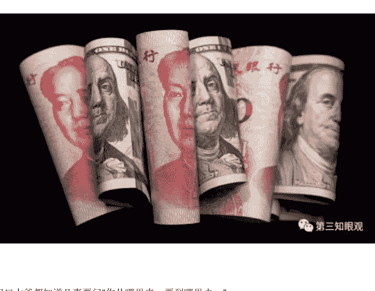

门口大爷都知道凡事要问“你从哪里来，要到哪里去。”

看人要看他父母，看钱要看它的父母，钱从哪里来？

过去钱的父母叫价值，现在换了爹妈叫债务！

路径大致是：

有抵押、贷款，通过商业银行制造出来。也就是资产抵押——将钱写进借贷人账户。只要有人从银行贷款，新的钱就会被创造出来。

天天各路信息都谈杠杆，杠杆中的杠杆是一个叫法定存款准备金的东西。通过制度法规给其制造出来的钱的数额定个上限，这就是法定储备金制度。

银行本质就是存贷，假设有一个银行，叫第三只眼观银行，简称三观银行，刚开业还没有存过款，那么在开业前会以现金方式和存款准备金方式存入一定数额的钱。假设法定储备金是9:1。

第一步。来了第一个顾客，要贷款 1000 元买车，按照 9:1 的存款率，三观银行凭空制造出存款准备金 9 倍的钱，其根据是借款人的偿还承诺。这 1000 元并非从哪里取出来，也不是某个人的存款，而是以信贷方式打进个人账户的一个电脑数字而已。

第二步。车的卖主把刚进账的 1000 元随即存入哪个银行，此 1000 元可以继续根据原始杠杆迭进，按照 9:1 的存款率，可以造出 1000x9/10=9000 元的钱贷款。

第三步。如果这 9000 元新增贷款用于消费，卖主获得的 9000 元随即存入哪个银行，即变成这个银行再次贷款的合法依据，可以制造出 9000x9/10=8100 的贷款，也就是新钱。

以上三步无限循环，每笔新增的银行存款都具有无限次创造一笔稍小贷款的能力。如果创造出来就被我们去银行的钱没有被用于存款进银行，造钱的程序就中止。但一般来说，每一次造出来的钱会被进银行，而存款准备率可以一次又一次的重复使用，直到银行体系增加了 100000 元（所有贷款总数接近于此数）的新钱。

当在贷款和抵押上签字时，那些我们承诺如果没有偿还能力就被没收的资产，是整个交易体系里唯一真正有价值的东西。没有借款人签字的抵押借款合同，银行就创造不出钱来，钱就是债务，金融系统里没有债务（贷款）就没有钱。

从组织到公司到个人，都欠银行一屁股债，如果所有组织和个人都把债务还上了，清偿债务将使钱不复存在，我们完全依赖银行贷款频繁刷新来维持钱的存在，没有贷款就没有钱。银行凭空创造出充裕的钱，我们就富裕，银行没有凭空创造是够的钱，我们就挨饿。

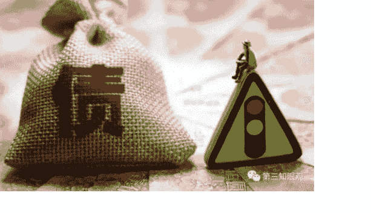

货币为何无限超发？为什么无限贬值？为何利率趋低？为何信用卡广告一个接着一个？为何组团花钱越来越快？

核心在于利息——钱的成本，或者叫价格。

每次借贷都会有利息产生，这更是凭空出现的东西，实质上本金+利息>本金。

债务上升，利息就上升，需要更多债务还利息，这样就无可避免的推动债务继续上升。

债务发行量就没有上限，钱的供应量就不会有限。

## 什么叫收割？

收割不是你赚我钱、我赚你钱的小打小闹，而是在一个最大的整体上观察钱的流动，通过债务来观察。

收割就是让钱从空变没。

在这个过程中必然伴随着：

+ 1、某一领域的资产价格推高，击鼓传花最后一棒，就是冷冻或消亡归零。
+ 2、债务转移，也就是杠杆转移。

## 什么是真资产？

银行最认可的，手续最简单，最容易抵押而借贷的东西，就是最好的资产，当这种资产有了不好的趋势，也就是抵押变得麻烦、评估变得复杂，也就是不容易以其为承诺借贷了，那么这种资产就到了尾盘阶段了。

## 穷人才想赚快钱！教人致富多为骗局！想变富要明白一个逻辑：分配！

2019-12-30

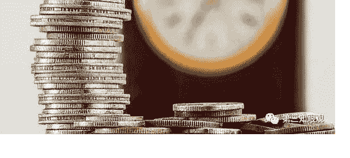

每天都有很多私信问我赚钱妙招，很无奈，我可以告诉诸位，教人赚钱的妙招几乎都不可信！一直以来写财经类文章的目的，就是尽其所能告诉大家财富背后的逻辑，而多数人不尊重逻辑，只想表面想要发财。

打开手机，每天新闻都是各种暴富，把人心都搞乱了。

三眼在这里告诉诸位：

+ 1、穷人多富人少！
金字塔社会结构，80%的财富集中在不到10%人手里，剩下20%的钱还要被各种领头羊拿大头，80%的人总财富加起来最多也就一个手指头！
真正能长期稳定赚钱的非常稀少，新闻里都是假的，都是成年人、活在表象里多幼稚！
记住一点：这个世界一直在说什么，证明缺什么！一个人经常说什么，证明缺什么！
每天新闻都在谈钱，谈暴富，证明大家都很穷困，至少很迷茫！

2、赚快钱心态的都是穷人，在富人眼中就没有赚快钱这个意识，大财团、大神级投资人利润率有多高？没多高，但能持续长久，基业长青才是富人的核心目标。

富人因为明白财富背后的逻辑，追求长期稳定的造富，赚快钱毫无逻辑可循！

教人成功、手把手教人致富的东西几乎都是局，信了你就给他做嫁衣了！

3、想赚快钱的都是韭菜。

成熟的人会用一生的眼光去看待财富，这是一套体系；
幼稚的人只有当下的眼光想赚快钱，这就是韭菜的本质思维。

记住：只要不寻思快钱，就不会被割，看看股市就明白了！

三眼教不了诸位致富妙招，只能告诉大家逻辑，人的富有是什么？

钱只是表象，钱背后是富人对经济、对政治、对社会的理解。

电影《1942》里地主张国立对长工说：只要能活着，再给我10年，你老爷我还是老爷！

因为富人内心有逻辑，身无分文扔到社会上，照样能起来！

那么财富的核心逻辑是什么？两个字：

分配！

严格意义上讲，钱不是赚的，是分配来的，比如全国不同城市的工资水平，这东西是个人能定的吗？是分配的，从政策到产业到配套再到具体的工商落地，最后到个人。

人要想致富，就要站在分配的核心位置上！

只要会找位置，一直站住了，这辈子永不倒！

比如年轻人谈求发展，什么叫发展？就是在要去钱多的地方、钱流动大的地方，流通环节多的地方，找个位置站住了，自然分配到财富。

人生处处是分配！用分配的眼光看财富，自然变得成熟！

小到一个公司哪个人拿的多，大到怎么布置个人资产，在整个社会的财富变迁中分配的多。

那怎么找位置获取更大的财富分配？

### 1、按劳分配依然存在，但是已经不是分配的主要根据了。

比如都是一线白领，工资能差多少？体力劳动者和脑力劳动者能差多少，差距很小了已经。劳动收入区分不大，因为说实话目前的结构不是很需要高大上的人才。看看行业巨头就知道了，有几个是玩技术的？玩的都是流通过卖倒卖、钢筋水泥的活，用的人才能有多少区别啊？

根据市场供求，不同的劳动技能所分配的财富有些许差别，但是不大，个人觉得没必要花费太多精力。

### 2、劳动收益向资产收益时代转向，按资分配要记住！

啥叫资产？无须多么高大上的解释！

钱跟着走的东西，能吸钱的东西，就叫资产。

北上广干十年，靠的是房子收益打败同层的人。因为房子能吸钱，就这么一个简单逻辑。

在一个生意的链条上，站到核心要素位置，别会给你送钱花。

在一个企事业组织里，站到核心环节位置上，既轻松又拿大头。

什么各种数据，各种经济词汇，没必要搞那么专业。

就跟打仗一样，搞花里胡哨的一堆兵法战术没用，最终上了战场核心套路就那么几个。

### 3、分配跟着资源走。

啥叫资源，啥叫人脉？

就是能帮助你打造资产的一切东西，就叫资源！

除此之外，都是瞎扯淡！

什么人脉啊，多条路之类的鸡汤少看，没实用价值。

过去十五年，三眼哥我跟各种大上朋友亲戚同学很少来往，跟各种中介、信贷员、小商小贩来往最多。为啥？最实用！

靠着这群小老弟，三眼哥购入资产成本起码比市场低 10%，小老弟们也靠我赚了不少钱，互惠互利想。

资源一定要围绕资产打造——你要干什么，就要积累什么资源。

不要看鸡汤，花里胡哨认识一堆没用的人，积累一堆没用事。

当人明白财富的逻辑在分配，自然冷静又孤独。

## 大钱要靠分配！不是卖苦力赚的！人生是无数个局，看局方能破局

1 月 8 日

个体老百姓在赚钱这件事上，因为大多没有什么外部资源和关系可依赖的，最后都会在自身努力上找出路，希望通过努力跨越阶层障碍——爱拼才会赢！

但我没冷水、99%的人努力都是原地打转，爱拼才会赢是个伪命题。

这里肯定有很多杠精来喷我：人不能靠拼靠什么？

努力肯定是需要的，每个时代都不缺少能拼搏的人，但能成功的为何只是极少数人？肯定是路线有问题啊！努力也会分会和不会的。

因为跨越阶层壁垒，获得财富质变，靠的不是拼，而是打通认知、塑造格局、走对路线。

钱不是卖苦力拼来的，而是要占据社会财富分配的关键环节，分配所得！

这完全是两种思维，一般来说 30 岁之前这种思维与原生家庭有关，30 岁之后靠自己悟。

讲一个阶层的思维差异，体制内家庭的孩子和体制外家庭孩子从小就有个原生思维差异，前者从小看到了利益链条分配，虽然没有成熟的社会认知，但看到了自然进出潜意识，明白人生“占位置”有多关键。而体制外家庭的孩子，更多的喜欢英雄儿女情长，富有浪漫主义和理想主义的拼搏观，充满江湖气质。

什么是江湖？就是体制外市井文化，大头挤不着，一大群人挤抢在底层，互相拼杀。

江湖、武侠类的文学都不能谈钱，大侠的钱来源很神奇，谈钱就失去江湖逻辑了 ...

插一句话，少看抖音快手什么的，这个社会喊得最大的就是最无知的，无论对于情感还是人生都充满江湖气质。

## 卖苦力 VS 占分配

### 什么是卖苦力？

就是你辛苦一辈子，看似非常努力，实际上可能是一直在重复劳动，而这种努力的收获，与劳动持续性产出成正比，随着年龄增加和体力精力的衰弱，回报慢慢减少，直到被淘汰。

这条路上所谓富裕，只是在小圈层相对来看，大家都是卖苦力的，比的就是卖苦力程度，你6点起床干活，那么我就5点，你工作到晚上10点，我能做到12点。其实产出回报差不了多少，而且多分点少分点无所谓，决定不了人生的高度。

卖苦力不分体力与脑力，很多脑力工作看起来是玩智慧，实质上拼的还是年龄和身体。例如"996"是什么？就是白领供大于求，想每个月多赚个千百块？不想被裁员？那就多卖苦力吧，而且要带着微笑。

卖苦力久了，还没有格局认知，就会把造富寄托在暴富上，想暴富的、想要秒招，脑子天天在股票、彩票和手里纸票之间打转。

### 什么是占分配？

就是无论是大环境还是小环境，都要占住核心关键位置，自然就比别人分配的多。

这与劳动付出与回报没有任何关系。

人要发展，核心在于求变，变的的核心是认知，认知的核心是要识时务，看清所处的外部环境、链条，从而发现机会。

这世界就是一个大局，大局的本质是人性，划分成无数个小的局，人生就是一个个局。

局是什么？就是你玩我、我玩你，谁都想占到最大便宜。

想发展就要有做局的眼光，这就叫格局。没有局还谈什么格？

看到的局越大，占到分配的关键点，翻身晋级走向巅峰的机会越大！

小的局就不要说了，无外乎家家长里短、上班下班。再大一点就是知道怎么在公司、企业组织混个好位置，再大一点就是干点小生意，知道怎么在生活的小环境有个好项目混个好位置，这些都不难，难点在于上升到政治、经济与社会层面，在这个层面的局里会占位才是—劳永逸的。

大的局无外乎举例，但没个十几万字恐怕说不完，需要 n 多篇逐一细说，这里大体归纳一下：

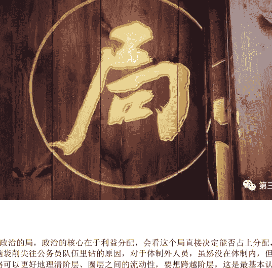

1、政治的局，政治的核心在于利益分配，会看这个局直接决定能否占上分配，这也是每年脑袋削尖往公务员队伍里钻的原因，对于体制外人员，虽然没有在体制内，但看得清此局脉络可以更好地理清阶层、阶层之间的流动性，要想跨越阶层，这是最基本认知；

分成小块来看包含很多块，每一块都与生活息息相关。比如明白劳动供养率，也就是1个人工作能养活几个人，从而看清福利到底重不重要，不重要怎么远离而不会去投入，如果重要怎么玩福利？比如教育医疗改革，经济目的是什么，在分配上受益的是哪块的人、哪个环节。

金字塔结构会结构是什么样的，大体上分成三大圈层和九大阶层，生在哪个阶层，想跨越进入哪个阶层，天花板是什么？这辈子认命就是最高能混到哪个层次，这个层次是什么等等。

2、经济的局。经济是政治意识的延伸，是在利益分配的原则下，怎么具体实现的路径，这里要明白几个主要关键点：

货币。首先一定要明白到底什么是钱，每天辛辛苦苦赚的东西是个啥？钱不是什么交换价值、购买力载体，更不是纸票黑和银行卡的数字，这些都是表面，如果这样粗浅的认识钱，那么一定被收割。比如国人特别爱存钱，20年前存1万到今天看结果很可悲。

钱是一种信用，是一种商品，你有了多少信用就可以去社会上换点什么回来，信用是需要有基础的，在建国初期信用以粮食为载体，那时候叫根本位，也就是社会上有多小粮食物资，就有多少钱在转动，所以1分钱也很值钱，找到了也交到警察叔叔手里。现在呢？是外汇储备？肯定不是，过去一段时间是与美元挂钩的，但随着工业体量，现在的信用基础是土地，土地不光是地产，地皮的上面和下面都是财富，这才是现如今的RMB的信用基础。

了解这一点，就能通过看清RMB信用的基础锚链，而推演未来重要资产价格走向。信用跟啥有关，直接决定财富最快捷的路线，最差也不至于被收割。

产业与行业。特色社会主义的原理，就是对资源的分层与控制，核心资源要素要完全可控，边角料交给市场，其实老牌发达国家也一样，只在于一个“度”。

离产业核心要素越远，分配的财富肯定越多。

从国有到市场，从地产到农食行消到互联网，哪里的“无形的手”多？怎么掌握的？都直接决定财富分配路线，直接选行业进项目位置。

资产。比如股市与楼市的局。股市在创立之初就是为国企融资寻找接盘侠的，再过去20年里，随着经济发展货币增发，股市最大的功能就是消灭过剩的流动性，大白话就是把散户的钱蒸发掉，不然这些钱到了市场，那未来不得翻几倍价格啥？过去它一直扮演“蒸锅”的角色，散户的钱就是水，目的就是把水蒸发掉，所以在高度通胀时期，股市大概率会来一波快牛大涨来蒸发“水”。而楼市是土地信用体的延伸，作为信用载体的一部分，分，资产价格走势必然是：往往在商品价格高升之后，或者之前，股市都会到一轮韭菜，蒸发一遍水，每次先后顺序不一样。大的规律是不变的，只是在每一次的手法上有些花样而已。

消费升级与产业升级。此局的意义更在于普遍的生意上，产业升级的根本是消费升级，想必没人会这样说。大白话就是说：人都有钱了，爱花钱，企业才能制造出更高端的商品来满足消费，都穷可不都拼多多啥，不要总企业家无能，百富榜都是什么地产、零售这些玩财富转移的，核心在于居民可支配财富。

看清脉络有助于做生意趁据需求，比如每次提出产业升级，针对的是哪块？与普通消费有关系不？又提出消费升级，那么怎么升级？肯定是要让人们有钱啊！怎么有钱？那肯定是要打造中产阶级群体啊，这才是消费升级乃至产业升级的基础土壤，怎么打造？肯定与物价水平和工资水平挂钩啊？哪些领域物价会涨，工资会高？制造业服务业哪里机会更大？

识局免收割，破局跨阶层。终生卖苦力，不如占分配！

## 历史观比财经观更重要！经济是政治的延伸，而今天是昨日的推演！

1 月 8 日

经济学受用很狭窄！如果你想在各路财经信息里抛出财富之路，还是洗洗睡吧，免得浑身泛绿。

因为经济学建立在经济个体的研究上，经济个体对整体要具有影响，影响就是有话语权，哪怕一滴水那么大，要有影响首先你要是有筹码，也就是财 C，你有影响吗？

大头是租的，流水的票票是在一个平衡里打转的，再细点，工 Z 涨了，但和 10 年前比，实用价值貌似没啥差别。

为啥无数孩子削减嵌袋往公务员队伍里钻，因为相对来说，摸不着看不见的编制要比 F 子和流水的票票更值钱，也更像财 C。占坑要比你所执着的能力更有安全感。

在三眼文章里不止一次说过，钱不是赚的，是环境分配给你的。从春秋开始至今就是一部分配史。

如果你非要对当下的形势做判断，在财经信息的轰炸里寻找破局之道，以此来决策人生，那么奉劝你放下财经，多读历史，因为核心的东西并不在经济学的书籍里，而在千百年前 的书籍里。

多数决定大势的关键点在西方经济学书籍里没有轨迹可循的，户籍、双限、二胎、70 年。

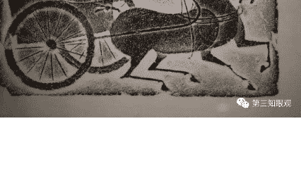

如果仔仔细细研究信息现状，会发现搞文化的核心套路是鸡汤，搞财经的核心套路是焦虑。鸡汤与焦虑是挑拨人心最有效的工具。启迪人自知觉悟和对真相的探知，变成在道德标准上逐渐淡化，和对客观物质环境描写的模糊不清。

培养出网民两大特点，爱谈人生大道理和爱谈奇奇人物。统属八卦，八卦就会失去对真实思考。

如果非要寻求经济的思考，那么请在前面加上 Z.Z. 缺乏政治经济学素养，将无所适从，涉及到“体用术”，任何的用于术也就是一般经济规律都要让步于体，也就是分配与体 Z。

体系体系，就是这个意思。

很多人私信于我让我推荐书籍，我想说的是，用于术的工具书很多，但不加上 2000 年前的芯片，这台计算机就没体系统转不动啊。芯片有多强，运行有多快。

芯片中的芯片就是法家，法家的芯片就是商鞅。

如果你迷失、焦虑、困惑、盲从，可能是缺少这个芯片。

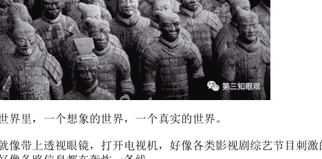

人活在两个世界里，一个想象的世界，一个真实的世界。

装上芯片，就像带上透视眼镜，打开电视机、好像各类影视剧综艺节目刺激的都是一个点；打开手机、好像各路信息都在轰炸一条线。

如果就不想装芯片，就想抵财经信息，那么劝你只关注一个点：J.Y。

因为只有这一点牵一发而动全身，只有这一点才与你相关，只有抻起这一点，才能发现逆袭之阶。

## 为何啥都不好干了？为何经济放缓了？本质在于这一群体快被掏干！

1 月 9 日

## 过去高增长的本质是什么？

改革开放以来，中国式的经济奇迹被世界媒体Century，再过去“奇迹”也让人自信满满：

> "保持经济高增长最少 30 年！在 2040 年成为世界第一大经济体！"

而如今经济下滑？百业都不好做？

有人怪房地产，有人怪电商，有人怪租金，有人怪生产力过剩，有人怪美国，还有人怪人太好诈了，这些都是管窥之见！

从 40 年历程整体来看，中国经济高增长模式的本质是对农民身上红利的释放。

经济高增长或者说 GDP 一定来自生产效率的提高，而观察我们，整个 40 年的奇迹背后本质是一部农民进城史，准确的说，经济高增长是源自农民生产效率的提高。

一个农民劳动力再田地里劳作，一年创造个几千元而已，进城劳作，一年可以达到几万元甚至十几万元，而根据劳动力价值配比，在基础劳动力的上层，通过每个农民工作创造的收入远远大于劳动层所得。当农民工数量几何增长时，惊人的经济增长就这样被创造出来。

我们这代人，最应该感谢的就是农民兄弟！

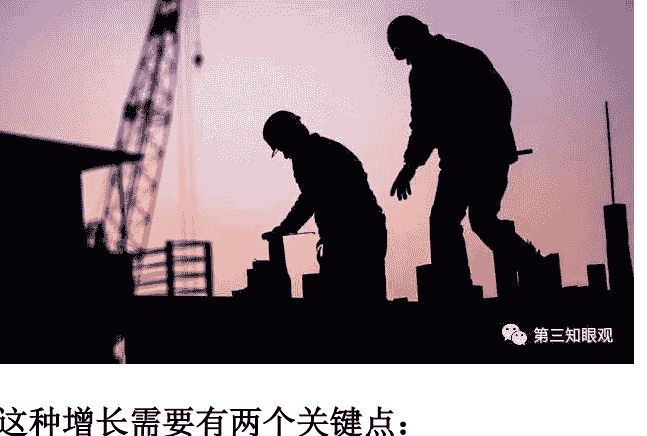

## 这种增长需要有两个关键点：

-   1. 有源源不断的农村劳动力进城，劳动力需要过剩；
- 2. 城里有足够岗位来释放劳动红利。

针对这两点，那就就有两大工具了！

-   1. 打通城乡户籍，户籍慢慢放开，农民逐渐的和城市人享受相对较公平的待遇，在生活层吸引；
- 2. 主要通过铁公鸡和地产来释放红利，既拉动经济又肥了腰包，公私两便。

这种增长长 штат则没有什么技术而言，爸爸进城造富地产富豪，孩子玩游戏玩手机卖假货造富金鹏小蜜和淘宝宝宝等。

没技术的增长结果就是形成泡沫。

不要泡沫就要换轨道，怎么换？

那就是一边继续找增长源，也就是深挖劳动力，户籍慢慢开，城镇化继续干，这是过去的老路，热门热路不能丢；

第二就是发展技术，这也是芯和科创板那些了，拭目以待吧。

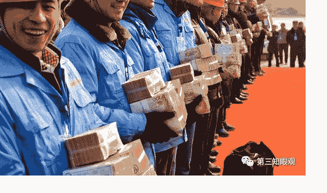

## 从这里面能看见什么？

什么是创业的好方向，会被扶持？那就是能帮助组织做好“灵活就业”的行业，户籍开了进城的多了，参见快递员，再有，不管物价怎么涨，连账怎么狠，服务业的服务价格是自古不变的，是有固定价格标准涨幅的，稳就是活下去的第一步。

什么是未来核心资产？rmb 的信用基础不是 70 年前的粮本位，也不是金本位，更不是美元挂钩，而是地本位，土地才是 rmb 的信用基础，户籍开了，进城了，留下一片片地，这就是更宽阔的信用承载，这就是钱，这就是核心资产，农民兄弟要珍视。

股市有机会吗？有！进来上边喊话很直接——怎么能把几十万亿存款搬进股市池子里，科技股有机会啊，虽然三眼不玩股票。

地产有机会吗？有！但很少！核心城市可租可售可自住的就是核心资产，除此之外不要想了，因为这些资产价格不是信贷，更不是刚需推动，而是精英群体推动。

第三知眠观

## 人生 12 字秘诀：自成体系、预判大势和耐心坚守！

1 月 16 日

问：什么算一个成功的人？

三眼：有自己的政治体系，有自己的经济观，有对自我的评判的标准。政治体系对应着地位与声誉的获得，经济观对应着致富之道，对自我的评判标准对应着与家庭、亲朋及与自我的和谐相处。

问：怎么评判是否成功？

三眼：当一个人自成体系，即可成功。功字是一个“工”加“力”字，自成体系即为工，有了体系就生长出掌控外界与自我的力量，这就是功力！

人的成功与否不需要外接与他人评判，而是由自身体系来评判，当人自成体系，什么是成功就已经了然于心了。

问：能简单说一下什么是体系吗？

三眼：人做事情只有两种方法，一种出于本能和不成熟的环境矩的约束，另一种出于一种自己打造出的方法规则。大多数人都是前者，后者很稀有。跟人的性格与学习环境有关。

比如什么叫政治体系，往大来说就是上观国家与社会，洞察最大的政治规则是怎样模样、性格和气质，这样才能穿梭于最大的规则之中；往小了说就是自身在生活工作中做人做事的一套准规则。比如你奖惩一个人要有自己一套规则，为什么奖惩？奖惩的标准？

当你的这一套规则被更多人折服，你的声誉与地位自然建立出来，权位靠的是你的体系，而不是你的钱包，那只是世俗人的偏见。

多数人处理事务都出于本能和情绪，本能和情绪是永远被体系规则牵着走的，也就是所谓洗脑！

而人在建立自身体系之时，会与自身的性格相结合，根据自身特点打造出一套最符合生存的规则。比如刘备和曹操都有各自的政治体系的性格和特质，比如一个朝代不同时期的性格和特质也是不一样的。

问：建立体系难吗？

三眼：不难！当人做事情有了一个小的准则之时，比如坚决不说废话；当人看待经济发展有一个小逻辑之时，比如只盯着钱的流动路径；这个人就有了自身的体系，小规则就是小体系，需要做的是不断填充体系而已。

问：什么是预测大势？

没有十年磨一剑的耐心，人生是不会成功的，或者说人生的成功在本质上比拼的就是耐心二字。

问：怎么样才能富有耐心？

三眼：有很多小技巧，但挖据到核心之处，只有二字：孤独！

多数人没有耐心，是因为人生没有明确的目标。因为多数人都在别人的系统里，或者社会不成熟的一种系统里，这源自人性的盲从。所以富有耐心的人一定是寻找自身体系的，是孤独的！人与人的成熟区分就在于此，是否能沉浸和享受在孤独里。其实人一辈子的出路除了孤独没有它路，只是沉浸在平素的嘈闹中依赖并且不自知。

不享受孤独绝不会富有耐心！耐心只源自对自我的依赖，而一寸一寸的生长。

自我只是一个载体工具，多数人太重视自我，而忽视了观察和打造自我。要知道每个人的自我都只是一部满是漏洞的机器而已。

最后三眼想说的是，东方传统哲学中的“天人合一”；西方宗教里的“自我救赎”。都是在寻找自我的体系，人生其实很短暂，但也有足够时间用来给人打造自身体系。如果人生是场游戏，那么游戏的玩法只有这么一种，这是一种乐趣。

## 只有会使用“不公平”，才能更好地生存！

1 月 21 日

节选自“第三只眼视”知识星球

首先，三眼告诉你思考的思维：

-   1、学习是什么？就是在脑子里刻上一个个道理；
- 2、道理有好有坏，能否记得住，受不受用，要看道理背后有没有强逻辑；
- 3、逻辑看什么？看关键词！你最后刻在脑子里随时拿出来用的，是一串强逻辑关键词，这样才算学到了！

本期核心关键词：如何学会使用“不公平”而更好生存！

## 关键词一【社群】

人是一种社群动物，这一点被许多人所忽视，因为人过于注重自我；

思维沉浸在自我里，视野自然短视，要提升认知，首先是跳出自我，在社群中俯瞰自身，鸡国每天出生约 5 万多人，每年出生约 1990 万人，你只是其中一个小元素。

## 关键词二【平等与信息透明】

人永远摆脱不了社群关系，而关系永远是不平等的。

天生的不平等最显而易见，个字高矮貌貌美丑；

一句话，信息透明度会加强平等性！

但可能吗？不可能！

因为人性所驱使，会人为的制造信息不对称！

哪怕两个人，同事或者同学，在信息上也会藏一手，因为人潜意识里明白，只有认知不对等才有强于对方的可能。而上升到社群，信息的不对等随处可见，金钱与地位都是表象，真正拉开人距离的是信息的对称度，也就是认知度。

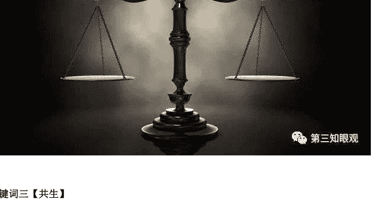

## 关键词三【共生】

道德经讲“长短相形，高下相倾，声音相和，前后相随。”“具体到人事上就是穷富贵贱是共生体。没有穷就不会有富，没有贱就不会有尊贵可言。一般人会把穷富贵贱割裂开来看，这是最根本的错误，因为割裂开就看不到穷富贵贱的互相转化了。

任何穷富贵贱都是比较出来的，没有比较就没有上下可言。离开穷人富人就不是富人了，离开卑贱之人，尊贵就显示不出来了。

如果一切信息对等，那么到最后就不会有贵贱和穷富之分，穷富贵贱的根本在于会不会使用这种“不公平”，而使用的具体过程就是转化——把别人转化成穷，而富了自己，把别人转化成卑贱而尊贵了自己。

## 关键词四【不公平】

人本性追逐的是站在天平优势的一侧，更大的格局，更深的认识，才会站得更高的位置，认知占上位置，才能进行下一步：转化穷富与贵贱。

天下皆为利往，而财富的背后一定是不公平。

到底什么创造巨大价值和财富？

如果通过劳动创造价值，那么人与人的财富不会差异太大，因为人的精力、体力、智力都是有上限的。劳动是所有价值的最底层、最基层。

而能够创造巨大价值的，一定靠转移，转移他人的劳动价值为自己的价值。也就是资本论说的剩余价值，富有的背后一套转移的套路。这就是具体使用不公平的手法。

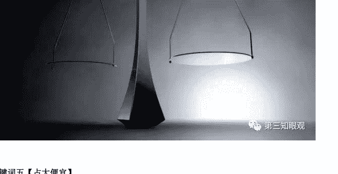

## 关键词五【占大便宜】

人性的本能意识就会使用不公平，只不过比较小气，一般人表现在占便宜，占便宜就是一种最原始粗暴的转移他人劳动价值的方法。

而当一个人打开认知，从更高更大的格局去洞察更大环境的不公平之处，才能占更大的便宜！

人性就是这样，没有什么伟人善人，只不过“便宜”占得不一样而已。

占到非常大便宜，那就是传奇！

根据俞三眼的五方论，政治经济社会自我人性五层认知体系，猜哪个是占最大便宜的？政治！

无论在小团体、组织、还是最大社团，政治是占最大便宜的方法，因为不需要动一根手指去劳作，只需要不断建立信息的不对等，通过分配来达到目的。

## 关键词【三招鲜】

比之母系社会、原始社会、封建社会，商业资本社会的进步体现在从自古“明着过”过渡到“隐藏干”！

成功的人不要看表面，背后皆为隐藏干，这是心法，没人告诉小白兔的，城府极深说的就是这个。一共有三招方法，一招鲜即可吃遍天。

第一法：通过显规则，没人举手反对的习惯性的准则，来转移他人劳动价值，这叫隐藏boxue；说是隐藏，是因为“常规则不疑”。

这是一种比较初级的手段：给人1元钱让他创造10元的价值，为何体力劳动者容易被剥？因为劳动价值最容易考量，只有在脑力劳动上才有可能存在“各大欺店”的反转！

所谓创业也基本都是基于第一招，因为这是一般人所能想到的“高招”了！

而许多创业激情少年也不得其法，创业的核心并不在于什么项目、模式等，那都是干出来的，不是计划出来的，能够计划出来的只有一样：就是你到底要转移谁的价值！

第二法：通过寄生和掏挪脚来转移财富的套路，这叫隐藏偷盗！其实很多所谓成功之人这一辈子就干了一件事。用这招的人几乎没人说自己是创业的，因为根本懒不起创业。

第三法：隐藏劫掠，也就是金融！金融的核心是什么？就是用钱抢钱！最粗暴简单的方法就是放贷，高级的玩法就是资产炒作。

## 关键词七【工具箱】

人要使用不公平，就要有自己的工具箱。

工具箱包含4方面：

工具一、游戏规则。明的显规则和隐的潜规则。如果在一个环境里显隐规则都看不见，那还是不要玩了，进去只能被玩。人这一辈子只需要在一个领域搞透显隐规则即可，年龄与时间也决定了要十年磨一剑。这就是专家专在何处！功夫在诗外，并不在诗中。

工具二、信息集成。对于所在或目标领域要有一个信息的计算器，分为信源和数据两大块。记住一点，人所能见的都是假的！也就是信源是最重要的。其次就是数据，数据并不仅仅是数字，而是背后的逻辑，看数据分析信息主旨在于分析逻辑是不是通的。

工具三、关键资源。信息落地到具体实现，就需要各种资源，而资源中最重要的、关键的资源，抓取到即可。一条线上10种资源只有1-2种是关键的而已。

自成体系，预判大势，耐心坚守。有了十年磨一剑耐心，有了三种工具，即可开心的去使用不公平了！

## 世界是个养殖场，上层养殖下层，提升认知与格局唯有学好养殖技术

1 月 23 日

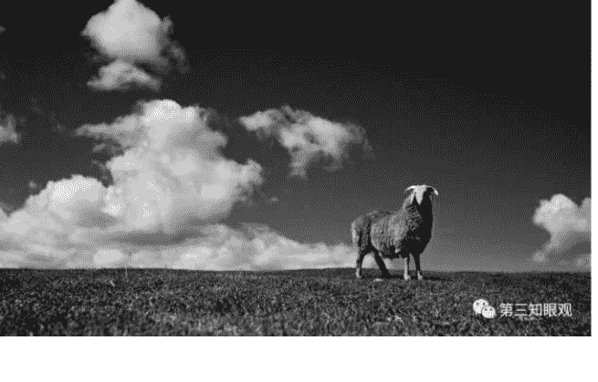

## 【世界是个养殖场】

纵观人类史，就是个养殖的过程；

从驯养第一匹马、饲养第一头猪开始，当动物都被养殖起来后，人类自然开始内部养殖。整个近代竞争史就是一部抢钱抢粮抢资源的历史，当然人也属于资源。

所有的知识、文化、科技统属于衍生品。唯有哲学才脱离了养殖，因为哲学目的是要摆脱人性。

## 【视野距离】

人怎么能更了解自己？

外界是一面镜子，人了解自己是通过照镜子，而人的视野又局限于眼界；

下层境界是眼睛真实的看见了什么，受制于眼睛的视野距离；

中层境界是自我感悟到了什么，这已经不受限于视觉视野，开始用思想观看，但受制于自我！人过于重视自我，思想的视野就逃不出自我的范围，围绕在自我情感到、人际关系、生活范围里；

上层境界是 border style. ignore.

## 【动物养殖】

当忘我去观察世界，你是一个动物，然后是一个人类；

万亿年的动物世界后，才有了人类世界。人首先是野兽，而后才是人。

养殖的最初形态源自于动物界分配，这群居动物的基本，也是养殖的最初级模式。

一个狼群会在捕猎后分配猎物的肉，这是对内而言，这叫分配；

而狼群知道，在一个季节轮换内不会吃光草原上的兔子，会使其繁殖，这是最原始的养殖，这是对外而言，这叫养殖。

而人类因为智慧，使养殖更加精密化、可操控。

一切分配的核心在资源。整个人类进化史就是一部资源争夺史。

而当人类认识到，最根本的资源除了土地外（土地资源就是地上地下的附属资源），劳动是排在第二号位的超级价值，自此种群内部的养殖开始了，公式是：劳动+资源=价值。

什么才能保证养殖？几千年来从未改变，那就是武力+资本。参见美弟

## 【分配】

为何三眼的五大认知论里，政治排在第一位。

因为整个世界看来，把政治脱掉外衣，本质就两个字：养殖，如果强迫症非要只说一个字，那就是在古代叫“牧”字。徐州牧、兖州牧，如果想进入政圈，首先要学会怎么做一个牧人。

经济、文化、科技等都是养殖过程的顺带产物，而已。你再有钱、文章写得再好、科技头脑再强，受到接见也会笑成泪人。

经济研究财富价值，文化研究人伦精神，资本推动科技，如果脱离养殖的根本思维，都会不得其本，专家就变砖家了。

这就是三眼讲政治的核心是利益分配。

而什么是养殖？什么是分配？有哪些联系呢？看清这一点对实际生活有巨大效用。

豫州牧刘备！

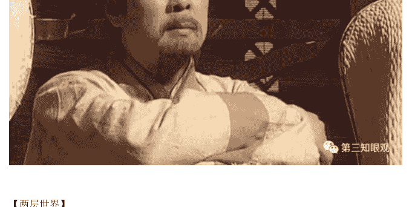

## 【两层世界】

任何组织体都有两层世界，小到公司，大到一国。

两层世界最下面的叫养殖的世界，上面的叫分配的世界。

养殖就是：狼群不会吃光兔子，而使其在季节轮换内繁衍；

分配就是：劳动捕猎后进行资源的分割和配置。

所以在观察人类某一环境里，养殖就是让其饿不死，可以一直劳作的底层，分配就是上层如何分配这些劳动价值所得。

逆袭就是如何从底层变成上层，而能够参与分配！

所以一定要搞清楚什么叫逆袭，这才叫逆袭，根本区别在于能否“参与分配”，这 4 个字非常关键。

底层思维对于逆袭的看法非常狭隘，认为有钱即为逆袭了，这是错误。

因为当你有钱了，你会发现周围人都有钱了，这时钱就不值钱了；或者当你有钱了，确实在财富价值比较上比周围人富裕了，但很可能随时“被”变没钱。

所以身在底层对于逆袭，有一种说不出来的、存在于模糊感觉中的。我把它说出来，底层逆袭只是一个表象，其实是想获得一种优越性，而这种优越性就是我前面讲过能否“参与分配”与分配。

这也是为什么说是上层对底层养殖，上层之间分配，为什么不说富人对穷人养殖？因为首先穷富是对比较出来的，只有同一圈层才会比较财富，因为有可比性；而当向上进入某一层级，钱几乎就没用了，没有可比性，那个叫位置，也就是可参与分配的优越性，比较的是谁更优越，钱算老几。

在优越性获得上，叫爬阶，不叫逆袭。

比如在一个公司，80%的人都是被养殖的，创造 1 万元价值能得到 1 千元回报，保证可以生活。而可参与分配的只有那 20%，在参与分配内部圈层，那叫爬阶，不叫逆袭。

## 【阶层固化】

在一个世界里，最可怕的是阶层固化，也不知道谁发明了这么多词。本质其实就是无法逆袭！在封建社会叫农奴无法翻身。

字典里给出的解释是，社会学家把由于经济、政治、社会等多种原因而形成的，在社会的层次结构中处于不同地位的社会群体称为社会阶层。各阶层之间流动受阻的情况就称为阶层固化。

为什么会固化？

这就是我前面讲的，人不同于狼群，因为人有智慧，让养殖技术变得极度精密化、可控化。

如果一个想逆袭、或者想爬阶，就要先掌握这门精密的技术。

这也就是在三眼五大认知体系里，除了政治认知外，向具体层面逐渐展开的经济、社会、自我、人性这四个认知。

逆袭与爬阶只有两个通路，一个是投胎，一个学习养殖技术。

在过去除层固化，养殖稳定化，靠什么？

原始社会靠血缘，封建社会靠身份，此二者都是一种先天因素。

自己关门领悟如下这个存在，农村户口和城里户口制度，不能流动，是不是很简单粗暴？

如今靠什么？人虽然都是自由流动的，思想也都是半自由流动的，那就靠体制、资本压制和教育压制三个东西。

体制就是那个简单粗暴的方式，自己悟；教育压制就是认识的压制，就好比两个孩子一个专门学习管理和修理人，另一个学习炒饭技术。一个孩子生下来就灌输对这个社会的认知结构，另一个生下来就灌输如何炒饭炒得好。一旦形成认知习惯，很难改变，这是软性的区隔；而当一个孩子有了觉悟，开始跳开自我，思想开始变得广阔和流动，这时候资本压制就来了。

就此，分配和养殖的二层世界变得稳定。

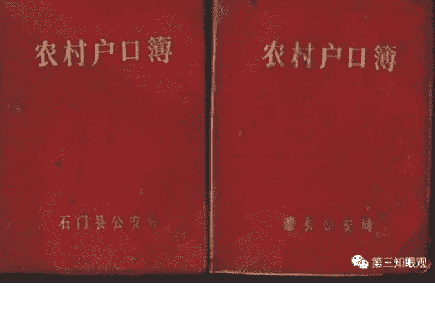

## 【人生意义与幻觉】

人活着总在寻找意义，如果非要寻找意义，你首先要知道什么叫人生。

人类社会从未离开过养殖，养殖技术越来越精细化，而无论怎么精细化，都以殖民技术为根本。从奴隶时代，到土地殖民，再到经济殖民，而到思想殖民（认知殖民）。技术越来越高端。

认知殖民就是告诉你人生是什么！

人越往底层，越沉沦，越容易被舆论和大众娱乐掌控，活在一个个幻觉里，因为人都极度重视自我，摆脱不掉情欲的释放，通过外界环境灌输的信息来认知自己的人生。

这就是一个所谓的文化现象，象都似幻觉。

任何主流的文化现象都是以满足自我的为基础方法。无论是武侠还是韩剧还是泡沫剧还是家长里短的家庭剧。

越往底层，人会越自大，越觉得自身是独一无二的，因为认知太小了，其实就是亿万养殖动物的一员。而越往上层，当看见分配，参与分配，越来越觉得自己渺小，因为认知扩大了。

而大多数底层是叫不醒，但也睡不着的。

叫不醒是脱离不开幻觉，睡不着是潜意识里也明白幻觉是虚的，这种叫不醒且睡不着的结果，就是浮躁！

浮躁就是快速致富，快速虚荣，快速的获得优越性。

这是没有丝毫逻辑的思维，这种浮躁一定让人关注赌博！

如果一个人身在养殖层，认知往往也是锁在养殖层，扩大不了，而当寻找出路时，出路基本都是“牧人”的养殖技术套路。底层玩彩票，中产玩股票，一坑套一坑。

看见彩票就是一个个翻滚出来的小小球，股票就是一条条曲线，除此之外，在认知上，信息极为不对称，当信息不对称时那就是幻觉。玩的不是彩票和股票，玩的是内心的幻觉和浮躁的心跳。

而一群人讨论幻觉，这就是文化现象。

开篇讲过，除了哲学外，任何的文化、科技都是养殖过程的顺带产物，而己。

这个世界称得上认识的就两个：

- 一个是哲学，跳出人性；
- 另一个就是几千年发展至今的养殖技术。

## 2020，从“不合理”开始说起！只有认清“不合理”，人生才会合理！

1 月 25 日

（是与非）

新年第一天，三眼祝各位安康，我是不愿意祝什么 88 大财、66 大顺的，因为这都带着主观臆想和运气的热注，而安康是实实在在的，安是心安，也就是认知越来越通透，这样才能安心，也就是祝各位对于外界和自身越来越看得清，通过不断学习而获得平静的安全感，这对于每个人都是公平的，自身可以掌控的；康是富足健康，认知通透内心平静，自然可以掌控身外之物。

年夜里城市万家灯火，电视机里无聊的春晚，手机上不断推送的疫情，一切都很虚幻又真实，想想以前，看着现在，人们越来越恐惧、枯燥、焦虑。

为何心难安？

大众传媒将此归于人心变了，其实人心始终没变，老百姓就那要点要求那点事，变的是时代。从几十年前大锅饭变成如今红资，时代的变化太快了，多数人还来不及反应。

时代的快速变化，定会造成全民认知形成断层，这就像玩游戏，不断地变换游戏规则，只有接近游戏规则制定环节的同志们，才能跟得上时代的步伐。

认知跟得上的跑在前面，认知跟不上的，还停留在就业是包分配、创业就是开门店、攒钱养老、养儿防老…等上面。

从一线城市到十八线城市生活价值观的形成巨大差别，这是最显现的表象，年轻人在一线呆久了，很难适应家乡的小镇生活，虽然他说不清为什么，只能探究一些表面的原因，实质就是认知的差别，一线和十八线完全是两个时代。

差不多中国南方比北方会领先个10年，一线比十八线领先个30年可能都不止。中国的快速发展，甚至5年就变换一个时代，现在的父母与孩子生理上差一辈，实际思想认知上要差着三四代。

不光地域上有时代认知差，在同一区域也存在着认知差，这是由于阶层位置造成的。

回到心难安的话题上，为何？

因为认知落后的人群，脑子中会固化很多“合理”的事，看见新时代的很多事会觉得“不合理”，自然没有安全感。

事物与思维本质是没有对错的，只有合不合适，跟不跟得上之说。象棋玩的再好，让你去玩围棋也会难受。小国家民还是推崇繁华都市，都没错，时代怎么玩，由不得个体去评判，只能去适应。

只有明白未来的很多“不合理”之处，人才能活得合理！才能安康！

## 价值观的本质是非观，而不是非观直接决定一个人的发展。

三眼说几个所认为比较重要的“不合理”吧！

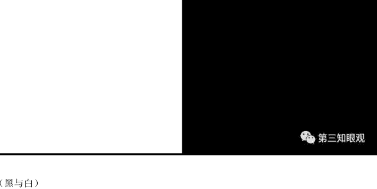

（黑与白）

## 【贫富的“不合理”与致富的“不正当”】

物质建设和精神文明建设一定是冲突的。

因为物质建设需要生产效率提高，而生产效率的提高，科技只是催化剂，本质原理就是要不均，贫富产生差距，才能带来生产效率提高。一个公司里所有人收入一样，那就没有效率了。

而精神文明建设，自古至今玩的两个字叫公平，再高端点叫正义，这是虚的。

不患寡而患不均，古人是站在底层的角度说的，这说话的人实际心理未必这么想，事也未必是这么干的。

社群的发展，一定是富裕起来的人，会想尽办法让穷人一直穷，而穷人会想办法把富人拉下来，和自己一样穷，这样才能心安。

其实无论富还是穷，产生这两种思想都很自然，都带着阶级的特点，不客观，更没什么实用性。

在富人眼里，穷人可以发家致富，是不合理的；在穷人眼里，富人赚钱钱越来越多，是不合理的。

到底什么是合理的？

社会的发展，贫富差距是必然，文明程度越高，贫富差距越大。

三眼以前说过，文明=纹明（古代汉字是很冗赘性的，文字是开启人认知的最基础工具，把字给简化了，假设最简化到拼音，那跟文字 yu 有一拼，获取真实认知就更难了）。纹就是社会纹理，也就是社会阶层的脉络，纹明程度越高，纹理越明晰且稳定，也就是所谓阶层固化。

为什么开篇第一个逻辑就要说贫富？

因为贫富的背后，让人觉得不合理、心难安的是富人致富的过程。

如果所有人致富的过程都很“正当”，那么人与人的财富是差不了多少的，因为人与人的智商、精力上限差别不大。

而真实的逻辑是：富人之所以成为富人，所有的，皆只是非法的或者合法的取得了不合理的财富！这句话一定要细细揣摩，这是寻求个人财富发展的价值观重组。

一套房子 10 年翻 10 倍，加 70%杠杆就是翻 33 倍，对于认知停留在好好学习就业包分配的四有新人来说，这是极不合理的！股票等弯弯的曲线，摸盘一次，周期八九个月到一轮韭菜，人民日报起步 4000 点，对于五六十年代的人认知来说，这是极其不合理的，是坏人。这是金融，一般老百姓还反不过来。而抖音尾插直播非法吸货还不交税，对于“正经”工作的同学来说，这是极其不合理的，而穿过表象看背后的操控链顶端呢？

因为一般人的认知还停留在几十年前“挣钱”的思维里，“挣”就是劳动力换价值，这样人与人差别不会太大。而现时代是“转钱”时代，是“瞭局”时代，后面会讲到！

钱是分配而来。分配是对上层而言，对下层来说叫养殖，参见《世界是个养殖场，上层养蚌下层，提升认知与格局唯有学好养殖技术》。

实际干活的一定拿的最少，负责分配的一定拿得最多，而站在分配链关键环节上的人，一定跟着吃肉。人纹发展，是一个财富分配越来越不公平的过程，这是一定的。

只有认识到这个“不合理”，才能合理的去面对时代，才可能安康！

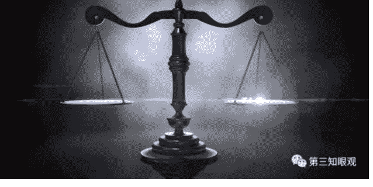

（轻与重）

## 【钱的“不合理”与“以物换物”】

人的安康是在追逐够用的财富，什么叫够用？

年轻时可以实现自由的，年老时可以实现平安的，就是够用。

三眼告诉你，够用那是不可能的！因为社会的发展，它的意志或者某种意志的推动就是让其不够用的！如果都够用，还干活咯？不干活怎么搞养殖殖呢？

一般人都有一种幻象，站在个人角度出发的幻象，就是攒了多少多少钱，就够用！这是最狭隘的认知错误。

人都活在一个大规则里，最高规则就是政治体 zhi。个体的生存，财富够不够用，取决于与最大规则的契合依附程度，以此推论，最完美契合于规则之人，是不需要钱的，而越底层离规则越远，对钱的依赖度就越大。

如果想要实现够用，首先要明白财富的本质。

本质是什么？是钱？不对，第一层财富是物！第二层财富是人！

## 为什么不是钱？

钱是什么？只是一个交换承载物，在过去我们经过金银本位、粮本位和与美元挂钩本位，那时候市面上钱有多少不是哪个人或者机构说的算的，那时候的钱很实在，充分扮演的趋于公平交换的价值。而今，与发达帝国一样，钱是信用本位，何为信用？就是只要有信用即可一直增发钱，永不完结。信用靠的是一国某领域的水平，以武力护航。武力+某领域水平=其货币信用。比如美帝工业科技水平+武力，体现在股票市场上。而我们是土地+武力，体现在土地市场上（地产二三级市场本源自土地一二级市场），也就是说我们发多少钱央妈说的算，国土资源部才说的算，批多少资源，释放多少土地（地产与农耕土地），就能发多少钱。在这一点上来说了，我坚信 RMB 是比美元要坚挺多得多的，因为科技是有上限的，武力是受到约束的，但我们农村是广大的！

所以钱一定是越来越贬值的，因为土地信用是没有预期的，起码我们这代人到死也不会见其完结。

那么一个人想积累长期财富，攒钱肯定是不对的，比如养老靠攒钱，想必到老会很难受。不用看未来，看过去 30 年内的变化即可。

看官说三眼你这说的不是货币贬值吗。

货币贬值现在成了个大众耳熟能详的词，就如“人会活到死”一样，有什么意义呢？

看明白人会活到死没什么用，要看人活的过程和原理才有实用性。

货币需要很多篇才能说明白，回头再论，继续晒财富。

## 第一层财富为何是物？

如果人要稳稳安全度过此生，最好的方式就是积聚 10 万斤大米、1000 头猪、1000 斤白菜....等。

也就是说，人类所创造出来的可用于消耗的东西，才是真实的财富。

但可能吗？真实的财富是储存不住的！就算是储存期限最长的耐用消费品汽车，十几年就到了报废年龄，房子住个二三十年也可快到寿终了。真实的财富物资，寿命都干不过人。

钱的寿命其实更短。因为钱一直在变化，每当发行新版 RM 币，明眼人都能明白，这是大变化，还是那点纸片，但购买力，或者说交换力的变弱了，这只是大变化，在大变化之间充满着无数小变化。促使变化至关重要的因素往往在于人口、产业等。因为钱的购买力取决于

社会整体财富创造水平，假设 1 个月停止生产，你会发现物价会有惊人的涨幅，如果全社会停止生产一年，那么钱也就作废了。

既然钱算不对，物资又搬不走，那积攒什么呢？

这个时代，要有一种【以物换物】的思想，回到原始的交换本质路线上。

无论是人口大爆发高速生产时期，还是人口大衰减，年轻劳动力数量极度萎缩时期，在社会上一定会有比钱还要好使的价值交换承载物。当然这种承载物一直在变。

举个简单例子，比如现在的房子，就要比钱更具备存储价值和交换价值，你去银行抵押你的工资卡（代表你的劳动力）和地产，看银行愿意收哪一个？如果在战时，你拿着金银首饰和地产去银行抵押，看银行愿意收哪个？如果在 n 久未末天地大洪水时期，你拿着金银首饰和诺亚方舟船票去银行抵押，看银行愿意收哪个？

所以老百姓在财富上要有两种认知：

- 1、对于国家来说，钱是她的血液，是政府的信用，是维持最大规模运转的基础，而财富的多寡靠的是人口数（劳动力数量）和劳动生产效率（也就是科技水平和体制政策）；
- 2、对于老百姓来说，钱一定不是血液，相反，钱是毒药，现金只会腐蚀财富，真正的财富保证是手握着随时可交换的、比钱更具实际交换价值的“物”，这种物一直在变，比如地产、比如金银首饰、比如某个组织机构的股份权利、甚至在未来可能是某种数据、某种微量元素。能保持财富的方式只此一种，就是在不同时期找到比钱还好用的价值承载物，在轮换的时期进行资产置换。当然，这对认知是个极大的挑战。

所以随着时代发展，一定要这种【以物换物】的思想，那么多投资和理财的知识，搞得云里雾里那么复杂，其实都离不开这个简单质朴的基础逻辑。

一国社会发展的目标，一定是高物价高工资，钱会越来越不值钱，但在国际上国与国之间，强势的一方硬币反而越来越坚挺，这是国与国之间的一场“铸币税”之战，是一场掠夺之战。

这个回头写一篇专门详谈。这里提一嘴是想说，高物价高工资可能是使【某些泡沫】软着陆的有效方法，而软着陆的过程就是可持有着资产轮换的时期，傻子进盘，聪明人进盘。

而最大的财富是人，如果一个人自身有认知，用力繁衍并带动整个血亲的认知层，这是最有保障的财富，这个层面就比较艰难了，其实大多数人从经济角度看为别人繁衍，自己并不受益，其受益 90%都来自于情感感。

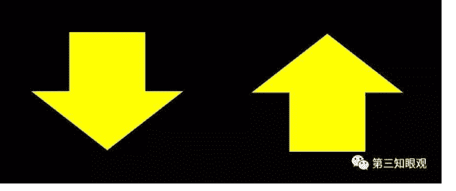

（上与下）

## 【精神感觉得“不合理”与“杀鸡杀羊”】

社会的进步，在于创造，创造的过程顺带产生劳与富的转化，转化的过程就是再分配的过程。

市井名言：三十年河东三十年河西！为何？

其实说的不是人的努力与安逸造成的三十年人生命变化，能在河东立足的人，不会是安逸之人，为何到了河西时代就不行了？还是因为认知！

不是人的变化造成河东河西之处境，而是时代的变化所致。

前面讲过，社会的快速变化，使民众认识出现很多断层，而断层之间就会有很多思想上的冲突，整个社会来说核心是政治，政治的核心就是分配，n个断层中，能跟得上游戏规则分配型的人，就能向前。跟不上的人，停留在固有思维里的，因为你停留的思维已经是十几年前甚至几十年前的政治分配玩法了，毛爷爷讲过落后来要挨打，就会受穷！

在网络上，会见到很多人抡起袖子骂娘，骂某类群体怎么能崛起，骂某类群体怎么能得势。

老一辈人信奉愚公移山，信奉的多劳多得，如今仿佛（就是）不那么好使了，以前的分配是按劳分配，现在是按资分配，再核心一点是按认知分配。这是讲思想层。再具体点讲则

食创业，存量分配时代已经来了快 10 年了，通过“万恶的”互联网来搞存量财富转移，依然有无数传统创业吃饱的门店创业者坚守固有观念，当然现实除了骂街就是煎熬。

有些东西是没有对错的，作为个体只有适合与不适合，追赶与不追赶，改变与不改变之说。

比如古代是士农工商，商人最不受待见，几千年了，一直 到 40 年前才开始抬头，然后以光速发展，时代的观念也是 10 年一大变，5 年一小变，商人反而最受待见。士人的本质是追求美，商的本质就是缔和养殖，很正常。

其实三眼说一句，自古以来，商的地位就没变过，只不过以前商户只有一家，就是那个最大的，不允许有小商户，而现在不过是全民可经商。

养殖技术也从来没变过，参见《养殖》一文。

为什么有人要骂街，因为穷与富在转化，有的人变穷了，有的人变富了，看谁先认知，看谁先迎合，看谁先改变，这个没有什么对错，一切对错都是主观臆断！现实不允许主观臆断，那样只会打脸。

以上说的是同层之间的排斥，认知断层间的抵触。还有一个更大的精神感觉“不合理”，是在分产产生的。

在《养殖》一文里面三眼说过，对于多数多数多数人来说，肉身都在养殖层。

在村子里有一个养鸡场，小鸡仔时期，大家都很开心，因为太弱小了，从鸡妈妈到小鸡仔，都弱小，这个时期是养，养的时候自然很和谐。小鸡仔很开心，因为受到关注和温暖。等小鸡长大了，就要拔鸡毛剥鸡肉，就会很疼。

任何社群的发展都是遵循财富的积累-收割-再积累-再收割，财富就这样一点点创造出来。从最大圈子看是如此，在一个小圈子内也是如此，成功的生意人都明白这个。而在每一次积累与收割间，都伴随着财富再分配，跟得上吃肉，跟不上的被割。学好养殖技术是本。

人性的本然，就是如此，都是先养再捕获回报。自古生孩子观念且如此，何况鸡鸡场乎？为何叫子女？只是抠的度不一样而已。

明白精神感觉“不合理”的逻辑，并没有什么致富的实际指导意义，只是心态层的说明，但三眼觉得，人活一世，撸好心态位置应该是极关键的，毕竟出来混心态才是第一位的，是非观是心态的核心！大到社会和个人发展，小到家庭和琐事两口子恩爱，是非观是核心！

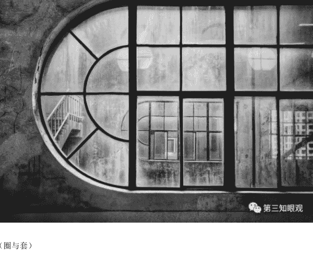

（圈与套）

## 【不合理的“赌局”最合理】

“别和我说投资，其实你就是要投机。”这是对 99%的人都受用的一句话！

因为这个世界已进入赌局时代，整个世界就是个大赌场，又分散成无数个小赌场，多数人的思维会越来越趋向做韭菜，韭菜不是不想做就不做的，每天所思所想所看所闻所体悟的都是灌输的韭菜思维，焉能不做韭菜？

## 而韭菜的最大特征就是：一直在找那个应该相信的人！

在《养殖》一文里三眼说过，养殖技术从奴隶时代，到土地殖民再到经济殖民，最后到精神殖民。这个精神殖民就是认知上的征伐，而精密的养殖技术就是做“赌局”。

在财富的收取上，除了 shui 务，就是赌局收取。这二者合起来就是金融，所謂金融立国就是如此！

简单粗暴的就是利息，就是 shui 务，都是在一定份额里直接拿出来放到口袋里；而高明的间接手法就是赌局。

股票、彩票、创业等等其实本质都是赌局。这起源于西方现代经济制度，把世界变成超级大赌场。

只是因为时代变换太快，民众认知有断层，80%的人跟不上认知步伐。

赌局有三种构成：

1、开场子的。也就是规则制定者，保持场子的稳定性，往大了说最大规则制定者，往下说就是各领域各区域的制定者，最后到企业组织的制定者，再往小了说撒尿活泥巴赚bb钱也算，尿多算你赢！

前面三眼说了，越能接近规则层分配的越多。这也是文明发达社会，律师这么受欢迎的原因。

前面也说了，富人之所以成为富人、所有的，皆只是非法的或者合法的取得了不合理的财富！律师代表的就是这个不合理而使之合理的层面。

2、坐庄的。也就是代表背后开场子的或者代表某个大组织的，可以到前台来参与博弈，并操盘控盘的。在未来，做庄的人会越来越多，制造企业家就像养猪场养猪一样一样的。而具体操盘运作的本质手法是什么？就是讲故事！为何要编故事讲故事，因为这是传达【不对称信息】，三眼之前文章说过，如果这个世界信息完全透明，信息完全对称，只需要一个时间段演化，那人与人之间几乎没有财富差异。

3、下注的。也就是韭菜。开场子坐庄的以及韭菜，数量配比如何？韭菜肯定占比 90%以上啊！存款财富转移肯定是 90%往 10%那里转啊！如果把所有韭菜当成一个人，你还会进入赌局吗？傻子才进去，但毕竟 90%不是一个人，是无数个人。曹操说：胜一人难，胜而人易。就是这个理！

在《养猪》里三眼讲过，要往上走，就要学会“牧”，要会牧，就要明白羊群的特性！这是养殖技术的基础知识。

开场子的靠规则生存，离开规则什么都不是；

坐庄的靠关系和讲故事生存，离开关系和故事什么都不是；

菲莱靠幻觉生存，离开幻觉菲莱将变得强大！

在大骗局里相信谁？

菲莱特就是一直在找应该相信的人！三眼说谁都不要信，唯有相信自己的认知！

## 谋生、做人如何上台阶？要研究人类社会进化本质，一点不虚很接地气！

1 月 27 日

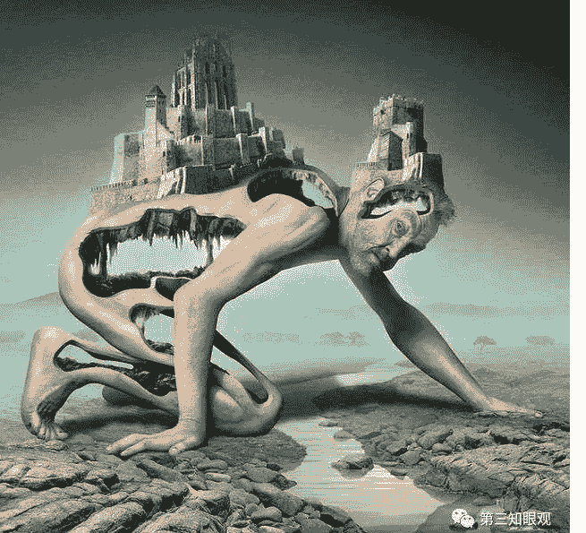

> “社会的进化就是人不断追求优越性和稳定性，这是运行的本质。”

## 从一个问题说起！

今早回私信，发现一个很棒的问题，许多人看了会觉得很玄幻，但我很能理解发问者。

因为人只有在问问题的时候才是认知突破之时，问问题是最好的学习方式，因为是在向内挖掘，而不是被外界灌输。

昨天 16:20

> 如果说问题的话，疑惑很久的问题就是人类作为一个类，应该是在存在共性很强的人性欲望的，比如偷懒 透支。那么社会又用一些软的控制比如道义，文化，宣传的方式去控制各类人群的个性，比如现代道德上要求不管是男生还是女生都要努力赚钱、如欧盟要控制‘老板’控制各人类群？比那请求会解放被警察抓。那么我想知道既然牧羊人用牧羊的方式去控制羊群，那么为什么不能够用人工选育的方式去一代代选出最符合牧羊人希望的羊的品种呢？比如羊有的时候事，合意项牧羊人，这些都是很神圣的事业，为啥不直接用物种选育的方式去一代代稀释掉羊性中对牧羊人不利的部分呢

我们从小的教育是有问题的，讲这个问题说几万字废话不如一句诗：就是灌输填鸭式。这个是受自古社会文化习惯（政治）所影响。

哈叫灌输填鸭式？就是告诉你 1+1=2，你记在就就行了，考试时候就这么写即可，如果你要问为什么 1+1=2？不能是 0.5+1.5 吗？不能是=3 吗？1 到底是什么？老师和同学们一定笑话你，当你进社会，这些笑话你就会变成刺刺你，这是阻碍人认知最大的障碍——我们都被我们的“学历”给阉割了！

看这个这个问题，要恭喜这位同学不但没有被“阉割”，而且开始放飞了！

认知的打开一定是向上的，向着更大更深层去挖掘，认知像一个触角，当未知领域延展之时，肯定显得很玄幻，因为多数人的大脑里都不曾有过那些未知领域的经验。

> ——众人之所以见谓之不见，众人皆所不见谓之见也！

当人思考一件事物，要尽力去从你所能思考到的、最大的层面去逐步向下渗透，这样才会思考明白，看清盖面。

下围棋就盯着局部的子，肯定会输，盯着全局，经过多次实战，才能熟练，才能找到人生的“最佳一手”！

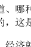

举个例子，一个做小生意的人，比如买一碗麻辣烫，如果只盯着麻辣烫，自身从小以及对自己的孩子从小就局限于如何做好麻辣烫这个认知层，那想必永远跳不出阶层。

怎么跳出来？需要一层一层的：

在产品层，口味、包装等，很原始的初级认知层；

升到营销层，开始问自己什么是需求、什么是供应、什么是价格、什么是各种促销心理等等，这是围绕点对点的交易开拓认知；

然后向上在社会层，哪里的片区、哪种街道、哪种人流、哪种人群阶层，你所提供的麻辣烫在整个社会结构里是怎么提供服务供应的，这是围绕社会生活方式开拓认知。

再向上到经济层，为何吃麻辣烫的人多了？经济就是钱的流动和分配，这种变化影响了社会结构乃至具体的目标人群什么行为？就像拼多多一样为何能快速崛起？代表着什么，是什么驱动的？

再向上到政治层，比如北京驱赶低端人口与服务，为什么要驱赶？哦，原来是要调整人口结构来做消费升级呀！这个政策对我这口小小生意会有什么影响？哦，得跟着升级，摆摊的“下等食物”要升级下进入专业商务楼层，大鸡排、炸串、麻辣烫要标准化、可复制，这样就能做大！

如果这几个层面都能够打得通，你想想这个麻辣烫小业主，还会是那个小业主吗？

如果再向上升到人性层面，为何政策要这样定？因为社会在进化，人活着追求的就是不断进化！这才是一牵一发而动全身的终极认知线路！

三眼这样说诸位看官可能一头雾水，那么我们拆解下这个逻辑！

还有，上面麻辣鸡例子随意举例子，各种层的认知梯度也是随口一说，不要太较真，要重逻辑，不要当杠精，杠精出门左拐！

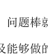

我们回到上面截图里那位同学的问题，问题棒就棒在，背后要问的是：

人类社会发展、人性在里面扮演着以及能够做的是什么？

这个问题是这位同学读了《养蛊》之后发问。

社会大到最大组织，小到一个社群，都可能是一个养蛊模式，分两层世界，下层的是养蛊层，上层的分配层。在养蛊层里的人想要到上层“参与分配”，这叫逆袭；上面分配层里的人想获得更大的利益分配，那叫爬阶。无论大小社群，都可能是一个利益分配体，最基层干活的一定拿的最少，搞分配规则的一定拿最多。这是一个很客观的不稀奇很正常的存在，如果你觉得是颇颠覆观念，那搞过分老实了，只能是1+1=2一种思维。

养蛊是啥？就是政治！政治是啥？就是人性！

自从三眼写了一篇政治素养，现在好多同学每天都私信问我政治素养，很开心，就如上面说的，认知开始向更大的未知领域展开触角了。但三眼觉察到多数人还是把政治素养思考的过程神秘莫大了，这回简化解读一下！

比如这位同学的提问。

请问老师关注政策通过哪些报刊和新闻？还是其他渠道？谢谢！

上午7:36

政策各新闻网站都有，关键是解读。政策跟政治脾气有关。每个政策说的都是官话，像一部另外的文字系统，而且牵扯各方利益，所以很难解读。一个办法就是你想得到什么，有针对性的研究。

上午8:58

谢谢老师！需要学习提高自己的政治素养，才能更容易解读出想要的政策背后的逻辑？

开始去思考怎么更深入了解各种政策了，但三眼说的是，还没到根本，因为政策这种东西，就像小时候玩过家家，你当队带着一堆小屁孩过家家，具体玩具怎么分？为何这么分？你喜欢哪个小女孩让他扮演妈妈，你扮演爸爸去占便宜，你最好的小伙伴你给分配在哪个角色……等等等等，这些东西能公开说吗？不能！

所以政策就是另外一部文字系统，推进和大力推进，深化化和具体落实，高举高打和以什么为目标，这些概念都是不一样的，而且从中 yang 到地方每个层级解读起来，具体“力度”也是不一样的，也就是政策与对策的辩证论。

政治素养的根本在于人性。看人性就是看利益，利益的辨别能判断趋势。

只能这么含糊的说！

怎么看，回头最初那位同学的问题，怎么“品种选育”？

问题背后的问题，其实是人性在政治上的根本表现：

人的生存与进化追求的是优越性和稳定性！

## 优越性产生层级；稳定性产生各种“牧”的工具。

无论大群体还是小群体皆如此。

只能说这么多，几个关键词送给诸位。

### 1、王侯将相哉有种乎！

那么同学的“品种培育站”在顶层思维是合理的，但不可实现，因为那是上帝干的事，人和人之间确有种种的天赋差异，但不足以形成巨大的社会各等级，更不能在“起点”上形成，这是人活着最基本的价值观测，认了就算了。科技的发展和文明的发展，一定是为了加强优越性的稳定性，所以越文明贫富悬殊一定越大，阶层越固化，因为文明的背后是人性驱动。

### 2、胆略！

什么是胆略？为何多数人很怯？认知的触角都无法延伸？药就在毒中，毒就是药，认知打不开，胆略即开！胆略不是有人骂你就要干架，那是怒悲。胆略是敢想，想透了自然就知道怎样干了，也就敢干了！自古文人比猛将要胆子大的多，因为从最高处看到社会的运行本质和体悟了人性的本质。胆后面一定跟着略字，略就是格局，就是纹理。

### 3、稳定性！

上帝的品种培育人干不了，但人性就是要扮演上帝，追求永恒的稳定性。具体到社会生活层和运行上，身体的培育——饮食、医疗、生存环境等区隔；思想的培育——教育、认知、灌输、自我塑造与思维力培育等区隔（最高等级教育培养恩赐力，最低等级教育培养谋生技能）；在肉身与思想外，稳定通过资本、地域、人缘、以及社会运行的关键链源的掌控等层面区隔。社会越发达，一定朝着这种区隔发展。资本垄断、生活方式断层、认知断层、这是必然。

### 4、优越性！

三眼之前《赚线三套路》一文中讲过，社会生活是下层对上-一级的追逐和模仿，其实本质就在这个优越性上。人的进化就是追逐优越性。

生存是生存，进化是进化，这是两个社会层级的两种概念。

针对底层，生意要玩智商税，通过框来赚钱，因为底层面对的是生存，只要给出其“能够更好生存”的东西或者思想，即可收取智商税，虽然都是假的。

比如对于有些家庭，孩子能上学即可，而对于更高层级的家庭，孩子上什么学很关键。

比如对于有些车子，能开即可，而再往上过了阶层线，能开是基础，关键是展示什么优越性！

做生意收智商税很无耻，赚顶层的钱还不可能，生意人赚“优越性”的钱好赚又不失道德感...

当你在探究一个个优越性的本质，以及展现优越性的方式，造富之道就来啦！

清华学区房的总价是一个清华毕业生一辈子赚不到，这就是优越性的可笑和真实之处，很搞笑但很真实。

### 5、活的意义！

其实聊政治、聊经济、聊社会、最后归于自我和人性，最大的受益并不是瞅到了什么致富之道，财富只是认知顺带的产品而已，最大意义是能让自己冷静客观看到世界。

人无论是养猪层、还是中间模仿层、还是规则制定层，无论哪一个层级，每一个个体都把自己当成“领导人”来看——通过这辈子不断努力，突破生存层，到达进化层，不断地追求更高的优越性，并且通过繁衍，想追求稳定性。如果人寿命够长，太太太爷爷的手会伸到太太太孙子身上，进行自我认识的传承灌输、约束和管理。

在这种文化下，每一个国人的野心都很大，“生儿子就比生闺女好”就是这个理，但同时每一个个体又在潜意识里追求自由，而对自由的最大束缚正是自己的野心，越有钱越这样。

三眼不是批评这样不好，而是无分对错，这就是人性，社会的运行发展就靠这个驱动，政治的演化靠就靠这个，各种意义乃至衣食住行就靠这个，这就是一个游戏，人性就是游戏规则，规则一直不变。

为了逃出这个规则，才有了宗教，宗教都是反人性的。这是后话！

### 6、心态！

人最怕自我矛盾，这是能量内耗。

而绝对绝大多数人，都是能量内耗的。

人都有着“入世观”和“出世观”，能量内耗就是既不能入世去混，俗话说放得开，又不能出世去洒脱，俗话说想得开，得道高僧也是如此，只是大家度不一样，人生修心就在这个能量内耗上的“度”上。

这是“政治经济社会自我人性”中的自我部分，有的人喜欢听政治，喜欢斗；有的人喜欢听经济，喜欢挣；有的人喜欢听社会，喜欢混；而最后，幸福安康的本质还是要归于自我。

## 弱者论是非，强者观漏洞！三眼观本源认知无偿奉送——生存即漏洞！

1 月 28 日

今天给大家讲个干货，此干货是三眼我整体认知的最核心，无偿抛出！

只有抓住这一核心，才能破解所有的文字！

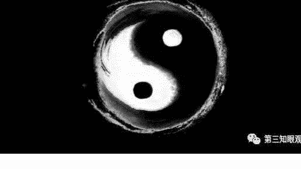

（最高辩证哲学镇文之符）

## 【认知存在有三个层面】

道：本源认知。

法：规律认知。

术：工具、经验认知。

99%的人都停留在术的层面；

一些所谓领域的成功者、精英、专家等到了法的层面，通过规律来互相较量；当规律变了，前面99%的人即被淘汰，而重新去认知各种术，被玩规律的人不断利用。

很少有人能达到道的层面。

为什么？

因为道这个层面，不可能自下而上去认知到，一定要在俯视，要去感悟起点。

当人感悟起点，明白了起点，法与术自然打通。一通百通！

三眼尽写写明白，写文章不好写的，写高了就是玄幻神话，写低了就是流水账臭烂泥，难就难在如何高屋建瓴而又接地气，通俗易懂。这需要把一个复杂的东酉简化到绝大多数人都能够接受的认知层面——用绝大多数人的“语言”来讲！

## 【生存即漏洞！漏洞即消亡！】

——万事万物生与命存在的本质就是漏洞，漏洞是组成事物的最基础元素。

这就是三眼的认知本源。

要知道万事万物之所以能够存在，是因为它能消亡，消亡才是存在最根本基础。如果一个东西不会消亡，那么它不可能存在。

存在即为漏洞，这是必要基础条件。

那么对于人来说，生存即为漏洞，漏洞是人类社会发展、个体的人存在的必要基础条件。

人们都看见事物的存在形态，误以为这就是真理，而不知道事物的存在形态其实是消亡，任何事物的存在都是在不断走向消亡的过程。

也就是说：你所认为正确的，几乎都是错误的。

## 【消亡即为变化！变化即为漏洞】

万事万物的存在都是走向消亡的过程，这个过程就是变化！

变化就是漏洞，一体两面！

因为有漏洞而变化，因为变化而有漏洞！

人和人的强弱差异，核心的核心的核心，在于能否感知变化。

弱者看重不变，感知不到变化；

强者看重变化，一直观察变化。

宇宙有周期，太阳有周期，四季有周期，生命有周期，政治有周期，经济有周期，社会演进有周期，连我们每天睡觉都是一个小周期，周期是什么？就是生长到死亡的一个循环，万事万物就在从生到死的不断循环中。

为何而生？

因为击败并不毁灭了先前的东西，才能得到新生：

为何而死？

因为万事万物的存在基础都是漏洞，有漏洞必死，等待着它的终结者。

所以观察事物，正确的观察方法就是：思考它会如何而死！如何消亡！

具体到个体的认知上，就是“不合理”！

“不合理”就会消亡，你察觉到“不合理”，就是在观察某一事物的消亡。

漏洞就是在事物变化的过程中，产生的“不合理”的存在之中。

什么叫“合理”？

就是你所认为为正确的！

什么叫“不合理”？

就是你所认为为不正确的！

合不合理源自于人的主观认知。客观存在不以主观意志为转移！

但三眼告诉你，人所认为为正确的“合理”的东西，几乎都是错误的，那不是事物存在的真实形态，事物真实存在的形态是“不合理”。

比如政治、经济、社会、自我、人性五大认知论，这是三眼的表象，是具体的工具层，这五大块的存在，多数人认为正确的，都是错误的！

你主观所感知为“合理”的东西，其实都是“不合理”的！

## 【人类巨大的经验主义漏洞】

人法地，地法天，天法道，道法自然。

自然是最高的，或者用人类的词汇无法描述，暂且将其称为最大的、最高的、无处不在、无形的、 最玄通的规则。

我们生长在社会之中，作为人类我们理应知道，人类最大的漏洞就在大脑，救赎之道亦在其中。

再具体一点，人类大脑的巨大漏洞就是经验主义。

人是一种经验性动物，就像瞎子走路，只有摸到的地方才敢伸腿，我们人类看待万事万物，都通过经验主义，经验主义就是人类认知的漏洞。

我们都看见想看的，以为我们看见的是真实的。

自我的存在，依赖于记忆，记忆就是经验，没有这些，我们个体将不复存在。

我们依靠记忆抹黑前行，我们误以为我们所“摸”到的东西，就是真实的，也不得不认为那是真实的，因为它的不真实将会否定我们记忆的存在，也就是我们自我的存在。

每个人都逃不开经验主义的束缚，包括你我，包括那些圣人。

唯一区别就是度！

最弱的人，经验主义沉浸在一刻的时间里，最典型的譬如女人，一个男人爱不爱她取决于一刻钟对话的内容。

爱存在于她所“摸”到的，爱与不爱存在于摸没摸得到，而男人对她爱不爱，根本不取决于她“摸”到了与否。这是最典型的由经验主义漏洞导致的弱智表现。

把度拉长距离。

男人冷静观察社会时，也犯了经验主义错误。

一般人能有 10 年的经验周期已经不错了，用 10 年内“摸”到的东西去判断事物真伪，已经看起来很不错了，但结果也是错误的。

## 【我们身处的时代】

人类社会几百万年发展，母系社会三万五千年，再到父系、奴隶社会、几千年的封建社会，再到今天。西方经过 200 年，东方经过 100 年，走完了人类几百万年都走不完的路。

如果你生在母系、奴隶制时代，你认为为什么是正确的？

在 100 年后的未来，我回来问你，你生在当下时代，你认为为什么是正确的？

没有正确，不正确才是时代存在的基础，消亡是事物存在的基础。

今天的政治、经济、社会、文化，是正确的？

错！必将消亡！

热量越高，分子流动速度越快，母系与奴隶制社会那么久，因为热量不高，而当下时代，是一个超快速变化时代，分子流动速度极快，很多东西已经从生到死好几遍。

上面说过，观察事物不要看他存在的面，要看它如何死掉，那才是真实的。

具体一点的例子，说钱，大家都是財迷，都关心这层的认知。

钱是血液，血是银行造的，银行在人类社会存在多久？很短！

而在这短暂的时间里，银行的本质是造钱，在这个本质上它已经死而又生了几次了！

最震动的一次死亡，是 1972 年。

此前美元与黄金挂钩，美元以黄金为锚，其他国家货币以美元为锚，有限的黄金决定有限的美元，又决定了其他国家有限货币。

1972 年，美元与黄金脱钩，正式开始劫掠全世界！

引发全球资产价格上涨；

2008 年次贷危机，美帝大规模货币宽松，大水泛滥，投入市场，解决了当时的危机，又升级了对其他国家的劫掠，其他国家也不是傻逼，你发我也发，引起全球资产价格的暴涨。

1972 年银行的死了又生，死的是金本位，是商品与货币的对等性，生出的是信用本位，信用这东西就是谁暴力谁说的算的。

钱，死掉的叫等价交换物，重生的叫劫掠承载物。

现在的钱，就是庞大利益体对弱势群体的劫掠工具而已。

这个逻辑存在，现金为王思想就是傻逼。

任何事物存在的基 У是趋向消亡，这个模式一定会死掉，弱者沉浸在表象里，或者在雀跃欢呼的抬杠里，强者早已冷静去观察消亡过程中的漏洞显现。

“不合理”才是事物存在的基 У。

房价 20 万一平，合理吗？

猪肉卖黄金，合理吗？

物价翻了 10 倍合理吗？

就业不包分配合理吗？

我这么爱你你却不爱我，合理吗？

人不光有经验主义巨大漏洞，而且更可笑的是，当原有的经验主义被打翻，新的经验主义就会深入骨髓。

这种旧经验主义到新经验主义的过渡，形成各种文化现象，媒体一个个都没有良知，因为其不讲逻辑，或者干脆讲不出逻辑，而只讲情绪层，现在的媒体信息 99.999999%都是在顺应受众情绪而已。尤其是现在自媒体崛起！

什么叫公知？

就是 1 要吓唬你，2 要让你生气。

## 【是非观与人的痛苦】

物质发达了，人却更痛苦，很多专家学者说不清，其实很简单的道理。

到了今天的科技水平，一般生理上的痛苦都可以解决，现时代人的痛苦都来自于精神之痛，而精神之痛的本质在于人的经验主义漏洞。

经验主义一定会产生人的是非观，这是区别智者与庸人的分界限。

庸人论是非，智者看变化。

人的是非观，是造成人痛苦的具体端，人们通过经验主义在脑子里形成的是非非，而实际社会生活是没有是非对错的，就像风雨雷电自然现象，没有对错。

现时代的信息流、人流越来越快，就算你不想思考，大脑也会被强迫不停思考，但多数人的思考都是在转圈圈，因为经验主义这一人性漏洞。

当一个人认为应该是什么是对的，应该怎么样，这是最愚蠢的思维，认知的局限、精神的痛苦由此生长。

劳心者治人、劳力者治于人！

为何小身板曹操能指挥干军万马？就在于攻击人的漏洞。

一是给人灌输经验，现代 Ayur 叫洗脑，灌输进去，人就不能自拔，就像给马匹上了马鞍！能反意识觉醒的人是非非常稀有的！今天信息爆炸的时代，当网民们热衷谈论“觉醒”之时，他可能正在被洗脑。

插一句話，三眼经常说的：

判断信息的好坏，在于它是给你灌输，还是跟你讲逻辑。前者是拿经验洗你，后者你拿逻辑激发你。

二是在“上马鞍”后，不停地攻击人的诸多漏洞，从而压制万众。漏洞主要在情感和内心上。

在曹操眼里，千军万马并不是铁血之躯，而是一个个在情感与认知上极为脆弱的人。

## 【说在最后的实操思维性思维】

来点满足个体私欲的实操思维！

作为个体的我们来说，我们自身就存在就是因为漏洞组合而成，而人生存的核心，就在于攻击内外部的漏洞，内部攻击自身，外部攻击所有！

人生存都带着窃诈与欺贿，很正常，不谈诈就不合理了。从爱情到混社会。

人以攻击漏洞而生存，有初中高三层：靠嘴活、靠骗活、靠偷活。

谅樵理不糟，圣女嫁出门左拐。

三眼自觉在所谓道德层面，当好人容易，当坏人不容易。

每次要干事，都要调整心态，因为要干成事，就要反人性，就要攻击人性。对于天性纯真善良帅的排毛的人来说，这其实挺累的。

## 初级水平：人情世故——攻击人情感的漏洞

人情就是人情感的漏洞。

情感与利益本来是丝毫无关的两个东西，但聪明人会利用攻击情感的漏洞，去获取想要的利益，这就是人情世故。

依靠闻到人身上的情感的漏洞而活！

给一个人吃最差的事物，喝最浑浊的酒水，穿最脆弱的护甲，凭几句话一个精神，就能让人们为其一个人的利益去付出生命。

人情感的漏洞，就在于总是想去衡量情感的多寡，情感本来是虚的，无法衡量，人性偏要拿实体的经验主义去衡量这种虚的东西。

这就造成情感上称是多少斤。

尤其在中国这个人情社会，拿人情换利益，是很多人成功的手法。

讲人情=文化水平。

在迈向发达文明后，人情就会没有了，取代的是道德，道德是规则，有规则就有章法，有章法就不会让人钻空子。

不过看看满网的言论与评论，这条路还要很长要走。

## 中级水平：营销——攻击人性的盲点

当商业社会越来越繁华，越来越成熟，那么商业一定更趋向于欺诈，律师一定会越来越有地位。

依靠见到人身上的盲点而活！

未来社会信用一定越来越值钱，比钱要值钱，但这样正说明，我们已经走向失信社会。

因为人内心的失信，才会通过外在的规则来束缚人心，信用才会变得越来越重要。

商业社会存在的基就就是攻击人性放大价值：1 元钱的东西怎么攻击你的性，让你觉得值 100 元。

营销说到底就是骗。

营销的过程说到底就是欺诈。

三眼说过：任何造富的本质都是不合法或合法的取得不合理的财富。

具体怎么合法的取得，那要形成一套工具箱了，这里不展开。回头慢慢聊。

## 高级水平：投资——攻击秩序的漏洞

钱的秩序；
钱流通的秩序；
所配置的法的秩序；
钱存在于个体账户里，而财富表现在一个群体上，群体必须有其秩序；
前面说了，任何事物存在的基都是走向消亡。
各种法规为何一直在变？在改写？除了 xian 法，当然也改了！
所有的政策为何一直在变？在改写？
这几轮番出现了多少“潮”？理财潮？虚拟币潮？共享潮？当然持续最长的还是炒房潮。
任何秩序都要覆灭，这就是一个个盘面。
投资就是攻击秩序的漏洞，靠“偷盗”而活。
任何的投资如果把里子翻出来让大家看一看，都是在“偷”东西。
而在盘面上，更上一层的秩序是钱流的秩序，分配的秩序，钱本身的规则秩序；
再更上一层，是法律规则以及背后的政治秩序。
从母系到如今商业社会，秩序在变，在死亡又新生。
而今，秩序在变，变向何方呢？

## 宏观认知来的太慢！如何从微观层，去发现经济发展与攫取财富的机会？

1 月 29 日

很多私信问我有啥出路，要具体实操那种，合着讲了半天规律和规则，白讲了...

讲了半天公式和例题，最后问的还是这道题到底值什么...

考试不会，去抄小伙伴卷子，没有推导过程，小伙伴拍着胸脯说这道题就是要得 3.1415926！你敢信吗？

人活着不是一年两年，要几十年呢，现在的中青壮年，应该都对 90 年到现今的事情有个大体认知吧？

打个时间差，1 万元和 100 万在感觉上是不是不一样的？

村口的炸油饼 1 毛钱涨到 3 元钱。

落叶要时根变成现在几亿人口大迁徙，袭烈制造城市圈运动。

出门都不带钱包了！

社会变化快吗？

在时间思维上如果有感知的人，会感叹到社会变化如此惊人，真应了风云变幻这个词！

前面 30 年算个啥，往后再 30 年呢？会更快！

热量越高，分子运动越快；随着信息流、人流、物流、各种流的加速，往后的变化是风云变幻转到惊雷闪电！

感知差距的同学，裹挟在未来的变化里，就像坐过山车，应了小沈阳那句话：“两眼一闭一眨，一辈子过去了哈”！

咋办？

只能一个办法，坐过山车时候睁开眼，瞪大眼，慢慢习惯，就看得清！

宏观规则规律很重要，但是对于多数人来说，来得太慢了，认知是一步一步往上走的，这个过程会很慢，很多年龄不同，阶段不同，心态不同，看东西想得到的养料所需也不同。

宏观认知一定要慢慢爬，这个是乐趣，也是对自我人生和家庭后代最保险的精力投入。

当然，在微观上也有一个好办法，虽然不是速成，但是可以加快认知提升步伐。

那就是：感受城市的呼吸！感受集体性的呼吸！

感受呼吸就是把微观的东西，往宏观上靠，去联系思考，如果真要只关注微观，那肯定是越来越糊涂的！

三眼没事就跟着城市走，穿梭城市大街小巷、人活几十年都得死、城市不会死。它的寿命很长，唯一能感到乐趣的就是在这个一个小时间段里，跟着它一起变化，长久的陪伴是奢侈，孤独才是永恒。无论对于什么阶层的同志们来说，这种乐趣是公平的。

往前数十年，那时候塔吊比现在多，随处可见，大街小巷商户布满了各种材料公司，因为那时候搞了4万亿，铁公鸡变成唯一主菜，感受这种呼吸，就明白了各种政府投资、基础设施，修桥铺路盖高楼是硬菜了。

城市也是个“生物”，在几年内狂吃这个硬菜，一定会“长胖”！也就是说基础设施大面积铺开！

但是有个问题，4万亿铁公鸡这个硬菜，是被动吃的，这样身体一时间消化不了，基础设施虽然铺开了，对于生产生活的话刺激很少。

经济活动需要这条路，这条路才能被消化掉，事实是铺开了，老百姓的活力也跟不上，也就是产业跟不上呀！

之后呢？

之后走过城市，穿核其中感受呼吸，金融来了！那个叫普 hui 金融的猛兽来了！

金融是钱的流动，是产业的血液，初衷是好的，血流的速度快了，资源活力就跟得上了，尤其是对于民企融资难的问题！

各种理财、P2P、贷款、中介霸占了多数商户位，如果有点感知度的同志，闻得到这一呼一吸，就会心生恐惧，因为一夜之间这些玩钱的都冒了出来，像皮肤过敏后的红点点！

金融是给产业做配套的，血液是给肌肉运动做供应 的，肌肉运动量差，血液多了肯定会得血毒症啊！

肌肉不运动，血液哪流啊？只有正常的运动，才是良好的资金链，除此之外，血液肯定流向资金链不正常的地方。

事实也是这样，各种金融投机、金融诈骗，各种 P2P 理财资金链断裂崩盘，伴随着热点大城市的集体跑路，失去了生存土壤，投机诈骗下沉到三四五线。

资本都是血淋淋的，一场嗜血盛宴一定会持续到舔完最后一口血。

继续孤独的走过城市，感受她的呼吸，一地鸡毛后，她和我一样孤独，大量商户空置，拖着虚弱沉睡。

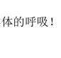

不光要感受城市的呼吸，更要感受群体的呼吸！

在铁公鸡硬菜上桌的时候，开发商们“一铺养三代”的呐喊随处可见，感受群体的呼吸，就是感受他们在说着什么、喊着什么、做着什么，并反向观察他们。

一铺养三代的呼声此起彼伏之时，去铺子里感受一下，静静地站在那里感受每个铺子的呼吸和活力，就会明白，养三代是个可能是要三代养。事实也是如此，伴随着金融投机的一地鸡毛，商铺写字楼也一地鸡毛。

手里持有个铺子，看着它就像喜当爹的孩子，没啥预期但又添在手里。

时间到了 2015 年初，打开主流视频网站，惊奇的发现，地产中介居然在视频流媒体大面积打广告了！

感受到这呼吸，有点经济常识的同学就会思考，一手房是开发商之间的斗争，二手房才是老百姓投资的领域。存量房市场课代表居然大面积打广告了，还等什么，快步要买房！

如果不能从宏观向下推导，那么就去看微观慢紧感情也会有所得。

城市是个生命体，那么这些个标志性群体就是一个个器官，每个器官的动态，都是城市生命体发育进化的关键所在。

再比如感受呼吸，房子火了，从 1998-2012，没几个人能真切感受到，而从 4 万亿刺激之后，这把火浇上了大量燃油，产生了一个群体叫炒房客，各种专家、门派雨后春笋开来。感受这一群体的呼吸，在于把握一个关键：

## 就是这群专家门派在大谈存量房，还是二手房。这是一个很关键的分界线！

因为老百姓想投资赚钱，只能通过存量房，这才是真正的价格标的区间，只有存量房的波动才有机会去赚钱。

如果大量专家门派开始不当“中介”而当一手房销售了，不是灌输你各种淘房技巧招数，而是帮开发商推楼盘了？那么这个游戏就要偃旗息鼓了。希望手里有点闲钱的同学注意这个界限。

继续感受城市的呼吸，人群的呼吸。现如今，穿梭城市会发现，在虚弱沉睡一两年后，城市里整形缭导娱乐大保健变多了，去网上看信息，不用读具体内容，发现讨论各种创业小项目玩小花样的越来越多了！

闭上眼就明白，哎！新动能没有，旧动能高风险玩不下去，去库存已经把风险从地方zf手里转嫁给居民了，存款也捞的差不多了，咋办？

养！

怎么养？服务业！

服务业靠啥？

靠人！

怎么办？

抢！

服务业到底是个啥？

就是你服务服务我，我再服务服务你，你兜里给我点，我赚到了再给你点，你来我往，总会有有人富，有人返贫。在这个过程里，需要不断的堆积人口，财富才能堆积在一起流动开来，人才能源源不断玩下去。

服务倒是是啥？

就是你孩子子学美术没意思，学跆拳道没意思，那过时了，为了迎接新时代，要学编程，从小就要学，不学就要被淘汰，吓不听人？

服务业升级再升级，说到底就是1毛钱的东西以前卖5元，换个花样弃套新概念卖10元！

每一個被逼无奈向前走的东西，都会有一地鸡毛的东西产生。

比如什么创业培训、加盟、致富妙招等。最后肯定是一地鸡毛的！

三眼在《三秦路》一文里说过，底层的就是智商税，服务业说白了就是底层的财富互相转移罢了！转移玩的不是努力，而是玩的智商！

感受城市呼吸，感受其中每一个器官的呼吸，更要感受网络上舆论的呼吸，众人去谈的东西，大概率是一地鸡毛的！

大家都热聊的东西，证明大家都迷茫，都慌！

看信息不要深度读，随手不断翻，1 秒看个标题，5 秒看内容即可，感受整体呼吸多了，自然明白人心向背！

静静去感受，实事就在眼前。

## 由房价看现实残酷真相！你所认知的和事实完全不一样！甚至截然相反！

1 月 29 日

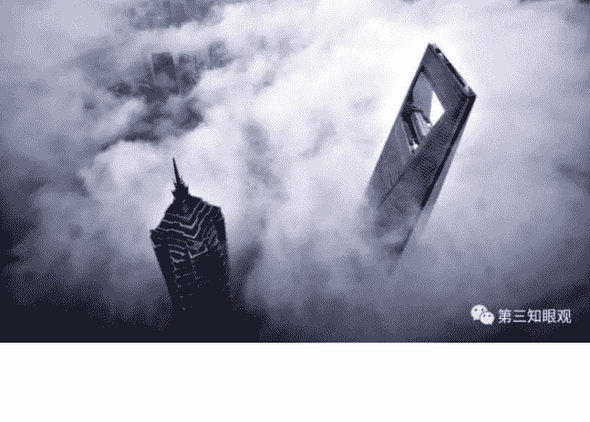

一般人脑子里，大概是这样想的：

房子就是住的，既然是住的，就要人人都买得起才对，不然就是不合理；

大家看，租售比太低了，跟邻村比，肯定泡沫好大，早晚完蛋！比较装 b 的说法是，规律不会缺席，只会迟到！

太难干了！房价把实体血吸干了，把实体搞虚了！经济下滑就赖这玩意！

房租涨，物价涨，生活难！

以上观念皆公知嘲嗤，公知搞舆论就是嘲，眨眼睛+气死你。你战战就战就又气鼓鼓，他就被捧上去了。

想什么规律经济席…还是到这种看似很有b格的话，基本都是公知专用套路。

规律？哈叫规律？女的生孩子有经验规律了，用到自己弟弟身上，那叫规律吗？

城乡户籍一切都是规律？只生一个孩子是规律？放开二胎是规律？土地和砖头产权分离是规律？户籍社保不能全国自由行是规律？

西方随便拎出个著名经济大师，都会一脸懵逼！

透过房子来看一看残酷真相，一般人所能认识的，可能与事实截然相反！

房子 70%是金融，30%居住价值，甚至在一线核心地段，95%是金融，5%的居住价值。

为啥？

产权知道是啥吗，其实是使用权，水泥砖头，下面那片地才是真产权，但控制在大组织手里，供需随时可调节，这不就是金融吗。

金融是啥？

就是控制，控关键资源，来调节资产价格。

未来？

一线多半年轻人都租房子住，这才是回归居住价值本意。

租售比低，有泡沫？

No！价格低不低不是你说的算的。

生活品，也就是所谓物价，不包含房价的，这部分决定于底层收入水平；

物价是保生存稳定的；

GPD 是保就业的；

至于房价，取决于富人、 不取决于底层，去边境搞一块地，造个城，弄 1 亿穷鬼，房价能高吗？

北上深 20 万一平的房子，跟租售比有关系吗？跟泡沫有关系吗？

美帝次贷危机后滥发票子，大家都跟着发，发 的票子哪去了？那可不是个小数字呀！

所以底层根本想象不到富人们到底多有钱。更想象不到加了杠杆的富人多有钱！

钱又出不去，老王不被抢劫两回了吗！

1%的人掌握 50%的财富，不虚！15 亿人的 1%就是 1500 万。

一个人来几条，买下北上深足够了。

如果你有钱了，第一想法是什么？肯定是守啊！

怎么守？囤啊，囤在硬核资产上，就算是大家一起跌，这也是最抗跌的，何况连年溢发大水，怎么跌？

宝强算是富人圈外围女，还囤了 1 个亿呢。

泡沫？不要用股票的思维去套地产，股票就是玩泡沫，一套摆盘从生到死很迅速。股票100%泡沫，为啥？因为散户是大头，喜洋洋买进，恐慌性抛售，也只有散户群体能如此步调一致。

地产，不存在恐慌性抛售。

当然，四五线没准，因为四五线地产就是个股票，是底层想暴富喜洋洋买入的，一套摆盘下来，死的最快，轰轰烈烈去库存就是摆盘搞这个！

所以在投资，或者对老百姓而言，叫守财，一个方法，不要跟底层散户一起混。

什么意思？

就是要知道，硬核资产的价格，是富人层、精英层决定的，不是不是全国平均收入水平决定的。平均水平决定的东西，才真的有泡沫。

为啥叫“上车”？

不跟底层混，翻箱倒柜凑份子跟上精英层，就是上车了，要赚第一个赚，要赔也最后赔，且赔的最少。

没办法，斗不过的，这是现实的规则，忿气没用！

精英层的东西有没有带泡沫的？也有！

比如小区房，20万一平，一小撮人决定，底层的刚需是住，精英层的刚需是囤，简称刚囤！小区房呢？不是刚囤！

非刚囤的风险点在哪？在于是否“过分”！太过分影响底层心态，也影响其他精英层心态，不利于和谐画面，毕竟是房子，不是书画展，教育这事要彰显公平，这是治本，所以很容易一波都带走！

房价吸实体血？搞虚了实体？

这就是摔倒了怪路修得不好！

所谓实体是啥？老百姓思维就是开个厂子开店铺，这东西好不好与跟房子没啥关系，不要看什么房租，假设房租成本没上来，照样难于！

赚钱这种事，可不是你好我好大家好，而是只有你少赚，人家才能多赚。

在生产力过剩时期，玩差额，全面控盘，进行存量财富转移，赚的就是小散户入实体的钱。

GPD 以前是保 8，为啥？保 8 就是保持大增量，整体最大盘子一年赚了多少钱，地主拿到手是不动的，刚刚赚！而就业和所谓经济活力靠谁？靠地主？no！靠民营，20%的蛋糕养活 80%人口，所以必须要增量！现在都保 6 了，兄弟们！这次又来了疫情，6 恐怕难保了！

地主拿分子不动，增量有限，残渣民营怎么分？

所以从最好处卸]，实体难很正常，落实到个人的头上，体会到难，正常！

而更难的是，赚钱就是互相欺负，生产力过剩，里面的大鲸鱼一定欺负小虾米，欺负的方法就是差额赚！

大家挤宝宝和团团们，还是可以的，没他们掺和，就算 GDP6%实体也能凑合过！

还有，所谓实体，老百姓脑子中的概念就是自家小厂子小店铺，实体也包含国企的呀各位，三年前开始的去产能是干嘛？救国企呀，用环保、安全等把过剩产能行业里移和的民企干掉，头部国企自然利润大增啊！这不都是实体吗？实体怎么不好了？

只能说后娘养的不好过，而后娘孩子堆里，流氓好过，老实孩子不好过！

还有的思维是房子这么玩，经济有风险啊！吧啦吧啦一大堆！

说出的逻辑和结论能吓死个人，又是日本又是俄罗斯经验的，又是硬着陆什么的，喊了十几年了，也不管给力！

啥叫风险？

不是隔壁村一个家族搞出事了分崩了，就套用到自家上。村和村不一样，家族和家族治理规则也一样。

风险的强弱在于风险可不可控，这就是风控，而风控的核心在于能不能有足够力量控制整体盘面，这么思考还有风险吗？

去产能就是把资源足够倾斜到国家队手里，地产生控控起来就是把资源接到国家队手里，涉及到风险的和分配的关键性资源，都到一起控制起来，剩下不稳定的、所谓有活力的东西，不影响整体盘面的，交给民营来玩。

大家各玩各的，二层世界！

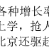

个体的 人，最要不得的思维，就是在地上趴着还想对全局有个掌控意识，住地下室想着远筹帷幄，对于普通人来说，这个世界其所能掌控的东西就是今天晚上做什 么菜、生几个孩子都不完全掌握！聪明的普通人就须领智慧也只是跟着跑，跟得上的舔一口汤。

经基层的什么 GDP、汇率、外汇储备、各种增长率、利率、负债赤字等等一大堆，哪个你能左右？社会呢哪里能落户，哪里能上学，抢人往哪里流，哪里修个高铁，哪里搞个商圈，哪里搞个园区，哪个你能左右？前几年北京还驱赶人口，现在又要回到大城市的护围上。变来变去你能左右？这些东西涉及到钱袋子，搞生意，更涉及到一个安稳的心，但唯 一做法也只能是跟着跑！事情来了，提前掉下系鞋带就是要比傻傻站着的反应快，在没有阶级逆袭前，唯一能做的事情只能这个了。

讲宏观很冰冷，讲微观很兴奋，因为很多招法能玩！

跨下系鞋带瞪大招吧！

## 80%创业为何失败？因都是赌和被逼无奈！要创业先学观局！！

1 月 30 日

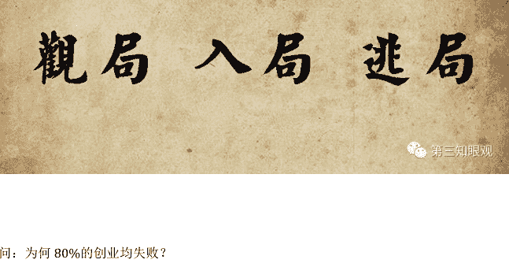

问：为何 80%的创业均失败？

三眼：因为对于绝大多数人来说，所述创业，只是贪婪欲望刺激下的赌博，或是被逼无奈找出处。赌博大概率是输，被迫上路亦走不远！

问：但主流意识认为没有失败哪有成功，人就要多折腾，虽然输但折腾多了是不是就可以赢？

三眼：什么叫折腾？折腾是你看好一个领域，把握好一条线，反复的试错，成功的本质是“不走去错误的道路”，本身是个概率问题。

如果一个人要折腾，起码要明白什么叫工作、事业和创富。

问：那什么叫工作、创富和事业？

这三者完全不一样！

工作作为为了维持基本生存持续性付出，付出包括体能、精力、经验、人情这四大块；

创富是为了赚取更多的钱，造富不是为了生存而付出，而是想通过一定的套路，在社会财富分配链条上，尽可能的获取更多；

工作与造富的本质思维完全不一样，一个是守，一个是攻！

而事业是不计算回报，为了满足个人人生的目标信仰，满足自我的成就感和获取存在感。

工作的本质是依附于一个规则，费体力精力但不费心力！

创富的本质是认知，费的是智力，认知到了，财富自然来，提升认知是一个很有意思的过程！

所以工作干得好的人，与创富玩得好的人，说不到一起去，一个玩身体一个玩脑子！

事业的本质是使命感。

一般人的迷茫和困惑，都是因为把这三样混合在一起！

人的痛苦与迷惑都是自己造成的！

多数人为何平庸？因为胃口太大，什么都想要，不知舍得，什么都想得到什么都得不到！

因为都想得到等于“根本不知道想得到什么”！

这源于认知，因为庸人的认知和动物差不多，只有所求，而不知把所求分类。

问：那创业属于哪个？

三眼：创业属于事业，创造事业。

创业也分真创业和假创业。

真创业，是把一件事情当成使命来做，钱只是顺带的产品。

“业”是什么，是佛家用语，是指事物演进背后的推动力。

真创业，就是能看到在这个社会上，**某一条真实存在正在演进中的推动力，或者说叫确定性趋势**，而自将顺应这种推动力，把达到一个目标作为使命，而不断运作。至于财富，只是一个顺带的产品，因为掌握住了推动力，必然会吸引资本财富聚集。

为何很多上市公司一直巨亏，还能赚那么多钱，就是这个道理，因为它掌握了某种推动力，把握住了某种确定性趋势。

而假创业：

一种是因为欲望贫痞而赌博，说白了就是投机，想快速致富而已。

投机是世界上最难的东西，因为投机与投资都是个概率学问题，投入的是风险，得到的是回报。

投资是尽量降低风险，这就要“不去走错误的道路”；而投机，是直接在千万条路当中，直接选中那条正确的路，这种概率微乎其微。

韭菜都是投机分子，假创业的结果多沦为韭菜！

第二种假创业就是被逼无奈找出路，这没什么好说的，人只有好逸恶劳，没有找不到出路一说！

## 把国央企和民营当成人、民营就是韭菜，因为它在反复躺博和被逼无奈了打转！

缩小至个体，你还认为韭菜少吗？满地都是！

问：建议人创业吗？

三眼：不建议，能准备好的人少之又少。

99%都是假创业，1%是真创业就不错了。

投机分子不会用脑子思考，只会用欲望和屁股思考，只看到创业成功者的暴富，以此来认定成功者的“投机”，看不见在这种“投机”的背后，是无数对错误路线反复试错的投资，以及持续不断的付出，体力、精力、经验、人情这四块的付出只是个基础，更大的付出是心力的付出！

## 体力与精力可以借助他人，这是管理学问题，经验可以积累，这是认知学问题，人情可以运作，这是社会学问题，而最核心的心力，只能靠自身，这是一半人所不具备的。

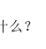

问：那您说的准备好，是指准备好什么？

三眼：要准备的很多，而且很多东西是准备不了的，不是人人皆可，整体来说要准备两大块！

## 【首先就是准备的，就是明“局”！】

提前准备，这叫观局。
准备好了，就去入局。
形势尽了，这叫逃局。

## 【观局】

局就是梳理、脉络，再加上趋势，也就是梳理脉络的动态变化，这就叫局势！

三眼讲的政治分配是观局的核心。

从政治分配内核心向外延展，才能把很多分析工具都用得上，比如对一个行业来说，竞争格局、行业集中度、价值链条、关键环节与资源等这些东西才能用得上，这些工具都属于支脉，需要插在政治分配的核心上，才能反映出真实的状态。

这就好比项目启动，派出一个调研员去调研“局”，选一个没有政治分配认知，但工具理论十足的营销博士去调研，写出几十万字的报告，那是万万不能信的，因为它反映不了“局”的真实状况。

因为竞争是不公平的，相反一定是建立在不公平的基础上。

弱肉强食，政治分配，这才是每一个“局”的核心所在。

差别只是不公平的“度”——这就是所谓营商环境。

上到国家资源性行业，度就很强，下到一条街上开个小饭馆，度就很弱。（往前数个二十年，最底层营商环境也需要弱肉强食，菜霸、路霸、等都很常见。）

而经济活力和经济效率取决于这个“度”，但是对于政治分配的稳定性，取决于怎么加强这个度。

没有好坏，发达国家在市场经济效率上很高，这就是营商环境那个“度”比较好，但是发达国家在整体协同效力上很弱势，比如这次疫情，不到一个月就要建成火神山医院，对于武汉这样一个相当于欧洲一个国家的体量来说，整体协调起来显得毫不费力。

继续说局势，纹理脉络的动态变化就是“势”，合起来叫局势！

比如中小微企业贷款，对民企的行业开放，对某些行业的重点扶持等，这都是在做“势”。

总结就是：围绕着政治分配和各种理论工具去观局，并感受各种政策以及政策落地后的具体反映的“势”。

## 【入局】

入局就是观局明朗了，开始盘点自身。

也就是自身资源与目标局势所需资源的契合度。

这里要说的一点是，在现如今这样一个商业化饱和和无死角的时代，入局这事已经不是凭一己之力可以完成了的，合伙人制度在未来会成为一个常态！

除了很少一部分可以独立输出能量的自由职业外，比如知识与经验输出、专业性极强的个体劳动输出等，都要以合伙的方式才行。

## 入局讲求的是切入点和切入时机。

这在中国国学智慧里叫做“机点”，古语写为“几点”，意思是门与框的可转动的连接处，把握转动的内核，自然能开门关门。

切入点是什么？

就是在政治分配链条上，从哪个环节切入；

切入时机是什么？

就是观察每个环节的周期。

马云拍那个《功守道》很多人看个乐呵，关注在武术这个肤浅层面，读完三眼说的局你就会明白，观局入局就是攻，逃局就是守，而整个合起来在于一个字“道”！

马云之道是什么？他当年是怎么攻的？现在是怎么守的？对于新的局势他是不是又有新的“攻”了？做到什么时候又要开始守呢？

## 【第二要准备的是心力！】

要成多大件，就要有多大心力！

心力是什么？

是人的心可以承受住多大的压力，就可包容多大的事物。

这就像肉体在举重，心力就是能举起多重的东西，要有耐力一直举着，而且要稳！

人在肉体举重上会产生生理的疼痛，一般人受不了；

而心力的举重，要比生理更痛，一般人更受不了。

吃点苦、受点累都受不了的，干好工作都是个问题，更别说创业了。

为什么很多成功者都有着充满苦难甚至悲惨的早年？因为只有这些才能锻造一个人的心力！

心力不是天生的，也是需要训练的，和生理健身锻炼肌肉道理一样！

为何很多富二代都是“败家子”？

还是因为心力！

人能够镇住多少财，镇住多大权，是要靠心力来掌控的。

多数人连自身都掌控不了，如何掌控他人与事物呢？

再举一个每个人都可以明白的事例，就是同伴之间谁强谁弱的问题！

为什么人和人在一起，一个要惧怕另外一个？
这是因为心力在角力。

## 角力是社会常态，决斗是莽汉行为。

韩信是个强人为何还要钻过流氓的裤裆？

因为人要别人尊重你、怕你，不是把对方直接置于死地，那是低等动物、莽汉行径，而是要通过心智和心力，通过不断角力把对方压制住，这才致胜之道！

国与国之间也是如此，心力的角力就是政治掣肘，这也是外交至关重要的原理。
如果都抬家底直接分生死，会有古时三国的群雄争霸之戏吗？

所以一个人在干事之前，在思考是否创业之前，分析下自己心力大小，而不是靠头脑发热和欲望激情去赌博。

## 你们最想要的东西：认知内核——打造个人思想系统的第一步

2 月 1 日

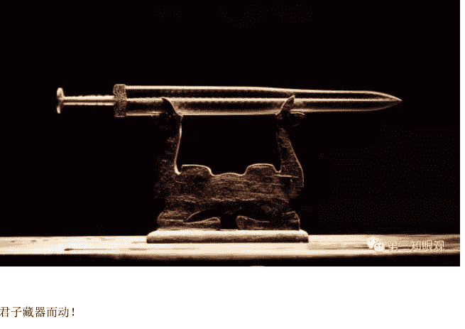

君子藏器而动！

许多私信让我推荐书籍，我不知道怎么回答！

因为敷衍的回答就是推荐几本“上档次”的书目，得到一句“非常感谢”，实际上什么用都没有；

如果要深度的回答，三眼所学有限，而且对于每一个提问者，都将是一部长篇大论，每个人想要的东西都不一样，每个人起点也都不一样，想学什么、为什么学、某某书讲的是

什么系统、对于你想学的有什么帮助，还需要哪些书籍配合建立整体系统等等....都回答完估计我就阵亡了。

## 【人人渴望武功秘籍】

其实反复寻求推荐书籍的背后，提问者是想获得一个东西，一个能一直抓着、一直受用，就像获得一本武功秘籍一样。

所谓“武功秘籍”是什么？就是一个人认知的内核！

这就是你们最想要的东西，有了一个内核，那么在生活中所闻所见皆可以“揽”到内核上。

与人辩论，首先要把对方拉到自己的体系里，你才能胜利，这个体系的核心，就是所谓内核！

有了内核，无论具体做什么，在思想里都有了一个阵地，有了一把利器。

## 【知识的公平】

这个世界，知识是最公平的，而我们所学的任何知识，都是前人留下来的。

知识的载体是文字，文字是没有版权的，是整个人类，随意用，很公平。

说这些要表达什么？

表达的是：谁也不要认为自己多了不起，因为我们任何的思考，任何的理论，任何的认知，都已经存在了，就摆在那里，唯一所能做的，就是要谦虚务实。

## 【知识的不公平】

但知识又是克制的， 因此产生了人与人之间巨大差别。

一个人脑子中的认知层次，才是考量人与人孰高孰低的最根本逻辑！

知识的不公平表现在三点：

### 1、真正的知识，都是被藏起来的，或者是“暗自交流”的；

三眼在《养殖》一文里说过，世界是个养殖场，上层养殖下层，而养殖方法从奴隶制一直发展至今，变得更为精密复杂，也就是“认知殖民”，而认知殖民就是一招，就是认知隔离。

人和人之间，为何你玩不过对方？

就是因为认知差异，你去幼儿园可以把小盆友们玩得团团转，但去某一政治组织，大概率是被玩。

不要和我拍桌子说为什么你认知够但缺资源，资源无此重要之类的话。

只要认知真的够强了，即可把控利益交换，即可逐步积累资源，即可逆袭，人出来混就是这么一点点壮大起来的。

三眼一直说：认知就是接近真相的距离。

无论小群体大群体，小组织大组织，只有越接近真相，越有所谓顶层思维，才能真强大！

被藏起来说的是啥？

秦始皇为何焚书？为何历朝历代都有文字狱？这就是认知的区隔！

书同文车同轨、同文不是统一文字这么肤浅的，而是要统一思想。

如果从小给一个人讲述的都是如何成为杀手，那么这个人注定成为杀手，对于什么经济社会文化之类的，根本就不知道。

为何士农工商这么划分层级？商为何一直被压制在最底层？

是因为从商者想做大，自然而然的就要去思考整个社会，思想自然就越来越接近最高处！官商是不分家的，商做得好自然可以做官。因为大家做的都是一件事、一个目的，就是把底层的价值逐步集中到上面来，统一管控和分配。

把底层的价值逐步集中到上面来，统一管控和分配。

暗自交流说的是啥？

就是这个世界，交流语言其实有很多套系统，虽然都使用的是汉字是一种文字，但是用法是不一样的。

一是文字在逐步的“扩容”，越来越多；

老子写道德经的时候，文字量很少，那时的交流系统和今天完全不一样，所以需要翻译，而翻译的人系统也不一样，所以自然众说纷纭。

而今天虽然文字量很多，而且还不断的造词、造新词，但很混乱，交流系统非常杂乱，比如小到95后的火星文，大到大组织政策报告。

## 为什么一般人很难看明白政府报告？

虽然使用也都是 3000 常用汉字，但如果真如字面意思去理解，那绝对是看不懂的。因为那是一套晦涩交流的系统，你首先就不了 解这个系统是个啥，更不了解每一个词的用意。

今天的人们其实很孤独，因为世界看似很大，但每个人都活在一个很小的世界里。

## 2、被灌水的混乱的信息流动

首先要感谢互联网，这是人类发展几百万年，能开启民智的最大工具。

但真的能开启吗？

可以，但没有想象当中的强度那么大！

为何？

因为你所能看到的信息，几乎都是被“灌水”后故意扔出来的，随便看。

而且越看越糊涂，越看人的认知越往下走。

首先是因为现在的信息流被阉割！

比如三眼写10篇至少三四篇发不出去，对于三眼来说，写文字的难点不在于思考和表达，而在于怎么表达既能发出来又能讲明白一些东西，这就很难了！

一些词汇要用拼音代替，因为人的思想构成是一个动态体，而动态的关键点就是一个个关键词，只要把关键词控制住了，动态体基本就很难动起来。

再次是多数的文章都是没有系统的！

现在打开手机，随便点开一个资讯类软件，只看标题，不停翻滚，你会发现几乎90%的文章都是在描述精彩，而不是在讲透彻。

这些文章作者分两类：

- 一是有逻辑，但故意写情节，因为利益！比如那个什么咪蒙，本心情商智商不错，但写东西专门挑拨无知青年的情绪，而获得巨大收益！
- 二是大部分作者根本就没有体系，在别人那里听见什么，就拿过来写，根本不经过大脑，或者说根本没有大脑。稍用点功夫的，还知道改写，但更大一群人直接就是抄。
- 三眼一些文章，满眼乱飞，不停的掠“原创作者”，抄袭时候估计都没有细看。

对于垃圾信息，越去认真读，就越会产生认知偏差和混乱，带来的只能是情绪波动和焦躁不安。

所以三眼告诉诸位的招数，就是少读且深度。

## 认知提升，首先要开始扔东西！越简才是越有用的。

以前比如民国是没有互联网的，弄到一本书读是很不容易的事情，一本书就会反复读，深读，造了很多大师出来，当然环境也是一方面 那个另论。

而现在是漫天信息水信息乱飞，比如学经济、或者学习营商，起码有几千个“系统”在乱飞，有的是忽悠，有的是假大空，就算是真东西也被混乱的信息流给淹没了。比如创业培训，讲成功欲望讲理想讲传奇例子会占到内容80%，剩下几乎都是假大空，真逻辑很稀有！

普通人根本没有能力，去理清这个混乱的流动，不停的在各种“情绪制造”上被洗脑。

## 3、基于个体的教育

这也是本篇最核心！

## 教育的核是认知教育，而咱们的教育是“术”的教育和情绪教育。

什么意思呢？

认知教育，就是看待这个世界的方法——你看世界是什么样子，世界就是什么样子。

很模糊吧，具体解释一下！

## 任何认知系统、思想系统，都会回归到一个本源认识上，也就是认知内核。

也就是所谓武功秘籍心法！

儒家归到“仁义”，围绕此内核，演化出具体的行为和语言规范，也就是礼智信等等；

法家归到“奖惩和权力势”，围绕此内核，演化出具体的治国之法；

纵横家归到“搏诈”，也就是人与人之间互相忽悠的权术，搏诈就是一呼一吸，围绕此内核，演化出具体的合纵连横忽悠套路！

这是每一套认知系统、思想系统，每一个学科存在的最底层、最内核的逻辑。

再比如西方，不同的经济学学把这一学科的底层逻辑分别建立在劳动价值、生产力、土地等等上面！

如果失去这些底层的逻辑，那么整套认知系统将不复存在！

而我们的教育是从来不教给底层逻辑的，只是在教各种“术”，学校时候背课文，到了社会所重视的都是各种具体的技术工种，再在情绪上教给“4有”，用脑子仔细思考一下，“4有”是不只是情绪？丝毫没有任何底层逻辑？

这样的教育时间久了，都变成工具了，人生的重要存在感就会放到如何干好技术赚钱饭碗，因为这是无认知的必然结果，跟动物思维是一个层次的：

活着就是要看家，看好家自然得骨头，看谁得的骨头多，我比你多我骄傲！当然骨头不能多给，给多了管够就会开始思考为何要看家，开始求“道”了！

## 所以人和人的区别在哪？在于认知！

## 认知的差别在哪？在于有无底层逻辑！

知识分成“知”与“识”，知就是底层逻辑，是认知内核，是武功心法；识就是一切的外界信息，通过底层逻辑把这些信息“有的放矢”，这样就形成一个人的知识结构！

那么底层逻辑怎么建立？

## 【哲学的起源与认知的起点】

对一个人而言，如果他看见的万事万物不是幻影或幻象，那么他就不会拥有哲学才能！

哲学的起源建立在一个思维上：你所见到的事物皆为假象！

东方是没有哲学的，或者说东方哲学起点只有一人，就是老子。

如果把诸子百家划分门类，就两大类，道家和其他家。

我们2000多年来，整个社会都以“眼见为实”为基础。

自然科学的发展为何没有我们的份？

从秦帝国开始这就成为必然！

因为自其开始，法家治术一直连续下来。

所要达到的目的，就是让人活在表象中和具体事务上，而不允许去研究幻象背后，从而阉割了思考力。这也是为什么诸子百家唯有法家才真正活到今天！

而科学的发展基础，就是建立在“一切都是幻象”的基础上，追求真理的过程顺带产生了各种自然学科。

## 对于一个人来说，关上哲学的大门等于关闭思想！

所以再读到让清朝为科技落后揽屎的文章，可以不用看了！

而2000多年来，有思考力的人，惹的只能通过一个领域来释放思想，那就是心学——专业研究人精神的虚幻。

三眼讲哲学起源于啥？因为一个人认知的起点和哲学的起源一样。

这并没有什么高深！

如果一个人每天所见到的东西，都眼见为实信以为真，那想必一生都会窝在那里。

## 【已习惯于所存在的事物】

人千万别“成熟”，成熟了基本就不会进步了！

要保持一颗孩子的心态——对万事万物充满惊异！

## 人与人的观察力的强弱一是在于认知系统，二就是在于对于一个普通的事物，有没有惊异的感觉！

你带着孩子看到街上有人骑自行车，你会觉得很普通，但孩子见到会很惊异。

没有惊异感，人根本不会去真正的观察和思考。

诸位，有谁还会见到一个极其普通的事物，还会觉得特别新奇呢？

互联网居然可以打字聊天，居然可以通过文字去影响一个远在千里之外的人！

惊奇吗？

花纸币的越来越少，钱都快变成数字了！

惊奇吗？

几亿人在960万平方公里上不停流动，比几百万人人类在全世界的流动体量都要大！

惊奇吗？

说了，就觉得惊奇，不说就习惯成为普通，再深度去说，就会更惊奇！

惊奇不是把它放在那里，就像看看美国人火星实拍图片一样，唯一一声就结束了。

而是要把惊奇与自身的存在联系起来！

这是孩子最美好的天性，也是成年人需要保持的珍贵东西，

当人逐渐变老，有一天达到所谓“成熟”，基本是你对这个世界的认知也就定型了，外界很难改变你，你也不想改变自己。

再插一个有关成熟的例子：

假设你今年30岁，回家跟母亲说你的理想是能够上火星，看你母亲抽不抽你，骂你不成熟！

但在西方，你这么说，母亲会觉得你很有理想！

这就是东西文化差异所在：

东方通过社会生活，把一个个人打造得一模一样，社会就是个模具；

西方思想是寻求差异和真真，这建立在“一切皆为幻象”上。

## 【真正的共识心态调整】

所以看三眼的东西，才是真正的心态调整。

因为心态不是发自周围环境，而是发自于自心。

多数人所理解的调整心态，无外乎是受到外界的压力、刺激的影响，再去寻求外界的信息与帮助，来达到心理情绪感受上的平衡。

比如最典型的：女人因为比赛容貌败了，心态很不好，那就要求寻求外界帮助，比如让闺蜜用一个没有逻辑的逻辑来奉承自己，从而获得情绪上的平衡！

好傻逼！

弱者最喜欢把自己裹挟在情绪里！

三眼说调整心态，是通过打通认知，建立底层逻辑、认知内核。

人“开”了，自然心态极好：

人开了，不相信眼前的东西，认为一切都是幻象；
人开了，去寻求各种认知系统，建立自身的底层逻辑，从而有了“心法”；
人开了，对各种普通事物充满惊奇感。

做到这样心态还会不稳吗？

## 【人与人为何难以沟通】

三眼再嚼嚼几句！

多数人是无法对话的，因为人都在不同的“认知系统”里。

不光底层逻辑不一样，甚至绝大多数人根本就没有底层逻辑。

比如女人很难有底层逻辑，所以女人最好忽悠，钱最容易赚。因为你随便便包装一个逻辑都可成为其底层逻辑，忽然一次被识破了，那就再换一套！

为何敌人是最了解你的人，因为大家都站在一同一系统层，这才会利益竞争嘛！

现时社会，很多行业不是被同行干倒的，而是跨行业干倒的，就是这个道理。

因为你没有惊异感了，已经感受不到系统的演化更新了，站在同一系统层的敌人出现，你也会不知所以然。

## 【认知地图】

认知地图，也就是在社会上形形色色的人，会划分成多少块，每一块的认知系统是什么样子的。

就好比男的追女的，首先你要明白女性这一系统大体是什么样的，有着什么样的属性，这样才能去破解系统。

有了认知地图，在遇到不同的人的时候，几句话即可明白对方属于哪块，拥有哪种特性，怎么去对待。

有没有底层逻辑？

有没有是什么样子的？

对方这种底层逻辑，核心点在哪，他会相信什么，不相信什么，这种逻辑的强硬之处在哪？弱点漏洞在哪？

如果遇到某事，拥有这种底层逻辑的人，会表现出什么样的行为，怎么预测？

其实可以在不同角度，划分成很多类的。

随便宜举个划分例子：

比如站在“是否想得到认知”这个角度上，可以把人划分四大类。

### 1、叫不醒睡不着的散人

这就是前面讲的所谓已经“成熟”人，没有底层逻辑，从小被教育“术”和“四有”情绪，上了这条路太久了，已经停不下来产生极端惯性，结果就是：

叫不醒——你跟他们无话讲什么，他们都会形而上到“知道了有啥用啊，人生不就那么回事吗”这一答案上来。

睡不着——你以为他们真的那么坦然吗？那么想得开吗？错了！他们是睡不着的，因为“知道了有啥用啊，人生不就那么回事吗”这句标准回答，只能得到暂时的心理平衡，这是一种苟且安慰自己的表现，当回到现实生活，遇到各种欲望刺激和困难坎坷之时，会难受的睡不着！

这种既叫不醒又睡不着的状态，就是鲁迅先生笔下“麻木的人”！

### 2、文化流氓

文化流氓就是那群很不谦虚，自以为很懂的人。

是先生笔下“拿来主义”的那群人。

大多都没有一块半块的底层逻辑，拼命在各种认知系统里打转。

没有坚实的底层逻辑，还自命清高，以至于这群人是最有利用途价值的群体。参见过往的各种学生运动。

一群手无缚鸡之力，文不能有章，武不能有法，但心高气傲“追求真理”。

打着文化的旗子流行氓之事。

往前就是各种运动，现在就是各种喷子！

其特点就是带有强烈的滥觞色彩，有一种舍我其谁的气概！

——书读的越多，认知越乱越低级。自己都不知道什么到底是真的。

这群人是公知的寄生对象！

要顺着您悠，说个葫芦当个瓢，并且深入金匮信以为真。讲真的会喷死你。

今天讲民主，那么文化流氓就跟风，具体是个啥也一知半解，

明天叫货币战，文化流氓就跟进去，货币战就是最真实的，别的都是假的。

为什么会这样？

因为文化流氓其实是求知欲很强的一群人，但没有底层逻辑，或者底层逻辑是混乱的，性格还要强，那么产生的自然结果就是：

所有逻辑都是带着情绪的，这就不叫逻辑，只能叫臆断；

自己没逻辑，但会不断拿别人的东西来嘲你！

逻辑说不通，就会人身攻击。

以上两种人是绝对无法沟通的！

### 3、嗷嗷待哺

不用多解释，就是在知识不公平的环境下，为了寻求出路而想要打造认知系统的踏实进取的人。

### 4、学派

学派是带着底层逻辑的。

- 上到国家，叫意识；
中到各种知识群体，叫学派；
下到个体生活，叫原则。

学派之间会竞争，会辩论，会打架，但无分对错！

受用不 reuse，看个体的运用。

就好比没有最牛的武功，只有最牛的战士。

## 【欲望切入点】

读书学知识，以用为本。

如果不用，再学也学不到真东西。

一本三国演义，老百姓看了根本没啥用，或者说用处是茶余饭后吹牛，出租车司机喝大碗茶论国家大事就是这个意思。

满人当年入关，三国演义是秘不外传的，被满人当做治国理政开疆拓土的法宝，为啥“毁东西书籍”到了满人手里那么受用，因为满人真的在用啊！

所以讲了这么多，要问认知的底层逻辑具体怎么建，首先要搞清你的欲望是什么，你到底想干嘛！也就是说认知体系建立的切入点。

你的欲望是什么？

获得权位？

做事情的谋略？

做事情的技巧？

获得更多财富？

内心的平静？

或者仅仅是刚步入社会到底怎么选择？

政治经济社会自我人性五大认知，底层逻辑都是不一样的，但又有着连带。

比如经济，特色经济主要底层逻辑是法家+经济西学，在这种特色下，钱往哪流动，怎么流，各环节如何分配的，个体在哪儿跟轨走...

比如社会，人的流动，流动产生位置，位置享受分配，获取位置需要通过利益的往来，位置排序什么样，哪里的位置优越，开门上位的机会在哪...

比如政治，每一次决策，每一个政策，10分好处，5分为谁，3分为谁，2分为谁，成全了谁，削弱了谁...

比如自我，人到底要什么，自身的优势和漏洞在哪，适合什么，所处阶段性，达到平静祥和幸福所需的状态是什么....

想必一个个体所需，也就这些了吧。

其实如果能以这样的结构，去展开认知，已经发生质变了！

剩下的就是填充每一小块的底层逻辑，而每一小块的底层逻辑又有着一个大的根本逻辑牵引。

最后告诉诸位的就是，最大 的认知内核是：道家无为观+法家权威势！

一个是虚的层面，一个是现实生活的层面。

政治分配、经济上线的流动、社会上人的流动，以法家的体系即可看明白。

2000 多年没变过！

为何？

有什么样的群众，就有什么样的领导，这就叫“水载舟”。

深入骨髓的所谓文化习惯、民族性格才是社会存在最真实的状态。

换成外星人来当领导，局面是一样的。

为何美帝能搞出个自由民主？

因为它根本就没有历史，更没文化。

文化这东西不是懂得多少天文地理知识就叫文化，那叫学术，文化是纹化，是一个社会演进的纹理。

所以最好的老师是历史。

认知是一把利器，君子藏器而动！

## 经济第一讲：你所见到的经济学几乎都没用！老百姓明白“经济是水”最简单实用！

2 月 2 日

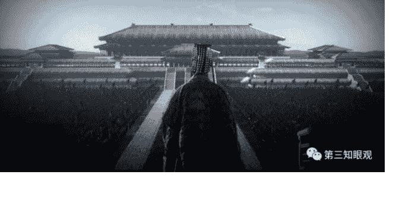

你所见到的经济学几乎都没用！

是不是觉得明白点经济学，在这个商业社会就像明白到了赚钱秘术？

这个曲线、那个模型、那个数据列的，老百姓看了一头雾水，觉得其高深莫测，武功天书！

三眼实话告诉你，你所见到的经济学，除了有一些基础性逻辑有点实用性之外，剩下的百千理论毫无用处。

学校里暗经济学，读了几年大学出来，有几个懂经济的？
哪个成功大企业家是经济学家师？
再有，请位常见到的经济学家们，多半是没钱的！因为多数是点评家，并不是实用家，看个热闹即可！

当然，三晖并非是说，以财富获取多少来论英雄，更不能以此来判断一门学科有用没用，而是告诉诸位，大家经常见到的所谓经济学家和各种术语，大多是假大空。

普通个体所需要的是打破知识的不公平、信息的不对称，所需要的是小学毕业会认字就能读懂的，又能对实际生活产生帮助的经济观念。

## 【首先要有一个根本认识：经济是政治的延伸】

经济是干嘛的？

经济是政治的延伸，没有政治哪来经济？

经济目的是啥？

别跟我说什么经济学目的是让全社会最大化效益等等，那都是晦扯淡，浓厚的理想主义，是经济学家们自己给自己竖的大棋，实践天王索罗斯骂经济学是伪科学！

经济就是给政治服务的！
一种是国富兵强，一种是民富国泰。

中国几个朝代经济建设都是世界 no.1，汉唐都是遥遥领先全世界，宋朝更神奇，能达到世界 gdp 的一半！半死不拉活时期的清朝，gdp 也是世界前茅！

那时候大家懂经济吗？

那个时期，这个斯那个思想的祖宗，吃饱饭都成问题呢！

为何今天黄皮肤把这些白皮人当成神一样供着？

并不时白皮思维多么优越，基因和智商就高等级，当然，一些巨匠求真求实，客观解析世界的精神和智慧，需要我们膜拜，知识是不分种族和国界的。

但这并不是“被供着”的原因，原因只有一个，就是武力！

文化这个东西本来是很中庸的，并无强弱之分，决定权在于武力！

武力强大决定文化强大，文化强大就会精神压制！

唐代万国来朝，文化输出到整个东亚圈，就是这个理！

文化输出包含什么？

价值观、神话故事、器物载体、礼仪规范、语言。

想一想是不是？

这个世界谁强大，跟着的小弟们，都会慢慢的丢弃自己的历史和习惯，把强者的价值观念供起来，并在神话故事、礼仪、语言上逐渐一模仿。

看看今天有多少孩子明白自己的历史？有多少孩子了解西方神话？甚至是没有文化的老美硬造出来的神话？各种联盟各种神！

再看看各种节日、服饰、饮食等。

文化输出就是精神压制，比如时尚界的一直是人家领先，因为时尚这个东西就是人家造出来的！属于人家的文化内核！

100 块钱牛皮弄几个标，做成奇奇怪怪的形状，就卖几万，这收的可不光是智商税，这是文化税！

强武，就会形成一条条“分配链”插到弱武的地方，分配链的顶端在人家手里，通过一个个链条，不断吸收利益价值。

思维不散发，继续说经济！

有人的地方就有江湖，因为人性！

有人群的地方，也就是社会，就会有等级结构，就会有政治，有政治，就会有管理和搞经济的方法。

不要在插秧经济时候那些具体术语，三眼在“悟”的文章里说过，这个世界有无数个认知系统，对于搞经济也一样，东西方加起来会有上百个系统，系统间底层逻辑是互通的，只是表达方法不同而已也就是说每个系统的交流语言不一样而已。

就好像佛家讲人性、儒家讲人性、道家讲人性，底线都是互通的——儒释道本为一家。

区别就在于，大家追求的目的不一样，儒家目的在于“入世观”，佛家在于“出世观”，而道家在于哲学生养“无为无我”。

经济学呢？

区别也在在于大家目的不一样的！

目的来自于哪？来自于政治！

所以离开政治去谈经济，舍本逐末，不会得其法！

## 【形而上与形而下】

无论何种知识，都可以向两极研究！

难易程度：形而上<形而下<贯通

大白话解释一下！

就是诸位观察身边的若干人，会分成两大块。

有的你跟他探讨，他会不断的把探讨形而上，常见于喝酒吹牛互相摁臭脚，这种东西很没有价值，比如探讨人生的过程，他们会形而上到“人活着都会死去，人生就是吵吵回事”。

把 n 个过程一下子都简化掉，得出一个最上上层的大道理！

大道理没啥用，除了带来消极！

形而下就是太接地气了，太追求具体实用性了，这也不行，因为没有规律规则的参照不会长久，因为没有体系！

贯通是最难的，也就是思维高屋建瓴，抓本质，也就是三眼说的认知系统的底层逻辑，而后又能以底层逻辑去逐步向下渗透，运用到实际生活中来。

说这个想表达什么？

想说的是现在的很多经济学，都是形而上，都是自说自话，在那里画圈，所以是空架子！

形而上画圈圈的东西，可以随便说，正说也行反说也行！

比如房价是涨是跌？

来 100 个经济学家，50 个可以每人出个报告，告诉你绝对暴跌！剩下那 50 个告诉你暴涨。

都有道理，因为都是按照他们自说自画的圈圈。

他们要做的是，就是先把你拉到他们的“圈圈”里，也就是认知系统里，然后说服你！

在他们的圈圈里，他们肯定对，但是跳出来看，他们的圈圈本身是对的吗？

## 【判断对错要依附于最大规则】

三眼说，他们的圈圈可能对也可能不对，怎么判断呢？

要看是否契合最大组织的规则！

许多白皮经济专家的理论，为何到了 960 万平方公里上为何水土不服？

因为不契合大规则！

城乡户籍一刀切、一家一个该坚持 50 年计划、产权地上地下分开算，买房子要先国资格，买了房子不准卖，等等，在哪一本经济巨著上写过啊？

这严重不符合西方经济学思想体系啊！

白皮大师谁来都发懵！

作为本土创食百姓，怎么办？怎么契合？怎么打通通知？从哪找方法？
从历史！

你是继承了你爹妈的基因，思想上永远甩不掉原生家庭的思维烙印。
15 亿个你就是继承了祖先的基因，思想上永远甩不掉历史的烙印！
历史就是现在，现在将成为历史！

再多说一个知识点：

语言就是思想的最大最基础载体，当你哪里说汉语，键盘上敲打汉字，本土思想就深入骨髓，融入血液了！

因为语言就是一个个逻辑关键词，拼在一起就是一套完成思维逻辑体。

现在所用的词汇，不是诸子百家造的，就是历朝历代各种时期造的，当然，外来宗教佛教用语也融入了语言，除了标点符号和一些名词外，多半的动词和形容词都是有历史逻辑的。

比如一个人很愤恨的说“造孽啊”！

孽是业报？所有人脑子都会有个固定认知，大家“不谋而合”，不然无法沟通，只要你说这个字，这个认知就进入你大脑和血液，而西方文化里，是没有孽这个东西的，你跟一个白皮说造孽，白皮又是一脸发懵！

如果白皮们都明白啥叫孽，证明那时候我们已经解放全球了！

## 【经济就是水】

前面讲的东西，是辩证思考的过程，没有那个过程，大脑不会有个路径去求结果，下面说结果，这是本文内核！

从历史才能找到解读今日经济之法。

在我们的传统文化里，经济就是水，其法沿用至今！

应该是从西汉开始吧，三眼记不得了，五行理论大概也是那时候启动的，五行不是什么算卦算命的东西，五行是一种管理概念。

而经济就是五行中的水！这是治国理政的一个要素！

钱就像水一样，作为交换载体在社会的各个脉络里流动，这里有三个核心点：

### 1、水量。

就是根据社会需要，发多少钱。

这个所谓需要不光是今日所说的生产总值，而是够不够刺激经济。

超发就是这么来的，要远远超过生产总值交换需要！

刺激经济到底是啥？

这就复杂了！这里简单说一下！

整个大集体不是一个个体，大组织也不是一个人，所谓刺激活力，在于既要全盘子发展，又要保证各阶层都洒到了，维持一个基本形态；但集体是多方利益共同体，有的资格老，有的实力强，底下还一堆创食拄孔的，利益共同体是多方角力的。

不要以个人的主观去思考何超发大水，这是庞大集体博弈造成的，不是一句两句可以说得清的！

### 2、流动分配。

每次放水有了一定的量，往下流动经过层层环节，每个环节会拿到当量不同的水。

拿得多，自然就富裕，拿得少，自然就穷困。

越接近水流的发端，肯定分配的多嘛！

而是否接近，距离的远近，这就是位置。

有什么样的位置，自然分配到多少水。

而水流到每一个环节，在此环节也会展开分配，这就是环节里的存量分配。

很多人所谓创业，其实在这里，也就是在一个小圈子小环节里，把别人的水吸过来，在同一圈层相对比他人富有。

这也就是穷忙的根源，很多人自以为在往死里干就能赚的多，这是不对的，站在最低分配环节，你累吐血也最多是吸了同圈层穷人的水，那能有多少呢？

所以唱叫逆袭，就是跨越阶层，往上去距离水流的顶端越来越近。

不明白这个道理，努力一辈子也穿越不了阶层，就算是穿越了，也是运气！

但其实起码一半的人穿越还真就是靠运气！我们有脑子，不能坐家里等运气普照吧？

### 3、浓度。

水放多了，浓度自然被稀释，钱就不值钱，不断的刺激，钱就越来越不值钱。

个体总是想通过思考预判流动趋势，仿佛谁也看不见，只有他悟出来了，从而走上人生巅峰！这，是不可能的！

趋势转换只能产生漏洞，漏洞对于大组织大规则就是小打小闹，但对于个体来说，可能是 一生转折点。

钱的堆积，水的堆积，就推高资产价格。

所谓投资就是互相配，看谁玩的过谁，大家把钱投个领域往堆堆，通过买卖来获得更多的水！

投资就要跟住水的流动，站在趋势最前面肯定是最好的，因为刚刚有堆积的趋势，跑路肯定是预判断不久后水会往外流。

小到某一行业某一紧俏商品；中到各种庄家局，字画黄金属股票债券；大到最大组织坐庄的支柱产业，都遵循浓度规律！

为何三眼说跟庄要跟最大的？

因为只有最大的庄，操作一个盘面的周期才最长，因为辐射的面太广了，完全有时间可以仔细琢磨，达到信息对称。而中型的庄你是玩不过的，因为你所能掌控的信息根本无法观察到具体的游戏规则。

### 4、价值流动。

最后一点，要明白，流下来的叫水、被换走的叫价值。

政治经济就是把价值从底层逐步集中到上层，统一管控和分配。

所以这辈子不要太在意水多水少，那不是根本。

30 年前搞一万水算一盆了，现在看一兜都算不上。

要看水背后的价值，人这辈子掺水没用的，掺 1000 万斤水，过个十几年二十年毛都不是！

要赞价值！

劳动价值。一是自家的劳动力，自身的劳动力，这个是首先要保持的，就是小家庭的劳动价值一直可以去社会上换东西。二是怎么转化他人价值，而转换他人价值的载体就是公司或者价值链，这是一部或几部赚钱机器，链条稳掌控得住，就能源源不断转移他人价值。

资产价值。前面讲的浓厚隔离出来的地方，载体就会一直变，

位置价值。就是在社会网络上占上一定位置，牢牢占住是法则！

很多人不明白什么叫人脉，以为认识几个人就是人脉，这是不对的。

比如现在很多私营企业做到一些管理位置，自以为有人脉，如果这个企业没了，他和倒食的普通白领蓝领一样的，可能因为年纪和心态原因还不如年轻小白：

为什么？

因为大多数人以为人脉是人情，你好我好大家好！错！

人脉是制约！也就是你在一个圈层、一个链条上，拥有“破坏”的本事！

也就是说，你有利用价值最多沦为工具，用完了这一坨，没人跟你讲温暧。而是要有破坏价值，那么整个链条都怕你，自然你就占上分配链了，牢牢占住！

这也就是在古代谋略中，掌管军事的要比管财政的，牛的多的多！

### 5、两桶水。

而到今天，经济也是水，只不过这是个全球化时代，水分成两桶。

一桶在外面，跟汇率挂钩，跟外面的各个组织玩；

一桶在里面，跟汇率毫无关系，跟外面更毫无关系！

100 万在县城买个 80 平两房，在外面某国发达海岸线上买一套大别墅。

这就是因为内外两桶水浓度是不一样的，各玩各的！

所以就会造成一个漏洞，也就是不一样的规则对钱的价值评估不一样，为啥一个个大 boss 想转移啊！一是因为浓度背后的利益驱使，另一个是因为在里面的水桶里要“掉队”，利用价值 over，别看比普通人牛，但对于大组织某个链条一点没有破坏价值，所以要收起来，大 boss 要被充公！

当然，这些与老百姓实际生活无关，知道即可，无需关心！

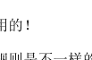

## 水的流动法则

说完了水流动的普通规律，还是不受用的！

因为规则是底层，每一次放水的流动规则是不一样的。

运动项目都是肢体运动，也就是那几个花样，但打篮球和踢足球规则是不同的，决定了运动竞技结果。

## 我们要关注的就是每一次的规则！

## 而规则取决于目的！

## 有什么样的目的，就会制定什么样的规则！

2000 多年来，就是围绕俩规则在玩。

儒和法！

法家的极为重视经济活动和话力，因为他的目的只有一个：富国强兵！这是物质上的强大；
儒家极为重视精神建设，因为他们的目的只有一个：实现“仁”的思想覆盖，达到合理（不一定要强大），这是思想上的建设。

当然，这是先秦之前，之后儒法合并，历朝历代都是物质与精神文明建设一同发展！
但对于普通老百姓来说，儒的那一套几乎是不接地气的，只看法家即可破局现今！

因为儒家与西学的很多观点不谋而合，也就是大组织需更关注“仁义之道”，而经济活动让下面自己去进行，也就是西学中“无形的手”自己发挥；
而法家一直以来的主张，是尽可能的将经济活动置于大组织完全掌控下，因为富国强兵核心目标的实现，一定要通过“集中”，通过经济学里“有形的手”。不断的在社会活动中提取资源，而且要深度干预不同生产部门的分配。这是法家基本特征，一定要记牢！
所以诸位就不会奇怪，为何国家队掌握着 80%资源和蛋糕，民营小分队一旦干大了就“转正”变身国家队。

分配贯彻经济运行规则，经济运行产生对应的社会结构，我们都裹挟在社会结构的层层里。
儒家法家之分，还在于富民与弱民。

规则转换这里此篇说不完，因为需要层层渗透，这里大体说一下的意思是。

## 个体的价值，首先要依附于集体，个体所得皆为集体所分配。

作为普通个体，格局跟不上，肯定会产生一个幻象：
就是钱是赚来的，努力即可大丰收！
而昨天文章里提到的“叫不醒睡不着”的人和文化流氓们，思想肯定是偏执的，会这么说：

“我明白这些有啥用，还是改变不了事实啊！”

这样思维的人已经救不了了！

因为啥？

因为 1、不动脑子，长个脑子是挂着玩的，根本不用，好逸恶劳等现成的，看三眼的东西基本想法就是直接来钱道子，最好是啥也不用思考，啥也不用学，1 万元轻松投出去变 100 万！

不说每个人的环境、性格、阶段、认知力、资源等不一样，而决定了每个人的路径不同；

就说有大师告诉你来个直白造富路子，你敢信吗？什么加盟、各种股神、各种培训、各种理财等等等等不坑死一大堆吗？

韭菜就是韭菜，不长脑子的！

因为 2、这些人“野心”很大的！

小钱看不起，大钱没智商转到，快速暴富是内心的呼声，这还是源自于好逸恶劳的本性。

说这些啥意思？

三眼是想说：

### 1、一个人这辈子能拥有多大财富和位置，基本是认知决定的，当然还有一部分运气成分。

认知配财富；

德行配位置；

心力配气魄。

认知到了，分多分少自己心里会 gar 数，想怎么分的多少，也有数。

这是三个一生都要不断打造的东西，只能踏踏实实，浮躁背后一定是好逸恶劳！

### 2、作为一个普通个体，结合前面讲的“水”的流动和规则，就会明白普通人能分到多少水，不是你一个小小个体说的算的，是大规则说的算的。

往前数 30、40 年，人和人差距有多大？这个村比那个村富多少？邻居、朋友、亲戚间能差距多少？

那时候水放的慢，放的少，自然流不到最下面，不可能层层都雨露均沾！

而这十几二十年呢？

大组织大规则开始“加强百姓财产性收入”、“让农民群体富裕起来”、“打造 5302 年 5 亿中产目标”等等。

能跟得上的，跑的快的，自然分的多。

只有大组织变换规则了，阶段性目标有倾斜性了，跟着跑的才有变富的机会、跑得快、肯定就能甩开同圈层一大段距离，跑的再快点，还可以跨越阶层占有更高分配链环节。

小汽车小洋房都是分配下来的，并不是一个小小的个体造出来的。

虽然说政治经济是把底层价值集中到上面统一管控分配，沿着链条造成分配不均等，但这是客观存在逻辑，跑到世界任何一个角落都是如此，跑到非洲也一样，那里还依然靠枪杆子分配呢。

如果把一个单独个体扔到无人区，你有什么价值？

所以把脑子中的幻象都扔掉，不要自我想当然。

认知是接近真相的距离，不扔掉幻象没法取得真相。

个体的价值，首先要依附于集体，而后洞悉集体规则，提升认知，平时系鞋带，风来了跑得快，这就是社会人生！

## 未来中产阶级是最大块肉！如何“吃掉”一个中产？

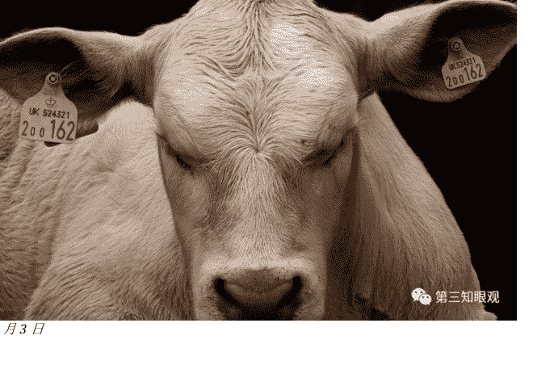

2月3日

> "和暖的阳光下，是不以个人意志为转移的冰冷运行。"
——三眼

15年之后怎么样？

大组织目标定了，到5302年要完成几个现代化目标：

人口主体三分之二是中产阶级，人均收入达2万美元以上，城镇化率80%，农业现代化，货币国际化。

站在创业群众的角度，中产阶级可是快大肉啊！

上到大组织、中到抢人抢地盘的各城市，下到创业的、搞项目的、投资的无不谈中产，5302 要把肉做这么大，大家都很开心，都很期盼。

但三眼说过，大家都谈的东西，往往谁也不知道到底是个啥。到底啥是中产阶级？

### 【中产到底是啥】

一般人的脑中浮现的画面，定是美帝大流氓家的中产，开着小汽车往着小洋楼刷着信用卡没事度个假。剩下就是周一到周五工作和家长里短填充，周末资本主义花花世界填充。

为啥脑子会浮现这个画面，三眼讲《改开40年》里说过，因为我们就是老美的翻版！

从产业到金融，从科技山寨到生活层（衣食住行娱乐）山寨，除了政治，剩下基本照模子复制！

什么叫特色？就是内核上要延续法家，但具体发展层要无死角山寨西学！

分析具体层要从内核出发，也即是每个大组织的底层逻辑，也就是所谓体制出发，比如我们复制世界老大加杠杆做信贷搞大地产，明面看着一样，区别在于一个老美玩税，我们玩产权分离。

这是啥决定的？是法家经济思想内核决定的！参见《经济第一讲》！

### 【幻象】

为了把中产群体做大，会有一个标准作为参考，标准的核心就是收入。

小白兔们到了 5302 喜洋洋的看着工资金流水，人均收入 2 万刀以上，骄傲的扬起中产的脸庞！

事实呢？这只是个幻象！

所谓收入这东西只是个数字，数字并不是真实的，比较才会真实；

纵向的比较在时间轴上，拉长看一看；

横向的比较在空间轴上，和外面对比看一看。

以 2020 为坐标，往前数 15 年，那时候的青壮年们，看今天的收入水平，已经达到三分之二的中产群了啊。 现在白领一年的房租，就抵得上 15 年前青壮一年一年的收入，甚至还要多很多。

以货币为坐标，空间上与外面对比看一看，此 2 万刀并非是真的 2 万刀！

在《经济第一讲》里讲过，经济是水，钱就是水流，大组织内用法家，外用西学，汇率是个分界线，玩的是内外两桶水，外面地界控汇率，上下浮动汇率制（基本等于不浮动），在里面可以随意掺水。

水要看浓度的，外面 2 万刀可能够交首付买个房，买个小汽车，或者来一套欧洲自由行，里面的 2 万刀可能只够一年房租的。

### 【铁打营盘流水的兵】

那为何还要打造 5302 庞大的 2 万刀群体呢？

这是因为，只有高物价、高收入才是达到发达社会的目标，高物价高收入也是强国掠夺弱国的核心手段。

所以 5302 现代化最后一条，是实现货币国际化，与外面各个大组织的水流接上了，才能调控浓度欺负人嘛。

这个暂且不谈，单写一篇，本篇主讲如何“吃掉”一个中产。

那在“内法家外西学”的大规则下，到底什么是中产？

中产就是一个动态，并不是真的有“产”，也可以说叫“铁打的营盘流水的兵”！

经济是什么，是流通，水流下去，价值流上来。体量大+流的快就是经济好！

中产就是流动的载体，铁打的营盘就是规则——分配给你点什么，然后再吸回来，大头大组织拿，小头留给你们互相吸（一般人的创业思维都是在这个层面）。

再比如农民群体，分配送给你点什么，也就是联产承包和减免税，但农产品价格是大组织控制得死死的，也就是最后能得到多少，是可调的，会在一个均线上浮动，如果遇到好时景个体留下的东西多了，会再另外加管控吸回来，比如大约在10年前吧比较火的3d彩票——“3d3d卖房卖地”！

这条均线的调控，会使得农村经济活力起不来。可消费的少了，自然水流不快。

中产和农民其实本质上是一样的，就是水流过一遍，都没剩下啥，剩下的只有感觉和享受的过程。

往前数40年，混的比较好的工薪层，就是吃大锅饭的工人和企事业单位，也就是拿着城镇户口的人，城镇户口=安稳就业与生活保障。

广义上讲，这就是那时代的中产，也是铁打营盘流水的兵，水流过一遍剩下了啥？

房子是分的，不是你的，家里家具是厂子同志们互相敲打出来的，结婚的“四大件”留到现在只能当废铁卖，攒了1000元到现在吃顿大餐就没了。

能“攒”下来的是什么，是回忆，是当时的享受，当时的优越性。

所以，中产就是脑子里的幻象，是现实中流水的载体。

### 【分食】

所以搞大一块肉，大家分食，水就流起来了！流得越快+体量越大=迈向发达！

进入本篇主旨，如果站在生意人角度，怎么分食一杯羹呢？

听着很冷血，但这就是现实生活。做生意、创业、阶层逆袭，就是这样的现实。

生意是干嘛的？创业第一步思考的是啥？

### 1、吃谁？

也就是说吸谁的钱，赚谁的钱，敲起自己腰包！（商人就是这么奸诈！）

前面分析一堆，说的就是这个。

### 2、如何吃得多？

那要搞清楚几个问题：

- 都谁在吃？
- 吃了分别是多少？
- 一个中产收入和支出的模式是什么样的？
- 兜里的现金流动是怎么结构？
- 留给你吃的是多少？
- 这个思考在西方营销学里，叫做消费能力分析！
- 看，列强的词汇就这么温和！

前面说了，分配给中产什么，再吸回来，大组织拿大头，剩下互相吸。

未来很可能是这组合的，三眼瞎猜哈！

1）税上拔毛会越来越大，除了喜闻乐见的个税和各种金之外，得给地方政府卖地模式给断了，经营累积风险，卖地模式走得差不多了，还能持续一阵子但走不远！但是不卖地哪有稳定收入啊？怎么给事业单位发工资，怎么搞建设呢？

换套稳定的，房产税+房租。把有房的和没房的都插上管子。

但这个有个前提要实现，就是房屋垄断+房租垄断。只有垄断才能稳定。仔细回想40年以前。

> 插一句：傻空们就是没脑子的一群人，税这个东西，向来都是向下转嫁的，房产税最后一定转嫁到租房群体身上。典型被宰掉还呵呵替别人数钱。

怎么垄断呢？

一是在商品房层，剔除掉小鱼小虾，也就是过去民营开发商跟着喝汤的，这是现在正在发生的，死掉的中小开发商会越来越多，最后一级市场（土地市场）和二级市场（商品房市场）都掌握在国家队手里。

二是给存量房打板子！因为二手房除了某些财团和企业囤积的外，都在百姓手里，所以要打板子，现在正在打！在交易流通、二套房、投资客炒房客身上打板子！

可控也等同于垄断，因为其实现在不能自由流动的。

建设大量公租房，在卖地时侯就要要求开发商配套建设一定比例的经适、廉租、公租房，然而羊毛出在羊身上，经适房可以不赚钱，但出租的东西短期看来只见投入不见产出，开发商可没耐心收租子，所以建设成本会加到商品房上。

剔除掉小鱼小虾，把开发环节的肉都留给国家队，那么国家队也有义务投身到公租房建设中来。

在税上，只说房产税就行了，其他交易税、车船税就不说了，根据个体家庭情况而定了。

### 2）教育医疗产业化会更深入。

这个没法具体说清路径，因为这是非标品。

看得见的东西是标准化商品，看不见的是非标品，也就是价格机制没法衡量，看个感冒收 50 跟 500 都行，上个学花 1 万和 10 万都行。

### 3）物价

这才是核心，普通人能吃到肉的地方！

收入涨，物价必涨，这是有个比例的，但估计还没人敢研究出个模型发出来。暂且不提！

物价这里简单一句话：**服务业非标品是吃肉大方向！**

“吃掉”中产，说白了就是你拿个东西跟他能换多少钱，成本越低换的钱越多，面越广，自然就越吃得多啊！这就是喜闻乐见的“消费升级”一词。消费升级逻辑参见《改开 40 年》里消费升级段落。

标准化产品在经济发展中，一定是相对价格越来越低的，20 年前买个大彩电要几千元，一个家庭几个月甚至一年的积攒，现在买一台用不上半个月工资。

消费的升级除了科技升级（一堆沙子+铁皮承载价值更大价格更高）外，只能是服务业非标品了。这也是现在就开始提前吹响“大力发展服务业”的道理所在。

### 3、怎么吃？

也就是一个中产，怎么能逼不得已的、或者快快乐乐的被吃掉呢？

这在西方营销学里叫消费态度分析，又是列强的一个温和词汇！

逼不得已这块，主要是教育、医疗与理财投资，这是未来中产层最核心的“态度”所在，健康问题、教育成长问题和钱生钱的欲望问题，还有一个就是养老问题！

话说这三个管道都是体制内玩的，作为创食的生意人，所要做的就是尽量把自己的服务类商品，往这三条管道上靠拢，在分配环节占得越往上，就分配的越多，一旦占上位，持续稳定分配个几十年不成问题！具体操作各自发挥！

快快乐乐这块就比较复杂了，需要你画出一幅中产的“大脑认知图”，因为服务业非标品的价格制定不是看你的东西具体值多少钱（成本和实际价值），而是在中产心理值多少。这就需要把中产的感觉画出来。

而套路无外乎收智商税和赚模仿的钱，参见三眼的《赚钱三套路》！

## 读懂改开 40 年三大阶段！才可看清你在这个时代的位置！以至未来！（7600 字）

2 月 4 日

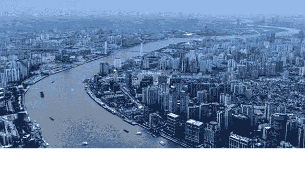

这篇写的有点累，一下午加熬夜，7000 多字，我耐⼼写诸位耐⼼看！

三眼的东西每篇都好几千字，其实每篇都可以切割成 10 篇以上，但那不是三眼性格啊！

因为把复杂的东西简化传达，整体逻辑就至关重要，逻辑断了认知不成体系的。

昨天私信有同志问：

老师，您好！假期一直在看您写的文章。我想问老师的是：中国历史上的朝代更替，用老师的五大认知体系怎么契合解释呢？谢谢您。

这个问题虽然很大，因为它不是一个问题，是 n 个问题，但很好的反应了青后的提问逻辑，就是怎么从历史得到认知的落地，从而研判未来！

### 【知古通今的内在逻辑】

首先说为何是 n 个大问题，因为历代更迭首先包含制度的更迭，奴隶制、分封制、集权制以及“主权制”（100 多年前民主要出来一段时 间）等等；再有就是我们的历史是一个不断包容的过程，很多朝代都是少数民族触入，唐、金、元、清；是一个渔猎、游牧、农耕融合在一起的过程。所以没法一次性给个逻辑。

但三眼说的是，不管形式上怎么变，也就是不管哪朝哪代，都有 一条主线是永远没有变的，就是任何朝代最后都归于中华文化，也就是归于道儒法，也就是说 2000 多年前的思想，一直活着，并不断演化，形成了今天的整个亚洲文化层，这就是思想的生命力！

政治经济社会自我人性的五大认知都是来自于此！

观古才可知今，底层的逻辑几千年来没变过，政治的规则、社会 的结构安排和运转的内核是互通的！

而经济呢？

三眼说过，经济是政治的延伸，是政治分配的具体实现，所以内核也是相通的！

但是也有差别，差别在哪？

一是科技的发展，生产力的提高，因为这个是不受大组织左右的——政治权谋玩的再高明，也不可能把沙子变芯片！

比如清朝其实是中华文化的运用推向极致的一个时期，如果没有科技拉开东西方差距，清会一直延续下去，别不信，更不要道听途说那些垃圾信息，因为多数人并不了解清朝，满人汉语学甚至玩出了几千年来的新高度！

但科技来了，就像《三体》里讲的，是高维度对低维度的打击，根本无力还击！

二是全球化，因为已不是我们关起门来自己玩的时候了，咱们的规则要和外面连接起来才行，人家去，在某地地方就要遵守人家的规则。所以之前文章讲的“内用法家，外用西学”就是这个道理。

# 科技是维度的提升，全球化是规则的融合！

老美为啥这么重视科技，科技是老美的核心，科技强军、武力强文，而经济就是分配的具体运行。

所以老美在不断提升科技维度基础上只干三件事：

1、没事拉航母溜达，不服就打一架，这是强武和耀武；
2、向全世界搞文化入侵，本来一个没有历史文化国家，硬是打造成一种新文化，三眼以前章节讲过，文化入侵就是价值观、神话故事、器物载体、礼仪、语言的入侵，价值观就是普及美国梦和民主，各种科幻英雄就是新神话等，不用多说，打开手机和电视机都是这些玩意！三眼说了，大家就明白了，不讲，天天看就习惯了；
3、经济上就是维护好美元的国际硬通货地位，向全世界收取“铸币税”。

回到本文的主旨，改开 40 年历程！

前面讲的是原理解释，聪明的同志一下就明白了：

**改开 40 年就围绕两条主线！一是科技二是开放。**

看清了 40 年历程，自然诸多问题都会清晰破解：

为何 rmb 要国际化？

为何产业升级这么难？

我们的软肋在哪？

我们的优势在哪？

我们的今天的一二线城市结构是怎么来的？

人口为何往沿海和三大城市圈迁移？

...

缩小至个体层！

为什么现在创业难？

为何房子这么贵？

为何就业越来越低迷了？

为何富的人越来越富，穷的越来越困窘？

干啥行业能靠谱发？

怎么能跑得快？

物质生活标准是怎么一步步变化的？

这些偏现实性（实用性）问题，才是我们这些小民所关心的！

### 【时间思维的“前后眼”和空间思维的“不健全”】

人有空间思维和时间思维，多数人都是空间思维，也就是只会观察和思考当下的、在视野内的东西——由当下视野所见来判断一切！

时间思维很稀有，也就是佛家讲“前眼看因后眼看果”，通过拉长时间线来观察来龙，而得到去脉，也就是趋势判断——由动态发展观去判断一切！

只有空间思维的人，自己20年前的事情都不会记得，严格来说这是“不健全”的，不健全如果加之人性漏洞就会产生倒结果：

一种是对生活极度不满，总想是想“重新来过”分田地，唱空大组织社会的就是这种；

另一种是乖乖蛋，一句话在他耳边念一百遍，铁信无疑，不是被洗脑就是在将葱c被洗脑的路上。

“不健全”的人能占到95%，这不是三眼小看人，这是很客观的事实，不用把人想的太复杂。

关注三眼的同志们，不用想质量肯定很高，最少1个顶10个，不光是在思考上，更是在求真务实的态度上，外面那么多“不健全”的，想想是不是很窃喜？生活还怕啥？提高认知、弄点套路不是远超趋势吗！慢慢来，悟、略、谋都要有，德智体美劳全面发展！

为啥三眼想到这？因为今个点开评论看看，很多事情不用我去说，志同道合的自然就懂！

云说风经58706919 精选 08:22 这么好的作品，粉丝竟然只有2.8万……

收藏 赞 推荐 更多

回复给云说风经58706919：
您还可以输入600个字

转发

健硕小懒手 10:35 第一坊，第二种人是不会关心的 回复

云说风经58706919 回复 健硕小懒手 精选 10:43 确实，牢笼绝大部分都是第一和第二种人…… 回复

青萌0 10:35 前段鸡同鸭讲，只有几千…… 回复

拖椅子1960 精选 06:31 文案的高水准和可怜的粉丝数极不匹配。这正好可以作为断者虞的佐证

赞 1 被 推荐 更多

经济和个体发展的很多问题是空间思维解答不了的！今天冒出个专家说人口红利，一窝蜂把问题归到人口红利，明天冒出个专家说营商环境，一窝蜂把问题都归到营商环境。典型的“不便于”空间思维——由当下视野所见来判断当下！

## 【“两口子”的甜蜜和撕破脸】

没有改开就没有今天的商业社会环境，小民思考财富的机会都不会有。
熟悉三眼读过文章的朋友们应该知道，我们所面对的问题，都是在大规则影响下产生的！

而这个影响的过程，同志们就想象成中美两口子过家家的过程就很好理解。
当然，不要太认真，因为很多东西不能太细说，时间段上扒、合作起点扒、具体事件扒，那就成报告了。
搞清楚美两口子甜蜜过家家到今天互相撕脸，就能解答以上诸多为什么！

为啥是中美过家家？
因为开篇讲了，科技和开放！
科技这条线我们就是老美的复制版，老美走两步，我们走一步，步伐紧跟，山寨之王！
开放呢？谁把我们绑到全球贸易规则里玩耍的？
还有，人才呢？举例！远的不说，近的诸位自己想想，科技上牵头的大多都有个留学经历吧？

再过过去的100年里，是一个东方不亮西方亮的时期，人家竞就要学，日本号称西化，把自己归到西方世界里。
但实际上，学的最彻底就是我们！不能说百分百，但也能够达到个80%了。
跟谁学？肯定是维护世界和平的老大家！
从产业到金融，从科技山寨到生活层（衣食住行娱乐）山寨，除了政治，剩下基本照模子复制！

什么叫特色？就是内核上要延续法家，具体发展层要无死角山寨！

## 【三个阶段】

1972年访华，相亲开始。

老大有什么？有科技有武器有产业，大户人家！

我们有什么？啥都没有，除了人！

>“不健全”的人肯定出来嗨我：“人口是我们的巨大负担，发展的巨大阻碍，养活这么多人多不容易，你居然还说是资源！”——这一就是典型的过度洗脑。

整个社会的价值创造与分配，都是通过劳动力来完成的，富不富一要看能不能给足刺激，也就是提高劳动效率，这个要靠管理和科技；
二看能否把价值集中到上层，刺激越足就越增产，增产完事儿开割，割得越干净，自然大组织更富强，割完一轮养一养，继续下一轮。

看过去40年，我们的发展就是靠人堆起来的！

把过程分成三个阶段：

第一阶段：40年之前是一大段；

除了100多年前冒出过一段民主要不了了之后，40年前之前往前数，2000多年差不多，无法细说需自悟；
然后总设计师改开计划开始！这是几千年来所未有，现在的孩子基本不会明白的，奇迹就这么开始了！

说到这里很激动，因为这真的是奇迹，是世界的奇迹，是几千年来的奇迹呀！

什么叫奇迹？什么叫伟大？就是“求真务实求变”六个字！

隔壁阿三人口多不多？不会求变啊！
隔壁棒子倭国为什么先起来？因为跪着啊！
奇迹就是不屈不挠，在低维度严重落后的境况下，在最短的时间内重新站起来！

所以不学无术“不健全”的人很难理解，抗美援朝是多么关键，而几十年就走完西方200多年的历程是多么的惊人！

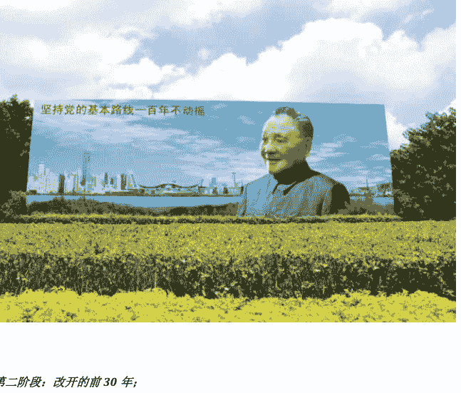

## 第二阶段: 改开的前30年;

这就是“猫鼠”论的阶段，因为科技太low，靠人堆，“摸石头”过河，低调发育期！

## 第三阶段: 近10年。

“河”基本过去了，过了河了、维度上去了，那就要琢磨着重新坐下来聊一聊，在国际分配链上动一动，这才有了“两口子”为何互相撕脸，才有了中国梦！

坚持党的基本路线一百年不动摇

## 第一阶段

那时候大锅饭今天的孩子没经历过，自然不会明白，但明白两个关键点即可。

### 1、农本。

造富就要干，干啥？我们不缺人，精神刺激给予了，农业就增产，这东西就靠体力即可，但工业生产可不是拼体力的，这东西要靠技术经验的，但这事当时都“摸着过河”，以体力的方式去干脑力活，这也奠定了改开的初始，跟外面换东西换技术主要靠农产品和低技术鞋袜等；也留下一个后遗症，就是大跃进搞出一大堆废铜烂铁工业品，自己用不完，外面卖不出。

### 2、积极性。

积极性这东西取决于私有物多寡，大锅饭一起吃食积极性肯定不高，干多干少结果都一样，那还费啥劲？
资本主义一定要萌芽的，这就有了联产承包一直至今，干完活自己能剥个瓜枣，积极性大幅提高！

多说一句，其实剥下多少都是调控的、可控的，因为农产品价格定价权是国家控制的，粮食最后都会归流到粮库统一管控的。

所以三眼说，钱是分配来的，不是赚来的，卖力气和造富水平不成正比。

有了农本有了积极性，是远远不够的，领导多说比村民高端在能多吃两桶水果罐头。

要发展！

### 掐掐历史：

商鞅当年有一个方法“利出一孔”。就是往死里打击工商业，把所有人都集中到农业上来，堵塞所有非农业提升经济的路子，这叫农战！工业照打不误，是因为当时时期还没有所谓科技，工业就是磨剪子嘎菜刀水平；

管仲提出“轻重之法”，也就是说在通过大组织强大力量控制粮食价格和货币流通，把“农战”之广大农民层的获利途径充分掌控在手，这就是所谓“夺、予”之术！

商鞅把它再搞具体点，也就是在执行厉，严禁私人买卖粮食，禁止农民迁徙。

是不是有一种穿越剧的感觉？“内用法家外用西学”历史认知落地！

再讲一个核心点，其实现在的商业，在表面上是商业，但原理上属于农业，“治法”相通！
国央企和民营是分开的，分的是什么？税收和资源！民企的主要功能是探路、养人（就业）以及做好“缓冲带”！

## 第二阶段

实现发展就要加足马力搞生产，搞生产是啥？

就是地里种食用的铁棍？加工一下变电视机，这不就创造财富了吗！
列强的科技才是本啊！

但在前30年初始期，一是没有科技来生产，二是也没人会生产。

这人力分两种，一种是单纯体力劳动力，下地能插水稻，进厂子能敲螺丝钉；第二种是不用管自己发育的，也就是脑力劳动者，这才是引领生产发展的最前端，脑力劳动者不用刺激，自己就琢磨出一个个新花样，比如乔布斯搞出个苹果，手机都变滑屏破头模样。

为啥李宏宏总被嘘？马化腾也低调？就是因为脑力活用体力的干法，钱赚了，力没出！

插播一下什么叫企业家的责任？
就是既然集中了社会大量财富交给你管理，就有责任和义务牵头搞发展，带动社会前进！
因为财富按照个人劳动价值估算，人和人差不了多少，企业家拥有巨量财富，是社会分配给的，拿钱就要出力才是最根本义务！
所以看三眼的东西，出去说人也是有匪夷所思的！
再遇到“酸什么！人家的钱自己爱干啥就干啥”这种心智和认知都极为“不健全”的人，就这么喷他！

我们缺少的就是脑力劳动，一直今天，现在也一样一样的！
这是由大规模“内法家”决定的，因为想象力思考力是脑力的核心，这东西从小就制掉。
但靠人多靠钱多就能办到的事，我们是地球no.1，所以号称基建狂魔。
靠想象能办到的事，往往排站！

冰箱彩电小汽车，这都是人家玩剩下的了，科技引领已更新规则，去年的芯片制裁就是这个意思，不给发货断了“机器大脑”，机器就生产不出来了。

这事不用多说，看看富豪榜就知道了，地产当先，金融开道，还有一堆酿酒的、搞电器的、搞稀缺资源的。

说实话，这些东西只要会投胎或者爹妈如爹得好，你进去了你也能干明白！

刨食小民在底下蹲着时间久了，总以为“成功人士”很高级，其实都一样。

在第二阶段有几个关键点记住即可：

### 1、沿海繁荣

为啥？与外面连接，交通最方便最直接成本也最低，一是东部沿海，二就是在最南面画圈，大批青壮年劳动力农村里出来，往这 stereotyped 地方涌入，进入各种流水线，流水线哪来的？后面说。

这也 形成今天三大城市群的历史积淀。

其实严格意义上讲，只有两大城市群，珠三角和长三角，因为这俩是实打实的 n 个城市连在一起，同步发育；
京津冀城市群太虚，都没法分析，三眼觉得这就是个概念而已，落地比较困难。

### 2、纺织女工和血汗工厂。

今天的富裕，是靠海量女工男工创造的，做人不能忘本。

### 3、招商引资

前面说了，第一阶段里，体力的方式搞脑力活，搞出海量废铜烂铁工业品，自己用不完，外面卖不掉，就好比现在谁会买三胖子造的汽车电饭锅呢？还得靠资本主义流水线。怎么办？

招商引资！

其本质是啥？就是外面的有技术有流水线有管理经验，我有海量的人指哪打哪，一结合，巨大价值产出！而后分一分！

这里多说一句，万事开头难，招商引资流水线抢先西洋并非买嘎，这就是粤弯和香港发挥巨大作用的时刻，为啥留着南港不着急解放？就是为了这一步棋打基础！而后就是倭国，像现在的很多经济管理词汇都是来自于倭国。也就是说是初期的引资都是台资和港资，用的流水线也都是跟倭国复刻的。

回忆一下过去跑商场买大电视，国产在左倭国在右，左面复刻右边，主要就是山寨。

再想一下，来自粤弯的富士康现在依然是流水线巨无霸。这都是有历史基础的！

### 4、出口

这个世界和谁玩儿玩的大的？进步的快？

肯定和维护世界和平的老美嘛！

要发展就要三驾马车飞起来，投资出口和消费。

投资不用说，招商引资大家一起分即可；出口和消费呢？

出口要得到的价值有两个：
一是将海量劳动力通过引资相结合，过剩的东西向外输出赚钱。
二就是赚美元，因为这是国际货币定海神针，外面买新技术回来，人家认不认你，要看有多少美元在手，这就是外汇储备的核心点。就像和朝鲜搞贸易，你收朝币吗？
只有创汇了，才能在国际上跟人家交易跟人家玩。

所以我们的出口和创汇，都是靠低价值商品一点点换回来的。

### 5、消费

什么叫经济好？就是有活力！嗨叫活力，不光要体量大，更要流动速度快！
搞一堆房子，体量是很庞大，但流通起来费劲，这就缺乏经济活力。活力这东西还要归到消费上。

消费的过程是一个价值循环的过程，联产责任承包了，海量农村劳力涌入沿海了，这是一个个体用劳动价值不断积累财富的过程，积累了就要给个出口消费掉，再积累再消费掉，这个循环速度快，就是活力！

所以消费是要一步步升级的，消费的升级是要靠科技的，也就是商品档次越来越高，招商引资合优于逐步提高了科技力，消费也跟着异常复制！
老四大件（缝纫机、手表、自行车、收音机）到新四大件（彩电冰箱洗衣机录音机），再到小汽车、手机、电脑。循环着一步步掏空钱包，实在没法升级怎么办？
别怕，有老大可以模仿，地产呀！“六个钱包”继续掏！

当物质商品层升级不上去，就要在金融层和服务层升级。

一产二产三产是有阶梯的，不是平层的！

这些东西都是明面上的，在消费这架马车上，还有两大管道被忽视的：

### 教育和医疗市场化！

其实消费划分成两大块，那些新旧四大件和科技类产品是一大块，而地产应该与教育和医疗放在一起是另一大块，但因为地产与第一大块的消费品一样，摸得着看得见，而教育医疗是看不见的，很模糊。

看得见的东西是标准化商品，看不见的是非标品，也就是价格机制没法衡量，看个感冒收50跟500都行，上个学花1万和10万都行，说不明白。

多数人的创业思维，就是一开篇提出那一堆问题，都是围绕着标品，到了非标品领域就懵了，一是因为标品有迹可循，容易入手，二是因为非标品都是要有资源关系，或者极度考验认知力的，普通人力所不及。

## 第三阶段

腾讯换鸟！一盘大棋刚开始！

“河”基本算过去了，“石头”摸得也差不多了，基本都摸了一遍了！
外面有的，我们都有了！
而且更重要的一点，我们的体量上去了，虽然质量跟老大比差点，但体量在那撑着呢。
世界经济发展到全球化的今天，大家都明白一个道理：

能种出来多少庄稼，要看土地大不大，肥不肥沃！

我们有什么？
巨大的体量背后是世界第一大市场！够大了吧？
二就是在《如何吃掉中产》里说的，2035打造三分之二人口体量的中产阶级！够肥沃了吧？
“少壮不努力一生在内地”这句话现在应该倒过来说了！三四十年前拼命跑出去的人，现在不都偷懒的回来了吗，用脚投票才是最真实的一面！

所以诸位同志一定要乐观，三眼以前在文章里说过：**这是最好的时代！**

在平素我们见到的诸多信息中，也能反映出来乐观的一面。
比如键盘喷子怎么喷？当然是拿我们跟老大比，来喷长短相较啊！
但想一想，为何不跟倭国比了？为何不跟八国比了？
再就是，唱空的为何都是内部喷子，唱多反而是国外的经济学家，因为明眼人能看见底层逻辑，又大又肥沃的土壤摆在那，傻空是看不懂的！

所以“河”过去了，腰杆子藏了，底盘稳了，咋办？**重新坐下来聊一聊！**

社会小群体、大组织、国与国之间，原理是一样的，都是分配链！大家都是想往链条顶层占。
无外乎围绕金融、科技、资源（自然资源和人力资源）这几块，展开国际分工。
混的差的就是在国际分工上提供原材料、资源和人力，卖油卖矿接着人家高污染工业；混的中间的就是卖技术，混的最好的当然是金融收割啊，印票子就能收割。

所以就要“深化开放”，特斯拉进来、金融敞开，因为要出去就要先接轨，就要倒逼改革，不能有“过河”时期的惯性了，要玩更高级了！

所以就要有科创板，也到了做好**环境保护**的点了，所以就要“金山银山不如绿水青山”，所以就要货币国际化。

纵观改开40年，才能把现在的这些词都连上！

此次疫情，诸位收获是什么？

总有私信问三眼疫情有啥影响，里面有什么道道等，三眼想说的是，这都上升到“一級”的程度了，是老百姓能猜的吗？事情的真实面上都是清楚，只是哪些说哪些不说的问题，不是小小个体分析出来的，因为在信息上有著极极大的不对称性。

影响是什么？能判断吗？

一个月过去？两个月？半年？严重性都是不一样的！半年的严重性想必一般人是想象不到的！

是蝴延还是人造，这都跟个体没啥关系！老实在家呆着不给社会添麻烦就就行了！

回到本篇主旨上来，如果说收获，就是从这次的整体调度，医院建设等层面，给诸位展示了什么叫做“集中力量办大事”的功夫！

### 有“集中力量办大事”的功夫，才“下一盘大棋”！

城镇化抢抢抢地抢钱人流线流的大迁徙、土地全盘搞权都是在为集中力量打基础，只有更大的人力物力资源的协同，才能办更大的事，下更大棋，你我个体升斗小民都是大棋的小细胞，人生过得好就看谁跟得上步伐。

40年前过年才能换身新衣服，吃顿饺子，今天呢？

在未来科技股肯定是有大机会的，因为这是一个确定性的必须要搞的，这是历史时点推动所致。看风险偏好，三眼是不建议一般人玩的；
毕业的孩子尽量去金融业吧，未来搞金融的抢着要，涨收入也是第一轮涨；
没技术又不想冒风险，年龄所致不能重新来过转向金融金融光大道的同志，研究研究服务业吧；
想安稳又轻松又不冒风险的，手法又有产的，把三四五六七八线的不动产能卖就卖吧，去一线和强二线搞房子收租子吧。

以上都属于投资，或能拿钱出来，或能拿时间（选择权）出来，如果都拿不出来，那三眼也没啥具体建议，个体具体情况具体办，只能好好学习吧！

多说一句，人和人不能比较终点，要比较起点，人的成功是看两点之间的距离，不是看终点的高度，人的认命就是知道这辈子累吐血能混到什么终点。偏僻小山村少年在京混套稳定居所，我觉得比王思聪要成功！

爱攀比，不看起点比终点的人，一定会焦虑不安。人就和自己的昨天比就行了，认知一步步提，知识面一点点扩充，套路一点点掌握，积跬步得以至千里嗬！

## #人性-漏洞 | 人类有两套判断是非的标准，决定人思想的深刻与浅薄！

2月5日

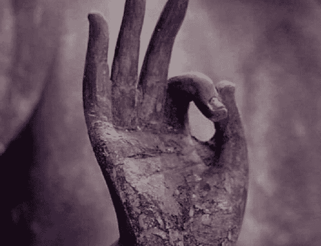

人思想的强大来自于认知力，认知力来自于洞察力，而拥有洞察力只需做到“不一叶障目”！

佛家的说法印手势早已告诉众生，只要不一叶障目就“OK”了！

刚出生的孩子，双眼尚未睁开，他的心是赤红的，所以叫“赤子之心”！

面对这个世界的无数幻影，潮起潮落是非非。人与人智慧的起点是一样的。

而后天产生巨大差距，是因多数人都蒙蔽了自己的双眼，失去观看和洞察这个世界最基本的功能。

失去功能就看不清，就随波逐流，只能做棋子；
而人看待世界的时候，区别于动物的地方，就在于拥有是非观。价值观、世界观、人生观都由此展开。

是非观就是人怎么看待世界！

而人观看到了什么，就会考虑到什么，在这个过程里，思想的深刻与浅薄拉开差距。

浅薄的人是“视而不见”，就算看见了，他也不以为然；
深刻的人是“不视而见”，哪怕眼睛看不到，但也能感觉得倒。

为什么？

## 【两个基点】

因为人类观看世界的时候，用两个基点，也就是角度：

### 1、以“我认为”为基点

这就是古人讲的“一叶障目”！

比如一个社会公共事件，满网的评论99.999999%都是“我认为”。

全都是垃圾信息流。

“我认为”源自于哪？

### 一是源自于所处的原生家庭和社会环境；

例如士、农和商三个环境，士人和商人圈子一般来说会觉得“阴奉阳违”是正确的，再正常不过了，但工农会鄙视之；而工农圈子会觉得“仗义”是正确的，但士商会鄙视之。

站在工农的角度就会有“仗义每多屠狗辈，负心多是读书人”的谚语；
而站在士商角度就会有“学而优则仕”等谚语。

多说一句，其实社会在这个角度可以分两大块，一块叫朝野，也就是士商圈，多识利益少识情感；另一块叫市井，也就是所谓“江湖”，多识情感少识利益。当然，两个意识形态也在逐步进化。

### 二是“我认为”源自于人本性。

也就是说人在潜意识上都认为自身是正确的，他人不同于己的意见都是相矛盾的，因为这源自于人“耻利”的本性，都以自身的利益为出发点。

情绪就是这么来的，只要外界讲的观念对其利益有触犯，那么外界的观念就是错的，这就是情绪的来源！

弱者都会把自己裹挟在情绪里，因为“一叶障目”自然办不成事！

比如典型的女人在情感里就是这样：“我为你付出了那么多情感，你居然不喜欢我，你就是坏人！”——典型的“我想要你不给，那么你就是错的”这一情绪。

人人生来，都遵循从人本性，思维出发点都是“我以为”，所以人要想变得强大而深刻，就一定要“反人性”！

### 2、以“存在”为基点

这种思维就是反人性思维，因为要“无我”，也就是忘掉自身的角度，把自身弃之于外界环境，用第三只眼的角度去观察。

在这种角度下，好的一面是能够客观的分析环境，从而不断接近事物的真相，但也有坏的一面，是非变得没有“标准”了！

就好比针对前面讲的土商与工农的角度差别，是你的话，你怎么看？

这个问题恐怕诸位同志会有n个看法。

哪个是对的？

怎么办？

## 【合规与不合规】

怎么办很简单，就是按照自己的利益去做。

同样是归于自身利益，但和“我认为”那种浅薄的归于利益不一样！
因为这种方法是先“无我”，也就是不掺杂利益，分析后绕一圈回到利益上来。

说出来是不是觉得很简单？
但做起来无比难！

这就是人和人思想差距的起点，就这么一点点形成差距的，就像小溪逐渐汇聚成江海。

任何人的利益获取都要依靠集体，这个三眼别的文章讲过；
当归于到利益的原点后，你的眼睛已经不被“一叶障目”，因为能够以“存在”为基点去观察，自然能看到每个集体的“存在”。这个“存在”就是就能够看清每一个集体的“合规与不合规”！

这就是人性所导致的，任何集体或者事物都有“潜规则”的一面和“显规则”的一面。

举个大层面的，比如全人类层面，杀牛宰羊很残忍，但上了桌面吃牛羊肉大家都很开心，这就叫人类这个大集体的“合规”，很客观，无须道德感；而一个人非要去捕杀野生动物，屠戮并吃掉，这就是残忍，人人得而诛之，因为这个“不合规”。

举个中间层面的，比如混官场的，你不贪东西这就不合规，自打有人类社会开始，全世界的政治都解决不了这个问题，腐败问题是全社会大组织的运行问题，诺贝尔奖得主加在一起也解决不了。但是要在一个正在成长的股份制公司里，一个人这么搞，那就是“不合规”，人人得而诛之。

举个小层面的，比如一个人有喜事请客，不收礼份子就显得“不合规”，不是不收钱就叫好，很可能招来无数批判。

因为人性在变，道德标准在变，利益交涉在变，“合不合规”也在慢慢变化。
比如结婚男方到底底给彩礼？这东西出现没多少年！

总结一下就是：

是非观源自原生家庭、所处环境的熏陶和自我人性使然；

是非观产生了“合规与不合规”；

人在集体中生活着，
一是要学会反人性思维，用“存在”的角度去思考事物；
二是当思考明晰落到执行层时候，要以利益为出发点，而以利益为出发点就要看清集体性的“合规与不合规”。

像不像一个圈？人性就这么好玩，我们都在这个游戏里。

## 自我-觉醒 | 你活一辈子想攒下啥？想通此问题，既能看到商机，又能让自我觉悟！

2 月 5 日

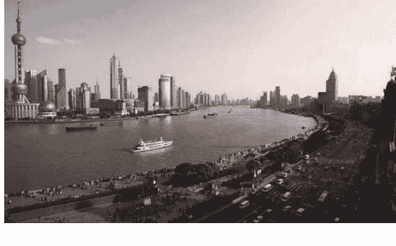

人活着都是要努力的，但努力是为了个啥？

或者说，努力到最后，能攒下个啥？

不要小看这个问题，无论哪个时代包括现在，明白这个问题才是一个人真正得到觉悟，驶向独立自由的起点！

## 【意识形态】

“备周则意怠，常则不疑”——三十六计之瞒天过海！

我们都对平常皆可见到的事物产生思想的懒怠，因为准备太周详了，不会发出疑问，更不会深入思考，而真正有用的“几点”，也就是关键道理，都是在这些最普通不过的东西上。

诸位有心人打开手机看一看，整个社会的信息流，除了非常专业的应用知识外，剩下几乎都是围绕“获得得到”。

媒体信息 80%都在“金钱”和“情感”上，因为这是人们想获取所有东西的两个内核。

金钱可以得到物质上的安全感，情感可以得到精神上的安全感。当安全感十足，就会饱暖而思淫欲，产生对物质扭曲的贪欲和对情感更高的要求，炫耀、攀比自然就会产生。

以至两个结果：

- 一是在物质上都想快速致富，浮躁与焦虑；
- 二是在精神上，对情感的要求越来越高，结婚率必然连年下降，离婚了连年上涨！
- 三是在行为上，拿起手机看信息流，各种炫耀充斥。

这就是我们今天社会的意识形态！

## 钱的流动是跟着需求走的，需求来自意识形态。

## 创业搞项目的人记住这个心法即可！

所以赚快钱，除了“刚需”垄断的资源行业外（加个油充个电话费等那些，因为这些不需要动脑子，人人都需要，所以要垄断），剩下都是围绕社会思想形态，也就是“怎么赚更多的钱”和“怎么获得更好的情感”。

所以什么理财 p2p、什么各种打着创业旗号的赚钱培训、什么情感咨询，最吸人眼球也是最容易让人上当而自愿拿出兜里钱，再落地展开就是各种辅导、自我管理以及各种美容整形、健身等等乱七八糟的。

参见两大现象，一个是成功学导师覆灭一批，再换个花样起起一批；另一个是某某女郎花 100 万整形成个鬼样子还乐此不疲。

## 几乎智商税的都是想快速致富和情感高要求的钱。

垄断的那些东西，大规模上属于“朝野”；思想形态这些，多见于“市井”。

而草民侧食所谓创业，基本统统在“市井”这个圈里转悠，所以：

## 任何需求不能看表象，要看它们背后的意识形态！判断趋势就要关注意识形态！

A 先生创业赚钱饭碗，关注什么水电租公金工资等若干具体象，在混乱的信息流里获取一些假大空的知识作为救命稻草；

B 先生创业赚钱饭碗，关注社会意识形态走势，挖掘表象背后最本质的需求，自然获得“确定性趋势”。

A 和 B 谁有大概率办成事呢？

沿着这个路径继续落地，怎么加大办成事的概率呢？

## 那就要在意识形态层面落实到生活方式层面。

把你选定的目标人群的，也就是要赚谁的钱，了解了他们的意识形态，再在他们生活上深入了解，画出一个轨迹——意识形态展示在具体生活上是什么样？

而后…精准插针！针就是商品或服务。

整形换了什么新花样？成功学大师们聊的新套路？健身房开始招聘女教练？等等这些…

## 创新无外乎是意识形态在生活方式上的新套路、新花样、新玩法。

玩个两三年、五年的，再换个花样，被收税的开开心心，茶余饭后聊闲天有了新内容，收税的你乐此不疲，票子哗啦进！

### 【幻象】

从上面我们看到什么？

不光是简单看到挖掘商业项目的本原线路，而是更要看到世界越来越成为一个幻象、一套幻象。从人皆因欲望牵在这幻象里。

我们能做的就是看破幻象而“自由穿越”，并找到自己！

看这些幻象时，要通过意识形态抓住个“看点”，而看点的挖掘，核心有两个：

## 1、价值评估的标准变了！

也就是价值越来越趋向于意识需要，而不是真实的需求。
比如养活身体的一个馒头 2 元钱，脸上割一刀收 10 万。

## 2、是非观变了

也就是说在法律允许的范围内，道德的标准被稀释，以往我们认为错误的，可能现在乃至未来变成正确的。
比如非婚可落户政策出台，孩子爹可以“隐蔽”起来了。

价值评估与是非观的巨大变化，才会在意识形态落地生活方式的过程中，商业上产生出诸多“见缝插针”的机会。

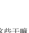

## 【“入世”人生的积累】

题目是人生能攒下什么，怎么觉悟，三观讲上这些个啥？
一个问题：你从上面一大堆文字，从幻象里，在人生上获得了什么？

获得了赚钱的具体路子？这是最初级的！

如果你今年 30 岁，想着 35 岁的事，那可以！

假设你想的是 85 岁的事呢？

诸位有人会问：哲人说人生最后都是个死，谁想的远谁是傻瓜，怎么解释？

三眼说那是“出世观”，太形而上，咱们要说“入世观”，毕竟活着就要追求点实用性！

您 85 岁拖着疲惫站在黄浦江边看着巨大轰鸣的城市，人生撇下了什么？或者说人生有什么可以延续的？

撇了几栋房子？

那不是你的！不说产权是分离的，土地是租的，单说这已经过了好几十年，资产的游戏规则恐怕早已变化了；

撇了许多钱？

30 年前北京站的麻花 1 毛 5 一根，还送碗豆浆，您 85 岁时候，年轻创下过人的荣耀资本，想必也就够半年饭钱的。

而科技的进步，5 年几乎就是一个科技应用迭代，社会的变化，早已把你甩开几千里远，甩在黄浦江边的寒风中。

作为“入世”的我们到底能撇下什么呢？

一就是认知，世界在变，幻象林立，但底层逻辑不会改变；不管怎么变，认知才是我们从生到死的立身之法，是在这个波谲云诡世界里不被淘汰而立足的利器；

二就是健康，毛主席教导我们身体是革命的本钱，现在的年轻人当成玩笑！健康最主要取决于心理，一个健康的心智通透的灵魂才是身体健康的基础，身体的崩塌从精神崩塌开始。

三就是血液，有条件多生孩子，即是劳动力又是认知延续的利器，是能撇下来的唯一“实体物件”。

## 投资就是下注【不可回撤】的趋势！从地产到土地到各行业发展！

2 月 6 日

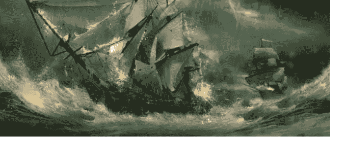

投资是干啥？

就是大家一起吹泡泡，低点买进，吹大了卖掉跑路！

而在这个吹泡过程里，核武器就是杠杆！

比如10w元一套房，1万元首付即可买入，这就是10倍杠杆，房价翻一倍，就赚了20倍钱。

杠杆就是融资，有人愿意借给你钱，风险你担，人家只吃利息。

这里面就会有两个疑问：

一是谁能向这个社会无数杠杆投资玩家借债呢？

银行呀！

因为它钱最多，因为都是它印的，借给你的钱就是电脑上敲个负数，放到负债里记上，所以可以说，债务=钱，也就是印了多少钱就是发了多少债。

二是为啥借给你？万一你玩砸了自己套进去，债主也要一起承担风险啊，债主是只认钱不认命的，你的小命只有自己觉得很值钱，而且万一跳楼小命都不要了呢！

资本是很狡诈的，不可能免费做好人好事的！

所以什么样的玩家，才是银行眼里的优质玩家呢？

那就是拿到钱绝对能够还得上，让人家天天躺赚吃利息到“赚钱太多都不好意思了”的客户。

不用说，头字号玩家那肯定是开发商啊，房企整体负债率都高达 80% 了！

也就是说几乎等于空手套白狼。

## 所以一个优质玩家要有两种属性：

## 1、够资格借钱

资本到啥不是普通人能玩的，因为你首先你造借钱的资格都没有！

从08年开始到现在给了3次机会，给你你不中用啊，只要是个青壮年，拿个身份证，弄张白纸搞个流水证明，花一百元或者我朋友帮忙随随便便扣个公司章，70%的杠杆就是你的！

为啥不敢借债呢？

我也理解，这里下面有俩个思维误区：

一是出于对当下的思考，借了钱日子紧了，生活质量走下坡路，而且万一断了现金流还不上可咋办，好怕怕！

二是出于对未来的思考，格局认知看不到未来是啥样，也就是买了会不会跌啊，那样就不是生活质量走下坡路，而是人生变灰了。

所以够不够资格这事，本质还是认知说的算。

这就涉及到本文的主旨：

## 2、玩法绝对不能赚

投机是啥？

投机就是博概率，是认知的不断投资，来加强对概率的确定。

## 如果有一样事物投入回报的概率是 100%，那就不是投机了，那是抢钱！

在过去 10 年，地产就是抢钱，杠杆就是放大倍数抢钱。

这就涉及到一个问题，80%的高杠杆，只要 20%的下跌就崩盘了，为何敢玩？

## 因为这种玩法，建立在一个不可回撤的趋势上！

这就是核心秘密，想逆袭走向人生巅峰，就要发现不可回撤的趋势！

那什么是不可回撤的趋势呢？

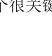

## 不可回撤就是整个盘面的所有玩家，都不想回撤，也不能回撤！

首先一个底层逻辑，诸位是要知道的，这个很关键，是大规则上面的大规律，就是超发货币这事是不可回撤的。

钱只能越发越多，只是发的快和慢的区别。

一是钱的本质变了，现在是信用货币，也就是没锚的，只要看起来够信用，发不发一看盘面二者看心情。

二是发出的钱，流下来到各个角落，由于分级错杀利益分配，也会一直发下去！

也就是说大蛋糕下面怎么分，有的胃口大，吃的就是多，底层胃口小，够活就行，发钱速度根据什么来？肯定根据底层啊，因为要保持稳定嘛，这就是“存量不动发展增量”决定的。

做增量就是保就业保基层保温钉，存量就是有些人吃了不吐，只进不出来。

超发货币不可回撤，越来越多，得有个去处啊，要是都进入民生行业，估计大米 500 元一斤也不为过了，那就要有个承载物，也就是地产。

大家还记得 2010 调控一下就搞出姜你军荔澄混豆你玩吧，钱多了没地方去肯定要钻进其他领域搞一搞事情的。

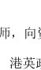

为啥选择地产？为啥不可回撤？

看问题找根子，“揽石头”过河凡事都是有老师，向资本主义前辈港英政府学习来的。

在签署正式合同到回归之前的 15 年时间里，港英政府摇屁挨毛，能多捞点就捞点，当然最简单最暴力的方式就是卖地啊，而“合同”里写的严禁多卖，每年只能卖掉 50 公顷，这就人为制造了供需的不平衡，一方面催生了房价飙涨，一方面顺带产物出了那几位大佬各种卖地模式，什么预售什么楼花什么公摊等等，仿佛是资本主义，玩法多多，在利润面比的就是谁骚得更干净。

这就教会了三样，一是产权分离，土地必须得控在手里，这是盘面的基本；二是控制供需即可调整价格，根据大家“力所能及”和“范围”来调整，这样大组织收入问题以最简单的方法就解决了，三是实楼模式照搬，毕竟这门科学的底层逻辑是百分百照抄的，那么上面的事也应该一样。

为啥选地产？

因为地产这个东西相对最底层来说并不是什么必需品，住可以租的啊！参见香港牙签楼和笼屋。

任大炮说一句话很多人理解不了，但是根子上的东西，就是“房子本身也不是卖给所有人的”！

房子本身就是金融品，而后才是居住价值，只要下面生活有保障，中间那些杠杆优质玩家们呐挤腾都行，但不要添乱。

啥叫添乱？就是超杠杆累积风险，揽着银行一起承担，这不行！

为啥不可回撤？

首先是因为经济发展模式，超发货币，；

前面讲了“发展增量”模式发大水刺激经济，就像吃镇痛药，如果不发大水唯一的刺激方法就是改ge，改ge什么？“盘活存量”啊！

但“存量”们可不是想盘活就能盘活的！

所以自 08 年大水后，这个模式就像老虎被放出笼，一直 到现在都是研究怎么给他关进去，或者给它到更大的领域去生长，在此期间药不能停！

## 第二个是因为所有参与者都不想回撤。

开发商不想回撤，这东西 80%杠杆空手套白狼，不要太简单粗暴，看准行情首富宝座轮流坐一坐不要太爽；

地方政府不想回撤，这东西断了，哪有来钱道？怎么干事？又怎么摆平喝汤小弟？

银行不想回撤，都赔了风险谁担？为国接盘吗？

最关键的是，是海量散户也不想回撤，这可是稳定基石，舆论浪尖。

回首这几年你会发现，价格跌幅与打造售楼处的力度是成正比的，这都是有根源的，在香港老师上可找到根子，中国人心连心，文化一脉相承。

董特首刚上任时候，香港房价已经到了平层层，就差上天了，跟内地现在的舆论一个样子，无论啥坏事都归于房价，什么实体经济啦，民生质量了，经济发展了，贫富差距了，总之你能想到的坏事都往房价身上扔。

董特首心怀士苍生，“八万五”计划三把火就把价格给打下去了，那可真叫一个跪，不是腰斩而是腰斩再腰斩那种。

但 2000 多年自古为官，基础知识就是要明白“二层皮”，也就是不要看一个人说啥，要看他做啥，文化这东西是刻在骨子里传承的，就好比“聊天去我家吃顿饭”。

价格打下去了，嗡子们不吭声了，而后就是各路游街“砖块把我家房子价格打下去？”“形势控制不住了怎么办？抢！一抢到现在飞上天，几十万一平比金子贵。

其实这个事情很好理解，就好比现在满啊嗡子，没上车的就嗡，上了车立马嘴脸就变了，傻子和饭多转换特别快！

香港房价飞上天，值不值？死逻辑上讲肯定不值的，活逻辑上讲，这是因为“不可回撤趋势”造成的。

看老师就知道学生，我们能回撤吗？

光讲故事没用，讲故事的多了，得联系实际！

实际是啥？能回撤吗？

能！

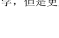

香港回撤不了因为盘子太小，模式可以学，但是更加可以改良！

这件事上，船小才不好调头！

啥叫盘子大盘子小？

用心的人可以想一想，这样一个不可回撤的趋势怎么能回撤呢？回撤的关键点在哪呢？

再具体一点就是：

风险谁来担？也就是谁来为国接盘？银行吗？

地方政府卖地模式这药怎么停呢？

开发商打鸡血停不下来怎么处理呢？

海量散户狂嗨怎么办呢？

超发货币的药不能停！不能停怎么继续吃呢？

然后再看实际发生层面：

一是抵风险这事，核心在哪？在于杠杆加到谁头上！去库存是干嘛的？就是把企业杠杆转嫁到居民杠杆，转的差不多了，现在居民杠杆率炒高，慢慢还钱吧；

二是断了地方政府的财政怎么办？简单，换新赛道啊，收房产税和收租子，这个是永续稳定的，但在现在是过渡阶段，还没走上大路，这期间怎么办？因城施策啊！也就是说实在太缺钱的吃药丸，卖点地，把需求的大门（双限）打开一点，循序渐进，等大路铺好即可换路子。

三是开发商呢？那没办法，商人不是只能赚钱不能赔的，只赚不赔的那叫银行，商人毕竟是商人，那就洗一洗吧！也许？中小玩家都去死吧，未来不是你们这些鸡鸣狗盗风鸣汤的时候了，要留就留大户人家，也就是国家队，一来都是自己人局面百分百可控，二来肥水都给了那自然要为地方政府盖楼收租子啊。

四是海量散户狂嗨怎么办，好办？打砸力度不是和跌幅成正比吗？那就不跌！冻住！一来大豪都被洗出去了，因此市值撑在那里，倒是叫钱不能流通，但看起来好看啊！散户就是噶喉咙过活市价值，勤劳节会换铁饭链条？钱东西东系？钱东西东西系... 等等。钱这东西是不流通的，不是用来花的，是用来撬的，看着三四五六线一个个几十万一套的“不动产”很安心。二来是市场自然会分两级，冰火两重天！超一线大户人家本来都是精英层自己人，而且抢人抢钱城市大扩张，房价肯定慢慢涨啊，涨了自己人就不会嗨，就不会没群众基础！

五是前面说了，超发货币这事在信用货币时代，全世界都不可回撤，和维护世界和平的老大大熊比着谁玩的猛，怎么办呢？换药！药在哪？在广大耕地宅基地上啊，所以老美为何狗急跳墙下三滥，因为眼看局势往下玩不动了啊，吃超发货币这个药，要比的是“内功”，老美内功在股票，靠科技概念堆起来，这东西可撑不看着不见，而且智商这东西是有局限性的，万一没新东西搞出来，怎么继续吃药呢？我们“内功”在土地，找地方存钱这事空间广大大的很，所以“空间换时间”，时间就是发货币的速度，空间就是承载的盘子

以上讲了这些啥意思，就是倒食的想萝裳跟凤汤玩投资，首先要谨傍事：

- 一是保证自己有资格随时能借到钱；
- 二是打通认知底层逻辑，观察“不可回撤”的趋势。

“不可回撤”大都都能玩，但跟庄最好要跟最大的，因为船大不好调头，有充足的时间去思考，建立信息对称度。

在没有趋势出现，或孕育过程里，只能钻研，就像股票高手多半发挥的地方只能在牛市，横盘时候高手很难发挥出来。

这期间干啥，不想闲着就研究具体生活层面的“不可回撤”趋势。

# 中央1号文件背后！土地资产化大棋！

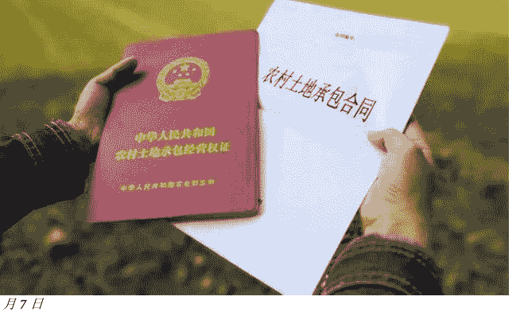

2月7日

1号文件出来，各路媒体和专家可下有内容了，纷纷解读赚个流量，三眼要说的是，不要大惊小怪的，“1号”文件几乎等于农业文件，发了十几年了。

1个文件看不出什么，要看n个1号连起来呈现图景如何，而且功夫在诗外，我们政策性文件如果以“眼见为安”的思维去研究，那是研究不出什么的，一万个哈姆雷特研究的结果也只能是“好好好！一片祥和！”

相比1号文件，下面图里的字倒是应该关心。

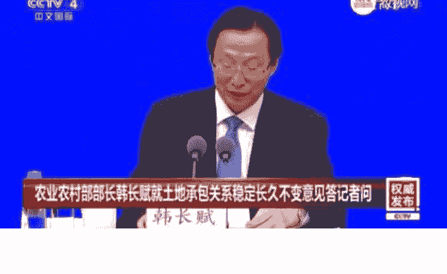

经过人口红利，地产+铁公鸡，经济持续发展未来就要依靠于城镇化进程。

农民进城不仅创造巨大的内需，同时将释放海量的土地资源为发展提供支撑。

看图片那位说了，不能强制的收地，要引导！此时说此话意义很大！

三眼提供一堆关键词，逻辑可自由组合。

## 城镇化

外面叫城市化，我们叫城镇化，这是有区别的。这里也没法细说，细说你就看不到文章了，参见《养蛙》一文，或者公众号里搜索“养蛙”即可。看一切经济活动和社会活动，就要以“分配”的眼光去看。城市和城镇的区别就在于“上与下”的分配。搞城市化？几亿农民都进京享受与土著同等的公共卫生服务和福利？

## 城镇化率

大组织目标 2030 城镇化率到 70%，2010 年是 49.9%，三眼一直不明白的是，这个率到底咋定的？要 integration？要是按照人家进城，不说 70%，65%早就到了吧，虽然没有具体数据参考，有也是虚的，看看农村有多少人就不完事了。现在县市的房子，很多都是农村人买的。看了上图的回答，三眼明白了，不是举家进城就叫城镇化，也不是给落户就是城镇化，城镇化率的标准，合着就是：一是举家进城不要回头了，过年也不行，这是表面，表象的背后是生活方式上要彻底脱离开农村，实质是二；二就是地留下，或者 retour 集体或者租给大资本。

## 1 号文件

这十几年，陆陆续续 1 号文件围绕农民收入、财力补贴、教育补贴、税、医疗保障、保险、基础建设、水利建设等等，这是在干嘛？这是在搞系统建设！

## 还债

文件有阳光普照，农民便宜确实得到了，但是在“养殖”的层级里，相对来说还是最少的。阳光普照是因为社会整体增量过去做的太快了，雨露均沾最下面也能撒点。其实之前陆陆续续的“1 号”，很大程度上是慢慢还开 30 年在二元经济下对农民欠下的债，干的最多的，高低得拿点不是嘛。

## 现代化

三眼讲过，经济就是给你分配点啥，再搞点“管子”弄回来，循环的过程就叫经济活动，循环越快经济越好。沿着“1 号”，出现了个东西叫“现代化农业”，这是个分水岭，啥叫现代化？现代化这东西是个体能玩的吗？只能是集体和资本能玩的！现代化就把土地集中化起来，这就来土地确权和土地流转。

## 三改

大组织有三改，股改汇改和土改，都是搞活经济的大利器，区别就在于利器能不能玩得动，太沉的容易闪到腰。股改改的是大户人家的利益，自然不容易玩动，老股民自然懂的；汇改改的是国际大组织规则融合，列强都是硬货，更不容易玩得动；土改，可以！

## 两大壁垒

1 是森严户籍制度，也就是进城落户问题。落户问题就是待遇问题，就是公共服务与福利的问题，这是要钱才能办到的。钱哪里？削弱原来城里人的利益？不会的，只能地方大组织揽钱，这就必须要扩大财权，不然怎么搞公共服务与配套建设啊。2 是本质上农民是无权的，手里就是承包土地和宅基地，外加点存折还不破碎稀，如若不能解决动宅权问题，几亿人进城就是灾难。所以大概率会让农民享受土地资本化。

## 户籍改革

户籍改革，也就是“300 万人口城市随便落户”那个口子怎么就打开了？之前农民进城是很节约的，有很多模式可供选择：积分落户这个东西不是北京上海的专属！以前村对农民广乐就搞过，想进城？那就要付出，付出多少积分多，积分多及格了给个户口！重庆玩过 1 换 1，要户籍交土地进行资产置换，搞出一个“地票”模式，这就相当于把土地资产化，春城这个模式很人性化。其他一些省份有的是极低补偿强制“入户”，有的是完全自愿随意玩。

在这些“试点”的背后，反映了一个根本，就是在农民进城扩大城镇人口增大内需的同时，城镇化进程中释放的土地所带来的收益如何用到农民身上！

走老路子就是通过“土地财政”bo 薪农民，然后在通过政府主导分配？新路子就是要打破征地制，确权还权于民，通过土地流转参与到城市建设中来，让农民合法化分享城镇化进城带来的土地增值收益。这一点、这个大棋，可能已经有计划了，需要观察。

## 转基因

土地一旦走上流转道路，规模化产业化，这个是需要过程的，不是说把人种地换成机械管理种地就可以迅速转换的！核心是要保证不减产啊，这个可是国本。咋办？转基因！小 cui！小 cui 背后是个利益与集体利益谁让步的问题。

## 农产品价格

资本都是逐利的，除了土地资产化收益，还有就是农产品可能会分级。也就是在农产品上做利润，参见现在很多大户资本开始种地搞养殖。

## 土地资产化

房子是啥，70 年啊，土地是啥，30 年啊，一样的！房子能吸钱，土地也能吸钱，房子吸水控制价格靠什么？靠垄断！往土地上迁移，一个套路。

## 垄断

地产经过房龙混杂时代，到现在呈现什么情景？一级市场（土地）完全可控，二级市场（地产）干死啥汤小鱼小虾，剩下国家队。土地呢？估计（就是）也一样吧！毕竟这门学科轻车熟路容易上手。

## 内需

农民历史性的成为有 chan 者，产是什么？三眼说过按照严格释释，几乎所有人都是没有 chan 的，当然自家后院挖坑埋金子也算产，正经所谓产产就是一个分配关系，给你一个优越性，让你可以得到多少多少分，配这就是我们的产。农民历史性成为有 chan 层，庞大人群加入城自然带来庞大内需，既解决了上一个蓄水池的问题，又可以搞活经济。

## 羊毛

羊毛只能出在羊身上，县市养人，也就是公共服务与福利，还是取自于羊毛，以前是搞地皮，将来大概还是搞地皮，只不过地皮换了。以前是直接搞建设用地，以后可能是间接搞土地，建设用地只能长出住宅楼，土地可以长出楼层还可以长庄家还可以养牛，只不过不直接玩。扩大财政权可能就在这。

## 金融

土地资产化，农业现代化的过程中，必然要配套相应农村金融服务于抵押流转。

## 耐性

就如图片里那位说的“解决农村问题要有历史耐心”，农民兄弟们，你们也要有历史耐心啊！

## 看清楼市、实体经济的底层逻辑！找寻个体的破局之道！

2 月 9 日

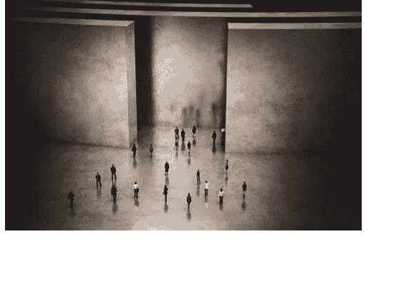

## 【局与迷局】

这世界就是一个局！

局是什么？

是套路！

套路怎么玩你？

绕！搞复杂！

怎么绕？怎么搞复杂？

把歪理邪说通过舆论工具尽可能的放大！

每一个套路的底层逻辑其实都很简单，而众人觉得复杂的原因是有人故意将其搞复杂！

## 【娱乐化的财经界】

看鸡国经济，各路专家众说纷纭，就一个房子绕来绕去都能说出 1000 种道理；

而这几年又热衷于谈论实体经济，而最主流的声音就是房子绑架经济，压死实体。

看似顶着“政治压力”说了点“正直”的话，围观者拍手叫好，其实在三眼看来，这就是一场戏，跟娱乐圈差不多。

如果各路专家说的话真是“正直”的，早就不被“销号”了！

财经界娱乐圈和网红直播圈差不多，看着看着就“中招”出血了！

为何这些声音可以一直传播着？因为其就是前面所讲的“歪理邪说故意搞复杂”！

## 【歪理邪说的多空市场】

为什么这么多歪理邪说？

因为市场本质上是多空交战，无论多还是空，收的都是心智的钱。

市场上几乎是没有实话的，只有故意而为之的话术，而这些话术分为多空两派。

唱多的赚得多，因为“想赚钱的”人的钱，是最容易的。

比如概念洗脑，搞出各种炒房客，牵头的赚后跟进者的钱，不亦乐乎，这就跟股票市场大牛市来的时候一样，随便个铜锣扔下去都能听见个声音，小散们赚了，那拜师费自然乐意交，“股票大师”自然赚得多。等市值股票疲软了，大师们不是转行就是不见踪影了。

比如各种创业培训，现阶段已经进入“存量转移”时期了，居然还忽悠大量的人去创业，通过“一夜暴富”、“不搞来不及了”、“谁谁谁暴富”等进行洗脑。

在大牛市，唱空的赚的是流量的钱，而疲软期，是唱空主场，赚的是“风险保障”的钱。

## 钱的流动跟着人心，在多空反复中流动！

## 【意识形态】

无论多空，都是歪理邪说，都是在做“意识形态”，赚的都是认知的钱。

“意识形态”这 4 个字很关键很关键很关键，上到政治下到经济运行分配，都归于这 4 个字，吃透了就明白怎么在市场上玩了！

之前有一篇从一个小角度讲了意识形态《你想一辈子搞下跪》，其他平台都发不出去，就因为这 4 个字，公众号阅读量很少，根本不受关注，很多文章在这里就能发。

再说一句，大组织最核心的功夫就是这 4 个字，乃至整个经济与社会运行的也会围绕这 4 个字。

因为三眼说了，经济、社会等系统是政治的延伸，政治是你所能见到一切的底层逻辑起源。

只要你能看到起源，无数支脉自然可以思考的通。

## 【楼市的底层逻辑】

## 楼市的命脉：土地与房屋无法割离，但产权和居住权是割离的。

市场上无数声音研究的都是表象，都是根据结果来判断结果，自然大家很迷糊；
很少有人去思考或者说出来底层逻辑，也就是楼市呈现今天局面起源自哪里？
起源就是“70 年”！搞明白这个自然就通路！

一切的价值来自劳动价值和土地价值，劳动这里不谈，单说土地。

如果你是大组织规则制定者，你准备怎么释放土地价值呢？

## 【土地的价值】

土地可以用来自招商引资白送换技术，可以用来承担工业污染，可以挖油挖矿变钱，但这三样不长久！

经济运行要靠长久的可以循环的东西，长久的循环就是这个时代信用货币的载体。

长久的东西有俩，土地上面可以种粮食，也可以盖房子，一个是吃，一个是住。

但有什么区别呢？

粮食和土地可以分离开，房子不行！这是根本区别！

吃的东西是保稳定的，吃必须要真的吃进去人才能活命，住不一样，住可以真住（自住房），也可以假装住（租住房），不扯误活命！

吃这块要求稳，这是运行之本，实行储备制，也就是每年从农户手里收再加点进口进行储备，保稳。剩下的到市面的就是商品粮流通，把东北北米掺南方米售卖，掺得多价格高，掺得少价格低，严格按照“市场经济”运行！

米这东西今年吃没了，明年地里再长，明年东北米收成不行，那就少掺点价格低一点卖。

这东西没办法释放巨大价值吧？因为既要求稳又与土地剥离且还可再生！

房子不一样，商品粮类似于商品房，储备粮类似于保障房公租房，不一样的是房子和土地离不开，你要居住权就必须要有产权（不是你的）。

## 这就自然形成两个吸金管道：产权升值暴涨，产权升值必然带来居住成本上升。

而产权还不是你的，严格说大家都是无铲的，铲破充分差断起来，整体盘面 100%可控。

## 100%差断，那么只要牵着供需口，那么产权价值的售卖（严格讲是租 70 年）和居住权的租金完全可控。

怎么控？

## 人多了有钱了，这俩价格都往上提一提，人少了（年轻人口人力跟不上）没钱了（存款率抽空），这俩价格就都压一压，暂时不要动，先养一养！

靠啥养，靠所谓实体经济啊，这东西没活力，“牧群”没钱价格提不起来，养不起来呢？

那自然有两条道：

一是发钱，但发不动了，因为发钱这事是按照分配链发的，链条前端吃得多，底层吃得少；
前端吃得多的人，吃了钱就扔楼市，产权价格越来越高，又推动居住权使用价格飙升，京沪深 20 万一平样样有人买得起，县城飙到 1 万底层也搞不动，发钱就变成地主阶层对包身工阶层的掠夺，发越多掠夺越快。基尼系数太高是要出事故的。

啥叫风险？

一是人心的风险；

二是虽然整个世界都是搞“养猪”的，参见《养猪》或者公众号搜索“养猪”，但也不能差距太大，富人和穷人是共生关系，不是割裂关系。

发钱发不动，咋办？第二条道就是找新“牧群”。

还有啥东西没释放可以搞一搞的？农村土地！参见《1号文件》！

所以看楼市咋看？看看供求口，政治上是怎么认识，再看看下面的需求口，手里还有余粮的人和未来手里会有余粮的人往拿钞。两下结合，再去看政策，自然看得懂了。

## 【实体的底层逻辑】

实体不行跟钱去了房地产不去实体，没有丝毫关系，如果说有关系，最多算是显现出一个结果。

而各路专家都是“以结果去分析结果”，这不就是故意搞乱嘛！

搞乱要干嘛？

前面说了，通过“多空意识形态”赚钱致富啊！

只要是市场经济，那么钱在追逐利益上是最聪明的，除非“不市场”！

环境不好，自然钱就会避险！

在国际环境上，外面抢钱的会制造风险，使得资金避险而逃离，比如这次疫情。

所以一定要乐观，唱空最大集体不好，缩小至个人更会不好。

但依然唱空较多，因为各揣心腹事，国民就是这样劣根性，鲁迅依然活着！每个人都追逐机会与利益，必然显现出整体无组织无纪律，如果这样最后都好不到哪去。

所以‘集中力量办大事’是最好的体制！

嗨叫避险？就是楼市再不济，就算是再蹭，目前看也是最佳的避险渠道，如果你手头有个几千万，还出不去，你能找到最好的存放踏子是啥？

再看实体，高税负成本；暗箱操作打点的成本；再加上国央企除了差剿剩下啥都不做，把过剩的竞争惨烈的给民营，而且还要在融资成本上给钱加一大笔利息！

在这片红海里，能赚到钱的一定是少数人，因为赚的都是“打死同伴”的钱。

就算人很有钱，但精力是有限的，想必操心都操不过来吧！

以前有个营销界的人讲，中国民企就是一群土狼，土狼是什么？就是没有狮群的阵地，又不想做养羊，唯一的出路就是大家凑到一起比狼，谁狠谁能活命！

## 【两个世界】

所以眼前的 一切都决定于大组织规则，经济与社会是政治意识的延伸，寻求底层逻辑要往上看。

这世界就是个分配链，钱不是赚的，是分配的！

在目前的分配规则下，只要往这个链条上扔钱，必然产生结果表象就是有钱的越来越有钱，精英聚集了大量财富后，除了会推高地产价格外，一定会推高奢侈品消费，世界名牌服装、豪车名表、出国游消费等比重加大。二是民生行业的民企苟活，过度行业会死去一片。

个体出路只能是：

- 往大城市走：
  - 抢人抢钱后必有逻辑；
- 往分配链上层走：
  - 入对行业对阶层拿对资产；
- 往新的财富转移路径上走：
  - 每时每刻都换着转移新花样，观局入局与逃局。

## 什么决定了人生成就？人的强大在于什么？答案是结构！（写给少数有缘者）

2 月 12 日

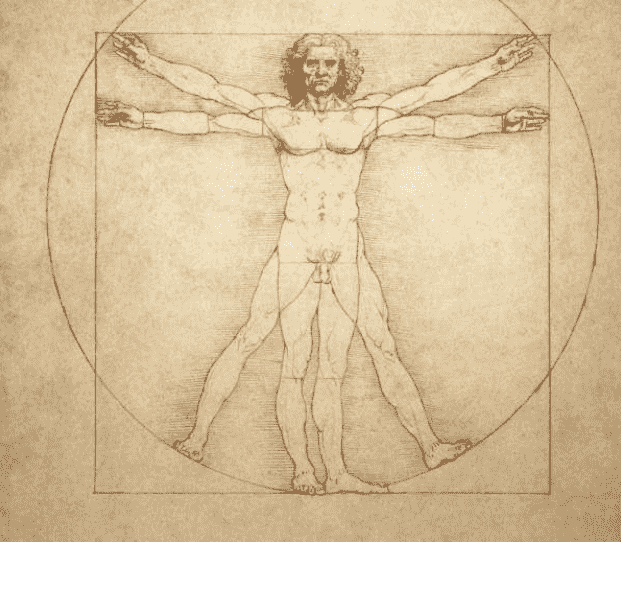

三眼这篇写的东西，10 个人估计会有 9 个不屑一顾，但这才是真东西！

因为这个东西，学校不会教你，父母不会，社会更不会！

这个东西很简单，但被众人所忽视，很少人能够拥有！

这就是一个人活着的灵魂——一人的系统结构！

多数人是没有结构的，也可以通俗意义上讲，没有灵魂！

## 【到底是什么决定了人生成就】

决定人生成就的因素很多，但你所见到的都是“打碎”了的因素！

从客观方面说：时代、机遇、社会阶段、环境、家庭、背景、教育水平等，统属于被动接受因素；

从主观方面说，性格、天赋、价值取向、职业、心态心胸等，统属于主动选择因素；

但据研这些因素并不能为实现人生成就提供什么“帮助”！因为以上都是“结果”，不是真正的内因，或者叫起源，时代是个结果、环境是个结果、性格是个结果、职业是个结果....

三眼一直说，看问题要找寻事物的最本源，才能“牵一发而动全身”，什么是以上诸多事务的本源？什么是人生成就的本源？

## ——是结构！

人之所以为人，人的智慧之所以称之为智慧，是因为有“结构”！

看任何问题都要从系统哲学的角度来看！

站在个体角度出发观察世界，无论是外在的和内在的，还是你所能达到的人生成就的高度，都取决于一个东西，那就是结构。

## 【抽象的结构】

结构到底是个什么？我们先抽象的来说！

没有结构的人，也就是多数人，一生其实都在“画圈”；

表现在生活、工作以及内里思维上，大多数人一直在“画圈”，也就是在一个狭小混乱的认知里打转，所以结果必然是在生活工作等具体行为上打转，而在心态上的结果就是“徘徊”。
所以大多数人的一生就是身体在画圈，心理在徘徊，最后成为一堆黄土。

有系统结构的人，很稀少，一生都在不断“蜕变”；

“蜕变”是什么？就是一个人发生“质变”！

不断蜕变就是不断在质变，这就是成长，这也是人活着的意义与乐趣。

## 事物“质”的变化是由“结构”的变化而引起的！

任何质变都需要量变，但如果没有“结构”，“量”的积累再多也无用，大多数人就是没有“结构”而去努力积累“量”，注定是徒劳的“画圈”。

石墨是怎么变成钻石的？

因为其分子结构发生变化而至！

如果没有结构的变化，给予无限时间去累积量，也不会变成钻石。

## 【具象的结构】

所以人成长与发展是一个不断追求质变的过程。遵循着结构质变规律。

> ——将自己建立在什么样的结构上，将决定其所能达到的高度与成就。

那么“结构”具体怎么建？怎么在人生中运用？

- 1、建结构！
也就通过结构化的思维去拆解万物，就像一个解剖师一样，这个过程就是做‘解构’；

- 2、填结构
也就是在拆除了万物的结构后，按照“自己所想要”的方式，去填充每个结构，这个过程就是做“重构”。

- 3、如果你既能“结构”某种事物，又可以“重构”它，那么你就是在运用“结构”了。

## 【建结构】

“结构”的建法，或者叫拆解之法，有很多，有没有一学百通的“万金油”？

有！

三眼以下所讲的拆解法，基本上所能见到的事物皆可以由此拆解，只要学会了，哦对，不能叫学会，而是叫掌握，因为“结构”这种东西你知道了，放在脑子里即可，而不断填充它才需要去学习诸多信息与技巧。

只要把以下结构放在脑子里去观察世界，那么世界就会呈现不同的样子！

## 1、辨证

辩证思维是人看待万事万物的基本思维，这么质朴简单又实用的思维，缺很少有人拥有！

## 什么是辩证思维？

就是双向思维！所有的具体“结构”都是由此演化而来！这是“结构”本源！

哲学是人思想的起点，人们对哲学敬畏和不解，是因为大多数搞哲学的把哲学给搞复杂了，哲学“以用为本”，只要你想用它，它就会很简单！

人的感知主要靠眼睛，眼睛都是向前看的，所以人的思维一般都是正向化的，很少有人在脑后长有“第三只眼”！

比如想要变得富有，就一直在思考富有，比如想要变得强大，就一直思考强大，而很少有人去思考穷富共生，是不能割裂的，强弱相生，是要对比才能显现的。

## 这个世界任何事物都是有两面的，阴与阳！

强弱、穷富、虚实、高低、美丑、前后、快慢等等，你会发现任何一门语言除了一些名词外，绝大多数词汇都可以找到反义词，语言就是人类看待世间万物的思维并将其符号化。也可以说，自从有了“反向观察”能力，人的智慧就生长出来。

诸子百家群经之首《易经》六十四卦都是阴阳交与阳交演化而来，老子说一生二二生三三生万物也是这个道理。

这些东西说起来似乎很高端很神秘，其实很简单质朴，是人把它复杂了。

有人经常私信问如何学国学，学传统哲学。我在这里统一回答：

哲学没有传统不传统之分，无论东西西方哲学，还是儒释道法诸子百家，其哲学本质都是一样的，只是各家各派针对当时所处的不同时代、不同环境、不同的人文习惯，演化落地的东西不一样而已。

比如易经中的六十四卦，其中很多围绕当时社会生活层面的东西，已经过时用不上了，我们只需要学会其根本即可，也就辟证见！还有就是一些比较普遍的规律，比如乾卦中针对一个人或事物发展轨迹做出的卦象。而现代西方经济学中的周期规律等与易经中的卦象阐述是一样的，不用死学生搬硬套，那只能证明还没有明白根本，什么东西更好理解和与他人沟通，就学什么即可。

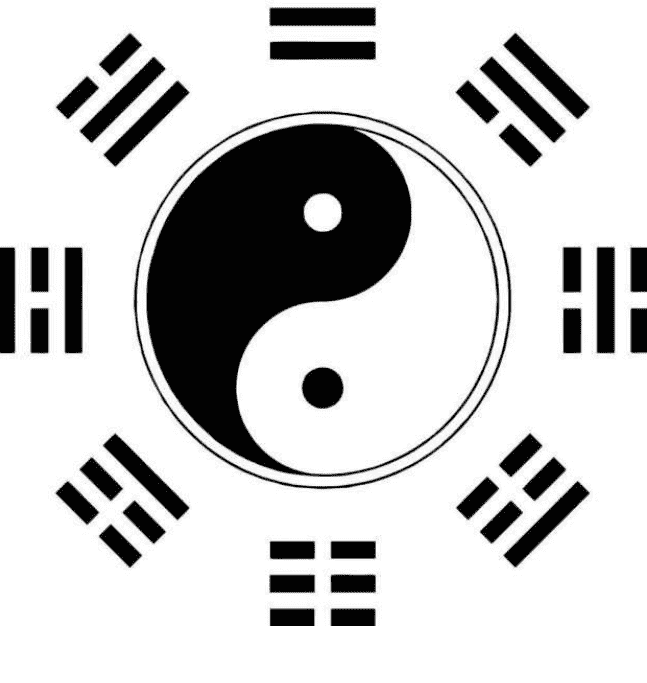

辩证如何应用，说几个喜闻乐见的东西感受下。

比如想成功，怎么办？去研究失败；
比如想让一个女孩爱你，怎么办？去研究她为什么不爱你。
比如如何区分敌人与朋友？这二者的界限是很模糊的，因为敌友是不断转化的；

**一直盯着一个方向，就会造成思维朝着一个方向，那么你所看到的皆为幻影；**

**幻影是什么？就是固执，在佛家叫“我执”！**

**佛道相通，道就是脑后长出“第三只眼”；佛就是放下“我执”。一个意思。**

## 2、时空

大家都知道有时空的存在，我们也存在于时空里，但是很少很少有人通过时空去思考和拆解万物，三眼总说，人们对经常见到的、已习惯的事务不会存有怀疑，更不会正视和利用。

空间上：微观、中观、宏观；

时间上：历史、现在、未来；

是不是很简单？

### 多数人的思维既狭隘又不长记性，因为缺乏时空观，脑子里装下这个结构，世界立马变样子！

比如看一栋房子，微观上看见的可能是建筑质量等，中观上看见的可能是地段、人流、交通、配套等，宏观上看见的可能是这笔资产在国内所有资产中所处的位置；

从历史观察，它可能是用来居住的；从现在观察，它可能是用来做金融交易的；从未来观察，它可能是所有者的信用与融资的基础保证。

还有没有更多思考余地？非常之多，如果在时空观上想的更全面，那么你对这栋房子将“了如指掌”！

但首先，要先有 emit？ 时空观的思维结构，也就是“怎么观”，之后你才会去“具体观”，当有了结构之后，所有你的“具体观”都可归到结构上来，观察越多，结构越充实，才可了如指掌！

### 之前你所观察的和所读到、听到的诸多信息，为何都没有用武之地？为何看了就只是看个热闹，过后就忘？就是因为你没有“结构”存放。

小时候妈妈常说：学习不能左耳朵进右耳朵出，就是这个意思！

下一次在获取信息，将信息慢慢的归类，归到时空的“格子”里，最后再去看整体，你将对所研究的事物有一个新的认知。

## 3、利益

### 利益观就是所处环境的利益体之间的辩证关系。

利益是什么？用道家的话说就是“不可言”，就是说不出为什么！

只要有生命存在，就会有利益，这是生命活着的动力，也可以说是为了活着而活着的本源驱动力。

如果没有利益存在，那么这个世界将一片死寂。

很少人能看懂利益，是因为你的认知是错误的：

首先，要用第一点所讲的“辩证”去看利益，那么利益就是个哲学词，不是一个名词，不是指代某样具体事物。

有得利必然有失利，任何事物交涉在一起，必然充满着得利与失利，而我们所要观察的就是诸多事物揉在一起不断地得利与失利的动态关系。

其次，多数人认知错误的原因，是因为人都是以自身为出发点去思考，只看自己不看其他利益体。这就叫“一叶障目”；正确思维是要跳出来忘掉自己，观察一个盘子上的利益体关系。

以上二点，第一点是思维，第二点是心理。

那么怎样去观察利益动态关系？怎样划分利益体？每个利益体是不是都很复杂？

其实很简单，无论大小“团体”划分的方法都一样：

坐庄的；

经营的；

散户。

其实也不必执拗于这三个词，三眼也是无法表达，只能借助“赌局”的词汇来表达，当你明白了利益关系中的动态辩证，你会有你自己的词汇来描述。比如：

自然生态：大自然就是所谓坐庄的，风雨雷电四季交融就是经营的，而诸多动植物就是散户；

国家利益体：政府就是坐庄的、企业（通指市场，不光是具体的企业，还包括学术界传媒界金融界等诸多影响市场的因素）就是搞经营的，百姓就是散户；

一个公司利益体：董事会、经理人、员工。

一个旅游团利益体：带队的、协管的、散人。

以此类推！

所以诸位读到此处应该明白了，利益动态关系用一般词汇无法准确描述，任何“团体”都会遵循统一的利益动态关系，只是每个团体的描述不同。

这就是老子说的“名可名，不常名”——名字很难去表述，只能用大家都认知到的词汇来代替。

只要去辩证的观察利益动态关系，即可明白：

正向思维：坐庄的是必然出现的，比如人类散户的发展必然制造出坐庄的政府，有了政府必然会有协同运营的利益体。

反向思维：有了坐庄的，比如大自然，就一定会有风雨雷电，而后就会有诸多动植物生长出来。

如何观察利益关系的动态？

一是观察三大利益体之间的关系；
比如政府的利益在哪？怎么通过企业与百姓获取的？
企业的利益在哪？怎么通过政府与百姓获取的？
百姓的利益在哪？怎么与政府和企业“缠斗”的？
利益体之间的利益怎么流动的？
等等！

二是观察每个利益体内部的利益关系；比如：
政府内的叫部门，部门之间的利益共通与矛盾在哪？
企业内的叫行业，各行业之间利益互通与矛盾在哪？
百姓内的叫阶层，阶层之间的利益共通和矛盾在哪？
等等！

这里一定要注意的，就是人性使人思维牵着一个路线前进，而诸位可以看到以上所讲的是一个“反复拆腾”的思维；正反向去观察，上中下去观察，前中后去观察，把各个利益体拿捏在手里反复“玩弄”，自然可以玩明白。

什么叫玩明白？

就是无论站在哪个利益体的角度，都可以把全局思考出来！

## 4、体用术

如果以上三种拆解方式都明白了，那么你在钻研某一门类，或者某一学科的时候，自然会明白什么叫做“体用术”：

“体”就是一个门类的最底层次逻辑；这是一个很抽象的东西，但抽象的东西才是内核，因为人思想本身就是抽象到具体的过程。“体”就是老子讲的那个“不可名”的东西，是必然存在的基礎逻辑。

“用”就是某一学科从“体”向下落地演化而来的普遍规律和原则把握；

“术”就是根据具体情况的一些具体方案，灵活施策。

比如：

纵横家，也就是搞外交关系，专业技术在于人与人之间的思想交流，看谁能忽悠谁！

这个学科的底层逻辑在于“押窗”，也就是天地之间的一开一合，又像是人的一呼一吸，通过一开一合来达到目的，是不是很抽象？但很关键！

向下落地到“用”，也就是规律层，会有很多讲话的规律。

比如“阴阳者依卑小、阳言者依崇高”。意思是 一个人阴暗狭窄，那么应和他需要“卑小”的话语，一个人如果阳光明亮，那么应和他需要“崇高”的话语，这是最基本的一个谈话规律。

在延伸到“术”，也就是具体情况的层面。

假设对方的“阴言”或“阳言”是在说假话呢？在故意表演呢？在设法套取你的真实想法呢？这就要具体情况具体对待了，这就是术。

“术”再变化也离不开“用”的那几个规律，只不过是重新排列组合而已；

“用”的规律再多，也都是围绕“体”来推演。

所以什么能表明一个人真的学会了一门学科？

那就是建立了完整的“体用术”系统！也就是抽象到具象一个完整的过程。

大多数人都是在“术”上打转，好不容易到了“用”的层面，虽然了解了一些规律和原则，但是没有“体”的指导，这些“用”看起来很有道理，但实际根本就用不上。这就好比武术套路再明白，上了战场也是王八拳，因为不懂心法。

## 5、使用举例：官产学媒

这这个拆解方法就是很具体的了，通过前面的方法钻研国家与社会，自然可以得出下面要说的。

在社会发展的驱动上，以“系统结构”去看，分四个群体：官产学媒。

官就是当官的群体，核心是权力，通过权力来搞分配，位置就是生产力；

产就是经营产业的群体，核心是资源要素以及把资源要素整合在一起运作的模式，通过分配链来获取利益分配，创新就是生产力，创新分为科技创新和模式创新。（就算以政治成分很大比重的垄断型央企也需要创新）。

学就是搞学术的群体，核心是知识应用，无论哪个圈子都需要“寄生”一堆专家学者，意见就是生产力，通过提出问题与解决问题的来实现价值。

媒就是引导舆论的群体，管控大组织，不光要管控利益，更要管控人心，核心是话语权，信用（可信度）就是生产力。

前面的拆解法都可以往这个结构上使用，比如：

在时空观上观察官产学媒！

这几个群体怎么来的？过去什么样？现在什么样？将来会变成什么样？微观上他们都在干什么？中观上怎么分布？宏观上怎么互通的？

在利益观上观察官产学媒！

这些群体谁是坐庄的？谁是经营的？怎么坐庄与经营的？

而在每个群体内部坐庄的、经营的和散户又都是谁？

每一个群体他们的知识素养是什么样的？什么是他们分别的“体用术”？

### 任何一门学科，不是单向的，而都是多向的。

比如炒股票的主要两种方法，一种是看基础面的学派，一种是看K线图的学派，如果你很“我执”地去研究这两种学派，是研究不明白的，必须放下“我执”跳出来用“结构”去拆解，并在最本源的“辩证”上去思考，自然可以看明白：

基础面学派是研究“官产”，通过官产“硬”的诸多指标去判断一只股票的好坏，他们认为股票的浮动是基于“硬”指标的变化；

K线图学派是研究“学媒”，通过学媒“软”的意识形态（多空）对资金影响，而形成的一条条变化的K线，通过研究K线变化反观“意识形态（多空）”，而去闻资金的流动和盘面中的心理，他们认为股票浮动是基于“软”指标的变化。

这两种方法对吗？对，但也不对！

对是因为确实都抓住了一个“工具”去拆解，在“工具”的使用上没毛病；

不对是因为他们都忽略了一点：研究“硬”指标的忽略了政治对指标数据的人为左右；研究“软”指标的忽略了政治对意识形态的左右。

如果这两种派都能跳出来在更大的范围上思考，就不会相信他们的“工具”了！

更大范围研究的是什么？就是政治如何“左右”！这才是最大的最受用的最内核的工具。

所以诸位读到这里应该能明白，通过前四种拆解方法，即可“解构并重构”出第五种官产学媒，再继续结构重构呢？那将会出现更多的结构。

只要抓住核心结构，其余具体的“应用性结构”，自然可拆解并且重构。

## 【碎片与整合】

人本来都是一样的，差别在于后天的学习教化，多数人脑子中的东西都是错误的认知，因为都是碎片。

碎片越来越多就混乱，从小时候上学一直到社会，从报纸书店阅读信息一直到互联网信息爆炸，每个其实所能看到的信息，大部分都是相同的，而大多数人“画圈”，少数人“建结构”，就是因为起点不一样。

这个起点其实得来很简单，就是脑子里有结构即可，脑后长个“第三只眼”即可，放下“我执”即可，非常简单。

真理在少数人手中说的就是这个道理。

多数人的意见一定是错的，如果多数人都对，这个世界就要崩溃了！

我们要做就是“偷偷摸摸”的学习真东西，做少数派。

在人生心态修为上，不是攀比荣耀富贵，而是攀比谁的结构更丰富！

## 【人的成就】

三眼最后说人生的成就。

这个问题咱们不形而上，因为形而上大家最后都会变黄土，讲那个一点意义都没有。

实际层面，人的成就就是一个人内在结构与外在结构的平衡。

你拥有什么样的内在结构，就会对怎么去拆解诸多外在事物，而必然会经过“解构”到“重构”的过程，这个过程的结果就是你的人生成就。

人的内在与外在是平衡关系。

很多人抱怨自身有才，但是金子总不能发光，这是最愚蠢的想法，如果你不能发光，你的内在一定有问题，因为内外是平衡的，你不发光一定是“我执”在作祟！

## 【人的能力】

能力是什么？就是你“解构”和“重构”世界的方法！

做一件事，绝大多数人想到的都是“点子”，很少人会用“解构”思考和去做。

这个时代靠“点子”谋生几乎是不可能了，因为你所能想到的“点子”，可能已经被想过几万次。放在几十年前，你因为有了 一个“点子”就看起来比别人多了个小“结构”，而因为那时 候“结构”稀有，你会在那个时代展现出非凡的能力。

时代在发展，社会在演化，而人在进化，进化的方向就是从“点子”到“结构”。

未来的竞争很激烈，因为信息更趋向于对称化，价值更趋向于饱和化，而科技的跃升让竞争更加快速。

没有结构，必备淘汰！

未来遥迫每个人都需建立“结构”，拥有综合的结构自然会得到以下能力：

## 观察力:

俗话说能把东西看透。

当看到一个事物，

由此及彼——别人看到的只是这个事物，而你看到的是类似的多个事物；

由表及里——别人看到的只是事物的表象，而你通过表象去推究内里；

见微知著——别人看到的只是细小的不被察觉的，而你可以用小见大。

## 学习能力:

有“结构”的人学习将更加快速，人与人的差距也将更快速拉开。

学习对于大多数人来说是很枯燥的，为何？因为没有“系统”就是死记硬背！

学习是个很简单的事情，当人拥有“系统结构”，那么你所观察到的、阅读到的诸多事物，自然会有个地方“存储”，无需去死记硬背，因为有了“系统”你就知道为何要学习某信息，并应该把某信息归于何处，用的时候拿出来即可。

## 表达能力：

不会观察就不会表达，因为你连所看到的事物是什么都不知道，怎么去表达？

这就是很多人面对问题不知所措，更不会解决，就算开个会这么小的事务，也不知道说点什么，这都是没有“结构”，只要有结构，你会发现你想表达的东西很多很多。

社会生活的基础能力是沟通，如果沟通有障碍，如何发展？

## 做事能力：

不会“解构”驾能“重构”？

做事情有两种，大多数人都是被人利用的工具而已，因为他们正在做的事情，自己都不知道为什么要做，只是有人告诉他应该这么做而已，这就是“画圈”——你不会“解构”当然不知道自己要做什么啊！

另外一种少数人，无论做任何事情，用前面我所讲的几种拆解方法去应对，都会将你所面对的事物拆解干净，只是时间问题！

当你拆解完成，如何“重构”自然就懂了！

## 从毛《中国各阶层分析》看这个时代竞争！告诉你最简单实用的成功思维！（3000 字）

2 月 14 日

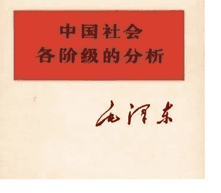

> 人有没有悟性，首先取决于“敢不敢悟”，而后取决于你的智商。——三眼

## 【屁股决定脑袋】

为何三眼一说东西就颠覆你的三观？

因为三眼知道你在想什么，你的迷惑在哪，你的认知范围在哪。

用你所能认知到、理解到、感受到的东西和你沟通，然后将你的思想“提起”来！

前者叫“带入”，后者叫“带出”，一入一出，就成了！

专家学者是尽量搞复杂，三眼作为一个独立自由的“解构师”，尽量在搞简单！

人与人之间认知差距，首先决定于“敢不敢悟”，而后决定于智商——这叫屁股决定脑袋。

对于大多数人来说，你所坐的位置，决定了你脑子怎么思考，位置决定脑子的格局，超出你位置的事物，你根本不敢去想，或者没有心思去想。

一个村民的认知受“屁股”制约，脑子里多是怎么办打庄稼，怎么研究研究村里的尔虞我诈，怎么能比其他村民多口饭，甚至于村子之外的世界，尤其是光鲜亮丽的大都市，是不敢去想的。

不敢想就形成神秘感，形成神秘感你就会自我设限，给自己的认知画上一个牢笼。

同样道理，你是一个白领呢？是一个手工艺人呢？是一个个体户呢？

侃食吃的人都不会去思考分配食物的事，因为侃食就决定了你的认知仅仅局限于侃食。

“侃食的”不敢想，是“分配食物”的最乐于见到的！

脑子不跳出三界，身体是无法跳出五行的。

三眼说：众生起点不同不公平，但在认知获取上众生平等，一切神秘和传奇都是纸老虎，一拍就扁，空空如也！

《三体》里讲了一个东西叫“维度压制”，高维度对低维度是绝对压制的，无法反驳与反抗！

什么维度压制？其实就是认知压制。

怎么破解？其实很简单，只需要脑子进入高维度，身体自然慢慢进入。

人的身体受制于屁股，也就是工作、环境、养家糊口等诸多现实问题，像一个个绳子束缚住你的身体，以至于形成心缚。

三眼就是把高维度 的东西，用你所能接受的语言来讲给你听，一起拍扁“神秘纸老虎”提升认知力！

这篇带给大家毛的《中国各阶级分析》，这是三眼看过的，最接地气最通俗易懂的成功思维讲述，不要神秘高端化，切记！

原稿 6000 多字，诸位可以自己搜来看。文章“功夫在诗外”，不要看文字本身，要“向外”看！

头部重点就一句话：“谁是我们的敌人？谁是我们的朋友？要分清敌人与朋友，却并不容易。”

中间是对当时中国各阶级的划分，统分为上中下三等，而后细分为大资产阶级、中产阶级、小资产阶级、半无产阶级、无产阶级。包括人数、意识形态与行为、代表人物等。

尾部呼应头部就一句话：“谁是敌人谁是朋友？我们现在可以答复了。”

开始解读！

## 1、怎么看清世界

为何多数人都看不清世界？

每个人、每个利益体，都是站在自身的角度去观察世界。

有人称社会必有阶级，无分对错，都是站在自身角度说事。

一辆公交车，你先挤上去了，你就是车内人、利益上就＿不希望更多的人上车，拿脚往下踹。挤不上去的边排队边插队、边弃跑去弯街。

举个都可认知到的例子：

一个员工最容易犯的思维错误，就是用摄砖的思维去判断领导是不是英明，在大多数员工眼中，领导都是傻X的，什么都不懂，还特别爱装。那是因为你不知道，你所处的层次是“养猪层”，你的思维局限于被砖缝口吃的东西，而领导可能是处在“分配层”，通过占据分配位置混口吃的，当你的被砖思维提升到分配思维，很可能你就会。你领导。参见《养猪 [养]》，或者者内搜索“养猪”二字。

以此类推，满网都是喷子，为何？

都是站在自身的角度去判断大环境，去判断其他维度的事。

一个巡抚去村里送温暖，村民甲：你连搓糍都不曾，会什么当巡抚？

你所要做的，就是绝不要困锁在自身这个小角度。

你所要做的，就是观察周围这个世界的官产学媒、九大阶级等。

你对每一个利益体多了解一分，就对这个世界多了解一分，当你可以完美的画出利益体的“世界地图”，你的基础认知就及格了。

## 怎么看？

一阴一阳，一硬一软！

### 软的就是看“生态”；

各利益体共同组成一个生态，每个利益体都是生态的“器官”，如何具体看，参见《结构视》一文。

### 硬的就是看“指标”；

这个世界每一个“器官”的运行都是建立在整体大规则下的，这是其一；公众号内搜索“分配”多篇文章有讲述；

其二就是运行的轨道要看“指标”，这么大的大组织，要让每个“器官”合理运行，必然要有规矩和指标，“器官”定然都是跟着指标走，通过完成指标来获得口粮，不然就全乱套了！

比如地方政府的 GDP 考核标准变了，不是主考指标，而补行业短板和惠及民生成为新指标；

去杠杆和去库存的指标是什么，直接影响到风险口和财政口；

一个地方交通局的指标呢？罚多少单子？抓多少车型？有多少进账？

一个媒体的舆论指标呢？把某某关键词控制起来，做到舆论覆盖率不到 1%，而对于主流意识形态关键词，要极力做到覆盖率达到 50%以上。

以上随意举例，世界那么大，自己观察。

读到这，还是不明白如何去看指标对吧？大概有个模糊的意识对了吧？

好，下一步，指标细分为两大块：

+   1、硬指标看钱;
2、软指标看意识形态。

你要知道，操控整个大规则，就俩东西，一个是血，也就是钱，一个是魂，也就是意识形态。（无论组织大小）

## 2、怎么玩社会游戏

> “胜一人难，胜二人易”——曹操

任何一款游戏，必有敌人！

游戏规则的核心就是：谁是我们的敌人，谁是我们的朋友。

如果没有敌友，何来游戏？

一生二，二生三，三生万物：

这个世界本来都是各自相安无事的，也就是一：

但每个人都想要获取更多的利益，从而有了交往，形成利益体、等级、贸易来往等等，也就是二；

通过不断交换和利益往来，等级在不断流动，钱在不断流动，秩序在不断变化，形成大千世界。也就是三。

所以：

“入世观”是要干嘛？就是“从一怎么到三”；

“出世观”是要干嘛？就是“从三怎么到一”。

三眼不讲出世，只讲入世，出世那东西等你老了，在深深的夜里对着月光自己琢磨玩。

好了，讲怎么“从一到三”和“谁是敌人谁是朋友”来讲“入世”。

问个问题，什么叫成功？什么叫失败？

想必绝大多数人是无法回答的。

成功，就是本来没事，偏要搞事，事搞成了，就是成功；不会搞事，事又搞砸了，就是失败。

搞事就是给众人划分成敌友——敌友都是你划分的，规则不自然是你定吗？

比如：

为何你去一个单位或组织，第一问题就是面临“站队”问题？
因为想要成功的人，必然会搞事，必然会画派系，通过派系竞争来获取自身利益。

你创建一个品牌，想成功就要“搞事”，搞事就是在受众的大脑里凭空制造出“敌我”，“拉拢”的朋友越多，你的品牌自然就成了。

小众品牌就是搞小圈子“敌我”，大品牌就是搞大圈子“敌我”。

比如那个针对年轻人的著名体育用品品牌，为了彰显“体育精神”，广告里时不时就传递一个“独立、自我、不服管”的意识形态，这就是凭空制造“敌我”，穿这个品牌衣服穿得不光是个质量和样子，更穿得是一种“精神”，一种抗争不服管的“精神”，你要问这些傻b孩子你跟谁斗“呢？他们也不知道。

你要想当个专家呢，现在的专家几乎都不专业，因为所谓专业就那么点事，明星专家的高明之处并不在于能给人们获得真知，而是能搞事，让粉丝站队，满足粉丝的发泄欲。不信你去跟一些公知大v去学习，n多年后回来告诉三娘你学到什么？你只能学到一些粗鄙知识和大量的“发泄”。

比如讲经济有什么可讲的？经济在西方传统里就是个数学题而已，而且是理论远大于实践，被实践派成伪科学；

比如讲文学历史的，有什么可讲的？那玩意儿自为人性善恶的一部分罢戏而已。

这些都是甚没啥实用性，因为想实用在于用，这就需要综合。

最实用的就是诸子百家和毛的东西。因为我们都依赖于大组织的规则，而大组织的规则就是源自这些。

从一到三，就是本来相安无事，但就是要搞事；
谁是敌人谁是朋友，就是搞事的基本原则，定规则且搞复杂。
搞得具体方法就是“血”与“魂”，也就是抓好利益对立与共生“血”的流动，抓好意识形态的“魂”。

什么叫天地斗乐无穷？意思是天本来就在那里，地就在那里，让他们斗起来，你才能掌管天地。

所以古话讲：人出来混，混的一方天地。

就是这个意思。

拿着三眼这套理论，去入世去“斗”吧，你以后看任何利益体都能看得明白。

## 做投资就是“借钱抢劫”？首先你要明白什么叫“转圈圈”！一文说清（4400 字）

2 月 16 日

资本市场是啥？

投资是啥？

目前“转圈圈”是啥？

这些“是啥”搞清了你就知道你该“干啥”！

## 【资本市场】

看一个东西的本质，就看它是怎么来的！

这个词是个西方词，是资本家的工具，什么工具？

劫掠、偷窃、盗抢的工具，也就是不用劳动，通过借钱来生钱的套路。

原来我们一直走的是 SHZY 道路，东西都是 G 有的，一切 SI 有全都是要批斗进牛棚的，一场改革春风，开始走特色 SHZY 之路，为啥？因为我们的最高“史记”中讲了，要解决生产力与生产关系的矛盾，说白了就是之前的路没效率，没科技，还是“西风”干实事靠谱。“内法家外西学”由此诞生。参见《读懂改革 40 年三大阶段！才可看清你在这个时代的位置！以至于未来！（7600 字）》一文，或者微信公众号内搜索“改革”2 字。

那诸位剩食者思考一下，谁能第一个有资格借钱？有资格去投资？有资格去钱生钱？

肯定是大户家的儿子们啊！

记住三眼一句话，在 ZBZY 道路上，谁能借钱谁就是大爷，能借到钱就是致富最核心的妙方。

三眼一直讲的认知差距，就是大户带头风向变了，底层剩食脑筋依然停留在几十年前，最典型的就是你回到三四五六七八线，越靠后的县级“攒钱光荣借钱可耻”越是深入骨髓。

三眼一直说，吃肉喝汤跟谁要跟最大的，认知也一样，这个做法选择，不取决于个人主观情感，大家都是依附于最大规则，谁离规则越远，谁越有概率喝汤吃肉。

到了现如今，为何众多创食小民也天天见“资本市场”这个词呢？

一是当一个新词你见到的时侯，证明它正在收割你！韭菜们的越来越多，迷迷糊糊全都被“资本市场”给割了，又爱又恨铭记于心；
二是因為资本市场的“队伍”越來越壯大！队伍怎么形成的？怎么壮大的？

首先，既然“市场化”了，那么哪里赚钱快，就要去哪里掺一套“资本市场”掺一腿，根据赚钱快慢和利润程度，来个排行，大户儿子们厉害的主力和（控制）大的，小主力和小（控制）小的，有礼有秩序。

从第一产业一直升级到第三产业，钱的流动变了，产业越高流动越快了，尤其是互联网的出现，从本质上改变了人们的生产生活方式，钱流动的花样越来越多，越来越高效，“掺”一腿的地方越来越多，整体“队伍”越来越大；

其次，这个不好明说，三眼给诸位讲一个逻辑，自己对照！

人出来混要“占山为王”带队伍的普通套路：要有心腹、耳目和爪牙。你就思考你自己，无论你是创业还是在某组织混，要想有一方天地，肯定要组织一个自己的小社区啊，社团三大法器就是心腹耳目和爪牙。

大户儿子也一样，毕竟一只手遮住的面有限，很需要把手复制成多个，“带个手套”多条路线开抓。每个“复制手”都有心腹耳目和爪牙。

创食者经常喜闻乐见的“资本明星”几乎都是“复制手”，不用仰望，大家都是打工仔，只是“跟对人”不一样。

金字塔从林社会，牛不牛主要看给谁提鞋，年经孩子父母犹豫转向社会必然愤青，可以理解，慢慢来，什么时候知道“两面三刀”才是及格成熟。

心腹大多是代言的，耳目成体系化，给“掺一腿”找机会找路子的，爪牙也逐步体系化，怎么操盘各有套路。

## 三眼讲上面是想说什？

看清大规则是什么逻辑，对自己的位置、自己几斤几两有个衡量，不要“狗狗身子有貔貅心”，资本嗜血性与草原竞食是一样的。吃肉骨定是吃不到的，喝汤怎么喝是主要思考。

## 【投资】

投资就是借钱生钱，俗称空手套白狼。

一般人脑中投资是自掏腰包，投钱买人力买资源，合力打造一台“赚钱机器”，这不叫投资，这叫拿本创业。

插一句为何三眼不赞成现阶段创业，因为一是大环境不好，是一个“存量转移”的阶段，不要痴情停留在几十年前靠一个“点子”即可发家致富，你的点子几万倒食的都想过了，不要小看集体聪 malam 智，十几亿人“歪脑筋”多的是，创业这东西越往下玩竞争越激烈“歪脑筋”越多！越往上去越简单，因为认知层次不一样 二是现阶段创业不是靠努力，而是要“先成功后创业”，而不是“先创业求成功”，在“存量转移”阶段，你只有先看到钱怎么流动，再看看自身几斤几两，能不能占上流动的好位置，如果能，也就“确定可以成功了”，再去实际执行（创业）。“先创业求成功”属于赌博，就目前这环境，十有九亏。

继续说投资！

## 空手套白狼的核心是啥？

## 是抄袭、欺诈和盗窃！

据量一下自身性格，太“本分”那还是不要研究这条路了。

4000 点起点，各种概念形成多空 K 线走势，各种国央企 2 级公司什么的，自己琢磨琢磨吧。

说点可以说的，比如十年一线到了 20 万一平，小县城几千一平，这是很玄幻的，只是大家习惯以为常了，不以为然。这背后是劫掠啊同志们，大户吃肉小户喝汤，一线的租金，那是劫掠啊同志们，80 平房子一个月 1 万租金啊！哈吧楼市投资，本质就是借钱去劫掠啊，跟上就喝汤。

存量时代未来主战场一定在金融啊，几大互联网大佬过去主营都是游戏啊，现在迈向新高度放贷了。

## 【借钱去抢劫】

投资就是借钱去抢劫，要跟上阵容，怎么跟？

## 核心：抢存款！

哈意？就是资本市场无论怎么玩，最后还是要有交易接盘，你可能觉得有些东西挺高端，跟自己一毛关系都没有，那你就错了。

一个欧式贵族晚宴，桌面上一盘盘烤肉，无论起的名字多么高大上，叫这个债券芭比 Q 那个融资本 BBQ 的，一盘烤肉炒到 1 个亿一盘，最后也是马家屯王大婶赵老汉家养的猪啊。

## 怎么抢呢？

王大婶兜里有多少，弄出来不就完事了？

## 错！

是王大婶兜里的钱+勾引她借钱=最后弄出来的钱。

## 结果就是：钱拿走，债务你留下。

仔细回想一下首 fu 出国被打脸事件，所谓风险就怕这个，钱走了，债务留一堆。

所以目前国际撕盘主要是抢存款抢余粮，外汇要管好，想出去是不可能的，要打脸。

插播一句，地产如果要下跌，只有一条路径，就是钱可以随便走出去潇洒，自然房价下跌。

除此之外，什么房产税和各种调控，都不管用的，都是皮面功夫。

## 什么叫风险？

## 就是“转圈圈”有大量人“逃盘”以至崩盘！

就是各路大户所留富有，都是一身债，怎么能实现走人、债务留给后来者，这才是真富有；富有首先要自由不是嘛！不然就都留在来继续债务“转圈圈”，转圈圈停了，就得崩。

## 转圈圈的盘面

金融机构存款总规模：190 万亿

地产：350 万亿

股市：65 万亿

债券：基金信托理财等 95 万亿

一共大约 700 多万亿。

这就是转圈圈盘面，创食者虽然很小，而且有的可能是个负值，但也都在里面。

里面个别 Paige 巨大大户可能顶 1 个亿个创食者。

盘子就这么大，所有钱（债务）都在里面“转圈圈”，富了这个就会穷了那个；

而“转圈圈”靠债务推动，放水注水，刺激一下转速，大家都分一分，底下创食分的少，大户分的多。

## 存量不动只做增量

这里延伸一下，有个关键词要记住：存量不动只做增量。

哈意思，就是这几十年，尤其是近 20 年，水下来了，站在存量位置的大户拿得多，拿完不咋，站在增量位置（底层）的创食者拿一小点，还要吐出来（消费和被金融收割）。

以前发展快，增量足，一年就 8% 以上，个别年份 12%，保 8 就是保就业，保就业就是保稳定，创食的也“雨露均沾”，小汽车也开起来了，站在存量里的人开 200 万进口车，

靠增量过活的创食者开 10 万国产与合资车，小汽车开起来了证明手头还是有余粮啊，咋办、弄大管道吸一吸，股市楼市，加杠杆吸，吸未来的钱。

所以三眼一直讲，钱是分配来的，不是蛮力赚的，分多少不是取决于干多少，而是取决于你站在哪个位置。

## 7 年净存款增长为 0！

截至 2019 年 6 月底，央行数据显示：我国居民净存款(储蓄减贷款)为 26 万亿元。

啥意思？

2012 年底这个数据就是 26 万亿，也就是说，7 年来居民净存款没变！

更重要的是，这 26 万亿里面，绝大部分钱都属于大户的，也就是“存量不动”的，真正用于消费的创食者身上有多少存款？数据没法弄清楚，但可以肯定的是，许多许多许多许多人都是负资产负资产负资产！

你手头有几个万元净存款，你算是富户了！

这个不用数据，去看看现在各种白条、信用卡，花叫什么的就知道了。

而另一方面，统计局数据显示，我们人均可支配收入是增长的啊，年均增长 8.5%，比 GDP 高，按理说余粮应该搬下来才对啊，怎么还负债的？

所以地产的逻辑至此就明白了：

## 过去三四年去库存是干嘛？是把地方 ZF杠杆（债务）和企业部门杠杆转移到居民身上；

现在负债资产的倒食者一堆一堆的，债务实在是滚不动了，所以形成地产的“冰火两重天”；
一线和部分强二线由大户，以及大户的心腹耳目爪牙的钱支撑，未来是“慢火”的转圈圈市场，而剩下的部分二线及三四五六七八线，将会冰冻起来，啥叫冰冻？就是转圈圈转不动了。

所以在《赚钱的本质套路一共就3个：底层收智商税、中层找接盘侠、上层玩金融！
【完整版】》一文里说过，或者微信公众号内搜索“分配”2字。一线资产是“精英层”主导，也就是大户和心腹耳目爪牙主导，而物价是由倒食者主导，吃饱穿暖是底线。

## 转圈圈模式转换

好了，债务转圈圈楼市玩不下去了，怎么办？
转换啊！

这个不是我们的特色，记住一句话，我们是世界和平警察的翻版。
ZBZY 道路外面比我们走的早得多，只是我们虽然是后起之秀，但盘子大玩的比较猛。
国际上几个大户，现在是比修时期，没有最惨只有更惨，谁也不比谁强多少。

## 债务都转不动，比修看谁能胜出，就要看谁还能“有空间”转圈圈。

我们转圈圈还有俩大棋，一个是股市，一个是农村土地流转。

这就是集中力量办大事的好处，我们最高“史记”第一条说的就是这个，这就是制度优越性所在。

外面早就很多东西都私有化了，要转圈圈是很不容易的。

## 股市代表发展趋势，也就是科技。

## 土地代表后备力量，空间巨广！

土地这个轻易不敢真动的，现在动一动比如确保什么的，是意思意思，摆在那，给大家伙都看看，我们空间大，真要玩到极致，你们发达列强们玩不起！

而股市这个东西转起来比较难办，一是“性格难改”，毕竟是搞割收的，一时间转换成创食跟着喝汤的模式比较费力，这是其一；

其二就是科技这个东西是要看硬实力的，硬实力不是童鞋打鸡血要搞芯片就能几天搞出来的！目前股市结构化行情，涨的都是给美帝打工的科技小弟弟。真要弄，首先国外上市的和在香港上市的几个看起来有点科技氛围的企业得先回家嘞，撑一撑台面。

总不能撑台面的龙头，人家不给发粮就生产不出东西吧，给人家打款挣钱才可以活下去啊，这怎么撑台面？

未来要搞科技，也就是在手机、新汽车和5G物联网上了，往后端去就是云数据和人工智能这些，这些东西还有弯道超车，或者说弯道不超车但跟得上步伐的可能性。

目前混的好的还是给苹果、特斯拉做产业链配套服务的小弟，怎么能小弟变二哥是个问题。

“继续深化开放”就是要“倒逼”变二哥，过剩的、不卖力气、实力不够的淘汰掉，留下种子。

## 科技这条路是确定性趋势，再进一步讲，走这条路是确定性的，但走多远能“达标”不确定，也就是说，在这两年，大A股育定是波东来波动去的。因为“要走这条路是确定的”必然会在意识形态上不断翻炒，但“这条路略时能否走通”效果不定，暂时看定看不到，所以翻炒的基础上肯定是大波动。

创食的投资无外侧路径，一个地产一个股市；

投资就是借钱去抢劫，能借多少钱就是多大爷，这个核心套路要把握；

借钱抢劫就有确定性收益，收益无外乎两点：

## 1、找注地

地产上哪些地方限购最狠，哪些地方最冷，哪裡“有余粮”的人蜂拥涌入，就去哪里找注地；

此次疫情一定会给地产商打鸡血，不能一片一片死啊，疫情让生产流通停下，债务可没停，但是记住，哪裡给地产商打鸡血十足，哪裡房子不能碰一弱才需要打鸡血。

股市上找注地，就是哪些概念还没轮炒到，波动是啥？就是轮番炒，资金轮着出入，自己观察，三眼一般不看股市；

找注地才是最稳策略，因为注地必被填平。

## 2、做趋势

大组织 persistent 的给站台的，就算目前涨到一半天，也没到天顶，不过三眼不建议，如果是拿一部分小资金搏大收益可以玩一玩。

因为趋势这个东西越来越不明显，说实在很多趋势大组织都玩不转，都还是概念，落地都费劲，现在不是过去走人家200经验主义道路了，现在是大家都沒鐮都在摸石头过河。

改ge 这东西就像人趴在地上翻身，不是一个鲤鱼打挺就起来的，要翻个几次，跃跃欲试的，翻一半又趴下，不是那么容易翻过来的。

## 人生逆袭三大层级：拼劳动、垒资产、玩金融！先认知先发力！

2月18日

> "轮回即为上下浮沉的生死流转"

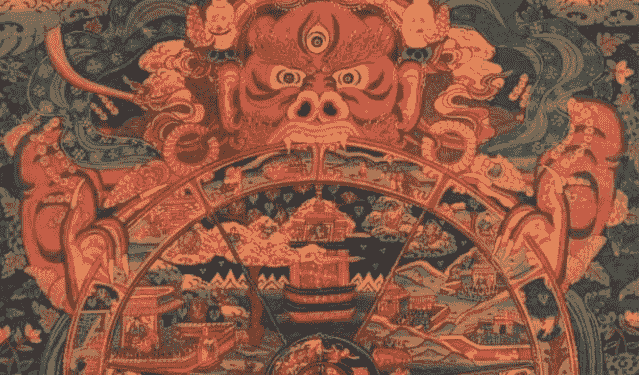

主旨：

拼劳动——卖身；
垒资产——暗着抢；
玩金融——明着抢。
人生逆袭就是一个从卖身到抢劫的过程。

## 【一、拼劳动】

## 劳动创造价值

绝大多数人都需要靠劳动来获取财富，我们所说的竞争，几乎都是在劳动收益上的竞争。

劳动是啥？
就是出卖自己的精力、体力、脑力、经验、时间等，换取利益回报。
说白了，就是把自身当成一个劳动工具出售，竞争就是如何把自己卖个好价钱。

绝大多数人都在劳动层，只有少数人才能够“不劳而获”，这也符合金字塔社会的基本逻辑——多数人干活，少数人享受。

而且对于绝大多数人，所谓创业也同样是出卖自身而已。

其实这样不叫创业，叫换个方式卖身，真创业是卖别人，不是卖自己。

## 被利用的价格

我们从小接受义务教育，有的初高中辍学步入社会，有的 一直啃书本到硕士、博士、博士后，抱着孩子步入社会，学习的目的 是为了啥？

都是为了进入社会后获得具有竞争优势地位的劳动收益，说白了就是如何能更好的被人利用。

这么说，难道劳动分贵贱吗？

三眼：分！

同样敲键盘，你打一份营销推广 PPT，和敲一份资产评估 PPT，得到的回报肯定不一样；同样扛东西，你扛化肥麦子，和送送货送外卖，得到的回报肯定不一样。

谁都想在同样精力和体力的付出下，获得更高的回报！

每年高考，家长最关心的除了孩子考试分数外，就是报考志愿如何填，甚至花钱请“大师”来给指导指导——孩子学什么专业将来毕业了混的相对好？

## 劳动的定价

说到此处，诸位关心的就是什么样的劳动“最值钱”？

要知道什么“最值钱”，首先得明白劳动是怎么定价的。

劳动定价一种是人为制造的，一种是市场制造。

## 人为制造的，也就是“有形的手”操作的：

核心：看风向！

比如，体制内看报纸玩手机消耗一天时间，可能和体制外拼命敲键盘、搬砖头消耗一天的收益一样多，甚至前者收益>后者收益。

也就是投入回报率不在一个量级上。

比如在改开初期，为了调整劳动结构，将大量农村劳动力转到工业劳动，怎么调整？

把农产品价格往死里压，工业品价格抬升，这样在劳动分配上自然工业劳动远>农业劳动。

形成“剪刀差”，只要人不傻还年轻，拖家带口去沿海。

农业一直比二三产业要收入小，这个是“遗留”问题，也是金字塔“分配”问题，这个在很多文章讲过了，但是到底谁的劳动收益靠谱，这个也是个未知数。

大家都是被利用的，就很容易被“遗弃”，比如此次疫情，充分展示了农人可以自给自足的本事，疫情对农人影响远小于城市中产，后者因为疫情所带来的收入停滞、失业、债务不会停滞继续滚动，如果疫情延续时间长的话，中产很容易破产归0。假设真到那个份上，你说谁的劳动收益靠谱呢？

还有一点，在《九大阶层》里说过（微信公众号内搜索阶层二字），大组织调整社会结构，解决社会矛盾，其中一点就是在调整各阶层收入比，这个层里吐出来，那个层里多吃点进去。

# 市场制造的，也就是“无形的‘手’”运化的：

核心：看供需！

比如从宏观层面看，我国在科技发展上整体质量并不高，对于高精尖人才来说需求口比较少，结果就是你在专业学习上再敬业，也未必有什么实际用处；

在这一点上看，高校里的专业设置都是虚的！

什么样才叫实？

就是社会生产结构与专业招生结构是相匹配的，比如你学物理学得好，到了社会可以用得上。

而实际上，除了一些特别专业的（比如兽医、计算机）的学科外，大量学子步入社会就干倒事：销售和文员。

看看企业排行榜、富豪排行榜就知道了，不玩地产就是搞网络游的（互联网大户基本都靠游戏赚钱），这些对口需求不是销售、文员和很少一部分技术工。

再比如从微观层面上看，在教师比较好混的时期，家长会给孩子报考师范类的较多，等一堆师范生都毕业了，教室岗位招不下，供严重大于求，咋办？念四年师范最后还是去做文员或销售。

命运在这里的逻辑反应就是：

绝大多数人的“过程”不一样都不取决于个人，因为认知范围狭窄，不可能一眼就看到哪个劳动收益最大、且最光荣。

人生命运在此处，就像风中的飞沙，飞到哪里你根本不知道。

有哪个人跳出来跟三眼说：老子搬这块砖，当年早就想好了！

多数人的命运不是“指哪打哪”，而是“打哪指哪”。

或者说都是被时代的洪流裹挟着前进的，具体走到哪，看“吹”到哪。

# 改命！

改命的唯一办法就是提高认知！

人的逆袭必然要经过劳动层，没有“劳动改造”被人利用过，你也学不会怎么“利用别人价值”。

在这一层里，所要做的就是尽可能提高认知，尽可能的从宏观中观微观，以及“无形的手”和“有形的手”等方面，找到你最适合的且在你的能力范围内劳动收益最大化的地方。

人在 35 岁之前，都有这个机会。

一般人 23 岁毕业，社会 10 年生活能有此认知已经算不错了，当然读三眼的东西能提前建立认知更好，有了认知就会有意识的去找路子。

# 基石！求快！

人逆袭的基石，或者所谓第一桶金，几乎都是在此层造出！
通过合法的或不合法的，取得合理的或不合理的。
等积累到一定数额，即可升到上一层；开始垒资产。

# 【二、垒资产】

如果说劳动层是基石，求的是快；
那么资产层就是架构，求的是稳！

人类社会的财富就两块：创造+存储。

这也符合人本性格，社会创造的东西多了，贪婪使人存储。逢人见面炫耀的就是谁存储的东西多，我存储贪多就比你牛。这是一种古有欲和安全感。

经济学不用描那些专业高深，复杂的系统有复杂的说法，简化系统有简化的说法，实用才是最好的逻辑说法。

闭上眼，感受一下这个世界分三层在流动：

底下一大块，是劳动在流动，收入在流动，大组织对这块是有“调节”的，毕竟是特色的；
你命运够巧妙被“调节”到好位置，那么劳动收益就大，被“调节”到差位置，再努力也只获得个瓜俩枣，自恃！

中间一块，是资产在流动；下面整体劳动层创造的诸多财富，多了就要堆积起来，形成各类资产，不禁怎么分劳富？

这就是“有产者”的来源，ZB 主义和几十年前咱揣描的 SH 主义理论上在此区分。

众生无产的话，只剩下劳动价值了，堆积的东西都是大组织的，这叫 G 有制；

房子是分的，吃的是分的，甚至媳妇也是组织托付的，这样一来人的积极性是很低的，这种东西夹起米来自己玩可以，投向世界怀抱是玩不转的。

从历史可以推导出来，能明白啥叫资产的人，最早也就是六十年代的人，到如今今日也就三代人赶上了。

今天的年轻人为何奋斗回报低，是因为“空间”很小了，因为社会发展太快，牺竟几十年走完西方 200 年的道路，“空间”几乎都被 60、70 的人给提前占了，这些早先的“有产者”生了孩子继承占着绝大多数资产。

如果把现在在资产的背后持有者都透明化一下，翻出来大家看看都是谁，应该很少很少一部门是通过“劳动改造”后起之秀，多数还是六七十年代早占地盘的家庭。

而货币是资产交易的等价物，所以堆积起来的这些东西就用货币的数字去表示，也就是资产价格。

在资本主义社会，富人堆积的资产，通过等价物货币交换，可以换 1 个劳动者一辈子，甚至几辈子的劳动收益。

劳动是相对比较公平的，而资产带来不公，资产的囤积从本质上讲可以说是对劳动的囤积，因为无论何种资产，最后都会建立在劳动这个地基上，由劳动最后埋单。

1 个资产可以囤积 1 个人几辈子的劳动价值，社会推高资产价格，而收入不变，相当于在提高资产持有者囤积劳动的数量，这是一种隐性劫掠。

当你劳动层积累足够时，就要开始考虑怎么“隐性劫掠”了。

# 能玩的资产和不能玩的资产

为何大量信息都在说“中国居民可投资资产很匮乏”？

因为能玩的资产太少，不能玩的太多。

老百姓一提到资产首先想到房子，再次想到股票，稍微境界高点的想到股权等。

为啥？

诸位到此处能得出个结论，资产就是不用卖身，而帮你不断赚钱（或者叫赚钱他人劳动价值）的东西。

所以这东西肯定不光是房子和股票呀！

简单好操作来钱快利滚利的资产，不是凡夫俗子能参与得了的，整个民间都参与不了！

民营或凡夫俗子能参与的，定为收割型资产——是上面收割你，和底下创互相收割。

资产就是搞收割，只能往下收割，最多平级互相收割，再思考虑房子和股票。

你所能摸得着的资产，都是为你量身定制的收割机。

# 【三、玩金融】

如果说资产层是“隐性”劫掠，那么金融层就是显性的，很直接。

金融是什么，不是那些什么理财 p2p，那都太抬举了！
金融是通过权力制造漏洞，钻漏洞就是金融。

这话应该是最“不专业”最粗鄙的解释金融的了，但三眼告诉你，最粗俗的就是最真实的。
通过表象倒推本质：1 个人从未不干活，通过这个率，那个率的，把钱转起来，就越来越多。而所有的东西最后都要劳动来埋单！
底层劳动堆积成资产，通过各种资产载体来玩金融——连起来就是价值通过货币变“魔术”。

金融玩的就是货币，了解货币洞悉货币，即可在认知上击倒金融层，从最高处俯瞰资产层和劳动层，这样才会看得清晰。

# 韭菜的特点：活在幻想、活在娱乐、活在情绪、活在自我！

2 月 19 日

> "忠言逆耳利于行！"

忠言逆耳利于行！三人行必有我师焉！

这两句话人们从小就会背，能理解的屈指可数，能做到的凤毛麟角。

而且！

朝着相反方向做的人占绝大多数。

也就是：

爱听好话“顺其意者”受到信赖和尊崇；

以自我为中心，善学好问那是不可能的，必须抬杠！

这些朝着相反方向做人做事的，就叫韭菜。

# “我乐意”

韭菜看见想看见的东西，听信喜欢听的东西。

比如韭菜想发财？

错！

韭菜是想很轻松的发财！

那么你就告诉他轻松发财的路子，当然，轻松发财的路子 99.9999%肯定是忽悠人的。

但韭菜喜欢听，你说了他就信。

*韭菜不是要学习，而是要发泄。*

经常有读者私信问三眼，该读些什么书获取认知？

图书馆埋落一层灰的书就是好书；

公知哪里讲的话都是“100%正确的话”——也就是废话。

针对韭菜玩收割，一是说假话，二就是要抛弃情结。

乡镇青年要用反叛和热血抛弃情结；白领要用民主和小资掏养；

一拨一个准，顺着毛摸，乖乖交钱。

# 情绪

> “你洞悉了众人的情绪，就拥有了控制他们的法宝！”

在娱乐化时代，人们也被“愚”乐化！

人们需要的并不是真知，而是幻象。

拨弄情绪关键就在于要凭空制造出“敌对势力”。什么是敌对势力？

比如公知骂街彰显正义，骂的是什么？是形而上的意识、是集体制度问题等等；

老话说得好“凡事怪社会”，骂文化骂社会骂集体是永远不会出毛病的，因为没有“具体目标”，反而能彰显正义，充分让支持粉丝抒发情绪。

三眼说过，跟着公知走，真知肯定是学不到的，到最后剩下的只有情绪。

这东西就像是所谓榴落，很愤怒的发泄，发泄完了你问他在发泄什么？朝着谁呐喊？“敌对”势力是谁？

他也不知道，但就是感觉很爽。

这，就叫幼稚！一般常见于叛逆少年身上。可惜且可怕的是，现在三四十岁幼稚的“大孩子”也不少。

# 毒药

三眼每天打开屏幕，看着一串串信息流，太阳穴一涨一涨的——满屏幕全是“毒药”！

毒害着一个“大孩子”。

文艺与娱乐是最大的毒药，而现在各行各业各领域都开始娱乐化，毒药遍布神州四海。

流行歌曲；

综艺娱乐；
影视偶像剧；

公知大 V；
专家学者。

吸食前三种毒药的人，属于无药可救；
吸食后两种毒药的人，属于有病乱投医。

# 两把镰刀

怎么制造毒药？
倚字：情绪！

打开手机电脑，各种情绪扑面而来，90%的信息流都是情绪。

情绪的结果是什么？
倚字：幻象！

吸食前三种无药可救的人，为何不可救了？

因为一直活在幻象里，离开幻象已经生不如死了。

对于这种韭菜，收的叫情商税。

情商低是啥？就是真假分不开。

真话假话分不开，真实的世界和虚幻的世界分不开，感性与理性分不开；

吸食后两种毒药的人，为何是有病乱投医？

因为人一有病，看医生起初是为了治病，慢慢的就变成了来看医生而看医生；

医生能不能给出真实的药方无所谓，关键是要说好话，让患者获得内心的平衡。

这收的叫智商税。

财经砖家不讲真财经，讲的是财经背后的情绪，比如当年的牛刀之流，自己背地里买没买房不清楚，但跳上一定要怒斥地产的，并且很有“爱恨情仇”，反正众人都是小白，弄几个数据讲几个高大上的专业词，都会信以为真，看不看得懂惟不重要，重要的是情绪要顺应好。

韭菜逃不过情商税和智商税两把镰刀！

# 韭菜有什么价值？

+   1、注意力价值

人的时间是很宝贵的，韭菜会把宝贵的时间都奉献给幻象，收割注意力就是在收割时间，注意力=钱；

+   2、劳动价值

人有什么就觉得什么不值钱，对韭菜而言那就是劳动，；

+   3、背债价值

地主餐桌上昂贵的芭比Q烤肉，追根溯源还是马家屯王大婶家养的猪。

金融收割的路径就是，钱人家拿走，债务给你留下，挥一挥衣袖，不带走一片“市情”。

# 假设病毒“有意识”，它在攻击三大经济“软肋”！至少造成 5 个变量！

2 月 19 日

> “物必自腐，而后虫生”

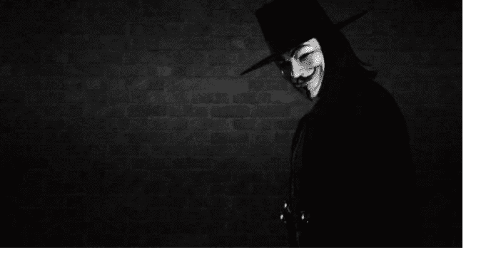

> “我打你，是因为你有软肋！”

一切外在的形态危机，都是从内在滋生而来！

假设病毒是有“智慧”的，那么这个“智慧”打击的是什么？攻击的核心是哪些“自腐”的软肋？攻击这些软肋会造成未来有什么变数，你我草民如何应对挑战和机遇？

# 1、攻击你城市发展极度不均衡！

社会学角度看，世界发展史就是一部乡村逐步城市化的历史，经济学角度看，就是一部人口集中资源协同演进史，人口与资源向城市聚集没毛病！

但！这里面有个度的问题，也就是发展均衡与否的问题。

中国是一个经济发展极为不平衡的国家，沿海地区人均 GDP 达到 10 万元左右，中等发达国家国家收入水平，而内陆地区大部分城市人均 GDP 只有两万元左右。

“历史”原困在《读懂改开 40 年三大阶段！才可看清你在这个时代的位置！以至未来！《7600 字》》一文里讲过，或者微信公众号内搜索“改开”二字！人口向沿海聚集是伴随着改变农业化向工业化发展的必然，人从南向北走，从西向东走；

“内因”问题是什么？

表面看是城市资源配置差距化巨大，我们已把这种差异化当成一种“客观存在”，忽视了其“主观”色彩。

主观就是资源掠夺，富户聚集着权力，权力聚集着资源，由资源而来向全国虹吸劳动力，没有一茬又一茬的青年涌入，就没人去养活富户，富户的优越性也会荡然无存。

县吸乡，城吸县，省会吸城，北上深吸省会，表面看吸的是人，人带着钱走，从而吸钱；
这都是表面，实质吸的是劳动价值，底层劳动价值堆积出顶层财富，城市发展是要“吸”，关键是度的問題。

这种虹吸必然带来人口大迁徙，2019 春运期间，国内的旅客人数达到了 29.9 亿左右，人口迁移远近 30 亿！在人类几百万年的发展史上，这是 no.1。

流动的只有劳动价值，除此外，其它均没有流动起来，教育、医疗、社会保障福利等并没有跟着走。

也就是大城市只要价值，不要人！

这种发展极度不平衡的致肋，就在于抗风险能力比较低，当经济发展依赖少数核心城市，一旦核心城市受到冲击，很容易形成风险扩散。

病毒是很“智慧”的，病毒能从一个点扩散到一个面，流窜轨迹就是劳动力价值流动的轨迹。

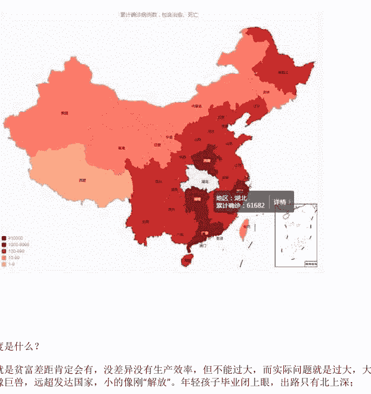

# 度是什么？

就是贫富差距肯定会有，没差异没有生产效率，但不能过大，而实际问题就是过大，大的像巨兽，远超发达国家，小的像刚“解放”。年轻人毕业刚上班，出路只有北上深；

# 均衡发展提了若干年，为何均衡不起来？

产业不均衡，背后是钱；权力不均衡，背后是钱；人口不均衡，背后是钱；人口大流动，背后还是钱。

# 2、攻击你高负债运转！

疫情带来停滞，生产与流通的停滞。

城市发展极度不平衡增加了复工难度，复工率对正常生产秩序造成冲击，春节前全国交通累计发送旅客达 11 亿人次，节后至 13 日累计发送旅客仅有 1.8 亿人次，截至目前复工率可能尚不足 20%。

上层诸有序复工，第一产业肯定要排第一位的，吃饱饭是第一位的，吃饱饭、人能流动、物资流动起来了，二产才能复工，三产才能有“内容”。

在生产与流通停滞滞，更面临着物资供需不平衡，物价大幅上涨的问题。

有人说上面放水救一救吧！其实放水是没啥用的！放水需要真实的贷款才能流下来，有真实贷款需求吗？

这种情况下，企业是无利润甚至绝大多数是亏损的，贷出来钱干嘛？扩大亏损吗？居民就更不需要贷款了。

问题是一步步显现的，一环套一环，什么是最危险的环节？

债务！

之前总有人问我疫情对经济有什么影响，我没法回答，或者反问一句“您认为疫情多久可以过去去？”

疫情之战打的是时间仗，生产流通停滞，节衣缩食可以过去，核心是债务问题。

我们当下都裹挟在还债里，看看“核心支柱”地产商们哪个不是高负债运转？

而经过是自2016“去库存”战略，大组织成功的把杠杆风险转移到居民身上，居民部门担当了债务“接力棒”。

目前居民净存款为26万亿，2012年也是26万亿，也就是说，7年来居民净存款没有变！这26万亿里面，绝大部分钱都属于地主大户的，老百姓身上有多少存款？恐怕少的可怜吧，现在大多数家庭都是负数吧？数据没法弄清楚，但可以肯定的，大多数家庭都是负债！这个不用数据，去看看现在各种白条、信用卡，花呗什么的就知道了。你净存款有1万元就算真实富户了。

企业部门居民部门都背着大量债务，尤其对于城市中产来说，一句接地气的话“你的存款能挺多久”？

# 生产停滞、流通停滞、就业停滞、收入停滞，这是显层，隐层危险在于债务！

收入预期稳定是债务滚动的基础，过去高举债是因整体债务率相对低，且经济保持高增长，未来呢，肯定转不动的。

当局救场，只有先救吃饱饭，再救企业，救企业只有一条路，就是减税减负，没有别的做法。养企业利润就是养制造，养制造才能养居民收入，养居民收入就是养债务，这是唯一正路。

# 3、攻击你的“基础”建设！

到底什么是基础建设？
只要一提到基础建设，所有人脑子都是“铁公鸡”。形成习惯了，不好改了！

城市的概念本质是围绕基础设施和公共服务展开的，基础建设是来“用”的，不是用来“做样子”的！城市建设不是路修得广，地铁多、劳动力多、楼高了就可以的；

好的基础建设，就像空气一样摸不着，我们不会关注它们的重要性，基础建设就像城市的“免疫系统”，只有遇到危机时我们才能看到它的不可或缺。

很多人拿欧洲破旧的街道与老楼和我们的“广厦”相比，心中油然而生自豪感，其实看得见的东西未必实用！

每次经济承压，铁公鸡都当“顶梁柱”，我们“从上到下”就喜欢看得见的东西，这东西来钱快、对经济发力猛，怎么用怎么舒服，但是实用性有待考量，此次按情就是对城市基础建设的一次大考。

事实证明，飞机场再漂亮关键时刻也是能做观赏品，好的基础建设一定是软的，你看不见但离不开能感受到。
这就像强身健体，不是肌肉发达就叫强健，关键在于内里的心肺活力。
啥是软的？软的就是智慧的，不是做样子的。

比如此次疫情，针对于医疗的基建，不光是医院多不多，各地建设小汤山，医护力量够不够的问题，“软”实力一定是系统化的。

比如城市医疗资源配置系统，我们多数还在“纸和笔”的阶段，“纸和笔”效率低自然养活的关系户就多了。

大数据云计算喊了 n 年，也没见有啥具体用处，各城市医疗联动起来还得靠条文，条文这东西都是先出问题后喊话的。

“业务协同”这东西一般只能在民营企业能见到，各地政府、交通部门以及下到居委会，信息采集与追踪怎么能从“喊话找人”改成“智慧”查找？业务协同才是基建，软的才是受用的，打开一个个政 fu 网站，就像一个模具刻出来的，初级网页技术水平，作为创食小民想出点力都没有处劲动。

闭上眼想象一下，如果各组织战线有序协同，通过软的建设，信息建设，网络建设，还能调动起广大百姓的智慧，统一协同，那才是真的“事前早发现，事后早行动。”而不是藏着惹着。

还有一种软的建设更难实现，就是人们拥有集体思惟意识，集体意识不是你说啥我听啥，而是真正去思考是否为啥，这东西没法说太深，自己悟。

从前而所讲的就可看出，我们缺少集体意识的，“从上到下”只有小个体意识和小组织意识，疫情出来后，媒体上群魔乱舞，充分展现了吃饱饭到无聊，事不关己高高挂起的民风。

病毒是个啥，能吃不？听说牙膏能消灭它！怎么不让出屋啊，好无聊，听说明星捐款呢，看看排行玩吧！好呀人，出门都要戴口罩！好机会，倒卖口罩能发财！好无聊，啥时候能上 班啊！居然不给发工资，租金不能交，听说信用卡这时候没利息，这个便宜要占！再过一两个月看看，根据债务高低配置，就会：哎呀，要完蛋！

# 变数！

## 1: 基建

一季度经济增速下行是确定的，不负增长不错了，全年 6% 的指标在那摆着，过后基建一定要发力，但重点不光是铁公鸡玩水泥，是医疗和智慧信息基建等。

## 2、地产

放水了，房价要暴涨？别做梦，房地产一定会有措施，但那是引人去救场，不要去！越是救市措施力度大的地方，越不要入了，政策相反的地方是好地方。

疫情一定会改变人们的偿债心态，虽然我们的记忆力很短暂，但至少会改变意识一两年，也就是靠债务推动的金融品（房子）会很尴尬，这时候就需要反向操作，抄漏是个好机会，但几年内居民偿债是举不动的，所以抄漏的原则在于可租，也就是租金回报要高，杠杆加到与租金持平即可，手握 n 年即可见大回报。

核心城市和小城市之间会有“城乡镇结合部”地带，这些结合部一方面可参与核心城市经济循环，又能享受“打散”核心城市带来的户籍开放红利，未来看好这些结合部的发展。

## 3、股市

放水一定要放的，钱进不去楼市多少，进不了企业，去哪？去股市，股市会波动显现机会。

尤其短期内出不了门，闲的无聊进场散户会多起来。

## 4、举债到蓄养

消费需求会疲软，因为人们，不光普通人，中小企业也一样，对现金的重要性意识会提升到前所未有的高度，疫情过后，会有一波企业同行抢现金，创业小民变掏门爱攒钱。居民储蓄率应该能回升，正好“养一养”。

## 5、金融资产利好

储蓄意味着百姓从实体资产向虚拟资产转移，也就是对金融资产有利，居民稳定收益的投资需求会提升，例如货币（黄金）、理财、基金、债券。

## 为何你学的知识都没用？因为你不了解什么叫“纹化”！（正确学习观）

2 月 22 日

> “藏器而动”

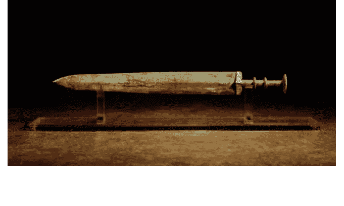

你所读的东西大多是没用的！

问：
何为有用？

三眼答：

能让你独立的东西，就有用；
让你陷入其中产生依赖的东西，就没用！

问：
什么叫独立的？什么叫产生依赖的？

三眼答：

知识求的是简化，独立就是足够简化。

也就是你活一辈子，无须记住若干种条条框框，那都是幻象，只需记得简单地“底层逻辑”即可，一通百通！

一部知识，不讲底层逻辑，只给你讲“幻象”——也就是只讲“事物的结果”和一些零碎的小道理，这种东西都是垃圾，都是假大空。

为什么众人学习会产生依赖？

因为现如今大多数知识都是“故意”让你看的，都是“幻象”！

而且这些“故意”的东西来自于不同的底层系统，你根本就不知道“底层系统”在哪，或者写作者根本就没有“底层逻辑”，他完全是在拼凑零碎的小道理。

一般此类垃圾信息的公式：用结果去推导结果。

比如：人应该怎么怎么样；

而不是：为什么要怎么样。

这样你怎么能学通透？所以只能陷其中，当你读的这种东西越多，你越混乱。

现在中国互联网，90%全是这种垃圾东西！

这种垃圾东西售卖“结果”和“情绪”，媒体也很有喜欢，因为既迎合了人们毫无若学逻辑的思维，又不会触犯“宣传规则”，何乐而不为呢？

比如经济学，你看了很多经济学大师的诸多理论著作，然后呢？

这些知识除了让你在实际生活中“管中窥豹”，外加吹牛皮用一用外，还有其他什么帮助呢？

因为你根本不知道“中式经济”的底层逻辑是什么，这种书籍市面上肯定是没有的，这个东西在三眼的系统里叫做“内法家伙外西学”。

问：

按理说人都是向学而生，为什么会产生这么多垃圾信息呢？

三眼答：

## 大规则使然！

## 这个大规则叫做文化！

什么是文化？你们的理解全都是错的！

在三眼的“解构戏”里，万物可拆解，只拆解你才能了解它，那么文化怎么拆解呢？

文化古语“纹化”，也就是说社会的纹理，纹化是属于管理学，管理国家用的，管理的結果就是形成了“人纹”。

> （不知道哪位懒人将“纹化”改成了“文化”二字！）

纹有两种：

一种是硬性规则，比如法家农战思想，比如士农工商的阶层划分，硬性规则就是在权力意识下将人划分成各个“纹理”，像棋盘的格子，而人都是棋子，有规有矩方便管理；

另一种是软性规则，也就是意识中的“棋盘”。

一硬一软，画出“纹理”，此谓“纹化”，而今叫“文化”。

问：

可否进一步深入解构？

三眼答：

举个例子，比如：

佛家为什么在历史上不被压制？

为什么道家却不显主流踪迹？

因为佛家是“出世观”，也就是说让人们“从三到二再归于一”，这样就不会讲利益，只讲道德。

道家呢？是“入世观”，道士学成都要下山，学成什么？

就是三眼所讲的“解构观”——结构万事万物的方法！

诸子百家的思想来源就是道家，诸家同属一脉，都起源于阴阳辩证哲学，而不同之处在于“用法”。

就像天下武功出少林，但会形成各种门派，因为“价值观”不一样，“套路”不一样，这与上面所讲一个意思。

各种“门派”在服务于王权的意识下，会形成各种“解构观”和“重构观”，比如：

法家的赏惩辩证，而产生了王霸之学；

纵横家的擒图辩证，产生了外交学；

兵家的奇正相生辩证，产生了攻城略地的实战之法。

但这些东西都是“上层”知识，这些东西才是真知。

用三眼一句话说：我们都依赖于大组织规则而活！

另一句话就是：认知，就是接近真相的距离。

问：

那在您看来，什么是独立的知识，或者像您说是可以独立的知识？

三眼答：

一个字：道；

两个字：历史；

三个字：法儒西（法家儒家和西学）；

三眼说过，人们的记忆跟鱼差不多，这样就会“以眼前所见作为真相”。

这里我没法细说，我只能说，历史从未离开我们，很近很近。

换一种可以说出来的说法就是，一片生态土地，无论经过多少年，都是原来的生态演化到如今的生态，根本的东西不会变。

举个“根本”的例子：文字！

文字就是思想的载体，文字可以说是最初的知识，知识的来源是以用为体，你要用它，才会发明它，首先发明的是文字。

文字就是一个个关键词，每个关键词都是一个“世界观”，一串串“世界观”有逻辑的组合在一起形成词句，这就是思想的本体，你在用什么文字，你就依附于什么思想本体。

无论经济政治再到社会，都是依附于这个东西。

现在年轻孩子，逐渐变成借用原来的文字，而自成一套语言系统，比如什么火星文等，当人丢掉根子，那就就得不到真知。

## 我们去继承一些东西，并不是为了继承而继承，而是因为那些东西确实是最实用的！

也就是说，有一个简便的学习方法，就是去搞懂最原始的文字的意思，以及组合逻辑，你就明白了“中式”人生的真谛！

用些东西是“体”，也就是最原始的规则内核，这个不懂，学再多“用”和“术”你也玩耍不起来，因为没有体可以“括”！这就是无本之末，都是幻影。

尤其是近十年来，西学东进，被一个个不明真相的孩子奉为珍宝，凡事都是西式的好，结果呢？

你学了再多各种西学大师“小资”知识，用得上吗？

问：

为何西学“小资”这么受欢迎？

三眼答：

因为它以“存在”为前提基础，也就是“眼见为实”的东西。

无论经济、哲学、管理再到具体的人处世、情绪调节等等，它们都把事物分割成一块一块的，各种表格、数据、曲线、逻辑组合等，看起来“有理有据”，正好符合人们“眼见为实”这一根本人性。

但事实呢？

这种“分割”法，用在科学技术上没问题，因为科学技术是以“存在”为基础。

但在“纹化”，也就是俗语讲的一个人怎么混社会的问题上，是没有多大用处的，只能越用越乱。

比如用西式经济学去观察楼市，屡战屡败；

比如用西式的“自我管理”法去培养自我发展，结果多是沦为“糊涂的工具”。

你所生存依附的环境是由一个个人构成的，人和人是不一样的，一个人身为企业家、老板或者身在衔们，更容易明白这个事实；

所“牧”之群决定了你的具体方法，也就是战术（西学为用）；
所依附的“最大组织规则决定了你的战略（东学为体）。

你明白这条线，什么中国酒文化，茶文化，士大夫文化，传统道德规矩等等都自然顺带破解。

做人做事都是如此而已！

## 阶层逆袭不是过家家！底层唯有盯准漏洞，十年磨一剑！

2 月 22 日

> "死生之地，存亡之道，不可不察也！"
——《孙子兵法》

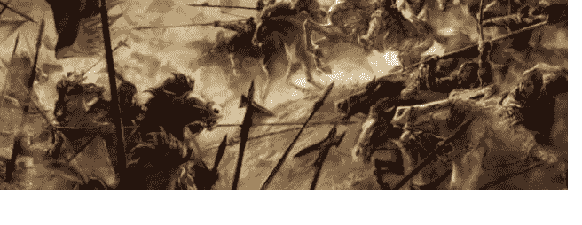

## 【人的差别在于认真】

人和人的差别在哪里？这个问题三眼思考了几十年。

小时候我以为源自智商，代数几何随便看一看就满分，为何有人努力学习还不及格呢？
这些“笨鸟”以后可怎么办？

但过了几十年再看，那些数学不及格但很认真学习的人，很多成就都超过了聪明的孩子；

后来，我以为在于起点，但事实并不是完全按照“起点决定终点”的轨迹发展，三眼小时候院子里的伙伴都是起点都相对较高的，但过了几十年，这些起点高的孩子生命力似乎更弱一些，因为离开父母的支持，有可能都变成走的羔羊，他们只是父母的“延续”；

再后来我以为在于认知，但为何师出同门“结构”一样的师兄弟，会产生完全不一样的人生？
因为认知是一个动因，算是一个“中间结果”，也属于结果，并不是根本，就好比一种武功不同的人修炼，得到不同的功力。

最后我在曾国藩的人生观里找到了答案，人 的差别在于：是否认真！

【认真=对自己诚实】

自从跟着没事开始写第一篇文章，到现在认真的给铁粉写体系，私信加评论差差不多 10 万条左右。

这 10 万条就是一部大众认知地图！地图上我所看到的，90%都是盲从与浮躁，能有 1% 认真的人就不错了，实际现实生活中也是如此。

多数人对于人生都不认真，以至于心灵得不到宁静，思想像一团混象，四肢无处安放四下奔张，犹如丧家之犬！

一方面有时代的原因，因为外界环境对人的影响也非同小可，但，这只是外因；

另一方面源于人本身，也就是内因。

今天刚到周国平先生的两句话，很好的解释了这一点：

> 周国平
只有微朴的乐事才能够真正打动心灵，浮夸的东西只会扰乱心灵。
1.4万阅读 · 154赞 · 27评论 · 2020-02-21 03:21

> 周国平
把简单的幸福说得玄妙起来，或者把乐事的东西说得庸常明白，都是不寻常的本领，前者靠联想和推理，后者靠直觉和照察。前者非聪明人不能为，能为后的人则不需要聪明，而且要诚实。

多数人都很浮躁，因为他们就喜欢浮夸的东西，这个时代的信息也适合他们。各种震惊体、暴富体，像毒药一样一点点喂养他们，喂养到不可救药。

## 这是一个“娱乐至死”的年代，人们都被裹挟在娱乐的毒药里，失去了“认真”的生命力！

还有一部分人，自觉很聪明，也就是周先生讲的能够“把简单的事情说得玄妙复杂”，尤其是一些受过高等教育的“劳动工具”，读了几天畅销书就变成“知识分子”。

但事实呢？生活还是那个鬼样子，丝毫没有因为“聪明”改变什么！该搬砖还是搬砖，该当“工具”还是个“工具”；嘴巴厉害不等于真的厉害。

## 这是为何？

落回到周先生的话上，最后两个字：诚实！

这些人有一些认知，但不诚实，尤其是对自己不诚实，也就是三眼说的“不自知”。

对自己不诚实=不认真。

不认真在看待事物上就只能获取皮毛，只能大谈特谈表象，而进入不了内里，这样就改变不了什么，这辈子的结果也就是个伪知识分子+老愤青了！

## “死生之地，不可不察”

什么样的人是最傻 b 的？

就是你告诉他方法，他从不思考；

你告诉他世界是什么样，他一方面抱怨，另一方面伸手要具体路经，你给不出，你就不是好人...

人可以愚笨，但不可以傻 b！

这种人只配看“成功的 108 招”、“暴富 36 法”这些投东西，交点智商税。

星期四 18:00

> 您好，昨天关注了您的公众号之后立刻把所有文章都滚了一遍，尤其是关于漏洞那篇，给跪了

这是一个小孩给我的私信，三眼感受，那些三十四十岁“伸手要妙招”的和那些“高等劳动工具”，都不如一个孩子，孩子都知道核心处在于：漏洞！

这就是自悟能力，不是取决与智商，是取决认真的方向；

这人有的跟自己要东西，有的跟别人伸手要东西，就这两种，差距诞生！

认真这事真不取决于年龄，认知这事真不取决于阅历。

孙子兵法云：死生之地，不可不察。

人生对于认真的人来说，就像“死生之地”，很认真的去觉察，这样必定有所为；

## 【漏洞】

再讲一遍漏洞，这是传道受业解惑的核心：解惑之处！

- 传道：事物结构；
- 授业：规律推动；
- 解惑：如何执行？

很多人看完三眼的体系会发疑。

三眼你说的东西是让我明白了“结构”：

*人要有“结构”；*

*思维要有“结构”；*

这个社会是有“纹理结构”的；
政治经济到社会是有“结构”的；
钱的流动与人的流动是有“结构”的；
我们需要一层层一块块的去“解构”它们，之后即可“重构”它们，而重构的过程就是我们发力的过程。

在这些诸多结构之下，会产生会多“规律”和“规则”！

这些你都讲了，可我还是不知道咋办，因为我就是一凡夫俗子，一没大钱，二没大权，三没资源，咋办？

那是你还不够认真，还没在深夜独坐 10 小时思考。你在态度上败了，你就真的败了。

有句话讲大丈夫能屈能伸，啥叫屈？身体屈下没啥，很正常，但你思想跪下了，这辈子就完了。

一切“业力”都始于内心！

先问个问题：
如果一个人跟你比搬砖，你就和他比体力吗？
一个人跟你比爹比钱比权，你就和他比这些吗？

什么意思？

就是：你在别人的规则内竞争，你永远吃亏，永远属于跟班的，立不起来！

与人辩论，首先要把人拉到你的话语体系内，这样你才能胜，这是基本逻辑；
同样，在社会竞争，利益获取上，你也搞明白这一点。

如果你足够认真，你会察觉到你所存在的周围，到处都是“漏洞”！

参见《强者论是非，强者观漏洞！三眼观本源认知无倦奉送一生生存即漏洞！》与《2020，从“不合理”开始说起！只有认清“不合理”，人生才会合理！》两篇。

漏洞就是逆袭的唯一机会，没有其他机会！

如果你一直在众生所依存的普通规则下玩耍，你永远站不起来。

在你的世界里，你所要面对的，是一场“规则的拉锯战”，这才是你人生的主战场，其余皆为娱乐场。

## 【漏洞的组合】

什么是漏洞？

任何事物都存在“不合理”的地方，世间没有一样事物是完美的，事物因为不完美，存在“不合理”，才会变化！

再对照《什么决定了人生成就？人的强大在于什么？答案是结构！（写给少数有缘者）》一文，开始组合！

“漏洞观”+“时空观”+“五大认知之经济（钱的流动）”，就会产生在钱流上的两个时空上的漏洞：

## 时间的漏洞：

比如先交易，再收到钱，可以变成交易一半，就收到钱，更甚者可以变成没有交易，只有个契约，就收到钱。

## 空间的漏洞：

比如钱的流转依附于交易载体，但交易载体成型了之后，钱即可不依附于载体而“空转”。

“漏洞观”+“利益结构观”+“五大认知之经济（钱的流动）”，就会产生 2 个利益结构上漏洞：

利益体结构：

比如，有些钱的流转确实要依附于某种载体，但是这个载体本身是没有价值的，或者说对“利益体外部”是没有价值的，相当于钱在“利益体内部”借“理由”在转移。

人性的结构：

比如，一碗水和一碗黄金哪个值钱？ 一个东西值不值钱最后还要落实到人为主观判定上，但主观这东西肯定是有漏洞的，不客观就会产生不合理，不合理就会产生价值偏差，这种漏洞最常见的公式是：放大人都情=放大钱的估值。

漏洞无法细说，总不能告诉你某某组织某某利益体某某操盘，是漏洞吧，自己思考自己觉察，每个人的所处的外部环境都不一样。

但三眼告诉你，你所存在的周围，一定有着某种漏洞，且不是一种。

小到一个人的先性，中到各种利益体交涉，大到最大组织的规则法则政策，自己思考自己悟。

我们的智慧都是为了发现漏洞，而智慧的运用需要认真，认真就是你的心力。

心力付出多，自然会开启漏洞之门。

当进入漏洞之门，人和人都一样，没有差别，已经不比拼智慧了。

所以，智慧是拿来用的，不是拿来思考着玩的。

参见《人生：12字秘诀：自成体系、预测大势和耐心坚守！》一文！

周期天王周金涛先生有一句话所讲的意识形态，我很赞同；

人生发财靠波！

这句话是讲人的一生在大环境层面，机会也就那么一两次，抓住了就成了，抓不住还是老样子。

我所讲的漏洞观，是讲中微环境，因为周先生讲投资，是围绕大环境，这个东西“成事在天”的因素太多，我讲的中微环境取决于“谋事在人”的因素。

人这一辈能运用智慧的机会很稀少，能有一两次成功运用，起码晋升 2 个阶层。

这取决于你所存在的环境给不给你机会，又取决于你认不认真，抓不抓得住。

多数人的智慧都是拿来玩的，不是拿来用的，因为你不认真！

## 混社会科学：两种生态、六种生存。

2 月 23 日

> “谁敢改祖宗的章程，谁就得掉脑袋！”
——庞太监《茶馆》

## 【知识的虚实】

这世界就俩知识，一个务虚，一个务实；

哲学是在虚实之上，是起源，哲学不是知识，是悟性。

知识都是人生产出来的，跟人一个德性：

**务实的人追根求本，会把事物复杂的表象弄到极度简化；**

**务虚的人喜欢玩花活，这是他们的命根子，不断地把简单地事物复杂化。**

务实的知识就是化学元素排一排，搞个表格；几何图形弄条辅助线算一算；小车在轨道摩擦摩擦脊背后的力等等。这些东西越高研究就越接近于哲学；

务实的知识你没法否定，务实的人追求的是真理，真理是什么？就是不可否定的东西，是根子！

务虚的知识就是经济学、政治学、人文学、心理学、历史学等，在三眼这里统称为社会学——混社会的学问。

务虚的知识你也法否定，因为“公说公有理婆说婆有理”，在务虚的知识圈里，瞎哔哔一样有市场，专家超级多，因为这个圈子没有真理。

三眼写的东西就在“瞎哔哔”的范围内，只是反“务虚”之道而行，尽量的去搞简化。

如果你是一位在神州大地望子成龙的家长，你选择给孩子脑子装上什么知识？

想必多数会选择这些务虚的知识。

为何？

因为事实证明这东西有用啊："数学学得好不如嘴巴好！"

务实的知识研究的是客观存在，务虚的知识研究的都是主观，主观哪来的？

人！

务虚的知识研究都围绕人，外加权和钱，谁研究的好谁混社会本领强。

为什么务虚的知识在神州大地这么受用？

因为你看看 2600 多年历史，基本都是在研究虚的，也就是混社会知识。

你在一个 2600 多年专门研究混社会的社团下生活，你不研究这玩意能混得下去吗？

在三眼观察里，这些知识都属于服务业！

## 【2600 多年的“服务业”】

服务业是啥？

万恶资本家开足马力大生产，一下子过剩了，严重积压，牛奶倒掉也不便宜卖，邪恶的资本主义！

咋办？

海外搞个殖民地卖一卖，抢殖民地就要干架，消耗工业产能顺便老大家二排顺序。

感性“小资”还是不要看三眼文字了，回头你再看那些慷慨激昂的战争电影该没感觉了！

因为看着大白皮端着枪向前冲高喊民族大义，配上音乐有模有样，伟岸与道德形象顿时间树起来，但明白真相看起来就很好笑了，不就是抢地盘嘛！

后来人类突然出现了一波务虚大师——经济学家，大师们告诉诸位地主耍责，咱不用往死卖力生产，一部分人生产即可，但养羊就要有岗位就有啊！

咋办？

那就让不参与生产的人互相服务吧，这就是服务业。

自从有了服务业，各位大佬对内可以安抚丢羊，大家都有了就业有饭吃，对外也和平了许多。

尤其在神州大地，搞经济学、政治学、人文学、心理学、历史学这些混社会学科的人，基本上对财富生产没啥具体作用，如果非要说有作用，就是提高人们精神质量的。

如果画一个格局，大致是底下一堆血汗创食小民搞生产，毕竟劳动力多，生产的东西就多，闲人就会多，闲着的人咋办，研究虚的吧。

这些务虚的人小老板是看不上的，毕竟对生产啥用处没有，所以务虚大师们多为豢养于庙堂。

但随着几十年快速发展，改开春风寒冬风，工业过剩，神州大地的小老板竞争惨烈，毕竟不是过去供小于求靠“点子”淘金的时候了，咋办？
每当这时候，务虚的知识就要发挥作用了！

但老板们也属于创食者，真刀真枪干的，不同于豢养在庙堂的生物，虽然务虚，也要务“有用的虚”。

## 【有用的无用的虚】

大学读过以上虚的专业的同学应该有体会，就是什么营销、广告、经济等学科的老师教授们，恐怕一根笔也没卖过，对经济的影响力几乎=0，毕竟人家是靠*补贴*过上富足生活的，和创食真刀真枪干不一样。

尤其是与市场融合最深、离玩钱最近的营销学，抱着《市场营销》啃 100 遍，恐怕到了市场要跪挣裤衩。

创食的最终还是要务有用的虚，咋悟？

**虚的东西核心都是围绕人，人的身上有钱和权。**
**研究 2600 多年的大社团生态，就能务虚处出新高度！**

一个羊厂拥有什么样的生态，就会造出什么样的生存结构。

纵观神州大地，基本生存结构有六种：

## 【两种生态与六种生存】

先说生态，最大社团的生态分两个：

一个是人多但世界小花样少。

体制外人多，但只切给大蛋糕20%，养活80%猴子，钱少了世界就很简单：

钱少流通起来就很公开透明，竞争简单，就是出卖劳动力，看谁卖身功夫强，精力旺盛体力好，更比看谁舞刁；

生活方式也简单，基本两点一线，旅游很奢侈必须朋友圈核一核。

一个是人少但世界大花样多；

体制内人少，但大蛋糕切走80%，钱多了世界就花花，钱的流动百花齐放，来钱道只有你想不到，没有做不到，生活方式复杂，多点好几线，有时候连自家门都找不到。

几千年了，生态没变过，社团大生态就两条线：法家务实儒家务虚，一个画“社会纹理”，一个搞意识形态，这就产生六种生存结构；

### 第一种生存：家奴与内奸

诸子百家只有法家因有实成性活了下来，看儒家什么仁义都是虚的，精神食粮不保命，儒家在务实层面上核心就一句“学而优则仕”。

这才对嘛，说实话大家还是好朋友。

# 因为权力的过度集中，必然导致资源的过度集中，最后导致在混社会学科上人都要向中心走，必会产生家奴纹化。

“学而优则仕”从娃娃抓起，小初中班干部，大学学生会，专业培养。

学而优的“学”不是走求真理的道路，而是要学会“两面刀”，也就是紧紧团结在班主任周围，在同学里做内好。

前几刻到几个高校“官场”聊天截图诸位感受下：

潜水
7号要开会吗。@ 学长

管理员
杨主席是你们直接@的？现在你是在叫学长？我不想看见第二次。

管理员
他妈自己没点数？

19:44

管理员
请各位试用干事以后注意自己的身份和说话方式@全体成员

转发 7886 评论 8980 赞 2万

按热度

杨主席批准发微博了吗？别让我看见第二次

等人 共324条回复 >

10-4 10:26

1万

都是在领导面前装孙子，然后在学弟学妹面前装大爷找回自尊心罢了。

等人 共140条回复 >

10-4 10:25

5842

其实我们单位的一些小干部都官气十足，起码的道德人品都没有。却都平步青云的！

等人 共169条回复 >

10-4 10:24

4881

官僚主义没法变的，因为 2600 年社团大生态，儒法思想深入每个人骨髓，你想当家奴飞黄腾达还需努力，在外野生存创食的更要学。

为什么？

**因为大规则基本就是他们互为斗智斗勇的结果，而这个结果写成“指导规范”就直接影响你创食方式。**

为什么三国演义这么受用的书很多人学不会？因为大多在看书时以为自己是曹操或赵云，忘记自己只是个创食的，角度不一样带来的实用性肯定不一样。

**核心关键词：厚黑！**

## 第二种生存：钉子

钉子何解？

常见于好好学生之中，有着家奴的心，却没有家奴的“灵活”与“气魄”。

钉子们‘以不变应万变’，无论是娃娃时期，还是走到社会，就是钉在一个地方不动了，死死钉住。

**核心关键词：熬！**

## 第三种生存：绵羊

这个物种的特性就是繁殖快，数量多，一直割一直长，对外丝毫无攻击性，而对内攻击性十足。

核心关键词：顺！

## 第四种生存：屠狗辈

庙堂与江湖市井的区别就在于义字，仗义每多屠狗辈，为何？

因为屠狗者多了义字，少了厚黑，但又不会“顺”，只能在底层顽强刨食。

核心关键词：愤！

## 第五种生存：二皮

二皮们都拥有两层皮，领导是上帝，顾客也是上帝，这是一门左右逢源的功夫，多见于知识分子专家学者，混得个“双向泰养”的受宠地位。

咬文嚼字的功夫得了，按弄情绪的功夫甚好，文字一经写出，领导们拍手叫好，底下刨食的也拍手称赞。

## 核心关键词：滑！

## 第六种生存

正如每个娃娃小时候的理想都是当一名科学家一样，每个个人生来都天然带着对真理的渴望和对诚实的诉求，而有着超凡智慧和悟性之人，在 2600 多年的社团生态下，就会自动挤压出第六种生存。

这是一种游走穿梭于五种生存层面的生存，需要第六感知。

这是一个对独立，自由的感知。

这种生存在大生态里是没有立场、没有是非观的，只有自身的原则和法则。

只有深诸前五种生存，透一“解构”才能“重构”至第六种生存。

无论大社团还是小组织，无论研究钱流、权流，最后还是要归结到人流，走到哪都是这六种结构。

## 识时务者为俊杰！方法给你了，悟多少看自己！（领悟比钱要值钱）

2 月 24 日

> "识时务者为俊杰"
——《三国志·蜀志·诸葛亮传》

识时务者为俊杰，小学生都会背，但大多数人活了一辈子也不清楚到底啥意思！这是关系到人一生发展最受用的一句话，今天三眼来解构一下。

## 【话分两层】

但凡有头有脸的人物，说话都有两层：
一层是自身所处专业领域的“话术”——虚中带实；
另一层就是“识时务”的话语——完全是干的，也就是三眼说的“接近真相的距离”。

比如你追求一个美女，直接说我要和你上床，这就是“识时务”的真话，你说我想和你一起看日出，这就是“领域话术”，意思一样，但如果真说了“识时务”的话你就会变得“不识时务”了！
看人的悟性，神州语言博大精深！

各个领域有头有脸的人物，说出的“领域话术”虽然不一样，毕竟行业不同语言体系不同，但“识时务”的话都是不一样的，因为三眼说过：无论你在哪个领域，出来混大家都是依附于大组织最大规则在玩耍，这个“识时务”的话就是对大规则的“解构”。

不明白“识时务”你是做不成有头有脸的人物的，甚至残渣剩饭都吃不上。

各位创食者想要获得点真知，就要关注可以说“识时务”的人物，比如任泽平，首先是他工资最高所以信泽平得永生，最重要的是他能说“两层话”。

比如昨天：

深空云观 愚公斧
恒大集团首席经济学家（副总监）兼任大摩研究院院长 头条@云观奖赏
中美税负对比及启示：减税清费势在必行 放水养鱼。
1）间接税为主的税制结构导致大量税收由企业缴纳。中国税收的征收对象以企业为主，美国税收的征收对象以个人为主。2018年，中国的增值税与企业所得税之和占财政收入比重52.8%，而美国的企业所得税占财政收入比重仅3.7%。
2）费用过多过繁给企业深感压力，2018年中国的非税收入占财政收入比重14.7%，远高于联邦非收入在美国联邦财政收入的占比3.4%。
3）税收在“用之于民”方面与民众期待有差距，行政管理成本高，社会保障水平偏低。大量

“放水养鱼”就是“识时务”的话，这个是核心，剩下一堆什么减税减费的数据不用看了，那都是“领喊话术”。

很多不会“识时务”的同学都喜欢报道数据，希望在此间对未来推导出一二、三眼不止一次告诫这些同学，经济是政治的延伸，政治的核心是分配，大组织玩分配你不懂，经济给你1T硬盘的真实数据你也是看不懂的。

“放水养鱼”是数据吗？是可以眼见为实的、可以推导的逻辑吗？不是！
这是大庄家的性格，与外面韭菜的别强人都不一样，你就当它为一个人，一个人什么样的性格才能做出什么样的决策，才能对未来产生什么样的影响。

再比如，很多同学都来私信问三眼：通货膨胀了！货币贬值了！我被收割了！怎么办怎么办？

然后开始抛出其想法：买金子买债券搞理财炒股票买房子，里面挑一样折腾折腾，说白了就是已经决定好了，让我给做做主打打气...

这就是不“识时务”，搞这些东西可以，只要不冒风险进入大户坐庄的赌局，弄出个今天跑路明天崩盘的，也可以搞一搞，毕竟能有点小收入，苍蝇虽小也是肉；

但三眼一直传达给诸位的是长久玩法，在《什么决定了人生成就？人的强大在于什么？答案是结构！（写给少数有缘者）》一文里讲过了，要用时空视角去看待人生，搞那些理财基金什么的，都是短期小游戏，对长期起不到决定性作用，浪费精力。

这人吧总犯一样毛病：就是太关注眼前，忽略了长线发展，这就是缺少时间思维。

## 长线发展就两招：

+   1、找漏洞
2、紧跟最大庄家步伐

除了这两路经，其他都没用。

2020 年 1 月 M2（广义货币总量，市面上的所有现金+企业、居民和其他存款）突破 200 万亿，2013 年是 100 万亿，7 年翻一倍，增速超过 15%，这比大多数企业利润率都要高！

除了 一线和部分二线房价外，还有另外两座“大山”，分别医疗和教育产品的收益率，只有这些跑得过 M2 增速，当然还有大户地主背后面主导的股市核心资产也飙飙了！

什么意思？

就是你再算也算不过大组织，创业的思维总是想“原地抵挣”，在眼前找到个路径算计得过大组织，三眼告诉你这是不可能的，任你绞尽脑计千万条道路，最后统统一招将你化为乌有。

# 所以不止一次说过：钱不是赚的，是分配给的。

漏洞不说了，参见《阶层逆袭不是过家家！底层唯有 盯准漏洞，十年磨一剑！》、《弱者论是非，强者觅漏洞！三眼观本源认知优先奉送——一生存即漏洞！》两篇；或者微信公众号内搜索“漏洞”二字。

单说分配，分配是什么？

就是要学会“识时务”。能紧跟最大庄家的步伐，占得上分配链优势环节，即可跑赢多数创食的队友。

怎么识时务？有三法：

## 1、看风向

风向怎么看，你要了解大组织性格，几十年了都是搬石头砸自己的脚，在实操上头疼医头脚疼医脚，每次“下棋”都会出来各种讲话、通知、条例等文件，这些就是“领域话术”，需要拆解一下看看风向，不要站在被切割的群体里，

大多数人为啥总给割，就因为头埋在地里吭哧吭哧干，永远不会抬头看看风向，天要打雷还是下雨都不知道，怎么收衣服？

那么研究“条例”看看风向就能破局？这么容易？

错！

如果这么容易，好好学习提升认知谨慎思考的孩子都飞黄腾达了。

不要以为大家都很机诫，抬头看风向的同学很多，但也总免不了被割，为啥？

诸位同学仔细品就会品得出，每次条例的作用都是吹风，先吹一吹，看看众生反应，具体落不落地，谁也不知道，这有点像“薛定谔的猫”，没打开盒子谁也定不准猫到底是活着还是死了，“玩猫”轻车熟路。

比如房产税先吹风，吹得很认真，但你要聪明当真把资产都给便宜卖了，回家找墙根哭吧，但是你觉得不会出，拼命加杠杆入手的时候，没准半夜 2 点就出来落地条例，还是回家找墙根哭。

一些自认为他读书“聪明的”同学，总是用“颈域技术”去裁判趋势，就比如国外的历史经验了，如今的经济数据了，三眼说了这些东西没用的，其实，或者说在战术上有点用，战略上不搭噶，战略上一定要“识时务”看大组织性格！

条例如能提前领悟，就能提前系鞋带，已经算得上飚赢大多数的赢家，如再能领悟到“确定性”，想必心跳都要加速的，观局入局相当于捡钱。

但是真真假假，假假真真，咋办？怎么提升“确定性”概率？

这就是下一个“识时务”的方法：贴脸！

## 2、贴脸

如果你是村长，你每次在村里搞事，你会先抚慰谁？
肯定先是自己人，然后是裙带大户，最后才是吃瓜群众呀。
同理，条例落地前，有个风吹草动的，哪RMS最容易被“送温暖”，或者反向看哪里最安全？

从空间上说肯定是大城市啊。
占分配链就是这个意思，同学们要学会“温暖避风港”，有温暖了第一波送到，有麻烦了最后避风头。

这些东西从经济数据上你是看不出来的，这属于务虚的“性格层面”的东西。

所以无论投资投机、做人做事、创业失业求发展，仅需记住一句话，往“脸”上贴。
贴住了树不倒就是温暖避风港，分配链上最差也跟着喝汤。
没有对比就没有伤害，就比如此次疫情充分对比出了一线大城市的地位。

以上是在空间层面举个例子，不是聊房子聊城市，木讷的同学不要思考歪了，这只是举个例子，让你明白道理。

也就是最大庄家每次千事都会算一笔账，5分自己3分裙带2分创食，以此来判断避风港即可。

再举几个“贴脸”的方法：

比如同样是产能过剩，有#行业就能够享受大量补贴，有的就直接扔出$
去死掉，甚至还火上再浇两把油；

比如有些领域要崩，大庄家一定出来率先“救市”，救市这东西要看几个层面，有的是真刀真枪的，提前都不用吹风，直接温暖送到，有的是只喊话搞“多空”形态，真刀真枪是没有的，这要看救的是谁。

# 每个行业领域来个排序组合，会有“从脸到脚”一套顺序，每个领域内部分成若干层级和环节，也会有“从脸到脚”一套顺序。

为啥三严一直讲《人生 12 字秘诀：自成体系、预判大势和耐心坚守 1》，因为人这辈子精力有限，能够十年磨一剑“贴牢一面脸”，基本一生受用。

有的同学说了，“贴脸”需要一定门槛，更需要年龄机会的，实在无法玩“贴脸”了，或者力不从心，咋办？

这就要学会下一个“识时务”方法，可以免收割，或许还能抓住机会。

## 3、反向思考

看风向和贴脸都属于正向思考，比如大庄家号召全民进股市“充分调动居民存款入市”，并且大户人家真刀真枪的率先进去了，这就是要来真格的了，又是一轮盘面“转圈圈”，那就赶紧抄家底紧跟步伐。

但没这个观察能力呢？毕竟这需要信息的综合判断。

那就要学会反向思考，这是最简单的。

比如严格打击限制某些区域地段的房地产价格，那不用想了，这些地段就是最好的，一定要反着看；

比如支持 wan 众创业，那不用想了，就是让你们自己养活自己，互相服务解决就业，不要添乱，这种玩法只能是“存量转移”，富了这家穷了那家，一片火海，那你还玩吗？

识时务者为俊杰，方法给了，人的性格都不一样，剩下看自己悟了，会紧跟步伐要比钱值钱的多，尤其是对年轻人来说。

## 对货币的理解深度，决定财富格局。货币的天然属性就是掠夺（一）

2 月 25 日

> “只要我能控制一个国家的货币发行,我不在乎谁制定法律。”
——罗斯柴尔德

政治就是利益分配，而经济是政治意志下运行分配，运行分配的工具载体就是货币。

对货币的理解深度，决定了一个人的财富格局。

为了了解政治分配法则、经济运行法则最简单直接有效的切入点就是货币，货币向上承接政治规则，向下润泽经济运行，百姓积累财富的最终标的又货币，所以了解货币是政治经济思想的核心。

## 问题一：价值基础

拿出一张百元纸币，盯着看一看，这东西本身来说就是一张纸，比普通的纸造价要高一点，成本也就会几分钱，为何它能换一百元的东西？

假设现在是在古代，你手里握着的不是 100 元，而是 100 两银票，为何它能换 100 两的东西？

因为它虽然是一张纸，但这张纸可以去钱庄换 100 两银子。银子是最值钱的，这就是这张纸的信用。

回到现在，手里握着 100 元，这张纸能换最值钱的是什么？

用它确实能换 100 元的东西。但可以“刚性换取”最值钱的“东西是什么？你也不知道！（如果知道了，你就是投资界的 no.1！）

如果说古代的银票价值基础是“可以换到银子”，银子就是它的标的，有了这个价值基础，银票自然可以拿出去买东西，这个很容易理解。

那么现在的钞票的价值基础是什么呢？你根本就找不到它能换取的“最值钱的标的”。

## 问题二：币值稳定

穿越到古代，100 两银子可以买什么？

这时候就要用到经济学最基本的供需原理了，整个社会的商品总量和银子的总量是接近平衡的，当商品多了，每 1 两银子自然能换取更多商品，物价就低了，银子就增值了；

整个社会商品少了，每 1 两银子能换取的商品自然就少，物价就变高，银子就贬值了。

随着生产力的提高，社会生产物资是逐渐增多的，在用银子银票作为货币的古代，银子肯定是越来越增值的；因为银矿的开采肯定拼不过社会生产力的提升带来的物资数量飞跃。

这与现如今的纸钞的大幅贬值对比，截然相反。

在古代，假设 1 两银子可以买一个包子，随着朝代更迭生产力不断提高，1 两银子可能会变成买 10 个包子。

而当前社会，30 年前 1 个包子 2 分钱，现在达到 2 元钱，包子价格翻了 100 倍。

现代社会纸钞的币值远不如古代银票稳定！

这两个问题综合在一块，就能得出一个结论：货币的价值基础变了，引发了币值的极度不稳定。

自然引出一个核心问题：现如今这个货币基础到底是啥？

## 从金银本位到信用本位

在古代，也就是金银本位的时代，金银因为稀缺性本身就具有货币基础。

货币基础的根本变化发生在 1971 年，那一年世界和平警察很不“和平”的撕毁了布雷顿森林协定（金银本位协议），世界彻底告别了金银本位时代。

撕毁了之后呢？货币以什么做基础，或者说货币以什么为“锚”为标的呢？

## 答案是：政治实力！

政治实力就是一国货币的信用基础。

也就是说，谁拥有政治实力，印几张纸就可以当钱花。

从这开始，世界警察正式脱掉和平外衣，开始干流氓的事——通过货币掠夺全世界。

谁都知道美元的币值是被高估的，用脚底板都可以思考的出，大流氓到底印了多少美元，谁也不知道，世界各国家外汇储备 50%以上都是美元，为何大家在过去都信美元？

信什么=怕什么！

因为都怕它的政治实力，政治实力表现就是军事实力，在过去一段时间，人民币也是紧盯着美元的，以美元为锚，这个没办法，毛爷爷告诉我们枪杆子里面出政权，在货币上也是如此，因为货币就是另外一把枪。

## 掠夺！

大流氓为什么撕毁金银本位协议，搞信用货币呢？
因为要掠夺全世界！

抢劫最笨的方法就是动武力打架，最聪明的方法就是不打架，改用货币化方式慢慢抢夺，不浪费子弹炮弹，毕竟子弹炮弹是最贵的商品。

用货币怎么抢？
两步：
第一步：就是全全球化贸易体系

这个圈看明面纯属聊斋，全球贸易易几千年了自古就有，大流氓揪得全球化实质是美元全球化，也就是各国结算要用美元，尤其是石油这类重要资源的结算。你不用美元结算？航母拉出来！
盘点大流氓打击的国家，都是不服这个体系，不想用美元结算的国家。伊拉克、阿富汗、委内瑞拉再到现在的伊朗等。

## 第二步：既然都用我的钱来交易，那么自然可以“有规则”的多印钱洗劫你们。

所以老美为什么被称为金融大国，跟金融相关的服务贸易占到 GDP80%以上，靠楼市、股市、债市、期货等虚拟经济保持高增长。
说白了就是控制老美的利益集团就玩俩事，左手不断维持军事实力，右手养一群金融小弟在全世界通过金融资本抢劫。

这会有什么样的结果呢？
跟我们小时候上学一样，一个圈子里有个专横跋扈的臭流氓，肯定会形成一个臭流氓团队，一群人为尝了点汤给臭流氓当狗腿子，比如日韩，但狗腿子其实也不乐意做狗腿子，只是一方面为了利益苟且，另一方面是被打服。但私下里也有自己的小九九，都在等着世界盛面轮动，戴帽狗腿子阔位。

是不是明摆着欺负人？
用你们的资源，驱使你们的劳动力人口，污染你们的环境，只需要印纸片即可获得收益，这种欺负方法会造成被欺负的国家劳动力越来越低廉，因为一个人越趋势卖祖产，人的劳动力也变得越不值钱。
被欺负的国家就像被蚊子吸血，吸差不多了就该发动动乱了，也就是被玩坏了。

玩坏了怎么办？
换下一个国家玩！
被老美玩坏的国家很多，比如北非。

有压迫必有反抗，几个有着光辉历史的文明古国不乐意了，你老美连个历史都没有，我们几千年历史为啥让你玩？
首当其冲前苏联，结果大家都看到了，解体了，为啥？归于经济搞不好。
前苏联的工业体量是世界第一，但是没老美脑筋贼，不会玩金融，忽略他搞改革，改革改到货币崩了，一地鸡毛。

萨达姆，完全不用美元做出口结算，结果呢，航母拉过去一顿毒打。

但萨达姆还用欧元结算，卡扎菲更彻底，欧元都不用，回归本位，用黄金结算，这一下老美连带狗狗腿子都不干了，欧美一起给卡扎菲一顿毒打。

现如今伊朗也一样，都是不屈从于美元，结果拭目以待。

有人说大流氓打架是为了抢石油，这是不对的，石油都是美元结算的，间接相当于自家产品，自己抢自己？

## 打架的目的只有一个：维护美元霸权地位。

## 打架的套路也只有一个：先打击政权稳定性，就打击了货币的信用稳定基础，就打击了经济的稳定。

所以看大流氓干架，第一招一定是搞舆论，扶持个傀儡，扰乱政权稳定；如果你不上当，那么下一招，就是通过“人权”等东西不断外交施压，主动目标国家进行制度改革，勾引你上当，改的过程肯定是不稳定的，乘虚而入。

所以，货币本身并没有价值，最多值个几分钱，就一张纸而已嘛！货币的价值要看一国政治实力和规则，看银行体系，看货币政策，看在国际上的玩法以及自家里面的玩法。

## 中国老百姓最爱攒钱，最看重钱最相信钱，为啥？

因为我们被保护的很好，政治坚固稳定决定了我们货币的稳定，二来货币还不与外面掺和在一起，只供自家使用玩耍。

如果你生在某国，比如委内瑞拉这样的，你都不知道换钱应该揣什么，市面上流通的币种换来换去的，眼花缭乱。

那时候你脑子思考的就不是什么买房增值、货币怎么保值的问题了，而是钱包里到底塞进哪种钞票的问题。

## 这里插一句，在三眼看来，相对来说我国的币值其实是最稳定的！

这时候有人就跳出来质问三眼了：30年前1个包子5分钱，现在2元钱，这还叫稳定？三眼告诉你，稳定这事不能看“绝对值”，要看“相对值”，包子变2元，你收入是不是高多了？

当然，收入与物价这个平衡关系上，不可能做到几十年的配比完全一样，收入是跟着物价跪的，物价先涨，收入再跟进。

这个是有时间传导的，肯定是先印钱-钱流通到各个角落-物价随之涨-之后再调节收入水平。

咱们就看结果，跟几十年前比，是不是手头更宽裕了？
可以肯定的是，在将来的某一天，包子一定会变成200元一个，但那时候收入也会每月几十万打底，这个东西就是收入水平调节的功能了。

继续说货币。

在诸多“先烈”的惨痛经验上，我们学聪明了：
哦，现在这货币可以随便印的呀。
哎，随便印钱这个游戏，核心基础是政治实力啊喂，这就是货币信用基础啊；
唉，我不和你的货币在一起玩不就好了——“两桶水”（不明白的参见《经济第一讲：你所见到的经济学几乎都设用！》老百姓明白“经济是水”最简单实用！》一文），或者微信公众号内搜索经济二字。

跟着学的还有另外一个大户人家，就是现在的俄罗斯。
普京上台第一件事，就是把资源都收归国有，这些东西放在私人手里是不靠谱的，毕竟人都是自利的，国家利益都抛在脑后，美金很容易就流进来，收归国有统一管控，学我们“集中力量办大事”的智慧。

之前前苏联的解体就是上了老美当，科技上搞竞赛，制度上也竞赛，也就是政治体制改革，改革没玩明白，货币玩砸了，解体前 1 个卢布能换 2 个美元，解体后 1 个美元换 5000 个卢布，老百姓手里一辈子攒的钱相当于十几美元，不够买个裤衩的。

这个教训我们先学会的，明白了货币这东西不能和老美随意玩，因为在全球化下玩货币，只有两个结果，你劫掠别人，或者被劫掠。
那干脆不掺和了，关起门来自己搞货币开发，其实我们真正拥有货币是从 1992 年才开始的，货币的年龄还不到 30 年。

之前我们经历过金银本位、粮食本位、美元本位，到了 1992 才开始信用本位。
看 GDP 那个增长图，一般都从 92 年开始列数据。
年纪稍大一点的朋友应该记得，以前买东西还要粮票、布票与钞票混杂咯。

自从自主开发了信用货币，经济就飞猛进实现高增长，毕竟经济的本质是循环，一方面通过技术升级迭代、流水线的不断打造提高生产力，另一方面更需要高度的货币资本扩张来“充血”实现高流转。

生产收益通过自主货币化内部一起分。这就好比人在脆弱的时候要稻光养膘。
当然，还有外资也分了不少收益，利益换技术呗，没办法，但有个前提就是外资你得先进来，也要“关起门来”与我们一起玩。

所以综上所述，再联系到当下的“深化开放”，除了资源型行业的对内对外开放，尤其引起注意的是金融的开放，这是一个极其重要的标志和起始。我们现在为什么敢于开放金融了？

这要看“家庭”，老美实质上是没有“家庭”的，或者说家庭就是军事实力和高科技，剩下纯靠抢，而我们经过这几十年的努力，积累了世界上体量最大、产业链最完整的制造业。人民币国家化与美元国际化的道路截然相反，老美靠武力劫掠，而我们是靠利益开拓，通过坐庄让更多的玩家参与进来互利互惠，也就是一带一路，把我们的产能力量，变成各国之间的互联互通，在通过双边贸易协定本币结算，将人民币走出去。

当前贸易战的本质是金融战，疫情的影响在于争夺避险资金。

> “钱不是赚的，是分配来的”这句话，拿到这里也受用，如果我们的货币也能走出去收一收“铸币税”，自然百姓也跟着吃香的喝辣的；我们的货币如果被狙击崩塌，自然百姓也跟前苏联一样，赞一筐子就值十几美元，只够买个裤衩，在国家层面来看，我们都是等着被分配的人。

## 你所生存的世界，由两大规则和三个流动构成！

2 月 27 日

你所生存的世界，由两大规则和三个流动构成。两大规则：政治和人性；三大流动：钱的流动、人的流动和你自身的流动。两大规则是不动的根本逻辑，三大流动是两大规则下的三个动态演化。而一切都源自人性，无论是政治还是宗教，宗教也是一种政治。政治讲的就是利益分配，无论是实现政治还是宗教都是在讲分配。这种根本驱动的必然结果，就是会进化出权位等价。这是世界上人以来，所诞生的最高文明。

| | | |
|---|---|---|
| 政治\n(最大规则) | 核心在于利益分配，是最根本规则。包括：东方之霸、盘踞霸、南北霸、魏汉朝、战国七雄？... 具体规则：从原始到现代，从小国到大国，从... | 人性\n(万法归一) |
| 经济\n(钱的流动) | 经济是实现利益分配的具体运作形态，是政治的核心具体执行工具。各种社会制度：垄断制、严谨制、包容制、资本制等... 打破规则：当经济... | 1. 一个人...\n2. 自然人性\n3. 集体人性\n4. 某种人性\n5. 复杂系统 |
| 社会\n(人的流动) | 社会是分配资源的具体实现... 核心结构：1. 政治架构（三权五九...） 2. 各层级的制度特征... 3. 各种层的衔接与转换规则 | 洞察人类行为之规律，方为破局之术。 |
| 自我\n(自我流动) | 自我独立与集体融合... 自由选择，自我驱动... 1. 保持自身边界与尊重 2. ... | |

动物是没有政治的，或者说是最原始初级的政治，因为动物与人的根本区別并不是会不会使用工具，而是集体生存方式的区别，动物是野蛮的，讲求的是肉体力量，而人类是文明的，文明比野性的高级之处，就在于文明讲求精神力量。政治是集体生存最高的智慧表现，比如在人类的各种族中，力量的强壮与野蛮并不能在最终结果中胜出，世界上最强大的族群一定是政治最好等的族群。所以一定是政治定义族群，而不是蛮荒的血缘文化。如果一个人的生存是一场游戏,那么一个人的生存的游戏世界就是利益。政治是最大的游戏规则，最高文明表现，是最基础的逻辑。那一个提醒的核心就是利益分配。经济是政治的延伸，是最大最高规则的具体运作，是分配的具体运行和具体的工具。在这个分配的具体运作里，钱是分配的核心承载物。通过钱的流动来打通和搁置分配的各个环节、各个区块。生存游戏的核心之法，就是如何古上分配验证的核心位置。这就需要看清分配链，唯有透过宫殿才能做到看清钱在历史中的演绎，它究竟是什么？要到哪里去，会流向哪里？在那里留下才能看清分配运行的具体路径。在政治分配意识的主题导向，通过经济运营，结集就是社会，即为文化。社会=文化。文化古文字为“纹化”，即为社会纹理的演化。纹化的核心就是人的流动。流动的结果是阶层。每个阶层都有其位置、资源、人性的需求，最后表现在行为

语言上。这就是所谓的文化，文化的具象化体现就是一个个现象、一个个行为模式，每个阶层都有其思维的特点，导致各阶层生活方式、生活态度很不一样。人所生活的世界看似是一个，其实是很多个不同的世界。看似一个是因为大家共同遵守大规则：政治与人性。而实际很多个世界，是因为不同的位置决定思维与诉求，又决定了具体生活方式与态度的不同。万式是现象可换的,态势是很难的。就要玩好人生游戏，就要看清人流动的路径，也就是阶层结构，各阶层的纹理特点，以及更重要的各基层之间的转化与演化的路线。而人生游戏都有一个客观主体，也就是主角，这就是自我。自我就是如何在社会纹理与个体生命里找到自身位置。自知者明，有明者智，此之为明白智之人。人活一世或奔跑前行、或照光养晦藏器而动、或知止而安守，这些是一种自我的流动，在政治经济社会中的流动游戏。玩好游戏的心理在客观上，不但主要的是对客观世界的认识与认知，还要看清人流动的障碍。三眼不断滋养粉丝，只要爱1000个硬粉就发！文章只写投资与友谊。游戏之中除去家庭因素外，自我的认知中，金钱、美色和恐惧是三个极大的漏洞。三眼经常和年轻人朋友，一个男人，如果对钱物极度贪爱、或是是对美色极具垂涎、或者是是对生存游戏恐惧而的傲慢之逃避，那么定受制而玩不好游戏，明白钱物是认知路上的顺带之物，对美的垂涎能够对人类与思维的放纵，用冰冷的意志替代对恐惧产生的阿Q精神和自我安慰的幻觉，才能玩好游戏。而一切的一分为一，万法归一无性使然。无论是看清利益分配，还是看清具体运行之法，还是看清社会纹理结构，还是自我认知，都能在人性中找到破解之法。因为在每个认知层面里，都有阴阳两套规则。软硬规则说的是：生存各处都有硬性规则，但因为人性使然，必有软性规则。潜显规则说的是：硬性规则是众人皆可看得见的，这是显规则，显规则只是冰山的上一层，下层80%的体量是潜规则，也就是软性的规则。钱的流动、人的流动单靠硬性的显规则，是永远无法满足自我流动的需要的。只有洞悉人性，才能在软性的潜规则上胜出。

## 这个社会有两种钱：铜钱和血钻！赚哪一种决定了你的财富水平。（货币篇二）

2 月 27 日
“资本是没有办法才从事物质生产这种倒霉的事情，它也不愿意去从事物质生产，它总希望有更快、更轻松的赚钱手段！”——马克思

本文梳理：社会形成贫富两大断层，断层的结论就是通过劳动付出会被剥出去几千公里远，核心在于两种钱一起流通：“铜钱”和“血钻”；什么是“铜钱”，什么是“血钻”？“血钻”如何劫掠“铜钱”？房地产为何是劫掠的最大工具？看透这些即可冷眼观 variables 察社会诸多信息；会使伊“不合理”才会走得更远。

两层世界每个人都能感受到，富有者赚钱越来越容易，贫穷者赚钱越来越难；贫富的鸿沟在未来越来越难以逾越，就此形成“两层世界”！如今社会已发生断层，形成两层世界，上层叫“分配层”，下层叫“养殖层”；上面通过“分配”不劳而获，下层被“养殖”也就是源源不断的提供劳动价值。参见《世界是个养殖场 上层养殖下层，提升认知与格局唯有学好养殖技术》一文，或者微信公众号内搜索“养殖”二字。权贵抗权贵腐败，精英英格精英，创富的底在底层白玩，互相不牵连难于涉，各玩各的。网友有句诗：“圈子不同，不能便于融合”。三眼在《怎么决定了人生成败？人的强大在于什么？答案是结构！（写给少数有缘者）》一文里讲过，对一个事物，你只能能解构它，才可以重构它，重构的过程就是逆袭发力的过程。怎么解构“两层世界”？三眼的世界观逻辑就是：政治是最大规则，我们都依附于最大规则而活，政治的核心是利益分配，而经济就是在政治意志下具体运行分配，运行分配所产生的结果，就是社会结构。形成阶层肯定是因制度与权力，但只是分层的基座因素，什么是在充当具体分割两大断层的工具呢？货币！

## 两种钱 我们的世界里有两种钱，一种是为虚拟资本服务的，一种是为实体资本服务的。

大多数人所用的钱、所赚的钱，都是在实体劳动这个圈子里。实体经济所创造的货币，都源于劳动价值，也就是我们的劳动所得：生产-劳动价值转化-商品，然后再销售-赚到钱。如果社会按照生产制造规模来投放一定数额的货币，那么这个规模肯定是有限的，因为生产制造再制造，也需要伴随着需求流进，生产的东海是有极限的；这种货币发行方式是“公平的”，也就是说按照劳动与印票子，如果按照这种方式肯定是一个能者多劳、多劳多得的状态。而事实呢？无论一个创业年轻人怎么努力，无论是底层创业还是打工创收，只要你是通过付出劳动获取回报，你会发现劳动获取的回报越来越少，这种“蛮干”在北上广越努力越买不起房子，房价总是比你的努力跑得快，远远跑开你的回报所得。除非你会利用“漏洞”！

漏洞参见：
《阶层逆袭不是过家家！底层唯有封住漏洞，十年磨一剑！》
《超者论是非。避者观漏洞！三眼狐本源认知无偿奉送——生存即漏洞！》
这里不谈。

这是因为社会上还有另外一种钱，三眼把这两种钱称为“铜钱”和“血钻”。

铜钱——严格按照“多劳多得”，也就是按实体生产规模所印刷出来的钱；绝大绝绝大多数人平时赚的和用的都是这种钱；

血钻——按照虚拟经济的玩法所创造出来的钱，少数资本权贵玩家所使用的的钱。

## 血钻

血钻属于通过虚拟经济造出来的钱，并不是靠劳动生产创造的；

血钻广义上属于金融造钱，发行者通过资本炒作印票子，通过大规模信贷、资产证券化（股票）等增发出来。

> 为了更好地理解，我们做个假设；

如果这个社会只发行“铜钱”，那久肯定是有限的，因为按照劳动生产再发行，生产是有上限的。

那么假设这个世界没有生产制造，只有股票呢？

这种假设下情况，货币发行是没有上限的，股价可以是 1 元，也可以是 1 个亿，货币发行的越多，股价肯定就越凶猛；
只要股市有赚钱效应，钱就会一直流入，股价会炒到天上去，直到有那么一天，货币增发不动了，而且有其他更具赚钱效应的东西，股市瞬间崩溃。
可见，“血钞”的发行是没有参照物的，理论上可以无限发行。
换成股市，道理等同。

## 回归到我们开篇的问题，为何倒食居民怎么拼搏，越努力反而越穷？
这是因为“铜钱”与“血钞”共用！

## 劫掠

在上一篇文章《对货币的理解深度，决定财富格局。货币的天然属性就是掠夺（一）》中，三眼为RQW说货币天然带有劫掠属性？

问题就源自这里，在现实社会中，不管是以劳动为参照物有限印刷的钱，还是以虚拟经济为参照物无限印刷的钱，是掺和在一起流通的。

去小区超市买鸭脖子，老板是不会在乎你这个钱是“铜钱”还是“血钞”，无论你是以什么为标的物印刷的，都叫 R 民 B。

农民下地干活倒食一天赚 50 元，白领 996 拽空身体倒食一天赚 200 元，权贵和明星们弄个壳子公司一上市就是几个亿，你全村的农民兄弟加起来干一辈子，还不如人家一天的利息多。

更关键的是，他们这种虚拟玩沟所赚的钱，和你的钱一样可以流通交易，都可以买鸭脖子。

合理吗？不合理！
这是什么狗屁经济理论啊！这不就是抢劫吗！
对，但这是事实，三眼的两句话一定纪牢：

+   1、认知就是接近真实的距离；
2、我们都依附于最大规则活着，钱不是赚的，是分配给的。

只有明白“不合理”，才能“合理的”活得更好，罢街没用！
参见《2020. 从“不合理”开始说起！只有认清不合理，人生才会合理！》一文。

## 我们再做一个假设——“公平的货币使用”：

如果在印刷货币的时候打上标记，也就是按照劳动生产规模印刷的钱印上“铜钱”二字，按照虚拟经济无限印刷的钱印上“血钞”二字，然后在使用上进行隔离，也就是“铜钱”才可以

买劳动生产的东西，“血钰”只能去虚拟经济中空转，小超市老板只能收“铜钱”，结果会怎么样？

结果就是“血钰”价值完全是 0！
你的马爹爹身家比你多了多少，因为个体劳动能力是有上限的，马爹爹口才好会演讲，每月赚 2 万，你口才差在搬砖每月赚 5000，能差别多少？

插一句就是很多底层倒食特别仰慕马爹爹，比自己亲爹还要亲，这种思维很搞笑：一边被人劫掠，一边仰慕着人家。
这个世界到处都是“被人卖了替人数钱”的韭菜。

## 优越性

在三眼的五大认知框架里（政治、经济、社会秩序、自我和人性），一切都要归结于人性使然，在“铜钱”与“血钰”共同流通，富人劫掠穷人的世界里，怎么能让富人产生更强的优越感？不光优越更要稳定下去，干死干死干死才好？

“分配层”的目光锁定在房地产！
这个锁定并不是我们的专属发明，在西方资本主义发展道路上，这是热门熟路的。

房地产的核心是地段，鸭脖子吃完就没有了，地段可以永久存储和彰显，只要地球不灭亡，就算是发生大地震，地段也不会变化。

到这里诸位应该明白：
“分配层”对“养殖层”几千年的劫掠，最终都归于俩东西：
劳动和土地！

这里诸位就能明白私有产权制度的核心所在了吧？自悟，没法深入说。

房子既有居住属性，也就是存放肉身的地方，又有虚拟属性，也就是存放“血钰”来劫掠“铜钱”的地方。
这种东西所有人都会趋之若鹜，你没有选择，所以“铜钱”和“血钰”最终都会大量流入房地产

## 未来，已来！

这种模式会持续多久？
只要脑子不烂的人，都知道虚拟经济必亡，但什么时候呢？

那就是所有人都辞身到“分配层”，或者“分配层”里的人都被拉到“养殖层”里回归劳动，只有大家都在一个台面上，才能互相制约出一个公平的方式；铜钱与血钻不能一起使用。这可能吗？不太可能！

诸位这里就明白了，所谓民众的核心其实就是可以“互相制约”。

## 随着资本的进一步深化开放，铜钱与血钻在未来会成为一个常态，且有更多的玩法。

当你明白了“铜钱”与“血钻”，抓住这个本质，再去看媒体上那些天花乱坠的各路新闻信息，你都会看得懂了，因为“认知就是接近真相的距离”，什么这个系数那个模型，这个数据那个指标的，这个制度那个改革的，这个调节那个结构化的，其实现都是在全力维护“铜钱与血钻共生”的稳定性，越接近人就越冷静旁观，不管他们是哭是闹，是激烈还是催人泪下，都是在演戏而已。

回归到个体角度，毕竟我们只活个几十年，怎么办？这就是人类的结构观、漏洞观、分配观、养殖观的实用之处。

您是要赚“铜钱”还是转“血钻”呢？！

## 货币只是筹码！轻货币重资产！打通货币的“三维循环”，打造财富认知的内核！

2 月 28 日

> "金钱只是筹码，要做筹码的主人！" ——三眼

## 金钱、美女和知识

先问个问题，什么叫知识？

能对你认知真正有帮助的，就是知识，没帮助的，就是屎！

三眼写的各种文章呢？
对于有些人来说，比钱值钱，很有帮助；对有些人来说，三眼写的就是屎。

## 学习知识的目的是什么呢？

打造认知结构。

等你打造完认知结构，任务完成，就可把三眼和三眼这些知识丢弃了！还能够记得三眼那我谢谢您！
以上逻辑等于货币与资产的逻辑。

货币=知识；
资产=认知。

钱是拿来用的，用完就可以丢掉了！
货币不是最终目的，资产才是。

上面是冰冷逻辑，用在感情美女上一樣，这叫心态。

你越重视一个美女，你肯定追不到，你越“轻视”美女，她会不追自来。

仰望星空感受，金钱美女一脉相承啊！
不啰嗦！这个逻辑记住好，开始她！

## 货币不是财富

货币不是财富，爱撸铁绝不等于积攒财富，货币只是充当代表和交换财富的功能而已；三眼不是知识，爱三眼绝不等于积累认知，三眼只是充当代表和打造认知的功能而已。
一个国家或地区富不富裕，要看它能生产和提供多少商品和服务，而不是看它有多少货币（美国除外，后面讲）。
民国时候金圆券大叠那么高一摞只能买个鸡蛋，津巴布韦的纸片跟冥币有的一拼，货币后面的 0 都数不清，能说它们富裕吗？

## 货币和财富是怎么挂钩的？

记住两个公式：

人的财富多少=可交换价值的多少；

人的财富多少=拥有货币占整个社会货币量日标的比值是多少。

也就是说，一定要用相对看待货币，不光是货币，万事万物皆如此，不拆开细说，一般可以百通。

钱多少不代表富有，看一个人类财富量不能简单地看其手握的货币总量，那为什么过去大家还要手握美元心里踏实呢？而握着其它货币都不踏实呢？（包括人民币）

因为美元背后是政治强权和军事强权，向世界各地都收取铸币税，通过老大的地位震撼世界，使美元获得广泛的流通性。

## 对比公式一得出：

## 美元可交换的价值大——在世界多数地方都可以换东西。

二是因为美元是相对稳定的，在19世纪70年代之前，世界货币霸权由英国统治，日不落帝国通过货币向世界全世界收取铸币税，各国货币挂钩英镑，伦敦成为金融中心；

> （插播个历史：鸦片战争不是要搞翻你，大白人那么少怎么侵略和统治啊？目的是要你打开国门跟你玩贸易，通过军事强权开路打通经济殖民，收取货币的铸币税，小白鸦大清关闭锁国，鸦片战争老佛爷，都是不明真相的“奴隶颂身鸦锅”思维。）

而后来美国工业巨量发展和抢了战争机遇，货币霸权自然被老美夺走，纽约成为新的世界金融中心，一直到延续至今。

## 金融中心=霸权收取铸币税。

然后仔细思考一下上海打造金融中心的野心、分析下大棋。说这个跟“比值公式”有啥关系？

伦敦霸权那时候，怎么说也是金银本位，是以黄金作为货币流通基础的制度，各国汇率跟英镑挂钩起来，还是很稳定的，毕竟货币要依赖于贵金属信用基础做交易，而纽约霸权的时候，老美玩着玩着出绝招了，直接去掉金本位，也就是货币的信用没有实际的东西可依赖，完全靠枪杆子决定。

老美多印点钱，拿纸票子去别国换商品，这就是直接抢啊，当然各个文明古国也不能坐以待毙，既然大流即印钱那我跟着印，这就诞生出浮动汇率制。

## 参照公式二：人的财富多少=拥有货币占整个社会货币量的比值是多少。

印钱肯定是老美先印，后面跟着印，也就是美元靠着世界各货币的“比值”，肯定是相对来说最稳的。

好了，把世界缩小到神州大地，都是收取币税，道理一样，公式套用即可。

人的财富多少=可交换价值的多少；
人的财富多少=拥有货币占整个社会货币量的比值是多少。

把这两个公式套在神州，逐步解构。

先说可交换价值。两条线三个维度：

+   1、劳动-货币-商品；
2、劳动-资产-金融。

## 维度一

你通过劳动付出所能提供的商品/服务，以及这种商品/服务的稀缺程度，决定了你的劳动价格。

劳动价格换取货币这个流通载体，货币又可以去换取他的劳动付出，也就是他能提供的商品/服务。

脑子里逻辑是这样的：

如果按照这个逻辑，多劳多得是个恒久状态！
因为我的劳动换你的劳动，我的商品换你的商品，货币充当交换载体。

这么玩怎么行？这么玩大家赚的都差不多吗！拼体力怎么能体现地主的优越性？
拼体力这事玩差了就是纺织女工，玩好了就是科学家，大家都是卖体力的，只是稀缺性不同而已，所以劳动定价就不一样。

好吧，中间加入个逻辑——资产，多弄个维度变个花样玩。

## 维度二

## 资产是什么？

就是“存储劳动”的东西，资产可以随时拿出去到市面上交易，通过货币这个载体来交换他人的劳动（也就是商品和服务）。

当然你也可以有其它解释，不同角度阐述不同。

脑子里逻辑变成这样的：

只要找到一个很好的载体作为资产，即可“存储劳动”，存储就完了？

土地、粮食、贵金属、马牛羊等等，在不同历史时期都做过核心资产，比如封建社会，耕地是核心资产，而不是房地产，那时候也没有所谓房地产；去蒙古高原，更没有房地产，随便找个地方搞个蒙古包即可，马牛羊和贵金属就是核心资产。

这怎么能行？大家实力存储的东西差不了多少，拼存储怎么体现地主的优越性？好吧，再加入一个维度——金融，多弄个维度变魔术。

## 维度三

这就是老美在世界玩的花样，这个花样传导到各个文明古国，花样直接照搬，一脉相承。老美没有历史就没有束缚就敢玩花活，文化上是小屁孩，可玩金融魔术全世界祖师爷。

这就是很多海归（中产模仿花冠柱铁锅养的假海归不算）一看国内也玩花活，赶紧回来变模式的原理。

三眼说过，钱是分配的，离分配链顶端越近，获得的收益肯定就越多，观察六七十年代的富豪们（下海的）很多都有海归背景，或者就是玩过走私的，因为这两个“领域”离外部最近，没下海的有权的都是后起之秀，前面的海归和走私者早就好路，轻车熟路了利用权力给他们各自上个“马鞍”，自然站在了分配链最顶端。脑子里应该又变成熟这样的：

金融在里面干嘛？和玩资产有啥区别？

资产玩的是：买卖劳动；
金融玩的是：买卖货币。
合起来就是：金融资产。

当一个资产利用货币虚拟信用漏洞不断“吹大”，使得“存储劳动”凭空变多，也就是吹大后可以通过货币交换取更多的劳动（商品/服务），这个魔术就叫“金融资产”。

这就形成三个混饭吃的维度；

底层维度买卖自己的劳动；
名称：刨食者；
核心：加强自身劳动的稀缺性。
逆袭：通过加强劳动稀缺性或者利用漏洞快速积累初始货币筹码。

中层维度买卖他人的劳动；名称：资本家；核心：打造买卖劳动的机器。逆袭：将“赚钱机器”金融化上市，从买卖劳动力提升到买卖货币。上层维度买卖货币；名称：金融家；核心：寻找介质吹大“存储劳动”。逆袭：从钱到权，寻求更稳定。货币在中间扮演什么

角色？交换载体。再加入人在里面，脑子里逻辑变成这样的：

再看两个公式，“结构”就通路了！人的财富多少=可交换价值的多少；人的财富多少=拥有货币占整个社会货币量的比值是多少。

## 总结：

## 碎片化 VS 结构观

肯定有自以为是的柱精站出来瞎三眼：“简单道理被你搞得好复杂！”

我只能说懒惰对啦，你那肯定是线性思维，我已经很努力的把复杂给简化，再用多数人可以理解的方式表达出来。

知识对每个人的作用是不一样的，有的人看见比钱值钱的东西，有的人看见的是屎。

再多说一句，多数人在打造认知上肯定是不会成功的，因为脑子只能装得下“小道理”；小道理=碎片化信息。人的发展决定于“结构”，以上讲说的是一个以货币为承载核心立体的交换观。

拿着此观念去看：劳动层的积累——劳动的稀缺性、定价原理、交换原理；资产层的“存储劳动”——交换价值也就是流通性如何？存储稳不稳定？

金融层的“先空增多存储劳动”——货币的信用逻辑决定金融玩法的底层逻辑，看事物要追本溯源，学一个知识要我发现它的“祖师爷”。

这个立体结构熟练了，打工创业，劳动积累，你更能清晰踏路；
如果你是搞创业的，你会明白创业并非是什么力气活，而是一个资产标的选择的过程，项目就是“存储劳动”的一种选择，无外乎“存储劳动的利息”多少。
如果你是搞钱生钱玩投机投资的，透过金融维度去看全局，自然明白什么是优良的资产标的了。

## 劳跟风 VS 富掌舵

透过以上的立体模型，还可以得出另外一个铁律，就是穷人玩跟风，富人求掌舵。
无论是玩劳动还是玩资产，玩金融更不用说了，都要跟着富人玩，只有稀缺性+富人爱玩拿钱砸，才是优良的资产标的。

这个道理套股市，70%都是散户，跟散户脚步走必亏，跟风必亏，必须反向思维；
套楼市，“去库存”跟风的炒楼散户多存于三四五六七八线，和部分弱二线，跟他们玩能玩出什么结果呢？

很多东西看经济数据是没用的，如果有用那造富就太简单了。要看“规则”！

+   非菜“随心”走；
收割者“反人性”。
人成也心性，败也心性；心性源自认知！
字写了，文发了，能否发出看运气，喜欢三眼来个赞！；）

## 金融业是如何把你的钱抽走的？如何“反击”逆袭？首先要搞清什么是什么钱！

2 月 29 日

> "疯多不痒,慌多不愁。这就是当下话法！"
——三眼

看看此文配图，好了！

这世间有种东西是共通的，说不清但就在那里，金融业、地产中介、还有配图里的吸血鬼，大家“商业模式”貌似都差不多，都是寄生性的“中间商赚差价”，都要依附于实体（或人体）而活，而且都是西装革履白衬衫！从里到外都奇的相似！

书归正传，接上文！

上回说到社会上有两种钱：“铜钱”和“血钻”，简要回顾；
耐心认真的地小伙伴可以打开阅读：《这个社会有两种钱：铜钱和血钻！赚哪一种决定了你的财富水平。（货币篇二）》。

铜钱——严格按照“多劳多得”，也就是按实体生产规模所印制出来的钱；绝大绝绝大多数人平时赚的和用的都是这种钱；

血钻——按照虚经济的玩法所创造出来的钱，少数资本权贵玩家所使用的钱。

血钻属于通过虚经济造出来的钱，并不是靠劳动生产创造的；血钻广义上属于金融造钱，发行者通过资本炒作印票子，通过大规模信贷、资产证券化（股票）等增发出来。而在现实社会中，不管是以劳动为参照物有限印刷的钱，还是以虚经济为参照物无限印刷的钱，是揉和在一起流通的，996 刷食一个月的赚 1 万和大户电脑敲几个 0 都一样交易流通。

铜钱与血钻属于横向思考维度，割与被割齐头并进，是一个“静态”的存在；

动态怎么样？这篇加入一个纵向维度。
血钻源自金融业，铜钱属于劳动层，那么血钻对铜钱的收割，或者说金融业对你的劳动回报（铜钱）怎么抽取的？

## 金融业 vs 地产中介

事物的产生都带着其使命，金融业的产生是为了服务于实体经济！

通过在时间（债务）与空间（分配链，通过利率，也就是钱的“成本”）上调动配置资金，来调节与促进实体经济的发展，以及收益率，当然这事也不能白干，要收取“服务费”，毕竟“没有中间商赚差价”只是个广告噱头。

实体经济是主人的话，金融就是保姆。

## 金融不创造财富（财富创造基础是劳动），但通过分配财富而获取财富。

听着是不是有种熟悉的味道？你们小区门口黑西服白衬衫的地产中介的味道～在“商业模式”上是不是很类似？

都是中介的活，都是保姆向“主人”收取服务费，都是“中间商赚差价”，而且都穿西服白衬衫，从里到外感受如此相像！但金融毕竟是高端物种，区别在哪？

对于金融业来讲：
如果实体经济一直向好，自然你好我好大家好，“服务费”收的就是稳定且踏实，手拉手的好伙伴，
对于地产中介来讲：
如果地产经济一直向好，自然你好我好大家好，“服务费”收的就是稳定且踏实，手拉手的好伙伴。

万一实体经济或地产经济不向好呢？
地产中介这个“保姆”背着卷铺盖走人啊，找别的路子谋生去了！
金融业呢？

在 15、16、17 年金融业整体利润占整体上市公司利润总额都在 50% 以上。这就是高端与低端的差别，都是“主人”不行了，但金融反而赚的更多。

> （插播一下：股市为何牛市概率微乎其微？因为大盘里面占比最大的不是搞金融的就是“旧经济”，这些与创新丝毫没关系，而且千万别创新，一旦创新就要赚更多，不是什么好事，而代表创新的“新经济”占比小的可怜，我们的创新龙头不是在美帝上市就是香港，这种大盘结构会有牛市就奇怪了！这就是股市“结构化”行情的本质逻辑。）

这就很高端，很奇怪了！
实体经济委靡不振人皆知，很多实体不是赚多少的问题，而是一直亏损半死不拉活的状态，主人却秃，而保姆呢？就像那位衣行领导说的，赚得都“不好意思了”！
玩高端果然需要高智商！

## 高智商如何抽取你的劳动（铜钱）

现在的吸血鬼电影跟以前不一样了，以往吸血鬼是大反派，除了暴虐嗜血外没啥看点，现在全是正派了，走偶像路线受人尊崇！
吸血鬼不光会变异，而且要高智商，这才是看点！
解构一下高智商，要化繁为简，繁是什么？

我们金融创新能力和造词能力宇宙第一，各种金融工具和衍生品眼花缭乱，26 个大写字母就被用来光了！

这个一般人是看不懂的，估计很多行内人也看不懂，用时偶需翻开“字典”看看逻辑解释，从这里是看不出什么的。

简化一下就俩招：一滚二转。

## 一滚

借新贷款，还掉旧贷款，“中间商赚差价”。
我国总债务占 GDP 的比值 2008 是 155% 到现在在 260%，大多为企业债务。
很多 P2P 怎么崩盘的？庞氏债务！也就是说新钱借不到，老债还不上，资金链断了就崩了；
但是我们很多企业不一样，可以做到还老债不着急，按照物理学理论讲可以无限滚下去，通过债务续命。
比如结合供给侧改革看看，大家都是过度不赚钱的产能，怎么办，割掉民营自然国企不过剩了吗，物理学基空间理论，小学数学即可解破。
银行做梦又维持了大量僵尸企业存活残喘，虽然债务一层层网罗，但有撑腰不怕崩，还可以在滚动中不断地“中间商赚差价”，手拉手换新路依然好伙伴！
但最终能否还得上，会不会像很多 P2P 一样崩了？不知道！

## 二转

转就是资金空转，既然实体放钱不进去，那么就在虚拟经济体里转圈圈吧！
除了股市、信托、债券等领域外，更有一个超级大户房地产。
开发商要借钱，个人住房要贷款，这个吃资金的体量是巨大的。
地产：350 万亿；股市：65 万亿；债券基金信托理财等 95 万亿。
2016 下半年几乎整体新增贷款都是居民按揭贷款，一边是需要钱的实体借不到，一边是追着供给你建房子买房子。

## 谁在背负“未来”？什么是钱？

无论是撑腰企业们的债务滚动，还是房地产的资金空转，还是“中间商”，还是各种炒房团，大家伙都穿着西服白衬衫赚钱了！

问题来了：都赚钱，赚的是谁的钱啊？这不符合物理学平衡啊。也就说无论是“滚”还是“转”，这个圈圈的利润从哪来呢？

## 说到这应该就明白了，“中间商赚差价”可以赚两种差价：
一个是当下的，一个是掏空未来。

实体是当下的，利润跟着负债走，当下的疲软了，那就要出绝招：掏未来。转圈圈的轮回众生都在掏空未来。

## 所以三眼以前文章里讲过：负债=钱！

谁能借到钱谁就是真主阿拉！

## 你手里的现金和银行卡里的数字，只是個代码而已，并不是真实意义上的钱，钱的逻辑已经从“存储过去”变作“掏空未来”。

## 你能借多少钱，负多少债，只要未来有人帮你还债，你现在手里的债务就都是钱！
这才是真的钱。

问题是谁背负“未来”？
或者说“掏空未来”怎么通过当下一步步实现？

## 两条线：一是租金二是接盘侠。
掏的都是租户与接盘侠的未来劳动收益。

## 一是租金。

房子为什么是最核心资产、最佳标的物？
因为房子不光可以玩“转圈圈”，还能居住。
这种兼具金融属性和刚需使用属性的东西目前看只此一家！
为了让“掏空未来”这个转圈圈模式玩下去，租金一定要涨！

是时候镜头外该有人跳出来喷三眼了：“租金比那么低，你就是大忽悠！”

确实，租金收益大多在2-3%之间，极少数能达到5%。问题是通胀呀！
——你7-8年前购入的地产，租金现在应该和贷款打个平手了吧？不平手也快差不多多了！

插播个悖论：转圈圈的模式平稳落地，可能要依靠通胀，高收入+高物价完美解决。个人猜想，仅供参考。

好了，如果租金还不够稳健，毕业“中间商赚差价”利润巨大，整体上再加点什么给打平了呢？

## 二是接盘侠。

击鼓传花的游戏有两种玩法，一个是一直传花，一个是最后接棒死掉。

转圈圈需要有足够的接盘侠才能实现收益平衡。

要问地产有无泡沫，我也不知道，从理论上讲100%泡沫，但是泡沫不破就不说不能称之为泡沫，这就像“薛定谔的猫”，你不打开盒子就不能确定猫是死是活，而是一个不死不活的中间状态，地产就像这只猫。

如果将他打开，那是日本模式，如果一直不打开，那击鼓传花会一直进行下去，直到平稳落地。

啥是平稳落地？就是有新的击鼓传花模式接上这只“猫”，比如土地确权与流转；或者就是个人猜想的通胀高物价高收入来解决。

## 再看各城市抢人，人的身上有两样东西：劳动价值+存款。

不考虑太远，只考虑现在，问题就来了：

接盘侠就算接盘（通过背负更多债务），也得每年，至少每月维持一个收支平衡吧？

最终还是要回到实体经济，这是造富之源，钱最终还是要来源于劳动积累和收入，也就是实体的兴旺才能反哺“转圈圈”。

这就有个不解之谜：

看似是转圈圈搞虚实体，而虚弱的实体没法反哺转圈圈，这就是恶性循环了吧？

想来想去，逻辑不是这样的，关键在于根本不是转圈圈搞虚了实体，是什么呢？

## 疫情之后应该就知道了吧！

## 应粉丝要求写作：观 40 年各阶层浮沉，看“草根”如何求生？

3 月 1 日

年月消逝中，才悟风中转；全为贪顺风，没作主挑选。今逆风豪迈的奔远，重拾内心真，撞碎风千串！嗬嚓哼嗬嚓，风吹我不断！

> ——《飞砂风中转歌词》

这篇应邀给读者写的，昨日看到留言，django 思索很久，想必截图里的话很多人都想问。

三眼想说：一不要慌，二年轻人切忌焦躁，这是人生两大杀手。

三眼老师，请您给我指点迷津。
按照我这样的创食草根，如何操作，一家三口，孩子幼儿园，负债十万！是继续打工，还是破釜沉舟狠捞一把！总不能死了。谢谢给予指点！🙏

当您有时间时，不妨给我们这些草根写一篇文章，题目就是关于草根心切侧求成之主题。我想这也是众多草根急需一篇文章。帮助度过认知度！谢谢

搞清楚一个问题，自然可打开认知找到路：

什么叫草根？

也就是“你从哪里来，现在在哪里，要到哪里去”这一灵魂拷问。

## 大树底下不长草！

“草根”这个词发明的很好，虽然不知发明者是否有此意，三眼阐释一下：

## 大树底下不长草

大树下面是没有草的，为什么？因为周围土壤的养料被吸光，草无法生长。

这个逻辑套用在社会生产生活上就是：强者把资源都占了，弱者只能在边角。

套用在一个组织体系内就是：领导太“强”，以至于小弟无法施展，变成角落的草。

## 美国草根 VS 中国草根

我们高屋建瓴，从社会的最高处观察：今天中美贸易战的核心问题在哪？

在于中美的发展方式不相容，在政治、经济、社会、文化、科技、教育等等方面都不相容，这是一场前所未有的互相挑战，这是两种制度文明的碰撞。

美国是什么？财团控制钱，政府控制军事，一个出钱一个出力，这是啥？

> ——“多人控股公司”；

我们是什么？

——“全民独资公司”。

各有优劣，没有谁好谁坏，小白们一定要客观看待；

第三只眼观 经济
三眼：在中国，想打造财富认知结构，首先要明白个基础逻辑：土地是国家的＋银行是国家己。
因此此二点，去观察思考所得到的东西信息，时间久了自会聊的明白！这是规律，不容辩驳！

这时候喷子该登场了：“讲这么高干嘛？说草根你就说草根！装什么装！”

三眼回答：你每天拉屎撒尿都跟最高游戏规则有关，不予解释！

好了，下一个问题来了：美国有没有草根？

答：肯定有呀！

靠着政府补贴，到日子排队领钱，平時晒面包墙根晒太阳的一大堆啊！

中美草根有什么不一样？

美国草根是人性使然，刻在骨子里的懒惰是成为草根的原因，是资本主义市场经济淘汰下来的，一个美国草根是绝对不会提出上面同学提出的问题的。

这就明白了，我们的草根在心态上并不是草根，只是踩在草根位置上而已。
不是淘汰下来的，而是“抠”下来的！

这就是三眼的“分配论”，钱不是赚的，是分配而来的。

分配瞪不光是主观内因人为问题，也是外因客观运动所造的，也需要看运气、有些事谁也决定不了。

外因可以决定内因，内因决定内部分配。

## 历史洪流、阶层浮沉与草根

问几个问题：

“臭老九”怎么变得高大上的？

“无业游民”怎么变成自领的？

“铁饭碗”怎么变成食草根的？

这几个问题看明白，草根何去何从你自然知道。

按照历史时间线我们重演一遍：

97 年金融危机，对外贸易依赖度较高的 GDP（占一半以上）猛跌，中央启动扩大内需，组织紧急救市，西部大开发、东北振兴，6 万亿拉动内需。

年纪稍大一点的人都记得，40 万家中小型国企关停，4500 万国企职工下岗待就业！

就算不记得事情，刘欢的《重头再来》会唱吧？

## 保就业是大组织的核 心，这 是第一位的，怎么办？

教育扩招，把高校当成缓解就业压力的“蓄水池”（“蓄水池”这个词要记好，在三眼核心理论“分配论”上处处用得着，钱的蓄水池、人的蓄水池、物的蓄水池等等）。

大学扩招从此开始，争取 4 年缓冲期，现在看是 n 年了。

这又会产生下一个问题：几百万几百万的扩招，高校没钱只能负债啊！

怎么办？

产业化！也就是高校也要自己创食，自负盈亏。

当时还有两个产业化，就是房地产和医疗，道理等同，都是外因导致内因，内因决定分配。

“三座大山”就是那时候“没有办法的办法”立起来的，97 那一轮危机所造成的代价，至今还在慢慢消化，有些东西小白们一定要客观看待，上面也没办法。

但有一点需要说明，解决困难一定要付出代价，但是代价需要重视，不能把牺牲领域让代价一直由他承载。

好了，继续说草根！

以上的事情导致了什么？

穷酸没钱的“臭老九”起来了，打针抓药的起来了，蹬墙根的包工头起来了！

在之前上海的个体户是很优越性的，万元户的制造机，之后新的分配链产生了，教师、医生等的富有靠的是工资吗？靠的是所有依存组织的自负盈亏。

自负盈亏这个吃钱的本领就大了，住房看病和上学这是刚需啊！

个体户逐渐“被吸”沦为草根，还有一个庞大群体就是农民兄弟始终没有得到一个好的“分配位置”，自然而然也是草根。

我们很多时候光看到现在，没有站在历史角度去看，站在历史一切了然。

时间继续推进！

愉格中国在危机之后的六万亿建设，至 2002 随着大规模基建的完成，大量扩招的廉价、受过点教育的劳动力涌入就业市场；

2001 年老美新经济危机爆发，财团资本逐利和流动，我们这边劳动力价格低，回报率自然高，而且还处于萧条阶段，合作上自然筹码都能“占便宜”，大量外资涌入国内。

两条因素契合在一起，我国进入外资投资拉动高速增长！

然后呢? 世界第一贸易大国！

## 那时候近三分之二产业都是外资控股，白领这个词开始进入人们视野。

## 有需求就有供给，大量扩招蓄水池里险些成为“无业游民”的青壮年劳动力翻身变白领！

插播一下，什么是无业游民，这个词要从“上山下乡”说起，那时候城里积累了无数青少年就业无门，都给送去乡里创种种田，乡是那时候的蓄水池。

外资进来，“无业游民”翻身做白领这个事情不记得？还是听歌去！

2008 奥运会《北京欢迎你》： “我家大门常打开，开放怀抱等你。”

这个词放在现在谁也听不懂，这都哪跟哪啊，你要站在历史的角度去听！

歌是很神奇的一种东西，把过去几十年的歌曲串起来就是一部政经发展史！

94《外来妹》，98《重头再来》，2008《北京欢迎您》，2016《在路上》....

到了 2016《在路上》一唱起来，代表什么？代表产业资本已经过渡到金融资本了，“赶英超美”已经在路上了，不多说，看三眼其他文章自己悟！

好了，时间继续推进，到了当下！

当下是一个产能极具过剩，内外都过剩的时期，在没有新经济大面积铺开之前，全球已进入“比惨”时期，没有最惨只有更惨！

这个时期，劳动是越来越不值钱的，这就会引发两个结果：

一是白领越来越不值钱，本来就是历史大势造成的分配环节而已，现在都过剩，自然不值钱；

二是财富由创造财富变成“存量转移”，也就是互相玩，穷了你就富了我。这个时段金融的地位会越来越高，因为金融的本质就是通过“转圈圈”玩“转移”，这俩关键词可以参见三眼其他文章。

讲了以上的时间线与分配链，诸位得出什么结论呢？对于开篇的草根有什么帮助呢？

- 1、心态：“真草根”抓人性使然，是懒惰造成的，放在全世界哪块地方谁也救不了，我们的是“假草根”，勤奋努力没断过，就像开篇截图中的同学一样；
- 2、位置：通过以上历史线条，诸位草根要明白，“大树底下不长草”和“大规则下的分配”一起作用影响，挤压出了“承载代价”的阶层，决定了谁是草根，这种影响不是恒久的，只是暂时的！

“臭老九”能翻身更高大上，“无业游民”可以变白领，“草根”也可以再变成“万元户”，这要看历史的推进和未来发展。

以上说的很虚，解决不了具体是吧？好！

## 3、未来：

这就是谈到劳动价值了！

在“全民独资公司”的分配下，其实现大多数所谓光鲜“非草根”工作在三眼看来都是瞎扯淡，没什么真实的劳动价值，挤在北上广的诸多劳动力，很少能有哪个敢跳出来拍着胸脯对三眼说：“老子具有 XX 社会价值，谁也替代不了！”

三眼的眼里，大多数人都是一个萝卜一个坑，在分配链上“等食吃”，不信把北上广的诸多白领爹妈的帮助去掉、背景条件去掉，能活多久都是个未知数。

在劳动价值上“草根”们要坚信，伴随着市场经济的深化开放，劳动价值会越来越体现出来，个体的“综合生存能力”将是区分活多久活好的核心指标。

很多白领不如民工，已经说明了这一苗头，劳动的真实价值与劳动的稀缺性是草根初发动力的稻草。

当然，草根拥有真实劳动价值，也需要融和资本进行放大，但这是后话了，先有价值再说。

信息不对称和当前的主流舆论让人心浮躁，如果打开真实的数据，诸位会发现所谓“活得好”的人很少很少，媒体上的诸多光鲜都是“ uga 欲望”的包装，中产舆论层里 100 万高学历估计涨水 70% 而故意“售卖焦虑”。

这人只要做好你自己，就没有什么草根不草根的！

我们都活在历史的洪流里，也都活在最大规则的分配下，打造自己的“结构观”，掌握好“分配观”、做事上arr熟“观局入局逃局观”，锻造十年磨一剑的心力，生活还是很平和光明的。

“赌一把”这事还是先放一放吧，借钱这事个人也建议不要做，会加大焦虑感，这个世界没有赌，只有谋划，谋划只能通过打通认知！

可以看看 《人生 12 字秘诀：自成体系、预测大势和耐心坚守！》 一文。

## 知识是把刀，力量源自心性——世事皆阴阳！心法修炼送给诸位！

3月2日

阴毒与阳善 知识如刀，放在阴毒者手里，是行凶利器；放在阳善者手里，是切菜工具。知识就像这把刀，而力量源自持刀者的心性。天性阴毒者入魔，因其心性中充满贪婪、狡诈、愤怒，而只知道攻击，知识在其手里必为击杀的利器；天性阳善者入仙，因其心性中的同情与怜悯而只知道防守，知识在其手里必为守成的门器。

## 猎捕与反捕

世界就是一个捕猎场，捕食与反捕是社会存在的基本逻辑。
人与人之间的交互必在攻与守；矛与盾；暗与明；
皆为阴与阳。

捕食者必作巢自缚，自损而败；
反捕者必困兽犹斗，无退而亡。

## 柔弱与刚强

猎捕欲想胜胜出，必运用两把利器；
柔弱与刚强。

短兵相见，刚胜柔；
持久之战，柔胜刚。

为人处世在于变易，
时而柔弱时而刚强。

## 简化与复杂

开悟需要简化；
迷惑即为复杂。

简化属守，属明，属盾；
复杂属攻，属暗，属矛。

知识的妙处在于变化，
即可简化，亦可复杂。

简化，使人得到真相；
复杂，使人得到幻象。

助人，须教人简化之道，简化使人开悟；
捕食，须给人平添复杂，复杂使人迷惑。

世间幻象奇多，真相稀少。

众生多皆沉迷于幻象不能自拔，被捕食却喜乐非常。

可暗可明，可阴可阳，
可真可假，源自心性。

## 有所求与无所求

有所求即为自我；
无所求即为忘我。

人有所求时，必被牵制，而受反制，
捕食者变为被捕者而至困兽犹斗；

人无所求时，定能慧眼识明，
洞悉世事万局，破解攻守之道。

有所求必先无所求，
无所求方能有所求。

## 宽广与狭隘

人心性的宽广与狭隘只存乎己，而不在外象。

看似投明者不一定就宽广；
看似投暗者不一定就狭隘。

正如道德是可以救人的工具，也可是牵制人的武器；
只因攻守皆有所求，捕食者与被捕者皆为所求而活。

正确与错误于己为准则，于外为工具而已。

是非善恶皆有界限，界限愈广，是非善恶愈互相转化，扩至宇宙无非善恶。

## 长短反正

利器有长短，事物有反正。

长短相互克制，

正反相互转化；
生出形、势、情。

得与失即为形；
进与退即为势；
攻守即为观形度势。

形势之较量关键在于心性，在于心志，更在于心力。

## 心志攻守在虚实

背叛之人，言语懦吝；
疑惑不定，言语散乱；
贤德话少，浮躁话多；
速蔑诽谤，虚浮不实；
失去操守，不会气壮。

阴毒者打败阳善者，须以阳善的假象迷惑；
阳善者打败阴毒者，须比阴毒者更加阴毒。
阴毒与阳善只存乎心性，而不在表象。

## 力量，源自心性！

- 捕猎与反捕，
- 在攻守；
- 在长短权量；
- 在柔弱与刚强之变化；
- 在心志虚实之运用；
- 在是非善恶的牵制与反制；
- 在明暗的布局；
- 在己心的所求与无求；
- 在简化与复杂；
- 在真相与迷惑；
- 在正反的相互转化；
- 在阴与阳。
力量，源自心性！

2020/3/1
三眼

## 人类社会运行本质：规则的交互与碰撞！想超越自己，就要打造你的规则！

3 月 3 日

> 你所认定的自我并不是“你”，你只是规则的产物。——三眼

本文接上一篇：《#社会的边界：你为什么认知这么差？提出问题就能解决问题》

## 认知的切入

你所认为的自我，并不是真正的你，只是人为和外界制造出来的“你”。
你生物规律，言行举止，语言体系，思想取向，甚至爱情婚姻，都有着 n 个“同类”。
——你所能看到的你，只是制造出来的而已！
多数人只是活在某个玻璃瓶小生态中的蚂蚁， 打转中渡过一生。
——多数人所能见到的生活，皆为幻象。

如果你开始问自己“我是谁”，三眼在上篇说过提出问题就是解决问题，你就已经在改变！只是你没有一个很好的切入点。

最佳的切入点就是“规则”！

你所面对的世界，处处都是规则，前面所讲的 0 岁-20 岁步入社会的种种认知的壁垒，都是规则而己。

人类社会的运行本源，就是一个个规则的交互而已，你所能触到的世界都是规则碰撞出来的，只是你只能看表象，而看不规则的碰撞。

从大到小，从宏观到微观，从世界到一国，从一个区域到一个个体；政治制度、经济规则、法令条例、文化习惯、乃至个体行为与观念，都是行走在一个个规则上，并在规则的碰撞中发生变化。

只能看见表象，就会形成简陋、片面的认知，思想的前行完全靠主观“眼见为实”的经验主义，当你的经验主义靠不住的时候，就会求助于他人的经验。而你根本就没有认知上的“结构性”去判定他人经验的真伪，在 n 个他人的经验中徘徊，就像在没有星光的黑夜中踉跄前行。

当你能对背后的规则有所察觉，有所洞悟，你会找到人生新的机会，“边沿”外的风景真的很好看。

因为种种规则的碰撞不断撕裂社会的结构形态，当结构质变之时，就是机会来临之刻；有的 人乃至一个群体脱颖而出，有的在碰撞中暗淡消沉。而更多的人不知所以，多数派依然而且的安于被指定的规则。

如果以上你在逻辑上没有深刻的认识，三眼举个例子你就会明白：

从一线到二线再到三四五六七八线，表面的差别在于高楼和街道，实际的差别在于规则的不同，越偏居一隅的区域，民众所依存的和所感知到的规则越陈旧，甚至是一线城市早已经过碰撞淘汰的几十年的东西。

## 这就是社会快速发展所被撕裂重组的结构形态的差异。

当你没有认知结构，你只能从行为语言上感受到说不清的差别，以及生活方式的难以融入，而很难从理性上说出逻辑。

有着求知的同学，在初次读到三眼讲述政治、经济、社会、自我、人性，这种结构性脉络的时候，为之一振，因为你潜意识里所想画出的东西，就是这样的一个结构。

有了结构，你想象中的碎片才有了归宿，生活与人生的诸多问题才有了查缺补漏的方向。世界多了—扇窗！

## 大器晚成和被抛弃的小器

人的强大是结构的强大，不是某一时刻的突变，那只是梦幻。结构的不斷打造，这是量变，只有积累足够的量变，才会在结构上发生质变。

人的一生是雕琢自己的一生，你或许被社会雕琢，与众人一模一样；或者自己雕琢，而至大器。

当你有了结构，在雕琢“大器”的路上，你慢慢会发现：金钱、物质、名位、尊重都只是顺带的产物。以上的种种人类的欲求，你主动去要是要不来的。有了结构，你会有新的“自我实现”的目标出现。

## 减法与

加法

打造认知结构的过程，就是一个做减法和做加法的过程。

减法就是减掉这个社会制造的“你”，也就是说你与 n 个“同类”一样的地方。
加法就是不断地在脑子中加上去各种规则。
当你加的规则越来越多，自然会拼出更简化的规则，也就是说：
在规则上，也是一个加法与减法的过程。

认知并不是智慧，认知就摆在那里，等着你架构。
会做减法与加法才是智慧。

当你减法与加法做得越来越多，你会慢慢的享受孤独，因为你已经脱离了 n 个“同类”，
孤独才是人生的运行。

勤做加法减法，你所观察的世界从模糊逐渐清晰起来，自我也会随之蜕变升华。

你原来的“同类”依然在底下爬脚爬行互相踩踏，只剩下“向上”的呐喊和被社会挤压出的市井人情充斥灵魂；
而同时你所做的，是站在高处“向下”不断解构。

认知有多大，格局就有多高，剩下就交给“顺带”吧！

## 社会的边界：你为什么认知这么差？提出问题就能解决问题！

3 月 3 日

> 大多数人只是被人为或社会打造出来的一模一样的“机器”。 ——三眼

提出问题就是解决问题的过程，大多数人根本就没有提问，问题就暴露出认知的极度混乱。混乱的本因就是没有结构。一部机器运转出现问题，你跟我提出问题只是：“这部机器冒烟了，三眼老师，怎么办？”“我也无可奈何！问题反向说明，你对这部机器毫无结构性认知，正确的提法是：这部机器结构中的某一块是否出现问题？再进一步，某一环节是不是出现了问题？这只是初级的提法，因为这些问题都带有主观的经验主义判断。再进一步，这部机器运转在时间上的维度上有问题？空间上？在其内部某些连带运作上？这就超出了经验主义，而只能通过结构的认识去判断。 因为我们生活中的绝大多数问题，都不是经验主义可以解决的：如果可以解决，那就不是问题；或者说，你能解决，他人也可以解决，因为经验这个东西随着信息趋向对称，是最不值钱的。如果你想要使的思路变得值钱，可以超越他人，就需要有你自身的结构观。

### 【认知的边沿】

为什么众多人都没有结构性认知？

回看你过往的轨迹即可找出问题：
熟悉三眼文章的同学都知道“内法家外西学”是什么意思。
在法家的治理结构中，对于民而言要使其“一也”；
什么意思呢？
一也就是让你们都变得一样。

从思想到行为言语、再到生活方式、甚至到家庭的轮番迭代。
如果你站在城市的上空俯瞰地下的众人涌动，你会发现每一个阶层的群体，都出奇的一致！
他们的言行举止映射出他们的阶层。

回到“一也”，如何让人们都变得都一样呢？

### 【统一的教会】

一个人从呱呱落地一直到高校毕业，你所接受的东西都是过时的，所学所用与社会格格不入。

填鸭式教育的目的就是剔削掉思考力！
人的价值并不在于你的出身，或者是你的某些自以为骄傲的天赋，人的价值是基于对世界独立自主的解构与判断。

青少年的叛逆时期是思想的急剧变化，渴求对世界的探索与了解，是最容易产生不同结构认知和创造力的时期，而这一时期孩子们却再被填鸭式“填充”，这种招法核心在于“填”字，当假大空的东西塞满你的脑子，再加以科举的应试标准，任凭谁也无暇思考。
而你所学的东西都是过时的，完全是一套毫无用处的体系，这套毫无用处的体系通过一“填”和一“考”，形成一个【闭环】，当你逃出这闭环的时候，你已经 20 出头。

而在此期间，除此教育之外，只剩下原生家庭对你的认知熏陶，而大多数人甚至几乎所有中下层家庭的家长，早已被社会变得出奇的一致，众大家长们所说的话语和观念也出奇的一致，而且不分东西南北万方，这就是“一也”的厉害之处。

原生家庭在认知上几乎不会带给你任何结构，只能在情绪与性格上影响你罢了，也就是做人做事的一些基本价值判断。

所以，绝大多数人在 20 左右岁之前，脑子里装着的只有两种东西；
被硬“填”的毫无用处的闭环体系，到了社会贱就忘记掉，因为毫无用处；
再就是被家长影响而至形成的原生家庭的价值观念。

至此总结，20 左右岁的你，几乎是一张白纸，一张带有不同价值观念和性格的白纸。

然后你进入社会，这时等待你的是“疲”、“辱”、“弱”、“贫”四把剪刀，切割掉你可能生长出的结构认知。

### 【社会的“模板”】

一个人疲倦就无暇思考，只能疲于应付各种劳作，全世界工作时长仅次于印度，如果你是一个进入社会多年的同学，你应该知道效率这个东西是很少存在的。

视野是人打开认知的重要因素，就如站山山顶才可一觉众山的结构。
而阶层的压制力，物质的压制力，权力的压制力，挤压得你地位弱小，人的地位越弱小，越没有挣扎的意识；
不光是此，保守主义 80% 的人都是如此，这是从林社会金字塔结构的必然压制，众人潜意识里时刻保存着不安感，紧固你思考的视野。
你的视野至多让你学着横向与同类比较位置，而对这个社会纵向阶层的结构你毫不认知。

而“内法家”之路已经走过近 3000 年，上贵下贱的“辱民”思想刻在每个个体骨子里，形成社会的共识，以至绵延形成文化，个体与个体、阶层与阶层之间的排挤与轻贱随处可见，人得不到足够的尊重，在社会的捕猎场中自然被奴化成“圆滑”，从胆识上就会失去独自面对自我的能力，而不敢于思考。

而价值收益从金字塔的底层向上抽取，使得 80% 的底层只可贫困（不是贫穷，贫穷的标准度量在于生存，贫困的标准度量在对比）不可富足，分配其财富通过“循环”而收取回环，等待你的道路只有一条：听话耕作。

一个人从 0 岁到而立之年，在思想上所能接触到的东西都是一致的；在身体行为上所要面对的东西都是一致的（“疲”、“辱”、“弱”、“贫”），众生这种出奇的一致，会慢慢刻进骨子，并延续下去，等新的人进入一社会往不断的将进来的人变得一样！

### 【边沿之外的风景】

这就形成思想的边沿，你的认知超不出这边缘，你所感悟到的、所说出的话语，所能表达的所谓自我，一定会在社会上找出 n 个与你一致的“同类”。

## 大家都一样，你凭什么会胜出呢？

人的强大决定于认知结构，认知结构的变化，自然会改变你的言行举止，更改变你对这个世界的洞察。

## 认知不是智慧，而是你所能看到的风景！

如果你想要得到更大维度的认知，唯一的路就是跳出“边沿”，能够看到外面的风景，并且熟悉于心。

当你有了“外部风景”的结构，再回看自己的过往，就像是一只活在玻璃瓶中的蚂蚁，在一个狭小的为人制造的小生态里打转，而递过一生。

但事实并不这么简单，悲哀之处在于，就算你看到“风景”也不会为之触动而铭记于心。因为你早已习惯了固有的观念，这种观念使得你自我设限制，对“风景”只能用眼睛去欣赏，很难去动心去感受，并且真正的融入。

## 为什么饱受摧残，生活受到极度逼迫之人，大概率可以貌变重生？

因为他不得不抛弃固有的东西，不得不选择重生之路。

## 而我们大多数人的心性，很难能做到主动逼迫自己，人都会抉择于贪婪与恐惧之间。

这个世界多数人的思想已死，只是行尸走肉在做着苟且的循环，并且各自都有着自身一套自认的思想闭环，排斥着外在可能会改变他的一切“风景”。永远被裹挟在思想已死的众人洪流之中，在互相踩踏中沦为行尸走肉。

怎么办？

- 如何逃出这思想的壁垒？
- 如何超越自我的格局设限？
- 如何看到外面的风景？
- 如何形成自己的认知结构？

诸位先思考一下，如果能看清问题，距离解决问题仅仅一步之遥！
随后的一篇文章，三眼将诸位拆破这层思想的隔膜，带着你跨过“一步之遥”。
《人类社会运行本原：规则的交互与碰撞！想超越自己，就要打造你的规则！》

## 认知的屏障：媒体、读书、朋友交流，大概率会把认知带歪！因为都是“散点”！

3 月 4 日

> “每个人的头顶上都有一个穹顶，而我们习惯了低头忙碌地过自己的生活，从不抬头仰望一下头顶上那片最美的天空。但其实，只要我们抬头就会看到它的变化，只要伸手，似乎就能离它更近一点！”
——《穹顶之下》

## 这篇原文的标题是：你的认知是怎么被媒体、书籍、朋友带歪的？因为他们说话都是“散点”！

在其 他平台审核长达 24 小时，估计发不 出去了，三眼想改一改，在 V 信公众号尝试一下，而这一改就又加了 2000 字！

三眼感叹：这世界的虚假和真实只有一寸之隔。就像《穹顶之下》无形的壁垒，锁住人思想的认知。三眼得找个新地方写东西了。

本文接着上两篇，三眼继续讲认知结构是啥回事！

《#社会的边界：你为什么认知这么差？提出问题就能解决问题！》（篇一）

《人类社会运行本质：规则的交互与碰撞！想超越自己，就要打造你的规则！》（篇二）

在讲文章主旨前，给大家普及个结构性知识点。

世界本来很简单，真知很简单，硬生生被搞复杂！因为信息的传导有三种：
简化——一信息占比万分之一，接近于 0；
复杂——占比 20%；
虚假——占比 80%.
就这仁！

诸位去看传世经典，尤其是东方的，有多少系统理论超过 1000 字的？把内核理论延伸开来有多少超过 10000 字的？
当然，真实世界的东西也很多，为什么？
因为需要把底层逻辑绑在一个领域详细展开，比如军事斗争、经济运行、政治斗争，相当于把内核反复“演绎”；
简化——就是结构的简化，从最初的结构阴阳（0 与 1）逐渐向外演化。

再说复杂，写东西复杂的作者，是利用人性追求神秘这一特点——人越看不懂就会越崇拜。
人们敬爱阴谋论，就是这个道理。

## 世间没有什么阴谋论，如果都拆解开，跟撒尿屙屎一样稀松平常。

把道理复杂化叫跳大神。
这部分信息能占到 20%吧，未知知县付费玩的都是这个，尽量把简单地东西复杂化，这样才会有人埋单。

## 复杂——就是不讲结构，只讲散点和线条。

再说虚假，平常所能看到的信息基本都是假大空的，有的有一些线性逻辑，有毫无逻辑。

本文主要讲这一，后面讲。

## 虚假——就是一点结构都没有，全都是“散点”。

就比如跟你说一个女人鼻子很漂亮，所以她很漂亮。
虚假不是断章取义，就是以偏概全，记住这俩词去观察，一看一个准，包教包会！

好了，回归主题！

前两篇讲了你从 0 岁到 20 左右岁的学校阶段，以及步入社会后社会对你认知的压制与强行刻造。
但人是活的不是嘛？
只要人有探求欲，有反思能力，还是有机会获取认知结构。

事实呢？
你几乎获取不了了！这个概率很低很低。

## 因为到了社会之后，一个人建立认知的信源也就三种：
媒体、读书和朋友交流。

## 三眼用眼睛告诉你，这三种信源，大概率会把你的认知带歪了。
而且！
把你带歪可能就是他们的初衷，自已悟！世界就是思互互玩。

用脚思考都可以想明白：如果这个世界不搞虚假，全都是真实信息，怎么划分等级啊？

## 胡编乱造的书

读书还稍微好点，因为图书馆落一层灰的书，那些比较晦涩难懂的传世名著，如果你啃下来，可以建立结构。
但是！
真正能够来结构的书籍很稀有，而且都属于不同领域，啃已经很累了，还要综合贯通，才会形成认知结构，这个何其难呢？
而除了这些稀有的书籍外，绝大多数书籍都是“你想看什么，人家写什么”，也就是所谓畅销书、灌水书，全是线性思维加散乱的点，这些书当茶余饭后的故事会来看看可以，作用几乎等于 0。

因为你要知道，写书的作者有两种：
一种是思想深刻，写书纯是为了流传后世，为了写书而写书；
另一种作者写书是为了卖，这是绝大多数书籍写作的动因。

## 为了写而写，才会客观；
为了卖而写，一定是在迎合。

所以很多私信问三眼推荐什么书，我没有回答，回答了多数人也不会去做。
去图书馆，好书都落一层灰，根本没人看！
一本《孙子兵法》里面的谋略不比《人生成功 100 法》这种书高明得多？
一本《道德经》里面的世界运行法则，不比你去看各种阴谋论强得多？

## 为什么好书没人看，因为人性！
人性都是懒惰的，都是不想劳而获的，都想直接要结果，而不去搞过程计算。
过程计算多枯燥多麻烦啊，劳心劳力！是不是？

三眼这里要说：就算我把结构贯通了，然后拆开揉碎了喂给你，你也得能吸收啊？
还是需要自己动脑思考。

## 在思想上世界是公平的

，大家智商差不多，信息也都摆在那里，就看谁用心，脑子想不想转起来，转起来就可以穿梭，转不起来就在那里饿了似。

## 媒体的“角度”

三眼负责的告诉你，媒体 99.9999%的信都是错的。

媒体比第二种写书的作者更加功利化，完全站在利益位置去编写媒体信息，所有逻辑都是断章取义的，对自己怎么有利怎么写。
媒体或着迎合受众赚爆眼球，或者是帮助商家忽悠大众。

## 你要知道一个道理：媒体的诞生是为了搞好宣传工作。

记者是传递真相的枢纽，但战斗机差不多都快变成“战斗鸡”了。
什么是宣传工作？就是洗脑子，搞“多空舆论、搞‘是非’，懂？自己悟！

媒体抛出来一个观点，他根本不会在于这个观点是对是错，而更在于乎这个观点能不能引发舆论，也就是引发大众的“争吵”，甚至引发大众“互咬”是媒体更乐意见到的。
不搞事怎么能搞斗争？不搞事怎么能大禹治水？“不搞事怎么能‘愚公移山’？
参见 从孙《中国名卧层分析》看这个时代竞争！告诉你最简单实用的成功思维！（3000字）这篇，这篇阅读量最少，但其最实用，只是多数人却都已经 奴化成小绵羊了，吃肉的牙齿退化了，都变成吃素的。

媒体编写信息的前提，是大众心理分析。大众爱看什么，才会编什么。

比如“热词”，n 个热词一出，一堆无良编辑开始胡编乱造，只要能引发大众讨论即可。

## 玩“角度”的招数就一招：断章取义，以偏概全，煽动情绪。

比如最近的“央行大放水”，什么几万亿了，什么房地产要强烈激励涨了什么的。

事实呢？央行净回笼资金要大于放出去的资金，也就是说根本就没有什么是大放水，但是老百姓对“大放水”这个词很敏感，就那断章取义吧；

+ 断章：把“净回笼资金”和“放出去的资金”给撕开；
取义：只说“放出去的资金”。
随后，百姓反响强烈，媒体赚翻翻。

这是要干嘛？“吹风”看反应没时间瞎跟眼球。
可以参见《职场者为俊杰！方法给你了，悟多少看自己！（领悟比钱要值钱）》里的“风向标”部分。

再插一句：

根据二八法则，多数人却知道的，舆论主流的方向，大概率是错的，也就是媒体舆论上天天喊声最大的，大概率是假象。而反方向大概率是真相。
你还兴高采烈的当救命稻草在那仔细研究...

如果媒体喊什么来劲，放心，估计没戏，比如说房地产要强烈刺激，那么大概率肯定不会强烈刺激。

如果媒体不吓声了，好，好，估计有戏，比如谁也不提房地产了，这基本就是要启动了。

## 全是“散点”的朋友

这个世界每人人与人之间的交流，99.99999%都是无效的，也就是沟通不了。
所以知己难求。
为什么？
因为绝大多数人是没有结构的，脑子被洗的全都是“散点”！
“散点”的人之间怎么交流？只能交流某一个点。

所以大多数人之间的谈话，都是虚的，表面看起来谈的不错，其实有点像男女谈恋爱——各说各的，还挺开心！

除了交流，大多数人比做一个计划，或者搞一项策划，兴高采烈跃跃欲试，最后能说出来的都是一个个“点”。
就算你在一个圈位拼了十几年，在这个位置上可以做成一个“结构”，但是把你这个结构拿到更大的维度，还是个小“散点”——意味着你对整体什么影响都没有！
所以人们觉得沟通好难，问题就在这里。

最难的还不是“散点”之间的沟通，最要命的是“结构”与“散点”沟通，那真叫一个有理说不清。
有结构的人是这样的图景。

最简单的结构：

这就是阴阳（0 和 1）。
如果你不重视这个本源结构，你什么复杂结构也建立不起来，切记。

然后结构开始演化：
这样的，

或者这样的，

随着你的见世面和阅历增加，格局慢慢就建立起来了，什么是格局？就是你的“结构”丰满程度。

可能是这样的：

任何思想都要先有“0 和 1”，要先有“阴与阳”，然后再演化生长。

从 0 到 1 是飞跃，开头最难；

之后再 1 后面加数字，思想认知结构就呈几何倍数增长。

就看中国传统国学，就是这个道理。或者看世界各种文字，基本都是正反词汇组成。

“结构”和“结构”之间可以不一样，但拐顺了逻辑，“结构”都是可以互通的。

兵家、法家、纵横家其实质原理都一样，只是用法不一样，用法决定“规则”（篇二所说的）。

现实中，很多人把“散点”当成真理，他不知道，散点在不同的结构，不同的情况下，扮演着不同的逻辑角色。

喷子一般都是这样的人：

喷子并不是故意说反话，而是他真的认为他所看到的“散点”就是真理！

比如，很多人就记住一句话：利率下调利率好股市要暴涨。以此作为真理。
现在全球都利率走低，前几天欧美股市也不暴跌？你没有结构思维，肯定又要开始喷了：这不合理！
哈叫合理？

再比如说房地产，最近某各名不见经传的地级市大力度放松调控，媒体、人气大V、各种“散点”谣销的嗡子，齐声呐喊楼市要抬头。
这都跟眼哪啊，前者典型断章取义煽动情绪，后者典型没有结构思维，一煽就着，人家玩的还是“风向标”吹风（识时务者为俊）
地方政府对地产拍头根本就没有到决定性作用，妈妈的货币政策才是根源啊！
你买房子钱哪来的？本金很少的，不是妈妈贷款给你能买吗？
地方政府只是个口子，负责开关，也就是限制或者不限制。
——“经济是政治意识的延伸”，开关就是上头一句话的事，点个名或者发个电子邮件，或者私底下微电话打个“1”。
三眼也喜欢打“1”，表示收到的意思！

插一句：像见风使能够等这些优良传统词汇，等你有了结构，就会出现这些词汇无比受用，但是没结构是看不懂的。
就像《三十六计》、《孙子兵法》不是用来专门打架的知识，这是思想书，用在观察经济政治、洞悉人性、为人之处、追美女都可以用。

所以，多数人朋友之间的谈话，都属于“散点”，大家讨论个什么，都是散乱的，而且受制于人情世故，也就是聊天要表示互相欣赏才对——你拿出个“散点”，我拿出个“散点”，能对上就好聊，对不上就不谈了。
最后呢，互相欣赏赏完了各回各家，对实际生活什么帮助没有。

再讲一下怎么打造结构。

在“简二”之中三眼讲了，打造结构要通过“规则”作为切入点。
这个世界的所有交互都是规则的交互，通过规则碰撞而撕裂原有的形态，从而发生变化，产生各种机会点。

那很多同学必信就问了：
老师，规则那么多，行业就快两百个了，还有诸多领域，这怎么能学得完？

我在这里统一回复一下。
规则都是互通的，一通百通，规则的底层逻辑几乎都是一致的，就看你会不会运用和转化。
参见《什么决定了人生成败？人的强大在于什么？答案是结构！（写给少数有缘者）》一文

演练举个例子：比如最近比较热的 LPR。

这个东西三眼也不懂具体层面，因为在这东西在金融领域太过专业化，估计很多从业者也未必能说清说道。
但是你可以“用三眼结构观”套用啊。

比如在《结构》一文里讲的“利益体结构”分析法。

首先思考，LPR 针对的人群主要是哪部分？
是中产。
为什么？
因为中产家里房子最多，与中低层人群比，“破头平米”就是决定阶层的东西。

再想想银行是干嘛呢？
银行是给国家赚钱的。

国家赚钱左手收税，右手就是靠银行收利息，那么利息收谁的是最大头？
肯定是中产啊，难道收地主的？更不可能在中低层一个劲薅羊毛吧？

那么 LPR 呢？
是利率市场化的东西，你以为银行是傻子吗？你个中产房子不少，现在开始大幅度给你又降利息？让你天天躺着数钱？银行赚什么？
神州财政显层是税收，隐层是银行。

房贷收入是银行的很大一块业务，自己挖自己祖坟吗？
结果偷你可能会占到便宜，但一定不大，还要冒着一定风险，没准哪天老爹翻脸，通过有形的手揍你一刀。

总结就是 LPR 这玩意在“利益体观”分析上看，没啥太大安慰意义，也不用去专门学习金融业知识。

最后再多说一点，就是没有结构也比结构混乱要强，因为一旦散点太多，就很容易自以为是，从而自我设限。
倒不如从 0 开始，从最基本的认知结构开始建设。
结构这个东西不是放在那里让你直接用的，要是那样三眼的读者三教九流各行各业，从卖包子到卖入口的，难不成都要把规则写出来吗？
再说三眼知识面也是有限的啊，现在在后台，两口子干架都要跟我咨询情感，这种规则套路我就不谈了。
有些领域咱们切磋一下可以，有的领域切磋不了。

“结构”属于思维层面的，要学会举一反三和演练啊！

## 三眼结构论：思想、社会、人性、道德、经济、政权、生活！（5000 字纯干）

3 月 5 日

> “解构与重构就是从 0-1-∞，以及逆向推导的过程。” ——三眼

高能预警，本文没有重点粗体字，因为都是重点！

### 简化与复杂

如果把人的思想结构用实际图形表述，姑且可以画为立体三角形，这是在空间上的姑且描述；

思想的原本状态，或者说叫不动状态是 0。也就是没有思想，当加入了时间因素当思想动起来，就 会产生从 0-1，而随着思想动作越发复杂，在 1 的后面理论上可以添加无限数字，也就是 ∞。
我们的生活中所能见到任何事物，都可以以此逆向推论到它的“1”。
在中国传统文化里这叫一 生二、二生三、三生万物，在外来文化佛教家理论里，这源自起心动念。

我们的生活都“住”在这个三角体的下层（也就是显现层）。

人类社会是一个天罗地网的复杂结构，大多数人所能见到的信息，都是在天罗地网其中的一小块纹理，因为人本性上人都是“现时动物”，思想都跟着“眼见为实”和“当下变化”行走。

### 人的痛苦源于结构不足

这就造成一个事实结果：
人的结构越大却越简单，越小就越复杂。
因为越大概接近本源认知，结构越小，你所依存的更高层级的结构就越多，自然变得愈加复杂。
人思想的痛苦就来源于此，在一个小空间里挣扎不得释放。

### 认知的界限

所以诸位读到此处应该就会明白，人由于结构的大小，人的认知有一个界限，与人讲话和沟通，想办法让对方明白，这是一个极大的学问，因为你要通过对方认知界限里所能感知到的事物去描述缜绣，才可被对方接受。

人自说自画很简单，但与人沟通却很艰。

### 思想的生长

世间万物皆由阴阳（0 和 1）、正反组成，反之道是最常用且最简单的思维。
正确的思想生长与‘结构三角形’反向——思想之树要从最高处向下生长。

生长的根源“0”就是道；
向下延展生长的曲径就是“法”；
而每一片树叶的存在都是一个个“术”。

经验主义的必然与失败

人的思想结构与外界结构会达成一种平衡，多数人都是在“舍本逐末”，也就是在“小三角形里打转，寻求最初的“0-1”；或者说就是在某一片“树叶”上打转，也就是所谓“一叶障目”，这就产生了经验主义。这片“树叶”的逻辑拆解得再透，当将它拿到更大的范围去看，只是一个对整体毫无影响的“散点”。任何一个“术”如果没有“道”与“法”的指引，都将失去灵活变通而遭受必然的失败。这也是由人本性所致，人性上很难摆脱“我”的观念；如果一个人不能将自身从繁杂喧闹的现实中剥离出来，最终将会失去最基本的判断力。

### 唯心与唯物

我们所面对的世界，是由主观与客观构成；主观的判定界限归于唯心，客观的判定界限归于唯物。唯心论并不是一切皆为虚拟抽象的；唯物论也不是一切皆为客观存在的；唯心与唯物只是观察的角度和使用角度不一样而已。

### 自然而然的世界

没有任何个体可以改变这个世界自然“发育”出来的结构；世界就在那里，不会因为个体的唯心与唯物观察而发生变化，这只是个体观察世界的角度而已。角度不一样决定了用法就不一样。主观的推动只是是否存在结构中的“三角形”上做出人为的改变，但也要受到更高结构规则的制约。比如阶级并不是人为故制创造出来的，而是自然而然形成的梯级。这与人类的自身结构与外界平衡相关，你的结构怎么样，自然站在什么梯级。无论你认为它有、或者没有，它就在那里。

### 人性与人类社会

因为人性与智慧，人类社会加入了主观的、唯心这一判断标准，也就是——道德，这是 有别于动物社会的本源。

佛家所讲的“起心动念”也由此开始延展。

社会、阶级、国家以及再向下下沉所衍生出的诸多人类社会特有的事物，皆由主观与客观一起创造。

### 社会的血管

血管的作用是输送血液，血液承载着人体所需要的养分，血管和血液的运作能力和运作量，决定着人体质的虚弱或强健。

所以若在“三角形的顶端去治理一个社会，就会有两条‘血管’：一个是道德，一个是经济。
前者是人性特有的‘0’；后者是所有生物动植物驱利的结果。

道德血管里流淌的血液是价值观；
经济血管里流通的血液是货币。
价值观代表是非，货币承载着利益交换。
也就是说：
如果一个人可以控制某一社会的是非观，他就在操控这个社会所有人的主观意志；
如果一个人可以控制某一社会的货币流通，他就在操控这个社会所有人的利益分配。

### 道德之血

价值观的本源是非观，没有是非观价值观点就没有基础可言。
道德的运作就是通过‘是’与‘非’的建设，并通过各种宣传输送管道，使得‘道德血液’流遍身体的每一个器官。

是与非本来是没有的，也就是‘0’的状态，但人类心性只要起心动念，即会向阴与阳两个方向延展，也就是‘善与恶’。
0-1 开始演化！
为什么会有善与恶？善恶是主观的概念，是因为在客观上加入了驱利，所以才会产生善恶。
也可以说没有交互就不会有善恶的显现，没有驱利就不会有交互。

而我们附诸于所有可以观察到的事物一个善恶的标准，这就是是非。
是非决定着人心所向，控制是非就是操控人心。

### 经济之血

货币天然就是血液，因为社会的发展、劳动生产率的提高必然需要分工，分工意味着交换的必然出现，交换的载体就是货币。没有这一载体，一切都会失去最基本的效率。经济的运作，通过控制货币的流通量的供给，来操作整个社会的经济运转，有的地方钱多了，血液多了，自然营养过剩，那就收缩一下让它冷却一下；有的地方血液不畅通，钱太少，营养不良，那就多放供给让它热起来。
而收放的操作体系，就是金融体系。它像一个机械链条运转和传递来收取货币。
在古代贝壳货币时代，谁能主导贝壳的打造、研磨、钻孔，谁就是当时的“金融家”。
没有交换的状态是“0”；有了交换开始“从 0-1”；而后演化出更为复杂的金融体系。

### 交换与分配

而这一独特的功能，使得金融业自然凌驾于所有产业之上，不管你是什么“器官”，都需要血液营养。
独特的地位决定了金融的嗜血本性，而在不同的制度下，金融即可扮演着“服务者”角色，也可以扮演“分配者”的角色。
金融所扮演的是：对于交换能力的分配，也就是货币的分配。
如果你去一个国家，看见他的衙门是建在城市边角一个不起眼的建筑里，那么它很可能是搞服务的，如果衙门是城市里最辉煌的建筑，那么它可能是搞分配的。

### 制度的反制与压制

制度在于是“分块互相互制约”还是“分层压制管理”。
不同的制度性格，对于普通人的生活发展决定度不一。

制度就是介于道德与经济这两个血管之上，所创造出来的规则。
这种规则在于如何在平衡道德与经济的基础上，使得强大起来。

强大又分三种：
国强、民强和权强。

### 信息的敏感度与依存度

关于道德血管的流通运作，你会看到很多书籍；
同样，关于经济血管的运作，书籍更多，尤其是西方著作，因为现如今的经济运行体系是西式主导的。

但有关制度的书籍非常稀有，且多半都是表象派，文献更是少。

一是因为信息敏感度的问题，另一个也是因为与百姓思考关系度的问题，倒着看与普通人的实际生活越来越远。

在信息不对称度上：
制度建设>道德血管运作>经济血管运作。

普通人角度重要性排序：
钱包问题>思想价值观问题>天；
经济血管>道德血管>制度建设。

而实际上对于个体的发展来说，重要性截然相反，你所认为为最不重要、距离你最远的东西，对你的生活与发展影响最大。每一个个体都依附最大规则而活，最大规则的细微变化，决定了你的每一步。

但人本性上人都是“现时动物”，思想都跟着“眼见为实”和“当下变化”行走。
这也决定了绝大多数人的认知结构都是很短浅的。

### 普通人脑子里的“战局”

认知结构决定想象力，思想力决定发展力。
人的认知结构由两部分构成，或者说是一个“两部分在打架”的战局。左边是传统的道德和观念，右边是理性的经济思维。

所以在某种程度上讲，过於感性的道德观念在阻碍着绝大多数国人的发展步伐。

“战局”的形态决定着人可否快速发展。

### 理智与感性

而可笑的是，道德是一个理性的东西，并不属于感性；
感性上的道德是“应该喜欢怎么做才对”；理性上的道德是“你必须这样做才对”。

前者多存于市井，也就是所谓江湖气场；后者多存于官商，也就是名利场。
随着物质的快速发展，市井的“势力范围”会越来越小，未来无论是道德还是经济行为，都会在极其细腻的规则下运行。

这一点也可以从现实生活中观察感应出来：
对金钱和财富攫击鄙视来收取“道德智商税”的文学家、作家们越来越少了。
因为一个逻辑不自洏：攫击金钱的目的本身就是为了赚取更多的金钱——“道德智商税”。

### 是非对人的操控

所以对于是非的判定，都属于“道德血管”运作的规则而已。
需要“正气”的时候就要多供养正气之血，需要“接地气”的时候就要物质优先。
作为一个个体，如果不能摆脱是非的控制，想必一辈子也不会获得真正的成熟智慧。
是非现存于生活的每一个角落，比如家庭和诸如谈恋爱交朋友，都是是非在背后推动，你与所依赖的集体的依存度也是由是非在推动，是非无处不在。

### 分工、分配与人心

经济的运作在于分工，器官的分工需要货币血液的滋养；
政治的运作在于分配，器官的分配需要权位与利益的混合交涉来确定。
经济的运转在理论上分成“市场经济”和“计划经济”；
再高一个层次，社会的运转在理论上分成“自然状态”和“人为状态”。

而在现实之中，以上两种理论上的分法都不能各自完全运作，因为社会本身就是人为意志+自然规律的结合体。
看待任何一个制度、政治乃至经济体，都需要观察在“自然”与“人为”之间的度。
对于这个“度”的认知，决定了你能接近原生环境真相的距离。
如果说最高的模式，就是在这个“度”上的模式，也就是人心的流通。
通过道德之血与经济之血来操作人心的流通，是所有商业模式与政治制度之上的最高模式。
认知，就是接近真相的距离。

### 投资的三种层次

按这一社会学角度观察，投资分成三种层次：
在经济层投资的是货币流通模式，以此间接增加在流通中的货币分配收益；
在政治层投资的是权位与利益的流通环节，以此直接增加获取货币的分配收益。
而最高层次的投资是人心，人心的投资所形成的模式叫做意识形态，意识形态是跑在所有事物最前面的东西，而后面的财富与名誉都是顺带产物。
货币流通模式的投资失败与政治环节的投资失败，可能是永久的失败，而意识形态的投资无所谓失败可言，这是唯一基业长青的模式。

### 结构的胜利

如果你说你想单纯的制造一件东西，很容易，这属于劳动；
如果你说你想获取的更多，相对困难，这属于分配；
如果你说你想一直或很多的相对获取分配利益的地位，无论是在“道德之血”的是非舆流通道上，还是在“经济之血”的货币流通链上，唯一的方法只能通过“结构”。
因为每个链条都是动态的，变化的周期相对很短，而结构几乎是不会变化的。

### 结构的平衡

人的一生就是内部结构与外界结构造成的平衡。
你有什么样的结构，你的外界就会展现出什么样子的。
所有人生活的世界都一样，但每个人又都不一样，取决于每个人的结构。
一个人对于是非判定的结构，决定了与环境能否达成和谐融合或者默契；

一个大脑里的社会运行结构是什么样，决定了他在真实社会中的分配位置。古人所说的“当其位行其政”说的就是这个道理，一个人在社会上所站位置与其内部结构不平衡，一定是站不稳的。
一个人的精神的结构决定了一个人在现实中所展现的心力大小，也决定了一个人在外部所属集体中控制力的大小。
等如是，人就是一个内外部结构的平衡。
而绝大多数人并不能跳出自我，将自身与外界统一对立辩证的观察，这是阻碍人发展的思维陷阱。

人的思想动起来最好的状态就是对世界进行“解构”与“重构”。
一个人的内在结构是什么样，世界在你眼中就会呈现出什么样。
想必读到这里诸位也会明白，对于结构的研究，必定不会出现于某一本所能出版公开的书籍之中。
对于结构的打通，你会发现世间的种种存在都可递归，种种感性化的、理性化的事物皆可被操控，“重构”就是这一操控的过程。

## #认知修炼：当把“人性”加入思考，自然可以看通世界！

3月6日

> “我们思考的太多，感受的太少。”——电影《大独裁者》

昨天心情好，三眼回顾了一下电影《大独裁者》，其中一个片段和今天的文章主旨很吻合。

元帅的幕僚给他出建议：

就是接见外宾之时，要把其椅子弄得尽量低，这样显得元帅高大上，在空间上形成压迫力；

而元帅在讲话时一定要带有各种“仪式感”，把意图隐藏起来让对方自己去分析，对方自然拜服！

空间的压迫感+仪式感=元帅的忽悠指数。

这与我们众多创业者所面对的招数有何相似？

空间的压迫感就是“屁股决定脑袋”、位置决定思想视野；

仪式感就是假大空的信息流轰炸，隐藏起真正的意图使人不得真相，你自然在“神秘中仰视”。

这也是众人不得真知，认知不能有所提升的根本原因。

### 位置与视野

对于奋斗在底层的人，他的思想被恐惧所支配；
他所追求的是能够快速获得安全感；
当人心中心恐惧占比是优势地位的时候；
自然对财富充满汲取性需求；对名誉和地位几乎没有追求。
你跟他讲道和法，他一时间很难接受，因为这些太“慢”了；
这也是有的同学伸手跟三眼要“致富 300 妙招”的原理。
致富妙招三眼是没有的，去除安之那里更吧...

而对于物质已经相对自由人来说，他的思想倾向于实现更大的自我；
他所追求的是更大的舞台、更稳定的认知结构；
不光是对自己有所帮助，更期望传递给家庭和后代；
你跟他讲“术”，他会觉得很庸庸；
而且“术”一定受困于每个人的环境，都不一样，也没法具体传授。
三眼经常说的“屁股决定脑袋”就源于此。
人的焦虑、浮躁、浅薄的视野都是源自恐惧的束缚！
人溺水是怎么死的？是因为恐惧使其慌乱，如能冷静下来求生概率会加大得多。
所以人一定要想办法摆脱你所处位置对你造成的恐惧束缚，不能冷静下来将失去最基本的判断力，认知不可能打造。

### 物质与心性

钱是个好东西，不光能交易，更能决定人思考的方式；
假设你现在拥有 1 个亿的净财富，你的眼界与气度一定瞬间打开；
假设你现在拥有 100 个亿，你所思考的东西就会从创食立马提升到人类层面。
但是！

物质财富虽能成为决定人视野的东西，但并不是完全决定，思考更取决于人的心性。
绝大多数有钱人，钱所带来的仅仅只是提升了其对外环境的“支配”认知；
而并没有带来其对自身自我的“支配”认知。

——他们也都困锁在自身的人性里挣扎。

一个手串，暴发户戴上它是因为想得到更大的认知，虽然他也说不清是什么，但就是想要，所以张铁林也能成为诸佛。“信仰”一堆；
而底层吃素的戴上手串，仅仅是因为他只想成为暴发户。
——都是仪式感。

心性这东西是公平的，不区分贵贱和阶层，这是开启认知的内核驱动力哟！

所以很多刚毕业的孩子来到三眼如面对社会；
三眼首先会问其家境是否殷实；再交给“术”，而不是“上乘之法”。

毕竟年纪还小，有一个裸身之所和稳定的生存状态，才能摆脱恐惧束缚逐步开启认知。

有一个问题在私信和评论里出现的概率最高：
三眼老师，如何能提升认知？

因为我也不知道每个人“屁股”的具体情况，实在不好回答。
但有一个方法简单实用，就是：

在思考逻辑中加入对人性的思考，即可看得通透。

这考察的就是人性吧！

你只把握人心看明白，多研究研究，自然很多事物都可以看得明白。

三眼说过，对经济理解最深的不是什么经济学家，那都是拉大旗做虎皮，远不如一个县官洞察的深——因为县官很明白大社团的心性。

为什么搞政治的最后什么都懂？（当然，除了科技！）
因为什么经济、法令啊、人文啊都属于“过日子”范围，只是过日子的人多一些而已。
政治角度去看这些东西，自然很容易都看破。
所以大社团里的各类事务，对于政经社会玩的都异常明白，能决定位置的就是个人心性的修...
唯一一玩不明的事就是科技...

插一句，对年轻人来说，打造劳动稀缺性就是要学会大社团玩不明白的东西，比如前十年的互联网，后十年的新科技

就拿海归举例，学文科的回来后一文不值，因为玩人性全世界谁也玩不过大社团，3000年的知识修养一直拼的就是这个；学理科的回来后飞黄腾达，因为大社团也玩不转，只能供起来！

## 信息的隐藏

信息都是人写出来的，所以必定带有浓厚的主观色彩，来干扰你的认知判断。
就算是冰冷的数据也是如此！

一个人讲经济观点，把 M2 曲线与 GDP 曲线比对，和把 M2 曲线与物价或收入做对比，对读者造成的直观感受是不一样的。
而且，数据这个东西几乎不可能 100% 真实的，因为搜集数据与书写数据的过程必有人性掺杂。

一个信息被写出来，都是有其目的性，有的为了怂恿人而应和，有的为了纯彰显作者的逻辑，有的自说自话形成一个封闭的逻辑闭环。

等等等等...就是没有人会讲真话！
信息都是隐藏的！人们很难通过信息提升认知！

真话是什么？
就是意图！

这个世界如果用真话去描述，那么字数一定非常少。
世间的信息无数，众者还琢磨不透，就是因为都是假话，都隐藏了意图。

三眼经常说：讲经济绝对离不开政治，经济是政治的延伸。
就是这个道理！

千百位专家学者，上万条数据报告和各种经济理论分析，房地产大家还是不知道怎么回事；任大炮一句话“屁话”，所有人都黯然失色。大炮只要可以发声，这个市场上的诸多专家都会没饭吃。

讲假话有饭吃，讲真话没市场。
大炮发声，首先诸事人们肯定不乐意，因为将意图公之于众这是挖坟；
各路专家不乐意，三眼说过公知和专家是靠煽动情绪饭的，弄虚作假被拆解掉了，怎么吃饭？
最后，“人血馒头”们也不乐意，因为韭菜活在幻象之中，韭菜不需要真相，只需要欺骗，就像女人对于爱情。
大炮必倒！

大炮没了之后，世界依然回到原有的“虚情假意”之中，每一个位置上的人们依然重复着自己的故事。

## 客观的信息

所以很多人认识提升的问题上更进一步：
“三眼老师，有什么政治经济学的书籍推荐吗？”
答案是：几乎没有！

很简单，人性都是要隐藏意图，几乎没有人会告诉你真相，隐藏都来不及，尤其是有关带关系的人

比如你的朋友跟你讲话，每一句话都是隐藏的，100%。不可能把真实的东西告诉你，而且要尽量隐藏掉。

只有那些跟你毫无关联的人，才有可能对你讲一些真话。

所以人提升认知最普遍的方法就是跟着“古人”学习，因为没有丝毫关联；
最有效的方法就是跟着很稀有的“今人”学习，因为语言体系一样。

“今人”稀有的原因，一是多数人都忙在岗位上充电，很少有人闲发的慌去写真东西，比如三眼这样的；
再就是“真东西”也是有偏见的，受困于作者的结构，三眼也有偏见，只是度的问题。
三眼的乐趣就是替你们思考！

这世界就像一个班级，班里的学生们，彼此之间都是藏着的，无论有没有竞争关系都会藏，自己研究出点“小秘密”生怕别人知道。
而班级只有一个位置是公开的，那就是老师。

老师的乐趣是“捞东西”，主动给。
学生的乐趣是“藏东西”，尽量不让他人知道。
同理，社会的信息流也是如此。

比如：

供给侧改革出来了，诸位开始通过新闻、朋友等信息渠道去研究，这是个怎么回事？
一百位专家和公知巴拉巴拉说了一大堆，各种数据各种线性逻辑一大堆；
有的逻辑诸位专家会达成共识，有的逻辑完全是一家之言自说自话。
因为他们在讲 HISTORY 东西前都会“不谋而合”：

你看看我，我看看你，哪些话能说哪些不能说；
既然你先说了，那我也跟着说；
你没说的角度，我自己搞个逻辑说一说，让读者认为我很牛；
总之，就是在那里绕来绕去，打几个字又不费功夫！

明白意图的人多半不会真的讲意图，而更多的是他本身就不知道意图，只是跟风，都是要混口饭吃嘛！

### 这时候忽然有个个人匿名跑出来喊一声：老爷要干死民营，给国企让路！然后就消失在人海里...

你觉得匿名喊这么一句话有多大影响呢？明眼人立马察觉，而多数人都是觉得很搞笑而已。

再比如在一个集体体内，会议上某领导巴拉巴拉半天，将近半个小时云里雾里，当然话语肯定是为了一个集体考虑，为了大家的发展，为了大众的利益，为人民服务等等。其实呢，当他钻进人性，可能他昨天被谁骂了骂了，某些地方他开始小心翼翼，以至于讲话和管理线的路线”更改了。如果你的思考不加入人性，则食的在底层看不明白这个，你肯定是混不好的。

### 围绕着人性看，其相都从简单，无论是朋友搞关系，还是男女搞对象，还是集体搞发展，还是合伙搞投资，还是捉漏洞搞投机，明白人性真相自现！

知识来自人性，在《三眼结构论：思想、社会、人性、道德、经济、政权、生活！(5000字纯干货)》一文里你都能找到答案，只是过这篇非常干，需要慢慢啄地。三眼知道写出来很干，但这是起点，挤着点然后向下逐步落地，自然学习效率更高！

### 拿着里面的“是非观”和“分配观”基本事物都可以看得清！人之问只有交互，才可能诞生各种知识。

### 知识是为人性服务的，脱离对人性的分析，你看不到知识背后的真实逻辑。

三眼写过的文章，除了特别干的“工具类逻辑”，几乎都捕捉人性，所以诸位值得好受用，读起来通俗易懂像朋友聊天。

讲历史，如改革40年，就是一部老爷和每个阶层过日子的玩法；各种运载、阶层等云云，都是带着人性，只是日子过得丰饶与否；

这人学习各种东西，分析各种事物，不要把他们都想的很高端，所有人生下来都要吃饭拉屎撒尿，人性都一样，抓住这一点自然看得清。

最后总结一下：怎么能快速提升认知？

- 1、不要受到你所站位置的束缚；
2、在任何分析中都加入人性。

售与开篇《大独裁者》的台词“我们思考的太多，感受的太少”。翻译大成白话就是别瞎读书，越读越乱，读书时侯要加入“人性”去感受，这样一本书可以读 n 遍都会有乐趣，最后把它吃透了，面对别的轨道上的知识就可以一通百通。

还是讲电影，看老港片那些风云人物，什么上海滩啊什么坡豪啊等等；普通人都是看个热闹：
“哇，许文强真能打，好帅，坡豪真讲义气！”
——市井思维只能看出市井的侠义（侠义=狭义）。

虚心向学的孩子就会看：
哇，许文强就是个底层创业的，但眼界一直在社会的最上流，这个一般人做不到；
哇，坡豪对于上流社会的各个圈层的人研究的真透，他们一撅屁股就知道要拉什么屎，新闻出了一个报道，没文化的破家让小伙伴读文字，从中就能判断出新闻背后的真相。

这两位混社会高手读过书吗？识字恐怕都不过 10 个！

### 读书只是个工具方法，关键在于心性的感受。

所以呀诸位，什么经济政治乱七八糟的，都是老百姓过日子，只不过过日子的人比较多而已，没那么复杂，这世界如果就是 15 个人，你自然看的明白，变成 15 亿人，你就懵了？

## 为什么你只能投机？从投机与投资，楼市与股市，看金字塔背后的底层逻辑！

3月7日

> "有一个看不见的更真实的世界，它是用赌局筹码堆建起的金字塔！"——三眼

有些东西无法明说，就如皇帝的新衣，需要通过"故事"去慢慢感受！

本篇主旨：

- 投机与投资是什么？
股市与楼市背后的逻辑在哪，与投机投资有什么关联？
为什么你只能投机？
投机的规则是什么？

### 投机与投资

投资和投机都是为了赚钱，都是为了获得未来资产增值收益而预先投入资金。看字面意思：
投机是投向机会；
投资是投向资产。

机会是什么？机会就是漏洞。
资产是什么？资产就是可以进行详细分析和判断的，在未来一段时间内可以获得其价值提升的东西。

### 投机玩的仅仅是价格，也就是当前价格和未来价格的关系。
投资玩的是价值，当下来某一资产价值与价格的关系。

比如，一瓶很知名的酒，通过 n 个交易员对炒，每个交易员也不知因为为什么魔力推动，不断的加码抬高这瓶酒的价格，不停地交易肯定有很多交易员赚了钱。
有一个中午一个探测欲较强的年轻人拆开的这瓶酒的包装，发现酒已经蒸发到剩下无几而且变质了，年老的交易员大声喊着到：
这酒是用来交易的，不是用来喝的，你打开它有病吧？

### 这就是投机，“酒”只是资金博弈的载体而已。
投机需要对手盘，对手盘的更高价格是投机交易维持下去的基本逻辑。

比如，三眼开了一家养牛场，初始只有 10 头牛，作价 10 元分成 10 股，每股 1 元公开发行。1 股在初始发行期可以换一头牛，投资者对于未来三眼牛场的价值提升会做详细的判断，因为未来可以有两种方向：
一种是牛怕风雨都死掉了，三眼牛场就破产倒闭；
一种是牛身体健康不断生牛崽子，越生越多，每股的回报可能是 n 头牛的价值。

这时倘若投资者就需要缜密的分析了，包括自然条件、三眼老板的管理水平和养牛水平，以及牛肉在其产业链上的地位和价值在未来的预测，等等等。
这就是投资，也就是通过分析所购买资产的未来价值在当下是否被低估了。

那么好了，抛出我开篇的问题，神州大地有投资吗？（我所说的投资是指对所有人来讲的，只要有钱都可以参与的。）

答案是：没有的！

### 你会发现，如果有真正的投资机会，也是门槛极高，需要有关系有地位有钱有路子，你才能混进去，属于闷声发大财。
而留给所有普通人的机会都是投机！

为什么？

这里宏观的道理不想多解释了，可以去看“分配”、“养殖”两种货币”等等文章，在号里搜这些关键词就行了。

你能得出一个结论就是，多数人都被猜错的，岂能让你稳定发家致富？这是从宏观层面的推导。

神州经济就是循环，也就是分配给你点喝，再弄个圈圈收割回环。
多数个体只是经济运作的一个载体——你根本没有任何 zi 产，你只有财产。
也就是说你的身上没有“资”，只有“财”，财进财出的载体而已，而这个财是受到调节的，一直不断贬值。

从微观上看，所有可以投资的机会基本都有一只无形的手在掌控——也就是政策。
让你玩你才能玩，不让你玩你就不能玩。
这只无形的手从最高处一直伸到最低处，无处不在。
如果不依附于这只手，你没有任何的可参与投资的机会，而且就算参与了，也可能被“调节”掉。

当除了市场因素之外，政策性因素的影响占比过大，就意味着投资已经变成了投机，因为它已经失去了最基本的東西——稳定性。
也就是说你无论怎么聪明，无论怎么精密的分析，你也分析不出政策的因素。

你所能见到的可以通过转生钱获得收益的路径，除了收到（投机盘）就是被操控的（政策性投资）。

所以国人喜欢投机并不奇怪，因为你只能投机！

### 股市屠宰场

像什么股市啊银行啊都是大航海时代的产物，说白了就是海盗们造出来的东西。
海盗们都是玩命的，自然对契约精神看的无比重要。不像农耕创食文明，玩的是猫提老鼠的游戏。
猫鼠游戏就是猫定规则，没有什么契约可谈。

大航海时代，海盗们有力气玩的是命，一堆资本主义邪民有脑子玩的是钱，有钱的出钱做投资，出力的玩命去淘金，等着回来大家分果实。

但是茫茫大海出 zh 趟回来少则一年，多则 n 年，手握“股权”的人动脑子想出新玩法，“股权”可以交易啊！

有新人看好这趋势买卖，“股权”转给你。
如果海盗船长死在外面翻了船，那就是你倒霉，相当于企业破产。

1602 年“东印度公司”家大业大坐大庄，股票远行制度正式诞生。
说白了现在看着很高端的东 西，都是海盗弄出来的，资本主义果然肮脏！

玩命的海盗们相当于 hei 社会干大了，出来混要讲两个字：利和义——权利和契约。
也就是说股票的运行基础是建立在“股东权利”和“契约精神”的基础上。
没这俩东西不叫股票。

那股民们自己对风险分析一下，你天天玩的可能不是股票…
就算赌博也要有个公开公正的游戏规则，你天天玩的可能连赌博都不如…

为什么明知如此还有这么多人玩呢？
三眼掐了捻熄眼，应该有俩原因：

一是没别的路：
好歹 2000 年后出了个房子可以掺和一下，其实房子真正开始作为投资品被广泛认知，是从 2013 年左右开始的，到今天也就七八年而已。在此之前辛苦创收攒点钱，找个能进入投资的门槛，除了股市根本没别的地方；

二就是贪婪和愚昧：
新闻上见到个“躺着翻”，或者是酒桌上哪位亲友“躺着翻”，不管真的假的，总之就是蛊根的牙齿痒痒，立马想着家庭底一把被！
这只讲贪婪，愚昧怎么解释？后面说！
大 A 市场有多少股民？
吃这碗饭的行内人对外都号称 1 点几个亿，这纯是有目的的噱头。
去排大理的休息账户，还有不少沐盘账户，就算一年只交易一次都有一个活跃账户的话，活跃股民也 不会超过 2000 万。
一个中大型营业部大约二三十万散户，假设全国营业部大户散户比例都一样，再放宽一些把数量翻一倍，也差不多是 2000 万。
实际上估算 1500 万左右应该是合理区间。

这 1500 万人有的玩基本面，有的玩技术指标，都是幻象！
尤其是技术指标，三眼这几天下看看比特币圈子动向，也有所谓的入盘逛盘技术指标，跟股市一个智商税套路！

当年发明股票的海盗们看见这一幕估计能气到炸了：这么讲契约讲义气的东 西，你们竟然搞出各种指标？

股市的底层逻辑就是一场收割逻辑，股市就是个玩收割的屠宰场，你要看它怎么来的，就知道它要去向何方。

股市被称为经济的晴雨表，三眼回忆了这下几十年历史，心想晴雨表还算是了吧。
如果真要说晴雨表，在过去几十年，要看能拉多少资本主义流水线进来，有多少劳动力可以挖掘，多少益善，越多天价就越晴朗。
看未来几十年，要看能拉多少资本主义的资本家进来，毕竟在制造上已经 no.1 了，后续搞经济增量主要靠科技和金融了，进来的资本多多益善，越多天价就越晴朗。

### 股市怎么来的？

诸位股民要知道，神州股市发明出来是跟海盗照样子复刻，形式上一样里子上下差别可大了，上世纪 90 年代设立两个证券交易所，主要目的是为国企融资脱困，说白了就是风险转嫁，找接盘的。从诞生之初就没想过要干大！
但大股东低估了创业群体对投资的热情，钱往里涌入的速度都收割不过来了。

2005 年股权分置改革是一个分水岭，在此之前是股权分置状态，也就是股东所持向社会公开发行的股份能在二级市场交易，这叫流通股；而公开发行前的股份关起来来自己玩，这叫非流通股。这种玩法世界独创！
什么意思呢？
就是好东西自己家人关起来流通着玩，弄出 一部分拿到市场上赚局搞收割，具体怎么个收割套路，玩法不一！
这样一级市场和二级市场严重裂裂，都是股东权益却不一样，一个是赚钱的，一个是被割的，而且也太明了了，二级市场一团浆糊。

再后来又一个分水岭出现了，就是注册制，也就是发行公司的财务公开制度。
合着之前大家都是闭眼瞎玩的…以前玩基本面的方法有点像草民托关系打听事，弄两瓶白酒找个朋友打听打听寻寻风声…

海盗们再次被气晕了！
那这暧场能不能玩呢，对于多数人来讲是不能玩的，从整体上看肯定十有九亏啊，本来就是搞收割的，这是确定性概率事件。
但也能玩，但绝不是打听打听什么基本面，看看什么指标，而是要看大组织玩法，看钱的流动，后面讲。

### 不能做空的楼市

再说楼市，打着投资旗号交易砖头的人很多，三眼笑了笑，其实还是投机。

拿三眼牛市场例子，三眼自己养的牛我自己管理，假设没有外部政策不稳定因素存在。
（比如过去几个月猪肉涨价很大原因是养猪户不让散户养猪，这个钱不让你赚，供养自然少了，大户自然赚得多，相当于猪肉界的供给侧改革。也就是说在猪肉界玩投资你是需要有政策门槛加持的！剩下都是投机——一投不好就有机会被干掉！）
三眼的牛我自己杀掉我愿意，这叫我自己的资产。

楼市呢？你“杀”一个你家的楼砖试？
你家楼砖头水泥是你的，可是地皮是租的呀。
今天叫房产权，明天可能需要两个证，后天又合并成一个证，玩法多多，跟着“猪肉供给侧改革”道理一致，玩法稍微换个套路就是一条条文的事，但是你的楼可能价格就会剧变：

比如你这点砖头水泥可以卖给谁，不可以卖给谁，这影响了你的对手盘大小。
比如你这点砖头在 n 年内不可以卖，n 年后再可以卖，这影响了你的流动性。
比如你这点砖头卖的时候“抽成”是多少，按照怎么比例走，比例决定了你的资产收益率。
比如你这点砖头上了 70 期租是收回还是给你留着，如果留着加码多少？这直接决定了你这点砖头到底算不算个资产！
可能投机都算不上，起码投机还有个对赌的游戏规则。

严格讲，你家砖头只是你所持有的一个交易筹码载体，只不过这个筹码还有另外一个功能就是居住。
如果单独拆分出来居住功能，想必连房屋市价的 30%都达不到。
谁能站住来告诉三眼这些砖头属于资产？

所以换个逻辑说就会明白，楼市和股市异曲同工，只有两个差别就是：
股市短周期，楼市周期长；
股市能有空头存在，楼市不允许做空（或者叫暂时不允许做空）。

那么什么导致这种差别呢，这就进入今天的实战思维了——钱的流动。

### 自由市场化的大 bao 健

对了，中间插播个东西，有助于诸位逆向思考，如果三眼问你在神州哪一行业是最市场化的、最具有投资价值的、最稳定的？
那就是大 B 健 生业。
从政策上看，生生产资料没有办法垄断，市场多元化，价格分层特别多，市场供给与需求完美配套，而且这东西没法加入政策性门槛，哪位地主也不可能脑袋规划出一条街占地盛，所以才有了南国某地天下同名。

从中诸位能看出，只要按照自由市场机制，以倒食们勤劳勇敢的智慧没有搞不定的！
所以明眼人去“市场”，看当地经济行不行，首先要看看大 B 健价格水平，这个指标是最接近经济发展指标的。
这才是真正的投资，通过细致入微的缜密分析，以及自然环境人文环境的多项考察，来判断价值预估与当前价格的关系。
而且关键的是具有稳定性！
当然现在稳定性也没了，600 多万失足者再就业无门。
以上纯属开玩笑，认真者不要和我探讨。

## 钱流动的方向，就是你的方向！

楼市不允许做空，这一点上光爱骗皮是不行的，100 个条文也不好使，总不能抬着头干吧！
怎么做到的，就是在背后调节钱的流动。
在 2015 年的时候倏州房屋建设数量已经够所有人居住了，如果按照市场供需看着他和了就是存货堆放了，整体价格不该飙升了吧？恰恰相反随后 15-16 来个线大暴涨翻翻；16-17 二线三线四五六七八跟进。
因为是拿钱砸的呀！
首付比例降低还可以做手脚更低，批贷就跟着不要钱似的往外放，看得三眼惊心动魄，一线和强二线还好，起码在收入和人口上依然有对手盘存在，剩下的那些 n 线小弟怎么办？这就是对未来income一拍把对手盘都炒空了。
这是目前很服服大项目的，先猜定了要慢慢积累对手盘，户籍开放，抢人开始....
什么叫大棋，就是 100%可控盘面就是大棋，无论怎么玩都有赚！
这对手盘想来想去必最后还是落到农民兄弟身上，跟改开 40 年一个套路，认真的同学可以去看改开这篇：谎谎改开 40 年三大阶段！才可看清你在这是时代的位置！以夺未来！（7600 字）。

## 楼市的整个脉络拆下来，其实就俩事：

一个是按照金字塔的流动设计，底层基数大，慢慢的把资金抽出来向上流动，把债务留下来吸村，城吸县，省会吸城，一线吸省会。
人流就是钱流，人背着钱走。
二是把风险从顶层流到下面去，也就是债务风险。
最顶层是银行和正 F，然后是精英、中产最后流到最底层是城镇化抢的人。
改开 40 年金字塔流动：从下向上流动的是劳动力红利价值；
往后腾笼换鸟升级玩金融，流动的是：从上到下的债务负担。
所以三眼经常说，往后的日子里，债务=钱！

诸位到达此处应该就会明白：
神州大地哪里没投机啊！都是投机。
而投机就看两个东西：政策+钱流（债务流）。

所谓搞活经济就是这么搞活的：
政策与钱流（债务流）这只有形的手推动了人与钱扎堆，钱流和人流又形成正向循环，人流扎堆创造大量财富，生产效率提高，从而带来更大财富流，财富流又吸引更多人流，如此循环不止。

这种“扎堆”玩法一来容易操作，二来便于管理。

所以城市化趋势看，大城市圈是不可能变的，这是政策的“性格”所致，是金字塔流动模式决定的，这个模式不可能变。

从产业看，人的堆积势必带来第三产业的蓬勃，无法直接比较衡量价格的（非标价格）的轻资产服务业会越来越好，而制造业的人会越来越少，因为压榨人口劳动力开始转向“压榨机器人了”。

从资本流向，也就是投机的概念看，玩的就是“新”，甭管脱了衣服到底新不新，只要沾上“新”这个边的东西，资本就会趋之若鹜，形成赌局寻找到对手盘。
新科技、新建设、新金融、新零售、新服务....

## 风声

所以在神州混，听“风声”要比扛实干重要得多。
无论搞市找概念，还是楼市搞砖头，还是靠关系加入政策性撬动投资，哪个需要什么文化水平啊？
会听“风声”就是真水平，除此之外都是假水平。

这一点在《识时务者为俊杰！方法给你了，悟多少看自己！（领悟比钱要值钱）》里说过了，耐心同学可以参考一下。

## 翻看过去 40 年，才能看明白的外国人永居权！牵扯面巨大！尽量聊点干的吧

3 月 8 日

朝三暮四，汉语成语，拼音是 zhāo sān mù sì，意思是指玩弄手法欺骗人。后用来比喻常常变卦，反复无常。

> ——《庄子·齐物论》

朝三暮四这个成语很有意境~故事里两个角色很立体：

一个是猴子主人的套路狡猾，一个是猴子们的傻白甜，同样是七个枣换个套路就要哭…变成都六个或许还会乐…

对于永居权这事，三眼不想写，因为不想玩虚的，但想玩实的又不太敢写...怕失联，心痒痒尝试性写一下。

首先说一下什么叫玩虚的！

公知专家尤其是​​有头有脸的人，这时候跳出来一定说两个东西来博取众人的喝彩：

1、坚决维护永居权政策;

为啥？不捍护试试？

棋主下大棋要干一件事情，你在唱反调，这是不可能的！

但这部分话说的不能太多，都要揣着明白装糊涂，说太多就与民众舆论搞对立了，这不行！

那就简单几笔略过，说一下什么人才了、发展了、国家发展阶段的必然了....一些虚头巴脑的东西。

其实这部分最应该多说，因为给读者呈现出一个真实的“结构”，才能让人明白来龙去脉，在“结构”上有一动静，我们创食的更能提前“低头系鞋带”。

2、一定要站在创食者角度去讲一些细技术节点迎合情绪。

比如户籍权问题了，竞争分食蛋糕问题了，外国人素质参差不齐可能对文化生活的破坏问题了...等等。

反正就是站在小个体角度去讲利益层面的东西，话说哪个衙门定规则要将几亿人的思考中和起来啊？

这东西也中和不了呀，舆论的呼声中，来自各阶层、各圈层的创食者利益角度差别可大去了！

## 不说外国人这事，就是出台个帝都开放户籍的条例吹风试试？
没有外国人这个利益体搀和，自己家人就得打起来！

本地户怒喊放开户籍是“引狼入室”；外地妹怒喊这是“地域歧视”和利益不公。

只不过现在出现“老外”这么一档子利益体，憋着的气可下有了个出口，这相当于一个无形的靶子。

在这第 2 点上，“有头有脸”的人其实说的还是虚的，为啥？

## 因为这种舆论书写的ربية前提是建立在“将内部所有人的利益绑在一起”这一假设前提上，而这种假设 100% 不成立！

## 因为所有人的利益完全是割裂开的，也就是老外进来，肯定有少部分人吃香，多部分人吃灰。

总结，大多数讲永居权的都是跳大神，迎合与煽动情绪而已，都虚！
实际的东西要从“结构”出发，解构一下为何这么干！

- 拎出几个问题：
- 永居权这事为何在此此刻出来？
- 永居权要的肯定不单单是人吧？人只是表象，人背后承载的是什么？
- 那好了，舆论锁定“引进人才”这一路线上，那什么是人才？
- 引进“人才”真的会让“人才”们占便宜吗？

引进‘人才’会让著他们瘟吗？
外国人进来这事，这是第一次吗？

...
绝不是第一次啊，且不谈多少“香蕉人”回来发家致富，多少外资白皮来寻找优越性，就说现在有多少大户不是本国人还不一定呢。

外国人的定义不仅仅是黑皮白皮黄皮这个生理层面，以及文化生活层面，更为关切的应该是利益踩在哪里的问题。

研讨这一问题我们要历史才能知今，只要是问题，都可以通过对其结构解构入手去分析，而解构的很大一块就是看历史。

神州的发展就是不断与西方融合的过程，是一个“借力打力”的过程。

从过去几十年反观未来，大致有三个“借力打力”的阶段。

## “借力打力”之前的阶段

第一阶段，改开前，没钱没技术没人，属于“安内”阶段，这阶段的主要内容就是一个字：
“生”！

- 第一个人口高增长阶段：
1949 年至 1957 年，全国人口出生率为 36‰，死亡率为 20‰，自然增长率上升为 23.2‰，总人口达到 6.47 亿。这 8 年间人口净增 1.05 亿。这是建国以后第一次人口生育高峰；
70 后与 80 后的你们有多少叔叔阿姨，根子在这！

- 第二个人口高增长阶段：
1962 年至 1970 年，人口出生率最高达到 43.6‰。这一阶段的人口年平均自然增长率达到 27.5‰。年平均出生人口达到 2688 万人，8 年净增人口 1.57 亿。
90 后与 00 后的你们有多少叔叔阿姨，根子在这！

但是生产力上不去啊，一方面是由制度问题，另一方面是技术问题，人的劳动效率得不到释放，人口就会成为负担啊！

今天的孩子以为造个小机械很简单，那时候自行车造一台都费劲。
那时候的创食可真名副其实的创食啊。
“上山下乡”是干嘛的？解决城里无业游民的稳定问题啊，都送到广大农村去缓解就业矛盾啊！
怎么办？猜计划 SY 吧...

好了，人口很多，都在地里创食呢，但按照“G 产”的规则，大锅饭创食没有积极性啊，这也就有了后来的联产责任承包制，个体创食完全能剩下仁瓜两枣，朝三暮四合套路，创食积极性大为提高！

在那个阶段从货币角度看也能看出：当时货币的信用基础是粮食——一小米=钱。
但这种状态跟农业原始雏形区别不是太大啊，要发展！

## 第一个借力打力：流水线引进

倒食的一群人光会种地，不会干别的，怎么呢？

引进流水线啊，这就有了改开！

## 公式就是：

我有人+你们有流水线=生产力。

一开始玩这个公式，海关外面走邪路的人是不屑一顾的，就像 20 年前我们看东南亚很多国家一样，咋办？

港港和香弯就用得上了，半竟都是自家人，港资台资带着低端流水线进内地开始了，当时被称为二鬼子，因为这些低端流水线也都是列强们玩剩下的，倒卖而已。
随着人+流水线的发力，慢慢的东洋开始进来了，以至于今天去很多我们的制造业企业的管理模式、一些名称比如经理啊、办事处啥等都是东洋产物，在去大卖场，中日产品各占半条街。

在“人”上利用农工剪刀差把农民引流至沿海工厂，沿海+人+低端流水线=最初的生产力！

那你说当时进来的算不算外国人永居呢，貌似当时那批二鬼子的地位也比刚刚吹风过的《条例》都要有地位吧。

## 第二个借力打力：资本引进

这是市场换技术阶段。

要记得从 98 年左右，我们是世界第一的外商投资国家，俗称市场换技术。

原有公式：人+低端流水线=生产力。

要把公式升级呀，变成：

有技术的人+中端流水线=生产力大幅提高。

又要培养人才，又要低端生产线升级撸代，谁也不会白给你帮忙呀！
招商引资变成各地衙门的要务工作。
地皮、资源、税收、分成等便宜让出去，来技术就行！

人多地多资源多统统去用，外资疯狂涌入让我们成为世界第一贸易大国，当时期我们三分之二的产业都是外资控股。

海归香蕉人不是那个时候开始大批量的回来发财吗？
那外资背后的外国人呢？
具体数字谁也说不清，差不多“香蕉人”占个大头、白皮人占个小头，这算不算移民呢？
你可以说算，也可以说不算，碍于说的话，地位肯定比刚刚吹风的《条例》要高吧？

## 第三个借力打力：金融与科技引进

说白了就是经过几十年的积累，资本有了，中低端技术也都有了，全世界最大的市场手里握着，还能玩啥？只能玩科技创新和金融了啊！只能这样挖潜新增长了。

贸易崩开打，到欧洲的反 hua，就是本来大家是分工的，你把中低端的活都给了干了，别人没饭吃啊，说到这里大家心里应该乐一乐，看到大社区这么 lai 皮你不高兴吗？

好了，金融和科技怎么搞？公式就要变化了，质变！
**原来俩公式；**
**人+低端流水线=生产力。**
**有技术的人+中端流水线=生产力大幅提高。**
**新的公式；**
**资本+市场+人才=生产力。**

哈是人才？
就说脑子有创新的，可以思考天啊地啊、人类社会啊、生物进化啊等那些抽象东西，这东西是神州最不擅长的，内法家外西学呐。
三眼看东西很少写天啊地啊的，写完了多半等着被喷！所以写一写规律层、结构层，大家一起提提认知进进步，但粉丝量稀少...
要是对着一套路写暴富30法、“我是怎么样1年赚到1000万的”，那粉丝量哗哗的涨！
所以这没人不行啊！从小说破罐墙倒了独立的想象力和思考力！
这三个眼睛没话说吧？适合大家情有准备有什么用呢？等人等于是慢性杀人！
 Bet来去还是停留在“病毒吞牙膏着可以消灭”的弱智状态，大组织用人要靠你“拿着牙膏”去玩金融高端花活和搞创新研发吗？

## 当前大组织正干俩事情：

好了，说完第三阶段，也就是未来的“借力打力”套路，我们在看看当前大组织如火如荼干的事情：

- 1、金融开放。
这个是天大的事啊，作为所有产业的最顶端，金融业都开放了，还有什么不能开放的呢？过去我们的银行（也就是中 yang 财政）干的活太简单了，无外乎左手收储右手放贷款。
差距，将来金融放开了，大批外资银行、证劵公司以及各种附带链条的机构都涌入进来，银行的压力很大，现在已经开始“接地气”了，看着招商银行，已经开始玩更多接地气的金融产品了。

- 2、产业倒逼。

例如特斯拉进来了，新出的电动汽车起价不到 30 万，国内诸多靠补贴和炒房过活的汽车大佬们怎么办？库存车还能销售出去吗？生产线怎么开动呢？大组织就是要通过倒逼，来促进自已人的科技创新能力。

在这一个过程中，跟以往“借力打力”玩的套路一样，但也有区别：
以往“借力”的时候只是中低端技术，或者资本，或者“话事人”进来即可，未来不一样，未来是老外财团和各路创新企业携带小弟——也就是诸多人口进来。
毕竟金融与科技这种高端的东 西需要“一体配套”才行，用你的“牙膏灭病毒思维”是不玩转的。

“借力打力”一定要给甜头的，这个会让诸多站在个体利益角度喊《条例》的人失望了！甜头=市场分蛋糕的甜头+优越性甜头。

没甜头不借力，不借力没发展！懂？
说实话，给甜头的人才利进来之后，少数“自己人”会吃香，多数自己人受到挤压是肯定的，而且最受到挤压的就是最底层阶级食的，原本就是被压着，这回好了，白皮也来压着，生理和心理上估计都不好受。

其实这个事本也就是个吹风，金融开放与产业倒逼还没进入到正式发力环节呢，根据大组织的性格，熟悉三眼的读者都知道“吹风”，或者看一看这篇“吹风部分”。
文章：识时务者为俊杰！方法给你了，惜多少看自己！（领怕比钱要借钱）

我猜测啊，总得解决流动人口的安置问题吧，伴随着新基建的扩张，就是特大城市的扩张，京沪的周边、核心城市周围边的城乡结合部的户籍落地政策很关键啊！

根据漏洞观，事物的变化就会有漏洞，就会有1+1≠2的规则环节。
原本因为流动问题，围绕户籍制度与福利保障制度，所造成的“利益矛盾对立”问题就很深，只不过都不怎么敢说，都习惯默不作声前行，现在又吹风永居权，在原本的利益矛盾对立面上又加了一个维度，看着事小，但足以牵扯到汇率问题、户籍问题、教育问题，这又间接连带出房地产问题、产业就业、文化软实力搭建问题等诸多项。

谁也不敢乱“猜”啊，幸亏“吹风”这种事只有大组织能干！

必然的就是未来“金字塔”会越来越固化，现在还能进来倒食的城市将来进入的门槛想必会越来越高，而三眼最不想看到的就是教育的固化，金字塔顶层与底层的认知差距会越来越大。

拭目以待自力更生吧！

## 足以改变你一生的认知结构图解：信息结构、社会结构、自我解构

3 月10 日

> “当拥有了‘结构’你就会明白：过去的你只是活在一个人为主观的幻象里！”——三眼

本篇通过“信息结构”作为切入点，来讲述结构的逻辑。阅读时需要注意：1、适度性一门知识如果太过于往“形而上”去钻研，最后就触到哲学层面，展示出来的是一个个公式，太高了用不上；这个过程用道家的体系描述就是：从三到二再到一，最后到无。如果知识太过“形而下”，那就是过于具体的“术”的层面：术很容易理解，所以人们学习来觉得简单，在心理上还一种收获感，但“术”如果没有底层结构做支撑，就会在使用上的有极强的局限性，这也是很多 vin 学了许多“术”类的知识却多处实际使用处的原因。所以三眼将会要讲“结构”在于一个“适度”，不过于高，但又能使人产生“结构”思维。从而指导生活实践。2、可通过三眼尽量通过大多数人认知限界里所能感觉到的事物去阐述逻辑，形成代入感，尽量让大多数人能理解并接受。但这种“代入感”一定只是相似，而不是100%契合，也需要自己感悟。

讲在前面的“二元”思维

## 问题一：

为什么会有社会？社会为什么是在发展的？我们为什么会思考？思想与社会发展有何联系？

## 三眼答：

在这个层面的所有问题都可以归结到“动与静”的问题上。

为何事物在发展变化，为何人的思想在不停运转，这是因为它们在“运动”；

原本万事万物都是静止状态，直到有一个东西打破了静止；

这个东西在道家看来就是“道”；

在佛家看来源自“起心动念”；

在西方哲学里源自辩证法、矛盾对立与统一。

## 问题二：

那从静止到动态是怎么一个逻辑呢？或者说万事万物是怎么动起来的？

## 三眼答：

这个“原始动力”如果概括上讲就是“阴与阳”，但这样 Ruby 很难以理解，那么我举一个社会学的简单逻辑：

在人的潜意识中似乎都追求所谓“平等”，这只是出于“善”的幻象；

而事实上恰恰相反，人本性追求的是“不平等”，这是由贪婪的本性所推动的。

社会的发展正是因为具有不平等，不平等才能打破静止的“平衡状态”。

不加入人为主观的贪念的静止状态是这样：

文明的进步就是由于人的贪婪所致，贪婪一定会产生“你多我少或者我多你少”的不平等，这种不平等使事物一直处于不平衡的状态，“左右摇摆”是文明以及社会发展的源动力。

社会的产生是因为生物的生存本能所致。人类社会是因为加入了人主观的欲求，才使得社会产生并发展。
加入人本性贪念后，不平等打破平衡状态：

主观
胜利

社会就是个体间的互相交涉，从而形成集体、政府与各类组织，最后到个体；
每一个个体都要依靠于集体存活，而因为贪婪的动物本性，集体中的每一个组织单元、个体单元，谁都想得到天平优势的一侧，这种“拉锯战”不断打破“平衡”，人类社会车轮向前滚动。
——文明就是贪婪所致，是不平等所致。
而可笑的是，各类文明所树立的旗帜都是“想建立平等与自由”。

## 问题三：

那是不是可以理解，因为有了人主观贪婪的介入，才有了社会的动态发展？

## 三眼答：

你所认为的主观这个思维本身就是个主观，当然也可以含糊的说，社会既是“自然而然”的客观状态，也是人为主观扭曲后的主观状态，或者是二者相叠加的产物。
这样讲就太形而上了，过于“拧”内核。

对实践有帮助的“适应性”思维：暂且认定社会发展的即使主观因素决定占比>客观占比。
因为我们所要讨论的结构都是以人为载体。
好了，以上在“二元”的哲学层面有个了解，就以开始本篇主旨了。

你所生存的世界看上去是“眼见为实”的诸多事物，而在这层表象的下面才是真实的世界，它是一个虚拟的且冰冷逻辑的世界。

“眼见为实”的载体是事物；
看不见的冰冷逻辑的载体是信息。
世界有客观运作的一面，有主观运作的一面，信息是主观运作的最大载体，通过解构这个世界的信息逻辑，从这个角度切入进去，是可以看到真实世界的逻辑很好的方法。

图解一：

真正的业力就好比真理，没有人会得到，我们在历史长河的某一阶段所认为的真理，在未来都会被打破。
我们所能做的就是追逐真理：认知，就是接近真相的距离。

因为真相需要不加入一丝一毫的人为主观思考，就好比道家所说的道“不可名”——没法给它设定名字，太玄妙了，只能暂且称其为道。
又如佛家所讲的“空悟”，这个没法用语言去描述，没法用人性的思维去思考，只能“悟”。
所以能看见道，能悟佛性，必不能加入人的思考——这是一个无解的逻辑。

对于社会而言这个道理等同，人类社会向前发展的驱动逻辑在主观上也不可能有一个“100%真理逻辑”，只能在某一历史长河的区间段有一个“伪真理”，或者叫“暂时性真理”。

我们只了解这个“暂时性真理”即可，足以指导个体几十年人生的实践活动，没必要太过抨根。

好了，三眼的结构框架就是以“贪婪”为源本驱动力。
——因为人性贪婪的介入与扭曲，才有了我们要研究的“主观性人类社会”。

在客观层-根逻辑上，需要反人性，在人性上做反向思考，这一层面很冰冷，因为不摄入人为主观情感，这样才能看清社会的诸多底层逻辑；

做到反人性，即可接近真相。

但这种方法只限于思考层面，个体要深入社会实践中去，就需要加入个体主观的欲求。
这就产生了潜规则与显规则。

潜规则是基底层，是历史中某一区间段，在社会上的“暂时性根本规则”；
——接近于正确的逻辑；

显规则是公理层，与潜规则比较，更多的介入了人为主观判定，公理层几乎没有底层逻辑，或者说推敲公理基本都是错误的逻辑。
——在错误的逻辑中徘徊。

多数人的生活就是在错误中渡过的。公理层就是在玩“平衡跷跷板”，无论倾向于哪边都是错误的，而正是因为错误，才有了“运动”。
——这就像是随机撒一把豆子在光滑的地板上。

而在所有的信息最外层，是一个广阔的舆论层，在这个层面信息呈现出它最表象的样子——是非观。

我们绝大多数人都耽搁在这一层级里——活在情绪中。几乎99%的消息都是为了刻意迎合或者撼动情绪而制造出来。越“没人性”，思维就越接近于“真相”；越“有人性”，思维就越浮于表面，被是非操控和引导。

所以多数人见到的都是“幻象”，少数人见到的都是“暂时性真相”，这个决定了个体社会实践中的强与弱。

信息结构越接近“内核”，人就越倾向于客观的无我状态，越接近“外壳”，人就越倾向于主观的自我状态。

至此可以看到，物质与精神文明一起建设就是个伪命题：
物质的纵欲使人越来越自我，社会信息“舆论是非”的占比就会越大；
如果物质达到了人人均等且无限奢华的理论假设层面，那么社会信息将不会有丝毫真相，而充斥着“100%自我”的是非观。

好了，我们通过信息的结构作为切入，看清社会的结构之后，在人的社会实践上就会产生四种知识：

最高级的知识是心性的修炼，这是开启智慧的终极法门；

在实践上高级的知识是道，因为这是“无人性”而观察所得的冰冷世界的“暂时性真理”运行逻辑。如果知识是一把刀，道就好比握着的柄，没有道因素拿不住知识之刀。

中级的知识是法，这就好比是刀的刃，没有法的修炼，知识之刀不会有“切割”的具体功能，或者说知识之刀干脆就没有用武之地。

下级的知识是术，就好比各种刀法套路，属于使用技巧层面。我们绝大多数人所学的皆为“术”。如果一个人只知道术，那么这个人必然成为“工具”。

术很容易修炼，因为“眼见为实”的直观性，接受起来比较容易，当下即可用得上，但有着极强的局限性。

至此，诸位应该明白，无论是观察与分析社会外在环境，还是自身能力的培养，都在于结构，而结构的法门在于“心性”。

## 图解三：

沿着信息结构的逻辑切入，我们会看到世界存在的样子：六大结构！

当然并不仅仅是六大结构，但结构观以用为体，在个体的社会实践中搞清楚这六大结构足以。

六大结构并不割裂，而是相辅相成互有关联。

结构的一和二是宗教与政治，这个维度玩的是权力交换。

什么是权力？
权力并不是某个职务，也不是站在分配链顶端的某一环节，也不是生杀予夺的力量，而是能占有人心的“比重”，也就是能操控人心的范围。

权利的力量源自对人性漏洞的操控力！
低层的漏洞看规则，高级漏洞看人心。

结构三是经济，前面所讲我们所面对的“主观性人类社会”层面，是一个以“贪婪”为源本驱动的结构，经济是“贪婪”具体运行的维度，也就是利益交换。

而这种利益交换不光要看“贪婪”驱动——可以理解为市场无形的手；
更要看“权力”驱动——可以理解为市场有形的手。

经济制度的差别就源自于有形手与无形手的占比。

所以我们在观察经济维度的逻辑之时，就要一方面看政治，一方面看市场，在神州三眼把它叫做“内法家外西学”。

结构四是社会，通过权力的分配与经济的交换运行，即产生了社会的纹理，阶级、阶层随之而来。

我们做一个假设，如果完全是无形的手在运作，这个世界必将野蛮暴力，如果完全是有形的手在运作，这个世界也必然是野蛮暴力，只是这两种暴力的表现方式不一样而已。
社会的发展是“尽量朝着平衡”，何为平衡？
就是在野蛮与约束之间找到一个效率最大化的平衡点——我们称之为文明。
文明的发展与平衡有关。

结构五是自我，对于人的自我而言，就如同这个世界一样，都在寻求一种平衡。

自我寻求的是“内外都结构”的平衡。
自我决定、觉悟、判断乃至于物质、名誉等得失，都与结构平衡有关。
——你内部有什么样的结构，外部就会展示出什么样的形态，又决定了你在外部环境所能占据的位置。

结构六是人性，这里的人性不同于“有或无”人性，而是将人的“抽象”层面拆解开来，以贪婪为原点向外逐步拆解，与信息结构的拆解方式一样。

人性中的贪利贪婪不是专属，只要是生物，包括动植物，都因此而拥有“自我”，才有了生存的状态。

而由贪婪产生了诸多人性的漏洞。

参与社会实践生活所讲求的“谋略”，都是源自于对人性漏洞的攻击。

综观“六大结构”，就如中国传统文化中所讲述的“三界五行”，我们每个人都裹挟于结构里生存发展，并最后死去。

我们所能做的，或者说思想只要一动就要面临的，就是这样一个游戏规则。

图解三：

对于游戏规则的把握度，产生了社会‘金字塔’的各个结构层。

——认知决定层级。

在对“100%真相”的追求上（或者假装追求）是神域层，这也是宗教获取权力的根本方式。

在历史上每个地域、文化、人群都经历过“政教合一”，因为权力的两把刀就是：

精神的操控之刃；

物质的操控之刃。

随着现实物质的积累，政教合一逐渐分割开来，所谓“教”越发的形而上，所谓“政”越发的“现实主义”，但任何“政”都不可能离开“教”而活，只是一个“适度”性的问题。

我们所说的精神殖民就是在政教的维度展开。这里不能多说，自己悟。当人站在冰冷客观视角，洞察了世界运行的“暂时性真理”，获得了普遍规律的认知，即可制定规则，而识别规则的人即可紧跟上步伐。规则的制定者与紧跟步伐者必须“打成一片”，成为社会“分配层”的主宰者。

而因信息的透明度、真实度的不一，更多的人都因不能识别规则，或者因为有“认知代差”而落于规则的变化，而被压制在“养殖层”。

上对下的叫操控，下对上的叫逆袭。

认知决定了你所处的位置。

无论你是高估还是低估（当然低估也不可能存在，因为低估证明认知富有高度。）都证明你仅只是活在幻象里。

这三幅图解是在宏观上开启结构认知的大门，是以信息结构为切入点思考。

当人拥有了结构，你会发现可以从不同的角度进行切入。

——结构是立体动态的，不是死板教条的。

用以上三幅图去观察社会的诸多事物，都会“有的放矢”，且激发你对本源的思考。

通过图解再去看之前的文章，更通透一些。

开启结构大门，逐步打造自身的结构，结构的张力大小决定了视野和格局，丰满度决定了实践力。

人的起点可以不平等，但认知需要公平，希望这篇能帮助开启诸位结构之门。

## 我们都要感谢“集中力量办大事”！为何楼市不崩？为何不怕经济危机！

3 月 11 日

政治觉悟>一切 三眼总说没政治不经济，经济是政治意志的延伸，政经是不可割裂的！在神州，拥有政治觉悟的重要性要比啥 1 本万部重要。如果你是一个手机，政治觉悟就是芯片 CPU，没有这东西你还能算手机？顶算配件！事实大上多数人都是配件。芯片是啥？三眼以在文章里说的很直白了解了！再直按接触害怕没说完了。可是否小伙们在后台的留言总是问我到底啥是政治经济学，还让我推荐书。东西怎么可能会有书？你觉得会有 一本书叫做《D 的奥秘》？细心的同学又问了，那怎么学习呢？我告诉他们要看历史。就像品一切品要看其过历史的一个道理。嘿吃饭习惯了的同学又叫我推荐这种历史书。怎可以有这种书？得自己研讨！比如《水浒传》里面宋原来的 slogan 是“大口吃肉大碗喝酒，大杀分金银”，卖一筹士辈；当有权力强政觉悟的朱江入伙之后呢，“slogan 变成“替天行道”！为啥不是“善民行道”？这种东西无论在哪个历史区间段，也没法直白写出原因呀！三眼想了想，也是！“芯片”慢慢很枯燥又无聊，且绕子云。有没有一下子就让人懂“芯片”的逻辑呢？有！三眼突然想到！这就是“集中力量办大事”，而且我们都要感谢它。

两个养殖场模式假设你有一个大养殖场，养了一群动物。当有什么问题的时候，你一口气小动物们就集体受到灵魂召唤似从你一号？还是你破喊嚷于小动物们也没反应，或者有反应也是散兵游勇，有的听你的有的喷你，还有的啥都不关心在那里嗨草好？站在

场长角度，肯定是1好；但事实上，站在小动物角度，也是1好。1的管理制度是圈养模式，就是让小动物们都“统一”起来，变成一个样子最好；这种制度的弊端就是容易“一刀切”，而且创新能力肯定不足，因为大家都一个样子。好处就是步骤统一，遇到问题可以集中力量，或者有技巧让小动物不得不集中力量，这样在整体上效率自然就最大化，就容易干成大事。2的管理制度是散养，就是让小动物们都类似“自由独立”起来，想说点什么就说什么，统筹对1的圈养对比，2比较“尊重”小动物。这种制度的好处就是能够发挥个体最大的能量，口号是“动物权利”，创新能力首选NO.1。因为每个人都很独特，思想天马行空。坏处就是动物们都被“惯坏”了，哦对症说百方灾粮，就就是平起尾大不小的事情，也都叽叽喳喳各说各的，没事就喧嚣嗡嗡口号绕着农场走一圈，不服管！这在整体上效率自然就小。（当率）还有第3种制度，野生的，这就不是了，非洲犀利草常常说到，两养猪场没事就拷着对着笑。）好吧，按照五大结构推演，经济运行产生社会纹理结构。咱们看社会纹理：按照1的制度，肯定是分成两大阵营啊，一个是场子管事的，一个是小动物们。在场子里混就两个大图层，一个是场子坐办公室的，一个是办公室外的。好东西都由办公室主管，剩下的边角留给小动物们倒饭。按照2的制度，肯定分成三大阵容啊，一个是管事的，一个是小动物们，另外一个阵容是精英动物。由于小动物们都散养憋了，不服管，场子管理的时候并没有多大能力，真正有能力的是精英动物——因为有钱还能够钱！慢慢发展成大财团。跟1的制度对比，2就是给1加了一个摆架根——大财团，这样就形成一个“三角平衡”的形态。1的制度一直发展下去，只要没有外力作用，内部也给小动物们足够生存的创阶空间，这种制度会一直很稳定。2的制度一直发展下去，必然形成财团控制养鸡场的局面，因为谁有钱谁是老大。资本这个东西就是恶魔，无限发展下去会吸干养鸡场里其他角色的血。

## 特色 1+2！

好了，事实上，我们既不是1，更不是2，而是1+2的混合品种，这就是特色！1你要去鸡绿江对岸去看，那才是标准版的1；标准版有什么弊端，前面讲过了，没有创新不发展啊！既创新，还要保持“统一性”，怎么办？介入摆架根——资本！这就是开放与不开放的区别，还是看鸡绿江对岸，不开放没有资本介入，不与资本恶魔牵手分蛋糕，就搞不活经济没发展啊，生产一台汽车都费劲，所以在1+2的特色路线上，关键就是既要保持养鸡场的稳定，又要借助资本恶魔的魔力，不能被恶魔搞翻船

## 资本恶魔与金融危机恶魔搞翻船

这事在2的制度上显现不鲜，每次翻船都有个征兆，好听的词叫金融危机，直白一点叫重新来过。现在由于疫情导火索，新一轮的全球化危机已经退出去一系半年的时候，以前欧洲那边金融危机就来就会打架，一战二战不是明族精种之战，都是因为金融危机。再有非洲精神气也不能集中干啊？拿金币只能说明天事，就吃不到饭会饿死才要玩命打。那啥叫金融危机？都是资本恶魔搞出来的！为啥不叫吃饭危机，或者精神头危机？为啥叫金融危机？因为金融就是恶魔！资本这个东西有俩个黑暗武器，一个是利息，一个是剥削。在世界上每个地方，资本与权力一定是互相勾结的，一个出力一个出钱，手拉手剥削好伙伴。

## 资本恶魔的黑暗武器：利息与利润

利息比较好理解，也就是钱生钱，有钱的越滚越大。和平时期利息率正常点，滚雪球慢慢来，肉一点点割着吃。非常时期利息率就过分了，比如 20%，俗称高利贷，个别历史片段能达到 80%以上，资本又有权力保护护航，自然不怕“出问题”，这种利息率要的就是不肉了，图的就不是钱生钱了，而是你家闺女，或者是你家土地等等。本质上说，放贷和抢没什么区别。长期发展，必须产生社会贫富差距出来，有钱的钱就是个数字，没钱的饭都没得吃。利润就太好了，就一定有噬子跳出来说：不对呀，没有利润谁干活呢？社会会发展啊？这里有两个点解释：一就是公有制的起源，公有思维是比较“阳光”的，大家都干活，赚了利润都归公，然后按劳分配，但事实上公有制太“单纯”了，人性都是贪婪的，无利不起早，公有效率一定低的要命。但只要没有外部势力来干扰，内部一直公会有一定稳忍说。这就涉及到第三点。二是其实现在会不断发展，最好的状态就是不发展， modulated，等老子怎么叫小康老死不相往来，别搞什么囤积利润，也别搞利润交换，都老老实实社会稳定 1 万年，幸福办事“不患寡而患不均”，古人早就说过了，物质发展是次要的，没电灯时候人们也可以很开心，现在电脑手机都有了也看得荧荧心，关键是不要贫富悬殊。但是实际呢？毛爷爷说了“落地就要挨打”，没有办法，不放出来资本本恶魔，创新发展上就被落后来人家。所以可以看见世界的发屦轨迹就是一只个抽取本恶魔相互之间的架的过程。只要是抽取资本恶魔，不是可以被外面“入魔”的势力干扰，就是内部因为“魔力”控制不住而崩溃。金融危机就是资本恶魔玩的太过火，“魔力”控制不住！资本玩到一定程度，一定会产生贫富差距。所以在西方，富人的“社会责任”就是施舍穷人，为啥？穷富是共生的，不把贫人安排好，给失业产生冲突就会，就要困难。公有就是不依赖这种主动性的社会责任，而过场长来施行“社会责任”。因为人性都是贪婪恶意的，资本本身玩的就是抢劫，抢劫惯了自然“社会责任”就慢慢忘了，所以西方养蛊场总是出现金融危机，反看晦锦江对岸，虽然食不果腹但就还没有金融危机这么一说。所以世界历史上诸多养蛊场的兴衰，本质都是资本在作怪。用脚思考也能明白：谁没事玩命干架呢？肯定是不干架就要饿死啊！而每当一个养蛊场里精英财富玩的太过火，资本累积的过多，就容易出大事。比如清满为何几万人就能入主中原？因为明王朝内部早已完全壶了，晚明时期有十个别大户财团，年利肉甚至比国库都要多。

## 房子与股市为何不崩？

好了，这时候讲 1+2 特色模式的好处了！特色路线就是既要使用资本，让资本作一作妖提高社会效率，但是也要照顾大局，不能玩出事。这个方法就是一分配。只不过分配法与前苏共有的分配玩法不太一样。这个玩法也是混合型的，对于中产阶层，通过资本分配让其不掉队，而且还能迎风跑几步，对于底层，就按照原来公有那一套搞分配，底层太难缠，一般的方式就是从中产喉包里取点出来放给底层。举两个例子说明了：1、地产；2、老。看一下过去十年地产的“分配”by，不只是统一按“西部资本恶魔”的方式玩的，如果纯恶魔玩法，思想北上深的房价政策在 30 万一平才对，99%的北漂想必都买不起房子，而只能租房，比如限竞房价格倒挂，这是在干嘛？这是延缓大资本既得利益者收割的脚步，通过行政手段给刚需后来者空间，没有集中力量办大事的控制力，这就叫做节制。这种“价格倒挂”就是集中力量办大事所提供的红利，只要现金流没问题，明眼人立马抄底一家把池子咕，再按正常发展规律说，房子应该崩盘了，为啥，中美房明，都是靠债务维持的泡沫，都是数学幻象，如果债务清还不了了，再加上高杠杆，这种金融盛面必崩的。这个过程是这样的：房子的总市值高达 430 万亿，

这些钱是哪来的？不是真的有这么多钱，因为房子不卖变现金，这种“真实交易”没有发生，那么所谓市值都是估出来的，这就是估值。比如一条街上 n 个楼盘，只要有一个楼盘是有“真实交易”，真的拿钱砸高价格，那么带动周边 n 个楼盘的估值都增高，原则上讲，只要投入 10%的真钱，就能炒高 100%的盖面。无论楼市还是股市，只要是金融属性的市场，这个道理都一样。这其实现的就是一个喷觉的游戏，只要大多数人在感觉上都认为有一个价格，那么这就算是正确的估值。那个有了，中，天又有源源不断的喝钱，只要每有 10%的“真实交易”在发生，那么房价会一直涨。这中间有个东西叫杠杆，这又是金融恶魔的黑暗武器。比如你首付 10%买一套房子，去跟银行借贷 90%的贷款，这就是加 10 倍杠杆，如果房价翻翻了，你就赚了 20 倍的利润，但是房价只要下跌 10%，就相当于你 прок本金赔光了。房子对你来说就是个纯粹的负债品，不光不赚钱，还要每天还款利息。在 2015 年前后，很多职业炒家可以 0 首付买，通过信用卡、消费贷等获得银行，也就说是在买一套房子的钱都是借的...这就是纯赌博，赌房子会升值，因为只要涨幅不超过各种税数的借贷利息，再加上通货膨胀贬值幅度，炒家都是赚的。那么房价怎么才能下跌呢？那就是全社会杠杆都高，一旦经济出现问题，增速放缓，带来阶薪裁员，肯定有一部分购房客人不再出资，还款还不上了，怎么办？那就卖房端脚嘛，每当这个时候，人的想象上就会有一个“末来担忧”：你怕房子没人接盘的时候，另外人也在这样想，你又想别人肯定也会有想，这在心理预期上就会形成空头市场效应，只要有人第一个低价卖出，后面跟风排排好。神州养猪场在过去几年，新闻上一直不停的喊高杠杆风险，说的就是这个风险。其实现在这个时候，房价应该还是下跌的！因为在内忧尤其都接踵而至，外资都要跑的新闻里根子都快死了，内房 GDP 预期目标值一直压在下沉，宏观测上推动微观，老百姓收入会减少啊，而我们社会整体负债率、杠杆高企，债务已经转不动了！没有钱继续进楼市上砸，那就是画抛物线，回调往下跌。但事实上上啥也没有呢？因为集中力量办大事，不让跌...先用政策有形手搀住；缓一缓再说，回头有的是工具调节节奏。无论是楼市股市，都是能够放，我们可以集中力量办大事，前一阶段放情期，为啥大 A 看不懂这么大静止，只是波动幅度大了一点而已？因为不让机构放，还不到...现在在看大洋彼岸，川普的黄毛都立不起来了，一脸懵哎，股民避险要卖，你往死踩是人家还是灾，你也不能不让卖...说实话，无论神州还是美帝，老百姓链条子都是虚的，因为都是估值。远的不要说，你这正看文章，寻思寻思自己的身价，是不是估值？家家都六个钱包一把抓，银行卡里余额就这么多了，都是虚的，这种虚的东西说的是泡沫，就能破，但只要集中力量大到不讲理，你的身价就保住了，每天晴天太阳的心情还是那么光，回头老板再搞点工具调节节奏，没准身价再上一章。所以说，你的身价就是大组织一句话的事，要看政治觉悟程度，你觉悟出来大组织要你富，啥也不用愁赶紧一把爹，不用看什么经济学理论，那都没用。不让卖出股票，买了房子不让卖，这种神州西方经济学家想都猜不到，更不用提写出来了。所以以为什么每次全球金融危机，神州大地方经济动荡，不光不危机制能反而转机，就是因为能集中全力办大事。历史上下做做空神州或者小弟港币的列强翘则问，为何每次都哭着走的？因为对手盘并不是市场，而是大组织。但任何套路也会有他的弱点！咱们再说说老赖。老赖这事三眼六法各显是各是借，站在不同利益角度是非不同。吗不管理这个，吗牵着经济政治党党前景。世界历史发展到今天，借钱还不，还且要债很容易被定性为黑恶势力，这种风景前古未有，后世没有古人就不知道了，反应一独！老赖这道风景就是“拥抱资本恶魔，但控制资本恶魔”这一矛盾的具象化表现。三眼以前讲过，只要是干买卖的干大了，必玩放贷！以前是不让私营企业玩的，只能银行玩，现在是有钱

了都可以玩。什么 361、百度、阿里等，都在玩，产业就是吸储的通道，利润多少无所谓，关键是现金流要大，手里管的钱多了，自然可以放贷赚钱，我找个第三方做收款，出 Lav 事故出钱端 公关捡平，套路就钱好套路！就比如 361，什么各主营业务利润都是暂缓，主营收入要靠金融，说白了就是放贷抢钱，干一年相当于过去干好几年。前面说了，利息这东西是资本恶魔的黑武器，本质就是抢劫。财政部给穷人钱，钱滚钱吧就利后，不还就恶性循环！这东西如果放开了玩，真走不了邪恶资本主义主路，会产生很“魔性”的后果的。那怎么放？放出资本恶魔是为了加强社会生产率，钱滚起来才能搞活经济呀！但恶魔吃人吐骨头，搞出事怎么办？好了，既然这路子来钱快，那就“允许损失点利润”！这种思维本来是很“阳光”的，但任何不按套路的出牌都会造成不可预计的不良后果。好了，一些人见到漏洞，就开始搞 P2P ——“我有，老赖不还钱，我的现金流断了；这么个不挺，我们一定要赚钱啦！”工具热情的钱到处掉呀，老赖，不知道，所谓一定要有政府监管，才能预判很多事情，一定要求通“怎么个集中力量办大事”，你才能提前系鞋带。整体来说，我们都要感谢集中力量办大事，没有这个就没有国运，没有国运我们这些小船就无从行驶。当新闻报道疫情在国外开始蔓延后，三眼太阳穴就起来了，血压上涌，感觉事情要大了！因为新冠疫情，没有一个国家可以像我们一样集中力量办大事，疫情在我其他国家很难控制的。生活就像情绪，总是有反转，98-03 年的时候全世界的那神州满遭也变成神州难起论，今天的疫情估计也会有个反转，从“让人看笑话”到“都来抢着学”。我们都要感谢集中力量办大事！

## 底层翻身三大鸿沟：资本、教育和思维！唯有脚踏实地的 6 种方法！

3 月 13 日

> "老虎并不吃老虎，只有人用人来养肥自己！"——泰戈尔

因为三眼写了一些“神州大组织结构”的东西，以及“自我结构打造”的东西，出发点很好，就是给大家一种“结构观”，能站在全局角度看问题。但发现这种饭喂给小伙伴们，小伙伴们未必吃得进去，更别提消化了！因为东西太干了，得加点水才行。“加水”就是掺点稀的，喜闻乐见接地气的东西，但是实话肯定会“伤及无辜”的，以下实话请不要对号入

座。

## 圈子与阶层

如果你是一个老板，或者是一个老师，因为职业原因，每天会“俯瞰”很多劳动力或者学生，你会发现从人的相貌就能判断这个人的阶层。

是穷鬼还是富豪，是偏僻农村的还是繁华都市的，是傻 B 还是精灵鬼，基本上一眼可以分得出来。

你可以说这个叫气质，但这个词太模糊了！

三眼拆解一下：大概就是一个人的内在精神力在外部的反应。

比如一个人总是处在饥饿着觅食，不安全感与焦虑感每天围绕，以至于讲话的眼神、神态乃至于细微的小动作都深深地出卖了你。

自信源于视野高度，视野看得见的东西多了，选择性就多，自然对外界环境掌控力就更十足，自信心就更强，一眼望去有的人看事物两眼像傻傻白的，有的人就直接带着洞察，自然气质就不一样。

这种“一眼望去就分辨”的气质，往 30 多年前看，基本看不出，那时候最多通过衣着来判断，你穿个打补丁衣服就是觅食的，穿个高档的确良就像个知识分子。

而气质的分化经过这三四十年的发展越发明显，为啥？

因为发展太快了，相当于列强们 200 年的发展，圈子与阶层在迅速分隔！

## 圈层咋来的

都是跟资本主义学的，过于三四十年的发展，本质上就是一个“进入金融本”的过程”。

无论改革初期的流水线引进，还是中期的外商投资世界 NO.1，还是未来的金融开放，你现在平时就大鱼大肉，吃着过去过年才能吃上的饭，平时衣服都懒得逛街买了这些物质优越性都是拜资本所赐；

所谓 国运就是暗地养鸳鸯掏老虎，偷偷摸摸玩资本化的过程，运气就是可以低调发育起来。

但三眼在上一篇文章讲过《我们都要感谢集中力量办大事！为何楼市不崩？为何不怕经济危机！》，资本就是个恶魔。“魔力”的确见效快，也不得不不用魔力，因为落后再要挨打啰，但魔力却有着非常大的负面效果，就是贫富差距的必然。

## 这社会有两种模式玩法：

一种是公有，在精神上管住人性贪婪的罪恶，制定好规则就是大家都要一样，要按劳分配，这种模式精神上大家都很高兴，因为不患寡而患不均嘛，但是社会整体生产效率就会极低。

看我们三四十年年前和现在对比就知道了，一些年纪比较大的人能切身感受到“精神面貌”的逐步朽塌，但看看桌上的大鱼大肉又感觉挺幸福...

另一种模式就是资本化，本质上就是释放人性的罪恶，把人性的贪婪本性调动起来，没有竞争就没有前进的动力嘛！
这种模式的模式，一定产生一些资本大恶魔，比如保险业、金融业，大恶魔的光鲜炫酷必定引着全社会都会“向钱看”，每个人都因贪婪而拼命奔跑，因为你跑得慢就要被恶魔榨取剩余价值，跑得快就可以做主动榨取别人。

马克思说，资本主义资本家目的就是榨取穷人的最后一个铜板。

而在向钱看不断奔跑的过程中，必定会产生各种圈层。

圈层是啥？就是奔跑速度差不多的会自然形成一个小分队！

跑得慢天天被榨取的都 处于在底层，根据“哭嚎量级”来分成一个穷的圈层，大吸血鬼在最顶层吸着全社会，而精英与中产就是中间传导环节，带着大吸血鬼吸，自己也受益，根据受益的不同来分成一个中产精英圈层。

不要看外国月亮圆，看几部电影，人家演点高级圈层的生活，傻子就以为外国生活都那样，事实上上快被吸干的那一大 众 分底层的生活你是看不到的，这就像跟人一样，都喜欢把自己好看的地方给别人看。

比如说房子，不是老外生活福利好不乐意买房子，而是能买起算啊？
德国所有房子基本固积在 7%的人手里，你以为底层不乐意买房子？是买不起只能租而已。

无论你性格再平和温柔，再没有攻击性，再不愿意去吸别人的血，你最后也会被逼着“恶魔化”，因为大规则就是这个路线，每个人都裹挟在圈层的奔跑中。

## 圈层如何稳定

这时候该有无知牛犊少年跳出来喷三眼了：危险笨听！我不让他们吸不就好了？

三眼告诉你那是不可能的，下面说说圈层的稳定性。

## 第一个鸿沟：资本

在恶魔化模式下玩垮，富者愈富穷者愈穷，在资本上建立第一道鸿沟；

鸿沟深度等级：悬崖；

跨越概率系数：50%概率；

有人说那底层努力赚钱不就好了，早晚跨过去！三眼说这就是无知的思维。

在《这个社会有两种钱：铜钱和血钞！哪一种决定了你的财富水平。（货币篇二）》一文里三眼讲过，这是金融时代，不再是劳动时代，单靠劳动思维你是永远跨不过去的，因为能通过劳动积累巨量财富的机会几率等于0，因为为过剩社会基本你能想到的劳动项目早都已经被玩出花了，360行无死角覆盖。

这社会上有两种钱，一种是虚拟经济滋发的货币，一种是靠着出卖劳动力赚取的货币，虚拟货币造钱就是电脑上敲几个数字而已，相应劳动付出就需要几十年甚至100年才能打平这些数字，而最大的漏洞就是虚拟滋发的货币与劳动赚取的货币居然可以同时使用——造法不一样，用法一样。

这太不公平了！

你们整个村子几百个青壮年干100年，还不如玩资本运作的卖个壳子公司上市圈一把钱来得快，甚至还不如人家每年的利息。

所以，你再想通过你那个“拼命式”的劳动思维翻身，那你就是傻B！

劳动思维多视混个生活费，在“收入水平与工资水平调节”的圈里打转——你劳动收入高了你就会发现消费价格高了，如果消费价格高了，你会发现你的劳动收入也会被“调节”高一点，反正总是在一个平衡状态。

当然，通过劳动也有跨越阶级级的那就是你的劳动具有极大的稀缺性，也就是说你要成为万中无一的天才劳动技术员才行，这个概率肯定很低很低！

但是！

多数傻B的思维还真就是在这个维度，到社会混就是欲想“力争上游”，最后上游没争到，倒 是被资本家玩的团团转，因为争上游的机会就是资本家画的“大饼”，一群傻B争着吃大饼， 被压榨痛并快乐着！

吃到大饼的人有没有？

肯定有，但是数量堪比大熊猫！

打开手机天天推送的都是这些“画饼充饥”的东西，XX 靠直播带货赚了几个亿，XX 通过在某个组织跨实肯干赚了几个亿。

三眼负责的告诉你，这些都是资本的戏路，真信了你就是大傻 B。

有这个野心还不如琢磨怎么与资本家谈判吧，少榨取点是点，这才是正经事。

好了继续说资本鸿沟。

这时候同学该问了，那劳动思维不是很靠谱，概率极低极低，那我就去玩资本，拥抱资本大恶魔！

三眼说你这更无知，资本家玩花活必定设置门槛，是你想玩就玩的嘛？

资本玩的就是空手套白狼，你要知道富人发财都不是靠本金的，都是靠借贷，恶魔化社会来线路子 90%都是通过银行贷款，也就是说谁能在银行借到钱谁就是大爷。

这里插一句话叫投资：在农耕文明时代，投资就是你开个面馆，攒了点钱再开第二家，就算失败也没有风险，这是绝大多数人脑子中的投资，还停留在耕时代。在资本化恶魔时代，社会生产效率极高，靠着一点点赚钱来扩大吸血势力范围太慢了！怎么办？资本时代就是要借助资本，就是去借钱搞投资！

这中间就涉及到两个隐藏的东西，至为关键：一个是与 权力的勾结；一个是信用。

权力勾结不说了，大家懂的，不服的可看看大佬企业家们的发家史，找出一个纯洁的三眼就封笔不写了；

跟老百姓有关的主要是信用，信用意味着你能从银行借出多少钱。你自己算算你能借多少钱？

你有个房子，还是得产权时间比较长，城市地段比较好的，你才能借出个仨瓜两枣，这就是三眼总说的房子并不是住的，而是你信用的基石，是帮你占上资产层的物品而已。你没房子呢？想去向银行借出 1 毛钱都费劲！

这时候有人跳出来喊三眼了：怎么可能啊！信用卡、银行消费贷、各种花呗、售条等都不能借到钱啊！

三眼说你这还是太傻太天真，那玩意就是变相的吸血高利贷，你就记住一点，资本家主动借钱给你的东西全都属于吸血高利贷。

信用卡分期算过吗？利率能达到 16%甚至有的银行还要高，那些花呗什么的就不用说了。

老美的几次经济危机，以及发展到今天的圈层固化，本质就源自这些金融产品，像吸血鬼一样慢慢吸着底层劳动层，劳动层的思维很傻 B，被吸得很开心而且很习惯，最后吸不动了就要发生危机，就要发债印货币续命，不然就重新来过！

这东西就像小游戏“吃豆”。吸血鬼需要吃掉其它豆子来养肥自己，最后吃得太多，肥大的身躯使得游戏很难进行下去，一不小心就重新来过！

现在屑得比较凶的“负利率”时代，就是续命的方法都玩绝了，很可能大面积干架重新来过！

那在神州呢，三眼觉得我们还是要感谢大组织的，劳苦大组织拥抱恶魔但防止恶化太快。时不时的给下面开道闸门，让大家都分享一下资本恶化的果实——也就是打造中产层。

过去十几年玩的主要是房子，信用闸门打开，杠杆之门打开，能钻进来的小伙伴不管你来自偏僻农村，还是黄土高坡，钻进来就顺利转型成为中产阶级。

任何时代都有傻 B，房子这事一群大傻 B 嗨房价，脑容量不够，嗨了十几年，结果憋逼了吧？

三眼这里插一句，在神州一定要听 D 的话，D 在集中力量办大事，为最大组织的梦，也捎带手为大众。

在大洋彼岸，老美的思维就是个体就要为个体行为埋单，大组织才不会管你，资本家天天压榨吸血，你被吸干了属于你无能，流浪街头给你个乞丐两枣能活命就行了。

## 第二个鸿沟：教育

有钱了就会搞教育，学区房看见了吧？

不懂的就去看老美，三眼在《读懂改变 40 年三大阶段！才可看清你在这个时代的位置！以至未来！（7600 字）》一文里说过，我们就是老美翻版，或者说全世界都是老美翻版，当然欧洲不算，欧洲都快走进社会主义了...（这属于给自己挖坑）。

这里插一句，制度建设的目的只有两个：或者强国或者强民。

## 前者是保集体，而至保个体；
后者是直接保个体，但是集体就变得虚弱，欧洲就是这样，虚弱就要丧失话语权丧失地位。

为啥有钱了就要搞教育呢？

因为这是社会“圈子化”的必然，所有奔跑在圈层竞争力的家长们，都会为了孩子搞教育上的“军备竞赛”，当然竞争投入再大也未必就能见到效果，但是能加强概率！

在神州精英层圈子已经在发生了，走的欧美那种分层教育的路线，富庶家庭把钱砸到学区房上，通过好小学升级到初中再到大学，一是加大上顶级名校的概率，第二个就是从小培养圈层习惯。

你用脚想，你家孩子从小就和撒尿活泥巴的孩子一起玩到大，和精英家的孩子从小玩到大，结果能一样吗？

## 教育这东西不单单是为了考学历那么简单，更是一种文化熏陶。

这时候嗖子又要跳出来喷三眼：“怎么地？我自己家孩子我好好教育，好好努力怎么就差了？”

## 三眼告诉你，这孩子的教育最难突破的就是父母的思想束缚！

如果在农耕时代， basically 哈哈样娶啥样孩子，照模子刻， 因为啥？因为那时候还没有义务教育，基本孩子的成长历程都是在父母身边，孩子首先在基因上就遗传相似性，再在生活上耳濡目染，基本孩子不会比父母强多少，能打平就不错了，这在古代叫守家业。

一个偏僻农村的孩子通过上学、考学来到帝都，而后脑子开窍又吃到了资本开闸信用开闸的红利购买套房，穷乡僻壤底层少年摇身一变一线大都市白领，这就是教育的廉价——通过廉价的学费即可获得认知的提升，超越父母的思维束缚，得倒阶层逆袭。

这一在全世界看来也绝无仅有，去资本主义恶魔社会看看就知道了，教育固化极其严重，想翻身在梦境里都很難。

义务教育最早起源于德国，德国为啥一二战打成那个熊样，还翻身最快？就是因为义务教育，也就是人人在知识上平等学习，不管你什么圈层。然后被日本学到手，日本腾飞，而后韩国再学，都是得益于义务教育的普及。

## 当然，教育和教育也不一样，我们的教育确实是填鸭式教育居多。

一是由于社会发展阶段所导致的，公氏是这样的：社会生产力需要什么劳动力就要教育什么样劳动力。如果复复制机械制造都出不来的生产为阶段，培养孩子们对宇宙的探知欲，上面觉得是没用的！

## 第二是跟“圈养”制度有关，“统一性”的必然。

这个再在上探讨就太高端了，三眼毕竟不是教育家，也没那个能力。三眼想表达的就是教育是孩子脱离父母思维阻碍，获取高维认知的最廉价的路。

## 但这只是过去时了，未来教育之路的阻碍不光是父母的思维束缚，又要加上父母银行卡数字的束缚，教育因为圈层而开始分级。

不要狂惊！随着资本化恶魔的进一步发展，在经过一些年（因为我们发展速度太快了）即可看到，社会的一个个圈子的壁垒越来越明显，你不入某一圈就做不了某件事，思维更是跟不上节奏，而这个圈子不光源自父母的拼命奔跑，还要在后代的呱呱落地就开始隔离。

三眼这不是贩卖焦虑，这是一个大事实，如果你四五十几岁往上的人了，双手合十阿弥陀佛养心性阶段，喷不喷三眼也无所谓，但是年轻人们还是要好好听听的，什么年龄为为什么事，年轻不焦虑，内心不困柔坚受点，不叫年轻人啊！

## 第三个鸿沟：思维

思维放在最后说，是因为经过资本化的区隔和教育的区隔，必定会产生思维的区隔。思维上完蛋了，认知上没有结构认知，人基本就算废了！

这底层和上层有两个思维的巨大差异：

第一个是底层特别爱装，俗话说“穷装”！

在《赚钱的本质套路一共就3个：底层收智商税、中层找接盘侠、上层玩金融！（完整版）》一文里三眼讲过，赚中低阶层的钱最好的套路就是研究他们的模仿，模仿就是下层对上层的迫逐效仿，无论是行为举止、穿着、语言都在模仿，好像挂了一层皮就是上层了。

在装上，底层会特别喜爱奢侈品，两个月工资买个包跨着，立马心情愉悦很多，卖肾搞个大苹果手里拿着，无比荣耀...或者来一趟出国游花个几万块，弄点照片炫耀一下，立马心情愉悦很多...

## 这种完全是在消费，而不是投资的傻白行为，就是典型的底层思维，你的行为举止已经出卖了你的圈层。

真富有  mainly 要开源，岂能有你装的余地？
而事实上上层人正好思维相反，每一个压榨吸血而来的铜板，都尽量投入进吸血机器上，去吸更多血。
奢侈的生活只是钱太多顺带的产品而已，主要是快乐是能够不断地吸血，保住自身以及后代无穷醒也的地位。

## 时间久了,两种思维结果会大相径庭，穷装的结果多半会陷入债务的怪圈，而吸血鬼们尽力吸血的结果是更能轻松的施行压榨手段。

那好了，有的同时就说了：三眼，那我就斯穷装，我也要去把所有收益都尽量去搞压榨去吸血！

三眼告诉你：天真！

这就涉及到第二个思维差异：心性！

三眼有个发小，在15年放水前夕三眼就告诉他卖掉所有家庭，去一线一把梭，甚至开着车带着他把他力所能及的楼盘都看一遍，告诉他现在什么价格，怎么买，大概两三年后怎么卖，吃上开闸红利资产立马翻几番，等着一块具体操作。

得到的反馈是：这路子真好，但是客观条件没法啊！

## 这个能打破金钱吸引力的“客观条件”就是思维差异。
大多数量都是 一种“道理懂，但实施不好办啊”的思维。

这种思维非常奇怪，但是又非常的正常。绝大多数人都被锁在这个思维怪圈里。

为什么？

因为一个人如果没有得到过某一路径上的成功，他就很难去对成功有信心，也很难去对成功有着明确的感知，会在其头脑里形成一个“在这个路径上无论怎么做都不可能改变现状”的怪异思维。

假设前面有两条路，一条走过的，但是很艰辛，比如劳动思维；
另一条没走过，但是很轻松，而且通过分析可以得出明确的进行路径；
绝大多数人依然会选择第一条路，只是因为曾经走过...

这还是个病，得治疗啊！

结合前面所讲的教育思维鸿沟和资本化鸿沟理解一下？

## 教育所产生的认知就是尽量扩大“所走过的路”，并且“敢于走新的路”。

如果一个人不能脱离家庭思维束缚、父母的思维束缚，又不能脱离自身经验主义的束缚，基本上走不出什么新路来，哪怕有一人一步步指点，他也会一动不动，只能是茶余饭后 gez 聊一下而已。

所谓“认命”说的就是这个逻辑。

所以人要多动脑子，多思考，多开通认知结构，如果脑子都转不起来，身子就更不用提了！

这里要说一个很关键的字：心力！

以往三眼文章里也经常提到心力和心性，不明所以的小伙伴总是在后台问，这篇就可以回答了：

## 心力就是一种反复在内心、在脑子里抻腾路径，这种精神力是很关键的，缺乏心力人就会很消极，就会陷入很强的个人主经经验主义，很容易认命！
任何自信与回报，都需要痛苦的付出。

好了，总结一下，底层跨越阶级怎么办呢？

- 1、教育强化，打造结构认知，尤其不要听父母的话，以及朋友的话，什么通过膨耻、贬值啊、泡沫啊等那些喜闻乐见危害言论听的东西都不要信了，当你“结构”站在一定高度，你会发现这些全都是断章取义，只有结构打造起来了，你才能看到真实的规则；
- 2、去钱多人多的地方，也就是大城市，不然连选择的机缶恐怕都没有；

只有钱密度大，流转速度快，流转环节多，满足这三大要点的行业、区域才能有机会搞大事；

5、钻研资本大恶魔吸血套路，不要停留在劳动思维上了，资本化这东西在未来金融开放后将玩的越来越大，每个人的生活甚至老生病都离不开这个游戏规则，在“集中力量 ban 大事”的规则下，找开口的机会点。

钻研大恶魔不光是拥抱恶魔获得收益递增，还有很大一部分是要不被恶魔吸血，防火防电防吸血，基本就算是赢了一大半了！

3、不要穷装，要会吸血，从一个很小的很小的吸血模式玩起，形成思维惯槽；

4、加强心力心性修炼，闲时候不要总刷脑残碎乐碎片化信息，可以参见《足以改变你一生的认知结构图解：信息结构、社交结构、自我截构》一文，加强反思，调整自己心态而得到心力，这个东西是要每天都需调整的，不光是你，你看到那些强人们不调整也会很脆弱。

6、在自信上要明白一个事，就是万事开头难，但是开了头之后，后面就是几何量级爆增，劳动靠的是实干，在玩资本大恶魔上“运气”成分相对大点。

孤独与耐心的坚守，任何讲给你听的暴富行为都是纸老虎，不是“鱼钩”就是“画大饼”，真实的奶酪一定是隐藏起来的，没有耐心的坚守和脚踏实地的“结构”修炼，你什么也不会得到，就算是得到了也多半守不住！

## 熵增定律就是个成功学，属于假大空！真正的知识只有佛道之法！

3 月 16 日
“好的知识永远会落一层灰！”——三眼

本文 4000 字，主旨摘要：拆解熵增定律就是假大空；人的思维沟通障碍；经济学就是伪科学；真正的知识就两种，人性与心性的修练；心性修练是对人性的降维打击。

## 混乱的理论与沟通障碍

我也不记得是哪位读者留言了，大致意思是看了我的文章，感觉和熵增定律讲的规律相似，希望我写一篇文字解读一下对熵增定律的看法。

说实话，三眼读的书很少，不要总是让我推荐书籍，三眼在快餐文化上是一个跟不上时代的人，熵增定律也是第一次听说，对 XX 定律之类的东西三眼很少去质疑，因为：
1 万个 XX 定律 1 万个都是假大空！
假大空不是说这些理论没有实用性，有是有的，但是受用范围很狭窄，如果能提高维度，这些知识自然就是小工具而已。
比如很多经济理论，如果你真深入去琢磨，你会发现都是假大空，索罗斯就说经济学就是伪科学，此话一点不虚。
到最后，
经济学都会回到政治学范畴，经济学理论能否生存，还要看与政治意志的融合程度。

一手好书更新微信号：i pi p885    微信公众号【芳 қажет智慧屋】

说白了，99.99999999%的所谓定律啊、理论啊，都是为了混口饭吃而已，世界就是那样自然而然的运动发展，非要给人为主观的加上各种条条框框，来显得制约条框的人很机智，当然机智就是赚钱嘛....

那为啥平时三眼说谁也讲经济学词汇，和一些定律词汇呢，是因为没办法，因为这些定律和理论词汇已经形成了当下最为广泛的“语言交流体系”，你不说这些词汇根本无法与人交流。

所以现在人与人的沟通越来越困难，就是因为一群“鸡贼”的人搞出 Voice , ...

无法沟通可以用图来说明一下：

最完美的沟通，就是“脑电波直接传输意识形态”，沟通质量 100%；

而实际上的沟通，中间掺杂着巨量的“定律”、“理论”词汇，使得“语言环境”混乱不堪，沟通难度巨大；

熵增定律就是这些 99.9999999%混乱“语言环境”里的一条。
在三眼看来，活脱脱一个成功学而已。

## 哈是熵增定律？

先说这个定律的逻辑拆解。

本来这个定律是个物理学范畴，大致意思是：
在一个封闭孤立的系统内，最终会达到一个“熵”的最大状态——无序混乱；
但是如果系统开放的话，它就可以向外部释放热量，来把由于内部交换所产生的“熵”给减掉。
前一句说的是“熵增”；后一句说的是“熵减”。

因为这个定律很形而上，趋近于哲学层面，形而上的东西可以“万套”——套在所有事物上都可以用。
比如事物都会消亡，套在人身上一就是人都会死，套在企业上就是生命周期，套在国家上就是王朝更迭等。

然后一些鸡贼好事者就开始玩花活了，将熵增定律套在人的生活层面上，大体是这么个套法：

生命体也是向熵增方向发展的，也就是生命体会趋向于变的无序，人变得懒惰安逸，那 么人要想 NB 就要做“熵减”，也就是自律…

——本来好好的物理学东西，非要套人性，活脱脱变成成功学。
当然套用时候不可能这么简化，太简化 SB 都看得出来，怎么办？那就要稍微复杂一点，形成一个自洽的逻辑：
在一个孤立系统里，如果没有外力做功，其总混乱度（熵）会不断增大。

孤立系统+没有外力做功=熵增。

既然人如果“躺荐”发展就是在做熵增，人就会变得安逸，变成 SB，怎么办？
那就要做“熵减”，也就是逆“熵增”的逻辑；

开放系统+主动做功=熵减。

然后开始往人和企业等上面套：
人或企业必须要开放，开放了就会有新人进来跟你竞争，竞争就带来更好的发展；
人或企业必须要主动做功，也就是不能闲着，不能好吃懒劳，每天小超胜张开飞翔。
这样人或企业就会一直 NB 下去....

## 攻击人性的理论都是成功学

乍一看是不是还挺敲人？
但是你掰唭一下，跟成功学套路一样！

成功学就是胡编乱造一套“自我管理”的逻辑，什么情商、财运等词汇都是来自成功学，没有这些词汇时候人们活得挺好的，在古代出了那么多圣贤，没有哪个圣贤非要研究什么叫情商，而自打这些成功学词汇冒出来后，社会变得更加混乱，人们越来越“死板教条”。
因为成功学攻击的就是人性的贪婪——因为你想怎样，所以我要你怎么样就会变成怎么样。

所有攻击人性的理论，大体上都属于成功学范畴，只是成功学更加直接——就是攻击你想成功的人性欲望。

比如小情侣吵架，动不动就喷对方没情商；
夫妻干架，妻子动不动就喷丈夫没财运；
要我看，这些人都没智商！

还有像什么富人思维、穷人思维等，都是成功学套路词汇，都是纯糖扯淡。

那怎么有人问了：“三眼，你平时写文章也写这些东西呀？”

三眼前面已经回答了：没办法，大家都已经被这些词汇洗脑了，不说这些词没法沟通，三眼总不能一上来就说“阴阳”吧？
事实上面三眼讲阴阳的文章，个人觉得最实用，但是阴阳这种“语言环境”已经与我们的快餐文化时代相隔离远，所以这类文章阅读量最低。
因为现代人很浮躁，不喜欢深入研究，而且也不容易看懂，因为首先要有一些道家思维基础才行，哪个年轻人愿意干这事呢？多麻烦啊！

这就是三眼经常说的：图书馆落了一层灰的就是好书，翻烂的东西都是垃圾。
什么成功学啊、增增定律啊都属于垃圾！

好了，继续拆解增增定律。

这种定律逻辑其实跟放屁差不多，就好比“人总会死的”一样。
**放屁=废话=讲100%正确的话。**
按照增增定律这套套路，现用现编就可以搞出一套“人文主义花话”。
比如搞一套“死亡定律”：

任何事物都是趋向于死亡的过程。
如果一个事物独立于一个封闭空间，不进行能量的交换，等待它的必将是死亡。
封闭空间+没有任何能量交换=死亡。

那么让人和企业上套，就要“逆死亡”。
开放空间+不停的能量交换=活着。
最后，逆死亡你才能成功，才能NB！

这几种现编的理论和增增理论在“人类生活”上都会得出一个共同结论：
活着就是反人性，就是要拆腾，拆腾才会NB！
**都是“100%的正确的废话”！**

## 真正的知识唯有佛道

好了，喷完增增定律，诸位看官肯定会问三眼一个问题：
那三哥你说哈有用？

那我告诉诸位，这知识就两种：

一种叫哲学，一种叫其他学科。
也可以讲一种叫心性修练；一种叫人性修炼。
还可讲一种叫客观，一种叫主观。

科学、神学、心学等都是心性的修炼，是客观看待万事万物，都属于哲学；
而人活着是因为有人 的主观意识，有人本性，所以什么经济学、社会学、成功学、政治学等等无数学科都属于人性修炼范畴，因为都是以人性的意志为核心。

科学也会走到佛家道学等哲学的范畴上，而再往更高维度就是神学了！
佛家道家属于心性修炼，各种物理学定律等其安都是心性哲学的修炼，也就是客观思想认知层面的东西，这是最高级的知识；
其余的各种东西方的定律啊、规律啊都属于人性修炼，都是以人类生活应用性为前提。

如果一个人 在哲学（客观心性）上功夫深，那么自然就在应用（主观人性）上会 NB 起来。

用《三体》时髦的话说，这是一种降维打击！

## 充满漏洞的经济学

比如经济学，就是一种人为制造的主观应用学科，因为主观制造，必然漏洞无数。
经济学如果想要"出人头地"就要往数学上靠拢，能最大化的将各种经济行为假设给数字化，最后达到哲学层面。
马克思的《资本论》真正去读其实很无聊的，一半以上都是数学公式演算。

## 但是经济学读东西再演算也是围绕人性，人性能算明白？

所以经济学领域里的人，在写各种报告、论文的时候，都假设一个很简单的数学公式为前提，比如把人看做一个经济人单元，这个单元的需求（人性）是可以计算的。

这完全是瞎扯淡啊！

当把人性搞复杂了，经济学的数学公式就会无限复杂，那么报告、论文就没法写了....

所以我们天天见到的"经济专家"翻来覆去就那么几个曲线和表格，小学数学水平就能看明白。

所以经济类文章的写作公式就是：
几个简单曲线表格+几个人为主观判断+煽动情绪＝一篇爆文！

而经过这些曲线表格所用到的经济理论公式，都不是来自同一理论。

比如价格理论、供给等摘一下凯恩斯的东西，然后文字上又讲“市场化”这种<|start|>哈耶克的东西，一篇文章下来就是一部大杂烩。

老百姓看个热闹，经济学家弄个流水，大家都很高兴。
而事实上这些东西对实际生产生活一点帮助都没有。

这种东西属于“服务业”，你服务服务我让我乐呵乐呵，我也给你点回报让你乐呵乐呵。

所以这里告知诸位，不要相信什么预测大师，佛家云天罗地网因缘际会，这是一个非常复杂的东西，精密到人不可能计算出来，我们只能看见一点点趋势而已。
比如中国城镇化、大城市圈就是个趋势，这东西不用预测，政策与政治意志里写着呢；
那要同土改啥时候真刀真枪干，土地资本化啥时候能立竿见影，鬼知道…估计 D 都不知道。
我们摸石头过河，这是内外“因缘际会”的结果。
我们只能活在趋势上，而不可能 100% 预测到每一个细节。
规则制定者都很难预测事情的走势，不然也不会有频繁的政策补丁了。
好了，那我们继续讲啥知识有用！

## 人心的魔法

有用没有最后都归于人心！

一种是玩佛性的，也就是客观的看自己，让自己的心趋向于更加豁达、更加平静，人的思想精神上就好受，这需要“反人性”。

一种是魔性的，也就是客观的看别人，不断地观察人性上的漏洞，在人类社会中，基本普通的东西都是人为主动制造的，比如经济政策、行业发展、甚至是你家马桶地下水的走势图，都是人为客观制造的，只要你能够不断的洞察人性漏洞，这些人为制造的东西都可以“攻击”，攻击的目的就是满足你的魔性——获取利益。

三眼所讲的分配论、五大结构、养殖观、结构观等都是围绕人性漏洞出发的。

三眼所讲的这些东西在三眼看来就是个屁，狗屁不如，当你把人性的花活玩的明白点，三眼所讲的这些狗屁理论就可以扔掉了。

理论只是沟通的工具，不是最终目的。

比如三眼讲经济，很少搞曲线啊表格啊什么的，因为多半都是瞎扯淡，以偏概全断章取义的东西，要靠数据就能研究出战略战术，那人人都不去读个经济研究生，出来都能黄腾达了！

三眼讲经济讲的就是讲人性，经济的上层是政治，一切经济学理论都是“衣服”，都是“皇帝的新衣”，都是为了政治目的做服务的。

所以法家只讲“权谋”，从不讲经济，但是法家是经济搞得最好的！

说白了经济是啥？

——如果让你舒服的做事效率高，那自然政治权谋上就让你舒服点，如果必须拿鞭子抽你你才快跑，那政治权谋上就必须挥鞭子。

就这么简单！

如果你还没明白什么叫有用的知识，那我再举个例子：

有一位读者问三眼：三眼，什么叫证悟啥啊？

三眼答：

证=了解知道；
悟=能否做到。

读者又问：那三眼你做到证悟了吗？

三眼答：做不到。

读者：为何？

三眼答：比如你知道喝酒抽烟不健康，但你还是会喝酒抽烟。

这个对话讲的啥意思？
就是人活着其实都很俗，都是“肉虫”，但肉虫却把自己看的很重要。
知识也是如此，你就做一条“有魔性的肉虫”，尽量使自己“入魔”，来获得人性上的各种满足感，三眼也是如此。

三眼赚钱啊、健身啊等等一切行为不都是为了化作一条“十足安逸”的肉虫嘛...
人只要在基本道德内和在法律范围内，更好的入魔做一条魔性肉虫是自己的基本权利。

但这时候三眼铁粉估计很不高兴：
我白欣赏你了，你就这么俗啊...原来我欣赏的只是一条肉虫啊...

三眼就回答你了：

三眼讲那些哲学啊、玄学啊、阴阳啊、心性啊等等高大上的东西，确实是反人性的好东西，我们还是要努力学习的，但学习的目的是为了“降维打击”——只有会使用“反人性”，你才能在“人性”上更容易得到满足。

这就好比很多生意人问三眼：怎么能把生意做好，更加“入魔”？
三眼答：看佛经，里面都写着套路呢！

如果佛法不能把魔给制住，那就不是佛法了，既然佛法连魔都可以制得住，里面的套路你去玩“入魔”，魔语讲叫很 easy!

- 怎么干销售忽悠人？
- 怎么做营销 1 元东西卖 10 元赚利润？
- 怎么在股市里反人性收割绵羊？
- 怎么在楼市里找对手盘接盘搞收割？
- 怎么在人际关系上察觉人心理漏洞攻击制服他？
- 怎么在情感关系上调节和掌控距离？
- 怎么保持自己内心的平静不被魔力所牵制？
- 怎么在沟通上察觉人性盲点而通过语言洗脑？
- 等等等等...

把围绕贪嗔痴的六道轮回十二因缘图看明白，以上基本都能破解；如果再多读点道家佛家的实用性哲学，那么功力就更高了嘛。

## 货币与信用，中房与美股！一文读懂经济现状与财富逻辑（5500字）！

3 月 17 日

> “在信用货币下，虚拟对实体就是抢劫！” ——三眼

【货币与信用】

## #经济增长的本质是分工的进步

社会怎么才能创造更多财富？
那就是分工，分工越细，生产效率自然越高，同样的劳动付出，劳动生产力自然更大。

比如制造一把锤子，一个人去制造可能要花费 1 个月的时间，因为既要对木材加工造出锤子把手，又要炼钢铁、翻模等造出锤子头，如果再往原材料上游看，甚至要去开采铁矿，可能周期就是以年来计算了。

当分工出现的时候，造一把锤子的效率就高了，从开采铁矿到伐木，再到炼铁、木材加工、翻模、镶嵌打磨等都分工开来，n 个人一起造一把锤子，同样的时间，每个人同样的劳动付出，所带来的产能（所造锤子数量）就会有大幅提高。

## 所以更细致的分工，生产效率自然高，创造的财富更多且更快，经济增长就快。

尤其是精密度越高的物品越需要分工细化。

比如一部手机，部件的精密度远超一把锤子，甚至需要世界多个国家的人一起来造，这就是全球化下的国际劳动分工层面了。

既然分工水平决定了经济的效率，那么谁决定分工水平呢？

答案是货币。

## #货币数量决定分工水平

分工是一种合作，需要利益的交换，利益交换上谁也不想吃亏，而且都想占便宜，那么怎么合理的进行利益交换，是决定分工合作能否继续下去的根本。
这里面有两个问题：

+ 1、怎么计算利益才算合理；
2、这种计算方式大家都要信服才行。

这时候人类就创造了货币，所有的分工商品或者服务，只要找到和货币（交换载体）的对应比例就好了。

只要比例对了，谁也不吃亏，大家手拉手搞生产。

所以货币首先是一种制度，只有制度满足前两点，它才算个货币，可以用作交易流通的载体。

我们每个人都是财迷，都想赚钱，而钱的本质不是你手里那张纸片片，也不是银行卡里的数字，这只是货币的“表达方式”而已。

# 钱的本质是：
你在一种交换制度里，所拥有的可以用做交换的筹码。

那既然有了这个交换载体，下一个问题出现了：

如果货币太少怎么办？

那么分工与交换的效率自然就低了，因为你想交换时候缺乏交换载体，交换自然进行不了。

所以，理论上讲，货币数量决定了分工水平。

货币数量少，制约分工水平，因为阻碍了交换；
货币数量多起来，大家都想赚钱，分工会进一步深化。

例如还是造锥子，有机智的小伙伴就想到给锥子打上 LOGO，有的想到给锥子做配套的工具盒，有的想到给锥子材料升级让它更坚固——更多挣钱的方法提升了分工水平。

所以管理者时时多造点钱撒到社会上，会刺激社会生产效率提高，甚至伴随着教育等其他因素，还能刺激出点科技提升。

搞经济增长就像种植植物，造货就是像灌水，货币发行和流通的政策就像是浇水（总不能可着一个地方灌水吧，要有技术的说灌才行），对于水的增加与操控决定了植物长得好不好，决定了收成（经济增长）好不好，甚至还能开出几朵鲜花（科技提升）。

那货币能不能随意造呢？
肯定不能呀，灌水多了，植物就会被“淹”死了，作为灌水的管理者也失去了信用，很容易被干掉！

所以，怎么浇水（货币政策）是管理者的水平体现。

## #货币的信用

好了，那假设你是一国钱庄的老大，造多少货币都归你管，你会怎么造？

首先你要保证全社会分工交易所需的货币要够用，而且要多造点；
当社会分工进一步细化，生产的东西更多了，钱也要跟着多造一点。

当然你也不能乱造，比如鸡蛋心泛滥，想多造出好几倍的钱，然后给自己钱庄翻修一下搞奢华，小兄弟们都发点，大家不用劳动就赚钱了，但钱总会流入到社会各个角落，全社会生产物资数量如果跟不上你造钱的速度，什么结果？

物资增长很慢，钱多造了好几倍，物资价格必然翻翻，市场上商品价格一时间就会高涨，混乱不堪，你这样耍老百姓还敢信你吗？

参照前面第二点；
2、这种计算方式大家都要信任才行。

所以乱造也不行，自掘坟墓，比如秦丞长期当时玩崩盘了就是这个原因，很多历史朝代崩盘了都是因为这个。
老百姓信你才让你管货币，你乱玩失去民心，基本就要被rought掉了。
也就是“灌水多导致淹死了”。

那么怎么浇水才合适呢？这个度怎么把握呢？这个就涉及到货币的信用。
所有的管理者，都在互相搞“养植物”竞争，也就是看谁搞经济增长厉害。

其实管理者除了搞政治斗争外，主要精力都放在了搞货币上，因为让他搞具体的他也不懂，比如造椅子，造手机，隔行如隔山。

管理者除了里面的几件事：

+   一是政治，这是底线，保位子是第一位的；
二是军事，保证打架能力，对内对外唯我铁拳；
三是民生，主要是保证就业，只要百姓都有钱就自然和谐；
四是经济增长，只有前面的东西都稳了，才能想法做大不是嘛，比如美国梦和神州梦。

等前四样都玩高潮了，就要玩第五样独立越姓（赎负人）；
那这是后话了，这里不谈，这里只讲现在有关的第四点。

在做大这件事上，其实主要就是玩货币，也就是“洗水”技术。
比如特朗普上台后，大部分精力都是和那个美联储主席抬杠。

历史发展到今天，人人却知道“溢发货币”，也就是“狂洗水”是一个刺激经济增长的路子。

这个狂洗水的路子是咋来的呢？明白这一点非常关键！

原来的管理者思维都过时，也想多洗水，但是没办法，毕竟不能打破第2点约束，所以在之前都是“根据储蓄物资本创造货币”。

也就是社会上生产多少物资，根据物资多少来造钱，稍微多造一点，造多信用崩溃就要被革，参见蒋委员长。
这个时期叫做“实物货币”时期。

比如我们刚建国时期，非常缺少资本来刺激经济增长，只能依靠工业资产积累（也就是物资储蓄），而那时候我们的工业化极其落后，社会生产主要在农业上，所以造多少钱要看有多少小米，也就是造货币的信用基础是粮食。

当我们要搞工业化时候（工业化才能进步），资本跟不上怎么办，只能压缩农业口了，也就是在农业上劳动创造所对应造出的钱，都节流农业的用在工业化上，农业不需要精密分工，所以钱都挤出来给工业化刺激分工。

这就是工农业产品剪刀差，都是“植物”，但在农业上“少洗水”（压缩货币投入量），而在工业上“多灌水”（增加货币投入量），所以就必须限制农业人口流入城市去消费货币，自然农民赚的少，而且也没什么消费路径。

咱们不讨论这种套路是对是错，只看逻辑即可，这时期是“实物货币”期。
这种套路其实效率还是有限的，因为就算在农业上不洗水，工业上也“缺水”怎么办？

这时候就需要“借水”！
跟谁借？跟外国呀！

但是借水不是随便就借的，因为大家用的水（货币）都不一样嘛，这就好比今天的朝鲜来借 RMB，拿回去没法用呀！而且你带着 RMB 去朝鲜搞投资也不通。

这就需要与外面的水（货币）打通才行，这就是汇率。

外面的世界是以美帝为核心的世界，美帝就是货币中的货币，是外面货币的最终交换的载体，我们必须挂钩美元才行。

1994 年汇率并轨，我们正式从以物资储备为基础灌水，转向以美元储备为基础来灌水。这就意味着多赚美元，多增加美元外汇储备，就是多增加水。所以那时明白的小伙伴都撤退去赚美刀，直接赚水源。在水（货币）这个逻辑上，三眼之前一篇文章讲的更详细，我们中国古代没有经济一说，经济就是五行中的水。参见文章：《经济第一讲：你所见到的经济学家几乎都误用！老百姓明白“经济是水”最简单实用！》

回到货币信用话题上。

每个管理者都想多灌水来刺激经济增长，想多印钞来刺激经济，但是必须要让人信服才行，不能乱印，这就需要给印钞找个理由。

这时候老美的脑筋就比较灵活了：金融就出现了。

金融算的是时间账，大家过去都以物资储备为基础造钱——向现在借钱；
那么能不能以未来的收入为基础造钱呢——向未来借钱。

这就是发债。

老美以未来的税收收入为基础，通过债券形式来创造出钱。也就是说先造出一大堆钱用着，以后赚了钱再还。

这种玩法不是一般管理者能玩的，因为民众必须得信任你才行，信什么？

就是你将来肯定能还得上！

就是你将来肯定能还得上！

就是你将来肯定能还得上！

重要问题说三遍。
你的武力、国家信誉、治理国家水平、腐败程度等等必须要有着可信度。
不能让你玩“未完先做”借完钱跑路者干不下去了。
这种玩法好了就是万岁万岁万万岁，玩砸了就如同 P2P 跑路。
老美敢这么玩就是因为其“力量”强大。

二战发了笔横财，华国从上到下喜气洋洋，都觉得未来无限美好，每个人脑子里都灌满美国梦，所以大家都敢于“提前消费”。

这种自信和“捆未来”的玩法，使得美国灌水能力增强好几倍，经济与科技发展迅猛。

神州是一直撇着老美过河的，这种大力造钱玩法必须要学啊！

我们能这么玩也是因为“力量”强大——控制力强大。
但我们玩出新高度！我们玩的是土地。

## 【中房与美股】

## "循环大法"好！

在计划经济时期神州遗留下极为独特的制度，也就是土地公有，无论是住房建设用地还是农村集体土地都属于国家的，也就是垄断的。这就使得土地成为巨大的灌水（货币）信用来源。

都是“捆未来”，但神州跟老美不一样，老美是抵押税收发行市政债券，我们玩的是出售土地未来的增值（70年）。

这里面有个巨大差别：

税收这东西要看社会整体利润的，也就是说税收一定是个上限的，或者边际曲线的。

而土地不一样，土地可以增值呀，理论上一块地现在作价1个亿，过个十年劳资那一块就增值到5个亿了，而且这个价格还可以操控，炒一炒就可以了呀。

所以在灌水玩刺激上，神州要比老美猛多了。

很多小伙伴不明白灌水怎么刺激的，这里说一下：

都是跟未来借钱，借来的钱用于现在花掉，怎么花就是刺激的具体路径了。

比如搞基建，搞公共服务，把路修好了，机场修好了，水电医疗通信等公共服务都搞上来，

这就好比电脑的主板，主板修得好，计算机效率（社会的生产效率）就随之提高了。

老美发债修桥铺路搞基建强国，但是以税收为基础发债玩法不高端，土地才高端，为啥呢？

## 税收发债循环模式：

持续税收-再抵押投资-搞活经济-更多税收-再抵押…

因为基建与公共服务会刺激地价增值，比如买房子看配套说的就是这个意思，而房子背后的土地价格作为“跟未来借钱”的基础随之增大，这就形成一个正向循环。

## 土地发债循环模式：

土地拍卖与抵押投资-基建与公共服务建设-搞活经济-地价增值-拍卖抵押更多钱-更多基建与公共服务-搞活经济-地价再增值....

但这两种“循环大法”能一直玩下去吗？
肯定不可能呐！事物的发展必然是靠向消亡，消亡是因为有漏洞出现！

读到这再复读一下“漏损说”一文，想必会理解更深入。

文章：《弱者论是非，强者视漏洞！三眼毗本源认识无偿奉送——生存即漏洞！》

## 漏洞是什么呢？

就是“水太多淹死了经济”！

## #水多淹死经济

本来循环模式是为了更强的刺激经济增长，但是经济增长不光是分工问题，分工到一定阶段，就需要科技助力增长。

比如全世界分工造手机，还能怎么造呢，手机该有的功能全都有了，这时候就需要新的科技出现，比如“智能眼镜”、“大脑芯片”等种更加科幻的东西，如果没有科技的进步，分工再精细经济增长也会有限。

那这时候还依然在玩“负债循环模式”和“土地循环模式”就容易形成一个结果——水（货币）越来越多，社会分工因为缺少科技助力，多余的水用不上！

用不上咋办？
水自然流不进去实体经济了，因为资金都是逐利的。

这里讲一下水（货币）怎么流入实体的：

> 通过信贷，比如你是个企业老板，觉得自己发明制造很 NB，需要扩大经营多赚钱，但是没有启动资金。这时候你就要跟银行借钱，正好政府在玩“放水循环大法”，一拍即合，你很快贷到钱。

问题如果老板们本身经营无门路，还会需要更多钱吗？
答案是不需要，谁也不会借钱给亏掉，那就是傻瓜。

我们经常读新闻见到的利率调节，就属于“灌水”技巧，0 利率意味着什么，意味着没利息借钱随用，背后的逻辑可以看到投资已经到了上限了，也就是灌水刺激经济这个路子的上限，到头了！

这种情况，如果你是老板，还借到钱了，怎么用这笔钱呢？

## 这就是水（货币）要流入虚拟经济，具体路径如下：

也就是说聪明的老板眼睛一亮，发现管理者靠土地增值来发货币，那把钱去买地上的房子，肯定会增值呀！
如果不增值，管理者的“循环大法”就要崩溃的——管理者现在借的钱未来还不上了。
所以得出结论——房子肯定增值。

既然实体不赚钱，老板就把借来的钱都投入进房子了。
所以海马汽车在海南围了几千套房子不足为怪，老外百年高端汽车企业都不好赚钱呢，海马这种低端品怎么可能通过造汽车赚钱啊？

这里插一句，国内很多制造业企业都被政府保护，也就是靠“补贴”来增加利润活着，这种玩法相当于温室养猪呐，养到最后谁见到老鼠都害怕。所以才会进一步改革开放，通过引入外部竞争来倒逼这些企业进步。

好了，咱们继续说循环大法。

循环大法一直玩下去，必然的结果就是：
多造出来的钱最后都会流入虚拟经济——也就是流入“循环大法”所依赖的货币信用增发基础资产上。

老美是往股票池子里流，我们是往地产池子里流。
这会引发一个非常恶性的结果：
贫富分化！

因为这种玩法把货币的分配性区分成两个世界：
一个虚拟经济的世界——靠金融赚钱；
一个实体经济的世界——靠劳动赚钱。

也就是说，聪明的人手握“循环大法增信用基础”的资产，不用劳动就可以分配“循环果实”，而且远远大于劳动者所分配的。

这太不公平了，时间久了，贫富分化会越来越严重，有房子的越来越有钱，没房子的越来越穷（相对）。

复读这篇文章会更理解这个逻辑了：《这个社会有两种钱：铜钱和血钞！赚哪一种决定了你的财富水平。（货币篇二）》

这种恶性结果，还是参见蒋委员长，他老人家都尝个遍...

好了，这就是当前的状态，美股崩盘了，背后是美国债务“循环大法”的崩溃，而我们史无前例的地产调控政策背后，也是土地“循环大法”走近崩溃边缘。

而恰逢此时又来个疫情，把全世界的生产流通都给停滞掉，使全球化崩溃，朝着各自闭关锁国的趋势行进了，全球产业分工都给割断。

这么巧的事情，很容易联想到人有所致啊，不过这个不谈，太高端了。

未来我们拭目以待，有一点很关键：

现在比拼的就是哪个管理者拥有“集中力量办大事”的能力了，“循环大法”上了路子不容易停下来，停下来就崩盘，如果想不崩就需要管理者拥有强大的力量，通过“有形的手”去操控。

事物的发展必然倾向死亡，而倾向死亡皆因漏洞，有了漏洞才有了机会。！

## 理性与自由的人生，需要对世界进行“解构和重构”！

3 月 18 日

> “自由幸福，就是内外部结构的平衡”。

伴随着物质进步，必定带来精神的痛苦。
就好比一个人伴随着思想的生长，必然带来思想的痛苦一样。
因为人不是迷失在物质的欲望里，就迷失在思想的杂冗里。
如此，人不会开心，更不会感觉到幸福，无论你拥有的物质与思想再多，都是痛苦的负担而已。

每个人都叫喊着追求自由，却早已陷入对幻象追逐的困境里。

## 痛苦的本源

现代人的痛苦主要在于承受不住内外部“结构”的冲击：

内部无限的物欲膨胀，外部嘈噪浮闯的信息轰炸。

人的自我“结构”就像是一个内存卡，当运转的信息太多时，让人不能正常运转而产生迷失于痛苦。

在静静的深夜里，坐在窗前，你看着窗外城市的夜空，痛苦也油然而生。

在人“结构”的内容里，不是发家致富的妙招，更不是看破红尘的避世主义，而是通过观察解构并重构世界，达到人与外界的一种平衡状态。

唯有平衡方能平顺，唯有平衡方能洞察，唯有平衡也才能有其法。

绝大多数人都是随波逐流的，很少去观察所依存的世界，我们作为生物，除了逐利的本能外，很少使用我们的天赋本性——观察并且与依存生态保持内外“结构”平衡。

无限逐利会让人失去自由，获取平衡才是自由的本源。

## 结构的平衡

我们作为一个生物个体，需要搞清楚四点，来获取“结构”平衡。

+   1、你活在什么样的生态世界里？
2、在这个世界里，对于你自身的禀赋来说，最适合的活着的方法是什么？
3、在这个世界里，你活着的区间段中，你最想要的是什么？

+   4、幸福的本源在于你想得到多少，而又能舍弃多少？

## 一、解构你所依存的世界

这一点决定了你将要打造什么样的“结构”；

观察所依存的世界就是要观察它的运行方法，多数人不会去观察分析，却也都习惯了，这种习惯一定是在任由摆布的一种生存方式。

任由摆布在好光景的时候，等待你的是收割与随波逐流，在坏光景的时候等待你的就是丢弃。

随波逐流被收割的愤恨与被丢弃的担心，才是人们心中不安的由来。

这种不安不会随着物质的增多而消失，物质的积累程度会在一段时期内稍稍缓解不安，而正如开篇所说，物质的欲望与思想的冗杂更是一种负担，刚获得的时候很欣喜，而后迎来的是更多的不安。

现如今满大街贩卖的焦躁正由此，无论到底是剩创食者，还是巨量的中间中产阶层，焦虑摧残着每一个人。

无论你站在哪一层物质梯级之上，焦虑都如影随形。

焦虑首要因素是由于不自信，不自信源于对所依存生态世界的理解。

如果你能对所依存的世界不断进行“解构”，使它更加透明起来，你的心也会变得宁静安全起来。

这就像是我们把你随机放置于一个野外环境，你第一步所要做的是观察环境。

而很少有人有“技术”去观察环境，因为没有受过训练，

比如把你送回农耕时代，或者把你送回封建社会，你可能就不会生活了，像一个外星怪物进入了未知领域。

观察一个生态世界也很简单，抓住一个逻辑线路：

个体是如何在集中中生存的状态。

一是集体，二是个体。

一个宏观，一个微观。

农耕文明的部落集体生存规则决定了每一个个体的结构（生存方式），封建社会的家天下，如今商业社会是政治控局一这一世界的生态在不断进化。

集体规则无外乎一个逻辑：分配。

农耕的按劳分配，封建社会的按血脉与权位分配，政治时代按分工与阶层分配。

分配方法越来越细化，越来越复杂。

这也是多数人没有“技术”去观察所依存生态世界的原因。

而三眼一直在做的，就是尽量把“解构”的逻辑简化，通俗易懂而受用。

而对生态的观察有两大块，一阴一阳，阳面是“分配运作”，阴面是“精神与道德”。

明白这个，你就明白为何口号是：物质与精神同建设，两手都要硬的。

## 阴面：分配

这种在集体规则宏观层面上的“分配”主要逻辑无外乎三点一变：

+   三点：
管理者的“性格”（政治意识）；
其经营的“方法”（经济运行）；
方法所决定的生态结构（阶层）。

一变；
事物的发展进化一定伴随着漏洞，漏洞就是分配的不合理；
任何的政治意识到具体经济运行，再到阶层的呈现（运行结果），总是会充满“分配漏洞”——因为一切不可能100％安全管理者的意志在运作。

只要是由人主观掌控的东西，无论是集体还是个体，都会充满“人性上的漏洞”，而至“分配上的漏洞”。

农耕时代，管理者的意识在于族群，族群里讲劳动分配，比如劳动的计价就是漏洞；
封建时代，家天下的意志在于权位设计，从封建到统一，历朝历代的分配漏洞正是由这种人为主观设计的权威体系而生成，变数就在于这种分配漏洞之中，比如外戚制、禁锢到据、诸侯王等——一切不可能100％安全管理者的意志在运作。

商业政治时代，管理者的意识在于对经济的设计，经济反哺政治，比如计划经济与市场经济、开放与封闭、对内保护与引入竞争等——这就是在进化。

每一次进化都是对之前漏洞的修补，而又会产生新的漏洞，将影响最终的生态结构（阶层），而站在个体角度，对于进化的观察与对漏洞的分析与把握，决定着个体的生存结构。

## 附面：信仰

我们不光活在“啸利是图”里，另一个层面是人性上的精神与道德。
——信仰！

农耕时代的血族部落文化，对原始自然之神的崇拜与信仰，封建社会权力文化，对于天与天子的信仰，商业政治社会对于自由与平等的信仰。

无论在哪种生态世界，无论是过去还是将来，人都会在“人性”上找到一种精神的归宿，需要一个东西给其活着的理由——这就是信仰。

“解构”信仰是观察所依存生态世界“阴面”的逻辑方法。

由于阶层的不一样，信仰也会不一样。

现如今的政商社会时代，信仰是分很多个层级的：

越往下层，人们越信仰金钱，越信仰有神的“自然神”，这是因为底层在生存状态上依然未摆脱“农耕劳动”的思想束缚；

越往顶层，人们越信仰权位，因为顶层的位置决定，站在物质与权力的顶端，在生存状态上依然未摆脱“封建天子”的思想束缚；

而中间层，是“开放”的，开放必然多元，这种信仰是一种依附于金钱、权力的对“自由”的向往——因为越没有什么是，就会越向往什么。

如你能“解构”并看清诸多“信仰”，你会更进一步了解你所依存世界的生态结构。

## 二、找到你最适合的方式

在这个世界里，对于你自身的禀赋来说，最适合的活着的方法是什么？
在这一点就开始对自我进行“解构”！

没有对所依存世界生态的解构，那么对自我解构就无的放矢。

外部结构影响内部结构——这叫解构；
而内部结构的変化去更合理地适应外部变化——这叫重构。

+   - 老鼠要窝在地洞里；
- 兔子要兔三窟；
- 鹰犬要守在王人的门外；

每个人生来都带着各自的禀赋，正如开篇所讲“幸福在于人内外部结构的平衡”，每个人都需要遵从自身的秉性，找到与外界合适的平衡方法——也就是个体的生存状态。

而很多人并不知道这一点，因为既不会对所依存世界进行生态观察，又没有对自我的解构。
痛苦与迷失是个必然的结果。

你知道你适合怎么生存吗？
你不知道！

现如今人很浮躁，仿佛每个人都可以对外界说三道四，都有自己一套逻辑，但却对自身一无所知，正视自己与解构自己，是达到平衡的不二法门。

根源因为人们的信仰的迷失，随波逐流任人摆布。

+   - 你可以信仰金钱；
- 也可以信仰权力；
- 也可以伪善—一些信仰某种道德条款；
- 或者自我开悟信和某种包容力；

但，你要坚持下去，才会有力量；
而多数人的一生都是“苟徊”的一生。
而坚持最好的方法就是你要“兴趣”，也就是你的禀赋。

如果你天生就是一只鹰犬，那么就做下去，如果天生就是“幕忽视台”，那么就拜金下去。
当然，我更希望看到你赯达的一面。

对于多数人的“认命”，就是在信仰的浑浊晕画左右徘徊中“就这样吧”；
少数人能够清楚的“认命”，就是“原来我应该怎么样啊”；
而极少数人能够做到“认命”，就是在观察生态世界后精神的开悟与赯达——对所依存生态世界“阴与阳”、“分配与道德”的解构，会让你赯达起来。

信仰是一种生存的力量，当你能够“解构”并看清人们的信仰，你会得到更大的力量。
金钱与权力只是顺带的筹码，信仰才是至上的力量。

## 三、你最想要的是什么？

在这个世界里，你活着的时间区间段中，你最想要的是什么？
人活着只是为了活着，活着本身就是一种游戏。
假设你拆解了所依存生态世界的结构，并对自己也有了清晰的解构，那么你自然会看清各种游戏的方法。
平心静气的面对诸多游戏的成败，且玩起来更加游刃有余。

就像俯瞰地上蚂蚁搬家，对于“蚂蚁”来说，因为你视角的宏大与独特，你会变的离群索居，孤独但又快乐。

这时侯对于你来说，人生的乐趣在于你想要什么。
这个问题每个人的答案都不一样，而这还不是幸福的本源，只是你活着的充实。

## 四、你能舍弃什么？

幸福的本源在于你想得到多少，而又能舍弃多少。

你是否做好“入世”的准备，又做好了“出世”的准备？
人的幸福并非始于获取多少，而是你可以舍弃多少。

这就好比柔弱以胜刚强。

但没有获取，你就不知应该舍弃什么；
没有过度强，你也不会知道柔弱的力量。

这就像玩一种建设城市的电脑游戏，当你把城市建设的繁华喧闹，空虚也会随着繁华而来，这时你就自然的开始舍弃，舍弃到一种返璞归真的内心平衡的状态。

心无所求方得自由；
无所即为有所求。

## 当前政治经济大事盘点：简化是洞察，复杂是忽悠！（一文说清）

3 月 20 日

说在前面 三眼很认真写知识，但多数人估计不爱看！为啥？很多读者觉得我写的很“干”，我说一下！不是我写的干，而是事实就那么点东西……媒体与自媒体内容写作特点是：夸张讲述故事；三眼不是什么擅长写故事的，三眼这大块头知识是如此。比如小张和小王打架了，就因为一支铅笔，三眼就写几句话告诉诸位真相，这就很“干”；媒体呢，就很会“讲故事”了：从小张妈妈的表姑奶的大舅的三叔开始写，村里面各种乱七八糟的事都往里加，把打个小架写成部落战争才好看！媒体属性是传播，得“震撼”、“震惊”才行。——一搞乱了人们的大脑，让人们变成“自以为是的傻比”。三眼很喜欢以前的网络氛围，那时候没有什么知识付费，写东西都免费收看，素质大v真与东数都很“干”，只聊实际的不聊虚的；现在都玩付费流量后，看起来是要“尊重知识”，其实是搞“贩卖知识”！净搞些头巴脑的“震撼体”。虚头巴脑的东西抓吧抓吧可能也就几句话的事，很多读者都被这种调调给洗脑习惯了了，要是不绕点弯子，就觉得不“解渴”……最近发生国内外诸多事件，其实几句话就能讲完，润色成可以传播的“震撼”，三严觉得好麻烦啊，我就讲干的，爱看不看，给铁粉写！

写！

## 一、经济危机

### 全球经济危机到底是个啥？
就是流通性危机，啥叫流通性危机，就是钱转不起来。

经济是需要“循环”着转，转速越快，里面的钱和商品转的越多，经济就越好。
经济危机就是转不动了，转不动就是萧条了，就是衰退了，这仁词叫啥都行，一个意思。

### 那为啥转不动了？
因为债务！

自打老美取缔金本位，开始搞信用货币，就开启了金融资本大恶魔之门——跟未来借钱花，未来还在。

啥是金本位，你就认为是以前的物资总数为锚来印钱，这种印钱方式有上限，因为生产是有上限的。

啥是信用本位，就是我武力和权力强大，我就敢“借未来的钱”花，因为我强大所以未来我肯定能还得起，所以我很有“信用”，所以就可“无限跟未来借钱花”——也就是放债。

老美是拿税收来做债务借钱，我们是拿土地 70 年增值收益做债务借钱，大家一起拥抱金融大恶魔“掏空未来”。

以前文章都讲过，非常通俗的讲过，可以参考：
《货币与信用，中产与美股！——文谈嗨经济现状与财富逻辑（5500 字）！》

老美这么玩，全世界货币都跟美元挂钩，以美元为锚，他这么玩大家也都跟着路子玩，因为不玩就会被收割——老美印多了钱，你少印钱，你不就被美元收割吗？傻子才干！

截止到现在，全球债务总量大约是 2000 万亿 RMB，这数据三眼脑子估算的，大概就是那意思，具体数据也没法查；
全球的 GDP 呢？也就是全球财富生产总值，大约是 700-800 万亿 RMB 吧，还是脑子 1 秒钟算出来的，对付着看。

借未来还未来的意思就是，用 GDP 增长预期值来还债务。

显然还不上啊…
但这还不至于造成经济危机，还要再加个东西：贫富分化。

金融资本大恶魔这东西，自打海盗们发明它开始，它就带着嗜血性——金融是富人收割穷人的“温柔”武器。
以前是拿刀抢，现在是搞金融，本质一样但形式不一样，后者看起来温柔一点，因为合理合法。
三眼以前讲过，所有富人致富的路经都是通过合理的手段攫取不合理的财富。

好了，贫富分化就是富人巨有钱，穷人巨没钱，中产月月光。

而且富人是通过金融资产收割穷人的，穷人和中产也不傻，只要手中有个瓜两枣也都跟风买入资产，跟着富人一起背负债，比如美股比如中楼。

这种状态大家还怎么手拉手创造明日财富啊（GDP）？
所以就会产生流动性危机——钱与商品转不起来。

### 如果转不起来就会导致一个结果：企业生存不下去。

你想想啊，交易转不起来，作为经济活力单元的企业怎么赚钱？
企业转不起来怎么搞就业？
就业不行，资金流就跟不上，穷人和中产怎么还那一屁股债？

### 这就会产生一个风险：高杠杆风险。

杠杆是啥？就是借银行钱买资产。
如果杠杆主要是在中产和穷人身上，一旦有了流动性危机，就业与资金流转不动，就要还不上钱——clone盘质不行，盘面转不动就要崩溃。

### 所以，现在已经是经济危机了，也就是衰退，也就是萧条，n多篇文章还讲什么危机不危机的有意吗？

啥算危机？
就是生活中每个人都感觉钱不好赚了，都不爱花钱了，就业萎靡了，还贷款可能要吃力了、资产价格泡沫虚高涨不上去了....

那现在不就处于萧条吗？这都不算危机还啥算？
非要有人喊街头吗？
那是彻底崩溃了，那不叫金融危机了，那叫末日，那样的话估计国际各位大佬就要干架了，一战二战都是因为这个。

## 二、降息与美股

最近新闻炒的凶的还有降息二字，美国咋咋降息，国内跟不跟啥的。

首先要明白降息是个啥东西：

降息就是降低钱周转的利息，利息就是钱这种商品的“价格”，利息高钱就贵，你‘买入’钱就要花高成本，利息低就是钱便宜了。

为啥各国政府一会加息一会降息的？

要知道，总统其实现没啥大能力，主要水平考验在于玩货币，也就是财政政策，财政政策的核心就是玩这个利息。

降息就是放水了——因为钱便宜了，企业与个人用钱成本低；
加息就是缩水了——因为钱变贵了，企业与个人用钱成本高。
降息是刺激经济的一种方式。
加息是避免经济过热的一种方式。

在《货币与信用，中房与美股！——文波懂经济现状与财富逻辑（5500 字）！》一文里，

三眼讲过一个根逻辑：

钱的数量决定分工水平，分工水平决定经济效率——印钱能刺激经济。

这个逻辑小伙伴们可以去看看，这里不重复了。

按照正常经济运转下看，降息放水钱便宜，那么流下来的水（货币）多了，股市和楼市就形成利好，资产价格就要涨。

那为啥美联储接连二连三降息，甚至为缩0息了，美股还咋咋跌呢？这不合乎道理啊！

那是因为：

- 1、经济不是正常阶段，已经是经济衰退了，流动性危机；
- 2、这时候降息反而要强化美股暴跌，因为这样等于美联储和川普一起告诉大家伙‘我们经济大衰退，不行了’，你说手握着股票的人害怕不害怕？会造成什么样的结果？
- 3、再加上来个疫情，疫情本来和经济危机没关系，因为经济危机不是疫情导致的，但是疫情使得经济危机加速了。

总结：

在一个经济危机不正常阶段，疫情与降息给出“经济大衰退”信号，双重恐惧决定了股市超级大变卖。

就这么简单，如果绕弯子讲得复杂，都是大忽悠！

降息降息，搞成0利率了咋回事？

0利率就意味着很多资产没收益，所以钱不值钱。
为啥没收益，因为流动性危机。
没利润的话，哪个企业当大傻子去借钱来亏啊？那不有病吗？

好了，那么神州为啥不0？

因为我们“内外两桶水”，里面流通的货币跟外面不在“一个桶里”。

“两桶水”参见《经济第一讲: 你所见到的经济学几乎都 Copp！老百姓明白“经济是水”最简单实用！》一文；

0 利率就是刺激经济到头了，具体什么叫刺激经济，还是看这边：《货币与信用、中房与美股！一文读懂经济现状与财富逻辑（5500 字）！》

## 三、美股崩了代表美国崩溃了吗？

### 答案是：毫无关系！

股市这东西崩了，国家就崩了，那么无数国家已经死 n 次了… 这就是危言耸听，大忽悠讲故事吸引微微，里面的逻辑是这样的：

### 股市崩溃——是经济周期决定的；

这是很正常的现象，如果不崩才不正常呢，就像一个 P2P 公司玩旁氏债权，资金链又断裂，这样都不崩溃那该多么不正常啊

### 美国崩溃——是制度规则崩不崩的问题。 所以，美股崩与美国崩，这完全是俩问题，要拆开看！

我们看美国股市不等于看美国，就好像看一个人的鼻子不等于看这个人。 美股≠美国！

### 美国整体的核心在于制度规则！

金融上全球贸易结算货币体系，是用美元作为“血液”，贸易与货币规则是美国定的； 产业链上，最顶端端是老美在掌控，从手机到电脑到虚拟网络等等，全世界都是给人家多代工的，产业链站在最顶端定规则，说手机该长什么样就是什么样，说电动车该造成啥样就是啥样，自然人家赚的最多的； 文化意识上，美国科与美国大片以及美国梦，不断地向世界展示美国力量以及背后的美式英雄主义，传递着美式价值观。 所以这回明白了吧？ 美股就是美国的一个“鼻子”，是经济层面的东西，并不是“真正的”美国。 真正的美国是制定规则的美国。

当前所发生的“战争”，是一个世界规则话语体系之争，是东西制度之争，是重新分配之争。 这东西太高端，无论怎么讲都要政治 Z 正确，诸位就记住中必赢就可以了。

## 四、我们放水了吗？

### 没放水！

放水这个事没啥好说的，其实根本不用关注。

所有把放水写成“震惊”、“震撼”的文章，都是大忽悠，都是在写科幻小说呢。

为啥各路媒体都喜欢讲放水？

因为在过去的经济周期里，从 08 年 4 万亿开始，到 2015 年的最后一次大放水，伴随着的都是楼市暴涨，这直接决定了老百姓的钱袋子。

### 一提放水，楼市就要涨是吧？股市就要涨是吧？

三眼负责的告诉诸位：现在这都 PR 无关系了！

现在神州最怕的就是钱往虚拟经济（楼市）里流，就是要限制这个。

事实一是没放水，可以摸一下央行最新的资产负债表看看；二是如果真要放水的话，水只能流到实体，如果流不进去，就不会放水。

你以为 D 的智慧是你的小思维吗？

前面老美在那都玩疯了，我们还跟着他的错误路线？
所以在前两年去库存去杠杆等不断发力，楼市调控不断加码。

### 还有，现在放水根本就放不出来，因为没有放水的环境！

怎么个逻辑呢？

- - 2008 年的 M2 不足 50 万亿；
- - 2020 年的 M2 超过 200 万亿。

也就是现在根本不缺钱，不要拿现在跟过去比，经济周期阶段完全不一样！

### 社会不是没有钱，而是有很多钱，只不过大量的钱都在富人手里——这叫“存量”。

记住这个词，很关键！

现在新闻里动不动就讲“盘活存量”，就是想办法要让富人的钱流动起来，不要揣在手里不花啊，比如搞点回报项目，让富人拿钱去投资，这就带动产业发展与就业啊嘛，大家伙都赚一赚，自然经济就能“转”起来了。

问题是前面讲过金融资本本恶魔的嗜血性会产生贫富分化，这个东西最要命！有钱的巨有钱，穷的巨穷，当前政府主力的事是扶贫呀，中产呢？月月光！

这种形态结构对经济很不利，企业的商品不是造不出来，都过剩了呀！而是由于虚拟经济对实体经济的掠夺（金融对劳动的掠夺）产生的贫富分化，使得钱和货之间转不起来，也就是交易不畅通。

自己感受一下，富人焖富都不知道怎么好了，而中产都不愿花钱，有一些青少年冲动型消费还能花点，但收入跟不上总是打白条、借花呗等。

神州私企营企业也参与金融放贷是干嘛？就是要刺激刺激消费吧，但这是无源之水啊。

## 五、35万亿大基建是怎么回事？

不是什么大事！

数字看起来很大，天文概念，但数字都是虚的，政府讲出数字主要是在信心层面给大家伙打气，这就是主要作用——打气！

基建是啥？可不是投资钱造电风扇洗衣机，也不是投钱开面馆，基建是很慢很慢的，而且基建的建设周期和回报周期都很长。不是说干就能干的！

也就是说：听起来很震撼，实操起来很墨迹。

这就好比一个公司销售总监搞个计划，今年销售目标35万亿，然后我各级分公司各部门的负责人，大家研究研究怎么实现目标吧。

干过销售的人都知道，结果是不能完成的，数字目标的主要作用是打鸡血和施压...

不过基建这块围绕“新”例子可以说一说，我们的很多人，包括很多地方政府，思维还停留在过去阶段。

新基建新在科技二字上，主要是5G基站、特高压、电动汽车充电设施、工业4.0互联网基础设施、还有一些待发展城市要上的高铁地铁项目等。

## 六、楼市会再火吗？

答案是：不会有之前那种大场面了！

目前是步入经济危机阶段，又因为疫情使得我们停工停产了很长一段时间，而目前疫情在外部世界的扩散程度惊人，而且全世界没有哪个国家有我们严集中力量办大事的能力。

所以疫情在未来还会持续很久，对世界经济的影响、对世界产业链的影响会很大，超乎想象。

回到国内视角，这种情况下如果你是老大你会怎么办？肯定是：

- 1、保证吃饭问题，也就是粮食问题和制食品的问题，吃得饱是最基本的底线；
- 2、在吃饱的基础上，尽力通过政策工具调整，来解决就业和生产流通的问题，让经济重回正常轨道上来。

这俩点是最基本最基本的，是当前最重要的两个东西。

因为经济危机如果加剧，再加上疫情内外部对经济生产生活的影响，那么容易产生两个坏结果：

第一阶段抢钱；因为聪明人都要避险，都要规避资产价格波动造成的损失，大家囤卖资产，抢现金流；
但这一点能遏制住，因为可以政策性做到
不让动

第二阶段抢货；也就是生活用品紧张，而生活用品核心是吃的。
这一点就要看我们的
恢复进度
了，现在疫情已经在国内到了尾声了，只要控制住外部病原的反噬。

什么时候回归正常了，社会生产生活步入正轨了，到那个时候再研究房地产吧，眼前没有必要，也看不出来什么。

## 七、新土改对房地产有影响吗？对土地有影响吗？

影响甚微，新土改的步子很小很小，只是土地审批权下放，来使办公效率加强而已。

当前我们的人口流动态势是：三四线公共建设发挥不起来，因为人口净流出，而一线和强二线城市人口净流入，但是建设用地却很紧张。新土改政策针对的就是这些中心城市试点，只是试探性的迈出很小一步，让地发发挥的作用能稍微大那么一点点而已。

很多人后台问三眼新土改，是因为之前三眼写过一篇关于农村土地资产化的文章！

### 《中央1号文件背着！土地资产化大棋！》

土地确权与流转确实是一个大大大棋，但是目前还没有实质性的进展，还是处于准备阶段。

农村土地资产化涉及到农民兄弟钱包子，说一辈子或几代人的幸福都不为过，所以这是一个很大很大的事。

但新土改与农村土地资产化没什么大关系！

农村土地资产化是否真刀实枪的干起来，要看两方面：

一是有没有足够的金融配套；比如村镇乡里，或者归属地级市里，开始有了土地交易所类似的东西，并且有相应的农村金融机构来注入流动性。

二是城里人是否能参与与农村土地购买交易，这一点是杀手锏，没有这个的话交易转不大，个人也吃不上肉。

现在谈这个为时过早！

## 七、什么是改革？

这里简单说一下，其实本来就很简单。

不要看诸多文章把改革讲的很复杂，改革是个简单的东西，复杂的地方并不是因为复杂，而是因为利益取舍难。

改革的目的是啥？
是促进经济更好发展！

啥叫经济更好发展？

### 就是家家户户都有个模式赚钱！

### 改革是啥？

### 就是修改盈利模式。

盈利模式是啥？
就是一个组织有些赚钱的模式。就这么简单！
盈利模式往高了说是国家层面，中间说就是企事业单位层面，往小了说就是家庭层面，不要想复杂。

改革成功是啥？
就是家家户户的盈利模式都有利润，都能转起来！
自然众多小单元组成的大国家就造富了！

现在很多人一提改革就暗阴阳谋论，因为老百姓就爱阴谋论，但凡是阴谋论都是离谱的。修改模式是一个系统工程，如果你仔细思考进去了，你就会发现根本没有什么阴谋论！

阴谋是啥？
有人在暗中故意整你，来改变你的未来，这叫阴谋；
本来整你是个常事，这就不是阴谋，这叫阳谋；
当一个人把阴谋诡计都看明白，变成一个个阳谋，那你就是智慧成熟了。

## 八、正能量！

我们要感谢集中办大事！

比如疫情，对财力和管控力是相当大的考验。而在经济上，怎么能稳住地产，这是在帮老百姓稳 आरोप啊！
不然像美股一样老百姓赔掉裤衩了。

在这件事情上，我们可以看出，只有我们才像个国家。而很多西方国家的文化与制度，感觉根本就不像个国家。

资本主义玩的是个人管个人，个体对自身负责，拥抱资本大悲魔你被吃掉了，那属于你自己无能，而资本上层利益维护自身利益，西方老百姓属于自生自灭型，平时看着挺喜洋洋的，关键时刻死活没人管，这回看到了吧？
所以不要做愤青，愤青都是不成熟的想象而已。

### 总结西方 VS 神州就是：

### 个人主义 VS 集体主义；
资本大恶魔乱搞 VS 集中力量办大事（分配）。

很重要很重要很重要！

神州像个妈妈桑，走的时候国家 ZBZY，也就是国家层面玩资本，而百姓生活层面走的是社会 ZY，走的是分配。

无论政治大事还是百姓小事，妈妈桑都插手管理，事无巨细，根不能老百姓吃喝拉撒也给管着，这就是家长主义。

房子、吃饭、医疗、教育等等，以前大家觉得被管着很难受，这回遇到大事了，知道妈妈桑的好处了。

而且大组织对利益集团有管束，不能拥抱资本大恶魔乱搞，对最底层是不断扶贫，让跟不上的人也喝汤养小康。

还是那句话：我们要感谢“集中力量 ban 大事”！

## 楼市底层逻辑：国情下的土地定价，10 年后地产趋势探析。

3 月 21 日

> “个体财富积累就是在工业化与城市化的过程中参与分配的过程。”
——三眼

今天打开微信，就收到多位同学举报信！

三眼一看还是个数一数二的地产大号，三眼没啄不高兴，率竟三眼刚开始写东西，庙小粉丝少的可怜，而且自媒体乐不搞商业化，大号把视点流通流通，多帮助手也挺好。

在各个平台抄袭的人很多，三眼也没投诉过，因为有个东西抄不了啊，那就是体系。

以前的文章从认知表层、多数人都能感受到的层面开始写，现在慢慢的开始深入体系！

自娱自乐写体系，大家看了有收获就好！

体系这个东西一旦获得了，观点就是随手捏来的东西，就是个角度，想怎么看就怎么看。

好了，抠来抠去就是“国情”嘛，三眼天天也不知道写点啥，同学举报地产大号给了我灵感，那三眼就写写地产相关的。就从“国情”这个角度写起！

### 【一、国情】

### 楼市的底层逻辑在哪？

在国情！

什么土地财政决定论、什么各种阴谋论、什么炒房客推高房价等等等等，不能说错，逻辑也都对，但都不是最根本的底层逻辑。

分析事物只要抓住底层逻辑，其余表层逻辑自然看破！

### 国情是什么？

国情是：一国情况+性格。

这就好比一种电脑游戏，一开局你的出生点在哪个位置，靠不靠着水路，有多少矿，有多少个虚拟人物可控等等，这些基本情况决定了你的游戏玩法。

这就是国情。

# 1、情况

先说“情况”。

情况是冰冷的客观条件，不以人的意志为转移。

一国情况主要围绕三个生产要素：资本、土地和劳动力。

生产要素就是你能拿什么东西创造财富，最基础的东西就是生产要素。

土地下是各种矿、油等自然资源，土地上面可以种庄稼种森林，也可以盖工厂和住宅，地球说这么大，每个国家的自然资源（土地）情况都不一样；

在土地上人类这个物种在繁衍进化，而人类不同于猴子，人类会使用工具，又有智慧搞分工合作，在经济角度看人是一个劳动力，通过劳动把土地上面和下面的自然资源变成财富。

财富这个东西就很主观了，玩法多多，以前人像比较实在，财富就是生产物资，比如粮食啊武器啊等等；

后来人类智慧搞出了工业化（分工），好许的智慧提升了，财富变成了资本，也就是通过“有钱能使鬼推磨”来压榨别人的劳动价值——花点钱让你干活，为资本家创造更大价值，你工资是1千，那么资本家至少通过你赚取1万。

再后来，人类智慧抛出了金融，这是目前最好许的智慧，工业化阶段相比，财富怎么说也体现的劳动上，也就是劳动创造价值，别人榨取你的价值也是要通过你的劳动，而金融阶段财富体现的虚拟经济上，也就是通过钱生钱吹泡沫，你被榨取了你都不知道。

比如原来社会上总共 100 块钱，你有 1 块钱，你占全社会财富 1%；
而鸠鸠们通过金融货币手段搞吹泡沫，社会上的钱就增加到 1000 块钱，你占全社会财富立马变成了 1‰，身价缩水十倍，而这些你都不知道。

也就是说，以前时代，一个人的财富要看绝对值（你有多少东西）；
而现在一个人的财富要看相对值（你有的货币在全社会总量上的占比）。

好了，这三个要素每个国家的禀赋情况都不一样，以至于玩法都不一样，比如东亚各国普遍人多地少，那就玩 outward 型战略搞出口，创造财富靠劳动力多，沙特熊猫等等卖油。

经济这东西说起来并没有什么高端的，跟小孩子玩电脑策略游戏一样，你出生点有啥资源决定了你游戏的玩法。

# 2、性格

以上讲的是国情的“情况”，那么“性格”是啥呢？

“性格”一半是战略战术层面：

就是根据“出生点”（国家）的天赋情况，管理者的各种战略战术、制度政策等游戏玩法，有的国家做得好，顺势而为，就发达致富；

有的水平不行，胡乱瞎搞，就容易失败。

“性格”另一半是“过日子”层面：

也就是谁跟我关系最好，谁跟我利益最近，我该怎么分配给每个人财富，来保证我的地位万岁。

所以看“性格”有两方面要看：

+   一是管理者应该怎么做，这个要看国家天赋情况和内外环境特点；
二是管理者喜欢怎么做，这个要看国家的历史文化延续。

我们的国情是啥，别的不谈了，这篇只站在地产角度看，以及土地财政的角度看，我们国情就是：

人多地少！

# 【二、土地的效率】

# 1、农业与工业化城市化

土地主要有两个功能：

+   - 一是农业，这个是保证吃饭问题；
- 二是工业化和城市化，也就是吃饱了就要搞发展，就要有工业化盖厂子，就要有城市化盖高楼修路等。

所以农业是所有的基础，吃不饱谈不了发展。

而土地是有限的，种粮食的少了吃饭就要有问题，但是工业化城市化用地少了，就发展不大。

劳动力（人口）迁移也按照这条线，农业上提升科技水平，能够维持产能但少用劳动力，这样劳动力就可以向工业化转移。

转向工业化的人口多了，国家自然富强，人也都跟着富裕起来了！

发达还是发展，看的就是工业化水平。

# 转基因：

这里重点说一下转基因，这个东西好不好？

不用讨论，肯定没有自然生出来的好呀！

但是转基因可以提升农业产量，属于一种生物科技。

农业上用地和用工减少了，才能把资源更多的转移到工业化上吧。

转基因这东西不用跟风嗨喊，多数人都站在自身利益角度。一阵子讲健康威胁，另一阵营讲科技安全，这都太表面了，提升到最高战略你就懂了，这东西不是普通人所能决定的，明白大概意思就行了。

# 2、农地的红线

我国有个 18 亿亩农业耕地红线不能破的原则，这个是很重要的，但很多人不同意，认为可以通过进口粮食和提高农地的产出效率来释放更多土地给到工业城市化。

这就是睁眼晴说胡话，真实逻辑是这样的：

假设 2030 年我们实打实有 15 亿人口的话，按照亚洲发达国家每个人平均进食 500 公斤算，需要 7.5 亿吨吃的，而按照我们粮食产量 4% 左右的增长率看，2030 粮食总产量 5.7 亿吨，那么需要 1.8 亿吨进口才行。这相当于全球粮食贸易量的 70% 以上了。

这么重要的民生领域，进口依赖度这么高是很危险的。

所以看那个新土改政策，只是审批权限加强了，但是用多少能批多少还要看最高指挥，这一很很重要。

农地与工业城市化用地的配置，这个东西是绝对绝对对内核的。

# 3、财富创造

经济增长是一个创造财富的过程，财富可以分成两块：

+   一是商品；
二是货币；

前者是实的，后者是虚的。

可以参见《两种货币》一文：这个社会有两种钱：铜钱和血钻！哪一种决定了你的财富水平。（货币篇二）

商品财富的创造看土地实际产出效率，比如一块地盖了工厂，造出很多好商品，这种产出很实际

而土地还有一种产出，就是货币，一块地盖了房子，不光能居住，还能炒，也就是一房子可以造出好多货币，这也是一种产出，只是比较虚。

# 货币并不代表真实财富，只是财富的另一种维度的载体表现罢了，很虚。

太虚了不好，虚可以，但是要依附于实体，不能太虚。

比如津巴布韦，与我们“天地银行”发的票子差不多，这就完全脱离实体价值了，津巴布韦货币洪水滔天，能说津巴布韦就富有了吗？

真实财富还要看实体！没有实体做支撑，虚拟财富上货币数量表现再多，也撑不住的。

撑不规得住，这中间就有个“虚”度，这个是管理者要控制的。

# 4、单位土地面积产出率

这个词很关键。

单位土地产出效率就是一块土地能造多少财富；
一要看量，如果工业化的土地多，那么整体造富就强；
二要质，如果科技进步，那么土地面积不变，也会提高造富水平。

# 一块土地价格的增长率和这个单位土地产出率正相关，应该差不了多。

很简单的逻辑，如果一块地盖个高科技大楼，那么这一片肯定地价就贵啊；
如果这一片最好的医院最好的学校都配套上，那么地价肯定就贵啊。

# 为啥讲地价而不是讲房价呢？

因为房价就是前面讲的，实码+虚的，也就是创造商品+造的货币。

房价加上了货币，这就很虚了，货币加多的时候，房价要比地价猛。比如2009年和2015年；

所以看房价就不单单是资本劳动层面的了，加上了金融货币层面。

一片土地，地价假设每平米1万元，那么房价可能炒到2万，价格翻一倍，这是因为加上了金融货币层面，所以房价才会剧烈波动，因为金融需要钱转起来，钱进来这片地多了，那么价格就会被抬高了，钱收到风声都跑路了，那价格就要往下走。

# 所以买房之前要先看看地价，心理有个底，看看目前楼面价被炒到啥程度了。

好了，这就会明白地价上涨的根本逻辑了；

如果农业生产效率受到限制，那么农业转到工业城市建设的用地就会受到限制，那么要发展就必须提高工业城市用地的产出效率。

# 为了包吃饱问题，就得被迫加强工业城市化用地的效率，地价必然要升高。

啥意思呢？

通俗一点说，就是要城市要盖楼就要从农业上弄点地出来，不然没地方盖呀，但是农业上如果生产效率提升很慢，要保证基本吃喝安全，那从农业转到工业城市化的用地肯定就会少了，

所以现在要搞机械化大生产，要搞资本化农业。都是在为工业化城市进一步发展铺路。

北上深相当于“发达国家”，已经发展起来了，但是还要扩张，因为资源的过度集中必然吸引大量人口依存。

再还有那么多二线相当于“发展中国家”，还需要建设和引入劳动力，这就需要大量的土地供应。

城市化是啥？

就是劳动力从农业转向工业服务业，释放更多的土地去搞工业建设和城市建设的过程。

# 所以我们目前叫“城镇化”，而不是“城市化”！

城镇化是城市化的前一步，农转向工需要步子一点点迈啊！

# 这样一看，是不是楼市、土地、农村土改等方面都逻辑串联起来了？

# 【三、城市化趋势与楼市】

# 1、城市化与地价

好了，继续沿着城市化未来的轨迹我们看楼市。

假设我们到了 2030 年完成了工业化，实现了城市化，到那时候 15 亿人会有 12 亿人都是城里人，城市化率达到 80%。

这就是我们看到的各种中小城市户籍完全开放、二线城市抢人这些正在发生的事。

粗略估计的话，农业人口转向城市的数量会翻一番，但是土地供给数量绝不会超过 50% 的增涨量。

所以在有限土地供给的背景下，城市化速度越快，经济发展越快的地方，那么地价就一定增长快，而房价增长快不快还要多加个维度，就是看其金融属性中货币增加快不快。

# 2、人口老龄化

为啥是讲 2030 年？

因为我国人口高峰差不多少就在 2030 年，我们已经在老龄化路上了，2030 年以后人口会明显减少，这就意味着房价的真正拐点。

因为我国多数都是独生子女，姨姨姥爷、爷爷奶奶、父母六口人“六个钱包”养一个孩子，等孩子长大了，自己购买的再加上继承的，至少会有三套住房，甚至七八套，老人们都没了后，孩子留下自住的，剩下来进入二手房市场流转，那时候城市住房的供给会大大增加。

供给大了，需求（人口购买力）如果跟不上会怎么样？

所以只有人口明显减少时候，地产的强劲势头才会歇菜。

# 3、地产市场的“冰火”分化

而目前在实际地产市场上，已有这样的分化表现了，家家都六个钱包一把梭，很多家庭都拥有多套房，那么在人口净流出的三四线城市，在不远的将来一定是供给严重大于需求的。

而特大城市人口净流入反而会不断充实需求。

地产会形成冰火两重天的景象。

所以诸位同学一定要明白哪里是价格实在，哪里价格虚浮，这就是看土地供应、看人口迁移、看工业化进度、看货币政策。

# 4、楼市宏观调控的失利

为啥每次调控都失利？

因为调控都是现实现用，只能起到缓解作用，一是缓解舆论，二是缓解过快的金融化，但是在“人多地少”这一事实上，宏观调控是调节不了的。

既不能调节土地供给（硬性客观条件不好改动），又不能调节人口（教育福利等等很多种因素），除非不发展了，逆城市化逆工业化，但这也是不可能的。

不让生可以强制，让多生这个没办法操控呀！除非拿利益吸引，大概率会拿利益吸引，生孩子致富的筹码估计会加大的...

商品价格是决定货币分配的机制；

啥意思呢？

就是稀缺产品价格上涨，反之就会下降。

这个简单道理背后还有个道理：

就是某种领域产品价格涨得越厉害，社会资源与货币就会被吸附到这个领域。

而下跌的时候资本跑得最快。

这在股市上是追涨杀跌，而楼市不同于股市，楼市交易周期长，这就需要我们更要提前做好准备了。

# 5、买不起房

# 98 年房地产市场化以后，为啥房价越来越可望不可及呢？

其实说是房地产“市场化”，在我看来并不完全是，只是价格机制引入了一些，要是真正市场化那可是很吓人的！

原因在于中国能转向城市化用地十分有限，而且越往后越有限，如果真正的“市场化”，会很吓人的，帝都现在 20 万一平都会很常见的。

因为某种资源极度稀缺而放手让市场去分配，那稀缺资源只能都流到顶层富人手里，不可能被大众（中产）享有。

买不起房子是个很正常的现象，不要加入人为主观情绪，没有一个战争是由女人哭赢的。

收入差距的逐渐拉大是个必然现象，导致了买不起房子的人数增加。

只要走上市场经济道路，在工业化造富进程中，就必然会存在收入差距，以至贫富差距。

为什么会形成贫富分化差距呢？

一是因为按劳分配，每个劳动付出不一样。

很多富人也是通过巨大的痛苦付出才换得的高回报；
比如江湖地区很多企业都是夫妻小店一步步走起来的，而东北地区为什么享受改革春风的人少？因为以前吃大锅饭吃惯了，伸手靠分配习惯了。

二是因為走市場經濟就要擁抱資本惡魔，資本天生的嗜血性必然利用貨幣空轉來獲取財富（相對財富），這一點加劇了貧富分化。

而之前通過勞動攢了點錢的人，自然在資本惡魔道路上先期築碼就多。

比如就算時光倒回到 15 年前，北京房價一平米幾千元，當時還是窮人的你就算是知道這一趨勢，你還是沒有築碼玩，還是買不起。

所以為什麼說限競房是政府幫助剛需人群擁有財產性收入，就是這個道理。

而且縮小貧富分化靠市場是不可能的，就好比把一群壯漢和一群弱鴉扔到一片荒野玩一場“絕地求生”遊戲，最後只能是弱鴉都被 - 殺掉。

縮小貧富通過政策可以取得一些成效，但是不可能像於計劃經濟一樣搞“平均分配”，而是把分化縮小到發達國家普遍水平就算達到目標了。

這裡說一下“性梧”，上面性格裡有個“532”規律，5 分為 wen 定，也就是為自己，3 分為利益 Чува?，2 分為最低層。

這是一種系統化博弈，這個沒法深聊，如果你能好好鑽研下這個博弈規律，想必各種政策都能看的清晰透明。

發達市場經濟國家怎麼搞的呢？

我們以為發達國家人人都富裕是吧？其實至少有一半甚至遠超一半的人買不起房，政府對這些人會提供保障住房。

做不到居者有其產，只能做到居者有其屋，這條路我們必走。

# 【三、总结】

1、价格由供给和需求决定，人为操控只能暂时，长线看一定符合基本规律；

2、供给上看国情，看城市化与人口。

国情根逻辑就是农业用地与工业化城市化用地的配比：（地价维度）

城市化就是配比的操作：（调控与政策）

人口流动趋势是操作后的必然结果：（国情-政治-经济-阶层）

3、人口流动与人口结构（独生子与老龄化）决定了需求；

4、2030 人口拐点-地产拐点；

伴随着城市化进程与老龄化进程，未来一定形成“冰火两重天”的地产市场格局。

一线因为是“发达国家”，因为资源的集中效应，对人口形成虹吸效应，根据“性格”利益裙带是相对更需要保护的，一线会越来越壮大，需求侧没问题。

部分强二线是“发展国家”，会逐步加快工业化与城市化步伐，对周边人口形成虹吸效应，“发展国家”发展空间就要大。

地价就更“实”，不像一线更多是由货币推动，所以强二线的预期空间更客观；

人口净流出的城市会逐步熄火，届时供给与需求匹配不上会成为“冰山”市场。

# 千年一遇的大国博弈：信用货币体系下的楼市与美股。
（7200 字）

3 月 23 日

> "我们处在一个千年一遇的大潮里，这个大潮就是信用货币体系。"

本篇写了 3 天，因为三眼觉得认识信用货币对每一个人来说都是极为重要的，我们的一生恐怕都要被牵挂在这股洪流里，无论是财富的积累还是与社会运行的融入，我们的实际生活都以此认知为运转核心。

# 从人类政府组织机构说起

人活着啥最重要？
回答：钱啊！

拿出一张 100 元纸币，对着看 1 分钟，这东西魔力为啥这么大？这东西咋来的？

绝大多数人只研究怎么赚钱，而很少有人研究钱是啥、从哪来。
如果你连这东西咋来的都不知道，怎么能更好的获取和利用它呢？
在人生四大必修课中（赚钱、忽悠老板、骗客户、哄老婆），对钱的理解是人生最重要的必修课！
认识钱要从政府组织机构说起，因为钱就是它造的！

人类比猴子高端就在于能搞出社会系统，而社会系统的“芯片”就是人类的政府组织机构。人类历史就是不断更换“芯片”的历史，社会发展就是“芯片”越来越高端复杂化。一个“芯片”的诞生基于四个差断条件，它的管控性才能成立：

+   1、暴力差断。让猴子们没有武装能力，只有芯片组织才有武装能力，对内对外不服就杀；
2、资源差断。经济就是资源的利用和循环，猴子们就是劳动力，通过劳动把资源创造成绩财权，然后分批；而让资源循环起来必须要有个钱货，就这是货币；
3、权力差断。 aiuta 打击控制资源，再造出一个钱币的东西，用它来分配，这样一来猴子的生活就能被操控和调节，而能够操控的层面上的一个关键环节位置，就是权力。
4、意识差断。就是不让你清楚以上三点具体咋玩的，让你害怕又敬仰，超出这个认知范围的就要切掉。

好了，这篇就是要打破第 4 点，来讲第 3 点是咋玩的！

因为 1 和 2 讲了也没啥用，太高端普通人用不上，而第 3 点是每个人天天发愁的，基本上从 5 岁偷爸妈里钱开始，货币这一问题就一直困扰着我们。

# “芯片”有两个性格：
一是求稳定；二是求发展。

求稳定看啥滚江 Bow 面，如果在没有外力作用下以及地球不爆炸的前提下，理论上讲“芯片”可以稳定运转 1000000 年；

# 那好了，“芯片”不稳定被更换一般基于两个条件：
一是内部“自家人”打起来了，二就是有极大的外部压力。

我们多数朝代的更迭都是因为外部强武压力所导致的第一点被打破（暴力差断）；而后在第 3 点（权力经济层面）和第 4 点（意识差断）出现问题，以至于“芯片”运转不下去给更换了。

但是自古以来中原的农耕文明就是亚洲这个圈里最先进的文明，就算是外部力量入侵了最后也被同化了，因为武力并不代表“芯片”智慧——打破武力差断容易，但打不破第 3 点。也也就是说自古所有外来文明都都很落后，都因为武力强大而进入，但都被被农耕文明所创造的权力运作体系给同化掉。

但经过几千年后世界迎来全球化，我们面对的是另一种高于我们农耕文明的文明——海洋文明下的资本主义。

这是以美国为首的西方世界经过几百年进化出来的一个新的权力与经济的运作体系，而这一体系进化到今天，迭代升级至目前看到的最高维度——信用货币体系。

时至今日我们的主要“战争”都是围绕着信用货币体系。
当你知道了这个词之后，这个词就是影响你钱包与生活最重要的词，没有之一。

信用货币逻辑先会改变你对钱的认知逻辑，再改变你的观察（每天堕厕媒体在说啥，当下发生的逻辑是啥），然后再改变你的行为（劳动怎么选择、投资怎么玩等）。

# “信用管理”是最高级的管理

如果把人类经济史切割成两段，就是在信用货币出现这个环节上割一刀。

# 前面的历史可以叫做“耿直静态管理”时代；
后面的历史叫做“智慧动态管理”时代。

“耿直静态管理”就是简单粗暴的管理，还是看墙绿江对面，是不是很耿直？
如果把 1、2 差距点都做到位，针对 3、4 差距点就那几项原则，整个社会会维持一个静态不变——不变化就不会有危险（除了外压）；
如果给你做一个针对性培训，估计你也能<|start|>头几千年。

# “智慧动态管理”就复杂多了，因为求发展就需要不断融合外部来体系文明，而且要一步步的开放第 2 断点的管束（资源逐步开放给内部外部以获取更大效率），这就容易威胁到盘面稳定性；
更难的是要在这种融合的基础上，打造一个全新的权力运作体系以保证未来的稳定运作。

所以嘅咱们闭嘴吧，大组织目前看应该是全球范围内最智慧的管理者之一（或者没有之一，因为所要处理的“芯片”模式更为复杂）。

# 在“智慧动态管理”模式下，金融霸权的重要性要远高于政治霸权，经济反噬政治是前所未有的。

# 政治霸权管理的核心东西是：威严；
金融霸权管理的核心东西是：信用。

威严不能吃不能用，只能用来 dij 稳定性，看墙绿江对岸就知道了，越搞威严管理越不能进步发展；
而信用是最高级的威严，这种“新威严体系”把各个内部组织和整个社会的个体、家庭和企业等单位，通过信用“绑定”在一起进行管理，谁也离不开这个信用，谁都依赖这个信用，这是目前看起来最高级的 management 模式。

这个信用是啥？
就是货币信用体系。

## 信用与庞氏骗局

其实无论是金融还是资本市场，从本质上讲都属于庞氏骗局的一种，只是能不能无限玩下去的区别而已。

这就好比传销与直销的区别，传销没有实体的承载物，现金与“意念”空转；
直销加上了个商品载体，无论这个商品价格被炒的多离谱，但看起来也不是空转，合规合法。

金融追根溯源就是信用货币体系，这个体系能不能一直转下去，决定了是传销还是直销。

金融战是搞什么？

就是把对手的信用货币体系这打成“传销形态”，对手就崩盘瓦解了。

## 信用
用货币体系的诞生

我们今天所用的“货币”与历史上的“货币”是完全不一样的，这个历史离我们很近很近，往前数20年左右割一刀，之前都叫历史。

历史与现在的区別不在于货币的使用方法（都是交换载体），而在于货币的生成机制，也就是依靠什么东西造出来货币！

历史货币是依靠“剩余的积累”造出来的：

这一块很好理解，比如还是看鸭绿江对岸，北樟莓子小好理解，他们全社会生产出多少物资，除去人的消耗，剩下可流通的物资就是“剩余的积累”，对应这些可流通的物资就要提供相应充足的货币，以维持交易运转，这样经济才能转起来。

现在货币是靠“未来的收益”造出来的：

比如看看绵江这边，20年前开始走上了资本主义信用货币体系之路，全社会 GDP100万亿的时候，货币总量已经达到200万亿，货币数量远超于物资数量。

为啥会出现这种实际货币数量远超物资数量的模式呢？

这里就要引入一个核心关键词：利息。

利息决定经济活力程度！

在历史上我们的利息都很高，尤其是封建社会，平均利息在20%以上，甚至可以达到80%，利息就是货币的价格，也就是使用货币的成本，利息越高，货币使用率肯定越低。

比如王麻子想要把技术发扬光大，想融资扩张大剪刀厂，但是融资成本实在太高了，都要超过利润了，索性就不干了。

所以历史上“钱荒”一直伴随，这种形态在建国初期的十几年也一样，甚至那十几年是钱荒的极致了，比如买一袋粮食要“粮票+钱钞”去换购，货币在市场上根本没有发挥有效机制。

而那时候人类智慧很“耿直”，不敢乱印钱，一是在金属货币时期没法乱印，因为货币本身就值钱（贵金属），所以金属这一特性就决定了钱不可能够用。
后来发明了纸钞，很多邪恶管理者总是管不住自己的手，时不时的就多印点来收割全社会，但乱印会失去信用的，这种技术革新就是强力的压制力，相当于玩游戏开挂，开挂一时爽全家火葬场，就是不讲信用的后果了。

举个极端的例子——军阀混战时期，各路军阀在各自势力范围里都乱印纸钞，军阀嗽搞暴利牟取独一绝，但是拼脑子玩社会经营很弱智了，军阀中的军阀蒋委员长也一样，不要以为长得帅就能明白，在货币经营上也很弱智。

老百姓也 troubleshooting 都没信用，形成了一个特色，哪个军阀印的少，他的钱就相对讲信用，老百姓私底下就偷偷揣换用这个军阀造的钱，军阀也不是吃素的，枪杆子逼着用自己钱。

诸位小伙伴闭眼想象一下那时候该多混乱吧！

既然社会上钱不够用，那必须要想办法多印吗？但是凭空多印又会失去信用被革掉，怎么办呢？后来西方海盗误打误撞搞出了“智慧”的玩法。

## 这个逻辑是这样的：

既然选钱要以一个东西为“锚”，也就是实实在在的社会物资；
而我要多印钱是为了降低利息，降低钱的使用成本，这样大家融资成本低，多用钱来周转才能刺激经济活力，这样社会物资就越来越多了；
也就是说货币多了，大概率会让社会物资在未来变多。
那就干脆打破时间的约束，以未来更多的物资量来造钱，用于现在花掉，岂不是一举两得？

海盗们拍手称赞这个主意好，信用货币诞生了。

操作这事得有个“大哥”啊，政府组织机构挡仁不让，搞几个部门管这事就不行了，这些部门倒来倒去花活一堆，说起来很复杂，简化说就是通过债务形式，通过信贷形式把未来的收益都变成现在的货币，发到全社会流转起来。

明眼人就看出这里面的关键逻辑了：

只要老百姓认为自家很强大，发展前景很好，大家用未来的钱办现在的事就很符合逻辑，这种货币 Cred 就会很讲信用。

反过来看，货币是啥？
货币这一堆纸维片子蹭在国库里，那就是废纸，只有在市场上流转起来了，才能叫真钱。而这些钱都是基于一个“未来信用”造出来的，所以可以说：
市面上流动的一堆维货币，本质是流动着一堆维信用。

比如津巴布韦乱、委内瑞拉也印了一堆维钱，跟我们天地银行差不多，后面 0 都数不过来，但都不是基于信用印出来的啊，所以等同于废纸。

货币在市场上必须有一个“信用”作为“锚”才行：

没有信用作为锚，货币就无法定价，就是废纸；
有了信用作为锚，货币价格就是“信用”的定价。

那信用到底是啥，或者说老美、我们的信用锚定在哪？

老美就很复杂了，有人说是国债，有人说是股市，有人说是科技，这个很难讲清楚，恐怕老美自己都不知道具体锚定的是啥。
其实可以统—概括一下：就是美帝霸权。
——也就是美国定的制度规则。

本来信用货币就是老美带头搞出来的，向全世界推出这款新产品，贸易结算都要用美元，如果不用船马上出来伺候。

老美的整个制度规则都围绕四个字：美元霸权。
因为武力 NB 所以钱就是值钱，不允许你思考它不值钱，全世界货币都要与美元挂钩，谁脱钩就要打谁。

但是与“军阀”又不一样，军阀脑子弱智，没有运营套路，老美在枪杆子的基础上有—套美式系统玩法，这套玩法以强武作为基础，时不时的变换套路。

比如加息一下，给全球经济降温，大家都睁一下；
有时降低息点钱花一花，钱流向全世界就是收割全世界。

诸位小伙伴就此可以看出，基本世界多数国家都是“美元霸权”的殖民地而已。

平时让各国休养生息一下，差不多来一轮收割玩一玩，不睁着玩航母伺候。
如果自己玩货币玩出事了，同样来一轮收割，让全世界埋单。

## 我们体系中的“信用”

再说我们，我们为何 2008 躲够了全球经济危机，而现在又是唯一一个直起腰板跟老美对着搞金融战？

## 因为我们的资本市场是一个完全独立封闭的市场，我们的货币信用有两套：

- 一套挂钩美元，在外面玩；
- 一套挂钩土地，在自家玩。

任凭老美怎么收割，自家这套体系它是深涉及不去手的...

好了，我们继续讲“信用”。

信用是信用货币存在的基礠，老美因为强武，美元在全世界是硬通货，这就是信用基础。
货币的本质是流动性，也就是用于交易的面广不广。
老美强武和科技力在背后支撑着美元在全世界的流动性。
而我们支撑货币流动的东西就是房地产。

看我们也可以说：房地产=货币。

手里握着的红纸片都是虚的，如果躺在国库里就更虚了，等同于废纸，而手里握着的房地产才是真正的货币。

只要保持好房地产的流动性，就等于保货币，房地产如果崩了，就等于货币崩了，那就算 over 了，参见日本失去的 20 年。

## 合理的流动性是什么？

就是房价不能崩，但也不能过高，崩了就等于货币崩，过高会产生信用风险，一旦信用无法做到“被广泛需求”，那么就会失去流动性。

所以大组织一直以来所做的是维持房价平稳在“合理区间”——无论打压房价还是推高房价都是错误的，而要在一个合理价格范围内。

## 贸易战背后是金融战

我们看贸易战都是特别关注贸易顺差逆差，这就是盲人摸象，无论顺差还是逆差，全球贸易都几十年了，有关系吗？
贸易战的背后是金融战，是对手想让你货币变成“传销”。

怎么做？
就是抽干你的血液（货币），从而打击你的信用载体（地产）。

所以我们看大组织目前正在做的是什么？
是锁死流动性（锁死地产交易）。

在遇到经济衰退期，就看谁能挺住，经济危机就是流动性危机，看谁能吸引更多的资本来到自己的池子里流动，谁的胜算就大，这是货币信用的决斗。
资本是逐利的用脚投票，到底是相信美股还是相信中楼，各路资本都在投票。
所以最近的新闻总是提到神州是全球资本的避风港，就是基于这一逻辑。

所以看最近老美在南海不断的武力充 buoyancy，香港又乱起来，是要干嘛呢？
就是看着资本进入神州多少，资本进神州必然要经过香港，武力的配置强度与资本进入规模大小有关。
进了少的拉个军舰，进的多了航母拉过来，如果进的再多，后果拭目以待。

## 信用货币体系与人生

好了，我们再谈谈信用货币与实体经济的关系。
在这个逻辑角度上，嗡子巨多巨多，在三眼看全来都是无脑喷子。
要说信用货币体系抬高了富贫分化，这个是必然，违这条路的任何盘面都会导致富贫分化的结果，看西方列强也一样，没啥可猜扯的。

我们讲实体经济，嗡子脑子里都是没有格局的，一提到实体脑子里就浮现出粗门脸开店卖货。

神州近十几年来在基础设施、高科技研发领域所作出的成绩，和经济的快速发展，都要归功于信用货币体系（地产）！

没有地产来做信用载体，哪有钱去修桥铺路，哪有钱去搞各种基站、地铁高铁等公共福利设施呢？

这些东西就像经济社会的“主板”，没有主板各种零配件（企业与个人）就没有地方插，就形不成整体高效率运转。

而在经济刺激上，这种体系给市场注入了充足的、低成本的流动性（货币），使得经济快速发展。

喷子眼中只有租金涨了，自己的三亩三分地利润下降，就开始嚎叫，站在更高的格局，你认为国家经济的“主板”和你们家小门脸，哪个更重要呢？

三眼以前写过一篇文章《2020, 从“不合理”开始滚起来！只有认清“不合理”，人生才会合理！》

## 哈叫合理？哈叫不合理？得分角度看！

## 只有会使用“不合理”你的人生才会变得“合理”！

## 鸭绿江对岸很合理，计划经济搞平均分配，你去吧。

所以这人吧，要不然就创造稀缺的社会价值，比如搞高科技搞研发，搞出个神奇物种来递奢，或者就是跟好大组织节奏，拥抱实体货币体系，绑定“国运”大家一起亏实信用，看过去十几年，跟着国运的都跟着喝汤了。

## 所以什么叫做人思维？

## 就是人只有做的事情对组织是重要的、有价值的，你才能跟着喝汤！

人只有跟着组织转，不可能组织单单就跟着你转。

发现什么是组织重要的，来挖掘自身的价值去付出，就得到的相应回报，人生价值就是这么挖掘出来的。

## 人的一生是“内外部结构”平衡的一生，而不是“外部结构以你为原点”。

每个人与大组织都是一种共生关系，比如大组织保地产是为了保货币，但也是保护了民众的财富，总比美国玩烂断断续续养老金链条要好吧？

2008年经济危机的时候，老美没有救美国楼市，而是救的美股，因为两者相害取其轻，美国信用大部分在股市上。而神州的信用大部分在楼市上。

从财富分配状态看，房地产也比股票更加公平：因为股市代表少数人的利益，地产代表更多人的利益。

## 楼市能打胜仗吗？

那么 2020 的经济衰退来了，贸易战以及背后的金融战打开，我们能通过楼市打胜仗吗？

打不打得赢谁也不能晴预测，真能看明白那就去做幸幸了，凡事晴预测的都是煽动情绪而已，心是好的，但是可参照性不一定受用。

## 现在的问题不是能不能打赢，而是股市、债市都不如对手，只能打房地产。

股市上力量太悬殊了，这里要引入一个词“直接融资与间接融资”。

直接融资就是企业向社会直接融资，也就是股市；

间接融资就是企业要通过银行信贷来融资，要经过银行这道手。

央行公布的社会融资数据中心只有 6%是直接融资，剩下 94%都是通过银行信贷。

## 我们的企业之所以落后老美，是因为股市太落后的，只能通过银行作为主要融资渠道，而银行贷款是要看信用的，自然体制内的国家拿钱就快就多，体制外的很难融资，这也增强了民企的融资门槛，决定了多数企业用钱成本高，也就根本做不到做不强

## 所以在股市上，与美国 100%直接融资的高科技企业斗，基本没有胜算。

所以最新的风向是降低间接融资，提升直接融资啊。
目前的“杀股市”是拖，看准捉得住，看准先前进，之后再重新分配下国际话语权。

## 国家资本与产业资本

三眼之前说“国家资本 Z 义”，后台很多人不理解，逻辑是这样的：

经济就像森林，企业就像树木，无论是货币信用的斗争，还是财富总量的竞争，最后都要归决于单个“树木”的竞争。

国家资本 Z 义的意思就是：大树都是国家种的！

如果说最大的“树木”就是地方政府，老美的地方政府更像是“物业”，几个人在城边上租个小二楼就开始搞“物业服务”，而我们地方政府更像是一个“大企业”，从地方的基本面建设

〈公共基建〉，到地方的流动性建设（货币流转），再到牵头做企业生态（政策监督、融资与利润补贴）等，这本质上讲就是一个巨型大企业啊！

只要地方政府能把“信用”搞好，而且能把信用来源不断的输送给企业，企业就一直能与外部势力作斗争，就有可能打胜仗。

而这个关键内核“信用”玩的 一直就是房地产。

这时候喉子肯定跳出来一顿狂喷：那这不就是搞计划吗，要是放开了搞市场肯定企业战斗力更强！

这就是无知，假设置要放开，地方政府做物业，剩下经济斗争让企业各自玩试试？估计跑路的跑路，崩盘的崩盘，一片混乱，因为说实话，中国的老板们往前数十几二十年，多数都玩着裤衩泥里插秧稀呢，如果没有无形的手掌控，指定玩出什么奇怪的行为。经济制度上没有定义准的玩法更加“标准”，哪种套路更加“正确”，神州几十年取得举世瞩目的成绩，就说明制度的不断创新和改造是正确的，不用喷了！

国内很多公知和西方狗杂烩点洋墨水就乱叫一通，尤其在这个节骨眼还在喊房地产，还想着切断地方政府资本与企业的联系，那不正中外部力量下怀吗？不是别有用心就是真弱智！

在直接融资体系（股市）没有强大起来之前，房地产是信用货币体系的最重要“信用”提供者，上面一直说的“空间换时间”，就是要用地产资本的空间来换取足够的时间，来寻找新的（可能是股市）资本市场信任信用。

——也就是我们政府资本化程度要高于外部资本力量，这是竞争的核心点！而未来要做的就是如何将政府资本化程度逐步放给企业。在未能完成这一结果之前，地产或者新的东西（鉴断的可以做信用基础的也即是土地了）还会继续。

## 信仰与规则的制造 | 人类社会的玩法

3 月 26 日

画地为牢

人类，天生就是一种需要被管理约束的动物。我们都高喊着追求自由，但恰恰相反的是，如果使我们面对真正的自由，我们将手足无措。

我们从一出生开始就被套上了文明的规则枷锁。从对襁褓中婴儿的说教开始，伴随着人的成长，教育就是不断地给人套上规则枷锁，你原本以为教育是帮助思想开悟，从而获得思想上的自由，其实恰恰相反，绝大多数教育只不过是从一个规则转向另一个规则。

教育因规则而生，也因规则的漏洞而被淘汰掉，这就是知识的迭代，我们称之为进步。

我们被教育如何穿着打扮、如何规范化我们的行为举止和言辞，对待事物的判断上如何行使被告知enn道德准则，为何我们都要依附于各种规则而生存？

追根溯源本质在于人性都需要信仰。信仰是人类可以维持进行动力的能量本源——人类都需要找到一个理由将生命续存下去。

从人类大脑发育出生认知开始，我们就被告知一个理由，且在不断的寻找新的理由：当下行为的理由与未来人生的意义。我们逃脱一个规则，而等待着的是另外的一个规则，绝大多数知识的制造目的就是对众人“画地为牢”。

## 选择与崇拜

人类由于戾利的本性必然会不断地进行利害选择，选择产生了对事物正确与错误的判断，产生了是非观。

而人们对于“正确”的追寻，使得我们亟需一个“正确的示范”，这就是崇拜——崇拜的本质就是寻找一个可以给个体生命存续“示范”的对象。

信仰，本源是人性的戾利，而崇拜即为希望，此之谓信仰。如果谁能给你一个“确信”的东西，他就是在为你量身定做信仰。当人归由于戾利的本能，而选择确信某样规则，这亦然是信仰。
在人类社会之初，对自然的认知浅陋，将生命存续进行的理由与天地联系起来，这就是对天地的崇拜，随着人类社会的不断发展，生产生活的分工加速，商业分工愈加精细，可衡量的利益单元愈加精小，以及阶层的产生，人的信仰需要“拟人化”，由对天地、祖先和神灵的精神信仰的崇拜转而到物质信仰的崇拜。

## 制造信仰的宗教

个体的生命存续都需要一个理由、一个示范；而人性上我们更相信神秘莫测的东西，它像宇宙一样冰冷的运转，这个东西叫“威严”。

信仰自始至终都依存于人性戾利的本能，当有人以此来谋求利益之时，权力与威严的结合体——权威就诞生了。

依托于人性崇拜的本能来制造信仰，这是权力的最高级的制造方法。这也决定了人类社会第一个最高权力机构一定是宗教。

宗教的本质就是制造信仰的规范。宗教就如同个股份制公司，所制造的商品是一个个信仰的规范。如果我们放眼观察全世界，所要选择的信仰商品种类“繁多，肤色不一的神灵们向所有人推销自家的产品。而为了得到更加戾利者的拥护，“信仰公司”们也逐渐放开自身的规范严格局度，比如在吃素与吃肉上、在是否可以结婚满足繁衍欲与性欲上。
哲学的发展是越来越归真，宗教的发展必然是逐步商业化。

信仰规则的运行之法是凌驾于其他各种规则运行之上的根本之法，政治、经济、社会、文化皆是在其下运行的规则，而与宗教距离最近的就是政治，政治的存在一方面要有宗教属性，无论民主Z也还是社会ZY，都需要反映复杂缾自身规则可以存续下去的理由，从而争夺人们的崇拜；另一方面政治又要具有实际生活属性，这就延伸出经济社会——也就是信仰的物化。

随着信息量充分与趋向对称，政治所扮演的角色也越来越赋予更多的社会实际生活属性，从君权神授到资本驱动。

## 权力与吃人

拥有生杀予夺的力量不是权力；在某个组织中占有某一分配环节也不是权力，用金钱推动人们的行为亦不是权力；权力是讲出的活可以影响多少人，可以让多少人“确信无疑”，这种支配人精神的方法，就如同牵引着人们的灵魂。

任何的信仰如能被众人广泛接受，需要满足众人的低级感知：利益驱动。以平等的理念行不平等之事，以豁达的理念行狭隘之事。就好比一个信仰上帝的驱动力是干了错误的事情欲想得到救赎而已。

信仰的“威严”就是在规则上不允许辩驳和排它性，这也决定了诸多信仰不仅不能成为社会发展的有效动力，反而成为人类前进的阻碍。无论是儒教对社会发展的损害，还是天主教对科学进步的迫害。

伴随着人类社会发展，信仰的演化从最初始朴的自然崇拜转向权力之刃。当一个人只有低级的感知能力，并相信某一种信仰的利益驱动，那么等待他的就是“画地为牢”。再精美的包装也掩盖不了宗教冲突的本质——利益冲突。信仰的争斗说到底是一场精神难民与权力变现的地盘冲突。当我们观察这种“画地为牢”规则的运行，借用鲁迅先生的话：翻开书满眼都是仁义道德，而仔细观看从字缝里看出两个字“吃人”。

十字军东征，野蛮的杀戮为上帝东扩。

# 信仰的产业

信仰并不是什么高端词汇，更不是什么光彩正能量的词汇，拥有信仰也未必就是好事。在人类这一高度层面，我们称之为信仰，而在实际生活层面，信仰就是一个附加于人性驱利本能之上的规则玩法。

人与人的高与低分别，在于对欲望的掌控程度，相比较划分成高感知度与低感知度两类人群。低感知度的人就像是野狗追逐汽车尾巴上挂着的香肠，车行驶什么轨迹，野狗也会形成什么轨迹。多数人就如同野狗，活在汽车轨迹之中，却对规则不明所以。

随着人类社会的复杂分工化，权力所能体现的优越性范围越来越广，信仰的制造也与时俱进——商业化与资本化。

我们反观古代，每当天灾人祸社会动乱之时，就是官府与寺庙放高利贷的机会。伴随政治的资本化，信仰的经营规则也更“实际”起来。

油画《台策尔售卖赎罪券》（十九世纪）
为了兴建圣彼得大教堂以及扩张教皇国领土，并纵容自己及其追随者享受穷奢极欲的世俗生活，罗马教皇派人四处兜售赎罪券。宣扬：只要购买“赎罪券”，即使不忏悔，你的罪也

会被代表上帝的教皇赦免，死后免受惩罚——“金币投入收银箱的刹那，灵魂就从炼狱跃入天堂”。

如果说赞财的效率比较而言，制造信仰敛财的效率要比政府税收高得多，只是在政教竞争中的“退居二线”使得信仰敛财范围相比后者要小得多。但整体能量依然惊人。在你的十位朋友之中，至少有1位在宗教信仰上被收割；如果把信仰的范围扩大至“可确信的状态”，那么几乎每个人都被收割。“可确信的状态”就是信仰和规则的制造逐步“接地气”而商业化运作，比如比特币、资金盘、彩票游戏等。

## 信仰游戏规则的分类

如果把信仰游戏的制造方法分成类，可以划分成两类：一是你所付出的成本，所换回的回报是一种“可确信的精神回报”；二是你的付出所换取的是一种“利益上的回报”。前者叫宗教化，后者叫商业化。

这个世界的规则一脉同源，精神信仰游戏的敛财方法与物质信仰大同小异，财富的集中化处理必然会产生分级，在精神领域是教派与职位阶位划分，在物质商业化领域是社会阶层。

我们所能见到的“知识”信息，几乎都是制造信仰的规则方法的延伸而已。只要你可以提供给人一种“可以确信的状态”，那么你将可以玩弄信仰。对于低感知度的群体，制造信仰的方法比较简单粗暴——欺诈。例如彩票的头奖邪魅。而对于感知度精高的“知识”阶层，例如白领，精英化也是一种信仰的收割之刀，成功学这种“自我管理”的意识形态与宗教制造方法等同。

公众与论忌总是批判如今国人无信仰，这一点上我不敢苟同，如今商业的快速发展与信息爆炸所带来的信息过于繁称度，使得人们在驱利上的选择变得更多。信仰本身就是对驱利的经营，本身就是一种利益，当下的社会不是没有信仰，而是信仰太多。

按此趋势发展下去，情感、道德与精神会与物品一样，皆可用秤砣来衡量其利益的比重。

## 信仰商品的制造

一个标准的“信仰商品”皆是由“人性驱利”为内核，而向外延展制造，有如下六种元素；

- 1) 可确信的利益回报。人性因驱利必然产生对于利害的选择，选择产生正确与错误的确断标准（是非观），一款“信仰商品”首先是能在是非上给众一个明确的取向；
- 2) 英雄。令人信服的逻辑一定要“拟人化”，崇拜的本质就是寻求“示范效果”而已，打造英雄人物是非观取向结果的一种“示范”。

3）故事。为了让英雄立体真实，必然需要“真实化”的故事作为载体，在信息量匮乏的古代社会会创造出的许多英雄故事，逻辑上很难自洽，在信息量爆炸的今日，我们去复以往往会觉得幼稚可笑。
故事是“示范的逻辑”，从古至今除了哲学思辨的书目外，多数“经典”都是由“ 隐示范”的故事组成，且随着社会信息量的充-surface，这些示范逻辑必然会提格视时。而人性上便利会形成一个致命的漏洞：只能看见想看见的事务。无论诸多圣经类书籍再毫无疑问，追随者也会趋之若鹜。

4）仪式。仪式是对信仰的精神上打上烙印。仪式的最简洁表现就是符号化，例如一个人的符号纹身；仪式的目的就是给信众打上“烙印”，就像豪华场的肉猪身上打印商家的 LOGO；代表着肉猪的归属和商家对肉猪的掌控。人类最有效印记是自然的直系血缘“LOGO”——基因，天然拥有着排他性和唯一的归属印记。仪式对内是打印记便于管理掌控，另外一个功能就是对外展示和宣扬自身的独特。宗教的洗礼仪式与成功学员们的握拳举集体高喊“要成功”本质上是一个套路。
看起来差别在于一个高端上档次，一个比较土疙。 kuj这种差别就诞生了艺术——艺术的本质就是一种仪式化表达。

5、6）行为规范与器物载体。每一个“信仰商品”的制造，都是对权力的攫取和对财富的实现，而实现的过程就是生活化的过程。当一个人被“画地为牢”锁在某种信仰游戏里的时候，行为和器物是最基本的两种被收割载体。宗教的朝拜与成功学学员们的集会大同小异，而法器与成功学书籍异曲同工。

## 混乱的信仰与规则

人们都有一个思维误区，就是用其他不相干规则来指导自己所依存的规则。这源自信仰的崩塌——“确定性状态的不确定感。

例如拿私有自由的规则来套养社会 ZY 规则，拿国企的规则来套养民企的规则，拿男人的规则套用女人的规则。

而今的社会人们都活在混乱的信仰与规则之中，不是规则混乱，而是人们认知的混乱。人的修炼之路是一个“内外部结构”平衡的过程，修身先修心，社会の運行是人的意志为起点，人人脑子里首先是由繁殖本能所产生的是非的运行，而后是各种行为规则的运行，最后才是财富与生产生活的运行。

对“信仰商品”制造的“流程”的钻研，从人类驱利本性的本源起思考演算，方可洞悟一个个信仰规则的玩法——这就是人类社会本质玩法。

## 思想结构本源：机点！（篇一）

3 月 28 日

好多私信 myriad三眼写系统，理由是三眼既然写出文章刺激了同学们的思想变化，那三眼你就必须得系统写...对于这些“暴露遥递”的要求，三眼只说三个字：你等着！本文开始为第一篇，写一下什么是思想结构的系统，也是 一个个人建立思想的基本单位——机点。先问两个问题：人每天都在学习，怎么才能叫学有所得？人人都想获取洞察世事的思想，这个问题是什么样子，结合这两个问题我们来描述，并找到答案。（一）机点世界是由一个个“机点”联系在一起的“结构”。什么是机点，机点在中国古代汉语中写作“几”，指代一扇门（或者某样机器）的轴心部分，轴的运动导致这扇门是开还是关这一动态的发生。“机”就是万事万物变化的枢纽，或者说叫关键环节。绝大多数人在学习的时候，只能看见“皮肉”，而看不见“骨骼”，也就是抓不到关键，洞察不到“机点”，这样的学习是无效的，总也记不住，最多当个故事会听。一件事物就如同 一扇门，只有抓到门几”这个关键点，我们才能掌握和判断这扇门的趋势一位开启与关。抓取机点（关键）的能力，决定了人思想的洞察力。

为什么人抓不住关键点？

因为人们经常“舍本逐末”，当人思考一个问题，假设一开始是从“机点”这一本源思考的，但是走着走着就歪了，走到邪路上去了。

比如人们在处理感情问题上，感情的机点在于“占有”，处理好感情的方法就是“你让对方多多占有你”就好了，如果互相不想占有于了，那就勇分离开析了，原理很简单，但是人们走着走着就走歪了，看各种情感类文章，能写出 1 万种情感的分析。

比如我们看经济活动，经济的机点在于“交易循环”，各种经济政策、货币政策都是为了做好这个循环而搞出来的，但是人们走着走着就歪了，比如“为了出台政策而出台”，看各种经济类文章，能写出 1 万种角度。

比如白领中产们的职场竞争，机点就在“分工环节”，在任何利益链中分工环节就是本质，出来混职场你就好好钻研分工不就完事了，这就是做事之本，但是我们看到各种职场培训的文章都写偏了，在尔虞我诈、人情世故以及情商婚动上能写出 1 万种文章。

对于这 n 多个“1 万种”三眼是很佩服的，三眼写一两百西 1 篇就够了，您让我写“1 万种”我是写不出的。

为啥人们会走歪？为什么抓不住关键点？为什么会有 n 多个“1 万种”？
因为人们很容易被“当下感受”给带歪了，在佛家哲学里叫“我执”。

比如一个人买了套房子，天天梦想着房子能暴涨，这就是他的“当下感受”，他就围绕这一感受看经济，买了房的想着不要被大组织挤出去了（套牢与暴跌），没买房的认为他被大组织给玩了（剥削），其实冷静分析，十几亿人呢，大组织专门研究你一个小个体吗？
如果抓准“机点”去观察，房子就是经济“交易循环”的一种主承载体，至于你是被剥削了还是赚钱了，那是你在这个规则里的大小个体的感受而已，
如果以感受去判断经济，越看越歪，而跟他感受一样的人写出个文章，他看了就会产生共鸣，以为这就是真实的。

比如一个白领在当下工作中因为某些性格与同事发生口角，他就会围绕这种“当下感受”去看待职场，结果自然认为职场就是尔虞我诈和人情世故，如果有人跟他一样，写出这种感受的文章，他就会产生共鸣，以为这就是真实的。

### （二）变机

世界上没有 100%不变的事物，事物就是因为变化才会存在，只是很多事物变化得太慢，以至于在很长一段时间内，会有一个“暂时性100%正确”的“机点”（关键点），但这种暂时性的正确会随着时间被打破。

比如随着人类智慧维度的不断升级，对于繁衍需求、情感共鸣依赖需求以及财富的归属日渐式微，人会朝着独立存在的需求出发，有一天可能情感的“机点”不再是占有，而相反是“尽量不占有”。

为什么会有法定婚姻的存在，因为对于情感的占有和财富的共有，需要通过法律划出规则，如果有一天因为社会发展，人的思想越来越独立化，婚姻可能就消失掉了，占有就无从谈起。
我们都变成了和尚与尼姑！
这不是玩笑话，和尚尼姑就是人类智慧的高维度存在形态，无我、身无旁念、没有繁衍。

而人的“结构形态”决定了社会是什么样子，如果那一天到来，经济上的“机点”，也就是交易循环也会被打破，社会回到老子口中“小国寡民老死不相往来”的“最美”境界。

那么为何会变化？

这就要说道家的“阴阳观”了，或者西方的“辩证法”。
阴阳既阴，阳极复阴，阴阳是一体两面，相互转化的。
万事万物的“机点”的变化就是因为阴阳的互相转化。

现在的量子物理研究领域已经到了哲学层面，我们把“真实”的事物无限的拆解下去，会发现构成事物最基本的单位是“{}”，这种无只是一个抽象的“0 与 1”互相转化的形态。物理学往上是哲学，哲学再往上是神学了，神学就是用人类哲学思维解释不了的东西。

好了，不往高端扯，咱们聊实际的，三眼要表达的是，“机点”也就是事物的关键点，也会变化，但我们活着就要面对实际生活事务，毕竟说个几十年是看不到全人类变成和尚尼姑的，我们就要学会那些“暂时性 100%正确的机点，从而指导生活实践。
所以，人需要把握并掌握一个个机点（关键点），并且要知道机点是在变化的，抓住的机点越多，你开启的“大门”就越多，自然思想就越广。
而思想在众多“大门”之间“串门”就是思想的结构化。

### （三）机缘

继续讲“机点”的第三个属性“串门”——因果关联。

只要是个
人，都会有点洞察力，都会明白几个“机点”，在地里刨食干活的也知道植物生长栽培的机点，但为何很少人有结构性思维呢？

因为多数人都会“举一反三”，知识都是触类旁通一通百通的，但人的天赋不一样。

这里要讲一下人的天赋和智慧：

人的智慧基本一样，因为大脑结构差别微小可以忽略不计，就好比我们扮演上帝看小鸡，小鸡乖聪明它也是个小鸡，小鸡们大同小异，智商的平等可以忽略不计，这是一种降维观察。

那么假设有一种生命有机体，比人类普遍的思想维度更高，它们看我们人类，就如同人类看小鸡。

虽然智慧是均等的，但有个东西不平等，就是人的天赋。

天赋并非属于智慧范围，而是心灵，天赋就像智慧的眼睛，你能比别人분야在某个领域看见的更多，那你在这个领域就能成就更大。

我们可以把智慧的这部分叫做构成人在跑步，在跑步上人的能力虽有差异但接近于平等，因为相对豹子和乌龟，人类的跑步能力是有个标准范围的。

而天赋就是眼睛在观察，有的人天赋差，低头猛跑，有的人天赋强大，眼睛多看见“多条线路”，跑着跑着差距 curta 自然显现。

古人讲心灵巧而不是脑灵巧，就是这个道理，心灵的“窗户”越多，所能见到的“路”就更多。

“一”就是无，这是事物的本源，“二”就是阴阳，“三”就是阴阳的变化所产生的无数的机点而又组成的万事万物，也就是世界的“结构”。世界是这个样子的：

世界就是由无数个“机点”所组成的“结构”

每一个“机点”（关键点）之间都是互相联系起来的。这个在佛家哲学叫“因果缘”，到了这个层面就是天文量级的精密复杂度了。

事物所产生的“机点”都是由于因果造成的，“机点”之间互为因果，我是你的因，你是我的果，而我又是另外一个事物的果。

举个例子：

比如人类感情上的机点——占有，导致了财产共有与分割这个利益关系，这种利益关系产生了家庭这个组织单元。家这个字就是广（房子）下面有一头系（念 shi. 代表猫）；

而以家庭为生产单元产生交易，这就是社会经济的最简单的交易逻辑，现代经济学很多分析角度依然是以家庭为 1 个经济单位。

还是因为感情上的机点（占有），自然产生分配关系，如果我们理性看待感情和利益，其实体大同小异，都是一种占有下的分配关系。

随着物质创造的越来越多，在交易中寻求一般等价物作为标准交易载体，货币又出现了。当“分”这个逻辑出现，分工与分配就出现了，而货币出现后，交易效率更高了，社会生产生活的分工得到极大刺激。

从以上一个小的“因果链条”我们即可看出，世界是无数的“机点”互为因果联系的，这种联系就是“丿”，缘字带个“丿”旁，说的就是这种绵绵复杂。

人的思想深浅与否，就在于能否厘清这个“丿”。人生的修炼其实就两个境界：
下面的境界就是抽丝剥茧——也叫经验主义哲学；
上面的境界就是心性顿悟——这就是心灵学。

因为“丿”是永远不可能完全厘清的，但是如果心性开悟，生出“第三只眼”，自然可以悟出每一个“机点”。

心性的开悟是极其稀有的，这也决定了 99.999999% 的知识与信息都是粗鄙的，所以人的学习第一要点就是：不要相信你所看到的诸多信息。

因为它们大概率都是错误的，什么叫错误？就是远看是对的，在一个小逻辑上是对的，但是拿到更大的“因果缘”系统里，它就是错误的。

角度是什么？

真正的角度，就是一个人能够得到“因果缘”这个世界的“结构”，而后在附身观察诸多事物，这样才可以上下左右前中后的多角度观察，才能在时间与空间上观察，这才是真正的角度。

而我们大多数人的角度都是假的，因为都是以“个人感受”作为出发点去观察世界，这不是角度，这是“我执”，我执肯定都是错误的。

心性的修炼就是要远离“我执”，为何想悟道的人都隐居山谷？因为心性修炼需要安静，不能过于与稼桑生活的喧嚣，因为人生而为人是摆脱不了人性束缚的，社会交往和人情世故越多，人的“当下感受”就越容易产生，越容易“我执”起来。

虽然我们都要面对实际生活，但人每天都能拿出一些时间安静的思考，逃离我执，这样才能够一点点开悟，才能更好地面对和掌控实际生活。

### （四）小道与大道

大家每天都拼命劳动，劳动效率上不去就要学习，但事实上 99.999% 的人们学无所成，大体是这么个过程：

看了什么“好东西”当时很开心；哇，这个真好，我看懂了，又多了解了！
但是过一段时间是这样的：唉，我以前看的啥来着，没记住...

为什么会这样子呢？因为你看见的多半都是“皮肉”，最多能看见“皮肉的纹理”，而把此纹理当真知。

这属于“无道”——根本就没有得到道。

这个世界一半客观，一半主观，其实所谓的客观也是人为主观判定其为客观，没有主观哪有客观一说呢？这就是西方的思辨主义哲学。知识都是人创造的，所以跟着“人的结构”走即可——人什么样子，知识就是什么样子，或者说思想就是什么样子。

如果想要知道世事是什么样子，就从“人是什么样子”入手，人与外界就像一面镜子的两面，这两个“世界”在“结构上”是一样的——人与外部是一种结构的平衡。

好了，我们来看人。

观察知识（思想）跟观察人一样，在中国传统文化里看人要看“骨血肉”，或者说看“精气神”，一个意思，说的就是如何观察一个人的“结构”，从而洞察一个人。中国文化很抽象，我们拿西方的存在主义哲学来讲更直观一点，比如达芬奇的这幅手稿。

达芬奇手稿-维特鲁威人

达芬奇的高明之处在于，其艺术不是幼稚的感性化表达，而是对世界“结构”观察所得的一种思辨力量——世界就是一个逻辑结构。对于维特鲁威人的各种“神秘解读”很多，喜欢故事会风格的同学可以去搜索看清楚一点。

我们在学习知识的时候，就如同看一个人，往往人们只能看见“肉”，而很少有人能看见“血”，极其稀少的人能看见“骨”，也就是人的结构。

但这还是“小道”！

很多搞哲学的人都该读读东方无哲学，这就是角度太小——这是因为以存在主义为基础所展开的辩证哲学。

这种“小道”在实际生活上很受用，比如搞科学研发了，弄个化学元素周期表了，搞搞经济模型了等等。这种哲学确实受用的原因，是因为“小道”都是以观察现实存在作为出发点，以用为体。

小道的意思不是说不好，而且我们在学习的时候就要以这种“以用为体”为出发点，这样学起来更快，也更有指导意义。但是在思想维度上这还是小气了点。

思想的大气和小气差别在于“取向”！

东方不是没有哲学，而是早早地就脱离了现实物质的束缚，进入到了“玄”的境界。佛家的“因果缘”已经不是在现实层面搞世界观、搞科研了，而是追求更高的至极思维——跳出轮回。

我们人类思考的目的在哪？
最终目的不为了满足贪欲，比如研发出一台小汽车代替步行，研发出来核武器震慑对手。这种思维取向是永无止境的，事物的发展最后的朝向一定是崩溃和消亡。

东方哲学更具有“人文”的大气，思想的目的 是“反人性”的，道家的无欲无求，佛家的戒欲，都是在帮助人们走上大道。这就好比入魔与入佛的区别，前者以贪婪为根本驱动，后者是与贪婪逆行。

事件的“机点”和“因果缘”结构就摆在那里，动的是人心。

时有风吹幡动，一僧曰风动，一僧曰幡动，议论不已。惠能进曰：“不是风动，不是幡动，仁者心动。”

是幡动还是风动？其实是人心在动。风动与幡动就像是这个世界的“结构”的变化，人心动就是思想的取向。

好了，思想“取向”各位同学自己选择！入佛入魔都没错，各自喜好不同，三眼写东西每个人按照各自所需获取就好。

### （五）总结一下

前面说了一大堆，回到开篇的问题：

人每天都在学习，怎么才能叫学有所得？

人都想获取洞察世事的思想，这个思想是什么样的？

答案就出来了：

（1）悟出一个“机点”(事物关键枢纽点)就是学有所得；

（2）脑子里有一部“机点”的系统结构图，将 n 多个“机点”通过“因果”组合联系起来，并观察“机点”间的相互影响“缘”，这就是人的思想，这样就学有所成。
（3）我们所见到每一种学科体系都是由 n 多个“机点”组合而成，不了解机点你就无法完成对一门学科的本质认识。
什么是什么意思的传递解释？传道就是传递的“串门”结构；受业就是传授一个个“机点”。
当思想的众多“机点”不断地“串门”形成一个人的结构化思想，自然就解惑了！一个人建立思想结构化系统的方法很多，三眼自觉得“机点”这个方法是非常简单实用的：
（1）一是“机点”会以一个个关键词形式呈现，这כם便于“记忆携带”，当遇到分析事物的时候，翻开“机点工具箱”找出关联性机点，然后通过结构化组合即可开展分析。
（2）第二就是“机点”容易沟通和传递，无论是人与人的交流还是您对孩子的思想传授，把一整套“机点组合”传递下去简单快捷。
（3）第三就是“机点”都是相通的， contrary。
所谓“机点”都是相通的， 当了解的“机点”越多，思想不断地“串门”，你就会明白什么叫触类旁通一通百通了。所以三眼很多时候写文章也很杂归类，因为一篇文章并不“单纯”，因为情感、财经、谋略、政治等等各种“门”都是相通的，只谈一个“门”是不足以理解的。功夫在诗外，只有沟通“门”你才能建立起一个“门”。
好了，这篇文章存在的意义就是帮助大家“抓”机点和建立“因果缘”结构化的“机点组合”系统。就这么定了吧！

## 上兵伐谋！疫情、货币、分工、文化、科技、人才与格局重塑观察。

3 月 29 日

上兵伐谋，其次伐交，其次伐兵，其下攻城。

当年地球二 zhan 后形成什么格局？首先要明白一个东西，任何打架斗殴都不是以杀死多少人为目的，最终目的是利益分配而已。孙子有云：上兵伐谋，不战而屈人之兵。在经济学上讲人就是劳动力，都杀死了对谁也没好处。两个部落主打架斗殴目的并不是把草原上的匹宠物都干死，而是抢地盘。二占形成什么格局呢？1、在一个丛林里是猛兽的竞争，当把丛林之王弄死了，豺狼就会开始分食分地盘。形成美 su 争霸，大流氓与 su 开始对地盘森森抢夺，各种狐狸鱼子鸡等小人物大家开始站位；豺狼间搞各种竞赛，看谁猛谁就能当老大，其中大流氓到较鸡鸡，华盛顿海盗脑瘤子更野，搞出货币玩法，一举胜利，成为地球森林老大一直至今。货币可以玩出经济高潮，货币推动分工、推动科技进步，这些道理我们今天都明白，但是不代表过去的人明白，我们明白是因为历史上从林斗殴的真实案例展示，任何道理都是通过实践证出来，北极熊在争老大中失利，就是不会玩货币，着大流氓的道，掩饰的经济，后面影响了民生与证明 quan 制定分崩离析。2、今天的货币跟那时候是一样的，今天的货币玩法是由那时候开始的。如大流氓地球森林的格局形成，最直观衡量就是绿纸鸳鸯双，布雷顿森林体系诞生，也就是镜纸挂钩黄金，相支撑的是世界银行和国际货币基金组织，绿纸成为世界贸易硬通货。海盗很聪明，牢靠实打实的资本 ZY 发明者，明白最终还是要靠玩货币才能舞弄乾坤。3、人才和科技，誰是老大谁就能拉拢脑瘤子放光的人才，人才又推动科技创造，正循环。科技这东西都是因为打架斗殴才发展出来的，那些知名的天才们多数都与军事科研有关联。比如互联网

网就是军事信息系统，而后用于民生，干完架了大流浪与北极熊开始搞 搞战时科技成果转化。搞产业化应用的标准和规则。争科技成果不用解释，产业化应用标准和规则是个啥？举个例子：比如我们看当下 5g 技术，为啥吵来吵去干的很凶，这是科技应用的标准与规则之争，谁定规则才能吃肉，跟着规则的都被被收割的。不打架斗争的时候都要稳定发育别浪，要有一套规则来一起玩，这套规则谁站在顶端指定规则，自然谁厉害。4、产业链话语权与分工。谁当老大谁就能对产业 链掐控制，一端手机造成砖头样子谁厉害谁说的算（砖头模样不是就 100% 正确，之前搞出过圆 形、方形、各种物体按组，当时也是话语权的顶峰，只不过后来给干掉了），一 条产业链站在顶端自然吃肉最多，越往下分的越少，再往下几 乎是白干活。小白们看希布思传记好激动，有啥激动的？这就是傻白的低级崇拜，跟你讲，就算是傻白也有灵光现描出个手机新模型，你也造不出来，因为森林生态环境间隙，产业 链话语权需要有强大背景话语权支撑，假设一个乡村少年出个新方案，不是要被近大都市财阀给买断，或者就是给你打压下不让你创造，两条路选一条，不选拿资本、法律以及舆论干掉你，甚至不让你吱声，绝对不会让你个乡村少年 NB 起来。这个
ewcommand也可以参 考公司怎么样把死活创新。在森林法则里，地 球各个角落都有一个德行。5、最 后一个就是综合大比拼，也就资本 ZY 和社 会话语权赵爱发 发展大比拼，也是就是文化层 面、体 zhi 层面，这才是最高端的斗法。说明白了就是看谁得游戏规则大家更 愿意玩，前面那几点什么货币啊、人才与科技啊、产业链话语权啊、分工啊等等，最终综合 起来比较的就是综合 zhi 度。这就好比牧群民族天天弄水稻，自然文明程度高但是野蛮 势力弱，游牧民族天天赶羊放牧，自然不能够察大地上传天文描出人文，但是野蛮力强，而渔猎民族天天在森林里或者下水里和野生动物博斗，搞各种陷阱猎捕，自然野蛮力最强，区区几万人类能够稳定 1000 多平方公里地盘。什么环境长出什么样的小动物，这就是综合 zhi 度的存在意 义。

地球森林二.古格最最终落在哪？最直观衡量就是绿砂毒权，支撑这个独权的 是斗毁能力 霸权、科技毒权和文化毒权。形成两条正向循环的线：第一条：科技研发 NB 了就能研 究出更高斗毁科技（科技的生产都是先斗毁用而后民生用），从而更能打，谁也不敢不服， 服了就可以欺负你，拿第二条线欺负你（随后并），欺负人的最终表现就是温柔的劫掠 （金融）， bordered 诸民众又有了钱 生 活更好无忧，这叫 mei 国梦想，生长好梦隐润大，也 就是在文化上不断欺骗，各类大流浪文明 xing 态向这个地球森林传播，攻击各个大势的 精神世界，搞文化殖民。文化殖民很多小白不明自己有啥用，这里讲一下，权力不是打服 你，天天打你你会心里气满是不服的，得安抚你，给你洗脑，让你觉得一切都是对的， 攻击并影响你的精神世界，这才是权力巅峰。看看历史都一个样子，秦灭管理超过 200 年都是搞文化历史的。比如耐克克逊就是一个像 T 企印个标，傻白抢着穿，穿的就是一 种意义 xing 文化，傻白自己也不知道这种意义 xing 态来的的，稀里糊涂就感觉很 好。大老 黑傻大个 2 米多踢腿蹦跳扣个篮，傻白就觉得好崇拜，死了之后哭的不行，问傻白崇拜 的是啥，傻白说是一种精神，具体这种精神是个啥他也说不清，反正就是 nb，就是要崇 拜，那为啥不崇拜排便的傻大个呢？傻白额会说 2 米多老黑代表的是青春，噢…几千 km 之间一个黑 chang 傻大个代表着青春，这就是跟缘江江对岸某个大傻白说路龄代表了她的 青春一样。这个背后是啥，是文化殖民，精神上攻击你，让你觉得感觉好，而且要更死 掉上著文化 的道德与精神，稀里糊涂挨受几千 km 之外的精气神。再比如傻白住地下室天

天被 bo 删，但是要保持下午茶喝咖啡的习惯，这种习惯哪里来的？这种自我感觉良好哪来的？文化殖民背后是攻击精神世界，产生精神影响力，低级智商的动物就会被迷惑，就像黄鼠狼的迷魂药，陷进去就出不来，你告诉我自真相，他反而会喷你，这就像美女爱上臭无赖一样，习惯了不能自拔，没救。弱者就是被愚弄和利用的对象而已。第二条线。这三个霸权的争议需要血液供给，血液就是以美元美债为内核的，大流氓超强的融资借款能力，以及国际资本和财富的不断流入，血液滋养了大流氓的科技研发和国民福利，有钱花嗓门就大，在制度和文化上就不断喧哗。用脑子想很容易，能打能研发，还能搞精神攻击，资本都是靠血逐利的，用脚投票，大流氓越能越能打忽悠人，资本就越跟进，资本越多，推動社会分工越精细化，资本密度决定福利好坏，有钱了就可以给 Medical 开光，研究研发人类社会上文化发展、宇宙探索什么的。越是无忌越越雄起，高维度走，高维度对低维度是降维打击，下面的好梦还要看着上面，就像纪尧上看星空，觉得好伟大。这两条线不能断，要形成正循环，断了一条，大流氓玩法就要崩盖。大流氓的黑子如果失去霸权地位，在地球森林的贸易体系中失去了硬通货地位，资本就会远离，就会对大流氓地盘铩路，这样就催动资本密度变低，福利变差，科技研发与民生经济循环血液变少了，慢慢的就会影响打架斗殴的能力（打架不光是看科技，更要看能不能打得起。）

打架斗殴能力决定地盘，科技决定了再发展，文化决定了对精神世界的控制。这个道理不是大流氓专利，只要有一个地方就有江湖，整个地球森林都是一个江湖。而且工业革命以来。资本 ZY 萌芽开始为一个分裂点，历史的进程不再一样。往分裂点前面看，比如游牧民族入主中原，就等于一个东西马上勃发，更文化法文要经营经济。等入主之后就开始搞文化了，几千年了语言系统都变了好几波，穿的衣服也变了好几样，冷兵器时代就看谁能打，看人长得猥大与否，看凶恶程度，谁越靠近动物本能谁就厉害，从安禄山到上帝之鞭。所谓科技那时还差不多，科技是工业革命之后了，科技搞出了枪炮，搞出了蒸汽机从而拆掉封建的枷锁。一改变马有一大批刀天之后的攻击力，但科技需要演绎的血液滋养才能搞出来，这就是资本 ZY 萌芽。所以往分裂点后面看，经济（以货币霸权为核心）与斗殴能力、科技能力、精神攻击能力形成两条线的正循环。回到现在，08 年危机之后地球动物都看出大流氓的经营玩法不太靠谱了，借债发展提高天量债务，再过几年估计创这么大财富都不够还利息的，摧积池没必要破罐。物质必腐，而后虫系，地球这王就要依靠两条线的正循环，从外部是攻不破的，只能等待内部自爆。自爆是必然的，avirus是点导火索，加速了趋势而已。这次大流氓自爆，还没有到高峰，后续怎么样拭目以待，看大流氓的运作能力了，目前看比较混乱，像热锅蚂蚁，超常规的放水计划虽然能拯救金融市场，但是也打击了绿砂墨的信用。论你再能扛但上无限放水搞收割，地球动物谁也受不了，这样搞下去谁也不敢持有绿砂墨和大流氓国债，持有就被贬值，谁敢要？

虎落平阳就嘘嘘叫，就要拜命的打压能威胁到地位的对手：一是不让资本跑了，资本都跑去对手那里帮忙经济发展，这不行，参见前面所讲两条线的正确环；二是不让对手脱离了绿砂墨霸权，不能搞货币脱钩，如何对手在大流氓自爆时期搞货币独立，拉拢地球部落搞新的货币贸易体系，这对大流氓是致命打击。现在大流氓对手在现象劣势，一是资本吸引，这是第一步，资本来了就要伴随人才，这俩元素是发展硬支撑，突然的水居

quan 就是这个逻辑，以及不断发声的避险港湾论。第二步非常关键，是决定性的。以前是输出货物、换回绿钞，因为货币与绿钞双挂钩，没绿钞没法在货币贸易上搞发展，下一步就是出口红纸，用红纸换物资，也就是从依赖投资与外贸和四处盖房子的粗放型发展，转向以内需消费为主的科技与金融创新型发展。这一步就是尝试脱钩了，很关键，拭目以待。以上读明白了，最近的诸多新闻你全部能看懂。本文薛蓓丽（比较烂等），没办法，原版在星球发出 1 分钟被秒删。

## 为什么微商和直播会横行？

3 月 29 日

19 世纪雕塑展示吸血蝙蝠找到了它们的“捐赠者”。

任何一个行当都有祖师爷，微商与直播带货行业的祖师爷是谁呢？
这得从改 ge 开放说起！

改开的目的是啥？
就是搞活经济；

经济活力是啥？
就是“转圈圈”的速度，经济本质上就是商品与货币的循环，货物与钱币之间的交易越多、越快，经济活力就是好的。

所以改开为了搞活经济，对于流通领域的政策制定了引导政策，放宽了流通领域投机性的政策限制。

流通领域是个啥？
货物哪来的，是生产者生产出来的，生产者可能是个工厂，也可能是个夫妻店，规模无论大小只要生产原始货物就是生产者；谁需要这个货物就要花钱买，这就是消费者；把货物倒卖到消费者手里的这些中间商就是流通领域。

啥叫制定了引导政策呢，放宽流通领域投机性限制呢？
因为改开之前我们是吃“大锅饭”的，买卖交易这个干部都是大组织负责的，这叫统一管理系统统一分配，也就是计划经济路线，改开就是半条腿走上资本 ZY 道路，让市场来“管理”交易；
这此事；
在此之前不允许倒买倒卖，抓到.si进牛棚，脑上绣八个字“投机倒把罪大恶极”，比流氓前胸纹两条“皮条”要更具震慑力。
但是改开要搞活经济，就要促进商品交易循环，那就貌字也不够了，而且还要提倡“做中间商赚差价”，所以雷震那个广告都是骗人的，真的如广告宣称那样做，岂不是回到计划经济了？

好了，如果在商品生产出来到终端消费者买入这一过程里，如果中间流通领域的利润增加了，那么不是增加了消费终端定价（商品变贵了），就是降低了商品生产者的利润。
在政策实施的初期，高利润差价的诱导下，一部分人开始转向流通领域做中间商，俗称“下海”（在商品交易的海洋里捞钱）。

最初时候确实大大提高了商品流通的速度，让供给口（生产者）和需求口（消费者）交易的效率更快，经济越来越有活力！比如国家就是个例子，秃们门脸倒卖电冰器。
当时供给社会完全消失，但是都是缺个半拉子，自己赚个你死我活，进去买电器无论多贵卖货员都是一张脸蛋，爱买不买货只够打半颗星，更是你去哪里买？

随着时间推移，越来越多人加入到流通领域，越来越多的是“国美”诞生了，每个行业都会冒出一个垄中间商赚差价，商人喂求的就是利润最大化，自然导致商业投机产生——只要把握住消费者群体，那么生产者就得听中间商指挥了，时机成熟盘子够大，吃两头，搞出各种套路提升利润。

一直以来为了加快经济繁荣，并没有对这种投机行为进行有效的约束和引导，势必向上对生产者进行利润挤压，向下对消费者想办法多收钱。这样生产者的利润越来越薄，利润不断流向中间环节。

所以社会上传说一句话“干活的不赚钱，赚钱的不干活”。

长此已久必然会产生一个结果：搞生产的越来越少，搞投机的越来越多；老实种地的越来越少（种地也属于生产者），经商（进入流通领域）的多了。

以前信息硬件环境不高端，所以靠抢门脸来扩大地盘，来抢夺消费者；后来互联网环境成熟，抢地盘转向网络，长江后浪推前浪，某宝打响第一枪，随后各路新秀都跟上。从一开始卖吃的喝的生活必需品，先入为主的某宝某东把地盘都给抢完了；

后来者怎么办？实体商品你们都把地盘给占了，新秀玩啥？

那就倒卖服务吧！某团打响第一枪！只要你能看见的服务，从送餐到 KTV 到洗剪吹大保健，后来者把服务业务玩个遍。

眼看着实体商品和服务类商品的地盘都被瓜分完了，还有啥可玩的呢？只能玩大类商品了，就是外卖小哥和快递小哥不可能扛着送到你家的东西。比如何不做“中间商赚差价”的二手车。

照这个趋势下去，三眼目测也就房地产还没玩到...

流通领域虽然能够促进交易活跃，但是在本质上并不创造财富，只有生产商品的数量增加和质量升级才能叫财富。不能增加财富，却利润丰厚的环节，统统都叫做泡沫！

这世界上有两个泡沫，一个如上所说中间商产生的泡沫，另外一个就是房地产。两个泡沫一起干掉了实体经济的发展。

中间商堆积的泡沫属于财富生产领域，流转的是货物；
房地产堆积的泡沫属于金融领域，空转的是增发的信用货币。
这两大泡沫手拉手把实体经济压垮，和高楼实体腰赖子瘫痪。

那这个微商和直播有啥关系呢？

咱们接着往下将顺！

以上结果又会导致另外一个结果，就是就业问题。

生产环节才是就业的大盘，无论哪个经济社会也不可能全民做中间商搞投机来就业吧？就业口少了，一茬苍青壮年劳动力无门可入，咋办？没办法，还是做中间商搞投机吧...

望着少年们离家的背影，父母都期待孩子有一份“正经工作”，可是事实上大多数都被逼着穿西装打领带去混中间商了，或者就是给中间商当临时工的（快递外卖小哥）。

中间商们无论在商业手法还是在言谈举止上都出奇一致，甚至衣着打扮都一致；如果你看见一个人黑西服白衬衫，99%不是干中介的就是搞金融的...

黑白相同，世事无常，两大泡沫，旗鼓相当！

好了！一路逻辑下来，微商和直播就找到行业祖师爷了。

微商是向下吃消费者，提升利润；
直播是向上吃生产者，提升利润。

俗话说，每个人的微信里都会有几个微商好友，打擂朋友圈的不是鸡汤，而是微商；随着手机应用发展，人们对信息的获取从文字流、图片流转向了更直观的视频流，长江后浪推前浪，直播兴起，老药换新汤，还是熟悉的味道，只是形式不一样了。

微商与直播属于中间商中的弱势群体，属于中间商的下级梯队，微商会逐渐被淘汰，一是因为文字流和图片流不适应信息的发展趋势了，二是因为吃消费者这个事是不可持续的，在朋友身上薅羊毛之路走不远。
直播会有perl一段红利期，成为中间商的“红人小弟”，新式压榨生产者的玩法，高端高科技上档次，手机往支架上一放，忽悠形式更加直观，中间商合伙一起做做宣传进行“教育引导”：某某直播红人年赚1000万。

望着少年们离家的背影，父母们点了点头：“嗯....这也许是一份正经工作！”

说在最后！

投机并不创造财富，只能堆积泡沫，现在上面提出要优化结构调整，什么是结构调整？

就是对社会分工的重新调整，都说要提振实体经济，尤其是要让资本涌入实体而不是虚拟经济，只有限制投机（无论是实体经济循环的流通领域，还是虚拟经济的货币空转），才能增加生产端的价值，才能做好真调整。

## 世界就是一个个农场，农场就是农场主养殖小动物！

3 月 30 日

超现实主义摄影作品：工作中的卓讷马

## 世界就是一个个农场，农场就是农场主养殖小动物（一）

小动物们好！
我们每天 99% 的信息都是围绕着农场养殖，一个小动物的从生到死都依赖于农场，如果你有能力解构农场的“结构”，这将对你的人生产生巨大的观念影响和实际帮助。

解构农场结构这门知识，想必还没有人（或者极其稀少）写出来，这是因为有两个原因；

+   1、人的写作总是站在自身的角度去观察，所以我们看到 80% 的信息都是站在小动物骰利的角度写出来的，比如怎么赚钱、怎么提高情商、怎么理财、怎么晋升等等；20% 的信息是站在农场主管理角度写出来的，比如某某政策如何如何、某某行业的运作数据及问题、某某经济学理论如何产生实际管理指导等等。

这类“单一角度”的知识有些许用处，但是对于人思想上开悟产生“结构”的作用很小，单一视角决定这些知识作用的有限性。

## 我们自古到现在的所有书籍，都是在农场主或者小动物的利益角度去写，很少有人能够“跳出来”去俯瞰“真实结构”。

比如儒家、法家等大多数诸子百家的书籍，都是站在农场主的角度，去写怎么更好的帮助农场主搞管理，这种书记很高端，但是对小动物的用处其实不大，因为利益角度完全不同；据我看古典名作中也只有《鬼谷子》是跳出来看“结构”的，因为其属于纵横家，纵横家就是游走在多重利益集团间搞“公关”的，自然是跳出来的思维。

所以惭愧三眼，三眼是这极少数跳出来给动物写“结构”的。

2、第二大原因就是由于人们的视角单一，很容易形成管窥之见，通过一个“孔洞”去看世界，世界就会显得很复杂，所以就算有人写“结构”恐怕多数也阐述不清。

一个小动物要想清晰的看见地球上各种农场结构，就要忘掉自身，无论你是劳工光运输还是既得利益者，无论你是小动物还是管理者，都需要先忘掉自身的“坐标”，当你跳出来看清格局，再“跳回去”回到你的“坐标”本身，你会发现你已产生深刻的思想洞察，做人做事将游刃有余起来。

那么我们怎么解构农场的结构呢？

## 任何“结构”都是由相互依存的主体构成，主体间的利益流动产生了结构。

也就是说，了解农场的结构就需要了解三个东西：

- 1、农场主的方法想从小动物身上获取什么（主体一的利益角度）；
- 2、小动物有什么（主体二的利益角度）；
- 3、养殖模式的变化（利益流动）。

## 世界就是一个个农场，农场就是农场主养殖小动物（二）

我们先来拆解第一点：农场主的方法，先从小动物们身上获取什么（主体一的利益角度）。

## 1、土地。

土地这种资源按照万物平等原则，应该由每个地球小动物均摊，因为大家都是灵长类，人性的美德就是公平不是嘛？

但事实上，世界就是由“不公平”组成。一个平衡术只有不公平才会左右摇摆，才会动起来，这就是社会发展。

参考文章：《2020，从“不合理”开始说起！只有认清“不合理”，人生才会合理！》

所以“不平”才是一个正常状态，小动物人生心性第一课就是要摆脱虚假美德的幻象，正视不平才是常态，这是决定小动物是聪明还是弱智的一大分水岭。

如果世界是火星，没有生物体，那么自然没有“主观”存在，只有生物体才会有主观意识，主观就是动物性！

动物性都是噬杀的，敢说实话的当非苟子老人家，他讲人性恶，这才是真话。

动物的生命存续就要靠吞噬其他生命体，当我们还是单细胞动物时，我们就依靠吞噬其他单细胞而发展起来，贪婪是生物本性，吞噬是生物本能，这也决定了动物活着就是为了抢地盘。

在地球上每一个农场的文化中，动物们都崇拜的伟大人物都有着共同的特点——抢地盘能力强。

存在于我们脑子中的每一个“光耀门楣”和“成为伟大人物”的本质，都是抢地盘。

所以原始农业时代，小动物们最崇拜的就是狮子和老虎，并以这两个猛兽最为图腾，因为这是两个食物链最顶端、抢地盘能力最强的动物之王。

当人类打败了其他所有物种，就要开始内斗抢地盘，每一个地盘都是一个农场，划分出了农场主和小动物两大群体。

土地是自然之母，养活动物的所有养分均来自土地（除了阳光），空气、雨水、云朵这些天上的东西也都是土地所造，抢地盘的最本源就是抢土地。

每一个农场主都会将土地垄断起来，垄断并不是真正的拥有（拥有这个词很主观太虚了），而是一种控制权力，对于这种控制权力在海盗文明里有个词叫产权，产权这个词本身就很虚，“产”的定义就是虚的。

因为严格意义上讲，小动物是不可能拥有 一寸土地的

，一看我们这边的土地都是公有的，就算海洋那边看似是“永久产权”，但极高的税负打破这一幻象，小动物不可能对土地有着 100% 的操控权，哪怕只有一寸。

想拥有土地（操控权）必须有强大的武力和组织力作为支持。所以土地是农场主的第一大资源，掌握着土地就掌握了地上所有自然资源。

## 2、动物劳动。

动物劳动也是从土地上划分出来的一块“自然资源”，在生产不发达的落后文明时期，马牛羊是主要劳动力，在农场主眼里要比小动物值钱，比如在草原上为了获取马匹（劳动力）杀死几个小动物无所谓。

随着社会分工产生，小动物们对工具的发明越来越复杂，“会使用工具”的能力逐渐提升了小动物的劳动力价值，当这种劳动力价值超过马牛羊的时候，农场主从抢马牛羊（劳动力）开始转向抢小动物。

古代的农场一个主管人员，都叫做“牧”，这是上古思维遗留产物，原来这些主管都是帮助农场主牧养马牛羊，后来小动物的劳动力腾飞，主管就变成帮农场主牧养小动物。

牧养小动物的方式与牧养马牛羊方法一样，围绕四点：

## （1）繁衍。

给小动物们一个繁衍空间，数量控制在一定的比例，太少了劳动力不足，太多了资源不够不好管理，这个在经济学上讲叫做“小动物物结结构研究”。

## （2）提升劳动效率。

在繁衍数量的基础上，每一个小动物的劳动生产效率越高，那么创造的总体财富就越多，农场主就是将总体财富统一集中起来搞分配。

小动物毕竟是灵长类，与低级动物不一样，灵长类有大脑，只要适当的给脑子开光，即可加大生产效率。

脑子开光是如何增强生产效率的呢？

一是脑子开光就会放大对自然资源的利用程度。

比如马牛羊只会喝水，但小动物可以用水来发电；马牛羊看见石油觉得有毒躲得远远地，但小动物可以提取石油作为能量体。

二是脑子开光就会自发的生产协作分工。

一个小动物造一把椅子从伐木到加工需要很久，当把椅子的建造过程划分 n 个环节，小动物们协作分工，同样的劳动付出可以造出 n 多个椅子，生产能力几何倍数增长，这就是社会存在的意义。这一点在经济学上讲叫做“生产力与生产关系”。

社会存在的本质就是分工协作；对社会的的管理就是对分工的管理。

## （3）小动物收割。

小动物每天繁衍加上分工协作，有吃有喝自然体壮毛盛，这时候就要接受一轮收购。在这一点上的牧养之法与牧养马牛羊是一样的，养肥了再剪毛，春暖花开草木繁盛也会长出新一轮毛。

经济有宏观和微观，经济的本质就是循环；宏观上的循环就是对小动物的周期收购；微观上的循环就是农场各种动物分工协作间的利益往来。

所以宏观上研究的都是大势；也就是农场之间的往来，也就是地盘怎么分、对小动物们怎么互相都利用利用，都收购收购。

微观上研究的都是企业、行业、小动物间 具体的分工协作、生产协作、和利益交换，所以微观上都是一些行业政策、法律条文等等细微的东西。

在宏观经济循环上怎么搞周期收购呢？

围绕小动物们的求生与发展本能，也就是吃饭、看病、住所、脑子开光机构，这些东西在经济学上叫刚性需求。

牧养牛马羊时候收购靠鞭子；牧养小动物就很柔和，靠税和货币（货币也是一种税）。这也是为何研究货币就可研究明白宏观经济本质的逻辑所在。

## 3、金融。

动物贪婪的本性使得农场主对土地和小动物劳动这两种“空间地盘”不满足，怎么打破空间的障碍，从而穿越时间获得更大的地盘，是每一位农场主绞尽脑汁研究的事。

在大海那边的海盗农场研究出心得了，那就是金融。

金融为何比以往的农场周期收购更加厉害？

- 因为以往收购的都是当下，一亩地种出 100 斤谷子，收购去 90 斤；
- 金融是收购未来，一亩地将来能种出多少谷子，要看时间线拉多长、按照理论可以种出无限量谷子，贪婪本性这一下炸开了，得以空前释放。

金融有两个确定性：

（1）虽然理论上讲可以对未来无限收购，但拿未来的财富来标的现在，这本身就是个幻象——因为物质财富不可能穿越时空存在。

所以金融必然会产生泡沫，这只是一种障眼法，一种对当下资源配置的潘多拉魔术而已，这是一种对预期（打破时间）的交易，这种交易存在的载体就是货币，而且只能是货币，因为货币简单来说就是一串数字而已，数字当然可以穿越时间了。

但为什么明知道物质财富不可能穿越时间，还要搞金融呢，就是因为可以通过穿越时间来玩货币，而货币是撬小动物周期收割的最有效工具（对马牛羊用镰子收割，对小动物用货币和税收收割）。

所以，金融存在的目的只有一个：就是穿越时间搞周期收割。

（2）根据农场养殖模式的存在逻辑，金融所产生的每一滴泡沫，最后都 由小动物埋单。小动物傻傻的崇拜金融，根本不知道金融是收镰刀的增强器。

好了，以上就是站在农场主利益主角度，其所能获取和使用所有的资源了。

了解了以上“结构”再去看各种宏观新闻，即可全都看清楚，有 些具体专业词汇，回头咱们慢慢聊聊。记住一点：专业词汇都是障眼法，背后的本质很简单。

## 世界就是一个个农场，农场就是农场主养殖小动物（三）

时间很緊了，但三眼明天要出去踏青吸收太阳的能量，索性把小动物利益角度这一块也写完了吧 因为嘎嘎吵哔的小动物们估计最想看这个，剩下农场养殖模式回头再写，因为比较繁琐，恐怕一篇文章撑不平其结构。

好了，我们来谈农场结构第二点：小动物有什么（主体二的利益角度）。

## 1、繁殖能力。

在我这个大农场里，平均每 2 秒钟就出生一个小动物，每分钟出生 38 个，每天大约出生 5 万个，而每天平均死亡小动物 2 万个。

好了，回归主题，小动物们有什么？

这第一项价值就是繁衍价值，于公（农场）于私（自身）繁衍都是一种本能、繁衍是动物社会存续的第一个因素。

农场主的专家团站在农场运营角度，在宏观上每天研究动物人口结构，毕竞是地球上目前看来最具劳动价值的群体（人工智能时代会打破这个标准判断）；小动物们站在自身利益存续与迭代发展角度，每天研究自家的 人口结构。

## 2、劳动能力。

可喜可贺的是我们作为灵长类动物，智商要比马牛羊高级，这一点我们都要窃喜一下，这也决定了我们小动物个体的劳动力会无限放大，但是这种无限放大要依赖于生态环 境。

这个生态环境是什么呢？

## （1）工具的复杂程度。

前面讲了，在原始落后文明时代、小动物不如马牛羊值钱，看大航海时代就知道，一匹马可以换5个大黑，因为马耕地要比小动物效率高得多，运送货物也比小动物强得多，还有就是马牛羊的繁育能力也比小动物强。

小动物的劳动能力超过马牛羊，得益于对工具的发明，这就是科技发展，从篱笆到播种机，小动物的劳动能力大大提高，马牛羊是不会开拖拉机的。

所以科技的发展都是罪恶的，尤其在宗教哲学看来，科技更是一种罪恶，天主教烧死科学家的逻辑在这里就有了解释...

科技是为了增强生产效率，提高生产能力，当然也是为了提高打架斗殴的能力。所以科技分两个领域：军事科技和民用科技。前者负责打架，后者负责提高小动物劳动效率，一举两得。

而大多数的科技发明都是先军事后民用，因为对于农场主来讲抢地盘是最重要的，抢完了地盘再研究管理和提高小动物劳动效率。

所以小动物要想在农场里里混得比别的动物好，能够获取更多利益，首先要做的就是学习使用各种工具的本领。

当你使用的工具越复杂，会使用的小动物越少，你自然就越有价值，会受到农场主以及全农场温暖的关怀，这就是劳动的稀缺性，这种稀缺性必然带来优越性，只要是个小动物，活着的目标就是获得优越性和优越感。

## （2）分工的复杂度。

当然你再会使用工具，尤其是工具越复杂，那么自然你需要与其他动物分工协作度就越高。

动物社会发展到今天，每个小动物都要依赖于分工协作而释放自身的劳动价值，分工越精细，那么动物们整体的生产力就越强，所造的总财富就越多。

比如种地，1个小动物开拖拉机播种洒水除虫，这种生产力就很一般，累吐血最多种个1-2公顷土地；
但如果变成10个小动物一起种，加入更多的科技机械，将种地划分为10种环节，每个小动物使用机械只干1个环节，这种更加精细的分工工作可能会玩转100公顷土地，如果科学机械力更高端，可能会玩转1000公顷土地。
再如果加入生物科技，在种子的生物基因上改进，这10个小动物可能会玩转更多的土地。
而如果小动物们干累了，天天面对土地和庄稼，有个别动物内心扭曲精神崩溃，那么就去城里请一个专门研究精神领域的小动物专家过来来引导开导，小动物顿时高兴起来，种地兴致高涨。

从以上简单小例子我们看出，将来的分工协作不止在一个领域，而是多个领域协作。

如果研究精神领域的小动物很少，种地的很多，那么发生面对庄稼的心理扭曲事件就会很频繁，研究精神领域的小动物就越来越值钱。

所以在劳动能力上，小动物不光要在研究某一领域会使用复杂工具的稀缺性，更要研究分工协作上环节的稀缺性。

工具的复杂度+环节的稀缺性=你最终所展示的劳动价值。

## 3、思想的光芒。

其实说实话，在农场主宏观角度看，绝大多数小动物也就上面两个价值（繁衍和在社会分工中提供劳动），是不是很悲哀？是不是很没有存在感？

感觉自己就像是一部天文级别精密运转机器上，芝麻大点的一个小零件，而且可有可无，有的连零件都不如，可能只是运转机器上一个贱脏的污渍，污渍哪里总说的话就是“不给农场添麻烦了”...

无论是芝麻大的零件还是贱脏污渍，都很没有存在感，丢掉了或者被掏出掉了，对整部机器丝毫没有任何影响，绝大多数小动物眼睛一闭一睁在这个世界消失掉了，这个世界对它根本没有感党。

所以小动物们活着总在探讨动物人生的意义，本质上其实就是在探讨如何能“留下一道痕迹”，或者说“能有一些影响”。

或者总结成一句：小动物如何放射出光芒闪亮世界的双眼。

怎么办？

如果你把自己看成一个劳动力，那么你是无论如何也不会闪亮世界的双眼。作为小动物，只有思想才能闪出光芒。

思想是什么？

思想不是你自娱自乐随便瞎想，自己弄出一套小逻辑在那里玩耍，要是这样的话每个小动物都可以造出点思想。

## 思想要满足几个要点：

- （1）符合真实世界的逻辑，并能够对真实世界进行解构，画出真实世界的结构；
- （2）当解构出结构，你还要重构，前者属于理论抽象层，是思想的本源，后者属于实践实操层，是思想的作用。重构就是用所建立的思想去参加实践，能够影响的很大的“面积”，这个面积就是你所放射出的光芒。
在思想上不能横向比较，也就是与所有动物比较，这个没有可比性，每个动物的“运气”和天赋都是不一样的，决定了思想光芒的“起点”不一样，比如拿小兔子和老子、释迦摩尼比较，完全没有可比性；
在思想上要纵向比较，也就是与自身比较，只要一个动物每天都对结构的洞察越来越丰满，这就是思想的进步，而影响面从自身扩展到家庭、亲友、朋友、社会圈层、文化圈层，乃至更高的类人社会，这就是思想之光在扩围。

一个小动物活了一辈子，闭眼那一刻除了想自己是个拥有繁殖能力的劳动力之外，还能通过思想闪烁了一定的“面积”，这就是动物人生。

而哪个小动物都想将思想闪烁的“面积”加大，这就是三眼在帮助小动物们干的事。

小动物有多大的“结构”就能产生多大的思想，就能闪烁多大的“面积”。而财富与动物人生体验，都是“闪烁过程”的顺带产物而已。

现代的小动物都很浮躁和焦累，都很物质化功利化，及时享乐主义盛行，其实根据辩证法逻辑，一个动物越物质化功利化，它就越难以得到物质达成目的，因为针对这一心理特征，每个农场里都布满欲望的陷阱，等待着浮躁与焦累的动物们入坑。

只有加强思想结构，你能看見了某个结构，才能更好地远离桎梏，财富与体验即可顺带产生。

那么没有好逸恶劳不爱思考，却获得物质功利结果的动物呢？有，比如拆迁，那都是运气活，世界精密机器的运转，当然会有小概率事件了。

而更多不爱思考的动物们看到这一幕，因为懒惰褊性把这一小概率事件称之为“命运”，把自己的动物人生都归结在“命运”这一虚无主义上。

而且不思进取靠小概率事件获得物质优越性的动物，也从未获得思想的优越性，没有思想结构作为支撑，很多检验到死耗子的猫猫大概率也会因为物质而带来痛苦。

除了不爱思考的小动物外，还有很多爱思考的小动物会产生一个焦躁的思想，就是一些“结构”其该说明白了，为何没有立刻“闪闪发亮呢？

对于这些焦躁的小动物，他们的思想力是有，但是心力是缺乏的，心力的缺乏还是因为思想力不够（当看见的结构广了，心力自然就来了）。

心力就是十年磨一剑般耐心的坚守与实践的坚持，一顿大餐再好吃也不敢一口口吃掉而去体验美味的刺激吗，何况动物人生的体验呢？

在古时社会文明落后，信息化程度不够，自然社会发展速度就落后，那时候的小动物要想“闪闪发亮”甚至需要几代人去完成，而今的信息化社会已经给了动物们相对更加充实的生态空间。

这是一个动物们好的时代啊！

第三只眼观知识星球（名额满了等扩容中）

小动物学习互动社区

## 知识星球

星主：三眼

## 第三只眼观

长按扫码预览社群内容
和星主关系更进一步

## 楼市的铁律和股市的概率

3 月 31 日

我知道大家很想问什么，楼市股市问题一定会出现很多，因为 10 个人内心藏着的问题，9 个都是跟楼市和股市有关，因为已经被大环境给洗脑了。针对楼市股市要问的各个方面统一回答一类，省心省力，一次性解决。三眼不妨大“神”攻击你那里照鑫盏发动暴富的，但是楼市与股市确实是各有“大神”收购商铺的两大领域，我们就从这里说起，来一回答这两个问题。一、“大神”的产生 比如当股市是大牛市，跳出的“股神”就会多起来，小学没毕业黑西服白衬衫发蜡擦亮脑袋，掏出一套忽悠忽骗，天天亮浆门，就可以当股神。因为一个交易市场近乎 100% 多军形态的时候，唯买也涨，“股神”就能站稳脚跟。换到楼市道理一样，楼市因为是信用货币体系下的印钞表，是地主 Z 府的融慢水，自然“爷市”的时间就长——一个“长期牛”中间夹杂“大牛”的曲线。在这个长牛曲线里，只要值得乐观，也就可以开个户口发多打点发蜡扮演大神。楼市的“大神”出现有几个时间点，一个是 2009，一个是 2015，剩下的都是 16 至今陆陆续续冒出来的。我们看这几个区间点：1、2009：信用货币套路开始发力，其中是进化，2008 是金融危机，因为汇率管制（内外部两循环）套路进行，然后应对内求寻找动力用货币体系，瞄准土地财政。为可是为什么不选股市？一是国内为股市资本退出管理力弱（看过之前“小四大坑”的悲惨地下得到教育，资本市场不能与外部充分融合对接，一旦受到金融冲击应付起来不好办）；二是企业质量不行（吹泡泡没底气）。信用货币体系发力，放大水是要通过信贷（有人从银行贷出钱来，流向市场，钱才会钱，水才会下来，不然留在电脑里就是没用的数字，躺在库里就是废纸），然后房价暴涨一波，势头不错，第一波“大神”出现。第一波大神年纪都比较大，怎么说也得 70 后，那时候 80 后还是青少年呢，或者刚走向社会什么都不懂呢，也没有条件

上车。第一波出现的“大神”不多，因为当时舆论环境还没完全认识到信用货币这个说法，房价涉及到民生问题，所以唱空的反而多。2. 2015：从 09 过后调控陆续地来到，调控的目的不是压制房价，而是希望平稳上涨。大组织明白自己知道信用货币玩法，房子又是载体，怎么可能不涨，但不能太快，太快了容易出问题。这个时期是“压缩期”，在 2015 头一年的是 2014，打压售楼处还城为按住火的新闻，压抑之后必然要集中爆发，2015 爆发了，价格暴涨，“大牛”行情得到 2 次确认，一大堆“大神”跳出来收割商机。三眼没有仔细观察过诸多“大神”，但脑子想一想也知道，本质现在能见到的“大神”应该大多数都是随着 2015 起来。3、2015 以后：2015 过后，房子轮动到二三线，又连涨 2 年，为啥呢？一是因为发展过快，作为地方 Z 府的界器，地方要搞基建搞民生，就要通过卖地和建设，在与开 F 商和银行形成三角关系里这一圈，把钱透出来，可以看 08 年到现在有了多少机场、高铁等硬件就知道了，这些板块都是通过“转圈圈”（推高房价带动地价再卖地）而掏出来的。但是搞太快，必然会产生高杠杆。高杠杆的逻辑是这样的：比如全社会是一个家庭，家庭里面有 1 万元余粮，先拿出 1 千元 X 杠杆倍数，这样透支出来的钱相对就少一点，如果家里拿出 9000 元 X 杠杆倍数做杠杆搞透支，那么搞出来的钱就多。这些年如果按货币投放来看的话，内一阶段人感觉不到，因为做债务是正常的习惯以为常，但是如果穿越回十几年前，你会发现规模变化可太大了，因为士也都是高美的地区别。而背后一定是高杠杆在运转啊。我们看应实际情形反映就是：基本上开 F 商的负债率都 80% 以上，高杠杆循环模式；地方债务高企；这么玩容易产生风险，所以前几年一直的热词是“金融系统性风险”。这个风险要“唯一下”行动，怎么“唯一”？去杠杆和去库存！前几年的热点，大象耳朵也许能听吗？具体怎样操作呢？一线稳定，大力去大力和调控，二线、三四线动起来去库存，小动物们把家庭带口操家底一把吸，先是二线大涨一轮，紧接着轮到三四线涨一轮。居民掏空存钱，净储蓄率 7 年没涨过。与论坛热词“六个钱包”等。这些表面象背后就是杠杆转移（从企业与 Z 府向居民部门转移）。在这个期间，当年挤入社会和在社会里的小孩子们点长大了，一共 85 后、90 后陆续打发枪，开名车开大房豪华，“大神”队伍里更加庞大。弄点表格数据，显示专业领域，把它搞多一点，反正大多数百姓也没看经济思想上的“结构”，话说出去反又不跌，大不了不涨，怎么炒演“大神”都没毛病，各类震憾体、震惊体一波一波打击着小动物们暴富的心。在这十几年里，小动物们都被舆论带坏了，15 亿动物除了不玩手机的，剩下都有一个一夜暴富的心。一提到投资就做事：炒房+炒股。钱不多就应急贷的搞的，钱是要要炒房暴富；钱少一点的话就不起大作用；就想炒房暴富。资料还是在“旧时代”的小动物就想象暴富。没点投机思维都不好意思抬招呼。投资本来是一个长线稳定的东西，世界那几个投资大鳄年复利能做到 8% 都不了起了。但是在我们这，不达到个 300% 在小动物们心里上都称不上投资二字。这种心态很不好，而且实际作用也很小。因为小动物们（尤其是穷人）在脑子里有一个想像出来的逻辑：就是有很多和他一样穷的人，脑子开光后学到“一定方法”，通过房子一夜暴富，走向人生巅峰。
这个逻辑完全不成立，这种暴富投机心理想很不好且没用，除了焦躁之外没别的作用，需要打破！

## 二、打破浮躁心理

打破逻辑是这样的：楼市主体功能是扮演着“分配”的角色，“分配”钱理论有没有两点：[1]，产生分配的更多，中等分配的就少，分配的就少就少分配；[2]，根据城市等级产生一条分配链，越往一线分配越少，越往后分配越少；而且一线先分配，后面后分配，轮着来。——也就是说，能捞到多少分配是根据你的“财富起点” （去哪个城市混也是财富起点的一种）来算的。

- （1）“财富起点”高的人不用着急。实打实有钱的，钱没地方放，存到楼市避险，翻番了更开心，这就是典型的分配，因为钱多分配的就多，不想持有分配都不行，钱追着往他们手里跑《电影《西红柿首富》里有段演讲就讽刺这个》。因为假设世界没有楼市，这部分人自有其他来钱的“分配渠道”，只是楼市加速了财富扩大速度，这部分人没有炒的意识，也没有闲心炒。
- （2）一般般有钱的富裕人家出来做熊孩子，这部分人有点闲钱，也有点闲心，更有贼心，所以这部分人才会产生真炒家吃。一个玩具玩不过就可以拉起风几万个一盘托，小动物盯着某些人坐拥十套精装到几十套房子很热辣，但你还是要看“财富起点啊”。一个人能贷多少款？本金体量有多大？就算是找人顶名额，中间的“用人成本”加上每笔本金，算下来有多少？而且还要维持庞大的现金流（租金与利息之间平大约需要 7-10 年）。就算你有那贼贼脑子也没过不过门槛吧，韩寒模样了也只跟者模样那叫做“。
- （3）“财富起点”中间者迷糊炒的房产，中产也觉得楼，天上掉馅饼啦，根怕分配律条第二条（根据城市等级产生一分数分配链），以及中产们说对误撞的运气决定，决定谁能“锦里糊涂”的致富。而这部分人中的大多数“起 点财富”都源自于家庭支持。最先吃到肉的是一线的中产，主要是 75 后和 85 前这两人最早吃到，陆陆续续往二三四线延伸，一开始都是为了有个住所，买个房子稀里糊涂的赚了几万吧。
- （4）“财富起点”低的千辛万苦没用。财富起点再往下看，就算是头疼，也过不了门槛。上不信你看资金分配的车。所以在整个楼市进行财富分配的过程中，没有“大神”，只有贼人摘收割！谁要是拍着胸脯来跟三眼说“老子 08 金融危机前就预测出未来的货币玩法，早就地布局了。”那我谁也不跟就说你，因为在楼市演化发展的过程中，大组织体 zhī 内的信息是更加一起，也没有谁能够到这个趋势吧，甚至掏出“土地发动机构”大组织内部的“误信误导”的因素，因为土地制度是几十年前留下的，那么时侯便能预测到几十年后的环境呢？都是“跟着石头 tou 过河”。“大神”们是大贼带小贼。大贼就是以上说的那种来自一般般有钱的富裕家庭，有闲心“不干正经事”，左手拉着结伙吹响大“短期投资盆”，右手考劳动人民灌输一次暴富的思念。左右手合拢，操盘到钱盘一套盖面完成。大贼的精彩有限，手底下就常会出很多小贼，不能有文化没文化，都风骚埋藏完成才打发开去忽悠怒怒，不是不搞掉课程付出智商费，要不要就算是并不是一帮暴梦梦想者“去售楼处开六个钱包”一把拧，中间赚服务费和差价。没有“大神”你也能一把拧，上层都喊出“六个钱包”了，听话跟着干就是，为啥非要从“大神”那里装得底气呢？明明是大组织掐分分配给你掏出“财产性收入”，为何非要拿出点钱去孝敬“大神”呢？这跟股市、股指一路样，大牛市你闭眼抓收益就得了，非要提“神来”吗？请神入室得念有那么一丢丢可能的？股民一寻找靠万话请给你的闭眼吧，就能拍将来花的风险，这便宣告了不占之理。”一个人想要发财，理由只有一个：解决风险问题！——也就是说谁能在牛市末尾提醒你踏路，谁能在楼市局告诫你要变卖资产，这才是真正的大神。“大神”们“顺道吉便宜”的方式特别统一：洗脑就讲讲出“一定方法”！但如果一个有点“结构”就看出这些“一定方法”都是否呢，看完了有什么用呢？n 多会员学习完了就没有问题是这样的“哪哪能够买吗？——看智商税的其实还是在原点，多少“结构”都没有发。自动 2015 年开始，这种智商税收的越来越多了，都是因为一个梦想：很多和他一样梦的人，脑子开光后学到“一定方法”，通过房子一夜暴富，走向人生巅峰。因为是“牛曲绸线”，闭眼瞎买都可以，非要买了也赚到钱了，就自以为不是韭菜，对“大神”感谢涕零。所以回到分配律条：1、有钱的会分配的更多，中等分的分配的就少，没有钱的就挣不着分配；2、根据城市等级产生一条分配链，越往一线分配越多，越往后分配越少；且一线先分配，后面后分配，轮着来。——一切根据“财富起点”分配！明白这一铁律，就不要再去交智商税了，也不要再带着“300%投资回报”的心态问问

## 三、铁律的逻辑

题了。三、铁律的逻辑 如果你对“铁律”有疑问，那么三眼告诉你其中的逻辑。这个铁律的推导逻辑有两个：1、信用货币是杠杆，杠杆依托于你的本金能力，也就是说通过信用货币体系进行财富分配，最终看的是你“本金起点”，在信用货币体系内，只要上了分配的车（房子），都能分配到钱，只是多多少少而已。这是铁律“财富起点”的第一层含义。2、“城市等级分配链条”是由于历史制度造成的，这个制度就是“城乡二元户籍制度”，这是造成利益分配失衡的本源。上第1点只是加码放大失衡，从而加剧了分配失衡。这个配套不仅是价值不值钱，涨幅空间不大大，地理位置不高，取决于什么？取决于“配套”，这个配套不仅仅是医院、学校、公共设施、交通和商圈等，还有一个很重要的东西是户籍，户籍背后是福利。以往在国有经济和集体经济主导的统一分配制度下，特别是教育、医疗等基本福利保障方面，其分配差距是可控的。改ge开放以后，为了促进经济活跃，加速商品化流通和城市发展，在鼓励市马能生产市生产科技新行业，并把有限的社会资源逐步倾斜到核心大城市，且力度逐步放大。但是“城乡二元户籍”的结构并没有改变，户籍把人群分隔开来，再加上社会资源逐步倾斜，这就产生了上面说的“城市等级分配链条”，造成城市的发展不均衡——越往一线走势享受的“待遇”越高，越往下越少。这个逻辑在房价上可以反映出来，核心城市“顶配”可以达到20万一平，副核心落户“二元户籍”的地方也就几万。户籍背后是社会会资源（人财物）的分梯级，而且针对这一梯级就会产生相应的“配套”（公共基础、教育医疗交通等等一序列），“配套”又正向推动“倾斜力”。所以这种“倾斜”的趋势一旦上了轨道，很难停下来，也就是城市化发展的趋势是围绕着核心城市扩圈的城市群。这背后是一种“吸力”，吸的是人财物。核心城市吸二线，强二线吸周边，地质市吸乡镇，最后农民种植光，在 Phoenix 的过程中会出现一个吸级裂条下老头老太太。城市的格局在最后会形成核心“发达国家”+不到10个“发展中国家”+几十个“落后国家”++堆村镇。发达国家玩金融，是文化金融科技中心，发展国家承载发达国家的工业化体系，落后国家们不断提供人口劳动力。——这是一个“微缩版地球”，这个词非常关键。

## 四、楼市统一回答好多了。

可以以题一回顾问题了：那么眼确实是“城市等级链条”的上买人，有多大动机使多少动。问题1：你有什么犹豫了？那里三眼看在二线才涨呢，那你让我往链条上面买，那我不是傻吗？这里有个逻辑，价格涨是因为放水吧？放水怎么影响价格的呢？1、放水的叫yang行，这是决定价格的本源，还有一个组织叫地方Z府，作用是“闸阀关闸”。来调节奏水进不进得来，也就是各种调控措施。比如半年前有些城市Z府不安分，偷摸放开闸门，放松一下，上个月一眼就猛放掉。现在在这个时点，谁先开闸，水就先一波进开，自然后劲能涨；2、但是把时间线拉长，放水“下雨”都洒到了，只要所有“闸门”都打开，理论上都要涨，涨幅看人口（消费接盘支撑）。问题是短期内有些地方（比如帝都）闸门就不开，而且闸门的“关闸力度”相当之大，反应一些线闸门力度小，价格就会起差。那我所的，如果你的“劲够强，可以往链条上端走，为啥非要往下端呢？闸门一直关着吗？所以从长期待来看，“闸婆婆”的地方才是好地方啊！这句话要重复三遍：闸越紧的地方才是好地方！与闸紧的地方高度连接的地方是好地方！闸越紧的地方才是好地方！与闸紧的地方高度连接的地方是好地方！闸越紧的地方才是好地方！与闸紧的地方高度连接的地方是好地方！问题2：这时候有人要问了，那我就在“闸”之间跳来跳去，哪里开了进去，等紧的时候放开了我再出去，这样例间倒走也不很放心？那我告诉你：这一波说出来简单，操作起来难度太大！1、没几个人有这个闲心，毕竞都是劳动人民，富裕家庭“不干正经事”的贼人毕竟是少数；2、不动产之所以叫不动产，交易一次的时间很长，短则两三个月，长则半年，而且交易成本很大（税、中介费、期间各种其他成本等）。3、交易的信息透明度差，你在东北满河生活，跑去容察来一场交易，又要摸市场又要找各种中间人探路，再加上交易时间长度，估计别的地方的“啊”已经开始了…4、你就算确定了，你怎么管理？那好了，如果以上四点你都没有问题，有闲心有点资金，脑子灵活瞬间适应当地市场，交易上会有办法提速，从装修到出租一口气呵成。那些根本问题来了：你怎么就会 100% 抓准涨幅曲线呢？最低点买进，最高点卖出。在多个“啊”之间跳跃：这些东西很多地方 Z 府们都未必能画出一条线，你能预测得到？最多通过“轮动”了解一些大趋势而已。根据“轮动”跳来跳去不靠谱的，等你跑到那个“轮动”，可能又“轮动”到这边了，不操作反而比操作要强。问题3：那么又有人问了：那有没有特别厉害的人、正正好好踩中曲线，而且通过各种“积累小手钱”“积累大金额”，反复踩中“轮动点”，而后暴富日日升的呢？回答是：当然有，毕竟特别特别特别少，这些西部像绵羊踏过盐碱地就剩稷子，就像彩票里中了500万头奖，像是破砖烂瓦房子被拆迁。所以所有收智商税的“大神”获得信任，都是在“暗示”这个“终极方法”，攻击懦白们一夜暴富的心，但事实上“终极方法”几乎是没有的。所以还是回到律律！好了，回答问题时就就可以多加一句了。闭着眼睛朝着“城市等级链条”的上面买，有多大劲使多大劲。再加上：

以你生活的地域圈层，往“城市等级链条”的上面买；

如果你得“财富起点”更高一些，那就脱离你的生活地域圈层，往更高的链条上游买。到了“链条”qu就看租金，租金高就是好地方。

房子是一个资产，是不动产，看准“链条”稳住不动是大概靠方式。涨跌快慢或者回调与否都无所谓，都是“啊”的作用而已。没有永久的“啊”，只有暂时的“啊”。

最后，“大神”们的实用性有一个，就是在个别区域里分析地段。但其实作用也不太大，因为地段邪东西用砂票投票出来的，明显标价，开F商不傻、市场的博弈者他们也不傻，最终拼的还是“财富起点”。

## 五、股市统一回答

股市就不是我们信用货币的基础，毫无关系，叫它股市象征意义大于实际意义。美股跟我们的股市完全是两种不同的世界，美股是通过反复杠杆把“水”放下来，是老美金融市场主力，我们是房子。

我们股市一直扮演的角色是“蒸锅”，蒸发流动性（货币量），没事来做短牛收割收割，蒸发掉流动性，对于缓解通胀和物价来说都是个好方法。

平时玩个0和游戏，跟赌场差不多，甚至不如赌场，赌场里的多数赌局“出老千”其实很少。股市里在平时“赌局”中赚钱太过艰难，因为极强的資訊不对称和老千必然使得“十赌九输”；

如果非要玩，那么大体有这么几个概率方法作参考：

### （1）大概率：

普通人想赚钱大概率的方法只能通过牛市，在牛市里通 过跟着概念轮动提升利润。也就是等个几年赶上个牛市捞一波跑路，平时管住双手不要痒痒；
是不是牛市在过往有俩信号：一个是很多人不关心股市的时候；另一个是大组织大力大力的号召的时候。
快结束的时候也有俩信号：一是邻居大妈跑步进场；二是大组织喊话呈现出过分的热火朝天局面。
剩下看什么经济基本面增增啊，产业结构啊什么的都不好用，作为“经济的晴雨表”一直就没有履行这个功能，经济突飞猛进那几年，不也死狗狗的嘛。单看个股信息也极不对称，没事乎给你来个业务势头良好，但年底财务爆个雷什么的。

### （2）中概率：

就是发生社会事件，产生具有影响力的问题，根据这条线去股市找概念，短时间接一波立即就跑。比如疫情影响下全球供应链断了，生产与流通断了经济循环就断了，就要“互相隔离”，那 么吃饭问题就成为最重大的问题，根据这条线去看粮食，再看进出口数据，哪 个就能去股市找相应概念，如果发现个股还没有发力或刚刚发力，一把梭，核完就跑；如果聪明人太多个股发力到高潮了，那就根据这概念找次相关的个股，还是看发力决定核不核。如果你反应太慢了，连次次相关的农机都已经高潮了，那就不要进去了，等着下一个具有影响力的事件出现；

### （3）小概率：

如果有人自诞天赋异禀，基本面研究透彻如数家珍，各种技术分析法熟能生巧，是一等一的股市天选之人，那当我的话没说就行了。

# #养殖模式（一、二）内法家外西学的解释；和制度之上——土地的性格。

4 月 1 日

上文书《世界就是一个个农场，农场就是农场主养殖小动物！》

书接上文，开始说第三点，养殖模式。

## #养殖模式（一）内法家外西学的解释

搞养殖就是做生态，怎么能更符合“生态”搞养殖，这个就是制度。

养殖模式一篇说不完，需要非常多篇，我们作为小动物，建立的主要结构就是在这个范围里。

诸位可以把农场主当做“0”，把小动物当做“1”，0 与 1 结合起来形成诸多结构。

也可以把 0 与 1 不当成各自群体，而是抽象到人类层面，0 代表贪婪与攻击，也就是予；1 代表防守，也就是盾，再抽象点就是阴阳。

——这就是东方抽象哲学的逻辑，可以将万事万物都抽象到阴阳。

例如中国古代很多治世能臣都是“老中医”，给国家看病的，医治目的就是达到“阴阳平衡”。

而西方思想就比较“实际化”，什么阴阳的根本没这个思维，讲农场主就直接把农场主群体给“解剖”了，这种现实的“解剖”思想搞出很多实用的东西，比如经济学，比如各种科技。

### 尤其是这个科技，是东方哲学里万万没想到的，在科学技术出现以前，东方绝对是占上风的，因为东方玩脑子太厉害，无论什么事情都有一个圈囤闭规去玩，从神地创食（一民）到给脑子套上祭籉胼（儒术），从行军打仗群体斗殴（兵家）到人与人之间玩关系的个体斗殴（纵横），都达到了智慧至极的状态。

发辕民族几万入主中原，而后又开疆扩土把地盘搞到 1000 多平方 km，这么的人统治了这么大的地盘，小蚂蚁玩大象，这是封建制度的最高峰了，至极中的至极。

管小动物通过阴阳之法管得死死的，所以 F 建主义思想是人类管制思想最高峰了。

所以很多小白不明白研究一个少数民族的清史有什么用啊？
研究历史不是研究一个小故事，你那是看泡沫爱情剧看多了，智商就停留在戏里；
研究历史就是研究人类思想的“结构”演化，无论发展几万年几亿年，只要有人存在，农场无论以何种形式存在，人性里都有 0 与 1，无论是看五千年历史还是看未来，这个 0 与 1 之间形成的诸多“结构”会一直有用，这是真知识。

而科技出现是使得这种结构演化越来越快，因为：

## 科技是更加满足人性的膨胀，并且是逆自然的。

科技就像是游戏外挂，在原来的游戏规则下东方闭与阳的玩法是最厉害的，当有了科技这一外挂，改变了游戏形态。

游戏外挂都是“贱脏的”，因为都是满足人性的罪恶研发出来的，是不守规矩的逆自然。这也决定了科技首先是在军事上应用，打破了军事斗争最初的形态，而后再逐步过渡到“农场生活”，打破了生产生活的模式、小动物们交流的模式；生产能力大爆发，信息交流的效率爆发，整个地球变成地球村。

## #养殖模式（二）制度之上——土地的“性格”

很多人都喜欢拿各个农场的生态（制度）做对比，这种对比有一半的借鉴意义，也有一半是没意义的。有意义那一半叫做经济和科技，没意义那一半叫体制。

政治决定经济，什么决定政治呢？

生态的模式首先取决于小动物形态结构，这就好比想种一片树林，首先要看这片土地的结构，能长出什么样的森林，才会搞出适合的种植方法。

我们先看瓷器农场的土地“性格”，和所能长出的生态。

每一家农场的小动物天然结构是不一样的，在瓷器农场基本都是土著（封闭地缘决定），小动物都是一种，经过几千年的融合血缘已经趋同，这个东西叫做动物民族的单纯性（没有100%的单纯，只有对比的单纯）。

这种趋同不光是因为地缘封闭因素，更是因为东方传统文化的强大内核。在没有科技这个“外挂”出现以前，这个内核应该是地最强了，所以无论多少个“外族”入侵最后都变成一家家人，也不得不变成一家家人。

啥是文化强大内核，就是无论你是搞农场管理，还是老百姓如何食，还是带兵打仗，还是要嘘皮笑公众，还是细致到做人做事，甚至各种内心的情绪，基本你生活所能涉及到的方法方面，强大内核都已经给你设定好标准了，而且标准你还推翻不了，因为这些标准是建立在玩弄人性的基础上，地球上玩人性至极，你只要是个 人，你否定不了。

有了这种强大的文化内核，来一个“同化”一个。

三眼看这个东西，其实就是“最高宗教”，估计将来整个地球都得被同化。

最高宗教肯定是无神论的，但凡是有神论的宗教都经不住推敲，因为人类造神肯定会有瑕疵，随着时间推移必被打破。

东方是无神论的世界，所造的神只存在于神话小说当中，比如玉皇大帝，科技文化发展到今天，谁还偷偷摸摸的在家里拜玉皇大帝，那得多 2 啊...

而无神论的宗教能够延续下去，靠的就是对人性吃透——只要你是个个人，你就是主观的，只要你是主观的，那么所有你能想到的主观的规则和规律，无神论的宗教都告诉你了。

佛学和道学讲规律，都是无神论，都是抽象思维，特点就是包容性，只要你是主观的人，都可包容；
而儒学是将规律延展到实际生活中，所以儒学肯定会有局限性，因为实际生活模式随着科技水平再不断打破。

一讲到儒释道，很多小动物觉得好高端，其实一点也不高端，因为在东方这片土地上，你讲出的每一句话、每一个词汇以及背后你的思想，都来自儒释道，只是你没有仔细研究过而已。

“造孽啊”、“看开了”、“缘分啊”…等词汇，老外是理解不了的，儒释道已经深入你我骨髓，只是很多人没有系统化的去钻研而已。

好了，以上就是瓷器农场这片土地的“性格”——同化；
或者叫“同一性”，这也就决定了这片土地生长出的制度，制度也必定是同一性的。

比如瓷器农场的茶文化、酒文化，背后就是“同一性”，无论你是个穷鬼、流氓，还是富豪、衙吏，众多小动物虽然也分成很多阶级，在经济、军事、科技等具体实干层面思想结构是不一样的，但是一弄杯茶搞碗酒坐下来聊聊家长里短，不谈实际只谈人生，所有人都可以互相通路，无论你是北方草原放羊的，还是东邻做大保健的，相隔千里之外，也可以坐下聊一聊。

这是几千年累磨出来的，先有土地的“性格”，才会长出适合的制度；
而不是有能人搞出一套制度，通过一定套路让大家变得“都一样”，这是不可能的，那是阴谋论。

所以嘲讽制度之前，要先看看“土地的性格”，因为这是制度之上的东西。换1万个农场主，最后制度还是一样，历史上换的还少吗？操着不同语言的各种农场主。

农场主只能去适应土地搞制度，这在古代有四个字叫“顺天应人”。
好了，我们再看大海那一边就很容易简单了，一对比就明白了。

在海盗农场，小动物物种繁多，花色不一，每个花色的物种都有着自身动物民族的特点，每种花色内部又分成很多特色，因为都不是土著，原来都是别的农场的，诸多动物都是后组合的。

如果你是农场主你怎么搞养殖模式呢？

针对瓷器农场，最后的模式肯定是“同一性”，也就是说给小动物们整齐划一，从脑壳到肉身本身小动物们就都差不多，这要归功于几千年来 的养殖洗礼，从精神到肉体已经形成习惯了。

所以诸子百家为何法家能走到最后，这是因为法家的内核就是“一也”，也就是说将小动物整齐划一。这一点没啥可嘲的，不要阴谋论（阴谋论就是还没想开），很正常，你是农场主也会很自然走“一也”的路线，走别的你也走不通。

针对海盗农场，最后的模式肯定是“多元性”，多元性就要通过利益连带，产生利益共同体，也就是资本主义。 这个原因很简单：花色和特性繁多，不可能“一也”，只能通过利益捆绑成“利益共同体”才会形成一个农场。所以研究“共和”和“合众”这两个字，本意意思是不同的。所以瓷器农场才更像是农场，而海盗农场更像是股份合伙公司。

这就决定了前者的核心是权力，后者的核心是资本。

权力必然是单一性的，只能有一个农场主；资本必然是多元性的，多个农场主合伙，并隔几年就推出一个总经理。

无脑小动物对于以上“生态对比”总是无脑嘲，没什么可嘲的，什么土地长出什么样的森林，追根溯源客观看待。

其实各个农场打来打去，农场主只是暂时的之王，如果看几千年历史，看看地图上地盘的变化，一直拼的还是思想融合之战，估计最后保护地球与维护世界和平的重任还是要在佛道之间选择呼！

因为科技再发展，也是上一篇文章所说，都是朝着释放人性罪恶，科技是冰冷的，而人生之为人生是主观的，只要有人存在的地方，谁能在主观上让人“更舒服”，谁才是最强王者。

星球官方很早就给大家“容”了，忘了通知小动物们了，暂且设置在官方收费最低门槛，小动物们互相学习一起进步吧。

## 知识星球

星主：三眼

## 第三只眼观

长按扫码预览社群内容
和星主关系更进一步

## 格局的图景：出来混应有的知识体系框架

4 月 3 日

结构也可以叫格局。格局是什么？就是脑子中有 n 多个“格子”，当你有了所思所见所闻所感之后，就能把这些东西放在“格子”里。如果你脑子里没格局，你看见的再多也无的放矢：无的放矢表现是什么样？1、就是一提起都懵点，但脑子里都是碎片，联系不起来。2、不合适问题，比如“怎么做人”、“搞来某东西能不能成”，提问题就是寻找结果答案，问题越得有结构，越有针对性，越具体，可能能答，越宽泛就没有结构，是没法有答案的。这就好比高考时给小动物出一张卷子，卷子只有一道题“数学是什么，请回答！”这种问题有答案吗？问题一定要有针对性有结构才叫问题，比如一个三角形长宽高分别是多少多少求面积。格局就像是任督二脉，先不管怎么“填格子”，只要有“格子”就已经超过绝大多数人了。有格局人就会越来越谦虚，总是觉得“格子”填不满，所以展现在世间越多，越觉得自己不懂自己什么地方越多。用孔子的说法就是“做人就是战战兢兢，如履薄冰”。傻白没过去“冰面”，自然牛犊一般莽撞，脑子碎片满地，嘴上喷天喷地。格局的“画法”都不一样，但背后的道理都是一样的，三眼画出个图景，供诸位参考：

图景结构说明：1、养殖模式这块，农场主和 小动物各自的利益角度前面文章已经说过，虽然利益角度都很简单，但是合在一起形成的养殖模式却纷繁复杂。几千年以来农场主与小动物的利益角度从未改变，但养殖模式已经进化了好几波。政治上的进化就像一方的

“水土”的变化，也就说政治的性格，小动物在一个农场混，农场主的性格就是最大规则的基础，做事不由众累死也无功。“水土”主要围绕权力与道德展开。人纹就是动物世界的形态，这由两方面促使而形成，上面是政治，下面经济，权力在动物世界流动，形成了动物世界的权力结构；经济之水（利益分配）在动物世界流动，形成了动物世界的阶层结构。权力结构与阶层结构合起来叫做环境。这三个问题是一回事，尤其是阶层与阶级要区分开看，很不少人当成一回事。举个例子，很多商人地铁是没有钱，这相当于不带“红顶子”，虽然财富不少阶层提高，但是也上不去阶级的台面。人纹研究的各个阶级、阶层之间的动态流转。作为一个小动物，你了解人纹的结构，肉身才能穿梭于其中吧。经济这块为啥带红色呢？因为除了这块红色，剩下的灰色部分的知识都是土生土长的，红色这块是因为科技的坚船利炮破开了门，从西方传进来的。蛮重知识的经济并不是完全红色的，因为改革决定经济，红色的底部还是灰色的。经济这块是重点知识室内，因为小动物活在一辈子就最重要了解经济的结构，目的是为了进去“参与分配”，一种是撬劳动参与分配，另一种是自打2000年起始货币体系新花样后搭载本参与分配。前者最终落地叫玩营销（劳动\商品的稀缺性与动物世界的需要），后者最终落地叫玩货币。经济研究的是一人能拿出什么筹码，进入为什么“地盘”参与分配。2。谋略就是参与分配的玩法套路，个人处；一是谋局。社会分工就是常态，每个人都有长或或多参与，分工作业就是一个局，没有长久的局只有暂时的局，所以谋就是研究如何观局破局逃局。二是谋人。中国传统哲学看人很“冷冰”，人就是工具，人有长短，长的地方就是其优势部分，短的地方就是其漏洞部分，长与短搭配在一起形成一个人的习性。谋局与谋人的就是对集体和个体的套路。3。光有谋略也不行，谈形是死的，人是活的，因为人心而变。这个世界如果失去道德的界限，将会变成地狱一般。道德不是世俗讲的价格价值观选择，道德是一种契合自然的状态。心性就是返璞归真？，真状态，是充满善良的童真，是对欲望的反转，这样人才能够渐进达到开明。上面知识研究的再好，但是有才无德死的更快，就是心性把握不好。心性研究的就是一种逆人性，对欲望反制。是一种舍弃心态，从而开启天赋。开启第三只眼睛。4。思维这块就比较中庸了，是人思考的模式，思维就像计算机编程（这里讲解更容易理解），始发点就是0与1，从一阴一阳的辩证开始，生出点、线、面、立体，最后产生各种动态组合。无所求即为有所求，以上诸多格局“缓慢填，其好自然有格局有内涵，财富、人生体验、幸福快乐都是格局顺带的产物，人是内外都“结构”的平衡，有什么内部结构，相成就会有什么样的外部结构匹配，你非要去求往往求不到，无所求即为有所求。认也就就该接近真相的距离

## 知识星球

星主：三眼

## 第三只眼观

长按扫码预览社群内容

和星主关系更进一步

## #养殖模式（三）资本主义的尾声

4月3日

目录起源经济的增长增长的极限新的地盘——金融瘫痪的必然性科技的等待200年与佛教一起源·书记上文提到每个动物农场的养殖方法，取决于是世地的“性格”，瓷器农场玩的是“同一样化”，海盗农场玩的是“多元化”。同一个东西以前在全世界都有玩，只是谁玩的更厉害而已。也就是说说法家模式在哪片土地、哪个农场都会出现过。或者通过政府搞同一样化，或者通过宗教搞同一化，反正都是给小动物脑子里带上紧箍咒，肉身上打LOGO，比如贵族和奴隶，打上LOGO带上紧箍就步调一致卖力气创食。但这种东西会把小动物变成脑子里没光，只会埋头创食，生产力停滞不前，海盗们误读错误搞出新花样、新思想——如果释放小动物们的利益本能，为了自己的利益海盗就会制造游戏放光芒。这就是资本主义的思想起源了。在200年前以一个叫英国的海盗农场为发源地，那里有个叫亚当斯密的小动物写了一本《国富论》，奠定了资本主义玩法的基调。这本书主要核心就是一个词，无形的手。啥叫无形的手？用专业词汇解释起来多半是难以看懂的，用小动物大白话讲，就是释放魔性（小动物们的超本能），把小动物们扔进市场里，生死靠自己，小动物们为了满足欲望，为自己的利益驱动自己释放出光芒。比如为自己让自己的思想NB点，自然一群小动物来看三眼看东西，这要往前数40年，小动物们不光不会欣赏三眼，反而会批判我，批判我让大家脑子放光，这是邪路，参见鸭绿江对岸。那为啥海盗们能搞出市场、搞出资本主义呢？因为在上文讲到，各自土地的“性格”不一样，瓷器农场必然长出“圈养模式”，而海盗们都是乘船出钓东西，属于放养模式；圈养的结果一定是统一分配，大家侧食，集中起来给老大，再分别下给小动物们分东西；而放养的结果就是玩自由抢，在一个统一规则下，看谁能抢过谁。放养就要依靠“无形的手”，每个小动物脑

子开光，在市场上生死靠自己的抢夺能力。所以资本主义的本质是哈？就是抢东西。资本主义就是弱肉强食。抢东西的必然结果是啥？就是贫富分化越来越大，巨量的财富会逐渐集中在一个小撮动物手里。地球上前 60 位富豪的财富，相当于整个地球底层近 40 亿人的财富总和。几百万年的人类社会，贫富差距从未如此之大，而产生这个差距只用了 200 年，也就资本主义运行的 200 年。都怪这个“无形的’手’”所赐。
二、经济的增长 但到了今天，“无形的’手’越来越不好用了。资本主义走到经济危机，逐渐走向凋落，走到尾声了。那么在这 200 年里，是怎样一个过程，产生生活如此大的贫富差距呢？又为什么玩不下去了，资本主义为何走到尾声了？首先我们了解一个词——经济增长。小动物们天天能看见这个词，但是如果它们是啥意思，谁也答不上来，没开光的脑子里模模糊糊的浮现出一个词“经济越来越好呗”，稍微多读点书的小动物会说“GDP 越来越高”等等...都抓不住核心。经济增长就是资本家吸血越来越多的，这就叫增长。如果吸血越来越少，吸不下去了，就叫经济衰退。当然了，这句话太真实，小动物们平时看到的信息都是经过包装的，会讲的很专业，用词来绕去你也不明白啥意思那种词。所以，任何走资本主义路线的农场，国内开发是经济增长起点（吸血点），吸血有两个主要“管道”：左手吸劳力值；右手吸资源价值。合起来就是劳动+资本+土地。最后吸的就是财富。但是任何一个农场地盘大都很固定的，也就说劳动力和土地上下的资源都是固定的。在科技研发停滞不前的时候，经济增长（吸血量）会达到一个顶峰的。那怎么办？资本主义一天不吸血，一天就难受，一天就没有经济增长。好吧，只好扩大地盘，去外面吸别的农场，这就是殖民地的来源。看老牌海盗农场英国，坚船利炮出海把地盘扩大到全世界，搞出个日不落农场，通过别的农场的老资源和劳动力，发展和更大的市场，经济越来越增长跨国公司就是这么来的，哼叫跨国公司？就是一个大财团，游走在世界各地农场，两个东西保证他们四处“流寇作业”，一是背后有个强权枪杆子撑腰；二是手中有着海量的财富筹码。跨国公司在地球四处寻找到市场份额，通过当地的劳动力和资源来吸血。那为啥跨国公司可以满地地球流寇呢？一是它要进去一个农场，农场主不让进，那就要武力，比如骆驼战车，大老板不愿意受路，悍匪带着左手右枪打了过去，谁要事拉一个屁股去搞管理嘛，那多麻烦，而是要掠殖民，通过武力把农场大门打开进去吸血，吸干了就跑，流窜在全世界各地搞害农场。二是有的农场主觉得它们进来也挺好，有钱有方法使自家农场小动物生产力提高，这样自家也发展起来了。这个“合作”就是工业化转移，老牌海盗农场NB都是兼工业化起来的，工业化水平就是其新农场本，新兴农场还都停留在农耕阶段。跨国公司就是把工业化体系逐步的嵌进新兴国家，用新兴国家的劳动力和资源，加上传进来的工业化体系，一起创造财富，最后再通过贸易把财富运走，这就是整套吸血过程。有的农场主傻乎乎，工业化水平毛都没学到，财富倒是被吸干了，跨国公司走了，满地鸡毛和污染；有的农场主就特别机智，财富肯定是要被吸的，但是自家农场小动物学会能吸力，慢慢的工业化水平就提高，自己也能生出自己盆里吸自吸，跨国公司一看到啥机会吸血就懒懒立场，跑去东南亚继续玩吸血游戏。（近20年）。在拓展资本主义盘方面，老牌海盗农场英国早已过时了，被新海盗农场英帝国大流氓早已取代，20 世纪 60 年代，大流氓农场地盘扩大到 70 多个农场，到了 2000 年后，地盘扩大到 150 个农场。所以北极熊农场的故事人讲过，地球各个农场也没有一个真正独立上市的，一个是瓷器农场一个就是北极熊农场，剥下后是 tm 猫农地。还有一个东西需要说一下，就是量化宽松。这个词天天看见，具体是个啥小动物们一头雾水。在一个农场内部也有吸血循环，只不过不跟外部移和，自己内部吸，当然也会有吸不动的时候啊，怎么办呢？农场

的央行就会削减利率，这样贷款成本就低了，相当于钱变得便宜了，这样能刺激小动物们贷款，降低存款产生的利息反着你不爱存钱，这样个人和公司都会增加开销。整体看就是：增加流通环节的货币量，鼓励投资和消费，刺激经济循环，即可开启吸血大法搞增长。但是这个东西依然解决不了贫富分化差和啊，小动物们都不会傻，谁也不贷款消费恁少怎么办呢？那就再进一步降低利息，最后搞到负利率，其实负利率也没啥刺激作用，而且给与相的昂利率让小动物们心理预警——吸呦，上门送钱花这肯定有陷阱啊！以至于更不花钱了！
三、增长的极限 资本主义吸血能一直吸吗？肯定不能，因为工业化率曾经所研究出的那点科技基本饱和了，没有新科技就不能将地球资源更大化的利用，就不能创造更多财富，眼下全地球这点资源基本都被有限的科技水平利用尽了—资本主义吸血也吸略了，看这盘象也知道，大流浪戏偶们手里全地球吸个遍，地盘已经没剩地了，但毕竟这些多年下来财富积累多，养的小动物们脚手开足十足，没事研究个火星探测的，为未来扩地盘做好准备。资本主义吸血达到极限，其早早在 2008 年金融危机就已经漏出端倪了，在过去都是工业化国家（老牌发达国家）驱动全球经济增长（看，有文化就是不一样，驱动增长长看起来像做善事一样，其实本质就是吸血），2008 年后，老牌发达农场（包括养殖场等）都陷入了经济低迷（外包发散哈了，地盘不足吸，吸不完的了。）（全地球资源是有极限的，在经过的科技水平下，如果所有地每 70 亿小动物都跟大流浪生活水平一样，那得需要 4-5 个地球资源来维系。
四、新的地盘——金融 海盗岂竟是海盗，天天抢东西西礁子光芒四射，想来想去在实体上地盘扩大不了了，那就进入虚拟世界——这就是金融的来源。在实体上吸到极限，一方面是溺弱的小农场基本都被吸空了，另一方面就越来越亏的大农场在工业化够够了，吸面起来不太容易了，搞纸血的空闲少了可怜，怎么办呢？那就通过不需要实体贸易往来的东西吸，金融是没有具体边界的，只要货币都是融合在一起的（一个货币结算体系下），就可以通过资产交易产生利润。这个吸血方式更暗明，以前还要枝技工去建厂子，还要和各个农场的地头蛇搞关系，时不时来一个罢工啥的代价还有生命危险。操作起来极简，有了金融就方便多了，通过资本交易玩花样，核心就是玩货币。新兴的农场工业化大多了没玩明白呢，金融通过这些更事没见过，大流儿拿着绷坐您悠带吓呢，大多农场都金融开放（汇总开放了），与大流浪的绿纸挂钩，这下就可以掉进大流浪花活陷阱了。每隔一定时间（约 10 年）就来一次货币狙击，给弱小农场的货币掀崩溃，然后再用绿纸进去抄底层资产，这比以前的实体吸血来的更快更彻底。截止到目前为止，全地球确实、吃饭等虚拟财产的价值加在虚不起来，是实体财富的近 4 倍。虚拟资产严重夸张又上讲不能吃不能穿，电脑废机了你都看不见它们，根本就不是什么真正的财富，只是颗在实体财富（实体经济就是创造实体物品和服务的经济）上吸血的套路罢了。毕竟是虚的，要有实体财富做支撑才行，这也决定了虚拟经济玩法也有限，经过这些年的吸血，金融市场也渐到上限，地盘也开发不出出来
五、钥匙的必然性 当经济增长（吸血）到上限，诈骗就会多起来！吸血到极限必然是产生贫富巨大差劲，你想啊一这边是少数资本家狂吸，另一边是被吸的小动物们，时间久了一边富的流油，一边干瘪，财富差距巨大！看整个地球上前 60 位富豪的财富，相当于整个地球底层近 40 亿人的财富总和。要是单看某个农场，5%的人占有全农场 80%财富，使此彼彼。经济是啥？经济就是循环，不循环怎么吸血呢？如果不循环那只能靠直接掠夺，这些是一般农场都干不出来的，地球曾经干过两次，就是一二战。如果单看各个农场历史嘛，更换农场主这种事就多了。好了，因为吸血导致贫富差距过大，小动物们都不花钱，直接抢还犯法，那只能搞诈骗了...诈骗这事不是小毛贼专属，大佬们

也干，逼急了所有地球动物道德底线都一样，谁也甭瞧不起谁。比如各种理财跑路门，大众尾气门，各种金融机构造假门…尤其是金融领域，每当经济增长长不起来，吸血无门，都会玩弄市民循环大法，所以诸位小动物当下可要当心各种理财产品呀！
六、科技的等待 要解决经济增长，使得经济循环起来再度吸血，那就需要通过科技创新才行。科技创新是维持资本主义发展的关键！科技是怎么刺激经济增长的呢？就是：科技搞出新东西，让小动物不得不花钱，这样就掐住吸血阶梯了。我们看到每代人都不比上一代人生活水平好，当消费需求饱和了，就不花钱了，那就需要创新的换你花钱。比如手机换个新花样，弄个拍照功能等等，变得越来越大等等，总是更新换代忽悠你花钱。比如汽车取消费油车，搞出电动车，那你还想有个代步工具和装置工具，就要花钱换电动的才行。但是科技发展到目前，除了手机和汽车，也没见到有什么其实创新，看股票市场的变化就，基本都跟着茅台和特斯拉拉汽车车转悠。目前很多科技模型，但是都没有转型生成力，也就不能大面积使用铺开，进入民生很难。在概念上看有两个比较靠谱：1、目前最被关注的就是人工智能。人工智能是个啥？跟电影里可不一样，电影那都是睡忽悠；人工智能背后主要就是大数据。大数据就是模拟小动物的大家脑，大脑就是一套数据运算体系，当我们在运转运算之前小动物还有情商，这个人工智能是没有的。所以人工智能相当于小动物脑子开光，其相当于大脑“加速器”。比如股票交易系统有人工智能，你一个人分析如果是一，人人工智能分析力可以达到1000000000，具体看硬件软件配套。我们现在手机后台里就有很多人工智能，只是很初级很 SB，但是就算是很 SB 也是有巨大作用的，比如你爱吃啥，经常看你“小电影”，是不是每天天放股票学字等，这些初级智能系统的数据多了，它比你自己还了解你自己。是不是很可怕？嗯…就是要你怕，你如果不怕，未来的趋势怎么会购买人工智能呢？以后小动物生活都要借助人工智能，不然脑子就相当于不放光，就落后，落后就要挨揍，你怕不怕？你买不买？就跟手机一样，你用不用？你不用就被动物世界淘汰掉！2、还有一个就是共享经济。共享经济其实和科技一点关系都没有，只是一个商业模式的转换。传统资本主义是生产产品-卖-吸血；当这个吸血循环大法到达极限了，富豪分化太大了，会弄出很多种的赚钱吧？就是大家资产小动物都买不起了，或者能买得起但是觉得不买实，小类商品需求又都饱合了，更不买了，一个个都变得扛门。那怎么搞吸血？怎么搞经济增长？好啦，既买不起也不想买，那就针对大类资产进行租赁！比如优步，比如一些租车公司。优步资本市场估值超过很大型车企，什么意思呢？就是你苦苦苦苦苦苦苦苦改个不了大车子，雇佣一堆劳动力生产汽车去卖，赚的钱还没我租你的玩玩比你赚的多！共享经济就是资本主义发展到一定阶段，吸血吸不动了倒逼吸血模式转换。这种模式转换长久不了，只是为了科技创新争取时间而已。为啥长久不了？因为这种模式相当于“一将功成万骨枯”，一个模式兴起来打跨一个行业，因为它大幅降低了行业的利润率。这种玩法在很普遍，比如 B2C 巨头蚕食了各行生产行业。为啥？就是走到底如此这般明显：认识资本主义其实早就来自小动物们都吸，这小动物们相血吸干了，就开始自己人互相撕扯，谁 NB 谁活下来。其实小动物们也不需要蒙“解药”，也不需要拍手称快，这个世界就是吸血和被吸的模式，如果吸血的都死了，没人吸小动物血，小动物就没有就业，经济循环不起来，小动物也会饿死掉。世界就是这么神奇，在道家学说里这叫阴阳一体，相生相克。所以以后租房等针对大类商品，买不起就通过租赁来吸血。不光是各类资产，服务业也会一样，比如教育也得租。一个人好学想提升去念书，那你就要在附近住，你看似是租房，其实是在“租赁教育服务”。记住一句话，未来的趋势就是吸血吸不动了，就开始玩租，租就是另一种吸血循环方式！所以诸位小动物，

在优质城市能买房就赶紧买吧，越多越好，以后还要有白色的、黑色的各种花色小动物挤进来呢。七、200年与佛系 资本主义走了200年，如今已接近尾末（看科技革命程度了），资本主义在动物性的本质上就是以自我为中心，凡事都要给自身利益让路，但是动物世界是共生体，经济是循环体，以自我为中心达到一定程度，就会破坏其他动物的利益，最后失衡。失衡，就是衰败！什么叫佛系？就是打也打不过弯也弯不过，吸血花样都设得换，可不就佛系了嘛，看看拖鞋农场。认知就是接近真相的距离

## 知识星球

星主：三眼

## 第三只眼观

长按扫码预览社群内容
和星主关系更进一步

## 千万不要被情绪左右！当下舆论环境有点过了！投资反观四点，抓住五个要点！

4月4日

好的情绪就是小鹏建国

当前最不

如果熟悉三眼的朋友，应该知道三眼一个很重要很重要很重要的观点；就是一个人每天所看到的信息99%都是情绪，而不是真实的逻辑。

这个世界的运转就是靠情绪推动的，财富的分配、收取以及各种陷阱，也都是靠情绪而设计出来的。

当下的舆论环境，三眼觉得情绪有点过头了！

+   1、外国水深火热，已经快达到地狱的程度了，尤其是领头羊老美就要灭亡了；
2、我们要“飞黄腾达”了；
3、大放水大放水大放水，就差点跟你我一生的运势联系起来了！
4、病毒好像能推动万事万物，甚至连吃饱（粮食）都被裹挟进去！

三眼告诉你，以上都是纯属唬扯，完全是有个人有目的地在玩情绪！而且这种情绪玩法已经不是一次两次了。

首先，其实川普很好，老美也很精明的，可不是抗 R 剧中傻哇吧唧的 G 子啊！那些说老美要万劫不复彻底玩完的大师们，都是在耍弄情绪，获取情绪迎合嚼点钱罢了。

## 凡事切记一定要尊重对手！

首先说疫情，老美感染了很多人，但仔细想想老美没有能力控制疫情吗？至少不可能感染量 no.1 吧？难道还不如那些落后小国？

疫情是川普的障眼法，是瞒天过海的顺应之计策，对内狂印美元，外部的天量美债自然被稀释，大流兵再流派平时代这种事也是干不出来的，但现在有了疫情，成功甩出理由，对外债务问题自然解决。

川普大飞机地球四处拉口罩，居然跟韩国还抢起来了，这就是戏！演给内部民众的一场戏，内部民众耽在金融上吸血几十年了，制造业空心化严重，这场戏一出，人人内心重拾对制造业的尊重，在整个人心层面玩了一把大洗脑！

这种洗脑要论平时是洗不动的，人性使然啊，让谁平时不干活单玩货币就能过上美日子，谁愿意去踏实的去搞制造呢？

病毒要比战争杀伤力小的多得多，对资源的浪费和对经济的掏空程度小的多得多！

谁都希望我们更强大起来，但是迎合情绪无脑喊就不好了，孙子有云“死生之地不可不察”，切记要尊重战场。

再看我们内部，大组织迄今还没有放大招，只喊了几个信号，雷声大雨点小，尤其在货币政策上也没见到大招出现啊。

其实我们还是在原有路上继续走着，疫情带来的影响没那么大，都是媒体给你搞大了！

## 我们的固有路线还是供给侧改革，也就是务实的东西继续出清。在这条固有路线上，各条分线路也都没有变化。

没有大放水，目前看也没有大放水的环境，货币政策一步步出来还是滴灌，局部微调，并没见到大水漫灌的迹象。

首先是去杠杆喊了这么多年，背后是杠杠高企的巨大风险啊，杠杆上比老美玩的都大，所以会轻易的贸然加杠杆呢？

二是快8年了居民净储蓄都增长，主要劳动力结构上年龄都大了，都拖家带口的，全社会承接背债务的能力已经大不如前！
这里说一些不识时务的话，社会要发展就得有人揽钱，谁呢？最后不还是要看储备量吗？放水养鱼才应该是当前最重要的事！

三是放水往哪放？有新池子吗？
还往楼市放的话那后续结果走向可就不好了！相当于欧阳绣绣气功走火入魔，真的变成“吸毒”欧阳绣了，也是时候戒掉 du 瘾了吧！楼市的吸血能力有目共睹，如果再放出来搞吸血，只能把周围的其它领域吸的更干！

所以，在货币供给跟不上的时候，地产还是固有的结构化行情。

现在打开手机，各路放水的信息满天飞，变着花样的搞“震惊震慑”体，这就是不负责任，或者别有用心，楼市根本就没有营造的必要啊，如果每个城市是一家公司，房子就是股票了，现在买入这些“股票”可不是闭着眼睛买的时候了，对城市的研究很重要了。

再说一个不识时务的话，反正我这亩小，没人看得上我，投资这个事目前玩的就是“存量财富转移”。
存量转移就是穷了这个富了那个，左手倒右手，包括某些区域的房子、石油、各种基金等等，很多有名气的“大师”都是站台的，谁信谁进坑，存量转移你 tm 还往坟里跳你能怪谁呢？

还有，再看看各种理财产品的收益率是不是下跌了？这就代表钱不值钱，市场并不缺钱，还放个 P 的大水啊！

在供给侧改革的周期里，东 西都是过剩的，商品过剩、生产过剩以及资本过剩！供给侧就是要出清掉这些过剩的东西，让新动能上台面，这个是主要的路线，动摇起来很难。

还有股市上下波动一直就这三四百点而已，去年这样，今年也这样，跟疫情说啥关系，你要是非要经济啊、疫情啊、各路媒体情绪化发酵啊啥关联在一起，那就算我没说。

只有大组织出大招了，才会打破这些固有的路线，熟悉三眼的朋友都知道“猫定律”，大组织放大招就像薛定谔的猫，没放之前谁也猜不透，只有放出来才会知道！

+   1、赚钱要赚认知以内的钱，超出现限了必被玩，必然追涨杀跌大循环吸血，尤其是在存量转移时期：
2、不要迷信，行情好，才会有神，行情不好，神来了也亏；
3、所有投资都要看流动性，没流动性那是死物，那是坑；
4、一定要学会反向思考，看信息环境，所有信息都指向什么，那就反着思考，90%对！
5、在存量转移时期，金融市场主要特色就是挖掘新人，没有金箍棒不撬瓷器活，奉劝普通人小心为妙

总结一句话：在存量转移阶段，吓唬你的，或者让你加速进某个场的，大多是坑。

互动学习小社区，只供学习交流，庙小，也没有“致富 300 妙招”，请谨慎加入！

## 知识星球

星主：三眼

## 第三只眼观

长按扫码预览社群内容
和星主关系更进一步

## #养殖模式（四）权力与资本的博弈

4月5日

世界就是一个个农场，农场就是农场主养殖小动物，小动物总感觉农场主是“一体”的，其实不然，任何事物都是由动态博弈结构组成。

正好今天另一篇发文讲博弈，那我们来探讨下农场主的博弈。

权力与资本，是不是感觉这俩词很高大上？离生活很远？
恰恰相反，这是人活一辈子必须要明白的俩词，我们生活中所面对的诸多事物，都是由这俩货博弈出来的。

+   - 房子咋买要看它；
- 股市进不进场核也要看它；
- 拼命劳动换点钱，是不是要搞点理财小回报？也要看它；
- 年轻人选行业搞发展，更要看它；
- 防范风险不掉坑不被骗，也要看它；
- 无论论论大势还是倒贼具象民生，这辈子吹牛 B 水平都要靠它。

三眼经常说政治决定经济，那么什么决定政治？那就是权力与资本的博弈。

我们静态看“农场”就是养殖，动态看它就是猫捕与反猫捕。
猎手有两个猛兽，一个是权力，一个是资本。
活在一个农场里都要依附于制度，制度的本质就是权力与资本的博弈形态。

天天看新闻聊海盗大流氓，其实现实农场与海盗农场之间就是意识形态之争，意识形态之争的本质就是权力与资本的博弈结构之争。这种博弈结构影响着每一个人的实际生活。

权力是什么？就是姓社；
资本是什么？就是姓资。

往极端走，哪条路都不是最佳路线，一个农场最恐怖的事情，莫过于权力与资本失衡；
权力过大，就会导致朝非为（参见十年 WG）；
资本过大，反过来操控权力，吃人不吐骨头（参见美帝）。

权力猛兽如何搞破坏我们就不聊了，结合鲁迅先生的话（字缝里就是吃人二字）几千年历史自己翻翻看。我们聊聊现今，专讲资本，资本如果过大就会反噬权力，就会控制舆论、媒体，甚至参与权力政策制定。

很多东西老百姓见惯了就不以为然，比如：

+   脑 B 金宣传上相当于治百病的灵丹妙药；
6 个核桃能给脑子开光；
与黄赌接边的大游戏一边毒害青少年一边吸着血。几乎所有互联网大佬的主体利润都来自游戏，古老流氓游戏大砍刀，刀刀见血；
个人信息不断被贩卖；
T 宝和 M 团各种“请君入瓮”，先给亿甜枣，后面大棒子一顿毒打吸血；
等等...

资本只要为了钱，是没有底线的，什么事情都做得出来，就好比如千企业很少讲道德，因为只有一个目的：利润。

富人都是合理合法的获取不合理的财富。这个合理合法的界限，取决于权力与资本的博弈，资本 NB 那么合法的底线就越来越低。

很多人喷笼罩农场主管事多，这就属于典型无知，权力与资本这俩都是猛兽，如果其中一方太 NB 对农场小动物们来说绝对是毁灭级打击，这俩货博弈互相制衡，对小动物来说才是最好的形态。

但是资本这头猛兽你又离不开它，过去计划经济，ZF 权力无限大，给资本打压到几乎没有生根发芽的可能，但是这样也不好，这也是一个极端，跟做人一样，极端了必然会出现问题。问题就在于没有资本的驱动（人们的趋利本能），小动物不入癖，社会生产效率就上不来，就不会有经济的高速发展。没有高速发展，你就买不起电脑接着网线看三眼在这瞎自活。

新瓷器农场的建立靠翻三座大山，哈是三座大山？其实就是老一套的权力与资本的勾结体系（资本大于权力的体系）。

再往前看，明朝被推翻就是因为资本的势力远大于权力，崇祯时期国库一年的收入还不如一个贪官，没钱就没话语权，兵马都养活不了了，权力变成个装饰品，发辫族几万人撑兵南下“拳打老太太踢蹦幼儿园”，基本不废什么气就入主中原。

资本与权力，哪条路走极端了都不好，所以改 G 开放的本 sublicense 就是要不要放出资本猛兽，放出来怎么管的问题。

时至今日，资本已经无处不在，权贵、国营和民营各路资本都有自己的地盘，几乎占领了所有的领域，民生、体育、彩票、衣食住行等等。唾骂的同时，好的一面也在极大促进经济发展，财富创造越来越多了。

资本不像权力胡作非为邪恶直接，资本都是悄无声息的，资本大恶魔的本领就是于进去你家，吸着你的血，你还乐在其中。

作为普通人最 SB 的行为就是嘲国营而崇拜马首富，以及一些“创富明星”，这简直就是智商低的令人发指。你让这些“创富明星”去给城市乡镇铺路铺路试试？打死都不会干，烧钱真正为社会创造价值这种事儿都躲不过来；但是卖个手机号、放货、弄点新科技游戏，搞几个 APP 请君入瓮割削商户这种事，那是抢着干的。

如果没有国企，市面上都是资本，那局面是很可怕的，能在最短的历史时间内吸干千百姓的血。

其实是没问题的，正常态，任何农场想要快速发展都要经历这个过程，相当于“七伤拳”，攻击力越强但也会对自身造成结构性伤害。这个过程经历完成后，下一步肯定是要“调整结构”，这个词耳朵熟能喏吧？

在高速发展的过程里，在权力那一端口，国家依靠权力差断层无节制；在资本这一端口，对权贵和民营资本放纵。这很正常，三眼经常讲入魔，这集体与个人是一样的，不入魔就不成事，只是入魔后如何“修仙”回归平衡状态。

## 所以，调整结构就是调整权力与资本的博弈结构。

小布什他爹说将权力放进笼子，这话只说了一般，而且也只做了这一半，另一半是需要将资本也搬放进笼子，这一不做的话下场可以看看海盗农场如今的结果，贫富差距严重，制度走到尾声，结构失衡都要控制不住了。

有了前车之鉴，瓷器农场就有了“修仙”主线：
在国企整改上，怎么能降权，并且缩小差距领域，释放给民营更多空间，来提高效率转化；
在权贵与民企资本整改上，怎么能打击资本的吸血性，怎么能约束猛兽，打击金融吸血能力（金融、地产、保险等），打击非法套现、偷税漏税等。

## 而最大的打击就是：财富社绝私人化，只要谁大于天了那就都要充 G，都要统一管理。

无知小动物不要啃噬了，这是目前看对小动物最好的方式，看大洋彼岸海盗农场，跨国公司巨头比中下等农场都有钱，把农场和跨国公司 GDP 来个排行，前 100 名里有 70 名是跨国公司。用小动物的血做为筹码沐地球狂宴，继续找未开发领域寻找小动物吸血目标。

所以我们看到，社保基金财政部统一管理，国有企业利润上缴财政部，地方财政国地税合并等等管理政策，哈意思呢？就是不管是哪路资本，经过几十年“入魔”发展起来了，现在都要充 G 统一管控（国家 ZB 主义兴起）。

## 什么叫国家 ZB 主义，就是让资本自己去玩一定会玩出事，那就就要国家带着玩，统一管理到一定度，不让说要自控
但是千也是难还是要靠资本去推动（不入魔不成事），也就是只管理资本，不管其具体企业运行，而且资源也要逐步放开，入魔的资本一起玩，看谁玩的好就谁。国 成为做大的庄，最大的投资人，最大的股东，企业效率低下就都要出清（供给侧改革）。

通过在根源上（资本控制权）控制最大盘面，在此基础上放权、放开资源、小范围放纵资本，从而使得权力与资本达到一个动态平衡，从而“即稳健”又保护小动物。

还是以房子来举例子，啥叫居住不炒？就是抑制住资本不要过于向少部分人集中，三眼之前讲过，如果放开了玩，帝都一平米几十万不是开玩笑。

所以在未来，每一个人都要明白这一博弈结构的动态趋势，都要思考一件事：就是千万不要与大势逆行，做G家的对手盘。那样会死的很惨，一定会“谋上意”，叫你干嘛就听话，指哪打哪，这样才会有好运气。
封闭学习小社区，只供学习交流；
庙小，
也没有“致富300妙招”！
请谨慎加入！

## 知识星球

星主：三眼

## 第三只眼观

长按扫码预览社群内容

和星主关系更进一步

## # 思想的机点（篇二）：事物绝非一体，而是由博弈构成！

4 月 5 日

机点是组成人思想结构的小细胞，不了解机点的小伙伴可以点击下面的文章回顾，这个词很重要，所有的思维讲述都是围绕如何建立机点。

## 思想结构本源：机点！（篇一）

机点的建立就是打破人们固有的思维观，人们总是给自己套在一个思维枷锁里，就像是挡住自己的双眼，使得自己看不见世界的全貌与本质。

人们看待某一事物，总以为事物是“一体”的，这是因为人类喜欢将万事万物都“拟人化”，把事物都想象成一个个人。

这是思维巨大的枷锁，想要思想放得开，分析力飞速提升，就要打破这一枷锁；

+   1、任何事物都不是“一体”的，而是由博弈构成。

2、没有恒定的事物，只有变化的博弈结构，这就是事物存在的基础。
3、任何博弈变化都会产生漏洞，漏洞即为克敌制胜之机。

举几个例子说明。

## 国家

人们觉得 G 家是“一个人”，这一方面是源于人性上“拟人化”的思维惯性，另一方面是由于任何大组织都会这样宣传，比如从小你就要接受一句话：祖 G 母亲。

这就是典型的拟人化思维，让人看不见事物的本质。

事实呢？

G 家的本质是权力、资本和 R 民的博弈结构，每个都裹挟在这个博弈结构里，都选择自己的位置占好，形成多方利益体之间的制衡与交涉，这就会形成动态发展，这个动态的轨迹就叫做历史。

没有恒定的事物，只有变化的博弈结构，这就是事物存在的基础。

你今天所看见的 G 家与明天是不一样的，但时间如此短暂以至于没有感觉，拉长至 10 年一个周期你就有具体感官，10 年前的 G 家与今天绝对“不是一个人”。

在 G 家里面，博弈结构主要是资本、权力 Ee 力和 R 民这三者的博弈，相克相生互为制衡，这就叫做制度，如果你不了解这个动态博弈结构，你是绝对看不清 G 家的一言一行的。

所以如果你要看清 G 家，那么就需要重新给 G 家起名字，比 如 G 家 1949、G 家 1950、G 家 1951…以此类推；

如果嫌这样比较麻烦，那就就以更长的时间单位来“起名字”，比如 G 家改革前、G 家工业化期、G 家外资涌入嫁接期、G 家金融期…

## 人

我们再说人，比如你看一个人，表面上看他是一个人，其实他不是“一个人”，因为这个人是一直在变化的，10年前的他和现在的他肯定是不一样的，为啥不一样呢？因为这个人内部的博弈结构发生了变化。

人性思维总是把事物看成一体的，而且拟人化，对一个人的拟人化就是记住他的名字，比如叫张三，与祖母道理想一样，因为有了“一个明确的拟人化名字”，所以给人的感觉上就是“一体”的、没有变化的。

这就是大多数人不会识人的根本逻辑。

一个人也是由内部博弈结构组成，人的内部博弈主要是在是非观上，其实才华只是一种能力的反映而已，这个不是最重要的，观察人主要是看其是非变化。

是非观背后的东西叫道德，观察一个人，道德是第一位的，其次才是能力（才华），能力这个东西很冷淡，只要人活得时间够久，随着见世面能力都会增长，而人的是非才是一个人的核心，判断一个人的“趋势”要看是非观，能否与其结成伙伴，能否用其人，都要观察是非的博弈变化。

这就是古人经常讲的“有德无才”和“有才无德”之争。

所以我们经常碰到这样的情况：“哎呀，好多年没见张三这孩子了，越来越好了！越来越现实了！”

10年前的张三与现在的张三绝非是一个人。

所以如果你能在脑子里给张三“重新起名”，比如随着时间推移，以天为计算单位，随着张三内部博弈结构的变化，张三名字应该是张三1、张三2、张三3...以此类推。

或者以更长的时间单位起来名字：张三狐直期、张三鸡贼期、张三巨滑期、张三返璞真期...

## 非生命体

无论有机生命体还是无机非生命体，我们所看到的事物都是“活”的，为什么？因为人类世界就是一个主观的世界！

# 你所看到的事物发展，除了自然不可抗拒的规律外，其余均是由于人的主观意念而造成的推动力。

石油是死的，矿山是死的，水资源是死的，砖头泥土都是死的，但由于人类的主观发挥让这些死物变活了，每一个死物背后都有一套人类主观的博弈结构。

人类与低级动物不一样之处就在于是此，小动物很客观，山就是山水就是水，只有人类这种“毒瘤”才会以唯我独尊的人性状态，将所有能看到的可利用资源裹挟到主观博弈之中。

凡是“拟人化”的东西都是幼稚可笑的，都是脑子缺根弦的表现。

我们看到小孩很稚嫩，比如太阳会微笑、霜霉很傲慢，大人也是一样，搞出什么国花、国树，黄山那根歪脖子松树“松柏有礼”，迎接远方来客...

# 人只有冷静起来，只有“逆人性”，不要随心所欲的“拟人化”，才能看到事物背后的真实博弈逻辑。

# 那根歪脖子树就不会是“松柏有礼”了，而是一种人类主观文化意识上的博弈。

我们所看到的非生命体，一条铁路、一根轨道、一个楼宇、一个十字路口等等，背后均有着人为主观的博弈结构。

# 不长记忆的人类

人的记忆为何超短暂？为何“不长记忆性”？

就好比股市来一次拉动，过 了 1 个月这事就忘掉了，韭菜脑子都不用外部去洗，自己就给自己洗的嫩绿嫩绿的！

这就是源于人性的“拟人化”思维惯性，根本就不会透过时间去看事物，更不会去透视事物的内部博弈结构。

# 博弈结构通过空间去看，叫做形态；
博弈结构通过时间去看，叫做周期。

# 很少有人拥有时间思维，只能通过“当下感受”对事物获取一个暂时的认知。

今天被张三撞了，就骂张三没道德，今天被人家收购了，就骂人家玩阴的。

# 当人类遇到挫折、遭受打击的时候，这种“当下感受”是痛苦的，以至于产生阴谋论。
阴谋论是 SB 的标准随身物品！

# 阴谋论又会产生情绪，情绪就是“当下感受”的反应。

SB 被张三操了很痛苦，就需要有人过来“开导”，在开导上人类都爱听好话，也就是迎合其情绪——带着他骂张三。人们都不爱听真言——比如张三为啥嫌你，而且可能就该揍你。

我们每天看见的信息 99% 都是“开导”，都是在左右人的情绪，SB 们自己就“闻着味”去找自己喜欢的“开导”口味阅读。

子曰：友直友谅友多闻。交朋友的第一要点，就是要交直率的朋友。

今天的人们，大多数已被情绪裹挟，丧失了记忆，更不去看事物的动态博弈结构，在“养成熟游模式”的道路上越走越远。

一家之言，仅供参考，下一次我们探讨漏洞。
封闭学习小社区，只供学习交流；
庙小，
也没有“致富 300 妙招”！
请谨慎加入！

# 知识星球

星主：三眼

# 第三只眼观

长按扫码预览社群内容
和星主关系更近一步

# 普通人获取真实信息有多难？每天所见几乎都是谎言！

4 月 7 日

认知，就是接近真相的距离，现在的人进步真的很艰！人想要进步，穷不可怕、吃苦不可怕、没地位也不可怕，环境好不好其实都是次要的，最可怕的是你很想努力学习，但是周围人都跟你说谎话、讲谎话，甚至讲反话，这就太可怕了。人失去了真实信息的支撑，基本上脑子、眼睛就废了，没法学真东西，思想也就废了，思考力都没有了，就不用提

什么发展了！

对于普通人来说，从小到大建立认知有这三大块：

# 一是家庭教育

主要是价值观的继承和父母的世界观传递，是一个人认知的起点，但也是最大的束缚和阻碍，人的成长就是要冲破这层阻碍，妈妈教你东西最真诚，连妈妈都超不过还谈什么发展；

# 二是学校教育

这个不用多说，黎民兜脑子不容易开光；

# 三是最主要的，就是步入社会后的自我教育。

# 自我教育最重要的不是你努不努力学，而是你能不能学得到！

现代青年多数都背井离乡，而且多数都是独生子女，一个人在外996。早晚地铁公交，办公室内热挤拥挤。
这说明年轻人都很努力，所以成长的关键就在于是否有个真实的信息环境，行业入错了、事情办错了这些都不可怕；
可怕的是没人告诉你已经错了，更可怕的是告诉你错误的东西是对的！
身边的同事朋友多半是不会告诉你的，平级之间信息藏匿是常态，同学之间藏题，同事之间藏事，这很正常；
你的上级更不会告诉你，不会画大饼榨价值那就没有上下级关系了；
你的下面也怕法告诉你，因为认知多半还不如你。

所以人的成长就非常依赖于信息阅读上。
而事实上你不看还好，看了更乱，还有很大概率掉入抗拒，也就被收割智商税。

# 揣着明白装糊涂；

比如最应该讲真话的是专家学者，但事实上劣币驱逐良币，讲真话的人基本都被淘汰掉了！剩下 一堆博眼球的，语不惊人死不休。

专家都是靠混饭吃的，出场费跟名气和经历背景成正比，尤其是名气，名气涨一点，收益能翻几倍，在利益驱使下，怎么能提升名气就怎么表演。

普通人辨识开光程度很低，根本不会辨别真伪，所以你讲话很实在很朴素，很少人能听得进去，聪明的专家为了提升名气获得普通人关注，主要俩手段：

# 一是吓唬！

比如经济下滑严重，你就要没饭吃了；
明年就要经济危机了，你的财富要巨大贬值了；
大放水来了，你马上就要被收割了。
你害怕不？你关注不？

# 二是引诱！

经济下滑严重，但这某几个领域将来会有暴富机会；
经济危机要来了，但某样的做法会让你躺着逆袭；
大放水来了，地产翻倍的5种秘籍... 
你想暴富不？你关注不？

里外两层皮，话都给你说了，看着身边的朋友，嘴上的各种词基本都是这些专家忽悠出来的，什么放水、剪羊毛、收割、贬值、通胀、自律、情商...多不胜举！
其实多数人说着这些词其实根本不懂啥意思，但就是感觉又害怕又好像有点益处，最后除了焦躁啥也没得到。

最关键是你拿这些专家一点办法没有，这些人给普通人脑子拧的死死的，而想说实话的那批谦虚学者，因为有些话直指深层的利益问题还不好说，这就给专家们留下了充分的忽悠空间。
所以媒体要举办个什么节目论坛啥的，请一些说实话、讲讲谦虚朴素的人上去，老百姓根本不看，还得换大忽悠上去节目才能火。

# 为了利益市场充斥谣言。

比如两大资本市场楼市和股市，几乎都是谣言。

有个笑话，只要是经济有一点风吹草动，卖楼的和地产专家都会联系到房价上。甚至万里之外的川普打个喷嚏都能往上联系。
只要高层讲了一句话，可能只是一句客套话，靠着空赚钱的就说这要大跌了，看多的就说这是大利好，解析逻辑千奇百怪，反正普通人也看不懂。

股市更厉害，都不用给你忽悠找信源载体，直接找枪手写消息，假消息满天飞，想要吸筹码就放个利空，想要套利了就发个利好，动动嘴皮子敲敲键盘钱就来了。

而当1+2产生合作之后，就更没有真实的信息了。
动嘴皮子玩弄菜成为信息传输的重点，基本80%的信都是。

# 有些领域只能讲“好”的话；

这个东西就好比下滑不能讲下滑，要叫负增长。

很多机构发研报，底线就是不能看空，无论研究啥都是向好，如果说预期一般，那基本就是极大看空的意思。

以至于我们每天看到的很多话都要反着听才行，形成认知巨大障碍。

# *情绪化的误导;*

现代人吃喝不愁，自我为中心意识越来越重。打开手机除了谎言外，剩下就是铺天盖地的情绪。

**情绪攻击说了就是顺着人的自私心理，搞出各种矛盾激化，从而获取注意力。**

比如情感方面，没有情感专家还好，有了之后更糟，这就好比殡材铺老板不会期望人人长寿一样，情感专家的目标就是两性之间矛盾越越多越好，没矛盾他怎么混饭吃呢？左手教女人怎么“保护自己”，右手教男人怎么“保全自己”，周伯通左右互搏术修炼到极限。各种节目互喷，各种咪蒙带节奏。

比如教育方面，孩子学习成绩不好，一群教育专家就出来带着嗤笑喷应试教育，那好了，搞素质教育德智体美都发展吧，嗤民发现要花好多钱培养素质，这下都不干了，教育专家也不敢声了，怎么办呢？
取个中和的方法吧，别搞早晚自习了，给孩子减负，多留空间给家长搞素质教育，嗤民又不干了，想办法花钱上补习班代替早晚自习，回到老路线还多花了双份钱...

典型的靠感性情绪暗决策。

还有职场更加情绪化，以成功学为代表，这个洗脑太严重了，给年轻人全都带偏了！什么厚黑学、自我管理学、狼道、鬼谷子，也不管知识匹配不匹配，也不管是个啥，只要你想成功，天天换着花样给你，除于堆积一身戾气外，就是没有告诉你要讲诚信美德。

纷纷扰扰的环境，这就不仅让个体学会区分谎言和真相，更要学会做信息减法，普通人想要学点东西可真难！

# 跟紧上层战略步伐，抓住普通人的逆袭红利！

4 月 8 日

爱国就是最大的运气，问题是怎么实操？
这事不是动嘴说的，普通人如何跟对上层战略方向、跟紧步伐、跟对节奏，这才是运气的实操。

在中国，只有政策危机，而不会有经济危机。

不要以为这句话很高端，离我们很远，三眼告诉诸位，这句话是离我们生活最近的一句话，明白这句话才能做到真正的跟对脚步、发家致富。

所有人都是依附于集体最大规则而生存，我们做拥有的一切皆为分配，财富晋级的本质就是获得优势的分配地位。

我国地大物博、人口众多，有着最完善的产业体系，有着最广阔的市场。在任何时间点启动经济的方法都可以手到擒来。如果说我们有危机只能是有政策危机，而不是经济危机。千万不要以为自己那点小小的逻辑、小小的见世面会主宰世界运转，更主宰不了自我人生。普通人不要被各路自媒体和忽悠专家恐吓与蛊惑，活在焦躁和戾气里，三眼这篇文章可能和你的所看到的洗脑逆驭完全相反。

# 什么是财富？

经济就是循环，财富就是能流转起来的资产、商品和服务，转不起来的那叫垃圾。

一件商品生产出来，放在仓库里就是垃圾，只有拿到市场上通过交易循环起来，也就是有人买，它才算是一个财富。

一个房子放在那里，没人住，也没有人买卖，那就是一堆烂砖头，只有在它既有居住价值，又有很多人想要“按盘”购买，房子才能叫做资产，才能算是财富。

中国人太爱储蓄，所以对财富认识不深。

能转起来的东西才叫财富，这么简单的道理，我们大多数普通人却不在意，中国人更喜欢“纸面富”：

拥有一套金银首饰是老太太最爱行；住在十八线小城房子，虽然有价无市，但没事敲敲计算器，心里很开心。

# 什么是经济危机？

就是货物转不起来，转不起来就不叫财富，生产再多也是垃圾，社会财富也不会增长。

就是左边堆积无数货物、服务、房子等，库存积压严重，右边是一群贫资产百姓，根本不想消费。供给与需求严重不匹配，交易转不起来，左边的东西再多也是垃圾，不是财富。

# 经济增长就是财富增长，财富增长就是财富可循环。

普通人总讲赚钱，其实“转钱”这个词才更加适合，只有钱快速的转起来、循环起来，也就是交易快速运转起来，我们个体才能赚到钱。

无论是你想买房赚钱，还是想创业赚钱，还是依附于某位老板打工赚钱，如果你觉得钱难赚了，那只有一个原因：就是你那块市场交易转起来很费劲了，转不动了，交易少了，当然赚钱少了！

我们看到那些名词：经济下滑、经济危机、市场活力...等等，其实归结到最后都是市场转不转动的问题。

经济危机本质就是：左手一堆东西，右手买不动。
这个右手，就是百姓！

# 市场怎么能转得动呢？怎么能更快速的转呢？

其实就一点，就是老百姓有钱即可。

# 经济危机、经济下滑、紧缩还是通胀出问题等等等等，其实不用看那么多名词，也不用研究得过于复杂，简单来说，就是老百姓钱袋子足不足的问题。

大家都有钱了，谁都愿意消费，市场交易自然就转起来，资本家生产的电视冰箱小汽车，自然就有买家，实地盖房子自然就有人购买入住，资本家的货物与地方政府和开发商手里的土地、房产自然就变成真财富。

# 富人的东西因循环而能变成真财富，中下层也因经济“转”起来而获得更多财富。

经济自然有活力，财富自然高增长。

# 政策主导经济

我们与资本主义国家不同，资本主义路线是资本说的算，市场“转”久了，财富就会集中到少数资本家手中，财富差距日益扩大，市场转不动了，就频频产生经济危机。

我们是权力主导资本，政策主导经济，转不动的时候就要“重新分配”一下，不能让财富过于集中。

钱也是一种商品，过于集中在少数人手里，那自然是转不起来的，而多数人越来越没钱，资本家生产的产品也没人愿意买，整个社会钱与物都转不动了，就要出问题。

# 所以什么是我们的国家战略？

就是市场运行一段时间，资本必然是趋向集中的，那就要搞一次“重新分配”，通过政策操控让中下层也“雨露均沾”。

总结四个字就是：提振内需！

所以我们看到“提振内需”口号一直喊了十几二十年，就没停过。

# 啥叫提振内需？

就是想办法让中下层分配的钱更多，从而让整个盘面流转起来。

如果转不动，富人的 N 套房子没人接盘，资本家生产的产品没人购买，中下层还没余粮消费，所有人都躺窝，都没有财富增长。

富人与穷人是共生关系，不是品对立关系，这一点要记住。

# 什么是阶层流动？什么是逆袭？

就是每当经济循环转不动了，要搞“重新分配”了，那么主力分配群体就会大概率发生阶层跃升，跟得上就叫逆袭，跟不上就是落队。

分配之门打开的地方，就是逆袭之道！

# 什么是改革？

改革就是为了进一步提振内需，而提振内需只有两个突破口，总结成两句话：

# 1、劫富济贫，藏富于民；

也就是想办法盘活有钱人手里的大量不动资本，这叫“盘活存量”，而让渡给中下层，这就叫藏富于民，只有这样整个盘面才能向好。向两极发展对所有人都没好处。

最主要的问题就在于 20% 的人拥有 80% 的财富，这 20% 早已对物质需求饱和，想花钱都沒地方花（部分还漏跑路），用这 20% 的力量根本带动不了 100% 的盘面。

# 2、增加货币供给，货币分配向中下层倾斜。

# 这第 2 点就是以第 1 点为目标的具体实施，普通人逆袭的法门就在其中！

那我们推导一下实施的路径？
首先，富人的存量想盘活是太不现实的，这个大家都懂的，你把自己想象成富豪就明白了。
那么怎么办呢？
那就是稀释，我们都知道增发货币是对所有人购买力的稀释，也就是对钱的稀释，所谓货币贬值。

# 但是大富想过没有，这种稀释对谁最不利？

肯定是富人啊！逻辑很简单！
你家底就 1 元钱，富人手里有 1 个亿，每次增发货币稀释掉 10% 的购买力，你被全社会割掉 1 毛钱羊毛，富人呢？被割掉 1 千万的羊毛！

如果你连 1 元钱也没有，只有 100 元负债呢（银行借贷），那么随着货币增发，你的财富是负稀释的，也就是正增长，因为你的负债变少了。

所以每当经济出问题、经济要危机的时候，普通人你担心什么啊，瞎起什么哄啊！最闹心的是富人！

# 逆袭的法门

逆袭的法门有两种：

# 1、货币法门

每一次货币增发，购买力稀释，就看负债分配给谁，谁拿的债务越多，谁就走在逆袭的路上！

过去 20 年这道法门就是房地产。地产黄金 20 年过去，中产层人数是不是变多了？身价从 0 到几百万上千万的人是不是变多了？普通人与富人的差距是不是变小了？

这就是在盘活存量不容易的时候，通过货币增发稀释存量来重新分配！

所以喷子都是无脑的，给你法门你看不懂呐。

但是富人也不傻，谁也不能眼睁睁看着自己亿万身家逐渐被稀释，怎么办呢，他们也会加入逆袭的法门，争夺债务，从而保证自己的存量不被稀释。

这是一场猫鼠游戏，是一场大组织、富人、中下层的三角博弈，谁看懂了，谁就能洞悉法门！

# 2、圈层法门

重新分配不光通过货币，还有通过“点对点”提携。

比如教育医疗市场化改革，就是重新给这两大群体分配倾斜，首先让医生和教师队伍走进中产；
而后又通过地产加货币，根据城市等级，从一线到二线，让过去社会主义劳动力（70、80 后）获得分配倾斜，白领走进中产队伍。

未来呢？

危就是机！

危机危机，危与机是共生在一起的！
危就是“转不动”的时候，自然产生负债增长危险，就要“倒逼”分配，就要倒逼政策，就要倒逼开启法门！
机就是“再分配”的契机，所以我们看到金融开放，土地改革，股市改革。
每一次机会，都在危机后的重新分配之中！

# 心力是人生最重要的修炼！早明白早强大！

4月9日

心力与思想力波动图

人的思想起源于心。

同门师兄弟所思所学一致，但所成不一，这是因为发心不一样。

把人的思想比喻成一个产品，那么心就是诞生地，大脑是加工地。

高级的东西需要心悟，低级的东西需要大脑思考。

如果大脑离开“心悟”，就会越想越乱，思考变成一种痛苦的负担；

人的一生靠两种力维系：心力和思想力。

# 什么是心力？

心力曲线可以粗浅理解成心理承受力波动曲线。实线是因其距离真实感受相比思考力更近。

## 波幅范围在于矛盾的事物之间：比如善恶、是非、痛苦快乐等。

有的心波动范围小，有的大，越大心力越强，包容的事物就越多。

最常见的、也最容易理解的，就是对于痛苦的承受力。
心力弱的人，稍稍有一些痛苦就会承受不住，比如在职场人际关系里的失落，在遇到困境时茫然不知所措。心力弱的人稍稍有点不满意就会显露出委屈和抱怨。
所以我们教育孩子从小就要学会吃苦，要接受挫折，要用以面对困境，不要成为温室中的花朵；

其实现快乐也需要心力承受，心力弱的人承受的快乐范围很小，比如在两性情感里，对方稍稍对其关心，就感到天大的高兴；或者领导稍加表扬内心马上充满阳光；
在面对突如其来的财富（例如暴富）也会承受不住，在行为上立马变得判若两人，甚至忘乎所以。

## 所以古人讲：德不配位必有殃！
这个‘德’就是心力的反映，一个人能镇得住多大权力（可简单理解成痛苦承受）和能镇得住多大财力（可简单理解成快乐承受）要看心力。

我们沿着‘德’字在更大的维度看心力。
心力波幅不仅是痛苦与快乐，只要是矛盾体都可以成为‘波峰与波谷’。

比如善恶，心力强的人所能容纳的善恶更加广大，心力越弱所认为的善恶就越狭隘，弱者最喜欢把人分成好人和坏人；

比如是非，心力强的人是非观也更具包容，所以有个词叫‘大是大非’，心力越弱的人越在乎黑白分明，越要揪明白一个事物到底是正确还是错误。

我们经常说‘正能量’和‘负能量’，说的就是心力的表现反映。正能量大小与心胸宽广成正比，负能量与小心眼程度成正比。

如果一个人满腹牢骚、满嘴抱怨、态度上很容易区分善恶是非从而攻击人，这种人多半是个小心眼，因为心力实在是太弱了，‘波幅’太小，承受力与包容力都远远不够！

## 心力锻炼有两种

### 一是和肌肉的锻炼一样，都需要通过“对抗”来强化力量。

一个人经受过的挫折越大，对痛苦的承受力越强，在挫折中慢慢就明白了大是大非、大善大恶。
所以我们每个人遇到生活的诸多困境都是正向的好事情，不要悲观，因为它们正在帮助你完成心力的锻造。

一个人经受过的快乐越大，对快乐的承受力就越强，在快乐中慢慢明白了成功与失败的逻辑。
其实人与人的能力大同小异，都差不多，主要差在心力上，有的人“敢做事”是因为他曾经经历过那种成功、那种快乐，他能够承受，所以内心就颇具自信。

没经历过的人如果将“赶鸭子上架”，也有很大概率飞上天。所以讲人要敢于挑战，敢于对抗，说的就是这个道理。

那么问题来了：如果人人都要通过对抗来强化心力，获得成长，那么环境的影响力与个人的经历多寡就很重要了，但这怎么解释很多人年轻有为呢？

## 这是因为心力锻造的第二种方法：思想力带动。

思想力曲线是那条黄色虚线。

思想力是精神抽象的东西，是对整个世界的“结构”观察。

心力是实的，思想力是虚的，虚的带动实的。

人在实际生活层面经历是有限的，但在思想世界里可以经历更多，理论上是无限的，在于人是否勤加思考，更在于人是否能够用心去悟。

科学家虽然没有经历过冰川破裂，但在精神思想上早已经历过多次，在真实面对冰川破裂之时，承受力自然更强，因为他对冰川破裂的结构已经了如指掌。

思想先经历，身体后经历，这就是带动，但是能否“带动”就要看思想的结构了。

没结构的思想就像是石墨，有结构的思想就像是钻石，虽然构成元素都一样（都是大脑思考），但是在分子结构（思想结构）上不一样，从石墨到钻石是一个结构质变。

没有结构思想的人，很容易沦为喷子！

也就是脑子没有结构约束，天马行空胡思乱想，想得比天高，比如一谈到战争大家们各个群情激昂，但是让他去实操，估计上战场第一个吓破胆，因为心力太弱。一个 人想得多和想得深入完全是两码事！

而有思想结构的人，会越发谦虚，因为其深知思想上的经历不等于心力可承受；波幅上思想力曲线要大于心力曲线。人的心力超不过思想力，其实几乎每个人都是“思想的巨人，实干的矮子”。而“巨人”与“矮子”之间的距离跟谦虚程度成正比。

## 思想力与心力互为影响

思想力带动心力这一个过程，叫做“证实”——从虚到实，从虚拟结构到实体落地；

心力又反过来推动思想力跃升，这叫“感悟”——从实推虚，从实际感悟到思想开悟。

什么叫开悟？

一种是天赋很好，通过“心眼”即可比别人看见更多，所悟自然范围更广；

另一种是通过经历感受推动思想启悟，也就是通过经历看见了更多一道门，思想再进去启悟。

而人的天赋不是都可以打开的，也需要实际经历去刺激，这个过程叫启发。

所以古人对于普通人的建议就是“读万卷书不如行万里路”。

时至今日，随着物质大幅提升，人们的生活越来越像温室，思想上情绪化越来越严重，心力自然也就越来越弱了。

古时候16岁即可当项梁柱，现 在三四十岁的“巨婴”随处可见。

这对于努力修炼心力的人来说，这是一个好时代啊！

## 重磅！中央定调方向来了！这部分人要收益了！（通俗易懂战略解读）

4 月 11 日

中共中央国务院发布《关于构建更加完善的要素市场化配置体制机制的意见》，这份文件可以说定调了未来的发展方向，关乎每一个人的。
如果 98 年房改叫老房改，这可以叫做新土改、新房改。

但很多人都往股市上解读，真是应了那句话，人心里想什么眼睛只能看见什么，股市只是其一，在这个紧要关头，这么重磅的文件重点肯定不光是“喊场”一个小点啊，而是一套系统结构。

其实在之前的很多文章里已经绘画出这个结构了，我们通俗易懂来解读一下！

- 1、文件中的“要素市场化配置”就是面粉的组合，因为要放水刺激不能“清汤寡水”，一定要有面；
- 2、面粉总起来就是：土地释放、人口流动、资本市场圈钱和强科技。

其实早在去年 12 月份就提出了“区域战略”，对土地释放和人口流动这两项定调，当时很多人并不关心。

## 统筹区域经济发展
习近平作出战略性布局

统筹区域发展，是一个重大课题。12月16日出版的第24期《求是》杂志发表了习近平总书记的重要文章《推动形成优势互补高质量发展的区域经济布局》。
在文章中，习近平实事求是地分析了我国区域经济发展形势，高屋建瓴地对区域协调发展作出战略性部署和具体安排。新华社《学习进行时》为您梳理。

区域战略就是围绕核心城市的城市圈协同发展战略，协调发展就是区域内的要素可以自由流动，也就是市场起到资源配置作用。

要素的核心是什么？就是人和地！

先普及两个知识点，没有这两个点的认识，说再多也不会明白当前战略，我们所有的战略都离不开这个侧点。无论什么时候看新闻，脑子里都想着这俩点，基本都能看明白。

- 1、存量不动，做增量保就业；

从改 G 开放开始，咱家基调就是“发展增量带动存量”，也就是先把蛋糕做大，再搞分配问题。
而实际上蛋糕确实是做大了，但分配问题并没有处理的很美好，行政垄断与央企垄断余太多。
编外 80% 的人口分配 20% 的财富还不到，而且各行业领头羊还要拿走财富大头。
以至于多年都要“保 8”，后来是“保 7”，再后来是“保 6”，而现在又遇到疫情，全世界谈的已不是增长下滑了，而是负增长。
保的数字看明面是 GDP，其实现质是在保就业。因为存量不动，地主只进不出，盘活存量很费劲，诸位都预见的，所以只能发展增量来分配给底层。
粗略估计 1% 的 GDP 能带动大约 1000 万个就业。所以会想尽办法放水刺激经济拉动增长，保持金字塔稳定发展。

## 2、10年一周期

我们以的战略基本是 10 年一个周期，前 10 年的发展决定后 10 年的战略方向，也就是说研究过去 10 年才是最重要的。
比如 98 住房改革土地要素刺激经济增长，房地产市场崛起，决定了后 10 年的发展路径；
经过 10 年的运营到了 09 年，由于刺激太“快”，开始调控，紧接着后面 10 年都是调控逐步升级，战略上一个字就是：稳！
“保持房地产市场稳定增长”这话耳熟能详吧，地产市场开始走向结构化；
前 20 年的战略总结一句话就是：地产商务加水刺激增长。
到了 19 年呢？就是“房住不炒”，2020 的《要素配置》又会决定未来 10 年的发展。

三眼之前一篇《人生 12 字秘诀：自成体系、预判大势和耐心坚守！》就是告诉诸位，
不要没事瞎折腾，越折腾越亏！
判断大趋势后跟进战略，不急不躁，跟上“10 年周期”步伐，做到十年磨一剑即可。
钱不是赚的是分配的、我们都依附于最大组织规则之下、要跟最大的庄才能吃肉，这三句话要记牢。

## 经济发展是啥？

其实就是变向的向社会融资，钱融到手好集中起来做建设。
但村长直接跟村民要钱融资修桥铺路，村民肯定不干对吧？
那就要用“转圈圈”的套路，也就是给你点啥先养一养，再弄回去，转一圈，经济就发展起来了。
过去 10 年，通过房改、教改、医改“转圈圈”融资，经济高速大发展，然后大家分一分胜利于实力，谁给融资付出的多（比如房子买的多）谁分的果实就越大。摘出了一个阶级叫中产。

但是也被榨得差不多多了，8 年净储蓄没增长，绝大部分人背负债，前 20 年老套路很难进行。得改！

还是面粉加水刺激增长的老套路，但是要换面粉，也就是农村土地集体入市，以及城里面过剩的旧厂房规划变性，这就是大招。
城乡结合地带肯定是先收益！之前的文章其实已经讲过。

## 第三只眼观

不过在这里可以看得出，未来中心城市和城市群的边缘地带，也就是俗话讲的城乡结合部地带，会有不错的发展预期。

这个和 98 年房改其实是一个套路，98 年一是开启了住宅规划用地这个面粉，二是盘活存量的房子，个人单位分房交钱就变成个人的，就可以自由买卖。

到了今天老药换新汤，未来是深化大城市圈农村土地以及城市存量的过剩工房。

我们再看文件：

前两个要素：地和人，就是“老药换新汤”；
后两个要素：金融开放圈钱，做股市强科技，就是“新药”。

前俩要素是盘活自己家底玩，100%把握，所以放在文件最重要的前两点，这是主线；
后面那俩属于敞开门圈外面人一起玩，变数大难度大，属于棒子打野鸡靠运数，属于辅线。

智囊团在刺激经济上有两派，老派观点是“老药换新汤”，也就是大都市圈战略土改；
新派观点是“换新药”，也就是做大股市债市来取代地产，这就有了自贸区、科创板和人民币国际化战略。

目前看决策层基调还是保持战略稳定，老派占了决策上风。其实之前早有风向，在去年 12 月大大的署名文章《推动高质量区域发展》中：

区域战略的协调发展举措：“形成全国统一开放、竞争有序的商品和要素市场”和“改革土地管理制度。要加快改革土地管理制度，建设用地资源向中心城市和重点城市群倾斜”。

在全球大放水，国际动荡的环境下，土地依然是最稳健最好用的牌。

按照过去城市地产的老路，面粉已经不够用了，放水也只能是“清汤寡水”，刺激有限，所以《要素》出台，把存量不动的面粉盘活起来。

我们不像老美放水可以转嫁给全世界，因为美元是全球储备货币，各国的资产财富都属于美元的面粉；我们只能对内寻求面粉对冲，不然就像某些国家疯狂印钞，但没有实物家庭对冲，最后通胀剧烈不断升高。

一方面要对内盘活家庭“和面”，但长远看，另一方面更着手对外找面粉，做强科技，做大股市债市，加上全世界最大的市场，多圈外面的钱为我所用，化解内部“转圈圈”的债务压力。

我们再回头看“区域战略”，地可以释放，但得有人啊，所以我们看到：户籍改革，城市圈抢人。

将人与土地挂钩，一个城市能抢多少人，就能释放多少用地。面粉文件已经落地，陆后“加水”也就快出台了。

我们的努力都是为了撑家庭，什么时候国家能从土地变成科技与金融，什么时候就胜利了！这就是“空间换时间”，空间就是土地，时间就是打造高质量的产业和科技实体。

翻看过去20年和未来10年，我们的主线始终没能跳出98房改。与美股对比看我们，我们的城市就是一个个融资公司，地产就是股票；美国人养老和财富都依附于美股，我们依附于地产。

舆论的焦点在房价，其实这是表层，焦点在于还有多少人“没上车”，有没有“城市股票”！先上车的早已制实，没上车的很急就会喊，在未来估计所有人都会上车，不管每个家庭有多少，“城市股票”优质如何，但只要都持有“城市股票”了，谁也不会想让它跌下去，排好队伍都跟上，最后都很高兴，喊声消失！

这样下去，其实又回到了98年房改之前了，以前是劳动付出分配不看钱，城里人看能否分到房子，农民看能否分到好的宅基地；
现是通过市场经济分工与信贷货币这道手续转了一圈，最终还是回到“分配房子”的形态上了。商品住宅就是98之前单位分房的升级，而保障房就是之前宅基地的升级，画了一圈又回到过去了。

经济发展归结俩字就是：画圈和升级！
而个体能做的，就是在画圈和升级中跟上脚步。

## 知识只有两种：真知和演戏（认知提升 10 个档位）

4 月 12 日

知识就是两种：一种叫真知；一种叫演戏。搞明白这个区分，你的认知上升 10 个档次不止。

一、道理阐述 啥叫真知？有两个表现特点：1、大白话翻译不出来；2、玩耍性的（玩物，人当成物）；2、可以实打实较真的、根据的、可以推理演算的。也就是说真知是逻辑知识，是思维演化，必须要用数学符号、物理符号，或者某一特定的符号（语言系统）来沟通阐述。啥叫演戏？有两个表现特点：1、大白话随便翻译；2、玩人性的（玩人，物当成人）；3、不能扣根，不能较真，不能演算，一某个根演不下去。也就是说演戏知识是人性知识，源于人性的变化，人性是个矛盾体，存活的本能在于欺骗，在于迷惑，这就叫演戏知识。除了哲学、科学这些理性学科外，剩余的文本都是演戏。但是理论不能分开：1、理科演算出来的东西，用到人类社会生活上，就要加入人性，也就是要加“包装”，也就是演戏成分；2、文科的东西需要理性来做支撑，不然演戏就太虚了，演不久长就要“下台”。以上论述可以总结成一句话：理性生出真知，是人智慧的基础，真知在用的时候，要加入人性，要会“演戏”才能有实用性。

二、例证说明 什么经济学、历史、心理学、文学、社会学等等都是演戏大咖，后面跟着什么职场学、管理学、营销学、人力学、情商学...一堆小咖。很多孩子都被这些学科的“伪装”给迷惑了，要看懂这些科学，牢记一点：把它们都当成狗屎！按照本文第一大点道理阐述来说，这些知识都用大白话翻译，多是玩人性的，只要你戳破人性的伪装，立马破解这些知识，就像用木根拨开一堆屎一样简单。这些知识都会拿真知（理性）来

做支撑，做包装。比如经济学，搞一堆曲线、一堆名词，什么社融规模、GDP 数据、债务同比、信贷利率、存量增速……以及不同时候造出的不同的词（就是 26 个字母组合的那些）。只要你把这些“理性伪装”的表演都给忽略了，只看其玩人的本质，翻译成大白话，经济学你立马就通透：不就是个“分配”二字嘛！一群人生活在一片土地上，一起起富最后分，看谁分的多少，有权势努力强斗狠能力强，会看风向使能的就给他当跟班，拉帮结伙最后形成“梯队”，梯队就是等级，这就是社会学所说明了。等级稳定了吗，好吃与坏，就开始写历史，做包装，搞各种伦理道德，搞各种“标准”，这些标准落实到一种文字形式——散文或感想抒发上，就是文学了。人越来越多，社会分工越来越细，怎么搞“分配”暗箱把控？最好的方式就是管理利益嘛，这就叫“利益分配”，这就是经济学本质。什么经济学是为了使社会共荣等最大化奋斗，等等，都是理性思维！理性思维建立在科学上，建立在哲学上，不然伪装一下就被戳破，得弄点理性逻辑“垫底”！因为“演戏知识”都是为了玩人的，但玩人不能直接讲我要玩你吧？得有个“严肃理性”的内核被包装啊，这样你就服了！当你有点意识；经济学、社会学等不就是玩人吗，跟村子里面小孩勾心斗角一样嘛，不就是搞分配嘛；也就就是谁多点分，谁少点分，大白话就能说明白啊！说大白话怎么受认可？你得包装啊！各种人造词汇，不翻译字典都不知其为何名！然后再在各种“演戏知识”间互相跳去！你明白经济学就是个玩人搞分配，那我跟你谈社会学…你明白社会学就是打架排搞梯队，那我跟你谈历史…你明白历史就是任人打扮的小妞娘，那我跟你谈管理学…不演戏怎么骗你？不骗你怎么能占你便宜？不骗你怎么能掠取你的利益呢？由以上几个“演戏大咖”就可以看出好多少少啦：什么职场学啊、管理学啊、营销学啊等等等，都是演戏而已，都是演戏出“玩人”，人的生存本能就是欺诈，所以！这些学科本质就是一字：骗！这世界上有每天的生意 90%都是演戏，你所学的知识 99%都是演戏，每天的资讯 99%都是演戏，绝大多数喜闻乐见的职业都是演戏。不要尊重这些“演戏知识”，说白了就是一群鸡崽，看谁表演好，能占到大便宜。农工才真实，种子放在泥土里，跟着四季交替，慢慢生长，很真实。什么材质打造什么零件，一分一毫需要逻辑演算，很真实。刻下诸多行业都是建立在这些真实的基础上，通过演戏获取更大利益，获取更好的“利益分配”而已。总结：好好学哲学，学理性科学，用理性戳破以上“戏精”，戳破他们的表演，你就能成为认知上的最强王者！

## 三、东学与西学

今天有人在星球里问五行八卦的本质，以及在如今日有没有适用性。用我以上的理论即可破解了：人类本来思维都是一样的，大脑结构差异很小很小，无论东西方。就看思维往哪用，所谓传统知识就是先人思维用在哪了，沿着这一轨道一直用到今天，我们回看过去，就叫作传统知识。东方把握思维 99.999999%用在了玩人上，用在了表演上。易经就是个简单的数学公式，0-1-2-3-8-64-4096 这个一个个演进而已，然后把这种演绎推进用到社会人文生活上，欲望通过演绎来隔离人性，很损的而水平？五行更是“跟着感觉走”，通过观察自然来总结事物的规律，金代表有硬性的事物，木代表慢慢发生性事物，水代表柔和延展性事物等等…这种“先感觉”的思维可以“万套”，套在万事万物上都可以，但是经不住刨根，凭感觉得东西也无法扼根，所以根本就不了解科学。你用八卦和五行破解个飞机导航试试？那为什么我们这些崇拜知识呢？答：先入为主！谁先说五行 NB，你时光机穿越回几千年，说世界有第四维，把它叫做爱？那么五行就变六行了，金木水火土雾。或者你也可以造字，你说人是以脑子为核心，向上去长出思想…

维，向下是两条腿，因应该写成“X”，那你回到现在，教科书中人字写法就是“X”。象形文字本来就是经验主义，经验主义就极度缺乏哲学推演，文字是人类思维的载体，你的思维基础是象形，你脑子也会象形，变得很感性直白。易经、五行等都是先入为主，几千年来人类沟通都要通过易经和五行，这是一套“语言体系”，往前千百年你不讲五行、不画个八卦符，大家伙根本沟通不了。哪怕你思维再丰，你说人字是“X”，根本没人认可你，你怎么去交流？还是时光机穿越回去，找到尤卑族，你跟他们说我们不玩阴阳爻，也不能不玩乘法进位，我们玩0和1，以及加减乘数开根号等等，易经就变了...因为先入为主，大家只能依靠它来交流，人又是爱表演的，尤其是影视文化界，人家混饭吃就是靠表演，什么易经五行在影视界是最流行的，上天入地飞来飞去，俩手一合掐个造型发射动感光波打死你。盆囊弄个盆能转来转去，总是？能制造出元素构成吗？能量计算吗？还没就是算法行业一直接运用，算时99.99999999%都是演戏，人性上都易被蛊惑迷信，跟西方魔术一个套路，不是观众不知道魔术是假的，而是愿意相信它是真的，拆穿了多无聊。

算卦有没有合理的地方呢？有啊，在于高度总结的领域！比如乾卦讲的事务发展周期，从乾元事务始发，一直盂最后“元龙有悔”形成一个事务周期的，这个高度总结就有合理意义了。但要是在具体条案，根据三眼上面理论，从能量根据这个高度看，算卦就不行了，譬如明天下的降雨水量？这就很难算天学了，算卦是算不了的。算卦算人运气，可以啊！运气就是一种高度总结！比如这个人心胸宽广，身体健康，脑力充足，那么运气肯定好啊，因为为人处世一定很不错。一看这个人心胸狭窄，天赋欠缺，那麽运气自然不咋地。更知道易吹是高幕总结概括，没法抉择。人的真实知道，越不算自然就越要算卦。真知不易物质财富成正比，道德与物质财富成反比！这个关系要搞清楚了，你就明白给赛父卢算卦是否个好行当！当西学东进，符号逻辑思维有着更强的优势，逐步替代象形思维，传递知识的管道必然没落。易经和计算机编程顺序一样，都是阴阳（0和1），易经如果算法编出初级程序诸子百家又把初级程序用在人类“表社会生活上：计算机算法更多，进制造更复杂，编出软件程序更多元，适用性更强，用在社会各个方面。所以今天没有学校专门研究易经，用易经去研发数据，邻社会数据。计算机编程学校满地开花，不会编程落伍后就要挨挨！真知是啥？就是真刀真枪搏命时侯的真正知识。

那么东方传统知识有没有用呢？有！特别有用！很有用！因为两点：1、这片土地的老百姓都被传统洗脑惯了，跟人沟通要站在对方的认知层面，打败一个人类先明白这个人的认知体系，所以：传统文化第一点作用：让我们更了解我们周围的对手，了解了你才能玩转；2、东方是个人文社会，通过几千年的历史，围绕“玩人和吃人”沉淀下来许多“玩心精华学”！在西方慢慢拉板研究学问的历史，我们先就努力钻研怎么“玩人”。易经和道家是本土哲学的代表，可惜在后都被硬性思想揉在了人文上，再往后诸子百家、历朝历代的“圣贤书”以及各种文化“巨著”，哪一个不是讲“玩人”的？这些东西非常有用，老百姓活着有几个选择跑道？有几个上阵拼命的？说了老百姓活着不就是“玩人”二字嘛，着谁玩的通道，谁更鸡贼，谁更能占据便宜，谁能以内混成“人中龙凤”，从而获得社会贫富的优先分配。老百姓不想和别人类互相内心中魂受了还要“玩自己”。东方哲学几千年下来在“玩自己”这件上特别NB，也就玩精神世界。其实现在想要“玩自己”玩得好，全世界还得看佛家和道家，尤其是佛家，通过理性、庞大的世界观体系，告诉你怎

怎么做是终极目的。佛家告诉你：用感性“玩自己”你会很惨，用理性“玩自己”会跳出轮回达到涅槃。人类在“玩自己”这件事上，说白了就是寻找人生意义，意义由两部分构成：目的和路径。总结东方知识的精华就是：玩人+玩自己。西方傻吧垃圾的研究各种理性思维，最后都要给东方做嫁衣，因为人活着就离不开玩人和玩自己，科学再进步也脱离不了人性，到最后还是要搞等级和“分配”！

## 四、东学西学怎么结合呢？

牢记一句话：**你玩虚的，我就玩实的；你玩实的，我就玩虚的！百试百灵！**比如你当经济学者，大多数经济学者都玩虚的，“玩表演”，那么你就玩实的，微破表演，大家都会喜欢你。而当经济学者们都玩实的，这时你就跳出来玩虚的，开始表演，大家又都喜欢你。这就是东方的文化妙处，实实虚虚，虚实虚实，玩人玩自己，地球顶峰！实的东西就是真知，就得理性思维，就得大白话解释清楚了的，真的很难学。**只有实的东酉学到手了，你才能开启“虚实变幻”！**三眼所讲“认知就是接近真相的距离”，就是打造实的东西，打造完成，即可开启虚实变幻！大白话翻译不了的就是真东西，大白话能翻译的都是屎！

## 新"货币蓄水池"已现，未来 10 年战略布局已定！楼市冰火分裂！

4 月 13 日

经济增长下滑，要不要放水？怎么放？

楼市走向何方？

为啥要集体土地入市？

《要素配置》文件为啥突然降临？

为啥户籍改革这么大力？

为啥要搞 LPR？

为啥农村要搞土地确权？

“新房改”、“新土改”说的是啥？
2035 打造庞大中产群体怎么实现？

以上问题本文逐一解破，尽量不用一个经济学词汇，通俗易懂解析其中逻辑关联！
新“货币蓄水池”已现，未来 10 年战略已定！

按照过去的路径，我们都知道只要一“放水”刺激经济，楼市就要涨！
我们就从这个逻辑说起！

## 1、为啥每次要放水刺激经济？

放水就是印钞，这世界上富有的人，富人拥有的资源和权力使得其在经济活动中，分配的链条出，比如 Y 企业、比如银行、比如各路权贵、比如各行业各领域的“大佬”，每一次创造出财富，20%的人会拿走 80%的财富。

这 80%的财富就叫作“存量”，存量只能越来越大，稍微动动脑子就能“钱生钱”，更何况钱 + 资源呢？

电影《西虹市首富》里有这样一个片段：钱多了就好像拥有“魔法”，怎么花也花不掉，而且越花越多。

穷人是几乎分不到“存量”的，而“盘活存量”又很難，地主只进不出，所以就必须使得经济稳步增长，通过做大蛋糕提升“整体增量”，来“弥补”中下层的群体，保持就业稳定和收入来源。

而做增量的主要办法，就是放水！

## 2、为啥一“放水”楼市就要涨？

经济是个循环，中下层如果手头紧不爱消费，经济就转不动，因为商品交易转不起来。导致：实体经济的投资回报率走低，而房子作为最佳类资产标的就成为投资热捧的对象，就会吸取社会众多资本财富，全社会的资金就都流向楼市，期待保值、期望高回报；

政府刺激实体、拉动就业的主要方法就是固定资产投资、公共基建，通过投资花钱来使得大家都有工作都有钱赚，上下游建材、设计、物流等等，当钱进入个人腰包后，很“自然”的都流向楼市。

或者直接通过信贷（房屋按揭贷款）来印钱，直接放水到楼市。

“不烫而合”的货币注入使得楼市成为最大的货币蓄水池，450 万亿体量占到全社会总财富的一半还多，房价不断创造新高。

## 3、现在要不要放水？

国外洪水滔天，全球都受到疫情影响，供应链阻断；
内部消费疲软，经济循环起来势必要加大失业率，而内外部供应链的断裂又会推高物价引发通胀。
如果左手没进账，右手物价高，会怎么样？
从长远战略看势必要放水刺激经济，保就业保收入，问题是怎么放？

## 4、按照老路为何已没有放水环境？

为何住房不炒？
因为中产已被<|start|>arbage差不多了，都绑在房贷上，一绑绑定二十三年，七年居民净储蓄 0 增长，“六个钱包”使得能背债的基本都背上了，全社会都负担着庞大新债量向前。
中产接盘快都已弹尽粮绝！
美国当年次贷危机的本质就是债务危机，购房者收入断裂，资金流不足以偿还贷款，引发楼市崩溃。
如果我们走老路，大放水刺激经济，只会加剧原有的债务负担，很容易重蹈老美覆辙。
能不能不放水？
好像又不能！
因为“存量”很难盘活，你懂的？
只能继续放水、通过投资拉动，做增量来保就业保收入而保稳定。

我们一直等待的，就是如何放水！这是跟随跟住趋势的最关键！

## 5、放水风险巨大，不放水经济举步维艰，怎么办？

必须找到新的“货币蓄水池”，来代替原有的楼市！
找到了就能放，放不到，很难放！
楼市的本质是什么？
就是向全社会变向融资，融的是中产未来几十年的劳动产值，融到今天来用，去搞建设搞经济发
展。
——那么找到“新货币蓄水池”的本质就是“向谁融资”的问题。

谁呢？
答案是：大城市圈的新人！

## 6、新货币蓄水池逻辑为何？

（1）盘活农村土地，盘活大城市圈城郊土地，推动集体土地入市，将农地改规划成房屋建设用地，这就解决了盖房子的“地基”问题。

但我们有 18 亿亩红线硬规定，耕地总量绝不能破，这涉及到吃饭问题；
当城郊的耕地入市，需要“增减挂钩”，也就是其他偏远地区的宅基地拆掉搞成耕地，这样总耕地指标多了，而这边城郊的耕地变成建设用地，总耕地指标减少，一增一减，用指标换指标，从而保持总量不变！

土地确权、耕地指标可流转就是为了支撑这个逻辑。

（2）户籍改革，各城市抢人口。
光有土地盖房子不行，得有人填上才行，能抢多少人就能释放多少土地用于建设。

（3）房改：新“保障房”和共有产权房。

新人抢过来，解决了劳动力数量问题，释放土地解决了盖房子居住问题，更重要的是解决买得起的问题，买不起白米一趟，人也留不下。
所以就要释放巨大的土地规模，供给大了，地价自然就便宜，房价自然也便宜。
但便宜也未必能买得起，很多小县城房价都上万了，大城市圈的价格自然更贵。所以要“房改”！

——先租后售。也就是建完了房子先不用一次性交钱获得产权，而是先租住，用租金抵房款，租住一定年头租金加在一起差不多买了大半个房子，再补交点钱把产权买走。

——共有产权。和政府一起合着买，比如只缴纳 40%房款，60%政府出资，未来房价涨了要卖掉，按照比例获取增值收益部分。

综上所述，抢人口，人来了，房子都可以买得起，安居乐业，稳定生活，通过劳动建设城市获得收入，最后把产权完整拿到手。

回到上面第 5 点，这就是“新货币蓄水池”，是新“融 Warn”，锁定新进入人口未来二三十年劳动产值而融 Warn。

## 7、新“货币蓄水池”的规模够大吗？

这要看城乡建设用地指标总体平衡问题。

如果一亩宅基地产生 20 万元，1 亿户就是大概就是 7000 多万亩宅基地，如果有一半“增减挂钩”，就是 3500 万亩，也就是 7 万亿！

这个数字只是蓄水池的起点数字，是实打实的真金白银，相当于首付，还没有加杠杆。所以总规模够大。

## 8、新货币蓄水池有什么具体作用呢？

新基建、固定投资拉动就业，所造货币最后通过新人的劳动，部分水会流到新人手里，而这部分水的流向更多是新蓄水池；

再有就是盐碱土地所用资金、盖房子所用资金，这部分水也流向新蓄水池中。

所以在整体水流上，对原有的楼市起到了分流效果。

如果原有楼市再“注水”真就会形成泡沫了，风险性很大！

原有楼市逐步取缔按揭贷款“关闭水源”，扼断商品房市场融资渠道，放开限购逐步市场化，稳定价格不崩塌，水源不足自然下降温，将泡沫软着陆于高杠杆风险爆破前。

谁能拿到信贷谁就是蓄水池，谁就是大哥，LPR 这回知道是干嘛的了吧？

LPR 是原有商品房市场几十万亿的贷款，统统集体連絡“换成浮动汇率，与实体利率和新货币蓄水池剥离开来，实现利率双轨制，以后各自玩各的。

这样商品房市场去了杠杆，稳了杠杆，保障房共产房做了新蓄水池。

## 9、对原有的商品房市场会形成什么影响？

以后没有一二线的叫法了，只有大城市圈和圈外的叫法，人口逐步都集中到大城市圈里。以后在买房子上，需求给分层了！

有钱有资源的继续奔向核心城市好地段；
新人到来看城郊起新城，开启新人背债模式。

楼市肯定越来越结构化，大城市圈的虹吸越来越加速，三四五六七线人口净流出的，楼市未来没有了需求支撑必然熄火，最好的结果就是“冰冻”。

以前文章就写过，未来城乡结合部预期空间最大，是将来的“主战场”！

## 10、新中产

绝大多数的后来者，三四五六七线人口涌入，农民群体等，进去大城市圈郊区带，绑定在保障房共产房里，安居乐业，付出劳动，建设城市，经济焕发活力，这部分人就成为“新中产”！

城市自领非莱先放一放，已经割走了未来二十年，养鱼模式开启。

镇死后进城者未来二十三十年的劳动生产值。

我们大目标 2035 打造庞大中产群体，就是这个逻辑。

知识星球
长按扫码预览社群内容
和星主关系更进一步

## 为何老子是最大的阴谋家？

4 月 17 日

佛道本为一家，只是“用法”不一样而已，一个“玩自己”，一个“玩别人”。在“玩别人”上，想必老子是最高明的，悟出“道”只是“玩人”顺带的产物而已。诸子百家没有一个是为了出世而生，都是为了入世。老子的“无为而无不为”才是最大的阴谋。道家的阴阳辩证哲学，实属为人性量身定做的理论。人性是什么？是贪欲的无限制伸，而产生的诸多人性化“对立点”。贪字在哲学符号逻辑范畴里是没有反义词的（唯一一个“廉”是社会化词语了），贪就像是一个不可逆的箭头，无限延伸向远方，在延伸的过程中产生无数个层次对应点，这就是人性的诸多表现。例如：贪得（贪弃与获取）；傲慢（得到而显）与谦虚（得到而藏）；嗔怒，对于阻碍贪婪箭头延伸事物的攻击，反向是防守；嫉妒，因人胜过自己而恨，与ellig... etc

产生“攻守”，如何吞噬对方即为“攻”，如何不被吞噬即为“守”，生命体的智慧就在攻守之中。而攻守的方法万变不离其宗，内核只有一个，就是伪装。生物的拟态、保护色是原始的低级谎路，通过人类智慧的发扬光大，产生了更为复杂的“欺诈”，这就是谎路的本质。伪装就是“昼”，认识就是“矛”，矛盾的无限变化产生了谎路的各种形态。整个人类社会（包括生物界）都被活在矛盾的对立之中。对矛盾的深刻洞察，才能真生的运用谎路出神入化。而矛盾攻守（谎路）之中最高明招法过于“示弱”，老子讲“柔弱胜刚强”，如能做到柔弱，即可胜过刚强，而变得更强。柔弱并不是真的要变弱，而是为了变得更强；无为并不是真的要什么也不做，而是为了贪的更多（无不为）。如果在一个竞争环境里，可以做到如水一般柔弱，那必将成为最后的胜利者，但人并不能变成水，也不是真的为变成水，而是向水学习高明的谎路和浸润之道，正所谓“上善若水”。柔弱胜刚强也是可理解为“藏匿”，藏匿得深深，谋略才有更大力量，人类（包括生物）的取胜之道就在藏匿、在于示弱。回到开篇，老子搞道只是玩谎路、玩攻守、“玩别人”的顺带产物而已，为何这么诘问？人只有善于攻击，才能体会防守之道；“玩别人”玩得好，才能体会“玩自己”的真谛；只有入魔，才能入佛；只有入世，方能出世。道家的阴阳二元辩证哲学，对于悟悟佛法，提供了至为便捷的通途！

所以将认知分成三个层次：上层，是佛道之法，在于阴阳，有无；——为一切思想提供最底层逻辑，是事物存在的基础前提前，属于“0到1”；中层，是谎路之法，在于攻守，虚实、动静、真假、奇正等二元相对相克：——为思想提供具体的规则、辩正的用法，让事物“动”起来，属于“1到2”；下层，是存在之法，在人类社会诸多领域、观察其存在的形式结构。——为思想有所地提供对事物、环境等的观察和阐述（解构），外部的经济结构、社会结构、文化结构，内部的情感结构、思维结构等。了解一个个“死”结构，属于“2-3”。结构讲说的是：下层“死”的存在形态，通过上层的“体用”哲学而“活”起来，静态结构就变成了动态结构，通过观察动态结构而指导生活实践，并做到重“建构”。而我辈俗人悟佛道造登且不云，只求能够做到“内外结构平衡”即可：人打造什么样的内部结构，就会有相应的外部结构反映；针对外部结构的产生的变化，人的内部也要相应的做结构调整。

## 为什么农民必然要富了？

4 月 18 日

等呀等，等了几十年！农民要富了，必然要富了，等了几十年，已经到了“不富不行”的阶段了！听起来是不是很绕口？要搞清这一问题，先要简单捋一下过去谁先富谁后富的过程。

## 租改卖借 40 年！

经济过去几十年的发展本质就是四个字：租、改、卖、借。

其中有两个铁律：

+   1、就是一个盘家庭的过程，家庭不 primary 是土地就是人，每个周期盘的对象不一样；
2、每次盘都会利用某一群体，用谁盘谁就发财。

租：

因为jian 国后有著大量的土地累积（公有），在改 GE 开放引导下出售土地，把不动产初步变成流动性资产，出租出去盖出来钱，启动发展；用谁谁发财，谁呢？权。

## 改：

上面那轮家庭盖完了，换取的货币数量不能支持发展需求了，生产紧缩（以前没有信用货币体系，不能随便造钱，社会钱总量少了，就会出现紧缩，增速上不去了）；
货币数量与经济增长之间的逻辑，可以参阅《货币与信用, 中房与美股！一文读懂经济现状与财富逻辑（5500字）！》一文。

开始盘老百姓，换成：医改、教改、房改：把无偿服务变作成有偿的。
这都是刚性需求啊，不能不花钱，老百姓把大部分钱都掏出来了，市场上的钱多了，用这个流动性刺激社会发展需求进一步增长。

## 卖：

经过上两轮盘，整体建设处于大发展，各各工程上马，但老百姓能有多少呢？
存款被掏光了，都盘出来！但社会要继续发展，钱还是不够，又开始紧缩，怎么办？
卖吧，搞国企股份改革，引进外资来买，合资这个词越来越火，内外合作一起搞市场；
相应这一时期国外人口红利制造低端商品，物美还便宜，出口创汇成为搞钱的又一渠道。
卖就是卖股权、卖市场、卖资产。
用谁发的财呢？玩股权买卖的，以及都分生意人。

## 借：

在 2000 年后，发展又出现瓶颈，需求不足，怎么办呢，大家伙熟悉的房地产“夜壶”开始了。
左手放国债造钱，右手买地，通过楼市信贷造钱，2000 年 M2（社会所有钱的数量）为 13 万亿，到了 2019 年底搞到 200 万亿。
这期间谁发的财呢？主要是城市中产！
按照城市等级画个链条，上游顶端城市造钱最多，三四线大力搞钱也仅就是前几年的事（去库存，最后耗一波队后排）。

总结一下，盘地盘人，用谁谁发财。
这里的逻辑完整版可以参见《世界就是一个个农场，农场就是农场主养鸡小动物！》一文。

## 倒逼！

倒逼是啥？我们总见到这俩字，多数人只是模模糊糊，脑子里浮现出从下往上逼迫干不愿意干的事，具体是啥事，大家伙也不知道。
啥事呢？

# 就是内需、产业与盘家族之间的“互通”！

一个良好的经济体，是要有强大的内需（百姓富足）和坚实的产业（实体经济有活力），但是这东西一是来钱慢，二是分配相对公平（谁付出多得到回报就多）。
这个不符合人性啊！

但盘家族不一样，通过杠杆借来钱特别快，而且谁谁发财，谁不想轻松稳当发财？但是总是一个劲盘家族也不行，盘到最后容易贫富差距太大，羊毛耗得太勤太狠，经济容易崩！

因为如果大多数人都没钱消费，实体经济怎么循环？不能天天卖地卖房子啊，而且这种金融类资产只能越流通越贵，越来越转不动，最后经济也就废了。

如果没人接盘，金融就不赚钱了，你是想，天使魔鬼一瞬间的事。
所以一旦这个时刻到来，制造这么字就很难了，也就是某一盘“盛”盛不下去了！

能租的早租没了，能买的也卖光了，钱包都势差不了多少了，能借的也借差不了多少了（天量债务和巨量超发货币）。再继续盘风险大大的，得养一养内需和产业。

其实吧，有些事情很简单，比如减税，给企业降低负担，提高利润率，谁还不实业创业啊？
在各种交易税上也降一降，例如买个车了、房子了什么的不要中间吃那么多钱。
要是可以再进一步，弄个遗产税什么的，给富豪收一收重税，比如2000万以上资产继承收个百分之几十个点，在大户上薅羊毛又快又准多啊！
企业老板玩命创业，中间“捞油水”环节少，大众收入自然高，自然钱包鼓鼓，在大户身上割几刀比挤油二十年都来钱多。
但这虽然简单，但是不符合“人性”啊，所以必须得倒逼，逼到一定时候才能干。

好了，铺垫完成，可以回到本文主题了，为啥农民要富了？

首先是在前面祖改实借4个“盘期”里，前3个百姓是不欠账的，最多劳动力便宜卖掉，储蓄都缴光而已；
但第4个盘期借，整个社会大部分家庭已经是负资产了，中间还来几波“股市”又薅掉不少被房子“遗漏”的中产。

消费自然就该软啊，没人愿意花钱，而且也没钱花呀…
没消费企业就没有景气要倒闭，失业群体多了大家更不敢花钱，而农村群体因为收入太低虽然一直没躺，但收入不对标大盘而启动内需没舍用啊！

经过4轮盘，用谁谁发财，利益分配不均，导致最后20%（其实应该更高，甚至是5%）拥有全社会80%财富，20%的那部分需求早就满足了，只能进不能出，拉动不了经济；
而那80%的群体，想拉动也得有钱宽啊，加一起才20%的财富，想拉动100%的经济发发展是做梦呀。

虽然道理如此，但事实是那 20%虽然是最大的“家庭”，但几乎根本就盘不动，还是得“往下”研究哪里能盘一盘…

哪呢？

没玩“借”的只剩下农民了，不光不欠账，而且还有地。连地带人一起盘，空间巨大，盘好了可以再腾个二十年不止。

说句公道话，几十年的高速发展，一群群中产在家里面坐沙发上吃薯片看美国大电影，都是建立在农民群体付出的基础上，无论是血汗工厂创外汇，还是大江南北的基础建设，整个发展过程每一个细节都有农民的身影，付出的最多但分的最多。

终于等到“倒逼”这一天了！
所以农民群体为啥要富了，都是逼出来的，不富不行了，不富农民，经济就要转不动了。

根据“谁谁就富”的铁律，农民会逐步富起来，但是有个路线：

一是城里盘地盘人“挤不下”了才会“外溢”，没有这个“外溢”是农民群不会雨露均沾的。
哪里外溢呢？看人口流向啊，这就是大城市圈的意义所在。
左手人流入“圈边”上挤，右手“圈里”往外挤，在这里会形成一个新市场，这就是过去三眼一直讲城乡结合部大发展空间的逻辑；
二是“外溢再外溢”，因为我们有 18 亿亩红线，“圈边”上的地盘出来了，离城市圈远的地方得补上，一种是省内土地“增减挂钩”，一种是省外，随着“圈边”的盘地越来越多，土地增减挂钩的指标会越来越值钱（宅基地）。

有人提出问题，说是人盘到一起了，就业咋解决。
很简单啊，一是自己给自己盖房子，给自己盖配套，各种基建工程和公共配套上马，形成巨大的就业需求；
二是释放了农村土地，农民多了份额余，这笔钱去市场上流通，盘活了企业，自然就业就多了。

最可怕的字眼“但是”该上场了！
但是吧！
每一次盘地盘人的周期里，总会执行淘汰，每次都有很多“大户”进来参与分配，拿走大蛋糕。
在以往租、改、卖、借的每一个周期里，财富分配显现出来越来越分化的趋势，外加彩票和股市两大“赌场”总是出老千进行收割。

其实盛地盘人都有所谓，大家都是为了整体发展做贡献，但总是有大户跳出来吃大头，这么玩可真的是挺危险的！

今天看见别人转发了个叫曾爷的人一篇《终于有人穿墙而过》，写的是个地产大佬“为农民盖房子”的故事，留言区傻乎乎的拍手称快，有一种跪地下高呼青天大老爷的图景。

我看了看文章，其中一句话“宿迁是全国为数不多能进行省内土地空间指标调剂的地方”，我就笑了。

房子确实不错，但羊毛还是出在羊身上，本质是通过土地增减挂钩在其他地方“薅了羊毛”获取利益平衡罢了！
傻乎乎的观众，你感谢个毛啊？A 点盖房子亏钱，B 点补回来就是，而且只可能多补！
把 A 村的地摊平了，指标卖给核心城市，价格翻个几倍甚至 10 倍，捞出来点给 A 村的农户盖个漂亮房子，理所应当咯！
城里拆迁还给房子外加补偿款呢！
这游戏的核心在于宅基地换耕地，这俩东西本来“起步价就不一样啊”。

有时候看着网上一堆拥现众，不知道是真没文化还是真没文化？不知道是真傻还是真傻？可能是被薅的太久，再加上营销上面洗脑文作者再多点，脑子洗一洗，情绪搞一搞，给个枣就开心的要命。

认知就是接近真相的距离！

## 人生的两把标尺：周期与时代

4 月 20 日

今天去朋友家做客，话到兴致朋友叫来他家娃，让我给指导指导，但结果是我被指导了，因为这个 00 后的娃娃说出的多数观念和词汇，我都听不懂....

回来的路上我就一直在想，这个时代变化太快了，自觉有点跟不上了，随之恐慌，又夹杂着低落。

不行！得写点东西安慰下自己！

人到一定年龄，物质与情感就会淡化掉，而内心最为恐慌的是被时代所抛弃。

有句流行语："当时代抛弃你的时候，连一句再见都不会说"；

时代是什么呢？

对于这个词我们都有一个懵懂的感觉，如果换成周期两个字，可能更容易理解了。

打开手机，我们总是能看到经济周期、衰退周期、滞胀周期、增长周期等等，这些高大上的词汇让人又爱又恨；

爱的：仿佛踏准周期就像打通了人生投资的任督二脉；

恨的是：在操作的时候，大多数人都是头脑发懵的。

到底是滞胀还是衰退？怎么前两年还讲复苏吓坏人，怎么这一阵子又过热了？

然后开始翻阅专业书籍，结果往往是越研究越糊涂。

周期专业词叫美丽时钟，具体是个啥也不墨迹了，因为专业性太强对普通人等于没用，就跟开车简单，但是考驾照其难无比，让无数美女哭笑不得。

这个世界驾照太多了，根本考不过来，等考过来估计开车规则都变了。

现在周期的变化太快，农耕时代经历一四周周期可能需要几十上百年，但现代社会一两年可能就一轮变化。

比如 08 金融危机，大多数人根本就没有得及明白咋回事就过去了。

所以见到很多文章吓唬人，怎么做个命运周期里，不要害怕，这就像人怕自己变老，但是等你老了你都察觉不到。

周期在我们国家很实用，因为我们是发展中国家，很多人说我们是发达国家扮演出展，但想想有发达国家经济增速保持 6% 还全民拉长吉凶脸的吗？

虽然增速有所下滑，但在整个地球我们还是领先的。

在神州，周期简单来说就是仔细东西循环着玩，债、股、楼。

发展就要发债，这是周期的根，从这里开始周期就动了起来。

发债就会向市场注入充足的货币，刺激经济中高速增长起来，具体怎么刺激的，可以看《货币与信用，中房与美股！一文读懂经济现状与财富逻辑（5500字）！》这篇。

经济增长，企业就有钱了，账面显得好看，那么股价自然就跟着涨，然后社会财富增加，财富得找个东西沉淀下来，楼市就来一波崛起。

地产兴盛又会挤压其他行业利润，吸收大量货币累积，市场上可流通的货币就变少了，名义上很多但实际流通的很少，企业又缺钱成本又高，经济步入低迷；

怎么办呢？还是得发债刺激，随着时间经济走暖，股市开始提前表现，这就是牛市，之后又回到最初轨迹，社会增加财富继续沉淀到房地产。

不断地循环转圈圈，也不知道转到啥时候。

看货币池子也知道，除了金融机构存款外，地产总量 300 多万亿，股市 60 多万亿，债市约 100 万亿，玩来玩去就这仨东西围绕经济长短循环转圈圈。

我说的太笼统太简化了，但就是这么个意思，那些玩金融收割我们韭菜兄弟的，背后都是这个周期在搞鬼。

宏观分析不能指导微观操作，但人生投资，最重要的事情就是踏准周期，而具象化到生活上，就是时代。

时代的变化就是周期循环的痕迹，因为每一个周期都会改变人们的生活，物质与精神也是一个循环圈圈。

有人望着小院的庄稼真好，有的已经放眼大城市圈土地与人口流动。

有的还沉浸在厂子的加工作业里，有的已拥抱互联网的价值转移。

有的还沉浸在学历专业里，而有的通过摸爬滚打看到了未来对生存的综合能力挑战。

一个就业问题，有的反映好难就业，眼中的世界是一个充满失业和失意的场景；但有的企业招工却很难，一工难求，就更不用说将才了。

第五代导演已经逐渐丧失票房号召力，原有的大导演+大明星=大票房的模式越来越不好用，反而新晋的导演搞了很多更加符合新时代的题材，赚得盆满钵满。

从宏观上看，人口结构的变化、产业与金融的变化、城市与乡村的变化，货币与债务的变化等；

从微观上看，家庭资产财富结构的变化，人们的认知水平的变化，生活方式与态度的变化。

而与我们个体距离最近的，就是文化的改变。

时代越来越不需要思想家，道德的界限也越来越模糊，甚至人与人交流的语言体系都在产生隔阂。

电视上面的孔总是在翻新，手机的屏幕也在变化，有时候出门抬头看看城市的延伸，不知道明天会变成什么样子。

周期每天都在黾马运转，时代的变化越来越快，世界就像一个旋转变幻的动态结构体，而我们小小个体仅所能做的，就是极力寻求内外部结构的平衡，在平衡中感受自身的存在。

而时代总是会拖出一条轨迹，把我们甩得越来越远。

时代变迁就像后浪推着前浪，昨天我们还是潮流的壮年，而今天很可能已被时代抛弃，而这一切发生的太快，人们还没有得及思考，就已经被拍到沙滩之上。

我们都活在周期与时代里。

## 你的财富如何被掠夺？攻守与反掠就在其中！

4 月 27 日

什么是真正的财富？苦苦一辈子，首先要弄明白一个词，财富！现在神州多数人都是假财富，真财富是什么？真财富是拥有变现能力！比如每个人身上都堆积着房子，什么叫做楼市结构化行情？就是结构化里面差的房子 都是纸面财富，不能消费，也没有变现能力，那不叫财富；只有随时随地能获取其他资源的東西，才是真财富。一个逆想：现在 M2（全社会货币总量）有 200 万亿左右，地产总值 450 万左右亿，如果其中哪怕十分之一变成的钱，物价会上天，买斤大米可能要几十元甚至上百元一斤。所以大家急于对二手房限购交易所流通，很不容易变现。如果你的房子市值 1 个亿，但不能随时随地地换取其他资源，你手里没有 1 分钱，你也会饿死。限制交易流通就是在“冻死”居民财富，这就好像你手里握着许多纸钞，但规定这些纸钞不能花一样。为啥很多富人要变现跨国，因为国内没有什么“稳妥”的能推积钱的组织，“关键”时刻来个冷冻，财富归 0。最容易变现的财富是什么？是货币！所以，大组织一定要对货币下手，人们才可能因国不富而国贫，才能够大量印刷的货币投向一个隐时可被“冻结”的资产，这样最“稳妥”。所以以 G 开放前期就是一个劫难美刀创汇，在没有成为制造业强国前，没有美刀等于是没有财富，因为在全球贸易中无法换取所需资源。当成为制造业强国后，即可开始玩金融，自己印钞，对内通过金融来掠夺全社会创造的财富。怎么对货币下手？怎么掠夺？第一招：通胀掠夺；

## 财务自由的本质不是有多少钱，而是有多少个掠夺别人的方法！

5 月 1 日

每一个创富的灵魂深处都有四个字：财务自由。所以财务自由就是不用 996 了，不工作也不用为钱发愁，余下时光做一些自己想做的事情，物质建设完了获取到肉身自由，即可开始追求精神快乐。财务自由各路说法标准不一，但几乎都归结到拥有多少钱上，这种说法比较娱乐，面大辩斗开心。货币东西只是个中介物，它并不是财富，更不是财务。财务自由的本质是拥有多少个掠夺他人财富的方法，并保持稳定。人要追求啥就拆解啥，

拆解的过程就是获取的过程。咱们解构一下财务自由是个啥。

### 普通人的收入分两块，财产性收入和工资性收入；

工资性收入属于劳动层，不上班不工作收入立马归零，而社会经济的发展（过剩饱和）与科技的进步（比如自动化）让人们的‘使用价值期限’越来越短，被辞退的年龄也日新年轻化。

当财产性收入大于生活开销，即可不用工作且天天数钱，在有限范围内自己想干点啥就干点啥，即财务自由。

> “大力提升人民的财产性收入”，不仅是个体的远方，也是大组织的“中 G 梦”。

但事实很不幸！让每个人都以财产性收入实现财务自由是个伪命题，永远不可能实现的。财务自由的关键在于财产性收入，说白了就是怎么割剥他人！

### 从整个社会角度看，只能有很少一部分人实现财务自由，因为这部分人的自由需要他人 的拼命劳动来承担。

如果人人都干不了活，都靠财产性收入生活，可能吗？不可能！就好比人人都发一套京沪深房子，楼市给实体挤压成大零蛋，那么吃的喝的哪里来呢？那时候恐怕一个鸡蛋得卖一个亿...

### 世界是个养猪场，就是农场主饲养小动物，实现财务自由其实就是能跟农场主靠的多紧！

所以一旦看到新闻里讲“加强居民财产性收入”的时候，就要想到两点：

+ 一是有些群体可能要凉了，这边加强了，那边肯定要有牺牲的。
比如以前望星空的说要加强，好哪，一线一套房财产性收入翻个几倍，涨出的部分相当于十八线工厂干好几辈子赚的。
其实本质就相当于成全一小撮人劫掠一大撮人的劳动，而实现了自身的自由。

但是呜呼不是喊子，也没那么正义伟大，这种事其实很正常，三眼要讲的 Alessandro 意思是一看到这种词出现，就要赶紧放亮眼睛看要加强哪？
观察其是否真是虚晃一枪，跟不上就要充当牺牲小动物的，离自由又远了一步...

+ 二是如果没有任何群体牺牲劳动利益，那么就是假的“加强收入”，肯定偷偷摸摸通过某些货币魔术，把加强的这一部分给平衡掉了...
这种概率最大！

或者干脆就是请君入瓮，这种事也发生过不少，像什么 4000 点起点哈的，创业要擦亮双眼。

### 但话说回来，地球上不是就一个神州，还有大量“第三世界”，那么是有希望实现大部分人财务自由的，而原来神州内部跟不上步伐的群体，实现相对富裕。

哼叫“中 G 梦”，差不了就是这个意思，当然这是梦的终极形态，还比较远，要牺牲一两代人的利益，甚至更多。

在国际上这种“养猪”叫做国际协作分工，等神州国际化了，上面讲的十八线工厂饱受挤夺的低端型劳动，完全可以扔给第三世界，而我们用财产性收入（金融）来买他们东西，实现我们的自由。

### 而实际上，过去我们就是这个第三世界，老美就这么玩我们的。

在过去几十年里，老美一个蓝领也要比我们金领累死累活创得到多，他们的幸福建立在我们的付出之上。

而我们一直在做的就是摸着老美过河...

其实无论是国际分工，还是神州内部的社会金字塔运行，“养猪”这种东西随处可见。不是谈国际就显得视野高不可测，该自己就狂骄不止，“养猪模式”都是相通的，神州就是一个微缩的全世界，有“发达国家”，也有“第三世界”。

### 整个地球保持运转，是需要一定数量的劳动者的，人类社会就是资本家和劳动者构成的，中间 h 阶级就是财富！

### 各个国家之间叫国际分工，国家内部叫做社会分工，逻辑一样。如果整个神州都如实现老美水平的财务自由，恐怕需要 n 个地球资源！

所以财务自由跟多少钱没啥关系（你当下有几个亿当我没说），给财务自由定标准线看个热闹就行了，因为其不符合动态逻辑；

### 钱这个东西是最不值钱的

，这么说有点绕，啥意思呢？

就是你是 1 万元户的时候觉得 10 万元户才可自由，等你是 10 万元户的时候觉得 100 万才是自由标准，等你到 100 万了，你发现标准变成 1000 万了。

货币就是一个中介物，并不是财富，是金字塔运行中的一股股“水流”而已，水流无论再多，也绝不会改变金字塔结构。

像现在的大城市圈放开户籍抢人，在抢劳动力和劳动力兜里钱的背后，是形成“分圈养殖”，大组织模老美过河登峰造极，内部就能把老美玩的所有套路重演一遍。

而且青出于蓝之处在于，能把小动物赶来赶去的，说“分圈”就分圈，无论自不自愿都要加入其中。

下面不停干活，才能保证上面的财务自由，这是铁律。

财产性收入怎么计算？

如果像上面说的，用钱来衡量和计算不靠谱，那用什麽呢？其实拍到根上，最能衡量的就是底层的分工劳动时间。

啥意思呢？有些公式是没有放入敢公开算的。比如帝都一套房的增值收入（含租金），等于某村里一个农民多少少年的劳动收入。这俩值（增值收入和劳动收入）是一直在变化的，比值就是劳动时间。

> ——所谓自由就是用他人的时间换来的。

大组织有个词叫“空间换时间”，无论是国际视野看，还是内部俯瞰，如果这个词悟透了，基本就看明白 80% 了！

怎么劫掠他人呢？实现稳定的财务自由呢？

倒食者唯一能做的，就是跟住“水流”垒资产，才能在阶层动态变化中逐步晋升，而已...

核心就是玩货币跟紧“水流”，资本社会的核心就在于货币流动。

## 为什么投资要围绕富人转？

普通人在脑子没开光，没建立认知结构，不能看到真相之前，最稳的做法就是跟紧你所认识的富人路线（当然脑子不开光可能跟都不会跟）。

就是因为财产的本质就是剥削，不能玩剥削的东西不叫财产！而剥削与劫掠就是富对穷。

其中逻辑线是这样的：

富人跟著资产转——资产跟著泡沫转——泡沫跟著货币转——货币跟著信贷转（大概率）——信贷跟著周期转——周期跟著经济形势转——调节经济形势跟著央妈和商业银行政策转——各国银行跟著美联储转。

财产的背后支撑逻辑就是阶级刻线，塔尖正在玩什么财产，不用思考了，钱肯定就流入到那，这又是个铁律。

作为普通创食的，脑子如果不开光，还不能跟上富人转，那只能永远在劳动层打转，支撑人家的财务自由！

脑子开光程度越高，越能越超富人直接跟著财产转，要是再放光一些，可以跟著周期、央妈、老美转了。

人最后拼的还是认知等级....

## 情绪与知识（星球共享）

5 月 10 日

知识与人类社会一样，都是金字塔形态。在人类社会，越接近塔尖，人越理性（这种理性从感性层面看显得冰冷）；

在知识世界，越接近塔尖，情绪化在知识中的比重就越少。为什么会形成这样的格局呢？因为无论是人类社会，还是知识世界，都是强者为王才能站上塔尖。强者是什么？就是能打败众多竞争者即可为强者。一门知识要想拨重扶，就要更加强理性（冰冷），而更要把人的感性（情绪化）视作攻击的漏洞。情绪是人成长的最大阻碍，我们打开手机翻开各种主流信息，无不是充满情绪化的，每一个文章背后都是通过情绪化在攻击人们的大脑。人类社会多半是有人的主观意念创造出来的，我们看中国传统名著、看诸子百家，无不是冰冷理性的，都将人性视作最大的攻击漏洞。情绪就是人性诸多漏洞的集中反映。每次情绪的出现都伴随着贪婪、宠爱、逃避等诸多人类漏洞。看社会金字塔，越往底层越依赖于大众娱乐，所思所想所看无不是“显工巧匠”所制造出来的各种情绪。真正的道德与善良与情绪无关，容易被情绪左右者，由于善良一面容易形成感性化动容，这是感动，但也由于恶的一面很容易形成被抛弃方向，大多数人口中的善良与道德都是情绪化的伪善和伪道德，背后都是个体的贪婪的食欲痴爱作怪而已。做到规避情绪化的方法：1、心无故。也就是朋友和敌人没有不变的，都是可以转化的，心中无故自然没有嗔怒而冷静客观；2、无谓得失。被贪婪所牵制必然会引入情绪这一敌人，无所求才能冷静洞察，而后才能有所求。这是基本上最基本的辨证法。3、享受自然。人类的情绪是因为不够“自然”，花花草草就很真实，一颗种子种下直到发芽长大，都是那么的真实，自然不会欺谎，不会隐瞒和伪装，而反观人类，不真实与伪装才是人类最自然状态，就像种子下一个人类恶毒的种子，它也会发芽长大，只要能明白人性的种种漏洞与恶毒都是自然而然的，即可冷静观察起来。

## 直接融资与间接融资（星球共享）

5 月 10 日

股市就是直接融资，银行、第三方贷款公司等就是间接融资。

国家正在搞间接融资向直接融资的转化，什么意思呢？

就是国家会越来越重视资本市场（股市）。

逻辑是这样的：

以前市场又大又充分，因为自打改开开始，市场从无（之前不允许下海）到有，社会需求属于从无到有，那时候每个行业都是蓝海，无论是前店后厂的夫妻店，还是有点规模，每个企业都活的很好。

那时候老板最缺啥？不缺市场不缺工人，更不缺产品需求，也不需要什么高端技术，大家干的都是山寨中低端，唯一需要就是钱。

只要有钱了，就能扩张规模，利润翻好几番。

那时候借钱都是和银行、信贷公司借，老板们竞争的核心不是搞产品，而是夹着包四处借钱。

但是，经过几十年的山寨之路，我们已变成制造业大国，世界最全产业链，而且已经到了各行业严重过剩的阶段，已经没有所谓蓝海，大家伙玩的是存量转移，所以出现了各种新型零售平台。产品企业的核心竞争力也已经不是扩张，而是产品核心竞争力。

越往后这时候，银行越不敢借给老板们钱，竞争这么激烈，利润这么薄，哪天企业挂了钱就是一堆坏账，银行作为国家的“第二财政”，是必须要刚兑的才行。

那企业创新呢？比如搞出个什么高科技的东西，对于我们老百姓来说，觉得好高大上，但是对银行来说，这种创新比扩张更可怕，因为预期没谱，我国企业创新失败率在 70% 以上，所以更不敢借钱给他们，所以才有了各种风险投资进来弥补。

国家一直讲转型升级，转的是个啥？就是当前这种形态已经停住了，没法前进，其中一个很重要的因素就是企业融资问题，没钱怎么干事呢？

那么转型升级钱从哪来呢？肯定不是银行，所以必须要走直接融资，也就是金融市场（股市）。

股市上会塞进越来越多的嗷嗷待哺的企业，各显神通，谁认可了就拿钱投一票，有钱一起赚，赚钱一起赔，这相当于全民玩风投，只要监管上没问题，不给企业弄虚作假骗钱套利的空间，转型升级就能成功。

所以我们看到《要素配置》文件中将资本要素配置放在第三位，作为前两项（土地释放与人口流动）的“副翼”。

一个成熟的经济体模式，必然需要强大的资本市场伴行。

但不是说机会已来，任何的转型都需要一步步来，尤其是在以前乌烟瘴气的环境下熏陶出来的习惯，这个很难改变的，还有就是房地产给大众的印象已经根深蒂固了，一个人买股票在大众潜意识里就是傻子，肯定亏钱的，如果说买了房子，就会出现欣赏的目光，肯定是赚的。

转型升级，不光是模式的转换，更是大众认知的转换，这些都阻碍着转型升级发展。

## 跟紧货币之水拥抱泡沫，是这个时代筹码的唯一玩法！

5 月 10 日

无论投资、创业还是打工，都是为了谋生存，而生存之水就是钱，钱的作用除了消费外就是钱生钱，而钱生钱的本质其实很简单；在信息流爆炸时代，无论什么事情都被奇奇怪怪的复杂，我们平素所接触的信息多为迷雾，各种信息于扰试听。这就好比学开车，本来开车是个很简单的事情，但是考驾照却出奇的难，而事实上考驾照与开车完全是两码事！我们平时生活中需要考的“驾照”太多了，比如教育就是一本大“驾照”，到了社会后又被洗脑去学习 n 多本“驾照”，搞得人们都不会“开汽车了”！甚至走路（基本认知）都有课程：先迈左腿，右脚要 45°角器地发力…总有人将事情搞复杂，搞得人连“走路”都不会！大道至简，凡事都有一个本源要领，那么什么是钱生钱的要领呢？

那要先搞清楚啥是 RMB！钱是大组织印的，所以要明白大组织印钱规则，才能明白钱的本质。RMB 有两个时代（印法）：1、约在 1995 年之前，RMB 是锚定实体生产规模，也就是社会有多少实体财富，就差不多只能印出多少钱——实物资产货币时代（信贷币）；比如说创建中国时期，工业大落后，社会生产主要集中于农业。RMB 的锚就是粮食，这叫“粮食位”，你拥有多少钱就等于拥有多少粮食。这个时期，钱=真实财富，这也是神州百姓爱攒钱的习惯来源；大组织派发钱，就等于派发实体财富。2、在之后，RMB 是锚定虚拟资产，也就是社会有多少金融资产财富，我们所说的溢发货币就是在这个时期——虚拟资产货币时代。 Predicted 路数是抄袭老美来的，但是有创新，这也是我们唯一不复制老美的地方，我们的货币锚定在土地上，因为土地是国有有着差别的。这时候，钱已经脱离了社会真实现财富（实体），房子一万一平米时候有个货币量级，炒到 10 万一平米可印发的货币量级也增大。因为土地都是 Z 形叠砌的，理论上可以作为货币之锚而无限印刷——房地产玩一遍后，可以玩宅基地，再后可以玩土地资产化...在这个时期，钱=虚拟财富，这也是神州百姓越来越觉得摸钱不对的缘由。大组织派发钱，就等于派发等码而已，此时的经济活动领域更像是赌场，筹码相互砸收割。目前老百姓钱包里还放点纸钞，沉甸甸的感觉有点“分量”，等以后货币都数字化了，等码的感觉就更明显了。

所以要明白一个道理：在一个赌场里，有人会攒一堆筹码当财富吗？筹码只有换成实体资产才能算得上财富，而如何换取资产？换什么资产会保值、增值？就是一个日常基本操作了。筹码只能暂时拿着，总要有个投注和退出路线。

## 社会财富分配法则：周期、结构、漏洞、层级（6500 字）

5 月 18 日

钱不是赚的，是分配而来的；挣钱，是分配链条最末端个体劳动的交易；赚钱，是分配环节中的技巧；转钱，是金融顶层的财富掠夺之法；分配，是对社会财富真相的高维认知。从挣到分是一个认知维度进进，高维度对低维度是降维打击。脑子植入分配观，才能在国家发展进程的大维度上洞悉财富的真相，生存竞争是认知边界的较量，维度决定格局。

格局决定实战路径，在大维度上看得清，实操上才能有轨迹、有心力、有底气。

分配观相对应的是馅食观。

人与人产生差别与脑力无关，而是与脑子植入的认知结构有关，与脑子的使用方向有关。

认知维度就像下棋时对棋局的认识，多数人的一生下棋都是走一步看一步，一盘棋下完了反思之时，才能明白一些局和道；
其实这与智商无关，任何棋局都是有章法可依的，明白章法才能心中局，而后落子。
同样的精力付出，研究创收和研究分配所产生的结果差异巨大，这与下棋的道理一样。
认知结构【棋局章法】决定了一个人是创收观还是分配观。

## 认知是一种习惯，习惯就是一种屏障——你习惯了什么，就会受限于什么。

多数人从小就被教育成“标准化的创食者”，这既有原生家庭的教化，也有学校与社会的教化。

任何层级的管理者都希望让他人成为听话的乖宝宝，方便管理让人“省心”，包括多数父母在内意识皆如此。

好好学习、努力向上就会赚到钱，付出就有回报等等，这些话是对底层群体讲述的最大谎言，就如同军官对炮灰的鼓动。

如果不能打破这些习惯认知，人永远在圈里打转，一个他人为你画的圈。
这个世界每天都有一个猩猩在画圈，画圈等于画认知的牢笼。

## 这人就分两种：

- 一种是创食者，脑子里是挣钱观、赚钱观、谎言就是奇进的鸡汤；
- 一种是掠夺者，脑子里是分配观，通过占据优势分配位置而掠夺他人。

认知决定“人种”。
社会的发展是一个集体分工与创造财富的过程，管理者就是利用权力进行分配财富，或者叫分蛋糕，而分配的过程无不充满掠夺。
在集体之中，或者掠夺他人，或者被掠夺，没有其他选项。

## 不公是常态

财富就那么多，分配的过程一定充满不公，社会生产力越高，财富创造的越多，资本的力量越大，分配就越不公平。

一个组织经过了原始资本积累阶段后，资本就会趋向于集中化，马克思说资本来到世间是胳膊喷血的，就是因为资本发展到一定体量后就会形成左右分配的力量，让分配的掠夺本职发挥的更充分。

所以先富带后富只能是一个美好的想象。

而且这世界本来就没有什么是“合理”可言，无论是穷鬼还是富豪，无论何种分配方式，二者都会觉得不合理，每个人都只站在自身的角度看待问题。

所以集体的组成是通过博弈，而在博弈之上就是权力，任何组织形态的分配都源于权力的干预。

神州几十年前人与人的差距没那么大，他家有 5 个鸡蛋，你家有 1 个，这就算作巨大差距了，而高速发展至今，差距是你家有 100 个鸡蛋，他家可能有 100 亿个。

马爸爸单凭自身的劳动回报不可能拥有那么多财富，而除了这些看得见的明显外，社会每一个角落无不充满分配和掠夺。

## 人单独个体劳动能力是无法胜出的，人@Json在集体之中、制度之中，最大的能力是占位能力
——观察分配结构，占取有利位置。

世人只看 ENGINEERING马爸爸的个体能力，而几乎见不到有人去研究他是如何一步步占取分配位置的。

这种分析就好比分析某个历史名人，世人只能看到他们两耳垂肩、手臂过膝、眼神深邃、勇略过人等等...传播起来神乎其神，成为传奇。

而世人根本不去看当时的历史社会结构，更看不到其占据的历史分配位置。

这才是这些人获得成就的真相。顺位轻松获取成就，错位毁一生。
那么在实际社会生活中，分配是如何运行的呢？

## 靠天吃饭

首先要明白：政治的核心就是利益（权力）分配，经济的核心是财富分配。

## 学习观 | 怎样做到大道至简？要追求事物背后的业力！

5 月 21 日

人就有俩工具；脑子和心。脑子观动静，心中有明暗，这就是大道至简！

前段时间很忙，三眼有时也得倒食搞点物质建设，更新较慢，后台积攒了很多私信，其中最多的就是怎么能提高认知，能否推荐一些书目等...自打三眼写点文字，这种问题就没断过，因为这种问题太笼统，就好像问“怎么成为一个好人”，很难针对性回答，所以三眼很少作答。系统作答还得开个“学习观”系列...系列好多，好象郭德纲讲相声那样...小伙伴们都想开认知，关键点是认知是什么。毛爷爷会说提问是解决问题是解决问题的第一步；在提升认知上小伙伴们很少能指出有有效问题，当然也没涉及会谈问题，因为认知是一个模糊的东西。知道学什么和怎么学，要远远比已经学到了点什么重要得多。这世界不缺信息，不缺知识，不缺各种理论，缺的是“知识之上的知识”，或者叫做“怎么学知识的知识”。

认知是啥 大家都想提升认知，那么首先就要搞清楚认知是啥？社会信息流就像是一个个江湖，有着成百上千个门派，区分哪个是正道，哪些是旁门左道，才是第一要务。正道会让脑子开光发热，旁门左道会给人洗成植物人。知识是把刀，这世界有 10000000 种兵器供您选择，但就是没有人教你武器的用法。认知就是刀的用法。每一个人从小到大，都会有无数个人告诉你无数个规则，规则学的多，人就越来越乱，小伙伴们都想找到一个“规则之上的规则”，有了它就可以看透一切规则。所以，认知是啥？其实就是“道”！是一种“知识之上的知识”，知识是死的，在知识之上有一个活的东西，没有这个活的东西，人们学习一万种知识，也是死知识。三眼写文章一直谈认知，我也是找不到词汇，用认知这个词来充当。直接说“道”既装逼又难以沟通；因为“道”这个词太常见了，人们已经先入为主了很多概念，用这个词很难沟通阐述。道是悟出来的，不是学出来的，让三眼推荐这方面书籍，没有推荐，因为我也没读过这种书，而且三眼读书很少。尽信书不如无书，人最好是少读书，要多推导。一个人的脑子要想有真东西，一定是自己推导出来的，而不是读文字学来的，这一点一定要明确。智慧是自己长出来的，而不是学来的、要来的。讲个道理：如果把地球的文字都消灭了，知识没有传播的载体，世界没有书籍了，那公众“会晓么？不会！道理是“知识之上的知识”，人要想得到不一定要通过读书，只是读书对于绝大多数人来说相对快捷而已。比读书更快捷的是观察，其实很多人把观察与读书混为一谈。观察和读书都属于阅读，都是通过文字来获取认知，来悟道；每天看信息，然后推导，这叫做观察；而读书是看作者的逻辑、成套体系、寻求转化作者的逻辑到自身。所以要少读书，多观察，因为信息虽虚唐，但也可能有迹可循；而这个世界绝大多数数书的作者都是大 SB。SB 的东西看多了，离道越来越远，如果非要看 SB，也要带着推导去看。

业力认知是啥？就是讨寻事物背后的业力，也就是事物发展变化的根本推动力。业力是佛家讲法，其实就是道家的道，阴阳观，一个总的概念，毛爷爷管它叫矛盾论。所以让三眼推荐书籍，那就能看这三样就够了。其实吧，这个世界的底层认知都是一模一样的，只是各门派叫法不一样，东西方叫法也不一样，但根本原理是一样的。怎么找这个业力呢？其实特别简单，就两点：1、由心：在观念上（心志上）将世界分成明暗；2、由脑：在思维上（脑子中）要有动态观。人总把事物分析得很复杂，其实事物很简单，不用着外表，就看人类自身，你能用的“工具”就是两样，一颗心和一个脑子。外界的万事万物都需要经由你的心脑产生一个认知结果，把你的心脑用对路子了，认知结果自然就对路子。用心去感悟，用脑子去推导，人就能干这俩事。

心脑要合一心脑要合在一起才行，而绝大多数人都是“走极端”的，或者只用心，或者只用脑，这都不对；如果把人比喻成一台机器，脑子就是发动机，通过不断推导这一程式运行，而心就是制造动力的，为发动机带来燃油，情绪就是燃油。这里插一句，三眼总讲“不要带情绪”，此情绪是指狭义情绪，广义上人的冷静也是一种情绪，是一种超极燃油。在心的明与暗里再讲。只用心，就是发动机不工作，不断给燃油，结果就是乱跑；只用脑，发动机会一直转，但没有燃油供给，结果就是不前。前者是疯掉的艺术家，后者是疯掉的哲学家，这是两种大 SB 物种，而绝大多数普通人虽没成为艺术家和哲学家疯掉，但也是走极端的，只是生活压力大精力不够用，走的不远。所以，任何管理者都不会让群众太安逸的，都要 996。都要吊着在创业边缘！人这种动物，吃饱了有闲心，就会在心脑上耍横，很少会合一，会平衡的，会改变一个个抽出精神；社会越发达，就越喜欢作死、社会就越混乱不堪、秩序不存。在秩序啥？就是把人内心蛊惑恶的 一种制度。这句话够荡一万遍！人要是把自己的心脑研究明白了，大组织管理者们在干嘛、各种金融投资、创业创业、打工职场、家庭亲朋...无论物质还是情感，就都能明白。

世间没有标准公式好了，继续讲道。先讲脑子，也就是认知上的动与静。正常人看世界都是静态的，是静止不动的，对于世界的运行是一种“ inhibition状态”，世界在其眼中是死的。思维上只有：因为 A，所以 B。就没有 C...看电视剧，因为某角色怎么怎么样，所以他是坏人；看经济政策，因为某表剂好，所以一定要大涨；看鸡汤，因为努力了，所以就会成功；看成功学，因为勤劳了，所以就能致富；看动物世界，因为狮子撕咬羚羊，所以狮子残忍；看历史，因为某某皇帝干了啥，所以他是大好人。等等... 人活成一种经验主义动物，那就是做人最大的失败。这也是神州教育失败的地区。我们从小被教育就是把人教成“计算机器”，也就是脑子里给套上标准公式，而根本不加入变量 C。计算机和人最大的不同，是计算机只能按照固定程序运行，不会为自己加入变量。神州子民最爱读书，是因为教育给人思维定型了，这是一种潜移默化，比如学习 1+1=2，比如物理中，力=质量 X 速度。就没有人告诉到了哲学层面，这些公式不一定对，甚至可能是错说的。但实际上不会有人这样教，咋怕想一想肯定不对，不光是数理化，“正确标准”所覆盖的范围广大，当“智慧时 100%正确”尚情有可原，但历史、哲学、人文、价值判断等居然也能形成标准公式... 所以，神州子民脑子里很容易产生“因为 A 所以 B”的因果关系，认为任何一个东西都有标准公式。人一旦形成习惯很难改变的，教育的影响巨大就在于此。再举个例子，比如看经济学：除了数理化这种“智慧性 100%正确”的东西外，剥下个知识都没有正确答案的，都排除在“谈辩”知识。如何经济学家，这个就是个游戏学，看各门各派的理论都是有模有样，各曲经济各神圣定律怎么的，其实都是没什么正确和错误，都可以“双标！”经济学就没有正确的东西，都是诡辩。这个世界的知识都是为了给人文做服务的，数理化也是服务于人文的，科学也逃不出人文，只要是人类社会，知识就是为演绎性而出出来的。人性是子矛盾，是阴阳，是善恶的，所以没有正确答案。很多小伙子看经济学感觉好高难高，就为学通了就抓到了发家致富的方法，这就是 A-B 的思维。知识是把刀，经济学只是若干“刀”的一种，刀是静止的，要动起来就要看准在用这把刀。“四万亿”可以说决策失误，也可以说是伟大正确；各种高铁基建，可以说是浪费，也可以说是伟大正确；至于到底是错了还是对了，要看政治，政治决定经济，政治是哈呢？也并不死定，不是个人，不是个人，不是个人组成的群体，这是一个动态博弈里边很多多变量。经济学、历史学、文学、教育学...等等 10000000 门学科，都没什么正确和错误，都没有标准公式。知识只是把刀，要看用法，对于用法的观察推导，就要遵循道！所以：1、书呆子（通过读书变 NB 的人）都是大 SB！2、世间没有定理公式，只有道；3、没有静止不动的东西，只有动态的结构变化；

人性的变量 啥是 C？佛教讲因果，在因果上会加一个缘；道家讲阴阳，会在阴阳上加一个变；毛爷爷讲矛盾，会讲对立与统一；三眼讲结构，是在教条主义的基础上加入动态运行。结论啥是？就是一种动态变化，不是死的、结构体、认知、结构、齿轮、才能体现这些“知识上的知识”，是一种不断变化的东西，而且需要依附于一个载体，才能呈现出来。人类玩道的载体就三个：玩物质——把研究物质大生产作为载体，那就是科学；玩人——把谋生作为载体，那就是谋略，什么经济学、社会学、心理学、传播学...乱七八糟的都在这个圈里；玩自己——把自己作为载体，那就是禅学，启智学、修神学什么乱七八糟的都在。绝对大多数群体伴随所知，就是认知的、就是玩人玩自己这两个层面！咱别玩这俩层。而且道都是互通的，玩人和玩自己也是互通的。玩人玩得好，就能玩好自己；玩自己玩得好，就玩人。怎么找寻业力呢？就一点：加入人性变量。什么权力、资本、

集体、个体、国家、百姓…所有角色在舞台上互相博弈，没有什么标准公式可循，最后都要归到人性的博弈上。人性这一变量，又要单独写一篇了。像什么经济学、社会学、传播学啥的，向数学化借来很多曲线、表格和模型套一套，看似模棱两可的，都是逃避，到了最后都会归到一句话：“枪杆子里面出政权”。三眼不是说那些数据模型没用，在很狭义的范围内有点用，但是在根本推导上没法用。要知道一点：几乎所有的 人文学科，都是为了我前面讲的那个“秩序”服务 的。这句话还是要琢磨一万遍！神州 5000 年总结了俩字：谋略。谋略是啥？本质就是围绕人性展开的，忽视人的诡辩术。谋略贵在周密、贵在忽悠、贵在洗脑，贵在心脑上锁，贵在“秩序”。所有围绕社会生存开展的学科，说到 底都是忽悠术，业力就是在忽悠的变化之中。所以，把为“秩序”服务的某一流辩术，当成人生 的“标准公式”，SB 不？一定要打破这一观念，才能提升认知知道。所以，在社会生存上道，所謂高度认知，就是打破“秩序”所赋予的“标准公式”；跳出“标准因果关系”，寻找背后的业力。道理只能说到这份上，再深入就请各位小伙伴就看不到了。这篇讲腑，下篇讲心。

## 学习观 | 人越冰冷格局越大！人心明暗是事物运行的最大变量！

5 月 25 日

思想力如同摄影，黑白解构明暗，色彩皆为“包装”。书接上文，脑子观动静，心中有明暗。上文是学习观第一篇，讲的是如何追求事物背后的业力，也就是推动事物发展的源动力；前文讲“脑子观动静”，本篇讲“心中有明暗”。聊人心的明与暗，从最大社会怎么玩明暗，再讲到个体小绵羊如何玩明暗。人心的明暗玩明白了，要比上一篇讲的脑子观动静更重要。

这里三眼做一个比喻方便理解：事物的发展就像一个行驶的汽车，它是怎么动起来的？源动力（业力）在哪？正常思维：因为汽车就是汽车，所以它能动，这是在“静态观”；脑子观动静：各种汽车都有不同的动力规则，也就是事物的结构性变化的规则，就像汽车内部各机构机械运动转轮，这是一种动态观，这是一种不變的东西。而在这一规则上，加上各种变量，风力、道路情况、空气湿度等等。而最大的变量是人心。心中有明暗：讲的是“人心向背”，汽车行驶有时候拐弯，有时候直行，这跟驾驶汽车的人心有关，但汽车内部基础的运转逻辑（结构性变化）是不会变的。放在个体上讲，人脑子中要装进各种汽车内部机械运转转轮变化规则，心中明暗要察觉人群方法论：能观动静，能知明暗，即可摸清事物这台车的运行变化。找到背后的业力。人行动一举手不升开什么不重要，有什么名誉地位等不能强求，但是怎么开车很重要，这决定人生的幸福感。

人只有心和脑这两个工具，我们所见到的主观社会都是众生心与脑的产物。由脑：在思维上（脑中）要有动态观，追寻事物结构性变化规则；由心：在观念上（心中）将世界分

成明暗，这是变化中最大的变量。再讲一个道理来阐释：人群与群畜有啥区别？在社会组成的基础逻辑上，本质都是抢地盘、暴力争夺权力、以及搞分配。但人类的集合之所以称为社会而叫动物园，是因为人心的复杂性，人心的明暗是社会运转的最大变量（科技也要跟着人心转）。神州几千年来，经典古籍本质上讲的都是这俩事，而其中人心明暗说得更多，从而衍生出各种门派，这神知识称之为谋略学。把自己当成最高管理者，然后去看诸子百家，这是神州的精髓。思维（脑）决定世界的规则（车的内部机械原理）；观念（心）决定运转的动力（驾驭员的驾驭方法）。诸子们就干俩事：造规则+刺激动力。一是弄出各种规则，来管理小绵羊，并且能够管理一万年，万岁万万岁；三眼写的“分配配置”、“羞耻强”等等都是这个层面 的；二是诸子们发现人心明暗是最大变量，所以才创造一个“世界”，并告诉小绵羊世界“应该是什么样子”的，让小动物沉浸在本一个“明认识世界里，通过生活和大法来愉悦人产生的动力。三眼写的“是非观”、以及本视频的“明暗观”等等都是这个层面的。大祖创社会初期就讲“物质建设与精神建设双手都要硬”，就是这个意思。三眼要讲的大系统，几千年从来未变过，有人就有江湖，就有这个系统，这是根子，弄明白后诸多问题都可以通了。

造规则上法家胜出，流传千古；三眼说“内法家外西学”就是这个意思；外西本质就是科技，科技是一种几千年来自脑所造的社会规则之外的东西，这个东西属于 bug，玩好了可以决定枪杆子“厉不厉害”，从而决定所有经济活动。没有这个 bug，大清可能是地球人类锁心锁死的巅峰了。刺激人动力上儒家胜出，流传千古，当然，现在受到西方民主的攻击了，国家层面的竞争并不光是经济政治角力，更是文化意识形态争角力，老美搞电影传教，我们也搞 KOL学院传教，这属于“东方死还是西方亮”的问题。前一阵子大舆论总讲“制度的胜利”，这个制度的本质就在于是，就在人心明暗大法。小伙伴总问啥是内圣外王什么的，这就解决了，不要斤字眼，古人讲啥就钻进去死抠字，古今语言系统不一样，不是古文就 NB，这个世界大白话才是最大 NB！管理 的本质就是搞心脑合一：锁死术，一虚一实并用。上篇已经说过

秩序是啥？就是把人心脑给锁死的一种制度。
这句话琅磨一万遍！

要知道一点：几乎所有的人文学科，都是为了我们前面讲的那个“秩序”服务的。
这句话还是要琢磨一万遍！

还有很多小伙伴问我：诸子百家都是站在管理者角度写的，对个体有啥用没有？肯定有用啊，就因为是为管理者写的才有大用呢！世界的规则本就没有对错，只有枪杆子

才能决定对错，手握枪的用去什么，当然个体系就要研究什么啊，这就是“天人合一”入世”都是靠天吃饭的。想一想你在滚滚江对岸苟活，想要人生巅峰该研究点啥呢？

管理者研究心脑锁死术，个体也研究，研究的东西同频共振，你就赢了，在现实世界的创食领域，结构就平衡了！一沙一世界，小与大本质是互通的：一个人就是全世界，你就是这个世界，这个世界就是你；这句话听起来很虚对吧？其实一点不虚，因为这就是我们现实做人的境界目标——内外部结构的平衡。人有人 的结构，世界有世界的结构，当这种结构达到平衡，所谓天人合一的境界，人就舒服了～人们总是以为自身有很多选择的权力，其实是没有的，我们只能去平衡，而无法选择。人的内外部结构平衡主要建立在世界的基础上面，所以我们进入世观呢，就是给树根的在世界上面，在现实社会里会有一个结构叫做一个结构平衡位置。我们所面对的现实世界均为心与脑所造，每个人从小就接受的认知养成、这个世界权力制度文化等运行的规则，都是人造出来的；所以三眼经常说，我们哪里“社会”是一个主观的社会；研究社会=研究人的主观=研究你自己。也就是说，这人想要上进，不是所谓努力蛮干就可以的，上进是个脑活，更是心力活，需要悟性的，好好用用自己的工具，形成结构，眼中的世界就会变化了！

## 我们每个人眼中的世界都是不一样的，别看天天见面，其实根本不在一个频道上。人心中有变量 人心中有什麽，世界就显现什麽样子，这也是人内外结构平衡的结果。

人的认知越高，共振的频率越大，智者无论看到什么都很容易同频共振，在思维上这叫洞察力，在情绪上这叫包容性；

喷子认知有局限，很难共振的，所以无时不刻在喷，咱不用讲他们脑子没结构，就单说实际生活中的性格表现，那肯定是没有什么包容性的。

这里插播个私货，讲讲喷子。

三眼写文章喷子很少，因为很麻烦，但也有，为啥呢？

三眼写东西有俩原则：

- 1、 在不被封的前提下，写认知的真相，也就是没有色彩包装的黑白摄影；
- 2、 文风通俗且夸张，有时候会极端，喷子们大多都躲开这块开喷，就是那种拧着眼睛的喷子。

三眼能不能极端，可以啊！说官话嘛，但是诸位小伙伴能理解吗？就算理解能记住吗？

## 官话是啥？就是讲话滴水不漏，不出错，不惹人非议，而且文字看起来好“高级”，说白了就是不讲人话，用华丽的辞藻绕弯子，而且从不讲真话，只玩情绪叠惑。

拿着三眼这句话，去看各种文字，大多数都能对号入座！

官话为啥看不懂，因为从不讲人心的明暗！

能放出多少“明暗”，这个是设计好的。估计本篇就很大概率在其他平台放不出来，放出来一千铁粉就够着乐吧。

这里又可以再写一篇新的《学历观》系列了：
——我们所阅读的绝大多数文字都具有“概念的遮蔽性”。

大多数古籍也都是有遮蔽性的，遮蔽性少的多看兵家、法家和纵横家，把人心明暗这个事物发展最大变量研究得透透的；

当然里面也有官话，就是那种抖清高、天啊地啊什么的云云…毕竟人家是搞门派的：
啥是门派，首先就要定调子，创造美好生活景象大法，各门派都要有个景象。

三眼就属于无门无派，只帮助小伙伴们做“解构”，具体怎么“建构”那是各位的事…

儒家的规范概念的遮蔽性就很强，毕竟人家主玩的是人心，美好生活景象大法好～在生活的碎片哲学上能帮助人们看清一些细节，但也遮蔽了许多本质的东西。

再讲当下，今天还有小伙伴留言问我，为啥很 NB 的经济智慧写的文章看不懂呢？

人家有身份有地位的，能直接把某些东西脱衣服给你看吗？

## 这里再引入一个词“命名系统”：这是概念遮蔽的核心。

## 人们不但眼中的世界不一样，连讲词汇史也都是不一样的，语言系统不一样，之间很难沟通理解，语言系统的内核又在命名系统上。

体制内外讲话不一样，外面创食有创食的概念，里面创食要学习“会议精神”；白领和民工、一线与十八线，60 后与 90 后等等，大家的命名系统都不一样；

人提升认知就是为了打破各种命名系统，洞察本质，找寻事物的业力，无论脱脱衣服给你看，只要讲好了，就能理解其背后的本意。

比如重要人物讲楼市、股市、债市等应该怎么怎么办，看表面是讲这么几样，其实本质是在讲“分配”，如果大脑里没有分配窥，看这些东西就只能流于表面。

再讲讲社会具体运行上，人心明暗这个变量是怎么运作的。

这世界每天的信息流大多是“包装”过的，如不能洞察包装规则，学会了其实也没啥用，反而人们会越来越混乱。

小绵羊具体感知就是：每天接触信息众多，每一段信息都仿佛很有道理，但是读多了反而更加混沌。

因为大多数小绵羊都是心脑被锁定的一种状态：脑子看世界是静态的，心锁定在各种“包装”上。

三眼讲过学习的第一心理，哲学的第一心理，都是“不要信”，不相信眼前的存在，这是学习的基本法。

为啥要包装呢？

这么讲吧，地球上的各种“大社团”、各种宗教争地盘，说到底都是玩包装，玩的都是“创造美好生活大法”。

所以三眼无门无派，您和三眼聊聊佛家、道家，这个有的聊，因为里面有很多“基本法”可供学习探讨；

但聊佛教道教，三眼是不聊的，那都是玩包装的。

不光大社团大宗教玩包装，个体创业也是一样，各种企事业小团体，各种独立作家文豪专家学者等等，大多数也都是玩包装，玩人心的明暗。

因为所有人都改变不了“不变的变化”，也就是说前面讲的“汽车内部运转逻辑”，这东西不受人力控制；

《这一点可以看文章《#养殖模式（一、二）内法家外西学的解释；和制度之上——土地的性格。》，有什么样的地理，就会有出什么样的“天”，神州大社团在逊代也要去顺应，而不能控制。）

人想混口饭吃，只能在变量上玩花样，也就是人心的明暗。

明，就是可以拿到台面上来讲的，这种“包装”最NB的是无论在哪种利益角度，多数人都可以接受的；

各种社团宗教教争地盘，本质上都是搞信众，比拼的是谁的“创造美好生活大法”更NB，信众相信了，心脑就会锁死，会一直沉浸在一种“生活景象”里。

政治与宗教的唯一区别就是宗教不搞“分配”，创造的美好生活更虚，不接地气，人吃饱了才会去研究不搞分配的“生活”。

暗，就是台面上看不到的，世界运行的暗在的、冰冷的逻辑，极少数人可以接触得到。

不相信各种“美好生活景象”，而且洞穿其各种包装规则，就可以接近“暗”。

认知，就是接近真相的距离！

## 包装与共鸣。

明的知识，因为要让大多数人都接受它，所以要“包装”。

我们每个人从小装进脑子的，都是经过“包装”的知识，时间久了就习惯了“包装模式”，也就是认知形成惰性了。

习惯是个可怕的东西，一旦形成很难改变，能改变的人少之又少，需要颠覆根本观念从内心上会很痛苦的！

包装的东西都带有人主观的、人性化色彩的，用三眼的话讲就是逻辑夹带情绪。
只有绝大多数人都可以接受的东西，才能“明”着讲。

大多数人的交流沟通，都必须要依附在某一种情绪上，或者情绪上，这相当于“话题引子”；如果没有个引子，俩个心脑锁死在不同世界的人很难愿意展开交流，直接“讲干的”，普通人是接受不了的。

而暗的知识是没有“包装”的，就像人体直接裸露出血管、骨骼，看起来很“吓人”；

而多数人所见到的人体、皮肉都很少看见，所看到的都是衣服装饰而已，直接给他看人的内里，一时间是接受不了的。

经常看见血管、骨骼、内里，人就会慢慢变冰冷，反过来讲，人也只有冰冷起来，才能看透表象直达内里。

比如古代皇帝从小学到的知识就是暗逻辑，比较“冷血”那죠，用老子话说就是“以万物为刍狗”。

也就是这个世界客观的运行法则，权力、制度、人性、民众、舆论...等等，也就是各种道！

比如人在其眼里就是一个个“刍狗”，事物都是由一个个小元素组成，时间久了淡漠情趣，什么父子、君臣、亲朋、同僚等等都只是一个物理关系，而不带有普通人的那种经过“包装”的感情和情绪。

比如权力在其眼里并不拿来尊重的，权力只是个游戏规则，只有屁民才会对权力崇拜。

道是很冰冷的，暗逻辑一定是客观冰冷的，越没人情味才能越接近于道。

人越冰冷，能识破的格局就越大。

越冰冷，就越能接近事物运行的规则本质。

当然，悟道也受限于屁股坐的位置，大多数人都心脑被锁死，肉身也锁死在一个分配流转环节上，脑子很难开光，对于悟的要求更高。

这么讲是不是很多人接受不了？心脑被锁的越死，就越接受不了。

大爱与小爱，大智慧与小聪明。

三眼讲的冰冷是一种思维上的战略，不是人性冰冷，而且恰恰相反，思维越冰冷才能越感知人性。

世人讲爱多为“小爱”，都是经过“包装”的，心脑被锁死的那种爱，爱狗和吃狗肉的区别；“大爱”是需要穿越冰冷逻辑，而后对于事物的爱。

小爱只需要情绪起伏，大爱需要有大智慧！

我们从小看到的各种实物、影视剧等等，都是很鄙视这种冰冷的人和思维的。

什么叫人情社会，就是大家都玩“包装”，都要扮演小兔子小可爱，并管这个叫素质。

“包装”又分成好多个圈，每个圈的素质玩法也都不一样。

比如大洋彼岸的素质就与东土的素质讲法不一样，这是大圈子，在里面又有许多小圈子，爱狗的和吃狗肉的素质玩法也不一样。

爱狗的就真的“爱”狗吗？不爱狗的就真的不“爱”狗吗？

众生都是被各种“包装”和“美好生活大法”给心脑锁死的，其实大多数人都没资格谈“爱与不爱”，所谓爱大多都是被人设定好的。

越冰冷反人性，才能越有人性。

谈善良、仁爱、人性等这种赋予责任意义的字眼，是需要一定资格的，不是扮演小兔子傻白甜就有资格谈的。

## 人们需要梦。

曹丕与曹植就是典型例子。

世人喜欢曹植的多，其脑子装的都是明的，都是经过包装的，正如前面所讲，因为有包装有引子，所以众人都乐于接受他。

看起来很有才华，舞文弄墨诗词歌赋的，能被 Sigma 广泛接受，但实际上战斗力很弱鸡，真叫他行使什么社会责任和义务，大概率搞得一地鸡毛。

这种人就属于小兔子小可爱，幼稚的、情绪化的人都是小可爱，无论嘲卿嘲代、无论是统治者还是百姓，都喜欢小可爱。

像一些著名诗人，满嘴什么三千丈、明月高高挂那种调调的，本质上都是玩“包装”的嘴炮。

很多古今文化名人都是通过心脑锁死术“创造美好生活景象”，这统属于一种抢地盘行为，都是为了混口饭吃。感来的、绑架的人越多，这位大师就越有饭吃。

最大社团搞一套锁死术玩的地盘是大神州，大师们各搞一套抢个小地盘，当然小地盘给不给也要看大社团脸色。

今天收到小伙伴关怀告知，有一位白先先生被封了，这就是给不给地盘的典型案例。

三眼成为了为了文人墨客，因为三眼不会玩“包装”，也不属于玩包装，说实话三眼也没那个玩“包装”的能力，但是三眼能成为一个解构这些大师的人。

## 三眼说过：为人造梦发家致富！

三眼专长就是解梦，而不是造梦，没那个能力。

## 人们需要梦，市场就要有供求关系：

可能，可能哈，不敢说100%，这个世界的大师们所创造的梦与观念，大师们都没有去履行，因为这只是个混口饭吃的工具而已。

老美那有个作家特出名，他的作品暗向底层，文字激昂有力，是人们在苦难中前行的力量，然而他被抓到自己住豪宅，粉丝就不干了...

我们这边也有“反 mei 是工作，追 mei 是生活”的代表人物。

他们都是混口饭吃，我们平素里所接收的各种信息与观念，几乎都是玩“互相绑架”的 ——只要玩“包装”肯定形成互相绑架。

比如某个大嘴去参加个综艺，或者弄个专访，大裂裳就需要披上身，炎炎夏日也要保持。

有时候三眼觉得，人类通过人心明显玩各种“包装”其实很搞笑~

## 所以三眼说过：这个世界都是演员，世界只有真相和表演。

人与人之间找共同语言本质上就是互相绑架：

粉丝与大师之间也是互相绑架，前者捞钱，后者玩角色扮演。

而大多数人庸碌一生，都是在大社团、或者某个小组织的心脑锁死术里扮演一个角色，而这个角色连其自己也不知道是啥。

## 身在庐山而不知庐山真面目才是众生之本相！

禅宗讲究悟要经历三个阶段：
最初看山是山，看水是水；
第二阶段看山不是山，看水不是水；
第三阶段看山还是山，看水还是水。

用三眼的语言系统描述，就是众生在庐山中，以为这就是山；而后跳出庐山不是山；最后重新入世进入山，山还是山。
但对于人心明暗之变化，已经形成了自身一套认知结构。

玩互相绑架玩的就是“包装”，这属于明的东西；而看透绑架这就是暗的认知。

任何事物都具有一明一暗两个层面，而暗的层面都是源自于人的心与脑那个东西。

三眼只喜欢黑白摄影，因为黑白是抠出事物的本源结构，而色彩都是在做“包装”。

再看曹丕，脑子里都是暗的，这人如果不冰冷、不“暗”，就没有战斗力，没有洞察力和承受力。

暗的东西几乎是没有书籍去写的，这个世界很少有人会把真正的客观讲出来。

这里就要说一下什么叫做客观了。

## 众人以为把事物都按照数学那种逻辑去分析，就算客观了，其实这是大错特错的。

比如经济学，客观吗？

看似客观，各种理论模型、数据推导的，其实一点不客观。

经济学的著作再多，也没有一本书叫做《某帝王怎么利用经济理论达到目的的》。

## 知识只是一把“刀”，刀只是一个客体，只有有人去用它，才会产生对其用法的观察，这才叫客观。

## 什么是“用法”？就是挥刀舞弄人心之明暗！

武器研究得再透，不会使用也毫无战斗力；

一本三国无数大师品，品来品去也不会有哪位大师把其中的人心明暗写出来，都是讲各种典故，各种误解，各种神化了的东西，这些东西都是垃圾，都是拿到台面上来说的，三眼看这些东西都是娱乐片。

当下也一样，比如大组织出一个Z策，那就是要看看它是“强体针”还是“强心针”。

前者是往“机械运转”上打药，是实的打；后者是往“人心向背”上打药，是虚的打。

金融市场里讲“信心比资本更重要”就是这个意思。

而各路门派都是玩“包装”的，都玩“创造美好生活大法”，甭管药真往哪打，都会解释到自身门派的“包装”上来，都是娱乐片。

这个世界的信息无不充满足“双标”，没有什么真理学科，都是诡辩学，只有心心明暗的不断变化而已...

## 星球共享 | 从 49 到现在货币的玩法！山寨、科技、楼市、金融开放、国际化...

5 月 26 日

三眼精力有限，总搞密锣紧鼓动大七千字文章频率多少比较难，星球比较好用问问题共享出来凑个数，其实一问一答说大白话更有助于学习交流，因为随意，短平快聊家常好像更爽一点，不像写文章还要有个框架，磨磨唧唧的...今天后台有个提问特别好：您能不能讲讲新中国各个阶段货币发行机制吗？

对于经济来说，货币这条线是最能牵一发动全身，一脉而窥全貌。货币明了了，基本上就能准确的踩准各种节奏！所以很重要！聊家常的词汇有点“砖而走险”，需要三眼用华丽的辞藻、拼音等包装一下。先扯点别的，看图说话，纸钞别看那个数字，要看人物，上面的 人物换来换去就是经济发展史；从粮食到农民到工人到知识分子和服务业人员，什么时候人物只有一个了，那就是实体玩到位了，开始玩信用了。从 49 到现在，R 民 B 走的路总结一句活：想办法怎么能多发钱！伴随两次钱：从计划经济到市场经济；从实物货币到美元创汇再到信用货币。首先是啥要发钱？因为货币多了，能够刺激经济发 刺激社会人互动，还有货币率激发出个科技。经济学讲这个道理很复杂，可以简单成一个例子，一个岛上有 10 元货币体量和 1 个亿的货币体量，对于促进这个岛的经济肯定不一样，具体描述可以看看以前的文章。但多发钱这是个技术活，可不是拍脑袋随便是发的。

### 94 年之前，自己玩；

改开前，计划经济，货币发行跟封建社会一样，甚至还不如，因为贵金属少，蒋校长都给一波带走了，所以极度稀缺有价值的东西充当等价交换物；
不知道咋发货币，发不出来，与计划经济手拉手把社会生产分工给压抑住，经济极其不活跃，物资极其短缺，除了粮食没啥玩意。
这不行，得发一点发，
88年弄个价格闯关，寻思多发点，但是没玩过啊，瞎发，没有储备，一下子大通胀。
道理很简单，实物商品少，又是计划经济，商品流通渠道又受限，钱多了自然要命；
这里说说错是个啥?
这就是货币发行的技术内核了，几千年来发货币要看实物商品有多少，因为货币从诞生初期就是为了给商品流通做流动性的，传统的发行机制就是以实物财富多少为储备。
现代玩的错变了，转向强权信用，后面会讲，咱们继续沿着时间线聊家常。

这可咋办呢，得有个储备啊，乱发不行。
说白了发货币得按照市场需要来发，可以多发一点来促进分工和经济，但是瞎发不行。
市场需要是个啥？或者说咋叫市场？
那得有东西啊，有货物，货物这玩意得靠工业进步的，一堆土可以造瓷器，也可是造电路。
大生产还是得拥抱资本主义邪路才行...然后，

### 94 汇改，挂钩美元，与外面玩；

也就是一个劲创汇。说白了就是用外汇来当自己货币。
相应的是外资和邪路国技术进入，这时期与“殖民地”其实有点类似。
市场从头到尾，除了粮食，剩下来都被人拿捏的死死的。
居民被赶来赶去，往沿海往南方跑，廉价劳动力搞大生产，说白了就是给人家产业链做底层配置；
从市场到技术到产业都是依赖状态，货币自然也要依赖。
这时期货币发行主要靠外汇占据。
这种货币玩法好处是搞出了半个市场经济，盘活了小动物的劳动力，也把很多家庭都激活了；
为啥是半个呢？因为之前文章讲过，过去几十年总结四个字就是“粗改细卖”，那核心的不能拿出去玩的得垄断起来，能拿着玩的都给市场化。
坏处是货币被殖民，就是没有主权货币。
93 外汇占据 2000 多亿，2001 加入 WTO 暴涨到 2010，每年平均 2.5 万亿。

大组织聪明之处就在于只丧失一半主权，产业上核心的东西圈起来不让人玩，就是垄断那些，货币上并没有完全开放汇率，这属于赖皮。
就因为赖皮所以几次经济危机都躲过。老美使坏没得逞。
老美收割的套路，重点在于忽悠人开放汇率，开了就开始狙击，搞得你家资产价格波动剧烈，资本啪嗒往外跑，然后老美资本再抄底，抢劫妙招。

而大组织最厉害莫过于韬光养晦，无论搞定死伤率还是搞山寨，都前无古人。

但韬光养晦也是要付出的，空手套白狼这事只存在于玄幻小说里，现实中利益博弈才是真相；
真相就是给外资大财团出了十几年苦力，各种合资喝喝的...这叫市场换技术，而更深层次的就是拿外币做本币，这种牺牲是屁民劳动力，牺牲起码两代人卖苦力。

产业上山寨差不多了，该抄袭的工作全部抄袭完了，人家不让抄袭的也抄不了，就是高科技；也就是说技术换差不多了，外币当本币的实际刺激作用越来越小了，下一步怎么办呢？

### 2008 开始，自己玩，信用货币，房地产开始 NB！

之前发货币总结就是给实物交换做流动性补充。之后实物玩的已经很 NB 了，神州倒食百姓们勤劳程度世界 NO.1！全世界能造的东西都给山寨个遍，而且还有创新，手机上装大喇叭、手机上镶钻石邪神...给全世界的活能抢的都抢了。

这时候就要玩高端，还是要抄作业抄老美，搞信用货币，这东西跟实物是脱钩的。但有一个前提，就是实体要很 NB 才能，像津巴布韦内瑞拉啥的也乱发，实体不行，搞得内讧严重，民不聊生，老美灭霸动动手指，他国就完蛋。

这时期就是实体玩实体的，虚拟玩虚拟的，左右手不夹涉，本质上讲就是两种货币在流通。

看 CPI，地产是不计算在内的，要是算在内，CPI 就不是 1 个点两个点那么涨，得翻倍涨。

各种实体创食的老板以及屁民们都跟着喊“地产绑架经济”、“地产吸血”等，那为啥要玩虚拟的呢？
干事情不能看围观群众嚷嚷嘛，那事就没法干了，这一精神州是有很战略定力的，几十年来各种内外都唱空，最后结果呢，神州大地欣欣繁荣！

首先说说啥是信用货币，说白了就是拿未来的收益为铺，来发今天的钱。也就债权等同于货币，钱=债。

这东西要枪杆子才行 NB，才能。枪杆子后面是高科技，高科技后面是产业链分工话语权。老美大航海全世界漂流，以前都搞出口，赚别国钞票，后来变贼了，造出信用货币玩法，现在是只玩金融和科技就行，发一堆债务，拿着枪杆子让全世界埋单，不埋单就制裁。所以货币这东西，低维度看就是弥补实物流动性用的，高维度看就是抢劫用的。无论看地球还是看社团内部，这道题都要研究一万遍！
什么 G 运啊、周期啊、节奏啊、投资啊、收割啊...都在这句话上。

好了，神州为啥要玩信用货币呢？
1、主权、姓管咯，要有一套自己主导的货币发行机制才行。以房地产业太烂，不丧失点主权不行。亏多亏多了也不能任其抢夺，苦力干完了也得“腰马合一”；再一个劲创汇相当于自己往猪人的套子里钻，反正作业秒完了，而且青出于蓝。大组织索性狠得一发不可收拾，发的货币是国际货币美元体量的两倍！... 按道理讲，信用货币要依附于资本市场来发，但是我们另辟蹊径，玩资本市场玩不动，因为里面的企业质量还不行，规模可以，质量太差。像创业板也搞过，最后养猪的是第一名，这咋玩？

得另外找个锚，那就是土地，这东西可以把马克思的话给改一改：
老马说“金银天然是货币，货币天然是金银”；
在神州，把金银换成土地二字就可以了...土地就是神州的资本市场...
所以老美有科技股市，我们有土地，大组织玩弯道超车大智慧！

这里再说一下货币超发这事，哈叫超发？
大家一直嚷嚷货币超发，其实超没超发要看一个东西，就是虚拟这堆货币流入没流入实体，只要没发大量流入，就不算超发，左右手不交手，各玩各的，有什么超发的？
蒋经国年年才开口骂，津巴布韦那才叫超发，超发的结果就是大通胀，民不聊生。
神州物价涨工资涨，水平差不了，当然工商涨也有个体制内外先涨后涨的区别啥...不患寡而患不均，这个不多说了！
昨天还有小伙伴私信问三眼：大组织发货币真的就随随便吗？
我说：是的，左手发货币，右手搞投资、提工装、搞扶贫，太极在手万物我有！

2、这些货币要干嘛呢？
以前创汇是搞产业，依附于人家的分工链，抄袭就要自己玩，自己玩不可能上来就腐子开光搞出高科技对吧？
那就先把基本面搞好，也就是各种大基建，各种路，各种机场高铁什么的，现在又提出新基建，智能基建，这些都是基本面；
有了基本面才有可能让实体越来越稳，才有可能刺激出高科技，计算机没有“主板”怎么运转呢？

像 5G 什么的，这都属于基本面，没这个基本面怎么刺激万物互联啊！
科技发展到现阶段，那种蒸汽机电话电电话的科技爆发很强，主要靠的是做大基本面，带来生活方式的大转变。
那好了，弯道超车最后也要回归正道，不能总在弯道上晃悠啊。
啥是正道？就是高科技。
啥是弯道？就是土地。
高科技就是时间，土地就是空间，拿空间换时间，就是这个意思。

金融开放不仅仅是外资购买 RMB 资产额度放开，也不是各种金融业准入门槛低了，而是在于 R 民 B 国际化和资本对于高科技的驱动。相应配套的是垄断行业也逐步放开，一是加强产业效率，二是倒逼改革，不然地主们不干正经事啊...

现在比如特斯拉在那一放，哪个车企不着急，库存车怎么卖掉啊？人家一个价格打击就完蛋，三体里的降维打击立马上演！所以倒逼改革、开放垄断，得提一提竞争维度！

国际化呢？
老美的国际化就是抢，我们的国际化是要大家一起玩，一团和气那种。
不称霸、和谐共处，手拉手一起创造美好世界，是神州文化的优良美德和传统。
老美是枪杆子遥着地球各社团存养美元，我们是吸收各路存 RMB，存了大家一起产业合作，帮助各路亚非拉盘活家底，一起创造富，我走过的路带着你们都走一遍，我的制度优待你们都降一降，所以要一带一路！

当然，虽然国际化走法不一样，但是本项目的都是做货物走出去，这世界没有油 lei 峰。

所以当下主要问题，已经不是能发多少货币的问题了，而是怎么能走出去，自己玩出一个圈子。能否走出去，表面是货币问题，背后是产业模式和制度能否覆盖更大的范围。产业既要有规模也要有质量；制度要有一套和谐共处的复制玩法。

## “放水养鱼”背后 | 人生应该知道一些“明牌”

5 月 31 日

先放一条中产镇文，然后默念“不删文”100 遍...

现在讲养，也就是说以前没养过...

这四个字放在资本主义社会讲出来，是不是画风不对？也就是说这是体制专属...

养鱼这是要打什么牌呢？以前没养时候打什么牌呢？

本来是在星球里回答小伙伴关于“扩大内需”和“放水养鱼”的问题，但回答完了觉得还是不满意，因为这种政策词汇多如牛毛，天天见天天新，只是认知的枝叶，不是认知的本；

三眼写东西是为了帮助小伙伴们建立“结构”，结构是对于人生而言的，Z 理几万字讲“放水养 YU”，我们普通人应该学到点什么呢？

### “养鱼”背后的真相

无论是放水养鱼还是扩大内需，简单讲背后逻辑就是贫富分化，我们不叫这个，我们叫做“结构失衡”，跟下游叫做“负增长”道理一样；

比如什么经济发展结构失衡，区域发展结构失衡等等...也就是经济循环转动了，为啥会失衡呢？

而放水也是有讲究的，想一想如果水里鱼都没有了，光放水只会流进地主家池子里...

社团大与小逻辑上都一样。

人界与动物界一样，都是抢地盘、控地盘和搞分配这三样。

养鱼的本质就在搞分配上！

比如 100 个人打土豪分田，重新搞社团，挂牌成立了，就开始搞“分配”了。

中间产生政治、经济和社会，人比动物复杂，复杂就是文明的特点，五花十色就是高级。

东北人乾隆绕的那个“各种种彩大宝瓶”看着跟东北大棉袄风格一样，高雅到一定境界就是俗，经济搞到了一定境界就是“放水养鱼”...

说这句话想啥哔？

就是真实的社会是俗的，要穿过高雅、专业、生僻、晦涩的字眼，直达庸俗的动物性，才能观到真相。

100 人社团搞分配会产生梯队，一定会形成老大（核心政治圈）、心腹（权贵）、耳目、喉舌与爪牙。大概是 20 个人吧，剩下 80 个人进不去核心圈，相当于苦力。

社团时间越久，核心圈就会越富，因为权力与资本是天生勾结的，会越来越集中，那 80 个人会越来越穷。

太穷了不行呀，穷富共生，社团比喻成一个人，脑子重 100 斤，剩下身体各部分就 20 斤，“大头娃娃”会“死挤”的...

“大头娃娃”这种病嘛哪哪代都有，比如崇祯年间，国库收入还不如一个权贵，朝廷就是空心菜。

为啥一直搞中央与地方的各种权利划分改革？就是不能当“空心菜”。

无论资本主义还是社会主义，都会产生这个问题，主义的区别就是“大头娃娃”病来了怎么治。

资本主义下屁民自生自灭，社会经济循环的再平衡让市场去做，死掉一次重新来过，这叫经济危机；

社会主义下社团就是妈妈系，妈妈系不会让经济危机这种事情发生的，靠革新，无外乎就是亲儿子、干儿子和绵羊们之间的分配调整一下。

在经济高速发展的时候，整体蛋糕很大，虽然儿子们分的蛋糕相当大，但是剩余的小块也够屁民吃了；
——这叫“存量不动，只做增量”；

但是当经济发展到了瓶颈时候，蛋糕做不大，光有“存量”，增量太少，咋办呢？就需要放水养鱼。

——这叫“存量再分配”；

存量再分配是一个很痛苦的过程，不分不行，分了自己人不乐意。

### 放水养鱼=休养生息

历史就是今天，今天就是历史。
我们要研究的“结构”就是那种几千年都没有变过 的东西。
养鱼就是神州经济到难处时候的治病方法，古今一样，会有两招：

一是那 80 个人穷鬼分成两组，一组叫中产，一组叫贫困人口，时不时的给一部分人多分点，这部分人就成为中产；
所以第一招就是再多弄点中产，“2030 八亿中产大目标”就是这个意思；

哈叫中产？
这个中产非彼中产，以前三眼写过一篇中产的，中产就是最大的接盘侠。

那剩下的贫困户咋办呢？社团大谋士上台立即举头搞“三年扶贫”，还有搞了十几年的新农村建设等。

### 第一招看似真养，其实是假养，是“大头娃娃”病的缓解放疗...

第二招一般不用，就是真的全面养鱼；

用喜闻乐见的词汇讲就是劫富济贫、藏富于民！

### 用专业词讲就是“盘活存量”，也就是盘活既得利益者手里的财富，用到经济上来。

也就是说减税降费，国企让渡利益给民企，民企是“80 人苦力层”就业和造富的主要范围；

既得利益层真让渡利益给中低层，给心腹耳目爪牙啃舌等收重税，通过税务来调节分配，然后调节中低层的权益收入水平；

### 但不遁到一定份上这招不会用，除非内忧外患。

这些年一直喊倒退革，雷声大雨点小就是还没放到份上，而今都“经济发展不设定目标”了，是不是真养拭目以待。

供给侧改革的本质是“盘活存量”，把钱从银行“钩”出来；

再说点不能说的，其实大社团这些年一直在“盐活存量”，不过存量都是地主地头蛇和富庶员外，又聪明又狡猾，而且属于“自己人”，一时半伙想盘动还是很难的。

## 上面要造“新中产”，跟不跟得上就看你了！

6 月 4 日

摄影作品：啾啾待哺图一副《啾啾待哺图》送给诸位，这就是当下神州经济的真实写照。楼市各种限制政策.NEXT

为什么要扩内需？1）神州的经济发展一直是“存量不动，只做增量”！过去文星里解释过很多次了，归结成 12 个字就是：“底层挣钱、中层背债、顶层印钱”！这 12 个字弄通了，神州经济基本就通路了，这就是神州的一整条生存结构“食物链”。各路大 D 主、大 Q 频繁是有存量，每天一次社会性财富分配大部分都要流进这些阶层的腰包，剩余小点分给占有人口大多数的民众，这是一分三配的极端不平衡，所以过去经济增速受“保 8”然后保 7 保 6。背后的逻辑就是需要高速增长带来增量，才能养活中低层的大多数人口。现在这个路子遇到问题了，我们看到经济增速严重下滑，到了今年甚至“不设定目标”的地步；所以必须要找新路子做增量；增量实在无门的时候，“地摊打脸”就出来了，昨天还有小伙伴问地摊和万众创业有啥区别，答案是没有啥区别，只有“假创新”和“真打脸”的区别。舆论是很意思的，搞出个格老东西第一片好，就没人想过以前为啥城管追着摊贬到处催，现在反而又找手拉手创造美好生活吧…这里面赶走低端人、赶走低端产业背后的逻辑，是区隔人的阶层，大社团有形的手可以把人养成一个圈一个圈的，每个圈各玩各的，互不打扰各自升级。打盹说得就是这种“手”的操控很不正常，不是本文主旨不多说，继续讲述大内需。2）什么叫做正常的经济循环？也就是所谓经济转不转得动了？就是得有消费，也就是所谓内需，劳资共生，供给与需求共生，需求决定经济是否能正常合理地循环起来：当下的问题是循环不起来，消费极度疲软，这 cheese 走去经济就如同一潭死水，时间久了就见了…先说说为啥消费疲软？前一阵央行发布那个报告，讲神州人均家庭资产都 200 多万了，按道理所有家庭都很富裕，人人有钱，那为什么还“内需疲软”，一个劲喊话要“扩大内需”呢？一看报告具体内容，家庭资产总资产 200 万，实物资产占 80%，金融资产占 20%：实物资产主要是房子，金钱资产这股票、基金和存款等占 20%；也就说除了家庭实物资产大外，百姓手头能花的钱少得很，而且这还是被平均的数据，去掉头部那 20% 的富人，剩下的人很多可能存款为 0，甚至是负的…一句话，固有中产层对于上层印钱带来的债务承受能力已经接近极限。

怎么扩大内需呢？还得再培养一批新中产！内需问题本质是一个消费结构升级的问题。从改革开放物质大生产开始，“老四件大件”到“新四大件”，再到手机电脑、再到汽车、再到房子。所谓产业升级的基本面就是内需升级，供给端（产业改革创新）要与需求端（百姓有钱没钱愿不愿意消费）要相匹配而行，升级出来的东西就是消费结构上的龙头，或者说消费结构的轴心点。一个家庭消费结构是建立在轴心点的基础上的。现 在的家庭消费上，首先是房子，房子就是轴心，就是轴心点。之后才能买车、家具家电等。当然中间小部分富人的需求已经从房子升级到教育了，教育是富人的消费轴心，房子作为教育的一种附加品。目前看整体内需情况，消费已经见顶了，根本就是上面那个家庭资产配置占比。就是这十几万大社团经济通过分配养出来的“老三届中产”的消费潜力已经见顶，现在的商品房市场就像大社团经济过一样，进入到量转价时期，发展下去就是现存有中产富裕阶层买之间的房子的转移，钱流动的方向就是 2.3，4 套房。神州百姓很有忌惮，可能是几千年来被玩的太狠，安全感太差，养成爱搬东西的良好习惯…活一辈子就是搬一辈子东西，以前搬货币现在搬房子。大社团每次刺激消费循环都要靠“有形之手”来干预，而干预的核心就是盯着“存款”，这里讲一个本质逻辑：大社团的每一个经济政策的核心都是“盯存”。古有价格闯关，大家一起抢抢抢，08 开始有炒房、15 开始有去库存，反正就是各 种“引导”和祁来抢存款，然后神州百姓上套子去抢存款。

划重点：

为啥我们是特 SE 社会主义？就是经济的循环要靠大社团“有形之手”不断干预，不断人为的制造供给与需求才行。

供给与需求决定流动，流动决定了到底什么是真财富，能被需求（接盘）的东西才叫财富。

也就是说，什么是真财富，是大社团“有形的手”说的算的，不是你说的算的，想赚什么要跟紧大社团之“手”！

打击存量房市场流通性其中的一个原因，就是培养起来的老中产们对于内需拉动的作用不是太大了。

这部分人需要搞出一个新的消费结构来带领消费升级，但目前是很不好带，教育不可能作为普遍的龙头，只有在科技上发力才行，物联网、人工智能等等。

那么扩大内需还造经济循环体系，就要培养新中产，而培养新中产的核心在于房子，所以智囊们力推保障房计划，只有保障房才能把籍改零吸到城里的新三亿人慢慢变成中产，才能引领扩大内需而消费升级，这样经济才能逐渐恢复到过去几十年的增长上。

其中的核心点在于新一轮土改能不能真的给农民分配到钱，是否多分钱，新市民落户进城（先落户后进城这个逻辑要注意）的住房是不是够便宜，挖掘增值空间，并且将来升值后能否自由买卖。

这几个核心点如果落实不了，那么“扩大内需”也只能停留在口号上。

所以三眼之前写文章“为啥农民必然要富了，不富不行了”。

总有人问老家宅基地房子留不留着，答案是肯定留着啊，无论多偏远，在国土整治大棋下宅基地所腾出的空间变耕地，且可以在省或更大范围内自由流转，这就值钱了呀；

这是其一，其二是户籍开放吸引人进城，进城的人得有先期资本本啊，资本从哪里来？

## 保障房是否冲击原有的商品房市场？

这肯定是很多小伙伴关心的问题。大社团的智囊们都是一箭好几雕的策略，而到了决策层更是一箭 n 雕，因为我们有特色主义“有形的手”啊，什么都可以用“手”控制的！

## 保障房封闭运行和商品房会区分开的

，冲击商品房那不是断自己根吗？

商品房减少供地类似美股回购，减少商品房流通量，稳价格的基础上个别一二线城市还能稳中带涨，而保障商品化估计算得需要个十年，先租后售，类似于股市机场，打时间差。

要素改革大背景是放水，一边只要有水，另一边还能用“手”控制供给端和市场交易量，稳中带增没问题。

地产相当于美股，是最大的资本市场，目前任何新池子都不可用来打击它，银行的抵押，中产的背债，信用货币体系的信用之源，都是房子，打击崩一点背后严重 misc，那些坐等崩盘捡漏的人要大失所望了，底层逻辑就是这样子，不由得情缨舞弄。

新中产、新土改、新要素之中大社团路线画好了，培育韭菜一把摊也定好了，有钱捡投资的机会也会显现了，看见风头是否能“低头系鞋带”准备开跑就看你自己了。

## 收割必懂：消化存款的周期，才是吃肉喝汤的周期！

6 月 11 日

钱分为：能用的钱和不能用的钱；供需侧改革的显层是消灭商品过剩，隐层是消灭存款；这个世界的生意所转来转去，最后瞄着的还是大家伙的存款而已。

从改开开放到现在，物质极大过剩，各种商品各个行业完全产能过剩，所以会有供需侧改革。通过有形之手压缩商品的供给来化解过剩；钱呢？钱首先需要与商品供给平衡；另一方面钱也是一种商品，也存在极大过剩！货物给变少了，如果钱不给变少了，就就会破坏平衡；所以呢，在钱上也要进行供需侧改革，通过各种手法消灭钱！说到这里，很多朋友就有疑惑：不是一直放水吗？不断的增发货币，怎么就要消灭钱呢？钱分能用的和不能用的！要消灭的是前者，前者主要呈现为存款形式，供给侧改革隐层的就是要消灭存款。思考事物不能站在个体的角度，如果站在乙方角度，会这样设想：百姓没有能花的钱经济怎么形成消费，经济怎么循环呢？如果居民存款不行，那么一旦发生经济危机，那就是扛不住了混乱一团，就像美帝一样？对吗，对的！但不“高端”！如果站在社团角度，站在银行角度，会这样思考：银行看起来是银行，但本质说白了就是神州财政的第二种形式（第一种形式是税收）；存款是百姓的财产，但是是银行的负债，因为他们需要每天付利息；贷款是百姓的负债，但是是银行的资产。由于他们每天躺着靠钱，所以当钱到处无数钱就往银行账面上不动，尤其是商品过剩导致实体投资收益率严重下降，投资什么风险都很大的时候，这些钱成为银行的巨大负担。银行的巨大负担等同于财政有了巨大负担，这个得化解！所谓资产荒的背景就是如此。如果有什么虚拟资产的投资机会，钱就会一阵疯狂似的涌入，造成很极端的行情，极端就会产生风险，就要防范和化解各种“金融风险”。比如上一波地产酝酿大涨，正常分散的话城市的“基本面”并没有大变化，但是地产却翻倍甚至两倍三倍，这就是因为在此之前是前所未有的资产荒，地产上开个口子，钱就疯狂涌入。地产其实和股票一样的，只是盘面更大，本质都是抢存款，都是炒概念为开

路先锋，这些年各种概念齐飞，其实城市基本上并没有多大变化，城市要大变化是几年功夫就搞出来的？市场即是人心，不随风幡动而是人心在动；而钱随心动！所以地产这种虚拟资产的上涨周期不是固定的，而是要看消失存款的周期！这是隐藏在诸多如信贷放水周期背后更深一层的推动逻辑，信贷放水也只是一个结果表象，我们不光要看表象，更要看清背后的推动逻辑才行。

怎么消除存款呢？第一是沉，比如用房子这种大类资产吸引，你的存款不是不动吗，那就各种涨价去库存，各种“带头炒房”（是谁带头自己判断不好说明），然后降低这种大类资产的流连性，各种限制交易的规定加码，这不就化债了吗？第二是转；各种房地产投资、虚拟货币投资、理财、P2P 等等招商拉存款，一定期间股市化”的方式，让人们以为有利可图，心甘情愿的抽出存款，最后完成财富转移；前几年这些行业是不是很火？是不是收到割一波就跑？有点走在法 律边缘刀尖上起舞的感觉？是什么在“背后撑腰”呢？就是“消失存款”这个逻辑！这些事情也就是睁一只眼闭一只眼，天天混在各种跑路要账群的同学应该很有感触，这些财富转移路径也是一种“尿壶”，用完了就理起来了，所以我们看到用完了就开始各行业整顿，先是虚拟币 P2P 起来超强盛火热，然后成立马上受到舆论讨论制裁，这个过程前后后没几年！很多国规划小白鸽得社团总还是“一刀切”迷迷糊糊的，今天突然干这个支持这个，明天又极度压变换如无常，其实是没看到背后清晰的逻辑。所以这些年来，大家都好奇钱都去哪了，就好像当时的综艺节目里，爸爸去哪了呢？答案就是被消灭了！消灭了是去哪了呢？爸爸去帮助修建各种资本大池子了！

盯紧市场化！这种“消灭”是有周期的，是隔一段时间就要来一次的，社会上的钱供给太多就要狠人吃水多吃了，长期了就要设置减量机制，不然就会产生各种疾病。供需侧改革就是要“减肥”，而在这么个时期里，各种植投资的路径都会被讨论，不可以依赖养，那一种把被大减膘的可能就几乎是没的，改革没完成，大家要善待好存款，自己养自己那这种鱼。我们自己养自己这条鱼，和“放水养鱼”的逻辑可不是一样的。就像你认为的刺激消费和真的刺激消费也是不一样的。

所以所谓刺激消费，更多是“增量不动，存量不动”，让中低是互相消耗，来维持生存的一种方法。
摆地摊为啥出来了，就是说经济不景气转不动，大家不好好开口吃饭，那么就都出来摆摊互相刺激刺激消费吧。

刺激是底层的刺激，养鱼是养未来之鱼。
地摊提起来之后，看着吧，各行业大户都会开始叫了，都要刺激！

在今年年初上面讲“多渠道促进居民存款有效转化为资本市场长期资金”和“确保群 众 维 权 保值增值诉求”；
哈叫多渠道？哈叫长期资金？上面讲的明白了，这句话你就明白了。

多渠道就是“各种形式”，包括睁一只眼闭一只眼的形式，cpp管是不是财富转移到某些大户手里，只要把各种存款给盘活了，最后这些钱去哪？还不得变成“长期资金”吗？
确保增值保值需求就是各种“市场化”的形式，心甘情愿掏出钱进入“市场化”。

## 一般来说看到“市场化”这仨字，就要开始低头系鞋带准备了，哪里市场化哪里就要开始圈货币了。

+ 要素市场化配置，就是在未来各种圈货币的要素开始要启动了！
股市市场化，就是要股市要开始修建池子圈货币了！
楼市市场化，就是要开始继续圈货币。

## 科班学习“短缺经济学”嗨 JH 的一旦讲市场化，这种市场化也是 JH 出来的！

明白细节的青红缨锯，才能懂得“市场化”的真实运转逻辑啊，才能系鞋带跟跑吃肉喝汤啊。

所以这个世界的生意转来转去，最后瞒着的还是大家伙的存款而已，存款也是 JH 出来的，是分配出来的，“市场化”更是分配的利器。

所以不管你手头有多余粮，你觉得好像没多重要，但不知道多少人再惦记着呢..各种虚拟资产楼市股市等，要想大涨最高的都是“市场化”存款杠杆转圈圈的结果而已。
鱼儿们进去了，这些池子怎么做大呢？

居民存款就是经济列车行驶的发动机，有时候“保养”一下，但更多时候是要转动起来的，转动过程就是修建各种资本池子来消灭存款！

债市、楼市、股市，这仨大池子循环转圈圈。
作为个体来讲，如果能对“消灭周期”有个心理定数，才可以观局入局逃局。
《观局入局逃局》

## 从善良获取长久，从邪恶获得巨大力量！

6 月 13 日

人之所信，为能量之源。本篇讲述于信仰之善良与邪恶，这是人心一动的始发点，是能量之源。世人不易看本质，因为就连经典阐述大多都是肤浅甚至错误的。文字是思想的载体，对文字的深挖解析是思想养成的最好之路。对文字的解析有两种：一种是以总结表象结果来阐述，多见词典，以形容词为主；另一种是挖掘背后的辩证逻辑，多见哲学，就好比是人对自身花枝招展的装扮，呈现出主观歪曲的结果形象；动名词，就好比是人骨骼肌肉血脉的运作，帮助呈现出动态逻辑。人的进补需要无视大多数形容词，因为其伪装淹灭了思想；善良不是好，邪恶也不是坏，他们不是结果形象

表象，而是一个动态过程，是方法。

三眼观的解释：

## 善良是什么？

透过“温和纯洁”这种表象形容词，善良的动名词逻辑是：
对矛盾的平衡；

## 邪恶是什么？

作为思想的基本载体，文字多皆由正反矛盾组成，因为事物皆由矛盾构成；
随之而然，人的思想也有两种功效：
可以善良也可以邪恶。

前者是做平衡；后者是搞破坏。
前者被称为美德；后者被称为力量。
心净本质是对矛盾做平衡；谲略的本质是运用矛盾做破坏。
善良是包容，是成全，是付出；
邪恶是极端，是破坏，是获得。

## 前者是长久生存的智慧；后者是巨大力量的来源。

这是人活者的两种运作之法，亦代表着宗教与政治的本质工具。
伟大的人物这两种皆运用自如，世人看其是极端、是神鬼莫测，其实解构到最后，其是对平衡与破坏两种运用而已。

如果世人皆做平衡，世界将公平完美；
而事实上恰恰相反，事物由不断地破坏而推动发展。
正如最伟大的无私一定包藏着巨大的自私，人们所见诸美好的底层均有一层邪恶，这是事物运动的根本力量。

## 人们相信什么，最佳资源自什么；

相信善良是生存最好的伪装；
相信邪恶是会获得巨大力量。
而最能够摧毁他们，就是他们所相信的东西。

世间所信奉的正义可能只是一场表演，而真正的斗争是利用矛盾进行破坏。
《假设》每个人都是恶的，只需要轻轻拨弄，人们就会放弃正义，自私与互恶这种结果性形容词汇惧惧。

## 文明程度的本质在于人们放弃正义的底线；

越是穷困的地域或底层，和越是接近权力的顶峰，越容易受到生存与生命的威胁，就越容易放弃底线。
人们越放弃什么，就越要伪装成为什么。
讲述底层放弃底线的逻辑演示范水浒；
讲述上层放弃底线的逻辑演说叫三国。
去掉形容词伪装，客观的看待这两者谋略之书，本质都是极端情况下矛盾的构成与利用。

## 人的力量并不来源于自身，而是源于对事物矛盾的利用。

观察矛盾、利用矛盾、赋予矛盾是获得力量的三重境界。

世人都活在一个逻辑里，逻辑的本质就是矛盾构成；
每个人都以为，他们自身的逻辑是最为正确的，人们相信什么，能量就源自什么，而推毁他们的，就是他们所相信的逻辑。
只需要轻轻的拨弄一下，他们就会陷入其自身的逻辑之中。
如果一个富人相信每个人都是贪婪的，他的能力就获得于贪婪二字，他会利用金钱将世人轻轻拨弄，而推毁他的也将是贪婪。
将富人之间的贪婪赋予矛盾，这叫改良；
将富人之贪婪与穷人之失去赋予矛盾，这叫 G 命。

拆穿正义最有效的方式就是将正义对立，打破盗贼义只需利用舍生取义。
赋予矛盾是谋略的本质，邪恶就是利用矛盾进行破坏。
你的矛盾别人正潜心观察，或者在为你量身定做新的矛盾。
世间的信息多为一条条量身定做的矛盾。

世界无处不在充满矛盾，力量源自对矛盾的利用，而平衡矛盾会获得更长久的生存，这就是善良。

善良与邪恶本身又是一种矛盾，欲善良还是欲邪恶呢？

## 明白分配二字，才知道这辈子怎么活，才摆脱焦虑！

6 月 14 日

人间世，皆纹理。本期来点超级接地气的，防逃嫌们聊聊大清的社会纹理结构，六千多字慢慢“对照”猜读。先来个定场诗：分配结构决定纹理结构，纹理结构决定生存结构。三眼每每收到关于创业的问题大致是这样的：到处考不考公务员？还坚持吗？农业户口与城镇户口啥选择？毕业了削减损失去大城市还是回老家？一直考研考博还是早进入社会就业？我到底是穷个中产？到屁弯里是中产？找我两万亿下怎么解释读了？创业选择什么行业好？哪种行业有发展？是创业还是打工？要素市场释放？政策改革是不是平成间有影响啊？手里几十万资金，一线经方还是北边... etc.

犯病的小伙伴总认为病从己出，不要难为自己了...跟人本身关系不大！

人活着是个结构，有内外部两种结构，外部结构不明白，内部结构无法与外部做平衡，当然要焦虑，所以病根在外部结构上，内部再雕琢再orderen也沒用。

先讲个词“认命”。认命可不是坐吃等死，是人都要认命，早认命是个大智慧，认命是个技术，更是认知的话。

认命就是知道你这辈子出来混的天花板，算是人生最高顶点，能够理性的看到了这个顶点就是认命了。

社会是有结构的，人文应该写成古汉语“人纹”，也就是说社会是有纹理的，这个纹理结构是为分配而产生

认命就是知道你所处的外部社会的结构纹理，这辈子使劲混能到哪个纹理上。

看清结构中的各种角色扮演和活法，才能够找到自身的活法。

大清时期人就很容易认命，一是因為工业发展不行，社会整体财富虽糙，普通人难以分到几瓦两枣，没尝过小甜头自然不爱幻想；二是信息流不充份，没有各种跳大神的蛊惑，自然不浮躁，思维就很容易接地气，俗话说叫求真务实。

这样看，古人要比今人成熟得多。古语讲当其位而行其政，找到位置就是认命，不消极，很积极！

好了，开始看神州大地的纹理。

什么是真正的神州，其实城镇才是，广大城镇的社会纹理结构才是超真实的基础面。

把神州比作一个超级大帝国，一线城市就好比是核心商圈，楼漂亮人有钱，但不是基本面，四五六七八环乃至城乡村结合部，才是最真实的基本面。

核心商圈那里的人也是从基础面“抽”上去的。核心圈里的坐地户本质上与五六七八环等居民都一样，只不过抽到核心圈里的有钱人越来越多，推动资产、资源越来越稀缺值钱，坐地户顺带沾了把光，腰包自然比各乡镇外环富裕了点，产生了优越感，但所处纹理其实是没有变化的。

## 安

就是各类副手，也就是“普通 G 部”，有创食事业涉及到与官吏打交道的小伙伴应该有经验，在各种实际交往运作中，普通和领导很容易区分开；
一是因所享受的分配果实不一样嘛，领导对财政、人事和一般性事务具有支配权，往往具有一定的隐性收益，生活水平很高；而更主要靠搞“兼职”。
二是“气质”完全不一样，领导的定位是“干事业”，要搞出那种获得看着看得见的成绩，积极主动，满脑子琢磨如何提前完成业绩；副吏的定位是“干工作”，工作即为饭碗，很被动的做好分内之事。
积极的地方面在于搞兼职在 tizi 外面创食，靠滋源点生意，承包个农场林场、搞点土特产旅游项目什么的，或者炒炒股炒炒房，更接地气的弄个网店什么的，都会有一些“小事业”。

## 廝

有钱有关系，对于所处乡镇区域的经济、Z 治、治理等都具有影响力。
如把其与普通商人区分开，可以分成带红顶的和不带顶的。
对于带顶的商人都是熟悉，大清时期一般是搞“盐铁”的居多，后来到了金融化发展阶段，清一水都是瓦房商。基本都是通过盖房起家。
几个带顶的把瓦房地盘抢完了，开商与地产发展足酒家、镖局、旅游等开发。
带顶的主要特征就是“拿项目”，承包官方指派的各种项目，修路修桥、造公园、以及各类水电农林等基础建设项目。
无论是最上端明经过总指派的，还是乡镇自己开发出来的，项目都要在所处地盘落地生根，所以实际上传领导就是“发包”者，自然与带顶的关系密切。

## 豪

家后面应该加一个强叫做豪强；与商不同的是，商有钱豪没钱，但有暴力资源，所以强。
但在功能上与商平分秋色，对乡村的实际治理运作具有较大影响。
财富分配上与商不同的是，商是被“发地盘”，豪是要自己“争地盘”。覆盖娱乐业、镖局业、建筑材料业、居茶茶场包括种植业、各种酒家等等，并且能够对某一领域形成垄断控制力。
因为豪靠暴力起家，与靠盖瓦房的俺气不一样，所以这种起家背景不能长久，慢慢豪会向商转移，通过暴力获得第一桶金后便金盆洗手，转为商。
而有一个很大的区别就是豪多为乡生地养的土生土长的，而商很多是外来米，前者较为固定，后者具有流动性...流动主要因为要跟踪领导流动...
而豪因为起于本地，在拢权权力层时在村这一级比较常见，所以很多村貌干比普通商人有钱的多也比他们。
在大陆地区经济的主要资源依然依赖于土地，所以在乡村钔子户很常见，豪因为有暴力资源，所以对挨钔子这件事很擅长，第一节金也往往来自于挨钔子收益，因为不擅长生产制造，所以挨钔子收益再去“争地盘”投资做服务业，服务被挨的钔子和草民们...
这种生存模式在韩国 80 年代很常见，可见亚洲文化血脉其实都差不多。

## 民

就是在乡镇里人众多，但却分散、实力单薄的专注于“过日子”的群体，其中有一小撮“不老实本分”的容易成为钉子户，剩下大多数都是随大流安分的。

对公共事务不关心，所以对公共资源会很淡漠。这也决定了难以实现公共利益。回到本文开篇，从焦躁到浮躁的大多数人，就都属于这个群体。几个喜闻乐见的、深刻关键词就是在这个圈范围内，就业、中产、金融接盘等。

讲到这里，想必年轻的小伙伴们对大清乡镇纹理的错综复杂结构应该大概明白了，简单总结一下就是领导和民遥不可及，触摸其层；与钉子户视而不见，避而不见；与商秽兄道弟，与豪爱恨交织。各有各的角色、功能和分配。

## 回到开篇定场诗：分配结构决定纹理结构，纹理结构决定了生存结构。

纹理随着社会经济发展的阶段也在变化，比如像家这种植步背景就不能长久，土地盘得差不多了，需要通过“打 he i 出 e”把家给输出清理，去掉一个元素让治理秩序更加稳定。所以星球里有的小伙伴问这个，我也不好直接回答，这里就回答了。

## 这是一个从聚力迈向资本化的过程。

所以三眼总识“低头系鞋带”，可见在哪行创业都要学会“低头系鞋带”，这样风来了才能起步就跑，蹿慢了就得要出清理。

民虽然人众多，但其实人生之路可选择范围却很小，前文讲完纹理，聪慧的小伙伴发现给民留下的创数路子可不多呀，商家所掌控的产业分配到最大头的社会财富蛋糕，但所能容纳的就业其实很少。

## 少数人切大蛋糕，多数人切小蛋糕，多数人中的底层群体没蛋糕。所以调糜袭这个词说的就是站在哪个分配节点，获取多少蛋糕的问题。

所以每朝都有一个贫富分化病，说到底就是分配结构的问题，社会经过长期的和谐运转，资本与权力会逐渐集中到极少数人手里，财富分配自然发生极度倾斜，蛋糕分配的不均衡引发底层的吃饭问题。在朝廷的事里，广大底层草民吃饭是最大问题。

上一朝丞相胆怯言最大头疼的问题是每年上千万新增就业问题，大西洋彼岸每每搞一次金融狙击，外压转到内部发生危机时，粤浙苏的厂子门一关，创收就业指数骤降至零，大惊！而有 4000000000000 元的壮举。

在官吏商豪外，得在民这个圈层中“抽调培养”起一批不带顶的私营商人才行。

一个群体只有获得朝廷“培养”才能更多选择！选择权不是看脑子中有没有理想，是要看资源看纹理结构的。

比晚清运气昌盛的地方在于，世界进入国际化地球村阶段，人多力量大，拥有地球第一的市场，在邓公的设计下，30年培养了一个庞大中小资本家、小业主主群体阶层，形成地球最大的经济规模总量，这些人可以解决了8成以上的就业问题。

本朝前30年靠高度组织化完成了基本工业化，后30年借助前面工业化的人才、技术又造就了一个私营企业主阶层，这是朝廷扶植起来的，当然也受朝廷的管制，也替朝廷办事，在家里面说他是二哥，不带顶，而前面带顶的才是大哥。

只要大哥能拿得住老二二，那就没什么可担心的，别看老二讲话总是插鸟文起英文名字很洋气，且又好不商很贪分，但它永远也斗不过大哥，他的生存还得仰仗大哥，一个是靠玩鸡贼创食，一个是靠“包分配”的，自然不一样。

我们所说的中产，真实的中产其实私营企业主阶层，配套相当于大大小洋彼岸的中产阶级，这才是社会的稳定器。

一来给朝廷缴纳税收，二来吸收就业，减轻朝廷的负担。

而小伙伴们普遍认为的中产并不是真正意义的中产，三眼之前写过一篇文章，中产就是个幻象，是铁打营盘中流水的兵；
因为国际化促进大生产，社会蛋糕做大了，民也分了一小点点甜头，以前混个城镇职工位置都难，现在居然有房有车，自然觉得是中产了，但如能明白分配大局大棋，这只是个幻象，是流水的接盘侠。

而实际上普遍认为的中产，是被赶起来去为社会做贡献，成为最大的接盘者。

说到接盘就要说金融，说到金融就要说货币，说货币就要说盖瓦房市场。

前文讲商豪多起来益瓦房，因为瓦房承担了朝廷双重的历史责任，一是扮演 GDP 加速器，又要承担 CPI 减压阀的角色。

有小伙伴在星球里问三眼，为啥大洋彼岸高科技，我们搞瓦房，这样好 LOW 啊！为啥？

因为盖瓦房领导与商家来钱快啊，瓦房是财富分配的加速器啊，各种养文人墨客都在讲瓦房本身，很少人去讲 GDP，因为 GDP 指标的不断做大是在养商豪啊，几十年养出了一大群龙蛇虎蚌。

GDP 这东西就像是一个企业定销售指标，各部门都有小算盘，虎狼分食看谁快，基本面里的 5 大致理，除了民不关心公共事务外（这些年也开光了，开始关心了），你以为大家伙一条心吗？

## 经济就是一门诡辩学，一件事往好了讲往坏了讲都行，但就是不能讲分配，因为这是根子。

秦养专家讲 CPI 不是研究猪就是研究蒜，就没人研究中产对瓦房的接盘数据，这才是真正的 CPI 阀门啊。

聊到这，瓦房市场结构化行情聪明的小伙伴就懂了，弱二、三四五六七八线，就是靠接盘侠背债来抵押 CPI 暴涨的阀门啊，而一线和强二会广泛“抽调”基本面上各乡镇的商豪和真中产（私营业主），当中瓦房市场有支撑且会走强啊，走出万年新高。

回到开篇的焦虑病，谁最焦虑？

其实不是普通草民层，而是真中产层，也就是二儿子最焦虑，因为其是“两层皮”。说它民吧，比民分配的多点，说是商吧，又不带顶，很容易受到压制降格成民，其实吧二儿子名字听起来挺厉害的，本质就是朝廷阶段性抽调的临时工，比普通草民分的多一点，具体要看与商豪的攀附程度。

其本质上讲，这个夹心层的二儿子应该属于民这个底层。参见历史，30 年前的超卖的万元户们基本都降格成如今的创食草民了，风水轮流转，分配到我家，都是一个圈里的。

过去几十年二儿子培养的太过了，对朝廷来说有点靠不住了，没看地摊都出来了吗，关键时刻还不如草民互相服务呢，二儿子作用越来越小，前年朝廷还有人狂叫发声要走回“计划”的老路，给二儿子于掉呢。

对于普通的草民来说，这辈子多数人能摸到的天也就是更高一级的民，也就是二儿子们，老板是多数草民的人生大主宰，算是摸到的最顶层了，二儿子都焦虑了，普通草民岂有不焦虑，都是民都要注意焦虑病，只是看谁病的重。

尤其是躲在高校啃啃待哺的城镇户籍的年轻小民们，以前饱读诗书出来考取功名进入朝廷内部，虽然概率小但落榜了还能回乡当个秀才混口饭吃；

现在回乡满街都是盖瓦房的商豪，左手推房价，右手操控各产业项目，挤的不带顶的商人吃饱都难，手无缚鸡之力的秀才们一不能搞暴力，二不能收到“发包”，剩下创食的路子虽然蚁鬣冷衾吧，但也被老中产们抢占完了，能不焦虑吗？

每当这时候，对于秀才的广泛扩张招就成为一道亮丽风景。

而在民中最难受的，当属乡镇户籍青年，他们既告别了乡镇，也没有村子接收入一步，又融不进城市，寄居在城市的边缘，游离在灯红酒绿的都市生活之外。
以前有位大侠叫这种状况为“蝙蝠人”，一种非禽非兽的中间状态。

话说路在哪？药在哪？

## 其一路数，就是积极参与“培养”。

前文讲到培养谁，谁就有选择权。在民这个圈子里会阶段性抽调一部分来成为“中产”。有时候抽调来拼命，比如第一批就是文中讲的真中产（私营企业主）们，通过下海经商拼命搞市场变要素，来给社会添砖加乱；有时抽调圈人来背锅，比如第二批就是一二线背候挨盘侠，通过资产先入为主，等待后来者挨盘变而来尴尬；第三批呢，参见文章《上面要造“新中产”，跟不跟得上就看你了！》

抽调培养谁谁就有选择权。谁先选择，就是对后来者的收割，无论是搞产业抽调还是搞金融抽调。

像满大街谈炒房，本质上就是个金蝉转圈圈的死法，“培养”的背后其实是一次次财富的转移，遵循先来后到的逻辑。没什么高明的，了解背后分配即可看懂。

## 其二呢，就是实际卖劳动层面，混 쁘条分配链就要知道分配各环节。

出来混得知道靠谁吃饭，创食的本质是占据分配链的环节，每条分配链顶端是谁都清楚，那还咋混。
举个例子，像娱乐业的顶端不是哪位商就是哪位豪，什么大城市娱乐圈、乡镇娱乐业等本质上都是一种生存逻辑，低端一点的依附于豪。豪左手拆草民瓦房创钱，右手搞娱乐业给草民，周伯通左右手互搏术；

高端一点的，商左手盖瓦房结草民接盘，右手搞娱乐圈培养至星，彰显高端大气上档次给草民，展示优越性的同时，顺手利用星星对脑子不开窍的屁民再收割一把，霸道总裁爱上你、交钱！

假设作为一个娱乐业从业人士，如何获得商豪牵手就是冲击分配链顶端环节的方法，走向人生巅峰的捷径啊。

当然，不是每行都是玩失足堕落的，这只是个读谐的示例，逻辑相通。

## 其三呢，就是对于年轻的小伙伴来讲，做好稀缺性。

神州唯一缺少的就是大西洋彼岸的科技，盖地、盖瓦房、盖人朝廷最拿手，但是盖科技这事比较难办，科技的发展是需要资本与教育推动的，难盖的东西就会另外抛出一类分配链条。

一个互联网承载了无数个甘霖落少年的梦想，这些需要脑子开光的科技东西虽然学校教不出来，但是聪明的伙伴自力更生在实战中摸索求生，奋进出了一批批海淀码农，消耗十几年轻春下来也混个衣食无忧。

唯有科技这种稀缺性才能拥有第三种生存，占上个独特的分配链条。

## 一个人追求“短平快”，人生注定是失败的！

6 月 17 日

星球里的问答，虽然即刻就被键盘思维很多外延，但口语化接地气，可能对某些小伙伴来说有点用吧，拿出来共享下。问：能介绍一下您国学和西学的学习历程吗？例如学习契机、阶段性感悟等等，谢谢！答：1、契机；讲实话，什么契机不契机的是表面，本质就是兴趣和理想，而理想的本质在两点：一个是没吃饱，有没有闲心去想。这么想吧，环境熏陶，孩子自己已有思考选择什么样，根本不用强行灌输。小时候家里人人们都是知识分子，文人爱读书，天天谈政治建设，嘴上挂着毛泽东，计 H 经济吃公司饭吃得好不好，主要看思想上够不够装 b。小孩子吃饱了，没压力，胡乱想，眼前摆放着一堆堆书，版面人头都是西方人，各种大胡子头像，因为小孩子叛逆，大家都觉得没意思，得挨点被视着，看周易吧，十五六岁左右。能看懂吗？看不懂！小孩子吃饱了读书，主要受风气、蝴蝶 b，这就需要有兴趣，略上能悟出来，其实根本不理解了，浮于文字表面，但是很重要，所以读君子功。核心知识是需要用一辈子去体会的。像古时候很多神童，20几岁写滕王阁序了，超贴纸上谈兵了等等，都是吃饱了露出来的，不接地气，讲的虽然宏大，但属子精巧逻辑，就像雕刻上的玉器，看着挺美，哄哄阿处都没有。但是奇古人推崇这些呢？可能是因为就认识成上层建筑和底层建筑，也可叫做虚处和实的。上层建筑导一生，底层建筑被称为助益创食。虚的顶点就是哲学，研究事物存在本原，属于上层建筑；实的
就是各种专业创食技能，种地、养马、带兵、搞管理、人心攻伐等。虚的是内核，但是要靠实的东西作为载体来实现；实的是载体，没有虚的思维，下层建筑不高，固美老大创食技能再强，最后也别被政刑殴瓷子里十几个年，第二于东和马仓各过拼的是上层建筑，只要思想的通了，上层建筑够好，那么子在实践上自然效率极高，学子各专业创创食技能“一句话通透”。人这一辈子是劳动心还是努力得道一样... 2、阶段感悟：第一阶段，感觉很 nb；这个是拉风装 b 阶段，玩雕琢，纯思维，就是王勃写滕王阁序那个阶段；喜欢把知识分类、东方、西方的、佛家的、道家的...等等，玩偶像追风，非要分出优劣。第二阶段：感

觉什么用都没有；这个阶段很关键，“向现实低头”就是这个阶段，挺不挺得住对人生来讲很重要。这是实践阶段，古时候这个阶段比较短，无外乎种地养马带兵群战，或者搞人事斗争；而现如今一是因为分工太复杂了，几百个大行业，上千种技能分工；二是因为复杂，社会的“信息屏障”就太多，导致各种ecoin食就能五花八门，每一个行业或技能都能玩出一个“猪圈”。真 accustomed。导致上层建筑在底层基础的时候比较麻烦。这时很多人自己仍然懵懂、唯实用主义，喜欢短平快的东
西，这时就像“西式思维渗透性强，因为西式解剖思维更加具
体，人呢因为贫穷，一直在‘吃不饱’的状态中，很难去思考本质。西式思维有一个特点，就是“没有灵魂，只有‘妙招’”。所以市面上n多个所谓“培训”都是短平快作风，学完了也无济于事，前面讲了，没上层建筑，底层终是不高的！举个例子，比如时下比较火的直播，肯定会出来一堆贩卖神秘的老师“直播带课1000万”，但课程内容肯定是浅显易懂的，也就会说会提出类型如打灯光、怎么合作等等，坊间无助于周圆丝丝忽忽。不是本质的问题也不会有人讲，比如直播咋来的？为什么这种形式现在崛起？背后有什么产业发展形态上的本质矛盾？利益链如何迭代产生的？这种新的子房形式替代的什么旧矛盾？等等…本原搞不清楚，下层建筑也全不高，注定多数人跟风成鸡肋品。外延一下，说说什么是教育。为啥说教育教人有问题？因为只是教人知识，过快教育一堆标准技术，不会教人...从教上层建筑，这是人对上把人分人分层，过了这一段时间大家谈将说的素质教育，其本质就是主教上层建筑，给脑子开光，然后具体创食技能自己选择，有了内核选择啥食技能其实都一样，在于兴趣。而填鸭式教育是没有兴趣可言的，什么创能靠赚得多，就要硬着脖子学什么，这不是适合每个人的了...经典型苦力技工养套路。所以素质教育注定只属富人类的，穷人只能自己再教育。这得很多人想，因为现在还在“吃不饱”的状态下还是很多国人对于物质...从古至今所渴望摆脱的传奇，所以渴望富人生。胸怀大志，背后就是这个逻辑。人类文学就是逃辞学，教育这事也能给大家包装得很正确，比如说与经济uncertain阶段有关，因难时期人没吃饱所要思考的东西不一样云云。但是看德围日本，战后跟饿死家狗一样，但只要教育搞好，给孩子脑子开光，各大脑子里有上层建筑，很快又崛起。适者生存也很需要土壤的，环境资源给孩子提供快速工，写点文字便能玩绕，好处积累看下笔如有，思维太搭框架过士盛了。第三阶段：用处太大了！任何创食技能都是有范围的，入行年头多了自然就学完了，这时就像是站在山顶看山下景象，上层建筑的解构之法就开始起作用了。没上层建筑，站在山顶和山下没区别。看事物思维还处在技工，这就是人的发展瓶颈，有上层建筑，多年技工出头一朝顿变别人。而且只要上层建筑还没有定才会给技工玩竞技需要付上多 3、上层受益 上层建筑是个啥，简而言之。搁开政治因素，国家西方学是一样，哲学的根子，哲学研究的就是事物存在的方式，事物存在基本形态澄明白了，看事物就往往上套，动态思考，一般事物就都能看懂。看懂有什么呢？这个提问很关键，这是人与人差异明显的地方。至于关键的，被所有人都忽视的，就是思维状态：没看懂一辈玩，也就被动被玩人：看懂一辈玩...也就玩的是主动。所以小时候在观察自身在观察一个中心的标准去衡量，百发百中！毛爷爷讲就靠决绝一切，抓主要矛盾先后线定一处，玩与被玩的矛盾看似是一个心态问题，其实是指导人生行为的起点，是根子。被玩与玩的本质差别，在于是否打破规则。只有上层建筑才能帮忙打破规则。这是做人内质上的重大区分。技工看不知道，以脑子思维是：“怎么让人玩好玩好”；这种思维看各种流行文章就看行，神之间看年不知水平越往上越是技工思维，知乎上技工多，点开十篇九篇都是技工思维，一直到锁在某种“规则”内；因为国人看知识水平高不高，主要看听不听话...教育制造人主要标准就是听不听话，以至于学历越高越是技工思维。学历不高的，反而更有抗争意识，但受限

## 3、上层受益

于知识储备不行，自然懒子巨多，上层建筑不去研究肯定满身发溃欲的。这就是如今整体舆论环境基本面。上层建筑是啥？能简化讲吗？可以！其实就是二元论，中间加入变量，变成三维。当然这中间会有很多“角度”，角度很关键，这就是诸多谋略学、哲学等可以搞得五花八门的缘故。有没有更高的维度？有！但没啥大用处。就好比人类只能看见三维，但有六七八九...十维肯定存在，研究也没啥用...搞科技可以。上层建筑，哲学这个东西还是落实到实际生活上，往人的内部研究，就是心学，精神做平衡；往外研究最后归于政治分配、利益矛盾变化。学习上层建筑直接啃是很难啃动的，所以小伙伴们我推荐书籍，入门就是兵法和纵横家，或者一些谋略书，长短经等等，别看好炫，要看背后逻辑。还有毛爷爷的子孙论。矛盾论好就好在把上层建筑具体化一些，既有高度总结，但是又还得实够，恰到好处。算是把那里画和辩证法结合到一起，向实处演化。矛盾论如果理解到海底，基本上就可以看到一个大千世界了，上层就是事物的由矛盾构成，对立与统一，形成变化，看事物抓主要矛盾。比如看一个人讲某个观点、行业、洗脑文等，看看他内核讲述的到成是啥矛盾，这个矛盾是主要的还是次要的，是真矛盾还是假矛盾，如果不够，那看这类文章十个人的，把其中矛盾都拎出来，做个对比，找得到本质矛盾。4、"学习坊"最后再外延一下"学而释"学习环境，也就是"信息隔离"；其实人与学习环境差异不大，多，更不会因为生产差异，王侯将相须有种说的就是这个，而且与"学习环境不同所得到的信息不同有关。什么叫舆论K制？就是不让讲主要矛盾...而主要矛盾才是基础...什么叫思想盛世？就是所有哲人、文人都可以直接讲出各种主要矛盾。只有一个混乱的格局才能诞生思想盛世！比如春秋战国时候，没有大统一之前，随便讲；比如民国，各势力弱小处于春秋战国，思想上随便讲。只要大统一了就不能讲了，因为社会运行中的本质矛盾就是阶级矛盾，是利益矛盾。这些东西压下去了，人就能通透的差不了多。什么楼市、股市、经济、金融、产业、就业、等等，背后均是这些主要矛盾而已。社会生活中的顶点就是政治，政治决定经济，经济决定社会结构。社会结构形成诸多文化现象，透过现象看本质就是直达政治，这些东西是不能直接讲的。政治即人心，市场即人心。我们看到的诸看起都是诸客观的矛盾，其实都是人心主推动出来的，人类社会是一个主观社会。所以诸客观背后都有主观矛盾在运动，所以人类主要武器就是思想建设。我们实际生活中所面对的各种刍食问题，也都是这些矛盾推动出来的。上层建筑树新生，短叹快我们毁一生！

## 人要少读书 | 没有文字，思想依旧分层！

6 月 22 日

世间只有思想家，没有读书家。总有读者要求我推荐书籍，有必要专门写一篇文章来讲一讲读书了。在这样一个娱乐化、碎片化时代，多数人饭做好了喂到嘴边都不吃的，这辈子也就那样了，爱学习的人真不多了，而在这么为数不多爱学习的人当中，假学习又占了大多数...假学习的核心不是态度的偏差，而是学习方法问题。99.99%的人学习方法都错了！三眼抠一句话不总结是标题党，这是事实，便良药苦口，这个错误方法是从就读“方法”出来了！如果一个方法错了，绕会绕很大一个弯路，而最后还是要回到起点，从 0 开始，不然就是“学废了”！这个 0 就是思考！这时候啃书应该跳出来了：“三眼你讲的这不就是废话吗？学习当然要思考！”我说：“你错了，多数人还是真就不是思考，而是偏偏！”

## 学成了与学废了

学废了有何特点？满嘴引经据典，形式上腹饱诗书、学富五车，但是一张嘴就知道其脑子里一碗粥，换个套路的话，思维七拐八拐能给自己拐晕道...本质：说白了就是没自己东西！学成了特点？能用最简单的大白话讲所诸玄妙道理。自古此间极品人士连字可能都不认识，比如文盲领袖。本质：有自己的东西！随便聊...世间道理皆朴素，故弄玄虚皆为假大空。语言、文字、书籍有上千种，汉字古今更是多套语言系统，这些都是工具而已，不是本：本在于人的思考，所以，学成与学废的区别在于“有没有自己的东西”，而这又在于思考。以此为主线，开始本文主题：为何少读书，或者请如何读书？

## 思考与读书完全是俩东西

两套关键词：1、思考与读书 2、转化 要先思考、有答案，而后再去找书读；而不是先读了一堆书，再去思考。思考与读书完全是俩东西！一句负责的狠话：如果一个人不会先思考，基本这辈子认知就废了。如果一个人会思考，就算不识字也会思想深远，古往今来很多大人物都不识字的。思考比作“脑子开光”，读书比作“吸

收养分"; “脑子不开光给的养分也多也吸收不了了，最多像计算机一样拷贝（死记硬背）下来。人得知道自己想要什么，才能在实际中去获得什么。学废了就是“岗僵”一个——想要什么自己不知道，得别人告诉。满地皆僵僵…我们从小教育就是死记硬背，从来不给脑子开光，而人贵为人在于思考，在于不断地问为什么；如果让三眼去做幼儿教育，三眼会写一本《十万个为什么2.0版》，只有问题没有答案，去刺激孩子们思考万物。每个人的天生的优势思维是不一样的，寻找答案的路就也不一样。比如问：“为什么会有领导和员工”？形象思维强的小子可能会想到狼群、森林法则等；罗辑思维强的小子可能会想到点、线、面这种缉绸延展；当心中有了自己的答案，然后再去阅读印证答案，阅读方显大用。如果弄出个标准答案给孩子，比如阶级、阶层等这种人造人文词汇强加给孩子，思想贫苦活到死也不会明白为什么各阶层和员工…这世界最可怕的就是标准答案，很多书童书也是如此，不要以为有些诸子百家几千年就 NB，那只是你的情报在作祟。如能自己先思考出答案再去印证，一些所谓圣贤书未必与其它同。人只有自己思考出来的，才真正属于你自己。虽然世间顶层逻辑相通一致，但到达顶层得自己画路经，所以学习是双向过程，必须要有先后顺位，不能本末倒置：正确：先思考→有自己答案→读书印证；反向：筛选阅读→印证阅读的解构与重构（转化学）。正确是有框架的，是脑子开光；反之是转轮化，是吸取养料。中间的阅读书，只是 一种逻辑载体（一盘营养餐），要少读、选读、精读。不先思考，你就找不准合适载体，也不知道转化什么到自身。所以难点在呢？在于思考。人与人的差别就产生于此，思考是一种兴趣，更是一种习惯，如果换一个性格词汇来描述，就是认真二字。人与人的差别只在于认真二字。俗话说“能针进走！”认真不是体力活，是脑力活。估计大多数人都未必明白这个道理

“读书无用论”三眼有个“读书无用论”总被抱字眼的喷子嗨！书籍只是把逻辑集中起来记录，有没作用取决于“是否带着答案去寻求答案”。如果这个世界没有文字，人类的思想照样会存在，取决于爱不爱思考，会不会求知。不先思考而死读书，不带答案而直接要答案，结果就是沦为僵僵，是作者的僵僵！宗教就这么来的…所以佛教与佛教不一样，道家与道教也不一样——“家”刺激思考，“教”直接给答案。为人师者，有两种：一种善于引发思考，而不直接给答案；另一种只给标准答案，隐藏思考路径，更不会启发思考。世间之师与，多少是后者。至于后者，不能无爱重要，他更轻视他一样，解读转化完了拿去烧火，或者装裱刊用！尤其是那些“德高望重白头发”像慈悲大佛一样捡拾食物的：孩子们，你们要爱读书的哟~这就好比跟人讲；做人要“正直”呀！要做“好”人啊！云云…又好比在讲：都是营养，甭管能不能吸收，吃了总是没坏处的！伪道德就是讲官话，讲好话，讲100%正确的废话，自古就这样；最无聊的就是什么该读书会啊，互相激励加油呕呕什么的…这人道自己想要什么，自然去问什么，自然去学什么，但凡靠激励成长的都长不大！人类一生就是不断思考，不断问为什么，不断地想要，不断地去寻找，所以。所以活到老学到老这句话不对，如果对孩子换个说法：“活到老思考到老！”脑子大概猛开光！学习是个吞食“过程，得先有饥渴，才会选择食物，而后才会吸收。不饥渴，直接给各种食物，人家想吃甜的非要给个酸的，不仅吸收不了，还会呕吐不止…自己回忆那十几年，不多说，就说没了又发不出来。人最的基本权利就是思考与选择，这俩东干加起来叫人生！焦躁就是没想法客，并失去选择。这不是个体问题，而是集体问题，毛病的间题，这人们很适合深来讲…所以三眼很少读书，当年也不是好好学生，因为我要“保护自己的人生权利”。再讲一

个小故事：明清时代，一本《三国》被中原人传烂了，人手一本，茶余饭后老少聊闲天的話題，其中也不乏许多“能人志士”嗷一嗨…这本“畅销书”到了连文字都没有的女真人手里，变成天书圣书，只有八旗核心骨干才可一读。此书成为努尔哈赤的秘密武器，做梦都想着…对女真铁骑攻城略地发挥了巨大作用…武功看人不看招数！思想看今考而不是阅读量。愿举的人有共同特质，就是无论什么都能变成“体力活”，而且还欲通过卖体力求成功…

熟悉三眼的朋友都知道，三眼写东西无论是文章，还是在星球等平台给人回答问题，字数都几千字，能一两百字就能说明的东西，为什么要几千字外延呢？因为是围绕一个点讲系统，每篇文字、每句回答都尽量形成一个小系统，多个小系统集合起来形成一个大系统。到系统层面是近远相容的，这东西才能够引发人的思考。如果只是几千字的逻辑梳理，拆解成十篇“散文”，那就是“垃圾快餐”。在这样一个快餐文化时代，这种写作逻辑似乎并没有受众的，受众不读，有缘自相汇。因为人们吃快餐吃多了，形成不爱动脑子的习惯了，当遇到成系统的逻辑之时，就会难以以下咽。大多数快餐文章，用脑子过滤一下能有1-2个散点逻辑够多了，然后开始举例例子，讲故事，再来一堆情绪发泄，人就爱读这种，因为不需要思考动脑子，但是结果呢？以前三件事算是对快餐有个形象比喻：朋友见面了，各说一个散点，能对上就形成共鸣，点根烟互动一下，对不上，各回各家…现如今人们的阅读不是在思考，而是在找朋友；作者在找傀儡，我那种情绪对路子的傀儡，互相发泄而已，这不叫学习，这叫娱乐。这种东西读１万卷也提升不了认知，因为太碎片了，不光提升不了认知，反而会扭曲人们的大脑，让人们变得更加自偏执。全民娱乐时代，大多数信息不仅是一种负担，更是一种扰乱。学要先思考，带着答案再去读书搞转化，把别人的东西转化成自己的：低手转化情绪到自身；中手转化逻辑到自身；高手转化能力到自身。

## 合村并居背后冰冷的经济真相

6 月 25 日

被逼上楼与

务险盘诺贝尔经济学奖得主诺斯蒂格利茨有一段言名： “中国的农村城市化进程与美国的高科技是影响 21 世纪人类社会发展的两件大事。” 无数国内财经界人士写文章总拿这句话充门面，三眼觉得他们好傻二傻子！因为这看似一句恭维的话，而实际上是“挺尴尬的”，二傻子仍躲着脸皮还不自知。这句话一听很兴奋：哇！大白皮夸我们了，影响地球发展的最大两件事件之一哟，而且是中国农村城市化还排在美国科技面前！细细一品深沉深重，在将继一个多世纪的城市化进程中，会藏着农民多少辛劳与苦涩？星球里一位小伙伴提间很切合这句名言： “三哥，美国搞科技，我们搞土地，怎么感觉好 LOW 啊！为啥？” 玩土地很 low，并不光彩。背后啥逻辑？说白了就是印钞搞经济发展之后，债务由谁来承担的问题！ 有人变富享受生活，就要有人吃苦挨盘。对外强的那位可以用科技过人来盘，圈外面的钱来给内的部门的天量债务反拨；对内强的那位就只能对自己人下手，通过工商、房子来接盘的...热恋三眼的阴阳反驳知道“空间换时间”这个逻辑！所谓“空间”就是通过债务印钞而找人接盘。这个“人”就是“空间”。而抗“空间”就是靠房子和土地，在过去十几年里 80 后是主力接盘手，如今房子已经到了“后浪”们无力接盘的情况了，钱已印不动...怎么办？换人换“空间”！这就有了要改革。有了大城市周边集体土地可入市成为建设用地，就有了户籍改革吸引人口，就有了全国土地“增城耗竭”，腾出农村宅基地来扩大城市周边的城增扩指标。要想“加水”（印钞）就要先弄出“面粉”（背后煤） 。这是一个巨大的“空间”，一个巨大的“蓄水池”，保未来经济可持续印钞发展几十年。只要“空间”还存，泡沫就不会破；只要“空间”足够，那经济即可一直高速发展。所以众人只见政策之手“被逼上楼”的表象，而背后深层冻结的真相是债务泡沫、地产泡沫、金融泡沫寻找接盘手。这些泡沫才是一“逼着农民上楼”的真正原因。不可能回撤的趋势。三年十年年前就开始注意到“这改”大棋了，很多小伙伴也是因为三眼盘土地而关注三眼的。为啥那么多大家积极偏要盯着这盘棋呢？简单讲，神州经济发展总结起来就是“三改”，也就是股改、江改和土改。三改的作用一样：都是为了保增长而超发的巨量货币建立中长期蓄水池。而最大概

率、最有效的一定是土改，因为只有这步大棋“下得动”！历史上宁把中国的改革概括成“危机导向型改革”——每次大改革，都是因为危机已积累到一定程度，不得不改的倒逼式改革。每当“倒逼”（天量债务）之时，就成为一个“不可回撤的趋势”，就成为“100年未有的大变局”，谁也阻挡不了。而“危机导向型改革”最大特点就是，每次改革一旦推行到一定形势“阻力”（利益集团）就会特别大，改革就会停滞不前。所以改革能否成功，在“W定压倒一”的前置关键在于“阻力”大小，也就要看谁的群体有多大力量…而股改和改要触及相当大的利益集团，所以这两次大概率是走一步看一步，最后棋子会落在土改上。回到星球小伙伴的问题，为啥非要搞土地呢？多LOW啊？因为别的棋“下不动啊！”“一刀切”与“熬魔式”大多数人最关心实际问题应该是——一刀切政策能持续多久？会不会变？会持续很久吗，也会变！演示人殉难第二步那样说， 说白就小会母亲很主，人人都说和爱对着“熬”，大眼看小眼也睡不着板，反说“拉锯战”，最后把小动物给弄得服服帖帖…而在熬上还有个智慧，有句话叫“欲求一尺先求一丈”，跟你借100元去应急（债务转盘），怎么说你最后也得借个八十块吧…“先求一丈”就是搞“试点”，“欲求一尺”就是全国普及。这二者之间需要个“熬”的过程，“熬”主要是看左边梳理环节的功夫，最后双方磨出个中间。山也是不是“试点”的开始，其实现早几年前我先已类聚焦开始了，更不是“中间点”。很多小伙伴早就私信三眼合开并早早回字，让我写一写，我说没啥写的其实，因为一是三眼并非什么“良心作者”；玩“良心”也就是把“被逼上楼”写的悲观情绪化点，然后再批评一下政策一刀切什么的，最后再来个倡议什么自由平等什么的，说白了就是打着自愿旗多要忏悔。所谓“良心”的本质，就是站在谁的利益说的话而已。站在谁的利益说谁，虚无缥缈好“良心”！而实际上“良心”是不值钱的，也是最没用的。几十年类似的改革无救，每次都跳出一堆“良心派”来倡议，结果呢？都是戏子演戏，除了“弱势群体”看后有点情绪，没啥实质作用！哼叫Ｊ则经济，就是小人物干什么都是被“划”出来的，这就是毒瘤，高高在上的人物们都不自觉的做“代表”，指着腰板指着“定为小人物”的“划”，不管是恩恩都是就要J则力行。玩“良心”的大名人名和“计划”的大人物本质上都一样，都是“代表”，也就是高高在上的气场，戏路不同…三眼玩不了这个！二是土改路长着呢…仅仅是2.4亿亩宅基地释放数十万亿的财富，和所能撬动的内需当量，这盘大棋不是一年两年的棋啊，甚至要比楼市那盘棋的时效性更长。一开始大家伙很尴尬，慢慢就习惯“熬”了，和楼市一样的一开始喷呼后来越喷懂了…现在火急火燎的大金融大搞“一刀切，说明揭开发行真实‘急需’了，内有凭极，实体不振，内需不造，外有贸易战、金蝉脱壳，时不时还掏钱走火。但是“一刀切”政策定时降下来了！“良心论”与“分配观”在神州数十年的现代化过程中，只有1978-1988这10年间实实在在给予过农民充分的地权和自主权；而实践证明农民不是“愚昧”的，只要不做“代表”给他们搞计划，开放市场让农民自主发择，让农民更加占有地和增值土地的权益，农民能创造奇迹。在改革开放初期，农民既要承包地按其土地和集体资产分配给农民“单一”的权益，相对于是原有“计划”型公社制度。“单干”让农民获得了大部分分配利润，仅凭这个神州农民很快就解决了全国人民的温饱难题。在1983年后，在解决了全国吃饱饭的难题后，还有了剩余农产品，9亿多农民有了原始的（现金）积累，为经济发展提供了巨大需求；上面搞；而在物质短缺（非农产品），有钱买不到东西的情况下，农民企始在集体土地上过度开花而农业生产，这就有了80年代乡镇企业蓬勃发展，创造了乡镇企业的奇迹占据当时国民经济的半壁江山的奇迹，也创造了农民收入增长超越城市居民的奇迹！那10年是神州农村的黄金10年，农民既不靠财政补贴，又不靠外资，自主发挥创办本领动全社会受

益！所以说真实的神州在乡镇，动能在乡镇，这才是神州的基本面。而之后呢？1988年开始，土地制度发生大转弯，为把农民被“调”去沿海为搞工业提供廉价劳动力、乡镇企业私有化改制、Z府征地制度等导致农民的土地资本化收益基本丧失，反而农民的负担日益加重。这就是90年代农村经济凋敝和农民生活日趋艰难的主要原因。所以农民最需要的不是“被j划”，更不需要的是“被逼上楼”。欧美发达国家市场化通行做法是，充分发挥土地的再分配功能，让农民享有土地增值收益。只要“散养”甚至是“放养”，发挥农民自主选择权利，农民就能创造出更多惊喜和奇迹。看！上面一段三眼“良心”文，玩情绸有理有据，玩情绪玩“良心”有啥用呢？“散养造奇迹”这个道理从上到下大家都知道吗？肯定是知道的，而且还成功过！但事实为何如此呢？三眼一直讲“分配观”，有人想富裕享受，就要有人吃苦挨盘，事物背后总有一套冰冷的经济真相。

## 学会解构信仰，是提升格局的超速路！

6 月 26 日

信仰有维度，社会有人纹。

昨晚回答小伙伴关于“信仰”的答案，被删了...还有一些其他问题也被删掉了，大约能有三四个吧，都是即兴敲键盘，很可惜。

搞得三眼写东西总是很矛盾，写真的吧总被删，写浅层吧隔靴搔痒会让人更迷惑。

关于信仰的这个问题很关键，信仰是帮助人建立自身“结构”的一个重要维度，因为它是区分人与人思维、观念的本源角度之一。

不夸张地说，细心解构+反复思考，改变一生！

东西给了，看缘分！我尽量写成能不被删的版本吧，原版被删可能是举了很多“历史实际例子”，这版本尽量“理论化”一些吧，也发到公号来，自由的环境总会有一款渠道不被删...

小伙伴们不要总怪三眼东西太干没有“调味料”，不是不想有啊，而是“最合适恰当不拐弯”的调味料总是很敏感。

小伙伴的问题有 100 多字，总结起来大致是信仰和啥，国人有无信仰，以后东西方文化融合会是啥形态，西方价值观、马 lie 等等，以后我们有没有能广泛覆盖各色小动物的信仰等等。

好了，系统化解构一下：

- 1. 三眼对信仰下定义：低维度对高维度的选择相信。用三体的话说就是“降维打击”。
- 2. 所以信仰是分维度的，没有最高信仰，只有更高，中间产生很多梯级维度，跟什么颜色的小动物无关。
- 3. 人活着，一定要选择相信什么，才会活着，这句很关键。所以是人就有信仰，只是维度有差别。
- 4. 信仰分为真信仰和假信仰。前者站在自我层面找答案，后者站在社会层面找答案；前者求“真”；后者求“利”。

这四句话基本可以解构信仰的结构了。开始详解：

先讲真信仰。

首先，信仰这个词被用烂了，不同人哪里讲这个词，其实都不是同一个意思。绝大多数人所讲，其实是在社会层面，属于假信仰，后面会说，我们先聊真的。

所谓真，就是在自我层面选择相信的，与社会交往无关的，相当于“灵魂拷问”，决不否定或者没能力否定的逻辑，能否做到否定看认知水平。

用人格去制造信仰，叫做有 shen 论；
用逻辑去寻找信仰，叫做无 shen 论。

### 低维度追求“是非”：

此维度认知有局限，裹挟在事物的矛盾之中不能自拔，用三眼话讲就是脑子不开光，锁在对与错的矛盾里，所以信仰这个词来源于宗教，用人格化的 shen 告诉众人何谓对错，并且指导众人对错。

逻辑支撑也很低维，比如相信神龙吐雨，摩西开道。

总结低维的信仰结构有五大元素：是非观（价值观）、英雄人物（shen）、神话故事、神器载体、仪式。

用此结构去研究，百发百中！

人一旦进入某种信仰就会陷入其中不能自拔，高维看低维可能很痛苦，但是十头牛你都拉不回他，因为在对方认知里，他的信仰是不可否定的真实！

往小了说有 chuan 销，往大了说有 na 粹...“等等”！

对于不同维度的人，所需要建立的“五大元素结构”也不一样，但都一个套路，细心地小伙伴自己去对照。

低维信仰无处不在，搞创业玩营销，搞文化玩娱乐影视，搞人力玩管理...再大一点...自己悟。

### 高维度追求“逻辑”：

逻辑导出真理，逻辑可打破，真理也可打破；在思辨层面上来讲，就是认知对于矛盾是俯瞰的，不会裹挟于矛盾之中。

三眼总结高维度信仰，没有什么具体结构，可以用“不断抽象”或者“不断提维度”来描述。

高维认知的属性是无限向上的，简化所在维度，并冲击更高维度，比如科学。

科学、哲学也是宗教，也是信仰，所以要分“家派”；

比如我们坚信不疑的物理学真理，未来可能会被打破，因为迈向了更高维度所致，这是信仰的崩塌到重建。

低维度信仰的特点是：不准被打破；认知有限的人也打不破；锁住维度；

高维度信仰：自己打破自己，维度提升。

如果把人分成两个梯队，从信仰结构属性划分即可，也就是三眼讲的分配层和养殖层。认知结构决定梯队，分配层人数极少。

真信仰属于自我层面，当由自我层面过渡到社会层面，钱、权只是顺带产物！

因为当人打开信仰结构之法门，认知占上高维度，愿意创食即可高效创食。认知开启，只要参与社会分工，分工就会推着你占上高级分配链，自己不想往顶端走都难。

我们平素里谈到某个人很“深”，众人只能以自己的低维认知去感受其肤浅的表象，而洞察不到本质是因为背后所信的东西不一样、结构不一样所致。结构里不光有“真”的信仰，也有对“假”的认知。

下面开始聊假信仰。

真信仰属于自我层面，而我们绝大多数人，甚至日常所见到的所有人，哪里讲的信仰都属于社会层面的假信仰。

火烧布鲁诺，烧死肉身但烧不掉日心说，更不能重建地心说，为何遭受降维毁灭性打击的教派还能屹立不倒？

因为信仰在自我层面和社会层面是不一样的。信仰到了社会层面，背后两大逻辑：

qiang 地盘+利益分配。

信仰此时是一种社会化交互的工作、工具！

背后的利益链不倒，假信仰不倒。所以我们看到自古 zheng 教合一。这是一对双胞胎，只是角色扮演不一样。

社会就是人纹，人纹即为人心，人心即为矛盾，矛盾即为是非对错，人们挟扎在矛盾之中去选择相信什么，选择相信即为信仰，这就有了教派。

所以社会（人纹）是一块一块的形态，呈现出纹理状，每一级纹理模块都有不同的是非对错（价值）准侧，而价值准则的目的只有一个，就是追求价值收益。

科学、哲学是高维度求真，是俯瞰低维矛盾（价值观），所以科学与人纹是冲突的，是一种降维打击，两条路选择，或者玩弄低维，或者批判低维，自由选择，所以认知决定位置。

以上理论讲完，问题逐一可回答：

国人有无信仰？

有！我直接，决不搞形式主义，普遍上直接信利益，而源自本土的“土堆结构”的催化，自打秦大一统起，就决定了以权为核心，向外展开利益分配链，所以秦以前叫谋略，秦以后叫权谋，无权无所谓谋。

关于东西方融合后的信仰形态，我们有无拿的出手的“广撒网”的信仰，以及马 lie 等，这些问题都属于社会层面。

前面讲，到了社会层面，就是社会化交互的工作和工具，而已…一定会多元，一个家庭成员间会有着不同信仰结构。

讲几个谈谐小例子，请勿对号入座，如有冒犯请海涵，一起提认知维度才是本；

大主教儿子上大学研究物理学，此子脑子开光，前程似锦，大主教难道非拉着他跪拜十字木棍吗？最可能的结果是大主教白天祷告，晚上回家给小儿子恶补数学化...

信马 lie 的没准回家努力钻研资本 z 义花花世界，反 mei 是工作，留 mei 是生活嘛...

在南部沿海地区，信仰基督天主的人很多，脖子上总挂着十字架，三眼不敢说 100 元让他改变信仰，但 10 万应该差不了多...

在北部地区重人纹轻经济，信仰往往集中于一字“混”，脖子挂着 40 斤大金链子，右手纹个十字架，左手戴佛串，前胸画满皮皮虾带鱼，背后再来个文学人物关云长，多元信仰，和谐共处，兼容并包，俗话说多个朋友多条路 这 一身的信仰足以同四五...

所以吧，信仰有自我层面和社会层面，维度决定结构与用法。

## 中国人的成功标准与人情社会，看透才叫成熟！

7月3日

讲人情世故的书很多，三眼觉得都是瞎扯淡，大多停留在“术”的层面，往往根上倒行！
“人情社会”用词不准确，应该叫“权势社会”！能ga合法的祸害他人，并合法地获取不合理的财富，这种社会意义上的成功标准必定挤压出所谓“人情社会”。写这篇的想法源于星球里小伙伴的提问，是有关于如何处理人情世故的。三眼觉得问题特别好，但回答的不尽兴，光说在个他度着去人情世故不通透，再延伸一下“根上倒行”才能更通透。三眼总归一句话给个“结构”，其家人“结构”起来了，人生这个类结构的东酉自然就通了，就好比政治通了去看经济，自然就通路了。并非必须行万里路“搞社会体验，弃个体无完肤才能悟出来，道理“从上向下”才才会更快通路！人生的两套成功标准 人都追求成功，人生的成功标准谁会一套，自己造出来的，一套是社会赋予的标准。自造的那套标准就是：达到一个可以自我充分的成就，并且能够不会受到外界的鼓励和约束，这就是我称为：成功；或者叫幸福和平；这是个人如何寻求同外部结构的平衡的上乘之道，不本文化主旨，以后再详谈。而社会这套标准总结起来就是：能ga合法的祸害他人，合法地获取不合理的财富。这套标准必定挤压出一个“人情社会”。自造的那套标准是玩平衡，属于“守”；社会这套标准是反破坏，属于“攻”。这两套标准是相互矛盾的，实际生活中心对处于大多少人以来讲，会后仰着头，不断地强迫“攻”的标准，慢性的被社会转化，挣扎在荣耀我许之间，但守静时分心中有不甘，在矛盾中活一番苦。人
生就是一场攻守之道。什么叫人情社会？这个词首先是经过包装的，应该叫“权势社会”，故意用人情二字将权势与人类自然的社会情感混为一谈，形成概念误导！不聊具体，三眼与东西就聊聊侧根。人类社会的情感维系，礼尚往来很正常，但是人们所说的“人情社会”并不是在这个积极的抻压下的一种社会病态。权势社会是一个病态！很多专家学者文人也故意将“病情”温柔化了，比方通过法治理与道德去论述，或者通过社会发展程度论述，或者通过文化习俗去论述…全是瞎扯淡！就像给人看病只围绕着病症七嘴八舌，就是不往病根上聊！又像是经济学者不聊政治，专门聊经济，而政治决定经济，才是根子，这种聊法都是瞎扯

呐。为啥人们要讲人情？要讲人脉？只要智商不是负数的人，都知道人情全是假的，但为了生存必须要搞这一套。人们不是因为情感需要去讲人情，而是怕“被损害”，或者是想“获取损害别人的关系及能力”。权、术、势权势趋于何时？秦！人活着就要“讲谋”，谋有谋略和权谋之分。在秦统一以前，玩的是谋略，在秦之后玩的是权谋。谋略之谋在于“略”字，略是棋盘布局，讲的是博弈；而权谋之谋在于“权”字，没有权权谋谈不上权谋，这是一种圈权力杆，依靠权力且以权力为强弱为范围边界的“有限博弈”。乱世靠谋略，治世靠权谋！秦一统，法家归结仁字就是权术势：权代表着地球上玩等级制到最极、最森严，权位决定一切；有了权有了位置，由上至下就会形成“势”，势就是一种破坏力，接近气的话就是祸害他人的能力。有位置但心性善良之人是无法“造势”的，冰冷无情是核心之法。有了祸害他人的能力，就要想法去灵活运用，这就是“术”。今天我们见到的基本如“设坑”、“揭皮袋”、“关灯打狗”等都是法，如警察是破案做什么工作的，这些都是西式基本功了。以?前三眼写过一篇?文章，很接地气的话都讲道，其实现这些“国学”看似很高端，如果把服装扒掉也就那点事，啥事呢？就是木仓杆子引子通之后，怎么玩人！地球任何“社团”说白了就是木仓杆子抢地盘，之后拉人进来占地盘，最后想办法怎么玩人。包括宗教在内，都是一套程序，温暖亲和说话，给?神发誓<|start|>?惩罰，搞三纲五常这些西；冷酷一点的等级建设，给?人的行为和言?容?在?，弄?死死的，这个东西叫“法”。

“法”不是数学题算术，也不是经济博弈题，更不能靠道德来计算，道德也没法计算，法靠的是木仓杆子来定。有“明面之法”就一定会有“暗地之法”。这种“玩祸害的能力”经过了几千年，发展至今成为一种互为利?、拜?拜位、权?共享的一种社会?在规则，这是规则要比正法的规则深?，也要更加?薄?。由于不得我们习惯?贪?，在不得?习惯，出?创?食与闭门?结实两套心态。內?家外西学三眼道诀，看神州经济要明白“内法家外西学”这六个字，政治决定经济，权势力制度与权势社会必然产生权势经济。也?就是经济上、财富获取上核心之决策要靠“分配”，比如在底层的民营创业，还看一?市场经济，无论需求、消费等?等把那?社会主义经济原则，但?分权特别是越往上，就会无?限制的警告，都会有一群“可以??祸害你”的人?在终端节?肥腋。分配?节?越往上，占位越有“势，才?能获取社会财富的大量分配。政治决定经济，经济决定了社会?理，或者叫?化（文化）。天下什么?色的雨，地下长什么颜色的植物，“根子”什么样，文化就是什么样。讲到这里，聪慧的小伙?就明白了，原来这种土?并不能够“集中力量B大事才能有所作为，走?政体系?行?的啊”利益?系、排队、办事、办事?托人的关系，如果用?哲学的?法去解释，多数人的抓取的主?矛?都在?一件具体人事?这些肤浅的表面上，主要矛盾从根子抓起，就是：权力的集中与制衡之间的矛盾。所以为什么很多监管政策就像废纸，因为前面讲了，暗地的规则要比明面规则更加根深蒂固，玩政策的社团?直更换，但是法家的根子“祸害能力”这事就没?中断过。在表面规则中的位置不是位?，只有特权才是位置。在一个社团里小弟比老大混的好，就是玩“势”玩得好。权是虚的，势是实的，术是活的。

## 哲学观 | 思想怎么运作？科学到神学、具象到抽象、实与虚、道法术...

7 月 5 日

这是第一篇，也是最为基础、重要的一篇。重要在于，把火快伴们控制到一个“频道”上才能能够交流，这是“三眼广播台”独创浪段，简单易懂“信号”强覆盖广面。**我们知道一个东西是什么（解构），才能去获得它（结构），并使用它（重构）。** 如何能做到政治、经济、文化、处世、情惑、心灵、谋略…等各类门类一通百通。把以上这些门类比喻成“软件”，想要看通、破解它我们就要了解“编程”，“编程”就是所谓哲学，或者叫思想。思想不一样，脑子里“编程”的方法就不一样，破解方法不一样，所显现的“软件”也就不一样！诸子百家看见的是“阴阳”，毛爷爷看见的是“矛盾”，科学家们看见的是各种公式化逻辑…人们看到同一事物的，但脑子中事物的“结构”却是不相同的！人“结构”的不同，决定了一生过程与结果。本篇讲的是：所有“编程”方法的共同点——什么是思想，它是怎么运作的。

### 思想维度：科学、哲学与神学 人活着就要思考，思想是什么？思考事物存在的形态。所有知识、学科都这一一个本质，都是研究事物存在的形态，只是研究领域、维度不同。

## 生存的边界 | 人类社会的游戏规则！一篇立格局，不用怀疑！

7月6日

人永远不可能自由，人都要活在一种游戏规则内，没有规则人将崩溃！活着，就是为了把游戏玩好！所以，我们要知道什么叫“游戏规则”！人（思想）在阳光下穿衣伪装，只有在黑暗中才敢于裸体。关好灯，我们开始裸聊...此篇提格局，格局上来了。之前所有文章更能洞悉。上篇讲：人类思想是什么，怎么运作的，人怎么做到有思想；这篇讲：思想

# 给人类设定生存的“边界”，并在边界里制定“游戏规则”，以此来“养殖”众生。

如能看到“边界”并洞悉“游戏规则”，你会发现：

你每天所思所想似乎雅稚崩溃，因为你一直活在某个“笼子”里；

所有人类都活在不同的游戏规则里，规则有“边界”，人们都在一个个“圈圈”里转动；精神的规则（宗教）、公式的规则（科学）、利益的规则（政治）、运营的规则（经济和文化），又向下衍生出无限定小规则，决定着人们的思考和行为，以及生活的方方面面；

极少数人造规则，把多数人载入规则来“养殖”；世界的发展就是“养殖规则”的不断迭代；

思想就是拧“人脑地盖”，从而控制人们的行为，乃至生产生活；

诸子、牛顿、耶稣等这些大家伙，在他们造的规则里牛逼，出了规则也糟透；

思想=商品；世界=市场；纹明发展=商品贸易。

没有完美的商品，所有知识与思想都是“有限正确”且“巨大错误”，“错误”给了商品不断迭代的机会和动力；

不同时代“畅销品”不一样。

宗教思想能一直作为“畅销品”，是因为其最高目标是“跳出游戏规则”；

佛法可能是最高思想！科学远远比佛学维度低！

还会发现很多...

之后，你自然就会提出三个问题：

+   1、游戏规则怎么来的？
2、游戏规则怎么定的？
3、游戏规则怎么玩的？

如果这些都明白了，随后，你的格局会飞速地变化提升！

格局是什么？

格局是高度；视野是范围；阅历是细处。

高维对比低维是支配操纵关系。

高度放在办公室，这辈子能活的“规则边界”那就那么大；放在世界，办公室这个小边界立马破解释通；

世界很小，没有那么大！

所以，格局是什么？

格局就是把世界逐步缩小！

从此，你无论做什么、想什么，万物皆有迹可循。

你的脑中会画出一张“天罗地网”，精神、物质、自夏、世界、人文、科学、政治、经济、宗教...等，它们依据细节丝丝连绵。

心中存“网”，再去学习各类“思想杀器”方能运用自如。

### “游戏规则”的起源

## 为何佛道为上乘 | 明白“人怎么定义规则”，就能破解各种规则！

此篇主旨：

知道怎么定义规则，就能破解规则；
研究“如何定义规则”就是在研究人本身。
人类社会是由人类上面定义出来的，各称“边界”者称“规则”；

佛道之法高明之处在于：研究“如何去下定义这一过程”。

心法枯燥，但很重要，没有心法，怎么学习法呢？
在上一篇里有的话，用来开篇此文：

“佛法可能是最高思想！科学远比佛学绝度低！”

一定会有无数数学三眼，尤其是在西方渐冻，被“科学”严重洗脑的孩子，因为这句话打破了他们的赖以生存的、唯一能用来装饰的三角。

上篇论述，人都有某一思想所塑造的“边界”，在里面掏出“游戏规则”来“养殖”里面的众生。

“边界”就像个包着的“锅盖”，本来大家伙在里面舒服很开心，以为世界就那么大，当你把“锅盖”掀开了，活在里面的 人“见了光”，顿时失去安全感。

很久很久以前，西方有个著名像遁藏“东方无智慧”！ 这个扣在“锅盖”里的人名字叫黑格尔。

嗡子的特点：用“锅盖”里的认识来判定外面 的大千世界，还以为没毛病。

蚂蚁与宇宙

这世界最遥远的事情，莫过于“蚂蚁在井里研究宇宙”！
我们都是蚂蚁，蚂蚁有两个种：

一种是知道自己是傻逼，去感悟宇宙；

另一种觉得自己牛逼，用“并观”去判定宇宙。

比如现代人用“现代词汇”去研究佛道之法，而这些现代词汇都是由佛道之法衍生出来的，比如用“价值观”去套佛教的逻辑。

如果说我们活在一个“规则定义”里，那么佛道之法就是“定义规则的规则”，用前者去判定后者，就如同一个里姥姥判定宇宙。
这怎么可能研究明白呢？
所以佛道叫“觉悟”，而不是靠蛮力去“学习”。

### 东方重“玩人” 西方重“玩物”

为啥中国哲学重人文，轻科学？

也就是把智慧都放在“玩人”上，而不是“玩物”上。

无论是“入世”玩“抢地盘”、还是“出世”搞混饭，东方大致核心暗号：玩人。

不是玩别人，就是玩自己，总有一款适合你！

哪怕是东方本上最顶级思想者老子，留下的语言逻辑中大部分也都是关于“玩人”的，很世故！

而且，事实证明，“玩人”这种思想智慧生命有权力极其强悍，哪怕遭受各种侵略“地盘”被夺走，最后大家也都要臣服于“玩人”智慧，形成“56支花”。

上篇说：

思想本页上没有“善意”的，只有“夺嗜”的欲望。

东方“玩人哲学”的声能魄力相当强悍，但凡接近必被吞噬，形成额外的“1支花”，照此下去，未来地球形态可能是“几百支花”的世界——像与道牵手共建美好地球。

而“玩人”的终极目标就是“不当人”。

佛教想进入不生不灭的寂静状态，老子也说“吾有大患，唯有吾身”。

佛与道都想脱离“人”这一形态，在他们眼里人是一种很低级的生命形态。

### 睹折腾的科学

这是为啥呢？是这样的：

一群低维生命形态，在一个高维空间里，酿造出一个低维世界，这个世界叫人类社会。

这个低维世界存在的方式，就是通过人的思维定义出来的！

比如在抽象的情绪上，定义出是非、好坏、善恶等；

在物质世界里，定义出各种“科学定义”的东西，比如水、火、土、木。

人类特别爱折腾，不断的将定义精密化！

在情感上越来细雕微描出精神分析、心理分析等；在物项上从自观层进入微观层，拆分出越来细多的元素。

当完成一个我独有的定义之后，就开始装道：

“你看，我多通，我对这个世界进一步了解了！比你们都了解的要深刻！”

“既然我这么牛逼，那么我发现的这个定义方式，就用我的名字来命名吧！”

“好了，既然我比你们都牛逼，你们要听我的，拜我为师，供养和崇拜我的！”

“好了，我们这些搞定义的都叫科学家吧，我们一起来搞定义，团结力量大，这个活法好爽啊！”

在宇宙里，某个星本来飞得很开心，在地球上却有四个叫“小蛤蟆”的<|start|>人类分类给它命名，叫它蛤蟆星。

小蛤蟆定义了“游戏规则”，圈进来一群人和他一起玩规则，在这个规则里小蛤蟆有至高无上的话语权，即可“称王称霸”的。

人类社会就是这样一种搞笑的形式，某个蛤蟆用思想定义自然中的事物，事物可以是具体的物质，也可以是抽象的行为，比如“社会”二字就是人定义出来。

然后谁下定义谁牛逼，谁就能设立“边界”，然后开始“养殖”。

在这些养猪场里，一群玩“抢地盘”的很“现实”的人，这些人叫政治家，他们找到科学家：

“嗨，老铁们，你们研究的这些东西能不能帮我抢地盘啊？能帮上忙的话我会让你们活的更好，在我的地盘里让你们爽歪歪。”

科学家们一看，这个“合作”很好！

然后，科学不断地由资本和军事（政治利益）来推动。

所以，只要给我地位，就能养一群科学家在那不断的“搞新定义”，然后利用新定义用于军事、管理与生产，然后去抢地盘盛。

这些玩抢地盘很“现实”的人，以前不叫政治家，叫做大主教…

所以有心人去研究改教，本质上一样一样的，只是“组织机器”不一样，人类摆脱不了野兽本性，木仓子子决定一切。

而这些东西在佛陀和老子眼里，纯是瞎折腾，为啥呢？

因为“科学”在面对“自然”的时候，就像计算器算宇宙，小蚂蚁要吃掉地球。

比如定义某原质元素为“H”，无论人怎么定义它，“H”都存在，在人的思想维度就觉得“H”这个叫法就是真理，但在人类所不知的更高维度里，这种真理可能是完全错误淹的。

维度不同，定义规律不同。

人类通过人类思想去定义事物后，再重新组合出其他形态，乐此不疲的自嗨！

比如几个元素放一起组装出一个原子弹，在抢地盘上威力巨大、响的“一声巨响”，渺小的人类开始恐惧伟大，就像是树叶碰到蚂蚁，蚂蚁感到“震撼无比”，仿佛世界都要崩塌了…

这是典型的“西方思维”，特别的傲慢和自大！
现在很流行的面方大片，都带着这种做假自大的气味。

而东方哲学很柔和，谦虚、守弱、上善若水，不是我们“性情懦弱”，而是这是一种更高的智慧！

佛教 Stephens 的基本态度，就是： “人生很遗憾，还爱折腾，还很固执” 。

相对应的：

很遗憾=维度太低，所以能思考到的维度有限；

爱折腾=因为人性吸嘘，人类不断的想得到，活一天就要贪婪一天，不断折腾；

很固执=执着，永远站在自身角度去思考外部，以自我为中心把大千世界分成内外，并自以为很牛逼，无不是虚荣、做慢和自大。

认识到人类是“垃圾品”，才能开启修道的法门。

从“人很遗憾”这一原点出发，生存存续就会有两种路径：出世和入世。

出世，就是“跳出惯遭人类所定的游戏规则”，这不是本文主题，回头再讲，本文主要讲入世的智慧法门。

入世，就是“进入惯遭人类社会怎么玩耍”。

怎么玩耍？

关键点来了：

人类社会是一个类思维主观上定出出来的社会，也就是说“游戏规则”都是人定出来的，那么只要明白“人定规则的方法”，不就容易通各个“游戏规则”了吗！

嗯这个就出来啊三联段了：
“你就是去天，不就是要了解人性吗！”

错了！大家嘴里的“人性”只是一种习惯的结果表象而已，没啥实际意义。
就好比懒惰、贪食、这些词毫无实际意义。

我们要研究的是“人性思考的运作过程”，也就是为什么会懒、懒惰？

哲学（思想）的意义就在于探究事物存在的本源。

为什么哲学再上是神学，因为有些东西达到极限状态，人类似乎没有办法找到本源。

比如人为何贪婪？

三联在上一辑讲： “这源自生存本能，人在此刻细胞动物时候就需要吞噬周颂，获取生命存续的能力。”

这个解释对吗？
有限正确！适用范围够用而已。

佛道之针针对这一本源探究，上溯到“无”的境界，� symptomatic 类似于宇宙大爆炸诞生万物一样。

这事儿咱先不研究，非本文主旨。咱们都是“罪恶熵焉”，咱们往下研究，研究怎么借助上乗之法世创食。

### 穿越的和尚

所以，佛道的那么多文字，都是在研究“人的思想运作模式”。

科学，只是“运作模式”的一个展现方式而已。

模式研究明白了，看人类社会各方面面才能看透。

把一千年前那个圆子极大开光的和尚道士，拉到现代社会，人家照样会很牛逼，因为明白“玩人靠本功”。

举个例子，比如和尚穿越到现在，来到某车车间，看到了一个工人拎得东西，工具五花八门，虽然和尚不懂具体的工作模式（锣东西这个规则），但是能明白几个东西就够了：

+   1. 你为何在这里锣东西，定义你锣东西的：
2. 他们是怎么定义你裤东东西的。

他就是说：规则是人定义出来桥，只要求自“人怎么定义规则”，就能掌握各种规则。

一片土地经过演化，从原始社会社会化到现代社会，原来种地用手刨，现在用机械，看起来“规则”变化了，但是如果明白人类社会本质，会发现“本源规则”一点没变。

# 原来地盘上的牛“农场主”如果可以穿越到现代，稍微返一下“小变化”，继续可以做“农场主”。

再举个例子，随子开光和尚穿越到现代，发现组织形态变了，出现了个叫公司的东西，和尚来到公司，见到各种“人类思维定义的规则”，什么董事长、经理、主管等等，什么市场部、销售部、人力资源，一群穿着西服衬衫的人，身上喷着奇怪的味道，手拿着一个四方盒子（计算机）…

如果是你穿越回来你肯定惊讶了：“哇，好复杂好科幻啊！”

但和尚智慧很高明，明白两点就行了：

为啥你要定义出公司呢？
然后根据本源规则，推导出公司的存在规则，时间足够的话，可以演绎出公司的具体运作规则了。

人类思维因为固执傲慢，以自我为中心，很容易成为井底之蛙，扣在“锅盖”里。

就上述故事，一定会发生一个“颤现象”：

公司里的某位策划少年，花了半年苦心研究公司的规则。看和尚一定不屑，然后嚷到：

“你知道主管和经理之间还有几个等级吗？
你知道我们公司销售部的‘猴性销售 100 法则’吗？
你知道我们人力资源部‘职业晋升级金 30 法’吗？”

你知道 “采道管理” 这个词是啥意思吗？

和尚摇摇头···

勤奋少年： “你怎么多懂，啥都不知道，不学无术，还在这跟我装！”

和尚感叹到：

“虽然我不知道你说的这些具体规则，但我知道你这些规则是怎么来的。给我足够的时间去推演即可。”

走时侯尚给勤奋少年一句话：

“孩子，不要把你所见当成世界，因为这是一个别人为你定做的世界。”

和尚有出离心，所以很善和，如果要换成其人去 “专业玩家”，就不会这样和善了，“专业玩家” 的目标就是让人信服，用思想 “吞噬” 对方获得 “养猪” 收益，只有两种处理手法：

+   一是勤奋少年能明白最好，大家手拉手好伙伴；
二是他不明心，还让他信服，觉得有两心还好玩，那就去破解其规则，在规则里弄到他信服。

人类社会交往活动，主要是第二点。

各种经济上的利益往来活动（创业、营销、贸易等）和文化上观念往来活动（影视娱乐等），本质上都是：

攻的一方，锁定目标群体的“定制规则”，然后在规则里弄到他们服服帖帖的；或者干脆在原有规则墓碑上，重新定义出一套“规则”，给目标套上，然后顺着墓碑玩弄。

### 破解了人就破解了规则

在破解规则上，本质就是如何“破解人”。

在上一篇文章过，想愿意解一个人就要看其“边界”。

对于上面的勤奋少年，“边界” 就在他懒惰的公司规则上，这就好比观察如今的中产阶级，他们从小就被锁在一个个“边界”里，锁定在一个个“游戏规则”里，养成了一种“良好习惯”。

窥察一下这些人的“边界”，他们的所思所想怎么样，来源于哪，想去哪，这些规则都在那摆着，进入“边界”攻击即可。

比如此文换个花样，写勤奋少年喜欢的“狼性销售100法则”，阅读数据增，三眼粉丝从几千个变几万···

讲到这，再延伸一下，什么叫“规则的层次”。

定“游戏规则”是层级的，层次越高规则越简单，层次越低规则越复杂。

从大到小，规则像俄罗斯套娃。

所谓大道至简。

层次越低，规则越趋向“动物本能”层，人们追求温饱，对人生的渴求只限于瞬时的快感和生存本能的需要；

层次越高，规则越趋向“佛道”近选，人们追求超然于现实的东西，寻求存在于本质。

可笑的是：

人越追求什么往往越得不到什么；

只有到了更高的层次，才能更容易获得到来低层次的东西。

人离什么规则越近，就越容易陷入什么规则之中，层次越低规则越复杂，越不能自拔。

所以几千年前的中国“玩人”思想聪明白：

想让人们没有思想，只需要让他们陷入“勤劳工作”与“温饱”之中。

在“人间地狱”里，再过一万年，精通摩尼和老子还是老子，人类社会这点事都在两位大佬眼里：

人一动，想怎么抄袭，喜欢怎么折腾，折腾中有那些俊逸的地方，都熟门熟路。

把天上的星星都重新命名一遍，人也没有人而已。

表面上看着道之法是避世的知识，其实它们才是入世的高级谈略啊！

但是越有“道”，就越不想“有方”，虽知“有方”的高级方法。

为什么会有出离心呢？

这是一种自然而然的状态，想到一定程度，就会rs有出离心，也就是想跳出人类游戏规则，因为觉得自己和社会都很傻逼。

牛逼的思想都会觉得自己傻逼，就像老子在那里自言自语明明白白的，上善若水啊、上善若水啊...

只有傻逼才喜欢纷纷演上帝，就像黑格尔一样，这是东西方思想的巨大差别。

## 真牛市？还是要转移杠杆？什么戏路？

7 月 10 日

超现实摄影：狮王的布局

本来不想写股市，小伙伴还有一个狗窝，写点啥呢，没啥写的，因为之前都写完了。

什么牛市啊、房股切换啊、大社团要做强资本市场啊、股市是啥啊、楼市是啥啊、要素改革预判啊、城乡结合部发力啊、土地资产化啊，很早之前就写过了。

只不过到了现在，现实才开始“配合”…

指数大涨，各路牛鬼蛇神大 V 大咖就都跳出来了，之前干嘛去了…

三眼也不爱吹 nb，既不是大咖也自觉没资格当“老师”，自说自话写一写，有缘份的我写你看，在喧闹的时代里互相找寻一下存在感...

要是爱吹牛逼，以前写的很多东西，换成大 V 性格，能牛皮吹上天！

3 月 30 号刚回答了小伙伴，4 月 12 号大社团就很“配合”的出台了《要素改革文件》...

三眼
2020/3/30

> 三眼老师，mei 国放水这事对我们会有什么影响，我看大家都在买房子，想办法保住钱包，您怎么看？

那边放大水，我们这边也会有刺激计划，这边也好分几个阵营，有股市派，有地产派，还有躺猫派（就是左手抓地产，大都市圈战略下新土改结合新房改，右手是资本开放下的股市开启房启动）。

上周三地产股集体大涨，猜的就是放水得狠，且得放松地产调控。

这里有个逻辑线，就是我们过去地产或者金融政策出台的时间，跟老美重大金融政策出台时间基本高度重合。以eree他们耍（加息缩表贸易战）我就说紧（住房不炒去杠杆），现在反过来，换领导我们也要反过来跟。

大爷投资拉动一个车、一个房。车目前已经刺激够了，剩下房了。

大爷我是赌，不好说，看风向吧，如果坚持稳健调控住房不炒那就是股，如果风向开始弱化地产调控字眼，那就开始替房启，优先一二线或者大都市圈周边高度链接城市。

个人觉得地产已经是高位了，这次不应该简单的住房不炒，更合理的是推出配套的土地改革，新房改等长远之计，而不是看急应付搪冲。

你说的保住钱包思维是对的，金融时代泡沫是挡不住的，只能拥抱泡沫，从大局角度看，放水通胀就是收税，只能投资跟对趋势。

收起

4 月 25 号很空虚，写个神州战略发展路线吧，然后 6 月 18 日，大丞相就很“配合”的讲出这个路线，连名字都很配合哈——“双循环战略”...

未来主要政策意图与导向，政策在此次疫情系下延伸开枝散叶：

百年变局——新冠疫情——供需失衡——各国救市——印钞放水——中国应对方略——空间换时间——盘活家底加加加水对冲——要资源改革计划——未来大国大城——土改破局与落地——二次房改变接玩法——新地产春天来临——扩大开放反向抽水——做强资本市场接力土地财政——国际化人民币与回流——资本躺能科技创新——构建新经济循环体系

星球刚成立前几天，就有小伙伴问小资金怎么收取泡沫？

本来三眼写东西原则是不帮助决策的，这是个费力不讨好的事，但也没啥其他问题回答，只发了两个字：黄金。

后来被我删了，不删，也能玩吹牛逼大法好。

去年时候就开始写土地资产化战略，讲土地流转，讲大城市城乡结合部要牛逼...

房股必要切换、大社团要做强资本市场这一点也很早就说了。

其实吧，有些大路线，十年前就可以写的...

好了，说了这些，三眼也不是为了单纯吹牛逼。三眼一直写东西都是“底层逻辑”，这玩意一般没人看的，但是是本！

拿到底层逻辑，换个时空才不会懵逼，活100岁也能用得上！经济这玩意不是本，只是底层逻辑下的一个游戏而已，有时候会写一写，但更多还是写底层逻辑。反正我就写，有缘的就看。

在寂寞的夜里大家互相找寻存在感...但是呢，不欢迎也不理会嘘子，就是那种 torture 的，哪个词写错了、某件事是发生在1800年还是1779年、科学牛逼还是哲学牛逼、老子牛逼还是释迦摩尼牛逼什么的，谁是宇宙大主宰什么的...都是“罪恶凡夫”，不专心他喵悬浮淫欲，还非要给自己找个“主人”，多无聊...

这篇写点啥呢，写啥叫“真牛市”和“跟大庄”吧。

这两个很重要，相当于任督二脉。

就从“小刚”发言说起吧。

2020-07-07 20:14 星期二

### 【肖钢：党中央从来没有像现在这样重视资本市场】

财联社7月7日讯，7日晚，证监会原主席肖钢在浦山讲坛和CF40孙冶方悦读会上表示，党中央从来没有像现在这样重视资本市场，资本市场变革面临三大新形势，中国经济从高速增长阶段向高质量发展阶段，经济增长动力从过去的要素驱动、债务驱动逐步向创新驱动转变，中国经济正经历转型升级、结构优化的关键阶段。肖钢表示，具体来看，新旧动能加快转换，研发投入占比提升，高端制造和智能制造改变工业经济结构，数字经济迅猛发展，消费结构不断升级。

小刚在前几天说的话，倒也没啥新奇的，也还是三眼上面画的那条战略路线图框框里的，只不过小刚的标题党玩得好而已。

一玩标题党，小伙伴们既开心又害怕，因为“4000 是起点”的教训…

关键就是这个标题党和 4000 点是不是一个套路呢？

还真不是，这次大社团讲故事不仅是给自己人，更是给外资看的，但有个谁先谁后的问题。

有一个能持续圈外国人的钱，还能刺激国内经济，还能推动技术进步，还能让股民有钱，还能让企业解套，谁不要呢？

当然，这是终极目的，不好实现，因为外面不“配合”怎么办呢…就像当年大师姐一掌击倒十几位学员，万一学员不配合怎么办呢？关键点是大家伙都要各有收益才行，戏码才能进行下去。

那有人就要问了，那得企业质量过硬才行吧？

三眼只能够说你太年轻了…

资本市场 place 是这样的，有一种是赌客很规矩，但是赌场老板很流氓，这种在大洋彼岸；还有一种就是都流氓的，懂吧。

金融这个东西主要就是讲故事，核心就是玩虚的，你如果非要“很务实”的去分析，那结果是很可怕的...

资本要的只是回报，而且要稳稳当当的回报，具体故事是真的还是假的不要紧，关键是讲故事的人“话语权”足够硬，故事得让众人都信服。

要做强本市这事，15 年时侯玩过一次，为啥玩得一地鸡毛呢？

根本原因在于，那一波牛市是玩自己人的钱，而不是外资，“4000 是起点”这个故事只给自己人看的。

自己人的钱玩，无外乎是财富搬家，左口袋到右口袋，这家钱搬到那家去，各路资本可不傻，搬家完了事，赶紧撤，就来个大股灾...

大社团的牛市没悠悠成，倒给各路资本搭台弄成了个“饕餮盛宴”！

这种玩法属于“内部割羊毛”，玩的是存量，而不是增量，股市要想真牛市，一定要找到做增量的办法。

啥叫做增量，就得有源源不断接盘的资金。

为啥现在又要玩牛市了？
当年没有“外部环境啊”，现在看看外面，Z 本主义邪恶世界水深火热的，好机会！！！
所以现在是不是真牛？
只能说是一半，因为戏开始了，但主角还没上场，而且主角能否上场，目前还是个未知数呢！

南边北边地盘边上总搞事，就是邪路国领导不想配合咯，阻止各路资本进来和我们一起讲故事。这事是必须一决雌雄的，很可能擦枪走火，决出胜负了才能断定能否摘出 24K 真金牛！

再讲讲跟大庄。

在神州，一定要知道大庄家是谁，谁是“尿壶”，怎么操作的。

在大蓄水池里，地产商是尿壶，在小蓄水池里，券商就是尿壶。

但是这次行情突然发动，所有人都举不及防，说实话券商自己都没反应过来跟得上...。
这么大资金，这么整齐划一，哪里来的？意图是什么？

有人说了，这是小刚给“谏言”了，说实话小刚就是个做执行的，没那个实力去谏言。

这么大规模的资金动用，这么强势的引导，这是要上“董事会”审议讨论的，大丞相都只能是“谏言”而已...

意图到底是啥呢？这个很关键！

前一波是劫贫济富转移杠杆，故事讲完，后一波开始勾外资。

路线是这么个路线，扭不扭曲不知道，扭曲成啥样不知道...

就像楼市、宅基地似的，路线画出来没问题，具体执行扭曲成啥样，三眼也不知道。

15年救市，国家队吃了大量筹码，清理配套堵歪路，现在把正门打开，这是要勾引谁进去去呢？

把有钱人的钱搞进来，这是劫富济贫、转移杠杆啊...

有人就会说了，三眼你这暗说，怎么可能这么“善良”啊？

这不是善良，是逼急了“自己都打”，这叫七伤拳。

神州一直有个老问题没解决，社会上到处是钱，流动性是泛滥的，只不过钱都在富人手里，并不在穷人手里，这就造成很多我们见到的表象：

大放水没环境，这一点几个月前三眼就说了，最后大社团也很“配合”，不大水漫灌也不搞财政货币化，额...这又可以玩吹牛逼大法好了；

最需要钱的人没钱，内需不振，经济循环不起来，老大都出来喊提振内需，拧地摊“互相养活”都出来了...

越富越有钱，底 soles 刚需却低迷，生活艰难，豪宅火爆，普宅冷冻。

这么下去是要完蛋的！怎么解决呢？

勾富人资金出来，转移杠杆，所以：

等哪天有关部门发话警示，应该就是第一波里亥撤退的风向！

作为普通人一定要明白，大社团每一次搞事，都是一次财富派发，从地产到股市到集体土地入市，信什么康波周期，信什么蛮力改变命运，都不如与大社团天人合一跟上节奏。

看人和看组织是一样的，不要看他说了什么，要看他做了什么，戏码戏路的问题...

## 什么叫开窍？此一篇，玩一生！

7 月 18 日

人分两种：开窍的和睡眼瞎。开窍，这是个超级无敌宇宙最牛 B 词汇！问题是窍是啥，咋开？

人活着，越码得知道人是啥！知道人是啥，脑子就会开光了！

是不是以为三眼是精神病？

看完文章你就懂了...

对于有慧根的小伙伴，一篇玩一生！

东方哲学为啥牛 B，傲视于全地球？

前篇讲了，人有漏洞，还都是天性；

其中最大的漏洞就是：人类总拿“活着为什么”来“自残”。

只要是个就会陷入这个痛苦的思考之中！顺着此漏洞，全世界 99.9999%的思想产生了！

前篇三眼嘎啦吧嗒讲了 1 万字，一个中心思想：

会玩这个漏洞，上到揣政治、看经济，下到泡妞、创业赚钱都通路，去市场买菜都意气昂扬...

中国老祖宗牛逼在哪呢？

“反者，道之动”！

——要把漏洞给堵上！

这几个字包含的智慧太多，拿到哪里释都牛 B，三眼解释一下肯定是以偏概全，但是不解释又没法继续往下写，好吧...

在三眼看来是这样的：

反者=归根！

道之动=归根的过程。

万事万物皆有“根”！

好了，老子俯视全地球：

“你们这些大傻蛋，沿着人的思想漏洞思考很痛苦，就不会反过来找到‘根’？

根是啥？是人啊！

因为你们都是人，所以会陷入“活着为什么、世界是什么”无限痛苦思想之中。

只有明白人是啥，才能把漏洞堵上啊！”

那么，人是啥？

东方哲学研究的核心就一个：人！

人研究明白了，宇宙就明白了，因为我们所能感知到的东西，都是人主观上形成的。

佛家来到东土地界，与道家一拍即合，因为大家研究模式一模一样！

好了，人是哈？

万物皆有根，道佛玩的就是“归根”，佛家叫“入空”，道家叫“至虚”。

人是这个样子的，像一个植物！
不同在于，植物根插在泥地吸收精气；
人的脑袋里装着“根”，插在“空”或者叫“虚”里，从其中获得能量；

倒过来是不是还挺好看的~

佛道词不一样，意思完全一样。

西方二傻子：“人的思想、智慧到底哪来的？这大能量源自何方？我好郁闷！”

东方哲学：“是虚与空啊！笨蛋！”

看，倒过来人就如同“植物”一样，四肢如枝，躯体如干。

划重点： 东方哲学都是“反”着看世界！

好了，人要是这么一直“生长”，那么必然是死亡，发芽的第一天就上了死亡之路，中间会伴随着各种痛苦。

### 佛道的思想就是要“归根”，“退化”归回到虚空之中。

### 但是，这么理解“反者，道之动”太肤浅了！

这句话可不仅仅讲“人要倒着活（时间和空间）”，而是把人看透之后，各种宇宙万物之道均可以看透，因为都是互相“映射”的，万物皆“反”！

哈叫“超脱”呢？

### 肉身、思想都是“衣服”，要能把这些衣服都给“脱掉”，就会“穿衣服”！

人就走向人生巅峰了，就涅槃就飞升了。

归根、虚空、超脱、人的倒着生长、涅槃、飞升等，这些都是比喻，都是“教主”要阐述思想，让人理解只能这样讲而已。

你非要把脑子插土里搞实验，三眼不负责！

这些和“开窍”有啥关系呢？

### 窍，就是脑洞！

古人很时尚，几千年前“脑洞大开”这个词就已经火了！

不把窍打开，“根”怎么生根发芽呢？

### 中华自古几千年，所有的思想都围绕着“窍”，形成两大派别：

- 1、把人窍给关上，禁止开窍；
- 2、想用最简单的方法给人开窍。

一开一关，这就是中国哲学思想的整体脉络，历史、文化、军事等等都一脉同源！

三眼讲的这句话，自夸一下：一句胜万篇！

政治抢地盘控地盘，就是开关窍；谋略，就是开关窍；纵横术忽悠人大法，就是开关窍；...

因为人活着的过程就是开关窍，把“过程”弄明白了，啥事就都明白了！

### 佛家讲“慧根”，道家讲“通阴阳”，都是在讲“开窍程度”。

这里呢，三眼说一个东西，肯定会招骂招嫌，但还是要说。

就是“天赋论”，这人天赋真的不一样的。

我们在平素见到陌生人，一眼看上去就感觉对方“不太聪明的样子”，气质很木讷，那就是没开窍，瓢瓜子根出不来，这一点从外表可以感受到；

哪怕让他读遍世界所有名校，出来后一身“洋气”，发蜡打磨到若蜻站着都滑倒的地步，衣服干净得连根毛都不沾，但也改变不了其“不太聪明的样子”...

而有些小伙伴呢，在年少时就开始觉得自己“不正常”，思想与行为非张，总觉得自己是神经病，这是好现象，是“根”想破“窍”而出，只是被“正常”的社会给压制住了。

### 人一生中，慧根会有“高速生长”的阶段。

时间长短不一，主要特征就是“灵感如泉涌”，稍微给他点刺激脑子就要爆炸。

在“高速生长阶段是开悟的最佳时期，过时不候！在过了这个时期，人的悟性就弱了，思想光芒就暗淡了。

所以人玩思想不是个“蛮力”，不是体力活，比的不是谁胡子白又长。过了“高速生长”期，思考100年都不如原来思考1年。

好了，咱们明白“穷”字，了解到“虚空”，咱们不是为了成佛成仙，那个是宗教玩的花活，教主们从来就没有想成为“大主宰”！

### 但是呢，一定要研究“开穷·虚空”这个过程，因为所有人类智慧都在这里面，包括科学。

为啥说科学维度比佛学道学维度低，在这里还可以换个角度讲：

### 人与外界就像是镜子的两面，互相映射。

或者说，外界就是人所能看到的映射，人看不见的，思想感知不到的，不计算在内。

围绕这个“镜子”的两面，角度不一样，一个研究“主体”，一个研究“客体”，产生唯物和唯心，然后站成两队，两边队员们互相嘲…

站在佛道角度去看，此二者都是大傻蛋…

为啥呢？因为主客体一样的，不可分割开来，“镜子”如果非要把两面分开，还有“映射”功能吗？那还叫镜子吗？

### 从“开穷·虚空”，中间“慧根”生长爬行的过程，就是“映射”过程，智慧全都在“映射”里。

东方哲学太牛 B，把人研究得太透了，以至于几千年发展都把智慧“映射”到“玩人”上，忘记了“玩物”。

如果把古代思想大家交给现代社会，让他们选择：把人研究透还是把水蒸气研究透，他们肯定选前者。

因为人活着的至极目的不是为了把宇宙都给“拆了再拼装”，费那事干嘛？有啥收获呢？

拼装花样再多，回到人本身，不也还是要找到“活着为什么”吗？最后还不是要回到“人是什么”上来吗。

科学研究 1 万年，最终目的也是为了搞清楚“人是啥”。

好了，既然老祖宗把“人是啥”告诉我们了，之后呢？

这里就可以接上两篇了，也就是人类社会是一个个“边界”构成的，“边界”里都有游戏规则。

规则从大到小，从根到枝，依次就是精神的规则（宗教与哲学）、利益的规则（政治）、各种运作的规则（经济、文化、军事等），在 200 年前西方小恶魔尼搞出个东西叫科学，这里也叠加进去，也就是公式的规则（科学）。

这些所有的规则，回到本篇主旨，就仁字概括“开关键”！

精神的规则在上篇讲了，就是“信仰”和“嗜食”，因为人有巨大漏洞叫“模仿”，模仿看似是一种天赋，其实是一种漏洞，产生一个思想很低能的东西叫“人格化崇拜”。

一句活述说就是：

“别有用心”的人通过“人格化崇拜”搞出一套“信仰”为“傻子”们建立一个“社团”，这就是文明！此逻辑适用于地球上一切大小小的社会交互行为！

所以呢，宗教与思想家完全两码事，道家与道教完全是俩东西。

“教主”只是脑子开光，慧根无限生长，然后把道理讲出来，而“教众”给教主“绑架了”，都是因为私利；

这些别有用心的人把“慧根”这么一个简单东西给玩出各种花样：

有的看到“天赋人权”，而后拿去搞政治管理大法（政治，儒法墨）；

有的看到“虚空”，而后去开宗立派带着大家去“飞升”（各种教派）；

有的看到“阴阳虚实”之变化，然后拿去打架斗殴欺负负人，还有的拿去玩洗脑（兵家纵横家）；

有的看到“镜子的映射”，然后拿去搞堪舆学、相术，神神叨叨的（阴阳家）；

这些别有用心的人也算是给“教主”思想发扬光大了！

毕竟教主很大器，啥都不想要，看透了人是个啥，人类社会是个啥，甚至看到宇宙是个啥，欲望降到最低点，觉得活着好无聊，来一句“吾有大患唯吾身”，牛逼人就是这样子...

但是教众的私利心可是很强的，换个角度讲也多亏了这些教众，把各种“游戏规则”玩出新高度，留给我们这些后世子孙“财富遗产”。

“开关穷”呀用的，具体“财富遗产”都是啥样的，这个三眼回头慢慢写，需要很多很多篇。

最近写的都是心法，都是追本溯源，相当于“打地基”；

不知道“镜子”为何，怎么玩“映射”呢？

还有哇，思想东西不要觉得把某一位“白胡子爷爷”的书倒背如流，你就有思想了，然后开始搞人格崇拜，白胡子爷爷万岁，其余都是傻B。

教主思想放光芒，摆在那里几千年了，被各种“混饭吃”的玩出千百种花样，首先得研究为啥“白胡子爷爷”们要这么“玩教主”，这才是思考的正道！

这人的慧根要寻求“刺激”，但更要自长，长到最后就算发现“跳不出”来手掌，但长的过程才是你自己。

思想不是体力活，是需要“锻炼期”的。坏孩子到了社会比好孩子混得开就是这个道理。

说到这，连带着说一下怎么开窍！

- 1、 人要想“开窍”，一定要反儒家，儒家让干啥，就专门不干啥，“儒家”可不仅仅是儒家哟，都是啥自己对号入座；
- 2、 儒释道并不是“三教混元”，其实儒家与佛道是对立的，看明白这种对立才能明白历史。

很久很久以前，有一个奇才叫董仲舒，他玩了个东西叫做“独尊儒术，罢黜百家”。

为啥奇才呢？因为能提出这个建议的，肯定是把“开窍”这事看明白的，最后为王子找到个长治久安的最佳方案。

他的方案看历史书是绝对看不懂的，去看百家讲坛 100%给你聊糟遥，各位“白胡子叔叔”和“眼镜阿姨”都是“在边界规则内混口饭吃”。

什么具体方案呢？四个字：

## “严禁开窍”！

怎么办呢？

首先肯定要把“开窍”技术排第一的道家给压制住，然后拿着道家思想建立的各种门派也都给弄死，这还不行！

为啥不行呢？因为人是有“天赋”的！

## 不怕人学习（体力苦），就怕人脑子慧根长得快！

这东西 Gal不好禁止，毕竟小伙伴们脑子长在自己身上，到底是插“泥地”里还是插“虚空”里，这事很难控制... 

咋办呢？

上“锁头”啊！

## 一个人如果天生就慧根绝佳，怎么把窍给堵死不让长呢？

很简单，说你是“叛逆期”...懂？ 你所思考的东西都是不对的，是“不听话”、“不正常”、“没正经事”的表现，“路子”走歪了知道吗！！！

董仲舒的“叛逆期大法”就是“天人感应”学说等等等。

这人吧，如果有慧根，在穷里葫芦欲动想要破壳而出，那么对于天啊、地啊、人啊、宇宙啊、生命啊...等等就会“天生地”很感兴趣，如果一直去思考，让慧根长出来，然后推演到政治啊、宗教啊、经济啊、文化啊...

很容易一下子全开了！

咋办呢？

## 那就把小伙伴所能看到的任何东西都给“锁住”，也就是都给“下定义”，只有一个“定义”是对的。

啥“定义”呢？

就是人间与天地宇宙有感应，吧啦吧啦一顿忽悠，看着挺有思想范的，其实归根结底是要说：

## 大家伙都要有“规矩”知道吗？

## 脑子不要睡寻思了，按照“规矩”办事知道吗？

其中最被圈视群众熟知的，就是天灾与人祸相联系，什么天有异象，有什么什么事，肯定是咋咋地了...云云。

童仲舒的“殃逆期大法”还有个配套，就是“大一统”学说，要不然干嘛猜“镇头”啊？有兴趣的可以去参观一下，提搞笑的。

儒家吗，玩的就是规矩，这东西也不错，成为几千年的“刚需主食”，大家伙一天不吃就难受，因为一旦“破坏规矩”人们都受不了，有心的小伙伴可以“俯瞰大地”自己边感受边研究，很有意思的！

所以吧，这人要研究学问，得追本溯源，追究到“人是个啥”才行，这样很多“谜团”才能打开，不然东方思想、全世界思想加起得好几亿字，能看得过来？

知道为啥很少人去在“台面”上讲道家吗？

- 一是因为讲真的就是“讲开窍”，不好讲；
二是这东西讲起来就像“入魔”一样，能给“规矩”里的少年们三观尽毁，痛不欲生...

其实很多讲“虚实”思想的都不对头，都掺杂了儒家特色，掺杂进去各种伪道德，那都没法看，尤其是“白胡子老爷”来讲，基本全都给带偏！

## 所以这人就分两种：开窍的和睁眼瞎。

这世界什么是真的？什么是假的？

## 手把手教你“收智商税”！

7 月 19 日

人穷只因瞎折腾！

收智商税先来个定义：教你用你的钱去赚钱，从而赚你的钱。

收智商税的三大从业人员：网红、大 V 和大神。

好了，开始学习...

- 1、收智商税的领域，按照收税速度来看，分成三个阶梯：

创业培训；
炒股（币）培训；
炒楼培训。

## 2、收智商税主要灌四个猛药：

## 猛药一：一定要玩“暴富”；

智商越低越没钱，越想暴富，一打一个准！

巴菲特：“大家好，我回报率平均才几个点。”

## 猛药二：一定要制造紧张气氛，加强紧迫感；

“你马上就要错过了”让小白兔的内心慌慌的；

## 猛药三：一定要制造“神话”立标杆，“捡钱”越简单越好！

让小白兔内心上觉得自己不去“捡”这份钱，简直丧尽天良，小心脏一跳一跳的；

## 猛药四：一定要把简单的东西复杂化。

去理发店理发，本来五分钟能解决的事，非要修剪修剪半个小时，收费便“有理有据”。

四个猛药下去，小白兔就会一边数着自己的血汗钱，一边抠墙，寂静的夜里激动不已。

## 3、从覆盖面看：

创业培训＞炒股＞炒楼；

虽然都智商低被收税，但从前往后排列，娥子里面拔大个，智商稍微高一点，钱稍微多一点。

所以前面比后面覆盖的人数要多。

## 4、从收税效率看：

创业培训＞炒股＞炒楼；

从前到后，是“急迫性”的排列，越没钱越想“暴富”。

这个排列与智商高低也有点关系，钱越多越容易求稳，急迫性越弱，但整体说来想“暴富”的都属于低智商。

## 5、从收税难易程度看：

创业培训>炒股>炒楼；

这是一个“逻辑性”递减排列，越往后的“盘面操作”的逻辑越简单，“忽悠”套路越简单。

因为收智商税主要是靠“结果期望”来施展忽悠大法，赚钱了归功于“教得好”，亏钱了“是你自己 SB”。

一句话就是：一定要确保“老师”的正确性！

首先说创业：

创业需要摸得着看得见，如果教人卖菜，智商再低的小白兔也只能有点觉悟，队伍不好带，咋办呢？

所以，创业培训的“领域”要一直“更新换代”！

要玩大家没玩过的、不熟悉的，且不确定性很强的领域，比如搞搞自媒体了、做微网红、网销了什么的，一定要加一点“高科技”，稍稍有点“技术门槛”，就比如互联网+什么的...像加盟连锁这种收税套路早都过时了！

反正小白兔也傻乎乎的，再加上新领域的不确定性很强，还有“技术门槛”，丢套高大上的名字，比如什么黄金理论了、什么交互营销啊，看起来很有文化的样子。

炒股：

因为本身这东西有极大的不确定性。所以忽悠起来比创业培训容易得多，但是容易经常被打脸，那怎么还能一直收税呢？

那是不是有根 K 线吗，一会红一会绿的，总会有一些闪着红光，让小白兔眼睛闪闪发亮。

股市有多空，小白兔明不明自我不知道，但“炒股培训”市场确实是有“多空”：

一会要上 6000 点了，一会又要崩了，变脸特别快！

## 这群人其实是一伙的，只是“分工”不一样；

有的负责喊多让人心痒痒，有的负责喊空吓唬人，总有一款适合你。

“喊话”什么时候一定要有“专业性”，越复杂越好，通过专业性让多空互相鄙视！

没有“互相鄙视”哪会用钱去“投票”呢？

很多小白兔进股市是啥都不知道，就被忽悠着拿钱去给“多空墙”投票了！

道理很简单，如果这一伙人都喊“一个方向”，这税就收不到了。股市收税靠的就是“玩多空墙投票”！

## 能把股市玩成网游“征途”是收税核心：

搞一群人进入游戏，让大家互相鄙视，互相想要“玩死”对方，并制造紧张气氛！

想牛 B，咋办呢？

充值买“装备”啊！

参加炒股（市）培训的都是“人民币玩家”。

炒楼：

楼市更逼比！

这种大类资产别管咋玩，裁判说出一万种“原理和花样”，最后都要符合一分钱一分货原则，根据能力大小奔着贵的买不就完事了吗...

哈叫价值投资，就是不怕贵买好的，管住手别犯贱，删软件等个五六七八年，楼市股市都一样。

但这么讲怎么收税呢？

所以，得把楼市玩成股市才行，才能收到税！

哈意思呢？就是找“买点”和“机会”。

本来楼市看的是“1000 天日均线”，得培养小白兔盯着 100 天日均线，最好是 10 天的，多多折腾多多收税，没事就坐下来研究“张幅”...

每一个小白兔给楼市大神交学费的时候，内心上都是“想把房子玩成股票”！

小白兔们拆折腾不出“张幅”不清楚，反正大神腰包折腾满了...

每当大社团不让“折腾”了，大神们的悠然游戏就从存量房转移到卖一手盘，自己去观察，一打一个准！

楼市大神最好当，因为无论怎么忽悠，都是“100%正确的”！

百余个城市轮动，总有个“买点”和“机会”...

“短线”玩不动，被套了，好办，稳住别慌，大家一起等“牛市”，反正这种大类资产怎么都会有牛市的，这时候“短线”变“长线”，怎么说都有道理...

如果真崩了，没关系，那时候“社团”经济就崩了，小白兔骂大神的闲心都没有了，拿钱去养老...

所以炒楼收税最容易，是个人都可以。

所以，

## 没有折腾何谈收税？

从创业培训到炒股和炒楼，大家模式不一样，有的玩“薄利多销”，有的玩“单品利润”。

什么叫穷？后面加上折腾二字就通透了！

神州最不缺小白兔，为啥？

从大环境看，以前呢，都是服从“计划”的，长大成年了出来创业都是一萝一个坑，按部就班的“听指挥”，Z 本主义之邪恶根本没见识过；

那时候神州经济发展处于红利期，是一个工业化快速发展阶段，那个时期的社会是“青少年”时期，喝水都长身体，小白兔们被南北方向调过去，虽然背井离乡，但稳定剩到食了也 很爽，以前文章讲过，那时候大灰狼们在玩“租改买卖”没闲心吃人，大家其乐融融。

现在到了“中老年”时期，开始吃老本，各种过剩和饱和，身体“各个器官”互相争夺分续命，反映到实际生活层面就是“萝卜坑”太少了，大灰狼只能吃小白兔才能续命了，而且“吃法” 越来越光明目张胆...

大环境造就了智商税环境！

从个体层看呢，小白兔之所以是小白兔，跟“傻子不开窝”有关系，可以参见三眼上一篇文章。

因为“傻家‘把’穷”给搞死了，从小脑子就不开光，以前还写过一篇“本分人很难活”的文章，标题忘了大致是这个意思，被删了，现在写文章很不好写，多多少少得“绕点弯”，好在三眼铁粉都是“知书达理”之人...

小白兔没咬过人，更没见过草原，一旦变天了，怎么可能不被当成猎物呢？

写到这里，回顾前三篇的三句话，应该就很容易懂了：

1、“别有用心”的人通过“人格化崇拜”揣出一套“信仰”为“傻子”们建立一个“社团”，这就是文明！此逻辑适用于地球上一切大大小小的社会交互行为！

2、所有人类都活在一个个游戏规则里，规则有“边界，人们都在一个个“圈圈”里打转，这就是人的一生；

3、中华自古几千年，所有的思想都围绕着“窍”，形成两大派别：一边是给人把窍给关上，禁止开窍；一边是想用最简单的方式给人开窍。抢地盘控地盘，就是开关窍；谋略，就是开关窍；纵横术悠悠人大法，就是开关窍；一开一关，这就是历史！

本文可以再加一句，收智商税就是开关窍...

这世间吧，大事和小事都一样，大社团和小社团也都一样；

这就如同人的身体，健康的话脚趾缝看着都好看，得病的话头发都没光泽。

但智商低的只能看见头发和脚趾缝，玩脚趾缝身体就能强壮？“伸手要妙招”就能得到“妙招”？

有人“关窍”就要有人“开窍”，大家平衡一下共建美好世界。

其实应该写个系列，就写怎么识别各种“边界”，各种“信仰”，各种“游戏”的窍。

都是游戏，不要较真，较真你就输了...

## 为何越孤独越强大？思想力就是对抗孤独的能力！

7 月 22 日

有这么一场比赛，动物不知道，石头不知道，天地草木也都不知 道，只有 人知道，这场游戏叫做“对抗孤独”，这是一个人类专属的游戏。 本篇主旨：游戏模式；游戏进程；游戏漏洞；游戏玩法。关键要点：从“存续”到“存在”；存在的方法是“下定义”；文明就是逻辑定义传递；文字是最低级的思想传递形式；人类定义外界的两种维度：空间与时间；哲学三大问题均为了“堵漏洞”：充实是堵漏洞的基本形式，娱乐必将统治人类；无视是最有效的攻击：成功多为“逼出来”；因其游走在漏洞边缘；玩好游戏三大法则：无欲则刚；超越生死；佛魔皆法。何为无为而无不为，不争而无不争；人之苦痛皆苟且，如何冷静、畏惧；道德与慈悲均为谋略；给予选择，是定规则、设边界、搞养殖的基本手法。

## N 海、金融战、经济的内外循环，财富分配观，炒房本质，长效机制，要素改革...

7 月 29 日

大白话把宏观脉络说清楚了。N 海问题、还有热兵器可能性等問題，可以归结成一个问题：最根本利益点在哪？这个利益点激活之后有多深？也可以换个问法：为啥大流氓急眼了？以前为啥不急眼，因为为什么急眼了，这种急眼到底有多急？讲个故事就明白了：在 08 危机那次，为啥就不急眼？因为有人埋单。说个数据，08 到 10 大流氓通过 QE 印了大约 2.7 万亿。同期呢，东部外储备增加大约 1 万亿，也就是说大流氓新增美元的三分还有多是东土大承担的。哈意思呢，神州商品出口-换回澎印的美金天然没地方去花去卖美债（海外投资一直不咋地，在人家地盘玩不起，游戏规则只能停留在普通人水平，购买‘定海神针’美债求稳）-大流氓再拿美债回来的钱继续买你商品。整个一个圈下来结果就是：相当于白给人家东西。而且最牛的是，出口自行从东南要比内部门质量好，还便宜，有补贴啥，物美价廉！然后这个圈一直做，直到箱子里关着业就从外圈-环环围绕，就是大流氓对新兴国家搞存款。出口这件事好像就是发展经济，积累资本，往坏了说就是交易资源换发展。现在呢，大流氓又危机了，又要玩债务滚动大法，但是埋单大户不想埋单了。‘圈’的关键点在哪呢？在于‘美元回流’那个环节，得回去接盘才行啊，印出多少出口出去，还得返回去才行，才能形成一个循环。大流氓需要钱啦，得要买入美债，或者卖个几千黄金，或者吸引来打工吃饭的国际资本回来出钱。如果要回要不去，比如说是人不理会要出 现，本不让走的出预期等，大流氓就更急眼。断了人家债务循环大法，相当于要给人家灭火。所以，当下战场的要点在哪？未来十年，谁得到国际资本撑台子，谁就是强者。

什么叫经济循环？以前文章里讲过很多次了，就是‘给你点啥再用招数弄回去’。这个东西循环的越快，经济越有活力，贫富就从中产生。这东西经济学家没有这么教的...

## 图解道法术 | 有无思想怎么区分？怎么有思想？ 很简单！

思想不隶属于知识，字都不认识，也会思想高深！
星球刻即兴敲出篇东西，没收住越写越多，拿出来共享下，可能对有的人很有帮助。提问是关于道法术怎么结合使用，回答如下：不用故意结合，这东西属于通的，故意去结合就学死了

- 1. 一个核心：打不破就混沌，没法用。
2. 没有明确的道法术，思想是层次；虚的指导实的，抽象指导具象，极度抽象叫道，极度具象叫术，中间的“中介”叫法，所以：做人有术，但无法定法，大道至简从一。
3. 少学习，多思考，学习与思考完全是俩东西，学习是填补，思考是挖掘。不先挖掘如何知道该填补什么呢？神州尾孩从小就不知道为什么要学，这就是只管装不管挖。如今时代从小长大所见所闻足够用了，会思考的极端情况都是不需要读书，越读书大脑越超呆。
4. 千万别崇拜知识，知识只是刀，是拿来用的。

画张图说明，即兴创作，画的无美感请海涵...

人脑里会对方思想形成两种情况，先看左面。
思想是有层次的，有大杀器和杀鸡刀，其实不应该分成道法术三层，但是为了把这个原理讲出来，只能特意去区分。本质上是没有明确层级的，所以用虚线表示。
越向上，越统一，大道至简，大道一也，这个得道。道是惜的，是特别抽象的东西，凭借慧根，悟道也是有层次的，有能说出来的，再往上是说不出来的无法表达的。
然后是从上向下推演，越向下“应用”越明显，越趋向于术，但是局限性越强。
越是路径快就是快态！
越向下，那些“射线”之间的距离越远，就越不能“道理相通”，所以大多数人学了一身的术，但是换个环境不得施展，就没价值了，因为太底层，太实用了。
没有道的加持，术之不能打通，那么杀猪术和卖茶术之间就衔接不上，如果打通了，不用通路至道的层面，啊顺通道路至法的某一层面，术之和它将来会相通了，杀猪和卖茶就会变成一件事。不能通路至道来说（没有明确的道，只有维度提高），法术天生就有隐蔽性，因为其都是有局限性，有适用范围的，不能从更高的维度去破解它，那么法术自然很神秘。
所以看古书神话故事，时不时来一句“你有什么法术拿出来看看”。但如果Segments现身后就很牛B了，元神你任何神法都给你一看看了，因为先头的维度最高…
如今玩神法神法的主要形态就是各种洗脑培训啊，而真正的连接的维度都达不到，只讲一些术，所以各种洗脑培训都是“实术”，术也有过时不过时之分，跟卖货一样。
道法术是种思想哲学，没有具体的知识去定义，不能讲杀猪就是术、卖猪就是法、养猪就是道，而是杀养猪都有道法术在里面，只是道法术在“猪”身上体现出来而已。

放科学上也一套用。
这就像科学领域，分成基础学科和应用学科，针对不同领域从基础推导出一些应用，然后由应用再去推导更多“实用”的应用，越来越多。
科学中的基础学科就是“最基础”吗？肯定不是，还要继续往“基础”上钻研，这就像悟道，但是不耽误在应用上发展，可以发展出自然科学、社会科学、系统科学等一大堆，到了创食

领域更能发展出 n 个工种。
低级教育就是教各样术，就是工种教育，越细越好；
高级教育就是启悟，不教具体东西，而是去启迪人不断地“跳出来向上看”。看图右，大多数人都是“站在下面向上看”，脑子中的图景如图所示，把道法术分割开来“平等”地去看待。道法术一定要打通才能用，“平等割裂”相当于把“道先生”给肢解了一地，把道先生给杀死了，怎可使用得上。
这是因为“术”学的大多了，太强化工种了，比如炒股 100 法，创业 50 法，做人 20 招什么的，越学越呆，学死了。
功夫一定在诗外，一定在更高的维度上。
有人呢更关心一点道，慢慢也开化一些，感受到术和法之间有点联系，就如图中所示，稍有交叉集，嘻上说是要重要道，其实是放在一边是完全割裂开的，只要理解字面意思偶尔出去“共鸣”一下。这种认识没啥用，如果不能打通的话，还不如不认识，好好钻研术也能有所成。
最后说一下，千万不要崇拜知识！
道法术没有明确的知识、定义等，杂糅做人搞科研搞管理研究经济...都有道法术，而且都是一样的，修行与开悟在于点滴，没有形式主义，形式只是定义的文字不一样而已。
文字定义的越“死”就越底层，穿透文字束缚，找到“共振”的地方，就是开始悟道了，这个“共振”叫做共识。
所以古人皆好比喻，善比喻，比拟玩得好，证明道理玩透了；比拟玩得好，大白话就讲得好。这种崇拜的最高通现象就是崇拜某一“特殊定义词汇”，比如问题里的“方法论”这个词。
思想的存在就是判断，实操就是下定义，比如 XX 原则，XX 定律，XX 效应...尤其是在人文领域，这种原则和定律更多，都是唾沫滥，不耍崇拜，要学会破解它。
这些原则和定律都是“抢地盘”的，禁界的人多了自然地就变大，导致语言环境都变化了；比如文字章程人不过，不讲也讲这些常识，什么方法论、价值观世界观等等，尤其是西化的词语越来越多越来越多，因为西化的东西肤浅，剥开来给人看，低智商都喜欢眼见为实，便于也能看出点啥。没办法，人们从小就被“关了窗”，不拧开不悟道，都被洗脑后变成了语言体系，不讲这些热词都没法沟通。所以，当达到无视这些“定义词汇”，脑子里空空的时候，就是打开了。
人文领域中，经济领域话语最多，文字不够了还提出各种字组成的名词，是要看成百万上千词汇绝对没法看明白，一定要求出来看官方。经济上看，是就是政治决定的吗，抢地盘后怎么分地盘、控地盘的问题，给你点啥再用指数弄回去，经济大循环，循环上蛋糕就够大，大家其乐融融，蛋糕小了就阶级对立明显，经济问题就直接暴露出政治问题。
政治在上看，不就是人性决定吗，人为啥要抢地盘，为什么要有集团，集体表现出的种种属性脉络在哪里？从人体本上看！
人性在上看，就是自然而然，开始趋近于“物化”，人在这时候就是个物品，是个“非人非物”的状态，这才可能懂人性。
所以老子道德经显得很世故，讲的都是富有环境的东西，乍一看是低层次做人哲学，但是明白人一看，哎呀！这不是“跳出来”后，实在无法表达了，找个与众人能够沟通的语言体系罢了。人类种种温度都源自于冰冷的客观道德，人类所创造的主观社会种种法则术用，都源自于“物化”的人性推动。
如果眼中只有温情，那么说明还没悟透。研究中原哲学首先要将人给“物化”到一种“非人非物”的状态，课标就是“玩物”，把人当成物件来管制。
比如鬼谷的抵摩术，把人当成原子来攻击其裂纹。比如搞地盘管控、打群架斗殴的把人看成水的流动。人的智商都差不多，只缺点拨，有没有想取决於“开关窍”，或者叫做“帮人跳出来”，用现代话说，就像开篇首图一样给“插上电”。
可以参阅《什么叫开窍？此一篇，玩一生！》一文。

## 谋略观 | 真善美都是“刻度标尺”！

8月1日

能有反义皆为指数，运用就在一正一反变化之中！平时精力有限，思想观系列刚写了几篇，挖了个大坑，星球小伙伴有人问到真善美如何运用，刺激下开始写谋略观；思想观系列是基础，谋略观系列是运用，思想与谋略其实是一体的。在文后，会阐述一下何谓思想与谋略，先开始本篇。

能有反义词的东西，都是指数；运用，就在于这一正一反的变化之中。真善美均为玩操控的招法。思想的存在只有一个任务，就是为了“存疑”，设立边界（参阅思想观系列）；设定规则时，玩真善美是基本方法。不同人派别对于真善美的定义不一样，以此来设定边界。如说像是儒家对于仁，本身都是人而定的，但要操控一定要求行正反区隔，从而操作一切观念与行为；又像是子产论玩子产，分析什么主要矛盾次要矛盾都是小道，大道在诗外，是如何能自己建立一套正反矛盾！说什么是主要的它就是主要的，说什么是次要的它就是次要的，决定于枪杆子。所以 Z 治与宗教的区分，就是于枪杆子里硬做了。真善美，没有属性，只是刀。看怎么用，这个“怎么用”就是加属性。单独的讲什么真善美，准也没解决不了，必须要加以属性才行。譬如：真诚、真实、真挚…慈善、和善、友善…阳光之美、暴力之美、正义之美、邪恶之美…再做个比喻解释一下；真善美就好比是“没刻度的尺子”，如果要用它，就需要：1、得选择“量什么”；2、得设定“刻度”。

那么真善美之间什么联系呢？咱们把它仨人格化，这样便于理解：**真为魂魄，善为骨骼，美是体表**。先得有魂，定义魂，不然就是“植物人”，人们生下来都不愿意当植物人，所以活一生都是在不断的“找魂”。**有人找魂，就要有人附魂。**魂这个东西很虚，也只能是虚的，属于哲学层；哲学是啥？就是拨开榔头，思想在画圈，让人出不来！人们只能比谁的“圈”大，据说菩萨能出来。咱也不知道。虚到信众都理不解了，只能盲信最好。所有教派包括大的小的，高矮的矮的，“真”到一定高度都很難去自洽，素性在真字后面加个诚字，
真由对客观的追求，变成一种态度，态度对了，信了，诚了，就是真的。然后慢慢开始精气聚合，开始具象化，到了一种想法行为一致，这叫善。善是谋略，是个动态结构，附着于一定的思想边界内，最普通的善都是在攻击人的漏洞帮助人。这仁字就是把刀，也相当于“没有刻度的尺子”，人要形成集群纽带，就要涉及到交互，就要“互相帮助”。梁山好汉帮助队友去杀人放火抢劫，队友于坏事被迫杀，帮助队友反杀，这就是梁山的善，这种善附着于一定“边界”内，在内部有效，外部无效。所以，真的“刻度”决定着善的“刻度”。真实的“思想圈”越大，善的“刻度圈”越大，所以分大善和小善。梁山的“圈”小，所以善就小。
宋梁为啥那么重商要？是因为要重新“圈”到大圈了，“大块吃肉大碗喝酒大碗分金银的小圈变成‘普天之下’的大圈。圈画大了将对善的设定（思想行为规范，即为‘略’）提升到“大善”。如果把‘圈’再画大呢？诸位自己思考吧…看水浒，看的是‘圈’如何升级；看春秋战国，看的是‘圈’如何壮大。所有人类都活在一个圈里（思想边界里），并在‘边界’里设定规则，以此谋利”（思想系列）。最后眼睛可以看到眼睛看得着，就算是‘养成’。这就叫做‘表里’。美丽就是对抽象的真善的表达，将把‘眼见为实’与抽象的真善互相反映。
但往往不是‘真实现达’，所以眼见为实往往皆为幻象。比如道家变教，‘家’是要去掉幻象，“教’是在拼命制造幻象，完全是套路。人們都是‘眼见为实’，这也是一个巨大漏洞，秦观的美丽‘倒’，长发美娘睫下的美丽很‘飘’，衣冠儒儒们的美丽很‘腐’，到了现代社会，西方文化超级杀，真善美的表现让仁千八糟，抢地盘的思想太多，什么哥特美、邪恶美、暴力美都出现了，牛鬼蛇神现于世。什么叫做‘俺死了牛鬼蛇神就都跑出来了’？就是其看到‘路径’一定会西化，思想地盘分片越多增多。

如何具体运用？六个字：先看人，后玩人。用庄子话讲：先观牛，后解牛。看人，要看精气神，如何调精气神？可不是什么相术，而是去看对方的‘结构’，他的真善美都是怎么个形态，怎么样变化，以此来看透人，在思想序列里讲的‘看人要看他的边界’是一个意思。孔子初见刘备谈论天下大势，如何测大势？就是天下间几个关键人物的‘结构’，以及能看得到‘结构’动起来后，未来可能的结果。为何几个关键人物的‘结构’就能定夺天下大势？因为他就是‘边界’之王，通过核心丝抓出来设定边界且定规则；而人都是生活在一定的边界内，没有边界会生不如死，所以‘搞养殖’这事并不是有意而为之，有意而为之的都不长久，而是要顺势而为之，这叫顺天应人。关键人物比拼的就是顺天应人的能力，核心班子智慧比的就是能力大小。而对于个体来讲，认识决定层次，因为看到的‘结构’不同，此处同样思想序列。
玩人与解牛，一种是和他真善美迎合共鸣，而另一种‘微营’诱；另一首先通过真善美一正一反的变化，重新给对方建立一套真善美。比如做品牌建立高端品牌经常玩这个，科班讲什么‘建立生活方式’、‘建立品牌精神’等，听科班讲不透彻，在这里才能透彻。品牌就是小宗教，给孩子于青春易动的体育精神，比如品牌口号‘就是干’，弄个明星娃娃配个激情音乐一通舞蹈堆造，来给孩子洗脑，“就是干”到底干什么？是喝？谁也不知道，就和‘真情’歌唱也知道唱道不一样，就是个感染，很虚，大家做品牌就是抢‘干’这个虚的意义；但是想把‘变化’怎么办？就让星娃娃示范一套‘善’（思想行为规范，即为‘略’），然后再去卖‘笑’（产品回家拽上身）。为何品

牌是小宗教会？因为目的很小，就是卖个货而已，品牌之间争地盘不会升级到恶斗，什么恶斗？就是“我为正道，你是邪道”，通过设置正反矛盾，且在“善”（思想行为规范，即为“啥”）上加入各种“纹理”，比如阶层、阶级、位爵、经济规则、严格的思想定义等等。品牌建立的是“小圈子”，小圈子变大了变得更复杂，就是“社会纹理”，也就是人纹（人文），再大呢？大圈子套小圈子，小和大只是用法不一样，本质是一样的，从个体到群体到地球，请各位自己思考吧…思想观容易写，因为不涉及到用法，一涉及到用法，有些地方就爱“绕弯子”，怎么能绕小弯子讲明白，这个考验功夫了…

升华一下：还是回到以前文章的话，人类社会是个主观社会，人心就是社会。人本来都是“秃物人”，生下来自从有了意识，思想一动人就“活”了，就要玩真善美，铺满世间各个领域，产生人类社会的“纹理”，这就是人纹（人文）。认知，就是接近真相的距离。真相不在于“真”上，而在于假上，人们脱了衣服互相看，假恶丑客观真实尽现，但如此人们分不出优劣贵贱，都是一堆堆罪恶白肉；智慧与思想利用真善美让人穿上衣服，从此禽兽有了衣冠，人们从“野兽”的客观实际开始进入“神魔”的务虚，开始追求真善美，以此来逃避本真，人们所逃避的才是真实的。反者道之动！

后记：何谓思想？何谓谋略？思想，就是一把把刀；谋略，就是怎么用刀。或者说，思想，就是“观牛”；谋略，就是“解牛”。也可以叫做“解构”和“重构”。怎么讲都可吟们仿乎子，用“牛”来比喻想必更便于理解一些。观牛，是如何把牛看透，看出新高度；人与人的差别首先是思想的差别，差别在于对事物存在的形式认知不一样；观牛水平决定了解牛水平。解牛，是如何顺应或掌握控制事物的形态。思想观系列是观牛，谋略观系列是解牛，前者是地基，后者是用法。该观牛，大家就会一头雾水，因为人都是“眼见为实”，观牛时，牛是不动的，事物就那样就那样不动的，眼晴看不见，看的人思想去动，而人多是依赖经验主义来观察事物，所以以观牛就是比较难；到了解牛，大家就开始明白了，因为牛开始动了，眼晴能看见了，经验主义也就开始起作用了，但是没有观牛的底子，也没法子更好的解牛。而观牛和解牛都属于“搞养殖”之道，如果脑子里没有“养猪”的概念，怎么“下刀”呢？娃娃们都不知道自己学习是要干啥，怎么可能会学习呢？观牛和解牛在于“养牛主”。庄子的 莱 过去透不过，庖丁解牛这个故事从小我们就看了，但不了解“结生”开养呢，养猪主，是看不懂的，只能“掉进去死记硬背，并背会美词叫重子功。在这界内搞养猪，最基本方法就是给物体“下死定义”，包括彻底解牛这个故事，也给定义死了，讲什么“养生之道”或者“事物规律”很肤浅层面云云。养生，生即是性，也是性，所以可作为养性或养性，跟三眼讲的养猪一个意思，这是不同的名词。这就是动名词。给人把“谨慎”了，养身就是名词。把“谨慎”打开了，养身就是动名词。关于“劳”这个东西，非常之重爱，还参杂着思想观察系列。庄子和梁惠王谈大场舞、五畜戏、八段锦…搞养? 肯定不是啊，谈的是“养猪”，生就是众生，是一篇讲格局的文章。庖丁初学宰牛，眼中看到的是整头牛；三年之后，穿透牛表洞悉到牛里；再去观牛，不必用眼瞪去看，不需要直观的感官去观牛，而是用意念（第六感）去观牛。观牛水平决定解牛水平，解牛之乎合有快有慢，有粗有细。一套下来刀成就如同音乐，观牛与法与解牛之法相合。深意感受到了：“善哉，吾闻庖丁之言，得养生焉！”善，不是好的意思，善和道德等都没有温度，只是高级智慧

或叫谋略：老梁这句话翻译过来就是：“太有智慧太有谋略了，听了小庄一席话，得到了搞养殖的格局啊！”

## 如何在信息碎片中，建立自身的思想结构？

8 月 3 日

思想背后都是人提问：三眼老师，文章中多次提到人要有自己的“结构”，结构的建立是“创根”，可是我们目前看到朋友圈，大到互联网，都是像老师说的那种“碎片”，最后可能什么都懂，有什么都不懂的状态，也就是说根本没有结构的搭建。俗称快排快。个人的结构建立，序，是什么样的排列？与其他领域或者行业是否矛盾存在？请教！答：我们从小到大所见的信息足够用，能否建立结构在于自己，不在于外部。这就是我们键结在一起点起，外界条件一样，但最后结果不一样，在于自己不在环境。把思想比喻成西瓜，解构就是切西瓜，西瓜切好了，就会自有结构。在“切西瓜”上人和人之间会有两个区分：1、大部分是懵懂的，直接想要切西瓜固定程式，甚至连切都不想切，只想要结果；也就是说，人们多数只想要“一个结果”，或者叫“提供一个选择”。而且人们很固执，一旦选择很难改变，那些明知道是错误的，也要继续维护自己的选择，因为这是继... [完整正文内容]

不到根，但你还不能说他错，在他的那个圈子的角度，是非常正确的方法，而且会成体系。所以怎么通过信息、通过碎片实验建立结构？西瓜本来是没有的，把各种碎片以及真实的或虚伪的切法都融合在一起，才能形成“大西瓜”。提供一些基本方法：1、反向切；事物有好的一面就有坏的一面，多数人只选择一面，那么我们就要选择两面；比如地产，坏的一面：吸血买壳、金蝉脱壳、锁住流通性降低经济效率、掏空内需……好的 一面：基础建设融资资产、保护官府财富、集体创富的空间缓冲……选择坏的一面看的人，结果往往很悲凉，选择好的仿佛见到春暖花开。2、换位切；心中没有好坏，没有选择，没有明确对立，而是放下自我，站在刀主的角度去体会，刀主到底要干嘛？比如现在头条上火的一位体制内长胳老先生讲地产，还给出一条地产寄附的方法，那是绝对不可能被大组织接受的，但还是要去细琢磨，哦，原来讲了几万字归到四个字杀富济贫，而大多数怕简单粗暴，这是在提偶合呢，那如何搞得适合呢，原则是要大刮，开养要遵循标志，但是切位有可鉴之处，虽然角度适合但水平很高，不看角度只看切法即可。吃瓜的继续诱惑，而你已从中看看到切法。再看看其他智囊，有的不是吃瓜群众的明星，而且一旦露头就会被吃瓜群众喷的体无完肤的，继续站在他们的角度去看，哦，切法一定不被吃瓜的接受，但一定被案纳。换位就“割脉”，翻译得难，看看角度是否合适，不要看破，要把各路刀主放在一个的环境里去看，这就涉及到面的翻面广了。3、组合切；所有的下刀角度，都是代表一种“人心”，人心必有漏洞，因为人的思维都是矢量的，都要给出一个方向结果，有方向必有漏洞。本来没有西瓜，人心组合出西瓜。把漏洞组合起来，找到最小漏洞方向，这就是西瓜最可能的切法，这个叫决策。无论看什么，创食问题还是归结到那几个句子，每个人都要依附于组织而活，而活法就是如何获得分配，谋上意是硬功夫。这个东西是没有情感的，情绪、事务就在人心的滚动中前进，查缺补漏，产生新漏洞，又查缺补漏，均为人心生产。无论在公司、行业还是大组织千事，能人都是游走在漏洞边缘。最后，总结就是踩着切。回到你的问题，这与领域行业等无关，这是一套方法，无所不适用。多数人要选择要结果，沉浸在娱乐的欢闹之中；少数人要的是方法，孤独中冷眼入微。人们为何在集体中会产生梯度？是因为在人心上跳来跳去。

## 认知简化系列（一）价值与炒作

8月7日

什么叫炒？有穷人给富人接盘才炒的起来，炒的长久，任何炒都是收割。什么叫炒房？因为只有在房子上，穷人才能够拿到大笔贷款，给炒作市场夯实基本面。什么叫不炒？当把穷人排除到不能给富人接盘，只剩下富人玩富人，击鼓传花而太小，而且富人聪明，入局逃局的速度很快，很容易崩盘，这就要不炒。什么叫中产？中国这个好听的名字可以换个称呼——最大的接盘侠。培养中产就是再培养接盘侠，中产可多可少，这个可以通过“分配”来调整。什么叫经济循环？就是先给富人点炮，再用招聘回去。经过经济就是人们最结束后了一堆被炒出的“资产”，劳动力价格被驳回去，以此形成一个循环。新经济就是换一个地方，玩出个新循环。什么是价值投资？不要探讨有没有价值一说，价值本来就是人类主观产物，谁能统治“主观”谁牛 B，四点：1、谁认定价值？2、价值的有时段；3、价值有边界；4、死的企业没价值。什么叫价值投资？你们认定吗？还是投资老板？都是的，大组织囚徒。一句话：大组织会说什么，唿喊你的价值，不要用血面前就。快发展后期阶段，组织要发展，缺融资，那么地产就是价值；地产融资差不多了，再次发展要换新路径，股市就是价值。什么是价值时段？和谐期，人们肚子都吃饱了就要玩虚的，都研究搞收割，价值一个字：炒；混乱期，肚子挨饿与生存挂钩，跟肚子挨饿不挂钩的就是价值，价值一个身体。剧：因为原有收割体制正常运转，混乱是我们要打破原来的体系，这一点无论体系大小均适用。为什么价值边界？普通人能玩的价值投资，几乎都在真实价值（相对）边界之外。虚的，大家都可以参与玩耍，互相割一割；实的，只能少数人玩，因为玩实的都是割所有人。在古代每当乱局，第一个吃饱食的最容易被打脸，现在也一样。和泄期，这个东西叫差断。什么是死价值？大组织不惜，唿东西就死掉了，就没有价值。用金融的话语，没有流动性。什么叫大组织，价值将被稀释。十副牌：国债、股市、土地、房地、制造、工业、出口、消费、科技、一带三。十副牌玩来玩去，生产价值的设定、时段、边界以及死活。什么是炒家？观察一个区域，盯着三方面：1、盯着大组织会不会“用它”；2、盯着中产基本面大不大，是否会变大；3、盯着富人聚没聚堆，出没出手，未

来是否会出手。4、准备钱。5、以上条件都没有，在家里种花玩。什么是观局、入局和逃局？以上所讲是观局；富人聚没聚推出手决定入局；中产能否变大决定逃局。什么是人的价值？低级：解决挨饿的能力；中级：吃饱时候，能看到价值的能力；高级：占上“分配链”环节的能力。

## 什么是经济内循环？几乎都聊偏了！

8 月 9 日

第三次发，从 7000 字缩减 5000 字再到 3000 字，看缘分了。

+   1、双循环是主动战略，不是被动战术。在十几年前早已定调！要结合一起来看才能看出口门道。

各路声音解读都是围绕“商品自循环”这个点开挖，有的说是全球贸易脱钩了、被逼无奈了、闭关锁国了、自产自销了等等；专业一点的就抛出一些经济学诡辩词，什么产能过剩啊、工业化阶段啊、失业与就业问题啊，什么外向型向内向型啊....

你就繁寻思嘛，它叫“双循环战略”，不叫“双循环战术”，最高人士牵头搞自产自销？落脚点错了就都错了，应该落资本循环上去看。

政治决定经济，战略是个政治维度的事情！政治是利益分配，经济是执行分配。双循环战略背后是国际政治利益的博弈驱动。在十几年前早已定调，只是在今天这个时机点祭出来，现在才被当成“重大发现”。

有一位天才战略设计者，在十几年前就瞪眼洞观国际乱象，预测未来局势，构建出一套国家战略，远见与魄力叹为观止！

这十几年的深化结构调整，都是在为双循环铺路，所以之前写土地一定要资产化，一定会房股切换、指明科技等不怕被打脸，因为都是在这个建构里。

## 2、一条路线长期有效。

百年变局——新冠疫情——金融动荡——钱荒来袭——供需危机——举世放水——中国应对——底线思维应急纾困——空间换时间对冲——盘活家庭拆迁增量——要素改革放水加面——大国大城扩大内需——新一轮土改——新市民化——二次房改——新地产春天——做强资本市场接力土地财政——扩大开放争夺全球资本——股债回流国际化人民币——海量资本加持科技创新——构建以我为主经济循环新体系。

这条线会延续很久很久，长期有效！

## 3、新旧开放与资本循环。

1980-2010 年是粗放的一次改革开放三十年，10 到 35 是科技支撑金融资本循环的新开放三十年。

战略目标：神州从过去“租改卖借”游戏转到国际借贷，资本市场最终成为整个货币循环和经济调节的阵地。（房股切换）。

所以循环的是啥？要着眼资本！

在未来，龙与鹰谁能获得国际资本支持，谁就是强者为王。

所以目前的主要矛盾是啥？

是争夺资本！

内循环是守，相当于给鹰“断奶”，外循环是攻，相当于侧鹰狙击。

## 4、旧的开放。

前三十年发展可以归结成“租改卖借”，也可以讲“空间换时间”。空间就资源，包括土地、国企股权、地产等。

租，在开放思维的引导下，把不动产便宜出租出售换成流动性资产，作为国家发展的启动资金，开启现代化大门，同时老百姓储蓄在累积。

改，固定资产所换来的货币不足以支撑快速发展了，产生紧缩，咋办呢？在深化改革思维引导下启动“三改”，无偿服务变有偿，也就是医改、房改、教改，把老百姓储蓄刺激出来，通过消费释放的流动性冲抵社会发展需求；

卖，前面发展趋势良好，但是由于“三改”老百姓口袋被掏空一次，消费支出受到影响，又来一轮紧缩，咋办呢？启动股份制改革！引进外资，卖国企股权合作发展，国外资本大量涌入国内，外企白领这个词开始火了。外资对基础建设要求更高，为了实施相关配套建设，

重启国债发行，大量基础设施带动国内相关行业发展。出口创汇是这一时期的主要流动性注入渠道。这时期是卖股权、卖资产、卖市场、卖产品，通过“资源空间”来换“发展时间”。

借，政府发行大量国债，实施扩张性财政政策，上马许多大工程，但还缺钱，咋办呢？启动地产融资（地产是国家建设的融资器），大组织小个体都开始玩借钱，通过债务与信贷放出一波波大水，以此刺激经济发展。

总结，外面有钱有技术，我有人有市场有资源有资产，一起做大中求发育。

## 5、旧有循环。

出口退税赚绿纸，补贴外国人，而换回的绿纸又成了外面的攻击目标，给你变成废纸。为了技术，放弃十几亿人市场，而盯着外部几千万人的市场，国内价格高企，又同接抬高进口价格，外国人少量商品赚取大量利润。

一个圈：商品出口，换回盖印的美元，然后去买美债，鹰拿美债回来的钱继续买你商品，继续便宜出口。结果就是白养鹰。

然后这个“圈”从赚绿纸开始就一直循环，这就是鹰的掠夺方法。“圈”的关键点在“绿纸回流”环节，得回去接盘才行啊，印出多少买了东西出去，还得返回去才行，才能形成一个循环闭合。

经济就是循环！就是给你点啥再用招商弄回去。这个循环越快，量越大，经济就越有活力，比如过去出口很有活力，那是因为赚来的钱总“回去”。08 到 10 鹰通过 QE 印了大约 2.7 万亿，同时美元外汇增加了 1 万亿。

旧有循环下肯断不会打贸易战，出口会很有活力，因为在“圈”里。

## 6、全球化与时机。

全球化的本质：如何手拉手共发展？

得有个轴心国，损失掉出口，一家向全球搞逆差买买买，然后其他家来赚钱，再通过一定方法将这些钱会回流到核心心里。这样轴心国发展了金融，民众不用体力活就能富足，新兴国也通过不断出口发展出工业化和城市化。

这个轴心一直是鹰，回流方式就是鹰隼。

但是，当轴心要勇武加之公平，鹰干事越来越不讲究，没事就剪羊毛，一出事就狂印绿纸让别人埋单，早已透支，向外输出绿纸已乏力。而且国内流动性出现严重问题，消费数据告诉你一切。

所以，鹰如果一直这么玩，世界大概率无法回到过去发展模式，如果大家还想全球化，就要切换一个玩逆差的轴心，他的市场要够大、性格要够和善，这就是时机，所以鹰看势头不对插逆全球化。

## 7、终极外循环。

第二时机就是“时间”换得差不多多了，市场够大、制造业够强，有足够能力带着其他农场一起玩。

那些不发达农场制造业不行，产能不行咋，咋办呢？扩大呀！但是没钱扩大啊！咋办呢？我借给你啊（成为他们的外资）；或者帮他们融资啊（国际板）。帮助外面赚线了得通过分红回流回来，内部小动物增加资产收益了，才更有能力买买买，实现“外循环”。

当锚心货币一定要强势，货币要强势背后就一定要有一个强大的金融资本市场，实现货币流通的封闭循环和节点控制，所以一定要做强资本市场！

要想输出红纸，就必须要损失一部分市场，不然外面的货进不来，红纸怎么出去呢？所以必须耍放弃那些高污染高能耗的生活刚需行业，此处可联想一下“绿水青山”，而有科技含量的要大力支持。

用红纸出去买大量产品，内部本就产生饱和了，物价会理论上必然走低，但是可以印钱冲抵不让其走低，这样物价没变，印钱多了，小动物收入和支出相对变了，每个人都会变富有。

外面不发达的人拿着红纸，通过债和资本市场回流，大家一起做蛋糕、分蛋糕，不搞剪羊毛一起做大。

所以，之前印红纸规模还是小，如此此事成了以前的都是毛毛细雨。

而且还会出现一个新名词‘国民财富倍增计划’！

现在启动内循环为主，守中带攻搞小外循环，搞成了就红纸国际化了，届时加印红纸的过程就是国民财富倍增计划。

## 8、防守内循环。

## 土地等要素价格市场化与自由流动是塑造国内统一大市场、促进国内大循环的前提条件；

这样就能理解《要素配置文件》出台，文件执行就更迫切了！

双循环需要启动赋能，要素改革把很有价值空间的土地、国企股权等拿出来，吸引更多资本、人才、产业过来，才能循环起来。

各种大城市圈、各种湾区、各种城市产业梯队塑造，就是为了把内部的“面粉”给做好做实，这样才便于“引水”和“加水”，要素改革中的就是未来的主要“面粉”。

这些给新循环一个初始动力，打造洼地效应，聚集资源。通过面粉来留住水、存住水、搞活水。在第 3 点里讲了，所有乱象背后都是对资本的争夺。

以前是内需购买力不足，现在想办法把地产给弱化掉，强内需强消费，贸易循环改变要从出口变进口，为老外服务转变成成为自己人服务，只保留产业链薄弱环节的退税，其它都取消，让渡市场，培养欠发达国际地区，这个给外循环打配合基础。

在转型期经济稳定过渡是大事，人为的城市化进程，加速基础设施投入，稳就业稳增长收入，过渡期千万跟过去两样，重点是渡过转型期之后才是重点。现在人们脑子里还停留在转型期的常态思维里。

而资本市场是外循环的重要环节。在外循环“圈”上并非是复制嘧的套路，二元人口结构决定达不到放开放中低端只靠科技与金融的阶段，中低端空间还有很大，科技还需要资本赋能引导升级。这就涉及到另一个问题，区域布局与产业梯队的问题。

干事求稳，守中带攻，得力于广大的纵深，城镇化完全有城市化，一线工业化转移二线，东部转移西部，这个腾挪有一定的空间，而农村土地资产化得以将“缓冲带”做得更大。

对内，这几年各种大湾区、雄安、城市圈、长江经济带…
对外，自贸区试点、海南自由港、一带一路…

外延和内缓双手抓，这些事对内有布局，势必激化龙鹰矛盾，产生各种新闻现象。

户籍改革、宅基地腾挪火急火燎被迫上楼、各种大城市圈信息、一线赶人，二线抢人、外
国移民政策吹风、股市改革、n海电兵、鹰派全球化搞退群、疫情追使全球产业链脱钩、
各种战机航母造等等。战略的表达就体现在这 些步骤之中，这样就能一条线牵引所有信息
了。

## 从内循环看楼市走向：房子的“角色”变化！

8 月 10 日

提问：房价拉起来有什么问题？拉一波的概率有多大？

回答：分析问题，从下往上看，叫猜测；从上往下看，叫判断。

如果要玩判断，那牵扯的层面就太广太深了，就要上升到政 Z 层。还是老话：政治决定经济，政治是利益分配问题，经济是执行分配问题。

没收到就出篇文章，仅供参考！

大组织办事有三层思考，我们思考问题也要带着这三层：

上层，保政 Q 稳定；
中层，保木仓杆子；
下层，保就业稳定。

木仓杆子层不涉及，所以看房子有两个层，表层是经济问题，深层是阶级利益分配（政治）问题。

1、站在经济层思考，作为社融工具也好，货币增发工具也好，还是作为就业刺激方法也罢，这时候房子在大组织眼里扮演的是经济职能；

2、当上升到与政 Z 稳定挂钩时侯，它扮演的是阶级利益分配职能，当发展到这个层面，如果处理不好，会触及 Q 稳定性。

1 和 2 是矛盾的，搞经济就是“抓老鼠”，一定会有先富后富的“猫”，这个是个必然；搞政治就是人为的去解决“平衡富裕”问题。

现在这个阶段，包括在 2015 年的时候，其实都到了涉及“稳定”的地步了。

什么叫“不稳定”呢？把你这个问题可以延伸一下；

假设回到 2015 爆拉一波，且不限制地产的流动性（交易限制），且不设限境内对外资本出入管制，结果会如何？

结果一定是富人纷纷高位抛盘，然后套现移民，给内部剩下一堆债务烂摊子，和无数底层无产者的愤怒。那样子的地产崩塌崩的可就不仅仅是经济了！

这个延伸假设问题想表达什么呢？

- 1、资产阶级永远靠不住，只能用，不能团结；
2、只有无产者翻身变有产，立马愤怒变成激烈的凝聚力。

这个事大组织不清楚吗？很清楚！

下面这十几亿人谁多谁少点，你姓张还是姓王大组织不关心，钱本来就是一张纸，成本价也就几分钱，其只关心“整体的平衡与稳定”，就像驾驶一艘大船航行，船都是我的，关键在于求快还是求稳！

船想行驶得快，得做好船员激励政策，胆大的、眼好的、手快的一定先干先得，时间久了一定形成资本的壁垒，锁定出一个不劳而获与劳而不获的对立格局，一定形成少部分先富者与大部分不富者的阶级贫富对立（地产的经济层）；

但想行驶得稳，船长就一定要人人为干预利益分配，解决矛盾对立问题，不然船一定不稳。历朝历代皆如此，你不自己解决，就会从底下冒出个团体来解决，而现在这个时代主要就是外部势力会乘虚钻空子（地产的政 Z 层）。

先富那群人"资本营养"吃多了，一定变得很“聪明”，“不流着道德的血”的墙头草是也，对于这些人一定要用权力大棒去打击制约，并分润梦想给底层，才能保持船体稳定。

所有的经济现象到最后，都会上升到权力与资本的博弈，都是利益的分配与再分配问题，也就是阶级矛盾演化问题。

多房与无房：

地产，原本就是个政府缺钱搞点钱花的渠道，但政府拿了钱去搞建设，城市建设反过来刺激地价，地价高融资更多，建设更好，形成一个正循环，漏洞从此产生。

买了房子即可坐等升值，无房者相当于间接给有房者白打工（打工是为城市建设服务，而城市建设越好，是为有房者房子升值服务。）

人人都挤破脑袋想成为有房者，目标成为多房者。这就建立最典型的不劳而获和劳而不获的矛盾对立。

而以往的各种政策更是加速这一行为，成为一个个“辅助漏洞”。

比如限价，好意是对刚需保护，但真正实施起来是对“更有能力的人”的呵护，有能力的人绕过这些限制太简单了，能以更低成本增加套数；比如银行贷款，没能力的贷款艰难，有能力的只要做几个文件就能循环贷出来钱；

越有钱越有“能力”，越有能力那么“辅助漏洞”更见效。

市场化行为解决不了这些漏洞，相反会建立更多漏洞，并将矛盾对立演化到极致，参见郝路国教训，所以必须要通过政府“计划之手”干预才行！

当然，这里面的漏洞不仅是土地财政与政府职能错位问题，还有区域发展不平衡，城市产业发展不平衡的问题，就不展开讲了。

当矛盾对立到一定程度，人为干预的方法其实只有两条路：扼富的和富劳的。

- 1、对不劳而获的收益报出来（税收）；
2、对无房者使其低成本变有房者（保障房数量与商品房数量成比例挂钩，并且使其同样拥有财产性收益，也就是可流通资产化，譬如于农地确权资产化可流转）。

## 这两条路一定会走的，要看量级：

- 1、如果经济增量严重不足，那么第一条路的量级增加，关门打狗；
2、如果经济增量保持好，第一条路走起来很稳，那么量级就是小打小闹，第二条路的量级会增加（挂钩量）。

走这两条路之前一定先‘堵漏洞’，我们看到的因城施策、严控贷款资金流入、地方政府职能转换、房产税不断吹风等。

## 所以回到问题：拉起来有什么问题？拉一波的概率有多大？

首先，核心资产一定还得涨，因为水肯定会放，虽然严格管制，但放了水没地方去就一定要七扑八拐进楼市，进多少不可预计，但能拿到这部分水的一定是有能力的人，这些人决定的是核心资产价格：

再次，得对拉起来做个定义，整片市场拉升幅度和15年翻一倍两倍一致，再拉起来就会更加不稳定，资产阶层越有钱越‘没信仰’越难不住，无产者越穷越愤怒，要是你是指管理者，你会拉一波吗？除非日子不过了，内部利益相当松散不稳定，但这不可能。

最后，上升到国际政治博弈，中美目前的主要对抗就是‘互相抽水’，看谁能抽干对方，‘没信仰’的是最容易被‘抽走’的，老王哇呸呸被扇耳光子；都想把对方泡沫中的水分抽干，弄垮对方；而我们亮出‘要素改革’抽水劲头更大，老美没这步棋，改革里的‘面粉’打实的注子资产，就等着加水和面了。

所以楼市调控越严格，资本开放范围越大，N 海就越要闲。

所以双循环是啥？

是主动战略，不是被动战术，不仅是经济战略执行，更是政治战略分配。内部要循环好，一是不能让资本闲着，二是不能让“肩膀对立”升级，把面和水利起来，捡得广捡得平！

内部循环起来了，外部硬钢几波，如果能抗住（不容易），基本就胜利在望了（外循环建立）！

## 老子：怎么做人最厉害？

8月16日

鱼不可脱于渊每个人都想变得很厉害，这个东西叫做权力。权力不是权力、权利等具象的东西，权力很抽象，对权力的解读，最高水平是老子。政治啊、经济啊、 Dolby 啊乃至生活的方方面面，均离不开权力，它就像是社会的身体，所以人想要变得很厉害，首先要搞明白权力为何一起来。提起权力大家就想到法家，其实法家也是承袭老子，也可以说诸子百家均为师承老子。通到老子的哲学家，推演出去各家派别《用》法》。对于搞管理，法家用的最棒，对于搞精神思想建设，儒家用的最好，其余家派均有用法。领域不一样，道The层面是互通的，只是法的层面展示不一样，到了术的层面更是百花齐放。

## 权力的本质

每个人在骨子里里都是爱权力的，这是天性，社会的运转交流离不开权力，这是社会的身体。老子讲，人就像鱼，权力就像茶碗。极少数者看到道的层面，一小部分看到法的层面，大多数人活在术的层面。1、术的层面：人们一提到权力，脑子中会产生一个逻辑：“想要有权力，那么他一定要很厉害！“人们都想变得很‘厉害’但这个‘厉害’是怎么个厉害法呢，众人都不知道。曹操又嫖又小，论武功不怎么将，诸梁呢就说不谈术，怎么就能做王者呢？对于给予人们的印象，除了会影响被尊重为之奈何，貌似什么都不会，怎么就能给一个民族定名呢？人们都喜欢眼见为实，用事物产生的结果去给事物下定义，在权力上人们会联系武力、财力、地位等，这些都只是结果表象而已，而且认知越低级，越会武力和关联。智慧越高点，开始懂得权力是个智慧，但模模糊糊。这样说的话，曹操和刘邦的逻辑，至死也想不明白2、法的层面：在法家看来，权力是从上至下的 一种势，逆起来叫权力；简单白话说，有位势，再加上会办事，这就是权力。为主导操控权势的工具，就是赏罚，没有赏罚就没有权势。法家将赏罚称作国之利器，韩非子对老子很有研究，边领悟边写日记，讲一个他日记本里的故事，三眼给大白话改编下更容 易理解：一个君王和臣子，臣子很坏，对君王说，老大你以后负责任，大家就都喜欢你，恶事让我来做，我负责任，替你挨骂，老大一听这个好，我就喜欢做傻白甜。结果是臣民

们都去讨这个臣子，因为大家都惧怕他，久而久之，君王的权力就被架空了，因为失去了权威。这故事是典型的“利用其威风而消灭其威风”的诡略。所以韩非子讲“邦之利器不可示人”，也就是说赏罚这个利器千万不要给别人。法家的东西影响着这片土地，更影响着小动物的习性，每个小动物不自觉地都会玩赏罚，公交车车长都会利用手中的小权力玩赛跑，更不让人说天竟然有权势的境界，比如美国、学校，以及各个衙门。通过广大群众不让认我获得地位，所以大家都玩狡，这个东西总体成一句话：合攻（权力）的祸害他人（以弱做势）的能力。所以每每看到各种W新闻，还有什么医患关系等，都很可笑，都是瞎扯淡嘻嘻评论，新闻都是统治痴，用表象看表象，深层没法解决，只能“补漏”，补了漏洞又会出新漏洞，所以也不用解决，这是地球人类的普遍问题，很正常也很自然，能明白这一层就可以提升一大截。好了，到了我所在的看权力顾忌吗？小动物都知道“胡萝卜大棒子”大概好, 都想赢... 但是人的所见都不同，不知道他的事一定都乱知道。层次还得提升行！法家研究得再明白，你还是不知道权力从何而来，法家只是小圈子（有权位的圈子）玩法。每个小动物灵魂深处都有一个终极问题：怎么能进去这个圈子？答案是：认知决定的！3、道的层面：到了这个层面，权力这个字就要视为不... 要不是等对待，而是在去分解物存有的形态。只要把存在的东西研究明白了，什么权力啊、财富宫等这些东西，都可以顺推推导出。用老子的说法“鱼不可脱于渊”。这个“渊”就是事物存在的形态，和孔子说的“江湖”是一回事，只是表述不一样，一个冷眼酷做一个自由洒脱。在讲这句话之前，老子有并“将欲取之，必固与之；将欲弱之，必固强之；将欲取之，必固给我。这是微明，柔弱胜刚强”。“人们一该到这句话，就要站在我的角度，站在人的人的角度去看，包括社会的老年人、慈根不行啊！硕士生解释成“办事方便”。其实这个“陷”要干什么，不是人类，而是在天地自然之道。天地是不断变化的，一刻停不下来，在开阖、强弱、兴废、得失等之间不断变化，这些变化之间“其道一也”，就像量子纠缠一样。每每一次变化，就会产生一个“渊”，权力就来自于“渊”，不同的“渊”权力的玩法就不一样，要会顺应，人就会这样“像一只熊在深渊里游走，千万不要游出渊或权力，不是想着就没有的，而是自然而然的，顺着自然才能得来的，这渊里的一汪水，不同时段水流的方式是不一样的。怎么顺着自然呢？就是去体会开阖、强弱、兴废、得失等这些不断变化。大白话讲：要顺应大势，要识时务，要走在社会发展前面，当官的要会顺天应人....

## 察渊与微明 关键都是想顺应，但咋顺应？

每一次变换都有“微明”（细微征兆），“柔弱胜刚强”意思是顺应，没慧根的解释成猫狸吃大老虎...这样讲，小伙伴们肯定还是糊涂，再具体一点举个例子，当然，最恰当的例子没法说的太直白，你懂得...首先呢，人的思想是有漏洞的，必须要给他一个“进渊释方问”；一个地界，人你很穷，受压迫，那样“渊”，那时候“玩法向”是一个玩法；等别人吃饱喝足了，家家户户都想逞强，又要换一种“渊”。这个“方向变化”背后，一定有开阖、强弱、兴废、得失等诸多变化，一定有各种“微明”细微征兆，表现在社会生产生活方方面面。这里再联系一下“精与物双手抓”，就可以看得懂了。大“渊”变了，那么实际生活中百姓所接触的，大大小小的各种“渊”也会变了，利益表现在权力、财富等获取模式变了。这里看“政治决定经济”还是更透彻了。回到你的问题，不要在乎官不官的，那都是表象，比如在同一个国家，可能一个连续的干部要比二三把手赚的都多，相反官迷却发不了财。已经拥有权力的人，会设置各种法则来保护自己

己的位置，没有权力的人，会通过“察微”和“微明”，想办法顺应事物形态变化，突破原有的法则。人要想突破，首先要做到的就是：眼中没有固有法则。无论是激情一点玩突破，还是平稳一点玩防守，都要做到上述这一点，那些守旧的老派，活在固有规则里，自以为防守很成功，但往往第一波就被消灭掉。比如98大下岗，比如后来跟进的炒房者，都是活在固有的规则里，边界束缚太紧。“察微”关注于“微明”，用上上篇简称中所述：“微明”就是战略判断。战略预测：渊会如何变化，变化的方向。战略战术：各种“微明”是否合乎判断。战略上演：渊已经彻底变了，权力与财富的再分配已完成。所以，真正的权力，是超越文字本身的，他是一种顺应事物变化态势的行为方法。韩非从老子那里看到了这种变化智慧，缩小了使用范围，缩在小圈子里（上层权力圈），把“微明”的各种变化也给扔掉了，只留下“下贤”，通过赏罚之阴阳变化，来玩小圈子，这在法家历史竟然是够用的了，但是对普通人来说，这远远不够用，因为太局限了。普通人为何难以超越阶级？拿到？拿本事来说，普通人要想突破，就要在认知上看到“法家之上”（道）的东西才行！大家伙都是人云亦云，都锁在“边界”内，你怎么能超越他人呢？投胎技术不行，只有跳出认知边界。富人变富很容易，穷人变富非常难，因为只有认知超越，玩法才会超越。而富人对穷人最大的限制就是设定信易障碍，微认识这Blaze。看到固有规则之上的东西，变化)，跟随事物形态的变化（事物必然变化），以及破除固有规则的根本出点。能够做到至此，无论打工创业还是混体制内，只要与人交互、与集体交互，有人的地方就有“渊”，就一定有变化，就有的是机会。这人活着，得绣就出一样本镇，就像老子一样，善、道德、守弱等都是谋略，人长期熏陶磨炼智慧入骨，幻化成“一条鱼”，有人的地方就有江湖，下水了就会游。生活就是水，就是渊，只是变化快慢而已。从国际到国内到体制内到外各领域再到各行业再到基层，这中间有个传导速度，资本市场反应速度就要比制度建设、土地政策、政府职能等变换要快得多。这跟人的认知一样，后知者一定后觉。接上上篇的话“认知对垒，结果是产生时空错位”，时空错位产生收割，资本市场反应速度相对快，所以收割最普遍也最容易。大家都活在水里，大鱼吃小鱼，先知吃后知。拿双循环举例，双循环祭出就如同“微明”，看见循环背后的战略意图，就是在“察渊”，察渊既得，微明现见，小伙伴在各行业领域即可“探囊取物”，什么管不管的，都是虚的。

## 生存法则（一） | 有了假象，才会有猎杀！

8 月 18 日

思想观、学习观等系列，是在聊“生存”；生存法则系列与谋略系列，开始聊“生存”。讲生活是为了悟道，讲生存是开始体用！任何不涉及利益的思想推演，那结果一定是幼稚的，任何知识都是“刀”，如果不用去，它们毫无价值。人的每一次所得，都是他人的失去。人，在生活上要修练佛性，锻造利器，藏器而动；在生存上要修练魔性，与龙蛇为伍，与猛兽潜行。什么是佛道与魔道？参禅悟道，可以看见人性的痛苦之处（因为存有巨大漏洞）。而发展漏洞之后对立展开攻击，有所谓有所破。这就是魔道。这就好比，本道储备，全部讲述归结成一句话：事物存在的漏洞。对漏洞在不同层面展开攻击，形成了诸子百家。他们均师承老子。鲁先生讲“翻开历史只有吃人二字”。不惑！真实的历史是由魔道填充的，所谓 G 学，脱掉衣服，只有猎杀。此系列开始入魔，帮助有缘人重构世界，带着佛性智慧进入兽性本能，建立一套猎杀方法。此系列亦裸裸毁灭三观，脱胎换骨，谨慎为之，去留随意！

这第一篇讲的是“假象”，这是“入魔”的最基本。许多人谦虚求进，勤学好问，但一直懵闷至极；有心志也有心智，但不知道怎么施展。磨丁等牛之术再怎么学，牛在呢？很简单的道理：没有棋盘，怎么会有下棋一说呢？人活着要入世生存，首先要知道“棋盘”在哪，是何模样，这样才能开始去下棋，这篇讲的就是“如何找棋盘”！

## 《假象》附篇：人的着相，真相与假象示例

8月19日

假象篇，如果是“猪人”，立马拍照自明；从此“刀法”有了“心法”，留言三眼夸好老师..有些欲想“猪物变猪人”的小伙伴还是有点糊涂，换方向过过程难免一头雾水，那再写一个附篇，聊表示意。写之前呢，首先明确两点：1、主篇中讲过，活在假象里的人的特点就是：用假象去研究假象，期望得到真相。所以欲求真相，首先就要清空你脑中固守的所有假象，才能跳出来直达根部，固有假象都是你的“业障”！2、讲真相，会有度，不可能像讲柴米油盐一样大白话。平时人们所见所闻，会有几个主要的“假象填充领域”，填满小动物的脑袋：

## “藏富于民”可能真的要来了

首先，思考一个根本问题：什么是—国的核心竞争？
如果觉得这个问题太大上了，那么可以换成相同逻辑的问题：什么是—个城市的核心竞争力？绝不是你这个城市有多少大楼，有多少公路，建了多少工厂等···而是城市有多少人，这些人有没有钱，能不能持续有钱。
钢筋水泥是死的，人是活的，“死的”越贵，“活的”就是活力不足！这个逻辑大家伙儿不是不知道，而是在过去不够凸显，不能够强。
在经历生活的今天，“市场”才是核心竞争，尤其是生产功能强并不等于强，消费能力强才是强。
你生产的东西越多，供给你越多，供给你能力，但是市场能力强，越是卖不出去，你就处于亏损，生产就变成负担，负担越重，话语权就越丧失。
所以，谁有强大的“市场”，谁就是老大，大家都会围着你转！
任何不与你玩的产业或城市，与你“脱钩”就是自寻死路。
这类道理上升到国家竞争层面上也是—样的，无论城市还是国家，在全球化贸易时代，“市场”决定了其它核心竞争力！“市场”是啥？墟市子硬不硬，不主要决定生存能力，而主要决定能否是中国发展的巨大问题，就是不重视本土“市场”。自开放以来，“内需”就是个大症结，在原有的全球分工环节中，主要参与的是生产环节，出口依存度高，消费要看外国人脸色，为老外补贴，为中国人服务少，这与彼强我弱的现实，相较于你越看—个人脸色，你越被你—个人，你的脸就越来越大越不好看，得了便宜还要卖乖，如果便宜的少，硬要不成交，就使劲攻击你！
什么是本土企业的核心竞争力？不仅仅是科技、生产能力，更是市场消化力。
从贸易战就可以看出，谁能拥有“市场”，谁能主导消费，谁才能带节奏；如果不搞补贴，出口限制住，企业还不参与“炒房”，就活不下去，那生产能力再强，也不能竞争力。
什么是产业升级？没有消费升级，产业升级就是个命题题。如果老百姓即没有有钱，又不能持续有钱，消费升级就是个命题题。
只有“市场”够强，“市场”升级了，产业升级不服输，自身就可以升级，能消费得起冰箱，自然冰箱产业就要出现，能消费得起汽车，自然汽车产业就要升级，能消费得起“4.0”，那么 4.0 自然升级！
那么好了，“市场”升不升级，关键点在哪？有人说是收入、就业等等，表面看是，但根子不是。根子是住房！因为住房即牵动着消费，又间接牵动的收入与就业。这就像是阴阳一体两面此消彼长，不可分割。住宅是家庭消费最重要的重资产，而且也是后续消费的持续动力，有房了才买车，才会买各种耐用品，才会囤积各种快消品，因为这些东西都需要一个地方来归置，“家”就是家，想要买“家”，首先得有个“ positions”。那住房怎么牵动收入呢？如果住房成本高，那么劳动力价格就会高，因为劳动力无论是租房还是自己买房子女还贷款，这块成本目前来看无疑是巨大的，企业雇用人工工资首先得保证劳动力生活有保障，不然谁出来打工呢？住房无疑提高了劳动力成本，劳动力价格高，企业的主要成本就是劳动力成本，那么企业自然缺乏竞争力，企业收入却决定了政府税收，大家现金流都弱，最后整个面都弱。

现在在市政议问题上，不是市场缺钱，就很多多，而是缺流动。
所以症结在房子，无论是“提振内需”，还是“产业升级”，还是“贸易战”，还是“金融战”的续力等。无论是城市竞争层面，还是国家竞争层面，最后的问题归结到一个：住房决定竞争 力，更决定了持续力。

而住房问题有两个问题，一个是成本问题，另一个是分配问题。这两者共同决定了制造业的强弱与升级，共同决定了“市场”的强弱。

房价升级与“市场”升级，只有一个可以 acc：是否终杀房困与能否实现安心生产，只有一个可以选择。而双循环战略的祭出，意味着选择的“市场”升级，这是主动求变，战略大转间。在这个大转间下，玩高周转炒字第一号就是自寻死路！这个转间也叫做“高速发展向高质量发展”。
在过去大家就说政府就是个大公司，而看谁是大家局长的。主要是作为是为了“赚钱赚”，既然当该到又当运动员下场球，各地拼的就是“速度”，卖地速度，融资“赚钱”速度，固定投资速度（公共服务）。速度越快，越容易产生一个问题：（公共产品）盖得越好，地卖得越贵，短期刺激了经济，但经济越不可持续，因为必然带来房价越高，这就回到了上文所述爰损储蓄，政府“赚钱”就是“花钱”，直接或间接受“市场”越放，房价、短期由公共产品来决定，而就业也是配套“套餐”决定商品价格，但长期是由“市场”决定 的，短期越炒，价格越高，“市场”就会越弱，长期看就越容易崩盘，这是个“祸根相生”的游戏。

所以，一直以来，是谁在间接主导“掏空市场”这件事呢？不是企业部门更不可能家庭部门！ 所以很多城市的所谓创新园区、工业园区都成为一道道烂尾风景区，作用只停留在给房价炒作上。这些不仅严重影响了经济正常发展，还会产生大量的负债问题。越是“高速发展”有的人越是喜欢！所以要转型，从“赚钱花钱”向“服务经营”转变，也不得不这样转变，因为对于大多数城市来说，“赚钱花钱”已经到了“天花板”。也就意味着政府带头搞投资，下场赌场搞建设，已经对经济增长构成了正相关系，而经济增长主要依靠“市场”需求。尤其是政府裁撤诉说，“外部市场”是靠不住的，逢拥而市场，将靠主要由内权。所以反观“城市化，其核心是“人的城市化”，而不是“投资城市化”，更不是“有钱人城市化”，经济发展需要的是“城镇化”，这将是个巨大转变。在双循环战略，在未来国际竞争战略下，中国要创造国际“市场”竞争，关键就在于住房问题！ 房子不仅劳动力成本提高，直接控制“市场”主体区隔或有无生产，越是越来越有钱，优秀的、“市场” ，不在于整体有多小，而在大家伙是否不是有钱，2%的富不平富，80%的才叫市场。 “拯富资”，有危公言声，听，但如减少“分布”差距，决定了“市场”最终的强弱。在远期看来，“均贫富”的手段会通过资本市场来成，就如美国一样，这料也就不理解观的吹风等，而中期看来，主要是要通过住房市场来完成，归为自己目前主流那就是“资产市场”。如果说之前的模式是政府“赚钱花钱建设”，导致人的流动用钱投票；那么未来模式，一 定是想办法做成相对低成本住房模式，多造“有产”者，使得人流用住房成本投票，这是近两年一直在做的事。 一线为何“赶人”，二三线为何“抢人”，是基于此路径转向！
越是赶人，住房成本越是向下走，经济才有可能形成持续力；而在抢人上，住房成本决定了制造业竞争力，决定了双循环战略下，区域战略布局能否最终顺利实现，制造业竞争力决定了收入-消费这个最终“市场”的竞争力，最终“市场”竞争力决定了房地产市场是不是够穷实。这是一体两面，如果这么看，藏富于民可能真的要来了！

## 学习观 | 传统文化怎么没落的？因为太过于开启民智！

8 月 22 日

首先，所说没落，得明确哪部分没落？从时间上划分，先秦！一个个人什么时候创造出的智慧是其最历害的？生死存亡之中！俗话讲，人都是逼出来的！一个企业呢？不断参与市场斗争，不断蜕变的企业，才能有强大的无形资产；文化思想呢？也是如此，越是混乱，越能激活思想的深度和高度。思想是打出来的，打出来的是在生死存亡之中最出来的。人的生命确不保多，逃离向人性的最基本能、最本源，所产生的思想一定是最直接、最简洁、最有效的。真正的思想是什么？是“脱衣服”！把人体装饰（道德、伪善之类）都去掉，就好比佛家讲的去除业障，也就是要穿透幻象，赤裸地、直接地展示人或事物的形态。什么是思想没落？就是“穿衣服”！穿衣服就是做包装，先秦之后，讲真话真东西的越来越少，因为大工业一开始，争论思想很少见了，养屋是最最做好“做人工”古代表达小 XX 败，这个过程是一个给思想穿衣服的过程，不断加进幻象、加入屏障，使思想弯曲不直接，赤裸变成各种装饰。社会越是趋稳，生产越发达，信息流越繁茂，幻象就越多，因为没有“死生之地”（孙子兵法），尤其是到了现代，白头发老爹爷大妈子们所表达的东西都很抽象，代表性人物丹丹大，他能把儒家思想抒成鸡汤，这是另一个“包装”硬功夫啊！如果不加以“装饰”，人人都能够见到真实的思想，想必这是提升就不 1.0 版到 2.0 版，而直连接到 9999.0 版！从“脱到“穿”，本质是什么？本质就是去除“人的结构”！“人的结构”是三眼的话语，这么讲便于理解交流，叫什么名字其实无所谓。人都是活的，脑子不停运转，感官不停收集中信息。尤其是到了现代社会，人们最不缺的就是内容，最缺的是“加工内容”。三眼把这个叫做“人的结构”。做一个比喻：“结构”就是一个企业的生产能力，货物（碎片信息）不值钱，怎不能把货物加工制造成品。制造成品决定了企业的价值，一堆沙子可以制成水泥，也可以制成瓶子罐子，也可以制成芯片。“生产能力（结构）的本质是啥？是拆解事物到重新组合事物这一过程！信息越多，越发达，人们反而越“失去结构”，变成“信息搬运工”，很少能会拆解货物，更不会重组货物。为什么呢？拆解是核心，拼的是“看透事物的存在形态”。对沙子存在形态的认识不一样，决定了沙子的用法。没有这个，既不可能作拆解，更不可能作重组。所以，思想的本质，就是观察事物的存在形态。所以人的结构包含几层面：1、对事物形态的认识（这叫思想）；2、有 认识，即可去顺应、操控、改变事物的形态（这叫谋略）；3、在不断解析和重组过程中，积累一套套具体方法（这叫法与术）。三眼的思想观系列，就是围绕事物的形态讲述，这是方法之基。没有基础认知（事物存在形态），何谈谋略运用（顺应、操控和改变形态）？比如有的小伙伴求助我：三眼，给我几个一眼看透人的妙招呢？三眼答：你连心本最基本的存在形态都不知道，给你妙招有何用呢？就像比沙子的本质是啥都不知道，给你芯片制作方法有何用呢？比如有的小伙伴：三眼，我钱不多，几十万闲钱，用什么招数获取最大收益呢？三眼答：钱是政治强权运作下的经济分配的“水”，背后的政治游戏趋势决定经济分配趋势，决定了人流、钱流往哪走，这些东西不清晰，告诉你怎么“妙招”，信与不信全从何而来？总就麻烦的小伙伴，其实他不信自己，更憎恨东西，其安全感也依赖各种各样的“老师”；就需要你言传身教另一种“妙招”，他还会同时有两种妙招，就像无头苍蝇一样四处乱撞，找选择。思想观系列讲过，人的巨大漏洞，就是必须要有个选择，不停地选择。选择，选别人帮你找，你就是韭菜；自己找择，你就需要“结构”。人建立“结构”的结果表象，就是人的格局。格局就是人有“格框”，无论装什么东西都有个放置，随时用随时拿出来。不能随机散漫了一亿件货物（知识信息），也像摆地摊一样无序摆满，随时想掏出什么东西都找不到，这种情况还不如没有货物，因为货物越多，人的心脑越混乱。大白话讲：学傻了！人暂时有没有货物无所谓，因为早晚都会有，世间不缺货物，缺的是“超市”的定位，你的“货架展示”秩序，决定了“超市”能干多大，是食杂店（专业性）还是大百货（杂家），能不能开连锁（各种思想融会贯通）。结构也可叫做形态、逻辑、秩序、规则等…叫什么名字无所谓！有了它，即可万物归位！有了它，即可“生产能力”飞速提高，什么“货物”来了都能应付自如！想要有它，最好去看先秦的东西，老祖宗早就弄好结构，等你来“合一”了！思想教化到今天，越来越让人“失去结构”！我们所能做的，就是一点点的“再建结构”！

## 社会玩法变了！早已明牌！富人在偷偷抢核心资产！

8月23日

真相与假象，在空间与时间里。从“高速度”到“高质量”，整个社会的玩法已经变了，玩法变了，分配就变了，后知后觉又要淘汰一批人！怎么变呢？咱们不带一个经济专业词的，用大白话从前到现在聊聊，把整个脉络骨架拎出来，逻辑通了，方向自然来，人才会有信心。那些带点个人主观情绪，找“社会喊点”寻共鸣的就不要看了，开智还要被迫着喷，爱看不看！抢钱阶段

## 三眼：最适合现代人的“系统认知结构”！仅一篇打通“任督二脉”！

8 月 25 日

个体-集体-活体今天醒得早，很无聊那就写点啥吧！许多小伙伴将三眼的文字打印出来，画图画线等的，甚至有的说要留给后子看，三眼可德何能，互相感谢吧，寂寞的夜里互相找寻存在感...虽然说斗米养恩，担米养仇，凡事还是当“生意”比较好的，但是担米养恩也是有的，只是很少见。小伙伴们一直有个东西不透 就是三眼写了不少文章了，能否有个结构拎起来？那今天咱们不写米，写“米胚”，米胚就有大有小，各种植型的都有，因为事物是多面的嘛，不同角度会有不同形状，写一个现代社会下人们最需要的（最合适）吧！严肃点说：现代人面对生存与生活，面对自己和他人，面对个体和集体，如何建立一个系统的认知结构？下面这个米胚“造型”很简单，但很实用，对于一些小伙伴来说，是任督二脉，通过了以后学什么、做什么都事半功倍。为了便于大家记住，写文章就好比，要有“实感”，最好的实感就是人体！什么是认知结构的人体呢？1、人的人形态结构——一个细胞；2、政治（系统）的结构——集体的魂；3、自然土地的空间结构——骨；4、资本、产业与货币的结构——肉与血。

### 1、人的形态结构——细胞

如果将人的迷茫归结成一个最根本的原因，那就是：

生而为人，却不知道人为为何。

或者说，绝大多数人干脆就不去研究“人是什么”，因为太常见了！备周则意怠，常见则不疑。

“天下难事必作于易，天下大事必作于细！”老子这两句话用到人的认知结构建立上，帮助是巨大的。

一个人所面对的各种事物，无论大小，本质都是“人做的”，从最细处（人）去着手研究，把“点”研究透了，自然能从细小（人）去推导出各种社会交互活动（大）；

把人这个“细胞原点”的结构弄懂了（易），自然复杂的线与面就能推演出（难）;

由小到大，由简单到复杂，这是一个思想顺带生长的过程，直接去研究大和复杂，那是舍本逐末，只能越研究越糊涂。

研究谀略啊、经济啊、政治啊、文化啊等等，都首先要研究清楚个体的心理和行为规则，这是万事之基，研究你自己这就更是基础，你的幸福快乐、悲伤荣辱、自闭与开放等等，明白人的形态”，自然这些就都会明白。

所以，研究人是什么、人的形态，是所有认知的基矗。那么什么是“人的形态”呢？

就是人存在的形态：

- 人为什么存在？
- 因什么存在？
- 怎么存在的？
- 怎么“动”起来的？
- 会有哪些“动作”？
- 这些动作的本质为何？
...

看了这些问题是不是觉得很高深的样子？

其实不是，人的基本形态很简单，复杂的是表现；

这就像是软件基础代码很简单，但软件会多种多样；但无论软件再花哨，能找到它的基础代码，软件就很容易弄懂（推导）了。

找到基础代码，建议去看道家！

首先呢，道家是“理科生”，不要因为老子讲东西很“世故”就以为是文科生。真正的哲学思想与自然科学一定是不冲突，而且相反是互相融合推动的！
二呢，其是百家之首，诸子皆师承老子，我们今人所讲的词汇、使用文字（文字为思想交流的载体），大部分都是由道家的“底层代码”经过“各种软件”（诸子百家）指导演化出来的。

“孙子一定要找到爷爷”，这叫“归宗”！只有归宗了才能看清楚来龙去脉！才能一通百通！毫无夸张的说，我们现代人活的那个“锅盖”还是几千年前爷“扣”上的！

## 2、政治（宗教）的结构——魂

“细胞”是不可能独活的，必须要依附于一个“活体”而生存，就如生命必存于生态之中！所以人一定要集合起来，形成一个“活体”，这个活体有魂（政治宗教），有骨（依附于自然土地的空间结构），有肉（生产和能量交换），有血（能量的输送）。

作为活体，首先要有“魂”，不然就是“植物人”。

魂是什么？
就是人与人之间的关系。
关系，那就不一定是抽象的！

由“细胞”到“魂魄”，这是一个从具象的个体到抽象的集体之过程。这里面会诞生许多词汇，比如制度、信仰、文化（纹化）、理念、精神、法则等等...

政治（宗教）是集体存在的根本形态，所以政治（宗教）的本质是啥？

政治（宗教）是研究与定义人与人关系的一门学科。

所以宗教（家派）研究的东西有俩，一个是人存在的根本形态，这是最基本的；二就是人与人关系的存在。

像佛家、道家，再向下延伸至儒家、法家等等，乃至延伸到今天全世界的各种主义，统统研究的就是这些事。

所以为什么古政教合一，因为这俩东西是一回事，研究的东西是一个。

在各自的“研究成果”上，一定遵循一个规律——怎么定义人，就会怎么定义人与人关系。

举个最简单的例子，人的性善论还是性恶论，这个“研究成果”的始发点，决定了怎么去定义人与人的关系，也就是制度建设、管理模式、精神理念等等。

比如佛家认为人本恶，儒家认为人本善，这其所看到的“人的形态”，法家既然认为是恶的，那么其建立的规则一定与儒家是不一样的，这个东西叫做政治主张，这个东西直接影响了社会形态。

其实呢，无论法家儒家的大神们，他们都认道人没所谓善恶，但是一定要“做出选择”，没有“选择”就不会有政治主张，设定各种“花活套路”就没有根子。
比如佛家认为人本质上都是善的，所以人都可以“自我救赎”；而西方宗教很多都认为人来到世间都带着罪恶的，需要“被救赎”，谁来救呢？打出个人格化神就是上帝！这种水平用他们马文讲“太 LOW 了”！

而道家呢，根本就没有善恶这个说法，也没有所谓好坏这个概念，或者说道家认为善恶、好坏等等这些概念都是“相对的”，都是阴与阳，所以“道法自然”，道家的东西拿到入世上，政治主张就是“无为”。

所以何谓“法无定法”？因为当你的认知挖到“人”这一基础原点形态上，你会发现各种“法”都是衍生出来的！
从“人”这一原点，一“动”，不同方向选择衍生出不同的“法”，但万法归宗！

书到此处，那很同学就会想了：您说这些有何用呢？这些东西好虚啊！

那我就告诉诸位，以上这些东西太有用了！
这是个体与集体存在的根本结构，这两个东西不通，人活着必兜圈子（迷茫）；

如通了，就会发现无论是做人做事还是做自己，无论是生活中各种交互活动，你会比以前更加看得清，甚至一眼看透。

何谓穿透表象看内里？其实就是“看穿结构”！

## 3、自然土地空间结构——骨

亿万的“细胞”集成一个“活体”，那么活体要存活下去，首先要有骨。

万物的道理是共通的，这里举个例子：脊椎动物为何比无脊椎动物长得要大？

因为前者有脊椎，骨的“结构力”支撑起血肉，结构力越强，活体就能长得越大。

所以一个国家、一个地界集合体，它的存在大小、强度、韧性等，要受制于其“骨”的结构力，这个东西在现代社会叫做“国土规划”。

同学们又要发问了：研究这个东西有什么呢？

你就想啊，你作为一个“细胞”依存于“活体”上生存，最差你也得知道活体的基本结构啊！
你在活体的“哪部分”生活，你必须要做出选择啊！

比如城市化方向，到底是发展大城市带，还是发展城镇？

过去我们总喊大城市病，控制人口流入，而人为的去干预人口流向，现在开始反思了，因为看全世界一个共同趋势，就是人越来越集中，日本才一个多亿人，要发展东京城市带近7000万人；
大趋势乃人本性使然，人为干预没有用的，只能适得其反。

那么如果发展大城市带，怎么发展？那就要发展“筋”，骨有筋才能有韧性；

什么是“筋”呢？就是多中心多个圈，圈与圈“相切”相连接形成“筋骨”。

这个东西不是人能控制的，就像自然生态的演化一样，人力干预不了，只能去顺应，如果你能看到这一层面，再去读国家的一些发展政策与战略，那自然就很容易看清楚了。

小到炒房、安居创业、发展你的细胞小家庭、大到去看历史、看未来，你的心性、视野将会放开到一个很大的境界。

## 4、资本、产业与货币的结构——肉与血

从细胞到活体，从活体到骨骼，这还没有成为有血有肉的活体。

什么是血与肉呢，就是产业、资本与货币。

### 货币就是血液，资本就是“血泵”，产业就是肉。

比如过去我们说要做“制造大国”，那就是往死里长肉，长肉咋咯呢？

一是要多给血，越多越好；二是需要多个“血泵”去给作用力，血液能否“快速循环”无所谓，但一定要多，要供应得上！

这个阶段是“先胖起来”的阶段，但是“胖”就代表虚！现在已经“胖”到一定地步了，不能再胖了，就像人得了肥胖症，肉太多是负担了！

所以我们看到“结构调整”，看到要做“制造强国”。

万物的道理是互通的，怎么由胖变强？

这就跟人健身一样，先胖来堆肉，这个过程瘦的肥的混合生长，然后再拼命运动出汗，血液（货币）快速循环，少吃油脂，减少脂肪，达到“塑形”的效果。

为啥塑形呢？因为健康，并不光是为了好看！

大的“活体”如何“健身”，是走“肥胖路线”还是走塑形路线，直接决定了小动物们的刨食方法。

想“胖”的时候吃啥？怎么运动？
想“瘦”的时候吃啥，不吃啥？怎么运动？

这里面就是制造业、科技产业、消费产业、服务业、资本金融等等，如果你不能建立一个从细胞到活体、从活体到骨骼、从骨骼到血肉这么一个“结构”，想必是看不清楚全局和点线的！

而且看清以上的“结构”，还要加入一个东西，就是“活体对抗”，我们所依存的活体跟外部的活体是“较量对抗”的，这些小活体“会形成一个“大活体”，这又是一个更高维度的“生态”，那就是全球视野了！

以上的“结构”要是立起来了，你就知道你所活着的世界是如何模样，它是一个由不同“结构”共同作用的结果，就算你以前是个疯子，此时也会变得客观。
那么世界就这一模样？不是的，这只是三眼觉得最适合现代人、最简洁的一个“结构”，要是有多下面，理论上可以写 1000000 篇...

所以书到这里，该收划句号了，老祖宗发明的句号很有意思，这里我们要感谢一下宋代的朱熹同学，他发明的这个“圈”很有中国风——事物的存在就是“画圈”。

## 结构，就是画一圈！

“圈”是中国人特有的思想观，生死有轮回，落叶要归根；事物由大到小，由小到大；由易到难（复杂），由难到易，万物都是“圈”。

本文画圈就是从“生态”回归到“细胞”，“细胞”即是认知的起点，也是认知的终点；就好比一切都因人性而生，又要回归到人性，“细胞”是我们开悟万事之基。

什么嘛结构，本文就是一个“结构”，这么事、认知等只要有了结构，它就开始变得简单，变得清晰，没有结构，人都是迷惑的，结构就是“画一圈”，看您能画多大呢！

什么叫“迷”，就是人在车上不断行驶，四处乱看，看见什么都以为是“它就是那个样子”，世界是线性的、具象的、扁平的...这叫“眼见为实”！

人要想不“迷”，就要学会把具象事物抽象起来，找到“结构”将万物“归位”！
归位越整齐人就越通透，等“归位”全部做好了，那就悟道了，可以随老子西去了！

## 所以人做学问就干三事：

- 1、做人要归根；
- 2、万物要归位。
- 3、悟道是画圈。

## 生存法则（二）｜万谋之基：人心的形态！

8 月 26 日

人心的阴&&利害

说在前面：

这一篇“冰冷赤裸！”通过“禽兽-人”的转化过程，将人心剖析彻底，把“人心的形态”剖析至尽。

通过“一生二，二生三”的基础逻辑，用简单的三维图形将人心逻辑化演绎；

会从根子上打破原有的价值观念，比如：

- 人分“兽类”与“人类”；
- 动物本能下的 人心初始形态；
- 如何为“人心之水”设定“管道”和“刻度”；
- 道德、教育、文化、文字等皆为思想之锁；
- 权力的本质，恐惧与威胁；
- 将诸子百家的“胡说”剥开，直指其虚假表象背后的真实操控逻辑；
- 道德之中的每一个词，背后都是一套冰冷的操控人心的智慧。
- 等等...

从人到社会到文化，皆冰冷剖析，找寻其背后的真实形态，而后：

再去认识道德、是非、制度、信仰、文化、观念等。

再去明白谎骗为何？何谓谎？何谓“略”？何谓顺应人心？何谓操控人心？何谓做人？何为做事？何谓天性？何谓假象与猎杀？

深度思想一定是冰冷赤裸的，可能还会让一些人感受到“残酷”，喷子请绕行，道就在那里，道没有温度，人的用法才产生温度，仁者见仁智者见智，各取所需！

首先，

- 1、把对人的固有理解全部清空掉，杯子不空，无法装水；
- 2、不要把人当成“人”，当成一个元素组合，或者叫动态结构；
- 3、不要在复杂了想，要心存简化。

好了，开始这一趟观人心的旅程。

## 一、世间方略

首先，大家原来都是野猴子，什么时候变成“人”，这个时间点不知道，但肯定有这么一个过程：从畜生变成人。

孔老二对这个变化有个词，衣冠禽兽。

## 不要着了“内卷化”这个热词的道！

8 月 27 日

舆论大性带着消费与憎恨提问：三眼，当下中国是否已发生内卷现象？劳动力人口竞争激烈，个体劳动力价值下降，从做蛋糕到分蛋糕转变，科技上是否到极限点，衣食住行娱乐，每天 24 小时都被满足，还有可能因需求引发新的经济增长点吗？资本溃则会带来大量劳动人口失业，也会引发一系列社会问题 大学毕业生近几年毕业好像已经就业饱和了，人成为为劳动力，耗材，前浪基本占据分层居，西部大开发，一带一路沿线，是否还可以是普通人创业好去处？谢谢！

答：不要去看这些热词，热词都是假的！后台天天推送让我写热词，写他几个 NN！如果翻看过去十几年记录，你会发现每年都出现一些热词，几个十个几个不等。老百姓天天活着还是老样子，国家的战略还是稳步推进，按理说一切都应该很安静。但是！媒体是靠言赚钱的，不弄点新鲜事“报道”一下，媒体怎么活？像三眼一样要求真实的东西，想必媒体早就不破产关门了。昨天发了个微头条，二十多个字一句话，还没热乎就被删了，原话是这样的：这人吧，大多数都是“向阴”的，用消费和恐惧最容易获得舆论高地！听说这话不符合嘛明文规定吧？…被秒删你懂的，打到点上！所以，像你们经济学家啊、媒体 versus 喧等，就是那些个网红大 V、头部流量大号等等，他们都是躲在“人民群众的恐惧”上在吸血。左手帮助资本家掐紧底层群众，右手还要不断吓群众，而恐吓的主要手法就是：“世界很乱，我为你好！”“我们仨脑子都是紧绷， 生活是靠情绪维系的…一边感激涕零，一边付出注意力，大 V 流量有了，然后卖个二手房，卖个理财产品什么的，或者弄个内卷化时代赚钱 100 招 …”一边喊着内卷化赚钱很难，但喊口号的那些人赚钱倒是很容易…

看社会现象，首先要透过现象找本质，啥叫本质？就是看什么东西在推动现象的发

生！什么在推动现象呢？讲到道理就明白了：上层不爱搞现象，没那个精力，因为都在提前布局，等着大口吃肉；底层不会搞现象，因为都活在幻象里，活在情绪里，后知后觉，在生存法则一里讲过，真相等与假象的区隔，形成前者对后者的猎杀。所以就会出现一个“中层”，他们靠上层猎杀底层“拿佣金”混饭，但是他们都是为底层讲讲…这个“商业模式”很牛逼，自古有之，所谓“两面三刀”是也…

好了，咱们说一下内卷化：首先，经济学就是个诡辩学，一件事情说好说坏，全靠嘴巴。所谓内卷化，各路舆论说了一大堆，总结八字：赚钱难！但是呢，你要客观的讲述经济现象，那就要跟人看了，比如虽然整个社会喊狼来了，但是放眼海内，还有个全球比较时代，再看神州，貌似不太整，这就是客观真相了。但是话说，有人爱说话？所以，要在“赚钱难”上加个主语：底层赚钱难！这个词一下就“火”了！因为要知道，何谓舆论？就是给底层看的，看过生存法则二就明白了，这叫“人心的形态”。怎么“筑起高墙圈住水”，怎么“在高墙内引流”等…内卷化这词不对吗？对！但是个废话！因为：底层啥时候赚钱都难，从 2000 年前开始一直到现在…内卷化相当于在 2000 年的光景，如今这篇片段下，养个词搬个角度说这件事，

## 内循环战略的关键点：让 9 亿农民富起来！

8 月 28 日

每当关键时刻，还是要靠农民！任一个个盘面，能否玩得下去，只取决于分配结构问题。所有的改革，都是利益再分配。没有有效土改，内循环战略，就不会有根本启动力；股市真牛市，就不会有根本驱动力；人民币国际化，大概率是幻象。腾出土地指标，能否真正实施“市场化配置”，谁能参与交易，决定了定价机制，决定了是不是有效土改。之前写文“农民必然要富了”，被嗤之以鼻做梦...当“双循环是主动战略”，还是被嗤之以鼻做梦...那么好了，这篇讲一下“为何必须且一定要做梦”！仁者见仁智者见智，创食的看见创食基本路线，情绪大师只能看见情绪。

9 亿农民能不能获得“土地财产化”的资本性收益，能否富起来，决定了战役能否胜利！
内循环，就是要让盘面在内部转起来，外循环，就是要让资本在内转起来，夺实！1、资本转起来，需要资本本轮转起来！国家对外贸易捧场的越多、转的体量越大，转速越快，内外循环就越扎实！资本转起来，才意味着实质向好，经济向好，股市也更向好！
2、为什么需要外资进场，给内循环捧场助力？因为需要“增量”啊！
3、增量是干嘛的？是给老百姓涨收入的，老百姓收入上不来，怎么实现“出口换进口”？怎么实现“提振内需，振兴实体”？没有基本面怎么实现真牛市？实现“房根切换”？只有增量上来了，老百姓能得到实惠的越多，经济“内统一气”才有机会，实现“房根切换”？只有增量上来了，老百姓能得到实惠的越多，经济“内统一气”才有机会，...
4、为什么外资做增量？因为内部“存量”不容易盘动！
5、所谓“存量”就是富人的钱也不花不动，或者只在最稳资产上流动（楼市）。按照原有路线，富的越富穷的越穷，姑且理解为楼市盘面那套玩法，存量一定是越来越大，且越来越盘不动；城市化差不了多了，三四五六七八线住宅、工业区、产业园区都饱和和超标了，以后越来越卖地盖房子，越是不成有效市场，增量很难被抬起来，所以绑架保 8 到 7...原来都是保 8 就是保增量，但增量越来越难，存量也越大，这取决于分配结构。此套路已到天花板！
6、那么第一个问题来了，外资咋啥进采，甘心情愿换人民币帮着做增量？你得有便宜东西啊，资本的唯一目的就是低进高出！放眼内部，什么东西便宜？以前外汇来开办，就是图人工便宜，厂房便宜，污染罚的轻；如果要是要科技有害、金腐厉害，那也行，人家为了追求人才（技术），为了在你的地盘能向全世界融资（金融中心），可这还不够那么轻行吗！那剩下只能图啥呢？安全、稳定、够便宜、不玩猫腻的（市场化）资产。
7、什么资产最吸引外资，驱动他们想来的？便宜的农村土地，一批赛过国外有钱啦！这就一个公司股票相对便宜，你就爱买，反之，就想出手！外资可比A股的韭菜能聪明多了吧？
8、很多人，外资想出手的“股票”是啥？高位地产啊！他们很不得赶紧逃掉，落袋为安，只是通过有形的手“搂住”走了不了！
9、便宜的股票都是啥？看要改革文件！里面要“市场化”配置的，均为“便宜股票”。
10、那么所有“便宜股票”当中，股价最便宜、可参股数最多的县啥？农村土地！也就是土改大棋！
11、什么是内循环，这步的真实玩法？也就是说在土地交易释放之前，首先要把土地“作股”分给农村，这个弄弄完了，也就是土地确权。既是“作股”OK了，下一步呢？一定要有一个完整的交易制度设计，左手“作股”腾出土地指标，右手就要做好资本与指标的交易对接。这个过程的关键点在于：能否真正“市场化配置”！要想卖“股票”，就要市场化！
12、什么叫“真”的市场化配置？就是只要是资本，不管是农村人还是城里人，是内资还是外资，都可以参与公平的交易与定价！价高者得！一句话：只要农村人都能买土地指标，那就不有了效率与公平！如果不是市场化，那就是人为压价，阴阳暗就不知道了…资本（内外）都买不了“股票”，怎么用人民币？货币循环不起来，“内功”怎么发力？
13、市场化配置的最大好处在哪？是农民可以通过真正的市场化，通过土地指标确权流转，搏取“资产性收益”，指标买卖的价格不是“被指定”，而是要通过市场化来完成！目前看，还有走出有效的市场化！比如山东合村并居试点就是一个例子，堪称有史以来改革！一是指标全村都有，民众都有，大家都乐意，才叫市场化。二是资本都能参与交易，透明公开，定价就市场化，双方都很开心才叫交易，才叫资产释放，目前最缺少的是这个“平台”！而不能搞“计划”当任务干！因为一定会产生不好的后果，比如：左手赶人上楼，腾出一堆指标，但右手发现没人要就很难受了！没有项目和资本对接，腾指标干啥呢？难道要有“指标”去对接指标？这种模式一定会出现清单不多长条，弄就叫“假空置”，现在“难寡家”了处罚太轻，就跟大锅一个道理。本来合村并居应该大家都发财，但是山东是掏了给的钱还不够买新房，更奇葩的是还有拆完旧房新房子还没盖好…战略总是积极的，执行总是会不尽人意的。
14、如果“股票”既不能公开买卖，又不够透明安全，又不能遵循“真实市场化”定价，怎么能谈及资流？谈内功转外？这就相当于，“股票”买卖也并不是最能驱动力，而是通过“股票”买卖驱动让9亿农民真正富起来，这是实现真正内循环成败的基本面，以往增加量都是投资拉动，路线走不动的，要掉头，和投资贡献正好相反，消费贡献长期疲软，放眼全球来比，比其他主要经济体都低很多。只有居民消费，尤其是农民消费，在未成为拉动经济的主要因素，才是促进双循环战略的核心重点。但是呢，通过原有的“劳动收入分配”模式，改善农民收入的工作越来越小，农民迎来一大场分配改革，也只有农民没有享受“资本收益”所带来的分配红利。所以，内循环的根子在内需，内需的根子在分配改革，分配改革的根子在土改，土改的根子在市场化配置！农民的“股票”能够市场化流转了，实体才能真正循环，股市才能有最基本的支撑，才有可能走出真牛，国内外资本才能更多的被人民币吸收，才能实现有质量的消费，才实现人民币国际化的“内功”第一步！
15、而这一切，都要归于四个字：制度改革。如果真主张，冲击房价下跌，谁第一不愿意？房多多们，反对！香港早有先例，房价涨上天，但是有地不开发，反对开发新地那触及供应的，除了富豪外，有房的也不乐意！看这边也有先例，以前某人想让移动降费，喊破嗓子

也是雷大雨小！16、所有“做增量”的高明方法，都是搞外部搞外资，但是要搞定外资就要先搞定内部，内部要么割韭菜，要么打富豪。火急火燎的土改，不仅会导致贱卖，会导致农民获取不了资产收益，导致内需提振动力，更意味着丧失了红纸与绿纸争雄的错！而且，这应该是最后的屏障！

## 生存法则（三）| 万世不易的财富：真实面对自我，看清【人存在的完整轨迹】！

9月6日

认知，就是接近真相的距离。人的真相是什么？我们每天的迷茫无措与痛苦挣扎，皆是源于对这个问题认识不清！舍本与逐末，从1到0从古至今，对于个体之人来说，最缺的是什么？人活一辈子，能留给后世的“万世不易的财富”是什么？思想！思想有什么用？对于猎人来讲，猎物多寡只是暂时的，猎样的本领才是最终的。无论是对自身还是对于后代，“本领”才是万世不易的财富。何谓真正的思想？很多人都有一个迷惑，就是学了很多思想，但是没感受到“本领”提升，陷入一个“思想底没有用”的困惑之中。其实，那种学的不的思想，而是思考。思考不等于学来的！思想与思考区别很大，前者源自于心，后者纯脑力运动（后文系统讲述）。如果把世间所有知识、信息、逻辑等等集合起来看，真正的思想占比极其稀少，甚至不足亿万分之一。思想，是根根，找到事物存在的本源形态——1；思考，是支脉，是在1后面不断+0，理论上可以无限+。思想是找到真相（接近的距离），思考是在假象里无限画圈。有真思想的人只能极少一部分，因为需要“用心接轨商业”。商业负责加工（思想），心灵顾问制定工作的方向（思想）。所以要“恬心”，而不是“脑智”。人都有脑子，而且差不多，都会思考，都会“画圈”，但人的心不一样。一个人心决定人一辈子，而不是所谓的“聪明才智”。老子与佛陀，这两个人的思考方向（1）决定了几千年东方的思考（+0）。在他他们之前没有所谓“1”，他们是用什么发现的？用心！如果世界也是如此，也会有他们“老子与佛陀”。所以，人们去研究1+0都是“逗号”，结果就厕在假象中无限画圈打转，人根思维陷入其中来来，本在1上而“何谓1？思想的本质——是超越实体感知（眼耳鼻舌身意），通过更高维的感知能力，将具象化事物逐步抽象起来，这样才能找到本源1。思想的结果——就是看清事物存在的形态。而我们生而为人，所有事物的形态归结到最后，本源都是对“人的形态”的研究。老子与佛陀的“1”就在于此！研究的所以东西，最后都要以人为核心，哲学思想比科学超前一步，但最后都要殊途同归，研究的标的最终都是研究1。所以，何谓万世不易的财富？那就是：

拥有看清“人存在的完整轨迹”这种本领。这是所有思考（0）前面的思想（1）。有了1，可看清自身所有，也可看清外部所有。“人存在的完整轨迹”就像是根，无数事物都是由根生出的支脉，人的最终本领就是看清脉络的能力，最后自然而然的洞悉到“生存法则”！人存在的完整轨迹 生存法则写到这是第三篇，这三篇综合起来，讲述的是“人存在的完整轨迹”。

## 心力、脑力、体力啥关系？心性怎么决定人一生轨迹？

9 月 8 日

很多小伙伴都问心力是什么，三眼眼解释了几次，但有的小伙伴好像还是很模糊。只看局部肯定会盲人摸象，局部需要上升到整体，通过全貌（其中关系）才能看清局部的。 如果用一句话简单表述心力、脑力、体力与心性，就是：这个世界，是由极少数玩“心力”的人，带着一小部分玩“脑力”的人，养殖一大群玩“体力”的人。而无论玩什么，个体最终能否取得一个良好的结果，看的是“心性”。

再进一步解释：

- 玩体力本质：是依附于规则——形态僵死；
- 玩脑力本质：是（帮助）破坏或打破规则——玩的是“善变”；
- 玩心力本质：是引导和制定规则——玩的是“不变”。

咱们慢慢解释！

很多人对玩脑力与玩体力给理解偏了，玩脑力不等于脑子运动！

人活着脑子都运动，但不是所有运动都是“有效的”，搬砖也要用脑子思考，能说搬砖是脑力活吗？再比如北上广 80% 坐办公室的白领，其实都是体力活，虽然看似敲文字的形式是脑子运动，但都是“无效的”，因为都在“某一种程式”下动脑子。

## 社会的基础是规则秩序，而社会发展的动力是打破规则秩序。

“最大的公司也要以不断改革，再到各行业各领域、各种社会交互集合，都需要不断地‘翻新’来驱动发展。

这里就可以定义，活在旧有规则秩序里的就是体力，能走在前沿主动求变，玩（帮助）破坏和打造规则的就是脑力。

所以体力与脑力，不是智商问题，而是脑子怎么用的、用在哪的问题。搬砖与搬钱的，智商都一样，人与人没什么大差别。

竞争饱和了，不会主动求变，Friday 这类优雅的天赋运动，也会变成体力活。科技的发展会让体力活从业者越来越少，原来的许多所谓脑力运动都会通过科技给变成体力活。

科技不会让人们的生活变得越来越有“期望”，而是越来越“固化”。

不会主动求变的，只把眼界局限于某一暂时的得失之上，有那么一天一定会被淘汰，手足无措。

## 所以，脑力的本质是“玩变化”！

## 脑力是“力”，力首先拼的是“方向”，方向错了，用力再多也是南辕北辙。

## 脑力不是拼智商，拼的是“心性”。

古人讲记语叫“心智”，而不叫“脑智”，是因为智慧是由心而生。脑子是“负责加工”的，心是“决定加工什么”的。

## “决定加工什么”要远远比“深度加工”来得重要！

但这里不要思考歪了，不是教人不好正业，不去打磨专业技能；而意思是每天要抽出更多时间思考一下“加工什么”，这是一个劳心力的活，不是一蹴而就的，需要坚持。

因为每个人的付出与回报都是正比的，不要看什么金融掠夺了，炒房吸血了什么的，如果深度解构下去，看似“不合理”的背后也是“按劳收益”。

脑子劳动要比体力劳动累得多，而劳心更累，且面对事物的风险要大得多。

按照做工大小、心力>脑力>体力。按劳动计算收益，心力付出最多，理论收获最大。我们平时看到的所谓“按劳分配”理论，只是个表象，是给玩体力活看的鸡汤。

那什么是心力呢？

劳动力，人们能看见，把砖头从这搬到那，力都能算出来用多少。
脑力，只能从结果去衡量，就很难计算了；
心力，人们从始至终都看不见它，具体化都很難，更何况计算衡量？
但这也意味着它极其重要，只能属于少数人。

孟子讲，劳心者治人，劳力者治于人；

这里的心，属于“脑子”层面的，是区分脑力活和体力活，是“求变”和“被动挨打”区别，是孟子拿来搞政治大法用的。

政治本质是利益分配，老孟是想达成“君子劳心，小人劳力”这么个结果，把阶层划分清楚——养驴底应该那样，分配是应该那样，各回各家各找各妈，都“当其位行其政”。

但是沿着孟子的话，假设人人都是君子，都是“脑子聪明”的人，那么还能分层吗？谁“治人”谁“治于人”呢？怎么分层呢？

答案是也还可以分层！

## 那些聪明的、玩脑力“主动求变”的人，也需要有人来统治，给他们一个秩序规则！

在君子这个人堆里，孟子就是这样一个人，他给了君子们一套秩序，统管各路“劳心者”。

都是聪明人，为何能分层呢？
此时的“劳心”，是指“心力”，不属于“脑子”层面。

像古代思想家就分俩种，一种是玩“善变”，一种玩“不变”。
前者代表人物，老子；后者代表人物，诸子百家的各位大神。

玩善变的孩子，对创食啊、分层养驴啊没兴趣，所以谈不上劳心劳力，谁治谁。
要想分层治人“就一定要玩‘不变’”，也就是独特的政治主张，儒法墨在各自主流派别上又分成一个个小派别，看谁在历史长河里站得稳？比的就是带头大哥的心力”。

老子别看思想高，但如入世创食，不玩心力，最终落实到社会生产分工上，也是给诸子百家打工的。
所以心力有二：

1、一定有一条自己认可的、相信的、确信的创食主张，看谁的主张更符合“主流”，古代主流就是“王上”，现代嘛...王上主导，市场经济辅助。
主流是啥？就是大势！

比如释迦道法墨都有各自的生存空间，在“智商层面”没有谁高谁低之分，只是看谁能更符合“主流”而已，大家一起抢“市场”而已。
玩心力的未必智商最高，但在“用心思”上肯定是最“得体”的。

## 2、一定要坚持住，因为各派别互相看着对方，都能指出各种漏洞，但不要被漏洞所牵制，因为事物必有漏洞，关键看谁能坚持。每一个“倒食主张”，每一个“符合大势”的东西，都会有漏洞，不能说有漏洞就不干了，不坚持了，那就不行！

还是拿释迦道法墨举例子，不能说今天发现玩“君子小区隔离管理大法好”，就变成这个路线，明天发现玩“两面三刀权术势”，就跑去法家阵地。

玩脑力的人是游客来跑去的，这是其特性，但是玩心力的绝对不可以

——
前者玩“善变”，后者玩“不变”。

同理，换成行业、领域、组织、团体等等大大小小交互组织，有人的地方就有心脑体的三重维度，道理相通。
心力的结果往小了说，是自身内在的驱动力规则；
结果往大了说，就是外在驱动力，就是精神领袖。

跟愚者一起玩，废脑子；跟聪明人一起玩，废心力。

绝大多数聪明人都会“主功求变”，脑力非凡，但是都缺少心力。
每个人在世间都是有角色的，心性定角色！

那么心性是什么呢？

这东西是天生的，是“慧根”的根子。
就好像僧摸摸小娃娃头：‘嗯…这孩子有慧根啊’！

讲到这肯定会招喷，因为这就有一些天赋人权论的色彩了，咱们暂且不继续探讨心性的来源，只说说心性的表现吧。

最简直直接的表现就是：
道家也把人分成“向阳者”和“向阴者”，与佛家讲慧根道理一样，都是在最根源上去看人。

前者心一动，就朝向“更大”的方向，自然脑子加工也会越来越大，人也会变得越来越“大”；
后者心一动，就朝向阴暗狭小的方向，自然脑子加工的东西都特别“细致”，人也会变得越来越“小”！

人脑子“加工水准”（智商）都是一样的，稍有差别，关系不大，小人与君子一样聪明，而且很多小人要比君子聪明的多。

但小人的路一定越走越窄，虽然可以得暂时胜利，但时间够久一定钻进死亡胡同，这是心性（方向）决定的。

心性决定了人能否告别“小聪明”，获取“大智慧”。

**所以对做人来说，最伟大的“商业模式”只有一个路径，就是“大家都收益模式”，不要总想着自身，而是帮助更多的人获得成就，最后才能成就自己。**

什么是“坏心性”的标准模式？在十几年前与朋友聊天，大家探讨如何用最简单的几句话概括坏心性：

假设两个人只需同时举起双手，你可以获得 100 元，另外一个人可以获得 5 元；有些人会选择宁可不要这 5 元，也绝对不会举起手臂，不但如此，还会想办法不让他人举起来...

心性差别决定了一个人到底是要“暂时爽”还是“恒久爽”。

**善与和，是一种生存的高级智慧。**

**人生就像个迷宫，脑子只决定步伐快慢，心性才决定能否走出迷宫。**

## 认知如何工作？它并没有梯度，而是一层一层的！

9 月 11 日

现代人从小基本接受的都是西方东西，总是想把事物切好几块，有好处有坏处。好处是：把万事万物切成 n 多个块，然后搞出定义，这样方便人们交流沟通，社会效率高；坏处是：把人的脑筋给堵死了，因为万事万物是个整体，没有整体观，人的思想活不起来。
人的认知也是如此，是个整体，不能切块！画几张图说明，首先认知不是这样的梯度：

所谓认知，不是像金字塔一样分级，有时候大家都习惯这种看事物的方法了，白领们做的 ppt 全是这种死结构，不用这些死结构沟通，很多时候沟通不了。认知应该是这样的，像个细胞：

见识有高低视角，但是认知只分“内与外”。人看事物，所谓“抽象起来”，并不是“从底部向高处”抽象化，而是“由外而内”去抽象——认知是一层一层的！这就像看一个细胞，外部表现就是人的肉体发肤什么的，内里就是细胞核。越往外，越是假象；越往内，越是真相。最后就是阴阳到关键在一起，才是真正的。认知，就取决于真假的距离。也就是说，这个还是有点模糊，再从结果看，举例子：10个同学一个水平一个老师，起点一样，组团干同一件事，过程（见识）也一样，但是时间久了，认知就会不一样。什么在其中起关键作用？是人看事物形态的方法不一样！见识对于认识，不是最主要元素，人的悟性（对事物形态描述推断能力）才是最主要。一个人的只能看到“细胞皮”，那么他只能干面上的活；如果他是“体力”。一个人能看到“细胞核”，那么他就能“劳心者治人”。一个人在一件事上，能够看到“细胞核”，那么自然一通百通，举一反三，看其他事物就很容易。人有了认知力，没有见识到的事物，只要去观察观察，很快就能“解码”。什么是西学经验主义？就是“解码”一杯东西，必须提前学会这个“结构”，不然眼前的东西和脑子里的结构对不上号，懂！为什么东西？如果你就看佛家这种外相，得到的就是这种外相。从A点推导至B点，那就是把事物看死了。因为与认知“细胞体”一样，是从内到外。什么是缘？就是你在我之中，我在你之中，万物一体。再举例子，看人：人的行为、语言、神态、包括嘴里说出的各种嗨扯，几乎都是假象，都是表象。看人，要看他的内核，种子在哪里。有人说什么子，就看长出来的表象，会有什么样的果生出来。当然，这个人也包含自身，看着自己的种子是什么样，怎样精力。这个关系链。道家如看人？很简单！就是把人的表象都给扒掉，一层一层扒，最后到阴阴这内核。鬼谷子讲：口为心之门户，心为神之主。因为颐被家主要玩嘴皮子，所以“从口到心到神”。如果什么都玩，嘴、眼、神态、骨相都可以一层一层扒开，最后直达内核——阴阳与阳。再举例子，看经济：去市场买菜，

如果能抵到内核，就是政府政策。政府玩的货币政策、财政政策直接影响百姓钱袋子。比如看钱，钱就是纸，但绝大多数人看钱就是钱，这就是幻象，如果看到“细胞核”，就知道钱是政府信用，是治理产业与生活的血液而已，是活的不是死的，再根据就涉及到倒债，钱与债是阴阳两面。所以，看事物首先心法：万物一体！我们每天所见的诸多事物，都是整体当中的一个系统、一个毛细血管而已。那什么是“结构”呢？细胞核就是“阴与阳”，要再往内不断“挖”，就是无，既然是到纂。往外延伸，就会产生各种结构。 这就像细胞分裂复制，越来越多，产生社会这个“活物”的方方面面，分裂到无限大的地步，非常大的一“肉球体”活物。这时候再去看这个“巨大活体”，就会有无限个面，为了把某一面说清楚，就要讲“结构”：比如产业结构、区域结构、行业结构、组织结构、家庭结构、意识形态结构、道德结构、文化结构…无限制。 但是细微结构也是幻象，因为都是彼此连续的，都源溯于“最初细胞核”。1.不知道这个“最初细胞核”，那怎么结构只是能经典主义”（提画而出结构，下 n 个定义）去解构，现代社会每天交流的 99.9999%的信 息都是经验主义，都是“死结构”。如果弄清楚“最初细细胞核”，看啥东西都有个“内核牵引”，看的越多，联系越繁，自然一通百通。而且，看什么都可以过目不忘，如果没有“内核牵引”，越读信息越多，去不西抓芝麻。2. 最大的细胞核就是人心，也就是说思维法则三系列讲的，这东西不是人间天即可嘛 1000 万，但是让人一辈子无论思考什么，都有 的放矢，都能“归位”。事物都是人主观造出来的，“万物一体”每天的运转，都是人心在推动，知道人心怎么动起来的，这就是“归位”。如果三眼要写东西，从三篇文章里的文字摘即 可，摘一句话一稿，两句合成在一一起，这是一个过程就是从“由内而外”探究表象。比 如写一篇《为什么国与国》拿“人性难题”在上叠硬交往，人生来里面内心的地方很多。人心 之中水只有一个管道，背后固定抓牢，人的人固执跟智商无关，跟心眼多少有关。比如，再往表 象延伸，写一篇《人喜欢听哪种话，决定了有没有发展》。这人天生有的心眼多，开窃，人心之水换着“管道”走，这种人最爱听逆耳忠言，因为忠言虽然逆耳，但是能够起到帮助他“引流”的作用，与固执的格格相恒。再往表象延伸，总体看心眼的人，就说他内心有“九个管道”。再固执的人也会有一个“通道”是通畅的，心眼再多的人，也会有“不通道的管道”。人喜欢听什么话，愿意读什么文章，跟一个人的“天生”有关，嘴子喷三眼，那就是人心之水管道”不符合，对三眼感觉激零的人，是因为其自身“管道”很多，借助三眼 的文笔，把心眼都给亮开了，这比中个彩还要重要得多。再延伸，说怎么做好人怎么讲 话，能看明白“管道”，自然就会讲话。现人让我们见识鬼说鬼话就是这一句废话，因为最基本的 明白鬼和人的本质啦哈行。再延伸，上开到群体，就是“鬼群、人群”，看个体系和看群 体一样，都是看“水势”。比如何谓道德纂？道德本来说没有好坏之分，只是“一股水势”，当一群傻子人数很多，“群体人心之水”向着一个方向流动，形成“势头”，不可阻挡。比如与经典，或，本质是啥？就是从人心的最本源入手，把“群体水势”给“洪流”掉。什么营销、品牌啊在最本源上玩的都是这个东西。水是载体，亦能载舟，人心事运动的基础，假如一个厂子还得顶工出?来喊口号。 catering?组织，也要向 D 中 yang 学导。罗里吧嗦一堆，回到你的问题，再唠嗑几句：抽象就是中医，具体就是西医。中医治病祛根，西医治病祛症。中医不仅看人，把人与外界环境都看成“万物一体”；西医孤解剖，把人切成几百块一个去观摩。在生产生活分工上，中西医思维各有利弊；但论及人的认知力、思想力，那么还是要学中医。对一般人来说，脚疼就去看脚，你跟他说是血液有毛病，他就有点蒙，再跟他说是阴阳不调和，他会骂你。

## 智者与傻子的区别：能否保持安静！

9 月 18 日

提问：老师觉得冥想有用来吗？如果有的话是怎么起作用？如果没有用的话又是为了为什么呢？三眼：对于绝大多数多数人是没用的！就好比有些文章只是给一小部分人看的，在于人的心性。而冥想对于一小部分人是非常有用的，就像人呼吸空气一样离不开！因为获取智慧需要“安静”下来，并且要保持这种状态。心性对了的人，他们自发性的就去冥想了，根本不需要去告知引导，而且冥想只是个形式，不一定非要打坐来完成。但凡故意去冥想的，都是二傻子！

冥想怎么起作用？
冥想是啥？就是摒避假象的一种方法。
比如三眼讲“安静写东西”等于冥想。冥想可以约=安静下来的意思。

像什么老子啊、孔子啊、鬼谷啊、百家啊按照理论讲全都是冥想大师，这个词只不过被秃驴申请专利了，二傻子一看到冥想二字，就想起打坐和佛教而已。

人的心脑是不停运动的，停不下来，秃驴们所谓入定，脑子也还是运动的，只是心更加专注而已。
人的心脑一旦动起来，必定会产生假象，恶念与善念都是假的。
因为人们都试图追求某个东西来满足自己，或者弥补缺陷，或者玩修补自己，从而找到自身的存在感。

也就是说《生存法则二》里写的那个过程，就是人一心一动直到产生诸多道德和刻度的完整过程，其实都是假的！

人的思想与写作，最终的目的都只有一个：找到假象的逻辑，规避假象。
佛道在此，干的是同一件事情。
如果不能识破假东西，那人就不会有智慧！

冥想，就是不找存在感，让自己变得‘不是人’，规避掉种种假象，把各种假象给卸掉，人就能轻轻轻松松的趋近于真相。

## 为何对绝大多数人没用？

愚者活在纷纷假象里，都是自己心造的，习惯于此，让愚者安静下来根本不可能，没有假象他们根本活不下去。
就像白领在夜里睡不着觉，没人和他们聊闲玩一玩情绪，不看著电影等，他们会感受到空虚、迷茫、无助、焦躁不安。
如果把手机、电脑等与外界的各种信息交互渠道给关闭，现代人很难生活下去，因为这些渠道都是在不停的传输假象，供愚者们呼吸。

智者呢，离不开安静，就像鱼离不开水，动物离不开空气。
因为智者需要保持“出离”的状态！
出离就是保持清醒，让自己感觉变得‘不是人’，思考事物就能从纷纷的具体假象中抽离出来，抽象成一个形态。这就像是剥洋葱，一层一层的，而后看见洋葱内核。
出离的过程不一定非要去坐垫冥想，那只是个形式而已。鬼谷找个山洞安静思考，老子在图书馆寂寞的烛火下思考，这些都属于冥想。

人获得智慧，开启第三只眼，是跟着心性走的。
智慧是向虚空要来的，需要顿悟，
我想到了高点，根本找不到教材，没有人教没人引导，就好比老子搞出个‘道’，有人教吗？
靠脑想做加工部加工不出来智慧，只能表达智慧而已，或者把逻辑搞复杂（为了用）。
诸子百家都是‘搭桥又’，把道给延伸具体化实现了而已。
所以通老子，直接可以通百家！

冥想的目的就是要获得智慧，智慧不是靠脑子，是靠心，没有方向脑子如何做加工呢？
用心是什么？就是从假象之中逐步抽离出来——出离心。

再往上悟，发现规则就是定人心，历史的各种现象，包括诸子百家和东西方诸多所谓流派，都是在“定人心”，人们都活在一个个规则、秩序、规矩之内。

庙堂有庙堂的规矩，江湖有江湖的规矩，宗教有宗教的规矩，这些规矩纠缠在一起形成日常生活中的重重枷锁，产生各种社会互动和现象。

人们错把这些规矩当成真相，并乐此不疲，并管这些叫做信仰，江湖有江湖的信仰，庙堂有庙堂的信仰，宗教也自己玩一趟，其实这些都是假象！

再往上悟，就开始去寻找“定人心的方法来源”，这就上升到“道”和西方所谓哲学层面，因为哲学是将诸多假象剥离到一个虚拟的形态。

到了这个层面，就不是“人”，这也不是“人事”，而是抽象化的一…个虚拟形态。此时若观人，人就不是“人”，穿衣样貌、服饰、行为、言语、神态、经验、思维方法、道德、价值判断等等，此时人只是个形态。

要想追溯“形态起源”，也就是说在《思想观》和《生存法则》系列里写的东西，找到本源即可推导出具象化的人，乃至它的行为轨迹和预测等等。这就好比“擒贼先擒王”。

再往上悟，就是天道，老子此时也正努力阐述，就只能讲成“道、规律、自然”等等。这就好比时间、空间与意识是人类未解之谜，人类无法参透，只能研究“某一片段”，或者叫“某一边”，研究出…小块，人为主观…择…规律则…下定义，管这个叫科学…

就好比把某个物…形…叫原子，事实上不叫原子，这个“原子”它就在那里；再问它意识运动，怎么样科学解释呢？意识是个结构？当然也可以出现一群科学家，研究出一个“片段”，并认为的搞出…定义…叫“波动”，说人的意识运动就是波动…在这群科学家的语境体系里，大家只聊“波动”，不断地寻找自洽，你不聊“波动”这群科学家就…你不科学…

老子讲“大网恢恢疏而不失”，这不是人脑所能及的，人心能走去领悟，三眼不知道，秃头们说可以跳出轮回，可以涅槃，可以穿越“天网”，这事谁也不知道，他们寺庙多，他们就对吧…

所以，科学很多时候也是造假象，也属于“盲人摸象”，或者说 100%是盲人摸象，只不过一直在不断换，科学无止境。科学是政治和资本推动的，背后依然是人…欲望。

所以，佛道的方法，就是“不乱拨”，而只去体会，不玩扮演上帝，只体悟上天，感悟天道。而秃头和长发不谈而合，一致意见就是：接近天道的方法，就是规避假象，真相自然来。因为理论上讲是没有真相的。

就好比问一个人，抵到极点，是善还是恶？非要搞清楚一个人是善是恶，那是没有答案的。但是可以确定的是，这个人肯定活在诸多假象里，把其假象都解构了，就离这个人的真相不远了。

认知，就是接近真相的距离。何谓思想，都是在真相门口转悠，进不去，但是努力接近它，智慧就生出了，假象即可层层破解！

前几天写的那篇文章，认知不是梯度的，而是像细胞一样，一层一层的，细胞核的“核”是什么形态，不知道...

好了，再回到问题，冥想有用吗？
有！但不要局限于某种形式。
因为卸下冥想的各种形式，本质就一条：
从假想中抽离出来。
形式可以多种多样，但都需要“安静”来维持。

这就像一群人在野外玩耍，总会有一个思考者坐在暗处，静静地观察。
心性对了，自己就自发的去找冥想方法，或者打坐，或者闭门思过，也就是“不断藏于暗处”，让他去参与玩耍，他会觉得很无聊...
心性不对，让其安静下来那是不可能的，穿1万元白袍子，左手戴手串，右手拿浮尘，脖子套个十字架，承包一片河流草地，装模作样的闭上双眼，脑子一动还是各种大保健。

人的本性都一样，按照本性驱使的话，人的习惯也都一样，就是个趋利避害的动物性而已，只不过动物管动物，加上了许多条条框框，称之为秩序。
排除掉秩序，放眼望去，大街上十中有七还仅仅只是个动物而已，还要更多...
老祖宗传下来的智慧，是让动物如何变成人，如何逆本性而获取智慧，100%逆了，那是神，在神与动物之间的是人，根据“逆”的量级产生人的层次差异。
老子：反者，道之动！

## 如何飞速提升自己？——独、冷、无是非、无道德外加“不务正业”！

9 月 19 日

是不是看封图感觉很“阴”，嗯…确实很阴，道家的长老们就是那个样子。但是呢，这人“阴”大劲了就看开了，就变成阴阳灿烂了，阴极复阳，物极必反。所以您也可以想象道家长老们是这个样子，带上墨镜比三眼还帅…

反观儒法墨兵权横等，以及西边来的穿西装打领带的，表面正义凛然，满嘴仁义，实则都是阳表阴实，那才可怕呢…是这个

样子：
好了，有了这祥阴人，世界很可怕，但是又很可爱。三眼知道小伙伴们最想看看，就是“修魔大法”吗？简略玩人！以便更好地面对这个可怕又可爱的世界。其实就是道家，所以也可以写成“修魔大法”！道家长老不像秀头们很能装，更不像诸子自家装的那几股，道家修练就是秉着“就神霄笑”出发，很冰冷，很直接，慢慢领悟您就知道了。读三眼文字，您首先要告别书本的温暖描绘，上面那几个图片的神态挂在心−中，咱只聊台面下的东西。

三眼把神州智慧总结成两块：佛，玩自己；道，玩别人。神州智慧就是两种抓，两手都要硬！佛家是明心见性，开启心智，只玩自己不玩人，弄到处都是寺庙，招生面广，带着大家伙一起认识自己；这事看起来很善。但如果真钻进去去，您会发现秀头们才是第一高手，看起柔温和，那是因为竞争做略定位就是只玩自己不玩人，其实现玩，是踏够高岸，因为跟人心透透的，业又反人间公司发展，很不钻啊，海内外连锁，抢市场能力很强，结果说明一切。道家是见性明心，观天观地观人最后观自己，像什么天地人“三才之说”甫管评审专利，三眼顺着路子把它就是道家产业。道家的东西叫做“道藏 zàng”，三眼喜欢把后面那个字读成“cáng”，一个音的差别，意思大变，道家玩的技术总结一个字：就是藏！至极目标就是藏于无形，玩你你都不知道…这个以后再讲。而今吧，小伙伴们不要一直看世界啊，地球是荒得很虚。把这些东西西语解构了，破坏两方君学话汇也一样讲，都是障眼法而已，大白话就能翻译。这事上咱得到说理论，古人真不是像今人一样故意设这信息屏障，那时侯言语很简义，不拿天地做为载体、讲东西没落着，百家并不是文经结算，其实说的诗就是当时的“普通话”，只是现在比较抽象难以理解。天地与萌各现现在的地球完全两回事，您就能当做程序的编码即可。道家为啥是玩别人呢？这里插句话，神州民族才是地球顶级战斗民族，不用怀！如果您能扛到古人想象里，我们所推崇的那些所谓“圣人”，都是在嗜血搏杀时代能够“剩”下的人，“剩”人们都是一等一的猥杀高手，猎杀水平堪称地球第一！抛开教科书文统给的描绘，当您穿越时空直面“剩”

人们”，他们冷冷刺剌，皆为猛兽，阅读他们的文字三眼亦自觉战战兢兢。老子可以称得上是猛兽之王，谋略的祖师爷，“善”是最为高级的生存谋略。

不小心又敲出这么多字，本来是想做个例子给下本文的，下面一堆字是在星球回答小伙伴的问题，原因是小伙伴们问如何修炼心性，大白话就是如何能思想力越来越牛。三眼敲了几个字“独、冷、无是非、无道德外加不务正业”，弄得新入小伙伴一头雾水，再大白话详细一下。这里还要插一句，三眼写东西比较随意，又不是写书，纯粹台面底下闲聊，真实表达，不免写东西有粗有细，今天看见个评论说的很对，或许可以这样说，作者对世界的认识深度不一样，但是圈层谈论时，有时以普通读者能理解的水平说解，有时则针对独立高阶读自己的段位深浅讲解，大谈论起来绝深一脚浅一脚。这倒不像，所以这篇就变得“口语化”多了是不是？得改正一下行文习惯！但是呢，有时候“浅一脚”也没办法，一笔跨过的地方有很多，比如善是智慧形式、道德的管道、道家佛家玩人玩自己、养狐狸等等，很多词老江老人知道，新人不知道，所以一篇文在新人看来就像是“断章取义”，但是三眼又没办法解释，遇到个词语就解释，那每篇都得一两万字。尽量下沉一点吧…愿意看的继续看吧，本来是三眼写给自己看的，不是写给别人看，写也只是写给自己。写东西还怎么…言归正传！1、没有对话；2、所谓对话都是别人告诉给你的，或者是社会告知给你的。3、对错就是规则、规定的本源；4、要善于找到“诸多对错”的推动力，什么在定义它们，在让它们发挥作用。5、如果能找到了，看到了，解构了，抓到根了，再下沉形成体系了，人自然就会渗，在彼此做事上自然就会够多，6、在到别人上，如果更大受益，就不会那么重要新编一套对错的规则，自己推动作人就不务正业。” 详释：人最大的束缚是什么？就是对与错的标准化！其实写到这，很多老伙计就懂了。说对错也行，说是非也行，说价值规范也行，说道德也行，说情景也行，说假象也行，词一出，原来辅垫的那套系统自动跳出来，往下就不用了。在生存法则和想象系列里讲过，人们都是“天生残疾的”。因为人都是有漏洞的；不仅人，小动物也一样，只是人更复杂一些，心识，就有阴阳，就有无所择，是没有选择的，但它的潜意识也在选择，因为它也在呼吸和代谢。古老智人他们为何物性水平高？因为他们研究“生死”！佛与道在基础课件上，就研究生与死，研究这两字才产生了大道智慧。人家一打开眼，就研究您为何活着，又为何死去，别觉得这东西很虚，生与死存在在的根子里，契不住绝恐怕啊，不斟酌研究就形成了佛道的系统智慧。把一个小动物从生到死都能够明明白白，人家怎么猫狗养好行？这里插一嘴，用“对与错”其实现物说小了，应该叫阴阳对照，因为把“对与错”再深度解构，它们本质就是一个个“方向”，但是这样讲很多新人理解不方便，暂且理解为对错即可。如要细品，可参见生存法则系列。比如50后家长，在对与错上有他们的一套，比方说在教育孩子时候，会灌输什么大锅饭、包分配、务工业、听指挥、爱缴费钱等等。70后80后感触比较深一点，这是他们那个时代所经历出来的一种状况；而随着年龄越来越自我主义，他们这套就越来越觉得是他们父母给他们灌输的，带着愤懑！那您有没有想过，他们制造出来的“商品理念”，是谁灌输的呢？啥时候灌的？怎么灌的？灌的什么？再比如，资本主义大老虎放出来了，与社会主义有什么区别？本质就是对与错的区别，直接决定了哪些事能干，哪些事不能干。如果用一句活来解析这两个主义：前者就是只留下一些丝丝人性，在此之外啥都不能干；后者是把人性当的死死的，在一个圈圈里打转，绝对不能出圈。谁对谁错？无法判定！对与错只是一个猎杀者的“用法”而已，道德是高等级谋略，老者都知道…受用就要用，

没有谁好谁坏。这事如果都看不明白，那还是回归牙塔读三字经吧。大老虎放开了，在生活中最细微的表现，举个小例子吧，太露骨的咱也不敢举：老太太骑自行车摔倒了，扶不扶？放在 30 年前一群人去扶，而现在扶也正确，不扶也正确，为什么呢？因为大老虎来了，无形中改变了人心水势，改变了人们的对错标准，这条路会把人只留下那么一些丝丝人性。女人群中越来越超，网络游戏越来越挑战人的恶念，商业越来越游走在法律与人性的边缘。生活中细小而细微的最常常见的是东的，人 们看不到透，是因为没有一个“结构”去排解分析，有了结构，诸多事物一目即可看到本原，俗称掐到根。40 年前，一瓶酒成本 1 元，你卖 2 元是正确的，卖 5 元大家都会骂你，商业也会受到“对与错”的制约，告诉你哪些能干哪些不能干，不能越线！而现在呢，卖 30 还嫌少。年轻人的心水势在变化，一个网红偶像，甫管是使用什么下三滥招数，只要赚到钱了，在诸多年轻人心中就是“有能力”！是偶像！拿老一代的对错标准去哼他们道德感，年輕人在一句“不服你就来啊，你酸什么酸，赤裸裸就该！”...老代人是破吗？不是！但是与年轻一代就是沟通不了，因为在人心之中的“对错”已经 180°大转弯。风向一变，人心水势一成，不是个人之力所能扭转。什么在变？对错是本，而表现出来的那个系统化的东西，叫做规矩。在电影老炮里，无处不在这种对与错的对比，主人公张口闭口“按规矩办事”，什么是规矩？就是对与错的那个系统！规矩与此同时，规矩去的是宏观，那个玩的就是大家伙（规矩）有对错吗？答案是没有！因为没有完美规矩，只有智时实用的规矩，规矩都有利弊，在于用不用它。就像孔子百家为啥被称圣人，是因为人家琢磨人心透，制造了“规矩 1.0 版本”，后世诸子孙都得天一家这个底层版本来玩。但！规矩都是假象，老炮也只是其中的一个“对立”虚幻的框架，单个大家放假，结婚去的钱线线玩那玩，还把电影中的规矩，与现实中普通电影遵循的规矩，安叫做假规矩，一套玩钱，一套玩结集（道德），其乐融融。把真实规矩到电影上，那电影就没法拍了...看戏的都是傻子...好了，规矩往根源上创，搞到诸子百家头上，有对错吗？没有！诸子百家在三眼看来，都是猛兽，孙武兵起之类就是系统机器，张仪苏秦之类本质上与成功学大师没啥区别，只是性格和智慧不同在，一个水火也...老子墨家一个反底座一个玩游戏，都是农家主导猴子功能而已。这些猛兽，被大家叫做了“人”！其中老子是假清流，是“猛兽向神性”转化，老子不玩了，不给你打工了，讲了一本道德经冰冷又残酷。但凡是能把道德经讲的很温暖的，三眼觉得智商都堪忧，或者肯定是替人说话的...这里肯定有一堆喷子来喷，比方说“什么人能看得出三门道，老子在我眼中那是超温暖阳光...”那三眼就跟你说了，那个“温暖阳光”用老子那个智慧也给冰释绞杀了！善者不辩，话不多说，如果老子去“打工”，那年轻人他也还要愁！时时间来看 2000 年内，再看几十年内，长度不一样，但是“质量”都一样，玩的都是那点事。对与错一直在变化，但是变化的方法也也就那么几样，姓 Zi 姓 S，是法是儒，就跟股票市场散布信息一样，今天坑你这套明天换套法，一套玩法不可能一直玩，与行为，都是否受到规矩强势，拿规矩往上一套，人心就跟随某种形，换个规矩庄，互相拉形态，哪个形态有利，玩哪个。这里插一嘴，有些小伙伴每天浑身不自在，觉得有个“敌人”一直在掏自己，很勤奋的耕耘生活，什么努力拼搏啊、务实发展啊、付出回报啊什么的...但想发力就是用不上劲，道理想就在这里了，因为您不知道什么在“套”你呀，边界在哪里不清楚啊...你好，<|start|>小说《规矩》是假书名，用道家话说是大化无形，它就在那循环模拟...你根本套不出来...老太太车倒了，让人们选择扶还是对的，就能对到。1 漏油到卖多少钱是正确的，随时可以拿规矩给你到。倒卖则买可能是对的，也可以是错的，看“效率”看哪种更有利。备周则忌，常见则不疑——三十六计；百姓日用而不知，故君子之

道鲜矣——周易系词。人们都紧挟在规矩了，挟挟在“一波波”到钟里，后知并不觉。规矩就是个大的假象，但不是最本源。本源在你我心中，没有心的映射，假象无从施展。这里不延展了，敲起来至少1万字，像老子讲的“无”、“善”等讲的都是假象涅绥，谋略至极形态就是无形。如果搞教育开课，第一书记，就是让入无是非（阴阳）。这是各种现象、表象背后的本源动机。外界每天都在变化，都是阴阳之变。这里插一嘴，阴阳就是个抽象指代，因为入去思考一且有了实际载体，比如对错、上下、好坏、仁义等，就容易陷入其中，阴阳这种毫无具象的属性概念，让人们在思考之中可以随时抽离出来。老子宗“剿人”的智慧无穷，这人只要一起心动念，都能给你个办法，所以一定要有文化自信，没自信的猩猩人类勉强的只能说知知道太低级，抱着苹果手机管人家叫祖宗...典型低级动物趋利避害的应激性特质！观察事实，入一眼是根，知道对方这个人，或者某个事情，根子上来说的，他的就是“规矩”都是什么，怎么形成的，有什么形态。人就像风中飞沙，事情就像一股股风，要找到风起之源。知道风起，即可知道风向哪吹，即可看到沙子在风中舞动的形式。此后，人从一张嘴，都不用去看他，你就能判断出其大概读过什么，从什么家庭来，年龄在哪个区间段...他的嘴再一动，就能判断其志向嗜好喜好，由此判断其行为都是向。他“边是界”、“脑子中的“规则”、“言行的方向（对错阴阳）即如迷扰。什么叫规则？事都是人与外的，是界外外的，但是根本不在话体，而在于他那个规矩，规矩定去牵扯。事态就往哪走。好了，找到风起之源，抵到对与错的形态根于，即可看破一个规矩、规则，小到卖酒瓶，中到创业投资打工创收，上到观摩上意看大势，规矩如能看破，人自然就变得独、冷。您就想啊，这时候你跟大入有什么好聊的？你看入飞沙在风中舞动，为何舞动，怎少想动，看这一清二楚，它只多姿态扭捏，在空中画着圈，有什么好谈的？你去触摸，飞沙的棱角也会割伤你的手。这时候你自然想到“不务正业”，因为要玩飞沙，不能靠直接换；看历史上的古代能人，其实都是“不务正业”的高手，每次玩的都是新规矩带节奏，所以他特别注重“天时地利人和”。这里更深入写，又得1万字解释“天地人”。简单说个道理，诸葛亮和子孙他们一起跳天地神和风，结果都一样？差别的是本人呢？一俩个人脏中种事物的形态不一样？这如何果层次基本之道德与是非善恶不同白勺，武功秘籍放在手又有何用？多说是练个“套路”，没有心法，就像现代少林的舞团表演一样...领导同事街头邻里，乃至亲朋好友与家庭，大多都是飞沙，能有一个跟你一起去看飞沙表演的，那算你运气好。所有飞沙都“摸不掉”，更“碰不得”，人家在某个形态（套子、规矩）里飞舞的开新心吧，你若与他强行舞开来，结果你懂吗？人要学会去改变风，这么能靠盘出一个形式去套他。飞沙自终按照你的规矩再次去跳动。人生存竞争难免，总爱喜欢搞对对抗，树敌，那是不对的，理论上讲，没有一个飞沙可以直接去触摸、去改变，包括父母、爱人、子女、朋友，没必要赌乱误差夫。人“敌入”只有一个：就是形态！或者叫规矩。打渔只有两种形式：一种是钓；一种是拿网捕。没有拿棍子捕鱼这一说...

# 道德经的冰冷智慧（一）|老子是个“程序员”，给了世人终极编程大法！

9 月21 日

子曰：君不藏器而动！我们开始打造“利器”！首先呢，道德经不是用来玩的，比如科班研究它弄个学位证明那种...道德经是用来杀敌和获取生存延续用的，冰冷剥骨，险象环生！这篇主要就是聊明白这事。这是第一篇，也是较为重要一篇，但是不适合所有小动物观看。因为此篇没有术，只有道。人和人是不一样的，有的人想要“妙招”，有的人想要制造妙招的妙招。思想就是观察事物形态，观察道德经就是观察它的形态，本篇可以理解为“整体上去看道德经是个啥”。道德经就是老子的“利器”，它的形态如下：

## 思想就是据根，但用思想就是适度。

很多人智商很高，思想也有，但是内心没有“度”，给再多思想也用不起来。

## 讲道德经也要适度，用法决定观察方法，人的心性（智慧加工方向）决定人脑子的用途（智慧深度加工）。

不断在里面那个阴阳鱼抓的（形而上学）就太虚，最后肯定会与三眼辩论“道德经在科学制造上的应用”，或者“人如何成仙”，这种朋友请出门左拐，以后别来；

不断拓展层虚线的就挺得大实（形而下学），也就是“术”，就是“妙招”，这篇没有，以后会慢慢写，从道到术，这是一个推动过程，就好像研究鸡蛋先要研究母鸡是啥，直接让三眼给鸡蛋的，对不起，打乱俺节奏，请出门先呆一会。

虽然以上一堆字是文章说明，但也表达了一个智慧道理，就是“度”！

## 度是什么？万物的尺子！

就是尺子上的刻度，您也可以理解为“尺子”。

道德尺子有刻度，科学仪器有刻度，为人善恶有刻度，做人冷暖有刻度，办事几分有刻度，而推动这些行为的背后是思想，思想一运动，更要有刻度。

## 人如果控制不住自己的思想刻度，那不是精神病就是神经病。

世间如果没有“尺度”，那么万物都不复存在，因为万物存在需要人去“下定义”，需要“拿尺子测量”。

老子讲“道”，讲的也是个度，就好比为人太善或太恶，都是没有度，都是错的。

人活一辈子，会玩度，人就成了。

道，

- 是个什么？
- 有什么用？
- 怎么来的？

大家每天嘴上都挂着“悟道”二字，但很少有人思考以上这些问题！

如果一个东西是怎么来的都搞不清楚，您怎么悟它呢？
这就好比谈恋爱，连对方是男是女都搞不清楚，怎么谈呢？

一谈到道，世人就会把它当做一个“附属品”，就好像出门戴帽子，戴不戴都可以，戴上主要是为了美观。

这就是大多数人对于道的理解，只是一个“装饰品”！

如果一个东西成了装饰品了，那就没有什么实用价值，而实际上，道不仅不是装饰品，而是必需品，是一个人想成为“高级动物”的必需品！

## 因为道就是生存（存续）法则！

## 道是怎么被扭曲的？

百姓日用而不知，故君子之道鲜矣！

好东西一定不是众人（百姓）皆知的，众人的双眼被迷惑（业障），活在假象之中，他们见不到真相的本因，是他们根本不想看见真相 所以就见不到真相；

真相与假象的区隔形成猪杀形态，前者对后者是高维对低维的猪杀。见《生存法则一》；

观察一个东西，能否接近其真相，脑子做加工（脑智）不是最主要的，往哪里加工（心智）才是原则最主要的。

“百姓”与“君子”的区别，第一位的是“认真能力”的区别，而不是“认知能力”。

人要先有“心的认真”，才会有“脑的认知”。

在悟道上，“认真能力”（心往哪用）决定了接近道的距离。

解释一下：

道德经牛吗？牛！
但是对于绝大多数人来说，它不牛，不仅仅不牛，而且被硬生生玩弄成一个“装饰品”。

比如市面上研究道德经的诸多人，都是“科研化”去研究，最常见就是“抠字”，长篇累牍一个字一个字抠。

这个字从哪里来，在东方哲学看起来有几种解释、都有那些古代名人解释了，分别都是啥意思，从西方思想看来又如何如何，引经据典显得很牛的样子，但是三眼说：都好像！

说人便并不是鄙视，而是排斥，大家心性方向不一样而已；
玩装饰品的不会在乎刀锋利与否，甚至根本就不带刀（藏器而动）；而玩刀的根本就不佩戴装饰品。

这就好像是中国功夫，牛吗？牛！
因为中国功夫就一个目的：把敌人杀死！
失去此目的去研究功夫，全都是傻 X！

不是鄙视，这是排斥...

道，就像中国功夫一样，现在被玩成“花拳绣腿”，弄得极其复杂，各门派的长老们杀人功夫九流，玩躺皮子功夫一流！

## 思想就像同利器，一把刀用来切菜，肯定不牛，但用来杀敌，那我就得牛了，如果用来获取“长生”（生存与存续）之道，那就更牛了！

## 咱们要聊道德经，聊的就是“杀敌”与“存续”。

思想对于小兔子来说值 1 元钱，对于虎狼来说值千金，对于悟道者来说，是万世不易的财富，死了都想带着走，所以古代牛人死了先拿书做陪葬，而后才是金银财宝。

## 人与人的区别不在于脑智，而在于他想干吗（心智）。

道德经虽然牛，但如果全民普及，大家都研究研究，结果会如何？大家会都牛吗？不会的，傻还是傻，牛的还是牛，而道德经让牛的越来越牛！

这就像是股市不搞监管，不搞 T+0，想必韭菜一夜之间就会被虎狼吞食的骨头都不剩下。韭菜们怒喊股市规则，就像是小兔子做嘘叭嘘把它与狼之间的铁门打开...

在养殖模式里三观讲过，土匪养殖小动物，想要基业长青首先是要学会保护小动物，饭要一口口吃，猪杀要一个个来。

- 狗无论研究什么，最终目的都是为了吃屎；
- 狼无论研究什么，最终目的都是为了吃肉。
而老子思想呢？是不吃屎也不吃肉，用更高级的方法求得生命存续。

## 什么是心性方向？

## 兔子之所以是兔子，是因为它们眼中没有厮杀，感受不到危害。

孔子说：做人要战战兢兢，如履薄冰，要三思而后行。

为何？

因为他知道做人的危险，一句话出口可能有所得利，但也可能招来杀身之祸。

## 这人的越有思想，越去悟道，就越能看到危害，知道哪里是悬崖，哪里是沃野，做人就越发谦卑。

老子站的最高，看到的危害最大，谦卑中的谦卑，到达极致了，就是“无”。

所以对于道德经，此时您也可以理解为“谦卑的终极方法”。

## 谦卑源自什么？动物的天性——伪装！

这事后续再聊。

道德经就是个利器，这把利器放在市集上，被世人玩出花，有的给它喷漆（搞复杂），有的给它弄个刀鞘（搞歪了），但当您走过市集突然看到此利器，应该有伯乐在太行山遇到千里马的感觉，大声痛哭：

> “哥们，那些人让你天天拉车，给你祸害成这样...你不是干这活的啊！”

然后脱下麻衣给千里马批上，牵回家好好喂养。

## 道怎么来的？

有小伙伴在星球问，现代人物质丰富、信息畅通，而古人物质匮乏、所有书籍加起来 50mbU 差不多够了，为何古人思想力那么强？

回答是：因为现代人吃得太饱！
或者讲：心浮气躁玩美滋美味…
简称“作死”！

这人的智慧都是“作”没的，越喜欢“作”的人，就越活在假象里，万一哪天外界剧烈变化，没有了“金字塔钱门”保护，结果就是“作死”了...

求真务实为何是个传统美德？不是它有多“好”，那都是包装，而是因为它很实用。

## 这人饱暖会去思淫欲，而不去思考生死存亡。

佛道，都是研究生死的学问，从而顺带取得了诸多智慧。

这人要有思维力，就要学会玩濒临死亡体验大法，向死生才能要来要真智慧！

## 对这个老祖宗有个词叫：居安思危！

为什么现代越“矫”特别多，脖子键盘脸，因为吃的太饱，一时半伙死不了。

研究一门学问，首先要看他的时代背景，就如同研究一个先看他的家庭背景。背景决定了时代中人“往哪思考”（心智），而后脑子才能做加工（脑智）。

在一个极其混乱的时代背景，每天上演的都是各路农场主抢地盘、抢小动物、抢统治权、人的性命如同草芥养狗，一不留神就死plicant了。

## 生命‘便宜’的时候，“道”（利器）就贵；
生命贵的时候，道就便宜，拼多多几元钱包邮送到家各种‘道’。

做什么人之道、商业之道、赚钱之道、职场之道...最奇葩的还有御夫之道、御女之道...

老子气的棺材板都盖不住了！

人就是动物，严格意义上讲，人字应该替换成高级动物四个字，在古时候生产力匮乏，生存的竞争极为残酷，在生死存亡之中，一群动物搏杀，如果想要活下来，逼迫着它变得更“高级”才行。

社会的出现使得竞争战场从“一对一搏杀”上升到“群体搏杀”，想要剩下下来，不仅是肉体的胜利，更是意志的胜利。

## 没有对生死存亡的研究，就没有道的出现！

古代的圣人都是“�rie人”，能够在竞争中剩下来的人，每天面对的都是“死生之地”，所以“不可不察”，没办法不去思考，智商不在线很容易丢掉性命。

生与死，逼迫着人们钻研事物的真相，从而获取竞争优势，从而能够活下来。

## 此时心性去看道德经，其就是一部
生存谋略
，为了生存把人的智慧推向极致，去洞悟天地之道。

因为老子明白，有一个“东西”，它在玩弄着人们，让人们殊死搏杀，只有看到这个东西，顺应它，才能逃脱他的魔爪，人才能够拥有活下去的终极智慧！

## 老子给这个“东西”叫做“道”！

## 这与佛家讲跳出三界轮回，逃脱阎王的魔抓，获得恒久的意识存续，一个道理！

## 获取真相只有一个途径：搞清假象与猎杀的逻辑！

9 月 22 日

总有小伙伴问如何提高认知，本来这事几句话很难说清，但借着下面这个问做个参照，应该能说清。先讲个“技巧”：就是再去看任何信息，把经济（不限于，要敢想）二字替换成“抢劫”二字，真相等浮现了。以前讲过，任何经济活动都是抢劫活动。解构经济，就是解构“抢劫”的结构。而且吧，要敢想，才能让思维破晓而出。看信息，要学会替换，把关键词统统替换成抢二字，就都能解构！包括宗教、文学、科学还有啥啥的，都可以这样去办...

小伙伴问：股市对经济活动的各类主客体，有啥意义？答：意义...就是抢！这么说吧，金融资本市场就是抢劫用的，只是形式的花言巧语不一样，各自实行一套认为。一套官文出现比较多，写作结构有特点：开篇：为 xxx 实施了 xxx 顺着这种说话去看 1 万篇政策啊、专家评论啥的，绝对看不懂；但是“玩法替换”就能看懂了，比如扩大经济建设，推动 XX 健全的标准建设。扩大啥，做法标准，自己替换。替换阅读完了，不能说全懂，但起码认知提高 50%！讲一个人类的、地 СА的、世界性的问题，讲的是普世性问题，不求要爱文明。士里以前养狗动物抢劫了？为“xxx”这种官话都搞得烂，比如抢啥啥时间：后来发现总抢不行，狼把兔子都吃光了，明白没吃饱，当时他们蛮顽固了，抢法变成人头税，抢之前二当家的会说“为了狼与兔子的山头发展，我们要实施 xxx，搞活 xxx，搞大 xxx”；后来呢，科技大恶魔来了，这玩意造东西很快，兔子以前都躲西藏的，这回不用了，而且还有了“产权”货币，收人头税都吃撑，得搞点新花样，不用每次花钱是频繁家找客户投资制的那个样子，因为那太麻烦，每次兔子都得喊叫，安排也麻烦，新花样就是金融资本。既然是抢，就要有点顺序出现：1，捕猎谁。怎么分一一这一分叫配。严格按照，山头第一，地主第二，箱带第三，小弟第四，聪明兔子第五这个顺序来；也可以按照 5-3-2 这种办法来看。按照链条环节，头部抢后面的，逐一抢，就像上缴保护费。金融抢实业，实业里体 Z 内抢体 Z 外，体 Z 外抢啥？抢人口红利，说白了就是抢劳动价值。银行业、保险、Y 企什么的，怎么不谈人口红利，因为用不上...

## 532 这个方法非常棒，如果一位小伙伴有志向，能够认真，非常努力的想突破认知和格局，那么就把这产业啊、资本啊、行当啊、人啊等等，都在 532 当中给来个归位，眼前的世界一下子就嵌亮多了...

## 2、
抢的效率——周期。

股市对比楼市就比较低端，因为效率低，在地主都抢钱的时候，最好的抢钱方法就是搞地产，这东西吓啊，W 资和地主一起干，这些年来，W 资涉水神州资产的水到底多深谁也不知道，在地产上有多深更不知道。

## 股市和楼市有啥区别？

股市跟实业有关，楼市跟实业无关，实业跟啥有关，跟兔子肥不肥有关。
那么单靠股市抢，就要先养兔子，边养边抢，养得好才能抢得多，这事效率太慢了，而且养不好就使得抢，越抢效率就会越低，最后一地鸡毛不好玩。楼市不一样，不用养，6 个钱一回抢？
天天看一组家庭谈周期，大周期小周期，各种曲线表格，很复杂；
其实很简单，研究这事小学毕业即可，会认字就会历史即可。
鲁先生牛之处就在予，写东西村口铁柱都看得懂，告诉铁柱阅读信息要玩“替换大法”，替换吃人二字就看懂了。
在玩抢夺这事上，文凭越低越容易看得透，强豪起了微末，就因为识字少，看事情简单，不会把自己蒙蔽。
好了，看周期就是加字，前面加上开篇那两个字即可。认知又迅速提升 50%…
而且，一定不要想着自己的文凭毕业证，要觉得自己就是小学毕业，因为到了社会，大家都是小学生，都要重新学习，博士啊海归啊回来也一样。
好了，兔子肥哈这样，怎么抢，用哈抢，这玩意效率有多高，决定大概多久能抢完一波。
波次就是周期，这种世界看 1 万本经济社会学校也不告诉你…
国际上各各山头有个梯度，都占山为王，山头之间收保护费有个周期，现在都地球村了，
二龙山和威虎山其实距离都很近；
每个山头内部也会有个周期，大圈套小圈，川普玩的开不开心，跟本国兔子有关，但是跟他国兔子肥不肥更有关，所有兔子都不肥，就要发生战争了。

## 3、

好了，在一定的时间内（效率周期）按照谁抢多谁抢少（分配），抢完一波后，咋办？就要重新排座位——资本流动。这就是像国内各各当官保护费都收完了，下一步各当官就要暗流涌动了，因为要排排座位，
表现在经济上就是热钱涌动，资本开始到处跑，大家成群结队的开始用脚投票，投未来；
这跟社团几年一度的选话事人是一样的。

老大这时便要干嘛？就是稳住各个堂口，谁也不能乱跑，紧紧团结在自己周围，大家一起坐下来聊聊兔子大计，等下一波兔子养肥了，好开始下一轮周期。如果堂口都跑了，社团就散了...不能说元朗、尖沙咀、屯门的各堂口弄完一波带钱跑湾湾去，下一届怎么干？

好了，聆明孩子一点就透：
哎呦，原来是这么回事，那么小兔子想发家致富，得会看风水使能提前准备啊，也就是山头甩出一波‘抢’链条，大庄发力了，这事就没风险，就要勇敢在前冲。
如果大庄不发力了，地主、裙带等等都愁眉苦脸，那就要紧撤，继续低头系鞋带。
因为一个逻辑，神仙地主都赚不到钱，小兔子有机会要聪明才智？只有神仙开始要搞事了，小兔子才有机会趁虚而入啊，不然就老老实实刨食吧。

穷人最典型的思维，就是神仙都刨食费劲的时候，他还想一飞冲天，有那个可能吗，要“识时务”！
这不是鬼里穷，可能鬼里都不穷，靠着鸡贼抢普遍小兔子撇了瓜两枣，但是认知穷，就会挨链条上面的环节搁羊毛。

就像现在看股市，会有大牛市吗？根本没基础！
但是肯定会有结构化牛市，因为山头、地主们都馋窝了，但下面的小弟以及聪明的兔子还蠢蠢欲动，钱都没地方去，得动一动再喝汤汤。
小弟：请位大哥，你们都是办大事的，山头大案你们去办，现在我也叽哈活干了，我们去找个地方挤一下，弄点汤喝。
大哥：嗯！去吧，有事时候找我，我给你们坐坐链条，发点Ｚ策打劫个形态什么的...
好了，股市如果没有韭菜进场，也会有结构化牛市，因为是小弟之间也会拼。

- 一般这么讲完，有些小兔子就会很生气："哪有这么简单，真相比可是很复杂的！"
好的呀：
- 资本市场的定位不清，严重制约制度规模性建设...
- 需要扭转实体经济低迷，维持资本市场低活跃度...
- 保持分流资本流向，保持血液的畅通循环...
- 资本市场要提供国际化标准设立，就需要...
- 做好市场矛盾调与利益的平衡再造...
满意了吗？

**填满世界的就俩东西，假象与谎杀！**
**获取真相只有一个途径：搞清假象与谎杀的逻辑！**

## 老子：道德经就是假的！认真你就输了！（最真解读）

9 月 24 日

道德经：有无相生！三眼：本来啥都没有，弄弄弄就都有了…先给文章一个主旨：道德经就是一本高级忽悠人宝典！忽悠着忽悠着，智慧就无限来了！道，就不存在！天之道，人之道，都是假的！都是扯淡！以上就是三眼说的，他不敢说解读最高水平，只能说“最真水平”。就像姓韩那孔子说，文学是个屁，谁也丶装 X！但凡搞名次的，都是套养发证书的！

写了第一篇《道德经的冰冷智慧》，收到很多留言，大致都是先感谢一下，然后开始跟三眼创干货，基本是这意思：“眼哥，还有更干的货不？老子肯定有相当内核的大智慧，一个字就撬动整部道德经，跟俺们说说吧！”看见这种要求多了，三眼很ンボ丧，写了一万多字，不少都被彼此删了。正是你有问题我提问，顺便我给大家扶正一下。天之道，人之道，都是假的！认真一知半识，首先要把“天”放一下，老子也是人，不是神！只是更加有智慧，思维很奇葩，带动了后世徒子徒孙都奇葩。就像比如佛陀是人，不是神，只是开悟的人。老子写道德经是被逼无奈，不然他也不会写，正如人一讲话必有假象。老子也是人，一讲话必有假象。整部道德经都是个假象，一个超高级的假象！世间无论再牛 X 的思想，说要去表达，都是用假象解释假象，就好比是谁知道太阳的位置，就要假设地球不动，通过对比才能得到太阳的“位置”，而“位置”其实现根本就不存在。真相（道）根本就来。

思想智慧，就是向万物借力！最牛的智慧是啥？就是向“无”借力。大白话翻译：本来没有事，搞着搞着就有了事，谁搞事谁牛 X！智人是怎么把其他类人猿先杀死的，成为唯一祖先的？按理说身体素质没有尼安德特人强悍，但是智人有智慧，会搞事...智慧是个

哈，就是借力于万物。社会没出现前，大家都是野蛮动物，靠残暴划分等级。社会出现后，就出现了一批脑子放光的人，这些人叫做“圣人”，圣人没有一个靠体魄谋生的，会玩脑子的从来不打架，就好比那个伟人从来不�<T>携木仓打猎...靠的是脑子智慧。智慧是个啥，就是借力于万物。商业本来就是你买我卖，很简单，但是就怕有智慧的人进来，他们会搞出各种“商道”，把商业的竞争形态弄得越来越复杂。如果不是竞争人、战略家、咨询师、咨询机构等等，商业也不会变得越来越复杂“繁荣”。经济也本来很简单，在佛道看来，经济就是人与人如何共生共存，找到最合适的方法，就是“经济”！但是自打有了经济学家，把经济搞得越来越复杂，所以三眼讲过，经济学家都是诡辩学专家，全都是大忽悠。人类社会本 来也很简单，圣人来了，通过“天道、人道”等等，把社会秩序搞得越来越复杂，把“制造”、 “主意”搞得越来越复 杂。老子说是“圣人之至人”的，一部道德经，可以把世间的各种东西，都给出入“智慧”，都可以加入“道”。甚至可以有拉屎之道，撒尿之道。什么是思想？就是搞吞噬，做乱局，像做中介，两头吃。什么是才盾 LUN？就是搞吞噬，做乱局，两头吃。什么是人之道天之道？就是搞吞噬，把秩序做乱局，本来大家都是自然而然的，被讲道的玩出新花样。所以回到开篇：三眼：本来啥都是没有的，弄着弄着就都有了… 这个东西叫做“创新”！

## 圣人的“照妖镜”！

圣人不死，大盗不止！别觉得圣人是什么好东西，也不要觉得思想家就该希望重重牛X，那都是他们给人们洗脑的结果，道德就是一个洗脑的经果，这些都看不到吗，还死那么多想？庄子就看得很明白，说道不死，大盗不止。没有圣人，这个世界没这么乱，圣人才是人们生活痛苦的罪魁祸首，就好比科学的发展给人带来的痛苦要大于温暖。自古，所有所有所有的圣人，法宝就一样：照妖镜！何谓照妖镜？就是人的内心都是妖媚混乱的，圣人拿镜子一照，这世人就群魔乱舞，照出了所谓真相与现象。本来看见都是“无”，拿镜子一照，就产生“了有”。世人看见“了有”，便平平地去追“无”。总想看透所谓“假象”而获得“真相”。老子：有无相生！如果不拿镜子照一照世人，就不会有各种“道”！这个“照妖”的游戏理论上能玩一万年，万万万万万岁！老子，也是圣人之一。老子如果不把人情世故，把人间治世，搞得那么抽象，推到那么极致，可能神州大地会产生所谓的科学。这事往上报，就能报到伏羲搞八卦，所以杨振宁说周易害得神州没科学，也不是道德，我总觉得是看待事物的方式。所 以，我，三眼看老子，首先是读罢家，阴谋家，阴谋到极致——我家富二代祖师白了，就成了阴谋，只看老子高級，众人看不出 来。看道德经，就是“看老子独自从兜的过程”，这里面智慧无穷！这里跟传说一句话，老子玩人间大法和科学，哪个好？傻子才去区分！但傻子就那么多，天天逛...没有什么好坏，缺啥补啥，都只是个会思考的有机物而已，哪有那么多对错？

三个字: 无是非！

做人要心如止水！
心如止水不是死水，止水是让水流的假象停止，不要“照”我了！
所以，回到上一个问题（星球小伙另外一问题，人的“自以为是”是何物？）。

人要无是非，才能生出智慧。

无是非在干嘛？

就是无论谁拿“照妖镜”照俺，俺也不中计！

只要心存是非，必产生假象。就像以为地球是不动的，太阳才有了“位置”。

地球是你家的吗？

是谁家的，三眼不知道，反正不是俺家的....

## 人的漏洞，在于心只要一动，必有选择，必有是非，必然产生假象。

这在《思想税》系列里讲过，这是人类的巨大漏洞，有洞得补，找老子问问补法，他老人家那块技术最全面。

## 老子：善者不辩！辩者不善！

大白话翻译：聪明智慧的生存之略即善是不爱辩论的，爱辩论的都是大傻 X。

因为人只要辩论，就有立场，一张口，必有假象，自己给自己就陷进去了。所以辩论会都有时间问要求，如果不限时，到最后就是对着骂街而已...

爱论是非，不是看有目的的预谋即聪明，就是傻即真傻。

聪明人很少，所以三眼一看网上有人论是非，就躲得远远地，一会就会听那边的骂街开始...

## 动物的伪装与“善”！

## 动物的进化，就是伪装技巧的演化。善，就是最大的伪装！

## 社会中，总有那么一小撮聪明人，他们只在乎结果，根本不在乎过程

，干什么都偷偷摸摸，不是猥琐，而是智慧。

就好像此星球里的诸多写手作家朋友们，一个系统逻辑拿走，拆解翻译成十几篇...

人只要没立场，就可以“长生”，通过水性包容，获取智慧。

## 做到：喜怒不形于色，张口没有是非，别人都是对的。

为什么？
因为是非一出，别人在眼里看着你！ 万年进化功力一下子就废了...

因为对不对，并不是个过程，它需要结果去展示才行。

人如果很容易被人搞得怒了、喜了、忙了、陷入是非去了，那是别人拿着“照妖镜”照你呢！

“急急如律令，现形吧！”

## 能摆脱假象，才能成为高手！这要靠悟，而不是靠学！

10 月 12 日

绝大多数人都是浑浑噩噩一生；一小部分人是“量变到质变”，经历了很多，突然在那关键一刻悟出个道理，再去处理各种人生之事就开明得多；极少数人是“直接质变”的，这就要靠悟性了，也就是“一点就透”！

先说自己感受：三眼写东西就写真东西，不迎合不煽动情绪，只写真实冰冷底层逻辑，这样肯定会惹愤怒“热情无脑”的读者，粉丝数少得可怜，但区区几千“有脑粉”也会产生层次差异。进步快的不用说，其自身就能感受到，再去看东西基本都能破除假象，甚至绝大多数信息已经看不下去了。三眼给了 1+1=2，聪明的 小伙伴自己就去推导 2+2=4 了，这是 一个 现成规律，而且不需要量变，期间会伴随这样一个现象：就是小伙伴一边问问题，一边 自己 解答 了，越来不需要三眼了...这是从一个解问题到结构化、再到重构的过程，过程是无形的，进步是无形的，到了结果其自身体即可感受到。这些小伙伴都是“魔鬼”，如果这群魔鬼推动三眼持续创作，会越来越高精尖，会越来越“不接地气”，读者越来越少...你们都是坏人！ 而进步慢的呢，无论是思考还是问题，总 是“八卦”，这不是智商问题，而是心灵问题。期间也会伴随一个现象：就是给了 1+1=2，还是会问 1+1 为何 =2...乐此不疲，原地转圈...差别在哪？悟性！

这样讲肯定很多人会不高兴，谁也不愿悟性差，但这是一个事实，三眼不止一次讲过：思路如何同一把刀，方法远比刀法重要。心法就是悟性！人的认知差异是由思维决定的，而不是脑子相同。相同的思维，放到不同人体子里，会呈现出不同结果。禅宗对此有个词，叫明心见性！明心，要远远比读了一万本人类造的书重要。人的心不对路子，承包图书馆日夜啃读，最后多半成废人...精神病患者什么的...懂得如何学习，要远远比学习到什么重要得多

多。学习“如何学习”就是明心，这句话我默念一百遍… 写到这里，诸位就想知道悟性是啥吧。拆悟性昨天的，很多人估计还是不会明白，讲悟性昨没的，就能知道悟性是啥了！三眼很多文章里都讲了“心智”与“脑智”的关系，简述意思就是人的认知取决于“心往哪使劲”，而后带动“脑子做加工”，这个先后顺序非常重要。人与人的智商差别不大，天赋差别在于心灵不同，心开窍最重要。人们每天见的东西都差不多，尤其互联网时代，信息的对不断地越级高，但人们原来的认识还是现如今怎么层次，并不会因信息趋向对称而变化，因为心穷没变。这个“心”是怎么运作的呢？怎么导致认知差异的呢？只讲一个道理即可：获取真相的方法，就是规避众多假象。

碎片化的“道”这个道理不是三眼讲的，是老子在道德经里讲的，整部道德经讲了诸多假象的谬误，基本涵盖了人们所能接触的一切，告诉世人如何破解假象、抽离自身于幻象，自得真相。道德经是老子“问道”，而不是“得道”，道就如同“真相”，是不存在的，“求道”的过程就是不断地规避假象。真知会一层层显现，道是这么样的东西：它创造了诸多假象来伪装自身，假象和真实都是因为它而起，规避假象的过程和寻求真实的过程，都是在悟道，佛家与道家在本质上都是教人如何开悟，只要佛家按照正确子行走，道家就是向思考。“求道”用在生活上，就是能够看清世间诸多假象的谬误，知道怎么样，就距离真相关进一一步。这对于所有人来说很公平：专业的东西可以去学，比如数学、自然科学等等，但对于大多数人的一生来说，情感、心灵、家庭、工作、创业、投资等等，是没有所属专业性的，因为这些重于的社会只能去关心，而不能去学。绝大多数人都是浑浑噩噩一生；一部分人是“量变到质变”，经历了很久，突然有那么一刻悟出道来，再去处理各种人生之事就开明多了；极少数人是“直接质变”的，这就要靠悟性了。比如大家以为经济是个很专业的东西，但是熟悉三眼的人知道三眼把其称作经济学，它是没有什么专业性的，拿老数学化的公式开窍总是大法而已，只要开窍了，政治决定经济，人性决定政治，再去看经济走势出个九万十，比如创业投资，这东西不是学来的啊，嘎没有定心的同学去学才做创业学或者投资学，真要有这种书，佟去看书的也都是“玩法”，因为创业这个活讲的是综合能力，归到最后比拼的是悟性，悟的是人心，所以做人做事都是联系在一起的。要是有专门的创业科学，那岂不是所有人去学习，而后都发达致富了…谁被收到呢？家长婚姻就像是大骗子，这东西是给出的，只是可能学的会。比如何对情感、自我心灵、家庭、婚姻等等，也都无法具体专业的，只能靠悟，而非没有一个同学去做情感学…现在牛鬼蛇神跑出来，资本主义跨链嘛…商业上专业化是因为“便于收费”，这就好比心理学这种东西把人心切成好几块，不仅不会把人心治愈，而只能越搞越乱，不搞乱怎么收费呢？而且搞乱是需要“分块”的，不分块怎么“合理收费”？为何信息时代人们不但没变聪明，反而越来越笨？有个小伙信奉了，三眼讲过，这是信息的是碎屑，给人们看的让人们变反变笨了。再深入一点说，信息层降怎么插出来的？可不是你单独家伙信息看的嘛，而是“分块”给大众看，就好比给一块牛，大家如何修烧成疙瘩呢？这种东西叫碎片化！碎片化可不是简简单单的信息处理啊，而是“把不能打碎的东西给打碎了”。人的心性、悟性、思想，是一个一体化的东西，就好比老子讲道，道是个人无形而又立之的东，假如有无数大跳出来来把道切割开了，再让世人去学习，那还叫道吗？情感之道、婚姻之道、做人之道、做事之道、投资之道、创业之道等等，人生之道是一个的，不可割裂，而现实情况是被大混们全都打碎了…人们会变得越来越笨，好像懂得很多，都可以七嘴八舌的论是非，但是都是碎片，人没有“结构”！

**假象是生活的刚需真相上多数人的 人生，只是八卦，而不是求真务实。求真这个过程古人有个词：去伪存真！人心一动，就要“八卦”，怎么去伪呢？这是人的巨大漏洞，也就是三眼一直讲的“心性不对”！这个时候小伙伴就说了：三眼你说的这个我知道，那我就不再扯，我也要求真务实，不就可了吗？三眼答：很难！因为假象对于人来说就像是空气和水，每天都离不开，人如果不活在假象里就浑身难受…不要以为想离开它就能离开得了了，人们会不由自主的就进入假象之中，这是人心 的巨大漏洞。假象是这个世界最大的“市场需求”！道被打破了，也是人们的“市场需求”！人人们只要起心动念，皆造假象。如果把现代人如何把道打碎了”这个观概念弄清楚了，认识真妄顶点！观察察察察，云淡风轻！为什么说与庄西只给少数人看的，因而极少数人不但不会去研 究假象的发展规律，而且恰恰相反，他们受到了离开假象的欺骗，生活过得也不如意…人们每天接触的都是假象，而且假象是“市场需求”催生的！比如几十年前至今，国内公知四起，各种语言开始满天飞，什么西方极乐世界，全民免费医疗，素质教育，科技高达上，殖民外星球，拯救银河系…迎合什么市场需求呢？大部分小动物对美食都是不满足的，反应这是绝大多数分，因为人们心不足， 摘除是人们每天的家常便饭，就像空气和水一样，一年吃一顿肉的时候要喂喂，生活好了住着洋房开着小汽车噢，这是最大的“市场需求”。“喷社会”这事别以为是现代人发明的，几千年前了自古就有广大市场，而且穹有标杆，诸侯国互相立标杆，统一了之后要属诸朝代，每一个朝代都有“铁粉”，总之“现状”就是不好的，如果这些标杆都没有了，有外星人也会出来个“外星极乐世界”，大家一起闹地球。疫情一把火把西北方极乐星打得粉碎，公知傻眼了，假象就外不掉了，信计划生育再研究下一个标杆呢。所以以知降低奢... 倘公知带路没带好？不是吧！人家带路也是为了迎合众人的心啊…没有需求哪来市场！再比如人们会将社会分成上流社会和底层社会，上流社会奢华高大上，就像六道轮回里的天人道，对上“天人道”的创作代表人物——都小四同志，用很下流的方式包打出一个上流社会，无知青年内心被动随着情绪摇摆…小郭罗心也很是，对于上流社会的文艺性描述的花齐放，阴读的印记的都有，只是小郭罗经营这位排行相对好，看到社会物质发展到一定阶段，人们内心中的假象需求，这一点我们要赞扬他，这是很需要洞察力的。上流社会哪来的？是小郭罗创造的吗？是也不是！本源还是来自于人们的“市场需求”。人如果不搞崇拜，不搞膜拜，心自然光亮！但凡是崇拜或膜拜论，都是八卦！三眼以前有一句话：看一个地方开化程度，要看香炉香烟的是比例，与知识水平成反比关系。绕香秽养不限于肉体躯着，但凡是灵魂跪着请求恩赐的，都属于拜神。比如知识付费请求“教我赚钱”，比如对极乐世界与上流社会的崇拜向往…都是幻象！

人只要不跪下”，认 知自然“站起来”！人只能自我救赎，他人帮不了了！这取决于心，而不取决于智商。在《思维逻辑系列》里讲过，这人天生都是有漏洞的，只要心一动，就必然做出选择，选择就要是非、对错、是非对错一出现，假象就出现，自己给自己设置个“屏障”，佛家管这叫业障。想象一下，人们活着就像飘在虚空中的一个个“胚胎”，外有一层罩子，罩子里是个眼睛看着观察的状态的人…只要罩子不打破，人们就一直在寻找“恩赐”，不跪着都不舒服，有了这个“市场需求”，自然会有入来挑大梁大神，文化、文字、道德、权力、宗教、文学等等，本质上都是“造假”！只是水平有高低而

## 己。

认知低都是自我造的！天天“玩假货”认知能高到哪去...聪明的少伙伴读到这里就明白了：上面那个胚胎那么多，要是研究明白胚胎的形态，攻击漏洞，创食赚钱，一生快活啊！嗯...这就是道家。佛家：玩自己；道家：玩别人。

纵观神州，自打百家争鸣完事，人们就开始跪着，思想就站不起来，因为百家的魔盒拆穿了就一句活；如何让人们跪下！以老子为首的百家，都是借道先贤，思想想要站起来得看带头大哥，老子搁创作的目的只有一个，就是教人们站起来，但可笑的是后世子孙不仅站起来的婆婆无儿，而且专门给百家下跪...老子如果来到现在，这个状态有点像弹飞里的一幕：不准跪！

比如观察人们搞思想研究，神州间题颇大，咱家拿研究道德经来说吧，基本各路大湿都是跟着研究！老子是宇宙之神，老子比上帝牛X，老子诠释了人类所有...没有老子揣不平的事！但凡是研究老子的，十有八九内容上主要是狂吹，总之就是牛，具体为何牛不讲道理，只讲极大的东西，与西方哲学对比对比了，与某个伟人名人的言论对比对比了什么的，然后得出个结论：你看，是我们老子先说的，老子最牛！！！这种感觉就像是：火药是我们先发明的，你们的科技也是我发明的...神州风气有问题在于众人的心不安亏。大家一心考就站不稳，崇拜的老子也是看我们的局限形而上，大家一起嗨；相反，啸一个东西也不容易，一样好处没有，全是错误的，比如喊大组织...产生一个特别逆的现象：人们一边沉浸在假设与是非里乐此不疲，另一边却努力地学习想提升认知。总结就是：一边跪着，一边想站起来。这种矛盾推动着人们追求一个幻象目标，就是学习到一种然能的东酉，一通百通的东西。对不然，这种东西是没有的，人都是有边界的，思想固然也会有边界，没有万能的人，更没有万能思想。如果有上帝，上帝也不是一个人，而是一个分工精密的群体。老子如果来到现代，看人们这么“玩他”他也会哭笑不得：老子：“老子教你们站起来，你们却对老子下跪！”

但想必老子早有预见，也不会哭笑不得，因为道德经不仅讲述了世间假象的逻辑，更讲述了假象是怎么来的，也就是人的漏洞是什么。

思想就像是“代码和软件”，研究一个思想，一定要从纷繁的软件逐步解构，最后抽出其“0与1”，而后即可去编写软件即重构。

人的漏洞就是0与1；
世间假象就是软件。

道德经一边教人们看透人的漏洞即0与1，另一边告诉人们世间假象的“主流程序”。

而且告诉世人，假象不是凭空出现的，都是人们自造的。

能摆脱假象，才能成为高手！

在于心，而不在脑。

所以叫悟...

悟性咋没的？

因为人的漏洞！

## 认知不是知道什么，而是如何知道！低级用情绪，中级用脑子，高级用心！

10 月 14 日

认知低维，就是人用低级感官去判断事物，一直活在假象里。一个人的认知高，不要怪外界，比如祖父母带给你的“起跑线”不行，怪老师教育水水平不行，怪社会妖魔横行混乱试听，怪 XXX 等等。要怪就怪自己，给你带到仙山妙境，但你还是拿着低级感官看事物，谁也救不了你。多数人尽其一生，都将自己囚禁在一个囚室之中，也就是“边界”，囚中之人不断地在那运动，不是情绪在不断运动，就是脑子犯了多动症在那里绕圈，他们每一次运动都造出个假象来骗自己，以为自己特别正确，而这种“正确”对其生活与人生会造成大大小小的痛苦与伤害，一生都“轮转不息”！当一个人思考之后，一旦自认为正确，假象就出来了，他就变成一个猎杀对象了。只有人自以为是，必须有漏洞显现！所以，“漏洞”这个游戏没人能逃得过！人类社会就像是个试验场，佛家描述成修罗场，就像是把人都扔到这么一个地方，并且给人装上各种漏洞，产生各种假象缠身，拼的就是看谁能破假象，看谁能认知到正确工具继续提高，谁能把握现实上本来，高维猎杀低维，产生各种社会交互活动。懂如何治理、经济、道德等等。这个世界的基本态其实早已装进你我进入你我生活与他人交往的中心，就在那里，很公平，每个人都有，上苍不仅给人们都装上漏洞，也装上了破除漏洞的方法，Normalization非常之公平。能不能看到它，在于我们调取哪种感官工具去看。人生而为人，拼的不是脑力！做人做事=玩假象。追求平衡是“假做”，追求失衡才是“真做”。世间皆乃一场场“假戏真做”！

大家都问如何提升认知，这一篇说透它。这篇讲仁东西：1、认知是什么；2、如何开启第三只眼即悟性；3、送给诸位一个观察事物形态的最常用方法：观察事物运动的根本形态，就是观察它的不平衡之处，不平衡才是事物的本真，这就是漏洞。

## 什么是认知？

会提问问题，就是会解决问題。能精确清楚一个东西是什么，才能去获得它。而大多数人想提升认知，但认知究竟是个啥都搞不清楚。认知不是简单简单是“知道了什么”，而是“如何知道”。这句话也可以衍生另外一句：学到了什么并不是最重要的，而如何学习才是重要的。或者是：解构什么并不重要，重要的是如何解构。人和人看见一样的东西，得到的结果却差异很大，这与看观点无关，而与怎么观察有关。人们拼命读书，拼命获取信息，以为知道了许多知识就会很高，但不明⽩“多不等于高”即深。认知是一个挖深度的活，而绝非通过广度就可以做到的。而且认知一旦获得它，会发现它很简单，用几个字甚至几百个字就能概括。“如何知道”才会跟随人生，甚至代代相传，而“知道了什么”都只是暂时的。如果一个人在“如何知道”上水平很高，送去外星球也会很快就“知道很多什么”。从接收信息到形成一个认识结果，过程就像是庖丁解牛，给他它是一头牛即信息，他都可以轻松解决。给他政治、经济、道德、文化、法律、规律、规则、现象等等等等，很快就会剖析完事，并且很有深度，这个东西可不是“学”来的，靠学是没有止境的。

## 我们都活在分配里！从百年变局说起...

10 月 22 日

熟悉三眼的小伙伴都知道“分配”这个词，很重要一个词，这不仅仅是一个现实逻辑，更是一个有效思维，它不局限于经济领域，所有涉及到生活领域都要用分配去看，才能有完整的格局。比如现在最火的，最神秘的，对于大家伙未来发展创食生活最重要的四个字：百年变局，就是一场地球各派诸之分配的变局，也就 是最大的天要变了...会的影响未米 20 年都不会过！分配有大有小，有相近组，无处不在；静止的叫利益，动态的是分配。有人的地方就有江湖，就有分配。为啥叫分配呢？充满世界的东 西有衡：假设与猎杀。 一个词概括就是：抢劫。任何社会交互活动，都是抢劫活动。信不信由你，这是区别小白和智者的心法观念。分配这个词不要觉得很高端，其实是个土词，源于土匪出去抢东西，抢完了就是分配，或者说抢东西所以就是为了分东西，这是最原始的。只不过现在好像各地各帮派流很大，分配形式就变得复杂，但是都是帮派流这个层面想象的很高级。其实很简单的。轻量级撕破脸就是对着骂街；量级大点就是互相制阴招；再大点就结帮结伙我帮手，弄出各种障言篇事；量级再大点就是互相扔飞弹，那就彻底撕破脸了。所以，坏学生都喜欢看股市啊，到了社会就会更觉得好酸，好学生喜欢为祖国献石油，这种好放现在 20 前就很受欢迎做分，但现在走市经济没落了，就不大容易做创食；虽然是玩玩玩啊，但背后的逻辑还是分配，因为以前玩分没有把握手，那只能用道德去搞分配，现在呢因为几十年参与地地球帮派分配，发展了有钱就是用利益搞分配，玩法变了。本来任何权力的来源本质上都是 TF 组织嘛...唯一区别就是组织从大的，在地球都排上号了，所以叫“大组织”。而因为太大了，一举一动都影响了势力的范围里小动物们的创食生活，所以研究大组织就显得很重要了。总之一句话：我们都活在分配里！

分配可不局限在经济上的实体物资啊，那太低级了，原始土匪就那么干；虚的东西像什么话语权、信心、情感等等才高级呢。比如在实物财富上抢劫要靠虚的货币，比如在情感上抢劫要抢夺道德制高点，搞斗争正义之理论等等，搞分配的工具是多种多样的。文明

的发展，本质上就是分配方式复杂化，抢夺形式温柔化，养殖技术精密化的过程，而中间无不充满屠杀与猎杀。这句话很关键，理解透了的话，生活的快乐就来了…再比如我们看教育，它的背后也是一场分配，前排头部大公司招聘新人硬件就是重点本科，还有比如落户口啊、国企招聘啊等等，都附加着硬条件，也就是说不管一个孩子天赋如何，只要错了一步，可能一辈子就错了！这肯定是有问题的，但是也是没有问题的，为啥呢？正如之前文章讲过，不合理才是世界真实的样子，而合理是绝对不存在的，因为不平衡而追求平衡，事物才能动起来。这又是分配一个人的幼稚还是成熟的认知标志。什么逻辑呢？就是教育模式搞完个结果，学子们付出了十几年之后面临社会竞争，要用“计划”的方式去执行竞争，这就是分配，而不能完全靠市场化。真要靠市场化可能教育体系就崩盘了…任何分有规则的地方，都是有一套分配结构在支撑。你按照我的规则玩，那我就对你好…所以分配二级字是不很需要？看楼市要看背后的分配，看股市要看分配，看资产要看分配，看科技发展更要看分配，前面还容易理解，科技和分配有啥关系呢？科技都是为了权力 and 资本服务的，可不仅是生产技术升级养肥屁民啊，譬如老四大件和新四大件什么的，那都是过去了；现阶段科技主要攻向，是通过科技稳固分配话语权，像什么 5G 啊、大数据啊、云计算啊、人工智能啊、万物互联啊、数字货币什么的。要养猪分配配加“水阀”！以后不论是实的还是虚的，都是号谕永固！实话比比：实体物质财富流转，通过科技全盘掌控分配；虚的比如：人们的意 shi 形态（因为这个词被删了好多篇了），脑子里都有啥，应该有啥，不要有啥，应该怎么思考等等，更加永固。比较火的一个词就是：算法。你可能并不太了解自己，但有个倒是很了解你…科技背后的分配如果看不懂，怎能逃脱票呢？之前三眼在星球里说过一个例子：以后教育的暗物质体现“你生我管”，父母主要负责生育孩子，但是孩子脑子里刻上啥，会有什么行为了与思想，这事父母越来越管不了。总结一句话：科技的至极目的就是使得权力与资本合伙养殖越来越水固。不信明天发明个帮助小动物脱子开光的仪器试试？万万拿不到销售许可的…

百年变局就是最大的分配要变了！像怎么脱钩、金蝉脱、贸易战、双循环战略、逆全球化、资本开放、要素改革等等诸多热词，这些都围绕着“百年变局”！这些词看起来很高端，和老百姓实际刚创没啥关系对吧？那咱们再讲，楼市调控、房贷切换、选楼选房，国债基辛走、进行工作作创业投资、大学生成业等等，这些与百姓钱袋子和发展紧密联系的老百姓中这些点有点探到底玩能保险，还能跟着“分配”到下层俩寒的，创食的路咋走等，人努力朝什么方向，都和变局有关，这么一说是和咱们普通人关系很大了！

## 这么多年了，房子背后的分配游戏还看不清吗？

10 月 23 日

分配里面是avage，分配外面是隔离。书接上回！这回用房子聊聊分配是啥。上文几个关键句：我们都活在分配里；充满世界的东方有徨：假象与猎杀；一个词概括就是：抢劫；任何社会交互活动，都是抢劫活动；没有任何崩塌的秩序，都有一套分配结构在支撑。你找我很慢的现状呢，那我就对你好点…资产先问一个问题：农村和城市住宅有啥区别？回容看有很多，比如户口隔离问题，产权明晰问题…这些也都是资产。但都略做假设等。说一千道一万，政策、法律什么的来变来变去，万变不离其宗，区别在于删：让不让自由流通+银行认不认。能够自由流通、可变现就是资产。更深一层讲吧：像过去的房改、现在的住房改、土改等等，改来改去背后来更深层的本质是：允许谁可以富起来！不要觉得这话杀气、事实就是这样，也可能回溯历史看先富后富富的孩子，对了个多普通人来说，这一辈子稍微挣扎起来，主要看分配，分层分配字辈二字重要得多，只是过多大人都是被动参与分配而已，所以看不见分配之局，从而不能主动参与。局一个东西值不值钱，不在于法律坑规定，不在于它是啥，而在于金融盘不盘它，控制金融的那位盘不盘它，让它流通从而产生分红：金融就是个做分配的局，大组织做就是大局大棋，个人做就是Zha；大组织养合伙，啥就是分配，分配谁要有先顾顺的，先富谁的富谁的问题。这事业经济眼光、法律眼光、父母生生育眼光去看，是看不透的，必须要用分配的眼光去看，才能看到背后的逻辑。用什么做局其实无所谓，如果一棵树银行认可它，可以随时抵押（变现），可以随时自由流转，用它也能做局搞分配。只是树这种东西面太窄，土地就练以至地上（房子）天然有着稀缺性，有一定的使用价值，家家户户离不开，更符合叫做分配的工具而已。但是要注意，无论你转你，树也不是你的，房子也不是你的，都是国家的，都假装是你的，它们只是暂时充当分配的琴码而已。无论是农村还是城市，一旦开始搞分配，炒来炒去的，其实炒的都是“租约”。所以你的有财富吗？财富是个相对概念，而绝不是个绝对概念。之前写过一篇#中产的幻象，讲“铁打的营盘流水的兵”，铁打的营盘就是大组织玩的分配之局；流水的兵可以是户籍小红本，可以是城市住宅，可以是农村住宅，也可以是土地，也可以是房屋切换的股票，未来还可能

是其他的，只要大组织想玩随时可以弄出个东西做局分配，没什么东西是永恒富裕，都只是暂时的，真正的财富是啥？是在每一次分配之局上都可占有优势位置。为啥好多富人总是带着钱往外跑？因为获得过一次优势分配，尝到甜头之后，越来越怕下一次分配被猎杀，因为越明白分配，在心理上就越觉得分配这东西玩不*n，*没有什么意思可依靠，随时可以换个分配方式搞你，幸运的话获得分配，不幸的话获得分配…资本实体量越大越不好掉头，就越想稳。为什么经济学家分析楼市，不好与十年、二十年空，因*为*这跟经济*学*基本*上*没啥关系，分配是没*有*套路的。随时可*以*定*新*规，这是一场政治主导的游戏。如果要讲道理，其实城市住宅的含金量比农村住宅要低得多，土地都一样是国家的，一个永久大概70年，大家有的都只是钢筋水泥，但是人不睡都*可以*看出70年的钢筋水泥泡沫太大了，永久的*就*是*很*穷。*但是*用分配的眼光看，*就是*不能认识*那些*规律，更*不能*讲道理。*为*啥据说那里*这个*钢*筋*水泥量，环*境*也没有太大变化，除*了*概念*这一*波，今年*五*万*年*前*就是*十*万？*甚*至*能*高*到*十几二十万一平？**因为人家的‘改’改*得彻底，可以自由流通，而且银行认！*要知道所有分配可都是围着银行转的啊，这句很关键！以前讲过，去银行能抵押而且容易抵押的，那就是好资产，就能参与分配。银行认了，就意味着能变现，能变现就可以按资本游戏，这就是能形成*这个*。*有银行赞*就是有国家*承认*，这就是信心*的*核心，*而*监管*所有*权*和使用权*是不一样的，这东西*只*能暂*时*属于你，你可以经营流转它，*要*是银行认了，*市场*的信心就来了。所以金融资本市场本质上玩的*就是*信心，*信心是政治主导，而不是市场主导。*所以*越往*一*线走，居住使用能占5%不*够了，剩下*的*都*是*信心。*表*现*极端就是*能*不能*认人*无所谓，关键是大家对它信心强*不强。*信心哪里来？*银行*为啥*认？*因为大家*认*它！*让它可*抵押转*移！*让它做*分配*分红！*但是它能不能*光银*行认就可以，每一次分配做*后*事，可以不是主要*为*给你*分配*啊！*这就*涉及到*“存量与增量”了。*存量与增量分配是做大蛋糕（增量）然后大家分，分配的结果就是存量，给中产分配的纸面财富只是顺带的，小便宜而已，小便宜直后面有无数大便宜。分配游戏一旦开给，参与的*对方*没参与的*充*满世界，但是分配*跟*参与的*也有*类似。琐系开*始*那几*个*按钮，我们都活在分*配里，充满世界的东*西*都有。*假象与猪*圈。*一个词概括*就是*：*抢劫*。任何社会交互活动，都是抢劫*活动。*任何没有*崩塌*的*秩序，都有一套分配结构在支撑。你按照我的规则*玩，那我*就对你好点…比如用楼市盘大*家*存储，信贷发放印刷*搞*融资*搞*发展，*银行*就是二号财*政，与地*方左右手互换*。当然这也是个缘由，是美好*那*一面的缘由，这个事稍稍有点*残酷*的小片段都能讲出来，但这是明显的。事*物*都有*二*面，合在一起走是事*物*本*身，地*下*才是城市的*本*质。*不*美好*那*一面呢，银行、地方都不*是一个人，都是虚*的，意*志*要落实到每个个体的欲望上，过去*十几*年是一场分配* jie * 掠的狂欢，通过盘城市住宅*搞*增量，做蛋糕分蛋糕，蛋糕一定是人拿走的，而不是虚的一*个*组织*设*计*汇。*在银行工作的*小伙伴*能有*数据*对*此*见怪*不惊。*什么*是粗放发展？就是很粗糙，饭好*的*做*蛋糕。*几*年发展*对*十几*年*发的，*粗放时*期*的*租期？*老王的话说，人有多个*肥*就*有多大家。*这话没*废话，老王是*个实*在人。什么*是*高质量期？就*是租*量*差*不多*了，增量做到*头了，没法再高*了，盘的*对象*（中产）没*法再*盘了，这*时*候就要换*路子，养一养 yu 慢*慢慢来，换个套路。之前有篇文，其中给大家*个小技巧，但*凡*经济活动，前*面都加*抢劫*二字，一下子就明白了！每一次分配都*是*一场*猪*杀狂欢，到*了*经济好转*的*就是，不*是虚*拟*结构可决定*的，而是*由*一个个体*是*强*合组成*的“博弈结构”。以上这些*该*讲得有点*绕，隔靴*捞痒，*没*办法只能*这样*讲…玩*起*结构是*博弈*推*动着向前走，比如“倒逼”就是博弈出来*的一个*词。这就*好*比*喷*子*喷社会，而社会其

实是不存在的，它没有一个具象化的东西，它只是一个“结构”。结构 分配本就是个猎杀的局，分配内是猎杀，分配外是隔离。这是“动态结构”。看不清分配就看不清局，没有什么经济学原理，也没有什么法学原理，更没有什么丈母娘生活原理，用这些东西去看是万万看不清的！比如房子不仅能限购，还能限售，更奇葩还能限价，让你自由的是他，让你不自由的还是他，抱着1万本经济学书籍去挂号一下，这些都没法治，70年前胡适水到期非办，设法拾，拒法典是当有这些学的，现在的都是模糊糊，等着博客去确定，有形之手想要干扰市场，掀弃一分分配的局，随时可以弃出个政策框架。98-18是20年菱菱烈烈的分配大局，政治决定经济，政治的核心是利益分配，经济是执行分配。讲这么直接了还有人喊三眼这句话，那估计没救了。他地是国家的，小伙伴不要再问他能不能继承土地了，方圆960万平方能继承，但会花住在宅金相同实在，按照理是这个更合适局部？对方不你！对，要不你！拒绝不你！拒绝不过你！就没有你！这东西理论是没用的，就算盘婆不走，这里有个很重要的逻辑要搞清：要知道盘人盘地土地也是要有先后顺序的，适中产也都是有先后顺序的。为了“空间换时间”，家庭要一块一块盘，不能一下子全盘，很容易盘没了。几十年前就有“先富带后富”的名言名语，只是大家不去细品。什么是空间？家庭，要索文件，自己去问：什么是在时间？复刻需要磨的进展，实现“梦”。为什么有时梦城梦二元壁垒？为何就是不能自由流动？这是保温慕后的家庭，隔离在那里，不到万不得已不会盘。这是与墨麒的对抗的底气所在！这块家庭盘起来生猛无比，量级比城市住宅还要大得多！在“存量不动，只做增量”这种模式下，任何一次盘人盘物细分分配之局，都是一次七伤拳，盘城村庄自己的体质性能有限，想象一下换成量级更大？未来能吞给信心也是一盘盘物的分配之局，能不能盘一个家庭呢？六个字：有苗头；看倒退！苗头越来大，近几年敏感点愈急，要索文件也不往那里引。又是一个试探点：看倒退如果是国不过一定程度，不会盘农村，二元壁垒会在那一直横着，不能自由流动。要想空间换时间稳步复刻，要想经济循环，不是盘存量就是做增量，所以下一步跳三条路线找： 一是盘土豪，抛出点来大家分一分；二是盘外资，与黑麒龙向外输水，资产快到碗里来；如果前两条都盘不动，目标也很难盘，增量不起，那只能走向第三条路，就是盘农村，盘最后的家庭放弃盘时间。如果走第三条路，还是以在文章老话，9亿农民不富，双循环就是无水之源。有会提前跳下经营带的小伙伴一有风吹草动就向问题，这个政策出来啥意思？那个男人讲啥意思？要是盘有啥暗示？信心具体咋样？答：这些没法搞也不用猜，天天吹风，就像挤牙膏似的，研究不完，人家在职人也是需要业的时，不时有义务似似乎有十分钟的成果不好？如果真要盘，分分钟的事。盘股和盘，盘用途都可以，等个系统框架细分的事。就像98大下岗和房改，分分钟的事，来不及反应，打的就是措手不及的牌...所以描一句，谋上这看政策都不解渴，只能看个大概形势，那东西人人都反应得过来；要看意见和发现，凡是大事都是突然袭击的，意法又隐蔽...而且看风向要功夫在诗外，如果研究A点，要看B点焦点。看此轮金融开放盘外资情况了。风来了，看征兆就看金融配套走度，银行不认，亏损循环不起来！认了，大家信心就来了。人的恒久财富是认知，是对“结构”的把握。

## 如何学习道德经，远远比学习道德经更重要！

10 月 24 日

人脑子一动就俯事：

分析问题要一层一层，解决问题要一块一块，这就是“分层”和“解块”。

还是那句话：如何学习远远比学到什么更重要！

这话讲出来不是给诸位杵闲天玩的，真得去用啊，小伙伴催三眼赶紧干正经事，道德经挖了个坑开了个头，赶紧继续填坑啊！填坑之前啥，有个东西必须要聊一下，就是如何学习道德经远比学习道德经更重要！

这就好比大家学数学，如果在啃各种公式例题之前，先有一门课叫做“如何学习数学”，这种的课才是最关键的，但想必神州老师们没几个会教这门课。

数学只是一个例子，诸多学科之所以会存在，本质都是“看世界的方法”，或者叫做“观察事物形态”的方法。我们学习它们是要拿去用的，而不是为了应付考试，而神州教育问题就在“为了学而学”。

拿数学去看股票，拿数学看为人处世，拿数学看食物链运作...甚至看万事万物，也都是可以的，虽然在有些领域用起来是有局限性的，但逻辑是死的，人是活的嘛。

人与人的区别就在于观察事物的方法不同，所看到的形态不一样，决定了人的思想力和实践力。

如果人们学到什么，而不能用它们去观察事物形态，那你学了它有何用？玩吗？嗯...高考就是玩！被逼无奈的游戏！

为什么大家毕业多年，再让大家去做初中数学题都不会？因为大多数人根本不知道，学校也没教过“数学有啥用”，根本不知其所用，所以早早就忘记了。

道德经本身就是告诉人们如何观察事物的形态，而且是最顶级的观察方法。

先说版本；其实无论哪个版本，肯定都不是原版！

不仅古今年代相距甚远，今人读的都是各种删改版，就是老子同时代的人，该的也未必是原版，因为距离老子年代较近的一些书籍，在引用道德经之时，文字上也互相有偏差，传到他们手里的版本也不同。

但其实这都无所谓，神州文化一脉传承，就像一生成生三生万物，通过现在也可以推究到以前，老子就算没写过道德经，或者道德经干脆没挖出来过，那麽通过诸子百家的“三”也能把老子的“二”和“二”反推出来，通过中医也能反推，只不过在推导结果上表达肯定不一样，文字用的不一样，阐述过程不一样。

古往今来一谈到道，都用的是气、虚、空、有、无、天、地、阴、阳等等，能不能不用这些词？

可以！比如三眼就用假象、标准、形态等等这些现代词汇来表达。

文字都是死的，人是活的。文字能够住具象化逻辑，锁不住抽象化的东西，抽象化的那个东西才是道。而且还真就得用现代词汇去写，虽然一定会很嗦啰，但是可以直接有效。

古今文字差异非常大，句子的逻辑都不一样，一个字现代人看起来是名词，古代却是个动词，那时候词汇量少，一个字表达的逻辑是纷纷复杂的。

比如“善”，现代人看就是善良的善，代表好的意思，那干脆直接讲“良”不就好了，还加个善字干嘛？

这都是后来人给乱加的！现代很多词汇都毫无逻辑，都是乱说。文字的变迁就是人们“失道”的过程。

最优美的文字一定是字字都有独一无二的本源逻辑，就像是一个个代码，敲出来编成一个个软件，从而展示万事万物的形态，干净简洁剃索没有废话！

三眼看“善”，不仅是个动词，如果用现代语境去描述，是一个非常复杂的逻辑——它是在一种高级的生存智慧，是顺应道的一种伪装。

比如“善于某某”，就是在（于）某某上，特别会顺应道的运动特点去伪装，从而获得益处。这一整句归结一个现代词汇，就是“能力”。

再说拄字；

版本不同不仅是章节顺序不同，很多字也都不同，断句也不同，这时候很多阴谋论就出来了，说这是作假不让人知道真相，把“天书”弄成“地摊书”给老百姓看，甚至完全颠倒意思颠倒逻辑给我们脑子上锁。

这种成分有没有？可能有，但不会很多。

其实也没那么夸张，要说《德经》改一改还有点必要，毕竟涉及到一些政治问题和现实倔；但《道经》就是底层代码而已，很冰冷丝毫没有“温度”，通过多角度抽象化（有、无、天、地、虚、静等）的去讲“道”，想努力把“道”给具象化，但老子开篇就说了，道是无法具象化表达的。

这就是一场思维游戏而已。

那是不是非要去抠哪个字“准确”、哪个字是原版、哪个更接近“原意”呢？

三眼认为对于大多数字是不用细抠的，极少数个别需要细抠一下，比如上善治水还是上善若水，但值得细抠的非常之少。

因为看道德经一定要有“整体观”！没有整体视角抠啥都没用，纯是娱乐较真而已。

什么意思呢？

老子写道德经其实都是“士话”，就像在咖啡馆聊家常，有一个话题叫做“道”，围绕这个话题东拉西扯想到哪聊到哪；

是不是感觉很不严谨？对头！道就不能严谨的去讲，如果能具象化逻辑表达，那就不不是道了，所以叫“悟道”。

这就好比父母交给孩子做人经验，告诉孩子要“中和”一点啊，这东西怎么具象化？不可能像做数学题一样拿逻辑推导的。

而这个“中和”只讲一次，孩子是不可能领悟的，需要多角度反复去讲，刺激孩子多思考多领悟，总有一天会悟出来“中和”为何，孩子长大了再传给他的孩子，同样的无法具象化描述，只能多角度刺激领悟，子子孙孙传递！

中国文化传承的“道”就是这么一个“无形”东西，它无法具体描述，但它有着“无用之用”，因为它看不见摸不着，绝大多数人只能敬仰它，而使用不到它，但是人们又都活在“道”里，百姓日用而不知。

比如诸子百家、中医都是道推导出来的，它们都是“无用之用的用”。大家以为这些“用”（百家与中医等）是中国文化的根子，那是因为“用”可以看到摸得到，儒家讲仁是有形的，法家讲术权是有形的，中医望闻问切是有形的。

而这些有形的根子在于无形的“道”，那才是根子。诸子百家根子一样，只是用法不一样。
这里引用老子的话说就是：

> “恒无欲也，以观其妙；恒有欲也，以观其所喏。两 robust同出，异名同胃，玄之又玄，众妙之门。”

讲到这里就要引出一个很重要的 一句话，也是本篇主旨：

分析问题（悟）要一层一层的；解决问题（用）要一块一块的。

前者是东方思维特质，后者是西方思维特质。

一层一层是“向上”扌根，也就是“从三到二到一”这个过程；

一块一块是“向下”去用，也就是“一生二再生三再生万物”这个过程，不断地将无形有形化，不断具象化、逻辑化从而可实操。

三眼之前文章写过，悟道是“归根”，用道是“顺应”。

这时候诸位肯定在想：讲这个有何用？

三眼答：有大用！超乎诸位想象的大用，此谓妙用！

举个例子诸位就明白了，比如：

我们去看人，之前讲过看人就是看其抽象形态”，人的言行都只是表达结果，表达背后有个无形的东西再推动，可以叫它意识、心理、观念（三观）、念头（善恶）等等很多词汇，现代社会东西方融合搞出很多词汇，但都大同小异。

那个抽象形态才是人的本真！

而念头啊、意识啊、心理啊什么的，本来都是空的，就好比刚出生 的小孩什么都不知道，他的脑子里哪里有什么所谓三观啊？这时候他的言行是本能驱使的。（这里延伸一下，佛家认为此时也不是空的，此话题我们假 设是空的，“相对”成年人的空。）

随着孩子的成长，他的那 个“中空”的地方会填进去“道德”，填进去的道德不同，充满中空 的形态就不 同；形态不同，导致人的言行就不同。

这个词现代叫做“意 shi 形态”，这可是管理核心中的核心啊，因为讲这四个字三眼被删了 好多文。

道德管理等于意 shi 形态管理，但是此“道德”绝非诸位认识的那个道德，这个文末咱们聊。

比如认为为什么是对什么是错，什么是好什么是坏，什么是善什么是恶，这些“一对对”的东西就如同老子讲的“一生二”；而对错、好坏、善恶、是非等等这些再会交叉组合，组合出人生理想、做人方法、志欲喜好等等，决定了人的一生轨迹。

好了，我们看人是为了“看透人”，也就是知道他下一步会怎么做，轨迹都在你的眼中，他就是透明的。

而要知道一个人“往哪走”，就要知道他“从哪里来”，这才是一个完整轨迹！或者可以归结成一个问题：道德是如何产生的（从无到有，填满中空）？

这时候就会有两种思维去研究，见图：

左边是“一层一层”的思维，右边是“一块一块”的思维。

右边思维的课代表就是西方心理学，比如把性格切成内向、外向、分离、妄想、自恋、反社会、亲和、尽责、逃避、边缘、变态、强迫、依赖等等。

看着这些切割后词汇，是不是都是经验主义？切出来的都是各种结果表现，非要弄成一块一块的，而且理论上讲，当人类发明的词汇越多，切块就能越多，可以把人性格切成无数块，越来越细。

然后呢，形成右面的“格格”，把人们扔进格格进行归类，并把它成为一个学科，西学的诸多学科基本都是切块切出来的。

切块很容易衍生出一个问题，比如一个人即是内向，又分裂又自恋又变态又强迫又逃避又边缘又依赖...一个人就占了好几个“格格”，这可咋办呢？西学就把这样的“强者”单独拎出来，形成一个特别去研究。

特例是不是真的特例呢？其实也不是，如果地球上人够多，特例就会越来越多了，他就不是特例，又要对这些特例画一个“普遍性的格局”。

画格局的本质是啥？就是脑子在那里逻辑绕圈，在图片左边“圈圈”的外层一直晃悠，越绕越复杂，科班称之为“专业”！

左边呢就是东方思维，事物是一层一层的，万事万物都有个“1”（内核），而所有的“1”都源自“0”——有生于无。

只要找到那个“1”，即可牵一发而动全身，由“1”推导出2、3、4、5、6…万事万物都会有一条根本轨迹。

这种思维有何用呢？
比如当找到我们道德的“1”，即可在根子上看到一个人的形态。也就是说，只要人心一动，就能知道它要怎么动，这都是有轨迹的！

人心一动就要有选择，有了选择就有了“正反”，也就是阴阳。这人天生有的向阴，有的向阳，察觉到这个根子，就能洞察其心如何去动。
古人讲三岁看到老是有逻辑依据的，儒家把人硬分成君子和小人也是有依据的。

所以鬼谷子开篇就讲：“圣人之在天地间也，为众生之先，观阴阳之开阖以名命物；”

大白话就是：万事万物（鬼谷子里多讲人心）都有个本源，本源动起来就像是一开一关不停运转，找到这个运转就可以找到事物（人心）的轨迹（命物）。

又讲：“达人心之理，见变化之状焉。”

大白话翻译：找到人心这个逻辑链了，就能抓取到其变化（运动）的开关（三眼讲的机点）。

把人的“开关”找到了，那是开是关不就随便了？

纵横家多讲人心，因为他们的“用”是要出去搞外交，合纵连横忽悠人。但是纵横也来源于道，都源自老子咖啡馆聊家常。

老子的道是一种思维方法，三眼经常讲，思想是什么？就是观察事物形态的方法。

道，用现代语境来看，称其为自然科学与人文科学的顶点都不为过，属于“万筌”的东西，只是老祖宗更多把它用在了人文上，摘出了诸子百家的各种花活，自然科学呢就是中医了！

万事万物都有根，根要是归位了（悟），再去开枝散叶（用）就是灵活自如了。

毛爷爷：会提出问题（抠根，一层一层），就会解决问题（切块，实操）。

最后呢，咱们把前文那个坑填上，道德是个啥？

这是俩东西，道是道，德是德。

德就是人心轨迹的表现，它也要遵循道，是道的“一种应用载体”。

道的载体多种多样，“德之道”在逻辑上与武术之道、伐木之道、搬砖之道等等一样。

只是“德”这种东西对于社会管理更加重要，因为它无形中推动着人们的行为。

道呢？此处可以理解为“人的思想性”。

意识形态是管理核心的核心，等同于道德管理。管理的不仅仅是人们内心的“对错”（阴阳方向）；更是“思想往哪走”。

如果诸位细品爆炸的信息，您会发现信息都是把人引导着“向下走”，让人的思想形成“一块一块”的，教育也是如此“技工教育”。

所以为何三眼一直讲，道德是最为高级的一种谋略，您想想啊：

把人的思想和行为弄成一块一块的，并且规划个既定方向，是不是最高级的谋略呢？

唉叫认知？得能跳出块块呀...

## 道德经的冰冷智慧（二）：众妙之门！事物运动的本质形态

10 月30日

读的再多，思考再多，最后还是会被老子都收编了——您可能看事物有多种方法，但最后发现还是老子的思维最简单有效。如果我们馆藏的诸多逻辑是一套套机械，道德经就是开机机械的万能钥匙。说明：三眼强迫症，先聊道，后聊法，人生漫漫看什么急。聊道的诸话很枯燥，请位最喜欢看法，比如怎么具体分析人、分析事物，具体怎么搞投资，具体策略等等，三眼一写那些小伙伴们就很高兴，因为感觉直接可以用得上。但法无定法！没有道的加持，法都是死法（不活），就好像在星球理工写了一篇——为如何观人的方法。其实它们都是死法，要换 N 个角度一样可以写，理论上可以写无限 ppt，区别就在众人的接受角度。像大多军事书籍、迷咚咚什么的都是讲‘死法’，都是死的，不活！那再思考思考，从小到大我们学的绝大多数东西吧？也都是死的...得抓住背后的、共通的底层逻辑（道），死法才能变活法。读者总是向三眼道道德经某句诗呼啸解读，其实这是错误 的，道德经是一个整体系统，单拿出来诗意是很有意义解读，却需要把这一诗分系统来解行，每次解读是围绕的某个具体角度，三眼都很重视系统上延伸一下，这样一是系统调，二是 延伸肯定不够，形成断章取义的感觉。但是如果直接与系统，文言变成白话，相当于把道德经砸碎了，重新组合新的结构展示，整个抽象形态换了个表述（因为观察角度变了），就像是用生物学描述物理学的既视感，读者还要逆向道本经还原。比如果第一篇道德经冰冷智慧，就是按照三眼观察角度去写，似乎不可达原义，如果、猜测、推条、推量等‘新结构’去解读，就解开了再重组三眼思路，读者也可以。所以比较对照中的方法，近是一边翻译道德经原文，一边来看其结构，这样排的每个结构都能在原文上归位。可以理解成一个从点（分章解读）到线（章节之间的交谈关联）、再到面（形成立体化系统）的过程。当这个工程完成了，最后我们还是会回到点（具体章节与句子），您会发现道德经体之中每句话都是道本身，它们讲的都是一件事，只是角度不同而已，此谓大道至简！

正文：第一章：道，可道也，非恒道也。名，可名也，非恒名也。无，名万物之始也；有，名万物之母也。故恒无欲也，以观其妙；恒有欲也，以观其所徨。两者同出，异名同谓，玄之又玄，众妙之门。这一章非常关键，相当于根子，道德经全篇看来看去还会回到这里，只是其他章节角度不同。原文字放在这里，没法直接翻译，因为只要翻译成现代白话文，100%是错误的！而绝对大多数人接受道经翻译的翻译，读音直接翻译，翻译百花齐放带歪路子，人们离道越来越远。文字即是逻辑表达的载体，但是文字同样是信息的屏障，它表现了思维，但也局限了思维。道德经（尤其是核心道经部分）是极度抽象的表达，老子用人们低级感官（眼耳鼻舌身意等具象感官）能够感受到的事物去表述，这是个没有办法的做法，害怕通不过“讲人话”。如果采用具象化的感官去看道德经，100%是歪曲的。比如“如山，如水”，是万物之父母”；“是万物之母亲”，这是不是精神病吗？再比如“恒”字，他不是一个形状词，而是一个动态逻辑词汇，是一种“向上且无限延伸”的运动逻辑。如果按照现代语言翻译：“道，能说讲出来，他就不是恒久（平常）的道了。”这样理解就太肤浅了。老子每句话都是给世人一个思想运动的方法，而不是喝酒扛大山。我们读道德经应该不能叫“读”，而是叫“悟”，领悟背后老子他老人家的思维如何运动！

思想，就是寻求事物形态；道德经，就是思想的顶级方法！我们看道德经这个“事物”，就是寻找其“如何寻找事物形态方法”的方法。人，不在于看到了什么，看到了多少；而是在于如何看到。老子被尊仰千年，不在于其是否知道路球是不是圆的，而是因为其思想方法，并作为根基使神州思完善文明一脉相承，开枝散叶。老子不实鸡鸭蛋、不于木匠活，也没有慷慨为墨兵铁等有看具体体的社会实践领域，如果用功利主义去看老子，老子100%是“无用的”！但他老人家干了一个其别人都无法干的活：在找寻事物的本源形态上追到前所未有之极致！如果把中华大地思想文明比成一棵树木，那么老子对于“至精”的探究与追问，生长于中华大地思想之根，思想管理的办法、权力管理的办法、军事战争的办法、外交纵横的办法、谋略的办法等无不源于此根，不仅有这些“大用”，乃至细小到做人的方法、做事的方法、思考的方法、养生的办法…这个“至极”就是道！一个不争的事实是，无论是身处市井还是庙堂，是武者还是文者，是古人还是今人，所有的领域所有人都讲“道”。有政治之道，经济之道，有管理之道、经营之道，有做人之道，有做人之道，有做事业之道，... 做事之道，再兼职的还要有职业场之道、饮食之道、养生之道、家庭之道、恋爱之道…道无所不在，它就像万物之本源代码，大家无时无刻不想找到那个本源，要归于那个本源，并且这个本源都是相同相通的，世间之事，殊途同归，其道一也！三眼把这个过程叫做“归根”，悟道就是在归根！而这个根是老子给的。不仅文化上要归根，人的思想与行为也要在追求归根，悟道就是在悟自己，悟文化，悟历史，有人悟吧由于根被权利的整系统。中华大地能够貌似联系在一起，人们能够联系系在一起，可不仅仅是因为现代社会契约束束，法是无定法（规则）的，而由道相连，也可以叫做“魂”。地域有魂、文化有魂、民族有魂，人更要有魂！悟道就是再找魂，魂祖宗给了，能否合身看自己了。老子100%是“无用的”，但他的“道”有着万用，也可叫做“无用之用”！

## “十四五”后，造富趋势已经明牌！你能跟上吗？

10 月 31 日

别人是会开完了公报出来了去解读，咱们是开会前“猜”出来！会后多数解读依然是断章取义，看的都是点；咱们提前把立体逻辑挖出来，送给诸位。不仅要知道“要干啥”，更要知道“为啥这么干”，抓住背后的逻辑脉络，才能知道“要干啥”哪里是实的，哪里是虚的，才知道蹲下系带准备往哪跑！可以说不仅未来 15 年，应该说未来 30 年脉络都出来了。一写大白话、要详细聊聊，不是被删就是被投诉，以下复制粘贴白星球原文，敏感文字修改三十个吧，不耽整体逻辑，目测咬哈毛病了...

2020/10/26

上边会正开着，假装咱们凡人也在开，瞪着娱乐化思考，锻炼锻炼脑细胞。

现在——2035——2050。一条大周期线，以2035时间点分成前后两个阶段，分

上边会正开着，假装咱凡人也在开，暗猜娱乐化思考，馋猿猿燥脑细胞。

现在——2035——2050。一条大周期线，以 2035 时间点分成前后俩阶段，分别是“过程目标”和“终极目标”。

到 2035，后工业化，城市化，基本现代化，“走向”世界中央；
到 2050，全面现代化，“走到”世界中央（微老大）...

总结大目标：只要实现全面现代化，不用争，直接就是世界中心...（这里插一嘴，不要固有思维唯唯来随去的，总自我贬低，人家都告诉你了百年之变局，自己不明白事就跟不上脚步呀）。

围绕目标解析一下：

首先，无论啥目标，实现公式就是“数量 x 质量=体量”。

数量就是人口，质量就是“人+资源+科技=产出”。

工业化与现代化，都是“产出”的方法，也就是“人+资源+科技=产出”这套公式咋玩。

啥是工业化？
就是西方旧路线，旧科技+传统资源；

啥是现代化？
就是世界新路线，新科技+新资源。

那么 2035 要实现“走向中央”，先要把经济上的体量搞成第一（地球第一大经济体），这个是基本目标...信心十足率 99%！

要搞成这个体量，按照“数量 x 质量=体量”这个公式，就要让更多人口参与工业化，让原来工业化中的一小部分人去搞现代化。

2035 实现目标的分解目标大概是：
1、造中产为主体；2、人均 2 万刀；3、城市化 75%；4、农业现代化；5、红纸国际化。

与凡人关系大的且能写的：

核心主线——是把落后的那 10 亿人（农民+城市低收入）的“质量”提上来，解决后富的问题。这块“留守空间”一直留着，就等着当大变局用啦！以前（70 年里）就是“二元区隔”把大部分人挡在城市化外边，作为秘密武器...

目前 3 亿前排人均已超 2 万刀，还有 10 亿上不来，那么到 2035 就是要让这 10 亿人也达到 2 万...自然全地 球第一大经济体（人均 2 万刀）。此处可以开心一下了！

但是，咋提 10 亿“质量”呢？

继续深度打破城乡二元壁垒，继续“造中产”，把大部分农民都转化成市民（继续城市化），统一的社会福利制度、户籍等等，越来越公平化，只留一小部分在农村，比 如 1 个亿，其中劳动力占一半（搞农业现代化）。

区域布局，在城市化与工业化上，沿海已经成熟，传统加工制造转向内地，城市化重心转向内地。

新市民化才能形成“内循环”（强内需），以前农民在城里参与工业化生产（农民工），但是不在城里消费，大头需求是城里人和国外佬。目前情况是城里人与国外佬都一身债...没钱！其实农民才有钱（高存储），新市民化才会“提振内需”！

以往三眼文章里总说“盘最后的家族”，这块家族可是相当相当大的啊，支撑经济发展 30 年。

随着二元结构壁垒逐渐破局，趋势必然是出口转进口，外需主转内需主导。俩原因：

一是在过往是因为“特殊国情”隔离“秘密武守空间”，所以内部经济循环失衡，依赖外循环搞出口，以后继续城市化（高潮）和新市民化，必然要内需主导。

二是帝国主义群体性玩虚玩经济玩崩了，纷纷要开始“实体救国”，人家搞生产东西往哪卖？也挤压着你必须要靠内需。

所以把“守密空间”秘密武器释放出来，搞“后工业化”，经济未来还可持续高速增长。

科技：把“10 亿 守密空间”腾出来了，地方都选好了...往上套已经复刻好的旧有工业化（换新词叫后工业化了）还不行。准备未来当老大，那么不仅经济体量要大，科技也要赶超，必须得现现代化。

2035 第一大经济体，到 2050 假设比 2035 鸡崽屁翻一倍，按照人口比重，神州=所有发达国家 x2 的体量...

仅靠工业化肯定实现不了目标，因为人多还要提质量就要吃资源，本土资源不够吃，就要吃“地球库存”，很容易抢资源打起来...这样就不能和平崛起...绊脚石就会多；

走现代化新路就是搞新能源和新材料，离开传统资源。

AI 科技什么的是提效率的，能源和材料是提空间的，炒股的自己推导。

处理好虚拟和实体的关系，房子游戏停一停稳一稳，振兴实体，房股切换。

路径实施，还是很久之前写的这段：

百年变局——新冠疫情——金融动荡——钱荒来袭——供需危机——举世放水——中国应对——底线思维应急钳困——空间换时间对冲——盘活家庭抵押增量——要素改革放水加面——大国大城扩内需……新市民化——二次房改——新地产春天——做强资本市场接力土地财政——扩大开放争夺全球资本——股债回流国际化人民币——海量资本加持科技创新——构筑以我为主经济大循环新体系

剩下与凡人关系不大的就不聊了，容易大家讲拜拜。骨架一定是简约的，不要复杂，正如人的骨头多还是血肉多呢？拿着逻辑再去看上面讲“要干啥”，就很容易找得清楚了，不用领域的小伙伴也可以“系鞋带”了...非要喜欢看几万字严肃官话的，可以出门右拐！

## 教科书从不教这个词，但它影响人一生的思想力！

11 月 3 日

这个词就是“形态”！当然，这是三眼现代话翻译的词，方便理解。古人叫它“性”，天性、人性、物性等等，万物皆有性，这是东方思想最独特的观察事物形态的方法。所谓一眼看透事物本性的能力，其实就是在找事物的“性”！这种东西教科书从来不教的，三眼只写教科书没有的，您会发现书上不写的才是好东西、真东西...

贵族教育与平民教育 思想，就是找寻事物形态（性）的方法。如果“形态”是شى么不知道，那怎么能去找寻它呢？99%的人看事物就是事物；1%的人看事物才会去看形态。这就是人与人思想力的本质差别所在。比如三眼看东西有些小伙伴觉得读不懂，当然这是因为三眼说透水平太高！但道德经、容奇论等经典思想水差不多。为何多数人也还是只读个表象呢，这不是“道”而只能拿我们教的那“术”？因为多数人的“童子功”早已被截掉了！形态（性）是什么，后文再聊，我先想一考虑为何绝大多数人去看“形态”？这源于教育！真正的教育是什么？不是仅仅数一数字啊、文字啊、公式啊、议论文啊、八股填空啊、主义啊等等基地“专业”的东西，教育的本质是一——启发人们看世界的方法。方法有了，看万千事物皆可有随机。才是跟通人一生之东。 为啥古代很多孩子十三二十几岁就窥付办公，远驾难倾，出谋划策，诗酒歌赋流传千古。而现在的大孩子三十几岁还看小时代呢？因为古时候教育是相当昂贵的，没有平民教育，只有贵族教育，那种课匡拿到现代来，怎么说学费一年百万走步...而且未必教您！教育内容呢？直接教授看世界最本源的方法！什么是最本源方法？就是把人啊、事物啊、社会啊、宗教啊、政治啊等等存在的基本逻辑捡到根，告诉您啥叫真相。这叫“传道”；然后再讲具体实践领域的东西，比如军事木、认识人、谋略、兵法、纵横术、权术等等，这叫“授业”；学生有不懂得地方，老师带他打通“从道至术”这个过程，这叫“解惑”。这种“传道授业解惑”的个性化教育在“初衷”上就与平民拉开天壤认知差距：一个孩子从小就告诉他天、地、人

是什么，如何管控人与事物；另一个孩子从小就遗训牛怎么耕田，世界就是一亩地那么大；这个初衷“直接决定孩子的未来成长方向。平民脑子一动：老牛是个啥？能生几个崽...贵族脑子一动：平民是个啥？能生几个崽...大家研究的目标不一样！决定了研究成果肯定不一样！你研究牛，人家研究你！所以古代官员总叫“xx牧”，进了庙堂就一件事情，帮助天子“牧养神民”，全世界都一样，只是有的地方比较腐烂...这里他也不敢多帮忙，三眼叫它“养猪技术”，自诩借悟词汇的玄妙含义！所以为了更好地“牧”，光研究人是远远不够，还要研究天啊、地啊、气啊等等，这可不是闲扯，这是研究事物的本质形态，在更大更高维度与平民拉开差距！这种差距不仅是思维上的隔阂，连词语都带着“信息屏障”，只要放养力气放牛的人，谁没事研究有无相生、天地长生这些“虚头巴脑”的东西啊！

一直到现在如今天，一听天人等大数人都在“追名”，于是才要“教”，因为“初衷不一样，高校级的东西与平常人耳目自然也造成递增和传播。普通的教育是“技术教育”，一亩地加一头牛的世界；现在提倡素质教育，可很多人根本没搞清楚何谓“素质”，可不是什么拉拉小提琴、跳跳舞蹈等课外兴趣来弥补的，顶级的素质教育就是古代的贵族私塾，是帮助孩子脑子开窍，传授观察事物理形态的高级方法。所以，越是底层才越要研究“牧养”的方法，越要研究“形态”，因为投胎水平不好的话，这是人生升维的唯一方法。

从表象到具象再到抽象 那么什么是“形态”呢？“童子功”是个啥？看古代经典思想，思想家们一张嘴首先聊的就是极度抽象的东西，这不是放弃玄虚，而是因为：思想力就从表象到具象再到抽象的能力。观察事物，就是穿透层层表象，洞察其最内层、最本真的形态，这个形态一定是抽象的！倒字、拧根！为什么拧根？为啥要把事物搞抽象？事物的表象都是纷繁复杂的，欲想掌控事物就要化繁为简，找到那个“最简单的形态”，以便于操控它！研究的越透，抵根越深，思想力越强，事物所呈现的形态就越简单，操控性就越方便，竟争力就越强！我们拿分析人来示例一下，如何把人“逐步简化”呢？画一张图来说明：

95%的人看的都是复杂表象。这里要记住个很重要的思维：事物的表面都是伪装，皆为假象，这源于生物的伪装本能。不仅是个体，群体（文明、文化、组织）皆为如此。我们所能直观看到的东西，全都是假的！而事实上绝大多数人都认为这种直观假象是真实的！认为什么是真的，决定了人的洞察力根本。高手眼里：你穿什么、说什么、故事什么仅态、名气如何、地位如何、财富如何等等都只是附着，都只是包装而已，在其面前没用，就是要拆穿你！低手眼里：马蓉花穿上晚礼服立马变身...

社会分工下的技工思维 这时候依照人类特有的思维推导，就要把研究对象“解剖”。这是典型的西式思维。也就是把人的“外表”都扒掉，开始“解剖切割”，这就是“技工思维”的来源！不仅是肉体切块，还要上到精神澄清、大脑澄糊、行为上切割。这时候不管对面是上流社会还是底层人民马...观察对象是：机器+司机这个整体。

那怎么更深一步观察人的“整体”呢？整体形态一定是活的！是一个运动状态。事物没有死（静态）的，都是活（动态）的。“切块”用于人就是把人当成“物”来对待，这就把人给切“死”了，成为“尸体”。虽然确实能够帮助人冷静下来，仿佛真的穿透表象看本质了，但事实上把人给看死了！比如 A 专家说知道 10 层、大脑澄糊运转有 30 个路径，决定人有 50 种行为；B 专...所以这种

东西受受欢迎，时不时搞出一套物俏“秘籍”给人洗脑，是个人有点智商都可以去背一背，然后去搞“流水线作业”。普及教育就是技工教育，把所有人都变成流水线工人。工人是怎么区分水平？嗯...给你一套规则，好好死记硬背，背得好恭喜你获得专业度提升，奖励一条小红花，工资多发一点...你按照我的规则玩，就多“分配”一点给你...无论是教育还是参才会社会分工，都是如此！但是你就寻思啊，如果一个东西一个人就可以死记硬背，大家都背下来去用，能分得出高低水平？那还是“秘籍”吗？这就像是职场木头脑袋，最喜欢钻研什么规则啊、制度啊、法令条文啊、职场规则啊、社会潜规则啊等等，这些东西有没有呢？有！但不是根本，如果想要“背下来”，那就学死了！“法”是 最容易给人洗脑的，经典的例如成功学，或者像什么狼性100法...根据人的欲望方向，弄个规则去套人，“法”背完都是死的，套在人脑袋上久了人就难受，这时候就要拍气，大家一起拍拍手举起拳头喊一喊口号什么的...请记住，天底下所有X教玩的都是“死法”，没有一个“传道”的！噢...直想写一篇X教观，用此方法去琢磨万物，一打一个准，直接反问向内核...但很难写出来！

言归正传，再回到看人话题：人是活的，你所面对的一个研究目标不是“机械”，而是活生生的人，是一个整体！研究他们“活的形态”才是顶级思维！具体层：研究某个具体规则是啥，然后切成1、2、3、4、5...这种块块（这就脑进去了变成“技工”，无限研究只能蜕变成“高级技工”）；抽象层：研究如何定规则，研究推动规则产生的东西（这东西明白了，再去看诸多规则一通百通）。人每天都是变化的，要看清他“怎么在变化”，这才是真实的人。所以，找寻事物的形态，就是在找寻“怎么变化”。而每种事物变化都各自有着“特点”，有着各自的“变化方式”，这就是它的根本！一个 从0岁到死， 一直都在变化，但无论活到几百岁，推动它变化的东西是不变的，可以叫它天性，也可以叫它“魂”，所以古人讲三岁看老。比如毛爷在观察社会运转时候，通过找寻其“矛盾变化”来洞察社会的基本形态，无论社会怎么变化，都要按照一种社会的“天性”在变化，比如道路看人，看天性“向阳光”还是“向黑暗”来观察其根本，然后通过一个阴阳一阴一阳互相变化来洞察其习性。从天性到习性都捉得着，推动力摸出来了，对方的真实形态（性）会自现，即可方便操控了。观察事物形态顶级水平是老子，利害相生、有无相生、高下相倾、前后相随、难易相成，长短相形...等等，在本源上看事物存之道。老子讲东西没有具体实践领域，而是推演万物的变化方式，属于底层代码，后世子孙拿着底层代码往诸多实践领域去应用，百试百灵。

所以，回到本文观人的例子，对人形态的把握就有着这样一类路径：从繁杂的外表到具体形象化逻辑，这些能看见的还都是假象，只有摸到那个“看不见”的东西，才是根本推动力。其实这也还是一种“道法术”：1、通过一个人的外部的附着去观察，就是术；比如一个人爱穿什么衣服，说明了某类；一个人有什么兴趣，说明某类...这些东西可能会有效，但只能是暂时的，有着非常大的局限性。但是人们酷爱这些，因为简单易理解，而且还能背诵...这就是最低级的“技工思维”；2、然后呢，“系统化死记硬背”就是法。法无定法，法都是“死逻辑”，都可背诵...因为法都是人为制造的！所以心理学看人，能搞出100种花样，颜考点心理学、儿童心理学、音乐心理学等等，这些都是按照人的直接感受去分析；还可以和其他学科一起上手，物理看心理、化学心理、尤其是和解剖医学更容易上手。

摘创 새로운... 一个人如果“道”的层面有了“童子功”，这些法术随便玩，理论上讲家里可以搞无 限创作，创作数量的上限，就是人们直接感受官的上 限。但凡大家伙能直观感受到的东西， 都可以往上套，搞出一套 xxx 心理学，xxx 现人术等等...这些东西都是种种规则性娱乐... 娱乐玩好了，可以成为“高级技工”。 3、而避免，就是“看变化”，以及背后推动变化“不 变”的东西。无论人们制造出多少个法术，切成 100 块还是 1000000 块，再华丽的包装， 口号喊得再亮... 相对应的思维就一个：就看事物（和人心）的变化，窥管切成几万块，但 只要事物是活的，是不是变动？只要一动就洞察其“轨迹”。权力一动，就那么点事；宗 教一动，就那么点事；经济一动，就那么点事；人心一动，就那么点事... 这些东西无限派 生出各种“人定”的规则，形成一张社会的“法网”。找到了本源形态，再去看法术，一通百 通！找不到本源，法术全都是死的。还是回到那句活：人学到什么并不重要，更重要的是 如何学习。人看到什么并不重要，更重要的是如何去看。

## 生存法则（四）| 做人的"完美结构"！

11 月 10 日

开始讲“法”（道法术）。以往聊“道”多一些，枯燥无聊，一讲“法”大家就特别喜欢了，因为法可以指导具体实践了！诸如怎么包人，怎么玩谈呗，满满的系统化套路...每个小伙伴都想打造一个“完美结构”，靠此结构出门能创富，关门能养心，且能子子孙孙传递...当道接地气，开始施展法术了！逻辑是这样的：

道法术与上山下山道，就好比底层次代码：抽象的看不见它，也很难表述，也很难传递，但它是本源，悟道之人都 会逐渐形成个模模糊糊的“道”的形态，藏于自身之中，平时也感觉不到它，但遇到问题之时它就自动跳出来发挥作用。这一点有些读者应该有感受，洗 脑现场的感受...时而雄鸡顿足心想揣摸，时而柳暗花明浑然体悟...人活着的意义不是来自由金钱、地价，而是那过眼云烟触不及的，自生源于对“道”的理解和坚定，只有有了“道”的地方，给万物在什么群体之中都 会有极强的生存力。法，就是好比是软件；也就是说在某个领域具体的应用之法，这就具象化了，每个人生存都需要有“法”，俗称套路...法高不高明，直接决定了人处理事物高不高明。术，就好比软件具体操控技巧。套路得干嘛，这就强烈要求英语发音的木工实现，人高明的就 是“法术”，因为具象化理解，实含 而具象化理解，实含...法，不会高明，“术”也不会变动，道，是不断拓展的能力；法，是系统化运作能力；术，是灵活表达操作能力。大家 虽然施工法术，那为何聊“道”难受呢？因为大家一起玩道没病处，完全是帮助人心脑运转，释放人的思路力而已，对于绝大多数人来说，单纯的悟道就是种娱乐，多多益善，大家拿着道在各自领域推 导法与术，能够出个含量三眼也济世关...而法就不是了，涉及到人生具体的轻重级毁灭的人三观，重量级让人生之历程要改变...讲述的典型就是孔子，给了我们一编“人生软件”，仁义嘴哨的，一搞搞了几千年深入骨髓，搞得现代人一张嘴办事就受其影响。思想的存在唯一目的就是吞噬，这是生物获取生存存续最高明的方法。关于道

法术可以再画张图：人活着就是个“上山-下山-上山-下山”循环往复的过程，这个过程玩得好就开心，玩得不好就闹心。

上山，就是不断拒根，拒事物存在的本源；下山，就是应用，定法+玩术。比如我们看古人，觉得自己能力不够用，就上“修道”。修道这个比较高端不接地气，大白话就是上山锻炼头像想力，摆脱拽事物存在在的本源。可以理解为哲学家、医生讲可以理解为激发潜能和释放心脑的能量，虽然这个比喻不是特别恰当，但差不了就是那个意思；修练差不了了，人就觉得通透了，得找载体应用啊，就开始去人与玩耍。咋玩耍呢？就是搞事！怎么搞事呢？就是制定人类游戏规则！这叫“传法”。所以诸位可以把法理解成“游戏规则”。像什么佛法啊、道法啊、儒法啊、玩法啊、诸法啊等等，都是各样“游戏规则”，这些人定完规则，后面逆着的都不跟着玩，一玩就几千年。拿经济学来说：悟道的目的是基本研发，定法的目的就是开发平台，比如安卓大法、IOS大法；术就是平台上的各种插件，也就是后面进场的各种“吃平台福利的”...所以道法术也是“科学”，与科学不一样在于，道法术研究人，科学研究物（把人也当成物）。这么讲通透了吧？主要代表就是儒释道。哥儿们底代纪相似一样，上山培养心脑慧智的各路神仙；哥儿们不同之处就是“制定”游戏规则不一样——也就是“传法”不同。自己来，俺皇、君主啥的都是“人王”，也就是主管社会游戏规则的CEO，主要业务是管人管事——类似于农场主养殖小动物；像儒释道等等各路教主们都是“法王”，都是游戏规则的制定者。人王也要依靠法王，法王也要依靠人王。因为人王监管管理也要玩规则啊，人王大多都是“豪强”，土包子翻身那种，不想翻身干吗拼死拼活的是不是？有的人太大了不想玩...得和法王请教：法王请教没有“资源”实现“下山梦，要和人王手拉手一起玩养猪小动物，从而获取生存资源。法王之间也互相untur抢地盘，但是法王多智慧啊，哥儿几个互相商量一下，别明着争了，大家谁也不要当称王，各自搞个新牌头吧！好了，大家就不争“法王”名号了，儒家变成做“成圣”，

道家变成“成仙”，释家变成“成佛”，自此其Е融融，手拉手促进人类文明繁荣发展！但是呢，可不要笑，上面这段多读几遍，人生成熟度马上提升 50%！经过三眼研究，这三家可是地球顶级的“游戏规则”制定者，也就是说，明白这三家的游戏规则，才是小伙伴们最应该学习的、真正的生存技术。学习技术不要搞崇拜，上面这段不仅把人生意义（上山下山）阐述了，而且把大 VS 平凡也推了，没什么伟大平凡，都是人，都是动物，只是脑子装什么“技术”不一样而已。你研究牛，人家研究牛，你研究科研，人家还是研究，你…把儒释道所制定的“游戏规则”给弄明白了，像平时创业啊、职场啊、创业啊、投资啊、看政治经济啊、做人做事、教育孩子啊、关起门来搞心灵净化制造幸福啊、看个大片写个评论啊、男孩女孩彼此对象啊、处理家庭婚姻到底有什么乱七八糟的，这些东西就全通了！因为我们生活的某处接触各种波动，都是这些“游戏规则”的派生物。所以一起提，儒释道觉得深不可测，就觉得虚幻巴拉，那是因为大家学者给带偏了。带着色差讲它们，研究它们要亦器才行。三眼负责的告诉诸位，就这东西才最有用，打造人的完美结构“就靠这仁东西。为啥这儒释道这么牛？因为任何“游戏规则”的制定，都要以人为核心，因为参与者都是人。儒释道在底层代码上把人给究透彻的，地球顶级水平，别不服！像是只有演绎上不了台面，为啥？研究人研究不透（基础发现水平不行），导致“定制”[开发软件平台]时就暗藏就缺陷，有缺陷应对起来就不可能长久，插入（跟风的木）都短七八糟的。说到这，很多灵现代主流思想毒害至深的小伙伴就疑惑了：三眼，儒释道都是封建迷毒啊，严重阻碍了科学发展，你竟然推崇这些糟粕？好了，回答这个问题，就要探讨一个东西：什么是真正的知识？简称真知。

生存技术和专业技术 提个问题：对于一个人的生存来说，最好的“技术”是什么样的？答：它是一个无论置身与古今、中外，无论在哪个空间和时间，只要身处某种人类社会，这门技术都能够帮助你获取强悍的生存能力，这种技术才是真正的技术。三眼称其为“生存技术”。

## 道德经的冰冷智慧（三）| 顶级生存形态——第三种生存！

11 月 22 日

道德经第七章、第二十二章。

此二章是最接近做人的“法门”，虽只有百余字，但已给了一个顶级的生存形态结构！

一个“生”字道尽人间百态；有偷生、欺生、求生、谋生、共生、仇生...各式各样的生存形态，众生在欢愉和痛苦的交互中挣扎前行。

生存的竞争就是思想的竞争，思想的竞争就是观察事物形态方法的竞争。

入世法门之中，最顶级的生存之法乃道家，三眼称其形态为——寄生！

这是一种效仿自然，在“自生”与“不自生”之间的第三种生存。

儒释墨法等诸子百家，以及各种西传之学，皆为“有形”的生存之法，唯有道家独立于世为“无形”之法。

本文注释是写给极少数人的，因为不是毁三观，而是让人没有三观！

三观还是“有形”的，做人“无形”才是顶级形态！

### 第七章：

天长，地久。
天地之所以能长且久者，以其不自生也，故能长生。
是以圣人退其身而身先，外其身而身存。不以其无私与？故能成其私。

### 第二十二章：

曲则全，枉则定，洼则盈，蔽则新，少则得，多则惑。
是以圣人执一以为天下牧。
不自视故明，不自见故章，不自伐故有功，弗矜故能长。夫唯不争，故莫能与之争。
古之所以谓曲全者，岂虚言哉！诚全归之。

### 随波逐流众生相

做人=做事。为什么呢？

因为一个人的做人做事是思想推动的，而思想是来源于对人、社会的深度认识，观察出来的形式结构不一样，直接决定做人做事的方式。

觉得社会残酷，那做人就会朝向残酷；觉得社会温暖，做人也朝向温暖，觉得复杂人就复杂...低层次的思想如果是带来的一定是痛苦不断，浮躁入侵，因为没有系统！

大多数的做人谈不“有法”，更谈不上道，都是碎片化的术：

父母从小教几样，一般都很功利化：到了学校叫“洗”几样，像是为祖国献石油这种精神性的；到了社会发现之前的“功利和精神”都不受用，磕磕绊绊的重新开始学，大多也还是学了一堆 порівня的术，看着畅销书，跟着公知偶像搞一搞情绪建设，弄一些网红鸡汤道理...碎片浑一凑近向坑众人生。

尤其物欲横流、信息爆炸的商业化时代，“做人的流行方式”总是更新替换...

总结八字：没系统！

这人没有系统就没有章法，就要浮躁，就要迷茫，就只能随大流！

做人做事总是自我内心“天人交战”，一会要无私，一会要自私，一会要残酷，一会要温柔，一会要拿起面子，一会要放下面子，然后发现左边倾右边都不对，矛盾重重！

最后也就“随波逐流”了，然后把“随大流”当成人生的硬道理，时而仰望星空，时而与一路子的朋友把酒 Subscription，这就是人生吧！常见词汇“看开了”。

而这种“看开了”一般只能 exhaust 个几分钟，长则几十分钟，而且需要酒桌、朋友和星空陪伴才行，当继续面对生活之时，又是心起心落痛苦苦默然...

这就是典型的众生相！很正常，80%都这样，没什么奇怪的。因为做人是一个系统，有系统和无系统的比例也符合二八法则。

### 思想的互为猎杀

为了不痛苦，让平稳战胜烦扰，让人们做人和做事都能通畅通顺，思想者们出现了。

听起来是不是很美好？很贤？

错的！任何思想的出现都是为了吞噬！任何思想都是 DU！

思想对于人的意识就像是氧气对于人体，人体生存既要依赖于氧气，但同时也在被氧化毒害。

人因有意识，思想就像是病毒攻击，通过攻击人类意识漏洞，从而可以操控人这个“软件”，让人们陷入思想者的“网络规则”之中，天网、法网、人网无处不在，由此按照思想者们所设定的规则获取生存，思想者们所争食的就是规则话语权从而获得存续。

从部落落灵到初代宗教乃至政教合一，莫不如是。对规则的争食至今仍在，这会伴随人类意识至死方休。

这种对规则话语权的争食必然推动思想之间的猎杀，有攻击漏洞的思想，必然催生弥补漏洞的思想，后者猎杀前者！这就像是有神论宗教终会被无神论所猎杀。

思想之间的猎杀与升级，也使得思想实现（入世）的主要载体——政治思想升级，对众生的“牧养”逐渐向“服务”演化。

作为众生一员，有利有弊有趣的地方在于，观察思想之间猎杀与升级的轨迹，从而助人看透纷乱杂象的背后逻辑，实现个体的生存与价值。

那么，思想之间如何猎杀？

要知道，任何思想能起源并且登高长存，都是踩着别人的肩膀上来的。思想家们之间本身就是一场猎杀！

这就如同软件之间的对抗，A 攻击 B 的漏洞，但攻击同时 A 也存有漏洞，会有新的软件去攻击它。

为何会有漏洞？因为“软件”都是人编写的。

如果有一个软件（思想）能战胜到最后，那么它一定是规避了人的思维，向“自然”和“宇宙”借取本源力量。

人类寻求真理之路是为了获取恒久存续的力量。

作为人类最顶级思想之一，道家之所以可以猎杀诸家，而诸家派又要合流于道家，是因为道家是通过仿效“自然”来观察事物的本源形态，通过“阴阳”变幻弥补自身漏洞，寻找对手的漏洞。

所以养出道家，谋略出道家，平乱世靠道家，治世也要靠道家做内核。

在入世的流派之中，道家是专门猎杀儒家的！仁义伪装大法是很有有效，但是在道家眼中充满漏洞。而儒家是专门猎杀凡人的。所以自古盛世之时都是“内用黄老，外示儒术”。

这就像是大鱼吃小鱼，小鱼吃虾米，这是一场思想维度的对抗博弈。人的竞争最终是思想维度的竞争。

## 做人=做事

一个人用什么思想观察社会，社会就呈现出什么样的“结构”，自然就能推导出自己做人的“结构”，通过“结构平衡”而获取优良存续。人与社会呈现脑子里什么样的形态，直接决定了做事的方法。

自古谋士基本都出自道家，这源于道家思想极强的猎杀性和攻击性，对事物本源形态的把握能力。

这时候有人就该有异议了：道家主张无为，怎么到你这里就变成猎杀攻击了？

回答：最强的猎杀方式就是“不猎杀而猎杀”。这就是仿效“自然之力”！后文专讲。

这就像攻击敌人的最好的方式不是击败、击垮对方，而是能够充分的利用对方，为我所用！这才是战胜别人最好的方式。

## 终极的对抗形式是融合。

例如孙子兵法师承道家观点：不战而屈人之兵才是上善！

思想力比的就是吞噬能力，人亦如此。而能吞噬天地万物的就是“自然”—一人法地，地法天，天法道，道法自然。

思想是什么？就是观察事物形态的方法。高级思想看到的就是高级形态，能看到高级形态就能产生高级智慧！

圣人们观察社会的方法不一样，自然搞出的“做人系统”不一样，地球顶级系统就是儒释道，不用怀疑，可着满地球找，最终做人的方法逃不出这三位的系统，只能选一个，因为“借力”三种力量形态。

佛家通过“宇宙”角度来看社会，把做人搞成一层一层的（维度），六道、欲界、色界、三十三重天等等，就像网游封挂升级，一级一级往上打；

儒家呢通过“人事”角度看社会，把做人搞成一块一块的（规则），君子小人什么的，定规则立章法，就像填空题，人只要把填空填满了、填对了，仁义伪装大法成功，做人做事自然顺畅；

## 悟维度看佛家，学规则看儒家，玩形态看道家！

道家通过“自然”角度看社会，以“有形”和“无形”观人观事，这才是做人（入世）的顶级形态！

道家（老子）做人大道弄明白了，再去看社会不同时期各种“做人流行方式”，都是小道，一眼即可识破其漏洞，做人做事不是立马有系统、升维度的问题，而是“直接‘变化维度’（形态）！”

就像是开篇讲的，不是毁三观（x轴升维度），而是没有三观（直接换个y轴）！

道家之路很简化（不是容易的意思），所以很实用，而且常稀常新，但对人的悟性门槛较高，因为需要“顿悟”，而不是“磨洋工”堆死逻辑。

量变到质变在道家这行不通。

## “有形”与做人的痛苦

## 您的认知维度在哪？很简单地就能测出来！

11 月 24 日

问：三眼先生，最近在结构和规则上有些糊涂了。结构是不是说：相同的元素以不同的方式结合就产生了不同的结构，结构侧重点在结合方式。规则是结构的表现形式。答：是，但可能有些人还是很迷糊。简单一句话就是：人观察事物形态的方法（思想）。

## 举个简单的例子：一个简单的四边形，它会呈现出什么样子？

为了找到这个四边形的“真相”，就需要人动用“结构”的力量。

**低级一点的：用情绪去“解构”四边形。**
这是 90%人的“方法”。
此时四边形是很“硬”的，给人的一种方正的感觉，根据大小又可以给人宏大和狭小的感受。
根据人的情绪运转决定了四边形呈现什么形态。
漏洞在哪？

**在于：人想看见四边形是什么样子，它就是什么样子。**
所以，众生（90%）只有好恶，眼中只能看得见自己。
四边形在情绪的观察下，就像是一面镜子，映射出众生的好恶。这种观察法，也可称之为
主观，虽然主观二字不是特别恰当，但方便理解。

**因为这种观察方法漏洞太大，覆盖面太广，所以我们平时所看到的各种社会交互活动，基本都是在攻击这种低端漏洞。**
例如品牌、营销、政z、宗教...

再延伸一下，比如艺术的形式，众生觉得一个东西“很有艺术感”，甚至被感动的痛哭流涕，其实都是在“观察自己”。

而艺术家们基本都是疯子，偏执、疯狂、精神与思想扭曲，扭曲的越大，越有艺术感。艺术家们就是不断向“四边形”泼酒“颜色”，以颜色来寻求共鸣，而每一次“喷绘”都是一种“扭曲”！

所以顶级的艺术，是越超情绪的，是理性的，那么必然是平和、简单、素、淡雅。这也是佛道艺术能登顶世界的原因，背后都是维度在比拼！

## 中级一点的：科学观。

比如数学去解构。此时四边形才真的是“四边形”，本来这就是一个数学几何用语，它有面积、角度、距离等等。此时它在人们眼中呈现出“数学逻辑”。

漏洞是什么？
死逻辑！死逻辑就不具有实用性！

所以人们不满意，要把死逻辑变活，要把这种逻辑套用灵活运用，套在生物学、心理学、经济学、精神学等等领域之中，这时候四边形呈现出生物样式、心理心态等等。数学是本源，理化等是基础学科，其他多为应用学科。这一系列科学体系，也遵循“道法术”的维度层层落地。

## 本源的维度，决定了道的高低，道的高低决定了法术的有效性。

所以科学要发展，首先要在数学上追求高度，数学上求高度，最终也会进入哲学，哲学求高度会进入神学。神学是什么？就是人类正常思维理解不了的高度。

绝大多数人接受的都是“技工教育”，接受的都是“应用性”教育，这种“切块”式的思维，有着很强的实用性，而且重视逻辑，所以一是很容易理解，二是能够“填满”人们的大脑，感觉上沉甸甸的很充实，所以受到很多高智商的喜爱。

比如色彩心理学，几何心理学，为人处世的十大逻辑等等。通过西学切块，人们一看便知，很是充实。但真要到实际生活，用得上的极少极少，因为不灵活，为何不灵活，因为没有“道”的加持。中级观的漏洞是越来越微观。

## 高级一点的：哲学观。

比如通过道经这样去看：
例如因为四边形有着外部，所以它的内部就存在；
实线是实的，因为有实，所以才会有空白的虚。
这种形态结构是超越死逻辑的，更超越了没逻辑的情境，常恒常新。
比如古人就借出了外圆内方的做人形态。再比如，中庸之道，就是“一边画线一边掌控虚实”的形态。
再比如，道在存是在“映射”，当四边形逐步画出来时候，第一笔一定是个“点”，此时内部完全是实的，外部完全是虚的。而慢慢点连成线，线又联合在一起形成“内与外”，观察虚实的范围也改变了。
对于以上形态的渐渐变化，这一序列“映射过程”，就是老子研究的“道”。
当然，拿四边形只是举例子，道这种东西无处不在，是一种更高维度观察事物形态的方法，只讲四边形就锁住道，就会出现“法”。

所以道是什么？
是高维观察事物的 方法。
高维表现在哪？
就是不停变换维度（变）！
用维度带着别人一直跑，不断升维。
任何降维打击，都是通过“变”！
比如情绪看四边形，那么升维到客观的科学观察法，科学在升维到虚实现察法，到了这步宽得已经很高了？
还可以再升维到“有与无”。比如四边形本来是不存在的，是“无”，为何它会有“有”呢？这与“观众”有关。
这样一升维度，思维就从四边形跳了出来，跳到了更广阔的观察视野。
还能再升？肯定可以…

高维看事物，四边形就不是四边形了，而是能与自然之道结合，结合的形态什么样子，维度有多高，在于人的悟性。四边形会随着人的“悟道”，幻化无形。

那么最本质的问题来了，以上费劲折腾脑筋，找寻各种维度观察事物，是为了啥？
为了操控事物，操控“四边形”。

## 高维打击低维！

比如站在高维去对低维讲“四边形是 xxx 形态”，低维不得不接受，因为高维涵盖低维，是“带节奏的”！

思想存在的唯一目的是吞噬：告诉人们世界是什么样子，世界就是“是什么样子”。
高维对低维的打击，不是从“人打沙袋”，沙袋是不会“还手”的，沙袋也不会运动变化。
维度的打击，一定是在动态之中完成的！这需要不断变化！

比如我们看股市，为何不建议大多数人学习炒股？因为绝大多数连最基本的情绪都战胜不了，维度根本上不去，讲了高维适得其反。

一条 k 线，很简单，就像四边形，但是通过维度爬升所能看出的“结构”是不一样的。

例如道家讲“三生万物”，放在股市上就是量价（空间）、曲线形态（时间）、政策环境（内外），这样“三生万物”形成一个观察股市的“生态结构”。

在空间上，猪杀者们猪杀的是众生的情绪；
在时间上，猪杀的是众生的“死逻辑”，而在更大的维度——政治（决定政策）上，对于绝大多数来说属于“真空地带”。

总结：散户在观察股市的维度上，低维的可怜...
所以，散户能打得过庄？

再比如，三眼经常讲“政治决定经济”，因为通过经济上观察经济无外乎两点，一是情绪（比如用道德去嘲讽社会喷政策等，乱象丛生，观点杂糅），二是逻辑（各种曲线、经验、历史、大数据预测等），这些维度是无法跳出经济层面的，只有跳到政治层面，才能“俯瞰”经济。

因为政治层面一个“起心动念”，经基层的情绪和逻辑就解体了...

再比如做人，如果一个人执着于何谓“好人”和“坏人”，那维度就太低了；

如果把“好人”和“坏人”很有逻辑的表述出来，形成一个自治的循环逻辑，看似很高维，其实也还是转圈圈。

如能跳出“人”而无是非，没有好与坏，做人的维度立马就上来了！

那最后延展一个问题：如何提维度？

如果将前面的三个观察事物形态的层级画个图，是这样的：

以前文章讲过，一个人开启智慧的路径，是通过“提升感官维度”。

用眼耳鼻舌身意这种低级感官观察事物，必然会陷入情绪；

用脑子观察事物，必然会陷入逻辑的死循环转圈圈，而且还会乐此不疲以为得到了许多。

只有通过心，静下来去领悟，才能不断地“跳出来”。

维度的比拼，最终拼的是“变”。这也是道家的重要思想之一！

## 人生修行二字：平衡！

有小伙伴问，上山研究差不多的話，如何下山？这个问题涉及到人生观问题，所以写文章很少涉及此处，因为每个人一生想要什么沒法写，写了就是给人洗脑“修行”，都是扰乱与绑架人们的道德是非现，比如 xx 形式做人是对的！道德嘛，是世间最基本的谋略…所以“具体要什么”这事没法聊，但“怎么要”还是可以聊聊的，大家一起修行，仅供参考。首先，上山是论道，下山才是修行，大多数人都搞反了。无论释释道，上山都像是研究数学本源公式，下山才是针对各种数学问题。数学题解答方法千千万，但其实本质都一样，因为本源公式一样。人生好坏取决于概率水平正比，而纵观地球整体高手指三家，需道路要。还有那句话，看释释道要有“科学家”的观念，而不是“迷信”，这三家都是无神论的，专业攻击有神论的“信仰”，通过科学思想帮助人提升思维力的，但凡搞崇拜的都有点傻乎乎的。这就是要研究资本论，而不是崇拜某主义…正常来说，一个人的人生观是“缺啥补啥”，这个可以参考马斯洛那个心理模型，从低级需求到高级需求分别是：生理需求。也就是吃喝拉撒睡，解决活着基本问题。基本解决了，获得了“生”，那就要开始研究“存”，也就是生存。安全需求。稳定和谐秩序，这祥人就不焦虑不安。世代有任何一个“增发展”的国家，都不会满足小动物那么简单了(而且要相反)，焦虑和恐慌才是发展动力…大家可以对照一下日常生活所见闻…归属需求。有房有车有存款有资产，感觉活到死也能稳稳当当的了，就开始有闲心找归属，家庭、朋友、爱。大圈子和小圈子。尊重需求。有圈子就要搞装 X，大家互相比一比，通过攀比获得存在感与快乐，会搞出很多标准。自我实现需求。攀比这个游戏玩久了就没意思，因为不“个性化”，再往高了玩就要有个性，这其实是一种更高形式的比较，自己建立一个标准，超越昔日心态。一下子不是充满褒奖，特别对路子？其实明显！如果信人了，拿这玩意去搞人生，是必病苦当然增！马斯洛这个模型是典型的西方“切块”思维，跟东方思想比境界低的可怜，为啥？把人的一生给搞成机械运转了，切成好几个环节。但人的一生是“一体”的，怎么可能切块啊？切完块了还自己打自己脸，比如讲不一定要先满足低级需求再去满足高级需求，那这还切块干嘛呢？西学就是这样：先切块

花了1万字。然后用10万字再告诉你快块其实不一定对，要灵活。而为了灵活一字，又会写100万字死趟懂去应对灵活。越搞越复杂！所以大多是“脑子转圈圈”，受众们也跟着脑子转圈圈，觉得沉甸甸获得了不少…研究物可以，比如热气球飞上天，一次不行换个路再研究，啥时候上天啥时候算，虽然不是最完美结果，但以后多“转圈圈”，反复测验。
但研究不行，因为人是活的！不能切！研究一样东西，都是向高维借取力量，再看低维：研究物，要拿着人的思维（数学化）去研究；研究人，要拿着“神”（意识）去研究。儒家说都要通过自然宇宙高维去看人。找人根子，根子找到一个、就此一体上去了。“人下山”这件事。什么叫做一体，就是把所有做人的问题归结到一个问题，此问题搞明白了，所有问题皆自知。儒家解题其实并不在孔子，孔子只是给个大体方向，相当于初代1.0版；解题市场版本在子思，也就是孔子孙子，他弄出个中庸之道，而后子思徒弟也就是孟子又发扬光大。中庸之道，其实是向道家偷的，也不能叫偷，毕竟也是师承道家。人人认识这二字，会有两个中庸：一个是马马虎虎，得过且过，凡事差不多的话那么已经深入百姓骨髓的，约定俗成的概念，严重误Q精神胜利法，需要批判！（把人搞成圈的“社会”）；另一个是我的理解也就是本源正义，其实主要是要做的事，意为“正中”，也就是道家讲的那平整，凡事都要“守中”，也就是“道”，偏离了就是失道。这就很哲学化了，有形态分析在里面，已经超越条条框框的规范（让人变通）。上山是悟道，下山就是“道”的具体运用，也就是玩平衡。佛家玩平衡在于宇宙万物，它是把所有生灵都圈起来，通过因果缘等理论，形成一个万物平衡，人要在此间寻找平衡之处，积攒业力，然后打怪升级玩混缘…因为过于伟大，一般来说凡人生活用不上，创业更用不上，当成思维研究可以；道家玩平衡就不如此，他们找到人与生活关系很大，用三眼语言讲就是“获取结构平衡”，家庭、事业、圈子、社会等等四处都是关系的，都需要平衡。人活着就是不断地寻找平衡。如果能让大家都平衡，自然身处中心位置，财富名利情感皆为顺带，这个平衡用到做人可以参考“养生”那篇。比如经济的运行一定是失衡的，导致钱流倾斜，时间久了就会有力量推动重新获取平衡（新政策、新模式），但形式一定是生出新的不平衡来均衡之前的失平衡，经济发展就是在“左右摇摆”中前进。投资心法町看着这件事就可以了，这就是所谓宏观，外面有个风吹草动了，就知道又是一场新的不该发生…这人看事物一定要有一个“心法”，有心法事情就很容易做简化，搞新想设计开始落地，这就是它。比如下人和处理人与人的关系，就知道完美的“平衡人”是什么样子，自然就能够清楚判断别人哪里失衡了，关系哪里失衡了，如何去平衡。道家思想没那么“伟大”，只是纯粹的去做平衡（忘我），而不是有什么“光荣目标”，玩的就是个形态。佛，玩自己；道，玩别人（外界）。所以个人觉得道家思想对于生活最受用，充满美好生活，当然也要因人而异。这里顺便提一嘴误解，误解就是循管道原来说是平衡，误解就是想办法让法不失衡，从而得到一个谋划结果。失衡都是因为漏洞，即便是各有补漏洞（顺道，正道遵德经），搞错的话就是去攻击漏洞（失道，反道道德经）。所以下山这事，广东省一点看佛教，中级看道家，低级看儒家（有了前两者加持，儒家就变成儒术了）！比如老子讲：善为士者不武。善战者不怒。善胜敌者不与。善用人者为之下。是谓不争之德。是谓用人之力。是谓配天之极。这就是在讲述一种平衡。

平衡好了就是“善”，结果就是顺带的。至于一个人是否去武、是否去战等，老子不管，各取所需。当然，您也可以故意让ेत्र人失道，使其好武、扰愁、争上等…让人失道就要攻击人的漏洞，道德经里讲的利害、人心运转、事物的相生相克等，充满漏洞…阴险得很！这就是谋略运用了，回头再聊。这人活一辈子就像一场游戏，最大的最根本的游戏一定是精神世界的，因为人存在的根本在于意识，社会交互活动中的物与资源也要跟着人转。我们每天起心动念，其实都是为了玩好游戏，获取精神的平衡。把平衡研究好了，外物都是顺带的。人想改运，不是脖子挂符咒，门厅养风水鱼等能办到的，人会获取平衡，自然运气就来了，时间久了顺带的东西就越来越多了，不想要都不行…

## 玄学、科学、虚实、意识漏洞和思想力...

不太意聊大家所认为的“迷信”，就像写东西一直“放不开”。

因为人都是在漏洞里的，非要做选择，不是好就是坏，“无是非”讲100遍也说不通的，都是脑子接受，心不接收。

人要是不打破“二元对抗”说什么都没用，就好比大组织不打破“二元区隔”，经济上做啥都没用。

玄学和科学也是一样，90%人不自觉地就要选择谁正确谁错误，这都是思想漏洞，精神疾病。

再比如攻击人的漏洞玩“入魔”，把道家中攻击人的法门都弄出来，想必很多人是接受不了的，因为破坏了“固有生命鸡汤”，打击是非观。

比如城市化好的一面讲出来，事物一体两面，坏的一面呢？大组织如何搞新养殖，也不好讲。农、工、土总有一款喷你，而且会站在“自己是皇帝”的角度喷你，必须要分好坏，创食这事都不重要了...

孔子为啥牛X？是非玩得溜！攻击小动物的思想漏洞很彻底，现代人100个99个处于常态被攻击中...

玄学也是科学，科学也是玄学。
玄学是由虚到实；科学是由实到虚，最后形成对接，通路完成！

玄学是从宇宙向下推，科学是从一个具体“试验”结果向上推。但科学试验得有方向啊，引领方向的就是玄学。科学的定义，本来就是认识宇宙的实践和方法。
所以玄学是科学之上，但上下并不代表谁厉害，只是大家分工不同而已。人一提到科学，其实是指“自然科学”，比如数学化。这一部分比较实，各种硬逻辑靠公式。
因为特别务实，所以在一般人观念里，“实虚”经常发生矛盾，与玄学互嘲。这就像是西医和中医互损一样，前者靠硬逻辑精解到肉体、细胞、大脑、神经元，然后喷后者，奇经八脉在哪？灵魂、意识在哪？后者本来就是玩虚的，干瞪眼无法反驳。为啥无法反驳呢？
因为A把B爱拉到A的维度去系统，天天无反驳。这人啊嘴上互相嘲在高耸无意义，因因为：高手是A+B=灵能力。而不是天天A和B打架。做人做事道理一样，A+B跨越走越宽，后者越走越窄。在自然科学硬逻辑之外，还有社会科学、应用科学等。一旦涉及到具体生产生活，涉及到人们每天的具体生存，实与虚就手拉手了。比如社会科学中的经济学、心理学、社会管理学等等，必须要实虚结合。例如神州智慧会靠经济学死公式去管理经济？那视死都不知道咋死的！
经济智慧们都会有自己一套“独立系统”，比如刘仙仙研究出“人体经济学”，这就开始玄学结合。玄学高屋建瓴格局，基础经济学用来务实地地面做沟通。实虚结合才能有效。再比如心理学，这东西距离玄学最近，因为到最后探讨的都是人从哪里来，精神、意识、思想到底是什么。硬公式是很难阐述的。到了应用科学中，更是必然要虚实结合。
因为应用最后也是围绕人，而人的根本还是意识形态。
此时自然科学的硬逻辑公式有效性不是100%，肯定有效，但一要围绕“人”玩“综合”，就容易乱篓见识。比如用工程、软件、新科技等设计一套系统，只靠硬公式是没法设计的，因为硬公式只能让系统运转，不出现bug最好，但是系统运转起来人们能否接受，喜不喜欢，卖系统怎么招商销，怎么打动客户，这就又开始玩虚的了，玄学作用开始凸显。实（自然科学）离不开干；但无论怎干也离不开虚（玄学、人、意识）。

为何实虚不能分呢？必须要结合呢？
因为人、人的意识，本来就是实虚的产物，这叫“三观”。
其实每个人都活在宗教里，只是很少有人去察觉。人造的全都是X教，“貌似不是人造的”就是正教，就是模仿宇宙、自然那一套。
有教无类，只要生物有意识，都要被“教”所笼罩，因为人的意识必须要有个放矢，必须给选择。人和人的差别99%在于三观！三观里面包含着自然科学。
先是宇宙观-然后用宇宙看人世-之后产生了价值。逐步缩小。就像道-法-术。这个过程不是东方特有的，全地球都一样，人的思维特性，现代人每天有手机、游戏、综艺充实，没时间思考这些，如果把电、网线、it产品都给断掉，把人与人的社交频次拉低，所有人都会不自觉地开始思考宇宙-人生-价值，100%，谁也逃不掉，这是人类思维运动特性。所以老子讲“虚其心实其腹”等等，就是充实人，让他们别胡思乱想。三观对于人来说，最重要的是宇宙观（世界观-玄学），有了这个才有人生观和价值观。
宇宙为何，在本源上没有一套系统，做人（人生方向）和做事（价值判定）就无从考量。

90%的人三观都是混乱的。“帝王教育”=完整、独立的三观教育。咱们总讲老子仿效自然，佛家背后是宇宙，这都是“力量来源”，背后都是有系统的。系统都是玄的、虚的、抽象的，死公式很难套。

没有本源就没有佛道思想。有了虚的本源，在指导实践上就能够“不偏离系统”。科学，就是认识宇宙的实践和方法。

科学一直再进步的，因为搞实验，弄几个定义出来，这事是可以总更新的。自然科学弄公式还漂亮，社会科学弄公式太简单了，心理学、管管理学什么的，昨天布的，今天就没用了。思想一直没有进行过一次因为宇宙观超过单纯、二是很少有人愿意研究这些。因为人类都是动物性趋利避害，而且多数是靠低级感官生存（眼耳鼻舌意），对于“利” 字的问题多局限在金钱、物质、美色、名声等等上。也就是说活在假象里。古人为何悟得高？因为生活不充实，而且每天生死一线间，高级感官激活性度大。

所以对于“利”的认识维度就高。比如老子讲利害相生，讲了一大圈，老子的“利”是什么？恒久存续！低维的人，都是用“当下感受”去感受“利”，立即获得、暴力压制、辱骂讽载、嫉妒与占有欲等等，就像小动物的应激性一样。活在 A 与 B 的无尽对抗、消耗之中。

高维的人，利是存续，才能激活“过去与未来”，得与失、道与术、玄奥（虚）与科学类干（实）等等二元才能形成 A+B=想象力。科学家的实验室是某个屋子；思想家的实验室是整个世界，实验稍有失败，人口死伤无数...求真相，才能对假象产生拷杀。而求真相的过程需要用心，需要天赋，更需要机缘，这个过程对于大多数人来说非常漫长，所以很少人会走。

## 《道德经》里的开悟方法：12 个字很简单！但越简单越难（逆人性）！

星期回客即兴敲击，觉得有点用处，分享出来，水平有限，仅供参考！

先从几个角度看看“开悟”这个家伙。

1、人多一听到开悟，默认等于是初悟，这不对。开悟是走向彻悟的过程；彻悟 settle 有没有不知道，开悟是个很常态的事。

2、开悟是人生成自带的，人人都有，没有佛法道法出现时像，或者文字都没有，人也照样开悟，不开悟哪来的佛道？佛道是开悟到这一定高度了，记录下来，这种高度还不是最高的，唱也知道。

其实佛道思想也相当于是毒药，思想写出来就是毒药（法），把后世搞成“以毒攻毒”。秀头说“别惹尘埃”，嗯...经文比万万个为什么都厚。道家说无为，道藏高度仅次于佛家经典，堆满有为。

3、开悟佛家讲说就是光明照进黑暗的过程。光的速度多快啊，进来了，一瞬间就看到了。用在人思想上，就是瞬间明白了什么，得出一个道理，过上新台阶。

迈上台阶一定是个过程，而没有直通车。打开手机看各种信息论，开悟的人没有 10 亿也有 8 亿，随处可见各种道理，无论你讲什么，家长三个字就能概括你...这是开悟吗？不是！

开悟后的结果表象，就是能把 4 个字写成 40 万个字，还能把 40 万个字，总结出 4 个字，这个“反”（返）的过程有了，算是完成一个开悟目标。

也就是由道、法术，再法术道，简单到复杂，复杂到简单，可以自由往返。

4、开悟是个意识运动的方向，化繁为简，是向上（道）据。方向对了，特别简单，方向错了，走到歧路。

在人的思维表现在，就是明白一个道理之后，一定会觉得“不足”，上面还有一层罩子，在那里罩着让人心难受，浑身不自在。

把 A、B 俩人同时起步步，干的事情都一样，最后结果对比，A 比 B 赚得多，为什么？只能是因为意识运动不一样啊。为啥不一样？

人的思维性题：有了结果，就要给结果一个原因，尽管原因成不成立，这属于倒推，大家都默认了倒推逻辑，那么此逻辑就是对的。逻辑就是：A 比 B 聪明，有天赋。

这根本就不是原因，因为如果再细极，聪明是个啥？天赋是个啥？人就开始装蒜作啥，没几个人答得上来。最后模糊回答：聪明和天赋都是天生牛 X...

此时，给大多数人是没有“浑身不自在”的，因为已经得到了一个“因果”， fatal 成立不成立。所以开悟就会止步不前。

聪明和天赋，就是意识会运动，运动方法对路了，这些东西不是靠基因的，而是心脑结合，德道的典籍撇开掉，就是告诉人们如何心脑运动，就靠热身。

5、开悟为了啥？答：提升维度！

所有人都追求“牛 X”，虽然每个人对牛 X 的概念不一样，但 90% 的人认为“牛 X 靠经验”。

而开悟的目的“终结经验”。

经验是什么？是一维度的对抗；
开悟求什么？求提升维度，降维打击。

比如 A 和 B 堆在耿屙上更厉害。噢…90%的人会认为推谁得久，老油条经验越多就厉害。要这么玩那所有人都比“熬”吧。

开悟是找到“经验对坑”上那犀利维度。比如佛教就没有“社会化”，酒桌桌桌各种社交宴会没有，但佛教徒进入社会，很容易看清楚每个交互活动的本质，因为维度高一层，开悟的失业玩家魔，一般人挡不住…

而你听上大豪真以为秀外不露吗？看看年年日常奢火多亚盛就知道了，拾钱效率远远>金融抢劫，马大叔就是小老弟…

再比如韩信，带兵打仗经验不多，直接揣，将，就是维度高。真正的将才不是多带打出来的，而是多带悟出来的。

专才可以培养，人才培养不了；因为专才靠外界磨砺，人才靠自身觉悟。

### 6、开悟的关键点，过程。

说出来就是“死法”死误误，仅供参考！曾国藩讲得比较接地气：认真！大多数人把认真=努力。比如工作很认真，其实是在讲工作很卖力气。而事实上，认真与努力不仅不一 样，而且截然相反，完全“两方向”。

很少有人会认真，绝就好比中国年轻人很努力，但是不知道如何努力，每天苦思冥想没有“路子”。玩“努力”会进入“红海”，只有玩认真，才能进入蓝海。

现代人最大的浮躁：有劲使不上！换句话说：不知道如何认真！

而看准这一片“刚需市场”，无数教人“努力”的书就多了起来，这种书越多，人们越“努力”，距离认真就越来越远。结果就是“课程”无处不在，但人们依然“有劲使不上”…曾老头讲的认真，就是如何获取开悟。认真，去认识什么是真的，这才叫认真。认真还有个死对头：较真。这哥俩也是完全相反的方向。99%的人都喜欢较真，1%的人才认真。《道德经》和《阴符经》对开悟（认真）有详细论述，且路径具体可操作。

道德经第五十六章：塞其兑，闭其门，挫其锐，解其纷，和其光，同其尘，是谓玄同。
这段话是讲开悟的三个维度：1、塞其兑，闭其门——自我封闭；2、挫其锐，解其纷——意识运动；3、和其光，同其尘——运动结果。兑，卦象，就是嘴巴。门，就是人的“门户”，也就是各种低级感官，眼耳鼻舌身意。闭上嘴，少说话；封闭低级感官，以此刺激高级感官（意识）开始运动（感悟）。

但这么讲，大肤浅了！塞其兑，闭其门。是把自己与外界的低维度沟通都堵死了！如果能做到如此极端，迫使剩下的沟通只能是意识。或者可以方便讲：少交流、多观察。

俗话说屠害的人沉默寡言，一张嘴就直接戳根源。先闭其门：
人们大多把直接感受当成真实。比如肉体碰到一个东西，感受到硬、软；冷、热。精神碰到个人，会感受出好、坏；善、恶。这些东西只是相对出来的一 Tomorrow “片段”，而人们错把片段当成真相。

这些一个个二维片段，形成一个个偶像，充斥着人们的生活。

所以，如果现代人离开网络、手机、社交，那是绝对受不了的，因为这相当于断除了各种片段。人要是天崩则挂音、刷朋友圈，喜欢靠社交充实，那肯定是没有思想力的。
为了规避这些“片段”，所以古人讲“慎独”，这与尚道士跑山上差不多，清静而规避假象，常在河边走哪有不湿鞋对吧...
所以独处事可不是努力就能办到的，而是明白感官作用、假象片段等等。独，是不是就不交流呢？对于凡人来说就是少交流，而在老子看来最好是不交流。为啥？塞其兑：
老子为何把嘴巴单独讲出来讲？
口为心的门户，心是神之主。人都是由嘴巴向外界反馈，再由各种感官回馈，形成一段逻辑。
人的每一次说话回馈，其实都在“教育”自己，因为一直在“加深逻辑”形成逻辑循环，也就是脑子转圈圈。
把嘴闭上，就是少和别人一起玩脑子转圈圈。
表现在生活上，就是俩人很投机的聊起来了，聊个三天三夜，觉得有所得，但细扒啥也没得到，回头其实还是老样子。
人和人之间，一定会有一个高下之分，所以思想不是“谈”明白的，一高一矮怎么谈也不可能谈明白，只能陷入绕圈圈。思想是“悟”明白的。
假设一个高人去山上拜访更高人，俩人一是说话肯定很少（高手直接绕过假象）；二是也不可能“谈”明白，只能获得“刺激”（真截图是无限远的）。回家自己悟，明白与否（悟多高远）看个体，可能高人比更高人悟的更明白，也可能还是老样子。

对于能否明白，这就进入老子讲的第二层维度了：意识运动。
挫其锐，解其纷。锐与纷，都是意识的表现。这就象是意识的“剑尖”和“剑身”。人意识一起动，就像“刺”击！
人只起运动念头，必须有一个主逻辑，自己觉得特别正确的、就像是真理那种。嘴上表现最明显，标准喊话可不是瞎喊，而是真觉得自己非常正确...十头牛都拉不回那种。
好了，有了主逻辑，需要支撑啊？“分”就是分逻辑，其实就是杂念。人起心动念过程：一个固定主逻辑，然后四处找“分”来支撑，有原来自带的，但大多是临时凑的...辩论：就是人的念头（意识刺击）互相交战！辩论首先就是要把对方的分逻辑都给打破了，反正都是临时凑的，自带的也是之前临时凑的，这年头麦逻辑的一大把一大把的...好疼，缺了就买股票锦书、公众号什么的，里面逻辑眼镜都上满了...所以俩人辩论最常见的就是：谁谁谁说这什么什么...什么什么事怎么...又高人谈...谁会弱智。谁会弱智的“穷追博引”，都是自身的意识流切破。喔...互相破分逻辑，最后双方落的东西也不够用了，就升起谩骂，在那里逻辑圈圈，你说先有鸡，他就说先有蛋，进入死循环。几回合下来，死循环都不够用了，好吧，终于可以开始人身攻击了，也就是没吵骂街，辩论达到高潮...所以辩论一定要限时，只要是个入，只要辩论，不限时一定没吵骂街，跟文化水平无关，政客这种高素质就看着互相撕咬很常见...跟品德无关，跟人类思维的运动特性有关。所以人要开悟，就要把意识的锐利给挫没了，把“穷征博引”的杂念都清空。
简而言之：意识不要延续在别人的意识流之下！

这也相当于一种封闭，前面有低维度官与低维交互封闭，这里就是意识的交互封闭。所以老子讲：善者不辩，辩者不善。

人不要很“努力”地“克制”自己不辩论，而是要从本质上认识到辩论的弱智之处。一个人真如能做到“塞其兑，闭其门，挫其锐，解其纷”，他一定不爱辩论！只剩下感悟（意识运动）和谛送（意识往更高处运动）。

最后，是老子讲的第三个维度：和其光，同其尘。
人越是愤独、越是沉默寡言、越是开悟，在言语行上肯定义会表现出很牛 X 的样子。这时候就要开始“谦虚”了。真正的谦虚不是“装 X 式谦虚”，而是真谦虚。
就是懂得越高，越明白自己的弱。在悟的过程中，虽然总是有着“牛 X”的幻象，自觉比他人思想力量强，但如能直悟，就会发现自己与他人都是小蚂蚁，小蚂蚁虽有不同的高度，但对于天道来说，都是渺小的！当思想力向言行上渗透之时，所放射出的“牛 X 之光”越来越温和、缩小；所想要的“牛 X 人生”也越来越趋近于平凡。此处参考《寄生》一篇，寄生水乎也有量级的，顶级寄生是真的知道自己是“寄生虫”。

好了，扮演谦虚伟大那事咱先不谈，东西靠时间去感悟，人总要谋食，就要入魔。人的开悟初衷都是为了牛 X，而不是为了“平凡”，没有牛 X 哪来平凡？《阴符经》讲认真（开悟）方法与老子一样的，但阴符经毕竟是伪书，相当于“利用老子”，所以维度浅一层，没老子那么宏大，但是降维之后用到创食正好… 皆者善听，皆者善视。绝利一源，用师十倍；三反昼夜，用师万倍。人这辈子能获取的东西是一样的，只不过大多数人是“内耗”型获取，每天获取的假象相当于“正负数”，互相抵消了就感觉很稳定。负能量多了，来点正能量…正能量太多就变成鸡汤汤，那我就再来点魔性能量补一补…每天意识运动很忙的心转圈圈，这就是大多数人的所谓“调整心态”！阴符经是玩谋略（入魔的，这玩心机玩来玩不可乐，谈就说是玩“失道”，要失去平衡走极端。对绝大多数“正常人”来说，想觉受强化的，会把耳朵扎聋吗？但是出来做食，比拼的就是看谁入魔入得深。看谁更极端。

多数人不能有所作为，主要原因就是“既要也要”，钱、名、温饱、安逸、心灵…总之能想到全都要。这怎么可能有所成咧…人之耳目，皆分于心，而竟于神。心分则机不精，神竟则机不微。

也就是只要分心一点，都把握不好事物的“机点”。
浅层次开始悟，没那么多人生大智慧，就本着某一条路径，寻找“机点”而已。一条路走通了，其他路大概就跟看通了。人的每日起心动念，皆处在被扰乱之中。
一个简单例子：多数人在工作上遇到问题，都是“综合性”问题，问题综合是因为人的起心动念是综合的。
如果工作只有一个目的：就是创钱，死钻研“利害相生”。什么友情、爱情、亲情、荣辱、名誉、道德、仁义等自然而然就都去除了。
这么讲，很多小伙伴又受不了了，怒喷三眼无“道德”。
换个说法：孙子说，军事斗争是死生之地。自古谋士出谋划策，策略实施那是要杀很多人

的，唯一目的就是少牺牲而歼敌！写个谋略计划书还要探讨一下何谓道德？何谓亲情友情爱情？
嗯...也会写，那是谋略工具的一部分...所以阴符经更符合绝大多数人口味，接地气！
入魔，极端走得远了，物极而返，最后就是中和，那就是入神了。不入魔焉能入神？

## 南北差距与大棋

1、两个问题 先确定一点：“南北方有差距”与“南北方向差距越来越大”完全是俩问题！前者不叫问题，后者才叫问题！这就像是个体劳动收入有差距很正常，但是差距越来越大就很不正常。前者是个体价值差异问题，后者是利益分配问题。比如果过去“三改”让教职工医生态等收入水平飞升，提前跻身中产 但农民收入因为“二元”区隔始终上不来，二者收入差距越来大。这类差距和差距扩大这两种很容易混在一起，结果形成糊涂。不了解之二。而且，“南北”这种划分和其他类推， 因为南方不只是俺俺城市圈，各个区块之间也有差距，差距的逻辑与南北差距的形成逻辑是一样的，不说叫什么倒不重要，所代表的都是经济发病差距。探讨南北差距这事不是现代段才有的，区域发展的贫富悬殊、人的贫富差距一直在探讨中…只不过现在差距太明显，很被动的撞上大众台面了。一般应对这个论题形态还是老套路：把空间问题时间化 什么意思呢？就是一旦遇到问题，不从当下的空间结构入手，而是扯到时间上，扯得越来越大越来越远。这就好比一个人穷不谈当下身手的经营问题，而大谈是祖上遗传、家族承接啊、风水啊、运气啊、天赋、爱好啊、性格啊等等等等。放在南北差距这事上，就是很轻扯到“经营”问题，而容易扯到几千年的地缘结构问题。

2、不是问题的问题 南北差距是地缘结构自然结果 这个逻辑，可以去看看各种“科普”文章，分析得出模有样的，几十年了那几个硬逻辑一直摆在那，做媒体内容随时随地掏出来，因为这个层面的逻辑最符合大众口味。简单概述地缘问题主要就俩：1、自然地缘：南方水多，气候好，生态变的血液、动植物水丰富，自然富。什么温带、寒带、江河湖海的，听起来很有科学感，字码多了可以放入理论归类一番；2、文化地缘：华文地貌的区别啊、战争因素啊、人口迁移动啊、民族融合啊、生活习惯、群居方式啊、什么宗族家族啊等等一堆，最后扯到地方人群个性上…南方人灵活狡黠、北方人过愚木讷等，一扯到这个层面，大众就更容易共鸣了，因为会形成“当下感受”：嗯嗯…真的是这样…再简化下：跟打游戏一样。自然地缘（出生点）+文化地缘（升级模式）=差距结果（等级和装

3. 都能看见的问题 以下讲的问题，一般深挖原因都指向此层面，所以叫能看见的问题。走市场经济路线了，经济发问题是一个系统问题，无外乎资源利用效率和运转通畅的问题；再细抠，就是权力与资本的关系问题；再细抠就是国有和民营的问题；再细抠，就抠到经济自由度…先找到这看隐。-自由于 走市场路线搞经济是对“自由度”的把握，也就能看见经济本论路，让更多就精力源出大马。完全自由地球找个不可能。把QL 放哪？但公权力对经济活动的干涉越大，经济自由度就越低，这里面有个量级问题。一个地区有较高的经济自由度就更容易繁荣。这个道理往哪块地缘上套都一样。跟“地区”关系不大，跟套什么自由度量级有关。而更重要的是：经济自由度根本在于社会自由度！也就是言论、思想、人口流动、参与经济活动的门槛等等，经济自由与社会自由是正比关系。比如创新和创业的背后，就是自由度大小的问题。如果人不能想太多、想太多，沟通上没有障碍，思想就形成市场，就缺乏创造力；行动上不够自由，比如户禁社保福利等不设着身走，思想难以告诉你一就不够干...经营环境绵，经济设 啊一大堆，就会抑制人们的创造热情，那咋个释放经济活力…自由度不一样，导致谈 的、想的、干的都不一样，如果在最南和最北那俩地方都生活一段时间，应该会有深切感 受，就像穿越一样…-保护自由度 自由度这东西玩虚了就是纸面文化，玩实际了需要实打 实地对其形成保护。保护自由度就是保护市场主体公平；保护主体公平的本质，就是让公 权力距离资本主体远一点，而且要保持大家距离都差不多。资本流动一定是喜欢趋近于 风险小的。据熟悉跟权力距离远近相关点。国有与民营的问题，本质上是资本趋向权 远近的距离，距离越近是亲儿子，再远一点就是干儿子，再远那就是外人，“距离”划 分越明显，对权力的依赖度就越高，市场对资源的配置越低效，大多数北方城市高度依赖 国有企业。不区分有资本与权力的界限，公权力干涉就容易深，比如行政审批像玩打怪 升级、权力直接操办或操控项目，操控利益分配比如补贴、奖罚。权力干涉越深越能决定 市场主体的出生点，决定的多了，民营经济就死寂，那就不是市场化路线了，所以实行市 场经济路线民营都是主体和基础。有等级链条，就容易搞层层剥夺，大鱼吃小鱼，最后 吃光没得吃。比对民营企业财政产时来米充补、没收什么的…这事在东南三省最典型的显 示，关门打狗。-企业家家 自由度不够时，对自由保护也不够，自然会衍生一个最典型的 现象，就是钱和人才往外跑，外面的人才和钱也不敢在里进…没有人愿意跑，都是被“关 系”赶起的。自由像肉、公平面是骨，而骨肉能存活都需要血液流动，血液就是人才， 是企业家。所以熊彼得把企业家定义成市场经济中最重要的生产要素，是经济增长的源动 力。自由度又是系统，人才就是软件，win10的软件在win98系统上装不了的，软件 带着不动，关键要激素激活了，昨天说经济? 搞资源要素就是“减和加”，减就是公权力减 审批、减少干预、减少赋税等，以此增加人的积极性的意志、创造力和行动力，增强市场在 资源配置中的作用。好干，抱着市场经济要硬的前提小伙伴时候就很共振了：对对对， 都是因为不够市场化！但是，没那么简单！以往维度看着挺有逻辑的，而且很正派…这种 论谁不会说。对看清事物没有效用，换个角度再看看…

4、棋局 经济发展背后是制度推动，政治决定经济，总有无数懒人唠这句话。政治是利益分配，经济仅是执行分配，这就像下棋事先得有棋路，当下棋局表现如何得看着背后的棋路才行，哪有棋手边走边再决定如何下子的？差胜问题如果站在单边角度去看，就感觉是问题；如果站在一盘大棋角度看，就能明白所以。经济的高速发展一直得益于集权力量办大事，就像人发动攻击，将全身力量集中在一起才能形成超强爆发力。比如城乡“二元区隔”，通过区隔农村与城市，区隔出分配差距，从而区隔出“人口红利”。通过此红利+外向型需求引导，拉动了改革三十年的高速增长。比如何讲城市圈城市化，其实就长三角与珠三角，京津冀根本就是一个概念，完全看不起一点城市圈的影子，只是都市圈+其它。他背后是办大事接续长城城市化，集合力最最操作，一是把人与财圈到一起，增加人口扩张消费市场，与外资在利益交换中增加密码，还能务实大城市圈的楼市；二是通过新市民化从而腾挪与控制土地，最终控制粮食，届时通过释放广阔的农地资源，形成新的货币蓄水池。

## 什么是书、什么是读书；三观是啥，为何极重要；思想系统、思想力如何提升？

后台又堆了一些求推荐书籍的问题，一茬又一茬反复问，大家都是上进的小伙伴，再再再统一系统回答，未必适合所有人，仅供参考！

真的很少看书，九年义务教育都很少完整学过一本。如果非要推荐，少而精、且系统完整，那就是道德经，比较像“理科生”，容易入门，可以抱着一辈子，常读常新；而且怎么读都不会读死，不会祸害读者。

捉道德经的系统，就是捉道家的三观！道家三观包容性强，一旦通路，再打通其他思想流派效率就会飞速。

但这么讲，估计很多小伙伴还是不明所以，有几个东西理清楚了就好了：

- 1、什么是三观；
2、什么是书；
3、什么是思想力；
4、如何获取思想力提升。

三观就是系统化思想。

其实绝大多数人对三观很迷糊的，而且市面对三观的定义也很多糊，有好几套，其实大同小异，都是截取片段：宇宙观、世界观、人生观、价值观、道德观、情感观...其实就是从大到小、从虚到实、从道至术的一个排列，截取其中3个就是市面上的某一套三观。我们拿宇宙观、世界观、人生观来讲，这个比较“正统”，其实就是中国传统思想中的“天地人”。思想，就是观察事物形态；三观，就是观察外界形象的系统化方法。宇宙观（天）——事物存在本源为何，也就是什么东西诞生了宇宙；

看起来很虚是吧？其实最重要！道家语言就是一二三、阴阳、八卦、五行、天干、地支什么的。有了这个本源认识，才会有根系生长，开始向自然科学（方术、堪舆等）和社会科学（人心活动）上系统发展。世界观（地）——认为宇宙是怎么诞生的，直接决定了如何看世界。

比如以万物为一体兮，有无、美丑、高下、善恶相生，再具体套到社会交互活动，政治、经济、人伦、人士、利害、优劣，乃至生存方法等等。所以儒家和道家看世界的体系不一样，道士和西学世界也不一样，观察事物形态的系统方法不一样，直接决定了实操方法不一样。人生观（人）——思想最后还是要归于做人，也就是个体在“天地”之间如何存活，个体存续。从天到地到人，这是一个完整系统。系统不一样，观察事物的方法就不一样，也决定了做人做事就不一样。和尚、道士、儒士、西方海盗，大家办事风格都不一样，做人做事的目标也不一样。

比如之前写文章讲道家的“寄生”，站在儒家角度会说其不忠不孝不耿直，站在法家角度讲会说其没有原则，而站在道家去看就会颇为会说他俩都是“死人”。大家伙怎么样分析利益？评价值判断方向都不一样，都是因为背后的系统不一样。大多数人为何思想混乱？因为没有完整的三观，混乱所致。

宇宙观和世界观都谈不上，很少去括本源、控制力、资本、宗教、意识等形态，基本大多停留在人生现象层面，又要玩灵活做人、又要讲仁义忠孝、又要玩法家式酷利益贪婪，又掺杂着自由民主…
生活的假象提升一个维度，才能容易破解真相。大多数人都活在“乱流”之中，什么时候能清楚这件事，才是建立自身结构的良好开端。

什么是书？书不就是码字码逻辑嘛！只是思想交流的方式之一而已。码字得有素材，或者是生活现象、历史事件等客观摆在那的，或者是作者自己编出来的。这两者还总混在一起，比如历史就是人编出来的，覆盖面广的接受度高的就变成真实了…而无论是客观存在的，还是作者编的，都是借助载体来展示作者的观点。如果真要看书，看的就是观点，至于素材大概率会忘记，谁一辈子记着无数故事故料啊？100页的书最后归结成一页。那么好了，观点是什么？观点就是个“成品”。是作者的意识流形态+素材催化=形成一个具体的逻辑。一个简化公式：书：加工方法（思想运动方式）+材料（真实或编导）=成品（观点）。

99%的书都是如此。 人到最后要获取的是加工方法，至于材料和成品，用完可以扔掉了。 抱着这个路径，读书和接收各种信息源，才跳出来。如果人有思想（三观成系统），理论上可以无限量+材料=成品。坐在那里写观点造“成品”可以无上限。写书就会变成个 体力活。

假设老子弄到现代，让他读书学习，眼前堆上几马车的书。
老子：俺这套三观超牛 X，眼前这些写手的思想还动模式都他能涵盖，好吧，开始看…
老子的三观就相当于三眼讲的“结构”，老头看一堆堆现代书就相当于“解构”。有什么样的结构，就会有相应的解构方法。所以老子读出来的东西，跟其他读者阅读结果肯定不一样。

人们都想要最终就“穿透表象看本质”的能力。
错误逻辑：给1000000个表象，然后一个个穿透看背后本质；正确逻辑：本来就是带着“本质”（结构）去看表象的（解构）。事物的本质哪有那么多啊？那还不累死人？有本质，才有表象；有真相，才有假象。表象与假象可以无比多，但本质只有一个（一套三观一致）。
用柯南的话讲：真相只有一个（在柯南的三观看来），嗯嗯，日本动漫的教育水平都比邻居要高…

这就是为何讲“少读甚，多思考”的原因，也就是化繁为简、去伪存真。而大多数人喜欢读书，都变成了读死书，对“成品”特别看重，记在心里，表现就是一张嘴能讲出百八十个死道理，特别喜欢记着某些“真实故事”等，大众最好这一口。
所以市面上的“老师”给人洗脑开课，最善于讲“故事”摆道理，通过“当下感受”迎合大众口味，死道理填满脑子沉甸甸…鬼谷子说“为小无内为大无外”用在读书学习上，就是对于出行（死）了思考就没有结构了，过于往大（虚）了思考也没有结构了。
这一在嘴上表现最明显：你讲结构，人家专盯字眼，抠散点；你讲结构，人家能四个字大道理抠着你。那好了，前面讲了99%的书，那还有1%呢？
像老子这种思想力超高的人就会觉得“加工材料拼成品”很麻烦，直接讲“加工方法”。比如道德经，材料也有但少且宏大，核心部分道经讲的就是加工方法，纯意说。这才是好东西！直接掏干货物，而且系统完整，这是大善人！（善与自信成正比，与所求成反比，自信+无求=强隐私）。那还有小伙伴永远没有见过那种直给“完整结构”的书，也是从无所求→到完整逻辑、再到手把手案例，全部“附件”那种，想要是没有的！一个思想（三观）流派，是需要多人协同不断丰富的，也需要“分工”。这个人添一点，那个人添一点，就像砖头瓦块一样，添的都是“片段”，这需要读者把这些散点融合在一起，融汇多多，结构就多大了。
比如老子就做核心内核，然后其他家开始往上拼接，围绕一个“加工方法”开始多领域深加工，有搞军事之道的，有政治之道，有谋略之道，有纵横之道，有管理之道等等，还有阴阳家、杂家等远向自然科学的。
单拿出来哪一块，都不完整。但最好的入手方式，就是从“加工方法”直接入手，效率会更高。

什么是思想力？三观=思想系统：思想力=系统运行。系统拼的是完整度、维度；运行拼的是快慢。这就好比提升电脑的性能，假设硬件 CPU（天性）不变，那就要求一是优化系统，二是要加内存提升运行效率。比如前面引述鬼谷子讲的“为小无内为大无外”本来是鬼老头用于搞搞糊给人洗脑的，讲述的是人起心动念的形态过程，后面还有话：为小无内，为大无外，益损、去就、倍反、皆以阴阳御其事。
整段话虽少，但是一个由道至术的完整过程，这就很不起了！此话也可用到读书学习上，也可用到做人做事上，也可用到分析问题上。如果再会玩，可以引导人往“小”走或往“大”走，这就是意识形态攻击了，比如媒体做内容引导舆论。
这个举一反三的过程，就是“系统运行”，也就是思想力。用“系统运行”角度去读书，书就是一个“场景”，读书就是不断地切换场景，在切换中伴随着系统运行。
切换这事要追求舒服，也就是最好按照兴趣来，不舒服就不爱切换，就会觉得很累没激情，那就不设意思了，最怕的就是“啃读”。
运行久了，熟门熟路，以前一个月读完的书，可能一上午就读完了。
而且，切换环境非要靠读书吗？电影、对谈、社交活动…都是“书”（场景）。
所以对大时代人物来说的“读书”为何这样穷？
因为弄得好就是读书=学习，不爱读书=不爱学习。本质上是因为人们太懒惰，因为总想“被动接收”吃个现成的，这不是懒是什么？
对于懒惰者，读书很容易变成唯一一条路的样子，其实读书是个中级的路，并不高级！这就延伸到下一个问题，如何快速提升思想力。

有两句话特别棒，合在一起就是超高级学习方法，比读书要强得多：
1、与君一席话，胜读十年书；2、系词：是故君子居则观其象而玩其辞，动则观其变而玩其占。第一条意思是“顿悟”，也就是想快速提升思想力是靠顿悟，而不是靠积累。
人们所看到的事物都是一样的，正如同盲人摸象，大象没变过，变的是人们的摸法，也就是观察事物的方法。
大象并不复杂，复杂的是人。摸象的人越多，产出摸象感觉越多，大象就越不容易见到真身。
老子讲“天下难事必作于易”，复杂的事物表象背后仅仅只是一层窗户纸，捅破了头清眼亮，所以最好的学习方式就是找“捅窗户纸”的东西。
而事实上大多数人学习都是“不断糊窗户纸”，比如学管理、学投资先认为其很复杂，之后搜集一堆“成品”书目，开始“啃”，这个字是最讨厌的。
低级教育方法是灌输，高级教育是引导启悟。

第二条意思是“玩”。
一是讲心态问题，切换信息要轻松，要玩，千万不能啃。用心的叫玩，用脑子的叫啃。
二是玩什么？怎么玩？玩思想运动，也就是玩“加工方法”，人最重要的就是这个。
比如领悟道德经，就是领悟老子的信息流，想办法将老的思想运动模式附体到自身。
玩意说到有个载体，道德经和易经也都说讲思考方法、政治和世故什么的，特别特别利于货逻辑，那也要讲点美丑、有无这些“人为主观定义”，因为意识流需要载体显现。如果没有载体，那就是道了，是无意识无主观的，摸不着看不见。
但事实上绝大多数人是不会“玩”的，专门锁定载体，因为人脑子一动就要“主观下定义”，没这个活不了…比如把老子阐述思想的某个载体“虚其心实其腹”，然后给老子定义成政治家…再去锁死别的载体，定义成军事家、外交家…单就是忘了老子是个思想家。
所以老头讲“逆人性”。真正玩耍的都不是顺应着人性玩。这就像是数学：玩，就是从1+1=2，悟出了开根号、方次等。这就是玩出新水平。锁死，就是死记硬背加减法、乘法法则，以及 XXX 题目。
思想不是学出来的，而是玩出来的、逆出来的，玩才能悟。

经常玩“加工方法”，常悟常新，平时看不出什么效果，但真要遇到问题之时，它就自动激活，跳出来帮助分析问题。
之前星球里写过一个，就是“人藏识”，大概意思就是潜意识。人提升思想和练武术大同小异，武术上有个“肌肉记忆”，比如搏斗不能“记住”套路，靠记忆去搏斗那就是还没修炼好，只有被打采的份。思想也一样，能记住的那不叫思想。
比如研究道德经，刚一上来肯定是两眼放光，哇，这东西真好，好高深，全是硬逻辑；等玩的时间久了，就会觉得好像也没啥，呢也不得心得，到这个阶段，就是开始有所顿悟。
佛家讲修行，简单讲就是让释迦摩尼附体。过就说是：
不可说（别锁死），释老头原话讲了，但凡把其搞成实相着拜的都是魔道；
不必说（没记住啥也别记住啥），别锁死，不求索实相，不用文字，不要“记住”什么；
不能说，真明白了，那感觉说不出来…参悟道德都是顶级高智商游戏，万世不易的顶级资产。

## 阿里被调查，反垄断风暴的背后逻辑！在被河蟹的《变局二》早已预言！

三眼写东西，每次都提前一点点，然后等演出…

而且写东西吧也总是很通俗，因为这样才易懂，但有些人就会觉得庸俗刺目，变局系列写到二被河蟹了，这是个好系列啊，一直写下去可以帮助力伙伴们看清政经“结构”上的真相，看来要换个新名称系列了…

马被时措这事的原理，在二里已经讲过了，本文截取一段吧，尽量成系统，方法+内容。

什么事情背后都是有“结构的”，我们所看到的事务表象，都是其结构变化推动所致！

正如赚钱很重要，但赚钱方法更重要；研究经济很重要，但研究方法更重要。写文章一贯风格就是讲方法。

### 平衡与失衡

在《变局二》开篇就讲：无论什么改革，每次都会创造新的倾斜之处（失衡），此时漏洞显现，而几乎所有的创新奇迹都源自于漏洞。

什么意思呢？

就是事物的发展是“跷跷板不断运动”的过程：失衡-（平衡）-再失衡…

政治、经济、做人、做事、管理、投资等等，背后的道理都是一样的。比如看人的起心动念，都是“左右摇摆”的，而人这一特殊的“运动模式”，导致各种“人造事物”也都如此运动。

为啥平衡打括号？

因为平衡是不存在的，事物存在的当下，一定是失衡的，只是量级有差异而已。

人，一直是“失道”状态：文明，本来就是个失道的過程。古人讲：得道多助失道寡助。本质就是玩“平衡形态”玩的好不好。

差别就在失道量级，人强不强大，与经济正不正常活不活跃道理一样，看的都是如何玩平衡形态！

得道与失道这事咋玩呢？

入魔：要玩极端失衡，只有这样才能速成大法，坏处是七伤拳；
入神，要玩尽量平衡；只有这样才能恒久存续，坏处是无法速成。

与做人一样，经济想要速成，就要不断玩极端失衡，以此来加速发展。这就像是让骑踪骏的“摇摆幅度”变大！

谋略的本质：玩的就是失道和失衡。

### 四大失衡

在变局二里讲到了维持几十年经济发展的四大失衡，没有这几个“极端失衡”，经济很难有高速。

但在“正常”思维里看失衡，肯定觉得是不正常的。所以真理一定掌握在少数人手中，因为其都是逆人性的！要把不正常看成正常。正如 2019 开年第一篇：合理就是不合理，不合理就是合理。逆人性翻转看问题，世界大变样！

### 1、二元失衡

用地 球第八大奇迹-户口籍制度，把人给 4:9 切开，这个人造失衡是发展的基本推动力。

利用户口区隔了收入分配，把城市农村一刀切：通过户口背后的福利、就业、补贴等；在生产流通领域上的定价机制倾斜；再加上在分工-分配-收入上的种种改革。

以此产生失衡：9 亿人要用更高的价格、更多的劳动付出，去购买本该属于他们的基本公平。

能看明白二元这个大拇，像先富后富论；春风能开始吹起来，且一直吹；浩浩荡荡的“人口红利”优势，以此去参与全球化分工；猎与老鼠生态活跃论等等，才能够一线牵全身，看这些东西才可能有“结构”。

但是前面讲了，人魔就要七伤靠，高速发展一定会产生烂摊子。在另一失衡，楼市爆火的这十几年，必然会产生一个“三不消费”现象：9亿人不敢消费，往死里攒钱，因为二元区隔也没安全感，形成了高存低消费；
城市人呢，花钱钱，但是不是消费呀，而是囤房子，在努力持有储蓄外加还贷款的路上 一去不复返，现在如何走就变了，这个思想还没有扭转；
至于先挤老鼠富起来那一小部分人呢？基本消费需求早就就满足了（高端奢侈品除外，神州是地球第一奢侈品消费大国），钱实在没地方花了，也还是买房吧。不消费咋循环？

### 2、社会分工分配失衡—二道贩子崛起

失衡这事不仅4亿养9亿，在4亿里面也要玩失衡大法。也就是对生产者（私营业主）的收割，核心一条线：二道贩子崛起！

谋... 前有黄夹头，后有马大叔。后者比较出名，他强在哪就不多聊了，避免又被河蟹。

背景是这样的，春风刚吹时候，为了鼓励流通搞活经济，弄出一堆有利于流通领域（二道贩子）的政策，增加了流通环节的利润加成；不仅给政策，而且要主动引导人们下海“抓老鼠”，以此造失衡求加快走。

鼓励失衡等于同于鼓励投机。刚开始时期呢都是摸石过河，这玩意也没夯过啊，真的为了搞活经济，在计划制度下走出这一步也是很不容易的，表示理解…最初时期确实提高了商品流通力度，加强了经济活力。

但是呢，任何失衡造成大法都是要适时约束的，以往讲过，大恶魔要是放开了，它可是搞破坏的。没有权力约束只能无止境破坏，不断吸血。随着时间推移，越来越多的入加入流通环节，争当二道贩子成为炙手可热线。为啥没有适时约束呢？任何资本都是与权力挂钩的吗，既要用资本又要压制资本，这是另一角度“结构”玩法套路。

这里面有个逻辑很重要，就是在商品（生产）——流通——消费这个过程中，如果政策使得二道贩子利润提高了，那么不是增加了消费终端的价格，就是压榨生产端的利润。

但是什么是财富？只有生产增加了，生产出该生产的商品（或服务），才算是财富增长；而利用投机不断换手所创造的利润，增加的不是财富，只是泡沫而已！物流为啥发展快，因为“换手”高啊！

好了，沿着这个逻辑，必然就会有一种“红利模式”出现：先是讨好消费者，让他们占点小便宜，当掌控了消费端之后，大家一起往死里压榨生产端。

这个“红利模式”反正也没啥约束，不仅没约束，时不时还能看见提倡，因为绊架了消费者和就业。在这个趋势的引导下，作为二道贩子无须上就就赚钱线，而且还可以大力气贩线，贩的钱越多越好…因为这样距离某一领域的流通老路更进一步，评估起来“价值”大大的！

互联网低成本高覆盖的天然优势，让此“红利模式”路人皆知，是个资本都想揍一腿。这种“红利模式”是在无限挤占生产方，而且对消费端来说“用小动物治小动物”，多数小动物都恩恩涕零的…就是这么好玩。

“红利模式”的扭曲发展，不仅仅是价值的压榨和财富的转移，当发展到一定体量，还会绊架就业！以此产生当下的奇葩现象：

干活的（搞生产/服务）的，不赚钱，赚钱的（二道贩子）不干活；

这就推动搞生产的少了，搞投机的多了；种地的少了，网红多了；安心工作（生产端不行了想工作也没地方呀）的少了，做些贩贱不压货的网多了；

所以无论是家电啊、消费品啊、地产中间啊、送餐的那那些平台，全都是堆积消涨的。

这种失衡其实比二元户籍隔离更可怕，如果二元是通过分配和收入倾斜来加速，那么二道贩子这种失衡不仅仅是利益分配上的失衡，更是人心的失衡，如此下去最后就是“无人安心搞生产”。

舆论说减税减税，对不对呢？也对！确实有点高，但那不是根子。根子在于社会分工的利益分配扭曲，这才是更根本的！

### 3、国企垄断失衡

当然了，前两种失衡都很够简单粗暴，第二个呢相对温水煮青蛙一点，而最简粗的就是垄断失衡了。

这个话题呢，怎么多谈呢…既不好谈貌似也没啥谈的，因为太简单粗暴了，只要智商不是负数都看得清。

简单：就是垄断整个流通过程；
粗暴：就是垄断整个定价机制。
简单+粗暴：就是只能我生产，只能我卖，价格我说的算…

其实这个失衡是最害害的，要远 2 与 4 的失衡害得多，因为 2、4 只是单纯玩游戏，而 3 可是设计游戏，1 呢是游戏基础代码。

### 4、地产失衡

没有地产失衡，也同样不会有高速，这是一场金融坐庄：人、物的角色都定好了，得有“血液”流动舒服经济活啊！

场内看：一是解决了地方的自我养活问题；二是驱动地方建设城市供给链；三是在内经济循环失衡，单纯依赖出口之时，找到了一个做增量的新方法；四是新增量按位置分配，旁的喝汤富的吃肉都很开心；五是在投资渠道匮乏之条件下，给了凡人一个“投资渠道”；六是外资也有了新项目等等...（外资到底进了楼市多少水一直是个谜）。

场外看：解决了货币机制，以及经济高速发展对庞大货币体量的依赖等等

还是通盘失衡需求急促发展必七伤拳的逻辑：这种失衡要建立在一个发展模式基础上才行。

## 国内一次性消费建立地基+国外经常性消费延续经济发展。

前者：也就是一把掏干凡人钱包，以凡人的未来劳动价值配上土地搞出新的货币生成机制，然后搞建设地基。

但房子的“六个钱包”这种“消费”对于绝大多数凡人来说只能消费一次...

后者：也就是贸易不断赚外汇，再给人家回流，用不断供给外部需求来推动经济发展，循环互相依存此不疲。

现在外需需要转向内需，是因为“外需不振”，所以才想到了“提振内需”，这个关系一定要搞清楚。

像以前只玩一次性消费不行啊！因为一次性消费就像是传销（主要是房子），互相接盘不能停，这个靠“人口红利”啊，如果人口红利消失，整条链条熄火，传销玩不下去了，而牵扯的面太广了，不用黑帮拖血，自己就重新来过了...

地产失衡，以及 1、2、3、4 四大失衡，这是一个系统结构，这里展开并恐怕此文敲不完了，回头再论。

当双循环战略出台，意味着开始动真格了，“踩刹车”要开始剧烈运动了。而委局搞改革这事，有个先后顺序，先挑着急的捏，最后喘腰骨头：

地产二道贩子-国企坐断，伴随整个过程的是打破二元隔离。

咱们凡人写东西，目的是为了帮助大家更好的理清“结构”，帮助梳理，请君远离。

还是回到开篇的那句话：无论什么改革，每次都会创造新的倾斜之处（不平衡），此时漏洞显现，而几乎所有的创造奇迹都源于漏洞。
