# 上海交大安泰经管中级宏观经济学课件（钱军辉）

## 宏观经济学

- 宏观经济学、微观经济学、和计量经济学是经济学三大领域。
- 宏观经济学将经济看作一个整体，研究其增长、波动，以及管理。

## 个体和整体

- 微观经济学研究个体（消费者、厂商等）行为，宏观经济学研究整体行为。
  - 宏观经济学依赖总和（aggregate）概念，如总需求、总供应、总体价格水平等。
  - 总和变量的经济学含义未必就是相应个体变量之和（比如，总体价格水平）。
  - 适用于个体的定律未必适用于整体（比如，需求曲线）。
  - 宏观经济学更倾向“行为经济学”假设。

## 宏观经济学目标

- 理解经济波动（或商业周期）的原因和后果。
- 理解为什么有些国家能实现长期经济增长，而其他国家不能。
- 理解宏观经济政策
  - 财政政策（Fiscal policy）
  - 货币政策（Monetary policy）
- 宏观经济预测

## 为什么宏观经济学重要

- 理解经济增长和波动，是宏观经济管理的前提。
- 稳定增长的经济不仅意味着越来越高的生活水平，而且也意味着更和谐的社会。
  - “仓廪实则知礼节，衣食足则知荣辱。”
  - 经济萧条容易让国民排外、歧视少数族群、支持极端主义。

## 经济为社会解决的问题

- 生产
  - 生产哪些商品和服务，以及生产多少？
  - 在生产过程中，使用哪些资源，以及多少？
- 分配
  - 为谁生产这些商品和服务？

## 典型经济形态

- 基于本能的经济（比如蜜蜂的“经济”）
- 原始部落经济
- 自由市场经济
- 计划经济（Planned economy）或指令经济（Command economy）。

## 市场经济

- 市场经济依赖市场解决生产和分配问题。
  - 当某些商品需求上升，消费者抬高商品价格，诱导厂商生产更多。
  - 为生产更多供不应求的商品，厂商抬高了生产要素价格（如劳动力工资），于是诱导要素所有者供应更多要素投入。根据要素价格，厂商尽量多用廉价要素，实现成本最小化。
  - 工人因为贡献劳动力得到工资，资本所有人因为贡献资本获得资本回报，公司股东得到剩余利润。所有人都是商品和服务的消费者。

## 市场的道德局限

- 有些东西，不该买卖（比如人、政治权利等）。
- 劳动力的市场价格可能很不公平（比如“流量明星”和护士）。

## 计划经济

- 从1953年至1978年，中国学习前苏联，试验了计划经济。
- 计划经济依赖政府决定生产商品种类和数量，用哪些资源进行生产，以及由政府决定分配。
- 没有市场，没有市场价格，没有创业者；厂长既没有动力，也没有自主经营和投资的权力；劳动者没有工作动力，也没有动力投资自己。
- 结果是资源浪费、经济和生活水平停滞。

## 混合经济

- 1978年十一届三中全会召开后，中国开始改革开放。
- 改革的一个重要方面是让市场扮演越来越重要的角色。
- 2001年中国加入世界贸易组织（WTO），标志着经济全面开放。
- 当前中国经济是一个混合经济形态：市场在资源分配中起到决定性作用，同时政府扮演重要角色。

## 政府的角色

- 公共产品供应（国防、公共安全、环境保护等）
- 公共投资（交通基础设施、公共教育、基础研究等）
- 转移支付（Transfer payment，给欠发达地区，给退休者、失业者等人群）
- 金融监管（银行、保险、证券）
- 宏观审慎政策（Macroprudential policies）
- 货币和财政政策
- 国有企业管理

## 宏观变量和宏观模型

- 宏观变量（GDP、失业率、通胀率、利率、汇率等）是经济的测度。
  - 通过观察宏观变量，我们能较为客观地了解经济。
- 宏观模型刻画一组变量之间的因果关系。
  - 通过对宏观经济进行建模分析，我们能逐步理解经济。

## 内生变量和外生变量

- 经济学模型一般既包含内生变量，也包含外生变量。
  - 内生变量（Endogenous variable），也被称为“因变量”（Dependent variable）：变量的值取决于模型的解。
  - 外生变量（Exogenous variable），也被称为自变量（Independent variable）：变量的值是给定的。
- 基于模型的经济解释：将模型内生变量的变化和外生变量的变化联系起来。

## 一个宏观模型的图示


## 宏观建模

- 经济学家用建模来理解经济问题。
  - 从数据出发，总结出需要解释的现象（内生变量的统计量，如增长问题中的实际GDP增速），称为“经验事实”（Empirical fact）。
  - 为解释该现象，提出一个模型（一个简化的玩具经济），该模型包括
    - 内生变量和外生变量
    - 变量之间的关系（假设，Assumptions）
  - 什么样的模型是成功的模型？
    - 从模型得到的推论（假说，Hypotheses），用外生变量的变化“解释”需要解释的现象（内生变量的特征）。
    - 从模型得到的其他推论得到数据支持。
  - 当场景发生变化，成功的模型也会失败，此时需要更新的模型，用以解释新现象。
  - 如此建模和理解的过程，没有终点。
- 经济学研究的进步体现在经验和模型的积累。

## 如何运用模型的艺术

- 提出和分析模型是科学（Science），在特殊现实场景运用模型是艺术（Art）。
- 凯恩斯如是说：
  *Economics is a science of thinking in terms of models joined to the art of choosing models which are relevant to the contemporary world.*

## It Depends!

- 跟经济有关的问题，不错的回答总是：It depends.
  - 实际场景很复杂，模型假设是否成立，有很大的不确定性。
  - 客观、准确、全面的观察很重要。
  - 谦虚很重要。

## 例子：利率为何波动？

- 考虑国债市场，这里的交易决定了每时每刻的利率曲线。
- 在此例中，国债价格（或无风险利率）将是我们模型中的内生变量。
- 经验事实：利率呈现周期性波动特征。

## 利率波动

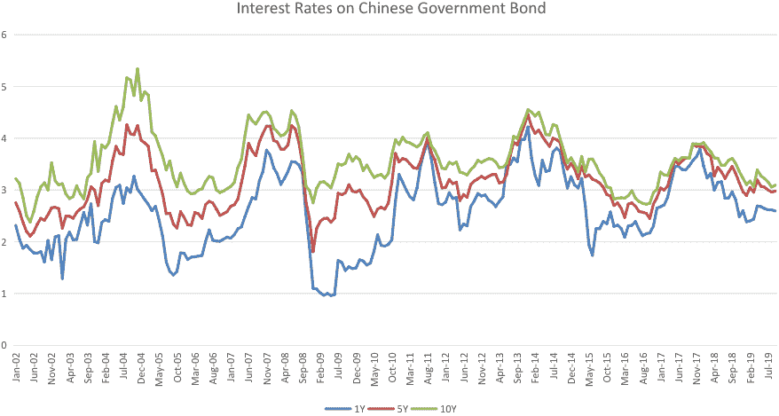

## 一个供求模型

- 考虑国债市场，这里的交易决定了每时每刻的利率曲线。
- 在此例中，国债价格（或无风险利率）是内生变量。
- 经验事实：利率呈现周期性波动特征。
- 一个简单的模型：债市的供给和需求曲线模型
  - 内生变量：债券价格和债券数量
  - 外生变量可能包括：央行货币政策、外国货币政策、通胀预期、政府财政赤字等等。
  - 外生变量移动供给和需求曲线。

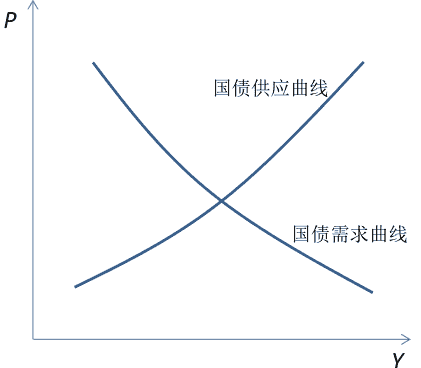

## 宏观模型应用

- 解释宏观经济现象
- 预测经济趋势和金融市场表现
- 政策效应分析

## 结构模型

- 国债供需模型是一个结构模型（Structural model）。
  - 先验假设（即“结构”）：供给曲线和需求曲线，均衡
    $$Y^s=f(P,X^s)$$
    $$Y^d=g(P,X^d)$$
    $$Y^s=Y^d$$
  - 该模型刻画了内生变量和外生变量之间的因果关系。
- 此类建模思路被称为“结构建模”（Structural approach）。

- $P$：债券价格
- $Y^s$：供给
- $X^s$：供给侧外生变量
- $Y^d$：需求
- $X^d$：需求侧外生变量


## 非结构模型

- 另一种建模思路是“非结构建模”（Reduced-form approach）
  - 先验假设较少，让数据决定模型
  - 利用变量之间的相关性进行预测

## 结构模型和非结构模型

- 结构模型的解具有非结构模型的形式，我们称之为非结构形式（reduced-form）。
- 结构模型一般非常简化（忽略具有预测价值的因素），因此结构模型一般不适合用于预测。
- 而非结构模型（经常是数据驱动）更加灵活，经常给出更准确的预测。
- 变量之间的相关性会发生变化（结构变化），因此基于非结构模型的预测会因为结构变化而出现偏误。-- “卢卡斯批判”

## 宏观经济学派

- 古典学派（Classical）
- 凯恩斯（Keynes）
- 凯恩斯主义（Keynesianism）
- 货币主义（Monetarism）
- 新古典（New classical）
- 新凯恩斯主义（New Keynesian）
- 其他

## 古典学派的宏观思想

- 核心假设：个体理性，价格和工资灵活，市场永远出清（clear）。
  - 无需担心需求（需求自动消化供给，供给产生需求。）
  - 货币数量理论（Quantity theory of money, David Hume, Irving Fisher）
    $$MV = PY$$
  - 货币是浮于真实经济表面的一层纱（A veil of money）：货币外生给定，不影响真实经济活动。

## 凯恩斯

- 凯恩斯（John Maynard Keynes）于1936年出版《通论》， *General Theory of Employment, Interest and Money.* 这被认为是宏观经济学的开端。
- 凯恩斯的《通论》解释了大萧条为什么会发生，以及政府应该做什么。
- 凯恩斯理论基于行为经济学假设，人不够理性，市场不够完美。
  - 粘滞价格（Sticky price/wage）
  - 动物精神（Animal spirits）
  - 选美比喻（Beauty contest）

## 新古典综合（Neoclassical Synthesis）

- 以萨缪尔森（Paul Samuelson, 1915–2009）为代表的凯恩斯主义者，将凯恩斯经济学和新古典微观经济学结合起来，形成了“新古典综合”。
- 萨缪尔森建立了新的经济学研究模式：用正式的数学模型表达经济学理论。
- 基于凯恩斯主义经济学，经济学家（如Jan Tinbergen (1903–1994), Lawrence Klein (1920-2013)）建立大型计量经济学模型，用于预测和政策分析。

## 菲利普斯曲线（The Phillips Curve）

- 在大型计量模型中，有一个方程被称为“菲利普斯曲线”：通胀和失业率之间的负相关关系。
- 菲利普斯曲线是宏观经济管理（熨平经济周期）的理论基础。

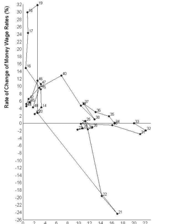

Data of United Kingdom 1913–1948 from Phillips (1958)

## 新古典宏观经济学（New Classical Macroeconomics）

- 新古典经济学家，尤其是卢卡斯（Robert Lucas Jr., 1937-）进一步挑战凯恩斯主义经济学。
  - 重视宏观经济学的“微观基础”（Micro-foundation）
    - 推崇具有微观基础的结构模型（比如基于理性代表人的优化决策）
    - 批判大型计量模型（非结构）（卢卡斯批判）
  - 应用“理性预期”（Rational expectation）假设

- 实际商业周期（Real Business Cycle, RBC）理论（Edward C. Prescott 和 Finn E. Kydland）
  - 方法论：动态一般均衡模型，Dynamic Stochastic General Equilibrium, DSGE
  - 政策含义：商业周期是经济对外生冲击的有效反应，因此无需政策应对。

## 新凯恩斯主义（New Keynesianism）

- 为应对新古典经济学对凯恩斯经济学缺乏微观基础的批判，新凯恩斯经济学研究市场不完美如何发生，从而构造凯恩斯经济学的微观基础。
  - 垄断竞争（Monopolistic competition）
  - 粘滞价格（Sticky price）
  - 信息不对称（Asymmetric information）
- 代表人物：斯蒂格利茨（Joseph E. Stiglitz）、Guillermo Calvo、Michael Woodford、Gregory Mankiw等

## 这么多学派，相信哪个？

- 可以有初步看法，不可有对某学派的宗教信仰。
- 模型是对现实的抽象和简化，因此模型总是“错”的。只要对理解某个问题有帮助，错误的模型就有价值。
- 试图用同一个模型解决所有问题，是危险的。

## 小结

- 宏观经济学将经济作为一个整体进行研究。
- 在我们的经济中，市场和政府都扮演了重要角色。
- 职业经济学家用模型进行解释、分析政策、预测。
- 提出和分析模型是科学，在特殊现实场景运用模型是艺术。

## 导言：数据的重要性

- Sherlock Holmes: It is a capital mistake to theorize before one has data. Insensibly one begins to twist facts to suit theories, instead of theories to fit facts.
- 经济数据是关于经济的客观系统的观察。

## 国内生产总值

- 国内生产总值 (Gross Domestic Product, GDP) 是一段时间内（比如一个季度）所有国内生产的、最终商品和服务的、交换价值总和。
- 三个角度看GDP:
  - [生产] 国内生产的最终商品和服务价值
  - [收入] 国内生产的最终商品和服务交换中产生的总收入（income）
  - [支出] 国内生产的最终商品和服务交换中产生的总支出（expenditure）
- 每次交换产生的收入必等于支出，因此总收入必等于总支出。

## 循环图（The Circular Flow）

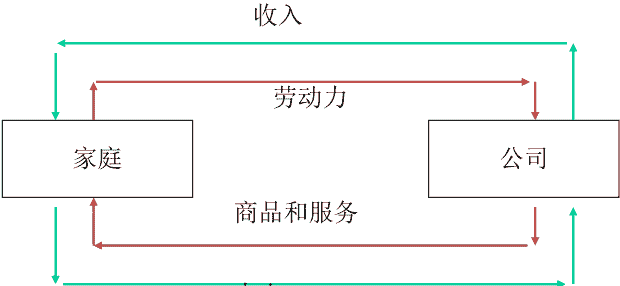

收入

劳动 力

商品和服务

支出

家庭

公司

## 计算 GDP

- GDP: 一段时间内国内生产的最终商品和服务的市场价值总和。

$GDP_t = \sum_{i=1}^{M} q_{it} p_{it}$

其中 $q_{it}$ 和 $p_{it}$ 分别为第 $i$ 种商品或服务的数量和价格，$t$ 代表时间段（比如某个季度）。

- 如果一棵苹果树和一棵桔子树构成一个经济，每年生产20个苹果和30个桔子，市场价格分别为0.5和1元，那么

GDP = (苹果价格 × 苹果数量)
    + (桔子价格 × 桔子数量)
    = (0.5 × 20) + (1.0 × 30) = 40 元

## GDP核算规则：
用市场价格

- 如果有市场价格，就用市场价格计算商品和服务的价值。
- 如果没有市场价格，就采用估价（imputation），比如自有房屋的租金需要估价。
- 对地下经济不作估价。

## GDP核算规则：
最终商品和服务

- 中间产品不作重复计算
  GDP = 最终商品和服务的价值
  = 所有生产阶段的增加值的总和
- 二手商品不计算（包括库存商品的出售）

## GDP核算规则：
国内生产

- 进口的商品和服务不算在GDP内。
- 但它们会被计算在支出法GDP的消费或投资项内。

## 名义GDP和实际GDP

- 名义GDP（nominal GDP）用现价（current price）， $GDP_t = \sum_{i=1}^{M} q_{it} p_{it}$。
  - 数量和价格变化都能带来名义GDP变化。
- 实际GDP（real GDP）用不变价（constant price）， $RGDP_t = \sum_{i=1}^{M} q_{it} p_{it_0}$，
  其中 $t_0$ 代表基期（base period）， $p_{it_0}$ 不随时间变化。
- 实际测度（实际GDP，实际工资等）帮助我们衡量剔除价格变化后的实际变化。
- 名义GDP和实际GDP之间的关系：
  $GDP_t = P_t \cdot RGDP_t$，
  其中 $P_t$ 是GDP平减因子（GDP deflator, or implicit price deflator for GDP）。


## 名义和实际GDP（1978-2020）

China's Real GDP and Nominal GDP (unit: RMB 100million)

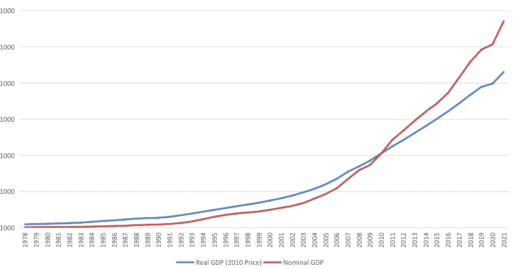

## 实际GDP增速（年度，1953-2021）

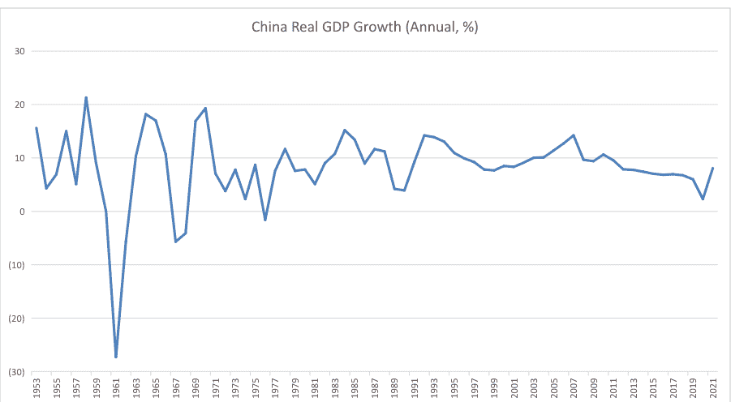

## 实际GDP增速
（季度, 1992Q1-2020Q4）

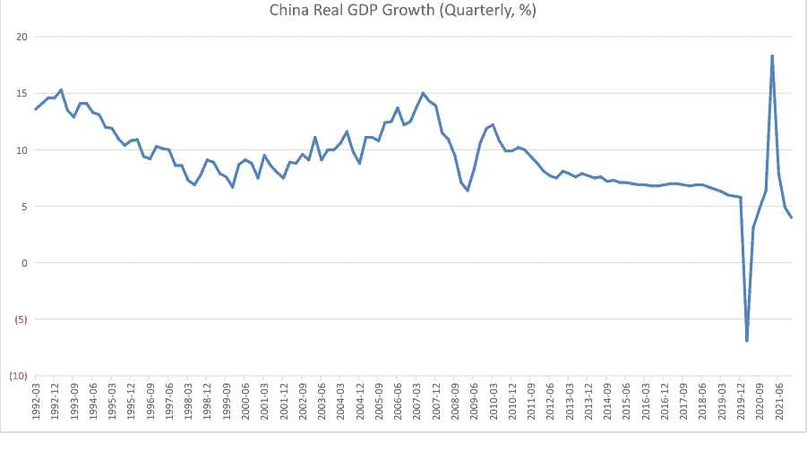

## 2020年中国GDP

- 2020年中国GDP为 101.6 万亿元. 人均GDP约为 72600 元.
- 用市场汇率 (6.54)计算, 人均GDP约为 11100 美元.
- 作为对比, 2020年美国人均GDP为 63284 美元。

## 基期选择

- 一个原则：不能太遥远。比如手机在30年前是稀罕物，不能用30年前的手机价格计算2020年的手机产值。
- 1995年开始, 美国用 chain-weighted 实际GDP增速。
  - Chain-weighted 增速是两个实际GDP增速的平均。
  比如在2000年，计算两个实际GDP增速：
    1. 以1999年为基期的2000年GDP增速
    2. 以2000年为基期的2000年GDP增速
- 在中国，每5年更换一次基期。

## 支出法GDP分解

```
Y = C + I + G + NX
```

总支出
(GDP)

总消费

总投资

政府购买

净出口

## 消费 (C)

- 消费 (C) 一般指居民消费，家庭对商品和服务的购买，包括：
  - 耐用品（durable goods），如汽车、家用电器等
  - 非耐用品，如食品，服饰等。
  - 服务，如交通、旅游、洗衣等。

## 居民消费率（%）

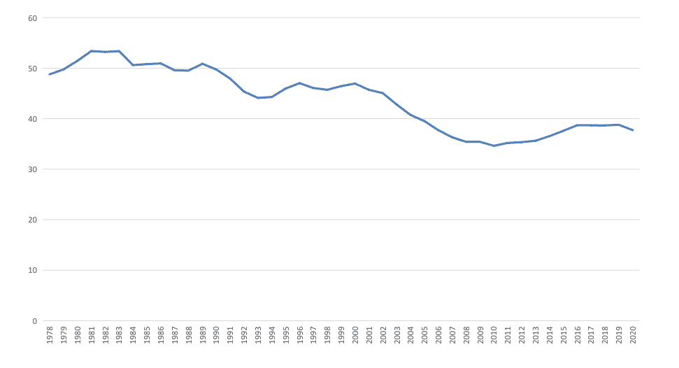

## 投资 (I)

- 投资(I)一般指私人部门（private sector）的固定资本形成和库存增加。
  - 固定资本形成总额：在一定时期内获得的固定资产减去处置的固定资产的价值总额。包括商业固定资本（如厂房机器）和住户固定资本（如住房）。
  - 库存价值的变化
- 中国的投资数据（资本形成）包含国有部门的投资。

## 资本、投资和折旧

- 资本是生产要素之一。
- 投资是为增加资本存量所做的支出。
- 折旧是资本存量的损耗。
- 例子：
  - 假设在 1/1/2002：
    - 某经济的资本存量为 500
    - 在 2002 年：投资 = 100，折旧 = -20
    - 那么在 1/1/2003：该经济的资本存量为：500+100-20=580

- 资本是存量（stock），投资和折旧是流量（flow）。

## 关于住房

- 住房是资本，用于制造“住房服务”。
- 因此购买新房算在投资，而不是消费。
- 租户支付的房租算在消费项，即住房服务。
- 原则上，自有住房的“住房服务”也应该通过估价（imputation）算在GDP中。

## 库存投资 占GDP比例

Share of Inventory Investment in GDP (%)

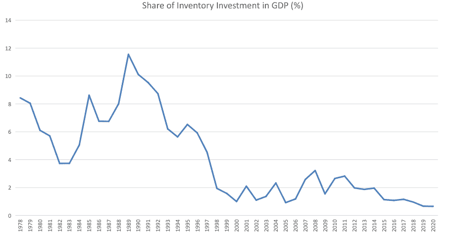

## 政府消费 (G)

- 政府消费指政府承担的公共服务支出、个人消费货物和服务支出。
  - 公共服务支出主要包括外交、国防、公共安全和环境保护等方面的支出；
  - 政府承担的个人消费货物和服务支出主要包括政府在医疗卫生、教育、文化娱乐和社会保障方面的支出。
- 为避免重复计算，不计入转移支付（transfer payments）。

## 更具体的分解

- 让 $C^d$ 表示用于购买国产商品和服务的消费支出，$C^f$ 表示用于购买进口商品和服务的消费支出。
- 同样的，定义 $I^d,I^f,G^d,G^f$．我们有：
  $$C=C^d+C^f, I=I^d+I^f, G=G^d+G^f.$$
- 让 $EX$ 和 $IM$ 分别表示出口和进口，则
  $$X=EX-IM$$
  $$IM=C^f+I^f+G^f.$$
- 因此我们有
  $$Y=(C^d+C^f)+(I^d+I^f)+(G^d+G^f)+EX-(C^f+I^f+G^f).$$

## 收入法GDP

- 收入法GDP有四部分组成：
  GDP=劳动者报酬+生产税净额+固定资产折旧+营业盈余
  - 劳动者报酬->居民部门
  - 固定资产折旧+营业盈余->企业部门
  - 生产税净额->政府部门
- 收入法GDP也称为GDI (Gross Domestic Income)。

## 其他收入指标

- GNI (Gross National Income) 或 GNP (Gross National Product)
  GNI = GDP + 国外净要素收入
- NNP (Net National Product)
  NNP = GNP − Depreciation
- NI (National Income)
  — NI 和 NNP 之间相差一个统计误差（statistical discrepancy）。
- PI (Personal Income) 和 Disposable PI

## 中国GNI和GDP差异

(GNI-GDP)/GDP*100 (%)

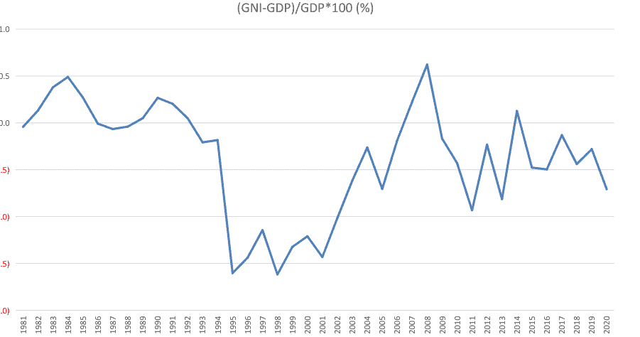

## 关于中国的人均可支配收入

- 中国的“人均可支配收入”由抽样调查得到，包括四部分：
  - 工资性收入
  - 经营性收入
  - 财产净收入
  - 转移净收入
- 不包括婚丧嫁娶礼金、出售资产所得、彩票中奖等一次性收入。
- “人均”的分母是家庭所有常住成员。

## 消费者价格指数（CPI）

- CPI (Consumer Price Index) 测度消费者所面临的一般价格水平。
- 统计局通过住户调查决定一个典型消费者购买的一篮子商品和服务。依据该篮子，统计局按如下公式计算CPI，
  $$CPI_t = c_0 \frac{\sum_i q_{i,t_0} p_{it}}{\sum_i q_{i,t_0} p_{i,t_0}}$$

其中

- $p_{it}$ 为第 $i$ 种商品或服务在 $t$ 期的价格，
- $p_{i,t_0}$ 为该商品或服务在 $t_0$ 期的价格，
- $q_{i,t_0}$ 为该商品或服务在 $t_0$ 期的消费数量，
- $c_0$ 为常数（一般为100，表示基期价格水平为100）。

## CPI

- 让 $w_i$ 表示第 $i$ 种商品或服务在 CPI 篮子中的消费额比例（按基期 $t_0$ 价格和数量计算），
  
  $$w_i = q_{i,t_0} p_{i,t_0} / \sum_{i=1}^{M} q_{i,t_0} p_{i,t_0}$$

上页的计算公式可改写为：

$$\text{CPI}_t = c_0 \sum_{i=1}^{N} w_i \left( \frac{p_{it}}{p_{i,t_0}} \right).$$

## “苹果和桔子”经济

- 在“苹果和桔子”经济中，价格和数量分别为：

| Year | Apple | Orange |
| --- | --- | --- |
|  | Price | Quantity | Price | Quantity |
| 2016 | 0.6 | 25 | 1.1 | 15 |
| 2015 | 0.5 | 20 | 1 | 10 |

- 于是2016年CPI为

CPI₂₀₁₆ = 100 * (0.6 * 20 + 1.1 * 10) / (0.5 * 20 + 1 * 10)
= 100 (0.6/0.5 * 1/2 + 1.1/1 * 1/2) = 115.


## 通胀率

- CPI的变化率即通胀率。
- 同比
- 环比
- CPI 具有较强的季节性，因此有必要作 “季节性调整” （seasonal adjustment）。

## 同比和环比上涨

- 给定CPI篮子（w_i）和月度价格（p_it），CPI同比上涨：
$$\sum_{i} w_i \left(\frac{p_{it}}{p_{i,t-12}} - 1\right) \times 100\%.$$  
- 该数据是头条通胀数据。大体避免了季节性，但丢失了环比变化信息。
- CPI环比上涨
$$\sum_{i} w_i \left(\frac{p_{it}}{p_{i,t-1}} - 1\right) \times 100\%.$$

## CPI同比上涨（%）

中国月度通胀率（%）

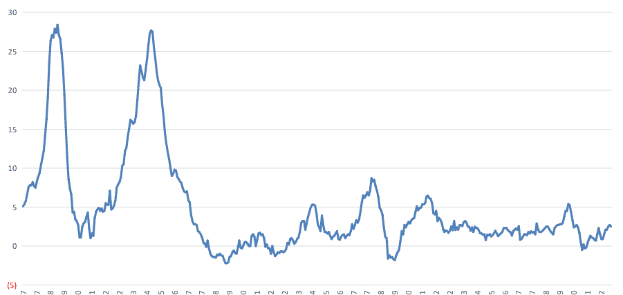

## 中国CPI篮子八大类权重（估计）

| 类别 | 权重（%） |
|---|---:|
| 食品烟酒类 | 30.15 |
| 居住类 | 20.57 |
| 交通和通信类 | 11.81 |
| 教育文化和娱乐类 | 11.36 |
| 生活用品及服务类 | 10.83 |
| 医疗保健类 | 8.27 |
| 衣着类 | 3.83 |
| 其他用品和服务类 | 3.16 |

## 美国CPI篮子权重

美国CPI篮子权重（城市平均，2017-2018年权重）

| Category | Weight (%) |
|---|---|
| 食品和饮料 | 15.157 |
| 住房 | 42.385 |
| 交通运输 | 15.16 |
| 娱乐 | 5.797 |
| 教育和通信 | 6.810 |
| 医疗护理 | 8.870 |
| 服装 | 2.663 |
| 其他商品/服务 | 3.159 |

## GDP平减因子与CPI

- GDP平减因子的篮子等同于GDP篮子，GDP篮子包含所有**产出**的商品和服务。而CPI只包含居民**消费**的商品和服务。
- 公司和政府购买的商品和服务价格反映在GDP平减因子中，不在CPI中。
- GDP篮子中只包含**国内**产出的商品和服务，而CPI篮子中包含进口消费品。
- GDP篮子权重随时间变化，而CPI篮子权重在短期固定（等于基期居民消费支出结构）。

## Inflation in CPI and GDP Deflator

通胀率在CPI和GDP平减指数中

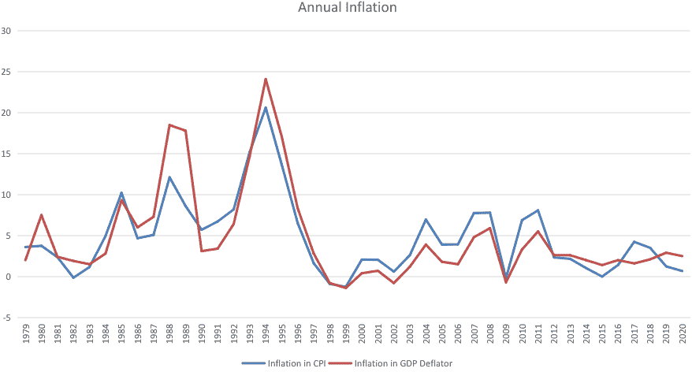

## 为什么CPI 倾向于高估通胀

- 替代效应
- 新产品/服务引进
- 产品/服务质量提升

## PPI和CPI

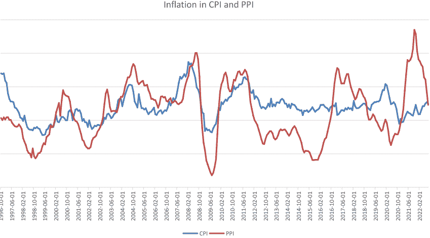

## 度量就业情况

- 失业率 = 失业人数
  劳动力
- 劳动参与率 = 劳动力
  成年人口

## 中美劳动力市场

- 2019年，中国人口和劳动力市场数据如下（百万）:
  
  人口 = 236.6 (少儿, 年龄 0-14) + 1173.5 (成人) = 1410.1
  劳动力 = 774.7 (就业) + 36.3 (失业) = 811.0
  
  失业率 = 36.3/811.0 = 4.48%
  劳动参与率 = 811.0/1173.5 = 69.1%

- 2019年9月，美国劳动统计数据如下（百万）:
  
  劳动力 = 158.3 (就业) + 5.8 (失业) = 164.1
  
  失业率 = (5.8/164.1) x 100 = 3.5%
  劳动力参与率 = (164.1/259.6) x 100 = 63.1%

## 美国失业率

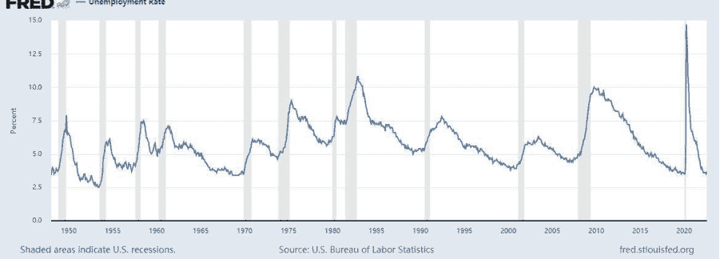

## 美国劳动参与率

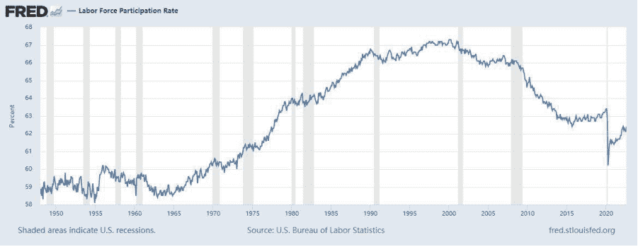

## 中国第二和第三产业就业比例

## 中国非农就业占比（%）

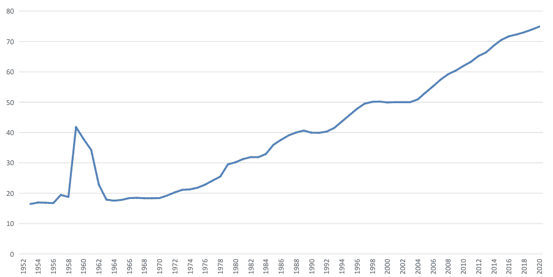

## 非农就业增长和经济增长

## 就业与产出

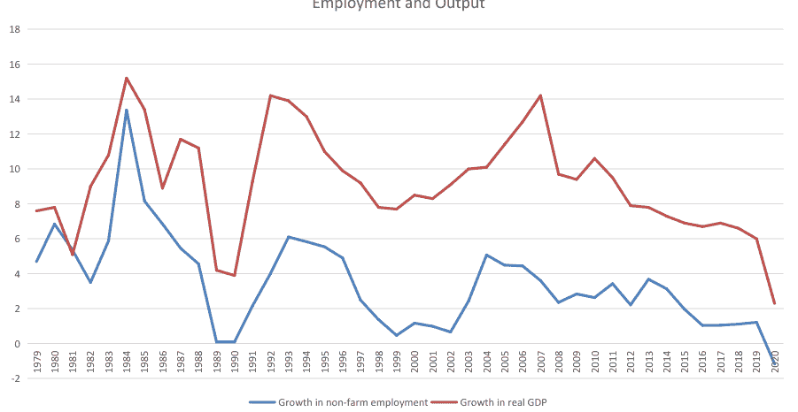

## 货币供应

- 在现代经济中，货币包括流通中现金、活期储蓄（活期存款）、定期储蓄（储蓄存款）、货币式基金等。
- 按流动性不同，可以定义不同种类的货币供应。中国央行统计如下三种货币供应：
  - 流通中货币（M0，9.3万亿元（2020.12））
  - 货币（M1，54.6万亿元（2020.12））
  - 货币和准货币（M2，202.3万亿元（2020.12））

## 中美货币供应定义比较

|  | China | US |
|---|---|---|
| M0 | physical currency | physical currency |
| M1 | M0 + demand deposits | M0 + demand deposits + travelers checks + other checkable deposits |
| M2 | M1 + saving deposits | M1 + saving deposits (including money market deposits) + retail money market mutual fund balances + small time deposits. |

## 结语

- 宏观数据对经济运行很重要。
  - 帮助个人和公司决策
  - 是政策制定的前提
  - 吸引高水平的研究
- 要理解宏观经济，熟悉数据是第一步。

## API密钥格式

```
```
sk-2401304d-18a916c18a8d40749db38887de4ae8d1-8686-161
sk-2401304d-xxxxx-8686
```
```

> > API密钥分四部分：固定前缀；日期；32位随机十六进制；后缀长度和签名。

- sk-：固定前缀
- 2401304d：日期
- 18a916c18a8d40749db38887de4ae8d1：32位随机十六进制
- -8686-161：后缀长度和签名

请勿共享此密钥

## 古典假设

- 个体理性
  - 消费者最大化效用
  - 公司最大化利润
- 价格（包括工资和利率）灵活，让市场处于出清状态。
- 产品和要素市场均完全竞争（完全竞争）。
- 人们掌握完全信息。
- 货币只是交易媒介。

## 名人名言

- Adam Smith:
  *货币就像一条道路，有助于将一个国家生产出的商品和服务运送到市场，但这条道路本身并不生产任何东西。*
- John Stuart Mill:
  *简而言之，在社会经济中，没有什么比货币更微不足道的了。*


## 总产出
- 经济总产出决定于：
  - 总供应 (Aggregate supply, AS, 供给侧)
    - 输入 (即生产要素, factors of production): 劳动力、资本、土地等。
    - 技术 (technology): 将输入转化为产品的能力。
  - 总需求 (Aggregate demand, AD, 需求侧)
    - 消费、投资、政府购买、国外需求

## AD和AS曲线
- 一般来说，AD和AS均为价格水平($P$)的函数。
  - AD 曲线: AD 和 $P$ 关系的图形表示。
  - AS 曲线: AS 和 $P$ 关系的图形表示。

- 一般来说，$P$ 下降时，AD 上升，AS 下降。
  - AD:庇古（Pigou）财富效应，凯恩斯利率效应等。
  - AS:信息不对称，错觉，部分价格粘滞等。

## 古典AS曲线
- 在古典假设下，AS曲线垂直（总供给与价格水平无关）。
  - 生产者不会因为价格水平上涨（通胀）而扩大生产。

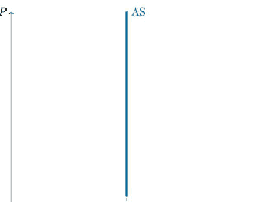

## 古典AD-AS曲线
- 在古典假设下，AD曲线向下倾斜。  - 价格水平下降，增加现金购买力，因而扩大总需求（庇古效应）

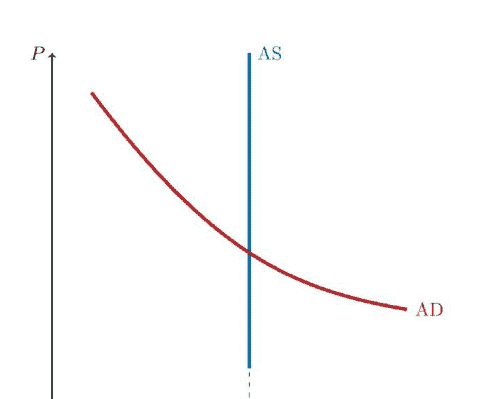

## 供给冲击和滞胀
- 在古典假设下，AD曲线向下倾斜。
  - 价格水平下降，增加现金购买力，因而扩大总需求（庇古效应）

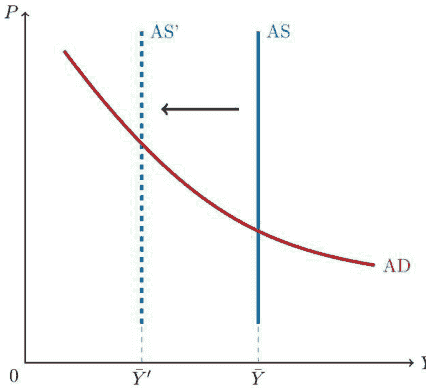

## 对应古效应的反驳
- 很多人或公司有债务
  - 当 P 下降，实际债务负担加重，抑制需求。
  - AD 曲线可能是垂直的（如右图）。
  - 如果 AD-AS 曲线均垂直，两条曲线必须重合（在任何价格水平，需求都等于供给）。

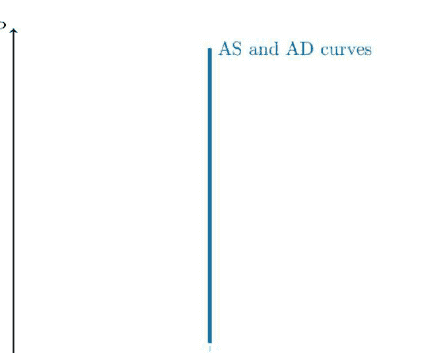

## 萨伊定律（Say’s Law）
- 萨伊定律：供给产生需求（Supply creates its own demand.）
  - 在“以物易物”（barter）经济中，萨伊定律一定成立。
  - 在现代货币经济中，不见得。

## 产出潜力（Output Potential）
- 产出潜力（用 $\bar{Y}$ 表示）是指使用当前技术，将几乎所有资本和劳动力用于生产所达到的产出水平。
- 在古典假设下，厂商间的竞争会让生产达到潜力水平。

## 生产要素（Factors of Production）
- 生产要素是生产商品或服务所需的投入。
- 最重要的两个要素投入是资本（capital）和劳动力（labor）。
  - 资本是所有用于生产、流通和销售的资产。我们用 K 表示资本存量。
  - 劳动力是劳动者用于生产的时间。我们用 L 表示劳动力。

## 假设
- 在这一章中，我们假设资本和劳动力均固定：
  
  $$K = \overline{K}$$
  
  $$L = \overline{L}$$

## 生产函数
- 宏观经济学通常用生产函数（production function）刻画“技术”——将要素投入转化为商品和服务的能力。
- 宏观经济学中的广义技术：不仅包括科学技术，而且包括制度、政策、基础设施、金融市场、企业管理、营销等有助于增加总产出的“软实力”。
- 我们将总产出（Y）表示为要素投入（K 和 L）的函数，
  
  Y = F(K, L).

## 生产效率
- 我们可以在生产函数中引入效率（efficiency or productivity）变量（$A$），
  - 劳动增强型（labor augmenting）
    $Y = F(K, AL)$
  - 资本增强型（capital augmenting）
    $Y = F(AK, L)$
  - 全要素增强型（total-factor augmenting）
    $Y = AF(K, L)$

## 关于技术的假设
- 在本章中，技术假设不变。
- 因为假设要素投入和技术均不变，所以总产出也不变：

$$Y = F(\overline{K},\overline{L}) = \overline{Y}.$$

## 自然失业率
- 在古典假设下，要素满额使用（产出等于产出潜力），经济没有失业问题，但失业率仍然为正——“自然失业率”（natural rate of unemployment）。

## 美国的失业率和自然失业率

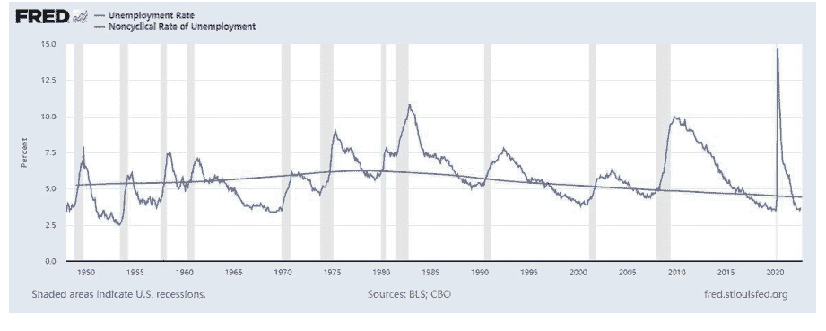

## 一个自然失业率模型
- 让 $L$ 表示劳动力总人数，$E$ 就业人数，$U$ 失业人数。我们知道 $L=E+U$，以及 $U/L$ 为失业率。
- 让 $s$ 表示离职率，即，在一段时间内（一个月）离职的人数为 $sE$。
- 让 $f$ 表示入职率，即，在该时间段找到工作的人数为 $fU$。
- 假设劳动力市场处于稳态（steady state）：
  $$sE=fU.$$

## 自然失业率
- 从稳态条件我们得到
  $$\frac{fU}{L} = \frac{s(L - U)}{L}.$$ 
- 所以
  $$f\frac{U}{L} = s\left(1 - \frac{U}{L}\right),$$

解出
$$\frac{U}{L} = \frac{s}{s + f} = \frac{1}{1 + f/s}.$$

## 含义
- 该模型用两个参数刻画自然失业率，离职率和入职率。
- 只要离职率大于零（意味着有人离职后没有马上找到工作），自然失业率就大于零。
- 要让自然失业率降低，要么降低离职率，要么提高入职率（让失业的人更快找到新工作）。

## 摩擦性失业
- 找工作或招工人需要时间，因此而生的失业叫作摩擦性失业。
  - 工作和工人的异质性（heterogeneity）
  - 信息不对称
  - 劳动力市场流动性不足
  - 产业变迁

## 如何降低自然失业率
- 降低劳动力市场摩擦
  - 帮助散发岗位和求职信息
  - 提供就业培训
- 失业保险的效应
  - 失业保险有助于实现雇员和雇主的匹配
  - 过于丰厚的失业保险会让自然失业率升高

## 收入分配
- 在我们的假设下，总产出固定，因此总收入也固定。我们用一个代表性公司（Representative firm）模型来理解收入分配。
  - 想象供给侧由很多具有相同生产函数的公司组成，它们生产同一样产品（叫它“Y”），面临相同的要素价格（工资（W），资本租金(R)）和商品价格（P）。
    - Y：实际GDP
    - P：价格水平

## 实际要素价格
- 实际工资（Real wage）是以产出为单位、支付给工人的工资，$\frac{W}{P}$。
- 实际资本租金（Real rental price of capital）是以产出为单位、付给资本所有者的租金，$\frac{R}{P}$。

## 完全竞争市场
- 产品和要素市场均完全竞争（perfectly competitive）。
- 代表性公司将*P*、*W*、*R*视为给定（外生）。


## 一阶条件

- 关于 $K$ 的一阶条件：

$$F_1(K,L) = \frac{R}{P}.$$

  - $F_1 \equiv \frac{\partial F}{\partial K}$ 为“边际资本产出”（Marginal product of capital, MPK）。
- 关于 $L$ 的一阶条件：

$$F_2(K,L) = \frac{W}{P}.$$

  - $F_2 \equiv \frac{\partial F}{\partial L}$ 为“边际劳动产出”（Marginal product of labor, MPL）。

## 劳动力需求曲线

- 固定 $K=\bar K$，关于 $L$ 的一阶条件刻画了劳动力需求和实际工资之间的关系（即劳动力需求曲线）：

$$F_2(\bar K,L)=\frac{W}{P}.$$

因为 $F_{22}\equiv\frac{\partial^2F}{\partial L^2}<0$，$F_2$ 是 $L$ 的减函数。因此较低的实际工资对应较高的劳动力需求。

Real wage (W/P)

Labor (L)

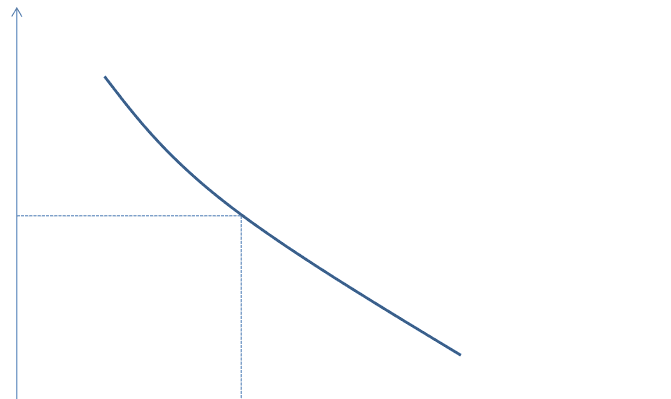

## 经济利润和会计利润

- 实际经济利润（Economic profit）定义为：

$$Y - MPL \cdot L - MPK \cdot K$$

- 会计利润（Accounting profit）是经济利润与资本回报之和：

$$\text{accounting profit} = \text{economic profit} + MPK \cdot K$$

## 收入分配

- 在我们的假设下，劳动者得到 $F_2(\bar{K},\bar{L})\cdot\bar{L}$，资本所有者得到 $F_1(\bar{K},\bar{L})\cdot\bar{K}$，没有经济利润。
  - 注意在“规模收益不变”假设下，我们有 $F(zK,zL)=zF(K,L)$ $\forall z>0$。于是从 $\frac{dF(zK,zL)}{dz}=\frac{d(zF(K,L))}{dz}$ 得到

$$F_1(zK,zL)K + F_2(zK,zL)L = F(K,L).$$

  让 $z=1$，代入 $K=\bar{K}$ 和 $L=\bar{L}$，得到

$$F_1(\bar{K},\bar{L})\bar{K} + F_2(\bar{K},\bar{L})\bar{L} = F(\bar{K},\bar{L}) = \bar{Y}.$$

## Cobb-Douglas 经济

- 假设 $F(K,L)=AK^\alpha L^{1-\alpha}$，我们有

$$\mathrm{MPK}=F_1(K,L)=\frac{\alpha AK^\alpha L^{1-\alpha}}{K}=\frac{\alpha F(K,L)}{K}$$

$$\mathrm{MPL}=F_2(K,L)=\frac{(1-\alpha)AK^\alpha L^{1-\alpha}}{L}=\frac{(1-\alpha)F(K,L)}{L}$$

- 资本所得的份额为

$$F_1(\overline K,\overline L)\cdot\overline K=\alpha F(\overline K,\overline L)=\alpha\overline Y$$

- 劳动者所得的份额为

$$F_2(\overline K,\overline L)\cdot\overline L=(1-\alpha)F(\overline K,\overline L)=(1-\alpha)\overline Y$$

## 案例：美国劳动者收入份额

### The US Labor Share of Income (%)

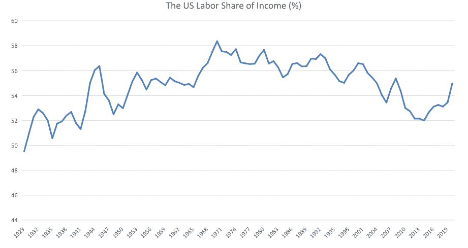

## 案例：中国劳动者收入份额

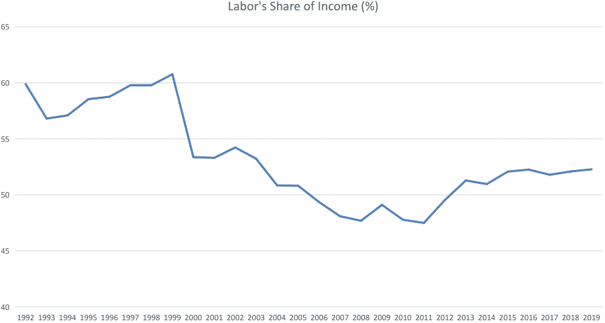

## 劳动生产率和实际工资

- 劳动生产率（Average labor productivity or labor productivity）一般用实际GDP与劳动力数量之比 $\left(\frac{Y}{L}\right)$ 衡量。
- 在 Cobb-Douglas 经济中，

$$MPL = F_2(K, L) = \frac{(1 - \alpha) A K^{\alpha} L^{1-\alpha}}{L} = (1 - \alpha) \frac{Y}{L}$$

- 所以实际工资（等于MPL）应该跟劳动生产率成正比。

## 案例：美国劳动生产率和实际工资

|  | Growth in labor productivity (%) | Growth in real nonfarm compensation (%) |
|---|---:|---:|
| 1959-1972 | 2.8 | 2.3 |
| 1973-1994 | 1.6 | 0.7 |
| 1995-2007 | 2.7 | 1.6 |
| 2008-2019 | 1.3 | 0.8 |
| **1959-2019** | **2.1** | **1.3** |

Why does real wage growth lag behind the labor productivity growth?

## 内容

- 导言
- 产出
- 失业
- 收入分配
- 利率
- 货币与通胀
- 汇率

## 名义和实际利率

- 名义利率（Nominal interest rate）是可以直接观察到的，用 $i$ 表示。
- 实际利率（Real interest rate）不可观察，但可以估计，用 $r$ 表示。实际利率又有两种：
  - 事后实际利率（ex post real interest rate）：$r = i - \pi$，其中 $\pi$ 表示通胀率。
  - 事前实际利率（ex ante real interest rate）：$r = i - E\pi$，其中 $E\pi$ 表示通胀预期。

## 费雪方程

- 从事后实际利率定义可以得到费雪方程（Fisher equation）：$i = r + \pi.$
- 从事前实际利率定义得到另一个版本的费雪方程：$i = r + E\pi.$

## 实际利率的古典模型

- 建模：
  1. 均衡条件
  2. 行为假设（消费函数、投资函数等）
- 可以用模型进行：
  1. 经济解释
  2. 虚拟实验（Virtual experiment）

## 简化假设

- 封闭经济：假设净出口 $X=0$。于是

$$Y=C+I+G.$$

- 财政外生：政府购买 $(G)$、税收 $(T)$ 均为外生变量。

## 消费函数

- 让 $T$ 表示收入所得税。于是可支配收入为 $(Y-T)$。
- 消费函数刻画了最终消费和可支配收入的关系：$C(Y-T)$。
- 我们假设 $C(\cdot)$ 为可求导的增函数：

$$C'(Y-T)>0.$$

## 边际消费倾向（Marginal Propensity to Consume）

- 边际消费倾向（MPC）是增加一个单位可支配收入所带来的消费支出增加。用消费函数的一阶导数表示：

$$MPC = C'(Y - T)$$

- 特例：如果 $C(\cdot)$ 为线性函数，比如

$$C(Y - T) = 100 + 0.7(Y - T),$$

那么 MPC 是常数。

## 财政政策

- 财政政策分为征税和支出两个方面。
- 在我们的模型中，财政政策由 $T$ 和 $G$ 刻画：
  - 如果 $G = T$，财政平衡（balanced budget）
  - 如果 $G > T$，财政赤字（budget deficit）
  - 如果 $G < T$，财政盈余（budget surplus）
- 假设 $G$ 和 $T$ 均为外生变量，$G = \bar{G}$，$T = \bar{T}$.


## 商品市场均衡

- 商品市场的需求侧
  $Y^d = C(\bar{Y} - \bar{T}) + I(r) + \bar{G}$
- 供给侧
  $Y^s = \bar{Y}$
- 假设经济处于均衡,
  $\bar{Y} = C(\bar{Y} - \bar{T}) + I(r) + \bar{G}.$

## 金融市场均衡

- 假设存在一个可贷资金（loanable funds）的金融市场：
  - 可贷资金的供应：国民储蓄
    $\bar{S} \equiv \bar{Y} - C(\bar{Y} - \bar{T}) - \bar{G}$
  - 可贷资金的需求：投资 $I(r)$
- 假设金融市场处于均衡：
  $\bar{S} = I(r)$.

## 实际利率古典模型

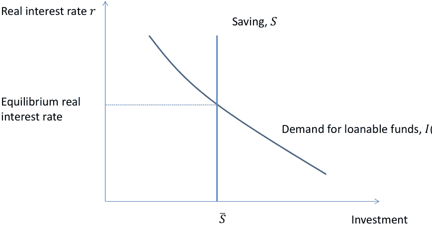

实际利率 $r$

储蓄, $S$

均衡实际利率

可贷资金需求, $I(r)$

投资

$\bar{S}$

## 模型应用

- 虚拟实验，例如：
  - 政府扩大开支对实际利率有何影响？
- 经济解释，例如：
  - 如何解释在过去四十年中，西方国家实际利率持续下降？

## 虚拟实验（Virtual Experiment）

- 模型均衡条件定义了实际利率 $r$ 的隐含函数（implicit function）
  $Y = C(Y - T) + I(r) + G \ \Rightarrow r(Y, T, G)$
- 虚拟实验就是研究隐含函数 $r(Y, T, G)$ —— 外生变量变化如何影响内生变量。
- （如果只有一个内生变量）隐含函数的偏微分刻画某外生变量对内生变量的边际效应，控制其它外生变量。例如：
  $\frac{\partial r}{\partial G} \equiv \lim_{\Delta \to 0} \frac{r(Y, T, G + \Delta) - r(Y, T, G)}{\Delta}$

## 隐含函数定理的应用

- 模型均衡条件可写为
  Θ(r,Y,T,G) = Y − C(Y − T) − I(r) − G = 0.
- 隐含函数定理（implicit function theorem）告诉我们，
  $\frac{\partial r}{\partial G} = -\frac{\frac{\partial \Theta}{\partial G}}{\frac{\partial \Theta}{\partial r}} = -\frac{-1}{-I'(r)} = -\frac{1}{I'(r)}$.

## 政府增加开支的效应

实际利率 *r*

储蓄, *S*

均衡
实际
利率

投资

$\bar{S}$

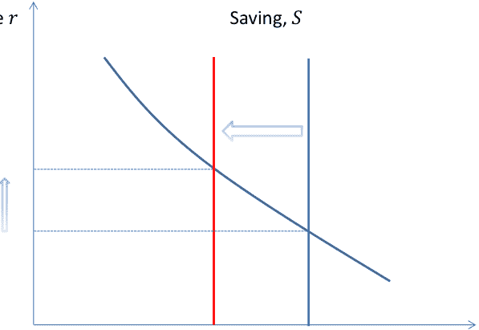

## 挤出效应

- 政府增加支出后，古典模型预测国民储蓄下降，导致实际利率上升，私人投资下降。经济学家把这样的效应称为“挤出效应”：财政刺激挤出民间投资。
- 如何分析减税的效应？

## 美国实际利率

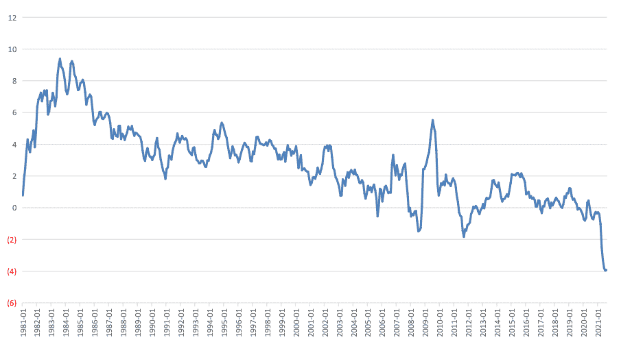

## 从储蓄角度解释利率下降

- 全球储蓄的充裕提供了一个解释：
  $S \uparrow \Rightarrow r \downarrow$
- 2005年，前美联储主席伯南克曾经用此逻辑解释美国长期利率的低迷。

## 从投资角度解释利率下降

- 我们也可以换个角度，改写投资函数为 $I(r, d)$，$d$ 为投资意愿，假设 $I_2 > 0$。
- 用隐含函数定理得到：
  $$\frac{\partial r}{\partial d} = - \frac{\frac{\partial \Theta}{\partial d}}{\frac{\partial \Theta}{\partial r}} = - \frac{-I_2(r, d)}{-I_1(r, d)} = - \frac{I_2}{I_1} > 0.$$ 
- 因此投资意愿低迷（本身可能由其他因素导致，比如对未来投资回报的悲观预期）也可以解释利率下降。
  $$d \downarrow \Rightarrow I \downarrow \Rightarrow r \downarrow$$

## 解释利率下降

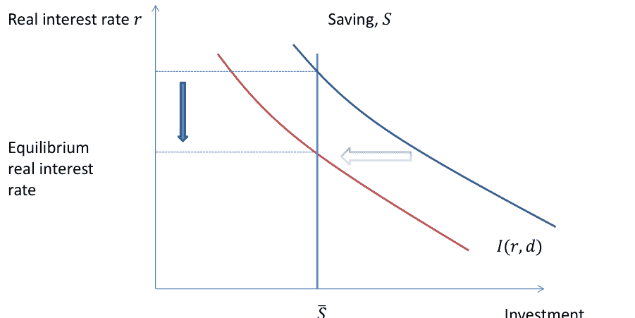

## 货币

- 货币是随时可用于交易的资产。
- 货币的基本功能:
  - 储值（Store of value）
  - 计量单位（Unit of account）
  - 交易媒介（Medium of exchange）
- 货币种类:
  - 商品货币（Commodity money）
  - 法定货币（Fiat money）
    - 数字货币（Digital money）
- 货币形态
  - 纸币和硬币（physical cash, coin）
  - 银行存款（bank deposits）
  - 储备（reserves）
  - 其他

## 从商品货币到法定货币

- 用商品货币（如白银）交易的成本较高。
- 为降低交易成本，银行开始铸币，固定重量和纯度。
- 为进一步降低成本，银行可以发行“银票”，持有银票的客户可以到银行换取白银。银票也就成为银本位的货币。
- 交易需求无限，金银供应有限。如果坚持金银本位，会有通缩压力。
- 如果人们不在乎换取金银的选择，那么银行可以发行没有金银支持的“钞票”。
- 现代中央银行正是如此。现代国家立法规定商家必须接受央行发行的货币，这就是法定货币（fiat money）。
- 法定货币的价值来自国家权力和信用。

## 货币政策

- 制定货币政策是中央银行的主要职能，通过控制货币供应和利率，以实现政策目标。  
  - 价格稳定（price stability）  
  - 经济增长和就业
- 中国的央行是中国人民银行（People’s Bank of China, PBC）。
- 美国的央行是“联储”（Federal Reserve, the Fed）。
- 欧元区的央行是欧洲央行（European Central Bank, ECB）。

## 铸币税（seigniorage）

- 铸币税是印钞给政府带来的收入。因为过度印钞会带来通胀，因此铸币税也被称为“通胀税”。
- 在正常时期，铸币税很温和。但在极端时期（战争、超级通胀等），铸币税可能是政府主要财政来源。

## M2/GDP

- 各国 M2/GDP 比例相差悬殊

| M2/GDP | 2019 (%) | 2021 (%) |
|---|---:|---:|
| 中国 | 208 | 201 |
| 美国 | 72 | 93 |
| 日本 | 186 | 217 |
| 世界 | 126 |  |

- 一般来说，银行主导金融体系的国家，M2/GDP 比例较高。（M2主要就是银行存款）

## 通货膨胀（Inflation）

- 定义：通货膨胀是指商品和服务**总体价格水平**的**持续上涨**。
- 测度：CPI、GDP平减因子等。
- 货币与通胀的关系：通胀侵蚀货币的购买力。

## 通胀的成本

- 预期中的通胀
  - 菜单成本（Menu cost）
  - 价格扭曲引起的资源错配
  - 不公平的税收
  - 其他各种不方便
- 预期外的通胀
  - 购买力的随意再分配
  - 经济不确定性增加

## 通胀的一点好处

- 因为名义工资一般有向下的刚性，通胀能让实际工资获得向下的弹性。
- 于是温和的通胀能让劳动力市场运行得更好。


## 超级通货膨胀（Hyperinflation）

- 定义：极度恶性的通胀（比如通胀率超过每月50%）
- 在超级通货膨胀下，通胀成本不可承受。
- 货币失去储值功能，甚至交易媒介功能
  - 人们不得不以物易物，或者用其他硬通货币。

## 解放前的超级通货膨胀（1937-1948）

1937-1948年的货币与价格

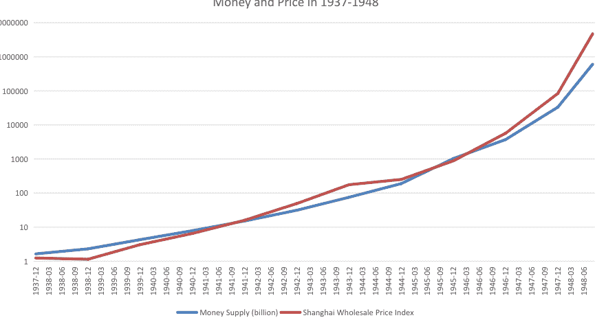

## 解放前的超级通货膨胀
（1948.8-1949.4）

1948年8月至1949年4月的货币与价格

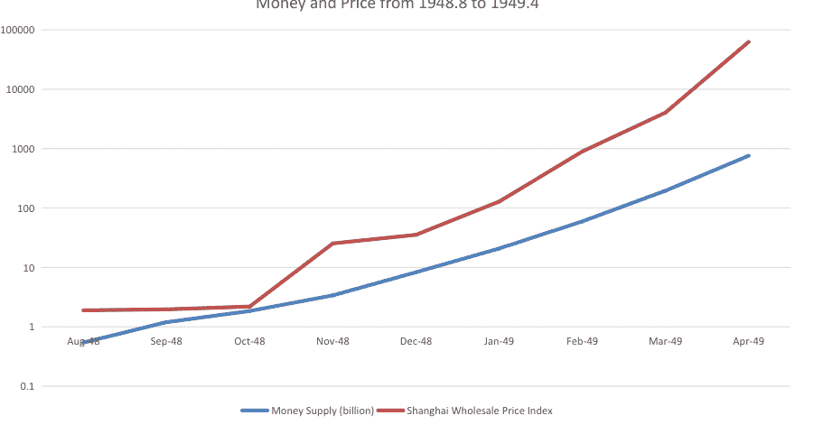

## 超级通胀的原因

- 一个简单回答是：超级通胀由过度的货币供应导致。
- 但是央行为何过度印钞？通常是因为财政问题。
- 如何应对超级通胀？财政改革。

## 货币数量理论

（Quantity Theory of Money）

- 用 $T$ 表示一段时间内交易次数，$P$ 表示价格水平，$M$ 表示流通中的货币。我们可以定义货币流通速度（transaction velocity of money）为
  $$V \equiv \frac{PT}{M}.$$
- 经典假设：货币流通速度是常数。
- 货币数量理论写为
  $$MV = PT.$$

## 货币数量理论
（Quantity Theory of Money）

- 对于异质性商品和服务，“交易次数”可用“不变价”加权，因此 $T$ 可用实际GDP代替，得到更实用的货币数量理论：

$$MV = PY,$$

其中 $Y$ 表示实际GDP。

## 货币和通胀

- 对货币数量方程作全微分可得：
  $$\frac{dM}{M} + \frac{dV}{V} = \frac{dP}{P} + \frac{dY}{Y}.$$  
  - $\frac{dM}{M}$ 和 $\frac{dY}{Y}$ 分别为货币供应和实际GDP增速。
  - $\frac{dP}{P}$ 为通货膨胀率。
  - 因为 $V$ 为常数，所以 $\frac{dV}{V} = 0$.
- 给定实际GDP增速，货币供应增速决定了通胀率。

## 中国M2增速与通胀

## 通货膨胀与货币增长

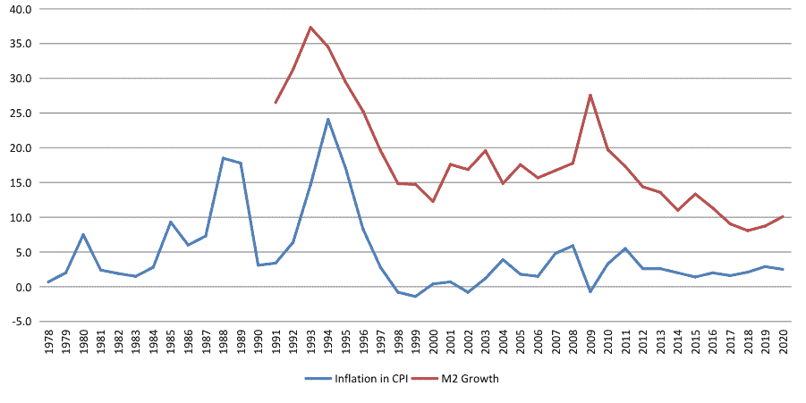

## 美国货币增速与通胀

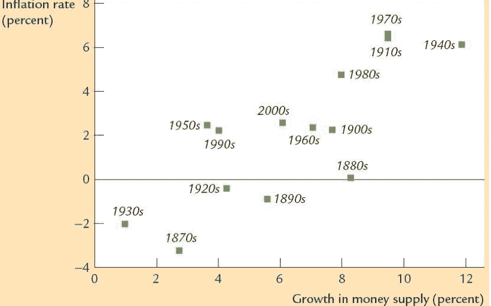

## 美国货币流通速度

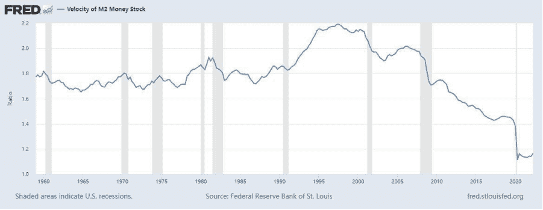

## 一个综合模型

- 古典 AD-AS 模型：
  $Y = \bar{Y}$
- 古典利率模型：
  $Y = C(Y - T) + I(r) + G$
- 货币数量理论：
  $\frac{M}{P} = kY$
- 费雪方程：
  $i = r + \pi$

## 古典两分法（Classical Dichotomy）

- 古典两分法：研究实际变量（$Y$, $r$, 失业率等）可以不考虑货币和价格。
- 货币仅仅影响名义变量，如价格水平、名义 GDP、名义利率等
- 如果古典两分法适用，我们说货币是**中性**的。

## 对古典两分法的批评

- 数据显示货币流通速度不稳定，而古典两分法需要假设其为常数。  
  - 货币需求可能不仅跟收入有关，还跟其他因素（如利率）有关。
- 货币中性意味着货币政策没有实际效应。  
  这也与实践有冲突。

## 内容

- 导言
- 产出
- 失业
- 收入分配
- 利率
- 货币与通胀
- 汇率

## 开放经济

- 开放经济与外国有贸易关系。
- 在这部分，我们讨论
  - 贸易与资本流动
  - 汇率
  - 小型开放经济模型
  - 大型开放经济模型

## 中国的外贸依赖度

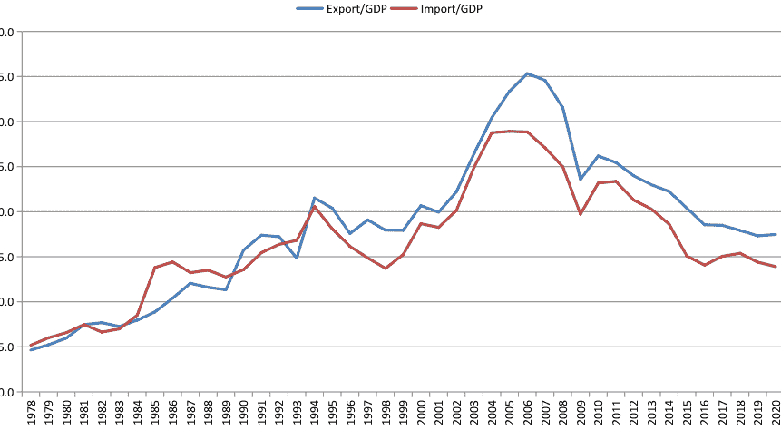

## 净出口（Net Export）

- 在开放经济中，国内支出不一定等于国内产出。其差额为**净出口**：
  
  $$Y-(C+I+G)=X=EX-IM,$$
  
  其中，$Y$为总产出，$(C+I+G)$为国内支出，$X$为净出口，$EX$为出口，$IM$为进口。
- 净出口也称为**贸易余额**（balance of trade）、**贸易差额**。

## 经常账户（Current Account）

- 贸易余额是经常账户（CA）最重要部分：
  CA = 贸易余额（trade balance） + 
  净要素收入（net factor income） + 
  净现金转移（net cash transfer）
  - 如果 CA>0: 经常账户盈余（surplus）
  - 如果 CA<0: 经常账户赤字（deficit）

- 在本课程中，我们忽略要素收入和现金转移，将经常账户与贸易余额视为等同。

## 中国的经常账户结构

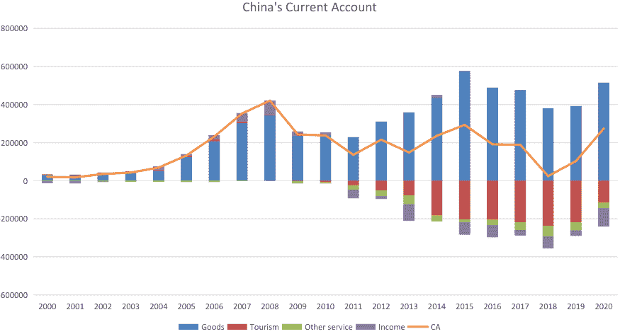

## 资本流动（Capital Flow）

- 商品和服务流动与资本流动互为镜像。让 $S = Y - (C + G)$ 表示国民储蓄，那么 $S - I$ 为该国多余储蓄（excess saving）。根据国民收入恒等式，$S - I = X.$
  - 因为多余储蓄必然借给外国，所以资本净流出=净出口
  - 如果 $S - I = X > 0$，该国将多余储蓄借给外国，此时商品和服务净流出，资本净流出，金融资产净增加。
  - 如果 $S - I = X < 0$，该国从外国借入（$-X$），即储蓄赤字。此时商品和服务净流入，资本净流入，金融资产净减少（或金融负债净增加）。

## 一个例子

- 如果比亚迪出口一辆电动车到美国（假设价格为1万美元），这笔交易如何影响中美贸易和资本流动？

## 资本账户（Capital Account）

- 资本账户记录资本流动，或金融资产归属变化。

资本账户余额 =  
直接投资余额（direct investment）+  
证券投资余额（portfolio investment）+  
其他非储备投资余额（other non-reserve）+  
储备投资余额（reserve）

## 国际收支平衡（Balance of Payments）

- 国际收支平衡恒等式：
  经常账户余额 + 资本账户余额 + 统计误差 = 0

- 在理论分析中可以忽略统计误差，因此经常账户盈余（赤字）对应资本账户赤字（盈余）。

## 汇率（Exchange Rate）

- 汇率是一对货币之间的相对价格。
- 汇率可以表示为一单位本币兑换多少外币，也可以表示为一单位外币兑换多少本币。
- 市场报价一般选择让汇率数值大于1，例如人民币和韩元汇率记为200韩元/人民币，人民币和美元汇率记为7.2人民币/美元。
- 人民币有在岸汇率（CNY）和离岸汇率（CNH）。

## 一个约定

- 在本课程的理论学习中，我们约定汇率以本币为分母，即汇率数值含义为一个单位本币兑换多少外币。
- 在此约定下，汇率数值上升表示本币升值（appreciate, strengthen），汇率数值下降表示本币贬值（depreciate, weaken, devalue）。

## 有效汇率（Effective Exchange Rate）

- 有效汇率对一篮子货币的汇率指数。
  - NEER（名义有效汇率）：用名义汇率编制的有效汇率。

RMBX_t = c_0 \prod_{i=1}^{M} X_{it}^{w_i}

其中 w_i > 0 为权重，满足 \sum_{i=1}^{M} w_i = 1

- REER（实际有效汇率）：用实际汇率编制的有效汇率。


## 人民币汇率
## 人民币汇率
名义有效汇率（左）
USDCNY（右）
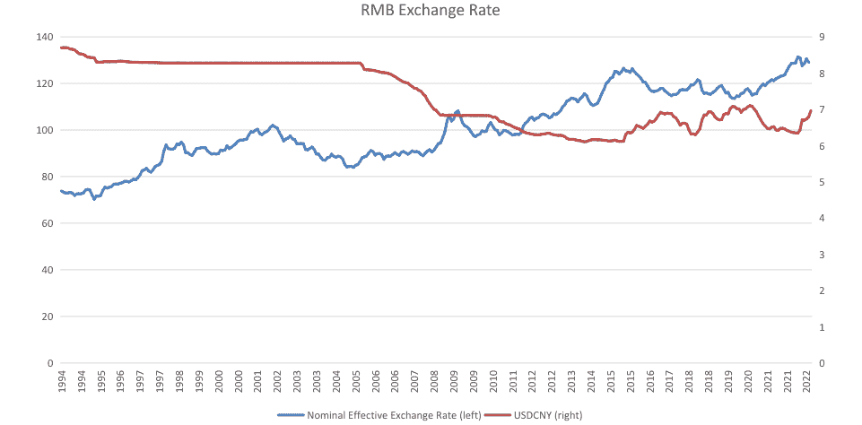

## 美元指数
名义美元指数:对主要货币
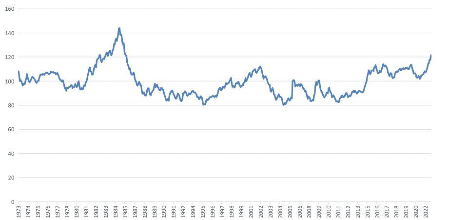

## 实际汇率
- 实际汇率是一个货币相对另一个货币的购买力，给定当前名义汇率和价格水平。
- 用 $e$ 表示名义汇率，$P$ 表示国内价格水平，那么用外国货币为单位的本国价格水平为 $eP$。
- 用 $P^*$ 表示国外价格水平，实际汇率定义为
$$
\varepsilon = \frac{eP}{P^*}
$$

## 购买力平价（Purchasing Power Parity）
- 如果 ε = 1，购买力平价（PPP）成立。理论上说，PPP是一价定理（the law of one price）的一个推论。
- 如果 ε > 1，本币高估（本国价格比外国高）。
- 如果 ε < 1，本币低估。

## PPP的推论
- 如果 PPP 成立，
$$
e_t = \frac{P_t^*}{P_t}.
$$
对数差分（log difference）后得到
$$
\log\frac{e_t}{e_{t-1}} = \pi_t^* - \pi_t,
$$
其中 $\pi_t^*$ 和 $\pi_t$ 分别为外国和本国的通胀率。
- PPP 意味着，如果外国通胀高于本国通胀，那么本国货币倾向于升值。

## 利率平价（Interest Rate Parity）
- 如果我们进一步假设本国和外国有相同的实际利率，那么
$$
\log\frac{e_t}{e_{t-1}}=i_t^*-i_t,
$$
其中 $i_t^*$ 和 $i_t$ 分别为外国和本国的名义利率。
- 利率平价告诉我们，如果外国名义利率高于本国，那么本币倾向于升值。
- 该版本的利率平价被称为“无抵补利率平价”（Uncovered interest rate parity）。

## 超调（Overshoot）
- 如果外国利率上升，本币瞬时贬值，且超过长期均衡，从而维持无抛补利率平价。
- 超调是汇率波动较大的一个理论解释。
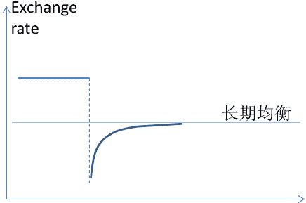

## 关于利率平价的经验事实
- 在经验研究中，利率平价很少得到支持。即，高利率货币经常升值而不是贬值。
- 此经验规律是套息交易（Carry trade）的基础。
  - 做空低息货币（贷款），做多高息货币。

## 小型开放经济模型
- 假设:
  - 资本自由流动
  - 实际利率 $r^*$ 在世界市场决定，小国是价格接受者
  - 净出口是实际汇率 $\varepsilon$ 的减函数 $X(\varepsilon)$, $X'(\varepsilon) < 0$.
- 在外汇市场，外汇供应方是净出口 $X$，外汇需求方是净资本流出（net capital outflow）， $F = S - I$.
- 在外汇市场均衡，
$$
F(r^*) = S - I(r^*) = X(\varepsilon).
$$

## 外汇市场均衡
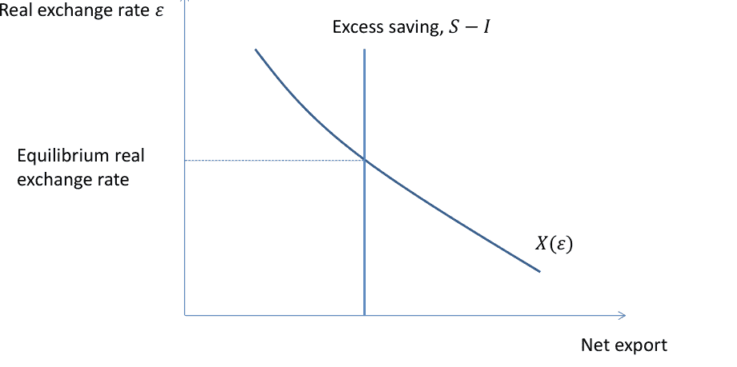

## 虚拟实验
- 以下变化如何影响实际汇率？
  - 本国扩张性财政政策
  - 世界利率上升
  - 本国实施贸易保护主义
  - 本国金融市场从无到有，从薄弱发展到成熟

## 大型开放经济模型
- 假设：
  - 资本自由流动。
  - 资本净流出是实际利率 $r$ 的减函数 $F(r)$，$F'(r)<0$。
  - 净出口是实际汇率 $\varepsilon$ 的减函数 $X(\varepsilon)$，$X'(\varepsilon)<0$。
- 两个市场均衡：
  - 可贷资金市场
  - 外汇市场
- 在均衡
$$
S=I(r)+F(r)
$$
$$
X(\varepsilon)=F(r)
$$

## 大型开放经济模型
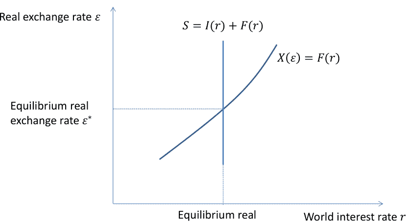

## 虚拟实验
- 当以下发生，实际利率和实际汇率如何变化？
  - 本国（大国）财政刺激
  - 本国（大国）通过贸易保护法案

## 财政刺激
实际汇率 ε
均衡实际汇率 ε*
S = I(r) + F(r)
X(ε) = F(r)
世界利率 r
均衡实际利率 r*
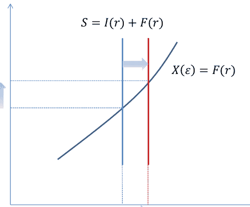

## 经济增长
钱军辉

## 内容
- **引论**
- 索罗模型I
- 索罗模型II
- 内生增长模型
- 经济增长核算
- 其他增长理论

## 经济增长的重要性
- 对穷国来说，经济停滞意味着绝对贫困的持续。
- 在相对意义上，持续的增长落差会造成巨大的收入差距。
- 下表演示了三种增长情景的最终结果：

| Years | 0 | 10 | 30 | 100 |
|---|---|---|---|---|
| 1% | 100 | 110.5 | 134.8 | 270.5 |
| 3% | 100 | 134.4 | 242.7 | 1921.9 |
| 8% | 100 | 215.9 | 1006.3 | 219976.1 |

## 内容
- 引论
- 索罗模型I
- 索罗模型II
- 内生增长模型
- 经济增长核算
- 其他增长理论

## 人均产出
- 定义 $y = \frac{Y}{L}$ 和 $k = \frac{K}{L}$。$y$ 为人均产出（output per capita）。$k$ 为人均资本存量。因为生产函数的规模收益不变，所以
$$
y = \frac{Y}{L} = \frac{F(K,L)}{L} = F(k,1).
$$
- 定义 $f(k) \equiv F(k,1)$，将上式写为
$$
y = f(k).
$$
- $f(k)$ 是个体生产函数（individual production function）。我们假设：
$$
f(0)=0,\ f'(k)>0,\ f''(k)<0.
$$
其中 $f'(k)$ 是边际资本产出（marginal product of capital, MPK）。
- 我们也假设：
$$
\lim_{k\to 0} f'(k)=\infty,\ \lim_{k\to\infty} f'(k)=0
$$

## 资源积累
- 投资（investment）让资本积累，折旧（depreciation）让资本损耗。资本存量的变化由如下微分方程刻画：
$$
\dot{K}_t \equiv \frac{dK_t}{dt}=sF(K_t,L_t)-\delta K_t
$$
- 人口变化由如下微分方程刻画
$$
\dot{L}_t=nL_t.
$$

> 两个记号：
> ① $K_t \equiv K(t)$
> ② $\dot{K}_t \equiv \frac{dK_t}{dt}$


## 稳态（Steady-State）

- 一方面，随着资本不断积累，资本边际产出下降，因此投资（$sf(k)$）增速下滑。
- 另一方面，资本折旧按固定速度消耗资本存量，人口增长按固定速度稀释资本存量。
- 该经济会达到一个稳态，新增资本与损耗和人口稀释相等：
    $$i^* = sf(k^*) = (\delta + n)k^*.$$
- 在稳态，人均资本存量不再变化。我们称 $k^*$ 为稳态人均资本存量。

## 图示

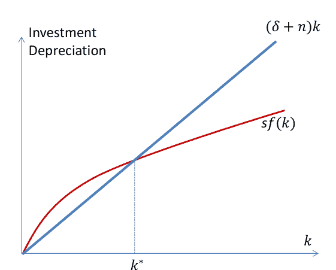

## 稳态的稳定性（Stability）

- 上述的稳态是**稳定**的：如果有扰动，$k_t$ 会回到 $k^*$。
    - 如果有冲击导致 $k_t$ 低于（高于）$k^*$：因为投资高于（低于）损耗和人口稀释，$k_t$ 将不断增加（下降）直至 $k^*$。

## 趋近稳态: 数值模拟

假设： $y = k^{1/2}$, $s=0.3$, $\delta = 0.1$, $k_0 = 4$.

| k | y | c | i | depreciation | change in k |
|---|---|---|---|---|---|
| 4.000 | 2.000 | 1.400 | 0.600 | 0.400 | 0.200 |
| 4.200 | 2.049 | 1.435 | 0.615 | 0.420 | 0.195 |
| 4.395 | 2.096 | 1.467 | 0.629 | 0.439 | 0.189 |
| 4.584 | 2.141 | 1.499 | 0.642 | 0.458 | 0.184 |

## 索罗模型Ⅰ的含义

- 如果经济已经处于稳态，那么人均收入将不再增长。但总收入仍然随着人口增长，
    $Y_t = y^* L_t = y^* L_0 e^{n t}$。
- 如果经济低于稳态水平，那么会有一段收敛型（convergence）或追赶型（catch-up）的增长。

## 储蓄的影响

- 稳态方程如下：
    $$ s f(k^*) = (\delta + n) k^*.$$ 
- 用隐含函数定理可得
    $$ \frac{\partial k^*}{\partial s} = - \frac{ f(k^*) }{ s f'(k^*) - (\delta + n) }.$$ 
- 因为 $\lim_{k \to 0} f'(k) = \infty$, $\lim_{k \to \infty} f'(k) = 0$, 曲线 $s f(k)$ 与斜线 $(\delta + n)k$ 在 $k = k^*$ 处相交，所以
    $$ s f'(k^*) < \delta + n.$$ 
- 因此高储蓄率对应更高的人均资本存量和产出。

## 图示

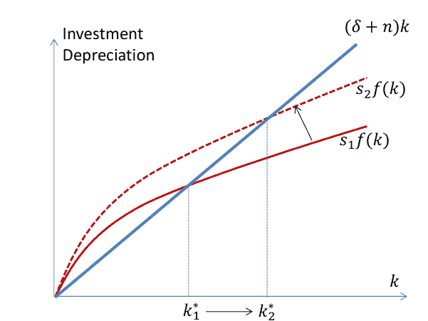

## 黄金律（Golden-Rule）

- 稳态个人消费是稳态人均资本存量的函数
    $c^* = f(k^*) - s f(k^*) = f(k^*) - (\delta + n)k^*.$
- 定义：让稳态个人消费最大化的人均资本存量，我称之为黄金律资本存量（golden-rule level of capital）。
- 一阶条件可得：
    $f'(k^*_{gold}) = \delta + n.$
- 在黄金律水平，资本边际产出等于折旧率+人口增长率。

## 图示

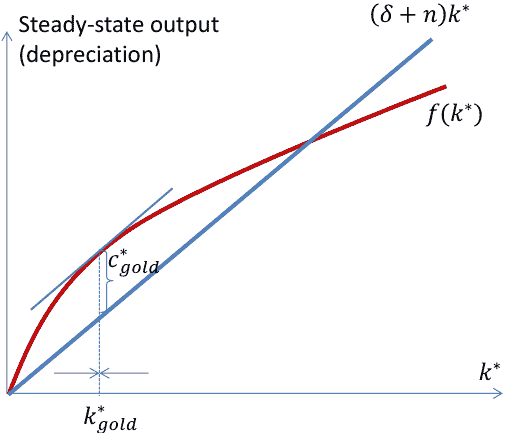

## 如何达到黄金律

- 因为稳态人均资本存量是储蓄率的增函数，$k^*(s)$，所以我们可以通过改变储蓄率来调整 $k^*$。
    - 假如 $k^*(s) < k^*_{gold}$，可以提高储蓄率（比如加税）。

## 一个例子

- 假设 $n = 0, \delta = 0.1, f(k) = k^{1/2}$。解稳态方程
    $s (k^*)^{1/2} = 0.1 k^*,$
    得 $k^*(s) = 100 s^2$。
- 假如 $s = 0.3$，我们有
    $k^* = 9.$
- 黄金律水平满足：
    $\frac{1}{2} k_{gold}^{-1/2} = 0.1,$
    于是 $k^*_{gold}=25.$
- 关于黄金律水平对应的储蓄率，解 $100 s_{gold}^2 = 25$，得
    $s_{gold} = 0.5.$

## 资本过少

假设： $y=\sqrt{k}$

| s | delta | k | y | c | i |
|---|---|---|---|---|---|
| 0.3 | 0.1 | 9 | 3 | 2.1 | 0.9 |
| 0.3 | 0.1 | 9 | 3 | 2.1 | 0.9 |
| 0.3 | 0.1 | 9 | 3 | 2.1 | 0.9 |
| 0.3 | 0.1 | 9 | 3 | 2.1 | 0.9 |
| 0.5 | 0.1 | 9.000 | 3.000 | 1.500 | 1.500 |
| 0.5 | 0.1 | 9.600 | 3.098 | 1.549 | 1.549 |
| 0.5 | 0.1 | 10.189 | 3.192 | 1.596 | 1.596 |
| 0.5 | 0.1 | 10.766 | 3.281 | 1.641 | 1.641 |
| 0.5 | 0.1 | 11.330 | 3.366 | 1.683 | 1.683 |
| 0.5 | 0.1 | 11.880 | 3.447 | 1.723 | 1.723 |
| 0.5 | 0.1 | 12.416 | 3.524 | 1.762 | 1.762 |
| 0.5 | 0.1 | 12.936 | 3.597 | 1.798 | 1.798 |
| 0.5 | 0.1 | 13.441 | 3.666 | 1.833 | 1.833 |
| 0.5 | 0.1 | 13.930 | 3.732 | 1.866 | 1.866 |
| 0.5 | 0.1 | 14.403 | 3.795 | 1.898 | 1.898 |
| 0.5 | 0.1 | 14.860 | 3.855 | 1.927 | 1.927 |
| 0.5 | 0.1 | 15.301 | 3.912 | 1.956 | 1.956 |
| 0.5 | 0.1 | 15.727 | 3.966 | 1.983 | 1.983 |
| 0.5 | 0.1 | 16.137 | 4.017 | 2.009 | 2.009 |
| 0.5 | 0.1 | 16.532 | 4.066 | 2.033 | 2.033 |
| 0.5 | 0.1 | 16.912 | 4.112 | 2.056 | 2.056 |
| 0.5 | 0.1 | 17.277 | 4.157 | 2.078 | 2.078 |
| 0.5 | 0.1 | 17.628 | 4.199 | 2.099 | 2.099 |

## 趋近黄金律

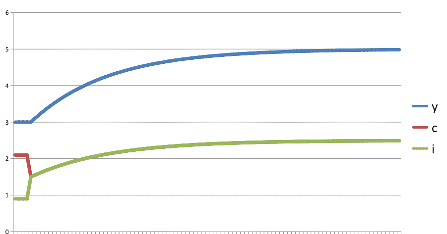

## 资本过多

假设： $y=\sqrt{k}$

| s | delta | k | y | c | i |
|---|---|---|---|---|---|
| 0.7 | 0.1 | 49 | 7 | 2.1 | 4.9 |
| 0.7 | 0.1 | 49 | 7 | 2.1 | 4.9 |
| 0.7 | 0.1 | 49 | 7 | 2.1 | 4.9 |
| 0.7 | 0.1 | 49 | 7 | 2.1 | 4.9 |
| 0.5 | 0.1 | 49.000 | 7.000 | 3.500 | 3.500 |
| 0.5 | 0.1 | 47.600 | 6.899 | 3.450 | 3.450 |
| 0.5 | 0.1 | 46.290 | 6.804 | 3.402 | 3.402 |
| 0.5 | 0.1 | 45.062 | 6.713 | 3.356 | 3.356 |
| 0.5 | 0.1 | 43.913 | 6.627 | 3.313 | 3.313 |
| 0.5 | 0.1 | 42.835 | 6.545 | 3.272 | 3.272 |
| 0.5 | 0.1 | 41.824 | 6.467 | 3.234 | 3.234 |
| 0.5 | 0.1 | 40.875 | 6.393 | 3.197 | 3.197 |
| 0.5 | 0.1 | 39.984 | 6.323 | 3.162 | 3.162 |
| 0.5 | 0.1 | 39.147 | 6.257 | 3.128 | 3.128 |
| 0.5 | 0.1 | 38.361 | 6.194 | 3.097 | 3.097 |
| 0.5 | 0.1 | 37.622 | 6.134 | 3.067 | 3.067 |
| 0.5 | 0.1 | 36.926 | 6.077 | 3.038 | 3.038 |
| 0.5 | 0.1 | 36.272 | 6.023 | 3.011 | 3.011 |
| 0.5 | 0.1 | 35.656 | 5.971 | 2.986 | 2.986 |
| 0.5 | 0.1 | 35.076 | 5.923 | 2.961 | 2.961 |
| 0.5 | 0.1 | 34.530 | 5.876 | 2.938 | 2.938 |
| 0.5 | 0.1 | 34.015 | 5.832 | 2.916 | 2.916 |
| 0.5 | 0.1 | 33.530 | 5.790 | 2.895 | 2.895 |


## 赵近黄金律

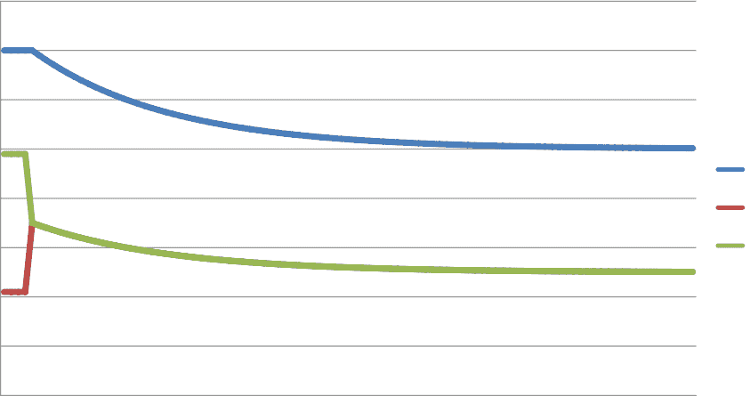

## 人口增长的影响

- 将隐含函数定理用于稳态方程，得到
  \[
  \frac{\partial k^*}{\partial n}=-\frac{-k^*}{sf'(k^*)-(\delta+n)}<0.
  \]
- 因此人口高增长对应较低的人均资本存量。

## 图示

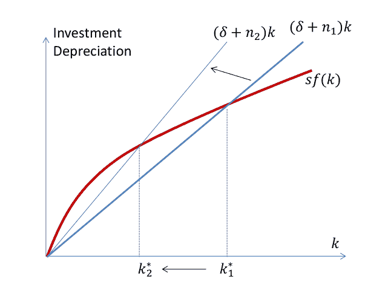

## 人口增长率和人均收入

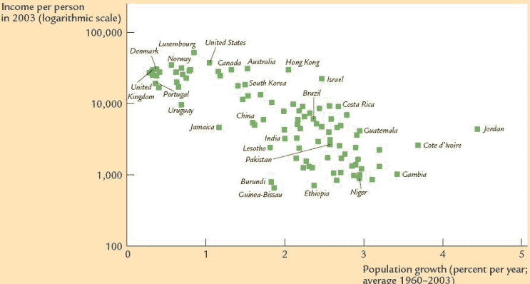

**人口增长与人均收入的国际证据** 该图是来自96个国家的数据散点图。它显示，人口增长率高的国家往往人均收入水平较低，正如索罗模型所预测的那样。

*资料来源：* Alan Heston、Robert Summers和Bettina Aten，宾大世界表6.2版，宾夕法尼亚大学生产、收入与价格国际比较中心，2006年9月。

## 内容

- 引论
- 索罗模型I
- 索罗模型II
- 内生增长模型
- 经济增长核算
- 其他增长理论

## 索罗模型 II

- 第一个索罗模型无法解释人均收入和产出的持续增长。
- 第二个索罗模型引入**技术进步**，用以解释**持续增长**。
- 我们假设：
  - 封闭经济（$X=0$），最小政府（$G=0$）。
  - 劳动增强的生产函数，$Y_t=F(K_t,A_tL_t)$，其中
    - $F$ 规模效益不变
    - $A_t=A_0e^{gt}$ 为技术水平，增长速度为常数 $g$。
    - $L_t=L_0e^{nt}$ 为人口，增长速度为常数 $n$。
  - 储蓄率为常数，$S=sY$。
  - 资本折旧率为 $δ$。

## 有效个体生产函数

- 让 $y = \frac{Y}{AL}$, $k = \frac{K}{AL}$。$y$ 是有效人均产出（每有效工人产出） $k$ 是有效人均资本存量。我们有
  $$y = \frac{\hat{Y}}{AL} = \frac{F(K, AL)}{AL} = F(k, 1).$$
  定义 $f(k) \equiv F(k, 1)$，上式重写为
  $$y = f(k).$$

- 我们称 $f(k)$ 为有效个体生产函数（*有效个体生产函数*）。我们假设：
  $$f(0) = 0,\ f'(k) > 0,\ f''(k) < 0.$$
  以及
  $$\lim_{k \to 0} f'(k) = \infty,\ \lim_{k \to \infty} f'(k) = 0$$

## 资本积累

- 我们假设：
  \dot{K}_t = sF(K_t, A_t L_t) - \delta K_t
  \dot{L}_t = n L_t
  \dot{A}_t = g A_t

- 于是 $k_t$ 的变化如此刻画：
  \dot{k}_t \equiv \frac{d}{dt}\left(\frac{K_t}{A_t L_t}\right) = \frac{\dot{K}_t}{A_t L_t} - \frac{K_t \dot{L}_t}{A_t L_t^2} - \frac{K_t \dot{A}_t}{L_t A_t^2}
  = s f(k_t) - (\delta + n + g) k_t.

## 稳态

- 我们定义问题为有效人均资本不变的状态，即 $k_t = k^*$，
  $$sf(k^*)-(\delta+n+g)k^*=0.$$

- 在稳态，
  $$\frac{K_t}{A_tL_t}=k^*.$$

意味着：

- 总产出 $Y_t=A_tL_tf(k^*)$，增长速度为 $n+g$。
- 人均产出 $\frac{Y_t}{L_t}=A_tf(k^*)$，增长速度为 $g$。

- 于是索罗模型 II 可以解释人均收入的持续增长。

## 练习

- 增加储蓄率对稳态产出有何影响？
- 有效人均资本的黄金律水平在哪里？

## 平衡增长（Balanced Growth）

- 索罗模型的稳态刻画了平衡增长的路径。
- 一些重要的比例为常数
  - $C_t/Y_t$, $K_t/Y_t$
- 另一些按相同速度增长
  - 人均资本 ($K_t/L_t$)
  - 劳动生产率 ($Y_t/L_t$)

## 实际工资和资本回报

- 在竞争环境中，实际工资等于劳动边际产出（MPL），实际资本回报等于资本边际产出（MPK）。在稳态，我们有：
  
  $$MPL = \frac{\partial Y}{\partial L} = \frac{\partial}{\partial L}\left(ALf\left(\frac{K}{AL}\right)\right) = A\left(f(k^*)-k^*f'(k^*)\right).$$
  
  $$MPK = \frac{\partial Y}{\partial K} = \frac{\partial}{\partial K}\left(ALf\left(\frac{K}{AL}\right)\right) = f'(k^*).$$
  
- 索罗模型 II 预测持续上升的实际工资和稳定的资本回报。

## 内容

- 引论
- 索罗模型Ⅰ
- 索罗模型Ⅱ
- 内生增长模型
- 经济增长核算
- 其他增长理论

## AK 模型

- 假设
  - 人口为常数
  - 线性的“技术”：
  
  $$Y_t = AK_t,$$
  
  其中 $Y_t$ 为产出，$K_t$ 为资本存量，$A$ 为一个常数，测度资本的平均产出（资本平均产出）和边际产出（资本边际产出）。
  
  - 资本积累服从：
  
  $$\dot{K}_t = sY_t - \delta K_t.$$

- 简单推导可得：
  
  $$\frac{\dot{Y}_t}{Y_t}=\frac{\dot{K}_t}{K_t}=sA-\delta.$$

## 模型含义

- 只要 $sA > \delta$, 我们就有持续增长。
- 之所以有持续增长，是因为我们假设边际资本回报为常数 $A$。
  - 为理解这点，我们想象该模型中的资本存量包含 “知识” （知识）。

## 两部门（Two-Sector）模型

- 两部门模型假设经济有两个部门：制造业（生产商品和服务）和“知识业”（生产“知识”）。
- 制造业的生产函数为
  
  $$Y_t = F(K_t, (1-u)L_tA_t),$$
  
  其中 $u$ 为知识业就业比例。
- 知识业的贡献是技术进步：
  
  $$\frac{\dot{A}_t}{A_t} = g(u),$$
  
  其中 $g(u)$ 刻画技术进步速度如何依赖知识业。
- 资本积累过程：
  
  $$\dot{K}_t = sY_t - \delta K_t.$$

## 稳态

- 让 $k = \frac{K}{AL}$，稳态如下
  
  $sf(k^*, u) = (\delta + n + g(u))k^*,$
  
  其中 $f(k, u) = F(k, 1 - u)$.
- 两部门模型也允许持续增长。
- 稳态增长率不再外生给定，而是依赖“知识业”如何生产。


## 经济增长核算（Growth Accounting）

- 经济增长的贡献来自哪里？
  - 要素积累
    - 资本 (K)
    - 劳动力 (L)
  - 技术进步

- 上述各项各自贡献多少？
  - 如果增长的源泉不是技术进步，而只是要素积累，那么增长可能无法持续。

## 技术进步

- 我们用全要素增强的函数形式，$Y_t = A_t F(K_t, L_t)$，其中 $A_t$ 称为全要素生产率（total factor productivity）。
- 简单推导可得增长核算方程：
  $$\frac{\dot{Y}_t}{Y_t} = \alpha_t \frac{\dot{K}_t}{K_t} + \beta_t \frac{\dot{L}_t}{L_t} + \frac{\dot{A}_t}{A_t},$$
- $\frac{\dot{A}_t}{A_t}$ 被称为索罗残差（Solow residual），测度技术进步的速度。

## 美国的增长核算
## 美国经济增长核算

| 年份 | 产出增长 ΔY/Y | = | 资本 αΔK/K | + | 劳动力 (1 − α)ΔL/L | + | 全要素生产率 ΔA/A |
|---|---|---|---|---|---|---|---|
|  |  |  | 增长来源 |  |  |  |  |
|  |  |  | （平均每年百分比增长） |  |  |  |  |
| 1948-2007 | 3.6 |  | 1.2 |  | 1.2 |  | 1.2 |
| 1948-1972 | 4.0 |  | 1.2 |  | 0.9 |  | 1.9 |
| 1972-1995 | 3.4 |  | 1.3 |  | 1.5 |  | 0.6 |
| 1995-2007 | 3.5 |  | 1.3 |  | 1.0 |  | 1.3 |
| 来源：美国劳工部。数据为非农企业部门。 |  |  |  |  |  |  |  |

## 美国的增长核算

|  | ΔY/Y | αΔK/K | (1 − α)ΔK/K | 索罗残差 |
|---|---|---|---|---|
| 1951-2019 | 3.1% | 0.9% | 0.9% | 1.3% |
| 1951-1972 | 3.9% | 1.2% | 1.0% | 1.7% |
| 1973-1995 | 3.0% | 0.9% | 1.1% | 0.9% |
| 1996-2007 | 3.2% | 0.9% | 0.8% | 1.5% |
| 2008-2019 | 1.7% | 0.4% | 0.4% | 0.8% |

## 内容

- 引论
- 索罗模型I
- 索罗模型II
- 内生增长模型
- 经济增长核算
- 其他增长理论

## 创造性毁灭（Creative Destruction）

- 在《Capitalism, Socialism, and Democracy》一书中，熊彼特（Joseph Schumpeter, 1883-1950）刻画了市场经济通过创造性毁灭实现持续增长的过程。
- 创业者（Entrepreneurs）是“后浪”，带来新产品、新技术、新的管理和营销技能、以及其他创新，将不再创新的“前浪”淘汰，并努力获得和维持垄断地位。
- 这些新主人可能变成新的“前浪”，努力维持现状，但是新一代的创业者正在成为新的“后浪”……

## 创造性毁灭的必要条件

- 创业者
  - 创业的权利
  - 包容的社会
- 市场经济
  - 让市场挑选赢者
  - 公平竞争
  - 市场足够大

## 创造性毁灭的局限性

- 垄断的必然性
- 社会效益无保证
- 分配可能很极端

## 驾驭创造性毁灭

- 政府有责任驾驭创造性毁灭，避免其极端影响。
  - 反垄断
  - 积极更新和实施法律法规，保证公平竞争环境。
  - 社会福利

## 刘易斯模型（The Lewis Model）

- 以英国经济学家 Arthur Lewis (1915-1991) 命名。刘易斯是发展经济学的奠基人。


## 假设

- 在 Lewis 模型中有两个部门：工业和传统农业。
- 传统农业部门容纳无穷劳动力，MPL和实际工资接近零。
  - 因此农业部门也称为subsistence sector（维持生存的部门）。
- 工业部门很小，雇佣很少劳动力，维持较高MPL和实际工资（相对农业部门）。

## 工业部门何不一步到位？

- 虽说传统农业MPL接近零，但工业部门无法用零工资招到工人。
- 为吸引劳动力，工业部门必须给出高工资
  - 支付城市更高的生活成本
  - 提高产业工人的社会形象
- 工业部门也愿意付出高于MPL的实际工资
  - “效率工资”的考虑
  - 在古代，主人给下人高于MPL的工资，对主人来说很有面子。

## 刘易斯模型

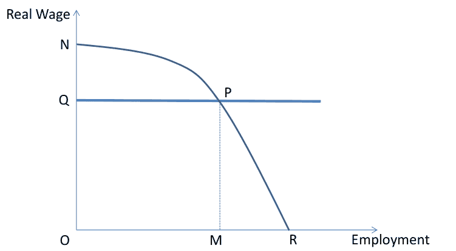

## 工业化

- 工业部门使用来自传统农业部门的廉价劳动力，获得较高的资本回报。
- 工业部门将利润再投资，积累更多资本，需求更多劳动力。
- 于是更多劳动力从传统农业部门迁移到工业部门，后者维持高利润（因为传统农业部门的MPL保持在零附近）、高投资。经济发展进入良性循环。
- 因为劳动力从低效率部门（传统农业）迁往高效率部门（工业），所以总体效率提高，实现“技术进步”。

## 刘易斯模型中的工业化


## 城市化

- 随着越来越多农村劳动力进入工业部门，城市化（urbanization）也发生了。
- 城市化可能走在工业化之前，因为人们会先聚集到城市寻找就业机会。
  - 贫民区，小买卖，失业后备军（reserve army of labor）

## 移民，外包，和国际贸易

- 刘易斯模型所刻画的发展中经济处于一种**非稳态**，即两个部门的劳动回报不相等。
- 要让劳动回报相等
  - 劳动力迁移到资本充裕的地方（跨国移民有限制）。
  - 或资本投放到劳动力充裕的地方（外包、国际化产业链、第三世界的工业化）。
- 国际贸易是要素流动的替代。

## 工业化和去工业化

- 刘易斯模型刻画了发展中国家的工业化。
- 在很多发达国家，工业化已经开始去工业化进程。
  - 制造业被外包到发展中国家。
  - 服务业在经济中的比重越来越高。

## 库茨涅茨曲线（Kuznets Curve）

- Simon Kuznets
  (1901-1985)提出的假说：
  **在经济发展过程中，收入差距先扩大，后缩小。**


## 中国的基尼系数


## 经济波动

钱军辉

## 内容

- 导论
- IS-LM 模型
- AD-AS 模型
- 凯恩斯理论
- 结语

## 商业周期

- 商业周期（business cycle）指经济活动周期性的波动。
  - 最主要的指标：实际GDP增速的波动

## 商业周期


## 中国宏观经济波动（年度）


## 中国宏观经济波动（季度）


## 中国宏观经济波动（消费和投资）


## 中国宏观经济波动（非农就业）

非农业就业增长（%）


## 美国宏观经济波动


## 美国宏观经济波动（失业率）


## 周期波动的一些经验事实

- 增长有惯性（持续的）。
- 扩张期较长，衰退期较短。
- 消费波动较小，投资波动较大。
- 就业跟产出联动（奥肯定律，Okun’s Law）：
  $$(Y_t - \bar{Y}) = -\gamma(u_t - u^n),$$
  其中 $u^n$ 为自然失业率，$\bar{Y}$ 为产出潜力，$\gamma > 0$。

## 波动预测

- 经济分析师依赖**经验模型**和**领先指标**（领先指标）预测经济波动。
- 预测有差异，但差异常常有限：
  - 不同的分析师用不同的模型，所以预测会有差异。
  - 同时，分析师有从众心理，因此预测往往趋同。

## 领先指标

- 中国的一些领先指标
  - 克强指数（发电量、铁路货运量、银行贷款总额）
  - 工业增加值
  - PMI（采购经理指数，采购经理指数）
- 美国的一些领先指标
  - 失业保险首次申请人数，发放的新建建筑许可，非国防资本货物新订单，利率利差，等等。

## 内容

- 导论
- IS-LM 模型
  - 凯恩斯交叉模型
  - 粘性价格假设
  - IS-LM 模型
  - 开放经济 IS-LM
- AD-AS 模型
- 凯恩斯理论
- 结语

## 凯恩斯交叉（Keynesian Cross）

- 假设总支出（总支出）是消费支出、投资支出和政府支出之和：
  $$TE = C + I + G,$$
  - $C = C(Y - T)$
  - $T$、$I$ 和 $G$ 为外生变量。
- 总支出必须等于总收入（$Y$）：
  $$Y = C(Y - T) + I + G.$$

## 凯恩斯交叉


## 含义

- 总支出决定总收入。
  - 节俭悖论（节俭悖论）
- 总产出可能会低于产出潜力，同时失业率可能高于自然失业率。
- 投资和政府支出的重要性：因为边际消费倾向（MPC）递减，所以为支持更高的收入，投资和政府支出要扮演更重要角色。
- 乘数效应（乘数效应）：投资或政府开支的增加一个单位，会引起大于一个单位的收入增加。

## 政府购买的乘数效应

- 假设消费函数为线性，
  $$C(Y - T) = C_0 + C_1(Y - T),$$
  其中 $C_0$ 为“自主消费”（自主消费），$C_1$ 为“边际消费倾向”（边际消费倾向，MPC）。
- 对以下方程应用隐函数定理，
  $$Y = C_0 + C_1(Y - T) + I + G.$$
  可得
  $$\frac{\partial Y}{\partial G} = \frac{1}{1 - C_1} = \frac{1}{1 - MPC}.$$
- $\frac{1}{1 - MPC}$ 被称为政府购买乘数（政府购买乘数）。
- 投资增加也有同样的乘数效应。

## 图示

支出

政府支出增加：$\Delta G$

收入/产出增加

45°

$Y'$

$Y''$

$Y$

$Y$

TE

$TE'$


## 税收的乘数效应

- 类似地，
  $$\frac{\partial Y}{\partial T}=-\frac{C_1}{1-C_1}=-\frac{MPC}{1-MPC}.$$
- $-\frac{MPC}{1-MPC}$ 被称为税收乘数（税收乘数）。

## 宏观中的时间跨度

- 长期：价格灵活。
- 短期或中期：价格粘性。
  - 短期：价格固定。
  - 中期：居于长期和短期之间，价格可变，但不灵活。

## 价格调整的频率

| Frequency | Percentage of Firms |
| --- | ---: |
| Less than once | 10.2 |
| Once | 39.3 |
| 1.01 to 2 | 15.6 |
| 2.01 to 4 | 12.9 |
| 4.01 to 12 | 7.5 |
| 12.01 to 52 | 4.3 |
| 52.01 to 365 | 8.6 |
| More than 365 | 1.6 |

## 解释价格粘性

- 协调失败（协调失败）：60.6%（管理者接受的比例）
  - 公司推迟调价，等待别人先行。
- 成本定价（成本定价）有一定的滞后：55.5%
- 价格以外的产品维度调整：54.8%
  - 厂商更倾向于调整产品质量、售后服务、交货时间等非价格特征。
- 隐含合同（隐含合同）：50.4%
  - 厂商默认履行稳定价格的责任，认为这样对消费者更公正。
- 合同固定了名义价格：35.7%

> Source: A.S. Blinder, 1994, “On sticky prices: academic theories meet the real world”, in N.G. Mankiw, ed., Monetary Policy, University of Chicago Press, 117-154.

## 内容

- 导论
- IS-LM 模型
  - 凯恩斯交叉模型
  - 粘性价格假设
  - IS-LM 模型
  - 开放经济 IS-LM
- AD-AS 模型
- 凯恩斯理论
- 结语

## IS-LM 导论

- IS 代表 “投资” 和 “储蓄”。
- LM 代表 “流动性” 和 “货币供给”。
- IS-LM 模型是一个需求侧模型，其均衡刻画了在一定价格水平上的有效需求。
- IS-LM 是最流行的凯恩斯理论的诠释。

## IS 方程

- 假设投资是实际利率的函数：
  $$I = I(r).$$
- 我们假设 $I(r)$ 可导，且 $I'(r)<0$，高利率抑制投资。
- IS 方程刻画了金融市场（可贷资金市场）均衡：
  $$Y = C(Y - T) + I(r) + G.$$
  - 内生变量：$Y$ 和 $r$。
  - 外生变量：$T$、$G$ 等。
- IS 方程定义了一个隐含函数 $r(Y)$，即 IS 曲线。


## IS 曲线的斜率

- IS 定义了一个隐含函数，
  $r = r(Y, T, G)$.
- IS 曲线的斜率是 $\partial r / \partial Y$，其定义为
  $\frac{\partial r}{\partial Y} \equiv \lim_{\Delta Y \to 0} \frac{r(Y + \Delta Y, T, G) - r(Y, T, G)}{\Delta Y}$.
  - 其他条件不变（即固定 $T$ 和 $G$），$Y$ 增加一个单位，对应 $r$ 增加多少。
- 应用隐含函数定理可得
  $\frac{\partial r}{\partial Y} = -\frac{1 - C'}{-I'} = \frac{1 - C'}{I'} < 0.$

## 扩大政府采购如何影响IS曲线

- 给定任意一个 $r$，凯恩斯交叉模型告诉我们，政府购买增加 $\Delta G$ 所带来的收入增加为 $\frac{\Delta G}{1-MPC}$。
- 也就是说，政府购买增加 $\Delta G$ 将导致 IS 曲线**右移** $\frac{\Delta G}{1-MPC}$。


## 扩大政府购买如何移动IS曲线


## LM 曲线

- 给定 $M$ 和 $P$, 为让 LM 方程保持成立, $r$ 的上升必须伴随 $Y$ 的上升,
- 因此LM曲线向上倾斜。


## LM 曲线

- LM曲线上的点都可能对应货币市场均衡，给定 $M$ 和 $P$。
- $Y$ 和 $r$ 是内生变量，两者一般都同时变化，表现为在LM曲线上移动（沿着LM曲线移动）。
- 应用隐含函数定理可得曲线斜率：
  $$\frac{\partial r}{\partial Y} = -\frac{L_2}{L_1} = -\frac{\frac{\partial L(r,Y)}{\partial Y}}{\frac{\partial L(r,Y)}{\partial r}}.$$ 
  - 如果 $L_1 = \infty$, LM 曲线为水平（流动性陷阱，流动性陷阱）。
  - 如果 $L_1 = 0$, LM 曲线为垂直（货币数量理论）。

## 货币政策如何移动LM曲线

- 外生变量（*M* or *P*）的变化会让LM曲线移动。  - 如果货币当局增加货币供应 *M*↑, 那么 LM曲线向右移动。


## 货币政策如何移动LM曲线

- LM 定义了一个隐含函数 $Y(r, M, P)$。应用隐含函数定理可得
  $\frac{\partial Y(r, M, P)}{\partial M} \equiv \lim_{\Delta M \to 0} \frac{Y(r, M + \Delta M, P) - Y(r, M, P)}{\Delta M} = \frac{1}{P L_2}$。

- 也就是说，如果央行增加货币供应 $\Delta M$，那么 LM 将向右移动约 $\frac{\Delta M}{P L_2}$。

## IS-LM 模型

- IS-LM 模型联立IS和LM两个方程，分别刻画商品和货币市场均衡，
  
  $$Y = C(Y - T) + I(r) + G$$
  
  $$\frac{M}{P} = L(r,Y).$$
  
- 联立方程的解（即IS和LM曲线交点）刻画经济均衡。

## IS-LM 曲线

利率, $r$

均衡
利率

均衡
产出

$r'$

$Y'$

$\bar{Y}$

产出, $Y$

LM

IS


## 虚拟实验

- 如果政府实施财政刺激
  - 增加政府购买
  - 减税
- 如果央行实施货币宽松

## 扩张性财政和货币政策的影响


## IS冲击衰退


## 大萧条（大萧条）

## 大萧条


## 大萧条期间的失业率


## 大萧条期间的利率和通胀


## 解释一： IS 衰退

- 资产泡沫破灭后的投资和消费需求下降
  - 1929年股灾
  - 同时房地产泡沫终结
- 其他二次冲击
  - 30年代初期的大规模银行破产
  - 过紧的财政政策（财政平衡信条）
  - 贸易保护主义冲击（如Smoot–Hawley act of 1930）
  - 通缩和通缩预期的效应

## 债务通缩理论（Debt-Deflation Theory）

- 假设：**负债者的边际消费倾向高于净储蓄者**。
- 通缩增加**实际债务负担**，负债者购买力转移至净储蓄者手中。
- 购买力转移导致的净储蓄者的消费增加不足以抵消负债者的消费下降。净效应是消费下降，IS 曲线左移。

## 通缩预期的效应

- 考虑如下 IS-LM 模型：
  
  \[
  Y = C(Y-T) + I(i-E\pi) + G
  \]
  \[
  \frac{M}{P} = L(i,Y).
  \]
  
  其中 $i$ 为名义利率（内生变量），$E\pi$ 为通胀预期。

- 如果通胀预期产生，即 $E\pi$ 下降，甚至变成负值，那么 IS 曲线左移。

## 解释二: LM 衰退

- Friedman 和 Schwartz 在《A Monetary History of the United States, 1867–1960》一书中，认为货币紧缩导致了大萧条。  - 从1929到1931年，实际利率的确上升了。  - 但在同期，实际货币供应（*M/P*）上升，名义利率下降。

## 政府如何应对衰退

- 政府可以用财政政策、货币政策、以及两者结合，来增加总需求。
- 财政刺激（Fiscal stimulus）
  - 增加政府消费和投资
  - 减税
- 货币刺激
  - 降息
  - 量化宽松

## 政策分析

- 固定 $P$，对 IS-LM 全微分可得
  $$(1 - C')dY - I' dr = dG - C' dT$$
  $$PL_2 dY + PL_1 dr = dM$$
- 全微分将关于 $Y$ 和 $r$ 的非线性方程转化为关于 $dY$ 和 $dr$ 的线性方程。
- 应用克雷默法则（Cramer's rule）可分析
  - 增加政府消费的效应: $\frac{dY}{dG}$ 和 $\frac{dr}{dG}$
  - 加税的效应: $\frac{dY}{dT}$ 和 $\frac{dr}{dT}$
  - 货币扩张的效应: $\frac{dY}{dM}$ 和 $\frac{dr}{dM}$.

## 财政政策效应

- 固定 $M$（即令 $dM = 0$）。应用克雷默法则可得
  $$dY = \frac{L_1(dG - C' dT)}{L_1(1 - C') + I' L_2}$$ 
  $$dr = -\frac{dG - C' dT}{L_1(1 - C') + I' L_2}$$ 
- 财政政策效应总结如下：
  - 增加政府采购对产出的影响: $\frac{dY}{dG} = \frac{L_1}{L_1(1 - C') + I' L_2} > 0$
  - 增加政府采购对利率的影响: $\frac{dr}{dG} = -\frac{L_2}{L_1(1 - C') + I' L_2} > 0$
  - 加税对产出的影响: $\frac{dY}{dT} = -\frac{L_1 C'}{L_1(1 - C') + I' L_2} < 0$
  - 加税对利率的影响: $\frac{dr}{dT} = \frac{L_2 C'}{L_1(1 - C') + I' L_2} < 0$


## 货币政策的效应

- 固定 $G$ 和 $T$，应用克雷默法则可得

$$\frac{dY}{dM} = \frac{I'}{P(L_1(1 - C') + I' L_2)} > 0$$

$$\frac{dr}{dM} = \frac{(1 - C')}{P(L_1(1 - C') + I' L_2)} < 0$$

## 流动性陷阱（Liquidity Trap）

- 流动性陷阱是指增加流动性（货币供应）无法降低利率的情况。
  - 当 $L_1 \equiv \frac{\partial L(r,Y)}{\partial r} = \infty$，LM 曲线水平，同时 $M$ 上升无法下移 LM 曲线。
- 流动性陷阱中，货币政策无效 $\left(\frac{dY}{dM}=0\right)$。
  - 凯恩斯眼中，美国1932年所发生的流动性危机
  - 日本90年代“失去的十年”
- 但财政政策在流动性陷阱中有效：

$$\frac{dY}{dG}=\frac{1}{1-C'} \quad\text{and}\quad \frac{dY}{dT}=-\frac{C'}{1-C'}.$$

## 何时财政政策无效

- 当 $L_1 \equiv \frac{\partial L(r,Y)}{\partial r}=0$（等效于货币数量理论，$\frac{M}{P}=kY$），LM 曲线垂直，财政政策无效。
- 在这样的情况下，只有货币政策有效。这是货币主义（代表人物为弗里德曼）在70年代滞胀（stagflation）时期所持立场。

## 经济学家的立场


## 利率的作用

- 利率在 IS-LM 模型中常常被忽视，但它的变化是均衡调整的机制。
- 在正常情况，
  - 扩张性货币政策降低利率，从而刺激投资需求。
  - 扩张性财政政策会抬高利率，从而部分 “挤出” 投资需求。
- 在流动性陷阱中，因为利率不受（扩张性）货币政策影响，因此货币政策无效。

## 货币政策传导的利率渠道

- IS-LM 刻画了货币政策传导（monetary policy transmission）的利率渠道（interest-rate channel）：

  $$M \uparrow \implies i \downarrow \implies r \downarrow \implies I(r) \uparrow \implies Y \uparrow.$$

  - 货币刺激的直接作用是降低名义利率。
  - 在粘性价格假设下，名义利率降低传导到实际利率降低。

## 利率政策

- 在现实世界中，央行对短期利率的设定有主导作用。
- 央行可动用若干货币政策工具（monetary instruments），以实现短期利率目标（target）。
  - 美国： federal funds rate
  - 欧元区： The overnight market rates
  - 中国： DR007， LPR

## 降息的影响


## 内容

- 导论
- IS-LM 模型
  - 凯恩斯交叉模型
  - 粘性价格假设
  - IS-LM 模型
  - 开放经济IS-LM
    - 引论
    - 小型开放经济浮动汇率
    - 小型开放经济固定汇率
    - 大型开放经济模型
- AD-AS 模型
- 凯恩斯理论
- 结语

## 关键假设

- 资本自由流动——于是有一个共同的世界利率。
- 小型经济——世界利率的价格接受者（price taker）。
- 大型经济——其储蓄和投资行为影响世界利率。
- 粘性价格，于是名义汇率变化等于实际汇率变化

## 固定汇率（Fixed Exchange Rate）

- 如果一个经济体实行固定汇率，其货币当局会时刻准备干预外汇市场，在本币有贬值（升值）压力时做多（做空）本币。
  - 金本位（如 Bretton Woods）
  - 货币联盟（如欧元区）
  - 联系汇率制（如港币）
  - 美元化（Dollarization）（如曾经的阿根廷，当前的委内瑞拉）
- 固定汇率的优势
  - 汇率稳定
  - “进口”大国货币政策
- 固定汇率的劣势
  - 货币政策的不独立
  - 需要维持大量外汇储备

## 中国的外汇储备


## 浮动汇率（Floating Exchange Rate）

- 在浮动汇率制度下，汇率在外汇市场自由浮动。
- 货币当局可能干预外汇市场（dirty float, managed float），也可以完全不干预（clean float）。
- 浮动汇率的优势
  - 货币政策独立性（货币当局可以照顾“汇率稳定”以外的目标，如就业和通胀等）
- 浮动汇率的劣势
  - 汇率波动较大

## 内容

- 导论
- IS-LM 模型
  - 凯恩斯交叉模型
  - 粘性价格假设
  - IS-LM 模型
  - 开放经济IS-LM
    - 引论
    - 小型开放经济浮动汇率
    - 小型开放经济固定汇率
    - 大型开放经济模型
- AD-AS 模型
- 凯恩斯理论
- 结语

## 小型开放经济、浮动汇率

- 第一个 Mundell-Fleming 模型：小型开放经济、浮动汇率
- 实质上就是开放经济 IS-LM 模型。包含两个方程：

$$Y = C(Y - T) + I(r^*) + G + X(e)$$

$$\frac{M}{P} = L(r^*, Y),$$

其中 $r^*$ 为世界利率， $X(e)$ 为净出口（net export）， 满足 $X'(e) < 0$。

- 两个内生变量：$Y$ and $e$。
- 其他变量，包括 $r^*$，外生。

## 小型开放经济、浮动汇率模型的IS-LM 曲线


## 虚拟实验

分析以下事件的影响：

- 财政刺激（$G\uparrow$ or $T\downarrow$）
- 货币刺激（$M\uparrow$）
- 该国风险溢价（risk premium）上升

## 虚拟实验小结

- 汇率 $e$ 扮演了类似封闭经济IS-LM模型中利率的角色。
- 财政刺激引起汇率升值，“挤出”出口，总产出不变。
- 货币刺激引起汇率贬值，刺激出口，总产出上升——货币政策传导的汇率渠道：

$$M \uparrow \Rightarrow e \downarrow \Rightarrow X(e) \uparrow \Rightarrow Y \uparrow.$$

## 内容

- 导论
- IS-LM 模型
  - 凯恩斯交叉模型
  - 粘性价格假设
  - IS-LM 模型
  - 开放经济IS-LM
    - 引论
    - 小型开放经济浮动汇率
    - 小型开放经济固定汇率
    - 大型开放经济模型
- AD-AS 模型
- 凯恩斯理论
- 结语

## 小型开放经济、固定汇率

- 在固定汇率制度下，央行为了维持给定汇率水平，要在贬值压力环境中做多本币（做空外币），要在升值压力环境中做空本币（做多外币）。
- 当央行做多本币（做空外币），央行在紧缩货币供应；当央行做空本币（做多外币），央行在扩张货币供应。
- 对建模的影响：在固定汇率制度下，货币供应视为内生。

## 资本流动的挑战

- 上世纪80年代开始，美国和IMF推动发展中国家开放资本账户，即允许资本流动，形式包括：
  - 直接投资
  - 证券投资
  - 跨境贷款
- 同时，因为惧怕汇率波动，很多国家仍然保持固定汇率或较为刚性的管理浮动汇率。
- 自由资本流动和刚性汇率结合，给宏观经济管理带来巨大挑战。
  - 在自由资本流动前提下，必须二选其一：要么选择固定汇率、牺牲货币政策独立性；要么选择独立货币政策，但必须实施浮动汇率。


## 外汇储备（Foreign Exchange Reserve）

- 为在贬值压力环境下捍卫汇率，货币当局需要足够的外汇储备，即安全、流动性好的外国金融资产（如美国国债）。
- 净资本流出（net capital outflow）可分解为：
    净资本流出 = 私人资本净流出 + 外汇储备增加
- 外汇储备增加，对应着本国货币供应（“外汇占款”）的增加。

## 小型开放经济、固定汇率模型

- 第二个 Mundell-Fleming 模型，小型开放经济、固定汇率：

    $$Y = C(Y-T) + I(r^*) + G + X(e^*)$$

    $$\frac{M}{P} = L(r^*,Y),$$

    其中 $r^*$ 为世界利率，$e^*$ 为固定汇率。

- 两个内生变量：$Y$ 和 $M$。
- 其他均为外生变量，包括 $r^*$ 和 $e^*$。

## 小型开放经济、固定汇率模型的IS-LM曲线


## 虚拟实验

- 外需下滑的冲击
- 财政刺激的效果
- 全球流动性收紧的影响

## 外需导致的衰退


## 中国在 2008-2009 期间的减速

- 背景一：中国2007年GDP大约为美国GDP的26%。
- 背景二：虽然人民币汇率不再挂钩美元，但是仍然十分刚性。
- 背景三：中国经济依赖外需，尤其是美国市场。
- 当美国金融危机爆发，美国对中国商品的需求跳水，导致中国经济减速。

| Quarter | 实际GDP增速 (Y2Y growth,%) | 对美出口额增长 (Y2Y growth,%) |
|---|---|---|
| 2008Q1 | 11.5 | 5.4 |
| 2008Q2 | 10.9 | 12.0 |
| 2008Q3 | 9.5 | 15.3 |
| 2008Q4 | 7.1 | 0.7 |
| 2009Q1 | 6.4 | -14.8 |
| 2009Q2 | 8.2 | -18.5 |
| 2009Q3 | 10.6 | -16.7 |
| 2009Q4 | 11.9 | 0.6 |

## 财政刺激的效应

- 当政府购买上升，或减税，经济有何影响？
- 财政刺激使得 IS 曲线右移，产出和货币供应均扩大。
  - 财政刺激引发汇率升值压力。为维持固定汇率，央行做空本币（做多外币），即发行货币购买外币，从而扩大货币供应。
- 中国在2008年底推出的“四万亿刺激计划”有效地阻止了经济进一步减速。

## 全球流动性收紧的影响

- 当世界利率 $r^*$ 上升（比如，美联储加息），对小国经济有何影响？
- IS 曲线左移，LM曲线右移，产出和货币供应均下降。
  - 世界利率上升，给本币带来贬值压力。
  - 为捍卫固定汇率，货币当局做多本币（做空外币），即回收本币流动性。

## 1997-1998亚洲金融危机

|  | Fed Funds Rate (%) | Dollar Index | Exchange Rates: Baht | Exchange Rates: Won | Exchange Rates: Rupiah |
|---|---|---|---|---|---|
| 1993 | 3.02 | 89.9 | 25.3 | 805.8 | 2110 |
| 1994 | 4.20 | 88.4 | 25.2 | 806.9 | 2200 |
| 1995 | 5.84 | 83.4 | 24.9 | 772.7 | 2308 |
| 1996 | 5.30 | 87.2 | 25.4 | 805.0 | 2383 |
| 1997 | 5.46 | 93.9 | 31.1 | 953.2 | 4650 |
| 1998 | 5.35 | 98.5 | 41.3 | 1400.4 | 8025 |
| 1999 | 4.97 | 97.0 | 37.9 | 1189.8 | 7085 |
| 2000 | 6.24 | 101.8 | 40.2 | 1130.9 | 9595 |

|  | RGDP Growth: Thailand | RGDP Growth: S. Korea | RGDP Growth: Indonesia | GDP Growth: Thailand | GDP Growth: S. Korea | GDP Growth: Indonesia |
|---|---|---|---|---|---|---|
| 1994 | 8 | 9.2 | 7.5 | 13.8 | 13.3 | 17.9 |
| 1995 | 8.1 | 9.6 | 8.2 | 15.4 | 14.0 | 22.1 |
| 1996 | 5.7 | 7.6 | 7.8 | 8.1 | 12.8 | 7.5 |
| 1997 | -2.8 | 5.9 | 4.7 | -18.0 | -5.3 | -6.8 |
| 1998 | -7.6 | -5.5 | -13.1 | -24.3 | -57.0 | -32.9 |
| 1999 | 4.6 | 11.3 | 0.8 | 11.4 | 43.6 | 29.7 |
| 2000 | 4.5 | 8.9 | 4.9 | -0.2 | 19.1 | 15.7 |

## 内容

- 导论
- IS-LM 模型
  - 凯恩斯交叉模型
  - 粘性价格假设
  - IS-LM 模型
  - 开放经济IS-LM
    - 引论
    - 小型开放经济浮动汇率
    - 小型开放经济固定汇率
    - 大型开放经济模型
- AD-AS 模型
- 凯恩斯理论
- 结语

## 大型开放经济、浮动汇率

- 假设大国的净资本流出 $F(r)$ 是利率的减函数， $F' < 0$。
- 考虑如下三方程模型，

    $Y - C(Y - T) - G = I(r) + F(r)$，可贷资金市场

    $\frac{M}{P} = L(r, Y)$，货币市场

    $F(r) = X(e)$，外汇市场

- 内生变量为 $Y$， $r$， $e$。

## 大型开放经济的均衡图示


## 虚拟实验

- 如下冲击有何影响？
  - 财政刺激
  - 货币刺激
  - 贸易保护主义冲击

## 虚拟实验小结

- 财政刺激带来产出上升、利率上升、汇率升值。利率上升挤出部分投资，汇率升值挤出部分净出口。
- 货币刺激引起利率下行，汇率贬值，产出上升。货币政策传导有利率和汇率双重渠道：

    $$M\uparrow \Rightarrow \begin{cases} r\downarrow \Rightarrow I(r)\uparrow \\ e\downarrow \Rightarrow X(e)\uparrow \end{cases} \Rightarrow Y\uparrow.$$

- 保护主义冲击仅带来汇率升值。

## 政策效应小结

|  | 政策 | 浮动汇率: Y | 浮动汇率: r | 浮动汇率: e | 浮动汇率: X | 固定汇率: Y | 固定汇率: r | 固定汇率: e | 固定汇率: NX |
|---|---|---|---|---|---|---|---|---|---|
| 封闭经济 | 财政刺激 | + | + |  |  | + | + |  |  |
| 封闭经济 | 货币刺激 | + | − |  |  | + | − |  |  |
| 小型开放经济 | 财政刺激 | 0 | 0 | + | − | + | 0 | 0 | 0 |
| 小型开放经济 | 货币刺激 | + | 0 | − | + |  |  |  |  |
| 大型开放经济 | 财政刺激 | + | + | + | − |  |  |  |  |
| 大型开放经济 | 货币刺激 | ↓ | − | − | ↓ |  |  |  |  |

## 内容

- 导论
- IS-LM 模型
- AD-AS 模型
  - 总需求（AD）
  - 总供给（AS）
  - 菲利普斯曲线
  - 动态 AD-AS 模型
- 凯恩斯理论
- 结语


## 让价格“内生”

- 为了分析通胀，必须允许价格变化。
- 我们把时间窗口从“短期”拉长至“中期”，即价格会有变化，但并不灵活。
- 于是价格成为AD-AS模型中的内生变量。
- 事实上，我们可以将 IS-LM 视为 AD-AS 的特例：
  $$Y = C(Y - T) + I(r) + G$$
  Demand side: $\frac{M}{P} = L(r, Y)$
  Supply side: $P = \bar{P}$

## 总需求（Aggregate Demand）

- IS-LM方程定义了一个隐函数 $Y(P,T,G,M)$，即总需求函数。
- 其中总需求 $Y$ 和价格 $P$ 之间的关系为“总需求曲线”。
- 为解出 $Y(P,T,G,M)$，我们可以在IS-LM方程组中消去 $r$。
  - 更简单的做法是通过全微分，消去 $dr$，解出 $dY$。

## AD 曲线的斜率

- AD曲线的数学含义：给定 $T$、$G$、$M$ 等外生变量，价格水平 $P$ 上升一个单位，总需求 $Y$ 变化多少。
- 对 IS-LM 方程全微分，消去 $dr$，得到

$$\frac{dP}{dY}=-\frac{P}{L}\left(L_1\frac{1-C'}{I'}+L_2\right)<0,$$

因为 $L_1<0, L_2>0, I'<0, 0<C'<1$。

## 图形推导

- 价格水平下降，实际货币供应（real balance of money supply）上升，LM曲线右移，总需求上升。


## 扩张性政策的短期效应


## 扩张性政策的长期效应


货币/财政刺激的长期效应

## 从短期均衡到长期均衡


## 平准政策（Stabilization Policy）

- 政府既掌控货币发行，也是最大的消费者，有能力让经济平稳。
- 理想状态的经济，生产处于产出潜力水平，失业率处于自然失业率水平。
- 但来自需求侧和供给侧的冲击，会让经济偏离自然水平。

## 需求侧冲击

- 需求侧正面冲击包括：
  - a) 资产泡沫（股票、房地产）
  - b) 信贷泡沫
  - c) 外需正向冲击
- 负面冲击则相反：泡沫破灭、外需负向冲击等。
- 在经济过热时，动用紧缩性政策；在经济衰退时，动用扩张性政策。

## 供给侧冲击

- 供给侧冲击是指改变要素或技术的冲击。
- 正向冲击（如技术革命）一般不需要政策应对。
- 而负向冲击通常会带来通胀和经济衰退。
  - 由天灾引起的农产品价格冲击
  - 环保风暴
  - 罢工潮
  - 原材料和能源供应紧张

## 滞胀

P  
Y  
价格冲击  
产出下降  


## 顺应价格冲击


P  
Y  
价格冲击  
顺应  
长期 AS  
短期 AS  
产出下降  

## 案例：石油危机和滞胀

### 美国1970年代和1980年代的滞胀


通胀率（%）  
实际GDP增长率（%）  
油价变动（%，右轴）

## 一般 AS 曲线

- AS曲线刻画了总供给与总体价格水平之间的关系。
- 总供给曲线可以由如下函数表示：

$$P(Y, Z),$$

其中 $Z$ 为一组外生变量，且 $\frac{\partial P}{\partial Y} > 0$，即总供给曲线向上倾斜。

## 论证1：不完美信息（Imperfect-Information）

- 假设每个公司生产一种不同的商品。
- 公司所拥有的产品价格信息不完美：当物价上涨时，会错误地认为自己的商品更受欢迎了。即错把普遍的涨幅看作相对的涨幅。
- 当总体价格上涨，相当数量的公司选择扩大生产，于是有了向上倾斜的AS曲线。

## 线性AS曲线

- 一个有用的线性AS曲线如下：

$$P = EP + \phi(Y - \bar{Y}),$$

其中 $Y$ 为产出，$\bar{Y}$ 为产出潜力，$P$ 为价格水平，$EP$ 为预期价格水平，$\phi > 0$ 为一个参数。


## 论证2：粘性价格和异质性公司

- 假设有两种类型的公司：
  - 价格灵活类，其价格设定遵循 $P_f = P + \gamma(Y - \bar{Y})$。
  - 价格粘滞类，其价格设定为预期价格 $P_s = EP$。
- 假设价格粘滞类占比为 $s$。于是总体价格水平为

$$P = s P_s + (1 - s) P_f = s EP + (1 - s)\left(P + \gamma(Y - \bar{Y})\right)$$

从中可得

$$P = EP + \frac{(1 - s)\gamma}{s}(Y - \bar{Y})$$

## AS曲线斜率的决定

- 价格水平波动较大的经济，斜率较高（论证1）。
- 通胀率较高的经济，斜率较高（论证2）。

## AD冲击引起的衰退


## 应对AD冲击引起的衰退

- 在温和的AD衰退中，财政和货币政策均有效。
- 但如果衰退较深，且有恐慌情绪，仅仅货币政策可能失效。
- 此时减税的效果也存疑，因为人们出于谨慎目的，可能选择将多出的税后收入存起来。
- 此时，直接的政府消费和投资更有效果。
  - 提高总收入
  - 恢复信心

## 内容

- 导论
- IS-LM 模型
- AD-AS 模型
  - 总需求（AD）
  - 总供给（AS）
  - 菲利普斯曲线
  - 动态 AD-AS 模型
- 凯恩斯理论
- 结语

## 失业率和通胀率的负相关

- 如果AS曲线向上倾斜且固定，那么AD曲线的移动导致总产出和价格水平的正相关。
- 如果奥昆法则（Okun’s law）成立，那么失业率和通胀率之间呈负相关。这正是菲利普斯曲线（The Phillips curve）所刻画的。


## 菲利普斯曲线（Phillips Curve）

- 一个较为现代的菲利普斯曲线方程如下：

$$\pi = E\pi - \alpha(u - u^n) + \nu$$

其中 $E\pi$ 为通胀预期，$u$ 为失业率，$u^n$ 为自然失业率，$(u - u^n)$ 为周期性失业率，$\nu$ 为价格冲击（供给侧冲击）。

- 菲利普斯曲线将通胀分解为三个组成部分：
  - 通胀预期（Expected inflation, $E\pi$）
  - 周期性通胀（$\alpha(u - u^n)$）
  - 价格冲击（$\nu$）


## 推导

- 令 $p_t = \log(P_t)$，于是 $\pi_t = p_t - p_{t-1}$。重写线性 AS 方程为

  $p_t = E p_t + \phi(Y_t - \bar{Y}) + v_t$

  其中 $v_t$ 为新加入的价格冲击。
- 方程两边减去 $p_{t-1}$，得到

  $\pi_t = E \pi_t + \phi(Y_t - \bar{Y}) + v_t$。
- 用 Okun’s law，$(Y_t - \bar{Y}) = -\gamma(u_t - u^n)$，得到

  $\pi_t = E \pi_t - \alpha(u_t - u^n) + v_t$，其中 $\alpha = \phi\gamma$。

## 通胀如何变化

从菲利普斯曲线方程

$\pi_t = E\pi_t - \alpha(u_t - u^n) + v_t$

我们可以推断推动通胀变化的四个因素：

- 周期性失业率 $(u_t - u^n)$，导致需求拉动的通胀。
- 价格（供给）冲击 $(v_t)$，导致成本推动的通胀。
- 通胀预期的变化
- 自然失业率 $(u^n)$ 的变化

## 适应性预期（Adaptive Expectation）

- 一个更加具体的菲利普斯曲线方程为

  $$\pi_t = \pi_{t-1} - \alpha(u_t - u^n) + v_t.$$

  其中我们假设

  $$E\pi_t = \pi_{t-1}.$$

- 这样的假设，被称为通胀的适应性预期。
- 如果适应性预期成立，那么通胀率在时间维度上有惯性（persistent）。

## 通胀率的时间序列


## 通胀和失业之间的权衡取舍

- 对政策制定者来说，菲利普斯曲线意味着通胀和失业之间的权衡取舍（Trade-off）。
- 但菲利普斯曲线并不稳定。
  - 通胀预期和价格冲击都会改变截距。
  - 斜率也可能随时间变化。


## 牺牲比例（Sacrifice Ratio）

- 可以用一个牺牲比例来刻画通胀和失业之间的权衡取舍。
- 不过更常见的“牺牲比例”是指通胀和GDP增速之间的权衡取舍，即牺牲多少个GDP增速的百分点，来换取通胀下降1个百分点。
- 牺牲比例有多大，常常取决于政策可信度有多高。

## 理性预期

- 理性预期（Rational expectation）是一个常用的模型假设：人们使用所有信息，形成大体上正确的预期。
- 在理性预期假设下，可能不存在通胀和失业之间的权衡取舍。
  - 坏处：无法用通胀上升换取失业率降低。
  - 好处：无痛控制通胀（如果政策可信）。

## 理性预期下的菲利普斯曲线


## 自然失业率

- 存在一个稳定的自然失业率（Natural Rate of Unemployment）也是一个假设。
- 一个备选假设（alternative hypothesis）为滞后（hysteresis）假设：自然失业率随时间变化，路径依赖。

## 内容

- 导论
- IS-LM 模型
- AD-AS 模型
  - 总需求（AD）
  - 总供给（AS）
  - 菲利普斯曲线
  - 动态 AD-AS 模型
- 凯恩斯理论
- 结语

## 静态和动态

- 静态模型（static model）刻画一组变量的**同期**（simultaneous）关系。
  - 例如在凯恩斯交叉模型中，$Y_t = C(Y_t - T_t) + I_t + G_t$。下标 $t$ 可以忽略。
- 动态模型（dynamic model）刻画一组跟时间相关的动态关系（比如引入内生变量的滞后项）。
  - 假设适应性预期（adaptive expectation），菲利普斯曲线变成：$\pi_t = \pi_{t-1} - \beta(u_t - u^n) + v_t$，一个动态模型。

## 静态AD-AS模型

- 考虑如下线性 AD-AS 模型：

  $Y_t = 100 + 0.4P_t + u_t,$

  $Y_t = 400 - 0.6P_t + v_t,$

  其中 $u_t$ 和 $v_t$ 分别表示供给侧和需求侧冲击。解该模型，得到价格水平为：

  $P_t = 300 + (v_t - u_t).$

- 在静态模型中，外生冲击对内生变量的影响是瞬时（instantaneous）的。

## 一个简单动态AD-AS模型

- 现在把模型改为：

  $Y_t = 100 + 0.4P_{t-1} + u_t.$

  $Y_t = 400 - 0.6P_t + v_t,$

  该模型变成了动态模型。在时间 $t$，该模型有三种变量：

  - 内生变量：$Y_t$ 和 $P_t$
  - 外生变量：$u_t$ 和 $v_t$
  - 滞后内生变量：$P_{t-1}$

- 所谓模型的解，就是把内生变量用外生变量和滞后内生变量表示出来。

## 稳态

- 我们定义稳态（steady state）为外生冲击为零，内生变量不变的状态，即

  $Y_t = 100 + 0.4P_{t-1}$,

  $Y_t = 400 - 0.6P_t$,

  $P_t = P_{t-1}$。

- 在稳态，$P_t = 300$, $Y_t = 220$。

## 仿真实验

Supply: $Y_t = 100 + aP_{t-1} + u_t$, $a = 0.4$  
Demand: $Y_t = 400 + bP_t + v_t$, $b = -0.6$

| t | Y | P | u | v |
|---|---|---|---|---|
| 0 | 220 | 300 | 0 | 0 |
| 1 | 219 | 301.6667 | -1 | 0 |
| 2 | 220.6667 | 298.8889 | 0 | 0 |
| 3 | 219.5556 | 300.7407 | 0 | 0 |
| 4 | 220.2963 | 299.5062 | 0 | 0 |
| 5 | 219.8025 | 300.3292 | 0 | 0 |
| 6 | 220.1317 | 299.7805 | 0 | 0 |
| 7 | 219.9122 | 300.1463 | 0 | 0 |
| 8 | 220.0585 | 299.9025 | 0 | 0 |
| 9 | 219.961 | 300.065 | 0 | 0 |
| 10 | 220.026 | 299.9566 | 0 | 0 |
| 11 | 219.9827 | 300.0289 | 0 | 0 |
| 12 | 220.0116 | 299.9807 | 0 | 0 |
| 13 | 219.9923 | 300.0128 | 0 | 0 |
| 14 | 220.0051 | 299.9914 | 0 | 0 |
| 15 | 219.9966 | 300.0057 | 0 | 0 |
| 16 | 220.0023 | 299.9962 | 0 | 0 |
| 17 | 219.9985 | 300.0025 | 0 | 0 |
| 18 | 220.001 | 299.9983 | 0 | 0 |
| 19 | 219.9993 | 300.0011 | 0 | 0 |
| 20 | 220.0005 | 299.9992 | 0 | 0 |


## 一个更有用的AD-AS模型

- 模型设定
  - IS 方程
  - 菲利普斯曲线方程
  - 货币政策规则
- 解模型
- 应用

## IS 方程

- 我们考虑如下 IS 方程

  $$y_t = \bar{y} - \alpha(r_t - \rho) + u_t,$$

  其中 $y_t = \log(Y_t)$, $\bar{y} = \log(\bar{Y})$, $r_t$ 为实际利率, $u_t$ 为需求侧冲击, $\alpha$ 为常数（利率变化如何影响总需求），$\rho$ 为自然利率。
- 实际利率 $r_t$ 设置为事前实际利率,

  $$r_t = i_t - E_t\pi_{t+1},$$

  其中 $i_t$ 为名义利率，$E_t\pi_{t+1}$ 为 $t$ 时刻对下一期通胀率的预期。

## 菲利普斯曲线方程

- 我们设置如下“菲利普斯曲线”方程：

  $$\pi_t = E_{t-1}\pi_t + \phi(y_t - \bar{y}) + v_t,$$

  其中 $(y_t - \bar{y})$ 为产出缺口，$v_t$ 为供给侧冲击，$\phi$ 为常数（产出缺口如何影响通胀）。
- 该方程刻画通胀和产出（就业）之间的权衡取舍，因此我们称之为菲利普斯曲线方程。

## 货币政策规则

- 我们假设央行采用如下货币政策规则，

  $$i_t = \pi_t + \rho + \theta_\pi(\pi_t - \pi^*) + \theta_y(y_t - \bar{y})$$

  其中 $\pi^*$ 为通胀目标, $\theta_\pi$ 和 $\theta_y$ 分别刻画政策利率如何应对通胀和产出变化。
- 刻画美联储的泰勒规则为

  federal funds rate = inflation + 2 + 0.5(inflation − 2) + 0.5(GDP gap)
- 该规则体现了货币政策的双目标:
  - 通胀
  - 就业

## 完整模型

- 预期采用适应性预期（$E_{t-1}\pi_t = \pi_{t-1}$）。于是

  $$y_t = \bar{y} - \alpha(i_t - \pi_t - \rho) + u_t,$$
  $$\pi_t = \pi_{t-1} + \phi(y_t - \bar{y}) + v_t,$$
  $$i_t = \pi_t + \rho + \theta_{\pi}(\pi_t - \pi^*) + \theta_y(y_t - \bar{y}).$$
- 内生变量: $y_t$, $\pi_t$, $i_t$
- 滞后内生变量: $\pi_{t-1}$
- 外生变量: $\bar{y}$, $\pi^*$, $u_t$, $v_t$

## 稳态

- 稳态定义为：通胀率为常数，无冲击（$u_t = v_t = 0$）。
- 可以推导出：

  $$y_t = \bar{y}, \quad \pi_t = \pi^*, \quad i_t = \pi^* + \rho, \quad r_t = \rho.$$
- 在稳态，实际变量（$y_t, r_t$）跟货币政策无关，而货币政策只影响名义变量（$\pi_t, i_t$）。（即，古典两分法在稳态成立。）

## 解

- 可以解出：

  $$\pi_t=a_1(\pi_{t-1}+v_t)+a_2\pi^*+a_3u_t,$$
  $$y_t=\bar{y}+a_4(\pi^*-\pi_{t-1}-v_t)+a_5u_t,$$

  其中
  $$a_1=\left(1+\frac{\phi\alpha\theta_\pi}{1+\alpha\theta_y}\right)^{-1},\quad a_2=\frac{\phi\alpha\theta_\pi}{1+\alpha\theta_y+\phi\alpha\theta_\pi},\quad a_3=\frac{\phi}{1+\alpha\theta_y+\phi\alpha\theta_\pi},$$
  $$a_4=\frac{\alpha\theta_\pi}{1+\alpha\theta_y+\phi\alpha\theta_\pi},\quad a_5=\frac{1}{1+\alpha\theta_y+\phi\alpha\theta_\pi}.$$
- 名义利率 $i_t$ 依据货币政策规则可得。

## 校准

- 校准是给模型参数赋值的一种方法。
- 赋值经常参考经验和实验研究。

| 参数 | 赋值 |
|---|---:|
| $\alpha$ | 1 |
| $\rho$ | 2 |
| $\phi$ | 0.25 |
| $\theta_\pi$ | 0.5 |
| $\theta_y$ | 0.5 |
| $\pi^*$ | 2 |
| $\bar{y}$ | 100 |

## 需求冲击

| 参数 | 值 | 参数 | 值 | 系数 | 值 |
|---|---:|---|---:|---|---:|
| $\bar{y}$ | 100 | $\alpha$ | 1 | $a_1$ | 0.923077 |
| $\pi^*$ | 2 | $\rho$ | 2 | $a_2$ | 0.076923 |
| | | $\phi$ | 0.25 | $a_3$ | 0.153846 |
| | | $\theta_\pi$ | 0.5 | $a_4$ | 0.307692 |
| | | $\theta_y$ | 0.5 | $a_5$ | 0.615385 |

| $t$ | $\pi$ | $y$ | $i$ | $r$ | $u$ | $v$ |
|---:|---:|---:|---:|---:|---:|---:|
| 0 | 2 | 100 | 4 | 2 | 0 | 0 |
| 1 | 2.154 | 100.615 | 4.538 | 2.385 | 1 | 0 |
| 2 | 2.296 | 100.568 | 4.728 | 2.432 | 1 | 0 |
| 3 | 2.427 | 100.524 | 4.903 | 2.476 | 1 | 0 |
| 4 | 2.548 | 100.484 | 5.064 | 2.516 | 1 | 0 |
| 5 | 2.506 | 99.831 | 4.674 | 2.169 | 0 | 0 |
| 6 | 2.467 | 99.844 | 4.623 | 2.156 | 0 | 0 |
| 7 | 2.431 | 99.856 | 4.575 | 2.144 | 0 | 0 |
| 8 | 2.398 | 99.867 | 4.530 | 2.133 | 0 | 0 |
| 9 | 2.367 | 99.878 | 4.490 | 2.122 | 0 | 0 |
| 10 | 2.339 | 99.887 | 4.452 | 2.113 | 0 | 0 |
| 11 | 2.313 | 99.896 | 4.417 | 2.104 | 0 | 0 |
| 12 | 2.289 | 99.904 | 4.385 | 2.096 | 0 | 0 |
| 13 | 2.267 | 99.911 | 4.355 | 2.089 | 0 | 0 |
| 14 | 2.246 | 99.918 | 4.328 | 2.082 | 0 | 0 |
| 15 | 2.227 | 99.924 | 4.303 | 2.076 | 0 | 0 |

## 需求冲击


## 正向需求冲击的影响

- 正向需求冲击导致产出、通胀、以及通胀预期上升。
- 央行加息，且加息速度超过通胀上升速度，从而导致实际利率上升，从而抑制需求。
- 当需求冲击停止，产出下降到产出潜力以下，然后缓慢恢复。

## 供给冲击


## 供给侧冲击的影响

- 供给侧冲击导致产出下降，通胀上升。
- 虽然供给侧冲击只持续一个季度，但适应性通胀预期给予通胀率较大的惯性，导致较高通胀得以维持，同时产出低于产出潜力。
- 央行采取迅速加息，提高实际利率。央行最终成功控制通胀，但是加深了衰退。


## 供给侧冲击+鸽派货币政策

（$\theta_\pi = -0.14$）


## 货币政策从鸽派转为鹰派


- 央行加息，从而提高实际利率。
- 产出立刻下降到产出潜力水平（$\bar{Y}$）以下，然后缓慢恢复。

## 内容

- 导论
- IS-LM 模型
- AD-AS 模型
- 凯恩斯理论
  - 就业
  - 投资
- 结语

## 为什么要学习凯恩斯本人？

- IS-LM 和 AD-AS 是主流经济学对凯恩斯理论的诠释。
- 但数学模型失去了一些重要的洞见，比如金融市场的失灵，以及如何导致金融和经济周期。

## 凯恩斯的总需求曲线

- 凯恩斯用如下总需求函数刻画需求侧，
  $D = f(N)$，
  其中 $D$ 为企业预期收入（总需求价格），$N$ 为劳动力数量。
- 因为微观产品各不相同，所以产生宏观加总（aggregation）困难。
- 如何对微观需求进行加总？凯恩斯用就业 $N$ 替代产量，用收入 $D$ 替代价格。
- 每个企业都考虑其产品需求，进而决定产量和雇佣人数：给定预期收入 $D_i$，选择雇佣 $N_i$ 人。
- 因此在宏观上，给定预期收入 $D = \sum_i D_i$，需求的劳动力为 $N = \sum_i N_i$。

### 总需求曲线

- 总需求函数是增函数
  - 预期收入（价格水平）越高，需要匹配的产能（劳动力）越高。


## 凯恩斯的总供给函数

- 凯恩斯提出如下总供给函数 $Z = \phi(N)$，其中 $Z$ 为雇佣 $N$ 人所对应的总供给价格（aggregate supply price）。
- 给定就业 $N$，总供给价格是支持该就业水平的最低预期收入。
- 决定产量和雇佣人数前，每个企业考虑生产成本：给定雇佣人数 $N_i$，要求收入至少达到 $Z_i$，否则就要裁员。
- 加总后，$N = \sum_i N_i$ 所对应的最低预期收入为 $Z = \sum_i Z_i$。

### 总供给曲线

- 总供给函数也向上倾斜：
  - 为支持更多就业，总供给价格要上升。
  - 总供给价格高于要素成本（包括工资），我们可以假设
    $Z = W \cdot N + R$，
    其中 $W$ 为平均工资，$W \cdot N$ 为劳动力总成本，$R$ 为其他要素成本和经济利润（假设不变）。


## 凯恩斯的AD-AS模型

- AS 曲线比 AD 曲线更陡。
- 当 $N$ 较低时，AS 曲线低于 AD 曲线。
- 因此 AD 和 AS 曲线有交点，即存在均衡。
- 当 AD 曲线下移时，AS 曲线不变（因为工资等原因），均衡就业下降。


## 从常规AD-AS到Keynes AD-AS


## 投资的重要性

- 如果忽略政府开支和外贸，我们可以将有效需求 $Y$ 分解为
  $$Y = C(Y) + I,$$
  - $C(Y)$ 为消费函数（凯恩斯称之为 propensity to consume）。
  - $I$ 为新投资产生的需求。
  - 有效需求产生收入。
- 如果投资需求下降，有效需求、收入、就业随之下降。

## 富裕中的贫困

- 因为边际消费倾向（MPC）低于一，且可能随收入上升而下降，所以富裕社会的消费需求和收入之间的缺口较大。
- 投资不仅跟增长有关，也是维持当前收入水平的必需。
- 如果投资下降，有效需求下降，失业就会上升。
- 富裕中的贫困（Poverty in the Midst of Plenty）：富余的生产力，贫穷的失业人口。

## 投资需求的决定因素

- 预期收益（Prospective yield）：（投资形成的）资产未来的现金流（cash flow）。
- 资产的供应价格（Supply price）或重置成本（replacement cost）：生产该资产的边际成本。
- 利率

## 资本边际效率

- 给定预期收益和资产供应价格，可以计算资本边际效率（marginal efficiency of capital），用以刻画资产的回报率。
- 用 $Q_1, Q_2, \ldots, Q_n$ 表示预期现金流。资本边际效率是一个折现率 $r_m$，满足如下方程：
  $$\text{Supply price} = \frac{Q_1}{(1 + r_m)} + \frac{Q_2}{(1 + r_m)^2} + \cdots + \frac{Q_n}{(1 + r_m)^n}.$$

## 资产的需求价格

- 资产的需求价格（demand price of a capital asset）定义为
  $$\text{Demand price} = \frac{Q_1}{1 + r} + \frac{Q_2}{(1 + r)^2} + \cdots + \frac{Q_n}{(1 + r)^n},$$
  其中 $r$ 为利率。
- 如果某资产的供应价格低于需求价格（也就是 $r_m > r$），那么创业者就会投资供应该资产。
- 创业家们会不断投资，直到没有什么资产的 MEC 高于利率。

## 宏观经济不稳定的源头

- 资产的供应价格相对稳定。
- 现金流预期，尤其是长期预期，很不稳定。因此资本边际效率很不稳定。
- 凯恩斯认为资本边际效率的不稳定性是商业周期的根本原因。
  - 资本边际效率的乐观估计导致过度投资和经济过热。
  - 过度投资迟早让资产回报下降，乐观估计突变为悲观估计，导致投资需求迅速下滑。

## 衰退如何结束

- 当资本边际效率低于利率，投资需求维持疲弱，衰退持续。
- 衰退如何结束？
  - 央行将利率降至低于资本边际效率。
  - 预期资产现金流改善（信心恢复）。
  - 供应价格下降，使得资本边际效率上升。

## 股票市场的作用

- 对潜在的创业者来说，买入股票是投资实业的替代。
  - 股价（估值）高企鼓励投资实业，反之则投资实业动力下降。
- 股票市场为各类资产提供了常规估值（conventional valuation），即常规的需求价格。
  - 股市的常规估值有缺陷，但必不可少。
    - 因为不确定性（Uncertainty），很难形成预期，对预期的信心也很脆弱。

## 股市的缺陷

1. 股市总体的估值能力可疑。
2. 利润短期波动对股价影响巨大。
3. 常规估值是大众心理（mass psychology）博弈而成，可能因为某些非基本面原因发生巨变。
4. 即使是专业投资者，其主要工作也不是做更好的预测，更合理的估值，而是预测常规估值的变化，从而跑在别人前面。

— “价值投资者”的挑战

- a) 人性更喜欢迅速致富。
- b) 价值投资者需要更多耐心，更多的资源，要避免杠杆。
- c) 通常是一个群体（基民或投资委员会）衡量价值投资者的表现，逆向投资者会受到最多批评、质疑和撤资。

## 政策含义

- 因为股票市场有重大缺陷，所以投资需求不能仅仅依赖股市。
- 凯恩斯： *When the capital development of a country becomes a by-product of the activities of a casino, the job is likely to be ill-done.*


## 股市估值周期：牛市
- 大众心理（Mass psychology）驱动估值周期。
- 在熊市底部，谨慎和风险厌恶达到极致。敢于下注的投资者获得高额回报。
- 随着公司基本面改善，投资者信心恢复，估值上升。
- 新概念、新事物（漂亮50、互联网、FAANG等）冒出，投资者热情高涨，并吸引更多人入场，亏钱恐惧被踏空恐惧代替，估值进一步上升。
- 股价加速上涨，所有人相信股票还会涨，因此无视估值，买到就是赚到，社会达到“股疯”状态。

## 熊市
- 在股疯状态中，微小的利空就能导致崩盘。
- 牛市越牛，看多做多的人越多，仓位越重，看空做空的人越少，开始下跌后流动性越缺乏（买盘少）。
- 下跌会让杠杆投资者收到“追加保证金通知”（margin call），要求补充保证金，导致“折价抛售”（fire sale），在缺乏流动性的市场中，推动股价加速下跌。
- 股市估值下跌，导致投资和消费意愿下降，公司基本面下滑，并反馈到股价。
- 投资者心理从股疯的极度乐观，切换到担心，盼望政府救市和反弹，在经历多次失望后达到极度悲观。
- 熊市可能漫长，长达几年（A股2001-2005，2008-2013），也可能很短，历时几周（美股2020.3）。

## 明斯基金融不稳定假说
- 明斯基（Hyman Minsky, 1919-1996）是一个“后凯恩斯主义”经济学家。
- 明斯基提出，金融系统在“稳健”（robustness）和“脆弱”（fragility）之间钟摆，从而推动宏观经济商业周期。


## 明斯基的信用市场周期
- 对冲融资（hedge finance）
  - 现金流足够还本付息。
- 投机融资（speculative finance）
  - 现金流足够付息，但需要借新债还旧债。
- 庞氏融资（Ponzi finance）
  - 现金流既不能还本也不能付息，需要资产价格不断上涨。


## 内容
- 导论
- IS-LM 模型
- AD-AS 模型
- 凯恩斯理论
- 结语

## 结语
- “自然”均衡（产出=产出潜力，利率=自然利率，失业率=自然失业率）跟其他均衡一样转瞬即逝。
- 经济自带动能，一旦复苏回到自然均衡，就会更进一步到过热的均衡。
- 股票和信用市场的周期，及其背后的投机活动，是经济周期的重要驱动。

## 结语
- 金融周期并非简单重复：
  每次都一样，每次都不一样。
- 金融市场不断经历结构变化
  - 政府应对经济周期：规制和去规制
  - 市场应对规制变化：金融创新、影子银行
- 借用马克吐温的名言：
  - （宏观经济）历史并不重复，只是经常押韵。

## 平准政策
钱军辉

## 平准政策
- 政府有责任，也有能力稳定经济。
- 我们希望政策是“逆周期”（countercyclical）的，即衰退时刺激，过热时紧缩。
- 我们希望避免“顺周期”（procyclical）政策，即衰退时紧缩，过热时刺激。

## 内容
- 财政政策
  - 自动财政稳定器
  - 相机财政政策
- 货币政策
- 金融稳定

## 自动财政稳定器
- 自动财政稳定器（Automatic fiscal stabilizers）指自动起到稳定经济作用的财税制度安排。
- 税收稳定器（Tax stabilizers）
  - 个人所得税（Personal income tax），累进税制
  - 企业所得税（EIT），增值税（VAT），营业税（BT）
- 财政支出稳定器（Spending stabilizers）
  - 失业保险
  - 其它社保支出（如退休金）

## 自动稳定器的优势
- 自动工作，没有迟滞，全周期运行。
  - 相机决策的政策常常缺位或迟滞。
- 自动稳定器越多越好。
- 自动“稳定破坏器”越少越好。

## 相机财政政策
- 相机政策（discretionary policy）基于决策机构在特定场景下的判断和决策。
- 直接的政府支出
  - 在基础设施、公共健康、教育等方面的支出
  - “择时”（Timing）很重要
- 减税或税收优惠

## 财政赤字和公共债务
- 财政赤字是流量（flow），公共债务是存量（stock）。
- 政府不必“量入为出”，可以“入不敷出”。
  - 政府财政赤字是私人部门的净收入。
  - 政府公共债务增加，意味着私人部门资产增加（在封闭经济，两者相等）。
- 应该用实际效果评价财政政策，而不是财政平衡这样的教条。

## 李嘉图等效（Ricardian Equivalence）
- 因为政府最终要还债，所以是否减税（增加赤字）这一问题其实就是“现在收税，还是未来”（tax now or tax later）。
- 李嘉图等效原理：在某些假设下，这个选择的结果没有差异。
  - 减税不会刺激总需求。

## 李嘉图等效为何不成立
- 人们常常短视。
- 对生命有限的纳税人来说，用长期债务融资支持的减税是种福利增加。
- 对面临借贷约束的人来说，减税是一种“普惠”贷款。
- 政府不一定需要还清债务。

## 内容
- 财政政策
  - 自动财政稳定器
  - 相机财政政策
- 货币政策
- 金融稳定

## 货币政策工具、中介目标变量和目标


## 货币政策目标
- 价格稳定
  - 通胀目标制
- 充分就业
- 经济增长
- 金融市场稳定
- 汇率稳定

## 主要央行的目标、中介目标变量、和工具
|  | 目标 | 中介目标变量 | 主要工具 |
|---|---|---|---|
| 中国 | 价格稳定、经济增长 | 银行间7天回购利率、贷款市场报价利率 | 公开市场操作 |
| 欧元区 | 价格稳定 | 隔夜市场利率 | 主要再融资操作、边际贷款便利、存款便利 |
| 日本 | 价格稳定 | 无担保隔夜拆借利率 | 公开市场操作 |
| 英国 | 价格稳定 | 短期货币市场利率 | 银行利率 |
| 美国 | 充分就业、价格稳定 | 联邦基金利率 | 准备金利率 |

## 货币政策工具
- 公开市场操作 (OMO)
  - 资产购买或卖出，回购和逆回购
- 法定存款准备金率
- 准备金利率 (Interest on reserves, IOR)
- 常备借贷便利（Standing Lending Facilities， SLF）
- 中期借贷便利（Medium-term Lending Facility, MLF）
- 前瞻指引（Forward Guidance）
- 窗口指导（Window Guidance）

## 利率走廊
- 利率走廊（Interest rate corridor or channel）是控制短期货币市场利率（short rate）的常见制度安排。
- 走廊顶部（ceiling）： 央行向金融机构借出的利率。
- 走廊底部（floor）： 央行从市场借入的利率。


## Interest Rate Corridor


## Unconventional Monetary Policy

- After the outbreak of the 2008 financial crisis, central banks in the U.S. and Europe began to implement “unconventional monetary policy.”
- Main feature: central banks ensure an ample supply of reserves.
- Under ample reserves, the interest rate corridor effectively becomes a floor system.
- The role of open market operations declines, while the role of the interest rate on reserves rises.

## Interest Rate Corridor in the Era of Ample Reserves


## Monetary Policy Rules

- Monetary policy rules describe how central banks respond to changes in economic fundamentals.
- They capture the empirical relationship between intermediate target variables and monetary policy objectives (inflation, economic growth, etc.).
- If this relationship is relatively stable, it may become a reference for central bank monetary policy.

## The Taylor Rule

- The Taylor Rule is as follows:
- federal fund rate = inflation + 2
  + 0.5(inflation − 2) + 0.5(GDP gap)
- Taylor principle: The nominal interest rate should rise faster than the inflation rate.

## Federal Funds Rate Implied by the Taylor Rule


## Monetary Policy Transmission

- Interest-rate channel
- Exchange-rate channel
- Credit channel
- Risk-appetite channel
- Asset-price channel
  - Wealth effects, borrowing constraints
- Expectation channel

## Contents

- Fiscal policy
  - Automatic fiscal stabilizers
  - Discretionary fiscal policy
- Monetary policy
- Financial stability
  - Lender of last resort
  - Macroprudential

## For Financial Stability

- When a financial crisis erupts, governments often have no choice but to bail out the market.
  - Lender of last resort
- To prevent the next crisis, governments must strengthen regulation and make the financial system more robust.
  - Macroprudential policy

## Moral Hazard

- Moral hazard: Central bank bailouts may encourage financial institutions to take excessive risks, leading to excessive leverage and the next crisis.
  - Management of financial institutions may over-expand their balance sheets, becoming “too big to fail.”
  - The higher the leverage, the higher the profits and bonuses.
  - The larger the corporate “empire,” the greater the power and influence of management.
- Central banks can threaten not to rescue institutions that take excessive risks.
  - But when a crisis occurs, central banks may have no choice but to rescue them (time-inconsistency problem).

## Macroprudential Policy

- Macroprudential policies
- Rules and policies aimed at improving the stability of the financial system.
- Does not include rules and policies aimed at protecting investors (which may be called “microprudential”).

## Macroprudential Policy

- Leverage restrictions
  - Banks, investors (including homebuyers)
- Financial market access
  - Externalities of financial business and licensing approval
- Speculation restrictions
  - Stock market
  - Real estate

## Course Conclusion

- **Modeling is simplification.** A good model ignores unnecessary details and focuses on the main mechanisms.
- **Theoretical models characterize a set of causal relationships.** Changes in exogenous variables are the cause; changes in endogenous variables are the effect.
- The value of a theoretical model is that it is easy to achieve **“other things being equal”** (ceteris paribus), i.e., holding other exogenous variables constant and analyzing the effect of one exogenous variable alone.
- **The time dimension matters.** Short-run, medium-run, and long-run analyses are based on different assumptions and can provide different insights.
- **The macroeconomic environment is constantly changing.** For the same question, answers may change as the environment changes.
- **Being familiar with data and history** is key to applying theory and understanding the economy.

