# 上海交通大学安泰经济与管理学院会计学原理课件


# 专业方向课程

专业选修课：
扩展课程

专业选修课：
核心课程

专业基础课

跨国公司财务
管理

纳税会计

中级财务会计

高级财务会计

管理会计

财务会计信息
系统

审计学

财务会计

财务管理

# 八个模块

- M1：会计基础
- M2：会计报表与报表分析
- M3：流动资产
- M4：金融资产与固定资产
- M5：负债
- M6：长期股权投资与所有者权益
- M7：收入费用与利润
- M8：应计制会计、会计调整与现金流量

# 模块一:会计基础

### 核心内容

- I. 会计：测量观与信息观
- II. 会计假设和原则
- III. 会计等式
- IV. 会计要素
- V. 借贷记账法
- VI. 会计循环

### 核心内容

- I. 会计:测量观与信息观
- II. 会计假设和原则
- III. 会计等式
- IV. 会计要素
- V. 借贷记账法
- VI. 会计循环

## 思考题

公司类型（制造业、商业、服务业）——公司组织形式（独资、合伙、有限公司、股份有限公司）——公司战略——价值链——商业模式与业务活动

目前有哪些商业模式？

企业战略都有那些？

什么影响公司的绩效与公司价值？

资本市场的作用是什么？

会计的作用是什么？

## 公司业务活动概述

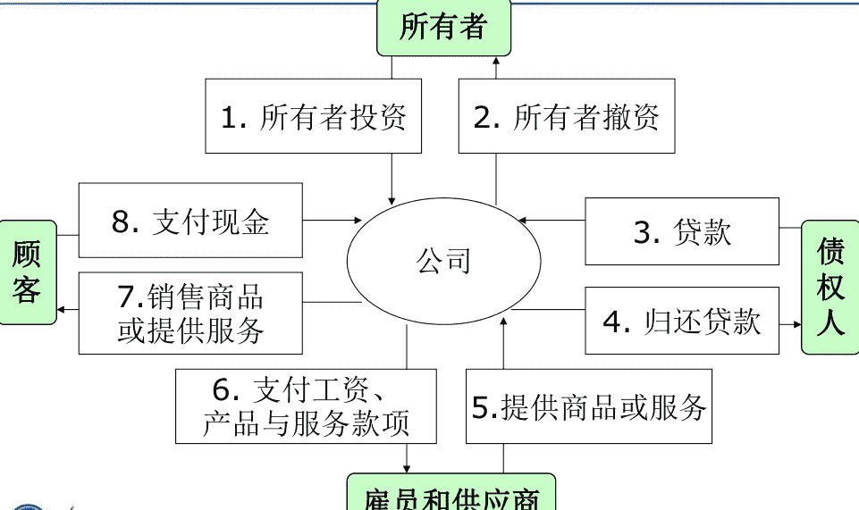

## 公司业务活动概述

目标和战略

投资

- 长期项目
  - 土地
  - 建筑物
  - 设备
  - 专利
  - 股票和债券

- 短期项目
  - 现金
  - 应收账款
  - 存货

- 短期项目
  - 银行
  - 供应商
  - 员工
  - 政府

融资

- 长期项目
  - 长期债权人
  - 股东

采购 销售
生产 管理

经营

会计程序

会计信息

决策者

经济活动

行动
（决策）

会计“连接”决策者与经济活动——以及他们决策的结果。

## 会计信息系统

## 信息使用者

- 投资者
- 债权人
- 管理者
- 所有者
- 客户
- 员工
- 监管机构
  - SEC
  （证券交易委员会）
  - IRS
  （国内税收署）
  - EPA
  （环保署）

## 成本收入

- 分批成本法
- 分步成本法
- 作业成本法
- 销售

## 资产与负债

- 厂房和设备
- 贷款与权益
- 应收账款,

## 现金流量

- 经营活动
- 筹资活动
- 投资活动

## 决策支持

- 绩效评估
- 股票投资
- 税务策略
- 员工关系
- 资源配置
- 放款决策
- 借款

## 信息观与测量观：你认为哪一个更有道理？

1920，1930年美国公司的年报，无形资产1块钱

中国早期上市公司的年报

股价为什么波动？

如何测量2岁小孩子的身高？

## 1 什么是会计？

一连串的问题：

- 会计信息是什么？
- 为什么需要会计信息？
- 谁需要会计信息？
- 需要什么会计信息？
- 什么时候需要会计信息？
- 谁来保障会计信息的真实性？

### 企业的价值就是其为股东所创造的财富

国家

组织机构

企业


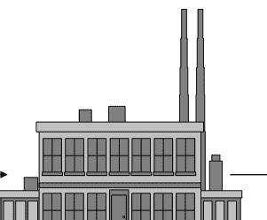


### 企业价值的创造来源于生产和资本经营

生产经营

资本经营

开发/研究 生产制造 市场营销 销售

公司经营能力，技术、管理水平

投资者

债务人：
贷款
债券

股权人：
优先股
普通股


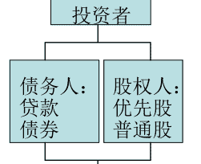


### 会计信息是什么

### 新闻告诉我们什么？

2013年2月20日，美股大跌 道指失守14000点纳指跌1.53%

2013年2月20日，国务院常务会议，研究部署继续做好房地产市场调控工作。会议要求坚决抑制投机投资性购房。

### 信息帮助我们做什么？

2013年2月21日，收评：沪指跌2.97%，创15个月最
权重股杀跌

### 为什么需要信息

### 企业的组织形式

#### 独资企业

#### 合伙企业

#### 公司


### 为什么需要信息

信息不对称

投资者等外部人

公司\管理者

会计信息（硬信息）
与其他信息（软信息）

金融中介：分析师

公司治理

监管机构

### 谁需要信息

### 经济学的重要原理：需求决定供给

#### 外部使用者

#### 内部使用者


企业是一个黑箱

公司有一个帐幕

- 所有者（或股东）
- 债权人
- 税务当局
- 监管者
- 其他外部主体

- 管理层
- 员工

### 需要什么会计信息

小组讨论

- ① 股东：
- ② 债权人：
- ③ 税务当局：
- ④ 监管者：
- ⑤ 管理层：
- ⑥ 员工：
- ⑦ 消费者：
- ⑧ 环保组织：
- ⑨ 潜在的投资者：

### 会计系统的基本功能

① 解释并记录商业交易。

①记录交易

② 将相似交易分类为有用的报告。

②分类

③ 总结并向决策者传递信息。

③ 总结与传递


#### 财务报告的目标

（具体）
信息对反映经济资源、对资源的要求权以及资源和要求权的变化有用

信息对估计未来现金流的时间、数量及不确定性有用

信息对投资与信贷决策有用
（一般）

#### 管理报告的目标

为明确决策权威、作出决策以及评价决策执行效果提供信息

提供企业内、外资源的信息，使之对评价过去的业绩和判断企业未来方向有用

提供有用的信息帮助实现企业的目标与战略

### 会计信息的载体

会计报表：3张表
小企业的3张表？？

### 什么时候需要会计信息？

### 会计信息加工与披露的成本与收益原则

- 年报
- 半年报
- 季报
- 月报？？？

### 会计期间

#### 年度

半年 1

2

季度

1 2 3 4

1月 2月 3月 4月 5月 6月 7月 8月 9月 10月 11月 12月

#### 月度


#### 会计年度结账日（fiscal year end）

都是每年的12月份么？

APPLE、Walmart

为什么不同的结账日？

都是每月31日或者30日么？

如果某个企业每个月25日结账，合理么？目的是什么（延迟纳税？）

| 结账月份 | 占比 | 公司 | 结账月份 |
|---|---|---|---|
| 1 | 2.16% | MACY'S | 1 |
| 2 | 1.03% | WAL-MART | 1 |
| 3 | 4.31% | TARGET | 1 |
| 4 | 1.45% | HOME DEPOT | 1 |
| 5 | 1.48% | LOWE'S | 1 |
| 6 | 5.53% | BEST BUY | 2 |
| 7 | 1.28% | APPLE | 9 |
| 8 | 1.78% | GOOGLE | 12 |
| 9 | 5.03% | GE | 12 |
| 10 | 3.19% | CISCO SYSTEMS | 7 |
| 11 | 1.37% | ORACLE | 5 |
| 12 | 71.40% | INTEL | 12 |
|  |  | DELL | 1 |
|  |  | MICROSOFT | 6 |
|  |  | VODAFONE | 3 |
|  |  | TOYOTA | 3 |
|  |  | SONY | 3 |
|  |  | PROCTER & GAMBLE | 6 |
|  |  | DISNEY (WALT) | 9 |

### 谁来保障会计信息的真实性？

监管：会计准则（GAAP、IFRS）、审计师、证监会（SEC）、媒体、法律（SOX）

谁更为有效？

道德（CORNERSTONE）：不做假账


### 核心内容

- I. 会计：测量观与信息观
- II. 会计假设和原则
- III. 会计等式
- IV. 会计要素
- V. 借贷记账法
- VI. 会计循环

## 会计假设——会计核算前提

- 会计假设是“对某些未被认识的会计现象，根据客观的正常情况或趋势所作的合乎事理的判断，而形成的一系列构成会计思想的基本公理或假设”（《经济大辞典》）
- 会计假设也称为会计的基本前提，是会计工作的理论基础，是组织会计工作必须具备的前提条件

- 原准则：
  - 会计主体
  - 持续经营
  - 会计分期
  - 货币计量
- 新准则：
  - 会计主体
  - 持续经营
  - 会计分期
  - 货币计量
  - 权责发生制

## 会计信息质量的原则

- 四大原则：相关性、可靠性、可比性、重要性
- 会计信息的首要质量
  - 相关性——预测价值、反馈价值、时效性
  - 可靠性——忠实表达、可检验性、中立性
- 会计信息的次要质量
  - 可比性
- 需要考虑上述质量的起点：重要性（数量与质量）
- 其他：实质重于形式、谨慎性

## 新准则

### 会计信息质量要求

- 客观性（可靠性）
- 相关性
- 可理解性
- 可比性
- 一致性
- 实质重于形式
- 重要性
- 谨慎性
- 及时性

## 会计确认计量的原则

- 权责发生制原则（收入确认原则）
- 配比原则
- 历史成本原则
- 全面披露的原则
- 划分收益性支出与资本性支出的原则

## 会计计量

企业在将符合确认条件的会计要素登记入账并列报于会计报表及其附注（又称财务报表）时，应当按照规定的会计计量属性进行计量，确定其金额。

- 历史成本
- 重置成本
- 可变现净值
- 现值
- 公允价值

企业在对会计要素进行计量时，一般应当采用历史成本，采用重置成本、可变现净值、现值、公允价值计量的，应当保证所确定的会计要素金额能够取得并可靠计量。

## 会计规范：规则导向还是原则导向

- 打酱油的钱不能够买醋？
- 谁的“小金库”？

### 核心内容

- I. 会计：测量观与信息观
- II. 会计假设和原则
- III. 会计等式
- IV. 会计要素
- V. 借贷记账法
- VI. 会计循环

## 会计等式

### 资金的使用 = 资金的来源

资产 = 负债 + 所有者权益

利润 = 收入 - 费用

资产 = 负债 + 所有者权益 + 收入 - 费用

### 核心内容

- I. 会计：测量观与信息观
- II. 会计假设和原则
- III. 会计等式
- IV. 会计要素
- V. 借贷记账法
- VI. 会计循环

## 财务报表的会计要素

会计要素：从会计的角度解释构成企业经济活动的必要因素。

- 资产
- 负债
- 所有者权益
- 收入
- 费用
- 利润

## 会计六大要素

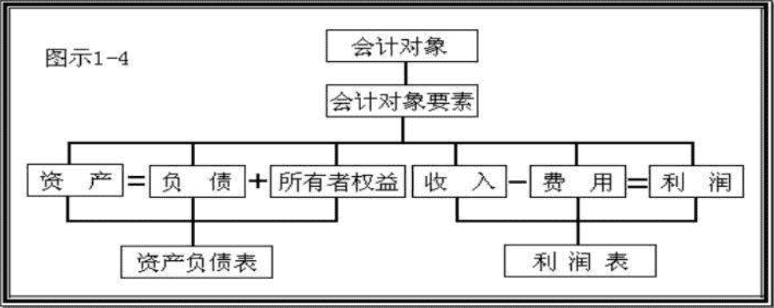

## 举例——会计事项的发生对会计等式的影响

昂立公司以200 000元开设一家交大服务中心，专门从事各种便民服务。该中心于2013年12月1日成立并开始营业，其发生的经济业务如下：

### 业务1：服务中心2013年12月1日获得马克公司200 000元，当即存入该中心的开户银行。


资产：银行存款 +200 000

所有者权益：实收资本 +200 000

这类经济业务的发生，使会计等式的左右两方同时等额增加。

### 业务2：2013年12月3日，服务中心以银行存款购买维修材料一批10 000元。


| 项目 | 银行存款 | 原材料 | 实收资本 |
|---|---:|---:|---:|
| 变动前 | +200 000 |  | +200 000 |
| 业务2 | -10 000 | +10 000 |  |

这类经济业务的发生，使会计等式左方有增有减。

### 业务3：2013年12月8日，服务中心借入短期流动资金借款100 000元。

| 项目 | 银行存款 | 原材料 | 短期借款 | 实收资本 |
|---|---:|---:|---:|---:|
| 变动前 | +190 000 | +10 000 |  | +200 000 |
| 业务3 | +100 000 |  | +100 000 |  |

这类经济业务的发生，使会计等式的左右两方同时等额增加。

### 业务4：2013年12月10日，服务中心向思源公司购进修配材料一批，价值20 000元，款项尚未支付。


| 项目 | 银行存款 | 原材料 | 短期借款 | 应付账款 | 实收资本 |
|---|---:|---:|---:|---:|---:|
| 变动前 | +290 000 | +10 000 | +100 000 |  | +200 000 |
| 业务4 |  | +20 000 |  | +20 000 |  |

这类经济业务的发生，使会计等式的左右两方同时等额增加。

### 业务5：2013年12月15日，服务中心以银行存款8 000元偿还12月10日所欠思源公司部分货款。

资产 = 负债 + 所有者权益

| 项目 | 银行存款 | 原材料 | 短期借款 | 应付账款 | 实收资本 |
|---|---:|---:|---:|---:|---:|
| 变动前 | +290 000 | +30 000 | +100 000 | +20 000 | +200 000 |
| 业务5 | -8 000 |  |  | -8 000 |  |

这类经济业务的发生，使会计等式的左右两方同时等额减少。

### 业务6：2013年12月25日，服务中心开出票据一张交给思源公司，约定3个月后归还所欠其余12 000元货款，并一并支付利息。


| 项目 | 银行存款 | 原材料 | 短期借款 | 应付账款 | 应付票据 | 实收资本 |
|---|---:|---:|---:|---:|---:|---:|
| 变动前 | +282 000 | +30 000 | +100 000 | +12 000 |  | +200 000 |
| 业务6 |  |  |  | -12 000 | +12 000 |  |

这类经济业务的发生，使会计等式的右方有增有减。

### 业务7：2013年12月27日，昂立公司代服务中心偿还80 000元的银行借款，以此作为对服务中心追加的投资，有关手续已办妥。

资产 = 负债 + 所有者权益

| 项目 | 银行存款 | 原材料 | 短期借款 | 应付账款 | 应付票据 | 实收资本 |
|---|---:|---:|---:|---:|---:|---:|
| 变动前 | +282 000 | +30 000 | +100 000 | 0 | +12 000 | +200 000 |
| 业务7 |  |  | -80 000 |  |  | +80 000 |

这类经济业务的发生，使会计等式的右方有增有减。


## 举例——会计事项的发生对会计等式的影响

业务8：2013年12月28日，昂立公司委托服务中心代还一笔20 000元货款，以此作为对服务中心投资的减少，有关手续已办妥，服务中心尚未还款。

资产 = 负债 + 所有者权益

| 银行存款 | 原材料 | 短期借款 | 应付账款 | 应付票据 | 实收资本 |
| ---: | ---: | ---: | ---: | ---: | ---: |
| +282 000 | +30 000 | +20 000 | 0 | +12 000 | +280 000 |
|  |  |  | +20 000 |  | -20 000 |

> 这类经济业务的发生，使会计等式的右方有增有减

业务10：2013年12月30日，昂立公司将其对服务中心投资60 000元，转让给慧谷公司，有关手续已办妥。


| 银行存款 | 原材料 | 短期借款 | 应付账款 | 应付票据 | 实收资本 |
| ---: | ---: | ---: | ---: | ---: | ---: |
| +262 000 | +30 000 | +20 000 | +20 000 | +12 000 | +240 000 |
|  |  |  |  |  | +60 000 |
|  |  |  |  |  | -60 000 |

> 这类经济业务的发生，使会计等式的右方有增有减

业务11：本月份服务中心在营运中，支付房屋租金3 600元，员工工资11 200元，水电费740元以及其他杂项费用460元，共计16 000元，耗用维修材料14 000元。


| 银行存款 | 原材料 | 短期借款 | 应付账款 | 应付票据 | 实收资本 | 营业费用（-） |
| ---: | ---: | ---: | ---: | ---: | ---: | ---: |
| +262 000 | +30 000 | +20 000 | +20 000 | +12 000 | +240 000 |  |
| -16 000 | -14 000 |  |  |  |  | -30 000 |

> 这类经济业务的发生，使会计等式的左右两方同时等额减少

业务12：本月份服务中心收入40 000元，收到现金28 000元，已存入银行，余款尚未收到。


| 银行存款 | 原材料 | 应收账款 | 短期借款 | 应付账款 | 应付票据 | 实收资本 | 营业费用（-） | 营业收入（+） |
| ---: | ---: | ---: | ---: | ---: | ---: | ---: | ---: | ---: |
| +246 000 | +16 000 |  | +20 000 | +20 000 | +12 000 | +240 000 | -30 000 |  |
| +28 000 |  | +12 000 |  |  |  |  |  | +40 000 |

> 这类经济业务的发生，使会计等式的左右两方同时等额增加

## 结论

（1）每一项经济业务的发生都会引起两个或两个以上的资产和权益项目发生增减变化，但其变化结果不会破坏“资产=负债+所有者权益”这一基本会计等式的恒等关系。这一恒等关系是会计上设置账户、复式记账及编制资产负债表的理论依据。

（2）企业单位内部发生的经济业务种类繁多，但归结起来不外乎四种类型：

- 资产和权益同时等额增加。如业务1、3、4、12
- 资产和权益同时等额减少。如业务5、9、11
- 资产内部有关项目有增有减。如业务2
- 权益内部有关项目有增有减。如业务6、7、8、10

（3）在以上四种类型中，第一、二种类型将使企业的资产和权益总额发生增减变化，但不破坏其平衡关系；第三、四种类型只影响资产和权益内部有关项目发生增减变化，而资产和权益的总额保持不变。

### 经济业务的发生对会计等式的影响类型图

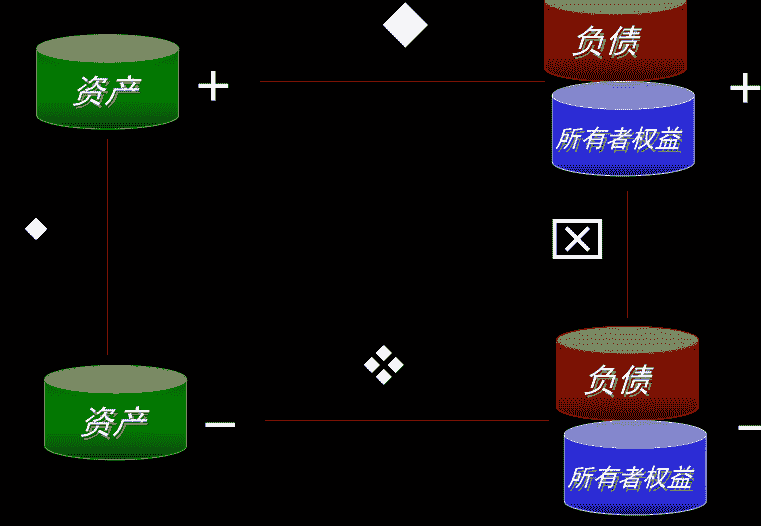

（4）在会计实务中，上述四种类型可以进一步分解为九种形式。

### 经济业务的发生对会计等式的影响

| 类型 | 资产 | 负债 | 所有者权益 | 业务 |
| --- | --- | --- | --- | --- |
| ① 资产增加，负债增加 | 增加 | 增加 |  | 3、4 |
| ② 资产增加，所有者权益增加 | 增加 |  | 增加 | 1、12 |
| ③ 资产减少，负债减少 | 减少 | 减少 |  | 5 |
| ④ 资产减少，所有者权益减少 | 减少 |  | 减少 | 9、11 |
| ⑤ 资产内部有增有减 | 增加/减少 |  |  | 2 |
| ⑥ 负债内部有增有减 |  | 增加/减少 |  | 6 |
| ⑦ 所有者权益内部有增有减 |  |  | 增加/减少 | 10 |
| ⑧ 负债增加，所有者权益减少 |  | 增加 | 减少 | 8 |
| ⑨ 负债减少，所有者权益增加 |  | 减少 | 增加 | 7 |

## 会计事项分析结果的呈报

至2013年12月底，交大服务中心经营一个月后，昂立公司想了解一下其投资的情形。其所关心的问题可归纳为以下几个方面：

- （1）交大服务中心一个月经营的结果如何？是盈利还是亏损，金额多大？
- （2）昂立公司在交大服务中心所拥有的权益增减变动情况如何？
- （3）月底时，交大服务中心的财务状况如何？现金流量如何？

### 交大服务中心利润表

2013年12月　　计量单位：元

| 项目 | 明细金额 | 汇总金额 |
| --- | ---: | ---: |
| 营业收入 |  | 40 000 |
| 营业费用： |  | 30 000 |
| 　材料费 | 14 000 |  |
| 　工资 | 11 200 |  |
| 　租金 | 3 600 |  |
| 　水电费 | 740 |  |
| 　其他杂项费用 | 460 |  |
| 利润 |  | 10 000 |

### 交大服务中心资产负债表

2013年12月31日　　计量单位：元

| 资产 | 金额 | 负债及所有者权益 | 金额 |
| --- | ---: | --- | ---: |
| 货币资金 | 274 000 | 短期借款 | 20 000 |
| 应收账款 | 12 000 | 应付账款 | 20 000 |
| 存货 | 16 000 | 应付票据 | 12 000 |
|  |  | 实收资本 | 240 000 |
|  |  | 留存收益 | 10 000 |
| 资产总计 | 302 000 | 负债及所有者权益总计 | 302 000 |

### 核心内容

- I. 会计：测量观与信息观
- II. 会计假设和原则
- III. 会计等式
- IV. 会计要素
- V. 借贷记账法
- VI. 会计循环

## 借贷记账法概述

借贷记账法是以“借”、“贷”二字作为记账符号，对每一项经济业务所引起的资金运动，都要用相等的金额在两个或两个以上有相互联系的账户中进行全面登记的一种复式记账方法。

### 记账符号

- 借（Dr）
- 贷（Cr）

### 理论依据

资产 = 负债 + 所有者权益

### 记账规则

> “有借必有贷，借贷必相等”

### 举例——会计分录

昂立公司以200 000元开设一家家政服务中心，专门从事各种便民服务。该中心于2013年12月1日成立并开始营业，其发生的经济业务如下：

**业务1：**服务中心2013年12月1日获得昂立公司200 000元，当即存入该中心的开户银行。

借：银行存款 200 000  
贷：实收资本 200 000

**业务2：**2013年12月3日，服务中心以银行存款购买维修材料一批10 000元。

借：原材料 10 000  
贷：银行存款 10 000

**业务3：**2013年12月8日，服务中心借入短期流动资金借款100 000元。

借：银行存款 100 000  
贷：短期借款 100 000

**业务4：**2013年12月10日，服务中心向思源公司购进修配材料一批，价值20 000元，款项尚未支付。

借：原材料 20 000  
贷：应付账款 20 000

**业务5：**2013年12月15日，服务中心以银行存款8 000元偿还12月10日所欠思源公司部分货款。

借：应付账款 8 000  
贷：银行存款 8 000

**业务6：**2013年12月25日，服务中心开出票据一张交给思源公司，约定3个月后归还所欠其余12 000元货款，并一并支付利息。

借：应付账款 12 000  
贷：应付票据 12 000

**业务7：**2013年12月27日，昂立公司代服务中心偿还80 000元的银行借款，以此作为对服务中心追加的投资，有关手续已办妥。

借：短期借款 80 000  
贷：实收资本 80 000


### 举例——会计分录

业务8：2013年12月28日，昂立公司委托服务中心代还一笔20 000元货款，以此作为对服务中心投资的减少，有关手续已办妥，服务中心尚未还款。

借：实收资本 20 000

贷：应付账款 20 000

### 举例—— 会计分录

业务9：2013年12月29日，在办理有关手续后，昂立公司从服务中心抽回投资20 000元，服务中心以银行存款支付。

借：实收资本 20 000

贷：银行存款 20 000

### 举例——会计分录

业务10：2013年12月30日，昂立公司将其对服务中心投资60 000元，转让给慧谷公司，有关手续已办妥。

借：实收资本——昂立公司 60 000

贷：实收资本——慧谷公司 60 000

### 举例——会计分录

业务11：本月份服务中心在营运中，支付房屋租金3 600元，员工工资11 200元，水电费740元以及其他杂项费用460元，共计16 000元，耗用维修材料14 000元。

借：销售费用 30 000

贷：银行存款 16 000

原材料 14 000

### 举例——会计分录

业务12：本月份服务中心收入40 000元，收到现金28 000元，已存入银行，余款尚未收到。

借：银行存款 28 000
应收账款 12 000
贷：营业收入 40 000

### 核心内容

- I. 会计:测量观与信息观
- II. 会计假设和原则
- III. 会计等式
- IV. 会计要素
- V. 借贷记账法
- VI. 会计循环

## 会计循环

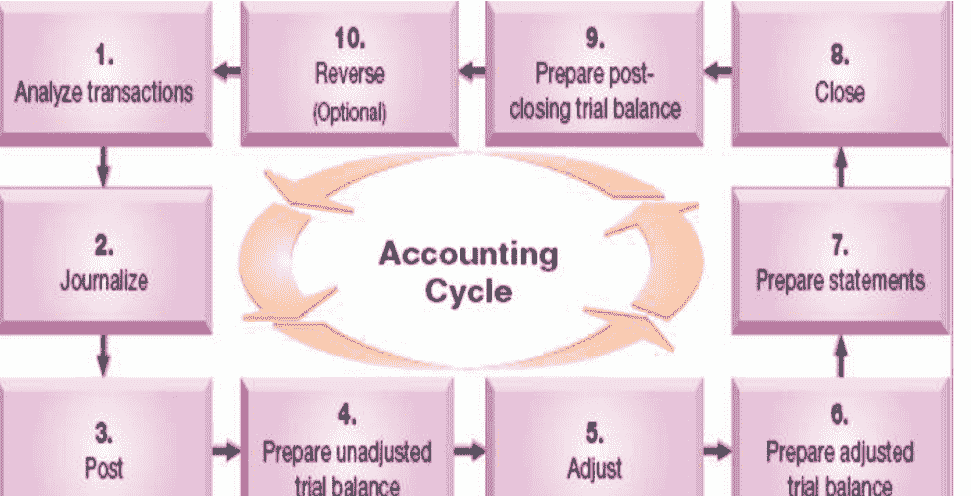

## 会计循环


**登记日记账。**  
登记日记账

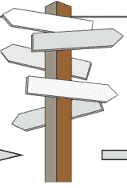

**过账到总账账户。**  
过账  
结账


**准备试算平衡表。**  
准备试算平衡  
准备财务报表


**进行年末调整。**


**准备调整后的试算平衡表。**  
准备调整后的试算平衡


**编制财务报表。**

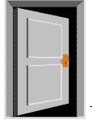

**登记并过账结账分录。**


**准备结账后试算平衡表。**

## 会计循环：记账、过账、调账、关帐、报账

分析交易与审核原始凭证

运用会计等式与借贷记账法

过账：从分录到帐簿

记账：会计分录

资产 = 负债 + 所有者权益

T型账户
（左侧）借方
（右侧）贷方


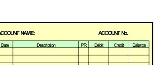

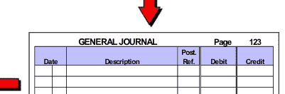


## 举例—— 过账

## 通过账户记录可提供四个核算指标

期初
余额

本期
增加额

本期
减少额

期末
余额

## 通过账户记录可提供四个核算指标

期初
余额

本期
增加额

本期
减少额

期末
余额

上述四个核算指标间的关系是：

=   +   -

## ——丁字型账户格式

## 账户名称

借方    （会计科目）    贷方

说明：
每个账户的本期增加额和本期减少额应分别记入上
列账户的左右两方。

## ——丁字型账户格式

账户名称

借方      （会计科目）      贷方

说明：
如果左方记增加，右方应记减少；如果右方记增加，左方应记减少。

## ——丁字型账户格式

账户名称

借方    （会计科目）    贷方

说明：
期初、期末余额的方向与增加额的方向相同。

## ——丁字型账户格式

## 账户名称

借方    （会计科目）    贷方

## 说明：

借贷方的內容要依据账户所要反映的会计对象的具体内容，即账户的性质而定。

## 帐户的基本结构

帐户名称

期初余额
（期初余额）
增加
（减少）
减少
（增加）
期末余额
（期末余额）

期末余额=期初余额+本期增加发生额-本期减少发生额

## 银行存款

(1) 200 000

## 原材料

## 短期借款

## 应付账款

## 应付票据

## 实收资本

(1) 200 000

### 销售费用

## 营业收入

业务1：服务中心2013年12月1日获得昂立公司200 000元。当即存入该中心的开户银行。

## 银行存款

（1）200 000

（2）10 000

## 原材料

（2）10 000

## 应收账款

## 短期借款

## 应付账款

## 应付票据

## 实收资本

（1）200 000

### 销售费用

## 营业收入

业务2：2013年12月3日服务中心以银行存款购买修配材料一批10 000元。

## 银行存款

(1) 200 000
(3) 100 000

(2) 10 000

## 原材料

(2) 10 000

## 短期借款

(3) 100 000

## 应付账款

## 应付票据

## 实收资本

(1) 200 000

### 销售费用

## 营业收入

业务3： 2013年12月8日，服务中心公司借入短期流动资金借款100 000元。

## 银行存款

+   (1) 200 000
+   (3) 100 000
+   (2) 10 000

## 原材料

+   (2) 10 000
+   (4) 20 000

## 应收账款

## 短期借款

+   (3) 100 000

## 应付账款

+   (4) 20 000

## 应付票据

## 实收资本

+   (1) 200 000

### 销售费用

## 营业收入

业务4：2013年12月10日，服务中心向思源公司购进修配材料一批，价值20 000元，款项尚未支付

## 银行存款

(1) 200 000
(3) 100 000

(2) 10 000
(5) 8 000

## 原材料

(2) 10 000
(4) 20 000

## 短期借款

(3) 100 000

## 应付账款

(5) 8 000

(4) 20 000

## 应付票据

## 实收资本

(1) 200 000

### 销售费用

## 营业收入

业务5： 2013年12月15日，服务中心以银行存款8 000元偿还12月10日所欠思源公司部分货款。

## 银行存款

(1) 200 000
(3) 100 000

(2) 10 000
(5) 8 000

## 原材料

(2) 10 000
(4) 20 000

## 短期借款

(3) 100 000

## 应付账款

(5) 8 000
(6) 12 000

(4) 20 000

## 应付票据

(6) 12 000

## 实收资本

(1) 200 000

### 销售费用

## 营业收入

业务6： 2013年12月25日，服务中心开出票据一张交给思源公司，约定3个月后归还所欠其余12 000元货款，并一并支付利息。

## 银行存款

(1) 200 000
(3) 100 000

(2) 10 000
(5) 8 000

## 原材料

(2) 10 000
(4) 20 000

## 短期借款

(7) 80 000

(3) 100 000

## 应付账款

(5) 8 000
(6) 12 000

(4) 20 000

## 应付票据

(6) 12 000

## 实收资本

(1) 200 000
(7) 80 000

业务7： 2013年12月27日，昂立公司代服务中心偿还80 000元的银行借款，以此作为对服务中心追加的投资，有关手续已办妥。


## 银行存款

| 借方 | 贷方 |
| --- | --- |
| (1) 200 000 | (2) 10 000 |
| (3) 100 000 | (5) 8 000 |

### 原材料

| 借方 | 贷方 |
| --- | --- |
| (2) 10 000 |  |
| (4) 20 000 |  |

## 短期借款

| 借方 | 贷方 |
| --- | --- |
| (7) 80 000 | (3) 100 000 |

## 应付账款

| 借方 | 贷方 |
| --- | --- |
| (5) 8 000 | (4) 20 000 |
| (6) 12 000 | (8) 20 000 |

## 应付票据

| 借方 | 贷方 |
| --- | --- |
|  | (6) 12 000 |

### 实收资本

| 借方 | 贷方 |
| --- | --- |
| (8) 20 000 | (1) 200 000 |
|  | (7) 80 000 |

业务8：2013年12月28日，昂立公司委托服务中心代还一笔20 000元货款，以此作为对服务中心投资的减少，有关手续已办妥，服务中心尚未还款。

## 银行存款

| 借方 | 贷方 |
| --- | --- |
| (1) 200 000 | (2) 10 000 |
| (3) 100 000 | (5) 8 000 |
|  | (9) 20 000 |

### 原材料

| 借方 | 贷方 |
| --- | --- |
| (2) 10 000 |  |
| (4) 20 000 |  |

## 应收账款

| 借方 | 贷方 |
| --- | --- |
|  |  |

## 短期借款

| 借方 | 贷方 |
| --- | --- |
| (7) 80 000 | (3) 100 000 |

## 应付账款

| 借方 | 贷方 |
| --- | --- |
| (5) 8 000 | (4) 20 000 |
| (6) 12 000 | (8) 20 000 |

## 应付票据

| 借方 | 贷方 |
| --- | --- |
|  | (6) 12 000 |

### 实收资本

| 借方 | 贷方 |
| --- | --- |
| (8) 20 000 | (1) 200 000 |
| (9) 20 000 | (7) 80 000 |

### 销售费用

| 借方 | 贷方 |
| --- | --- |
|  |  |

### 营业收入

| 借方 | 贷方 |
| --- | --- |
|  |  |

业务9：2013年12月29日，在办理有关手续后，昂立公司从服务中心抽回投资20 000元，服务中心以银行存款支付。

## 银行存款

| 借方 | 贷方 |
| --- | --- |
| (1) 200 000 | (2) 10 000 |
| (3) 100 000 | (5) 8 000 |
|  | (9) 20 000 |

### 原材料

| 借方 | 贷方 |
| --- | --- |
| (2) 10 000 |  |
| (4) 20 000 |  |

## 短期借款

| 借方 | 贷方 |
| --- | --- |
| (7) 80 000 | (3) 100 000 |

## 应付账款

| 借方 | 贷方 |
| --- | --- |
| (5) 8 000 | (4) 20 000 |
| (6) 12 000 | (8) 20 000 |

## 应付票据

| 借方 | 贷方 |
| --- | --- |
|  | (6) 12 000 |

### 实收资本

| 借方 | 贷方 |
| --- | --- |
| (8) 20 000 | (1) 200 000 |
| (9) 20 000 | (7) 80 000 |
| (10) 60 000 | (10) 60 000 |

### 销售费用

| 借方 | 贷方 |
| --- | --- |
|  |  |

### 营业收入

| 借方 | 贷方 |
| --- | --- |
|  |  |

业务10：2013年12月30日，昂立公司将其对服务中心投资60 000元，转让给慧谷公司，有关手续已办妥。

## 银行存款

| 借方 | 贷方 |
| --- | --- |
| (1) 200 000 | (2) 10 000 |
| (3) 100 000 | (5) 8 000 |
|  | (9) 20 000 |
|  | (11) 16 000 |

### 原材料

| 借方 | 贷方 |
| --- | --- |
| (2) 10 000 | (11) 14 000 |
| (4) 20 000 |  |

## 短期借款

| 借方 | 贷方 |
| --- | --- |
| (7) 80 000 | (3) 100 000 |

### 实收资本

| 借方 | 贷方 |
| --- | --- |
| (8) 20 000 | (1) 200 000 |
| (9) 20 000 | (7) 80 000 |
| (10) 60 000 | (10) 60 000 |

### 销售费用

| 借方 | 贷方 |
| --- | --- |
| (11) 30 000 |  |

### 营业收入

| 借方 | 贷方 |
| --- | --- |
|  |  |

业务11：本月份服务中心在营运中，支付房屋租金3 600元，员工工资11 200元，水电费740元以及其他杂项费用460元，共计16 000元，耗用维修材料14 000元。

## 银行存款

| 借方 | 贷方 |
| --- | --- |
| (1) 200 000 | (2) 10 000 |
| (3) 100 000 | (5) 8 000 |
| (12) 28 000 | (9) 20 000 |
|  | (11) 16 000 |

### 原材料

| 借方 | 贷方 |
| --- | --- |
| (2) 10 000 | (11) 14 000 |
| (4) 20 000 |  |

## 应收账款

| 借方 | 贷方 |
| --- | --- |
| (12) 12 000 |  |

## 短期借款

| 借方 | 贷方 |
| --- | --- |
| (7) 80 000 | (3) 100 000 |

业务12：本月份服务中心收入40 000元，收到现金28 000元，已存入银行，余款尚未收到。

### 实收资本

| 借方 | 贷方 |
| --- | --- |
| (8) 20 000 | (1) 200 000 |
| (9) 20 000 | (7) 80 000 |
| (10) 60 000 | (10) 60 000 |

### 销售费用

| 借方 | 贷方 |
| --- | --- |
| (11) 30 000 |  |

### 营业收入

| 借方 | 贷方 |
| --- | --- |
|  | (12) 40 000 |

## 银行存款

| 借方 | 贷方 |
| --- | --- |
| (1) 200 000 | (2) 10 000 |
| (3) 100 000 | (5) 8 000 |
| (12) 28 000 | (9) 20 000 |
|  | (11) 16 000 |
| 328 000 | 54 000 |
| 274 000 |  |

### 原材料

| 借方 | 贷方 |
| --- | --- |
| (2) 10 000 | (11) 14 000 |
| (4) 20 000 |  |
| 30 000 | 14 000 |
| 16 000 |  |

## 应收账款

| 借方 | 贷方 |
| --- | --- |
| (12) 12 000 |  |
| 12 000 | — |
| 12 000 |  |

## 短期借款

| 借方 | 贷方 |
| --- | --- |
| (7) 80 000 | (3) 100 000 |
| 80 000 | 100 000 |
|  | 20 000 |

## 应付账款

| 借方 | 贷方 |
| --- | --- |
| (5) 8 000 | (4) 20 000 |
| (6) 12 000 | (8) 20 000 |
| 20 000 | 40 000 |
|  | 20 000 |

## 应付票据

| 借方 | 贷方 |
| --- | --- |
|  | (6) 12 000 |
| — | 12 000 |
|  | 12 000 |

### 实收资本

| 借方 | 贷方 |
| --- | --- |
| (8) 20 000 | (1) 200 000 |
| (9) 20 000 | (7) 80 000 |
| (10) 60 000 | (10) 60 000 |
| 100 000 | 340 000 |
|  | 240 000 |

### 销售费用

| 借方 | 贷方 |
| --- | --- |
| (11) 30 000 |  |
| 30 000 | — |
| 30 000 |  |

### 营业收入

| 借方 | 贷方 |
| --- | --- |
|  | (12) 40 000 |
| — | 40 000 |
|  | 40 000 |

## 银行存款

| 年 | 月 | 日 | 凭证号数 | 摘要 | 借方 | 贷方 | 借/贷 | 余额 |
| --- | --- | --- | --- | --- | --- | --- | --- | --- |
| 2013 | 12 | 1 |  | 收到昂立公司投资 | 200 000 |  | 借 | 200 000 |
| 2013 | 12 | 3 | （略） | 购入修配材料 |  | 10 000 | 借 | 190 000 |
| 2013 | 12 | 8 |  | 取得短期借款 | 100 000 |  | 借 | 290 000 |
| 2013 | 12 | 15 |  | 偿还欠款 |  | 8 000 | 借 | 282 000 |
| 2013 | 12 | 29 |  | 昂立公司撤回投资 |  | 20 000 | 借 | 262 000 |
| 2013 | 12 | 31 |  | 支付销售费用 |  | 16 000 | 借 | 246 000 |
| 2013 | 12 | 31 |  | 收到营业款 | 28 000 |  | 借 | 274 000 |
| 2013 | 12 | 31 |  | 本期发生额及余额 | 328 000 | 54 000 | 借 | 274 000 |

## 举例——试算平衡

## 银行存款

| 借方 | 贷方 |
| --- | --- |
| (1) 200 000 | (2) 10 000 |
| (3) 100 000 | (5) 8 000 |
| (12) 28 000 | (9) 20 000 |
| 328 000 | (11) 16 000 |
| 274 000 | 54 000 |

### 原材料

| 借方 | 贷方 |
| --- | --- |
| (2) 10 000 | (11) 14 000 |
| (4) 20 000 | 14 000 |
| 30 000 |  |
| 16 000 |  |

## 应收账款

| 借方 | 贷方 |
| --- | --- |
| (12) 12 000 | — |
| 12 000 |  |
| 12 000 |  |

## 短期借款

| 借方 | 贷方 |
| --- | --- |
| (7) 80 000 | (3) 100 000 |
| 80 000 | 100 000 |
|  | 20 000 |

## 应付账款

| 借方 | 贷方 |
| --- | --- |
| (5) 8 000 | (4) 20 000 |
| (6) 12 000 | (8) 20 000 |
| 20 000 | 40 000 |
|  | 20 000 |

## 应付票据

| 借方 | 贷方 |
| --- | --- |
| — | (6) 12 000 |
|  | 12 000 |
|  | 12 000 |

### 实收资本

| 借方 | 贷方 |
| --- | --- |
| (8) 20 000 | (1) 200 000 |
| (9) 20 000 | (7) 80 000 |
| (10) 60 000 | (10) 60 000 |
| 100 000 | 340 000 |
|  | 240 000 |

### 销售费用

| 借方 | 贷方 |
| --- | --- |
| (11) 30 000 | — |
| 30 000 |  |
| 30 000 |  |

### 营业收入

| 借方 | 贷方 |
| --- | --- |
| — | (12) 40 000 |
|  | 40 000 |
|  | 40 000 |

发生额试算平衡：

账户借方发生额合计=328 000+30 000+12 000+80 000+20 000+100 000+30 000=
账户贷方发生额合计=54 000+14 000+100 000+40 000+12 000+340 000+40 000=

## 应付账款

| 借方 | 贷方 |
| --- | --- |
| (5) 8 000 | (4) 20 000 |
| (6) 12 000 | (8) 20 000 |
|  |  |
| 20 000 | 40 000 |
|  | 20 000 |

## 应付票据

| 借方 | 贷方 |
| --- | --- |
|  | (6) 12 000 |
|  |  |
| — | 12 000 |
|  | 12 000 |

### 销售费用

| 借方 | 贷方 |
| --- | --- |
| (11) 30 000 |  |
|  |  |
| 30 000 | — |
| 30 000 |  |

### 营业收入

| 借方 | 贷方 |
| --- | --- |
|  | (12) 40 000 |
|  |  |
| — | 40 000 |
|  | 40 000 |

|  |  |
| --- | --- |
| (3) 100 000 |  |
|  |  |
| 100 000 |  |
| 20 000 |  |

|  |  |
| --- | --- |
| (1) 200 000 |  |
| (7) 80 000 |  |
| (10) 60 000 |  |
|  |  |
| 340 000 |  |
| 240 000 |  |


## 余额平衡——试算平衡

账户借方余额合计=274 000+16 000+12 000+30 000=

账户贷方余额合计=20 000+20 000+12 000+240 000+40 000=

| 借方项目 | 金额 | 贷方项目 | 金额 |
|---|---|---:|---:|
| 应付账款 | (3) 100 000 | 应付账款 | (5) 8 000 |
|  | 100 000 |  | (6) 12 000 |
|  | 20 000 |  | (4) 20 000 |
|  |  |  | (8) 20 000 |
| 应付票据 |  | 应付票据 | (6) 12 000 |
|  |  | — | 12 000 |
|  |  |  | 12 000 |

| 资产项目 | 金额 | 费用项目 | 金额 | 收入项目 | 金额 |
|---|---:|---|---:|---|---:|
| 实收资本 | (1) 200 000 | 销售费用 | (11) 30 000 | 营业收入 | (12) 40 000 |
|  | (7) 80 000 |  | 30 000 |  | 40 000 |
|  | (10) 60 000 |  | — |  | — |
|  | 340 000 |  | 30 000 |  | 40 000 |
|  | 240 000 |  | 30 000 |  | 40 000 |


## 举例——试算平衡

| 银行存款 | 原材料 | 应收账款 |
|---|---|---|
| (1) 200 000<br>(3) 100 000<br>(12) 28 000 | (2) 10 000<br>(5) 8 000<br>(9) 20 000<br>(11) 16 000 | (11) 14 000<br>(12) 12 000 |
| 328 000<br>274 000 | 54 000 | 30 000<br>16 000<br>14 000<br>12 000<br>12 000<br>— |

| 短期借款 | 应付账款 | 应付票据 |
|---|---|---|
| (7) 80 000<br>(3) 100 000 | (5) 8 000<br>(6) 12 000<br>(4) 20 000<br>(8) 20 000 | (6) 12 000 |
| 80 000<br>100 000<br>20 000 | 20 000<br>40 000<br>20 000 | —<br>12 000<br>12 000 |

| 实收资本 | 销售费用 | 营业收入 |
|---|---|---|
| (8) 20 000<br>(9) 20 000<br>(10) 60 000<br>(1) 200 000<br>(7) 80 000<br>(10) 60 000 | (11) 30 000 | (12) 40 000 |
| 100 000<br>340 000<br>240 000 | 30 000<br>—<br>30 000 | —<br>40 000<br>40 000 |

## 举例—— 试算平衡

### 交大服务中心余额试算平衡表
2013年12月

| 会计科目 | 借方金额 | 贷方金额 |
|---|---|---|
| 银行存款 | 274 000 |  |
| 应收账款 | 12 000 |  |
| 原材料 | 16 000 |  |
| 短期借款 |  | 20 000 |
| 应付账款 |  | 20 000 |
| 应付票据 |  | 12 000 |
| 实收资本 |  | 240 000 |
| 营业收入 |  | 40 000 |
| 销售费用 | 30 000 |  |
| 合计 | 332 000 | 332 000 |

## 举例——编制会计报表

### 交大服务中心利润表

2013年12月

计量单位：元

|  |  |  |
|---|---|---|
| 营业收入 |  | 40 000 |
| 销售费用： |  |  |
| 材料费 | 14 000 |  |
| 工资 | 11 200 |  |
| 租金 | 3 600 |  |
| 水电费 | 740 |  |
| 其他杂项费用 | 460 | 30 000 |
| 利润 |  | 10 000 |

## 交大服务中心资产负债表

2013年12月31日

计量单位：元

| 资产 | 金 额 | 负债及所有者权益 | 金 额 |
|---|---|---|---|
| 货币资金 | 274 000 | 短期借款 | 20 000 |
| 应收账款 | 12 000 | 应付账款 | 20 000 |
| 存货 | 16 000 | 应付票据 | 12 000 |
|  |  | 实收资本 | 240 000 |
|  |  | 留存收益 | 10 000 |
| 资产总计 | 302 000 | 负债及所有者权益总计 | 302 000 |

## 调账

当收入和费用的影响
超过一个会计期间，
就需要编制调整分录

每个调整分录会涉及到
收入或费用
and an asset or
liability的变化

## 调账

调整跨期交易与事项

### 调账的框架

调整

在确认费用（或收入）之前支付（或收到）现金

在确认费用（或收入）之后支付（或收到）现金

预付（递延）费用*

未赚取（递延）收入

应计费用

应计收入

*including depreciation

## 调账前后分录

| | 支出现金（收到现金） | 确认费用（确认收入） |
|---|---|---|
| 递延（Deferred） | 借：待摊费用（递延费用）<br>贷：现金 | 借：费用<br>贷：待摊费用（递延费用） |
|  | 借：现金<br>贷：预收账款（递延收入） | 借：预收账款（递延收入）<br>贷：收入 |

| | 确认费用（确认收入） | 支出现金（收到现金） |
|---|---|---|
| 应计（Accrued） | 借：费用<br>贷：预提费用（应计费用） | 借：预提费用（应计费用）<br>贷：现金 |
|  | 借：资产（应收账款）<br>贷：收入（应计收入） | 借：现金<br>贷：资产（应收账款） |

## 调整的类型

- ★ 将资产转为费用
- ★ 资产转为费用

- ⏱ 将负债转为收入
- ⏱ 负债转为收入

- ⏱ 计提未付费用
- ⏱ 未支付的费用

- ⏱ 计提未收收入
- ⏱ 未收讫的收入


## 为什么要调账

会计分期假设

应计制会计（应计会计）

调账原则：

权责发生制原则

配比原则

## 如何调整

| 类型 | 资产负债表科目 | 利润表科目 | 调整分录 |
|---|---|---|---|
| **预付费用** | 资产高估<br>所有者权益高估 | 费用低估 | 借：费用<br>贷：资产 |
| **未赚取收入** | 负债高估<br>所有者权益低估 | 收入低估 | 借：负债<br>贷：收入 |
| **应计费用** | 负债低估<br>所有者权益高估 | 费用低估 | 借：费用<br>贷：负债 |
| **应计收入** | 资产低估<br>所有者权益低估 | 收入低估 | 借：资产<br>贷：收入 |

## 结账

- 在期末将收入、费用和取款账户余额重置为 **零**。
- 有助于在 **损益汇总** 账户中汇总一个期间的收入和费用。

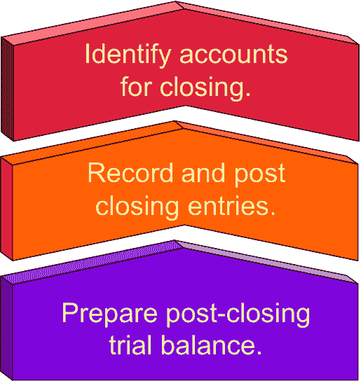


# 模块二：会计报表与报表分析


## 财务报表

## 财务报表

- 利润表(Income Statement)
- 股东权益变动表(Statement of Stockholders’ Equity)
- 资产负债表(Balance Sheet)
- 现金流量表(Statement of Cash Flows)


## 主要财务报表之间的勾稽关系

资产负债表
资产
现金
应收账款
存货
长期投资
固定资产
其他资产
负债
短期借款
应付款项
所有者权益

利润表
销售收入
销售成本
期间费用
营业利润
...
利润总额
所得税
税后净利润

股东权益变动表
期初所有者权益
投入资本
留存收益
期末所有者权益

利润分配表
税后净利润
期初未分配利润
提取公积金公益金
分配股利
未分配利润

现金流量表
经营活动
投资活动
筹资活动
现金变化额
期初现金余额
期末现金余额

## 利润表（损益表）

- 利润表的作用
- 有助于解释、评价和预测企业的经营成果和盈利能力
- 有助于解释、评价和预测企业的偿债能力
- 管理人员可以据以作出经营决策
- 可据以评价和考核管理人员的绩效

## 利润表

- 利润表反映公司在一段时期内，通常是一年、半年、一季度或一个月期间内，使用资产从事经营活动所产生的净利润或净亏损。
- 由于公司编制利润表的依据是：“销售收入-销售成本-经营费用-管理费用-财务费用-所得税=税后利润”，所以，净利润增加了投资者的价值，而净亏损减少了投资者的价值。
- 由于利润表的编制依据“权责会计制”，因此，利润不等于现金。假定其他因素不变，如果“应收账款”太多，盈利的企业可能没有现金；如果“应付账款”增加，亏损的企业不一定没有现金

## 利润总额及净利润

| 项目 |
| --- |
| 营业收入（包括主营业务收入和其他业务收入） |
| 减：营业成本（包括主营业务成本和其他业务成本） |
| 营业税金及附加 |
| 销售费用 |
| 管理费用 |
| 财务费用 |
| 资产减值损失 |
| 加：公允价值变动损益 |
| 投资收益 |
| 营业外收入 |
| 减：营业外支出 |
| 利润总额 |
| 减：所得税 |
| 净利润 |

## 利润表的补充资料

- 出售、处置部门或被投资单位所得收益
- 自然灾害发生的损失
- 会计政策变更与会计估计变更
- 债务重组损失
- 利润分配表

## APPLE

Million $

|  | September 29, 2012 | September 24, 2011 | September 25, 2010 |
|---|---|---|---|
| Net sales | $156,508 | $108,249 | $ 65,225 |
| Cost of sales | 87,846 | 64,431 | 39,541 |
| Gross margin | 68,662 | 43,818 | 25,684 |
| Operating expenses: | | | |
| Research and development | 3,381 | 2,429 | 1,782 |
| Selling, general and administrative | 10,040 | 7,599 | 5,517 |
| Total operating expenses | 13,421 | 10,028 | 7,299 |
| Operating income | 55,241 | 33,790 | 18,385 |
| Other income/(expense), net | 522 | 415 | 155 |
| Income before provision for income taxes | 55,763 | 34,205 | 18,540 |
| Provision for income taxes | 14,030 | 8,283 | 4,527 |
| Net income | $ 41,733 | $ 25,922 | $ 14,013 |
| Earnings per share: | | | |
| Basic | $ 44.64 | $ 28.05 | $ 15.41 |
| Diluted | $ 44.15 | $ 27.68 | $ 15.15 |

## 2012 年度合并及公司利润表

（除特别注明外，金额单位为人民币元）

| 项目 | 附注 | 2012 年度 合并 | 2011 年度 合并 |
|---|---|---|---|
| 一、营业收入 |  | 256,264,749,435 | 215,518,511,458 |
| 减：营业成本 | 五(36) | (179,108,178,878) | (154,414,023,686) |
| 营业税金及附加 | 五(37) | (7,338,782,346) | (6,351,628,168) |
| 销售费用 | 五(38) | (35,037,103,692) | (28,750,690,843) |
| 管理费用 | 五(39),十六(5) | (20,491,250,373) | (18,199,737,712) |
| 财务费用（加：收入） | 五(40) | (3,416,514,137) | (1,243,082,687) |
| 资产减值损失 | 五(42) | (3,294,126,554) | (2,771,213,069) |
| 加：投资收益 | 五(41),十六(6) | 417,326,751 | 866,240,576 |
| 二、营业利润 |  | 7,996,120,206 | 4,654,375,869 |
| 加：营业外收入 | 五(43) | 2,053,188,618 | 1,874,449,694 |
| 减：营业外支出 | 五(44) | (505,247,938) | (864,784,747) |
| 三、利润总额 |  | 9,544,060,886 | 5,664,040,816 |
| 减：所得税费用 | 五(45) | (2,518,632,373) | (1,476,075,431) |
| 四、净利润 |  | 7,025,428,513 | 4,187,965,385 |
| 归属于母公司普通股股东净利润 |  | 2,368,106,789 | 1,412,245,739 |
| 少数股东损益 | 五(35) | 4,657,321,724 | 2,775,719,646 |

## 报告运营结果

## 关于净利润的信息可以分为两大类

正常、经常性收入和费用交易。

不寻常、非经常性影响净利润的事项。

持续经营业务的收入。

1. 已终止经营业务的结果。

2. 非常项目的影響。

## 非持续运营
(Discontinued Operations)

当管理层制定正式计划出售或终止业务的某一部分时，相关的收益和损失必须在损益表上披露。

Discontinued Operations

在处置前经营该业务分部的收入/损失。

处置该业务分部的收入/损失。

## Ford 2011 10-k:
Discontinued Operations

- 2010年8月2日，我们完成了沃尔沃及相关资产的出售。按协议约定，沃尔沃将保留或收购沃尔沃目前使用的某些资产，
- 沃尔沃及协议中列明的相关资产的总购买价格为18亿美元，其中2亿美元以票据形式支付，余额以现金支付，现金部分须根据惯例的购买价格调整。
- 在汽车利息收入和其他非经营性收入/费用净额中确认了2300万美元的税前损失。
- 该损失包括确认15亿美元的累计其他综合收益和3800万美元的相关分拆成本。我们预计将在2011年第一季度完成并结算购买价格调整的最终核对。


### 非常项目

- 金额重大。
- 性质不寻常且在可预见的未来不太可能再次发生的收益或损失。
- 报告时已扣除相关税费。


### 股东权益变动表 / Statement of Stockholders' Equity

Matrix, Inc. Statement of Stockholders' Equity for the Year Ended December 31, 2009
(In millions)

| | Common stock and capital in excess of par: Shares | Common stock and capital in excess of par: Amount | Retained Earnings | Total |
| --- | --- | --- | --- | --- |
| Balance at January 1, 2009 | 821 | $2,500 | $9,500 | $12,000 |
| Stock sales | 17 | 500 |  | 500 |
| Stock repurchases and retirement | (17) | (260) | (925) | (1,185) |
| Cash dividends declared |  |  | (500) | (500) |
| Other, net |  |  | 70 | 70 |
| Net income |  |  | 1,523 | 1,523 |
| Balance at December 31, 2009 | 821 | $2,740 | $9,668 | $12,408 |

This is a more inclusive statement than the statement of retained earnings.

### CONSOLIDATED STATEMENTS OF SHAREHOLDERS' EQUITY

(In millions, except number of shares which are reflected in thousands)

| | Common Stock: Shares | Common Stock: Amount | Retained Earnings | Accumulated Other Comprehensive Income/(Loss) | Total Shareholders' Equity |
| --- | --- | --- | --- | --- | --- |
| Balances as of September 24, 2011 | 929,277 | 13,331 | 62,841 | 443 | 76,615 |
| Components of comprehensive income: |  |  |  |  |  |
| Net income | 0 | 0 | 41,733 | 0 | 41,733 |
| Change in foreign currency translation | 0 | 0 | 0 | (15) | (15) |
| Change in unrealized gains/losses on marketable securities, net of tax | 0 | 0 | 0 | 601 | 601 |
| Change in unrecognized gains/losses on derivative instruments, net of tax | 0 | 0 | 0 | (530) | (530) |
| Total comprehensive income |  |  |  |  | 41,789 |
| Dividends and dividend equivalent rights declared | 0 | 0 | (2,523) | 0 | (2,523) |
| Share-based compensation | 0 | 1,740 | 0 | 0 | 1,740 |
| Common stock issued under stock plans, net of shares withheld for employee taxes | 9,931 | 200 | (762) | 0 | (562) |
| Tax benefit from equity awards, including transfer pricing adjustments | 0 | 1,151 | 0 | 0 | 1,151 |
| Balances as of September 29, 2012 | 939,208 | $16,422 | $101,289 | $499 | $118,210 |

### 中国联通股东权益变动表2012年

| 项目 | 附注 | 股东权益合计 |
| --- | --- | --- |
| 2011 年 12 月 31 日年末余额 |  | 208,610,696,053 |
| （一）净利润 |  | 7,025,428,513 |
| （二）其他综合收益—直接计入股东权益的利得和损失 |  |  |
| 1.可供出售金融资产公允价值变动净额 | 五(48) | (1,146,715,941) |
| 2.外币报表折算差额 | 五(48) | (2,025,620) |
| （三）股东投入和减少的资本 |  |  |
| 1.股东投入资本—确认子公司员工行使股份期权所增加的子公司权益影响 | 五(46) | 774,287 |
| 2.股份支付计入股东权益的金额—与股份支付相关的员工薪酬的确认 | 五(32) | 14,319,568 |
| （四）利润分配 |  |  |
| 1.提取盈余公积—法定公积金 | 五(33) | - |
| 2.向股东分派的普通股股利 | 五(34) | (2,268,163,595) |
| （五）股东权益的内部结转 |  |  |
| 1.其他—因所持子公司股份变化对资本公积的影响 | 五(32) | - |
| 2012 年 12 月 31 日年末余额 |  | 212,234,313,265 |

## 资产负债表

### 资产负债表的作用：

- 有助于解释、评价和预测企业的财务状况
- 有助于解释、评价和预测企业的短期偿债能力、长期偿债能力及资本结构
- 有助于解释、评价和预测企业的财务弹性
- 有助于解释、评价和预测企业绩效

### 资产负债表的局限性：

- 原始成本报告基础不反映资产的市场价值
- 货币计量的要求会遗漏许多重要的不能用货币计量的信息
- 资产负债表包含了许多的估计数
- 理解会计报表的含义必须依靠阅读者的判断

### 资产负债表的排列：

- 资产负债表各项目的排列比较关注各自的流动性和变现能力
- 对于资产项目，流动性大的项目排列在前，流动性小的项目排列在后
- 对于负债项目，则按照负债偿付的日期先后排列，也是流动性的一种应用
- 对于所有者权益项目，按照其永久性大小，按从大到小的顺序排列。实收资本、资本公积在前，盈余公积、未分配利润在后

## APPLE 2012 Balance Sheet

### ASSETS:

| | September 29, 2012 | September 24, 2011 |
| --- | --- | --- |
| Current assets: |  |  |
| Cash and cash equivalents | $10,746 | $9,815 |
| Short-term marketable securities | 18,383 | 16,137 |
| Accounts receivable, less allowances of $98 and $53, respectively | 10,930 | 5,369 |
| Inventories | 791 | 776 |
| Deferred tax assets | 2,583 | 2,014 |
| Vendor non-trade receivables | 7,762 | 6,348 |
| Other current assets | 6,458 | 4,529 |
| Total current assets | 57,653 | 44,988 |
| Long-term marketable securities | 92,122 | 55,618 |
| Property, plant and equipment, net | 15,452 | 7,777 |
| Goodwill | 1,135 | 896 |
| Acquired intangible assets, net | 4,224 | 3,536 |
| Other assets | 5,478 | 3,556 |
| Total assets | $176,064 | $116,371 |


## 负债和股东权益：

当前负债：
- 应付账款 ................................ $ 21,175 $ 14,632
- 应计费用 ................................ 11,414 9,247
- 递延收入 ................................ 5,953 4,091
- 流动负债总额 ....................... 38,542 27,970
- 递延收入 - 非流动 .................. 2,648 1,686
- 其他非流动负债 ................... 16,664 10,100
- 负债总额 ............................... 57,854 39,756

或有事项和或有负债

股东权益：
- 普通股，无面值；授权 1,800,000 股；已发行和流通股分别为 939,208 和 929,277 股 ........ 16,422 13,331
- 保留盈余 ................................ 101,289 62,841
- 累计其他综合收益 ........... 499 443
- 股东权益总额 ...................... 118,210 76,615
- 负债和股东权益总额 ....... $176,064 $116,371

## 中国联通2012年资产负债表

| 负债和股东权益 | 附注 | 2012年12月31日合并 | 2011年12月31日合并 |
|---|---|---:|---:|
| **流动负债** |  |  |  |
| 短期借款 | 五(16) | 69,175,125,170 | 32,321,530,000 |
| 应付短期债券 | 五(17) | 38,000,000,000 | 38,000,000,000 |
| 应付票据 | 五(18) | 285,007,142 | 1,046,319,417 |
| 应付账款 | 五(19) | 103,512,018,697 | 91,138,684,831 |
| 预收款项 | 五(20) | 43,008,175,709 | 36,620,704,885 |
| 应付职工薪酬 | 五(21) | 3,916,948,966 | 3,550,320,691 |
| 应交税费 | 五(22) | 1,832,111,706 | 1,233,433,789 |
| 应付利息 | 五(23) | 845,789,827 | 834,595,861 |
| 应付股利 | 五(24) | 8,940,742 | 8,940,742 |
| 其他应付款 | 五(25) | 8,959,530,980 | 8,607,473,651 |
| 一年内到期的非流动负债 | 五(26) | 32,193,020,545 | 127,919,616 |
| **流动负债合计** |  | **301,811,749,484** | **213,489,923,483** |
| **非流动负债** |  |  |  |
| 长期借款 | 五(27) | 535,851,778 | 1,383,679,474 |
| 应付债券 | 五(28) | 2,000,000,000 | 33,118,105,681 |
| 长期应付款 | 五(29) | 331,300,694 | 88,460,997 |
| 其他非流动负债（递延收益） | 五(30) | 1,941,941,680 | 1,801,330,590 |
| 递延所得税负债 | 五(45) | 32,133,209 | 31,647,601 |
| **非流动负债合计** |  | **4,311,227,361** | **36,423,224,343** |
| **负债合计** |  | **306,122,976,845** | **249,913,147,826** |
| **股东权益** |  |  |  |
| 股本 | 五(31) | 21,196,596,395 | 21,196,596,395 |
| 资本公积 | 五(32) | 26,775,590,138 | 27,159,443,685 |
| 盈余公积 | 五(33)、十八(4) | 824,415,632 | 746,495,256 |
| 未分配利润 | 五(34) | 23,525,010,902 | 21,944,910,470 |
| 外币报表折算差额 |  | (24,329,887) | (23,643,600) |
| **归属于母公司股东权益合计** |  | **72,297,283,180** | **71,023,802,206** |
| 少数股东权益 | 五(35) | 139,937,030,085 | 137,586,893,847 |
| **股东权益合计** |  | **212,234,313,265** | **208,610,696,053** |
| **负债和股东权益总计** |  | **518,357,290,110** | **458,523,843,879** |

## 现金流量表
- 某一会计主体特定时期内有关现金和现金等价物的流入和流出情况的会计报表。
- 编制基础：现金
- 编制依据：现金制（与应计制相对应）

### 现金流量表的作用
- 提供企业的现金流量信息以及企业现金流入和流出的构成情况；
- 评价企业现金流量结构是否合理，了解企业当前的财务状况，预测企业未来发展趋势；
- 反映企业偿债能力，估计企业近期现金支付能力以及获取现金的能力；
- 揭示收付实现制下企业的经营净收益，弥补资产负债表的利润表的不足。

### 现金流量的分类

企业活动

经营活动
经营活动
销售商品或提供劳务、经营性租赁等活动。

投资活动
投资活动
企业长期资产的购建和不包括在现金等价物范围内的投资及其处置活动。

筹资活动
筹资活动
导致企业资本及债务规模和构成发生变化的活动。

### 经营活动现金流量
现金流入量
- 1. 销售商品、提供劳务收到的现金
- 2. 收到的税费返还
- 3. 收到的其他与经营活动有关的现金

现金流出量
- 4. 购买商品、接受劳务支付的现金
- 5. 支付给职工以及为职工支付的现金
- 6. 支付的各项税费
- 7. 支付的其他与经营活动有关的现金

### 投资活动产生的现金流量
现金流入量
- ① 收回投资所收到的现金
- ② 取得投资收益所收到的现金
- ③ 处置固定资产、无形资产和其他长期资产所收回的现金净额
- ④ 收到的其他与投资活动有关的现金

现金流出量
- ⑤ 购建固定资产、无形资产和其他长期资产所支付的现金
- ⑥ 投资所支付的现金
- ⑦ 支付的其他与投资活动有关的现金

### 筹资活动产生的现金流量
现金流入量
- ① 吸收投资所收到的现金
- ② 借款所收到的现金
- ③ 收到的其他与筹资活动有关的现金

现金流出量
- ④ 偿还债务所支付的现金
- ⑤ 分配股利、利润或偿还利息所支付的现金
- ⑥ 支付的其他与筹资活动有关的现金
- ⑦ 汇率变动对现金的影响

### 编制现金流量表
- 编制现金流量表涉及五个步骤：
- 1. 计算现金的净增加或净减少；
- 2. 计算并报告经营活动提供的或使用的净现金；
- 3. 计算并报告投资活动提供的或使用的净现金；
- 4. 计算并报告筹资活动提供的或使用的净现金；
- 5. 通过将经营活动、投资活动和筹资活动提供的或使用的净现金合并计算净现金流量，然后将其加到期初现金余额上进行证明，以显示其等于期末现金余额。


### 间接法

流动资产和流动负债的变动。

净利润

经营活动现金流量

+ 损失和 - 收益

+ 非现金费用，如折旧和摊销。

|  | September 29, 2012 | September 24, 2011 | September 25, 2010 |
| --- | --- | --- | --- |
| 年初现金及现金等价物 | $ 9,815 | $ 11,261 | $ 5,263 |
| 经营活动： |  |  |  |
| 净利润 | 41,733 | 25,922 | 14,013 |
| 调整以将净利润调节为经营活动产生的现金： |  |  |  |
| 折旧和摊销 | 3,277 | 1,814 | 1,027 |
| 以股份为基础的薪酬费用 | 1,740 | 1,168 | 879 |
| 递延所得税费用 | 4,405 | 2,868 | 1,440 |
| 经营资产和负债的变动： |  |  |  |
| 应收账款净额 | (5,551) | 143 | (2,142) |
| 存货 | (15) | 275 | (596) |
| 供应商非贸易应收款 | (1,414) | (1,934) | (2,718) |
| 其他流动和非流动资产 | (3,162) | (1,391) | (1,610) |
| 应付账款 | 4,467 | 2,515 | 6,307 |
| 递延收入 | 2,824 | 1,654 | 1,217 |
| 其他流动和非流动负债 | 2,552 | 4,495 | 778 |
| 经营活动产生的现金 | 50,856 | 37,529 | 18,595 |
| 投资活动： |  |  |  |
| 购买有价证券 | (151,232) | (102,317) | (57,793) |
| 到期有价证券所得款项 | 13,035 | 20,437 | 24,930 |
| 出售有价证券所得款项 | 99,770 | 49,416 | 21,788 |
| 与业务收购相关的付款，扣除所获现金 | (350) | (244) | (638) |
| 购置不动产、厂房及设备付款 | (8,295) | (4,260) | (2,005) |
| 购置无形资产付款 | (1,107) | (3,192) | (116) |
| 其他 | (48) | (259) | (20) |
| 投资活动使用的现金 | (48,227) | (40,419) | (13,854) |
| 筹资活动： |  |  |  |
| 发行普通股所得款项 | 665 | 831 | 912 |
| 股权奖励的超额税收收益 | 1,351 | 1,133 | 751 |
| 已付股息及股息等价权利 | (2,488) | 0 | 0 |
| 与股权奖励净股份结算相关的已付税款 | (1,226) | (520) | (406) |
| 筹资活动（使用）/产生的现金 | (1,698) | 1,444 | 1,257 |
| 现金及现金等价物增加/(减少) | 931 | (1,446) | 5,998 |
| 年末现金及现金等价物 | $ 10,746 | $ 9,815 | $ 11,261 |
| 补充现金流量披露： |  |  |  |
| 已付所得税净额 | $ 7,682 | $ 3,338 | $ 2,697 |

| 项目 | 附注 | 2012年度 合并 | 2011年度 合并 |
| --- | --- | --- | --- |
| 一、经营活动产生的现金流量 |  |  |  |
| 销售商品、提供劳务收到的现金 |  | 243,095,682,578 | 205,738,561,772 |
| 收到的税费返还 |  | 15,896,336 | 27,664,445 |
| 收到其他与经营活动有关的现金 | 五(49) | 742,007,719 | 547,931,509 |
| 经营活动现金流入小计 |  | 243,853,586,633 | 206,314,157,726 |
| 购买商品、接受劳务支付的现金 |  | (129,290,641,103) | (100,918,902,794) |
| 支付给职工以及为职工支付的现金 |  | (28,478,883,962) | (26,443,414,889) |
| 支付的各项税费 |  | (11,345,656,385) | (9,496,977,137) |
| 经营活动现金流出小计 |  | (169,115,181,450) | (136,861,294,820) |
| 经营活动产生的现金流量净额（减：支付） |  | 74,738,405,183 | 69,452,862,906 |
| 二、投资活动产生的现金流量 |  |  |  |
| 处置固定资产、无形资产所收回的现金净额 |  | 1,085,829,708 | 1,431,320,599 |
| 取得投资收益所收到的现金 |  | 489,491,911 | 1,047,765,284 |
| 收到其他与投资活动有关的现金 | 五(49) | 288,324,452 | 181,172,648 |
| 投资活动现金流入小计 |  | 1,863,646,071 | 2,660,258,531 |
| 购建固定资产、无形资产支付的现金 |  | (90,766,178,785) | (81,817,902,431) |
| 取得子公司的现金 |  | - | (3,367,586,262) |
| 取得子公司及其他营业单位支付的现金净额 |  | (10,314,455,759) | - |
| 支付的其他与投资活动有关的现金 | 五(49) | (16,363,723) | (212,436,455) |
| 投资活动现金流出小计 |  | (101,096,998,267) | (85,397,925,148) |
| 投资活动产生的现金流量净额（减：支付） |  | (99,233,352,196) | (82,737,666,617) |
| 三、筹资活动产生的现金流量 |  |  |  |
| 子公司吸收少数股东投资收到的现金 | 五(46) | 774,287 | 33,422,359 |
| 发行债券收到的现金 |  | 67,797,255,195 | 61,866,594,907 |
| 取得借款收到的现金 |  | 87,111,129,125 | 55,460,955,472 |
| 筹资活动现金流入小计 |  | 154,909,158,607 | 117,360,972,738 |
| 偿还债务所支付的现金 |  | (120,620,855,774) | (106,305,374,182) |
| 分配股利、利润或偿付利息所支付的现金 |  | (6,640,335,994) | (5,525,611,884) |
| 筹资活动现金流出小计 |  | (127,261,191,768) | (111,560,986,066) |
| 筹资活动产生的现金流量净额（减：支付） |  | 27,647,966,839 | 5,799,986,672 |
| 四、汇率变动对现金的影响 |  |  |  |
| 五、现金及现金等价物净增加（减少）额 | 五(50) | 3,153,019,826 | (7,484,817,039) |
| 加：年初现金及现金等价物余额 | 五(50) | 15,134,971,543 | 22,619,788,582 |
| 六、年末现金及现金等价物余额 | 五(50) | 18,287,991,369 | 15,134,971,543 |


## 财务报表分析

### 为什么要评价财务报表？

- **内部应用**
  - 业绩评价——薪酬决定、部门间的业绩比较
  - 规划未来——未来经营情况预测
- **外部应用**
  - 债权人
  - 供应商
  - 客户
  - 股东
  - ……

### 课堂教学

- 你们小组认为：
- 如何分析上市公司？(方法)
- 什么样的公司是具有投资价值的？(标准)
- 并举例

### 如何进行财务分析

- 1. 会计循环与会计报表
- 2. 业务层，产供销与报表的关系
- 3. 制度层，会计方法选择

### 分析的基础

- 减少不确定因素
- 应用分析方法
- 基于报表数据

### 财务分析目的：帮助使用者更好决策

内部使用者
- Managers
- Officers
- Internal Auditors

外部使用者
- Shareholders
- Lenders
- Customers


### 用于比较的标准

To help me interpret our financial statements, I use several standards of comparison.

- ② 公司内部标准
- ② 竞争对手
- Ž 行业平均
- ④ 某种指标


### 分析工具

金额与比例分析

趋势分析

结构分析

比率分析

### 金额与比例变化

金额变化：

Dollar Change = Analysis Period Amount − Base Period Amount

比例变化：

Percent Change = Dollar Change ÷ Base Period Amount

### Clover, Inc.
Comparative Balance Sheets
December 31,

| | 2009 | 2008 | Dollar Change | Percent Change* |
|---|---|---|---|---|
| Assets | | | | |
| Current assets: | | | | |
| Cash and equivalents | $ 12,000 | $ 23,500 | $ (11,500) | ? |
| Accounts receivable, net | 60,000 | 40,000 | | |
| Inventory | 80,000 | 100,000 | | |
| Prepaid expenses | 3,000 | 1,200 | | |
| Total current assets | | | | |
| Property and equipment: | | | | |
| Land | 40,000 | 40,000 | | |
| Buildings and equipment, net | 120,000 | 85,000 | | |
| Total property and equipment | $ 160,000 | $ 125,000 | | |
| Total assets | $ 315,000 | $ 289,700 | | |
| * Percent rounded to one decimal point. | | | | |

$12,000 − $23,500 = $(11,500)

### Clover, Inc.
Comparative Balance Sheets
December 31,

| | 2009 | 2008 | Dollar Change | Percent Change* |
|---|---|---|---|---|
| Assets | | | | |
| Current assets: | | | | |
| Cash and equivalents | $ 12,000 | $ 23,500 | $ (11,500) | -48.9% |
| Accounts receivable, net | 60,000 | 40,000 | | |
| Inventory | 80,000 | 100,000 | | |
| Prepaid expenses | 3,000 | 1,200 | | |
| Total current assets | | | | |
| Property and equipment: | | | | |
| Land | 40,000 | 40,000 | | |
| Buildings and equipment, net | 120,000 | 85,000 | | |
| Total property and equipment | $ 160,000 | $ 125,000 | | |
| Total assets | $ 315,000 | $ 289,700 | | |
| * Percent rounded to one decimal point. | | | | |

($11,500 ÷ $23,500) × 100% = 48.94%

Complete the analysis for the other assets.

### Clover, Inc.
Comparative Balance Sheets
December 31,

|  | 2009 | 2008 | Dollar Change | Percent Change* |
|---|---:|---:|---:|---:|
| **Assets** |  |  |  |  |
| **Current assets:** |  |  |  |  |
| Cash and equivalents | $12,000 | $23,500 | $(11,500) | -48.9% |
| Accounts receivable, net | 60,000 | 40,000 | 20,000 | 50.0% |
| Inventory | 80,000 | 100,000 | (20,000) | -20.0% |
| Prepaid expenses | 3,000 | 1,200 | 1,800 | 150.0% |
| **Total current assets** | **$155,000** | **$164,700** | **(9,700)** | **-5.9%** |
| **Property and equipment:** |  |  |  |  |
| Land | 40,000 | 40,000 | - | 0.0% |
| Buildings and equipment, net | 120,000 | 85,000 | 35,000 | 41.2% |
| **Total property and equipment** | **$160,000** | **$125,000** | **35,000** | **28.0%** |
| **Total assets** | **$315,000** | **$289,700** | **$25,300** | **8.7%** |

* Percent rounded to one decimal point.

### 趋势与结构

- 趋势分析法
  1、年度变动分析
  2、指数趋势分析=（当年余额/基期余额）*100%
- 结构百分比法
  结构百分比=（部分/总体）100%

### Trend Analysis

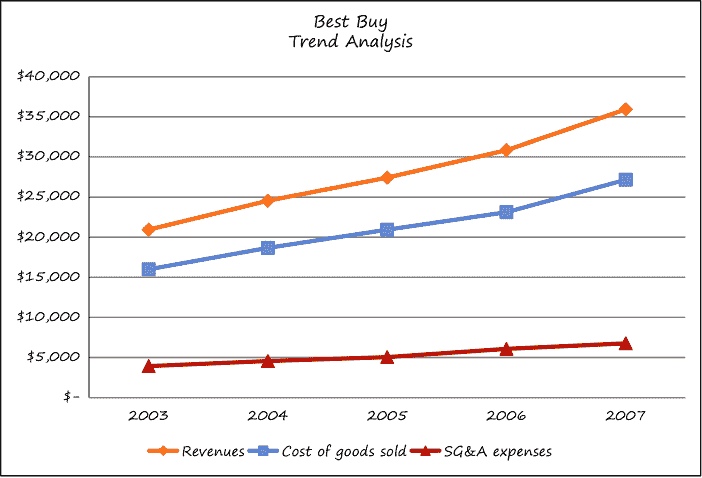

### Clover, Inc.
Comparative Balance Sheets
December 31,

Complete the common-size analysis for the other assets.

|  | 2009 | 2008 | Common-size Percents* 2009 | Common-size Percents* 2008 |
|---|---:|---:|---:|---:|
| **Assets** |  |  |  |  |
| **Current assets:** |  |  |  |  |
| Cash and equivalents | $12,000 | $23,500 | **3.8%** | 8.1% |
| Accounts receivable, net | 60,000 | 40,000 |  |  |
| Inventory | 80,000 | 100,000 |  |  |
| Prepaid expenses | 3,000 | 1,200 |  |  |
| **Total current assets** |  |  |  |  |
| **Property and equipment:** |  |  |  |  |
| Land | 40,000 | 40,000 |  |  |
| Buildings and equipment | 120,000 | 85,000 |  |  |
| **Total property and equipment** | $160,000 | $125,000 |  |  |
| **Total assets** | **$315,000** | **$289,700** | **100.0%** | **100.0%** |

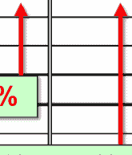

($12,000 ÷ $315,000) × 100% = 3.8%

($23,500 ÷ $289,700) × 100% = 8.1%

* Percent rounded to first decimal point.


### Clover, Inc.
比较资产负债表
12月31日

| | 2009 | 2008 | 共同比百分比* |  |
| | | | 2009 | 2008 |
| 资产 | | | | |
| 流动资产： | | | | |
| 现金及现金等价物 | $ 12,000 | $ 23,500 | 3.8% | 8.1% |
| 应收账款净额 | 60,000 | 40,000 | 19.0% | 13.8% |
| 存货 | 80,000 | 100,000 | 25.4% | 34.6% |
| 预付费用 | 3,000 | 1,200 | 1.0% | 0.4% |
| 流动资产合计 | $ 155,000 | $ 164,700 | 49.2% | 56.9% |
| 不动产和设备： | | | | |
| 土地 | 40,000 | 40,000 | 12.7% | 13.8% |
| 建筑物和设备净额 | 120,000 | 85,000 | 38.1% | 29.3% |
| 不动产和设备合计 | $ 160,000 | $ 125,000 | 50.8% | 43.1% |
| 资产总计 | $ 315,000 | $ 289,700 | 100.0% | 100.0% |
| * 百分比四舍五入至小数点后一位。 | | | | |

### Clover, Inc.
比较利润表
截至12月31日止年度

| | 2009 | 2008 | 共同比百分比* | |
| | | | 2009 | 2008 |
| 收入 | $520,000 | $480,000 | 100.0% | 100.0% |
| 成本和费用： | | | | |
| 销售成本 | 360,000 | 315,000 | 69.2% | 65.6% |
| 销售及管理费用 | 128,600 | 126,000 | 24.7% | 26.3% |
| 利息费用 | 6,400 | 7,000 | 1.2% | 1.5% |
| 税前利润 | $ 25,000 | $ 32,000 | 4.8% | 6.7% |
| 所得税（30%） | 7,500 | 9,600 | 1.4% | 2.0% |
| 净利润 | $ 17,500 | $ 22,400 | 3.4% | 4.7% |
| 每股收益 | $ 0.79 | $ 1.01 | | |
| 普通股平均股数 | 22,200 | 22,200 | | |
| * 四舍五入至小数点后一位。 | | | | |

### 盈余质量

投资者关注那些能够以逐年增长的速度赚取收益的公司。盈利增长的稳定性有助于投资者预测公司的未来前景。

财务分析师经常谈论同一行业中某公司的“盈余质量”高于另一家公司。


### 比率分析法

### 盈利能力 (Profitability)

### 短期偿债能力 (流动性, Liquidity)

### 长期偿债能力 (Leverage)

### 运营能力 (Efficiency)

### 财务比率与企业价值

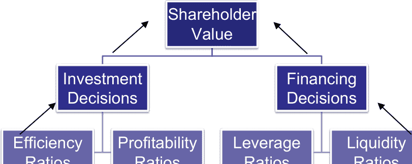

股东价值取决于良好的投资和融资决策。

财务比率有助于衡量这些决策的成功和稳健性。

## 盈利能力

## 盈利基础

## 市场基础


## 普通股股东权益回报率

（ROE）

## 盈利基础

## 利润表（多步式）

| Babson Builders, Inc. |  |
|---|---|
| 利润表 |  |
| 截至09年12月31日止年度 |  |
| 销售净额 | $785,250 |
| 销售成本 | 351,800 |
| **毛利润** | **$433,450** |
| 营业费用： |  |
| 销售费用 | $197,350 |
| 一般及管理费用 | 78,500 |
| 折旧费 | 17,500 |
| **营业费用合计** | **293,350** |
| **营业利润** | **$140,100** |
| 其他收入和利得： |  |
| 利息收入 | $62,187 |
| 利得 | 24,600 |
| **其他收入和利得合计** | **86,787** |
| 其他费用： |  |
| 利息费用 | $27,000 |
| 损失 | 9,000 |
| **其他费用合计** | **(36,000)** |
| **税前利润** | **$190,887** |
| 所得税 | 62,500 |
| **净利润** | **$128,387** |

恰当的标题

毛利润

营业费用

非营业项目

记得计算EPS。

## 利润表（单步式）

恰当的标题

收入与利得

费用与损失

记得计算EPS。

|  |  |  |
|---|---|---|
| Babson Builders, Inc. |  |  |
| 利润表 |  |  |
| 截至09年12月31日止年度 |  |  |
| 收入和利得： |  |  |
| 销售净额 | $ | 785,250 |
| 利息收入 |  | 62,187 |
| 出售厂场资产利得 |  | 24,600 |
| 收入和利得合计 | $ | 872,037 |
| 费用和损失： |  |  |
| 销售成本 | $ | 351,800 |
| 销售费用 |  | 197,350 |
| 一般及管理费用 |  | 78,500 |
| 折旧费 |  | 17,500 |
| 利息费用 |  | 27,000 |
| 所得税 |  | 62,500 |
| 损失：出售投资 |  | 9,000 |
| 费用和损失合计 |  | 743,650 |
| 营业利润 | $ | 128,387 |


## 使用以下信息计算 Babson Builders, Inc. 2009 年的盈利能力比率

| Babson Builders, Inc. 2009 | |
|---|---|
| 每股期末市场价格 | $15.25 |
| 2009 年全年流通普通股数量 | 27,400 |
| 净利润 | $53,690 |
| 股东权益总额 | |
| 年初 | 180,000 |
| 年末 | 234,390 |
| 收入 | 494,000 |
| 销售成本 | 140,000 |
| 总资产 | |
| 年初 | 300,000 |
| 年末 | 346,390 |

## 利润率

\[
\text{Profit margin} = \frac{\text{Net income}}{\text{Net sales}}
\]

该比率描述了公司从每美元销售额中赚取利润的能力。

## 资产回报率 (ROA)

该比率通常被认为是对公司盈利能力的最佳总体衡量。


```
ROA = Net income ÷ Average total assets
    = $53,690 ÷ [($300,000 + $346,390) ÷ 2]
    = 16.61%
```

## 股东权益回报率 (ROE)


该指标显示公司利用所有者投资赚取收入的能力。

```
ROE = Net income ÷ Average total equity
    = $53,690 ÷ [($180,000 + $234,390) ÷ 2]
    = 25.91%
```

## 每股收益

\[
\text{EPS} = \frac{\text{Net income}}{\text{Average shares of capital stock outstanding}}
\]

回顾 Babson 的信息，获取我们计算每股收益所需的数值。

\[
\frac{\$53,690}{27,400} = \$1.96
\]


## 基于市场的衡量指标

### 市盈率


\[
\frac{\text{Current market price of one share of stock}}{\text{Earnings per share}} = \text{P/E}
\]

\[
\frac{\$15.25}{\$1.96} = 7.78
\]

该指标向我们展示了公司收益与其股票市场价格之间的关系。


### 股息收益率

\[
\text{Dividend Yield Ratio} = \frac{\text{Dividends per share}}{\text{Market price per share}}
\]

Babson Builders 每年支付每股资本股 $1.50 的股息。公司资本股的市场价格在 2009 年末为 $15.25。

该比率确定了相对于股票当前市场价格的现金股息回报。


## 市场增加值

**它是什么？**

**为什么有用？**

**定义：**

```
Market Value Added = [Share Price × Shares Outstanding] - Equity Book Value
```

## MVA：讨论

Market Value Added = [Share Price × Shares Outstanding] - Equity Book Value

**表 4.3**

| 公司 | 市场增加值 | 市净率 |
|---|---|---|
| ExxonMobil | 148,502 | 1.81 |
| Walmart | 121,364 | 1.94 |
| Google | 110,566 | 7.71 |
| Coca-Cola | 93,745 | 3.63 |
| Johnson & Johnson | 83,997 | 2.14 |
| AT&T | 27,080 | 1.11 |
| Home Depot | 26,941 | 1.78 |
| Lowe's | 9,702 | 1.37 |
| FedEx | 9,231 | 1.51 |
| Dow Chemical | 3,382 | 1.06 |
| JCPenney | -4,653 | 0.62 |
| Xerox | -9,128 | 0.57 |

### 考虑 AT&T 和 Home Depot

相似的 MVA，不同的市净率。为什么？

## 经济增加值

**它是什么？**

**为什么重要？**

**为什么被称为 *剩余收益*？**

**定义：**

```
Economic Value Added = Operating Income* - [Cost of Capital × Total Capitalization]
```

## EVA：讨论

Economic Value Added = Operating Income - [Cost of Capital × Total Capitalization]

**表 4.4**

| 公司 | 经营收入* | 资本成本，% | 总资本化 | EVA = 1 - (2 × 3) | ROC，% = 1 ÷ 3 |
|---|---|---|---|---|---|
| ExxonMobil | 28,641 | 5.8 | 182,424 | 17,586 | 15.7 |
| Walmart | 15,396 | 5.2 | 129,374 | 8,639 | 11.9 |
| Johnson & Johnson | 11,952 | 7.1 | 73,778 | 6,638 | 16.2 |
| Coca-Cola | 7,093 | 5.5 | 35,643 | 4,943 | 19.9 |
| Google | 6,577 | 12.0 | 16,483 | 4,788 | 39.9 |
| FedEx | 952 | 6.4 | 17,954 | -241 | 5.3 |
| JCPenney | 465 | 6.5 | 12,234 | -330 | 3.8 |
| Dow Chemical | 2,638 | 5.7 | 56,129 | -526 | 4.7 |
| Xerox | 712 | 9.6 | 21,326 | -1,091 | 3.3 |
| AT&T | 16,779 | 8.2 | 250,440 | -3,760 | 6.7 |

### 考虑 Coca-Cola 和 Google

相似的 EVA，不同的资本回报率。为什么？


## 流动性

- 营运资本
- 流动比率
- 速动比率
- 酸性测试比率


### 使用这些信息计算 Babson Builders 的流动性比率。

| Babson Builders, Inc. 2009 | |
|---|---:|
| 现金 | $30,000 |
| 应收账款，净额 | |
| 年初 | 17,000 |
| 年末 | 20,000 |
| 存货 | |
| 年初 | 10,000 |
| 年末 | 15,000 |
| 流动资产总额 | 65,000 |
| 流动负债总额 | 42,000 |
| 负债总额 | 103,917 |
| 资产总额 | |
| 年初 | 300,000 |
| 年末 | 346,390 |
| 收入 | 494,000 |

### 营运资本

营运资本是流动资产超过流动负债的部分。

| | 12/31/09 |
|---|---:|
| 流动资产 | $65,000 |
| 流动负债 | (42,000) |
| 营运资本 | $23,000 |


### 流动比率

该比率衡量公司偿还短期债务的能力。

Current Ratio = Current Assets / Current Liabilities

Current Ratio = $65,000 / $42,000 = 1.55 : 1


### 速动比率或酸性测试比率

**速动比率** = **速动资产** / **流动负债**

**速动资产**为现金、可市场证券和应收款项。

该比率类似于流动比率，但排除了存货等可能难以快速转换为现金的流动资产。


### 速动比率

**速动比率** = **速动资产** / **流动负债**

**速动比率** = $50,000 / $42,000 = **1.19 : 1**


### 衡量流动性

NWC to Total Assets Ratio = Net Working Capital / Total Assets

该比率如何衡量流动性？

Current Ratio = Current Assets / Current Liabilities

该比率如何衡量流动性？

### 流动性比率

Quick ratio = (Cash + Marketable Securities + Receivables) / Current Liabilities

该比率与流动比率有何不同？为什么财务经理可能会更喜欢它？

Cash Ratio = (Cash + Marketable Securities) / Current Liabilities

该比率与流动比率有何不同？为什么财务经理可能会更喜欢它？

## 偿债能力

- 债务比率
- 权益比率


- 抵押资产与有担保负债
- 利息保障倍数

### 债务和权益比率

| | 金额 | 比率 |
|---|---:|---:|
| 负债总额 | $8,000,000 | 66.7% [Debt ratio] |
| 权益总额 | $4,000,000 | 33.3% [Equity ratio] |
| 负债和权益总额 | $12,000,000 | 100.0% |

$8,000,000 ÷ $12,000,000 = 66.7%

债务比率将负债总额表示为资产总额的百分比。权益比率通过将权益总额表示为资产总额的百分比提供补充信息。

### 债务权益比率

Debt-to-equity ratio = Total liabilities / Total equity

该比率衡量公司资产中有多大比例由债权人提供。较高的债务权益比率意味着通过债务融资扩张的机会更少。


### 利息保障倍数

Times interest earned = Income before interest and taxes / Interest expense

Net income  
+ Interest expense  
+ Income taxes  
= Income before interest and taxes


这是衡量公司经营为长期债权人提供保护能力的常用指标。

## 效率

- 总资产周转率
- 应收账款周转率
- 存货周转率


### 总资产周转率

Total asset turnover = Net sales / Average total assets

Average assets = (Beginning assets + Ending assets) / 2

该比率反映公司利用资产产生销售的能力，是衡量经营效率的重要指标。


## 应收账款周转率

**应收账款周转率** = \(\frac{\text{销售收入}}{\text{平均应收账款}}\)

**应收账款周转率** = \(\frac{\$500,000}{(\$17,000 + \$20,000) \div 2}\) =

> 该比率衡量企业每年将应收账款转换为现金的次数。


## 应收账款周转天数

应收账款周转天数 = 应收账款净额 / 销售收入 × 365

该指标有助于了解企业收回应收账款的频率。


## 存货周转率

存货周转率 = 销售成本 / 平均存货

存货周转率 = $140,000 / ($10,000 + $12,000) ÷ 2 = 12.73 次

该比率衡量企业在一个年度内存货被销售和替换的次数。


## 存货周转天数

| 存货周转天数 = | 期末存货 | × 365 |
| | 销售成本 | |

该比率是评估存货流动性的有用指标。如果某种产品有客户需求，该公式可估算销售该存货所需的时间。


## 营业周期

现金

存货

应收账款

1. 购买商品

2. 赊销商品

3. 收回应收账款

## 常用财务比率

## 表3-8　常用的财务比率

+ 1. **短期偿债能力（或流动性）比率**
   - 流动比率=流动资产/流动负债
   - 速动比率=（流动资产－存货）/流动负债
   - 现金比率=现金/流动负债
   - 净营运资本对资产总额的比率=净营运资本/资产总额
   - 间隔时间指标=流动资产/日均经营成本

+ 2. **长期偿债能力（或财务杠杆）比率**
   - 总负债率=（资产总额－权益总额）/资产总额
   - 债务权益率=债务总额/权益总额
   - 权益乘数=资产总额/权益总额
   - 长期负债率=长期负债/（长期负债+权益总额）
   - 利息保障倍数=EBIT/利息
   - 现金涵盖率=（EBIT+折旧）/利息

+ 3. **资产利用（或周转）比率**
   - 存货周转率=销售成本/存货
   - 存货周转天数=365/存货周转率
   - 应收账款周转率=销售收入/应收账款
   - 应收账款周转天数=365/应收账款周转率
   - 净营运资本周转率=销售收入/净营运资本
   - 固定资产周转率=销售收入/固定资产净值
   - 总资产周转率=销售收入/资产总额

+ 4. **获利能力比率**
   - 利润率=净利润/销售收入
   - 资产报酬率（ROA）=净利润/资产总额
   - 权益报酬率（ROE）=净利润/权益总额

权益报酬率 = 净利润/销售收入 × 销售收入/资产 × 资产/权益

+ 5. **市场价值比率**
   - 市价-盈余比率=每股价格/每股盈余
   - 市盈率与增长比率=市价盈余比率/盈余增长比率
   - 价销比=每股价格/每股销售额
   - 市价-账面价值比率=每股市价/每股账面价值
   - 托宾Q=资产的市场价值/资产重置成本

## 财务比率的使用与局限

## 用途

## 局限

比率有助于用户理解财务关系。

比率可以快速比较不同公司。

管理层可能仅仅为了改善比率而进行交易。

比率无助于分析公司在非财务目标方面的进展。

## 报表分析可能存在的问题

- 由于缺乏理论的支持，很难找出相关性最强的财务比率来
- 对多元化经营的公司来说，很难找到比较的标准
- 全球化经营和竞争使得可比性更难以得到保证，因为不同国家的会计规范本身就存在着差异
- 会计政策的变化，如存货计价时，可以选用先进先出法（FIFO）或者后进先出法（LIFO）
- 各个公司之间的财务年度起止日可能不同
- 特别突发事件的影响

## 行业平均比率

| 表4.7 | 长期债务/资产 | 利息保障倍数 | 流动比率 | 速动比率 | 资产周转率 | 利润率（%） | 资产报酬率（%） | 权益报酬率（%） | 股利支付率 |
|---|---:|---:|---:|---:|---:|---:|---:|---:|---:|
| 所有制造业 | 0.22 | 2.58 | 1.43 | 1.03 | 0.77 | 5.19 | 4.02 | 12.94 | 0.43 |
| 食品 | 0.28 | 3.74 | 1.40 | 0.84 | 1.19 | 7.99 | 9.52 | 18.09 | 0.47 |
| 服装 | 0.21 | 9.60 | 1.39 | 0.54 | 2.01 | 6.99 | 14.04 | 22.48 | 0.09 |
| 饮料与烟草 | 0.27 | 3.95 | 1.15 | 0.52 | 2.82 | 3.20 | 9.04 | -4.43 | -0.54 |
| 化学品 | 0.26 | 2.62 | 1.36 | 1.04 | 0.48 | 9.04 | 4.34 | 22.12 | 0.36 |
| 药品 | 0.24 | 3.19 | 1.56 | 1.28 | 0.38 | 11.00 | 4.20 | 26.08 | 0.29 |
| 机械 | 0.18 | 2.83 | 1.32 | 0.90 | 0.70 | 6.15 | 4.33 | 8.55 | 0.66 |
| 电气 | 0.12 | 4.30 | 1.10 | 0.72 | 0.59 | 8.02 | 4.75 | 9.55 | 0.54 |
| 汽车 | 0.20 | -0.24 | 0.99 | 0.77 | 0.98 | -0.42 | -0.41 | -25.25 | -0.24 |
| 计算机与电子 | 0.16 | 3.26 | 1.94 | 1.64 | 0.59 | 4.92 | 2.91 | 16.29 | 0.08 |
| 造纸 | 0.32 | 2.68 | 1.27 | 0.90 | 0.89 | 7.96 | 7.09 | 13.38 | 0.47 |

*资料来源：* 作者根据美国商务部 *《制造业、采矿业和贸易公司季度财务报告》*（2010年3月）的数据计算。可在 http://www.census.gov/con/qfr/current/qfr_pub.pdf 获取。


## 财务比率与违约风险

**表 4.9 三年（2002–2004）中位数**

|  | AAA | AA | A | BBB | BB | B | CCC |
|---|---:|---:|---:|---:|---:|---:|---:|
| A. EBIT 利息覆盖倍数 | 23.8 | 19.5 | 8.0 | 4.7 | 2.5 | 1.2 | 0.4 |
| EBITDA 利息覆盖倍数 | 25.5 | 24.6 | 10.2 | 6.5 | 3.5 | 1.9 | 0.9 |
| 经营资金/总债务（%） | 203.3 | 79.9 | 48.0 | 35.9 | 22.4 | 11.5 | 5.0 |
| 自由经营现金流/总债务（%） | 127.6 | 44.5 | 25.0 | 17.3 | 8.3 | 2.8 | (2.1) |
| 总债务/EBITDA 倍数 | 0.4 | 0.9 | 1.6 | 2.2 | 3.5 | 5.3 | 7.9 |
| 资本回报率（%） | 27.6 | 27.0 | 17.5 | 13.4 | 11.3 | 8.7 | 3.2 |
| 总债务/(总债务 + 权益)（%） | 12.4 | 28.3 | 37.5 | 42.5 | 53.7 | 75.9 | 113.5 |
| B. 历史 5 年违约率（%） | 0.2 | 0.6 | 0.6 | 2.3 | 5.9 | 12.9 | 28.0 |

*注：* EBITDA 是息税折旧摊销前利润。Standard & Poor's 和 Moody's，这两家最大的信用评级机构，对评级类别使用略有不同的标签。例如，S&P 的 BBB 评级相当于穆迪的 Baa，BB 相当于 Ba，以此类推。

*来源：* 面板 A—*Corporate Rating Criteria*，Standard & Poor's，2006。经 Standard & Poor's 许可转载，Standard & Poor's 为 The McGraw-Hill Companies, Inc. 的一个部门。面板 B—Edward Altman，“The Importance and Subtlety of Credit Rating Migration”，*Journal of Banking and Finance* 22 (1998)，第 1231–1247 页。

## 以净资产收益率为核心的财务分析

## 净资产收益率分解图（DuPont 图）

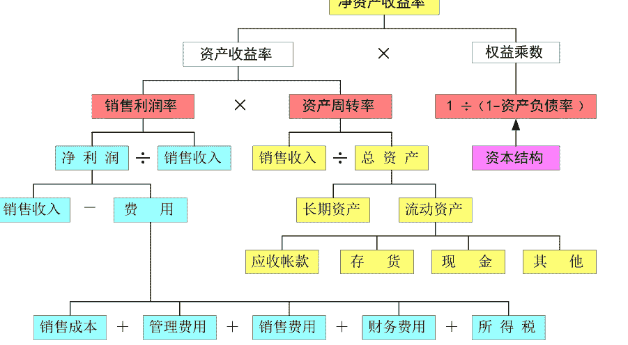

## 按行业分解的 ROA

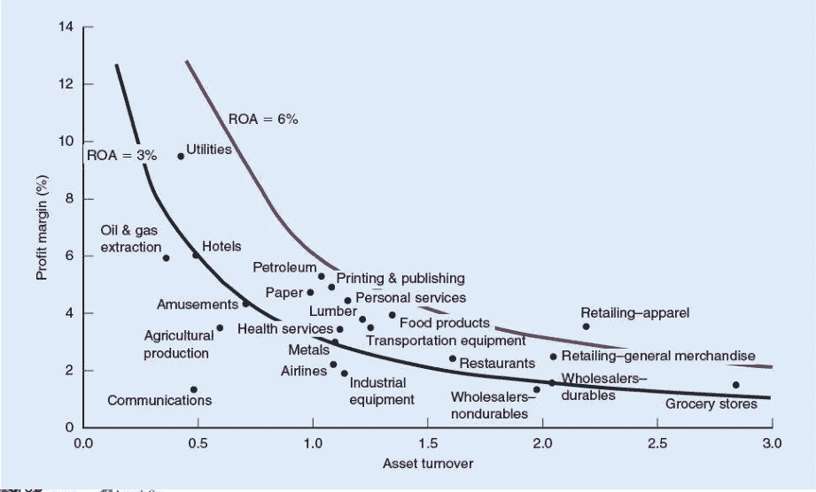

图表坐标轴：纵轴为 Profit margin (%)，范围 0–14；横轴为 Asset turnover，范围 0.0–3.0。

图中行业标签：Oil & gas extraction；Utilities；Hotels；Amusements；Petroleum；Paper；Printing & publishing；Personal services；Lumber；Agricultural production；Health services；Food products；Metals；Airlines；Industrial equipment；Transportation equipment；Restaurants；Communications；Wholesalers—nondurables；Wholesalers—durables；Retailing—apparel；Retailing—general merchandise；Grocery stores。

## 模块三：流动资产

## 主要内容

- I. 现金与银行存款
- II. 应收账款、坏账
- III. 应收票据
- IV. 存货

## 现金与银行存款

### 现金与流动性

- 黄金（黄金投资产品据统计，2007-2011年黄金的年化收益率为18.3%）
- 一般等价物
- 货币
- 现金
- 流动性

## 谁是现金


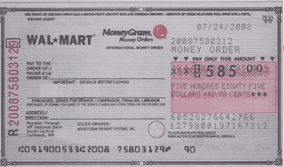

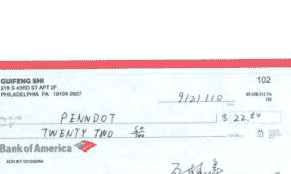

## 如果现金为王，苹果就是皇帝

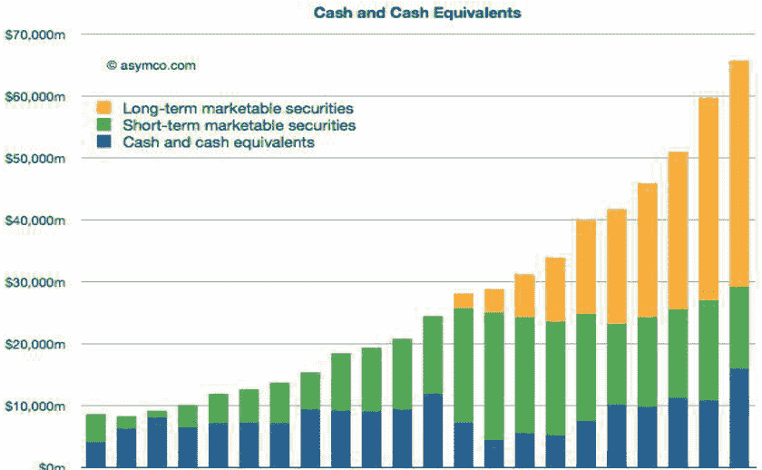

| 排名 | 公司 | 现金和短期投资总额（亿美元） | 营收（亿美元） | 盈利（亿美元） | 市值（亿美元） |
|---|---|---|---|---|---|
| 1 | 微软 | 620.4 | 737.2 | 169.8 | 2583.8 |
| 2 | 思科 | 487.2 | 460.6 | 80.4 | 1022.1 |
| 3 | 谷歌 | 417.2 | 431.6 | 111.1 | 2240.5 |
| 4 | 甲骨文 | 306.8 | 371.2 | 99.8 | 1545.3 |
| 5 | 苹果 | 276.5 | 1488.1 | 401.3 | 6236.0 |
| 6 | 辉瑞 | 243.4 | 648.6 | 102.2 | 1782.2 |
| 7 | 安进 | 224.8 | 163.9 | 38.4 | 646.8 |
| 8 | 雪佛龙石油 | 214.6 | 2305.6 | 266.3 | 2200.7 |
| 9 | 维朋 | 203.1 | 615.4 | 25.2 | 194.7 |
| 10 | 埃克森美孚 | 178.0 | 4348.2 | 451.0 | 4029.7 |

## 另一位国王：

根据 2011 年的一项调查，它是

### CMCC

(China Mobile Communications Corporation)

其现金达到 528 亿美元（332,946 百万 ¥，1$=6.3 ¥）。

西藏 2011 年 GDP 为 565 亿美元。

塞尔维亚共和国（塞尔维亚）2011 年 GDP 为 450.6 亿美元。

## 现金的战略价值

小组讨论：

为什么一些高盈利的高科技企业，比如Microsoft，Cisco，Intel账上持有大量的现金？这些企业的负债往往很少，很少支付股利，而喜欢股票回购？

## 现金管理

现金管理的目标有两个：

- 1. 规划现金收入以在到期时满足现金支付。
- 2. 保持运营所需的最低现金水平。

有效的现金管理涉及应用以下现金管理原则：

- 鼓励应收账款的回收。
- 推迟负债的支付。
- 仅保留必要的资产水平。
- 规划支出。
- 投资多余现金。


## 现金内部控制

- **Segregate authorization, custody and recording of cash.** 现金的签发、保管、记录要职权分开、互相牵制
- **Prepare a cash budget.** 编制现金预算
- **Prepare a control listing of cash receipts.** 编制现金收据的控制清单
- **Require daily deposits.** 要求现金收入当天存入银行
- **Make all payments by check.** 用支票进行现金支付
- **Verify every expenditure before payment.**
- **Promptly reconcile bank statements.** 即时核对银行对账单


| 项目名称 | 2002 | 2003 | 2004 | 2005 | 2006 |
|---|---:|---:|---:|---:|---:|
| 存货（百万美元） | 22 614 | 24 401 | 26 612 | 29 762 | 32 191 |
| 应收账款（百万美元） | 2 000 | 1 569 | 1 254 | 1 715 | 2 662 |
| 应付账款（百万美元） | 16 360 | 17 908 | 22 692 | 25 799 | 29 127 |
| 存货周转天数 | 40 | 39 | 42 | 38 | 38 |
| 应收账款周转天数 | 4 | 2 | 2 | 2 | 3 |
| 应付账款周转天数 | 29 | 28 | 32 | 33 | 34 |
| 现金转化周期 | 15 | 13 | 12 | 7 | 7 |

> 注：应付账款含应付给供应商的商业票据。

| 项目名称 | 国美电器 2004 | 国美电器 2005 | 苏宁电器 2004 | 苏宁电器 2005 |
|---|---:|---:|---:|---:|
| 存货（百万元） | 1 109 | 2 725 | 769 | 2 017 |
| 应收账款（百万元） | 128 | 236 | 64 | 206 |
| 应付账款（百万元） | 3 193 | 6 805 | 912 | 2 767 |
| 存货周转天数 | 42 | 55 | 31 | 46 |
| 应收账款周转天数 | 5 | 5 | 3 | 5 |
| 减：应付账款周转天数 | 120 | 138 | 37 | 63 |
| 现金转化周期 | -73 | -78 | -3 | -12 |

> 注：应收账款也包括预付给供应商的账款，应付账款也包括应付给供应商的票据。

|  | company | 2004 | 2005 | 2006 | 2007 | 2008 | 2009 | 2010 | 2011 |
|---|---|---:|---:|---:|---:|---:|---:|---:|---:|
| cash/total asset | Suning | 25.86% | 16.25% | 37.73% | 45.00% | 48.91% | 61.28% | 44.07% | 38.04% |
|  | Gome | 32.44% | 11.52% | 6.86% | 21.01% | 11.14% | 14.94% | 13.27% | 6.88% |

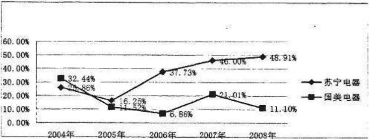

图4-6 货币资金与总资产占比分析图

## 银行存款

- 银行结算方式：
  - 银行汇票
  - 银行本票
  - 商业汇票
    - 商业承兑汇票
    - 银行承兑汇票
  - 支票
  - 信用卡
  - 汇兑
  - 委托收款
  - 托收承付
  - 信用证

## 银行，今天你存了么？

- 国家开发银行（CDB）
- 中国农业银行（ABC）
- 北京市商业银行（BCCB）
- 中国银行（BC）
- 花旗银行（CB）
- 汇丰银行（HSBC）
- 建设银行（CCB）
- 江苏银行（JSBC）
- 中国工商银行（ICBC）

## 银行对账单

银行对账单

Shows the beginning bank balance, deposits made, checks paid, other debits and credits in the month, and the ending bank balance.
列示了月初的存款余额，当月存款，已支付的支票额，其它的加项和减项以及月末余额。

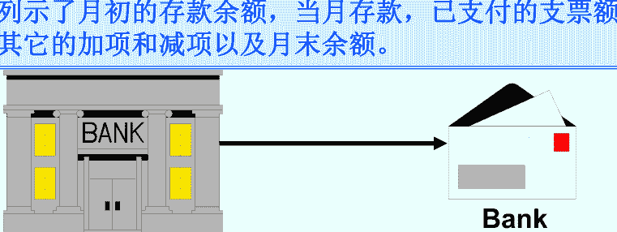

## 银行存款余额调节表

银行存款余额调节表

解释银行对账单和储户会计记录差异产生的原因。

Provides information for reconciling journal entries.
编制未达账项的会计分录

## 案例

- 简. 金伯森是布朗 摩尔经纪公司在哥伦比亚的密苏里办事处的出纳。当阑尾炎使她不得休假时，她的上司，业务主任布鲁斯 里奇发现了她的问题，即有顾客抱怨没有收到他们存款的信用卡。就此，里奇发现了金伯森一个经过精心策划长5年的贪污公款行为。

法庭发现金伯森在这一“拆东墙，补西墙”的诡计中共盗窃现金$610,934。她不断地把顾客的存款转入她个人账户，并通过把其他客户的钱转过来以隐埋自己的贪污行为。用这种方法，只要金伯森出面回答顾客的质询，她就可以把该顾客的账户转平。对此，她简单地解释为账户暂时的不平衡。但是当她生病住院时，她的继任不能解释这种顾客账户的异常现象。最后所有的调查证据都证明了金伯森的罪行，她被宣判入狱。而里奇也明白了金伯森从未休假的原因。

## 案例 - 邯郸农行

河北邯郸农行特大盗窃案。金库5100万元被盗。疑犯马向景、任晓峰先后盗窃了4300万元，全部用来买了彩票。

中行开平案例


## 应收款项

## 应收款项

- 应收账款、应收票据、其他应收款
  - 我们的权利
  - 敞口风险
  - 落袋为安

## 应收账款

- 应收账款是企业因销售产品、商品、提供劳务等应向购买单位收取但尚未收到的各种款项，并不表现为当期的库存现金流入
- 应收账款的特点：
  - 因赊销商品（或劳务）而产生的
  - 是非书面的、无担保的信用活动，不计息，我国一般不转让，国外可以转让
  - 期限较短

## 应收账款

- 1. 应收账款的确认
- 根据收入的实现原则，在交易成立时确认
- 确认时：
- 借：应收账款
- 贷：销售（或营业收入、或主营业务收入）
- 收款时：
- 借：现金
- 贷：应收账款

## 应收账款

- **2.应收账款的计量（计价）**
- 按实际发生额计价入账，包括发票金额和垫付的运费
- **(1)关于商业折扣问题**：商业折扣是按价目表给予的折扣，成交价与其有区别。双方均不在账上反映，即对应收账款没有实质性的影响；
- **(2)关于现金折扣问题**：
- 是为了鼓励客户早日付款而给予的优惠条件。
- 通常以 **2/10，1/20，n/30** 表示。优惠条件/天数
- **问题：**在销售企业确认应收账款时，应该以折扣以后的价值还是没有折扣的价值反映？

## 假设销货1000元，付款条件为2/10,N/30，不考虑增值税

- 总价法：
- 销售时：
- 借：应收账款 1000
- 贷：营业收入 1000
- 若在10天之内收回款项：
- 借：现金 980
- 财务费用 20
- 贷：应收账款 1000
- 若在10天以后收回款项：
- 借：现金 1000
- 贷：应收账款 1000

净价法
- 销售时：
- 借：应收账款 980
- 贷：营业收入 980
- 若在10天之内收回款项：
- 借：现金 980
- 贷：应收账款 980
- 若在10天以后收回款项：
- 借：现金 1000
- 贷：应收账款 980
  财务费用 20


## 应收账款

- 信用卡销售的相关问题
- 应收账款——坏账？
- 防患于未然——时刻准备着——坏账准备

## 防范风险 落袋为安

- 注意：收入或者利润的含金量（纸上富贵还是真金白银）
  - 应收账款占主营业务收入的比例
  - 利润和经营活动现金流量的比例
  - 一年以上的应收账款的比例

## 坏账损失

- （一）相关概念：
- 坏账：企业的各项应收款项，可能会因购货人拒付（已超过两年）、破产、死亡等原因而无法收回。这类无法收回的应收款项就是坏账。
- 坏账损失：因坏账而遭受的损失为坏账损失。


## 坏账损失

- （二）坏账损失的确认条件：
- 对有确凿证据表明确实无法收回的应收款项，如债务单位已撤消、破产、资不抵债、库存现金流量严重不足等，根据企业的管理权限，经股东大会或董事会，或经理（厂长）办公会或类似机构批准作为坏账损失，冲销提取的坏账准备
- 坏账损失与坏账准备之间的联系和区别？

## 坏账准备

- (三) 坏账损失的核算方法：
- 1. 直接转销法

坏账损失发生时确认，增加“资产减值损失（坏账费用）”，冲减“应收账款”

- 2. 备抵法

坏账损失发生之前预计损失，形成准备(增加“资产减值损失（坏账费用）”,增加“坏账准备”)

发生时冲减准备，同时冲减应收账款(减少“坏账准备”,减少“应收账款”)

当以前年度已经确认为损失的坏账又收回，恢复应收账款和坏账准备（增加“应收账款”,增加“坏账准备”）

注意：我国企业会计制度规定，企业应采用备抵法进行坏账的核算

## 坏账准备

公司基于对各种因素的评估计提坏账准备。公司考虑历史经验、应收账款余额的账龄、客户的信用质量、当前的经济状况，以及其他可能影响客户付款能力的因素。

## 坏账准备

- 三种计算方法
  - 销货百分比法（当年销货赊销金额×计提比例）
  - 应收账款余额百分比法（应收款项期末余额×计提比例）
  - 应收账款的账龄分析法（根据应收款项账龄的长短来估计）

## 销货百分比法

### ①销货百分比法

以赊销金额的一定百分比作为估计的坏账损失

- 采用这一方法的理由：
- 坏账仅和当期因赊销而发生的应收款项有关，与当期的现款销售无关，当期赊销业务越多，产生坏账的损失就越大
- 根据过去的经验和有关资料，估计坏账损失与赊销金额之间的比率，也可用其他更合理的方法进行估计

## 销货百分比法

- 例：根据过去5年的资料，赊销金额中估计坏账的百分比为2%，若本期实际赊销金额为200 000万元，则：
- 本期估计的坏账损失=200 000×2%=4 000
- 注意：在销货百分比法下，一般不需要调整坏账准备余额，如果坏账准备出现异常现象，应及时调整估计坏账的比例

## 应收账款余额百分比法

- ②应收账款余额百分比法
- 按应收款项期末余额的一定比例计算提取坏账准备
- 理论上讲，这一比例应按坏账占应收款项的概率计算，发生坏账多的企业，比例就相应高一些，反之则低一些

## 应收账款余额百分比法

- 计提公式（分两步）：
- 坏账准备期末应有数
- =应收款项期末余额×计提比例
- 本期提取数
- =坏账准备期末应有数-坏账准备贷方余额
- 或=坏账准备期末应有数+坏账准备借方余额
- 注意：此方法下，各年末，企业“坏账准备”的余额始终与应收款项年末余额成百分比关系

## 应收账款余额百分比法

- 例：某公司某期应收账款的期末余额为 **100,000** 元，坏账准备的计提比例为 **2%**，坏账准备的贷方期末余额是 **500** 元
- 坏账准备期末应有数 = 100,000 × 2% = 2,000
- 本期提取数 = 2,000 - 500 = 1,500
- 借：资产减值损失（坏账费用）　1,500
- 贷：坏账准备　　　　　　　1,500

例：某公司从2011年开始使用备抵法预计坏账损失，2011年~2013年应收账款的年末余额均为1000万元，坏账准备的计提比例为5%，2012年发生坏账3万元；2013年发生坏账1万元，另外2012年核销的坏账中有2万元又收回。

2011年：应计提的坏账准备为：
1000×5%=5
①借：资产减值损失（坏账费用） 5
贷：坏账准备 5

2012年：发生坏账时：
②借：坏账准备 3
贷：应收账款 3
年末应补提的坏账准备为：
1000×5%−2=3
③借：资产减值损失 3
贷：坏账准备 3

2013年：发生坏账时：
④借：坏账准备 1
贷：应收账款 1
以前年度核销的坏账又收回时：
⑤借：应收账款 2
贷：坏账准备 2
同时⑥借：银行存款 2
贷：应收账款 2

年末应补提的坏账准备为：
1000×5%−6=−1（万元）
即应冲销多提准备金1万元：
⑦借：坏账准备 1
贷：资产减值损失（坏账费用） 1

## 账龄分析法

- ③账龄分析法
- 根据应收款项账龄的长短来估计坏账的方法。
- 账龄指的是顾客所欠账款的时间。
- 理由：账款被拖欠的期限越长，发生坏账的可能性就越大
- 利用账龄分析表所提供的信息，确定坏账准备金额
- 方法：按各类账龄分别估计其可能成为坏账的部分

## 坏账损失估计计算表 2012.12.31

| 账龄 | 应收账款金额 | 估计损失比例 | 估计损失金额 |
|---|---|---|---|
| 未到期 | 25 000 | 1% | 250 |
| 过期1个月 | 20 000 | 3% | 600 |
| 过期2个月 | 15 000 | 5% | 750 |
| 过期3个月 | 10 000 | 7% | 700 |
| 过期4个月 | 8 000 | 20% | 1 600 |
| 过期5个月 | 5 000 | 50% | 2 500 |
| 破产或追诉中 | 2 000 | 80% | 1 600 |
| 合 计 | 85 000 |  | 8 000 |

## 例题

- 承上图表，若该公司2011.12.31提取坏账准备前，
“坏账准备”账户余额为3 000元，则：
- 应提取坏账准备金额
- =8 000-3 000=5 000（元）
- 借：资产减值损失（坏账费用） 5 000
- 贷：坏账准备 5 000

## 坏账准备

- 在采用账龄分析法时，各期估计的坏账损失应同账面上原有的坏账准备进行比较，并调整“坏账准备”科目余额，使之与估计坏账损失数额一致（即应有数和计提数的关系）
- 账龄分析法比较直接地表明了应收款项的估计可变现数额

## 三种方法总结

| 销货百分比法 | 应收账款余额百分比法 | 账龄分析法 |
|---|---|---|
| **强调配比** | **强调可实现价值** | **强调可实现价值** |
| 赊销额 → 坏账费用 | 应收账款 → 坏账准备 | 应收账款 → 坏账准备 |


## 小组讨论题

赊销百分比法与应收账款余额法的差异在哪里？
选择不同的方法，对于公司的财务影响是什么？

## 案例讨论：神州股份(0968)坏账准备

山西神州煤电焦化股份有限公司2001年年度报告披露：由于关闭小煤窑等因素影响，煤焦供不应求，公司应收账款首次呈下降趋势，公司2001年收回以前年度货款4614万元，应收账款期末比期初下降8.29%，为了更好地反映公司应收账款实际情况，公司第一届董事会第20次会议（2002年3月19日召开，年报公布时间是2002年3月22日）决定变更坏账准备政策。相关资料如下表所示。


## 神州股份2001年变更前后的坏账准备计提比例

| 账龄 | 变更前计提比例(%) | 变更后计提比例(%) |
|---|---|---|
| 1年以内 | 5 | 2 |
| 1-2年 | 10 | 5 |
| 2-3年 | 30 | 10 |
| 3-5年 | 50 | 20 |
| 5年以上 | 100 | 30 |

## 问题

- 公司变更坏账准备是否可能存在经济动机？
- 为证实之，你需要从哪几个角度进行分析？

案例分析:三一重工的会计估计变更

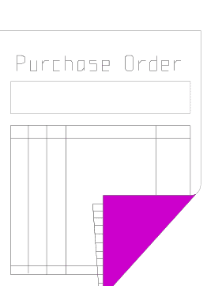

## 应收票据(Notes Receivable)

$1,000.00

2009年7月10日

自出票日后九十天，我承诺支付给加州洛杉矶的 TechCom 公司

一千美元整

在加州洛杉矶第一国民银行兑付

对价已收讫，按年利率12%计息

编号42 到期日：2009年10月8日 Julia Browne

期限

本金

收款人

利率

出票人

到期日

## 利息计算


即使到期时间不足一年，利率也按年化计算。

如果票据以天数表示，则一年按360天计算。

## 计算到期日和利息

| 票据本金 | × | 年利率 | × | 以年表示的时间 | = | 利息 |
|---|---|---|---|---|---|---|
| $1,000 | × | 12% | × | 90/360 | = | $30 |

> 总利息于2009年10月8日到期支付。

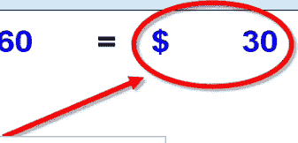

## 确认应收票据

以下是2009年7月10日记录该票据的分录。

|  | 借 | 贷 |
|---|---|---|
| 7月10日 应收票据 | 1,000 | |
| 销售（或营业收入） |  | 1,000 |
| 销售商品以换取票据 |  |  |

## 应收票据到期

以下是2009年10月8日兑付该票据的分录。

| 日期 | 科目 | 借 | 贷 |
|---|---|---:|---:|
| 10月8日 | 现金 | 1,030 | |
|  | 利息收入（或财务费用） |  | 30 |
|  | 应收票据 |  | 1,000 |

*已收回到期票据及利息*

## 票据的特殊问题

- 银行汇票与商业汇票
- 票据贴现与贷款
- 票据融资
- 票据转让
- 案例分析:柳工

## 本部分主要概念

- I. 决定存货成本的因素（初始确认）
- II. 如何确认销售成本（使用中的后续计量）：
  1. 个别认定法（个别法）
  2. 先进先出法（FIFO）
  3. 后进先出法（LIFO）
  4. 加权平均法（Weighted Average）
- III. 如何确认期末存货价值（期末存货计价）

## 2012年中报

- 经济增速下滑，除给上市公司2012年上半年业绩带来影响外，上市公司整体存货也逐步攀升。剔除不可比数据后，1269家上市公司中期期末存货金额合计1.92万亿元，与2012年年初的存货金额1.79万亿相比增长7.5%，与2011年同期相比增长22.62%。

## 原材料与产成品库存

|  | 2012年上半年 | 比上年同期增长（%） |
|---|---|---|
| 原材料 | 1609.59亿元 | 7.9% |
| 产成品 | 223.23亿元 | 42.74% |

- 原材料库存是领先性指标，反映生产厂商扩大生产的意愿；
- 产成品库存是滞后性指标，是经济回落导致需求下行带来的库存积压
- 上半年原材料存货增长反映出企业对未来信心不足，开工生产意愿不强
- 产成品库存的增长则反映出下游需求下滑明显，上市公司仍面临较明显的“滞销”问题

## 四川长虹——让我一次跌个够

- 2004年长虹将报出上市11年以来的第一次亏损，净亏损额36.8亿元。其净利润在1997年达到高峰26亿元后，在1999年则迅速下跌到3.86亿元，并随后数年赢利一直徘徊在3亿元以内。要赚到36亿元需要10多年的时间。
- 其中，库存计提亏损11亿

## 四川长虹——让我一次跌个够

- 存货多以小屏幕彩电甚至是黑白电视为主，出现积压主要是出口受到限制，在彩电更新换代迅速、液晶纯平成为主流的今天，贬值甚至成为废品的可能极大，这将直接造成其净资产的“蒸发”

## 康美药业——为什么我不计提准备

- 通过药材交易平台，快速获取市场行情等信息。2006年起进入中药材贸易领域，目前收购拥有亳州、安国和普宁等中药材交易市场
- 2012年6月，康美药业还承担编制了“中国中药材价格指数”
- 公司可能看跌部分药材价格，高位卖出部分药材，同时低位买入部分已跌价品种。

## 存货丑闻

- 1963年，植物油价格猛跌，由于不能偿还贷款，某大型公司彻底崩溃，致其于死地的即是公司的虚假存货
- 原来该公司以其高估的存货做贷款抵押，当它无力偿还贷款时，贷款人扣留了它的植物油，却发现号称的17亿磅的油实际只有1亿磅
- 油没有了？怎么回事？

## “鱼塘里有多少鱼，我们也不知道”

- 蓝田股份有约20万亩围养湖面及部分精养鱼池，仅水产品每年都卖几个亿，而且全都是库存现金交易。然而，鱼网围着的20万亩水面到底装了多少鱼？没有人能说清楚，也就没有人知道有多少存货了。

> “鱼塘到底有多少鱼，到底能卖多少钱，我们只能借助专家的评估、预测。我们去的时候，也要求公司做评估。后来我们是在专家的评估判断后才签的字。”——华伦会计师事务所

## 案例分析：蓝田的故事

## 存货的确认条件

- 存货的确认
- 1、符合存货的定义
- 存货，是指企业在日常活动中持有以备出售的产成品或商品、处在生产过程中的在产品、在生产过程或提供劳务过程中耗用的材料和物料等。
- 2、满足存货的确认条件

## 存货成本的决定因素

材料存货包括实价以及合理的采购费用

商品存货包括买价以及将商品运到销售地点并做好销售准备过程中直接和间接发生的各种费用

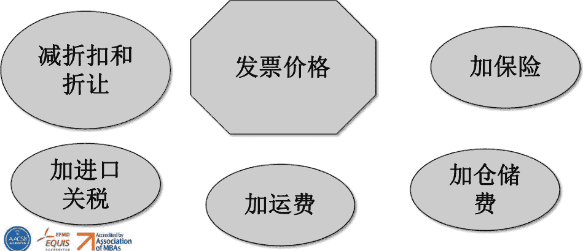

## 采购费用的分配

- 采购成本=买价+采购费用
- 共同分担的采购费用：运输费、保险费、装卸费、包装费、仓储费、运输途中的合理损耗、入库前的挑选整理费用、关税、其他费用
- 分配的原则：以重量、买价等作为标准
- 采购费用分配率=采购费用总额/总重量或者总的买价
- 某种存货应该分摊的采购费用=某种存货重量或者买价*分配率

## 运输成本

在所有列报期间，向客户收取的与运输及装卸相关的金额归类为收入，而公司的运输及装卸成本计入销售成本。

## 保修费用


## 存货的决定因素

需要关注的特殊项目包括：

- 在途商品
- 寄售商品
- 毁损或者过时商品

## 增值税问题

- 增值税的含义
- 生产型增值税与消费型增值税
- 原材料与工程物资
- 原材料与固定资产
- 增值税抵扣制度
- 小麦—面粉—面包
- 会计处理问题

## 付款方式

- 三种购货方式：
  - 现款现货
  - 后付货款
  - 预付货款

## 永续盘存制下的存货成本


资产负债表


存货影响...

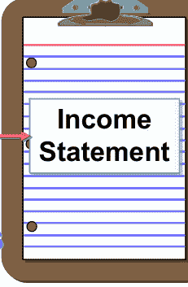

利润表

配比原则要求将成本与销售相匹配。

计算已售存货成本的必要性是什么？

## 存货等式

存货类别：原材料、半成品、产成品

期初存货+本期存货增加−本期存货减少=期末存货

利润表：商品销售成本

资产负债表：存货

## 存货后续计价方法

- 实际成本的计价方法
- 个别认定法
- 先进先出法
- 后进先出法
- 加权平均法
- 移动加权平均法
- 计划成本法


## 存货成本流转假设（INVENTORY COST FLOW ASSUMPTIONS）

- 先进先出法（FIFO）：假设成本按照订单发生的顺序流转
- 后进先出法（LIFO）：假设成本按照订单发生的相反顺序流转
- 加权平均法：假设成本按照平均量流转


## 先进先出法（FIFO）

1. 假设存货按“先进先出”的规律
2. 发出存货的成本为较早购入的存货；结余存货的成本为较（最）迟购入的存货。
3. 优点：期末存货价值比较接近现行市价
4. 问题：①计算工作量较大；②在物价上涨条件下，销货成本偏低，收益计量过于乐观。

## 先进先出法


先到先得，first-come, first-served (FCFS)

## 后进先出法（LIFO）

假设后收进的存货先发出

- 优点：
  1. 使现行收入与现行费用配比；
  2. 在通货膨胀条件下，有利于财务稳健。
- 问题：对政府税收有不利影响

## 后进先出

最近的成本

商品销售成本

过去的成本

期末存货

LIFO 方法目前仅仅用在 Japan 和 U.S.

FIFO 与 LIFO 方法计算的存货成本之间的差异称为 LIFO 储备。该储备本质上是企业通过使用 LIFO 方法而推迟的应纳税所得额的金额。

## 加权平均法

以各批购入（含期初）存货的数量为权重，计算可售存货的平均单位成本，并以此乘以期末存货数量，计算期末存货价值。

- 优点：①计算较简单；②从技术角度讲，加权平均比较合理（折中）
- 问题：在物价变动较剧烈的情况下，存货价值计量结果会失真

## 移动加权平均法

在每次购货后即为存货计算出新的加权平均单位成本和新的存货价值，并以此新的单位成本作为后续发货的单位成本。

- 优点：
  1. 便于随时结转销货成本
  2. 期末存货价值比较接近现行市价
- 问题：计算工作量大

## 两种极端方法（FIFO与LIFO）的比较

- 基本倾向的差异：FIFO的基本倾向是“如实”反映资产负债表上的“存货”价值；而LIFO的基本倾向是“如实”反映利润表上的“销货成本”。即FIFO是资产负债表导向的；而LIFO是利润表导向的。
- 基本目的的差异：FIFO的基本目的是向股东多报告收益；而LIFO的基本目的则是少纳税。

## 计划成本法

- 存货业务的日常处理以计划成本进行，期末再将发出存货的计划成本及期末存货的计划成本调整为实际成本报告于财务报表之中的方法
- 多用于原材料的日常核算
- 实际成本=计划成本+/-成本差异
- 合理制定并及时调整计划成本

## 存货成本核算方法的财务报告效应

### 方法的优点

| 加权平均 | 先进先出 | 后进先出 |
|---|---|---|
| 平滑存货价格的变化 | 期末存货更接近存货的重置成本 | 销售收入与商品销售成本更好地匹配 |

## 实例分析

以下信息涉及 TMBC 的 Eraser 自行车。

| 日期 | 交易 | 数量@单价 | = | 金额 |
|---|---|---|---|---|
| Jan. 1 | Beginning Inventory | 10 units @ $200 | = | $2,000 |
| Mar. 18 | First purchase | 20 units @ $220 | = | $4,400 |
| Aug. 21 | Second purchase | 25 units @ $250 | = | $6,250 |
|  | Total cost of the 55 bikes available for sale |  |  | $12,650 |

TMBC 以现金价格 $350 各售出 43 辆自行车

- First-in, First-Out (FIFO)
- Last-in, First-Out (LIFO)
- Weighted Average

## Last-in, First-Out Inventory Cost Flow

| LIFO Cost of Goods Sold |
|---|
| Aug. 21 Second purchase 25 units @ $250 = $6,250 |
| Mar. 18 First purchase 18 units @ $220 = $3,960 |
| Total cost of the 43 bikes sold $10,210 |

## Allocation of Cost of Goods Available for Sale

LIFO

- Cost of Goods Available for Sale: $12,650 (55 bikes)
- Cost of Goods Sold: $10,210 (43 bikes)
- Ending Inventory Balance: $2,440 (12 bikes)

## 不同方法在美国公司的使用频率

| 方法 | 使用频率 |
|---|---|
| FIFO | 42% |
| LIFO | 35% |
| WA | 19% |
| OTH | 4% |

## Inventories

存货按成本与可变现净值孰低列示，成本采用先进先出法计算。如果存货成本超过其可变现净值，则目前为成本与可变现净值之间的差额计提准备。公司的存货主要由所有所列期间的零部件和产成品组成。

在价格下跌的计算机行业运营的公司使用 FIFO 可获得税收优惠


商品存货按成本与市价孰低法计价，采用后进先出（LIFO）零售存货法。在零售存货法下，存货按具有相似特征的商品部门进行划分，并按当前零售售价列报。存货零售价值通过应用每个商品部门的特定平均成本系数转换为成本基础。成本系数代表每个商品部门基于期初存货和本财政年度采购活动的平均成本与零售价比率。零售存货法本质上需要管理层作出判断和估计，例如为清理低效或滞销存货而进行的永久降价的金额和时机，这可能会影响期末存货估值以及毛利率。

在通货膨胀环境下销售商品的公司可以通过使用后进先出法获得税收优势。

## 存货

所有存货均按成本与可变现净值孰低列报。GE美国存货中很大一部分的成本采用后进先出（LIFO）法确定。GE其他存货的成本采用先进先出（FIFO）法确定。在2010年12月31日和2009年12月31日，GE存货中有39%采用LIFO法。GECS存货包括持有待售的产成品；其成本采用FIFO法确定。


## 存货计量的税收效应

美国国税局（IRS）确定了若干可接受的存货成本计算方法，用于报告应税所得。

如果出于税务目的采用LIFO法，IRS要求在财务报表中也采用该法。

通货膨胀还是通货紧缩？


## 存货成本核算方法使用的一致性

一致性原则（consistency principle）要求：公司应期复一期地使用相同的会计方法，以使财务报表在不同期间具有可比性。


## 存货的期末计量

### 存货成本与可变现净值孰低法

如果市场价值低于存货的成本，期末存货应该以市场价值来报告，同时计提存货跌价准备。

市场价值定义为重置成本（replacement cost，而非销售价格）或者可变现净值，符合保守性原则（conservatism principle）。

### 表明可变现净值低于成本的迹象

- 1）该存货的市场价格持续下跌，并且在可预见的未来无回升的希望；
- 2）企业使用该项原材料生产的产品成本大于产品的销售价格；
- 3）企业因产品更新换代，原有库存原材料已不适应新产品的需要，而该原材料的市场价格又低于其账面成本；
- 4）因企业所提供的商品或劳务过时或消费者偏好改变而使市场的需求发生变化，导致市场价格逐渐下跌；
- 5）其他足以证明该项存货实质上已经发生减值的情形。

### 表明可变现净值为零的迹象

- 1）已霉烂变质的存货；
- 2）已过期且无转让价值的存货；
- 3）生产中已不再需要，并且已无使用价值和转让价值的存货；
- 4）其他足以证明已无使用价值和转让价值的存货。

### 存货跌价准备的计提与转回

- （1）成本与可变现净值进行比较
  - 成本 > 可变现净值：计提跌价准备
  - 成本 < 可变现净值：不计提跌价准备，或转回跌价准备
- （2）计提方法：单项
- （3）转回的条件

- 三种方法：
  - (1) 每一项存货
  - (2) 每一类存货
  - (3) 整个存货

### 存货成本与可变现净值孰低法

以下是如何计算单个存货项目的成本与市价孰低。

| 存货项目 | 持有数量 | 总成本 | 总市价 | 按单项应用LCM | 按类别应用LCM | 按整体应用LCM |
| --- | ---: | ---: | ---: | ---: | ---: | ---: |
| 自行车类： |  |  |  |  |  |  |
| Roadster | 20 | $160,000 | $140,000 | $140,000 |  |  |
| Sprint | 10 | $50,000 | $60,000 | $50,000 |  |  |
| 类别小计 |  | $210,000 | $200,000 |  |  |  |
| 越野类 |  |  |  |  |  |  |
| Trax-4 | 8 | $40,000 | $52,000 | $40,000 |  |  |
| Blazer | 5 | $45,000 | $35,000 | $35,000 |  |  |
| 类别小计 |  | $85,000 | $87,000 |  |  |  |
| 总计 |  | $295,000 | $287,000 | $265,000 |  |  |

### 存货成本与可变现净值孰低法

以下是如何计算整个存货的成本与市价孰低。

| 存货项目 | 持有数量 | 总成本 | 总市价 | 按单项应用LCM | 按类别应用LCM | 按整体应用LCM |
| --- | ---: | ---: | ---: | ---: | ---: | ---: |
| 自行车类： |  |  |  |  |  |  |
| Roadster | 20 | $160,000 | $140,000 | $140,000 |  |  |
| Sprint | 10 | $50,000 | $60,000 | $50,000 |  |  |
| 类别小计 |  | $210,000 | $200,000 |  | $200,000 |  |
| 越野类 |  |  |  |  |  |  |
| Trax-4 | 8 | $40,000 | $52,000 | $40,000 |  |  |
| Blazer | 5 | $45,000 | $35,000 | $35,000 |  |  |
| 类别小计 |  | $85,000 | $87,000 |  | $85,000 |  |
| 总计 |  | $295,000 | $287,000 | $265,000 | $285,000 | $287,000 |


## 存货跌价准备
- 存货实质上发生减值时需要计提存货跌价准备
- 账务处理：
  - 借：资产减值损失
  - 贷：存货跌价准备

## 存货的披露
- 各类存货的期初和期末账面价值
- 确定发出存货成本所采用的方法
- 货可变现净值的确定依据，存货跌价准备的计提方法，当期计提的存货跌价准备的金额，当期转回的存货跌价准备的金额，以及计提和转回的有关情况
- 用于担保的存货账面价值

我们通过建立 markdown 调整和存货损失调整，将存货按成本与市价孰低进行计价。

我们的存货估值反映了成本超过我们预期从存货最终销售或其他处置中实现的金额的 markdown。

Markdown 确立了我们存货的新成本基础。随后事实或情况的变化不会导致之前记录的 markdown 的转回或该新确立成本基础的增加。

## BEST-BUY

我们的存货估值还反映了自上次盘点以来发生的预期实物存货损失的调整，例如盗窃。定期进行实物盘点，以确保我们合并报表中报告的存货

我们的 markdown 调整包含不确定性，因为计算需要管理层对存货账龄、预测的消费者需求、促销环境和技术淘汰做出假设并运用判断。

我们的存货损失调整包含不确定性，因为计算需要管理层对若干因素做出假设并运用判断，包括历史结果和当前存货损失趋势。

## Inventories

存货按成本与市价孰低列示，成本采用先进先出法计算。如果存货成本超过其市价，则目前为成本与市价之间的差额计提准备。公司在所有列示期间的存货主要由组件和产成品组成。

商品存货采用后进先出法零售存货法按成本与市价孰低进行估值。根据零售存货法，存货按具有相似特征的商品部门进行划分，并按其当前零售售价列示。存货零售价值通过对每个商品部门应用特定的平均成本系数转换为成本基础。成本系数代表每个商品部门基于期初存货和财政年度采购活动的平均成本与零售比率。零售存货法固有地需要管理层的判断和估计，例如为清理无生产力或滞销存货而进行永久性 markdown 的金额和时间，这可能会影响期末存货估值以及毛利率。

## 存货核算差异的财务报告效应
资产负债表

| Inventory Error | Assets | Equity |
|---|---|---|
| Understate ending inventory | Understated | Understated |
| Overstate ending inventory | Overstated | Overstated |


## 存货是审计的重点对象

## 存货审计关注的重点：
- existence
- rights
- accuracy
- realizable value

## 小组讨论

## 法尔莫公司的案例

## 案例：中国洗衣机行业案例——
小天鹅与小鸭的比较财务分析

|  | 小鸭 | 小天鹅 |  | 小鸭 | 小天鹅 |
|---|---|---|---|---|---|
| 流动比率 | 1.8 | 1.96 | 速动比率 | 1.24 | 1.47 |
| 利息倍数 | 2.92 | 13 | 财务杠杆 | 0.53 | 0.37 |
| 存货周转率 | 1.53 | 7.26 | 应收款周转率 | 1.68 | 3.35 |
| 总资产周转率 | 0.5 | 0.84 | 毛利率 | 36% | 28% |
| 总资产報酬率 | 3.49% | 6.16% | 净资产報酬率 | 8.58% | 10.24% |

## 可能引起比率差异的原因？
- 偿债能力
- 营运能力
- 盈利能力

## 行业状况

## ➜ 洗衣机行业
- 洗衣机厂商实际生产能力远远大于我国洗衣机的销售量。
- 家电行业产销增长幅度趋缓，城镇市场已趋于饱和，除了更新换代外，发展动力是农村和国外市场。

## 小天鹅与小鸭

## 洗衣机行业集中度

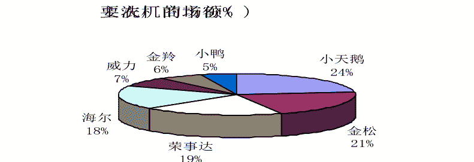

小天鹅、海尔、荣事达、威力、金松、金羚、小鸭7家企业占全国总产量的71%。

## 歧异化？
各主要厂商产品或品牌的独特之处

| 产品 | 特色 |
| --- | --- |
| 小天鹅 | 变频技术、三维立体喷瀑水流 |
| 松下 | 龙卷风离心力、双瀑布 |
| 荣事达 | 仿生搓洗、手搓水流、喷淋喷射水流 |
| 科龙 | 自动平衡、上排水系统 |
| 夏普 | 组合波轮、喷泉式循环水流 |


## 什么“吃”掉了小鸭的优势？

|  | 小天鹅 | 小鸭 |
|---|---:|---:|
| 收入 |  |  |
| 成本 | 72% | 64% |
| 销售费用 | 12% | 12% |
| 管理费用 | 5% | 11% |
| 财务费用 | 1% | 5% |
| 净利润 |  |  |

## 资源整合能力

- 资产指标
  - 有多少资产？
  - 资产的构成
  - 资产的质量

## 流动资产的质量

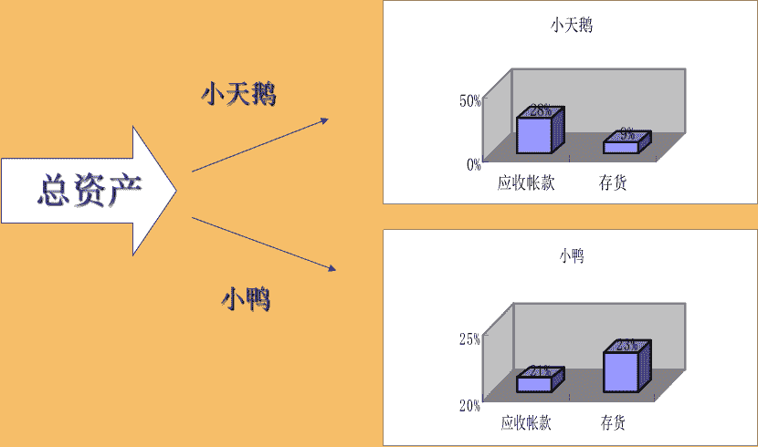

## 固定资产的“质量”

| 指标 | 小天鹅 | 小鸭 |
|---|---|---|
| 绝对年龄（累计折旧/折旧费） | 3年 | 6-8年 |
| 相对年龄（累计折旧/原值） | 20% | 40% |
| 平均折旧年限（原值/折旧费） | 16年 | 17-20年 |

## 总资产报酬率

```
总资产报酬率 = 净利润率 × 总资产周转率
↕               ↕                ↕
净利润          净利润            销售收入
总资产          销售收入          总资产
                 ↕                ↕
                 利润管理          资产管理
                 ↕                ↕
                 差异化战略        成本领先战略
```

## 模块五：负债

## 流动负债

## 本章核心内容

- I. 金额确定的负债(Known (Determinable) Liabilities)
- II. 金额须视经营情况而定的流动负债
- III. 预计负债(Estimated Liabilities)
- IV. 或有负债(Contingent liabilities)

## 负债的性质

负债，是指过去的交易、事项形成的现时义务，履行该义务预期会导致经济利益流出企业。

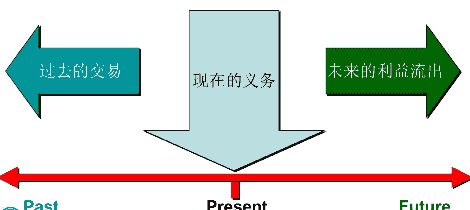

- 企业的负债应按其流动性，分为流动负债和非流动负债
- 流动负债：一年或超过一年的一个营业周期内必须清偿的债务，包括：
  1. 一般短期债务；
  2. 一年内到期的长期债务。
- 非流动负债：偿还期在一年或一个营业周期以上的债务。
- 负债与权益的异同

## BEST-BUY

$ in millions, except per share and share amounts

year 2011

### Liabilities and Equity

### Current Liabilities

| Item | Amount ($ millions) |
|---|---:|
| Accounts payable | 4,894 |
| Undeemed gift card liabilities | 474 |
| Accrued compensation and related expenses | 570 |
| Accrued liabilities | 1,471 |
| Accrued income taxes | 256 |
| Short-term debt | 557 |
| Current portion of long-term debt | 441 |
| **Total current liabilities** | **8,663** |

### LIABILITIES AND SHAREHOLDERS’ EQUITY:

(in millions, except number of shares which are reflected in thousands) September 24, 2011

Current liabilities:

- Accounts payable ................................... $ 14,632
- Accrued expenses ................................... 9,247
- Deferred revenue ................................... 4,091
- Total current liabilities ........................... 27,970

- Deferred revenue – non-current ........................ 1,686
- Other non-current liabilities ....................... 10,100
- Total liabilities ................................... 39,756

（单位：千元）

| 项目 | 2011年12月31日 | 2010年12月31日 | 增减额 | 增减幅度（%） | 2009年12月31日 |
|---|---:|---:|---:|---:|---:|
| 短期借款 | 1,665,686 | 317,789 | 1,347,897 | 424.15% | - |
| 应付账款 | 8,525,857 | 6,839,024 | 1,686,833 | 24.66% | 5,003,117 |
| 应付票据 | 20,617,593 | 14,277,320 | 6,340,273 | 44.41% | 13,999,191 |
| 应付职工薪酬 | 273,558 | 201,295 | 72,263 | 35.90% | 139,530 |
| 应交税费 | 790,756 | 525,750 | 265,006 | 50.41% | 301,542 |
| 应付利息 | 5,305 | - | 5,305 | - | - |
| 预收款项 | 350,051 | 393,820 | -43,769 | -11.11% | 276,792 |
| 其他应付款 | 2,743,925 | 1,539,020 | 1,204,905 | 78.29% | 666,391 |
| 其他流动负债 | 545,502 | 318,755 | 226,747 | 71.14% | 235,148 |
| 流动负债合计 | 35,638,262 | 24,534,348 | 11,103,914 | 45.26% | 20,718,839 |

Measured in thousands

|  | 2011 | 2010 |
|---|---:|---:|
| 流動負債 |  |  |
| 計息銀行借款 | – | 100,000 |
| 應付賬款及應付票據 14 | 17,140,383 | 16,899,683 |
| 客戶按金、其他應付款及預提費用 | 1,523,315 | 1,819,999 |
| 應付關聯人士款項 | – | 97,826 |
| 可換股債券 15 | 2,111,610 | 129,976 |
| 應交稅金 | 440,905 | 509,374 |
| 流動負債合計 | 21,216,213 | 19,556,858 |

## 债务的不确定性


支付给谁？


何时支付？


支付多少？

## 流动负债

- 应付金额确定的流动负债
- 应付金额须视经营情况而定的流动负债
- 应付金额须予估计的流动负债
- 或有负债

## 应付金额确定的流动负债

- 特点：在负债确认时，金额就已由业务决定
- 短期借款
- 应付账款
- 应付票据(短期)
- 预收账款或者递延收入
- 应付职工薪酬

## 短期借款

- 短期借款指企业借入的期限在1年以下的各种借款。
- 归还短期借款时，除了归还借入的本金外，按照货币的时间价值，还应支付利息。
- 短期借款的利息，应当按月预提计入财务费用和预提费用。

某公司于2012年7月1日向银行借入短期款项200万元，期限3个月，年利率为3%。按月预提利息，到期一并还本付息。会计分录如下：
(以下单位万元)

7月1日，取得借款时：

  借：银行存款 200
  贷：短期借款 200

7月31日，确认当月利息费用：

  借：财务费用（200×3%÷12） 0.5
  贷：预提费用 0.5

9月30日，还本付息时：

  借：预提费用 1
      财务费用 0.5
      短期借款 200
  贷：银行存款 201.5


## 应付账款

- 应付账款指因购买材料、商品或接受劳务供应等而发生的债务。这是买卖双方在购销活动中由于取得物资与支付货款在时间上不一致而产生的负债。
- 应付账款入账时间的确定，应以所购买物资的所有权转移或接受劳务已发生为标志。
- 如有现金折扣，则按包括现金折扣的总价法处理。
- 应付账款一般按应付金额入账，而不按到期应付金额的现值入账。获得的现金折扣，冲减财务费用。
- 应付账款一般在较短期限内支付。

### 应付账款流程

签订采购合同——收货通知——台账——入库单——会计审核制单——付款结算——对账。

- 1. 参与采购合同文本会签。
- 2. 货物运达后，由采购部验收人查验数量和毁损情况，质检人员依据合同规定的标准检验质量后，采购经办人员制作“收货通知单”，经会计签字确认后，交仓库人员办理入库。
- 3. 会计在审核“收货通知单”时，登记采购管理台账备案。
- 4. 审核无误后，仓库人员开“入库单”，仓库负责人审核确认，采购经办人将“入库单”中的一联交给采购部备查，一联交给会计审核入账。
- 5. 会计审核入库单无误后，制作记账凭证，并在采购台账上做记录。
- 6. 会计依据企业管理程序办理付款、结算。
- 7. 会计和采购部门定期对账，及时处理差异。

### 会计处理

借：原材料

（或）固定资产

贷：应付账款

借：应付账款

贷：现金

### 应付账款与存货同步增长

以千计

流动资产

存货

|  | 2011 | 2010 |
|---|---|---|
| 存货 | 9,625,044 | 8,084,971 |
| 应付账款及应付票据 14 | 17,140,383 | 16,899,683 |

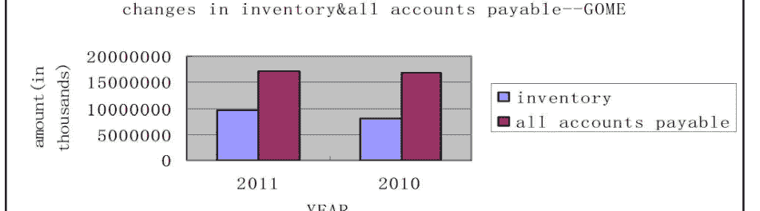

## 应付票据

- 应付票据是由出票人出票，委托付款人在指定日期无条件支付确定的金额给收款人或者持票人的票据。应付票据也是委托付款人允许在一定时期内支付一定款额的书面证明。
- 企业由于真实交易而开出、承兑的商业汇票，在会计核算上设置“应付票据”科目，反映这项流动负债的现存义务。应付票据按是否带息分为带息应付票据和不带息应付票据两种。
- 带息应付票据处理。应付票据如为带息票据，其票据的面值就是票据的现值。票据中的应付利息，于期末计算利息费用，金额不大时，到期时，计入财务费用。
- 不带息应付票据的处理。需要计算应付票据的贴现息。
- 应付账款与应付票据
- 应收账款与应收票据

### 应付票据的跨期调整

发行日 结账日 到期日 调整分录确认到期的票据利息

## 预收账款（预收收入或者递延收入）

- 预收账款为企业一项流动负债。
- 预收账款的核算，应视企业的具体情况而定。如果预收账款比较多的，可以设置“预收账款”科目；
- 如企业预收业务不多，也可直接通过“应收账款”科目核算，但其明细贷方余额应反映于资产负债表负债方，不能与其他明细科目借方抵消。

先于收入确认，收到现金款项

当完成销售或者提供劳务

提前收到现金。

预收或者递延的收入被确定

赚得的收入（Earned revenue）被确认

负债类科目

2009年5月1日，A-1餐饮公司预收3,000美元，用于2009年7月12日举行的婚宴服务。

|  | DR | CR |
|---|---|---|
| May 1 现金 | 3,000 | |
| 预收账款 | | 3,000 |
| *记录预付款。* | | |

|  | DR | CR |
|---|---|---|
| Jul 12 预收账款 | 3,000 | |
| 收入 | | 3,000 |
| *确认已赚取收入。* | | |

## 应付职工薪酬

- 应付职工薪酬是企业对职工个人的一种负债，是企业使用职工的知识、技能、时间和精力而给予职工的一种补偿（报酬）。

### 上海汽车（2011年12月31日，单位：元）

| 项目 | 年末数 |
| --- | --- |
| 工资、奖金、津贴和补贴 | 2,367,190,113.06 |
| 职工福利基金 | 1,617,703,712.53 |
| 社会保险费 | 121,788,852.09 |
| 住房公积金 | 48,799,364.57 |
| 工会经费和职工教育经费 | 311,636,436.00 |
| 辞退福利 | 402,710,369.29 |
| 其他 | 185,298,840.21 |
| 合计 | 5,055,127,687.75 |

### 职工及职工薪酬的范围

- 1. 职工的范围
  - （1）与企业订立劳动合同的所有人员，含全职、兼职和临时职工。
  - （2）未与企业订立劳动合同，但由企业正式任命的人员。
  - （3）在企业的计划和控制下，虽未与企业订立劳动合同或由其正式任命，但为其提供与职工类似服务的人员。
- 2. 职工薪酬的范围
  - （1）职工工资、奖金、津贴和补贴
  - （2）职工福利费
  - （3）医疗保险费、养老保险费、失业保险费
  - （4）住房公积金
  - （5）工会经费和职工教育经费
  - （6）非货币性福利
  - （7）因解除与职工的劳动关系给予的补偿（辞退福利）
  - （8）其他与获得职工提供的服务相关的支出（股份支付）

### SUNING

以千计

| 负债及股东权益 | 附注 | 2011年12月31日 合并 | 2010年12月31日 合并 | 2011年12月31日 公司 |
|---|---|---|---|---|
| 流动负债 |  |  |  |  |
| 应付职工薪酬 | 注22 | 273,558 | 201,295 | 41,151 |

总资产 59,786,473 43,907,382

占比 0.4% 0.4% 几乎相同

### BESTBUY

以百万美元计

| 负债及权益 |  |  |
|---|---|---|
| 流动负债 |  |  |
| 应付账款 | $ 5,364 | $ 4,894 |
| 未兑现礼品卡负债 | 456 | 474 |
| 应计薪酬及相关费用 | 539 | 570 |
| 总资产 | $ 16,005 | $ 17,849 |

占比 3.36% 3.19%

上升！

## 福利项目

福利和特权。我们的高级管理人员，包括我们的NEO，通常提供与所有美国在职高级管理人员相同的员工福利和特权，汇总如下表：

| Benefit or Perquisite | All Full-Time U.S.-Based Employees | Executive Officers |
|---|---|---|
| Accidental Death & Dismemberment | • | • |
| Business Travel and Accident | • | • |
| — Executive Business Travel & Accident |  | • |
| Deferred Compensation Plan⁽¹⁾ | • | • |
| Employee Discount | • | • |
| Employee Stock Purchase Plan | • | • |
| Health Insurance | • | • |
| — Executive Physical Exam |  | • |
| Life Insurance | • | • |
| Long-Term Disability | • | • |
| — Executive Long-Term Disability |  | • |
| Retirement Savings Plan | • | • |
| Severance Plan | • | • |
| Short-Term Disability | • | • |
| Stock Ownership Target Planning |  | • |
| Tax Planning and Preparation |  | • |


## 其中的两项计划

员工股票购买计划。我们的 2008 员工股票购买计划，经修订后（“ESPP”）允许员工，包括我们的 NEO，以折扣价购买我们的普通股。股票购买价格为普通股市值的 85%，按半年度购买期开始或结束时在纽约证券交易所报价的收盘价衡量，以两者中较低者为准。所有计划参与者每位参与者每年的最高购买价值为 25,000 美元。自 2011 年 9 月起购买的股份，除有限情况外（如死亡或残疾），须遵守 12 个月的持有期。

退休储蓄计划。我们的退休储蓄计划旨在符合 1986 年《国内税收法典》第 401(k) 条（“法典”）的要求。我们的所有 NEO 均有资格参与该计划。该计划提供安全港，允许美国员工缴纳税前收入并立即归属公司匹配供款。该计划预计将为此类员工提供更好的机会实现退休收入保障。然而，该计划预计无法相对于我们 NEO 的预期退休需求提供足够的收入替代。 我们 NEO 的潜在退休收入缺口可能由其他奖励要素填补，包括长期激励，或通过递延薪酬计划递延基本工资或短期激励奖金的一部分。根据退休储蓄计划，我们按薪酬委员会批准的比率匹配员工供款，包括我们的 NEO 的供款。继续在 2012 财年，我们匹配了合格税前收入中前 3% 的 100% 和接下来 2% 的 50%（最高至美国国税局限额）由计划参与者缴纳。

## GM破产的一个原因:负担太重,特别是退休人员薪酬


- 2006年GM的普通工人平均小时工资为$73.26,包括现金39.68和其他福利$33.58
- TOYOTA，平均工资为$48
- 成本领先战略

## 美国三大汽车厂商

**领取福利的退休人员**

| 公司 | 金额 |
|---|---:|
| GM | 453,000 |
| Ford | 335,000 |
| Chrysler | 65,175 |

**小时工**

| 公司 | 峰值 | 当前 |
|---|---:|---:|
| GM | 511,000 (1978–79) | 54,000 |
| Ford | 104,000 (1997) | 42,000 |
| Chrysler | 75,896 (2000) | 26,801 (2008) |

## GM

- 在过去的15年, GM 支付了1030亿美元的养老金和医疗保险,大约每年70亿美金
- 2012年员工总数:207,000


## 会计账务处理

- 货币性职工薪酬：
- 会计处理原则：谁的孩子谁抱走
- 例1：2012年6月，乙公司当月应发工资1000万元，其中：
  - 生产工人500万；车间管理人员100万；公司管理人员180万；销售人员50万；建造厂房人员110万；内部开发人员60万（符合资本化为无形资产条件）。
- 根据规定，公司分别按下列职工工资总额的比例提取有关费用
- 医疗保险10%、 养老保险12%、 工会经费2%
- 失业保险2%、 住房公积金10.5%/
- 承担职工福利义务2%、 职工教育经费1.5%

- 应计入生产成本的职工薪酬
- 500+500×（10%+12%+2%+10.5%+2%+2%+1.5%）=700万元
- 应计入制造费用的职工薪酬                          应计入管理费用的职工薪酬
- 100+100×（40%）=140万元                          180+180×（40%）=252万元
- 应计入销售费用的职工薪酬                          应计入在建工程的职工薪酬
- 50+50×（40%）=70万元                              110+110×（40%）=154万元
- 应计入无形资产成本的职工薪酬                      60+60×（40%）=84万元
- 借：生产成本                                        700万元
-     制造费用                                        140万元
-     管理费用                                        252万元
-     销售费用                                        70万元
-     在建工程                                        154万元
-     研发支出——资本化支出                           84万元
- 贷：应付职工薪酬——工资                            1000万元
-                 职工福利                            20万元
-                 社会保险费                          240万元
-                 工会经费                            20万元
-                 职工教育经费                         15万元

- 根据新准则第9号中第7条规定：企业应当在附注中披露与职工薪酬有关的下列信息：
- 1、应当支付给职工的工资、奖金、津贴和补贴，及其期末应付未付的金额；
- 2、应当为职工缴纳的医疗保险费、养老保险费、失业保险费、工伤保险费、生育保险费等社会保险费，及其期末应付未付金额；
- 3、应当为职工缴存的住房公积金，及其期末应付未付金额；
- 4、为职工提供的非货币性福利，及其计算依据；
- 5、应当支付的因解除劳动关系给与的补偿，及其期末应付未付金额；
- 6、其他职工薪酬。


## 应付金额须视经营情况而定的流动负债

- **特点：**

只有到期末计算出本期的经营结果（利润）后，才能相应计算出负债金额，如应交税金（如所得税）、应付股利等

期末时，这类负债的金额也是“确定”的，但“日常”利润形成过程中，其金额是无法确定的

- 世界上有两样东西不能够避免：那就是死亡和
  税收

- 对于税收，你了解哪些？企业要交哪些税收？

## 上海汽车

2011年12月31日，单位：元

| 项目 | 年末数 |
|---|---:|
| 企业所得税 | 3,520,077,050.49 |
| 营业税 | 598,728,734.77 |
| 个人所得税 | 72,585,319.85 |
| 土地使用税 | 10,968,526.24 |
| 营业税 | 77,745,113.70 |
| 增值税 | (1,733,597,708.25) |
| 城建税 | 72,259,079.74 |
| 教育费附加 | 65,282,364.99 |
| 其他 | 142,015,308.65 |
| 合计 | 2,826,063,790.18 |

## 或有事项：预计负债与或有负债

- 什么是或有事项
- 或有负债的主要问题是：在资产负债表日，还不能确定这些负债是否业已存在

## 或有事项的含义及其基本特征

## 或有事项的含义

或有事项指过去的交易或事项形成的，其结果须由某些未来事项的发生或不发生才能决定的不确定事项。

常见的或有事项有：商业票据背书转让或贴现、未决诉讼、未决仲裁、债务担保、产品质量保证（含产品安全保证）等。

## 或有事项具有以下基本特征

1. 或有事项是因过去的交易或者事项形成的
2. 或有事项的结果具有不确定性
3. 或有事项的结果只能由未来发生的事项确定

- 应付金额须予估计的流动负债——预计负债
- 或有负债

## 预计负债的确认

如果与或有事项相关的义务同时符合以下条件，企业应将其确认为负债：

1. 该义务是企业承担的现时义务；
2. 该义务的履行很可能导致经济利益流出企业；
3. 该义务的金额能够可靠地计量。

多大概率是很可能？

该义务的履行很可能导致经济利益流出企业：

“很可能”指发生的可能性为“大于50%但小于或等于95%”。通过“预计负债”账户核算。

与“很可能”有关的其他概念的含义如下：

“基本确定”指发生的可能性为“大于95%但小于100%”。

“可能”指发生的可能性为“大于5%但小于或等于50%”。

“极小可能”指发生的可能性为“大于0但小于或等于5%”

## 预计负债的计量

或有事项的计量所涉及的问题是，当与或有事项有关的义务符合确认为负债的条件时，应以多少金额确认。

或有事项的计量主要涉及两个问题：

- 一是最佳估计数的确定；
- 二是预期可获得的补偿的处理

## 最佳估计数的确定

1. 如果所需支出存在一个金额区间，则最佳估计数应按该区间的上、下限金额的平均数确定。
   
2. 如果所需支出不存在一个金额区间，则最佳估计数应分别情况处理：
   
   （1）或有事项涉及单个项目时，最佳估计数按最可能发生金额确定。
   
   （2）或有事项涉及多个项目时，最佳估计数按各种可能发生额及其发生概率计算确定。

- 例：2012年11月15日，乙股份有限公司因合同违约而涉一起诉讼案。在咨询了公司的法律顾问后，公司认为，最终的法律判决很可能对公司不利。2012年12月31日，乙股份有限公司尚未接到法院的判决，因诉讼须承担的赔偿金额也无法准确地确定。根据法律顾问的职业判断，赔偿金额可能是16万元至20万之间的某一金额。

- 此时，乙股份有限公司应在资产负债表中确认一项金额为18万元［（16+20）÷2］的负债。

• 例:2012年12月2日，乙股份有限公司涉及一起诉讼案。2012年12月31日，乙股份有限公司尚未接到法院的判决。根据公司法律顾问的职业判断，公司认为，胜诉的可能性为40%，败诉的可能性为60%。如果败诉，需要赔偿20万。此时，乙股份有限公司在资产负债表中确认的负债金额应为最可能发生的金额，即20万元。

## 预计负债——产品保证金

经销商于2009年12月1日以 $32,000 的价格销售一辆汽车，并提供12个月或12,000英里的零部件和人工保修。该经销商每辆车的平均保修成本为售价的3%。

| Dec. 1 | 销售费用 | DR | 960 |
| | 预计负债 | CR | 960 |
| | *To accrue estimated warranty expense* | | |

2010年2月15日，发生保修范围内的零部件费用 $200 和人工费用 $250。

| Feb. 15 | 预计负债 | DR | 450 |
| | 库存商品 | CR | 200 |
| | 应付职工薪酬 | CR | 250 |
| | *To record warranty costs* | | |

## 上海汽车

## 2011年12月31日，单位：元

## 预计负债

| 项目 | 年末数 |
|---|---|
| 产品质量保证金 | 6,224,002,412.02 |
| 其他 | 949,434,543.24 |
| 小计 | 7,173,436,955.26 |
| 减：一年内到期的预计负债(附注(六)37) | 3,154,749,364.35 |
| 一年后到期的预计负债 | 4,018,687,590.91 |

## 预期可能获得补偿的处理

- 如果企业清偿因或有事项而确认的负债所需支出全部或部分预期由第三方或其他方补偿，则此补偿金额只有在基本确定能收到时，才能作为资产单独确认，确认的补偿金额不能超过所确认负债的账面价值。
- 预期可能获得补偿的情况通常有：发生交通事故等情况时，企业通常可从保险公司获得合理的赔偿；在某些索赔诉讼中，企业可通过反诉的方式对索赔人或第三方另行提出赔偿要求；在债务担保业务中，企业在履行担保义务的同时，通常可向被担保企业提出追偿要求。

## 或有负债


## 非流动负债

## 本章核心内容

- I. 长期借款
- II. 债券类型
- III. 债券发行与推销的会计核算
- IV. 长期应付票据

## 非流动负债

- 长期借款
- 应付债券
- 可转换债券
- 长期应付票据


## 课前案例

- 对于债券发行，你知道哪些？
- 可转换债券是什么？为什么这么受欢迎？
- 次级债券的故事

## 美国次级抵押危机示意图

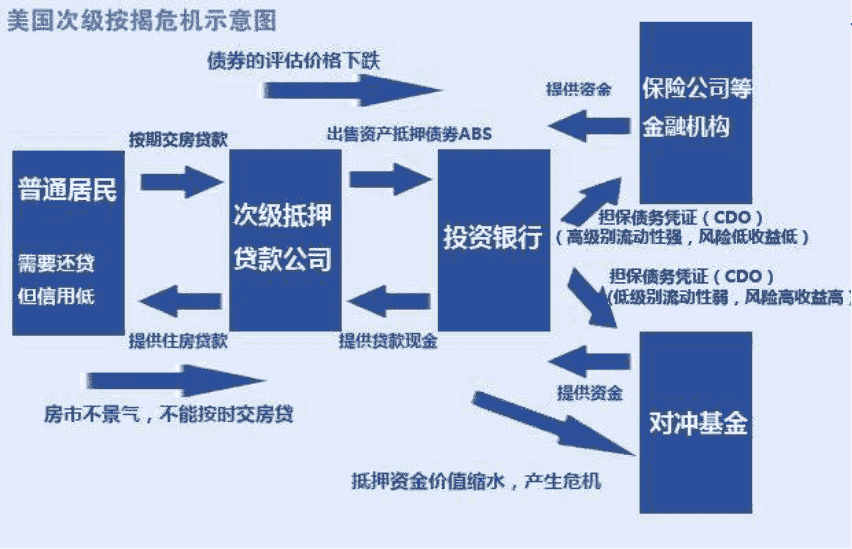
普通居民
需要还贷
但有用低

按期交房贷款

次级抵押贷款公司

出售资产抵押债券ABS

投资银行

债券的评估价格下跌

提供资金

保险公司等
金融机构

保险债券凭证（CDO）
（高级别流动性强，风险低收益低）

担保债务凭证（CDO）
（低级别流动性弱，风险高收益高）

对冲基金

提供住房贷款

提供贷款现金

房市不景气，不能按时交房贷

提供资金

抵押资产价值缩水，产生危机

## 非流动负债的性质

- 非流动负债是企业长期资金的来源
- 非流动负债是偿还期在一年以上或者超过一个营业周期以上的债务
- 企业偏向于选择举债经营的原因
  - 股东控制权
  - 节税
  - 杠杆效应
  - 保持股价稳定

## 长期债务

不经常发生
金额较大

银行

保险公司等机构投资者

养老金计划

众多个人投资者

or

or

or

## 资本密集型行业

- ✓ 航空
- ✓ 房地产
- ✓ 汽车
- ✓ 化学
- ✓ 石油
- ✓ ……


|  | 东航 | 南航 | 国航 | 西南航空 | 美国航空 |
|---|---:|---:|---:|---:|---:|
| 流动负债 | 39,263,817 | 28,299,000 | 20,988,132 | 3,305,000 | 8,780,000 |
| 长期负债 | 47,508,013 | 49,209,000 | 46,212,333 | 5,921,000 | 20,253,000 |
| 总负债 | 86,771,830 | 77,508,000 | 67,200,465 | 9,226,000 | 29,033,000 |
| 总资产 | 103,333,716 | 93,312,000 | 90,885,130 | 19,742,000 | 25,088,000 |
| 长期负债比率 | 45.98% | 52.74% | 50.85% | 29.99% | 80.73% |
| 资产负债率 | 83.33% | 83.06% | 73.94% | 46.73% | >1 |

2010 人民币千元
2010 美元千元

## 资产负债率

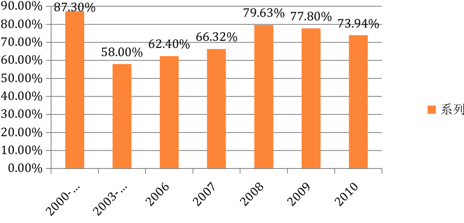

## 不同行业的平均资产负债率

- 一般行业企业的正常负债率在30%-50%，部分行业可以放宽在60%左右，而70%的负债率则是普遍认为的警戒线，除金融业和航空业外。
- 金融类公司以86.72%成为负债率最高的行业，而信息传媒业公司的平均负债率最低，仅33.3%。
- 平均负债率约45.98%
- 平均资产负债率50%及以上的行业:农业、有色金属、交运设备、家电、公共事业5个行业，分别为50%、51.9%、52.53%、54.02%、50.69%。
- 平均资产负债率低于40%的行业还有包括信息设备、食品饮料、医药三个行业，分别为37.057%、37.049%、37.69%。
- 化工、采矿、建筑、电子元件、纺织、轻工、交通运输七个行业的上市前平均资产负债率则在40%-50%。

## 长期借款

- 企业向金融机构等借入的长期借款，在会计核算中设置“长期借款”科目核算。长期借款的核算需要注意以下几点：

（一）长期借款所发生的利息支出，应按照权责发生制的原则按期预提计入在建项目的成本或计入当期财务费用。

（二）长期借款的本金和利息，均应计入“长期借款”科目。

## 长期借款

- 本金借入时，借记“现金”，贷记“长期借款（本金）”。
- 长期借款往往与固定资产购建相联系，此时，固定资产竣工结算前的应计利息，定期计入“在建工程”，贷记“应付利息”；固定资产竣工结算后的应计利息，借记“财务费用”，贷记“应付利息”。
- 付息和/或还本时，借记“长期借款”，贷记“现金”
- 利息资本化问题

## 应付债券

- 长期债券是企业筹集长期使用资金而发行的一种书面凭证。


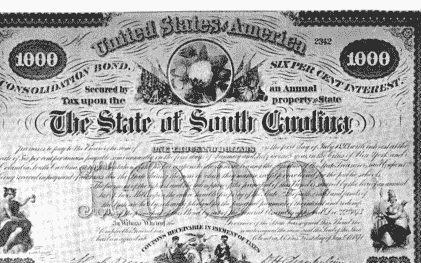

## 债券融资

### 优点

### 缺点

不影响控制权

要求定期支付利息,到期偿还本金

债券利息可以抵税

当债务资本成本高于投资回报率时,债券融资降低ROE

增加ROE

## 三、发行总额

本期债券的发行规模为 200 亿元。

## 四、票面金额和发行价格

本期债券面值 100 元，按面值平价发行。

## 五、债券期限及规模

本期债券分为 5 年期固定利率、10 年期固定利率和 15 年期固定利率三个品种，最终发行规模分别为 160 亿元、20 亿元和 20 亿元。

## 七、债券利率和还本付息方式

本期债券三个品种均为固定利率，在债券存续期内固定不变。本期债券采用单利按年计息，不计复利。每年付息一次，到期一次还本，最后一次利息随本金的兑付一起支付。

发行人和簿记管理人于 2012 年 11 月 21 日在网下向机构投资者进行了票面利率询价，根据网下向机构投资者询价统计结果，经发行人和簿记管理人充分协商和审慎判断，最终确定本期债券 5 年期品种票面利率为 4.55%，10 年期品种票面利率为 4.90%，15 年期品种票面利率为 5.04%。

|  | 利率% |
|---|---|
| 中国石油债券利率（5年） | 4.55 |
| 2012年5年期定期存款基准利率（整存整取） | 4.75 |
| 2012年5年期定期存款基准利率（零存整取、整存零取、存本取息） | 3 |
| 2012年5年期贷款基准利率 | 6.9 |

## 一、募集资金运用计划

本期债券募集资金拟用于偿还贷款、补充流动资金，以满足公司日常生产经营需要。具体使用计划如下：

### （一）偿还贷款

公司拟使用募集资金中的 100 亿元偿还公司一笔余额为 100 亿元的人民币贷款，调整公司债务结构。该笔贷款的贷款方为中油财务有限责任公司，起始日为 2012 年 1 月 20 日，到期日为 2013 年 1 月 19 日。

### （二）补充流动资金

本公司承担着保证国家油气安全稳定供应的重要责任。当前，我国能源消费进入快速增长时期，中国经济快速增长所带来的国内能源供求矛盾日益突出。本公司大力实施资源、市场和国际化三大战略，加大了国内外油气资源的勘探开发力度，实现了原油产量稳中有增。为保持本公司在国内油气行业的主导地位，本期公司债券募集资金除偿还贷款外，剩余部分将用于补充流动资金，将对本公司的可持续发展发挥积极作用。

| Moody’s | S&P | Fitch | 简要定义 |
|---|---|---|---|
| **投资级：高信用度** |  |  |  |
| Aaa | AAA | AAA | 顶级，优质，最大安全性 |
| Aa1 | AA+ | AA+ |  |
| Aa2 | AA | AA | 非常高等级，高质量 |
| Aa3 | AA− | AA− |  |
| A1 | A+ | A+ |  |
| A2 | A | A | 上中等等级 |
| A3 | A− | A− |  |
| Baa1 | BBB+ | BBB+ |  |
| Baa2 | BBB | BBB | 下中等等级 |
| Baa3 | BBB− | BBB− |  |
| **明显投机：低信用度** |  |  |  |
| Ba1 | BB+ | BB+ |  |
| Ba2 | BB | BB | 低等级，投机 |
| Ba3 | BB− | BB− |  |
| B1 | B+ | B+ |  |
| B2 | B | B | 高度投机 |
| B3 | B− | B−2 |  |
| **主要投机：重大风险或违约** |  |  |  |
| Caa | CCC+, CCC, CCC− | CCC | 重大风险，信誉不佳 |
| Ca | CC | CC | 可能违约，极度投机 |
| C | C | C | 比以上更投机 |
|  | CI |  | CI = 收益债券；未支付利息 |
|  |  | DDD, DD, D | 违约 |

## Example 1.3 Ford Motor Company 6¾ % Debentures 2029

福特汽车公司 6¾ % 债券 2029

1999 年 2 月发行了 15 亿美元的债券，发行价为 98.817。该债券每半年于 2 月 1 日和 8 月 1 日支付利息，并将于 2029 年 2 月 1 日按 100 回购，除非其税务状况发生变化。如果发生这种情况，可在 1999 年 2 月 9 日起提前 30 天通知后随时整体赎回，价格为 100。

## Example 1.5 Nichiei Company Ltd 1¼ % Convertible Bonds 2014

日立公司有限公司 1¼ % 可转换债券 2014

1999 年 2 月，公司发行了 500 亿日元的可转换债券，发行价为 100，到期日为 2014 年 3 月 31 日，除非提前赎回或转换。利息每半年于 3 月 31 日和 9 月 30 日支付。

该债券可在 2004 年 3 月 31 日起提前 30 天通知后随时整体赎回。持有人有权自 1999 年 3 月 22 日起按每股 8610 日元和自 2000 年 9 月 28 日起按每股 7636.2 日元将债券转换为日立公司有限公司普通股。权利于 2014 年 3 月 25 日到期。持有人还可在提前 14 天通知后要求提前偿还（认沽期权），于 2004 年 3 月 31 日按 100 和 2009 年 3 月 31 日按 100 偿还。


## 浦发银行 2011年12月31日， 单位：千元

## 26、应付债券

本集团及本公司

2011-12-31

|  | 2011-12-31 |
| 06 次级债券(注 1) | - |
| 07 次级债券(注 2) | 6,000,000 |
| 08 次级债券(注 3) | 8,200,000 |
| 11 次级债券(注 4) | 18,400,000 |
|  | 32,600,000 |

为什么银行要发行债券融资？
银行不是靠存款进行融资的么？
哪一家银行不支靠存款融资的？

注2: 2007 年 12 月 28 日，本公司发行总额为 60 亿元人民币的次级债券，分固定利率和浮动利率两种，前者发行 10 亿元人民币，后者发行 50 亿元人民币。固定利率次级债系 10 年期债券，本公司有权在第 5 年末按照面值全部或部分赎回。前 5 个计息年度内的票面利率为 6.0%，后 5 个计息年度内的票面利率为 9.0%。浮动利率次级债系 10 年期债券，本公司有权在第 5 年末按照面值全部或部分赎回。票面利率为基础利率加基本利差，基础利率为各计息年度起息日适用的人行公布的一年期整存整取定期储蓄存款利率。前 5 个计息年度内的基本利差为 1.8%，后 5 个计息年度内的基本利差为 4.8%。

## 债券发行程序

公司将债券出售给...

...一家名为承销商的投资机构。承销商再将债券出售给...

...投资者

受托人监督债券的发行。

## 债券基本特点


## 债券基本特点

公司

投资者

债券利息支付

债券利息支付

债券发行日

利息支付额 =
债券面值 × 票面利率


## 债券溢价和折价

债券方设定

市场方设定

约定利率

市场利率

约定利率 > 市场利率
溢价
债券以溢价出售

约定利率 = 市场利率
债券按面值出售

约定利率 < 市场利率
折价
债券以折价出售

- > 供需关系
- > 债券估价模型 估值分析（DCF模型）


## 价值分析(DCF模型)
现值的确定

## 未来现金流量折现？

现值

复利计息期

终值

今天


## 应付债券

- - 债券的发行价格受同期限银行存款利率的影响较大
- - 平价发行
- - 溢价发行
 - - 折价发行

- - 当债券的票面利率高于市场利率时，按超过票面价值的价格发行称为**溢价发行**；
- - 当债券的票面利率低于市场利率时，按低于票面价值的价格发行称为**折价发行**；
- - 当债券的票面利率与市场利率一致时，按票面价值的价格发行称为**按面值发行**。
- - 在“应付债券”科目下设置了“债券面值”、“利息调整”和“应计利息”等明细科目。

## 发行债券的会计处理

借：现金

贷：应付债券

借：现金

贷：应付债券

应付债券溢价

借：现金

应付债券折价

贷：应付债券

## 债券持有期间的会计处理

借：财务费用等或债券利息费用
　　或应付债券溢价

贷：应付利息
　　或应付债券折价

根据新借款费用准则，借款费用资本化的部分记入“在建工程”、“研发支出”或“制造费用”，费用化的部分记入“财务费用”。

## 偿付债券的会计处理

借：应付债券

贷：现金

## 溢价发行债券

阿迪达斯于2009年1月1日发行具有以下特征的债券：
面值 = $100,000
发行价格 = 面值的103.546%
票面利率 = 12%
市场利率 = 10%
付息日 = 6月30日和12月31日
债券日期 = 2009年1月1日
到期日 = 2010年12月31日（2年）

债券将以溢价出售。

## 溢价发行债券

2009年1月1日，阿迪达斯将按如下方式记录债券发行：

|  |  |
|---|---|
| 面值 | $ 100,000 | |
| 现金收入 | 103,546* | |
| 溢价 | $ 3,546 | |
| *$100,000 × 103.546% |  | |

|  |  | 借 | 贷 |
|---|---|---|---|
| 1月1日 | 现金 | 103,546 | |
|  | 应付债券溢价 |  | 3,546 |
|  | 应付债券 |  | 100,000 |
|  | *发行日按溢价出售债券* |  |  |

附加负债账户

## 溢价发行债券

| 2009年1月1日资产负债表（部分） |
|---|---|
| 长期负债： | |
| 应付债券 | 100,000 |
| 加：应付债券溢价 | 3,546 | 103,546 |

到期价值

账面价值

## 债券溢价的摊销

采用直线法，溢价摊销额将为每六个月 $887（四舍五入）。

$3,546 ÷ 4 期 = $887（四舍五入）

## 债券溢价的摊销

阿迪达斯将每六个月编制以下分录，以记录现金利息支付和溢价摊销。

|  | 借 | 贷 |
|---|---|---|
| 6月30日 债券利息费用 | 5,113 | |
| 应付债券溢价 | 887 | |
| 现金 | | 6,000 |
| *记录利息支付及摊销* | | |

$3,546 ÷ 4 期 = $887（四舍五入）
$100,000 × 12% × ½ = $6,000

## 债券溢价的摊销

**直线法摊销表**

| 日期 | 利息支付 | 利息费用 | 溢价摊销* | 未摊销溢价 | 账面价值 |
|---|---:|---:|---:|---:|---:|
| 1/1/2009 |  |  |  | $3,546 | $103,546 |
| 6/30/2009 | $6,000 | $5,113 | $887 | $2,659 | $102,659 |
| 12/31/2009 | $6,000 | $5,113 | $887 | $1,772 | $101,772 |
| 6/30/2010 | $6,000 | $5,113 | $887 | $885 | $100,885 |
| 12/31/2010 | $6,000 | $5,115 | $885 | - | $100,000 |
| **合计** | **$24,000** | **$20,454** | **$3,546** |  |  |

* 四舍五入。

**利息费用：** $103,546 × 10% × ½ = $5,177.3


## 债券到期赎回
## 到期时

让我们在到期时以 100,000 美元现金赎回 Fila 债券。

|  | DR | CR |
|---|---:|---:|
| Dec 31 应付债券 | 100,000 |  |
| 现金 |  | 100,000 |

*到期时赎回债券*

由于任何折价或溢价在到期时将完全摊销，债券的账面价值将等于面值。

## 折价发行债券

Fila 宣布发行债券，条款如下：

- 面值 = $100,000
- 发行价格 = 面值的 96.454%
- 票面利率 = 8%
- 市场利率 = 10%
- 付息日 = 6/30 和 12/31
- 债券日期 = 2009 年 1 月 1 日
- 到期日 = 2010 年 12 月 31 日（2 年）

> 债券将以折价出售。

## 折价发行债券

2009 年 1 月 1 日，Fila 将按以下方式记录债券发行：

|  | Amount |
|---|---:|
| 面值 | $100,000 |
| 现金所得 | 96,454 |
| 折价 | $3,546 |

*$100,000 x 96.454%*

|  | DR | CR |
|---|---:|---:|
| Jan 1 现金 | 96,454 |  |
| 应付债券折价 | 3,546 |  |
| 应付债券 |  | 100,000 |

*发行日以折价出售债券*

Contra-Liability Account

## 折价发行债券

| 2009 年 1 月 1 日的部分资产负债表 |
|---|---|
| 长期负债： | |
| 应付债券 | 100,000 |
| 减：应付债券折价 | 3,546 | 96,454 |

到期价值

账面价值

## 摊销债券折价

采用直线法，折价摊销额为每六个月 $887（四舍五入）。

$3,546 ÷ 4 个期间 = $887（四舍五入）

## 摊销债券折价

Fila 将每六个月做出以下分录以记录现金利息支付和折价摊销。

|  |  | DR | CR |
|---|---|---|---|
| Jun 30 | 债券利息费用 | 4,887 | |
|  | 应付债券折价 |  | 887 |
|  | 现金 |  | 4,000 |
|  | *记录利息支付和摊销* |  |  |

$3,546 ÷ 4 个期间 = $887（四舍五入）
$100,000 × 8% × ½ = $4,000

Interest Capitalization

## 摊销债券折价

| 直线法摊销表 |
| Date | Interest Payment | Interest Expense | Discount Amortization* | Unamortized Discount | Carrying Value |
| 1/1/2009 |  |  |  | $ 3,546 | $ 96,454 |
| 6/30/2009 | $ 4,000 | $ 4,887 | $ 887 | 2,659 | 97,341 |
| 12/31/2009 | 4,000 | 4,887 | 887 | 1,772 | 98,228 |
| 6/30/2010 | 4,000 | 4,887 | 887 | 885 | 99,115 |
| 12/31/2010 | 4,000 | 4,885 | 885 | - | 100,000 |
|  | $ 16,000 | $ 19,546 | $ 3,546 |  |  |
| * Rounded. |

利息费用：$96454 × 10% × ½ = $4,822.7


## 债券到期赎回
## 到期前

- 账面价值 > 赎回价格 = 收益
- 账面价值 < 赎回价格 = 损失

让我们在第一次付息后于 2009 年 6 月 30 日赎回 Adidas 债券。债券账面价值为 $102,659，未摊销债券溢价为 $2,659。由于债券提前赎回，必须向债券持有人支付 $3,000 的赎回溢价。

|  | DR | CR |
|---|---|---|
| Jun 30 应付债券 | 100,000 |  |
| 应付债券溢价 | 2,659 |  |
| 债券偿还损失 | 341 |  |
| 现金 |  | 103,000 |
| *记录到期前债券赎回* |  |  |

## 可转换债券

- 对投资者而言，可转换债券的好处：
  - 可保证投资者的利益；
  - 可享受股东的权利。
- 对发行企业而言，可转换债券的好处：
  - 发行债券的代价较低；
  - 可保证资金的筹措。

可转换债券是按发行人依照法定程序发行、在一定期间内依据约定的条件可以转换成股份的公司债券。

可转换债券既有债券的性质，又有股票的性质。

第一种方法：将全部售价作为债券本身的售价，不必单独确认转换权价值。

第二种方法：发行时，应根据债券本身及转换权的价值而分别入账。

在我国，目前采用的是第二种会计处理方法。

- 分离交易可转债（**Bond with Warrants**）——“认股权和债券分离交易的可转换公司债券”，它是债券和股票的混合融资品种。
- 分离交易可转债由两大部分组成，一是可转换债券，二是股票权证。
- 可转换债券是上市公司发行的一种特殊的债券，债券在发行的时候规定了到期转换的价格，债权人可以根据市场行情把债券转换成股票，也可以把债券持有到期归还本金并获得利息。
- 股票权证是指在未来规定的期限内，按照规定的协议价买卖股票的选择权证明，根据买或卖的不同权利，可分为认购权证和认沽权证。因此，对于分离交易可转债业已简单地理解成“买债券送权证”的创新品种。

## 应付债券

| 债券名称 | 面值及发行金额 | 年初余额 | 本年应计利息 | 本年已付利息及本金 | 年末余额 |
|---|---|---|---|---|---|
| 分离交易可转债(注 1) | 6,300,000,000.00 | 5,516,575,696.11 | 301,113,305.00 | 50,400,000.00 | 5,767,289,001.11 |
| 中期票据(注 2) | 2,000,000,000.00 | 2,000,000,000.00 | 70,000,000.00 | 2,070,000,000.00 | - |
| 小计 | 8,300,000,000.00 | 7,516,575,696.11 | 371,113,305.00 | 2,120,400,000.00 | 5,767,289,001.11 |
| 其中: 一年内到期的应付债券(附注(六)37) |  | 2,000,000,000.00 |  |  | - |
| 一年后到期的应付债券 |  | 5,516,575,696.11 |  |  | 5,767,289,001.11 |

分离交易可转债的初始确认如下：

| 项目 | 负债部分 | 权益部分 | 合计 |
|---|---|---|---|
| 初始确认金额 | 4,874,744,332.84 | 1,425,255,667.16 | 6,300,000,000.00 |
| 减: 交易费用 | 43,872,699.00 | 12,827,301.00 | 56,700,000.00 |
| 于发行日的账面价值 | 4,830,871,633.84 | 1,412,428,366.16 | 6,243,300,000.00 |


## 长期应付票据

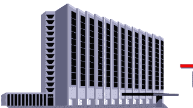

公司

本金加利息的单笔支付


贷款人

本金加利息的单笔支付

票据日期

票据到期日

## 长期应付票据


公司

贷款人

本金加利息的定期支付

本金加利息的定期支付


票据日期

票据到期日

付款可以是等额本金加利息，也可以是等额付款。

## 等额支付的长期应付票据会计处理

2009年1月1日，Foghog 从银行借款 $60,000 用于购买设备。它签署了一份 8% 的分期票据，要求分 6 次年度支付本金加利息。

|  |  | DR | CR |
|---|---|---:|---:|
| Jan 1 | 现金 | 60,000 |  |
|  | 应付票据 |  | 60,000 |

*签署 8% 票据借款 $60,000*

通过将票据面值除以现值系数来计算定期付款。

| 计算 | 表格 | 表格值 | 现值 | 付款 |
|---|---|---:|---:|---:|
| 本金除以现值系数 | $1 年金 (B.3) | 4.6229 | 60,000 | 12,979 |

## 等额付款的分期票据

| 摊销表 |  |  |  |
|---|---|---|---|
| 日期 | (A = 8% * D) 利息费用 | (B = C - A) 票据摊销* | C 票据付款 | (D = Previous -B) 余额 |
|  | 期初余额 |  |  | $ 60,000 |
| 12/31/2009 | $ 4,800 | $ 8,179 | $ 12,979 | 51,821 |
| 12/31/2010 | 4,146 | 8,833 | 12,979 | 42,988 |
| 12/31/2011 | 3,439 | 9,540 | 12,979 | 33,448 |
| 12/31/2012 | 2,676 | 10,303 | 12,979 | 23,145 |
| 12/31/2013 | 1,852 | 11,127 | 12,979 | 12,017 |
| 12/31/2014 | 961 | 12,017 | 12,979 | 0 |
|  | $ 17,873 | $ 60,000 | $ 77,874 |  |
| * 四舍五入。 |  |  |  |  |

让我们记录 Foghog 于 2009 年 12 月 31 日向银行支付的首笔付款。

|  | DR | CR |
|---|---|---|
| Dec 31 应付票据 | 8,179 | |
| 利息费用或财务费用 | 4,800 | |
| 现金 | | 12,979 |
| *记录应付票据付款* | | |

回顾摊销表，看看你是否能做出票据的第二笔付款分录。

|  | DR |
|---|---|
| Dec 31 应付票据 | 8,833 |
| 利息费用或财务费用 | 4,146 |
| 现金 | 12,979 |
| *记录应付票据付款* | |

## 模块六：所有者权益

## 本部分主要内容

- I. 公司组织形式
- II. 发行股票: IPO or SEO
- III. 资本或股本
- IV. 现金股利(Cash dividend)与股票股利(stock dividend)
- V. 库藏股(Treasury Stock)

## 公司的组织形式

依法设立的主体

与所有者分离

拥有权力或者特权

股权被谁持有

私人持有

公众持有


## 公司组织与管理

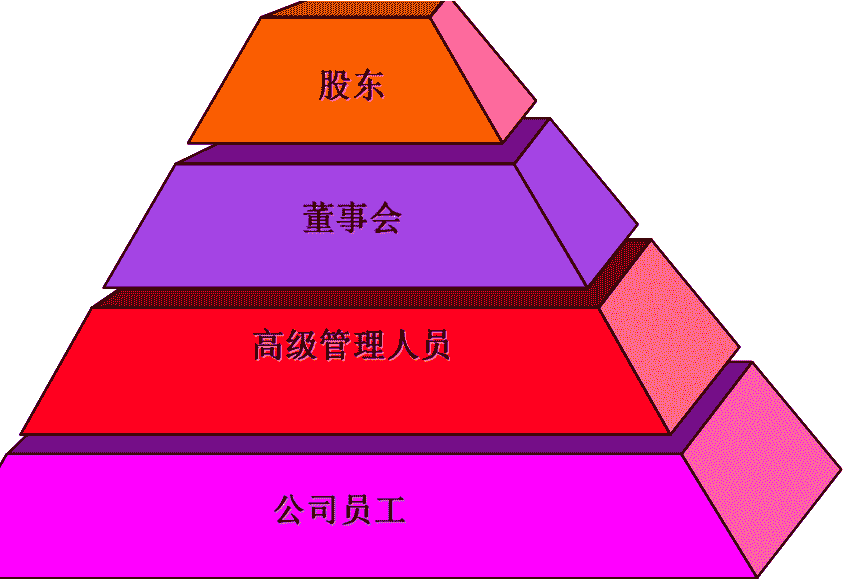

股东

董事会

高级管理人员

公司员工

## 公司组织结构图

股东

董事会

总裁

秘书

财务副总裁

生产副总裁

营销副总裁

最终控制。

股东通常每年召开一次会议。

由股东投票选出。

对管理公司负总责。

## 股东的权利

- 2 股东大会中投票权(用手投票)
- 2 买股票的权利(用脚投票)
- Ž 优先购买股票的权利
- 4 获取股利的权利
- 4 平等的公司资产剩余索取权


## 股权投资的几种形式

- 原始股
- VC
- PE
- IPO
- SEO

## 如果你是PE

- 公司A：8点上班，实行打卡制，迟到或早退一分钟扣50元；统一着装，佩带胸卡；每年组织一次旅游、两次聚会、三次联欢，每个员工每年提4项合理化建议；
- 公司B：9点上班，但不考勤。每人一个办公室，可以根据个人爱好布置；走廊的白墙上，信手涂鸦不会有人制止；饮料和水果免费敞开供应；上班时间可以去理发、游泳；
- 公司C：想什么时候来就什么时候来，爱穿什么就穿什么，把自家的狗和孩子带到办公室也可以；上班时间去度假也不扣工资。

## “投资就是投人”是PE界的警世格言

- A公司为广东金正电子有限公司，2005年7月因行业竞争激烈、转型不成功申请破产，生存期为9年
- B公司Microsoft
- C公司是Google
- 如果没有行业的判断，单纯迷信管理的投资风险相当大

## 普通股筹资的优缺点

- **普通股筹资的优点**
  - 普通股筹资没有固定的股利负担
  - 普通股股本没有规定的到期日，无需偿还
  - 利用普通股筹资的风险小
  - 发行普通股筹集股权资本能增强公司的信誉
- **普通股筹资的缺点**
  - 资本成本较高
  - 可能会分散公司的控制权
  - 可能引起股票价格的波动


## 优先股的特点

- 优先分配固定的股利
  - 优先股类似固定利息的债券。
- 优先分配公司剩余财产
  - 当公司因解散、破产等进行清算时，优先股股东将优先于普通股股东分配公司的剩余财产。
- 优先股股东一般无表决权
  - 仅在涉及优先股股东权益问题时享有表决权。
- 优先股可由公司赎回

- I. 公司组织形式
- II. 发行股票：IPO（首次公开发行）或SEO（增发）
- III. 资本或股本
- IV. **现金股利与股票股利**
- V. 库藏股

## 资本或者股本

上海汽车

2011年12月31日，单位：元

| 股东权益: |  |  |
|---|---|---|
| 股本 | (六)45 | 11,025,566,629.00 |
| 资本公积 | (六)46 | 42,172,495,420.74 |
| 盈余公积 | (六)47 | 9,804,048,604.86 |
| 未分配利润 | (六)48 | 39,220,503,321.39 |
| 外币报表折算差额 |  | 139,700,747.19 |
| 归属于母公司股东权益合计 |  | 102,362,314,723.18 |
| 少数股东权益 |  | 30,754,002,117.56 |
| 股东权益合计 |  | 133,116,316,840.74 |

## 上海汽车

## 2011年12月31日，单位：元

| 2011 年度: | 年初数(股) | 本年增减(股) |  | 年末数(股) | 年末持股比例% |
|---|---|---|---|---|---|
|  |  | 本年有限售条件流通股限售期届满(注 2) | 本次交易(注 1) |  |  |
| 一、有限售条件股份 |  |  |  |  |  |
| 境内法人持有股份 |  |  |  |  |  |
| 国有法人持有-上汽总公司 | 72,098,054 | - | 1,448,736,163 | 1,520,834,217 | 13.80 |
| 国有法人持有-工业有限 | - | - | 334,408,775 | 334,408,775 | 3.03 |
| 其他 | 648,882,479 | (648,882,479) | - | - | - |
| 小计 | 720,980,533 | (648,882,479) | 1,783,144,938 | 1,855,242,992 | 16.83 |
| 二、无限售条件股份 |  |  |  |  |  |
| 人民币普通股 |  |  |  |  |  |
| -上汽总公司 | 6,670,615,714 | - | - | 6,670,615,714 | 60.50 |
| -跃进集团 | 468,398,580 | - | - | 468,398,580 | 4.25 |
| -其他 | 1,382,426,864 | 648,882,479 | - | 2,031,309,343 | 18.42 |
| 小计 | 8,521,441,158 | 648,882,479 | - | 9,170,323,637 | 83.17 |
| 三、股份总数 | 9,242,421,691 | - | 1,783,144,938 | 11,025,566,629 | 100.00 |

## 浦发银行
2011年12月31日，单位：千元

| 股东权益 |  | |
|---|---|---|
| 股东权益 |  | |
| 股本 | 五、28 | 18,653,471 |
| 资本公积 | 五、29 | 59,543,902 |
| 盈余公积 | 五、30 | 21,805,744 |
| 一般风险准备 | 五、31 | 18,700,000 |
| 未分配利润 | 五、32 | 30,188,118 |
| 归属于母公司股东权益合计 |  | 148,891,235 |
| 少数股东权益 | 五、33 | 651,545 |
| 股东权益合计 |  | 149,542,780 |

## 资本或者股本

公司章程授权公司出售的股份总额。

股东权益
普通股，面值0.01美元；核定股份250,000,000股；已发行并流通在外92,556,295股
925,563美元

公司已向股东发行或出售的股份总额。

## 股票发行

9月1日，Matrix公司以每股25美元的价格发行了100,000股面值为2美元的股票。让我们记录这笔交易。

有限责任公司：

借：现金或者银行存款

贷：实收资本

| 日期 | 账户 | 借 | 贷 |
|---|---|---:|---:|
| 9月1日 | 现金 | 2,500,000 | |
|  | 股本 | | 200,000 |
|  | 资本公积——股本溢价（超面值缴入资本） | | 2,300,000 |

*发行100,000股普通股。*


## 股东权益（含普通股）

股东权益

普通股——面值2美元；核定股份500,000股；已发行并流通在外100,000股
200,000美元

超面值缴入资本
2,300,000美元

留存收益
650,000美元

股东权益合计
3,150,000美元

## 非现金发行股票

9月1日，Matrix公司以100,000股面值2美元的股票换入一栋价值2,500,000美元的建筑物。让我们记录这笔交易。


| 9月1日 | 固定资产 | 借 | 贷 |
|---|---|---|---|
|  |  | 2,500,000 | |
|  | 股本 |  | 200,000 |
|  | 资本公积——股本溢价（超面值缴入资本） |  | 2,300,000 |
|  | 以100,000股普通股换取土地 |  |  |

- I. 公司组织形式
- II. 发行股票：IPO（首次公开发行）或SEO（增发）
- III. 资本或股本
- IV. **现金股利与股票股利**
- V. 库藏股

## 未分配利润

上海汽车

2011年12月31日，单位：元

| 项目 | 金额 |
|---|---|
| 2011 年度: | |
| 年初未分配利润 | 24,175,780,319.71 |
| 加：本年归属于母公司股东的净利润 | 20,221,866,457.55 |
| 子公司改制的影响(注 1) | 48,242,107.61 |
| 减：提取本公司法定盈余公积 | 1,559,016,976.74 |
| 提取本公司任意盈余公积 | 1,559,016,976.74 |
| 应付普通股股利(注 2) | 1,848,484,338.20 |
| 财务公司提取外币资本准备金 | 2,715,353.43 |
| 提取子公司职工奖励及福利基金 | 256,151,918.37 |
| 年末未分配利润 | 39,220,503,321.39 |

注 2：本年度股东大会批准的上年度现金股利

根据本公司于 2011 年 5 月 27 日召开的公司 2010 年度股东大会决议,以本公司总股本 9,242,421,691 股为基准,每 10 股派发现金红利人民币 2.00 元(含税),计人民币 1,848,484,338.20 元。


## 现金股利(现金股利)

公司价值的股利折现模型
股东获得回报的一种正常而普遍的方式


公司


现金股利


股东

支付现金股利的条件：
- 1. 充足的留存收益(留存收益)
- 2. 充足的可以支付的现金

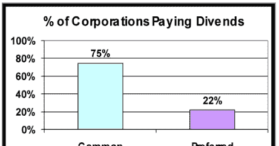

## 微软首次支付现金股利

2003年1月17日 微软表示将首次在其历史上向股东支付股利。

微软的股利公告让许多分析师感到惊讶，因为该公司一直反复拒绝将其中约400亿美元的现金和其他投资资产进行再分配的要求。尽管如此，其决定支付每股16美分的年度股利仅会花费公司约8.7亿美元

CFO Connors 说了两个原因

首先，他提到微软在科技行业低迷期间持续增长。

其次，他声称反垄断审判的解决以及针对该公司的其他几起法律案件的结束意味着微软未来无需为法律费用预留那么多资金。

## 现金股利的会计核算

### 三个重要的时点


股利宣告日

借记所有者权益
贷记负债,应付股利


股票登记日

不做会计处理


支付日

借记负债,应付股利
贷记现金

## 现金股利的会计处理

宣告发放股利时

借：利润分配

贷：应付股利

支付股利时

借：应付股利

贷：银行存款

## 现金股利的会计核算

2001年1月19日，Dana, Inc. 对其已发行的10,000股普通股宣告每股1美元的现金股利。股利将于3月19日支付给2月19日的在册股东。


股利宣告日

记录股利负债。

| Jan. 19 | 利润分配 | Dr | Cr |
|---|---|---|---|
| | | 10,000 | |
| | 应付股利 | | 10,000 |
| | 宣告每股1美元现金股利 | | |

## 现金股利的会计核算

2001年1月19日，Dana, Inc. 对其已发行的10,000股普通股宣告每股1美元的现金股利。股利将于3月19日支付给2月19日的在册股东。

2月19日登记日无需做分录。

股利支付日

记录向股东支付现金。

| Mar. 19 | 应付股利 | Dr | 10,000 | Cr |
| | 现金 | | | 10,000 |
| | 支付每股1美元现金股利 | | | |


## 思考题

- 对于上市公司来说，可以利用现金股利操纵相关指标么？


## 股票股利

分配公司的股票给股东，而股东无需任何支付

### 为什么支付股票股利？

- 保持股价是股东可承受的(可负担的)
- 传递信号，管理者对未来的信心

### 小额股票股利

分配额 ≤ 以前已发行股份的25%。

### 大额股票股利

分配额 > 以前已发行股份的25%。

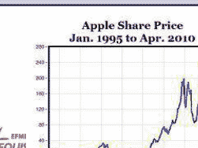

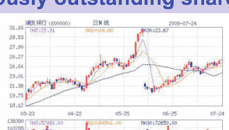

## 小额的股票股利

Quest 有100,000股面值1美元的股票已发行。2009年12月31日，Quest 宣告2%的股票股利，当时股票售价为每股10美元。股票将于2010年1月20日分配给股东

将留存收益资本化为待分配股份的市场价值。
(100,000 × 2% × $10 = 2,000 × $10 = $20,000)

2,000 × $1 面值

Dr Cr
利润分配 20,000
股本 2,000
资本公积-股本溢价 18,000
宣告2,000股(2%)股票股利

## 大额的股票股利

Router, Inc. 有50,000股面值1美元的股票已发行。2009年12月31日，Router 宣告40%的股票股利，当时股票售价为每股8美元。股票将于2010年1月20日分配给股东。让我们做出12月31日的分录。

将留存收益资本化为州法律通常要求的最低金额，即股份的面值或 stated value。
(50,000 × 40% = 20,000股 × $1面值 = $20,000)

| Dec. 31 | 利润分配 | Dr | Cr |
|---|---|---|---|
| | | 20,000 | |
| | 股本 | | 20,000 |
| | *宣告20,000股(40%)股票股利* | | |


## 股票分割 (Stock Splits)

根据股东的所有权比例，向其分配额外的公司股票。

- 老的股份：$10 面值 普通股 100 股
- 新的股份：$5 面值 普通股 200 股

## 股票股利与股票分割的效果

| | 小额股票股利 | 大额股票股利 | 股票分割 |
|---|---|---|---|
| 股东权益总额 | 无影响 | 无影响 | 无影响 |
| 普通股 | 增加 | 增加 | 无影响 |
| 资本公积 | 增加 | 无影响 | 无影响 |
| 留存收益 | 减少 | 减少 | 无影响 |
| 流通在外股数 | 增加 | 增加 | 增加 |
| 每股面值 | 无影响 | 无影响 | 减少 |

- I. 公司组织形式
- II. 发行股票: IPO or SEO
- III. 资本或股本
- IV. 现金股利(Cash dividend)与股票股利(stock dividend)
- V. 库藏股(Treasury Stock)

## 库藏股 (Treasury Stock)

### 库藏股的目的

- 1. 用于购买其他公司的股份
- 2. 避免敌意收购 (hostile takeover)
- 3. 给高管以及员工作为薪酬奖励
- 4. 支持股价


## 股票期权 (Stock Options)

股票期权是在规定期限内以固定价格购买普通股的权利。当股票价格升至固定期权价格之上时，期权的价值随之增加。


期权购买价格为每股 30 美元。

股票市场价格为每股 75 美元。

给高管期权的目的：

- 解决代理问题，使高管关注公司长期绩效
- 留住高管，留住人才

## 本部分主要内容

- I. 销售收入确认、销售折扣与折让
- II. 费用计量
- III. **利润计算**

## 净利润的基本核算流程


**商品流通企业利润表 截至2009年12月31日止年度**

| | |
|---|---|
| 销售净额 | $150,000 |
| 销售成本 | 80,000 |
| 毛利 | $70,000 |
| 营业费用 | 46,500 |
| 净利润 | $23,500 |

## 销售环节的周期

从购买开始到销售收款结束

### 销售周期

- 收到现金
- 购买原材料或者产品
- 产品生产
- 应收账款
- 销售


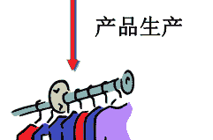

## 财务舞弊

- 要增加利润么？ **是的**
- 有什么办法呢？ **看利润的公式**
- 利润=收入-费用？ **增加收入，减少费用**
- 多招聘业务员，找个铁公鸡管费用支出？
  - **so stupid，直接虚增收入！隐瞒费用！**

有这么简单么，收入是怎样确认的呢？

## 美国GAAP的规定

- 1. 收入已实现或可实现（Realized or Realizable）
- 2. 收入已经赚取（Earned）时才予以确认

销售商品而获得的收入一般在销售当日（通常是指将商品发运给顾客的日期）确认；提供劳务而获得的收入一般在履行了为顾客提供服务的责任并构成了向顾客收取服务费时确认。

## IFRS的规定

与GAAP相比，IFRS着重从所售资产在所有权上的重要风险和报酬是否已经转移给买方来界定收入时点

（1）商品的卖方已将所售资产在所有权上的重要风险和报酬转移给了买方，即卖方已经完成了所有主要销售环节，并不再以行使所有权的方式继续参与所转让商品的管理或不再实际控制已转让的商品；

（2）在以下方面不存在重大的不确定性因素：

- ① 销售商品可望获得补偿；
- ② 生产将要发生的有关成本；
- ③ 可退货的幅度。

我国的规定与IFRS基本相同

## 收入的概念

- 销售商品
- 提供劳务
- 让渡资产使用权

- 收入：企业在日常活动中形成的、会导致所有者权益增加的、与所有者投入资本无关的经济利益的总流入。
- 日常活动：企业为完成其经营目标所从事的经常性活动，以及与之相关的其他活动。

根据“实现原则”与“稳健原则”，收入确认的基本原则是：

- 〈1〉企业已经完成了为获取营业收入所必须做的工作（换言之，客户的正常需要已经得到满足）；
- 〈2〉已经收到了相应的营业收入款项或取得了收取款项的权利（当然，也可以是取得非现金资产或抵消负债）；
- 〈3〉营业收入、相关费用、从而利润都可以“可靠”地加以计量，即不存在严重的不确定性。

## 销售商品收入

- 销售商品收入的确认条件
- 销售商品收入的计量方法
- 销售商品收入确认条件的具体应用

### 销售商品收入的确认条件

确认条件：

- 企业已将商品所有权上的主要风险和报酬转移给购货方
- 企业既没有保留通常与所有权相联系的继续管理权，也没有对已售出的商品实施有效控制
- 收入的金额能够可靠地计量
- 相关的经济利益很可能流入企业
- 相关的已发生或将发生的成本能够可靠地计量

#### 企业已将商品所有权上的主要风险和报酬转移给购货方

- 通常情况，凭证或实物交付，风险和报酬随之转移
- 某些情况，凭证或实物交付，主要风险和报酬随之转移
- 某些情况，凭证或实物交付，主要风险和报酬未随之转移
- 1. 商品不符合要求且未根据保证条款弥补
- 2. 收入能否取得取决于对方是否卖出商品
- 3. 未完成安装或检验工作，且安装或检验工作是合同重要组成部分
- 4. 合同中有退货条款，且无法确定退货可能性

#### 相关的已发生或将发生的成本能够可靠地计量

示例：甲公司约定为乙公司生产并销售一台大型设备。甲公司因生产能力不足，委托丙公司生产某部件，丙公司发生的成本经甲公司认定后按成本总额的108%支付款项。假定甲公司、丙公司均完成生产任务，并将大型设备交付乙公司验收合格。

如丙公司未将有关成本资料交甲公司认定，且甲公司无法合理估计成本金额，则不满足本确认条件。

如丙公司未将有关成本资料交甲公司认定，但甲公司能够合理估计成本金额，则视同满足本确认条件。

### 收入确认时间

#### 销售时点确认

- 交款提货：收到货款、发票账单、提货单交给对方
- 预收货款：开出销售发票并将商品产品发出
- 委托代销：收到代销清单
- 托收承付：办理托收手续

#### 销售之后收款

分期付款：分全部收款法和部分收款法

#### 销售时点前收款

大型建筑业、造船业

### 销售商品收入的计量方法

- 基本原则：通常为已收或应收金额
  - 现金折扣：扣除现金折扣前的金额确定收入；现金折扣发生时计入财务费用
  - 商业折扣：扣除商业折扣后的金额确定收入
  - 销售折让：通常冲减当期收入（资产负债表日后事项）
  - 销售退回：通常冲减当期收入（资产负债表日后事项）


## 提前付款给与的优惠折扣

信用期

折扣期

信用期

时间

收到的金额

发票金额-现金折扣

发票金额

发票日

## 现金折扣条款

2/10, n/30

折扣百分比

获得折扣的期限

无折扣

信用期

## 商品销售的会计处理

11月3日，Z-Mart 赊销商品 $2,400。该商品对 Z-Mart 的成本为 $1,600。

Dr. Cr.
应收账款 2,400
销售收入 2,400
商品以赊销方式售出

商品销售成本 1,600
库存商品 1,600
记录已售商品成本

## 销售折扣

Z-Mart 于11月12日完成一笔 $1,000 的赊销，商品成本为 $800。付款条件为 2/10, n/60，且该账户在折扣期内全额付款。

|  | Dr. | Cr. |
|---|---|---|
| 应收账款 | 1,000 | |
| 销售收入 | | 1,000 |
| *以赊销方式售出商品* | | |
| 商品销售成本 | 800 | |
| 库存商品 | | 800 |
| *记录已售商品成本* | | |
| 现金 | 980 | |
| 销售折扣 | 20 | |
| 应收账款 | | 1,000 |
| *收取应收账款现金* | | |

## 销售退回和折让

回顾 Z-Mart 售价 $2,400、成本为 $1,600 的销售。假设客户退回部分商品。退回商品售价为 $800，成本为 $600。

|  | Dr. | Cr. |
|---|---:|---:|
| 销售退回与折让 | 800 |  |
| 应收帐款 |  | 800 |
| *客户退回6月12日销售的商品* |  |  |
| 库存商品 | 600 |  |
| 商品销售成本 |  | 600 |
| *退回商品加入库存* |  |  |

## 销售退回和折让

回顾 Z-Mart 向客户售出的 $800 商品。该商品有缺陷，但客户同意保留，因为 Z-Mart 提供 $100 的价格减免。

|  | Dr. | Cr. |
|---|---:|---:|
| 销售退回与折让 | 100 |  |
| 应收账款 |  | 100 |

_记录销售折让_

- 费用的含义
- 费用的分类
- 直接费用
- 摊销费用
- 期间费用
- 销售费用
- 管理费用
- 财务费用
- 费用确认的基本原则
- 资本性支出和收益性支出
- 权责发生制
- 配比原则

## 销售成本

- 已售产品的总成本，包括：
  - 将商品库存从供应商运至我们配送中心的运费；
  - 不是为推广供应商产品而报销的具体、增量和可识别成本的供应商补贴；以及
  - 支付给商品供应商的现金折扣；
- 提供服务的成本，包括：
  - 服务员工的工资和福利成本；以及
  - 备件成本及相关运费；
- 实物盘点损失；
- 降价；
- 客户的运费和手续费；
- 与运营我们的配送网络相关的成本，包括工资和福利成本、占用成本和折旧；以及
- 将商品库存从配送中心运至零售商店的运费。

## SG&A

- 零售和企业员工的工资和福利成本；
- 零售、服务和企业设施的占用和维护成本；
- 与零售、服务和企业资产相关的折旧和摊销；
- 广告费用；
- 为推广供应商产品而报销的具体、增量和可识别成本的供应商补贴；
- 手续费用，包括银行费用和信用卡及借记卡交换费相关成本；
- 慈善捐赠；
- 外部和外包服务费；
- 长期资产减值费用；以及
- 其他管理费用，如办公用品、差旅和住宿费用。

我们国内部门的 SG&A 在 2011 财年较 2010 财年增长了 3.48 亿美元，或 5.0%。SG&A 的增加主要由新店开业以及 Best Buy Mobile 利润分成管理费的增加推动，部分被激励薪酬成本的降低所抵消。以下因素共同导致国内部门 SG&A 率较收入增长了 1.0%：

- 由于同店销售下降导致的经营杠杆下降；
- Best Buy Mobile 的持续增长（包括我们支付给 Best Buy Europe 的利润分成管理费，该费用在国际部门 SG&A 结果中抵消，因此对我们合并营业收入没有净影响）；以及
- 如上所述的供应商资金形式的变更；
- 部分被激励薪酬成本的降低所抵消。


## 上海汽车
### 2011年
### 销售费用

| 项目 | 本年累计数 | 上年累计数 |
|---|---|---|
| 运输物流费 | 7,099,458,418.94 | 6,562,506,565.85 |
| 广告宣传费 | 6,358,710,653.29 | 5,454,217,737.35 |
| 售后服务费 | 2,867,037,646.59 | 3,319,122,823.83 |
| 其他 | 6,525,585,244.25 | 6,592,970,153.34 |
| 合计 | 22,850,791,963.07 | 21,928,817,280.37 |

人民币元

## 上海汽车
### 2011年
### 管理费用

| 项目 | 本年累计数 | 上年累计数 |
|---|---|---|
| 工资薪酬等 | 5,705,891,390.02 | 3,984,004,180.34 |
| 折旧及摊销 | 942,765,879.12 | 877,677,022.38 |
| 研究开发费 | 5,725,950,096.46 | 3,970,654,366.41 |
| 技术转让费 | 1,907,681,105.24 | 1,701,244,673.28 |
| 其他 | 4,833,411,389.68 | 4,701,930,712.55 |
| 合计 | 19,115,699,860.52 | 15,235,510,954.96 |

人民币元

## 上海汽车
### 2011年
### 财务费用

| 项目 | 本年累计数 | 上年累计数 |
|---|---|---:|
| 利息支出 | 758,034,389.66 | 665,790,926.50 |
| 减：已资本化的利息费用(附注六)(19) | 1,534,724.42 | 14,673,595.95 |
| 减：利息收入 | 726,464,660.46 | 374,589,204.02 |
| 汇兑损益 | 96,227,676.98 | 10,531,333.56 |
| 远期外汇交易收益 | (144,798,055.90) | 97,892,501.07 |
| 其他 | 61,310,969.80 | 70,758,615.55 |
| 合计 | 42,775,595.66 | 455,710,576.71 |

## 期间费用会计处理

借：销售费用
贷：银行存款

借：管理费用
贷：累计折旧或者无形资产

借：管理费用
贷：原材料或者银行存款

借：管理费用
贷：应付工资

借：财务费用
贷：银行存款或者预提费用

## 利润

（1）营业利润 = 营业收入 - 营业成本 - 营业税金及附加 - 管理费用 - 销售费用 - 财务费用 - 资产减值损失 + 公允价值变动收益（-公允价值变动损失） + 投资收益（-投资损失）

（2）利润总额 = 营业利润 + 营业外收入 - 营业外支出

（3）净利润 = 利润总额 — 所得税费用

## (2) 营业外支出

- 处理非流动资产的损失
- 非货币资产交换损失
- 债务重组损失
- 公益性捐赠支出
- 非常损失

借：银行存款
贷：营业外收入——罚款收入

借：营业外支出——捐赠支出
贷：银行存款

## 上海汽车 2011年
### 营业外收入

（1）营业外收入明细如下：

单位：人民币元

| 项目 | 本年累计数 | 上年累计数 |
|---|---|---:|
| 政府补助 | 327,632,621.43 | 235,826,950.92 |
| 债务重组利得 | 1,599,254.64 | 55,431,816.16 |
| 非流动资产处置收益 | 136,338,393.71 | 101,836,973.94 |
| 无需支付的款项 | 71,665,176.68 | 36,340,608.69 |
| 动拆迁收入 | 40,729,011.00 | 2,859,083.42 |
| 非同一控制下企业合并折价购买收益 | 7,347,220.78 | 140,558,651.45 |
| 其他 | 100,091,127.39 | 46,586,676.55 |
| 合计 | 685,402,805.63 | 619,440,761.13 |

## 上海汽车 2011年
### 营业外支出

| 项目 | 本年累计数 | 上年累计数 |
|---|---|---:|
| 非流动资产处置损失 | 192,614,722.33 | 72,084,894.58 |
| 动拆迁支出 | 39,389,170.36 | 18,855,659.81 |
| 捐赠支出 | 6,018,315.39 | 57,885,386.60 |
| 赔偿支出 | 2,306,629.59 | 22,592,909.68 |
| 预计供应商赔偿损失 | - | 605,867,463.14 |
| 其他 | 114,400,813.25 | 41,026,335.33 |
| 合计 | 354,729,650.92 | 818,312,649.14 |

## 利润形成的核算
### 本年利润

P142-143表
5.11,5.12

|  |  |
|---|---|
| 营业成本<br>(商品销售成本) | 营业收入<br>(销售收入) |
| 营业税金及附加 | 营业外收入 |
| 管理费用 | 投资收益 |
| 销售费用 |  |
| 财务费用 |  |
| 营业外支出 |  |
| 发生的亏损总额 | 实现的利润总额 |

借：销售收入
投资收益
营业外收入
贷：本年利润

借：本年利润
贷：商品销售成本
营业税金及附加
销售费用
管理费用
财务费用
营业外支出

