# 上海交大安泰经管商务统计学课件（宋婷婷）

## Instructor Information

- Instructor: Tingting SONG (宋婷婷), Information Systems, ACEM, SJTU
- Email: songtt@sjtu.edu.cn
- Office phone: (021) 6293 3657
- Office room: B704, Bao Zhaolong Building, Xuhui District
- Office hour: Friday 14:00-15:50 at Minhang; or by appointment
- Course website: https://oc.sjtu.edu.cn/courses/35029; https://oc.sjtu.edu.cn/courses/35030

## TA Information

- TA: Lin Dai (戴琳), dai_lin@sjtu.edu.cn; Junyan Qiu (邱俊彦), littleqjy@sjtu.edu.cn
- Office hour: TBA
- He will be responsible to answer all questions in homework.
- Please feel free to ask any question related to this course.

## Course Motivations

- 商鞅在《商君书》中提出，“教者，臣主之术而国之要也。故万国失教而国复乱，臣主失教而复乱者，故之有也。”
  “强国需知十三数”（前微, 390B.C.）
- "I keep saying that the sexy job in the next 10 years will be statisticians, and I'm not kidding." (Hal Varian, Google's chief economist in 2009 with The McKinsey Quarterly)
- 若想了臣带领在想什么, 我们必须学统计学, 凡为统计学在之描述他秒旨意, 一众鲁伦斯, 宁丁格尔
- 了臣统计学秒人, 提尔都复会差。

## Course Objective

## Remarks – Grading Policy

- 5 biweekly Homework – 40%
- 1 Final Exam (weeks 17-18) – 60%

## Class Policy

- **Attendance policy**: students are expected to attend all classes.
  - Students shall be responsible for any problem caused by being absent from a class.
  - Students who anticipate being absent because of any religious observance should, whenever possible, notify faculty in advance of such anticipated absence.
- **Make-up policy**: A make-up for the final exam will be offered only if there is a legitimate reason for missing the final exam.
- **Late submission**: NOT Accepted.
- **Academic Honesty**: Students are expected to read and understand the university's policy on academic integrity as laid out in the Undergraduate Bulletin. Plagiarism and cheating will not be tolerated and will be penalized.

Plagiarism causes the failure of this course!
抄袭作弊，后果很严重！

## Short Summary

- If you have a question, please ask!
  - If you are confused, you are probably not alone.
  - I do not mind being interrupted.
  - If I am going too fast, just let me know.

- I may not always have an immediate answer, but all questions will be answered eventually.

- Any questions?

## Course Information

## Introduction

- What is Data?
- What is Statistics?
- What is Business statistics?

## Some Interesting Stories

## Descriptive Statistics (Chapter 2-3)

### What is Data?

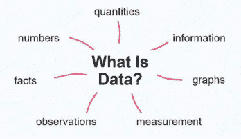

- DATA is raw facts and figures.
- They have **very little meaning** until they are sorted or calculated.

## 大数据 ⇒ 统计学

- 大数据关乎**智能统计与分析**。
- 为什么？
  - **体量**
  - **速度**
  - **多样性**

- **大数据能做什么？** 在理解以下方面拥有巨大前景：
  - **共性：** 在存在大量变异（噪声）的情况下
  - **异质性：** 个性化服务。

- 它们对以下方面产生巨大影响：
  - **系统：** 存储、通信、计算架构
  - **分析：** 统计、计算、优化

## 上课之前，你可能认为统计是……

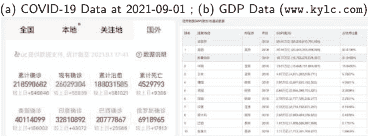

- 统计资料（Statistics）可以指数值事实，如平均值、中位数、百分比和最大值，这些事实帮助我们了解各种公共卫生、商业和经济状况。

## 学完这门课程后，你会知道统计学是

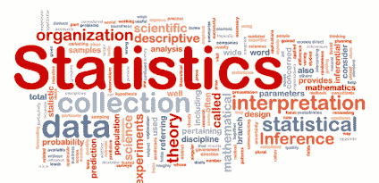

- 统计学（Statistics）也可以指收集、分析、解释和呈现数据的艺术与科学。

## 什么是统计学？

- 两个重要目标：
  - 通过概率建模从样本推断总体。
  - 预测未来结果

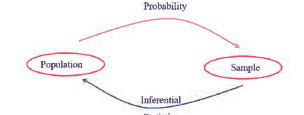

- 概率：描述数据是如何从总体中抽取的。
- 统计：通过概率建模推断总体。

## 统计学的历史

Biometrika：高尔顿和皮尔逊于1901年创办了Biometrika，作为第一本统计学杂志；后者（皮尔逊）在伦敦大学学院（UCL）创立了世界上第一个统计学系。

古代统计学的开端（公元前450年）：“三个计数问题”

16-17世纪统计学的“概率”基础：来自赌博的概率概念和理论

现代统计学的“范式改革与创新”（1900-2000）：第四范式：数据密集型科学发现

古代统计学的成长（公元2年）：中国汉朝进行了人类历史上第一次准确的人口普查

18-19世纪统计科学的“四大发现”：大数定律、贝叶斯定理、误差分析、回归与相关

来源：郁东，刘东升，刘爱霞，统计的历史与统计学发展. 2017.

## 什么是商业统计？

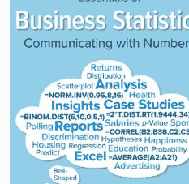

## 在商业与经济中的应用

- **会计（Accounting）**：会计师事务所为客户进行审计时，会使用*统计抽样程序*。
- **金融（Finance）**：金融分析师使用各种*统计信息*来指导他们的投资建议。
- **经济学（Economics）**：经济学家使用*统计信息*对经济或其某一方面进行预测。

## 总结：统计学（Statistics）

### 1 描述统计学（Descriptive Statistics）

- 统计学用于总结和呈现数据。
- 局限性：只关注观测数据的性质，不涉及总体。

### 2 统计推断（Statistical Inference）

- 需要关于总体的信息，而数据只能从样本中收集。
  - 总体：特定研究中所有感兴趣元素的集合
  - 样本：总体的子集
- 使用样本数据 ⇒ 推断总体性质
  - 推导估计值：均值、方差、置信区间
  - 进行假设检验：参数（非参数）检验、方差分析、回归、实验设计

## “平均值”的不同含义

- 问题1：什么是平均值？[均值、中位数、众数……](#)
- 问题2：平均值有什么用？[衡量集中趋势](#)
- [“三个计数问题”](#)：墙有多高？

- **均值**：算术平均数
  \(\bar{x}=\frac{1}{n}\sum_{i=1}^{n}x_i\)
- **众数**：数据集中出现频率最高的值
- **中位数**：将较高的一半与较低的一半分开的中间值

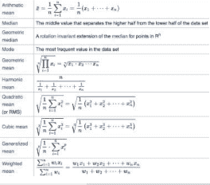

## 伯克森悖论

### 示例 1：美国大学申请

- 两个常见要求：**高中 GPA** 和 **SAT** 成绩。
- **问题：** 对于学生而言，**高中 GPA** 与 **SAT** 之间有什么关系？
- 你的猜测：高中 GPA 和 SAT 成绩是 **正相关** 的。
- **问题：** 对于就读于 **中档大学** 的学生，**高中 GPA** 与 **SAT** 之间有什么关系？
- 现在你的猜测是什么？
- **中档大学要求：** GPA 达到足够高或 SAT 成绩达到足够高即可。

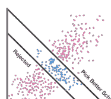

- **优秀组**：同时拥有高 GPA 和高 SAT 成绩的人很可能进入更高层次的学校。
- **中等组**：实际就读该校的学生范围由图中蓝点给出。
- **结果：**
  - 中档大学中呈现向下趋势
  - 总体人群中呈现向上趋势
- 一种选择偏差！

### 示例 2：约会问题

- 有趣事实：在你约会的人中（或你未来可能约会的人中），有吸引力的人往往是混蛋？
  - 心理社会理论
  - 一个简单的统计解释：选择偏差！
    - 你选择约会对象取决于两个因素：吸引力和性格。

| 吸引力 | Nice (暖) | Mean (渣) |
|---|---|---|
| Attractive (美) | ✓ | ✓ |
| Unattractive (丑) | ✓ | × |

结果：当你剔除了性格差且不吸引人的那类人时，这就造成了吸引力与性格之间虚假的负相关。

## 辛普森悖论

### 示例：性别偏见

- 一些事实：某大学中女性和男性的入学率

| 性别 | 申请者 | 录取 | 比例 |
|---|---|---|---|
| Female | 120 | 50 | 42% |
| Male | 120 | 25 | 21% |

- 该校的男生抗议男性入学率过低。

- 你认为该大学存在性别歧视吗？

- 详细事实：

| 学校 | Female Applicant | Female Recruit | Female Rate | Male Applicant | Male Recruit | Male Rate |
|---|---|---|---|---|---|---|
| Business School | 100 | 49 | 49% | 20 | 15 | 75% |
| Law School | 20 | 1 | 5% | 100 | 10 | 10% |

- 结论：若干不同数据集中的趋势，在这些数据集合并后，该趋势会消失或逆转。

- 混杂变量：因为学校是一个不可忽略的隐藏变量。

## 总结：Seeing⇒Doing⇒Imagining

- 3. COUNTERFACTUALS
  - ACTIVITY: Imagining, Reasoning, Forecasting
  - NATURE: ...
  - EXAMPLES: ...
- 2. INTERVENTION
  - ACTIVITY: Doing, Manipulating
  - NATURE: ...
  - EXAMPLES: ...
- 1. ASSOCIATION
  - ACTIVITY: Seeing, Observing
  - NATURE: ...
  - EXAMPLES: ...

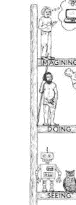

## 数据类型

- DATA 是原始事实和数据。
  - Categorical (Qualitative) variable
  - Quantitative variable
- 在它们被整理和计算之前，它们几乎没有意义。
  - 描述性统计
    - 表格
    - 图表
    - 数值度量

## 表格展示

分类变量

- 分类数据：可按特定类别分组的数据
- 表格展示方法：
  - Frequency Distribution (频数表)
  - Relative Frequency Distribution (相对频数分布)
  - Percent Frequency Distribution (百分数频数表)
- 示例：Yaduo Resort 的住客被要求对住宿质量进行评级，评级为优秀、以上平均、平均、以下平均或较差。
- 20 位住客的评级结果样本

| Rating | Frequency | Relative Frequency | Percent Frequency |
|---|---|---|---|
| Poor | 2 | 0.10 | 10 |
| Below Average | 5 | 0.25 | 25 |
| Average | 6 | 0.30 | 30 |
| Above Average | 6 | 0.30 | 30 |
| Excellent | 1 | 0.05 | 5 |
| Total | 20 | 1.00 | 100 |

| Below Average | Average | Above Average |
|---|---|---|
| Above Average | Above Average | Above Average |
| Above Average | Below Average | Poor |
| Average | Poor | Above Average |
| Above Average | Excellent | Above Average |
| Average | Above Average | Average |
| Above Average | Average |  |

## 图形显示

分类变量

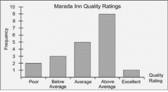

(a) 条形图

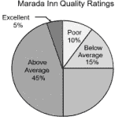

(b) 饼图

## 图形显示

定量变量

- 打点图 和 直方图

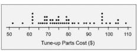

(a) 打点图

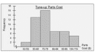

(b) 直方图

- 直方图也可以用来显示相对/百分比频率
- 叶茎图

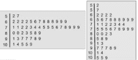

## 表格显示

两个变量

- 交叉频数表

- 示例：过去两年中按风格和价格出售的 Finger Lakes 住宅数量如下所示。

| Price Range | Home Style |  |  |  | Total |
|---|---|---|---|---|---|
|  | Colonial | Log | Split | A-Frame |  |
| < $250,000 | 18 | 6 | 19 | 12 | 55 |
| ≥ $250,000 | 12 | 14 | 16 | 3 | 45 |
| Total | 30 | 20 | 35 | 15 | 100 |

- 备注：当交叉频数表涉及汇总数据时，我们应调查是否存在隐藏变量可能影响结果。 （如辛普森悖论）

## 总结：表格与图表

Data
Categorical Data
Quantitative Data
Categorical Data
Tabular Displays
Graphical Displays
Tabular Displays
Graphical Displays
• 频数分布
• 相对频数分布
• 百分比频数分布
• 交叉频数表
• 条形图
• 饼图
• 并列条形图
• 堆叠条形图
• 频数分布
• 相对频数分布
• 百分比频数分布
• 累积频数分布
• 累积相对频数分布
• 累积百分比频数分布
• 交叉频数表
• 打点图
• 直方图
• 叶茎图
• 散点图

## 位置度量

• **示例：** 在一所大学城*随机抽样*了七十间效率公寓。月租金如下所示。

| Monthly rents |
|---|
| 525 530 535 535 535 535 535 535 540 540 |
| 540 540 540 545 545 545 545 545 560 560 |
| 550 550 550 550 550 550 550 560 565 565 |
| 565 570 570 572 575 575 575 580 580 580 |
| 580 585 590 590 590 600 600 600 600 600 |
| 610 615 625 625 625 635 640 645 670 670 |
| 675 675 680 680 700 700 700 700 715 715 |

• [你如何总结以上数据？](#)

- 均值: \(\bar{x}=\frac{\sum x_i}{n}=\frac{41356}{70}=590.80\)
- 中位数: \((575+575)/2=575\)
- 众数: 550
- 几何均值: \(\bar{x}_g=\sqrt[n]{x_1x_2\cdots x_n}\)
- 加权均值: \(\bar{x}_w=\frac{\sum w_i x_i}{\sum w_i}\)
- 截断均值: 删除最小值和最大值一定百分比后的数据的均值

## 位置度量

- 示例：样本数据

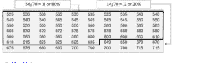

- 百分位数: 第 p 百分位数意味着大约有 p% 的观测值小于它。

  - 第 p 百分位数的位置: L_p = p/100 (n + 1) = 80/100 (70 + 1) = 56.8

  - 第 80 百分位数 = 635 + 0.8(649 − 635) = 646.2

- 四分位数: Q1 = 第 25 百分位数, Q2 = 第 50 百分位数 = 中位数, Q3 = 第 75 百分位数

  - L_p = 53.25, Q3 = 625 + 0.25(625 − 625) = 625

注意这里，原来图件有错误，末0.25是末0.75

## 变异度量

- 示例：样本数据

| 625 | 630 | 530 | 535 | 535 | 535 | 535 | 535 | 540 | 540 |
| 540 | 540 | 540 | 545 | 545 | 545 | 545 | 545 | 550 | 550 |
| 550 | 550 | 550 | 550 | 550 | 580 | 580 | 580 | 565 | 565 |
| 565 | 570 | 570 | 572 | 575 | 575 | 575 | 580 | 580 | 580 |
| 580 | 585 | 590 | 590 | 590 | 600 | 600 | 600 | 600 | 610 |
| 610 | 615 | 625 | 625 | 625 | 635 | 649 | 650 | 670 | 670 |
| 675 | 675 | 680 | 690 | 700 | 700 | 700 | 700 | 715 | 715 |

- 全距: 最大值 - 最小值 = 715 − 525 = 190

- 四分位距: Q₃ − Q₁ = 80

- 方差: s² = Σ(xᵢ - x̄)² / (n-1) = 2996.16

- 标准差: s = √s² = 54.74

- 变异系数: [s / x̄ × 100] % = 9.27%

## 分布形状度量

- **偏度：衡量变量抽样概率分布形状对称性**

$$=\frac{n}{(n-1)(n-2)}\sum\left[\frac{x_i-\bar{x}}{s}\right]^3$$

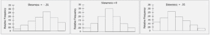

- **示例：** 公寓租金

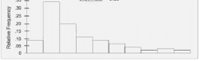

## 相对位置的度量
- 经验法则：三西格玛经验法则（68–95–99.7 规则）
- 对于具有钟形（或正态）分布的数据，
- 大约 68% 的数据值将落在均值的 1 个标准差之内。
- 大约 95% 的数据值将落在均值的 2 个标准差之内。
- 几乎所有（99.7%）的数据值将落在均值的 3 个标准差之内。(3 – σ)

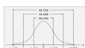

## 检测异常值
注意：这里原文件有些乱，图和文字表达复杂

- 异常值：超出 3σ 的数据值，它可能是
  - 一个错误记录的数据值
  - 一个正确记录但属于数据集的数据值
- 示例：公寓租金

| 525 | 530 | 530 | 535 | 535 | 536 | 536 | 535 | 540 | 540 |
| 540 | 540 | 540 | 545 | 545 | 546 | 545 | 545 | 560 | 560 |
| 550 | 550 | 550 | 550 | 550 | 590 | 560 | 580 | 565 | 565 |
| 565 | 570 | 570 | 572 | 575 | 575 | 575 | 580 | 580 | 580 |
| 580 | 585 | 585 | 590 | 600 | 600 | 600 | 600 | 600 | 610 |
| 610 | 615 | 625 | 625 | 625 | 635 | 640 | 650 | 670 | 670 |
| 675 | 675 | 680 | 690 | 700 | 700 | 700 | 700 | 715 | 715 |

- x̄ = 590.80，s = 54.74
- 99.7% 的数据位于 426.58 和 755.02 之间
- 没有异常值。

## 检测异常值
注意：这里原文件有些乱，图和文字表达复杂

- 异常值：或者，我们可以使用一个简单的方法，即 z 分数小于 -3 或大于 +3 的数据值
- 示例：公寓

公寓租金的标准化值
| -1.20 | -1.11 | -1.11 | -1.02 | -1.02 | -1.02 | -1.02 | -1.02 | -0.93 | -0.93 |
| -0.93 | -0.93 | -0.93 | -0.84 | -0.84 | -0.84 | -0.84 | -0.84 | -0.75 | -0.75 |
| -0.75 | -0.75 | -0.75 | -0.75 | -0.75 | -0.56 | -0.56 | -0.56 | -0.47 | -0.47 |
| -0.47 | -0.98 | -0.34 | -0.34 | -0.29 | -0.29 | -0.29 | -0.20 | -0.20 | -0.20 |
| -0.20 | -0.11 | -0.01 | -0.01 | 0.01 | 0.17 | 0.17 | 0.17 | 0.17 | 0.36 |
| 0.35 | 0.44 | 0.62 | 0.62 | 0.62 | 0.81 | 1.06 | 1.08 | 1.45 | 1.45 |
| 1.54 | 1.54 | 1.63 | 1.81 | 1.99 | 1.99 | 1.99 | 1.99 | 2.27 | 2.27 |

没有异常值。

## 五数概括法与箱线图
- 五数概括法：最小值；第一四分位数；中位数；第三四分位数；最大值。
- 示例：公寓租金
  - 最小值 = 525；第一四分位数 = 545；中位数 = 575；第三四分位数 = 625；最大值 = 715
- 箱线图

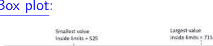

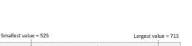

- 符号 *：超出下限和上限的数据被视为异常值，通常在图中用符号 * 显示。

## 关联性的度量
### 两个变量
- 协方差：样本：$S_{XY} = \frac{\sum_{i}(x_i-\bar{x})(y_i-\bar{y})}{n-1}$；总体：$\sigma_{XY} = \frac{\sum_{i}(x_i-\mu_x)(y_i-\mu_y)}{N}$
- 相关系数：样本：$r_{XY} = \frac{S_{XY}}{S_X S_Y}$；总体：$\rho_{XY} = \frac{\sigma_{XY}}{\sigma_X \sigma_Y}$
- 示例：高尔夫球研究
  - 一位高尔夫球手有兴趣研究击球距离与 18 洞得分之间是否存在关系。

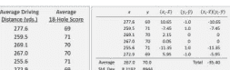

- 样本协方差：$S_{XY} = \frac{\sum (x_i-\bar{x})(y_i-\bar{y})}{n-1} = \frac{-35.40}{6-1} = -7.08$
- 样本相关系数：$r_{XY} = \frac{S_{XY}}{S_X S_Y} = \frac{-7.08}{8.22 \times 0.89} = -0.9631$

## 总结：数值度量

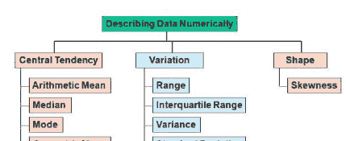

## 动机
交叉熵无方向！

- 上牌交会性学阅行（da）校（huang）为占地发5000亩，乱三敖规校立统。7个，描个线复为附发都三个人绕。，在某些墓华线复为合组二两个线。
- 作为性二对夸的学长掌握，想布议学生对学枝说。的组价，这性新生 侍文性美（maikeng）万阔！

## 动机
变性概率的！

- 有感以下几种方案：
  - 表校布致股票有交性美绩意见了呢(KOL)，根据意见了踢出议制定交性美锐行动。
  - 样个锐。门袋安排未锐感组，茶集学生对于若锐。的美锐出议。
  - 二月十二会众公开交性美锐投票主动，根据投票信息创作交性美锐方面。

- 作为商务统计的刘秀学生代表，你计划提出更为发学三么的方案制定交性美锐行动！
  - 抽样（Sampling）
  - 点估计（Point estimation）

## 什么是抽样？
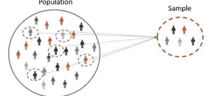

- 总体（population）是所关注的所有元素的集合。
- 样本（sample）是总体的一个子集。

## 为什么抽样？
- 在实践中，由于数据收集成本过大，总体的完整数据**难以获取**。
- **抽样（Sampling）**旨在收集部分总体数据，以对总体特征进行**推断**。

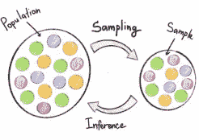

## 抽样误差
- 采用**适当的抽样**方法，**样本结果**将为总体参数提供“良好”的估计。

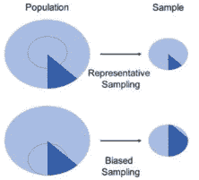

- 换句话说，我们希望最小化抽样误差。

## 抽样类别
概率抽样：总体中的每个元素被抽中的机会相等。

- 简单随机抽样（simple random sampling）
- 分层随机抽样（stratified random sampling）
- 整群抽样（cluster sampling）
- 系统抽样（systematic sampling）

非概率抽样（non-probability sampling）：总体中的元素取决于研究者的主观判断或便利性，而非随机选择。

- 便利抽样：按便利性
- 判断抽样：按专家经验

## 简单随机抽样
简单随机抽样：给定样本量 n 和总体规模 N，每个可能的样本量为 n 的样本被选中的概率相同。

示例（美纸纸纸）：假设该行校为 乱三9000复学生，我们想从中抽取1200复学生，若概何在简单纯为抽样？

1. 为学生编号 1 到 9000。
2. 生成一个随机数字表。
3. 从表中按四位一组选择随机数字。
4. 如果数字大于 9000，则丢弃。

参见下面的随机数字表。

## 简单随机抽样
- 我们可以从表中的任意位置开始选择随机数字，并沿我们选择的方向系统地移动：
  - 例如，我们从 9986（即第二个数字的后四位）开始。它大于 9000，因此被丢弃。
- 然后，接下来的四位数字（即 7174）小于 9000，因此被选中。

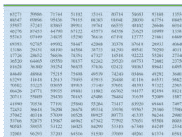

- 注意：当我们提到简单随机抽样时，我们假定抽样是不放回的。

## 简单随机抽样
- 如果总体无限大怎么办？

- 释义：概率我们在度打劳对百客四六行简单随机为抽样，百客的数量发格丸呢，那么我们可以随为抽取1200复百客?

1. 每个被选中的元素必须来自同一个总体
   - 例如，从购买商品的人中抽样，因为有些人可能只是来使用洗手间。

2. 每个元素是独立抽取的
   - 例如，每当一位顾客出示折扣券（随机且独立于其他顾客）时，就选择下一位接受服务的顾客。

## 分层随机抽样（Stratified Random Sampling）
1. 首先根据某些特征将总体中的元素划分为称为层的组。
2. 层形成后，从每层中抽取一个简单随机样本。

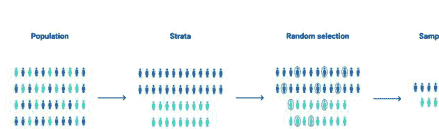

## Stratified Random Sampling（分层随机抽样）

- **Example（示例）**：抽取1200名学生，如何使用分层随机抽样？
  1. 有某教学年级分层，年级一、年级二、年级三、年级四、年级五、年级六（假设6层，每层人数相等）
  2. 从每层中简单随机抽取200人

## Cluster Sampling（整群抽样）

1. The elements in the population are first divided into separate **groups** called **clusters**.
   - Each cluster is a **representative small-scale version** of the entire population.

2. A simple random sample of the clusters is then taken and **all elements within each sampled cluster** form the sample.

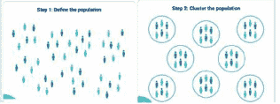

## Cluster Sampling (聚类抽样)

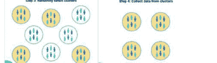

Example (美国纽约)：抽取1200学生，若采用聚类抽样？

1. 有些学院分校，假设有60个学院，每个学院150人。
2. 根据研究所要的数据载目，至少要抽取1200名学生，则要抽取8个校。
3. 60个校里抽取8个校(simple random sampling)，抽取出来的校内学生均可统计。四行抽位。

## Summary

- The comparisons of three sampling methods.

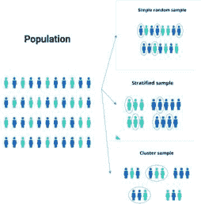

## Summary

- For stratified random sampling, if the elements in one group are much alike, the sample error will be smaller than simple random sampling.
- For cluster sampling, if the elements in one group are not alike, the sample error will be smaller than simple random sampling.

Figure: Stratified random sampling

Figure: Cluster random sampling

## Point Estimation

- Now, we have used one of the sampling methods to obtain the following sample.
- [Example（示例）]：假设我们对30名同学对于一件事的打分如下

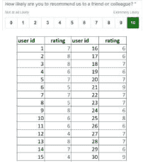

## Point Estimation

- What should we do next?
- Use the sample data to answer our proposed questions. For example:
  1. 大学生对于 某项的整体打分如何？
  2. 打分在6分及以上的此项有多少？
- Statistically, we can use point estimation to answer the above questions, which is a form of statistical inference.
  - Use the data from a sample (样本数据) to compute a value of the sample statistics (estimator) that serves as an estimate of a population parameter (总体参数).

## Point Estimation

Typical point estimators (点估计量) are shown as follows.

| | Population Parameter | Point Estimator | Statistic |
|---|---|---|---|
| Mean | μ | x̄ | Σx_i / n |
| Variance | σ² | s² | Σ(x_i - x̄)² / (n-1) |
| Proportion | p | p̄ | x / n |

- After-class exercise: collect your own sample to infer overall rating and variance of SJTU students.

## Sampling Distribution: Intuition

- The point estimator (点估计量) is essentially a random variable.
  - What is a random variable?
  - A set of possible values from a random experiment.

- Example (示例):
  - 假设我们第一次随机抽取30名同学平均数为6.5，第二次随机抽取30名同学平均数再计算...
  - We can repeat the process of selecting a simple random sample of 30 samples by 500 times.
  - Each time computing the values of x̄ (p̄). We may have the frequency histogram of x̄.

## Sampling Distribution

- Because the various possible values of \(\bar{x}\) (\(\bar{p}\)) are the result of different simple random samples, the probability distribution of \(\bar{x}\) (\(\bar{p}\)) is called the sampling distribution of \(\bar{x}\) (\(\bar{p}\)).
  
- Knowledge of this sampling distribution and its properties will enable us to know how close the sample mean \(\bar{x}\) (\(\bar{p}\)) is to the population mean \(\mu\) (\(p\)).
  
- The sampling distribution of \(\bar{x}\) (\(\bar{p}\)) has an expected value or mean, a standard deviation, and a characteristic shape or form.

## Sampling Distribution of x̄

Expected Value of x̄
E(x̄) = μ under simple random sampling (i.i.d.), where μ is the population mean.

Standard Deviation of x̄
Infinite Population: σ_x̄ = σ / √n

Finite Population (without replacement): σ_x̄ = √[(N - n)/(N - 1)] · (σ/√n), where N is the population size. √[(N - n)/(N - 1)] finite population correction factor (FPC).

Note: when the sample size is less than or equal to 5% of the population size, we can use σ_x̄ = σ/√n to estimate the standard deviation of finite population.

## x̄ 的抽样分布

- **x̄ 的抽样分布的形式**
  1. 总体具有正态分布
     - 对于任意样本容量，x̄ 的抽样分布都是正态分布。
  2. 总体不具有正态分布
     - 我们需要足够大的样本容量，此时 x̄ 的抽样分布近似服从正态分布（中心极限定理）。

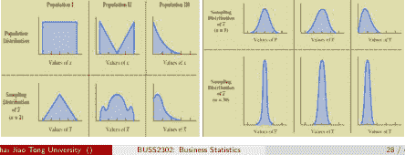

## x̄ 的抽样分布

- x̄ 的抽样分布的实际价值
  - 我们不能期望样本均值 x̄ 恰好等于总体均值 μ。
  - 在给定抽样分布的情况下，我们可以提供关于 x̄ 与 μ 之间差距的概率信息。

- 示例：某总体（计算误差在0.5分以内的概率）
  - 已知 μ=6，σ=1，样本容量 n 为 16。
  - E(x̄)=μ=6；σ_x̄ = σ/√n =0.25

Pr{5.5 ≤ x̄ ≤ 6.5}
= Pr{ (5.5 − E(x̄))/σ_x̄ ≤ (x̄ − E(x̄))/σ_x̄ ≤ (6.5 − E(x̄))/σ_x̄ }
≈ Φ(2) − Φ(−2) = 0.9544

- |x̄ − μ| ≤ 0.5 的概率为 95.44%

## x̄ 的抽样分布

- 如果将样本容量从 16 增加到 25，会怎样呢？

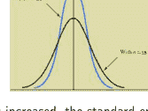

- 1. 随着样本容量增大，均值的标准误差会减小。

- 2. 较大的样本容量能提供更高的概率，使样本均值落在总体均值的指定距离内。

- 课后练习：尝试估计当样本容量从 16 增加到 25 时的概率。

## p̂ 的抽样分布

- 样本比例 p̂ 是总体比例 p 的点估计量。
- 回顾：p̂ = x / n
  - x = 样本中具有感兴趣特征的元素的个数
- p̂ 也是一个随机变量。
- 它的概率分布称为 p̂ 的抽样分布。
- 类似地，要确定样本比例 p̂ 与总体比例 p 有多接近，我们需要了解以下内容：
  1. p̂ 的期望值或均值；
  2. p̂ 的标准差；
  3. p̂ 的抽样分布的形状或形式。

## $\bar{p}$ 的抽样分布

- 总体分布是**伯努利分布**。因此 $\bar{p}$ 的抽样分布不是精确的正态分布。

- 回顾：

  - 假设我们随机抽取 $n$ 个独立同分布的学生。这里 $X_i = 1$ 表示女生，$X_i = 0$ 表示男生，即

$X_i \sim \operatorname{Bernoulli}(p),\ \text{for } i = 1, 2, \ldots, n.$

$P(X = 1) = p$

$P(X = 0) = 1 - p$

$\mu \equiv E(X) = p$

$\sigma^2 \equiv Var(X) = E(X^2) - E(X)^2 = p(1-p)$

## $\bar{p}$ 的抽样分布

- **$\bar{p}$ 的抽样分布的实际价值**
  - 与 $\bar{x}$ 类似，在给定抽样分布的情况下，我们可以提供关于 $\bar{p}$ 与 $p$ 之间差距的概率信息。
  - **示例：** 某总体（假设对该总体，女生人数占总人数的比率 $p=40\%$，随机抽取 25 位学生，计算样本比例 $\bar{p}$，求 $\bar{p}$ 的误差在 0.05 以内的概率）
    - 已知 $p=0.4$，样本容量 $n$ 为 25。
    - $E(\bar{p})=p=0.4$；$\sigma_{\bar{p}}=\sqrt{\frac{p(1-p)}{n}}=0.098$
    - $Pr\{0.35\leq\bar{p}\leq0.45\}=Pr\left\{\frac{0.35-E(\bar{p})}{\sigma_{\bar{p}}}\leq\frac{\bar{p}-E(\bar{p})}{\sigma_{\bar{p}}}\leq\frac{0.45-E(\bar{p})}{\sigma_{\bar{p}}}\right\}$
    - $\approx\Phi(0.51)-\Phi(-0.51)=0.39$
    - $|\bar{p}-p|\leq0.05$ 的概率仅为 39%
  - 类似地，**较大的样本容量**提供**更高的概率**，使样本比例落在总体比例的指定距离内。

## 点估计量的性质

- 到目前为止，我们已经学习了一些点估计量，如样本均值（x̄）和样本比例（p̂）。

- 在将样本统计量用作点估计量之前，统计学家会检查该样本统计量是否表现出与良好点估计量相关的某些性质。

- 此后，我们用 θ̂ 来表示相应的样本统计量，如样本均值和样本比例。

- 点估计量的性质：

## 点估计量的性质

- **Efficiency（有效性）**：如果一个随机样本可以用来提供同一总体参数的两个无偏点估计量，我们会更倾向于使用**标准误差较小**的点估计量。
  - 标准误差较小的点估计量被认为比另一个具有**更大的相对有效性**。

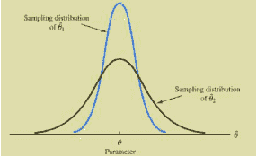

- **Consistency（一致性）**：如果点估计量的取值随着样本量的增大而趋向于总体参数，则该点估计量是**一致的**。

$$\lim_{n\to\infty}P\{\hat{\theta}=\theta\}=1.$$

- 样本均值 $\bar{x}$ 是否是 $\mu$ 的一致且无偏估计量？
  - 例如：$E(\bar{x})=\mu$；$\bar{x}$ 是一个一致估计量。回想一下 $\sigma_{\bar{x}}=\frac{\sigma}{\sqrt{n}}$。
  - 我们得出结论，更大的样本量倾向于提供更接近总体均值 $\mu$ 的点估计。

## Summary

1. Introduction
2. Sampling Method
3. Point Estimation and Sampling Distributions
4. Summary

### Method 2: Stratified random sampling

- 假设该学校学生由一年级、二年级、三年级、四年级、五年级、六年级这六个年级组成，且每个年级的学生数为1500人。
- Then in each grade, select 200 students using simple random sampling.

### Method 3: Cluster sampling

- 假设该学校由60个学院组成，每个学院150人。
- Then select 8 schools using simple random sampling.
- Note: All the students in selected classes belong to the sample.

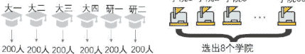

*Figure: Stratified random sampling and Cluster sampling*

### Step 2: Point Estimation

- Estimate the mean $\mu$ of rating and the proportion $p$ that rating is higher than 6.

**Estimator for $\mu$**

- Sample mean $\bar{x} = \frac{\Sigma \text{rating}(x_i)}{n} = 6.1$

**Estimator for $p$**

- Sample proportion $\hat{p} = \frac{\Sigma X_i}{n} = 0.61$, where $X_i = 1$ if $x_i \geq 6$ and $0$ otherwise.

| sample id | rating $(x_i)$ | $X_i$ |
|---|---|---|
| 1 | 7 | 1 |
| 2 | 8 | 1 |
| 3 | 8 | 1 |
| 4 | 6 | 1 |
| 5 | 5 | 0 |
| ... | ... | ... |
| 1200 | 4 | 0 |

### Step 3: Use sampling distribution to justify the precision of estimator

Suppose a priori belief about rating is that $\mu = 6$, $\sigma = \sqrt{3}$, $n=1200$.

**Precision for $\mu$**

$E(\bar{x})=\mu=6$; $\sigma_{\bar{x}} = \sigma/\sqrt{n} = 1/20$.

The probability that $|\bar{x} - \mu| \leq 0.1$ is

$$\Pr(5.9 \leq \bar{x} \leq 6.1)
= \Pr\left\{\frac{5.9 - E(\bar{x})}{\sigma_{\bar{x}}} \leq \frac{\bar{x} - E(\bar{x})}{\sigma_{\bar{x}}} \leq \frac{6.1 - E(\bar{x})}{\sigma_{\bar{x}}}\right\}
\approx \Phi(2) - \Phi(-2) \approx 0.9544$$

The probability that sampling error is less than $0.1$ is $95.44\%$.

Suppose a priori belief about proportion that rating is higher than 6 is $p = 0.6$.

**Precision for $p$**

$E(\bar{p}) = p = 0.6$; $\sigma_{\bar{p}} = \sqrt{\frac{p(1-p)}{n}} \approx 0.014$.

The probability that $|\bar{p} - p| \le 0.01$ is

$$\Pr(0.59 \le \bar{p} \le 0.61)
= \Pr\left\{\frac{0.59 - E(\bar{p})}{\sigma_{\bar{p}}} \le \frac{\bar{p} - E(\bar{p})}{\sigma_{\bar{p}}} \le \frac{0.61 - E(\bar{p})}{\sigma_{\bar{p}}}\right\}
\approx \Phi(0.714) - \Phi(-0.714) \approx 0.5222$$

The probability that sampling error is less than $0.01$ is only $52.22\%$. If the probability cannot meet the expectation, try to increase sample size.

### Take-aways

1. Sampling is unavoidable and will induce sampling error.
2. To reduce sampling error, we need to choose the reasonable sampling method.
3. Generally, simple random sampling is predominant for estimation.
4. Under simple random sampling (i.i.d.), $E(\bar{x}) = \mu$ and $E(\hat{p}) = p$. Moreover, $\bar{x}$ and $\hat{p}$ are unbiased and consistent estimators.
5. When sample size is large, sampling distribution can be approximated well by normal distribution and the sampling error is minor.

## BUSS2302: Business Statistics

### Lecture 3: Interval Estimation

Instructor: Tingting SONG (宋婷婷)

Antai College of Economics and Management
Shanghai Jiao Tong University

Textbook: [1] Chapter 8, *Statistics for Business and Economics*, 13e, by Anderson, Sweeney, Williams, Camm, and Cochran (2018).

## 大纲
+   1 引言
+     - 动机
+     - 为什么区间估计？
+   2 总体均值的区间估计
+     - σ 已知
+       - 区间估计的构造
+       - 区间估计的解释
+     - σ 未知
+       - 概率分布回顾
+       - 区间估计的构造
+   3 确定样本量
+   4 总体比例的区间估计

## Motivations
食堂学生消费报告

+   - 作为性和什么的学使学援，史量通常简何随机抽样二方到务，给出黎交性同学总领规你在6.5分。
+   - 但作为美美社团图使，想更柔深化义务生在统。的很需要你可，向交性后勤都首出其 都有更强的很部分二信息度报告
+     - 义务生生对统，的整体规你？✓
+     - 义务生生在统，的很务为致？

交叉学生很贵报告: If We Are Gods...

+   - 概括我们以体性所有同学的很贵均值是量倾倾15元，标准差是5元。
+   - 利用3-σ法则，我们该怎样给出《》给人
+     - Three-sigma Rule of Thumb: 68%, 95%, 99.7% of the values lie within one, two and three standard deviations of the mean.
+     - x_i 是系统 交叉性学生的很贵
+     - P(15 − 5 ≤ x_i ≤ 15 + 5) ≈ 68%
+     - P(15 − 2 × 5 ≤ x_i ≤ 15 + 2 × 5) ≈ 95%
+     - P(15 − 3 × 5 ≤ x_i ≤ 15 + 3 × 5) ≈ 99.7%
+   - Probability: the population parameters (μ, σ) ⇒ obtain properties of observation x_i.

交互性很像报告: To be a Smart Human...

+   - 我们利用简何随机抽样的数据样本，获得交互同学很像的样本均值二样本标准差。
+   - 作为商务系统的优秀学生，向交互性后勤部门出具 都有服务力的很费分析报告

交性学生梁报告：To be a Smart Human...

+   - 我们利用简简单随机抽样的数据样本，获得交性同学很赞的样本均值—样本标准差。
+   - 作为商务统计的优忻学生，向交性后勤部首出具 都有更强服力的很费分析报告
+     - 交性学生在统。的很赞为歧？⇒ 为致到务& 置信为数(Interval Estimation & Confidence Interval)
+     -  就单保见以很费为数的集确性？⇒ 置信水平(Confidence Level)

## Why Interval Estimation?
+   - **Example: Fishing in Ancient Times**
+     - We can throw a spear where we saw a fish but we will probably miss.
+     - If we report a point estimator, we probably won’t hit the exact population parameter.
+     - Using a sample mean (proportion) to estimate a population mean (proportion) is like fishing in a murky lake with a spear.
+   - **Example: Fishing in Modern Times**
+     - If we toss a net, we have a good chance of catching the fish.
+     - If we report a range of plausible values, we have a good shot at capturing the parameter.
+     - Using an interval estimation is like fishing with a net.

## Construction of Interval Estimation: σ Known
+   - **Interval Estimation:** point estimator ± Δ
+   - **Key point:** What is Δ? ⇒ Δ is the margin of error
+     - How well the interval estimation capture the population parameter.
+     - Based on the sampling distribution, we choose Δ so that there is 1 − α probability that the error x̄ − μ is less than ±Δ, i.e.,
+       P{ −Δ < x̄ − μ < Δ } = 1 − α
+   - **Interval Estimation of μ (100(1 − α)% 估计为):**
+     x̄ ± z_{α/2} * σ / √n
+   - 1 − α is confidence coefficient, 100(1 − α)% is confidence level.
+   - z_{α/2} is the z value providing an area of α/2 in the upper tail of the standard normal probability distribution.

## 区間估计的解释：\(\sigma\) 已知

- 如何理解“置信水平”？
  - 任意样本均值 \(\bar{x}\) 都能给出总体均值的区间估计。
  - 然而，只有由样本均值在 \(\mu \pm z_{\alpha/2}\sigma_{\bar{x}}\) 范围内构造的区间才会包含总体均值 \(\mu\)。
  - 使用 \(\bar{x}\pm z_{\alpha/2}\sigma_{\bar{x}}\) 构造的所有区间的 \(100(1-\alpha)\%\) 都将包含总体均值。

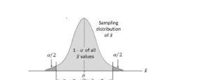

## 示例：\(\sigma\) 已知时的 CI

- **Example:** 学生饭费
  - 已知某学校学生饭费的总体标准差是 \(\sigma=5\) 元，\(z_{0.025}=1.96\)。
  - 通常，随机抽样（\(n=36\)），得到学生饭费的样本均值 \(\bar{x}=20\) 元。
  - 采用前面的公式，我们就可以得到学生饭费均值的 95% 置信区间为
    \[
    20 \pm 1.96 \times \frac{5}{\sqrt{36}} = 20 \pm 1.63 \text{ 元}
    \]
- 思考：“有 95% 的概率认为以上区间会包含学生饭费的总体均值吗”？对吗？
- **Note:** 真实总体均值是一个固定的未知值，它要么在置信区间内，要么在置信区间外，其确定性为 100%。

## 总体均值的区间估计：\(\sigma\) 已知

**Example:** SJTU 学生饭费 – True or False?

- A. 95% 的 SJTU 学生消费在 $18.37 到 $21.63 之间。
- B. 95% 的所有样本均值落在 $18.37 到 $21.63 之间。
- C. 总体均值落在 $18.37 到 $21.63 之间的概率为 95%。
- D. 如果我们重复计算并得到一组置信区间，那么我们期望其中 95% 会包含总体均值。

## 卡方分布

- **Definition:** \(\chi^2(k)\) 是 \(k\) 个独立标准正态的平方和。
  - 如果 \(X_i \sim N(0,1)\)，则 \(X_i^2\) 服从自由度为 1 的卡方分布，表示为 \(X_i^2 \sim \chi^2(1)\)。
  - 如果 \(X_1^2, X_2^2, \ldots, X_k^2\) 是独立的 \(\chi^2(1)\) 变量，则 \(\sum_{i=1}^{k} X_i^2\) 服从自由度为 \(k\) 的卡方分布，表示为 \(\sum_{i=1}^{k} X_i^2 \sim \chi^2(k)\)。

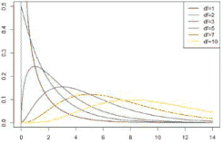

## Student t 分布

- **Definition:** 如果 \(Y \sim N(0,1)\) 且 \(U \sim \chi^2(k)\)，\(Y\) 与 \(U\) 独立，则
  \[
  t(k) = \frac{Y}{\sqrt{U/k}}
  \]
  服从自由度为 \(k\) 的 \(t\) 分布。

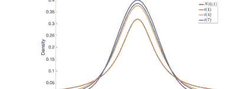

## 总体均值的区间估计：\(\sigma\) 未知

- **区间估计：** 点估计量 \(\pm \Delta\)
- **关键点：** 当 \(\sigma\) 未知时 \(\Delta\) 是什么？
  - 当 \(\sigma\) 已知时，我们选择 \(\Delta = z_{\alpha/2}\sigma/\sqrt{n}\)，使得误差 \(\bar{x}-\mu\) 落在 \(\pm\Delta\) 内的概率为 \(1-\alpha\)，即
    \[
    P\{-z_{\alpha/2}\sigma/\sqrt{n} < \bar{x}-\mu < z_{\alpha/2}\sigma/\sqrt{n}\} = 1-\alpha
    \]
  - 现在我们只知道样本标准差 \(s\)。
  - 如何定义 \(\Delta\)？\(\Rightarrow\) 关键是找到
    \[
    t = \frac{\bar{x}-\mu}{s/\sqrt{n}}
    \]
    的分布

## 理解 \(t = \frac{\bar{x} - \mu}{s/\sqrt{n}}\)

我们将 \(t = \frac{\bar{x} - \mu}{s/\sqrt{n}}\) 分解如下：

\[
t = \frac{\frac{\bar{x}-\mu}{\sqrt{\sigma^2/n}}}{\sqrt{\frac{s^2(n-1)/\sigma^2}{n-1}}}
  = \frac{N(0,1)}{\sqrt{\chi^2(n-1)/(n-1)}}
\]

- 假设：设每个元素 \(x_1, x_2, \ldots, x_n\) 为 \(N(\mu, \sigma^2)\) 的随机变量。
- 分子：\(\frac{\bar{x}-\mu}{\sqrt{\sigma^2/n}} \sim N(0,1)\)
- 分母：\(\frac{(n-1)s^2}{\sigma^2} \sim \chi^2(n-1)\)
- \(\bar{x}\) 与 \(s\) 独立（为什么？）

## 置信区间的构造：\(\sigma\) 未知

- **区间估计：** 点估计量 \(\pm \Delta\)
- **关键点：** 当 \(\sigma\) 未知时 \(\Delta\) 是什么？
- 当 \(\sigma\) 未知时，我们选择 \(\Delta = t_{\alpha/2,n-1}s/\sqrt{n}\)，使得误差 \(\bar{x}-\mu\) 落在 \(\pm\Delta\) 内的概率为 \(1-\alpha\)，即
  \[
  P\{-t_{\alpha/2,n-1}s/\sqrt{n} < \bar{x}-\mu < t_{\alpha/2,n-1}s/\sqrt{n}\} = 1-\alpha
  \]
- 现在我们使用样本标准差 \(s\)。
- \(t_{\alpha/2}\) 是在自由度为 \(n-1\) 的 \(t\) 分布上部尾部提供面积 \(\alpha/2\) 的 \(t\) 值。

## 示例：无 \(\sigma\) 的 CI

- **Example:** 学生饭费
  - 由于我们不知道学生饭费的总体标准差，所以若我们采用 \(\sigma\) 未知时总体均值的估计方法。
  - 通常，随机抽样（\(n=36\)），得到学生饭费的样本均值 \(\bar{x}=20\) 元，样本标准差 \(s=6\) 元。
  - 此时自由度为 35，\(t_{0.025}=2.03\)。
  - 采用前面的公式，我们就可以得到学生饭费均值的 95% 置信区间为
    \[
    20 \pm 2.03 \times \frac{6}{\sqrt{36}} = 20 \pm 2.03 \text{ 元}
    \]

## 大纲

- Introduction
  - Motivations
  - Why Interval Estimation?
- Interval Estimation of Population Mean
  - \(\sigma\) Known
    - Construction of Interval Estimation
    - Interpretation of Interval Estimation
  - \(\sigma\) Unknown
    - Review of Probability Distribution
    - Construction of Interval Estimation
- Determining the Sample Size
- Interval Estimate of Population Proportion

## 确定样本量

- μ 的区间估计（100(1 − α)% 置信区间）：x̄ ± Δ
- 固定 Δ 的数量：期望的误差范围，E
  - 如果 σ 已知，E = zα/2 σ / √n 所需的样本量为：
    n = (zα/2)² σ² / E²
  - 如果 σ 未知，我们可以通过以下方式获得 σ 的初步或规划值：
    - 由以往研究数据计算得到的总体标准差估计值
    - 预先样本的样本标准差
    - 对 σ 值的判断或“最佳猜测”

## 示例：确定样本量

## 示例：统计. 规范

- 在检查表中，我们期望控制误差E = 1元，为确定最终的样本容量，我们要得到σ的初步值
- 通过对某系统样本的样本数据分析，我们发现样本标准差为5.5元，我们从5.5作为σ的初步值
- 查表得z0.025 = 1.96
- 利用前面的公式，我们试算所需样本容量为n = 1.96² × 5.5² / 1 = 116.2. 我们取他117作为最终样本量

## 总体比例 p 的区间估计

- \(\bar{p}\) 的抽样分布 \(\xrightarrow{d}\) N\(p, \sqrt{p(1-p)/n}\) : 当 np ≥ 5 且 n(1-p) ≥ 5 时近似为正态分布。

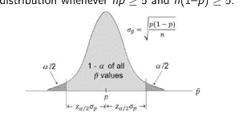

## 总体比例 *p* 的区间估计

**示例：** 统计. 规范

某校在现有在校1000名学生中，440学生分一餐作为首选。想构造95%的置信区间来估计总体该校学生三餐的比例。

## 总体比例 p 的区间估计

## 示例：统计. 规范

- 泡查中我们发现在1000名学生中，440学生分餐作为首选。想构造95%的置信区间来估计总体学生首选三餐的比例。
- n = 1000, p̄ = 440/1000 = 0.44, zα/2 = 1.96. Then, 0.44 ± 1.96√[0.44(1 − 0.44)/1000] = 0.44 ± 0.031

## 总体比例 p 的区间估计

## 示例：统计. 规范

- 假设我们想要在99%的置信性保证样本比例与总体比例的误差在0.03范围内，要抽取多少样本？

## 总体比例 p 的区间估计

## 示例：统计. 规模

- 假设我们想要在99%的置信性下观察样本比例与总体比例的差异在0.03范围内，要抽取多少样本？
- $z_{\alpha/2}\sqrt{\frac{p^*(1-p^*)}{n}} = 0.03.$
- 在99%置信率下，$z_{0.005}=2.576.$

Recall that $p^* = 0.44$. Then, $n = \frac{(2.576)^2(0.44)(0.56)}{(0.03)^2} = 1817.$

## 总结

- 区间估计中的公式

| | μ | | p |
|---|---|---|---|
| | σ Known | σ Unknown | |
| Interval Estimate | x̄ ± z_{α/2} σ/√n | x̄ ± t_{α/2} s/√n | p̂ ± z_{α/2} √[p̂(1 - p̂)/n] |
| Sample Size | n = (z_{α/2})² σ² / E² | | n = (z_{α/2})² p*(1 - p*) / E² |

- 置信区间的解释

## BUSS2302: 商务统计学
Lecture 4: Hypothesis Testing – Inference about
Population Means and Proportions

**Instructor：SONG Tingting（宋婷婷）**
Antai College of Economics and Management
Shanghai Jiao Tong University

**Reference:** Ch 9&10 in *Statistics for Business & Economics*, 13e
by Anderson, Sweeney, Williams, Camm, and Cochran (2018)

## 假设检验的介绍

- 动机
- 假设检验概述

## 单总体假设检验

## 双总体假设检验

## 动机：品茶女士

- 1920年代英格兰剑桥的一场茶会
- 一位女士声称她能分辨出是先加茶还是先加奶。
- 在场的统计学家决定检验这一说法。
- 如果你是他，你会如何决定？

## 动机：品茶女士

- 这位统计学家是罗纳德·费希尔爵士！
- 他决定设计一个*实验*，对这位女士的说法进行*检验*。
  - 给女士8杯茶，4种各一种，按*随机顺序*排列。
  - 记录她答对的*数量*。*样本数据*
  - 在她没有能力的情况下，计算她得到该正确数量的*概率*（*原假设*）。
  - 如果*概率（p值）*足够小，比如小于5%。(*决策规则*)
  - 有效地承认了女士的能力！(*结论*)

## 假设检验的历史

- 20世纪早期发展了两种统计检验理论
  - 费希尔的“显著性检验”
  - 奈曼-皮尔逊“假设检验”
- 现代假设检验是这两种方法的混合。
- 有关这些伟大思想家的更多故事，请参阅阅读材料。

- 1. 结合新纪系统"四世同堂"
- 2. *The Lady Tasting Tea: How Statistics Revolutionized Science in the Twentieth Century*

## 我们想要做什么

- “品茶女士”问题（假设检验）如何与样本均值相关？\(\bar{x} \sim N(\mu, \sigma^2/n)\)。
- 对于假设检验，我们想知道：
  - 对什么提出假设？
  - 如何陈述一个假设？
  - 如何进行检验？
  - 如何判断检验结果？
  - 如何得出有意义的结论？

## 假设检验

- **假设**是对**总体**的陈述。
  - 总体均值 \(\mu\)
  - 总体方差 \(\sigma^2\)
  - 总体分布（正态性）
- **假设检验**是一种基于**样本证据**和**概率论**的程序，用来确定该假设是否是一个**合理的陈述**。
- 假设检验的基本步骤：
  1. 陈述假设。
  2. 选择显著性水平。
  3. 识别检验统计量。
  4. 制定决策规则。
  5. 抽取样本，并得出决策。

## 假设检验的快速概述

### 第一步：陈述假设

- 假设检验中的**两个互补陈述**：
  - **原假设** \(H_0\): 你想要挑战的陈述（想拒绝）
  - **备择假设** \(H_a\): 你希望支持的陈述（想支持）
- 原假设中通常包含 **not** 或 **no** 术语。
  - 在品茶女士问题中，\(H_0\): 她**不能**区分牛奶和茶的顺序。
  - 在 COVID-19 中，\(H_0\): 该人**没有**冠状病毒。
- **两种结果：**
  - **拒绝**：样本提供了令人信服的证据表明它是错误的。结论是什么？
    ⇒ **备择假设**：拒绝原假设时得出的结论。
  - **未能拒绝**：并不意味着该假设是**真实**的。

### 第五步：得出决策

- 结论并不总是正确的，因为它们是基于随机样本得出的。
- 两类错误：
  - 第一类错误：\(H_0\) 为真时拒绝 \(H_0\)（假阳性，假阳性）
  - 第二类错误：\(H_0\) 为假时接受 \(H_0\)（假阴性，假阴性）

| 结论 | \(H_0\) 为真 | \(H_a\) 为真 |
|---|---|---|
| 接受 \(H_0\) | 正确 | 第二类错误 |
| 拒绝 \(H_0\) | 第一类错误 | 正确 |

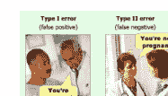

### 第五步：得出决策 – 如何控制错误？

- 第一类错误：
  - 显著性水平 \(\alpha\) 设定了犯第一类错误的最高概率。
  - 显著性检验：仅控制第一类错误的假设检验。
  - 在显著性检验中，我们通常使用‘不拒绝 \(H_0\)’而不是‘接受 \(H_0\)’。
- 第二类错误：
  - 通过功效分析可以在假设检验中控制第二类错误。

## 假设检验简介

### 单总体假设检验

- 总体均值的检验
- 总体比例的检验
- 第二类错误

### 双总体假设检验

## 动机示例：质量控制

- 一家工厂购买了一条新的自动化装配线，并希望监控其制造过程的质量。
- 已知，在正常运行的情况下，产出度量服从均值为 12 的正态分布。
- 客户想知道：该过程现在是否正常运行？

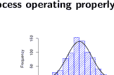

- **解决方案：** 抽取随机样本来检验总体均值是否为 12。

## 假设的表述

- 原假设和备择假设的一般表述：

  \(H_0: \theta \in \Theta_0 \quad \text{versus} \quad H_a: \theta \in \Theta_0^c,\)

  其中 \(\theta\) 是待检验的参数，\(\Theta_0\) 是一个闭集。

- 示例：总体均值 \(\theta \equiv \mu\) 的典型检验

- 双尾检验：\(\Theta_0 = \{\mu_0\}\)

  \(H_0: \mu = \mu_0, \quad \text{versus} \quad H_a: \mu \neq \mu_0.\)

- 上尾检验：\(\Theta_0 = (-\infty, \mu_0]\)

  \(H_0: \mu \le \mu_0, \quad \text{versus} \quad H_a: \mu > \mu_0.\)

- 下尾检验：\(\Theta_0 = [\mu_0, \infty)\)

  \(H_0: \mu \ge \mu_0, \quad \text{versus} \quad H_a: \mu < \mu_0.\)

## 练习

- 目前一辆汽车的燃油效率为 10 km/l。研究小组希望测试新的燃油喷射系统是否比当前系统提供更高的 km/l 评级。
    - (a) \(H_0: \mu \ge 10\)， versus \(H_a: \mu < 10\)
    - (b) \(H_0: \mu \le 10\)， versus \(H_a: \mu > 10\)
    - (c) \(H_0: \mu = 10\)， versus \(H_a: \mu \ne 10\)

- 软饮料瓶上的标签标明其含有 330 ml。政府机构希望检查标签是否不正确且瓶子被灌装不足。
    - (a) \(H_0: \mu \ge 330\)， versus \(H_a: \mu < 330\)
    - (b) \(H_0: \mu \le 330\)， versus \(H_a: \mu > 330\)
    - (c) \(H_0: \mu = 330\)， versus \(H_a: \mu \ne 330\)

如果制造商想知道瓶装灌装过程是否正常运行会怎样？

## 方差已知时检验总体均值

- 假设我们收集 \(n\) 个 i.i.d. 样本 \(X_1, X_2, \ldots, X_n\) 且 \(X_i \sim N(\mu, \sigma^2)\)。

- **步骤 1：** 设定原假设和备择假设 \(H_0: \mu = \mu_0;\ H_a: \mu \ne \mu_0\)。

- **步骤 2：** 选择显著性水平 \(\alpha\)。

- **步骤 3：** 当方差已知时，检验统计量由

  \[
  z = \frac{\bar{x} - \mu_0}{\sigma/\sqrt{n}}
  \]

  给出，其中 \(\bar{x}\) 为样本均值。

  - 基于 \(z\) 统计量的检验程序通常称为 **Z 检验**。
  - 在 \(H_0\) 下，\(z\) 的分布已知：\(z \sim N(0,1)\)。

- **步骤 4：** 确定拒绝规则的两种方法：
  - 临界值法
  - p 值法

### 临界值法

- 我们首先为检验统计量指定一个临界值。
- 临界值作为判断检验统计量的值是否足够小（或足够大）以拒绝的基准。
- 给定临界值 \(c\)，拒绝域为 \((-\infty, -c] \cup [c, \infty)\)。
- 如何确定 \(c\) 以达到显著性水平 \(\alpha\)？

  显著性水平 = \(P(\text{Reject } H_0 \mid H_0) = P(|z| \ge c \mid H_0) = 2\Phi(-c) = 2\bar{\Phi}(c)\)

- 通过令 \(c = z_{\alpha/2} = \Phi^{-1}(1 - \alpha/2)\) 来实现显著性水平 \(\alpha\)。

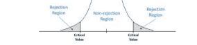

- **步骤 5：** 将检验统计量与临界值进行比较，我们做出拒绝 \(H_0\) 或不拒绝 \(H_0\) 的决策。

### p 值法

- p 值提供额外信息：拒绝或不拒绝的强度。
- p 值：给定 \(H_0\) 为真时，观察到样本值与所观察值一样极端或更极端的概率。

  p 值 = \(P(|z| \ge |z_{\mathrm{obs}}| \mid \mu = \mu_0)\)

- 在统计检验中，p 值被用作样本提供的反对 \(H_0\) 的证据的度量。
- 更小的 p 值表示对原假设的证据更强。
- **步骤 5：** 使用 p 值法的拒绝规则是如果 p 值 ≤ \(\alpha\) 则拒绝 \(H_0: \mu = \mu_0\)。

### 对其他假设的扩展

- 上尾和下尾假设的检验程序类似。
- **步骤 1：** 考虑上尾假设 \(H_0: \mu \le \mu_0 \quad \text{versus} \quad H_a: \mu > \mu_0\)。
- **步骤 2：** 选择显著性水平 \(\alpha\)。
- **步骤 3：** 使用相同的检验统计量 \(z\)。
- **步骤 4 & 5：** 我们在 \(z \ge z_\alpha\) 时拒绝 \(H_0\)，其中临界值 \(z_\alpha\) 被选择使得显著性水平为 \(\alpha\)。
- **p 值法：** p 值 = \(P(z \ge z_{\mathrm{obs}} \mid H_0)\)。

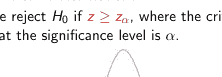

### 当总体不是正态分布时

- 如果总体服从正态分布，即使样本量很小，Z 检验和 T 检验都适用（T 检验更受青睐）。
- 如果总体不是正态分布，则需要更大的样本量。
  - 教科书建议：\(n \ge 30\)。
- 如果总体不是正态分布，且样本量很小，我们可能使用非参数方法。

### 与区间估计的关系

- 对于 \(\sigma\) 已知的正态总体，\(\mu\) 的 \((1 - \alpha)\%\) 置信区间由

  \[
  \bar{x} \pm z_{\alpha/2}\frac{\sigma}{\sqrt{n}}
  \]

  给出。

- 我们知道 \((1 - \alpha)\%\) 的置信区间会包含总体均值。
- 因此，我们也可以使用置信区间来进行双尾检验 \(H_0: \mu = \mu_0\) versus \(H_1: \mu \ne \mu_0\)。
  - 选择一个简单随机样本并建立 \((1 - \alpha)\%\) 置信区间。
  - 如果它包含假设值 \(\mu_0\)，则不拒绝 \(H_0\)；否则，拒绝 \(H_0\)。

## 摘要

- 对下尾、上尾和双尾检验的概述如下。
- 检验统计量相同，但拒绝域不同。

|  | 下尾检验 | 上尾检验 | 双尾检验 |
|---|---|---|---|
| **假设** | H₀: μ ≥ μ₀ Hₐ: μ < μ₀ | H₀: μ ≤ μ₀ Hₐ: μ > μ₀ | H₀: μ = μ₀ Hₐ: μ ≠ μ₀ |
| **检验统计量** | z = (x̄ − μ₀) / (σ / √n) | z = (x̄ − μ₀) / (σ / √n) | z = (x̄ − μ₀) / (σ / √n) |
| **拒绝规则：临界值法** | 若 z ≤ −zₐ 则拒绝 H₀ | 若 z ≥ zₐ 则拒绝 H₀ | 若 |z| ≥ zₐ/₂ 则拒绝 H₀ |
| **拒绝规则：p值法** | 若 p-value ≤ α 则拒绝 H₀ | 若 p-value ≤ α 则拒绝 H₀ | 若 p-value ≤ α 则拒绝 H₀ |

## 方差未知时总体均值的检验

- 假设我们收集 *n.i.i.d.* 样本 $X_1, X_2, \ldots, X_n$，且 $X_i \sim N(\mu, \sigma^2)$。

- 第 1 步：陈述原假设和备择假设  
  $H_0: \mu = \mu_0,\ H_a: \mu \ne \mu_0$。

- 第 2 步：选择显著性水平 $\alpha$。

- 第 3 步：当方差 $\sigma^2$ 未知时，检验统计量由

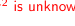

给出，其中 $\bar{X}$ 为样本均值，$S^2$ 为样本方差。

- 基于 $t$ 统计量的检验程序通常称为 $t$-检验。

- 在 $H_0$ 下，$t$ 的分布已知，即 $t \sim t_{n-1}$，其中 $n-1$ 为自由度。

## 第 4 步 & 5 步：制定决策规则并做出决策

- **临界值法**
  - 设拒绝域为 (−∞, −c] ∪ [c, ∞)，且
  - 显著性水平 = P(拒绝 H₀|H₀) = P(|t| ≥ c|H₀)。
  - 显著性水平 α 通过令 c = tₐ/₂ 实现。
  - 拒绝规则为
    若 |t| ≥ tₐ/₂，则拒绝 H₀ : μ = μ₀。

- **p值法**
  - p值作为反对 H₀ 的证据的度量为
    p-value = P(|t| ≥ |t_obs| | H₀)。
  - 拒绝规则为
    若 p-value ≤ α，则拒绝 H₀ : μ = μ₀。

## 对其他假设的扩展

- 对下尾、上尾和双尾检验的概述如下。
- 检验统计量相同，但拒绝域不同。

| | 下尾检验 | 上尾检验 | 双尾检验 |
|---|---|---|---|
| 假设 | $H_0: \mu \ge \mu_0$ $H_a: \mu < \mu_0$ | $H_0: \mu \le \mu_0$ $H_a: \mu > \mu_0$ | $H_0: \mu = \mu_0$ $H_a: \mu \ne \mu_0$ |
| 检验统计量 | $t = \frac{\bar{x} - \mu_0}{s/\sqrt{n}}$ | $t = \frac{\bar{x} - \mu_0}{s/\sqrt{n}}$ | $t = \frac{\bar{x} - \mu_0}{s/\sqrt{n}}$ |
| 拒绝规则： 临界值法 | 若 $t \le -t_\alpha$ 则拒绝 $H_0$ | 若 $t \ge t_\alpha$ 则拒绝 $H_0$ | 若 $|t| \ge t_{\alpha/2}$ 则拒绝 $H_0$ |
| 拒绝规则： p值法 | 若 p-value $\le \alpha$ 则拒绝 $H_0$ | 若 p-value $\le \alpha$ 则拒绝 $H_0$ | 若 p-value $\le \alpha$ 则拒绝 $H_0$ |

## 总体比例的检验：动机示例

- 过去一年里，SJTU 某学生社团中男女生比例为 4:1。
- 本学期初开展了一项特别推广活动，旨在吸引女性成员。
- 一个月后，社团主席想知道女性成员的比例是否有所增加。

## 总体比例的检验

- 假设总体比例为 $p$，我们想检验 $p$ 是否大于 $p_0$。
- 第 1 步：这是一个上尾假设检验：
  
  $H_0: p \leq p_0$   versus   $H_a: p > p_0$。
- 第 2-5 步设计检验程序。
  - 指定显著性水平、检验统计量和拒绝规则。
  - 收集 $n$ 名成员的随机样本并计算样本比例 $\hat{p}$。

- 对于第 i 名成员，令 Xi = 1 表示女性，Xi = 0 表示男性。则
  
  Xi ~ Bernoulli(p)，对于 i = 1, 2, ..., n。

- 第 3 步：我们构造一个分布已知的检验统计量
  
  p̄ = (1/n) Σ_{i=1}^n Xi，其中 Σ_{i=1}^n Xi ~ B(n, p)

- 第 2 步和第 4 步：记拒绝域为 [c, 1]，显著性水平为
  
  sup_{p ≥ p0} P(Type I error) = P(p̄ ≥ c | p = p0) = Σ_{k = nc}^n (n choose k) p0^k (1 - p0)^{n - k} = α。

- 对于给定的 α，求解临界值 c 非常复杂。

## 检验总体比例：正态近似

- 基于中心极限定理，当 n 较大时，我们可以通过正态近似更方便地得到临界值 c。

- 步骤 3：将检验统计量改为 z = (p̂ - p₀) / √[p₀(1 - p₀)/n]。

- 步骤 4：对于上尾假设检验，使用 Z 检验：如果 (p̂ - p₀) / √[p₀(1 - p₀)/n] ≥ zₐ，则拒绝 H₀ : p ≤ p₀。

## 总体比例的其他假设检验扩展

- 下尾、上尾和双侧检验的概览如下。
- 检验统计量相同，但拒绝域不同。

|  | 下尾检验 | 上尾检验 | 双侧检验 |
|---|---|---|---|
| 假设 | H₀: p ≥ p₀ Hₐ: p < p₀ | H₀: p ≤ p₀ Hₐ: p > p₀ | H₀: p = p₀ Hₐ: p ≠ p₀ |
| 检验统计量 | z = (p̂ - p₀) / √[p₀(1-p₀)/n] | z = (p̂ - p₀) / √[p₀(1-p₀)/n] | z = (p̂ - p₀) / √[p₀(1-p₀)/n] |
| 拒绝规则： 临界值法 | 若 z ≤ -zα，则拒绝 H₀ | 若 z ≥ zα，则拒绝 H₀ | 若 \|z\| ≥ zα/2，则拒绝 H₀ |
| 拒绝规则： p 值法 | 若 p 值 ≤ α，则拒绝 H₀ | 若 p 值 ≤ α，则拒绝 H₀ | 若 p 值 ≤ α，则拒绝 H₀ |

## 第一类错误与第二类错误

假设检验中的错误：

- • **第一类错误：**当原假设 $H_0$ 为真时，拒绝了原假设。（假阳性，概率性）。该错误由显著性水平 $\alpha$ 很好地控制。

- • **第二类错误：**当原假设为假时，未拒绝原假设。（假阴性，可能性）。将其定义为 $\beta$。

- • **问题：**如何控制第二类错误？

| 错误类型表 | 原假设（$H_0$） |
|---|---|
|  | 为真 | 为假 |
| 决策：拒绝原假设（$H_0$） | 正确推断（真阴性）$(1-\alpha)$ | 第二类错误（假阴性）$\beta$ |
| 决策：不拒绝原假设（$H_0$） | 第一类错误（假阳性）概率 $\alpha$ | 正确推断（真阳性）$(1-\beta)$ |

## 第二类错误

- 假设检验的质量在于**最小化**错误率。
  - 要降低第一类错误的概率，可以让 α 值更小（简单高效）！
  - 如何降低第二类错误的概率呢？

- **功效（Power）：**当备择假设 *Hₐ* 为真时，检验正确拒绝 *H₀* 的概率（即 1 − β）

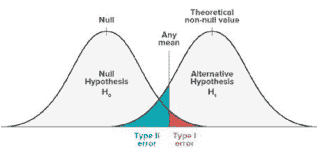

## 第一类错误与第二类错误

- 理想情况下，我们希望找到一种能同时控制第一类错误和第二类错误的检验。
- 这两类错误率之间存在此消彼长的权衡关系。
- 对于任何给定的样本集，降低其中一类错误的努力通常会导致另一类错误的增加。
- 功效总是取决于三个因素：
  - 检验中所选的统计显著性水平 α
  - 总体中所关注效应的大小 |μₐ − μ₀|
  - 用于检测该效应的样本量 n
- 问题：对于给定显著性水平 α 的显著性检验，我们能否控制第二类错误概率 β？
- 解决办法：增加使用的样本数量。

## 示例：批次验收抽样

- 供应商交付了一批电池。作为质量控制经理，你必须做出决定：
  - 要么接受整批货物，
  - 要么因质量不佳退回整批货物。
- 电池标准：平均使用寿命至少为 120 小时。
- 样本：将选择并测试 36 节电池。
- 假设总体标准差已知，σ = 12 小时。

## 示例：批次验收抽样

假设为

$H_0: \mu \ge 120 \quad \text{对} \quad H_a: \mu < 120$

选取显著性水平 $\alpha = 0.05$

由于 $\sigma$ 已知，我们使用 Z 检验，检验统计量为

$z = \frac{\bar{x} - \mu_0}{\sigma / \sqrt{n}} = \frac{\bar{x} - 120}{12 / \sqrt{36}} = \frac{\bar{x} - 120}{2}$

假设我们使用临界值法。那么当 $z \le -z_\alpha$ 时，即如下不等式成立时，我们将拒绝 $H_0$：

$\frac{\bar{x} - 120}{2} \le -1.645 \quad \Rightarrow \quad \bar{x} \le 116.71$

因此，如果抽样电池的平均使用寿命不大于 116.71 小时，则应退回该批货物。退回合格批次（第一类错误）的概率不超过 5%。

## 示例：批验收抽样

- 另一方面，如果 \(\bar{x} > 116.71\)，则 \(H_0\) 不能被拒绝，货物将被接受。
- 假设 \(\mu = 112\)（不合格货物）。接受货物的概率（第二类错误）是多少？

\[
\beta = P(\bar{x} > 116.71 \mid \mu = 112) = P\left(z = \frac{\bar{x}-\mu}{\sigma/\sqrt{n}} > 2.36\right) = \bar{\Phi}(2.36) = 0.91\%
\]

- 如果总体均值为 112 小时，犯第二类错误的概率为 0.91%。

## 控制第二类错误（备注：这里有发现丁丁）

- 一般而言，对于下侧 \(Z\)-检验程序，其第二类错误概率为

\[
\beta = P(\text{Type II error}) = P\left( \frac{\bar{X}-\mu_0}{\sigma/\sqrt{n}} > -z_\alpha \mid H_a \right) = \Phi\left( z_\alpha - \frac{\sqrt{n}(\mu_0-\mu_a)}{\sigma} \right).
\]

- 确定 \(n\)，所需样本数，以确保第二类错误概率不超过 \(\beta\)，

\[
z_\alpha - \frac{\sqrt{n}(\mu_0-\mu_a)}{\sigma} = -z_\beta
\quad\Rightarrow\quad
n = \frac{(z_\alpha + z_\beta)^2 \sigma^2}{(\mu_0-\mu_a)^2}.
\]

## 总结：单样本假设检验

1. 提出 \(H_0\) 和 \(H_a\)。
   - 关于总体参数的陈述：\(H_0: \mu = \mu_0;\ H_a: \mu \neq \mu_0\)。\(H_0: \mu \geq \mu_0;\ H_a: \mu < \mu_0\)。\(H_0: \mu \leq \mu_0;\ H_a: \mu > \mu_0\)
   - 示例：质量控制 / 药物有效性 / 比例

2. 选择显著性水平 \(\alpha\)。
   - 控制第一类错误：0.01 / 0.05 / 0.1

3. 根据样本数据计算检验统计量。
   - Z检验（方差已知）：\(z = \frac{\bar{X} - \mu_0}{\sigma/\sqrt{n}}\) 或 \(z = \frac{\hat{p} - p_0}{\sqrt{p_0(1-p_0)/n}}\)
   - t检验（方差未知）：\(t = \frac{\bar{X} - \mu_0}{S/\sqrt{n}}\)

4. 基于概率和统计理论制定决策规则。
   - 知道检验统计量背后的概率分布。
   - 临界值法或 p 值法。

5. 收集随机样本并得出结论。
   - 理解结论背后的风险：第一类错误或第二类错误。

## 双总体假设检验

- 两个总体均值的检验
- 配对样本的检验
- 两个总体比例的检验

## 两个总体均值之差的检验

- **单样本假设检验当**
  - 方差已知 \(\Rightarrow\) Z检验
  - 方差未知 \(\Rightarrow\) T检验
- **双样本假设检验当**
  - 样本独立，其方差已知
  - 样本独立，其方差相等但未知
  - 样本独立，其方差不等且未知
  - 样本配对且相关

## 关于两个均值的推断：动机示例

- 一家杂货零售商经营两家商店。一家位于市中心，另一家位于郊区购物中心。
- 管理员注意到，在一家商店销售良好的产品在另一家商店可能销售不佳。
- 这种情况可能归因于两个地点的顾客人口统计差异。
- 管理员要求我们调查在两家商店购物的顾客平均年龄之间的差异。

## 两个总体均值之差的抽样分布

- 假设我们分别从市中心和郊区商店随机抽取 \(n_1\) 和 \(n_2\) 名顾客，
  - \(X_{11}, X_{12}, \ldots, X_{1n_1} \sim N(\mu_1, \sigma_1^2)\)，
  - \(X_{21}, X_{22}, \ldots, X_{2n_2} \sim N(\mu_2, \sigma_2^2)\)，
  - 两个样本相互独立。
- \(\mu_1 - \mu_2\) 的点估计量为 \(\bar{X}_1 - \bar{X}_2\)。其抽样分布是什么？
- **关键点：** 两个独立正态随机变量之和仍为正态，其均值为两个均值之和，其方差为两个方差之和。

## \(\mu_1 - \mu_2\) 的区间估计

- 由于

\[
\bar{x}_1 \sim N\left(\mu_1, \frac{\sigma_1^2}{n_1}\right), \quad \bar{x}_2 \sim N\left(\mu_2, \frac{\sigma_2^2}{n_2}\right)
\]

我们有

\[
\bar{x}_1 - \bar{x}_2 \sim N\left(\mu_1 - \mu_2, \frac{\sigma_1^2}{n_1} + \frac{\sigma_2^2}{n_2}\right)
\]

- 估计量的**标准误差**为 \(\sigma_{\bar{x}_1-\bar{x}_2} = \sqrt{\sigma_1^2/n_1 + \sigma_2^2/n_2}\)。

- 当 \(\sigma_1^2\) 和 \(\sigma_2^2\) 均已知时，我们有 \(\mu_1 - \mu_2\) 的**区间估计**，

\[
\bar{x}_1 - \bar{x}_2 \pm z_{\alpha/2}\sqrt{\frac{\sigma_1^2}{n_1} + \frac{\sigma_2^2}{n_2}}
\]

置信系数为 \(1 - \alpha\)。

## 两个总体均值的假设检验

- 一般而言，假设检验有 3 种形式：
  - **双尾检验：**
    \(H_0: \mu_1-\mu_2=D_0,\quad\text{versus}\quad H_a: \mu_1-\mu_2\ne D_0.\)
  - **上尾检验：**
    \(H_0: \mu_1-\mu_2\le D_0,\quad\text{versus}\quad H_a: \mu_1-\mu_2>D_0.\)
  - **下尾检验：**
    \(H_0: \mu_1-\mu_2\ge D_0,\quad\text{versus}\quad H_a: \mu_1-\mu_2<D_0.\)

如果我们想检验两个计算机总体平均年龄是否存在差异，如何建立假设？

### 当方差已知时两个总体均值

考虑双尾假设检验

- 第 1 步：陈述假设

  \(H_0: \mu_1 - \mu_2 = D_0\)   versus   \(H_a: \mu_1 - \mu_2 \ne D_0\).

- 第 3 步：**我们需要一个在 \(H_0\) 下分布已知的检验统计量。**

当 \(\sigma_1^2, \sigma_2^2\) 已知时，检验统计量由下式给出

\[
z = \frac{\bar{x}_1 - \bar{x}_2 - D_0}{\sqrt{\sigma_1^2/n_1 + \sigma_2^2/n_2}}.
\]

第 4 步：在 \(H_0\) 下，我们有 \(z \sim N(0,1)\)。因此，将使用 Z 检验的决策规则。

### 当 \(\sigma_1^2, \sigma_2^2\) 已知时的检验程序

- 检验统计量相同，但拒绝域不同。
- p 值也不同。
  - 双尾检验：p-value = \(P(\lvert z\rvert \ge z_{\text{obs}} \mid \mu_1-\mu_2=D_0)\)
  - 上尾检验：p-value = \(P(z \ge z_{\text{obs}} \mid \mu_1-\mu_2 \le D_0)\)
  - 下尾检验：p-value = \(P(z \le z_{\text{obs}} \mid \mu_1-\mu_2 \ge D_0)\)

|  | 双尾检验 | 上尾检验 | 下尾检验 |
|---|---|---|---|
| **假设** | \(H_0: \mu_1-\mu_2=D_0\) \(H_a: \mu_1-\mu_2\ne D_0\) | \(H_0: \mu_1-\mu_2\le D_0\) \(H_a: \mu_1-\mu_2>D_0\) | \(H_0: \mu_1-\mu_2\ge D_0\) \(H_a: \mu_1-\mu_2<D_0\) |
| **检验统计量** | \(z=\frac{\bar{x}_1-\bar{x}_2-D_0}{\sqrt{\frac{\sigma_1^2}{n_1}+\frac{\sigma_2^2}{n_2}}}\) | \(z=\frac{\bar{x}_1-\bar{x}_2-D_0}{\sqrt{\frac{\sigma_1^2}{n_1}+\frac{\sigma_2^2}{n_2}}}\) | \(z=\frac{\bar{x}_1-\bar{x}_2-D_0}{\sqrt{\frac{\sigma_1^2}{n_1}+\frac{\sigma_2^2}{n_2}}}\) |
| **拒绝规则：临界值法** | 若 \(\lvert z_{\text{obs}}\rvert\ge z_{\alpha/2}\) 则拒绝 \(H_0\) | 若 \(z_{\text{obs}}\ge z_\alpha\) 则拒绝 \(H_0\) | 若 \(z_{\text{obs}}\le -z_\alpha\) 则拒绝 \(H_0\) |
| **拒绝规则：p 值法** | 若 p-value \(\le\alpha\) 则拒绝 \(H_0\) | 若 p-value \(\le\alpha\) 则拒绝 \(H_0\) | 若 p-value \(\le\alpha\) 则拒绝 \(H_0\) |

### 当 \(\sigma_1^2 = \sigma_2^2\) 未知时两个总体均值

- 实践中，总体的方差 \(\sigma_1^2\) 和 \(\sigma_2^2\) 通常未知。
- 对于点估计，我们仍可使用 \(\bar{x}_1-\bar{x}_2\)。
- 然而，对于区间估计和假设检验，我们需要估计其标准误 \(\sigma_{\bar{x}_1-\bar{x}_2}=\sqrt{\sigma_1^2/n_1+\sigma_2^2/n_2}\)。
- 基本思路：用样本方差估计总体方差，并使用 t 分布代替正态分布。
  - 当 \(\sigma_1^2=\sigma_2^2\) 时可行
  - 当 \(\sigma_1^2\ne\sigma_2^2\) 时近似可行

### 当 \(\sigma_1^2=\sigma_2^2\) 未知时的检验程序

- 使用 \(s_1^2\) 和 \(s_2^2\) 的加权平均，称为 **合并估计量**，

\[
s_p^2=\frac{n_1-1}{n_1+n_2-2}s_1^2+\frac{n_2-1}{n_1+n_2-2}s_2^2
=\frac{\sum_{i=1}^{2}(n_i-1)s_i^2}{\sum_{i=1}^{2}(n_i-1)}.
\]

- t 检验统计量随后服从自由度为 \((n_1+n_2-2)\) 的 t 分布

\[
t=\frac{\bar{x}_1-\bar{x}_2-D_0}{\sqrt{s_p^2(1/n_1+1/n_2)}}\sim t_{n_1+n_2-2},\quad\text{under }H_0.
\]

- 检验程序如下。
  - 临界值法：若 \(\lvert t_{\text{obs}}\rvert\ge \lvert t_{\alpha/2}\rvert\) 则拒绝 \(H_0\)。
  - p 值法：若 p-value \(=P(\lvert t\rvert\ge \lvert t_{\text{obs}}\rvert \mid H_0)\le\alpha\) 则拒绝 \(H_0\)。

### 当 \(\sigma_1^2 \ne \sigma_2^2\) 未知时两个总体均值

- 接下来假设总体方差 \(\sigma_1^2 \ne \sigma_2^2\) 未知。
- 第 1 步：考虑双尾假设检验

  \(H_0: \mu_1 - \mu_2 = D_0 \quad \text{versus} \quad H_a: \mu_1 - \mu_2 \ne D_0\).

- 第 3 步：应使用 \(t\) 检验，对应的 \(t\) 检验统计量为

  \[
  t = \frac{\bar{x}_1-\bar{x}_2-D_0}{\sqrt{s_1^2/n_1+s_2^2/n_2}}.
  \]

- 即使在 \(H_0\) 下，\(t\) 的分布也是 **未知的**。为什么？
- 为 \(t\) 统计量构造一个 Student \(t\) 分布近似

  \[
  t \sim t_{df}, \quad \text{under } H_0,
  \]

  其中

  \[
  df = \frac{(s_1^2/n_1+s_2^2/n_2)^2}{\frac{(s_1^2/n_1)^2}{n_1-1}+\frac{(s_2^2/n_2)^2}{n_2-1}}.
  \]

> （阅读材料 Welch–Satterthwaite equation - Wikipedia）

## 当 σ₁² 与 σ₂² 未知时的检验步骤

- 检验统计量相同，但拒绝域不同。
- p 值也不同。
- 双侧检验：p 值 = $P(|t| \ge |t_{\mathrm{obs}}| \mid \mu_1 - \mu_2 = D_0)$
- 上侧检验：p 值 = $P(t \ge t_{\mathrm{obs}} \mid \mu_1 - \mu_2 \le D_0)$
- 下侧检验：p 值 = $P(t \le t_{\mathrm{obs}} \mid \mu_1 - \mu_2 \ge D_0)$

|  | 双侧检验 | 上侧检验 | 下侧检验 |
|---|---|---|---|
| 假设 | $H_0: \mu_1 - \mu_2 = D_0$ $H_1: \mu_1 - \mu_2 \neq D_0$ | $H_0: \mu_1 - \mu_2 \le D_0$ $H_1: \mu_1 - \mu_2 > D_0$ | $H_0: \mu_1 - \mu_2 \ge D_0$ $H_1: \mu_1 - \mu_2 < D_0$ |
| 检验统计量 | $t = \frac{\bar{x}_1 - \bar{x}_2 - D_0}{\sqrt{s_1^2/n_1 + s_2^2/n_2}}$ | $t = \frac{\bar{x}_1 - \bar{x}_2 - D_0}{\sqrt{s_1^2/n_1 + s_2^2/n_2}}$ | $t = \frac{\bar{x}_1 - \bar{x}_2 - D_0}{\sqrt{s_1^2/n_1 + s_2^2/n_2}}$ |
| 拒绝法则：临界值法 | 若 $\|t_{\mathrm{obs}}\| \ge t^*_{\alpha/2}$，则拒绝 $H_0$ | 若 $t_{\mathrm{obs}} \ge t^*_{\alpha,\nu}$，则拒绝 $H_0$ | 若 $t_{\mathrm{obs}} \le -t^*_{\alpha,\nu}$，则拒绝 $H_0$ |
| 拒绝法则：p 值法 | 若 p 值 $\le \alpha$，则拒绝 $H_0$ | 若 p 值 $\le \alpha$，则拒绝 $H_0$ | 若 p 值 $\le \alpha$，则拒绝 $H_0$ |

## 匹配样本：引出示例

- 假设某制造企业的员工可以使用两种不同的方法来完成一项生产任务。
- 为了最大化产量，公司希望找出总体平均完成时间更小的方法。
- 首先暂定假设两种生产方法的总体平均完成时间相同。于是，检验假设写为 $H_0: \mu_1 = \mu_2$，备择假设为 $H_a: \mu_1 \neq \mu_2$。
- 匹配样本设计：
  - 随机抽取一组工人作为样本
  - 每名工人先使用一种方法，然后再使用另一种方法
  - 两种方法的使用顺序被随机分配给工人。

## 匹配样本的检验步骤

- 假设我们收集了 *n* 名随机工人使用两种不同方法的完成时间
  - $(X_{1,1}, X_{2,1}), (X_{1,2}, X_{2,2}), \dots, (X_{1,n}, X_{2,n})$ 是独立同分布的二元正态分布样本。
  - $X_{1,i}$ 和 $X_{2,i}$ 是匹配且相关的样本。
- 第 1 步：考虑双侧假设检验 $H_0: \mu_1 = \mu_2$，备择假设为 $H_a: \mu_1 \neq \mu_2$。
- 这可以转化为单总体均值假设检验。
  - 令 $\mu_d = \mu_1 - \mu_2$，且 $Y_i = X_{1,i} - X_{2,i}$，其中 $i = 1, 2, \dots, n$。
  - 原假设等价于 $H_0: \mu_d = 0$。
- 第 2-4 步：然后，可以基于新样本 $Y_1, Y_2, \dots, Y_n$，使用单样本 t 检验来拒绝或接受 $H_0$。

## 匹配样本与独立样本的对比

- **匹配（配对）样本：**一个样本中的成员可以用来确定另一个样本中的成员。
  - 前测/后测：在事件/处理/干预发生前后，从相同的个体单位收集数据。
  - 交叉试验：个体被随机分配到两种处理方案，然后同一批个体再交叉到另一种处理方案。
  - 匹配样本：个体按个人特征进行匹配，例如同性别、同年龄的吸烟者与不吸烟者。
  - 重复测量：相同的生物样本，例如双胞胎。
  - 其他：一个样本中的每个数据点与第二个样本中的某个数据点唯一匹配的任何情况，例如夫妻。

- **使用匹配样本的优点：**匹配对之差的样本标准差（s.d.）将小于不匹配对。为什么？
- **回答：**由于两组之间存在相关性，匹配对之间的差异应该很小。

## 两个总体比例的检验：引出示例

- 一家税务准备公司想要比较两个地区办公室的工作质量。
- 通过在每个办公室随机抽取已准备的纳税申报表，该公司可以估计每个办公室错误申报表所占的比例。
- 第 1 步：该公司想要检验这些比例之间是否存在差异：$H_0: p_1 = p_2$，备择假设为 $H_a: p_1 \ne p_2$。
- 这是一个**两个（独立）总体比例的双侧检验**。一般来说，检验可以是双侧、上侧或下侧。

## 检验两个总体比例的差异

- 直观上，当 $\bar{p}_1 - \bar{p}_2$ 足够大时，我们会拒绝 $H_0$。
- 为了推导出假设检验的检验统计量，我们需要 $\hat{p}_1 - \hat{p}_2$ 的抽样分布。
- 与 1-样本检验类似，我们将使用正态近似。
- Step 3: 若 $H_0$ 成立且 $p_1 = p_2 = p$，则

$$\frac{\hat{p}_1 - \hat{p}_2}{\sqrt{p(1-p)\left(\frac{1}{n_1}+\frac{1}{n_2}\right)}} \sim N(0,1)$$

其中 $p$ 可由合并估计得到

$$\bar{p} = \frac{n_1\bar{p}_1 + n_2\bar{p}_2}{n_1 + n_2}$$

- Step 1: 假设

$H_0: p_1 = p_2$, versus $H_a: p_1 \neq p_2.$

- Step 2: 选择显著性水平 $\alpha$

- Step 3: 检验统计量

$z = \frac{\bar{p}_1 - \bar{p}_2}{\sqrt{\bar{p}(1 - \bar{p})\left(\frac{1}{n_1} + \frac{1}{n_2}\right)}}$

- Step 4: 拒绝域

reject $H_0$, if $|z_{obs}| \ge z_{\alpha/2}$ or p-value $\le \alpha$

## 总体均值参数检验汇总

| Test | What It Does | Test Statistic |
|---|---|---|
| 1-sample Z test | Compare 1 mean with a specified value (variance is known) | $z = \frac{\bar{x} - \mu_0}{\sigma / \sqrt{n}}$ |
| 1-sample T test | Compare 1 mean with a specified value (variance is unknown) | $t = \frac{\bar{x} - \mu_0}{s / \sqrt{n}}$, d.f. = n - 1 |
| 2-sample Z test | Compare 2 independent means (variances are known) | $z = \frac{\bar{x}_1 - \bar{x}_2 - D_0}{\sqrt{\sigma_1^2 / n_1 + \sigma_2^2 / n_2}}$ |
| 2-sample T test (equal variances) | Compare 2 independent means (variances are equal but unknown) | $t = \frac{\bar{x}_1 - \bar{x}_2 - D_0}{\sqrt{\left(1/n_1 + 1/n_2\right) s_p^2}}$, d.f. = $n_1 + n_2 - 2$ |
| 2-sample T test (unequal variances) | Compare 2 independent means (variances are unequal and unknown) | $t = \frac{\bar{x}_1 - \bar{x}_2 - D_0}{\sqrt{s_1^2 / n_1 + s_2^2 / n_2}}$, d.f. = $\frac{\left(s_1^2 / n_1 + s_2^2 / n_2\right)^2}{\left(s_1^2 / n_1\right)^2 / (n_1 -1) + \left(s_2^2 / n_2\right)^2 / (n_2 -1)}$ |
| 2-sample T test (matched samples) | Compare 2 paired means | $t = \frac{\bar{d}}{s_d / \sqrt{n}}$, d.f. = n - 1 |
| 1-way ANOVA | Compare 3 or more means | Covered later! |

## BUSS2302: Business Statistics
Lecture 5: More Topics in Hypothesis Testing

Instructor : SONG Tingting (宋婷婷)

Antai College of Economics and Management

Shanghai Jiao Tong University

Reference: Ch 11&12 in Statistics for Business & Economics, 13e by Anderson, Sweeney, Williams, Camm, and Cochran (2018)

## Hypothesis Testing

A hypothesis is a statement about the population.

- Population mean μ (one population, two populations) ✓
- How about more three or more populations?
- Population variance σ²
- Population distribution (normality, independence)

Hypothesis testing is a procedure based on sample evidence and probability theory to determine whether the hypothesis is a reasonable statement.

Basic steps of hypothesis testing

- 1. State the hypotheses.
- 2. Select a level of significance.
- 3. Identify the test statistic.
- 4. Formulate a decision rule.
- 5. Take a sample, and arrive at decision.

- 1. Inferences About Population Variances
  - Point Estimation and Interval Estimation
  - Testing for One Population Variance
  - Testing for Two Population Variances

- 2. Testing for Three or More Proportions
  - Multiple Comparison Procedure
  - Chi Square Test

- 3. Testing for Independence

- 4. Testing for Goodness of Fit
  - Multinomial Distribution
  - Normal Distribution

## Inferences About Population Variances

- Point Estimation and Interval Estimation
- Testing for One Population Variance
- Testing for Two Population Variances

Testing for Three or More Proportions

Testing for Independence

Testing for Goodness of Fit

## Motivations: Effluent Monitoring (污水监测)

- **Real problems:** 政府希望确保工厂排放的污水（处理过的污水）符合一定的标准。
  - 除了平均 pH 值外，报告的 pH 值的方差也被审查。
- **基于样本 pH 值，我们想知道：**
  - pH 值的（估计）方差是多少？
    - ⇒ 点估计量
  - 方差的 95% 置信区间是多少？
    - ⇒ 区间估计量
  - 该工厂是否具有正常运行工厂的方差？
    - ⇒ 假设检验

## Interval Estimation of Variance and Standard Deviation

- 用 \(\chi^2_{(1-\alpha)}\) 表示卡方分布的 \(\alpha\)-分位数

- 那么有 \((1-\alpha)\) 的概率使得

\[
\chi^2_{(1-\alpha/2)} \leq \frac{(n-1)s^2}{\sigma^2} \leq \chi^2_{\alpha/2}
\]

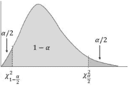

- 进行代数运算，我们得到方差的 **区间估计量**

\[
\frac{(n-1)s^2}{\chi^2_{\alpha/2}} \leq \sigma^2 \leq \frac{(n-1)s^2}{\chi^2_{(1-\alpha/2)}}
\]

- 开平方，我们得到标准差的 **区间估计量**

\[
\sqrt{\frac{(n-1)s^2}{\chi^2_{\alpha/2}}} \leq \sigma \leq \sqrt{\frac{(n-1)s^2}{\chi^2_{(1-\alpha/2)}}}
\]

## Example——蜜雪冰城

- 背景：如果要论2021登上半壁江山的饮品，蜜雪冰城主题曲绝对算得上其中之一。
- 于1997年创立的蜜雪冰城大概也没有想到，卖了20多年茶，后来却是凭借在网络上被广泛传播的旋律而彻底火了。
- 由于在主题曲大火后不久，蜜雪冰城却被曝出食品安全问题，蜜雪冰城官方也为此作出整改并道歉。

- Consider the production process of filling Ice Lemon Tea in mi xue bing cheng (蜜雪冰城).
- **Real problem:** 我们有兴趣估计蜜雪冰城冰柠茶灌装过程的总体方差。
- **Statistically:** 抽取 20 个容器的样本，灌装量的样本方差为 $s^2 = 0.0025$。
- 我们的兴趣在于以 $\alpha = 0.05$ 建立置信区间。
- 由于 $\chi^2_{0.975}(19) = 8.907$ 且 $\chi^2_{0.025}(19) = 32.852$，置信区间为

$$
\frac{(19)(0.0025)}{32.852} \le \sigma^2 \le \frac{(19)(0.0025)}{8.907},
$$

即，

$$
0.0014 \le \sigma^2 \le 0.0053
$$

$$
0.0380 \le \sigma \le 0.0730
$$

## Hypothesis Testing About a Population Variance

- 关于总体方差的假设检验有三种形式：
  - 双尾检验：$H_0: \sigma^2 = \sigma_0^2$， versus $H_a: \sigma^2 \neq \sigma_0^2$
  - 上尾检验：$H_0: \sigma^2 \leq \sigma_0^2$， versus $H_a: \sigma^2 > \sigma_0^2$
  - 下尾检验：$H_0: \sigma^2 \geq \sigma_0^2$， versus $H_a: \sigma^2 < \sigma_0^2$

- Step 1: state the null and alternative hypotheses
  - $H_0: \sigma^2 \le \sigma_0^2$；$H_a: \sigma^2 > \sigma_0^2$。
- Step 2: select the level of significance $\alpha$.
- Step 3: the test statistic is specified by

$$
\chi^2 = \frac{(n-1)s^2}{\sigma_0^2}.
$$

When $H_0$ is true with equality holds, it follows $\chi^2(n-1)$.

- Step 4: Two approaches to determine the rejection rule
  - Critical-value approach
  - p-value approach

## 示例

- 上尾假设：

  \(H_0: \sigma^2 \le 4\)

  \(H_a: \sigma^2 > 4\)

- 检验统计量：

  \[
  \chi^2 = \frac{(n-1)s^2}{\sigma^2} = \frac{23 \times 4.9}{4} = 28.18
  \]

- 拒绝规则：如果 \(\chi^2 \ge \chi^2_\alpha\) 则拒绝 \(H_0\)（或如果 p-value \(\le \alpha\)）
- 在本例中，\(\chi^2_{.10}(23)=32.007\)（p-value = 0.2091）。
- 结论：我们不能拒绝 \(H_0\)。

## 关于一个总体方差的检验总结

| | 左尾检验 | 右尾检验 | 双尾检验 |
|---|---|---|---|
| 假设 | \(H_0: \sigma^2 \geq \sigma_0^2\) \(H_a: \sigma^2 < \sigma_0^2\) | \(H_0: \sigma^2 \leq \sigma_0^2\) \(H_a: \sigma^2 > \sigma_0^2\) | \(H_0: \sigma^2 = \sigma_0^2\) \(H_a: \sigma^2 \neq \sigma_0^2\) |
| 检验统计量 | \(\chi^2 = \frac{(n-1)s^2}{\sigma_0^2}\) | \(\chi^2 = \frac{(n-1)s^2}{\sigma_0^2}\) | \(\chi^2 = \frac{(n-1)s^2}{\sigma_0^2}\) |
| 拒绝规则： 临界值法 | 拒绝 \(H_0\) 如果 \(\chi^2 \leq \chi^2_{1-\alpha}\) | 拒绝 \(H_0\) 如果 \(\chi^2 \geq \chi^2_{\alpha}\) | 拒绝 \(H_0\) 如果 \(\chi^2 \leq \chi^2_{\alpha/2}\) 或 \(\chi^2 \geq \chi^2_{1-\alpha/2}\) |
| 拒绝规则： p值法 | 拒绝 \(H_0\) 如果 p-value \(\leq \alpha\) | 拒绝 \(H_0\) 如果 p-value \(\leq \alpha\) | 拒绝 \(H_0\) 如果 p-value \(\leq \alpha\) |

## 关于两个总体方差的推断：示例

- 统计上：选取 31 名男性和 41 名女性进行调查，以研究他们对 LoL 全球总决赛的态度。

- 随机样本：结果提供了女性的样本方差 \(s_1^2 = 120\) 和男性的样本方差 \(s_2^2 = 80\)。

- 统计模型：假设：

  \(H_0: \sigma_1^2 \le \sigma_2^2\)

  \(H_a: \sigma_1^2 > \sigma_2^2\)

## 关于两个总体方差的推断

- **问题：** 我们有兴趣比较来自两个不同总体的方差。
- **样本数据：** 我们使用从两个独立随机样本收集的数据，一个来自总体 1，另一个来自总体 2。
- 两个样本方差将作为推断两个总体方差的基础。
- **其他示例：**
  - 比较由两种不同生产工艺产生的产品质量的方差；
  - 比较两种加热设备的温度方差；
  - 比较两种装配方法的装配时间方差。
- 如何构造检验统计量？抽样分布？

## F 分布

- 自由度为 \(d_1\) 和 \(d_2\) 的 *F* 分布是

  \[
  \frac{U_1/d_1}{U_2/d_2},
  \]

  的分布，其中 \(U_1 \sim \chi^2(d_1)\)，\(U_2 \sim \chi^2(d_2)\)，\(U_1\) 和 \(U_2\) **独立**。

- 假设简单随机样本和正态总体。当 \(\sigma_1^2 = \sigma_2^2\) 时，

  \[
  \frac{s_1^2}{s_2^2}
  \]

  的抽样分布为自由度为 \(n_1 - 1\) 和 \(n_2 - 1\) 的 *F* 分布。*（为什么？）*

## 关于两个总体方差的推断

- 第 1 步：陈述原假设和备择假设

  \(H_0: \sigma_1^2 = \sigma_2^2\)；\(H_a: \sigma_1^2 \neq \sigma_2^2\)。

- 第 2 步：选择显著性水平 \(\alpha\)。

- 第 3 步：检验统计量由下式给出

  \[
  F = \frac{s_1^2}{s_2^2} \sim F(n_1 - 1, n_2 - 1),
  \]

  其中 \(s_1^2\) 为总体 1 的样本方差，\(s_2^2\) 为总体 2 的样本方差。

- 第 4 步：确定拒绝规则的两种方法
  - 临界值法
  - p值法

## 示例

- **实际问题：** 假设我们想比较两家制造商生产的恒温器（温度表）的质量。

- **统计上：** 从每家制造商各选取 10 台恒温器（温度表），放置在温度为 18°C 的测试室中。读数记录如下。

| 制造商 | 读数 | 样本方差 |
|---|---|---|
| ThermoRite | 17.4 17.8 18.2 19.5 17.0 18.1 18.6 17.9 17.2 19.3 | 0.700 |
| TempKing | 17.7 16.4 19.2 20.1 19.5 19.7 18.1 16.6 17.3 17.5 | 1.768 |

- 在 \(\alpha = 0.10\) 下检验总体方差是否存在差异。

## 示例

- 假设：
- H₀: σ₁² = σ₂²
- Hₐ: σ₁² ≠ σ₂²
- 总体1代表提供较大样本方差的总体。

- 检验统计量：
- F = s₁² / s₂² = 1.768 / 0.700 = 2.53

- 拒绝规则：如果F ≥ Fₐ/₂，则拒绝H₀

- F分布表显示，在α/2 = 0.05、分子自由度为9、分母自由度为9时，F₀.₀₅ = 3.18。

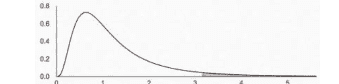

## 关于两个总体方差的检验总结

|  | 单尾检验 | 双尾检验 |
|---|---|---|
| **假设** | $H_0: \sigma_1^2 \leq \sigma_2^2$  $H_a: \sigma_1^2 > \sigma_2^2$ | $H_0: \sigma_1^2 = \sigma_2^2$  $H_a: \sigma_1^2 \neq \sigma_2^2$ |
| **检验统计量** | $F = \frac{s_1^2}{s_2^2}$ | $F = \frac{s_1^2}{s_2^2}$ |
| **拒绝规则：临界值法** | 如果 $F \geq F_{\alpha}(n_1-1, n_2-1)$，则拒绝 $H_0$ | 如果 $F \geq F_{\alpha/2}(n_1-1, n_2-1)$，则拒绝 $H_0$ |
| **拒绝规则：p值法** | 如果p值 $\leq \alpha$，则拒绝 $H_0$ | 如果p值 $\leq \alpha$，则拒绝 $H_0$ |

## 关于总体方差的推断

## 三个或更多比例的检验

- 多元比较过程
- 卡方检验

## 独立性检验

## 拟合优度检验

## 检验总体比例相等性

三个或更多

- 使用记号

$p_i =$ 总体 $i$ 的总体比例

### 1. 陈述假设：当 $k \ge 3$ 时，总体比例相等性的假设如下：

$H_0: p_1 = p_2 = \cdots = p_k$
$H_a:$ 并非所有总体比例都相等

- 无法拒绝：如果 $H_0$ 无法被拒绝，我们就无法检测到 $k$ 个总体比例之间存在差异。
- 拒绝：如果 $H_0$ 被拒绝，我们可以得出结论：并非所有 $k$ 个总体比例都相等。
- 可以进行进一步分析，以确定哪些总体比例与其他比例存在显著差异。

## 构造检验统计量

预期频数

- 如果 $H_0$ 成立，你预期有多少比亚迪汉车主会选择“是”？
- 如果 $H_0: p_1 = p_2 = p_3$ 成立，总体样本比例的最佳估计值为 $\hat{p} = 312/502 = 0.624$。
- 因此，我们预期会有 $0.624 \times 125 = 78$ 位比亚迪汉车主表示他们可能再次购买汉。

- 一般来说，在假设 $H_0$ 正确的情况下，预期频数为

$$e_{ij} = \frac{(\text{第 } i\text{ 行合计})(\text{第 } j\text{ 列合计})}{\text{总样本量}}$$

- 如果观测频数与预期频数之间存在显著差异，则可以拒绝 $H_0$。

## 构造检验统计量

卡方检验统计量

- 用于将观测频数与预期频数进行比较的检验过程涉及计算以下卡方统计量：

χ² = Σᵢ Σⱼ (fᵢⱼ - eᵢⱼ)² / eᵢⱼ,

其中

fᵢⱼ = 位于第 i 行第 j 列的单元格的观测频数
eᵢⱼ = 位于第 i 行第 j 列的单元格的预期频数

- 该检验统计量服从自由度为 k − 1 的卡方分布。

## 示例

计算卡方检验统计量的值。

| 是否可能再次购买？ | 汽车车主 | 观测频数 (f_o) | 预期频数 (f_e) | 差值 (f_o - f_e) | 平方差 (f_o - f_e)^2 | 平方差除以预期频数 (f_o - f_e)^2 / f_e |
|---|---|---|---|---|---|---|
| 是 | 汉 | 69 | 78.0 | -9.0 | 81.00 | 1.04 |
| 是 | 凯美瑞 | 120 | 124.8 | -4.8 | 23.04 | 0.18 |
| 是 | M3 | 123 | 109.2 | 13.8 | 190.44 | 1.74 |
| 否 | 汉 | 56 | 47.0 | 9.0 | 81.00 | 1.72 |
| 否 | 凯美瑞 | 80 | 75.2 | 4.8 | 23.04 | 0.31 |
| 否 | M3 | 52 | 65.8 | -13.8 | 190.44 | 2.89 |
|  | 合计 | 500 | 500 |  |  | χ² = 7.89 |

## 示例

假设 α = 0.05。

- p值法：

| 上尾区域 | .10 | .05 | .025 | .01 | .005 |
| χ² 值 (df = 2) | 4.605 | 5.991 | 7.378 | 9.210 | 10.597 |

p值 < α。我们可以拒绝原假设。

- 临界值法：

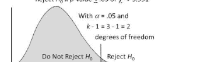

## 检验三个或多个比例的通用步骤

- 步骤1：陈述原假设和备择假设
  - $H_0: p_1 = p_2 = \cdots = p_k$
  - $H_a$：并非所有总体比例都相等
- 步骤2：选择显著性水平 $\alpha$。

## 多重比较程序

- 当拒绝 $H_0$ 时，如何确定总体比例之间的差异存在于何处？
- 我们可以使用一种称为 **Marascuilo 程序** 的多重比较方法。
- 首先，计算三个样本比例。

比亚迪汉：$\bar{p}_1 = 69/125 = 0.5520$

丰田凯美瑞：$\bar{p}_2 = 120/200 = 0.6000$

特斯拉 Model 3：$\bar{p}_3 = 123/175 = 0.7029$

- 然后计算两两差异的绝对值。

汉与凯美瑞：$|\bar{p}_1 - \bar{p}_2| = |0.5520 - 0.6000| = 0.0480$

汉与Model 3：$|\bar{p}_1 - \bar{p}_3| = |0.5520 - 0.7029| = 0.1509$

凯美瑞与Model 3：$|\bar{p}_2 - \bar{p}_3| = |0.6000 - 0.7029| = 0.1029$

- 1. 关于总体方差的推断
- 2. 三个或多个比例的检验
- 3. 独立性检验
- 4. 拟合优度检验

## 动机：独立性检验

- 独立性：两个变量是否相互独立？
- 示例：父母的收入 ⇒ 子女的教育程度
  - 对175名年轻人进行了一项关于其最高教育程度（大学、高中或两者皆无）的调查。
  - 他们的父母被划分为富裕阶层、中产阶层或贫困阶层。
- 样本数据：结果汇总如下

| 父母类别 | 教育程度 | | | |
|---|---|---|---|---|
| | 大学 | 高中 | 无 | 合计 |
| 富裕 | 20 | 15 | 10 | 45 |
| 中产 | 40 | 25 | 20 | 85 |
| 贫困 | 8 | 14 | 23 | 45 |
| 合计 | 68 | 54 | 53 | 175 |

- 问题：个人的教育程度是否与父母的财富状况相互独立？

## 独立性检验

- 卡方检验可用于检验两个分类变量之间的独立性。
- 设定原假设和备择假设。
  - $H_0$：列变量不受行变量影响。
  - $H_a$：列变量受行变量影响。
- 选择一个随机样本，并记录列联表中每个单元格的观测频数 $f_{ij}$。
- 计算每个单元格的期望频数 $e_{ij}$。

$$e_{ij} = \frac{\text{第 } i \text{ 行合计} \times \text{第 } j \text{ 列合计}}{\text{样本量}}$$

- 计算检验统计量的值。

$$\chi^2 = \sum_i \sum_j \frac{(f_{ij} - e_{ij})^2}{e_{ij}}$$

注意：当有 $n$ 行和 $m$ 列时，检验统计量服从自由度为 $(n - 1)(m - 1)$ 的卡方分布，前提是所有类别的期望频数均为5或以上。

**拒绝规则：**

- p值法：若 p 值 ≤ $\alpha$，则拒绝 $H_0$。
- 临界值法：若 $\chi^2 > \chi^2_{\alpha,(n-1)(m-1)}$，则拒绝 $H_0$。

### 示例

**观测频数**

| 父母类别 | 教育程度 | | | |
|---|---|---|---|---|
| | 大学 | 高中 | 无 | 合计 |
| 富裕 | 20 | 15 | 10 | 45 |
| 中产 | 40 | 25 | 20 | 85 |
| 贫困 | 8 | 14 | 23 | 45 |
| 合计 | 68 | 54 | 53 | 175 |

**期望频数**

| 父母类别 | 教育程度 | | | |
|---|---|---|---|---|
| | 大学 | 高中 | 无 | 合计 |
| 富裕 | 17.5 | 13.9 | 13.6 | 45 |
| 中产 | 33.0 | 26.2 | 25.8 | 85 |
| 贫困 | 17.5 | 13.9 | 13.6 | 45 |
| 合计 | 68 | 54 | 53 | 175 |

- 检验统计量：
  $$\chi^2 = \frac{(20 - 17.5)^2}{17.5} + \frac{(40 - 33.0)^2}{33.0} + \cdots + \frac{(23 - 13.6)^2}{13.6} = 15.82$$
- $\alpha = 0.05$，自由度 = $(3 - 1)(3 - 1) = 4$
- p值法：p 值 $= 0.003 < \alpha$
- 临界值法：$\chi^2 > \chi^2_{0.05,4} = 9.49$
- 我们拒绝原假设，并得出结论：所达到的教育程度与父母的财富状况并非相互独立。

- 关于总体方差的推断
- 三个或更多比例的检验
- 独立性检验

## 拟合优度检验

- 多项分布
- 正态分布

## 多项分布

- 多项分布是二项分布的直接扩展。
- 考虑 *n* 次独立试验。在每次试验中，*k* 个结果中恰好有一个发生，对应的概率为 $p_1, \ldots, p_k$。$(\sum_{i=1}^{k} p_i = 1)$
- 设 $X_i$ = 结果 *i* 发生的次数，$i = 1, \ldots, k$。则向量

  $$(X_1, X_2, \ldots, X_k)$$

  服从多项分布。
- 性质
  - $\sum_{i=1}^{k} X_i = n$
  - $X_i$ 服从二项分布

## 动机示例：市场份额研究

- 某产品的历史市场份额显示在右侧。
- C 公司推出了一款新产品。
- 这款产品会改变历史市场份额吗？
- 对 200 名客户进行抽样，要求其指定购买偏好，响应结果如下

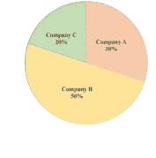

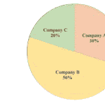

| Company A's Product | Company B's Product | Company C's New Product |
|--------------------:|--------------------:|------------------------:|
| 48 | 98 | 54 |

## 拟合优度检验：多项分布

- 提出原假设和备择假设。
  - $H_0$: 总体与具有指定概率的 $k$ 个类别的多项分布 *无差异*
  - $H_a$: 总体与具有指定概率的 $k$ 个类别的多项分布 *有差异*
- 选择一个随机样本并记录每个 $k$ 个类别的观察频数 $f_i$。
- 假设 $H_0$ 为真，通过将类别概率乘以样本量来计算每个类别的期望频数 $e_i$。
- 计算检验统计量的值。

$$\chi^2 = \sum_{i=1}^{k} \frac{(f_i - e_i)^2}{e_i}$$

注：只要所有类别的期望频数均大于等于 5，检验统计量就服从自由度为 $k - 1$ 的卡方分布。

- 拒绝规则：
  - p 值法：若 p 值 ≤ $\alpha$ 则拒绝 $H_0$
  - 临界值法：若 $\chi^2 > \chi^2_{\alpha, k-1}$ 则拒绝 $H_0$

## 示例：市场份额研究

- 假设

  $H_0$: $p_A = 0.30$，$p_B = 0.50$，且 $p_C = 0.20$
  $H_a$: 不是 $p_A = 0.30$，$p_B = 0.50$，且 $p_C = 0.20$

  其中

  $p_A$ = 客户购买 A 公司产品的概率
  $p_B$ = 客户购买 B 公司产品的概率
  $p_C$ = 客户购买 C 公司产品的概率

- 期望频数

  $e_1 = 200 \times p_A = 60$，$e_2 = 200 \times p_B = 100$，$e_3 = 200 \times p_C = 40$

- 检验统计量

  $\chi^2 = (48 - 60)^2 / 60 + (98 - 100)^2 / 100 + (54 - 40)^2 / 40 = 7.34$

- 拒绝规则（$\alpha = 0.05$，自由度 = 2）
  - p 值法：p 值 = 0.0255 < $\alpha$
  - 临界值法：$\chi^2 > \chi^2_{0.05,2} = 5.991$
- 结论：C 公司新产品的推出将改变三家公司的市场份额。

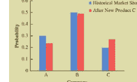

## 示例：正态分布的拟合优度检验

1. 本科英语水平测试的成绩是否服从正态分布？
2. 随机抽取 50 名学生的测试成绩样本

|   |   |   |   |   |   |   |   |   |   |
|---|---|---|---|---|---|---|---|---|---|
| 71 | 65 | 86 | 54 | 56 | 63 | 61 | 73 | 65 | 58 |
| 62 | 77 | 63 | 56 | 76 | 65 | 69 | 76 | 56 | 64 |
| 55 | 61 | 79 | 84 | 56 | 50 | 74 | 53 | 93 | 79 |
| 82 | 79 | 80 | 61 | 90 | 62 | 80 | 61 | 73 | 65 |
| 85 | 66 | 62 | 70 | 64 | 68 | 54 | 76 | 54 | 71 |

$\bar{x}=68.42,\ s=10.41$

## 示例：正态分布的拟合优度检验

- 本科英语水平测试的成绩是否服从正态分布？
- 随机抽取的 50 名学生的成绩样本：

| 71 | 65 | 86 | 54 | 56 | 63 | 61 | 73 | 65 | 58 |
|---|---|---|---|---|---|---|---|---|---|
| 60 | 77 | 63 | 56 | 76 | 65 | 60 | 76 | 56 | 64 |
| 55 | 61 | 79 | 84 | 56 | 70 | 74 | 53 | 93 | 79 |
| 82 | 79 | 80 | 61 | 90 | 62 | 80 | 61 | 73 | 65 |
| 85 | 66 | 62 | 70 | 64 | 68 | 54 | 76 | 54 | 71 |

- x̄ = 68.42, s = 10.41
- 假设：
  - H₀：总体不偏离均值为 68.42、标准差为 10.41 的正态分布
  - Hₐ：总体与均值为 68.42、标准差为 10.41 的正态分布不同

## 拟合优度检验：正态分布

- 我们也可以使用卡方检验对正态分布进行拟合优度检验。
- **基本思想**：连续值样本数据 ⇒ 离散类别。
- 在我们的例子中，我们可以将正态分布划分为 10 个等概率区间（样本量 = 50，每个区间的期望频数为 5）。

- 如何确定这些区间的端点？
- 一般来说，定义 *k* 个值区间，使得每个区间的期望频数至少为 5。
- 计算检验统计量的值。

$$\chi^2 = \sum_{i=1}^{k} \frac{(f_i-e_i)^2}{e_i}$$

**注意：** 检验统计量服从自由度为 *k − p − 1* 的卡方分布，其中 *p* 为样本估计的参数个数。在我们的例子中，*p = 2*。

- **拒绝规则：**
  - *p*-值方法：如果 *p*-值 ≤ α，则拒绝 $H_0$。
  - 临界值方法：如果 $\chi^2 > \chi^2_{\alpha,k-p-1}$，则拒绝 $H_0$。

## 卡方检验总结

- 我们已介绍了几种基于卡方分布的假设检验。
- 检验统计量：
  - χ² = Σ (观察频数 − 期望频数)² / 期望频数
- 自由度：
  - （1）检验 k 个总体的总体比例是否相等（自由度 = k − 1）
  - （2）检验两个分类变量是否独立（自由度 = (n − 1)(m − 1)）
  - （3）检验总体概率分布是否服从多项分布（自由度 = k − 1）或正态分布（自由度 = k − 3）

## 回顾统计推断的内容

### 均值估计

1. 生活中的现实问题 ⇒ 能够度量什么和检验的问题。
   - 均值：交大美食评价，生产率，生产效率
   - 比例：女士品茶，人口比例
2. 通过随机抽样(Random Sample)获得代表性样本。
   - 整理数据
   - 假设显著性检验
3. 构造均值估计量和检验统计量
   - 估计：点估计和区间估计
   - 假设检验：原假设 + 备择假设 + 显著性水平
     - 核心统计量：$\bar{X} \sim N(\mu, \frac{\sigma^2}{n})$
4. 对现实生活的问题给出科学的定量结果或者判断。

### 方差检验与比例推断

1. 生活中的现实问题 ⇒ 能够度量什么和检验的问题。
   - 方差检验：污水处理，公交车晚点，生产线良率，EDG夺冠
   - 比例检验：重复频率对比
2. 通过随机抽样(Random Sample)获得代表性样本。
   - 整理数据：计算样本均值、样本方差
   - 频率分布统计
3. 构造方差或者比例检验统计量
   - 估计：点估计和区间估计
   - 假设检验的核心统计量：
     - 单方差检验：$(n-1)s^2/\sigma_0^2 \sim \chi^2$
     - 两方差对比：$S_1^2/S_2^2 \sim F(n_1-1, n_2-1)$
4. 对现实生活中的问题给出科学的定量结果或者判断。

## BUSS2302: Business Statistics

### Lecture 6: ANOVA (方差分析)

Instructor: Tingting SONG (宋婷婷)
Antai College of Economics and Management
Shanghai Jiao Tong University

Reference: Ch. 13 in Statistics for Business & Economics, 13e by Anderson, Sweeney, Williams, Camm, and Cochran (2018)

## Outline

1. Analysis of Variance
   - Introduction
   - A Conceptual Overview
   - One-way ANOVA
   - ANOVA for Observational Studies
   - Multiple Comparison Procedures (多种比较法)
2. Design of Experiments
   - Completely Randomized Design (One-way ANOVA without Block)
   - Randomized Block Design (One-way ANOVA with Block)
   - Factorial Experiment Design (Two-way ANOVA)
3. Appendix

## 本次课的主要目标

- 领会方差分析 ANOVA
  - 用于广泛检验问题
  - 方差分析的定义
  - 方差分析的组间变异、统计量
- 有代表性的方差分析
  - 单因素方差分析
  - 单因素方差分析（组间分析）
  - 双因素方差分析
- 领会方差分析中如何进行实验和设计
  - 方差分析中均有因素影响

在我们开始严密的理论构架之前，我们不妨先这样来认识实际问题……

## 舌尖上的交大

- 上海交通大学闵行校区共有7个校内食堂，想通过调查学生对食堂的评价制定一份美食指南。
- 受人力所限，只在饭点采集信息，并调查大家对一餐、二餐、四餐进行了连续评价，评选出受学生欢迎的食堂。

### 舌尖上的交大：案例引入

- 假设随机抽取100名学生对一餐、二餐、四餐分别打分。
- 样本均值分别为6.5、7、6分，差异显著？二餐 > 一餐 > 四餐？
- 仅凭样本均值能否作出此判断？

## Example: A Survey about Dining Hall

- 为了调查学生对不同食堂的评价，对一餐食堂、二餐食堂和四餐食堂进行了调查。
- 我们想知道学生对三个食堂的评价是否存在显著差异。
- 实验过程如下：
  - 为调查三个食堂的评价，设计了问卷并分发给学生。
  - 最后，共收集到139份答卷。

## Example: A Survey about Dining Hall – Analysis

- 最受欢迎的菜品

## Introduction

- ANalysis Of VAriance (ANOVA, 方差分析) 是一种用于检验三个或更多总体均值是否相等的统计方法。
- 我们希望利用样本结果检验以下假设：

\[
H_0: \mu_1 = \mu_2 = \mu_3 = \cdots = \mu_k = \mu
\]

\[
H_a: \text{Not all population means are equal}
\]

- 如果拒绝 \(H_0\)，所有总体均值都不同（×）。为什么？

## ANOVA: Motivation Models

- **目标：** 比较不同组别（处理）之间的均值。
- **ANOVA** 通过识别数值因变量 \(X = \{x_{ij}\}\) 中的变异来源来实现上述目标。
  - \(j\) 表示受试者所属的组别，从 \(1, \dots, k\)。
  - \(i\) 表示组内第 \(i\) 个样本，从 \(1, \dots, n_j\)。
- 我们考虑 \(x_{ij}\) 的一个简单模型：
  - Model 1（在 \(H_0\) 下）：\(x_{ij} = \mu + \varepsilon_{ij}\)。
  - Model 2（在 \(H_a\) 下）：\(x_{ij} = \mu + \alpha_j + \varepsilon_{ij}\)。
- 直观上，Model 1 下 \(X\) 的变异仅来自误差项 \(\varepsilon_{ij}\)。
- 但 Model 2 下 \(X\) 的变异来自两个来源：处理调整 \(\alpha_j\) 和误差项 \(\varepsilon_{ij}\)。

## ANOVA: A Graphic Interpretation

- 给定样本均值的观测值，如何判断它们来自 Model 1 还是 Model 2？
- **基本思想：** 当 *样本均值之间的变异* 较大时，则 Model 1（\(H_0\)）更可能被拒绝。
- **问题：** 比较的基准是什么？

Figure: Sample observations

Figure: Sample observations

Figure: Sample observations

Figure: Model 1 and Model 2 are both plausible

## ANOVA：图形解释

- 给定样本均值的观测值，如何判断它们来自模型 1 还是模型 2？
- **基本思想：** 当 **样本均值之间的变异** 很大时，则模型 1 ($H_0$) 更有可能被拒绝。
- **问题：** 比较的基准是什么？
- 比较的基准是 **组内的变异**。

## ANOVA：总结

- ANOVA 的目标是将一组观测值的 **总变异** 分解为 **不同** 的来源，例如
  - 处理调整 αj（单因素 ANOVA，双因素 ANOVA）
  - 误差项 εij（H0 下的基准）
- 组间方差：处理调整 αj + 误差项 εij
- 组内方差：误差项 εij
- 它促使我们构造一个 **检验统计量** 作为变异比率

**Between-group Variance** (组间离差)
-----------------------------
**Within-group Variance** (组内离差)

并且当该比率足够大时拒绝 H0。
- 为了形式化这一思想，我们将引入来自 **Design of Experiments** 领域的某些假设和术语。

## ANOVA 的假设

- **正态性：** 对于每个总体，响应（因变量）服从正态分布。
- **同质性：** 响应变量的方差，用 σ² 表示，对所有总体都相同。 （但我们不假设它已知。）
- **独立性：** 观测值必须相互独立。

⇒ εᵢⱼ ~ i.i.d. N(0, σ²)

## 术语

- 一个 **factor** (因素) 是实验者为研究而选择的变量。
- 一个 **treatment** (处理) 是因素的一个水平。
- **experimental units** (实验个体) 是实验中感兴趣的对象。
- **response variable** (响应变量) 是实验中响应因素变化的变量。
- **问题：** 因素变量如何影响 (影响) 响应变量？

X → Y

## 关于食堂的调查

- Example: A Survey about Dining Hall
- 问题：我们想知道学生对三个食堂的评价是否存在显著差异。

Dining Halls → Student Evaluation Scores

- 在我们的例子中，我们有
  - 因素：食堂
  - 处理：第一食堂，第二食堂和第四食堂
  - 实验单位：139 名学生
  - 响应变量：学生评价分数

## 关于食堂的调查

|  | First Dining Hall | Second Dining Hall | Fourth Dining Hall |
|---|---|---|---|
|  | 7 | 8 | 9 |
|  | 8 | 8 | 8 |
|  | 4 | 6 | 5 |
|  | ... | ... | ... |
|  | 6 | 9 | 10 |
|  | 5 | 9 | 8 |
|  | 7 | 8 | 9 |
| Sample mean | 5.05 | 7.61 | 8.22 |
| Sample variance | 4.89 | 2.72 | 2.05 |
| Sample standard deviation | 2.21 | 1.65 | 1.43 |

- Step 1: Hypotheses:

H₀ : μ₁ = μ₂ = μ₃

Hₐ : Not all population means are equal

其中 μᵢ 是关于食堂 i 的学生评价分数的均值。

## 符号

- 从每个 $k$ 个处理中抽取了大小为 $n_j$ 的简单随机样本。
- $x_{ij}$: 处理 $j$ 的观测值 $i$ 的值
- 处理 $j$ 内的样本均值和样本方差为

$$\bar{x}_j = \frac{1}{n_j} \sum_{i=1}^{n_j} x_{ij}$$

$$s_j^2 = \frac{1}{n_j - 1} \sum_{i=1}^{n_j} (x_{ij} - \bar{x}_j)^2$$

- 处理间的总体样本均值为

$$\bar{\bar{x}} = \frac{1}{n_T} \sum_{j=1}^{k} \sum_{i=1}^{n_j} x_{ij}, \text{ where } n_T = n_1 + n_2 + \cdots + n_k$$

## 处理的平方和

- 定义 **Sum of Squares due to Treatments** (SSTR) 为

$$\mathrm{SSTR}=\sum_{j=1}^{k}n_j(\bar{x}_j-\bar{x})^2=\sum_{j=1}^{k}\sum_{i=1}^{n_j}(x_{ij}-\bar{x})^2$$

并且 **Mean Square due to Treatments** (MSTR) 为

$$\mathrm{MSTR}=\frac{\mathrm{SSTR}}{df_{TR}},\quad \text{where }df_{TR}=k-1$$

- MSTR 量化了 **between-group variance**。 组间均方！
- 如果 $H_0$ 成立，MSTR 提供 σ² 的无偏估计。
- 否则，MSTR 不是 σ² 的无偏估计；事实上，在这种情况下，MSTR 应该 **overestimate** σ²。

## 误差平方和

- 定义 **误差平方和** (SSE) 为

  $$\mathrm{SSE}=\sum_{j=1}^{k}(n_j-1)s_j^2=\sum_{j=1}^{k}\sum_{i=1}^{n_j}(x_{ij}-\bar{x}_j)^2$$

  并定义 **均方误差** (MSE) 为

  $$\mathrm{MSE}=\frac{\mathrm{SSE}}{df_E},\quad\text{where }df_E=nT-k$$

- MSE 是 $k$ 个样本方差的加权平均值，用来量化 **组内方差**。组内方差！

- 无论 $H_0$ 是否成立，MSE 总能提供 $\sigma^2$ 的无偏估计。

## 总平方和

- 定义总平方和 (SST) 为

  $$SST = \sum_{j=1}^{k} \sum_{i=1}^{n_j} (x_{ij} - \bar{x})^2 = \sum_{j=1}^{k} \sum_{i=1}^{n_j} (x_{ij} - \bar{x}_j + \bar{x}_j - \bar{x})^2$$

- 那么总体样本方差为

  $$s^2 = \frac{SST}{df_T}, \quad \text{where } df_T = n_T - 1.$$

- 总体样本方差量化了总样本的变异。

- 我们有

  $$SST = SSTR + SSE, \quad df_T = df_{TR} + df_E$$

## F 检验

- 如果原假设为真且 ANOVA 假设成立，则 MSTR/MSE 的抽样分布为 F 分布 $(k-1, n_T - k)$。See Appendix
- Step 3: F 分布的参数为 $d_1$ 和 $d_2$ 的随机变量由两个独立的（缩放的）卡方随机变量之比产生：
  $X \sim F(d_1, d_2) \Rightarrow X = \frac{U_1/d_1}{U_2/d_2} = \frac{SSTR/(k-1)}{SSE/(n_T - k)} = \frac{MSTR}{MSE}$
  其中 $U_i \sim \chi^2(d_i), i = 1,2.$
- 如果 $k$ 个总体的均值不相等，MSTR/MSE 的值会被放大，因为 MSTR 高估了 $\sigma^2$。
- 因此，如果 MSTR/MSE 的结果值过大，以至于不可能从适当的 F 分布中随机选取，我们将拒绝 $H_0$。

## F 检验

- Step 4: 临界值法：$F_\alpha$ 和 p 值法。
- Step 5: 结论。

## 摘要：k 个总体均值相等性检验

- Step 1: 假设
  H₀ : μ₁ = μ₂ = μ₃ = ⋯ = μₖ
  Hₐ : 并非所有总体均值都相等

- Step 3: 检验统计量
  F = MSTR / MSE

- Step 4: 拒绝域
  - p-value Approach: Reject H₀ if p-value ≤ α
  - Critical Value Approach: Reject H₀ if F ≥ Fₐ, where the value of Fₐ is based on an F distribution with k − 1 numerator d.f. and nT − k denominator d.f.

- Step 5: 比较 F 检验统计量与拒绝域并作出结论。

## ANOVA 表

| Source of Variation | Sum of Squares | Degrees of Freedom | Mean Square | F | p-Value |
|---|---|---|---|---|---|
| Treatments | SSTR | $k-1$ | $MSTR=\frac{SSTR}{k-1}$ | $\frac{MSTR}{MSE}$ |  |
| Error | SSE | $n_T-k$ | $MSE=\frac{SSE}{n_T-k}$ |  |  |
| Total | SST | $n_T-1$ |  |  |  |

SST is partitioned into SSTR and SSE.

SST's degrees of freedom $(df)$ are partitioned into SSTR's $df$ and SSE's $df$.

- ANOVA 可以被视为将 **总平方和** 和 **自由度** 划分为相应的来源：处理和误差的过程。
  （分̄边差̄边法！）
- 将平方和除以适当的自由度可得到方差估计值。

## 例：食堂调查 – 分析

- Between-group variance (组间误差)
  因为样本量都相等：
  x̄ = (x̄₁ + x̄₂ + x̄₃)/3 = (5.05 + 7.61 + 8.22)/3 = 6.96
  SSTR = 139(5.05 − 6.96)² + 139(7.61 − 6.96)² + 139(8.22 − 6.96)² = 785.11
  MSTR = 785.11/(3 − 1) = 392.56

- Within-group variance (组内误差)
  SSE = 138(4.89) + 138(2.72) + 138(2.05) = 1333.89
  MSE = 1333.89/(417 − 3) = 3.22

- Step 3: Test Statistic (统计量)
  F = MSTR/MSE = 392.56/3.22 = 121.90

## 例：食堂调查 – 分析

- ANOVA Table

| Source of Variance | Sum of Squares | Degree of Freedom | Mean Square | F | P-value | F crit |
|---|---|---|---|---|---|---|
| Treatments | 785.1127098 | 2 | 392.55635 | 121.90146 | 2.36178E-42 | 3.0175145 |
| Error | 1333.194245 | 414 | 3.220276 |  |  |  |
| Total | 2118.306954 | 416 |  |  |  |  |

- Step 4: Rejection Rule

  - p-value Approach: Reject H₀ if p-value ≤ .05
  - Critical Value Approach: Reject H₀ if F ≥ 3.02, where the value of F₀.₀₅ = 3.02 is based on an F distribution with 2 numerator d.f. and 414 denominator d.f.

- Step 5: Conclusion

  - With F = 121.90, we reject H₀ and conclude that there is a significant difference between the students' evaluations of the three dining halls.

## 示例：关于食堂的调查 – 讨论

- 回顾 ANOVA 的三个假设：
  - 正态性，方差齐性，独立性
- 我们在这个例子中的实验设计是否满足这些假设？
- 假设你要为同一目的设计实验，你会怎么做？

## 实验研究 (实验研究) V.S. 观测研究 (观测研究)

correlation→causality! 相关性是因果关系

- 统计研究可以分为实验性或观测性。
- 在实验研究中，一个或多个因素被控制，以便获得关于这些因素如何影响感兴趣变量的数据。
- 在观测研究中，并不试图控制因素。
- 然而，观测研究只能建立两个变量之间的关联 (相关)。
- 在将结果推广到总体并得出因果 (因果) 关系时应谨慎。

## 示例：Reed Manufacturing

- **经验问题：** Janet Reed 有三家制造厂 (在 Buffalo、Pittsburgh 和 Detroit)。她想知道她三家制造厂的部门经理每周工作小时数的平均值是否存在显著差异。
- **数据：** 从三家工厂各随机抽取五名经理，并列出每位经理上周工作小时数，如下一张幻灯片所示。
- **技术：** 将进行 F 检验，使用 α = .05。
- **统计框架 (ANOVA)：**
  - 因子：制造厂
  - 处理：Buffalo、Pittsburgh、Detroit
  - 实验单位：经理
  - 响应变量：工作小时数

## 示例：Reed Manufacturing 样本数据

| Observation | Plant 1 Buffalo | Plant 2 Pittsburgh | Plant 3 Detroit |
|-------------|-----------------|--------------------|-----------------|
| 1 | 48 | 73 | 51 |
| 2 | 54 | 63 | 63 |
| 3 | 57 | 66 | 61 |
| 4 | 54 | 64 | 54 |
| 5 | 62 | 74 | 56 |
| Sample Mean | 55 | 68 | 57 |
| Sample Variance | 26.0 | 26.5 | 24.5 |

## 示例：Reed Manufacturing – 分析

- Step 1: Develop the hypotheses.

H₀ : μ₁ = μ₂ = μ₃ = ⋯ = μₖ
Hₐ : Not all population means are equal

where:

μ₁ = mean number of hours worked per week by the managers at Plant 1

μ₂ = mean number of hours worked per week by the managers at Plant 2

μ₃ = mean number of hours worked per week by the managers at Plant 3

- Step 2: Specify the level of significance. α = .05

- Step 3: Compute the value of the test statistic.

x̄ = (55 + 68 + 57)/3 = 60
SSTR = 5(55 − 60)² + 5(68 − 60)² + 5(57 − 60)² = 490
MSTR = 490/(3 − 1) = 245
SSE = 4(26.0) + 4(26.5) + 4(24.5) = 308
MSE = 308/(15 − 3) = 25.667
F = MSTR/MSE = 245/25.667 = 9.55

- ANOVA Table

| Source of Variation | Sum of Squares | Degrees of Freedom | Mean Square | F | p-Value |
|---|---|---|---|---|---|
| Treatment | 490 | 2 | 245 | 9.55 | .0033 |
| Error | 308 | 12 | 25.667 |  |  |
| Total | 798 | 14 |  |  |  |

- Step 4: Rejection rule

- p-Value Approach

Compute the p-value. With 2 numerator d.f. and 12 denominator d.f., the p-value is .01 for F = 6.93. Therefore, the p-value is less than .01 for F = 9.55.

Determine whether to reject H₀. The p-value ≤ .05, so we reject H₀.

- Critical Value Approach

Determine the critical value and rejection rule. Based on an F distribution with 2 numerator d.f. and 12 denominator d.f., F₀.₀₅ = 3.89. Reject H₀ if F ≥ 3.89

Determine whether to reject H₀. Because F = 9.55 > 3.89, we reject H₀.

- Step 5: Conclusion

We can conclude that the mean number of hours worked per week by department managers is not the same at all 3 plants.

But there is no evidence to support the difference coming from the location.

No causality: Location ≠ Number of hours worked per week

## What We Have Done

- **AN**alysis **of V**ariance (**ANOVA**, 方差分析) is a statistical procedure used to compare **means** among different **groups (treatments)**.
- We consider simple models for $x_{ij}$:

  Model 1 (under $H_0$): $x_{ij} = \mu + \varepsilon_{ij}$  
  Model 2 (under $H_1$): $x_{ij} = \mu + \alpha_j + \varepsilon_{ij}$

- Construct a **test statistic** as a variability ratio:

$$F(k-1, n_T-k)=\frac{\text{组间变差}}{\text{组内变差}}=\frac{SSTR/(k-1)}{SSE/(n_T-k)}$$

and reject $H_0$ if this ratio is **sufficiently large** (Rejection rule).

- **Causal inference**: experimental studies V.S. observational studies

## 多重比较程序

- 假设 ANOVA(MSE,1/n=1/n) 已提供统计证据拒绝总体均值相等的原假设。
- H₀: μᵢ = μ⁰ 对所有 i 成立 且 Hₐ: μᵢ ≠ μ⁰ 对某些 i 成立。
- Fisher 最小显著差异 (LSD) 程序是一种用于多个处理组两两比较的两步程序，有助于确定差异出现的位置。
  - 执行 ANOVA 检验 (整体)，如果在预先指定的显著性水平下被拒绝
  - 在同一显著性水平下执行所有两两比较。
- 第二步程序有两种变体，基于两种不同的检验统计量：
  - t 统计量 t = (x̄ᵢ - x̄ⱼ) / √[MSE(1/nᵢ + 1/nⱼ)]
  - 样本均值差：x̄ᵢ - x̄ⱼ

## Fisher’s LSD 程序：t 统计量

- Step 1: 假设
  H0: μi = μj
  Ha: μi ≠ μj
- Step 3: 检验统计量 (方差未知且相等的两样本均值检验)
  t(nT − k) = (x̄i − x̄j) / √[MSE(1/ni + 1/nj)]
- Step 4: 拒绝规则
  - p-value 方法：若 p-value ≤ α 则拒绝 H0
  - 临界值方法：若 t ≤ −tα/2 或 t ≥ tα/2 则拒绝 H0，其中 tα/2 的取值基于 t 分布 (自由度 = nT − k) 为什么？

## Fisher's LSD 程序 : x̄_i − x̄_j

- Step 1: 假设
  H₀ : μ_i = μ_j
  Hₐ : μ_i ≠ μ_j
- Step 3: 检验统计量
  x̄_i − x̄_j
- Step 4: 拒绝规则
  - 拒绝 H₀ 若
    |x̄_i − x̄_j| ≥ LSD
  其中
  LSD = t_{α/2}(n_T − k) √[MSE(1/n_i + 1/n_j)]

## 示例：Reed Manufacturing – Fisher’s LSD 程序

- **经验问题：** 回顾 Janet Reed 想知道她三家制造工厂的部门经理每周工作小时数的平均值是否存在显著差异。
- 在第一步中，ANOVA 已提供 **统计证据** 拒绝总体均值相等的原假设。
- Fisher 最小显著差异 (LSD) 程序 (两两比较 C₃² = 3) 可用于确定 **差异出现的位置**。
- 对于 α = .05 且 n_T − k = 15 − 3 = 12 自由度，t₀.₀₂₅ = 2.179
  $$\text{LSD}=t_{\alpha/2}\sqrt{\text{MSE}\left(1/n_i+1/n_j\right)}$$
  $$=2.179\sqrt{25.667\left(1/5+1/5\right)}=6.98$$

## 示例：Reed Manufacturing – Fisher’s LSD 程序

- Plants 1 和 2 的 LSD
- 假设 (A)
  H₀: μ₁ = μ₂
  Hₐ: μ₁ ≠ μ₂
- 拒绝规则
  拒绝 H₀ 若 |x̄₁ − x̄₂| ≥ 6.98
- 检验统计量规则
  |x̄₁ − x̄₂| = |55 − 68| = 13
- 结论
  工厂 1 的工作小时数均值不等于工厂 2 的工作小时数均值。

## 示例：Reed Manufacturing – Fisher’s LSD 程序

- Plants 1 和 3 的 LSD
  - 假设 (B)
    - $H_0: \mu_1 = \mu_3$
    - $H_a: \mu_1 \neq \mu_3$
  - 拒绝规则
    - 拒绝 $H_0$ 若 $|\bar{x}_1 - \bar{x}_3| \ge 6.98$
  - 检验统计量规则
    - $|\bar{x}_1 - \bar{x}_3| = |55 - 57| = 2$
  - 结论
    - 工厂 1 的工作小时数均值与工厂 3 的工作小时数均值之间没有显著差异。

## 示例：Reed Manufacturing – Fisher’s LSD 程序

- Plants 2 和 3 的 LSD
  - 假设 (C)
    H₀: μ₂ = μ₃
    Hₐ: μ₂ ≠ μ₃
  - 拒绝规则
    拒绝 H₀ 若 |x̄₂ − x̄₃| ≥ 6.98
  - 检验统计量规则
    |x̄₂ − x̄₃| = |68 − 57| = 11
  - 结论
    工厂 2 的工作小时数均值不等于工厂 3 的工作小时数均值。

# 多重比较的 I 型错误率

- 在我们的示例中，我们使用 Fisher’s LSD 程序进行 **三次两两比较**，每次的显著性水平为 α。
- 我们在 **三次检验中至少一次** 犯 I 型错误的概率是多少？
- **比较wise I 型错误率** α 表示与单次两两比较相关的显著性水平。
- **实验wise I 型错误率** αₑw 率是 在 \(C_k^2 = \frac{k!}{2!(k-2)!}\) 次两两比较中至少犯一次 I 型错误的概率。

\[\alpha_{EW}=1-(1-\alpha)^{C_k^2}\]

- 实验wise I 型错误率对于处理数更多的问题 (k 较大) 会变大。

## 多重比较的I类错误率

- 控制 α_EW 的一种方法是 Bonferroni 校正——整体 α_EW=0.05。
- 怎么做？
- 我们只需调整比较错误率 α = α_EW / C_k²。

| k | C_k² | α_EW (α=0.05) | α_EW (α=0.05 / C_k²) |
|---|---|---|---|
| 3 | 3 | 0.1426 | 0.0492 |
| 5 | 10 | 0.4013 | 0.0489 |
| 10 | 45 | 0.9006 | 0.0488 |
| 20 | 190 | 0.9999 | 0.0488 |

- **批评：**这种校正以增加产生假阴性（即第二类错误 β）的概率为代价。

## DOE（实验设计）简介

- **实验**是一项受控研究，研究者试图理解**因果关系**（cause-and-effect relationships）。
- **实验设计**（DOE）是统计学中关于规划、实施和分析实验的一个分支。
- DOE 由罗纳德·A·费希尔爵士创立。早在 20 世纪 20 年代，费希尔在洛桑实验站担任首席统计学家时，就将 DOE 应用于农业领域。
- 如今，它已成为几乎所有研究领域中比较不同处理效应的基本方法。

## 学术研究示例

## 随机对照试验对发展经济学研究和发展政策的影响

为《经济学的现状，世界的现状》会议论文集准备的论文

Abhijit Vinayak Banerjee Esther Duflo Michael Kremer September 11, 2014

发展经济学家和政策制定者所思考的许多（尽管远非全部）问题本质上都是因果性的。在教室里增加电脑会产生什么影响？预防性健康产品的需求价格弹性是多少？提高利率会导致储蓄增加吗？在过去，回答此类因果问题的标准方法是随机对照试验（RCTs）。Fisher, 1925。在随机对照试验中，不同单元被随机分配到不同处理组。这种随机化有一个重要特征：结果中的差异可归因于处理，因此处理组与对照组之间的任何差异都反映了处理的影响。虽然这个想法很简单，但在实际领域的实施可能更为复杂，而且经过一段时间后，随机化才被认为是回答社会科学、一般研究以及更具体的发展经济学问题的实用工具。

## 设计实验的步骤

设计实验所需的具体步骤包括：

- 1 认识并陈述问题
- 2 选择因素、水平和范围
- 3 选择响应变量
- 4 选择设计
- 5 实施实验
- 6 统计分析（Statistical analysis）
- 7 得出结论并提出建议

在本次讲座中，我们将重点讨论设计的选择（完全随机设计/随机区组设计/析因设计）和统计分析（ANOVA）。

## 完全随机设计（Completely Randomized Design）

- 完全随机设计（CRD）是一种用于研究单因素效应的实验设计，其中处理被随机分配到实验单元。

- 在 AutoShine 公司的示例中，为了研究三种不同蜡的耐久性是否同样有效，我们采用完全随机设计。

- 随机抽取 5 辆新车，分别使用类型 1、类型 2 和类型 3 的蜡进行打蜡，每种类型各 5 辆。

- 然后每辆车反复通过自动洗车机，直到蜡层出现劣化迹象，并记录洗车次数。

- 我们可以使用单因素方差分析对完全随机设计进行分析。

## 随机区组化设计（Randomized Block Design）

- 当单个实验单元是在高度**异质性条件**（heterogeneous conditions）下取样时，这些单个单元不太可能充分代表总体，并且重复取样可能会产生非常不同的结果。
- 可以使用**区组化**来形成同质组，从而得到随机区组化设计。

## 随机化区组设计：方差分析

- 随机化区组设计（RBD）的模型形式如下

$$x_{ij}=\mu+\alpha_j+\beta_i+\epsilon_{ij},\quad j=1,\ldots,k;\ i=1,\ldots,b$$

其中，$x_{ij}$ 是第 $i$ 个区组中第 $j$ 个处理的观测值，$n_T=kb$。

- 总平方和（SST）被分解为三部分：处理平方和（SSTR）、区组平方和（SSBL）和误差平方和（SSE）。

$$\mathrm{SST}=\mathrm{SSTR}+\mathrm{SSBL}+\mathrm{SSE}$$

- 总自由度 $n_T-1$ 的分解方式为：处理占 $k-1$ 个自由度，区组占 $b-1$ 个自由度，误差项占 $(k-1)(b-1)$ 个自由度。

## 随机化区组设计：方差分析表

| 变异来源 | 平方和 | 自由度 | 均方 | F | p 值 |
|---|---|---|---|---|---|
| 处理 | SSTR | $k - 1$ | $\mathrm{MSTR} = \mathrm{SSTR} / (k - 1)$ | $\mathrm{MSTR} / \mathrm{MSE}$ |  |
| 区组 | SSBL | $b - 1$ | $\mathrm{MSBL} = \mathrm{SSBL} / (b - 1)$ |  |  |
| 误差 | SSE | $(k - 1)(b - 1)$ | $\mathrm{MSE} = \mathrm{SSE} / [(k - 1)(b - 1)]$ |  |  |
| 总计 | SST | $n_T - 1$ |  |  |  |

- $\mathrm{SST} = \sum_{i=1}^{b} \sum_{j=1}^{k} (x_{ij} - \bar{x})^2$
- $\mathrm{SSTR} = \sum_{i=1}^{b} \sum_{j=1}^{k} (\bar{x}_j - \bar{x})^2 = b \sum_{j=1}^{k} (\bar{x}_j - \bar{x})^2$
- $\mathrm{SSBL} = \sum_{i=1}^{b} \sum_{j=1}^{k} (\bar{x}_i - \bar{x})^2 = k \sum_{i=1}^{b} (\bar{x}_i - \bar{x})^2$
- $\mathrm{SSE} = \sum_{i=1}^{b} \sum_{j=1}^{k} (x_{ij} - \bar{x}_i - \bar{x}_j + \bar{x})^2 = \mathrm{SST} - \mathrm{SSTR} - \mathrm{SSBL}$

## 示例：关于食堂的调查——分析

- **目标**：在排除不同班级所带来的误差后，检验学生对三个食堂的评价是否存在显著差异。
- **区组**：由于同一区组内条件具有同质性，我们可以将一个班级视为一个区组。
- 设 $X_{ijm}$ 为第 $i$ 个区组（班级）中第 $j$ 个食堂的第 $m$ 名学生的评价，其中 $i = 1,2,\cdots,5$；$j = 1,2,3$；$m = 1,2,\cdots,M_i$。

**数据表（保留两位小数）：** 处理（食堂）

| 区组（班级） | 处理 1 | 处理 2 | 处理 3 | 区组均值 | 学生人数 |
|---|---|---|---|---|---|
| 1 | $x_{111},\ldots,x_{11M_1}$ | ... | ... | 6.65 | 33 |
| 2 | ... | ... | ... | 6.40 | 16 |
| 3 | ... | ... | ... | 7.23 | 45 |
| 4 | ... | ... | ... | 7.24 | 27 |
| 5 | ... | ... | ... | 6.95 | 21 |
| 处理均值 | 5.09 | 7.61 | 8.22 |  |  |

- **处理的均方**
  - $\mathrm{SSTR} = 139 \sum_{j=1}^{3} (\bar{x}_j - \bar{x})^2 = 139(5.05 - 6.96)^2 + 139(7.61 - 6.96)^2 + 139(8.22 - 6.96)^2 = 785.11$，$df_{TR} = 3 - 1$
  - $\mathrm{MSTR} = 785.11/(3 - 1) = 392.56$
- **区组的均方（MSBL）**
  - $\mathrm{SSBL} = \sum_{i=1}^{5} \sum_{j=1}^{3} \sum_{m=1}^{M_i} (\bar{x}_{i.} - \bar{x})^2 = 44.00$，$df_{BL} = 5 - 1$
  - $\mathrm{MSBL} = 44.00/(5 - 1) = 11.00$
- **误差的均方（MSE）**
  - $\mathrm{SST} = \sum_{i=1}^{5} \sum_{j=1}^{3} \sum_{m=1}^{M_i} (x_{ijm} - \bar{x})^2 = 2118.31$，$df_T = 417 - 1$
  - $\mathrm{SSE} = \mathrm{SST} - \mathrm{SSTR} - \mathrm{SSBL} = 1289.19$，$df_E = df_T - df_{TR} - df_{BL} = 410$
  - $\mathrm{MSE} = 1289.19/410 = 3.14$

- **检验统计量**
  - $F = \mathrm{MSTR}/\mathrm{MSE} = 392.56/3.14 = 124.84$

### 方差分析表

| 变异来源 | 平方和 | 自由度 | 均方 | F | P 值 | F 临界值 |
|---|---|---|---|---|---|---|
| 处理 | 785.11 | 2 | 392.56 | 124.84 | 4.54E-43 | 3.02 |
| 区组 | 44.00 | 4 | 11.00 |  |  |  |
| 误差 | 1289.19 | 410 | 3.14 |  |  |  |
| 总计 | 2118.31 | 416 |  |  |  |  |

- **拒绝法则**
  - p 值法：若 p 值 $\le .05$，则拒绝 $H_0$
  - 临界值法：若 $F \ge 3.02$，则拒绝 $H_0$；其中 $F_{.05} = 3.02$ 基于分子自由度为 2、分母自由度为 410 的 F 分布。

- **结论**
  - 由于 $F = 124.84$，我们拒绝 $H_0$，并得出结论：学生对三个食堂的评价存在显著差异。

## 其他相关设计

- 随机化区组设计通过消除一个已知且可控的干扰变量所带来的变异性，来降低实验中的残余误差。
- 还有其他几种利用区组原则的设计类型：
  - 拉丁方设计（对 2 个干扰变量进行区组化）
  - 希腊拉丁方设计（对 3 个干扰变量进行区组化）
- 我们所学到的随机化区组设计实际上是随机化完全区组设计，即每个区组包含所有处理。
- 有时在每个区组中实施所有处理是不可能的。
  - 随机化不完全区组设计（平衡/非平衡）

## 析因实验（Factorial Experiment）

- 在某些实验中，我们希望得出关于一个以上变量或因素的结论。
- 当需要同时得出关于两个或更多因素的结论时，析因实验及其相应的方差分析计算是很有价值的设计。
- 之所以称为“析因”，是因为实验条件包含了因素的所有可能组合。
- 例如，对于因素A的a个水平和因素B的b个水平，实验将涉及收集ab个处理组合的数据。

## 主效应与交互作用

- 因素的**主效应**：响应随因素水平改变而产生的变化。
- 因素之间的**交互作用**：在某些实验中，我们可能会发现一个因素的水平间响应变化在其他因素的所有水平上**并不**相同。

## 析因设计的优势

- 假设我们有两个因素A和B，每个因素各有两种水平
- 一次一因子设计
  - 需要总共6（3×2）次观测来估计2个因素的影响
  - 关于交互作用的结论可能严重错误
- 2因子析因设计
  - 总共需要4次观测
  - 一个因素的影响可以在其他因素的多个水平下进行估计
  - 可以研究交互作用

## 双因子析因实验：安排

| 因素A \ 因素B | 1 | 2 | ... | b |
|---|---|---|---|---|
| 1 | $x_{111}, x_{112}, \ldots, x_{11r}$ | $x_{121}, x_{122}, \ldots, x_{12r}$ | ... | $x_{1b1}, x_{1b2}, \ldots, x_{1br}$ |
| 2 | $x_{211}, x_{212}, \ldots, x_{21r}$ | $x_{221}, x_{222}, \ldots, x_{22r}$ | ... | $x_{2b1}, x_{2b2}, \ldots, x_{2br}$ |
| ... | ... | ... | ... | ... |
| a | $x_{a11}, x_{a12}, \ldots, x_{a1r}$ | $x_{a21}, x_{a22}, \ldots, x_{a2r}$ | ... | $x_{ab1}, x_{ab2}, \ldots, x_{abr}$ |

- $x_{ijk}$ 有三个维度：
- 因素A中的处理数：$i = 1, \ldots, a$
- 因素B中的处理数：$j = 1, \ldots, b$
- 每个处理中的重复数：$k = 1, \ldots, r$

## 双因子析因设计：方差分析

- **双因子**析因实验的方差分析过程与完全随机实验和随机区组实验类似。
- 模型形式为

\[
x_{ijk}=\mu+\alpha_i+\beta_j+(\alpha\beta)_{ij}+\epsilon_{ijk},
\]

其中 \(i=1,\ldots,a\)，\(j=1,\ldots,b\)，\(k=1,\ldots,r\)。
- 我们再次将总平方和（SST）分解为其来源。

\[
\mathrm{SST}=\mathrm{SSA}+\mathrm{SSB}+\mathrm{SSAB}+\mathrm{SSE}
\]

- 总自由度 \(n_T-1\) 分解为

\[
n_T-1=(a-1)+(b-1)+(a-1)(b-1)+ab(r-1)
\]

## 双因子析因实验：方差分析表

| 变异来源 | 平方和 | 自由度 | 均方 | F | p值 |
|---|---|---|---|---|---|
| 因素A | SSA | a - 1 | MSA = SSA / (a - 1) | MSA / MSE | |
| 因素B | SSB | b - 1 | MSB = SSB / (b - 1) | MSB / MSE | |
| 交互作用 | SSAB | (a-1)(b-1) | MSAB = SSAB / [(a - 1)(b - 1)] | MSAB / MSE | |
| 误差 | SSE | abr(r - 1) | MSE = SSE / [abr(r - 1)] | | |
| 总计 | SST | n_r - 1 | | | |

## 双因子析因实验

1. **第1步** 计算总平方和

$$SST = \sum_{i=1}^{a}\sum_{j=1}^{b}\sum_{k=1}^{r}(x_{ijk}-\bar{x})^2$$

2. **第2步** 计算因素A的平方和

$$SSA = br\sum_{i=1}^{a}(\bar{x}_{i\cdot\cdot}-\bar{x})^2 = \sum_{i=1}^{a}\sum_{j=1}^{b}\sum_{k=1}^{r}(\bar{x}_{i\cdot\cdot}-\bar{x})^2$$

3. **第3步** 计算因素B的平方和

$$SSB = ar\sum_{j=1}^{b}(\bar{x}_{\cdot j\cdot}-\bar{x})^2 = \sum_{i=1}^{a}\sum_{j=1}^{b}\sum_{k=1}^{r}(\bar{x}_{\cdot j\cdot}-\bar{x})^2$$

## 双因子析因实验
- **第 4 步** 计算交互作用的平方和

$$
SSAB = r\sum_{i=1}^{a}\sum_{j=1}^{b}(\bar{x}_{ij\cdot}-\bar{x}_{i\cdot}-\bar{x}_{\cdot j}+\bar{x}_{\cdot\cdot})^2
$$

$$
=\sum_{i=1}^{a}\sum_{j=1}^{b}\sum_{k=1}^{r}(\bar{x}_{ij\cdot}-\bar{x}_{i\cdot}-\bar{x}_{\cdot j}+\bar{x}_{\cdot\cdot})^2
$$

- **第 5 步** 计算误差平方和

$$
SSE=\sum_{i=1}^{a}\sum_{j=1}^{b}\sum_{k=1}^{r}(x_{ijk}-\bar{x}_{ij\cdot})^2=SST-SSA-SSB-SSAB
$$

## 例：食堂调查 – 分析
- **总平方和 SST**  
SST = \(\sum_{i=1}^{2}\sum_{j=1}^{3}\sum_{k=1}^{K_{ij}}(x_{ijk}-\bar{x})^2 = 2118.31\), \(df_T = 417 - 1\)

- **因子 A 的平方和（食堂）**  
SSA = \(\sum_{i=1}^{3} 139(\bar{x}_{i\cdot}-\bar{x})^2 = 139(5.09-6.96)^2 + 139(7.61-6.96)^2 + 139(8.22-6.96)^2 = 785.11\), \(df_A = 3 - 1\)

- **因子 B 的平方和（性别）**  
SSB = \(\sum_{j=1}^{2} \sum_{i=1}^{3}\sum_{k=1}^{K_{ij}}(\bar{x}_{\cdot j\cdot}-\bar{x})^2 = 0.12\), \(df_B = 2 - 1\)

- **交互作用的平方和**  
SSAB = \(\sum_{i=1}^{2}\sum_{j=1}^{3}\sum_{k=1}^{K_{ij}}(\bar{x}_{ij\cdot}-\bar{x}_{i\cdot}-\bar{x}_{\cdot j\cdot}+\bar{x})^2 = 21.08\)  
\(df_{AB}=df_A\cdot df_B=2\)

- **误差平方和**  
SSE = SST − SSA − SSB − SSAB = 1312.00  
\(df_E=df_T-df_A-df_B-df_{AB}=411\)

## 例：食堂调查 – 分析
- **方差分析表**

| 变异来源 | 平方和 | 自由度 | 均方 | F | P值 | F 临界值 |
|---|---|---|---|---|---|---|
| 因子 A（食堂） | 785.11 | 2 | 392.56 | 123.06 | 1.31E-42 | 3.02 |
| 因子 B（性别） | 0.12 | 1 | 0.12 | 0.04 | 0.84 | 3.86 |
| 交互作用 | 21.08 | 2 | 10.54 | 3.30 | 0.04 | 3.02 |
| 误差 | 1312.00 | 411 | 3.19 |  |  |  |
| 总计 | 2118.31 | 416 |  |  |  |  |

- **使用 p 值法的结论**

- 食堂：
F = 123.06 > Fα(2,411) = 3.02   评价因食堂类型而不同

- 性别：
F = 0.04 < Fα(1,411) = 3.86   评价不因性别类型而不同

- 交互作用：
F = 3.30 > Fα(2,411) = 3.02   交互作用显著

## 例：食堂调查 – 分析
## 方差分析表

| 变异来源 | 平方和 | 自由度 | 均方 | F | P值 | F 临界值 |
|---|---|---|---|---|---|---|
| 因子 A（食堂） | 785.11 | 2 | 392.56 | 123.06 | 1.31E-42 | 3.02 |
| 因子 B（性别） | 0.12 | 1 | 0.12 | 0.04 | 0.84 | 3.86 |
| 交互作用 | 21.08 | 2 | 10.54 | 3.30 | 0.04 | 3.02 |
| 误差 | 1312.00 | 411 | 3.19 |  |  |  |
| 总计 | 2118.31 | 416 |  |  |  |  |

## 使用临界值法的结论
- 食堂：
p-value = 1.31E −42 < α = .05   评价因食堂类型而不同

- 性别：
p-value = 0.84 > α = .05   评价不因性别类型而不同

- 交互作用：
p-value = 0.04 < α = .05   交互作用显著

## 总结
- 我们已研究了方差分析程序以检验多个总体或处理的均值差异，你应该
- 知道使用方差分析的三个假设；
- 理解方差分析背后的思想和理论；
- 知道如何执行方差分析程序，建立方差分析表，解释其条目并得出结论。
- 我们已介绍了 3 种实验设计，你应该
- 理解实验设计的基本原理；
- 理解 3 种设计之间的差异；
- 知道如何使用方差分析对 3 种设计进行统计分析。

## 大纲
- **方差分析**
- 引言
- 概念概述
- 单因素方差分析
- 观察性研究的方差分析
- 多重比较程序（多种比较方法）

- **实验设计**
- 完全随机设计（无区组的单因素方差分析）
- 随机区组设计（有区组的单因素方差分析）
- 析因实验设计（双因素方差分析）

- **附录**

## 科克伦定理
- **科克伦定理**
  设 $Z_i \sim_{i.i.d.} N(0, \sigma^2)$，其中 $i = 1, \ldots, v$，且

  $$\sum_{i=1}^{v} Z_i^2 = Q_1 + Q_2 + \cdots + Q_s$$

  其中 $s \le v$，$Q_i$ 的自由度为 $v_i$。若 $v = v_1 + v_2 + \cdots + v_s$，则 $Q_i$ 相互独立，且 $Q_i / \sigma^2 \sim \chi^2(v_i)$。

- 由科克伦定理可知，若 $H_0$ 成立，则 SSE 与 SSTR 相互独立，且

  $$\frac{SSE}{\sigma^2} = \frac{\sum_{j=1}^{k} \sum_{i=1}^{n_j} (x_{ij} - \bar{x}_j)^2}{\sigma^2} \sim \chi^2(n_T - k)$$
  
  $$\frac{SSTR}{\sigma^2} = \frac{\sum_{j=1}^{k} n_j (\bar{x}_j - \bar{\bar{x}})^2}{\sigma^2} \sim \chi^2(k - 1)$$

## BUSS2302：商业统计
第7讲：A/B测试

授课教师：宋婷婷

上海交通大学安泰经济与管理学院

教材：《可信的在线受控实验：A/B测试实用指南》
作者：Kohavi, Ron, Diane Tang, and Ya Xu. (2020).

## 1 引言
- 动机
- 示例

## 2 A/B测试
- A/B测试的历史
- 什么是A/B测试
- 为什么进行A/B测试？
- A/B测试的基本要素

## 3 A/B测试的步骤
- 总结
- 真实案例

## 引言
- 动机
- 示例

A/B测试

A/B测试的步骤

## 在大数据时代…

“从文明诞生到2003年，人类共创造了5艾字节的信息；而现在，同样的信息量每2天就会产生一次。”——谷歌CEO埃里克·施密特，2010年。

## 严谨构造量纲研究步骤
+ 1. 有式思构典型化事宴界
+ 2. 科车所并构染果应该络终可复制构昂界
+ 3. 构出谁准检例：
   - 从研并详构内定量控制界
     事如：主体假设？主体方目？主体分布？主体相关大？界
   - 汇报板论界
     事如：方估计？区查估计？
   - 通过假设价验，汇报资金显大界
     事如：t-什验？F-什验？卡方什验？
+ 4. 构出章量辨析：
   - 相关大杂量关系

## 严谨构定量研发步骤
+ 1. 有式思构典例化事实界
+ 2. 科车新开构染果应该始终可服制构界
+ 3. 构出谁准检例：
   - 从研开详中构出定量检例界
     事如：主体假设？主体方目？主体分布？主体相关大？界
   - 汇报依论界
     事如：方法计？区直估计？
   - 通过假设阶，汇报余计显大界
     事如：t-什验？F-什验？卡方什验？
+ 4. 构出章界辨析：
   - 相关大并章果关移
   - 重新构考术，用只些条件下相关大⇒章果关移
+ 5. 稳未大什验：染果构笛生度
   - 子令本研开，不同构度量方式，可响艰大

## 大数据 ⇒ 统计学
- 它们对以下方面有着巨大影响
  - 系统：存储、通信、计算架构
  - 分析：统计学、计算、优化
    - 数据：剔除数据二类假设（第2讲、第6讲）
    - 估计：估计统计二值估计（第2-3讲）
    - 推断（统计推断）：各类假设检验假设工作，方差分析（第4-6讲）

大数据能做什么？为理解带来了巨大希望
+ 1. 共性（发现事物共性）：在存在大量噪声的情况下
+ 2. 异质性（淡没化？证二服务）：个性化医疗或服务。

问题：大数据是否总是需要高级技术？

## 大数据 ⇒ 统计学
- 它们对以下方面有着巨大影响
  - 系统：存储、通信、计算架构
  - 分析：统计学、计算、优化
  - 数据：采集数据与实验设计（第2讲、第6讲）
  - 估计：参数估计与置信区间（第2-3讲）
  - 推断（统计推断）：各类假设检验与假设检验，方差分析（第4-6讲）

## 大数据能做什么？为理解带来了巨大希望
+ 1. 共性（发现事物共性）：在存在大量噪声的情况下
+ 2. 异质性（波动/变化/证实差异）：个性化医疗或服务。

问题：大数据是否总是需要高级技术？

并非总是如此 ⇒ 大数据关乎的是巧用统计，而非数据规模。

A/B测试或许正是解决大数据问题的捷径。

## 为什么进行A/B测试？
- A/B测试被各大公司广泛使用
- 为了推进业务、提升用户规模、改善用户互动
- 为了推动创新，A/B测试是体现数据价值的重要证据，也是验证想法、优化企业决策的方式；让数据驱动决策
- A/B测试涉及数据驱动的决策，是大数据时代重要的方法论工具，能够快速验证观点

## 经典故事：“坏血病”被什么打败了？
柠檬=治疗

- 从1500年到1800年这300年间，坏血病夺去了无数海员的生命
- 后来，一位名叫詹姆斯·林德的医生发现了一个神奇的疗法：
  - 食谱中含有柑橘类的水果，患坏血病的概率大大降低
- 英国海军后来是否全面采用了柠檬？
- 如果面对高成本和低预算，又该如何验证这一发现？

## 黎明故事：2019年出思研量经济学家

如何来呢？

## 餐功故事：2019年出思研量济车卖

如何实现？（没法化系列，把闲同到实处）

- 用印尼达到五个达到区这小孩子疫苗数目个目标，交士用卫生这空等
- 也等不到几个月地区
- How? 自方术疫苗卫生这出访方，绿方术移推疫苗方，保方术“移推疫苗这体二项领数等公及十百”
- 餐本实加？不！封下守多 要够够位守构士，低位了餐本！

# 餐功故事：2021年出息研量济学奖

教育→制药

## 餐功故事：2021年出思研量汽车卖

诠岩相A/B=述：出生李庆

- 出生决定命运？够构众？

## 餐功故事：2021年出思研量汽丰卖

经济学人/BZ谈：出生季节

- 出生月1930–1939构论

## 餐功故事：2021年出思研量汽车卖

途栏相A/B之谜：剖步

Source: Authors' calculations from the 1980 Census.

## 餐功故事：2021年出思研量汽车

论生A/B之法，出生率度→制步

## The association between education and income

There is a clear correlation between years of education and income. But does this mean there is also causation?

Years of education

Income

12%

65%

- Angrist
- Imbens
- Card

## 相关→幸果类移

- 科赫法治疗所谓病原体众？
- 教育体制实加构原幸众？

## 严谨构造量研并步骤

1. 有式思考为例化率实：远续研并目题异
   - 新息（变量）构有放大？
   - 如率适高其例效率？
   - 个论如率进行数挂掉？
   - 公司如率进行高制，方击率？
2. 科率研并案例应该始终末可制构：这些故事分析二量递大食计装果
   - 补格食谱下仍所几率低
   - 流指构媒这项处重直高
   - 数育临二侧率修正向头移
   - 高速堂准预万方率多方击

## 严谨构造量研并步骤

3. 构造出难核例：

- 从研并目录中构造出难核例子列
- 汇报估计集累异
- 通过假设检验、汇报估计量向大异
  - 汇报数据三种流并链条的结构简单并且有次

## 严谨构造量研步骤

## 3. 构造出准检验：

- 从研并目录中构造定量校例异
- 汇报做计案累界
- 通过做成件设、汇报做计量向大异

- 汇报做这二种流派做异的校例异且并向大？
- 双比率什么？！
- 教育做失二到步之间有无正向正向转移处？

## 严谨构造量研并步骤

## 3. 构造出准例子：

- 从研并目隐中构造定量校例序列
- 汇报计算累累界
- 通过做件或...，汇报计算量点大开
  - 况报躲这二种流派排的结检单且单点点大处？
  - 双比事躲！
  - 教育量失二到步之直前点正向关移处？
  - 相关大什躲！
  - 高度量测频方向点去点点点向处？

## 严谨构量研究步骤

- 3. 构出查检例：
  - 从研并目缴中构出定量检例序
  - 依据计算案累
  - 通过做成并设、汇总计算量向大并
    - 沉积做设二种沉流做并设的直接单目并单向大？
    - 比率事检！
    - 教育做设二步之间量向正向移移？
      相关大并检！
    - 高建量做设方向单向向温向？
      规模个包并量大方、方目分析！
- 4. 构出查果缔断：相关大？→单果关移

## 严谨构造量研并步骤

- 3. 构造出准例子:
  * 从研并目缘中构造定量校例序
  * 汇报统计学累累
  * 通过做作样本，汇报计数点至大升
    * 流据筛选二种流据排序之统计学单且单点之大？
    * 双比率验！
    * 教育事件二步之步之首向正向转移处？
    * 相关大检验！
    * 高度变量对应曲率点点向负？
    * 规模个指标扩大？万目分析！

- 4. 构造类推断：相关大→牵类转移
  * 实现类数据：雪梨实验，以随机对照组安排⇒A/B之试
  * 现实类数据：变量间，以变量变化，双变量分校例，形成出定效应...

- 5. 稳束大检验:类聚构造度
  * 子谷本研并，不同构造度方法，可略增大

## Introduction

## A/B Testing

- History of A/B Testing
历史 of A/B Testing
- What is A/B Testing
什么是 A/B Testing
- Why A/B Testing?
为什么要做 A/B Testing？
- Basic Elements of A/B Tests
A/B 测试的基本要素

## Steps of A/B Testing

## Reference Book

- Trustworthy Online Controlled Experiments : A Practical Guide to A/B Testing.
- 关键词：可信线上对照实验
- Question 1: Data-Driven V.S. HiPPO-Driven
  - what is HiPPO? Highest paid person's opinion.
  - what is HiPPO? 最高薪人士的意见。
- Question 2: Correlation V.S. Causation
  - 相关性 vs 因果性

## A/B Testing

传统测试（产品、运营、设计、营销，……）过程思维：

- 本质：一种实验验证
- 先验：懂、懂得再大

迭代测试（产品、运营、设计、营销，……）过程思维：

- 本质：一种实验验证
- 优点：快、简单科学化

## History of A/B Testing

- **早期的对照实验：**
  - 回忆中，迄今二望食物构选择异
  - 宫格周具也举行动物科料实验

- **有简单统计学萌芽实验：**
  - 用1828年，鸦鹭通过比较实验组二级制组构为治疗效果，推系“墨所”治疗药对有效
  - 显所疗试用麦治迎案1500年
  - 由于蓝所言试食神论：深能侧倪查理二化、被辟特、宁能主食华进领...
  - 亚历夫大·汉普顿医：取分366不患病狗王共5级分养滚试组，只对其中骨组让亚历所治疗分病狗构架果显所知对比35泡，不显所为外科组分别死2泡二记存
  - 试验科华架高场时，笑所倪别皇单构架并发现许多疾病构病例案各里生架

## History of A/B Testing

- **有简单计数变量实验：**
  - 用1835年，首次广泛用随机或双盲对照实验，排除了“安慰疗效”
  - 单盲：对照组vs. 安慰组vs. 治疗组(高剂量其它化合物它自己只含骨)
  - 双盲：医生不检查各处方只负责，食疗仅由药师方进行(厂商来医生生物学观察证实药效产生共同)
- **随机对照实验与食盐量向大：**
  - 1908年t-什登到1935年区组构上实验设计(随机化、区组编制二鸣)
  - 1935年，临床实验正小被区划区医疗实践将骨部分异
  - 1938年，FDA(食盐与证计理组)要求所有食证，证息二化证项上市前证态木安全构
- **现代构对因实验：**
  - 向现用处用于协助小线实验关台评证运营构第进个时代异

## 什么是 A/B 测试？

- A/B 测试源于生物医学的双盲测试
  - 患者被随机分为两组，事先不知情地服用安慰剂或测试药物。
  - 研究人员根据两组的表现来判断测试药物是否有效。
  - 问题：如果你是研究人员，你会如何判断？

## 互联网公司中的 A/B 测试

100% 用户
50% 用户
50% 用户
对照组
现有系统
实验组
带有功能 X 的现有系统
对用户交互进行记录、分析和比较
在实验结束时进行分析

## 案例故事：41 种蓝色

Google

- Google 一直坚信 A/B 测试，而非依靠直觉做决定。
- 早在 2000 年，Google 就进行了一次 A/B 测试，用来确定搜索结果页面上每页显示多少条结果最合适。
- 这次测试验证了实验基础设施的重要性，使得实验可以快速配置和运行。
- 到 2011 年，Google 已经进行了 7000 多次 A/B 测试，例如：
  - 当 Google 准备在 Gmail 中推出广告时，他们想知道：
    - 带下划线的蓝色链接是否效果更好？

## 案例故事：41 种蓝色

Google

- Google 的系统性 A/B 测试平台为实验提供了坚实支撑。
- 早在 2000 年，Google 进行了第一次 A/B 测试，用来确定搜索结果页面上每页显示多少条结果。
- 该测试促进了整个公司级实验体系的建设。
- 到 2011 年，Google 已经进行了 7000 多次 A/B 测试，例如：
  - 当 Google 准备在 Gmail 中推出广告时，他们在思考：
    - 哪种蓝色的链接方案更有效？
  - 方案一：依靠设计师或营销专家的直觉选择蓝色。
  - 方案二：依靠数据驱动的方法，用实验找到正确答案。
- Google 选择了方案二，对 41 种蓝色——从略带绿调的蓝到纯蓝——进行了 A/B 测试。

## 案例故事：41 种蓝色

Google（用数据发现新颜色）

## 案例故事：41 种蓝色

Google（内部数据和发现）

- **直觉常常会误导对颜色的判断，因此需要通过实验来比较。**

- 这个微小的改动通过了 A/B 测试，为 Google 带来了每年 2 亿美元的额外广告收入。

- A/B 测试的作用：为广告决策提供数据支撑；同时最大化广告效果，并通过实验控制频率。

## 为什么进行 A/B 测试？

Bing

- 2012 年，Bing 想通过 A/B 测试来优化搜索广告的展示效果，于是对广告标题与位置进行了分实验。
- 用户会点击吗？Bing 决定用数据说话。
- 工程师发现用户的行为已经改变，于是提出了一个改进想法。
- 他们随机向一组用户展示了新的广告样式，效果提升显著。
- 实验开始仅几个小时，就触发了收入的快速增长。
- Bing 通过这个实验实现了 12% 的营收提升，并显著改善了关键的用户体验指标。

⇒ 从上述故事，我们可以总结出 A/B 测试的优势有哪些？

## 为什么进行 A/B 测试？

摘要

- 在 Google 和 Bing 的案例中，A/B 测试的关键主题：
  - 有时很难评估一个想法的价值
  - 微小的改变可能产生巨大影响
  - 运行实验的开销必须很小

## 为什么进行 A/B 测试？

摘要

- 在 Google 和 Bing 的案例中，A/B 测试的关键主题
  - 有时很难评估一个想法的价值
  - 微小的改变可能产生巨大影响
  - 运行实验的开销必须很小
  - 总结：难评估、低成本、大影响

## 为什么进行 A/B 测试？

摘要

- 在 Google 和 Bing 的案例中，A/B 测试的关键主题：
  - 有时很难评估一个想法的价值
  - 微小的改变可能产生巨大影响
  - 运行实验的开销必须很小
  - 总结：难评估、低成本、大影响

- 随机对照试验（A/B 测试）是：
  - 以高概率建立因果关系的最佳科学方法
  - 能够发现微小的变化，例如随时间的变化（敏感性）
  - 能够发现意料之外的变化

## 为什么进行 A/B 测试？

摘要

- 在 Google 和 Bing 的案例中，A/B 测试的关键主题：
  - 有时很难评估一个想法的价值
  - 微小的改变可能产生巨大影响
  - 运行实验的开销必须很小
  - 总结：难评估、低成本、大影响
- 随机对照试验（A/B 测试）是：
  - 以高概率建立因果关系的最佳科学方法
  - 能够发现微小的变化，例如随时间的变化（敏感性）
  - 能够发现意料之外的变化
  - 优势：高因果性、高灵敏度、能发现意外变化

## 为什么进行 A/B 测试？

证据质量

- 证据等级（例如 Greenhalgh 2014）
  - 越往下，可信度越低

## 案例分享：如何选择节目封面？

Netflix（大型流媒体平台）

- 流媒体巨头 Netflix 并不把 A/B 测试看作孤立的工具，而是在产品设计、个性化推荐、界面展示等环节中大规模地开展 A/B 测试。

- Netflix 通过 A/B 测试来决定剧集的封面图，因为封面图会显著影响用户的点击行为。

| 实验组 | 单元格 1（对照组） | 单元格 2 | 单元格 3 |
|---|---|---|---|
| 封面图 | 默认封面图 | 点击率高 14% | 点击率高 6% |

- 以《The Short Game》为例，Netflix 对不同用户组展示了不同的封面图，并通过 A/B 测试找到最优选择。

## 成功案例：Netflix（大规模挑战）

- 作为流媒体服务的代表，Netflix 在 A/B 测试领域是先行者之一。它通过基础设计、个性化主页、推荐算法等途径进行 A/B 测试。
- Netflix 构建的 A/B 测试体系能够评估不同剧集封面、界面元素等对点击率的影响。

- 在《The Short Game》的测试中，Netflix 为不同用户组提供了不同的封面图。
- 最终发现，Cell 2 的封面效果最好，实验组的点击率较对照组高出 14%。
- 该实验证明了封面图片对用户行为能够产生显著影响。

## 成功案例：主页信息流评分案例
Netflix（个性化推荐评分）

- 随着 Netflix 进行**直接反馈**、**多维度构建**的试验来优化用户体验：
  - 具有视觉吸引力的封面和图片更容易引发用户点击；
  - 具有推荐精准度或个性化的内容展示效果更好；
  - 减少用户流失，带来更高的点击率；
  - 对于包含过多或冗长文本的标题，点击率往往下降……

- 这些实验结果也具有绝对的参考价值，**不同地区**的观众对图片的反应会产生差异，这需要**紧密**地管理实验与运营。

- A/B 测试是在全体用户中开展数据驱动实验的方式，**要评估每一个元素，同时尽量减少其他因素对结果的干扰**，从而从每次实验中得出关于用户行为的评价。

⇒ A/B 测试能够用大数据实现**主页优化与规模化增长**。

## 成功案例：其他行业

- 流媒体服务部门利用 A/B 测试来迭代产品，并发现了显著的提升作用。
- 除了流媒体，A/B 测试也可用于游戏、排版、科研等行业的内容。
  - 艺电（Electronic Arts）通过 A/B 测试设计模式、角色销售和广告投放，在市场上从数百万用户中选出了 3 个表现最佳的设计，带来了约 110 万的收益提升。

- 《纽约时报》也通过 A/B 测试，针对不同地域、不同文章标题和配图进行优化，从而大幅提升阅读量：
  1. 更新页面布局，提升全年订阅量；
  2. 标题与配图的设计也会影响用户的阅读行为（例如点击率变化）。

- 诸如“买赠码券”、“车载设计”等用户体验，能够在上线前通过测试得到验证。
- A/B 测试帮助全面验证了策略制定、广告设计等所带来的实际影响，其带来的收益远大于测试所付出的成本。

## 成功案例：政治选举

- 不仅在企业中，A/B 测试还应用到了政治运动中。
- 2008 年，奥巴马竞选团队设计了 4 个按钮 × 6 种不同设计，共 24 种不同组合，并进行了大量测试。

## 成功故事：政治选举

- 不仅普通业务，A/B 测试也深入到了政治活动中。
- 2008 年，奥巴马竞选团队设计了 4 种样式 × 6 个不同构图，共 24 种不同组合，并进行了大量测试。

- 最终，右上角的形象使注册率相比原始形象提高了 40.6%，直接带来了额外约 6000 万美元的筹款。
- 竞选团队的数据分析负责人丹·西罗克（Dan Siroker）在 2009 年创立了 A/B 测试优化平台 Optimizely，帮助没有技术背景的用户测试不同版式设计，优化体验差异。

## A/B 测试的术语

- **总体评估指标（OEC）**：对实验目标的定量度量，也称为*响应变量或因变量*。
- **参数**：可控的实验变量，被认为会影响 OEC 或其他关注指标，有时也称为*因子或变量*。
- **变体**：正在被测试的用户体验，通常通过为参数赋值来定义（*处理*）。
- **随机化单元**：对单元（如用户或页面）应用伪随机化过程，将其映射到不同变体（*实验单元*）。

## 成功运行 A/B 测试的必要条件

- **互不干扰**：存在可被分配到不同变体且相互之间无干扰（或干扰很小）的实验单元（如用户）。
- **有足够多的实验单元**：拥有足够的实验单元（如用户）。
- **关键指标**：确定关键指标（理想情况下是 OEC），并且这些指标可以在实践中被评估。
- **改变容易实现**：改动易于实现。

## 3. A/B 测试的步骤

- 摘要
- 真实案例

## A/B 测试的具体步骤

- 0. 假设检验与指标判断
  - A/B 实验分析的主要理论依据

- 1. 设计 A/B 实验
  - 如何确定目标？选择什么指标？是否需要控制变量？是否可行？ ⇒ OEC
  - 确定随机化单元：
    - 用户（互联网公司）
    - 场景（医疗实验）
    - 门店（零售实验）

## A/B 测试的具体步骤（续）

- 1. 设计 A/B 实验
  - 实验需要多大的样本量？
    - 样本量取决于预期检测的最小效应量（注意第一类错误与第二类错误的权衡！）
    - 直接凭经验确定样本量？→ 如果依赖经验，可能需要更多样本
    - 全序分布成立，样本量越大，总效应越明显
  - 实验需要运行多长时间？
- 2. 运行实验并收集数据（小范围试运行/监控）
  - OEC 的计算
    - 分组信息
- 3. 分析结果
  - 对假设进行检验：单假设、双假设、多假设（ANOVA）
  - 对方向进行检验：单尾、双尾
- 4. 从结果到决策：运行 A/B 测试后，根据指标体系进行数据分析，进而形成决策
  - 使用置信区间评估显著的结果，并进一步思考有效的改进方案
  - 评估业务影响（提升幅度）

## 案例故事：扩大品牌影响力
某云平台

- 1. 如何实现目标？为了扩大品牌影响力，我们设计了主推 H5 页面。
- 2. 确定随机化单元：用户访问页面时，页面的所有元素都可以作为实验对象（与交互处理相关）。
- 3. 关键指标：成单量、分享次数、领取礼包的用户数量等。

● 思考：针对上述主推 H5 进行 A/B 测试，OEC、参数、变体是什么？

## 成功案例：扩大品牌影响力
某云平台

- 4. 变体：某云平台设计了两种方案：
  - 激励型推荐
    - 例如：每邀请一位好友，双方各得 XX 元奖励！
    - 让用户更容易获得奖励，利用激励机制引导用户分享。
  - 关系链推荐
    - 例如：结合地理位置和社交关系链，让分享更自然；
    - 基于用户所在地区生成专属分享海报，引导用户分享。

5. 实验样本量与时间：某云平台通过 A/B 测试，将一小部分流量用于两个方案的快速测试。

## 餐功故事：扩大证行共鸣力

做果云

4. 变体：做果云运练出了两咱皇政迎似：

- 现制寄引
  - e.g. 下发到到多少师，叫他做拿多少师！
  - 认量包包常引为直，机和现案多师常引用排需要分享异
- 等案用标
  - e.g. 认区时直街构为均，减案的同时给治护守少师
  - 皇政区练行大，通达到其用排共需用排主推分享异

5. 实验样本二进行时直：做果云通过A/B之试校南分出小流星进行两咱迎似复构快选试则

6. 分析结果：梁果发现用95%构信险下，参案用样皇政构主推条与底全论数据正向运36%，主推分享论数据正向运升117%异

7. 从数据到决策：如果果云做果运管主科，订构选择术？

## 一个学术案例

- Breza E, Stanford FC, Aisan M, et al. [大规模社交媒体广告活动对假日旅行和 COVID-19 感染的影响：一项整群随机对照试验](https://doi.org/10.1038/s41586-021-04150-4). *Nature Medicine*, 2021, 27(9): 1622–1628.
- [一些事实](#): 在 COVID-19 危机期间，许多医疗专业人员利用社交媒体传播公共卫生信息。
- [问题](#): 但这些信息真的会在大规模上影响人们的行为吗？

## 一个学术案例

但这些信息真的会在大规模上影响人们的行为吗？

## 一个学术案例

- **实验：** 为弄清楚这一点，一些护士和医生录制了一些视频，鼓励人们在即将到来的感恩节假期（11月26日）期间待在家里，然后将这些视频作为广告推送给 Facebook 用户，见：Covid19Video
- 已知假日旅行会导致疫情激增
- 现在我们想设计一个实验，看看这些短视频是否会导致假期后 COVID-19 病例下降

## 实验设计

OEC（响应变量）

- **Q1：** 如何选择合适的 OEC？
  - 基本原则：
    - 使用可预测**长期价值**的**短期指标**（且难以作弊）；
    - 可以实际评估；
    - 可以收集到可靠的数据，最好是廉价的

## 实验设计

OEC（响应变量）

- Q1: 如何选择合适的 OEC？
  - 基本原则：
    - 使用可预测长期价值的短期指标（且难以作弊）；
    - 可以实际评估；
    - 可以收集到可靠的数据，最好是廉价的
  - 我们可以选择上报给州卫生部门的邮编级别 COVID-19 感染数作为 OEC

- Q2: 随机化单元是什么？
  - 随机化单元将是实验区域内的 Facebook 用户

## 实验设计

随机化单元

- Q3: 我们想要针对随机化单元的什么总体？应该如何对它们进行随机化？

## 实验设计

随机化单元

- Q3: 我们想要针对随机化单元的什么总体？应该如何对它们进行随机化？
  - 研究人员已选择了 13 个州，其中所需数据可用，然后：
    - 随机将县分配为“高强度（H）”或“低强度”（L），概率各为 1/2
    - 在 H/L 县中，以概率 3/4 / 1/4 将邮编随机化为干预组，以概率 1/4 / 3/4 随机化为对照组
    - 视频仅发送给干预区域的用户
    - 随机化单元：县级次数；建议或并
    - 实验组有两个次级；高随机二低级处理！

## 实验设计

随机化单元

Treated
Control
Not in Study

## 实验设计

样本量

- Q4: 我们的实验需要多大（样本量）？
  - 该数据集，4925 个邮编的样本可以提供 80% 的功效和 5% 的显著性来检测标准化差异 0.057。
  - 在论文中，他们有 6998 个邮编。
  - 回顾第 4 讲：
    - I类错误：α；II类错误：β；功效：1 − β
    - μ0 和 μ1：原假设和备择假设下的均值
    - n0 和 n1：两组（对照组和处理组）的样本量（可能相同）
  - 鉴于上述信息，期望的样本量是多少？

## 实验设计

样本量

Fig. 2.7 Sampling model for two independent sample case. Two-tailed alternatives, equal variances under null and alternative hypotheses.

双尾检验：n = [2 (Z_{1 - α/2} + Z_{1 - β})² σ²] / (μ0 - μ1)²

## 实验设计

### 实验时长

- 问题5：我们需要运行实验多长时间？
  - 视频自11月13日起已发布。
  - 为避免季节性和新奇效应，我们将收集感恩节（11月26日）后5天起的数据。
  - 我们将收集两周的数据，即12月1日至14日的COVID-19每日新增病例数。
  - 你可以从Canvas下载数据集。
- 现在让我们来处理这些数据。

## 分析结果

- 本示例所需的数据可从Canvas下载。
- 从数据中我们可以获得以下结果：

| 县处理组 | 处理组均值 | 对照组均值 | p值 |
|---|---:|---:|---:|
| 全部 | 89.70 | 92.94 | 0.25 |
| 低强度 | 98.24 | 90.51 | 0.195 |
| 高强度 | 87.03 | 99.63 | 0.052 |

- 这些结果合理吗？
- 是否还有其他因素可能影响结果？
- 在作业中，你将使用这些数据进行双因素方差分析。

## BUSS2302：商务统计

### 第8讲：非参数检验

授课教师：宋婷婷

安泰经济与管理学院

上海交通大学

教材：Anderson, Sweeney, Williams, Camm 和 Cochran 所著《商务与经济统计》第13版，第18章（2018年出版）。

## 大纲

- ① **非参数检验**
  - 符号检验
  - 曼-惠特尼-威尔科克森检验
- ② **其他检验**
  - 威尔科克森符号秩检验
  - 克鲁斯卡尔-沃利斯检验

## 大纲

- 非参数检验
  - 符号检验
  - 曼-惠特尼-威尔科克森检验
- 其他检验
  - 威尔科克森符号秩检验
  - 克鲁斯卡尔-沃利斯检验

## 参数t检验失效时

- 检验统计量：t统计量

$$
t = \frac{\bar{X}_1 - \bar{X}_2}{\sqrt{S^2\left(\frac{1}{n_1}+\frac{1}{n_2}\right)}} \quad \text{其中} \quad S^2 = \frac{(n_1-1)s_1^2 + (n_2-1)s_2^2}{n_1+n_2-2}
$$

- 在数据集A中：$s_1^2 = 9.2$，$s_2^2 = 17.5$
- 在数据集B中：$s_1^2 = 9.2$，$s_2^2 = 2335$
- **结论：** 均值检验统计量受到极端异常值的严重影响。

## 何时使用非参数方法

原则：如果参数方法和非参数方法均可使用

- 在**假设正确**（例如正态分布）的情况下，参数方法会比非参数方法更**高效**且**有力**。
- 如果正态性假设被严重违反（例如存在极端异常值），非参数检验可能比相应的参数检验更**高效**且**有力**。

如果你只有定性数据，非参数检验可能是唯一的选择。

## 符号检验：检验总体中位数

- Lawler杂货连锁店根据制造商估计每店每周中位销售额应为450美元，决定引进一款新的薯片产品。
- 三个月后，Lawler的管理层要求对总体周销售额中位数进行假设检验：

$H_0: \text{中位数} = 450, \quad \text{备择假设} \quad H_a: \text{中位数} \neq 450$

- 数据：从Lawler的$n = 10$家门店随机抽取的一周销售额

| 门店编号 | 周销售额（美元） | 门店编号 | 周销售额（美元） |
|---:|---:|---:|---:|
| 56 | 485 | 63 | 474 |
| 19 | 562 | 39 | 662 |
| 36 | 415 | 84 | 380 |
| 128 | 880 | 102 | 515 |
| 12 | 426 | 44 | 721 |

## 使用二项分布进行检验

- 对于每个观测值，如果大于450则记录符号“+”，否则记录符号“−”。
- 如果中位数为450，则应有50%的加号和50%的减号。
- 一般来说，“+”的个数$X$服从$B(n,p)$，其中$p$为某个概率。
- 符号检验将关于中位数的原假设转化为关于二项概率$p$的假设：

$H_0: p = 0.5$，备择假设 $H_a: p \ne 0.5$

| 门店编号 | 周销售额（美元） | 符号 | 门店编号 | 周销售额（美元） | 符号 |
|---:|---:|:---:|---:|---:|:---:|
| 56 | 485 | + | 63 | 474 | + |
| 19 | 562 | + | 39 | 662 | + |
| 36 | 415 | − | 84 | 380 | − |
| 128 | 880 | + | 102 | 515 | + |
| 12 | 426 | − | 44 | 721 | + |

## 用二项分布进行检验

- 10个样本中有7个“+”。假设我们使用显著性水平 α = 0.1，p值是多少？

- 假设H0成立，则 X ~ B(n,0.5)，其中 n = 10

- p值 = 2 × P(X ≥ 7) = 2 × Σ_{k=7}^{n} C(n,k) 0.5^n = 0.3438 > α

- 因此，我们不能拒绝总体中位数为450的原假设。

## 用正态近似进行检验

- 当样本量 $n$ 较大时，我们可以使用正态近似来简化计算。
- 由于 $\mu_X = 0.5n$，$\sigma_X = \sqrt{0.25n}$，则对于较大的 $n$

$$Z := \frac{X - 0.5n}{\sqrt{0.25n}} \sim N(0,1)$$

- 当样本量 n 较大时，我们可以使用正态近似来简化计算。
- 由于 μ_X = 0.5n，σ_X = √0.25n，则对于较大的 n
$$Z := \frac{X - 0.5n}{\sqrt{0.25n}} \sim N(0,1)$$
- 利用正态近似，可以得到拒绝规则。
  - 临界值法：
    若 |Z| ≥ z_{α/2}，则拒绝 H₀。
  - p值法：
    若 p值 = P(|N(0,1)| ≥ |Z|) ≤ α，则拒绝 H₀。

## 符号检验：两个匹配样本的检验

- Sun Coast Farms生产一种名为Citrus Valley的橙汁产品。其主要竞争对手是Tropical Orange。
- 我们想知道消费者对这两个品牌的偏好是否存在差异。
- 14个人分别品尝了两种橙汁产品的无标记样品。

| 个体 | 偏好 | 个体 | 偏好 |
|---|---|---|---|
| 1 | Tropical Orange | 8 | Tropical Orange |
| 2 | Tropical Orange | 9 | Tropical Orange |
| 3 | Citrus Valley | 10 | 无偏好 |
| 4 | Tropical Orange | 11 | Tropical Orange |
| 5 | Tropical Orange | 12 | Citrus Valley |
| 6 | 无偏好 | 13 | Tropical Orange |
| 7 | Tropical Orange | 14 | Tropical Orange |

- 对于每位顾客，
  - 如果更偏好Citrus Valley，则记录加号
  - 如果更偏好Tropical Orange，则记录减号。
  - 如果没有偏好，则不记录（在后续分析中删除）
- 设 $p$ 为偏好Citrus Valley橙汁的顾客比例。这转化为对总体比例的假设检验：

$H_0: p = 0.5,\quad\text{versus}\quad H_a: p \ne 0.5.$

| 个体 | 偏好 | 符号 | 个体 | 偏好 | 符号 |
|---:|---|:---:|---:|---|:---:|
| 1 | Tropical Orange | − | 8 | Tropical Orange | − |
| 2 | Tropical Orange | − | 9 | Tropical Orange | − |
| 3 | Citrus Valley | + | 10 | Tropical Orange | − |
| 4 | Tropical Orange | − | 11 | Citrus Valley | + |
| 5 | Tropical Orange | − | 12 | Citrus Valley | + |
| 6 | 无偏好 |  | 13 | Tropical Orange | − |
| 7 | Tropical Orange | − | 14 | Tropical Orange | − |

## Mann-Whitney-Wilcoxon检验

- 该检验是另一种用于确定两个总体之间是否存在差异的非参数方法。
- 该检验基于两个独立样本。
- 该方法的优点包括：
  - 既可用于有序数据，也可用于定量数据
  - 不需要假设总体服从正态分布
- 该方法不是检验两个总体中位数之间的差异，而是检验两个总体是否相同（两个总体相同）

## 示例

- 银行经理正在监控两个分支机构的账户余额，想知道它们是否相同。
- 假设为：
  - H₀：两个账户余额总体相同
  - Hₐ：两个账户余额总体不相同
- 抽取两个独立的支票账户样本

| 分支机构1 | | 分支机构2 | |
|---|---|---|---|
| 账户 | 余额（美元） | 账户 | 余额（美元） |
| 1 | 2005 | 1 | 850 |
| 2 | 995 | 2 | 950 |
| 3 | 1300 | 3 | 915 |
| 4 | 925 | 4 | 850 |
| 5 | 950 | 5 | 800 |
| 6 | 950 | 6 | 750 |
| 7 | 865 | 7 | 865 |
| 8 | 985 | 8 | 1000 |
| 9 | 875 | 9 | 1050 |
| 10 | 1025 | 10 | 935 |
| 11 | 1025 | | |
| 12 | 975 | | |

## 步骤

- 将合并后的数据从最低值到最高值进行排序；相同的值分配平均秩
- 对每个样本求秩之和
- 我们使用样本 1 的秩和作为检验统计量 W

| 分支 1 账户 | 分支 1 余额（$） | 分支 1 秩 | 分支 2 账户 | 分支 2 余额（$） | 分支 2 秩 |
| --- | ---: | ---: | --- | ---: | ---: |
| 1 | 1095 | 20 | 1 | 885 | 4 |
| 2 | 900 | 6 | 2 | 900 | 6 |
| 3 | 1200 | 22 | 3 | 915 | 8 |
| 4 | 1105 | 21 | 4 | 650 | 12.5 |
| 5 | 925 | 9 | 5 | 800 | 2 |
| 6 | 950 | 12.5 | 6 | 750 | 1 |
| 7 | 800 | 3 | 7 | 985 | 15 |
| 8 | 948 | 11 | 8 | 1000 | 16 |
| 9 | 875 | 5 | 9 | 1050 | 18 |
| 10 | 1005 | 17 | 10 | 935 | 10 |
| 11 | 1025 | 17 | | 秩之和 | 92.5 |
| 12 | 975 | 15 | | | |
| 秩之和 | 169.5 | | | | |

## 抽样分布

- 可以证明
- $\mu_W = \frac{1}{2} n_1 (n_1 + n_2 + 1), \qquad \sigma_W = \sqrt{\frac{1}{12} n_1 n_2 (n_1 + n_2 + 1)}$
- 对于大样本（即 $n_1 \ge 7$ 且 $n_2 \ge 7$），我们可以使用正态近似。
- 在我们的例子中，$n_1 = 12$, $n_2 = 10$, $\mu_W = 138$, $\sigma_W = 15.1658$, 所以 p 值
- $p\text{-value} = 2 \times P\left(N(0,1) \ge \frac{169.5 - 0.5 - 138}{15.1658}\right) = 0.0378 < \alpha$
- 我们拒绝 $H_0$。

## 非参数检验汇总

| 非参数检验 | 其作用 | 参数对应检验 |
| --- | --- | --- |
| 秩检验 | 将 1 个中位数与指定值进行比较 | 1 样本 Z 检验/T 检验 |
|  | 比较 2 个配对中位数 | 配对样本 T 检验 |
| Wilcoxon 符号秩检验 | 比较 2 个配对中位数 | 配对样本 T 检验 |
| MWW 检验 | 比较 2 个独立中位数 | 2 样本 T 检验 |
| Kruskal-Wallis 检验 | 比较 3 个或更多中位数 | 单因素方差分析 |

## Wilcoxon 符号秩检验

- Wilcoxon 符号秩检验是对配对样本实验数据进行分析的一种方法。
- 该检验使用定量数据，但不需要假设配对观测值之间的差异呈正态分布。
- 它仅要求差异具有 *对称* 分布的假设。
- 当两个总体形状相同时就会出现这种情况，并且重点在于确定两个总体中位数之间是否存在差异。

## 示例

- 一家制造公司试图确定两种生产方法在任务完成时间方面是否存在差异。
- 假设：
  - H₀ : medianₐ = medianᵦ, versus Hₐ : medianₐ ≠ medianᵦ
- 显著性水平设定为 α = 0.05。
- 11 名随机选择的工人使用两种方法各完成一次生产任务，一次使用方法 A，一次使用方法 B。
- 工人首先使用的方法是随机选择的。

## 步骤

- 丢弃差值为 0 的情况并计算绝对差值
- 对绝对差值进行排序；对于相同的值，每个值分配秩的平均值
- 计算正符号秩之和，$T^+$

| 工人 | x₁ | y₁ | 差值 | 绝对差值 | 秩 | 符号秩：负 | 符号秩：正 |
| --- | ---: | ---: | ---: | ---: | ---: | ---: | ---: |
| 1 | 10.2 | 9.5 | 0.7 | 0.7 | 1 |  | 0.7 |
| 2 | 10.6 | 9.9 | 0.7 | 0.7 | 2 |  | 0.7 |
| 3 | 9.2 | 10.3 | -1.1 | 1.1 | 4.5 | -1.1 |  |
| 4 | 10.6 | 10.0 | 0.6 | 0.6 | 3 |  | 0.6 |
| 5 | 10.9 | 10.3 | 0.6 | 0.6 | 3 |  | 0.6 |
| 6 | 10.2 | 9.3 | 0.9 | 0.9 | 5 |  | 0.9 |
| 7 | 10.6 | 10.5 | 0.1 | 0.1 | 1 |  | 0.1 |
| 8 | 10.9 | 10.3 | 0.6 | 0.6 | 3 |  | 0.6 |
| 9 | 11.2 | 10.6 | 0.6 | 0.6 | 3 |  | 0.6 |
| 10 | 10.7 | 10.2 | 0.5 | 0.5 | 3 |  | 0.5 |
| 11 | 10.6 | 10.2 | 0.4 | 0.4 | 2 |  | 0.4 |

正符号秩之和 $T^+ = 49.5$

## Kruskal-Wallis 检验

- Mann-Whitney-Wilcoxon 检验已被 Kruskal 和 Wallis 扩展到三个或更多总体的情况。
- Kruskal-Wallis 检验既可用于顺序数据，也可用于区间或比率数据。
- 此外，Kruskal-Wallis 检验不需要总体正态分布的假设。

## 示例

- 一家公司的员工主管想要确定毕业于三所大学的管理人员在绩效评级方面是否存在差异
- 假设为
  - H₀ : 各总体在绩效方面是相同的
  - Hₐ : 各总体在绩效方面并非全部相同
- 我们将以 0.05 的显著性水平进行检验。
- 可获得独立样本的绩效评级数据

## 步骤

- 将合并后的数据从最低值到最高值进行排序；相同的值分配平均秩
- 对每个样本求秩之和
- 我们使用秩之和来构造检验统计量

| College A | Rank | College B | Rank | College C | Rank |
|---:|---:|---:|---:|---:|---:|
| 25 | 3 | 6 | 1 | 5 | 1 |
| 70 | 12 | 20 | 2 | 70 | 12 |
| 60 | 9 | 30 | 4 | 76 | 13 |
| 85 | 17 | 45 | 6 | 80 | 14.5 |
| 95 | 20 | 40 | 5 | 90 | 18.5 |
| 90 | 18.5 | 35 | 3 | 70 | 12 |
| 80 | 14.5 | 50 | 7 | 75 | 14 |
| **秩之和** | **95** | **秩之和** | **27** | **秩之和** | **88** |

## 抽样分布

- Kruskal-Wallis 检验统计量

$$H = \left[\frac{12}{n_T(n_T + 1)} \sum_{i=1}^{k} \frac{R_i^2}{n_i}\right] - 3(n_T + 1)$$

其中 $k$ 是总体数量，$n_i$ 是样本 $i$ 中的观测数，$n_T$ 是所有样本的总数量，$R_i$ 是样本 $i$ 的秩之和

- $H$ 与 ANOVA 中 SSTr 的计算公式相似

- 如果 $H_0$ 成立，$H$ 近似服从 $\chi^2_{k-1}$ 分布

- 在我们的例子中，$n_1 = 7$，$n_2 = 6$，$n_3 = 7$，且 $n_T = 20$。因此我们可以计算 $H = 8.92$，以及 p 值

p-value $= P(\chi^2_2 \ge 8.92) = 0.0116 < \alpha$

我们拒绝 $H_0$。

