# 上海交大安泰经管国际金融课件（蔡明超）


## 华为云

基于大模型的工业智能质检解决方案

### 方案概述

本方案针对半导体、汽车电子等精密制造行业的质量检测场景，结合华为云盘古大模型与工业视觉技术，构建端云协同的智能质检平台。方案覆盖零件缺陷检测、装配正确性验证、字符识别与质量数据分析等环节，帮助企业降本增效，提升产品良率。

### 方案架构

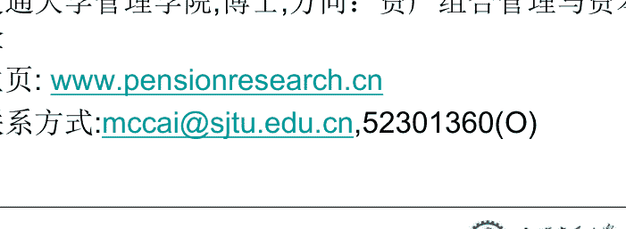

主要研究/科研情况

- 国家自然科学基金课题 “多重背景风险关联下的生命周期投资模型”，项目编号：70971088，课题负责人
- 国家自然科学基金课题 “引入背景风险理论的主权财富基金战略资产配置”，项目编号:71271135,课题负责人

## 课程关系图

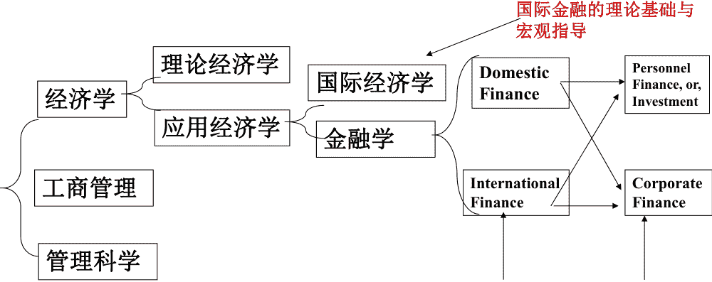

国际金融的理论基础与宏观指导

依在哪里进行资金融通进行分类

依谁在进行资金融通分类

## 课程基本信息

- 先修课程：《经济学》（宏观部分）
- 教材：《International Financial Management, 国际财务管理》，Cheol Eun, 切奥尔·吴恩，赵银德等译注，第6版，机械工业出版社，2013;
- 课程参考书：《国际经济学理论与政策》下册，克鲁格曼；大卫·艾特曼(David Eiteman)等，《国际金融》（Multinational Business Finance），第12版，机械工业出版社，刘园等译；Thomas L. Friedman，《The World Is Flat》。
- 课程信箱：fi3133@126.com，111119

- 平时成绩30%，期末考试60%，小组（3-5人）国际金融市场投资组合模拟10%。

- 第4,7,10,14周交作业（推荐用A4纸），15周交模拟投资小结（3页左右A4）。

## 课程目标

出口
1 China 2049 11.18；
2 United States 1546 8.4 4；
3 Germany 1407 7.6；
4 Japan 799 4.3；
5 Netherlands 656 3.6；
6 France 569 3.1；

进口
1 US 2336 12.6 3
2 China 1818 9.8
3 Germany 1167 6.3
4 Japan 886 4.8 4
5 U.K. 930 3.7 2
6 France 674 3.6 -6

- 掌握以汇率为核心的理论知识，培养国际视野
- 中国的经济地位
- 中国的金融地位
- 差距原因
  - 责任感不强
  - 经验不足
  - 胆量不够
  - 人才缺乏

| Appointed |  |  |  |
|---|---|---|---|
| Meg Lundsager | United States | 16.75 |  |
| *Vacant* |  |  |  |
| Daikichi Momma | Japan | 6.23 |  |
| *Isao Ishikawa* |  |  |  |
| Hubert Temmeyer | Germany | 5.81 |  |
| *Steffen Meyer* |  |  |  |
| Herve Jodon de Villero che | France | 4.29 |  |
| *Gabriel Cumen ge* |  |  |  |
| Steve Field | United Kingdom | 4.29 |  |
| *Christopher Yeates* |  |  |  |


## 主要内容

- Le 1 汇率制度与国际货币体系，，教材第2章
- Le2 国际收支与国际资本流动，教材第3章
- Le3 国际货币市场，教材第5,11,12章
- Le4 国际股票市场，教材第13章
- Le 5 International Arbitration And Interest Rate Parity，教材第6章
- Le 6 经济政策及汇率预测（Krugman第12版，及教材第6章）
- Le 7 Currency Derivatives，教材第7章
- Le 8 企业的外汇交易风险，教材第8章
- Le 9 企业的外汇经营与折算风险，教材第9-10章
- Le10 利率互换与货币互换，教材第14章
- Le 11 国际证券组合理论，教材第15章[高盛Country Analysis]
- Le 12 Direct Foreign Investment：定性与定量分析，阅读教材第16，17，18章

## 重要网站

课程推荐自选股

- 全球股价与组合投资信息 finance.yahoo.com，ID: fi401,password:111111,
- 新浪美股：http://i.finance.sina.com.cn/zixuan_usstock fi401@126.com，111119【含货币，债券、股票ETF】
- 国际股票ETF：通过下载有港股信息的客户端，比如申万证券 http://www.sywg.com/sywg/portal/portal_softdown.html
- http://currencyetf.net（通过美股账号买卖货币信息）；www.forex.com 保证金杠杆交易
- 可下载外汇数据：http://finance.yahoo.com/currency-investing/asia-pacific；
- http://fx.sauder.ubc.ca/data.html

• 货币及外汇市场投资

• 国际债券市场投资

- 全球收益率曲线：http://finance.sina.com.cn/money/forex/hq/GZSYL.shtml
- 交易所上市的债券投资组合 Bing 搜 Bond ETF

• 国际股票市场投资

- 基本信息分析 seekingalpha.com
- 客户端：乾隆旗舰版（香港市场） http://www.q118.com.cn/software/prodQijian_1.html
- 爱美股 www.imeigu.com；美国股市DJIA30种成份股或N股quote123.com
- 港股 www.aastocks.com
- 全球股票信息 www.etnet.com.cn；http://www.barchart.com/formation/...
- 香港联交所,信息披露 http://www.hkexnews.hk/index_c.htm

## 其它网站

- 全球大宗商品市场、衍生产品
- 期货数据(黄金石油大宗商品) http://finance.sina.com.cn/futuremarket/
- http://www.sge.sh/publish/sge/xqzx/xqyb/index.htm
- 期货（外汇） http://www.barchart.com/futures/Currencies

- 量化投资
- http://www.proshares.com/funds,卖空,放大ETF
- 各种风格ETF，搜索： ishares, spdr ETF

- 国家投资分析
- 国际金融杂志http://www.gfmag.com/gdp-data-country-reports.html

- 国际经济热点网站
- Podcast Itunes Rss 订阅  bbc world service/business daily； business matters,
  world business report, biz&tech

# Lecture 1

## 汇率制度与国际货币体系

Eun, 第2章


## Preview

- 8种汇率制度简介
- 政府直接干预外汇的两种形式
- 人民币汇率制度演变
- 人民币汇率对中国经济影响

# Foreign Exchange Market:  
国际货币体系三步曲

- From 1876 to 1913, each currency was convertible into gold at a specified rate, as dictated by the *gold standard*.（金本位：银行券自由兑换金，各国汇率取决于黄金含量）
- The 1944 *Bretton Woods Agreement* called for fixed currency exchange rates.（布雷顿协议与双挂钩）
- In 1973, the official boundaries for the more widely traded currencies were eliminated and the *floating exchange rate system* came into effect.（牙买加协议：西方国家主要货币汇率浮动工资与金融风险传播的开始，并推动外汇交易市场发展）


#### Exchange Rate Systems（汇率制度分类）

- 简单分类：
    - Fixed（1973年以前）
    - freely floating（自由浮动）
    - managed float（管理浮动）
    - Pegged（盯住）

- IMF在1999年用新方法对各国的汇率制度进行分类，将汇率制度分为八类，按浮动程度由小到大排列：
    - 无独立法定货币（美元化）、货币局制度、固定钉住制、水平带内的盯住、爬行盯住、爬行带内的汇率安排、管理浮动、单独浮动。

##### (1) Currency Boards（联系汇率）

- 本国货币与某一主要货币保持在一固定比率。
    - 发行本币时，货币发行局储备相当量的外币。
- HK$7.8 = US$1 since 1983。
    - 财政司司长在其致金融管理专员日期为2003年6月25日的函件中，正式确立联系汇率制度为香港的货币政策目标。
- Argentina 1 peso = US$1 since 1991。

**联系汇率风险**

- 政府有足够信用与财力。
- 经济恶化时，汇率会受到国际炒家袭击。
- 利率一致。

| 期限 | 美元 | 欧元 | 日元 | 港币 |
|---|---:|---:|---:|---:|
| 活期 | 0.0750 | 0.1000 | 0.0001 | 0.0625 |
| 七天通知 | 0.1250 | 0.3750 | 0.0005 | 0.1875 |
| 一个月 | 0.2500 | 0.7500 | 0.0100 | 0.3750 |
| 三个月 | 0.4375 | 1.0000 | 0.0100 | 0.5000 |
| 六个月 | 0.5000 | 1.1250 | 0.0100 | 0.6250 |
| 一年 | 0.5625 | 1.2500 | 0.0100 | 0.8125 |
| 二年 | 0.6875 | 1.3125 | 0.0100 | 0.8750 |

##### (3) 钉住

- *pegged exchange rate system*：the home currency's value is pegged to a foreign currency（与某一浮动货币保持固定比率，但政府可以对这一比率宣布调节。）
- 实行国家：前殖民地国家，主要货币经济区的小国家。

**盯住与94-95墨西哥金融危机**

- 1995年前墨西哥比索盯住美元。
- 90年代初，墨西哥加入北美自由贸易区NAFTA，资金大量流入墨西哥，短期资本流入推动比索大大升值。
- 但墨西哥通货膨胀率高于美国，1994年墨西哥外贸赤字高企。
- 1994年发生了两起政治谋杀、一起政治暴动，短期资金迅速撤离。
- 1994年12月19日，上台不到20天的塞迪略政府为缓解当时外资大量抽逃对墨西哥货币新比索形成的压力，宣布新比索贬值15%。市场即刻出现抢购美元的风潮，新比索币值急速下滑。政府采取紧急措施进行干预，但仍遏制不住下滑势头。维持盯住的外汇储备已经不够。
- 万般无奈，政府于12月21日午夜被迫允许新比索与美元的汇率自由浮动，比索由3.74兑1美元跌至5.9兑1美元。

**盯住下汇率变化对经济的影响**

固定汇率是否意味着双边贸易不受汇率波动影响？

HK dollar's value is tied to the U.S. dollar. If appreciation of the Japanese yen against the dollar:

A) Hong Kong exports to Japan; and B) Hong Kong exports to U.S.?

- A) Hong Kong exports to Japan should increase.
- B) Hong Kong exports to the U.S. should increase because Japanese goods become more expensive to U.S. importers as a result of yen appreciation.

Peg doesn't mean no effect on bilateral trading.

##### (4) 水平带盯住

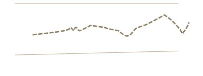

##### （5）爬行盯住和（6）爬行带盯住

IMF：人民币汇率属于爬行盯住。


##### (7) Managed Float Exchange Rate System（管理浮动）

- *managed* (or "dirty") *float exchange rate system*（无限制+干预）。
- 实行国家：中国，有一定市场规模的发展中国家。
- 优点：政府的国内政策目标优先于外部目标。

##### (8) 浮动汇率

- 汇率由市场因素决定。
- 实行国家：主要西方国家货币。
- 缺点：企业要耗费资源管理汇率风险。
- 优点：
    - 少受其它国家经济变量影响；例如美国通胀，则增加对英商品需求，英镑需求上升、汇率上升，从而对英商品需求下降，英国通胀程度小，并不随美国通胀。
    - 央行无须干预，不会导致其它变量连锁反应，政府无须大量外汇储备。
    - 制定政策毋须稳定汇率。
    - 汇率有波动，金融市场活跃。

**浮动汇率**

- 即使浮动汇率，也没有完全自由的浮动。
- 政府可能实施汇率目标区：确定一个目标再加上上下限，实行干预（汇率目标区）。

##### 其它：Single European Currency（欧洲单一货币）

- In 1991, the Maastricht treaty（《马约》）called for a single European currency. On Jan 1, 1999, the euro was adopted.
- By 2002, the currencies of the 12 countries were completely replaced with the euro.
- 欧洲中央银行统一制定货币政策。
- 欧元区内的汇率风险与交易成本将消失。
- ？哪三个国家没加入？
- ？与2011欧洲债务危机关系，成员国财政约束：
    - 赤字不超过GDP的3%。
    - 政府债务不超过GDP的60%。


## 汇率价格信息来源

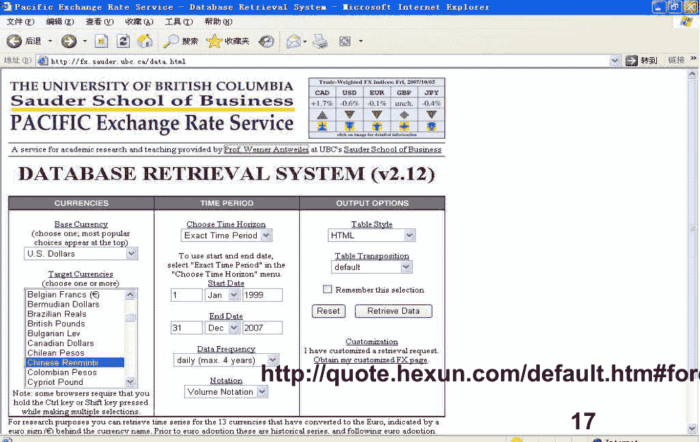

http://finance.yahoo.com/currency-investing/asia-pacific

### Currencies Center

- Majors
- European Crosses
- Yen Crosses
- Asia Pacific
- Emerging Markets
- Skandi
- Currency Converter

| Currency Pair | Price | Change | %Change | Day Range | 52 Week Range | Chart Preview |
|---|---|---|---|---|---|---|
| USD/CNH | 6.2356 | -0.0068 | -0.1081% | 6.2340 - 6.2370 | 6.2340 - 6.3350 | |
| AUD/NZD | 1.2289 | -0.0043 | -0.3487% | 1.2282 - 1.2320 | 1.2282 - 1.3187 | |
| AUD/CAD | 1.0515 | +0.0040 | +0.3774% | 1.0508 - 1.0536 | 0.9930 - 1.0783 | |
| NZD/CAD | 0.8556 | +0.0056 | +0.6553% | 0.8551 - 0.8563 | 0.7639 - 0.8563 | |
| NZD/USD | 0.8357 | +0.0033 | +0.3977% | 0.8353 - 0.8373 | 0.7456 - 0.8468 | |
| AUD/CHF | 0.9563 | -0.0012 | -0.1222% | 0.9560 - 0.9587 | 0.9216 - 1.0349 | |
| NZD/CHF | 0.7783 | +0.0018 | +0.2273% | 0.7780 - 0.7794 | 0.7075 - 0.8027 | |
| USD/HKD | 7.7568 | +0.0010 | +0.0126% | 7.7568 - 7.7570 | 7.7510 - 7.7859 | |
| USD/SGD | 1.2396 | -0.0014 | -0.1126% | 1.2388 - 1.2406 | 1.2176 - 1.3092 | |
| INR/USD [change] | 0.0184 | +0.0000 | 0.3676% | 0.0184 - 0.0185 | 0.0174 - 0.0206 | |

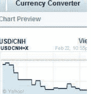


## 争议货币：比特币

2009-1-3
中本聪在位于芬兰赫尔辛基的一个小型服务器上挖出了第一批50个比特币

2010-5-21
一位程序员用1万个比特币购买了价值25美元的披萨。这项交易诞生了比特币第一个公认汇率

2010-11-6
Mt. Gox上的价格达到0.5美元，此时比特币经济达100万美元

2011-2-9
比特币价格首次达1美元，比特币与英镑、巴西币、波兰的兹罗交易平台先后开张

2012-12-6
世界首家官方认可的比特币交易所——去国比特

- 交换媒介、价值尺度、支付手段、价值储藏
- 许多国家拒绝承认

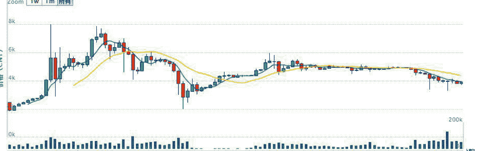

## 政府政策与政府干预外汇

- 政策的四大目标：GDP增长、就业充分、物价稳定、国际收支平衡
- 两大政策
  - 货币政策（三大法宝：利率、准备率、公开市场业务）
  - 财政政策：税收、政府购买、转移支付

## 政府干预
政府干预动机

- 外汇干预应围绕经济政策的四大目标
- 中央银行管理汇率
  - 平抑汇率波动（减少波动）
  - 建立隐性的汇率边界（设定上下限）
  - 应对临时性干扰（减少意外事件冲击。外汇市场波动多少为大幅波动？）
- 干预方法：直接干预和间接干预

## 政府直接干预
政府直接干预

- *直接干预*指中央银行在外汇市场上用其持有的储备货币兑换其他货币。（直接干预：央行直接在外汇市场买卖）
- 当各国央行采取协调行动时，直接干预通常最为有效。（通常央行联手）

## 政府直接干预
政府直接干预：例

- 2002年9月，美国货币当局干预外汇市场，买入15亿欧元、卖出美元。
  - 资金由美国财政部外汇稳定基金和联邦储备系统平均分担，
  - 并与欧洲中央银行以及日本、加拿大、英国货币当局协调行动。

## 政府直接干预

## 政府直接干预

美联储用美元兑换英镑，以增强英镑
美国政府抛美元吸英镑，英镑需求升，

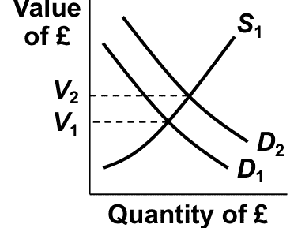

美联储用英镑兑换美元，以削弱英镑

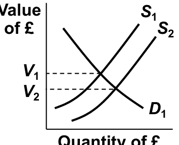

## 直接干预的两种形式与国内货币政策

- 当中央银行干预外汇市场但不调整货币供应量时，称为*非冲销式干预*。（消极干预，干预外汇时不调整本币投放）
- 在*冲销式干预*中，同时买卖国债以维持货币供应量。（积极干预，抛售本币时，还抛售一些债券，以保持货币供给平衡）

## 非冲销式干预
消极干预流程

使RMB走强，外汇市场回收RMB，导致货币市场RMB下降

宏观经济三元悖论：固定汇率、资本开放与独立货币政策，只能取其二

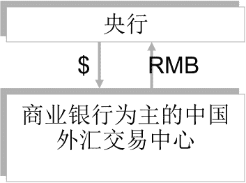

为了削弱人民币

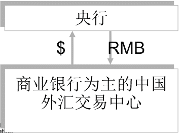

## 冲销式干预
积极干预流程

使RMB走强

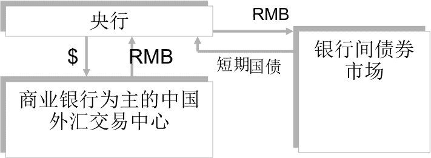

为了削弱
人民币

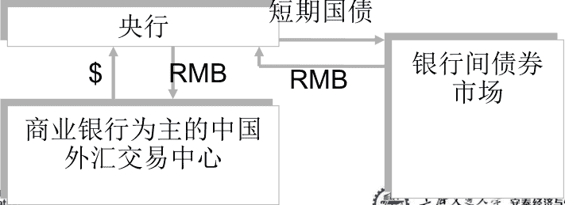

## 人民币汇率制度（改革开放前）

- 建国初期，由于国内物价猛涨而国外物价稳定甚至下跌，1950年3月调至42 000旧人民币／美元，1951年5月调至22 380旧人民币／美元
- 社会主义建设初期至1971年11月，人民币汇率在近16年时间里基本保持为2．4618
- 西方货币实行浮动汇率后，人民币（1973—1978）钉住一篮子货币

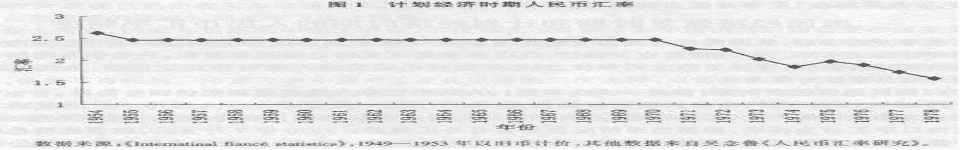

## 人民币汇率制度（改革开放后）

- 80年代改革开放初，外汇计划管理。发行外汇兑换券，黑市猖獗。人民币最高1$=1.45RMB，（据此，中国在1995年GDP 3万8千亿$,成为第二经济大国）
- 1985年1月1日，外汇牌价双轨制。贸易收支与非贸易收支均按官方牌价结算，调剂外汇市场仍然存在。即官方牌价1美元=5.8元左右，调剂外汇价1美元=8.7元左右。
- 1994年1月起并轨，建立银行间外汇交易中心
- 1996年12月起经常项目可自由兑换

## 外汇储备影响央行货币政策

- X亿美元，导致高能货币投放增加7.5X万亿元RMB
- 货币政策独立性受到干扰
- 央行被动在外汇市场吸收美元，只有采用其它政策平衡货币投放。（如发行央行票据等回笼资金，将影响到国内金融市场的波动）

## 我国当前汇率安排两难
--人民币升值有八利

- 1. 国外产品价格下降，提高国人的生活水平和产业水平
- 2. 使用进口原材料比率较高的厂商的生产成本会下降.
- 3. 企业的国外投资能力将增强
- 4. 人民币升值，使已在华投资的外资企业利润增加.
- 5. 在非制造业方面，人民币升值有利于人才出国学习.
- 6. 未偿还外债还本付息所需本币的数量相应减少.
- 7. 合理估值中国资产.
- 8. 有利于中国GDP在国际经济中地位.

## 我国当前汇率安排两难  
--人民币升值有七弊

- 1. 对出口存在干扰
- 2. 可能导致投机盛行。由于以美元表示的国民财富迅速增加，股市和房地产达到高潮
- 3. 升值后，可能使国内投资环境恶化，新增的海外投资则会减少，因为这种投资变得相对昂贵
- 4. 升值后，目前出口的产品大部分是技术含量较低的劳动密集型产品，出口受阻会增加就业压力
- 5. 升值后，通货紧缩局面压力
- 6. 许多尚不具备竞争力的产业将直接受到冲击
- 7. 产生一种“暴富效应”。日本就是一个例子。日元与美元的比率战后最早是350∶1，最高到70∶1

“利弊”可能导致贫富加剧

## 升值预期以来的专家观点回顾：六方面减压³⁵

一是维持贸易的总量及结构性平衡。在遵守入世承诺，逐步减少对贸易的限制时；

二是进一步放宽对经常项下的外汇限制。逐步取消强制性银行结售汇制度，放宽对旅游等外汇汇兑限制；

三是建立银行、企业间外汇市场，放开主要外贸企业进入外汇市场；

四是放宽汇率波动幅度，至少可以考虑从目前的3‰放宽至1%的固定汇率下的波动幅度；

五是减少对外汇交易者的头寸控制；

六是加强外汇期权及远期市场建设。

政府多采用舆论干预（大声吆喝），最低成本降低升值压力


## Exercise

+   1. 分析教材表1-2，中国公司排名情况。作为世界第2大经济实体、第一大贸易国，中国排名靠后的原因是什么？中国的前景如何，对年轻人有机会吗？我们需要准备些什么？
+   
+   2. 下载一组你感兴趣的新兴市场国家和发达国家最近5年的汇率（日收盘），进行描述分析EXCEL-数据-数据分析，来源：http://fx.sauder.ubc.ca/data.html
+      或者 http://finance.yahoo.com/currency-investing
+   
+   3. 从finance.yahoo.com登陆，ID: fi401,password:111111
+      找到菜单Myportfolio→ADR，查看bidu的市盈率PE，参考01.xls文件，3-5人模拟构建国际投资组合。（或者http://i.finance.sina.com.cn/zixuan,usstock，账户fi401@126.com，密码111119）
+      模拟参考格式 001.xls, 001.pptx

## CNNMoney

CNN、Fortune 和 Money 的一项服务

## FORTUNE

## Money

+   首页 · 视频 · 商业新闻 · 市场 · 投资组合 · 投资 · 经济 · 科技 · 个人理财 · 小企业 · 领导力

+   概览 · **图表** · 持仓 · 建议

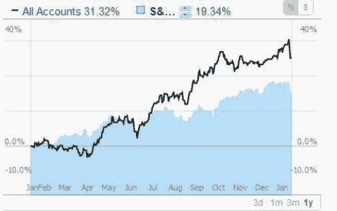

## 资产分配、股息收益率

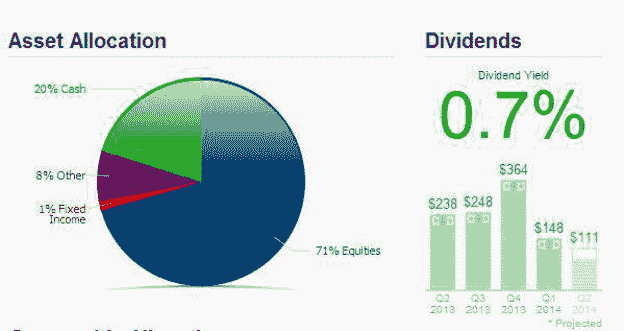

## 全球配置、贝塔系数

## 地理分配

| 国家 | 百分比 |
|---|---|
| United States | 47.36% |
| China, Hong Kong, Korea, Singapore | 36.36% |
| Russia | 5.99% |
| Canada | 5.50% |
| Australia | 2.06% |
| South America | 1.23% |
| Europe | 0.51% |
| Africa | 0.38% |
| India, Sri Lanka, Nepal, Pakistan, Bangladesh | 0.35% |
| Middle East | 0.26% |
| Japan | 0.00% |

## 风险

Beta
0.8

Your portfolio is 15% less volatile than the S&P
您的投资组合比标准普尔指数波动性低 15%

## 交易风格

Management Metrics
管理指标
Trades per year 73
每年交易次数 73
0 658
Portfolio Turnover 63.6%
投资组合周转率 63.6%
0% 4861%
Valuation Metrics
估值指标
Price to Earnings (P/E) 16
市盈率 16
-257 320
Price to Book (P/B) 2.0
市净率 2.0
0.2 25.7
Return on Assets (ROA) 12.7%
资产回报率 12.7%
-42.9% 538%
Return on Equity (ROE) 51.8%
净资产收益率 51.8%
-801% 1807%
EV/EBITDA 13.1
企业价值/息税折旧摊销前利润 13.1
-100.8 102.9

# Lecture 2

## 國際收支

国际收支

Eun, 第3章


## Chapter Objectives

课程目标

+   - To explain the key components of the balance of payments（3大国际收支项目）;
+     - 中美BOP分析
+   - To explain how the international flow of funds is influenced by economic factors and other factors.（影响经常账户、FDI的因素）
+     - 马歇尔-勒纳条件与 *J-curve effect*
+   - Agencies facilitating international flows（三大国际机构）

## 国际收支与宏观经济等式

+   - GDP ≡ C+I+G+X-M: Output，支出法核算
+     - C = consumption spending
+     - I = capital investment spending
+     - G = government spending
+     - X = exports of goods and services
+     - M = imports of goods and services
+   - Y ≡ C+S+T: Income收入法核算
+     - S=Saving
+     - T=Tax
+   - Market equilibrium: GDP≡C(Y)+I+G+X-M=Y
+   - Deficit: X-M<0；T-G<0

## Balance of Payments

国际收支


+   - The *balance of payments* 国际收支平衡表 is a measurement of all transactions between domestic and foreign residents over a specified period of time. (一定时期本国与外国居民间的所有交易)
+   - Each transaction is recorded as both a credit and a debit, i.e. *double-entry bookkeeping*. (每笔交易借贷复式记帐)
+     - 出口1美元或者收到1美元投资的同时，官方储备增加1美元

## Balance of Payments: Three Accounts

国际收支：三大账户

+   - The transactions are presented in three groups – (经常项目，资本与金融项目，平衡项目)
+     - a *current account*,
+     - a *capital* and *financial account*,
+     - balance account
+     - 导致资金流入的一般记贷方，用正号表示：出口，融资

## 第1类账户：*Current Account*

+   - The *current account* 经常账户：
+     - purchases of goods or services 购买商品或劳务，
+     - the provision of income on financial assets 金融资产的利息股息，or
+     - unilateral current transfers (e.g. government grants and pensions, private remittances 单方面转移（捐赠）)

+   - 复式记账
+     - 中国出口10万美元服装，则经常项目贷记10万美元（+），同时国家外汇储备借记10万(-).（和为0，或者说贷方余额=借方余额）

## 如何评判经常项目

+   - 同比增长
+     - 2012年中国出口增7.9%；进口增4.3%。贸易顺差(X-M)2300亿美元，扩大48.1%。
+   - 与GDP相对比率
+     - 2012年中国GDP8.2万亿美元，出口2万亿，进口1.8万亿
+     - (X+M)/GDP:进出口依存度

http://wto.org/english/res_e/booksp_e/world_trade_report13_e.pdf

出口 (B$)
1 China 2049 ;
2 United States 1546 ;
3 Germany 1407 ;
4 Japan 799 ;
5 Netherlands 656 ;
6 France 569 ;
进口
1 US 2336
2 China 1818
3 Germany 1167
4 Japan 886
5 U.K. 680
6 France 674

## 中国十大主要出口目的地、进口原产地（2012，2008年上）

单位：亿美元，%
出口最终目的地国（地）	当月		1至当月累计	
	金额	同比	金额	同比
总值	1,793.8	2.9	18,499.1	7.3
其中：
香港	333.2	35.4	2,858.7	19.1
美国	301.3	-2.6	3,194.4	8.2
日本	136.3	-3.8	1,388.7	3.3
韩国	69.3	-7.9	805.4	5.3
德国	51.7	-20.1	629.9	-10.0
荷兰	50.1	-7.0	530.2	-2.3
印度	41.1	-12.4	434.2	-6.5
澳大利亚	38.1	14.6	345.9	12.0
台湾省	36.7	28.0	325.8	0.7
越南	36.6	37.2	304.5	18.2
进口原产国（地）	当月		1至当月累计	
	金额	同比	金额	同比
总值	1,597.5	0.0	16,503.7	4.1
其中：
韩国	160.5	10.0	1,524.6	2.8
中华人民共和国	148.5	24.0	1,277.6	15.4
日本	138.0	-15.0	1,639.7	-7.6
台湾省	127.2	20.8	1,194.8	4.7
美国	124.2	8.3	1,191.8	8.1
澳大利亚	74.7	-8.7	768.1	1.9
德国	74.5	-11.7	838.7	-1.4
沙特阿拉伯	51.6	9.4	503.5	13.0
马来西亚	46.6	-9.5	524.2	-7.5
泰国	36.8	?4	405.7	39.1

## 2008.07 进出口主要国别（地区）总值

2008-08-22

单位：亿美元，%
出口最终目的地国（地）	当月		1至当月累计	
	金额	同比	金额	同比
总值	1366.8	26.9	8029.1	22.6
其中：美国	236.0	15.6	1403.9	9.9
香港	177.3	17.1	1083.8	9.2
日本	103.1	21.2	634.8	15.9
韩国	73.1	59.3	430.8	39.4
德国	35.9	29.9	324.1	27.2
荷兰	43.0	25.4	259.0	23.2
英国	35.4	28.5	197.8	18.7
印度	28.9	31.1	185.3	49.0
新加坡	31.6	12.1	180.1	9.4
俄罗斯联邦	31.5	13.1	174.0	28.5
进口原产国（地）	当月		1至当月累计	
	金额	同比	金额	同比
总值	1114.0	33.7	6792.0	31.1
其中：日本	150.5	32.1	894.5	21.6
韩国	114.3	26.0	681.8	21.0
台湾省	103.8	18.6	653.2	23.1
中华人民共和国	82.8	16.5	514.0	14.0
美国	72.1	20.0	487.2	23.8
德国	52.8	24.4	326.0	33.3
澳大利亚	39.9	83.9	212.4	49.4
马来西亚	31.5	36.9	190.6	26.2
沙特阿拉伯	31.2	104.2	179.0	101.5


### 中国2012出口—进口产品比较分析

金额单位：亿美元

| 商品名称 | 计量单位 | 1至当月累计数量 | 1至当月累计金额 | 数量同比(%) | 金额同比(%) |
|---|---:|---:|---:|---:|---:|
| 文化产品 | — | — | 1065.4 | — | 8.3 |
| 高新技术产品 | — | — | 8392.3 | — | 8.1 |
| 自动数据处理设备及零部件 | 万台 | 16405.0 | 1665.9 | -1.8 | 3.9 |
| 集成电路 | 万片 | 1456.2 | — | — | 2.1 |
| 纺织纱线、织物及制品 | — | — | 872.1 | — | 1.0 |
| 电话机 | 万台 | 101828.0 | 759.3 | 11.1 | 27.7 |
| 农产品 | — | — | 980.9 | — | 4.4 |
| 钢材 | 万吨 | 5088.0 | 472.8 | 12.7 | -0.1 |
| 集成电路 | 亿个 | 1048.3 | 467.1 | 26.5 | 57.4 |
| 家具及零件 | — | — | 451.6 | — | 27.5 |
| 鞋类 | — | — | 415.2 | — | 10.0 |
| 箱包 | 万只 | 351.4 | 341.4 | 0.2 | -11.0 |

金额单位：亿美元

| 商品名称 | 计量单位 | 1至当月累计数量 | 1至当月累计金额 | 数量同比(%) | 金额同比(%) |
|---|---:|---:|---:|---:|---:|
| 液晶显示器 | 万个 | 52.3 | 300.5 | 28.9 | 22.5 |
| 塑料制品 | 万吨 | 771.9 | 288.9 | 5.9 | 34.7 |
| 自动数据处理设备及零部件 | 万台 | 72.0 | 287.0 | -15.5 | -2.2 |
| 零附件 | — | — | 238.5 | — | 12.2 |
| 二极管及类似半导体器件 | 亿个 | 2565.8 | 225.6 | 3.7 | -27.9 |
| 箱包及类似品 | 万件 | 274.5 | 222.2 | -3.5 | 1.4 |
| 贵金属及其制品 | 吨 | 290.3 | 206.9 | 27.9 | 130.0 |
| 成品油 | 万吨 | 2177.0 | 191.5 | -7.2 | 1.5 |
| 通信系统设备及零件 | — | — | 130.6 | — | 13.1 |
| 灯具、照明装置及类似品 | — | — | 174.2 | — | 53.1 |
| 水海产品 | 万吨 | 330.0 | 151.6 | -3.1 | 6.6 |
| 电线电缆 | 万吨 | 169.0 | 150.2 | 3.7 | 11.0 |

### 中国国际收支经常账户特点

- 逆差集中在
  - 大宗商品
  - 高科技产品
  - 服务业
    - 本科学费：
      - 哈佛 35000$
      - 加州大学伯克利分校 35000$（州内12000）
      - 澳国立大学会计 1 个单元 597A$
      - 国内 515$
    - CFA会员费
    - MBA课程

单位：亿美元

| 项目 | 行次 | 2012年第二季度 | 2012年3季度 |
|---|---:|---:|---:|
| 一、经常项目 | 1 | 658 | 2138 |
| A.货物和服务 | 2 | 878 | 2336 |
| a.货物 | 3 | 1074 | 3232 |
| 贷方 | 4 | 5562 | 20570 |
| 借方 | 5 | 4488 | 17339 |
| b.服务 | 6 | -196 | -895 |
| 贷方 | 7 | 528 | 1910 |
| 借方 | 8 | 724 | 2806 |
| 1.运输 | 9 | -122 | -470 |
| 贷方 | 10 | 100 | 389 |
| 借方 | 11 | 222 | 859 |
| 2.旅游 | 12 | -111 | -519 |
| 贷方 | 13 | 139 | 500 |
| 借方 | 14 | 251 | 1020 |
| B.收益 | 48 | -218 | -235 |
| C.经常转移 | 49 | -1 | 37 |
| 二、资本和金融项目 | 50 | -318 | -1173 |
| 其中：直接投资 | 51 | 516 | 1801 |
| 三、储备资产 | 52 | -340 | -965 |
| 3.1 货币黄金 | 53 | 0 | 0 |
| 3.2 特别提款权 | 54 | 1 | 4 |
| 3.3 在基金组织的储备头寸 | 55 | 6 | 17 |
| 3.4 外汇 | 56 | -347 | -987 |
| 3.5 其他债权 | 57 | 0 | 0 |

### 2012年美国经常账户

（2012年美国主要贸易伙伴，单位：十亿美元）

| 国家 | 出口 | 进口 | 贸易总额 | 贸易差额 |
|---|---:|---:|---:|---:|
| 加拿大 | 292.9 | 324.2 | 616.7 | -31.8 |
| 中国 | 110.6 | 425.6 | 536.2 | -315 |
| 墨西哥 | 216.3 | 277.7 | 494 | -61.4 |
| 日本 | 70 | 146.4 | 216.4 | -76.4 |
| 德国 | 48.8 | 108.5 | 157.3 | -59.7 |
| 英国 | 54.8 | 54.9 | 109.8 | -0.1 |
| 韩国 | 42.3 | 58.9 | 101.2 | -16.6 |
| 巴西 | 43.7 | 32.1 | 75.8 | 11.6 |
| 沙特阿拉伯 | 13.8 | 55.7 | 73.8 | -37.6 |
| 法国 | 30.8 | 41.6 | 72.4 | -10.8 |
| 台湾 | 24.4 | 38.9 | 63.2 | -14.5 |
| 荷兰 | 40.7 | 22.3 | 63 | 18.4 |
| 印度 | 22.3 | 40.5 | 62.9 | -18.2 |
| 委内瑞拉 | 17.6 | 38.7 | 56.4 | -21.1 |
| 意大利 | 16 | 36.9 | 52.9 | -20.9 |

## 第II类账户：*资本与金融账户*

- **资本与金融账户** 总结了金融资产出售所产生的资金流动。（国际金融市场的资本流动大多记入金融账户）金融账户主要包括
  - 直接投资 Direct Investment，购买股份10%以上
  - 组合投资 Portfolio Investment，购买股份10%以内，债券等
  - 其它投资：贷款、票据等

单位：亿美元

| 项目 | 行次 | 2012年第二季度 | 2012年3季度 |
|---|---:|---:|---:|
| B.收益 | 48 | -218 | -235 |
| C.经常转移 | 49 | -1 | 37 |
| 二、资本和金融项目⁴ | 50 | -318 | -1173 |
| 其中：直接投资 | 51 | 516 | 1801 |
| 三、储备资产 | 52 | -340 | -965 |
| 3.1 货币黄金 | 53 | 0 | 0 |
| 3.2 特别提款权 | 54 | 1 | 4 |
| 3.3 在基金组织的储备头寸 | 55 | 6 | 17 |
| 3.4 外汇 | 56 | -347 | -987 |
| 3.5 其他债权 | 57 | 0 | 0 |

> 中国资本与金融账户逆差，但FDI为顺差大国

## 资本与金融账户：美国

单位：10亿美元

|  | 2002 | 2003 | 2004 | 2005 | 2006 | 2007 | 2008 | 2009 | 2010 |
|---|---:|---:|---:|---:|---:|---:|---:|---:|---:|
| **直接投资** |  |  |  |  |  |  |  |  |  |
| 对外直接投资 | -154 | -150 | -316 | -36 | -245 | -414 | -329 | -304 | -351 |
| 在美国的直接投资 | 84 | 64 | 146 | 113 | 243 | 221 | 310 | 159 | 236 |
| 直接投资净额 | -70 | -86 | -170 | 76 | -2 | -193 | -19 | -145 | -115 |
| **组合投资** |  |  |  |  |  |  |  |  |  |
| 资产净额 | -49 | -123 | -177 | -258 | -409 | -391 | 280 | -360 | -166 |
| 负债净额 | 428 | 550 | 867 | 832 | 1127 | 1157 | 524 | 360 | 707 |
| 组合投资净额 | 370 | 427 | 690 | 575 | 628 | 766 | 804 | 0 | 541 |
| **金融衍生品净额** |  |  |  |  | 30 | 6 | -33 | 49 | 14 |
| **其他投资** |  |  |  |  |  |  |  |  |  |
| 其他投资资产 | -88 | -54 | -510 | -267 | -544 | -649 | 386 | 576 | -486 |
| 其他投资负债 | 283 | 244 | 520 | 303 | 695 | 687 | -402 | -183 | 303 |
| 其他投资净额 | 195 | 190 | 10 | 36 | 151 | 38 | -17 | 393 | -184 |
| **金融账户净余额** | 504 | 531 | 530 | 687 | 807 | 617 | 735 | 298 | 256 |

中美在金融账户、FDI、组合投资呈现互补性


## 美、日、中三国经常与资本项目趋势比较

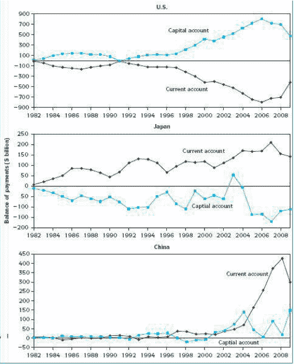

- 中国向美国出口制造商品，换来美元，购买美国国债
- 08金融危机对贸易与投资影响明显

- 数据：IMF, *国际金融统计*

## 第III类账户：平衡类账户(ii)

| 项目² | 次 | 行 | 2012年第四季度 | 2012年³ |
|---|---|---|---|---|
| 一.经常项目 | 1 |  | 658 | 2138 |
| A.货物和服务 | 2 |  | 878 | 2336 |
| a.货物 | 3 |  | 1074 | 3232 |
| 贷方 | 4 |  | 5562 | 20570 |
| 借方 | 5 |  | 4488 | 17339 |
| b.服务 | 6 |  | -196 | -895 |
| 贷方 | 7 |  | 528 | 1910 |
| 借方 | 8 |  | 724 | 2806 |
| 1.运输 | 9 |  | -122 | -470 |
| 贷方 | 10 |  | 100 | 389 |
| 借方 | 11 |  | 222 | 859 |
| 2.旅游 | 12 |  | -111 | -519 |
| 贷方 | 13 |  | 139 | 500 |
| 借方 | 14 |  | 251 | 1020 |
| B.收益 | 48 |  | -218 | -235 |
| C.经常转移 | 49 |  | -1 | 37 |
| 二.资本和金融项目⁴ | 50 |  | -318 | -1173 |
| 其中：直接投资 | 51 |  | 516 | 1801 |
| 三.储备资产 | 52 |  | -340 | -965 |
| 3.1货币黄金 | 53 |  | 0 | 0 |
| 3.2特别提款权 | 54 |  | 1 | 4 |
| 3.3在基金组织的储备头寸 | 55 |  | 6 | 17 |
| 3.4外汇 | 56 |  | -347 | -987 |
| 3.5其他储备 | 57 |  | 0 | 0 |

- 误差与遗漏项目
  - 经常账户（海关）、资本与金融账户（商务部），官方储备（外管局）统计存在的差异
  - 经常、资本与金融账户顺差之和大于官方储备增加（负号），则误差项目为负
- 热钱访谈

## 在线申请

- 美国国际收支及相关数据由经济分析局发布。访问该局网址 http://www.bea.doc.gov。
- 中国BOP： www.safe.gov.cn
- 美国贸易数据
  - http://www.census.gov/foreign-trade/www/
  - http://www.ita.doc.gov/td/industry/otea/
- 世界贸易数据
  - http://www.wto.org/english/res_e/statis_e/statis_e.htm
  - http://www.worldbank.org/data/

商业部，moftec.gov.cn,利用外资（金融帐户下直接投资）

人民银行BOC及下属外管局SAFE，证监会（金融帐户下证券投资）

海关总署 www.customs.gov.cn/进出口（经常帐户）

### 影响因素
## 经常账户（国际贸易流）
### 影响经常性账户的因素

通货膨胀（-，顺差减少）

- 一个国家通胀率的相对上升会降低其经常账户，因为进口增加而出口减少。

国民收入（-）

- 一个国家收入水平的相对上升会降低其经常账户，因为进口增加。

### 影响因素
经常账户（国际贸易流）
影响经常性帐户的因素

## 政府限制

- 关税或配额。 关税，配额（稀土），反腐
- 1992以来中国关税税率的调整

| 时间 | 1992 | 1993 | 1995 | 1997 | 2001 | 2002 |
|------|------|------|------|------|------|------|
| 关税率 | 43. 2 | 36. 4 | 23. 0 | 17. 0 | 15. 3 | 12 |

- 我国的经常帐户管理，---“可自由”兑换
  - 限额管理是经常项目外汇账户管理的主要内容
    - 即企业的外汇收入在核定的限额内可以意愿结汇，超过限额的部分强制结汇。
    - 从2002年10月份起，核定账户限额为企业上年度经常项目外汇收入的20%。2008年起完全放开（易纲，2012）
    - 防止在国际收支状况恶化时，企业积存过多外汇，削弱国家外汇储备，影响国内外外汇市场供求和汇率稳定

### 影响因素
## 经常账户（国际贸易流）
### 影响经常性账户的因素

- **汇率**（贬值，+）
  - 如果一个国家的货币开始升值，其经常账户余额会下降，因为进口增加而出口减少。
  - （汇率变化+商品对价格的弹性才产生影响。如美元升值，但 CPU 只有美国生产，则需求不下降（替代弹性低））

- 弹性定义：单位价格的变化导致商品数量变化的幅度
  - 出口弹性 $\eta_{xe}=\frac{\partial X/X}{\partial e/e}$：$e$ 一个单位外币等于多少本币，$X$ 出口商品数量
  - 进口弹性 $\eta_{Me}=\frac{\partial M/M}{\partial e/e}$：$M$ 进口商品数量

## 本币贬值不一定改善贸易逆差 贬值不一定促进出口

- ◆ 1）从协议到生产的时滞
- ◆ 合同期，本币贬值导致进口结算上升
- ◆ 传递期：本币贬值消费者逐步考虑比价效应
- ◆ 数量期：贬值效应转为消费者购买行动
- ◆ 2）本币贬值后本国产品价格可能上升
- ◆ 3）各国竞相贬值
- ◆ 4）关联交易。（从跨国公司的母公司进口
- ◆ 5）进一步贬值的预期
- ◆ 6)马歇尔—特纳条件： η Xe + | η Me | >1 进出口需求对价格的弹性大于 1

## 进口的汇率弹性实证分析

- ○ 世界银行kee(2002)估计，中国1.13
- http://www.etsg.org/ETSG2005/papers/olarreaga.pdf

## 表1：估计弹性：样本矩

| 国家 | 简单平均 | 标准差 | 中位数 | 进口加权平均 |
|---|---|---|---|---|
| Albania (ALB) | -1.12 | -1.04 | -1.04 | -1.06 |
| United Arab Em. (ARE) | -1.38 | -1.16 | -1.11 | -1.07 |
| Argentina (ARG) | -2.52 | -1.13 | -1.15 | -1.26 |
| Armenia (ARM) | -1.09 | -1.06 | -1.06 | -1.05 |
| Australia (AUS) | -2.49 | -1.1 | -1.1 | -1.19 |
| Austria (AUT) | -1.8 | -1.05 | -1.04 | -1.08 |
| Azerbaijan (AZE) | -1.18 | -1.11 | -1.11 | -1.07 |
| Burundi (BDI) | -1.07 | -1.19 | -1.12 | -1.05 |
| Belgium (BEL) | -1.51 | -1.04 | -1.05 | -1.05 |
| Benin (BEN) | -1.11 | -1.14 | -1.11 | -1.05 |
| Burkina Faso (BFA) | -1.1 | -1.12 | -1.08 | -1.05 |
| Bangladesh (BGD) | -1.65 | -1.2 | -1.19 | -1.15 |
| Bulgaria (BGR) | -1.18 | -1.05 | -1.04 | -1.06 |
| Belarus (BLR) | -1.17 | -1.04 | -1.05 | -1.05 |
| Belize (BLZ) | -1.61 | -1.03 | -1.03 | -1.03 |
| Bolivia (BOL) | -1.23 | -1.07 | -1.1 | -1.08 |
| Brazil (BRA) | -3.38 | -3.3 | -1.22 | -1.34 |
| Barbados (BRB) | -1.08 | -1.04 | -1.08 | -1.04 |
| Central Afr. Rep. (CAF) | -1.08 | -1.15 | -1.11 | -1.05 |
| Canada (CAN) | -2.29 | -1.05 | -1.05 | -1.13 |
| Switzerland (CHE) | -1.99 | -1.07 | -1.06 | -1.1 |
| Chile (CHL) | -1.61 | -1.05 | -1.08 | -1.1 |
| China (CHN) | -2.54 | -1.12 | -1.14 | -1.13 |


### Correcting A Balance Of Trade Deficit
国际收支赤字的汇率自动调节机制

- 一个浮动汇率制度可能会自动纠正贸易失衡，因为贸易失衡会影响相关货币的供求。
  - 赤字->本币贬值->进口下降->赤字改善

### Factors Affecting FDI
资本与金融账户下影响FDI的因素

- Changes in Restrictions（管制放松）
  - 取消政府壁垒可能会产生新的机会。
- Privatization私有化
  - 政府运营的出售也刺激了FDI。
- Potential Economic Growth经济增长
  - 具有更高潜在经济增长的国家更有可能吸引FDI。
- Tax Rates税率
  - 对企业收益征收相对较低税率的国家更有可能吸引FDI。
- Exchange Rates汇率预期升值
  - 当某国货币预期走强时，企业通常更愿意在该国投资资金。
- 其它：政治，语言，宗教，互联网与技术进步
  - Amazon, Alibaba

### 资本与金融账户下影响Portfolio投资因素

- 影响FDI因素同样影响Portfolio投资
- 美联储对世界各国股市影响重大原因
  - 全球资金通过华尔街进行全球portfolio投资，例如GLD是全球最大黄金ETF
  - 美元地位使得美联储扮演央行中的央行角色
  - 香港HKEX的最大投资者: USA
- 中国Portfolio投资影响因素
  - 审批
  - QFII, QDII
  - 投机与热钱，错误与遗漏项目为正，判断热钱流入
- 香港市场：上市公司与投资者两头在外

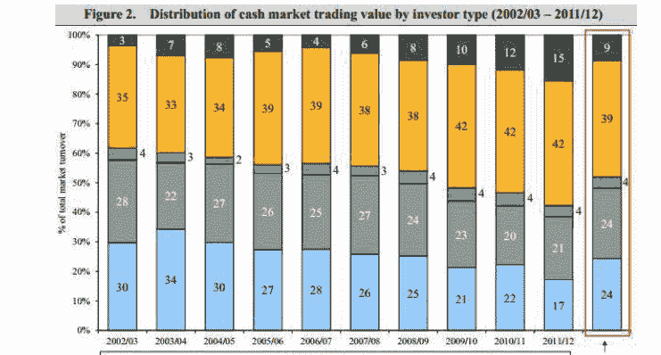

http://www.hkex.com.hk/eng/stat/research/documents/cmts2012.pdf

### Agencies that Facilitate International Flows

#### International Monetary Fund (IMF)

- 183 member countries. Established in 1946
  - to promote international monetary cooperation and exchange stability（货币合作与汇率稳定）；
  - to provide temporary financial assistance to help ease imbalances of payments.（为消除收支失衡提供暂时的金融帮助）
  - 2011年首位中国副总裁


- The IMF uses a quota system, and its unit of account is the SDR (special drawing right).（依成员国交纳的份额而分配的一种资金使用权利，SDR是由5种货币加权得到的货币单位）

| Currency | 2001 Revision | 1996 Revision |
|---|---|---|
| U.S. dollar | 45 | 39 |
| Euro | 29 |  |
| Deutsche mark |  | 21 |
| French franc |  | 11 |
| Japanese yen | 15 | 18 |
| Pound sterling | 11 | 11 |

#### World Trade Organization (WTO)

- Created in 1995, the WTO is the successor to the General Agreement on Tariffs and Trade (GATT).
- Its functions include:
  - administering WTO trade agreements（管理）;
  - serving as a forum for trade negotiations（安排）;
  - handling trade disputes;（争端）
  - training developing countries;（培训）


谷歌街景：WTO日内瓦湖畔

## Exercise

- Log in [gfmag.com](https://gfmag.com) [tools-country economy report]. Find a country you wish to travel. Study the characteristics of BOP and give a brief description.
- 教材第3章计算题（填空部分）。
- 建立国际投资组合小组，资金第一期10万RMB进行分配，简单分析购买动机（第8周第2期100万）。这部分资金将分录在中国BOP的哪个账户？澳大利亚、马来、沙特是中国的最大进口来源国，买入这些国家指数基金是否能对冲中国宏观风险？

## Lecture 3

### International Fixed Income Markets
--FX, Currency & Euro-Currency, and Bond

- Eun, 5, 11, 12章

## Objectives

- Foreign exchange market (Forex quotes)
  - 外汇市场参与投机与对冲的经济学分析; 汇率换算; Margin trading
- Eurocurrency market (Libor), Eurocredit market
- Eurobond & Foreign bond market

## Motives for Using International Money Markets

- 国际金融市场划分：固定收益、股权、衍生产品、另类投资
- 国际固定收益分类
  - 外汇市场，货币市场，信贷市场，债券市场
- 投资国际固定收益市场动机
  - foreign currencies to be appreciated
  - to reap the benefits of international diversification.
  - Hedge currency risk
    - Open Question: 我们是否只持有人民币资产？这样做是否理性？

## 外汇市场预期收益 E(r)与风险Var

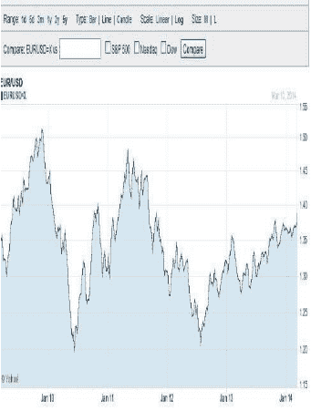

- 历史数据法：
  - 从 http://fx.sauder.ubc.ca/data.html 下载每日及每月数据 $e_t$
  - 计算涨跌幅度 $r_t = e_t / e_{t-1}$
- 基于历史数据的预期收益与风险，由 EXCEL函数average与var得到
  - 每日： average: -2.5×10^-5, var: 3.9×10^-5
  - 每月： 2.2×10^-3， var: 5.9×10^-4
  - 当每天涨跌无关时，每月风险是每日风险的n倍，n为交易日


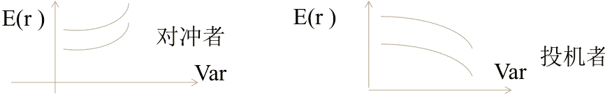

## 外汇市场收益与风险：对冲者与投机者的效用函数

- 居民效用函数 U=E(r)-1/2*Gama*Var，Gama>0 为**对冲者**，Gama<0 为**投机者**。E(r)、Var 分别为预期收益与风险。
- 假设人民币/美元汇率上升 1% 的概率为 0.5，下降 1% 的概率也为 0.5。【收益与风险估计的情景分析法】
  - 预期收益=0，方差=1/2*(1%-0)^2+1/2*(-1%-0)^2=1(%^2)
- 假设 A 先生是对冲者（Gama>0），其效用函数 U=E(r)-1/2*Gama*Var=1/2*Gama(%^2)
  - 如果他参与外汇市场，则 U<0
- 但如果 A 先生计划去美国旅行，那么美元上涨时他需要多付 1%，反之亦然。因此对于 B 先生：
  - 如果他买入美元，E(r)=0，Var=0，他的效用=0
  - 如果他不买入，E(r)=0，Var=1(%^2)，当 Gama>0 时他的效用<0

## 外汇市场参与者

| 排名 | 银行 | 国家 | 总资产（十亿美元） |
|---|---|---|---|
| 1 | 法国巴黎银行 | 法国 | 2,792.10 |
| 2 | 汇丰控股 | 英国 | 2,690.90 |
| 3 | 德意志银行 | 德国 | 2,681.30 |
| 4 | 三菱日联金融集团 | 日本 | 2,479.50 |
| 5 | 巴克莱银行 | 英国 | 2,395.30 |
| 6 | 苏格兰皇家银行集团 | 英国 | 2,319.90 |
| 7 | 中国工商银行 | 中国 | 2,304.40 |
| 8 | 美国银行 | 美国 | 2,264.40 |
| 9 | 摩根大通 | 美国 | 2,246.80 |
| 10 | 法国农业信贷银行 | 法国 | 2,236.80 |

| 排名 | 银行 | 国家 | 市值（十亿美元，2012年） |
|---|---|---|---|
| 1 | 工商银行 | 中国 | 240.95 |
| 2 | 建设银行 | 中国 | 195.85 |
| 3 | 富国银行 | 美国 | 160.72 |
| 4 | 汇丰控股 | 英国 | 150.90 |
| 5 | 农业银行 | 中国 | 141.73 |
| 6 | 摩根大通 | 美国 | 140.95 |
| 7 | 中国银行 | 中国 | 128.80 |
| 8 | 伊塔乌联合银行 | 巴西 | 88.17 |
| 9 | 花旗集团 | 美国 | 86.67 |
| 10 | 澳大利亚联邦银行 | 澳大利亚 | 82.62 |

## 外汇交易
外汇交易的特点与分类

- ◆ 特点
  - ◆ 没有交易商进行外汇交易的特定建筑或场所，即无集中场所。
  - ◆ 由做市商报价，即做市商制度

- ◆ 分类I
  - ● 即期（现货）
  - ● 远期（现在约定价格、将来交割）

- ○ 分类II：实盘交易与保证金交易
  - ● 远期一般采用保证金或杠杆交易，很多经纪公司也推出了现货的保证金交易


## 中银上海分行外汇报价

| 币种 | 汇买价 | 汇卖价 | 开盘价 | 最高价 | 最低价 | 昨收 | 涨跌幅 |
| --- | --- | --- | --- | --- | --- | --- | --- |
| 美元/日元 | 106.06 | 106.46 | 106.77 | 106.93 | 106.25 | 107.14 | -0.0195% |
| 欧元/美元 | 1.4547 | 1.4579 | 1.4494 | 1.4574 | 1.4453 | 1.4451 | 0.7750% |

- 1，银行的报价怎么读？手续费是多少？怎么转成货币符号报价
- 2，USD/EUR是多少？
- 3，如工商银行欧元兑美元1.1263/70，是否有价差套利机会？
- 4，1EUR变美元有几种方法？怎样计算？

## 中银上海分行外汇报价

| 币种 | 汇买价 | 汇卖价 | 开盘价 | 最高价 | 最低价 | 昨收 | 涨跌幅 |
|---|---|---|---|---|---|---|---|
| 美元/日元 | 106.06 | 106.46 | 106.77 | 106.93 | 106.25 | 107.14 | -0.0195% |
| 欧元/美元 | 1.4547 | 1.4579 | 1.4494 | 1.4574 | 1.4453 | 1.4451 | 0.7750% |

直接报价：一个外汇等于多少本币，或者说本币为计价单位。反之，则为间接报价

银行买入1欧元 = 1.1279美元，卖出价 = 1.1312美元（价差33点，即0.0033美元为手续费）

价差率=(1.1312−1.1279)/1.1312 =3‰

货币代码（符号）报价EUR/USD（$/€） 1.1279/12，总是前小后大

价差率比价差点数更能表示银行收取服务费用

## 银行价差比较（2003年与2011年）

### 2003（价差）

### 2011

- 中国银行
  - 美元兑日元3.3‰
  - 欧元兑美元2.9‰
  - 人民币兑美元8.9‰？
- 汇丰银行
  - 美元兑港元2.9‰。

|  | 现汇买入 | 现钞买入 | 卖出 | 价差比率 |
|---|---|---|---|---|
| 100英镑/人民币 | 984.28 | 953.89 | 992.18 | 4‰, 8‰ |
| 100港币/人民币 | 81.84 | 81.18 | 82.15 | 1.2‰, 3.8‰ |
| 英镑/美元 |  | 1.5441 | 1.5477 | 2.33‰ |
| 美元/港币 |  | 7.7941 | 7.7977 | 0.4‰ |
| 美元/瑞士法郎 |  | 0.901 | 0.905 | 4.4‰ |

？ 余额宝进入外汇经纪的影响

## USD/EUR是多少？

### 报价换算示例：倒数汇率

| 币种 | 汇买价 | 汇卖价 | 昨收 | 涨跌幅 |
|---|---|---|---|---|
| 欧元/美元 | 1.1279 | 1.1312 | 1.1202 | 0.83% |

- 中国银行报价EUR/USD即期汇率 1.1279/12，求：应如何报出USD/EUR即期汇率？

- 买入1美元花EUR1/1.1312，卖出美元1/1.1279。由此可知报价方USD/EUR即期汇率买价为1/1.1312；卖价为1/1.1279。按惯例写出报价即为 0.8840/66。

## 报价换算示例：交叉汇率（cross rate）同边相乘

| 币种 | 汇买价 | 汇卖价 |  |  | 昨收 |
|---|---|---|---|---|---|
| 美元/日元 | 118.16 | 118.56 |  |  | 118.87 |
| 欧元/美元 | 1.1279 | 1.1312 |  |  | 1.1202 |
| 欧元/日元 | 133.3 | 134.1 |  |  | 133.17 |

- 中国银行即期汇率报价 EUR/USD 1.1279/12
  USD/JPY 118.16/56
  求：中国银行的 EUR/JPY 换算双向报价？

- 解：EUR/JPY 可采用“同边相乘”原则计算：
  EUR/JPY 即期汇率买价为 1.1279×118.16；卖价为 1.1312×118.56
  按惯例写出报价即为 133.27/12


## 报价换算例：交叉汇率（cross rate）交叉相除

| 币种 | 汇买价 | 汇卖价 | 昨收 |
|---|---|---|---|
| 美元/日元 | 118.16 | 118.56 | 118.87 |
| 欧元/美元 | 1.1279 | 1.1312 | 1.1202 |
| 欧元/日元 | 133.3 | 134.1 | 133.17 |

如果中国银行即期汇率报价为 USD/JPY 118.16/56，USD/EUR 0.8840/66，求：该银行的交叉汇率 EUR/JPY 双向报价？

解：可以用“交叉相除”的方法得出 EUR/JPY 汇率双向报价。

EUR/JPY 即期汇率买价为 118.16÷0.8866；卖价为 118.56÷0.8840。

按惯例写出报价即为 133.27/12。

## 对外汇交易客户，选择银行哪些服务至关重要

The following attributes of banks are important:

- competitiveness of quote（价差小）
- speed of execution 交易执行速度
- Trading time（交行周六5:00，中行2:00）
- advice about current market conditions 提供外汇信息
- forecasting advice 预测市场

## 银行参与国际外汇市场主流交易工具

### Reuters交易终端 [Kondor]

下面一段 Reuters Terminal 交易机屏幕上进行的交易对话：

- 询价方甲：Spot DLR JPY pls?
- 报价方乙：MP （稍等片刻）60/70（买价60点/卖价70点）
- 询价方甲：Buy USD 1 （买进100万美元）
- 报价方乙：Ok, done, I sell USD 1 Mio ag JPY At 97.70 value 19/11/94.（好的，成交了。我卖给你100万美元买进日元，汇率是97.70，起息日是1994年11月19日。）JPY pls to ABC BK Tokyo. A/C No.12345.（日元请付至东京ABC银行，账号12345。）
- 询价方甲：USD To KKY BK A/C 1234567 CHIPS UID 07352，Tks vm for deal BIFN。（我们的美元请付至纽约KKY银行，账号1234567，CHIPS UID 07352，多谢你的交易，再见）
- 竞争对手：Bloomberg FxGo
- 实时终端系统现已成为商学院竞争的必备工具之一。

## Online Application：提供外汇价格网站

- Check out these foreign exchange sites:
  - http://www2.barchart.com/forex.asp/
  - http://www.oanda.com/
    - http://fxtrade.oanda.com/platform/ [学习外汇交易]
  - 中文 www.sh.bank-of-china.com 中行上海分行

## 外汇交易指令：市价与限价

**Lower Bound**

Specifies the lower range should the execution price differ from the quoted price. In this example, if the price falls below 1.18333 when the order is executed, it will be canceled.

**Upper Bound**

Specifies the upper range should the execution price differ from the quoted price. In this example, if the price goes above 1.18405 when the order is executed, it will be canceled.

## 杠杆交易：5万欧元需多少美元保证金？

| Trades | Orders | Boxes | Positions | Exposure | Activity |  |  |  |
|---|---|---|---|---|---|---|---|---|
| Long | TICKET | MARKET | UNITS | S/L | T/P | PRICE | CURRENT | PROFIT(PIPS) |
|  | 172509135 | EUR/USD | 50,000 | 1.18201 | 1.18519 | 1.18369 | 1.18351 | 1.8 |

Margin Used = Margin requirement for ALL open positions  
= 50,000 units x 1.18369 conversion to USD factor / 20 leverage factor  
= 2959.22

## 人民币双向预期下的外汇篮子产品ETF介绍

- **ETF**：传统基金通过银行或者柜台市场买卖，交易所基金ETF具有便利特点，同时每份基金往往代表一篮子股票，且被动投资。
- **外汇ETF**：Rydex Investment 2005推出，投资者购买该基金的不同产品，分别代表欧元、日元等产品。（2012更名为Guggenheim Investments）
  - 中国投资者需要外汇的被动投资，对冲未来用汇需求
  - 交易所外汇投资，有助于投资组合在股市、汇市间的切换。

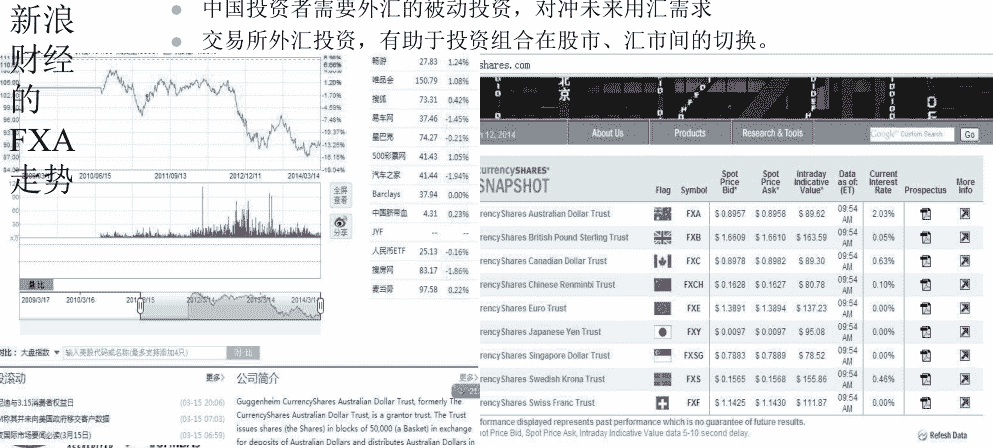

## Eurocurrency Market

### 欧洲货币市场（1）：定义与产生背景

- The Eurocurrency market is made up of several large banks called *Eurobanks* that accept deposits and provide loans in various currencies. （专门经营境外货币的银行也称欧洲银行，并不一定在欧洲）
- For example, the Eurocurrency market has historically recycled the oil revenues (petrodollars) from oil-exporting (OPEC) countries to other countries. （七十年代OPEC国家出口石油，石油美元大量流入，后又流入欧洲市场并被借贷到其它国家，政治、宗教、军事冲突促进了欧洲美元市场的发展）
- 欧洲美元存款利率高，贷款利率低，原因：不受央行监管（监管套利）

## 欧洲货币市场与亚洲美元

- The Eurocurrency market in Asia is sometimes referred to separately as the *Asian dollar market*.（在亚洲的欧洲货币：亚洲美元市场）
- 亚洲美元中心：新加坡，上海借鉴

| No. of Financial Institutions |  |
|---|---:|
| Insurance Companies/brokers | 218 |
| Banks | 162 |
| Fund Management Firms | 118 |
| Securities Dealers | 94 |
| Financial Advisors | 69 |
| Futures Brokers | 47 |
| Corporate Finance | 37 |

## Eurocurrency Market

### 欧洲货币市场（2）：利率如何产生？

- The BBA LIBOR is the most widely used benchmark or reference rate for short term interest rates.
- It is compiled by the BBA and released to the market at about 11.00 each day.
- LIBOR stands for the London Interbank Offered Rate and is the rate of interest at which banks borrow funds from other banks.


## 英国银行家协会（BBA）

### Libor（伦敦银行间同业拆借利率）

收藏本页 | 邮件发送本页

BBA LIBOR 是短期利率中使用最广泛的基准利率或参考利率。它由 BBA 编制，并在每天约 11:00 发布到市场。LIBOR 全称为伦敦银行间同业拆借利率，是指银行在伦敦银行间市场上，以可交易规模从其他银行借入资金时的利率。

### BBA Libor 惯例与报价基准

2002年7月23日

BBA Libor 惯例与报价基准

### BBA Libor 官方定义

2002年7月11日

这是 BBA Libor 的官方定义。

### 报价银行小组

- BBA LIBOR 报价银行小组（2003年3月28日）

### 每日回购利率

2003年5月8日

### 栏目

- BBA服务
- 消费者
- 企业
- Libor
- 报价银行小组
- 基本信息
- 历史BBA Libor利率
- Libor新闻
- 官方定义
- 其他基准利率
- 回购利率
- Libor系统
- 新闻中心
- 小型企业

### 其他链接

- 基本银行账户
- JMLSG
- Restore UK
- 统计数据
- 实用链接

首页 | 关于BBA | 联系我们 | 常见问题 | 隐私政策 | 网站地图 | 条款与条件

当前位置：首页 > Libor

### 搜索

## LIBOR一周报价历史数据： www.bba.org.uk

| 1周 | 7月1日 | 7月2日 | 7月3日 | 7月4日 | 7月7日 | 7月8日 | 7月9日 | 7月10日 |
|---|---|---|---|---|---|---|---|---|
| 欧元 | 2.14600 | 2.14175 | 2.14138 | 2.14000 | 2.14000 | 2.13038 | 2.12313 | 2.12213 |
| 美元 | 1.11938 | 1.11625 | 1.11125 | 1.11125 | 1.11000 | 1.10750 | 1.10750 | 1.11000 |
| 英镑 | 3.80141 | 3.74625 | 3.62063 | 3.62188 | 3.75000 | 3.77500 | 3.75000 | 3.63500 |
| 日元 | 0.04125 | 0.04125 | 0.04125 | 0.03875 | 0.03875 | 0.03875 | 0.03750 | 0.03750 |
| 瑞士法郎 | 0.23500 | 0.22000 | 0.21833 | 0.22333 | 0.22500 | 0.22000 | 0.22167 | 0.21000 |
| 加元 | 3.29333 | 3.29333 | 3.29833 | 3.29333 | 3.29667 | 3.30000 | 3.30000 | 3.29500 |

利息支付：\*7/365

03bba.xls 经济高涨与复苏时期Libor比较

## 中国银行间拆借利率：SHIBOR

最新Shibor 2011-09-22 11:30

| 期限 | Shibor(%) | 涨跌(BP) |
|---|---|---|
| 隔夜 | 3.5042 | ▼ 23.04 |
| 1周 | 3.9025 | ▼ 17.65 |
| 2周 | 4.4492 | ▼ 12.60 |
| 1个月 | 5.9258 | ▲ 8.50 |
| 3个月 | 5.6289 | ▼ 1.04 |
| 6个月 | 5.2981 | ▲ 0.02 |
| 9个月 | 5.2170 | ▲ 0.01 |
| 1年 | 5.2543 | ▲ 0.14 |

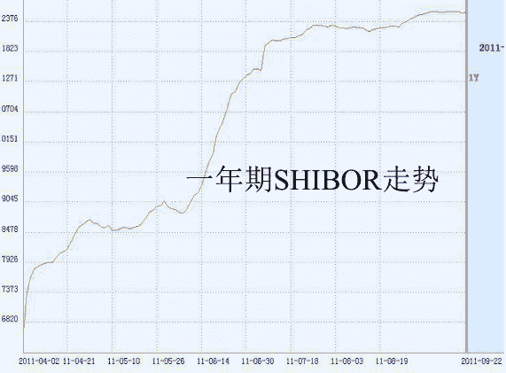

http://www.shibor.org/shibor/web/html/

## 欧洲信贷市场

什么是欧洲信贷市场

- 欧洲银行在*欧洲信贷市场*上向跨国公司或政府机构发放一年或更长期限的贷款。这类贷款称为*欧洲信贷贷款*。一年以上的欧洲美元贷款，贷款利率基准LIBOR+信用溢价

- 通常采用浮动利率，因为银行的资产和负债期限可能不匹配——欧洲银行吸收短期存款，但有时提供较长期限的贷款。（贷款以浮动利率LIBOR+信用溢价为主，浮动原因：解决存贷期限不匹配。）

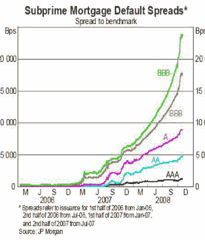

## 国际债券市场：外国债券与欧洲债券

两种类型的国际债券。

1. 以发行所在国货币计价、但由该国之外的借款人发行的债券，称为*外国债券*或*平行债券*。（在第2国发行，中国在美国发行美元债券）

2. 在计价货币所属国家以外的国家销售的债券，称为*欧洲债券*。（第3国发行，中国在欧洲发行美元债券）


## 国际债券市场（1）外国债券

中国投资者角度下的外国债券：美国政府债券报价

### 收益率曲线：对应不同时间（横坐标）下的资金到期收益率

### 美国国债收益率曲线

该曲线显示当前短期国库券、中期国债和长期国债的到期收益率；所有数据截至美东时间下午3点。

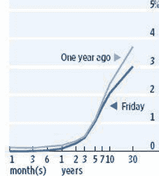

| Ryan指数 | 到期收益率 | 修正久期 | 本月至今 | 本季度至今 | 年初至今 | 过去12个月 |
|---|---|---|---|---|---|---|
| 30年期国债 | 3.015% | 18.65 | -1.68% | -1.68% | 20.76% | 20.44% |
| 10年期国债 | 2.067 | 8.83 | -1.17 | -1.17 | 14.34 | 6.89 |
| 7年期国债 | 1.593 | 6.62 | -0.91 | -0.91 | 11.18 | 5.70 |
| 5年期国债 | 1.073 | 4.84 | -0.47 | -0.47 | 7.67 | 4.02 |
| Ryan指数 | 1.421 | 7.31 | -0.74 | -0.74 | 11.13 | 6.70 |
| 3年期国债 | 0.486 | 2.92 | -0.18 | -0.18 | 3.05 | 2.04 |
| 2年期国债 | 0.291 | 1.98 | -0.07 | -0.07 | 1.22 | 0.92 |
| 1年期国债 | 0.097 | 0.95 | 0.02 | 0.02 | 0.65 | 0.71 |
| 6个月期国债 | 0.036 | 0.49 | 0.01 | 0.01 | 0.30 | 0.37 |
| Ryan现金指数-a | 0.037 | 0.44 | 0.01 | 0.01 | 0.29 | 0.35 |
| 3个月期国库券 | 0.010 | 0.25 | ... | ... | 0.16 | 0.23 |
| 1个月期国库券 | 0.005 | 0.07 | ... | ... | 0.06 | 0.10 |

a-现金投资表现

资料来源：Ryan ALM


## 国际债券市场（1）外国债券

### 全球政府债券报价与欧债危机

#### 全球政府债券

全球基准两年期和10年期政府债券的最新、一个月前和一年前的收益率，以及相对于美国国债的利差（高于或低于美国国债）。数据截至美东时间中午12点。

| 票息 | 国家/期限（年） | 收益率 | 相对于美国国债利差（基点） |  |  |  | 收益率 |  |  |
|---|---|---|---|---|---|---|---|---|---|
| 3.800 | 奥地利 2 | 1.034 | 75.0 | 79.5 | 66.7 | 62.1 | 1.062 | 0.876 | 0.985 |
| 3.500 | 10 | 2.795 | 69.1 | 78.5 | 66.4 | 33.7 | 2.754 | 2.677 | 2.726 |
| 4.000 | 比利时 2 | 1.876 | 159.2 | 165.7 | 191.8 | 65.3 | 1.924 | 2.127 | 1.017 |
| 4.250 | 10 | 3.962 | 185.8 | 207.9 | 201.2 | 77.4 | 4.048 | 4.025 | 3.163 |
| 4.250 | 芬兰 2 | 0.637 | 35.3 | 37.8 | 45.4 | 50.2 | 0.645 | 0.663 | 0.866 |
| 3.375 | 10 | 2.341 | 23.7 | 31.9 | 26.0 | 12.1 | 2.288 | 2.273 | 2.510 |
| 3.750 | 法国 2 | 0.840 | 55.6 | 59.8 | 51.2 | 56.1 | 0.865 | 0.721 | 0.925 |
| 2.500 | 10 | 2.644 | 54.0 | 66.6 | 52.6 | 24.8 | 2.635 | 2.539 | 2.637 |
| 1.750 | 德国 2 | 0.569 | 28.5 | 31.8 | 25.9 | 43.6 | 0.585 | 0.468 | 0.800 |
| 3.250 | 10 | 1.972 | -13.2 | -6.0 | -13.8 | -14.0 | 1.909 | 1.875 | 2.249 |
| 4.600 | 希腊 2 | 76.340 | 7605.6 | 7207.7 | 5517.9 | 7457. | 73.344 | 55.388 | 7.821 |
| 6.250 | 10 | 22.558 | 2454. | 2037.1 | 1708.9 | 742.6 | 22.340 | 19.102 | 9.815 |
| 2.000 | 意大利 2 | 3.899 | 361.5 | 364.4 | 358.9 | 138.9 | 3.911 | 3.798 | 1.753 |
| 3.750 | 10 | 5.402 | 329.8 | 341.2 | 295.3 | 136.7 | 5.381 | 4.966 | 3.756 |
| 4.250 | 荷兰 2 | 0.681 | 39.7 | 44.2 | 40.0 | 43.1 | 0.709 | 0.609 | 0.795 |
| 3.250 | 10 | 2.401 | 29.7 | 37.0 | 35.2 | 11.1 | 2.339 | 2.365 | 2.500 |
| 5.450 | 葡萄牙 2 | 16.231 | 1594.7 | 1628.2 | 1248.9 | 349.2 | 16.549 | 13.698 | 3.856 |
| 4.800 | 10 | 12.392 | 1028.8 | 1040.7 | 956.4 | 387.0 | 12.376 | 11.577 | 6.259 |
| 2.300 | 西班牙 2 | 3.272 | 298.8 | 299.2 | 306.7 | 159.5 | 3.260 | 3.276 | 1.959 |
| 5.500 | 10 | 4.975 | 287.1 | 302.4 | 297.5 | 157.1 | 4.993 | 4.988 | 3.960 |
| 4.500 | 英国 2 | 0.612 | 32.8 | 35.5 | 35.9 | 27.9 | 0.622 | 0.568 | 0.643 |
| 3.750 | 10 | 2.324 | 22.0 | 28.1 | 32.2 | 53.8 | 2.250 | 2.335 | 2.927 |
| 0.125 | 美国 2 | 0.284 | ... | ... | ... | ... | 0.267 | 0.209 | 0.364 |
| 2.125 | 10 | 2.104 | ... | ... | ... | ... | 1.969 | 2.013 | 2.389 |

《华尔街日报》：2011年10月10日

## 国际债券市场（2）欧洲债券：动因与特点

- 欧洲债券市场的出现，部分归因于美国1963年征收的利息平衡税（1963年美国向投资于外国在美国发行的美元债券征收30%的税，导致外国公司在欧洲融美元）。
- 欧洲债券通常以不记名形式发行，每年付息，可能可转换，可能采用浮动利率，而且通常很少有保护性条款。

无记名，每年付息，可转换，可变利息，通常无保护性条款

## 国际债券市场（2）欧洲债券：双币种债券

- 定义：发行日元债券，利息为日元，但到期本金支付为美元。
- 如果知道该债券的现在日元交易价格，可推出隐含的未来美元汇率。
- 例：一只五年期、票息4%的欧洲日元债券按面值出售。一只类似风险的五年期、票息5.5%的日元/美元双币种债券到期支付833.33美元。该债券售价为110,000日元。到期时隐含的日元/美元汇率是多少？
- 含义：由于双币种债券具有类似风险，其收益率将与按面值出售的普通欧洲日元债券一样为4%。因此，

¥110,000 = ¥5,500 x PVIFA(n = 5, i = 4%) + S5(¥/$) x $833.33 x PVIF(n = 5, i = 4%) = ¥5,500 x 4.4518 + S5(¥/$) x $833.33 x .8219

- PVIFA表示n年期,每年利息4%的现值，PVIF表示n年期按4%贴现的现值。

## 思考与练习

- 1，欧洲信贷市场与欧洲债券市场有什么区别？
- 2，教材第11章习题1：佐治亚州雅典市的Grecian Tile Manufacturing公司从伦敦一家银行借款1,500,000美元，利率为LIBOR加每年1.25%的贷款利差，按六个月滚动计息。如果第一个六个月期间六个月期LIBOR为4.75%，第二个六个月期间为5.375%，那么Grecian Tile在其欧洲美元贷款的第一年需要支付多少利息？
- 3，教材第12章习题3：一只五年期、票息4%的欧洲日元债券按面值出售。一只类似风险的五年期、票息5.5%的日元/美元双币种债券到期支付833.33美元，售价为110,000日元。到期时隐含的日元/美元汇率是多少？
- 4，采用PPT中效用函数方法，分析投资者1)为什么会参与外汇市场？2)有外汇支出时，是否参与外汇市场


## Lecture 4
## Global Equity Market
Eun, 第13章

## Preview
- 全球股票市场投资的动机
- 全球资本市场概况，美国的多层次融资体系概况，ADR分类
- 汇率对股利贴现模型的影响
- 海外上市的中国互联网企业估值分析，估值软件简介

全球股票市场投资的动机

全球资本市场概况，美国的多层次融资体系概况，ADR分类

汇率对股利贴现模型的影响

海外上市的中国互联网企业估值分析，估值软件简介

## 国际股票投资的理论动机
- Low positive correlation
- Opportunities to reduce risk of stock

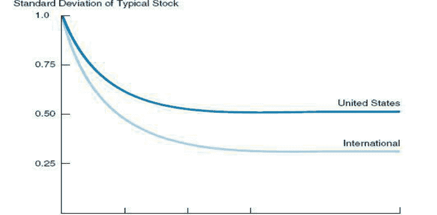

## 国际股票投资的理论动机
国内市场与许多海外市场之间的低相关性大幅降低了投资组合风险

Diversify Principle: σₚ² = X₁²σ₁² + X₂²σ₂² + 2X₁X₂ρσ₁σ₂ ≤ (X₁σ₁ + X₂σ₂)²

But E(Rₚ) = X₁R₁ + X₂R₂

|  | 上海香港 | 香港美国 | 上海美国 |
|---|---|---|---|
| 相关系数 ρ | 0.379869 | 0.045138 | -0.14208 |
| T统计量： ρ*sqrt(n-2) | 3.207285 | 0.352899 | 1.121049 |

如何实证检验投资N个国家的风险分散效果？以100个国家为例：

- 只投资1个国家，取这100个国家股市指数风险的平均值，作为只投资一个国家的风险衡量σ(1);
- 等权重投资2个国家，从100个国家股市指数中任取2个国家构成投资组合计算风险，然后对所有可能情形进行平均，作为投资2个国家的风险衡量σ(2);
观察σ(1), σ(2), σ(3), σ(4),......是否逐步变小

## 全球股市相关系数：2003-08年与2008-13年

|  | 美国 | 日本 | 英国 | 印度 | 加拿大 | 法国 | 德国 | 巴西 | 俄罗斯 | 埃及 | 墨西哥 | 意大利 | 印尼 | 土耳其 | 菲律宾 | 尼日利亚 |
|---|---|---|---|---|---|---|---|---|---|---|---|---|---|---|---|---|
| 美国 |  | 0.58 | 0.86 | 0.65 | 0.79 | 0.89 | 0.89 | 0.71 | 0.58 | 0.40 | 0.84 | 0.84 | 0.58 | 0.64 | 0.46 | 0.21 |
| 日本 | 0.72 |  | 0.60 | 0.64 | 0.63 | 0.57 | 0.55 | 0.50 | 0.59 | 0.48 | 0.63 | 0.58 | 0.51 | 0.57 | 0.33 | 0.24 |
| 英国 | 0.90 | 0.74 |  | 0.68 | 0.82 | 0.91 | 0.86 | 0.78 | 0.70 | 0.48 | 0.79 | 0.89 | 0.63 | 0.64 | 0.48 | 0.32 |
| 印度 | 0.70 | 0.64 | 0.73 |  | 0.73 | 0.65 | 0.63 | 0.36 | 0.57 | 0.47 | 0.63 | 0.65 | 0.68 | 0.62 | 0.56 | 0.26 |
| 加拿大 | 0.87 | 0.65 | 0.89 | 0.80 |  | 0.76 | 0.72 | 0.79 | 0.74 | 0.44 | 0.77 | 0.75 | 0.61 | 0.59 | 0.45 | 0.33 |
| 法国 | 0.88 | 0.70 | 0.91 | 0.71 | 0.81 |  | 0.96 | 0.74 | 0.65 | 0.48 | 0.80 | 0.94 | 0.63 | 0.62 | 0.43 | 0.26 |
| 德国 | 0.89 | 0.71 | 0.88 | 0.74 | 0.80 | 0.95 |  | 0.72 | 0.57 | 0.44 | 0.79 | 0.89 | 0.63 | 0.64 | 0.44 | 0.23 |
| 巴西 | 0.78 | 0.61 | 0.84 | 0.84 | 0.90 | 0.79 | 0.78 |  | 0.70 | 0.42 | 0.71 | 0.65 | 0.50 | 0.56 | 0.32 | 0.18 |
| 俄罗斯 | 0.79 | 0.62 | 0.86 | 0.78 | 0.88 | 0.79 | 0.80 | 0.88 |  | 0.52 | 0.67 | 0.64 | 0.55 | 0.53 | 0.31 | 0.36 |
| 埃及 | 0.62 | 0.56 | 0.60 | 0.65 | 0.61 | 0.59 | 0.63 | 0.64 | 0.64 |  | 0.50 | 0.48 | 0.61 | 0.50 | 0.46 | 0.27 |
| 墨西哥 | 0.89 | 0.71 | 0.84 | 0.80 | 0.88 | 0.82 | 0.84 | 0.88 | 0.82 | 0.61 |  | 0.74 | 0.64 | 0.57 | 0.53 | 0.26 |
| 意大利 | 0.81 | 0.67 | 0.89 | 0.68 | 0.75 | 0.96 | 0.91 | 0.74 | 0.75 | 0.54 | 0.74 |  | 0.66 | 0.63 | 0.37 | 0.28 |
| 印尼 | 0.72 | 0.62 | 0.67 | 0.75 | 0.71 | 0.67 | 0.72 | 0.71 | 0.67 | 0.63 | 0.78 | 0.58 |  | 0.53 | 0.54 | 0.19 |
| 土耳其 | 0.66 | 0.63 | 0.73 | 0.73 | 0.64 | 0.70 | 0.73 | 0.67 | 0.66 | 0.65 | 0.71 | 0.70 | 0.76 |  | 0.42 | 0.19 |
| 菲律宾 | 0.67 | 0.51 | 0.70 | 0.76 | 0.71 | 0.65 | 0.63 | 0.72 | 0.62 | 0.51 | 0.74 | 0.55 | 0.71 | 0.66 |  | 0.29 |
| 尼日利亚 | 0.39 | 0.33 | 0.46 | 0.41 | 0.49 | 0.39 | 0.38 | 0.3 | 0.54 | 0.36 | 0.41 | 0.36 | 0.26 | 0.31 | 0.37 |  |

## 个股跟随国家变化还是跟随行业变化
- ○ 福特汽车随美股，还是随汽车产业指数变化？
- • Phylaktis and Xia (2006). Their main results are that
  ▪ Country effects dominate industry effects over the full study period, but since 1999 there has been a shift toward industry effects.

## 全球股市信息来源: Yahoo财经代码

| ^BSES N | S&P BSE SENSEX |
| RTSI.RS | RTSI INDEX |
| ^FCHI | CAC 40 |
| ^BVSP | IBOVESPA - |
| ^KS11 | KOSPI Composite Index |
| ^GDAXI | DAX |
| ^AXJO | S&P/ASX 200 |
| ^NZC50 | NZX 50 PORTFOLIO INDEX GROSS |
| 000001.SS | SSE Composite Index |
| ^HSI | HANG SENG INDEX |
| ^DJI | Dow Jones Industrial Average |
| ^IXIC | NASDAQ Composite |
| ^FTSE | FTSE 100 |
| ^TWII | TSEC weighted index |

| ^N225 | Nikkei 225 |
| ^GSPTSE | S&P/TSX Composite index |
| GLD | SPDR Gold Shares |

指数主要以当地货币计价，但不排除标普公司编制的指数以美元计价（包含了汇率的涨跌）

## 海外公司在本国上市情况
## 教材表13-7

| Exchange | Total Listings 2009 Total | Total Listings 2009 Domestic | Total Listings 2009 Foreign | New Listings 2009 Total | New Listings 2009 Domestic | New Listings 2009 Foreign |
|---|---|---|---|---|---|---|
| Americas |  |  |  |  |  |  |
| Bermuda SE | 46 | 16 | 30 | 2 | 0 | 2 |
| BM&FBOVESPA | 386 | 377 | 9 | 15 | 15 | 0 |
| Buenos Aires SE | 106 | 101 | 5 | 0 | 0 | 0 |
| Colombia SE | 87 | 87 | 0 | 3 | 2 | 1 |
| Lima SE | 241 | 195 | 46 | 5 | 4 | 1 |
| Mexican Exchange | 406 | 125 | 281 | 42 | 0 | 42 |
| NASDAQ OMX | 2,852 | 2,569 | 283 | 131 | 114 | 17 |
| NYSE Euronext (US) | 2,327 | 1,832 | 495 | 94 | 58 | 36 |
| Santiago SE | 236 | 232 | 4 | 6 | 3 | 3 |
| TSX Group | 3,700 | 3,624 | 76 | 207 | 202 | 5 |
| Total Region | 10,387 | 9,158 | 1,229 | 505 | 398 | 107 |
| Asia, Pacific |  |  |  |  |  |  |
| Australian Securities Exchange | 1,966 | 1,882 | 84 | 47 | 40 | 7 |
| Bombay SE | 4,955 | 4,955 | 0 | 17 | 17 | 0 |
| Bursa Malaysia | 959 | 952 | 7 | 14 | 11 | 3 |
| Colombo SE | 231 | 231 | 0 | 2 | 2 | 0 |
| Hong Kong Exchanges | 1,319 | 1,308 | 11 | 73 | 72 | 1 |
| Indonesia SE | 398 | 398 | 0 | 13 | 13 | 0 |
| Jasdaq | 889 | 889 | 0 | 8 | 8 | 0 |
| Korea Exchange | 1,788 | 1,778 | 10 | 78 | 72 | 6 |
| National Stock Exchange of India | 1,453 | 1,453 | 0 | 47 | 47 | 0 |
| New Zealand Exchange | 165 | 143 | 22 | 2 | 2 | 0 |
| Osaka Securities Exchange | 432 | 431 | 1 | 2 | 2 | 0 |
| Philippine SE | 248 | 246 | 2 | 3 | 3 | 0 |
| Shanghai SE | 870 | 870 | 0 | 9 | 9 | 0 |
| Shenzhen SE | 830 | 830 | 0 | 90 | 90 | 0 |
| Singapore Exchange | 773 | 459 | 314 | 25 | 15 | 10 |
| Taiwan SE Corp. | 755 | 741 | 14 | 36 | 26 | 10 |
| Thailand SE | 535 | 535 | 0 | 18 | 18 | 0 |
| Tokyo SE Group | 2,335 | 2,320 | 15 | 23 | 23 | 0 |
| Total Region | 20,901 | 20,421 | 480 | 507 | 470 | 37 |

为什么纽约是世界金融中心？
为什么东京也是金融中心？


## 海外或者多国上市：优势
- 扩大公司的投资者基础。
- 对于来自资本市场有限的新兴市场国家的公司来说，这是非常重要的优势。
- 在新资本市场中建立公司知名度，为新股发行铺平道路。
- 可能带来营销优势。
- 可能会降低敌意收购的可能性。

## 多层次的美国证券市场及对中国借鉴
美国证券市场
证券市场
纽约证券交易所 (NYSE)
美国证券交易所 (AMEX)
地方性证券交易所（诸如芝加哥股票交易所 CHX 等）
(OTC)市场
纳斯达克 (NASDAQ) { NASDAQ 全国板 (national) NASDAQ 小型资本板 (small cap) }
电子柜台交易市场 (OTCBB)
粉红单市场 (Pink Sheets)

主板
中小板
创业板
股票转让系统
打造深圳市...股票市场 1990 601398工行
中小企业“隐形冠军”的摇篮 2004 002028思源电气
企业创新助推器 2009
“新三板”试点 2006 300104乐视网
“新三板”扩容试点 2011 430011指南针

## ADR 的机制
外国公司在美国可直接上市，或者托管在本国，但在美国发行ADR

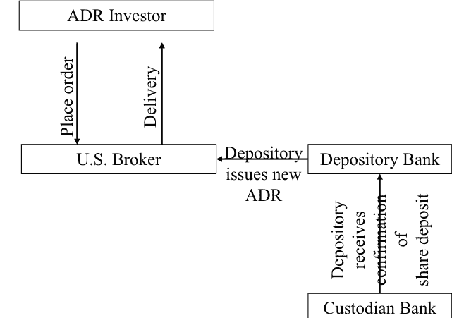

## ADR不同级别

| 描述 | Level I | Level II | Level III | Rule 144A |
|---|---|---|---|---|
| 描述 | 在美国的非上市项目 | 在美国的交易所上市 | 在美国的交易所公开发行并上市 | 向合格机构买家进行私募；美国私募 |
| 交易 | OTC | NASDAQ, AMEX, NYSE | NASDAQ, AMEX, NYSE | 美国私募 |
| SEC 注册 | Form F-6 | Form F-6 | Forms F-1 and F-6 | 无 |
| 美国报告要求 | 根据 Rule 12g3-2(b) 豁免 | Form 20-F* | Form 20-F* | 根据 Rule 12g3-2(b) 豁免 |

Level I to III上市由易到难：是否交易所上市，财务报告合规，是否融资

*财务报表必须与美国公认会计准则（U.S. GAAP）进行部分调节。
Level I: ADR 项目最基本的形式。
发行人不在美国寻求筹集新的股权资本，并且/或者无法在 NASDAQ 上市。
Level II: 发行人不在美国寻求筹集新的股权资本，ADR 可以在 NASDAQ、AMEX 或 NYSE 上市。
Level III: 发行人在美国公开发行新股，并将 ADR 在 NASDAQ、AMEX 或 NYSE 上市。
Rule 144A: 这种 ADR 项目是向合格机构买家（QIBs）进行的股权私募。它只能在 QIBs 之间交易。
来源：摘自 www.adr.com。

## 美国场外市场比较：投资者风险视角
- OTCBB市场，一般为从Nasdaq退市公司，或者未能满足其上市要求的公司。但OTCBB仍对财务信息披露与市场活跃度有基本要求，公司遵循Sarbanes-Oxley Bill法
- Pink Sheet是一家私人公司提供的交易系统，任何愿意上市的公司均可。例如Lukoy.pk，该公司同时在伦敦与莫斯科上市。
- 不受监管市场，Pink Order警示投资者，“华尔街之狼”在此市场欺诈投资者。

## 美股与全球的关系
- 投资美国股市与全球股市的关系
- 美国聚集全球最大的跨国公司，反应全球经济的基本面
- 各国的最大互联网公司聚集美股，反应了新经济前景
- 投资美国公司与投资BRICS的关系，以苹果为例
- 跨国公司的成本在BRICS，劳动力成本优势
- 跨国公司的销售在全球，规模优势
- 股票在成熟市场交易，公司治理优势

## Blackrock公司iShares指数ETF
- ETF: 交易所上市基金，跟踪一揽子股票
- 指数ETF： 跟踪某一指数的ETF，像买卖股票一样买卖指数
- 国家指数ETF： 跟踪国家指数。例如： Blackrock公司的iShares ETF产品系列
- 投资哲学： 国家股市低估或者有前景，但该国家的行业及单个公司股票正确定价或者缺乏相应信息
- 全球行业指数ETF： 跟踪全球行业。例如： State Street公司的SPDR ETF产品系列

## 通过华尔街全球投资：全球国家投资与全球行业投资

| 国家 | 纽交所上市国家ETF代码 | 行业 | 纽交所上市行业ETF代码 |
|---|---|---|---|
| 美国 | SPY | 能源 | XLE |
| 日本 | EWJ | 原材料 | XLB |
| 英国 | EWU | 工业品 | XLI |
| 印度 | INDY | 可选消费 | XLY |
| 加拿大 | EWC | 大宗消费 | XLP |
| 法国 | EWQ | 健康护理 | XLV |
| 德国 | EWG | 金融 | XLF |
| 巴西 | EWZ | 信息技术 | XLK |
| 俄罗斯 | ERUS | 通讯 | IXP |
| 埃及 | EGPT | 公用事业 | XLU |
| 墨西哥 | EWW |  |  |
| 意大利 | EWI |  |  |
| 印度尼西亚 | EIDO |  |  |
| 土耳其 | TUR |  |  |
| 菲律宾 | EPHE |  |  |
| 尼日利亚 | NGE |  |  |

ETF产品的迅速发展，使得投资于被低估的国家或者行业非常方便、低交易成本
如果全球市场都是有效的，应该如何投资

## 中国投资者购买国际股票好处
- 低估值的全球公司
- 谷歌，苹果，高通
- 复苏中的欧洲公司，PIGS
- 高增长潜力的Next 11国家，金砖国家
- 优秀的中国公司
- 互联网公司
- 新能源公司

## 中国投资者如何购买国际股票
- [QDII]：例如南方基金，嘉实基金
- 挂钩海外的理财产品
- 直接开户不受法律保护

## Imeigu网站统计的170家中概股
DH RM 塔博尔医疗 | TSTC 东方通信 | W R 深科迈通 | XIN 盈盛农业 | EFUT 富基融通 | COGO 科道集团 CIS 柯莱特
TPI 天和科技 | CHGS 扬子江药业 | KGJI 金星珠宝 | CGA 中粮农业 | OIM 凹凸科技 | ZA 左岸 CO 中国新创血库
CPHI 惠普医药 | XHY 希亚 | FENG 凤凰新媒体 | HOLI 和利时自动化 | GA 巨人网络 | CALI 中国汽车 CAAS 中汽系统
CCHH 蓝讯 | CPSL 中国平安保险 | CNY D 易达控股 | SORL SORL汽车零部件公司 | CXDC 鑫达集团 | TRIT 黎明控股 SINA 新浪
CBPO 嘉和生物 | NCTY 第九城市 | HTHT 汉庭 | SOHU 搜狐 | CHRM 昌荣传媒 | UTSI UT斯达康 CHDX 美中互利
CMFO 海洋食品 | ONP 东方环球 | EJ 易居中国 | SFUN 搜房 | MONT 润达科技 | EDU 新东方 GPRC 威盛塑料
CCM 泰和医药 | CTC 21世纪不动产 | WX 药明康德 | GRO 中国农业 | HPJ 荣盛国际 | VISN 华联传媒 NTES 网易
CNTF 泰克石油 | HMIN 妙客 | AMCN 顺美传媒 | JOBS 前程无忧 | GAME 盛大游戏 | CCSC 乡村基 SCOK 沈阳煤焦
ATV 棉花网 | KUTV 酷6 | BSPM 奥星制药 | AMAP 高德软件 | JST 金盛电气 | NQ 阿素 GSI 通用钢铁
LAS 联合网络 | WBAI 50城网 | TAOM 淘米 | GAGA 利好财务 | BITA 易车 | BIDU 百度 GURE 海湾资源
CNAM 卓越网络 | WH WSP航空 | GOMO 久邦数码 | KONG 空中网 | RDA 锐迪科 | CEDU 弘成教育 CREG 中国储备能源
STV 永辉超市 | CBAK 比克电池 | NOAH 诺亚财富 | ATHM 汽车之家 | ATAI ATA | BONA 博纳影业 ZOOM ZOOM
DATE 世纪互联 | OSN 奥盛新 | VNET 世纪互联 | SCLN 紫光农业 | ACTS 炫力 | MEMS 美新半导 SVA 科兴生物
QUNR 去哪儿网 | SINO 中环股份 | SKBI 天星生物 | NED 诺亚舟 | AMBO 安博教育 | CHC 中水电 SEED 奥瑞金种业
BORN 博润 |  | CNIT 中国信息技术 | SCR 先声药业 |  | XUE 学大教育
MOBI 斯凯 |  | CCCL 中国陶瓷 | ASIA 亚信联创 |  | NPD 海王星辰


## Imeigu网站统计的170家中概股

| 股票代码 | 公司名称 | 股票代码 | 公司名称 | 股票代码 | 公司名称 | 股票代码 | 公司名称 |
|---|---|---|---|---|---|---|---|
| THTI | 巨元瀚洋 | ZX | 正兴集团 | CYOU | 畅游 | CHNR | 中国天然资源 |
| LONG | 艺龙 | CHLN | 中华地产 | YY | 欢聚时代 | CTRP | 携程 |
| QINK | 丰泽农牧 | CCCR | 鲈乡农村小额贷 | CLNT | 中国风能技术 | DQ | 大全新能源 |
| LIWA | 利华国际 | HGSH | 汉广厦房地产 | CSIQ | 阿特斯太阳能 | AMCF | 星源燃料 |
| YONG | 永业国际 | YOKU | 优酷土豆 | YGE | 英利绿色能源 | CSUN | 中电光伏 |
| TBOW | 创博国际 | RCON | 研控科技 | VIPS | 唯品会 | RENN | 人人 |
| QIHU | 奇虎360 | HSOL | 韩华新能源 | FFHL | 富维薄膜 | CMGE | 中国手游 |
| SUTR | 森特集团 | DANG | 当当网 | PWRD | 完美世界 | SGOC | 上为集团 |
| CISG | 泛华保险 | SPII | 天人果汁 | KNDI | 康迪车业 | SVM | 希尔威 |
| XRS | 好未来 | JRJC | 金融界 | DL | 正保远程教育 | CNET | 中国在线 |
| ALN | 绿润集团 | WUBA | 58同城 | SOL | 昱辉阳光 | CJJD | 九洲大药房 |
| CHOP | 河南鸽瑞 | CYD | 玉柴国际 | NFEC | 能发伟业 |  |  |
| GSOL | 环球资源 | LDK | 赛维LDK | JASO | 晶澳太阳能 |  |  |
|  |  | SYUT | 圣元国际 | KONE | 联合信息 |  |  |
|  |  | TSL | 天合光能 | MCOX | 麦考林 |  |  |
|  |  | CADC | 新奥混凝土 | MY | 明阳风电 |  |  |
|  |  | JKS | 晶科能源 |  |  |  |  |

未列出的还包括，三大电信公司，三桶油


## 中概股互联网分析

- 三大市值公司：BAT
- 传统三大门户网站
- 移动平台：Qihoo
- 垂直网站
  - 电商：JD、DANG、唯品会
  - 游戏：PWRD、CYOU、GAME
  - 房产：SFUN、EJ
  - 汽车：爱车、汽车之家
  - 婚恋：Date
  - 语音与游戏：YY
  - 视频：Youku
  - 旅游：Ctrip、Qunaer
  - 社交：人人

## 互联网与中概股分析

--Top Sites in….

来源: http://www.alexa.com/topsites

| 排名 | 全球网站 | 美国网站 | 澳大利亚网站 | 德国网站 | 中国网站 |
|---:|---|---|---|---|---|
| 1 | google.com — 使用户能够… | google.com — 使用户能够… | google.com.au — 搜索网络 fro… | google.de — 搜索整个… | baidu.com — 中国领先的 Chin… |
| 2 | facebook.com — 一个社交工具… | facebook.com — 一个社交工具… | google.com — 使用户能够 s… | facebook.com — 一个使社交更便捷的工具 th… | qq.com — 中国最大的 a… |
| 3 | youtube.com — YouTube 是一个 wa… | youtube.com — YouTube 是一个 wa… | facebook.com — 一个使社交更便捷的工具 that… | youtube.com — YouTube 是一个 wa… | taobao.com — 于 Ma… 上线 |
| 4 | yahoo.com — 一个主要互联网… | yahoo.com — 一个主要互联网… | youtube.com — YouTube 是一个方式… | google.com — 使用户能够… | sina.com.cn — 包括门户的国内… |
| 5 | baidu.com — 中国领先的 Chin… | amazon.com — Amazon.com se… | yahoo.com — 一个主要互联网 po… | ebay.de — 购买和 Verk… | hao123.com — Baidu |
| 6 | wikipedia.org — 一个免费的百科… | linkedin.com — 一个网络工具… | ebay.com.au — Auction sales with… | amazon.de — 丰富的 Sortiment… | weibo.com — 新浪微博是中国全中… |
| 7 | qq.com — 中国最大的 a… | wikipedia.org — 一个免费的百科… | wikipedia.org — 一个免费的百科全书… | wikipedia.org — 一个免费的百科… | tmall.com — Tmall.com (www… |
| 8 | linkedin.com — 一个网络工具 too… | ebay.com — 国际 pers… | linkedin.com — 一个网络工具 t… | spiegel.de — 最新新闻… | 360.cn |
| 9 | taobao.com — 于 Ma… 上线 | twitter.com — 社交网络… | live.com — 搜索引擎 fro… | yahoo.com — 一个主要互联网… | sohu.com — 资源导航为主要… |
| 10 | twitter.com | bing.com — 搜索引擎 di… | news.com.au — News from Australi… | bild.de — Erstklassiger Jou… | 163.com — 中国最大的网络门户… |

## 百度Nasdaq上市案例分析—公司背景

- 2000年1月1日，公司创始人李彦宏、徐勇从美国硅谷回国，创建了百度
- 2003年12月，开创性地推出贴吧。
- 2005年8月5日，百度在美国纳斯达克上市，发行价27美元，新股占总股本12.5%。
- 2013年19亿美元收购91手机助手

## 发行主要信息

- 发行包括百度发行的 3,208,696 股 ADS 和售股股东发行的 831,706 股 ADS
- 高盛亚洲有限公司和瑞信第一波士顿担任联席账簿管理人，派珀·贾夫雷担任发行联席经理。
- 百度最大的股东为Draper Fisher Jurvetson ePlanet风险投资公司，持有股份为28.1%。第二大股东为Integrity Partners公司，持有股份为11%。随后依次是持股10.1%的Peninsula Capital Fund公司和持股4.9%的IDG科技风险投资公司。（创始人为B类股份，表决权1股相当于10股A类）。李彦宏持股为25.8%，徐勇则持股为8.2%
- 开盘27美元，当日收盘122美元。


## 为什么要赴美上市

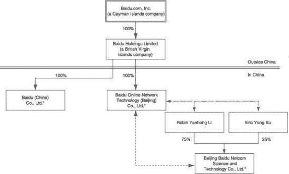

- 百度注册地分别为英属开曼群岛（Baidu.com.Inc）和英属维尔京群岛（Baidu Holdings Limited，百度控股有限公司）。随后Baidu在中国注册了两个子公司——Baidu Online Network Technology (Beijing) Co.Ltd.（百度在线网络技术公司，简称“百度在线”）和Baidu Netcom Science and Technology Co.Ltd.
  - 百度中国当时的盈利条件未能满足中国A股要求
  - 外资不能进入中国互联网公司，投资人采用协议控股模式：VIE


## 董事会

李彦宏
联合创始人、董事长兼首席执行官

丁健
董事

出井伸之
董事

格雷格·彭纳
董事

威廉·德克尔
审计委员会主席

刘德建
董事

## 相对估值：由相对PE/PS决定股价

### 2013年10月初美国互联网公司财务数据

| 公司 | 总收入 | 远期市盈率 | 营业利润率 |
|---|---|---|---|
| 谷歌 | $57.39B | 19.43 | 24.51% |
| 奈飞 | 4.14 | 77.95 | 4.0 |
| 领英 | 1.24 | 109 | 5.18 |
| Priceline.com | 5.88 | 21.44 | 34.71 |
| eBay | 15.52 | 16.52 | 20.06 |

| 公司 | 业务 | 远期市盈率（2014年12月） | 营业利润率 |
|---|---|---|---|
| 百度公司 | 互联网搜索引擎 | 19.82 | 44.02 (%) |

百度业务构成：互联网搜索；视频流媒体（爱奇艺）；在线旅游服务（去哪儿）。简单来说，百度就是谷歌、奈飞（NFLX）和Priceline.com（PCLN）。

## 相对估值：由相对PE/PS决定股价

### 2013年10月初中国互联网公司财务数据

| 公司 | 业务 | 远期市盈率（2014年12月） | 营业利润率 |
|---|---|---|---:|---:|
| 百度公司 | 互联网搜索引擎 | 19.82 | 44.02 (%) |
| 新浪公司 | 媒体和移动增值服务 | 36.19 | 22.30 |
| 当当网 | 企业对消费者（B2C）电子商务 | -- | -9.42 |
| 人人公司 | 社交网络 | -- | -52.09 |
| 优酷（YOKU） | 互联网电视 | 15.62 | -25.02 |
| 搜狐公司 | 品牌广告、在线游戏 | 14.82 | 23.15 |

百度业务构成：互联网搜索；视频流媒体（爱奇艺）；在线旅游服务（去哪儿）。简单来说，百度就是谷歌、奈飞（NFLX）和Priceline.com（PCLN）。

## DCF模型进行估值（绝对估值法）

- 如果假定公司前n年现金流CF的超常增长率为g，随后保持一个稳定的增长率gₙ，则公司的绝对价值：
  
  $$V=\sum_{t=1}^{n}\frac{CF_1(1+g)^{t-1}}{(1+r)^t}+\frac{CF_{n+1}}{r-g_n}\times\frac{1}{(1+r)^n}=\frac{CF_1\left(1-\frac{(1+g)^n}{(1+r)^n}\right)}{r-g}+\frac{CF_{n+1}}{(r-g_n)(1+r)^n}$$

- 计算公司价值（股票、债务之和）时，r是投资者要求的回报率，等于债券要求回报率和股票要求回报率的加权平均WACC

## DCF模型进行估值（绝对估值法）

- rₑ=投资者要求的股权资本收益率,根据夏普提出的资本资产定价模型估计:rₑ=rf+Beta*(rm-rf),rf是无风险利率,rm是股市的预期收益率(长期预期回报约10%-16%),Beta是该股票的系统风险测度,一般在0.8~1.2间。
- 得到公司的价值后，减去债务价值即公司股票价值
- 股票市值除以股数，得到股价

## 汇率对估值模型的影响：以股利定常增长模型为例

- 在投资学估值模型中，$P_0=\frac{D_1}{r-g}$
- 如果某中概公司的每年的人民币红利保持稳定不变 $g_{rmb}=0$，但对于美国投资者，如果人民币每年升值5%，则美元红利增长 $g_\$=\frac{E_{1,\$/rmb}-E_{0,\$/rmb}}{E_{0,\$/rmb}}=5\%$。这家公司变成了成长股，估值是否产生冲突？下面证明其一致性
- 汇率升值速度正好等于利率贴水，即 $g_\$=\frac{r_\$-r_{rmb}}{1+r_{rmb}}$（代入下面美元估值等式）
- 设第一年末人民币红利 $D_1$，则
  - 人民币估值 $P_{0,rmb}=\frac{D_{1,rmb}}{r_{rmb}-g_{rmb}}=\frac{D_{1,rmb}}{r_{rmb}}$
  - 美元估值 $P_{0,\$}=\frac{D_{1,rmb}*E_{1,\$/rmb}}{r_\$-g_\$}=\frac{D_{1,rmb}*E_{0,\$/rmb}}{r_{rmb}}=P_{0,rmb}*E_{0,\$/rmb}$

估值一致得证

## 百度现金流简化分析

FCFF=经营现金流减去资本支出

自由现金流利润率（自由现金流除以总收入）超过5%的公司通常被视为现金牛。

过去三年，百度的自由现金流利润率平均约为43.2%。

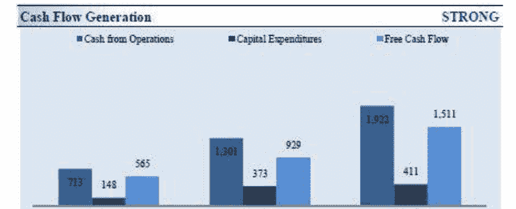

## 潜在结果范围

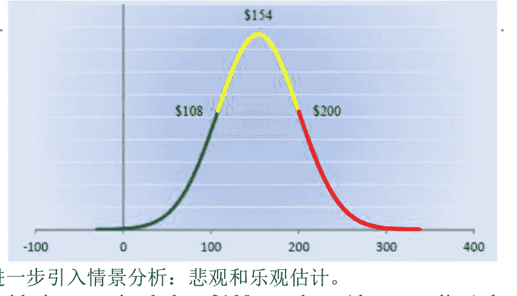

进一步引入情景分析：悲观和乐观估计。

百度股价低于每股108美元（绿线）时具有吸引力，但高于每股200美元（红线）时则相当昂贵。

## 估值软件（2）：www.Trefis.com网站

## 互联网与传统行业分析异同分析

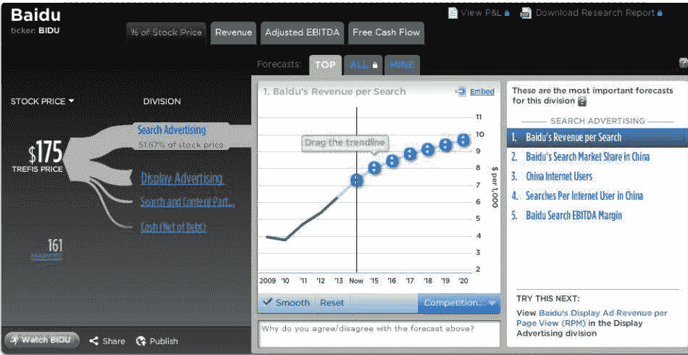

搜索价值*搜索次数*中国用户数*百度份额*毛利率

百度用户价值：每千次搜索9美元；谷歌20左右

## 跟踪百度的投行及分析师

| 机构 | 分析师 |
|---|---|
| 86Research Ltd. | C. Ming Zhao |
| ABR Investment Strategy LLC | Henry Guo |
| Barclays Capital | Alicia Yap |
| BNP Paribas | Alen Lin |
| BOC International | Thomas Chong |
| BOCOM International | Martina Ma |
| BofA Merrill Lynch | Eddie Leung |
| Brean Murray Carret & Co | Fawne Jiang |
| China Renaissance | Tianli Wen |
| CICC | Wanting Yu |
| Citi Investment Research | Muzhi Li |
| CLSA | Elinor Leung |
| Credit Suisse | Dick Wei |
| Deutsche Bank | Alan Hellewell |
| First Shanghai Securities Limited | Petter Wang |
| Goldman Sachs | Piyush Mubayi |
| Guotai Junan | Ricky Lai |
| HSBC | Chi Tsang |
| IIR Group | Prateet Champav |
| Jefferies | Cynthia Meng |
| JG Capital | Candice Xu |
| JP Morgan | Alex Yao |
| Macquarie Research | Jiong Shao |
| Majestic Research | John Aiken |
| Maxim | Echo He |
| Mizuho | Marvin Lo |
| Morgan Stanley | Philip Wan |

## 百度分析师大会 004.mp3

http://edge.media-server.com/m/p/gaxa5nbr/lan/en

奇虎分析师会议： http://ir.360.cn

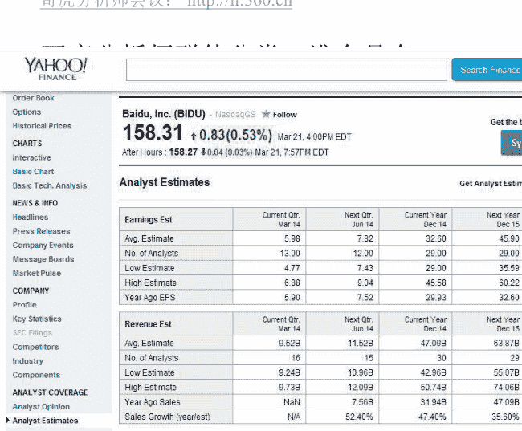


## 中国概念风险

- VIE结构
- 跨境审计
  - 四大中国分支机构无权提供SEC要求的审计底稿

## 中国概念风险

## 2011~12：中国概念股被做空

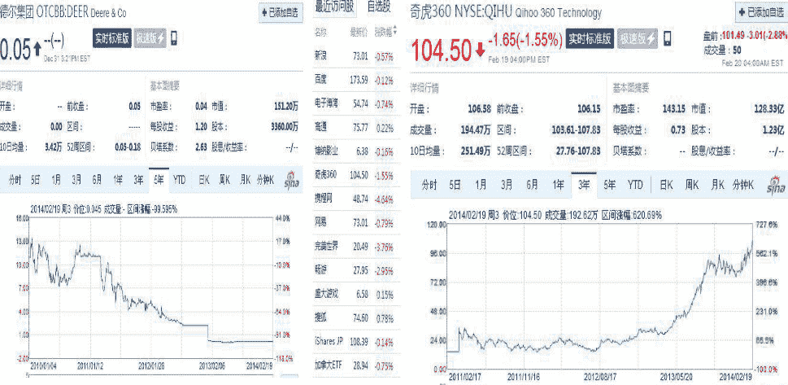

被做空公司多为OTCBB交易，采用反向收购后进入OTC上市
做空后的两种命运：业绩虚假的下跌99%，真实的上升500%

## 简答与计算

- 1. 如何采用相对估值和绝对估值给百度定价？
- 2. 百度为什么不在中国上市，为何注册在维京群岛？
- 3. 汇率如何影响中国投资者购买中国概念股票？
- 4. 从绝对估值模型来看，中国13年下半年出现的钱荒与美国的零利率如何分别影响两国的股市表现？
- 5. 教材13章计算题1： On the Tokyo Stock Exchange, Honda Motor Company stock closed at ¥2,717 per share on Thursday, July 29, 2010. Honda trades as and ADR on the NYSE. One underlying Honda share equals one ADR. On July, 29, 2010, the ¥/$ spot exchange rate was ¥86.7750/$1.00. a. At this exchange rate, what is the no-arbitrage U.S. dollar price of one ADR? b. By comparison, Honda ADRs traded at $30.96. Do you think an arbitrage opportunity exists?

## Lecture 5

## Interest Rate Parity, Purchasing Power Parity, and International Fisher Effect
利率平价,购买力平价与国际费雪效应

Required reading, Eun, 第6章


## Chapter Objectives

- ○ 利率平价 Interest Rate Parity, IRP
- ● 用利率表达的汇率公式，金融项目下货币市场无利可套
- ○ 购买力平价 Purchasing Power Parity, PPP
- ● 预期通胀率与将来汇率预期的汇率公式，经常项目下无利可套
- ○ 国际费雪效应 International Fisher Effect
- ● 利率与将来汇率的均衡公式，对外直接投资项目下无利可套

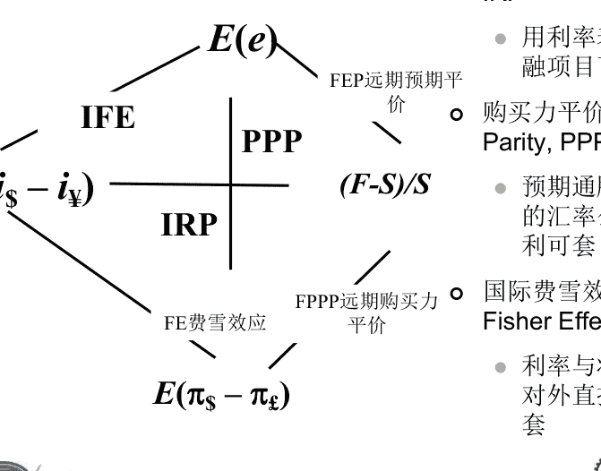

## 以利息差为目标的套利活动

## （1）无抛补套利(Uncovered Interest Arbitrage)

- 欧元即期汇率 =1.16，
  美元90天利率2%，欧元利率= 4%
- 某投资者从货币市场按2%利率借入$。期限为90天。将美元换为欧元，按4%利率贷出，到期将欧元再转为美元，并还本付息，则可获得超额利息2%。
- 这一活动称为无抛补套利，或Currency Carry Trade，风险是欧元到期可能大幅度贬值(也称存在欧元敞口)
- 如果存在远期外汇市场，即投资者现在约定好，将来可以按照现在预订的价格卖出，则可规避外汇风险

## （2）抛补套利 Covered Interest Arbitrage）

○ **Covered interest arbitrage**（购入利息高的货币，为防止高息货币贬值，同时卖出其远期）

○ 如果存在远期欧元市场，远期汇率和即期汇率都为1.16，美元90天利率2%，欧元利率=4%

- 某投资者从货币市场按2%利率借入1$，期限为90天，将美元换为欧元，**同时卖出远期欧元**。按4%利率贷出欧元，到期将欧元再转为美元，并还本付息，则可获得超额利息  
  `1/1.6*(1+0.04/4))*1.6-1*(1+0.02/4)=0.005$`
- 投资欧元的同时，卖空远期欧元，避免欧元到期可能贬值。称为抛补套利（使欧元敞口为0）

## 以利息差为目标的套利活动
（2）抛补套利Covered Interest Arbitrage

- 如果大家都觉得有抛补套利机会，则欧元的现汇价格不断推高，远期价格不断走低。最终使欧元利息收入等于欧元汇率损失。即无利可套
- 抛补套利将导致汇率与利率间存在一等式关系
- 抛补套利实质：存高息货币的同时(先需借低息货币，买高息货币的现货)，抛高息货币的期货，使外汇敞口净头寸为0

## 利率平价公式推导

- *Interest rate parity*, IRP 是指由抛补套利，导致的利率与汇率间的等式关系）
- 证明：下面两种方式存钱，最后得到的钱一样：（1）将1个单位本币直接存银行；（2）抛补套利，将1个单位本币换成外币存银行，同时卖出远期外币。
  - 方法（1）得到的钱 = 1 + i_H
  - 方法（2）得到的钱 = (1/S)×(1+i_F)×F
    = (1/S)×(1+i_F)×[S×(1+f)] = (1+i_F)×(1+f)
  - 这里P是外汇的远期的升水率，S：1个外币现货兑换本币，F：1个外币期货兑换本币数
  - 两者相等，有远期外汇升水 f 满足：
    f = \frac{1+i_H}{1+i_F} - 1

## 利率平价公式含义

远期外汇升水

$f = \frac{1 + i_H}{1 + i_F} - 1$

- 高息货币，远期汇率小于即期
- 远期外汇的上升率（升水）等于其利率的贴水
- 注意：3个月期远期外汇的升水等于3个月利率的贴水。6个月期远期外汇的升水等于6个月利率的贴水。因此严格的IRP公式：
- $f(n) = \frac{(1 + i_H * \frac{n}{12})}{(1 + i_F * \frac{n}{12})} - 1 \approx i_h - i_f$，或 $F(n) = S \frac{(1 + i_H * \frac{n}{12})}{(1 + i_F * \frac{n}{12})}$
- 如果本币利率突然宣布上升，市场有何变化？

## Determining the Forward Premium
例：怎样计算远期外汇

假设年利率 $i_{peso}=6\%$, $i_{\$}=5\%$。

Peso现汇汇率 = \$.10/peso，则半年远期汇率 =

$S \times (1+i_{\$}/2)/(1+i_{peso}/2) \approx \$.0995/peso$

## 如何判断有没有套利机会

- 给出两种货币的即期、远期汇率、利率，如何判断有没有套利机会？如何套利？
- 表述一：
  高息货币的息差大于汇率升水，则应投资于高息货币（1-借入低息货币，2-换高息货币，3-存入高息货币，同时卖出远期高息货币）（如果你手头本身有低息货币，则从第二步开始。如果你手头有高息货币，则从第三步开始。如果你空手套白狼(Zero investment, 或 Arbitrage，则从第一步开始。）
- 表述二：
  如果实际的远期外汇高于理论，则应该卖出远期外汇，同时借入本币，买即期外汇，存外汇

## 利率平价线

## 本币利息--外币利息

本币利息偏高，可进行投资于本币的抛补

远期汇率偏高，卖出外币期货

IRP line

Forward Discount (%)

外汇远期升水

## 思考

加元汇率0.8，90天远期0.799，
90天利率4%，美元90天利率2.4%。
1美元抛补套利的利润是多少？（期末时）
写出判断公式((-0.799-0.8)/0.8=-0.00125))。

## IRP在实际应用中的交易成本

- • 交易成本：客户在存款时总是低利率，贷款时总是高利率，卖出远期外汇时，总是按买入价（低者）。

## 考虑交易成本的套利：合成期货

- A, 如果银行远期外汇的买入价高于客户“从/塞”的卖出价（在银行借本币，转换成外币并存起来后的收入），则有套利机会，即

$F_{H/F}$（银行报出远期买入价）> \frac{1+i_{H存款利率}}{1+i_{F存款利率}} * S_{H/F}$（卖出价）

【前者：实际价格或者称报价价格，后者理论价格或者客户合成期货价 Synthetic Forward】

- 或者 B，银行远期外汇的卖出价低于客户在市场借外币，转换成本币并存起来后的收入，则有套利机会，即

$F_{H/F}$（银行报出远期卖出价）< \frac{1+i_{H存款利率}}{1+i_{F贷款利率}} * S_{H/F}$（买入价）

套利区间为远期外汇升水大于大（贷减存）的，小于小（存减贷）

$f_{H/F} > i_{H贷}-i_{F存}$ 或 $f_{H/F} < i_{H存}-i_{F贷}$


## 评估利率平价时的考虑因素

考虑交易成本下利率平价区域

i_H − i_F

IRP line

f

本币利息偏高，可进行投资于本币的抛补

无利润可套区域

远期汇率偏高，可进行投资于外币的抛补

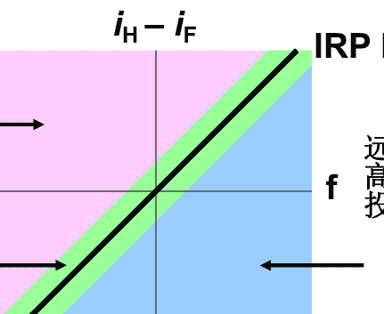

## 利率平价公式与我国的远期结售汇制度

- 中行的远期报价由总行采用利率平价公式全行统一。
- 美元利率每天以路透公布的LIBOR基础利率减去1/16（可调）个基本点计算，
- 人民币利率综合采用全国银行间同业拆借中心同业拆借市场(SHIBOR)利率、人民币存款利率、中央银行再贴现利率和再贷款利率等多项指标通过一定加权计算而成

| | 美元 | 欧元 | 日元 | 港元 | 英镑 | 瑞郎 | 澳元 | 加元 |
|---|---|---|---|---|---|---|---|---|
| 七天 买入 | 619.63 | 850.04 | 6.0488 | 79.75 | 1028.36 | 697.88 | 574.13 | 561.16 |
| 七天 卖出 | 623.52 | 858.66 | 6.1154 | 80.48 | 1037.32 | 704.15 | 580.39 | 566.50 |
| 十二个月 买入 | 621.15 | 853.46 | 6.0887 | 80.09 | 1028.86 | 702.92 | 561.79 | 558.37 |
| 十二个月 卖出 | 626.59 | 862.10 | 6.1544 | 80.83 | 1038.14 | 709.80 | 568.59 | 563.94 |

## Purchasing Power Parity (PPP)

购买力平价原理：绝对PPP

绝对PPP：不同国家商品采用一种货币应一个价。或者说，价格乘上汇率后应一样。

- Sₕ/ᶠ = Pₕ / Pᶠ
- 其中 Pₕ 表示本国在 t 时期末的一般物价水平， Pᶠ 表示外国在 t 时期末的一般价格水平， S 是 t 时期末以本币直接标价的汇率。


## 购买力平价：相对PPP

- 相对PPP：不同国家商品价格的变化应一致（采用同一个货币来衡量）。或者说，价格变化乘上汇率后的变化应一样。比较绝对PPP与相对PPP区别
  - 世界各地的商品价格一致
  - 世界各地的商品价格涨幅一致
- 价格上升，通常指一篮子商品价格的上升，用通货膨胀来衡量。
  - 通货膨胀的衡量方法例：中国居民消费价格指数当前100.3，上年同月=100

## 购买力平价：相对PPP推导

- 购买力平价一般指相对PPP，假设[t, t+1]期间本国、外国通货膨胀分别为 π_h、 π_f
- π_h = P_h(t+1) / P_h(t) - 1， π_f = P_f(t+1) / P_f(t) - 1
- 物价发生变化时，本国物价变化将等于外国物价变化乘外汇汇率的变化：
- (1 + π_f) (1 + e_f) = (1 + π_h)
- e_f = (1 + π_h) / (1 + π_f) - 1
- 其中 e_f 是外汇汇率的变化率 e_f = S_f(t+1) / S_f(t) - 1
- (1 + π_f) (1 + e_f) / (1 + π_h) = 1 也表明名义汇率经物价调整（即实际汇率）后应保持不变
- 站在 t 时刻，以上 t+1 时刻变量（π, P, e）均为随机变量, 随机变量相等则表明在未来各种经济情形下均相同

## Graphic Analysis of Purchasing Power Parity

### Inflation Rate Differential (%)

预期本国通胀—外国通胀

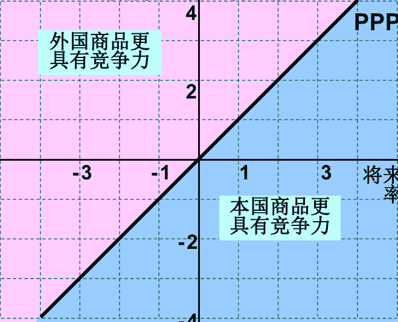

外国商品更具有竞争力

本国商品更具有竞争力

PPP line

未来外汇汇率升水

> 实际有效汇率降低，则具有竞争力

## PPP 检验结果

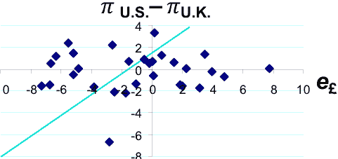

**Based on annual data for 1971-2000**

相对 PPP 的统计检验不理想，

`ef = a + b*(π_h - π_f)` 的斜率项 = 1 的假设被拒绝

## PPP在实证中没有发生

- PPP的前提条件不一定成立：货物自由贸易。
- 对某国家的货币需求，除了其商品便宜外，还有利率因素
- 政府管制
- PPP更容易发生在商品贸易上，而服务贸易很难。因为便宜的服务难以输出

## PPP与实际有效汇率

- 实际汇率是指经两国物价调整后的汇率
  - 例如2013年人民币兑美元名义汇率上升，同时物价比美国上升的更多，则实际汇率上升更快
- 名义有效汇率
  - 选择外贸比重作为权数，通过计算本国货币与其他主要货币的汇率变动的加权平均值获得
- 实际有效汇率是指本国相对于一篮子货币的实际汇率
  - 第一财经日报发布的CBN人民币指数显示，自2006年7月21日至2007年7月16日，也就是在汇改之后的第二年，人民币名义有效汇率指数升值了3%，人民币实际有效汇率指数升值了6.2%。

## Experiments on enhancing machine learning

NOTE 010

25th May 2023

我们遵循以下协议：对于每个数据集，我们使用类似于之前工作（Yan et al., 2020）的多样化特征构建监督基线。我们还为每个数据集基准测试了普通基线、架构消融和风格化模型变体。该协议旨在保持计算预算并选择一种简单的方法，以及一个同样强大的深度神经网络（DNN）模型。

对于 DNN 模型，我们对文本输入使用基于 RoBERTa 的交叉编码器（Devlin et al., 2019），对视觉输入使用 ResNet-50 交叉编码器（He et al., 2016）。我们还训练了一个 late-fusion 变体，将两个模型通过两层 MLP 连接起来，融合它们的输出特征。

### Intro

### Datasets & Baselines

### Approach

### Experiment Configs

| Model | Backbone | #Params | F1 | AUROC |
|-------|----------|---------|----|-------|
| Baseline | Logistic Regression | 0.9M | 61.2 | 88.4 |
| Vanilla DNN | ResNet-50 | 25.6M | 68.4 | 91.7 |
| + style | ResNet-50 | 25.6M | **74.9** | **94.5** |
| + style + DIS | ResNet-50 | 25.6M | **78.2** | **96.1** |

### Results

### More Experimental Observations

我们发现，当领域偏移较大时，风格泛化和解耦对于获得强性能至关重要，并且进一步观察到去相关输入空间（DIS）的益处，它在域内和域外设置中 consistently 提高了所有指标。

### Ablations

### Takeaways

### References

[1] Yan et al., 2020  
[2] Devlin et al., 2019  
[3] He et al., 2016


## IFE推导及表达形式

- 假设：国内（美国）投资收益 i$ = 对外投资收益（日本）折算成本币后的收益
- 对外投资收益折成本币 = (1 + i¥)(1 + E[e$/$¥]) − 1
- i¥ 对外投资收益（日本利率）
- e$/$¥ 表示将来日元汇率的变化 (S$/$¥(2) − S$/$¥(1)) / S$/$¥(1)

期望值：

E[S$/$¥(2)] − S$/$¥(1) / S$/$¥(1) = i$ − i¥

或者写成更一般形式：

E[S_h/f(2)] − S_h/f(1) / S_h/f(1) = i_h − i_f

注意：由于 e_h/f 指将来汇率的变化，前面应该取期望

## IFE近似表达

$E(e_f) \approx i_h - i_f$

- 例：英镑利率比美元高出2%，其将来汇率贬值的预期值为2%

## IFE：三种货币在三个国家的最终实际收益都为2%，世界是平的

| 投资者所在国家 | 拟投资国家 | 已知投资的名义回报 i_h | i_f | 由IFE计算将来汇率 e_f | 通胀 π_h | 最终实际回报 = i_f + e_f - π_h |
|---|---|---|---|---|---|---|
| Japan | Japan | 5% | --- % | --- | 3% | 2% |
|  | U.S. | 5 | 8 | -3 | 3 | 2 |
|  | Canada | 5 | 13 | -8 | 3 | 2 |
| U.S. | Japan | 8 | 5 | 3 | 6 | 2 |
|  | U.S. | 8 | --- | -- | 6 | 2 |
|  | Canada | 8 | 13 | -5 | 6 | 2 |
| Canada | Japan | 13 | 5 | 8 | 11 | 2 |
|  | U.S. | 13 | 8 | 5 | 11 | 2 |
|  | Canada | 13 | --- | --- | 11 | 2 |

## IFE的图形分析

Interest Rate Differential (%)
本外币利率之差

本国投资高回报区域

IFE line

外国投资高回报区域

%Δ 将来外汇率上升幅度

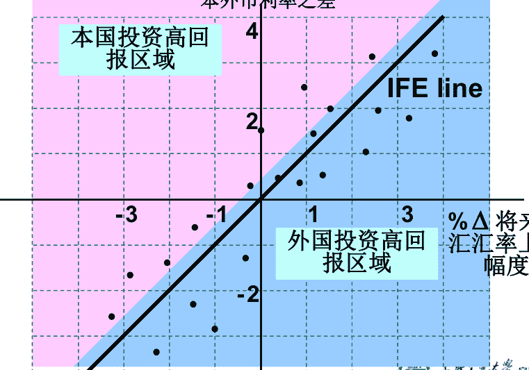

## 比较IFE, IRP与 PPP

- IRP：某一时刻，远期、即期、利率关系
  - f ≈ i_H − i_F
- PPP：某一时间段，将来的即期汇率随通胀变
  - **e_f ≈ π_h − π_f**  **E(e_f)≈E(π_h)−E(π_f)**
- IFE：某一时间段，将来的即期汇率与利率关系
  - **E(e_f)≈ i_h − i_f**
- 以上定价公式两边，都隐含等式两边相同期限的假设，例如三个月后外汇的升水，对应于三个月的利率或者通货膨胀率

## 现在的远期汇率是将来即期汇率无偏估计

- $F_t = E_t(S_{t+1})$，E表示预期或者求期望
- $F_1$是什么时候观察到的？
- 随着预测次数的增多，误差和趋向于多少？

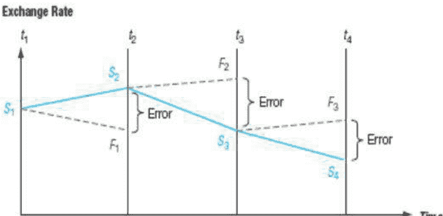

## Exercise

- 澳元相对于美元是高息货币，远期价格相对于现货或者较近的远期应有什么特点？访问 http://www.barchart.com/commodityfutures/Currencies 检验你的观点
- 如何看待利率平价、购买力平价、国际 Fisher 效应分别反映了金融项目、经常项目和直接投资活动？如何从国际金融角度看世界是平的？
- MIT 金融硕士项目（一年，3 学期）今年总费用约 10 万美元，【http://mitsloan.mit.edu/mfin/admissions/financial-aid1/】同时按通胀调整费用。
  - 假设当前美元/人民币汇率为 6，美国通胀预期 1%，中国通胀预期 3%。计算明年该项目中国学生申请时人民币计价的费用，根据已知条件能够计算结果的前提是什么？

## Lecture 6

## 汇率预测

--经济政策、基本分析与技术分析

Required Reading: Eun,第6章；

Recommended Reading 2) Krugman, 第16章（产出与短期汇率）

## Preview

- 经济政策变化对均衡汇率影响
  - 产品市场与金融市场均衡的曲线推导、曲线移动
- 基本分析法
- 技术分析法
- 有效市场理论与汇率预测

### 为什么需要预测汇率

- 公司在贸易、融资、投资三个方面需要预测汇率
  - hedging decisions（公司将来要从国外进口原材料,套保问题）
  - short-term financing decisions（跨国公司选择什么币种进行融资）
  - short-term investment decisions（短期资金投资全球固定收益市场）
- 居民需求
  - 出境游、海外留学、消费
- 政府需求
  - 实体经济、金融市场与外汇紧密相关

### 引入汇率后的经济政策分析框架

- 实体经济（产出市场）均衡：总需求=总供给（产出Y）
  - 外币汇率上升，有助于本国产出上升（DD曲线）
- 金融市场均衡：货币供给=货币需求
  - 本币汇率低水平时，货币需求下降（AA曲线）
- 分析假设：短期内产品价格难以调整，但汇率等金融资产价格可以变化。

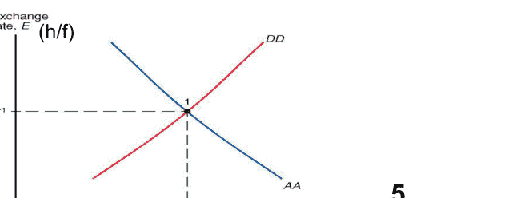

### 产出市场均衡的DD曲线推导

- 总需求=产出。D=C+I+G+CA(Ex-Im)=Y
  - consumption，investment expenditure，government purchases，net expenditure by foreigners: the current account
- 汇率如何在产品市场均衡中扮演角色
  - 总需求中的对外出口取决于实际有效汇率
    **Real exchange rate** EP*/P（E为外币汇率，P*外国物价水平，假设物价短期不发生变化）

- **供求均衡时：**

  $$D = C(Y-T) + I + G + CA(EP^*/P, Y-T)$$

  或 $D$ 的函数形式

  $$D = D(EP^*/P, Y-T, I, G)$$（右上图蓝线1）

- **均衡时 $D=Y$**（右上图红线）

- **外汇汇率 $E^1$ 上升至 $E^2$，对本国产品需求上升，蓝线1移动至蓝线2，得到右下图**
  - **产出市场均衡的DD曲线：** 本币贬值，产出上升

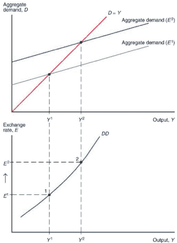

### 沿着DD曲线移动与DD曲线移动

- 沿着DD曲线移动：本币贬值，产出Y将上升。

- 汇率以外的其它变量变化，将导致DD曲线移动

- 扩张性财政政策 G: (+)，T(-)：导致DD曲线右移

### 金融市场均衡的AA曲线推导

考虑外汇市场与货币市场均衡：

1. Foreign exchange markets
   - International Fisher Effect represents equilibrium:
     R = R* + (E^e − E)/E 本币利率=外币利率+外汇升水预期

2. Money market
   - Equilibrium occurs when the quantity of real monetary assets supplied matches the quantity of real monetary assets demanded: M^s/P = L(R, Y)=kY+h/R（货币供给=货币的交易需求与投机需求）

E上升，R下降，Y下降。外汇汇率与本国产出负相关

外汇汇率上升，导致产出沿AA曲线左上移动

方程形式：
$M^s/P = kY + h/(R^* + (E^e - E)/E)$

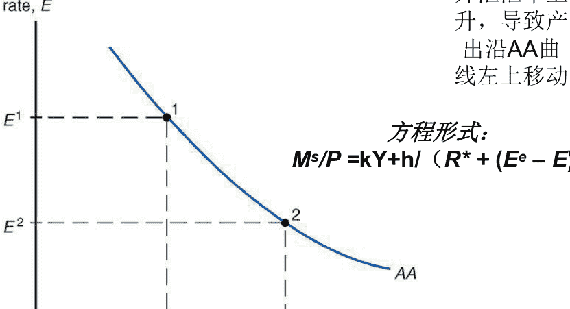


## AA曲线移动

由方程Mˢ/P = kY + h/(R* + (Eᵉ − E)/E) 可判断汇率以外因素引起的AA曲线移动

- Mˢ(+); P(-); R*(+), Eᵉ (-)

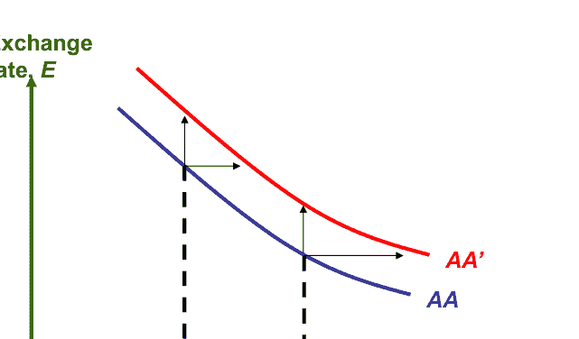

## 实体经济与金融市场的均衡：DD与AA曲线的交点

- 1. 产品市场均衡：总需求=总产出
- 2. 外汇市场均衡：IFE公式成立
- 3. 货币市场均衡：货币供给=货币需求

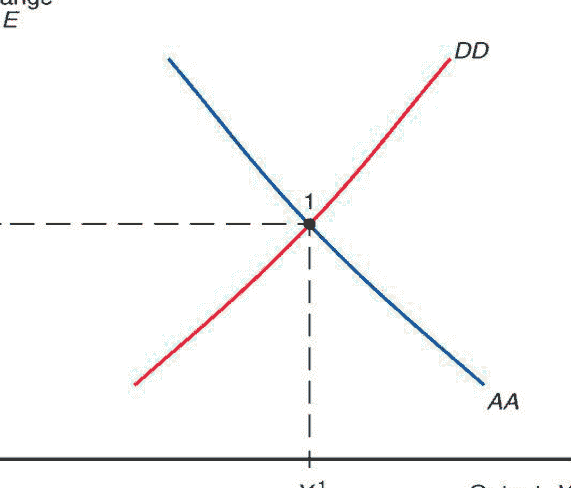

## 货币扩张政策对产出与汇率影响

货币资产供给量的增加在短期内会降低利率，导致本币贬值（E上升）。

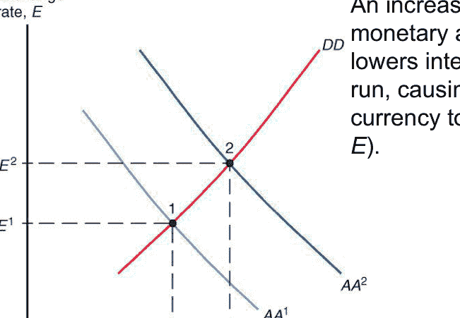

## 财政扩张政策对产出与汇率影响

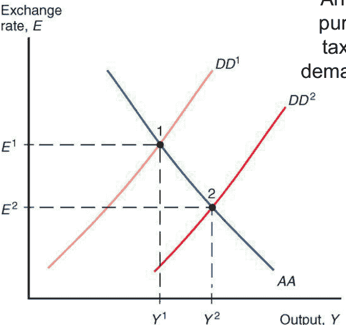

政府购买的增加或税收的减少在短期内会增加总需求和产出。

## 长期扩张货币政策的影响：物价上升导致DD/AA左移

物价上涨使国内产品相对于外国商品更加昂贵：总需求减少

长期货币扩张，引起物价上升，实际货币供应下降，AA左移

长期看，货币宽松不会增加产出，反而引起物价上升，改变汇率：
E1 < E3 < E2

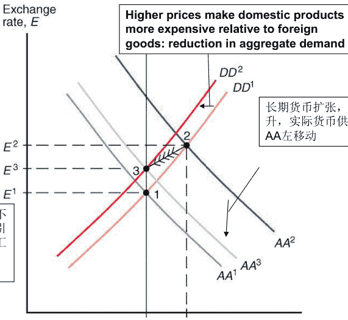

## 长期扩张财政政策后果：

利率上升影响货币市场

政府需求上升，导致产出上升

长期扩张，则利率上升，AA左移，汇率上升，产出不变

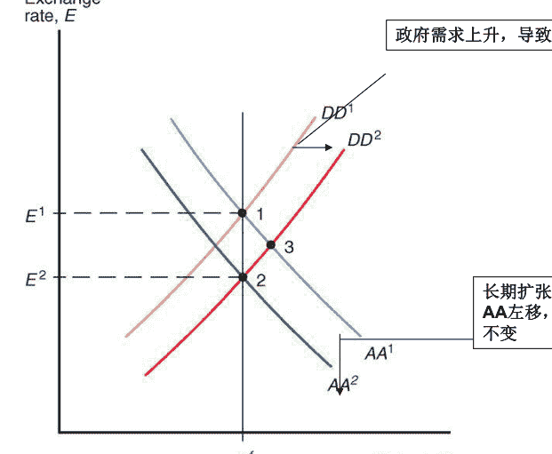

## 汇率预测的基本面分析：PPP与IFE

- 购买力平价：

- 公式： E[e_f] = (1 + π_h) / (1 + π_f) - 1

- 对公式评价
  - 通胀影响的时间（通胀影响往往长期，但汇率往往瞬间）
  - 贸易壁垒，及通胀以外的其它因素。

- 国际费雪效应（IFE）

- e_f ≈ i_h - i_f

- 高利率的货币无套利下将来贬值;高投资回报国的货币将来贬值

- 要求资金无套利的假设

## 外币兑美元指数随时间变化（外币兑美元情况）

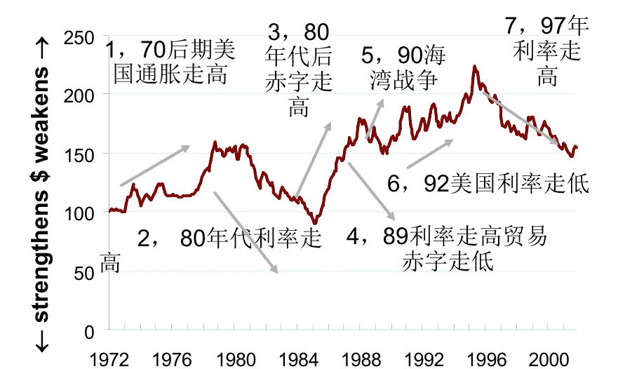

注意：该指数反映英镑（£）、日元（¥）、法国法郎、德国马克和瑞士法郎的等权重。

## 基本面分析的多因素回归方法

- 理论：货币数量论

- Pₛ = Mₛ Vₛ / yₛ
- Pₑ = Mₑ Vₑ / yₑ
- S = (Mₛ/Mₑ)(Vₛ/Vₑ)(yₑ/yₛ)

- 对上式取对数，并构建多元线性方程得

- s = α + β₁(m - m*) + β₂(v - v*) + β₃(y* - y) + u

- s = Ln(S), S为$/£, *表示英国数据

- 系数由历史数据估计，根据最新自变量预计未来s。斜率β₁是自变量变化引起的汇率变化幅度，ds/d(m - m*) = dln(S)/d(M/M), 注意dln(S) = dS/S

## 基本面分析的国际收支法

- 1）经常账户余额；
- 2）证券投资趋势；
- 3）吸收直接投资与对外直接投资；
- 4）官方储备余额；
- 5）汇率管制

## 国际收支顺差是西方要求人民币升值的经济与政治因素

- 2003，美国汽车工会与通用汽车、福特汽车和克莱斯勒(Chrysler Group)展开合同谈判，汽车工会对三大汽车巨头从中国等国购买低价零部件以降低成本的行为感到不满。

- 福特计划为北美以及其他地方的工厂从中国采购价值10亿美元的零部件，并在2010年将采购数额提高至100亿美元，这相当于其全球每年零部件采购的15%。

- 工会认为三大巨头这类举措是导致“过去两年中两百万制造业职位流失”的一个因素

## 基本分析的不足

- 基本面分析不足：
  - 市场已经反映公开信息，内幕信息无法获得
  - 许多宏观基本面数据每个季度发布，汇率每分钟都在波动
  - 好的基本面出来，汇率可能下跌
    - 部分机构投资者提前获得信息，使得经济变量对汇率影响提前到来，甚至过度反应。（行为金融，逆势投资）
      （买传闻，卖事实）
- 弥补：技术分析的引入
  - 内幕信息者的行为在价格与成交量上会有反应

## 技术分析

- 图形分析

| 道氏理论 | K线 | 多K线 | 布林线 |
|---|---|---|---|

- 指标分析

移动平均线

## 道氏理论：把握主要趋势

http://quote.forex.hexun.com/EURUSD.shtml

- 2012欧债缓解后，欧元的趋势

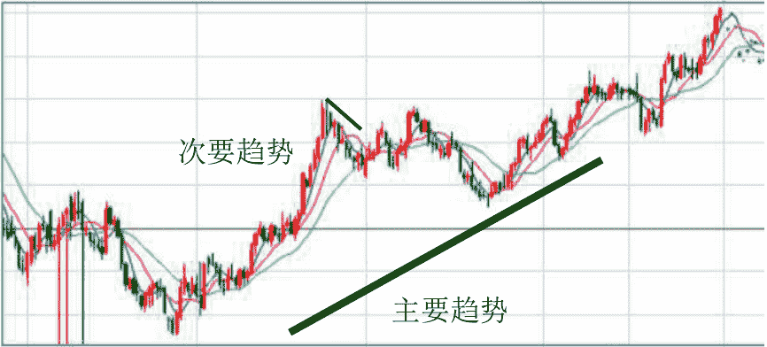

## 用单K线预测

- 有上下影线的阳线。上影线越短，下影线越长，实体越长，越有利于买方。
- 如果实体部分的比例越大，则说明卖方的优势越大；反之，说明双方力量的差距较小。

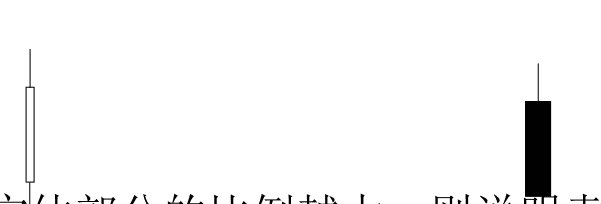

## 用单K线预测

- 红色阳线实体或者下影线越长，预示多头
- 绿色阴线实体或者上影线越长，预示空头

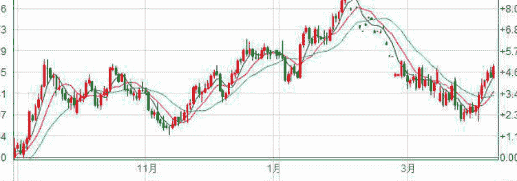

## 多K线：M头与W底


http://quote.forex.hexun.com/EURUSD.shtml

## 布林线

- 布林线由三条线组成，中间的通常为20天平均线，上下的两条线分别为通道顶和通道底，由过去20日收市价的标准差（Standard Deviation）的2倍得到


> 通道内高沽低买

## 移动平均线

- 描述一定长度的时间区间内外汇平均水平的变动的曲线。
- 时间区间可选择5日、10日、30日、120日、200日甚至更长，分别反映短期、中期和长期的外汇、股价变动趋势。计算公式如下：

$$MA_t=\frac{1}{n}\sum_{i=1}^{n}p_{t-i+1}$$

## 移动平均线

- 5日移动线在10日线上方，10日在20日上方，构成多头排列；反之，空头排列


上四分区域


## 用Matlab模拟技术分析的投资收益：数据回测

```matlab
a=xlsread('08Euro Monthly Average Price.xls');
l=length(a);
buy=[];
sell=[];
ReturnRate=[];
date=1;
i=6;
while (i<=l)
    if a(i)>a(i-5)
        buy(date)=a(i);
        i=i+1;
        disp(buy);
        % pause;
        while i<=l & a(i)>=a(i-5)
            i=i+1;
        end
        sell(date)=a(i); % sell在1.0322处循环
        date=date+1;
    end
    i=i+1;
end

ReturnRate=sell./buy;
Length=length(ReturnRate);
accum=1;
for i=1:Length
    accum=accum*ReturnRate(i);
end
disp('Passive Return');
disp(a(1)/a(1));
disp('Active Return by Momentum');
disp(accum);
```

收盘高于5月前价格，为买入信号
结果表明:买入并持有收益率13%,趋势投资50%


## 预测方法的评价

- 预测绩效的一个衡量指标是实际值百分比的绝对预测误差：
- | 预测值 – 实际值 |
- 实际值

- 可以采用绝对误差值，绝对误差率，平均误差率来评价预测效果

- Richard Levich 调研了几个金融机构的预测，发现只有5%的提前1个月的预测比远期汇率预测更准


## 外汇投资的分析方法与金融市场效率

- - 金融市场效率理论(Eugen Fama,2013 Nobel Prize Winner)在外汇市场应用：
  - 非有效：历史价格及各种信息都未能被反应
  - 市场弱有效：大家都采用某种技术指标去预测，该指标将无效。
  - 半强有效，大家都采用经济基本面分析去预测，则基本分析无效。
  - 强有效市场：各种分析方法都不能获得超额利润
- - 反对市场有效的代表人物Yale大学Shiller也在2013年同时获得诺奖。
  - 人有行为偏差，非理性
  - 媒体大量报道会吹大泡沫。
  - Dividended / Price可以预测泡沫
- - NPR代表人物访谈：
- - Shiller公开课


## 外汇投资的分析方法与金融市场效率

- 外汇投资的分析方法

- 平价分析（PPP、IFE、回归）、BOP分析、技术分析

- 金融市场效率理论(Eugen Fama,2013 )在外汇市场应用（中国居民投资者与SAFE）：

- 市场弱有效：大家都采用某种技术指标去预测，该技术分析预测将无效。

- 半强有效，大家都采用经济基本面分析（平价法、BOP）去预测，则基本分析无效。则外汇远期价格就是未来价格的最佳估计

- 更远的远期汇率，市场上不可以直接观测到。因为CME并没有两年以上的期货的牌价。可以由IRP公式得到。（例如：美元5年期复合利率6.1%，英镑8.4%，则英镑5年后贴水预期为（1.61/1.84-1）

- 强有效市场：各种分析方法都不能获得超额利润，分散持有外汇头寸

## 习题

- - 如果外汇市场为弱式有效，能采用技术分析投资该货币吗？
- - “超调”一词的含义是什么？是什么原因造成的，又是如何纠正的？
- - 画图简单说明如何预测长期财政扩张政策对均衡汇率的影响。

## Chapter Objectives


| 远期 | 期货 | 期权 | 期权应用 | 期权组合 |
|---|---|---|---|---|

## 3个概念的比较

- - 3个概念（现货、期货Future或者远期Forward、将来的现货）
  - 现货价格7000
  - 期货价格（1年后交房），6500
  - 1年后的现货价格7200
- - 现货期货同涨同跌
- - 期货或者远期具有未来价格的发现功能，是对未来价格的最佳预测

## 远期外汇市场

- - **远期外汇F(t,T)**：银行与公司客户在时刻T签订合约，将来T时刻按照现在约定的价格F(t,T)买卖外汇
- - 依《中国人民银行远期结售汇业务暂行管理办法》：远期结售汇的汇率以市场供求为基础确定，以当日的外汇即期汇率加减升水、贴水的方式表示
  - 由IRP，当某种外币的利率高于人民币利率时，远期汇率为贴水（远期汇率小于即期汇率）；
- - 远期是未来价格的无偏估计（人民币、固定汇率除外）

## 远期外汇市场在国内发展

- - 目前国内主要开展企业经常项目下的远期外汇结售汇业务
- - 1997年中国银行首先获准唯一经营该业务
- - 工商银行、建设银行和农业银行在2003年4月1日才正式获准办理该业务
  - 2003年4至5月，工行在1亿美元的业务量中，结汇金额是8000多万，售汇金额是2000多万
  - 2009年工行业务822亿美元

## Currency Futures Market
远期与期货市场的比较

|  | 远期合约 | 期货: 标准的远期合约 |
|---|---|---|
| Contract size | Customized. | Standardized. |
| Delivery date | Customized. | Standardized. |
| Marketplace | Worldwide telephone network. | Central exchange |
| Liquidation | Mostly settled by actual delivery. | Mostly settled by offset. |
| Transaction Costs | Bank’s bid/ask spread. | Negotiated brokerage fees |

## Currency Futures Market
远期与期货市场的比较（续）

- - 相同到期日的远期与期货价格接近一致，对现货的升水或者贴水一致（由于利率差异，时间越远，升水或者贴水幅度越高）


## 不必到期时交割的远期：
人民币NDF（不可交割远期）业务

- - A *non-deliverable forward contract (NDF)* 远期合同不一定实际交割，可根据盈亏状况支付损益
- - 尽管目前人民币只在经常项目下可自由兑换，但人民币NDFs市场却发展迅猛。
- - 1996年6月，万邦有利（Prebon Yamane）设计的人民币NDFs市场开始运作，1997～1998年亚洲金融危机以后，数量迅速增加，人民币NDF市场次于韩元（日交易量为18至22亿美元）和新台币（日交易量10-12亿美元）。
- - 2010年NDF日成交量50亿美金。但随着离岸人民币业务 (*deliverable*)的发展，NDF规模2012年萎缩到30亿。
- - 世界最大的三家货币经纪公司——毅联汇业(ICAP)、万邦有利(Prebon Yamane)和德利(Tullett Liberty) [Now: tullettprebon]

## 银行柜台与交易所（Cost Save 40-70%）

## 中国银行货币远期外汇牌价2013-03-22

2013-03-22

|  | 美元 | 欧元 | 日元 | 港元 | 英镑 | 瑞郎 | 澳元 | 加元 |
|---|---|---|---|---|---|---|---|---|
| 七天 买入 | 619.31 | 798.11 | 6.5122 | 79.67 | 939.41 | 653.71 | 844.76 | 604.06 |
| 七天 卖出 | 623.42 | 806.83 | 6.5793 | 80.40 | 948.20 | 659.90 | 851.13 | 609.48 |
| 一个月 买入 | 620.05 | 799.31 | 6.5222 | 79.78 | 940.42 | 654.55 | 844.32 | 604.42 |
| 一个月 卖出 | 624.36 | 807.90 | 6.5890 | 80.53 | 949.53 | 651.16 | 851.06 | 610.20 |
| 三个月 买入 | 622.07 | 802.34 | 6.5458 | 80.07 | 943.28 | 657.24 | 843.42 | 605.80 |
| 三个月 卖出 | 626.45 | 810.91 | 6.6141 | 80.82 | 952.37 | 663.88 | 850.15 | 611.37 |
| 六个月 买入 | 624.56 | 806.48 | 6.5815 | 80.46 | 941.28 | 680.75 | 841.75 | 607.14 |
| 六个月 卖出 | 629.44 | 815.06 | 6.6484 | 81.20 | 956.28 | 667.56 | 848.35 | 612.79 |
| 九个月 买入 | 626.90 | 810.57 | 6.6184 | 81.83 | 951.14 | 685.08 | 838.69 | 608.46 |
| 九个月 卖出 | 632.28 | 819.16 | 6.6833 | 81.57 | 960.38 | 671.82 | 845.50 | 614.21 |
| 十二个月 买入 | 629.28 | 814.61 | 6.6534 | 81.18 | 955.02 | 668.56 | 838.04 | 608.75 |
| 十二个月 卖出 | 634.97 | 823.20 | 6.7205 | 81.92 | 964.17 | 675.76 | 844.73 | 615.50 |

## NEW RESEARCH

## 交易外汇期货可比外汇远期和掉期节省40-70%的成本

Experts from Oliver Wyman, GHF, ICAP and CME Clearing discuss the analysis and opportunities

Watch Recording

Capital Efficiency with FX Futures

Move to Futures in FX Trading

Growth of Chinese Renminbi

2014 Guide Available

## FX Product Slate

Market Data and Charts are delayed at least 10 minutes.

Featured Majors Emerging Markets Cross Rates E-micros

View All FX Products

| Product Name | Code | Contract | Charts | Last | Change | Open | High | Low | Globex Volume |
|---|---|---|---|---|---|---|---|---|---|
| EUR/USD | 6E M4 | Jun 2014 |  | 1.3864 | +0.0030 | 1.3773 | 1.3814 | 1.3758 | 61180 |
| JPY/USD | 6J M4 | Jun 2014 |  | 0.009677 | 0.000015 | 0.009690 | 0.009704 | 0.009673 | 45238 |
| AUD/USD | 6A M4 | Jun 2014 |  | 0.9190 | -0.0035 | 0.9220 | 0.9257 | 0.9182 | 41418 |
| GBP/USD | 6B M4 | Jun 2014 |  | 1.0632 | -0.0030 | 1.0653 | 1.0666 | 1.0610 | 36335 |
| CAD/USD | 6C M4 | Jun 2014 |  | 0.9037 | 0 | 0.9031 | 0.9058 | 0.9017 | 19550 |


## 期货多头与空头的盈亏图形分析


F(t,T): T时刻到期的期货在t时刻的价格  
横轴：T时刻到期时现货价格的可能情形  
纵轴：对应的利润

## 货币看涨期权

### 货币看涨期权基本概念

看涨期权（或买权）在当前t时刻，给予期权买入者一项权利而非义务，在约定时间（T，到期日）按约定价格E(h/f)买入外汇。

看涨期权是

- *in the money* 实值，若即期汇率 > 行权价,
- *at the money* 平价，若即期汇率 = 行权价,
- *out of the money* 虚值，若即期汇率 < 行权价.

### 看涨期权基本概念（续）

- 期权持有人可以卖出或行使他们的期权。他们也可以让期权到期（期权若在交易所交易，可提前卖出或持有至到期T）。最多，他们将损失为期权支付的权利金。（如果到期时，欧元汇率低于执行价格，该期权价格？）

## 期权合约

| 售出方：银行（期权卖方） | 购买方：企业（期权买方） |
| --- | --- |
| 获得权利金 | 支付权利金 |
| 放弃选择权 | 获得选择权 |

合同：一月、二月、三月

## 货币期权的或有图

### 货币看涨期权到期时的盈亏图

**欧元看涨期权买方**

执行价 = $1.22，权费 = $0.04  
利润 = max(S_T - E, 0) - C

**欧元看涨期权卖方**

执行价 = $1.22，权费 = $0.04  
利润 = C - max(S_T - E, 0)


## 看涨期权当前的理论价值
——1997年诺贝尔经济学奖Black-Scholes的贡献

- 盈亏图描述了看涨期权在到期时的获利情况，那么在期初买入时应该支付多少钱？C_T = max(S_T - E, 0)，C_t = ?
- 1997年诺贝尔经济学奖Black-Scholes在1973年给出了股票期权的公式
- 一个近似的思路，就是假设期末时外汇或者股票价格服从正态分布，然后将期权持有人得到的不确定的现金流（Revenue, not profit）求期望值，并按无风险利率贴现。
  -  stated annual interest rate r：利息按复利计算 r/n，一年支付 n 次。
    - P₁ = P₀(1 + r/n)ⁿ，limₙ→∞ P₀(1 + r/n)ⁿ = P₀e^r
  - 一元钱t年后价值为 e^{rt}，反之t年后一元钱的现值为 e^{-rt}
- Scholes 与 Merton 一起获奖
- 1983年 Garman 和 Kohlhagen 将 Black-Scholes 模型扩展到货币期权。
- C = e^{-r_f T} × S × N(d1) - e^{-r_d T} × E × N(d1 - σ√T)
- 由于IRP的连续时间复利公式 F = S × e^{(r_d - r_f)T}，所以可以写成远期汇率形式：
  - C = [F × N(d1) - E × N(d1 - σ√T)] e^{-r_d T}
  - 外汇期权公式与股票期权公式区别：多了外汇的贴现率项 e^{-r_f T}，期权持有人将来买入的外汇不含外汇利息。
- Excel计算：007-currency option

## 外汇看涨期权决定因素

- 外汇看涨期权价格随下列因素上升
  - 外汇汇率的现价高；
  - 约定汇率低；
  - 本币利率上升；
  - 外汇利率下降；
  - 权利剩余时间长；
  - 外汇的波动率

## 货币看跌期权

### 看跌期权基本概念

- *货币看跌期权* 赋予持有人在特定时间内按特定价格卖出特定货币的权利。持有人一般预测市场下跌
- 看跌期权是
  - *in the money* 若即期汇率 < 行权价,
  - *at the money* 若即期汇率 = 行权价,
  - *out of the money* 若即期汇率 > 行权价.

### 看跌期权影响因素与应用

- 外汇看跌期权价格随下列因素上升
  - 权利剩余时间长
  - 货币的风险大。
    - （以上因素的影响方向与Call相同）
  - 标的资产（欧元）汇率低，而约定汇率高；
  - 本币利率下降或者外币利率上升
- 公司可能购买看跌期权来对冲未来的应收款项。（公司将来有外汇应收款，可持有看跌期权）

### 买卖看跌期权到期时的损益与价值

- 预期某种外币贬值的投机者可以购买该货币的看跌期权。
- 期权到期时的价值 $P_T = max(E - S_T, 0)$ {E：执行价，$S_T$：到期时对应的股价}
  - 买入者利润 Profit = $max(E - S_T, 0)$ − 期权权利金（期权价）
  - 卖出者利润 = − $max(E - S_T, 0)$ + 期权权利金
    - 与买入者利润互为相反数，即零和游戏

## 货币期权的或有图

### 货币看跌期权的盈亏图

**欧元看跌期权买方**

max(E - S_T, 0) - P，执行价E = $1.22  
权费 P = $0.03

**欧元看跌期权卖方**

执行价E = $1.22  
权费 P = $0.03

单位净利润

未来即期汇率

$1.18 $1.22 $1.26


单位净利润

未来即期汇率

$1.18 $1.22 $1.26


## 芝加哥商品交易所期权报价分析

- Chicago：衍生品中心，UC金融重镇
- 英镑执行价E=1.49，现价1.53，买入权费0.0482（C₀ > S₀ - E）

GBP/USD Options

查看产品列表

报价 | 合约规格 | 履约保证金 / 保证金 | 产品日历 | 了解更多

报价 时间与成交量 交割

Globex期权 / 现场喊价期权

交易日期：4/8/2013

市场数据延迟至少10分钟

标的期货

| 月份 | 图表 | 最新 | 变动 | 上一结算价 | 最高 | 最低 | 成交量 | 更新时间 |
| --- | --- | --- | --- | --- | --- | --- | --- | --- |
| Jun 2013 |  | 1.5334 | +0.0002 | 1.5332 | 1.5346 | 1.5317 | 3,217 | 7:40:45 PM CT 4/7/2013 |

期权报价

关闭自动刷新 | 关于本报告

类型 美式期权 到期日 JUN 2013 行权价范围 平价

看涨期权

| 更新时间 | 最高/最低限制 | 成交量 | 最高 | 最低 | 上一结算价 | 变动 | 最新 | 行权价 | 最新 | 变动 | 上一结算价 | 最低 | 最高 | 成交量 | 最高/最低限制 | 更新时间 |
| --- | --- | --- | --- | --- | --- | --- | --- | --- | --- | --- | --- | --- | --- | --- | --- | --- |
| 5:00:00 PM CT 4/7/2013 | 无限制 0.0001 | 0 | - | - | 0.0482 | - | - | 14900.0 | 0.0048 | -0.0003 | 0.0051 | 0.0048 | 0.0048 | 1 | 无限制 0.0001 | 5:04:35 PM CT 4/7/2013 |
| 5:00:00 PM CT 4/7/2013 | 无限制 0.0001 | 0 | - | - | 0.0460 | - | - | 15000.0 | - | - | 0.0069 | - | - | 0 | 无限制 0.0001 | 5:00:00 PM CT 4/7/2013 |
| 5:00:00 PM CT 4/7/2013 | 无限制 0.0001 | 0 | - | - | 0.0324 | - | - | 15100.0 | - | - | 0.0092 | - | - | 0 | 无限制 0.0001 | 5:00:00 PM CT 4/7/2013 |


## 中国银行期权宝业务

客户有权按约定价格买上涨的货币，但没有义务买下跌的货币。客户预期欧元兑美元的汇价在短期内将上扬，期权宝投资计划如下：面值：欧元100,000，协定汇率：1.650，交易期限：两周，期权费率（800 $）客户到期日收益如下所示：

| 汇率 | 收益 |
|---|---:|
| 1.1600 | -800 |
| 1.1650 | -800 |
| 1.1730 | 0 |
| 1.1740 | 100 |


## 期权宝业务中看涨期权的有关概念

- 中行：关于欧元的看涨期权的发行人（出售人）
- 客户：关于欧元的看涨期权的买入人
- 欧元：标的资产
- 1.1650:执行价（一旦欧元升值超过1.1650,中行有义务按照1.1650将欧元卖给甲）
- 有效期：2周
- 客户的该权利也可以转让

## 中国银行两得宝业务

- 将到期提取本金的货币选择权交付给中国银行，即可获得中国银行支付的期权费，从而在一定期限内，可以让您利息收入和期权费收入双双得益的一种投资组合。
- 存美元，美元涨，取日元本息。存美元，美元跌，取美元本息

|  | 到期汇率高于协定汇率 | 到期汇率低于协定汇率 |
|---|---|---|
| 存USD挂钩JPY | 按协定汇率折日元 | 美元 |

## 中国银行两得宝业务：
客户卖出期权

- ◆ 02年12月13日，袁某与中行签订《“两得宝”协议书》，成为沪上外汇期权交易的第一人。

- ◆ 12月袁先生存入一笔美元定期存款，挂钩日元，期限一个月，协定汇率为122.50。获得中行支付的0.67%的期权费。1月15日交易到期，由于市场上美元兑日元的汇率低于协定汇率122.50，袁先生得到：0.5%的定期存款利息收益 +0.67%（0.82日元）的期权费。

- ◆ 如美元升至124.00？

## 投资两得宝业务收益的影响因素

- ◆ 挂钩货币以澳元和英镑为主选择，汇率波动与日元、欧元相比明显要小得多。客户最适宜选择这类货币投资“两得宝”。
  - 挂钩货币以澳元和英镑为主，其利率较高。
    一旦美元升值，被迫取澳元或者英镑本息时，
    可获利息补偿

- ◆ 但是收益风险是对等的，因为银行设计时：
  - 如果货币波动率低，银行支付的期权费低。

- ○ 期权宝与两得宝比较：中行在后者扮演权利买入人角色。

## 期权组合策略

- *Straddle*（跨式期权）： 对于波动剧烈的货币的一种策略是按同一执行价同时买入一份看跌期权和一份看涨期权（未来大幅波动，即有可能大涨幅或者大跌，则同时买看涨、看跌肯定赚钱）

- 通过买入两种期权，投机者如果货币在任一方向上大幅波动，或先朝一个方向移动后又朝另一个方向移动，都可能获利。

## 期权组合策略：设英镑执行价1.7，期权价0.03


## European&American Currency Options
欧式与美式

- 欧式货币期权与美式期权相似，只是它们只能在到期日行使。
- 对于为对冲未来现金流而购买期权的公司来说，这种灵活性上的损失可能不是问题（如果公司未来某天收到一笔外汇，则欧式与美式期权下的套保并无差异）。因此，如果其期权费更低，欧式货币期权可能更受青睐。（如果欧式比美式便宜，公司更愿选择欧式

## Exercise

- 1. 用课件excel文件检验例7-6外汇期权价格;如果市场上交易的该期权实际价格为5美分，推测欧元汇率的市场隐含波动率。

- 2. 教材计算题7-1. 假设今天CME欧元期货合约的结算价为 $1.3140/EUR。你在一份合约上持有空头头寸。你的履约保证金账户当前余额为 $1,700。接下来三天的结算价分别为 $1.3126、$1.3133 和 $1.3049。计算每日盯市对履约保证金账户的变动以及第三天后履约保证金账户的余额。（提示：参考教材例7-1）

## Lecture

## 8

## 企业外汇风险（I）：交易风险

必读材料，Eun，第8章

## Preview

- 风险管理动机与背景
- 企业外汇风险分类
- 交易风险管理方法介绍
  - 远期，期货，货币市场，期权，计价货币
- 套保(Hedge,或称对冲)时长、套保覆盖率
  - 留学两年，是一次性对两年支出进行对冲，还是每年对下一年支出对冲？

## 企业外汇风险管理背景

- 非金融机构的需求
  - 2011年上海外贸依存度147%，1998年的58%。2011年全国外贸依存度水平50%。
    - 外贸依存度是外贸进出口总额占GDP的比例
    - “完善汇率形成机制”的说法，使得美元汇率波动对中国经济的影响尤其重要
    - 人民币年均升值幅度5%，但很多出口企业的利润率只有5%
  - 对日本、美国和欧盟三大贸易伙伴的贸易额，已占到上海进出口贸易总额的六成以上。日元、欧元汇率的波动对经济影响也不容忽视。

- 金融机构
  - 投行：汇率风险是股票分析师预测公司未来利润的重要不确定性因素之一。
  - 银行：经营和销售汇率风险管理产品

## 外汇风险衡量:各币种的波动率

外汇的每月波动率

| 货币 | 1981-1993 | 1994-1998 |
|---|---|---|
| British pound | 0.0309 | 0.0148 |
| Canadian dollar | 0.0100 | 0.0110 |
| Indian rupee | 0.0219 | 0.0168 |
| Japanese yen | 0.0279 | 0.0298 |
| New Zealand dollar | 0.0289 | 0.0190 |
| Swedish krona | 0.0287 | 0.0195 |
| Swiss franc | 0.0330 | 0.0246 |
| Singapore dollar | 0.0111 | 0.0174 |

## 外汇风险还取决于币种之间的联动性
：多种货币是否分散风险

## 汇率变动之间的相关性

|  | £ | Can$ | ¥ | NZ$ | Sk | SwF |
|---|---|---|---|---|---|---|
| British pound (£) | 1.00 |  |  |  |  |  |
| Canadian dollar (Can$) | .18 | 1.00 |  |  |  |  |
| Japanese yen (¥) | .45 | .06 | 1.00 |  |  |  |
| New Zealand dollar (NZ$) | .39 | .20 | .33 | 1.00 |  |  |
| Swedish krona (Sk) | .62 | .16 | .46 | .33 | 1.00 |  |
| Swiss franc (SwF) | .63 | .12 | .61 | .37 | .70 | 1.00 |

1)日元、加元很适合于分散投资，但SWF与SK就像是一个篮子里的鸡蛋
2)多国贸易的企业，汇率风险将下降


## 通过套保管理外汇风险必要性的理论解释

- 套保降低外向型企业风险
- 若中国企业居民的效用函数 $U = R - \frac{1}{2}\gamma\sigma^2$，其中 R、σ 分别表示预期收益和标准差，企业追求效用最大，γ 为风险回避系数
  - 如果 1 美元未来 50% 可能涨 1%，50% 可能跌 1%，则预期收益 R=0，σ²=1（%²）。企业不会买入外汇。
  - 如果企业有 1 美元应付账款，则不参与外汇市场面临的效用为 -γ * 1%²，如果选择买入即期外汇（进行对冲），则效用为 0（忽略利率因素）。

## 企业外汇风险分类

- 交易风险：未来的各种外汇债权、债务受汇率影响（资产负债表）
- 经营风险，也叫经济风险，汇率变化对（1）企业销售收入（2）企业融资活动等影响。（损益表，现金流量表）
- 折算风险，也叫会计风险，汇率对跨国公司合并报表产生的影响。
- 例：简化的资产负债表与损益表

| 资产 | 负债及所有者权益 |
|---|---:|
| 现金: 1000 | 应纳税款: 100 |
| 应收账款: 1000 | 负债: 5000 |
| 存货: 1000 |  |
| 固定资产净: 7500 | 公积金: 3000 |
|  | 股本: 2000 |
|  | 未分配利润: 400 |

| 项目 | 金额 |
|---|---:|
| 主营收入 | 2000 |
| 成本（含折旧） | 1500 |
| 主营利润 | 500 |
| 净利润 | 400 |

## 交易风险管理的步骤

交易风险（*交易风险敞口*）：未来某些外币的收入或者支出面临汇率波动风险。

### 一般步骤

1. 确定风险程度，币种、数量与波动程度
   - 在某一时点，确定未来各种货币的净头寸（外汇应收减外汇应付）
   - 对跨国公司或者总公司而言，还需采用中心化方法：将子公司的各种货币头寸分别合并。
     - 一般认为，子公司无须分别管理外汇风险
2. 是否要套保
3. 确定方法

## 交易风险的影响因素

- 汇率在几何布朗运动假设下，风险 σ²t 与汇率品种有关，与时间成正比。
  - 时间分解：报价时间，下单时间，应收款时间
  - 标准差比较（2005 年汇改以来月度数据），来源：http://fx.sauder.ubc.ca/data.html
    - 哪种货币波动率最特殊？

| USD/CNY | CAD | JPY | GBP | EUR |
|---:|---:|---:|---:|---:|
| 0.00433 | 0.020707 | 0.024268 | 0.022658 | 0.02316 |

## 交易风险管理（1）：运用外汇远期市场

中国服装玩具企业向沃尔玛出口，存在美元应收账款。担心美元下跌，可与银行操作卖出远期美元。


## 交易风险管理（2）：外汇期货

- 将来有外币应付款，则通过期货交易所购入外汇期货
- 将来有外币应收款，则卖出外汇期货
- 缺点：
  - 在中国目前不可行
  - 金额很难是每手外汇期货的整数倍

## 货币远期套保与否的比较分析：将来收入英镑（应收账款）

| 概率 | 套保后的收入 | 不套保的收入 | 套保（相对不套）的收入 |
|---:|---:|---:|---:|
| 5% | $1.7540 | $1.654 | $0.10 |
| 10% | $1.7540 | $1.674 | $0.08 |
| 15% | $1.7540 | $1.694 | $0.06 |
| 20% | $1.7540 | $1.714 | $0.04 |
| 20% | $1.7540 | $1.734 | $0.02 |
| 15% | $1.7540 | $1.7540 | $0.00 |
| 10% | $1.7540 | $1.774 | -$0.02 |
| 5% | $1.7540 | $1.804 | -$0.05 |

套保收入是常数 $F_t$，期望值为 1.754 美元，方差 0。不套保收入的期望值 $E(S_T)$ 为 1.7245 美元，方差 0.001375。（注意：理论上 $F_t=E(S_T)$，这里实际有差异）不套保在非常有利情形（收入 1.804 美元）可能需要支付累进税，但不利时（1.654 美元）亏损了也不会有补贴，因此即使 $F_t=E(S_T)$，考虑税收因素后不利。

## 交易风险管理（3）：货币市场管理应收外汇 AR（即与存贷活动相结合）

- 某企业有一笔外汇应收账款，担心外汇贬值
- 现在就借外币，然后换成本币，存本币，到期 AR 收到后偿还外汇借款，锁定汇率
  - 提前将将来收到的外汇卖掉

泰鼎公司 3 个月后将收到 GBP 1,000,000。当前即期汇率、远期汇率分别为 1.764 美元、1.754 美元，英镑贷款利率为 10%，美元存款利率为 6%。提前借入英镑并卖出后可以认为，该企业实际卖出汇率 1.764×1.015/1.025 美元/英镑，与 IRP 得到的值一致，类似于合成一个远期英镑合约。但如果企业将美元用于企业经营，美元回报率更高，等价于合成的卖出汇率值更高。

1. 借 £1m/(1.025)（按 10% 的年利率借 £90 天），按 1.764 换成美元，得到 $1,720,976。
2. 按 6.00% 的年利率存 $90 天。
3. 90 天后收到 AR £1m。
4. 同时偿还英镑本息 £1m。

可以认为，该企业实际卖出汇率 1.764×1.015/1.025 美元/英镑，与 IRP 得到的值一致，类似于合成一个远期英镑合约。

## 交易风险管理（3）：货币市场管理应付外汇（AP）

- 某企业有一笔外汇应付账款，担心外汇上升
  - 考虑如何现在就买入外汇，锁定汇率
- 借本币（对于本币资金充足的企业，可免），然后买外汇，存外汇，到期支付，锁定汇率

泰鼎公司 90 天后将支付 £1m。当前即期汇率、远期汇率分别为 1.764 美元、1.754 美元；英镑存贷款利率分别为 8%、10%；美元存贷款利率分别为 6%、8%。

- 提前买入英镑（需先借本币）并存款。借入金额计算方法：£1m/1.015，换成美元得到 1m/1.015×1.764，存款三个月后得到 1m/1.015×1.764×1.02。
- 该企业实际买入汇率 1.764×1.02/1.015 美元/英镑，类似于合成一个远期英镑合约。
- 企业的实际买入汇率与利率平价公式得到的远期汇率一致。

## 交易风险管理（4）：货币期权

- 将来有应收外汇，则应买入看跌期权
- 到期后，外汇如果跌了，则按约定的汇率卖出应收外汇
- 到时候若外汇涨了，将损失权费。（比如说，中国银行针对日元 3 个月的期权费用约为 1%）

### 货币看跌期权与应收款

泰鼎公司有 £ 应收账款，为防止汇率下跌带来损失，买入关于 £ 的看跌期权，执行价 1.75 美元，权费为 0.0265 美元。如果英镑跌到 1.75 美元以下，该公司有权按 1.75 美元卖给银行。

每 £AR 的收入：max(将来汇率，1.75)-0.0265

| 未来情形 | 将来汇率 | 每 £AR 的收入 |
|---|---:|---:|
| 1 | $1.7 | $1.7235 |
| 2 | $1.75 | $1.7235 |
| 3 | $1.8 | $1.7735 |

不套保收入

套保收入

### 货币看涨期权与应付款

泰鼎公司有 £ 应付账款，为防止汇率上升带来损失，买入关于 £ 的看涨期权，执行价 1.75 美元，权费为 0.0265 美元。如果英镑涨到 1.75 美元以上，该公司有权按 1.75 美元从银行买入。

| 未来情形 | 将来汇率 | 每英镑的成本：min(将来汇率，1.75)+0.0265 |
|---|---:|---:|
| 1 | $1.7 | $1.7265 |
| 2 | $1.75 | $1.7765 |
| 3 | $1.8 | $1.7765 |

不套保支付　　　　　　　　　套保支付

## 交易风险管理方法（5）：计价货币

- 最简单的方法：本币结算
- 或者分散风险，采用 SDR
- 或者进出口结算货币一致
  - 该方法缺点：进出口金额数量上不会一致，仍存在汇率风险

## 套保方法汇总

|  | 应付 | 应收 |
|---|---|---|
| 期货 | 买 1 手或多手 | 卖出 |
| 远期 | 买与应付款相同的远期外汇 | 卖与应收款相同的远期外汇 |
| 货币 | 借本币，买外汇，存外汇 | 借外汇，买本币，到期用应收款偿还外汇 |
| 期权 | 买外汇看涨期权 | 买外汇看跌期权 |

## 1GBP AR 下的策略比较


## £1,000,000 应付账款下的策略比较


- 图表纵轴：支付金额（百万美元）($1,000,000 AP)
- 图表横轴：到期即期汇率（美元/英镑）
- 看涨期权执行价格为1.75美元/英镑
- 远期汇率为1.7540美元/英镑
- 看涨期权套保
- 未套保成本取决于90天后的到期即期汇率
- 货币市场套保锁定成本为1,781,294美元
- 远期合约套保锁定成本为1,754,000美元
- (1) = Sₜ
- (2) = 1.754
- (3)
- (4)
- (1.75, 1.75+0.02646)

横坐标为到期时的外汇汇率，纵坐标为各策略下的AP支付。

## 套保的期限问题：短期与长期难以选择

- 某公司未来两年都要支付1亿日元，两种方案：
  - 1）每年初都购买1年期日元远期（短期套保）
  - 2）今年初分别买1年期远期和2年期远期（长期套保）

如果日元一直升值，2）的效果将好于1）。主要在于采用第2种方法时，第2年支付的日元会少。因为明年年初买1年期的远期汇率将高于现在买2年期的远期汇率。

## 短期套保时的节约成本

例：b和b'分别表示t=0和1时买入远期日元无节约的成本


## 长期套保时的节约成本

T=0时2年长期套保方案；T=0时各期限长度的远期都是已知的。

- 日元即期汇率
- 节约的成本
- F(0,2)
- F(0,1)
- 1年远期、2年远期
- B
- B″


## 套保与税收

套保后风险下降，企业利润可能由于手续费存在下降，也可能因累进税率而增加收益。

套期保值降低了预期现金流围绕分布均值的波动性。这种分布方差的降低就是风险的降低。


## 交易风险管理反对者：不要管理

- 由于外汇市场有效性，套保收益与成本权衡后的边际收益可能为0。
  - 对于应收外汇账款，采用卖出远期外汇，化解了外汇汇率下跌风险。但卖出的远期汇率等于（不套保时）预期的将来汇率，没有超额收益。
  - 对于应付外汇账款，采用买入远期外汇，化解了外汇汇率将来上升风险。但买入的远期汇率等于（不套保时）预期的将来汇率，也没有超额收益。
- 对冲并不增加预期收益。
- 投资者可能不希望上市公司对冲。美国投资者买入KFC的股票，就是预期人民币及其他新兴市场国家货币的升值带来收益，如果公司CEO对汇率进行了对冲，……

## 外汇风险对冲政策

- 大致有3种模式：
  - 完全对冲
  - 完全不对冲
  - 50%的债权债务对冲
- 对冲政策的一致性：CFO并不是外汇分析师，不能进行政策择时。
  - CFO常常在去年外汇大幅下跌后，对今年的应收款外汇远期卖出，结果汇率由于均值回复又大幅反弹，将外汇卖在最低点。

## 练习

- 【教材8-2(a):】2. IBM从日本电子公司NEC购买了计算机芯片，被要求支付2.5亿日元，三个月后付款。目前，即期汇率为105日元/美元，三个月远期汇率为100日元/美元。美国三个月货币市场利率为年利率8%，日本为年利率7%。IBM管理层决定采用货币市场套期保值来处理这笔日元应付账款。(a) 解释货币市场套期保值的过程，并计算履行日元债务的美元成本。

## 第9讲

### 企业外汇风险（II）：经济（经营）风险与换算风险

必读材料：第9-10章


## 预览

- 经济风险定义
- 经济风险衡量的两种方法
  - 历史数据回归与情景分析案例
- 经济风险管理方法
- 会计换算的货币/非货币法与当前汇率法
  - 两种方法对资产负债表、损益表影响的比较分析

## 什么是外汇的经济风险

- *经济风险*：未来现金流可能受到汇率波动的影响。（汇率变化引起的销售、成本的变化，也叫经营风险）
- 交易风险与经济风险的差别
  - 人民币升值导致本公司以美元计价的出口产品（已经形成应收账款），转换成人民币后销售收入下降
  - 人民币升值导致本公司的人民币计价的出口产品数量下降，从而销售收入下降

## 经济风险的衡量：（1）历史数据法

经济风险一般采用公司的价值变动对外汇汇率的敏感度来衡量。


- 2005年至2014年澳元汇率变化对兖州煤业公司市值的影响
- 数据：http://fx.sauder.ubc.ca/data.html ；钱龙软件


- Excel—文件—选项—加载项—分析工具库
- 线性回归分析模型中，引入股市指数对兖州煤业的影响
- 对股市和汇率的敏感度分别为1.15和1.46
- R-square显示模型解释力上升

| 行业 | 市场β^b | 外汇β^c |
|---|---|---|
| 1. 航空航天 | 0.999 | 0.034 |
| 2. 服装 | 1.264 | 0.051 |
| 3. 饮料 | 1.145 | -0.437 |
| 4. 建筑材料 | 1.107 | 0.604 |
| 5. 化学品 | 1.074 | -0.009 |
| 6. 计算机、办公设备 | 0.928 | 0.248 |
| 7. 电子、电气设备 | 1.202 | 0.608* |
| 8. 食品 | 1.080 | -0.430 |
| 9. 森林和纸制品 | 1.117 | 0.445 |
| 10. 家具 | 0.901 | 1.217* |
| 11. 工业和农业设备 | 1.125 | 0.473 |
| 12. 金属制品 | 1.081 | -0.440 |
| 13. 金属 | 1.164 | 0.743* |
| 14. 采矿和原油 | 0.310 | -0.713 |
| 15. 汽车及零部件 | 0.919 | 1.168* |
| 16. 石油炼制 | 0.515 | -0.746* |
| 17. 制药 | 1.124 | -1.272* |
| 18. 出版和印刷 | 1.154 | 0.567 |
| 19. 橡胶和塑料 | 1.357 | 0.524 |
| 20. 科学、摄影和控制设备 | 0.975 | -0.437* |
| 21. 化妆品 | 1.051 | 0.417 |
| 22. 纺织品 | 1.279 | 1.831* |
| 23. 烟草 | 0.898 | -0.768* |
| 24. 玩具、体育用品 | 1.572 | -0.660 |
| 25. 运输设备 | 1.613 | 1.524* |

教材9-1：历史数据得到的美股不同产业的外汇经济风险——美元指数对行业股票价值的影响。


## 经济风险的衡量(2): 情景分析

- 美国公司的英国子公司现值1000£,未来随英镑汇率变化的3种情形

| 状态 | 概率 | P* | S | P (=SP*) | 参数 |
|---|---|---|---|---|---|
| A. 案例1 |  |  |  |  |  |
| 1 | 1/3 | £980 | $1.40 | $1,372 | Cov(P,S) = 34/3 |
| 2 | 1/3 | £1,000 | $1.50 | $1,500 | Var(S) = .02/3 |
| 3 | 1/3 | £1,070 | $1.60 | $1,712 | b = £1,700 |
| 平均 |  |  | $1.50 | $1,528 |  |

由b=cov/var得到汇率敏感系数

- 德尔塔套保：由于英镑的变化带来1.7倍的估值变化，因此可采用卖出1700£的套保

| 未来数量 | 状态 1 | 状态 2 | 状态 3 | 方差 |
|---|---|---|---|---|
| A. 案例1 (B_i = £1,700) |  |  |  |  |
| 本币资产价格 (P*) | 980 | 1,000 | 1,070 |  |
| 汇率 (S) | 1.40 | 1.50 | 1.60 |  |
| 美元价值 (P = SP*) | 1,372 | 1,500 | 1,712 | 19,659 |
| 远期合约收益 | 170 | 0 | -170 |  |
| 套保头寸美元价值 (HP) | 1,542 | 1,500 | 1,542 | 392 |

套保后风险大幅降低，如果公司的价值与汇率完全正相关，则风险可降低为0

## 汇率对公司未来经营影响（1）：收入

| 公司销售的影响 | 本币升值 | 本币贬值 |
|---|---|---|
| 在本国的销量 | 销量下降（洋品牌竞争） | 销量上升 |
| 以本币标价的出口 | 销量下降 | 销量上升 |
| 以外币标价的企业出口 | 销量不变，金额下降 | 销量不变 |
| 对外投资的利息收入 | 下降 | 上升 |

销售收入如何影响？为什么没有进出口业务的公司也受汇率影响

## 汇率对公司未来经营影响（2）：成本

| 公司成本的影响（金额） | 本币升值 | 本币贬值 |
|---|---|---|
| 原材料以本币标价的进口 | 如果采购量不变，则金额不变 | 无变化 |
| 原材料以外币标价的进口 | 一定采购量时，金额下降 | 增加 |
| 所欠外债的利息 | 下降 | 增加 |

## 货币升值对企业现金流量的总影响

- 本币升值，企业的收入与成本都下降，净影响正或负需具体分析
- 由前表，如更多成本依赖进口，且出口比例低，则外汇升值将不利
- 本币升值有利于进口主导型企业，反之有利于出口主导型企业
  - 航空公司，高科技企业，奢侈品，服装，小家电

## 经营风险实例分析：美国电脑公司的国外子公司英镑贬值

案例1：英镑贬值后，部分进口成本上升，但产品销售价格（英镑）仍不变

案例2：英镑贬值后，部分进口成本上升，产品销售价格提价至汇率贬值前的水平（美元价格不变）

案例3：英镑贬值后，担心产品销售价格提价销量下滑，只是稍微提价

Source：教材表9（5-8）

| 变量 | 基准案例 | 案例1 | 案例2 | 案例3 |
|---|---|---|---|---|
| 汇率 ($/£) | 1.60 | 1.40 | 1.40 | 1.40 |
| 单位变动成本 (£) | 650 | 696 | 696 | 722 |
| 单位售价 (£) | 1,000 | 1,000 | 1,143 | 1,080 |
| 销售量 (单位) | 50,000 | 50,000 | 50,000 | 40,000 |

## 经营风险实例分析：美国电脑公司的英国子公司英镑贬值

- 经营风险分析中，采用了对未来多期现金流贴现的方法
  - 以案例1为例：8540*(1/1.15+...+1/1.15^4)
  - 公司价值的影响
- 经营风险分析广泛应用于卖方分析师的公司估值报告

## 经营风险管理

- 经营方法
  - Nike在人民币升值环境下，将越南列为首选制造基地
  - 债务融资，现金流匹配以对冲
    - 例：中国人投资澳洲房产如何规避汇率风险？
- 金融对冲
- 被动管理学派
  - 如果PPP机制发生作用，汇率风险长期无需担忧。汇率贬值的往往是高通胀国家，因此商品价格没有发生变化。

## 曾国藩的“三不”家训

曾国藩是晚清名臣，他治家严谨，待人诚恳，终身奉行“三不”——不撒谎、不睡懒觉、不讥笑人。

曾国藩认为，这三件事看起来小，做起来却不容易，是一个人修身养性的根本。

曾国藩告诫家中女眷：“家勤则兴，人勤则健；能勤能俭，永不贫贱。”他还要求女眷们每天纺纱纺到深夜。在他的教导下，曾家子孙大多勤奋好学，踏实做人。

有一次，曾国藩的一个女儿与别人合租，她谎称自己很有钱，结果被识破。曾国藩知道后非常生气，严厉地批评了她。曾国藩于是再三叮嘱她将来一定要做到“三不”（意思是不撒谎、不睡懒觉、不讥笑人），并写下“三不”的训诫。

她谨记曾国藩的教导，最终成为一个受人尊敬的人。

## 会计换算方法

- 功能货币与报表货币存在差异
  - 功能货币：经营中使用的主要货币。
  - 报表货币：中国香港上市公司HK$，中国在美国上市公司USD，但功能货币RMB
- 功能货币转报表货币方法：现行汇率法和货币非货币法（美国会计准则FASB以现行汇率为主，国际会计准则以货币非货币为主）
  - 现行汇率法：资产负债表除股东权益外以当前汇率计，利润表通常以平均汇率计。汇率换算导致的差异出现在资产负债表的CTA账户轧平。
  - 货币/非货币：货币性的资产负债为当前汇率，其它为历史汇率。利润表通常以平均汇率计，成本与折旧以历史汇率计。调整出现的不平衡在损益表中最后轧平。

## 换算风险简析

- 假设某私人公司年初有16亿人民币自有现金，其中6亿按当时汇率变成1亿澳元汇入澳大利亚，成立1亿的子公司。
- 全年没有经营活动，但澳元从6变成5。
- 按现行汇率法核算的报表，公司没有亏损，因为该方法轧平项在资产负债表

| 母公司 |  |
|---|---|
| 现金10 | 负债=0 |
| 对外投资6 | 股东权益16 |

| 子公司（亿澳元） |  |
|---|---|
| 现金1 | 负债=0 |
|  | 股东权益1 |

| 年底合并报表 |  |
|---|---|
| 现金15 | 负债=0 |
|  | 股东权益16 |
|  | CTA: -1 |

子公司风险暴露净额：1亿现金（外币资产-外币负债）

## 货币/非货币法与现行汇率法下资产负债表的换算比较

|  | 本币 | 货币/非货币 | 现行汇率 |
|---|---|---|---|
| 资产负债表 |  |  |  |
| 现金 | SF 2,100 | $1,050 | $1,050 |
| 存货 (当前价值 = SF1,800) | SF 1,500 | $500 | $750 |
| 净固定资产 | SF 3,000 | $1,000 | $1,500 |
| 总资产 | SF 6,600 | $2,550 | $3,300 |
| 流动负债 | SF 1,200 | $600 | $600 |
| 长期债务 | SF 1,800 | $900 | $900 |
| 普通股 | SF 2,700 | $900 | $900 |
| 留存收益 | SF 900 | $150 | $360 |
| CTA | — | — | $540 |
| 总负债及权益 | SF 6,600 | $2,550 | $3,300 |

- /2按当前汇率转换
- /3按历史汇率转换

- 原来平衡的报表由于转换值不一样，产生汇兑差异不再平衡，需要轧平项
  - 货币/非货币下的差异轧平项在损益表
  - 现行汇率法在资产负债表

Source：教材表10-1


## 货币/非货币法与现行汇率法下损益表的换算比较

|  | Local Currency | Monetary/Nonmonetary | Current Rate |
|---|---|---|---|
| Income Statement |  |  | |
| Sales revenue | SF10,000 /2.5 | $4,000 /2.5 | $4,000 |
| COGS | 7,500 /3 | 2,500 /2.5 | 3,000 |
| Depreciation | 1,000 /3 | 333 /2.5 | 400 |
| Net operating income | 1,500 | 1,167 | 600 |
| Income tax (40%) | 600 | 467 | 240 |
| Profit after tax | 900 | 700 | 360 |
| Foreign exchange gain (loss) | — | (550) |  |
| Net Income | 900 | 150 | 360 |
| Dividends | 0 | 0 | 0 |
| Addition to retained earning | SF 900 | $ 150 | $ 360 |

- /2.5按平均汇率转换
- /3按历史汇率转换

- 平衡表由于转换值不一样，产生汇兑差异

- 货币/非货币法下的差异轧平项在损益表。如果利润降低0.5元，PE=20，则股价削减10元

- 现行汇率法在资产负债表

Source:教材表10-1

## 换算风险管理

- 对资产负债表的净头寸进行套期保值（对冲） a balance sheet hedge.
- A balance sheet hedge requires an equal amount of exposed foreign currency assets and liabilities on a firm’s consolidated balance sheet.
  - 如果欧元净头寸过多（存在贬值风险），则欧洲子公司可借入欧元转成本国货币（欧元贬值，偿还金额可减少）。

## 美国公司欧洲子公司的头寸暴露计算方法（换算风险）

| Spanish Affiliate |  |  |
|---|---|---|
| Assets |  |  |
| Cash |  |  |
| Accounts receivable | € 825 |  |
| Inventory | 1,045 |  |
| Investment in Mexican affiliate | 1,650 |  |
| Investment in Spanish affiliate | — |  |
| Net fixed assets | — |  |
| Total assets | 4,400 |  |
| € 7,920 |  |  |
| Liabilities and Net Worth |  |  |
| Accounts payable |  |  |
| Notes payable | € 1,364 |  |
| Long-term debt | 1,210ᵉ |  |
| Common stock | 3,520 |  |
| Retained earnings | 1,320ᵈ |  |
| Total liabilities and net worth | 506ᵈ |  |
| € 7,920 |  |  |

欧元计价的资产减去负债（不含对母公司的负债）

## 中国新能源产业的汇率风险分类与规避应用

- 中国光伏企业约98％的市场都在国外，2010年欧债危机，欧元大幅下跌，欧元兑美元从1.55下降到1.3，对人民币贬值的速度则超过美元， 。
- 在纽交所上市的尚德电力，产品主要销往德国，由于规模最大，合同大多以欧元计算，因此在这波汇率行情中，损失极大。08年四季度公司eps骤然由三季的0.33降低为-0.41。牛年初一、初二，STP .NYSE，尚德董事长施正荣暂且离开令他疲惫、穷于应付的风暴中心，回到老家扬中油坊镇和家人难得地团聚在一起。尚德财务总监张怡曾表示，公司外汇交易损失1660万美元，主要损失为欧元对美元贬值导致资产重新估值损失，以及人民币对美元升值导致债务重新估值增加。
- 同在中国富豪榜单的赛维LDK，以硅片原料为产品，彭小峰的公司不存在这方面的担心，他们的合同主要以人民币和美元来定价，即使是欧洲市场的货，也多以美元计算，约30％是人民币订单，60％为美元，欧元定价只有10％。对于订单10％的欧元，在设备采购上就把它用出去。
- 注意：在美上市，美元为报表货币

## 习题

- 已知条件同第9章计算题2，计算如何进行套保（提示：参考表9-3，假定远期汇率与预测的未来即期汇率相同）？
- 分析教材表10-1，公司估值为市盈率10倍，作为一名投行分析师，现行汇率与货币/非货币法相比，公司的市场价值上升多少？（提示：市盈率=公司市值/公司净利润）
- 参考教材第10章在线练习，根据附件（谷歌公司年报10k,41页），分析谷歌公司如何管理与分析其汇率风险
- 根据附件麦当劳股价数据，先分析公司对股市的敏感度，再引入人民币汇率，对结果进行解释。

## Lecture 10

## 利率风险、利率互换与货币互换

Required reading, Eun, 第11, 14章


## Preview

- FRA定义及结算方法
- 利率期货（短期与中长期报价）
- 利率互换及定价
- 货币互换
- 其它互换：跨国公司比较优势互换与CDS

## 利率风险：定义与管理方法

- 国际企业的财务风险源：利率风险和外汇债务的汇率风险。利率风险是市场基准利率变化时债务支付的不确定性。
- 贷款种类：固定利率和浮动利率
  - 浮动利率：Libor为参考基准
- 利率风险的衡量方法
  - 与股票风险衡量方法不同，一般用久期衡量，表示利率变化一个百分点时债务上升的幅度，其近似等于债务的平均到期时间
  - 相当数量公司ROA低于银行存款利率。1%的收益显得特别重要。
- 风险管理方法：FRA，利率期货，利率互换

## 美元与欧洲美元利率体系：U.S. Dollar-Denominated Interest Rates

The prime interest rate is what banks charge their best customers


London interbank rates apply to the buying and selling of Eurodollar deposits between banks in the international markets.

Eurodollar deposits are dollar-denominated accounts in financial institutions outside of the United States.

*Source: Financial Times, February 10, 2004, p. 27. ©2004 Financial Times, Reprinted with permission.*

## Forward Rate Agreement

- FRA 3x9 4%报价解读：At t=0, you would like to borrow 10 million EUR in 3 months (t₁) for 6 months (t₂=9), and you agree with the counterparty that the rate is 4%.(t=0时买入FRA者同意t₂时刻按约定价格支付利息,可贴现到t₁时刻)
- 如果3个月后，6 month Euribor went up to 4.25%，损益如何？
  - Your interest income in t₂ will be 4.25% * 10 million * 180/360 = 212,500
  - Based on your FRA the interest cost is only 4% * 10 million * 180/360 = 200,000
  - In t₂ you will get 12,500 EUR interest.
  - We discount the 12,500 from t₂ to t₁ (12,500 / (1 + 4.25% * 180/360)) = 12,240 Now, in t1 you will receive 12,240 EUR from your counterparty.


## 利率期货-短期利率

- 利率期货与FRA原理一致，在交易所上市
- 利率期货采用债券的价格进行报价。
- 短期利率期货标的为零息债券(T-bill)。价格与利率的转换方法：
  - 04年6月交割的利率期货报价为93.58，表明约定年利率为0.0642
  - CME3个月期国债期货合约，本金$1m，则交割价1000000(1-0.0642/4)=$983950
  - 如果到期时Libor上升一个基点，则债券价格下降$1m*0.0001/4。RBS2013操纵Libor受罚6亿美元
- 利率期货风险取决于央行政策，后者取决于宏观经济

## 例：欧洲美元利率期货报价

| Maturity | Open | High | Low | Settle | Yield | Open Interest |
|---|---|---:|---:|---:|---:|---:|
| June 02 | 94.99 | 95.01 | 94.98 | 95.01 | 4.99 | 455,763 |
| Sept | 94.87 | 94.97 | 94.87 | 94.96 | 5.04 | 535,932 |
| Dec | 94.60 | 94.70 | 94.60 | 94.68 | 5.32 | 367,036 |
| Mar 03 | 94.67 | 94.77 | 94.66 | 94.76 | 5.24 | 299,993 |
| June | 94.55 | 94.68 | 94.54 | 94.63 | 5.37 | 208,949 |
| Sept | 94.43 | 94.54 | 94.43 | 94.53 | 5.47 | 168,961 |
| Dec | 94.27 | 94.38 | 94.27 | 94.36 | 5.64 | 130,824 |

*Note:* 典型展示方式由*《华尔街日报》*提供。仅显示常规季度到期合约。所有合约均为100万美元；点数为100%。持仓量为未平仓合约数量。

## CME美元短期利率期货报价（T-Bill）

http://www.cmegroup.com/trading/interest-rates/us-treasury/13-week-t-bill performance bonds.html T-bill, 一年内到期零息债

## 13周国库券期货

查看产品列表

报价 | 合约规格 | 履约保证金 | 保证金 | 产品日历 | 了解更多

报价 时间与成交 成交量 交割

交易日期：4/10/2013

Globex期货 | 现场喊价期货

市场数据至少延迟10分钟

关闭自动刷新

| 月份 | 图表 | 最新价 | 变动 | 上一结算价 | 开盘 | 最高 | 最低 | 成交量 | 最高/最低限价 | 更新时间 |
| Apr 2013 | ☑ ☑ | - | - | 99.27 | - | - | - | 0 | 无限制 | 7:09:47 PM CT 4/9/2013 |
| May 2013 | ☑ ☑ | - | - | 99.27 | - | - | - | 0 | 无限制 | 7:09:02 PM CT 4/9/2013 |
| Jun 2013 | ☑ ☑ | - | - | 99.27 | - | - | - | 0 | 无限制 | 7:09:13 PM CT 4/9/2013 |

交易所 CME 资产类别 利率 产品 T1 - 13周国库券期货 筛选

1 条结果

| 交易所 | 资产类别 | 产品 | 产品代码 | 开始期间 | 结束期间 | 初始 | 维持 | 初始波动扫描 | 维持波动扫描 |
| CME | 利率 | 13周国库券期货 | T1 | 04/2013 | 03/2014 | 405 USD | 300 USD | 0.03 | 0.02 |

## 利率期货—中长期利率期货(T-Notes)

- 中长期国债利率期货（现在约定好几个月或者一年后，5-10年的贷款利率），标的债券一般是有年利息支付的债券。债券价格P与到期收益率YTM对应关系（反向变动），价格上升（或者市场利率下调导致YTM下降）时，期货多头获利。

- 计算方法：

10年期国债面值为100美元，当前价格为99.25美元，票面利率为4%，剩余期限6年，到期收益率为4.14%
采用试错法计算债券的到期收益率YTM

- 交割时，可以用剩余6年半到10年的国债（T-Notes）交割

阅读更多:http://www.cmegroup.com/trading/interest-


## 不同利息（浮动）收支背景下的利率期货对冲策略

| Exposure | Futures Action | Interest Rates | Position Outcome |
|---|---|---|---|
| Paying interest on future date | Sell a future (short position) | If rates go up | Futures price falls; short earns a profit |
|  |  | If rates go down | Futures price rises; short earns a loss |
| Earning interest on future date | Buy a future (long position) | If rates go up | Futures price falls; long earns a loss |
|  |  | If rates go down | Futures price rises; long earns a profit |

由于企业浮动利率贷款多为中长期，因此一般采用卖出中长期国债

## Plain Vanilla Swap

- 不含信用风险、汇率风险的固定利率与浮动利率互换，根据每个季度初的libor决定季度末浮动利率支付大小，固定利率支付在合同签订时决定
- 与FRA区别： *互换是交换或互换一系列现金流的合同协议。*
- 动机
  - 固定利率支付方担心利率下降
  - 浮动利率支付方担心利率上升
  - Q: 无房的大学生面临什么样的利率风险
- Swap定价
  - 根据不同期限浮动利率Libor，可以计算出固定利率支付大小

## Plain Vanilla Swap

## 例：不同债务状态与利率预期下的互换策略

| Position | Expectation | Interest Rate Swap Strategy |
|---|---|---|
| Fixed rate debt | Rates to go up | Do nothing |
|  | Rates to go down | Pay floating/Receive fixed |
| Floating rate debt | Rates to go up | Pay fixed/Receive floating |
|  | Rates to go down | Do nothing |

对冲策略一般不支持企业经理人对未来利率做出预测。以锁定利率为原则，将浮动利率收入或者支出转换成固定利率收入或者支出

### Plain Vanilla Swap: Pricing

互换： 基于指定名义金额交换利率现金流，从固定利率到浮动利率（或反之）。

定价机制：固定支付、浮动支付的现值都是1，互换是一个公平游戏。（尽管浮动支付的表示方法为： 对于季度互换，浮动支付表示为 L₀(90)、L₉₀(90)【90天后的90天Libor报价】、L₁₈₀(90)、L₂₇₀(90)。）

定价步骤：1）根据 L₀(90)、L₀(180)、L₀(270)、L₀(360)，计算90、180、270、360天的贴现率；2）结合固定支付、浮动支付的现值都是1，计算固定支付的年利率，即互换利率的定价


### Plain Vanilla Swap: Pricing

例：根据当前Libor报价，计算互换利率：

#### 1. Relationship between Libor and discount factor

+ L₀(n) 是 n 天的 LIBOR。L₀(90)=0.0345 L₀(180)=0.0358 L₀(270)=0.037 L₀(360)=0.0375
+ 假设 Z(n) 是 n 天的贴现因子。
+ Z(90)=1/(1+0.0345*90/360)=0.9914, Z(180)=0.9824
+ Z(270)=0.973 , Z(360)=0.9639

#### 2. Pricing of Interest Rate Swap: What is the fixed payment level?

+ 由于浮动部分的现值必须等于固定部分的现值，且浮动部分的现值为 1，假设固定支付为 F，则
+ F*Σₜ Z(t)+ Z(360)=1,
+ F=0.0092
+ 即，互换的定价为 0.0368

### Plain Vanilla Swap: Pricing

一般结论：

- 在成立时，N 期互换的固定定期利率（占本金价值的百分比）可以计算为：
  F = [ 1 - Z_T / (Z_1 + Z_2 +...+ Z_T) ]
  其中 Z_t 是在第 t 个支付日期收到的 1 美元的现值，共 T 个日期。

- 采用相同原理，根据中长期Libor 报价可以得到2年，3年，5年，10年。。美元互换利率

- 采用相同原理，根据中长期Libor 报价可以得到2年，3年，5年，10年。。。其它欧洲货币互换利率的报价，即固定利率支付水平

## Plain Vanilla Swap of Currency

数据http://markets.ft.com/RESEARCH/markets/DataArchiveFetchReport?Category=BR&Type=ICAP&Date=05/13/2014

根据Plain Vanilla Swap定价方法，可以得到不同货币的互换报价（包括不同期限长度）。可以与交易对手不同货币间的固定到固定（或者固定到浮动）互换

| Years | Euro-€ Bid | Euro-€ Ask | Swiss franc Bid | Swiss franc Ask | U.S. dollar Bid | U.S. dollar Ask | Japanese yen Bid | Japanese yen Ask |
|---|---|---|---|---|---|---|---|---|
| 1 | 2.99 | 3.02 | 1.43 | 1.47 | 5.24 | 5.26 | 0.23 | 0.26 |
| 2 | 3.08 | 3.12 | 1.68 | 1.76 | 5.43 | 5.46 | 0.36 | 0.39 |
| 3 | 3.24 | 3.28 | 1.93 | 2.01 | 5.56 | 5.59 | 0.56 | 0.59 |
| 4 | 3.44 | 3.48 | 2.15 | 2.23 | 5.65 | 5.68 | 0.82 | 0.85 |
| 5 | 3.63 | 3.67 | 2.35 | 2.43 | 5.73 | 5.76 | 1.09 | 1.12 |
| 6 | 3.83 | 3.87 | 2.54 | 2.62 | 5.80 | 5.83 | 1.33 | 1.36 |
| 7 | 4.01 | 4.05 | 2.73 | 2.81 | 5.86 | 5.89 | 1.55 | 1.58 |
| 8 | 4.18 | 4.22 | 2.91 | 2.99 | 5.92 | 5.95 | 1.75 | 1.78 |
| 9 | 4.32 | 4.36 | 3.08 | 3.16 | 5.96 | 5.99 | 1.90 | 1.93 |
| 10 | 4.42 | 4.46 | 3.22 | 3.30 | 6.01 | 6.04 | 2.04 | 2.07 |
| 12 | 4.58 | 4.62 | 3.45 | 3.55 | 6.10 | 6.13 | 2.28 | 2.32 |
| 15 | 4.78 | 4.82 | 3.71 | 3.81 | 6.20 | 6.23 | 2.51 | 2.56 |
| 20 | 5.00 | 5.04 | 3.96 | 4.06 | 6.29 | 6.32 | 2.71 | 2.76 |
| 25 | 5.13 | 5.17 | 4.07 | 4.17 | 6.29 | 6.32 | 2.77 | 2.82 |
| 30 | 5.19 | 5.23 | 4.16 | 4.26 | 6.28 | 6.31 | 2.82 | 2.88 |
| LIBOR | 3.0313 | 3.0938 | 1.3125 | 1.4375 | 4.9375 | 5.0625 | 0.1250 | 0.2188 |

## 政府间货币互换

- 2013年10月，央行与欧洲中央银行签署了规模为3500亿元人民币 / 450亿欧元的双边本币互换协议，互换协议有效期三年。
- 2013年6月22日，央行与英格兰银行签署了规模为2000亿元人民币/200亿英镑的双边本币互换协议

| 国家、地区的中央银行及货币当局 | 签署时间 | 额度及货币规模 | 有效期 | 备注 |
|---|---|---|---|---|
| 韩国银行 | 2009年12月12日 | 1000亿元人民币/20万亿韩元 | 3年 | 已失效 |
| 韩国银行 | 2011年10月28日 | 3600亿元人民币/64万亿韩元 | 3年 | 续签并扩大规模 |
| 香港金融管理局 | 2009年1月20日 | 2000亿元人民币/2570亿港元 | 3年 | 已失效 |
| 香港金融管理局 | 2011年11月22日 | 4000亿元人民币/4800亿港元 | 3年 | 续签并扩大规模 |
| 马来西亚国家银行 | 2009年3月22日 | 800亿元人民币/400亿林吉特 | 3年 | 已失效 |
| 马来西亚国家银行 | 2012年5月8日 | 1800亿元人民币/900亿林吉特 | 3年 | 续签并扩大规模 |
| 白俄罗斯共和国国家银行 | 2009年5月11日 | 200亿元人民币/约70亿白俄罗斯卢布 | 3年 |  |
| 印度尼西亚银行 | 2009年4月23日 | 1000亿元人民币/175亿印尼盾 | 3年 |  |
| 阿根廷中央银行 | 2009年2月2日 | 700亿元人民币/300亿阿根廷比索 | 3年 |  |
| 塞尔维亚中央银行 | 2010年6月2日 | 95亿元人民币 | 3年 |  |
| 新加坡金融管理局 | 2010年3月23日 | 1500亿元人民币/3500亿新加坡元 | 3年 | 已失效 |
| 新加坡金融管理局 | 2013年3月 | 3000亿元人民币/600亿新加坡元 | 3年 | 续签并扩大规模 |
| 新西兰储备银行 | 2011年10月10日 | 250亿元人民币 | 3年 |  |
| 俄罗斯联邦储蓄和中国银行 | 2011年1月19日 | 150亿元人民币 | 3年 |  |
| 哈萨克斯坦国家银行 | 2011年7月6日 | 90亿元人民币 | 2年 |  |
| 黎巴嫩中央银行 | 2012年5月20日 | 100亿元人民币/2亿黎巴嫩镑 | 3年 | 续签并扩大规模 |
| 哈萨克斯坦共和国国家银行 | 2011年4月13日 | 70亿元人民币 | 3年 |  |
| 乌兹别克斯坦共和国中央银行 | 2011年12月22日 | 700亿元人民币/3300亿苏姆 | 3年 |  |
| 巴基斯坦国家银行 | 2011年12月23日 | 100亿元人民币/1,400亿卢比 | 3年 |  |
| 阿曼中央银行 | 2012年1月17日 | 300亿元人民币/2000亿迪拉姆 | 3年 |  |
| 土耳其中央银行 | 2012年4月21日 | 100亿元人民币/30亿土耳其里拉 | 3年 |  |
| 大韩民国银行 | 2012年7月22日 | 2000亿元人民币/300亿韩元 | 3年 |  |
| 乌克兰国家银行 | 2012年4月26日 | 100亿元人民币/190亿格里夫纳 | 3年 |  |
| 匈牙利中央银行 | 2013年5月26日 | 1900亿元人民币/600亿福林 | 3年 |  |
| 德国总计 |  | 20000亿元人民币 |  |  |


## 利用信用比较优势 Quality Spread Differential 进行利率互换


由于信用风险，施乐的固定和浮动利率都较高。

Quality Spread Differential：固定利率的溢价减去浮动利率溢价

Rates available to Unilever:
- Borrow fixed: 7.000%
- Borrow floating: LIBOR + 0.25%

Rates available to Xerox:
- Borrow fixed: 8.000%
- Borrow floating: LIBOR + 0.75%

互换后，施乐将支付固定利率，支付水平为？收益？
联合利华将支付浮动利率，支付水平为？收益？
Citi 称为互换银行，收益？

## 利用跨国公司本土比较优势进行货币互换

### EXHIBIT 14.5
$/€ Currency Swap\*


已知：各有1%的比较优势：美国公司借美元，德国公司借欧元。

互换完成后：美国公司借欧元、德国公司借美元均下降1%。

## Credit Default Swap


- CDS：支付保险费用，换取违约时本息赔付，产品期限5年。例如
  - Portugal CDS 1381 bp含义：买入者未来5年每年支付13.81%（直至违约出现）；未来任意一年，当债券违约时，卖出者将支付本金。
  - 1381 bp大概对应未来5年违约累计概率70%。

## 练习

- Suppose a floating-for-fixed interest rate swap with semiannual payment for two years. L₀(n) is the LIBOR of n days. L₀(180)=0.05, L₀(360)=0.06, L₀(540)=0.065, L₀(720)=0.07. What is the swap rate?
- 教材14-1（如下）

1. Alpha and Beta Companies can borrow for a five-year term at the following rates:

|  | Alpha | Beta |
|---|---|---|
| Moody's credit rating | Aa | Baa |
| Fixed-rate borrowing cost | 10.5% | 12.0% |
| Floating-rate borrowing cost | LIBOR | LIBOR + 1% |

- a. Calculate the quality spread differential (QSD).
- b. Develop an interest rate swap in which both Alpha and Beta have an equal cost savings in their borrowing costs. Assume Alpha desires floating-rate debt and Beta desires fixed-rate debt. No swap bank is involved in this transaction.

