# 上海交大安泰经管投资学课件（卓建伟）

## 结论

## 一、关于学科 投资学的定义

当前收入：
工资，贷款，分红，遗产，馈赠……

当前消费

投资

将来消费

投在何处？
（选择）

何时投？
（时机）

如何投？
（策略）

证券分析
投资组合管理
资本市场有效性

## 投资学（投资学）：

研究投资行为及均衡定价的科学。

- 微观金融学（金融学）
  - 包括公司金融、投资学、证券市场微观结构
- 宏观金融学（宏观金融学）
  - 包括货币银行学、国际收支理论、金融体系稳定性研究、微观金融学的自然延伸。
- 交叉学科
  - 金融工程；法律与金融

## 二、学科地位

作为一门学问，投资学就是对投资进行系统研究，从而更科学地进行投资活动。本投资学主要研究证券投资。旨在培养具备当代世界政治、经济视野，了解中国证券投资生态，能够胜任在银行、证券公司、保险公司、投资公司、投资咨询公司、资产管理公司、基金管理公司及信托公司等金融机构从事投资管理、投资咨询工作的高素质的投资专门人才。投资学不仅要学习经济学的基础知识，更要有扎实的专业知识基础做后盾。既要熟悉宏观的投资政策背景，又要精通各种投资的微观技巧。

## 三、金融行业就业现状与趋势

金融中心实至名归
人才层级的变化
从紧缺到平衡
金融行业的精细化

## 四、学习目的

- 掌握基本的金融概念、金融理念和正确的分析方法
- 掌握如何获取和分析有用的相关信息
- 了解资本市场如何运作
- 掌握评估各种投资工具的风险和收益
- 为未来形成自己投资风格或投资理念打好基础

## 五、教科书和参考资料

- Zvi Bodie；Alex Kane；Alan J. Marcus 《投资学》 机械工业出版社 中译本第十版 ISBN 9787111568230
- Charles P. Jones 《投资学-原理与概念》（原书第12版）机械工业社 978-7-111-53341-12
- 杨朝军主编 证券投资分析 ISBN 9787543221123
  - 《新财富》，《财经》等杂志；
  - [www.CFI.net.cn](http://www.CFI.net.cn) 金融界，MSN Investing，和讯网财经，新浪财经，雅虎财经，中国债券网等网站；
  - 《第一财经》，《经济观察报》，《二十一世纪经济报道》，《金融时报》，《中国证券报》等财经报刊。

## 六、供选择的讲授内容

- 前言
- 金融市场与投资环境
- 系统性风险与非系统性风险
- 风险指标分析
- 马科维茨有效边界及最优组合
- 单指数模型与最优组合
- 资本资产定价模型
- 套利模型
- 宏观经济分析
- 行业分析
- 债券管理
- 衍生品与风险管理
- 权益估价模型
- 投资基金评估
- 技术分析

## 七、学习方法

- 课前预习
- 课堂听讲，提问，讨论和案例分析
- 课后阅读，练习和复习
- 课堂测验或课后作业
- 适当的模拟操作
- 经常关心金融市场政策与行情
- 考核方式

## 特别提醒

本课程提及的投资标的仅作讨论示范之用，不构成证券买卖的推荐建议

# 第一章 金融市场与投资环境

- 实物资产
  - 取决于该社会经济的生产能力，为经济创造净利润。
  - 如土地、建筑物、机器以及可用于生产产品和提供服务的知识。
- 金融资产
  - 对实物资产的索取权

## 三类：

1. 固定收益型或债务型证券
2. 普通股或权益型证券
3. 衍生证券

- 承诺支付固定的收益流，或按某一特定的公式计算的现金流。
- 货币市场上的债务型证券：期限短、流动性强且风险小
- 资本市场上的固定收益型证券：长期证券，这些证券有的违约风险较低相对比较安全，有的风险相对较高。

- 普通股证券代表了证券持有者对公司的权益或所有权。
  - 证券持有者的收益并不固定，权益投资的绩效取决于公司运营的成功。
- 衍生证券
  - 其收益取决于其他资产（股票和债券）的价格。
  - 通常用来规避风险。

## 二、金融市场与经济

- 金融市场的信息作用：促使资本流向前景良好的公司
- 消费时机：通过购买金融资产来储存财富，将来卖出这些金融资产以供消费。

- 风险分配：投资者可以选择满足自身特定风险偏好的证券。
- 所有权和经营权的分离：获得稳定性的同时也引发了代理问题。P7例1-1雅虎的代理权之争，万科？（A股上市公司管理层很强势，小股东很韭菜）

- 公司治理和公司伦理
  - 会计丑闻
    - 如安然、来爱德、南方保健
  - 审计师 – 公司监督者
  - 分析丑闻
    - 亚瑟·安达信
  - 萨班斯-奥克斯利法案
    - 加强公司治理方面的法规

## 三、投资过程

- 资产配置
  - 对资产大类的选择
- 证券选择
  - 在每一资产大类中选择特定的证券
  - 证券分析包括对证券进行估价和决定使投资组合集中在那些最具吸引力的资产上

## 四、市场是竞争的

- 风险收益的权衡
- 有效市场
  - _积极型管理_
  - 发现误定价的证券
  - 把握投资时机


- 消极型管理（芒格：教人炒股，犹如引人吸毒）
  - 无需花费精力去发现低估的证券
  - 无需把握证券投资时机
  - 持有高度多样化的投资组合

## 五、市场参与者

- 公司－净借款者
- 家庭－净储蓄者
- 政府－即可能是借款者又可能是储蓄者
- 金融中介：集中资金进行投资
  - 投资公司
  - 商业银行
  - 保险公司
  - 信贷联盟
- 投资银行
- 风险投资与私募股权

## 讨论1
对当前各大市场的看法

- 债券市场
- 外汇市场
- 股票市场
- 贵金属交易市场
- 大宗商品期货市场

## 特别需要思考的几个问题：

中国的房价高吗？政府调控房市的真实意图？
人民币汇率双向波动？与美元还是SDR？央行没想法吗？
中国股票市场的市场化程度与股价波动的关系
价格、均衡价格、价值的关系。

讨论2

## 供给侧改革与周期股

## 思考题

1. 企业负债率与去杠杆
2. 脱实向虚的提法对与错
3. 当前的债转股途径、结果与投资机会
4. 中国版CDS：系统性风险的种子？交易对手？价格？

## 谢谢
谢谢

# 第二章

## 证券是如何交易的

## 公司如何发行证券

- **一级市场**
  - 企业通过承销商向公众发行新证券
  - 投资者取得新证券；公司得到资金
- **二级市场**
  - 投资者交易已发行证券

## 公司如何发行证券

- 股票
  - 首次公开发行
  - 再次发行
- 债券
  - 公开募集
  - 私募

## 投资银行

- 承销商: 投资银行帮助公司发行和销售新证券。
- 募股说明书: 说明发行事宜和公司前景
  - 红鲱鱼

## 投资银行

- 包销
  - 投资银行从发行公司那里购买证券，然后将这些证券销售给公众。
- 暂搁注册
  - 美国证券交易委员会通过415法案: 该法案允许公司在证券首次注册后的两年内逐步向公众销售证券。


## 投资银行

- **私募**
  - 公司使用承销商直接向少数机构投资者或富裕投资者销售证券。
  - 比公开发行节省资金
  - 私募方式发行的证券不能在二级市场上交易。

## 首次公开发行

- • 过程
  - 路演宣传即将发行的新证券
  - 建立投资者购股意愿档案
  - 投资者对新发行证券的兴趣度为定价提供了宝贵信息

## 图3.3 首次公开发行股票的长期相对业绩

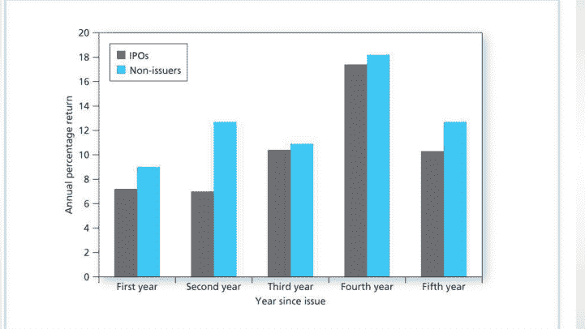

图3.3 首次公开发行的长期相对业绩

资料来源：佛罗里达大学 Jay R. Ritter 教授网站，2009年10月，bear.cba.ufl.edu/ritter/ipodata.htm。

## 证券如何交易

### 市场的类型:

- **直接搜寻市场**
  - 买方和卖方需要直接相互搜寻
- **经纪人市场**
  - 经纪人搜寻买方和卖方

## 证券如何交易

市场的类型：

- 交易商市场
  - 交易商买入这类资产，再从他们的库存中卖出这类资产。为市场提供即时性和流动性，并通过买卖价差实现一定利润。（看新三板行情表解释）
- 拍卖市场
  - 交易商集中在同一场所进行交易。

## 买入价和卖出价

### 买入价

- 买入价就是购买的价格。
- 在交易商市场，买入价就是交易商愿意购买的价格。
- 投资者出售给出价方。
- 买卖差价是在这一证券市场的利润。

### 卖出价

- 卖出价代表销售时的报价。
- 在交易商市场，卖出价就是交易商愿意卖出的价格。
- 投资者必须支付卖出价才能买入证券。

## 交易指令的类型

- 市场委托指令：立即执行
  - 交易者接受当前的市场价格
- 限价指令：
  - 交易商指定买卖证券的价格
- 一个大的指令可以包括多个交易价格。

## 图3.5 限价指令

| 条件 |  |  |
|---|---|---|
|  | 价格低于限价 | 价格高于限价 |
| 买入操作 | 限价买入指令 | 停止买入指令 |
| 卖出操作 | 止损指令 | 限价卖出指令 |

图3.5 价格条件指令

## 交易机制

- 交易商市场
- 电子通信网络 (ECNs)
  - 是一个真正的交易系统，可以自动执行命令。
- 专家做市商市场
  - 维持一个公平有序的市场

## 纳斯达克

- 包括3200家上市公司
- 最初，纳斯达克主要是一个具有报价系统功能的交易商市场。
- 现在，纳斯达克市场中心推行了一个更复杂的电子交易平台，用以自动处理交易。
- 大型指令仍需经纪人与交易商直接谈判。

## 图 3.1 纳斯达克市场首次上市的部分条件

|  | 纳斯达克全球市场 | 纳斯达克资本市场 |
|---|---|---|
| 股东权益 | 1500万美元 | 500万美元 |
| 公众持股数 | 110万股 | 100万股 |
| 公开交易股票市值 | 800万美元 | 1500万美元 |
| 股票最低价格 | 4美元 | 4美元 |
| 税前收入 | 100万美元 | 75万美元 |
| 股东人数 | 400 | 300 |

表3.1 纳斯达克市场首次上市的部分要求

资料来源：纳斯达克股票市场，www.nasdaq.com。2009年8月，纳斯达克股票市场公司。经许可转载。

## 纽约证券交易所

- 包括2800家上市公司
- 自动电子交易与传统的经纪人/专家交易系统并行。
  - SuperDot：是一种电子指令转换系统
  - DirectPlus: 绝大部分的小额指令是自动执行的
  - 专家: 处理大额订单，维持交易秩序。

## 图 3.2 纽约证券交易所首次上市的部分条件

| 纽约证券交易所首次上市的部分要求 |  |
|---|---:|
| 前两年最低年度税前收入 | 200万美元 |
| 营业收入 | 7500万美元 |
| 公众持有股票市值 | 1亿美元 |
| 公众持股数 | 110万股 |
| 持有100股及以上的股东人数 | 400 |

资料来源：纽约证券交易所，www.nyse.com，2009年10月。

## 电子通信网络

- 电子通信网络: 是一个直接联系买方和卖方的私人计算机网络，可自动立即执行交易指令。
- 主要的电子通信网络包括纳斯达克市场中心、 ArcaFx、 Direct Edge、 BATS和 LavaFlow。
- 算法交易、高频交易
- 资金暗池： 大宗交易、匿名、碎片化、拖拉机账户

## 债券交易

- 债券交易商之间的债券交易大多发生在场外交易市场。
- 许多债券发行市场都很小。
- 纽约证券交易所将其债券交易系统的交易范围进行了扩大。
  - 纽约证券交易所债券系统是美国所有交易所中最大的集中化债券市场。

## 其他国家的市场结构

- 伦敦股票交易所 – 主要是电子交易
- 泛欧证券交易所– 最初由巴黎证券交易所、阿姆斯特丹证券交易所和布鲁塞尔证券交易所合并而成，后来又与纽约证券交易集团合并。
- 东京证券交易所

## 股票市场的全球化和并购

- 纽约证券交易所的兼并和收购:
  - 群岛交易所
  - 美国证券交易所
  - 泛欧证券交易所
- 纳斯达克的兼并和收购:
  - Instinet电子交易平台
  - 波士顿股票交易所

## 股票市场的全球化和并购

- 芝加哥商业交易所的收购:
  - 芝加哥期货交易所
  - 纽约商业交易所

## 图 3.8 2012年年末世界主要证券交易所的股票市值

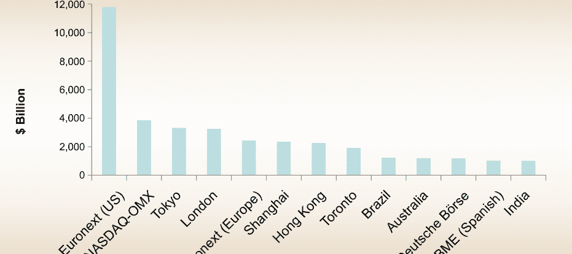

## 以保证金购买

- 投资者需从经纪人那里借入部分购买股票的资金。
- 投资者提供剩余部分资金。
- 保证金是指投资者提供的出资比例或出资金额。
- 投资者从股票升值中获取利润。

## 以保证金购买

- 美联储设定了初始保证金
  - 目前是50%
- 维持保证金
  - 最低权益价值必须能够维持保证金账户。
  - 如果证券价值下降太多，必须追加保证金。

## 以保证金购买: 初始条件 例3.1

股票市值 $100
60% 最初的保证金比例
40% 维持保证金的比例
100 回购股
初始位置
股票市值 $10,000 负债 $4,000
权益 $6,000

## 维持保证金 例3.1

每股股票价格跌至 $70

新的位置

股票市值 $7,000 负债 $4,000

所有者权益 $3,000

保证金比例 = $3,000/$7,000 = 43%

## 追加保证金 例 3.2

股票价格跌至多少投资者将收到追加保证金通知？假设维持保证金比例为30%。

权益价值 = 100P - $4000

保证金比例 = (100P - $4,000) / 100P

(100P - $4,000) / 100P = 0.30

计算得：

P = $57.14


## 表3.4 对用保证金购买股票的说明

| 股票价格变动 | 年末股票价值 | 偿还本金和利息* | 投资者收益率 |
|---|---|---|---|
| 上涨30% | $26,000 | $10,900 | 51% |
| 无变化 | 20,000 | 10,900 | -9% |
| 下跌30% | 14,000 | 10,900 | -69% |

* 假设投资者购买价值$20,000的股票，以每年9%的利率借入购买价格中的$10,000。

表3.4
用保证金购买股票的示例

* 假设投资者购买价值$20,000的股票，以每年9%的利率借入购买价格中的$10,000。

## 卖空

- 目的: 从证券价格下跌中获利
- 卖空的机制
  - 从经纪人处借入股票
  - 卖出股票并将利润和保证金存入账户
  - 平仓空头头寸：买入等量相同的股票偿还借入的股票

## 卖空:初始条件 例3.3

Dot Bomb公司 1000 股
50% 最初的保证金比例
30% 维持保证金比例
$100 初始价格

出售所得款项 $100,000
保证金和权益 $50,000
拥有的股票 1000 股

## 例 3.3 Dot Bomb 每股股票下降到 $70

资产
$100,000 (卖出所得款项)
$50,000 (最初的保证金)
负债
$70,000 (买入股票)
所有者权益
$80,000

利润 = 期末所有者权益 − 期初所有者权益
= $80,000 - $50,000 = $30,000
= 每股股价下降数 x 卖出的股票数

## 空头头寸的保证金催缴

股价上涨到多少时你会收到保证金催缴通知？

($150,000* - 1000P) / (1000P) = 30%
P = $115.38

* 初始保证金加上出售所得款项

## 证券市场监管

- 主要的监管法律:
  - 1933年颁布的《证券法》
  - 1934年颁布的《证券交易法》
  - 1970年颁布的《证券投资者保护法》
- 自律
  - 金融行业监管局
  - 注册金融分析师协会制定的专业行为标准

## 证券市场的监管

- 萨班斯-奥克斯利法案
  - 上市公司会计监督委员会
  - 公司董事会的审计委员中必须包含独立的财务专家
  - 首席执行官和首席财务官必须亲自保证公司的财务报告
  - 董事会中必须包含独立董事

# 第四章

共同基金与其他投资公司

## 投资公司

- 它从个人投资者手中汇集资金再将其广泛投资于各种证券或其他资产。
- 提供的服务：
  - 记账与管理
  - 分散化与可分割性
  - 专业化管理
  - 较低的交易成本

## 资产净值

计算公式：

```
$$\frac{资产的市值-负债}{发行在外的股份数量}$$
```

## 投资公司的类型

- 单位投资信托
  - 固定统一的资产组合，例如购买市政债券。
  - 不需要积极的管理活动
  - 单位投资信托份额近年来逐年下降。

## 投资公司的类型

- 投资管理公司
  - 开放式基金
  - 当投资者想要变现基金份额时，他们可以赎回或发行基金股份。
  - 以资产净值(NAV)把股份再卖给基金

## 投资公司的类型

- 投资管理公司
  - 封闭式基金
  - 发行在外的股份数量没有变化；老的投资者想要变现的话必须将股份出售给新的投资者。
  - 它的价格是资产净值的溢价或折价。

## 投资公司的类型

- 其他投资机构
  - 综合基金
  - 不动产投资信托
  - 对冲基金

## 共同基金：开放式投资公司

- 货币市场基金
- 股权基金
- 行业基金
- 债券基金
- 平衡型基金
- 资产灵活配置型基金
- 指数基金
- 国际基金

## 表4.1 美国共同基金的投资分类 P78

|  | 资产<br>（10亿美元） | 占总资产的<br>百分比 | 基金<br>数量 |
|---|---:|---:|---:|
| **股权基金** |  |  |  |
| 资本增值型 | $ 2,356 | 20.3% | 2,686 |
| 全球/国际 | 1,359 | 11.7 | 1,285 |
| 总回报型 | 1,490 | 12.8 | 610 |
| *股权基金合计* | *$ 5,205* | *44.8%* | *4,581* |
| **债券基金** |  |  |  |
| 公司债 | $ 452 | 3.9% | 252 |
| 高收益 | 212 | 1.8 | 179 |
| 全球 | 259 | 2.2 | 205 |
| 政府债券 | 261 | 2.2 | 246 |
| 战略收益型 | 1,204 | 10.4 | 484 |
| 单一州市政债券 | 159 | 1.4 | 347 |
| 全国市政债券 | 338 | 2.9 | 216 |
| *债券基金合计* | *$ 2,885* | *24.8%* | *1,929* |
| **混合型基金（债券/股票）** | $ 839 | 7.2% | 495 |
| **货币市场基金** |  |  |  |
| 应税 | $ 2,400 | 20.7% | 431 |
| 免税 | 292 | 2.5 | 201 |
| *货币市场基金合计* | *$ 2,692* | *23.2%* | *632* |
| *合计* | *$11,621* | *100.0%* | *7,637* |

## 如何出售基金

- 通过承销商直接交易基金（类似IPO）
- 通过销售人员售出基金
  - 在销售人员之间实现收入共享
  - 潜在的利益冲突
- 金融超市

## 共同基金的投资成本

- 费用结构：四种费用
  1. 运营费用
  2. 前端费用
  3. 后端费用
  4. 12 b-1 费用
- 费用必须在招股说明书上披露
- 不同等级证券组合的费用类型也不同

## 例 4.2: 不同等级基金的费用
(德弗莱斯首要成长基金)

以下是2012年德弗莱斯高收益基金不同类别份额的费用。请注意，在A类份额和C类份额之间进行选择时，前端费用与12b-1费用之间存在权衡。I类份额仅向机构投资者出售，费用较低。

|  | A类 | C类 | I类 |
|---|---|---|---|
| 前端费用 | 0–4.5%ᵃ | 0 | 0 |
| 后端费用 | 0 | 0–1%ᵇ | 0%ᵇ |
| 12b-1费用ᶜ | .25% | 1.0% | 0% |
| 费用率 | .70% | .70% | .70% |

ᵃ取决于投资规模。
ᵇ取决于持有至卖出的年数。
ᶜ包括服务费。


# 费用与共同基金的收益：
例如

期初资产净值 = $20

获得的收入分配 $.15

资本利得 $.05

期末资产净值 = $20.10:

收益率 = (期末净值 − 期初净值 + 收入和资本利得分配) / 期初净值

收益率 = ($20.10 - $20.00 + $.15 + $.05) / $20.00 = 1.5%

# 表 4.2
成本对投资业绩的影响

|  | 累计收益（所有股息再投资） |  |  |
|---|---|---|---|
|  | 基金 A | 基金 B | 基金 C |
| 初始投资* | $10,000 | $10,000 | $ 9,200 |
| 5 年 | 17,234 | 16,474 | 15,502 |
| 10 年 | 29,699 | 27,141 | 26,123 |
| 15 年 | 51,183 | 44,713 | 44,018 |
| 20 年 | 88,206 | 73,662 | 74,173 |

*在扣除前端费用后，如有。
注释：

+   1. 基金 A 为无负荷基金，费用比率为 .5%。
+   2. 基金 B 为无负荷基金，费用比率为 1.5%。
+   3. 基金 C 购买时收取 8% 的费用，费用比率为 1%。
+   4. 所有基金在扣除费用前的总收益为每年 12%。

# 延时交易和市场择时

- 延时交易 – 是指收市且资产定价已经确定之后接受买入指令或卖出指令的行为。
- 市场择时 – 快进快出，允许以逾期资产净值的价格交易。
- 净效应是将价值从普通股持有者手中转移到拥有特权的交易者手中。
- 共同基金的这种不正当交易行为受到了处罚。新法规的实施制止了这种非法行为。

- 某基金重仓持有乐视网，停牌期间如何交易？

# 共同基金所得税

- 在美国税收制度下，它具有转手性质。
  - 税赋仅由投资者承担
  - 基金投资者不能控制投资证券组合中证券的销售时间。
- 投资组合换手率高的基金，其税收无效率更加明显。（注：每次换手产生资本利得由投资者交所得税，亏损不交）
  - 平均换手率 = 60%

# 交易所交易基金（ETF）

- 例如: “蜘蛛”, “钻石” 和 “立方体”
- 潜在的优势:
  - 像股票一样持续交易
  - 可以卖空或用保证金买入
  - 低成本
  - 税收优势
- 潜在的缺陷:
  - 价格可能会小幅度的偏离资产净值
  - 必须从经纪人手中购买

# 图 4.2 美国交易所交易基金的发展状况

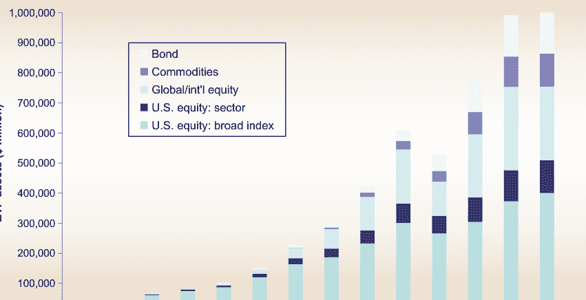

# 图 4.3 2011 年投资公司管理资产（十亿美元）

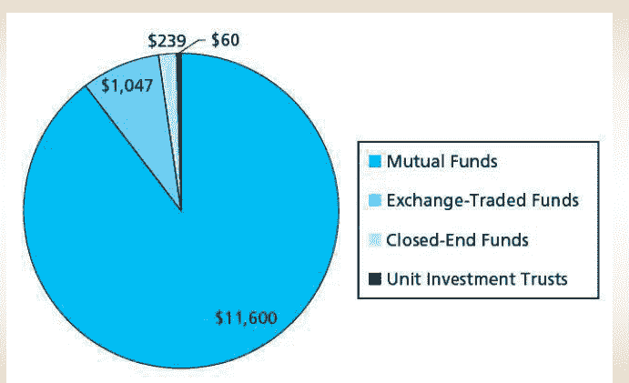

# 共同基金投资业绩：初步探讨

- 积极管理基金的业绩：
  - 1971~2011年的41年间，其中25年的平均收益率逊色于威尔希尔5000指数收益。
  - 良好的业绩表现（是由技能而不是运气决定的）的持续性是不稳定的，这种迹象只具有提示作用。
  - 糟糕的业绩表现很可能会持续。

# 图4.3 分散化投资股权基金与威尔希尔5000指数收益率

# 表 4.4 投资业绩持续性

| 初始期间业绩 | 随后期间业绩 |  |
|---|---|---|
|  | 前半部分 | 后半部分 |
| A. Malkiel 研究，1970 年代 |  |  |
| 前半部分 | 65.1% | 34.9% |
| 后半部分 | 35.5 | 64.5 |
| B. Malkiel 研究，1980 年代 |  |  |
| 前半部分 | 51.7 | 48.3 |
| 后半部分 | 47.5 | 52.5 |

来源：Burton G. Malkiel，“1971–1991 年投资于股票共同基金的回报”，《金融杂志》50（1995 年 6 月），第 549–72 页。经出版商 Blackwell Publishing, Inc. 许可转载。

> Burton G. Malkiel, “Returns from Investing in Equity Mutual Funds 1971–1991,” Journal of Finance 50 (June 1995), pp. 549–72.

# 金额申购：

- 由于申购时，基金资产净值未知，故确切的购买数量在申购的时候未知，只能实行金额申购。
- 计算方法
  - 申购日：净申购额＝申购金额－申购金额×申购费率
  - 次日：申购份额＝净申购额/申购日基金单位净值

- 例1：某个交易日某投资者以10000元认购某基金，费率为1%，前端收费。次日，确定前一个交易日该基金单位净值为0.99元。请确定该投资者认购基金的份额数量。
- 申购日：认购费用=10000×1%=100（元）
- 申购日：认购金额=10000−100=9900（元）
- 次日：认购份数=9900/0.99=10000（份）

# 份额赎回：

- 投资者目的要知道能赎回多少资金，但赎回的时候价格未知，所以投资者只能申请赎回多少份额。
- 赎回日：提出赎回数量
- 次日：赎回金额＝赎回总额－赎回费用，其中：
  - 赎回总额＝赎回数量×赎回日基金单位净值
  - 赎回费用＝赎回总额×赎回费率

• 例2：某投资者以10000元申购某基金，申购日该基金单位净值为1元，申购费率为5%。且规定赎回费率为3%，每年递减1%。假设该基金扣除运作费用后年净收益率为10%（且等于赎回日的净值）。
问题：投资者在持有1年后申请全部赎回，能赎回多少资金？
申购净额＝10000×0.95＝9500（元）
申购份数＝9500/1＝9500（份）
赎回总额＝9500×（1＋10%）＝10450（元）
赎回费用＝10450×2%＝209（元）
赎回金额＝10450－209＝10241（元）

# 作业一

Dot Bomb公司 融券卖出1000 股
50% 最初的保证金比例
30% 维持保证金比例
$100 初始价格
8% 融券利率
问：（1）股价上升或下降到什么价格时需要追加保证金？（不考虑利息）
（2）1年后股价下跌30%购回，计算收益率。（考虑利息）

# 作业一

2. 投资者考虑投资于一共同基金，前端费为 4%，支出费率为 0.5%，投资者还可以投资于银行的大额可转让存单（C D），年利率为 6%。

a. 如果投资者计划投资两年，要使投资于基金比投资于大额可转让存单更赚钱，基金投资必须为投资者挣得多高的年收益率？假定以年复利计算收益率。

b. 如果投资者计划投资六年，答案又如何？为什么答案会不同？

c. 现在假定不是支付前端费用的基金。据估计 12 b - 1 费用为 0.75%/年，则基金投资必须挣得的年收益率为多少？答案与投资期限有关吗？

# 第五章

# 风险与收益入门及历史回顾

# 利率水平的决定因素

- 供给
  - 家庭
- 需求
  - 企业
- 政府的净资金供给或资金需求
  - 美联储的运作调整


## 实际利率和名义利率

- 名义利率: 资金量增长率
- 实际利率: 购买力增长率

- 设名义利率为R, 实际利率为r, 通货膨胀率为i, 那么：

r ≈ R − i

r = (R − i) / (1 + i)

## 实际利率均衡

- 由以下因素决定:
  - 供给
  - 需求
  - 政府行为
  - 预期通货膨胀率

## 图 5.1 实际利率均衡的决定因素

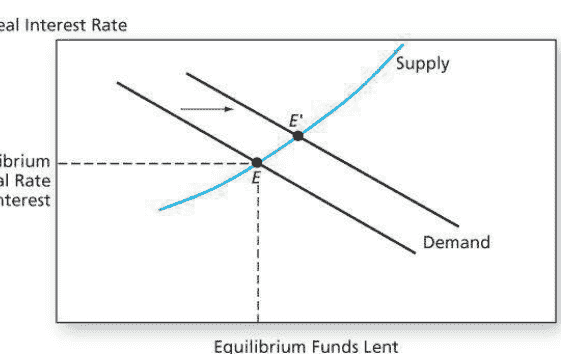

图5.1 实际利率均衡的决定因素

## 名义利率均衡

- 当通货膨胀率增加时，投资者会对其投资提出更高的名义利率要求。
- 如果我们假设目前的预期通货膨胀率是 E(i)，那么我们将得到费雪公式：
- 名义利率 = 实际利率 + 预期通货膨胀率

R = r + E(i)

## 税收与实际利率

- 税赋是基于名义收入的支出
  - 假设税率为 (t)，名义利率为 (R)，则税后实际利率是：
    $R(1-t)-i = (r+i)(1-t)-i = r(1-t)-it$
- 税后实际利率随着通货膨胀率的上升而下降。

## 例 5.2 年化收益率

# 例 5.2 年化收益率

假设面值为100美元、不同期限的零息国库券价格如下。我们使用公式5.6计算每种证券的总回报：

| 期限，T | 价格，P(T) | [100/ P(T)] − 1 | 给定期限的无风险回报率 |
|---|---|---|---|
| 半年 | $97.36 | 100/97.36 − 1 = .0271 | r_f(.5) = 2.71% |
| 1年 | $95.52 | 100/95.52 − 1 = .0469 | r_f(1) = 4.69% |
| 25年 | $23.30 | 100/23.30 − 1 = 3.2918 | r_f(25) = 329.18% |

## 公式 5.8 年化百分比利率

- 年化百分比利率：年度化的简单利率

$$APR=\frac{(1+EAR)^T-1}{T}$$

## 表 5.1 有效年利率与年化百分比利率

| 复利期 | T | $r_f(T)$ | APR = [(1 + EAR)^T - 1]/T | $r_f(T)$ | EAR = (1 + APR*T)^(1/T) - 1 |
|---|---|---|---|---|---|
| EAR = [1 + $r_f(T)$]^(1/T) - 1 = .058 |  |  |  | APR = $r_f(T)$*(1/T) = .058 |  |
| 1年 | 1.0000 | .0580 | .05800 | .0580 | .05800 |
| 6个月 | 0.5000 | .0286 | .05718 | .0290 | .05884 |
| 1季度 | 0.2500 | .0142 | .05678 | .0145 | .05927 |
| 1个月 | 0.0833 | .0047 | .05651 | .0048 | .05957 |
| 1周 | 0.0192 | .0011 | .05641 | .0011 | .05968 |
| 1天 | 0.0027 | .0002 | .05638 | .0002 | .05971 |
| 连续 |  | $r_{cc}$ = ln(1 + EAR) = .05638 |  | EAR = exp($r_{cc}$) - 1 = .05971 |  |

# 表 5.1

年化百分比利率（APR）和有效年利率（EAR）。在第一组列中，我们将等效年利率（EAR）固定为5.8%，并求出每个持有期的APR。在第二组列中，我们将APR固定为5.8%，并求解EAR。

## 表 5.2 1926~2009年短期国库券、通货膨胀率、实际利率的统计数据

|  | 平均年利率 |  |  | 年利率标准差 |  |  |
|---|---|---|---|---|---|---|
|  | 短期国库券 | 通货膨胀率 | 实际短期国库券 | 短期国库券 | 通货膨胀率 | 实际短期国库券 |
| 所有年份（84个）：1926-2009 | 3.71 | 3.10 | 0.70 | 3.09 | 4.19 | 3.90 |
| 最近一半（42个）：1968-2009 | 5.75 | 4.56 | 1.17 | 2.94 | 3.02 | 2.40 |
| 较早一半（42个）：1926-1967 | 1.67 | 1.64 | 0.24 | 1.45 | 4.69 | 4.96 |

# 表 5.2
1926-2009年短期国库券利率、通货膨胀率和实际利率的统计数据

资料来源：滚动投资1个月期短期国库券的年回报率：肯尼斯·弗伦奇；年通货膨胀率：劳工统计局。

## 1926~2009年的短期国库券和通货膨胀率

- 温和的通货膨胀都会使这些低风险投资的实际回报偏离其名义值。
- 从1926年至2009年，一美元投资于短期国库券的增长到了名义值20.52美元，但是实际值只有1.69美元。
- 实际利率和通货膨胀率的负相关性说明名义利率伴随着预期通货膨胀率的一对一变化趋势更加不显著。

## 图 5.3 1926~2006年利率和通货膨胀率

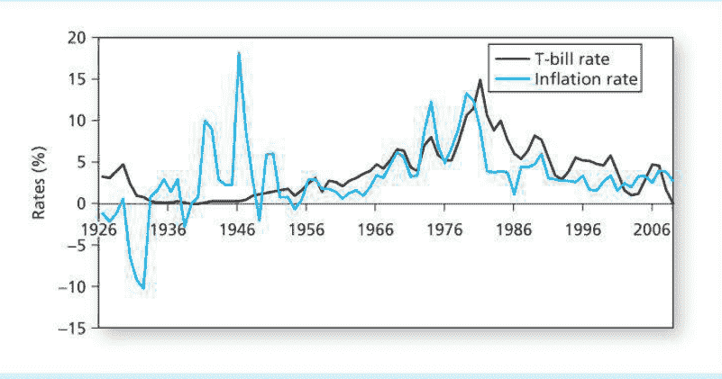

图5.3 利率和通货膨胀率，1926-2009

## 风险和风险溢价

收益率：单周期

HPR = (P₁ − P₀ + D₁) / P₀

HPR = 持有期收益率

P₀ = 期初价格

P₁ = 期末价格

D₁ = 现金股利

## 收益率: 单周期的例子

期末价格 = 110

期初价格 = 100

现金股利 = 4

HPR = (110 - 100 + 4) / (100) = 14%

## 期望收益和标准差

### 期望收益

$E(r) = \sum_{s} p(s) r(s)$

$p(s)$ = 各种情境的概率

$r(s)$ = 各种情境的持有期收益率

$s$ = 情境

## 方差和标准差

### 方差 (VAR):

$$\sigma^2 = \sum_s p(s)[r(s)-E(r)]^2$$

### 标准差 (STD):

$$STD = \sqrt{\sigma^2}$$

## 本例中方差和标准差的计算

- 本例中方差的计算：
  \[
  \sigma^2 = .25(.31 - 0.0976)^2 + .45(.14 - .0976)^2
  \]
  \[
  + .25(-0.0675 - 0.0976)^2 + .05(-.52 - .0976)^2
  \]
  \[
  = .038
  \]

- 本例中标准差的计算：
  \[
  \sigma = \sqrt{.038}
  \]
  \[
  = .1949
  \]


## 历史收益率的时间序列分析

收益率的算术平均值：

$$E(r)=\sum_{s=1}^{n}p(s)r(s)=\frac{1}{n}\sum_{s=1}^{n}r(s)$$

## 几何平均收益

$$TV_n = (1 + r_1)(1 + r_2)\cdots(1 + r_n)$$

TV = 终值

$$g = TV^{1/n} - 1$$

g = 收益率的几何平均值

- P104 例5-6

## 方差和标准差公式

- 方差 = 离差平方的期望值

$$\hat{\sigma}^{2}=\frac{1}{n}\sum_{s=1}^{n}\left[r(s)-\bar{r}\right]^{2}$$

- 当消除偏差时，方差和标准差的计算公式为：

$$\hat{\sigma}=\sqrt{\frac{1}{n-1}\sum_{s=1}^{n}\left[r(s)-\bar{r}\right]^2}$$

## 收益波动性（夏普）比率

- 投资组合的夏普比率 = 风险溢价 / 超额收益率的标准差

## 正态分布

- 如果收益率的分布可以用正态分布来近似拟合的话，投资管理将变得更加容易。
  - 当风险收益对称时，标准差是一个很好的衡量标准。
  - 如果各个资产的收益具有正态分布，那么其组成的投资组合的收益也服从正态分布。
  - 可以仅使用均值和标准差来估计未来的情景。

## 图5.4 正态分布

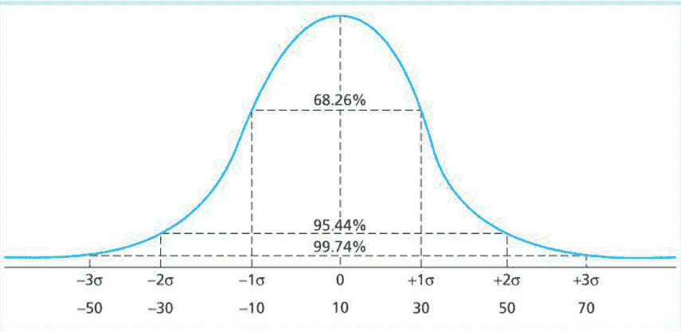

图5.4 均值为10%且标准差为20%的正态分布。

## 偏离正态分布和风险度量

- 如果超额收益偏离了正态分布怎么办？
  - 标准差不再是一个衡量风险的完美度量工具
  - 夏普比率不再是证券表现的完美度量工具
  - 需要考虑偏度和峰度

## 偏度和峰度

- 偏度
  公式 5.19
  偏度 = [ (R - \bar{R})^3 / \sigma^3 ] 的平均值

- 峰度
  公式 5.20
  峰度 = [ (R - \bar{R})^4 / \sigma^4 ] 的平均值 - 3

## 图5.5A 正态和偏度分布

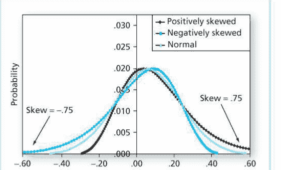

图5.5A 正态和偏态分布（均值 = 6%，标准差 = 17%）

## 图5.5B 正态和肥尾分布 (均值=.1, 标准差=.2)

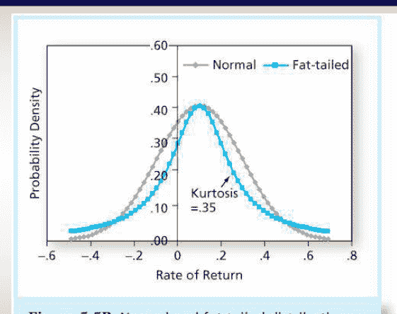

图5.5B 正态和肥尾分布（均值 = .1，标准差 = .2）

## 预期尾部损失 (ES)

- 也叫做条件尾部期望 (CTE)
- 对下行风险的衡量比在险价值更加保守
  - 在险价值是最差情形下的最好收益率
  - 预期尾部损失是最差情形下的平均收益率

## 下偏标准差 (LPSD)与索提诺比率

- 问题：
  - 需要独立的考察收益率为负的结果
  - 需要考察收益对无风险利率的偏离
- 下偏标准差：类似于普通标准差，但只使用相对于无风险收益率 r_f 负偏的那些收益率。
- 索提诺比率是夏普比率的变形。

## 风险组合的历史收益

- P111

## 图 5.7 1900~2000年各国股票的名义和实际收益率

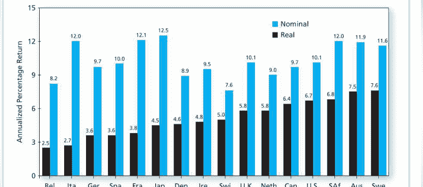

图5.7 1900–2000年全球名义和实际股票收益率

Source: Elroy Dimson, Paul Marsh, and Mike Staunton, Triumph of the Optimists: 101 Years of Global Investment Returns (Princeton: Princeton University Press, 2002), p. 50. Reprinted by permission of the Princeton University Press.

## 图5.8 1900~2000年各国股票和债券实际收益率的标准差

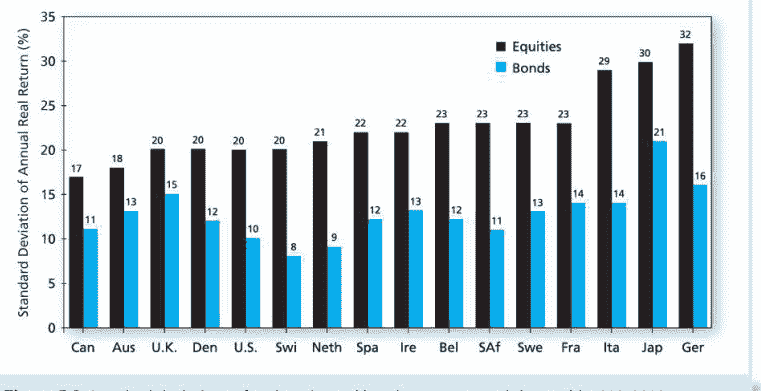

图5.8 1900–2000年全球实际股票和债券收益率的标准差

Source: Elroy Dimson, Paul Marsh, and Mike Staunton, Triumph of the Optimists: 101 Years of Global Investment Returns (Princeton: Princeton University Press, 2002), p. 61. Reprinted by permission of the Princeton University Press.

## 图 5.9 25年后投资回报的概率分布服从对数正态分布

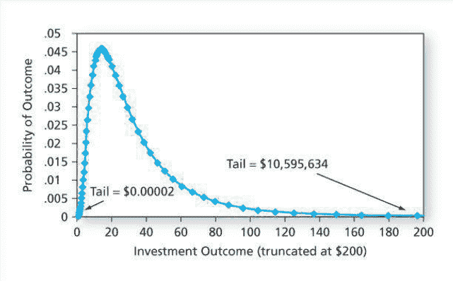

图5.9 采用对数正态分布的25年后投资结果概率（由二叉树近似）

## 连续复利终值

- 当一项资产每一期的复利都服从同一正态分布时，其有效收益率将服从对数正态分布。
- 终值将是：P120

### P120 例5-11

- 短期和长期收益损失风险

## 图 5.10 按年复利累计，25年持有期收益率

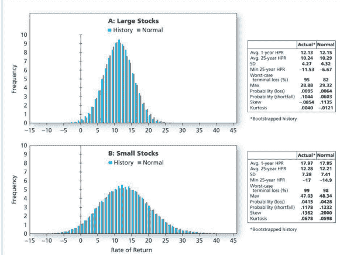

图5.10 按年复利计算的、来自自助法历史和正态分布的25年持有期收益率（50,000次观测）

## 图 5.11 按年复利累计，25年持有期收益率

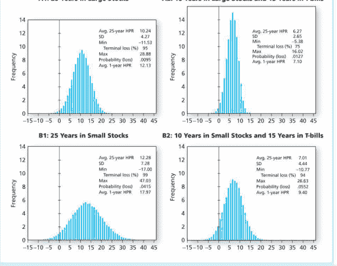

图5.11 按年复利计算的、来自自助法历史的25年持有期收益率（50,000次观测）

## 图5.12 部分大盘股组合的财富指数和短期国库券组合的财富指数

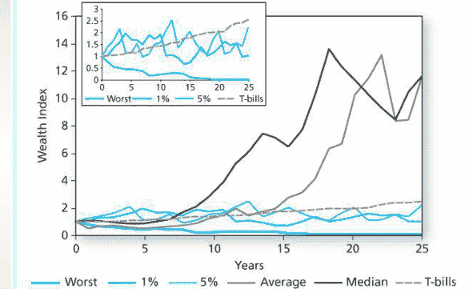

图5.12 选定大盘股组合和平均国库券组合的财富指数。插图：聚焦最差、1%和5%结果与债券的对比。

## 第四章 风险厌恶与风险资产的资本配置


### 4.1 风险与风险厌恶

#### 4.1.1 风险、投机与赌博

**风险：** 不确定性

**投机：** 承担一定风险（相当大的风险），获取相应报酬（相应的回报）

**赌博：** 为一不确定结果下注

**赌博与投机的关键区别：** 赌博没有相应报酬

#### 4.1.2 风险厌恶与效用价值

- 如果证券A可以无风险的获得回报率为10%，而证券B以50%的概率获得120%的收益，50%的概率的收益为-100%，你将用全部资金1000万元投资于哪一种证券？
- 对于一个风险规避的投资者，虽然证券B的期望收益为10%，但它具有风险，而证券A的无风险收益为10%，显然证券A优于证券B。
- 结论：风险厌恶型的投资者会放弃公平博弈（公平游戏）或更糟的投资组合。


## 投资者的风险态度

- 风险厌恶（Risk aversion）
- 风险中性（Risk neutral）
- 风险爱好（Risk lover）

- 从风险厌恶型投资来看，收益带给他正的效用，而风险带给他负的效用，或者理解为一种负效用的商品。
- 根据微观经济学的无差异曲线，若给一个消费者更多的负效用商品，且要保证他的效用不变，则只有增加正效用的商品。
- 根据均方准则，若均值不变，而方差减少，或者方差不变，但均值增加，则投资者获得更高的效用，此即风险厌恶者的无差异曲线。

## 风险中性（Risk neutral）投资者的无差异曲线

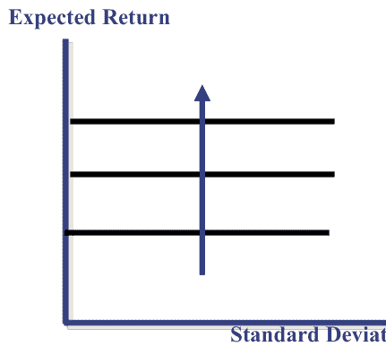

- 风险中性型的投资者对风险无所谓，只关心投资收益。

## 风险偏好（Risk lover）投资者的无差异曲线

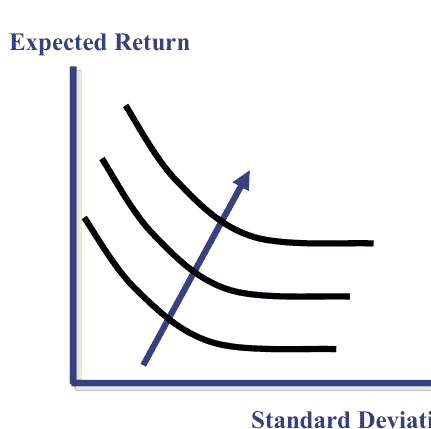

- 风险偏好型的投资者将风险作为正效用的商品看待，当收益降低时候，可以通过风险增加得到效用补偿。

## 表6.1 风险资产组合（无风险利率为5%）

表6.1
可用的风险资产组合（无风险利率 = 5%）

| 投资组合 | 风险溢价 | 期望收益率 | 风险（标准差） |
|---|---|---|---|
| L（低风险） | 2% | 7% | 5% |
| M（中风险） | 4% | 9% | 10% |
| H（高风险） | 8% | 13% | 20% |

## 效用函数（Utility function）

一个风险厌恶投资者常用如下形式的效用函数：

U = E(r) - 1/2 A σ²

- 其中，A为投资者风险厌恶指数，收益率为小数形式。
- 若A越大，表示投资者越害怕风险，在同等风险的情况下，越需要更多的收益补偿。
- 若A不变，则当方差越大，效用越低。

## 确定等价收益率（Certainty equivalent rate）

- 为使风险投资与无风险投资具有相同的吸引力而确定的风险投资的经风险调整后的报酬率，称为风险资产的确定等价收益率。
- 由于无风险资产的方差为0，因此，其效用U就等价于无风险回报率，因此，U就是风险资产的确定性等价收益率。

## 图6.1 投资组合P的收益与风险权衡

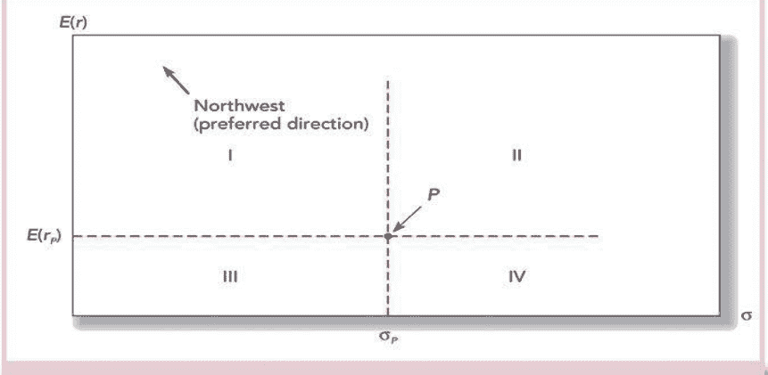

图6.1 潜在投资组合P的收益与风险权衡

## 均值方差准则（Mean-variance criterion）

- 若投资者是风险厌恶的，则对于证券A和证券B，如果

  $E(r_A) \ge E(r_B)$

  并且

  $\sigma_A^2 \le \sigma_B^2$

则该投资者认为“A占优于B”，或A比B有优势（A dominates B）。

## 占优原则（Dominance Principle）

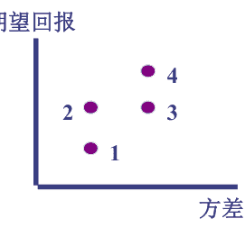

期望回报

方差或者标准差

- 2 占优 1；2 占优于3；4 占优于3；

## 表6.2 各种风险厌恶投资者的投资组合的效用值

| 投资者风险厌恶度（A） | 投资组合L的效用得分<br>*E(r) = .07；σ = .05* | 投资组合M的效用得分<br>*E(r) = .09；σ = .10* | 投资组合H的效用得分<br>*E(r) = .13；σ = .20* |
|---|---|---|---|
| 2.0 | .07 − ½ × 2 × .05² = .0675 | .09 − ½ × 2 × .1² = .0800 | .13 − ½ × 2 × .2² = .09 |
| 3.5 | .07 − ½ × 3.5 × .05² = .0656 | **.09 − ½ × 3.5 × .1² = .0725** | .13 − ½ × 3.5 × .2² = .06 |
| 5.0 | .07 − ½ × 5 × .05² = .0638 | **.09 − ½ × 5 × .1² = .0650** | .13 − ½ × 5 × .2² = .03 |

# 表6.2

不同风险厌恶程度的投资者在可选投资组合上的效用得分

**准则：** 只有当风险资产的确定性等价收益至少不小于无风险资产的收益时，这项投资才是值得的。

## 4.1.3 评估风险厌恶

- 使用调查问卷（P111）
- 观察面对风险时个人的决定
- 观察人们愿意付出多大代价来规避风险

## 4.2 风险资产与无风险资产组合的资本配置

- 资产配置决策

最基本的投资决策是你的资产的配置：你应该持有多少股票？应该持有多少债券？你应该有多少现金准备？

最基本的资产配置选择：投资于无风险的货币市场证券（记作F）和投资于其他风险资产（记作P）

## 风险资产案例

总的资产组合价值 = $300,000
无风险资产价值 = 90,000
风险资产（E和B）= 210,000
股票E = 54%
股票B = 46%

y = 210,000 / 300,000 = 0.7（风险资产，投资组合P）

1 − y = 90,000 / 300,000 = 0.3（无风险资产）

| 股票E | 113,400/300,000 = 0.378 |
| 股票B | 96,600/300,000 = 0.322 |
| 风险资产 P | 210,000/300,000 = 0.700 |
| 无风险组合 F | 90,000/300,000 = 0.300 |
| 总资产组合 C | 300,000/300,000 = 1.000 |

## 4.3 无风险资产

- 仅政府可以发行无违约风险的债券
  无违约风险的完全指数化的债券，只有当债券的偿还期等于投资者愿意持有期限时才能对投资者的真实收益率提供担保。
- 一般把货币市场基金作为无风险资产
- 大部分货币市场基金持有三种类型证券：短期国库券、银行大面额存单CD、商业票据CP。CD、CP收益率大于短期国库券

## 图6.3 3个月期存单与国库券利率的基差

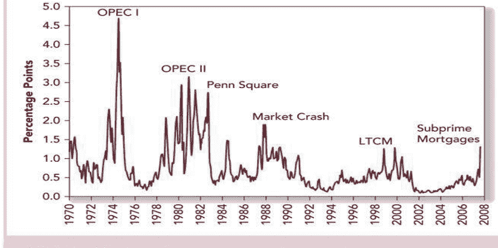

图6.3 3个月期存单与国库券利率的利差

## 4.4 单一风险资产与单一无风险资产的资产组合

记风险资产组合P的期望收益率为E(r_P)，标准差为σ_P，

无风险资产组合F的收益率为r_f，

则由y份风险资产和(1−y)份无风险资产组成的新组合C：

E(r_C) = yE(r_P) + (1−y)r_f = r_f + y[E(r_P)−r_f]

σ_C = yσ_P

⇒ E(r_C) = r_f + [E(r_P)−r_f]/σ_P σ_C

由该式得到图6-4可行投资组合（investment opportunity set）

## 图6.4 风险资产与无风险资产的可行投资组合

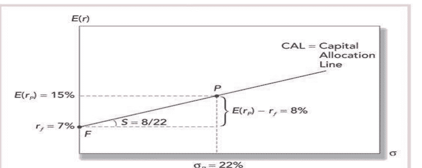

图6.4 在期望收益–标准差平面中，由风险资产与无风险资产构成的投资机会集

- 资本配置线（capital allocation line, CAL）
- 其斜率称为奖励与波动性比率（reward to variability ratio）或夏普比率（Sharpe ratio）


### CAL的杠杆作用

以无风险利率借入款项并全部投资于风险资产。若使用40%杠杆，则有：

$E(r_c)=(-0.4)(0.07)+(1.4)(0.15)=18.2\%$

$\sigma_c=(1.4)(0.22)=30.8\%$

**图6.5 借贷利率不同时的可行集（弯折的CAL）**

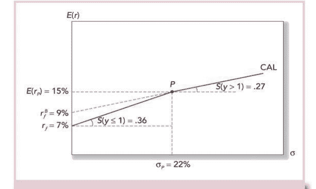

### 4.5 风险容忍度与资产配置

**表6.5 A=4时投资者不同风险资产比例(y)的效用水平**

**表6.5** 风险厌恶系数A=4的投资者在不同风险资产头寸(y)上的效用水平

| (1) y | (2) E(r_c) | (3) σ_c | (4) U = E(r) − ½A σ² |
|---|---|---|---|
| 0 | .070 | 0 | .0700 |
| 0.1 | .078 | .022 | .0770 |
| 0.2 | .086 | .044 | .0821 |
| 0.3 | .094 | .066 | .0853 |
| 0.4 | .102 | .088 | .0865 |
| 0.5 | .110 | .110 | .0858 |
| 0.6 | .118 | .132 | .0832 |
| 0.7 | .126 | .154 | .0786 |
| 0.8 | .134 | .176 | .0720 |
| 0.9 | .142 | .198 | .0636 |
| 1.0 | .150 | .220 | .0532 |

**图6.6 效用作为风险资产投资比例的函数**

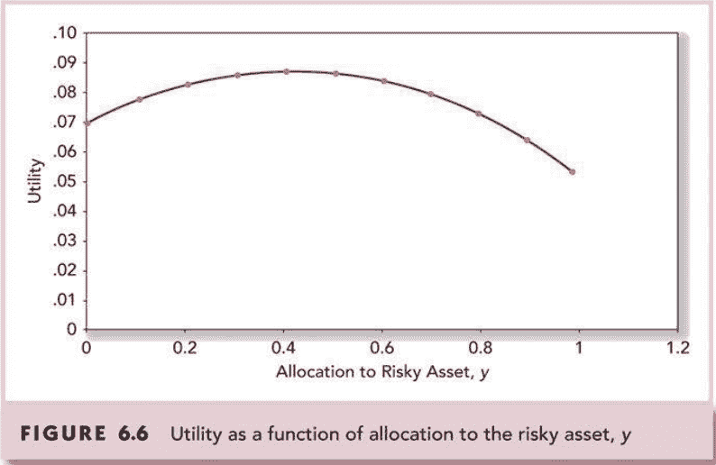

投资者效用函数：

$U = E(r) - \frac{1}{2} A \sigma^2$

$A > 0$：风险厌恶者

$A = 0$：风险中性者

$A < 0$：风险爱好者

求解效用最大化问题：

$\underset{y}{\max}\ U = r_f + y\left[E(r_P) - r_f\right] - \frac{1}{2} A y^2 \sigma_P^2$

$\Rightarrow$ 最优风险资产配置比例 $y^* = \frac{E(r_P) - r_f}{A \sigma_P^2}$

### 无差异曲线

投资者效用函数：$U = E(r) - \frac{1}{2} A \sigma^2$，其中$A$为外生变量。如此，为保持$U$不变，可调整$E(r)$和$\sigma$的组合，在$E(r)$和$\sigma$空间中为一系列的点。连结各点得到投资者的无差异曲线，其中$U$为无差异曲线的确定等价收益率。投资者无差异曲线簇与资本配置线相切的点，为与投资者风险厌恶程度相应的最优资产配置水平。

**表6.6 无差异曲线的电子数据表计算**

| σ | A = 2<br>U = .05 | A = 2<br>U = .09 | A = 4<br>U = .05 | A = 4<br>U = .09 |
|---:|---:|---:|---:|---:|
| 0 | .0500 | .0900 | .050 | .090 |
| .05 | .0525 | .0925 | .055 | .095 |
| .10 | .0600 | .1000 | .070 | .110 |
| .15 | .0725 | .1125 | .095 | .135 |
| .20 | .0900 | .1300 | .130 | .170 |
| .25 | .1125 | .1525 | .175 | .215 |
| .30 | .1400 | .1800 | .230 | .270 |
| .35 | .1725 | .2125 | .295 | .335 |
| .40 | .2100 | .2500 | .370 | .410 |
| .45 | .2525 | .2925 | .455 | .495 |
| .50 | .3000 | .3400 | .550 | .590 |

无差异曲线的电子表格计算（第2至4列是为提供指定效用值所必需的期望收益率。）

**图6.7 A=2和A=4时U=0.05和U=0.09的无差异曲线**

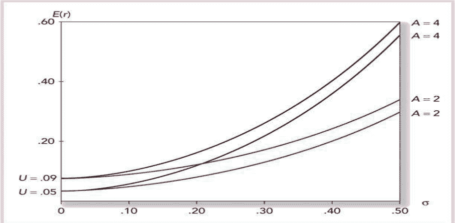

图6.7 A=2和A=4时U=0.05和U=0.09的无差异曲线

**图6.8 用无差异曲线寻找最优的投资组合**

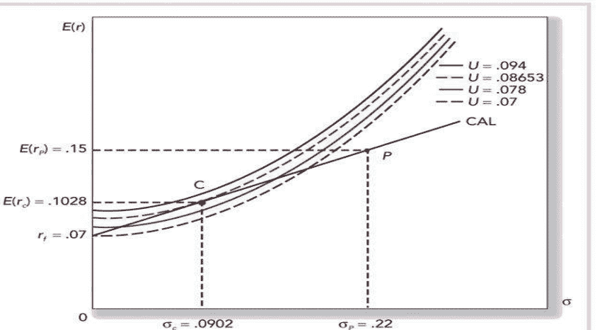

图6.8 用无差异曲线寻找最优的完整投资组合

### 例题

你管理一个风险投资基金，期望收益率为18%，标准差25%，短期国债利率8%，融资利率10%。你的客户的风险厌恶系数为A=1，他如何投资？其投资组合的基本特征如何？

辩论：
- 1.中烟国际上市，投（正方）还是不投（反方）
- 2.（备选）2019年A股价值投资胜（正方）题材投资胜（反方）

# 第七章 最优风险资产组合

### 7.1 分散化与资产组合风险

- 市场风险
  - 系统风险、不可分散的风险
- 公司特有风险
  - 个别风险、非系统性风险、可分散风险

**图7-1 资产组合风险是资产组合中股票数量的函数**

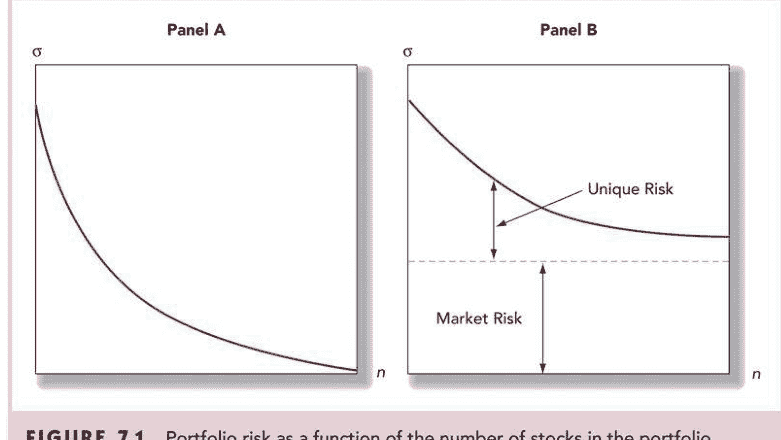

图7.1 资产组合风险是资产组合中股票数量的函数

**图7.2 资产组合分散化**

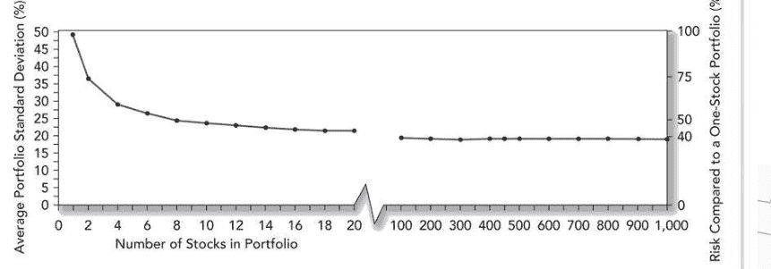

图7.2 组合分散化。仅由一只股票构成的组合的收益平均标准差为49.2%。随着组合中股票数量的增加，平均组合风险迅速下降。在极限情况下，组合风险可降至仅19.2%。

来源：摘自迈尔·斯塔特曼，“多少只股票才能构成一个分散化的投资组合？”《金融与数量分析杂志》第22卷（1987年9月）。经许可重印。

### 7.2 两种风险资产的投资组合

- 组合风险大小取决于组合中风险资产的相关性方向与程度
- 协方差和相关系数为测度两种风险变动方向提供了有效的方法

设某一风险资产组合$P$由长期债券组合$D$和股票基金$E$组成，则有：

$E(r_P)=w_D E(r_D)+w_E E(r_E)$

$\sigma_P^2 = w_D^2 \sigma_D^2 + w_E^2 \sigma_E^2 + 2 w_D w_E Cov(r_D, r_E)$

又：

$Cov(r_D, r_E)=\rho_{DE} \sigma_D \sigma_E$

$\Rightarrow \sigma_P^2 = w_D^2 \sigma_D^2 + w_E^2 \sigma_E^2 + 2 w_D w_E \sigma_D \sigma_E \rho_{DE}$

$\because -1 \le \rho_{DE} \le 1$

$\therefore \rho$越大，组合$P$的方差越大

### 两种证券投资组合：风险（续）

- 表达组合方差的另一种方式：
  - $\sigma_P^2 = w_D w_D Cov(r_D, r_D) + w_E w_E Cov(r_E, r_E) + 2 w_D w_E Cov(r_D, r_E)$

电子表格计算依据


## 协方差

Cov(r_D, r_E) = ρ_DE σ_D σ_E

ρ_D,E = 收益的相关系数

σ_D = 证券D的收益率标准差

σ_E = 证券E的收益率标准差

## 相关系数：可能取值

## ρ₁,₂ 的取值范围

+ 1.0 ≥ ρ ≥ -1.0

如果ρ = 1.0，则两种证券将完全正相关

如果ρ = - 1.0，则两种证券将完全负相关

## 特例一：

若 ρ_DE = 1,
则有： σ_P² = (w_D σ_D + w_E σ_E)²
即： σ_P = w_D σ_D + w_E σ_E
结论： ρ = 1 时组合 P 的风险并未降低

## 特例二：

若 $\rho_{DE}=-1$,

则有：$\sigma_P^2=(w_D\sigma_D-w_E\sigma_E)^2$

即：$\sigma_P=|w_D\sigma_D-w_E\sigma_E|$

令 $w_D\sigma_D-w_E\sigma_E=0$

$\Rightarrow w_D=\frac{\sigma_E}{\sigma_D+\sigma_E},\;w_E=1-w_D=\frac{\sigma_D}{\sigma_D+\sigma_E}$

结论：$\rho=-1$时组合 $P$ 的风险可降至零


## 正常情况：

若−1 < ρ_DE < 1,
则有：σ_P < |w_D σ_D + w_E σ_E|
结论:|ρ| < 1时组合P的风险可有一定程度降低

## 三种证券资产组合

```
E(r_p) = w₁ E(r₁) + w₂ E(r₂) + w₃ E(r₃)

σ²_p = w₁² σ₁² + w₂² σ₁² + w₃² σ₃²
      + 2 w₁ w₂ Cov(r₁, r₂)
      + 2 w₁ w₃ Cov(r₁, r₃)
      + 2 w₂ w₃ Cov(r₂, r₃)
```

## 表7.2 通过协方差矩阵计算资产组合方差

表7.2
利用协方差矩阵计算资产组合方差

A. 加边协方差矩阵
| 资产组合权重 | w_D | w_E |
|---|---|---|
| w_D | Cov(r_D, r_D) | Cov(r_D, r_E) |
| w_E | Cov(r_E, r_D) | Cov(r_E, r_E) |

B. 乘以边界权重后的协方差矩阵
| 资产组合权重 | w_D | w_E |
|---|---|---|
| w_D | w_D w_D Cov(r_D, r_D) | w_D w_E Cov(r_D, r_E) |
| w_E | w_E w_D Cov(r_E, r_D) | w_E w_E Cov(r_E, r_E) |
| w_D + w_E = 1 | w_D w_D Cov(r_D, r_D) + w_E w_D Cov(r_E, r_D) | w_D w_E Cov(r_D, r_E) + w_E w_E Cov(r_E, r_E) |
| 资产组合方差 | w_D w_D Cov(r_D, r_D) + w_E w_D Cov(r_E, r_D) + w_D w_E Cov(r_D, r_E) + w_E w_E Cov(r_E, r_E) |

## 表7.1 两种共同基金数据

|  | 债券 | 股票 |
|---|---:|---:|
| 期望收益，$E(r)$ | 8% | 13% |
| 标准差，$\sigma$ | 12% | 20% |
| 协方差，$\operatorname{Cov}(r_D, r_E)$ | 72 |  |
| 相关系数，$\rho_{DE}$ | .30 |  |

表7.1

两只共同基金的描述性统计

## 表7.3 不同相关系数下的期望收益与标准差

| w_D | w_E | E(r_p) | 给定相关系数下的资产组合标准差 |  |  |  |
|---|---|---|---|---|---|---|
|  |  |  | ρ = -1 | ρ = 0 | ρ = .30 | ρ = 1 |
| 0.00 | 1.00 | 13.00 | 20.00 | 20.00 | 20.00 | 20.00 |
| 0.10 | 0.90 | 12.50 | 16.80 | 18.04 | 18.40 | 19.20 |
| 0.20 | 0.80 | 12.00 | 13.60 | 16.18 | 16.88 | 18.40 |
| 0.30 | 0.70 | 11.50 | 10.40 | 14.46 | 15.47 | 17.60 |
| 0.40 | 0.60 | 11.00 | 7.20 | 12.92 | 14.20 | 16.80 |
| 0.50 | 0.50 | 10.50 | 4.00 | 11.66 | 13.11 | 16.00 |
| 0.60 | 0.40 | 10.00 | 0.80 | 10.76 | 12.26 | 15.20 |
| 0.70 | 0.30 | 9.50 | 2.40 | 10.32 | 11.70 | 14.40 |
| 0.80 | 0.20 | 9.00 | 5.60 | 10.40 | 11.45 | 13.60 |
| 0.90 | 0.10 | 8.50 | 8.80 | 10.98 | 11.56 | 12.80 |
| 1.00 | 0.00 | 8.00 | 12.00 | 12.00 | 12.00 | 12.00 |
|  |  |  | 最小方差资产组合 |  |  |  |
|  | w_D | 0.6250 | 0.7353 | 0.8200 | — |
|  | w_E | 0.3750 | 0.2647 | 0.1800 | — |
|  | E(r_p) | 9.8750 | 9.3235 | 8.9000 | — |
|  | σ_p | 0.0000 | 10.2899 | 11.4473 | — |

## 图7.3 资产组合期望收益是投资比率的函数

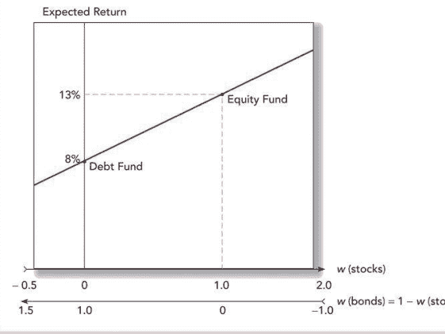

图7.3 资产组合期望收益是投资比率的函数

## 图7.4 资产组合标准差是投资比例的函数

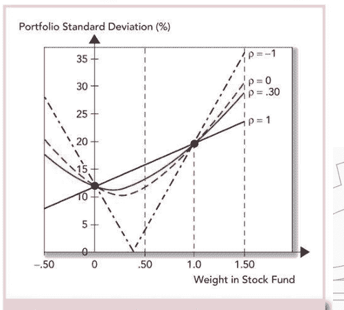

图7.4 资产组合标准差是投资比例的函数

## 图7-4 所描述的最小方差的意义

- 组合资产的标准差可以比组合中任意一个单独资产的标准差更低，显示了分散化的意义
- 图7.3和图7.4组合在一起以揭示在有关参数给定的情况下，资产组合风险（标准差）与期望收益的关系，结果如图7-5所示

p132表7-3 求最小方差时的组合比例及几个特例

## 图7.5 资产组合的期望收益是标准差的函数

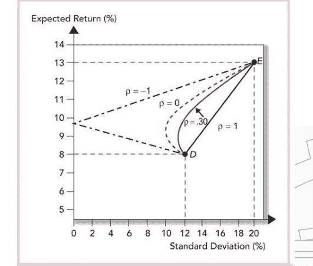

图7.5 资产组合的期望收益是标准差的函数

## 作业2

1. 假设证券市场有很多股票，股票 A 与股票 B 的特性如下：

| 股票 | 期望收益率（%） | 标准差（%） |
|---|---:|---:|
| A | 10 | 5 |
| B | 15 | 10 |
|  | 相关系数=-1 |  |

假设投资者可以以无风险收益率 r_f 贷款。则 r_f 的值为多少？


2、假设你可以投资于市场资产组合和短期国库券，已知：市场资产组合的期望收益率是23%，标准差是32%，短期国库券的收益率是7%。
（1）写出资本市场线的方程式
（2）如果你希望达到的期望收益率是15%，那么对应的标准差是多少？如果你持有10000元，为了达到这个期望收益率，你应该如何分配你的资金？
（3）解释CML与CAL的关系。

3、你管理的基金是一种预期回报率为16%和标准差为28%的风险资产组合，市场短期国库券利率为5%。回答以下问题：
（1）如果你的委托人决定将其资产的70%投入到你的基金中，另外30%投入到货币市场的短期国库券基金，则该资产组合的预期收益率与标准差各是多少？
（2）你的风险资产组合的风险回报率是多少？你的委托人的呢？
风险回报率＝（风险溢价/标准差）
（3）在预期收益与标准差的图表上作出你的资产组合的资本配置线(CAL)，资本配置线的斜率是多少？在你的基金的资本配置线上标出你的委托人的位置。
（4）假如你的委托人决定将占总投资预算为y的投资额投入到你的资产组合中，目标是获得10%的预期收益率，那么y应该是多少？
（5）假如委托人想把他投资额的y比例投资于你的基金中，以使他的总投资的预期回报最大，同时满足总投资标准差不超过18%的条件。
a.投资比率y是多少？b.总投资预期回报率是多少？
（6）假设你的委托人的风险厌恶程度为A=3.5，那么，
a.应将占总投资额的多少（y）投入到你的基金中？
b.你的委托人的最佳资产组合的预期回报率与标准差各是多少？

## 7.3 资产在股票、债券与国库券之间的配置

+   □ 组合方法：两项风险资产先组合形成新的风险资产组合，然后再向组合中加入无风险资产

+   □ 形成的资本配置线(CAL)中斜率最高的，效用水平最高


## 图7.6 债券与股票基金的可行集和两条可行的CALs

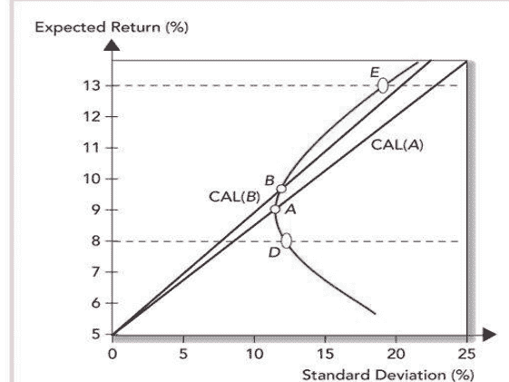

图7.6 债券与股票基金的可行集和两条可行的CALs

## 最优风险资产组合P的求解

$$\max_{w_i} S_P=\frac{E(r_P)-r_f}{\sigma_P}$$

$$s.t.\quad E(r_P)=w_D E(r_D)+w_E E(r_E)$$

$$\sigma_P=\left[w_D^2\sigma_D^2+w_E^2\sigma_E^2+2w_Dw_E\operatorname{Cov}(r_D,r_E)\right]^{1/2}$$

$$w_D+w_E=1$$

$$\Rightarrow w_D=\frac{[E(r_D)-r_f]\sigma_E^2-[E(r_E)-r_f]\operatorname{Cov}(r_D,r_E)}{[E(r_D)-r_f]\sigma_E^2+[E(r_E)-r_f]\sigma_D^2-[E(r_D)-r_f+E(r_E)-r_f]\operatorname{Cov}(r_D,r_E)}$$

$$w_E=1-w_D$$


## 图7.7 最优资本配置线与最优风险资产组合

两种风险资产
切点求解P133

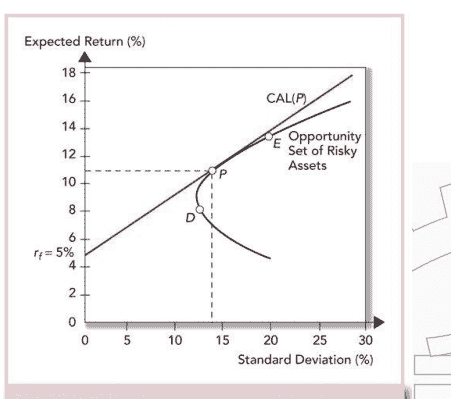

图7.7 债券与股票基金的可行集以及最优CAL与最优风险组合

## 图7.8 最优完整资产组合

C点计算见
P135下

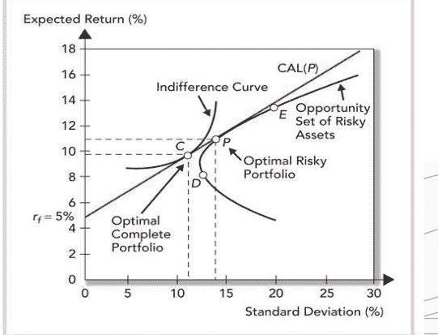

图7.8 最优完整资产组合的确定

## 图8.9 最优全部资产组合的比例

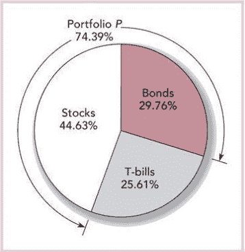

**图7.9** 最优完整资产组合的比例

## 例题

+   - 股票基金S，期望收益20%，标准差30%；
+   - 债券基金B，期望收益12%，标准差15%；
+   - 货币基金F，收益率8%。$r_s$与$r_b$的相关系数为0.1。

（1）对于A=4的投资者最优的股票、债券、短期债务工具的比例是多少？

（2）若借入利率为9%，A=1.5的投资人最优比例如何？


## 作业3

一、股票K和股票L的概率分布如下表所示：

| 状态 | 概率 | 股票K收益率 | 股票L收益率 |
|---|---:|---:|---:|
| 1 | 0.1 | 10 | 9 |
| 2 | 0.2 | 11 | 8 |
| 3 | 0.4 | 12 | 7 |
| 4 | 0.2 | 13 | 6 |
| 5 | 0.1 | 14 | 9 |

+   计算：
+   1. 股票K和L的期望收益率和标准差、协方差
+   2. 股票K和L的相关系数
+   3. 假设G是最小方差组合，那么K和L的权重分别是多少？组合G的期望收益和标准差分别是多少？
+   4. 假设P为最优风险组合，那么K和L的权重分别是多少？组合P的期望收益和标准差分别是多少？
+   5. 若无风险国库券利率为5%，对于A=3的投资者而言最优投资组合如何？

## 作业 3

二、P144

11、对于A=4的投资者最优的股票、债券、短期债务工具的比例是多少？

12、若借入利率为9%，A=1.2的投资人最优比例如何？


## 7.4 马科维茨的资产组合选择模型

均值-方差（Mean-variance）模型是由哈里·马科维茨于1952年建立的，其目的是寻找投资组合的有效边界。通过期望收益和方差来评价组合，投资者是理性的：害怕风险和收益多多益善。

因此，根据投资组合比较的占优原则，这可以转化为一个优化问题，即

+   - （1）给定收益的条件下，风险最小化
+   - （2）给定风险的条件下，收益最大化

## 图7.10 风险资产的最小方差边界

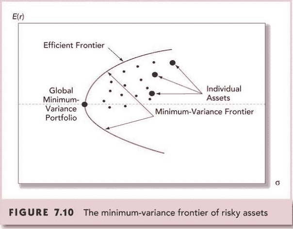

图7.10 风险资产的最小方差边界

## 马科维茨资产组合选择模型（续）

+   - 第二步寻找一条有最高报酬与波动性比率的资本配置线 CAL

## 图7.11 风险资产的有效边界与最优CAL

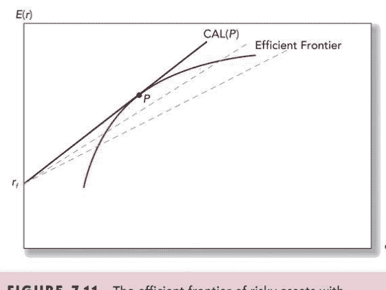

图7.11 风险资产的有效边界与最优CAL

## 马科维茨资产组合选择模型（续）

+   - 最后要选择出最优风险资产组合和无风险的最终资产组合，如图 7.8

利用电子表格求解见P148附录7A

$$\sigma_P^2=\sum_{i=1}^{n}\sum_{j=1}^{n}w_iw_j\operatorname{Cov}(r_i,r_j)$$

## 图7.13 有效集中不同投资组合的资本配置线

图7.13 有效集中不同投资组合的资本配置线

## 7.4.3 分散化的力量

n项资产组合的方差： σ_P² = Σ_{j=1}^n Σ_{i=1}^n w_i w_j Cov(r_i, r_j)

不妨设： w_i = 1/n, i = 1,2,⋯,n

则有： σ_P² = 1/n² Σ_{i=1}^n σ_i² + 1/n² Σ_{j=1}^n Σ_{i=1, j≠i}^n Cov(r_i, r_j)

定义： σ̄² = 1/n Σ_{i=1}^n σ_i², Cov̄ = 1/[n(n-1)] Σ_{j=1}^n Σ_{i=1, j≠i}^n Cov(r_i, r_j)

⇒ σ_P² = 1/n σ̄² + (n-1)/n Cov̄

当 n → ∞ 时，有： σ_P² → Cov̄


## 表7.4 相关和不相关宇宙中等权重组合的风险降低

| Universe Size *n* | Portfolio Weights *w* = 1/*n* (%) | ρ = 0 Standard Deviation (%) | ρ = 0 Reduction in σ | ρ = .4 Standard Deviation (%) | ρ = .4 Reduction in σ |
|---:|---:|---:|---:|---:|---:|
| 1 | 100 | 50.00 | 14.64 | 50.00 | 8.17 |
| 2 | 50 | 35.36 |  | 41.83 |  |
| 5 | 20 | 22.36 | 1.95 | 36.06 | 0.70 |
| 6 | 16.67 | 20.41 |  | 35.36 |  |
| 10 | 10 | 15.81 | 0.73 | 33.91 | 0.20 |
| 11 | 9.09 | 15.08 |  | 33.71 |  |
| 20 | 5 | 11.18 | 0.27 | 32.79 | 0.06 |
| 21 | 4.76 | 10.91 |  | 32.73 |  |
| 100 | 1 | 5.00 | 0.02 | 31.86 | 0.00 |
| 101 | 0.99 | 4.98 |  | 31.86 |  |

## 7.4.4 资产配置与证券选择

证券选择的理论与资产配置的理论是一样的，那么为什么要区分呢？

- 第一，对储蓄有更大需求
- 第二，金融市场的扩大已经使复杂的投资超出业余投资者的能力
- 第三，大规模投资管理的收益丰厚

## 风险集合和保险原理P170

- **风险集合**：互不相关的风险项目聚合在一起来降低风险。
  - 通过增加额外的不相关资产来增加风险投资的规模。

- **保险原理**：风险增长速度低于不相关保单数量的增长速度。
  - 厌恶比率升高

## 风险共享P171

- 随着风险资产增加到资产组合中，一部分资产需要被卖掉以保持固定的投资比例。
- 风险共享和风险集合构成了保险行业的关键核心。
- 投资于多种风险资产，但是风险资产比例保持不变，这才是真正的分散化。

# 第八章

## 指数模型

- 按Markovitz理论，为得到投资者的最优投资组合，要求知道：
  - 回报率均值向量
  - 回报率方差-协方差矩阵
  - 无风险利率
- 估计量和计算量随着证券种类的增加以指数级增加
- 对风险溢价的估计无指导作用
- 基于以上两点，产生了指数模型(Sharpe, 1963)的改进

## 单指数模型的优点

- 降低了多种风险资产时的输入数量
- 证券分析师更容易专注

## 单因素模型

$r_i = E(r_i) + \beta_i m + e_i$

$\beta_i$ 表示证券的系统性风险。$\beta$ 表示系统风险。  
$m$ 是影响所有证券收益的宏观经济变量。标准普尔500指数通常被作为$m$的代表。  
$e_i$ 衡量特定公司的不确定性

## 收益分布的正态性和系统风险

- 假设某一宏观因素影响着整个证券市场，除此外，公司所有剩余的不确定性都是公司特有的，则证券持有期收益为：
  
  $r_i = E(r_i) + m_i + e_i$
  
  其中 $E(r_i)$ 为基于可得信息的期望收益
  
  $m_i$ 为未预期到的宏观事件的影响
  
  $e_i$ 为未预期到的公司特有事件的影响
  
  于是：$E(m_i)=0, E(e_i)=0, \sigma_i^2 = \sigma_m^2 + \sigma^2(e_i)$
  
  $Cov(r_i, r_j) = Cov(m + e_i, m + e_j) = \sigma_m^2$

## 单因素模型

进一步的，

考虑不同企业对宏观经济事件有不同的敏感度，
证券 $i$ 对宏观经济事件的敏感度为 $\beta_i$，
则证券 $i$ 的宏观成分 $\beta_i m_t$，
并有：$r_i = E(r_i) + \beta_i m + e_i$
此即单因素模型（single factor model）

并有：$\sigma_i^2 = \beta_i^2\sigma_m^2 + \sigma^2(e_i)$

$Cov(r_i,r_j)=Cov(\beta_i m+e_i,\beta_j m+e_j)=\beta_i\beta_j\sigma_m^2$

## 单指数模型

假如将市场指数视为宏观因素的有效代表，则有单指数模型(single index model):

$r_i-r_f=\alpha_i+\beta_i(r_M-r_f)+e_i$

令：$R_i\equiv r_i-r_f,\ R_M\equiv r_M-r_f$

$\Rightarrow R_i(t)=\alpha_i+\beta_iR_M(t)+e_i$

## 期望收益与β值之间的关系

对式(8-8)两边求期望，得：
$E(R_i) = \alpha_i + \beta_i E(R_M)$
其中，$\beta_i E(R_M)$代表系统风险溢价；
$\alpha_i$代表非市场溢价
⇒积极的投资策略：寻找正的$\alpha$

## 单指数模型

- 风险和协方差：
  - 总风险 = 系统性风险+公司特定风险
  $\sigma_i^2 = \beta_i^2 \sigma_M^2 + \sigma^2(e_i)$
  - 协方差= β 的乘积x 市场指数风险：
  $Cov(r_i, r_j) = \beta_i \beta_j \sigma_M^2$

## 单指数模型

- 相关系数 = 与市场之间的相关系数的乘积

Corr(r_i, r_j) = (β_i β_j σ_M^2)/(σ_i σ_j) = (β_i σ_M^2 β_j σ_M^2)/(σ_i σ_M σ_j σ_M) = Corr(r_i, r_M) x Corr(r_j, r_M)

## 单指数模型的优缺点

- 优点：
  - 计算量简化为(3n+2)个
  - 对实际投资有意义：把握证券分析的重点
- 缺点：
  - 资产收益不确定性结构上的限制，例如：未考虑行业的因素。
  - 残差项的相关性
- 概念检查问题1 (P161)

## 指数模型和分散化

- 等权重组合的方差，其公司部分是：
  
  $\sigma^2(e_p)=\sum_{i=1}^n\left(\frac{1}{n}\right)^2\sigma^2(e_i)=\frac{1}{n}\sigma^2(e)$
  
- 当n变大时, $\sigma^2(e_p)$ 趋于零，公司层面的风险会被消除。

P162-163 检2-3

## 图 8.1 单因素经济中β系数为βₚ，等权重组合方差

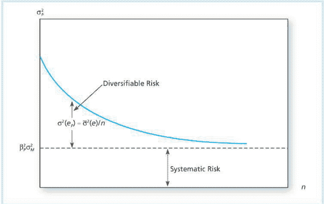

图 8.1 单因素经济中风险系数为 βₚ 的等权重组合的方差

## 图 8.2 S&P 500 和 HP 的超额收益

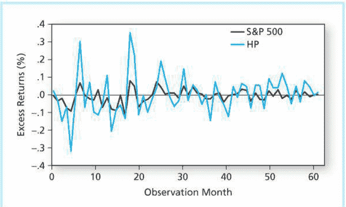

**图 8.2** HP 和 S&P 500 的超额收益

## 图8.3 HP和S&P 500的散点分布图，惠普的证券特征线

R_HP(t) = α_HP + β_HP R_S&P500(t) + e_HP(t)

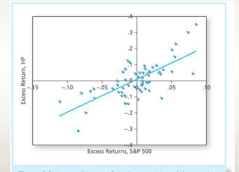

图 8.3 HP、S&P 500 的散点图以及 HP 的证券特征线 (SCL)

## 表8.1 Excel 输出：HP证券特征线的回归统计

| Regression Statistics |  |
|---|---:|
| Multiple R | .7238 |
| R-square | .5239 |
| Adjusted R-square | .5157 |
| Standard error | .0767 |
| Observations | 60 |

| ANOVA | df | SS | MS |
|---|---:|---:|---:|
| Regression | 1 | .3752 | .3752 |
| Residual | 58 | .3410 | .0059 |
| Total | 59 | .7162 |  |

|  | Coefficients | Standard Error | t-Stat | p-Value |
|---|---:|---:|---:|---:|
| Intercept | 0.0086 | .0099 | 0.8719 | .3868 |
| S&P 500 | 2.0348 | .2547 | 7.9888 | .0000 |

Excel 输出：惠普证券特征线的回归统计


## 表8.3的解释

- 惠普（HP）和标准普尔500（S&P 500）的相关性高达 0.7238。
- 此模型可以解释惠普方差的52%左右。
- 惠普的α是0.86%每月（年化后达10.32%），但在统计上不显著。
- 惠普的β系数是2.0348，但95%的置信区间是1.43 ~ 2.53。

## 图8.4 组合资产的超额收益

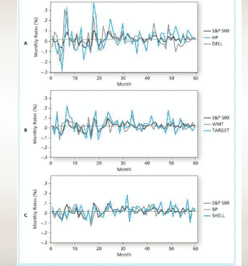

## α和证券分析

- 1. 宏观经济分析，用于估计市场指数的风险和风险溢价。
- 2. 统计分析，用于估计β系数和残差的方差 σ²(eᵢ)。

## α和证券分析

- 3. 证券分析对建立每个证券的期望收益没有任何贡献。
- 4. 使用证券分析来发展个人关于证券期望收益的预测。

## 指数预测靠谱吗？

- 1. 确定一个稳定的基数
- 2. 预测都是未来一年的
- 3. 估计当前的平均风险厌恶指数
- 4. 确定对应的风险溢价
- 5. 估算E（r）和一个西格玛范围

## 单指数模型的输入数据

- 标准普尔500的风险溢价
- 标准普尔500的标准差估计值
- n 套如下估计
  - β系数估计值
  - 个股残差的方差
  - 证券的α值

## 单指数模型的最优风险组合

+ 最大化夏普比率

期望收益, 标准差, 夏普比率：

E(R_P) = α_P + E(R_M)β_P = Σ_{i=1}^{n+1} w_i α_i + E(R_M) Σ_{i=1}^{n+1} w_i β_i

σ_P = [β_P^2 σ_M^2 + σ^2(e_P)]^{1/2} = [σ_M^2 (Σ_{i=1}^{n+1} w_i β_i)^2 + Σ_{i=1}^{n+1} w_i^2 σ^2(e_i)]^{1/2}

S_P = E(R_P) / σ_P

## 单指数模型的最优风险组合

- 构成：
  - 积极组合，称之为A
  - 市场指数组合，消极组合，称之为M

## 单指数模型的最优风险资产组合

积极组合的修正：

$$w_A^* = \frac{w_A^0}{1+(1-\beta_A)w_A^0}$$

当

$$\beta_A=1,\ w_A^*=w_A^0$$

## 信息比率

- 最优组合的夏普比率会超过指数组合（积极组合）：

$S_P^2 = S_M^2 + \left[\frac{\alpha_A}{\sigma(e_A)}\right]^2$

## 信息比率

- 积极组合的贡献率取决于它的α值和残差标准差的比率。
- 信息比率衡量了我们通过证券分析可以得到的额外收益。

## 8.4.6最优化过程总结

- P203

## 例题：假设投资经理根据宏观和微观预测，得到以下输入表：

| 资产 | 期望收益 | 贝塔 | 残差标准差 |
|---|---:|---:|---:|
| 股票A | 20 | 1.3 | 58 |
| 股票B | 18 | 1.8 | 71 |
| 股票C | 17 | 0.7 | 60 |
| 股票D | 12 | 1 | 55 |

| 资产 | 期望收益 | 标准差 |
|---|---:|---:|
| 短期国库券 | 8 | 0 |
| 被动权益组合 | 16 | 23 |

- a. 计算各股票的预期超额收益、阿尔法和残差方差。
- b. 构建最优风险投资组合。
- c. 夏普比率是多少？积极组合的贡献是多少？
- d. 假设 A = 2.8，其半寸如何？

## 作业₂

1. 你管理的基金是一种预期回报率为16%和标准差为28%的风险资产组合，市场短期国库券利率为5%。回答以下问题：

- （1）如果你的委托人决定将其资产的70%投入到你的基金中，另外30%投入到货币市场的短期国库券基金，则该资产组合的预期收益率与标准差各是多少？

- （2）你的风险资产组合的风险回报率是多少？你的委托人的呢？
风险回报率 = 风险溢价/标准差

- （3）在预期收益与标准差的图表上作出你的资产组合的资本配置线（CAL），资本配置线的斜率是多少？在你的基金的资本配置线上标出你的委托人的位置。

- （4）假如你的委托人决定将占总投资预算为y的投资额投入到你的资产组合中，目标是获得10%的预期收益率，那么y应该是多少？

- （5）假如委托人想把他投资额的比例投资于你的基金中，以使他的总投资的预期回报最大，同时满足总投资标准差不超过18%的条件。
  a. 投资比率y是多少？
  b. 总投资预期回报率是多少？

- （6）假设你的委托人的风险厌恶程度为A=3.5，那么，
  a. 应将占总投资额的多少（y）投入到你的基金中？
  b. 你的委托人的最佳资产组合的预期回报率与标准差各是多少？

## 作业2

2. 基于P173，4-10的资料，计算：
a. 假设G是最小方差组合，那么S和B的权重分别是多少？组合G的期望收益和标准差分别是多少？
b. 若无风险国库券利率为8%，借入资金利率10%，对于A=2.5的投资者而言最优投资组合如何？并计算特征值。
3.

## 选择10个A股构造积极组合的案例

## 图 8.5 指数模型与全协方差模型的有效边界

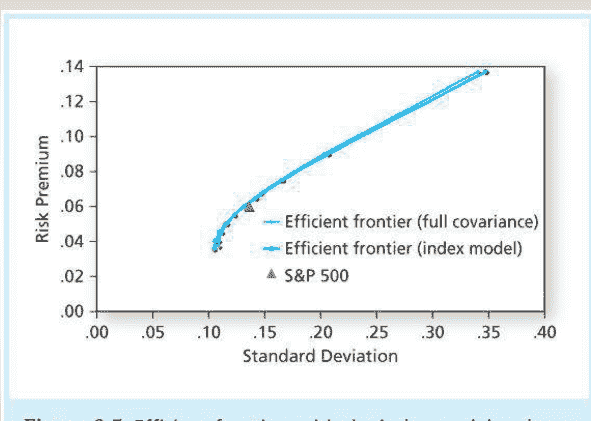

图 8.5 指数模型与全协方差模型的有效边界

## 表8.2 指数模型和全协方差模型的对比

表 8.2
单指数模型与全协方差模型的投资组合对比

|  | 全球最小方差组合 |  | 最优组合 |  |
|  | 全协方差模型 | 指数模型 | 全协方差模型 | 指数模型 |
| 均值 | .0371 | .0354 | .0677 | .0649 |
| 标准差 | .1089 | .1052 | .1471 | .1423 |
| 夏普比率 | .3409 | .3370 | .4605 | .4558 |
| 投资组合权重 |  |  |  |  |
| S&P 500 | .88 | .83 | .75 | .83 |
| HP | -.11 | -.17 | .10 | .07 |
| DELL | -.01 | -.05 | -.04 | -.06 |
| WMT | .23 | .14 | -.03 | -.05 |
| TARGET | -.18 | -.08 | .10 | .06 |
| BP | .22 | .20 | .25 | .13 |
| SHELL | -.02 | .12 | -.12 | .03 |

## 指数模型比全协方差模型差吗？

- 原则上马科维茨模型更好，但是：
  - 运用全协方差矩阵需要估计数以千计的风险值。
  - 太多的估计误差积累对投资组合的影响可能使其实际上劣于单指数模型推导出来的投资组合。
  - 单指数模型的实际好处是分解了宏观分析和证券分析。

## β 指引: 行业指数模型

- 使用最近60个月的价格β。
- 使用标准普尔500指数作为市场组合的代理。
- 忽略股息计算总回报。
- 不使用超额收益来估计指数模型：

$$r = a + br_m + e^*$$

## β指引: 行业指数模型

估计β，因为:

- 所有证券的平均β值是1。因此，我们最好的预测就是其β值等于1。
- 当公司变得越来越传统，其值越趋向于1。

## 表8.4 行业β和调整因素

| 行业 | Beta | 调整因子 |
|---|---|---|
| 农业 | 0.99 | -.140 |
| 药品和医药 | 1.14 | -.099 |
| 电话 | 0.75 | -.288 |
| 能源公用事业 | 0.60 | -.237 |
| 黄金 | 0.36 | -.827 |
| 建筑 | 1.27 | .062 |
| 航空运输 | 1.80 | .348 |
| 货运 | 1.31 | .098 |
| 消费耐用品 | 1.44 | .132 |

# 表 8.4
行业贝塔值和调整因子


# CH09
## 资本资产定价模型

资本资产定价模型（Capital Asset Pricing Model, CAPM）是由美国Stanford大学教授夏普等人在马克维茨的证券投资组合理论基础上提出的一种证券投资理论。

CAPM是现代金融学的奠基石，它解决了所有的人按照组合理论投资下，资产的收益与风险的问题。

作用：对潜在投资项目估计收益率；对不在市场交易的资产同样做出合理的估价。

## 9.1 模型综述

基本假设：
- 完全竞争市场
- 投资周期相同，短视(myopic)
- 标的限于金融市场上公开交易的资产
- 无摩擦环境
- 投资者符合Markovitz理性
- 同质预期(homogeneous expectations)

## 9.1 模型综述

进一步推论：
- 所有投资者按市场组合M来配置资产
- 资本市场线(CML)与有效前沿相切于M点
- 市场组合的风险溢价与市场风险和个人投资者的平均风险厌恶程度成比例
- 单个资产的风险溢价与市场组合M的风险溢价是成比例的，且比例为β

## 9.1 模型综述

其中，市场组合的风险溢价为：
$E(r_M) - r_f = \bar{A} \sigma_M^2$

贝它的定义：$\beta_i = \frac{Cov(r_i, r_M)}{\sigma_M^2}$

单个证券的风险溢价为：
$E(r_i) - r_f = \frac{Cov(r_i, r_M)}{\sigma_M^2}[E(r_M) - r_f] = \beta_i[E(r_M) - r_f]$

## 9.1.1 投资者对市场组合的选择

逻辑：
- 市场总体均衡时，必有总供给等于总需求
- 根据假设5、3、2、6，投资者的最优风险资产组合相同


## 分离定律（Separation Theorem）

- 当用风险资产与无风险资产进行组合时，所有投资者都会选择相同的风险资产组合，然后将它与无风险资产进一步进行组合。
- 投资者的整个最优选择过程可以总结为如下两个步骤：
  (1) 寻找合适的风险资产组合，这时不必考虑投资者效用的无差异曲线；
  (2) 确定风险资产与无风险资产的投资比例，这时必须结合投资者的无差异曲线。

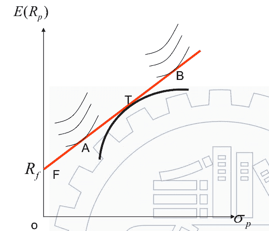

## 分离定律（Separation Theorem）

- 分离定律的意义
  - 所谓分离定理，指的是投资者在进行风险资产与无风险资产组合的选择时，可以按上述两个步骤进行。这意味着投资者的收益与风险偏好与其风险资产组合的最优构成无关。
  - 分离定理由托宾(J. Tobin)于1958年建立，它告诉我们，无论投资者是保守型的，还是敢于冒风险的，在他们选择的投资组合中，都应当持有或多或少的风险资产——最优风险资产组合。

## 市场证券组合

- 市场均衡时最优风险证券组合T的特征
  - 根据分离定理，切点证券组合T就是最优风险证券组合。无论投资者的偏好如何，在他们选择的最优投资组合中，都包含最优风险证券组合T。
  - 在市场均衡时，最优风险证券组合T具有以下特征：
    - T中必须包含市场上所有风险证券；
    - T中不可能包含负比例的证券；
    - T中各证券的资金分配比例必等于各证券总市值与全部证券总市值之比。

## 市场证券组合

- 市场证券组合（M）的含义
  - 将由市场上所有证券组成，并且各证券组合权数与证券的相对市场价值一致的证券组合称为市场证券组合（M）；
  - 在市场均衡状态下，最优风险证券组合T与市场证券组合M一致，投资者选择市场证券组合就等价于选择了最优风险证券组合；
  - 在现实中，一般用市场上某种指数所对应的证券组合作为市场组合的近似替代。
  - 总市值变动与个别公司市值变动的解释（IPO，存量资金，漂亮50和要命3000，炒地图等）

## 资本市场线（Capital Market Line）

- 资本市场线（CML）方程的推导

$$E(R_p)=wR_f+(1-w)E(R_M) \tag{1}$$

$$\sigma_p^2=w^2\sigma_f^2+(1-w)^2\sigma_M^2+2w(1-w)\rho\sigma_f\sigma_M=(1-w)^2\sigma_M^2$$

$$\sigma_p=(1-w)\sigma_M \tag{2}$$

$w$－投资者在组合P中无风险证券的投资比例

$w<0$，表示投资者卖空无风险资产

$R_f,\sigma_f$－无风险资产的收益率和标准差，显然 $\sigma_f=0$

$R_M,\sigma_M$－风险资产组合M的预期收益率和标准差

$\rho$－为无风险资产和市场组合M的相关系数（假设为0）


## 资本市场线（Capital Market Line）

- 资本市场线（CML）方程的推导

E(R_p) = w R_f + (1 - w) R_M  (1)
σ_p = (1 - w) σ_M  (2)
将方程（1）、（2）联立可得
E(R_p) = R_f + [E(R_M) - R_f] / σ_M · σ_P

## 资本市场线（CML）

- CML的实质就是在允许无风险借贷下的新的有效边界，它反映了当资本市场达到均衡时，投资者将资金在市场组合和无风险资产之间进行分配，从而得到所有有效组合的预期收益和风险的关系。
- 位于CML上的组合提供了最高单位的风险回报率。
- CML指出了用标准差表示的有效投资组合的风险与回报率之间的关系是一种线性关系。

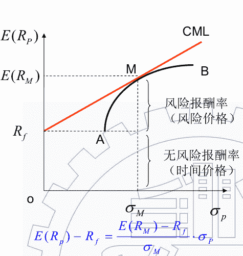

## 9.1.3 市场组合的风险溢价

投资者投资于最优资产组合M的比例：

y = \frac{E(r_M) - r_f}{A \sigma_M^2}

由于ȳ = 1，

市场组合的风险溢价为：

E(r_M) - r_f = \bar{A} \sigma_M^2

## 9.1.4 单个证券的期望收益

市场组合M的收益率： $r_M = \sum_{k=1}^{n} w_k r_k$

则通用电气(GE)与市场组合的协方差为：

$Cov(r_{GE}, r_M) = Cov\left(r_{GE}, \sum_{k=1}^{n} w_k r_k\right) = \sum_{k=1}^{n} w_k Cov(r_{GE}, r_k)$

则通用对市场组合的风险贡献为： $w_{GE} Cov(r_{GE}, r_M)$

又风险溢价贡献为： $w_{GE}[E(r_{GE}) - r_f]$

则其收益-风险比率为：

$\frac{w_{GE}[E(r_{GE}) - r_f]}{w_{GE} Cov(r_{GE}, r_M)} = \frac{E(r_{GE}) - r_f}{Cov(r_{GE}, r_M)}$

## 9.1.4 单个证券的期望收益

市场组合M与CML相切，其收益风险比率为：

E(r_M) - r_f / σ²_M (风险的市场价格)

则均衡时，存在：E(r_GE) - r_f / Cov(r_GE, r_M) = E(r_M) - r_f / σ²_M

⇒ E(r_GE) - r_f = Cov(r_GE, r_M) / σ²_M [E(r_M) - r_f]

令：β_GE = Cov(r_GE, r_M) / σ²_M ⇒ E(r_GE) - r_f = β_GE [E(r_M) - r_f]

## β的性质

- 1. 组合的β等于β的组合
  
  β_P = Σₖ w_k β_k

- 2. 市场组合的β_M = 1

## 对 βᵢ 的理解：

- 1. **βᵢ = σᵢᴹ / σᴹ²**：单个证券风险（σᵢᴹ）对市场组合风险（σᴹ²）的贡献程度；

- 2. **σᵢᴹ = βᵢ · σᴹ²**：单个证券风险与市场组合风险的关系；

- 3. **βᵢ = [E(rᵢ) − r_f] / [E(rᴹ) − r_f]**：单个证券超额收益率与市场超额收益率的敏感程度；

  - **β > 0**：证券收益与市场组合收益正相关；
  - **β < 0**：证券收益与市场组合收益负相关；
  - **|β| > 1**：进取型证券，波动率大于市场波动；
  - **|β| < 1**：保守型证券，波动率小于市场波动。


## 9.1.5 证券市场线（Security market line）

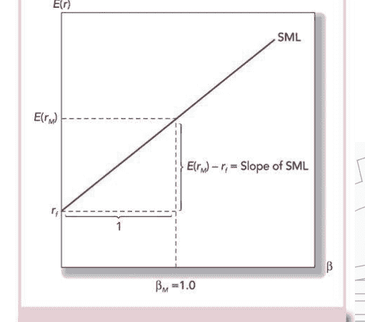

FIGURE 9.2 The security market line
图9.2 证券市场线

## 图9.3 The SML and a Positive-Alpha Stock
图9.3 SML与正阿尔法股票

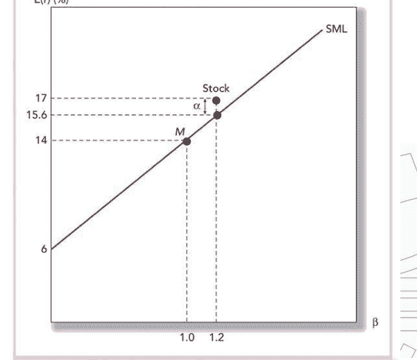

## 资本资产定价模型（CAPM）

- CML揭示了在资本市场均衡状态下，有效投资组合的期望收益率与风险之间的关系，其中风险是以有效投资组合的标准差来度量的；
- CML方程描述了有效投资组合如何按其风险的大小均衡地被定价的；
- 由于只有有效投资组合位于资本市场线上，单个证券或无效组合分散位于资本市场线下方，因此资本市场线提供的定价关系不适合单个证券及无效组合。
- 对于单个证券及无效组合，需要寻找适合它们的定价关系。CAPM就是寻求任一证券或无效组合的收益与风险之间关系的模型。

## 证券市场线与证券均衡定价

- 证券市场线（SML）
  - CAPM告诉我们，在市场均衡状态下，证券期望收益率与证券风险之间存在正相关线性关系，风险大的证券将具有较高的期望收益率，而风险低的证券其期望收益率也低。
  - 将CAPM所遵从的关系式，如果以协方差（或β）为横轴、期望收益率为纵轴在平面坐标图中用图示法将各证券期望收益率与协方差（或β）之间的关系表示出来，则所有证券将位于同一条直线上，这样一条描述证券期望收益率与风险之间均衡关系的直线常称为证券市场线（Security Market Line，SML）。

## 证券市场线与证券均衡定价

## 证券市场线（SML）

证券市场线（以协方差衡量风险）

证券市场线（以β衡量风险）

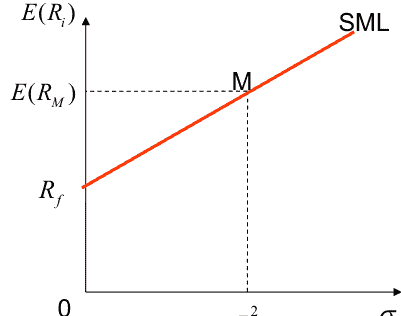

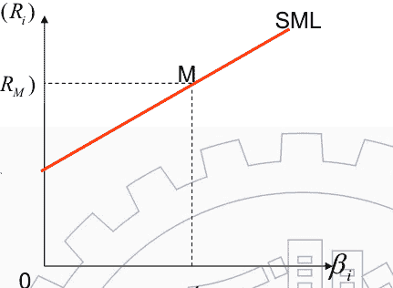

## 证券市场线的内涵

- 代表投资个别证券（或组合）的必要报酬率
- 证券市场线是证券市场供求运作的结果
- 证券市场线变动的意义

投资者风险回避程度增强

通货膨胀风险增加

## 证券市场线与证券均衡定价

- 前述分析是针对单个证券，在市场均衡时得到的SML；同样可以证明，在市场均衡时：
  - 由单个证券构成的任一证券组合P位于SML上；
  - 由无风险资产与市场证券组合构成的有效投资组合也位于SML上。

- SML实际上揭示了市场上所有风险性资产的均衡期望收益率与风险之间的替代关系。
  - 这些风险资产包括单个证券、无效证券组合以及有效证券组合。
  - 即每一种证券或证券组合，无论它们是否有效，都将位于SML上。

## CML和SML的区别

- CML和SML都描述了风险资产均衡期望收益率与风险之间的关系，但明显两者明显存在区别。
  - 度量风险的指标不同
    - SML用协方差或β值测度风险
    - CML用标准差测度风险
  - CML只描述有效投资组合如何均衡地被定价，而SML描述了所有风险资产（包括无效组合与有效组合）如何均衡地被定价；
  - 有效投资组合既位于资本市场线上，同时也位于证券市场线上；而单个证券与无效投资组合只位于证券市场线上；

## CAPM的理论意义

- 决定个别证券或投资组合的预期收益率及系统风险，是证券估价和资产组合业绩评估的基础；
- 用来评价证券的相对吸引力；
- 用以指导投资者的证券组合：
  - 消极的投资组合。选择一种或几种无风险证券与风险证券构成组合；
  - 积极的投资组合。投资者必须充分考虑证券实际价格是否被高估或低估，从而选择有吸引力的证券构建证券组合。同时还应根据市场的趋势调整资产组合。
    - 当预测到市场价格呈上升趋势时，可增加高β值证券的持有量；
    - 当市场价格呈下降趋势时，则应减少高β值证券的持有量。

## 证券均衡定价

- SML为我们提供了一种方便地判断证券是否合理定价的标准。
  - “合理定价”的证券一定位于SML上；
  - “错误定价”的证券则分布在SML上方或下方。

- 证券实际期望收益率与均衡期望收益率之间的差额称为证券的α值。
  - 根据α值的正负及大小，可以判断证券是否定价合理以及定价偏离的程度。
  - α > 0，证券定价偏低；
  - α < 0，证券定价偏高；
  - α的绝对值越大，证券定价越不合理。

## 证券均衡定价

- 案例
- 市场期望收益率为14%，股票A的β为1.2,短期国库券利率为6%。根据CAPM该股票的期望收益率为6+1.2×（14−6）=15.6%。
- 如果投资者估计股票A的收益率为17%，则意味着α=1.4%。

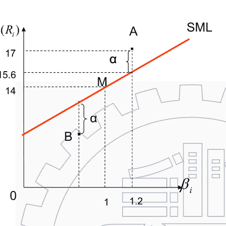

## 证券均衡定价

## – 为什么会出现证券定价不合理现象？

- 交易成本的存在。使得投资者不能积极地交易采取措施以纠正证券与SML所发生的微小偏差。因为这时调整组合的成本可能等于甚至高于由此而带来的收益；
- 资本利得税的存在。可能阻碍投资者买卖证券实现利润的行为。因为账面上的资本增值不需要支付税金，一旦抛售证券使其转化为资本利得，则应该纳税；
- 不完全信息会影响证券的估价。如果投资者的信息不够完全，他可能无法观察到错误估价的证券，从而也就不可能通过交易来消除错误的估价。

## 9.2 资本资产定价模型和指数模型

## 9.2.1 实际收益与期望收益

CAPM是否可检验？

- 包含所有资产的市场组合不可构建
- 期望收益不可观测

## 9.2.2 指数模型和已实现收益

R_i = α_i + β_i R_M + e_i
Cov(R_i, R_M) = Cov(β_i R_M + e_i, R_M)
= β_i Cov(R_M, R_M) + Cov(e_i, R_M) = β_i σ_M²
⇒ β_i = Cov(R_i, R_M) / σ_M²
即指数模型得到了与CAPM一样表达式的贝塔。

## 9.2.3 市场指数模型和期望收益-贝塔关系

比较CAPM： E(r_i) − r_f = β_i [E(r_M) − r_f]

与指数模型的期望形式：
E(r_i) − r_f = α_i + β_i [E(r_M) − r_f]

可知二者差别在于，CAPM认为所有的α_i都为0。

市场模型： r_i − E(r_i) = β_i [r_M − E(r_M)] + e_i

如果CAPM有效，则市场模型等同于指数模型。

## 作业3

1. 对股票A和股票B有：

| 股票 | 预期收益率 | 贝塔值 |
| --- | --- | --- |
| A | 0.12 | 1.2 |
| B | 0.14 | 1.8 |

无风险收益率为0.05，市场期望收益率为0.09。应该买入哪只股票，为什么？。

2. 一证券的市场价格为50元，期望收益率为14%，无风险利率为6%，市场风险溢价为8.5%。如果这一证券与市场资产组合的协方差加倍（其他变量保持不变），该证券的市场价格是多少？假设该股票预期会永远支付一固定红利。

3. 假定两个资产组合A、B都已充分分散化，E(r_A)=12%, E(r_B)=9% 如果影响经济的要素只有一个，并且 β_A=1.2, β_B=0.8，可以确定无风险利率是多少？假设其它条件不变，B证券的协方差增大一倍，证券价格依据内在价值变动，问证券B的价格如何变化？

# 第12章

## 行为金融与技术分析

## 行为金融

## 传统的金融理论

- 价格是正确的，即价格等于真实价值。
- 资源配置是有效的。
- 与有效市场假说一致。

## 行为金融

- 如果投资者的行为非理性怎么办？

## 来自行为学派的批评

非理性行为可以分为两大类：

- 1. 投资者通常不能正确处理信息。
  - 结果：不能正确推断未来收益的概率分布。
- 2. 即使给定未来收益的概率分布，投资者做出的决策通常是前后矛盾或次优的。
  - 结果: 行为偏差

## 信息处理过程中的错误：错误的估计真正的概率和相关收益率

- 1. 预测错误：过于依赖近期经验。

- 2. 过度自信：投资者高估自己的信念和预测的准确性。

- 3. 保守主义：投资者对最近出现的事件反应太慢，对新发布的消息反应不足。

- 4. 忽视样本规模和代表性：投资者基于小样本过快地推出一种模式，并推断出未来的趋势。


## 行为偏差

- 即使信息处理过程非常完美，人们也不能利用这些信息进行完全理性的决策。

例如：

1. 框定偏差：
   - 风险是如何描述的，是“面临有风险的可能损失”还是“面临有风险的可能收益”，可能会影响到投资者的决策。20%概率赢400元，80%概率亏100元。两高校的心理测试

2. 心理账户：
   - 投资者会根据风险-报酬将账户或资金分成不同部分，他们不愿动用原有资本。
   - “赌场资金效应”相当于“赢钱账户”框定

3. 后悔规避：
   - 投资者不依惯例进行决策并出现不利结果时会更后悔。

## 4. 前景理论：

传统观点：效用取决于财富水平。
行为金融的观点：效用取决于财富水平的变化量。
国债期货交易上午损失，下午更大胆？

## 图 12.1 前景理论

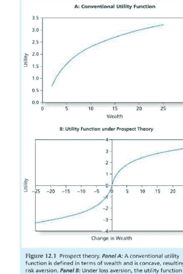

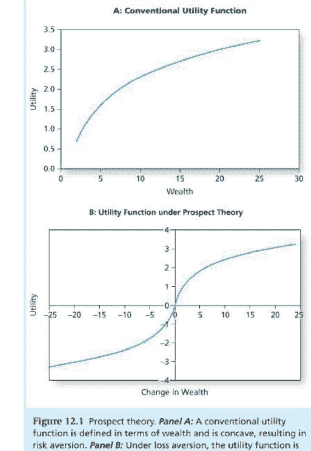

## 套利限制

- 如果理性套利者能够充分利用行为投资者的失误，那么行为偏差并不会对股票定价产生影响。
- 基本面风险：
  - 市场维持非理性的时间可能会长到你失去偿付能力。
  - 股票价格可能需要相当长的时间才能回归到其真实价格。

## 执行成本：

交易成本和卖空期限可能会对套利活动产生限制。

## 模型风险：

你可能使用了错误的模型，而实际上的股票价格可能是正确的。

## 套利限制和一价定律

- 连体双婴公司
  - 皇家荷兰的股票售价是壳牌运输的1.5倍。
  - 其相对价值在很长一段时间内都偏离了这个比例。
  - 基本面风险的例子

## 图12.2 皇家荷兰与壳牌运输的价格比值 (与平价比率的偏离)


图 12.2 皇家荷兰相对于壳牌的定价（与平价的偏离）

来源: O. A. Lamont and R. H. Thaler, "Anomalies: The Law of One Price in Financial Markets," Journal of Economic Perspectives 17 (Fall 2003), pp. 191–202.

## 泡沫与行为经济学

- 泡沫在结束后才更容易被发现。
  - 互联网泡沫
  - 房价泡沫

## 泡沫与行为经济学

- 股票市场泡沫的理性预期使用了股利贴现模型：
  
  $$PV_0 = \frac{D_1}{k - g}$$

- 如果股利增长率是8%（接近于2000年的实际价值），标准普尔500指数的股利总计是12,883百万美元。

- 如果股利增长率是7.4%（接近于2002年的实际价值），标准普尔500指数的股利总计是8,589百万美元。

## 技术分析与行为金融

技术分析试图发掘股价的波动周期和可以预测的股价走势。

- 价格逐渐调整到一个新的均衡点。
- 市场价格逐渐接近真实价值。

## 处置效应：投资者倾向于持有已亏损的投资组合。

- 对公司股票价格的需求取决于股票的历史价格。
- 会导致股票价格的动量效应。

## 技术分析的定义

简单地说，技术分析是从证券市场行为来分析和预测证券将来的行为，不考虑别的因素。所谓市场行为包括三个方面的内容：第一是市场的价格，第二是成交量，第三是达到这些价格和成交量所用的时间。

技术分析的理论基础是建立在以下三个假设之上的。

- 第一，市场 的行为包含一切信息
- 第二，价格沿趋势移动
- 第三，历史会重复

## 技术分析的要素—价、量、时空

价格和成交量

第一，成交量是推动股价涨跌的动力。

第二，量价背离是市场逆转的信号。

第三，成交量密集区对股价运动有阻尼作用。

第四，成交量放大是判断突破有效性的重要依据。

观测成交量与指数变化的关系

## 系统　功能　报价　分析　期货行情　资讯　工具　帮助

上证指数周线,前复权 MA5: 2110.35 MA10: 2084.02 MA20: 2059.18 MA60: 2247.62

T: 3186.72


VOLUME: 4726794.00 MA5: 4519193.50 MA10: 3798975.25


MACD(12,26,9) DIF: -29.32 DEA: -52.13 MACD: 45.62


- 指标：横板　全部　MACD　DMI　DMA　FSL　TRIX　BRAR　CR　VR　OBV　ASI　EMV　VOL-TDX　RSI　WR　SAR　KDJ　CCI　ROC　MTM　BOLL　PSY　MCSI

## 趋势与修正：
找寻价格的动量效应

## 道氏理论

1. 基本趋势/主要趋势: 股价的长期趋势，持续时间从几个月到几年不等。
2. 二级趋势或中间趋势: 价格对目标趋势线的短期偏离，当价格回归到趋势值时，这些偏离就会消失。
3. 三级趋势或次要趋势: 几乎不重要的日波动。

## 图12.3 道氏理论趋势


**图 12.3** 道氏理论趋势

来源: From “Dow Theory” by Melanie Bowman and Thom Hartle, *Technical Analysis of Stocks & Commodities*, Vol. 8, No. 9 (Sept. 1990). Copyright © 1990, Technical Analysis, Inc. Used with permission.

## 图形分析

## ✓ K线分析

K线是用开盘价、收盘价、最高价和最低价绘制而成，上涨为阳，下跌为阴。

K线可以分为日K线、周K线、月K线等，也可以细分为小时K线和半小时K线等。

## 阳线、阴线


## K线的几种常见形态

1.光头光脚小阳线

此形态表示最低价与开盘价相同，最高价与收盘价相同，上下价位窄幅波动，表示买方力量逐步增加，买卖双方多头力量暂时略占优势。此形态常在上涨初期、回调结束或盘整的时候出现。

## 2、光头光脚小阴线

此形态表示开盘价就是最高价，收盘价就是最低价，价格波动幅度有限，表示卖方力量有所增加，买卖双方空方力量暂时略占优势。此形态常在下跌初期、横盘整理或反弹结束时出现。


## 3、光头光脚长阳线

没有上下影线，表示多方走势强劲实力占绝对优势，空方毫无抵抗。经常出现在脱离底部的初期回调线结束后的再次上涨，及高位的拉升阶段，有时也在严重超跌后的大力度反弹中出现。


## 4、光头光脚长阴线

没有上下影线，表示空方走势强劲，卖方占绝对优势，多方毫无抵抗。经常出现在头部开始下跌的初期，反弹结束或最后的打压过程中。


## 5、带上影线的阳线

这是上升抵抗型，表示多方在上攻途中遇到了阻力。此形态常出现在上涨途中、上涨末期或股价从底位启动遇到密集成交区，上影线和实体的比例可以反映多方遇阻的程度。上影线越上，表示压力越大,阳实体的长度越长，表示多方的力量越强。


## 6、带上影线的阴线

表示股价先涨后跌，庄家拉高出货常会出现此种形态。黑色实体越长，表示卖方实力越强。常出现在阶段性的头部，和震仓洗盘中。


## 7、带下影线的阳线

这是先跌后涨型，反映股价在低位获得买方支撑，卖方受挫。常出现在市场底部或市场调整完毕。


## 8、带下影线的阴线

这是下跌抵抗型，表示空方力量强大，但在下跌途中一定程度上受到买方的抵抗。常出现在下跌途中、市场顶部或振荡行情中。


## 10、带上下影线的阴线

表示上有压力，下有支撑，总体空方占优，阴线实体越长，表明空方做空的力量越大。常出现在市场顶部，或下跌途中。


## 12、“T”字形

表示开盘价和收盘价相同，下影线表示下方有一定支撑。“T”字形常出现在市场的底部或顶部。


## 13、倒 “T”字形

表示开盘价和收盘价相同，上影线表示上方有一定的压力，常出现在市场的顶部或横盘整理中。


## 14、 “一”字形

此种形态常出现在股价涨停板或跌停板的时候，表示多方或空方绝对占优，被封至涨停或跌停的位置。

## 形态分析

- 1. 头肩顶和头肩底
- 2. 双重顶和双重底
- 3. 三角形
- 4. 旗形


头部

左肩

右肩

颈线

成交量呈递减

该股在跌破颈线后，股价就一路下滑


图表顶部可见技术指标文字：A：H5880.22，N H5860.74，CDP：S581.09，N L5831.61，A L5821.96。

右侧价格刻度约为 5400、5460、5520、5580、5640、5700、5760、5820、5880、5940、6000。

图中标注数值：6049.22。

图中标注数值：5375.40。

下方成交量区域文字：VOLUME：20027，6 MA：25123，12 MA：27414，24 MA：30668。

成交量图右侧刻度约为 47408、23704、0。

- 横轴日期标记：1、7、8、9、10、11、14、15、16、17、18、21、22、23、24、25、28、29。

底部指标文字：SPRC：低位，F2：金叉，F3：弱势，F5：买点，F8：超卖，F9：底部，F10：弱势。


上升三角形

对称三角形

下降三角形

扩散三角形

## 旗形

## 尖旗形

## 趋势和修正：移动平均

- - 在一定期间内指数的平均水平。
- - 牛市信号：股票价格从低位上穿突破移动平均线，购买股票的时机。
- - 熊市信号：股票价格跌到移动平均之下，出售的时机。

## 图12.5 移动平均线（惠普公司）


## 图12.5 惠普公司（HPQ）的移动平均线

来源：Yahoo! Finance，2009年11月1日（finance.yahoo.com）。经Yahoo! Inc.许可转载。© 2009 by Yahoo! Inc. Yahoo! 和 Yahoo! 标志是 Yahoo! Inc. 的商标。

## 趋势与修正: 宽度

宽度:常用的测量方法是计算价格出现上涨的股票数量和出现下跌的股票数量之差。

交易日记：成交量、上涨家数、下跌家数
市场日记 美国东部时间 11/02/09 下午4.02
| 问题 | 纽约证券交易所 | 纳斯达克 | 美国证券交易所 |
|---|---|---|---|
| 上涨 | 1,604 | 1,277 | 234 |
| 下跌 | 1,434 | 1,414 | 223 |
| 未变 | 97 | 108 | 67 |
| 总计 | 3,135 | 2,799 | 524 |
| 问题在 |  |  |  |
| 新52周高点 | 28 | 25 | 4 |
| 新52周低点 | 14 | 65 | 10 |
| 股份成交量 |  |  |  |
| 总计 | 1,504,894,769 | 2,397,479,912 | 18,612,688 |
| 上涨 | 795,587,220 | 1,226,163,683 | 9,216,888 |
| 下跌 | 681,280,499 | 1,121,231,398 | 7,688,900 |
| 未变 | 28,027,050 | 50,084,831 | 1,706,900 |

图12.7 市场日记
来源：《华尔街日报》在线，2009年11月2日。经Dow Jones & Company, Inc.通过Copyright Clearance Center, Inc.许可转载。© 2009 Dow Jones & Company, Inc. 保留所有权利。

## 情绪指标: Trin 统计量

- - Trin 统计量:
- 

trin = (下跌股票的成交量 / 下跌的股票数) / (上涨股票的成交量 / 上涨的股票数)

Trin统计量大于 1.0 视为熊市

## 情绪指标: 信心指数

- - **信心指数**：高评级的10家公司债与中评级的10家公司债的平均收益率之比。

- - 高信心指数是一个牛市信号。

## 情绪指标: 看涨/看跌期权比率

- - 看涨期权是买入股票的权利。
- - 预期股价会上涨
- - 看跌期权是卖出股票的权利。
- - 预期股价会下跌

- - 该比率的增加是投资者悲观情绪和市场下跌的信号。
- - 反向投资者认为该比率的上升是较好的买入时机！

## 实例分析

# 第17章 宏观经济分析与行业分析

## 17.1.2 基本分析的内容

基本分析方法认为证券的内在价值表现为向投资者提供未来的收益，因而这种方法完全建立在对未来的基本经济要素及其供求关系的预测基础上。基本分析方法认为公司的业绩取决于公司运营的经济环境，取决于各种投入资源的供求价格，取决于公司产品或服务的供求价格。因此，基本分析的内容包括宏观经济、行业和公司三个层次的系统分析。

## 17.2 宏观政治经济分析

## 17.2.1 政治因素分析

政治不但是经济的集中表现，而且还深刻影响着经济。一国的政局是否稳定对证券市场有着直接影响。一般而言，政局稳定则证券市场稳定运行；相反，政局不稳则常常引起证券市场价格下跌。政治因素对证券价格带来的影响往往具有突发性，它们来得突然，变化迅速，很难预测。政治因素包括的内容十分广泛，诸如政府更迭、国内战争、民族冲突、国内罢工、政治丑闻、重要政府官员的更换等。

## 二 经济因素分析

## （一） 国内生产总值变动对证券市场的影响

GDP是一国经济成就的根本反映，持续上升的GDP表明国民经济良性发展，制约经济的各种矛盾趋于或达到协调，人们有理由对未来经济产生好的预期；相反，如果GDP处于不稳定的非均衡增长状态，暂时的高产出水平并不表明一个“好的经济形势”，不均衡的发展可能激发各种矛盾，从而导致一个大的经济衰退。证券市场作为经济的“晴雨表”，对GDP的变动的反映是敏感而复杂的。

- 1. 持续、稳定、高速的GDP增长有利于证券市场的持续上升。
- 2. 高通胀下的GDP增长不利于证券市场。
- 3. 宏观调控下的GDP减速增长。
- 4. 转折性的GDP变动。


## （二）通货膨胀对证券市场的影响

通货膨胀的原因以及它对经济的影响是一个十分复杂的问题，而政府对通货膨胀进行控制的宏观政策往往只能以一定的代价（比如增加失业率）来实现。

- 1、通货膨胀对股票市场的影响。
- （1）温和的、稳定的通货膨胀对股价的影响较小。
- （2）如果通货膨胀在一定的可容忍范围内增长，而经济处于景气（扩张）阶段，产量和就业都持续增长，那么股价也将持续上升。
- （3）严重的通货膨胀导致股价下跌。
- （4）政府对通货膨胀的干预导致股价下跌。
- （5）通货膨胀时期并不是所有股票价格都下跌。
- （6）通货膨胀不仅产生经济影响，还可能产生社会影响，并影响公众的心理和预期，从而对股价产生影响。
- （7）通货膨胀使各种商品价格具有更大的不确定性。
- （8）通货膨胀对企业（公司）的微观影响。

## 2、通货膨胀对债券市场的影响

- （1）通货膨胀提高了对债券收益率的预期，从而引起债券价格下跌。
- （2）适度通货膨胀下，人们企图通过投资于债券实现资金保值，从而使债券需求增加，价格上涨。
- （3）未预期的通货膨胀增加了企业经营的不确定性，降低了还本付息的保证，从而债券价格下跌。
- （4）过度通货膨胀，将使企业经营困难甚至倒闭，同时投资者将资金转移到实物资产的交易上寻求保值，债券需求减少，债券价格下跌。

## （三）利率对证券市场的影响。

- 1. 利率上升，公司借款成本增加，利润率下降，股票价格下跌。
- 2. 利率上升，将使得负债经营的企业经营困难，经营风险增大，从而公司债券和股票价格都将下跌。
- 3. 利率上升，债券和股票投资机会成本增大，从而价值评估降低，导致价格下跌。
- 4. 利率上升，吸引部分资金从证券市场转向储蓄，导致证券需求下降，证券价格下跌。
- 5. 实行保值补贴储蓄政策，大量资金将流向储蓄，证券市场特别是股票市场倍受冷落。

## （四）关于汇率对证券市场的影响。

- （1）汇率上升，本币贬值，本国产品竞争力强，出口型企业将增加收益，因而企业的股票和债券价格将上涨；相反依赖于进口的企业成本增加，利润受损，股票和债券价格下跌。
- （2）汇率上升，本币贬值，将导致资本流出本国，导致证券价格下跌。
- （3）汇率上升，本币表示的进口商品价格提高，带动国内物价水平上涨，引起通货膨胀，要具体分析。
- （4）汇率上升时，政府可能利用债市与汇市的联动操作，达到既控制汇率的升势，又不减少货币供应量，即抛售外汇，同时回购国债，则将使国债市场价格上扬。

## 17.3 经济周期分析

宏观经济周期一般经历四个阶段，即复苏、繁荣、衰退、萧条。证券市场综合了人们对于经济形势的预期，这种预期较全面地反映了有关经济发展过程中表现出的有关信息，特别是经济中人的切身感受，这种预期又必然反映到投资者的投资行为中，从而影响证券市场的价格。

## 经济周期对投资的影响

- 经济增长由于投资等因素的影响会呈现出周期性的变化。当经济处于经济周期的不同阶段时，不同行业的业绩可能会有很大的差异。
- 一般的说，需求弹性较小的行业对周期的敏感程度较低，需求弹性较大的行业对周期的敏感程度较高。
- 当宏观经济从繁荣步入萧条或衰退时，那些对经济周期敏感程度较低的行业受影响较小，这些行业的公司股票价格的变化相对会较小。那些对经济周期敏感程度较高的行业会受较大的影响，这些行业的公司股票价格的变化会大得多。

## 经济周期的指标体系

- 这个指标体系分三部分，一部分被认为是
可以预先显示未来经济周期变化的指标，
被称作先行经济指标(leading economic indicators)，一部分被认为是与经济周期变化同步出现的指标，被称作同步指标(Coincident indicators)，一部分被认为是在经济周期变化之后才会出现的指标，被称作滞后指标(lagging indicators)。

## 经济周期的指标体系（2）

- 先行指标包括
  ① 生产工人(制造业)平均周工作时数；
  ② 初次申请失业保险的人数；
  ③ 制造商的新定单(消费品与原材料行业)；
  ④ 零售业绩；
  ⑤ 对工厂与设备的合同与定单数；
  ⑥ 允许开工的私人住宅单位数量；
  ⑦ 10年国债利率减去联邦基金利率的利差；
  ⑧ 标准普尔500股票指数；
  ⑨ 货币供给量；
  ⑩ 消费者预期指数。

## 经济周期的指标体系（3）

- 同步指标包括
  1. 非农业工资名册中的雇员人数；
  2. 减去转移支付的个人收入；
  3. 工业产量；
  4. 制造品产量与销售额。

美国：

P364 图17-4 先行、同步与滞后指标指数

经济指标公布日历：p365

## 17.4 经济政策分析

### 17.4.1 货币政策

中央银行主要通过三大货币政策工具来实现对宏观经济的调控，即存款准备金率、再贴现率和公开市场操作。

从总体上来说，松的货币政策将使得证券市场价格上扬，紧的货币政策将使证券市场价格下跌。松的货币政策主要体现为货币供应量增加：

- （1）为企业生产发展提供充足的资金，利润上升，从而股价上升。
- （2）社会总需求增大，刺激生产发展，同时居民收入得到提高，因而对证券投资的需求增加，证券价格上涨。
- （3）银行利率随货币供应量增加而下降，部分资金从银行转移出来，流向证券市场也将扩大证券市场的需求；同时利率下降还提高了证券价值的评估。
- （4）货币供应量的增加将引发通货膨胀，适度的通货膨胀或通胀初期有利于证券价格上涨，持续的通胀将恶化经济环境，令证券价格下跌。

## 四 经济政策分析

### 17.4.2 财政政策

财政政策是通过财政收入和财政支出的变动来影响宏观经济活动水平的经济政策。财政政策的主要手段有三个：一是改变政府购买水平；二是改变政府转移支付水平；三是改变税率。

松的财政政策及其对证券市场的影响是：

- （1）减少税收，降低税率，扩大减免税范围。
- （2）扩大财政支出，加大财政赤字。
- （3）减少国债发行。
- （4）增加财政补贴。

紧的财政政策的经济效应正好相反。

## 四 经济政策分析

实现中长期财政目标的运作及其对证券市场的影响。

- （1）按照国家产业政策和产业结构调整的要求，在预算支出中优先安排国家鼓励发展的产业的投资。
- （2）运用财政贴息、财政信用支出以及国家政策性金融机构提供投资或担保，支持高新技术产业和农业的发展。
- （3）通过合理确定国债规模，吸纳部分社会资金，列入中央预算，转作政府的集中性投资，用于能源、交通的重点建设。
- （4）调整和改革整个税制体系，或者调整部分主要税制，以实现对收入分配的调节。

## 通胀上升

## 通胀下降

## 经济增长

## 经济增长放缓

## 股市马经


| 经济周期 | 资产表现与配置特征 |
|---|---|
| 复苏期 | 商品价格上涨，现金贬值；股票为主，经济加速 |
| 过热期 | 经济高位运行，现金贬值；股票为主，通胀加剧 |
| 滞胀期 | 经济放缓，现金贬值；商品为主，股票承压 |
| 衰退期 | 经济低迷，现金增值；债券为主，商品疲软 |

## 17.5 行业分析

单个企业的命运总是和它所从事行业的命运息息相关，因而深入的行业分析是证券分析取得成功的先决条件。行业是指一个企业群体，在这个企业群体中，各成员企业由于其产品（包括有形与无形）在很大程度上的可相互替代性而处于一种彼此紧密联系的状态，并且由于产品可替代性的差异而与其他企业群体相区别。

### 17.5.1 行业分类

（一）按行业生命周期分类

行业生命周期是最常用的划分依据，它能够反映出一个行业发展历程。在这种方式下，行业被从始到终划分为初创期、成长期、成熟期和衰退期4个阶段。

- 初创期是行业生命周期中风险最大的阶段。初创期的行业正在努力为它的产品建立市场，对流动资金和固定资产有大量的需求，但经营仍处在亏损阶段或只是稍有盈利。

- 第二阶段是成长期。典型的成长期行业都能刺激出消费者尚未意识到的产品需求。成长期的企业能够脱离经济周期的影响而独立趋向繁荣。
- 成熟阶段是行业发展的巅峰阶段。在这一时期，通过激烈的市场竞争和优胜劣汰而生存下来的少数大厂商基本上垄断了整个行业的市场，每个厂商都占有一定比例的市场份额，由于彼此势均力敌，市场份额比例发生变化的程度较小，因此，成熟阶段也是行业发展的稳定阶段。
- 生命周期最后一个阶段是衰退期。该阶段行业产品的需求稳步下降，剩余的竞争者在缩小的市场上相互争夺，销售下降，价格下跌，利润降低。


价格

销售额

利润

初创期

成长期

成熟期

衰退期

# （二）按对经济周期的反应分类

以行业对经济周期的不同反应方式进行分类。在经济周期的每一阶段，都会有一些行业比其他行业更加繁荣。行业在经济周期中的行为方式可将它们区分为三类：增长性、防御性和周期性

# （三）按市场结构分类

行业在经济周期中的行为模式及其特征

| 行为模式 | 特征 |
|---|---|
| 增长性 | 销售和利润独立于经济周期而超常增长。 |
| 防御性 | 在经济周期的上升和下降阶段经营状况都很稳定。 |
| 周期性 | 收益随经济周期的变化而变化，通常会夸大经济的周期性。 |

# （三）按市场结构分类

按照市场竞争程度的不同，从厂商数目，产品差别程度，厂商对产量和价格的控制程度及厂商进入市场的难易程度这些特点，可以将行业分为完全竞争、完全垄断、垄断竞争和寡头垄断四种类型。

# 按市场结构分类的行业类型及其特点

| 行业类型 | 厂商数目 | 产品差异程度 | 个别厂商控制价格程度 | 厂商进入行业难易 | 现实中接近的行业 |
|---|---|---|---|---|---|
| 完全竞争 | 很多 | 无差别 | 没有 | 完全自由 | 农业 |
| 垄断竞争 | 较多 | 有些差别 | 有一些 | 比较自由 | 零售业 |
| 寡头垄断 | 几个 | 有或没有差别 | 相当有 | 有限 | 汽车制造业 |
| 完全垄断 | 一个 | 唯一产品无替代品 | 很大，但常受政府管制 | 不能 | 公用事业 |

# （四）中国证监会《上市公司行业分类指引》

1.分类原则与方法

以上市公司营业收入为分类标准，所采用财务数据为经会计师事务所审计的合并报表数据。有主业（某类营业收入〉50%）和综合类

2.编码方法

《指引》将上市公司的经济活动分为门类、大类两级，中类作为支持性分类参考。

3.实施办法

证券交易所负责分类指引的具体执行。

# 17.5.2 行业竞争性分析

新的竞争对手入侵、替代品的威胁、客户的侃价能力、供应商的侃价能力，以及现存对手之间的竞争这五种竞争的作用力决定了一个行业的利润率。

+   1. 新进入者的威胁
+   
+   行业的新进入者会对价格和利润造成巨大的压力，甚至当其他公司还未真正进入该行业时，进入威胁也会对价格施加压力。

+   2. 现有企业之间的竞争
+   
+   当在某一行业中存在一些竞争者时，由于它们力图扩大各自的市场份额，于是市场中会出现价格战，从而降低了利润。

# 二 行业竞争性分析

# 5. 卖方的侃价能力

如果关键投入品的供应厂商在行业中处于垄断地位，它就能对这件产品索取高价，进而从需求方行业中赚取高额利润，决定卖方侃价能力的关键因素是需求方能否得到相关的替代品。

# 17.5.3 影响行业的外部因素

技术因素：技术进步一方面创造新产品，开拓新领域，从而使新行业不断出现；另一方面也创新新工艺，推动现有行业的技术升级。当今世界上许许多多的行业都是技术进步的结果，而另一些行业在技术进步的冲击下衰落或消亡。对于技术因素的分析，首先关注行业的可生存性。分析CD播放机与唱片机、数码相机与胶卷相机、隐形眼镜技术与框架眼镜业、电子表与机械表。其次关注外部技术对本行业的影响，民用航空技术的发展与旅游业的关系。

政府因素：政府影响和干预经济的目的在于维护经济的公平和自由竞争，保证经济的健康运行和发展。国家对某一行业的扶持或限制，常常意味着这一行业有更多更快的发展机会，或者被封杀了发展的空间。国家行业政策具有显著的导向作用。关注清洁能源、环保、旅游、商贸、及各类服务业。

+   > 社会因素：关注生活方式和流行趋势。生活方式如老龄化会带来医疗保健业的繁荣，社会养老产业的兴起。流行趋势的预测如服装业、娱乐业、动漫游戏等，一般时期较短、预测难度较高。
+   > 国外因素：外贸出口与美国经济的关系，贸易保护主义的抬头等。

# （二）行业集中

行业集中包括两个方面的含义：一个是指骨干企业规模的扩大即行业的绝对集中；另一个是指骨干企业在整个行业规模中的比重增大，即行业的相对集中。

1. 行业绝对集中的衡量指标，它既要考虑行业内企业个数的多少，又要考虑行业内企业的大小分布。设某行业有n个企业，各企业产量为Xi，行业总产量为∑Xi，第i个企业的市场占有份额为Si，即Xi/∑Xi，则有以下主要绝对集中衡量指标。

+   （1）企业数的倒数。1/n
+   （2）集中比。最大r个企业所占市场份额。

# 洛伦茨曲线可用来表明行业的相对集中程度。


# 造成行业零散的原因主要有：

+   1. 进入壁垒低；
+   2. 不存在规模经济或经验曲线；
+   3. 高运输成本；
+   4. 高库存成本或不稳定的销售；
+   5. 多种市场需求；
+   6. 高度的产品歧异化；
+   7. 退出壁垒高；
+   8. 地方法规或政府禁止；
+   9. 新行业。

如果一个零散的行业变成一个集聚的行业，那么必然会产生一家或几家在行业中占据绝对优势的企业，这就蕴含着巨大的投资机会。

# 七大战略性新兴产业

+   - 在 “节能环保” 中，将重点突破高效节能、先进环保、循环利用；
+   - “新兴信息产业” 将聚焦下一代通信网络、物联网、三网融合、新型平板显示、高性能集成电路和高端软件；
+   - “生物产业” 将主要面向生物医药、生物农业、生物制造；
+   - “新能源” 中，核能、太阳能、风能、生物质能将领衔；
+   - 此前备受关注的 “新能源汽车”，主要发展方向确定为插电式混合动力汽车和纯电动汽车；
+   - “高端装备制造业” 领域，提出了重点发展航空航天、海洋工程装备和高端智能装备；
+   - “新材料” 中分列了特种功能和高性能复合材料两项。

# “中国制造2025”十大重点发展领域

新一代信息技术、高档数控机床和机器人、航空航天装备、海洋工程装备及高技术船舶、先进轨道交通装备、节能与新能源汽车、电力装备、新材料、生物医药及高性能医疗器械、农业机械装备。

# 第18章

# 权益估价模型

# 估值: 基本面分析

+   - 基本面分析是一种通过公司当前和未来盈利能力来评估公司真实价值的模型。
+   - 基本面分析的目的是发现被误定价的股票，股票的真实价值可以从一些可观测到的财务数据中得出。

# 比较估值

+   - 公司的价值比率与行业平均水平相比较
+   - 股价/销售收入这一比率对评估处于起步阶段的公司和行业很有用，因为他们通常还没有正的收益。
+   - P379 微软公司的估值案例

# 账面价值的局限性

+   - 账面价值建立在历史成本之上，并不是真正的市场价值。
+   - 尽管这种情况不常见，但总有一些公司的市场价值小于其账面价值。（观测实时行情）
+   - 每股清算价值是其“底线”或最小值。
+   - 托宾q值是市值与重置成本的比值。

# 内在价值与市场价格

+   股票收益是由现金股利和资本利得或损失构成的。

期望收益率 = E(r) = \frac{E(D_1) + [E(P_1) - P_0]}{P_0}

+   期望收益率可能高于或低于基于股票风险的必要收益率。

# 必要收益率

+   - 资本资产定价模型可以用来估计必要收益率k:
+   
+     $$k = r_f + \beta\left[E(r_M) - r_f\right]$$
+   - 如果股价定价是正确的，k就等于期望收益率。
+   - k是市场资本化率。

# 内在价值与市场价格

+   - 内在价值(IV) 是基于模型估计的真实价值。
+   - 市场价格(MV) 是所有市场参与者达成共识的价格。

交易信号：
IV > MV 购买
IV < MV 出售或卖空
IV = MV 持有或公平的定价

P381 检查18-1

# 概念检查 18-1

预期一年后股票 IBX 的股价为每股 59.77 美元，其当前市场价格为每股 50 美元，且你预期公司会派发每股 2.15 美元的股利。

+   a. 该股票的预期股利收益率、股价增长率和持有期收益率各是多少？
+   
+   b. 若该股票的 β 值为 1.15，无风险收益率为 6%，市场投资组合的期望收益率为 14%，则股票 IBX 的必要收益率为多少？
+   
+   c. 股票 IBX 的内在价值是多少？其与市场价格相比是高还是低？


## 18-1

a. 股利收益率 = 2.15/50 = 4.3%  
资本利得收益率 = (59.77 − 50)/50 = 19.54%  
总收益率 = 4.3% + 19.54% = 23.84%

b. k = 6% + 1.15(14% − 6%) = 15.2%

c. V₀ = (2.15 + 59.77) / 1.152 = 53.75（美元），超过了市场价格，意味着应该买入该股票。

## 18-2

a. D₁/(k − g) = 2.15/(0.152 − 0.112) = 53.75（美元）

b. P₁ = P₀(1 + g) = 53.75 × 1.112 = 59.77（美元）

c. 预期的资本利得等于 59.77 − 53.75 = 6.02（美元），资本利得收益率等于 11.2%，股利收益率 $D_1/P_0=2.15/53.75=4\%$，持有期收益率等于 $4\%+11.2\%=15.2\%$。

## 股利贴现模型（DDM）

V₀ = D₁/(1+k) + D₂/(1+k)² + D₃/(1+k)³ + …

- V₀ = 现值；Dₜ = 时间 t 的股利；k = 必要收益率
- 股利贴现模型认为股票价格应等于预计未来无限期内所有股利的现值之和。

## 固定增长的股利贴现模型

V₀ = D₀(1 + g) / (k − g) = D₁ / (k − g)

g = 股利增长率

推导见 P382。

### 例18.2 固定增长的股利贴现模型

刚派发了每股3美元的年度股利，预期股利将以8%的固定增长率增长，从资本资产定价模型计算的市场资本化率是14%。

$$V_0=\frac{D_1}{k-g}=\frac{\$3.24}{.14-.08}=\$54$$

## 固定增长的股利贴现模型的含义

- 在下列情形下固定增长的股利贴现模型意味着股票价值将会越大：
  1. 预期的每股收益越高
  2. 市场资本化率 k 越小
  3. 预期的股利增长率越高
- 股价与股利将按同样的增长率增长。
- P384 检查 18-2

## 估计股利增长率

$g = ROE \times b$

$g$ = 股利增长率  
$ROE$ = 公司的投资回报率  
$b$ = 盈余再投资率或称作收益留存率

- a. 假设某公司的盈余再投资率为60%，净资产收益率为20%，当前的每股收益EPS为5美元，k=12.5%，计算该公司的股价。
- b. 若该公司的净资产收益率小于市场资本化率，为10%，股价应为多少？将该公司股价与有相同ROE和EPS，但盈余再投资率b为0的公司股价做比较。

### 18-3

a. $g=ROE\times b=20\%\times0.60=12\%$  
$D_1=0.4\times E_1=0.4\times5=2$（美元）  
$P_0=2/(0.125-0.12)=400$（美元）

b. 当公司投资 ROE 低于 $k$ 的项目时股价会下跌。若 $b=0.60$，那么 $g=10\%\times0.60=6\%$，$P_0=2/(0.125-0.06)=30.77$（美元）。而若 $b=0$，则 $P_0=5/0.125=40$（美元）。

## 图 18.1 两种盈余再投资政策下的股利增长情况


图 18.1 两种盈余再投资政策下的股利增长情况

## 增长机会价值

- 公司的价值等于公司现有资产的价值之和，或者是零增长公司的价值
- 加上公司所有未来投资的净现值
- **这被称作增长机会价值（PVGO）。**
- 股价 = 零增长公司的股价 + 增长机会价值

$P_0 = \frac{E_1}{k} + PVGO$

### 例18.4 增长机会

- 公司把盈余的60%再投资于净投资收益率ROE仅为10%的项目，市场资本化率是15%，年末派发的股利是每股2美元，每股盈利是5美元。

- g = ROE × b = 10% × 0.6 = 6%

$$P_0 = \frac{\$2}{.15-.06} = \$22.22$$

## 价格收益乘数与增长机会

- PVGO 与 E / k 的比率就是公司价值中增长机会贡献的部分与现有资产贡献的部分（即零增长模型中公司的价值 E / k）之比。

$$\frac{P_0}{E_1} = \frac{1}{k}\left(1 + \frac{PVGO}{E/k}\right)$$

- 当 PVGO = 0，P₀ = E₁/k，即用零增长年金来对股票进行估值。
- P/E 会随着 PVGO 的增加而迅速上升。
- 高市盈率表示公司拥有大量增长的机会。

市盈率 P/E：

- 市盈率随着 ROE 的增加而增加
- 只要 ROE > k，市盈率随着再投资率的增加而增加

P₀/E₁ = (1 − b)/(k − ROE × b)

## 表 18.3 ROE 和再投资率对增长率和市盈率的影响

表 18.3 ROE 和再投资率对增长率和市盈率的影响

| Plowback Rate (b) | 0 | 0.25 | 0.50 | 0.75 |
|---|---:|---:|---:|---:|
| **ROE** | **A. Growth rate, g** |  |  |  |
| 10% | 0 | 2.5% | 5.0% | 7.5% |
| 12% | 0 | 3.0% | 6.0% | 9.0% |
| 14% | 0 | 3.5% | 7.0% | 10.5% |
| **B. P/E ratio** |  |  |  |  |
| 10% | 8.33 | 7.89 | 7.14 | 5.56 |
| 12% | 8.33 | 8.33 | 8.33 | 8.33 |
| 14% | 8.33 | 8.82 | 10.00 | 16.67 |

Assumption: k = 12% per year.

假设：k = 每年 12%。

## 市盈率与股票风险

- 公司风险越高，必要收益率 k 越高，因此，市盈率会越低：

$$\frac{P}{E}=\frac{1-b}{k-g}$$

## 市盈率分析中的陷阱

- 使用会计利润
  - 盈余管理
  - 公认会计准则（GAAP）的选择
- 通货膨胀
- 报表中的利润随商业周期曲线的变化上下波动。

## 图18.3 标准普尔500指数的市盈率和通货膨胀率


图 18.3 标准普尔 500 指数的市盈率和通货膨胀率

## 图 18.4 两家公司的每股收益增长情况


## 图 18.6 2007年不同行业的市盈率


图 18.6 不同行业的市盈率

资料来源：数据收集自 Yahoo! Finance，2010 年 1 月 5 日。

## 其他的比较估值比率

- 市净率
- 股价现金流比率
- 股价销售额比率

## 图 18.7 市场估值统计


图 18.7 市场估值统计

## 自由现金流估值方法

- 用加权平均资本成本对公司自由现金流进行贴现来估计公司价值。
- 公司自由现金流FCFF，等于：
  - 税后现金流
  - 加上折旧
  - 减去资本化支出
  - 减去净营运资本投资


## 估值模型的比较

- 实务中
  - 根据这些模型得出的估值可能会不同
  - 分析师不得不简化一些假设

## 整体股票市场

- 解释过去的行为
- 预测股票市场

## 表 18.4 不同情境下对标准普尔500指数的预测

|  | 最可能情景 | 悲观情景 | 乐观情景 |
|---|---|---|---|
| 国债收益率 | 3.70% | 4.70% | 2.70% |
| 盈利收益率 | 5.70% | 6.70% | 4.70% |
| 结果市盈率 | 17.54 | 14.93 | 21.28 |
| EPS预测 | 70 | 70 | 70 |
| S&P 500预测 | 1,228 | 1,045 | 1,489 |

# Table 18.4
在各种情境下对标准普尔500指数的价格预测

对标准普尔500指数盈利收益率的预测等于国债收益率加上2%。市盈率是预测盈利收益率的倒数。

## 琼斯关于估值的一些最终想法

股票估值即使在最佳条件下也很困难。我们必须作出判断，但是变量依靠估计。没有人准确地知道对于特定的股票应该使用哪个估值模型。根本无法证明一名投资者对一个估值模型的计算是否正确（尽管有很多人会评判很多计算是“合理”的或是“不合理的”）股票估值总是，而且也将继续是一门艺术，而不是一门科学。错误总在前方等着你。

万千分析说到底，股票必须值得投资者去购买。估值可能会跟不上趟，而市场价格总是最终的胜利者。

【案例】谷歌在2004年以85美元的价格上市，这个价格在当时很多人看来很荒唐。2005年3月，股票价格翻了3倍。2007年年末，股票价格为每股700美元，但是在2008年年初跌到500美元以下。2011年年末，它从500美元变化到600美元。谷歌的股票究竟价值多少？谁知道？（当前复权大约2000美元）

1. Grieb电子公司在过去几年快速增长。现阶段的股利为2美元，并预期三年中以每年20%的快速增长率增长。在这之后，Grieb增长将放缓，在无限期未来股利增长率以更为正常的7%的速度增长。因为快速增长中涉及的风险因素，期望收益率是22%。计算Grieb电子公司的隐含价格。

2. 你今天可以以每股85美元的价格购买Anoruo公司的股票。
下一年它预计支付每股2美元的股利。你认为明年的股价将是90.5美元。基于以上信息，计算Anoruo内在收益率？展示如何使用两种方法得到相同的结果。

3. Parker牙科设备供应公司的股价是每股36美元，估计最近12个月的每股盈利是3美元，股利支付率为50%。

- (1) Parker现在的市盈率是多少？
- (2) 如果一个投资者估计期望收益的年增长率为10%，如果市盈率保持不变，下一年的预期价格是多少？
- (3) 如果股利支付保持不变，股利增长率为10%，投资者的必要收益率为16%，这个股票是否值得购买？
- (4) 如果预期利率将下降，对Parker的市盈率的影响是怎样的？

# 第二十四章

## 投资组合绩效评价

## 时间加权收益率与美元加权收益率

## 时间加权收益率

- 几何平均收益率又被称为时间加权收益率。
- 每一期的收益率权重相同。

$$(1+r_G)^n=(1+r_1)(1+r_2)\cdots(1+r_n)$$

## 时间加权收益率与美元加权收益率

## 美元加权收益率

- 考虑向投资组合注入或抽出资金的内部回报率。
- 每一阶段投资收益的加权：

$$PV = \frac{C_1}{(1+r)^1} + \frac{C_2}{(1+r)^2} + \cdots \frac{C_n}{(1+r)^n}$$

## 多期收益的示例

P629

| 时间 | 支出 |
|---|---|
| 0 | $50 to purchase first share |
| 1 | $53 to purchase second share a year later |
|  | **收益** |
| 1 | $2 dividend from initially purchased share |
| 2 | $4 dividend from the 2 shares held in the second year, plus $108 received from selling both shares at $54 each |

## 美元加权收益率

$2
$4+$108
-$50
-$53

美元加权收益率(IRR):

-50 = -51/(1+r)^1 + 112/(1+r)^2
r = 7.117%

## 时间加权收益率

$$r_1=\frac{53-50+2}{50}=10\%$$

$$r_2=\frac{54-53+2}{53}=5.66\%$$

$$r_G=[(1.1)(1.0566)]^{1/2}-1=7.81\%$$

在本例中，美元加权收益率比时间加权收益率要小一些，这是因为第二年的股票收益率相对要小，而投资者恰好在第二年持有较多股票。

P629 检查24-1

## 风险调整收益

- 在根据投资组合风险调整收益率的方法中，最简单最常用的方法是将特定基金的收益率与其同类收益率进行比较。
- 把其他具有类似风险的投资基金的收益率作为标准，例如可以把增长型股票归为一类，把高收益债券组合归为一类。

## 图 24.1 同类比较


**Figure 24.1** 全宇宙比较。截至2010年12月31日的期间

## 风险调整：夏普测度

1) 夏普测度

$\frac{(\overline{r_P} - \overline{r_f})}{\sigma_P}$

$\overline{r_p}$ = 资产组合的平均收益率

$\overline{r_f}$ = 平均无风险利率

$\sigma_p$ = 资产组合收益率的标准差

## 风险调整:特雷纳测度

## 2) 特雷纳测度

$$\frac{\overline{(r_P - r_f)}}{\beta_P}$$

$\overline{r_p}$ = 资产组合的平均收益率

$\overline{r_f}$ = 平均无风险利率

$\beta_p$ = 资产组合的加权平均贝塔系数

## 风险调整：詹森测度

## 3) 詹森测度
α_P = r̄_P - [r_f + β_P (r̄_M - r̄_f)]

α_p = 资产组合的α系数
r̄_p = 资产组合的平均收益率
β_p = 加权平均贝塔系数
r̄_f = 平均无风险利率
r̄_m = 平均市场收益率

## 信息比率

信息比率 = αₚ / σ(eₚ)

信息比率是用投资组合的α除以该组合的非系统风险。

非系统风险是指原则上可以分散掉的那部分风险。

## M²测度

- 莫迪利亚尼及其祖父推广了这一测度指标。
- 建立一个经调整的投资组合(P*)，它同市场指数的标准差相等。
- 由于市场指数和P*有相同的标准差，它们的收益是可以比较的：

M² = r_{P*} − r_M

## $M^2$测度的例子

投资组合：收益率 = 35%，标准差 = 42%

市场：收益率 = 28%，标准差 = 30%

国债利率 = 6%

**调整后的投资组合 P*：由 30/42 = 0.714 份的 P 和 1-0.714 = 0.286 份的国库券组成。**

该组合 P* 的期望收益率是 (0.714) * (0.35) + (0.286) * (0.06) = 26.7%

由于该组合的收益率小于市场收益率，该投资组合业绩表现不好。

## 图 24.2 资产组合P的 $M^2$


Figure 24.2 投资组合 P 的 M²

## 哪一种测度更合适？

取决于投资假设

- 1) 如果投资组合代表了全部的投资风险，那么使用夏普测度。
- 2) 如果投资组合只是所有投资资金中的一部分，那么使用詹森测度或特雷纳测度。特雷纳测度更具有吸引力，因为它对系统性风险的超额收益进行了加权。

例 P632 24-2


## 表 24.1 投资组合业绩

|  | Portfolio P | Portfolio Q | Market |
|---|---:|---:|---:|
| Beta | .90 | 1.60 | 1.0 |
| Excess return (r − r_f) | 11% | 19% | 10% |
| Alpha* | 2% | 3% | 0 |

Table 24.1
Portfolio performance

\* Alpha = Excess return − (Beta × Market excess return)
= (r − r_f) − β(r_M − r_f) = r − [r_f + β(r_M − r_f)]

## Q 比P的业绩更好吗？

## 图 24.3 特雷纳测度

P635例24-2


**Figure 24.3** Treynor’s measure

## 表24.3 业绩评估数据

| Performance statistics | Portfolio P | Portfolio Q | Portfolio M |
|---|---:|---:|---:|
| Sharpe’s measure | 0.45 | 0.51 | 0.19 |
| M² | 2.19 | 2.69 | 0.00 |
| **SCL regression statistics** |  |  |  |
| Alpha | 1.63 | 5.28 | 0.00 |
| Beta | 0.69 | 1.40 | 1.00 |
| Treynor | 4.00 | 5.40 | 1.63 |
| T² | 2.37 | 3.77 | 0.00 |
| σ(e) | 1.95 | 8.98 | 0.00 |
| Information ratio | 0.84 | 0.59 | 0.00 |
| R² | 0.91 | 0.64 | 1.00 |

## 表24.3的解释

- 如果 P 或 Q 代表了所有的投资基金，Q 更好，因为 Q 具有更高的夏普值和更大的 M² 测度。
- 当 P 和 Q 只是所有投资中的一部分时，Q 也更胜一筹，因为它有更高的特雷诺测度。
- 我们如果将积极投资组合与消极的指数投资相结合，由于 P 的信息比率较高，P 要优于 Q。

## 投资组合构成变化时的业绩评估指标

- 即使投资组合的收益分布的均值和方差固定不变，我们仍需要根据相当长时间的样本观测值才能比较准确的预测业绩水平。
- 如果均值和方差发生变动怎么办？我们需要跟踪投资组合的变化。

## 图 24.4 资产组合收益 P643 的例子


**Figure 24.4** Portfolio returns. Returns in last four quarters are more variable than in the first four.

## 市场择时

- 在一个简单模型中，市场择时只涉及资产在市场指数基金和国库券之间转换。
- 特雷纳和 Mazuy:
  $r_P - r_f = a + b(r_M - r_f) + c(r_M - r_f)^2 + e_P$
- 亨里克森和默顿:
  $r_P - r_f = a + b(r_M - r_f) + c(r_M - r_f)D + e_P$

## 图24.5：无市场择时时β不变；市场择时时，β随预期市场超额收益增长；仅有两个β值的市场择时


Figure 24.5 Characteristic lines. Panel A: No market timing, beta is constant. Panel B: Market timing, beta increases with expected market excess return. Panel C: Market timing with only two values of beta.

## 图 24.6 完美市场择时者的收益率


**Figure 24.6** Rate of return of a perfect market timer as a function of the rate of return on the market index.

## 风格分析

- 由威廉·夏普提出的。
- 把基金收益用指数（代表某个风格的资产）进行回归。
- 每个指数的回归系数就可以测度该风格资产隐含的配置额。
- R² 表示了由资产风格或资产配置引起的收益率变动。
- 收益率变动剩下的部分是由股票选择或市场择时引起的。

## 表 24.5 对富达麦哲伦基金的风格分析

| Style Portfolio | Regression Coefficient |
|---|---:|
| T-Bill | 0 |
| Small Cap | 0 |
| Medium Cap | 35 |
| Large Cap | 61 |
| High P/E (growth) | 5 |
| Medium P/E | 0 |
| Low P/E (value) | 0 |
| *Total* | 100 |
| *R-square* | 97.5 |

Table 24.5
Style analysis for Fidelity's Magellan Fund

Source: Authors' calculations. Return data for Magellan obtained from finance.yahoo.com/funds and return data for style portfolios obtained from the Web page of Professor Kenneth French: mba.tuck.dartmouth.edu/pages/faculty/ken.french/data_library.html.

## 图 24.7 富达公司麦哲伦基金累积收益差异

Figure 24.7 Fidelity Magellan Fund cumulative return difference: Fund versus style benchmark and fund versus SML benchmark

Source: Authors’ calculations.


## 业绩贡献

- 一个通常的贡献分析系统把业绩分解为三个要素：
  1. 广义的资产配置选择
  2. 各市场中行业的选择
  3. 行业中具体股票的选择

## 业绩贡献的因素分析

- 计算市场基准投资组合和管理资产组合的收益。
- 解释了基于权重和选择的收益差别。
- 总结了各个资产类别的业绩差异。

## 贡献公式

r_B = Σ_{i=1}^{n} w_{Bi} r_{Bi} & r_p = Σ_{i=1}^{n} w_{pi} r_{pi}

r_p - r_B = Σ_{i=1}^{n} w_{pi} r_{pi} - Σ_{i=1}^{n} w_{Bi} r_{Bi} =

Σ_{i=1}^{n} (w_{pi} r_{pi} - w_{Bi} r_{Bi})

这里 B 是资产组合的基准收益，P 是管理投资组合。

## 图 24.10 第i类资产对业绩的总贡献


Figure 24.10 Performance attribution of ith asset class. Enclosed area indicates total rate of return.

## 业绩贡献

- 要达到良好的业绩要做到：
  - 增加业绩表现良好的市场中的资产比重。
  - 减少业绩表现糟糕的市场中的资产比重。

**Table 24.7 Performance attribution**

A. Contribution of Asset Allocation to Performance

| Market | (1) Actual Weight in Market | (2) Benchmark Weight in Market | (3) Active or Excess Weight | (4) Market Return (%) | (5) = (3) × (4) Contribution to Performance (%) |
|---|---:|---:|---:|---:|---:|
| Equity | .70 | .60 | .10 | 5.81 | .5810 |
| Fixed-income | .07 | .30 | -.23 | 1.45 | -.3335 |
| Cash | .23 | .10 | .13 | .48 | .0624 |
| Contribution of asset allocation |  |  |  |  | .3099 |

B. Contribution of Selection to Total Performance

| Market | (1) Portfolio Performance (%) | (2) Index Performance (%) | (3) Excess Performance (%) | (4) Portfolio Weight | (5) = (3) × (4) Contribution (%) |
|---|---:|---:|---:|---:|---:|
| Equity | 7.28 | 5.81 | 1.47 | .70 | 1.03 |
| Fixed-income | 1.89 | 1.45 | 0.44 | .07 | 0.03 |
| Contribution of selection within markets |  |  |  |  | 1.06 |


已按要求翻译。

待翻译文本已经全部是中文，无需进一步翻译。如果您需要的是英文原文，请提供英文内容，我将按规范进行翻译。

