# 上海交大安泰经管货币金融学课件（卓建伟）


## 前言

- 教学内容大纲
- 作业提交与课件地址 ftp://public.sjtu.edu.cn
  用户名：zhuojw  密码：sjtu

课堂纪律


# 第 1 章
为什么要研究货币、银行和金融市场？

### 预览

- 考察诸如债券、股票以及外汇市场的运行机制
- 考察诸如银行和保险公司等金融机构的运行机制
- 考察在整体经济运行过程中货币所发挥的作用

### 学习目标

- 认识金融市场在经济中的重要性。
- 能够描述金融中介和金融创新如何影响银行业和经济。
- 发现货币政策与经济周期，以及其他经济变量之间的基本联系。
- 解释汇率在全球经济中的重要性。

## 为什么要学习金融市场？

- （金融）市场是资金从拥有闲置资金的人那里转移到资金短缺者手中的场所

## 债券市场和利率

- 证券（金融工具）是对于发行者的未来收益或者资产的一种求偿权
- 债券是承诺在约定期限内定期偿付的债务证券
- 利率是借款的成本或者是用于偿付资金租赁的价格

### 图1-1 1950～2014年部分债券利率

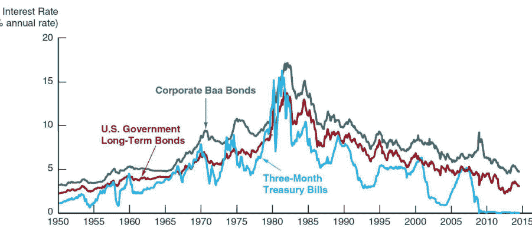

Source: Federal Reserve Bank of St. Louis, FRED database: http://research.stlouisfed.org/fred2

## 股票市场

- 普通股股票代表了其持有人对于公司具有一定份额的所有权
- 一股股票代表了对于公司的资产和收益所具有的求偿权

## 为什么要研究金融机构和银行？

- 金融中介机构：是指那些吸纳存款资金、并且向需要资金的人提供贷款的机构
  - 银行：吸收存款并且发放贷款
  - 其他的金融机构：保险公司、财务公司、养老基金、共同基金以及投资银行等
- 金融创新：开发新的金融产品和服务。
  - 通过提高金融系统的效率成为重要角色。

## 为什么要研究金融机构和银行？

- 金融危机是指以资产价格的急剧下跌以及大量金融机构和非金融类企业的破产倒闭为特征的金融市场出现的严重崩溃现象

## 为什么要研究货币及货币政策？

货币与经济周期

- 实证研究结果表明货币在经济周期的产生过程中发挥了重要的作用
- 经济衰退（失业）和经济扩张对于每一个人都会产生影响
- 货币理论考察的是货币供应的数量变化与总体经济活动和物价水平的变化之间的关系

### 货币与通货膨胀

- 物价总水平是指经济中商品和服务的平均价格
- 物价总水平的持续上升（通货膨胀）将会对于所有经济主体产生影响
- 有关数据表明货币供应量和物价总水平之间存在着联系

### 图3 美国1950–2014年货币增长（M2年增长率）与商业周期

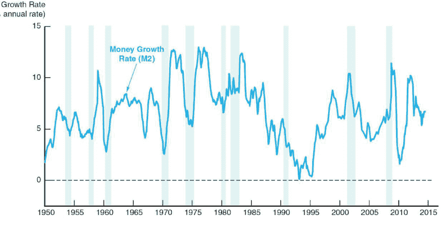

Source: Federal Reserve Bank of St. Louis, FRED database: http://research.stlouisfed.org/fred2

### 图4 美国1950–2014年总价格水平与货币供应

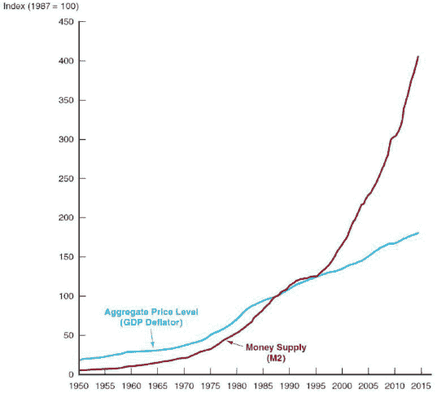

Source: Federal Reserve Bank of St. Louis, FRED database: http://research.stlouisfed.org/fred2

### 图5 2003–2013年 selected 国家的平均通胀率与平均货币增长率

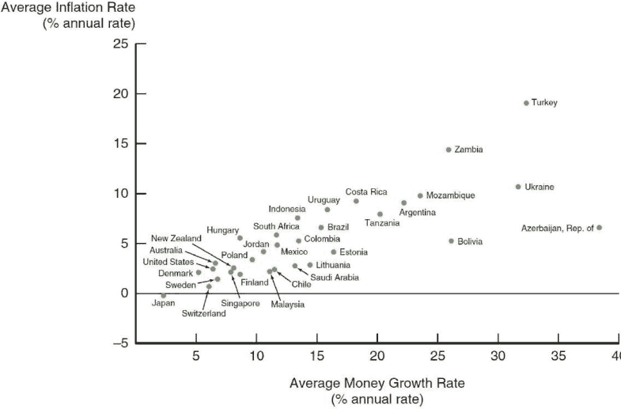

Source: International Financial Statistics. http://www.imf.org/external/data.htm

### 图6 货币增长（M2年增长率）与利率（美国长期国债），1950–2014

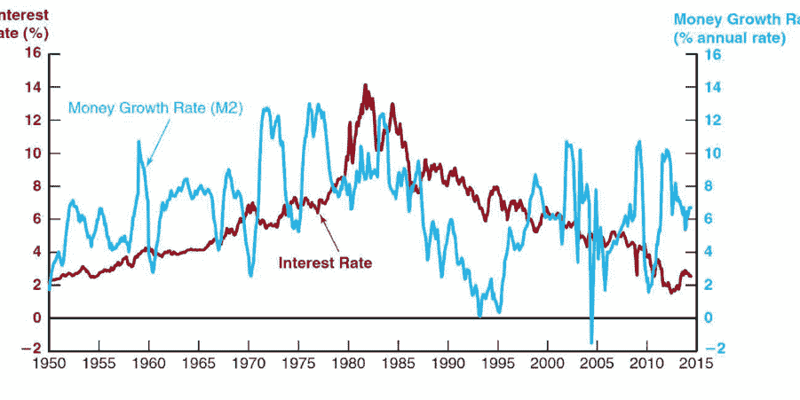

Source: Federal Reserve Bank of St. Louis, FRED database: http://research.stlouisfed.org/fred2

## 货币政策与财政政策

- 货币政策是指对于货币和利率的管理
  - 在美国，货币政策是由联邦储备体系（Fed）来执行的
- 财政政策是对于政府支出和税收问题的管理
  - 财政赤字是指在特定的一年中政府的支出超过税收收入的差额
  - 财政盈余是指在特定的一年中政府税收收入超过支出的差额
  - 必须通过借款来弥补预算赤字

### 图7 1950–2013年政府预算盈余或赤字占国内生产总值百分比

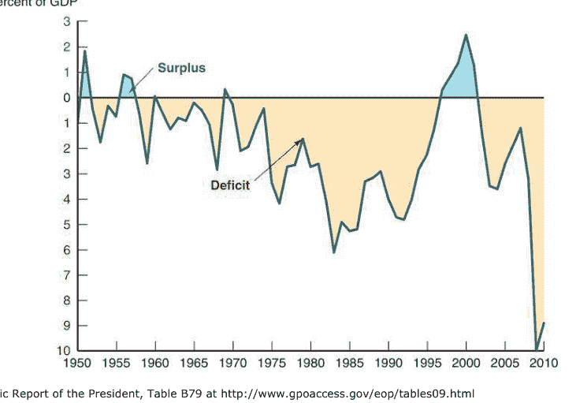

Source: Economic Report of the President, Table B79 at http://www.gpoaccess.gov/eop/tables09.html

## 外汇市场

- 外汇市场是指进行货币兑换活动的场所
- 外汇汇率是指一个国家货币对于另一个国家货币的价格
- 外汇市场是确定外汇汇率的场所

## 为什么要研究国际金融

- 在全世界范围内，金融市场的一体化趋势不断增强
- 国际金融体系对于各国的国内经济活动具有极为重要的影响：
  - 一个国家汇率政策的选择是如何影响到这个国家的货币政策的？
  - 资本管制措施对于国内金融体系和整体经济绩效会产生什么样的影响？
  - 诸如国际货币基金组织（IMF）之类的国际金融组织应该发挥什么样的作用？

### 图8 1970–2014年美元汇率

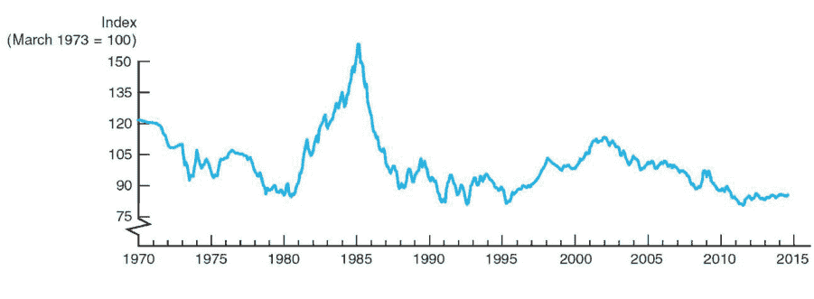

Source: Federal Reserve Bank of St. Louis, FRED database: http://research.stlouisfed.org/fred2

## 我们在研究货币、银行和金融市场过程中使用的方法

- 资产需求分析的简化方法
- 均衡的概念
- 用于解释金融市场行为的基本供求分析方法
- 对利润的追求
- 基于交易成本和信息不对称理论的金融市场结构分析方法
- 总供给——总需求分析方法

## 附录 1:
### 定义总产出、总收入、物价水平和通货膨胀率

### 总产出和总收入

- 总收入，是指物质生产部门劳动者在一定时期所创造的价值。从社会总产值中扣除物质消耗后的剩余部分就是国民收入,国民收入(价值形态)=社会总产值-已消耗生产资料价值或国民收入(实物形态)=社会总产品-已消耗生产资料。它是反映整体经济活动的重要指标，因此常被使用于宏观经济学的研究中，亦是国际投资者非常关注的国际统计项目。反映国民收入的两个主要统计数字是本地生产总值(GDP, 即国内生产总值)及本地居民生产总值(GNP, 即国民生产总值)，前者计算一段特定时期本地进行的生产，而后者则计算本地居民的总体收入


#### 实际值和名义值

#### 物价总水平
+   - 第16-17页

#### 作业 1
+   - 查找我国货币供应量（M1、M2）、物价、GDP、存贷款利率等历史数据（期数尽量长，如1980—2016）
+   - 分析说明货币供应量与经济增长、物价、利率之间的关系
+   - 提交：文件名：学号姓名1.doc，上传至 ftp://public.sjtu.edu.cn 的“一专货币金融学”文件夹内。第三周上课前。

### 预览
+   - 本章介绍研究金融市场和金融机构的概况。

### 学习目标
+   - 比较直接融资和间接融资。
+   - 确定金融市场的结构和组成部分。
+   - 列举并描述不同类型的金融市场工具。
+   - 从国际层面认识金融市场。
+   - 总结并分析交易成本、风险分担以及信息成本如何解释金融中介存在的合理性。
+   - 列举并描述不同类型的金融中介。
+   - 识别金融监管的原因并列举金融监管的类型。

### 金融市场的职能
+   - 金融市场的基本经济功能是将资金从那些拥有资金盈余的经济主体那里转移到资金短缺的经济主体手中
+   - 直接融资：借款者通过向金融市场里的贷款者出售证券而直接获取资金的融资方式

### 金融市场的功能
+   - 通过能够提高生产的有效资产配置来实现的经济效率的提高
+   - 通过帮助消费者更好地安排购买时机来直接提高其福利水平

#### 图2-1 通过金融体系实现的资金流动

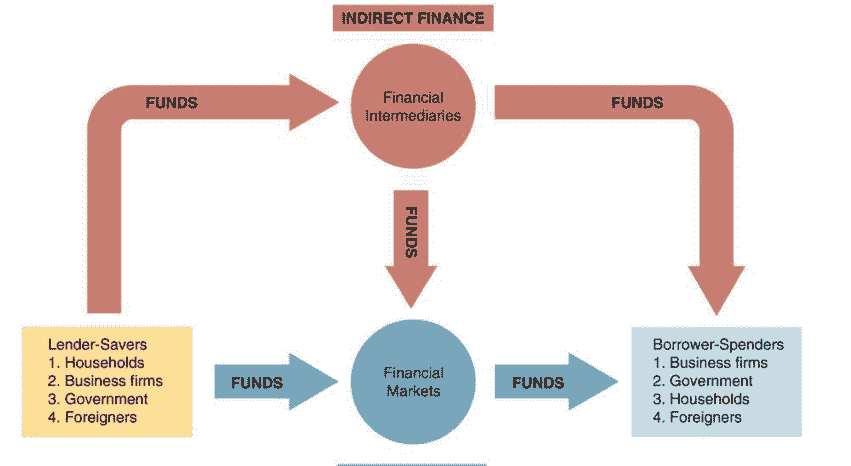

### 金融市场的结构
+   - 债务市场和股权市场
+     - 债务工具（期限）
+     - 股权（红利）
+   - 一级市场和二级市场
+     - 投资银行在一级市场中承销证券
+     - 经纪人和交易商在二级市场中经营业务

### 金融市场的结构
+   - 交易所和场外交易市场
+     - 交易所：纽约证券交易所、芝加哥期货交易所
+     - 场外交易市场：外汇市场、联邦基金市场
+   - 货币市场和资本市场
+     - 货币市场是短期债务工具进行交易的金融市场
+     - 资本市场是长期债务工具和股权工具进行交易的金融市场

#### 表2-1 主要货币市场工具

表1 主要货币市场工具

金额（十亿美元，年末）

| 工具类型 | 1980 | 1990 | 2000 | 2013 |
|---|---:|---:|---:|---:|
| 美国国库券 | 216 | 527 | 647 | 1,591 |
| 可转让银行定期存单（大额） | 317 | 543 | 1,053 | 1,762 |
| 商业票据 | 122 | 557 | 1,619 | 951 |
| 联邦基金和证券回购协议 | 64 | 388 | 768 | 1,919 |

*资料来源：美联储资金流量账户；http://www.federalreserve.gov*

### 2.3 金融市场工具
+   - 货币市场工具
+     - 国库券
+     - 可转让银行定期存单
+     - 商业票据
+     - 回购协议（正回购、逆回购）
+     - 联邦基金（同业拆借）

[Libor](#) [Hibor](#) [Shibor](#)

#### 表2-2 主要资本市场工具

**表2 — 主要资本市场工具**
**金额（十亿美元，年末）**

| 工具类型 | 1980 | 1990 | 2000 | 2013 |
|---|---:|---:|---:|---:|
| **公司股票（市场价值）** | 1,601 | 4,146 | 17,627 | 21,363 |
| 住房抵押贷款 | 1,106 | 2,886 | 5,463 | 9,863 |
| 公司债券 | 366 | 1,008 | 2,230 | 6,436 |
| 美国政府证券（可流通长期） | 407 | 1,653 | 2,184 | 4,359 |
| 美国政府机构证券 | 193 | 435 | 1,616 | 6,199 |
| 州和地方政府债券 | 310 | 870 | 1,192 | 2,925 |
| 银行商业贷款 | 459 | 818 | 1,091 | 1,175 |
| 消费贷款 | 355 | 813 | 536 | 679 |
| 商业和农场抵押贷款 | 352 | 829 | 1,214 | 2,463 |

*资料来源：美联储资金流量账户；http://www.federalreserve.gov.*

+   - 资本市场工具
+   - 股票
+   - 抵押贷款，美国三家政府代理机构FNMA（房利美）、GNMA、FHLMC（房地美）
+   - 公司债券
+   - 美国政府债券
+   - 美国政府担保债券
+   - 州和地方政府债券
+   - 消费贷款和银行商业贷款（信贷证券化）

### 金融市场的国际化
+   - 外国债券是在境外发行的、以发行国货币计价的债券
+   - 欧洲债券是一种以发行国以外的货币计价的债券
+   - 欧洲货币是存放在货币发行国境外银行之中的外汇存款
+     - 欧洲美元是存放在美国境外的外国银行或者美国银行境外分支机构里的美元存款
+   - 世界股票市场
+     - 也有助于联邦政府进行融资

### 金融中介机构的功能：间接融资
+   - 降低交易成本（即在金融交易过程中消耗的时间和金钱）。
+     - 规模经济
+     - 流动性服务
+   - 减少投资者的风险暴露程度
+     - 风险分担（资产转换）
+     - 多样化

### 金融中介机构的功能：间接融资
+   - 应对信息不对称问题
+     - （在交易发生之前的）逆向选择：力图避免选择那些风险水平较高的借款者
+       - 收集潜在借款者的信息
+     - （在交易发生之后的）道德风险：确保借款者不去从事那些导致其无法偿还贷款的经营活动
+       - 签订具有限制性条款的合约

## 金融中介机构的功能：
间接融资
+   - 结论：
+     - 金融中介机构使“小额”储蓄者和借款者也能从金融市场的存在中获益。

### 金融中介机构的功能：间接融资
+   结论：
+   - 金融中介机构能够使得小额储蓄者和借款者能够从现存的金融市场中获利。因为金融中介机构能够提供流动性服务、发挥风险分担的作用以及解决信息不对称的问题，从而使得小额储蓄者和借款者能够从现存的金融市场中获利，所以它们在经济生活中发挥了重要的作用。

#### 表2-3 金融中介机构主要的资产和负债

| 中介机构类型 | 主要负债（资金来源） | 主要资产（资金运用） |
|---|---|---|
| **存款机构（银行）** |  |  |
| 商业银行 | 存款 | 商业和消费贷款、抵押贷款、美国政府债券和市政债券 |
| 储蓄贷款协会 | 存款 | 抵押贷款 |
| 互助储蓄银行 | 存款 | 抵押贷款 |
| 信用社 | 存款 | 消费贷款 |
| **契约性储蓄机构** |  |  |
| 人寿保险公司 | 保单保费 | 公司债券和抵押贷款 |
| 火灾和意外保险公司 | 保单保费 | 市政债券、公司债券和股票、美国政府债券 |
| 养老基金、政府退休基金 | 雇主和雇员缴款 | 公司债券和股票 |
| **投资中介机构** |  |  |
| 金融公司 | 商业票据、股票、债券 | 消费贷款和商业贷款 |
| 共同基金 | 股份 | 股票、债券 |
| 货币市场共同基金 | 股份 | 货币市场工具 |
| 对冲基金 | 合伙权益 | 股票、债券、贷款、外币和许多其他资产 |


#### 表2-4 主要金融中介机构及其资产总额

TABLE 4 主要金融中介机构及其资产价值

资产价值
（十亿美元，年末）

| 中介机构类型 | 1980 | 1990 | 2000 | 2013 |
|---|---|---|---|---|
| 存款机构（银行） |  |  |  |  |
| 商业银行 | 1,481 | 3,334 | 6,469 | 12,670 |
| 储贷协会和互助储蓄银行 | 792 | 1,365 | 1,218 | 2,157 |
| 信用社 | 67 | 215 | 441 | 1,005 |
| 契约型储蓄机构 |  |  |  |  |
| 人寿保险公司 | 464 | 1,367 | 3,136 | 6,035 |
| 火灾和意外伤害保险公司 | 182 | 533 | 862 | 1,527 |
| 养老基金（私人） | 504 | 1,629 | 4,355 | 7,966 |
| 州和地方政府退休基金 | 197 | 737 | 2,293 | 4,846 |
| 投资中介机构 |  |  |  |  |
| 财务公司 | 205 | 610 | 1,140 | 1,474 |
| 共同基金 | 70 | 654 | 4,435 | 11,527 |
| 货币市场共同基金 | 76 | 498 | 1,812 | 2,678 |

来源：Federal Reserve Flow of Funds Accounts; http://www.federalreserve.gov/releases/Z1/

### 2.6 金融中介机构的类型

- 存款机构
  - 商业银行
  - 储贷协会和互助储蓄银行
  - 信用社
- 契约型储蓄机构
  - 人寿保险公司
  - 火灾和意外伤害保险公司
  - 养老基金和政府退休基金
- 投资中介机构
  - 财务公司
  - 共同基金
  - 货币市场共同基金
  - 投资银行

### 金融体系的监管

- 帮助投资者获取更多的信息：
  - 减少逆向选择和道德风险问题
  - 减少内幕交易活动（证券交易委员会）
- 保障金融中介机构的稳定运行：
  - 准入限制（执照发放程序）
  - 信息披露
  - 对于资产和业务活动的限制（对于持有高风险资产的限制）
  - 存款保险（防止出现银行挤兑现象）
  - 对于竞争的限制（大多数是过去实行的）：
    - 对于设立分支机构的限制
    - 对于利率的限制

#### 表2-5 美国金融体系中的主要监管机构

| 监管机构 | 监管对象 | 监管性质 |
|---|---|---|
| 美国证券交易委员会 (SEC) | 有组织的交易所和金融市场 | 要求信息披露；限制内幕交易 |
| 商品期货交易委员会 (CFTC) | 期货市场交易所 | 监管期货市场交易程序 |
| 货币监理署 | 联邦特许商业银行和储蓄机构 | 批准并检查联邦特许商业银行和储蓄机构的账目；对其可持有的资产施加限制 |
| 国家信用合作社管理局 (NCUA) | 联邦特许信用社 | 批准并检查联邦特许信用社的账目并对其可持有的资产施加限制 |
| 州银行和保险委员会 | 州特许存款机构和保险公司 | 批准并检查州特许银行和保险公司的账目，对其可持有的资产施加限制，并对分支机构施加限制 |
| 联邦存款保险公司 (FDIC) | 商业银行、互助储蓄银行、储贷协会 | 为每位存款人在银行提供最高25万美元的保险，检查受保银行的账目，并对其可持有的资产施加限制 |
| 联邦储备系统 | 所有存款机构 | 检查商业银行和系统重要性金融机构的账目；为所有银行设定准备金要求 |

## MISHKIN

《货币、银行与金融市场的经济学》

商学院版

第四版

# 第3章
什么是货币

### 学习目标

- 描述货币的定义
- 列出并总结货币的职能
- 辨别不同类型的支付系统
- 比较M1和M2的异同

### 货币的含义

- 货币（或者“货币供给”）：任何一种被普遍接受的、可以用于购买商品和服务支付行为的或者债务偿付的物品
- 一个更为宽泛的定义

### 货币的含义

- （从存量意义上讲）货币与以下概念存在区别：
  - 财富：能够储藏价值的各种财产的总和
  - 收入：每一单位时间内收入的数额（从流量意义上讲）

### 货币的功能

- 交易媒介：
  - 消除由寻找需求之间的双重匹配状态所产生的问题（降低交易成本）
  - 提高专业化水平
- 作为交易媒介的物品必须：
  - 易于标准化
  - 被普遍接受
  - 易于分割
  - 易于携带
  - 不会很快腐坏变质
- 记账单位：
  - 用来衡量经济运行过程中的价值
  - 降低交易成本
- 价值储藏：
  - 用来实现购买力的长期储存
  - 其他形式的资产也能够实现这一功能
  - 货币是所有资产中流动性最强的资产，但是在通货膨胀期间会贬值

### 3.3 支付体系的演变

- 商品货币 Commodity Money: 有价值、易于标准化和分割的商品（例如贵金属、香烟）。
- 早期商品货币、银本位、金银双本位（格雷欣法则）、金本位
- 主币和辅币
- 不兑换纸币 Fiat Money: 政府法定的纸币。


## 支付体系的演变

- 支票：一项要求你的银行将资金从你的账户中进行转移的指令
- 电子支付（诸如：网上账单支付等）
- E-货币（电子货币）：
  - 借记卡
  - 储值卡（智能卡）
  - 电子现金

#### 我们在向一个无现金的社会转变吗？

- 过去几十年一直有人预测会出现一个无现金的社会，但是这个预测至今依然没有成为现实。
- 电子货币更为高效便捷，但有几个因素阻碍纸质货币的消亡。
- 然而，电子货币的使用将可能仍然在快速增加。

#### 比特币会成为未来的货币吗？

- 比特币是由程序员中本聪在2009年创造的一种新型电子货币。
- 用户通过使用他们计算机硬件的计算能力为比特币交易提供核实与确认，俗称“挖矿”，获得新的比特币。
- 从交易媒介、记账单位、价值储藏三大功能看比特币。

### 货币的计量

- 我们如何计量货币？哪一种特定的资产能够称为“货币”？
- 使用流动性的概念建构货币总量：
- M1（流动性最高资产）= 现金 + 旅行支票 + 活期存款 + 其他可开具支票的存款
- M2（M1 加上流动性较低的其他资产）= M1 + 小额定期存款 + 储蓄存款和货币市场存款账户 + 货币市场共同基金份额

#### 表3-1 货币总量的计量

表1 货币总量度量

| | 2014年8月18日价值（10亿美元） |
|---|---:|
| M1 = 通货 | 1,206.1 |
| + 旅行支票 | 3.3 |
| + 活期存款 | 1,089.9 |
| + 其他可开具支票的存款 | 477.4 |
| M1总计 | 2,776.7 |
| M2 = M1 | |
| + 小额定期存款 | 533.0 |
| + 储蓄存款和货币市场存款账户 | 7,338.2 |
| + 货币市场共同基金份额（零售） | 642.5 |
| M2总计 | 11,290.4 |

来源：http://www.federalreserve.gov/releases/h6/hist.

#### M1与M2的比较

- 选用哪一种货币计算方法是非常重要吗？
- 在短期内，M1和M2的运动方向可能存在差异（参见图示）
- 小结：货币总量的选择对于政策制定者来说是十分重要的。

#### 美元现金去哪儿？

- 当前美国人均持有现金数额超过$4000，数额巨大。
- 所有这些美元在哪里？是谁在持有它们？
  - 罪犯
  - 外国人

#### 图3-1 1960～2014年货币总量M1和M2增长率的变动情况

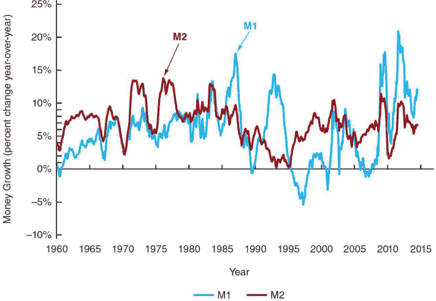

来源：圣路易斯联邦储备银行，FRED数据库：http://research.stlouisfed.org/fred2

- 中国人民银行于1994年第三季度开始，正式确定并按季公布货币供应量指标，根据当时的实际情况，货币层次的划分具体如下：
- M0=流通中的现金；
- M1=M0+企业活期存款+机关、团体、部队存款+农村存款+个人持有的信用卡存款；
- M2=M1+城乡居民储蓄存款+企业存款中具有定期性质的存款+信托类存款+其他存款；
- M3=M2+金融债券+商业票据+大额可转让定期存单等。

米什金
《货币、银行与金融经济学》
商学院版
第四版

# 第4章 理解利率

## 现值

- 1年之后获得的1美元的价值要低于现在获得的1美元的价值
- 原因何在？
  - 现在1美元的存款能够获得利息，并且在1年之后变成1×(1+i)美元

### 未来价值的折现计算

令 i=0.10

1年之后为 100美元×(1+0.10)=110美元

2年之后为 110美元×(1+0.10)=121美元

或者是 100美元×(1+0.10)²=121美元

3年之后为 121美元×(1+0.10)=133美元

或者是 100美元×(1+0.10)³=133美元

N年之后为 100美元×(1+0.10)^n

### 简单现值

$PV$=今天的价值（即现值）
$CF$=未来的现金流（支付额）
$i$=利率

$$PV=\frac{CF}{(1+i)^n}$$

### 时间轴

不能将时间轴上分布于不同时点的支付额进行直接比较

| 年 | 0 | 1 | 2 | n |
|---|---|---|---|---|
| PV | 100 | 100/(1+i) | 100/(1+i)² | 100/(1+i)ⁿ |
| 支付 | 100美元 | 100美元 | 100美元 | 100美元 |

### 四种信用市场工具

- 普通贷款
- 固定支付贷款
- 息票债券
- 贴现发行债券

#### 到期收益率

- 债务工具获得利息的现值折算为与债务工具现值相等的数值

### 普通贷款

PV=借款金额=100美元
CF=1年之后的现金流=110美元
n=年数=1

100美元 = 110美元 / (1+i)^1
(1+i)×100美元=110美元

(1+i)=110美元/100美元
i=0.10=10%

对于普通贷款而言，单利率就等于其到期收益率。

### 固定支付贷款

这种贷款在期限内的每一个时期都要进行等额偿付。

LV=贷款金额
FP=每年固定偿付的金额
n=到期前的年数

LV = FP/(1+i) + FP/(1+i)^2 + FP/(1+i)^3 + ... + FP/(1+i)^n

### P59 例题计算

- =rate(25,126,-1000)
- =11.83%
- P60例4-4计算
- =PMT(0.07,20,100000)
- =-9439.29

### 息票债券

使用与固定支付贷款相同的计算方法。

P=息票债券现期价格
C=每年支付的息票利息
F=息票债券的面值
n=到期前的年数

P = C/(1+i) + C/(1+i)² + C/(1+i)³ + ... + C/(1+i)ⁿ + F/(1+i)ⁿ

### 10%息票利率的10年期息票债券的到期收益率（面值为1000美元）

| 债券价格（美元） | 到期收益率（%） |
|---:|---:|
| 1,200 | 7.13 |
| 1,100 | 8.48 |
| 1,000 | 10.00 |
| 900 | 11.75 |
| 800 | 13.81 |

- 如果债券的现期价格和面值相等，那么到期收益率就等于息票利率。
- 债券的现期价格与到期收益率之间存在负相关关系。
- 当债券的现期价格低于其面值的时候，到期收益率要高于其息票利率。

- P61 例4-5 计算
- 已知n=8, fv=1000, i=12.25%, pmt=100, 求PV。
- =PV(12.25%,8,100,1000)

### 永续债券

一种一直以固定息票利息偿付的无到期日、无需偿付本金的永久性债券。

P_c = C / i_c
P_c = 永续债券的价格
C = 年息票利息
i_c = 永续债券的到期收益率

上述公式重新写为：i_c = C / P_c

对于息票债券而言，这一方程得出的是当期收益率，即到期收益率的一种简单近似计算结果。

### 贴现发行债券

对于任何1年期贴现发行债券：

i = (F − P) / P

F = 贴现发行债券的面值
P = 贴现发行债券的现期价格

其到期收益率等于1年中的价格上升部分除以其初始价格。

与息票债券一样，贴现发行债券的到期收益率与该债券的现期价格之间存在负相关关系。

### 回报率

向资产所有者支付的金额加上标的资产价值的变化体现了其购买价格的一种分割。

RET = C/P_t + (P_{t+1} - P_t)/P_t
RET = 从 t 到 t+1 时刻之间持有债券所获得的回报率
P_t = t 时刻的债券价格
P_{t+1} = t+1 时刻的债券价格
C = 利息收益
C/P_t = 当期回报率 i_c
(P_{t+1} - P_t)/P_t = 资本利得率 g


#### 回报率和利率

- 只有在距离到期日的期限与债券持有时间相等的时候，债券的回报率才会等于其初始到期收益率
- 如果距离到期日的期限长于持有债券的期限，那么利率的上升必将伴随着债券价格的下跌，从而导致债券出现资本损失
- 距离债券到期日的期限越长，债券价格和利率的波动幅度也会越大

#### 回报率和利率（续）

- 距离债券到期日的期限越长，当利率上升的时候，债券的回报率就会越低
- 尽管债券具有很高的初始利率，但是在利率上升的条件下，债券的回报率也有可能为负

#### 表4-2 在利率从10%上升至20%的条件下，10%息票利率的不同期限债券的一年期回报率情况

| (1) 购买时的到期期限 | (2) 初始当期收益率（%） | (3) 初始价格（美元） | (4) 下一年价格*（美元） | (5) 资本利得率（%） | (6) 回报率（2 + 5）（%） |
|---:|---:|---:|---:|---:|---:|
| 30 | 10 | 1,000 | 503 | −49.7 | −39.7 |
| 20 | 10 | 1,000 | 516 | −48.4 | −38.4 |
| 10 | 10 | 1,000 | 597 | −40.3 | −30.3 |
| 5 | 10 | 1,000 | 741 | −25.9 | −15.9 |
| 2 | 10 | 1,000 | 917 | −8.3 | +1.7 |
| 1 | 10 | 1,000 | 1,000 | 0.0 | +10.0 |

*使用金融计算器根据公式3计算。

#### 期限与债券回报率：利率风险

- 债券期限越长，其价格变动幅度受到利率的影响会越大。这个发现有助于我们理解债券市场行为中一个重要事实：长期债券的价格和回报率波动幅度比短期债券要大。
- 只有持有期与债券到期日相同的债券才能避免由于期限不同带来的利率风险

#### 实际利率与名义利率的区别

- 名义利率还没有扣除通货膨胀
- 通过价格水平调整后的实际利率可更准确地反映借款成本实际水平
- 事前实际利率是根据预期价格水平的变动确定的
- 事后实际利率是根据实际价格水平变化调整的

#### 到期收益率

- 使债务工具未来支付的现值等于其当前价值的利率

#### 费雪方程式

i = i_r + π^e

i = 名义利率

i_r = 实际利率

π^e = 预期通货膨胀率

当实际利率较低时，借款的激励更强，而放贷的激励更弱。
实际利率是衡量借贷激励的更好指标。

#### 图1 实际利率与名义利率
（三个月期国库券），1953–2014

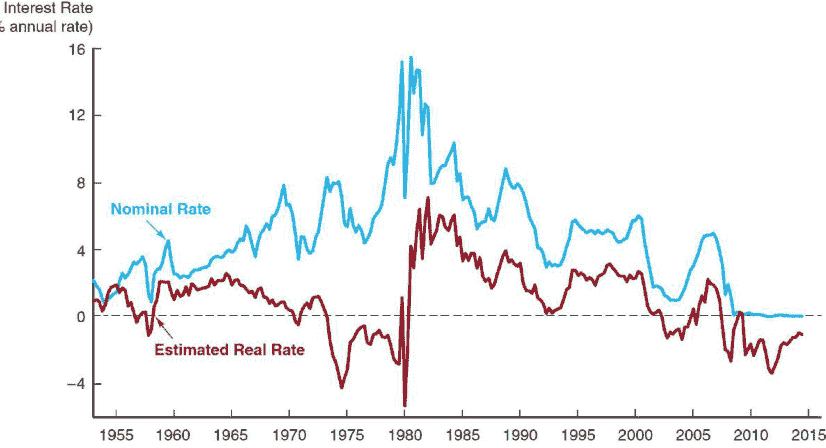

资料来源：名义利率来自圣路易斯联邦储备银行FRED数据库：http://research.stlouisfed.org/fred2/。实际利率采用弗雷德里克·S·米什金在《The Real Interest Rate: An Empirical Investigation》中概述的方法构建，该文载于Carnegie-Rochester Conference Series on Public Policy 15 (1981): 151–20。该程序将预期通货膨胀估计为过去利率、通货膨胀和时间趋势的函数，然后从名义利率中减去预期通货膨胀度量。

## MISHKIN

## 货币、银行与金融市场经济学

商学院版

第四版

# 第5章
利率行为

## 资产需求理论

在其他因素不变的条件下：

- 1. 资产需求量和财富之间存在正相关关系
- 2. 相对于其他可替代资产而言，资产需求量和该资产的预期收益率之间存在正相关关系
- 3. 相对于其他可替代资产而言，资产需求量和该资产收益率的风险之间存在负相关关系
- 4. 相对于其他可替代资产而言，资产需求量和该资产的流动性之间存在正相关关系

### 简要小结：表5-1 资产需求量对于财富、预期收益率、风险和流动性等变动情况的反映

| 变量 | 变量的变动 | 需求量的变动 |
|---|---|---|
| 财富 | ↑ | ↑ |
| 相对于其他资产的预期收益率 | ↑ | ↑ |
| 相对于其他资产的风险 | ↑ | ↓ |
| 相对于其他资产的流动性 | ↑ | ↑ |

*注：表中仅显示变量增加的情况。变量减少对需求量变动的影响与最右列所示相反。*

### 债券市场的供给和需求

- 在其他条件不变的情况下，如果债券价格处于较低水平（利率较高），那么对债券的需求量就会较高：两者之间存在反向关系
- 在其他条件不变的情况下，如果债券价格处于较低水平（利率较高），那么债券的供给量也会较低：两者之间存在正向关系

#### 图5-1 债券的供给和需求

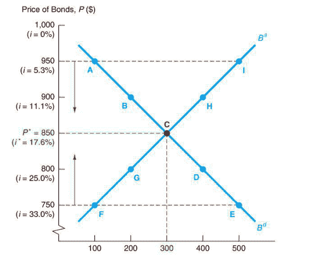

#### 市场均衡

- 市场均衡是指在给定价格条件下，人们愿意购买（需求）和出售（供给）的数量相等时的状态
- Bᵈ = Bˢ 定义了均衡（或者市场出清）的价格和利率
- 在Bᵈ > Bˢ 的情况下，出现了超额需求，价格将会上升而利率将会下降
- 在Bᵈ < Bˢ 的情况下，出现了超额供给，价格将会下降而利率将会上升

#### 债券需求的变动

- 财富：在经济周期的扩张阶段，随着财富的增加，债券需求量也会随之提高，需求曲线向右方移动
- 预期回报率：长期债券的预期利率越高，其预期收益率就会越低，导致债券需求减少，债券需求曲线将会向左移动
- 预期通货膨胀率：预期通货膨胀率的提高将会降低债券的预期收益率，导致债券需求减少，债券需求曲线向左移动
- 风险：债券风险水平的提高将会导致债券需求的下降，债券需求曲线向左移动
- 流动性：债券流动性的提高会导致债券需求上升，债券需求曲线向右移动

#### 简要小结：表5-2 导致债券需求的变动的因素

| 变量 | 变量的变动 | 在每个债券价格水平上的需求量变动 | 需求曲线的移动 |
|---|---|---|---|
| 财富 | ↑ | ↑ | P
B⁰ B¹ |
| 预期利率 | ↑ | ↓ | P
B⁰ B¹ |
| 预期通货膨胀率 | ↑ | ↓ | P
B⁰ B¹ |
| 债券相对于其他资产的风险 | ↑ | ↓ | P
B⁰ B¹ |
| 债券相对于其他资产的流动性 | ↑ | ↑ | P
B⁰ B¹ |

注：表中仅显示变量增加的情况。变量减少对需求变动的影响与其余各列所示相反。


#### 图5-2 债券需求的变动示意图

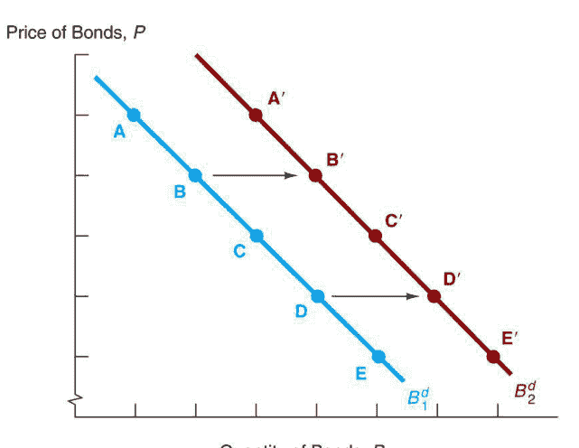

#### 债券供给的变动

- 投资机会的预期盈利能力：在经济周期的扩张阶段，债券供给曲线向右发生位移
- 预期通货膨胀率：预期通货膨胀率的上升将会导致债券供给曲线向右发生位移
- 政府预算：政府财政赤字越大，债券供给曲线向右发生位移

#### 简要小结：表5-3 导致债券供给的变动的因素

| 变量 | 变量的变动 | 在每个债券价格下供给量的变动 | 供给曲线的移动 |
|---|---|---|---|
| 投资盈利能力 | ↑ | ↑ |  |
| 预期通货膨胀率 | ↑ | ↑ |  |
| 政府赤字 | ↑ | ↑ |  |

*注：表中只显示了变量的增加。变量减少对供给变动的影响与其余各列所示相反。*

#### 图5-3 债券供给的变动示意图

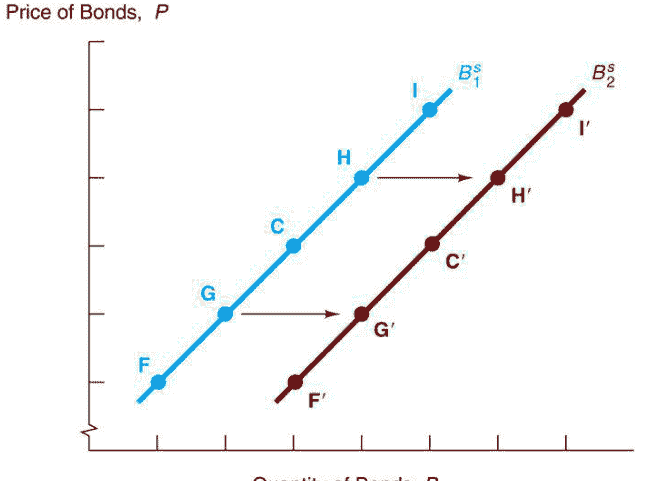

#### 图5-4 预期通货膨胀率变动产生的影响

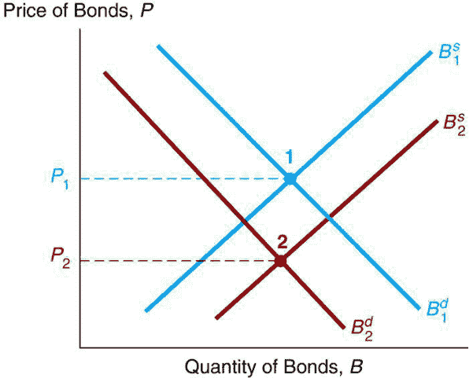

#### 图5-5 1953～2008年间的预期通货膨胀率和利率（3个月期国库券）

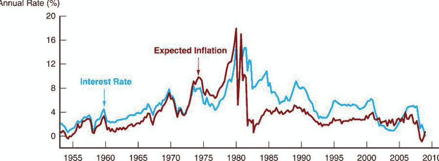

资料来源：预期通货膨胀率是根据 Frederic S. Mishkin 在《实际利率：一项实证研究》（Carnegie-Rochester Conference Series on Public Policy 15 (1981): 151-200）中概述的程序计算得出的。这些程序涉及将预期通货膨胀率估计为过去利率、通货膨胀率和时间趋势的函数。

#### 图5-6 经济周期扩张产生的影响

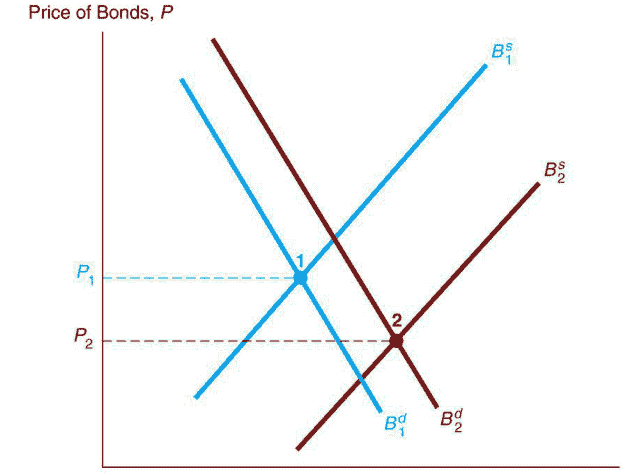

### 流动性偏好理论中的货币需求和供给

凯恩斯主义理论使用货币市场的供求分析来说明均衡利率的决定机制

人们储藏财富的资产主要包括两种：货币和债券

经济运行过程中的财富总量 = Bˢ + Mˢ = Bᵈ + Mᵈ

上述公式可以改写为 Bˢ - Bᵈ = Mᵈ - Mˢ

如果货币市场处于均衡状态（Mˢ = Mᵈ），就意味着债券市场同样处于均衡状态（Bˢ = Bᵈ）

#### 流动性偏好理论中的货币需求

- 在利率上升的情况下：
  - 持有货币的机会成本就会增加……
  - 相对于货币的其他资产预期回报率就会下降……
- ……因此，货币需求量就会降低

#### 货币需求的变化

- 收入效应：收入水平的提高将会导致每个利率水平下的货币需求量随之增长，需求曲线向右移动
- 物价水平效应：物价水平的上升将会导致每个利率水平下的货币需求量随之增长，需求曲线向右移动

#### 货币供给的变化

- 假设货币供给完全由中央银行来控制
- 联邦储备体系实现的货币供应量的提高将会导致货币供给曲线向右方移动

#### 图5-9 收入或者物价水平变动产生的影响

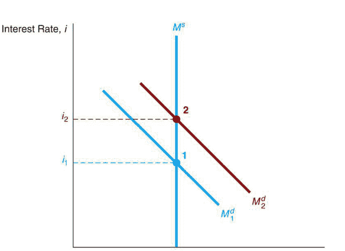

#### 图5-10 货币供应量变动产生的影响

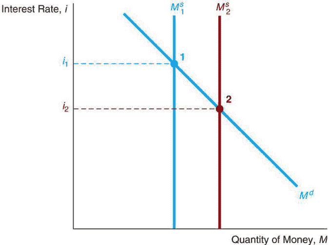

#### 简要小结：表5-4 导致货币供求的变动的因素

| 变量 | 变量的变动 | 在每个利率水平上货币需求（Mᵈ）或货币供给（Mˢ）的变动 | 利率的变动 |
|---|---|---|---|
| 收入 | ↑ | Mᵈ ↑ | ↑ |
| 物价水平 | ↑ | Mᵈ ↑ | ↑ |
| 货币供给量 | ↑ | Mˢ ↑ | ↓ |

*注：表中只显示了变量的增加。变量减少对需求变动的影响与其余各列所示相反。*

#### 其他条件会保持不变么？

- 根据流动性偏好理论将会得出这样的结论：货币供应量的上升将会促使利率下降：流动性效应
- 由于货币供应量的提高将会对于整体经济产生扩张性影响，所以其收入效应将会导致利率的上升（需求曲线向右方移动）
- 物价水平效应是指作为对于物价水平提高的反应，货币供应量的提高将会导致利率的上升（需求曲线向右方移动）
- 预期通货膨胀效应是指由于货币供应量的提高将会导致人们未来预期通货膨胀率的提高，从而将会导致利率的上升（需求曲线向右方移动）

#### 物价水平效应和预期通货膨胀效应

- 今天暂时的货币供应量增长能够导致物价水平在下一年之前上涨到一个永久的较高水平。利率也将会由于物价水平上涨的影响而提高
- 即使在物价停止上涨之后，物价水平效应依然存在
- 由于人们将会预期下一年的通货膨胀率将会更高，所以物价水平的持续提高将会提高利率。在物价水平停止上升的情况下，对于通货膨胀率的预期值将会回落至零点
- 只有在物价水平持续提高的情况下，预期通货膨胀效应才会持续

#### 图5-11 随着时间推移，提高货币供应量增长率产生的影响

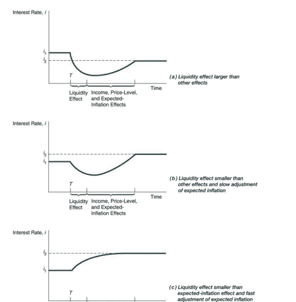

#### 图12 货币增长率（M2，年率）与利率（三个月期国库券），1950–2014

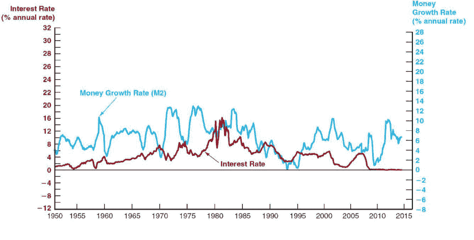

资料来源：圣路易斯联邦储备银行 FRED 数据库：http://research.stlouisfed.org/fred2

米什金
《货币、银行与金融市场的经济学》
商学院版
第四版

# 第6章 利率的风险和期限结构

#### 利率的风险结构

期限相同的债券具有不同的利率是因为：

- 违约风险
- 流动性
- 所得税因素

### 图1 长期债券收益率，1919–2014

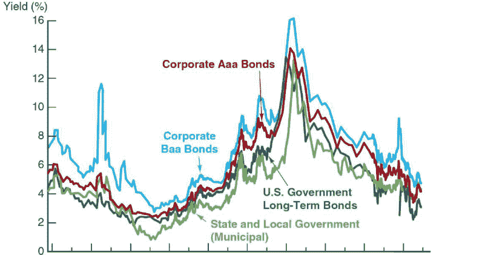

资料来源：美国联邦储备系统理事会，《银行与货币统计》，1941–1970；圣路易斯联邦储备银行 FRED 数据库：http://research.stlouisfed.org/fred2


### 图6-2 公司债券违约风险增长产生的影响

(a) 公司债券市场

(b) 无违约风险（美国国债）债券市场

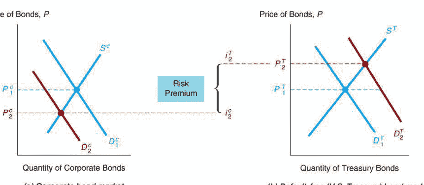

### 表6-1 穆迪、标准普尔和惠誉的债券评级

| Rating |  |  |  |
|---|---|---|---|
| Moody's | S&P | Fitch | Definitions |
| Aaa | AAA | AAA | 最高等级 最高安全性 |
| Aa1 | AA- | AA- | 高等级 高质量 |
| Aa2 | AA | AA |  |
| Aa3 | AA- | AA- |  |
| A1 | A+ | A+ | 上中等等级 |
| A2 | A | A |  |
| A3 | A- | A- |  |
| Baa1 | BBB+ | BBB+ | 下中等等级 |
| Baa2 | BBB | BBB |  |
| Baa3 | BBB- | BBB- |  |
| Ba1 | BB+ | BB+ | 非投资级 |
| Ba2 | BB | BB | 投机性 |
| Ba3 | BB- | BB- |  |
| B1 | B+ | B+ | 高度投机性 |
| B2 | B | B |  |
| B3 | B- | B- |  |
| Caa1 | CCC+ | CCC | 风险重大 |
| Caa2 | CCC | — | 信用状况不佳 |
| Caa3 | CCC- | — |  |
| Ca | — | — | 极度投机性 |
| C | — | — | 可能违约 |
| — | — | DDD | 违约 |
| — | — | DD | — |
| — | D | D |  |

#### 利率的风险结构

- 流动性：一项资产能够转变为现金的相对难易程度
  - 出售债券的成本
  - 债券市场中买卖交易主体的数量
- 所得税因素
  - 市政债券获得的利息收益可以免缴联邦所得税

#### 图6-3 市政债券利率和国债利率

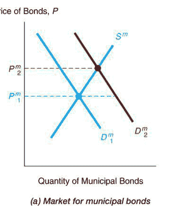

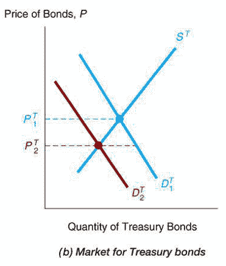

#### 奥巴马增税计划对债券利率的影响

- P106，图6-3
- 市政债券利率下降，国债利率上升

## 利率的期限结构

- 具有相同风险、流动性和税收特征的债券，由于其期限存在差异，导致其具有各不相同的利率

## 利率的期限结构

- 收益率曲线：那些具有相同的风险、流动性和税收特征而期限不同的债券收益率连成的一条曲线
  - 向上倾斜的收益率曲线：其长期收益率将会高于其短期收益率
  - 平坦的收益率曲线：其长期收益率与其短期收益率相同
  - 反转的收益率曲线：其长期收益率将会低于其短期收益率

### 利率期限结构有关理论必须解释的事实

- 1. 具有不同期限的利率随着时间的推进呈现出相同的变动特征
- 2. 如果短期利率较低，那么收益率曲线通常向上倾斜；而如果短期利率较高，那么收益率曲线更多是向下倾斜的，即反转的收益率曲线
- 3. 收益率曲线通常是向上倾斜的

### 解释这三个事实的三种理论

- 1. 预期理论能够解释前面两个事实，但是无法解释第三个事实
- 2. 市场分割理论能够解释第三个事实，但是无法解释前面两个事实
- 3. 流动性溢价理论能够解释这三个事实

#### 图4 不同到期期限的美国政府债券利率随时间的变化

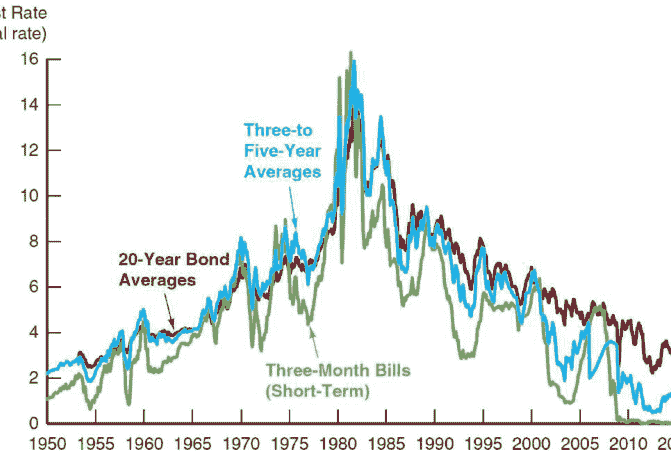

Sources: Federal Reserve Bank of St. Louis FRED database:
http://research.stlouisfed.org/fred2/

#### 预期理论

- 长期债券的利率等于在长期债券到期期限之内的短期利率的平均预期值
- 债券购买者对于不同期限的债券没有任何偏好差异；如果某种债券的预期收益率低于期限不同的债券的预期收益率，购买者将不会选择持有这种预期收益率较低的债券
- 债券的持有者认为不同期限的债券属于完全替代型债券

#### 预期理论：举例说明

- 令1年期债券的当期利率为6%
- 你预期1年期债券的利率将在明年上升至8%
- 那么，购买这两种1年期债券的预期回报率平均值为 (6% + 8%)/2 = 7%
- 因此，你将会愿意购买利率为7%的2年期债券

#### 预期理论

对于任何1美元的投资而言，

iₜ = 1阶段债券的现期利率

iₜ₊₁ᵉ = 1阶段债券在下一个阶段的预期利率

i₂ₜ = 2阶段债券的现期利率

#### 预期理论（续）

如果将1美元投资于购买两份1阶段期限的债券，那么就得到：

(1+iₜ)(1+iₜ₊₁ᵉ)−1 = 1 + iₜ + iₜ₊₁ᵉ + iₜ(iₜ₊₁ᵉ) − 1 = iₜ + iₜ₊₁ᵉ + iₜ(iₜ₊₁ᵉ)

由于 iₜ(iₜ₊₁ᵉ) 的值非常小，所以我们将其简化为： iₜ + iₜ₊₁ᵉ

#### 预期理论（续）

只有在这两种债券的预期收益率相等的条件下，投资者才会愿意同时持有这两种债券，即：

2i₂ₜ = iₜ + iᵉₜ₊₁

i₂ₜ = (iₜ + iᵉₜ₊₁) / 2

2阶段债券的利率必须等于两个1阶段债券利率的平均值。对于期限更长的债券而言，iₙₜ = (iₜ + iᵉₜ₊₁ + iᵉₜ₊₂ + ... + iᵉₜ₊₍ₙ₋₁₎) / n
n阶段债券的利率必须等于在其n个阶段的期限内n个1阶段债券利率的平均值

#### 预期理论

- 解释了在不同时间内利率期限结构（由收益率曲线表示）发生变化的原因
- 解释了具有不同期限的利率随着时间的推进呈现出相同的变动特征的原因（事实1）
- 解释了如果短期利率较低，那么收益率曲线通常向上倾斜；而如果短期利率较高，那么收益率曲线更多是反转的原因（事实2）
- 无法解释收益率曲线通常是向上倾斜的原因（事实3）

#### 市场分割理论

- 不同期限的各种债券之间是完全不能相互替代的
- 不同期限债券的利率是由各自市场上的供求关系决定的
- 投资者只对具有特定期限的债券表示出强烈的偏好
- 如果投资者通常偏好于风险较小的短期债券，那么市场分割理论就可以解释收益率曲线通常是向上倾斜的原因（事实3）

#### 流动性溢价理论与期限优先理论

- 长期债券的利率等于在长期债券到期期限之内的短期利率的平均预期值加上随该债券供求状况的变动而改变的流动性溢价
- 不同期限的债券之间是可以相互替代的，但不是完全相互替代的

#### 流动性溢价理论

$i_{nt}=\frac{i_t+i^e_{t+1}+i^e_{t+2}+\cdots+i^e_{t+(n-1)}}{n}+i_{nt}$

其中，$i_{nt}$ 是指在 t 时刻的 n 期限债券的流动性（期限溢价），它总是取正值，并且随着债券期限 n 的延长而上升。

#### 期限优先理论

- 投资者偏好于特定的债券期限
- 只有在其他期限债券具有更高预期收益率的条件下，投资者才会选择购买这些债券
- 投资者通常偏好于短期债券而非长期债券

#### 图6-5 流动性溢价理论（期限优先理论）和预期理论的关系

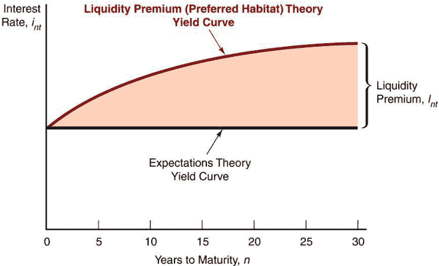

#### 流动性溢价理论与期限优先理论

- 具有不同期限的利率随着时间的推进会出现相同变动特征；上述公式的第一项为此提供了解释
- 如果短期利率较低，那么收益率曲线通常向上倾斜；而如果短期利率较高，那么收益率曲线更多是反转的；通过第一个事例中的流动性溢价理论以及第二个事例中较低的预期利率平均值对此进行解释
- 收益率曲线通常是向上倾斜的；通过投资者偏好于短期债券，流动性溢价随着债券到期期限的延长而提高对此进行解释


#### 图6-6基于流动性溢价理论（期限优先理论）的收益率曲线和市场对于未来的短期利率的预期结果

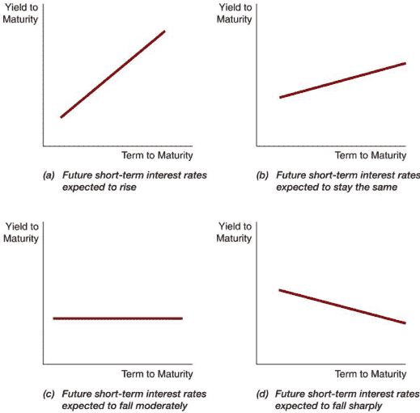

#### 图7 美国政府债券的收益率曲线

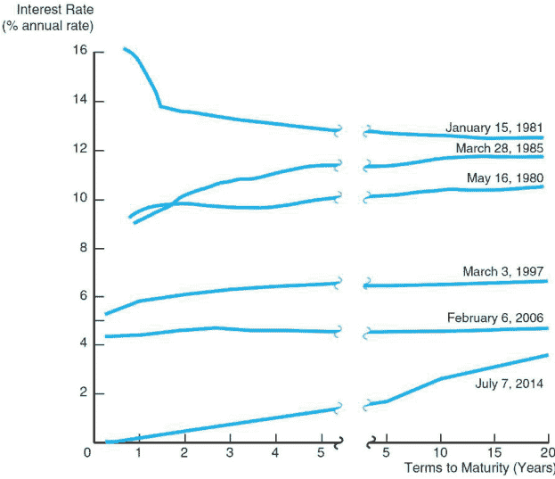

[例题] 假设预期理论是利率期限结构的合理解释，以下给定未来5年内的1年期利率，请分别计算1年期到5年期的利率，并画出收益率曲线。
（1）5%、7%、7%、7%、7%；
（2）5%、4%、4%、4%、4%。

(2) 未来1~5年期的利率分别为：

i₁ = 5 %

i₂ = (5% + 4%) / 2 = 4.5%

i₃ = (5% + 4% + 4%) / 3 = 4.3%

i₄ = (5% + 4% + 4% + 4%) / 4 = 4.25%

i₅ = (5% + 4% + 4% + 4% + 4%) / 5 = 4.2%

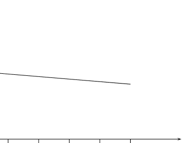

#### 计算精确值

## MISHKIN


货币、银行与金融市场的经济学

商学院版

第四版

# 第8章

## 金融结构的经济学分析

### 图8-1 非金融类工商企业的外部资金来源：美国与德国、日本和加拿大的比较

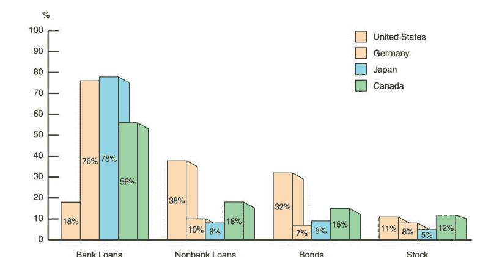

资料来源： Andreas Hackethal and Reinhard H. Schmidt, "Financing Patterns: Measurement Concepts and Empirical Results," Johann Wolfgang Goethe-Universitat Working Paper No. 125, January 2004. The data are from 1970-2000 and are gross flows as percentage of the total, not including trade and other credit data, which are not available.

### 8个基本谜团

- 1. 对于工商企业而言，股票不是最为重要的外部融资来源
- 2. 在企业为其经营活动进行融资过程中，发行可流通债务工具和股权证券不是主要的融资方式
- 3. 与直接融资相比，间接融资的重要性要大得多
- 4. 金融中介机构，特别是银行是企业外部融资的最重要来源

### 交易成本

- 金融中介机构的经营活动与减少交易成本有关
  - 规模经济
  - 专门技术

### 信息不对称

- 逆向选择是在交易之前产生的
- 道德风险实在交易之后产生的
- 代理理论分析了信息不对称问题影响经济行为的运行机制

#### 逆向选择：次品车问题

- 如果难以评估质量，那么买主所付的价格所反映的是市场上所有商品的平均质量
- 优质商品的卖主不愿意按照这一反应平均质量的价格出售其商品
- 由于市场上剩下的都是劣质商品，所以买主根本就不会购买任何商品
- 这一问题解释了第2个基本谜团的原因，并且部分解释了第1个基本谜团的原因

#### 逆向选择：解决办法

- 信息的私人生产和销售
  - 搭便车问题
- 旨在增加信息供给的政府监管
  - 并非总是可以解决逆向选择问题，由此为第5个基本谜团提供了解释
- 金融中介机构
  - 能够为第3、4和6个基本谜团提供解释
- 抵押品和净值
  - 能够为第7个基本谜团提供解释

#### 股权合约中的道德风险问题

- 称为委托——代理问题
  - 委托人：缺乏信息（股东）
  - 代理人：拥有更多的信息（经理）
- 公司所有权和控制权的分离
  - 管理者追求个人利益和权力而非企业的盈利能力

#### 委托——代理问题：解决办法

- 监督（高成本核实行为）
  - 搭便车问题
  - 第1个基本谜团
- 旨在增加信息的政府监管
  - 第5个基本谜团
- 金融中介机构
  - 第3个基本谜团
- 债权合约
  - 第1个基本谜团

#### 债务合约中的委托——代理问题

- 借款者具有执行那些违背贷款者（风险）意愿项目的动力
  - 这会导致借款者无法偿还贷款

#### 道德风险：解决方法

- 净值和抵押品
  - 激励相容
- 限制性条款的监督和强制执行
  - 限制不符合贷款者意愿的行为
  - 鼓励符合贷款者意愿的行为
  - 抵押品保值
  - 提供信息
- 金融中介机构
  - 第3和第4个基本谜团

#### 简要小结：表8-1信息不对称问题及其解决方法

| 信息不对称问题 | 解决工具 | 解释事实编号 |
|---|---|---|
| 逆向选择 | 信息的私人生产和销售 | 1, 2 |
|  | 增加信息的政府监管 | 5 |
|  | 金融中介 | 3, 4, 6 |
|  | 抵押品和净值 | 7 |
| 股权合约中的道德风险（委托-代理问题） | 信息生产：监督 | 1 |
|  | 增加信息的政府监管 | 5 |
|  | 金融中介 | 3 |
|  | 债务合约 | 1 |
| 债务合约中的道德风险 | 抵押品和净值 | 6, 7 |
|  | 限制性条款的监督和执行 | 8 |
|  | 金融中介 | 3, 4 |
| 注：事实清单： |  |  |
| 1. 股票不是最重要的外部融资来源。 |  |  |
| 2. 可流通证券不是主要的融资来源。 |  |  |
| 3. 间接融资比直接融资更重要。 |  |  |
| 4. 银行是最重要的外部资金来源。 |  |  |
| 5. 金融体系受到严格监管。 |  |  |
| 6. 只有大型且成熟的企业才能进入证券市场。 |  |  |
| 7. 抵押品在债务合约中普遍存在。 |  |  |
| 8. 债务合约具有众多限制性条款。 |  |  |

#### 转轨国家和发展中国家的信息不对称问题

- 由于下述制度性环境特征形成的“金融抑制”：
  - 产权体系不完善（无法有效使用抵押品这一工具）
  - 落后的法律体系（使贷款者难以执行限制性条款）
  - 不完善的会计准则（无法获得优质的信息）
  - 政府通过指导性信贷计划和国有银行实施的干预活动（将其资金向那些具有最高生产效率项目进行适当转移的动力降低）


#### 利益冲突

- 它是由于范围经济效应产生的一种道德风险表现形式（将一种信息资源应用于多项服务中去）
- 它在一个机构具有多重目标时产生，是这些不同目标之间出现冲突的结果
- 金融市场中信息质量的降低将会促使信息不对称问题更加恶化
- 因此，金融体系难以将资金向具有生产性投资机会的项目进行转移

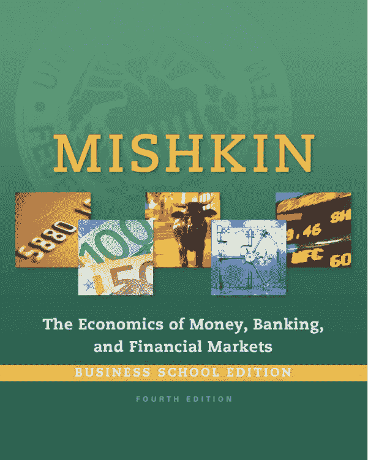

MISHKIN  
货币、银行与金融市场的经济学  
商学院版  
第四版

# 第9章 银行业和金融机构管理

## 银行的资产负债表

- 负债
  - 支票存款
  - 非交易性存款
  - 借款
  - 银行资本
- **资产**
  - 准备金
  - 应收现金项目
  - 银行同业存款
  - 证券
  - 贷款
  - 其他资产

**表10-1 全部商业银行资产负债表（各项占总额的百分比，2014年6月）**

表1 全部商业银行资产负债表（各项占总额的百分比，2014年6月）

| 资产（资金运用）* | 负债（资金来源） |
|---|---|
| 准备金和库存现金 19% | 支票存款 11% |
| 证券 | 非交易性存款 |
| 美国政府及机构证券 13% | 小额定期存款（<$100,000）+储蓄存款 47% |
| 州和地方政府及其他证券 6% | 大额定期存款 11% |
| 贷款 | 借款 20% |
| 商业和工业贷款 12% | 银行资本 11% |
| 房地产贷款 25% |  |
| 消费贷款 8% |  |
| 银行同业贷款 1% |  |
| 其他贷款 7% |  |
| 其他资产（如实物资本）9% |  |
| 总计 100% | 总计 100% |

*按流动性递减顺序排列（按流动性递减顺序排列）。  
Source: http://www.federalreserve.gov/releases/h8/current/.

### 银行的基本业务：现金存款

**第一国民银行**

| 资产 | 负债 |
|---|---|
| 库存现金 +$100 | 支票存款 +$100 |

**第一国民银行**

| 资产 | 负债 |
|---|---|
| 准备金 +$100 | 支票存款 +$100 |

- 开立支票账户将会导致银行准备金的增加，其增加的金额等于支票存款增加的数额

### 银行基本业务：支票存款

**第一国民银行**

| 资产 | 负债 |
|---|---|
| 应收现金项目 +$100 | 支票存款 +$100 |

当一家银行获得一笔意外存款的时候，它就增加了等额的准备金；当一家银行失去一笔存款的时候，它就减少了等额的准备金。

**第一国民银行**

| 资产 | 负债 |
|---|---|
| 准备金 +$100 | 支票存款 +$100 |

**第二国民银行**

| 资产 | 负债 |
|---|---|
| 准备金 -$100 | 支票存款 -$100 |

### 银行基本业务：盈利方式

**第一国民银行**

| 资产 | 负债 |
|---|---|
| 法定准备金 +$10 | 支票存款 +$100 |
| 超额准备金 +$90 |  |

**第一国民银行**

| 资产 | 负债 |
|---|---|
| 法定准备金 +$10 | 支票存款 +$100 |
| 贷款 +$90 |  |

- 资产转换：出售具有一组特征的负债，然后运用所筹到的资金去购买具有不同特征的资产
- 银行借短贷长

### 银行管理的主要内容

- 流动性管理
- 资产管理
- 负债管理
- 资本充足性管理
- 信用风险管理
- 利率风险管理

#### 流动性管理：足够的超额准备金

**1000万美元提款**

| 资产 | 负债 |
|---|---|
| 准备金 2000万 | 存款 1亿 |
| 贷款 8000万 | 银行资本 1000万 |
| 证券 1000万 |  |

| 资产 | 负债 |
|---|---|
| 准备金 1000万 | 存款 9000万 |
| 贷款 8000万 | 银行资本 1000万 |
| 证券 1000万 |  |

- 假设银行的法定准备金率为10%
- 只要银行拥有足够的超额准备金，存款外流就不会迫使银行调整其资产负债表的其他部分

#### 流动性管理：准备金不足

| 资产 | 负债 |
|---|---|
| 准备金 1000万 | 存款 1亿 |
| 贷款 9000万 | 银行资本 1000万 |
| 证券 1000万 |  |

| 资产 | 负债 |
|---|---|
| 准备金 0 | 存款 9000万 |
| 贷款 9000万 | 银行资本 1000万 |
| 证券 1000万 |  |

- 准备金制度是一项法律规定，而其缺口必须得以弥补
- 超额准备金是对于存款外流所引致的各种成本的保险

#### 流动性管理：借款

| 资产 | 负债 |
|---|---|
| 准备金 900万 | 存款 9000万 |
| 贷款 9000万 | 借款 900万 |
| 证券 1000万 | 银行资本 1000万 |

- 这种行为的成本就是借款利息

#### 流动性管理：出售证券

| 资产 | 负债 |
|---|---|
| 准备金 900万 | 存款 9000万 |
| 贷款 9000万 | 银行资本 1000万 |
| 证券 100万 |  |

- 出售证券的成本是经纪人手续费和其他交易费用

#### 流动性管理：联邦储备体系

| 资产 | 负债 |
|---|---|
| 准备金 900万 | 存款 9000万 |
| 贷款 9000万 | 向联邦储备体系的借款 900万 |
| 证券 1000万 | 银行资本 1000万 |

- 必须向联邦储备体系支付的利率实际上基于贴现率形成的

#### 流动性管理：减少贷款

| 资产 | 负债 |
|---|---|
| 准备金 900万 | 存款 9000万 |
| 贷款 8100万 | 银行资本 1000万 |
| 证券 1000万 |  |

- 在获取准备金的各种方式中，削减贷款的代价是最高的
- 收回贷款的活动会招致客户的对立情绪
- 其他银行只有在贴现率很高的情况下才会同意购买这些贷款

#### 资产管理：三个目标

- 力图寻找那些回报率最高的可投资的贷款和证券
- 降低风险
- 保持足够的流动性

#### 资产管理：四种方法

- 试图找到愿意支付高利率同时又不大可能出现违约行为的借款者
- 力图购买回报率较高而风险较低的证券
- 通过资产多样化来降低风险水平
- 在对于流动性的需求和来自低流动性资产的更高的回报之间进行平衡

#### 负债管理

- 由于近期货币中心银行的兴起而出现的一些情况
- 隔夜拆借市场和新型金融工具（诸如：大额可转让定期存单）的扩展
- 在银行资金来源之中，支票存款的重要性下降

#### 资本充足性管理

- 银行资本有助于防止银行倒闭情况的出现
- 资本的数量将会对于银行所有者（持股人）的回报产生影响
- 它是制度性的要求

##### 资本充足性管理：防范银行倒闭

**资本规模较大的银行**

| 资产 | 负债 |
|---|---|
| 准备金 1000万 | 存款 9000万 |
| 贷款 9000万 | 银行资本 1000万 |

**资本规模较小的银行**

| 资产 | 负债 |
|---|---|
| 准备金 1000万 | 存款 9600万 |
| 贷款 9000万 | 银行资本 400万 |

**资本规模较大的银行（贷款损失后）**

| 资产 | 负债 |
|---|---|
| 准备金 1000万 | 存款 9000万 |
| 贷款 8500万 | 银行资本 500万 |

**资本规模较小的银行（贷款损失后）**

| 资产 | 负债 |
|---|---|
| 准备金 1000万 | 存款 9600万 |
| 贷款 8500万 | 银行资本 -100万 |


##### 资本充足性管理：股票持有者的收益

资产回报率：每一美元资产的税后净利润

```
ROA = 税后净利润 / 资产
```

股权回报率：每一美元股权（银行）资本的税后净利润

```
ROE = 税后净利润 / 股权资本
```

资产回报率和股权回报率之间的关系可以表述为：

股本乘数：每一美元股权资本所对应的资产数额

```
EM = 资产 / 股权资本
```

```
税后净利润 / 股权资本 = 税后净利润 / 资产 × 资产 / 股权资本
```

```
ROE = ROA × EM
```

##### 资本充足性管理：安全性

- 银行资本使得银行股东们的投资更为安全，从而使他们由此受益
- 由于银行资本越多，股权回报率就越低，所以银行资本金也是有代价的
- 两者之间的选择取决于整体经济的状态和市场信心的水平

##### 银行资本管理战略

- 资本监管的要求
- 资本规模过大的银行调整措施P171
- 资本规模过小的银行应对措施P172
- 中国银行业资本管理的发展变化

##### 应用：2008年由资本紧缩导致信贷紧缩的发展过程

- 银行资本的短缺导致信贷增长速度的下降
  - 银行由于持有住房抵押贷款支持证券而蒙受了巨额损失
  - 这一损失导致银行资本的下降
- 在整体经济情况不佳的情况下，银行难以筹集大量的资本，进而被迫提高贷款标准和削减信贷规模

##### 信用风险管理：克服逆向选择和道德风险

- **甄别和监督**
  - 甄别
  - 贷款专业化
  - 限制性条款的监督和执行
- 长期客户联系
- 贷款承诺
- 抵押品和补偿性余额
- 信贷配给

##### 利率风险管理

第一国民银行

| 资产 | 负债 |
| --- | --- |
| 利率敏感型资产 $20M | 利率敏感型负债 $50M |
| 可变利率贷款和短期贷款 | 可变利率大额定期存单 |
| 短期证券 | 货币市场存款账户 |
| 固定利率资产 $80M | 固定利率负债 $50M |
| 准备金 | 支票存款 |
| 长期贷款 | 储蓄存款 |
| 长期证券 | 长期大额定期存单 |
|  | 权益资本 |

如果银行拥有的利率敏感型负债多于利率敏感型资产，那么利率的提高将会导致其利润下降，而利率的下降将会导致其利润增加

###### 利率风险管理：缺口分析

- 基本缺口分析：（利率敏感型资产 – 利率敏感性负债）× Δ利率 = Δ银行利润
- 期限队列法
  - 衡量若干期限子区间的缺口
- 标准化缺口分析
  - 考虑了利率敏感度之间的差异

###### 利率风险管理：久期分析

证券市场价值变动的百分比 ≈ -利率变动的百分比 × 久期

久期分析方法利用银行资产和银行负债的（加权）平均久期，来考察利率变动对于银行净值的影响。

## 表外业务活动

- 贷款销售（二级贷款参与）
- 费用收入的产生，举例来说：
  - 为抵押贷款支持证券提供专业化收费服务
  - 创造结构性投资工具（SIVs）的金融创新工具，正如在2007-2008年次贷危机中所发生的事情那样，这些金融创新工具可能使银行暴露于相应的风险之中
- 交易活动和风险管理技术
  - 在外汇市场和投资活动中的金融期货、债务工具的期权以及利率互换等交易活动
  - 产生了委托——代理问题
- 为了降低委托——代理问题而设立的内部控制制度
  - 实现将交易活动和记账业务的分离
  - 为风险暴露水平设置限制
  - 风险价值方法
  - 压力测试

米什金


《货币、银行与金融市场经济学》

商学院版

第四版

# 第12章 金融危机

### 预览

- 本章运用代理理论，对信息不对称现象（逆向选择和道德风险）对金融市场的影响进行经济分析，了解金融危机发生的原因，以及为何对经济产生如此严重的影响。
- 随后，我们将运用上述分析框架来解释包括最近发生的全球金融危机在内的全世界范围内数次金融危机的产生过程。

### 学习目标

- 金融危机的定义
- 了解金融危机三个阶段的特质
- 描述2007—2009年全球金融危机的原因和结果
- 总结2007—2009年全球金融危机对监管方面带来的影响和变化
- 了解当下金融监管的缺口以及对未来的影响

### 什么是金融危机？

金融摩擦：信息不对称加剧，表现出对资本高效配置的阻碍，即无法有效地将资金从储蓄者转移到那些具有生产性投资机会的居民和企业手中，导致经济活动减少。

当完善的金融市场信息系统瓦解，并导致金融摩擦大幅增加同时金融市场无法正常运转，金融危机将爆发。同时，经济活动将会急剧紧缩。

### 金融危机发展的几个阶段

- 第一阶段：金融危机的爆发
  - 信贷泡沫及其毁灭
  - 资产价格泡沫及其破灭
  - 不确定性上升
- 第二阶段：银行危机
- 第三阶段：债务紧缩

图12-1 美国金融危机中的事件顺序

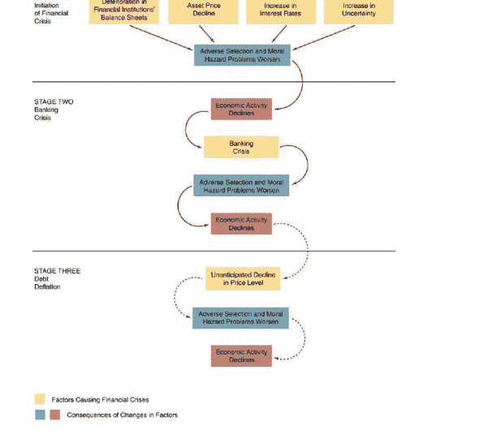

### 金融危机的典型案例：大萧条

在大萧条期间，金融危机是如何发生的，以及它如何导致美国历史上最严重的经济衰退？

主要事件：

- 股市崩盘
- 银行恐慌
- 债务紧缩

图2 大萧条时期的股票价格数据

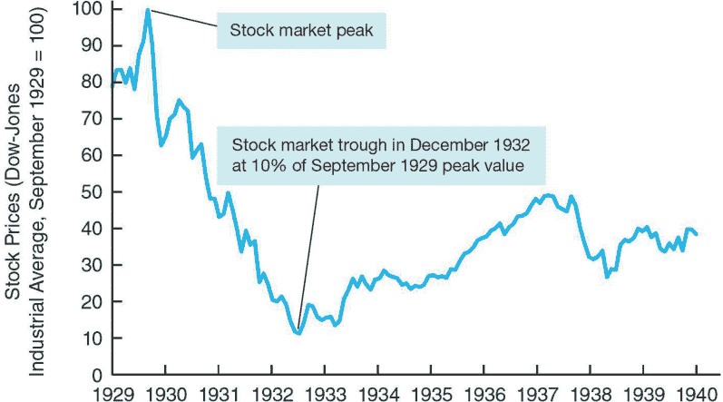

资料来源：道琼斯工业平均指数（DJIA）。全球金融数据：http://www.globalfinancialdata.com/index_tabs.php?action=detailedinfo&id=1165.

图3 大萧条时期的信用利差

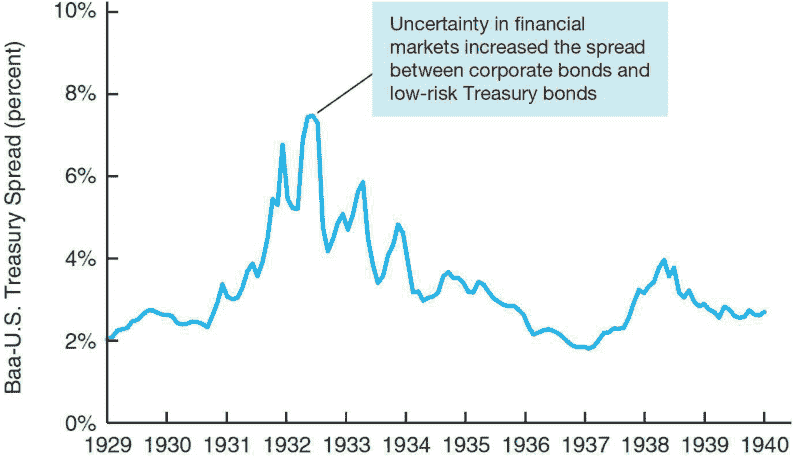

### 2007-2009 全球金融危机

- 2007-2009 金融危机的起因：
  - 按揭市场出现金融创新
    - 次级和Alt-A级住房抵押贷款
    - 抵押债权支持证券
    - 担保债务凭证（CDOs）
  - 房产价格泡沫形成
    - 流入美国的现金流量增加
    - 发展次级抵押贷款市场刺激住房需求和住房价格
- 危机成因（续）：
  - 代理问题浮现
    - 借款者没有动力去披露关于其支付能力的信息
    - “发起——配售”模式严重受制于委托（投资者）——代理（房产经纪人）问题
    - 商业银行和投资银行（以及评级机构）缺少动力去精确评价证券的质量
  - 信息不对称问题显现
  - 房地产价格泡沫破裂

**担保债务凭证**（P233）

- 2007-2009 金融危机的影响
  - 在持续的繁荣之后，房价从2006年开始长期下跌。
  - 房屋价格的下降导致了抵押贷款拖欠的增加和金融机构资产负债表的恶化。
  - 这种发展反过来又导致了影子银行系统的挤兑。
- 金融危机向全球蔓延
  - 欧债危机是一个重要标记
  - 2007年8月，TED（欧洲美元与国库券利率溢价）从40基点增加到几乎240点。


### 2007-2009 全球金融危机

- 银行资产负债表的恶化：
  - 帐面资产降低
  - 出售资产和加强贷款限制
- 知名公司破产
  - 贝尔斯登（2008年3月）
  - 房利美和房地美（2008年7月）
  - 雷曼兄弟、美林、美国国际集团、储备基金公司的主基金（共同基金）和华盛顿共同基金（2008年9月）

#### 图4房价与2007-2009年金融危机

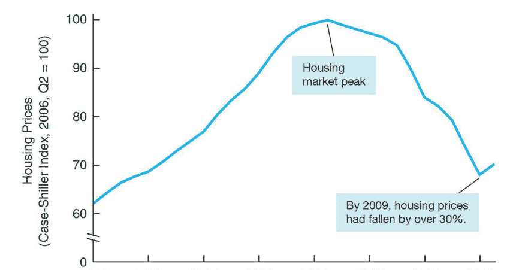

资料来源：凯斯-席勒美国全国综合房价指数，来自圣路易斯联邦储备银行FRED数据库：http://research.stlouisfed.org/fred2/。

#### 图5股票价格与2007–2009年金融危机

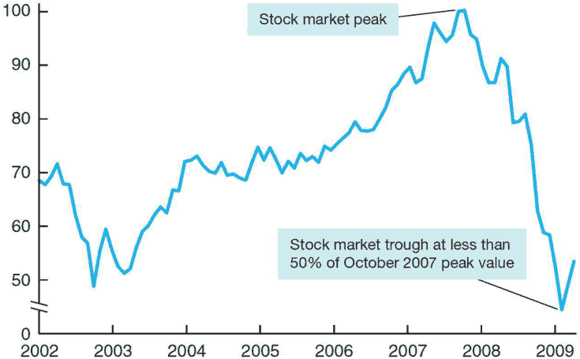

股票价格（道琼斯工业平均指数，2007年10月=100）

股市峰值

股市低谷，不足2007年10月峰值价值的50%

#### 美联储内部：美联储该为房价泡沫负责吗？

- 一些经济学家认为，美联储在2003-2006 时期的低利率政策导致了房价泡沫。
- 泰勒认为，低的联邦基金利率导致了低抵押贷款利率，刺激了住房需求，并鼓励了次级抵押贷款的发放，这两者都导致了房价上涨和泡沫。
- 美联储主席伯南克反驳了这一观点，他说，罪魁祸首是创新抵押贷款产品的激增，降低了抵押贷款的支付，放宽了贷款标准，使更多的购房者进入了房地产市场，资本来自新兴市场国家的资金流入。
- 关于货币政策是否支持房价泡沫的争论一直持续到今天。

#### 全球：欧洲主权债务危机

- 在2007-2009 金融危机之后，预算赤字的增加导致了对政府违约和利率飙升的担忧。
- 从希腊开始的主权债务债务转移到了爱尔兰、葡萄牙、西班牙和意大利。
- 这种和相关事件造成的压力继续威胁着欧元的生存能力。

### 2007-2009 全球金融危机

- 2007-2009 金融危机的高潮
  - 2008年秋季，股市崩盘的速度加快，本周从2008年10月6日开始，显示出美国历史上最糟糕的每周跌幅。
  - 借款人面临的利率飙升导致消费支出和投资大幅下降。
  - 失业率达到自二战以来最大的衰退，超过了10% 的水平。

#### 图6信用利差与2007-2009年金融危机

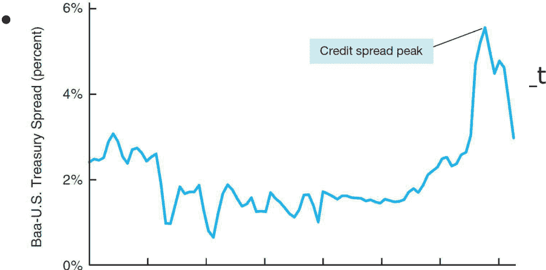

## 2007–2009 全球金融危机

- 政府干预与复苏
  - 由于政府和中央银行的干预，经济衰退的规模远远小于大萧条。
  - 陷入困境的资产救助计划（TARP）是布什政府2008年10月通过的《紧急经济稳定法案》中最重要的条款，授权财政部动用7000亿美元购买次级抵押贷款资产，向金融机构注资。

#### 金融监管方面的应对

- 宏观审慎监管与微观审慎监管
- 2010年的多德-弗兰克华尔街改革与消费者保护法案
  - 消费者保护
  - 清算授权
  - 系统性风险监管
  - 沃尔克法则
  - 衍生品

#### 未来监管的其他问题

- 金融服务业的薪酬
- 政府赞助企业 (GSEs) P242
- 信用评级机构
- 过渡监管的危险

#### 新兴市场经济体中金融危机的发生机制

- 第一阶段：金融危机的起始
  - 第一条路径：金融自由化/全球化的管理失误
    - 较低的监管水平和专门技术的缺乏导致了信贷规模急剧扩张
    - 国内银行从外国银行借入资金
    - 固定汇率造成了一个风险水平较低的印象
    - 在新兴市场经济体中，银行发挥了更加重要的作用，所以证券市场的发育程度较低

#### 新兴市场经济体中金融危机的发生机制

- 第二阶段：货币危机
  - 银行资产负债表情况的恶化诱发货币危机：
    - 政府不能够提高利率（这样做会迫使银行倒闭）......
    - ......投机者预计会出现贬值情况
  - 严重的财政失衡诱发货币危机的运行机制：
    - 国内外投资者抛售该国货币

#### 新兴市场经济体中金融危机的发生机制

- 第三阶段：全面金融危机
  - 以本币计值的债务负担加重（净值降低）
  - 预期发生和实际发生的通货膨胀将会减少公司的现金流
  - 银行破产的可能性提高：
    - 个人的债务能力降低（资产价值降低）
    - 以外币计值的债务水平提高（负债价值提高）

#### 1997-1998年东亚金融危机

- **20世纪90年代初期的金融自由化：**
  - 信贷激增，同时缺乏监管和专门技术
  - 银行积累了大量坏账，其净值降低
- 不断提高的不确定性（股票市场下跌和主要大新企业的破产）
- **1997年的本币贬值**
- 实际的和预期的通货膨胀率提高


# 17章

## 货币供应过程

### 货币供给过程中的参与者

- 中央银行（联邦储备体系）
- 银行（存款类金融机构；金融中介）
- 存款者（个人和机构）

### 联邦储备体系的资产负债表

| 联邦储备体系 |  |  |
|---|---|---|
| 资产 | 负债 |  |
| 政府债券 | 流通中现金 |  |
| 贴现贷款 | 准备金 |  |

- 货币性负债
  - 流通中现金: 社会公众手中的货币数量
  - 准备金: 商业银行在美联储的存款和库存现金
- 资产
  - 政府债券: 美联储持有政府债券会影响货币供给，同时获得利息
  - 贴现贷款: 为商业银行提供准备金，同时按照贴现利率收取利息

### 基础货币

### 基础货币

MB = C + R

C = 流通中现金

R = 银行体系中的准备金总额

#### 向非银行公众进行的公开市场购买 I

| 银行体系 |  |
|---|---|
| 资产 | 负债 |
| 准备金 +$100 | 支票存款 +$100 |

| 联邦储备体系 |  |
|---|---|
| 资产 | 负债 |
| 证券 +$100 | 准备金 +$100 |

- 向美联储出售债券的个人将得到的美联储的支票存入银行
- 结果和向银行进行的公开市场购买的最终结果相同

#### 向非银行公众进行的公开市场购买 II

| 非银行公众 |  |  |
|---|---|---|
| 资产 | 负债 |  |
| 证券 | -$100 |  |
| 现金 | +$100 |  |

| 联邦储备体系 |  |  |
|---|---|---|
| 资产 | 负债 |  |
| 证券 | +$100 | 流通中现金 | +$100 |  |
|  |  |  |  |

- 向美联储出售债券的个人将美联储的支票兑现
- 准备金没有变化
- 流通中现金增加，增加的数量等于公开市场购买的金额
- 基础货币增加，增加的数量等于公开市场购买的金额

#### 公开市场购买：小结

- 公开市场购买对准备金的作用，取决于债券出售人将所得的款项以现金形式持有还是以银行存款的形式持有
- 公开市场购买总是会导致基础货币增加，增加额等于公开市场购买的金额

#### 公开市场出售

| 非银行公众 |  |  |
|---|---|---|
| 资产 | 负债 |  |
| 证券  +$100 |  |  |
| 现金  -$100 |  |  |

| 联邦储备体系 |  |  |
|---|---|---|
| 资产 | 负债 |  |
| 证券  -$100 | 流通中现金  -$100 |  |
|  |  |  |

- 减少了基础货币，减少额等于公开市场出售的金额
- 准备金保持不变
- 相比对准备金的影响，公开市场操作对基础货币的影响更具确定性


#### 存款向现金的转化

| **非银行公众** |  |
|---|---|
| **资产** | **负债** |
| 支票存款 | -$100 |
| 现金 | +$100 |

| **银行体系** |  |
|---|---|
| **资产** | **负债** |
| 准备金 -$100 | 支票存款 -$100 |

| **联邦储备体系** |  |
|---|---|
| **资产** | **负债** |
|  | 流通中现金 +$100 |
|  | 准备金 -$100 |

对货币性负债的净效应为零
准备金随机波动
基础货币是一个更稳定的变量

#### 向一家银行提供贴现贷款

| 银行体系 |  |
|---|---|
| 资产 | 负债 |
| 准备金 +$100 | 贴现贷款 +$100 |
|  | (向美联储的借款) |

| 联邦储备体系 |  |
|---|---|
| 资产 | 负债 |
| 贴现贷款 +$100 | 准备金 +$100 |
| (从美联储得到的借款) |  |

- 联储的货币性负债增加了 $100
- 基础货币也增加了相同的数额

#### 归还向美联储的贷款

| 银行体系 |  |
|---|---|
| 资产 | 负债 |
| 准备金 -$100 | 贴现贷款 -$100 |
|  | (向美联储的借款) |

| 联邦储备体系 |  |
|---|---|
| 资产 | 负债 |
| 贴现贷款 -$100 | 准备金 -$100 |
| (从美联储得到的借款) |  |

- 对基础货币的净效应是负的
- 基础货币的变动与向美联储的借款的变动是一一对应的

#### 其他影响基础货币的因素

- 浮款
- 财政部在美联储的存款
- 对外汇市场的干预

#### 美联储控制基础货币的能力

- 公开市场操作由美联储控制
- 美联储无法决定银行向美联储借款的金额
- 基础货币可以分解为两个部分：

$MB_n = MB - BR$
- 货币供给与非借入基础货币 $MB_n$ 和向美联储借入的准备金 $BR$ 的数量成正向关系

### 存款创造：单个银行

| 第一国民银行 |  |
|---|---|
| 资产 | 负债 |
| 证券 -$100 |  |
| 准备金 +$100 |  |

| 第一国民银行 |  |
|---|---|
| 资产 | 负债 |
| 证券 -$100 | 支票存款 +$100 |
| 准备金 +$100 |  |
| 贷款 +$100 |  |

| 第一国民银行 |  |
|---|---|
| 资产 | 负债 |
| 证券 -$100 |  |
| 贷款 +$100 |  |

超额准备金增加
银行用超额准备金发放贷款
创造了支票存款
借款人购买商品和劳务
货币供给增加

### 存款创造：银行体系

| 银行A | 银行A |
|---|---|
| 资产 | 负债 | 资产 | 负债 |
| 准备金 +$100 | 支票存款 -$100 | 准备金 +$10 | 支票存款 +$100 |
|  |  | 贷款 +$90 |  |

| 银行B | 银行B |
|---|---|
| 资产 | 负债 | 资产 | 负债 |
| 准备金 +$90 | 支票存款 +$90 | 准备金 +$9 | 支票存款 +$90 |
|  |  | 贷款 +$81 |  |

#### 表 1 存款创造（假设法定存款准备金率为 10%，准备金增加$100）

| 银行 | 存款增加额 ($) | 贷款增加额 ($) | 准备金增加额 ($) |
|------|--------------------------|-----------------------|--------------------------|
| 第一国民银行 | 0.00 | 100.00 | 0.00 |
| A | 100.00 | 90.00 | 10.00 |
| B | 90.00 | 81.00 | 9.00 |
| C | 81.00 | 72.90 | 8.10 |
| D | 72.90 | 65.61 | 7.29 |
| E | 65.61 | 59.05 | 6.56 |
| F | 59.05 | 53.14 | 5.91 |
| . | . | . | . |
| . | . | . | . |
| . | . | . | . |
| 所有银行合计 | 1,000.00 | 1,000.00 | 100.00 |

#### 多倍存款创造的公式推导

假设银行不持有超额准备金

法定存款准备金(RR) = 准备金总额(R)

RR = 法定存款准备金率(r) 乘以 支票存款总额(D)

替换

r × D = R

等式两边同除以 r

D = 1/r × R

等式两边同时变动可以得到

ΔD = 1/r × ΔR

#### 对简化模型的批评

- 现金持有会使存款创造过程中止
  - 现金没有存款创造能力
- 银行并不会将其全部超额准备金用于发放贷款或购买证券
- 存款人的决定（持有多少现金）和银行的决定（持有超额准备金的数量）也会导致货币供给的变化

### 决定货币供给的因素

- 非借入基础货币 $MB_n$ 的变动
  - 货币供给与非借入基础货币 $MB_n$ 成正相关关系
- 从联邦储备体系取得的借入准备金 $BR$ 的变动
  - 货币供给与从联邦储备体系取得的借入准备金 $BR$ 成正相关关系

### 决定货币供给的因素

- 法定存款准备金率的变动
  - 货币供给与法定存款准备金率成负相关关系
- 现金持有量的变动
  - 货币供给与现金持有量成负相关关系
- 超额准备金的变动
  - 货币供给与超额准备金的数量成负相关关系

#### 货币供给过程概述 货币供给的反应

#### 汇总表 1

#### 货币供给反应

| 主体 | 变量 | 变量变动 | 货币供给反应 | 原因 |
|---|---|---|---|---|
| 联邦储备体系 | 非借入基础货币, MBₙ | ↑ | ↑ | 存款创造可用的基础货币更多 |
|  | 法定存款准备金率, rr | ↑ | ↓ | 多倍存款扩张减少 |
| 银行 | 借入准备金, BR | ↑ | ↑ | 存款创造可用的基础货币更多 |
|  | 超额准备金 | ↑ | ↓ | 贷款和存款创造减少 |
| 存款人 | 现金持有量 | ↑ | ↓ | 多倍存款扩张减少 |

注：仅显示变量的增加（↑）。变量减少对货币供给的影响与“货币供给反应”栏中所示的影响相反。

#### 货币乘数

- 定义货币为现金加支票存款： M1
- 将货币供给 (M) 和基础货币 (MB) 联系起来，其中 m 为货币乘数

$M = m \times MB$

#### 推导货币乘数 I

假设公众意愿持有的现金水平 C 及超额准备金 ER 与支票存款 D 同比例增长那么，
$c = \{C/D\} = 现金比率$
$e = \{ER/D\} = 超额准备率$

#### 推导货币乘数 II

准备金总额（$R$）等于法定存款准备金（$RR$）和超额准备金（$ER$）之和

$$R = RR + ER$$

法定存款准备金总额等于法定存款准备金率乘以支票存款总额

$$RR = r \times D$$

用上式替换第一个公式中的 $RR$

$$R = (r \times D) + ER$$

美联储制定的 $r$ 小于 1


#### 推导货币乘数 III

- 基础货币 $MB$ 等于现金 $(C)$ 加准备金 $(R)$:
  $MB = C + R = C + (r \times D) + ER$
- 这个等式揭示了为支持现有支票存款、现金和超额准备金规模所需要的货币的数量

#### 货币乘数背后的感性知识

r = 法定存款准备金率 = 0.10
C = 流通中现金 = $400B
D = 支票存款 = $800B
ER = 超额准备金 = $0.8B
M = 货币供给 (M1) = C + D = $1,200B
c = $400B / $800B = 0.5
e = $0.8B / $800B = 0.001
m = (1 + 0.5) / (0.1 + 0.001 + 0.5) = 1.5 / 0.601 = 2.5
货币乘数小于简单存款乘数
虽然存款存在多倍扩张效应
但对现金来说这一效应并不存在

#### 量化宽松和货币供应，2007–2014

- 当全球金融危机在2007年秋季开始时，美联储启动了贷款计划和大规模资产购买计划，试图提振经济。
- 到2014年6月，这些证券的购买导致了美联储资产负债表的扩大了5倍，基础货币增长了377%。

## 量化宽松与货币供给，2007–2014

- 这些贷款和资产购买计划导致了基础货币的巨大扩张，并被赋予了“量化宽松”的名称。
- 基础货币的增长并没有导致货币供应量的相应变化，因为超额准备金大幅上升。

#### Figure 1 M1 and the Monetary Base, 2007–2014

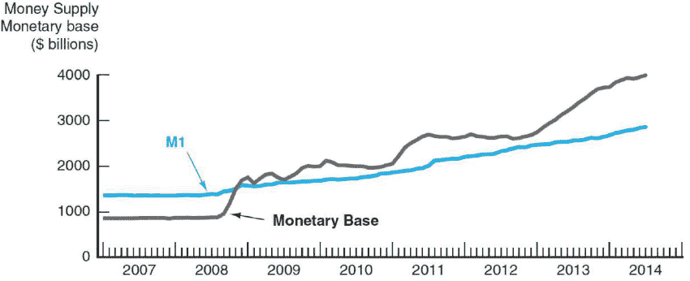

Source: Federal Reserve Bank of St. Louis, FRED database: http://research.stlouisfed.org/fred2/.

#### Figure 2 Excess Reserves Ratio and Currency Ratio, 2007-2014

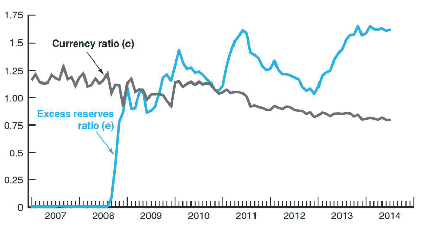

Source: Federal Reserve Bank of St. Louis, FRED database:
http://research.stlouisfed.org/fred2/.


## MISHKIN

The Economics of Money, Banking, and Financial Markets

BUSINESS SCHOOL EDITION

FOURTH EDITION

# Chapter 18

## 货币政策工具

### 预览

- 本章考察美国联邦储备系统用于控制货币供应量和利率的工具

### 学习目标

- 图解准备金市场并证明货币政策工具如何影响联邦基金利率。
- 总结常规货币政策工具如何实施和每个工具的优缺点。
- 解释在常规的政策工具不再有效时使用的特殊货币政策工具。
- 比较美联储的货币政策工具和欧洲中央银行之间的相似之处。

### 准备金市场和联邦基金利率

- 准备金市场的需求和供给
- 在其他条件不变的情况下，随着联邦基金利率的变化，银行对准备金的需求会发生什么变化呢？
- 超额准备金是银行预防存款流出的保障措施
  - 持有超额准备金的成本,是把这些超额准备金贷放出去所能获得的利率与作为超额准备金可以获得的利率之间的差额，$i_{or}$

#### 准备金市场的需求

- 2008年秋季开始，美联储开始对准备金存款支付利息,利率等于联邦基金利率目标减去一个固定的值.
- 当联邦基金利率高于超额准备金的收益率$i_{er}$时,随着联邦基金利率的降低,持有超额准备金的机会成本下降，准备金的需求上升
- 向下倾斜的需求曲线在$i_{or}$处变得平坦(无限弹性)

#### 准备金市场的供给

- 两个组成部分：非借入准备金和借入准备金
- 向美联储借款的成本是贴现率
- 从其他银行借入联邦基金可以替代向美联储的借款
- 如果 $i_{ff} < i_d$，银行不会向美联储借款，借入准备金为 0
- 供给曲线是一条垂线
- 随着 $i_{ff}$ 上升直至超过 $i_d$，银行将按照 $i_d$ 尽可能多地借入资金，并以 $i_{ff}$ 的利率再借出
- 供给曲线在 $i_d$ 处变得很平坦（完全弹性）

#### 图 1  准备金市场的均衡

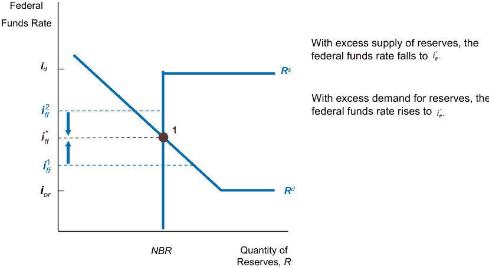

With excess supply of reserves, the federal funds rate falls to i_ff*.

With excess demand for reserves, the federal funds rate rises to i_ff*.

#### 影响联邦基金利率（续）

- 如果准备金的供给曲线与需求曲线相交于供给曲线的垂直部分，贴现率的变化对联邦基金利率没有任何影响
- 如果准备金的供给曲线与需求曲线相交于供给曲线的水平部分，贴现率的变化会使供给曲线的水平部分发生位移，联邦基金利率可能上升也可能下降，上升还是下降取决于贴现率的变动方向
- 当美联储提高法定存款准备金率时联邦基金利率上升，当美联储降低法定存款准备金率时联邦基金利率下降

#### 图 2 公开市场操作的影响

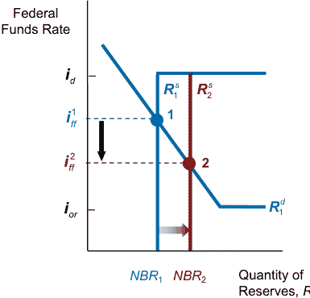

**Step 1.** An open market purchase shifts the supply curve to the right …

**Step 2.** causing the federal funds rate to fall.

**(a) Supply curve initially intersects demand curve in its downward-sloping section**

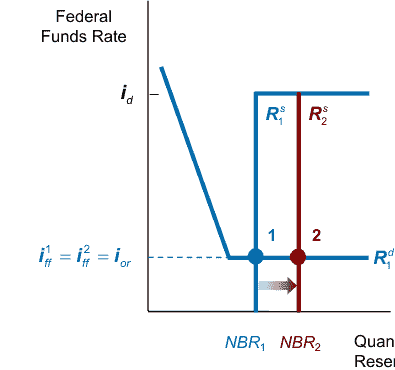

**Step 1.** An open market purchase shifts the supply curve to the right …

**Step 2.** but the federal funds rate cannot fall below the interest rate paid on reserves.

**(b) Supply curve initially intersects demand curve in its flat section**

#### 图4 法定存款准备金率变动的影响

Step 1. Increasing the reserve requirement causes the demand curve to shift to the right . . .

Step 2. and the federal funds rate rises.

#### 图5. 准备金利率变动的影响

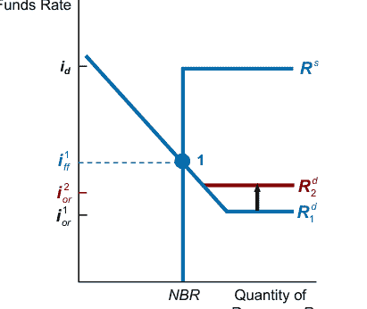

Step 1. A rise in the interest rate on reserves from i_or^1 to i_or^2 ...

Step 2. leaves the federal funds rate unchanged.

(a) initial i_ff^1 > i_or^1

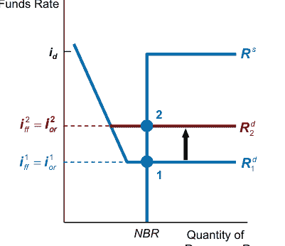

Step 1. A rise in the interest rate on reserves from i_or^1 to i_or^2 ...

Step 2. raises the federal funds rate to i_ff^2 = i_or^2.

(b) initial i_ff^1 = i_or^1

#### 应用： 联邦储备体系的操作手法是如何限制联邦基金利率波动的

- 美联储经营贴现窗口和为准备金支付利息这一操作手法的重要优点之一，就是它们限制了联邦基金利率的波动。我们可以利用对准本金市场的供给与需求分析模型来了解这一点的原。


#### 图 6 联邦储备体系的操作手法如何限制联邦基金利率的波动

- 第一步。需求曲线向右移动使联邦基金利率上升至贴现率的最高水平。
- 第二步。需求曲线向左移动使联邦基金利率下降至准备金利率的最低水平。

### 传统的货币政策工具

在正常情况下，美联储使用货币政策的三个工具——公开市场操作、贴现贷款和准备金制度——实现对货币供应量和利率水平的控制，而这些被称为传统的货币政策工具（三大法宝）。

#### 公开市场操作

- 主动型公开市场操作（主动变动存款准备金和基础货币水平）
- 防御型公开市场操作（被动抵消其他影响存款准备金和基础货币水平的因素）
- 一级交易商
- TRAPS（交易室自动处理计算机系统）
- 回购协议
- 再买回交易

#### 公开市场操作的优点

- 美联储能够完全控制交易的规模
- 操作灵活而且精确
- 具有可逆性，易于反向操作
- 可以快速执行

#### 贴现政策

- 贴现窗口
- 一级信贷：经常性贷款便利（优质银行100bp）
  - 伦巴第贷款便利
- 次级信贷（困难银行，利率再加50bp）
- 季节性信贷（有取消倾向）
- 作为最后贷款人，防止金融恐慌的发生
  - 产生道德风险问题

#### 法定存款准备金要求

- 1980年《存款机构放松管制和货币控制法》对所有存款性金融机构设定了相同的存款准备金要求
- 支票存款总额低于4830万美元的部分，法定存款准备金率为3%；超过4830万美元的部分，法定存款准备金率为10%
- 美联储可以改变10%的要求，在8%—14%之间调整

#### 传统的货币政策工具在金融恐慌的失效

当经济经历一场全面的金融危机时，传统的货币政策工具不再有效，原因有两个。

首先，金融体系失灵了，无法将资本配置到生产性用途，因此投资支出和经济都会崩溃。

第二，对经济的负面冲击会导致零下限问题。

#### 2010-2012年中国货币政策“池子论”案例

背景：2009年刺激计划之后，美国经济处于艰难的复苏之中，至2010年上半年经济数据继续低迷。2010年年中，美联储宣布从2010年11月至2011年6月实施量化宽松的第二轮。美联储发行货币购买财政部发行的长期债券，每个月购买额为750亿美元，直到2011年第二季度，这就是QE2。相反，以中国为代表的新兴经济体2009年之后复苏强劲。2010年底中国CPI为4.6%左右，GDP增速为10.3%，出现明显的经济过热。

当美联储宣布QE2之后，有记者问时任央行行长周小川，周小川回答：用池子进行管理。

#### 问题：

1. 美国的货币政策
2. 中国应当的货币政策
3. 美元的汇率变化趋势
4. 人民币汇率的变化趋势
5. 完美的决策，外汇储备2006年1万亿美元左右，2013年接近4万亿美元。存准率从2010年的16%提高到2011年的21%
6. 2018年的情形？

### 在全球金融危机期间的非常规货币政策工具

- 流动性供给：美联储实施空前扩充计划，以向金融市场提供流动性。
  - 贴现窗口扩张（贴现率100bp（2007年8月以前）→50bp→25bp（2008年3月之后））
  - 短期拍卖工具（TAF，利率比贴现率更低）
  - 全新贷款项目（详见P358）
- 在危机期间，美联储开始了两个新的大规模资产购买计划（通常称作LSAP），以降低特定类型的信贷利率。
  - 收购实体资产
  - QE2（2010年11月—2011年6月，每月750亿美元，共6000亿美元）
  - QE3（2012年9月开始，每月400亿美元抵押支持证券＋450亿美元长期债券）

#### 非常规货币政策工具之三

- 前瞻指引和未来政策行动承诺：流动性供给、资产购买以及未来货币政策行动承诺。

#### 图 7 联邦资产负债表的扩张，2007-2014

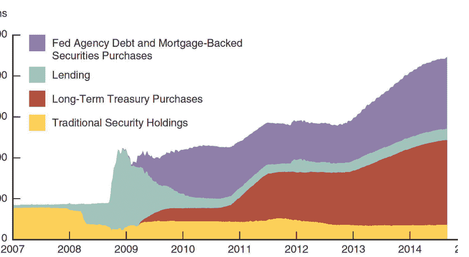

#### 欧洲中央银行货币政策工具

- 公开市场操作
  - 主要再融资操作
    - 每周的反向交易
  - 长期再融资操作
- 向银行发放贷款
  - 边际贷款便利/边际贷款利率 边际贷款便利/边际贷款利率（类似美联储贴现贷款，利率一般比目标利率高100点）
  - 存款便利（商业银行存入央行的资金，利率比目标利率低100点）
- 法定存款准备金要求
  - 将支票存款及其它短期存款的2%作为准备金存放于中央银行

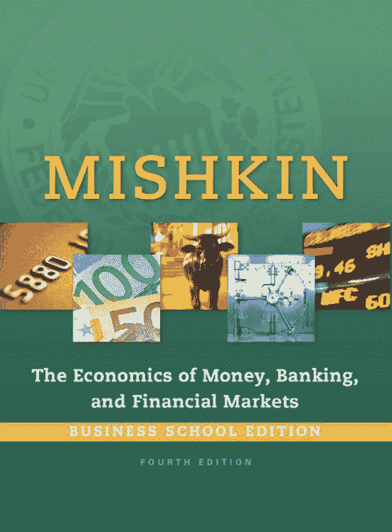

MISHKIN

《货币、银行与金融市场的经济学》

商学院版

第四版

# 第19章
### 货币政策的实施：战略与策略

### 预览

- 本章考察货币政策的目标，然后提出货币政策最重要的战略之一——通货膨胀目标制。

### 学习目标

- 定义和识别名义锚的重要性。
- 确定货币政策制定者可能追求的六个潜在目标。
- 总结层级使命和双重使命之间的区别。
- 比较并对比通货膨胀目标制的优缺点。
- 分析美联储货币政策战略随时间发生的关键变化。
- 列出全球金融危机的四个教训，并讨论它们对通货膨胀目标制的意义。
- 总结支持与反对中央银行对资产泡沫政策反应的论点。
- 描述并评价选择一种政策工具的四个标准。
- 解读并评估作为假设性政策工具的泰勒规则对制定联邦基金利率的表现。

### 价格稳定目标与名义锚

- 在过去几十年中，全世界的决策者越来越认识到通货膨胀的社会和经济代价，更加关注将物价水平稳定作为经济政策的目标。
- 名义锚的作用：名义变量（例如通货膨胀率或货币供应量）将价格水平与实现价格稳定的目标联系在一起。
- 时间不一致问题。

#### 货币政策的其它目标

5个其他货币政策目标常被提及：

1. 高就业率和产出稳定性
2. 经济增长
3. 金融市场稳定
4. 利率稳定
5. 外汇市场稳定

#### 物价稳定应该是货币政策的首要目标吗？

- 层级使命与双重使命：
  - 层级使命：在首要目标（如物价稳定）的前提下完成其他目标。
  - 双重使命：有两个平等的政策目标，如美联储的物价稳定和充分就业。
- 物价稳定作为货币政策首要的长期目标：
  - 物价稳定和自然失业率之间长期来看并不存在矛盾。如果过度关注短期表现，就会产生层级使命与双重使命的偏向；如果把物价稳定作为长期而非短期内的首要目标，无论哪种类型的任务模式都是可以接受的。

#### 通货膨胀目标制 I

- 公布中期通货膨胀率的目标数值。
- 将物价稳定作为首要和长期的货币政策目标，使之成为一种制度性的承诺，并承诺实现这种通货膨胀治理目标。
- 使用信息综合方法，即在制定货币政策时使用许多变量。
- 提高货币政策战略的透明度。
- 明确中央银行在实现通货膨胀目标过程中所担负的责任。

#### 图 1 新西兰、加拿大和英国的通货膨胀率与通货膨胀目标，1980 - 2014

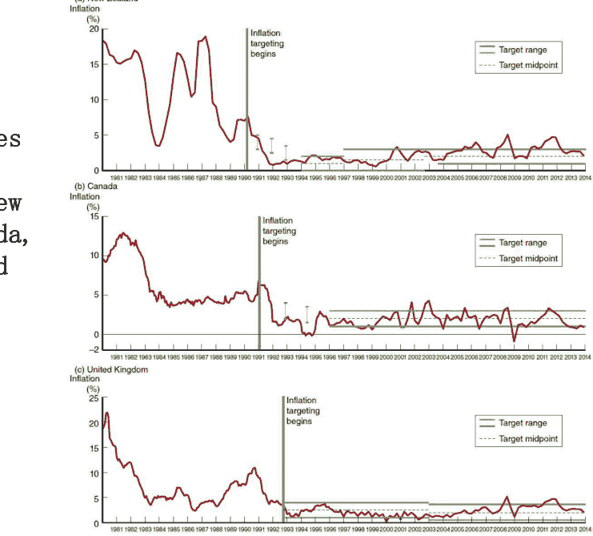

#### 通货膨胀目标制 III

- 优点：
  - 减少时间不一致问题
  - 增加透明度
  - 增加责任约束
  - 与民主原则的一致性
  - 政策表现良好，实行通货膨胀目标制的国家物价水平普遍较低。
- 缺点：
  - 信号迟滞
  - 过于僵化
  - 增加产出波动的潜在可能
  - 缓慢的经济增长


#### 美联储货币政策战略的演进

- 在全球金融危机爆发之前，美国已经取得了出色的宏观经济表现（包括低和稳定的通货膨胀），而没有使用明确的名义锚定，例如通货膨胀目标。
- 演变历史：
  - 1975年美联储开始公开宣布货币供给量增长的目标
  - 保罗·沃尔克（1979）更关注非借入准备金的数量
  - 格林斯潘在1993年7月公开声明，美联储不再使用任何货币总量目标作为货币政策执行的导向

- 不存在表现为联邦储备体系视为高于一切的任务的显性名义锚
- 货币政策要具有前瞻性并采取周期性的“先发制人”的策略
- 目标是在通货膨胀刚刚出现苗头时就及时加以抑制

#### 带有隐性名义锚的货币政策

- 优点
  - 使用多种来源的信息
  - 避免了时间不一致性问题
  - 现实证明的成功
- 缺点
  - 缺乏透明度和问责机制
  - 强烈依赖于掌握中央银行大权的个人的偏好、技术和信誉
  - 与民主原则不相一致

#### 伯南克对通货膨胀目标制的主张

- 增加美联储货币政策目标的透明度
- 朝通货膨胀目标制方向的改变

#### 全球金融危机对货币政策战略的启示

- 1. 金融部门的发展对经济活动的影响比以前更大。
- 2. 利率的零下限可能是一个严重的问题。
- 3. 清理费用很高
- 4. 价格和产出稳定不保证金融稳定。

#### 金融危机对通货膨胀目标制的影响

- 通货膨胀目标水平
  2%还是4%，与实际利率、零下限问题
- 通货膨胀目标制的灵活性

#### 中央银行应该对泡沫做出反应吗？

- 有观点强烈主张不应该对单纯由非理性繁荣驱动的泡沫采取应对措施
- 当资产价格快速上升的同时信贷规模急剧扩张时，泡沫很容易识别
- 不应该运用货币政策来刺破泡沫 （P383，三原因）

- 宏观审慎监管：能够影响信贷市场总体走势的监管政策
- 中央银行和其他监管机构不应该采取自由放任的态度，任凭信贷驱动型泡沫产生和发展而不作出任何反应

### 策略：政策工具的选择

- 工具
  - 公开市场操作
  - 法定存款准备金率
  - 贴现率
- 政策工具（也称操作工具）
  - 准备金总量
  - 利率（联邦基金利率）
  - 能够导致中间变量变动的其他操作
- 联邦基金利率和非借入准备金作为政策工具不能同时兼得（必须二选一）

#### 图2 中央银行工具、政策工具、中介目标和货币政策目标之间的关系

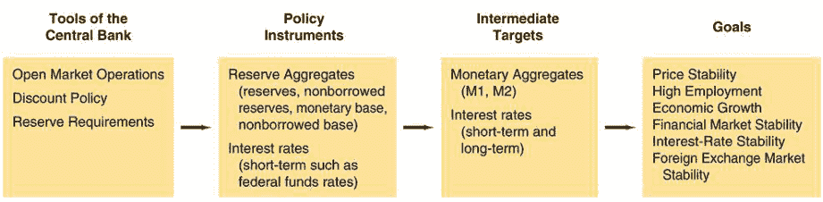

#### 图3 将非借入准备金作为政策目标的结果

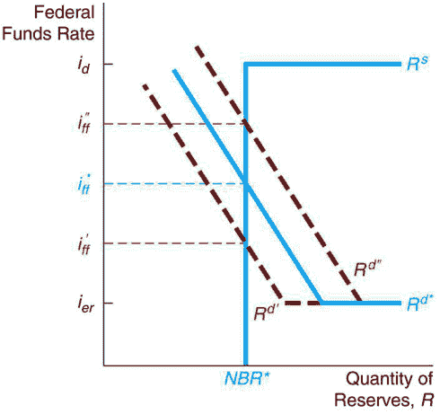

#### 图 4 将联邦基金利率作为目标的结果

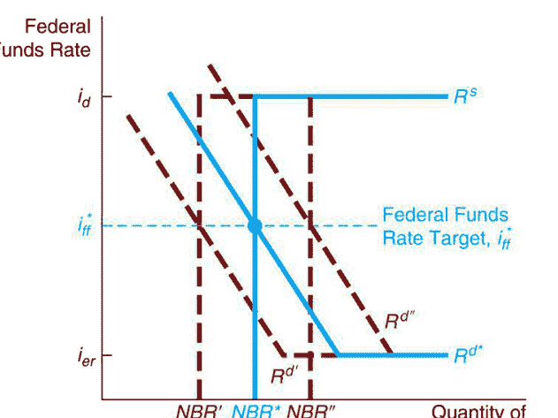

#### 选择政策工具的标准

- 可测性和可计量性
- 可控性
- 对目标可预订的影响

#### 泰勒规则, NAIRU和菲利普斯曲线

联邦基金利率目标=
通货膨胀率+均衡的实际联邦基金利率
+1/2 (通货膨胀缺口)+1/2 (产出缺口)

- 通货膨胀缺口和产出缺口
  - 稳定实际产出是一个重要的目标
  - 正如菲利普斯曲线表明的那样,产出缺口是未来通货膨胀的指示器
- NAIRU
  - 通货膨胀率没有变动趋势时的失业率

#### 图5 联邦基金利率的泰勒规则，1970 - 2014


来源: 圣路易斯联邦储备银行，FRED数据库: http://research.stlouisfed.org/fred2/.

## MISHKIN

《货币、银行与金融市场的经济学》

商学院版

第四版

# 第22章

## 货币数量论、通货膨胀
和货币需求

### 学习目标

- 用货币数量论分析短期和长期内货币增长和通货膨胀之间的关系。
- 了解预算赤字引发通货膨胀型货币政策的条件。
- 概括货币需求的流动性偏好理论的三个动机。
- 了解货币需求的资产组合选择理论的影响因素。
- 分析和阐述货币需求实证中的流动性偏好理论和资产组合选择理论的有效性。

### 货币数量理论(欧文.费雪，1911)

货币流通速度和交易方程式：

M = the money supply
P = price level
Y = aggregate output (income)
P × Y = aggregate nominal income (nominal GDP)
V = velocity of money (average number of times per year that a dollar is spent)
V = P × Y / M
Equation of Exchange
M × V = P × Y

#### 货币数量理论

- 从交易方程式到货币数量论：
  - 费雪的观点是，货币流通速度在短期内是相当恒定的，因此，交易方程式可以转化为货币的数量理论，其中规定名义收入（支出）仅由货币数量的变动决定。

$P \times Y = M \times \bar{V}$

#### 数量理论与价格水平

- 由于古典经济学家（包括费雪）认为工资和价格是完全弹性的，他们认为在正常时期，经济生产的总产出 Y 的水平将保持在充分就业水平。

- 两边除以 $\bar{Y}$ ， 等式可以写成如下：

$P = \frac{M \times \bar{V}}{\bar{Y}}$

#### 数量论与通货膨胀

- (x × y) 中的百分比变化 = (x 的百分比变化) + (y 的百分比变化)
- 利用这一数学事实，我们可以改写的交换方程如下：

%ΔM + %ΔV = %ΔP + %ΔY

π = %ΔP = %ΔM + %ΔV − %ΔY

π = %ΔM − %ΔY

#### 图1 通货膨胀与货币增长之间的关系


*来源:* 对于图(a)，Milton Friedman 和 Anna Schwartz，《1867–1975年美国和英国的货币趋势：其与收入、价格和利率的关系》；圣路易斯联邦储备银行，FRED数据库: http://research.stlouisfed.org/fred2/. 对于图(b)，《国际金融统计》。国际货币基金组织，http://www.imfstatistics.org/imf/.

#### 图2 1965–2015年美国通货膨胀和货币增长率


来源: 圣路易斯联邦储备银行，FRED数据库: http://research.stlouisfed.org/fred2/.


#### 预算赤字和通货膨胀

- 政府可以通过两种方式弥补赤字：增加收入或借贷
- 通过增加税收来增加收入或通过发行政府债券增加负债
- 其实政府还有第三选项可以弥补赤字，增发货币并用它来支付购买的商品和服务。

#### 预算赤字和通货膨胀

- 因此，政府的预算赤字揭示了两个重要事实：
- 如果政府的赤字是由公众购买国债解决，对基础货币和货币供应量并无影响。
- 但是，如果赤字不是由公众增加的债券所提供资金，那么货币基础和货币供应量就会增加。

#### 凯恩斯货币需求理论

- 凯恩斯的流动性偏好理论
- 为什么个人持有货币？三动机：
- 交易动机
- 预防动机
- 投机动机
- 严格区分货币的真实需求和名义需求

#### 交易动机

- 凯恩斯继承了货币交易学说的观点，认为交易规模与收入成正比。
- 后来，他和其他经济学家认识到，被称为支付技术的新的支付方式，也可能影响到货币的需求。

#### 预防动机

- 凯恩斯也认识到，人们把货币作为一个缓冲，以防止意料之外的需求。
- 凯恩斯认为，人们希望持有的预防性货币需求也与收入成正比。

#### 投机动机

- 凯恩斯也认为人们选择把货币作为财富的储备，他称之为投机动机。

#### 综合三个动机

$$\frac{M^d}{P} = f(i, Y)$$ where the demand for real money balances is
negatively related to the interest rate $i$, 
and positively related to real income $Y$

其中实际货币余额的需求与利率 $i$ 负相关，
与实际收入 $Y$ 正相关

Rewriting
$$\frac{P}{M^d} = \frac{1}{f(i, Y)}$$

重写
$$\frac{P}{M^d} = \frac{1}{f(i, Y)}$$

Multiply both sides by $Y$ and replacing $M^d$ with $M$
$$V = \frac{PY}{M} = \frac{Y}{f(i, Y)}$$

两边同乘以 $Y$ 并用 $M$ 替换 $M^d$
$$V = \frac{PY}{M} = \frac{Y}{f(i, Y)}$$

#### Putting the Three Motives Together

将三个动机综合起来

- 货币流通速度不是一个常数：
- i上升（i，Y）下降，从而货币流通速度上升，由于利率波动剧烈，流通速度波动也剧烈。
- 随着对未来正常利率水平变化的预期，流通速度将会改变

#### 货币需求的资产组合理论

- 资产组合选择理论与凯恩斯流动性偏好
- 可以证明资产组合选择理论和凯恩斯的流动性偏好函数得出的结论是相同的，对实际货币余额的需求与总收入正相关，与名义利率负相关。

#### 货币需求的组合理论

- 影响货币需求的其他因素：
- 财富
- 风险
- 其他资产的流动性

#### Summary Table 1 Factors That Determine the Demand for Money

摘要表 1 决定货币需求的因素

SUMMARY TABLE 1

Factors That Determine the Demand for Money

决定货币需求的因素

| Variable | Change in Variable | Money Demand Response | Reason |
|---|---|---|---|
| Interest rates | ↑ | ↓ | Opportunity cost of money rises |
| Income | ↑ | ↑ | Higher value of transactions |
| Payment technology | ↑ | ↓ | Less need for money in transactions |
| Wealth | ↑ | ↑ | More resources to put into money |
| Riskiness of other assets | ↑ | ↑ | Money relatively less risky and so more desirable |
| Inflation risk | ↑ | ↓ | Money relatively more risky and so less desirable |
| Liquidity of other assets | ↑ | ↓ | Money relatively less liquid and so less desirable |

Note: Only increases (↑) in the factors are shown; the effects of decreases in the variables on the exchange rate are the opposite of those indicated in the "Response" column.

注：仅显示因素的增加（↑）；变量减少对汇率的影响与“响应”栏中所示的影响相反。

#### 关于货币需求的实证分析

- 预防货币需求：
- 类似于交易需求
- 随着利率上升，持有预防性余额的机会成本上升
- 对货币的预防性需求与利率负相关

#### 利率和货币需求

- 如前所述，如果利率不对货币需求产生影响，那么货币流通速度更可能是恒定的-或至少可以预测的，因此，货币数量理论认为，总支出是由货币的数量决定的观点很可能是正确的。
- 然而，对货币需求对利率越敏感，货币流通速度就越不容易预测，货币供给和总产出之间的联系就越不明朗。

#### 货币需求的稳定性

- 如果像凯恩斯认为的，货币需求函数是不稳定且可能发生不可预知的变化，那么货币流通速度是不可预测的，而货币数量可能不会如现代数量论认为的那样与总产出紧密相连。
- 货币需求函数的稳定性对于美联储是否应该针对利率或货币供应量也至关重要。

#### 货币需求的稳定性

- 如果货币需求函数不稳定，因此货币供应量与总支出没有紧密联系，那么，美联储设定的利率水平将提供货币政策立场的更多信息，而不是货币供应。
- 1973年前的实证完全支持需求函数稳定的观点。1973年之后，金融创新的飞速发展改变了货币所包含的内容，导致估计的货币需求函数表现出极大的不稳定性。

## MISHKIN

# The Economics of Money, Banking,
and Financial Markets

货币、银行和金融市场的经济学

BUSINESS SCHOOL EDITION

商学院版

FOURTH EDITION

第四版

## Chapter 23

第 23 章

总需求与总供给分析

### Preview

- 本章阐述总需求-总供给分析工具，这一工具有助于我们研究货币政策对于产出和价格的影响。

### Learning Objectives

学习目标

- 概括并阐述总需求曲线和影响其移动的因素。
- 描述并解释短期和长期总供给曲线。
- 描述并解释短期和长期总供给曲线的移动。
- 描述并解释短期、长期均衡以及自我调节机制的角色。
- 描述并解释短期和长期总需求的冲击效应。
- 描述并解释短期和长期的暂时性供给冲击和永久性供给冲击效应。
- 解释2007-2009年金融危机中主要经济体的商业周期波动

### Aggregate Demand

总需求

- 总需求由四部分组成：
- **消费支出**：对消费品和服务的总需求
- **计划投资支出**：商业公司在新机器、工厂和其他资本品（capital goods）上的总计划支出，以及新住宅的计划支出
- **政府支出**：各级政府（联邦、州和地方）对商品和服务的支出
- **净出口**：商品和服务出口与进口差

### Aggregate Demand

总需求

$Y^{ad} = C + I + G + NX$

The aggregate demand curve is downward sloping because

总需求曲线向下倾斜的原因是

$P \downarrow \Rightarrow M / P \uparrow \Rightarrow i \downarrow \Rightarrow I \uparrow \Rightarrow Y^{ad} \uparrow$

and

并且

$P \downarrow \Rightarrow M / P \uparrow \Rightarrow i \downarrow \Rightarrow E \downarrow \Rightarrow NX \uparrow \Rightarrow Y^{ad} \uparrow$

### Aggregate Demand

总需求

- 总需求曲线向下倾斜的事实也可以从货币需求的数量理论中得出。
- 如果货币流通速度保持不变，确定的货币供给量意味着名义总支出也是确定的，这种情况下价格水平的下降对应着总需求的增加。


#### 图 1 总需求曲线左移


通胀率，π

总产出，Y

r̄ ↑, G↓, T̄ ↑, NX↓, C̄↓, Ī↓, f̄ ↑
降低总需求
并使 AD 曲线向左移动

#### 图 2 总需求曲线右移


r↓, G↑, T↓, NX↑, C↑, i↑, f↓
增加总需求并使 AD 曲线向右移动

#### 汇总表 1
##### 导致总需求曲线位移的因素

| 因素 | 变化 | 总需求曲线位移 |
|---|---|---|
| 自主货币政策，\(\bar{r}\) | ↑ | [diagram] |
| 政府购买，\(\bar{G}\) | ↑ | [diagram] |
| 税收，\(\bar{T}\) | ↑ | [diagram] |
| 自主净出口，\(NX\) | ↑ | [diagram] |
| 自主消费支出，\(\bar{C}\) | ↑ | [diagram] |
| 自主投资，\(\bar{I}\) | ↑ | [diagram] |
| 金融摩擦，\(\bar{f}\) | ↑ | [diagram] |

注：仅显示因素的增加（↑）。因素减少的效果与“位移”列中所示的相反。

#### 图 3 长期和短期总供给曲线


通胀率（百分比）

LRAS

AS（πᵉ = 2%）

3.5%

2%

1

2

Yᴾ = 10

11

总产出，Y（$ 万亿）

#### 短期总供给曲线的位移

- 有三因素会导致短期总供给曲线位移：
  1. 预期通胀水平
  2. 产出缺口
  3. 通货膨胀（供给）冲击

#### 汇总表 2 导致短期总供给曲线位移的因素

##### 导致短期总供给曲线位移的因素

| 因素 | 变化 | 供给曲线位移 |
|---|---|---|
| 预期通胀，πᵉ | ↑ | |
| 通胀冲击，ρ | ↑ | |
| 持续产出缺口，(Y − Yᵇ) | ↑ | |

注：仅显示因素的增加（↑）。因素减少的效果与“位移”列中所示的相反。

#### 图 5 预期通胀和价格冲击变化导致的短期总供给曲线位移


#### 图 6 持续正产出缺口导致的短期总供给曲线位移


步骤 1. 正产出缺口导致通胀上升，使 AS₁ 上的点从点 1 移动到点 2。

步骤 2. 持续的正产出缺口提高预期通胀，并使总供给曲线向上位移…

步骤 3. 直到总产出恢复到其潜在水平。

### 总需求与供给分析中的均衡

- 我们现在可以把总需求和总供给曲线放在一起来描述经济中的一般均衡，当所有的市场都同时处于平衡状态时，总产出的需求量等于总产出的供应量。

#### 短期均衡

- 图7显示了一个短期的平衡，其中总产出的需求量等于总供给量。
- 在图8中，短期总需求曲线 AD 和短期总供给曲线AS 向长期供给均衡移动过程。

#### 图 7 短期均衡


#### 图 8 总供给与需求分析中向长期均衡的调整

##### (a) 潜在产出以上的初始短期均衡

##### (b) 潜在产出以下的初始短期均衡

通胀率，π

总产出，Y（$ 万亿）

步骤 2. 经济恢复到潜在产出水平。

步骤 1. 劳动力市场过度紧缩提高预期通胀并使 AS 曲线向上位移直到...

Y* = 10  Y₁  Y₂ = 11

通胀率，π

总产出，Y（$ 万亿）

步骤 1. 劳动力市场过度松弛降低预期通胀并使 AS 曲线向下位移直到...

步骤 2. 经济恢复到潜在产出水平。

Y₁ = 9  Y₂  Y* = 10

#### 自动调节机制

- 无论产出最初处于何种水平，它最终都会回到自然率水平。
- 缓慢
  - 工资缺乏弹性，特别是在下降时。
  - 需要政府采取积极的干预政策。
- 迅速
  - 工资和物价具有充分的弹性。
  - 较少需要政府干预。

#### 均衡的变动：总需求冲击

- 理解了短期和长期均衡之间的区别，我们现在可以分析**需求冲击**引起总需求曲线移动时会发生什么。

#### 图 9 正向的需求冲击


#### 图10 沃尔克的反通货膨胀

##### (a) 总需求与总供给分析


##### (b) 失业率与通货膨胀，1980–1986年

| 年份 | 失业率（%） | 通货膨胀（同比，%） |
|------|-----------------------|------------------------------|
| 1980 | 7.1 | 13.5 |
| 1981 | 7.6 | 10.3 |
| 1982 | 9.7 | 6.2 |
| 1983 | 9.6 | 3.2 |
| 1984 | 7.5 | 4.3 |
| 1985 | 7.2 | 3.6 |
| 1986 | 7.0 | 1.9 |

资料来源：
《总统经济报告》。

#### 均衡变动：总供给（通货膨胀）冲击

- 总供给曲线的移动可能是由暂时性的供给（通货膨胀）冲击造成的，这种情况下长期总供给曲线不移动，也可能是由持久性的供给冲击造成的，这种情况下长期总供给曲线会发生移动。

#### 均衡变动：总供给（价格）冲击

- 暂时性的供给冲击：
  - 当暂时性的冲击涉及供给限制时，我们称这种类型的供给冲击为负面（或不利）供给冲击，它会导致商品价格上涨。
  - 暂时的正面供给冲击会使短期总供给曲线向下向右移动，导致初期通货膨胀率下降、产出增加。然而，从长期来看，产出和通货膨胀将保持不变（总需求曲线保持不变）。

#### 图12 暂时性负向供给冲击


#### 图13 负向冲击，1973–1975年和1978–1980年

##### (a) 总需求与总供给分析


##### (b) 失业率与通货膨胀，1973–1975年和1978–1980年

| 年份 | 失业率（%） | 通货膨胀（同比，%） |
|------|-----------------------|------------------------------|
| 1973 | 4.8 | 6.2 |
| 1974 | 5.5 | 11.0 |
| 1975 | 8.3 | 9.1 |
| 1978 | 6.0 | 7.6 |
| 1979 | 5.8 | 11.3 |
| 1980 | 7.1 | 13.5 |

资料来源：
《总统经济报告》。

#### 永久性供给冲击与真实经济周期理论

- 永久性的负面供给冲击——例如增加不当监管，降低经济效率，从而减少供给——会减少潜在产出，并使长期总供给曲线左移。
- 由于永久性供给冲击会导致价格上升，短期内通货膨胀会上升，因此短期总供给曲线也会左移。

#### 永久性供给冲击与真实经济周期理论

- 以爱德华·普雷斯科特为代表的一批经济学家认为，经济周期的波动是由永久性供给冲击造成的，他们的经济波动理论被称为真实经济周期理论。

#### 图14 永久性负向供给冲击


步骤2. 因此，经济恢复到长期均衡，产出永久性降低，通货膨胀永久性升高。

步骤1. 一次永久的负面供给冲击使长期总供给曲线左移，总供给曲线上移……

#### 图15 美国1995–1999年正向的供给冲击

##### (a) 总需求与总供给分析


##### (b) 失业率与通货膨胀，1995–1999年

| 年份 | 失业率（%） | 通货膨胀（同比，%） |
|------|-----------------------|------------------------------|
| 1995 | 5.6 | 2.8 |
| 1996 | 5.4 | 3.0 |
| 1997 | 4.9 | 2.3 |
| 1998 | 4.5 | 1.6 |
| 1999 | 4.2 | 2.2 |

> 资料来源：
> 《总统经济报告》。

#### 总结

- 总需求与总供给分析可以得出如下结论：
  1. 总需求曲线的变动只在短期内影响产出，长期内不会对总产出产生影响。
  2. 暂时性供给冲击只在短期内影响产出和通货膨胀，长期来看没有影响（总需求曲线保持不变）。
  3. 永久性供给冲击会影响短期和长期的产出与通货膨胀。
  4. 经济具有自我修正机制，能够使其恢复到潜在产出和自然失业率。

#### 图16 负面供给和需求的冲击：2007–2009年金融危机


##### (b) 2007–2009年完美风暴期间的失业率与通货膨胀

| 年份 | 失业率（%） | 通货膨胀（同比，%） |
|------|-----------------------|------------------------------|
| 2006 | 4.6 | 2.5 |
| 2007 | 4.6 | 4.1 |
| 2008年6月 | 5.5 | 5.0 |
| 2008年12月 | 7.2 | 0.1 |
| 2009年6月 | 9.5 | -1.2 |
| 2009年12月 | 10.0 | 2.8 |

资料来源：
《总统经济报告》。

#### 其它国家经济周期事件的AD/AS分析

- 总需求和总供给分析也可以帮助我们了解其他国家的经济周期。
  - 图17显示了2007—2009年英国金融危机，
  - 图18显示了2007—2009年中国金融危机

#### 图17 英国金融危机，2007–2009年

##### (a) 总需求与总供给分析


步骤2. 负面需求冲击使总需求曲线左移，同时随着油价下跌，总供给曲线下移……

步骤1. 负面供给冲击使总供给曲线上移，提高了通货膨胀并降低了产出。

步骤3. 导致通货膨胀和产出双双下降。

##### (b) 失业率与通货膨胀，2006–2009年

| 年份 | 失业率（%） | 通货膨胀（同比，%） |
|------|-----------------------|------------------------------|
| 2006 | 5.4 | 2.3 |
| 2007 | 5.3 | 2.3 |
| 2008年6月 | 5.3 | 3.4 |
| 2008年12月 | 6.4 | 3.9 |
| 2009年6月 | 7.8 | 2.1 |
| 2009年12月 | 7.8 | 2.1 |

资料来源：英国国家统计局。http://www.statistics.gov.uk/statbase/tsdtimezone.asp.


#### 图18 中国与金融危机，2007–2009


（b）中国产出增长与通胀，2006–2009

| 年份 | 产出增长 (%) | 通胀（同比） (%) |
|---|---:|---:|
| 2006 | 11.8 | 1.5 |
| 2007 | 12.4 | 4.8 |
| 2008, June | 11.2 | 7.9 |
| 2008, Dec. | 4.4 | 3.9 |
| 2009, June | 11.1 | −1.1 |
| 2009, Dec. | 10.4 | −0.3 |

### 23章附录：菲利普斯曲线与短期总供给曲线

- **菲利普斯曲线**：失业与通货膨胀的负相关关系。
- 菲利普斯曲线的观点很直观：当劳动力市场吃紧时，失业率很低，公司很难雇用到合格的员工，许多公司甚至很难留住他们现有的员工。因为劳工短缺，公司会提高工资来吸引雇员并以更快的速度来提高产品价格。

#### 图1 美国、1950–1969和1970–2014的通货膨胀和失业


来源: Economic Report of the President. www.gpoaccess.gov/eop/.

#### 图2 短期和长期菲利普斯曲线


通胀率，π（百分比）

失业率，U

第1步. 失业率下降导致沿 PC₁ 上移，提高通胀率。

第2步. 预期通胀上升，使 PC 曲线向上移动。

第3步：直到菲利普斯曲线达到 PC₃，失业率处于自然率。

LRPC

PC₁

PC₂

PC₃

U₂ = 4%

Uₙ = 5%

#### 短期总供给曲线

- 为了得出总需求和总供给模型，需要通过对菲利普斯曲线的分析来得出一个短期的总供给曲线，它代表了企业愿意生产的总产出量与通货膨胀率之间的关系。
- 我们可以将现代菲利普斯曲线转化为短期的总供给曲线，将失业缺口（U−Uₙ）替换为产出缺口（Y−Yᴾ）。

#### 奥肯定律

- **奥肯定律**：描述了失业缺口与产出缺口之间的负相关关系。
- **奥肯定律**指出，对于产出高于潜在产出率的每个百分点，失业率低于自然失业率的0.5个百分点。或者，对于失业率高于自然失业率的一个百分点，产出是低于潜在产出的两个百分点。

#### 图 奥肯定律，1960–2014


来源: Federal Reserve Bank of St. Louis, FRED database: http://research.stlouisfed.org/fred2/.

## MISHKIN


《货币、银行与金融市场的经济学》

BUSINESS SCHOOL EDITION

FOURTH EDITION

# 24章

## 货币政策理论

### 预览

- 本章利用前一章提供的总需求-总供给框架来揭示货币政策理论。

### 学习目标

- 说明和解释货币政策制定者在总需求冲击、临时供应冲击和永久性供应冲击等条件下所面临的决策选择。
- 了解政策过程中的时滞，并总结为什么它们会削弱积极的货币政策的实际效果。
- 解释为什么货币政策制定者可以在长期内以通胀率为目标，而不能以总产出作为长期目标。
- 明确通胀的诱因和货币政策在引发通胀中的角色。
- 解释货币政策制定者在零利率边界中面临的挑战，描述非传统货币政策在这个条件下如何起作用。

### 货币政策对冲击的反应

- 货币政策应尽量减少通胀与通胀目标的差额。
- 在需求冲击和长期供应冲击的情况下，决策者可以同时追求价格稳定和经济活动的稳定。
- 然而，在短暂的供应冲击之后，政策制定者可以实现价格稳定或经济活动稳定，但不能两者兼顾。这种权衡对具有双重使命的中央银行而言构成了两难选择。

#### 对总需求冲击的反应

- 决策者可以通过两种可能的方式来应对这一冲击：
- 不应对政策
- 短期内稳定经济活动和通货膨胀的政策
- 在总需求冲击的情况下，追求物价稳定和经济活动稳定之间不存在冲突。

#### 图2 总需求冲击：短期内稳定产出和通货膨胀的政策


第1步. 总需求曲线向左移动……

第2步. 降低产出和通胀。

第3步. 货币政策自主宽松使总需求曲线恢复到 AD₁，经济恢复到长期均衡，通胀稳定在 π*。

#### 对永久性供应冲击的反应

- 对永久性供应冲击有两种可能的政策反应：
- 不应对政策
- 稳定通货膨胀政策

#### 图3 永久性供应冲击：不应对应策

第3步. 经济恢复到长期均衡，产出下降而通胀上升。

第2步. 短期总供给曲线向上移动直到……

第1步. 永久性负供给冲击使长期总供给曲线向左移动……


#### 对临时供应冲击的反应

- 当供应冲击是暂时的，政策制定者在稳定通货膨胀和经济活动之间面临短期的权衡。
- 决策者可以以三种可能的方式对临时供应冲击作出反应：
- 不应对政策
- 在短期内稳定通胀政策
- 在短期内稳定经济活动政策

#### 图5 对临时总供给冲击的反应：不应对政策


#### 图6 对临时总供给冲击的反应：短期稳定通货膨胀政策

通胀率，π

总产出，Y

LRAS₁

AS₂

AS₁

AD₁

AD₃

π₂

πᵀ

Y₃

Y₂

Yᵖ

第1步. 临时负供给冲击使短期总供给曲线向上移动。

第3步. 短期总供给曲线向下移动……

第2步. 货币政策自主紧缩使总需求曲线移动到 AD₃，导致产出下降，但保持通胀在 πᵀ。

第4步. 导致政策制定者自主放松货币政策以使总需求曲线恢复到 AD₁，在长期稳定通胀和产出。


#### 图7 对短期供给冲击的响应：稳定经济活动的货币政策


通货膨胀率，π

LRAS

总产出，Y

> 步骤1. 暂时的负面供给冲击使短期总供给曲线上移...

> 步骤2. 导致通货膨胀上升和产出下降。

> 步骤3. 自主性货币政策宽松使总需求曲线右移。

> 步骤4. 产出稳定在潜在水平，但通货膨胀高于目标水平。

#### 底线：稳定通货膨胀与稳定经济活动的关系

我们可以从上面的分析中得出以下结论：

- 1. 如果对经济的冲击是总需求冲击或永久性总供给冲击，那么稳定通货膨胀的政策也将稳定经济活动，即使是在短期内亦如此。
- 2. 如果更多的是表现为临时供应冲击，那么中央银行必须在短期内选择两个稳定目标之一。
- 3. 从长期来看，稳定通货膨胀和经济活动在应对冲击方面没有冲突。

### 时滞与政策实施

- 几个类型的时滞阻止政策制定者即时改变总需求曲线：
  - **数据时滞**：政策制定者获取经济正在发生变化数据的时间。
  - **认识时滞**：政策制定者为确定数据在未来经济发展过程中的趋势所花费的时间。
  - **立法时滞**：通过立法实施特定政策所需的时间。
  - **执行时滞**：政策制定者一旦决定新政策，就需要改变政策工具的时间。
  - **作用时滞**：政策对经济产生实际影响所需的时间。

#### 关于奥巴马财政刺激计划，相机抉择和非相机抉择的争论

- 许多相机抉择者辩称，政府需要通过实施大规模的财政刺激方案来做更多的事情。
- 另一方面，非相机抉择者反对财政刺激方案，认为财政刺激计划要花很长时间才能奏效，因为存在长期的执行时滞。
- 奥巴马站在了相机抉择者一边。

#### 通货膨胀：无论何时何地都是一种货币现象

- 米尔顿·弗里德曼这句名言得到了总需求和总供给分析的支持，证明了货币政策制定者可以通过自主性货币政策移动总需求曲线达到任意设定的长期目标通胀率。

#### 图8 目标通胀率的上升

步骤2. 并且通货膨胀上升到新的、更高的目标。

步骤1. 自主性货币政策宽松使总需求曲线右移，随着时间推移，短期总供给曲线向上移动 ...


#### 通货膨胀货币政策的根源

- 高就业目标和通货膨胀：
  - 成本推动型通胀 主要由暂时的负面供应冲击，或者是工人推动加薪超过了生产率上涨的合理性。
  - 需求拉动型通胀 政策制定者追求增加总需求的政策的结果。

#### 图9 成本推动型通货膨胀

通货膨胀率，π

总产出，Y

LRAS

AS₁ AS₂ AS₃ AS₄

AD₁ AD₂ AD₃ AD₄

π₁ π₂ π₃ π₄

Y' Yᴾ

步骤4. 导致通货膨胀螺旋式上升。

步骤1. 暂时的负面供给冲击使短期总供给曲线上移 ...

步骤2. 导致产出下降和失业增加。

步骤3. 政策制定者相应地增加总需求 ...

#### 图11 通货膨胀与失业，1965–1982


### 零下限下的货币政策

- 美联储可以通过降低联邦基金利率来试图降低实际利率。
- 不过，联邦基金利率是以名义上的，因此不能降到零以下。
- 联邦基金利率的零下限被称为零下界。

#### 用零下限推导总需求曲线

-   MP（货币政策规则，罗默；通胀调整线，IA曲线，泰勒）曲线通常向上倾斜。
-   随着通胀和预期通胀率下降，联邦基金利率为零，实际利率上升，为 MP 曲线创造了一个下行斜率。
-   上面描述的过程也在总需求曲线中产生一个折线。

#### 图12　零下限下的总需求曲线的推导


#### 零下界自校正机制的消失

- 当经济处于一个产出低于潜在产出的平衡情况下，并且达到了对政策利率的零下限时，如果政策制定者不做任何努力，产出就不会恢复到其潜在水平。
- 此外，在这种情况下，经济陷入通货紧缩的恶性循环，其特点是不断下降的通货膨胀和产出。

#### 图13 零下限自校正机制的缺失

通货膨胀率，π（百分比）

总产出，Y（万亿美元）

AD

LRAS

AS₁

AS₂

AS₃

步骤1. 当经济存在闲置产能时，总供给曲线向下移动 ...

步骤3. 随着经济更加萧条，总供给曲线进一步下移 ...

步骤2. 导致产出和通货膨胀下降。

步骤4. 导致产出和通货膨胀的螺旋式下降。

π₁

π₂

π₃

Y₁

Y₂

Y₃

Yᴾ


#### 非常规货币政策与量化宽松的应用

- 有时，负面的总需求冲击是如此之大，以至于在某种程度上，中央银行不能进一步降低实际利率，因为名义利率触及了零下限，就像在2008下半年雷曼兄弟破产后所发生的事情。
- 在这种情况下，当零下限问题出现时，中央银行必须转向非常规货币政策。

#### 非常规货币政策与量化宽松的应用

- 非常规货币政策采取三种形式：
  1. 流动性注入
  2. 资产购买
  3. 前瞻指引

#### 图14 提升通胀预期的措施

通货膨胀率，π（百分比）

总产出，Y（万亿美元）

步骤1. 非常规货币政策降低金融摩擦，使总需求曲线右移 ...

步骤2. 提高产出和通货膨胀。

AD₁ AD₂ LRAS AS π₂ π₁ 1 2 Y₁ Yᴾ=Y₂

#### 增加流动性

- 中央银行可以通过增加贷款来直接降低金融摩擦，以便向受损市场提供更多的流动资金，使它们能够恢复正常运作。
- 金融摩擦的下降降低了投资的实际利率。

#### 资产购买和量化宽松

- 货币当局还可以通过购买私人资产来降低信贷息差，从而降低金融摩擦。
- 虽然美联储采取了行动，但力度不足。全球金融危机对经济的总需求冲击是如此之大，以至于美联储的量化（信贷）宽松政策不足以克服它，美联储无法将总需求曲线转变为正常向右下倾斜的曲线，而经济仍遭受严重的衰退。


#### 预期管理（前瞻指引）

- 中央银行承诺长期保持低利率的远期指导，是降低相对于短期利率较高的长期利率的一种有效方法，是降低金融摩擦和实际利率的另一种方式。
- 这可能导致总需求的向右移动，并通过提高通胀预期来改变短期总供给曲线。

#### 图15 对通胀预期上升的反应


步骤 1. 预期通胀上升，推动 AS 向上移动...

步骤 2. 增加产出和通胀。

通胀率，π（百分比）

总产出，Y（万亿美元）

#### 安倍与2013年日本货币政策的转变

- 安倍晋三当选日本首相之后货币政策发生了重大转变。
- 首先，日本央行被迫将其通胀目标加倍。
- 其次，中央银行实施了量化宽松政策。
- 这种双管齐下的政策将降低实际利率，同时提高通胀预期。

#### 图16 对2013年日本货币政策转变的反应

步骤 1. 资产购买降低 i 使 AD 向右移动 . . .

步骤 2. 而预期通胀的上升使 AS 上移，. . .

步骤 3. 增加产出和通胀。

通胀率，π（百分比）

总产出，Y（万亿美元）

LRAS

AD₁ AD₂

AS₁ AS₂

π₂

π₁

Y₁

Y* = Y₂

