# 上海交大安泰经管货币银行学课件（卓建伟）

## 前言

- 教学内容大概
- 作业提交与课件地址 ftp://public.sjtu.edu.cn
  用户名：zhuojw 密码：sjtu
- 课堂纪律

# 第1章

## 研究货币、银行和金融市场的原因

## 研究货币、银行和金融市场的原因

- 考察诸如债券、股票以及外汇市场的运行机制
- 考察诸如银行和保险公司等金融机构的运行机制
- 考察在整体经济运行过程中货币所发挥的作用

## 金融市场

- （金融）市场是资金从拥有闲置资金的人那里转移到资金短缺者手中的场所

## 债券市场和利率

- 证券（金融工具）是对于发行者的未来收益或者资产的一种求偿权
- 债券是承诺在约定期限内定期偿付的债务证券
- 利率是借款的成本或者是用于偿付资金租费的价格

## 股票市场

- 普通股股票代表了其持有者对于公司具有一定份额的所有权
- 一股股票代表了对于公司的资产和收益所具有的求偿权

## 图1-2 1950～2008年以道琼斯工业平均指数显示的股票价格情况

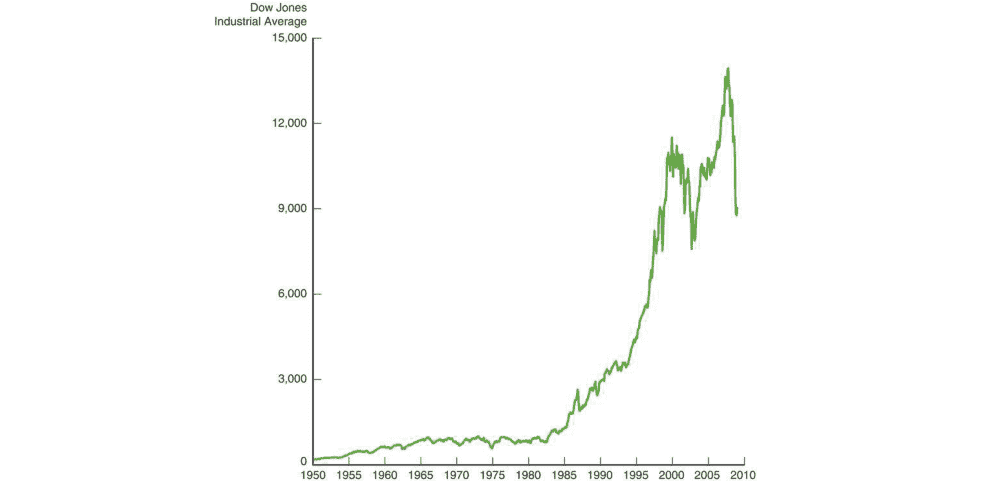

资料来源: 道琼斯指数: http://finance.yahoo.com/?u.

## 金融机构和银行

- 金融中介机构：是指那些吸纳存款资金、并且向需要资金的人提供贷款的机构
  - 银行：吸收存款并且发放贷款
  - 其他的金融机构：保险公司、财务公司、养老基金、共同基金以及投资银行等
- 金融创新：特别是在信息时代和电子金融兴起的条件下涌现出来

## 金融危机

- 金融危机是指以资产价格的急剧下跌以及大量金融机构和非金融类企业的破产倒闭为特征的金融市场出现的严重崩溃现象

## 图3 1950～2008年美国的货币供应量的增长（M2年增长率）与经济周期情况

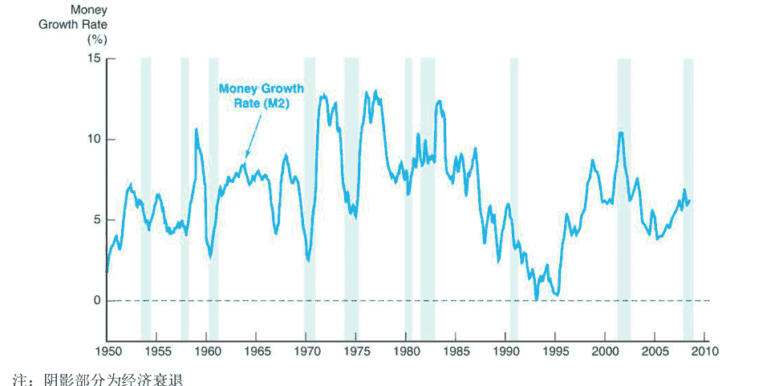

注：阴影部分为经济衰退

资料来源: 联邦储备公报, p. A4, 表1.10;
www.federalreserve.gov/releases/h6/hist/h6hist1.txt.

## 货币与通货膨胀

- 物价总水平是指经济中商品和服务的平均价格
- 物价总水平的持续上升（通货膨胀）将会对于所有经济主体产生影响
- 有关数据表明货币供应量和物价总水平之间存在着联系

## 图1-4 1950～2008年美国的物价总水平和货币供应量

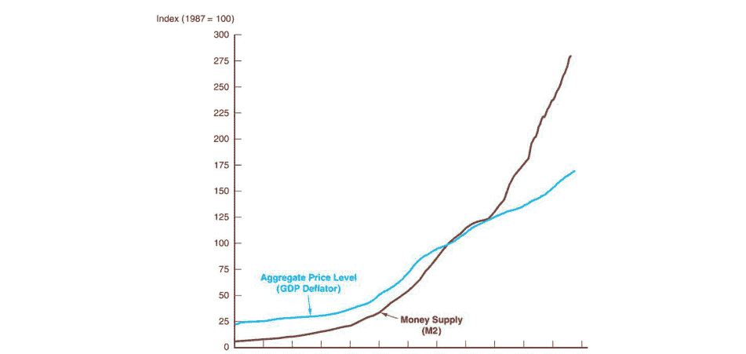

资料来源：www.stls.frb.org/fred/data/gdp/gdpdef; www.federalreserve.gov/releases/h6/hist/h6hist10.txt.

## 图1-5 1997～2007年部分国家平均通货膨胀率与货币供应量平均增长率

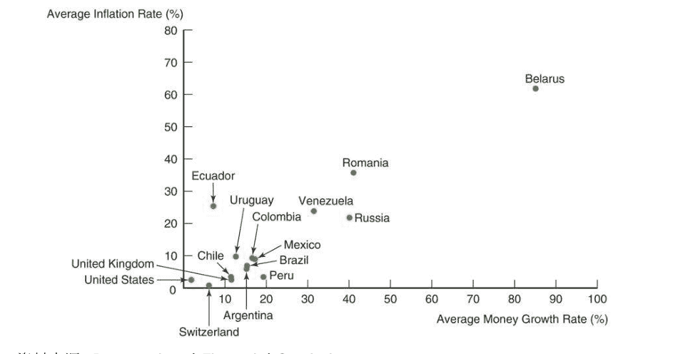

资料来源: 国际金融统计.

## 货币与利率

- 利率是货币的价格
- 20世纪80年代以前，货币供应量的增长和美国长期国债利率之间存在着密切的联系
- 20世纪80年代以后，两者之间的关系变得比较模糊，然而货币供应量的增长依然是利率的重要影响因素之一

## 图1-6 1950～2008年货币供应量增长（M2年增长率）和利率（美国政府长期国债）情况

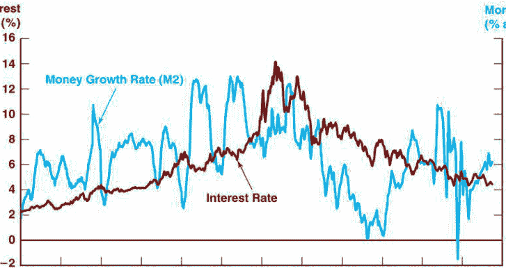

资料来源：联邦储备公报, p. A4, 表1.10; www.federalreserve.gov/releases/h6/hist/h6hist1.txt.

## 货币政策与财政政策

- 货币政策是指对于货币和利率的管理
  - 在美国，货币政策是由联邦储备体系（Fed）来执行的
- 财政政策是对于政府支出和税收问题的管理
  - 财政赤字是指在特定的一年中政府的支出超过税收收入的差额
  - 财政盈余是指在特定的一年中政府税收收入超过支出的差额
  - 必须通过借款来弥补预算赤字

## 图1-7 1950～2008年政府预算盈余或预算赤字占国内生产总值百分比

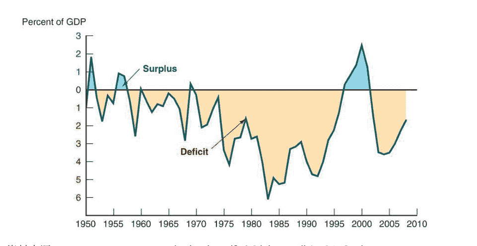

资料来源: www.gpoaccess.gov/usbudget/fy06/sheets/hist01z2.xls.

## 国际金融

- 在全世界范围内，金融市场的一体化趋势不断增强
- 国际金融体系对于各国的国内经济活动具有极为重要的影响：
  - 一个国家汇率政策的选择是如何影响到这个国家的货币政策的？
  - 资本管制措施对于国内金融体系和整体经济绩效会产生什么样的影响？
  - 诸如国际货币基金组织（IMF）之类的国际金融组织应该发挥什么样的作用？

## 外汇市场

- 外汇市场是指进行货币兑换活动的场所
- 外汇汇率是指一个国家货币对于另一个国家货币的价格
- 外汇市场是确定外汇汇率的场所

## 图1-8 1970～2008年 美元汇率变动情况

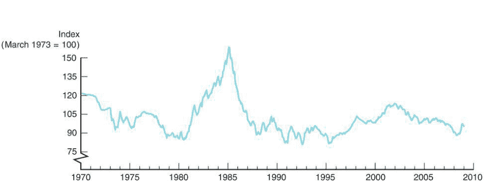

资料来源： 联邦储备系统:
www.federalreserve.gov/releases/H10/summary/indexbc_m.txt/.

## 我们在研究货币、银行和金融市场过程中使用的方法

- 资产需求分析的简化方法
- 均衡的概念
- 用于解释金融市场行为的基本供求分析方法
- 对利润的追求
- 基于交易成本和信息不对称理论的金融市场结构分析方法
- 总供给——总需求分析方法

## 图1-9 联邦储备委员会网站

## 联邦储备统计发布

## H.15
选定利率（周度）

发布日期 | 每日更新 | 历史数据 | 数据下载程序（DDP） | 关于 | 公告

当前发布 其他格式：屏幕阅读器 | ASCII | PDF（45 KB）

## 发布日期

这些数据每周一发布，通常在下午2:30，除非周一是联邦假日，在这种情况下，数据将在周二发布，通常在下午2:30。

公告

本网站提供以下日期的H.15发布：

- 2009年1月26日 当前发布
- 2009年1月21日
- 2009年1月12日
- 2009年1月5日
- 2008年12月29日
- 2008年12月22日
- 2008年12月15日
- 2008年12月8日
- 2008年12月1日
- 2008年11月24日

## 图1-10 利率数据的Excel表格

## 图1-11 利率数据的Excel图示

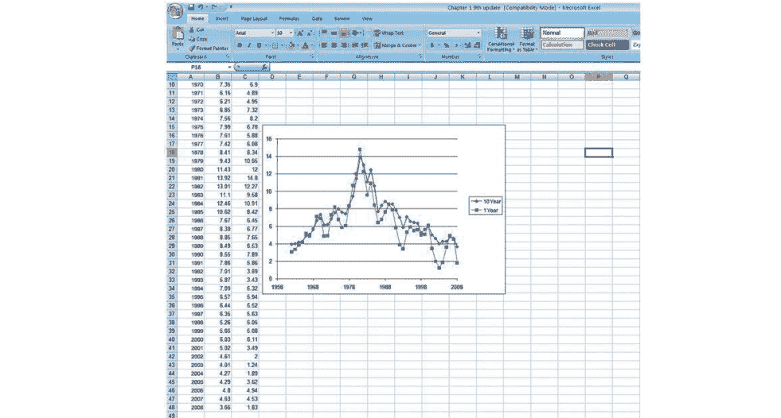

## 作业 1

- 查找我国货币供应量（M1,M2）、物价、GDP、存贷款利率等历史数据（期数尽量长，如1980—2013）
- 分析说明货币供应量与经济增长、物价、利率之间的关系
- 提交：文件名：学号姓名1.doc至 ftp://public.sjtu.edu.cn, upload 文件夹内。第三周上课前

# 第2章

## 金融体系概览

## 案例一 乌克兰危机对全球金融市场的影响

## 案例二 近期人民币贬值的思考

### 2.1 金融市场的职能

- 金融市场的基本功能是向居民、企业和政府提供资金金融通服务，将资金从收大于支而有盈余的经济主体那里转移到收小于支出出现赤字的经济主体手中。
- 在直接融资模式下（图2-1），借款者通过向金融市场里的贷款者出售证券（又称为金融工具），直接从后者手中获取资金。

## 金融市场的职能

- 金融市场能够将资金从缺乏生产性投资机会的人那里转移到拥有此类机会的人手中。因此，金融市场的重要意义在于它能够有效地配置资本，从而提高整体经济的产出水平和效率。
- 通过帮助消费者更好地安排购买时机，功能健全的金融市场能够直接提高他们的经济福利。金融市场向年轻人提高融资，使他们可以购买那些自己需要并且最终能够负担得起的商品，让他们不必等到存够全部货款的那一天。因此，有效运行的金融市场可以改善社会中每个人的经济福利。

## 图1 资金通过金融系统的流动

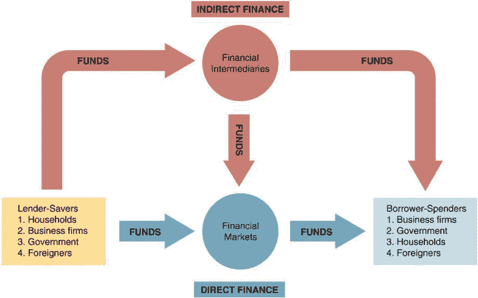

## 间接融资

金融中介机构

资金

资金

资金

- 贷款者-储蓄者
- 1. 家庭
- 2. 企业
- 3. 政府
- 4. 外国人

资金

金融市场

资金

- 借款者-支出者
- 1. 企业
- 2. 政府
- 3. 家庭
- 4. 外国人

## 直接融资

### 2.2 金融市场的结构

- 债务市场和股权市场
  - 债务工具（期限：短期，中期，长期）
  - 股权工具（Equities）（资本利得、红利）
- 一级市场和二级市场
  - 投资银行承销证券的初级市场，IPO，增发、配股
  - 经纪人、交易商通过报价买卖证券次级市场

## 金融市场结构

- 交易所和场外交易 (OTC)
  - Exchanges: NYSE, Chicago Board of Trade
  - OTC Markets: 外汇交易, 联邦基金.
- 货币市场和资本市场
  - Money markets deal in 短期债务工具
  - Capital markets deal in 长期债务工具和股权工具

### 2.3 金融市场工具

- 货币市场工具
  - ✓ 国库券
  - ✓ 可转让银行定期存单
  - ✓ 商业票据
  - ✓ 回购协议（正回购、逆回购）
  - ✓ 联邦基金（同业拆借）

- Libor Hibor shibor

### 表1 主要货币市场工具

| Type of Instrument | 1980 | 1990 | 2000 | 2008 |
|---|---|---|---|---|
| U.S. Treasury bills | 216 | 527 | 647 | 1060 |
| Negotiable bank certificates of deposit (large denominations) | 317 | 543 | 1053 | 2385 |
| Commercial paper | 122 | 557 | 1619 | 1732 |
| Federal funds and Security repurchase agreements | 64 | 387.9 | 768.2 | 2118.1 |

Amount Outstanding ($ billions, end of year)

Sources: Federal Reserve Flow of Funds Accounts; Federal Reserve Bulletin; Economic Report of the President.

> Sources: Federal Reserve Flow of Funds Accounts; Federal Reserve Bulletin; Economic Report of the President.

- 资本市场工具
- 股票
- 抵押贷款，美三家政府代理机构FNMA（房利美）、GNMA、FHLMC（房地美）
- 公司债券
- 美国政府债券
- 美国政府担保债券
- 州和地方政府债券
- 消费贷款和银行商业贷款（信贷证券化）

### 表2 主要资本市场工具

| Type of Instrument | 1980 | 1990 | 2000 | 2008 |
|---|---|---:|---:|---:|
| **Amount Outstanding ($ billions, end of year)** |  |  |  |  |
| Corporate stocks (market value) | 1,601 | 4,146 | 17,627 | 19,648 |
| Residential mortgages | 1,106 | 2,886 | 5,463 | 12,033 |
| Corporate bonds | 366 | 1,008 | 2,230 | 3,703 |
| U.S. government securities (marketable long-term) | 407 | 1,653 | 2,184 | 3,621 |
| U.S. government agency securities | 193 | 435 | 1,616 | 8,073 |
| State and local government bonds | 310 | 870 | 1,192 | 2,225 |
| Bank commercial loans | 459 | 818 | 1,091 | 1,605 |
| Consumer loans | 355 | 813 | 536 | 871 |
| Commercial and farm mortgages | 352 | 829 | 1,214 | 2,526 |

*Sources:* Federal Reserve Flow of Funds Accounts; Federal Reserve Bulletin. 2008, 3rd Quarter.

### 2.4 金融市场的国际化

- 外国债券: sold in a foreign country and denominated in that country’s currency
- 欧洲债券: bond denominated in a currency other than that of the country in which it is sold
- 欧洲货币: foreign currencies deposited in banks outside the home country
  - 欧洲美元: U.S. dollars deposited in foreign banks outside the U.S. or in foreign branches of U.S. banks
  - 欧洲人民币
- 世界股票市场

### 2.5 金融中介机构的功能：间接融资

- 交易成本 Lower transaction costs (time and money spent in carrying out financial transactions).
  - 规模经济 Economies of scale
  - 流动性服务 Liquidity services
- 风险分担
  - 个人借贷——一家企业（较大风险），中介——众多企业（分散了风险），保险业中的例子：个别明星运动员保险案例
  - 可以实现资产组合

## 金融中介机构的功能：间接融资

- 信息不对称
  - （交易前）逆向选择：试图避免选择风险借款人。
    - 收集潜在借款人的信息。
  - （交易后）道德风险：确保借款人不会从事妨碍其偿还贷款的活动。
    - 签订具有限制性契约的合同。

对于金融市场的健康运行而言，逆向选择和道德风险会成为严重的障碍，而金融中介机构能够减少此类问题的发生。

中小企业贷款难的原因，明白了吗？

## 2.6 金融中介机构的类型

- 存款机构
  - 商业银行
  - 储贷协会和互助储蓄银行
  - 信用社
- 契约型储蓄机构
  - 人寿保险公司
  - 火灾和意外伤害保险公司
  - 养老基金和政府退休基金
- 投资中介机构
- 财务公司
- 共同基金
- 货币市场共同基金
- 投资银行

## 表 3 金融中介机构的主要资产和负债

| 中介机构类型 | 主要负债（资金来源） | 主要资产（资金用途） |
|---|---|---|
| **存款机构（银行）** |  |  |
| 商业银行 | 存款 | 企业贷款和消费贷款、抵押贷款、美国政府证券和市政债券 |
| 储贷协会 | 存款 | 抵押贷款 |
| 互助储蓄银行 | 存款 | 抵押贷款 |
| 信用社 | 存款 | 消费贷款 |
| **契约型储蓄机构** |  |  |
| 人寿保险公司 | 保单保费 | 公司债券和抵押贷款 |
| 火灾和意外伤害保险公司 | 保单保费 | 市政债券、公司债券和股票、美国政府证券 |
| 养老基金、政府退休基金 | 雇主和雇员缴纳 | 公司债券和股票 |
| **投资中介机构** |  |  |
| 财务公司 | 商业票据、股票、债券 | 消费贷款和企业贷款 |
| 共同基金 | 股份 | 股票、债券 |
| 货币市场共同基金 | 股份 | 货币市场工具 |

## 表 4 主要金融中介机构及其资产价值

| 中介机构类型 | 1980 | 1990 | 2000 | 2008 |
|---|---|---|---|---|
| 资产价值（十亿美元，年末） |  |  |  |  |
| 存款机构（银行） |  |  |  |  |
| 商业银行 | 1,481 | 3,334 | 6,469 | 12,272 |
| 储贷协会和互助储蓄银行 | 792 | 1,365 | 1,218 | 1,518 |
| 信用社 | 67 | 215 | 441 | 801 |
| 契约型储蓄机构 |  |  |  |  |
| 人寿保险公司 | 464 | 1,367 | 3,136 | 4,798 |
| 火灾和意外伤害保险公司 | 182 | 533 | 862 | 1,337 |
| 养老基金（私人） | 504 | 1,629 | 4,355 | 5,193 |
| 州和地方政府退休基金 | 197 | 737 | 2,293 | 2,730 |
| 投资中介机构 |  |  |  |  |
| 财务公司 | 205 | 610 | 1,140 | 1,910 |
| 共同基金 | 70 | 654 | 4,435 | 6,588 |
| 货币市场共同基金 | 76 | 498 | 1,812 | 3,376 |
| 来源：Federal Reserve Flow of Funds Accounts: www.federalreserve.gov/releases/Z.1.

## 2.7 金融体系的监管

- 帮助投资者获取更多的信息：
  - 降低逆向选择和道德风险的发生
  - 减少内部交易的发生 (SEC).

## 金融体系的监管

- 保障金融中介机构的稳定运行：
  - 准入限制（准入限制）（chartering process）。
  - 信息披露（信息披露）。
  - 对投资与业务活动的限制（对资产和活动的限制）（控制持有风险资产）。
  - 存款保险制度（避免银行挤兑）。
  - 有限竞争（Limits on Competition）（多在过去）：
    - 分支机构，美国独立行制度，禁止设分支机构，中国相反
    - 利率限制，利率有一定管制，中国严格管制。

## 表 5 美国金融体系的主要监管机构

| 美国证券交易委员会（SEC） | 有组织的交易所和金融市场 | 要求信息披露，限制内部交易 |
| 商品期货交易委员会（CFTC） | 期货市场交易所 | 监管期货市场交易程序 |
| 货币监理署 | 联邦特许商业银行 | 特许并检查联邦特许商业银行的账目，并对其可持有的资产施加限制 |
| 国家信用合作社管理局（NCUA） | 联邦特许信用社 | 特许并检查联邦特许信用社的账目，并对其可持有的资产施加限制 |
| 州银行和保险委员会 | 州特许存款机构 | 特许并检查州特许银行和保险公司的账目，对其可持有的资产施加限制，并对分支机构施加限制 |
| 联邦存款保险公司（FDIC） | 商业银行、互助储蓄银行、储贷协会 | 为每位存款人在银行提供最高 10 万美元（临时 25 万美元）的保险，检查被保险银行的账目，并对其可持有的资产施加限制 |
| 联邦储备系统 | 所有存款机构 | 检查加入系统的商业银行的账目，为所有银行设定准备金要求 |
| 储蓄监管办公室 | 储贷协会 | 检查储贷协会的账目，对其可持有的资产施加限制 |

## 3.1 货币的含义

- 货币是什么？
- 货币（或称为货币供应量）是指任何一种被普遍接受的、能够用于购买商品和服务的支付或者偿付债务的物品
- 而是宽泛的定义

## 货币的含义

- 货币（作为存量）应区别于：
- 财富：能够储藏价值的各种财产的总和。包括货币、债券、股票、艺术品、土地、家具、房子、汽车等
- 收入：一定时期内特定的收益数额（流量概念）

## 3.2 货币的功能

- 交易媒介：
  - 货币的出现解决了物物交换的“双重耦合”问题
  - 货币的出现大幅削减达成交易的时间，实现分工与专业化
- 作为商品货币的必要条件
  - 易于标准化 be easily standardized
  - 被普遍接受 be widely accepted
  - 易于分割 be divisible
  - 易于携带 be easy to carry
  - 能长久保存不变质 not deteriorate quickly

## 3.3 支付体系的演变

- 商品货币 Commodity Money: valuable, easily standardized and divisible commodities (e.g. precious metals, cigarettes).
- 早期商品货币、银本位、金银双本位（格雷欣法则）、金本位
- 主币和辅币
- 不兑换纸币 Fiat Money: paper money decreed by governments as legal tender.

## 支付体系的演变

- 支票Checks: an instruction to your bank to transfer money from your account
- 电子支付Electronic Payment (e.g. online bill pay).
- 电子货币E-Money (electronic money):
  - 借记卡Debit card
  - 储值卡Stored-value card (smart card)
  - 电子现金E-cash

## 3.4 货币的计量

- 我们如何衡量货币？何种资产能够当做货币？
- 构建货币供应总量
- M1（较强流动性资产） = 货币 + 旅行支票 + 活期存款 + 其他可选的存款.

## 衡量货币

- M2 (m1 加上流动性稍差的其他资产) = M1 + 小面额定期存款 + 储蓄存款与货币市场存款账户 + 货币市场共同基金份额。

## 表 1 货币总量的衡量

|  | Value as of November 2008 ($ billions) |
|---|---|
| M1 = Currency | 804.9 |
| + Traveler's checks | 5.6 |
| + Demand deposits | 405.9 |
| + Other checkable deposits | 306.1 |
| Total M1 | 1,522.5 |
| M2 = M1 |  |
| + Small-denomination time deposits | 1,351.0 |
| + Savings deposits and money market deposit accounts | 4,007.1 |
| + Money market mutual fund shares (retail) | 1,053.9 |
| Total M2 | 6,412.0 |

*Source: www.federalreserve.gov/releases/h6/hist.*

## 货币总量

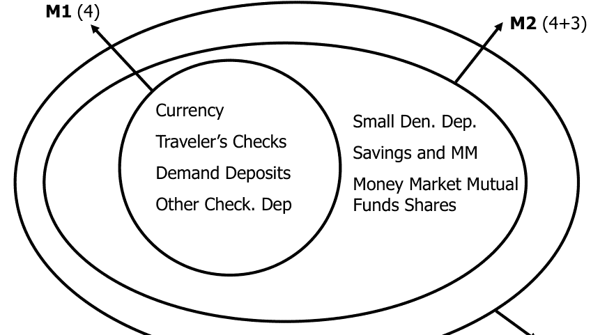

## M1 与 M2

- 哪一种货币总量指标是货币计量的正确方法？
- M1 和 M2 短期而言，（见图）也可以向不同的方向变动。
- 结论：政策制定者和经济学家选择何种货币总量计量方法作为真实货币数量的计量工具，能够产生具有很大差异的经济后果。

## 图 1 M1 和 M2 总量的增长率，1960–2008

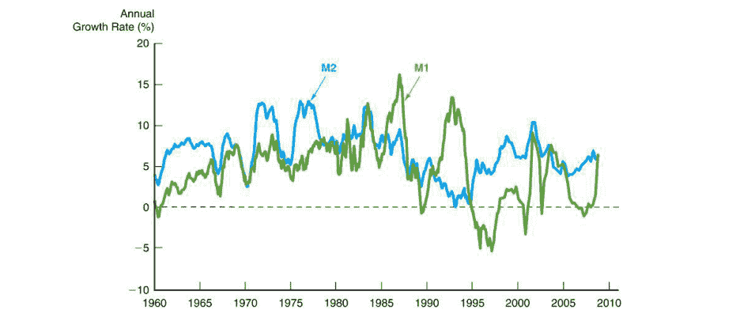

Sources: Federal Reserve Bulletin, p. A4, Table 1.10, various issues; Citibase databank; www.federalreserve.gov/releases/h6/hist/h6hist1.txt.

## 货币数据可靠性如何？

- 为什么要对数据进行修正：
  - 小型存款机构无须经常上报其存款余额
  - 需要对那些存在季节变动特征的数据进行大规模的调整
- 我们可能应该不重视短期波动中的货币供应量的数字，但应仅关注长期趋势

## 表 2 M2 增长率：初始系列与修订系列，2008 年（百分比，年化复合增长率）

| Period |  | Initial Rate | Revised Rate | Difference Revised Rate − Initial Rate |
|---|---|---|---|---|
| July | 2007 | 4.1 | 4 | −0.1 |
| August | 2007 | 10.6 | 8.2 | −2.4 |
| September | 2007 | 5.2 | 6.2 | 1 |
| October | 2007 | 4.4 | 4 | −0.4 |
| November | 2007 | 5.4 | 6.4 | 1 |
| December | 2007 | 5.9 | 5.9 | 0 |
| January | 2008 | 9.6 | 9.6 | 0 |
| February | 2008 | 19.9 | 19.7 | −0.2 |
| March | 2008 | 14.7 | 13.4 | −1.3 |
| April | 2008 | 3.7 | 3.3 | −0.4 |
| May | 2008 | 2.3 | 2.4 | 0.1 |
| June | 2008 | −3.7 | −3.9 | −0.2 |
| Average |  | 6.8 | 6.6 | −0.2 |

Source: Federal Reserve Bulletin, various issues, Table 1.1 line 6: www.federalreserve.gov/pubs/supplement/default.htm.

## 作业2

- 打开FTP中“选择题”,选择相应章节翻译。
- 学号末尾对应章节如下：
- 1---chap01
- 2---chap02
- 3---chap03
- 4---chap16
- 5---chap17
- 6---chap18
- 7---chap22
- 8---chap23
- 9---chap24
- 10---chap25
- 以“学号姓名2.doc”文件上传至ftp, 截止时间： 2013.10.17

# 第 4 章

## 理解利率

## 现值

- 1年后获得的1美元的价值要低于现在获得的1美元的价值。
- 为什么？
  - 今天存入的 1 美元可以赚取利息，并在一年后变成 $1 x (1+i)。

## 将来值的贴现

Let *i* = .10

In one year  $100 X (1 + 0.10) = $110

In two years  $110 X (1 + 0.10) = $121

or 100 X (1 + 0.10)²

In three years  $121 X (1 + 0.10) = $133

or 100 X (1 + 0.10)³

In *n* years

$100 X (1 + *i*)ⁿ

## 简单现值 Simple Present Value

PV = today's (present) value

CF = future cash flow (payment)

i = the interest rate

PV = CF / (1 + i)^n

## Time Line

无法直接比较在时间线上不同时点安排的付款。

| Year | 0 | 1 | 2 | n |
|---|---|---|---|---|
| PV | 100 | 100/(1+i) | 100/(1+i)^2 | 100/(1+i)^n |
| Payment | $100 | $100 | $100 | $100 |

## 四种信用工具 Four Types of Credit Market Instruments

- 普通贷款
- 等额支付贷款 Fixed Payment Loan P58
- 票息债券 Coupon Bond
- 贴现债券 Discount Bond

## 到期收益率 Yield to Maturity

- 它使从债务工具获得的现金流收益（利息）的现值折算为与债务工具现值相等的数值。

## Simple Loan

PV = amount borrowed = $100

CF = cash flow in one year = $110

n = number of years = 1

$100 = $110 / (1 + i)^1

(1 + i) × $100 = $110

(1 + i) = $110 / $100

i = 0.10 = 10%

对于简单贷款，简单利率等于到期收益率。

## Fixed Payment Loan P59

在贷款期限内每个期间的现金流付款相同

LV = loan value

FP = fixed yearly payment

n = number of years until maturity

LV = FP/(1 + i) + FP/(1 + i)^2 + FP/(1 + i)^3 + … + FP/(1 + i)^n

## P59 例题计算

- =RATE(25,126,-1000)
- =11.83%
- P60 例4-4 计算
- =PMT(0.07,20,100000)
- =-9439.29

## 票息债券 Coupon Bond

使用与等额支付贷款相同的策略：

P = price of coupon bond

C = yearly coupon payment

F = face value of the bond

n = years to maturity date

P = C/(1+i) + C/(1+i)^2 + C/(1+i)^3 + … + C/(1+i)^n + F/(1+i)^n

- P61 例4-5 计算
- 已知 n=8，fv=1000，i=12.25%，pmt=100，求PV。
- =PV(12.25%,8,100,1000)

## Table 1 Yields to Maturity on a 10%-Coupon-Rate Bond Maturing in Ten Years (Face Value = $1,000)

| Price of Bond ($) | Yield to Maturity (%) |
|---|---|
| 1,200 | 7.13 |
| 1,100 | 8.48 |
| 1,000 | 10.00 |
| 900 | 11.75 |
| 800 | 13.81 |

- 如果债券的现期价格和面值相等，那么到期收益率等于票息率。
- 债券的现期价格与到期收益率之间存在负相关关系。
- 当债券的现期价格低于其面值时，到期收益率要高于其票息利率。

## 永续债券 Consol or Perpetuity

- 以固定票息 C 偿付的无到期日、无需偿付本金的永久性债券

P = C / i_c

P_c = price of the consol

C = yearly interest payment

i_c = yield to maturity of the consol

can rewrite the above equation as this: i_c = C / P_c

年息票利息除以证券价格得到的 i_c 称为当期收益率，通常作为长期债券利率的近似值。

## 贴现债券 Discount Bond

对于任何一年期贴现债券

i = (F - P) / P

F = Face value of the discount bond

P = current price of the discount bond

到期收益率等于一年内价格的增加额除以初始价格。

与票息债券一样，到期收益率与当前债券价格负相关。

## 回报率 Rate of Return P64-65

支付给所有者的款项加上价值变化表示为购买价格的分数

RET = C/P_t + (P_{t+1} - P_t)/P_t

RET = return from holding the bond from time t to time t + 1

P_t = price of bond at time t

P_{t+1} = price of the bond at time t + 1

C = coupon payment

C/P_t = current yield = i_c

(P_{t+1} - P_t)/P_t = rate of capital gain = g

## 回报率与利率的区别 Rate of Return and Interest Rates

- 持有期与债券期限相等时，持有期回报率等于到期收益率。
- 如果到期时间长于持有期，利率上升使债券价格下跌，导致资本损失。
- 债券到期日越远，价格变动百分比越大。

## 回报率及利率（续）

- 利率上升时，期限越长的债券，回报率越低。
- 即使债券具有实质性的初始利率（票面利率），如果利率上升，其回报也可以为负。

## 期限与债券回报率：利率风险

- 债券期限越长，其价格变动幅度受到利率的影响会越大。这个发现有助于我们理解债券市场行为中一个重要事实：长期债券的价格和回报率波动幅度比短期债券要大。
- 只有持有期与债券到期日相同的债券才能避免由于期限不同带来的利率风险。

## 费雪方程 Fisher Equation

i = i_r + π^e

i = nominal interest rate

i_r = real interest rate

π^e = expected inflation rate

当实际利率较低时，借贷的激励更大，而贷款的激励更少。

实际利率是衡量借贷激励的更好指标。

## FIGURE 1 Real and Nominal Interest Rates (Three-Month Treasury Bill), 1953–2008

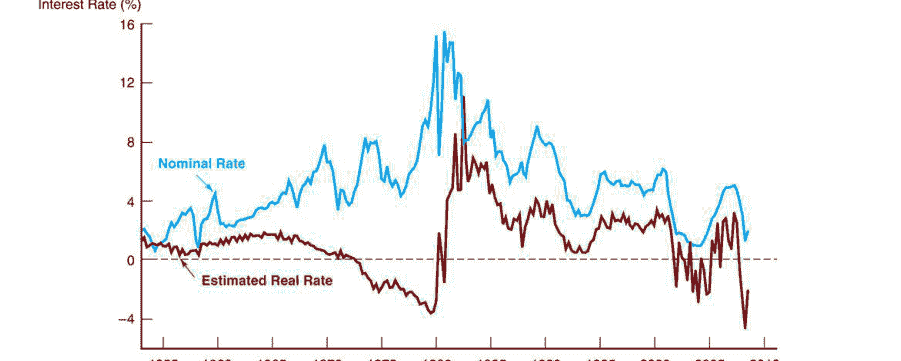

Sources: Nominal rates from www.federalreserve.gov/releases/H15. The real rate is constructed using the procedure outlined in Frederic S. Mishkin, "The Real Interest Rate: An Empirical Investigation," Carnegie-Rochester Conference Series on Public Policy 15 (1981): 151–200. This procedure involves estimating expected inflation as a function of past interest rates, inflation, and time trends and then subtracting the expected inflation measure from the nominal interest rate.

来源：名义利率来自 www.federalreserve.gov/releases/H15。实际利率是根据 Frederic S. Mishkin 在《The Real Interest Rate: An Empirical Investigation》，Carnegie-Rochester Conference Series on Public Policy 15 (1981): 151–200 中概述的程序构建的。该程序涉及将预期通胀估计为过去利率、通胀和时间趋势的函数，然后从名义利率中减去预期通胀的衡量指标。

# 第5章
# 利率行为

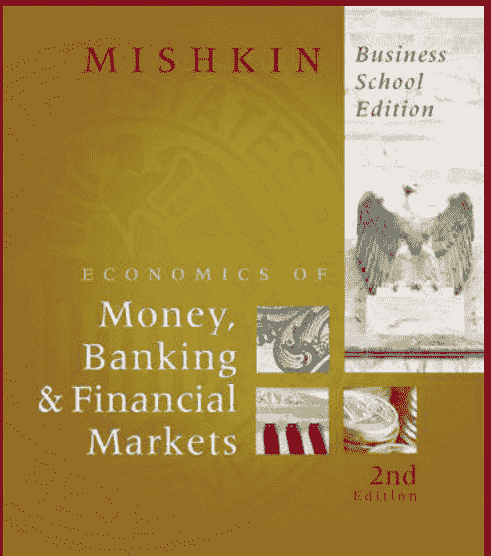

## 5.1 资产需求的决定因素

- 财富：个人拥有的全部资源，包括所有资产。在其它因素保持不变的条件下，财富的增长会导致资产需求量的上升。
- 预期收益率：即与其它资产相比，某种资产在下一个时期实现收益率的预期值。在其它因素保持不变的条件下，相对于其它可替代性资产，某种资产的预期收益率上升将会导致该项资产需求量的上升。
- 风险：与其它资产相比，某种资产收益率的不确定性。在其它因素保持不变的条件下，相对于其它可替代性资产，某种资产的风险水平上升将会导致其需求量的下降。如希腊债务危机。
- 流动性：与其它资产相比，某种资产变现的速度和难易程度。

## 资产需求理论

包含前面讨论的四大因素，该理论认为：

1. 资产需求量和财富之间存在正相关关系。
2. 相对于其它可替代资产而言，资产的需求量和该资产的预期收益率之间存在正相关关系。
3. 相对于其它可替代资产而言，资产的需求量和该资产的风险之间存在负相关关系。
4. 相对于其它可替代资产而言，资产的需求量和该资产的流动性之间存在正相关关系。

## 汇总表1 资产需求量对财富、预期收益率、风险和流动性变动的反应

| 变量 | 变量的变动 | 需求量的变动 |
|---|---|---|
| 财富 | ↑ | ↑ |
| 相对其他资产的预期收益率 | ↑ | ↑ |
| 相对其他资产的风险 | ↑ | ↓ |
| 相对其他资产的流动性 | ↑ | ↑ |

*注：表中只显示了变量的增加。变量减少对需求量的影响与最右列所示相反。*

## 5.2 债券供给和需求

- 在一定较低的价格（较高的利率），债券的需求数量较高：成反比关系
- 在一定较低的价格（较高的利率），提供的债券数量较低：成正比关系

## **图1** 债券的供给与需求

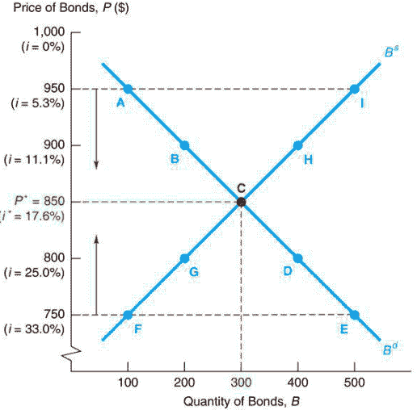

## 市场均衡

- 在经济学中，市场均衡是指在给定价格条件下，人们愿意购买（需求）和出售的数量相等时的状态。在债券市场上，债券的需求量和供给量相等的时候，就实现了市场均衡。
- Bᵈ = Bˢ 定义的平衡（或市场结算）价格和利率。
- 当 Bᵈ > Bˢ 时，存在过度需求，价格将上涨，利率将下降
- 当 Bᵈ < Bˢ 时，存在供应过剩，价格将下降，利率将上升

## 债券需求的变动（P77）

- 财富：财富不断增长(经济扩张、储蓄倾向等) 的拓展，债券的需求曲线右移
- 预期收益率：长期债券的到期收益率越高，其预期的持有期收益率越低，导致债券需求减少，向左移需求曲线
- 预期通货膨胀:预期通货膨胀率的提高，降低债券持有的实际利率水平，导致债券的需求减少，债券需求曲线向左发生位移。
- 风险：债券风险增加，投资者将资金转入其他低风险资产，需求下降，需求曲线左移。
- 流动性:债券交易活跃流动性增强，曲线右移，相反，若其他资产如股票流动性增强，债券需求曲线左移。

## 汇总表2 使债券需求曲线移动的因素

| 变量 | 变量的变动 | 在每个债券价格上的需求量变动 | 需求曲线的移动 |
|---|---|---|---|
| 财富 | ↑ | ↑ |  |
| 预期利率 | ↑ | ↓ |  |
| 预期通货膨胀 | ↑ | ↓ |  |
| 债券相对其他资产的风险 | ↑ | ↓ |  |
| 债券相对其他资产的流动性 | ↑ | ↑ |  |
| *注：表中只显示了变量的增加。变量减少对需求的影响与其余各列所示相反。* |  |  |  |

## 图2 债券需求曲线的移动

债券价格，P

债券数量，B

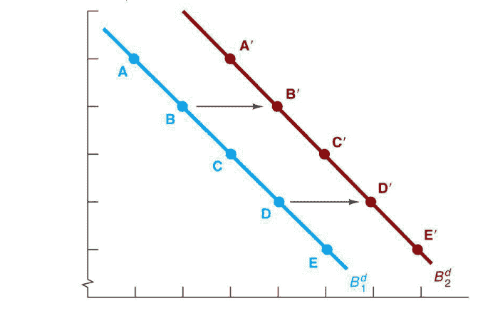

## 债券供给的变动

- 投资机会的预期盈利能力。公司对未来的盈利预期上升，发债融资欲望上升。因此经济扩张阶段，债券供给将会提高，债券供给曲线向右位移。同理，经济衰退阶段，债券供给曲线左移
- 预期通胀：通胀预期增加，借款实际成本下降，债券供给曲线右移
- 政府财政预算案：增加的预算赤字导致供给曲线右移

## 汇总表3 使债券供给曲线移动的因素

| 变量 | 变量的变动 | 在每个债券价格上的供给量变动 | 供给曲线的移动 |
|---|---|---|---|
| 投资盈利能力 | ↑ | ↑ | P B1 B2 供给曲线右移 |
| 预期通货膨胀 | ↑ | ↑ | P B1 B2 供给曲线右移 |
| 政府赤字 | ↑ | ↑ | P B1 B2 供给曲线右移 |

*注：表中只显示了变量的增加。变量减少对供给的影响与其余各列所示相反。*

## 图3 债券供给曲线的移动

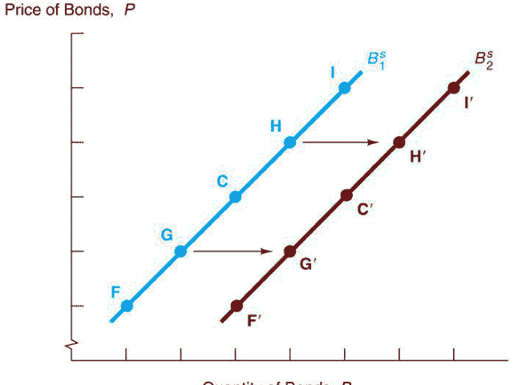

## 图4 费雪效应：通胀预期下的债券价格均衡过程

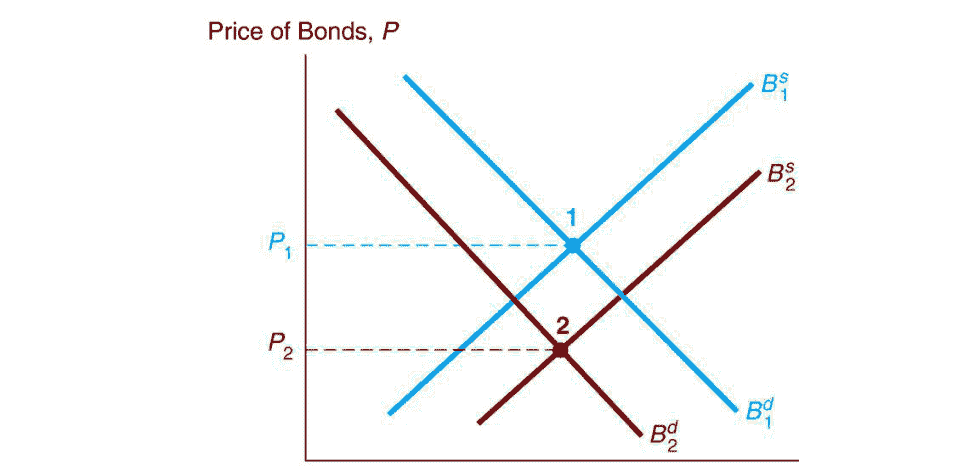

## 图5 预期通货膨胀率和利率（3 个月期国债），1953–2008

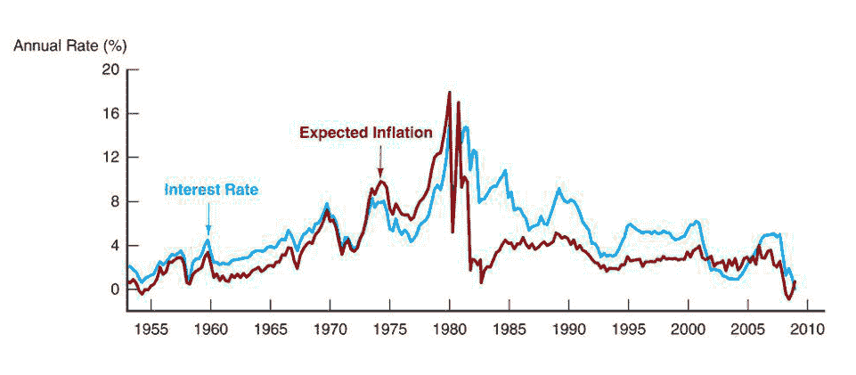

资料来源：预期通胀率是按照 Frederic S. Mishkin《实际利率：一项实证研究》（Carnegie-Rochester Conference Series on Public Policy 15（1981）：151–200）中概述的方法计算的。这些方法涉及将预期通胀率估计为过去利率、通胀率和时间趋势的函数。

# FIGURE 6 经济扩张下的债券价格均衡

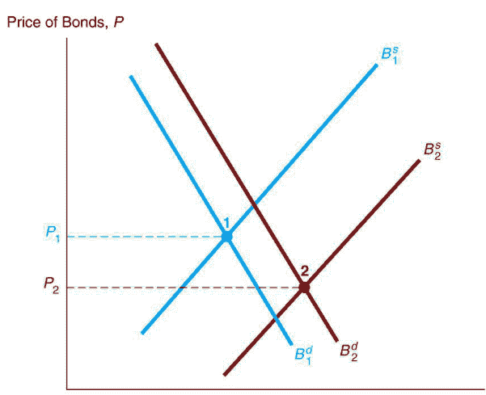

# 5.4 货币市场的供给和需求：流动性偏好理论

凯恩斯模型根据货币的供给和需求决定均衡利率。

人们用来储存财富的资产主要有两大类：货币和债券。

经济中的总财富 = Bˢ + Mˢ = Bᵈ + Mᵈ

重新排列：Bˢ - Bᵈ = Mˢ - Mᵈ

如果货币市场处于均衡状态（Mˢ = Mᵈ），则债券市场也处于均衡状态（Bˢ = Bᵈ）。

# FIGURE 8 货币市场均衡

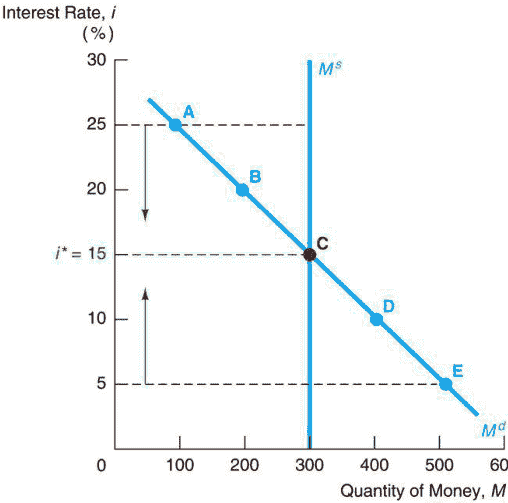

# 货币流动性偏好模型中的需求

- 在利率上升的时候：
  - 持有货币的机会成本上升
  - 货币相对于债券的收益率下降（凯恩斯假定人们持有金融资产的两种形式：生息资产债券和非生息资产货币）
  - ...因此对于货币需求量将下降

# 货币供应量的变动

- 假定由中央银行控制货币供应量
- 美联储实现的货币供应量增加将导致货币供给曲线向右移动

# FIGURE 9 收入或价格水平变化的影响

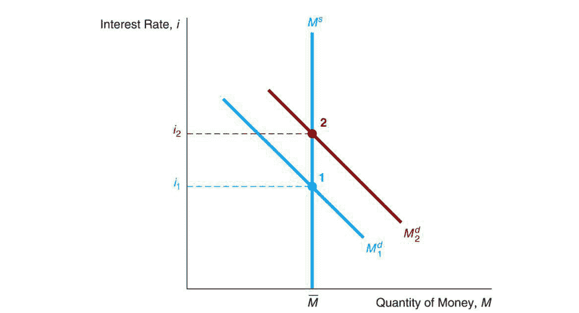

# FIGURE 10 货币供应量变化的影响

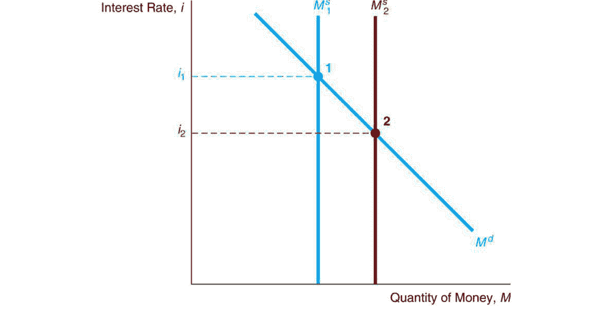

# Summary Table 4 Factors That Shift the Demand for and Supply of Money

| 变量 | 变量变化 | 各利率下的货币需求(Mᵈ)或供给(Mˢ)变化 | 利率变化 |
|---|---|---|---|
| 收入 | ↑ | Mᵈ ↑ | ↑ |
| 价格水平 | ↑ | Mᵈ ↑ | ↑ |
| 货币供应量 | ↑ | Mˢ ↑ | ↓ |

注：仅显示变量的增加。变量减少对需求变化的影响与上表中所示的其余列的相反。

# 其他关于货币供应量与利率的观点

- 流动性偏好理论最重要的结论：货币供应量增长将会调低利率--流动性效应。
- 弗里德曼对此的批判：（承认流动性效应，但有其它因素影响）
- 收入效应—货币供应量的提高会对经济运行产生扩张性影响，从而增加国民收入和财富水平。流动性偏好理论和债券供求理论认为利率由此上升。

# 其他条件不变？

- 物价效应—货币供应量的提高将会导致整体经济中物价总水平的上升，流动性偏好理论认为这将会提高利率。因此，货币供应量提高的物价效应是物价水平的提高将会导致利率的上升
- 通货膨胀的预期效应—货币供应量的提高，使得人们对未来物价水平的预期值相应提高，由此产生了更高的通胀预期，导致利率上升

# 价格水平和预期通胀效应

| | 物价效应 | 预期通胀 |
|---|---|---|
| 开始时 | 无，或轻微 | 无或较重 |
| 发展中 | 明显 | 强化预期 |
| 顶峰 | 很明显，cpi峰值 | 0 |

因此两者的效应是不同的，

# FIGURE 11 随着时间的推移增加货币供对利率的影响

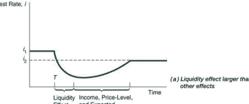

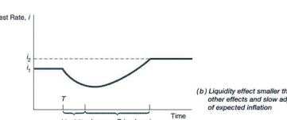

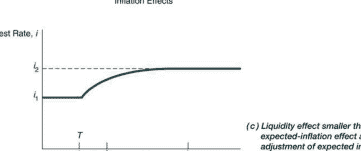

# **FIGURE 12** 货币增长(M2，年率)与利率(三月期国债)，1950–2008

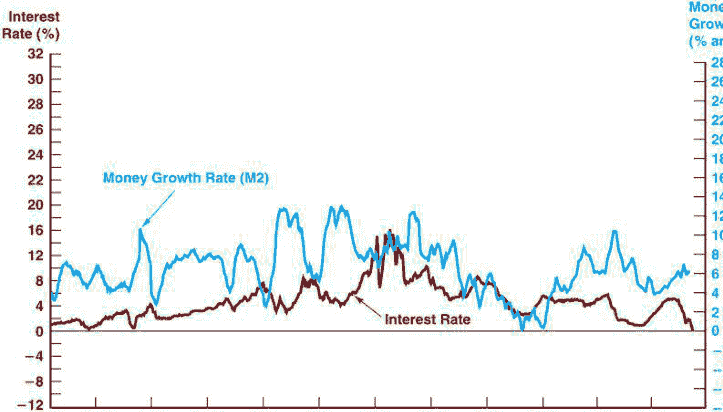

*来源：* Federal Reserve: www.federalreserve.gov/releases/h6/hist/h6hist1.txt.

## 作业2

P91 1、2、3、4,6、7、11、
13,16、18、20

# 第6章

# 利率的风险和期限结构

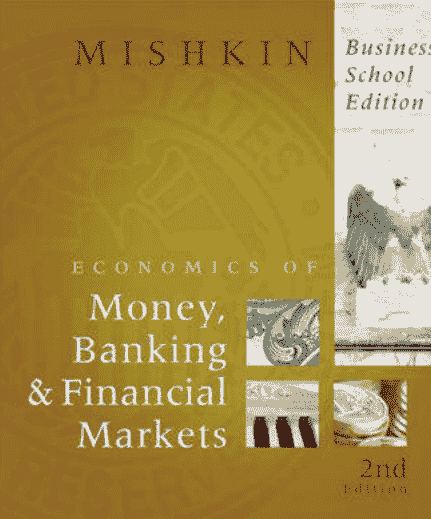

## 6.1 利率的风险结构

- 同一到期日的债券有不同的利率，因为：
  - 违约风险
  - 流动性风险
  - 所得税因素

## 利率的风险结构

- 违约风险：债券的发行人不能或不愿作出支付利息或偿还票面本金的情况
  - 美国国债被视为默认无违约风险债券（政府可以提高税收偿还）。
  - 风险溢价：违约风险债券利率和无风险国债利率（同一期限）之间的价差

# FIGURE 2 企业债券违约风险增加的影响

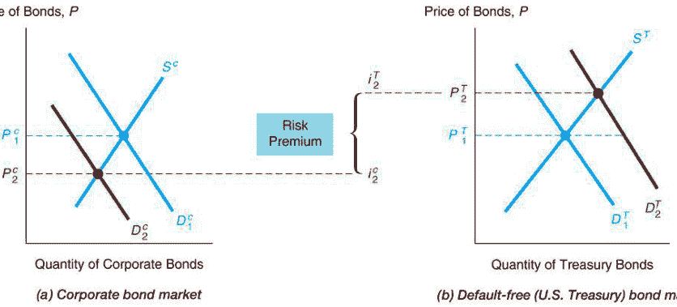

(a) Corporate bond market

(b) Default-free (U.S. Treasury) bond market

# Table 1 债券评级由穆迪、标准普尔和惠誉评级

| 评级 |  |  |  |
|---|---|---|---|
| 穆迪 | S&P | 惠誉 | 定义 |
| Aaa | AAA | AAA | 首选 最高安全性 |
| Aa1 | AA- | AA- | 高等级 高质量 |
| Aa2 | AA | AA |  |
| Aa3 | AA- | AA- |  |
| A1 | A+ | A+ | 上等中等等级 |
| A2 | A | A |  |
| A3 | A- | A- |  |
| Baa1 | BBB+ | BBB+ | 下等中等等级 |
| Baa2 | BBB | BBB |  |
| Baa3 | BBB- | BBB- |  |
| Ba1 | BB+ | BB+ | 非投资等级 |
| Ba2 | BB | BB | 投机性 |
| Ba3 | BB- | BB- |  |
| B1 | B+ | B+ | 高度投机性 |
| B2 | B | B |  |
| B3 | B- | B- |  |
| Caa1 | CCC+ | CCC | 重大风险 |
| Caa2 | CCC | — | 财务状况不佳 |
| Caa3 | CCC- | — |  |
| Ca | — | — | 极度投机性 |
| C | — | — | 可能违约 |
| — | — | DDD | 违约 |
| — | — | DD |  |
| — | D | D | — |

## 利率的风险结构

- **流动性**：资产转换成现金的容易程度
  - 债券的交易成本
  - 买家/卖家在债券市场中的数量
- **所得税因素**
  - 市政债券的利息收入则可获豁免联邦收入税。

## 图3 市政债券和美国国债的利率

债券价格，P

市政债券数量

(a) 市政债券市场

债券价格，P

美国国债数量

(b) 美国国债市场

## 6.2 利率期限结构

- 债券具有相同的风险、流动性和税收特征，由于期限不同，可能导致不同利率。

## 利率期限结构

- Yield curve: a plot of the yield on bonds with differing terms to maturity but the same risk, liquidity and tax considerations
  - 向上倾斜：长期利率都高于短期利率
  - 水平：短期和长期利率是相同的
  - 向下倾斜：长期利率均低于短期利率

## 利率期限结构理论必须解释以下三个事实

1. 随着时间的推移，不同年期的债券利率一起变动的特征（下图）。
2. 当短期利率较低时，收益率曲线更有可能向上倾斜；当短期利率很高时，收益率曲线更有可能向下倾斜。
3. 收益率曲线几乎总是向上。

## 图4 不同到期日的美国政府债券利率随时间的变化

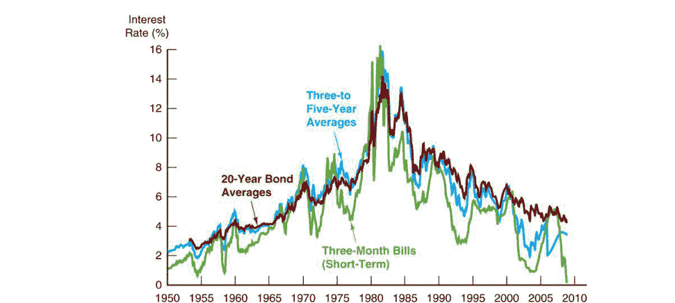

Sources: Federal Reserve: www.federalreserve.gov/releases/h15/data.htm.

## 预期理论：例子

- P100
- Hibor的计算

## Expectations Theory

- 解释了为什么利率期限结构在不同的时间表现不同
- 解释为什么不同到期债券利率随时间（事实1）一起变动
- 当短期利率较高时，收益率曲线向下倾斜，当短期利率较低时，收益率曲线向上倾斜（事实2）
- 很遗憾不能解释收益率曲线总是向上的（事实3）

## 市场分割理论

- 不同期限的债券之间不能任意替代
- 不同期限债券的利率是由该债券的需求和供应所决定
- 每一类投资者都有一个债券期限的首选项
- 如果投资者通常更喜欢有较低利率风险的较短期限债券，这说明为什么收益率曲线通常向上（事实3）

## 流动性溢价与期限优先理论

- P103

## Liquidity Premium Theory

$i_{nt} = \frac{i_t + i_{t+1}^e + i_{t+2}^e + ... + i_{t+(n-1)}^e}{n} + l_{nt}$

where $l_{nt}$ is the liquidity premium for the $n$-period bond at time $t$

$l_{nt}$ is always positive

Rises with the term to maturity

## 期限优先理论

- 投资者偏爱一个特定期限的债券
- 只有当其它期限的债券有超额收益时，他们才会换购债券
- 投资者很可能更喜欢短期债券而不是长期债券

## 图5 流动性溢价（期限偏好）与预期理论之间的关系

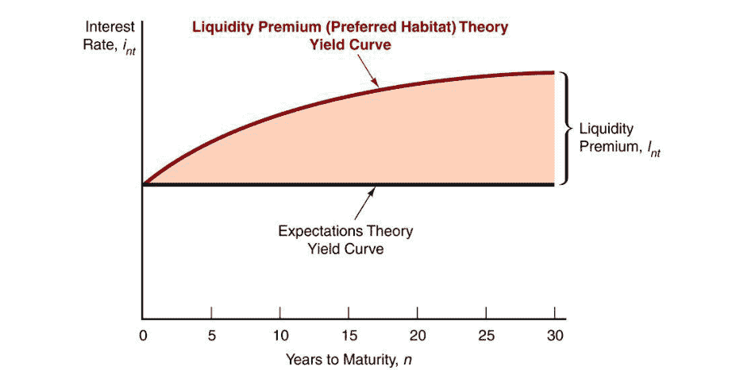

## Liquidity Premium and Preferred Habitat Theories

- P104

## 图6 根据流动性溢价（期限偏好）理论，收益率曲线与市场对未来短期利率的预期

(a) 未来短期利率预期上升

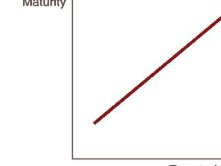

(b) 未来短期利率预期保持不变

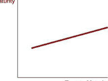

(c) 未来短期利率预期适度下降

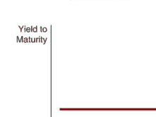

(d) 未来短期利率预期急剧下降

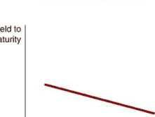

## 图7 美国政府债券的收益率曲线

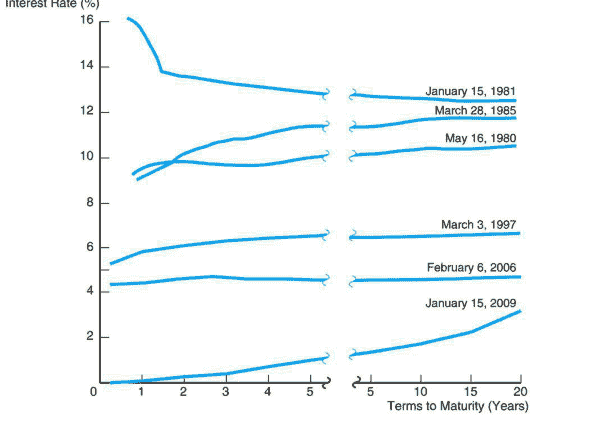

Sources: Federal Reserve Bank of St. Louis; U.S. Financial Data, various issues; Wall Street Journal, various dates.

## Application: The Subprime Collapse and the Baa–Treasury Spread

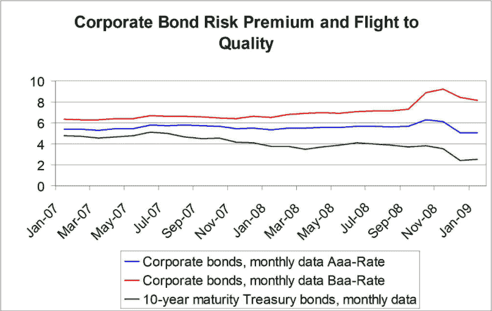

## 作业3

- P92: 11、14、20
- P108: 6、9

# 第8章 金融结构的经济学分析

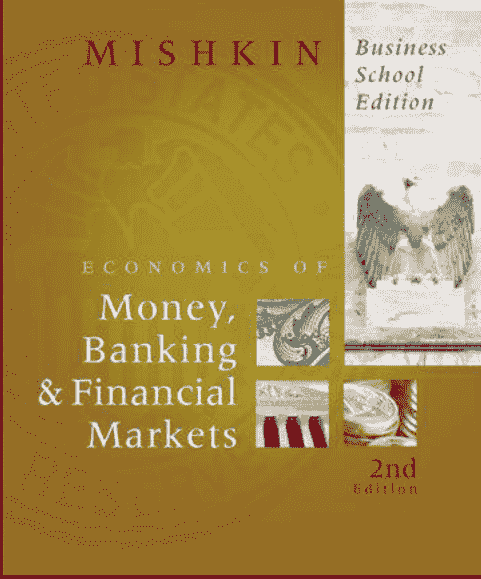

## 图8-1 非金融类工商企业的外部资金来源：美国与德国、日本和加拿大的比较

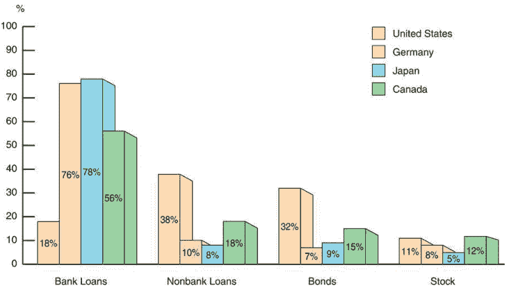

资料来源：Andreas Hackethal and Reinhard H. Schmidt, "Financing Patterns: Measurement Concepts and Empirical Results," Johann Wolfgang Goethe-Universität Working Paper No. 125, January 2004. The data are from 1970–2000 and are gross flows as percentage of the total, not including trade and other credit data, which are not available.

## 8个基本谜团

1. 对于工商企业而言，股票不是最为重要的外部融资来源
2. 在企业为其经营活动进行融资过程中，发行可流通债务工具和股权证券不是主要的融资方式
3. 与直接融资相比，间接融资的重要性要大得多
4. 金融中介机构，特别是银行是企业外部融资的最重要来源
5. 在各种经济部门中，金融体系是受到最为严格监管的部门之一
6. 只有那些规模庞大、组织完善的公司才能易于利用证券市场为其经营活动提供融资
7. 对于家庭和企业而言，抵押品是债务合约的一个普遍特征
8. 典型的债务合约是极其复杂的法律文件，它对于借款者的行为施加了严格的限制

## 交易成本
- 金融中介机构的经营活动与减少交易成本有关
  - 规模经济
  - 专门技术

## 信息不对称
- 逆向选择是在交易之前产生的
- 道德风险实在交易之后产生的
- 代理理论分析了信息不对称问题影响经济行为的运行机制

## 逆向选择：次品车问题
- 如果难以评估质量，那么买主所付的价格所反映的是市场上所有商品的平均质量
- 优质商品的卖主不愿意按照这一反应平均质量的价格出售其商品
- 由于市场上剩下的都是劣质商品，所以卖主根本就不会购买任何商品
- 这一问题解释了第2个基本谜团的原因，并且部分解释了第1个基本谜团的原因

## 逆向选择：解决办法
- **信息的私人生产和销售**
  - 搭便车问题
- **旨在增加信息供给的政府监管**
  - 并非总是可以解决逆向选择问题，由此为第5个基本谜团提供了解释
- **金融中介机构**
  - 能够为第3、4和6个基本谜团提供解释
- **抵押品和净值**
  - 能够为第7个基本谜团提供解释

## 股权合约中的道德风险问题
- 称为委托——代理问题
  - 委托人：缺乏信息（股东）
  - 代理人：拥有更多的信息（经理）
- 公司所有权和控制权的分离
  - 管理者追求个人利益和权力而非企业的盈利能力

## 委托——代理问题：解决办法
- 监督（高成本核实行为）
  - 搭便车问题
  - 第1个基本谜团
- 旨在增加信息的政府监管
  - 第5个基本谜团
- 金融中介机构
  - 第3个基本谜团
- 债权合约
  - 第1个基本谜团

## 债务合约中的委托——代理问题
- 借款者具有执行那些违背贷款者（风险）意愿项目的动力
  - 这会导致借款者无法偿还贷款

## 道德风险：解决办法
- 净值和抵押品
  - 激励相容
- 限制性条款的监督和强制执行
  - 限制不符合贷款者意愿的行为
  - 鼓励符合贷款者意愿的行为
  - 抵押品保值
  - 提供信息
- 金融中介机构
  - 第3和第4个基本谜团

## 转轨国家和发展中国家的信息不对称问题
- 由于下述制度性环境特征形成的“金融抑制”：
  - 产权体系不完善（无法有效使用抵押品这一工具）
  - 落后的法律体系（使贷款者难以执行限制性条款）
  - 不完善的会计准则（无法获得优质的信息）
  - 政府通过指导性信贷计划和国有银行实施的干预活动（将其资金向那些具有最高生产效率项目进行适当转移的动力降低）

## 利益冲突
- 它是由规模经济效应产生的一种道德风险表现形式（将一种信息资源应用于多项服务中去）
- 它在一个机构具有多重目标时产生，是这些不同目标之间出现冲突的结果
- 金融市场中信息质量的降低将会促使信息不对称问题更加恶化
- 因此，金融体系难以将资金向具有生产性投资机会的项目进行转移

## 作业3
- 1、结合第2章和第8章内容，简述金融中介机构在金融市场中的作用。
- 2、用你最新获取的经济学知识分析一个知名的富有的女孩找“对象”难的原因。
- 3、“搭便车”问题如何恶化了金融市场中的逆向选择和道德风险问题。

# Chapter 9
## 次贷危机和金融危机

## 金融危机影响因素
- 资产负债表的资产市场效应
  - 股票市场的下跌
    - 公司的资产净值下降。
  - 未预料到的价格水平下降
    - 负债的实质增长，净资产的降低。
  - 本币的意外贬值
    - 增加外币债务并减少净资产。
  - 资产贬值
结果：资产负债表中的资产价值下降，负债价值上升。逆向选择和道德风险加剧、信贷收紧、经济活动萎缩。

## 金融危机影响因素
- 金融机构的资产负债表的恶化
  - 主要是银行，银行资产恶化（坏账增加）--资本金损失--银行的信贷资源数量将会大幅度降低—信贷萎缩—抑制投资和经济活动。
- 银行危机（恶化到一定程度，破产）
  - 银行资产恶化—储户提款—银行资金链断裂—银行破产—金融市场中介缺失—借贷市场信息下降—逆向选择和道德风险上升—生产性投资活动进一步紧缩。
- 不确定性的增加（市场恐慌）
  - 大型金融机构或者非金融类机构的破产、经济衰退和股市崩盘等因素都可能造成金融市场中不确定性的大幅增长。放贷者丧失了解决逆向选择问题的能力，最终降低了信贷规模，导致投资活动和经济活动出现收缩。

## 金融危机影响因素
- 利率的提高（谁能承受高利率？）
  - 增加逆向选择问题
  - 外部融资比例增加（内部融资相对逆向选择问题较小），并因此增加逆向选择和道德风险。
- 政府财政收支失衡
  - 产生政府债务违约的担忧。
  - 投资者可能会在国内取出他们的钱。换成外汇

## 9.2 历史上美国金融危机的发生机制
- 第一阶段：金融危机的产生
  - 金融自由化和金融管理失控。“信贷激增”。大到不能到？美国：利率上升-放贷冲动-盈利-成功？亏损-保险-纳税人赔偿？监管-如资本金管理一坏账-银行资本金减少-信贷规模缩减（去杠杆化）-信贷收缩（从信贷激增到信贷崩溃）-经济萎缩。中国银行业？（无存款保护）
  - 资产价格泡沫与泡沫破灭。非理性繁荣-资产泡沫-泡沫破灭-价值回归-净值下降-资产负债表恶化-去杠杆化-信贷收缩
  - 利率飙升。P152，100点
  - 不确定性增加。美国历史上大型金融机构破产事件
- 第二阶段：银行业危机
- 第三阶段：债务通缩

## 图1 美国金融危机的事件序列
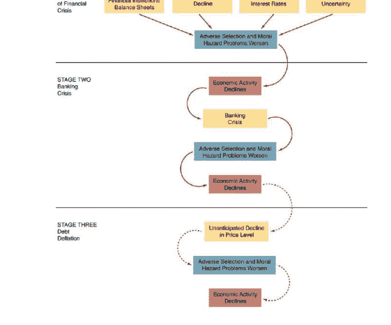

- P153 大萧条案例（好好学习）

## 9.3 2007年-2008 年的次贷危机
- 在抵押贷款市场出现的金融创新：（看题板）
  - 次贷和次级抵押贷款
  - 抵押贷款支持证券
  - 债务抵押的债券 (Cdo)
- 房屋价格泡沫形成
  - 资金市场流动性大增（印度等资金，真的吗？）

## 2007-2008 年次贷金融危机（续）
- 住房价格泡沫形式（续）
  - 次级抵押贷款市场的发展推动住房需求和住房价格。
  （主要原因，我的观点）
- 代理问题浮现（代理问题，现代企业制度绕不开的顽症）
  - 源于次级抵押贷款市场是基于“发起-配售”模式。原因很现像在中国的IPO市场中承销商！
  - 谁来保证证券的最终持有是否可以得到偿付。

## 2007-2008 年次贷金融危机（续）
- 代理问题浮现（续）
  - 商业银行和投资银行（以及评级机构）缺乏动力来评估证券的质量
- 信息问题显现 P155: 伯南克 “很想知道那些该死的东西到底值多少钱？”
- 房屋价格泡沫破裂

## 2007-2008 年次贷金融危机（续）
- 危机在全球范围内扩散
  - 金融市场全球化的标志
  - 作为衡量银行间同业拆借市场流动性有效指标的美国国库券与欧洲美元的利差（TED），从2007年上半年40个基点的平均值迅速攀升到2007年8月20日240个基点的顶峰。

## 2007-2008 年次贷金融危机（续）
- 银行的资产负债表恶化
  - 减值
  - 赎回结构化投资工具
- 知名公司破产
  - 贝尔斯登（2008 年 3 月）
  - 房利美和房地美（2008 年 7 月）
  - 雷曼兄弟、美林、AIG、Reserve Primary 基金（基金）和华盛顿互惠（2008 年 9 月）。

## 2007-2008 年次贷金融危机（续）

- 有争议的紧急援助计划
  - 在 2008 年 9 月 29 日，众议院否决 7000亿美元救市计划。
  - 最终于 10 月 3 日通过。
- 复苏在望吗？
  - 国会通过的 7870亿美元经济刺激计划在 2009 年 2 月 13 日实施。

## 新兴市场经济体的金融危机

- 第二条路径：严重的财政失衡：
  - 各国政府需要的资金有时会迫使银行购买政府债券。
  - 当政府债务失去价值时，银行损失，其净资产降低。
- 其它因素：
  - 提高利率（通胀导致货币收紧或国外因素）
  - 资产价格下跌
  - 不确定性与不稳定的政治制度

- 第二阶段：货币危机
  - 银行资产负债表的恶化触发货币危机：
    - 提高利率可以保护本币不贬值，但极易摧毁银行体系...
    - 低利率无法保证本币的稳定...
  - 严重的财政失衡引发货币危机：
    - 国外和国内投资者卖出本国货币。

### 1994-1995 年金融危机：墨西哥

- 90年代初的金融自由化：
  - 信贷繁荣，加上缺乏专业知识和监督不力。
  - 银行累计亏损，资产净值下降。
- 国外利率上升。
- 不确定性增加（政治不稳定）。
- 1994年12月20日起，本国货币贬值。
- 实际和预期通胀率上升。

### 金融危机：阿根廷 2001年-2002年

- 政府强迫银行吸收大量国债。
- 国外利率上升。
- 不确定性增加（持续的经济衰退）。
- 2002年1月6日始，本国货币贬值。
- 实际和预期通胀率上升。

### 图3 新兴市场金融危机的演进顺序

**第一阶段：金融危机的爆发**

- 金融机构资产负债表的恶化
- 资产价格下跌
- 利率上升
- 不确定性增加
- 财政失衡
- 逆向选择与道德风险问题加剧

**第二阶段：货币危机**

- 外汇危机
- 逆向选择与道德风险问题加剧

**第三阶段：全面金融危机**

- 经济活动下滑
- 银行业危机
- 逆向选择与道德风险问题加剧
- 经济活动下滑

**引发金融危机的因素**

**因素变化的后果**

# 第10章 银行业和金融机构管理

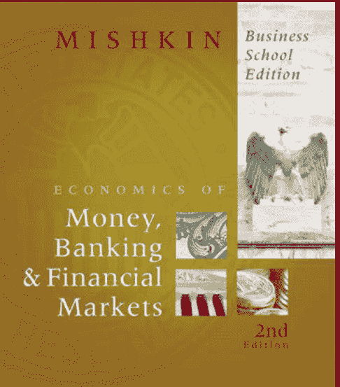

## 银行的资产负债表

- 负债
  - 支票存款 60% ⟶ 6% 利息支出 25% 运营 50%
  - 非交易性存款：储蓄存款、定期存单，小额、大额（10万以上）
  - 借款：央行借入，银行拆借、其它金融机构借入
  - 银行资本：股本金、留存利润、公开准备及附属资本
- 资产
  - 准备金：法定准备金、超额准备金（原因？）
  - 应收现金项目（尚未收账）
  - 银行同业存款（拆出）
  - 证券
  - 贷款
  - 其他资产：银行的实物资产等

**表10-1 全部商业银行资产负债表（各项占总额的百分比，2008年12月）**

| 资产（资金运用）* |  | 负债（资金来源） |  |
| --- | ---: | --- | ---: |
| 准备金和现金项目 | 8% | 支票存款 | 6% |
| 证券 |  | 非交易性存款 |  |
| 美国政府及机构证券 | 10 | 小面额定期存款（10万美元以下）+储蓄存款 | 37 |
| 州和地方政府及其他证券 | 12 | 大面额定期存款 | 16 |
| 贷款 |  | 借款 | 31 |
| 工商贷款 | 13 | 银行资本 | 10 |
| 房地产贷款 | 31 |  |  |
| 消费贷款 | 7 |  |  |
| 银行同业贷款 | 3 |  |  |
| 其他贷款 | 7 |  |  |
| 其他资产（例如实物资本） | 9 |  |  |
| 总计 | 100 | 总计 | 100 |

*按流动性递减顺序排列。  
资料来源：www.federalreserve.gov/releases/h8/current/

## 银行的基本业务：现金存款

**第一国民银行**

| 资产 | 负债 |
| --- | --- |
| 库存现金 +$100 | 支票存款 +$100 |

**第一国民银行**

| 资产 | 负债 |
| --- | --- |
| 准备金 +$100 | 支票存款 +$100 |

- 开立支票账户将会导致银行准备金的增加，其增加的金额等于支票存款增加的数额

## 银行的基本业务：支票存款

**第一国民银行**

| 资产 | 负债 |
| --- | --- |
| 应收现金项目 +$100 | 支票存款 +$100 |

当一家银行获得一笔意外存款的时候，它就增加了等额的准备金；当一家银行失去一笔存款的时候，它就减少了等额的准备金。

| 第一国民银行 |  | 第二国民银行 |  |
| --- | --- | --- | --- |
| 资产 | 负债 | 资产 | 负债 |
| 准备金 +$100 | 支票存款 +$100 | 准备金 -$100 | 支票存款 -$100 |

## 银行的基本业务：盈利方式

**第一国民银行**

| 资产 | 负债 |
| --- | --- |
| 法定准备金 +$10 超额准备金 +$90 | 支票存款 +$100 |

**第一国民银行**

| 资产 | 负债 |
| --- | --- |
| 法定准备金 +$10 贷款 +$90 | 支票存款 +$100 |

- 资产转换：出售具有一组特征（流动性、风险、规模和收益率的某种组合）的负债，然后运用所筹到的资金去购买具有不同特征的资产来获取利润
- 银行借短贷长 P174

## 银行管理的主要内容

- 流动性管理
- 资产管理
- 负债管理
- 资本充足性管理
- 信用风险管理
- 利率风险管理

## 流动性管理：足够的超额准备金

| 资产 | 负债 |
| --- | --- |
| 准备金 $20M | 存款 $100M |
| 贷款 $80M | 银行资本 $10M |
| 证券 $10M |  |

| 资产 | 负债 |
| --- | --- |
| 准备金 $10M | 存款 $90M |
| 贷款 $80M | 银行资本 $10M |
| 证券 $10M |  |

- 假设银行的法定准备金率为10%
- 只要银行拥有足够的超额准备金，存款外流就不会迫使银行调整其资产负债表的其他部分（假设被提款1000万）

## 流动性管理：准备金不足

| 资产 | 负债 |
|---|---|
| 准备金 $10M | 存款 $100M |
| 贷款 $90M | 银行资本 $10M |
| 证券 $10M | |

| 资产 | 负债 |
|---|---|
| 准备金 $0 | 存款 $90M |
| 贷款 $90M | 银行资本 $10M |
| 证券 $10M | |

- 准备金制度是一项法律规定，而其缺口必须得以弥补
- 超额准备金是对于存款外流所引致的各种成本的保险

## 流动性管理：1.借款

| 资产 | 负债 |
|---|---|
| 准备金 $9M | 存款 $90M |
| 贷款 $90M | 借款 $9M |
| 证券 $10M | 银行资本 $10M |

- 这种行为的成本就是借款利息

## 流动性管理：2.出售证券

| 资产 | 负债 |
|---|---|
| 准备金 $9M | 存款 $90M |
| 贷款 $90M | 银行资本 $10M |
| 证券 $1M |  |

- 出售证券的成本是经纪人手续费和其他交易费用

## 流动性管理：3.联邦储备体系

| 资产 | 负债 |
|---|---|
| 准备金 $9M | 存款 $90M |
| 贷款 $90M | 向联邦储备体系的借款 $9M |
| 证券 $10M | 银行资本 $10M |

- 必须向联邦储备体系支付的利率是基于贴现率形成的。将持有的证券向央行贴现。也可银行间拆入资金。

## 流动性管理：4.减少贷款

| 资产 | 负债 |
|---|---|
| 准备金 $9M | 存款 $90M |
| 贷款 $81M | 银行资本 $10M |
| 证券 $10M |  |

- 在获取准备金的各种方式中，削减贷款的代价是最高的
- 收回贷款的活动会招致客户的对立情绪
- 其他银行只有在贴现率很高的情况下才会同意购买这些贷款

## 流动性管理的总结

- 是指商业银行能够随时满足客户提现和必要的贷款需求的支付能力。包括资产的流动性与负债的流动性两重含义。
- 资产的流动性是指资产在不发生损失的情况下迅速变现的能力。
- 负债的流动性是指银行能以较低的成本随时获得所需要的资金。

- ① 增强债权人信心
- ② 履行贷款承诺
- ③ 避免资产售让时损失
- ④ 降低紧急筹资时的成本
- ⑤ 避免央行窗口曝光

对策一级准备（超额准备金）二级准备（国库券、拆借资金）
三级准备、四级准备（中长期债券）

## 资产管理：三个目标

- 力图寻找那些回报率最高的可投资的贷款和证券
- 降低风险
- 保持足够的流动性

## 资产管理：四种方法

- 试图找到愿意支付高利率同时又不大可能出现违约行为的借款者
- 力图购买回报率较高而风险较低的证券
- 通过资产多样化来降低风险水平
- 在对于流动性需求和来自低流动性资产的更高的回报之间进行平衡

## 负债管理

- 由于近期货币中心银行的兴起而出现的一些情况
- 隔夜拆借市场和新型金融工具（诸如：大额可转让定期存单）的扩展
- 在银行资金来源之中，支票存款的重要性下降

## 资本充足性管理

- 银行资本有助于防止银行倒闭情况的出现
- 资本的数量将会对于银行所有者（持股人）的回报产生影响
- 它是制度性的要求

## 资本充足性管理：防范银行倒闭

| 资本规模较大的银行 | 资本规模较小的银行 |
|---|---|
| 资产 | 负债 | 资产 | 负债 |
| 准备金 $10M | 存款 $90M | 准备金 $10M | 存款 $96M |
| 贷款 $90M | 银行资本 $10M | 贷款 $90M | 银行资本 $4M |

| 资本规模较大的银行 | 资本规模较小的银行 |
|---|---|
| 资产 | 负债 | 资产 | 负债 |
| 准备金 $10M | 存款 $90M | 准备金 $10M | 存款 $96M |
| 贷款 $85M | 银行资本 $5M | 贷款 $85M | 银行资本 -$1M |

假设银行发生500万坏账的情况

## 资本充足性管理：股票持有者的收益

资产回报率：每一美元资产的税后净利润

$$ROA=\frac{\text{税后净利润}}{\text{资产}}$$

股权回报率：每一美元股权（银行）资本的税后净利润

$$ROE=\frac{\text{税后净利润}}{\text{股权资本}}$$

资产回报率和股权回报率之间的关系可以表达为：

股本乘数：每一美元股权资本所对应的资产数额

$$EM=\frac{\text{资产}}{\text{股权资本}}$$

$$ROE=\frac{\text{税后净利润}}{\text{股权资本}}=\frac{\text{税后净利润}}{\text{资产}}\times\frac{\text{资产}}{\text{股权资本}}$$

$$ROE=ROA\times EM$$

## 资本充足率管理：安全性

- 银行资本使银行股东们的投资更为安全，从而使他们由此受益
- 由于银行资本越多，股权回报率就越低，所以银行资本金也是有代价的
- 两者之间的选择取决于整体经济的状态和市场信心的水平

## 应用： 2008年由资本紧缩导致信贷紧缩的发展过程

- 银行资本的短缺导致信贷增长速度的下降
  - 银行由于持有住房抵押贷款支持证券而蒙受了巨额损失
  - 这一损失导致银行资本的下降
- 在整体经济情况不佳的情况下，银行难以筹集大量的资本，进而被迫提高贷款标准和削减信贷规模

- 思考：中国银行业再融资的原因分析

## 信用风险管理：克服逆向选择和道德风险

- 甄别和监督
  - 甄别
  - 贷款专业化
  - 限制性条款的监督和执行

## 信用风险管理：克服逆向选择和道德风险

- 长期客户联系
- 贷款承诺
- 抵押品和补偿性余额
- 信贷配给

## 利率风险管理

| 第一国民银行 |  |
|---|---|
| 资产 | 负债 |
| 利率敏感型资产 $20M | 利率敏感型负债 $50M |
| 可变利率贷款和短期贷款 | 可变利率大额定期存单 |
| 短期证券 | 货币市场存款账户 |
| 固定利率资产 $80M | 固定利率负债 $50M |
| 准备金 | 支票存款 |
| 长期贷款 | 储蓄存款 |
| 长期证券 | 长期大额定期存单 |
|  | 权益资本 |

- 如果银行拥有的利率敏感型负债多于利率敏感型资产，那么利率的提高将会导致其利润下降，而利率的下降将会导致其利润增加

- 思考：中国加息对商业银行效益的影响方向？什么原因？

## 利率风险管理：缺口分析

- 基本缺口分析：
  - （利率敏感型资产 − 利率敏感性负债） x Δ利率 = Δ银行利润
- 期限队列法
  - 衡量若干期限子区间的缺口
- 标准化缺口分析
  - 考虑了利率敏感度之间的差异

## 利率风险管理：久期分析

证券市场价值变动的百分比≈-利率变动的百分比×久期

- 久期分析方法利用银行资产和银行负债的（加权）平均久期，来考察利率变动对于银行净值的影响。
- 利率风险管理战略：1）调整久期（成本高，较难操作）；2）利用金融衍生工具，如远期、期货、期权锁定风险。举例说明。

## 表外业务活动

- 贷款销售（二级贷款参与）
- 费用收入的产生，举例来说：
  - 为抵押贷款支持证券提供专业化收费服务
  - 创造结构性投资工具（SIVs）的金融创新工具，正如在2007-2008年次贷危机中所发生的事实那样，这些金融创新工具可能使银行暴露于相应的风险之中

## 表外业务活动

- 交易活动和风险管理技术
  - 在外汇市场和投资活动中的金融期货、债务工具的期权以及利率互换等交易活动
  - 产生了委托——代理问题

## 表外业务活动

- 为了降低委托——代理问题而设立的内部控制制度
- 实现将交易活动和记账业务的分离
- 为风险暴露水平设置限制
- 风险价值方法
- 压力测试

# 第16章

## 中央银行和联邦储备体系

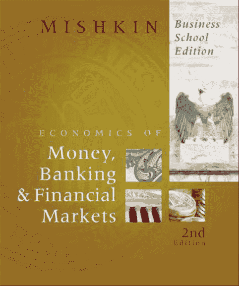

## 物价稳定目标

- 低且稳定的通货膨胀水平
- 通货膨胀
  - 增加经济生活中的不确定性，对未来的计划更为困难
  - 减缓经济增长
  - 使社会结构更为紧张
- 名义锚有助于形成稳定的通货膨胀预期：欧洲央行、美联储都存在名义锚，主要是通胀水平、就业率
- 时间不一致性问题：经济就像一个被惯坏了的孩子一样 P297

## 货币政策的其他目标

- 高就业率
- 经济增长
- 金融市场稳定
- 利率稳定
- 外汇市场稳定

## 物价稳定应该是货币政策的首要目标吗？

- 长期内目标间不存在矛盾
- 短期内物价稳定与高就业率和利率稳定这两个目标相冲突
- 层级使命：货币政策的首要目标及辅助目标
- 双重使命：货币的双重目标或多重目标

## 联邦储备体系的起源

- 美国人抵制建立中央银行
  - 对权力集中的恐惧
  - 对金融业固有的不信任
- 不再存在最后贷款人
  - 全国性的银行恐慌成为一种经常性事件
  - 1907年的银行恐慌非常严重，使得社会公众确信需要建立中央银行
- 1913年《联邦储备法案》
  - 精心设计的带有制约和平衡特点的体系
  - 分散化的体系

## 图2 联邦储备体系

- 1 Federal Reserve districts
- ★ Board of Governors of the Federal Reserve System
- ● Federal Reserve bank cities
- ● Federal Reserve branch cities
- — Boundaries of Federal Reserve districts
- (Alaska and Hawaii are in District 12)

Source: Federal Reserve Bulletin.

## 联邦储备银行

- 准公共机构，其股东是储备区内作为联邦储备体系成员的私人商业银行
- 会员银行推选本地区联邦储备银行的6名董事，其他三位董事由联邦储备理事会任命
  - 三位A类董事是职业银行家
  - 三位B类董事来自工业界、劳工界、农业和消费部门的知名人士担任
  - 三位C类董事由联邦储备理事会直接任命，不得由银行的官员、雇员或股东担任

## 联邦储备银行（续）

- 会员银行推选本地区联邦储备银行的6名董事，其他三位董事由联邦储备理事会任命(续)
  - 这种制度设计能够反映美国社会各阶层的利益
- 九名董事任命联邦储备银行行长，并需经联邦储备理事会批准

## 联邦储备银行的职责

- 支票清算
- 货币发行
- 回收流通中破损的货币
- 管理和发放本储备区内的银行贴现贷款
- 评估提出的合并方案和银行拓展业务的申请

## 联邦储备银行的职责（续）

- 充当工商业同联邦储备体系之间的媒介
- 对银行持股公司和州特许会员银行进行检查
- 搜集本地区经济发展状况的数据资料
- 组织本行的职业经济学家进行关于货币政策实施的专题研究

## 联邦储备银行与货币政策

- 联邦储备银行的董事 “制定” 贴现率
- 决定哪些银行可以获得贴现贷款
- 董事推选一名本储备区的银行家到联邦咨询委员会任职，该委员会向联邦储备理事会提供咨询意见以及有助于货币政策实施的相关信息
- 12位联邦储备银行行长中的五位，在联邦公开市场委员会(FOMC)拥有表决权

## 成员银行

- 所有国民银行都必须是联邦储备体系的成员
- 在各州注册的商业银行不要求必须是联邦储备体系的成员，他们可以选择加入
- **1980** 的《存款机构放松管制和货币控制法案》要求所有银行都要遵守和成员银行一样的准备金要求，而且所有银行平等地享有联邦储备体系提供的各种便利

## 联邦储备理事会

- 包括七名成员，总部设在华盛顿
- 每位理事都由总统提名，经参议院同意后任命
- 理事的任期为14年，期满后不得连任
- 理事必须来自不同的联邦储备区
- 理事会主席从所有理事中推选产生，任期4年

## 联邦理事会的职责

- 对实施公开市场操作拥有表决权
- 制定法定存款准备金率
- 通过 “审查与决定” 程序控制贴现率
- 制定保证金要求
- 制定每一家联邦储备银行行长和管理人员的薪资标准，并审查每一家联邦储备银行的预算

## 联邦理事会的职责（续）

- 批准银行合并和开展新业务的申请
- 明确银行持股公司的业务范围
- 监督美国境内外外国银行的经营活动

## 联邦公开市场委员会 (FOMC)

- 每年举行8次会议
- 该委员会由联邦储备理事会的7名理事、纽约联邦储备银行行长和其他4位联邦储备银行行长组成
- 联邦储备理事会的主席同时担任联邦公开市场委员会的主席
- 向纽约联邦储备银行的交易室发出指令

## 联邦公开市场委员会会议

- 听取联储负责公开市场操作的经理人员就外汇、国内公开市场以及其他相关主题所做的报告
- 陈述联邦储备理事会的国民经济预测报告
- 描述货币政策的不同方案
- 介绍国会相关立法活动
- 公开发布会议的结果

## 为什么联邦储备理事会主席才是真正的导演？

- 联邦储备理事会主席是联邦储备体系的发言人，并同国会和总统进行商谈
- 制定会议议程
- 在做出货币政策决策时首先发言和投票
- 监督职业经济学家和顾问团队的工作

## 联邦储备体系的独立性如何？

- 工具独立性与目标独立性
- 独立的收入来源
- 明确联邦储备体系结构的法律是由国会颁布的，并且随时可能调整
- 总统的影响
  - 影响国会
  - 任命联邦储备理事会成员
  - 任命联邦储备理事会主席，尽管其任期与总统的任期不相一致

## 基本简介

- • 中国人民银行（简称央行或人行）是[中华人民共和国](#)的中央银行，于1948年12月1日组成。中国人民银行根据《中华人民共和国中国人民银行法》的规定，在国务院的领导下依法独立制定和执行货币政策，履行职责，开展业务，不受[地方政府](#)、各级政府部门、社会团体和个人的干涉。中国人民银行总行分别位于[北京](#)和[上海](#)，2005年8月10日在上海设立中国人民银行上海总部。

## 历史沿革

- 1）人民银行的历史，可以追溯到第二次国内革命战争时期。1931年11月7日，在江西瑞金召开的全国苏维埃第一次代表大会上，通过决议成立“中华苏维埃共和国国家银行”（简称苏维埃国家银行），并发行货币。
- 2）1948年12月1日，以华北银行为基础，合并北海银行、西北农民银行，在河北省石家庄市组建了中国人民银行，并发行人民币，成为中华人民共和国成立后的中央银行和法定本位币。
- 3）1983年9月，中国国务院决定中国人民银行专门行使国家中央银行职能。
- 4）1984年国家将商业银行的职能剥离出去成立中国四大银行（中国银行、中国农业银行、中国工商银行、中国建设银行）后，中国人民银行成为专职的中央银行。
- 5）1995年3月18日，第八届全国人民代表大会第三次会议通过的《中华人民共和国中国人民银行法》第一次以法律形式确定了中国人民银行是中华人民共和国的中央银行。

## 职能

- 发行人民币，管理人民币流通；
- 依法律制定和执行货币政策；
- 持有、管理、经营国家外汇储备、黄金储备；
- 经理国库；
- 作为国家的中央银行，从事有关的国际金融活动；
- 实施外汇管理，监督管理银行间外汇市场

## 体制和结构

## 欧洲中央银行

- 结构模式与联邦储备体系相似
- 欧元区各国中央银行的地位和作用与联邦储备银行类似
- 执行委员会
  - 由行长、副行长和其他4名成员组成
  - 任期为8年，不得连任
- 管理委员会

## 管理委员会

- 每月在德国法兰克福欧洲中央银行召开一次会议
- 十二个国家中央银行行长与执行委员会的六名成员参加会议
- 实行一致通过原则
- 欧洲中央银行宣布目标利率水平并接受新闻媒体的提问
- 随着新成员国的加入，管理委员会为了保持适当的规模决定采取轮值制度

## 欧洲中央银行的独立性

- 世界上独立性最强的中央银行
- 执行委员会的成员任期很长
- 自行决定预算
- 目标独立性较低
  - 物价稳定
- 特许证书不会因立法而改变，如果要修改只能通过修订《马斯特里赫特条约》实现

## 其他国家中央银行的结构与独立性

- 加拿大银行
  - 实际控制货币政策
- 英格兰银行
  - 拥有一定的工具独立性
- 日本银行
  - 近年来 (1998) 获得了更多的独立性
- 向更大独立性方向发展的趋势

## 中央银行行为

- 有关政府官僚行为的理论：官僚行为的目标是自身福利最大化，而官僚的福利与其权利和声望有关
  - 坚决捍卫其自主权
  - 避免同拥有更强实力的集团发生冲突
- 个人福利最大化并不排除利他主义

## 支持独立性的观点

- 政治压力会导致中央银行采取通货膨胀性货币政策
- 政治经济周期
- 可能会为解决政府的巨额预算赤字提供便利: 提供融资
- 货币政策太重要了所以不能交由政治家决定—对于政治家而言委托代理问题更严重

## 反对独立性的理由

- 不民主
- 缺乏问责机制
- 货币政策和财政政策的协调很困难
- 独立的美联储并非总是成功地运用其自由决策权
- 中国人民银行的独立性

# 第 17章

## 货币供给过程

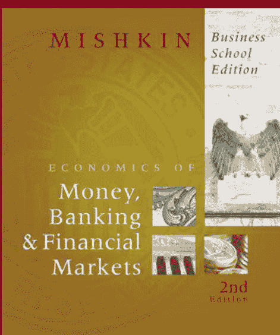

## 理解如下问题

- 美国货币政策的量化宽松quantitative easing
- 周小川的“池子论”
- 针对QE3的对策？
- 日本挑起新的货币战

## 货币供应过程中的参与者

- 中央银行（如联邦储备体系、中国人民银行）
- 银行（存款类金融机构；金融中介）
- 存款者（个人和机构）

## 联邦储备体系的资产负债表

| 联邦储备体系 |  |
|---|---|
| 资产 | 负债 |
| 政府债券 | 流通中现金 |
| 贴现贷款 | 准备金 |

- 货币性负债
  - 流通中现金：社会公众手中持有的货币数量
  - 准备金：商业银行在美联储的存款和库存现金
- 资产
  - 政府债券：美联储持有政府债券会影响货币供给，同时获得利息
  - 贴现贷款：为商业银行提供准备金，同时按照贴现利率收取利息

## 基础货币

## 基础货币

MB = C + R

C = 流通中现金

R = 银行体系中的准备金总额

## 向银行进行的公开市场购买

| 银行体系 |  |
|---|---|
| 资产 | 负债 |
| 证券 -$100 |  |
| 准备金 +$100 |  |

| 联邦储备体系 |  |
|---|---|
| 资产 | 负债 |
| 证券 +$100 | 准备金 +$100 |
|  |  |

- 净效应是准备金增加 $100
- 流通中现金没有变化
- 基础货币增加 $100

## 向非银行公众进行的公开市场购买 I

| 银行体系 |  |
|---|---|
| 资产 | 负债 |
| 准备金 +$100 | 支票存款 +$100 |
|  |  |

| 联邦储备体系 |  |
|---|---|
| 资产 | 负债 |
| 证券 +$100 | 准备金 +$100 |
|  |  |

- 向美联储出售债券的个人将得到的美联储的支票存入银行
- 结果和向银行进行的公开市场购买的最终结果相同

## 向非银行公众进行的公开市场购买 II

| 非银行公众 |  |
|---|---|
| 资产 | 负债 |
| 证券 -$100 |  |
| 现金 +$100 |  |

| 联邦储备体系 |  |
|---|---|
| 资产 | 负债 |
| 证券 +$100 | 流通中现金 +$100 |
|  |  |

- 向美联储出售债券的个人将美联储的支票兑现
- 准备金没有变化
- 流通中现金增加，增加的数量等于公开市场购买的金额
- 基础货币增加，增加的数量等于公开市场购买的金额

## 公开市场购买：小结

- 公开市场购买对准备金的作用，取决于债券出售人将所得的款项以现金形式持有还是以银行存款的形式持有
- 公开市场购买总是会导致基础货币增加，增加额等于公开市场购买的金额

## 存款向现金的转化

| 非银行公众 |  |
|---|---|
| 资产 | 负债 |
| 支票存款 -$100 |  |
| 现金 +$100 |  |

| 银行体系 |  |
|---|---|
| 资产 | 负债 |
| 准备金 -$100 | 支票存款 -$100 |
|  |  |

| 联邦储备体系 |  |
|---|---|
| 资产 | 负债 |
|  | 流通中现金 +$100 |
|  | 准备金 -$100 |

对货币性负债的净效应为零
准备金随机波动
基础货币是一个更稳定的变量

## 向一家银行提供贴现贷款

| 银行体系 |  |
|---|---|
| 资产 | 负债 |
| 准备金 +$100 | 贴现贷款 +$100 |
|  | （向美联储的借款） |

| 联邦储备体系 |  |
|---|---|
| 资产 | 负债 |
| 贴现贷款 +$100 | 准备金 +$100 |
| （从美联储得到的借款） |  |

- 联储的货币性负债增加了 $100
- 基础货币也增加了相同的数额

## 归还向美联储的贷款

| 银行体系 |  |
|---|---|
| 资产 | 负债 |
| 准备金 -$100 | 贴现贷款 -$100 |
|  | （向美联储的借款） |

| 联邦储备体系 |  |
|---|---|
| 资产 | 负债 |
| 贴现贷款 -$100 | 准备金 -$100 |
| （从美联储得到的借款） |  |

- 对基础货币的净效应是负的
- 基础货币的变动与向美联储的借款的变动是一一对应的

## 美联储控制基础货币的能力

- 公开市场操作由美联储控制
- 美联储无法决定银行向美联储借款的金额
- 基础货币可以分解为两个部分：
  $MB_n = MB - BR$
- 货币供给与非借入基础货币 $MB_n$ 和向美联储借入的准备金 $BR$ 的数量成正向关系

## 存款创造：单个银行

| 第一国民银行 |  |
|---|---|
| 资产 | 负债 |
| 证券 -$100 |  |
| 准备金 +$100 |  |
|  |  |

| 第一国民银行 |  |
|---|---|
| 资产 | 负债 |
| 证券 -$100 | 支票存款 +$100 |
| 准备金 +$100 |  |
| 贷款 +$100 |  |

| 第一国民银行 |  |
|---|---|
| 资产 | 负债 |
| 证券 -$100 |  |
| 贷款 +$100 |  |

超额准备金增加
银行用超额准备金发放贷款
创造了支票存款
借款人购买商品和劳务
货币供给增加

## 存款创造：银行体系

| 银行A | 资产 | 负债 | 银行 A | 资产 | 负债 |
|---|---|---|---|---|---|
|  |  |  | 准备金 +$10 | 支票存款 +$100 |
| 准备金 +$100 | 支票存款 -$100 |  | 贷款 +$90 |  |

| 银行B | 资产 | 负债 | 银行 B | 资产 | 负债 |
|---|---|---|---|---|---|
| 准备金 +$90 | 支票存款 +$90 |  | 准备金 +$9 | 支票存款 +$90 |
|  |  |  | 贷款 +$81 |  |

# 表 1 存款创造（假设法定存款准备金率为 10%，准备金增加$100）

| 银行 | 存款增加额 ($) | 贷款增加额 ($) | 准备金增加额 ($) |
|------|--------------------------|-----------------------|--------------------------|
| 第一国民银行 | 0.00 | 100.00 | 0.00 |
| A | 100.00 | 90.00 | 10.00 |
| B | 90.00 | 81.00 | 9.00 |
| C | 81.00 | 72.90 | 8.10 |
| D | 72.90 | 65.61 | 7.29 |
| E | 65.61 | 59.05 | 6.56 |
| F | 59.05 | 53.14 | 5.91 |
| . | . | . | . |
| . | . | . | . |
| . | . | . | . |
| 所有银行合计 | 1,000.00 | 1,000.00 | 100.00 |

## 多倍存款创造的公式推导

假设银行不持有超额准备金

法定存款准备金（RR）= 准备金总额（R）

RR = 法定存款准备金率（r）乘以支票存款总额（D）

替换

$r \times D = R$

等式两边同除以 r

$D = \frac{1}{r} \times R$

等式两边同时变动可以得到

$\Delta D = \frac{1}{r} \times \Delta R$

## 对简化模型的批评

- 现金持有会使存款创造过程中止
- 现金没有存款创造能力
- 银行并不会将其全部超额准备金用于发放贷款或购买证券
- 存款人的决定（持有多少现金）和银行的决定（持有超额准备金的数量）也会导致货币供给的变化

## 决定货币供给的因素

- 非借入基础货币$MB_n$的变动
- 货币供给与非借入基础货币$MB_n$成正相关关系
- 从联邦储备体系取得的借入准备金$BR$的变动
- 货币供给与从联邦储备体系取得的借入准备金$BR$成正相关关系

## 货币乘数

- 定义货币为现金加支票存款： M1
- 将货币供给 (M) 和基础货币 (MB) 联系起来，其中 m 为货币乘数

M = m × MB

## 推导货币乘数 I

假设公众愿意持有的现金水平 $C$ 及超额准备金 $ER$ 与支票存款 $D$ 同比例增长那么，

$c=\{C/D\}=\text{现金比率}$

$e=\{ER/D\}=\text{超额准备率}$

## 推导货币乘数 II

准备金总额（R）等于法定存款准备金（RR）和超额准备金（ER）之和

$$R = RR + ER$$

法定存款准备金总额等于法定存款准备金率乘以支票存款总额

$$RR = r \times D$$

用上式替换第一个公式中的 RR

$$R = (r \times D) + ER$$

美联储制定的 r 小于 1

## 推导货币乘数 III

- 基础货币 $MB$ 等于现金 $(C)$ 加准备金 $(R)$:
$MB = C + R = C + (r \times D) + ER$
- 这个等式揭示了为支持现有支票存款、现金和超额准备金规模所需要的货币的数量

## 货币乘数背后的感性知识

$r$ = 法定存款准备金率 = 0.10

$C$ = 流通中现金 = $400B$

$D$ = 支票存款 = $800B$

$ER$ = 超额准备金 = $0.8B$

$M$ = 货币供给 (M1) = $C + D = $1,200B$

$c = \frac{\$400B}{\$800B} = 0.5$

$e = \frac{\$0.8B}{\$800B} = 0.001$

$m = \frac{1+0.5}{0.1+0.001+0.5} = \frac{1.5}{0.601} = 2.5$

货币乘数小于简单存款乘数

虽然存款存在多倍扩张效应

但对现金来说这一效应并不存在

## 应用：1930 – 1933年大萧条期间的银行恐慌

- 银行倒闭（没有存款保险）导致：
- 银行存款大量流失，(存款者)现金的持有量增加
- (银行)超额准备金的数量增加
- 在给定基础货币 MB 不变的情况下，由于货币乘数变小,货币供给急剧萎缩

# 图 1 破产银行的存款, 1929-1933

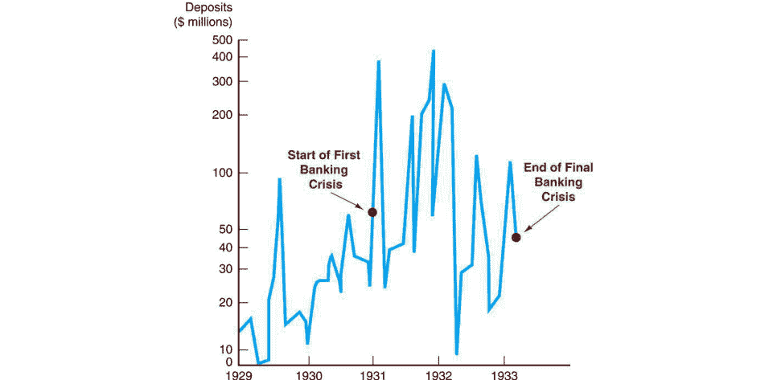

> 来源: Milton Friedman and Anna Jacobson Schwartz, A Monetary History of the United States, 1867–1960 (Princeton, NJ: Princeton University Press, 1963), p. 309.

# 图 2 超额准备率和现金比率，1929–1933

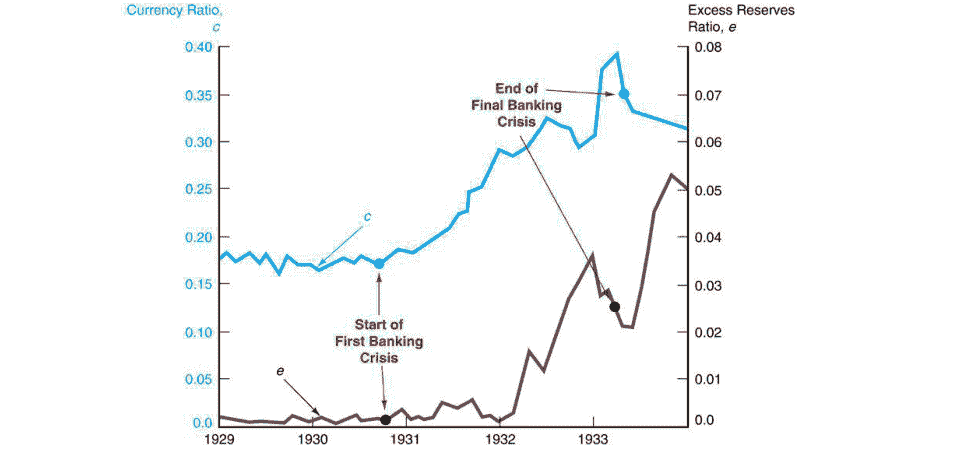

来源: Federal Reserve Bulletin; Milton Friedman and Anna Jacobson Schwartz, A Monetary History of the United States, 1867–1960 (Princeton, NJ: Princeton University Press, 1963), p. 333.

# 图 3 M1 和基础货币, 1929–1933

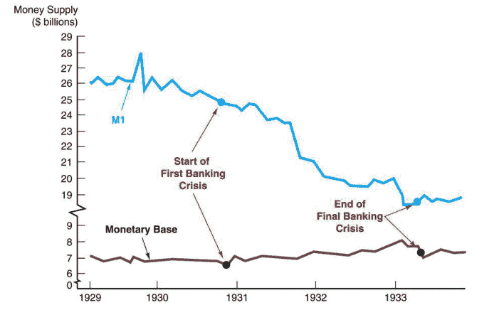

来源: Milton Friedman and Anna Jacobson Schwartz, A Monetary History of the United States, 1867–1960 (Princeton, NJ: Princeton University Press, 1963), p. 333.

## 作业 4

P336—337

2、6、10、14、20

# 第18章

## 货币政策工具

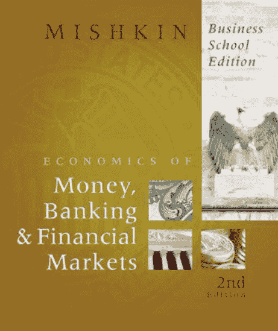

## 学习要点：

- 1、西方国家货币政策的最终目标有四个：即稳定物价、充分就业、经济增长及国际收支平衡。但是，这四个目标之间却充满了矛盾，因而使中央银行无法通过实行同一货币政策以同时达到多个不同的目标。
- 2、根据1995年颁布的《中华人民共和国中国人民银行法》的规定，我国货币政策的最终目标是保持货币币值的稳定，并以此促进经济增长。

- 3、中央银行货币政策的工具可分为一般性的货币政策工具、选择性的货币政策工具及其他货币政策工具。其中，一般性的货币政策工具有三种；即存款准备金政策、再贴现政策和公开市场业务。选择性的货币政策工具和其他货币政策工具则种类很多。各国中央银行可根据本国实际和货币政策的目标加以选择和运用。

- 4、货币政策对实际经济活动的作用是间接的。中央银行运用一定的货币政策工具，往往不能直接地达到其预期的最终目标，而只能通过控制某一个目标，并通过这一个目标的传导来间接地作用于实际经济活动，从而达到最终目标。货币政策中间目标的选择必须满足可控性、可测性和相关性这三个基本特性的要求。

- 5、货币政策的传导机制是指从货币政策工具的运用到最终目标的达到所经过的各个环节和具体的过程。在货币政策传导机制问题上，凯恩斯学派和货币学派有着重大的分歧。这种分歧决定了他们在货币政策中介目标的选择上也有着重大的的分歧。

## 第一节 货币政策的目标

货币政策的目标是指中央银行制定和实施某项货币政策所要达到的特定的经济目的。货币政策目标可以分为三个层次，即最终目标、中介目标和操作目标。

## 一、货币政策的最终目标

**（一）西方发达国家的最终目标**

**1. 稳定物价**

所谓稳定物价的货币政策目标，一般是指通过实行适当的货币政策，保持一般物价水平的相对稳定，以避免出现通货膨胀或通货紧缩。

**2. 充分就业**

作为货币政策的最终目标，充分就业也只是意味着通过实行适当的货币政策，以减少或消除经济中存在的非自愿失业，而并不意味着将失业率降低为零。

**3. 经济增长**

世界大多数国家都以人均实际国民生产总值或人均实际国民收入的增长率作为衡量经济增长速度的指标。

**4. 国际收支平衡**

作为货币政策的一个目标，所谓国际收支平衡，是指一个国家对其他国家的全部货币收入与全部货币支出保持基本平衡。

**（二）货币政策目标之间的矛盾及其协调**

**1. 货币政策目标之间的矛盾**

四大目标中的任何两个目标之间都有着一定的矛盾和冲突。其中最典型的是稳定物价与充分就业这两个目标之间的矛盾。这一矛盾可用著名的菲利普斯曲线来加以说明。

**2. 协调货币政策目标之间矛盾的主要方法**

在货币政策的实践中，协调不同目标之间矛盾的方法主要有如下三种：一是对相互冲突的多个目标统筹兼顾，力求协调或缓解这些目标之间的矛盾；二是根据凯恩斯学派的理论，采用相机抉择的操作方法；三是将货币政策与财政政策及其他政策配合运用。

**（三）我国货币政策的目标**

**1. 我国货币政策目标之争**

- 单一目标论
- 双重目标论
- 多重目标论

**2. 我国现行货币政策目标**

《中华人民共和国中国人民银行法》将我国货币政策的最终目标确定为“保持币值的稳定，并以此促进经济增长”。

## 二、中介目标

**1. 中介目标的选择标准**

- ① 可测性：中央银行能够对这些被作为货币政策中介目标的变量加以比较精确的统计。所以，这种变量必须具有比较明确的定义，以便于中央银行对它加以观察、分析和监测。同时，中央银行能够迅速地获取这一变量的准确数据。
- ② 可控性：中央银行所选择的货币政策中介目标必须与它所运用的货币政策工具具有密切的、稳定的联系，以便较有把握地将它控制在确定的或预期的范围内。
- ③ 相关性：作为货币政策中介目标的变量与货币政策的最终目标有着紧密的关联性。

**2. 经常采用的中介目标**

银行信贷规模、货币供应量、长期利率。其中：

- ① 银行信贷规模：它是指银行体系对社会大众及各经济单位的存贷款总额。可测性、可控性、相关性。
- ② 货币供应量：可测性、可控性、相关性。
- ③ 长期利率：长期利率作为中介目标存在的问题。

**3. 中介目标之间的矛盾**

## 三、操作目标（也称近期目标）

- 1. 短期货币市场利率
- 2. 银行准备金
- 3. 基础货币

## 第二节 货币政策工具

## 一、一般性的货币政策工具

**（一）存款准备金政策**

存款准备金政策是指中央银行通过调整法定存款准备金比率，来影响商业银行的信贷规模，从而影响货币供应量的一种政策措施。

- 目的：（1）保证银行的资金流动性和现金兑付能力，（2）通过建立法定准备金制度，使中央银行多出了一种控制货币供给的手段，（3）通过各商业银行准备金的集中来达到特定的政策目的。
- 内容：（1）确定法定存款准备金率，（2）对法定存款准备金的资产种类的限制。
- 优点：通过调整法定准备金可以直接影响货币乘数，从而对货币供给产生巨大的影响。
- 缺点：优点就是缺点，所以不宜频繁变动。

**（二）再贴现政策**

再贴现政策是指中央银行通过提高或降低再贴现率来影响商业银行的信贷规模和市场利率，以实现货币政策预期目标的一种手段。这种货币政策工具的运用对一国的信贷规模、货币供给和市场利率都将产生一定的影响，而且其影响是比较缓和的，它有利于一国经济的相对稳定。但是，在利用这一政策工具时，中央银行处于被动的地位。这种政策能否取得预期的效果，将决定于商业银行或其他金融机构对它的反应。

**（三）公开市场业务**

公开市场业务（也称“公开市场操作”），是指中央银行通过在公开市场上买进或卖出有价证券（特别是政府短期债券）来投放或回笼基础货币，以控制货币供应量，并影响市场利率的一种行为。

**公开市场业务的优点**

- 中央银行处于主动的地位，其买进或卖出有价证券的规模完全由它自主决定。
- 公开市场业务具有很大的灵活性。
- 公开市场业务可根据经济形势的变化和政策目标的调整而随时作出逆向的操作。
- 公开市场业务的运用符合政策目标的需要。

## 二、选择性的货币政策工具

选择性的货币政策工具是指中央银行针对个别部门、个别企业或某些特定用途的信贷所采用的货币政策工具。

- 证券市场信用控制
- 不动产信用控制
- 消费者信用控制

## 三、其他货币政策工具

**（一）直接信用控制**

- 1. 信贷配给
- 2. 流动性比率
- 3. 利率上限

**（二）间接信用控制**

- 1. 窗口指导
- 2. 道义劝告

## 第三节 货币政策的传导机制

主要研究的是货币政策的改变对总需求影响的过程和途径。

总需求主要有四部分构成：

- 1. 消费；
- 2. 投资；
- 3. 政府购买；
- 4. 净出口。

对货币传导机制的研究，主要是考虑货币政策的改变对消费、投资和净出口的影响。（凯恩斯主义）

## 一、货币政策的改变影响投资的传导

**1. 货币政策对私人投资的影响**

在标准的IS—LM模型中，货币政策对私人投资的影响被揭示得非常清楚。当货币供给增加时，L1不变（因为收入不变），而L2将增大，因此利率将下降，因此LM曲线向下移动；

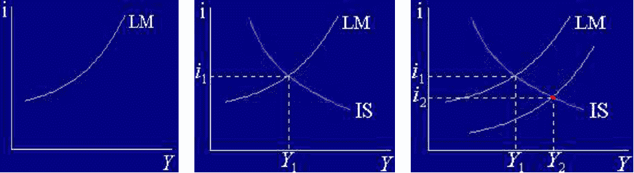

这个传导机制的作用大小首先取决于货币供给的变动对利率影响的大小。货币供给对利率的影响能力又取决于货币需求对利率的敏感程度。

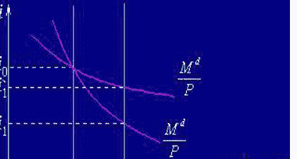

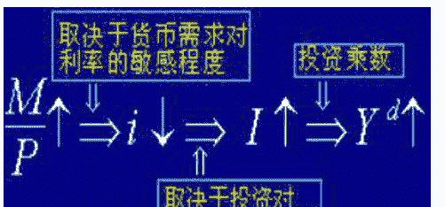

凯恩斯主义者通过这一传导机制所得出的结论：

货币政策的作用不是很大。

原因：

- 1. 货币需求对利率很敏感。
- 2. 投资需求对利率并不敏感。

**2. 货币政策变动对企业信贷可得性的影响（货币传导的信贷渠道）**

如果货币政策可以改变能够借到钱的人的数量，那么就会影响到企业的资金来源，从而影响到投资需求，最终将导致总需求的变化。

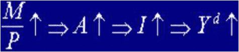

因此，货币供给的变动对私人投资影响的两个主要途径：

**3. 托宾的q理论**

q是一个比值，它等于企业市场价值比企业的资本重置成本。托宾认为，企业的投资决策取决于q值是否大于1。当q大于1时，企业就会投资；当q小于1时，企业就不会投资。

q = V / (p_k · k)

- V → 企业股票的总市值
- p_k · k → 企业拥有的实物资产总值
- p_k → 单位实物资本的价格
- k → 实物资本的数量

**结论推导**

如果q大于1，那么企业投资收益率就会大于企业的资金成本。

企业价值的确定：

\[
V_t = \frac{c_{t+1}}{1+r_k} + \frac{c_{t+2}}{(1+r_k)^2} + \ldots
\]

假定各期现金流均为c_0，则有：

\[
V_t = \frac{c_0}{r_k}
\]

企业收益率的确定：

\[
p_k \cdot k = \frac{c_0}{1+\rho_k} + \frac{c_0}{(1+\rho_k)^2} + \ldots
\]

方程可以简写成：

\[
p_k \cdot k = \frac{c_0}{\rho_k}
\]

\[
q = \frac{V}{p_k \cdot k} = \frac{\frac{c_0}{r_k}}{\frac{c_0}{\rho_k}} = \frac{\rho_k}{r_k}
\]

显然，只有当资本的预期收益率 \(\rho_k\) 大于资本成本 \(r_k\) 时，即 \(q > 1\) 时企业才会进行投资。

托宾的货币传导机制：

\[
\frac{M}{P} \uparrow \Rightarrow V \uparrow \Rightarrow q \uparrow \Rightarrow I \uparrow \Rightarrow Y^d \uparrow
\]

## 第三节 货币政策的传导机制

## 二、货币对消费的影响

- **1、财富效应**
  - 1）实际余额效应
  - 2）金融资产价值

## 2、替代效应

是指各种消费品相对价格的变动对人们需求的影响。

## 三、货币对净出口的影响

E——用本币表示的外币价格

NX——净出口

货币对消费的影响

## 四、货币学派的货币政策传导机制理论

货币学派认为，货币供应量的变动，无需通过利率加以传导，而可直接引起名义收入的变动。

货币供给增加 → 人们支出增加 → 收入增加 → 物价上升

## 货币政策与目标

- 货币政策工具
  - 存款准备金政策
  - 再贴现政策
  - 公开市场业务
- 近期中介目标
  - 基础货币
  - 短期利率
- 远期中介目标
  - 货币供应量
  - 长期利率
- 最终目标
  - 稳定物价
  - 充分就业
  - 经济增长
  - 国际收支平衡

# 第22章 货币需求

## 货币需求的存量与流量

分析货币需求量，通常是从存量意义上来观察和计算的，但由于货币本身固有的流动性属性，讨论货币需求仅仅局限于存量概念是不够的，必须同时考察货币需求的流量。

## 货币需求研究的宏观与微观角度

- 宏观分析是从一个国家的社会总体出发，强调货币作为交易工具的职能，在分析市场供求、收入及财富指标的变化上，探讨一国需要多少货币才能满足经济发展对货币的需求。
- 微观分析是从社会经济个体出发，分析各部门的持币动机和持币行为，研究一个经济单位在既定的收入水平、利率水平和其他经济条件下，所需要持有的货币量。

## 名义货币需求与实际货币需求

- 名义货币需求指社会各经济部门所持有的货币单位的数量。
- 实际货币需求指名义货币数量在扣除了通货膨胀因素之后的实际货币购买力，等于名义货币需求除以物价水平。区分并研究名义货币需求与实际货币需求对于判断宏观经济形势和制定并实施货币政策具有重要意义。
- 货币需求量的弹性区域。货币需求量是经济运行系统内部决定的内生变量，但因社会经济背景有很大的伸缩性，所以货币需求量本身总处在不断的变化之中。

## 二、货币需求函数（the function of money demand）的含义

- 所谓货币需求函数，就是将决定和影响货币需求的各种因素作为自变量，而将货币需求本身作为因变量而建立起来的数量变化关系。
- **M=f（Y，r，Cr，Cp，V，Q，P，E，……）**

## 货币需求函数中的变量

- （一）规模变量——财富与收入
- （二）机会成本变量——预期收益率
- （三）其他变量

## 第二节 货币需求理论

- 一、马克思的货币需求理论
- 二、传统货币数量理论
- 三、凯恩斯的流动性偏好理论
- 四、弗里德曼的现代货币数量理论

## 一、马克思的货币需求理论

以金币流通为假设条件或背景的。研究的是人们对货币的交易需求。

观点：（1）商品是带着价格进入流通的。（2）商品价格有多少，就需要有多少货币来实现它。（3）货币始终存在于流通之中，发挥媒介作用。

公式表示：执行流通手段职能的货币量＝商品的价格总额/货币流通速度

结论：

1. 商品流通决定货币流通。
2. 一定时期流通中货币的必要量是由商品的价格、数量和货币流速三因素决定。
3. 金币能自发地调节流通中货币量。

## （一）费雪方程式：M V = P T

公式中，M表示一定时期内流通货币的平均数量，是一个外生变量；V表示货币流通速度，由制度因素决定，在短期内是稳定的；P表示各种商品的加权平均价格，T为各类商品的交易量，由生产决定，在一段时间内相对稳定，因此，货币数量的变化会影响商品的价格。

费雪方程式侧重于宏观分析，即货币总量和总产出及总的价格水平的关系，因而没有注意微观经济主体行为对货币需求量的影响，成为其理论的一大缺陷。

## （二）剑桥方程式：Md = kPQ

其中，Q相当于费雪方程式中的T，K表示以货币形式保有的财富占名义总收入的比例。其它与费雪方程式含义相同。

剑桥方程式与费雪方程式的差别在于：强调微观经济主体行为对货币需求量的影响，即公众持有货币的主观愿望，是从微观的角度解释货币需求量。

## 现金交易说和现金余额说的比较

1. 交易说看重货币的交易媒介功能，余额说强调货币的持有和货币的财富保存功能。
2. 余额说重视人们持有货币的动机，交易说注重货币流通速度以及经济社会等制度因素。
3. 交易说没有对货币供求所起的作用作明显的区别，余额说则对货币供求同样重视，并以之作为决定价格水平的分析基础，使货币价值的决定与商品供求决定规律相吻合。
4. 两者所强调的货币需求的决定因素有所不同：交易说用货币数量的变动来解释价格，反过来再确定货币需求，没有区分真实货币需求与名义货币需求；余额说认为微观主体要在权衡利弊中决定货币需求，其货币需求是真实货币需求，不受价格水平的影响，价格水平的变动只影响名义货币需求。

## 共同的缺陷

1. 以充分就业为假定前提。
2. 是一种长期的均衡理论和静态理论。
3. 假定产量、货币流通速度及货币持有比例不变，处于静止状态，而不深入探讨这些因素的变化过程和原因。
4. 将利率排除在货币分析之外。
5. 除了认为货币量变动会直接影响物价同比例变动外，对其他各因素相互间的关系没有深入探讨。

## 三、凯恩斯的流动性偏好理论（the liquidity preference theory）

1936年《就业、利息与货币通论》的出版标志着凯恩斯主义的形成。

货币的总需求决定于流动偏好。

流动偏好是指人们要以货币形式保持其一部分资产的意愿。原因在于三种动机：

1. 交易动机（transactions motive）。
2. 预防动机（precautionary motive）。
3. 投机动机（speculative motive）。

## 凯恩斯的“流动性陷阱”说

在一种极端情形下，当利率低到一定程度时，整个经济中所有的人都预期利率将上升，从而所有的人都希望持有货币而不愿持有债券。

在这种情况下，投机动机的货币需求将趋于无穷大，此时，若继续增加货币供给，将如数地被人们无穷大的投机动机的货币需求所吸收，从而利率不再下降。这种极端的情形，就是所谓的“流动性陷阱”（liquidity trap）。

## 流动性陷阱（liquidity trap）

货币需求发生不规则变动的一种状态。

当利率降到一定的低点后，人们的货币需求可能变得无限大，此时如果中央银行增加货币供应，将全部被货币需求所吸收，从而对市场利率不起作用。

流动性陷阱图示

## 凯恩斯的货币需求函数

- M = M1 + M2 = L1（Y）+ L2（r）
- M1表示交易性的货币需求；
- M2表示投机性的货币需求；
- Y表示收入；
- r表示市场利率；
- L1表示M1与Y的函数关系；
- L2表示M2与r的函数关系。

## （一）鲍莫尔的存货模型对凯恩斯理论的发展

鲍莫尔（W.J.Baumol）通过分析，发现即使是交易动机的货币需求，也同样是利率的函数，而且同样是利率的递减函数。

平方根公式：M = √(2bT / r)

含义：交易动机货币需求的收入弹性和利率弹性分别为正二分之一和负二分之一。

## （二）托宾的资产选择理论对凯恩斯理论的发展

托宾（J.Tobin）的资产选择理论是对凯恩斯投机动机的货币需求理论的发展。

托宾的资产选择理论不仅得出了投机性货币需求与利率呈反向变动关系的结论，而且还通过人们资产组合的选择和调整行为，解释了货币与其他各种金融资产同时被人们所持有的现象。

## 四、弗里德曼的新货币数量说

1956年，米尔顿·弗里德曼发表《货币数量说的重新表述》，提出新货币数量说。

一方面采纳凯恩斯把货币看作是一种资产的核心思想，利用它把传统的货币数量学说改造成货币需求函数；

另一方面基本否定了传统货币数量说的结论，即M量的变化反映在物价的变动上，M量的变化从长期看只影响总体经济中M部门的名义量，如物价、名义所得等，但不影响实质部门的真实量，如就业、实际利率、生产率等。

## 弗里德曼的货币需求函数

Md/P=f（Yp； P； Rm； Rb； Re； W； u）

Md/P表示对M的实际需要；

Yp表示人们的恒久收入；

P是预期的实物资产的名义收益率；

Rm代表预期的货币的名义利率；

Rb代表固定收益债券的名义利率；

Re代表预期非固定收益的证券如股票的名义利率；

W代表非人力财富占个人总财富的比率；

u代表主观偏好、风俗习惯及客观技术与制度因素的综合变量。

## 弗里德曼货币需求函数的含义

- （1）使用了恒久性收入的概念。
- （2）将物价水平与物价变动率考虑在内，确定了预期因素在货币需求理论中的地位。
- （3）引进了债券收益率与股票收益率。因为市场竞争越来越激烈，使得 Rb-Rm、Re-Rm、P-Rm 这三个差额变得越来越小，所以可以删除掉。
- （4）引进了非人力财富占个人总财富的比率。
- （5）引进了综合变数 u。认为 u 比较固定，对货币需求有影响的就剩下了两个因素：预期物价变动率 P 和人们实际的恒久收入 Yp。

## 弗里德曼理论与凯恩斯理论的区别

- **恒久收入(permanent income)**
  一个人所拥有的各种财富在长期内获得的收入流量。
  恒久收入等于过去收入加上现在和未来已知的收入之和,若以年度为权数加权平均,则相当于年度平均值。

- **人力财富(human wealth)**
  - 个人获得收入的能力,包括一切先天和后天的才能与技术。
  - 人力财富转化为现实收入的条件是就业。
  - 人力财富带来的收入是不稳定的。

- **非人力财富(nonhuman wealth)**
  - 总财富中扣除人力财富的部分,主要指物质性财富。
  - 非人力财富同样具有获得收入的能力。

## 弗里德曼理论与凯恩斯理论的区别

- 弗里德曼
  - 包括多种资产作为货币的替代物；
  - 认为货币与商品之间可相互替代；
  - 货币的预期回报率不是固定的；不过当利率上升时，$r_b - r_m$ 仍保持相对稳定；
  - 利率变动对货币需求几乎没有影响。

## 弗里德曼理论与凯恩斯理论的区别(续)

- 弗里德曼(续)
  - 货币需求是稳定的 ⇒ 货币流通速度是可预测的
  - 货币是决定总支出水平的主要因素

（1）凯派理论指出，利率是货币需求的一个重要因素；货学派的理论则不同，认为利率对货币需求没有多大影响。

（2）货派认为货币需求函数是稳定的；而凯派认为货币需求函数是不稳定的。

## 货币需求的实证分析

- **利率与货币需求**
  - 货币需求对利率敏感性的一致性证据。
  - 几乎没有证据能够证明流动性陷阱的存在。
- **货币需求的稳定性**
  - 直到20世纪70年代初期，实证证据有力地支持货币需求函数稳定的观点。
  - 1973年以后，货币需求函数的不稳定导致货币流通速度难以预测。
- **对于确定货币政策实施方式的意义：货币供给？利率？**

## 第三节 我国有关的货币需求理论

## 一、我国的货币需求公式

马克思的货币必要量理论是我国实践中货币需求量的理论依据。

假设我国经济运行结构和经济技术条件不发生大的变化，或者变化缓慢，在短期内可以忽略，因此，可用国民生产总值与货币数量之间的比例关系来计算货币的需求量。则有：**M=kY**

K：货币量与国民生产总值的比率，Y：国民生产总值

通常在计算将来时期的货币需求量时，用增量概念来确定，即：

**M=kY＋k△Y**

此即为我国在实践中确定货币需求量的主要方法。

## 二、经验数据

- “8：5：4”比例：市场上1元人民币大约需在8元的社会商品零售额，需要5元商品的库存和4元的农副产品收购
- 警戒线1：6
- 背景：60、70年代现金占整个货币流通量的比重较大，存款基本受计划控制，不构成对市场的冲击；商品价格受计划控制。

## 三、经验数据的改变

- 84年降到了警戒线以下。
- 原因：农村改革加速了经济商品化的过程，扩大了货币的使用范围；城乡个体经营的发展，企事业单位财务管理权限下放，货币保有主体的数量膨胀；价格的逐渐放开，物价水平的提高；城乡居民的货币收入水平提高；现金不再仅仅是媒介消费资料的工具，也在相当程度上成了媒介生产资料的工具等。
- 新的公式： M=Y+P （货币供给增长率、经济增长率、预期物价上涨率）

## 四、新时期我国货币需求的决定因素

1、收入状况（Y）
   收入水平的高低与货币需求成正比
   人们取得收入的时间间隔与货币需求成正比
2、市场利率（r）
   （一）市场利率决定人们持有货币的机会成本
   （二）市场利率影响人们资产持有形式的选择
3、信用的发达程度（Cr）
4、消费倾向（Cp）
5、货币流通速度(V)
6、社会商品可供量(Q)
7、一般物价水平(p)
8、人们的预期和偏好(E)
9、制度因素
10、其他因素

