# 上海探店指南（中欧基金）

## 上海探店指南
speakeasy bar

## 行业现状

红海市场
竞争分散

- 传统酒吧
- 明确主题
- 文化底蕴
- 多样化商业模式

## The Barbershop

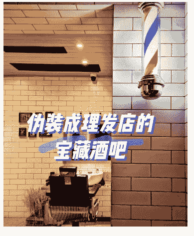

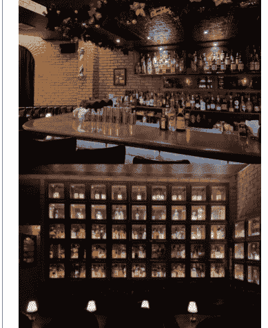

### 复古理发店

永嘉路615号

白墙暗门

理发店内机关

“一家做葱油拌面超级好吃的酒吧”

室外后厅

砧霜
Justin biber
菠萝

## Laundry Co.

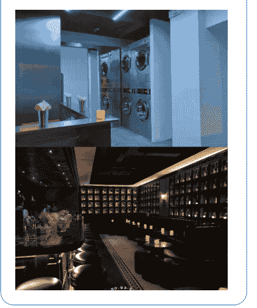

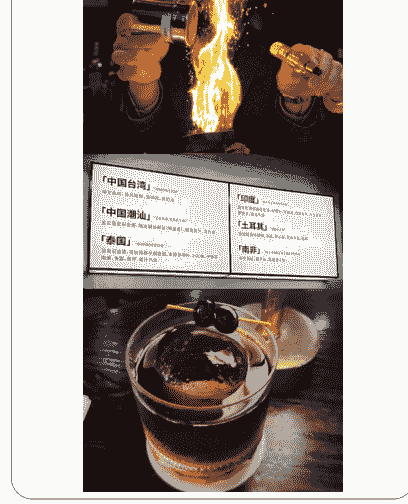

### 美式洗衣房

襄阳北路93-5

冰火两重天的反差感

“真的可以洗衣服”

酒瓶背景墙

酒单无雷区

Havana
Red moon over Manhattan
土耳其

## Speaklow 彼楼

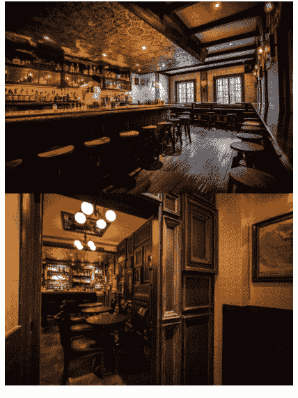

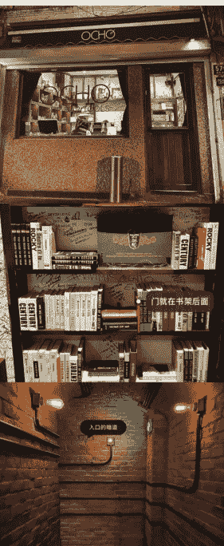

### 复古书店

复兴中路579号

- 书架后的通道
- 每层独特的空间主题与系列酒单
- 调酒水平炉火纯青
- “speak loud”

亚洲top50
社牛专属粜系列
烟干贵

## Cavern

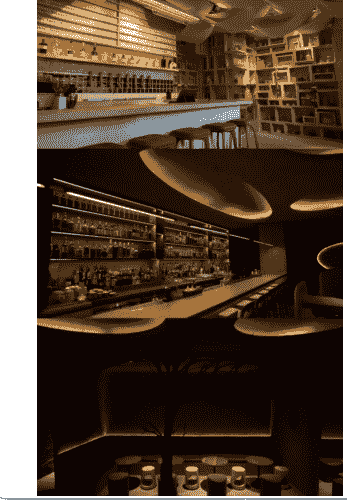

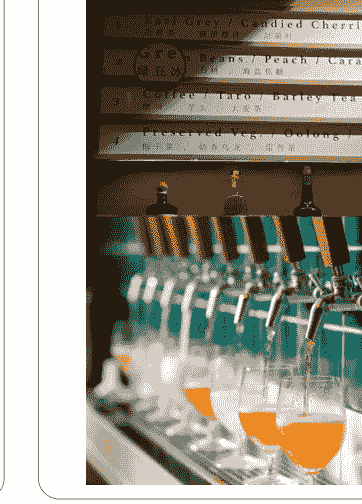

### 咖啡Brunch

襄阳北路27-3

on tap gin 即饮小吧

洞穴里的神秘酒馆

创意菜很好吃

前吧Gurgling
后吧Cavern

绿豆冰酒
Vapor valley
T.N.T
Mushroom

## Mushroom

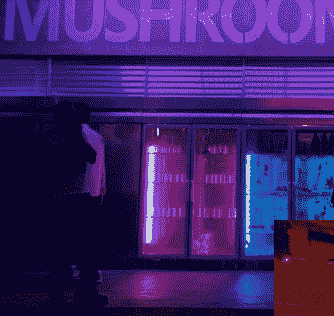

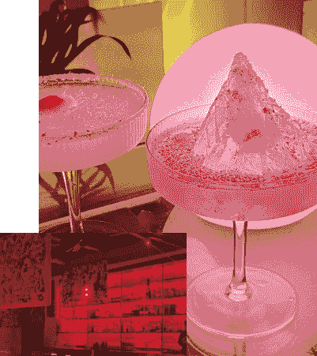

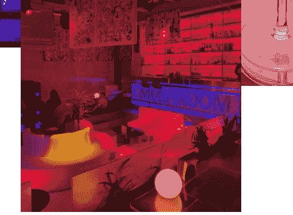

### 冰柜里的酒吧

长乐路462号集社中庭

开盲盒式开柜门找入口

蒸汽波迷幻酒吧

朋克版王家卫

氛围感满分 出片率100%

- 富士山的雪
- 苏梅岛的白沙滩
- 阿尔巴秘境
- 粉色加勒比

## Pop Corner

### 猫狗狗舞厅

绍兴路35号

复古bar&cafe

有故事的地名&节气酒单
旅行地食材融入

小甜水酒吧

Seasonal酒单 食物好吃

- 谷雨
- 台湾宜兰
- 鸡汤泡饭
- 卤肉饭

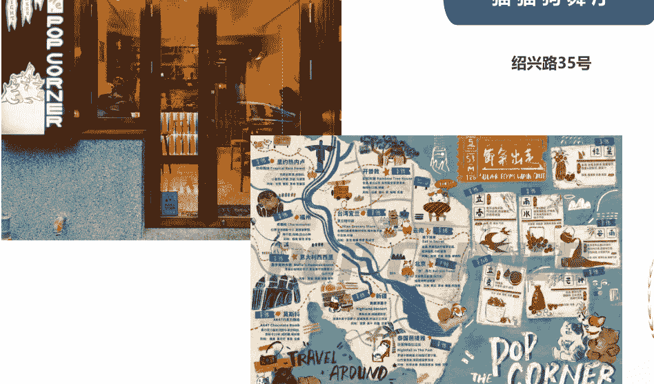

## J Boroski

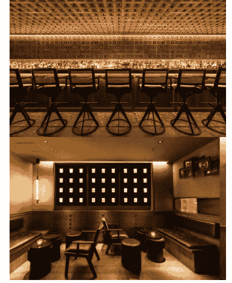

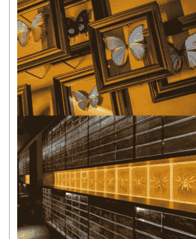

### 富民路上没有任何 Logo的黑色大门

静安寺富民路

具体地址？ “搜 懂经叔爷 旁边”

也没有酒单

每晚限量walk in

来自东南亚地区的各色昆虫标本

每一款都独一无二，
每个人都能感受到被偏爱的滋味

## Insomnia

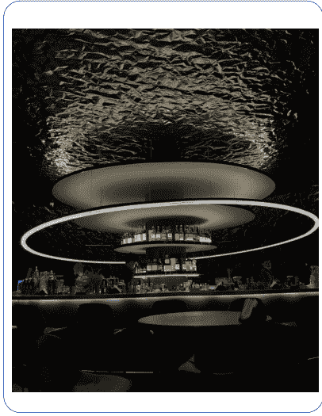

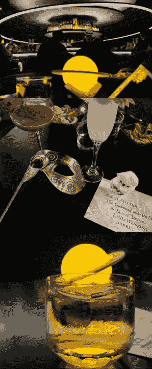

### 大厦里的暗黑宇宙

淮海中路766号

不显眼的黑色暗门

失眠患者星球

浪漫暗黑系

海瑟薇的来信
Be water
少女的祈愿

## Lieben

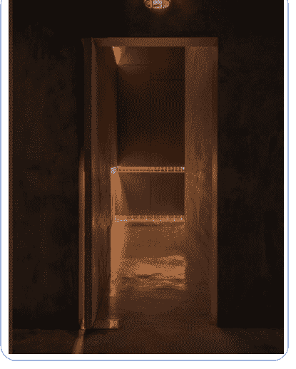

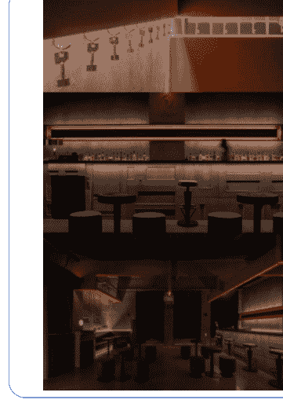

### 打开夜的一扇门

巨鹿路758号一号楼2楼

“爱”不会让人轻易坐享

极简主义与德式工业风以及光的柔美

适合约会

不要错过酒单里的酸奶

方程式鸡尾酒[X+Y]
梅思卡尔
消失的酒庄
【音乐系列】

## Epic

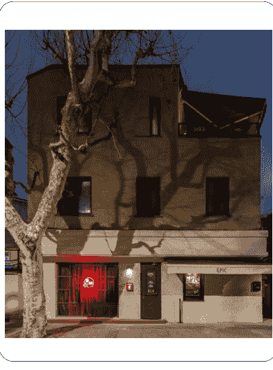

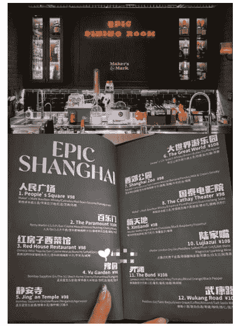

### 隐藏宝藏2.0

高邮路17号

本土团队的骄傲
调酒届 “奥斯卡”

三层分别解锁[家]的不同空间

上海地标系列酒单

亚洲top50 世界top50

人民广场
新天地
特调
本帮肉酱炸薯条
红油抄手

### 推荐几家值得一探的店

Bar Lotus

The Broken Dagger

Glory

COA

登机牌酒单

爱情白皮书

MBTI独家特调

别让我下头
Don't let me down

ISTP

朋克小清新bar&café

夏日果味

亚洲top1

龙舌兰酒吧

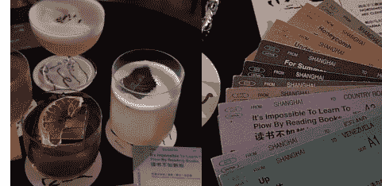

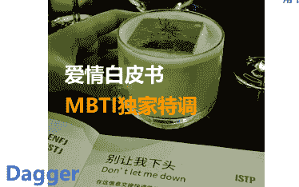

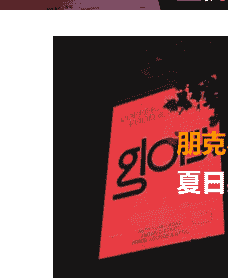

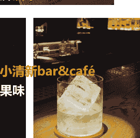

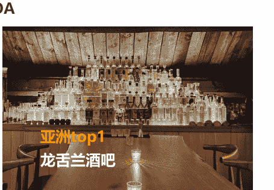

### 推荐几家值得一探的店

隐藏酒单和员工面

BAR NO.3

Tag

### TAG

擅长好喝，布里斯世界好吃的“酱酱老板”

“阿珍爱上了阿强”
陈强77号2

Paal

Mandrill

Home Bar

简单浪漫特别

地球最后的夜晚

## 选店&点单tips

如何选一家不踩雷的酒吧？

- 调酒专业性
- 服务
- 酒单设计
- 氛围
- 环境

大众点评【本店推荐】

经典鸡尾酒居多 ✔

套话软文or批量自拍 ✘

怎么看酒单点到喜欢的酒？

酒吧原创鸡尾酒

经典鸡尾酒

无酒精鸡尾酒

纯饮烈酒

口味、风格、调性、价格

五边形的香气风味地图，味觉标注可以参考，清晰明了

鸡尾酒风味地图，按图索酒，再去相应的酒款看搭配组合有没有自己不喜欢的，很大概率能点到自己很喜欢的酒

## 感谢 聆听

