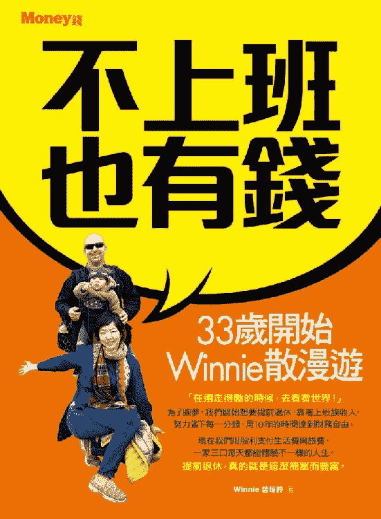

   

 

不上班也有钱

50 岁开始散漫游

 

用 10 年时间努力,换一辈子财务自由,展开

没有终点的环游世界之旅……

 

自序-----

一起不上班也有钱

1.1 我们 30 几岁，退休了！

1.2 改变人生的一场旅行

1.3 学贷、卡债、房贷、一个也没少过

1.4 没有不可能长达 60 年的壮游

2.1 需要的退休金没你想像那么多

2.2 省钱人生前奏曲：记账人生

2.3 努力掐大腿减少冲动购物

2.4 学生公寓当豪宅住 减少主要开支

2.5 先别记着说不可能

2.6 省钱大作战的人体实验

2.7 转个念就省钱区分必要和想要

2.8 拒绝先享受后付款

3.1 存钱怎么那么难!

3.2 花钱怎么那么容易!

3.3 价值观相近的另一半

3.4 我们的百万婚礼

3.5 11 天 0 元蜜月旅行

3.6 跟过去不快乐的自己说 byebye

3.7 简单而富足的人生

4.1 方法很简单 看你愿意付出多少

4.2 不会就学努力帮自己加薪

4.3 老 J 的打拼职场生涯

4.4 还在上网找工作？快检讨人脉存款！

4.5 不上班也有钱翘脚数钞票

5.1 从负到零、从零到 100 的人生

5.2 提早退休复利是好伙伴

5.3 养了下金蛋的鸡 别轻易杀生

 

5.4 简单易懂的提早退休概念

5.5 被股灾吓久了变得面不改色

5.6 创造被动收入用股利支付生活费

6.1 恐惧是实现梦想最大敌人

6.2 家产只剩 2 个登山包

6.3 越玩越有钱几乎免费的欧洲行

6.4 精打细算快乐去旅行

6.5 小钱大享受省钱住好宅

6.6 海外退休新选择

6.7 坐在巴黎户外咖啡座上班

7.1 旅行让人生更精彩

7.2 没了工作我们还剩什么？

7.3 想体验生活却落荒而逃

7.4 家就在背包里越旅行东西越少

7.5 带着孩子去旅行

7.6 谢谢你重新给我旅行的勇气！

7.7 退休后靠什么养小孩？

8.1 开始改变未来一定会更好

8.2 10 个提早退休的小秘诀

8.3 一起来计划你的财务自由之路

后 记

 

自序

一起不上班也有钱

如果回到过去,问问小时候的我:以后长大要做什么?10 岁的

我很有志气:”我长大后想要成为有用的人。”20 岁的我可能跟

大部分的人一样：“想成为成功的有钱人，有车、有房，能每年

出国玩 2 次，不为钱烦恼。”

但怎么样也想不到，30 几岁的我，不靠抢银行或中乐透，已

经可以退休，还有足够的钱可以环游世界。

“怎么办到的？”因为要回答这个问题，我开始写下一篇篇

的网志。很幸运的，我在人生的路上遇见价值观与我很接近的另

一半。我跟先生（当年的男友）在 20 多岁时，只有一个模糊的

想法：有没有办法环游世界，但又不需要担心没钱可用。

这个一开始很多人说不可能达成的“妄想”，我们还真的用

了 10 几年把它化为“梦想”，实现为“真实”的人生。靠着上

班收入，没有什么艰难的投资理论，所有的做法都是“只要愿

意，你们就可以做到”的方法，达成了财务自由。

人生，不应该只有努力工作到老，买车、买房这条路。把我

们的故事分享在网络之后，常会有网友写讯息来，说我们的故事

让他们重新思考了人生的方向，调整了自己的目标，发现财务自

由不再是遥不可及的幻想。每次看到这样的讯息，都很感动，也

才知道，原来自己或许也有一点小小的力量可以帮助其他人。

1

 

希望这本书能让更多人像我们一样，因为财务自由，能有更

宽广的人生。

这本书不是理财书，没有什么艰难高深的学问，或是高收益

投资操盘手法，而是在说一个筑梦圆梦的真实故事，把我们如何

做到 30 几岁退休的方法，集结成册。配上我这几年的背包旅行

照片，带着各位朋友，一起走过我们的人生旅程。或许这个故

事，会在你们的心中埋下一个新想法，为 10 年后、20 年后的自

己，一起勇敢筑梦，提早达成财务自由。

享受身心自由的一声。

大家一起不上班也有钱！

衷心感谢网络上许多素未谋面、总是温暖支持我的网友。谢

谢《Money 钱》的编辑，有耐心、毅力追踪在世界居无定所的

我，没有他们的督促，这本书就不可能完成。最后一定要谢谢常

被我在网络上出卖的先生老 J，没有他的坚持，就没有我们今天

的生活。

期待 10 年后的我，可以跟儿子说，妈妈曾经出了一本书。

 

2

 

1.1

我们 30 几岁，退休了！

想到要为了钱，花费大半生的岁月在工作上，实在非常折磨

人！所以我们想尽办法，靠着上班族的收入，在 40 岁前达成财

务自由。

因为我们 30 多岁就退休了！

旅行时我们遇见很多好奇的人，问的都是大同小异的问题：

“你们是怎么做到的？居然可以那么年轻就退休环游世界，我们

也好想要这样做。”

老 J 跟我就开始解释，我们在工作时如何努力存钱和理财，

只要存 10 几年就可以跟我们一样提早退休。

“哦，这样做好难啊！有没有简单一些的方法？”

大部分的人在不知不觉中，花了大半生将近 40 年的岁月在

工作上，对我们两人来说，想到要为了钱，做着一成不变的工

作，付出 40 年的人生，才最难、最可怕、最折磨人。

所以我们想尽办法，用了 10 多年的时间，靠着当上班族的

收入，在 40 岁前就达成了财务自由。

现在也请你们闭上眼睛，想一下如果自己 10 年后不上班也

有钱，你想做什么？

年轻时候的梦想是不是逐一浮现了出来？

当你知道不用等到七老八十才可以退休，只要咬牙努力 10

几年，梦想有没有越来越清晰地出现在眼前？

3

 

1.2

改变人生的一场旅行

旅行可以不只是坐着游览车走马看花，不需要住大饭店，不

去观光客聚集的地方，花的钱比较少，却能真正走进当地人的生

活。

旅行，很令人上瘾，可以暂时脱离每天舒适、却有点一成不

变、枯燥乏味的生活。

在旅程中，每天都是新鲜的未知数，每天都有不同的期待跟

兴奋，不知道今天又会遇上什么有趣的事物，邂逅什么人。就算

遇上些倒霉事，也都很值得日后回忆，自己仿佛变成了另一个用

于冒险的人。

等回到“正常”的生活后，换上认真负责的面具，那个有趣

的另一个自己又慢慢不见了，继续朝九晚五的工作，日复一日单

调的生活。

10 年前我跟老 J（当时还是男友）第一次一起到泰国自助旅

行，第一次真正当个背包客，没有预先订酒店，买了张机票就到

当地。

下机后背着背包四处打听哪里有便宜的住宿，第一天住进台

币 500 元不到的小旅馆，已经觉得自己号厉害，后来更找到台币

300 元、没有冷气、没有热水的当地小屋。

逛着当地的小市场，一遍吃着摊车装在塑料袋里的咖喱，一

边小心地担心，等一下会不会拉肚子，最近的厕所不知道在哪

里…

4

 

那次之后，好像发现了新大陆：原来旅行可以不只是坐着游

览车走马看花，不需要住大饭店，不去观光客聚集的地方，花的

钱比较少，却能真正走进当地人的生活，体验当地文化。

这次自助旅行用光了我一整年工作的 7 天年假，而且还是冒

着被老板砍头的风险，硬是请了连假。7 天的旅程，却一下子就

结束了，真舍不得离开，好不想回去上班。

从这之后我和老 J 一直讨论着环游世界的梦想，但光是一个

小小的岛就可以让我们玩那么久，如果真要环游世界，需要多少

时间？

等到 60 岁退休再去环游世界，可能很多地方去不了，很多

苦吃不了。要不要干脆辞职说走就走，趁年轻带着存款，能玩多

久是多久，潇洒地挥霍青春，爽快地走一回人生……甚至还想过

老 J 可以沿途当潜水教练、英文老师，我可以打工换宿，只要有

勇气，没扫描做不到！

如果当年我们还是大学刚毕业的学生，没什么可以失去，那

可能就有勇气花 1、2 年的时间去体验人生百态，透过旅行更了

解自己真正想要的人生是什么。

但可惜的是，我们那时正值老大不小的年纪，再加上我跟老

J 从小对钱没有安全感，实在不敢放下一切，没有收入就去旅

行，很害怕挥霍了最精华的年轻岁月后，万一回来找不到工作怎

么办。

所以我们开始找方法，看能不能趁着年轻环游世界，又不用

为了未来的金钱烦恼。

5

 

在找资料的过程中，慢慢接触到财务自由（财务自由是什

么？就是有一天你的被动收入可以支付你的支出。）和被动收入

（被动收入是什么？就是不需要工作就有钱。）的概念，也让我

们开始思考：生命中重要的到底是什么？我们真的要为了买间大

房子、买台好车、买华美的家具、当季的新衣服、提名牌包、吃

大餐……而不断卖命工作吗？上班真的很辛苦，把 40 年最精华

的青春岁月奉献给工作，用宝贵的人生去换回这些可能过几年就

变成垃圾的物品，值得吗？

1.3

学贷、卡债、房贷、一个也没少过

大学毕业那年，我们都背着债务，每天睡眼惺忪起床上班，

再疲惫地回家。思考很久后，我们有点异想天开，订下了 10 年

内退休的梦想计划。

我跟老 J 并不是富家子的孩子，当然也没有好运到中了乐透

一夜致富。不久前，我们仍是朝九晚也九的爆肝上班族，每天睡

眼惺忪地急忙起床去上班，晚上再拖着疲惫的身体回家。

曾经我们也以为，工作 40 年是一件再正常不过的事，根本

连想都没想过“退休”这件 65 岁以后才会发生的事，直到我们

一起去了一个改变人生的旅行，才漫漫地有了提早退休的梦想。

其实，在决定努力提早退休之前，我们的人生道路跟大多数

人很像：好好读书、上大学、找份好工作……然后财富就会滚滚

而来。一开始，我和老 J 也跟多数人一样，追随这条我们唯一知

道通往成功的道路。

6

 

回想起大学毕业那年，我们身上还各自都背着债务。老 J 欠

了 35000 美元的学生贷款，还有 5000 美元的卡费，他大学最后

半学期的课业太忙，没办法打工，只能先靠着信用卡和现金卡过

生活。

他跟我说，有时候为了省钱，午餐只能吃学校餐厅放在餐具

旁边，用来加在汤里的免费小小块苏打饼，听到后，连我都觉得

超心酸。

我则是靠着学贷和半工半读撑到毕业，专科 5 年加上大学 2

年共欠了 10 几万元台币的学贷，还记得念二技时，午餐常常是

茶叶蛋加上一瓶绿茶就打发了。

开始工作后，先努力还清贷款，因为害怕没钱，所以努力赚

钱、存钱，那时候的想法就是要拼命赚钱，想办法挤进最知名的

企业，追寻着能跻身为成功人士的道路，确保以后能过“好日

子”。

因为成长过程太缺钱，所以我和老 J 两人对钱有着无比的渴

望，都梦想着未来一定要成为“有钱人”，所以我们做了很多有

钱人似乎都会做的事：贷款买了 80%属于银行的房子、80%属于银

行的车子。

虽然过着自认为不浪费的日子，但还是偶尔会买些新衣服，

跟朋友聚餐享受小确幸，甚至可以一年去度假一次，买以前没钱

时，觉得拥有以后会让我们幸福的东西。

7

 

如果这条路一直走下去，我们 65 岁退休时，可能会有一间

塞满东西的房子，1、2 台车子，一整柜不太穿的衣服、鞋子，还

有很多当初不知道为何而买的东西。

在思考很久后，我们有点异想天开，订下了 10 年达成财务

自由的梦想计划。想在还走得动的时候，不用为了金钱烦恼，在

身体还健康的时候，可以悠闲地漫游世界，而且，我们提早退休

的方法，成功的机会绝对比中乐透的机率还高!

1.4

没有不可能 长达 60 年的壮游

人生的路有很多种，如果你看到我们选择了另一种人生道

路，而且成功了，希望能鼓励你，趁年轻时提早设定目标，奔向

自由。

为了圆梦，我们开始有了提早退休的想法，想多存点钱，在

还走得动的时候去看看世界。

我们开始寻找能提早财务自由、随心所欲过生活的方法。订

出退休金目标后，过起节约的生活，把生活中的 4 大支出—— 食、衣、住、行减至最低。不买车、不买房、租便宜的学生公

寓，骑脚踏车上下班，减少外食，穿二手衣、不买非必要的物

品……从存下 50%收入做起，慢慢地每个月能存下 70%的薪水。

当身边的同事朋友们随着年纪增加收入，开始升级他们的生

活时，我们还是始终如一地节约，随着收入增加而升值的，只有

我们的存款。

10 年后我们达成目标，可以靠长期投资的收入过生活，不用

为了金钱烦恼，30 多岁的我们，在身体还健康的时候，可以悠闲

8

 

地漫游世界，2013 年我们清空了所以物品，背上 2 个背包，过着

随心所欲的生活。

现在的我们没车、没房，旅行时除了身上扛得动、带得走的

东以外，什么也没有，最近看到很多讨论 gap year（简单说，就

是辞去工作，放自己 1 年假去旅行）的文章，10 年前的我们终究

因为没有勇气放下一切，而选择了另一条比较保险的路，但如果

花 10 年的时光，换来不仅 1 年，而是 60 年的自由人生，你愿意

吗？

很多人在年轻的时候认为，退休时很久以后的事，选择把收

入拿来“增加生活品质”，买了各式各样的东西，还得买个家、

背着房贷来囤积这些东西。

工作累了，就休年假出国几天，走马看花时再多买点纪念品

来慰劳自己的辛劳，收入多了就去远一点的地方，买好一点的

车，换大一点的房子，30、40 年的生活就这样周而复始地过着。

我跟老 J 在工作时，收入都不错，如果继续工作到 60 岁，

应该可以全身名牌，但那些身外之物真值得你浪费生命、汲汲营

营地追寻吗？

我们宁可选择把大部分（70%）的收入拿来生股息，其实多

数珍贵而无可取代的东西都是无形的——亲友们的祝福、旅行中

的见闻，背包装不进的，就放入眼里、心里珍藏，两手空空背着

背包，自在地到处旅行，体验生活，对我来说，这比拥有任何东

西都珍贵。

9

 

达到财务自由后，心灵也自由了。你可以选择自己想做的

事、想去的地方，热爱工作的人不用为了生计，而是出于热情做

自己喜爱的工作，快乐自在地享受生活。

存款高低跟收入高低有相对关系，但没有绝对关系，我们有

很多高所得却低（零）存款、甚至还负债的朋友，如果你想尽早

退休，不用为钱困扰，快快开始计划如何奔向你的财务自由之路

吧！

第一个步骤很简单，就是从今天起好好记下所有支出，这样

你才能知道如何存金鸡；还没学会理财，就别想着投资，先把自

己的账务理清，有了足够的准备后再来考虑投资的事。

人生的路很多种，我们选择了一种比较不同与其他人的人生

道路，希望这个故事能鼓励你趁早设定目标，计划人生。

## 2.1 需要的退休金 没你想像那么多

你觉得 40 岁退休需要存多少钱？很多人算出来的数字高的

吓人。老 J 仔细研究后，找到了一个推算退休金的法则，所需金

额马上少了一半。

既然想退休，最重要的是，要有足够的退休金，我自己算了

算退休需要存上多少钱：40 岁退休，活到 90 岁，每个月如果要

过着不错的生活，大约要 10 万元；1 年 120 万元，50 年就是 6

千万元。

再问了问身旁的朋友，觉得 40 岁退休，需要存多少钱？大

家拿起计算器按了按，房贷、车贷、孩子教育费、父母赡养费、

10

 

医疗费、每年出国 1~2 次……还要考虑日后通货膨胀，“8 千

万、1 亿、5 亿元！”每个人算出来的数字都高得吓人。

再想想自己手上现有的资产，以及每年收到的利息，大家叹

了一口气，都说不可能 10 年内提早退休，连想在 65 岁退休都很

难，还是继续上班过日子，别做梦了！

还好，我跟老 J 最爱做的事，就是挑战不可能，退休金太高

是吗？那我们就想办法来减少它！

我家这个具有偏执性格的工程师，一旦想了解某件事，就会

追根究底透彻地研究一番，老 J 花了很多时间，仔细研究许多退

休相关的文章和网站后，找到一个推算退休金的法则：4%rule （法则）。

4%法则是美国麻省理工学院学者威廉·班根在 1994 年提出

的理论，他分析长达 75 年的股市及退休案例，认为只要退休第

一年，从退休金本金中提取不超过 4.2%的金额花费，之后每年依

通货膨胀率微调，退休金到死都还花不完。

另一个类似的理论是美国三一大学 3 位教授提出的退休金

“安全提款率”，他们也认为，假设每年用退休金的 4%支付退休

所需，再根据脱货膨胀率调整每年提款数额，如果本金可以支持

30 年，那这份退休投资组合，有极大可能可以维持到永久，这个

推论是根据美国过去 200 年的实际历史资料计算出来。

简单来说，把预计退休后每年的花费乘以 25 倍（除以 4%=乘

以 25），就是我们需要准备的退休金。

11

 

回到前面所说的，假设每年要花费 120 万台币（30 万人民

币），用这个方式计算，需要的退休金马上从 6 千万台币变成 3

千万台币，当场少了一半，但是这么高的金额，咋看之下，还是

很难在 10 年内达成。不过，我们至少有了明确的努力目标：

“10 年”及“资产至少 3 千万台币（750 万人民币）”，接下来

要做的就是，想办法多存钱，早日达成目标，于是我们就开始了

省钱人生。

2.2 省钱人生前奏曲：记账人生

没有记账前，我觉得自己完全是主妇界的楷模，看完账本，

才惊觉有很多不必要的支出！念书时我恨死记账了，没想到现在

居然能把这件事变成乐趣。

想要存钱之前，我们先问自己：“一个月花了多少钱？”

“钱都花到哪里去了？”“花得值得吗？”

印象中，我们一直过着很朴实的生活，也有稳定的投资，每

个月至少存下一半以上的收入。但为了更早达成财务自由，我跟

老 J 在多年前的某一天，下定决心要开始详细记录我们每天的花

费。

“昨天晚上那瓶养乐多跟零食多少钱？”

“你还记得我们前两天买的⊙⊙多少钱吗?”

一开始记账的时候，常会想等一下回家再记，但往往一等就

忘了。为了不再折磨彼此的脑细胞，我们习惯每花一次钱，不论

多少，都立刻写下来，就算只是 1 瓶养乐多，也会马上掏出手机

记录，免得回家后忘了。

12

 

我们试了很多不同的 App，有些懒人 App 可以直接把发票照

相，就会自动输入手机，但是最后发现，还是一笔一笔输入自己

设计的 Excel 表格比较方便。

如果只是单纯记录花费，对存钱其实帮助不大，记账最重要

的是到了月底可以看着表格上的分类，分析这个月各项开支，

食、衣、住、行、育、乐各花了多少钱？有多少收入和存款？

“什么！我这个月居然花了那么多钱买饮料？”

刚开始做月底分析时，我的心里总是会有种做贼心虚般的莫

名紧张，怕面对自己，也害怕让老 J 知道，原来我也是个奢侈的

女人。

没有记账前，本来觉得自己很勤俭持家，都没乱花钱，完全

是主妇界的楷模。但月底看完账本才惊觉，怎么有那么多不必要

的支出！常常都有想做假账的冲动，不想面对自己原来还是常常

会乱买零食跟饮料，有时候甚至不记得自己为什么要买那些根本

没需要的东西。

每次检讨完，都会再度燃起剁手指的决心，发誓下个月一定

要更节约……这几年的账本，就是我们环游世界梦想的起点，每

次看到上头的支出数字越来越小，存款及收入的数字越来越大，

就觉得离梦想越来越近。

10 年下来，我们的账本记录了这些年的吃喝玩乐，记着、记

着……已经变成了生活的一部分，只要花钱，完全不经思考就写

下来。有了账本，我们也可以根据平常的消费习惯，用 4%rule 来推算想要财务自由所需的资金。

13

 

当年我年五专时，主修的就是会计跟统计，那时我真的是恨

死记账了，发誓这辈子都不做会计相关的工作。没想到 10 几年

后，我居然能把这件事变成乐趣，因为看着它，就像看着我们过

去 10 年来为梦想努力的人生。

你也开始记账了吗？恭喜你，也一只脚踏进财务自由的起点

了，再来就是要努力坚持下去，一笔一划规划未来的财务自由梦

想。

## 2.3 努力掐大腿 减少冲动购物

我站在柜台前，毫无原因地退货，柜台小姐很凶的眼神，我

到现在还记得。一拿到收入，立刻把存款锁在位于天涯海角的保

险库里，没钱买，只能乖乖回家。

我跟很多人一样，一出社会开始赚钱以后，也有超大的雄心

壮志要好好存钱，想要有一天变成事业成功、钱多多的女强人。

每次领到薪水，就想着这个月也咬认真缩衣节食，不乱买东

西，到了月底才有多余的钱可以存下来，等到下次领薪水时，就

把上个月剩下来的钱转到其他账户当成存款。但是常常到了月底

才发现，不论自己怎么努力，剩下来可以存的钱还是很少。

后来慢慢接触了很多理财书籍跟文章，才发现自己省吃俭用

的存钱法，其实是最没有效率的方法，加上当时在公司做的是业

务相关工作，常常要设定目标、编列预算，并且定期检视达成

率，我也对自己的存款方式做了改变，开始设定目标、规划预

算，然后做了一个表格检视达成率。

但是如果目标订得太难达成，那就没有意义了。

14

 

所以记账很重要，可以把过去的花费当成参考资料，用来设

计对未来 1 年、3 年、5 年、甚至 10 年的规划。根据账本上的收

入支出，把现有的花费照食、衣、住、行、娱乐的比列算出来，

再订下想达成的存款目标。

假设自己要存下 30%的收入，其他 70%就按比例分配到食、

衣、住、行、娱乐上，一领到薪水，就先把预定要存下的金额转

到专门的存款账户，不再动用。

除了房租、网络费、交通费……这些固定支出外，其他流动

支出就根据当初编的预算来支配，如果不小心话太多钱在食物

上，就没钱买衣服或去看电影了，再怎么痛苦，都不能超过预算

动用到存款，没钱吃饭就啃馒头、吃泡面，预算是自己编的，怨

不了别人。

存钱的最大敌人就是“冲动购物”，但只要一拿到收入，立

刻把存款锁在无法碰触到、位在天涯海角的保险库里，再加上严

格执行消费预算，在街上不管看到多喜欢的东西，没钱买也只好

多摸几下，然后放下，回家去。

这样实施半年的结果，比我一开始工作时，月底有余钱才存

的方法，多存了好多钱。年底看着自己账户里突然暴增的存款，

真的好有成就感（虽然那些钱在现在看来真的不值得一提，但刚

入社会的我，已经觉得自己是小富婆）。

自从跟老 J 开展圆梦计划后，因为我们想在 10 年财务自

由，初期的目标就是要想办法存下至少一半的薪水，等习惯存一

半，再想办法慢慢调高存款目标，终极目标是要存下 70%以上的

15

 

收入。当时为了梦想，我们很冲动地把平常习惯的花费预算删了

一大半。

“这些衣服请帮我推掉。”

“请问他们有什么问题吗？”

“没有，因为我没有钱买菜了。”

有一天我站在柜台前，很不好意思地做了人生第一次买了东

西毫无原因的退货，那位柜台小姐姐很凶的眼神，我到现在还记

得。

趁着冬季特卖，我买了几件新衣服（因为它们打 3 折！这叫

我怎么能抵挡呢？）那时候的我们，才刚开始严格编列预算，买

完衣服开心地回家以后，才想起来我根本没有买新衣服的预算。

刚开启圆梦计划正热血的我，马上又跑回店里把衣服退了，以退

货明志，展现我壮士断腕的精神。

之后慢慢习惯了每次想买东西，都会看一下这个月的花费有

没有超支，严格照着计划走。去超市买东西前一定会列出采购清

单，不在单子上的东西绝对不买，在街上闲逛时，也不断掐大腿

提醒自己要执行预算，千万不能冲动购物！

## 2.4 学生公寓当豪宅住 减少主要开支

花钱买或租大房子，还要多花钱填购家具填满空间。对我来

说，小空间打扫很轻松，夫妻吵架后，两个人只能在客厅大眼瞪

小眼，瞪着瞪着……就会开始说话了。

16

 

当花费已经照着预算在执行后，我跟老 J 又开始了一连串的

新节约运动。

一般家庭的主要开支就是房租（房贷）、伙食和交通费，如

果要多存点钱提早退休，最快的方法就是把这 3 大项支出想办法

减少到最低。

“你觉得搬到这里怎么样？”前往中国城吃饮茶的路上（当

时我已经和老 J 回美国住在西雅图了），老 J 指着一栋老旧公寓

的大门。

到美国观光过的朋友应该知道，大多数城市的中国城很脏

乱，西雅图也不例外。中国城附近很多餐厅，巷子里难免对满了

纸箱和垃圾，到了晚上更是游民跟醉汉聚集的地方，但是大门窗

户上贴着的“$400/月”出租贴纸，闪闪发光地蒙蔽了我们的脑

袋。

在西雅图 400 美元 1 个月的房子有多便宜，你们知道吗？我

们原本住的公寓只有 1 房 1 厅，跟身边其他朋友、同事们的大房

子比起来，简直小得可怜，整个公寓大约是别人家客厅的大小，

但月租居然要 1300 美元。

所以看到“$400/月”，简直像天上掉下来的一块免费的巧

克力，不吃可惜。我们租约也正好到期，看了房间里设备齐全，

只是比原来房间更小一些（大概变成别人家厨房大小），马上签

约搬了进来。

因为地方小，每次煮饭时，只要菜一倒进锅，油烟就充满整

个屋子，“哔~~哔~~哔~~”天花板上尖锐刺耳的警报声，开始疯

17

 

狂作响。到最后，每次煮饭都得把大门打开，不然整个房间都会

充满了油烟。这栋大楼里，大部分都住华人，对门的老王跟隔壁

的老张，都穿着背心、短裤开着门炒菜，常常到了晚饭时间，整

栋楼此起彼伏地演奏起烟雾侦测器的交响乐。

虽然便宜，因为柱得实在太不舒服，再加上那个地区晚上实

在不太安全，我们最后只住了 3 个月就搬走了，之后搬进大学城

区内房租约 900 美元的学生公寓，因为住过 3 个月的“好窄”，

简单的学生公寓顿时变成豪宅。

只是因为这样的小小改变，走出习惯的舒适圈，房租就节约

了 3 成。

一般人梦想中的房子至少要有 3 房 2 厅，有钱就住豪宅，买

栋透天层，反正房子是越大越气派、越大越好、越大越舒适。但

住过“好窄屋”的我们发现，其实 2 个人需要的空间根本不多，

房子大部分的空间都是闲置不用。花了那么多额外的钱买了或租

了大房子，为了填满那些空间，就要添购家具，又要多花钱买维

持那个空间的空调，还要花许多力气打扫灰尘。

所以对我们来说，小空间反而更好。经济实惠，打扫轻松，

又能促进夫妻感情，因为吵架也没地方躲起来生闷气，两个人在

客厅大眼瞪小眼，瞪着瞪着……就会忍不住开始说话了。

## 2.5 先别记着说不可能

这一路上，我们不断挑战自己的省钱极限，有时候连自己都

怀疑：真的做得到吗？每当我们有看似疯狂的省钱想法时，都会

彼此大气，试看看再说。

18

 

“你们没有车？”每次跟新朋友见面，大家听到我们在美国

没有开车，都觉得太不可思议了。

一般美国的中产阶级，会住在有庭院的房子里，一家至少有

2 台房车，甚至再加一台小货车，也是很平常的事。为了节省交

通费，我们在据说没车就等于没脚的美国，靠着脚踏车跟公车过

了 3 年，不但省下了买车的钱，油钱、停车费、维修费，而且都

变成了我们退休账户里用来生利息的资产。

因为每天骑单车跟走路，连健身房的费用都省了下来。另外

还少了塞车的时间，跟卡在车阵里的烦恼，搭公车时还可以看书

听音乐，所以身心变得更健康，因为连看医生的钱也省了。

这一路上，我们不断挑战自己的省钱极限，如果真的太不喜

欢新的生活方式，就再做调整。有时候不用别人质疑，连我们自

己都会怀疑：真的做得到吗？

每当我们有看似疯狂的省钱想法，都会彼此打气，先去试看

看再说。

为了节省伙食费，我变身都市小农妇，在住家旁边向市政府

租了一块大约停车格大小的地，1 年租金只要 50 美元，出产了免

费且健康美味的有机蔬菜，可以减少出门外食的次数，除了省

钱，也吃得更健康，还让自己的厨艺，从原来连煎荷包蛋都会破

掉，到可以煮出一大桌菜来招待客人。

很多人问我们：“天啊，为了省钱，要骑脚踏车上班不是很

可怜吗？”但我们的想法时：“骑车运动真舒服，又不会塞

19

 

车。”而且只因为一点小改变，就可以离退休目标越来越近，简

直越气越开心、越骑越快。

这些省钱的方法，在执行的时候，我们并不觉得是牺牲，在

过程中，我们得到的反而更多，常常动动脑发挥创意，设定一些

简约目标，当努力过后达成目标，是很有成就感的事。

在过程中可能会被别人当成疯子，但我们很开心地做个快乐

的疯子。一路走来，我们也体会到，世界这么大，买了车子，但

它真的有带我们去更远的地方吗？还是把我们困在办公室里付车

贷。

辛苦买了房子成了家，在家中添满能让生活品质更好的东

西，但一生最宝贵的 20~30 年里，为了付高额房贷，大部分时间

都在辛苦工作，于是这个房子缺少了让房子成为“家”的最主要

原因----跟家人共同相处在这里面的时光。

为了梦想，我们舍去了很多人眼中“不可能”不拥有的东

西，但也达成了很多人觉得“不可能”实现的目标。

## 2.6 省钱大作战的人体实验

在这人世间，我最爱的除了吃，还是吃，为了既能省钱又吃

美食，做了不少古怪的“人体实验”。每实验一次，就会发现，

其实吃美食不一定要花大钱。

为了省钱，我们做了不少“人体实验”。在这人世间，我最

爱的除了吃，还是吃。要我省什么都行，但如果要我为了省钱而

不吃美食，那我宁愿多工作 100 年！为了节省餐费，我跟老 J 吵

了无数次架，但在吵架过程中，我们也同时进行了很多实验，看

20

 

能不能既省钱又能吃美食，接下来就让大家看看，我们做了哪些

古怪的人体实验。

自己种菜

西雅图的有机蔬菜超级贵，1 把可能就要台币 100 元。为了

吃得健康又便宜，我们再公寓附近租了一块政府规划的都市小农

地，大约一个停车格的大小，洒了种子以后，就有几乎不用钱的

有机蔬菜可以吃了。

自己养猪

种菜成功以后，我们开始做起了农夫梦，还想自己养鸡、养

猪。但没经验的我们怎么养得活呢？我们跑去有机牧场当了 3 天

的实习生，捡鸡蛋、喂猪、喂牛……每天 7 点就起床，工作到 5

点才能休息。辛苦了 3 天以后，我们决定，猪还是别人养，我们

负责吃就好。

跟邻居买鸡蛋

社区附近正好有邻居养了母鸡，我们就用菜园里的菜跟对方

交换有机鸡蛋，过一过古代人以物换物的生活。

投资有机小农

在西雅图附近有个自给自足的有机小农，每季开始种作物

前，会先集资买一些需要的原料，愿意出资的人，在收成时，就

可以收到当季最新鲜的农作物，直接用成本价买到健康食物。

煮豆子（大锅菜）汤

21

 

豆子、肉丸、胡萝卜、高丽菜、洋葱，加上调味料煮成的豆

子汤，一次煮一大锅，营养又美味，煮 1 锅可以吃 1 星期，我们

连续吃了 1 个月的各种大锅菜汤当午餐，意大利式吃腻了，就加

泡菜煮成韩式。

早餐 30 元餐费计划

3 餐当中，最容易在家里做，也最便宜的就是早餐了。我规

划了 30 天 30 元早餐计划，除了热食，还有现打果汁跟饮料，美

味营养又便宜。

其实我们的人体实验不只这些，每实验一次，就发现其实吃

美食不一定要花大钱，只要用心，就能自己做出营养可口又划算

的美食，再加上音乐、点上蜡烛，不用上餐厅，也可以享受浪漫

的烛光晚餐。

## 2.7 转个念就省钱 区分必要和想要

多数人为了再别人眼中“看起来”过得很好，花钱买最新的

手机、包包……这些不久后可能就变成垃圾的东西。开始节约生

活后，我发现少了这些，度生活其实没什么影响。

“你们是中乐透了吗？还是你们继承了谁的遗产？怎么一年

到头都在玩？”“钱快花光了吧？什么时候回来工作。”“都 30

多岁了，还不快买房子，每天想着玩。”“你们不怕坐吃山空

吗？”

以上种种来自家人及亲朋好友门的关心，会不时出现。

22

 

“是因为你们的收入高吧，我的薪水过生活都不够用了，怎

么还会有办法存钱?”通常人们在面对问题时，第一个想法就是

否认及逃避它的存在。你可能觉得，薪水都花在“必要”的地

方，明明没花什么钱，但月底 1 毛钱都不剩，连跟朋友去吃饭的

钱都没有，哪还有多余钱可以存。

但是你真的知道，自己每一份辛苦赚来的薪水都跑到哪里去

了吗？

减少 3 大主要支出（住、行、食）这些大钱后，透过记账，

再把看似不多的其他小支出汇总，仔细评估是否有必要，能否把

这些零碎的小支出都转化成存款，成为我们未来的退休金。

每个 100 万元，都是由一张张 100 元钞票慢慢存来的，这些

看似不重要的小钱，累积起来，就是我们在 10 年后可以悠闲过

生活的一大原因。

“但是我买的东西，真的都是有需要的！”大部分人血拼的

时候，脑海里一定都是这么想的，不需要的东西我干嘛买回家。

今年换季的冬装我还没买，“需要”买 2 件新衣服，总不能每天

穿一样的衣服去上班；上班前，我“需要”喝杯咖啡，不然没办

法专心工作；我的手机旧了，“需要”换支新款的……

以前的我也常常觉得，自己需要好多东西，开始节约生活

后，我发现，少了那些“需要”的东西，其实对我们的生活没什

么影响。

一开始记账时，我心里总带着罪恶感，因为不想知道自己到

底乱花了多少钱，更不想让另一半知道，但这个步骤真的可以帮

23

 

助自己认清，是否能有节省的空间，当非必须要支出减少时，存

款就可以慢慢增加。

在人人都有手机的年代，我跟老 J 共用 1 台手机、1 台电

脑，家里也没有电视。多余的时间我们就去图书馆借书，去公园

散步，去郊区爬山，随着每一次搬家，我们把身边的东西慢慢减

少，最后出发去环游时间时，只剩 2 个背包。

很多一般人眼中“必要”的东西，我们并不需要。举个简单

的例子，以婚礼来时候，一般人花钱买婚戒、拍婚纱照、订西

饼、印喜帖、出聘礼……办个浪漫婚礼，再加上人生难得的蜜月

旅行，出国后忍不住还要买些战利品，不少新人结完婚，不但没

有更美好的财务未来，还要背债。

我跟老 J 选择公正结婚，不买婚戒、不怕婚纱照、没有喜

宴，蜜月旅行时 10 天的爬山行程，绕着美国西雅图附近的雷尼

尔山走一圈，一共花不到几百块台币。

我们两个人的衣服加所有家当不过 2 个背包，牛仔裤破了就

拿去补好再穿，鞋子也不过 1 人 2 双（步鞋及拖鞋），能 DIY 得

东西就尽量自己做，做面包、种菜、煮饭、做香皂……就算我们

的收入增加 10 倍，还会维持着这样的生活模式，因为我们已认

清，让生活快乐，真正“需要”的东西并不多。

常看到年轻朋友们拿着最新款的手机，用着最潮的 3C 用

品，是不是大家已经习惯把奢侈品当成必需品，如果什么都想

要，当然不可能提早退休，除非中了乐透头奖。

24

 

大家可以试着在记账后，月底把账本打开，把你觉得“必

要”的支出用绿色荧光笔做记号，再把你因为“想要”而动手买

下的东西用红色做记号。放上一天后，隔天再重新检视一次，试

着客观地确认，有多少支出其实是不必要的（也可以请朋友或家

人帮你）。

请打开自己的衣橱，看看里头有多少衣服、包包，再看看鞋

柜里有几双鞋子，手上拿的手机是哪一款，月租费付了多少，这

个月买了几杯星巴克，跟朋友聚餐几次，唱了几次 KTV，周年庆

抢破头买的保养品……真的都是“必要”的吗？

要提醒的是，当必要支出（食、住、行）占收入比例过高

时，也该思考，是否住得太贵、太常外食，或者是该更换交通工

具。

老 J 及我的同事们，不乏收入比我们高出许多的人，大多都

还在为自己所选择的生活模式而辛勤工作着，一切都看自己对人

生做出什么样的选择。再次强调，所得高低不代表存款高低，想

提早达到财务自由，生活形态就必须做相当程度的改变。

常常我们为了在别人眼中“看起来”过得很好，花掉未来生

活的钱，甚至预支信用卡，买超出负担却根本不需要的东西，用

半个月的薪水买包包、ipad，一个月的薪水换来 1 星期的度假，

2 年的薪水买车，20 年的薪水买房子……买下新东西的快感不过

几天而已，却要因此被牢牢困在工作中 40 年。

更糟的是，这些一时冲动所买的东西，几个月、几年后，都

可能变成垃圾场的垃圾。

25

 

所以我们两个人共用 1 支破手机，穿着二手衣，老 J 的牛仔

裤破了就再补起来，过着减少物欲、习惯于简单知足的生活，也

算是环保救地球。

## 2.8 拒绝 先享受后付款

使用信用卡消费，不需要有足够的存款，就能先享受更舒适

的生活，却也同时消费了未来的人生。舍去不需要的身外之物，

换取 30 年的自由，非常值得！

“我想买新的 iphone，我的旧手机已经用了快 2 年，该换

了。”某一次，我妈一直嚷嚷着要换手机。

“但你的手机没有坏，你最常用的功能只是拍照跟 Line、还

有打电话，没必要花那么多钱换新手机吧？”

“别担心，一点都不贵，签约后手机不到 1 万元台币，很便

宜！”

“那月租费呢？”我又接着问。

“1 个月只要付 1800 元台币，还可以无限上网。”

“要签约多久？”

“30 个月，到时候差不多也要换新手机了。”

“30 个月乘以 1800 元台币，再加上 1 万元台币手机费，总

共就是 6 万 4 千元台币，如果再算上快 3 年的利息，或是拿这笔

钱去投资，10 年后这比钱就会变成这么多喔！”我认真地算给她

看，试着想说服我妈不要花那么大笔钱，买根本不需要的奢侈

品。

26

 

“嗯嗯嗯，你讲得有道理。”但是一个礼拜后，我还是看到

我妈手上拿着最新款的 iphone，在那里开心地滑着。

一个 60 岁、没有收入也没有存款，老是喊着没钱的老太

太，都可以毫不犹豫，觉得新款手机是负担得起的必需品，更何

况是有固定收入的人，他们更会觉得，只要有工作，很多想要的

东西，都可以先享受后付款。车贷、房贷、信用卡消费，让我们

不需要有足够的存款，就能先享受到更舒适的生活，但在我们买

下这些东西时，也同时消费了自己未来的人生。

在养成良好消费习惯之前，千万别随便使用信用卡，虽然信

用卡用得好，可以让你累积到很多消费点数跟优惠，但大部分的

人，并没有认真去研究这些优惠，只是贪图方便而已，先享受后

付款的结果，可能欠下不少卡债。

以一般人的标准，我和老 J 的收入应该可以“负担得起”很

多东西，但我们知道，其实我们不需要，也不想要。我们最想要

的东西就是“自由的人生”，那对我跟老 J 来说才是最有价值的

东西，舍去那些不需要的身外之物，换取 30 年的自由，非常值

得。

靠着省钱，我们把退休金账户慢慢养大，但要能持久地让我

们提早退休没烦恼，就要靠着退休金的好伙伴----投资的复利

了。

27

 

3.1 存钱 怎么那么难!

如果再还没养成花钱不眨眼的习惯钱，能够维持学生时代的

开销，我可以更快完成梦想。想想你现在花的每一笔小钱，是否

值得为了一时快乐，付出日后的宝贵时光。

还记得第一次拿到零用钱是什么时候吗？我一辈子都不会忘

记。那年，我小学三年级，父母刚离婚，只能先把小孩安置在育

幼院。院内的老师们为了让小朋友暑假有事做，让我们帮忙做家

庭手工，贴邮信封上的名条，100 个信封可以换 1 块钱台币（是

的，你没看错，100 个换 1 块钱）。

在贴了无数个信封后，开学前我终于拿到了第一份薪水----

1 张 50 元钞票，加上几块硬币。

我简直兴奋得要疯了，整个晚上都在心里盘算着，明天去学

校门口的杂货店可以买些什么，平常看到其他同学吃着黄艳艳的

芒果干跟鱿鱼丝，都只能流口水干瞪眼，幻想它们尝起来到底是

什么味道。明天！终于还我尝一下人间美味。

隔天一早，我用钞票包着零钱，折成一个小小方块，紧紧地

握在手中，冲到学校门口的杂货店。看着眼前一个个玻璃罐子里

的美味，正在难以决定要从哪个下手时，突然惊觉手中空空的。

我的小方块不知道在什么时候，从紧握的小手中掉了，我慌张地

四处寻找，上学的路来来回回走了十多遍还是找不到，为自己的

笨，气得眼睛都哭肿了。

很难想象，50 元增经在我的人生中那么有分量，现在的我眼

不眨、心都不会痛一下，不知不觉就花掉了。我忘了什么时候花

28

 

了人生第一个 500 元、5000 元或 5 万元，但这 50 元却可以让我

记一辈子。

工作后第一次拿到薪水，金额是 32000 元，我觉得，天呀！

我好有钱！但是随着年龄增长，赚得越多，钱似乎变得越来越

小、越来越不值钱，一下就花掉了。

如果大学毕业后，在还没养成花钱不眨眼的习惯前，没有车

贷、房贷，不需要奉养年老的父母，也不用抚养小孩……能试着

维持跟学生时代差不多的生活花费，不随着薪水的成长而增加支

出，第一年就可以存下 70%以上的收入。

当薪水增加时，如果我能够维持以往的花费习惯，珍惜手中

那 50 块铜板，存款比例甚至有可能增加到 80%、90%，谨慎投资

之下，甚至可能只要 5 年就可以达到财务自由。所以，一切都看

自己愿意为未来付出多少，我辛苦了不到 10 年，却可以自由一

辈子，之后多赚的钱，都能随心所欲运用。

想想你现在花的每一笔小钱，再换算一下自己每小时的薪

水，再想想这些小钱投资 10 年后加起来可能一点也不小……是

否值得为了一时快乐，付出未来的宝贵时光。

很多人可能跟我一样，从小到大没有学到如何管理财务，学

校没教、父母也不会，但出社会后马上要管理自己的钱财，只听

说要投资理财才能致富，于是开始不断尝试、不断从错误中学

习。这些年来，我跟老 J 发现，其实最容易、也一定能成功的方

式就是“存钱”，努力存下绝大部分的收入。回想当年第一次拿

29

 

到零用钱的自己，好好珍惜手中的每一个 50 元，很快你也能跟

我们一样达成财务自由。

花个 5 分钟，把计算器拿出来，算算看当年大学毕业后，如

果连续 5 年每个月努力存下 60%所得，27 岁那年会有多少钱？再

把它乘上 1.276（假设复利 5%，5 年后的财富倍数），结果可能

会让你吓一大跳……如果不够可怕，就算算 10 年（32 岁那年）

的 60%存款，再乘上 1.629 倍，然后对照自己现在的银行存款，

应该就会提醒自己要多存钱了！

你也来算看看！

① 每月薪水×60%×12 个月×5 年×1.276=（ ）

② 每月薪水×60%×12 个月×10 年×1.629=（ ）

③ 现在银行存款=（ ）

① +②+③=钱跑到哪里去了？

3.2 花钱 怎么那么容易!

大家可以试试看，把东西贴上生命标签，或者会更珍惜自己

辛苦用生命换来的钱，别把生命浪费在日后会变成垃圾的东西

上。

很难想象，逛街，在很久以前曾经是我的娱乐！

以前假日时在台北不知道要做什么，几个女性朋友就约着去

逛街，而且一逛就是好几个小时。大减价时，看到东西打 5 折、

3 折，心中马上大喊：好~便~宜~呀！觉得不买可惜，一时冲动就

卖了很多东西回去。

30

 

经过这几年的节约及旅行生活，逛街这件事居然变成了一件

苦差事，很多东西就算免费送给我，我也不想带回家，因为现在

的我们四海为家，背包里已经完全塞不下新东西了。

之前为了提早退休，努力节约存钱时，我除了在买东西前要

认清，到底是需要她，还是想要它，还有一个小方法，就是把所

有想买的东西贴上“生命标签”。

先把生命量化，用薪资换算出每小时的时薪、每日的价值

（税后年薪÷1 年工作天数 250 天÷24 小时），再把看到的商品

换成生命标签（价格÷时薪，高价商品则除以月薪）。

1 杯星巴克咖啡=1 小时的生命

1 件流行的衣服=2 天的生命

1 支新的 iphone=10 天的生命

当脑中看到的不再是大减价标签，而是你的生命标签，这些

商品都是用我们宝贵的人生换来的，就会开始思考，这样东西又

这个价值吗？别忘了，人生能工作的时间有限（顶多 40~45

年），这些东西真的值得我用生命来换取吗？

大家可以试试看，把东西贴上自己的生命标签，冲动消费的

欲望会减少一些，也会更谨慎地珍惜看待自己辛苦用生命换来的

钱。不要把生命浪费在日后会变成垃圾的东西上。

31

 

## 3.3 价值观相近的另一半

遇上省钱一哥老 J，我的节约魂被点燃了。大家常说“贫贱

夫妻百事哀”，但我觉得应该是：“价值观差距大的夫妻”，才

是百事哀。

其实我也不是一开始就这么节省，但遇上另一半是省钱一哥

后，我的节约魂就被点燃了。

10 几年前，我们一起去北京参加一个会议，正好有共同朋友

介绍我们认识。“等下你有空吗？”开完会后老 J 很腼腆地靠近

我，我还来不及心跳加速、小鹿乱撞，他就接着说：“可以麻烦

你带我去买一件毛衣吗？我不会说中文，怕呗骗钱买贵了。”

哎呦喂……这个男人怎么这么实在！从那时候开始我就知

道，他是个精打细算的省钱一哥。

6 年后某一天，“你愿意嫁给我吗？”没有鲜花、钻戒、浪

漫晚餐……眼前只有电脑荧幕里，穿着内裤躺在床上刚睡醒的 J

先生。

“什么？”掏掏耳朵，我听到了什么？这个场景，实在跟幻

想中被求婚的画面也差太多了吧！

“你觉得我们结婚怎么样？”荧幕里的男人，再度破坏美感

地抓了抓肚皮，又问了一次。如此有效率又经济实惠的求婚方

式，真的只有他做的出来，也应该只有我会点头答应。不只求

婚，连婚礼、蜜月我们都是走最经济实惠的方式。

32

 

认识这么多年来，他真的数十年如一日，当年买的那件毛

衣，他穿了 7、8 年，都起毛球了还是舍不得丢，本来应该是要

留做传家之宝的，一直到了我们要出发旅行时，因为太厚、太占

背包空间，他才依依不舍地把毛衣捐出去。

大家常说“贫贱夫妻百事哀”，但我觉得应该是“价值观差

异大的夫妻”才是百事哀。不论收入高低，如果价值观太不相

同，就常会为了钱而吵架，我和老 J 很幸运，能跨越半个地球，

在茫茫人海中找到彼此，才有办法能在那么短的时间内，达成财

务自由的目标。

祝福大家也都能找到一个价值观及理念相近的人生伴侣。

## 3.4 我们的百万婚礼

省下的婚礼费用，也是我们能悠闲享受人生的原因之一。人

的一生中充满各种选择，如果再来一次，我还是认为，一辈子的

幸福，比 1 天的浪漫婚礼更值得。

当年打算结婚时，我们讨论过各种方案。台湾结？美国结？

两地都结？还是干脆集合家人朋友，来个夏威夷婚礼？当时刚辞

掉工作到美国跟老 J 生活时，还很热衷每件事都要详细规划的

我，打开 Excel 开始找资料、写预算。

查询的结构，平均办一场婚礼要花费 50 万~80 万元，有些甚

至超过百万元，如果加上蜜月旅行的花费，我 1 年的薪水就这样

全都送给婚礼行业者了。钻戒闪亮亮真的很美丽，但准备长期旅

行的我，真的要戴着 1 颗贵重的石头四处流浪吗？在看了《血

33

 

钻》这部电影后，更觉得那么贵的石头，好像不过是钻石商的阴

谋。

如果将 50 万元省下来审慎投资，假设报酬率 4%，复利 20 年

后就有 100 万元。100 万元可以做很多事，去很多地方。所以，

省钱一哥、一嫂结婚选择极简风，请了两位朋友当证人，没有婚

纱、没有婚戒，简单地在文件上签了名，我就变成 J 太太了，总

工只花 100 多美元。

看到 20 年复利才有 100 万元，很多人可能马上大翻白眼，

等上 20 年也太久了吧……于是直接放弃。再假设我们婚礼那年

（2010 年），把没花到的 50 万元投资到标普 500ETF，到 2015

年时，账面价值就增值了 1 倍。

5 年多存 100 万元，这就是我们实际在做的事，把结婚的费

用省下来，投资未来。这几年来一路上省下来的点点滴滴，都是

我们能提早退休的原因。

浪漫吗？乍看之下好像太过实际了，一点都不浪漫。但这省

下来的婚礼费用，是让我们能悠闲享受人生的原因之一。人的一

生中充满各种选择，如果让我重新选择，一辈子的幸福，绝对比

1 天的浪漫婚礼更值得。

看着新闻上名人们动辄几百万元的梦幻婚礼、海岛婚礼，美

丽的婚纱让少女们眼睛闪闪发亮，编织起属于自己未来的 1 日公

主梦。但是当公主的代价真不小，婚礼费用可能是一般适婚年龄

的新人 1~2 年的薪水。

34

 

存款不够，国外还有银行推出结婚贷款，让幸福的新人在度

完蜜月回来后，面对的不只有两个人更幸福的人生，还有缩水的

银行账户，以及每个月要偿还的贷款。

如果让你选择，你愿意花费 50 万~80 万元来圆 1 天的公主、

王子梦，还是要投资未来，让日后每天都过得像公主、王子一样

幸福呢？

## 3.5 11 天 0 元蜜月旅行

跳到冰河湖里洗澡、爬山爬到脚起水泡……蜜月旅行回到家

后，看到冲水马桶，我都感动得要落泪了。不需要金钱堆砌，多

年过后，这段旅程依旧历历在目。

分享万婚礼，再让大家看看我们神奇的免费蜜月旅行----11

天 10 夜湖光山色、美不胜收的秘境冰河之旅。

我跟老 J 的蜜月花得比婚礼还少，11 天 10 夜花了 0 元。你

没看错，我们的蜜月旅行没花半毛钱。怎么办到的？只要有脚就

做得到！

遥想当年，结完婚后的我们，也想来个永生难忘的浪漫蜜月

之旅，老 J 说，自从他搬到西雅图后，就有一个未完成的心愿，

希望我陪他一起完成。他用那对很会装可怜的大眼睛眨巴眨巴地

望着我，说他的生日愿望是：蜜月去绕雷尼尔山一圈。

刚升格为人妻的我，是有求必应的许愿池，完全没多想就答

应了，等回过神来开始查资料，才惊觉，我的老天啊……我到底

答应了什么！

35

 

雷尼尔山是西雅图著名地标，高 4392 公尺，是美国最高的

删，奇境步道环绕这座休眠火山一圈，全长快 170 公里，途中要

经过十几座大大小小的高山，山里布满雪地、森林、湖泊，只有

在夏季冰雪融化时，才有办法走完全程。

所以，我们的蜜月每天至少要走近 20 公里的山路，有时 1

天还要爬 2 座山。第一天走完腿已经快废了，但因为被眼前的美

景迷惑了，虽然很累，还是兴奋地一步接着一步走，走在完全未

经开发的森林中，看着神奇的景色，四周就只有我们跟大自然，

常常一整天见不到超过 5 个人。

11 天所需要的装备跟食物都得自己背着，在打包行李的时

候，总是怕少带了什么，于是越带越多，真正开始爬山时，才后

悔自己背了那么多不必要的重量。其实真正需要的不过就是干

粮、帐篷、睡袋和 2 件衣服。

洗澡要跳到冰河湖里洗，爬山爬到脚起水泡……号称非常吃

苦耐劳的我都快吃不消，还好四周的美景很抚慰人心，走着走

着，忘了第几天，醒来时不再觉得全身酸痛，反而神清气爽、迫

不及待想开始爬山，11 天 170 公里 11 座山的路，居然真的就走

完了。

看到出口时，我用尽全身最后一点力气开心跳了两下，就倒

在地上休息了半小时。

这个蜜月没有浪漫的玫瑰花床，但有一生难得一见的不知名

高山小野花，眼前的美景无论花多少钱都换不到，真的只能靠自

己的双脚走到才能看到。

36

 

结束这一生难忘的蜜月回到家里，看到家里的冲水马桶、自

来水、温暖的床、干爽的棉被、枕头……都要感动落泪了。多年

过后，这段旅程依旧历历在目，不需要金钱堆砌，也能制造一生

难忘的回忆。

虽然过程中不总是很美好，途中就算下起雨来，也得咬牙走

完，但人生同样也不会总是晴天。

如果我跟老 J 能再相亲相爱 30 年，或许等结婚 40 周年时再

携手去走一次，回忆当年（严格来说，我们花了点油钱跟食材的

费用，但入山后完全免费）。

3.6 跟过去不快乐的自己说 byebye 很多人年轻时做过错误的决策，影响一生。老 J 最青春精华

的 8 年，比遇上金光党还惨，还是能扭转人生。祝福大家也能向

过去的不顺利告别，往幸福迈进。

老 J 为什么会那么节约，其实他在遇上我之前，有段悲惨的

人生故事。

20 多年前，老 J 还只有 18 岁时，住在他出生的明尼苏达州

乡下小镇，镇上大部分人都在同一家肉类加工厂上班。他的同学

中，很多人高中都没读完，反正读不读书出路都差不多，未婚怀

孕或 20 岁以前结婚生子，更是稀松平常，大多数人一生也不曾

离开家乡。

当时的他，认识了一个比他大 3 岁的女人，她未婚，但有一

个 2 岁大的女儿，他们交往一阵子后，她就一直催着老 J 结婚。

37

 

想想我们自己 18 岁的时候，根本什么都不懂，青少年的他，就

这样半推半就在 20 岁结了婚，顺便有了 4 岁的现成女儿。

他念大学的时候虽然有奖学金，但因为还要养家，必须半工

半读，有时候连吃饭的钱都要省下来。最后半学期课业太重，没

办法兼太多差，真的过不下去了，就只能先用信用卡买食物、付

油钱。大学毕业，22 岁时一出社会，他身上背的大学学贷跟信用

卡债，加起来大约 120 万元台币。所以大学毕业的隔天，他马上

从全职学生变成全职上班族，1 天也没休息。

老 J 的前妻在他上班有固定收入后，马上买房子、买车子，

当时他的年薪大约 120 万元台币，上班第一年，前债未清，又多

了 500 多万元新台币的房贷和 60 几万元的车贷，加上每个月的

薪水还要养一家 3 口，根本入不敷出。

照这样的剧本走下去，他工作到死也没办法退休。金钱观念

差很大的夫妻，婚姻之路当然不可能太幸福，3 天一小吵，5 天

一大吵，常常为了钱而吵架。不过吵归吵，他们的婚姻还是走到

了第 6 年，直到第 7 年……这位前妻出轨被发现，那总算可以离

婚了吗？不，哪有那么容易！

她坚决不肯离婚，不愿意放弃自己的长期饭票。为了离婚，

他们谈定了一个金额，代价是把身上所有的现金跟存款都给她，

最后留给老 J 的是，一栋负资产的房子。因为房贷未缴清，而且

房价正好大跌，比买进的价格跌了很多，根本卖不了。

所以老 J 在 27 岁的时候，两手空空背着一栋负资产的房

子，展开了他的新生活……从负开始！

38

 

他花了十几年的时间，先把负债还清，房子、车子都卖了，

再一点一滴慢慢开始存钱、投资、最后达到财务自由。从黑暗看

不见未来的人生，到遇见生命中的天使女神（没错！这是我自己

封的，虽然天使在婚后已经变成恶婆娘）。

在这场失败的关系里，老 J 觉得，最对不起的就是那位无辜

的女儿，虽然没有血缘关系，毕竟共同生活 6 年，也有了感情。

没想到，十几年没联系，居然收到她的 Email，说她在网络上看

到我们的故事，找到他的联系方式，想跟他见面。

出于对她的愧疚，还有对这段痛苦往事的回忆，老 J 边回信

边忍不住泪水。我鼓励他，有机会回美国时，可以跟她见面。没

想到，收到她回的第 2 封信，就是直接开口要钱。

“如果你没跟我妈离婚，我就不会有大学贷款，现在也就不

会有负债。所以你应该给我钱，让我还清贷款。”犀利前妻的女

儿看到我们现在的生活，没看到以前老 J 为了走出贫穷跟负债所

做的努力跟付出，也没看到我们为了提早达成财务自由，做了哪

些牺牲，只看到表面上，我们现在日子过得很好，可以环游世

界，就觉得人生不公平。

我们的回复就是，当年老 J 在 27 岁的时候，比她现在的情

况更惨（因为娶了她娘），她现在才 25 岁，如果愿意努力，一

定也可以有很好的财务未来，老 J 也愿意在一旁帮助她，教导她

如何才能早日还清贷款，达成财务自由。

这个故事告诉我们，18 岁恋爱可以乱谈，但婚千万不能随便

结。遇上金钱观差距太大的对象，就算她长得像天仙也不能娶

39

 

呀！结婚对象除了爱来爱去以外，一定要好好了解彼此的价值

观，以及对未来的人生规划，不然结了婚后每天吵架，仙女也会

变成母夜叉。

看完老 J 的世间情，有没有觉得人间处处有希望，就算曾经

跌到谷底、活在人间炼狱，只要不放弃自己，慢慢站稳脚步，总

会过得比之前快乐、成功。过去的种种不快乐，都是一种人生的

历练，将他们转化成人生的养分，未来的自己才会更好。

很多人在年轻的时候都做过一些错误的决策，影响了自己的

一生。老 J 最青春精华的 8 年，比遇上金光党还惨，被骗财骗色

洗劫一空。如果连 18 岁就被骗去结婚的笨少年，都能一切归

零、重新开始，祝福大家也能向过去的不顺利告别，往人生的幸

福迈进。

## 3.7 简单而富足的人生

内心富足的人，才能享受真正的快乐，就算现在天上掉下 1

亿元，我们也不会想拥有更多的东西。不过，我现在倒很希望，

天上能掉下一个全职保姆。

“你们 10 年多来都要这样斤斤计较过日子，不会很痛苦

吗？”很多人想象我们的日常生活，应该是每餐吃大碗白米饭配

酱菜，出门要坐 1 小时公车，因为没钱没有娱乐，也没办法跟朋

友出去玩……

这样的生活不用过 10 年，1 年我应该就会疯掉！

我来跟大家形容一下我们的日常生活好了，早上我会煮个超

丰盛的早餐，有机炒蛋（邻居后院养鸡，1 打 12 颗才 2 块美

40

 

元），配上热咖啡或现榨果汁，自己做的手工面包（2 人成本不

到 100 元台币）；中餐就吃前一天晚上煮的便当，每天的晚餐都

吃浪漫的各国料理烛光晚餐。

靠着自己的双手跟网络食谱，老 J 可以随意指定要吃中式或

法式、意大利、墨西哥……料理，各种菜色我都可以在家里做出

来，用自己种的有机蔬菜，或是跟附近有机小农订购宅配蔬菜

箱，做出一道道美味佳肴，点上蜡烛、放上音乐，简直比去餐厅

吃饭更健康美味，而且轻松自在。

假日跟朋友聚餐，在朋友家的后院自己准备 BBQ，在公寓里

Potluck（百乐餐，大家各自准备 1 道菜），或是带上方巾到华

盛顿美丽的湖边野餐，享受湖光山色。

真的要到餐厅喝酒、吃饭，也有很多 Happyhour（打折时

段）可以选择，有些餐厅在 happyhour 的价格，比一般时间便宜

1 半左右。

划独木舟、爬山、骑自行车、露营……这些户外活动，都不

需要花大钱就能享受到无比的心灵放松。喜爱水上运动的我们，

还会跟朋友一起驾驶帆船（朋友的船常需要有人帮忙操作风

帆），不用买帆船，也可以有乘风破浪的体验。

想要实木东西，就试着自己手做，享受手作的乐趣跟成就

感，自己种菜、自己做手工皂、自己做泡菜……不管有钱没钱，

这样简单又心灵富足的生活，其实就已经非常足够，就算现在天

上掉下 1 亿元，我们也不会想拥有更多东西（其实我最想要天上

掉下来的是一个全职保姆）。

41

 

有些人坐拥满屋的物质享受，还是觉得心灵空虚，想要的东

西还是很多。只有内心富足，知足惜福的人才能享受真正的快

乐。

## 4.1 方法很简单 看你愿意付出多少

想比别人提早 20~30 年退休，就要有决心，在一开始工作

时，付出比别人多好几倍的努力。我们奉行的方法，也不过如此

而已。

“吼~我赚的钱很少，月底不负债就要偷笑了，哪有可能存

钱！”“Winnie，你们没住在台湾，不知道现在台湾平均薪资超

低的啦！” ……

我知道，我知道！我和老 J 当年大学刚毕业时，也曾经跟大

家一样领少少的薪水，做多多的事，我们的起步并没有比别人

好，但 10 多年后，我们的薪资加红利是当年出社会工作时的 3~4

倍。

如果增加了 3~4 倍的收入，生活花费还是能照旧，存款马上

就会增加，再加上继续努力节约跟投资，存款更会像飞的一样快

速成长。

如果觉得收入不够高，就去努力提升自我的能力。很少人能

一出社会就坐领高新，如果大学毕业生起薪“至少”是 22K，那

就要努力不要当低标，我相信，每个人只要愿意努力，就一定能

获得比平均值更好的收入。付出多少努力，就能得到多少收获，

这是很简单的道理。

42

 

我跟老 J 想传达的想法就是这么简单，我们自己奉行的方法

也不过如此。有人追求及时行乐，我们追求的是，达成财务自由

后的延迟享乐。达到财务自由后，并不代表你就要退休，只是赋

予你的人生更自由的选择。

人的欲望总是随着收入增加而越来越大，学生时代买机车，

出社会工作想买轿车，收入稳定了，就开始考虑买房……要证明

自己事业成功了，就开始换好车、换大房。当收入增加，大部分

人的生活形态也会跟着升级，享受辛苦付出的成果。好不容易拿

到的年终奖金和红利，当然要好好犒赏一下自己跟家人。

如果在收入增加时，还能维持原来的简单生活态度，把升职

得到的加薪，以及额外的收入、红利等用来投资，增加资产，财

务自由的距离绝对比你想象中来得近。当达到财务自由、不用为

五斗米折腰时，生活才是真正有品质，你可以开始追求梦想、享

受为了兴趣而工作，也可以没有罪恶感或压力，享受任何你能负

担的东西。

趁着年轻时努力增加收入、提高存款，用大学毕业后最精华

的 20 年来实现财务自由，你也可以在 40 岁以前就退休。记住，

要比别人提早 20~30 年退休，就要有决心在一开始工作时，付出

比别人多好几倍的努力。

## 4.2 不会就学 努力帮自己加薪

我什么都愿意做、什么都愿意学，努力以获得最终成果！我

当年的事业规划是当个女强人，虽然最后是回家相夫教子，但在

工作的那 10 年，我真的很努力。

43

 

“你们一定赚很多钱，才可以提早退休！”

大部分的朋友看到我们的故事后，第一个想法就是，我们赚

很多、很多、很多、很多钱，但我跟老 J 大学毕业后第一份工

作，跟大家一样，领的都是社会新鲜人少少的起薪。

不过，10 多年后，我们两个的最后一份工作，年薪都是大学

毕业后第一份薪水的 3~4 倍。

我大学刚毕业的第一份工作，是在补习班当英文老师，而最

后一份工作，是在知名外商公司当专案经理，这 2 份工作的落差

是不是很大？

当年大学文科毕业的我，只有英文还不错这个强项，大学时

也曾在补习班兼课教英文，所以一毕业理所当然地找了英文老师

这个工作。当时补习班英文老师的工作时长短，上班时间从下午

4 点到 9 点，5 个小时月薪就有 3 万元台币，不过没有其他奖金

跟年终。

每天在教室里卖力地又唱又跳，还要想办法控制过动的小孩

子们，当年青春有活力的我，也常常上完班一回到家就不体力不

支倒床昏迷了。1 年后，我知道这份工作一直做下去，虽然饿不

死，但可能一辈子的发展都差不多，我想要的生活不只是这样，

于是开始盘算着，趁年轻去尝试其他工作。

当时的我，听说科技业很赚钱，常听到很多科技新贵不但领

了股票，年终还会发很多、很多个月的奖金，不少人都年薪百

万，贪财的我一心想着一定要进入科技业。

44

 

我仔细想了想自己的优势，好像就只有英文还不错这个优

点，科技业需要英文能力、又不用专业理工背景的职缺，可能就

只有国外业务这个工作，于是我打开人力银行的网页，锁定台湾

最知名的 100 大科技业，开始一封一封地投履历。

“感谢你的来信，您的条件目前不符合本公司需求，日后若

有需要会再与你联系。”一封封自动回复的讯息，让我知道，这

些大公司不太会用完全没有相关经验的社会新鲜人，再认真研究

一下他们对新进人员的需求：要有 2~3 年电子业相关经验。

于是我修正了我的履历，不要求这份工作的起薪，只希望能

进入一家电子相关企业，从零学起。心里明白，其实我什么都不

会，如果有人愿意聘请我，根本就是他们吃了大亏。

在面试很多家公司之后，还真的有公司愿意请我当国外业

务。还记得第一天上班时心里那个亢奋的感觉，走进公司大门，

简直像走进人生的康庄大道一样，我怀着无比感恩的心，兴奋地

开始在电子零件加工厂当个想象中的电子新贵。

为什么说是想象中呢？因为当年我这个假电子新贵其实好贫

穷，国外业务的薪水比我当老师时还少，工作时间却是 2 倍以上

的长，常常早上 8:30 到公司，晚上 8:30 还不一定能回家。

但是，什么都不会的我，真的很感谢当年的老板愿意给我这

个机会。换个想法，他们根本是在花钱教我做事的方法，我什么

都愿意做、什么都愿意学、从认识进出口流程，到工厂生产的过

程，只要是主管交代的工作，我都觉得是他看得起我，每次拿到

45

 

新工作或新案子，我都做得好开心、好认真，完全不会觉得工作

很累、很烦。

只要努力，真的就会有收获。别人抢着要做的工作我做，别

人嫌困难不愿意接的案子，我更要做。慢慢的，我负责的客户越

来越重要，看到的世界越来越大，许多以前觉得很遥远的国外知

名大公司，也变成了我的客户。

从什么都不会的国外业务助理开始，1 年后我可以出国开

会，在国外客户面前做简报；3 年后，很多家当年履历百投不进

的台湾 100 大电子业，都愿意聘用我。

又再过了 3 年后，我进入了梦寐以求的知名外商公司工作。

机会是自己争取来的，这中间的每个工作我都保持着很感恩

的心——感谢别人愿意给我机会，所以更要紧紧抓牢每一个可以

学习跟表现的时机。这几年来，大写毕业已经是职场上的“基本

配备”从 5 岁上幼稚园，到 22 岁大学毕业，这 17 年间好像学了

很多，踏出社会后才惊觉，自己除了读书什么也不会。

起步的 22K 不代表这一辈子都只能领这个薪水，之后的发展

全凭个人的本事，以及看自己愿意付出多少。理财需要规划，打

工的人生（把提早退休当目标的我，就把职场生涯视为打工人

生）同样需要规划，自己未来的事业发展，想要到达哪个高度，

就要按部就班地打好基础，一步步往梦想的方向前进。

如果你也有心中梦想的工作，可以试着主动跟那个行业里的

成功人士询问工作内容，工作需要具备哪些专业条件、哪些相关

46

 

工作经验及人格特质有加分作用？只要你是真心诚意地想学习，

我相信大部分的人都会很乐意为你指点一二。

我当年的事业规划就是当个成功的女强人，最好能进入知名

外商公司工作，虽然最后还是回家相夫教子，事业无成，但在工

作的那 10 年，我真的很努力朝着这个目标走。

## 4.3 老 J 的 打拼职场生涯

为了脱离贫穷，老 J 很努力在最短时间内争取到加薪机会。

大学毕业时，大家的起点差不多，5 年后，为什么有的人能成

功，有些人却留在原地踏步？

老 J 跟我一样，在大学毕业的隔天，因为快要没钱吃饭了，

连 1 天假也没休，马上就开始上班。当年他的第一份工作是在一

家手机公司当最基层的电子工程师，每天的工作就是坐在实验室

里 debug（修改程式）。

为了多赚一些加班费，更为了躲避他可怕的前妻，老 J 每天

晚上都留下来加班，最后一个离开办公室（顺便吃个免费便当）

别的同事嫌加班太累，他反而以此为乐。1 年下来，他比别人多

花 2 倍时间在工作上，当然他的工程能力也比同期同事进步 2

倍。

老 J 当年的主管看到他几乎以办公室为家，误认为他工作很

认真（殊不知他只是不想回家）。不过，为了摆脱贫穷，他也真

的很努力在最短的时间内，争取到加薪机会。别人解决不了的问

题，他会主动争取，为了解决更难的问题，他就必须不断研究，

不断提升自己的能力。

47

 

随着能力的增加，老板很怕他会嫌薪水少而离职，所以每年

他的薪水跟职位都会提升。当他的主管被高新挖角到别家公司

时，也一直拜托老 J 要跟着一起去，在美国要找到这么任劳任怨

的员工，真的不容易呀！要吸引他搬家到别州去工作，丢下已经

习惯多年的生活，当然要提供很诱人的动机。

于是，换了工作，他的薪水马上暴增了快 2 倍，加上签约金

跟签约红利，正好让老 J 斩断过去 7 年不快乐的生活，到西雅图

重新开始。

身处在一个全球有 10 万人的大公司，想要有突出的表现、

被委以重任，并不是那么容易的事。老 J 的很多同事只求无过，

反正每年领到的薪水也差不多，最好可以钱多拿、事少做，但是

他付出比别人多的时间，不断进步，也不断完成新挑战。

10 年后，当年同期毕业的同学可能还在其他公司当小工程

师，老 J 从只会完成老板交代事项的菜鸟工程师，变成资深工程

师，到最后自己带领跨国团队，完成业界最新技术的手机开发

（当年的第一支智慧型手机原型，就是出自他的设计），成为公

司里举足轻重。无可取代的员工。

大学毕业时，我们跟身边同学、朋友的起步点都差不多，但

5 年后、10 年后，为什么有的人能成功，有些人却只能留在原地

踏步？是因为幸运，还是因为别人有值得我们学习的特质呢？

4.4 还在上网找工作？快检讨人脉存款！

工作 3~5 年后，如果你还是得透过人力银行找工作，有必要

检讨一下，自己的人脉存款是不是太少了。

48

 

“喂，你有没有考虑换工作？我们公司有个职缺，我觉得很

适合你耶。”还记得以前公司每个月都会发出当月职缺的

Email，请同事帮忙介绍合适的人来上班。

收到 Email 后，同事们都会认真研究，看自己身边有没有适

合的人，可以带来公司卖，因为每成功介绍一个人来上班，介绍

人都可以拿到一笔不小的奖金（买卖人口的人力中介费，哈

哈）。

大家看着职缺，就像看到一张一张的钞票，条件越高、越资

深的职缺，简直就像金矿一样，帮公司成功挖角，就可以 1 个月

不愁吃穿。其实很多大公司都有内部介绍的渠道，比你从人力银

行傻傻地猛投履历，更容易找到工作，至少由内部介绍的 Email 会被职缺的部门主管看见，不会在第一关就被电脑过滤掉。

不过，要别人愿意帮你介绍工作，就要用你的信用来背书，

除了工作能力以外，很重要的是，你的积极度，工作态度，团队

合作能力……是不是都有很好的表现。工作 3~5 年后，如果你找

工作的方式还是上人力银行网站，那就要检讨一下，自己的人脉

存款是不是太少了。

工作时，我们接触到的每位同事、主管、客户，甚至供应

商，都是未来事业发展的人脉，因此与任何人有工作上的接触，

都要表现出自己的专业，并保持良好的待人接物态度，让日后别

人有好的工作机会时，会想到你。

以前我换工作的契机，常常是接到朋友或前同事的电话，想

来挖角。累积工作经验，能让我们的薪水随着年纪慢慢增加；人

49

 

脉的经营，则可能会让我们的薪水快速加倍。当年我能顺利进入

知名的外商工作，都要感谢以前同事的介绍。

人脉不只在工作上重要，我和老 J 当年也是因为工作上的客

户介绍，才会认识。好的人脉不只可以帮我们找工作，还有可能

帮我们找到未来的另一半，你们说，重要不重要？

## 4.5 不上班也有钱 翘脚数钞票

要建立被动收入，一开始并不容易，我们花了快 10 年的时

间才成功。大家都想开发被动收入的渠道，但真正试着开始做的

人并不多。

“如果可以不上班就有钱，那该有多好！”相信不只我，尤

其是冬天窝在暖暖的被窝赖床时，每个人都有过这种不切实际的

想法。但我现在就要告诉你们：真的有可能不上班就有钱（请先

不要拨打诈骗专线）。

每天要主动出门，上班、下班，有工作才有收入，叫做主动

收入；每天躺在家里或躺在海边度假，不用做事就有钱跑进银

行，就叫做被动收入。我跟老 J 这 3 年多来，在世界各地长住、

旅行，不用上班，但是银行里的存款却没有大幅度减少，就是因

为我们建立了被动收入的渠道。

光靠工作，能赚钱的时间很有限，1 天 24 小时里，扣除吃

饭、睡觉的时间，拼命做也不过 10 几个小时。一生中能用劳动

赚取主动收入的年限，顶多是 20~65 岁这 45 年的时间。如何建

立了固定领取被动收入的渠道，就算年纪大了、身体无法工作

了，依旧持续会有收入。

50

 

台湾最多人知道的被动收入来源，应该是当包租公（婆），

每个月等收租算钞票就好。透过投资领取固定收益，也算是被动

收入，我们投资被动式指数型基金（ETF），每季都会有股利发

放到账户里，真的不用上班就会有钱。

我跟老 J 两个人辞掉工作开始旅行，到现在已经快 3 年了，

虽然一直在花钱，但存款跟投资账户里的金额却不减反增，因为

被动收入一直滚滚而来。

这几年来美股不断走高，加上我们旅行的国际，物价大多比

美国还低上许多，花费几乎用股利就足以负担。依照 4%rule（法

则），我们每年可以花的预算是本金的 4%，我们尽量努力不动用

到本金，让资产在不知不觉间继续增值。

要建立被动收入的渠道，一开始并不容易。让投资股利从 1

年几十元，到现在可以支付我们的生活费，花了快 10 年的时

间。我们省吃俭用，存下大部分的收入当“钱母”，慢慢就会生

出“小钱仔”。大家都想开发被动收入的渠道，但真正试着去建

立被动收入渠道的人并不多。除了利息收入、租金收入以外，还

有很多其他方法可以创造被动收入。

老 J 在 2015 年羊年一开始，就拓展了新的被动收入，除了

原有的投资收益外，他动了一下爱钱的小脑袋，让他的网站收入

从每个月 10 美元，增加到超过 1000 美元。

2015 年我回台湾待产，在那段期间，老 J 这个小钱迷闲得发

慌，开始认真经营部落格，这个网站其实从我们旅行时就开站

51

 

了，但前 2 年，部落格 1 个月只有月 10 美元的获利广告收益。

不过在短短半年，每个月已经可以产生 1000 美元以上的收入。

这个网站跟很多人气部落格相比，流量并不大，每天差不多

2000 多人，不过钱迷老 J 这几个月真的有太多时间了，老婆怀孕

没空理他，他就把精神寄托在网站上，不断动脑、努力专研。他

写 Email 或上论坛，跟其他靠着网站过活的部落客们交流，甚至

打电话向几个他常联络的部落客直接请教。

他试了很多增加读者流量的方法，还找了几家 Google 以外

的广告赞助商，例如财务管理软体公司、信用卡公司、亚马逊书

店……等等，这些广告商给的佣金比 AdSenes 高出许多，只要有

人经由网站购买他们的服务或申请信用卡，都可以拿到奖金。

大家也可以开始动动脑，想想从今年开始可以做什么来开发

被动收入。祝大家财源滚滚来，翘脚数钞票呀！

5.1 从负到零、从零到 100 的人生

我们提早退休最大的原因是，我们不断对自己耳提面命、重

覆到耳朵要长茧的“节约”和“谨慎投资”。1 年、5 年、10

年……终于有足够的本钱，不上班就有钱！

老 J 跟我一样，大学毕业后的人生都是从负债开始，一毕业

就拼命赚钱，先还清贷款，把负债归零，再慢慢开始存钱，之后

存下 70%的税后收入，最后甚至生活费只需要由投资获利支付，

把赚的钱 100%都存下来。

唯一的诀窍就是，我们一直不断重覆、重覆到耳朵都要长茧

的“节约”和“谨慎投资”。说很简单，但怎么做的呢？

52

 

首先，就是大量阅读别人成功的例子，从别人的经验中学

习。现在要从网络上学习到新知识，实在太容易了！我们经由书

籍跟网络，学到了很多投资理财的知识，慢慢运用在自己的资产

管理上。因为想提早退休，所以参考了很多其他人提早退休的方

法，也参加了提早退休的讨论区，我们发现，除了少数人是创业

成功暴富之外，大部分提早退休的人都是靠节约、存钱、长期稳

定投资。

我们学到最有价值的第一件事就是，认清房子跟车子并不是

资产，于是把房子和车子都卖了，还清贷款后，手上有了多余的

现金，加上少了每个月要付的房贷，这些钱就变成可以拿来投资

的本金。

节约跟累积存款，是我们能提早退休的最大原因。我和老 J

到美国生活后，每个月的目标就是要存下 70%的税后收入，根据

这个目标来调整生活花费，一边累积存款，一边学习投资的方

法。投资的重点，不是一般大众追求的高报酬，也不在于短期能

赚大钱，而是想在股市及债券获得稳定获利。

一开始，我们对投资完全没有概念，于是请朋友推荐理财顾

问，面谈很多位理财顾问后，我们跟其中一位合作了 2 年，请他

依照我们的需求，帮助推荐合适的投资组合。

在于他合作的过程中，有任何不懂的问题就问他，把付出的

佣金当成学费，照着他建议的资产配置，把钱按比例投资在股市

和债券以平衡风险。几年后，我们发现 ETF（指数股票型基金）

53

 

这个不太需要经营，也不需要付佣金的投资标的，于是慢慢分批

把资金转到美股 ETF 里。

当股市大跌时，ETF 的价格便宜，我们会多买一些；当股市

走高，我们还是会陆续买进，稳定地把资产慢慢转进 ETF 后，我

们就不太做调整。渐渐地，股利收入越来越多，每个月能存下来

的薪水也越来越多。1 年、2 年、5 年、10 年……长期持续省

钱、存钱和投资的结果，我们终于有足够的本钱，可以不上班就

有钱！

## 5.2 提早退休复利是好伙伴

每次对发票时，我都忍不住幻想自己有一天会中头奖，结果

对了 20 几年的发票，还是没能发意外之财。相对的，只要付出

时间，“复利”真的可以让你提早退休！

还记得我们账户里第一次有利息时，1 个月不过几 10 元，当

时心想：要靠利息达成财务自由，也太难了吧！

“存钱存得那么辛苦，如果有方法可以让钱倍数成长该有多

好。”以前每次对发票时，我都忍不住幻想，自己总有一天会中

头奖，结果对了 20 几年的发票，还是没能靠中头奖提早退休。

但持续存了 10 几年的钱之后，利息从一开始的几 10 元，到

现在已经可以支付我们一家人每个月的所有花费，主要就是靠着

“复利”的威力，而让复利为我们工作的唯一方式就是付出时

间。

复利神奇的地方在于，投入时间越长，收益就拿以倍数增

加。“投资 100 万元，要多久时间可以变成 200 万元呢？”有个

54

 

简单的“72 法则”，也就是用 72 除以年华报酬率，得到的数字

就是资产翻倍的时间，举例来说，假设年化报酬率 7%，在不断复

利之下，10 年后这笔钱就会变成 2 倍。

千万别小看复利的强大力量，尽早学会投资理财，让复利为

我们工作，而非辛苦地每个月为了偿还贷款、卡债，让银行赚到

复利的钱。享受投资复利带给我们的财富，就像河水顺流而下一

样，可以随着时间轻松累积金钱。

以年化报酬率 7%来算，我们在 20 几岁存下的每 1 块钱，透

过复利，到了 30 岁能增值 2 倍，到了 50 岁可以增加到 4 倍，所

以越早开始存款，收货越大。别再犹豫，马上开始存钱，并善用

投资工具，就能让复利的威力提早发挥作用。

如果有 2 个人，他们在 20 岁时各中了乐透 100 万元，其中

一个人什么也不做，另一个人把这 100 万元放进报酬率 7%的投资

工具，不断累积下，到了 30 岁，他就有 200 万元，而到了 60

岁，这原来的 100 万元就变成 1600 万元；什么都不做的人，别

说资产没有成长，还可能全部花光光。

16 倍的财富累积，靠得全是时间复利的神奇作用，大家有没

有很想现在就把钱丢进这个神奇聚宝盆里？

但是，投资一定有风险！世界上如果有人告诉你，某个投资

方法稳赚不赔，请你马上告诉我，我立刻帮你打 165 反咋骗专

线。

55

 

## 5.3 养了下金蛋的鸡 别轻易杀生

把投资比喻成会下金蛋的鸡，我们找到了会下金蛋的鸡，当

鸡长胖了，我们不会杀鸡取卵，而是拿它下的金蛋来花用；市场

变差时也不用担心，正好多买点鸡来养。

“Winnie 请你告诉我，你买哪一档股票才能提早退休？”

“Winnie 你们投资什么？我也要投资一样的东西” ……

我和老 J 不是投资专家，也不是股票名嘴，我们很有自知之

明，没有能力光靠几个字，就教会大家如何投资。我没办法报明

牌，也没有快速变有钱的方法（如果你知道，请快点告诉我），

在这里我只是分项我们的投资方法。

我跟老 J 很清楚，自己的投资目的不是要追求快速致富，也

不奢求在短期内让资产增加数十倍、数百倍，只希望透过长期投

资赚取稳定的股利，在退休后资产不至因为通货膨胀而缩水。

了解自己为何投资后，在能接受的风险范围内，我们选择最

适合自己的投资方式：长期持有（预计持有 30 年以上）高值利

率标的，不赚账面价差。

存下一笔不会有紧急需求的资金时，我们就进场投资，并且

打定主意，不论市场如何变化，投进去的本金不再领出，也就是

不会卖掉，每年乖乖领股利，就算账面上有获利，也不打算赚差

价。简单说，投资策略就是：低点时多买进，高点时不卖出。

把这些投资比喻成会下金蛋的鸡，我们找到了会下金蛋的

鸡，当鸡长胖了，我们不会杀鸡取卵，而是固定拿它下的金蛋来

56

 

花用；如果整体环境让鸡群变瘦了，售价降低，正好可以再多买

点鸡养着，以后下更多金蛋，所以就算股市明天暴跌，我们手上

的持股数依旧不变，还是一样领得到股利。

最简单的投资工具，就是投资在整体市场的 ETF（指数股票

型基金），它是根据市场指数选股，能入选 ETF 的公司都是产业

中的佼佼者，如果公司表现不佳，就会被更好的公司所取代。一

直会有新的产业、新的公司出现，自然也可以对抗通胀。

## 5.4 简单易懂的 提早退休概念

“如何节约”是一个被小看的能力，有时想节约还会被笑小

气，然而，与其想办法把投资报酬率提高到 20%，不如增加自己

的存款率，更有可能达到财务自由。

既然复利的威力那么强大，那我和老 J 靠投资就好了，为何

还要辛苦地努力存钱呢？

举个很简单的例子，假设收入 3 万元，只存了其中的 5%，把

1500 元拿来投资，就算投资年报酬率高达 20%，1 年后账户里也

只多了 300 元，变成 1800 元；远比不上少花 1 万元，就算只放

在银行领 1%利息，最后还是有 10100 元。

这是很简单的事实，但现在大部分媒体和投资书籍，标题都

是在强调如何“快速”变有钱，这是本末倒置。所以很多人的投

资重点，永远放在追求快速致富的方法及高殖利率，而不是脚踏

实地的想办法减少支出。我们也是努力了 10 多年，才能达到财

务自由。

57

 

如果每年的存款比例为总收入的 10%，也就是说，你要工作

9 年才能存到 1 年所需要得生活费（不含利息）；如果提高存款

比列为 50%，只要工作 1 年，就可以存到 1 年所需的生活费。

在这里做了个简单易懂的表格：

本金越多存退休金时间越短

单位：美元

每年收入

1，000

1，000

1，000

1，000

1，000

存款率

10%

30%

50%

70%

90%

每年支出

900

700

500

300

100

每年存款

100

300

500

700

900

依 4%rule

22，500

17,500

12,500

7,500

2,500

推算退休本金

3%

69.3

34.2

18.9

9.4

## 2.7

### 不同报酬率

5%

51.4

28.0

16.6

8.8

## 2.7

### 所需准备时间

7%

41.7

24.0

15.0

8.3

## 2.6

（年）

9%

35.5

21.3

13.7

7.8

## 2.6

10%

33.1

20.2

13.1

7.6

## 2.6

让大家看看，想要提早退休，为什么存款比例高低的影响，

会远大于投资报酬率的高低。

从表中可以看出来，如果你只存下 10%的收入，投资报酬率

3%和 10%可以赚足退休金需要花的时间，差异几乎是 30 年。但如

果存款率为 60%，投资收益 3%跟 10%的差异只有 3 年左右，也就

是说，即使你的投资报酬率只有 3%，也只需要多花 3 年时间就可

以退休。

58

 

以上要强调的是，如果你提高存款率至 60%，不论投资报酬

率高低，你都可以在 10~13 年左右达到财务自由。也就是说，节

省开支、提高存款能力，对财务自由的影响，远远大于投资报酬

率。

每个人都有物欲，都想享受当下更好的物资生活，大家真的

要多思考，这些花费是否值得我们付出 50 年的人生？

布莱德·比特主演的电影《斗阵俱乐部》，里面有一句话我

很喜欢：“你拥有的东西，最终会反过来钳制你”

很多人为了买一件印上麋鹿（A＆F）的衣服，宁愿花 10 小

时坐在办公室（工作）陪伴同事。世界这么大，买了车子，但它

真的有带你去更远的地方吗？还是把你困在办公室里付车贷。辛

苦买了房子，还得在家中添满能让生活品质更好的东西，一生最

宝贵的 20~30 年，为了付清高额房贷，大部分的时间，这个房子

都缺少了让房子成为“家”的最主要的原因——你和家人共同相

处在这里的时光。

至于如何去达成这个目标，就要看个人的努力。我跟老 J 认

为，最简单的方式就是认真检视自我的花费，减少物欲，习惯于

简单的生活。

想想很多时候，因为不知足，即使拥有再多也不够，就像大

家说的，女人的衣橱永远少了件衣服，男人则永远少了一样最新

的 3C 产品；别人有的东西我想要，别人没有的东西我更想第一

个拥有，买来让别人羡慕。

59

 

“如何节约”是一个被小看的能力，跟前几代的台湾人比起

来，现代人的社会价值观差距很大，现在社会上充斥着鼓励消费

的新闻及文章，奢侈品好像变成了必需品，大家都想吃好、穿

好。用好，从前人的节约生活，已经是被淘汰的老古板思想，有

时想节约还可能会被笑小气。

拿支笔来简单算算，工作到现在你的收入有多少？如果一开

始就认真存下来稳定投资，至今可能会有多少退休基金？再想

想，当初那些花费，你还记得买了哪些东西吗？买的东西现在又

再哪里？真的值得你为他们付出人生吗？

## 5.5 被股灾吓久了 变得面不改色

我和老 J 被股灾吓了好多次，遇到大事件，更是一个晚上

10 万美元就不见了，但只要坚持不卖出手上的持股，生活就不

会因此有任何改变。

投资一定有风险，从开始投资到现在，我和老 J 经历过好几

次所谓的股灾。中国股灾、全球股灾、台湾股灾……总是每几年

就会来一次，每次新闻都会不断地放送股市崩盘的可怕消息。

我们家 99%的退休金都放在美股的 ETF，所以只要指数暴

跌，光账面就会损失我们一家 4~5 年的生活费。遇到这么紧急的

状况怎么办？当然要马上处理！

我们处理的方式是：关掉电视、饭照吃、觉照睡。

记得当年我买了第一档股票时，每天早上 9 点、10 点、11

点、12 点……都要上网看一下价格，只要有张，我就开心得不得

了，心想：赚了赚了，再放久一点就能赚更多。但是我买的这档

60

 

股票，总是涨的时候少，跌的时候多，原因是什么，当年的我也

不太清楚，因为它是朋友告诉我“一定会赚，要快买”的名牌。

看着自己辛苦存钱买的股票，股价慢慢地低于买价，再慢慢

地低于 10 元面额，心都凉了，最后匆匆忙忙地把股票卖了，心

里偷偷埋怨朋友，想着那些消失不见的钱，本来可以做好多事。

再过了好久，我又买了股票，不过这次自己认真做了功课，

买了打算用来当定存的高殖利率股。股价还是有涨有跌，涨的时

候，我还是忍不住开心，跌的时候，也忍不住害怕，但我努力忍

到领了股利后才卖掉，虽然没赚大钱，至少也没赔钱。

后来老 J 决定把手上所有资金都投资到 ETF，我们又被股灾

吓了好多次，偶尔会损失几万美元，遇到大事件，更是一个晚上

10 万美元就不见了。

但是，它们终究会慢慢回来。只要坚持不卖出手上的持股，

我们拥有的股数还是一点也没变，生活也不会因为股灾有任何改

变，因为这些指数所包含的公司，依旧在做研发，依旧有新产品

上市，依然有获利，会发股利。

当股市下次再度疯狂下跌的时候，我们唯一的改变，就是把

手上多余的现金，趁便宜再多买一些持股。下次你们听到身旁的

人都在喊着“股灾”时（尤其是连平常不讨论投资的朋友们也都

在谈论时），或许就是可以认真考虑捡便宜的好时机。

61

 

## 5.6 创造被动收入 用股利支付生活费

工作的时候，每次领导薪水，我就会固定买进 ETF，碰到股

市下跌，反而可以买进更多持股，根本不怕股灾。现在退休了，

每季分配的现金股利，就是我们的生活费。

很多朋友希望我们来分项自己的投资标的跟方法，但要先声

明一下，适合我们的投资方法，不一定适合所有人。

我和老 J 很清楚，投资目的不是要追求快速致富，只希望透

过长期投，赚取稳定的股利，退休后资产不致因为通货膨胀而缩

水，我们的投资原则如下：

① 不追求获利超越大盘的绩效（高风险）。

② 长期持有并持续买进，降低平均持有成本，避免追高杀

低。

③ 选择费用（税捐、手续费、管理费等）最低的投资方式。

④ 每季发放的股利是主要被动收入来源（股价变动不影响持

股数量，股利照领）。

⑤ 股灾时是入场的好时机。

几经试验，我们觉得最适合我们的方法，就是投资于 ETF(指

数股票型基金)，几乎把所有的退休金，都投资在美国 Vanguard 集团下的基金，分配比例如下：71%美国市场指数 ETF（代号

VTI）、20%总体国际股票指数（美国除外）ETF（代号 VXUS）、

5%不动产投资信托指数 ETF（代号 VNQ）、4%美国整体债券市场

指数 ETF（代号 BND）。

62

 

说了很久的 ETF，到底 ETF 是什么？“不要把鸡蛋放在同一

个篮子里”这句话大家都听过，但为什么我们敢把所有的退休金

投资在 ETF 里呢？

ETF 按照股市指数的内容和比重，把资金分散投资在代表指

数的主要成分股，举例来说，台股中最具代表性的元大台湾 50

（0050）这档 ETF，投资标的就包含台股市值最大的前 50 家公

司，也就是说，我们投资的是一整个市场，就算里面其中一家公

司倒了，也会有新的公司替补上来，只要整体股市存在，指数就

存在，所以风险相对于买卖个股低很多。

连股神巴菲特都曾经说：“如果你对股市和产业不懂，那么

就去买指数型基金吧，因为这比我的操盘绩效还好！”而且因为

ETF 投资标的是在追从指数，不需要基金经理选股，属于被动式

管理，交易成本跟手续费都很低。

选择 Vanguard，是因为这家基金公司的创办人有着很特别又

创新的经营理念，这家公司不是以基金公司或经理人的获利为目

标，而是把旗下管理的基金当成股东，因此投资人也间接变成公

司的股东。所以扣除最基本的经营成本后，其余的盈余都平均分

配给股东，也等于是投资人的获利。

举例来说，VTI 的内扣总开销为万分之五（0.02%经理费和

0.03%其他开支），比起一般基金动辄 2%以上的管理费，便宜许

多。

63

 

我们在工作的时候，每次领到薪水就固定买进，碰到股市下

跌，同样的资金，等于用打折价买进跟多持股，长期下来，可以

降低平均持股成本，所以我们根本不怕股灾。

现在退休了，这些 ETF 每季分配的现金股利，就是我们的生

活费，不足的部分，才需要卖出持股（动用本金）。

在台湾，大家也可以透过网络在海外券商开户，直接投资海

外 ETF，但因为汇率和税捐规定不同，不一定适合每个人，大家

还是需要根据自身的情况，评估后选择最适合自己的投资方法。

## 6.1 恐惧是实现梦想最大敌人

钱真的够用吗？梦想即将实现时，心里除了兴奋，还夹杂着

不少害怕和迟疑，于是我们又多工作了近 2 年，才终于鼓起勇

气，开始另一种不一样的人生。

“10 年……还有好久才能退休。10 年后不知道地球还在不

在，我还是自在地享受当下生活比较实际。”刚开始计划省钱人

生时，我觉得 10 年要好久，但往回一看，一眨眼就不见了（想

想 10 年前的自己在做什么？有没有觉得日子过得吓死人的

快！）。

一天一天地过着已经习惯的节约生活，终于有一天，银行里

的存款超过当年计划的低标，为了庆祝，我和老 J 飞到纽约去，

摸着华尔街号称会带来好运的“铜牛丹丹”，希望我们的资

产能稳定增值。

64

 

梦想就离我们一小步的距离——只要老 J 提出辞呈，把公寓

退组，就可以实现这么久以来的梦想，去环游世界了。

“要出发了吗？”“钱真的够用吗？”“但是再工作 1 年，

就可以多几万的存款……”年少时的心愿终于要实现了，心里除

了兴奋，还夹杂着不少害怕和迟疑。踏出这关键的一步，等于要

脱离自己习惯多年的舒适圈，迈向充满不确定的未来。我们开始

找到种种理由，来质疑这个计划的可行性。

每次想着再多工作 1 个月，存款又可以增加不少，于是我们

1 个月、1 个月地延迟自己的梦想，最后又多工作了快 2 年，直

到有一天，跟老板理念不合的老 J，为了捍卫自己的理念，冲动

地提出辞呈。事后他说，能这么豪气地跟老板翻桌辞职，也是因

为知道自己不需要再为了钱工作。

那年，我 33 岁，老 J 则是 38 岁。我们终于鼓起勇气，开始

另一种不一样的人生。

## 6.2 家产只剩 2 个登山包

出发前打包行李时，要我这个搜集癖患者丢东西，真是很要

命！最后牙一咬，我们什么都不留，2 个人背着大背包，开始不

知道会持续多久、会走到哪里的旅程。

出发前打包行李的时候，家里不断出现这样的对话：“你不

要丢我的东西！”“你疯了吗？哪有人徒步旅行带这么多洗发精

和沐浴乳。”“那这个可以丢吗？”“不行！这是朋友送我

的。”

65

 

其实我本来是有搜集癖的，买东西的纸袋、吃完东西的瓶

子、饭店带回来的洗发精……反正只要觉得有 1%的可能在日后会

用到，我就舍不得丢，先收起来再说，几年下来，小小的家里堆

满了我的“资源回收”宝物。

要出发前，我和老 J 准备了 2 个大登山包，说好接下来的旅

行就只能带上这 2 个包。家里的物品，只要没办法背在身上，就

要卖掉、送人或拿去回收，于是家里的东西被分成几堆：要卖

的、要带走的、要送人的、要丢又舍不得丢的、真的要丢的、想

放在仓库的。

我们把家具放上二手拍卖网站，当初买家具的时候，就知道

几年后会把这些东西卖掉，所以在二手网站买家具时，挑的都是

比较贵的知名品牌，因为娶 IKEA 买新家具，卖掉时通常都要打

对折，最后我们的沙发、餐桌、茶几都是用原来买到的价钱卖

出，等于这几年都是免费租用这些家具。

衣服挑一些保持不错的送到二手店，1 包衣服换了几百块美

元的现金，剩下带不走的东西就捐给收容所。到最后，我们所有

的东西，真的就只剩 2 个大背包，跟几个箱子。

要我这个搜集癖患者丢掉东西，真是要我的命！常常老 J 把

东西丢了，我又偷偷从垃圾桶捡回来，整理到最后，还是有好多

舍不得放弃的东西，毕竟这一件件都有特别的回忆呀！为了保存

这些东西，我们去找了小仓库，想把舍不得丢的东西先放在仓库

里。

66

 

但是计算机拿出来算一算，租个最小的仓库，1 个月要花 50

多美元，1 年下来租金就要 700 美元，我们也不确定什么时候会

再回西雅图，1 年 700 美元已经够我们把这些箱子里的东西重新

买好几遍，最后牙一咬，决定什么都不留，把箱子里的东西都清

光，2 个人背着大背包，开始不知道会持续多久、会走到哪里的

旅程。

3 年后再回头看我们当初做的决定，还好没租那个仓库。我

根本已经不记得当初箱子里想留下的东西有哪些，既然 3 年多来

都没必要用到它们。这辈子应该是不需要它们了。

3 年 2100 美元的仓库租金，不但足够重新买当初箱子里装的

所有东西，还可以买很多张机票、住很多晚饭店、吃很多次大餐

呢！

大家看看家中堆积的物品，是不是很多东西已经多年没用

到，处理掉也不会可惜呢？

## 6.3 越玩越有钱 几乎免费的欧洲行

不上班也有钱环游世界，诀窍就是要坚忍地等着苦尽甘来的

一天，2016 年，靠着被动收入，我们终于圆了到欧洲旅游的梦

想。

从小我就对欧洲有好多的幻想和期待，觉得那里是世界最

美、食物最好吃的地方。

“我要去巴黎吃美味的法国菜、逛美术馆、去意大利威尼斯

运河坐船，去西班牙看高地建筑……”3 年前在决定环游世界要

67

 

去哪些地方的时候，我跟老 J 说着一直以来梦想中浪漫的欧洲之

旅。

话还没讲完，老 J 就豪气地说：“好，没问题！我们一定去

欧洲圆你的梦。”一转身，他拿出电脑，背着我订了去墨西哥的

机票（大哥！墨西哥在北美洲，不是在欧洲，你这么快……）

“欧洲我们一定会去！但去欧洲前，先去物价便宜的中南美

洲和东南亚。”正式辞职的第一个月，少了老 J 的收入，虽然心

里知道我们的计划应该万无一失，还是有点不踏实，很怕花钱超

过预算，每天晚上都看着记账本，再三确认今天花了多少钱？银

行账户的钱有没有少太多？

老 J 的头发大概就是在那个月掉光的，他说，如果一辞职就

去物价很贵的欧洲，他可能会忧虑过度、心脏衰竭。为了保住老

公的命跟剩下不多的头发，我们从物价便宜的墨西哥、中南美洲

和东南亚开始，实验起 4%法则的退休金定理。

在这些国家，我们用 4%的退休金，已经可以生活得像国王一

样，不需要太担心钱不够用。一开始旅行，我们还是过着习惯的

节约生活，住旅馆或便宜的度假公寓，结果 3 年多下来，居然比

我们当初计划的还好，在这些物价低廉的国家，每年只花了我们

2%~3%的退休金，省下来多的钱还以继续留在投资账户生利息。

3 年后，投资的利息收入，加上美股不断出现多头表现，我

们的退休金账户居然比当初出发前多，等于这几年来的旅费，都

是靠投资收入的赞助。怎么有这么好的事！旅行了 3 年多，账户

68

 

里的钱不减反增，但老 J 的头发却是一掉不回头，再也长不回来

了。

如果 2012 年一辞职，就先去西欧或北欧这些国家，我们可

能每天只能吃面包配白开水，没办法休闲地散漫 long stay。

2016 年，我们靠着被动收入，不需要动用投资账户的本金，终于

圆了我们旅游欧洲的梦想。

本来担心欧洲物价太高，但这几年欧洲景气变差，欧元不停

地贬值，靠着汇差、投资收入，还有老 J 经营部落格的额外收

入，我们在欧洲吃好、住好。汤森哥（台语“小气”）老 J 居然

还说：“从台湾飞欧洲要 10 几个小时，我想帮你跟饼干

（Winnie 的儿子）订商务舱，比较舒服。”天啊！我这是苦尽甘

来了吗？

不上班也有钱环游世界诀窍就是要坚忍地等着苦尽甘来的一

天：

忍，一定要先吃苦努力存钱，延迟享乐。

再忍，想办法建立能不上班也有钱的被动收入。

继续忍，等着被动收入一天天长大。

终于苦尽甘来，开始享受天上掉下来的钱。

一棵树要能长大也要等 10 年，如果大家能今天就开始播

种、施肥、浇水，10 年后树长大茁壮了，就会不断有果子从树上

掉下来。祝福大家下一个 10 年也能不上班就有钱。

69

 

忘了说，汤森哥豪气订得商务舱机票，是用里程免费换的，

因为里程数快到期了，一次换 2 张。这次的旅行，是不是简直就

跟免费的一样！

## 6.4 精打细算 快乐去旅行

为了避免被骗，前往一个国家之前，我会先在几个好用的网

站查询当地物价，这些网站甚至连当地菜市场 1 把青菜或鸡蛋多

少钱都有!

出发第一年，心中还是有些许的不确定，因为怕钱不够用，

我们会把实际的花费全部写下来；在世界各地的市场买东西时，

常会被害妄想症，很怕被当成凯子观光客乱开价（尤其是我们一

家之主老 J，长得真的蛮傻的）。

大家可能有个概念，知道美国、欧洲的物价比台湾高，东南

亚物价比较低，但实际是高多少、低多少，却不太清楚，为了避

免被骗，我跟老 J 前往一个国家之前，会先在几个网站查询当地

物价，让我们还没出门，就可以预估会花多少钱，这些网站甚至

连当地菜市场 1 把青菜或鸡蛋多少钱都有!

在这里分享几个不错的物价比较网站，让大家以后出门前也

可以精打细算，不会到当地变“潘仔”观光客。

Nomadlist.com 这个网站主要是让想利用网络工作，或是在

国外生活的人有个参考。网站内根据生活费、气候、空气品质、

娱乐及安全等基本的 5 大条件，列出了 500 多个城市的排名。除

了这 5 个条件，还有很多其他项目可以加入筛选，让你找到最适

合自己的城市。

70

 

根据这个网站，2016 年 8 月时，台北在这里的排名高居第 4

（请不要再说台湾是鬼岛了！明明就是个宝岛）……

## 6.5 小钱大享受 省钱住好宅

我和老 J 曾经在墨西哥长住 2 个月，最后不但没花到租房子

的钱，还赚了 200 美元!怎么做到的？靠着动动小钱迷的小脑

袋。

2013 年底，我和老 J 到了墨西哥曾获选全球最佳旅游城市的

圣米格雷长住 2 个月，我再那里学银饰，学做墨西哥菜，逛逛菜

市场，跟里头的婆婆妈妈们练习西班牙文。

12 月正好是 SMA 的旅游旺季，很多人会从美国、加拿大南下

避寒，所以最基本的饭店、旅馆或 Airbnb（提供度假公寓的网

站），1 晚都要超过 50 美元。我们在城里最中心、最热闹的地

方，租了间古迹改建的 3 层楼度假小屋，这是间西班牙殖民时期

的建筑，里头有小花园、美丽的彩绘瓷砖，以及一应俱全的家具

和厨具。

更棒的是，还有人负责清扫，住进去可以彻底放松心情，我

不用每天追着老 J 后面碎念他东西乱丢。这房子一开始在 Airbnb 的开价是 1 个月 2000 美元，我跟老 J 只花了一半价钱 1000 美元

就租到了。不过，最后我们不但没花租金，反而还赚了 200 美

元！怎么做到的？靠着动动小钱迷的小脑袋。

Airbnb 是给外国人租的，订价肯定比较贵。我们在出发前，

通常只会预定 1~2 晚市中心最便宜的房间，到了当地再去市场或

咖啡厅，问问当地人哪里有房子可以租。

71

 

很多咖啡厅都会有布告板，贴上房屋出租的讯息，拉丁美洲

的朋友们都很热情，一传十、十传百、一下子全村的人都知道我

们在找房子，这间房子就是在咖啡厅问来的。老板帮我们问到的

价钱，直接就是给当地人的 1200 美元优惠价，后来我们才知道

它在 Airbnb 订价要 2000 美元。

此外，LongStay 的好处就是，房东也很爱你，租超过 2 个星

期，就可以很勇敢地跟房东开口要求折扣。只要敢问，就算打 9

折都算赚到，我们再小小地杀价以后，1000 美元租到手，只说几

句话就省了 200 美元，几秒的时间赚回了 15%，投资报酬率是不

是很高啊！

租到以后，我们把 3 楼多出来的 1 间客房，放上 Airbnb 和

Craiglist 网站，出租 1 晚就有 50 美元收入（要正好在旅游旺季

才有办法租出去，同时要承担遇上坏房客的风险）。

之后我们到很多城市旅行，都是利用差不多的方式节省住宿

费用，就算没办法转租，光靠前述的诀窍就可以节省不少费用

了。此外，帮人照顾房子（可能要顺便照顾花园或宠物）、到当

地旅馆打工换住宿，也是常见的省住宿费方法。

## 6.6 海外退休新选择

很多欧美人士到物价比较低的国家退休，不少人因此能够提

早 10 年退休。这里要提供一种退休新思维，让大家思考一

下……

“我妈说，她打算明年就申请退休，搬来邰国住。”凯洛是

一位德国软体工程师，年纪不到 40 岁。他说有一天他坐在会议

72

 

室里开会，一直想着，如果再让他继续坐在办公室里，再开一次

会，他肯定会精神崩溃。因为不喜欢自己在德国朝九晚五的上班

族生活，决定辞职 1 年，到世界各地走走。

第一次看到凯洛，是在我们清迈的长租公寓里，身边还搂着

一位漂亮的长发、化这浓浓眼妆的泰国女孩。“又是来泰国寻欢

的死老外！”虽然我自己也是亚洲妹嫁老外，但忍不住心里这样

想着。

不能怪我这样暗暗地唾弃，实在是因为在泰国看过太多老头

抱着小妞，在这样砸钱找爱。后来常看到那位美丽的女孩，跟她

点头打了招呼，她害羞地问我可以不可抱抱饼干（她儿子），聊

了起来，其实她跟凯洛也很想生个孩子，我才知道，谭雅是凯洛

走遍东南亚，留在泰国的原因。

打算浪迹天涯的背包客来到清迈，在旅馆遇上了在那里工作

的可爱女孩，交往了半年后，背包也不打算再背上了，决定在清

迈定居下来。因为他太喜欢泰国，硬是邀请了妈妈来清迈体验一

下在国外退休的生活，顺便见见他打算共度一生的女孩。

凯洛说到自己的妈妈，话中忍不住担心，她对儿子来东南亚

流浪，本来就已经很不满意，再娶一个泰国女孩当太太，定居在

离德国十万八千里的穷乡僻壤，光想到这些，就觉得妈妈很难开

心得起来。

谭雅在未来婆婆还没到之前，就开始张罗好多出行，还让我

陪她去挑了送老太太的礼物，光选包装的缎带颜色，就挑了老半

天。最可爱的是，她还连续好几天素脸，不像平常一样化浓妆、

73

 

带着夸张的假睫毛。“我好怕她会不喜欢我！”老太太要来的前

一天，她问我，素颜看起来有没有比较像个好女孩惹人喜欢？

凯洛的妈妈是老师，自己住在德国 1 房 1 厅的公寓里，已经

60 多岁的她担心德国物价太高，领导的 2 千多欧元退休金不够付

房租，根本不知道没有工作后要怎么生活，只好继续上班。

“这里比我想象中的东南亚落后世界好很多！”“这里好方

便、好先进，物价便宜、人又友善，天气也好好！”问凯洛妈妈

喜不喜欢这里，她好兴奋地跟我用不太流利的英文，讲着她在清

迈的新体验，话汇总一直“好”个不停，甚至见到面还会用泰文

说“萨瓦迪卡”（你好吗）跟我们打招呼。

从她热切的话中，可以感觉出来，她很喜欢谭雅，也很喜欢

这个地方。在清迈住了 2 个礼拜之后，学校寒假结束了，她还是

得回到冰天雪地的德国，继续他的教师生活。过了几天，凯洛开

心地跟我们分享，说他妈妈已经申请了明年暑假退休，打算用政

府发的退休金，到泰国过着悠闲又不为钱烦恼的退休生活，还要

顺便来参加凯洛跟谭雅的婚礼，打算以后就近照顾他们的小孩。

这让我想到，其实不只泰国，在墨西哥、瓜地马拉……中美

洲很多国家，我们都遇到过很多欧美人士，选择到物价比较低的

国家退休，甚至有很多人，因为这样的决定，而提早了 10 年退

休。

会提到清迈，是因为现在台湾可以直飞，好方便，又具有适

合退休所需要的 3 大优点：先进的医疗、方便的生活机能、负担

得起的生活品质。清迈的生活机能跟一般大都市一样，物价却比

74

 

台北或美国、欧洲的大城市便宜了快一半以上，还有很多有趣的

活动可以打发时间，退休后不会因为没事做而退化。

我们在那里长住的时候，整栋长租公寓里，几乎住满了欧美

来的退休老人，他们在泰国的生活，甚至比我们一家人还多姿多

彩，学泰文、画画、做泰国料理、练瑜伽、游泳……甚至有人骑

着摩托车跨越边界到寮国。

如何让有限的退休金发挥最大的消费力，或是考虑去物价便

宜的地方提早退休？世界这么大，能让我想留下来当成家的地方

不多，台湾永远在我心里的家，但是大家都在哀嚎着台湾经济不

好，房价高、消费高的同时，工作到死都不一定能退休。

这里提供这种退休的新思维，大家或许可以思考一下，是否

一定要留在台湾过退休生活？（泰国的退休签证，年满 50 岁就

可以申请）

## 6.7 坐在巴黎 户外咖啡座上班

热爱工作，也喜欢旅行的阿迪，一边工作，一边四处长住看

世界。如果和他一样有非常高的工作执行力，下一个坐在巴黎户

外咖啡座上班的人可能就是你。

“嘿！你们是 Go Curry Cracker（部落格名称）的 Jeremy 跟 Winnie 吗？”2015 年在清迈一家咖啡馆，突然有个男人跑进

来，对着我们一面上下跳、一面惊讶地大喊。对方很兴奋地开始

自我介绍，说他叫阿迪，是老 J 的部落格粉丝，很佩服我们的生

活。

75

 

“那个那人怪怪的，他在我的部落格留言，说要为了我改机

票到清迈来玩。”老 J 趁他去买咖啡的时候，偷偷跟我说。我们

有点害怕遇上疯子，怎么会有人为了看老 J，飞越半个地球（为

了见足球明星贝克汉姆还比较可能）。结果 1 年后，我们居然跟

疯子阿迪在西班牙和爱尔兰又碰面了，还一起在爱尔兰展开自驾

之旅，同睡了好几天民宿。

阿迪是我身边朋友中，活得最健康又有朝气的中年大叔，每

天早上 7 点（不论晴雨）一定起床晨跑，每到一个城市还会参加

当地的脚踏车队，见到面第一眼看到的，一定是他招牌大笑容，

外加一声超有活力的“Hey！”

长期流浪的背包客，大多是年轻人在壮游（怀抱壮志而远

游），又或是年轻夫妻，在正式踏入婚姻的坟墓前，来段精彩的

旅行，让他们在未来回味。一个中年人不好好工作，却独自一人

出门长期流浪，通常背后都有个精彩（心酸）的人生转泪点。

这次爱尔兰之旅，一星期朝夕相处的日子中，很多杯啤酒下

肚后，我终于看到阿迪阳光笑脸背后的伤心往事。

阿迪是在波多黎各长达、黑白混血的中年失婚大叔，2015 年

8 月经历了一场痛苦的离婚官司，签下离婚协议书，卖了房子、

车子……什么都卖光光分一半给前妻后，开始了他的流浪生涯。

一开始只买了张单程机票，到背包客的圣地曼谷，其他的就交给

命运安排。

“反正老子已经没什么可以再失去了！”1 年来他走遍泰

国、香港和欧洲各国，接下来还打算去韩国、日本、中南美，顺

76

 

便申请西班牙长期居留。但神奇的是，他再流浪的过程中，有一

份全职工作，不是自己接案额 SOHO 族，是真的在公司上班！

更神奇的是，他老板居然不知道他在环游世界！无论身在何

处，每天他都固定上班至少 6 小时，也会准时参加公司的电话会

议，跟着我们在爱尔兰开车旅游时，上网不方便，他就跟公司请

了几天年假。

阿迪是软件工程师，本来跟一般工程师一样，朝九晚五，离

婚官司进行时，他跟老板谈了，因为家中有事，需要一半的时间

在家工作（当时为了处理焦头烂额的离婚官司，他真的无法每天

去上班），之后又忙着卖车卖房，公司同事们也习惯用 Email 或

电话跟他沟通，于是跟老板申请全天在家工作。后来，他决定用

前妻没拿走、剩下的那些存款辞职出走，流浪去疗伤。

当他跟老板说，他要搬家到别的城市，没有办法继续上班，

这时全公司早已习惯他不在身边的工作模式，猜猜看老板跟他说

什么？“你不用辞职，就跟现在一样在家远距离工作就好。”就

这样，全公司的人都以为他只是搬家，殊不知他人已经全世界跑

遍了。

我觉得他的方法实在是太厉害了！

热爱工作，也喜欢旅行的阿迪，正一边工作，一边四处长住

看世界。现代很多上班族，其实大部分的工作也是靠着网络、笔

记本电脑就可以完成，只要能按时完成手上交办的案子，坐在办

公室或坐在亚马逊丛林，根本没有差别。

77

 

如果可以跟阿迪大叔一样，有着非常高的工作执行能力、时

间管理能力、优秀的工作表现，以及跟老板同事们的沟通能

力……有没有可能，下一个坐在巴黎户外咖啡座上班的人就是

你？

离婚后半放逐式的旅行，原来只是他用来疗伤的一个方法，

却带给他全新的人生态度。他说：“我的人生从失去很多以后，

才真正获得自由。以前我有房有车，看似拥有很多，但总觉得少

了什么。现在的我除了 1 个背包跟 1 台电脑，什么也没有，却觉

得已经拥有太多。”

认识我们以后，他才知道，原来还有更好的方法，可以不上

班就有钱，目光闪闪对自己的未来很有信心的他，跟我们一样提

早达成财务自由。

以阿迪大叔惊人的执行力，几年后不知在哪个国家见面时，

他可能已经达成目标。

## 7.1 旅行让人生更精彩

人生只有一次，最可怕的是，让生命在不知不觉中慢慢流

逝。我们之所以爱上旅行，就是因为它让我们走出日复一日重复

的人生，重新在异地活了起来。

这次为了写书，我在影碟里找着过去几年的照片，想从相片

里找一些写作的灵感。

但是，我的天啊，这 4 年多来的照片居然超过 500GB，大约

3 万多张照片，看得我眼睛快脱窗（当然也让我想起很多旅途中

有趣的回忆）。

78

 

你们是不是也有这种经验，只要一出门旅行，回来花最多时

间的就是整理照片，常常 1 天拍下来的数量，就比平常上班时 1

整个月的照片还多，每天看到的，接触到的，甚至吃到的，都是

新奇的东西，忍不住一直按快门。

身处异地的兴奋、对陌生地方的害怕与好奇、对梦想中旅程

的期待，让每次的冒险都觉得时间过得特别快。

人生只有次，最可怕的就是，让生命在不知不觉中慢慢流

逝，我想我们之所以爱上旅行，就是因为它让我们走出日复一日

重复的人生，好像又重新在异地活了起来。

4 年多的时间，从北美走过中美、亚洲到欧洲，从 2 个人走

到变成 3 个人，这环游世界之旅似乎也快走完了，但人生的旅程

要永远都保持同样的热情，继续走下去。

7.2 没了工作 我们还剩什么？

这几年来，我变身银饰设计师、画家、全职妈妈、作家、冒

险家……我和老 J 找回了小时候的勇气，无所畏惧，什么都想尝

试，不在乎是否会浪费时间。

“你们住哪里？”“我们目前无家可归。”“你们做什么工

作？”“我们现在是无业游民。”

“Oh！I'm sorry for you。”还来不及说我们其实已经退

休，正带着孩子在环游世界，但对方已经把他们的孩子抱开，还

说很同情我们的遭遇……

79

 

人生 40 多年都花在工作，久而久之，介绍自己时，习惯加

上“我是在⊙⊙公司担任××职务的某某某”，名片上的职称似

乎代表你的成功和社会地位，工作变成生活中的主要部分，没了

工作，好像顿时失去我们在社会中的角色。在一成不变的工作

中，漫漫地我们忘了自己年少时的梦想。

退休后这几年来，少了一成不变的工作，我们有时间追求自

己的梦想，甚至做了很多我不曾想过的事，我变身银饰设计

师、、画家、全职妈妈、作家（有部落格就可以是作家）、冒险

家、长笛学生，甚至未来我还有可能成为航海家，带着全家去航

海，或是当老师，让儿子随着我们旅行时自学。

我和老 J 找回了小时候的勇气，无所畏惧，什么都想尝试，

不在乎是否会浪费时间，不在乎能否得到回报，也不设限自己的

未来，只要有兴趣就去做。没有闹钟、没有固定行程，不需要记

在人群中通勤去上班。

忍不住想想，如果世上每个工作的薪水都相同，我当初会选

择什么行业呢？小时候遥不可及的梦想，又逐一浮现。

现在的我们很知足、也很惜福，有时间、也有机会，可以做

无后顾之忧的追梦人。

## 7.3 想体验生活 却落荒而逃

在瓜地马拉，我们住进了玛雅原住民的家，不到 1 星期的体

验生活，最后已落荒而逃收尾，这也让我学会，要懂得珍惜已经

拥有的一切，并心存感谢。

旅途中，我们待过很多物资生活比较贫穷的国家。

80

 

在中美洲的瓜地马拉，我们通过语言学校安排，住进玛雅原

住民的家，体验 1 周当地的生活，全部住宿的费用都是直接交付

给寄宿家庭，用来改善当地原住民的生活，学校不会另抽佣金。

1 个人 1 天支付 10 美元，包含三餐，虽然我和老 J 两个人的费

用，其实比住饭店贵上至少 2 倍，但我们相信，住进善良又热情

的玛雅人家，一定可以有个难得的回忆。

寄宿家庭的妈妈 Maria，领着我们从学校慢慢走回她家，爬

过一个又一个的上坡，一路上我跟老 J 试着跟 Maria 聊天，但是

她看来心事重重、眉头紧锁，走了 20 多分钟说不到几句话。终

于到了我期待的传统小屋，铁皮屋顶加上冒着炊烟的砖造烟囱，

让我兴奋地想快步走进去看看里头的模样。

但 Maria 指着主屋隔壁另外一栋加盖的建筑，里面有一间简

单油漆过、约 5 平大小的房间，放着 1 张已经下陷的弹簧床、1

张书桌及小衣橱，隔壁还有一间长得一样、也是用来出租的房

间。房间外是住客共用的厕所及浴室，虽然干净，但跟真正的玛

雅小屋完全隔离，跟我们想象中的住进当地人家颇有差异。

Maria 指着隔壁的房子说那是她家，主屋里除了 Maria 外，

还住了爸爸 Sabado、约 20 岁上下的女儿、1 岁的孙女，以及在

上大学的小儿子。Maria 带着我们走到厨房，准备要吃我们的第

一顿传统玛雅晚饭，吃饭时不知为何只有我们跟爸爸妈妈坐在餐

桌上，女儿、孙女及儿子都在门外看着。问 Maria 为什么其他人

不进来吃，她只是摇摇头说他们还不饿，等我们吃完，其他人再

吃就好。

81

 

接下来的 1 个礼拜中，我和老 J 都没有跟他们同时吃过饭，

碰到面打招呼时，他们也总是冷冷地不太回应，有时候小孙女在

旁边哭闹，Maria 还是坚持不能让他一起吃。我和老 J 忍不住暗

自觉得，我们是不太受欢迎的入侵者，不自在的我们总是快速地

扒完饭，把餐桌还给他们一家。

期待中的第一餐传统料理，上菜时是一大盆番茄酱意大利

面，Maria 及 Sabado 吃着玉米饼配汤，我跟老 J 吃着意大利面。

我知道 Maria 是好意，怕我们吃不惯当地食物，我跟 Maria 说，

以后不需要另外为我们准备食物，我们不挑食，也希望住在寄宿

家庭时能体验当地人的饮食文化，不想麻烦她另外煮。

第一天晚餐时，Sabado 热情地招呼我们，好奇地问我有关台

湾的事物，这大概是我们在这个家中感受到唯一的温暖，因为通

常他白天一大早就上山工作，晚上回家时看得出来，他已经累得

连吃饭的力气都快没有了，有时候甚至没吃晚饭就去睡了。

Maria 仍旧话不太多，偶尔开口就是提起他们的生活跟美国

人比起来有多穷困，还告诉我们，上一个住客每天都洗 20 分钟

的澡，把热水器用坏了，现在浴室只有温水，还好天气不冷，温

温的水应该够用，希望我们洗澡时间不要太久，抹肥皂时也不要

开着水。5 月天的山上，晚间只有 10 度左右，第一天晚上洗着其

实是冷水的温水澡，边洗边发抖，还要担心浪费水，所以快速地

洗完。

隔天趁着吃早餐时跟 Maria 说那水真的太冷了，她脸色一僵

说：“好吧，我会找人来修，但是修理费很贵。”之后就面无表

82

 

情不说话，想破冰的我称赞她早餐水果跟蛋很好吃，Maria 冷冷

地说：“当然好吃，水果跟蛋都很贵。”边说边吃着她自己另外

准备的面包。接下来几天吃饭时，总是一样的情况，Maria 及

Sabado 吃着跟我们不同的餐点。

瓜地马拉饮食习惯跟台湾相反，早餐午餐分量大，晚饭通常

小小一份，怕吃不完浪费，我请 Maria 给我一半的食物就好，因

为如果吃不完那堆积如山的玉米饼，她就会看着我的双眼说：

“食物很贵!”无形的压力让我不得不吞下盘子里所有的东西，

一点都不浪费。

一天午饭时，我跟老 J 面前一个一条炸鱼，“这鱼是从阿蒂

特兰湖抓来的吗？”好新鲜、很好吃，谢谢你。“当然好吃，这

鱼很贵。”听完我差点没连鱼骨都吞下去，表示我一点都没浪

费。

家里若有挑食不吃饭的小孩，送他们来 Maria 家，可能会害

怕地连盘子都舔干净。最后 2 天我们受不了这种压力，跟 Maria 说我们午饭和晚饭都跟其他同学约好在外面吃，那也是我第一次

看见她真心大大的笑容。

有一天，她说她女儿可以帮我们洗衣服，比外面的洗衣店便

宜。我想既然可以帮助她们有另一份收入，何乐不为，没有多想

就直接交由她处理，结果那 1 袋衣服被收了 75 瓜地马拉查而

（GTQ），而同样的衣服如果送去洗衣店约 35GTO

越住觉得压力越大，也失去了本来想深入当地家庭的本意，

在这里我们除了三餐时间跟他们有些许的互动外，其他时间都被

83

 

当成不受欢迎的提款机，我们终于鼓起勇气告诉 Maria 下礼拜想

搬家，她开始细数这些天来为我们多花了钱，又念着少了我们的

收入，她们全家会生活困难。

最后她知道已成定局后，看着我心爱的相机狠狠地说：“你

们要搬去饭店住的话，就要小心相机别被偷走，有学生住饭店相

机不见了。”让我接下来的 1 个月都是提心吊胆，不敢把贵重物

品放在饭店。

参观过其他当地人的家之后，其实 Maria 一家的生活一点都

不刻苦，他们有这当地算是豪华的房子，里面有电视、自来水、

现代厨房、大烤箱……当地老师的基本月薪约台币 1 万元，

Maria 出租的 2 间客房住满 4 个人，1 个月可以带来台币 3.6 万

元的收入（当地市场 1 个鸡腿便当只要台币 40 元），对真正穷

苦的低收入家庭而言，是很大一笔钱。

这一个礼拜，我和老 J 也不算没有收获，我从她身上至少学

习到，要珍惜我已经拥有的一切，并心存感谢，而不是怨怼及嫉

妒我所没有的东西。如果每天在负面情绪中过日子，不久的将来

我也会变成一个总是苦着脸的老婆婆，不知惜福及太过计较的

人，往往对眼前的幸福视而不见。

## 7.4 家就在背包里 越旅行东西越少

刚出发的时候，我很怕东西带不够，把背包塞得快变真空状

态，但是越旅行越觉得东西带太多，把家背在身上才发现，其实

我们需要的那么少。

旅行中，我跟老 J 为了打包行李吵了无数次架。

84

 

“你东西带太多了，才会每次打包都那么累，我扛得也好

累。”各位乡亲评评理，一家 3 口所有的家当，只有 2 个登山大

包跟 1 个行李箱，这样还多？我也忍不住发火，东西一摔：“以

后自己的东西自己包，老娘不收了！”

忘了老 J 是狮子座，激不得，大爷马上把自己的东西统统装

进塑胶袋里，“反正我只需要 1 条泳裤，其他都不要了。”好

哇，看你今天晚上没内裤穿怎么办，气死我！

结果晚上洗澡时，他装没事的样子，在浴室叫我帮他拿衣

服。不是都丢光了？哪来的衣服（递上泳裤一件）。

我最痛恨收拾行李，每次打包就很容易发火，类似的戏码已

经在我家上演很多次，最后都是我默默地把放在门旁的塑胶袋再

捡回来——老 J 也知道，塑胶袋不能丢太远，不然无法下戏。

我们刚出发的时候，我很怕东西带不够，硬是把 2 个大背包

塞得快变真空，人还要站上去踩一踩，就算可以多塞件内裤也值

得。

但越旅行越觉得，自己带太多了，沿路把行李越减越轻，剩

下不到 7 套衣服、1 件牛仔裤，1 双好走的鞋子，把家背在身上

才发现，其实我们需要的那么少。

旅途中，慢慢地我开始不在意别人的眼光，在背包客的世界

里，不需要遵循主流的潮流。世界那么大，谁说美只有一种。名

牌包不如一个坚固耐用的大背包好，美丽的高跟鞋比不上一双好

走的破布鞋，也不用化妆品，省得还要卸妆。如果大家在城市里

的生活也能如此自在，该有多好。

85

 

东西都那么少了，为什么还要吵架呢？因为 4 年后我们多了

一个宝宝，全家的东西还是 2 个大背包，不过里头塞的 50%都是

婴儿的东西，另外还多加了 1 个皮箱放他的玩具跟 1 台娃娃车。

新手妈妈还在适应带着婴儿旅行的步调，等过几个月后，我一定

会鼓起勇气，挑战不用皮箱带着宝宝去旅行。

## 7.5 带着孩子去旅行

带着 5 个月大的“饼干”去旅行，不是想让他看世界，我们

想要重拾原来的生活。世界每个角落都有人生养小孩，当地人可

以把小孩养大，我们一定也可以。

“你们要带这么小的婴儿去旅行？”“婴儿抵抗力很弱，不

怕他生病吗？”“他才 5 个月，什么都不懂，要去做什么？”

“婴儿需要稳定的环境。” ……2016 年出发去日本前，我的心

情无比忐忑，这些问题除了新朋好友问，我也不断问我自己：带

着“饼干”去旅行，到底有什么意义？

看着趴在地上，有事没事都要唉唉叫的小饼干，想着我连在

台湾家里都快搞不定他了，带他去旅行，不是要整死自己吗？看

着网络其他部落格客分享的经验，大部分都是带着会走路的小人

儿，好像真的很少人会带只能趴着的婴儿出门。

这趟 9 天 8 夜的日本行，必须准备的婴儿用品包括副食品、

推车、尿布……大包小包光用想的我已经头晕，背包客家里没有

行李箱，本来我还打算为了这次旅行买 1 个行李箱，专放饼干的

东西，结果最后出发时，我们一家 3 口的行李，还是被塞进浪迹

天涯的大背包就解决了。

86

 

本来担心东西带不齐全，结果一路下来，不觉得少带了什

么，反而还有些东西根本不需要带出国。本来担心他坐飞机会大

哭，结果一路上他累了就睡，醒来就笑；本来担心他脱离规律的

生活会不适应，结果他每天开心地睁着大眼睛到处看新奇的东西

（比在家里好带 100 倍！）；本来担心他水土不服会生病，结果

他在日本活蹦乱跳，回来台湾反而发烧。

所以出发前一切一切的害怕，都是自己吓自己，其实最需要

带出门的就只有信心，加上无止尽的体力和脚力。特别要提醒大

家，在出国前一定要记得练脚力，我跟老 J 在出国前 2 个礼拜，

每天背着饼干出门走 1~2 小时，真的还好有训练，不然到日本应

该第一天脚就废了。

带着 5 个月的饼干，并不是想让他看世界，他还那么小，他

的世界目前有我跟爸爸就够了，只是我和老 J 想要慢慢重拾我们

原来的生活。这次带着小饼干旅行，重新发现，原来我们爱上旅

行，是因为每次的旅行，都让我们像初生婴儿一样，用全新的角

度看世界。

每天都有不同的刺激跟惊奇，让我们目不转睛，一刻也不想

错过，跳脱日复一日的育婴单调生活，9 天来就算只是在街头散

步，都觉得过得精彩无比。

而且我居然不再看老 J 不顺眼了，每天看着他无怨无悔地扛

行李、背婴儿，觉得嫁这个男人也还真不错。

经过了日本之旅，我们知道，其实带着婴儿旅行并没有想象

中那么困难，我们有信心背着婴儿也一定可以走遍全世界。我们

87

 

越走越放得下，知道不需要为了保护他，在他身上套上安全防护

罩，把整个家里的婴儿用品都带出门。

世界各个角落都有人生养小孩，当地人可以把小孩养大，我

们就一定也可以。

7.6 谢谢你重新给我旅行的勇气！

饼干对这段旅程可能不太会有记忆，但这一路所看到的风

景、接触到的人事物，一定会对他产生一些有趣的影响。至少，

他一定会是个有勇气探险的孩子。

日本之后，我们一家 3 口又花了 3 个个月的时间，走过了东

南亚的泰国、马来西亚、新加坡等地。

刚出发时常提心吊胆，害怕到国外买不到婴儿用品，担心东

南亚卫生环境差，害怕小饼干没有建立好的生活习惯……这么多

的害怕跟担心，看着他一天天长大，渐渐消失了。

这 3 个月，看着他在旅途中，从一个只会趴着的婴儿，慢慢

迈开脚步到处爬；从一开始离开妈妈就会哭，到现在自己会推开

妈妈到处去探险；从害怕陌生人，到现在看到陌生人，就张开双

臂对着对方笑。

每天早上一睁开眼，他就坐不住，开始东爬西爬乱乱叫，只

要一带他出门，马上就心情变好，对他来说，这个世界的每一寸

都那么新鲜有趣，他光芒着探索都来不及了，根本没空害怕。

88

 

在旅程中，我们也遇到很多带着婴儿旅行的父母，大家都

说，在外头养小孩比在家容易得多，每一天都充满冒险和慈济，

让他们没时间哭闹。

他可能对这段旅程不会太有记忆，但这一路所看到的风景、

接触到的人事物，一定会对他产生一些有趣的影响。至少，他一

定会是个有勇气探险的孩子。

婴儿天生就是爱冒险、爱探索的小动物，只要我们不限制

他，他的世界就有无限大。看着饼干对这世界的好奇，什么东西

都想摸一摸、玩一玩，我跟老 J 也越来越有勇气，要带着他走遍

千山万水、漫游世界。

7.7 退休后靠什么养小孩？

怀孕那天开始，我们就知道会有教育费支出，从今天开始计

划，加上投资复利，18 年后的 100 万元，现在看来，1 个月不过

是少花 3000 元，每天少花 100 元。

很多人在我们生了饼干之后，问起他将来的教育费，会不会

对我们的退休安排造成影响？2016 年过农历年发红包时，我想到

这个童年往事，跟大家分享一下。

每年过年，是小朋友最开心得时候，一大群孩子鬼混在一

起，有吃不完的糖果、点心，还有红包可以领。

但是，应该有不少人跟我一样，领到的红包一转眼又出现在

别人手上，不是因为赌博输光，而是从我有记忆以来，在还不知

道“钱”是什么的时候，就知道一领到红包要主动交给妈妈，因

89

 

为妈妈需要马上打开红包，把里头的钱拿出来，重新包回给亲戚

的小孩。

年纪还很小的我只觉得，这样的活动好奇怪，为什么大家要

用信封装钱换来换去？也不会哭闹吵着要拿里头的压岁钱。等年

纪大一些，我才知道，原来有些小朋友过年领的压岁钱，可以自

己留下来买喜欢的玩具。但那时候的我也已经了解到，我们家最

缺的就是钱，常听到父母为了钱不够用而争吵。

等到自己学会理财之后，我才觉得，小时候父母没办法拿出

红包钱，是一件很匪夷所思的事。

在我小学父母离婚前，我们家当时并没有家徒四壁，有电

视、有家具，还有养宠物，我爸爸的工作有固定收入，吃饭也没

饿着，放假时大人们还可以打麻将当消遣。当年的红包一个大约

100~200 元，一个大家庭里，叔叔伯伯等亲戚的孩子加起来不超

过 10 个人，等于 1 年要准备 1000~2000 元红包，只要每天存 5

元，1 个月存下 150 元，1 年下来就有 1800 元。

平常生活中，1 天要存下 5 元、10 元，只要少买 1 瓶饮料、

1 份报纸、少打一场麻将，少抽一包烟……很多完全没注意到就

花掉的小钱，累积下来，也是一笔惊人的财富。

如果这㐊临时因意外而出现的花费，那就更容易提早做规

划。年初就知道年底要包红包，每个月准备一些，到了年底就不

会两手空空，着急地找人借钱。

现在有了自己的孩子，我们当然希望他能接受好的教育

（“好”不代表“贵”），从怀孕那天开始，我们就知道 18 年

90

 

后会有这样一笔花费，从今天开始计划，每天省下一点，靠着稳

定投资的复利，18 年后的 100 万元，现在看来，1 个月不过是少

花 3000 元，每天少花 100 元。

除了提前帮他准备教育基金，我们也会从小让他一起参与理

财，让他能学习这个人生很重要的技能。在饼干的成长过程中，

我们也会尽心地以身作则，教导他如何运用金钱及投资的观念。

说不定他 18 岁时就因为理财成功变成大富豪，可以靠着自

己理财的成果上大学，不需要动用到父母准备的大学经费，过年

还可以给我们大红包呢！

虽然我们在学校和家庭教育里学到了很多，但“理财”这个

技能往往都是出社会后自己赚了钱财开始摸索。大家或许可以借

着今年的红包钱，一起教孩子们如何用钱、如何存钱，甚至如何

投资，让他们从小学习支配自己的财富。

相信现在很多朋友会帮孩子从小做好理财规划，帮孩子买保

险、买基金、开定存账户，但是给他们钱，不如从小教他们如何

管理钱，这才是他将来一生受用不尽、价值千金的大红包。

## 8.1 开始改变 未来一定会更好

年轻的时候，我曾经做过一件过了好几年都不愿意面对的蠢

事。不过，我也觉得自己很幸运，可以在很年轻的时候，学到了

这么可怕的教训。

这本书的最后，跟大家分享 20 年前我做的一件关于钱的蠢

事来做结尾（其实应该可以算是犯罪行为了）。

91

 

17、18 岁那年，正是自以为已经长大，其实还是个小屁孩的

年纪，什么都不懂，但又很爱装懂。当时我正好是班上的康乐股

长，负责管理大家的毕业旅行基金，本来应该存在银行的钱，我

却把它们放在饼干合理，因为我不知道怎么开户，又不好意思问

人……是不是很蠢？真想坐时光机，去掐过去自己的脖子！

当年我家境并不算好，但我也想要表现出我很酷，也想穿漂

亮的衣服、用最流行的东西，饼干盒又在伸手可及的地方，所以

大家应该猜到了，我居然挪用公款！

第一次只是拿几百块，想着以后一定会补回去，花着不属于

我的钱，心里很害怕，但又克制不了自己想花钱的欲望，几百

块、几百块地花着，等到我回过神来，饼干盒已经空了一半！心

慌意乱又不知该怎么办的我，做了件更蠢的事，我决定在毕业旅

行之前努力打工，把钱补齐，所以我 1 个月都没去上课，差点被

退学。

还好当年我的同学们真的很善良又温暖，他们不但不计较我

的做的蠢事，还想办法帮我跟老师求情，让我回学校上课。没有

他们当年的帮助，就没有现在的我（写到这里我眼眶都红了）。

这件事对我的人生影响很大，我暗自决定再也不做经手钱的

工作（所以当年大学念会计，出社会后却没做过跟会计相关的工

作），也发誓一定不欠债，不买超出自己能力所及的东西，如果

需要管理账款，每笔账目一定要清清楚楚。

这件事实在太令我羞愧了，所以一直把它藏在记忆里一个永

远不想去面对的角落，从来不曾提起，但却不曾忘记。今天写出

92

 

来，是想借着这个故事告诉大家，谁没有过去，但重要的是，诚

实面的自己以前的错误，吸取教训并做出改变，放眼未来。

可能有些人现在正花着不属于自己的钱，为了想让自己在别

人眼中看起来过着不错的生活，用信用卡分期付款或预借现金，

享受着负担不起的东西，消费着未来。

一转眼，累积了惊人的卡债，还阿 Q 地想着总有一天会有能

力还清；或是不小心做出错误的财务决策，不但没存到钱，甚至

还负债。

因为害怕而不敢面对，只会越陷越深，只要能诚实拿出勇气

面对，下定决心改变，从错误中学习，一定会有比原来更美好的

未来。我应该算是很幸运，在很年轻的时候学到了这么可怕的教

训，让我在之后处理财务时能无比小心。

我衷心祝福每个人都能快乐理财，幸福过日子。

## 8.2 10 个提早退休的小秘诀

一开始接触提早退休的观念，我们心中也存着许多疑惑，实

际动手做才发现没有那么困难。好好享受属于你的财务自由旅

程，终点绝对比你想象来得近。

为了能提早退休而改变生活习惯，很困难吗？改变原有的生

活习惯绝对必须付出一点努力：少喝 1 杯咖啡、记下每笔消费、

少买一些想要的东西、学习投资……一开始可能会觉得有点辛

苦、麻烦，甚至觉得自己牺牲了原有的生活品质。

93

 

但就是这样一天一天慢慢改变，节约生活变成我们的新习

惯，也越来越乐在其中。这些小小的改变累积起来，为我们日后

60 年的生活带来了无比的自由。

现在想想，接受新观念反而比改变习惯困难。我们一开始接

触到提早退休的观念时，心中也存着许多疑惑，实际动手做了以

后，发现一切并没有想象中困难。一下 10 个简单的提早退休的

小秘诀，祝福大家都能早日达成自己的财务目标。

秘诀①立刻开始存钱

再次强调，千万别小看复利的强大力量。尽早学会投资理

财，让复利为我们工作，而非每个月为了偿还贷款卡债，让银行

赚取复利。享受投资复利带给我们的财富，就像水顺流而下一

样，可以随着时间轻松累积金钱。

我们在 20 多岁存下的每 1 块钱，透过复利，到了 30 岁能增

值 2 倍。到了 50 岁可以增加到 4 倍。所以越早开始存款，收获

越大。别再犹豫，就从今天开始吧！

秘诀②设定一个大目标

我曾经看到一篇报道，台湾 39 岁以下的上班族，平均银行

存款不到 14 万元台币，还有 22%是月光族。虽然调查的样本数才

1 千多人，不能完全反映多数人的情况，但事实上真的有很多人

因为存款不足，需要将退休年龄延后到 70 岁以后，甚至甚多年

轻人觉得，要存钱退休根本不可能，不如即时享乐当月光族，享

受小确幸比较实在。

94

 

为自己设定一个高存款比例，一领到收入立刻存起来，而不

是像多数人一样，月底时薪资有剩余，才想到要存钱。如果能降

低物欲，简单过生活，每个月存下 50%收入，等同工作 1 年就可

以休息 1 年，再经过谨慎投资，就有可能在 16 年内达成财务自

由。

把目标设得远大，很快就能看到自己节约生活后银行存款的

成长，会更有动力存钱，就算最后无法达成 50%存款率，也至少

比 0%多。

秘诀③享受不用随着收入升级

人的欲望总是随着收入增加而越来越大，学生时代买机车，

出社会工作想买汽车，收入稳定了就考虑买房……买证明自己事

业成功了，就开始换好车、换大房，当收入增加，大部分人的生

活形态也会跟着升级，享受辛苦付出的成功。

但是如果我们在收入增加时，还能维持原来的简单生活态

度，把升职得到的加薪或是额外收入，拿来投资增加资产，财务

自由绝对比你想象来得近。

当财务自由后，不为五斗米折腰，生活才是真正有品质，你

可以开始追求梦想，为了兴趣而工作，也可以没有罪恶感或压

力，享受任何你能负担的东西。

每个人都有物欲，都想享受当下更好的物资生活，但大家可

以多思考，这些花费是否值得我们付出 50 年的人生？

秘诀④别再看电视了

95

 

现代人每天接触大量广告或名人植入性行销的讯息，而大部

分广告，都设计用来让我们越看越觉得自己的生活不够好。你的

车子不够高级、衣服不够流行、身材不够完美……好像只要花钱

买了广告中的产品，生活就会变的更美好。

买了这些广告里的商品或明星们使用的东西，可能会带来一

时快感，但这些东西并不能带给我们长期的心理满足，越接触这

些设计来让人觉得不满足的广告，越容易造成冲动消费，但大多

数买回家的商品，很快又有更新、更炫的产品推出，让我们陷入

无止尽的不满足。

把看电视的时间拿来充实自我，学习新的技能，或是多接触

户外，跟家人朋友相聚吧！

秘诀⑤学着爱上脚踏车

骑脚踏车不但可以省下交通费，还顺便省下了上健身房的会

费，身体健康了，也减少日后的医疗费用。住美国的时候，我们

过着无车生活，去哪里都骑单车或坐公车，10 年下来光是交通

费、油钱、保险费，我们都节省了大约 10 万美元。

在台北生活的朋友更没有需要买车的理由，但上下班时间街

道却总是塞满了车。多利用大众交通工具，例如公车、捷运、甚

至偶尔搭计程车，都比开车实惠。

秘诀⑥在家煮出餐厅级好菜

不需要花大钱上餐厅，在家里就能端出健康又美味的食物，

也比餐厅更能掌控食材的新鲜及品质。煮饭不是一门太困难的学

96

 

问，网络上一搜寻，就可以找到很详细的食谱。只要用心多练

习，大家都能变身大厨师。

我们家的厨房几乎每个周末都有朋友来聚餐，在家宴客或交

换料理，真的很经济实惠，又能联络感情。

秘诀⑦别把黄金岁月献给房贷

在房价高涨的时代，大家喊着买不起房子，但还是很多人前

仆后继地想要买一件属于自己的房子。辛苦买了房子、成了家，

添购能让生活品质更好的家具、电器，把家装潢成梦想中的模

样，但一生最宝贵的 20~30 年里，为了付高额房贷，大部分的时

间却很少待在这个房子里。

白天上班时物资空荡荡，晚上父母加班，孩子也跟着在辅导

班加班，好不容易付清房贷可以退休了，也错过了孩子们只有一

次的成长。

2015 年我回到台湾，租了舒适的待产小屋，用 1 年租金换算

下来，还买不起这间房子的 0.5 平，大家可以仔细考虑，是否以

租房代替买房，把买房的资金及贷款另做投资运用，不需要把精

华人生奉献给银行。

秘诀⑧建立共同兴趣的朋友圈

要追求与众不同的目标，就需要采取一些与众不同的行动，

过程中你可能会面临其他人的异样眼光或恶意批评，可以花点时

间找到价值观相同的朋友及另一半，在你需要鼓励时激励你，在

97

 

你成功时未你感到开心；参考别人成功的经验，学习他人失败的

教训，会让你少走几趟冤枉路。

秘诀⑨培养有益身心的兴趣

看电影、逛街、唱 KTV……多数都市人的兴趣，都是用金钱

换取几个小时的娱乐，短暂的快乐过去后，似乎不能为我们的生

活带来什么长期的益处。

不如多培养一些不用花大钱、而且有益身心的兴趣，例如参

加球队、慢跑、骑单车、学习乐器、练习画画或其他手工艺……

试着开始做一些能带给你成长的兴趣，这些兴趣可以伴随你一

生，越做越有成就感，带来身心成长的快乐及监控。甚至这些技

能，或许有一天会为你带来想不到的额外收入。

秘诀⑩心动马上采取行动

我和老 J 达成财务自由的方式很简单：花得少、存得多，谨

慎投资、耐心等候。

为了提早退休，10 年多来我们做了无数的改变，卖了美国的

房子，搬进 1 房小公寓，卖了车，学习节约生活，存下 70%以上

的收入，但每项改变都为我们带来正面的影响，让我们活得更开

心、更自由，也更健康。

如果你也有想要达成的目标，那就立刻展开行动，最终获得

回报的一定是你自己。保持正面及乐观的新，好好享受属于你的

财务自由旅程，终点绝对比你想象来得近。

98

 

## 8.3 一起来计划 你的财务自由之路

财务自由之路没有想象中困难，最重要的是，立刻跨出第一

步动手做，如果你也想要完成环游世界的梦想，也许有一天，我

们会在某个国家相遇！

看完我们奔向财务自由之路的故事，有没有觉得，要实现梦

想，其实没有那么困难？现在，拿起纸、笔，把你的梦想写下

来，对照以下的步骤，换你来圆梦。

如果你的梦想跟我们一样，想要休闲地看世界，也许哪一

天，我们会在这个世界的某个角落碰面！

Step①记录详细收支表

明确了解自己的每一块钱花在哪里，用每年的生活开销，估

算财务自由所需的基金。

Step②推算财务自己基金

根据 4%法则，将每年需要的费用×25 倍，就等于目标存

款。假设每个月要花 10 万元台币、1 年 120 万元台币，则需要准

备 3 千万元台币，存下这些钱，不上班也有钱花了！

Step③存下至少 50%收入

还记得之前的表格吗？努力存下每年一半的收入，只要 15

年就可以达成财务自由。双薪家庭可以角色扮演，假装是单薪家

庭，存在其中 1 人的全部收入，也算存下了一半。

Step④减少 3 大支出

99

 

存不了一半收入吗？仔细看看收支表，食衣住行育乐中哪项

花了最多钱？把支出表中的前 3 大花费找出来，发挥创意，减少

其中的一半花费。例如：搬到小一点的公寓或找室友合租，减少

“住”的开销；不买车，多利用自行车，便宜又健身，减少

“行”的开销；自己煮，健康又实惠，减少“食”的开销；把衣

橱里的衣服穿破，再考虑买新的，减少“衣”的开销。

Step⑤认清想要和需要（避免冲动购物）

不起眼的小支出存下来，都是你未来的梦想基金。不在预算

内的东西不买，买东西前不忘提醒自己“我拥有的东西已经够多

了”，珍惜已经拥有的物品，一物多利用。

Step⑥长期稳健的投资

选择适合自己投资方法，不追求高收益，定期投资、长期持

有。

Step⑦设法增加收入

随着工作年资，增加自己的竞争力跟不可取代性，让收入

（身价）随着年龄水涨船高，且不随着加薪而增加花费，并想办

法开发除了主动收入之外的被动收入菜园，例如投资、经营部落

格、收租金……发挥创意，让财源广进。

后 记

现在及未来

100

 

2016 年的环欧 4 个月之旅结束后，我们带着儿子回美国跟老

J 的家人团聚，全家四代 25 口人，一起租了个湖边小屋，度过一

个夏日长假。

放眼望去无人的平静湖面上，船身随着每一次划动，微微地

左右摆动向前滑行，听着船桨规律地划过水面的声音，哗啦哗

啦，数着那些小小波浪轻轻怕打着船身，渐渐地进入冥想般的平

静。

心中、闹中完全是一片空，我什么也没想，深深吸了几口乡

间纯净的空气。看着微凉的风吹起天上缓慢移动的大片浮云，一

会儿视线又被那像圣诞灯饰般闪烁跳动的湖面吸引，手中扶着在

晃动中陷入深睡的儿子，好久没有感受到像这样的平静美好。

这短暂的片刻，我是完全活着、感受着。随着船慢慢驶向岸

边，“等会儿晚餐要准备什么？明天要打包离开？还有接下来的

行程呢？”脑中一个接着一个未完成的“俗事”开始把我从短暂

的虚无中拉了回来。

我想，人们之所以爱旅行，也是因为旅程中，我们可以暂时

放开俗世间的一切烦恼、繁琐、反覆，短暂地用尽全身的感官，

拥抱时间单纯的美好。

这 4 年多的旅程，就像在一个广大无边际的湖中飘荡一样，

虽然可以尽情享受这人间的美景、美食，体验人世间的美好，但

最终还是要靠岸稍作休息。

旅程暂时结束了，很多人问我之后有什么打算。

101

 

一部分的我还想继续流浪看世界，旅行越久，越能体会世界

真的好大，就算花上一辈子也走不完，但一部分的我又很渴望安

定，想重建一个有规律的生活，在一块小徒弟上深耕属于自己的

世界。左拥儿子、右抱老公，一间小屋，一条小狗，一只小猫。

三五好友、家人常聚闲聊。

目前，我理想中的生活就是找个地方暂居，长住一阵子，可

能在美国，也或许在台湾。

有财务自由当后盾，我们的人生多了很多选择的权利（虽然

太多选择反而常让我们有点头痛）。等有一天，我们又想逃脱俗

世间生活的一成不变，就会再度背起我们的背包，上路流浪。

我们的财务自由之路故事说完了，献给或者觉得财务自由是

遥不可及的你，虽然梦想看似遥远，但只要跨出第一步，就离它

更近一步。

想象 15 年后不用上班就有钱的自己，会在那里？在做些什

么呢？衷心期待 15 年后、20 年后，能听到属于你们自己的财务

自由故事。

 

102