# 不完美世界的博弈 契约经济学 35 讲（公众号懒人找资源）

# 不完美世界的博弈：契约经济学 35 讲

> 中国人民大学经济学教授聂辉华  
> 用契约理论拆解这个不完美的世界  
> 带你用博弈论的思维方式  
> 透视家庭、职场、企业和国家四个维度  
> 给你有趣、有理、有用的经济学逻辑

懒人专属群的群友们大家好~

本文档为小懒自费爬取的课程电子书，为《专属群通才计划》的一部分，仅供专属群群友共读和学习。

通才计划目录：

[`lazybook.fun/#/data/13\_course`](https://lazybook.fun/#/data/13_course)

小懒人微信：*lazyhelper*

所有通才计划里的课程，小懒都会整理成精美电子书（pdf+epub），方便大家查阅和学习。

专属群更新记录：

[`lazybook.netlify.app/#/blog/record2`](https://lazybook.netlify.app/#/blog/record2)

更多资源，查看*懒人专属群*Q 群公告~

原价 98，如有余力请到“看理想”app 里付费支持。

版权归看理想 app 所有，未经许可，不得转载，不得对本文档修改。

## 目录

不完美世界的博弈：契约经济学 35 讲  
 目录  
 周濂：聂老师是一个讲故事的高手  
 黄有光：聂辉华是经济学者中成功的“多栖动物”  
 贾康：看了他的部分讲义后，实令我拍案叫绝！  
 管清友：聂老师亲身感知着当下鲜活的经济实践和商业世界  
 梁文道：世间一切人与人的关系都是“契约”吗？  
 00 透过契约，理解这个不完美的世界  
  "哪里有利益，哪里就有办法"  
  "哪里有需求，哪里就有市场"  
  设计最优的契约，减少信息不对称  
  "意料之外，情理之中"的经济学魅力  
  "原汁原味"的契约理论  
 01 导论丨经济学是干什么的？  
  经济学就是选择题  
  《三体》诠释了经济学的两个公理  
  成本和收益是"一个硬币的两面"  
  互动的社会里的"博弈"过程  
  《三体》中的"博弈"：黑暗森林法则  
  如何走出"囚徒困境"？  
 02 一切皆契约丨经济学的本质就是契约分析（兼谈口罩是否该涨价）  
  口罩该不该涨价？  
  价格理论的缺陷  
  用契约理论找到解决问题的"奥卡姆剃刀"  
  什么是契约？  
  契约科学 VS 选择科学  
 03 思维框架丨如何在信息不对称下做出最优决策？  
  "契约可以兴国，契约也可以亡国"  
  契约理论的地位：经济学的"皇冠"  
  什么是契约理论？  
  契约关系中，信息不对称的三种类型  
  契约中的信息不对称问题如何解决？  
 番外丨杀妻案频现，婚姻还是值得信赖的契约吗？  
 04 信号发射丨为什么上大学才能证明你自己？（兼谈滴滴与快的价格战始末）  
  诺奖研究：我们为什么要读书？  
  读书成为一种证明自己的信号  
  "分离均衡"与"混同均衡"  
  为何"有时没有必要去证明自己"？  
  "过度证明"的案例："滴滴"与"快的"的价格战  
  日本企业避免过度发射信号的方式  
 05 动态道德风险丨 996 和超额完成任务是正确的职场攻略吗？  
  努力的员工会累死？  
  什么是棘轮效应？  
  棘轮效应：轻则负债累累，重则祸国殃民？  
  新员工，如何"利用"棘轮效应？  
  四种减轻棘轮效应的制度设计  
 06 考核难题丨职场“马屁精”存在的合理性与解决办法  
  绩效考核员工：客观还是主观？  
  为什么职场中会有"马屁精"？  
  "马屁精"真的一无是处吗？  
  如何对待"马屁精"？  
 07 薪酬契约丨为什么 CEO 可以拿超高薪酬？  
  公司高层的利益为何要被捆绑？  
  CEO 的薪酬来源：能力？运气？  
  "运气"可以被度量？  
  CEO 的薪酬由谁来定？  
  CEO 依据"揩油理论"定自己的薪酬？  
 08 公司治理 I 丨投资人和创业者谁更应该控制企业？  
  王志东"下课"事件：创业英雄 VS 资本意志  
  不完全契约才是真实世界的常态  
  如何解决企业的最优控制权？  
  实现相机治理方法一：债务契约  
  实现相机治理方法二：AB 股制度  
 09 信息甄别丨企业如何招聘到真正的人才？（兼谈和珅为何在赈灾粥里掺沙子）  
  信息甄别模型进入学术视野  
  企业如何甄别"人才"？  
  如何巧妙地设计信息甄别机制？  
  拼多多为什么有市场？  
 番外丨考不上清华北大，连去街道办都“不够格”？  
  问题 1：清北博士去街道是不是人才浪费？  
  问题 2：有关部门的人才选拔机制是不是有问题？  
  问题 3："定向招聘"是否涉嫌就业歧视？  
 10 道德风险丨发奖金还是给股权，如何有效激励员工？  
  如何激励员工勤奋肯干？  
  激励契约的三种类型  
  如何实现分成契约？  
  股权激励的适用范围  
 11 激励难题丨为什么金钱奖励却产生了负面效应？  
  奖励反而产生负面效应？  
  区分内在动机和外在动机的四大要点  
  管理者如何利用内在动机？  
 番外丨“以房养老”本是好东西，怎么就被玩成了骗局？  
  一、什么是"以房养老"？  
  二、为什么以房养老在中国遭受冷遇？  
  三、以房养老的骗局是怎么玩的？  
 12 动态逆向选择 I 丨为什么好人-好心也会办坏事？  
  动态的博弈过程  
  "声誉"让"好人"反而做坏事？  
  如何发挥声誉机制的正面作用？  
 13 多任务冲突丨 KPI 考核是万能的吗？  
  海底捞董事长将 KPI"扫地出门"  
  最优激励机制的四种情况  
  安达信的教训：忽视任务之间的冲突  
  海底捞究竟应该如何考核？  
   结语  
 14 团队生产问题丨末位淘汰制是管理考核的灵丹妙药吗？  
  末位淘汰制：通用电气的成功秘诀  
  制定末位淘汰制的三个前提条件  
  放弃末位淘汰制的通用电气如何考核员工？  
 15 合谋理论丨员工“合谋”让老板防不胜防？（兼谈刘强东破产的餐厅）  
  什么是合谋？  
  老板如何防范员工合谋？  
  防范合谋方法一：激励政策  
  防范合谋方法二：分权政策  
  防范合谋方法三：瓦解政策  
  "防不胜防"的合谋该如何应对？  
 16 公司治理 II 丨集权好还是分权好？  
  不完全契约分析框架：集权 VS 分权  
  为什么家族企业通常传给儿女？  
  如何将分权落到实处？  
 17 交易成本丨企业内部引入“竞争机制”可取吗？  
  为什么企业的管理机制不能模仿市场？  
  政府和军队也是一种治理结构  
 番外丨聂辉华 x 梁文道：比特币、数字货币、内循环是什么？  
  导语  
  对谈：  
   为何经济学家频频自杀？  
   移动支付和数字货币是一回事吗？  
   中国的后发优势：交易便利 vs 隐私保护  
   数字货币：加密的和可证实的契约、打击贪腐的有力手段  
   数字货币：从信用货币到主权货币  
   比特币是什么？为何私人也能发放货币？  
   "国内经济内循环"是什么？  
   新国际经济环境：大白鲨时代  
   新冠疫苗的全球困境  
   道长向聂老师讨教：如何激励员工？  
   居家办公流行，办公室会消失吗？  
  结语  
 18 动态逆向选择 II 丨 iPhone 为什么不断更新换代？（兼谈耐用品的定价策略）  
  什么是"科斯猜想"？  
  供求决定价格：厂商为赢得市场不断降价？  
  iPhone 为什么不断更新换代？  
 背后的原因就是我们前面提前的科斯猜想。苹果公司为了减少新产品和旧产品之间的直接竞争关系，避免自己跟自己打价格战，一方面不断地将产品升级换代，增加一些新的功能  
  动态逆向选择模型：交易双方的博弈  
 19 产权理论丨为什么 70%的企业并购会失败？  
  产权理论：只有互补的业务才应该合并？  
  通用公司与费雪公司合作案例的三个关键问题  
  关键问题一：双方可以和平分手吗？  
  关键问题二：谁应该收购谁？  
  关键问题三：什么样的并购是有效率的？  
 20 关系契约丨加盟店与直营店（麦当劳与海底捞）哪种扩张模式更好？  
  什么是关系契约？  
  关系契约的主要模式：加盟店与直营店  
  加盟店模式：总部和分店之间是市场关系  
  直营店模式：总部和分店是企业内的上下级关系  
  模式的选择：质量控制与数量扩张的比较  
  不同关系契约模式的现实应用  
 21 参照点理论丨“损人”到底能不能“利己”？  
  烟农与公司为何存在非理性行为？  
  行为经济学：契约是一把"尺子"  
  关于"损人不利己"行为的三个疑问  
  疑问一：报复行为是否违法违规？  
  疑问二：何种情况更能引发报复行为？  
  疑问三：契约是否总具有参照点功能？  
  参照点理论下的"契约精神"  
 番外丨 2020 年诺贝尔经济学奖解读：什么是“新型拍卖理论”？如何避免“赢者的诅咒”？  
  谁得了 2020 年诺贝尔经济学奖？  
  拍卖理论是什么？  
  经济学家如何研究拍卖理论？  
  什么是"赢者的诅咒"？  
 22 双边信息不对称丨“知彼知己，百战不殆”有时不一定管用？  
  双边信息不对称：施乐收购惠普失败  
  第三方评估能否消除信息不对称？  
  什么是无效率定理？  
  "平等地无知"胜过"不对等地知情"  
  透明是最强大的力量  
 23 非价格机制丨靠抽签来做决定，居然也有道理？  
  用价格平衡供求的三个问题  
  资源优化配置的实现：并非只有价格  
  最优利率的确定：信贷配给理论  
 24 风险规避丨为什么日本的家族企业长盛不衰？  
  为何商人鼓励孩子去考公务员？  
  独特的避险机制：家庭  
  为什么家庭可以规避风险？  
  为何日本长寿企业数量世界第一？  
  家族企业最大的风险是接班人风险  
  日本家族企业怎么解决接班人难题？  
 25 债务契约丨“穷人”为什么穷，“富人”为什么富？  
  贫富差距为何越拉越大？  
  原因一：穷人靠劳动挣钱，富人靠资本挣钱  
  原因二：穷人埋头苦干，富人善用杠杆  
  "穷人"怕冒险的根本原因是初始禀赋  
 26 社会网络丨份子钱起源于“众筹”？当今存在还无必要？  
  份子钱本质上是"众筹"  
  古代的基金制  
  为什么现在的年轻人痛恨份子钱？  
 27 不完全契约丨为什么每天有几万人离婚？  
  从完全契约到不完全契约  
  为什么会出现不完全契约？  
  原因一：人的有限理性  
  原因二：成本的缔约性  
  原因三：信息的第三方不对称  
  不完全契约会产生什么后果？  
  如何避免不利后果？  
  婚姻也是一种不完全契约  
 28 抵押和声誉丨为什么结婚彩礼仍有生命力？  
  "质子外交"  
  结婚时的彩礼是一种抵押品？  
  彩礼是一种信号发射机制  
  "天价"彩礼  
 29 少比多好丨合同制定得越简单越好？还是事无巨细最好？  
  或然事件是否应写入契约？  
  正面案例：越详细越好  
  反面案例：越详细越麻烦  
  契约应如何制定最合适？  
 30 拍卖理论丨如何让你手里的宝贝卖出天价？  
  如何让普通商品卖出高价？  
  什么样的商品适合拍卖？  
  拍卖过程的经济学逻辑  
  两种主要拍卖方式：公开叫价与密封价格  
  如何防范拍卖中的陷阱？  
 31 共同代理问题丨食品安全问题为什难监管？（一只猪会被 11 个部门管！）  
  对社会问题的管制一定有用吗？  
  共同代理理论是什么？  
  "一只猪的管理": 委托-代理的复杂设立  
  代理人可利用信息不对称套利  
  从共同代理看食品安全问题  
 32 国企改革丨承包制还是股份制：褚时健的悲剧和曹德旺的成功  
  褚时健的悲剧  
  国企主管部门与经理人之间信息不对称  
  承包制的成与败  
  承包制为何在农村有效，在国企失灵？  
  如何激励国企经理人？  
 33 公共管理的边界丨美国的监狱该不该私有化？  
  公立监狱供不应求?  
  私有化的背后：政府和市场的边界问题  
  公立与私营提供公共服务的利弊  
  公立与私有监狱的适用范围  
  已亏损的美国邮局为何不实行私有制？  
  信息不对称可能产生道德风险问题  
 34 财税体制丨中央和地方该如何分税？（兼论高房价和分税制的关系）  
   中央和地方的积极性如何调动？  
   从"统收统支"到"财政包干"  
   分税制的出台  
   分税制与高房价的关系？  
 35 国际贸易丨中国如何摆脱“用衬衫换飞机”的困局？  
  什么是比较优势？  
  从价值链看国家的比较优势  
  比较优势的来源：制度质量  
  新-新国际贸易理论对中国的启示  
 番外丨不要浪费每一次危机，2020 再见！  
  一、你将有幸参与浓缩的历史  
  二、经济学为你提供选择的智慧  
  三、三点个人建议  
 番外丨耿曙×聂辉华：中美竞争下，企业怎么办？（之产业政策何去何从）  
  导语  
  对谈  
   产业政策是政府对产业的介入和扶植  
   产业政策是逆市场的干预  
   几乎所有的落后国家，在追赶时都会使用产业政策  
   "林张之辩"：产业政策到底有没有用？  
   产业政策究竟什么时候有用？  
   落后国家的追赶：两个阶段  
   让市场的归市场  
   模仿型 VS 创新型产业政策  
   制定产业政策的过程应更公开透明  
   市场也是一连串政策创造的  
   给政策套上绳索  
   逆市场政策，也许就是"必要的恶"  
   "保护、扶持也须保持一定竞争"  
   政府"试错"容易滋生腐败和寻租  
   政府内部须形成问责机制  
   提高政府官员的素质  
   中美产业政策比较  
   未来中国产业政策的走向  
  结语  
 番外丨钟鸿钧×聂辉华：蚂蚁集团为何被暂缓上市？  
  收听提示：  
      
   我们是中浪：中青年学者解读中国热点问题  
   蚂蚁集团暂缓上市的事件背景  
     
  对谈：  
   蚂蚁集团是科技公司，还是金融公司？  
   监管新规会不会抑制企业创新？  
   普惠金融？还是助长过度消费？  
   是否应对蚂蚁集团的网贷公司的杠杆率设上限？  
   蚂蚁集团将何去何从？  
  问答环节  
 番外丨钟鸿钧×聂辉华：经济学家如何看待垄断与反垄断  
  收听提示：  
 番外丨基金为何“跌跌不休”？  
   1、什么是基金？  
   2、基金为什么会跌？  
   3、买基金如何减少风险？  
 番外丨劝酒文化，绝不仅是职场霸凌  
  文稿  
   四种难以拒绝的劝酒场合  
   喝酒是人情社会的信号发射  
   契约社会不欢迎酒桌文化  
 番外丨理想青年对话：如何理解和应对这个不完美的世界  
  对话

## 周濂：聂老师是一个讲故事的高手

看理想的各位听友大家好，我是周濂。

很高兴有机会推荐我在人大的同事聂辉华教授的经济学课程《不完美世界的博弈：契约经济学 35 讲》。

我相信有的听友听到"契约理论"，还有"博弈"这几个字，可能会望而生畏，认为这是一门艰涩无趣的课程，必须承认这个怀疑是合理的。毕竟时至今日，生动、有趣、接地气，已经成为了知识付费节目的标配特色，但是我对此一点都不担心，因为这正是聂辉华老师最拿手的部分。

他是一个讲故事的高手，曾经出版过一本管理学的畅销著作，名字叫做《跟《西游记》学创业》，光听书名就能够想象这本书的妙趣横生。

事实上对于知识付费节目来说，在满足生动、有趣、接地气这些前提下，讲者能不能进一步的交付硬核知识、拓展听众的知识广度、提升思维能力，真正地学以致用，我认为这才是考验一个节目是否成功的标准所在。而对此我也一点都不担心，因为这正是聂老师的看家本领。

所以，我郑重的向各位听友推荐，聂老师的这门课程。

公众号懒人找资源，懒人专属群分享

## 黄有光：聂辉华是经济学者中成功的“多栖动物”

你好，我是这档节目的音频编辑香芋。

在聂老师的新节目上线之初，世界著名华人经济学家，澳大利亚社会科学院院士黄有光老师发来了推荐语，由我为大家转述。

我认识聂辉华教授已经很多年，他应该是中国年轻经济学者中很少数最杰出的几位之一。

他是成功的多栖动物：中西两栖；教（授）、研（究）、评（论）、社（会职务）多栖，而且在各个领域都有很大贡献。

这次他的《不完美世界的博弈：契约经济学 35  
讲》，不但基于传统经济学、信息经济学、博弈理论等坚实基础，还加上了很多其他的知识，这档节目中得出了很多只用简单传统经济学得不出，甚至相反而又合理的结论，对公共政策、个人工作和处世都很有指导性与启发性。

根据我对聂教授的认识和对这个课程的不少章节的细读，我可以向大家强烈推荐，希望更多人可以从中获益。

公众号懒人找资源，懒人专属群分享

## 贾康：看了他的部分讲义后，实令我拍案叫绝！

你好，我是这档节目的音频编辑香芋。

在聂老师的新节目上线之初，著名经济学家，全国政协委员贾康老师发来了推荐语，由我为大家转述。

聂辉华教授，是中国人民大学的知名学者，将在看理想平台讲授经济学。看了他的部分讲义后，实令我拍案叫绝！

他把经济学内容结合前沿的契约理论深入浅出、旁征博引，并讲得如此鲜活灵动又严谨可信服，殊为不易，实在罕见！

故在此向各位关心经济学的朋友强烈推荐，您一定会由此节目而受益。

公众号懒人找资源，懒人专属群分享

## 管清友：聂老师亲身感知着当下鲜活的经济实践和商业世界

你好，我是这档节目的音频编辑香芋。

在聂老师的节目上线之初，著名经济学家、民生证券原副总裁管清友老师发来了推荐语，由我为大家转述。

我非常荣幸受邀推荐聂辉华教授的新节目。

聂兄是我们同龄人中的佼佼者，他基础扎实，长期聚焦研究政企关系、企业理论和制度经济学，成绩斐然，令我辈可望而不可及；他关注现实，主张"有趣、有理、有用"的经济学研究和教学，与我一直主张经济学应该"经世致用"和"经市致用"的理念不谋而合。

我很高兴看到他进一步涉足线上节目的开发，把自己多年的研究教学心得与大家分享，并亲身感知当下鲜活的经济实践和商业世界。

实践是最好的老师，市场带给我们无限的创造力，认知水平决定了你择业、投资、经营的方向，思想境界决定了你进步的空间和做事的格局。

希望读者、听众能够学习这个节目的精髓，从现象看透本质，并提升自己的认知、选择和思考的能力和境界。

公众号懒人找资源，懒人专属群分享

## 梁文道：世间一切人与人的关系都是“契约”吗？

专门替聂辉华老师这档《不完美世界的博弈》，服务的编辑同事告诉我，她为了聂老师在文档里面其中一句话，跟聂老师有过一番比较长的讨论。

主要就是为聂老师认为"人间一切关系都是契约关系"，我这同事就觉得不对劲了，难道父母跟子女之间的关系也是契约关系吗？难道人间就没有亲情，没有真情，没有温暖的真心真意了吗？什么东西都必须用契约的角度来看吗？

可是，你仔细听听聂老师这档节目，这档虽然是要跟我们介绍今天经济学最前沿的知识，而且有时候甚至相当难懂的契约论，但是他讲的真是妙趣横生，各种各样古往今来的例子是顺手拈来，而且能够让我们长不少冷知识。

比如二战时期，美国的传奇将领巴顿将军怎么样解决伞兵跳伞的降落伞的质量问题？到北宋的澶渊之盟，一直到我们前阵子疫情最紧张的时候，口罩该不该涨价？他全部都能够用契约论来一一加以解析。

这么听下来，说不定你就服了。原来世间真是无处不契约，人与人之间的关系原来也全部都是契约关系。

这种思路这种想法也许你初听之下，如果你不熟悉经济学，你不熟悉经济学当中比较前沿的契约经济学，你对经济学以及契约论所具备的各种的分析工具，你觉得比较难懂的话，你就这么听我刚才讲这些事情，你大概会觉得很难接受，但是真正的知识，有趣而有意义的知识，难道不就是为了挑战我们的常识？难道就不是为了要挑战我们对这个世界固有的看法吗？

如果你跟我一样，很想学着怎么样重新刷新一遍自己的世界观，替自己装备一个理解世界，以及在真实世界中行动的新武器、新工具的话，你就应该跟我一起听聂辉华老师这一档经济学节目。

公众号懒人找资源，懒人专属群分享

## 00 透过契约，理解这个不完美的世界

懒人专属群的群友，你好，我是聂辉华。

我的目标是给大家介绍通俗有趣的经济学。一说到经济学，很多人马上就会问：经济学是不是很复杂，全是高深莫测的数学公式？经济学都是关于国家宏观经济政策的，跟我们普罗大众有什么关系吗？也许还有人会说：哦，经济学，我懂的，不就是"价格决定一切"嘛。

然而，上述三种观点都是对经济学的误解。如果你也有类似的疑惑或者误解，那么我觉得你接下来有必要听听我是怎么介绍经济学的。听完我的介绍，我相信你对经济学会有恍然大悟和焕然一新的感觉。

### "哪里有利益，哪里就有办法"

我先给大家讲一个故事，这个故事在任何经济学教科书上都看不到。

大家都知道，在中国古代，一个普通人要出人头地，最主要的渠道就是科举考试。但是大家未必知道的是，一个读书人，十年寒窗苦读，考取了举人，只是获得了做官的资格。因为古代的公务员编制是非常稀缺的，也是严格控制的。

我们以清朝为例，平均每年大概有 500 人考取举人，但是每年空出来的地方官职（主要是县令）不到 50 个，因此举人被外派到地方做官的概率连十分之一都不到。

选拔的方式是什么呢？是抽签。清朝时，地方官员的任命都是由位于首都北京的吏部，根据每年符合条件的候选官员数量，通过抽签的方式进行派发。

由于僧多粥少，很多举人在北京等待外派，一等就是十年。在乾隆时期，有人为了等待一个知县的补缺，居然等了三十年！是不是比大家想象中的举人惨多了？

在古代，读书是一件很奢侈、很花钱的事情。十年寒窗，已经让读书人花费不少；考取举人之后，还要在北京等待十年，更是让读书人一贫如洗。

好不容易盼星星盼月亮，一些幸运的举人终于等到了外派做官的机会，那是不是马上就发财了呢？并不是。等了这么久，终于可以做官了，是不是要请客送礼办酒席？这些都需要大笔  
的钱。

从北京赶到遥远的外地县城上任，一路上需要交通费、住宿费，到了当地还要租房子，雇佣师爷、仆人、轿夫等等几十个打下手的人。这些费用谁出"既然是朝廷任命你做官，当然是朝廷出钱了？"想得美！我跟你说，都是官员自己负担，这是朝廷的制度规定的。

对于一个读了十年书，又在北京等了十年的外派官员来说，请客送礼、走马上任和雇佣下属，每一笔都是巨额支出。怎么办？借呗。但问题是，这些外派官员一贫如洗，连件像样的抵押物都没有。

因此，对于一般的钱庄、票号或者私人债主来说，向官员发放贷款的风险太大了，很可能形成不良贷款。

在这种情况下，官员要借钱，只能借高利贷。利息有多高呢？根据历史学者的研究，一般都超过 100%。甚至，在乾隆时期，有一笔贷款的利息是本金的 120 倍！（如果现在还有年化收益率这么高的理财产品，请一定告诉我，让我也发一笔横财。）

有人说，外派官员不是还有未来的工资收入吗？说到这里，聂老师必须给你科普一下：清朝官员的正式工资是很低很低的。

有多低呢？一个县令一年的工资（请大家注意，这里是一年，而不是一个月）大概是 45 两白银。45 两银子是什么概念呢？有专家算过，1 两银子大概相当于现在的 450 元人民币，因此，45 两银子的年薪就相当于两万元人民币，一个月还不到 1700 元。那你可能马上会说，清朝官员谁靠工资过日子啊？"三年清知府，十万雪花银"。就是因为官员一旦借钱后，为了偿还高额利息，上任之后很可能会通过贪污受贿的方式搜刮钱财，所以清朝严格禁止任何机构或个人向官员放高利贷，违者捉拿问罪。

本来，钱庄可以和即将外派的官员签订一份借贷契约，也就是高利贷。前者是债权人，后者是债务人。但是，这份契约在执行时存在几个严重的问题：第一，作为债务人的官员没有值钱的抵押物；第二，这种高利贷契约是违法的，一旦违约，放贷的债权人的利益无法得到官府的支持；第三，关键是，债权人和债务人之间存在严重的信息不对称，一旦官员上任了，远在京城的债权人既不知道官员的真实收入是多少，也不知道官员会不会光顾着花钱而根本不存钱还债。

如果这个官员有好几个债主，谁能保证官员先偿还自己的那笔贷款呢？这些问题，就是我们在节目中即将介绍的逆向选择和道德风险问题。

那怎么办？看起来，这是一个无解的困局。别担心，哪里有利益，哪里就有办法。在借贷者和外派官员的重复博弈过程中，一个地下金融市场出现了。市场专门为外派官员量身定制了一款金融产品，学名叫做"官债"，就是专门针对外派官员发放的高利贷。

因为大部分候任官员都在京城，所以官债又叫"京债"。专门发放官债的机构叫"账局"，就是一种金融机构，类似于私人银行。一旦某个举人幸运地被吏部抽中外派了，账局立马找上门来。

"官爷，在我们这贷款吧，金额大，免抵押，还没有中间商赚差价。"

"还有这样天上掉馅饼的好事？那你们什么条件啊？"

"我们就一个条件，借了我们的钱，就得用我们的人。您必须同意我们安排一个仆人在您手下当差。"

"送钱还送人？！我没听错吧？"

"得勒，那您签字画押吧。"

### "哪里有需求，哪里就有市场"

听完了上面这个故事，不知道您有没有发现其中的玄机？作为债权人的账局，向外派官员推荐一个仆人（古代称为"荐仆"），有两个功能：第一，监督官员的真实收入和还债行为，减少信息不对称；第二，外派的仆人一般都具有地方管理经验，因此他还可以协助官员在当地增加收入。

在账局和外派官员的博弈中，荐仆就相当于一个巧妙的机关，破解了困局，实现了双赢。实在是妙！

以上只是我们的理论推测，问题是，这种"官债荐仆"的机制是否符合真实世界的情况呢？无巧不成书。

我所在的中国人民大学，有一位经济学者（苗萌）和一位历史学者（牛贯杰）合作，专门研究了清朝官债市场的运作机制，并且其英文论文即将发表于国际顶级的《金融经济学期刊》（JFE）。

他们通过收集清朝官员的个人日记，整理了 1820-1910 年 256 笔借贷契约，然后通过数据分析发现了几个重要结论：第一，外派官员的上任地点离北京越远，越是可能接受账局派出的仆人；第二，初次外派的官员，更有可能接受账局派出的仆人。

因为离北京越远，就越是容易造成信息不对称，而初次外派的官员既缺乏经验，之前又没有和账局打过交道，因此信息不对称程度更严重。你看，这两个结论完美地证实了我们的推测，官债荐仆的确是解决借贷契约中信息不对称问题的有效机制。

我们将视角在时间上延伸一下。隋朝开启了科举制的先河，而唐朝将其发扬光大。有意思的是，民间的这种官债荐仆机制，正是在唐朝晚期开始出现。我相信这两者绝不是巧合，而是印证了一个传统智慧：哪里有需求，哪里就有市场。

我们再将视角在空间上延伸一下。日本的企业在融资时主要向银行借款，而不是在股票市场上融资。那么，在信息不对称的前提下，银行如何避免不良贷款呢？答案是，银行向企业派出董事或经理，负责监督和指导企业的经营活动，并且在企业陷入财务困境时接管企业，这形成了独特的主银行制度。

众所周知，日本和中国文化同根同源，说不定日本就是受到了中国古代借贷契约的启发，而主银行制度就是现代版的官债荐仆制度。

### 设计最优的契约，减少信息不对称

听完了这个古代官员借钱的故事，你是不是打消了对经济学的误解或者疑虑？

首先，经济学并不高深。你看，没有用任何数学公式，我们也能理解经济学的逻辑。

其次，经济学跟我们每个人都息息相关。账局和官员之间的借贷关系就是一种契约关系，而且这个博弈带有严重的信息不对称问题。在日常生活中，无论是买房还是创业，我们迟早都会面临借钱的难题。我们不知道对方的人品，对方也不知道我们的还款能力。在这种信息不对称的条件下，借还是不借，这是一个问题。在这方面，经济学能够借我们一双慧眼。

最后，经济学不仅仅是价格机制。在账局和官员的借贷博弈中，资金的价格----  
也就是利率，并不是解决信息不对称问题的关键，关键是安排了一个荐仆，这其实是一种非价格机制。其实，在真实世界里，很多时候我们并不是通过价格来配置资源的，而是通过非价格机制来配置资源的。

在后面的节目里，我会告诉大家，在信贷市场上，价格机制往往会失灵。这提醒你，如果你认为经济学原理就是价格机制，那么你可能需要重新理解经济学。至少，你可以暂时放下手边的《经济学原理》教科书，或者《XX 经济学讲义》，听一听我这个节目，我相信你会有不一样的收获。

我这个节目的名称是《不完美世界的博弈：契约经济学 35 讲》，它的分析框架是契约理论（contract  
theory）。经济学中的契约，是指所有人与人之间的博弈关系。

前面讲的借贷就是一种契约，买卖是一种契约，婚姻是一种契约，所有的法律和制度以及国家，都是一种契约。总之，我们就是生活在一个契约的世界里。

契约理论的主要目标，就是通过设计最优的契约，来减少信息不对称问题，提高社会总福利水平。

一位哈佛大学经济学家说过，现代经济学主要有两大功能：一是解决信息不对称下的激励问题，二是寻找数据背后的因果关系。我们这个节目就是要给大家提供一个理论分析框架，从信息不对称的角度来解释这个不完美的世界，并且帮助大家做出最优决策。

### "意料之外，情理之中"的经济学魅力

可能有人会问，现在市场上有那么多经济类课程，《不完美世界的博弈》这个节目会给我带来什么不一样的体验呢？

第一，这个节目将给你提供一种不同的角度看待世界，并让你感受到"意料之外，情理之中"的经济学魅力。

诺贝尔经济学奖得主哈耶克曾经说过：我们所理解的社会科学，乃是我们认为的社会科学。言下之意是，"你戴什么样的眼镜，你就看到什么样的世界"。

《不完美世界的博弈》为你提供了认识世界和改造世界的一副眼镜，让你看到不一样的风景。你可能没想到，明朝的吏部尚书用抽签的方法来分配官员职位，而今天的银行有时用抽签的方法来发放贷款。

这些奇闻看上去出人意料，但是等我告诉你这其实是解决信息不对称问题的次优办法时，你会觉得这是"情理之中"的事情。"意料之外，情理之中"才能展示经济学的魅力。

第二，这个节目是经济学与管理学的完美结合，真正做到"有趣、有理、有用"。很多人学了经济学之后，常常困惑于不知道怎么用。

《不完美世界的博弈》会告诉你，招聘时如何筛选"南郭先生"？考核时如何剔除运气的成分？作为老板如何防范下属合谋？企业并购为什么会失败？你会发现，经济学就是"七种武器"，将助你一臂之力。

第三，这个节目帮你树立更高的格局，从制度的角度看透问题的本质。人们常说，"眼界决定境界，格局决定结局。"

这个节目的主要框架是契约理论，契约的本质是制度，因此契约理论实际上是从顶层设计的高度来制定最优社会规则。我们不仅讨论老板如何设计最优的工资契约，我们也讨论国有企业的产权改革、政府和市场的最优边界，以及中央和地方之间的最优契约。

### "原汁原味"的契约理论

最后，向大家介绍一下这个节目的主讲人，也就是我。

作为一名经济学教授，我的主要研究领域是契约理论和制度经济学。在中国人民大学，我给研究生讲授契约理论已经十三年了，每一次课都济济一堂。学生经常说，聂老师，你的课程全是数学模型，能否不用任何数学模型给我们讲授一门通俗易懂的契约理论？学生们的心愿一直压在我的心底。十年磨一剑，今天，《不完美世界的博弈》上线了，这个心愿终于实现了！

特别幸运的是，2009-2010 学年，我在哈佛大学经济学系做了一年博士后，导师是世界著名经济学家哈特（Oliver  
Hart）教授，他因为契约理论方面的开创性贡献而获得了 2016 年的诺贝尔经济学奖。我不敢说是他的亲传弟子，但我讲授的契约理论绝对是原汁原味的。

此外，这几年我调研和访谈了上百个企业和官员，我越来越觉得大学课堂的经济学就像是"黑板经济学"。在这个节目里，我希望能够融入宝贵的调研体会，让大家感受"真实世界经济学"的魅力。

千里之行，始于足下。好了，今天我们就讲到这里，下集再见。

公众号懒人找资源，懒人专属群分享

## 01 导论丨经济学是干什么的？

懒人专属群的群友，你好，我是聂辉华。

今天，这个节目就正式开始了。在第一次节目里，我要回答一个重要问题：经济学是干什么的？哪怕你完全没有学过经济学，今天的节目也会让你明白，经济学大致是怎么回事。

### 经济学就是选择题

一句话概括，经济学的目标是，让稀缺资源实现最优配置。

一方面，世界上所有的资源都是有限的、稀缺的；另一方面，人们的欲望却是无穷的。因此，在有限的资源和无限的欲望之间，必然产生矛盾。而经济学的使命，就是不断地减少这种矛盾，让资源实现最优配置。

比方说，你手里现在有 30 万块钱，你可以用它来买车，也可以用它来做买房的首付。但不可能同时实现两个愿望，因为钱不够。那么，怎样才能让这 30 万块钱发挥最大的价值呢？这，就是一个生活中的经济学问题。不管是买房还是买车，两种方案只能选一种。说白了，经济学就是选择题。

虽然高考已经结束了，但是我们每个人一生都在考试，都在做各种选择题，而且是单选题。

比如，你一天只有 24 小时，除了吃饭和睡觉，你还可以刷抖音和看书。刷抖音的时间多了，看书的时间就少了，你怎么选？

高考填报志愿时，不管你填多少个大学，最终你只能去读一个大学。比如，兰州大学和暨南大学，前者在西部，后者在广州。你会选哪个？

等你大学毕业了，有两个工作机会：一个是大城市的小单位，一个是小城市的大单位。你又会选哪个？

听了上面的几个例子，你可能有点焦虑了，也有点困惑了。这跟经济学有什么关系呢？说到这里，聂老师必须给你科普一下：经济学其实并不是教你怎么赚钱投资的，而是教你如何做选择的。

也就是说，经济学是一门关于"选择"的科学。既然我们一生都在做各种选择，经济学当然就跟我们每个人息息相关了。

接下来，你可能会问：经济学怎么帮助我做出最优选择呢？别急，我先给大家讲一个故事，这个故事来自著名的科幻小说《三体》。

刘慈欣《三体》系列，重庆出版社

### 《三体》诠释了经济学的两个公理

《三体》的作者，是一个在山西省娘子关火电站工作的工程师刘慈欣。《三体》先后获得了中国和世界科幻作品的最高奖。我跟大家说，这绝对是一部天才作品，它是我看过的最好的小说之一，去掉"之一"也不过分。

等一等，科幻小说《三体》跟经济学有什么关系呢？当然有关系，而且关系很大。我就是要通过下面这个故事告诉大家，哪怕是纯粹的文学作品，也可以和经济学思维有机融合，焕发出理性的魅力，并且可以拿大奖！

从经济学的角度讲，《三体》讲述了地球文明、三体文明以及宇宙中其他文明之间的博弈。《三体》的所有故事情节，都是从两个公理演绎的。

公理 1：生存是文明的第一需要。在不同文明的激烈竞争中，生存压倒一切，活下来才是最重要的。这就相当于经济学的基本假设----  
人都是自利的，消费者追求效用最大化，生产者追求利润最大化。

公理 2：文明不断增长和扩张，但宇宙中的物质总量保持不变。这就是我前面提到的，资源是稀缺的，人们必须在各种选择之间做出取舍，各种文明因为生存而博弈。

不管是公理 1 还是公理 2，都可以对应到标准的经济学假设。事实上，《三体》的很多主要情节，都与博弈论的推理高度一致。我怀疑，刘慈欣学过博弈论或者经济学。

### 成本和收益是"一个硬币的两面"

我就从《三体》第一部开始讲起吧（请原谅，我可能被迫剧透了）。

当三体文明收到了来自地球的信息之后，立即向地球发射超强武器----名字叫做"水滴"。"水滴"无坚不摧，不到一小时就摧毁了太空中的地球联合舰队。

在这种情况下，"自然选择"号星际战舰的舰长章北海面临一个选择：是留下来与"水滴"勇敢地战斗，还是想办法逃跑？这可不是高中生选文科还是理科的事，这是生死攸关，甚至是关乎人类"亡球灭种"的重大选择。

作为一种选择题"指南"，经济学告诉你的第一条规则是：根据成本收益法进行选择，"两害相权取其轻，两利相权取其重"。简单地说，哪个好处大就选哪个。

对章北海来说，留下来战斗的好处（或收益）是，自己会成为英雄，成本是，几乎百分百会死亡，因为人类根本就不是三体文明的对手。相反，逃跑的好处是可以活下来，并且为人类留下火种，成本是，自己变成了人类的叛徒，而且很可能被追杀。

章北海叛逃之后，地球立即派出了四只星际战舰前往追捕。于是，章北海的选择就非常明显了：要么成为悲壮的英雄，要么耻辱地活下来。注意，这两件事情不能同时实现，因为成本和收益是一个硬币的两面。

用经济学的话来说，你做一件事情付出的成本，就是你放弃的另一件事情所带来的收益。因此，经济学上所有的成本，都是"机会成本"。对章北海来说，成为英雄的机会成本就是无法活下来，而活下来的机会成本就是无法成为英雄。

根据成本-  
收益法，章北海究竟应该选哪个呢？根据公理 1，生存压倒一切。哪个选择能够最大化生存的概率，哪个选择的收益就最大。因此，毫无疑问章北海应该选择逃跑，这样才有生存的希望。事实上，他也是这么做的。从事后来看，这真的是一个理性的选择。因为地球已经被三体文明占领，章北海战舰以及追捕他们的四只战舰成为唯一逃离地球并且活下来的战斗部队。

讲到这里，你可能会觉得，原来做选择题的规则就是选出哪个收益大，这不是很简单吗？很遗憾，问题不是你想象的那样。

### 互动的社会里的"博弈"过程

经济学告诉你的第二条规则是：每个人在做选择时，必须考虑他人的选择。因为我们每个人不是孤立地生活，而是生活在一个互动的社会里。你的选择会影响别人的选择，别人的选择也会影响你的选择。

因此，你在选择时，必须考虑别人的反应，然后根据这种反应做出自己的选择。反过来，别人选择时，也必须将你的反应考虑在内。这其实就是经济学上的"博弈"过程。

为什么叫"博弈"呢？因为博弈就是下棋。下棋时，你在移动棋子之前，要考虑对手会怎么移动，对手也要考虑到你会怎么移动，然后你再将对手对你的反应考虑在内。如此循环往复，就是一个博弈的过程。相反，如果你不考虑对手的反应，那么你很可能会做出错误的选择，甚至会被对手消灭。

### 《三体》中的"博弈"：黑暗森林法则

章北海的悲剧，就在于他没有足够快速地考虑对手的反应。在章北海逃离地球的过程中，章北海舰队与追捕他们的四只战舰之间形成了一种博弈。章北海战舰离最近的目标星系有十多光年距离（稍微科普一下：光年是长度单位，不是时间单位，一光年大约有 9.5 万亿公里），这是非常遥远的距离，离最终的可生存星球还有六万光年距离。

关键是，距离这么遥远，而目前携带的燃料和食物根本不够。要生存，唯一的办法就是消灭其它四只战舰，然后夺取他们的食物。

再一次，章北海面临一个艰难的选择：要么在缥缈的太空中饿死；要么消灭其它战舰。其它战舰都是来自地球的亲密战友，消灭他们实在是一种"作恶"的策略。其它四只战舰也面临同样的选择：要么饿死，要么作恶。

根据公理 2，资源是有限的，不可能让四只战舰都活下来。因此，这是一个残酷的"零和博弈"，没办法实现共赢。

根据公理 1，生存压倒一切。因此，从每个人最大化自己利益的角度讲，作恶是每只战舰的最优策略，也是唯一的选择。

无论如何，消灭自己的战友毕竟是一件残酷的事情，于是章北海稍微犹豫了一会，但最终冷酷地决定，消灭对手。然而，对手也打算消灭别人，但是章北海却忽视了对手的反应。

就在章北海启动次声波氢弹发射器之前，一艘名叫"终极规律"号的战舰抢先向其他四只战舰发射了武器。有意思的是，"螳螂捕蝉，黄雀在后"。"蓝色空间"号比"终极规律"号更早实施作恶策略。它不仅躲过了对手的袭击，而且将其他对手全部消灭了，成为这五只战舰中的唯一胜者,其他四只战舰上的能源和关键配件都被"蓝色空间"号取走，就连所有尸体都被当作了食物！

### 如何走出"囚徒困境"？

你看，如果人们在做出选择时，只是考虑自己的成本和收益，而忽视了对手的反应，那么就会付出巨大的代价。

从理想的角度讲，我们当然希望每个人都行善，而不是作恶。但是，如果其他人都行善，那么作恶的人就可以得到所有的好处，而且还不受任何惩罚。于是，哪怕行善是对大家都有利的策略，也不会有人选择行善，而是竞相选择作恶。但如果大家全都选择作恶，这个社会就没法变好，这是最糟糕的结果。

然而，从个体利益最大化的角度讲，明知集体选择的结果是最糟糕的，每个人仍然不得不做出这样的选择，这就是博弈论中著名的"囚徒困境"，也是《三体》世界里的黑暗森林法则。

说到这里，结论似乎是悲观的。聂老师必须科普一下，根据博弈论的研究，人类社会完全可以走出自相残杀的"囚徒困境"。

例如，著名的博弈论专家阿克塞尔罗德（Robert  
Axelrod），在他的名著《合作的进化》中发现，无须使用复杂的策略，最简单的策略"一报还一报"，就可以实现人类的合作，从而走出囚徒困境。

《合作的进化》Robert Axelrod 著、吴坚忠译，上海人民出版社

事实上，在我们这个节目中，我会分析很多不完美的博弈现象，然后从契约理论的角度提供相应的解决方案。要相信，办法总比问题多。

结语

最后，让我小结一下。经济学是研究选择的学问，人们在做出选择时，要遵循两个规则。

规则 1：根据成本-  
收益法进行选择，哪个好处大就选哪个；规则 2：每个人在做选择时，必须考虑他人的选择。直白地说，在博弈过程中，千万不要把对方当傻子，而要当成和自己一样聪明的人。

好了，今天我们就讲到这里，下集再见。

公众号懒人找资源，懒人专属群分享

## 02 一切皆契约丨经济学的本质就是契约分析（兼谈口罩是否该涨价）

懒人专属群的群友，你好，我是聂辉华。

在上一期节目中，我告诉大家，经济学的目的，是让稀缺资源实现优化配置。经过了市场经济的洗礼，很多人都认识到，价格是实现资源优化配置的手段。

在今天的节目里，我们会讨论疫情期间，口罩该不该涨价的问题。我会告诉大家，价格并不是配置资源的唯一手段。并且，聂老师慎重地提醒你，如果你只学过基本的经济学知识，那么今天的节目可能会颠覆你的认知。

### 口罩该不该涨价？

翻开任何一本流行的经济学原理教科书，不管是哈佛、耶鲁的，还是牛津、剑桥的，它们的主要结论都可以归纳为一句话：价格引导资源实现最优配置。这就是所谓的"福利经济学第一定理"，也是新古典经济学最重要的结论。

这个定理背后的逻辑是这样的：如果市场上有无数个买方和无数个卖方，那么买卖双方之间的竞争会导致一个均衡价格。这个价格是供求双方力量共同决定的，任何人都无法改变。在均衡价格下，所有愿意买的人都能买得到，所有愿意卖的人都能卖出去，这就实现了资源的最优配置。

因此，买卖双方在做决策时，根本不需要花时间去了解其它信息，例如买卖双方是什么人，甚至商品质量都不必关心，因为价格就包含了所有的信息。

看起来很简单，只要让价格起作用，所有的问题都解决了。例如，新冠肺炎爆发期间，口罩严重短缺，以至于"一罩难求"，怎么办？

按照某著名经济学家的逻辑，唯一的办法就是提高口罩价格。价格高了，愿意买的人就少了，需求就会逐渐下降到和供给相等的水平，于是供求平衡了，资源实现了最优配置。但是我告诉你，这个观点是错误的！

普通的医用口罩，平时可能是 1 块钱一个。在疫情期间，价格曾经涨到了 10 块钱一个。如果一个口罩用一天，那么一个月就要多花 300 块钱来买口罩。对于穷人来说，他根本就买不起口罩。如果穷人买不起口罩，会出现什么严重的后果呢？

首先，穷人的感染率会提高。一是因为他们买不起口罩，二是因为他们舍不得花钱去医院看病，三是穷人的工作性质决定了，他们往往要经常暴露在户外。

其次，患病的穷人会传染给别人，导致整个社会的感染率提高。

最后，原本买得起天价口罩的富人，也会增加感染率。你看，如果只是通过提高价格来保障口罩供应，那么价格越高，最终感染者可能越多。

换句话说，涨价将导致损人不利己的最坏结果，而不是最优结果。事实上，哪怕是在市场经济最发达的欧美国家，消费者购买口罩的价格和数量都受了一定程度的限制。

例如，在美国处于疫情高峰期的三四月份，全球最大的电商平台亚马逊，甚至限制普通人购买医用 N95 口罩，而不是通过提高价格来平衡供求关系。这说明，在资源配置过程中，价格不是唯一的机制，更不是万能的机制。

### 价格理论的缺陷

新古典经济学的价格理论之所以失灵，是因为它存在几个明显缺陷。第一，它把所有东西看作是普通商品，忽视了一些东西的公共价值属性。比如说，疫情期间的口罩就不是普通商品，而是一种公共保障品，政府有义务保障穷人对口罩的基本需求。

第二，它把所有的市场都看作是完全竞争市场。所谓完全竞争市场，就是有无数个买家和卖家的市场，双方之间充分竞争。但是在现实中，绝大部分市场都不是完全竞争市场，并且价格无法快速地引导供给等于需求。

聂老师在这里给大家科普一下。有的媒体说，"在生产车间里，只需要 0.5 秒就可以生产一只口罩"。这其实会误导大家。

一个企业要转行生产医用口罩，首先需要引进专门的生产流水线，接着要购买原材料。生产出样品之后，要送到质量技术监督部门去检测，确保产品合格，才能从市场监管部门获得生产许可证。那么，拿到许可证了，开工生产了，是不是就可以马上销售呢？并不是。刚生产出来的口罩，上面有一种叫做环氧乙烷的残留物质，这种物质会引起癌症，因此还需要进行解析。解析的过程，一般是 14 天，最短也要 7 天。

你把上面这些时间加在一起，就会发现，没有一个月左右，普通企业根本不可能生产出口罩来投放市场。这就意味着，即便提高价格，短期内也无法刺激更多厂家立即提高供给。因此，按照我们前面的推理，提价会让穷人利益受损，并且增加全社会的感染率。

第三，它把决策者看作原子式的个人，忽视了人与人之间的相互影响。虽然价格可以将穷人和富人对口罩的需求隔离开来，却无法在社会联系上将富人和穷人隔离开来。根据我们上一次的节目内容，每个人在做出选择时，都要考虑到其它人的反应。

### 用契约理论找到解决问题的"奥卡姆剃刀"

在一个不完美的复杂世界中，试图借助简单的价格理论"手起刀落"地解决问题，这往往是很多经济学初学者的"一厢情愿"。追求"大道至简"本身并没有错，错的是很多人找错了解决问题的"奥卡姆剃刀（Occam's  
Razor, Ockham's Razor）"。

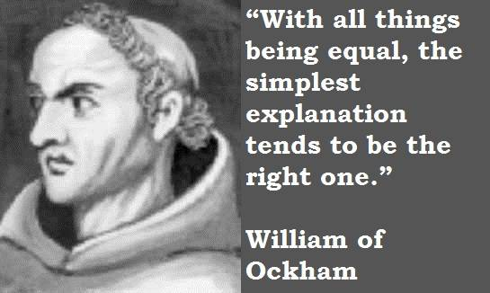

"奥卡姆剃刀"这个原理称为"如无必要，勿增实体"，即"简单有效原理"。

那么，面对纷繁芜杂的世界，什么才是我们剖析社会问题的有力工具呢？别急，我下面会讲。

大多数人了解的经济学，主要是新古典经济学，但新古典经济学只是经济学的一部分，而不是全部。传统的新古典经济学假设市场是完全竞争的，主要使用价格理论来解释个体的最优选择，包括消费者如何实现效用最大化，生产者如何实现利润最大化。诺贝尔经济学奖得主布坎南把新古典经济学称为"选择科学"（the  
sciences of choice）。

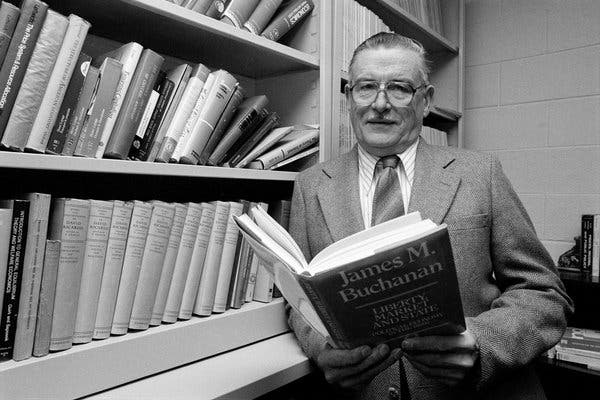

詹姆斯\*布坎南（James M. Buchanan, Jr.)

美国著名经济学家、1986 年诺贝尔经济学奖得主

与此同时，以博弈论、信息经济学、契约理论和新制度经济学为代表的新兴经济学分支，在 20 世纪 70 年代之后蓬勃发展。它们放弃了完全竞争市场的假设，被称为"契约科学"（the  
sciences of contract）。

布坎南断定，如果经济学把"选择科学"作为发展方向，就是误入歧途，正确道路应该是成为一门"契约科学"。契约科学的核心是契约理论（contract  
theory），也就是我们这个节目要介绍的主要内容，所以这个节目的标题就是《不完美世界的博弈：契约理论 35 讲》。

### 什么是契约？

这里有两个问题。第一，究竟什么是"契约"？

契约（contract），是当事人之间关于权利和义务的一种约定。世界上所有的人与人之间的关系，所有的制度和法律，本质上都是一种契约。

商品买卖是一种契约，买家付出金钱，卖家提供合格商品，彼此不能欺诈；雇佣是老板和员工之间的一种契约，按我们江西方言来说，"拿谁的碗，就服谁管"；债务是借贷双方之间的一种契约，债主有权在约定时期收回本金和利息；婚姻是夫妻双方之间的一种契约，彼此之间负有忠诚义务；村规民约是一种契约，大家共同遵守集体制定的游戏规则；国家和《宪法》可能是最高层次的契约，公民通过让渡一部分个人权利来换取全社会的总体利益最大化，这就是卢梭的"社会契约论"。

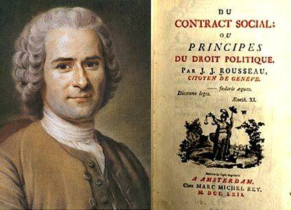

卢梭《社会契约论》（Du Contrat Social）

在流行美剧《权力的游戏》中，长城守夜人的身份也是一种契约。一旦成为守夜人，他将不能结婚生子，同时他过去的所有罪行都被赦免。

美剧《权力的游戏》

因此，在经济学中，契约是一个广义概念，包括口头约定、文化习俗等各种隐性契约或非正式契约，并不仅仅包括具体的法律合同。一句话，一切皆契约。

### 契约科学 VS 选择科学

第二个问题是，"契约科学"跟传统的"选择科学"有哪些区别呢？如果我学过一些基本的经济学原理，知道价格理论，为什么还需要学习契约理论呢？有三个理由。

首先，研究对象不同。"契约科学"主要关注制度层面的问题，比如说一个企业里，谁应该当老板，谁应该有股权？与此不同，作为一门"选择科学"，新古典经济学主要关注特定制度或者博弈规则下的行为和结果。

比如，假设企业老板已经和你签订劳动合同了，你应该怎么工作才能提高收入。你看，如果想了解制度层面的知识，或者要做管理工作，显然有必要学习契约科学或者契约理论。

其次，基本假设不同。传统的"选择科学"假设市场是完全竞争的、交易双方之间是信息对称的，而"契约科学"假设市场是不完全竞争的，交易双方之间存在信息不对称。

比如，在婚姻市场上，结婚之前双方都可以选择不同的配偶，看上去这是一个完全竞争的市场。因此，按照新古典经济学的逻辑，结婚就是一种最优选择。

但问题来了，怎么解释婚后有那么多人离婚呢？契约理论就可以解释这种悖论。男女双方一旦结婚，就从一个竞争性市场变成了双边垄断市场。而且，为了维持婚姻，双方都需要付出很多沉没成本，比如养家糊口，以及生儿育女。

双方之间根本就不是一种竞争性市场，谁也没法轻易"用脚投票"。另一方面，俗话说得好，"知人知面不知心"，有时候了解一个人的品德和能力需要很长时间，而这种信息不对称又往往是不幸福婚姻的主要原因。

那么，按照契约理论的逻辑，应该如何减少婚姻中的信息不对称呢？这个问题，我在后面的节目里会介绍的。

在真实世界中，面对牢骚或抱怨，那些只懂得经济学皮毛的人，往往喜欢居高临下地指责"这是一个竞争性市场，不喜欢你可以用脚投票啊"。我们应该同情地理解他们，是知识限制了他们的判断力。

最后，分析框架不同。传统的"选择科学"把决策者看作是原子式的个体，彼此之间没有互动。"契约科学"把所有人与人之间的关系看作是一种契约关系，强调决策者之间的博弈和互动。

比如，口罩就不仅仅是一种商品，它暗含了政府有责任为普通居民提供健康保障的一种隐性契约，还体现了穷人和富人之间的博弈。

结语

当一种商品被嵌入到不完美世界的博弈时，传统的新古典经济学显然无法胜任，我们必须掌握直面真实世界的契约理论。

那么，契约理论又是怎么具体分析问题的呢？别着急，且听下回分解。

好了，今天我们就讲到这里，下集再见。

公众号懒人找资源，懒人专属群分享

## 03 思维框架丨如何在信息不对称下做出最优决策？

懒人专属群的群友，你好，我是聂辉华。

在开始今天的节目之前，我想问大家一个问题：如果可以穿越时空，你最愿意回到哪个朝代？

我相信绝大多数人会选择北宋，尤其是读书人。为什么呢？第一，北宋是中国古代经济最繁荣的朝代之一。公元 1000 年时，北宋的 GDP（国内生产总值）超过全世界的五分之一，人均 GDP 处于世界最高档。第二，北宋时读书人地位最高，科举考试名额大幅增加，而且官员工资很高。宋词更是中国古代文学的巅峰。

### "契约可以兴国，契约也可以亡国"

很多人都知道北宋很繁荣，但很多人不知道的是，北宋的繁荣和灭亡跟两份契约有关。第一份契约是"澶渊之盟"，这本来是一份保障北宋和平的契约。但是，当时的皇帝太爱"作"了，又跟别人秘密地签了第二份契约----"海上之盟"。北宋皇帝本来是想利用信息不对称玩弄邻国，结果却让自己付出了亡国灭种的代价。

我们先来说说第一份契约澶渊之盟。公元 1005 年，北宋与隔壁的辽国签订了一份契约：宋辽为兄弟之国，宋每年为辽支付岁币，白银 10 万两、绢 20 万匹，两国在边境开展贸易。这就是著名的澶渊之盟。

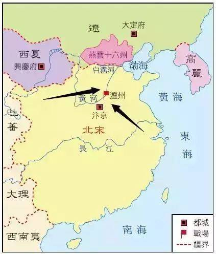

北宋和辽国在澶州签订"澶渊之盟"

澶州（今河南濮阳）在宋朝亦称澶渊郡

澶渊之盟结束了宋辽之间持续 25 年的战争，为北宋赢得了 100 多年的和平。可惜，国家之间既没有永远的盟友，也没有永远的敌人，只有永远的利益。

接下来说第二份契约海上之盟。100 多年后，辽国衰落了，东北的金国强盛了。于是，当时的宋徽宗赵佶决定背信弃义，联合金国攻打辽国。

公元 1120 年，宋金两国在海上达成一份秘密契约：金国从东北方攻打辽国，北宋从西南方攻打辽国；灭辽之后，北宋将岁币转给金国，金国将辽国占领的燕云十六州还给北宋。史称海上之盟。

随后，强盛的金国很快攻占了辽国的东北部，但是软弱的北宋两次出兵都被辽国打败，最后还是金国灭掉了辽国。于是，北宋被迫向金国支付了更多的岁币，却只换回了燕云六州以及燕京（等一下，之前说的可是燕云十六州啊）。

更要命的是，北宋在战争中暴露了自己软弱的实力，因此不到六年就被昔日的盟友金国灭掉，北宋皇族 3 千多人受尽凌辱。宋徽宗赵佶本是一个追求完美的文艺天才，在书法和绘画上造诣很深，但他的昏庸无能给北宋带来了最不完美的悲惨结局。

历史是最好的教科书。从经济学角度讲，北宋兴盛和灭亡的故事给我们提供了哪些启迪呢？

第一，契约非常重要。契约可以兴国，契约也可以亡国。

第二，信息不对称很重要。北宋如果知道辽国的军事实力比自己强，就不会违背之前的契约（澶渊之盟）；另一方面，北宋如果不是在对辽作战中暴露了自己软弱的实力，也不会那么快就被金国灭掉。

第三，世界充满了各种不确定性，当事人在签订契约时无法预见到未来所有可能的情况，因此任何契约都是"不完全契约"。辽国没有想到东北部的金国异军突起，导致了原有的契约澶渊之盟被破坏。

第四，维持契约的制度非常重要，否则每一方都有动力毁约。尤其是国家之间的契约，一旦背信弃义，往往导致国家之间兵戎相见，生灵涂炭。

### 契约理论的地位：经济学的"皇冠"

我们今天要讲的主题就是契约和信息不对称。

在前面的节目中，我们知道经济学是研究人类选择行为的，而人与人之间所有的关系都可以看作是一种契约关系。用来分析契约关系的理论框架，就是契约理论（contract  
theory）。

契约理论是 20 世纪 70 年代以来经济学的前沿领域。一般来说，衡量经济学成就的主要标志，就是诺贝尔经济学奖。

说到这里，聂老师必须带着沉重的心情科普一下，中国至今没有一个人获得诺贝尔经济学奖。在契约理论这个领域，迄今为止全世界一共有 13 位经济学家获得了诺贝尔经济学奖。他们包括大名鼎鼎的斯蒂格利茨（Stiglitz，2001 年获奖）、科斯（Coase，1991 年获奖）、威廉姆森（Williamson，2009 年获奖）和哈特（Hart，2016 年获奖）。除了科斯，另外三个人都多次来过中国。

如果说，经济学是社会科学的"皇后"，那么契约理论就是经济学的"皇冠"。在这个节目中，我们将多次提到诺贝尔经济学奖得主的理论贡献。诺奖得主的经济学理论，就好比是通往经济学最高殿堂的明灯。

因此，即便你完全没有学过经济学，你也能通过这个节目了解经济学的光辉历程，掌握一些经济学的关键理论，从一个经济学"小白"变成经济学"高级票友"。

### 什么是契约理论？

既然契约理论如此重要，那什么是契约理论呢？

契约理论把所有的人与人之间的关系看作是一种契约关系，然后通过设计各种机制和制度，来解决契约失灵问题。所谓的契约失灵，就是契约因为违约、再谈判、敲竹杠等原因无法实施了。

导致契约失灵的原因主要有两类。

第一类是内部因素，即由于当事人之间的信息不对称导致契约无法履行。比如前面提到的澶渊之盟，因为北宋利用了信息不对称，偷偷和金国签订了另一份契约，导致北宋和辽国的澶渊之盟作废了，而且引发了战争这种极端恶果。

第二类原因是外部因素，即战争、自然灾害、流行病导致的各种风险和不确定性。比如说，新冠肺炎导致富士康没法正常开工，从而无法按原计划给苹果公司供货，这就是由于不确定性导致的契约失灵。

在真实世界中，几乎所有的契约都存在信息不对称问题。不夸张地说，人类 80%的悲剧都源于信息不对称。因此，契约理论的主要任务是解决信息不对称问题，或者说帮助我们在信息不对称下做出最优决策。

### 契约关系中，信息不对称的三种类型

既然信息不对称这么重要，那么什么是信息不对称？它会带来哪些严重后果呢？

信息不对称是指一方拥有对方所不知道的信息。这里的"信息"范围很广，例如产品质量好坏、能力高低、人品好坏等隐蔽的类型，还包括当事人偷懒、做假账、腐败、合谋等隐蔽的行为。

在契约关系中，所有的信息不对称可以分为以下三种类型。

第一类叫事前的信息不对称，是指双方建立契约关系之前，一方不知道另一方的真实类型。例如，买水果之前你不知道有没有打农药，买股票之前你不知道这家公司的真实财务状况，恋爱结婚前你不了解对方的人品如何。

事前的信息不对称有时会导致"好的东西反而竞争不过坏的东西"，即"逆向选择"问题。例如，如果上市公司做假账粉饰自己的业绩，从而股价升高，就会导致更多的上市公司做假账，那么如实披露业绩的公司反而会股价下跌，甚至被迫退市。

第二类叫事后的信息不对称，是指双方建立契约关系之后，一方向另一方隐瞒自己的真实行为。例如，向你借钱的人可能去投资，也可能去赌博，你雇佣的员工上班时间会偷懒或者干私活，你的几个同事可能合谋侵占公司的财产。

事后的信息不对称是一种损人利己的行为，经济学上叫"道德风险"问题。

还有一种叫第三方信息不对称，就是双方当事人都知道的信息，但是没法向第三方证实。例如，你骑自行车时路过一个倒地的老太太，你知道没有撞倒她，老太太也知道你没有撞倒她，但是当时既没有摄像头，也没有人作证。如果老太太一口咬定就是你撞倒了她，你怎么办？又比如，你和别人签订了买卖合同，或者你到某个地方投资办厂，明明是对方违约了，但是你没有办法向作为第三方的法院证明，你怎么办？

第三方信息不对称会导致所谓的"敲竹杠"问题，北京话叫"碰瓷"，就是对方钻了你的空子，占了你的便宜，从而导致契约关系无法正常履行。

### 契约中的信息不对称问题如何解决？

上面的例子表明，信息不对称现象在现实中普遍存在，它会导致契约失灵。那么，如何解决契约中的信息不对称问题呢？

大多数时候，信息不对称是客观存在的，我们很难消除它。那怎么办？经济学家认为，我们可以设计一种最优机制，让有信息优势的一方主动或者被动地披露他所掌握的私人信息。问题是，当事人为什么愿意披露信息呢？因为，在最优机制设计下，披露信息对他是有好处的，对另一方也是有好处的。

这种将双方利益捆绑在一起的机制，就是所谓的"激励相容原理"。听到这里，你可能会觉得经济学家未免异想天开了，让我给你讲一个传说中的巴顿将军的故事吧。

第二次世界大战期间，美国空军降落伞的合格率为 99.9%。听上去合格率已经很高了，但这就意味着，平均每一千个跳伞的士兵中，会有一个因为降落伞不合格而丧命。千分之一的死亡率虽然很低，但是对于那个倒霉的人来说，那就是 100%。因此，军方要求厂家的合格率必须达到 100%，但厂家负责人说他们竭尽全力了，99.9%已经是极限，除非出现奇迹。

后来，巴顿将军改变了产品检查制度。每次厂家交货前，巴顿从降落伞中随机挑出几个，让厂家负责人亲自跳伞检测。这项制度，把厂家负责人的生命和产品质量牢牢地拴在了一起。结果，奇迹出现了，降落伞的合格率达到了百分之百！你看，一项巧妙的制度，因为搞对了激励，解决了信息不对称问题，就可以挽救很多宝贵的生命。

结语

现在让我总结一下今天的节目。

人与人之间的关系都是一种契约关系。契约不仅关乎个人成败，甚至关乎国家安危。但是任何一份契约都存在难以消除的信息不对称问题，包括事前的信息不对称、事后的信息不对称和第三方信息不对称。而这个节目的主要内容，就是帮助你建立一个契约理论的思维框架，在面对信息不对称时，做出最优决策。

最后是一道思考题：生活中，你见过或者签过哪些契约是不完美的？你觉得这份契约存在着什么类型的信息不对称问题？欢迎分享你的看法。

好了，今天我们就讲到这里，下集再见。

公众号懒人找资源，懒人专属群分享

## 番外丨杀妻案频现，婚姻还是值得信赖的契约吗？

Q：聂老师好，我是音频编辑香芋，我想问问您，这段时间您最关心的非经济学问题是什么？

A：刚刚过去的 7 月，新冠疫情形势明显好转，同时第二季度中国 GDP 的同比增长率为 3.2%，终于由负转正了。

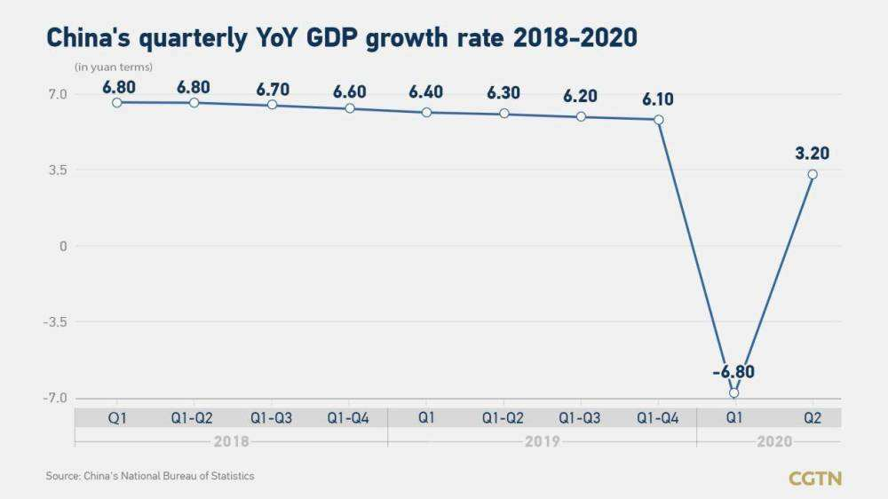

我国近年来 GDP 变化趋势图

但 7 月份也发生了一些瘆人的事情，让我们心情很难完全放松。短短二十天内，竟然发生了三起杀妻惨案，嫌疑人均为"丈夫"。

7 月 5 日凌晨，坐标为浙江省杭州市，丈夫许某将妻子来某残忍杀害，分尸抛弃；

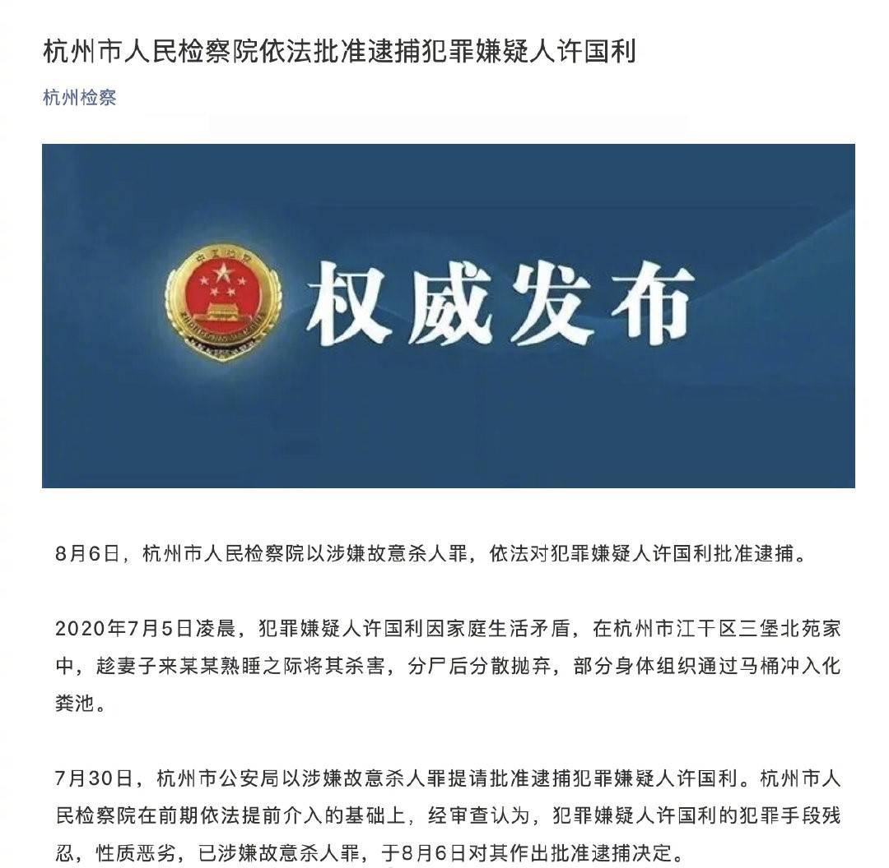

7 月 5 日，杭州杀妻案

7 月 19 日凌晨，坐标为四川省安岳县，丈夫屈某将妻子方某杀害，分尸抛弃；

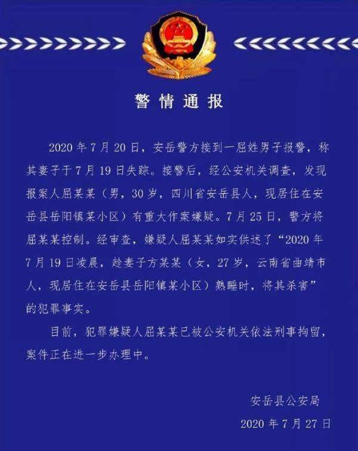

7 月 19 日，安岳杀妻案

7 月 24 日晚，坐标为海南省海口市，醉酒后的张某持刀将妻子王某杀死，之后自己醉卧在床。

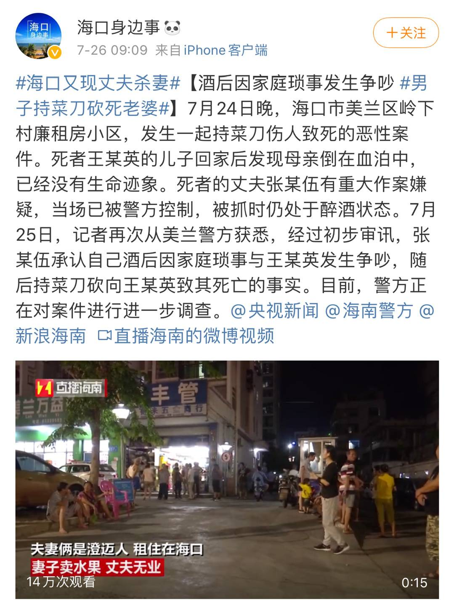

7 月 24 日，海口杀妻案

更早的时候，类似的中国家庭悲剧还多次发生在国外。例如，2018 年和 2019 年，泰国发生了两次中国男性杀妻骗财案件。

Q：从经济学的角度来看，婚姻的价值是什么？为什么社会进步到了今天，依然需要婚姻制度？

A：生老病死，人之常态，概莫能外。人生的每一步都充满风险，我们能做的，就是尽量规避风险。而婚姻作为男女之间关于权利和义务的一种契约，就是人类所有发明中最重要的避险制度。为什么这么说呢？

第一，婚姻能减少生活风险。现在的年轻人，很多离开父母独自奋斗，生活中总会遇到这样那样的困难，你需要一个人帮衬一下。比如一个单身女孩，晚上加班有人接，会增加很多安全感。又比如，在北京，一个人租一个 50 平方米的大通间，一个月租金就要 7500 元，这意味着你基本上给"包租婆"打工了。相反，两个人结婚住一起，生活成本降低一半，当然更加划算。

第二，婚姻能减少工作风险。经济下行，工作难找，很多人"毕业即失业，就业变待业"。假设每个人失业的概率是 30%，作为一个"单身狗"，你有三分之一的概率明天不必上班了。但是，如果你结婚了，两个人同时失业的概率只有 9%，失业风险一下子降低了 70%！我们总说"不要把鸡蛋都放在一个篮子里"，那么结婚就是给自己的收入找到另一个篮子。用行话来说，婚姻其实是一种实现失业风险对冲的保险机制。

第三，婚姻能减少健康风险。没病没灾，阎王不来。但是在城市奋斗，谁能没个感冒发烧、血压升高？要是不幸碰上新冠疫情，既没远亲，又无近邻，你唯一的依靠就是家庭。

第四，婚姻能减少传承风险。如果不结婚生娃，那么每个人都是"个人无限责任公司"，不仅所有事情都要自己扛，而且你的事业注定无法流传。你一辈子打拼的公司、产业、手艺，以及那些耗尽毕生精力都未完成的作品，都将在你百年之后烟消云散。相反，如果结婚生娃，那么你就变成了"股份有限责任公司"。不仅你的事业可以代代相传，而且你的责任和压力也小了很多，因为你不必追求"毕其功于一役"，而是"功成不必在我"。日本为什么有全世界最多的"百年老店"？因为事业后继有人。这个"人"不仅包括儿女，还包括女婿以及养子。

Q：聂老师，您刚刚说的那些风险好像找一个同居密友就可以搞定。

A：想得太美了。同居密友可以和你分担房租，但不可能和你分担收入。朋友之间的临时帮衬，只是一种非正式的自助机制，并没有任何制度保障其稳定运行。不信的话，向你的朋友借钱试试，保证你借一次，少一个。

相反，在所有社会关系中，婚姻关系是最受法律保障的关系之一。你知道新中国成立后第一部法律是什么吗？是《婚姻法》。因为婚姻是维系家庭的契约，而家庭是社会的细胞。我们可以暂时没有宪法、刑法或公司法，但如果没有婚姻法，社会就乱套了。

Q：可是从这些杀妻案来看，婚姻不仅没有避险，反而大大增加了风险。

A：当然，婚姻作为最重要的避险制度，只是在概率上减少你的风险成本，而不能保证你避开所有风险。对绝大多数人来说，婚姻只是减少风险的必要条件，而不是充分条件。然而，如果你"遇人不淑"，不仅不能减少风险，甚至会增加风险，轻则破产，重则丧命。

因为婚姻中存在普遍的信息不对称问题。结婚前，你不知道对方人品如何、能力高低，也不知道对方是否真心爱你；结婚之后，你不知道对方是否感情专一，是否隐瞒收入，甚至给你带来巨额债务。不夸张地说，婚姻中的不幸，无论是争吵、家暴还是离婚，90%以上源于信息不对称。

有人可能不同意，认为恋人或者夫妻长期在一起生活，对方的一举一动、一颦一笑，早已形成默契，可谓"心有灵犀一点通"了。此言差矣。人性是世界上最复杂的东西，西方谚语说：人的一半是天使，一半是魔鬼。每个人都像一个潘多拉魔盒，放出来的究竟是天使还是魔鬼，取决于制度环境和其他约束条件。而环境是会变的，所以人心也会变。

Q：婚姻制度存在了几千年，这么长的过程中人们有什么办法避开婚姻陷阱，减少风险吗？

A：博弈论可以证明，门当户对是最稳定的匹配，因为它能够在很大概率上减少男女双方之间的错误匹配。

一方面，在结婚前，门当户对的家庭能够实现"对等抵押"，从而筛掉一部分婚姻机会主义者。所谓对等抵押，就是男女双方家庭都必须为婚姻提供对等的彩礼或礼金，以及给新婚夫妇"支援"一定的买房首付和其他大宗支出。

抵押品有两个功能，一是显示当事人履行婚约的沉没成本。如果当事人反悔，抵押品就会被对方全部没收，至少部分没收。第二个功能，是将那些试图借助婚姻骗取对方钱财或社会地位的机会主义者排除在外，从而避免逆向选择问题。

如果一方对另一方是真爱，就应该付出足够的代价来证明，而抵押品就是一种有效的证明手段。不是说我不相信"裸婚"和真爱，如果你们双方青梅竹马，彼此知根知底，那当然不需要通过抵押品来证明自己。问题是，在信息不对称的前提下，你是相信人品，还是相信实力？

另一方面，在结婚后，门当户对的家庭能够实现"对等威慑"，给婚姻破坏者施加足够的成本。婚姻虽然是神圣的、受到法律保护的正式契约，但是婚姻契约又是一种典型的不完全契约。因为当事人的某些契约履行情况很难向第三方（比如法院）证实，从而获得外部支持。

比如说，一方对另一方实施了"冷暴力"，或者丈夫用妻子的钱在外面花天酒地，受害者如何向法院证明？这就会导致所谓的道德风险问题。当外力靠不住时，要维护婚姻中的合法权益，只有靠双方彼此的制衡。门当户对的家庭，双方背景相当、实力相当，甚至人脉和朋友圈都有很大的重合度。

在这种情况下，任何一方违背婚约，或者出现过错，都会在双方共同的朋友圈中留下"污点"。其次，一旦双方都采取行动维护自身权益，往往会导致对等伤害、两败俱伤的不利后果。说白了，对等实力才能造成对等威慑，而这种威慑的存在，并不需要实际发生，就足以形成阻遏作用，防止当事人的道德风险行为。

亲爱的听友，如果你觉得我讲得有道理，欢迎关注我在看理想的节目《不完美世界的博弈：契约经济学 35 讲》；如果你觉得我讲得没道理，欢迎你在评论区"吐槽"！再见。

公众号懒人找资源，懒人专属群分享

## 04 信号发射丨为什么上大学才能证明你自己？（兼谈滴滴与快的价格战始末）

懒人专属群的群友，你好，我是聂辉华。

大家看过孔雀开屏吗？当孔雀将尾巴高高竖起时，尾部的羽毛像缀满珍珠的扇子一样徐徐展开，一时间流光溢彩，令人叹为观止。

"孔雀开屏"现象

你知道孔雀为什么会开屏吗？生物学家有一个很 sexual（性感的）解释：开屏是雄性孔雀吸引异性的方式，羽屏越是艳丽，就证明生存能力越强，越容易受到雌性孔雀的青睐。

因为在自然界，羽屏漂亮的孔雀更容易成为天敌以及人类捕杀的对象，而它们在残酷的环境下还能生存下来，说明这些漂亮的雄性孔雀具备超常的生存能力，当然对雌性孔雀充满了魅力。

用经济学的话来说，孔雀开屏是雄性孔雀在信息不对称的条件下，对外界发射信号来证明自己的一种手段。

孔雀尚且需要发射信号证明自己，我们人类就更不用说了。身处一个信息不对称的不完美世界，我们几乎无时不刻不在向外界证明自己，不是吗？在今天的节目里，我就跟大家聊聊，人类社会的信号发射机制。

### 诺奖研究：我们为什么要读书？

话说 1973 年，一个刚刚从哈佛大学毕业的经济学博士斯彭斯（Spence），将自己的博士论文发表于国际顶级的《经济学季刊》（QJE）。这篇文章后来成为信号发射模型的经典之作，而斯彭斯也因此获得了 2001 年的诺贝尔经济学奖。

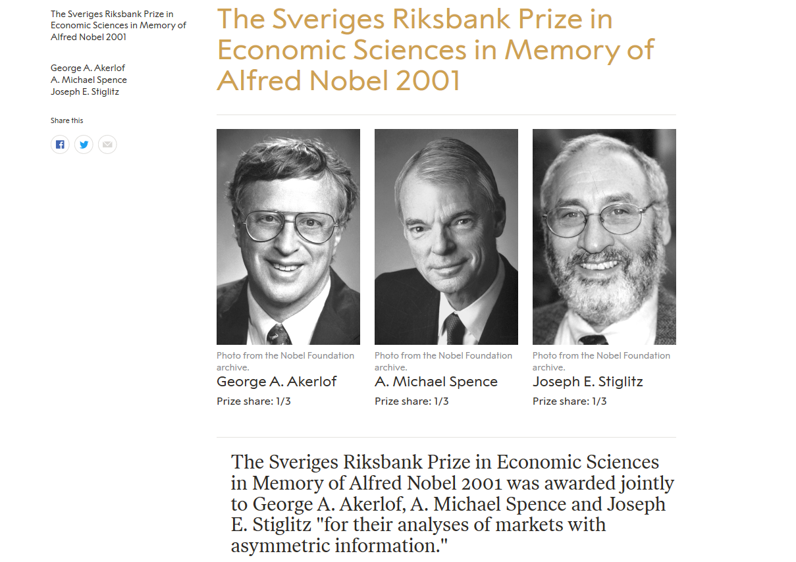

2001 年，斯彭斯博士同另外两位经济学家获得诺贝尔经济学奖

有趣的是，他当年在哈佛读博士时的导师谢林（Schelling）在他之后才获得了诺贝尔经济学奖。学生居然比老师更早获得诺贝尔奖，这是非常罕见的。

这篇获得诺贝尔经济学奖的文章做了一个什么研究呢？它问了一个看上去非常"无聊"的问题：我们为什么要读书呢？

让我们考虑这样一种情境：你和你周围的小伙伴们都想去本地一家著名的互联网公司上班，这家公司需要很多聪明人，并且根据聪明程度来支付薪酬。听上去是不是很酷？其实谷歌、微软和华为专门设立了这种"天才"岗位。

我们都知道"聪明只是成功的因素之一，而不是唯一因素"。你的小伙伴们有些很聪明，有些一般聪明，你们各自知道自己的聪明程度，但是公司在招聘之前并不知道。因此，你们和公司之间存在一种事前的信息不对称。

显然，每个人都希望进公司拿高薪，但如何证明自己比别人更聪明呢？经过摸索之后，大家发现了一个好办法，就是去读书。

### 读书成为一种证明自己的信号

一个人要想在学校考高分，必须有很好的记忆力、推理能力和计算能力，而且越是聪明的人学起来越轻松，越是不聪明的人学起来越吃力。读书需要投入大量的时间和金钱，但读书本身并不会提高你的智商，因为智商往往是天生的。

当读书成为一种证明自己的信号时，你会怎么选择呢？大家还记不记得我们在前面的节目里，提到了做出最优选择的两种规则。

首先，你需要权衡一下读书的成本和收益。成本-  
收益分析法就是经济学的独门秘籍。读书的好处是，你证明了自己是一个聪明人，毕业后就可以到企业拿更高的薪酬。读书的成本是，你耽误了几年时间，还要交纳学费，而这几年去上班本来可以挣到一笔钱，这笔钱就是你读书的机会成本。同时，你还要考虑到读书的努力成本跟你的聪明程度有关。

其次，你需要考虑其他小伙伴和公司的策略。当公司把读书作为挑选员工的手段时，如果有很多自认为聪明的小伙伴都去读书了，那么自认为聪明的你，就需要比他们多读几年书，这样才能进一步将自己与他们区别开来。

当聪明的小伙伴们都这么考虑时，这个博弈的结果是，读书的年份越来越长，比如从大学本科读到硕士，从硕士读到博士。还有人开玩笑说，"再从博士读到博士后，从博士后读到烈士为止"。说到这里，聂老师必须科普一下：博士后是一种临时工作，不是学位（重要的话说三遍），因为博士就已经是最高学位了。

在这个博弈过程中，直到有一部分最聪明的人终于成功地将自己与其他人区分出来，这场拼智商的游戏才会结束。

### "分离均衡"与"混同均衡"

在这场读书博弈中，斯彭斯教授推断，最终将形成两种均衡。

第一种均衡叫"分离均衡"（separating equilibrium），就是不同类型的参与人通过发射不同的信号分离出来。

很聪明的一群人先去读几年书，然后再进公司工作，并且在公司上班后直接获得较高薪水；而一般聪明的另一群人干脆不读书了，一开始就进公司工作，从而获得普通薪水。总之，不同聪明类型的人通过是否读书发射了不同的信号，可谓"大路朝天，各走一边"。

这里的关键问题是，大家都是通过读书来发射信号的时候，想要证明自己聪明的人，究竟要读几年书才够（总不能读个没完没了，对不对）？这个问题的答案，取决于群体的智商分布，以及相应的分离成本和收益。

如果一个群体中大部分人智商一般，那么少数很聪明的人只要上大学就足以将自己与普通人区分开来。如果一个群体中多数人都比较聪明，那么极少数超级聪明的人（比如 IQ 超过 140）为了和很聪明的人区别开来，他们必须读完博士；那些很聪明的人为了与一般聪明的人区别开来，他们必须读完硕士，以此类推，最后，不太聪明的人就没必要去读书了，因为他们没有必要浪费时间再去证明自己。

因此，读书作为一种信号，实际上是一种连续变量，可以将两种乃至多种人区分出来。看来，能力强的人需要投入资源去主动证明自己，而能力差的人只能等着被别人证明。

但分离均衡并非唯一的结果。如果有人发现，虽然花费了很高的代价去读书从而证明了自己的智商，但是多读书得到的高工资并不足以弥补读书的成本，此时他就会减少读书的时间，直到读书的收益刚好等于读书的成本。

很有意思的是，斯彭斯发现，存在这样一种临界点：当人们发现读书带来的好处和成本一样多时，也就是说，多读书并没有用，所有人都不再读书了，或者所有人都去读同样多的书（比如九年义务教育），然后宁愿被公司当作普通人支付普通薪水。这样的结果叫做"混同均衡"（polling  
equilibrium），即所有类型的求职者都发射同样的信号，混在一起，公司在事后仍然无法区分求职者的真实类型，只好按平均类型和平均工资来对待了。

### 为何"有时没有必要去证明自己"？

极端地说，如果这个社会人人都去读博士，那么读博士也就没有信号价值了，跟没读书是一样的。可见，发射信号并不总是有利可图的，有时发射信号不如没有信号。换句话说，有时没有必要去证明自己。

最有意思的是，后来的经济学家发现，如果一个群体里大多数人为了证明自己不同于极少数人，而投入大量资源去证明自己。

比如都去读博士甚至做博士后，虽然信号发射会成功，但是从社会最优的角度讲，这可能导致了过度证明，浪费了宝贵的社会资源。

好比两个公司打价格战，不管谁最后赢了，其实两个公司都输了，因为赢了的企业也赚不到利润，最后必然都倒闭了。这其实是一种"囚徒困境"（prisoner's  
dilemma）。因此，一个有效率的制度安排，应该避免每个人过度证明自己。孔子说得好，过犹不及啊！

### "过度证明"的案例："滴滴"与"快的"的价格战

那么，如何避免参与人过度证明从而导致资源浪费呢？我给大家讲一个案例。

五年前，中国有两家主要的网约车公司：一家叫"滴滴"，另一家叫"快的"。无论是消费者还是网约车司机，都希望选择实力强的一家。但是当时的市场形势并不明朗，对于大家来说，两家网约车公司的实力都是不对称信息。

于是，为了证明自己更有实力、资金更充足、市场规模更大，滴滴和快的发起了一轮又一轮的价格战，开始了长达几年的"烧钱"游戏。两家公司采取各种政策补贴消费者和司机。在最极端的情况下，有人甚至只花 1 分钱就可以打车，听上去是不是匪夷所思？现在可没有这样的好事了。但是这样的情况没有持续太久。

2015 年 2 月 14 号，在情人节那天，两家企业宣布合并为一家企业，名称就叫滴滴。为什么两家水火不容的企业突然就合并了呢？

滴滴与快的合并前，双方所占市场份额

2015 年，腾讯创始人马化腾在香港大学的演讲透露了背后的秘密。马化腾说，"我支持滴滴，马云支持快的。我们就像打仗，一天大概亏损 2000 万，再炒到 3000 万，我也跟，最高一天亏 4000 万。谁也不敢收手，一收手就前功尽弃了。后来我跟马云沟通，最后在很多资本方的撮合下合并了。"

对于企业来说，价格战就是一个发射信号的囚徒困境。如果不敢打价格战，企业就会被市场认为是弱者，从而面临被淘汰的命运。但是打价格战又是一种双输的结果，这就是过度发射信号。

### 日本企业避免过度发射信号的方式

其实，日本企业早在上个世纪 50 年代就认识到，企业之间打价格战是"自杀式竞争"。为了避免过度发射信号，他们采取了三种方式。

第一，鼓励企业之间交叉持股，形成"你中有我，我中有你"的利益格局。第二，鼓励企业之间在不同领域加强合作，避免同质化竞争。第三，鼓励企业抱团"走出去"，一起去占领海外市场。我觉得，日本的做法值得我们借鉴。

结语

以上这些分析有没有让你觉得脑洞大开呢？让我们回顾一下今天的主要内容。

在信息不对称下，参与人可以通过发射信号，向别人证明自己的真实类型。除了读书，大家去考取各种证书，企业参与社会慈善活动，以及企业家担任一些社会荣誉职务，比如人大代表、政协委员，都属于发射信号。

总之，只要你能做别人做不到的事情，你和别人就区分开来了，这就是分离均衡。

但是，发射信号是需要成本的，如果发射信号的成本和区分之后的收益是差不多的，那么所有人都会选择同一种信号或者干脆都不发射信号，这就是混同均衡。在极端的情况下，人们可能会过度发射信号，这会导致资源浪费。

最后是一道思考题：请用信号发射理论分析职场中的拍马屁现象，并分析在什么情况下会形成分离均衡？什么情况下会形成混同均衡？

好了，今天我们就讲到这里，下集再见。

公众号懒人找资源，懒人专属群分享

## 05 动态道德风险丨 996 和超额完成任务是正确的职场攻略吗？

懒人专属群的群友，你好，我是聂辉华。

刚参加工作时，长辈往往这样告诫我们：孩子，一定要努力，好好表现，给领导留下个好印象。

虽然长辈的出发点是好的，但是今天的节目会告诉你，这样的建议未必是合适的，甚至可能适得其反！

哈佛大学教授威茨曼（Martin L.Weitzman）把这种现象称为"棘轮效应"。这是什么意思？为什么努力反而不好呢？今天我们就来谈谈这个话题。

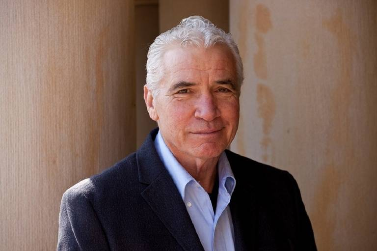

Martin L.Weitzman（1942-2019）哈佛大学经济学教授

### 努力的员工会累死？

我来举个例子。在多数情况下，老板看不到每一个员工的工作过程，因此老板和员工之间存在一种信息不对称。在信息不对称的前提下，员工可能会偷懒、磨洋工或者推卸责任，这就是典型的道德风险问题。

为了防止员工偷懒，老板决定采取一种"层层加码"的方式给员工安排任务，就是员工每一期的任务都比上一期要多。

比方说，小王在医药公司做销售，老板给他确定的第一个月销售任务是 10 万元，小王不想让老板失望，于是，努力完成了 12 万元的销售额，也就是说超额完成 20%。

老板一看，小伙子，你挺能干啊，我得给你加加担子。于是，小王第二个月的销售任务就从原先的 10 万元变成了 11 万元。

如果小王继续加油，在第二个月仍然超额完成 20%，那么第三个月的销售任务就变成了 12.1 万元。

你可别以为每次只是增加一点点，架不住不断增加啊。聂老师用数学公式帮你简单地算了一下：按照这个速度增加下去，一年后小王的实际销售任务将超过 34 万元，三年后实际销售任务将超过 337 万元，比第一个月的目标任务多 33 倍！

总之，小王越是能干，老板布置的任务就越多，小王就越需要额外努力，这就是一种棘轮效应。

如果我们把老板和员工之间的多期关系看作是一种重复博弈，威茨曼教授证明：目标任务对上一期的产销量依赖性越大，或者博弈重复的期数越多，那么棘轮效应就越明显。

也就是说，如果员工每个月都超额完成任务，哪怕超额完成一点点，只要时间足够长，他实际上要完成的任务就会变成无穷大。我估计小王从来没想到，自己努力工作，居然给自己挖了一个天大的坑！

### 什么是棘轮效应？

为什么会出现这种意料之外的结果呢？因为，传统观点只是从静态或者短期的角度看问题，但是从动态或者长期的角度讲，如果你一开始就用尽全力，让领导认为你能力很强，领导就会不断给你增加任务，直到有一天你不堪重负。到那时，领导又会认为你骄傲自满、能力不行、难堪重用。

"棘轮效应"说明，一旦引入了动态视角，很多静态的结论都不成立了。传统经济学解释不了这些现象，但契约理论为你提供了看待世界的另一种方式。聂老师提醒你，学经济学时，一定要注意前提条件，否则学得越多，可能错得越多。

棘轮是一种单向旋转的齿轮，只能往上，不能往下，这样就可以把东西固定住。哈佛大学教授威茨曼借用这个比喻，来分析动态条件下的道德风险问题，促使我们从长期的角度考虑激励机制。

因为棘轮效应以及能源经济学方面的突出贡献，威茨曼一直被认为是诺贝尔经济学奖的有力竞争者。遗憾的是，威茨曼在 2019 年 8 月突然去世了，享年 77 岁。《纽约时报》说，因为一直等不到诺贝尔经济学奖，威茨曼郁闷得上吊自杀了。

### 棘轮效应：轻则负债累累，重则祸国殃民？

其实，棘轮效应是一种广泛存在的刚性现象。企业生产有棘轮效应，个人消费也有棘轮效应。

一个人的消费水平一旦形成了习惯，就算收入水平降下来了，消费水平也未必能降下来。正如古代文人司马光说的："由俭入奢易，由奢入俭难。"不要小看消费的棘轮效应，轻则负债累累，重则祸国殃民。

我给大家讲一个《韩非子》里面的故事。商朝是中国历史上第一个有文字记载的王朝，但很多人可能不相信商朝的灭亡始于一双象牙筷子。

有一天，商纣王命人做了一双漂亮的象牙筷子，然后兴高采烈地用象牙筷子吃饭。他的叔父箕子见了，从此忧心忡忡。有个大臣问他为什么不高兴，箕子说："纣王有了象牙做的筷子，就不会再用土制的瓦罐盛汤装饭，肯定要用犀牛角做的杯子和美玉做的饭碗；有了象牙筷、犀牛角杯和美玉碗，就不会再吃粗茶淡饭了，肯定要吃山珍海味了；吃的是山珍海味，穿的就要绫罗绸缎，住的就要高楼大厦，就要大兴土木了。这样下去，天下的财富都要耗尽了。"

商纣王的骄奢淫逸引发了武王伐纣，5 年之后商朝就灭亡了，箕子的预言果真应验了。你看，棘轮效应可不是一件小事啊。

### 新员工，如何"利用"棘轮效应？

回到我们前面的职场话题。现在你已经知道棘轮效应了，问题是：作为一名新员工，你能做什么呢？

聂老师给你两点忠告。第一，开始工作时不要拼劲全力。因为起点越低，进步的空间越大；起点越高，进步的空间越小。当然了，你也不能把起点设得太低，低到让老板一眼看出你不行。

第二，进步的速度不要太快。威茨曼证明，随着工龄的增加，员工前期的业绩绝对值会变得越来越大，所以后期进步的压力也会越来越大。于是，工龄越长的员工，越是磨洋工，越是会偷懒。

因此，棘轮效应给职场菜鸟的启示是：一些短期来看值得鼓励的行为（例如"996"加班、超额完成任务），从长期来看反而是不利的。

### 四种减轻棘轮效应的制度设计

棘轮效应导致员工不敢全力以赴地努力，这显然对老板不利。那么作为老板，怎么才能既让员工更加努力，又让员工没有"层层加码"的担忧呢？

经济学家总结了四种办法。如果你是老板，总有一款适合你。

第一种减轻棘轮效应的办法是，实行相对绩效评估。棘轮效应产生的基础，是老板将员工的考核目标建立在过去的绩效上。因此，如果员工的考核目标不再以过去的业绩为基础，棘轮效应自然就消失了。

英国牛津大学的两位经济学家梅耶（Margaret Meyer）和威克斯（John  
Vickers）提出，如果一个单位的业绩能够找到外部同行的业绩作为参照组，那么老板可以对员工实行"相对绩效考核"。这里的"相对"，是跟同行业类似单位进行比较。

例如，一家财经类出版社的策划编辑，其业务考核目标可以对标同行业优秀出版社的策划编辑。如果这个编辑的业务量达到行业均值，就算合格；超出行业均值较多，就算优秀。然后根据合格和优秀分别确定不同金额的年终奖励。

由于员工的考核目标与外部同行关联，与自己过去的业绩没有直接关系，因此员工不必担心自己过去做得越好，老板定的考核目标就会越高。这样一来，从"自己跟自己比"就变成了"自己跟同行比"，棘轮效应就被竞争效应取代了。

第二种减轻棘轮效应的办法是，老板在员工入职时就制定一份职业成长路径图。

比如，一个图书策划编辑从入职第一年到第五年每年要策划多少个选题，出多少本书。达到每个阶段的考核目标，就自动升职，比如从初级编辑升为中级编辑，然后升为高级编辑，并且享受相应的工资待遇。

有了这样一套事前说好的动态激励机制，员工越是努力，就越是可能提前完成考核任务，然后提前升职。

因此，这对员工和老板来说是一种"双赢"的结果。但前提是，老板不能看到员工业绩提升很快，然后中途单方面修改考核目标，这就违背了事前的契约，又会导致棘轮效应。

第三种减轻棘轮效应的办法，是内部轮岗。减少棘轮效应的关键，就是老板承诺不利用员工的业绩信息。对于大企业来说，轮岗可以让员工避免"自己跟自己比"。

比如，员工小李在销售部门干了一年，每个季度都超额完成任务，然后调到广告部去干一年，之后再调到投资部去轮岗。轮岗之后，新的岗位和原来的岗位性质不同，要求也不同，因此两者没有可比性。这样的话，老板就无法利用员工原来的成绩，通过层层加码对员工榨干用尽。

因此，轮岗不仅可以让员工对不同的工作保持一定的新鲜感，还可以避免老板过度压榨员工。

第四种减轻棘轮效应的办法，是日本企业的年功序列制。所谓年功序列制，就是员工的工资主要取决于在本企业工作的年限，而不是绩效，这有点像论资排辈。

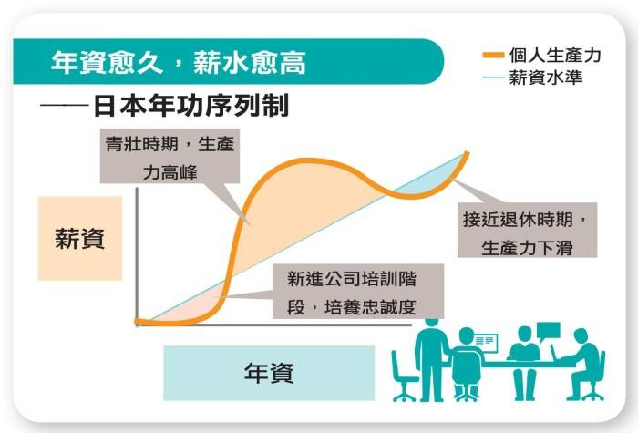

日本企业的年功序列制管理

几年前，我在日本访问时了解到，一个 30 岁毕业的员工，每个月工资大概是 30 万日元（相当于人民币 2 万元），40 岁的员工工资大概是 40 万日元。因为工资主要与工龄挂钩，与自己前期的业绩不是高度相关，这样员工就不必担心被"层层加码"了。

但是，马上有人会问，那这样员工会不会偷懒呢？未必。虽然工资伴随工龄增长，但是一旦员工离职或者被解雇，再就业时工资就可能回到起点，所以偷懒的机会成本很高。

在年功序列制下，员工对企业的忠诚度很高，这正是日本企业的传统优势之一。

结语

现在，我总结一下今天的主要内容。

在动态条件下，老板会利用员工前期的业绩信息，在考核时层层加码，这会导致棘轮效应。

对于职场新人来说，请记住聂老师的一句告诫："吃饭七分饱，干活八分力"。套用一句古话来说：路遥知马力，日久见人心；若为长远顾，何必一时拼？

为了减轻棘轮效应，老板可以引入相对绩效评估以及帮助员工制定长期规划，大企业还可以考虑实行内部轮岗，以及将工资与工龄适当挂钩。

最后是一道思考题：请结合自己的经验，说一说你们单位在业绩考核时，是否存在棘轮效应？如何消除棘轮效应？

好了，今天我们就讲到这里，下集再见。

公众号懒人找资源，懒人专属群分享

## 06 考核难题丨职场“马屁精”存在的合理性与解决办法

懒人专属群的群友，你好，我是聂辉华。

看过电视剧《神探狄仁杰》的同学，都知道一个著名的桥段：每当狄仁杰遇到案件的关键环节，总是问身边的李元芳："元芳，你怎么看？"而李元芳的标准回答是："大人，此事必有蹊跷！"不得不说，李元芳的回答非常得体，又令人极度舒适。

如果李元芳回答："大人，我明白了！"这就显得作为领导的狄仁杰不够高明，那么下次就不带李元芳玩了；如果李元芳回答："大人，属下愚钝，请大人指教。"又显得自己水平太差，在外人面前给领导丢脸。

在电视剧中，李元芳的标准答案既表明自己有所领悟，又不得要领，此时正需要高明的领导指点迷津。看似平淡的一句话，显示出此人拍马屁的功夫可谓炉火纯青。

一说到拍马屁，很多人都本能地比较反感。但是大家是否想过：为什么职场上总有那么多马屁精？为什么领导偏偏都喜欢马屁精？今天，我就从契约理论的角度来给大家解答这两个问题。听完今天的节目，说不定，你没那么讨厌马屁精了。

### 绩效考核员工：客观还是主观？

在任何一个组织中，老板和员工、上级和下级之间都存在一定程度的信息不对称。

老板不可能 24 小时监督员工的行为，员工可能会偷懒、开小差或者浑水摸鱼，这就是经济学上所谓的道德风险问题。

为了解决道德风险问题，老板会制定 KPI（关键绩效指标），根据业绩考核结果来发钱。员工的业绩越好，奖金越高，这样员工就不会偷懒了。

那怎么考核业绩的好坏呢？大多数时候，考核指标是产出、销售额、利润这些客观指标，我们把这种考核体系称为客观绩效考核。

但是，经济学家很早就发现，客观绩效考核并非完美。

1993 年，芝加哥大学经济学教授普伦德加斯特（Canice  
Prendergast）在世界顶级的《美国经济学评论》（AER）上发表了一篇论文，指出客观绩效考核存在三个问题。

Canice Prendergast 芝加哥大学经济学教授

有些业绩难以量化。例如，一个行政秘书的主要工作是端茶倒水、接电话和订机票，你怎么量化呢？事实上，所有的行政部门、后台部门，他们的工作都很重要，但是都无法直接跟产出直接挂钩，也就无法使用客观绩效考核办法。

有些业绩指标存在干扰因素。现实中，一项业绩的取得往往是多个因素共同起作用的结果，不能简单地把业绩都归于某个部门。

比如一个房地产公司的销售团队，一个月卖出了 100 套房子，看上去业绩很好。但是，这个业绩中，有多少来自广告团队的贡献？有多少来自财务部门的配合？有多少来自国家调控的作用？恐怕说不清楚。

在这种情况下，奖励销售团队，要不要奖励广告团队呢？如果广告团队要奖励，那么财务呢？你看，销售业绩增长本来是一件好事，但是如果奖励不当，就会引起内讧，好事反而变成坏事了。

有些业绩指标存在滞后性。员工每个月的工资取决于考核结果，而有些业绩短期内难以表现出来，但是员工每个月的工资却不能不发，这就出现了矛盾。

以药品为例。聂老师首先给你科普一下，全球药品生产企业研发一种新药，平均需要 7 年。但是，制药公司不能等七年之后再来给员工发工资吧？所以，完全依赖客观绩效考核显然不太现实。

### 为什么职场中会有"马屁精"？

既然客观绩效考核有时不可行，而没有考核又绝对不可行。那怎么办呢？此时就必须使用一些主观绩效考核。

所谓主观绩效考核，就是由考核者对被考核对象进行主观评价，包括打分、排序或者分等。

最常见的主观绩效考核通常包括两个部分：一个部分是上司对下属的业绩打分，通常权重为 60%；另一个部分是同事之间相互打分，或者业务部门给行政部门打分，通常权重为 40%。

当上司对下属的评价基本上决定了下属的绩效和奖金时，下属会怎么做呢？下属肯定会"揣摩上意"，说领导想说的话，做领导让做的事。总之，"领导的标准就是自己的标准，领导的看法就是自己的看法"。

由此可见，正因为客观绩效考核存在不足，才需要主观绩效考核，而正因为有主观绩效考核，才会导致马屁精的出现。

理解了业绩考核的逻辑，我们就会理解，职场上马屁精的出现是必然的，都是制度惹的祸！如果我们真的讨厌马屁精，光是道德批判是不够的，关键是从制度上堵住漏洞。

接下来的问题是，哪些岗位上的人更容易成为马屁精呢？

前面的分析说明，在绩效考核中，主观评价的权重越高，上司的影响力就越大，那么下属就越是可能对上司拍马屁。

相对而言，在一个组织中，业务部门的业绩是最容易考核的，看销售额或利润就行，而非业务部门是最不容易考核的。

因此，一个合理的推测是，业务部门的人更有可能靠业绩说话，而非业务部门的人更有可能拍马屁。当然，我这都是相对而言。

### "马屁精"真的一无是处吗？

那么，马屁精真的一无是处吗？

芝加哥大学教授普伦德加斯特认为，马屁精还是有用的，关键是看领导怎么用。这就好比一把菜刀，它本身是"中性"的，可以用来切菜，也可以用来砍人。高明的领导，善于用制度来驾驭人性，而不是纵容人性的弱点。

既然主观绩效考核容易产生错误，让很多人不踏实干活，把心思全用来向领导献媚，那是不是就应该通过制度的完善，为所有员工都尽量设定客观的绩效考核标准呢？

也不一定，除了前面提到的客观考核的三个问题，真实世界中的信息不对称也会导致客观标准失效。因为除了个体的努力，工作结果还会受到很多因素的影响，员工的业绩与努力水平很多情况下并不能一一对应。

比如，在淡季时餐馆的生意不好，服务员可以偷懒，并把顾客的减少归咎于外部因素；在节假日旺季时，生意很好，服务员还是可以偷懒，因为反正客流量很大，无论是否努力业绩都不会差。

这时候，如果引入主观考核，比如领班或店长根据自己的观察给服务员的态度和表现打分，就能避免服务员偷懒或者甩锅。哪怕服务员为了讨好领导而拼命表现甚至拍马屁，可能评价结果依然比只看客观指标更符合实际情况。

其实，无论是主观绩效考核，还是客观绩效考核，都各有利弊。在主观绩效考核下，为了获得领导的好感，员工必须努力去收集信息或者做出业绩，来证明领导的判断是对的、领导是英明的。

因此，在信息不对称的条件下，主观绩效考核能够激发员工付出努力，减少偷懒。如果领导的判断是对的，那么讨好领导对提高团队的整体利益是有帮助的，这也是马屁精在组织中的正面作用。

让我们小结一下：主观绩效考核有助于激励员工努力，但可能听不到真话；客观绩效考核有助于员工说真话，但可能会偷懒。再一次，经济学变成了一道选择题。

### 如何对待"马屁精"？

如果你是一个组织的领导或者老板，你应该怎么办呢？记住前面讲过的，做对选择题的规则 1：两害相权取其轻，两利相权取其重。

对于组织来说，如果引导员工努力比引导员工说真话更重要，那么就应该多用主观绩效考核，此时要允许马屁精发挥一些正面作用；反之，如果获取真实信息比引导员工努力更重要，就应该多用客观绩效考核，马屁精自然就少了。

由于组织的需要往往与组织所处的发展阶段有关，因此高明的领导应该根据组织的发展阶段，来确定对马屁精的使用程度。

几年前，有一本非常流行的官场小说，叫《二号首长》。

江南省委书记赵德良从中央空降到江南省，孤身一人，因此初期以隐忍为主，对很多事情引而不发，属于磨合阶段。

在这一阶段，赵德良最需要的是掌握各种信息，而不是急于做事。因此，他前两年几乎没有提拔干部。不动干部，自然就没人跑官，马屁精也就没有了市场。

两年后，赵德良通过掌握的情报，抓住了对手的软肋，巩固了自己的权力。此时，赵德良在江南省的事业进入了发力阶段，对真实情况比较了解，更需要下属帮他干出政绩。

于是，他默许下属对他大唱赞歌，也容忍了各种拍马屁行为，还将他的一些理念总结成"三正四以七个江南"。

所谓"三正四以"，是指正派、正心、正道，俭以养德、廉以立身、勤以创业、信以修心，都是主观价值判断。这些理念被细化为多项主观绩效指标，对地方官员进行考核。

此时的省委书记赵德良，似乎从一个兼听则明的人变成了一个偏听偏信的人，连书中的主人公、他的秘书唐小舟都觉得难以理解。说句玩笑话，如果他的秘书听了聂老师的节目，那么赵德良的行为一点都不难理解。

结语

让我归纳一下今天的主要内容。在信息不对称条件下，主观绩效考核有助于激励员工努力，但会产生马屁精，可能听不到真话；客观绩效考核有助于员工说真话，但可能会导致偷懒。

因此，领导必须根据组织发展的不同阶段，制定合适的考核制度，限制马屁精的负面作用。

最后是一道思考题：有人认为，再坏的规则胜过没有规则。因此，虽然客观绩效考核有很多漏洞，但主观绩效考核完全没有规则，因此客观绩效考核总是比主观绩效考核更好。你同意这种观点吗？

好了，今天我们就讲到这里，下集再见。

公众号懒人找资源，懒人专属群分享

## 07 薪酬契约丨为什么 CEO 可以拿超高薪酬？

懒人专属群的群友，你好，我是聂辉华。

大家知道全世界薪酬最高的人是谁吗？是特斯拉公司 CEO（首席执行官）、"钢铁侠"马斯克（Elon Musk）。

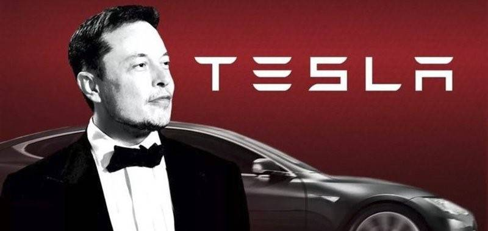

伊隆\*马斯克（Elon Musk）与特斯拉（Tesla）

2018 年，他的薪酬是 22.84 亿美元，相当于 61 亿元人民币。61 亿元是什么概念呢？聂老师给你科普一下。它超过了中部地区一个县全年的 GDP。

根据国家统计局 2018 年的数据，中国城镇职工年平均工资为 8.2 万元。这意味着马斯克一个人的工资相当于 7.4 万个中国人的工资！大家在"羡慕嫉妒恨"的同时，一定很想知道：马斯克凭什么赚那么多？

今天，我们就从契约理论的角度来分析一下 CEO 的报酬是怎么决定的。将来你去创业当老板时，一定要知道怎么给自己和高管定工资啊。

### 公司高层的利益为何要被捆绑？

现代大型公司的一个基本特点是，所有权和控制权分离。股东拥有企业的所有权，他们的目标是最大化股东利益；管理层拥有公司的实际控制权，他们未必追求股东利益最大化，可能会追求各种私人利益，包括在职消费、优厚待遇以及关联交易。

比如说，公司的 CEO 用公司的钱，给自己买昂贵的公务飞机，每天住五星级酒店，或者购买年费高达几十万元的高尔夫俱乐部会员资格。

这些追求私人利益的行为，都会在一定程度上损害股东的利益。毕竟，老板请你来是要赚钱的，不是光花钱的。

在 1976 年的一篇经典论文中，哈佛大学教授詹森（Michael Jensen）和合作者麦克林（William  
Meckling），将所有权和控制权分离造成的股东利益损失称为"代理成本"。实际上，是老板和管理层之间因为信息不对称导致的一种效率损失。

公司的大股东通常不在企业上班，只是开董事会时了解企业的重大决策，因此他们实际上无法观察到管理层的日常行为。

在这种事后的信息不对称下，管理层就会出现偷懒、追求享乐、贪污或挪用公司财产的行为，这些行为在经济学上被称为道德风险问题。

为了减少这些道德风险问题，老板必须为管理层提供一份激励性契约，就是让管理层的薪酬与公司价值高度相关。契约理论将这种机制称为"激励相容"，说白了就是让老板和管理层实现利益捆绑。

怎么捆绑呢？美国"百年老店"通用电气公司（GE）前 CEO 杰克\*韦尔奇说过，股票就是通用电气唯一的钞票。因此，CEO 的主要薪酬（包括年薪和奖金），通常与公司的股票价值成正比。

在这种薪酬与股价捆绑的激励契约下，CEO 越努力工作，公司股价就越高，股东权益就越大，CEO 的报酬也就越高。这正是契约理论所要的正确结果。

作为全球风头最劲的新能源汽车企业，特斯拉目前的市值是 460 亿美元。如果董事会规定，CEO 的年薪是市值的 10%，那么马斯克一年就可以拿到 46 亿美元。

马斯克 2018 年的薪酬 22 亿美元，虽然很高，但还不到特斯拉市值的 5%。因此，虽然马斯克拿了天价薪酬，看上去也蛮合理，作为普通的吃瓜群众，我们似乎无话可说。

### CEO 的薪酬来源：能力？运气？

既然"群众的眼睛是雪亮的"，那么作为普通的"吃瓜群众"，我们还是要多一个"心眼"。CEO 的薪酬真的是 100%靠能力赚取的？

在这里，聂老师告诉大家一种"慧眼识理论"的技巧：如果一个理论是正确的，那么就不应该存在反例。

比如说，如果有人认为所有的天鹅都是白的，那么你只要找到一只黑天鹅，他的观点就被推翻了。科学上把这种方法称为"证伪"，就是证明对方是错的。因此，验证一个理论其实很简单，就是不断地寻找"黑天鹅"。

如果契约理论是对的，即 CEO 的薪酬完全反映了个人的努力水平（或者能力），那么薪酬就应该与其它因素无关。

在其它因素中，我们最容易想到的是"运气"，因为中国人相信"时势造英雄"。

对于 CEO 来说，"运气"是指那些超出 CEO 控制并导致企业绩效变化的因素，比如宏观经济波动、比如战争。CEO 的能力会影响业绩从而影响薪酬，这是毫无疑问的，没人怀疑这点。

因此，CEO 的天价薪酬究竟完全取决于努力还是与运气有关，只需要检验一下运气是否影响薪酬就知道了。

有意思的是，来自"诺贝尔经济学奖的摇篮"、世界顶级名校芝加哥大学的两位教授，伯川德（Marianne Bertrand）和穆莱纳桑（Sendhil  
Mullainathan）也做了一回"吃瓜群众"。

他们专门研究了 CEO 的报酬是不是跟运气有关，并且在 2001 年在世界经济学顶级期刊《经济学季刊》（QJE）上发表了这篇论文。下面，我就介绍一下这篇论文的主要内容，让你明白经济学家是如何像一个侦探一样去发掘真相。

### "运气"可以被度量？

要研究运气对 CEO 薪酬的影响，首先碰到的第一个难题是，如何度量"运气"这种看不见、摸不着的东西呢？

两位芝加哥大学的教授用了三种方法，第一种是石油价格。全世界的石油供应主要来自中东和俄罗斯等几个国家，而且在过去几十年里价格波动非常剧烈，因此石油价格不是某个公司的 CEO 所能控制的，而是完全外生的"运气"。

受到石油价格影响的主要是两类企业，第一类是从事石油勘探、开采和提炼的原油生产企业和技术装备提供企业，第二类是生产石油替代品的企业，主要是新能源企业，比如像特斯拉这样的企业。

找到了运气的度量指标，接下来就要看石油价格是否会影响与石油相关行业的 CEO 薪酬。

两位芝加哥大学教授收集了 1977-1994 年（一共 18 年）的石油相关行业数据，采取计量经济学方法发现了一个有意思的结论：石油价格上涨会显著地影响 CEO 的薪酬。

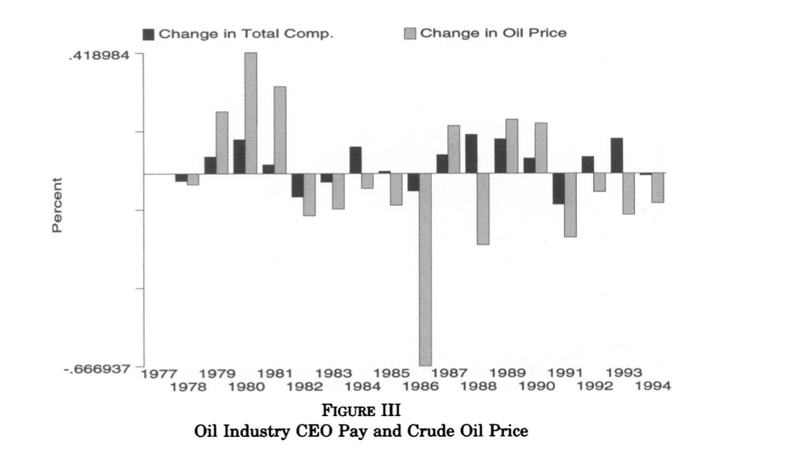

石油行业 CEO 薪酬与原油价格对比统计图

该图是由 Marianne Bertrand 教授与 Sendhil Mullainathan 教授，根据 51 家最大的石油公司在 1977-1994 年间平均收益率得来

大致来说，石油价格每上涨 1%，相关企业的 CEO 薪酬会上涨 2.15%。这说明运气的确会影响 CEO 的薪酬。当然，相关企业也没吃亏，石油价格每上涨 1%，相关企业的股东权益会增加 0.8%。

用石油价格来度量运气的方法非常巧妙，而且很直观，但是与石油相关的上下游企业毕竟较少。

为了找到更广泛的证据，两位芝加哥教授又采取了度量运气的第二个指标汇率波动，以及第三个指标行业平均绩效。

这两个指标不是企业可以操纵的，而且与所有企业的外部环境都相关。不管是用哪个指标度量运气，他们都发现了一个非常稳健的结论：运气越好，CEO 的薪酬越高。

此时，聪明的你可能会问：好的运气给 CEO 带来了更高的报酬，那么坏的运气是不是降低了 CEO 的报酬呢？

有意思的是，另外两位学者的论文发现，好的运气和坏的运气对 CEO 薪酬的影响是不对称的。运气好时，CEO 薪酬增加的幅度比较大，而运气坏时薪酬减少的幅度比较小，两者差别居然高达 25%--45%。

### CEO 的薪酬由谁来定？

如果说 CEO 的天价薪酬不仅取决于努力，而且与运气有关，这一点我们可以接受。但令我们难以接受的是，原来 CEO 的天价薪酬主要与好运气有关，而坏运气带来的负面影响却很小。这不仅不公平，恐怕也没有效率。

一方面，根据契约理论，管理层的薪酬应该主要与努力有关。如果与运气有关，而运气又无法掌控，那么这必然导致 CEO 的投机行为。毕竟，如果运气那么重要，还要努力干什么呢？

另一方面，运气坏时公司价值会受损，但是 CEO 薪酬降低的幅度却相对较小，这就难以对 CEO 起到应有的惩罚作用。那么关键问题是，追求利润最大化的公司股东，他们为什么不通过完善激励契约来减少投机行为呢？

前面提到的两位芝加哥大学教授提出了一个解释。他们认为，为 CEO 设计的薪酬契约，并非完全由股东决定，而是由董事会决定。

### CEO 依据"揩油理论"定自己的薪酬？

CEO 作为董事会的主要成员，在决定薪酬机制时拥有主导权力。换句话说，CEO 其实是自己给自己制定薪酬方案，然后通过董事会的批准变成现实。他们这个观点被称为"揩油理论"（skimming  
model），就是 CEO 利用职权占了公司的便宜。

"揩油理论"听上去很有道理，但如何验证呢？这是我们今天讨论的最后一个问题。

芝加哥大学教授果然不同凡响，他们推测：如果"揩油理论"成立的话，那些公司治理水平较好的企业，就会出现较少的 CEO"揩油"现象。

背后的逻辑是：公司治理机制主要是保护股东利益的。因此，公司治理机制越好，CEO"揩油"的难度就越大，从而运气对 CEO 薪酬的影响就越小。

那么怎么度量一个公司的治理机制好坏呢？一般来说，公司董事会里大股东的人数越多，投票表决时对大股东就越有利，就越是能够制约 CEO。

然后他们运用上市公司的数据进行检验并发现：董事会里大股东比例越高的企业，运气对 CEO 薪酬的影响确实越小；相反，大股东比例越低的企业，运气对 CEO 薪酬的影响越大。

因此，揩油理论被证明是对的，CEO 利用制定薪酬方案的权力，为自己谋取了私人利益，占了公司的便宜；相反，契约理论虽然注意到了 CEO 努力水平对薪酬的影响，但却忽视了运气对 CEO 薪酬的影响，也忽视了 CEO 对薪酬契约制定过程的影响。

讲到这里，你会发现，经济学家剖析问题的过程跟侦探是一样的：先是大胆假设，然后小心求证。

不知道大家有没有看过日本著名推理小说家东野圭吾的"神探伽利略"系列？里面的"男神"汤川学，有一句口头禅："让我们来验证一下这个假设吧。"

我们这门课程的名称叫《不完美世界的博弈》，前面的内容都是利用契约理论来分析和解决重要的现实问题，但是我们今天发现，契约理论本身也不是完美的。

当我们利用契约理论框架分析 CEO 薪酬时，除了重点考虑 CEO 的努力水平和业绩，还要高度重视运气的作用。

实际上，所有的经济学理论都是不完美的，因此才需要不断地完善。了解一个理论本身并不难，难的是了解每个理论的边界，并且在运用理论时绝不越界。

结语

今天节目的主要结论是：影响 CEO 薪酬的因素，除了努力，还有运气。对于 CEO 来说，"努力和运气，一个都不能少"。

但是对于公司的大股东来说，为 CEO 的好运气支付报酬则不够划算，关键是完善公司治理机制，例如通过董事会成员的安排保护股东的利益。一个好的制度，应该让人更努力，而不是更靠运气。

今天的思考题是：如果你是一个企业的大股东，你如何设计公司治理机制来防止 CEO 给自己制定过高的薪酬呢？

好了，今天我们就讲到这里，下集再见。

公众号懒人找资源，懒人专属群分享

## 08 公司治理 I 丨投资人和创业者谁更应该控制企业？

懒人专属群的群友，你好，我是聂辉华。

在今天这个"大众创业、万众创新"的时代，创业成为一种很酷的选择。我有不少学生，毕业后就创业了。

假设你大学毕业后，工作了几年，基本了解了职场规则和企业管理，也想创业当老板了。我要恭喜你，也很佩服你----毕竟全社会只有大约 2%的人能够当老板。

企业起步之后，为了加快发展，通常需要加大投资，于是很多创业者会去找天使投资者或者风险投资者。但天使投资者并不是真的"天使"，他们是资本家，他们既然给你投钱了，就要获得相应的控制权或者控股权。

本来作为创业者，你既是企业的所有者（老板），又是企业的管理者。现在，天使投资进来了，而且它投的钱比你多，它要求占大股，拿走控制权，你反而变成了"二房东"，你同意还是不同意呢？

于是，在这个企业发展的关键时期，你将和所有的创业者一样，面临一个共同的难题：一个有创意（idea）但缺钱的企业家，和一个有钱但缺创意的资本家，谁应该拥有企业的控制权？

### 王志东"下课"事件：创业英雄 VS 资本意志

很多人创业失败，或者创业合伙人分道扬镳，主要是因为没有解决企业家和资本家的控制权分配问题。因为控制权之争，一些创业者甚至被迫"净身出户"。这方面的经典教训，就是王志东。

很多人未必知道王志东，但肯定知道新浪网。1998 年，王志东参与创办新浪网，并担任总裁兼 CEO（首席执行官）。但是仅仅三年之后，新浪董事会就宣布解除王志东的全部职务，并将其股份回购。当年，王志东"下课"事件，引发了关于"创业英雄 VS 资本意志"的热烈讨论。

在讨论中，一些人认为新浪董事会做得对。理由是，企业的目标是最大化股东价值，而新浪董事会就代表股东利益，因此新浪董事会应该说了算。也就是说，由资本家控制企业是最优的。

但是，另一些人表示反对。他们认为，这种典型的"股东至上"主义可能适合成熟的工业企业，却未必适合新浪这种创业型企业。对于当时的新浪来说，王志东作为企业家的人力资本、冒险精神和领导风格几乎决定了企业的生死存亡。如果一开始就只考虑新浪董事会的利益，而忽视王志东的特殊贡献，新浪很可能根本就不会成为中国第一门户网站。因此，对于创业型企业来说，应该由企业家控制企业。

### 不完全契约才是真实世界的常态

既然资本家控制公司和企业家控制公司各有各的道理，那为什么双方不签订一份关于控制权分配的契约呢？

比如，新浪董事会和王志东在合同中详细地规定，"什么事情由董事会说了算？什么事情由王志东说了算？"这样既可以保护股东利益，又能充分发挥王志东作为企业家的特殊才干，不是很完美吗？遗憾的是，世界上没有这样的"完全契约"。

第一，一个像新浪这样的创业型企业，当年就像一张白纸，公司战略、组织架构以及融资策略这些关键事务都充满了变数。因此，无论是董事会还是王志东，都不可能在新浪刚创办或者第一轮融资时，就预料到未来的情况。毕竟，人是有限理性的，不是完全理性的，没有办法预测到各种不确定性。

第二，即便新浪董事会和王志东可以在公司章程中对一些"重大决策"分配控制权，这样的条款也是不可证实的。比如，什么事情属于"重大决策"？发行新股算不算重大决策？裁员算不算重大决策？恐怕说不清楚。而且，从事天使投资或者风险投资的资本家，通常对企业的具体业务并不熟悉，也没法参与日常决策和管理。

因此，资本家和企业家之间的契约一定是一份"不完全契约"，即契约无法规定所有可能情况下的权利和义务，而只能规定基本框架，然后将细节留待以后谈判。

从终极意义上讲，世界上所有的契约都是不完全契约，因为当事人没有办法完全预测到未来的各种可能性，也没有办法在契约中万无一失地描述各种可能性。因此，不完全契约才是真实世界的常态。

看起来，资本家和企业家谁应该拥有控制权的问题，变成了"公说公有理，婆说婆有理"。此时，一定要记住聂老师的告诫：究竟谁有理，关键看逻辑；逻辑要自洽，关键是框架。

### 如何解决企业的最优控制权？

为了解决企业的最优控制权分配难题，哈佛大学经济学家阿庚（Philippe Aghion）和哥伦比亚大学教授博尔顿（Patrick  
Bolton），从不完全契约理论的框架出发，提出了一个关于企业最优控制权分配的理论，从而为创业者完善公司治理和保护自身利益提供了解决方案。

他们首先指出，一个企业家和资本家之间的契约是一份不完全契约。这份契约主要规定控制权的分配方案，不包括企业管理的具体细节。这里的控制权体现为谁占大股或者谁拥有决定性的投票权。

其次，他们假设企业家和资本家有不同的偏好和目标。企业家既在乎货币收益，也在乎人力资本收益，所谓得人力资本收益包括企业经营过程中积累的人脉、经验和教训。退一步说，即便创业失败了，公司倒闭了，企业家仍然能得到宝贵的人力资本。

因此，业内有一句话说：只有失败的组织，没有失败的个人。正因为失败了也不会一无所有，所以企业家比资本家更冒险，看问题更乐观。

与企业家的偏好不同，资本家只在乎货币收益。他希望尽快将投资收益变现，然后再去寻找下一个投资机会。正因为资本家只看重短期的货币回报，所以资本家比企业家更保守，看问题更悲观。

两位经济学家认为，既然企业家和资本家控制企业各有利弊，那么既不能总是让企业家控制企业，也不能总是让资本家控制企业，最优的控制权安排是一种"相机治理机制"（contingent  
control）。

什么叫相机治理？就是当企业家的个人利益和企业价值正相关时，由企业家拥有企业的控制权；而当资本家的个人利益和企业价值正相关时，由资本家拥有企业的控制权。

说白了，就是谁控制企业最有利，就让谁控制。这样的制度安排既能吸收两者的长处，又能避免两者的短处。

那么，在现实中如何实现相机治理呢？有两种办法。

### 实现相机治理方法一：债务契约

第一种办法就是债务契约，也就是资本家对企业的投入体现为一种债权。比如，一个企业家从资本家那里拿了 100 万元创办企业，这 100 万是债务，不是股权投资。

因此，只要债务没有到期，并且企业正常经营，资本家作为债权人就无权干预企业的日常经营，企业家对企业拥有控制权。

既然企业正常经营，说明企业家的利益与企业价值是一致的。因此在这个阶段，企业家控制企业是最优的。

但是，一旦企业陷入了财务危机，就不能再让企业家拿别人的钱去继续冒险了。为了及时止损，此时就应该由资本家以债权人的身份接管企业，即资本家控制是最优的。也就是说，在企业出现经营困难时，企业的控制权应该从企业家手中转移到债权人手中，这也符合现在的法律规定。

但是，很多资本家或者风险投资机构之所以对创业型企业进行投资，就是看重了创业型企业的成长潜力，希望以股东的身份获得利润分红，而不是仅仅获得一些利息。按照"一股一票"制度，谁出的钱多，谁占大股，谁就获得控制权，谁就说了算。

### 实现相机治理方法二：AB 股制度

那么，如果资本家坚持要以股权而不是债权的形式进入企业，此时如何确保企业家控制权呢？

要知道，创业企业家往往资金有限，而资本家往往财力雄厚，除了企业家以人力资本入股，似乎没有什么办法能保障出钱少的企业家，在企业正常运营时实现对企业的控制权。

显然，传统的"一股一票"制度是行不通的，为此资本市场专门设计了一种"同股不同权"的特殊制度----AB 股制度，这就是我们要介绍的实现相机治理的第二种办法。

普通股东的股票是 A 股，企业家及其创业团队的股票是 B 股，B 股的投票权是 A 股的几倍乃至几十倍。形象地说，B 股的一股顶一万股。

以在美国上市的京东集团为例。虽然京东的最大股东是腾讯公司，但是拥有投票权最多的股东却是创始人刘强东，因此，京东的主要控制人就是刘强东，而不是大股东腾讯。

类似地，阿里巴巴集团实行的合伙人制度，也是一种 AB 股制度，它确保了马云及其合伙人团队始终是企业的实际控制人，而最大的股东软银集团只不过是最大的财务投资者而已，后者只拿红利，但没有实权。

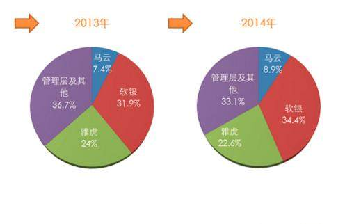

阿里巴巴上市前，2013-2014 年股权结构图

实际上，现在很多互联网创业企业都采取了类似 AB 股的制度，以便保障创业企业家的控制权，并且这一制度安排开始在多个行业流行。

讲到这里，我想起了一个故事。

多年前，马云控制的阿里巴巴集团一直打算在香港上市。但是，香港的上市公司实行"同股同权"的制度，不能接受阿里的合伙人股权结构。

于是，2014 年马云跑到了能够接受合伙人股权制度的美国纽约证券交易所上市。后来，香港证交所非常后悔，专门为此修改了上市规则，允许部分企业实行"同股不同权"的制度。

于是，五年之后的 2019 年底，阿里回归香港证交所，马云总算是圆了一回"港股"梦。这件事也从一个角度说明，当现实制度不符合理论预期时，制度就应该改革。

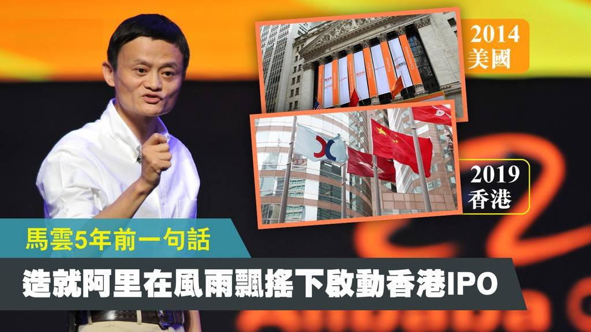

2019 年 11 月 26 日，阿里巴巴在香港二次上市

需要补充说明的是，相机治理机制不仅仅适用于创业型企业，而且适用于所有快速成长或者快速变化的企业。因为只要企业在快速变化，未来就充满各种不确定性，公司治理就是一个不完全契约。此时，企业家拥有控制权就是一种趋势。

结语

让我总结一下今天的主要内容。

当企业家代表的人力资本和资本家代表的货币资本发生冲突时，企业应该交给哪一方来控制呢？

由于企业家和资本家之间不可能写一份事无巨细的完全契约，只能规定一些大的事情，因此，公司控制权安排实际上是一份不完全契约。不管是企业家控制，还是资本家控制，都各有利弊。

因此企业的最优控制权应该相机抉择，即正常经营时由企业家控制，陷入财务困境时由资本家接管。这样的控制权安排对应于现实中的债务契约和特殊的 AB 股制度。

今天的思考题是：在你了解的企业中，有哪些企业是外部股东拥有大部分股份，但是实际上是由占股份相对较少的企业家控制的？请尝试用今天节目的知识来解释这种治理结构。

好了，今天我们就讲到这里，下集再见。

公众号懒人找资源，懒人专属群分享

## 09 信息甄别丨企业如何招聘到真正的人才？（兼谈和珅为何在赈灾粥里掺沙子）

懒人专属群的群友，你好，我是聂辉华。

中国有一句俗话说："画龙画虎难画骨，知人知面不知心。"说的就是看人识人是一件很难的事情。

假设你是一个老板，需要招聘一个高水平的销售总监。来应聘的每个人都会说自己水平高，你如何甄别"高手"和"低手"呢？又比如，你开了一家服装店，你想让有钱的顾客多消费，让没钱的顾客少消费。问题是，你怎么准确地区分这两类顾客呢？

这两个问题，都属于事前的信息不对称问题，即一方不知道另一方的真实类型。这里说的类型包括很多种，比如穷人和富人、好人和坏人、高手和低手等人的类型，还包括高成本和低成本、好产品和坏产品、真外企和假外企等企业的类型。

在今天的节目里，我会通过身边的真实案例，来跟大家谈谈：如何看人、识人、甄别人？

### 信息甄别模型进入学术视野

在 20 世纪 70 年代之前，经济学并不关注信息不对称问题。

经济学原理认为，供给和需求两种力量决定了唯一的均衡价格，然后买卖双方都按均衡价格成交。

1976 年，美国斯坦福大学经济学教授斯蒂格利茨（Stiglitz）与合作者在世界顶级的《经济学季刊》（QJE）上发表了一篇开创性论文，他们发现：一旦考虑了当事人类型的信息不对称，传统经济学的结论都不成立了。

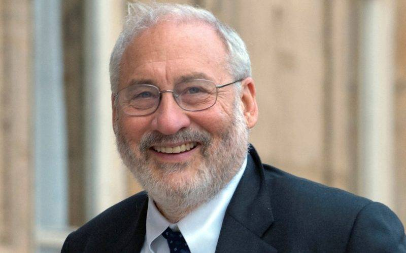

斯蒂格利茨（Joseph Stiglitz）美国经济学家

均衡价格不再是唯一的，而是每种类型的当事人对应一个价格。大家可能觉得这段话比较抽象，我举个例子，根据传统的经济学原理，"冰冰"和"静静"都是刚出道的青年女演员，拍一集电视剧的报酬就应该是一样的。但是根据我们今天讲的契约理论，因为两人的水平不同，报酬也不相同。

斯蒂格利茨的这篇文章成为信息甄别模型的奠基性文献，也是斯蒂格利茨和另外两位经济学家共同获得 2001 年诺贝尔经济学奖的主要成果之一。

那么，经济学家究竟用什么巧妙的办法，把不同类型的消费者或生产者甄别出来呢？这就是我今天要介绍的契约理论。

### 企业如何甄别"人才"？

就拿招聘来说，在录用之前，你无法知道应聘者是高水平还是低水平，这属于事前的信息不对称。此时，如果没有任何甄别机制，不管水平高低都给同样的工资，结果将非常糟糕。

一方面，一大批"南郭先生"就会滥竽充数、以次充好，最终团队无法完成目标；另一方面，高水平的人不甘心和低水平的人拿同样的工资，于是他们可能会离开，这就是"逆向淘汰"  
\----该走的没走，不该走的走了。

那么，怎么才能甄别出应聘者的真实水平呢？关键就是我们在前面的节目中讲到的激励相容原理。

如果我们能够设计一种机制，让每一个应聘者如实披露自己的类型，并且得到好处，而撒谎只会带来坏处，那么就能甄别出应聘者的真实类型了。

我来给大家讲一个真实世界的案例。很多人以为大学老师都是"铁饭碗、铁工资"，说到这里，聂老师必须澄清一下，情况已经不是这样了。

十年前，我所在的大学就开始招聘海外归国人才（简称"海归"）。一开始，"海归"都是高薪，一年收入几十万，大概是本土老师（戏称"土鳖"）的两到三倍。但是，有少数"海归"研究和教学能力一般，甚至不如优秀的"土鳖"，这种"同工不同酬"的问题引起了"海归"和"土鳖"之间的矛盾。

后来，学校对招聘机制进行改革，对"海归"人员实行"双轨制"。

一种是人才岗，特征是"高收入+高风险"：实行年薪制，每年大约 30 万元，三年一个聘期。聘期内必须在国际高水平期刊发表 3 篇学术论文，考核不合格就不再续聘。（说到这里，我要插一句：很多人以为三年发表三篇高水平论文是很容易的事情，但在经济学界这是很难的事情，毕竟不同行业之间没有可比性。）

另一种是普通岗，特征是"低收入+低风险"：工资和"土鳖"一样，以固定工资为主，每年大约 10 万元，没有硬性的国际发表要求，基本上是"铁饭碗"。

实行了这种甄别机制之后，本校的人才引进效果立竿见影。一批水平较高的"海归"选择了人才岗，之后脱颖而出，他们认为这个报酬是物有所值。俗话说得好，"不是金刚钻，不揽瓷器活"。而水平一般的"海归"则望而却步，他们宁愿选择普通岗。关键是，"海归"和"土鳖"之间的矛盾得以缓解，"土鳖"不再羡慕"海归"的高薪。毕竟，人家虽然收入高，但是风险也大，这很公平。

你可能会问，如果有些"海归"一开始选择了人才岗，拿了高薪之后考核不达标，然后转成普通岗，那不是两头占便宜吗？

不用担心，学校明确规定，考核不合格的人才岗不能在本校转为普通岗，必须离职。说白了，这就是所谓的"非升即走"。这就堵上了"套利"的空间。

### 如何巧妙地设计信息甄别机制？

我经常说，一个设计巧妙的机制胜过一堆文件。通过人才招聘这个案例，我们可以归纳出经济学家在信息不对称的前提下，设计某种激励机制进行信息甄别的要点。

第一，针对不同类型的参与人（如应聘者）设计不同的"契约套餐"。这些套餐通常表现为不同的组合，例如报酬-风险组合、价格-  
数量组合，并且不同套餐之间不能留下"套利"空间。如果人参和萝卜一个价格，你就永远买不到真正的人参（不信你去试试）。

第二，要让每个参与人甘愿选择适合自己真实类型的契约套餐。如果参与人撒谎或者冒充别的类型，他会得不偿失。要把真正的高手甄别出来，就是要让高手不愿意选择普通人的契约，而普通人也不愿意选择高手的契约。如果实现了这种效果，我们就说做到了"激励相容"。

讲到这里，我想起了清朝大贪官和珅的一个故事。有一次某地发生了自然灾害，乾隆皇帝派和珅去当地赈灾，官府当场熬粥发放给灾民。当时灾民人数特别多，现场一片混乱。关键时刻，和珅抓了一把沙子掺到白米粥里，很多"灾民"一看，马上就走掉了，然后剩下的灾民继续排队领粥。

和珅的做法看上去很缺德（他居然把沙子放在米粥里），但其实是一种非常巧妙的信息甄别机制。因为官府免费施粥，一定会有很多假的灾民来混吃混喝，他们不会想吃有沙子的米粥，但真正的灾民并不特别在乎粥里是否有沙子，最要紧的活下去。于是，"真假灾民"就区别开了。这个和珅的形象，是不是跟你在电视剧里看到的不太一样？

### 拼多多为什么有市场？

除了人才招聘，其实更广泛的信息甄别体现在消费领域。

我们来看另一个案例。以前，我们都是去实体店买衣服，顾客一走进服装店，就会有一个导购员热情地迎上来，问你想看什么样的衣服，需要什么样的价位，甚至主动给你倒一杯水喝。看上去是闲聊，其实这是服装店导购员在根据你的外在形象以及你的谈吐，对你进行信息甄别。

导购员需要马上判断：你的消费能力高不高？如果你的消费能力比较高，导购就会向你推荐高档服装；如果你消费能力不高，就会推荐中低档服装。而且，大部分服装店的衣服并不是统一的明码实价，而是可以讨价还价的。

导购员根据顾客特征将顾客分为两类群体，然后分别索取不同价格的做法，就是经济学上的"三级价格歧视"。这是一种比较简单的信息甄别。

更复杂的情形是，这几年电商日益普及，很多人都直接在网店上买衣服，不再去实体店了。服装店看不到顾客的形象，也没法跟顾客套话，那么服装店该如何进行信息甄别呢？答案是，它会利用价格和数量两种工具，将商品分成不同档次的套餐。

比如，你买的服装总价越高，折扣越多，超过一定金额还可以包邮；总价越低，折扣越少。这种基于消费金额的价格优惠，其实就是一种信息甄别方法，经济学上叫"二级价格歧视"。

采取这种甄别方法，商家根本不需要了解你是有钱人还是普通人，因为你的购买行为就会自动暴露你的类型。在网店的信息甄别过程中，买东西越多的顾客，享受的折扣也就越多，这也表示商家让利越多。

虽然商家对买了很多商品的顾客让利，但是商家照样可以从他们身上赚到钱。让利不是让出所有利润，而是少赚一点。这少赚的一点，就是商家为了让这些人说真话付出的信息租金。

在我们这个节目里，参与博弈的当事人之所以愿意说真话，往往是因为说真话有更多的好处。要知道，这个世界上本来没人愿意说真话，除非搞对了激励！

听上去，在商家的信息甄别之下，消费能力低的人是不是只能被"薅羊毛"了，而无法从信息甄别中获得好处呢？其实也不是。

如果有一种机制，能够将很多低消费顾客的微小订单集中起来，形成一个较大的订单，那么一样可以享受到量大从优的价格折扣。

你猜对了，这样的机制其实就是"拼多多"。这也就是为什么拼多多一上市，就成为热门的"独角兽企业"。你看，时代在进步，信息甄别的手段也在进步，这就带来了新的商机。

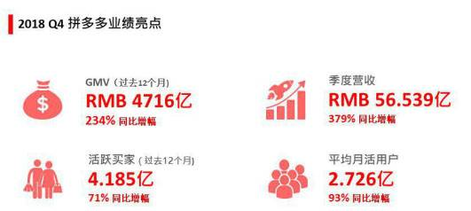

拼多多 2018 年财报显示第四季度各销售指标

拼多多 2015 年 4 月正式上线，2018 年 7 月正式登陆美国资本市场

结语

总结一下今天的主要内容。在事前的信息不对称下，老板为了实现利润最大化，需要针对不同类型的参与人提供不同的契约，并且让他们只能选择适合自己类型的契约，这样就可以让参与人显示自己的真实类型。

形象地说，你的选择出卖了你的类型！当然，有效的信息甄别机制在本质上是一种转移支付。想要参与人暴露自己的信息，老板需要付出一定的成本，这就是所谓的信息租金。在一个不完美的世界中，天下没有免费的午餐。

最后给大家出一道思考题。政府推出经济适用房，是为了让一部分经济困难的人，通过提交申请，政府来甄别他们的信息，进而确认他们是否有资格购买经济适用房。但是在申请过程中，也一定包含了一批经济上相对富裕却同样想购房的人。那么，你觉得政府需要怎么做，才能找出真正需要帮助的穷人呢？

好了，今天我们就讲到这里，下集再见。

公众号懒人找资源，懒人专属群分享

## 番外丨考不上清华北大，连去街道办都“不够格”？

懒人专属群的群友，你好，我是聂辉华。

最近，杭州市余杭区的一份招聘公示名单让很多网友"扎心"了。在公开显示的 48 个岗位中，拟聘用人员清一色全是清华大学和北京大学的硕士或博士毕业生，其中北大毕业生 38 名，清华毕业生 10 名。

你可能很好奇，这是什么"国字号"单位，居然能吸引这么多顶尖人才？你错了，这只是杭州市某个区的招聘。按照行政等级，杭州市一个区就相当于一个县。只不过杭州作为副省级市，它的区比普通的县高半级。

更"辣眼"的是，这次面对"清北"招聘的岗位中，有 8 个岗位属于最基层的街道办事处。例如，一位北大地球物理学博士去了南苑街道办事处，一位北大生物学博士去了五常街道办事处。

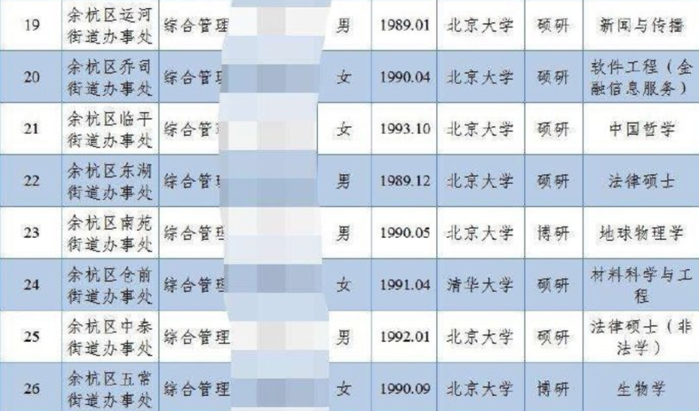

杭州余杭区招聘公示（部分）

想想看，如果你老家的县政府及其下属乡镇，一次性招聘了 48 个清华北大的研究生，会不会亮瞎你的眼？

此事在网上流传开来之后，当地有关部门（余杭区委组织部相关负责人）出来回应：第一，这是 2018 年的招聘公示；第二，这不是大材小用。但是，在我看来，这些回应不仅没有解决问题，反而带出了更多问题。

### 问题 1：清北博士去街道是不是人才浪费？

先请有关部门回答第一个问题：清华北大的博士去街道办事处上班，是不是人才浪费？

请注意，"浪费"的意思，不是说清华北大博士能否干好招聘岗位的本职工作，而是问其他学校或其他学历的人能不能同样干好这份工作？这其实是经济学中最基本的概念：机会成本。遗憾的是，某些部门的人看起来没有理解这个基本概念。

街道办事处是干啥的？打过交道的人都知道，基本上都是跟老百姓生活息息相关的各种家常事务。

如果一个待人接物比较得体、做事比较踏实的中专生都可以干，那么让一个研究生来干就是浪费；如果一个普通研究生能干，那么让清华北大博士生来干就是浪费。道理就是这么简单。

如果余杭区要证明这些街道办职务以及其他职务不是大材小用，那就请详细地说明一下，究竟这些岗位需要什么特殊的高级技能，以至于非清华北大研究生不可。遗憾的是，余杭区的官方回应没有 get（抓到）要点，也无法自圆其说。

在任何一个社会，人才都是最宝贵的资源。最宝贵的资源当然要实现最优配置，否则就是浪费人才、资源错配。

世界著名经济学家、哈佛大学教授施莱佛（Andrei Shleifer）及其合作者，专门对人才配置问题进行了研究。

施莱佛等人将所有的岗位大致分为两类：第一类是创新型岗位，负责把"社会蛋糕"做大，例如企业家、科学家；第二类是寻租型岗位，这类岗位不直接创造价值，只是负责分配社会蛋糕，例如公务员、律师。

他们指出，合理的人才配置，应该是顶尖人才都去从事创新型工作。"当有才能的人成为企业家时，他们会改进所在部门的技术，带来生产效率和收入的提高。相反，当有才能的人成为寻租者时，他们的个人报酬大部分来源于对他人财富的再分配，而不是来源于财富的创造。结果，有才能的人便没有机会来改进技术，经济也陷入停滞。"细品这段话，可谓振聋发聩。

中国正面临"百年未有之变局"。中国能否摆脱"中等收入陷阱"，能否在高科技领域占据制高点，能否在严峻的国际形势下提高综合国力，很大程度上取决于顶尖人才能否实现最优配置。

清华北大博士最应该去哪里发挥作用，答案一目了然，但肯定不是去街道办。联想到前段时间中科院某研究机构 90 多个研究人员集体"出走"，有关部门真的应该反思一下，"我们在吸引高端人才从事创新型工作方面，是不是还有很多地方做得不够？"

有人认为，清北博士去基层工作，能够自下而上推动基层治理，这当然是人尽其才。果真如此，为什么这些清北博士不去中西部的县乡工作？国家设置的"选调生"已经有这方面的制度安排，何必一窝蜂跑到富庶的杭州去拿几十万元的高薪呢？拿高薪也没问题，问题是你不能一边拿高薪，一边唱高调。

### 问题 2：有关部门的人才选拔机制是不是有问题？

从个体角度讲，每个人都有权利追求实现个人利益最大化的职业路径，这无可非议。

一位北大法学硕士作为当事人就说了实话："我觉得基层很锻炼人，而且也有晋升空间，好多当年一起来的小伙伴现在都走上了重要的工作岗位。"

很多网友可能不太了解内情，千万别不把街道办当回事。聂老师在这里给大家科普一下，象杭州这样的副省级市，一个街道办事处的级别是正处级，也就是和县政府平级。我估计，清北研究生来街道办，三两年后可以升为正科级，三五年之后就可以升为副处级。这分明就是一条仕途捷径啊！

相反，如果一个毕业生去了中西部的县政府，要想升到副县长级别（副处级），没有一二十年根本不可能。关键是，在一个县里，99%的公务员终其一生，其仕途都将止步于副处级。因此，千万不要小看这些"街道办新来的年轻人"，他们仕途远大。

人往高处走，水往低处流。在一个市场经济社会，合法地做一个"精致的利己主义者"，并不是什么坏事。就算清北博士去街道办是一种人才浪费，对于清北博士来说也不是他们的错。那么错在谁？错在制造了人才浪费后果的有关部门。

按照诺贝尔经济学奖得主斯彭斯（Michael  
Spence）的看法，其实学历只是一种证明自己能力的信号。因为个人能力是一种不对称信息，用人单位通常不知道一个应聘者能力的高低。

于是，读大学、拿文凭就成为证明自己能力的一种办法。这就是为什么企业、事业单位和政府机构,  
都喜欢招聘名校毕业生和高学历人才的重要原因。从这个角度讲，杭州市余杭区热衷于招聘清华北大博士，似乎没什么问题啊？

问题在于，中国各级政府每年都进行大量的各类公务员和事业单位招聘，从"国考"、"省考"到"市考"和"县考"。这么多年过去了，有关部门对于如何甄别适合本单位的毕业生，我相信就算不是了如指掌，也不应该是完全的信息不对称吧？

什么层次的学历能干什么样的活，负责招聘的主管单位心里没点数吗？难道过去的经验证明，普通学校的大专毕业生干不好街道办的工作吗？非要通过"名校学历"这种高成本的信号来选拔人才吗？

说白了，杭州余杭区的做法，表面上看是通过高标准、严要求来选拔人才，实际上可能是另一种形式的"懒政"和低效率。当然，也可能是高收入地区的一种炫耀性人才高消费。我真担心这种攀比之风愈演愈烈。

### 问题 3："定向招聘"是否涉嫌就业歧视？

在余杭区招聘事件中，出面回应的北大法学硕士认为，"工作本来就是你情我愿的事"。很遗憾，在我看来，这位北大法学硕士犯了一个法律常识错误。公家单位的招聘，还真不是"你情我愿"就合法合规了，事实上，余杭区的这次"定向招聘"明显涉嫌就业歧视。

从法律上讲，劳动者享有平等就业和选择职业的权利。"平等就业"应该包括应聘者不能因为学校而遭遇就业歧视。

从余杭区的官方回应来看，2018 年和 2019 年组织了两批专门针对清华北大两所学校的定向招聘。

网上流出的照片显示了一条横幅，上书一行大字："欢迎清华北大学子参加余杭区党政储备人才招聘面试"。

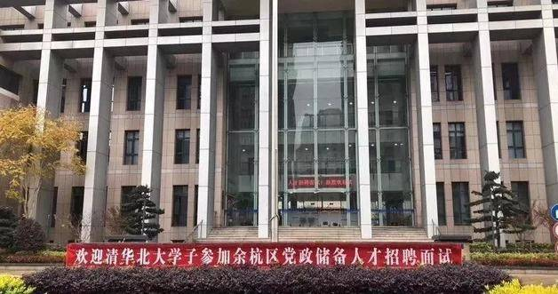

杭州余杭区横幅内容

那么问题来了，余杭区作为一级政府，用纳税人的钱招聘公务员，凭什么专门针对清华北大两所学校呢？难道其它学校的人才不能在当地做公务员？

如果招聘单位是一家私营企业，老板想招自己的小姨子还是小舅子，悉听尊便，反正是造自己的钱。但如果招聘单位是一个公家单位，它必须保证招聘"公开、公平、公正"。特别是，政府部门的编制本来就是死的，"一个萝卜一个坑"。你进去了，别人就必须出来。

在这场"零和博弈"中，当地政府制定的规则明显是偏袒了清华北大，而排斥了其它学校的毕业生。这就是我前面提到的"分蛋糕"游戏：你分多了，别人自然就分少了。

那些为余杭区招聘事件点赞的网友，一定要清醒地认识到：机关的就业岗位就这么多，如果你的孩子将来考不上清北，那对不起，可能连去街道办的机会都没了。

中国作为一个发展中国家，就业过程中还存在不少歧视。女性受歧视，孕妇受歧视，相貌受歧视，"小三阳"（乙肝病毒携带者）受歧视……要指望企业自己纠正就业歧视是很难的，因为经济学研究表明，一些就业歧视本身对用人单位来说是有利可图的。

消除就业歧视的渠道主要有两条：第一是完善法律法规，例如 2010 年时有关部门规定取消入学、就业体检中的乙肝检测项目；第二是国有单位带头垂范，因为它们负有比私营单位更多的社会责任。

在地方政府治理方面，杭州市在很多方面都走在前列。它本来应该发挥模范作用，带头消除就业歧视，而不是借助"清北"的金字招牌来制造不公平的就业机会。

遗憾的是，在余杭区招聘事件中，很多人只关注了个人的大材小用问题，却忽视了背后的制度性不公平。

事实上，就业歧视比人才浪费更严重。因为人才浪费可能只是一时的人才错配，高水平的人才如果没有实现人尽其才，还可以再次流动，实现更优配置。

但就业歧视不仅一开始就阻止了他人进入某个就业市场，而且这种就业歧视往往是一种制度性歧视，会加剧社会上的不公平竞争。当这类风气越来越严重时，最终甚至会损害整个社会的科技创新能力，甚至导致经济停滞。

亲爱的听友，如果你觉得我讲得有道理，欢迎关注我在看理想的节目《不完美世界的博弈：契约经济学 35 讲》；如果你觉得我讲得没道理，欢迎你在评论区"吐槽"！再见。

公众号懒人找资源，懒人专属群分享

## 10 道德风险丨发奖金还是给股权，如何有效激励员工？

懒人专属群的群友，你好，我是聂辉华。

小时候，大家都听过"周扒皮半夜学鸡叫"的故事吧？

周扒皮是一个地主，他和长工们有一个约定：只要公鸡打鸣了，长工就要出去干活。于是，为了让长工们多干活，周扒皮就在半夜里学公鸡叫，让真正的公鸡提前打鸣。

长工们深受其害，最后想了一个办法：在周扒皮半夜学鸡叫时，把他当作"偷鸡贼"暴打了一顿，总算是出了一口恶气。

"半夜鸡叫"的故事虽然是文学作品，但它反映了一个普遍难题：作为老板，在信息不对称的条件下，如何让员工不偷懒？如何激励员工勤奋肯干呢？

### 如何激励员工勤奋肯干？

其实，从人性的角度讲，偷懒是人的本能。如果你是一个员工，老板看不到你的工作过程，你会不会开小差（比如刷一下微信、上一下抖音）？上班时间会不会干私活？会不会偷偷拿客户的回扣？

这种利用信息不对称做出的偷懒、浑水摸鱼，以及侵占公司财产的行为，在契约理论里被称为"道德风险"问题。

既然每个人本性上都想偷懒，那么重要的问题就不是从道德上谴责去偷懒行为，而是设计一种激励机制来减少偷懒问题。

所谓的激励机制，就是老板虽然看不到员工的行为，但是能让员工按自己利益来做事的一种契约或者制度。

这个问题的底层分析框架，也是我们今天要讲的经济逻辑，是 1994 年诺贝尔经济学奖得主莫理斯（James  
Mirrlees），和 2016 年诺贝尔经济学奖得主霍姆斯特朗（英语：Bengt Holmstrom；瑞典语：Bengt Robert  
Holmstrom）共同搭建的。

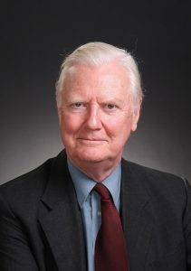

James Mirrlees（1936－2018 年） 英国经济学家

1996 年，同 William  
Vickre 因"Mirrlees 在信息经济学理论领域做出了重大贡献，尤其是不对称信息条件下的经济激励理论，Vickre 在信息经济学、激励理论、博弈论等方面都做出了重大贡献"获诺贝尔经济学奖

Bengt Holmstrom（1949-） 芬兰经济学家

2016 年，同 Oliver Hart 因"在契约理论方面的贡献"获获诺贝尔经济学奖

很多人都觉得经济学家很高傲，其实啊，聂老师语重心长地告诉你：经济学家可能是这个世界上最谦卑的人，因为他们从来不进行道德批判，而是在承认人性的前提下，想办法规范人们的行为。

那么，什么样的激励机制能够让周扒皮不用半夜学鸡叫，也让长工们像打了鸡血一样卖命干活呢？如果你是一个领导或者老板，相信你肯定非常关心这个问题。那么今天，我就来谈谈如何通过激励机制解决道德风险问题。

假设有一个地主叫周扒皮，他是老板；有一个农民叫鹿三，他是员工。假设老板看不到员工的劳动投入，只能看到劳动产出，但劳动投入和产出并不是一一对应的。

在农村生活过的人都知道，"七分靠勤劳，三分靠天帮。"其实，世界上大部分工作都是这样，既要靠努力，又要靠运气。用契约理论的话来说，产出除了受到个人努力影响，还会受到某种噪音影响，这就是所谓的风险，或者不确定性。

一般来说，努力水平越高，实现高产出的概率越大；努力水平越低，实现高产出的概率越低。

举个例子，你好好学习，高考时考高分的概率就大，但谁也不能保证你高考一定拿高分。比如今年这种情况，很多地方发洪水，考生们还要划船进考场。此时，除了努力水平，天气也会影响考生的分数。

在理想状态下，如果努力和产出是完全对应的，那么老板只要看产出就知道员工是否努力了，那这个世界根本就不需要激励了。因为高努力只是在概率上带来高产出，所以当我们努力之后遭遇失败时，应该问心无愧、自认倒霉。

### 激励契约的三种类型

今天要分析的激励问题是"什么样的契约能够让鹿三不偷懒，并且实现土地产出最大化呢？

理论上，一共有三种契约可供选择：第一种是固定价格契约，第二种是固定工资契约，第三种是分成契约。

接下来，我们将比较每一种契约对员工行为和绩效的影响，然后找出总产出最大化的一种契约。这就是契约理论常用的比较分析方法。

先说固定价格契约，就是老板以一个固定的价格将业务承包给员工，员工自负盈亏。这其实就是一种承包制，员工就相当于自己的老板。

例如，周扒皮把自己 20 亩地租给鹿三种水稻，每亩地每年收取 500 斤稻谷作为租金。现在，鹿三从一个雇工变成了老板，他不仅不会偷懒，而且会起早摸黑、披星戴月。因为扣除租金之后，他剩多剩少都归自己了。用经济学的术语来说，他现在是"剩余索取者"。

长工翻身做主人了，这是天大的好事啊！但是，且慢高兴。鹿三很快发现，他面临巨大的风险。北方的水稻每年只能种一季，一旦天气不好导致歉收，每亩地只能产出 400 多斤稻谷，连租金都不够，因为租金是 500 斤，相当于白干。

作为一个小农，他没有保险机制，一旦交不起租金，他就要卖身变回长工了。

因此，固定价格契约的好处是，能够 100%地激发员工的努力水平，但是也会给员工带来 100%的风险，可谓高风险、高收益。相对于老板来说，员工一般是风险规避的。因此，大部分员工不敢接受这种固定价格契约，否则他们早就去当老板了。

然后说第二种契约----固定工资契约，就是老板每个月给员工固定的工资，员工干活的产出完全归老板所有。

例如，周扒皮每月给鹿三两块大洋，并且包吃包住。固定工资契约的好处是，员工不必承担任何产出波动的风险，可谓"旱涝保收"，风险都由老板承担了。但固定工资契约的坏处是，员工完全没有激励去努力了，因为"干多干少一个样，干和不干一个样"。在信息不对称条件下，员工一定会偷懒，产出一定会很低，不可能实现产出最大化。

或许聪明的你很快看出来了，固定价格契约和固定工资契约是两个极端，前者对员工来说风险太大，后者对员工来说激励太差。

那么，有没有一种契约能够吸收这两者的好处，同时又尽量避免两者的坏处呢？有！这就是我们要介绍的第三种契约：分成契约。

分成契约意味着，员工的工资由两部分组成：一部分是固定工资，一部分是提成或奖金。提成的比例介于 0 到 100%之间。

固定价格契约就相当于提成比例为 100%的分成契约，而固定工资契约就相当于提成比例为 0 的分成契约。这样，我们可以把固定价格契约和固定工资契约，都看作是分成契约的特殊形式。

### 如何实现分成契约？

分成契约如此之好，那么在现实中怎么操作呢？

比如，周扒皮可以跟鹿三约定：每个月保底工资是一块大洋；如果每亩产量超过 800 斤，超过部分的 30%作为奖金。

在分成契约下，员工干得越多，拿得就越多，同时老板赚得也越多。因此，分成契约把员工的利益和老板的利益捆绑在一起了，这就是我们一直强调的"激励相容"。

激励相容是一个非常重要的经济学原理，经济学家之所以能够解决信息不对称条件下的逆向选择和道德风险问题，主要就是依靠这个简单实用的法宝。它是 2007 年诺贝尔经济学奖得主赫维茨（Leonid  
Hurwicz）提出的思想，遗憾的是，他在获得诺奖的第二年就不幸去世了。

Leonid Hurwicz（1917-2008） 俄罗斯裔美国经济学家

2007 年，同 Eric Maskin、Roger Myerson 因"机制设计理论"而获得诺贝尔经济学奖

但是问题马上就来了：如果分成就能提高员工的努力水平，是不是分成比例越高越好呢？非也！分成作为一种激励工具，实际上是一把双刃剑：分成比例越高，员工激励越强，但是承担的风险也越大。

因此，老板给员工的最优分成比例，一定是在激励和保险之间权衡取舍。也就是说，恰当的分成比例，既要让员工努力，又要减少员工承担的风险。

契约理论证明，在其它条件不变的前提下，员工的风险规避程度越强（越害怕担风险），或者产出的波动越大，那么分成比例就应该越低。这意味着，最优的分成比例要根据员工的特征、任务的性质来设计，而不能搞"一刀切"。

让我们换一个思考场景吧。假设一个企业有两种业务：一种是传统业务，比如卖畅销的化妆品，客户比较稳定；另一种是新业务，比如卖新的化妆品，存在较大的市场风险。

那么，最优的工资契约应该这样设计：如果员工做传统业务，那么固定工资低，但分成比例高，这样可以避免员工吃老本；如果员工做新业务，那么固定工资高，分成比例低，这样可以减少员工开辟新市场的风险。

总之，不同性质的业务，应该对应不同类型的激励机制，而不能搞一种薪酬标准。

### 股权激励的适用范围

在企业里，分成比例除了体现为提成或者奖金，还可以体现为股权激励。说到这里，聂老师不得不批判一下。现在市面上很多书，动不动就提倡什么"合伙制"、"股权激励"，这完全是走极端。

聂老师要语重心长地科普一下：绝对不是所有员工都适用于股权激励。

一般来说，普通员工都是风险规避型的，他们的绩效容易度量，信息不对称问题不太严重。作为老板，要是真关心员工福利，适度提高他们的工资或者奖金就可以了，给他们股权反而增加了他们的风险，而且人家也没打算一辈子给你打工。这是典型的好心办坏事。

相反，核心员工和管理层能够承担一定的风险，绩效不太容易度量，因此为了留住这些核心员工，仅仅提高奖金是不够的，还应该分配给一定的股权或期权。

阿里巴巴集团的激励制度完美地验证了我们今天讲的契约理论。

在阿里，普通员工是没有股票激励的，只有级别为 P7 以上的技术或管理岗位，才能享受股票激励（顺便插一句，马云是最高级 P14），而且规定满两年可以套现一半，四年后才可以全部套现。此外，这些享受股票激励的核心员工，其现金工资要比同行少一些。

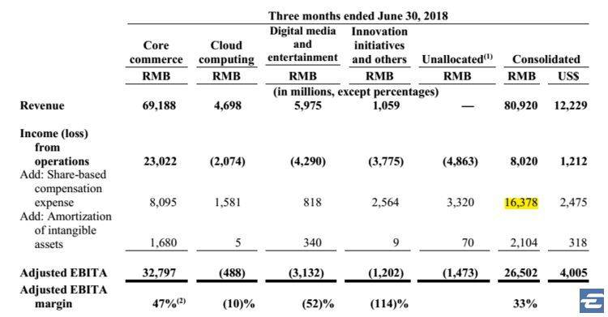

根据阿里巴巴 2019Q1 财报显示：2018 年 6 月，由于蚂蚁金服估值显著上升，授予员工蚂蚁金服股权奖励非现金开支为 111.8 亿元，股权奖励总开支达 164 亿。

结语

今天的主要内容可以概括为一句话：老板既要激励员工努力，又要减少员工的风险，不是所有员工都应该持股。

其实，这一结论还依赖于一个前提条件：伴随产量的提高，运气的成分要逐渐减少。如果一个行业主要靠运气挣钱，并不适用于今天讲的契约理论。

反过来讲，在一个社会里，如果努力越来越重要，运气越来越不重要，那么这不仅是一个公正的社会，也是一个有效率的社会。

最后是思考题：有人说，现在很多机构上下班都要打卡，而且办公场所有摄像头，因此老板和员工之间已经不存在信息不对称了，偷懒不再是一个问题了。请问，你是否同意这个观点？

好了，今天我们就讲到这里，下集再见。

公众号懒人找资源，懒人专属群分享

## 11 激励难题丨为什么金钱奖励却产生了负面效应？

懒人专属群的群友，你好，我是聂辉华。

中国有句古话："重赏之下，必有勇夫。"工资越高，奖励越多，或者金钱报酬越高，大家努力的积极性肯定更高，这似乎是一个常识。

但是，社会学家和经济学家却发现，金钱报酬有时反而减少了努力水平，降低了工作绩效。为什么物质奖励反而产生了负面效应呢？

在今天的节目里，我就来给大家讲讲，这个反常的"奖励悖论"。

### 奖励反而产生负面效应？

我先给大家介绍两个非常有趣的案例。

第一个案例是，英国著名社会学家蒂特马斯（Richard Morris Titmuss）对公民献血的经典研究。

理查德*莫里斯*蒂特马斯（Richard Morris Titmuss）

英国社会研究者和教师的先驱。他创立了社会管理学科，并在伦敦政治经济学院担任该学科的创始主席

在英国，一开始公民献血是无偿的，没有一分钱报酬；后来，政府为了鼓励更多公民献血，就给了一些金钱补偿。你猜结果怎么样？

提供金钱补偿之后，献血的人数不仅没有增加，反而减少了，甚至连献血的质量也下降了。是不是很奇怪？

第二个案例，来自环境保护领域，跟今天流行的"邻避运动"相关。两位瑞士经济学家在一篇论文里，介绍了一个瑞士的政策干预实验。

1993 年，瑞士政府准备在中部地区建造两个存储核废料的仓库。政府先通过发放问卷的方式，询问当地居民是否同意建造核废料仓库。

调查一共进行了两轮。第一轮调查时，没有提到任何补偿，结果有 51%的居民表示同意。第二轮调查时，明确说瑞士政府愿意为此提供金钱补偿，结果只有 25%的居民同意。

从没有补偿到提供金钱补偿，支持公共项目的居民人数从 51%降到了 25%，不仅没有增加，反而减少了一半。这再次说明，金钱报酬可能带来负面效应。是不是很奇怪？

按照传统经济学的观点，人们的效用水平主要由金钱和物质水平决定，至少金钱多了不是坏事。至于某个富翁发出的感慨"我这辈子最大的错误就是赚了太多钱"，我认为纯属矫情，不然的话，聂老师不介意帮这个富翁分担这个最大的错误。

怎么解释这个反常的"奖励悖论"呢？幸运的是，经济学家终于找到了答案。

### 区分内在动机和外在动机的四大要点

2003 年，美国普林斯顿大学教授贝纳布（Roland Benabou）和法国图卢兹大学教授梯若尔（Jean  
Tirole）在世界顶级期刊《经济研究评论》（RES）上发表了一篇论文，综合了社会学、心理学和经济学的观点，提出了一个统一的分析框架，从而解释了一些看上去非理性的行为。

论文《Intrinsic and Extrinisic Motivation》

梯若尔教授后来获得了 2014 年诺贝尔经济学奖。接下来，我以这篇文章为主，介绍经济学家近年来对"奖励悖论"的最新研究成果。

第一个要点是，我们应该区分两种动机："内在动机"和"外在动机"。所谓"动机"，就是人们做一件事情的动力或者目的是什么，或者说要满足什么需求。

所谓的内在动机，是指当事人为了个人利益自愿去做某件事情的动机。比如，荣誉感、正义感，或者追求道德高尚，都是内在动机。所谓的外在动机，是指当事人需要外部奖励才去做某件事情的动机。比如，我们为了养家糊口去工作，或者为了挣钱去上班，都是外在动机。

从逻辑上讲，只有理解了人的需求，才能理解人的行为，最后才能通过政策或制度改善人的行为，从而提高社会总福利。

因此，理解需求是经济学的关键问题，其实也是最难的问题，因为没有一本经济学教科书会教你如何理解别人的需求。像这种非常有用但是教科书又不讲的知识，恰恰是聂老师要介绍的知识。

第二个要点是，依赖于金钱报酬的外在动机有时会破坏内在动机，社会心理学家称为"动机挤出理论"。

以献血为例。对很多人来说，献血是一种无偿帮助他人的高尚品德，或者是一种基本的公民责任。愿意无偿献血的人都具有一种强烈的内在动机，这跟钱没有任何关系。

一旦政府给所有献血的人提供了金钱补贴，那些原本愿意无偿献血的人，就会觉得献血不再是一种充满荣誉感或者责任感的好事，反而容易被认为自己是冲着金钱去献血的。

因此他们宁愿不再献血，也不要背负不道德的"黑锅"。说得极端一点，对于那些有道德洁癖的人来说，给钱简直是一种莫大的侮辱。

第三个要点是，即便对于外在动机而言，金钱报酬与努力水平也不是单调正相关的。所谓单调正相关，就是金钱报酬越高，努力水平也越高。

下面，我来给大家介绍两位经济学家在以色列海法大学做的一个有趣实验。我插一句，大家不要以为只有自然科学可以做实验，其实经济学家也能做实验，而且 2002 年诺贝尔经济学奖就给了做实验的经济学家。

两位经济学家找了 160 个大学生，随机分成 4 个小组，每组回答 50 个智商测试的问题，所有参加实验的人，都可以得到 120 块钱的固定报酬。

第一组大学生，除了固定报酬，答题没有任何额外报酬；第二组大学生，每答对一个问题，还可以额外得到 2 毛钱；第三组大学生，每答对一个问题，可以多得 2 块钱；第四组大学生，每答对一个问题，可以多得 6 块钱。

简单来说，就是四个小组，第一组无偿回答，其它三组的金钱奖励逐步加码。大家猜猜哪一组答对的比例最高？

结果是，无偿回答问题的第一组答对了 28 个问题，第二组答对了 23 个，第三组和第四组都答对了 34 个。

两位经济学家由此得出结论：金钱报酬与工作业绩并不是一一对应的。一些人做事根本不看重金钱，一些人做事非常看重金钱。

因此，你要让别人努力做事，要么干脆不给钱，要么就按市场标准给足钱，千万不要只给很少的一点钱。

他们这篇文章 2000 年发表在世界顶级期刊《经济学季刊》（QJE）上，文章题目就叫《要么给足钱，要么别给钱》（Pay Enough or Don't Pay  
at All）。听上去是不是很酷？

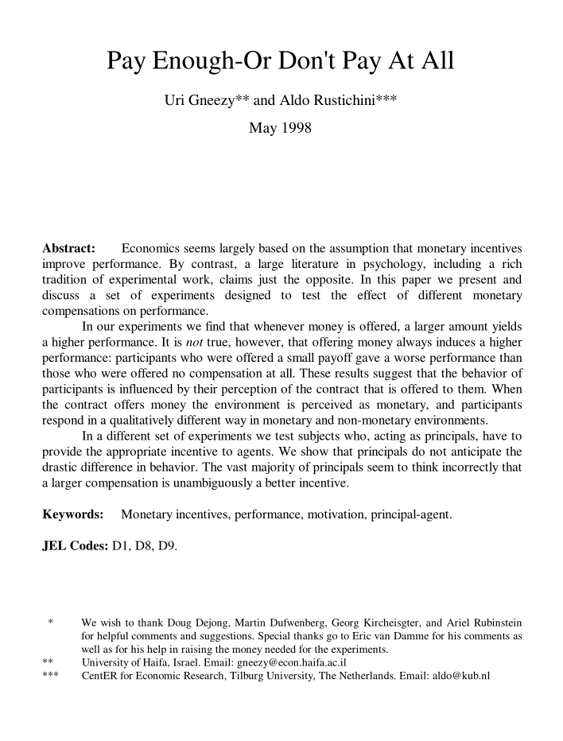

文章《Pay Enough or Don't Pay at All》

第四个要点是，如果外在环境发生了变化，那么一个人的动机也可能发生变化。

当金钱报酬很低的时候，人们可能更在乎自己的尊严、名声，此时内在动机战胜了外在动机。但是，当金钱报酬足够高时，比如是一个巨大的天文数字，此时外在动机就可能战胜内在动机。

我举一个例子。很多一线城市为了限制房价，对购房资格进行限制，比如规定一对夫妻在本地购买第二套商品房时，首付比例从 30%提高到 60%。于是，一些家庭为了规避限购政策，居然假离婚。

按说，婚姻、爱情应该是无价的，这是一种纯洁的内在动机。但是，一旦面临十几万甚至几十万元的金钱利益，内在动机就可能让位于外在动机了。

有人认为，这是因为中国人的道德水准下降了，聂老师倒不这么认为。与其说这是一种道德水准下降，不如说这是人性的弱点。一定要记住聂老师的告诫：不要去挑战人性的弱点。

大家有兴趣的话，可以看一部电影《不道德的交易》（Indecent Proposal），里面介绍了一对夫妻，在内在动机和外在动机之间的冲突与煎熬。

电影《Indecent Proposal》（又名：桃色交易）海报

### 管理者如何利用内在动机？

每个人都同时拥有外在动机和内在动机。外在动机是人生存的物质基础，而内在动机是人们愿意做出更多贡献的心理基础。

因为外在动机依赖于金钱或物质奖励，所以在现实中，管理者们经常面对的困境是，当外在动机的激励手段有限时，应该如何掌握人的内在动机，从而实现激励效果呢？

著名作家马克*吐温写过一本很有名的书，《汤姆*索亚历险记》（The Adventures of Tom  
Sawyer）。书中的主人公汤姆\*索亚是个聪明活泼的小毛孩。

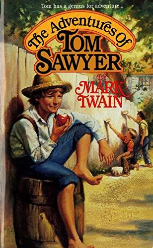

马克*吐温《汤姆*索亚历险记》

有一天，调皮捣蛋的汤姆因为逃学和打架，惹怒了波莉姨妈，于是姨妈罚他粉刷门口的篱笆墙。对汤姆来说，这是一件既无聊又繁重的体力活。

他本来想用自己的几个小玩具收买小伙伴们替他干活，也就是使用物质奖励，但是他的玩具又少，而且还不新鲜。他苦思冥想，突然想到了一个好主意。

一方面，他让小伙伴们都觉得刷墙是一件新鲜刺激的事情；另一方面，他又让小伙伴们觉得刷墙是一件很严肃的事情，说这墙是当街的一面墙，波莉姨妈是不会随便让人刷的。

小伙伴们羡慕不已，都争先恐后地要求刷墙，甚至拿出了各种各样的食物和玩具来跟汤姆换一次刷墙的机会。于是，汤姆不费吹灰之力，不仅刷好了墙，而且免费得到了很多小礼物。

你看，如果正确地理解了人的需求，掌握了人们的内在动机，即便是小孩子也可以把激励搞对！

在掌握内在动机的基础上把激励搞对的例子还有很多，特别是在市场营销方面。这方面最有代表性的一种营销策略，就是所谓的"饥饿营销"。

例如，小米手机在刚上市不久，分批次限量售卖手机，创造出一片需求空白地带，而且手机操作系统的功能也是每周更新一次。于是，很多手机发烧友每天在网上刷新，每次新手机上市都要抢购才能买到。这就很快培养了一批忠诚客户和铁杆粉丝，但是小米却几乎没有为此多花一分钱。

结语

最后，我来总结一下。

今天的节目对于我们理解信息不对称条件下的激励问题，提供了一个不同于传统经济学的视角。

核心观点是：不要盲目地用金钱去激励别人。金钱不仅不是万能的，有时甚至是有害的！

首先要了解对方在做一件事情时，是内在动机型还是外在动机型。对于内在动机型员工，最重要的是给他提供实现梦想的机会；对于外在动机型员工，就要将他的报酬与绩效挂钩。

当然，人人都要满足最基本的需求，就算是纯粹具有内在动机的员工，也不可能免费给老板打工。

今天的思考题是：有人认为，提高官员的工资才能减少腐败。你是否赞成"高薪养廉"这种说法？欢迎分享你的看法。

好了，今天我们就讲到这里，下集再见。

公众号懒人找资源，懒人专属群分享

## 番外丨“以房养老”本是好东西，怎么就被玩成了骗局？

懒人专属群的群友，你好，我是聂辉华。

### 一、什么是"以房养老"？

在春晚小品《不差钱》里，小沈阳说了一句"至理名言"："人最痛苦的事是，人没了，钱没花完。"

既然钱财是生不带来、死不带去的东西，那么从理论上讲，一个人去世时将自己所有的钱财都刚好花完，才是最优的消费策略。

对于一个即将或者已经退休的老人来说，工资收入明显减少，生活和各种养老支出却不断增加。此时，要体面、安详地安度晚年，关键是平衡收入和支出，将"死钱"变成"活钱"，或者说今天先用一部分明天的钱。

对于多数老人来说，最大的"死钱"当然是房产。根据西南财经大学发布的《中国城市家庭财富健康报告》，中国人的住房占家庭财富的比例将近 80%。

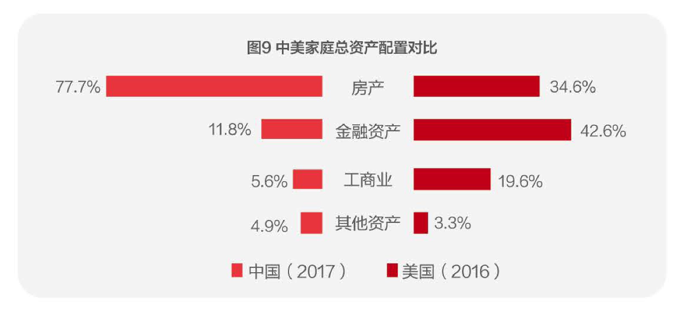

《2018 中国城市家庭财富健康报告》

由广发银行联合西南财经大学于 2019 年发表

一个生活在一线城市的老人，可能没有多少现金收入，但是哪怕名下有一套"老破小"的房子，也是价值几百万甚至上千万。但是，资产只有变成现金才能消费，否则即便坐拥千万，还是"负翁"，也就是所谓的"有房富人，现金穷人"。

那么，有没有什么办法将老人拥有的房产变现，提前让老人获得收益，改善晚年生活呢？有，这就是所谓的"以房养老"。

它的模式是这样的：老人与金融机构签订一份契约，将名下的房产抵押给金融机构。然后在一定年限内，金融机构每月给老人支付一笔现金。约定年限到了之后，金融机构不再支付现金，房产从老人名下过户到金融机构。

房子本来是老人的，但是现在变成了金融机构通过分期付款（按揭）的方式，从老人手中"购买"了房子的产权。因此，这种模式俗称"倒按揭"。

还有另一种类似的模式，就是老人将名下的房子出售给金融机构，然后金融机构再将房子出租给老人。房屋出售收入扣除月租以及相关费用后，由金融机构以现金形式支付给老人。

"以房养老"的本质，是将不动产贴现为现金流，是通过契约将未来的收入与现在的收入进行跨期交换。这是一种金融创新产品，是一个好东西。

"以房养老"模式早在 20 世纪 30 年代就发端于荷兰，后来在美国、英国、新加坡以及日本得到了较大范围的推广。

### 二、为什么以房养老在中国遭受冷遇？

在 2000 年时，我国 65 岁及以上人口比重达到了 7%。按照联合国的标准，中国在 2000 年开始步入老龄社会。

目前，中国人均期望寿命是 77 岁，而北京和上海的人均期望寿命超过了 80 岁。随着时间的推移和社会的发展，老年人会越来越多，而且越来越长寿。有专家认为，中国已经进入了长寿时代。

假设一个人 20 岁开始参加工作，60 岁退休，那么按 80 岁的预期寿命计算，他（或她）还要度过 20 年的晚年。

到 2030 年左右，中国将有大约 3-4 亿老年人，要度过 20 年的"无薪酬"岁月。这既是一个巨大的市场，也是一笔庞大的开支。

在人口老龄化日益加深、社会保险负担日益加重的背景下，"以房养老"模式无疑充满了巨大的魅力。

对老人来说，它提供了消费保障，提高了生活品质；对金融机构来说，它盘活了存量资产，提供了稳定的现金流，可以说是一种资产证券化产品；对政府来说，它减少了社会保障的负担，有利于社会稳定。

总之，"以房养老"是一种多方共赢的互惠契约，甚至可以说是一种市场经济的美德！

"以房养老"有这么多好处，政府当然推崇备至。早在 2003 年，中国房地产开发集团理事长孟晓苏，就上书中央，要求在中国推行"以房养老"模式。

2007 年，上海市率先推出"以房自助养老"模式，即 65 岁以上老人可以将名下房屋出售给上海市公积金管理中心，然后该中心将房屋倒租给老人。

2013 年 9 月，国务院发布《关于加快发展养老服务业的若干意见》，明确提出了"开展老年人住房反向抵押养老保险试点"，也就是所谓的"以房养老"模式。

三、政策措施

（一）完善投融资政策。要通过完善扶持政策，吸引更多民间资本，培育和扶持养老服务机构和企业发展。各级政府要加大投入，安排财政性资金支持养老服务体系建设。金融机构要加快金融产品和服务方式创新，拓宽信贷抵押担保物范围，积极支持养老服务业的信贷需求。积极利用财政贴息、小额贷款等方式，加大对养老服务业的有效信贷投入。加强养老服务机构信用体系建设，增强对信贷资金和民间资本的吸引力。逐步放宽限制，鼓励和支持保险资金投资养老服务领域。开展老年人住房反向抵押养老保险试点。鼓励养老机构投保责任保险，保险公司承保责任保险。地方政府发行债券应统筹考虑养老服务需求，积极支持养老服务设施建设及无障碍改造。

\----国务院关于加快发展养老服务业的若干意见

2013 年 9 月 6 日

2014 年，原保监会正式启动"以房养老"的试点工作，首批试点地区包括北京、上海、广州和武汉，之后试点地区扩大到所有直辖市、省会城市以及江苏、浙江、山东和广东的部分地级市。

2018 年 8 月，银保监会发布《扩大老年人住房反向抵押养老保险开展范围的通知》，终于将"以房养老"模式在全国范围内推广。

尽管政府一厢热情，但是市场反应冷淡。截至 2019 年 9 月，"以房养老"保险作为一种新的险种，只有幸福人寿、人民人寿两家公司在发售，全国有效保单数量只有 129 件。

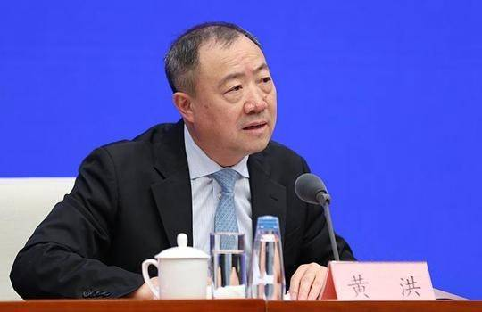

2019 年 10 月 21 日，中国银行保险监督管理委员会副主席黄洪回答记者提问

黄洪指出，到 2019 年 9 月末，反向抵押保险期末有效保单 129 件，共有 129 户家庭 191 位老人参保，参保老人平均年龄 71 岁，户均月领养老金 7000 余元，最高一户月领养老金超过 3 万元

既然"以房养老"是一个让老人、金融机构和政府实现多赢的好东西，为什么遭到市场冷遇呢？主要有四个原因。

第一，房屋产权不独立。很多老人的房子不是自己单独所有，而是当年自己出钱，然后挂在儿女名下，这通常是作为父母给儿女未来提供的一种物质保障。即便是自己单独所有，但因为和儿女住在一起，一旦房屋到期被金融机构收走，儿女的住所又是一个新问题。

第二，70 年"大限"带来了产权的不确定性。虽然法律规定房屋所有权 70 年到期之后自动续期，但是续期要交多少钱？这个问题并没有真正从制度上解决。这导致房屋的抵押价值难以确定，当然也就影响了现金流的变现。

第三，传统文化的惯性。很多老人认为，作为父母，总要给儿女留下一点财产。而房产是最重要也是最耐久的资产，还能传承给孙辈。如果儿女不是富豪，卖掉房子后自顾自己安度晚年，实在于心不忍，有钱也没法"安"度。

第四，关于"以房养老"的骗局导致这个金融创新模式被污名化，让公众对"以房养老"敬而远之。这恐怕是最重要的原因。

例如，2019 年中安民生养老服务有限公司的"以房养老"产品"暴雷"，  
受骗客户有 600 多人，涉案资金超过十几亿元，当时公司实际控制人李佳豪等 88 名犯罪嫌疑人被刑事拘留。

同一年，北京利合济民投资有限公司的"以房养老"产品"爆雷"，公司因涉嫌非法吸收公众存款罪被警方刑事立案。

最近，财新网报道了该公司暴雷之后的房产归属权纠纷，再度引起公众警惕。

### 三、以房养老的骗局是怎么玩的？

"以房养老"作为一种金融创新模式，在美国、英国等发达国家大量推广，为什么在中国就被玩成了骗局呢？

归根结底，还是诈骗机构利用了信息不对称，钻了法律法规的漏洞，把一份正常的借贷契约变成了一份不完全契约，让受害老人告状无门，甚至钱财两空。

在现实中，一个典型的"以房养老"骗局，通常是"七板斧"的玩法。

第一步：借贷理财机构（骗子）找到老人甲（房屋所有人），说服老人加入"以房养老"计划，具体来说就是用名下住房进行抵押，然后从第三方贷款，并将贷款交给借贷机构，购买其提供的理财产品，获得"稳赚不赔"的较高回报。

在这一步，借贷机构提供的理财产品回报率其实 并不高，比如说年化收益率 5%左右。如果太高了，比如说 30%，直接就会被当成骗子。这正是骗子"高明"的地方！

第二步：借贷机构找到出资人（参与做局的个人、借贷机构员工或者其关联企业），向老人甲提供抵押贷款，贷款的名义是"购买生产设备"或者"生意往来"（此处应有伏笔）。

这笔贷款的利息较高，比如年利率为 18%，但利息不必由老人甲负担，而是由借贷机构代为偿还。因此，借贷机构提供给老人甲的理财产品收益，并不是前面提到的 5%，还要加上其垫付的贷款利息，两者合计超过 20%。

第三步：老人甲将抵押贷款投入借贷机构（实际上由出资人直接汇入借贷机构账户），购买其理财产品，然后借贷机构定期向老人甲支付理财收益。

有警惕心的老人此时可能会问，借贷机构拿了自己抵押贷款的钱，会不会有投资风险呢？此时，借贷机构会信誓旦旦地告诉老人：这笔钱主要是用于资本市场投资，投资经理富有丰富的经验，或者是借给临时需要周转资金的生意人，并且对方也抵押了房产。这就打消了老人的疑虑。

第四步：到了这里，聪明人可能会怀疑，借贷机构究竟拿什么来支付老人甲的理财收益以及出资人的高额利息呢？

真相是，借贷机构又找到老人乙，说服其加入"以房养老"计划，将其房产抵押，然后以"购买生产设备"等虚假名义，从监管不严的中小银行贷款，再用银行贷款分别支付两位老人、出资人的理财收益和利息。

第五步：如果以上四步能够不断自我循环，那么这个"击鼓传花"的游戏就不会被戳破。但是，当"拆东墙"无法"补西墙"时，资金链断裂了。借贷机构无法向所有老人和出资人提供理财收益或者利息，它们要么跑路，要么违约，这就是"暴雷"了。

第六步：当初的出资人开始追债，以正常资金借贷合同为由，要求法院判令将老人甲的房产过户到自己名下。

此时，老人甲肯定会申诉，说三方当事人当初都说好了，抵押贷款的利息由借贷机构支付，但这个私下协议并没有变成正式的合同，因此法院无法确认这是理财诈骗。当然，出资人会竭力否认，甚至指责老人甲私下拿做生意的资金去购买理财产品，被骗是咎由自取！至于出资人与借贷机构有什么关系，双方是否合谋，往往难以证实。

第七步：悲剧发生，老人甲乙钱（理财收益）财（房屋）两空，不但没有从借贷机构得到后续的理财收益，而且房子很可能会被判给出资人。

在现实中，再完善的合同也会有漏洞，但再狡猾的狐狸也会漏出尾巴。

在以上七步中，破除骗局的最关键步骤是第二步。如果老人甲在与出资人的抵押贷款合同中，注明用途是购买理财产品，而不是默认造假（虚构"购买生产设备"名义），那么监管机构事后就可以根据已有案例，认定该合同涉嫌欺诈，判定抵押贷款合同无效。正是因为贷款用途无法证实，贷款合同变成了一份不完全契约，实际上无法保障老人的合法权益。

其实，即便没有经验，博弈论也可以帮忙识破骗局。博弈论的一个要点是，自己在做决策时，要考虑对手的反应，绝对不能把对手当傻子。

想想看，借贷机构支付给老人甲和出资人的回报合计超过了 20%，请问哪个明星基金经理能够保证给你 20%的回报率，而且还不包括他自己的报酬？

如果真有这样的好事，为什么借贷机构不直接向出资人借钱，而要通过老人来借钱？就算没有投资理财经验，"没有中间商赚差价"的广告词总应该听过吧？结论是，下次看到 20%的回报率，直接把对方当骗子。这个方法虽然粗暴，但绝对有效！

虽然"以房养老"有点被玩坏了，但"以房养老"这个模式本身仍然有前景。

如果我们在签约时多一份心眼，少一份侥幸，同时监管部门通过规范交易减少信息不对称，那么"以房养老"依然值得看好。

亲爱的听友，如果你觉得我讲得有道理，欢迎关注我在看理想的节目《不完美世界的博弈：契约经济学 35 讲》；如果你觉得我讲得没道理，欢迎你在评论区"吐槽"！再见。

公众号懒人找资源，懒人专属群分享

## 12 动态逆向选择 I 丨为什么好人-好心也会办坏事？

懒人专属群的群友，你好，我是聂辉华。

在很多人眼里，孔子是一个非常古板、迂腐的人。《论语》说："割不正，不食。"你看，孔子连吃肉都要求切得方方正正，否则宁可不吃。

但是，当我阅读了更多关于孔子的原始文献后，我发现孔子有时也是一个懂得变通、很讲究策略的人。我先给大家讲一个关于孔子的故事吧。

春秋时期的鲁国，很多平民百姓为了生存，不得不将子女卖到贵族家里当奴仆。官府规定，如果有人愿意出钱为奴仆赎身，让他们变回自由人，就可以得到官府的奖金。

孔子有一个弟子叫子贡，出钱帮一个奴仆赎身了，但谢绝了官府的奖金。他以为，这种好人好事一定会得到孔子的表扬。没想到孔子严厉地批评他：规章制度是用来规范百姓行为的，不是针对某个人，如果大家都像你子贡这样高风亮节，以后谁还有激励去做好人好事呢？

孔子批评子贡的故事说明：人们有时会好心办坏事。我们每个人都要读书或者参加工作，都要跟同学或同事打交道，都希望给别人留下一个好名声。但是，你可能没想到，有时候好名声反而会带来坏结果。这是为什么呢？今天的节目就来谈谈这个反常的问题。

### 动态的博弈过程

我们每天都要跟很多人打交道，但我们经常不知道对方的人品如何。为了表达方便，我们就简单粗暴地像小孩子看电视一样，暂且把所有人分为两类：一类是"好人"，另一类是"坏人"。

用契约理论的话来说，人品是一种表示个人类型的信息。在打交道之前，我们不知道对方的人品，因此人品是一种事前的不对称信息。

在前面的节目中，我们介绍了揭露当事人类型的两种主要方法：一种是信号发射，就是当事人通过某种独特的行为----  
比如考上好大学，这就证明自己是比较聪明的人；另一种是信息甄别，就是老板通过设计不同的契约让员工选择----  
比如是拿固定工资，还是拿销售提成，胆子大、能力强的员工就会选择拿提成，而胆子小、能力弱的员工会选择拿固定工资。

但是，前面的分析都有一个隐含的假设：当事人之间的契约关系是静态的、短期的，双方之间是一次性博弈。但在现实中，人与人之间的博弈通常是动态的、多次重复的。这就是我们今天的主要知识点  
\----动态逆向选择问题，即人们如何在动态或者重复博弈下克服事前的信息不对称问题。

聂老师再次提醒你，一旦我们将人与人之间的关系看作是一种重复博弈，一些静态条件下成立的结论在重复博弈下可能是错的。否则，我们要学那么多理论干什么呢？

在重复博弈过程中，我们可以通过声誉（reputation）机制了解一个人的品德。所谓的声誉，就是名声、口碑。我们不知道一个陌生人究竟是好人还是坏人，但我们可以通过观察他的部分行为来判断他的人品。

比如说，我们看到一个人做了一件好事，那么我们就认为这个人可能是好人；如果我们看到他做了无数件好事，我们就可以认定他绝对是一个好人；如果我们看到他做了一件坏事，那他肯定是一个坏人。

也就是说，在信息不对称的条件下，我们只能通过行为来推测人品。因此，"好人好事"其实是一种建立好声誉的办法。

有了声誉机制，好人会经常做好事，因为好人需要证明自己是好人；有趣的是，坏人有时也会做好事，因为坏人希望通过做好事来掩盖自己的类型。毕竟，没有哪个坏人一开始就巴不得告诉别人自己是坏人。你看，声誉真是个好东西。

在经济学界，声誉理论的主要创立者，是斯坦福大学教授克雷普斯（David  
Kreps）。克雷普斯被认为是最有天赋的经济学家之一，他曾经获得了克拉克奖。这个克拉克奖专门颁发给 40 岁以下的、最优秀的美国经济学家，他也是诺贝尔经济学奖的潜在候选人之一。

David M.Kreps（1950-） 世界博弈理论研究的领军人物，1989 年获得克拉克奖

### "声誉"让"好人"反而做坏事？

然而，近年来的研究表明，好声誉不仅让好人和坏人做好事，有时也会让好人做坏事！你没想到吧？

2003 年，美国西北大学教授依莱（Ely）与合作者在世界顶级的《经济学季刊》（QJE）上发表了一篇论文。这篇论文的题目就是《坏声誉》（Bad  
Reputation），顾名思义，声誉有时是个坏东西，它会把好人给害了。

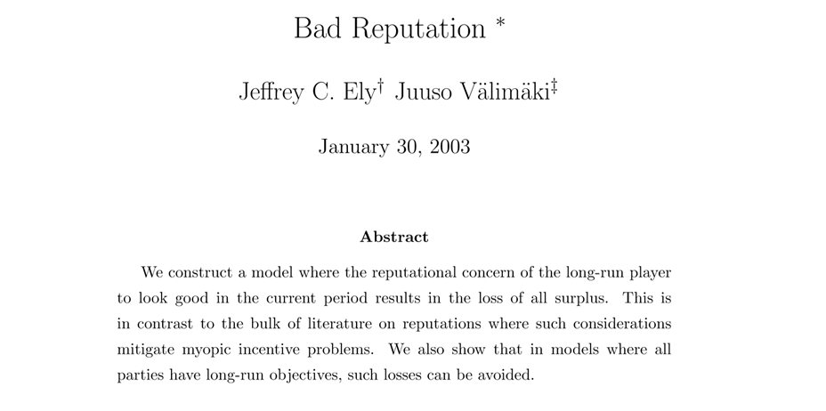

论文《Bad Reputation》

一般来说，博弈论的论文都非常复杂，满篇都是数学公式，但是没关系，聂老师用大白话给你讲一个有趣的故事。

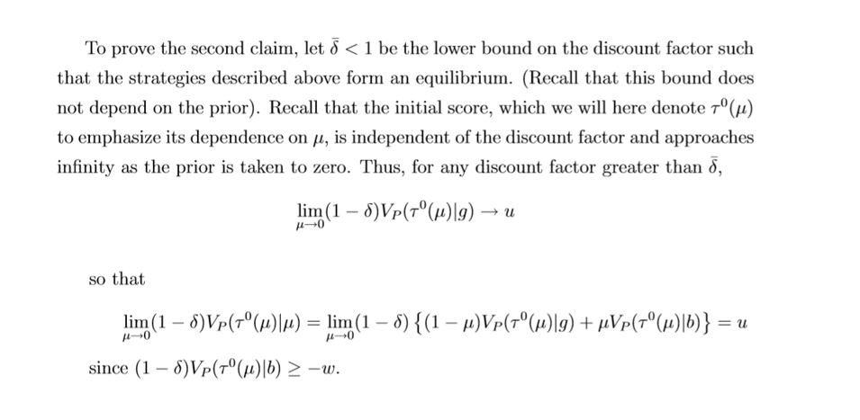

《Bad Reputation》论文中的公式（参考）

在一条高速公路的服务区有一家汽车维修店。维修店是固定的、长期营业的，但是开车路过的车主都是临时的、一次性的。

车主一旦在高速公路上发现汽车出了毛病，就会把车送到维修店来修理。但车主不是汽车专家，不知道自己的汽车究竟有什么毛病，严重不严重。车主只能推测汽车有 50%的概率需要大修，例如换发动机或者变速箱，有 50%概率需要小修，例如更换机油或者轮胎。

专业的修理工知道汽车的真实毛病，但车主不了解修理工的人品，双方之间存在事前的信息不对称，这样就容易出现我们前面提到的逆向选择问题。

修理工有两种类型：好的修理工根据汽车的真实状况来决定大修还是小修，而坏的修理工总是选择大修，因为大修比小修带来的利润更高。在不了解车况以及修理工人品的前提下，这些临时路过的车主唯一拥有的信息，就是这个修理工以往的修车记录，因此车主根据修车记录来判断修理工的人品好坏。

怎么判断呢？如果他发现修理记录上大修的记录超过 50%，那么他就认为对方很可能是一个坏修理工，因为"坏修理工喜欢大修"；反之，如果他发现修理记录上大修的记录低于 50%，那么他就认为对方很可能是一个好修理工。

在这种声誉机制下，修理工为了表明自己是一个"好的"修理工，就会尽量减少大修，增加小修，哪怕是该大修时也改为小修。在极端情形下，修理工干脆全部小修，以免被顾客认为自己是坏人。

但这样一来，该修的汽车毛病就没法彻底修好，而且说不定还会在高速公路上发生更严重的事故，甚至导致车毁人亡。而理性的车主一旦意识到这点，干脆就不来修车了。于是，修车市场就崩塌了。

修车的故事告诉我们，在声誉机制的作用下，如果好人急于证明自己是好人，那么好心可能会办坏事。这就是我们今天学习的动态逆向选择模型的基本结论。

这个结果有点类似于我们前面学过的信号发射理论：有时当事人为了证明自己，过度发射了信号，反而浪费了社会资源。

在声誉压力下，好人做不成好事的例子可以说比比皆是。例如，一个程序员在办公室整夜写代码，第二天白天有点犯困了，就在电脑上看一会电影。假如此时老板刚好经过办公室，就会认为这个员工不务正业（上班时间居然看电影），甚至说不定直接开除。而一旦预料到这种结局，或者看到了这样的处分以后，其他程序员就不会再熬夜加班，这样工作业绩反而减少了。

### 如何发挥声誉机制的正面作用？

在前面的修车故事中，如果声誉机制没有发挥正向的作用，不仅司机的生命会受到威胁，更大的威胁是司机不再信任维修人员，从而导致整个行业的崩溃。那么，如何让声誉机制发挥应有的正面作用，解决信息不对称的问题呢？下面这个案例能够给到我们一些启发。

大家都知道，可口可乐公司是全球最大的饮料生产商，但是很少有人知道，可口可乐公司在进入中国市场的前十年，"一个铜板也没赚"。

因为当时的董事会主席说：中国是一个巨大的市场，而且它还在不断成长。为此，可口可乐公司美国总部对中国公司的考核要求是：不看短期盈利，只看长远预期。

为了培育中国市场，1986 年可口可乐公司在中国中央电视台投放了第一个电视广告，并持续地赞助体育赛事。不断地宣传，塑造了可口可乐公司在中国的良好形象，建立了品牌声誉，最终将中国市场成功地培育为贡献最大的全球市场之一。

相反，如果当时的公司负责人目光短浅，只注重短期声誉和年度考核，那么这个全球第一的洋品牌很可能至今都无法立足中国，更不用说让中国市场成为其全球主要市场了。

从上面的案例中，我们可以看出，如果声誉的评价者不是看重当事人的短期表现，而是看重长期表现，那么当事人就没有必要为了所谓的好声誉而去干坏事。

假设汽车维修店不是开在高速公路的服务区，而是开在一个居民小区边，或者人流固定的办公区，那么来修车的车主就不必管别人的维修记录，根据自己的几次修车经历就知道修理工靠谱不靠谱。

也就是说，一旦我们把双方博弈的环境从一个短期当事人和一个长期当事人，换成两个长期当事人，答案就完全相反了。

这正印证了中国古代的一句名言：路遥知马力，日久见人心。有的时候，给自己一点耐心，就是给别人一点信任，也是给好人一次机会。

结语

好了，让我们来总结一下今天的主要内容。

在信息不对称的条件下，当事人可以通过声誉机制来证明自己的类型。但如果当事人过于看重短期的声誉，会导致他为了证明自己而做出对客户不利的事情，这就是好心办了坏事。

今天的思考题是：居里夫人先后获得诺贝尔物理学奖和诺贝尔化学奖，她发现了一种新的放射性元素----  
镭。为了推动相关研究，她慷慨地将所有的奖金无偿捐出，但自己却没有钱再买一克镭来做实验。请问你怎么看待这种行为？

好了，今天我们就讲到这里，下集再见。

公众号懒人找资源，懒人专属群分享

## 13 多任务冲突丨 KPI 考核是万能的吗？

懒人专属群的群友，你好，我是聂辉华。

### 海底捞董事长将 KPI"扫地出门"

爱吃火锅的朋友，肯定都知道著名的"海底捞"火锅店。

1994 年，只有中专文凭的张勇，创办了第一家"海底捞"火锅店。后来，"海底捞"成为全国最著名的火锅品牌，然后张勇就去某个著名大学的商学院读了一个 EMBA（高级工商管理硕士）。

张勇与海底捞

在商学院，张勇学了很多现代化的管理手段，什么目标管理，平衡积分卡，KPI（关键绩效指标）。一开始，他非常虔诚地将这些管理手段运用到"海底捞"的管理实践上，但是他很快就发现这些管理手段都失败了。这是怎么回事呢？

原来，当初"海底捞"董事长张勇为了鼓励服务员吸引回头客，曾经将"点台率"作为考核服务员的 KPI。

具体来说，客人来店就餐时，点哪个服务员的次数越多，就代表客人的满意度越高，那么被点名的服务员奖金就越高。这听上去没毛病啊，但是结果却事与愿违。

很多服务员为了赢得更高的点台率，不惜利用手中的权力给客人免费赠送黄豆、豆浆、小菜等各种食品，而且服务员之间相互攀比，看谁给客人送的东西更多。

因此，以点台率为 KPI 的考核方式，导致了服务员之间的恶性竞争。最后，服务员的点台率是上去了，但是分店的成本也急剧增加了，关键是利润却明显下降了。

另一个 KPI 是考核分店的利润。由于总部控制了选址、装修、菜品、定价和工资等大项支出，分店为了提高利润，就拼命在小项支出上节约成本。这导致该换的扫把没有换，该送的西瓜没有送，该提供的毛巾也没有及时更新。各个分店为了提高短期利润，变相地降低了服务质量，长期来看，反而减少了客人和利润。

基于上述失败的教训，董事长张勇认为，KPI 考核方式是"捡了芝麻，丢了西瓜"。于是，张勇将目标管理、平衡积分卡、KPI 这些流行的考核方式通通扫地出门。

其实，海底捞董事长张勇碰到的难题在组织中非常普遍。不管是企业、事业单位，还是政府部门，都会碰到这样的难题：一个员工要同时承担多项任务，多项任务之间往往是冲突的，而且不同任务有的容易考核，有的难以考核，那么这个时候，管理者应该怎样评价员工的工作，并合理激励员工呢？这就是我们今天节目要介绍的主要内容。

### 最优激励机制的四种情况

在第 10 讲"道德风险"中，在信息不对称条件下，一个员工只从事一项任务。今天我们要讨论一个员工从事多项任务时，老板应该如何激励员工。

在契约理论中，一个人同时承担多项任务的情境，被称为"多任务代理问题"，你可以将它理解为复杂版的道德风险问题。为了简化分析，我们假设一个员工同时承担两项任务，然后分四种情况来讨论最优激励机制。

第一种情况，两项任务都可以考核，但它们是相互冲突的。

例如，一个餐厅的服务员既要提高点台率，又要降低成本。点台率可以通过计算每天每张餐桌的客人数量来衡量，而每桌饭菜的成本可以通过后台电脑直接查询到，都是容易考核的任务。

问题是，这两项任务是相互冲突的：提高点台率就意味着要给客人打折，免费赠送小菜或者小礼品，但这显然会增加餐厅的成本。在这种情况下，如果老板要同时考核两项任务，又不分配每项任务的权重，就会让服务员无所适从，并且不管顾及哪头，注定都难以完成考核任务。

因此，我们的第一个结论是：除非明确规定权重，否则不应该将两项容易考核但又相互冲突的任务分配给同一个人。

第二种情况，一项任务容易考核，另一项任务不容易考核，并且两者是相互冲突的。这是最常见的。

例如，一个交警既要处罚违章车辆，又要维护交通秩序。处罚违章是很容易考核的，只要数一下一个交警每个月开了多少罚单，扣了多少分，罚了多少款就行了。

但是，维护交通秩序却很难考核，因为交通拥堵可能是因为下雨，也可能是因为上下班高峰时期，还可能是因为临时出了交通事故，这些因素都是不可预见的，几乎跟交警的个人努力无关。

另一方面，一个交警每天的精力是有限的，处理违章的时间多了，维护交通秩序的时间就少了。

在这种情况下，如果主管部门对两项任务都进行高强度奖励，那么理性的交警一定会把主要精力用在交通罚款上，而忽视维护交通秩序这项重要任务。用契约理论的话来说，当事人会在两项任务之间套利，从而导致激励扭曲。

那怎么办呢？此时，应该降低对两项任务的激励强度，尤其是降低对容易考核任务的提成比例或奖金水平，这样会引导当事人尽量兼顾两种任务，从而减少激励扭曲。

在极端情况下，如果不容易考核的任务至关重要，那么就应该将激励强度降到最低，或者干脆实行固定工资。

事实上，在很多西方国家，警察都属于公务员体系，工资与"创收"或罚款无关，这是有道理的。

由此，我们得到第二个结论：如果当事人承担的两项任务是相互冲突的，并且其中一项是不容易考核的，那么应该降低容易考核任务的激励强度；在极端情况下，固定工资制度反而比奖励制度更有效。你大概没想到这点吧？

第三种情况，两项任务是相互补充的。

例如，一个销售员通常要做两件事情：一是提高销售额，二是维护客户关系，包括定期拜访老客户。前者很容易考核，后者就不容易考核了，因为客户的满意度往往是主观的。

这两项任务是相互补充的，因为老客户越满意，回头客就越多，销售额就越高，相反开发新客户往往更辛苦。

在这种情况下，即便客户满意度难以衡量也不要紧，只要公司加大销售的提成力度，销售员为了提高业绩自然会努力维护客户关系。

于是，我们得到第三个结论：如果当事人承担的两项任务是相互补充的，那么只需要提高容易考核任务的激励强度。

第四种情况，两项任务中本职工作难以考核，而非本职工作又难以监督。

例如，一个公司的行政文员，其主要任务是负责接打电话、复印文件、安排会议，但是她也可能上班时间开网店、网购或者写小说。显然，其本职工作难以量化考核，非本职工作对公司没有帮助并且难以监督。

那怎么办呢？契约理论认为，一个次优的办法是，直接禁止员工上班从事非本职工作，例如上班要按时打卡，办公电脑里禁止安装无关软件，外出活动要严格请假。

相反，像公司的 CEO（首席执行官）、销售员、软件工程师这类人，其本职工作很容易考核，就没有必要限制其外部活动。因此，普通文员上班当然要打卡，但你什么时候听说过公司老板上班要打卡？

最后，我们得到第四个结论：如果两项任务中本职工作难以考核，而非本职工作又难以监督，那么应该限制当事人的非本职工作。

### 安达信的教训：忽视任务之间的冲突

在组织管理中，如果忽视两项任务之间的冲突，企业不仅可能亏钱，甚至可能倒闭。

2002 年之后，全球"五大会计师事务所"之一的安达信倒闭了。为什么呢？因为安达信作为一家会计师事务所，同时向客户提供两项业务：一是审计业务，二是咨询业务。这两项业务是相互冲突的。

因为审计是按照财务准则严格审核客户的资产负债情况，为客户的财务合规性提供信用报告，实际上是做"减法"，而咨询业务是向客户提供对方想要的建议或方案，以此获取服务报酬，实际上是做"加法"。

如果一个会计师事务所既做审计业务，又做咨询业务，那么当客户对审计结果不太满意时，可能会通过咨询业务付费来换取更"宽松"的审计结果，但这就违背了审计的原则。

事实上，当咨询业务越来越赚钱时，安达信公司的审计原则开始受到了挑战。

2001 年，著名能源企业安然公司付给安达信 5200 万美元报酬，其中超过一半的报酬（2700 万美元）是咨询服务费。因此，当安然公司在 2001 年底因为财务造假而破产时，安达信立即陷入巨大的丑闻，并且受到美国政府的刑事调查，很快安达信就从市场上消失了。从此，全球会计师事务所的"五大"就变成"四大"。

### 海底捞究竟应该如何考核？

让我们回到"海底捞"董事长张勇的难题，应该怎么解决"海底捞"的考核问题呢？

我的一个建议是，对员工同时考核点台率和利润这两项指标，并根据实际情况赋予一定的权重，这样员工就不会单纯追求客人的回头率而失去了利润率。

在分店考核方面，因为长期利润与服务态度是正相关的，所以可以直接考核一个分店的长期利润，而不应该只考核短期利润。例如，以一年的利润为主要考核指标，以季度或月度利润作为参考指标，这样长期和短期可以兼顾。以上建议，免费送给"海底捞"，拿走不谢！

#### 结语

现在，我总结一下今天的主要内容。

在信息不对称的条件下，一个员工要同时承担多项任务，如果多项任务之间存在冲突，或者权重不清，就会带来更大的道德风险问题，甚至导致组织或者企业被淘汰。

因此，老板在设计激励机制时要更加慎重。首先，要搞清楚任务之间的关系，避免让一个人从事两项冲突的任务；其次，要合理地调整任务的考核方式，恰当安排奖金和固定工资的权重。

说到这里，聂老师又要语重心长地告诫一句：当领导、做管理，一定要有理论框架，否则学的知识越多，脑袋里越乱。古人说的好，"尽信书，不如无书"。

最后是一道思考题：试着用今天所学的知识，分析你正在从事的工作中，一共有几项任务，这些任务之间的关系是什么？你认为最有效的考核方式又是什么？

好了，今天我们就讲到这里，下集再见。

公众号懒人找资源，懒人专属群分享

## 14 团队生产问题丨末位淘汰制是管理考核的灵丹妙药吗？

懒人专属群的群友，你好，我是聂辉华。

无论是在学校学习，还是在单位工作，我们都需要团队精神。所谓团队（team），就是一群人为了实现一个共同的目标，一起努力。

但这就产生了一个管理难题：既然老板和员工之间存在信息不对称问题，以至于老板无法观察到员工的真实努力水平，那老板怎么考核团队成员的业绩呢？

比如说，一个饭店在 2019 年年底的时候生意特别火，但是今年年初遭遇了疫情，生意惨淡。那你能不能说，年底员工们都很努力，而年后员工们都在偷懒呢？显然不能。

大家都知道，年底生意好，很大程度上是因为过年的气氛带动的，说白了就是运气好；而年后生意不好，很大程度上是因为疫情导致的，也就是碰上了"霉气"。

如果老板完全根据事后的绩效来发放报酬，而不考虑真实的努力程度，那就是鼓励大家都去碰运气。这样做的后果就是，当碰到好运气时，人人争先恐后；一旦碰到坏运气，大家就作鸟兽散。

显然，一个靠运气的组织是不公平的，也不可能持续发展。那么，有什么办法可以在考核员工绩效时挤掉那些"运气"或者"霉气"呢？今天，我们就来讨论这个有趣但是颇具挑战性的话题。

### 末位淘汰制：通用电气的成功秘诀

我们从一个跨国公司的案例开始。通用电气公司（GE）被认为是美国最伟大的企业之一，连续多年在"财富 500 强"中名列前茅。

通用电气最著名的 CEO（首席执行官）是杰克\*韦尔奇（Jack Welch）。韦尔奇认为，通用电气成为"百年老店"的秘诀之一是，实施了"末位淘汰制"。

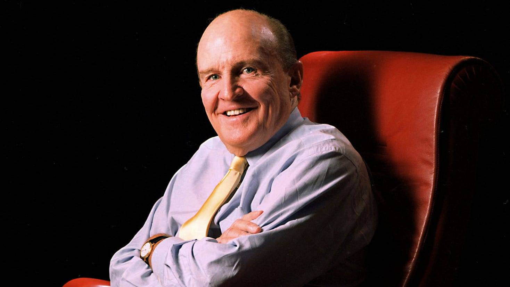

杰克\*韦尔奇（Jack Welch，1935-2020）

韦尔奇把所有员工分为三类：最好的 20%员工属于 A 类，这些人的报酬是 B 类员工的两三倍，而且还有大量的股票期权；中间 70%的员工属于 B 类，他们总体表现不错，其中 60%-70%的 B 类员工也有股票期权；最后 10%的员工属于 C 类，表现最差，而且不会有什么改变。因此，最后 10%必须每年清除，这就是所谓的"末位淘汰制"。

末尾淘汰制又叫锦标赛考核（tournament），就是对同一类人进行相对排名。

比如说，大家都是某个房地产公司的华北区销售团队成员，那么华北区团队成员之间就具有可比性，因为大家的外部环境、工作对象都是类似的。此时，团队内每个成员之间的业绩差异，基本上反映了个人努力水平的差异。

如果你在华北区团队中销售业绩排名靠前，就说明你比别人更加努力。如果说你的销售业绩有运气的成分，那么大家都有运气的成分，通过横向比较就消除了运气的成分。

反过来，如果华北地区的房地产调控政策导致大家的业绩都不好，那么通过横向比较就消除了共同的"霉气"。在大环境不好的前提下，如果你的相对业绩仍然靠前，就说明你仍然付出了更多的努力。

因此，不管运气好不好，只要你的相对业绩好，你的奖金就更高。这样一来，你只要努力工作，不管运气好坏，都会得到正面奖励，从而没有后顾之忧。

因此，一个组织如果实行了末位淘汰制，就能实现让每个员工"尽人事，听天命"的效果，这就是一个有效率的、公平的组织。

与体育锦标赛不同的是，企业在实行锦标赛考核时，在奖励获胜者的同时，往往还要惩罚落后者。比如，扣除最后几名的奖金，甚至淘汰最后几名。通用电气公司要淘汰最后 10%的员工，就是一种锦标赛。

实行末尾淘汰制有如下好处。

第一，它非常简单。主管只需要比较考核对象的相对业绩，或者说排名就可以了，不需要比较具体的绝对业绩。这节约了考核成本。

第二，它能挤掉运气或者霉气，真正体现每个员工的努力水平。正因为有这些优点，这些年末位淘汰制在中国企业非常流行。例如，2019 年京东公开宣称，要淘汰掉 10%的副总裁级别高管。

但聂老师慎重地提醒你：流行的东西不一定是对的！鞋子合不合脚，只有自己知道；理论合不合适，要看前提是否满足。

### 制定末位淘汰制的三个前提条件

大家想想看，如果末位淘汰制真的有如此神奇的效果，为什么从 2015 年开始，通用电气公司放弃了末位淘汰制呢？因为末尾淘汰制有严格的前提条件，而这些前提条件在现实中往往并不满足，此时就会出现相反的效果。

第一个前提条件是，末尾淘汰制的所有参与者必须起点公平。如果起点不公平，相当于外部环境不相同，此时相对绩效就无法反映真实的努力水平。

举例来说，通用电气的医疗销售部门要对员工进行绩效考核。如果该部门有两个员工，一个是进入医疗器材销售领域五年的老员工，另一个是才工作一年的"菜鸟"。让一个资深员工和一个职场"菜鸟"按同样的业绩目标进行考核，这显然是不公平的。即便工作年限类似，员工也可能面临不同的专业背景和不同的客户群体，这可能导致两个员工之间并不具有可比性。

起点不公平的末尾淘汰制，一方面会打击弱势员工的积极性，另一方面可能导致严重的内耗。在《西游记》团队中，如果唐僧让孙悟空和猪八戒比赛挑水，个子矮小的孙悟空恐怕永远也赢不了，这样的话我们恐怕要担心猪八戒的生命安全了！

第二个前提条件是，末尾淘汰制只适用于个人业绩容易认定、不太需要多方协调的岗位。

在通用电气这样的大公司里，一般来说，销售员、工程师、客户经理和投资经理，这些人的业绩主要依靠个人努力，因此业绩和个人努力之间的因果关系比较清晰。

但是，还有一些重要的岗位，例如培训专员、会计师、法律顾问，这些人的业绩在很大程度上取决于其他人以及其他部门的协调程度，因此业绩和个人努力之间的因果关系并不清晰。

如果对这类协调性岗位也进行末位淘汰制，那么就相当于将别人的工作风险转移到了被考核者身上，这必然导致被考核者的风险规避行为。

特别是，有一类岗位的业绩不仅需要多个部门协调，而且往往是"做减法"的，比如审计师、质检员以及负责反腐败的监察专员。他们的工作越是有效，那么暴露的问题就越少，但暴露的问题越少，业绩反而显得越"差"了。因此，这类岗位不适合采取末位淘汰制。

第三个前提条件是，末尾淘汰制完全忽略绝对业绩，因此不能在绝对业绩相差较大的团队之间比较。

假设通用电气公司有两个能源销售团队，其中 A 团队的平均业绩很高，B 团队的平均业绩很差。如果公司按照末位淘汰制统一规定，不论业绩好坏，每个团队都必须淘汰掉最后 5%。那么，A 团队的人再怎么努力，也有 5%的人被淘汰，而这被淘汰的 5%很可能比 B 团队没被淘汰的员工还要优秀。于是，这 5%的人只能选择离职，或者"宁做鸡头不做凤尾"，加入 B 团队。

以此类推，A 团队里倒数第二个 5%的人又面临被淘汰的风险，他们也会离开。最后，水平高的 A 团队成员全部离开，或者一开始就集体跳槽，只剩下水平差的 B 团队。结果，末位淘汰就变成了逆向淘汰：该走的没走，不该走的全走了！

因此，末位淘汰制作为一种比较激进的绩效考核方式，比较适合处于快速发展时期的大企业，有足够多的员工可以备选，并且员工之间具有较高的可比性，例如华为或者京东。

如果要在绝对水平相差较大的团队之间实行末位淘汰制，就必须根据团队的绝对绩效制定适宜的淘汰比例，而不能对所有团队实行"一刀切"的末位淘汰比例。

### 放弃末位淘汰制的通用电气如何考核员工？

前面讲到的通用电气作为一家成熟稳健的公司，已经探索了一套考核员工的多元化体系，不再依赖单纯的个人业绩比较。因此，它果断地放弃了末位淘汰制。那么，通用电气公司如何考核员工呢？

根据有关专家的调研，通用电气在 2015 年之后采取了一套二元考核体系。一个维度是个人业绩，另一个维度则是成长型价值观。所谓的成长型价值观，就是员工所从事的业务对公司总体发展的战略价值。

两个维度都分成三种评价，从低到高依次是：有待提高、始终达到、超出预期。这样，两个维度就形成了 3×3 的九宫格矩阵。这个图我放在文稿里了，有兴趣的朋友可以打开文稿看一下。

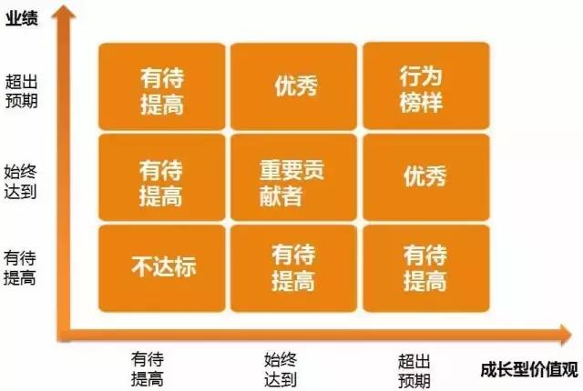

来源：毕竞悦，《湛华商业评论》

例如，通用电气新设立了一个开发页岩气的部门，这个部门是新部门，一开始肯定起步比较慢，业绩不太好，可能属于"有待提高"的最低档次，但是它对于公司的战略价值非常大，因此在成长型价值观这个维度上可能属于"超出预期"的最高档次。

总体而言，这个部门的员工只要努力，即便业绩差，也可以得到较好的总体评价。实行两个维度九种结果的二元评价体系，使得通用电气的员工会更加注重团队合作，因为团队合作才能共同维护所属业务在公司的战略地位。

此外，它给一些暂时处于落后地位的员工提供了一种缓冲地带，给予他们继续进步的机会，而不是根据短期业绩直接淘汰。

结语

总结一下今天的主要内容。

在信息不对称的前提下，实行末位淘汰制可以挤掉运气的成分，显示员工的真实努力水平。但是，末位淘汰制有严格的前提条件：员工之间必须起点一样；员工的个人业绩主要与个人努力有关，不需要太多协调；另外不同团队之间不能进行比较。如果运用不当，末位淘汰变就会成逆向淘汰。

因此，一定要搞清楚末位淘汰制的前提条件，不要闹出东施效颦的笑话。

最后是一道思考题。在末位淘汰制（锦标赛考核）实施过程中，有可能会出现合谋。例如，某个团队都是熟人或者老同事了，大家都不想努力，也不希望破坏表面的和气，于是每个人都偷懒，然后轮流当"先进"。如果你是老板，请问，你有什么办法防止这种合谋行为呢？

好了，今天我们就讲到这里，下集再见。

公众号懒人找资源，懒人专属群分享

## 15 合谋理论丨员工“合谋”让老板防不胜防？（兼谈刘强东破产的餐厅）

懒人专属群的群友，你好，我是聂辉华。

凡是在网上买东西的人，都知道京东，但大家未必知道的是，京东的创始人刘强东曾经开过饭店，不过很快就倒闭了。

1996 年，刘强东在中国人民大学读大四的时候，用他辛辛苦苦写电脑程序赚来的 24 万元，盘下了人大旁边的一家高档餐厅。

作为老板，刘强东对餐厅员工非常优待，还给每个人买了一块手表。但是，8 个月之后餐厅居然倒闭了。原来，负责收银的小姑娘和大厨谈恋爱了，他们俩合谋起来欺骗老板。后厨一方面高价采购食材，另一方面低报销售流水，前台收银的小姑娘帮忙做假账掩盖，企业不倒闭才怪。

这次创业让刘强东赔了 20 多万元，在上个世纪 90 年代这绝对是一笔巨款，当时北京市每月平均工资才 800 元。如何防范下属合谋欺骗老板，不止是刘强东的失败教训，也是天下老板共同的"心病"。今天，我们就来谈谈合谋问题。

### 什么是合谋？

什么是合谋呢？用契约理论的话来说，就是多个下属利用信息不对称联合起来欺骗老板或上级。

我们在上一讲介绍了团队生产中的个人绩效考核问题，当时没有考虑员工之间的合谋。然而，合谋在现实中普遍存在。

例如，你和小伙伴一起抄作业，这是合谋；你在停车场交费的时候，告诉管理员少收十块钱，不要发票，这是合谋；企业在投标时事先商量好让某人低价中标，这种"围标"、"串标"的行为是合谋；几个大企业联合起来操纵价格，这是合谋；官商勾结进行利益输送，这也是合谋。我们重点讨论老板如何防范组织内部的合谋。

上个世纪 80 年代，法国经济学家拉丰（Jean-Jacques Laffont）和梯若尔（Jean  
Tirole）引入信息不对称的思路，构建了一个组织内部合谋的分析框架，从而开创了合谋理论的先河。梯若尔后来单独获得了 2014 年诺贝尔经济学奖。如果拉丰不是在 2004 年因病去世，那么他肯定能和梯若尔一起共享诺贝尔经济学奖。

让-雅克\*拉丰（Jean-Jacques Laffont，1947-2004）

世界著名经济学家，法国图卢兹大学产业经济研究所（IDEI）创始人

拉丰认为，合谋是组织设计的核心问题。为什么这么说呢？因为合谋会导致所有的激励机制失效，让老板变成"瞎子"。

就好比刘强东的饭店，前台负责收银，大厨负责采购，一进一出就可以核实开支、计算利润，但是他们一旦合谋，再好的财务制度也会变成一张废纸，再赚钱的饭店也会亏损倒闭。

可见，如果你不懂合谋理论，就没法成为一个合格的老板或者领导者。

拉丰和梯若尔是怎么分析合谋现象呢？我们简要介绍一下他们的分析框架。假设有三个人，一个是老板，一个是作为监督者的主管，最后一个是底层员工。通常老板和员工之间存在信息不对称，此时老板会安排一个主管来监督员工。监督者在向老板汇报情况的同时，实际上也垄断了老板的信息渠道。如果员工损害了老板的利益，然后收买监督者，监督者向老板隐瞒情况，此时监督者和员工就形成了合谋。

以刘强东的饭店为例。刘强东作为老板，但他不可能天天在饭店里看着啊，当时他的主营业务是在中关村卖光盘。在他的饭店里，前台收银的小姑娘就相当于监督者，负责核对大厨每天的进货和销售收入。如果小姑娘如实记账，刘强东很容易知道大厨是不是存在高价采购拿回扣和瞒报销售收入等道德风险行为。但不巧的是，作为监督者的小姑娘和作为员工的大厨谈恋爱了，他们俩现在成为利益共同体了，于是合谋起来欺骗刘强东。最终，一场恋爱毁了一家饭店，但也许成就了一个京东，这也算是"因祸得福"吧。

### 老板如何防范员工合谋？

作为老板，有哪些办法可以防范合谋呢？

首先要明确一个思路，既然合谋主要是因为监督者和员工结成了利益联盟，那么防范合谋的办法就是瓦解他们的利益联盟。有三种防范合谋的办法。

### 防范合谋方法一：激励政策

第一种办法是激励政策，说白了就是老板拿钱收买监督者。

比如，公司的采购员拿了 10 万元回扣，他给部门主管送了 1 万元，主管对采购员拿回扣的行为假装不知道，这就形成了一种合谋。为了防止这种情况，老板可以给主管额外发 1 万元奖金，这样主管就不会参与合谋了。

听上去这很简单，但是细心的人马上会发现一个"悖论"：如果老板用来收买主管的金钱低于主管的合谋收入，就达不到防范合谋的目的；如果刚好等于主管的合谋收入，那主管凭什拒绝合谋呢？怎么破解这个悖论呢？

其实我们忽略了一个关键点：合谋是一种灰色或者违法行为。按法律规定，因公司内部的贪污或职务侵占行为是可以坐牢的，因此合谋收入要扣除一定比例的风险成本，这个比例就是合谋的交易费用。

这个交易费用的存在，可以让老板和主管的利益都得到改善。假设主管收了采购员 1 万元，有 50%的概率被发现，一旦被发现就会被解雇甚至坐牢，那么主管得到的合谋期望收入不超过 5 千元，而不是 1 万元。

理论上，老板只要给主管 5 千元，主管就不会参与合谋，而且说不定还会主动揭发采购员的违规行为。因此，老板最终用 1 万元收买了主管，避免了 10 万元的合谋损失，而主管额外得到了 5 千元的"忠诚"奖励。

可见，老板通过激励政策防范合谋，不能光给钱，还必须配套威慑政策。威慑越严厉，合谋的交易费用就越高，防范合谋的成本就越低。这就是"左手胡萝卜，右手拿大棒"。

### 防范合谋方法二：分权政策

第二种防范合谋的办法是分权政策。

监督者之所以能够与员工合谋，就是因为监督者是老板唯一的信息来源，他说什么就是什么，权力太大了。权力大，又缺乏监督或制衡，当然就容易出现合谋或者腐败了。

因此，第二种办法是对监督者分权，把他一个人的权力分解到多个人，破除监督者的权力垄断。假设你想注销一个企业，你肯定希望一个部门一道手续就办完。

但是你想过没有，如果一个部门就有权注销一家企业，那么一些企业主通过贿赂该部门的某个办事员，就可以通过恶意注销企业来逃避债务或者偷税漏税，这就使得合谋很容易发生。为了提高合谋成本，必须将注销企业这种重大事项的权力分散到多个部门、多道手续。

聂老师给大家科普一下，在现实中，注销一个企业的流程通常包括：1、到媒体刊登注销声明；2、到社保局注销社保；3、到税务局注销税务；4、到工商局注销营业执照；5、到银行注销账户；6、最后到公安局注销印章。

这套官僚主义程序看上去有点繁琐，但极大地提高了企业主与办事员合谋的成本。毕竟，收买一个部门容易，收买这么多部门几乎不可能。

因此，今天的节目也启示我们：某些官僚程序虽然降低了办事效率，但是减少了合谋现象，这是一种次优方案。当然了，在能够防范合谋的前提下，我们还是希望办事手续越少越好。

在现实中，还有另一种分权政策，就是老板再找一个监督者，并且让两个监督者相互隔离，这样可以对监督者的合谋企图形成一种威慑。

例如，董事会除了让公司内部的审计部门进行年终审计，还可以聘请外部机构审计。一旦发现两个机构的审计结果不一样，就很容易发现内部审计机构与管理层的合谋行为。

### 防范合谋方法三：瓦解政策

第三种防范合谋的办法是瓦解政策。

为了瓦解监督者与员工的利益联盟，老板往往安排自己的亲信担任监督者，或者在员工中培养"自己人"。通俗地说，就是在对手阵营里"掺沙子"，不让他们抱团。

其实，刘强东在接手那家饭店之前，原来的老板是让自己的小姨子负责前台收银。小姨子跟老板的夫人是姐妹，这样既可以防止员工合谋，还能防止老板自己搞"小金库"，可谓"一箭双雕"。正因为小姨子有这样的"特殊功能"，很多小企业都是安排小姨子来做会计或者出纳。你看，这一传统智慧背后，竟然有这么缜密的经济学逻辑！

### "防不胜防"的合谋该如何应对？

前面谈了三种防范合谋的策略，但其实不是所有的合谋行为都值得防范。对于老板来说，不管是激励政策、分权政策还是瓦解政策，本质上都是一个逻辑：通过支付金钱让监督者对自己说真话。

因此，减少信息不对称是有代价的，关键是这个代价是否值得。如果老板防范合谋的成本超过了合谋的损失，那么还不如默许合谋呢。

清朝雍正年间，官员几乎人人贪腐，防不胜防。此时，雍正皇帝设立了"养廉银"，就是在官员的工资之外，再支付一笔办公经费，这笔费用最多的相当于工资的 100 倍。

例如，一个正二品的巡抚（相当于省长），一年的工资只有区区 155 两白银（还不到今天的 7 万元），但是一年的养廉银最多高达 1 万 5 千两白银（相当于今天的 675 万元）。不过，这不仅仅是工资，还包括了办公经费。

与此同时，雍正皇帝严厉查处贪腐。通俗地说，养廉银的作用是"开前门"，而查处贪腐是"堵后门"，两者相互配合、缺一不可。

在当时，养廉银提高了官员的公务支出，减少了官员贪污的行为。现在新加坡实行的"高薪养廉"，其实就是养廉银的现代翻版。

结语

总结一下今天的主要内容。

合谋就是多个员工合作，利用信息不对称损害老板的利益。作为老板，可以通过收买、分权以及分化三种政策来防范合谋。但同时需要注意的是，当防范合谋的成本太高时，不如允许合谋。

俗话说，"水至清则无鱼，人至察则无徒"。作为老板，既要知道放水养鱼，又要懂得撒网捕鱼，但绝不能涸泽而渔。

最后是一道思考题：请你搜索一下新能源汽车骗补贴的新闻，用这一讲提到的合谋理论来分析新能源汽车骗补现象，并思考有什么合理的解决方案。欢迎分享你的想法。

好了，今天我们就讲到这里，下集再见。

公众号懒人找资源，懒人专属群分享

## 16 公司治理 II 丨集权好还是分权好？

懒人专属群的群友，你好，我是聂辉华。

世界上所有的组织----政府、企业和非盈利组织，一旦做大了，都面临一个共同的治理难题：应该实行集权管理还是分权管理？

所谓集权，就是一切重大决策都由总部说了算，每个地区或者行业的分部主要是执行总部的决定。反过来，分权就是每个分部在自己所管辖的地区或者行业内，拥有重大决策权。

传统观点认为，分权优于集权。首先，分权能够减少信息不对称，因为决策者离市场或现场更近，更了解具体情况。其次，分权能促进竞争。由于居民或企业都能够"用脚投票"，因此每个分部都会为了留住"客户"而竞争。但是在集权情况下就没有这种动力了，因为每个分部都是对总部负责，而不是对本地区的居民或企业负责。总之，不管是实务界还是学术界，分权优于集权似乎成为一种"共识"。

然而，以企业为例，既有成功的分权企业，也有成功的集权企业。中国社会科学院的一份研究报告发现：在"财富 500 强"企业中，实行分权模式的企业有 430 家，占总数的 86%；实行集权模式的企业有 70 家，占 14%。美国企业更倾向于分权，而日本企业更倾向于集权。在中国，华为、京东都是典型的集权企业，但运营绩效都很好。

显然，集权好还是分权好，并没有一个标准答案，也不存在一个"放之四海而皆准"的组织治理模式。

因此，正确的问题应该是：什么情况下集权更好，什么情况下分权更好？对于这种问题，似乎每个人都可以找到一堆理由来论证，但未必抓住了重点。

公说公有理，婆说婆有理；究竟谁有理，关键看逻辑；逻辑要自洽，关键是框架。

因此，今天我给大家介绍一个简洁的分析框架。有了这个框架，我们不仅能抓住关键因素，而且可以在外部形势发生变化时"以不变应万变"，根据实际情况准确判断应该集权还是分权。

### 不完全契约分析框架：集权 VS 分权

这个框架是哈佛大学经济学教授阿庚（Philippe Aghion）和诺贝尔经济学奖得主梯若尔（Jean  
Tirole）在一篇经典论文中提出的，这篇经典论文 1997 年发表于世界顶级经济学杂志《政治经济学期刊》（JPE）。阿庚教授著作等身，被认为是诺贝尔经济学奖的有力竞争者之一。

Philippe Aghion（1956－） 法国经济学家

他的主要研究领域是经济增长和契约理论

假设总公司要在河北、江西和广西三个地方挑选一个地方设立分公司。老板和下属都可以花费时间和精力去现场调研，然后根据调研反馈来选择分公司所在地。

如果有一套非常完善的选址方案，那么大家根据方案直接确定就行了，连老板都没有选择权，也就不存在集权和分权的问题了。问题是，在真实世界中，很多事情往往没有标准答案。

究竟哪个地方更适合作为分公司，取决于很多因素，其中一些因素（例如文化传统、商业氛围）难以标准化，没法写到契约里。

因此，对于老板和下属来说，关于分公司的选址方案其实是一种不完全契约。在不完全契约下，集权还是分权，或者说谁拥有最终决策权，就显得非常重要。

首先考虑集权。老板亲自去收集信息，同时命令下属也去收集信息，然后由老板根据双方收集的信息挑选分公司所在地。集权管理的好处是，因为老板亲自付出努力并做出最终决策，所以可以确保分公司的选址能够体现老板的利益最大化。但集权管理的坏处是，因为下属没有决策权，收集了信息也不一定有用，所以下属没有足够的积极性去努力，这可能会遗漏了重要信息。

然后考虑分权。此时，老板授权给下属，由下属收集信息，然后推荐给老板。由于老板自己缺乏信息，因此通常会直接批准。分权管理的好处是，下属工作很积极，努力水平很高。因为下属可以在分公司选址上，顺带满足某种私人利益。

比如说，这个下属刚好是江西人，那么即便河北比江西更适合作为分公司所在地，下属仍然向老板强烈推荐江西而不是河北，并提供看上去很"充分"的理由。这样，他可以安排一些江西老乡担任分公司管理人员，甚至可以安排分公司跟老家江西的亲戚朋友做生意。

像这种帮公家做事的同时顺带谋取私人利益的情况，很难证明是"以权谋私"。哪怕老板和下属双方对此心知肚明，老板也很难向第三方（比如法院）证明下属做错了。

此时，第三方信息不对称导致了老板和下属之间的契约是一种不完全契约。正因为下属的"私心"无法被证实，所以才导致了分权的坏处：下属可能选择对自己最有利，但是对老板未必最有利的方案，也就是说控制权的下放在一定程度上会损害老板的利益。经济学将这种损失称为"控制权损失"。损失的程度取决于老板和下属在多大程度上是利益一致的。如果两者利益完全一致，下属就没有私心，那么就不存在控制权损失。

### 为什么家族企业通常传给儿女？

你看，不同的权力安排，会导致不同的结果。诺贝尔经济学奖得主哈特认为，因为我们生活在一个不完全契约的世界里，所以才需要权威或者权力。那究竟应该集权还是分权呢？记住聂老师在前面的节目中反复强调的一句话，"两害相权取其轻，两利相权取其重"。

基于集权和分权的成本-收益分析，阿庚教授得出了两个重要结论。

第一个结论是，如果老板和下属的利益完全一致，那么分权总是优于集权。此时，分权会提高下属的努力积极性，同时因为利益一致，又不会带来任何控制权损失。这个结论可以解释家族企业的接班人选择。

当代中国家族企业的创始人基本上在六十岁左右，他们绝大部分都将控制权传给了自己的儿女，而不是传给职业经理人。例如，万向集团、魏桥集团、俏江南、碧桂园这些赫赫有名的家族企业，最终都由儿女接班成为掌门人。

因为对老板来说，儿女跟自己的根本利益是一致的，而职业经理人虽然可能更能干，但万一有野心或异心，自己辛苦创立的企业就可能毁于一旦。

在现实中，老板和下属利益完全一致的情况毕竟是少数，通常是两者利益存在一定程度的分歧。那怎么办呢？

阿庚教授的第二个结论是，如果老板和下属之间存在利益分歧，那么老板应该在分权带来的积极性增加和控制权损失两者之间权衡取舍。换句话说，如果分权带来的好处超过了坏处，那么分权就是最优的，否则集权是最优的。那怎么判断分权的好处更多呢？有两种情况。

第一种情况是，信息不对称越严重，组织就越是倾向于分权。因为越是信息不对称，老板就越是需要发挥下属的积极性去收集信息，此时调动下属的积极性比两者之间的利益分歧更重要。毕竟，在缺乏信息时进行集权管理，可能导致错误的决策，搞不好公司要关门。

第二种情况是，技术创新越快的领域，组织就越是倾向于分权。因为技术创新需要比较自由的发挥空间，需要及时跟踪前沿动态并对市场做出快速反应，否则就会失败。

当然，老板在实行分权管理并调动下属积极性的同时，还可以采取一些手段提高老板和下属的利益相关度，这样分权的优势会更明显。常用的手段是，老板任命一个副总兼任分部负责人，这样副总就会同时考虑老板和分部的利益，而不会一屁股坐到分部那边去。

著名培训机构新东方集团的组织架构变革，完全印证了这个分析框架。新东方创立之初，急需扩大市场、站稳脚跟，因此为了调动各地分支机构的积极性，采取了分权管理模式。

新东方下属的 20 多个学校根据地域划分为四个大区，相当于四个横向板块，每个板块的负责人以集团副总的身份管理几所学校，总部不干预学校的具体运营。

在经历了野蛮生长并巩固了市场主导地位之后，新东方管理层认识到必须维护统一的品牌价值，防止学校之间恶性竞争；同时，在引入了信息管理系统之后，新东方总部和每个学校之间的信息不对称程度大为减少，此时减少控制权损失比发挥分支机构积极性更重要。

因此，2003 年新东方集团从分权管理变成了集权管理。集团将所有业务分成三大纵向系统----  
短期语言培训系统、职能部门、校外产业，原来横向板块的权力被现在垂直的职能部门取代。

### 如何将分权落到实处？

在集权-  
分权问题上，其实更困难的问题不是做出从集权到分权的决策，而是真正兑现分权的承诺。既然权力是自上而下分配的，上级可以给下级分权，也可以随时收回权力。下级预见到分权的承诺不可信，就会减少努力水平，从而出现激励扭曲。

举个例子。有些公司的老板本来给下属授权了，但是又事必亲躬，甚至越级指挥。这样会导致下属失去积极性，并且在职员面前失去尊严。他会想，既然老板什么都要管，干脆你什么都干好了！

那么，有什么办法让老板（或上级）做出的分权决策是一种可信承诺呢？

第一种办法是上级主动限制自己获取信息。例如，企业可以明确禁止越级汇报，规定部门经理只能向总监汇报，总监只能向副总汇报，然后副总向董事长汇报。因为董事长没有具体信息，他就无法越级干预下属的具体决策。

第二种办法是明确界定权力边界。例如，海底捞董事长张勇规定，100 万以下的财务支出他一概不管，由副总以及大区经理负责。有了这条清晰的规则，就确保了副总和大区经理的决策自主权，他们也更有积极性去收集信息和做出决策。

结语

总结一下今天的主要内容。

集权或分权作为一种治理手段，不存在绝对的优劣。如果老板和下属利益一致，那么分权是最优的。

"打虎亲兄弟，上阵父子兵"，这句谚语背后有它的经济学逻辑，那就是上下级的利益要确保一致。

如果老板和下属的利益不一致，最优的权力安排要在分权带来的积极性增加和控制权损失两者之间权衡取舍。

今天的思考题如下。2019 年 1 月，华为将阿根廷、哥斯达黎加两个海外代表处升级为本地系统集成公司，给予自主经营、自主分配薪酬和奖金的权力。请结合中美关系的大环境，解释华为从集权到分权的转变。

好了，今天我们就讲到这里，下集再见。

公众号懒人找资源，懒人专属群分享

## 17 交易成本丨企业内部引入“竞争机制”可取吗？

懒人专属群的群友，你好，我是聂辉华。

我先来讲讲海尔集团的案例。海尔是中国工业领域的明星企业，它的管理模式曾经被哈佛商学院收入案例库。海尔集团董事局主席兼首席执行官张瑞敏，将海尔的管理模式总结为"人单合一"。

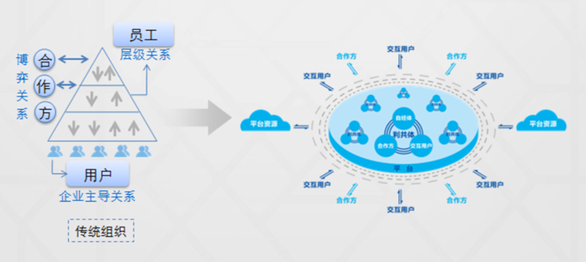

海尔集团"人单合一"管理模式

这里的"人"是员工，"单"是指客户订单。那什么是"人单合一"呢？从契约关系的角度讲，就是把企业变成一个市场。

一方面，员工之间不再是同事关系，而是客户关系。生产流程上不同环节的员工之间，不是按照上级命令供货和收单，而是模拟市场进行交易，按成本最小化的原则购买产品或服务；

另一方面，每个员工都是一个 CEO（首席执行官），都拥有决策权、用人权、薪酬权。简单地概括，"人单合一"就是要把每个员工都变成老板，把传统的企业变成一个去中心化、市场化的创业大平台。

海尔的"人单合一"管理模式，在本质上是企业内部模仿市场机制。虽然这一模式引起了国内外的广泛关注，甚至进入了哈佛商学院课堂，但是我认为"人单合一"管理模式并不适合大规模推广，因为它在某些方面违背了契约理论的基本逻辑。

你可能觉得我在危言耸听，那么下面我就告诉你：为什么企业不能模仿市场 ？我相信你听完之后，会有自己的判断。

### 为什么企业的管理机制不能模仿市场？

诺贝尔经济学奖得主科斯（Ronald Coase）开创了交易成本经济学。他在 1937 年的经典论文《企业的本质》中指出，企业的本质是对市场的替代。

具体来说，企业通过权威或命令机制取代市场的价格机制，可以节省一些"交易成本"，这些交易成本通常包括事前的信息搜寻成本、事中的谈判成本以及事后的契约实施成本。

那么问题来了，企业凭什么能够比市场更节约交易成本呢？我觉得至少有两个原因。

第一个原因是，企业用一种中心化的交易网络取代了市场的分散化交易。假如生产一台冰箱有 10 个流程，每个流程有 1 家企业。如果通过市场的方式来生产一台冰箱，那么每家企业都要和其它 9 家企业分别谈判并签订合同，才能生产出一台完整的冰箱来。

算下来，通过市场的方式生产 10 台冰箱，所有的企业两两之间都要签合同，这样至少需要签订 90 份合同（也就是 10×9=90）。但是，如果通过企业来组织生产，只需要其中 1 家企业（比如总装厂）和其它 9 家企业统一签订合同就行了，这样总共只需要签订 18 份合同（也就是 9×2=18）。

在这里，企业之所以能够比市场大大节约交易成本，就是因为企业用一个"中心签约人"模式取代了市场上的分散交易模式。

如果你理解了上述逻辑的话，你会发现海尔的"人单合一"模式存在一个明显的悖论：如果海尔通过模拟市场就能节约更多交易成本的话，那么海尔作为一家企业就没有存在的价值！

各位脑补一下这样的画面。在海尔内部要生产一台冰箱，按照"人单合一"的理念，每个生产流程的员工，都需要和上下游环节的员工进行讨价还价，甚至还需要到外部市场上去搜寻更多的供应商。这跟无数个中小企业在市场上讨价还价有什么分别呢？

海尔作为一家企业，它承担的"中心签约人"的作用在哪里体现呢？这还没算完，更麻烦的问题在这里。由于市场本身可以加总来自全国各地乃至世界各地的需求，因此具有很明显的规模经济，或者说市场大规模生产一件产品的成本，通常要比企业生产一件产品的成本要更低。

假如在海尔内部，生产压缩机的车间报价比市场平均价格高一些，那么按照"人单合一"的规定，负责制冷系统的车间就可以拒绝购买压缩机。请问，此时生产压缩机的原材料成本由谁来承担？这个车间的工人工资由谁来发放？如果是由员工自负盈亏，那员工还不如自己去创业呢。话说回来，如果每个员工都能自己创业当老板，谁还来当一个普通员工啊？

第二个原因是，企业内的契约通常是不完全契约，这种契约通过市场实施的交易成本很高，而通过企业来实施的交易成本相对更低。

仍然以冰箱为例。假设海尔的研发部门想开发一种更环保、更安全的制冷系统。大家知道，研发具有很大的不确定性，你没法规定哪个研发思路是对的，哪天新产品必须出厂，也没法准确预知新产品的研发过程中需要多少种原材料、需要多少次测试、需要花费多少金钱。此外，研发部门还必须和市场部门协调，了解市场的需求前景；和生产车间协调，了解技术上的可行性；和原材料部门协调，了解成本控制的区间。

这些部门协调的内容，都是原则性的，要么无法准确描述，要么无法向第三方证实。一旦发生纠纷，只能依靠双方谈判，而无法依靠法院判决。

如果海尔总部和研发部门之间签订一份研发新制冷系统的契约，显然这样一份契约一定是高度不完全的契约。所谓不完全契约，就是因为人是有限理性的，导致我们没法预测到未来所有可能的情况，或者契约的一些关键内容没法向第三方证实。关键是，这样的不完全契约无法通过市场化的机制来实施。

比如，海尔总部规定产品研发成功了再付钱，那么研发部门可能几年都没法发工资了，那谁还敢做研发呢？如果研发部门和市场部、生产车间以及采购部都是市场关系，那其他部门肯定没有激励配合研发部门，除非每一次测试，每一次调研，甚至每一次开会协调，都要付钱。你能想象这样的事情发生在一个企业内部吗？当然无法想象。

因此，涉及研发业务的这类不完全契约，不能通过市场来实施，只能通过企业来实施。

企业怎么实施呢？企业必须对研发部门负责人充分授权，允许他试错，并且利用自上而下的权威提供部门协调机制以及充裕的研发经费，然后综合考虑研发努力程度和产出水平支付报酬，而不是根据事后结果支付报酬。

除了研发，凡是涉及企业核心竞争力或核心机密的业务，例如工业设计、内部晋升、合同管理、客户关系，其实都是不完全契约，因此这些业务从来不会外包给市场来做。

总之，企业是用一套权威或命令机制来取代市场的讨价还价机制，才能成功实施这类不完全契约。当然，企业这样做也是有成本的。虽然通过命令的方式可以节约当事人之间讨价还价的成本，但是内部组织的管理本身也是一种成本。一旦企业规模变大了，内部管理的成本就会不断上升，甚至超过市场上讨价还价的成本。此时，企业就没有优势，就会被市场替代。

正是因为企业和市场各有各的比较优势，并且对应的契约性质不同，所以诺贝尔经济学奖得主威廉姆森（Oliver  
Williamson）指出，企业和市场是两种不同类型的治理结构，彼此之间不能串换，企业不能模仿市场。

### 政府和军队也是一种治理结构

其实，海尔并非在企业内部模仿市场机制的"始作俑者"。

30 年前，河北一家国有钢铁企业就在企业内部引入市场机制，实行"模拟市场核算，实行成本否决"的经营机制，形成"千斤重担人人挑，人人肩上有指标"的责任体系。这一创新机制一度被奉为典型。但是，这家钢铁企业后来被别人兼并了，它现在的净利润率还不到 1%，经济效益并不算好。

在一个计划经济色彩比较浓重的国有企业，引入一定程度的市场机制，确实有利于调动职工的积极性，从而扭亏为盈。对此我并不怀疑。但是，无论是今天的国有企业还是民营企业，它们已经在改革开放之后经历了四十多年的市场经济磨炼，早已是一个市场化主体了。在这种情况下，企业内部再模拟市场机制，显然有点过度市场化了，反而失去了企业本来的价值。

因此，我认为，在企业内部大规模模仿市场机制的做法，在今天这个时代并不具有大规模推广的意义，搞不好还会适得其反。

有趣的是，威廉姆森并没有止步于企业和市场的两分法，而是进一步将所有组织区分为市场、混合组织、企业和官僚组织四种组织形态。

这里的"混合组织"包括企业联盟、特许经营、供应商网络等介于企业和市场之间的组织形态，官僚组织则包括政府和军队。

在威廉姆森看来，经济社会中所有的交易都可以看作是一种契约，不同的契约对应于不同的治理结构，不管是市场、企业，还是政府、军队，本质上都是一种治理结构。

从激励的角度讲，市场是一个极端：激励强度很大，一次性交易为主，市场主体完全平等；而军队则是另一个极端：实行固定工资为主的薪酬体系，内部重复发生关系，上下级之间存在严格的等级体系。企业、混合组织和政府介于市场和军队两者之间。

更重要的是，不同的治理结构----  
不管是企业、市场还是政府，都有一套自洽的激励体系，彼此之间不能串换。把军队的严格等级体系照搬到企业里，固然有利于加强企业内部的控制，但是也遏制了企业的活力。

反过来，把市场上灵活的奖励机制完全复制到政府内部，要求公务员都去自己跑业务、拿提成，那会导致严重的腐败和寻租行为。

结语

总结一下这一讲的主要内容。

企业和市场是两种不同的治理结构，企业通过权威或命令机制来配置资源，而市场通过价格机制来配置资源。

两种组织就是两种契约，代表两套不同的激励体系，两者不能相互串换。市场不能模仿企业，企业也不能模仿市场。

正如西方的一句名言："让上帝的归上帝，让凯撒的归凯撒"。

最后是一道思考题：湖南某地某一年对居民楼编号进行拍卖，谁出的钱多，谁就优先选择"吉祥"号码，比如 68 号、88 号。有关部门称这种行为是"引入市场化机制"。请问你如何看待这种行为？

好了，今天我们就讲到这里，下集再见。

公众号懒人找资源，懒人专属群分享

## 番外丨聂辉华 x 梁文道：比特币、数字货币、内循环是什么？

### 导语

梁文道：最近一两个月我不晓得你有没有听说过一些让许多人非常不理解，甚至是非常忧虑的一些跟经济相关的词语，这些词语好像很陌生，但是随着媒体上讨论得越来越多，我们也开始逐渐熟悉了，第一个是数字货币，数字货币其实不应该陌生的，早在很多年前就已经有很多的探讨跟讨论，甚至是实践。

但是最近情况不一样，最近听说是国家可能将要推行数字货币，这到底是怎么回事？我见过最骇人的说法是这样的，是我们手上的现金全都没用了，都得收回去以后，我们拿的就是虚拟的数字货币，而这个数字货币是换不回现金，也抵押不了任何的美金或者其他的外币，甚至是黄金。大家就说"天哪，这是怎么回事？"就很忧虑了。

第二个忧虑是什么？你最近听说过内循环，同样也有非常极端的讨论，就说内循环，啥叫内循环？莫非国际局势不太稳定，我们就断绝跟世界各国的经贸往来，重新搞起"闭关锁国"了吗？

到底这些消息是真是假，这里面牵涉到多少的迷思，多少的真相，我今天特别请一位经济学家来跟我们了解一下，这位就是聂辉华老师。

聂辉华老师是我们看理想 APP 上面《不完美世界的博弈：契约经济学 35 讲》很受欢迎的经济学节目的主讲人，他大概是国内做博弈论，做契约经济学最顶端的最先锋的一位学者之一了，那么它到底可以给我们什么样的 insight？什么样的观点？让我们来了解最近搞得人头昏脑胀的数字货币以及内循环，我要跟他好好聊一聊。

### 对谈：

#### 为何经济学家频频自杀？

梁文道：聂老师，谢谢你，今天感谢你跟我一起聊天。你知道我是个经济学的"小白"，你等一下跟我聊了，你就把我当成一个路边碰到的老头，来跟我介绍经济学就行了。就像您节目里面那样子，深入浅出就好了。

因为我有很多经济学的问题想跟您请教，尤其是最近我们国内，有很多跟经济相关的热门话题是大家都关心的，但是大家都好像觉得有点懵。我先说一件事，对我个人而言是有点特别的感受的，是什么呢？你知道我以前是念哲学的，我很记得我在上世纪 1990 年入大学的时候，那个时候有种说法，就是说"凡是读哲学的，读什么德国诠释学的都长命"。你比如说像什么大诠释学家伽达默尔，后来是活到了 100 岁。"但是如果你要是搞什么法国的新潮哲学，什么结构主义、解构主义，那就很唏嘘了，因为那都没什么好下场"，比如说有一个结构马克思主义，阿尔都塞是发疯掐死了他的老婆，被判入狱；罗兰\*巴特是被车子撞死的，后来有的人是自杀的，都没好下场。

我最近就注意到一个新闻，在过去一年，有四位诺贝尔奖级别的经济学家好像都是自杀离世。这是不是说明做经济学在今天很危险了？

聂辉华：道长，您提的问题很有意思。我都不知道原来有这么多的学哲学的风险，我以为学哲学的人会比较想得开。

梁文道：对不对？搞法国那些哲学的就不太好。

聂辉华：最近您提到的这个问题，很多人也在问我。为什么这么多经济学家密集地自杀了？其实我觉得是这样的，大家只是在这段时间关注到了经济学家自杀，我们目前没有证据表明经济学家的自杀的概率比别的人更高，我们不知道。

我认为这应该是一个偶然事件，为什么呢？因为经济学家他的基本假设就是什么呢？人是理性的。所以按道理讲，人不应该去寻找自杀，这个是非常奇怪的一件事情，所以我相信这应该是一个小概率事件。

另外在提到的四位经济学家中，有一个经济学家就是哈佛大学教授 Weitzman。《纽约时报》报道过，他的自杀很可能是因为多年没有等到诺贝尔经济学奖，结果去年诺贝尔经济学奖被授予了另外一个人。那个人在环境经济学领域也做了重要的贡献，他认为他应该跟那个人一起获奖，但是那个人获奖了，他没有获奖。

诺贝奖是这样的，它很长一段时间才会颁发同一个奖项。比方说你是研究环境经济学的，不可能今年发了，明年又发，下一次你未必就等得到了，很可能是十年、八年，所以你这一辈子都不会发了，所以他可能深感绝望。所以 Weitzman 就自杀了。

梁文道：我的天。他有点太想不开了吧？

聂辉华：学者有的时候"走火入魔"很正常，可能有些学者都有点自恋，觉得他做了这个研究很重要。大部分学者都是敝帚自珍的，总认为这些东西极端重要。所以如果极端重要又没有受到重视，我做研究的目的何在呢？那就提出了一个终极拷问，这就有点像哲学家了，对吧？

但是我想这种情况是极为罕见的，我还没有听说过第二个人，因为没有得到诺贝尔经济学奖而自杀，这是唯一听到的一个。

梁文道：对，我连别的行当也没听说过，比如说每年诺贝尔文学奖要颁的时候，不是一直有传这个、那个的，有些人是陪跑很多年，在那个名单上。要是他们都自杀，那不就完了。

聂辉华：对，所以其实诺贝尔奖有个好处，就是什么呢？因为他只给活的人，所以如果你没有等到，你一定要锻炼身体继续等。比方说经济学界，诺贝尔经济学奖的平均年龄是 64 岁，所以如果你还没有 60 岁，你就不要着急，如果你过了 60 岁，你一定要好好锻炼身体，否则你就没有机会得奖了，因为它不会给死人，所以我觉得诺奖的整体意义上讲，它是鼓励人长寿的、鼓励人想开的。所以，我觉得 Weitzman 是一个反例，极为罕见。

#### 移动支付和数字货币是一回事吗？

梁文道：我们就不说那些自杀死掉的经济学家，我们先关心一下活的。现在我们作为一个活着的中国人了，有些事真是搞到人头大，你比如说像最近不是很流行谈数字货币吗？我们晓得中国一直都很特别有一个情况，我觉得中国的移动支付是在全球里面，我觉得从我们的应用之广推行之速那真的是数一数二，我有一个东西我特别有印象是什么呢？

就两三年前，我有一些外国朋友来到中国，来到中国之后，他们就告诉我说他们到了中国觉得是寸步难行，为什么呢？因为比如说他们在北京街上你要打车很不好打，我们打车都是得叫个滴滴叫个什么？他们是没有下载这种应用的，所以他叫不到那个车，好不容易就算要叫车，后来街上了买东西，结果人家要刷支付宝或微信支付，他们也都没有。

我就教他们说那你们下载，下载了也没用，因为下载了之后，这些应用都是要您有国内手机号，他作为外国游客，比如说来中国一个星期，他哪来的国内手机号，更不要说要绑定一个国内账户，当然这是两年前的情况，可能现在不一样了。所以他们的感觉就是来到中国之后，我们中国人都是用一整套线上应用，从轿车更重要的就是线上的这种移动支付，现金几乎都没怎么见着了。

很多年前新加坡总理李显龙我记得他在一个演讲，他说到他对新加坡的一些的同僚们演讲，新加坡要好好的发展新技术，要急起直追。

他说他有个经验，有一年到了中国，到了中国，他带着他的内阁的一群官员来访问，来访问的时候，他有一个部长，那个部长好像管新加坡科技的。到街上就看到，那时候是冬天，卖糖炒栗子，觉得挺香的，想买一包。没想到这个街上老大爷卖糖炒栗子都不收现金，要问他拿支付宝，于是这个新加坡科技部长就买不到这个糖炒栗子。

好，我刚才说这些，这当然是个大背景，里面可能有些细节是我们接下来要讨论的，也相关的。但它就说到我们中国现在所有的支付，我们都习惯这个移动支付。那么这个东西跟我们今天正在热烈关注、讨论，国家一直有传闻说可能会逐步推行的"数字货币"，其实是不是两码事呢？

#### 中国的后发优势：交易便利 vs 隐私保护

聂辉华：我觉得关系不是特别大，因为数字货币现在还在试点，我们现在不太清楚它最终会什么样子。但是有一点一样，就是数字货币也好，我们用支付宝或者微信支付也好，它们肯定都是基于一整套的数字算法，这个是一样的。

您前面讲到的，像支付宝和微信扫码，这个确实是中国的一种后发优势。因为中国的后发展，可以直接引用最先进的技术，又加上中国的市场比较大，但是还有一个原因是不可忽视的，就是中国处于发展中国家的阶段，中国人对于隐私的重视不如发达国家那么重，所以这就导致一个好处，你也可以说是个坏处，它是一把双刃剑。

一方面，数字经济或者数字支付极大一加快了交易的便利性。但是另一方面，它也使得个人的隐私保护很难进行，中间可能不太有两全其美的办法。

如果是西方人可能会想，我为什么要让你知道我每天去哪里刷卡吃饭了，去哪里住宿了，去哪里开房了，去哪里唱歌了，去哪里打车了，你可以掌握我所有的行踪，对西方来说，这太可怕了。这就是一个 big  
brother 在看着你，他觉得这是不可思议的。

但是中国人可能不这么认为，中国人觉得我现在是穷怕了，只要是有利于发展经济的，只要是有利于交易的，只要是有利于经济增长的，我什么条件都可以接受。你只要给我挣钱，给我饭吃，我都可以理解。但是我想这可能是一个阶段性的现象，过了这个阶段之后，你只有意识达到一定的程度了，衣食足才知荣辱，对吧？这个时候你可能会对个人的自尊、隐私权有更高的意识。

所以我还是那么认为，我不是对数字经济或者说数字化的支付那么乐观，我总觉得这是一把双刃剑。否则的话，我们就应该问一个问题：如果这是个非常好的技术，那么请问，为什么世界上那么多发达国家不去大力推广，而我们会赢得先机呢？这没有道理，对不对？

梁文道：我们现在通常的解释是因为我们的国情独特，而且人家就是"傻，外国人老拿石头砸自己的脚，那他活该"。但是我想回过头来再问这个"数字货币"，我问一个很小白的问题，其实我们知道现在这个东西包含两个部分。第一个部分就是我们现在中国所要探讨的这套数字货币，好像跟我们比较以及熟悉的，像比特币这种数字货币不太一样。

第二，我们从基础来讲，就比特币，因为我自己是个小白，我假设我们听众也有许多人可能跟我差不多，我们连比特币可能都不是搞得太懂，它的原理是什么。比如说传统上我们讲货币这回事，货币在某种程度上可以理解为是个借债，就是你银行发款银行。

比如说中央银行，它给你纸钞也好，或者什么样形式的一个货币也好，它要有个抵押的，它要有一些保证在后面的。那个保证，比如说以前是黄金，后来是外汇，一揽子的外汇，其中主要可能是美金。像比特币这样东西它是靠什么运行呢？这我不晓得您怎么理解。

因为我很爱听您的节目，我就发现这个契约论很管用。果然从契约角度看，人类之间所有的行为都几乎能够用契约角度来理解，你觉得用契约角度来理解这个数字货币，是不是也能够帮我们掌握到它的本质是怎么回事？

聂辉华：道长您刚才提了两个问题，一个是比特币和数字货币有什么区别？第二个是如何从契约的角度来理解数字货币？

梁文道：您先讲后面这个吧。

#### 数字货币：加密的和可证实的契约、打击贪腐的有力手段

聂辉华：可以。我认为你可以把数字货币理解为是一种加快交易、有利于契约实施的一种支付手段。举例来说，咱俩买卖，我给你 10 块钱，比如说你给我一个烙饼，10 块钱一个。我是先给你钱，还是你先给我烙饼呢？我如果先给你钱了，然后你否认收到了钱，那我怎么办呢？或者你先给我饼，我明明付了钱，我说我没付钱，或者说我明明没付钱，我说我付了钱，那你怎么办呢？这有风险。

数字货币可以解决这个问题，它能够保证契约能够得到很好的实施。它整个过程是加密的，而且是有印迹的、有证据的。这样不管是我先付钱，还是你先给货，咱俩之间都有记录了，这个记录是加密的，不能被破坏的，这样保证咱们之间交易是没有风险的。

其实它就有点类似于支付宝的功能，相当于有一个支付的中介，它能保证你双方的契约能够很好的实施。所以从支付手段来讲，数字货币是一个非常好的手段，这个没有问题。

具体来讲，它其实有三个功能，第一是提高了交易效率，比如说过去你要带一堆钱去做生意。举个例子，你去买房子，买房子那就是大额现金，你要带那么多现金肯定不安全，放在家里也不安全，但是现在有了货币数字化之后，你刷卡或者是通过什么转账就可以了，这是第一。

第二个是它有助于，刚才我讲的那一点就是什么？它能够提高交易的可证实性。假如你把交易双方的关系看成一种契约关系，它能保证这个契约关系能够得到比较好的实施，不会出现赖账或者是不认账这样的行为。

第三个可能也是将来最重要的一点，是什么呢？它能够打击违法交易、地下经济和贪污腐败行为。

为什么呢？举例子腐败，腐败是一手交钱一手交权的权钱交易，你是通过用钱来支付别人的权力使用，那这样你可能会留下证据，如果用现金你就没有证据。为什么经常出现很多贪官一样？我研究腐败的，现在我们发现贪官家里能收出几亿的现金，那他为什么装那么多现金呢？

梁文道：床底下埋一堆钱。

聂辉华：因为你要是贪官用现金交易的话，没有证据，你没法追踪钱从哪里来到哪里去。但是如果你是用数字货币了，像贪官行贿个几百万、上千万，那一查就能查到，没有人敢这么做，而且他拿了这钱他也花不出去。如果所有的钱的来龙去脉都可以被追踪，那一般的人谁敢贪污？没法贪污。因为你贪污肯定是要有交易的，而交易必然涉及到钱，所以这是非常有意思的一点。

其实我很早的时候就向中央建议过，我觉得应该大额交易全部使用非现金，也就是说这样便于监管。但是毕竟中国处于发展中国家，很多地方还没有办法实施，比方说在农村，农村里买房或者是买卖一头牛，那也是大额现金，那你要让农民都用数字化的交易，那不太现实。

所以很多人只看到了第一点和第二点，往往忽略了第三点，第三点才是最要命的。但是正因为第三点会严厉的打击所有的地下经济和贪官，或者贪腐行为，所以使得这些手段要不要大面积推广，成为一个非常敏感的问题，我想这个意思您应该懂得。

梁文道：我懂了，一定很多人反对。好，但是换一个角度来讲，我刚才说数字货币它是人民币就这么简单的数字化吗？它又好像不是吧？

#### 数字货币：从信用货币到主权货币

聂辉华：这个比较复杂，目前关于数字货币国外有很多种类，比特币是一种，另外比如说 Facebook 它要推的那个比叫做天秤货币（Libra），它也是一种，中国的央行推的数字货币都不太一样。

最大的不同是，中国的央行的数字货币，它是一种主权货币，也就是说它是由公家发行的，有强制执行力的，但是比特币它就是私人发行的，它就没有强制执行力。另外它跟我们传统的货币在有一点上可能有点类似，现在的传统货币也不再是信用货币了，什么叫信用货币呢？就是说过去我印 100 万钞票，那我就得有 100 万的黄金作为储备，现在都不需要了，现在的货币是信用货币。

数字货币也是信用货币，它也不需要有储备。那么这个时候它就跟国家的权力有关，比如说美国，美国它是世界上最强大的国家，它就可以随便印钞票，因为大家都认。但是如果你是一个普通国家，你不是世界头号强国，你也想滥发钞票，那就完蛋了，你就会导致通货膨胀。那有可能到时候经济就要衰退，社会就动荡了。

所以在这方面，为什么数字货币这么热？因为数字货币表面上看是一个交易效率，是一种契约执行手段，背后它其实是国际之间的国家权力竞争，说白了是对货币主权的竞争，这是非常要命的事情。

#### 比特币是什么？为何私人也能发放货币？

梁文道：我们这么想，现在的货币其实是信用货币。比如说像美金，我们买美国的债券，买美金，其实是相信美国这个国家它能支付，它能够还钱，它有这个实力。你刚才说的很对，随便一个很穷的，比如说很落后的第三世界国家被一个独裁酋长控制，他爱发多少就发多少，大家不愿意相信的话那它这个货币就会垮掉，它就会通货膨胀，这个货币大额贬值，这些都会发生。

但您刚才提到这是主权货币跟私人货币，我们过去几年我们大家还比较熟悉，有些朋友去参与买卖的叫比特币，为什么私人他不是一个主权，他发行一个货币大家也愿意相信呢？

聂辉华：这就是很有意思的现象，其实很多人对货币不太了解，如果我们放长了历史看，你去看《资治通鉴》，中国历史上大部分时期货币是私人发行的，包括宋朝的纸币  
\----交子，汉朝的时候西汉是允许私人铸造货币的。

所以货币说白了它是市场化的产物，它并不是一开始就是国家强制力的产物，因为你只要有经济活动，你就需要货币。所以如果你的货币能够保证：第一不滥发；第二，大家能够相互使用流通；第三，便于储存和流转，那么具备这些基本特征都有可能成为货币，只不过它在多大的范围被承认而已。所以在这个意义上，货币还真不是非要国家认可才行。

举个例子，比如在我们乡下，假如大家都没有现金，那我今天给你一筐萝卜，明天你给我一篮子青椒，那咱俩交换就完成了。你看，没有货币也可以的，一样的道理。

你也可以不妨把某种东西当作一种一般等价物，因为货币的本质就是一般等价物。只要大家认可那个一般等价物，都没有问题的，不是非要用国家的这个强制力来保证实施，这就是我们说的市场的伟大之处。市场它只要成为一种秩序了，它是叫"自发秩序"，市场的这种自发秩序它很厉害的，所以你只要大家都遵守一个秩序，遵守一套完整的规则，那这个游戏就可以一直玩下去，没有问题的。

梁文道：所以你的意思就是说越多人参与、越多人玩，它的这个信用也就会提高了，大家都不相信。那这么讲的话，比如说我举个例子，在香港，一般人都知道香港汇丰银行很有名，那香港其实还有一个银行也很有名，这个恐怕是香港人才知道的一个银行，外头人不晓得。

这个银行叫"冥通银行"，就是这个幽冥的冥，就是这个地狱的那个冥，冥王爷的那个冥。为什么叫冥通银行？你听过没有？香港一直有这个中国华南的这种传统保留下来，上百年来没有中断过，是怎么回事呢？就先人去世了，家人去世了，那不是很多人就烧衣，对不对？

烧纸钱了，我们香港大部分的烧给死去的先人们的纸钱，上面都印着冥通银行发行，就在地狱里面通行，然后那个数字都很巨额，那个都是你给人间没看过那个巨额的钞票。像你这么说话，假如今天香港有人开玩笑，有人拿这个货币出来说当作真使用，比如说来给我买东西，说这个买看理想那个节目，给我这个 1 万块冥通银行货币行不行？那这个其实理论上是可行的，只要我们愿意接受，然后很多人信任，大家参与进来，它就能够通行了，是不是这个意思？

聂辉华：没错，所以我们说货币是一般等价物，这个一般等价物可以是纸币，在过去可能是一块石头，可能是一个贝壳，我们的先人是用石头或者贝壳来作为交换的一般等价物的，所以既然它可以是石头，它为什么不能是冥币，对不对？

所以在这个意义上讲，我觉得市场的力量最重要，我们要尊重市场力量。当然现在的国家介入，现在的国家一般来说都是由国家来发行货币，但是你国家发行货币也要遵循市场规律，比如说第一，你不能滥发货币；第二，你必须有统一的制度来保证这样一个交易能执行对吧？所以我觉得关键是背后市场的力量和制度的体系非常重要。

梁文道：那么刚才这么讲的话，其实这也是牵涉到契约，对不对？因为比如说我发行一种货币，人家为什么愿意用，这就是个契约吧？因为牵涉到信任。

聂辉华：没错，所以所有的交易它能够执行，一定是因为有一套隐性的或者显性的契约体系在支持它。

梁文道：那么中国现在谈的这个数字货币了，就像你刚才讲的，就是一个主权货币，其实也是以信用为基础，那么以信用为基础，看的就是我们中国的整体的实力。然后您又提到这其实是国际间一个很复杂的问题，因为我们今天全世界最通行的货币、全世界都认的无外乎就几种，最重要的就是美金。

美国作为世界头号强国支撑着美金的信用，我们大家都用美金来做跨国之间的交易，而且各国的自己的货币，很多时候后面的外汇的储备也是以美金为基础。我们国家现在推行数字货币这种主权货币，它是不是照您刚才这个想法，是不是可能是一种在货币层面上面、金融层面上面，要跟美金要较一日之长短呢？

聂辉华：可以这么认为，其实大国之间的博弈非常复杂，各个层面都会开展，而且像这种带有主权性质的事物应该是寸土必争的，但是你争不争得过，那是另外一回事。

梁文道：因为坦白讲，我有很多朋友很担心，我有些商界的，比如说有各种有的是大企业家，有的是做工厂，中小型工厂中小企业，他们现在听的消息那是五花八门，我常常看到他们微信朋友圈里，或者是他们群里面发的东西有点骇人听闻。

比如说有一阵子说中国即将发行的数字货币是换不到人民币的，也换不了黄金的，他们就很担忧，天哪这怎么办？于是你知道就想办法说我现在这个钱是不是要想办法先弄出去买外汇或者怎么样，都在想这些事，所以这些事情现在可能真的还不用那么早去判断。

聂辉华：我觉得不用，这都是谣言，而且可能性不太大。道长您只要想一想，任何一个制度它要出台，它一定要经过各方面利益的博弈。你想想看，这项制度如果实现了，谁是最大的受害者或者是当权者他自己能不能同意，这本身就是个疑问，所以我觉得我们可以不用太担心这个问题。

#### "国内经济内循环"是什么？

梁文道：好，那就好极了。如果这样我想跟你谈另一个最近大家也在关心的问题，正好也从我刚才说到了很多企业家在担心的问题开始，那就是现在很多做企业的朋友都在留意一个词，我想全国也都很注意，最近不是很流行讲中国的国内经济内循环，国际大循环，要造成一个双循环，有这么一个讲法，流传了一段时间，不过好像这两天又有所修改，不太愿意再讲内循环。但是大体上我觉得意思好像还是说一个国家内部的经济的民生社会经济的一个循环，这也是一个最近我们很关心的问题。

我们很多人比如说像我这种吃瓜群众，我一看就不懂了，我就说什么叫内循环呢？是不是表示最近的疫情打击很严重，全世界的贸易都衰退了，又有一边的不安定的国际外交的形式，在这个情况底下，中国的出口肯定就要受到打击或者压抑。

在过去几年，虽然中国曾经是世界工厂，但过去几年我们晓得中国的外贸占经济总量其实是在逐步下降，在这个百分比里面。但是它仍然是很重要的一块，所以这一块如果在可见的现在以及短期的将来不是那么顺畅了，是有问题了，那我们就开始有人主张内循环，这个内循环在我们看来这不就等于是要重新"闭关锁国"吗？很多人有这样的一个理解，您是怎么看内循环这件事情？

聂辉华：首先我要声明一点，我的说法仅代表我个人意见，我不能代表中央或者权威的意见。

梁文道：当然，我们都是民间自己讨论。

聂辉华：首先要理解这个内循环提出的背景，我觉得它的背景就是什么呢？就是我们现在处于一个风险社会，我把它称之为"大白鲨世界"。什么意思呢？你看我们一方面新冠肺炎导致全球很多国家经济停滞，国家间的贸易减少了。

另一方面由于贸易纷争、贸易摩擦，导致国家间的全球化有点内卷了，就是逐渐去全球化或者是半全球化。在这个背景下，作为一个大国，你要保证不太依赖于外国，那一定要减少外贸依存度，也就是说国内市场很重要。从这个角度讲，我觉得这样提法并没有大的问题。

但是不能把内循环等同于闭关锁国，全世界没有一个国家可以在闭关锁国的情况下还能发展得很好，这是不可能的，哪怕你现在是一个很强大的国家。

举个例子，就像明朝，明朝的时候郑和下西洋的船队是世界上最领先的、最大的船队，但是之后皇帝说片板不得下海，结果明朝的海运禁止了，但是西方哥伦布、达\*伽马、麦哲伦在不断地探险，他们开辟了新航线，发展了海洋文明。

所以世界文明的天平就从东方跳到西方那边去了，这就是一个最典型的教训，你哪怕再厉害，都不可能独善其身，不可能关起门来自己玩，我相信中央对这点是非常清醒的。所以只是提内循环为主，内外循环双促进，我相信"内循环为主"是一个阶段性的策略，绝对不是一个长期的国策。

就是因为我们现在这个阶段比较特殊，所以我觉得大家不会过于紧张。而且事实上证明，任何一个国家，如果你只要关门一段时间，你就跟世界文明脱轨，这个代价是谁都受不了的。

所以我觉得在这个意义上讲，我觉得我们可能不用太担心这个问题。但是我们要警惕有人本来就反对大陆加入 WTO，那么他就会抛出来，你看内循环为主，我早就说了，他就把那些往闭关锁国那个角度扯，这是有点误导别人。

一方面我们要立足国内市场，没有问题，因为中国这么大的一个市场，中国还有很多中产收入阶层，中国还有很多区域发展不平衡的状况。中国的市场本身就足够大，那么你要立足国内市场，

这本身就没有错。但是国内的市场很重要，国际市场也很重要，因为我们需要国际市场源源不断地输入最高级的技术、最先进的发明创造以及最高端的人才，我们国家要扩大影响力也要走出去，资金、技术、人才。

所以我觉得这应该是什么？其实就是两手抓，两手都很重要，内循环很重要，外循环也很重要，绝对不能走极端，世界上任何一个国家只要走极端了，那我觉得就是自取灭亡了。

梁文道：我能不能这么理解，现在讲的内循环其实跟我们过去几年反复提倡的另一件东西好像是一脉相承的，我说的那件东西就是"提振内需"，提振内需到今天的内循环中间好像是一条线逻辑发展下来的，是不是？

聂辉华：我觉得应该是有关系的，因为如果各个国家之间比如说贸易的风险扩大了，由于人流和物流的交往，可能会带来疫情的蔓延。这个时候很多国家就要逐渐的内卷，你在内卷的过程中，你要让自己的市场形成一个体系，所以它既有扩大内需的作用，同时也有另外一层含义。

在一些关键技术和行业上要构建自己的完整的技术体系，或者说供应链条，这个很重要，过去我们谈扩大内需的时候，我们不会谈要保证供应链的完整性，但现在我们谈内循环一方面要扩大内需，但另一方面要完善自己的市场体系，要保证重要行业的供应链的完整性，这个是一个新情况，过去没有。

梁文道：可是这个又牵涉一个麻烦，因为我们在过去二三十年全球化主导的世界底下，我们都已经慢慢形成了一个常识，这个常识就是所有的供应链、物流链都是遍布跟分散在全世界各个地区的，我们都觉得没有一个国家能够完整的自己掌握所有的产业，所有的产品的完整的一个供应链，这是很难做到，而且也没有必要，而且是消耗资源的，在市场上不是最优的一个选择。所以我们都习惯了。好现在遇到一个国际上这么高风险的时代，大家开始重新回头想自己来搞点东西。

这么一搞，我觉得有些东西可能说不定还能够逐步的靠自己，比如说现在日本想要慢慢的让自己恢复口罩工厂，它自己不用再从中国进口了，它光靠自己身材口罩就行了。口罩这回事在今年之前全世界没人认为是战略物资的，现在都开始觉得这是个战略物资，大家都想自己弄了，但是这个也就罢，虽然我知道做口罩也绝对不容易要做好口罩，但是事实上还有很多别的领域，你比如说现在大家很关心的芯片问题，这些东西真有可能完全回到自己的国家，我们自己来建构一个完整的供应链，而且还能保证它的质量跟价格。这个是不是也很困难？

#### 新国际经济环境：大白鲨时代

聂辉华：您提的这个问题非常好。我是这么想的，首先一个国家选择在什么行业，保证自己的完整的供应链，这个跟他关注的战略行业有关，这是第一。第一肯定不是所有行业都这么干，你比方说像生物医药，比方说像芯片，比方说像 5G 技术，这些关系到国家主权或者安危的技术，有可能你要保证比较完整的供应链，这是第一。

第二，你有没有必要保证完整的供应链跟你的国际环境有关，就跟你的国际地位有关。如果你觉得全世界没有人跟你为敌，大家都能跟你和平做生意，那没有问题，这是理想状态。只不过像我刚才讲的，现在 2020 年之后我们已经回不到过去了，我们现在进入了一个风险社会或者说大白鲨的世界。

就好比说在海里有一只大白鲨，它随时可能会咬人，请问你要不要下海？如果要下海，你要不要带好足够的装备？甚至你要不要多准备几天的粮食，因为万一今天有鲨鱼，你不能下海怎么办？所以这就提出另一个问题，实际上使得我们现在的国际贸易效率更低了。

从过去的完全全球化到局部全球化，到半全球化，说白了我承认这绝对是一个倒退，但是这是一个次优，你没有办法，除非我们更好的修复国际关系，除非我们更好的防御新冠肺炎。

如果没有这两件事情，没有国际贸易摩擦，没有新冠肺炎或者其他传染病，我相信完全的分工绝对是最理想的，但是假设完全的分工不能实现。那你又是一个大国，再加上国际环境又比较充满风险，那你会怎么办呢？你肯定只能是怎么样呢？选择一些重要行业、关键领域，保证它供应链完整性。而且保证供应链的完整性，并不意味着你一定要自己生产所有东西，可能只是说你要做好这方面的储备，也就是说你有备胎，关键时刻你要能顶上。

可能平时一直都用不着，但这没办法，这是一种冗余，这种冗余它必须存在。所以在这个意义上讲，好的国际环境能够加快劳动分工，促进经济发展，动荡不安的国际环境或者是不太理想的国际环境，会给所有的人带来负担，这说白了，这就是一个双输的结果。

但是你没有办法，因为有的时候你能控制自己的行为，你可能不能控制别人的行为。那假如别的国家挑衅你，那你怎么办呢？所以我我觉得我们这个世界最悲哀的就是什么呢？就是全球化的秩序，全球化的核心的秩序被破坏了。但是如果我们有人再去进一步破坏它，那就真的是有罪的人了。我们应该做的是尽量修复好这个秩序，但是在持续修复好之前，我们可能要做好足够的准备，这可能是没有办法的。

#### 新冠疫苗的全球困境

梁文道：但这种准备坦白讲其实是很浪费资源，也很耗费资源的，比如说你刚才说的备胎，就没用的时候我这个东西留在这，就是准备要有用，这种东西其实是一个很昂贵的一件事情，对不对？要实施这个事情，这个计划非常昂贵。

而且我现在还能够预感到，如果各国都在发展自己觉得对自己最必要的产业或者一些商品，将来的国际交往还是会有很多问题。我举一个简单的例子，我最近特别关注疫苗的问题，你刚才说到新冠肺炎，接下来要看怎么样能够彻底防治，大家的最大的希望就在疫苗上面。

可是疫苗我觉得我们今天真是遇到了一个以前没遇过的情况，我们过去人类 100 年来大部分流行传染病的疫苗的开发，都是普世公认的，如果它有效的话。在过去十几二十年的疫苗的开发，甚至是个国际合作的一个工程。

虽然最后总是会有某个国家的医药公司、医药厂去主力承担，但是这些公司本身也是跨国公司，里面有很多跨国人员，它的资金，它的资本可能也是跨国的，然后他这个技术里面的一些基础环节也可能是跨国的。可是现在当各国在努力的开发自己的疫苗的时候，结果就是现在要出现一个问题。现在目前全球有 200 多个团队在试着开发疫苗，比如说现在速度比较快的那可能就是俄罗斯以及我们中国，还有美国一家公司。

现在有个问题，就这个疫苗出来之后，比如说俄罗斯，它说我率先开发成功，但尽管我的第三阶段的人类大规模测试还没展开，但我先给大家用着。俄罗斯国民打了这个疫苗，然后他就说我没事了，现在放心了，但是问题是它可能来中国去美国到欧洲，别的国家它不认你这个疫苗。就说你这个疫苗我们不管用，我觉得我不相信，这也是以前没遇过的。

以前就疫苗这件事情，比如说小儿麻痹或者是乙肝，这是世界通认的。现在疫苗是个战略物资，你自己开发，你开发出来，别的国家还不一定认。比如说 5G，可能我们有我们的一套很先进的，但是现在有的国家它不认我们 5G 这个标准，那现在这也是一个很麻烦的问题，对不对？

聂辉华：对的。我们可以把国家之间的博弈，看做是种契约关系。如果大家都遵守一个同样的契约，比方说不管谁研发出来的，这个东西都作为全球公共产品提供出来。这样大家都好，一个是不用重复开发，第二个是避免了国际纷争。

但是问题就在于，我们特别担心的是什么呢？国际间的竞争使得大国之间把什么东西都给政治化了。比如说疫苗本来是跟政治无关的事情，对吧？你不管是中国人还是俄罗斯人，还是美国人，都应该用得着。但是如果把它政治化了，给贴上了政治标签，把它跟国家主权捆绑在一起，这就很麻烦了。

所以这个事情我觉得现在的国际环境和普通老百姓的安危，在很大程度上取决于大国领袖之间的博弈。如果他们能够智慧、聪明地处理这件事情，这是全人类的福气。如果有人一时冲动或者是非常地固执，我觉得全世界的人可能都会为此付出惨痛的代价。这个问题说实话，我也挺担心的。

梁文道：唉，好惨，现在我们世界上几十亿人未来的生活就掌握在几个人手上。真的很不幸，考验了他们性格跟他们的智慧等等，那没办法了，我们祈福吧。这样子我只好先顾点自个的小事，这个国际大事儿咱也顾不上，就穷担心。

#### 道长向聂老师讨教：如何激励员工？

梁文道：我说跟你聊点小事儿，聂老师，您知道我们看理想是个文化公司，我有个老朋友叫马家辉，是香港作家，很有名的一个文化学者。他这个人特别损，他常常给我一些古灵精怪的建议，我都不太相信，我就觉得是不是开玩笑的，还是蒙我的。

那时他跟我说，他说像你们看理想这样的公司要激励员工了，他说加薪、奖金什么的那是次要。最要紧的是你给员工写信，他就拿我以前开玩笑跟他说过的一句话来讲，他说你就用那句话写在这张信上，给员工发，他们就高兴了。

写什么呢？你真有才华。他说这个给到员工，员工看了那个兴奋，那股劲，比拿到奖金还厉害。你作为一个经济学家，那么请问您，您觉得真是这么回事吗？这是开玩笑的吧？

聂辉华：我觉得他是开玩笑。想一想，如果这个方法这么有效的话，那全世界老板都不用发工资了，对不对？所以大家只要想一想，就是博弈，博弈中有一个最基本的原则，不要把对手看成傻子。如果这个方法有效，它早就在全世界推广了，那我们都不用发工资就好了。这当然是玩笑话。

但是回到正题，这是个非常重要的激励问题，激励问题也属于契约经济学的一部分。就是我们怎么能够让别人好好干活？这个其实因人而异。您刚才讲的给员工写表扬信，它属于精神奖励，精神奖励跟物质奖励，包括货币、股权奖励，它有的时候是替代的，有时候是互补的，这个要因人而异。

为什么这么说呢？就是要看人，你要知道员工的类型是什么。有的员工是内在驱动型，他干事的主要动力就是他要获得这种精神上的认可，那么对这种员工，你给他奖励，给他表扬，可能有帮助；但是更多的员工有可能是外在驱动性，就是我做这件事情，我是为了养家糊口，不一定是我内心认同这件事情，也不一定是我愿意干这件事情，我就是把它当成一份工作，而不是一个事业。

在这种情况下，你给他写表扬信有什么用呢？你给他写表扬信，他拿表扬信去买房吗？他能拿表扬信去食堂里吃饭吗？对吧？他不能。但是我觉得管理者最厉害的地方就是，管理为什么既是一门科学，也是一门艺术呢？就是你要很巧妙地把物质奖励和精神奖励结合起来，而且知道每一个人的分寸在哪里。

有的人物质奖励达到一定程度了，他可能更在乎精神奖励。有的人他主要是要物质奖励，你给他精神奖励可能效果适得其反。所以我觉得不同的人他的阶段是不一样的，所以做老板的其实最难，难在什么地方？

你必须成为"员工肚子里的蛔虫"，你知道员工想要什么，这是最重要的，也就是说你要知道每个人的目标函数，如果你不知道别人在想什么，不知道别人的需求，你就谈不上满足别人。如果你知道别人的需求，不管是物质上的需求还是精神上的需求，你都有可能恰当的满足别人，这很重要。所以我觉得这个事情真的不能一概而论。

梁文道：您这个想法给我很大的启发，将来我们招聘员工，我专找那种内在驱动性的，精神奖励对他来讲最重要，钱他不在乎，这个员工好。开玩笑啊。

聂辉华：那有个负面效果。精神奖励特别在乎精神的人，他可能自尊心就很脆弱，因为他太在乎个人感受了。你让他加班他可能就不干了。

#### 居家办公流行，办公室会消失吗？

梁文道：我知道对。或者你忽然有一天批评他，他就不行了，这个很难衡量。

这样子我还有一个问题，比如说像我现在跟您这么聊天，我们是隔着两地，我还在香港，您在北京，我们发现在过去这段疫情期间，全世界当然包括我们中国很多人都在居家办公，都在家里头工。

我今天上午才看到一个新闻，英国做了一个调查，调查发现有 9 成的受访者都说过去大半年，因为英国也有很多人是在家办公，很多公司是放员工回家。而大部分的员工接受调查都说"其实在家工作的时间要比过去上班更长了，因为好像更不能够分清楚什么时候叫上班，什么时候叫做下班"。

但是另外一方面，尽管如此，居然有 9 成的受访者都主张、都赞成，或者都认为将来也许可以继续这么下去，最好继续还是居家办公，有越来越多人有这样的想法。

所以我想请问聂老师，您觉得像过去我们习惯的传统上这种每天定时定点的就到写字楼工作。坐在自己的工位上，早上 9 点到下午 5 点或者 6 点这个样子，这种制度包括整个考勤制度打卡，这些是不是会被逐渐淘汰呢？有这种可能你觉得。

聂辉华：您说了一个非常重要的问题，数字经济的发展会不会减少上下班的时间？以后不用怎么样，我觉得减少肯定是一个趋势，但是它不可能替代，任何技术都不可能替代人与人之间的交流。

我跟您讲一个事情很有意思，携程的总裁 CEO 梁建章，梁建章跟别人合作，拿自己的公司做了一个实验，他就想看一下居家办公的效果怎么样，跟那些不居家办公的人，他发现很有意思，在家办公的人你节约了通勤时间，所以你的生产效率是提高了，但是你升迁的机会比别人少了 1/3 左右，为什么呢？因为你不跟老板见面，你不跟老板交流，你想想看老板在评价你工作和贡献的时候，他是不是对你的印象要差一点？

所以我想举这个例子说明什么？居家办公它有代价，因为它减少人与人交流，而我认为人与人之间的对面交流是任何技术目前为止都不能替代的，为什么呢？因为人与人这一碰面，你产生思想的火花，一种特殊的情感。这种情感不是技术可以传递的。

就好比说咱们可以通过电话聊天，但是我看不到你的表情，或者说我就算对着屏幕，我看不到你其他的动作，这种传递的信息量是比较小的，对吧？还有它不能激发灵感，而人是感性动物，不是生产机器。

既然人是感性动物，那么面对面的感性交流是不可替代的，它可能会减少，但我相信它永远不可能被替代。所以我觉得在这个意义上讲，我们以后可能上班的时间会减少，但是人与人之间当面的交流，这种思想的碰撞，这种火花的产生，我觉得是任何机器都不能替代的。

梁文道：对，我完全同意，尽管我也想象过是不是有可能这种远程办公。那么当然了，您刚才说到让老板多见到，这个我要提醒一下，因为有人听到可能说那我多给老板私信，比如说半夜 2 点给老板发个私信，老板你睡了吗？晚安，千万别这么搞。

因为我最近特别留意到，全世界有好几个重要的商业城市，比如说像伦敦，像法兰克福，或者像最近我在香港这样子，有一个趋势，就是写字楼的这个租金都在下调，然后它的物业价值也在下降。

可能就真的因为有很多人感觉到，一来经济不好，也有很多企业关门了，但是也有很多企业开始发现，也许我需要的办公面积不用那么大，就很多员工其实平常可以多在家，但是有必要的时候就回来，就说并不是说以后就取消在公司上班，而是说不用那么长在公司，那他其实省了一个成本，那就是写字楼的成本。

那最近有很多这个情况，可是，尽管如此，我最近也在想这种事，你看我有好几个月没回北京公司里头了，那么我觉得我有没有很严重的阻碍我的工作？某程度上讲好像也没有，但是另一方面我却觉得还是有很严重的缺憾，就是你刚才说那个，特别是像我们这种文化公司，我发现我们有一个很重要的问题，常常要大家坐在一起，因为我们要做创作的，要做很多的脑力震荡，这种 brainstorming 这样的一些会议。

那么我们很难在网上做，你比如说在网上，你比如说开一个会议间，大家视频开会，就算这样子也好，你就是看到人，你会发现对着屏幕你不吭声，不说话你就很难受，就你很难忍受一伙人在屏幕上同时闭嘴 10 分钟，那是很受不了的。

但是我们任何做创作的人都晓得，比如说熬剧本、熬什么，坐在一起，大家抽个烟、喝个茶、喝个咖啡不吭声，碰到了难题，然后大家慢慢暗自沉吟、琢磨，这是很常见的事。就很多这种必须当面坐下来产生的化学反应，是在现在的线上沟通绝对做不到的，所以我觉得您说得很对。

但是我刚才又提到另一点，就是那写字楼这件事情会不会将来有一个结构的改变，会不会？因为现在大家很关心中国的房价、楼价，你觉得会不会有这种可能？就是说大家说远程居家办公尽管有，还是有问题，还是有不能代替在办公室上班的这种问题的，但是事实上很多人开始在往这个方向想，这个会不会终极影响到我们的商业区的楼价？

聂辉华：一谈到房价或者楼价的问题，都是个敏感问题，不管说对还是说错都容易遭到人骂，我是这么认为的，从趋势上看，远程办公技术、数字通讯技术可能会更发达，在这个意义上讲，商业楼价格跌一点，我觉得是很正常的。

但是大家不要高兴太早，为什么呢？老板他可以少租厂房，少租办公楼，那员工在家里就在办公，你在家办公事不是房子要买的大一点，买的好一点，买得安静一点，那这个成本谁来负担？对不对？

比如说我就很明显，我在家里，你要是有小孩的话，他就很吵闹，家里有头"神兽"，所以我不愿意在家办公，我愿意来办公室办公。请问老板们在减少商业用房的同时，有没有做好给员工加薪的准备呢？如果没有，那以后员工会想，我来你这里上班，我还得买套房子，这代价太高了。

梁文道：本来我租个小房子是包睡就行了，现在还得有个办公室。

聂辉华：所以从效率上讲，那还不如租写字间，因为租写字间的话大家可以一起那么多人相互不干扰。但是你想如果你每个人都在家里相互不干扰，那要放大多少面积的办公房间，对不对？所以我觉得这不是一个好的，确实是我们一定要考虑到中国，你要鼓励二胎，你要鼓励人口，那你怎么能够把房价涨起来呢？房价是对二胎最大的杀手。

梁文道：对，是，没错。您就提到另一个有趣的问题了，其实现在很多人，国家鼓励他生小孩，其实很多人之所以不生，主要就是因为一想到将来这个开销，那就受不了，这开销尤其就是房价。

聂辉华：对，所以我们一方面说鼓励多生孩子，另一方面又缺乏配套的措施，你让他怎么生？对不对？

梁文道：对，没错。这些问题真是一环扣一环。这个一下子我们一个小时还真说不清，但无论如何聂老师今天还是很高兴跟你聊。我觉得其实我们听众一定还有很多问题，我建议大家多多的去听聂老师的节目，然后在那里头留言。好，今天就感谢您聂老师。

聂辉华：谢谢道长。

梁文道：聂老师跟我们聊了差不多一小时，非常感谢，非常感谢，那回头我们继续追您的节目，感谢您，感谢您，谢谢。

聂辉华：好，谢谢道长，谢谢大家。

梁文道：好，拜拜。

聂辉华：好，再见。

### 结语

梁文道：好在今天有聂老师提醒我，让我没有中我的损友马家辉的"毒计"，就是居然建议我不用给我的同事们薪水，给他们写信鼓励，跟他们说"你很有才华"就够了，原来这招太损人了，马家辉你怎么能这样子害你的朋友呢？（莫非我们不是朋友？）

不过说起来我觉得聂老师最后讲的这段很有意思，我们现在鼓励大家多生小孩，但是问题是生小孩是有代价的，它牵涉到很多层不同的环节，而这些环节都牵涉到很多国家或者社会供应的配给措施。这让我想起来我自己很多年前有一番话，让很多人很不满意，抨击的很厉害，是什么呢？

大概 10 年前（有没有 10 年前呢）就曾经有一个地方媒体做调查，就发现他们那个地方应届的大学毕业生中的女生，在问她们"你将来想选择什么样的生活"的时候，她列出了几个选项里面，其中一条是做富豪的小三，我不晓得怎么会这么奇怪，有人问这样的问题，但无论如何媒体就公布出来，发现居然有相当大的比例的女大学毕业生是不介意当小三，甚至觉得要比从事一份平常大家心目中很体面的工作还要好。

那么正好那几年不是有句名言，就是宁愿坐在宝马里哭，也不要坐在自行车上笑，于是一下子就引起了社会议论，那么很多人都说"今天的中国社会道德太败坏了"，怎么能够有这样的心态？我当时就这么讲，我说你看换我是女生，说不定我也觉得做小三是很好，如果我有本钱有能力的话，其实我是个男的，我也想做小三，这也无所谓对不对？

为什么？你想想看，你要在我们现在这个情况下或者几年前那个情况下，你要好好生活，你如果按照一个正常的社会轨道行走，你有份工作，那么请问你要存钱存多久你才买得起房呢？

如果你结婚了两个人工作，那么两家各有两个老人，那么你们要承担多少老人的养老，生老病死等等的开支成本跟心力呢？又如果你们要生小孩，那么小孩难道不用你担心吗？将来上学你怎么样确保它上得了好的学校，不要输在人生起跑线上？万一你将来生病身体不好，你是否有办法在有足够资源的地区，在足够好的医院得到恰当的医疗照顾?

你老了退休了，那么你是要怎么样过渡，剩下来二三十年的时光？是靠你的积累吗？是靠退休保险吗？假如不幸，你如果遇到什么法律纠纷的话，谁能够为你主持公道，你是不是有办法找得到好的律师，找到恰当的途径去解决问题？

这么一想你就发现靠自己真是太难了，靠一个正常的途径去解决我刚才说的事都不容易。要是我能够找到个人帮我打点一切，他有钱嘛，有钱一般而言就有势力，很多问题都能解决了，是不是？

所以你想大家过得好，那么恐怕社会上是需要有很多的配套。这个逻辑就跟我们今天最后讲的，你要大家多生小孩，那么你就要考虑很多重的配套，大概差不多这个意思。听起来好像很宏大，实际上也很困难，该怎么办？我没有答案。

我们下回再跟聂老师聊一聊，或者你有兴趣，你可以去他的节目，在他的节目后面留言问问看，看看聂老师会怎么回答你。

公众号懒人找资源，懒人专属群分享

## 18 动态逆向选择 II 丨 iPhone 为什么不断更新换代？（兼谈耐用品的定价策略）

懒人专属群的群友，你好，我是聂辉华。

1965 年，世界上第一台传真机上市了，售价高达 500 美元。但是仅仅几年之后，传真机的生产厂家就把新机器的价格断崖式地降到了 100 美元左右。从当初的 500 美元，直接降到 100 美元，价格下降了 4 倍！为什么会这样呢？

### 什么是"科斯猜想"？

大家想想看，在我们生活中，是不是很少有产品会这么大幅度地降价？当然了，这种大幅降价的现象，对消费者来说肯定是好事，可惜我们很少碰到这样的好事。但是，对生产者来说，绝对不是好事。因为价格越低，一般来说销售额和利润就越低，企业很可能赚不到钱。

因此，如果你是企业主，或者产品销售主管，你就小心了：如何防止企业的产品出现"自杀式定价"、"跳楼式甩卖"呢？在激烈的市场竞争中，定价是非常重要的战略，决定了企业的生死存亡。

因此，今天的节目，对于企业管理者来说非常重要。

有意思的是，针对这种大幅降价的现象，诺贝尔经济学奖得主科斯（Ronald  
Coase）在 1972 年曾经提出过一个非常大胆的猜想：销售耐用品的垄断厂商，如果不能限制自己的产量，那么它将不得不以边际成本定价，这就是著名的"科斯猜想"。

所谓的边际成本，就是企业每多生产一单位产品需要额外付出的成本，大家可以简单地把它理解为平均成本。

根据经济学原理，对于企业来说，以垄断价格销售产品才能实现最高利润，而按边际成本定价只能获得零利润，因为价格和成本刚好抵消了。

因此，世界上没有一个企业愿意将产品按边际成本出售。那么问题来了，一个已经取得了垄断地位的厂商，为什么要放弃高额的垄断利润，只按边际成本定价呢？这实在是很奇怪的事情。

我们这个节目的口号就是"透过契约，理解世界"。要想理解这个问题，我们首先需要理解，对于传真机这类耐用品来说，垄断厂商和消费者之间的买卖关系，本质上是一种重复博弈的契约关系。

垄断厂商向消费者出售产品之后，消费者也可以在二手市场上不断出售购买的商品，这意味着垄断厂商和消费者之间变成了重复博弈的竞争关系。请注意，竞争关系也是一种契约关系。

相反，对于快消品来说，消费者用完商品之后，双方的买卖关系就彻底结束了，因此消费者就跟厂商没有任何契约关系，它是一次性博弈。因为博弈结构不同，所以博弈结果也不相同。这是我们理解耐用品市场博弈关系的起点。

一旦我们把垄断厂商和消费者之间的关系看作是重复博弈关系，"科斯猜想"就不难理解了。

### 供求决定价格：厂商为赢得市场不断降价？

我们以传真机的故事为例。假设传真机的生产厂商对传真机的生产销售都是垄断的。在博弈的第一期，传真机厂商向消费者出售了传真机。到了博弈的第二期，以及之后的第三期或者第四期，部分消费者可以在二手市场上出售旧的传真机，此时二手传真机与厂商的新传真机就逐步形成了竞争关系。

请注意一个特征：对于传真机这类耐用品而言，二手耐用品如果损耗很小，品质很高，它就跟新产品差不多，但是价格却更低。于是，为了与旧产品争夺市场，垄断厂商必须降低价格，放弃垄断定价。

比如从过去的 500 美元降低到 400 美元。如果二手市场上的卖家越来越多，那么新旧产品之间的竞争就会越来越激烈。此时，厂商不得不将新产品的价格从 400 美元进一步降低到 200 美元。

当竞争足够激烈时，厂商的垄断地位消失了，它变成了一个完全竞争市场上的厂商，此时它就不得不将新产品的价格降低到边际成本，从而最终获得近似于零的利润。而且，耐用品的损耗越小，或者二手市场上的替代品越多，垄断厂商的降价速度就越快。

在极端情况下，不用等到第三期或者第四期，垄断厂商甚至在第二期就将新产品的价格一步降到完全竞争市场的价格。

你可能会问，垄断企业没有别的选择吗？很遗憾，没有！同样一件传真机，如果新旧产品差不多，你不降价，对手会降价，你说消费者会买谁的？如果卖家越来越多，竞争越来越激烈，厂商除了不断降价，还真没有别的办法。这就是供求决定价格的基本原理。

因此，科斯猜想可以解答我们在开头提到的问题。由于耐用品的二手货与新产品形成了一种竞争关系，所以垄断厂商每生产一件耐用品，就相当于为自己培养了一个未来的"掘墓人"。

### iPhone 为什么不断更新换代？

我们再来看看苹果公司的案例。iPhone 手机是苹果公司创始人乔布斯打造的核心产品，也是世界上最畅销的手机之一。

从 2007 年发布第一代 iPhone，到 2019 年发布第十三代 iPhone，每一年苹果公司都会发布新的 iPhone 手机。我的一个师弟非常聪明，他说 iPhone 这么贵，我有点舍不得，我打算等 iPhone  
11 上市之后再去买 iPhone 6，那一定非常便宜！

听上去他的想法不错。遗憾的是，等到 iPhone 11 上市之后，他根本就买不到 iPhone 6。师弟对此非常困惑，为什么新产品上市后，就买不到旧产品了？

## 背后的原因就是我们前面提前的科斯猜想。苹果公司为了减少新产品和旧产品之间的直接竞争关系，避免自己跟自己打价格战，一方面不断地将产品升级换代，增加一些新的功能

比如说手机屏幕变大一点，摄像头的像素提高一点，又或者增加人脸识别功能，总之就是要想尽办法使得新产品与旧产品看上去不是同一种商品，这样新产品又可以收取垄断价格了。

同时，为了进一步减少新、旧产品之间的竞争关系，垄断厂商在新产品上市之前，还会将上一代产品回收或者直接退市。这就可以解释为什么 iPhone 要不断地更新换代，以及 iPhone  
11 上市后买不到 iPhone 6。

讲到这里，似乎问题都解决了：就是因为垄断厂商要的新产品会跟旧产品竞争，所以不得不逐步降价。但是事情好像不是这么简单。

第一，按照科斯猜想的逻辑，如果垄断厂商要避免新、旧产品之间形成竞争关系，应该逐步减少产量，保持"供不应求"的局面。那么在多期博弈之后，垄断厂商难道会将产量逐步降到零吗？这显然不符合现实。

以 iPhone 为例，苹果公司的官方数据显示，2008 年 iPhone 的全球销量是 1700 万部，此后几年一直保持稳步增长，这几年销量都在 4000 万部左右，不仅没有逐步减少，而且扩大了好几倍。

第二，科斯猜想没有考虑消费者的类型。实际上，消费者是分层的，有些是高端消费者，有些是低端消费者，他们对于新产品的需求和价格承受力并不相同，这反过来影响了垄断厂商的定价和产量。

### 动态逆向选择模型：交易双方的博弈

显然，为了让理论更贴近现实，经济学家需要考虑生产者的策略以及消费者的类型。

1988 年，当时在麻省理工学院（MIT）工作的两位数理经济学大师哈特（Oliver Hart）教授和梯若尔（Jean  
Tirole）教授在科斯猜想的基础上进一步拓展，构造了一个动态逆向选择模型，他们的合作文章发表在世界顶级的《经济研究评论》（RES）上。

后来，哈特教授和梯若尔教授分别于 2016 年和 2014 年获得了诺贝尔经济学奖。两位诺奖得主的文章，数学模型相当复杂，幸运的是，你完全不必理会那些艰深晦涩的数学公式，因为聂老师会用浅显易懂的语言，深入浅出地介绍背后的逻辑和结论。

假设耐用品市场上有一个垄断厂商，它就是苹果公司，要在某个地区销售 iPhone 手机。为了简便，假设当地的消费者只有一种类型，他们要么是有钱的高端消费者，要么是普通的低端消费者。消费者当然知道自己的类型，但苹果公司不知道。

因此，在交易之前双方存在信息不对称，这是一个逆向选择问题。又假设苹果公司和消费者之间的博弈持续两期，这就变成了一个动态逆向选择问题，而不是简单的静态问题。

现在的关键问题是，如果你是苹果公司的 CEO（首席执行官），你应该怎么制定最优价格，以便实现两期的总利润最大化呢？我这里介绍的场景，在现实中很多企业都会遇到。因此，下面就请你和我一起从博弈论的角度来思考这个问题吧。理论上，苹果公司有三种定价策略。

第一种策略是，制定一个面对低端消费者的低价，比如说每部 iPhone 只卖 4000 元。这可以保证所有产品都卖出去，但错过了高端消费者，利润是最低的，显然不是最优策略。

第二种策略是，苹果公司在第一期制定一个面对高端消费者的高价，比如说 9000 元，如果第一期没有卖出去，说明面对的消费者很可能是低端消费者，于是第二期将价格调整为低价 4000 元。看上去这是一种完美的方案。

事实上，大家经常这么干：先喊一个高价，如果顾客没有购买，马上再喊一个低价。但是从博弈论的角度讲，这并不是最优的。为什么呢？如果高端消费者预见到这点，他们就会在第一期拒绝购买，然后到第二期坐等苹果公司降价。通过推迟购买，高端消费者通过低价购买占了便宜，但是苹果公司却减少了利润，因为它本来是可以卖高价的。

第三种策略是，苹果公司在第一期制定一个高价，然后第二期随机选择高价或低价。所谓"随机"，就是第二期苹果公司既有可能继续实行高价，也可能降价，但消费者无法预测。博弈论将这种策略称为"混合策略"，就是通过不同策略的混合，使得对手没有办法摸清自己的套路，这样才可能在博弈中占据优势。

此时，如果高端消费者在第一期拒绝购买，在第二期他们仍然有可能面对高价，而推迟购买就意味着推迟消费，对消费者来说这是一种损失，因此他们很可能在第一期就以高价购买了。

如果消费者都是低端类型，那么他们在第一期当然买不起。在第二期，苹果公司以一定的概率从高价降为低价，此时苹果公司依然可以从低端消费者身上赚到钱。总之，在这种混合策略下，苹果公司无论如何都能挣钱。

哈特和梯若尔证明，如果垄断厂商在第二期能够承诺随机定价，绝不直接降价，那么当高端消费者的比例足够高时（比如超过 50%），第三种混合定价策略是最优的。

在这种策略下，垄断厂商没有必要减少产量，这就可以解释 iPhone 手机产量和价格都在增加的反常现象。事实上，苹果公司采取的定价策略真的就是混合策略。

不知道大家有没有发现，从 iPhone 4 到 iPhone  
11，苹果公司在推出新产品时，定价完全没有规律。有时新一代 iPhone 的价格比上一代更高，有时价格却更低，而且同一代 iPhone 手机还分成了多种型号和档次，让消费者对新产品的价格完全无法预测。这就导致高端消费者无法从降价中套利，只能出一款就立即买一款。聂老师怀疑，苹果公司应该有博弈论专家帮助他们制定价格战略！

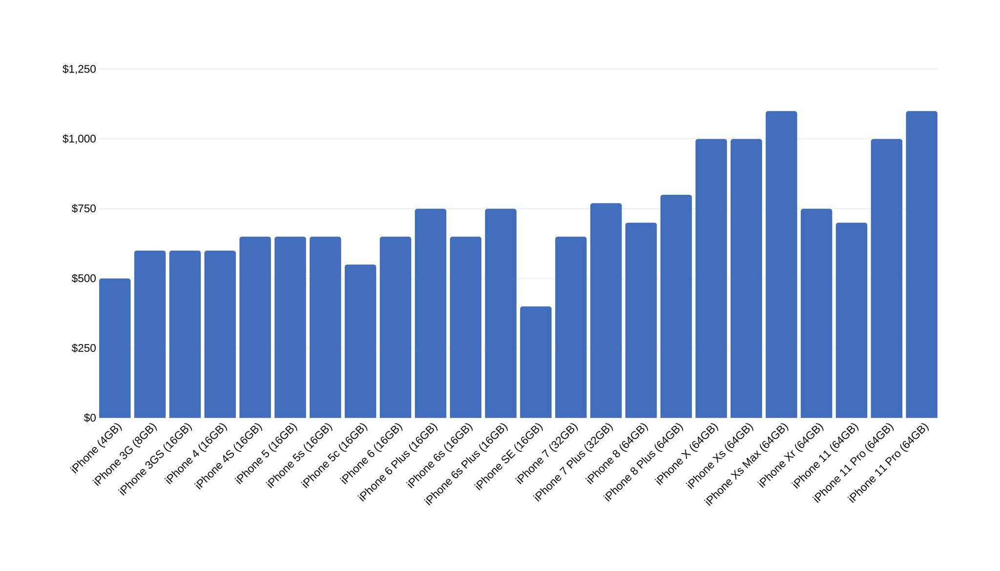

每年上市各款 iPhone 价格

可惜，不是所有垄断厂商都像苹果公司这样坐得住。一旦垄断厂商发现第一期没有卖出去，它很可能直接降价，而不是随机定价，毕竟库存和现金回收的压力很大。但这样一来，高端消费者就不会在第一期以高价买入，而是在第二期以低价买入。与其如此，垄断厂商还不如一开始就低价销售，这就回到了科斯猜想。

结语

总结一下，今天介绍的动态逆向选择模型告诉我们什么有用的道理呢？

首先，生产耐用品的垄断厂商不能让自己的产品成为自己的竞争对手，而要尽可能地实现新旧产品的差别化。

其次，在动态博弈中，承诺问题成为关键。面对市场波动，多数厂商通常无法承诺绝不降价，能够死扛的厂商才能最终挣到大钱。

总之，在耐用品市场上，如果垄断厂商可以抵制短期降价的诱惑，它就可能在长期中赚到更多利润。因此，做企业跟做人一样，要学会"熬"。我们不仅要重视智商、情商，还要提高"熬商"。

最后是一道思考题：2016 年底，万科公司以超过 100 亿元的价格获得了北京市海淀区一处土地的使用权。万科表示，房子建好之后，将只租不卖，开发商变成大房东。

请用今天所学的知识解释，考虑到二手房对新房的竞争关系，开发商什么情况下应该卖房子，什么时候应该只租不卖呢？

好了，今天我们就讲到这里，下集再见。

公众号懒人找资源，懒人专属群分享

## 19 产权理论丨为什么 70%的企业并购会失败？

懒人专属群的群友，你好，我是聂辉华。

在企业经营过程中，企业并购被认为是企业扩张最重要的手段之一。

因为相对于自己逐步做大，通过兼并、收购或者合并已有企业，一个企业可以迅速扩大规模，或者进入一个新的领域，占领更多市场份额。

然而，世界著名的管理咨询公司麦肯锡发布的一份研究报告发现，世界上 70%的企业并购都以失败告终。

例如，中国 TCL 公司收购法国阿尔卡特公司的手机业务，结果双方的合资公司解体了；上汽集团收购韩国双龙汽车公司，结果双龙破产了；中国平安集团收购欧洲金融机构富通集团，结果富通倒闭了。这样的并购失败案例可以说比比皆是。

既然并购是企业扩张的最快手段之一，那么为什么大部分企业并购都以失败告终呢？那些成功的并购有什么规律吗？

与管理学对并购的解读不同，今天我给大家从产权理论的角度讲讲背后的经济学逻辑。如果你了解或者熟悉管理学的理论，那么今天的节目也许会让你感到别开生面。

### 产权理论：只有互补的业务才应该合并？

美国哈佛大学教授哈特（Oliver Hart）及其合作者建立了一个经济学理论，叫产权理论。

我先说一下主要结论，根据产权理论，只有互补的业务才应该合并，而相似业务合并很可能会失败。因为在产权理论和不完全契约理论上的开创性贡献，哈特教授荣获 2016 年诺贝尔经济学奖。

为了让大家更好地理解产权理论对企业并购的指导意义，我就先从一个经典的企业并购案例开始讲起。在哈特教授 1995 年的著作《企业、合同与财务结构》里，专门讨论了这个经典案例。

美国通用汽车公司（GM）是世界上最大的汽车公司。1919 年，通用汽车公司和它的供应商费雪车身公司（Fisher Body）签订了一个为期 10 年的契约。

契约规定，通用汽车将所有的封闭式金属车身业务外包给费雪公司，价格是成本加 17.6%的利润。这是一种典型的成本加成契约，目的是保证供应商不会亏损，而且可以得到一定比例的利润。但是这种成本加成契约对通用汽车来说，成本越高，利润就越低。几年后，市场对通用汽车的需求急剧增加。

因此，为了降低生产成本，通用汽车要求费雪公司在自己公司附近建造一个新的工厂，这样可以节约运输成本和协调成本。但是，费雪公司拒绝了。为了解决这个工厂选址问题，通用汽车只能在 1926 年，也就是 10 年合同期还没满的情况下，将费雪公司完全收购了。

这个案例有三个关键点。

第一，通用汽车和费雪公司之间的契约是一个典型的不完全契约。什么是不完全契约呢？顾名思义，就是契约没有包含双方在所有情况下的权利和义务。

因为通用汽车和费雪公司在签约时，根本不可能预料到十年合同期内的各种不确定性，包括需求的大幅增长和双方的争议，而且发生争议时很多合同的细节无法向第三方证实。

比如，也许费雪公司认为，自己已经尽力降低成本了，为什么还要搬迁呢？但这些细节没法向作为第三方的法院或者仲裁机构证实。

因此，就算去法院打官司，法院恐怕也不好判决。这就好比夫妻双方闹离婚，任何一方要证明"感情破裂"，都是一件很麻烦的事情。通常来说，期限越长的契约，越有可能是不完全契约，从而出现的漏洞就越多。

第二，这份契约具有高度的资产专用性特征。费雪公司作为通用汽车的唯一车身供应商，必须根据通用汽车的专门需求布置生产流水线，也就是为通用汽车量身定制车身，这就需要费雪公司付出一定的固定成本。

而且，一旦更换了合作伙伴，这笔固定成本就变成了沉没成本，钱就打了水漂了。经济学把这种投资属性叫做资产专用性。另一方面，通用汽车长期依赖费雪公司的产品，并为此投入了很多资源。

因此，一旦通用汽车与费雪公司分手，短期内也难以找到合适的替代供应商，这也是一种资产专用性。资产专用性会产生"锁定"效应，因为任何一方毁约都会导致巨大的沉没成本和经济损失。

第三，难以避免的敲竹杠问题。如果一份契约只是不完全契约，但没有资产专用性，那么买卖双方在出现争议时可以再谈判，大不了毁约走人，不会带来额外损失。但是，如果契约是不完全的，并且一方或者双方的投资具有资产专用性，那么此时一方就可以利用合同的漏洞来要挟对方，从而损害对方的利益，这就是所谓的敲竹杠（hold  
up）。

从通用汽车的角度讲，当汽车需求急剧增加时，为了降低成本，缩短交货时间，它肯定希望供应商在自己附近建厂，但是费雪公司拒绝了。

对通用汽车来说，短期内又无法找到其它供应商，因此费雪公司的做法，就是一种变相的敲竹杠行为，目的是逼迫通用汽车提高外包价格。

反过来想想，费雪公司为什么不愿意搬到通用汽车附近呢？因为一旦搬过去了，费雪公司的工厂就彻底变成了专用性资产，对通用汽车的依赖性就是百分之百了。一旦通用汽车要求它降低价格，费雪公司就毫无谈判力。正是因为预见到了被通用汽车敲竹杠的风险，费雪公司才拒绝搬迁。

从这个案例中，我们可以发现，一旦在不完全契约下出现了敲竹杠问题，我们很难从道德上去谴责谁，因为每一方都可能向对方敲竹杠。这也提醒大家，当我们用理性的经济学方法分析商业纠纷或者契约冲突时，不要先验地假定谁是"弱势群体"，从而施以廉价的道德同情。

### 通用公司与费雪公司合作案例的三个关键问题

了解了这个经典案例的前因后果之后，我们来讨论三个关键问题。

### 关键问题一：双方可以和平分手吗？

第一个问题是，既然双方有争议，那么双方可以和平分手吗？不能，因为通用汽车和费雪公司的交易不仅是一份不完全契约，而且双方都为此进行了资产专用性投资，导致本来是自由交易的双方现在被锁定到了一种双边垄断关系中。

任何一方的退出，都会给自己以及双方带来巨大的沉没成本和经济损失。也就是说，即便是双方维持不愉快的合作，也比彻底撕破脸要更好。这就是我在前面的节目中经常讲到的一句话：两害相权取其轻。

因此，虽然双方之间发生了冲突，但是不排除双方会采取某种方式继续合作。在博弈的过程中，既斗争又合作，甚至以斗争求合作的事情，实在是司空见惯了。说到这里，聂老师也提醒大家：不到万不得已，别跟对方撕破脸死磕，那是真正的双输结果。

对于通用汽车和费雪公司来说，此时唯一的办法就是一方收购另一方，两个企业变成一个企业，管理学叫并购，产权理论叫"一体化"。也就是说，一体化是一种产权形式的变更。

那么，为什么并购或者一体化才能解决双方的矛盾呢？因为，并购之前，通用汽车和费雪公司是两家企业，是平等的市场主体，谁也不能命令谁，因此出现不完全契约时难以解决协调问题。记住，在不完全契约的情形下，契约本身的条款无法为解决双方矛盾提供帮助。

但是，两家企业合并为一家企业之后，收购方就变成了被收购方的老板或上级。并购的本质，就是两个企业从市场上的平行关系变成企业内的上下级关系。

根据前面介绍的交易成本经济学，在企业内部，企业主可以利用命令或权威机制来替代市场的价格机制，从而节约市场的交易费用。

通用汽车收购了费雪公司之后，就不用再跟费雪公司讨价还价了，可以直接命令费雪公司立即搬迁，否则就解雇费雪公司的高管团队，换一个听话的高管团队。这样一来，在搬迁工厂这个问题上，双方就不会有矛盾了。

### 关键问题二：谁应该收购谁？

第二个问题是，谁应该收购谁？如果说并购是解决不完全契约问题的最后方法，那么关键问题是谁是收购方，谁是被收购方，这就触及了产权理论的核心问题。

经济学家经常说，产权是最重要的激励工具，产权为什么重要呢？因为双方遇到合同没有规定的情况出现时，拥有产权的一方拥有最终决定权，他有权决定做什么和不做什么。

通俗地说，你的财产你做主，这符合法律规定。如果通用汽车和费雪公司签订的契约是一份完全契约，每一方都根据契约规定行使权力和履行义务，那么就不存在谁命令谁的问题了，因此根本不需要产权。相反，在不完全契约下，产权就是最终决定权。那么，这个最终决定权有什么用呢？

面对敲竹杠行为，双方需要重新对利益分配进行谈判，比如说提高收购价格，或者想办法降低生产成本，这都会影响当事人的切身利益。这种再谈判，实际上是一种双方之间的零和博弈。

由于产权所有者拥有最终决定权，他在谈判过程中就拥有更多的谈判力，万一谈不拢，他还可以带着资产去找别人合作，而没有产权的一方就不能这么做。

既然产权所有者在"分蛋糕"时可以给自己多分一点，那么得到产权的一方投资激励会更强。这里说的投资，既包括物质资本投资，也包括人力资本投资。

反过来，失去产权的一方就缺乏谈判力，在"分蛋糕"时就要少分一点，投资激励会更弱。

于是我们推导出产权理论的核心观点：产权是一把双刃剑，拥有产权的一方会增加投资激励，但是失去产权的一方会减少投资激励。因此，最优的产权安排必须在两者之间权衡取舍。

既然产权只能安排给双方中的一方，从社会最优的角度讲，显然应该把产权安排给投资重要的一方。

道理非常直观：投资重要的一方得到了产权，他投资的激励提高了，社会总福利也提高了，而失去产权对投资不重要的一方并没有太大的损失。再一次，我们看到了"两害相权取其轻"。

在这个经典案例中，通用汽车的投资相对更重要。因为通用汽车是整车生产企业，能否降低成本不仅涉及每年几十万甚至几百万辆汽车的交付，而且涉及上下游几千家关联企业。

相对而言，费雪公司的搬迁只是涉及个别企业的少数生产环节，经济损失相对较小。因此，由通用汽车兼并费雪公司是一种最优选择。

### 关键问题三：什么样的并购是有效率的？

第三个问题是，什么样的并购是有效率的呢？虽然并购是解决不完全契约下敲竹杠问题的最后办法，但并非所有的并购都是有效率的。

正如我们在节目开头说的，世界上 70%的并购都是失败的。根据产权理论，两个业务互补的企业应该并购，而两个业务相似的企业不应该并购。背后的道理也非常直观。业务互补的企业并购后，不管哪一方获得产权，都能提高并购者投资的激励，这是对双方有利的安排。

对被收购者来说，既然双方资产是互补的，那么反正单方面也很难产生合作收益，还不如成全其中一方，因此它不会有额外损失。

相反，没有互补业务的双方或者业务相似的双方并购后，获得产权的一方未必会增加投资的激励，但失去产权的一方肯定会减少投资的激励，因此总体上降低了效率。

2012 年，全球最大的社交网络 Facebook（脸书）以 10 亿美元收购了 Instagram（图片分享应用程序），因为后者提供的照片分享软件与前者的社交平台是互补的。这是一次成功的并购。

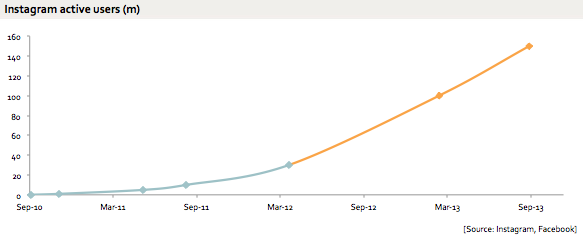

图中橙红色部分显示了被 Facebook 收购后 Instagram 活跃用户量的变动趋势

相反，我们在前面提到的三个并购案例----  
TCL 收购阿尔卡特手机业务，上汽集团收购韩国双龙汽车，平安集团收购富通集团，恰恰都是相似业务的并购，两者之间都没有互补性，因此并购失败也就不足为奇了。

产权理论不仅可以分析企业的并购，还可以分析所有机构的合并，包括大学。20 年前，北京大学与北京医科大学合并，因为两者是互补的，所以是有效的合并。

而多年来备受关注的南京大学和东南大学合并、天津大学和南开大学合并一直没有推进，除了合并后的名字不好取，主要原因是两者办学内容相似，合并不会带来效率的改进。

结语

我来总结一下今天的主要内容。

企业之所以要并购，一个重要原因是需要解决合作过程中的协调问题以及避免敲竹杠问题，而解决问题的最终办法是产权。

从社会最优的角度讲，应该将产权安排给投资重要的一方，由它来收购另一方。同时，也要记住，产权是一把"双刃剑"，不是所有的合并都是好的。一个根本原则就是，两个互补的机构应该合并，两个相似的机构不应该合并。

最后是一道思考题：请你运用这一讲学到的知识，来谈一谈为什么亚马逊收购中国卓越网失败了？欢迎分享你的看法。

好了，今天我们就讲到这里，下集再见。

公众号懒人找资源，懒人专属群分享

## 20 关系契约丨加盟店与直营店（麦当劳与海底捞）哪种扩张模式更好？

懒人专属群的群友，你好，我是聂辉华。

麦当劳是全世界最大的连锁餐厅，海底捞是中国最大的连锁餐厅。一个是世界第一，一个是中国第一，虽然两者都是第一，但是两者的扩张模式却截然相反。

据统计，麦当劳在全世界有将近 4 万家门店，90%都是加盟店。相反，海底捞的 500 家门店都是直营店，没有一个加盟店。打个简单的比方，加盟店相当于"雇佣军"，而直营店相当于"嫡系部队"。

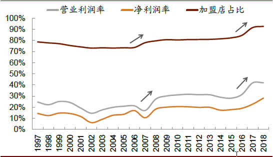

历年麦当劳各利润率与加盟店占比图表

图表来源：中金公司研究部

那么，为什么麦当劳的扩张主要采取加盟店模式，而海底捞采取直营店模式呢？究竟哪个模式更好呢？对于这个问题，同样是公说公有理，婆说婆有理；究竟谁有理，关键看逻辑；逻辑要自洽，关键是框架。

今天，我要给大家介绍的分析框架是关系契约理论，它会带给你不一样的理解视角。

### 什么是关系契约？

什么是关系契约呢？简单地说，关系契约（relational contract）就是依靠长期关系维持的契约。

例如，企业老板和员工的雇佣契约，一般都要持续好几年；又比如前面讲过的通用汽车和费雪公司之间的十年契约，还有两个企业、两个国家之间的长期合作契约。

因此，关系契约是一种长期契约，而现实中有很多契约是短期契约。比如，你在淘宝上买东西，买完之后双方再也不联系了，这就是一次性的短期契约，不是关系契约。

从博弈论的角度讲，普通契约大多是一次性博弈，或者博弈次数较少，而关系契约是重复博弈。

大家可能记得我在之前的节目里讲过，在长期契约中，因为人的有限理性，人们无法预料到未来所有可能的情况，并且把这些情况写在契约里，或者有些合同条款无法向第三方证实，这就导致契约是不完全的，从而容易发生敲竹杠问题。既然关系契约也是一种长期契约，那么它的契约也是不完全的，所以会面临敲竹杠问题。

### 关系契约的主要模式：加盟店与直营店

在现实中，关系契约有很多表现形式，而加盟店模式和直营店模式正好对应于关系契约的两种主要模式。

因此，对连锁店来说，选择什么样的扩张模式，表面上看是企业主选择总部与分店之间博弈关系，本质上却是选择最优关系契约的问题。

一旦我们把所有的组织形式看作一种契约关系，我们就看透了问题的本质，抓住了问题的关键。

对于契约关系而言，关键的关键就是我们多次提及的信息不对称问题。其实，所有的组织管理问题，很大程度上都是努力解决信息不对称问题，大家觉得是不是这样？

因此，聂老师经常说，作为一个企业管理者，不能只懂管理学，而不懂经济学。因为管理学只是教会你怎么解决具体问题，而经济学是给你一套系统思维。

毫不夸张地说，契约理论就相当于武林中的独孤九剑，一旦掌握了基本要诀，就可以"以不变应万变"。下面我们就来小试牛刀。

首先，我们来明确一下什么是加盟店模式和直营店模式。一般来说，全世界的连锁店模式主要就是这两种模式。

### 加盟店模式：总部和分店之间是市场关系

在加盟店模式下，总部向每个分店收取一笔固定的加盟费或者特许经营费，然后定期从分店的营业收入中提取一定比例，比如 5%的服务费或者管理费。总部还会要求分店在房屋装修、服务流程、管理制度、原料或产品配送方面遵守统一标准。

从契约的角度讲，总部和每个加盟店的关系近似于两个平行主体的市场关系，分店拥有自己的产权，在内部管理、人员招聘和投资等方面拥有很大的自主权。

打个比方来说，加盟店模式就是一种联邦模式，总部和分店的关系是联邦政府和州政府的关系。很多人可能不知道，在美国的联邦体制下，美国总统无权任命州长，但州长必须服从联邦的法律。

但总部和分店的契约关系并非短期的一次性契约，而是一种长期的关系契约，也是一种不完全契约。

在总部和分店的契约中，有一部分是可以向第三方（比如法院）证实的条款，例如统一商标和装修风格。还有一部分内容是难以向第三方证实的条款，例如分店的真实利润或者营业收入。

分店可以通过"做账"来隐瞒真实的利润水平或营业收入，这样可以给总部少交钱。

又比如品牌维护。总部为了维护统一的品牌，肯定需要投入很多资源，但这些投入本身以及投入的效果是很难向别人证实的。这种第三方信息不对称导致了不完全契约，从而使得双方难以通过法院来执行这种契约。

根据我们前面介绍的"产权理论"，当出现不完全契约时，拥有产权的一方拥有最终控制权，并且拥有更多的谈判力。这意味着，一旦出现纠纷或争执，并且法院作为第三方难以证实的情况下，分店作为自己产权的所有者，处于相对强势地位，而总部处于相对弱势地位。这也意味着，相当于总部，分店更有可能违约或者实施敲竹杠行为。

举例来说，假设总部和分店在双方合同中约定，如果分店每年的利润增长率超过 30%，总部向分店收取的服务费就从 5%提高到 8%'但分店可以通过操纵会计科目隐藏利润，从而拒绝支付更高的服务费。这种利用合同漏洞的违约行为，就是分店对总部实行的敲竹杠行为。

当然，在现实中，面对有漏洞的合同或者不完全契约，当事人并不总是违约，而是要权衡违约的成本和收益哪个更大。

如果违约的成本高于收益，那么当事人就会遵守契约，这正是关系契约得以维持的根本原因。就好比说，人们之所以在大部分时候比较讲道德，并非是因为大家的道德水平都很高，而是因为面对法律惩罚或者对方的报复，不讲道德的成本往往高于收益。

说白了，在经济学看来，道德本质上是一种权衡利害的结果。讲到这里，聂老师想起了著名青年作家韩寒在电影《后会无期》里的一句著名台词：小孩子才分对错，成年人只看利弊。不得不说，这句话有一定的道理。

电影《后会无期》剧照

之前，我们在介绍"交易成本"的知识时，比较了市场和企业的差异。概括起来就是一句话：市场的激励强度比企业大，但是市场的协调能力比企业差。再结合前面讲到的产权作用，我们可以归纳出加盟店模式的优点和缺点。

优点是：因为加盟店是产权所有者，激励强度很高，所以有动力做大做强，这导致连锁店扩张速度很快。

缺点是：因为总部和分店之间是市场关系，不是上下级关系，协调能力较差，所以总部对分店的服务或产品质量标准难以严格控制，并且分店有更多的违约行为。

### 直营店模式：总部和分店是企业内的上下级关系

再来看直营店模式。在直营店模式下，总部拥有分店的产权，决定了分店的选址、装修、投资、服务或产品标准，并且有权任命分店的高管。

分店在扣除了必要的运营成本和生产成本之后，利润主要上交给总部，只留下一部分奖励分店职工。

从契约的角度讲，总部和分店是企业内的上下级关系，而不再是市场上的平行关系，这是直营店模式和加盟店模式的根本区别。

直营店模式的优点是：总部对分店的纵向控制能力很强，服务或产品质量标准容易把控。

缺点是：因为分店只能获得很少的利润，所以激励强度较弱，扩张速度较慢，并且总部有更多的违约诱惑。

例如，总部可以找个借口，减少给分店的利润留成，或者在成本上拼命挤压分店。

总而言之，加盟店模式的优点就是直营店模式的缺点，而加盟店模式的缺点就是直营店模式的优点。

### 模式的选择：质量控制与数量扩张的比较

回到前面的问题，加盟店模式和直营店模式，哪种更好呢？

关系契约理论认为，这主要取决于产品或服务的性质。如果连锁店经营的产品是标准化的，不太担心产品质量问题，那么加盟店模式是最优的。

因为对于标准化产品而言，加盟店模式快速扩张的优势可以充分发挥，而它在质量控制方面的缺陷又得以避免。

从另一个方面讲，产权理论认为，投资重要的一方应该拥有产权。对于提供标准化产品的连锁店来说，为了实现规模经济，数量扩张比质量控制更加重要，因此分店拥有产权比总部拥有产权更好。

但是请注意，在加盟店模式下，拥有产权的分店在契约不完全时有更多的违约诱惑，因此在签订契约时要设置一些条款防止分店侵占总部的权益。

以企业老板和工人之间的劳动契约为例，他们之间就是一种关系契约。老板拥有产权，有更多的违约诱惑，而工人处于相对弱势地位，因此《劳动合同法》有一些条款是倾向于保护工人利益的。

例如，如果工人要离职，只需要提前一个月告知老板，而如果老板要解雇工人，就需要满足一些前提条件并且给予足够的补偿。

反之，如果连锁店经营的产品是非标准化的，质量控制比数量扩张更加重要，那么直营店模式就是最优的。

此时，总部拥有分店的产权，并且对分店实行严格的质量控制。

当然，在直营店模式下，总部有更多的违约诱惑，因此契约必须对分店的权益有更多保护条款。

### 不同关系契约模式的现实应用

有趣的是，上述理论推演与现实完全一致。麦当劳作为一种西方快餐，是完全标准化的食品。以炸薯条为例，从土豆的种类、大小、重量，到薯条的大小、油的温度、配料的比例以及存放时间，全都有统一的规定。

一个完全不会做饭的实习生，培训两周后也可以独立操作机器并炸出标准的麦当劳薯条。这就是标准的力量。

对麦当劳来说，产品的质量控制不是问题，问题是如何快速占领市场，尤其是在中国市场上与老对手肯德基竞争。

既然数量扩张比质量控制更重要，那么加盟店模式就是最优的，此时分店拥有自己的产权。

与此同时，麦当劳规定加盟店必须投入足够的现金（例如 200 万元），而不能全部使用贷款。这就提高了加盟店的违约成本，减少了加盟店的道德风险行为。

与麦当劳的情况完全相反，海底捞经营的四川火锅，是一种典型的中餐，而中餐的主要特点就是产品难以标准化。

作为一个江西人，我曾经在上百家餐馆吃过同一道菜"农家小炒肉"，结果发现一百家餐馆就有一百种不同的做法！

海底捞凭什么能够在激烈竞争的中餐连锁店市场成为全国第一呢？凭的是它独特的优质服务。

因此，"如何确保统一的优质服务？"就是海底捞的关键问题，也就是说服务质量控制比门店数量增加更加重要，因此海底捞采取了直营店模式，总部拥有分店的产权。同时，为了保护分店的积极性，海底捞规定店长一律从内部提拔，而不是从总部"空降"。

其实，不管是加盟店模式还是直营店模式，都是市场理性选择的结果，本身并不存在孰优孰劣，关键是开店的老板要明白产品的性质和战略定位。

请注意，我们今天讨论的连锁店模式不仅仅适用于餐饮店，也适用于所有的连锁店模式，例如手机专卖店、服装和家用电器连锁店。

我们还可以用关系契约理论来分析农业产业组织。广东温氏集团是亚洲最大的养鸡企业。

温氏集团在早期发展阶段，数量扩张比质量控制更重要，因此采取了流行的"龙头企业+农户"模式。

在这种模式下，农户自己养鸡，然后卖给温氏集团，这就相当于加盟店模式。

后来，温氏集团更加强调品牌战略，此时质量控制比数量扩张更重要，因此温氏集团采取了"龙头企业+农场"模式，将独立的农户变成了企业的雇员，这就相当于直营店模式。

温氏集团在不同的发展阶段采取了不同的扩张模式，完全符合关系契约理论的预测。

结语

总结一下这一讲的主要内容。

加盟店模式和直营店模式都是一种关系契约，前者近似于市场关系，后者近似于企业内上下级关系。

当分店的数量扩张比产品的质量控制更重要时，加盟店模式是最优的；当产品的质量控制比分店数量扩张更重要时，直营店模式是最优的。

对于企业而言，不存在包打天下的通用模式，适合自己的模式才是最好的模式。

今天的思考题如下。2017 年，麦当劳将其在中国内地和香港的业务以 20 亿美元的价格，出售给中国中信集团与美国凯雷投资集团，中信集团成为麦当劳中国公司的控股股东。

请你分析一下，中信集团控股之后，中国的麦当劳是否会改变其推行多年的加盟店模式？

好了，今天我们就讲到这里，下次再见。

公众号懒人找资源，懒人专属群分享

## 21 参照点理论丨“损人”到底能不能“利己”？

懒人专属群的群友，你好，我是聂辉华。

任何一门学科都有一些基本假设。经济学的最基本假设是理性人。

所谓的理性人，就是总是追求自身利益最大化，只做有利于自身经济利益的事情，绝不会做损害自身经济利益的事情。但这产生了一个悖论：如何解释现实中那么多"损人不利己"的行为呢？

比如说，张三辱骂李四，引起李四仇恨，这对张三并没有任何物质上的好处；王五和赵六两人合伙做生意，本来两人可以挣 100 万元，但因为分配方案谈不拢，张三宁可自己不挣钱，也不想让李四挣钱。

中国古代有很多成语形容这类行为，例如"鱼死网破"、"同归于尽"、"宁为玉碎，不为瓦全"。其实从经济学的角度讲，这些行为都是非理性的选择。

那么，经济学如何解释"损人不利己"的行为呢？今天，我们就来谈谈这个问题。

### 烟农与公司为何存在非理性行为？

我先给大家讲一个调研中听到的故事。

云南是中国最大的烟草种植基地。由于烟草种植必须连片，所以政府会指定某个地区的烟农与烟草公司签订收购合同，将烤烟以合同价卖给烟草公司，这就是流行的"龙头企业+农户"模式。

有一年，烟草歉收了，烟草供不应求，按说烟草的收购价格应该更高才对，但当年的合同价明显低于上一年的收购价，而且烟草公司不同意提价。

烟农觉得很不公平，但又只能把烤烟卖给烟草公司，因为烟草收购是垄断的。于是，烟农在烘烤烟叶时，故意将一些烟叶烤焦。烟农这样做并不会增加自己的收入，但这是烟农对烟草公司表达愤怒的一种方式。

又有一年，烟草丰收了，烟草供过于求，本来应该降价，但是当年的合同价明显高于去年的价格。此时，烟草公司希望降价，但是烟农不同意。于是，烟草公司很不满意，故意拖延付款时间。

在这个故事中，先是烟农，然后是烟草公司，在履行契约的过程中采取了某种"损人不利己"的投机行为，这是为什么呢？

### 行为经济学：契约是一把"尺子"

为了解释这些看上去非理性的行为，半个世纪以来，经济学家逐步建立了一门新的经济学分支----行为经济学。

行为经济学不同于我们在教科书上学习的主流经济学，它用"社会人"假设取代了"理性人"假设，认为人是一种社会动物，不仅在乎经济利益，而且在乎公平、正义、尊严等社会情感。

而且，行为经济学可以解释很多主流经济学难以解释的行为，例如人们为什么会过度自信，为什么会根据小样本决策，为什么会"患得患失"？

2002 年和 2017 年，行为经济学家两次获得了诺贝尔经济学奖，这说明行为经济学逐渐得到了主流经济学界的认可。对于行为经济学家来说，这是非常重大的突破。因为，在 2000 年之前，人们总是认为行为经济学有点"离经叛道"，不是主流，甚至有点象异端学说。

有意思的是，哈佛大学教授哈特（Oliver  
Hart）本来是一个标准的主流经济学家，没想到 2008 年之后他也转向行为经济学。通过引入行为经济学视角，哈特不仅重新定义了"契约"，而且为大量存在的"损人不利己"现象提供了一个合理的解释。

哈特认为，契约是一种"参照点"（reference  
point）。签约之后，如果当事人认为自己得到了契约当初规定的权利或利益，或者说他得到了公平对待，那么他就会按照契约的实质精神，好好配合对方履行契约；如果当事人认为自己没有得到契约当初规定的权利或利益，或者说没有得到公平对待，那么他就会采取一些"投机"（shade）行为，包括背后捣乱、推卸责任、敷衍了事以及报复对方。

报复是所有投机行为中最严重的一种。行为经济学认为，让对方遭受损失能够在某种程度上弥补自己的心理损失。也就是说，"损人"某种程度上是"利己"的！

这还真符合人类的情感：有时候你看对方不顺眼，跟对方吵了一架，立马觉得自己出了一口恶气，感觉好多了。不是吗？

哈特教授对契约的理解，刷新了我们的认知框架。主流经济学认为，契约是双方之间关于权利和义务的约定。一旦某个条款写入契约了，不管对方是否履约，自己都应该履约，而且接受最终结果。这就是所谓的"契约精神"。

这个说法固然没错，但是它没有考虑人们的心理感受，从而难以解释公平、平等这些人们非常看重的价值观念。

而在参照点理论看来，当事人并不是机械地履行契约，而是根据自己的心理感受来决定履约的方式，并影响履约的结果。

如果说，主流经济学将契约看作一根"绳子"，用来约束当事人的行为，那么行为经济学则将契约看作一把"尺子"，用来衡量当事人的公平感受。

### 关于"损人不利己"行为的三个疑问

在烟草公司与烟农的收购案例中，双方都有损人不利己的行为，与哈特的参照点理论预测完全一致。

不过，从参照点理论的逻辑来看，对于这些损人不利己的行为，我们还有一些疑问需要解释。

### 疑问一：报复行为是否违法违规？

第一个疑问是，当事人的报复行为是不是违法违规行为？如果是，那么对方就可以采取法律手段保护自己，并且惩罚当事人，这样报复行为就不会发生了。

有意思的地方就在于，当事人之间的契约是一个不完全契约，合同中有一些条款是无法向第三方证实的。

因此当事人如果觉得不公平，完全可以利用合同的漏洞来报复对方，但又让对方抓不到把柄。这其实就是我们在前面的节目里讲过的"敲竹杠"行为。

在云南烟草的故事里，烟农将烟叶烤焦了，烟草公司很难说烟农是故意的，或者烟叶就不合格了。虽然最上等的烤烟是金黄色的，但合同不可能规定什么是"金黄色"，法院也无法鉴别。

说白了，有些事情双方是心知肚明的，但就是无法向第三方证实，这就属于第三方信息不对称。

类似地，烟草公司延迟付款，烟农也不能去法院告烟草公司违约，因为烟草收购合同根本就不会规定具体的付款时间。

烟草种植和收购依赖于天气，而天气是无法在一年前预测并写入合同的，所以合同中不会规定精确的收购和付款时间。

### 疑问二：何种情况更能引发报复行为？

第二个疑问是，什么情况下当事人更有可能报复对方？我们在生活和工作中经常会遇到很多不公平的事情，但并不是每次都去报复对方。

中国古代的成语很有意思，一方面教人"以牙还牙"、"针锋相对"，另一方面又教人"守时待机"、"韬光养晦"，听上去自相矛盾，其实是一种传统智慧。

参照点理论认为，当遭遇不公平对待时，当事人报复对方的程度主要取决于相对实力。如果一方实力更强，更有能力伤害对方，那么他就会施加更多的伤害，直到这种伤害完全抵消他的心理损失。

因此，对于受到不公平对待的当事人来说，如果实力具备，那就直接"以牙还牙"；如果实力还不充分，那就只好"守时待机"。

说到这里，聂老师不得不发点感慨。媒体经常呼吁大家照顾"弱势群体"，其实所谓的"弱势群体"完全是一个伪概念，因为强弱是相对而言的。烟草丰收时，烟草供过于求，所以烟农是弱势群体，但烟草歉收时，烟农又成了强势群体。

作为有经济学思维的人，我们千万不能被道德冲昏了头脑，而应该从利益的角度看穿对方，这样才能理性地分析问题，否则就只会陷入无休止的口水战中。

### 疑问三：契约是否总具有参照点功能？

第三个疑问是，契约是不是总是具有参照点功能？换句话说，在什么情况下签订的契约，具有标尺一样的参照功能呢？

为了搞清楚这个问题，哈特教授与合作者在瑞士的苏黎世大学和苏黎世理工学院招募 52 个大学生，不包括经济学或心理学专业的学生，然后将他们随机地分成两组：一组是买者，一组是卖者，然后让他们模拟了 5 轮买卖物品的实验，其中卖者可以决定给买者提供高质量的产品，也可以提供低质量的产品。

研究者发现：如果契约是在完全竞争市场上签署的，那么契约就具有参照点的功能。因为完全竞争市场是一种对双方都公平的环境，没有人被强迫参与契约。

进一步发现，在事前公平的环境下，双方不在乎契约条款本身，而在乎契约履行的结果。换句话说，只要事前的签约环境是公平的，即便契约条款本身"不公平"，双方也会照章执行。"愿赌服输"说的就是这个意思。

相反，如果契约不是在公平竞争的环境下签署的，比如说价格是政策制定者规定的，而不是市场自发形成的，那么契约就不具有参照点的功能，从而契约中那些不可证实的条款就难以被保证履行。

在云南烟草案例中，烟草种植区域是由政府指定的，并且烟草公司是垄断的，双方都不是自愿选择的。也就是说，烟草公司和烟农之间的签约环境一开始就不是一个完全竞争市场，这就为双方的不公平感受以及投机行为埋下了伏笔。

### 参照点理论下的"契约精神"

其实，参照点理论不仅能够解释"损人不利己"的现象，还能从一个新的角度解释很多相关现象。

首先，参照点理论关于缔约环境的分析，有助于我们重新理解所谓的"契约精神"。

很多人批评中国人缺乏契约精神，意思就是不遵守约定，经常背信弃义。但是，很多人可能忽略了签订契约的前提条件。中国古代有一个成语叫"城下之盟"，意思是一个国家利用武力强迫另一个国家签订不平等的条约，这样的条约往往不会被后者遵守。

根据参照点理论，在不公平前提下签署的契约，不具备参照点的功能，受到胁迫的当事人当然就不会严格遵守契约的实质精神，违约也就在所难免了。因此，当我们批评别人缺乏契约精神时，首先要考虑签约行为本身是不是公平的。

其次，参照点理论关于投机行为的分析，有助于我们重新理解人际关系的冷暖。

中国古代还有一句成语，"共患难易，同富贵难"。为什么人们能够历尽艰辛一起创业，却很难一起享受荣华富贵呢？

根据参照点理论，只有在公平的环境下缔结的契约，并且各方实力相当，这样的契约才能长期维持。在患难时期，创业者彼此之间的结交是在充分竞争的环境下形成的，相当于在事前公平的环境下缔结了共同创业的隐性契约。

关键是，创业初期各方的实力比较均衡，没有人能轻易地损人利己，否则大家都要完蛋。也就是说，在创业时期违约的机会成本很高，得不偿失。但是创业成功之后，创业团队成员之间的实力差距就逐渐拉大，尤其是主要创始人拥有了和其他创业团队成员之间不对称的权威或权力。

面对事业成功，创业团队成员很容易高估自己的贡献，低估别人的贡献，从而认为自己遭受了不公平待遇。主要创始人认为，对照当初创业时的契约，自己付出太多，拿得太少，而其他创业成员也会这么认为。

还有一点，在事业成功之后，相对于创业初期，斗争带来的好处会更多，权力的价值会更大。因此创业团队成员之间经常会采取不可证实的手段相互捣乱、拆台、内斗，比如举报别人偷税漏税、挪用公款、做假账，最终往往是两败俱伤。

我们在研究企业创业案例时发现，成功创业并且稳定发展的企业，最后几乎都是只留下主要创始人，其他创业团队成员都退出了管理层。例如，著名火锅店海底捞在公司上市之前，创始人张勇"铁腕"夺取了绝对控股权，并且将所有创业成员请出公司。

结语

我们总结一下今天节目的主要内容。

主流经济学无法解释"损人不利己"的行为，但是在行为经济学看来，如果当事人觉得不公平，那么"损人"某种程度上是一种"利己"行为。

根据参照点理论，事前的公平环境加事后的实力均衡，才能成就和谐的契约关系。当我们强调"契约精神"时，不能只问结果，不问过程。

最后是一道思考题，根据你的了解，哪些契约关系中存在着损人不利己的行为，导致这样行为的原因又是什么？欢迎分享你的看法。

好了，今天我们就讲到这里，下集再见。

公众号懒人找资源，懒人专属群分享

## 番外丨 2020 年诺贝尔经济学奖解读：什么是“新型拍卖理论”？如何避免“赢者的诅咒”？

懒人专属群的群友，你好，我是聂辉华。

### 谁得了 2020 年诺贝尔经济学奖？

北京时间 10 月 12 日晚上 6 点左右，瑞典诺贝尔基金会宣布，将 2020 年诺贝尔经济学奖授予米尔格罗姆（Paul R. Milgrom）和威尔逊（Robert  
B. Wilson），以表彰他们"对拍卖理论的改进和新拍卖形式的发明"。

2020 年诺贝尔经济学奖得主

两位经济学家都是美国人，而且都是斯坦福大学的经济学教授。有趣的是，威尔逊是米尔格罗姆的导师，但是经济学诺奖通常是按照姓氏音序排名的，而不是根据资历排名。

除了今年共同得奖的米尔格罗姆，之前得奖的霍姆斯特朗（Bengt Holmstrom）和罗斯（Alvin E.  
Roth）也是威尔逊的学生。这么算起来，威尔逊已经有三个学生获得诺奖了！师生总共有 4 人获奖，我估计这在经济学界绝对是空前的。

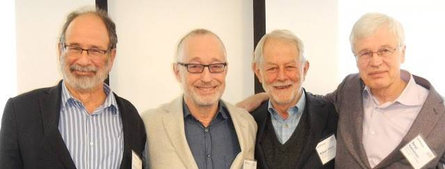

Robert B. Wilson（右二）和他三位获得诺贝尔经济学奖的学生

从左至右：Alvin E. Roth、Paul R. Milgrom、Bengt Holmstrom

尽管米尔格罗姆和威尔逊很早就在博弈论和拍卖理论方面取得了重大成就，但是今年很多人都没有猜到最终获奖的会是他们两位。

其实，猜测诺奖是一项风险很高、赢面很低的事情。因为诺贝尔经济学奖通常授予几十年前的重大原创性经济学理论。

据统计，获得诺贝尔经济学奖的经济学家，得奖时平均年龄为 63 岁。这就意味着，重大理论的提出时间和获奖时间之间的对应关系非常模糊，因为潜在的获奖者人数太多了，我估计自认为或者被认为能够获得诺贝尔奖经济学奖的人，能够从人大西门排到长安街上，但是每年只能最多有三位经济学家获奖，得奖的概率其实是很低的。

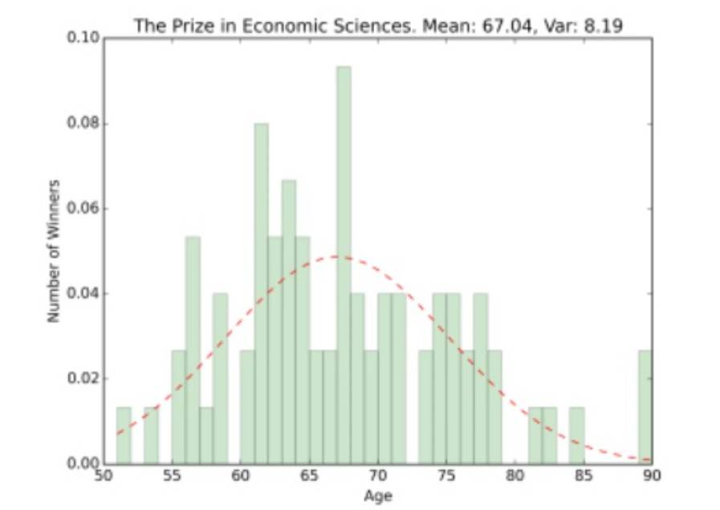

历年诺贝尔经济学奖得主年龄分布图

比如，今年获得诺奖的两位得主，米尔格罗姆 72 岁了，而威尔逊已经 83 岁了。他们俩获奖的成就至少应该是他们大约 30 年前的经济学理论，你说大家怎么猜得准？

有一点要说明一下，诺奖只颁发给活着的并且精神正常的经济学家。因此，每年等待诺奖最焦虑的人，肯定不是我们这些"吃瓜群众"，也不是每年坐在新浪财经嘉宾室里预测得奖的人，而是那些自认为早该得奖却时日无多的人。因为每次一错过，就意味着又要熬一年。据说，2019 年就有一位哈佛著名经济学家因为错失诺奖，郁闷得上吊自杀了。

从这个意义上讲，诺奖其实客观上鼓励了经济学家锻炼身体，因为身体不行，诺奖肯定没戏。当然了，身体行，诺奖也不一定有戏。

### 拍卖理论是什么？

根据诺贝尔基金会的介绍，米尔格罗姆和威尔逊的主要贡献是，"对拍卖理论的改进和新拍卖形式的发明"。

我不是拍卖理论专家，但是因为我每年在人民大学给研究生讲授《契约理论》，都会专门介绍拍卖理论，因此也算对拍卖理论略知一二。

拍卖理论是将博弈论应用于市场化的资源分配，是一种定价方式。如果你看学术论文，会发现拍卖理论充满了数学模型，普通人肯定是看不下去的。但实际上，拍卖是我们生活的世界中最常见的经济现象之一。

我们经常看到关于古董、字画以及矿产资源的拍卖，看上去都是非常"高大上"的项目。其实，拍卖是人类最古老的交易方式。

在一个农贸市场上，只要有两个顾客同时购买一棵大白菜，他们之间就存在竞价关系。当多个顾客为一件商品竞价时，拍卖就出现了。政府招标或者采购也是一种拍卖，不过它是一个相反的过程，遵循"价低者得"的规则。

总之，不仅易趣、淘宝上的竞拍活动是拍卖，本质上所有的市场交易都是一种拍卖。理解拍卖行为，就是理解市场行为。

我先给大家讲一个故事。人类历史上第一次经济泡沫发生在 1637 年的荷兰，导致泡沫的物品不是股票，也不是房地产，而是郁金香，一种球茎类似于洋葱头的鲜花。

当时的荷兰号称"海上马车夫"，是世界霸主。郁金香被引进荷兰之后，成为财富和地位的象征，价格一路飙升。

当时最贵的一支郁金香名叫奥古斯都，拍卖价格高达 6700 荷兰盾。这笔钱可以买下荷兰首都阿姆斯特丹的一幢河边别墅，相当于一个普通荷兰人 45 年的收入。

郁金香"奥古斯都"

但是，在这支郁金香卖出天价的第二天，有人发现一支要价较高的郁金香竟然没有拍卖成功，一些人开始担心自己手中的郁金香也可能找不到卖家，赢了拍卖反而可能亏了钱财。恐慌开始大面积传播，郁金香的价格迅速暴跌，最终这场郁金香泡沫导致无数人倾家荡产。你看，拍卖还跟经济危机有关。

### 经济学家如何研究拍卖理论？

在一场正式的拍卖中，比如一次古董拍卖。针对同一个拍卖商品，每个竞拍者都有自己的心理价位，竞拍者自己知道，但是参与竞拍的其他人不知道，拍卖师和物品的所有者也不知道，这就属于不对称信息。

在这种情况下，每个拍卖者都在参与一种博弈：你如何确定一个最优报价呢？如果报价太低，你可能得不到商品；如果拍卖价格太高，就算赢得了商品，但可能多付出了代价，没有实现利润最大化。因此，拍卖其实是一种复杂的博弈行为。

经济学家就是用博弈论的方法，来研究在不同的拍卖场景下，竞拍人的最优拍卖策略是什么。

比如，是一开始报一个高价，还是逐步加价？对于商品的所有者来说，是采取从低往高的英式拍卖方式更好呢，还是采取密封价格拍卖更好呢？

说白了，从经济学家的角度讲，他们希望设计一种能够最大化拍卖总收益的拍卖方式，但这种拍卖方式并不是人为地指定谁能中标，而是通过市场化的竞价方式去实现。因此，拍卖又叫"市场设计"（market  
design）。

按照拍卖品的最终用途，我们可以区分两种拍卖。

第一种叫私人价值拍卖，拍卖的物品都是私人要收藏的或者自己消费的，而且每个人都有自己的价值判断，不太在乎别人的评价，比如字画、经典款式的汽车，或者上年份的美酒。

第二种叫公共价值拍卖，拍卖的物品是要再拿出去赚钱的，而且这些物品有一个市场公认的价格，比如矿山、油田，以及前面提到的郁金香。

今年获奖的两位学者有一个重要贡献，就是构建了公共价值拍卖的基本理论，以及研究了一些新的拍卖形式。比如多物品拍卖，不是一次拍卖一种物品，而是同时拍卖多种物品，以及将某种物品分割后进行拍卖，比如国库券。

有意思的是，两位经济学家不仅研究拍卖理论，而是身体力行，用实践来检验真知。

1995 年，米尔格罗姆教授牵头，与一帮斯坦福大学出身的经济学家一起，创办了一个拍卖设计公司，名字就叫"市场设计公司"（Market Design  
Inc）。不过，我前几年登陆该公司网站时，发现业务早已停滞，似乎 2016 年之后就关张了，而且网站地址也被导向马里兰大学的一个三级页面了。

在经济学界，掌握了经济学理论，不代表能用经济学发财。当年因为资本资产定价模型而得奖的某位经济学家，也曾开过一家投资公司，结果很快倒闭了。但愿米尔格罗姆教授的这家拍卖设计公司，能够避免重蹈覆辙，甚至在他得奖之后生意兴隆。

### 什么是"赢者的诅咒"？

在公共价值拍卖理论中，有一个著名的悖论，叫"赢者的诅咒"。什么叫"赢者的诅咒"呢？为什么赢了拍卖的人反而会被诅咒呢？这里，我稍微讲讲这个名词背后的逻辑。

对于私人价值拍卖来说，只要竞拍者认为物有所值，出多少钱是你自己的事情，不存在绝对的吃亏问题。但是，对于公共价值拍卖来说，因为商品有一个客观的市场价值，所以赢了拍卖反而有可能亏了钱财，这就是所谓的"赢者的诅咒"。那么，为什么会出现"赢者的诅咒"呢？

假设政府准备出售一座矿山的开采权。没有人准确知道矿山的真实价值，它有可能是富矿，也可能是贫矿。

甲乙双方参与竞拍，他们各自派出了探矿队去收集矿山的资料，然后形成了对矿山价值的初步判断。根据拍卖理论中的维克瑞拍卖方式，每个人秘密报价，然后报价最高的人赢得商品，但是他付出的价格只是第二高的价格，而不是最高价格。

在这种拍卖机制下，每个竞拍者根据自己的估价如实出价，也就是报价就等于估价，是一种最优策略。这种拍卖之所以叫维克瑞拍卖，是因为它是一个名叫维克瑞的经济学家设计的，他也因此获得了 1996 年的诺贝尔经济学奖。

威廉\*维克瑞（WilliamVickrey，1914-1996)

在信息经济学、激励理论、博弈论等方面都做出了重大贡献

因此，拍卖理论其实是第二次获得诺贝尔经济学奖。不过，每个竞拍者的估价和报价都是私人信息，别人并不知道。

拍卖结束之后，双方都看到了拍卖结果，此时他们可以利用新的信息更新自己的信念，进一步推断矿山价值的高低。统计学把这种事后的推断方法称为贝叶斯推断。当然，除非矿山在几十年后完全开采完毕，否则双方永远不知道矿山的终极价值。

在矿山拍卖中，甲方将面临三种结果。

第一种结果是，他认为这是一个富矿，因此在拍卖时报了高价，而乙方认为这是一个贫矿，报了低价。按照维克瑞拍卖的规则，甲方赢了拍卖，并且只付出了低价。甲方会怎么看待结果呢？

他会恍然大悟：原来这东西只有我看好，而对方并不看好，但对方也不是傻子，说明这东西可能没有当初那么好。

因此，他会降低对矿山的价值判断，比如认为矿山是中等价值。事后认为中等价值的矿山，甲方只付出了低价，他还是觉得自己赚钱了。

第二种结果是，甲乙双方都认为这是一个富矿，因此同时报了高价。既然价格一样，就由抽签决定。

假设甲方抽到了，他会欣喜若狂：原来这东西不只是我看好，对方也很看好。双方都看好的东西，居然被我幸运地得到了，说明这东西物超所值！事后认为超高价值的矿山，他只付出了高价，他觉得自己赚大了。这就是"赢者的祝福"。

第三种结果是，甲乙双方都认为这是一个贫矿，但甲方抽签抽到了。他又会怎么看待结果呢？

他会万念俱灰：原来这东西不仅我不看好，对方也不看好。双方都不看好的东西，居然砸在我手里，说明这东西完全不值这个价！甲方虽然赢了拍卖，但却倒了大霉，这就是"赢者的诅咒"。

"赢者的诅咒"在现实中并不罕见。2017 年诺贝尔经济学奖得主塞勒（Richard Thaler）在其著作《赢者的诅咒》中专门探讨了这种现象。

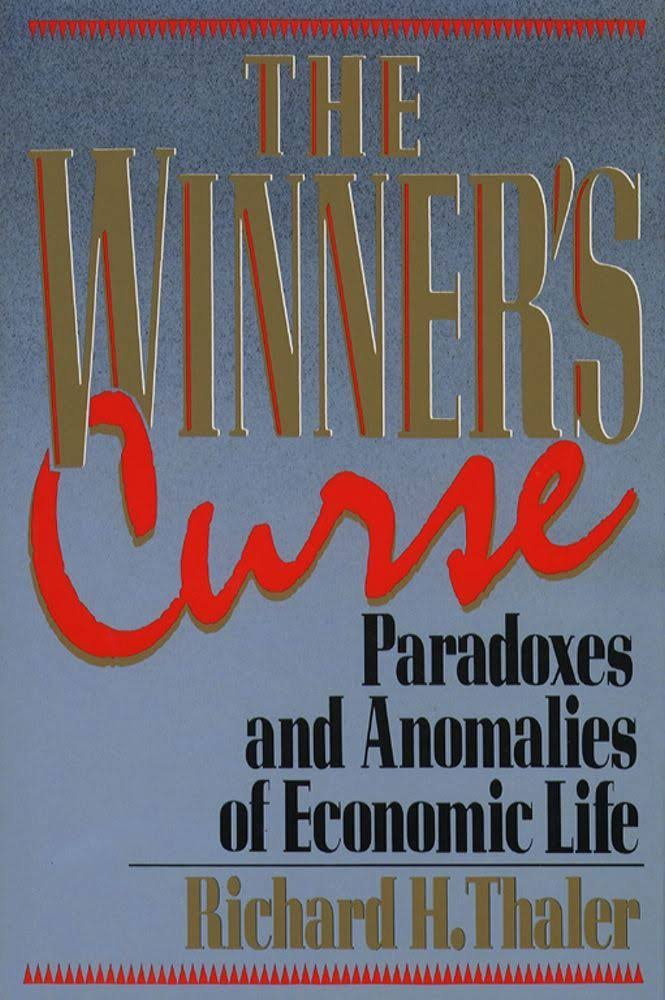

《赢者的诅咒: 经济生活中的悖论与反常现象》Richard Thaler

20 世纪 70 年代，虽然石油价格高涨，但是在墨西哥湾油田拍卖中以高价拍到油田的企业，要么出现亏损，要么收益低于预期。然而，后来的竞标者并没有吸取教训，依然前赴后继地陷入了"赢者的诅咒"这个陷阱。

今年获奖的经济学家发现，面对拍卖过程中的"赢者的诅咒"，竞拍者可能会降低自己的出价，按一个比较保守的价格报价。

为了提高竞拍者的报价，增加拍卖品的总收益，两位经济学家提供了两种方法：一是针对某种商品按价格从低到高逐次拍卖；二是将一个商品分割成多个商品，然后从低到高进行多轮拍卖。通过让竞拍者获得关于商品的更多信息，可以减少"赢者的诅咒"。

最后，我想说一句。虽然拍卖理论非常复杂，而且非常重要，但是对中国来说，主要的问题往往不是拍卖的技术问题，而是制度问题或者营商环境问题。

技术问题永远是二阶的，最重要的问题是，如何创造一个公平竞争的拍卖环境，比如拍卖的信息是公开的、拍卖的程序是公正的，参与竞拍者的合法权益能够得到保障。

公众号懒人找资源，懒人专属群分享

## 22 双边信息不对称丨“知彼知己，百战不殆”有时不一定管用？

懒人专属群的群友，你好，我是聂辉华。

在企业发展过程中，并购是企业最重要的经营策略之一。在前面介绍产权理论时，我告诉大家，全世界大约 70%以上的企业并购都是失败的。

根据产权理论，只有互补的业务才应该合并。今天，我们从另一个角度来分析并购失败的原因。在大量失败的并购案例中，大约有三分之一是因为双方的收购价格没谈拢。

### 双边信息不对称：施乐收购惠普失败

我们来看一个近期的收购案例。2019 年 11 月，著名跨国公司施乐向另一家跨国公司惠普提出收购要约，第一次报价为 335 亿美元，被惠普拒绝。2020 年 2 月，施乐将收购报价提高到 350 亿美元，再次被惠普拒绝。

惠普为什么拒绝收购呢？惠普董事会主席伯格（Chip Bergh）认为，这一收购价格一方面低估了惠普的价值，另一方面让施乐占了太多的便宜。

从业务上看，施乐是全球最大的办公设备生产商，而惠普是全球最大的 IT（信息技术）企业之一，办公设备和信息技术应该是高度互补的业务。也就是说，施乐和惠普的合并，完全符合产权理论的预测，本来是皆大欢喜的双赢局面，但为什么双方都能挣钱的生意却做不成呢？表面上看是收购价格谈不拢，实质问题是信息不对称。

我们先考虑一种最理想的情况：双方都是信息对称的。假设在施乐收购惠普这个案例中，施乐收购惠普带来的收益是 400 亿美元，惠普的真实价值是 360 亿美元。不管是施乐的收益还是惠普的价值，对双方都是透明的、公开的。

在这种情况下，只要把收购价格确定在 360 亿到 400 亿之间----  
比如说 380 亿，双方一定能顺利达成交易。因为双方都能挣到钱，而且挣到的钱还一样多，利润都是 20 亿。显然，在信息对称情况下，交易双方只要有利可图，总是可以达成有效率的交易。这个结果，就是经济学中最著名的"科斯定理"。

科斯定理虽然很强大，但问题是，双方信息对称的情况毕竟只是理想情况，更普遍的情况是双方之间存在信息不对称。

在我们前面的节目中，通常假设只有一方拥有私人信息，另一方没有，这是单边信息不对称。今天我们要分析稍微复杂一点的情形，双方都拥有私人信息，因此每一方掌握的信息对另一方来说都是不对称的，这就是双边信息不对称。

提出双边信息不对称模型的经济学家是芝加哥大学教授梅尔森（Roger  
Myerson）及其合作者，梅尔森后来成为 2007 年三个诺贝尔经济学奖获得者之一。根据双边信息不对称模型，如果双方都拥有私人信息，那么本来能够挣钱的生意反而做不成！这个结论有点出乎意料，怎么会这样呢？

我们再回到施乐收购惠普的案例。现在假设施乐知道收购带来的额外收益是 400 亿美元，但是惠普不知道。反过来，惠普知道自己公司的真实价值是 360 亿美元，但是施乐不知道。在这个案例中，不管是施乐还是惠普，每一方都拥有对方不知道的私人信息，而且这种信息对于双方交易来说又是非常重要的，这就是双边信息不对称。

在双边信息不对称情形下，我们来推测一下，收购谈判会出现什么情况呢？对施乐来说，作为收购方，它的谈判策略是尽可能压低收购价格，因此它必须隐瞒自己的真实收益。

比如，施乐对惠普说，这次收购对施乐带来的收益只有 340 亿美元，因此收购价格不能超过 340 亿，比如说可以是 335 亿（这正是施乐第一次的出价）。如果施乐如实向惠普透露收购的价值为 400 亿，等于透露了自己的底牌，那么施乐在谈判中就会完全处于被动地位。因为在之后的谈判中，施乐就没法再提价了，再提就买亏了。关键是，在双边信息不对称情形下，即便施乐如实披露自己的收购收益，对方也不一定相信。

另一方面，对惠普来说，作为被收购方，它的谈判策略是尽可能提高收购价格，所以它必须夸大自己的价值。比如，惠普对施乐说，惠普公司的真实价值是 410 亿美元，因此收购价格不能低于 410 亿。

于是，在这场收购谈判中，收购方施乐报价不超过 340 亿，被收购方惠普要价 410 亿。买方的出价低于卖方的要价，谈判崩溃，收购失败。和前面介绍的信息对称的理想情况对比，我们发现，双边信息不对称会导致本来有利可图的交易以失败告终。

### 第三方评估能否消除信息不对称？

可能有人会问，公司的价值有第三方评估，如果双方都以第三方评估为依据，不就消除了信息不对称吗？事情没有这么简单。

对于一个老牌跨国公司来说，公司的固定资产、股票价值都可以客观评估，但是公司的商标、专利等无形资产却无法客观评估，只能是一种主观评估。而且，对企业并购来说，重要的不是被收购企业在收购之前的价值是多少，而是考虑到双方的业务互补性之后，被收购企业在收购之后能带来多少价值。

任何一个第三方评估机构，都不可能准确地评估收购之后的价值，因为这取决于双方的企业文化整合、业务互补性以及市场行情等一系列不确定的因素。

### 什么是无效率定理？

让我们归纳一下收购失败背后的逻辑。当双方都处于信息不对称时，每一方都想利用信息不对称来提高自己的利润，压低对方的利润。当双方的期望利润之和超过了交易能够产生的总利润时，原本有利可图的交易就会失败。梅尔森与合作者将这个结论归纳为"无效率定理"，就是双边信息不对称会导致交易无效率。

大家可能觉得这个定理背后的逻辑还是有点抽象，那么就听我讲一个简单的例子吧。

假设两个人分 100 块钱，不管是五五开，还是六四开，反正总共能分的钱就是 100 块，这就是所谓的"零和博弈"。如果每个人要求的金额都超过了 50 块，那么总和就超过了 100 块，这钱就没法分了，并且最终谁也得不到。

有意思的是，即便预期到可能谈崩的后果，也没有任何一方在事前愿意让步。因为谁先让步，就意味着谁吃亏，并且让对方占了便宜。而且，一旦在这次博弈中让步了，那么以后是不是要在其它博弈中继续让步呢？显然，这种"示弱"可能让对方得寸进尺、得陇望蜀。

因此，当事人不会轻易让步，而是在谈判中发出比较强硬的信号。在某种程度上，这种谈判就是一种"囚徒困境"。双方明知可能出现谈崩的结果，但是却没有人愿意让步。

### "平等地无知"胜过"不对等地知情"

在现实中，信息是我们决策的最重要依据，而信息的分布有多种情况。

我们在前面分析了信息完全对称、信息不对称两种情况，现在考虑第三种情况：买卖双方在事前都不知道自己的成本或收益。

比如，施乐不知道收购给自己带来的收益，惠普不知道自己企业的准确价值，双方只知道一个价值区间。

例如，施乐的收购收益介于 380 亿到 420 亿美元，惠普的价值介于 340 亿到 380 亿美元。这些都属于双方的公开信息。

如果说信息完全对称是"对等地知情"，双方信息不对称是"不对等地知情"，那么第三种情况就是"对等地无知"。当然，我们也可以把"对等地无知"看作是一种特殊的信息对称情况。

那么，在双方"对等地无知"的情况下，谈判是不是更难达成呢？恰恰相反，谈判更容易成功！

既然惠普的价值是 340 亿-380 亿，而施乐的收益是 380 亿-420 亿，那么不妨将收购价格确定为 380 亿，或者比这个价格多一点点。在这个价格上，买方的最低收益大于或等于卖方的最高价值，买卖双方都能挣钱，交易一定可以达成。

这样一比较，我们会发现一些有趣的结果。

首先，"对等地知情"当然是最优的，信息透明，最省事。问题是，这只是一种理想情况，我们在真实世界中很难碰到这种好运气。

其次，"对等地无知"是次优的，因为双方总能找到一个价格达成交易。

最后，"不对等地知情"其实是最糟糕的，双方无法成交。一言以蔽之，要么大家都知道交易的关键信息，要么大家都不知道，最糟糕的就是有人知道，而有人不知道。

《孙子兵法》有一句名言：知彼知己，百战不殆。意思就是说，知道的信息越多越好。但是，双边信息不对称模型告诉大家：有时候知道得越多反而越不好。这并不是说《孙子兵法》错了，而是说信息不对等地多是不好的，信息对等地多才是最好的。

讲到这里，大家有没有觉得今天的主要内容有一种"意料之外、情理之中"的惊奇？请允许聂老师"卖弄"一下，如果你学会了博弈论或者契约理论，那么你会发现，很多中国的"传统智慧"要么是错误的，要么是模糊的。凡是未经理性思考的名言警句，我们都要对此保持警惕！

如果我们把信息看作一种资源的话，那么信息分配和其它资源分配一样，都是"不患寡而患不均"，"平等地无知"胜过"不对等地知情"。

我认为，在今天这个大数据时代，数据和信息已经成为最重要的生产要素之一了，我们不仅要关注物质财富或者财产的分配不均，更要关注信息分配的不均。它带来的影响不仅仅涉及交易、生产，而且涉及每个人的基本权利。

今天的节目也颠覆了关于谈判的传统观念。通常认为，谈判时一定要"留一手"，不让对方知道自己的底牌，这样才能掌握主动权。但我们现在知道，如果每一方在谈判时都"留一手"，就会导致双边信息不对称，实际上鼓励了彼此的投机心态，反而导致有利可图的生意做不成。因此，急于想挣钱的狭隘利益观，反而挣不到该挣的钱。

### 透明是最强大的力量

那么，究竟该如何促成双方交易呢？换句话说，双方该如何避免"不对等地知情"呢？最简单也是最彻底的办法，就是八个字：释放信息，体现诚意。

我们来看一个成功的跨国收购案例。2010 年，中国民营汽车企业吉利控股集团成功收购了美国福特汽车公司下属的沃尔沃汽车公司。

在漫长的谈判过程中，吉利宣布最后一轮收购报价是 18 亿美元。福特公司想再提高收购价格，此时吉利没有"留一手"，而是明确表示这是"底牌"。

吉利向福特方面详细分析了收购给吉利带来的各种收益，并说明这个价格就是基于各种指标计算的最合理价格。福特被说服了，同意了最终报价。

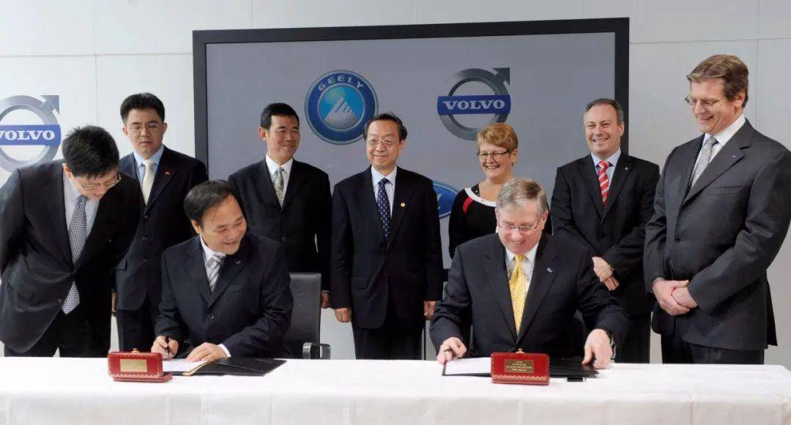

2010 年 3 月 28 日，浙江吉利控股集团有限公司与美国福特汽车公司在沃尔沃总部所在地瑞典哥德堡，签署了吉利收购沃尔沃协议

十年前 18 亿美元收购的沃尔沃汽车，十年后价值已经高达 180 亿美元。吉利收购沃尔沃的案例说明，买卖双方在谈判过程中，不要老想着占对方的便宜，要有大局观。凭借信息不对称优势，只让自己挣钱的生意都是小生意；释放信息，让双方都挣钱的生意才是大生意。

讲到这里，我想起了一位投资大师达利欧（Ray  
Dalio）的话。达利欧是全球最大的对冲基金桥水基金的创始人，桥水基金是世界上最赚钱的对冲基金。相信很多人都想知道他是怎么赚钱的。

在《原则》这本自传中，达利欧公布了他的成功哲学，其中最重要的一条就是"极度求真和极度透明"。因为越是透明，才能减少分歧，才能增加信任，才能实现共同目标。在真正的智者看来，透明是最强大的力量，真诚是唯一的道路。这就是大道至简。

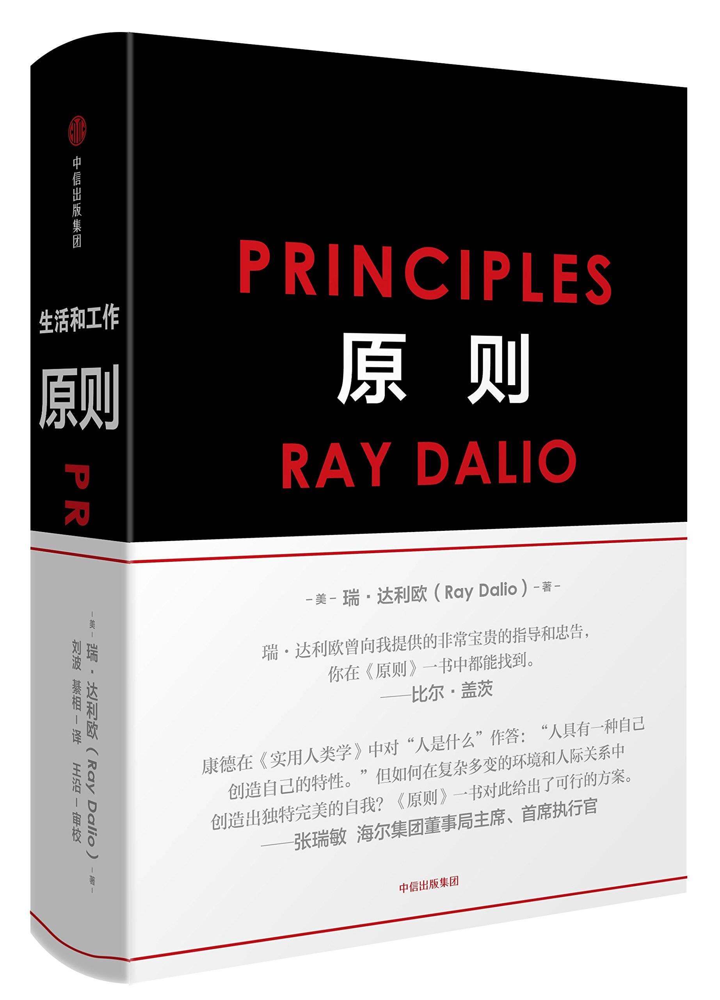

Ray Dalio《原则》，中信出版集团

结语

概括一下今天节目的主要结论。

在双边信息不对称下，每一方都希望最大化自己的利润，同时挤压对方的利润，这会导致可分配的总利润小于双方的期望利润之和，从而导致双方都能赚钱的生意却做不成。有时候，双方对等地无知甚至比不对等地知情更好。为了达成有效率的交易，交易各方应该充分拿出诚意，让关键信息变得透明，才能建立信任，并最终实现双赢。

最后，给大家一道思考题：如何运用今天所学的理论来解决住房拆迁过程中的漫天要价问题或者"钉子户"问题呢？

好了，今天我们就讲到这里，下集再见。

公众号懒人找资源，懒人专属群分享

## 23 非价格机制丨靠抽签来做决定，居然也有道理？

懒人专属群的群友，你好，我是聂辉华。

2020 年初爆发的新冠病毒肺炎，是今年最大的"黑天鹅"事件，给我们这个世界带来了很多不完美，也促使我们反思一些看上去属于经济学"常识"的问题。

例如，疫情发生期间，口罩究竟该不该涨价？类似的问题还有，春运期间火车票该不该涨价？

按照标准的经济学原理，如果一样东西供不应求，就应该提高价格，这样就会鼓励厂商增加供给，同时促使一些消费者减少需求，最终实现供求平衡、市场出清。你去翻任何一本教科书，它都会告诉你这个简单的逻辑。对于经济学初学者来说，这听上去没毛病啊！

几年前，每当人们讨论春运期间一票难求时，总有一些所谓的"著名"经济学家站出来说，"应该提高火车票的价格"。

总之，通过价格机制调节资源配置，实现供求均衡，似乎挺符合经济学原理。我相信，很多网友或听众也这么认为。如果你也是这么认为的，那么，我觉得你今天非常有必要听听聂老师怎么分析这个问题。

### 用价格平衡供求的三个问题

在前面的经济学分析中，至少存在三个问题。

第一，价格未必能够实现资源优化配置。价格能够实现资源最优配置的前提是，所有购买的商品都能物尽其用。但是，在疫情期间，口罩即便涨价，其购买成本对于富人来说，也是九牛一毛。而且，生命的风险高于一切。

于是，虽然富人可能不需要那么多口罩，但是富人仍然会大量囤积口罩，这必然导致一部分口罩被浪费。而穷人可能非常需要口罩，但根本买不到或者买不起口罩。不需要的人买多了，需要的人买不到。这其实就是一种资源错配，是无效率的。

第二，在信息不对称条件下，价格机制未必能筛选出"有效需求"。假设有一个富人和一个穷人。富人一个月收入 10 万元，每个月愿意花费 1000 元买口罩。穷人一个月收入 3 千元，每个月愿意花费 500 元买口罩。

单从价格上看，富人愿意出穷人 2 倍的钱，是不是就意味着富人的有效需求就是穷人的 2 倍呢？尽管富人能够支付的绝对价格更高，但这笔开支只占他月收入的百分之一，而穷人却愿意付出月收入的六分之一来购买口罩。

从提高社会总福利的角度讲，穷人的有效需求更为迫切，只不过他受到了严重的收入约束。显然，如果缺乏总收入的信息，光是商品的价格并不能筛选出有效需求。

第三，这里还存在外部性问题。新冠病毒感染的肺炎有严重的传染性，而且还有大量的"无症状感染者"。

如果穷人买不到口罩，又必须外出谋生，这就意味着病毒会传染给健康的人，包括其他穷人和富人，但病毒传播者本身并不需要承担传染的成本。这其实就是一种外部性，即当事人的行为会给其他人带来正面或者负面的影响，但是当事人却无需为此付出代价。

经济学原理告诉我们，一旦出现外部性，价格机制就会失灵，因为此时的价格不再反映全部的成本或收益，而只是反映了部分的成本和收益，这就无法保证总成本和总收益在边际上相等，也就意味着资源无法实现最优配置。

### 资源优化配置的实现：并非只有价格

你看，在一个不完美的世界里，价格机制并不是万能的！经济学的核心目标是实现资源优化配置，但是配置资源的手段并非只有价格。

其实，早在 1981 年，当时的普林斯顿大学经济学教授斯蒂格利茨（Joseph  
Stiglitz）就在一篇经典论文中指出：一旦我们考虑了信息不对称问题，供求定律就是错的。

斯蒂格利茨教授甚至认为，供求定律根本不是一个定律，甚至也不是一个事实！

这篇挑战主流理论的文章名字叫《不完美信息市场上的信贷配给》，发表在世界顶级经济学期刊《美国经济学评论》（AER）上，这篇文章也成为他 2001 年获得诺贝尔经济学奖的主要成果之一。

接下来，就让我来给你讲讲斯蒂格利茨这篇文章，为什么说在信贷市场上价格机制不能实现资源优化配置。

在信贷市场上，银行是资金的供给方，企业是资金的需求方。银行向企业放贷时，必须考虑两个因素：一个是利率，也就是资金的价格；另一个是本金。与普通的市场相比，信贷市场有三个典型特点。

第一，对资金的需求总是大于资金的供给。这一点在中国尤其突出，融资难、融资贵一直都是中小民营企业的最大难题之一。因为货币或者钞票永远是稀缺的，不能随便发行。不像水果蔬菜，如果稀缺，农民就可以多种点，供给总是有办法满足需求的。

第二，存在严重的信息不对称现象。企业的贷款项目可能是风险小、收益率正常的好项目，也可能是风险大、收益率低的坏项目。而银行很难了解项目类型，这就属于事前的信息不对称问题。如果银行把一笔贷款发给了一个坏项目，那么资金可能就象肉包子打狗  
\----有去无回了。

第三，利率不仅仅是资金的价格，它还会影响本金的安全。对于普通商品而言，价格和商品是两个东西。比如，一部苹果手机，一旦出厂销售了，不管价格怎么变，手机的质量本身不会变。但对于贷款而言，利率和本金都是货币，它们本质上是一个东西。而且，利率的高低会影响到能否收回本金。

了解这些以后，我们再来看看，如果按照传统经济学的供求定律来解决融资难的问题，会发生什么情况呢？

例如，当贷款有限时，很多企业会来申请贷款，银行的资金供不应求。于是，银行可以将贷款利率提高两倍，从基准利率 4%提高到 12%。

12%是什么概念呢？中国制造业的平均利润率是 6%左右。那么这会出现什么后果呢？斯蒂格利茨指出，在信息不对称条件下，高利率会带来两种负面效应。

一是逆向选择效应。只有那些坏项目的借贷者会来借款，因为只有坏项目侥幸成功之后才能付得起这么高的利率，或者这些敢来借贷的企业压根就没打算还钱；而那些风险小、收益率正常的好项目根本无法负担这么高的利率，因为利率超过了正常的利润率。在这种逆向选择效应下，好项目的借贷者反而会退出这个市场，坏项目的借贷者反而能够拿到贷款。

二是激励效应。一旦借贷者以高利率拿到贷款，如果他真想还钱，他就只能去投资高风险的坏项目。因为只有高风险的项目成功之后，才能付得起这么高的利息。这其实就是怂恿借贷者去投机取巧或者赌一把。一旦赌赢了，银行的贷款资金还可以还上，但是一旦赌输了呢？借贷者可能破产了，而银行也会血本无归，这是双输的结果。如果众多借贷者都去赌一把，那就可能导致很多贷款项目违约或者破产，这会引发金融危机。

总而言之，银行提高利率，本来是想通过提高价格，减少借贷者的需求，结果却导致了事前的逆向淘汰，并鼓励了事后的投机行为。当利率会影响本金时，银行提高利率的结果反而导致了本金难以收回。此时，一旦有人挤兑，银行就会面临破产。

你看，一旦引入信息不对称，经典的经济学原理很可能是错的！其实，在经济学中，所有的命题和定理都有特定的边界。一旦超越边界，真理就会变成谬误！而我们这个节目的目的，就是清楚地告诉你，真理和谬误的边界在哪里！

### 最优利率的确定：信贷配给理论

那么，考虑了信息不对称因素之后，最优的利率应该怎么确定呢？斯蒂格利茨发现，银行的期望收益和利率是倒 U 型关系。

所谓的倒 U 型关系，就是先上升、后下降。这意味着，伴随贷款利率的上升，银行的期望收益会增加。但是，贷款利率并不是越高越好，超过某个临界点之后，利率再高，期望收益反而降低了。

在临界点上，借贷需求是大于供给的。既然资金供不应求，那么银行应该把钱贷给什么企业呢？说出来大家恐怕不敢相信，在信息不对称条件下，银行只能用抽签的方式，随机选择借贷者。也就是说，在临界点利率上，银行不是根据市场供求来确定利率，而是采取某种非价格机制分配资金，这就是所谓的信贷配给理论。

很多人不相信银行真的会这么做。但我在调研中发现，真实世界的银行信贷过程确实在某种程度上与信贷配给理论预测一致。

首先，银行会根据资金成本、风险成本和预期利润计算一个安全的利率范围，类似于前面提到的临界点利率，这个利率与借贷需求没有直接关系；

然后，银行从符合条件的借贷者中进行筛选和排队，同时将放贷指标分配到银行内部的各个部门，各个部门在符合条件的范围内对排队企业进行审核并发放贷款。

由于每个月的贷款额度和指标是根据计划分配的，因此基本上采取"先来先得" 的原则，到月底时银行往往会加快放贷流程，以便完成任务。

总之，在真实世界中，银行真的不是仅仅根据利率高低来发放贷款，也不是说借贷者愿意支付更高的利率，银行就一定会把资金借给他。

了解金融行业的朋友可能会说，为了减少放贷风险，银行可以提高抵押品价值，这不就是变相提高贷款的价格吗？但是，斯蒂格利茨推断，这种传统的做法很可能适得其反。

首先，抵押品价值高低与项目本身的好坏并没有必然关系，这不会改变前面提到的逆向选择效应；

其次，能够提供高额抵押品的借贷者，往往是有钱的借贷者，而越是有钱的借贷者，越是敢冒风险，这会加剧借贷者的事后冒险行为。

总之，价格并非资源配置的万能手段。我们在同情广大小微企业融资难的同时，首先要冷静地分析背后的原因，然后要理性地寻找解决问题的有效办法。对于经济学家来说，我们的工作就是用冷冰冰的"手术刀"来解剖社会，而不只是施以廉价的同情。

其实，我们的祖先很早就采用了非价格的资源配置方式。明朝晚期，皇帝懈怠，官场腐败。很多皇亲国戚、宫廷宦官以及当权宰相都给管理官员的吏部施加压力，要求安排自己人出任肥缺，以至于官员任命变成了明码标价的买卖。一旦职位成了买卖，一定是有钱人瓜分了官场肥缺，而没钱但有才华的读书人从此报国无门，这就是官场逆向淘汰。

万历二十二年，孙丕扬任吏部尚书，他既不想按价钱高低来出售官位，又不敢得罪打招呼的上层权贵，那怎么办呢？他想出了一个绝招：掣签法，就是面对所有候任官员，吏部以抽签的方式决定官职的分配。

据说掣签法出台后，官场打招呼的人立即大减，效果可谓立竿见影。连清朝著名的宰相张廷玉都不得不承认，抽签虽然不是一种完美的方法，但却是当时最不坏的方法。

结语

我们来总结一下今天节目的主要结论。

在信息不对称的条件下，银行放贷的利率越高，就越是会吸引高风险项目的借贷者，或者促使借贷者在项目选择上铤而走险。为此，在临界点利率上，银行宁可采取抽签的方式进行信贷配给，而不是提高利率。在信息不对称条件下，传统的供求定律可能是错的！

最后还要多说一下，信贷市场是不是一个太特殊的市场，以至于信贷配给这种非价格机制是一种特殊的资源配置方式呢？恐怕不能这么说。

斯蒂格利茨指出，劳动力市场也有类似的特征。虽然劳动力的供给往往大于需求，但是企业作为劳动需求方往往不会把工资降低到均衡工资水平。

也就是说，企业宁可招不到人，也不会用很低的工资去招一个不合格的人。因为工资会影响劳动力的质量，均衡工资无法招聘到合格的劳动者。当工资并非完全由劳动力的供给和需求决定时，对企业来说，失业反而是一种最优均衡。这再次推翻了传统经济学的供求定律。

最后给大家留一道思考题：在新冠肺炎爆发期间，你是否赞同口罩涨价？如果不赞成，你认为应该如何分配口罩？

好了，今天我们就讲到这里，下集再见。

公众号懒人找资源，懒人专属群分享

## 24 风险规避丨为什么日本的家族企业长盛不衰？

懒人专属群的群友，你好，我是聂辉华。

### 为何商人鼓励孩子去考公务员？

每年年底，都是国家公务员考试报名的时候。每一次"国考"，都是一次惨烈的竞争，因为报名人数高达百万人，其难度绝不亚于高考和古代的科举考试。

以 2020 年为例，当年报考国家公务员的人数高达 110 万人，平均 50 个人竞争 1 个职位，而其中最热门的职位有 1709 个人报考！

我们一般认为，来自农村和城市工薪阶层的人更有可能参加公务员考试。但没想到的是，根据记者调查，很多公务员的报考者都来自富裕家庭。据说，在国庆长假期间，有不少江浙富商自己出国旅游，却把孩子送到公务员考试辅导班参加封闭式训练。

中国最富裕的省份是广东，通常认为最不喜欢孩子去当公务员的省份也是广东。但是你知道吗？根据 2020 年的国考报名数据，广东省的国家公务员职务竞争比例是 70:1，超过全国绝大多数省份。虽然这未必代表广东人最爱"当官"，但至少从一个侧面说明了，广东也有很多人热衷于当公务员。

为什么商人要鼓励自己的孩子去考公务员呢？这听上去很奇怪，毕竟他们一不缺钱，二不缺人脉。

真正的原因是，富商家庭需要从整个家庭的角度去规避风险。为什么要规避风险呢？如何规避风险呢？在今天的节目里，我来给大家谈谈这个问题。

### 独特的避险机制：家庭

在我们这个节目中，我反复强调一个观点：人与人之间的关系本质上是一种契约关系。但是，任何契约都可能会失灵。

导致契约失灵的原因有两个：一个是当事人之间的信息不对称，比如一方对另一方欺骗或者敲诈，导致契约无法正常履行；另一个是外部的风险和不确定性，比如新冠肺炎导致企业出现债务违约，或者下岗失业。

前面的内容几乎都是从第一个角度，也就是信息不对称的角度来分析和解决契约失灵问题，今天我们从第二个角度，也就是风险和不确定性的角度来谈谈如何避免契约失灵问题。

在现实中，人们规避风险、确保契约正常履行的方式有很多。买保险是一种避险机制，多元化投资也是一种避险机制，但是我今天要讲的是一种独特的避险机制：家庭。我的核心观点是，通过组建家庭，可以实现有效的风险规避，减少契约失灵，提升个人福利。

### 为什么家庭可以规避风险？

为什么家庭可以规避风险呢？我们先来看一个真实世界的案例。

在某个著名的网络论坛上，一个大学生 2019 年发了一个帖子，大概意思是：很多企业破产倒闭，很多人找不到工作，不是因为大环境不好，而是因为自己水平不行。同样是大学生，别人要辛辛苦苦找工作，我却可以进老爸的企业，这就证明"天道酬勤"。

到了 2020 年，新冠肺炎来了，这个大学生又发了一个帖子，不过剧情急剧反转：疫情期间，父亲的出口企业没有订单，因为债务违约而面临破产，而且三套房子四辆车全部抵押了，本人失业在家，深感绝望，为什么老天这么不公平？

遗憾的是，在疫情期间，这样的悲剧可能只是沧海一粟，还有很多人遭遇了各种不幸。但是大家想一想，如果这个大学生的母亲在体制内有一份稳定的工作，或者这个大学生依靠自己的能力能够在市场上找到工作，而不是完全依靠自己的家族企业，那么这个家庭的抗风险能力是不是提高了很多？

归根结底，家庭能够实现风险规避的主要原因，是因为它可以实现人力资本的多元化投资。这个道理跟买股票是一样的。根据金融学理论，如果一个人购买的股票数目超过 15 只，那么这种投资组合就可以将非市场风险减少到接近于 0。也就是说，除非股市整体不好，否则这种投资组合一般不会亏损。

在进行资产配置时，我们经常听到这样一句话："不要将鸡蛋放在一个篮子里"，因为你永远不知道篮子哪天突然就破了，到时候就是"竹篮打水一场空"了。

我们再讲一个例子。

在上世纪七八十年代，那些有两个孩子的家庭，一般会让一个孩子去体制内，比如当公务员或者去事业单位上班，然后让另一个孩子去企业工作。这其实就是一种最佳的就业组合，一个体制内，一个体制外；一个在官场，一个在市场。

如果市场行情不好，很多人就想涌入体制内，比如最近一批博士后纷纷去杭州和深圳的街道办任职；反之，如果市场行情好，很多人又想从体制内走出来，"下海"去拿高薪。

因此，这种家庭内部的职业分工，不仅分担了就业风险，而且两种职业还可以相互帮衬。

### 为何日本长寿企业数量世界第一？

有趣的是，家庭的避险机制还可以复制到企业。家族企业能够延绵不绝，其实就是它们将家庭和企业两种组织的优点结合在一起。

大家知道全世界哪个国家的百年企业最多吗？不是欧洲，也不是美国，而是日本。截至 2012 年，超过 100 年以上的日本企业有 2.1 万家，其中超过 200 年的企业有 3000 多家，超过 1000 年的企业有 7 家。

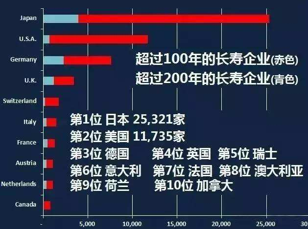

全球长寿企业数量前十国家

目前，日本最长寿的企业是创办于公元 578 年的建筑企业"金刚组"，距今已有 1400 多年，其代表作是建于公元 593 年的四天王寺，这也是日本最古老的官方寺庙。

金刚组（日语：株式会社金剛組）

研究表明，日本的这些百年老店基本上都是家族企业，我相信这绝不是偶然，而是因为家族企业比普通的公众公司或者私营企业更能规避风险，从而将企业这种独特的契约形式维系下去，并实现百年传承。

我们再来看中国。根据《财富》杂志统计，中国的百年企业大概只有十几家，包括云南白药、同仁堂、全聚德、吴裕泰、东来顺、六必居、张小泉等品牌，几乎也都是家族企业。那么问题来了，同样是家族企业，为什么日本的百年家族企业成千上万，而中国只有十几家呢？除了大环境的差异，主要原因是日本家族企业有独特的避险机制。

### 家族企业最大的风险是接班人风险

作为一个家族企业，最大的风险不是市场风险，而是接班人风险。理论上，家族企业的创始人和接班人之间有一个隐形的代际契约：创始人把家族企业的所有权和控制权交给接班人，接班人应该将家族企业发扬光大，否则就是不肖子孙。

关键的问题是，怎么选出合格的接班人呢？中日两国的家族企业在选择接班人方面，有一个共同的规则：传儿不传女，这跟传统文化有关。但问题是，不是所有的儿子都是合格的接班人。有些儿子能力平平，有些品行不端，有些生活腐化，这都会给家族企业传承带来巨大风险。

想必大家都知道，古代最有名的商帮之一是山西票号。但是我在研究古代政商关系时发现，山西最有名的几大票号，包括"乔家大院"的乔家、平遥的李家、太谷的曹家，几乎都是因为后代子孙不争气、乱花钱，而导致原先辉煌一时的票号最终衰败破产。你看，将家族企业传承给儿子，其实风险很大。

山西平遥"日升昌"的门匾

山西票号的汇兑业务最初由山西平遥商人雷履泰（1770 年-1849 年）始创

如果创始人有好几个儿子，从中挑选一个相对优秀的来接班，这样风险相对较小。这就可以解释，为什么古代经常说"多子多福"，其实是儿子多了，家族事业的继承风险就小了。这是一个概率问题。

但问题是，如果几个儿子都不争气呢？这个时候，中国的传统做法是"矮子里面拔将军"，反正儿子再差也要把家族企业传给他，确保"肥水不流外人田"，但这就导致家族很快衰败，从而验证了"富不过三代"的民间谚语。

更糟糕的问题是，如果创始人没有儿子，甚至没有儿女怎么办？按照中国传统，创始人的财产就要被近亲瓜分，此时好好的家族企业就面临被强行肢解的巨大风险。

一般的做法是，创始人从近亲中选择一个小男孩过继给自己。但过继的儿子并不能保证一定是合适的接班人，一是因为过继的范围非常有限，选择面很窄，择优的概率不高；二是过继通常发生在男孩很小的时候，但那时根本没法判断他是否有经营管理能力。因此，过继并不能有效地解决问题。

### 日本家族企业怎么解决接班人难题？

作为百年老店数量最多的国家，日本是怎么解决家族企业接班人难题的呢？

首先，如果有合适的儿子作为接班人，家族企业创始人当然还是会将企业传给儿子。其次，如果家族企业创始人发现自己儿子能力不行，或者没有儿子，就会选择一个合适的女婿作为接班人。不过，这个女婿除了能力比较强，还必须在入赘之后跟创始人改姓才行。

正因为姓氏成为家族企业传承的重要标志，所以很多日本的家族企业的名字里就带有姓氏。例如，日本著名的松下电器公司和丰田汽车公司，都是以创始人的姓氏命名的。改姓之后，女婿作为企业的接班人，就跟儿子差不多。

关键在于，从可选范围上讲，父亲其实很难选择谁投胎成为自己的儿子，这是基因决定的，但父亲可以从全社会的成年人当中选择合适的女婿，而且这个过程允许试错。

比如，发现某个男子不适合作为接班人，可以解除他与女儿的恋爱关系甚至是婚姻关系。也就是说，儿子不能换，但女婿可以选。这就极大地避免了接班人风险。

事实上，日本著名的百年家族企业创始人松下幸之助、铃木俊三、丰田佐吉都是把企业传给了女婿而不是儿子。也因此，日本社会中的女婿地位比较高，相当于儿子。这一点不像中国，中国的女婿终究还是"外人"，女婿的儿女被称为"外孙"。

进一步的问题是，如果家族企业创始人既没有儿子，也没有女儿，从而连女婿也没有怎么办？日本传统是，创始人找一个忠诚的徒弟，收为养子，并且让他跟自己改姓，然后将企业继承权交给他。这样，从传承上看，企业仍然是由和创始人相同姓氏的人掌管，这再次说明，姓氏就是一种传承纽带。

总而言之，为了规避接班人风险，日本允许创始人扩大候选人范围，从儿子到女婿再到养子，而且女婿和养子的身份还可以在试错的过程中更改，从而完美地解决了家族企业的传承问题。

根据著名经济学家陈志武教授的文章，在各种类型的日本家族企业中，"女婿养子"管理的公司业绩最好，其次是职业经理人管理的公司，最差的是亲子管理的公司。这个结论真的很有意思，也应该引起我们中国人的反思。从规避接班人风险的角度讲，这个结论完全符合我们今天的主要结论。

中日两国的家族企业，除了接班人的选择范围不同，其实接班的方式也有差异，这也跟家族企业的风险规避机制有关。

中国家族企业的继承方式通常是"分家"。比如说，创始人的企业有票号、当铺和药店，还有三个儿子。因为"手心手背都是肉"，不能过于厚此薄彼。于是，一个很可能的分配方案是：老大继承主业票号，老二继承当铺，老三继承药店，总之要利益均沾，尽量"一碗水端平"。

这种做法固然注重公平，但实际上削弱了家族企业的综合实力，把一个多元化的企业变成了单一企业，而单一企业不如多元化的企业那样能够抵抗外部风险，从而难以做大做强。如果创始人的企业都是当铺呢？那就是三个儿子每人分几个当铺。这又降低了规模经济，减慢了资本积累的速度，也不利于家族企业抵抗风险和做大做强。

与中国不同，日本的做法不是"分家"，而是"独家"继承。比如说，创始人有三个儿子，其中一个儿子成为接班人了，那么另外两个儿子不能在家族企业里工作，必须自己出去奋斗。

这样的安排有两个好处：第一，确保了家族企业是一个整体，而不是拆分了；第二，分散了风险。万一家族企业不行了，另外两个儿子在外面闯出了一片天地，就不至于让整个家族破产了。

结语

最后，我总结一下今天节目的主要内容。

外部风险和不确定性会导致契约失灵，而家庭可以成为一个避险机制。日本之所以有很多百年家族企业，是因为它们将女婿和养子纳入接班人范围，这既扩大了选择面，又减少了试错风险。

今天的思考题是：一位名叫邹春兰的女运动员，在八九十年代曾经多次获得全国举重冠军，还打破了世界纪录。她退役后，因为学历不高以及缺乏专业技能，不得不在澡堂当搓澡工。请结合今天的节目，谈谈一个在体制内工作的人，如何在职业发展上规避风险？

好了，今天我们就讲到这里，下集再见。

公众号懒人找资源，懒人专属群分享

## 25 债务契约丨“穷人”为什么穷，“富人”为什么富？

懒人专属群的群友，你好，我是聂辉华。

### 贫富差距为何越拉越大？

全世界每年新出版的财经类著作至少有几万本，但是大家知道过去几年里，全世界最流行的财经著作是哪一本吗？是《21 世纪资本论》，作者是法国著名经济学家皮凯蒂（Thomas  
Piketty），他也被认为是诺贝尔经济学奖得主的潜在人选。

Thomas Piketty（1971-）法国著名经济学家，巴黎经济学院教授，法国社会科学高等研究院研究主任

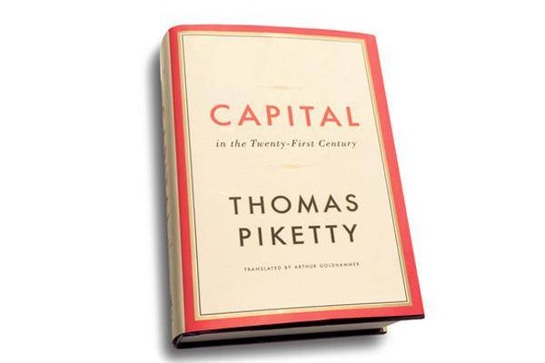

《21 世纪资本论（Capital in the Twenty-First Century）》

《21 世纪资本论》这本书的篇幅超过了 700 页，我自己有中英文两个版本，拿在手里就像一块砖头那么厚！问题是，为什么全世界那么多人对这么一本"大部头"的学术性著作感兴趣呢？这本全球最畅销的著作究竟说了什么呢？

皮凯蒂利用全世界多个国家 300 年的收入数据，发现了一个惊人的事实：最近几十年来，全球范围内的收入不平等程度逐渐扩大，很快会变得更加严重。简单地说，就是穷人更加穷，而富人更加富。听到这里，我们是不是感觉很扎心？那么，为什么会出现这种贫富差距拉大的现象呢？

### 原因一：穷人靠劳动挣钱，富人靠资本挣钱

从经济学理论上讲，经济增长主要来自于两方面的要素贡献，一是资本，包括机器、厂房、土地和其它生产资料，体现为货币或金钱；二是劳动，包括体力劳动和脑力劳动。关键在于，由于资本的回报率超过劳动的回报率，因此主要依靠资本赚钱的富人就会变得更富，而主要依靠劳动赚钱的穷人当然就会更穷。

问题在于，为什么用资本挣钱比用劳动挣钱更快呢？首先要理解资本和劳动两种生产要素之间的根本区别。皮凯蒂指出，资本可以买入、卖出，理论上还可以无限积累，比如一个人的资本可以到达富可敌国的程度。但劳动只能供本人使用，不能被别人拥有，而且使用有限，毕竟每个人一天只有二十四小时。

资本和劳动在性质上的区别，决定了使用它们挣钱的快慢。使用资本挣钱的企业主、投资者和股东，可以通过银行借款、股权融资、公司上市以及其它方式，将别人的资本集中在自己手里，实现积少成多，然后再利用资本的规模效应，投资到收益率最高的行业去，这样通过"借钱生钱"的方式，就可以不断放大自己的财富。

反过来，大多数普通人，包括农民、工薪阶层以及白领，只能使用自己的劳动来挣钱。跟资本相比，劳动在挣钱方面有三个缺陷：一是投入有限，没法突破 24 小时的极限；二是缺乏规模经济，普通人不可能调动大批劳动力投入生产，除非是资本家；三是很难从一个行业转移到最赚钱的行业，毕竟每个行业都有进入壁垒。

比如说，你本来在餐饮业做大厨，一个月能挣两万元。但是如果哪天餐饮业不景气了，你没法立即转移到电子商务行业做直播。而资本的转移成本很低，投资者可以把餐馆卖了，找一家电商企业投资，或者在股票市场上买入电商企业的股票。

这样，我们发现了"穷人之所以穷，富人之所以富"的第一个原因：穷人靠劳动挣钱，富人靠资本挣钱。

### 原因二：穷人埋头苦干，富人善用杠杆

其实，在皮凯蒂的《21 世纪资本论》风靡全球之前，也有一本财经畅销书在中国大陆卖得"洛阳纸贵"，叫《穷爸爸，富爸爸》。今天的 80 后、90 后可能都没有听说过这本书。

《富爸爸，穷爸爸》四川人民出版社

系列作品为罗伯特\*清崎、莱希特著，萧明译

这本书通过一个"穷爸爸"和一个"富爸爸"的对比，揭示了穷人为什么穷而富人为什么富的原因：富人善于投资，精于理财。这本书最大的亮点是提出了一个名词"财商"。

我们都知道，一个人的成功，一是需要智商（IQ），二是需要情商（EQ），但是这本书告诉我们，还需要财商（FQ）。所谓财商，就是善于理财、懂得投资和经营之道。的确，我们的教科书从来不教我们这些。但是，在现实世界中，你不理财，财不理你。说句实话啊，这也是聂老师的血泪教训，希望各位谨记！

大家一定要记得皮凯蒂指出的资本和劳动的根本区别：资本可以流通、积累，从而具有放大效应。因此，理财的关键，是善于利用债务杠杆，以钱生钱，最终把小钱变成大钱。用契约理论的话来说，就是敢于向别人借钱，善于利用债务契约。债务契约的本质，就是用别人的钱办自己的事，用未来的钱办现在的事。而单纯依靠体力劳动或脑力劳动，是无法做到这点的。

著名经济学家林毅夫曾经说过，我国金融体系目前仍以大银行和股票市场为主，主要为大公司和富人提供资金服务。劳动密集型的中小企业以及小农户很难从中得到资金服务。穷人将钱存到银行，实际上是补贴了富人和大企业。我觉得这个观点特别发人深省！说白了，穷人之所以穷，其实跟资本市场是否发达高度相关，而未必是穷人不努力、不优秀。那些喜欢炫耀"比你优秀而且比你还努力"的人，应该反思一下自己是不是沾了制度不完善的光，而不是盲目自信地给自己贴上"精英"的标签。

其实在我们身边，既有财商高的人，也有财商低的人。两种人初始条件可能差不多，但是几年后财富水平相差越来越大，甚至是天壤之别，关键就在于是否懂得利用债务契约。我来讲一个《穷爸爸，富爸爸》的现实版本。

2006 年，我从中国人民大学获得博士学位，并留校任教。巧得很，北京的房价就是在 2006 年前后开始快速上涨的。我有两个大学同事，一个是农村家庭，就叫教师甲；另一个是城市家庭，就叫教师乙。一开始两人都是租房住。到了年底，工作满半年，两个同事都攒了几万块钱。农村出身的教师甲比较孝顺，平时省吃俭用，用这笔钱帮父母还清了十几年积累的债务。教师乙没有把钱给家里，还从亲戚那里借了十几万，凑够了 20 多万元，然后在人大西门附近的世纪城买了一套 100 平方米的二手房，当时的房价大概是 6000 元一平方米。

十五年之后的今天，世纪城的房价已经高达 10 万元一平方米。以 2006 年为基准，世纪城的房价在十五年里涨了 15 倍，平均一年涨一倍！教师乙当年投资购买的房子，如今已经价值千万。而教师甲，由于根本买不起附近的房子，几年前不得不跳槽到外地发展。

上面这个真实的故事告诉我们，人世间最大的收入不平等，不是媒体上报道的不平等，也不是书里写的不平等，而是身边人因为买房导致的不平等。同样是博士，同样是教师，因为投资理财，两者的财富竟然有天壤之别。

假设一下，如果农村出身的教师甲当年不是急于还钱，甚至大胆从亲戚那里借钱，然后投资买房，那么他不仅会获得丰厚的投资回报，而且可以为亲戚带来投资红利。可惜，世上没有那么多如果。当然，从另一个角度讲，政府实行"房住不炒"，确实有利于减少贫富差距。作为穷人出身的知识分子，我是举双手赞成控制房价的。

在这一部分，我们总结了"穷人之所以穷，富人之所以富"的第二个原因：穷人埋头苦干，富人善用杠杆。

### "穷人"怕冒险的根本原因是初始禀赋

说到买房，很多人都有买房的经历，也有买房的教训。这个教训就是，房价一直都在涨，关键看你敢不敢"该出手时就出手"。买房导致的贫富差距，很大程度上是风险偏好的结果。有人敢冒风险，自然要有较高的回报。穷人往往只看眼前，注重省钱；而富人投资未来，注重生钱。这个观点还有经济学理论支持。

现代经济学的"泰山北斗"毫无疑问是美国芝加哥大学，那里有一个芝加哥学派。芝加哥学派的创始人是奈特（Frank  
Knight）教授，他的成名作是其博士论文《风险、不确定性和利润》。这本书的核心观点是，企业家之所以能够成为企业家，是因为他们敢冒风险，善于抓住商机，从而赚取超额利润。那些不敢冒风险的人，只好给企业家打工，获得一份无风险的报酬，也就是工资。

听上去，这个风险偏好的故事符合逻辑。但问题是，难道穷人天生就是害怕承担风险吗？如果是，那怎么解释现实中有不少穷人最终也变成了富人？比如，亚洲首富李嘉诚，当年就是穷人出身。而且，很多穷人并非不敢借钱，而是很难借到钱，因此没法利用债务杠杆进行长远投资。

因此，真正的问题是，为什么穷人很难借到钱？我们只有从制度上反思这个问题，才能找到问题的本质，并提出解决方案。其实，穷人借钱难，中小企业借钱难，这是一个世界性的难题。因为从契约的角度讲，债权人和借钱的债务人之间往往存在严重的信息不对称。

第一，债权人不知道债务人的个人信息，包括债务人信用如何，品德如何；第二，债权人不知道债务人的项目盈利前景如何，是高风险项目，还是低风险项目，甚至是真项目还是假项目。

在信息不对称的情况下，债务人可能会出现逆向选择和道德风险问题，比如伪造项目收益数据，或者事后拿了贷款去投资高风险项目，甚至出事之后直接跑路。这些年，大量的 P2P 暴雷了，很多"以房养老"的骗局破灭了，牵连了无数家庭，导致很多普通的投资者血本无归，甚至倾家荡产。因此，债权人或者投资者为了减少自己的损失，肯定会要求债务人提供抵押品，比如机器、厂房、商铺，或者要求第三方提供贷款担保。

问题的关键就在于，穷人之所以是穷人，就是因为缺乏可供抵押的资产，也没有完善的信用记录，同时也不认识什么富人朋友。相反，富人往往有一定的资产，比如房子、汽车以及土地，他还有一些富人朋友，这些朋友可以提供贷款担保。

说句实话，在信息不对称的前提下，目前的融资体系显然是有利于富人，不利于穷人的，这就是不完美世界的代价。这就是前面林毅夫教授提到的，穷人的钱存在银行，反而对富人和大企业有利。

此外，除了信息不对称，穷人还缺乏应对债务契约的风险规避机制。比如前面讲到的两个人大教师的故事，如果农村出身的教师甲也去向亲戚借十几万块钱，是不是一定可以发财致富呢？未必。

如果投资的对象不是买房，而是商业项目，一旦亏损，教师甲拿什么来还债呢？而城市出身的教师乙，因为家境相对较好，即便亏了十几万，也不会太影响生活品质。说白了，就是穷人输不起，因此步步小心，总想靠省钱来挣钱；而富人输得起，因此敢于借钱投资，能够用小钱搏大钱。

所谓的风险偏好，其实本质上是风险承受能力问题。如果一个越是有钱，那么理论上他就越是不那么害怕承担风险，也就更加敢于借钱投资了。就好比股市投资，碰到牛市的时候，其实人人都可以挣钱，但是穷人的本金太少，即便收益率很高，也挣不到多少钱，所以只能继续将本金和大部分收益一起留在股市里。问题是，一旦碰到熊市，撤退来不及，就满盘皆输了。

一句话总结，穷人之所以穷，不是因为穷人本身害怕冒险，而是因为穷人的初始禀赋太差，冒险的机会成本太高。也就是说，贫富差距很大程度上是客观原因导致的，而不是主观能力导致的。

那这样是不是意味着，穷人永远没有希望呢？当然不是，前面提到的李嘉诚，就是一个成功实现"逆袭"的正面案例。根据我们今天的理论分析，对于政府来说，要帮助更多穷人变成富人，关键还是不断完善信贷市场，创造一个让穷人更加容易赚钱的制度环境。

比如说，成立更多服务于中小企业和穷人的信贷机构，完善个人征信体系，让那些有能力、项目好的穷人也能获得贷款。获得 2006 年诺贝尔和平奖的尤努斯（Muhammad  
Yunus），就是因为创立了可复制的"穷人银行"模式，帮助了无数穷人脱贫致富。

穆罕默德\*尤努斯（1940-）孟加拉国经济学家，孟加拉乡村银行（Grameen Bank，也译作格莱珉银行）的创始人，有"穷人的银行家"之称

结语

现在，让我总结一下今天的主要内容。

穷人之所以穷，富人之所以富，有两个原因：第一，穷人靠劳动挣钱，富人靠资本挣钱；第二，穷人埋头苦干，富人善用杠杆。要解决贫富差距，让更多普通劳动者和普通家庭实现财富增值，关键还是要完善信贷市场。

今天的思考题是：你周围有没有人白手起家，然后从穷人变成富人？如果有，他们的故事是否验证了本文的结论？

好了，今天我们就讲到这里，下集再见。

公众号懒人找资源，懒人专属群分享

## 26 社会网络丨份子钱起源于“众筹”？当今存在还无必要？

懒人专属群的群友，你好，我是聂辉华。

中国是一个人情社会，人情社会的特征之一就是"礼尚往来"。逢年过节，以及碰上各种红白喜事，都要给别人发"红包"，交"份子钱"。所谓份子钱，就是恭贺节庆以及参加红白喜事的礼金或者红包。

需要交份子钱的场合主要有两种。

第一种是逢年过节。比如，春节到亲戚家拜年，一般要给年纪大的长辈（比如舅舅）发一个红包，还要给亲戚家里的小孩们发红包。如果是第一次见面的小孩，红包通常是必不可少的。此外，在春节、端午和中秋这三个重要的传统节日，如果去拜会领导、上级或重要客户，没有红包是没法上门的。

第二种情况是红白喜事。"红喜事"包括：结婚、孩子满月、孩子生日、孩子考上大学、孩子出国留学、父母生日、乔迁新居以及二胎出生。除了红喜事，中国还有"白喜事"，就是高寿老人去世了，参加这种"喜丧"的人也要交红包。

据说，现在的年轻人"天不怕，地不怕，就怕请柬发"。亲朋好友发请柬，通常有好事，但对自己却未必是好事，因为又要交一笔金额不低的份子钱。在各种喜事中，婚礼的庆祝仪式是最隆重的，因此份子钱也是最高的。网上流传着一张"全国婚礼红包地图"。在这张电子地图上，份子钱最少的是云南，100 元；最多的是上海和浙江，1000 元；大部分地方都是 300-500 元。

有趣的是，如果将中国内地 31 个省份的人均 GDP（国内生产总值）和红包金额画在一张图上，我发现两者呈现出明显的正相关性（如图 1）。数据显示，人均 GDP 越高的地方，婚礼红包的金额也越高。这说明，份子钱不仅是一种文化现象，而且是一种经济现象。

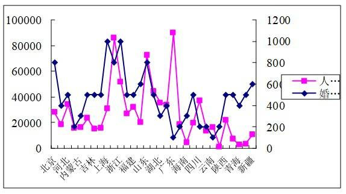

图 1 各省人均 GDP 和婚礼红包

### 份子钱本质上是"众筹"

份子钱的历史由来已久，不是现在才有的。据考证，至少明朝时期就已盛行。那么份子钱跟我们讨论的经济学有什么关系呢？从契约理论的角度讲，份子钱是一种基于社会网络的互助机制，就是古代的"众筹"。

在中国古代，大家知道，由于生产力水平低，普通人的人均收入很低。低到什么程度呢？现在我们经常说"一日三餐"，这似乎是约定俗成的。其实啊，在中国古代，普通中国人一天只能吃两顿饭，而且第二顿一般是第一顿的剩饭。直到宋朝时期，经济发达了，普通中国人才能一天吃三顿。

对于普通家庭来说，大部分时候都没有闲钱，而且古代既没有完善的储蓄和保险机制，也没有完善的信贷机制。一旦家里出现了红白喜事或者重大事件，需要临时支出大笔资金时，就会捉襟见肘。而份子钱的出现，就是一种应急状态下的互助机制。比如村里某户人家要结婚了，请客、置办嫁妆、装修新房以及支付彩礼，都需要一大笔钱。此时，村里人以及亲戚朋友来吃喜酒时每家提供一份礼金。虽然每份礼金并不多，但是加在一起就是一大笔钱，这就解决了燃眉之急。

因此，份子钱作为一种互助机制，本质上是一种亲朋好友之间的隐性契约：这次你家有事需要用钱，大家来帮你；下次我家有事需要用钱，大家也要帮我。当然，这种隐性契约的长期维持，需要满足一些前提条件，否则就会出现道德风险问题。

比如，张三品德不好，但大家对张三的品德并不了解，这是一种常见的信息不对称现象。张三多次拿了别人的份子钱，却很少给别人交份子钱；或者，张三利用各种借口从亲戚朋友那里借了很多钱，然后溜之大吉。

因此，这种隐性契约绝不是那么简单，它必须解决信息不对称和跨期交易导致的诸多难题。我认为，份子钱作为一种互助机制，至少需要满足三个条件。

第一，存在一个稳定的社会网络。份子钱是利用集体的力量帮助个人，因此参与者必须足够多。人太少了不行，无法发挥"众人拾柴火焰高"的放大效果。那怎么保证人数足够多呢？一个简单办法就是建立一个稳定的社会网络，在这个网络中每个人都存在紧密联系，并且知根知底。在古代中国，这样的社会网络就是基于亲缘和地缘关系的家族宗亲关系。这一方面确保了人员比较稳定，另一方面确保了圈子比较封闭。既实现了"滴水成河"的放大效果，又保证了"肥水不流外人田"。

第二，确保每个人的收支基本实现平衡。假如张三是个单身汉，他这个月给李四家送结婚红包，下个月又给王五家送生日红包，下下个月又给赵六家送乔迁红包。但是他自己既没有结婚生子，又没有房子，那就只有红包支出，而没有红包进账，长此以往就会严重亏损。他就会拒绝加入这种单边受益的互助网络。为了避免这种情况，这个互助机制的参与者通常是以家庭为单位，而不是以个人为单位，因为一个家庭总会有生老病死等人生大事。另外，东家在举办红白喜事收取红包时，通常会当众清点并且登记，这就是一种公开的承诺机制：这次你送我多少，下次我就回你多少。

第三，份子钱的金额不能太高，不能影响正常的消费。既然是积少成多的集体救助机制，当然不能给参与者带来太大的经济压力，否则就会影响参与者的积极性。因此，古代的份子钱也不是可以随时随地收取的，一般有约定俗成的规矩。比如，结婚、生子、乔迁、金榜题名可以收红包，平时过节一般不收红包。而且，各地红包的金额比较稳定。经济条件好的地方，红包金额就高一点；经济条件差的地方，红包金额就低一点。这完全符合我们前面提到的人均 GDP 和红包正相关的结论。

### 古代的基金制

在古代，家家户户都有婚丧嫁娶。但有一类事情非常重要，却不是每家都有运气碰上，就是科举考试。古代一个家庭培养一个读书人的代价是很高的。十年寒窗苦读，读书人要先后经过县试、府试，考取秀才之后，再经过乡试和会试，才能考取举人和进士。乡试在各省的首府，会试在京城，距离远，时间长，花钱多。而且举人和进士的录取比例极低，肯定比今天的"985"大学录取比例低多了。

因此，科举考试是一项投资大、见效慢、成功概率低的风险项目。另一方面，一旦村里有人金榜题名成为举人或进士了，不仅能够迅速提高全村的地位和知名度，而且在赋税和打官司等方面也能带来好处。古代说"一人得道，鸡犬升天"，这话虽然有点难听，但是在一定程度上也适用于科举考试给宗族乡邻带来的好处。因此，科举考试也是一个互惠项目，只是形式上比较隐晦。

对于科举考试这种大宗的风险投资项目，光靠大家凑份子钱肯定是不够了。而且普通人家本来收入就少，如果某人寒窗苦读十年还没有考取举人或进士，村民在长期内看不到回报，必然失去继续资助的积极性。此时，另一种形式的互助机制就出现了。什么机制呢？

我们知道，古代最主要的资产就是田产。一个村庄里，除了官方拥有的官田，个人拥有的私田，其实还有集体拥有的"公田"，有的地方叫"学田"。公田的所有权属于集体，由村民轮流耕种，所得收益完全用于资助参加科举考试的考生。一旦遇上大考之年，村里就将公田的收益拿出一部分作为考试的盘缠，然后大家再凑点份子钱。这样大钱加小钱，差不多能解决考生的基本费用。当然，得到资助的考生一旦考取功名，将来必定要回报村民，这就是一种互惠的隐性契约。

以今天的眼光来看，公田或者学田就是一种基金制。基金制和份子钱相互补充，形成中国古代一套独特的互助机制。在这种机制下，"朝为田舍郎，暮登天子堂"是可以实现的，这也是古代社会保持垂直流动性和国家治理水平的重要保障。

大家都知道古代江南出才子，江南多进士，一个重要原因就是江南地区有很多这类"公田"，有些地方叫"义庄"。最近，我在无锡调研时，在荡口古镇就专门参观了著名的"华氏义庄"。这个义庄资助了很多勤奋上进的科举才子，奠定了当地浓郁的文化氛围。

### 为什么现在的年轻人痛恨份子钱？

前面讲的是古代的份子钱，让我们回到现实。既然份子钱是一种基于社会网络的互助机制，这是一件好事啊。可是，为什么网络上很多人都对份子钱深恶痛绝呢？比如有一个年轻人感慨：一个国庆七天假，参加了八个婚礼，每个婚礼随礼 1 千元，一个月工资没了，月底就要吃土了。

份子钱的确是一种互助机制，不过它的投入和回报并不是实时对应的，这跟年龄段有关。对于单身的年轻人来说，基本上处于投入的阶段：别人结婚要送钱，孩子满月要送钱，新房乔迁要送钱，而自己没结婚、没生娃、没买房，当然只有投入没有回报了。

从时间上看，份子钱对年轻人来说是一种期权，就是拥有股份，未来可以兑现，但是现在不行。从这个角度讲，年轻人反感份子钱，是基于自身利益的理性表达。但如果你去问留守农村的中老年人，他们通常会默认或者支持份子钱，主要是因为他们是既得利益者。因此，利益不同，观点不同，很多观点本无对错之分。

不过，超越个体利益，从社会总体福利的角度讲，现在的份子钱是不是一种陋规呢？该不该取消呢？这就要看份子钱存在的前提条件是否满足。我们在前面提到了三个前提条件：一是存在一个稳定的社会网络，二是每个人的收支基本实现平衡，三是份子钱的金额不影响正常消费。

我个人的观点是，份子钱存在的前提条件越来越不能满足了。改革开放以来，中国人口加速流动，农村人去城市打工了，小城市的人去大中城市了。在这种背景下，基于地缘血缘关系的社会网络越来越不稳定了，而是不断地分化组合。

比如我自己，考上大学之后，一家人在四个城市工作，逢年过节都不一定能够团聚。亲缘关系仍然保留，但是亲戚之间的联系越来越少。

当社会网络发生变动时，参与者在份子钱上的投入和回报机制就被破坏了，此时互惠关系可能变成单方面的受益或者受损关系，共赢博弈可能变成零和博弈。而且，大家收入水平都提高了，结婚、生子和上大学已经不需要别人提供资助了。

份子钱的意义何在？如果只是维持亲朋好友的关系当然可以，但这跟钱无关，跟感情和交往有关，而且两者无法替代。如果没有感情和交往，只是通过手机发一个红包，无异于缘木求鱼，毫无意义。

既然份子钱越来越成为一种形式主义了，那为什么不能马上取消呢？这是一个有趣但是复杂的问题。份子钱作为一种互助机制，本身是一种博弈的均衡；取消份子钱，也是一种博弈。

如果大家都默认份子钱，就你一个人拒绝，那么你就会变得不合群。如果每个人都这么想，那么即便大家都讨厌份子钱，也没法取消它。

此时，人们陷入了一种"囚徒困境"：人人都知道某件事不好，但为了自己的利益又不得不做。要打破这个囚徒困境，就必须协调行动。

一种方式是，所有参与者集体协商，规定从某年某月某天开始，一律不收份子钱，所有人都必须遵守。

第二种方式是，一个超级协调者（比如政府），强行规定从某天开始禁止收红包。不管哪种方式，过去交了份子钱并且现在等着收份子钱的人，都会觉得自己亏了。但是没办法，只能寄希望于通过别的方式（比如春节送礼）私下返回或者补偿。有时候，历史的前进不可避免地会产生一些代价，我们只能希望这种代价越小越好。

结语

今天的主要内容是，份子钱是一种基于社会网络的互助机制，是古代的众筹机制。今天，份子钱存在的前提条件已经不再满足了，因此份子钱应该逐步取消，这需要协调行动。

今天的思考题是：你是否同意取消份子钱？如果同意，有什么更好的方式执行而又不破坏亲朋好友的关系呢？

好了，今天我们就讲到这里，下集再见。

公众号懒人找资源，懒人专属群分享

## 27 不完全契约丨为什么每天有几万人离婚？

懒人专属群的群友，你好，我是聂辉华。

我在前面的节目里反复强调一个理念：我们生活一个充满契约的世界里，世界上人与人之间的关系本质上都是一种契约关系。在今天的节目开头，我想问大家一个问题：你认为，世界上最可靠的契约是什么？

大多数人会认为是婚姻。结婚前，男女双方发誓要"海枯石烂"、"地老天荒"，很多恋人往往要经过多年的恋爱长跑，才能步入婚姻殿堂，之后夫妻双方往往要共同生活几十年。

但是，大家知道全中国有多少人离婚吗？根据民政部的官方数据，2018 年全国有 446 万对夫妻依法办理离婚手续，相当于平均每天有 2.4 万人离婚。

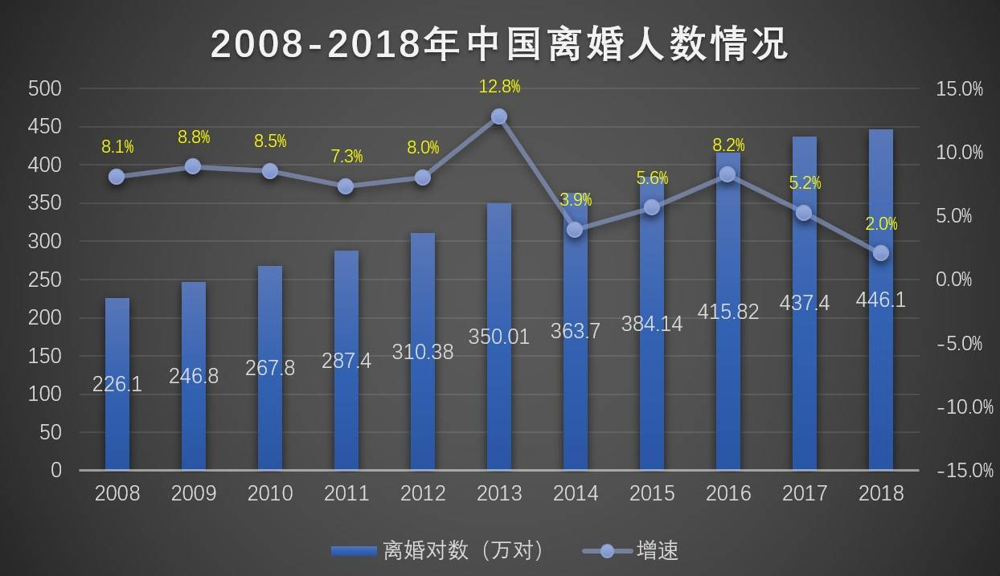

2008-2018 年中国离婚对数与增速情况

既然婚姻是最可靠的契约，为什么每天有 2 万多人离婚呢？在今天的节目里，我将给大家提供一个全新的视角来看待婚姻。

### 从完全契约到不完全契约

我们这个节目的主要分析框架是契约理论，一种前沿的经济学框架。

我们前面介绍的大部分内容，都是如何设计最优契约来减少信息不对称导致的逆向选择和道德风险问题。这背后有一个隐含假设，当事人是完全理性的，他们可以在契约（或合同）中考虑到未来所有可能的情况，并且契约的所有条款都是可以履行的。这样的契约被称为完全契约，否则就是不完全契约（incomplete  
contract）。

举例来说，你让快递公司帮你邮寄一个物品，在信息不对称的情况下，快递公司员工可能会乱收费，也可能丢失或损坏物品。为了防止这类道德风险问题，快递公司的服务协议会明确规定：多重的物品收多少钱，大概几天到达，物品损坏或丢失应该怎么赔偿，等等。

总之，你和快递公司之间的契约似乎把方方面面都考虑到了，合同非常"完全"，有纠纷还可以去法院打官司，法院也能够判定责任归属。

但是，就算我们和快递公司的约定已经这么详细了，现实中依然发生了大量因为快递而导致的纠纷，而且这些纠纷并没有完全按照事先约定的方式去解决问题，反而让客户和快递公司频频陷入无休止的扯皮中去。

这是因为，客户和快递公司的契约是不完全的，也就是说合同并不能真正囊括所有的关键条款，或者在发生纠纷时借助第三方的力量来保证履约。

其实，学者们很早就注意到了不完全契约。早在 1963 年，美国威斯康辛大学法学院教授麦考莱（Stewart Macaulay）就发现，很多契约是不完全的。

他对 68 个商人和律师进行了深度访谈，发现了与完全契约理论预测截然相反的两个事实：第一，商人通常不会在合同中描述商品的细节，只是描述大致情况。例如，某个商人在过去的四年中有 60-75%的买卖合同没有规定细节。

第二，商人遇到合同纠纷时很少索赔，几乎不打官司，而且即使到了法院立案率也不高。

大家想想看，这个场景是不是跟你所处的真实世界非常类似呢？一旦发生商业纠纷，我相信大部分人都不会选择去法院打官司，对吧？

### 为什么会出现不完全契约？

面对麦考莱发现的契约"悖论"，经济学家需要新的理论解释。

20 世纪七八十年代，以威廉姆森（Oliver Williamson）、哈特（Oliver  
Hart）为代表的经济学家沿着不同的思路，深入分析了契约不完全的原因、后果和解决方案，从而形成了与完全契约理论相对的不完全契约理论。

其实，在前面的节目中，我们已经介绍过不完全契约理论及其应用。例如，我们从不完全契约的角度分析了企业应该集权还是分权，以及企业并购为什么会失败。

那么，我们来看一个关键问题：既然我们每个人都是理性的，在签合同时会考虑方方面面的问题，那么为什么还会出现不完全契约呢？经济学家总结了出现不完全契约的三个原因。

### 原因一：人的有限理性

第一个原因是有限理性。所谓有限理性（bounded rationality），按照诺贝尔经济学奖得主西蒙（Herbert  
Simon）的说法，就是人们试图理性地行事，但是实际上做不到。就好比你总想考 100 分，但是实际上最多考 90 多分。

请注意，有限理性不是非理性。在理性的光谱上，非理性是一个极端，完全理性是另一个极端，而有限理性更靠近完全理性。如果人都是非理性的，那么我们就无法进行逻辑推理，也就不需要经济学分析了。

正因为人是有限理性的，不是完全理性的，所以不可能预见到在契约执行过程中所有可能出现的情况，尤其是一些小概率的"黑天鹅"事件，例如 2001 年的美国 911 事件、2002 年的非典（SARS）事件，今年（2020 年）的新冠疫情也是一种不可预测的黑天鹅事件。因此，所有的契约都面临一定程度的不确定性。

还是以快递服务为例。你将一个包裹从北京寄到上海，通常三天就能送达。然而，你根本没有料到南方突然下了暴雨，导致包裹延误并且耽误了非常重要的事情。一旦碰到极端天气，"三天送达"的事前约定根本就无法实现。

### 原因二：成本的缔约性

第二个原因是缔约成本。有时候，你也许能"先知先觉"，预见到履约过程中可能会出现一些突发事件或者所谓"不可抗力"，但是你很难用双方都清楚并且无争议的语言写进合同里。

以突发事件为例，什么是双方都认可的突发事件？你可能需要分为自然灾害、战争、安全事故、群体性事件等多个大类，然后在每个大类下面再分若干中类，之后再将每个中类分出若干小类，直到每种情况的定义都得到当事人各方的一致同意为止。

如果合同要包括所有这些情况，估计需要律师团队谈判几个月，然后增加几百页纸的篇幅。显然，这样的缔约过程成本太高，关键是每一方都希望对突发事件的定义符合自己的利益，因此根本就无法达成一致意见。

### 原因三：信息的第三方不对称

第三个原因是证实成本。有些事情对双方当事人来说是信息对称的，但是很难向第三方证实，这也会导致契约无法履行。我们将这种情况称为第三方信息不对称。

例如，你将一部价值八千元的苹果手机当着快递员的面放进包裹里，然后从北京寄到上海。但是，你没有选择保价或者保险，也没有拍下包装快递的完整视频。很不幸，快递公司丢失了你的包裹，并且快递员声称忘记了物品是什么，你怎么办？

你当然可以向快递公司投诉，也可以向法院起诉，但是你无法向法院证明你的物品是一部苹果手机。此时，按照《邮政法》第 47 条规定，快递公司完全可以按照三倍的运费赔偿你，最多不超过 80 块钱！不要以为这种小概率事件不会发生，这是某个网站提供的真实案例。

快递的例子表明，如果关键信息无法被第三方证实，即便合同包含了相关条款，遇到纠纷时也是废纸一张，有时甚至导致一方利用第三方不可证实的特点去占对方的便宜。

不知道大家还是否记得"臭名昭著"的南京彭宇案？这个案件，当时社会影响极大，也可以说非常恶劣。

2006 年，一个老太太在南京某公交站台摔了一跤，一个叫彭宇的小伙子把老太太扶起来了。这似乎是一件好人好事啊，但剧情陡转直下。老太太到了医院一看，摔成了骨折，她声称是彭宇撞倒了她。彭宇则坚决否认。最终，法院判决彭宇承担 40%的责任，赔付了老太太 4.5 万元。

这个判决结果当时引起了巨大的争议，焦点是彭宇是否撞倒了老太太。我相信，当事人双方肯定非常清楚有没有撞到，但是当时既没有摄像头，也没有人证，因此无法向作为第三方的法院证实事情的真相。

如果一件事情发生了，你知道，我知道，但是没有第三方知道，那么双方之间的这种契约就可以认为是不完全契约。

现实中，确实有老人故意倒在车前，声称被撞了，然后向车主索取高价赔偿。北京人把这种现象称为"碰瓷"，契约理论把这种现象称为"敲竹杠"。所谓敲竹杠，就是一方当事人利用契约不完全导致的漏洞向另一方当事人索取好处的行为。

### 不完全契约会产生什么后果？

前面介绍了不完全契约的三个原因，那么不完全契约会导致什么后果呢？

首先，它会导致大量的讨价还价现象，严重时甚至会导致双方无法签订契约。

其次，它会导致大量的契约纠纷，从而引发赔偿、重新谈判和毁约行为。双方对合同条款的理解不同，甚至导致了大量的司法诉讼。

最后，它会导致敲竹杠现象。敲竹杠不但降低了社会的道德水平，而且降低了人们的投资激励，因为没有人愿意在一个被讹诈的环境下进行人力资本和物质资本投资。

在现实中，一些地方政府通过招商引资把一些企业吸引到当地投资。等到企业开始买地建厂了，地方政府就拒绝兑现当初允诺的优惠政策，甚至百般刁难，把"外商"打成"内伤"。这就是一种利用合同漏洞进行敲竹杠的行为。经济落后地区要优化营商环境，推动经济增长，我认为关键一条就是减少招商引资过程中的不完全契约，促使政府诚实守信。

### 如何避免不利后果？

既然所有的契约必然是不完全的，我们如何避免不利的后果呢？

在这里，我要介绍一下麦考莱教授的研究结果。他发现，商人们很少在契约中详细规定商品的细节，而是等供需情况完全清楚之后再进行谈判。既然合同不管怎么写都是不完全的，那不如一开始就写一个简单合同。

但是出现合同纠纷怎么呢？在一个重复博弈的市场上，声誉、口碑是解决不完全契约的工具。如果一方多次违约，虽然没办法去法院打官司，但是大家心知肚明，以后就再也没人跟他做生意了。相反，如果一个人诚实守信，言出必行，哪怕有时短期内会吃亏，但是长期来看会有越来越多的人和他做生意。这就是声誉的力量，也是市场的力量。

### 婚姻也是一种不完全契约

现在回到开头提到的离婚问题。为什么每天有 2 万多人离婚？因为婚姻本质上就是一份不完全契约！

第一，男女双方在结婚前根本无法预料到结婚后会遭遇的各种困境，例如感情不和、家庭责任分担不均、婚后出轨。

第二，即便能预料到这些可能导致离婚的因素，也无法在婚姻契约中事先约定。以家庭责任为例，谁能把每天如何照顾小孩、如何照顾老人的义务规定得一清二楚呢？关键是，这些事情都是随时间不断变化的。在没有小孩之前，你永远无法想象照顾小孩有多么琐碎和辛苦。

第三，夫妻之间的事情涉及个人隐私，很难向第三方证实。比如感情不和、价值观不同、投资理财失败，都是不方便公开的事情。正因为婚姻是一份高度不完全的契约，第三方很难干涉，所以古代才有"清官难断家务事"的说法。

在现实中，正因为认识到婚姻在本质上是一种不完全契约，所以人们对结婚越来越慎重。例如，双方通过延长交往时间来增进彼此的了解，以便尽量减少不匹配的婚姻。

另一方面，法律和道德也在不断完善，对婚姻过错方施加了更多的约束成本。例如，法律规定，发生重婚、婚姻期间与他人同居、使用家庭暴力等行为的过错方应该对无过错方进行赔偿。

结语

下面我来总结一下。

我们每天都要跟不同的人打交道，实际上每天都在参与各种显性或隐性的契约。买卖是契约，婚姻是契约，法律是契约，制度是契约，国家本身也是一种契约。

所有的契约本质上都是不完全契约，只是不完全的程度不同。我们每个人都生活在一个不完全契约的世界中。很大程度上，世界的不完美正是源于契约的不完全。

造成不完全契约的根源，是由于人的有限理性、缔约成本以及证实成本，因此人们签订的契约通常都是不完全契约，这会导致资源浪费，甚至滋生敲诈行为。但是，再好的契约也不能包罗万象、包治百病，因此有时简单的契约更有效率，这就是大道至简。

最后是一道思考题：请你思考一下，现实生活中，你签订过，或者知道哪些面对复杂问题的时候，却签订简单契约，提高效率的事情？欢迎分享你的看法。

好了，今天我们就讲到这里，下集再见。

公众号懒人找资源，懒人专属群分享

## 28 抵押和声誉丨为什么结婚彩礼仍有生命力？

懒人专属群的群友，你好，我是聂辉华。

在本节目的番外 1，我评论了杭州杀妻惨案，引发了很多讨论。在那篇评论文章中，我的主要观点是：婚姻作为男女之间关于权利和义务的一种契约，是人类所有发明中最重要的避险制度。但因为婚姻中存在普遍的信息不对称问题，所以才会出现各种婚姻悲剧，甚至杀妻惨案。

要避开现实中的婚姻陷阱，关键就是男女双方要门当户对。听完之后，很多听众朋友希望我展开来讲讲，婚姻为什么要讲究门当户对？那好，今天我就来给大家谈谈这个问题。

### "质子外交"

在正式开始今天的节目之前，我想给大家讲一个历史故事。

春秋战国时期，诸侯国之间经常发生战争。为了维持国家之间的和平，各国通常会缔结一些和平条约。这些条约，就是我们这个节目讲的契约。

从契约履行的角度讲，如果个人或企业违约了，当事人可以申请法院强制执行。但国家之间的契约，就没法用这个办法了。因为国家是最强大的武力机构，世界上还不存在一种超越国家的强制力量。

即便是联合国，也没法强制某个国家执行某些契约。毫不奇怪，我们经常在新闻里听到，某个国家退出了某个国际公约，或者拒绝批准某个国际公约。

因此，国家之间的契约是典型的不完全契约，不仅很多条款无法向第三方证实，而且就算违约也难以强制执行。

为了解决这种不完全契约的履约难题，当时的诸侯国想出了一个好办法，就是"质子外交"。缔结契约的国家，相互把国王的公子送到对方国家去做人质。

所谓的"质子"，就是被质押到对方国家的王室公子。质子都被安排在一国都城内，圈禁起来。一旦一方违背和平条约，对方就会首先拿质子开刀。

有人可能会想，一个国王往往有多个儿子，因此就算对方杀了一个质子，也不会动摇国本。但事情不是这么简单。

首先，质子是王室中地位较高的公子，他代替国家到外国去经受磨练，时刻有生命危险。这种独特的经历和功劳，有助于质子回国后担任国王。事实上，秦始皇嬴政、他的父亲以及他的爷爷在担任秦王之前，都曾经在外国担任过质子。

因此，质子在某种程度上就是国王的潜在候选人。正是因为质子有这种独特的地位，哪个国家都不会轻易牺牲掉质子。所以你看，古人还是很有智慧的，他们懂得在不完全契约的条件下，通过提供抵押品（质子）来保证和平契约的履行。

### 结婚时的彩礼是一种抵押品？

我们在前面讲过，婚姻也是一种典型的不完全契约。因为双方在结婚前无法预料到结婚后的种种矛盾，婚姻生活中的很多冲突也无法向第三方证实，所以婚姻容易破裂，从而导致了大量离婚事件。

那么，在维持婚姻关系方面，人们能否借鉴质子外交的思路，通过抵押品来减少不完全契约的后果呢？当然可以，事实上中国传统的婚姻关系中，一直存在抵押品，就是彩礼。所谓彩礼，就是男女双方家庭在初步确定婚姻关系时，向对方赠送的聘金、聘礼和聘财。

为什么彩礼本质上是一种抵押品呢？首先，彩礼是一种定金。这种定金是为了敦促男女双方实现婚约。如果一方在结婚前反悔了，按照习俗，彩礼一般不能收回。在有些地方，如果双方同意解除婚约，彩礼也要扣除一部分，作为"精神损失费"。因此，彩礼起到了押金的作用，有助于双方遵守契约精神。

其次，彩礼的金额不低。作为一种抵押品，如果金额太低了，那就起不到对违约者惩罚的作用。根据网上资料，中国各省市的彩礼一般在 1 万元到 10 万元之间，而且越是发达地区，彩礼越贵。例如，浙江省的彩礼据说高达 20 万元。

### 彩礼是一种信号发射机制

更重要的是，彩礼不仅仅是一种抵押品，它还是一种筛选机制。彩礼之所以有助于维持婚姻契约，是因为在信息不对称的前提下，它能发挥事前的筛选作用。

从事前来看，彩礼能够减少婚姻机会主义者。所谓婚姻机会主义者，就是一方想通过结婚的方式，骗取对方的钱财和社会地位，然后再背叛对方。不管是古代还是现代社会，"凤凰男"欺骗富家女的真实故事比比皆是。

比如，前不久一名男子通过花言巧语骗取了一名江苏富家女子的信任，结婚之后不断索取女方钱财。等钱财骗得差不多了，就设下陷阱，在泰国旅游期间企图将女子杀害，然后再骗取巨额保险。幸运的是，女子活下来了，并且警方已经逮捕了这个"渣男"。

俗话说，知人知面不知心。男女双方在结婚之前，彼此都有很多隐私，在个人品德、能力和财富等方面存在严重的信息不对称。古代男女双方甚至在婚前从未谋面，信息不对称程度更加严重。

那么，如何将那些婚姻机会主义者排除在外呢？彩礼就是一种有效的筛选机制，它至少能起到两个作用。

第一，表明当事人确实有结婚的意愿。因为如果没有结婚，彩礼就会被对方没收。第二，表明当事人具有一定的经济实力。前面说过，彩礼和"份子钱"类似，其金额与经济水平是正相关的。如果一个家庭能够承担一定金额的彩礼，至少说明这个家庭经济实力还可以。

虽然婚姻的幸福程度和经济水平并不是一一对应的，但是没有经济基础的婚姻是很难长久幸福的。套用一句俗话：金钱不一定能买到幸福，但没钱肯定没有幸福。

在理想状态下，每个人都希望找到自己的真爱，然后白头偕老。但我们毕竟生活在一个不完美的真实世界里，这个世界充满了各种信息不对称。

在信息不对称条件下，必要的彩礼其实就是我们前面讲过的信号发射机制，它不能保证找到最合适的伴侣，但是至少能将那些婚姻机会主义者排除在外。

在前面那个杀妻骗保案件中，如果那个富家女子知道对方负债累累，就会多一个心眼，就不会被对方的花言巧语或者献殷勤所"感动"，那么最后悲剧很可能就避免了。因此，通过彩礼来甄别对方的诚意和能力，固然不是完美的办法，但它是信息不对称条件下的次优选择。

有了彩礼这个信号之后，我们想象一下婚姻市场的博弈均衡。我们可以按收入将所有男女分为三档：最有钱的第一档，比较有钱的第二档，最穷的第三档。

如果允许男女双方自愿选择，那么在相貌差不多的情况下，第一档的男女双方会相互匹配，然后第二档的男女双方也会相互匹配，最后只剩下第三档的男女双方匹配。

对于第一档的女方来说，既然有跟自己相貌相当同时家庭经济实力差不多的男方，她为什么要选择下嫁给第二档和第三档的男方呢？女方会这么想，男方也会这么想。于是，最终三个档次的家庭按照收入水平实现了完全匹配。

博弈论可以证明，男女双方门当户对是一个稳定的均衡。在现实中，确实有一些富裕的女方家庭接纳了贫穷的男方家庭，或者反过来，但这毕竟是少数，而我们关注的是多数情况。

门当户对的组合，不仅可以实现事前的筛选功能，还能减少事后的道德风险行为。原因在于声誉机制。

所谓声誉机制，就是当事人利用名声、口碑、信誉等力量来维持契约的机制。在现实中，门当户对的家庭有相似的背景，更容易形成重合的社交圈子，从而借助外部力量维持婚姻。

大家想想看，什么人更注重声誉呢？你会想到明星、官员以及社会精英，对吧？事实上，这些群体之间更容易形成门当户对的婚姻。比如，不管是国内还是国外，著名的政治世家之间，经常会出现联姻。又比如，中国的娱乐圈也流行明星跟明星结婚。

在这些行业，如果一方出轨或者犯错，很容易在圈子内传出坏名声，这对于事业发展以及再婚都是很高的成本。因此，婚姻双方可以借助声誉的力量，对一方出轨或者婚内违法行为形成一定的威慑。

### "天价"彩礼

按照上面的分析，既然彩礼既是一种有效的抵押品，又是一种信号发射机制，那么彩礼是不是越高越好呢？如何看待现实中的"天价"彩礼现象？

说到"天价"彩礼，我老家江西就有一例。一个老家的朋友给我发了一张当地的彩礼单，我给大家念一下。"某某先生与某某小姐乃是天生一对，经长期的自由恋爱，志同道合，愿结百年佳偶，永不变心。经双方面议如下：1、议酒席 36 桌；2、议见面礼 2888 元；3、议服装 9888 元；4、议黄金 120 克；5、议手机一部；6、议汽车一部；7、议住房一套；8、议家电齐全；9、议家具齐全；10、议礼金 28 万 8888 元。"

在上面这张礼单中，直接的彩礼就要 28 万多，加上汽车和住房，我估计 80 万都不一定够，因为上面提到的住房有可能是指新房。如果现有住房也可以，那么至少要 40 万元。网上流传的全国彩礼最贵的福建省是 30 万，跟这个比是"小巫见大巫"了。

我在前面说了，婚姻的幸福程度和经济水平不是一一对应的。因此，我绝对不赞成钱多就一定幸福的说法。

事实上，经济学研究表明，收入水平和幸福程度不是成比例的，而是倒 U 型关系。也就是说，在收入水平较低的情况下，收入提高会带来幸福感的提高，但是当收入高到一定程度之后，收入高反而可能降低幸福感。

在这个意义上，我认为彩礼应该有一个度，就是不能明显超过自身的经济水平。否则，婚后的生活就会面临严重的财政压力。原因是，不管女方收了男方多少彩礼，这些财务支出的相当一部分，恐怕还是要夫妻双方在婚后一起来承担。如果因为彩礼而陷入婚后财务困境，早知如此，何必当初呢？双方结婚的目的又是什么呢？

但是，假如双方是完全自愿并且有能力承担的，那就另当别论。其实婚姻也是一个市场，婚姻的价格会受到男女双方供求关系的影响。如果一个地方男多女少，并且有钱的男方较多，那么彩礼自然会水涨船高。此时，高彩礼是一个均衡价格。但是，如果人们认识到女性的地位越来越高，或者女性在婚姻市场上越来越有话语权，那么当地人就会多生女儿，这样就会将彩礼价格逐步降下来，从而形成新的均衡。

当然，有人可能不同意，认为过高的彩礼价格会给双方带来压力，并且导致相互攀比和恶性竞争。在有些地方，有关部门将彩礼的上限规定为 2 万元，超过 2 万元就可能罚款。我认为这种做法的出发点是好的，但是效果未必好。

第一，现金形式的彩礼价格只是彩礼真实价格的一种。在女方供不应求的地方，你当然可以规定彩礼金额不能超过 2 万元，但女方家庭可以要求提供汽车和住房，以及以金银首饰等实物形式进行补偿。那这不是换汤不换药吗？经济学理论可以证明，实物比现金更容易导致效率扭曲，因为购买实物还有额外的成本。

第二，人为压低彩礼价格，可能导致女方家庭利益受损。其实，从理论上讲，较高的彩礼价格有助于改变当地人"重男轻女"的不良传统。如果市场价格是有利的信号，人为干预可能适得其反。

结语

最后总结一下今天节目的主要内容。

婚姻是一种不完全契约，而彩礼作为一种抵押品有助于维持婚姻契约。彩礼的主要作用还有两个，一是在事前提供了一种信号发射机制，筛除掉一些婚姻机会主义者，二是彩礼有利于形成一种门当户对的匹配关系，并且借助声誉机制维持婚姻关系。彩礼的价格有其合理的成分，关键是适度引导，而不是强制压低。

今天的思考题如下：有人认为，婚前财产公证降低了有钱家庭的离婚成本，削弱了门当户对的匹配结果，从而不利于维持稳定的婚姻。请问你是否同意这种看法？

好了，今天我们就讲到这里，下集再见。

公众号懒人找资源，懒人专属群分享

## 29 少比多好丨合同制定得越简单越好？还是事无巨细最好？

懒人专属群的群友，你好，我是聂辉华。

传统观点认为，契约（或者合同）是保护当事人权益的一种工具。因此，不管是做生意，人际交往还是制定规章制度，原则上契约应该越详细越好，条款越多越好，这样就可以减少各种漏洞。

世界上最复杂、最详细的契约，应该是美国税法。在美国有一句名言：人这一辈子有两件事情是不可避免的，死亡和纳税。因此，为了防止公民逃税，美国税务局编制了事无巨细的税法体系（IRC），光是目录就有 9800 多条，装订起来总共有将近 7 万页纸！

有趣的是，很多明明非常重要的契约，内容却非常简单，甚至有意忽略一些重要条款，属于明显的不完全契约。所谓不完全契约，就是合同没有详细规定所有可能的情况，而是等事情出现之后当事人再进行谈判和修订。

例如，劳动合同是一种契约，但是在公司的聘用协议里，不会规定一个经理的上下班时间。婚姻是一种契约，但是多数夫妻不会详细地规定结婚后谁洗碗、谁做饭、谁带孩子。

第三个例子更加典型，1787 年《美国宪法》颁布时，甚至都没有包含涉及公民根本利益的《权利法案》。作为国家根本大法的宪法，居然没有涉及公民的权利。这就出现了一个有趣的问题，为什么一些契约要故意留下明显的"漏洞"呢？

有人说，因为这些被遗漏的条款都是不可证实的，所以写入契约也没有实际用处。这个说法难以成立，因为上下班时间、家庭基本义务，都是可以证实的。

还有人说，因为所有权利和义务都写入合同就会导致合同条款无限多，所以干脆少写一些。这个逻辑也站不住脚。因为重要的条款显然应该写入，比如公民的基本权利，应该省略的是一些不太重要的条款。

### 或然事件是否应写入契约？

大家还记得聂老师之前讲过的经济学分析的根本方法吗？经济学就是一道选择题，人们做选择时，总是在成本和收益之间比较。

因此，一些能够被预测、被证实的条款却没有写入契约之中，一定是因为写入这种契约的成本超过了收益。

顺着这个思路，诺贝尔经济学奖得主、哈佛大学教授哈特（Oliver Hart）从行为经济学的角度提出了一个有趣的解释。

我们在前面讲过，哈特把契约看作是一种参照点，如果当事人在事后感觉契约赋予自己的权益得到了实现或者得到了公平对待，那么他就会按照契约精神来履行，否则他就会采取一些投机行为，包括背后捣乱、推卸责任甚至报复对方。

在此基础上，哈特教授进一步扩展了参照点理论。他将契约主体内容之外的另类事件称为或然事件（contingency），一般是指随机性的、不确定性的事件以及难以预料的突发事件。

比如，路上堵车、自然灾害以及流行病等。在契约中写入或然事件的好处是，一旦或然事件出现了，双方按照契约规定的条款履行，这样可以减少事后双方的谈判成本。

但是把或然事件写入契约的成本是，因为或然事件的定义往往是不确定的，这样就导致契约的主体内容成为一个参照点，而或然事件成为另一个参照点。

一旦或然事件发生了，双方在事后谈判时，每个当事人都会寻找对自己有利的参照点，这就会导致"双重标准"。

因此，两个参照点会带来了更多的谈判成本，从而降低了契约履行的效率。相反，如果一份契约中只有一个参照点的话，那么双方不会就此产生冲突。

简单地说，将或然事件写入契约，虽然节约了某个具体事件的谈判成本，但是带来了很多衍生的谈判成本，得不偿失，因此不如在契约中忽略这些或然事件。

### 正面案例：越详细越好

为了更好地理解参照点理论，哈特教授举了一个生活中的案例。

假如你雇佣了一个保姆带小孩。你跟保姆的劳动合同中规定，周一到周五的上午 9 点到下午 5 点是上班时间，每小时工资是 30 元，5 点的时候交班。但是你有时下班会堵车，这样保姆就必须临时加班，这属于迟早会发生的或然事件。

你可以在合同中规定，如果临时加班，保姆的工资是 50 元/小时；你也可以在合同中忽略这类或然事件。

将临时加班情况写入合同的好处是，只要你在交班时出现迟到现象，就按 50 元/小时的工资支付给保姆，这样节约了再谈判成本或者扯皮现象。

但坏处是，假如你周末临时有事或者要出差，想让保姆周末多干一天，然后周一休息一天，实际上就是调休，此时就会产生纠纷。

你把合同规定的基本工资当作合理的参照点，认为调休的工资应该是 30 元/小时，但保姆会把临时加班的工资当作合理的参照点，因此她会要求 50 元/小时。

在双方的争论过程中，每个人的立场不同，很难说谁对谁错。如果你坚持每小时 30 元，保姆就会认为不公平，她可能采取投机行为，例如偷懒甚至虐待孩子。

对于父母来说，孩子就是最重要的宝贝。因此，考虑到保姆投机的严重后果，理性的你一定会选择不将临时加班的条款写入合同，而是在需要临时加班时，一事一议，跟保姆重新谈判。这反而是一个双赢的结果。

### 反面案例：越详细越麻烦

雇佣保姆的案例是一个正面案例，我再给大家讲一个反面案例，表明合同条款越详细，有时反而麻烦越多。

在经济学界一直流传着这样一个经典笑话。有一个被誉为天才的经济学家"桑福德"，他和一个建筑商签订了一份为他建造房屋的合同。

说到这里，我要插入一点背景知识。在美国，很多居民不是像中国人买房那样，去购买开发商建好的商品房，而是先买一块地，然后自己找建筑商设计并建造房子。

作为一个理性的经济学家，桑福德并不信任建筑商，为了防止建筑商偷工减料、磨洋工，或者采取其它道德风险行为，他充分发挥其聪明才智，写了一份极其详细的合同，从建筑材料到装修风格再到完工时间，应有尽有。

到了房屋验收时，他突然发现了一个严重的问题：屋顶会漏水。更要命的是，他居然忘了将"屋顶不能漏水"这一条款写入建筑合同。于是，他拒绝给建筑商支付工程款项，建筑商当然不干了，于是双方诉诸法院。你们猜，法官会怎么判决？

结果法官判决桑福德败诉，理由是：既然桑福德的合同如此详尽，却没有考虑屋顶漏水问题，说明这个问题并不妨碍合同履行。

从参照点理论的角度讲，桑福德给合同加入了太多的参照点，反而模糊了合同履行的重心，以至于让对方钻了空子。

讽刺的是，桑福德还是契约理论方面的权威经济学家，他不知道中国成语中有"挂一漏万"、"智者千虑，必有一失"的说法，也算是以身试法了。

### 契约应如何制定最合适？

上面的两个案例从一正一反给了我们启发，根据参照点理论，在制定契约时，应该删繁就简，因为有时多一个选择，反而少了一条退路。

那么，契约是不是越简单越好，合同条款是不是越少越好呢？也不是。哈特教授认为，如果或然事件的定义本身是清晰的，双方无争议的，那么将或然事件写入契约就能减少具体事件的谈判成本，又不会增加衍生的谈判成本，此时契约越详细越好。

比如，你和保险公司签订人身保险合同，通常会涉及重疾险条款。那么，保险公司要不要在合同中列举"重大疾病"的范围呢？

从理论上讲，如果保险公司只列举了 20 种重大疾病，那么一旦不属于这个范围的疾病发生了，客户和保险公司之间很可能会发生争议和谈判成本。但事实上，保险公司都会详细列举重大疾病的范围。

原因是，行业主管部门中国保监会和中国医生协会曾经制定了一个权威的重大疾病清单。不管是保险公司、客户，还是法院，都会默认这个第三方提供的"重大疾病"范围是最权威的，最少争议的。

换句话说，面对权威的第三方提供的"参照点"，双方当事人认为是公平的，这样就避免了事后的投机行为。因此，保险公司的合同通常都很详细。比如，某个保险公司发给我的人身保险合同，总共有 120 页，加上附件"产品说明"，总共超过 200 页！

需要说明的是，我们这里提到的"或然事件"是一种简便表述，它绝不仅仅指小概率事件或突发事件，而是包括所有细节是清晰的、但范围是模糊的事件。

运用参照点理论，我们可以解释开头提到的雇佣合同、婚姻以及《美国宪法》故意留下的"漏洞"。这些"漏洞"都属于细节清晰但范围模糊的事件。

在第一个例子中，劳动合同里不明确规定经理的上下班时间，至少有两个好处：一是避免了其它时间上班是否属于"加班"的争议，从而减少了公司支付的加班费；二是便于公司根据工作日程需要，实行灵活的上下班时间，或者进行调休。

比如，有的公司为了推进某个重要项目，可能会要求员工连续半个月上班，然后连续休息几天。

在第二个例子中，婚姻契约中不规定家庭劳动分工，是因为实际生活中经常需要根据夫妻双方的工作性质、上下班时间以及收入情况来调整夫妻双方的分工，提前规定了分工就会导致事后有很高的谈判成本或调整成本。

在第三个例子中，《美国宪法》一开始没有写入《权利法案》，是因为一旦明确了公民权利的范围，政府就可能利用强权限制那些没有被纳入范围的公民权利。

比如，《权利法案》如果没有将公民喝酒的权利写入，那么一旦政府限制买酒，尽管这一行为侵犯了公民权利，但公民可能无法起诉政府。

换句话说，明确了公民的权利范围，反而把公民权利限制住了，等于给自己挖了一个坑。

总之，参照点理论认为，与其规定一个容易引起争议的具体范围，不如留下一个没有争议的模糊范围。换句话说，我们知道自己不知道什么，比我们不知道自己知道什么更重要。

我提醒大家注意一点，一定不要把契约理论仅仅当作一个经济学理论，它实际上具有广泛的应用价值。

事实上，参照点理论关于契约"故意"遗漏重要细节的观点，不仅对我们构建商业契约或人际关系具有重要的启发意义，而且其中蕴含的哲学思想也有助于设计精巧的国际契约，形成良好的国际关系。

例如，面对中国与周边国家的领土争议，邓小平曾提出"搁置争议，共同开发"的基本原则。这实际上是告诉我们，在两国关系中，要牢固构建一个没有争议的参照点，而将那些可能产生争议的参照点排除在两国契约之外，并且相信我们的后代有足够的智慧在未来消除那些争议。从这个角度讲，小平同志是应用博弈论的大师啊。

结语

下面，我来总结一下今天节目的主要内容。

传统观点认为，契约规定得越详细越好，但是根据参照点理论，契约规定得很详细虽然减少了某些具体事件的谈判成本，却增加了相关事件的更多谈判成本，导致得不偿失，因此有时应该故意留下一些"漏洞"。

用中国传统智慧来说，双方在制定契约时，既然"智者千虑，必有一失"，不如"大智若愚，大道至简"。

之前我们解释了什么是不完全契约以及不完全契约的后果，今天我们发现有时不完全契约反而是次优的。

从这个意义上讲，我们不必去苛求一个完美的世界。世界的不完美，某种程度上是一种"理性的"不完美，是一种自我调整的最佳状态。如果大家想通了这一点，那么很多事情也许就没有那么烦恼了。

最后是一道思考题，这道题有点特别，它涉及一个传统道德观念问题。

中国民间有句谚语："升米养恩，斗米养仇"。意思是说，如果一个人非常饥饿，你送给他一升大米，他会非常感激。但如果你一直送，他就认为这是理所应当的。一旦你停止送米，他不仅不会感激，反而对你心生仇恨，甚至以怨报德。

请问，你在现实中是否也遭遇了这种情况，或者你是否听说了类似的情况呢？然后请用今天所学的参照点理论进行解释。

好了，今天我们就讲到这里，下集再见。

公众号懒人找资源，懒人专属群分享

## 30 拍卖理论丨如何让你手里的宝贝卖出天价？

懒人专属群的群友，你好，我是聂辉华。

喜欢篮球运动的人，肯定都知道 NBA（美国职业篮球联赛）超级明星科比（Kobe Bryant）。不幸的是，2020 年 1 月 27 日，科比因为直升机坠毁而不幸去世。

科比去世的消息刚刚发布，与科比有关的球鞋、球衣以及相关商品，立即在网上被炒出了天价。例如，一款紫金色的耐克牌 42 码球鞋，原本售价是 1999 元，在某些网店上被炒到了 19999 元，24 小时之内价格涨了 10 倍！

不过，即便你没有收藏科比的球鞋，今天的节目内容对你搞收藏、开网店，至少赚点零花钱，都可能有所帮助。因为我会告诉你，为什么一件看上去普通的商品，能够在市场上卖出高价。

### 如何让普通商品卖出高价？

以科比同款的球鞋为例。同样一种商品，成本没有任何变化，为什么价格涨了 10 倍呢？

首先，这跟商品的销售方式有关。按照传统的市场销售方式，商品的定价应该"随行就市"。也就是说，市场上这类商品的价格是多少，你就卖多少。在一个竞争性市场上，你多卖一块钱，东西都没人要。因为在竞争性市场上，有无数个卖家和你卖同样的东西，买家绝不愿意多花一分钱。

其实，除了传统的销售方式，还有另一种特殊的销售方式----拍卖。你通过某个平台----  
比如拍卖行或者"淘宝"、"闲鱼"这样的电商网站，将潜在的买家集中起来，然后让他们相互竞价，这样最终出售的价格就会"水涨船高"，甚至远远超过正常的市场定价。

在现实中，很多矿产、珠宝、古董、字画都是通过拍卖的方式销售出去，很多地方政府的工业用地和商业用地也是通过拍卖的方式销售出去。

大家可能知道，17 世纪的荷兰，郁金香的拍卖形成了一个巨大的产业，甚至后来导致了可能是人类历史上第一次经济泡沫。其实，拍卖本来不是一件非常"高大上"的销售手段。

在人类早期的农贸市场上，如果两个农民都想买一头牛，或者都想买一根红薯，两个人就要参与竞价，这个竞价过程本质上就是一种拍卖。从这个意义上讲，市场上所有的交易背后都是一个隐含了拍卖的过程。

因此，拍卖其实无处不在，无时不有，它不是什么特别神秘的事情。

但是，不是所有的商品都适合拍卖。比如你拿一瓶普通的矿泉水去闲鱼上卖，根本就没人感兴趣，也不可能卖出比市场更高的价格。

### 什么样的商品适合拍卖？

因此，如果你想通过拍卖的方式，把一件商品卖出高价，你需要掌握的第一个知识点是：什么样的商品适合拍卖？适合拍卖的东西，必须是稀缺的、个性化的商品，比如古董、玉石、限量版奢侈品以及名人用过的东西。

从经济学角度讲，稀缺就意味着垄断，就具备自主定价的能力。因此，拍卖本质上是将个性化的商品进行价值变现的一种资源配置方式。

问题是，对于古董珠宝这类贵重物品，我们普通人是可遇不可求。那么，怎么让你手里的普通商品看上去不"普通"呢？秘诀在于，你要让冷冰冰的商品变得有感情，为它注入故事、情怀和个性等元素。

我举个例子。普通的橙子，大概是 3 块钱一斤，但是"褚橙"却可以卖到 15 块钱一斤。凭什么？就凭广告词"人生总有起落，精神终可传承"。这句话传递的是，当年的云南红塔集团董事长、"烟草大王"褚时健，经历了牢狱之灾后，75 岁开始创业的励志故事。

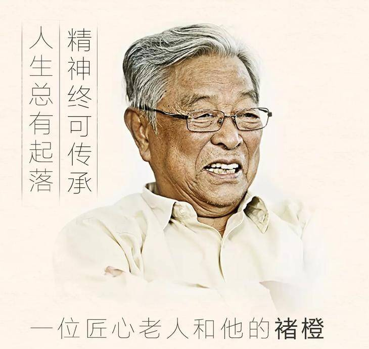

褚时健（1928-2019）

"人生总有起落，精神终可传承（橙）"

说白了，褚橙卖的不只是橙子，而是情怀，而情怀是无价的。与科比同款的鞋子之所以能够卖出上万元的高价，是因为那款鞋子打上了科比的烙印，成为一种珍贵的纪念品。

假设你现在给自己的商品注入了个性化的元素，是不是往淘宝或闲鱼上一挂，就能卖出高价呢？没这么简单！拍卖是一门高深的学问。如果拍卖方式设计不当，会导致巨大的经济损失。

专门研究和设计拍卖的经济学家柯伦柏（Paul  
Klemperer）举了一个例子。2000 年，同样是对 3G（第三代无线通信技术）的运营牌照进行拍卖，英国政府的拍卖收入高达创纪录的 390 亿欧元。同一年，荷兰政府照抄英国的拍卖方案，却只拍出了不到 30 亿欧元，还不到预期收入的三分之一，跟英国的收入比更是天壤之别。

### 拍卖过程的经济学逻辑

正因为拍卖是一门科学，所以我们今天要专门介绍一下拍卖背后的经济学逻辑。

先来了解一下拍卖的基本知识。拍卖品的所有者（委托人）提供的拍卖品被称为标的物，参与竞标的买家被称为投标者。

从契约理论的角度来看，针对同一个标的物，每个投标者都有自己的心理价位，这个价格就反映了不同投标者的类型。

在现实中，每个投标者在拍卖前是不知道其他买家的心理价位的，因此拍卖者之间彼此存在一种"事前的信息不对称"。由于一次拍卖有多个投标者，每个投标者都有自己的心理价位，因此拍卖属于多边信息不对称问题。

1996 年，经济学家维克瑞（William Vickrey）因为拍卖理论的贡献而获得了诺贝尔经济学奖。可惜的是，在获奖仅仅三天之后，他不幸逝世了。

2020 年的诺贝尔经济学奖再次授予了拍卖理论，得奖者是米尔格罗姆（Paul R. Milgrom）和威尔逊（Robert B.  
Wilson）两位斯坦福大学教授。我在番外节目"2020 年诺贝尔经济学奖解读"里，对此进行了比较详细和通俗的介绍，这里就不再赘述了。

### 两种主要拍卖方式：公开叫价与密封价格

全世界有两种主要的拍卖方式。第一种叫英式拍卖。拍卖师从低到高叫价，出价最高的竞拍者以最高价获得商品，因此它也叫升价拍卖。

英式拍卖是最常见的拍卖方式，中国很多地方的土地使用权就是采用这种方式拍卖。不知道大家有没有看过葛优和关之琳主演的电影《大腕》，里面提到的拍卖形式就是英式拍卖。

英式拍卖的优点是，交易效率很高。如果一个投标者喊出了很低的价格，后面的人就会加价，这就避免了超低价中标的不利结果。

但它的缺点也很明显，就是容易导致"围标"。所谓围标，就是多个竞拍者暗中串通，通过压低报价让某个人中标，这可以算是一种合谋行为。

例如，在德国 3G 牌照拍卖过程中，某个电信企业好几轮公开报价的末位数字都是 6。据说这是该企业发射的一个信号，表示它愿意和剩余投标者合谋，在出现更高价之前结束拍卖。

英式拍卖是一种公开叫价的拍卖，还有一种密封价格拍卖。

在拍卖时，每个投标者将自己的报价写在一张纸上，并用信封装好，然后交给拍卖师。拍卖师拆开所有信封，当场宣布出价最高的人是赢家，他支付的价格就是最高价。请注意，在密封拍卖时，每个投标者无法看到别人的出价。

因此，密封价格拍卖的优点是防止围标。但它的缺点是，有可能导致低价中标，从而破坏了交易效率。出得起高价的强势投标者在秘密出价的情况下，不知道出价多少才能赢，同时又希望获得更多利润，因此不愿意出价太高。这就导致出不起高价的弱势投标者可能以一个较低的价格赢得了拍卖。

### 如何防范拍卖中的陷阱？

正规的拍卖其实充满了各种陷阱，有时惊心动魄，有时跌宕起伏。因此，你需要掌握的第二个知识点就是，如何避免拍卖中的常见陷阱。

最主要的陷阱有两个：一是"流标"，二是"围标"。所谓流标，就是标的物的最终拍卖价格低于委托人事前设定的保留价，委托人宁愿不卖，于是拍卖结果作废了。如果拍出的价格远低于委托人的期望价格，就算成交了，其实也是一种流标。

以英国 3G 牌照拍卖为例。2000 年初，英国政府计划拍卖四张 3G 牌照。电信牌照属于全国性的垄断商品，通常只有实力雄厚的大型电信企业才有实力购买和运营。

当年，已经有四家电信企业在运营 2G 牌照，它们在竞争 3G 牌照时肯定拥有在位者优势。如果是四个在位企业竞争四张 3G 牌照，并且每个企业最多只能拥有一张牌照，那么四个在位企业中标的概率很大，它们就没有激励出高价，这会导致低价中标或者流标。但如果让很多陌生的竞标者参与进来，又担心出现围标问题。

那么，有什么办法可以一方面诱使投标者出高价，另一方面又避免围标呢？拍卖专家柯伦伯为英国政府设计了一种两阶段拍卖方式，巧妙地解决了这个难题。

在第一阶段，采取英式拍卖，按报价结果从高到低筛选出五个投标者。注意，是五个投标者，它比在位企业的数目四个多一个，这是关键。

在第二阶段，让这五个投标者参与密封价格拍卖，并且规定每个投标者第二阶段的秘密报价不能低于自己在第一阶段的公开报价。

最后，从秘密报价中按出价高低选出四个获胜者，每个获胜者获得一张牌照。

在这个两阶段拍卖中，柯伦伯利用英式拍卖的优点，通过公开竞价避免了低价中标，提高了交易效率；然后又利用密封价格拍卖的优点，通过秘密出价避免了围标。真是天才！这次拍卖为英国政府筹集了创纪录的 390 亿欧元，可谓大获全胜。

那么问题来了，"抄作业"的荷兰为什么就失败了呢？原因很简单，荷兰有五个在位的 2G 电信企业，准备发五张 3G 牌照，牌照数量和在位企业数量相同，产生不了拍卖应有的竞争效应，结果导致低价中标。看来，荷兰还是没有做好功课，连作业都不会抄。

这也从一个角度说明，经济学家是有价值的，因为经济学家设计的政策确实能够在很大程度上影响社会福利。好的政策或制度，能够给国民带来福祉；而坏的政策或制度，则可能会带来灾难性的后果。从这个角度讲，经济学家的水平确实很重要。

顺便说一句，今年获得诺贝尔经济学奖的威尔逊教授，不仅是拍卖理论的创始者之一，他同时也致力于将经济理论与经济政策有效结合，推动了经济学的某个分支逐渐具备了"工程经济学"的特质。

什么是工程经济学呢？就是经济学理论可以象工程学一样，通过精确的设计和计算，来直接改变世界，提高社会福利水平。

结语

今天介绍的拍卖理论和实践给我们带来什么启发呢？

第一，如果你想将一样东西卖出高价，你首先要将它变得个性化。实现个性化的方式有很多，关键是让产品不再是产品，而是故事、情怀、文化。

第二，要想办法找到对产品感兴趣的高价值客户。拍卖网站的作用主要是将有购买欲望的客户集中起来，而成为"网红"也是一种召集潜在客户的方式。

第三，要想办法防止买家之间合谋。密封价格拍卖是其中一种方式，你也可以利用买家之间的信息不对称，让他们无法合谋。

今天介绍的内容其实不仅仅是拍卖。在市场经济中，很多单位都要举行工程招标、项目招标或者物资采购。其实，招标和拍卖在本质上是一样的，都是一种多边信息不对称下的资源配置方式。只不过，招标的目标是尽可能找出最低价中标，而拍卖的目标是尽可能找出最高价中标。因此，今天所学的拍卖理论，完全适用于招标采购问题。

除了招标采购，在某种程度上，我们所有的个性化商品或劳务的销售都可以看作是一种拍卖。比如你有一个创业的 idea（想法），这个 idea 是独一无二的，你如何能够吸引更多的风险投资呢？又比如，你有一套独特的咨询方案或者设计文案，如何能够高价卖给潜在客户呢？在遇到这些问题时，你会发现，掌握一点拍卖理论是大有裨益的。

最后是一道思考题：请用今天所学的拍卖理论，分析一下"网红"李子柒的手工农产品为什么一年能够卖出几亿元的销售额？

好了，今天我们就讲到这里，下集再见。

公众号懒人找资源，懒人专属群分享

## 31 共同代理问题丨食品安全问题为什难监管？（一只猪会被 11 个部门管！）

懒人专属群的群友，你好，我是聂辉华。

俗话说，民以食为天。吃饭是天大的事情，但是食品安全问题一直是我们这个社会的难题。

2008 年发生的三聚氰胺事件，让国产奶粉市场备受打击；2019 年 3 月，上海中芯国际学校又发现食物发霉变质问题，再次让家长们忧心忡忡。

食品安全关乎每个人的生命安全，但是为什么这么多年就是管不好呢？今天，我从契约理论的角度和大家谈谈这个重要问题。

我在这个节目里不断地强调，经济学不仅是一个学科，而且是一种思维方式。有时候，从经济学的角度思考问题，我们会得到截然不同的答案。

### 对社会问题的管制一定有用吗？

首先，按照解决问题的传统思路，一旦出现了某类社会问题，老百姓就希望政府严加监管。

主要就是两个方面：一方面，政府协调所有相关部门，严抓共管，从各个环节减少问题发生的原因；另一方面，加大处罚力度，所谓"治乱当用重典"。

但是大家想过没有，每次出现严重的社会问题，政府都加强监管，加大处罚力度，问题有没有彻底解决呢？似乎并没有。

例如，2017 年 11 月，十几个家长发现北京市朝阳区一家名叫"红黄蓝"的幼儿园，出现了老师给孩子扎针、喂食不明药物等虐童现象，引起了极大的社会关注。

在民意的敦促下，政府很快成立调查组进行调查，法院对有关人员判处了刑罚。但是，大家上幼儿园更容易了吗？此后虐童事件杜绝了吗？都没有。

这就说明，加强管制固然是必要的，但是一味地加重管制，未必能够完全解决问题。我们不能形成一出事就寄希望于"管"的惯性思维。

今天，我从契约理论的角度，给大家介绍一个脑洞大开的观点，它叫"共同代理理论"（common agency theory）。

### 共同代理理论是什么？

共同代理理论认为，在信息不对称的条件下，监管者越多，目标就越多，被监管者就越是无所适从，最后完成目标的情况就越糟糕。共同代理理论告诉我们，不是管的人越多，事情就越能管好，它也可能导致南辕北辙的后果。

什么叫共同代理呢？在契约理论中，上级或者老板被称为委托人，而下属或者员工被称为代理人。

在我们之前的节目中，通常假设有一个老板（委托人），他管理一个员工（代理人）。现在变成了多个老板管理同一个员工，这种情形就叫共同代理。

在真实世界中，共同代理现象非常普遍。比如，在公司里，一个职工既要听从他的直接上司（比如部门经理），又要服从职能部门的领导（比如财务总监）；在政府中，一个城市的财政局长既要听从市委书记的指示，又要落实市长的要求。

共同代理理论的提出者，是斯坦福大学的本海姆（Douglas Bernheim）和哈佛大学的温斯顿（Michael  
Whinston），他们提出这个模型的文章发表于 1986 年的世界顶级经济学期刊《计量经济学》（Econometrica）。

本海姆与温斯顿，同为美国经济学家

有意思的是，两位作者年龄相仿，都在哈佛大学（Harvard University）、西北大学（Northwestern  
University）和麻省理工学院（MIT）这三所世界一流大学学习或工作过，而且一起合作发表了多篇高水平论文，可以说是经济学界的著名 CP（组合）。

我们感兴趣的问题是，为什么监管机构越多，像食品安全这种事情反而越是管不好呢？大部分老百姓都要吃猪肉，因此确保猪肉安全是非常重要的食品安全工作，那我就以猪肉为例，用共同代理理论来解释信息不对称条件下的食品安全监管困境。

### "一只猪的管理": 委托-代理的复杂设立

我首先问大家一个问题，你们知道中国有多少个部门管理一只猪吗？5 个？7 个？都不是，11 个！你没有听错，我给大家列举一下。

（1）猪的育种、授精由农业部管理，繁殖补贴由发改委发放，这是 2 个部门了；

（2）猪吃的饲料由粮食局组织研究，饲料生产由农业部管理，饲料的存储由央企中储粮负责，饲料的进出口和安检由海关和质检总局把关，这又增加 4 个部门了；

（3）在猪的养殖环节，传染病由卫生部门管理，排泄物由环保部管理，屠宰由农业部和公、检、法等部门一起管理，这一下子就增加了 5 个部门；

（4）在猪肉上市环节，销售由市场监管局负责，价格由商务部负责。

这样加起来，从猪的繁殖、养殖再到上市，至少有 11 个部门参与管理。这 11 个负责猪肉监管的部门，就相当于是 11 个委托人，被监管的养猪场就是代理人。在这个委托-  
代理环节中，请注意三个要点。

第一个要点是，多个委托人和代理人之间存在事后的信息不对称问题。

虽然有 11 个部门监管养猪场，但这些委托人不可能每天 24 小时知道养猪场在干什么。在这种信息不对称的情况下，养猪场可能会给猪喂养不合格的饲料，或者在杀猪时往猪肉里注水，或者发现猪瘟后隐瞒不报，这些都属于我们前面提到的道德风险行为。

第二个要点是，每个委托人都有各自的职责和工作范围，因此多个委托人的目标是不太一样的。

比如，农业部主要确保饲料不出质量问题，发改委主要是通过补贴政策鼓励养猪企业扩大产量，而海关主要是把好进口关。

第三个要点是，不仅 11 个监管部门目标不同，彼此之间也不可能每件事情都沟通，因此多个委托人之间存在一定程度的信息不对称。

让我概括一下共同代理问题的三个基本特征：存在信息不对称问题，委托人目标不同，彼此之间很少通气。大家想想看，我们经常面对的共同代理问题，是不是都存在这三个基本特征呢？

在信息不对称的情况下，监管部门和养猪场在博弈过程中会做出什么反应呢？11 个监管部门相当于 11 个委托人设定的目标，但是代理人养猪场只有 1 个，而且它的时间精力是有限的。因此，这就相当于 11 个委托人给 1 个代理人安排了 11 项任务。

大家还记得我们前面学过的多任务代理模型吗？当时，我以 KPI 考核为例，证明当一个员工同时从事两项任务时，员工会在两项任务之间顾此失彼，导致 KPI 考核失败。

在共同代理下，代理人的精力是有限的，因此他同样会在多项任务之间套利，就是看哪个任务好完成、哪个任务完成后得到的奖励更多，就优先去完成哪个任务。

假如发改委给的母猪繁殖补贴非常高，那么养猪场就会把重点工作放在母猪生小猪上，至于小猪生下来是否健康、能活多久，它可能就不太考虑了。但是这样一来，卫生部门的工作就难以完成。

可见，面对多个委托人，代理人每完成了一项任务，就相当于削弱了其它任务的投入水平，也相当于增加了其它任务的考核风险。

那么，如果委托人提高某项任务的奖励，或者对某项任务的考核实行一票否决，是否会改变代理人顾此失彼的行为呢？答案是否。

因为不管是奖励还是惩罚，都改变不了代理人每天只有 24 小时的时间和精力约束。而且，代理人承担的任务越多，精力就越是不够，这样代理人完成任务的总体情况就会越糟糕。

另一方面，除了代理人的精力限制，每一项任务都有一定的不确定性。这里说的不确定性包括外部风险，比如突发事件、恶劣天气、大流行病、国际冲突等难以预测的因素。

每一项任务的完成，一方面取决于代理人的努力水平，另一方面取决于外部环境。因此，委托人越多，代理人的任务就越多，同时代理人的风险就越大，这导致激励效果就越差。

### 代理人可利用信息不对称套利

讲到这里，大家可能觉得这个共同代理理论似乎和我们前面讲过的多任务代理模型差不多，都认为代理人会在多项任务之间套利，导致顾此失彼。

但实际上共同代理导致的问题比多任务代理更严重，因为它还会导致代理人利用多个委托人之间的信息不对称去投机取巧，甚至操纵委托人！

通常情况下，委托人是老板、上司或领导，怎么可能被作为下属或员工的代理人操纵呢？大家是不是觉得难以置信？我来给大家讲个故事吧。

大家都听说过"三个和尚没水喝"的寓言，我把它稍微改编一下。假设第一个和尚是方丈，第二个和尚是监院（相当于寺庙的"二把手"），第三个和尚是普通的小和尚。方丈和监院都是小和尚的上司，因此小和尚就面临我们前面讲的共同代理问题。

有一天早上下大雨，方丈让小和尚去山下迎接香客，以免香客在山间小路上滑倒摔伤。小和尚说："对不起，监院让我去挑水，他说下大雨会导致泉水变污浊了，那我们几天都没有水喝了，这是紧急任务啊。"虽然方丈的级别比监院高，但方丈觉得监院的话有道理，毕竟要先急后缓嘛，于是他同意了。

过了一会，监院看到小和尚，就叫他马上去挑水。小和尚说，方丈让他去山下迎接香客，因此他来不及挑水了。监院一想，方丈毕竟级别比自己高，当然要首先听方丈的安排。

于是，方丈亲自去山下迎接香客，监院亲自去挑水，而小和尚却躲在屋里睡大觉！在多任务代理环境下，虽然会出现代理人激励扭曲问题，但委托人至少能从代理人身上获得一定的价值，而在共同代理环境下，代理人可能会利用委托人之间的信息不对称，反过来攫取委托人的价值，这就有点反客为主了。

### 从共同代理看食品安全问题

借助这个共同代理分析框架，我相信大家比较容易理解，为什么食品安全问题很难管好。

因为每一样食品都涉及多个部门，多个部门之间往往目标不一致，又缺乏有效的沟通和协调，甚至各自为政，这导致被监管的食品企业要么顾此失彼，难以保证食品生产的每个环节都不出问题，要么干脆利用多个部门之间的监管漏洞，投机取巧，这样可能会导致更多的食品安全问题。而且，越是增加监管部门或者加大处罚力度，效果可能越糟糕。

那么该如何解决呢？正确的思路，不是"做加法"，增加更多的监管机构，相反是"做减法"。

第一，尽可能减少委托人或监管者的数量以及目标数量。因为委托人越多，目标越多，越是容易产生目标冲突并且导致代理人无所适从。

第二，如果必须至少保留两个委托人，对同一个代理人实行"双重领导"，那么也必须明确以谁为主、以谁为辅。并且多个委托人之间应该有常设的协调机构，防止代理人利用委托人之间的信息不对称去套利。

在这方面，我认为国务院国有资产监督管理委员会（简称国资委）的成立是一个正面案例。

在国资委 2003 年成立之前，国有企业的人事权归组织部管理，资产保值归财政部管理，重大投资归发改委管理，技术改造归经贸委管理，可谓"九龙治水"。九龙治水、多头管理的后果是，国有企业在经历了多轮改革之后，效率依然低下。

然而，国资委成立之后，它基本上实现了管人、管事和管资产的统一，从而有效地提高了国企的运营绩效。

事实上，从数据上可以看出，2003 年国资委成立之后，国企的效率明显开始上升，部分中央企业的效率甚至高于普通的民营企业。这就证明，实行大部制统筹管理比多部门管理更有效率。

结语

让我总结一下今天节目的主要观点。

当一个代理人（或者员工）面临多个委托人（或者老板）时，相当于承担了多项任务，这会导致代理人顾此失彼，代理人会优先完成奖励最高的任务，并导致其他任务的风险增大。同时，多个委托人之间存在着信息不对称，代理人可能会利用这种信息不对称去套利。

解决的思路，就是要做减法，一是尽可能减少委托人的数量和目标的数量，二是在存在多个委托人时，明确主次之分，避免目标冲突。

根据上述内容，针对食品安全问题，我们的建议有两条。

一是尽可能整合涉及食品安全的多个监管部门，避免政出多门和责任边界不清。目前，国家市场监管总局成立之后，工商、质检、商务等部门的相关职能已经归入市场监管总局，这是正确的方向。

二是加强多个监管部门之间的内部沟通和协调行动，并根据部委分工明确主要负责部门。目前主要是市场监管和农业部门两大系统之间的协调问题。

最后是一道思考题：从消费者的角度讲，你认为什么是解决食品安全问题的有效方案？

好了，今天我们就讲到这里，下集再见。

公众号懒人找资源，懒人专属群分享

## 32 国企改革丨承包制还是股份制：褚时健的悲剧和曹德旺的成功

懒人专属群的群友，你好，我是聂辉华。

### 褚时健的悲剧

在今天的节目开头，我要给大家讲一个传奇的励志故事。

故事的主人公曾是全国"十大改革风云人物"、"中国烟草大王"，因为他领导的云南红塔山集团成为亚洲排名第一的烟草企业。

1999 年，他被判处无期徒刑，保外就医后以 74 岁的高龄开始二次创业。他当时承包了一片荒山，然后在 85 岁时创造了著名水果品牌"褚橙"。我们在前面介绍拍卖理论时，还提到了为什么褚橙能够卖出远高于普通橙子的价格。这个人于 2019 年逝世，他叫褚时健。

褚时健（1928－2019），被视为中国最具争议性的企业家之一

如果没有中间这段坐牢的经历，这本来是一个完美的励志故事。大家肯定很奇怪：像褚时健这么优秀的企业家，怎么会坐牢呢？

褚时健 1979 年开始担任云南省玉溪卷烟厂厂长，到 1995 年即将退休时，他为国家创造的利税以及"红塔山"的品牌价值一共超过 1400 亿元。但是，工作将近 20 年，他的工资和奖金总共不超过 100 万元。

100 万元虽然当时也是一个不小的数目，但是跟他创造的上千亿利税相比，简直是九牛一毛。因此，他觉得非常不平衡，于是在退休前通过各种方式获取了 170 多万美元的非法收入。这导致他因贪污罪被判处无期徒刑，后来是因为健康原因保外就医，他才有二次创业的机会。

当年，褚时健因为贪污罪被判刑时，很多著名经济学家为他打抱不平，并将褚时健的悲剧称为"59 岁现象"。

所谓"59 岁现象"，就是国企经理人在任时的薪酬远远低于他们创造的市场价值，收入与贡献严重不匹配，因此他们在临退休时大捞一把，以便补偿自己。用契约理论的话来说，59 岁现象是一个典型的道德风险问题。

### 国企主管部门与经理人之间信息不对称

国企主管部门和国企经理人构成了博弈双方，前者是委托人，后者是代理人。关键的问题是，国企主管部门和国企经理人之间存在严重的信息不对称问题。

比如，该不该做一笔重大投资，该不该雇佣或者解雇某些职工，该不该把产品卖给某个企业或商人，这些重要决策一般掌握在国企经理人手中。经理人拥有这些问题的决策权或者建议权，而且经理人了解决策的成本和收益。但是，上级主管部门并不真正了解这些决策的成本和收益，因此很难判断这些决策是否合适，是否掺杂了个人利益，是否导致了国有资产流失。

在信息不对称的前提下，如果国企经理人的薪酬太低，就会导致国企经理人的激励不足，就可能出现贪污受贿等道德风险问题。特别是临近国企经理人退休时（比如 59 岁），经理人不再需要为错误的决策承担任何损失，也不必在乎职业声誉，此时他就会变得无所顾忌。

因此，要解决国企经理人的激励问题，就必须提高其薪酬待遇。今天看来，这简直就是一种常识。那么，当初为什么不提高国企经理人的待遇呢？如果要提高国企经理人的待遇，又该怎样提高呢？要回答这个问题，我们需要简单地回顾一下中国国有企业改革的艰辛历程，然后你会发现问题并不是大家想象的这么简单。

在这里，聂老师要善意地提醒大家，我们多数时候希望将问题简化，但人为地简化问题，忽略背后的历史进程，我们就会错过真相，或者草率判断。

### 承包制的成与败

1978 年底，安徽省凤阳县小岗村的十八位农民，冒着巨大的风险，立下了生死状，悄悄签订了农村土地承包责任书。之后，得到正式承认的"农村家庭联产承包责任制"拉开了中国农村改革的序幕，并且改变了无数农村的经济面貌。

1984 年，"包"字进城了，大量国营企业开始模仿农村家庭联产承包责任制的做法，将企业承包给经理人。通常的承包方式是：一个承包期是三四年，承包人自负盈亏，并且每年向国家上交一个固定的利润数，剩下的利润一部分奖励承包人，一部分用于企业发展和工资发放。

国企承包制是一项重大的改革。其激励机制与农村家庭联产承包责任制类似，通俗地说就是"交够国家，留足集体，剩多剩少归自己"。

从激励机制上说，国企经理人的报酬从过去的"死工资"变成了利润包干。因为利润是所有收入扣除工人工资、供应商原材料货款之后的剩余部分，所以分配利润的权力也叫"剩余索取权"。

从契约关系上说，国企经理人和企业的关系，从过去的雇员-  
老板关系变成了对等的市场关系。总之，承包制在短期内迅速调动了国企经理人的积极性，一些被承包的国企很快就扭亏为盈。一时之间，承包制被当作搞活国企的灵丹妙药，并且在全国范围内大规模推广。

在承包制的推广过程中，出现了一个"神人"马胜利。1984 年，马胜利毛遂自荐承包石家庄造纸厂，打破"铁饭碗、铁工资"制度，使造纸厂迅速扭亏为盈。据说当时全国有上千家国企领导人排着队恳求马胜利去承包他们的国企。

马胜利（1939-2014)，承包国有企业的第一人

1987 年，马胜利将自己承包的全国一百家亏损的造纸厂联合起来，组建了"中国马胜利纸业集团"。然而，好景不长。1990 年，马胜利最早承包的石家庄造纸厂严重亏损，其它承包企业也亏损不断；1991 年，马胜利纸业集团解散，此时集团成立才 4 年；1995 年，马胜利被上级免去所有职务。此后，他再也没有创造商业上的辉煌。马胜利的承包悲剧绝非个案，很多被承包的国企在经历了短暂的盈利之后，依旧陷入亏损的深渊。在国家层面，国企承包制改革在 1992 年前后逐步淡出。

### 承包制为何在农村有效，在国企失灵？

这就出现了一个有趣的问题：同样是承包制，为什么它在农村成功了，在国企失败了呢？2009 年诺贝尔经济学奖得主威廉姆森（Oliver  
Williamson）的一个观点帮我们解开了迷惑。

威廉姆森认为，企业和市场是两种不同性质的契约，适用于不同的激励机制；如果在企业内部模仿市场，就会出现激励扭曲。这个知识点，我在前面用交易成本方法分析海尔集团的"人单合一"制度时，做了详细的介绍。下面，我再结合承包制简单地给大家梳理一下。

在市场上，一手交钱，一手交货，通常情况下没有什么不可预期的问题，也没有什么难以向第三方证实的麻烦，因此买卖双方之间的契约近似于一种完全契约。此时，利润作为一种剩余索取权可以高效地激励双方努力降低成本或者提高品质。在承包制下，一旦上交的利润固定了，承包人就获得了企业的剩余索取权，因此承包制是一种典型的市场机制。

但是，企业内部的生产和交易过程比较复杂，当事人之间的契约无法将所有复杂的情况包括进去，是一种不完全契约。当出现了契约没有规定的情况时，谁说了算就非常重要，这就是所谓的"剩余控制权"。

通俗地说，剩余索取权就是利润分配权，而剩余控制权就是最终决定权；前者是金钱，后者是决策。在企业内部，剩余索取权和剩余控制权必须对应，就是让能挣钱的人必须说了算，否则就会出现激励扭曲。相反，市场作为一种完全契约，不存在剩余控制权问题。

在国企承包制下，承包人上交的利润是多了还是少了？承包人在承包期内如何合理地使用企业资产？承包期结束后如何保证续约？承包导致严重亏损时谁来承担责任？这些问题都非常重要，但是它们要么无法预期，要么无法证实，因此难以包括在承包契约中。所以说，企业内部的承包制是一种高度不完全的契约。

那么，当上述问题出现时，究竟谁说了算呢？显然，国企主管部门（比如工业局）是代表国家的所有者，它拥有承包契约的剩余控制权。但是，国企经理人作为承包人可以合法获取上交之后的剩余利润，他拥有剩余索取权。你看，在承包制下，一方拥有剩余控制权，而另一方拥有剩余索取权，这就会出现问题。

剩余控制权和剩余索取权不对应会导致两种严重的后果。对承包国企的经理人而言，唯一目标是在短暂的承包期内实现最大化利润，因此他有很强的短期机会主义行为。他会涸泽而渔，过度使用企业机器、厂房和其它资产，不会做任何长远的投资和研发，这必然给以后的承包者埋下"地雷"并损害企业的可持续发展能力。

对国企主管部门来说，它拥有剩余控制权但只能获取固定的利润，因此也容易产生机会主义行为。如果承包期内国企赚钱很多，它会眼红，于是下一个承包期它会大幅提高利润上缴额度，否则它有权更换承包人。

这其实是我们前面介绍过的"棘轮效应"，也就是工作任务、消费水平等数量指标只能高不能低，只能上不能下。个别领导人甚至会安排自己的亲信接手或者进行权力寻租来满足私人利益。一旦预期到棘轮效应和寻租风险，承包人就会进一步强化短期机会主义行为，从而形成恶性循环，最终导致国企在短暂盈利之后陷入长期亏损的深渊。

这证明了威廉姆森的观点，承包制作为一种市场机制，不适合在企业内部实行。但问题是，为什么承包制在农村成功了呢？原因是，农户和村集体两者之间更像是一种市场关系，家庭联产承包责任制近似于一种完全契约。

农民在土地上种植的作物主要是水稻、玉米、土豆等粮食。相对于工业产品来说，农产品产量波动不大，很难有大的技术创新，不存在上交产量年年递增的棘轮效应问题；农产品的生产过程非常简单，生产工具都是农民自己的，也不存在信息不对称问题或者过度使用生产工具问题。

因此，家庭联产承包责任制在提高农民积极性的同时，并不会带来激励扭曲问题。你看，同样的承包制导致了不同的结果，所以我们在使用经济学理论时，一定要注意适用范围，否则就会南辕北辙。

### 如何激励国企经理人？

根据契约理论，国企实行承包制一开始就走错了路。作为一名契约理论研究者，我时常感叹：如果现代经济学能够早点引入中国，那么中国的改革开放可能要少走几十年的弯路！至少，"褚时健悲剧"完全可以避免。

那究竟如何激励国企经理人努力呢？答案一目了然，就是让国企的剩余索取权与剩余控制权对应起来。国企的股份制改革就是一个正确的方向。

1993 年，中央确立了以建立现代企业制度为核心的新一轮国企改革。承包制退场了，股份制上台了。股份制改革赋予国企经理人一定比例的股权，这意味着他们以部分所有者的身份在分享利润的同时也获得了一定的剩余控制权。这样，剩余索取权在一定程度上和剩余控制权对应了，从而实现了激励相容。

其实，十八届三中全会之后推行的"混合所有制改革"，在某种程度上正是股份制改革的深化，目标之一都是让国企经理人的剩余索取权和剩余控制权对应起来。

玻璃大王"曹德旺的创业故事就证明了上述观点。1983 年，曹德旺承包了位于福建老家的一家公有制企业----  
高山异形玻璃厂。一年之后，他圆满完成了上交 6 万元利润的任务，却不愿再次承包，因为他认为这会导致承包人的短期投机行为。于是，高山镇政府与曹德旺的管理团队以股份制的形式组建了新的高山玻璃厂。之后，曹德旺在县政府的支持下引入外资，将高山玻璃厂改造为中外合资福建耀华玻璃工业有限公司。福建耀华后来变成了举世闻名的"福耀"集团。世间所有的果，都是早年种下的因。

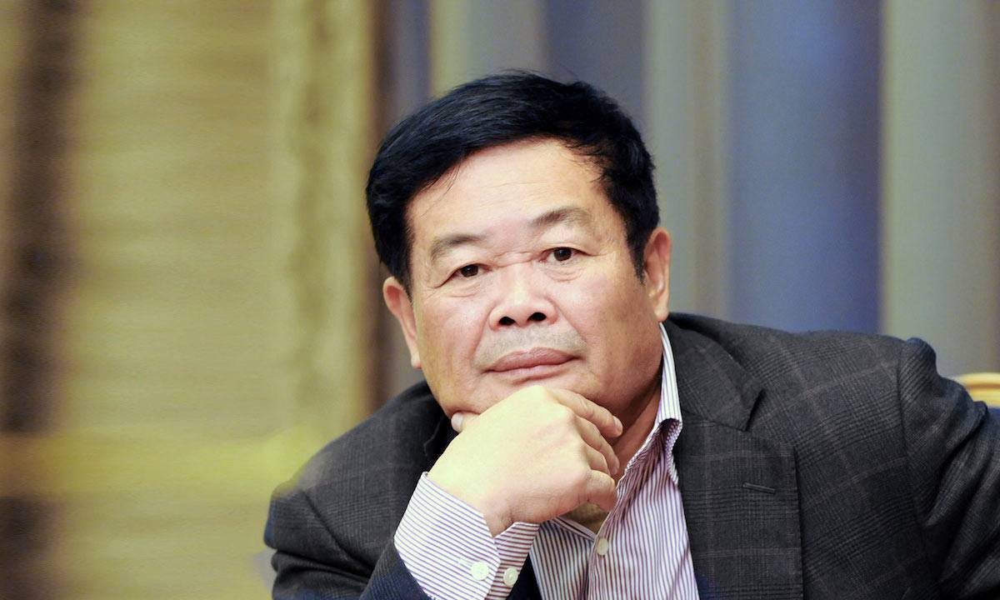

曹德旺（1946-）福耀集团董事局主席、世界华人联合总会荣誉主席之一，首个安永全球企业家大奖华人获得者

结语

今天节目的主要结论是：最优的激励机制要求剩余索取权与剩余控制权对应。国企承包制虽然赋予了承包人剩余索取权，但没有赋予剩余控制权，因此容易出现激励扭曲。承包制适合市场，不适合企业。经济改革应该确保"让市场的归市场，让企业的归企业"。

今天的思考题是：著名财经专家郎咸平有一个观点，他认为国企经理人好比是国企的保姆，保姆应该把孩子养大，但不能"鸠占鹊巢"，因此国企经理人不应该拥有国企股份。请问你如何看待他的观点？

好了，今天我们就讲到这里，下集再见。

公众号懒人找资源，懒人专属群分享

## 33 公共管理的边界丨美国的监狱该不该私有化？

懒人专属群的群友，你好，我是聂辉华。

在大多数国家，一些重要的基础设施，例如机场、港口和军工厂，通常是由政府管理和运营的。但是在美国，不仅军工厂是私营企业，就连一些监狱都私有化了。私营企业居然可以管理监狱？这听上去简直是匪夷所思，但事实就是如此。

1985 年美国的私营监狱公司只有 1200 个犯人，到 1994 年就增加到 5 万个犯人，而且这个数字一直在增长。根据媒体报道，近几年美国大概有 100 家私营监狱公司，关押的犯人达到 12.8 万人。

美国最大的私营监狱公司 CCA（Corrections Corporation of  
America，美国矫正公司）成立于 1983 年，可同时关押 8 万多个犯人，2018 年营业收入超过 18 亿美元，利润超过 1.6 亿美元。最近几年，世界《财富》500 强企业的最低门槛大概是营业收入 20 亿美元。也就是说，这家美国最大的私营监狱竟然相当于世界 500 强企业。

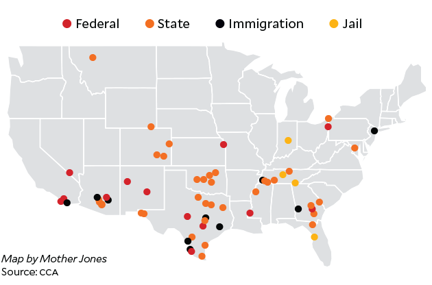

截至 2015 年，CCA 在美国拥有 61 个设施（其中包括 34 所州立监狱、14 所联邦监狱、9 个移民拘留中心和 4 所监狱）

那么有趣的问题是，为什么美国的监狱可以交给私营企业呢？为什么政府不自己运营所有的监狱呢？究竟是政府运营监狱更好，还是私营企业运营监狱更好呢？

### 公立监狱供不应求?

一个很现实的理由就是公立监狱供不应求，必须外包给私营监狱才能解决问题。

大家可能不知道，美国是世界上监禁率最高的国家。美国的人口数量是 3 亿，只占全球总数的 5%，但是美国的囚犯数量却占全球的 25%。也就是说，全世界所有犯人中，每四个人就有一个是关在美国。

根据美国司法部的数据，上个世纪 80 年代美国每年大约有 2.5 万人被送进监狱。到了 2016 年进监狱的人有 216.2 万，增加了 100 倍！因此美国监狱系统的主要矛盾是，日益增长的犯人关押需求，与有限的公立监狱数量和财政预算之间的矛盾。

在这种情况下，只能将部分犯人关进私营监狱。关键是，私营监狱的成本比公立监狱低 10%。在联邦经费捉襟见肘的情况下，这可帮了政府的大忙。因此，私营监狱一直受到政府的青睐。

但这并不是说，面对监狱私有化，美国就没有反对的声音。相反，反对的声音一直存在。大家都知道，私营企业的主要目的是利润最大化。

因此，反对监狱私有化的人认为，私营监狱将追求利润的目标放在改造犯人的社会责任之前，过于关注降低成本，这导致了一些虐待犯人和暴力充斥的丑闻，从而不利于犯人改造，最终可能会危害社会。

最近，中国出版了一个法国公司高管的畅销书《美国陷阱》，本书作者因为违反了美国《反海外腐败法》，被美国人抓了，然后关在一家私营监狱里。他在书中抱怨，美国私营监狱里伙食很差、金钱当道。

《美国陷阱》中信出版社

\[法\]弗雷德里克*皮耶鲁齐（Frederic Pierucci），\[法\]马修*阿伦（Matthieu Aron）

### 私有化的背后：政府和市场的边界问题

监狱私有化的好处是成本低，坏处是忽视监狱的改造质量。那么，究竟美国监狱该不该私有化呢？

面对这种问题，你一定要记得聂老师多次强调的：公说公有理，婆说婆有理；到底谁有理，关键看逻辑；逻辑要自洽，关键是框架。有了分析框架，我们就能进行成本-  
收益分析，并且根据具体环境做出最优选择。

有意思的是，美国监狱私有化的问题不仅引起了媒体热议，而且引起了几位哈佛大学经济学家的关注。他们发现监狱该不该私有化的背后，其实是政府与市场的边界问题，这就触及了问题的本质。

我们在节目里多次提到的哈佛大学经济学系教授哈特（Oliver Hart），1997 年与同事施莱佛（Andrei  
Shleifer）以及芝加哥大学教授维什尼（Robert  
Vishny）共同在国际经济学顶级期刊《经济学季刊》（QJE）上发表了一篇论文，用一个巧妙的分析框架研究了政府和市场的最优边界，然后讨论了美国监狱的私有化问题，并且还可以将这个框架拓展到更多应用场景。

在哈特教授的分析框架中，假设政府需要一项公共服务或者一批商品，比如运营一座监狱、一所学校或者搭建一个政府网站。政府有两种选择：一是政府自己干，让一个公立机构来提供这项公共服务，并任命一个官员来管理；二是外包给市场，让一个私营机构来提供这项公共服务。

这里有两个关键假设。

第一，这类公共服务的质量是难以证实的。以监狱为例，监狱最主要的目的不是把犯人关进去就完了，而是要把犯人改造好，让犯人出狱之后不再犯法。

问题是，如何度量改造效果呢？如果一个犯人出狱后因为某种原因再次犯法，那么这应该怪监狱还是怪当地的政府以及社会环境呢？这是无法证实的。

因此，政府和供应商之间的契约是一个典型的不完全契约，即合同的关键内容难以证实。

相反，如果服务质量很容易证实，那么政府和供应商就可以签订一种完全契约，双方也不会发生任何争议。

在完全契约下，只要服务质量没问题，谁的价格低就采购谁的，此时根本不需要讨论"公营"还是"私营"的问题。

第二，供应商可以努力降低运营成本，也可以努力提高服务品质，但是两者是相互冲突的。也就是说，降低成本会给提高品质带来一定的负效应。俗话说得好，"便宜没好货"。如果一个犯人在监狱里连饭都吃不饱，那么改造效果肯定好不了。

### 公立与私营提供公共服务的利弊

在上述情境下，哈特等人分析了公立机构和私营机构各自提供公共服务的利弊。

对于公立机构来说，它的管理者是一个官员，因此他的主要报酬是固定工资和奖金，他不能分享利润，也就是没有剩余索取权。既然官员不能获得利润，他就没有动力去降低运营成本。另一方面，他也没有动力去提高品质，因为他不能从提高品质上得到任何好处。

对官员来说，维持机构的正常运转是最重要的，多一事不如少一事。这其实是我们这个节目一直强调的激励问题。大家一定要记住，在信息不对称条件下，激励问题至关重要。

因此，由公立机构提供公共服务的弊端是，官员降低成本和提高品质的努力水平都会低于最优水平。为了便于和后面的情况比较，我们姑且看作中等程度。从另一个角度看，这意味着官员不会为了过度降低成本去损害服务品质，这是公立机构的优点。

对于私营机构来说，它的管理者是私人老板。老板和政府是市场买卖关系，不是组织内部的上下级关系，也不是企业内部关系。

在市场化机制下，只要价格谈好了，比如每关押一个犯人政府补贴多少钱，那么降低运营成本带来的利润就全部归老板所有。

由于老板拥有剩余索取权，因此相对于公立机构，私营机构有更强的激励去降低成本。不过，如果老板想提高服务品质，也没那么容易。因为公共服务的品质是无法证实的，所以老板提高服务品质之后，必须得到政府认可，政府才愿意提高购买价格。这意味着老板需要和政府谈判并分享提高品质带来的利润。

相比之下，降低成本的利润可以独占，而提高品质的利润需要和政府分享，于是老板降低成本的激励很强，而提高品质的激励很弱。

因此，私营机构提供公共服务的优点是，能够大幅度地降低成本；弊端是，相对于公立机构，私营机构会过度降低成本，并降低服务品质。

综合公立机构和私营机构的利弊，并结合公共服务的性质，哈特教授为政府和市场的边界提供了一个清晰的原则：如果公共服务是标准化的，并且降低成本比提高品质更重要，那么让私营机构运营更好，也就是交给市场去办；反之，如果公共服务是非标准化的，并且提高品质比降低成本更重要，那么让公立机构运营更好，也就是交给政府。

### 公立与私有监狱的适用范围

下面，我们用监狱这个案例来具体说明上述核心观点。

如果监狱需要关押的是一些犯罪情节较轻、对社会危害不大的罪犯，比如经济或民事罪犯，他们出狱后对社会的危害相对较小，那么政府关注的重点是如何降低监狱的运营成本，而不太担心改造效果。这类罪犯就比较适合交给私营监狱。即便私营监狱大幅降低成本，也不会造成严重的社会后果。

事实上，美国私营监狱的主要订单，就是美国联邦移民局抓获的大量非法移民。这些非法移民被关押一段时间后，就会被递解出境，不存在改造问题，因此降低监狱的运营成本只有好处而没有坏处。

《美国陷阱》的作者是法国人，最后被送回法国服刑，因此他被安排在私营监狱，从而经历了低成本运营给他带来的痛苦。

相反，如果需要关押的是一些犯罪情节很严重、出狱后对社会仍然存在一定隐患的刑事罪犯，那么改造效果是重点，或者说服务品质是重点，降低成本不是重点。

如果政府把这类罪犯交给私营监狱的话，私营监狱就会为了降低成本而忽视改造效果，从而给社会带来较大的负面后果。相反，公立监狱不是商业机构，没有动力去过度降低成本，这样反而有利于改造效果。因此，这类罪犯应该交给公立监狱。

### 已亏损的美国邮局为何不实行私有制？

除了美国的监狱，我再讲一个国有企业的例子。

美国虽然是头号资本主义强国，但是美国也有国有企业，而且规模还不小。美国邮政局（USPS）是美国最大的国有企业，雇员超过 50 万人，在 2019 年营业收入超过 700 亿美元，名列"世界 500 强"名单第 123 位。但是，美国邮政局已经连续十几年亏损，光是 2018 年就亏损 39 亿美元。

从降低成本的角度讲，亏损如此严重的国有企业，早就该被私有化了，但是在美国却没有私有化，这是为什么呢？因为对大多数美国人来说，他们已经习惯了每天早上喝咖啡、看报纸，而报纸通常是美国邮政局负责递送的。也就是说，美国人更看重邮政服务的品质，而不太在乎成本控制。著

名的调查机构皮尤研究所 2018 年初的民意调查显示，在 10 家美国联邦机构中，最受民众喜爱的是美国邮政，并且 88%的受访者对其服务表示满意。

### 信息不对称可能产生道德风险问题

借助监狱这个案例，我们概括了一个基本原则：标准化的产品或服务，应该交给市场；非标准化的产品或服务，应该交给政府。

像惩罚非法移民这样的任务就是标准化的服务，而改造危险的犯罪分子显然就是非标准化的服务了。但是有时候情况并不是这么简单。

比如孕妇生孩子，在今天已经是一件非常成熟的手术了，任何一个县级医院都可以操作。按照以上观点，这样成熟的、标准化的手术应该完全交给市场，或者说私立医院完全可以承担了。但事实上并非如此。在北京，一些顶尖的私立医院可以实施孕妇的顺产手术，但是本身却没有资格实施剖腹产手术，它必须额外申请名额，或者与公立医院合作才能实施剖腹产手术。这是为什么呢？

因为剖腹产涉及到比较严重的手术风险，并且在医生和患者之间存在严重的信息不对称问题。

从理论上讲，如果一项业务越是信息不对称，就越是可能存在道德风险问题。相对而言，由于私营机构拥有更多的剩余索取权，因此它比公立机构更有激励铤而走险。

比如私立医院可能会利用剖腹产的风险向患者多收钱，而且这种收费是很难监督的，并且手术失败后还可能推卸责任。

相反，公立医院的收费相对比较透明，关键是公立医院没有剩余索取权，不太可能为了营利而冒险。

因此，当存在高度的信息不对称时，为了减少道德风险问题，保护消费者的利益，政府往往会倾向于让公立机构提供这类产品或服务，尽管公立机构的效率相对更差。但是，在人命关天的道德风险问题面前，效率应该退居其次，这是一种次优选择。

结语

我来总结一下今天节目的主要内容。

一项公共服务究竟应该由公立机构还是私营机构提供，一是取决于公共服务的性质。越是标准化的服务，越是适合由私营机构提供；越是非标准化的服务，越是适合由公立机构提供。

二是取决于信息不对称程度。为了避免严重的道德风险问题，由公立机构提供服务往往是一种次优选择。由此看来，国有企业成本高是必然的，但效果差却未必。

最后是一道思考题：为什么全世界最好的大学，比如哈佛、耶鲁以及牛津、剑桥，都是私立或者公立的非营利大学，而不是追求利润最大化的营利性大学呢？

好了，今天我们就讲到这里，下集再见。

公众号懒人找资源，懒人专属群分享

## 34 财税体制丨中央和地方该如何分税？（兼论高房价和分税制的关系）

懒人专属群的群友，你好，我是聂辉华。

对于一个大国来说，最重要的国家治理问题就是处理中央和地方的关系。

几千年以来，在中国这样一个大一统的国家，如何处理央地关系一直困扰着历代统治者。

在央地关系中，最重要的问题又是财政税收关系，因为财政税收直接决定了政府能否维持运转。我们常说，"高度决定格局，眼界决定境界"。

因此，如果你要站在一个顶层的高度来理解国家兴衰或者国家治理，你一定要懂一点中央和地方之间的财政税收关系。

自 1978 年实行改革开放以来，中国在很多方面都进行了较大的改革。在经济领域，最重大的改革举措或者说制度变迁，毫无疑问是 1994 年的分税制改革，它对经济增长、央地关系以及地区差异产生了深远的影响。

所谓分税制，就是中央和地方按照税种来划分预算收入。例如，关税属于中央税，由中央政府收走；土地增值税属于地方税，由地方政府收走；还有一些中央和地方共享税，比如增值税、企业所得税，双方按比例分享。我们稍后会介绍分税制的出台背景。

与此同时，分税制也引发了巨大的争议。若干年前，一本报告文学作品《中国农民调查》成为畅销书，该书尖锐地批评分税制掏空了地方财政，增加了农民负担。

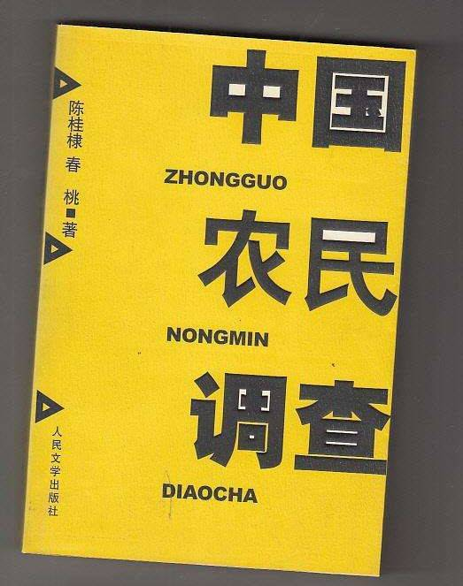

陈桂棣，春桃《中国农民调查》人民文学出版社，2004 年 01 月

此外，多位著名经济学家指出，分税制催生了土地财政，推高了房价。分税制改革究竟是怎么回事？它真的是高房价的推手吗？今天，我就来跟大家聊聊这个宏大但是又重要的话题。

#### 中央和地方的积极性如何调动？

因为我们每个人都关心房价，所以要理解房价，就必须搞清楚房价和分税制究竟有没有关系。

我们这个节目的主要分析框架是契约理论，这个强大的框架同样可以帮助我们分析中央和地方的关系。如果我们把中央政府和以省为代表的地方政府看作是一种委托-  
代理关系的话，那么中央政府就是委托人，地方政府就是代理人。

很明显，在一个幅员辽阔、地区差异很大的国家，中央政府和地方政府之间存在着巨大的信息不对称，中央政府很难完全掌握地方的税收来源和财政收支情况。

因此，中央政府面对的最大难题是，在信息不对称下，什么样的最优契约才能激励地方政府努力发展经济，同时最大化全国的总收入呢？

通俗地说，就是如何设计一种最优契约，同时"调动中央和地方两个积极性"。如果中央征收的税率太高了，导致地方的税收减少了，那么地方就没有积极性去培育税源和征税；但是，如果中央收的税太少了，中央缺乏提供全国公共物品的能力，中央就会将很多事权下放给地方，这样地方就会不堪重负。

问题是，这还不仅仅是一个中央和地方分多少税的问题，另一个关键问题是，由于中央和地方之间存在信息不对称，地方既有可能隐瞒自己的真实财政收入，也有可能不去增加财政收入。隐瞒收入属于我们前面介绍过的逆向选择问题，而减少财政收入或者降低征税效率属于我们前面介绍过的道德风险问题。

为了找到这样一种最优契约，新中国成立以来，财政税收体制经历了多次变迁。每一次变迁都是一次中央-  
地方契约关系的变革，而每一次变革在解决了已有问题的同时，又产生了新的问题。下面，就让我们来了解一下中国央地契约关系的变革过程。

通过今天的节目，你将会发现，只要你了解契约理论的基本分析框架，你不仅可以用来分析前面节目介绍过的招聘问题、偷懒问题和合谋问题，还可以用来分析国家治理问题，从而帮助你站在一个更高的层次来理解这个不完美的世界。

按照老子的说法，"治大国若烹小鲜"。理论的价值就在于"万变不离其宗"，而契约理论就好比是武林中的"剑宗"。

#### 从"统收统支"到"财政包干"

建国初期，中国实行"统收统支"的财税体制。所谓统收统支，就是各省、市、自治区及其以下的地方政府将所有财税收入都上缴中央政府，然后中央政府再给予地方政府一笔相对固定的费用，作为地方政府的财政支出。说白了，就是地方政府的收入和支出都由中央政府统一安排，这就是"统收统支"。

用契约理论的话来说，统收统支财税体制就是一种固定工资契约，中央政府给地方政府支付一个固定工资，然后拿走全部收入。

当时国家"一穷二白"，中央将全国的财税收入集中投资于一批重大项目，比如 156 个重点工业项目，能够实现"集中力量办大事"的效果。

事实上，这些重大项目为新中国迅速奠定了较好的工业基础。但是，在信息不对称条件下，固定工资契约其实是一种"大锅饭"体制，会导致严重的道德风险问题。

在一个企业中，如果实行固定工资制度，一定会导致"干多干少一个样，干好干坏一个样，干与不干一个样"的结果。

由于统收统支的财税体制既没法监督地方政府增加财税来源的努力，也没有给地方政府留下任何经济剩余，因此是一种无效率的央地契约。

很多人注意到改革开放前的企业、工人和农民的激励缺乏问题，其实地方政府也存在激励缺乏问题。因为地方政府缺乏增加财税收入的积极性，所以也没有动力去投资基础设施和推动经济增长，这是当时经济增长缓慢的重要原因之一。

于是，为了解决地方政府激励不足的难题，从 1980 年开始，中国实行了"财政包干"体制。大家都知道，1978 年的农村家庭联产承包责任制改革成功了，成功的主要原因就是通过承包制给农户留下了剩余索取权，从而极大地提高了农民干活的积极性。于是，财税体制也引入了"大包干"的改革思路。

具体怎么操作呢？财政包干制就相当于承包契约，即地方政府每年向中央政府交一笔相对固定的税收，相当于包干一个基数，然后地方政府自负盈亏，成为财税收入的剩余索取者。

在财政包干制下，中央和地方的关系就好比是集体和农户的关系。地方政府收入越多，自己留下的部分就越多，那当然就越有干劲了。

从契约理论的角度讲，财政包干制为地方政府提供了一种"高能激励"，也就是让地方政府成为本地财税收入的主导者。事实证明，实行财政包干制之后，地方政府的积极性被极大地调动起来了，在此期间 GDP（国内生产总值）每年增长 9%以上。

#### 分税制的出台

但是，实行财政包干制之后，新的问题又出现了，地方政府开始隐瞒财政收入。

由于超过包干基数的财税必须上缴中央，于是地方政府在完成基数之后，就不再收税，而是把税收留在企业----  
美其名曰"藏富于企业"，然后通过向企业集资、摊派的方式再取出来。

一个财税专家告诉我一个这样的真实案例。中央和某个省约定：如果当地财政收入不足 165 亿元，每年向中央缴纳 100 亿元税收；超过 165 亿时，超过部分实行 5：5 分成。结果你猜怎么着？该省连续 5 年的财政收入刚好在 163-165 亿元，一点都没增长。

也就是说，在完成中央要求的税收定额后，该省努力控制财政收入不增长，以便尽最大可能降低中央参与的税收分成部分。这样做的后果是，地方政府的财政收入并没有真正减少，但是中央的税收收入减少了，而且全国的财政总收入也相应地减少了。

这导致了所谓"两个比重下降"的严重后果：一方面财政收入占 GDP 的比重连年下降，从 1980 年的 28%下降到 1993 年的 13%；另一方面，中央财政收入占全国财政收入的比重连年下降，从 40%下降到 22%。

中央财政收入下降使得中央政府的公共职能面临弱化的危险，例如中央没有足够的钱去建设国防、骨干铁路和高速公路网络，这会导致国家能力受到动摇。

财政包干制的主要问题在于，地方政府可以利用信息不对称隐瞒财政收入，缺乏增加财政收入的积极性。

那么，有什么办法可以让中央财政收入和地方财政收入一起增长，从而实现中央和地方双赢呢？用契约理论的话来说，最优契约必须保证地方政府的"激励相容"。所谓激励相容，就是代理人做好一件事情，对委托人和代理人都有好处，也就是"双赢"。

这样的契约就是 1994 年开始实行的分税制。在分税制下，所有税种分为三类：中央税、地方税以及中央和地方共享税，除了地方税由地税局征收，其余税收都由中央所属的国税局征收。中央和地方共享税主要是增值税，占税收总额的 30%-40%，因此分税制的核心是分成制，或者说分成契约。

根据契约理论，在信息不对称下，最优的契约就应该是分成契约。因为分成契约能够将委托人和代理人的利益捆绑在一起，实现激励相容，从而减少代理人的道德风险行为。

在分税制下，地方政府越是努力提高财税收入，得到的税收总额就越高，并且中央政府得到的税收总额也越高，因此这是一种"双赢"的激励机制。

另一个关键是，由于增值税是由中央所属的国税局征收，而不是由地方税务局征收，这样就减少了信息不对称问题。正因为分税制是理论上最优的税收契约，所以世界上大部分国家都实行了某种形式的分税制。

#### 分税制与高房价的关系？

看上去，分税制在理论上和实践上都是有效的，央地关系的核心难题似乎找到了完美的答案。但是，分税制却引起巨大的争议。

长期以来，社会上流传着一种观点，认为分税制催生了高房价。背后的逻辑是这样的：分税制导致地方财权减少，但事权增多，地方财政入不敷出。为了弥补亏空，地方政府就拼命卖地，这就导致了土地财政。地价越高，当然房价越高。因此土地财政导致了高房价，使几亿中产阶层成为终身"房奴"。

这个逻辑看上去环环相扣、无懈可击，遗憾的是它并不成立，因为它不符合事实。实行分税制之后，虽然中央政府的财政收入占全国财政收入的比例从 22%上升到大约 50%，但是其中有大约 30%以转移支付的形式返还给了地方政府。

算起来中央政府实际上的财政收入仍然保持在 20%左右，这与中央政府的财政支出比例 20%是相对应的。也就是说，分税制从总体上并没有改变中央和地方的财权与事权的对应关系。

其实，高房价与住房改革方式有关，与分税制没有必然关系。按照 1998 年的房改政策设想，地方政府通过卖地取得收入之后，应该将大部分土地出让金用于建设经济保障房。具体来说，地方政府通过商品房收富人的钱，然后通过保障房补贴给穷人，这是一种行之有效的国际经验。

例如，新加坡可以说是"土地财政"的榜样，但是 90%的居民住在政府廉价提供的"组屋"里，并没有出现高房价问题。可见，只要政策合理，高地价和低房价不是仇敌。

因此，应该反思的不是分税制，而是房改政策只落实了卖地的一半，却没有落实建设保障房的另一半。这一现象的背后，是地方官员为了做大政绩而出现的投资饥渴症以及短期机会主义行为。

结语

现在，我来总结一下这一讲的主要内容。

中国政府间的财税体制在本质上就是一种契约关系：统收统支体制就是固定工资制，效率最低；财政包干制是固定价格契约，对地方政府的激励强度很大，但是道德风险问题也很严重；分税制是一种分成契约，能够实现中央政府和地方政府的"双赢"，是目前体制下的最优选择。但是，高房价与分税制本身并没有必然关系，高房价不是分税制的错。

最后是一道思考题：北宋时期，王安石主张通过变法来解决财政负担问题，但是遭到了以司马光为代表的官员反对。

王安石认为，通过变法，既可以增加朝廷的财政收入，又不加重老百姓的负担（原话为"民不加赋而国用足"）。但是司马光认为，天下没有这样的好事，要么增加朝廷收入，要么增加百姓负担。你是否同意司马光的看法？

好了，今天我们就讲到这里，下集再见。

公众号懒人找资源，懒人专属群分享

## 35 国际贸易丨中国如何摆脱“用衬衫换飞机”的困局？

懒人专属群的群友，你好，我是聂辉华。

### 什么是比较优势？

在人类历史上，世界强国通常都是贸易强国。从早期的西班牙、葡萄牙到荷兰，再到近现代的英国和美国，无一不是贸易强国。

21 世纪更是一个全球化的世界。因此，任何一个国家要成为世界强国，它一定要首先成为贸易强国。那么，怎么才能成为贸易强国呢？

传统的国际贸易理论认为，每个国家在贸易过程中都要发挥自己的比较优势。所谓比较优势，简单地说就是自己最擅长的方面。

比如，有的国家在出口石油方面有比较优势，有的国家在制造家电方面有比较优势，而有的国家在劳动力方面有比较优势。

我们可以进一步追问，什么因素决定了一个国家或者地区的比较优势呢？古典经济学家李嘉图（David Ricardo）认为，要素禀赋是比较优势的来源。

比如，中国是一个发展中国家，人口最多，劳动力资源丰富，但是资本和技术比较稀缺，因此中国的比较优势就是生产劳动密集型产品。而美国相反，作为一个发达国家，资本和技术非常丰富，但是劳动力比较昂贵，因此美国的比较优势就是生产资本密集型产品。

于是，根据传统的国际贸易理论，中国就应该生产衬衫去换美国的大飞机。据说，有人做过测算，中国需要生产 8 亿件衬衫才能换来美国一架波音飞机。问题是，如果中国一直生产衬衫，美国一直生产飞机，那么中国在国际贸易中将永远处于"打工仔"的地位  
\----别人赚大钱，中国赚小钱。

### 从价值链看国家的比较优势

2014 年，苹果公司推出了智能手机 iPhone 6，当时官方售价大概是 5 千元，但是在刚上市时，一度被炒到几万元。

根据苹果公司公布的 2017 年物料清单，iPhone 的供货商有美国、德国、日本、韩国、中国台湾、中国大陆等 14 个国家和地区的 183 家企业。那么，每个国家或地区都能从 iPhone6 的销售中分到多少钱呢？

美国加州大学的几位学者深入研究了 iPhone 的价值链。他们发现，在 iPhone  
6 创造的全部利润中，苹果公司拿走了 75%，日本和韩国分到了 7%，而主要负责装配的中国大陆只分到了可怜的 2%。

原因在于，从价值链上看，美国主要提供芯片、内存和集成电路等核心零部件，日本和韩国主要提供显示面板和部分芯片，而中国大陆主要提供声学组件以及结构件等非核心零部件。因为在价值链中处于低端水平，所以中国大陆获得的利润分成比例就非常低。

显然，要成为贸易强国，就必须在国际贸易的价值链中处于高端地位，主要出口高技术产品或者资本密集型产品，而不是低端的劳动密集型产品。

如果根据传统贸易理论，比较优势由要素禀赋决定，那么中国这样的人口大国似乎只有坐等要素禀赋发生变化的那一天，才能获得生产资本和技术密集型产品的比较优势。显然，这是一个悲观的前景。

### 比较优势的来源：制度质量

那么，除了期待要素禀赋发生改变，有没有其它方法让一个国家摆脱"用衬衫换飞机"的低端贸易模式呢？

针对这个问题，最近十年，以哈佛大学教授纳恩（Nathan  
Nunn）为代表的一批国际贸易学者提出了一个新的理论框架，他们将不完全契约理论和国际贸易理论结合，创立了"新-新国际贸易理论"。新-新国际贸易理论究竟新在哪里呢？

传统的国际贸易理论认为要素禀赋是比较优势的来源，而新-  
新国际贸易理论认为制度质量才是比较优势的来源。所谓制度质量，就是一个国家的法治水平、产权保护程度以及契约实施程度。

新-新国际贸易理论的逻辑如下。一种产品的技术水平越高级，它涉及的分工网络就复杂。那么在很多企业分工合作的过程中，就会有很多因素难以预测、难以描述，或者很多工作难以证实，这就会导致供应链上厂商之间的契约变成了一种高度不完全的契约。

在契约不完全时，制度的作用就非常重要。只有那些制度质量好的国家，才能提供比较完善的产权保护和契约实施，减少不完全契约造成的后果。因此制度质量越好的国家，在生产高技术产品方面越具有比较优势。换句话说，越是高技术产品，契约就越是不完全，就越是需要好的制度支撑。

你可能觉得我上面谈的不完全契约和制度质量的关系有点抽象，那么我下面就举个例子，稍微解释一下。

大家知道国际上衡量一种产品技术水平的主要指标是什么吗？是零部件数量。不重复的零部件数量越大，产品的技术水平越高。

例如，中国的高铁列车有 2 万个不重复的零部件，美国波音 777 这样的大飞机大约有 100 万个不重复的零部件，而航空母舰通常有 160 万个不重复的零部件。

我们不妨以大飞机生产为例。假设一个企业能够生产 10 个零部件，那么 100 万个零部件的大飞机项目，就对应于 10 万个上下游企业。这么多企业要开展分工合作，需要签订无数份契约。一种产品涉及的契约数量可以称为契约密度。契约密度越高，就表示零部件越多，技术水平越高。

对于高技术产品来说，不仅契约密度很高，而且生产周期较长----例如波音 777 的生产周期大约为 5 年，因此这些契约很难考虑到未来的各种不确定性，必然有很多漏洞。

此外，创新性产品往往没有惯例可循，那么契约中关于技术参数、产品性能、市场需求的条款都难以确定，需要不断试错。

总之，高技术产品的生产契约是典型的不完全契约，而不是囊括了所有可能性的完全契约。如果每份契约都有一个漏洞，10 万份契约就有 10 万个漏洞。

我们在前面讲过，不完全契约会导致三种后果：第一，当事人之间的讨价还价，这会增加额外的交易成本；第二，当事人之间的契约纠纷，这可能导致毁约或者重新签约；第三，敲竹杠问题，一方趁另一方做出沉没性投资之后抬高要价，要挟对方。

那么，怎么才能减少契约不完全导致的交易成本呢？这需要高质量的制度支持。当出现契约不完全时，政府能够提供稳定的预期，减少各种不确定性，保护投资者的财产权；司法体系能够有效地解决各类契约纠纷，减少敲竹杠现象，以及保护企业的知识产权；行业协会或市场中介能够提供完善的担保机制和声誉机制，让违约者受到应有的惩罚。

我们以知识产权保护为例，来说明不完全契约对制度质量的依赖性。在真实世界中，一个小公司发明了一种新技术，然后大公司将其复制，并且反过来告小公司侵权，这是一种非常恶劣但是并不罕见的现象。

很多知识产权不太容易证实谁是首创者，特别是小公司不善于运用专利进行保护，又支付不起高额的诉讼费，就容易被大公司敲竹杠。

在美国，知识产权纠纷案件由专门的联邦巡回法院受理，这样就避免了地方法院可能存在的地方保护主义，而且 200 多年前的《专利法》就规定了惩罚性赔偿。

所谓惩罚性赔偿，是指侵权者必须向被侵权者支付三倍的赔偿损失，因此侵权公司往往被罚得倾家荡产。

此外，美国的司法体系属于判例法，一旦法律出现了真空地带，法官可以通过某个案件的判决来弥补法律的漏洞，这在很大程度上堵住了不完全契约的漏洞。

在美国这套严密保护知识产权的体系下，高技术产品的创新和出口非常活跃。美国高通公司作为世界通信行业的巨头，是美国高科技产品出口的典型案例。

高通公司每年投入的研发费用占销售额的 15%以上，而中国企业的研发投入比例平均值还不到 1%。正是凭借多年来的巨额创新投入，高通公司确立了以 CDMA（码分多址）技术为核心的一系列通信专利，成为 3G 和 4G 时代的行业霸主，不仅向世界各国出口大量芯片，而且每年收取巨额的专利费。

仅仅是中国的华为公司，2019 年前三个季度就需要向高通支付专利费 33 亿元人民币。2020 年 7 月 30 日，华为一次性向高通公司支付专利费 18 亿美元（约合 120 亿元人民币）。

总之，一个国家的制度质量越高，或者说产权保护越好、契约实施水平越好，那么契约不完全的成本就越低，从而在生产高技术产品方面就越是具有比较优势。

哈佛大学教授纳恩用世界银行的法治指数来衡量每个国家的制度质量，用契约密度衡量每个行业的技术水平，然后用全世界 146 个国家的国际贸易数据，通过计量经济学回归发现，那些制度质量更高的国家，确实在技术水平更高的行业占有更高的出口比例。这验证了新-  
新国际贸易理论。

### 新-新国际贸易理论对中国的启示

传统的国际贸易理论只能解释中国出口大量的劳动密集型产品，以及组装像 iPhone 这样的高科技产品，而无法解释中国在某些高科技领域的崛起，但是新-  
新国际贸易理论可以解释这种现象。

不管是中国的高铁，"天宫"还是"蛟龙"，这些对外出口的高科技产品都是依托中国的央企生产的。这绝非偶然。

中国作为一个发展中国家，整体上法治和产权保护都不太完善，还不太可能出现大批的世界级高科技产品。一个次优办法是，以国家力量集中优势资源，为少数战略性行业提供全方位的产权保护和优质服务，这就相当于在少数战略性行业提供了高质量的制度支持。毕竟，大环境一时改不了，小环境可以变好。

从实现技术赶超的角度讲，一些央企对于实现"中国制造"具有不可替代的作用，并非都是"低效"和"官僚主义"的代名词。

新-新国际贸易理论也为中国的出口战略指明了方向。除了央企，中国还有华为这样的高科技民营企业。华为能够在 5G 时代引领世界通信技术潮流，这是非常难能可贵的。

怎样才能出现更多的华为呢？既然制度质量是决定技术水平的关键因素，那么答案就很明确：中国必须大力加强法治建设，保护企业的财产权和知识产权，同时提高契约实施水平，减少各种不确定性，降低不完全契约的程度，使企业融入全球分工网络的成本更低。这跟中央提出的建设"法治化、国际化、便利化的营商环境"是一致的。

历史是最好的教科书，也是最好的镜子。大家知道，日本和韩国的国土面积狭窄，矿产资源贫乏，资本也不充足，并没有什么发展高科技制造业的要素禀赋优势。

但是在大约半个世纪前，日韩两国先后进行了政治和经济体制改革，确立了保护产权和契约实施的法治体系。日本和韩国在国际组织的法治排行榜、清廉排行榜、营商环境排行榜上均位居前列。

正是高水平的制度质量，为日本和韩国先后在六十年代和七十年代的经济起飞奠定了良好的制度基础。可见，现代国家之间的竞争，主要不是要素禀赋的竞争，而是制度质量的竞争。

因此，中国要成为贸易强国，要提高出口产品的技术含量，就必须提高制度质量，包括加强产权保护，确保契约实施，提高法治水平，规范政企关系，改善营商环境。总之，要从过去依靠"人口红利"为主，转向依靠"制度红利"为主。

结语

我来总结一下今天的主要内容。

新-新国际贸易理论提出，一个国家的比较优势来源于制度质量。技术水平越高的产品，契约密度越高，契约越是不完全，对制度质量越是依赖。

因此，一个国家或地区的制度质量越好，它在生产和出口高技术产品方面就越是拥有比较优势，从而在国际分工中越是处于价值链的高端。总之，制度才是比较优势的来源。要提高中国在国际贸易中的地位，关键是提高中国的制度质量。

今天的思考题如下。经济学家们发现，一些国家拥有非常丰富的资源，例如中东和北非，但是却往往陷入经济停滞，这被称为"资源诅咒"现象。请尝试从制度质量的角度解释"资源诅咒"。

各位朋友，今天是本节目《不完美世界的博弈：契约经济学 35 讲》的最后一讲。欢迎大家继续关注，再见！

公众号懒人找资源，懒人专属群分享

## 番外丨不要浪费每一次危机，2020 再见！

懒人专属群的群友，你好，我是聂辉华。

今年，我在看理想 APP 上制作一档节目《不完美世界的博弈：契约经济学 35 讲》。我原来的打算是，在课程结束之后，专门写一篇文章，告诉大家为什么我们在大学里学的那些经济学原理没有什么用处，为什么我们必须从信息不对称的角度理解这个复杂的世界。

但是，考虑到今天就是 2020 年的最后一天，而 2020 年对这个世界来说真的非常特殊、多灾多难的一年，我觉得我们在这里讨论经济学教科书为什么脱离实际，显得过于"矫情"。于是，我决定将我在疫情期间写的一篇短文奉献给大家，并祝愿我们所有人从此内心强大，远离各种灾难。

### 一、你将有幸参与浓缩的历史

前段时间，我碰到了很多"倒霉"的人，他们遭遇了各种不幸。

一个平时学习非常认真的大学生，毕业就失业了，因为找不到合适的工作；一个经我推荐到海外参加学术交流的研究生，因为航空管制，无法按期回国，而他的签证即将过期；一个在广东做外贸生意的老板破产了，因为疫情以及贸易摩擦，他的企业没有海外订单，同时每个月的房租和工人工资就象大山一样压得他喘不过气来。

的确，世道艰难，人生不易。但是换一个角度看，我们又是非常幸运的，因为我们见证了，并且亲身参与了一段百年难遇的浓缩历史。

对于我们当下的时代，一个网友做了这样的归纳：2 月，见证了举世罕见的新冠肺炎大流行；3 月，见证了美国股市的四次熔断；4 月，见证了历史上第一次负的石油价格。

在这里，我不是以戏谑的口吻和大家调侃，而是认真地和我的同学、朋友、我的学生，以及大家聊一聊我们身处的这个特殊时代，以及我们应该做出怎样的选择。

我想问年轻的朋友们一个问题：什么是成熟？

我自己的回答是：成熟，就是你经历了很多磨练，但是你熬过来了。也就是说，一个人的成熟程度，和人生经历的复杂程度是成正比的。

如果身处一个云淡风轻、岁月静好的时代，每天平安无事，你不必经受考验，不必解决困难，不必自我反省，那你还怎么磨练自己？你怎么能够成熟？

古人说得好："宝剑锋从磨砺出，梅花香自苦寒来。"哲学家苏格拉底说过，"未经省察的人生没有价值"。如果我们真的看重人生的价值，看重人生的过程，而不仅仅是来世上享受荣华富贵，那么，苦难的确是一所大学。

我这样说，并不意味着每个人没事都要去主动寻找苦难和磨练。首先，眼下这个时代的确是不幸的，这是我们普通人改变不了的。不管我们多么不情愿，我们都必须接受这点。其次，既然我们改变不了时代的不幸，那么我们就不要再浪费时代的不幸。

借用英国前首相丘吉尔的话来说："不要浪费每一次危机。"面对一段浓缩的历史，既然我们绕不过去，那就勇敢地参与它，并且在参与历史的过程中提高自己的人生价值。

### 二、经济学为你提供选择的智慧

接下来，我要跟年轻的朋友们谈一谈，在这个浓缩历史的时代，我们面临的最重要的一件事：选择。能否做出正确的选择，决定了我们人生的价值。

在一个风平浪静的承平时代，我们不必急于选择。反正有的是时间，有的是资源，有的是试错的机会。之前的世界可以称为"慢"世界。但是，世界已经变了，并且我们再也回不到过去了。

当下的世界是一个"快"世界：很多大事集中地、高频度地爆发，留给你的时间有限、留给你的资源有限，你不能随便失败。搞不好，"一步错，步步错"！

在"快"世界里，黑天鹅事件不会频繁出现，但大白鲨随时在你身边。想象一下这样的场景：在你生活的海里有一只大白鲨，一旦被其攻击，轻则咬伤，重则毙命，但是你并不知道它何时何地出现。不幸的是，你必须决定是否要下海游泳，或者驾驶小船在海上捕鱼。你怎么办？

我说的"大白鲨"世界，就类似于著名社会学家贝克（Ulrich  
Beck）所说的"风险社会"。什么是风险社会呢？就是我们都坐在文明的火山上。过去，火山没有爆发，我们平静地生活；现在，火山不时小幅度地爆发，你压根不知道它啥时会大爆发，所以你走也不是，不走也不是。你怎么办？

不管"大白鲨"世界还是风险社会，一个根本特征是，世界大势与我们每个人的选择息息相关。我们从未像今天这样，感受到外部环境对个人选择的影响，感受到不确定性带来的冲击。聂老师再跟大家分享几件身边的事情。

一个中产阶层的朋友问我，还要不要让孩子读国际学校了？因为一旦选择了国际学校，就意味着今后不参加国内高考，出国读书成为"华山一条路"。

另一个朋友告诉我，他原本打算辞职创业，但是现在突然发现体制内的工作更有保障，所以他非常犹豫。

还有一个南方的朋友问我，他已经看中了一块工业地皮，价格比去年便宜，要不要投资买下？

此外，还有一个朋友问我，看现在的疫情，要不要在股市重仓，买点医药股和农业股？

说实话，对于上述问题，我没有办法提供具体答案。但是，我所研究的经济学，能够为你的选择提供一臂之力。因为，经济学的精髓，就是研究人类的选择行为。

那么，经济学如何帮助你做出正确的选择呢？

第一，经济学告诉你如何计算"机会成本"。最优的选择是成本最小的选择。

在经济学上，你做一件事情所付出的成本，是你放弃的其它所有事情所能带来的最高收益。因此，经济学的成本都是"机会成本"，而不是我们一般理解的"直接成本"。

以出国留学为例。你出国读书的机会成本，并不是你为了准备出国上国际学校，或者考托福雅思、申请入学资格（Offer）的成本，而是你如果留在国内读大学所能带来的净收益。

打个比方说吧。如果你出国可以读美国的加州大学，而你留在国内可以读中央财经大学，那么你出国的机会成本就是你在中央财经大学毕业后带来的收益以及校友资源。

很多人之所以难以做出选择，或者做错了选择，根本原因是没有搞清楚自己究竟有哪些选项，从而不清楚选择的机会成本。一旦明确了选项，找出机会成本最小的选择，就是收益最大化的选择。

第二，经济学告诉你计算成本收益时不要忽略一些关键变量。

在一个风平浪静的承平时代，外部环境通常是不变的，因此你每个选择的成本和收益通常只跟你的个人条件有关。但是，在一个"大白鲨"世界或者风险社会里，外部环境，包括国际形势和制度环境，处于不断变化的状态，它们会在很大程度上决定你选择的成本和收益。

因此你在做出任何选择时，都不能忽视这些重要的宏观变量。举例来说，如果国际贸易环境持续恶化，出口下滑，那么在南方买工业用地将注定亏损。这可是上千万元的投资啊！一着不慎，完全可能满盘皆输。"国事家事天下事事事关心"，恐怕是成功人士的必备素质。

第三，经济学告诉你要接受这个不完美的世界。

很多人在选择时，之所以犹豫不决，往往是因为这个也想要，那个也想要。但是经济学告诉你，在资源有限的前提下，你必须做出权衡取舍。用古人的话来说，就是"鱼和熊掌不可兼得"。

在经济学看来，"最优"永远是一种理想状态，我们始终是生活在一个"次优"世界里。因为这个世界充满了信息不对称，各种风险和不确定性层出不穷，我们只能做到约束条件下的最优化。

如果你既想保留体制内的身份，又想下海去创业，那么你最终可能一件事都干不好。因为有体制内的身份，有稳定的收入，而你又害怕失去它，创业时就不可能全心投入，三心二意往往会导致失败，或者难以做大。与其这样，还不如专心做好体制内的本职工作。

我还要特别说一句，经济学永远是从事前的角度来做出决策。在事前，如果你认为一项决策是成本最小化或者收益最大化的，它就是最优的。不管事后结果如何，都不会改变这个决策的正确性。

因为事后成功与否，除了跟你个人努力有关，还受到外部环境的影响，而后者往往不是你个人努力所能改变的。

因此，假如你决定创业了，千万不要因为最后创业失败了，就认为当初的决策一定是错误的，从而懊悔不已，甚至埋怨他人。还是古人那句话：尽人事，听天命。聂老师再送你一句话：三思方起步，百折不回头！

### 三、三点个人建议

语重心长地"安利"了一点经济学常识之后，聂老师想跟年轻的朋友们谈点掏心窝子的话。这些话可能跟经济学无关，只跟人生感悟有关。我想讲三点。

第一点，要看长远，谁也改变不了趋势。这几年发生的一系列事情，放在个人头上，可能是天大的事情。但是，放在历史的长河中，可能就是一朵浪花。历史的长河不会因为几朵浪花而改变方向。

我们经常说，时间能改变一切，而时间是站在趋势这边的。因此，大家有空不妨多看点书，多读点历史，把握历史的趋势，这样就会减少一点迷茫。

第二点，要有准备，千万别闲着。很多人觉得，反正时代都这样了，顺其自然吧。既然疫情导致原本紧张的生活节奏放慢了，为什么不玩一玩、歇一歇呢？

问题是，你在打游戏、刷微信、玩抖音的同时，你的竞争对手并没有闲着。他们可能在自学网络课程、可能在考各种证书、可能在培养第二职业技能。一旦疫情结束，你想想看，谁的机会更多？

因此，我总是劝诫学生，不管干什么，千万别让自己闲着。要知道，天下没有无用的知识。

第三点，要有信心，办法总比困难多。人类已经进入互联网时代，我们得以借助网络的力量，真正做到集聚大家的智慧，"众人拾柴火焰高"。要坚信，再大的困难，都能熬过去，因为办法总比问题多。

若干年后，你可以自豪地对自己的子孙后代说：我熬过了那段艰难的时期，我见证了那段特殊的历史！

公众号懒人找资源，懒人专属群分享

## 番外丨耿曙×聂辉华：中美竞争下，企业怎么办？（之产业政策何去何从）

### 导语

聂老师：大家好。从今天开始，我想在看理想平台上做一档新的节目（系列番外），名字叫"我们是中浪"，副标题是"知名中青年经济学者解读中国热点问题"，为什么叫这个名字呢？因为中国有句俗话，长江后浪推前浪，我们 70 后、80 后这一代人，既不是老当益壮的前浪，也不是来势汹汹的后浪，我们是中浪，我们是社会的中坚力量。

我们在分析问题的时候，既不会主张过于抽象的宏大叙事，又要避免陷入繁琐的技术细节。所以我们的主张就是----理论顶天，实践立地。我们会用自己扎实的  
学术研究，丰富的人生阅历，将理论与实践结合起来，为那些真正想深入思考问题的听众，提供切实可行、不偏不倚，能接地气的分析框架和解决方案。

那么今天是第一期，我们讨论的主题是产业政策。今天的节目有两位嘉宾，我既是主持人又是嘉宾，我先简单的介绍我自己。

我叫聂辉华，我是中国人民大学经济学的教授、博导，也是看理想节目《不完美世界的博弈：契约经济学 35 讲》的主讲人，我们今天对谈的另外一位嘉宾是耿曙老师，耿曙老师是浙江大学文科百人计划研究员，浙江大学公共管理学院的博导。好，请耿老师跟大家打个招呼。

耿老师：各位听众大家好，很高兴有这个机会来跟各位聊聊现在社会很关注的产业政策问题。

聂老师：好，谢谢耿老师。下面我们就正式开始节目了。

### 对谈

聂老师：我先给大家介绍一个背景，有几件事情我觉得是非常有意思的，也是值得高度关注的。第一件事情就是今年的 8 月初，大家知道美国总统特朗普发布了几道行政命令，要禁止抖音的海外版，Tik  
Tok 在美国经营，还要求抖音必须出售相关业务给美国公司，甚至还说美国公司要从中分成。像这种政府明确禁止某个企业进入某个国家的事情，这在美国是非常罕见的。

说实话，我自己也是研究产业政策的，耿老师也是研究产业政策的，我们基本上从没听说过这种事情，我觉得这都属于严重的政府干预行为。这是大国博弈下，国家对某个产业以及某个企业的非常明显的干预行为，跟我们今天讨论的话题有关。

从国际回到国内，最近报了很多新闻，就是很多芯片项目烂尾了，大家知道芯片是属于卡脖子的技术，那么最近的一个报道就说，三年前被列为武汉市最大投资项目的项目，叫武汉弘芯，号称要投资 1280 亿元，最近被发现存在较大的资金缺口，而且随时面临资金断裂，导致项目停滞的风险。

根据记者调查发现，项目现场没有任何施工的迹象，一个号称投资要上千亿的项目，结果高楼的旁边是一块空地，上面长满了菜，都不是工地，上千的资金打了水漂。

记者调查后发现了这个项目实际上是控股公司通过设立一种空壳公司来进行空手套白狼的行为，这就是一个早有预谋欺骗投资者和地方政府的骗局。始作俑者，其无后乎？

光是 2020 年前 8 个月，中国就有近万家企业，号称要转投芯片行业，就连碧桂园，大家知道一家屡屡爆出负面新闻的房地产开发企业，都号称要加大对芯片的投资，这就不由得让人想起当年的大炼钢时代。

更早一点，2016 年，财政部曝光了苏州吉姆西客车制造有限公司等 5 家新能源汽车生产企业，骗取国家财政补贴超过 10 亿元。虽然被点名的汽车企业只有 5 家，但是据说出现骗补问题的车企达到了 90 多家，这差不多是整个新能源汽车行业的集体合谋，这个现象真的是发人深省。

回到我们今天的主题，我们要讨论一些问题，像这些政府通过各种手段支持企业或者产业的行为，很明显是产业政策。究竟什么是产业政策呢？产业政策它有没有用？它到底是推进了技术创新，还是导致了骗补行为？或者说它到底是"天赐神粮"，还是"魔鬼的粪便"？尤其是在大国国威的背景下，我们如何看待产业政策的走向呢？今天我和耿曙老师就这个话题展开一下讨论，欢迎大家关注。

下面，我先请耿老师来给大家介绍一些产业政策的基本的知识。耿老师过去几年专门研究了产业政策，也梳理了各国在发展过程中，政府的干预行为以及追赶行为，对这方面很有研究。所以下面请耿老师讲讲，给大家普及一下，什么是产业政策？各个国家在发展过程中，一般都会以什么方式实施哪些产业政策呢？耿老师你讲讲。

耿老师：好，谢谢聂老师。就像聂老师刚刚所跟各位介绍的，产业政策这个问题目前是对国家、对于关心社会的朋友来说都是无可回避的。所以我现在把跟商业相关的问题，大概做三个方面的介绍。第一个什么是产业政策？第二个各国采用产业政策的大概的情况，第三衔接一下刚刚聂老师所说的，中国在这个阶段为什么产业政策这么重要？

#### 产业政策是政府对产业的介入和扶植

第一个什么是产业政策？目前对于产业政策的讨论可以说相当的模糊，包括 2016 年国内经济学界最热闹的一个活动，就是产业政策大辩论。辩论的双方，包括相关的学者，上百位的学者，其实对产业政策讨论得都不够清晰，所以常常会相互批评，结果批评的东西跟自己的立场很接近。

所以什么叫产业政策？大概有共识的部分是政府对于产业的介入、扶持，通过相  
关的手段，包括税收、直接的补贴、市场的干预，甚至一些更间接的，比方说制度的改革、基础建设，一些教育科技基础的提供。这些都是对企业直接或间接的支持，都是政府的政策手段。

#### 产业政策是逆市场的干预

但就更具体的来说，我们一般来说，明确界定了产业政策，它包括两个要素，第一个要素是政府政策介入的方向，必然是跟市场的走向不一样。也就是说只有逆市场的干预，才能够叫产业政策。如果顺着市场、推进市场，让商品的交流更自由化，要素的交流更自由化，这个就不能算产业政策。

它必须是直接的手段，也就是说它针对某一个产业部门，某一个特定的企业，进行扶持或者协助，这才叫产业政策。如果它是改善教育、提高教育的质量、帮助科研设置专利制度等等，它都属于间接的手段，这就不一定被认为是产业政策。所以如果就这个角度来说，产业政策是逆市场的、更直接的手段。

#### 几乎所有的落后国家，在追赶时都会使用产业政策

就上述的定义来看，世界各国的情况，我们大概有一个简单的归纳是：多数甚至绝大多数的国家，在它急起直追的过程当中，都采用了产业政策。换言之，如果采用产业政策扶持企业发展，未必都能成功，但是成功的国家几乎没有例外，除非突然福星高照，发现了某些矿产之类的，正常的情况之下，几乎所有的落后的追赶的成功的国家，都利用了产业政策。

所以我们大概可以分成两块来介绍，一块是东亚的模式，这是产业政策为世人熟悉的一个做法，比方说日本在二战后，它对于企业的各式各样的扶持、政府的协助、银行体制的扶持（银行背后也是政府），所以这形成了这套体制。有的人把它叫做日本国家企业，就是 Japan  
inc，这个模式后来为其他东亚的国家或地区参考，比方说韩国就是一个学日本而且做得比日本更过火的一个地方。这套与日本、韩国，包括中国台湾，包括其他类似的国家或地区仿效的做法，逐渐为人所知，这种产业政策来带动国家经济发展的做法，后来又被称为"发展型国家"。

当然这个做法不只是东亚，其实我们看美国、英国这些所谓的老牌自由主义国家，他们在追赶的阶段，也都利用了政府对企业的扶持的各种各样的手段，以美国为例，美国在作为落后追赶的国家和经济体的时候，面对来自英国、德国的竞争，美国实际上一方面对企业做了各式各样的保护，保护关税，各种竞争的回避。

另外一方面也鼓励企业做各式各样的突破，包括去引进当时先进国家的这些技术。之后在二次大战之后很明显的它的各种政策，比方说一个常见的典型是军事的采购政策，军购在这个意义上是一个有规划的，刻意去扶持美国的各种产业，所以在这个过程当中，美国庞大的军工体系成为后来很多美国高科技产业之所以能领先的，孕育或孵化的基础，比方说我 Internet，就是从美国的军工产业发展出来的，其他各种电脑，这些相关的这些材料，很多都跟美国军工业对于产业的支持有关，它的支持又不完全只是重在军工采购，而且也涉及技术的创新、产业的发展、军工、国防工业跟民间工业的联动。

聂老师：好，谢谢耿老师，我简单的帮耿老师总结一下。耿老师认为产业政策的其实就是政府利用税收、补贴等方式来干预产业的发展。耿老师特别提到一点，它是逆市场操作。也就是说如果政府不影响的话，市场可能不会朝这个方向走，耿老师，你是这个意思吧？

耿老师：是的。

聂老师：好，耿老师刚才也讲了，他认为所有发展中国家在追赶过程中，都或多或少的使用了产业政策，包括美国政府。这是我们谈的第一个知识点。

接下来我们来讨论第二个问题，产业政策究竟有没有用？说到这个事情不得不提到林毅夫和张维迎在几年前的一场大辩论，刚才耿曙老师也提到了这场辩论。

我先把这场辩论的基本情况告诉大家，然后我们和耿老师会来讨论一下如何看待这场辩论？如何看待产业政策究竟有没有用？

#### "林张之辩"：产业政策到底有没有用？

这个背景是这样的，2016 年 11 月 9 号，著名经济学家林毅夫、张维迎（这两个人都是北大的），他们在北京大学就产业政策展开了面对面的辩论。实际上，在几个月之前他们两个人已经围绕产业政策和空对话了好几个来回，那么他们什么观点呢？

林毅夫就认为，大多数成功的经济体均在快速发展过程中使用了产业政策，所以林毅夫是坚决支持产业政策的。林毅夫甚至说，我没有见过不用产业政策而成功追赶发达国家的发展中国家，也没见过不用产业政策而继续保持其领先地位的发达国家。说白了，全世界所有的国家在所有的阶段都会用产业政策，我想这是他的意思。

林毅夫也举了些例子，像 16 世纪的英国，19 世纪中叶的美国、德国、法国，以及二战之后的日本和亚洲四小龙（韩国、中国台湾、中国香港和新加坡）  
等，它们都使用了产业政策。

辩论的另一方张维迎就持否定观点。张维迎认为产业政策是"披着马甲的计划经济"。大家注意听这句话，"产业政策是披着马甲的计划经济，在这个年代复活了"。他认为产业政策和计划经济都体现了政府对经济生活和资源配置的干预。

所以张维迎认为产业政策自上世纪 80 年代以来，在中国其实失败的例子比比皆是，成功的例子凤毛麟角。张维迎的意思就是说，没错，你有很多例子来证明实施了产业政策，但是效果并不好。简单的说，他认为产业政策，第一是显得人很无知，第二个是显得人很无耻。总而言之，产业政策不是个好东西。

所以概括起来他们两个观点非常简单，林毅夫认为产业政策有用，张维迎认为产业政策没用。

我觉得他们俩达成一个非常默契的合谋，为什么呢？因为你不管赞成产业政策，还是反对产业政策，你终归必须选边站队，你终究会成为他们中的一个粉丝。所以我觉得他们俩都非常高明，把整个舆论市场全占领了。这就是我说的一个背景。

下面耿老师，请你先谈谈你是如何看待林张辩论的。没事，他们俩都不在现场，你有话直说。

耿老师：好的，我就老老实实的说出我心里的看法，我觉得这两位肯定都有错。怎么说呢？我们根据以往各国实施产业政策的记录，产业政策肯定有一些是有效的，肯定有一些甚至多数是无效的，甚至造成了很大的浪费。所以在这个意义上，简单说产业政策是有用或没用的，不论有用或没用都是错的。它有些是有用，有些是没用的。所以在这种情况之下关键在哪里？

就像林毅夫老师说的必须要做，因为你不做，你是不会成功的。然后也像张维迎老师说的多半会失败。

所以关键在哪里？关键在怎么样去做？然后又要找一个成功的角度方向去设计我们的政策，在这个意义上。

聂老师：耿老师，我听上去有点纳闷了，听你的意思是你认为张维迎也错了，林毅夫也错了，可是你既赞成张维迎的观点，又赞成林毅夫的做法，我能这么总结吗？

耿老师：可以。但是，我现在总结就是对于产业政策怎么做，两位都没有说清楚。因为林提示了必须要做，张提示了做的多半是失败的。至于怎么做，两位没有很明确的说明。当然林毅夫老师对于具体的有些操作，他做了部分的不那么清楚的提示，而结果可能会倾向由政府来做最后判断决定。

所以就这个意义而言，聂老师跟我都写过论文，在某种程度上批判他们的观点。就是两位都过度强调"通则"----  
产业政策所有的都有用，产业政策所有的都没用，都没有考虑到具体的情境。所以在这个意义上两位的观点都有一定程度的局限。如果要进一步地去超越这个很简化的有用或没用的辩论，我们必须要找出什么时候有用？怎么来去规划？政府的政策肯定是有的有用，肯定是有的没用。既不能因为很多没用而不做它，也不能因为有用就盲目的去用它。所以具体来说怎么去用呢？当然聂老师跟我会有不一样的观点，我大概提示一下我们这几年来研究的一个思路。

聂老师：好，谢谢耿老师的评论。我听上去耿老师是这么评论的，产业政策不是有没有用，而是要不要做的问题。按照耿老师的说法是一定要做，关键是怎么做，对吧？

耿老师：对的。

聂老师：好的。我也说说我的观点，首先产业政策有没有用，我觉得这个问题基本上是一个伪问题。为什么？世界上没有绝对无用的东西，你哪怕是一种垃圾，你用对了，它也可以变成宝物。所以讨论产业政策有没有用，绝对是个伪问题，真问题应该是产业政策什么时候有用？

这点我跟耿老师稍微有点差别，我强调的是产业政策什么时候有用。耿老师强调的是产业政策应该怎么去做，所以相对来说我的问题偏向于理论一点，耿老师的问题偏向于实践一点，这是我要说的第一点。

第二点是林毅夫教授的观点，他明显忽略一个重要的前提就是信息不对称问题。政府的确可以做很多事情，政府甚至可以做任何事情。问题是政府能不能做得更好呢？取决于政府有没有掌握信息。如果一项投资、一项决策或者一项研发，企业都不知道能不能成功，那么政府去做，政府凭什么拥有比企业更多的信心呢？是因为政府更懂市场吗？是因为政府的官员比企业家更能干吗？还是因为政府更能够看透未来的不确定性，掌握未来技术发展的趋势？我觉得好像这些前提都不太存在。所以我觉得林毅夫教授的观点，他忽略了信息不对称问题。

而张维迎教授的观点，他又走到另一个极端，他完全忽略了市场的缺陷。大家都知道，市场虽然是资源配置的主要手段，但是市场它是有缺陷的，市场它会失灵对吧？它会因为垄断、外部性、公共物品、信息不对称，这四个原因都会导致市场失灵。

在市场失灵的情况下，一般情况下肯定是需要政府干预的，所以笼统地说，认为这个企业什么都可以办好，市场什么都能干好，不需要政府介入，我觉得这个观点也走向了极端，也是不对的。

第三点，我想说的是，其实两位大教授来讨论这么一个问题，我都觉得有点匪夷所思，因为从理论上讲，这根本就不是一个学术问题，这是一个经验问题。产业政策在什么时候有用？或者按照耿老师的话说，怎么才能有用？两个大学教授讨论这样一个问题，这没有太大的意义。

当然，如果你说他们是为了做科普，我承认这个的确有价值。从理论上讲，所有科学的命题它一定是有前提的，有范围的。如果抛开范围，抛开前题，两个人空对空，我觉得也跟关公战秦琼差不多，当然你说谁是关公，谁是秦琼，我就不好评论了。所以我觉得怎么说这是一个好的话题，这是一个重要的讨论。但是让两位这么有名的顶级经济学家来讨论这么一个话题，却没有达到预期的效果，我总觉得有点浪费智商，说句实话，当然这话说的可能不太好听。

我们评论完了林张的辩论，接下来就进入更加实际的环节。第三个问题就是我们要讨论一下，关键是什么范围？产业政策究竟什么时候有用？或者说产业政策究竟怎样才能有用？接下来我们还是先请耿老师谈一谈。

耿老师，根据你对一些国家起飞或者发展型国家转型的这样一个经济的研究。你觉得产业政策应该怎样才能有用，你能不能概括几个观点，同时给大家讲一点案例？好，谢谢你。

#### 产业政策究竟什么时候有用？

耿老师：好，谢谢聂老师，我非常同意聂老师刚对于我们产业政策大辩论的看法，就是让两位顶级的学者提出这么简化的观点，产业政策都有用，产业政策都没用。实在是在一定程度上，浪费了大家的时间。

真正应该做的是在两位的基础上进行超越，也就是说进一步的在两位的共识上，产业政策既然是追赶所需要的，我们就得做。既然大部分都失败了，我们就得好好的去规划。至于怎么规划，就跟聂老师刚刚给我们提出来的问题一样，怎么来做？

我们再回到聂老师刚刚提出非常好的框架，也就是说张维迎老师最大的问题在哪里呢？在于他没有考虑到，我们现在谈的是落后或者追赶的这样的一个情景。也就是说如果一个经济体，让经济里面的企业家、消费者自由的去发展，自由的去试错。这要慢慢地去追赶，尤其在面对强大的先进国家的竞争之下，这样的追赶基本上是不可能的。

所以在这个意义上，张老师他忽略掉政府所能提供的巨大的帮助。所以在这个意义上林老师说的对了，就是没有追赶的国家可以不靠政府了。所以张老师在这个地方上，我觉得他错误很大。

然后另外一方面，聂老师对于林老师的批评，我又觉得非常到位，也就是说政府应该怎么做呢？主要的问题在于聂老师刚所说的信息不对称的问题，所以我们从这个角度切入，可以把落后国家的追赶分成两个阶段。

#### 落后国家的追赶：两个阶段

第一个阶段，作为跟先进国家有相当一段发展落差的落后国家，在追赶过程中存在什么样的好处呢？前面有很好的范例示范给他看，应该要怎么做。所以政府再比方说要发展工业，发展汽车产业、发展 IT 产业等等，怎么做是很清楚的。

所以刚聂老师所说的信息不对称不是太严重的问题，所以在这个落后追赶的过程当中，政府是很能够清楚地知道怎么做，所以政府只要有能力去集中资源，根据正确的方向去实施、落实产业政策，这样这些国家就会快速的追赶，这像二次战后很多东亚的发展中国家都是这样追赶起来的。

但是进一步说到了跟先进国家并驾齐驱的阶段，这时候没有一个现成的榜样可以去学习了，所以这时候就开始政府也不知道怎么做，聂老师刚才所说的信息不对称的情况就非常严重。这时候怎么办呢？

就需要采取一个新的不一样的产业政策，后面这块产业政策，大部分的学者把它叫做创新政策，或者技术创新政策，所以我的观点总结来说是应该怎么做？

我们应该把发展中国家追赶的过程分成两块，在前期，我们就大胆放心的采用产业政策，后期则要进入我们所说的技术创新政策，来作为领先阶段或者并驾齐驱阶段国家发展的指导，这是我的观点。

聂老师：好，谢谢耿老师。我简单的总结一下，耿老师的意思是分两步走，在起飞阶段主要是以模仿为主，因为那个时候没有信息不对称，然后跟发达国家并驾齐驱的这个阶段，这个时候因为存在信息不对称，政府可能主要是提供一些技术创新的服务，而不是轻易的代替企业做决策，可以这么概括吗？

耿老师：是的。

聂老师：耿老师你能不能举一个例子，哪个国家是通过这种两步走的方式实现了最后发展的目标呢？

耿老师：目前来说，我比较倾向于提供负面的例子，就是说早期做追赶很成功的国家，如果到了并驾齐驱的阶段，还用政府大力干预、大力扶持的做法，往往会造成很惨重的失败。

两个例子，一个是像日本，日本当年它的通产省，它的银行团其实都支持日本产业发展一些高精尖的领域，比方说超级电脑、高解析度的电视视频等等。所以在这个过程当中，产业的方向被认为是最有发展前景的方向，所以全部的资源都移驻到这里来。

可是像美国那边，它是属于政府采取一个背后的扶持，允许产业在前面创新、调整，通过厂家之间的连接，比方说硅谷这样的组织，所以能很快的接受技术的变化，进行吸收，产业进行调整。所以当这个超级电脑被认为不是未来的方向，而通过网际网络连线的个人电脑才是未来 90 年代发展的重点的时候，日本就陷在里面了。而美国的硅谷是很快的进行调整，走出了新的阶段。

刚刚聂老师也提到中国的产业，比方说像芯片产业，像新能源的骗补，这个也是类似的情况，因为政府大概知道，比方说新能源是未来发展的方向，所以政府就提供各式各样的支持。

可是至于新能源到底是不是未来的方向，什么样才是符合未来发展方向的新能源，比方说汽车的这些标准，怎么样进一步的去落实考核，提供奖励到位。这些政府是存在严重的信息不对称，所以在这个过程当中，就产生聂老师刚刚所说的各式各样的骗补。甚至整个行业整个部门都有很严重的偏颇，这也就是信息不对称。反映出来的问题就是中国在前一个阶段用得很上手，追赶得很快的产业政策到了并驾齐驱的阶段，已经不再能够发挥作用了，而造成巨大的浪费。

聂老师：好，谢谢耿老师。耿老师举的例子非常恰当，一个是日本在起飞阶段它追赶比较成功，但是在和美国并驾齐驱的竞争阶段，再次使用以前的方法，已经不灵了，老革命遇到了新问题，所以最后在超级电脑市场上败给了美国。

刚才耿老师还提到了新能源汽车等行业的案例。谢谢耿老师，我也谈一下我的观点。我的观点包括三个方面，第一是我觉得首先我们需要理清政府和市场的范围，或者说边界。

理论上讲政府应该是起补充作用，因为市场在资源配置中起决定性作用，起决定性作用它就应该是主体作用，所以政府就应该是辅助作用。当前仅当市场失灵的时候，政府才有可能干预。

#### 让市场的归市场

所以简单的说，理论上应该是这样的，反正市场能干的就让市场干，市场干不好的你政府才可能去干，市场能干好的政府就尽量别干。

比如说过去有些城市有公共自行车，我不知道大家有没有用过？公共自行车。比如你去杭州的时候有公共自行车，你在北京旅游的时候也能看到公共自行车。但是共享单车出来之后，大家明显发现共享单车这个市场太大了，资本也投入很多钱，你用共享单车的时候，你觉得第一它很快捷，一扫微信它就开了；第二很方便，及时的计费，关键是你可以随时停在任何地方，也可以在任何地方找到共享单车，骑走就行了。所以它非常的方便。

那么这样一对比，我们就发现公共自行车其实有点多余的。所以如果这是一场产业政策，那么政府就应该明智地认识到公共自行车应该退出市场，因为市场已经做得很好了，政府没有必要再提供公共产品了。

事实上我觉得北京市这方面做得不错，北京市交通委在 2017 年的时候，有一个北京自行车日，在那个活动上它就向媒体表示，鉴于共享单车发展迅猛，北京公共自行车将暂停新的投放。我觉得这就是一个正面的例子，这是我说的第一点。

#### 模仿型 VS 创新型产业政策

第二点，这个观点我跟耿老师的有点相同，但也不完全相同。我要说的第二点是模仿性产业政策可以有，但探索型产业政策要少用，为什么呢？因为模仿就是什么？

如果一个产业发展方向比较清楚，需要做的就是投钱，拿钱往里面砸，大规模的投资，摊薄固定成本。在发展方向清晰，只是需要钱，需要降低成本的情况下，中国这种国家是有巨大的优势的，因为这就需要模仿性创新就可以了。一个正面的例子就是什么？就是京东方，大家有没有听说过京东方？京东方是很有名的，做显示器的，现在中国的平板显示器已经非常厉害了，京东方有望在未来几年可能成为全球最大的平板显示器供应商。

这是一个什么背景呢？大家可能不知道在 2011 年之前，中国在平板显示器上的市场份额基本上可以忽略不计。韩国是老大，超过 50%的市场。但是因为显示器这东西，你要不断的上规模，不断的降低成本，然后不断的升级。

所以在中央政策以及地方财政的支持下，中国的市场份额急剧的扩张，到了 2015 年的时候就暴涨到 23%，预计到 2023 年，随着 5 个 10.5 代厂的全面投产，预计中国会主宰全球的平板显示器产能能占到 60%以上，这太可怕了。还有例子高铁、仿制药，都是这样。这种模仿型产业在中国做得很好，但是反面案例也有，反面案例什么？

我前面提到的芯片制造，  
芯片制造它不是靠你把钱砸就行了，也不是它通过大规模投资就可以急剧的降低成本。而是它非常需要精密的技术，它需要一个根本性的技术创新，它需要很多供应链上的厂商的集体协作，需要一个完整的生态系统，它不是你通过简单的砸钱就能行的东西，这东西中国你去搞，你各地都去支持。

结果好，短期内几万家企业都号称要生产芯片，最后都变成什么？最后都变成一种骗补的盛宴，浪费了纳税人的巨额的钱财。所以这就是一个负面的案例，证明什么呢？这种探索性的产业政策，中国应该少用。这是我说的第二点。

#### 制定产业政策的过程应更公开透明

第三点是什么呢？不管什么样的产业政策，我们退一步讲，就像耿老师说的， 我们  
在这个阶段是一定会有产业政策的，我基本上也同意。我们在制定产业政策的过程中，能不能透明公开呢？这是一个关键，现在我讨论的不是要不要产业政策，产业政策怎么用，而是我们怎么制定产业政策，这是另一个重要的话题。

我觉得这方面中国应该向日本学习，要让产业政策制定过程公开透明，防止政企合谋，促进政企合作。

日本怎么做的呢？日本以前通产省在制定财政的时候，通产省的官员先会跟行业协会的代表磋商，为什么要跟行业协会代表磋商？如果你制定的政策不符合实际，到时候企业就不推行了，浪费了钱财，你显得通产省的官员不专业，没水平。所以通产省的官员、精英会和企业代表磋商，为什么是跟企业代表？因为你跟某个企业磋商，说不定有利益输送的后果，说不定你是为了故意泄露信息，会导致合谋问题。而且在这个过程中，媒体 24 小时监督。所以这样既保证了产业政策能够透明，能够有效，又防止了合谋。

所以我觉得中国最缺的是这样的东西，现在我们制定政策都来都是某个部委单方面决定，也不跟企业商量，或者听你的意见，但他不表态，回去他该怎么做还怎么做。就算你的动机是好的，就算你要追赶，就算你是实行模仿性的产业政策。如果制定产业政策的方式不恰当，不透明、不规范，我觉得也有可能最后让别人钻了空子，变成了一场骗补的盛宴，这是我要说的三个观点。

接下来我和耿曙老师我们有个交锋，找找对方观点的漏洞，提出一些客气的批评，防止像张维迎和林毅夫那样各执一端。

耿老师，你觉得我刚才说的那些东西，你有没有什么不同意，或者是觉得我有些纰漏，请不客气的指出来。

耿老师：好，我对聂老师刚才讲的都觉得有道理，可是都不是很同意，怎么说呢？在聂老师讨论的基础上，我觉得刚刚聂老师所提的三点，我来稍微提一下我的观点，比较属于偏政治学一点的观点。

#### 市场也是一连串政策创造的

第一个就是有关市场失灵的部分，产业政策弥补市场失灵毫无问题，是对的。但是现在市场牵涉到两个视角，一个是已经存在的现成的市场，它可能会有失灵，另外一个视角是我们也别忘了市场也是一连串的政策，还有产业所创造出来的，尤其是政策，所以在某个角度来说，其实政府可以通过一些政策，比方鼓励政策来吸引相关原来没有进来的厂家进来这个市场，把这个市场做大，把这个市场做的更竞争，或者不至于在面对国外竞争者的时候市场萎缩了。

所以在这个意义上，除了聂老师刚才所说市场能干的政府别干之外，政府也要考虑到未来的市场，也就是把聂老师这个原则不只是现在静态的，而是延伸到未来的可能发展创造出来的市场，像聂老师刚刚所说的京东方的例子，我们要把面板的显示器的市场凭空创造出来，我觉得这也是可以做的，这个是第一点。

聂老师：耿老师谈到一个有趣的概念，政府不仅要弥补市场失灵，还要主动作为，要去创造市场。我觉得耿老师的动机是非常美好的，但是后果可能很危险。因为如果你让政府去创造市场，政府可以给自己无穷的借口，因为它总是可以干预任何事情，它可以说你没干好，或者你已经干得好了，但是我可以让你干得更好。所以政府永远都可以干预市场，政府永远都可以去扭曲资源配置。我觉得这样，政府就像一匹脱缰野马一样，到时会导致不可控制的结果，耿老师你不担心这个问题吗？

#### 给政策套上绳索

耿老师：我会担心这个问题，所以我觉得可以提供一些参考的标准，让政府比方聂老师刚刚谈到某些领域，像是模仿型的产业政策，政府可以大刀阔斧的去投资去干，你让它脱缰野马好了，政府跑得越快，其实产业跑得越快。有些领域则要提示政府要采取新的比方说营建平台，通过政府引导性基金来进行投资，这样的一个做法，政府就不至于自己身先士卒的带着去跑，这样的情况能够某种程度的遏制政府成为脱缰野马所带来的错误跟浪费。

聂老师：好，我大概明白你意思了。你的意思就是为了防止政府成为一匹脱缰的野马，你要给它套上绳索规定路线对不对？

耿老师：是的。比方说某些领域它可以去跑，前沿的某些领域它可以怎么去做，有些投资它可以去做，有些领域它就需要采取新的手段。

聂老师：明白了。耿老师是理论上讲是可行的，问题在于在中国这种前景下，谁能限制地方政府奔跑的方向，谁是驾着马车的人，就好比我们要把权力关进笼子里，问题是谁拿钥匙，你觉得钥匙有可能在普通老百姓手里吗？

#### 逆市场政策，也许就是"必要的恶"

耿老师：聂老师担心的太有道理了。可是对我来说这是一个必要的罪恶，这个又牵扯到聂老师刚刚所谈的第三点，就是产业政策要公开透明。对我来说公开透明，这是很难的一件事情。

因为产业政策既然是逆市场的做法，它就会牵涉到不同的针对特定产业部门或针对特定企业的一个扶持，所以在这个意义上一定是有取有给的，所以一定不是公平的。在这个过程当中，如果要公开透明，那就会遭受到极大的压力，极大的批评，以至于产业政策很难做下去。

所以我们看有很多国家，它一旦制度透明了，舆论发达了，它的产业政策往往也随之而戛然而止了。所以在这种情况之下，产业政策需要有一定程度的容许政府专断的权力，容许政府一定程度的试错。这样虽然有一定程度的损失、浪费，但是也才能达到产业政策的目的，我不想聂老师同不同意这样的看法？

聂老师：这个观点我不太敢苟同，我觉得风险还是很大的，我说的公平透明的是说你对整个行业必须一视同仁。比如说你要发展汽车行业没问题，但你不能专门扶持汽车行业中某几家，我跟这几家制定一个量身定做的补贴方案或者减税方案，这个是不行的，我是这个意思。

耿老师：是，我的看法，我觉得这是必要的。比方说我们要补贴汽车，造船就会说为什么要补贴汽车而不补贴造船呢？这也会是一个问题。如果我们补贴汽车，不给那几家最大或者最有潜力的，给它进行特殊的扶持，汽车产业也未必起得来。

聂老师：我觉得不是很同意，因为你看第一，要扶持哪些行业，这个基本上政府可以决定，问题不大，你可以扶持说，我这是国民经济重点行业，对吧？但如果你要把国家的钱、纳税人的钱重点投给少数几家企业，这种做法要慎之又慎。因为你看中的那几家企业它未必最后能够成功。

而且事实上你看，我们之前在加入 WTO 之后，最担心的就是中国的汽车产业，以为汽车产业会被外资打垮了，但是实际上打垮了吗？没有。所以你让市场去参与一些竞争，不要完全代替市场竞争。我觉得跟适度的产业政策保护应该是不矛盾的，所以我还是觉得在产业内部应该一视同仁。当然你可以说不同的产业有所侧重，如果没有侧重的话，那就不叫产业政策了，对吧？

#### "保护、扶持也须保持一定竞争"

耿老师：对，我完全同意聂老师的讲法，这又牵扯到我们看法，其实落实起来是比较接近的。对我来说产业政策不完全是垄断，也要在垄断当中保持一定程度的竞争。比方说几家最有潜力的企业之间的高度竞争，竞相投入技术创新。如果不做这样的一个技术创新的竞争，甚至有灭亡的危机。在这样的一个设计之下，所形成的产业政策，这才会是最健康的产业政策。

所以在这样的一个设计之下，比方说像聂老师我们刚刚提到，只补贴独厚一家或者甚至一两家，而是要形成一个既有保护、扶持，然后也要有竞争的设计的产业政策，这样他们或者这几个产业或者这个行业才能成长的最快。所以在这个过程当中，当然我也同意，就像聂老师说的，产业政策的过程当中不能够漫无目的的、盲目的去支持某些产业。但是如果不是盲目的，而是有一些一定程度的指导，清晰的方向。

在这样一个背景之下，我觉得还是要让政府做它该做的事情，而不至于过于讲平等、讲程序正义，过于绑手绑脚。这样的结果政府就会变得越来越顺着市场来做，而我们所期待于政府的大刀阔斧的做法，也许施展不起来。不知道聂老师觉得呢？

聂老师：好，我基本上明白咱们两个的分歧。你的方案比较侧重我觉得听上去很理想，但是我总是担心什么呀？理想很丰满，现实很骨感。

我跟你不一样的地方在于我就是担心最优计划、最优方案实施不了，可能会导致更糟糕的后果。所以我宁愿在一开始实施的时候，我觉得应该保守一点，不要给政府太大的自由裁量权，不要让政府轻易的偏向少数几家。

就好比你刚才说的，如果在一个产业内，我要扶持几家企业，为什么一定是最大的几家呢？难道不应该是技术最先进的几家吗？或者难道不应该是效率最高的几家吗？所以我想这里面咱们俩可能有争议，但是不管怎么说，我理解你的良苦用心，我想你可能也理解我的担忧。你对我的观点还有别的评论吗？

耿老师：没有了，我觉得落实起来还是比较接近的。

#### 政府"试错"容易滋生腐败和寻租

聂老师：OK，好。我谈谈对你的观点的一些评论，我说的也不一定对，我主要是有两点。第一，按照你的观点，政府应该大胆的去干，大胆有为，放手去做，但是我就担心什么呢？就跟我刚才说的，政府很容易成为脱缰的野马，它给政府一种激励，我什么都可以干，我什么都可以作为。如果我搞错了，我就会说这是一次试错，你们不要奇怪。如果搞对了，这不就说你看，你听我的没错吧？我干成了，我要干更多。

这样可能会挤压了市场的空间，关键是在这个过程中，政府权力太大，又没有足够的监督，可能有很多寻租和腐败。比方说新能源汽车，这么大规模的骗补事件，都没有人受到追责，这太不可思议了。

以至于很多外商都表示抗议，他觉得你们这是不公平竞争，破坏了国际竞争环境。所以我觉得，耿老师我就说第一个问题，你在这个过程中怎么防止官员乱作为，防止官员寻租和腐败呢？

#### 政府内部须形成问责机制

耿老师：这就牵涉到政府自身的一个纪律跟素质了。对我来说很难通过在政府之上加各种束缚，来改善政府的行为。如果加了束缚之后，它的结果是一个双面刃，一方面优化了政府行为，但是也弱化了政府行动的力量。所以我觉得，比较好的出路还在改善政府的纪律跟素质。

也就是说从政府内部形成问责的机制，形成指导的方针，让政府第一线的这些产业发展规划的人员能够在知识上很前沿，能够跟企业很密切的互动。然后通过这两手，就是一方面纪律问责，一方面在知识上促使他们走向最前沿，在信息上要充分交流沟通，这两方面来让国家、让政府变得更强大，所以他们作为时候会好一些。

聂老师：明白。我要提的第二个问题就是你强调的是政策怎么用，但是我其实还担心有点什么呢？相当于我的担心是前端，你是在后端。我更关注的是我觉得这个政策怎么制定出来，因为政策制定的结果会直接影响到政策能不能有用。

我刚才谈到了，我觉得政策制定还是要规范，要有监督，要有必要的透明，但是你觉得应该给官员更大的自由裁量权，但这又涉及到我刚才说的怎么限制官员，但是你说你是希望官员有更多的自律，有更多的监督，这个我同意，问题在于我们现在可能没有达到，能够有效监督政府内部决策的阶段。在这个过程中，你不担心政府会权力滥用吗？

#### 提高政府官员的素质

耿老师：聂老师说的太好了，担心。所以说在这个意义上我们要进行一个平衡，也就是说如果一个政府的能力越强大，监督的越完善，然后它在落实我们所说产业政策跟创新政策的时候，其实它的威力更强大，这也就是为什么美国来实施他的产业政策跟创新政策的时候，它的成效比其他多数的国家来的好，因为它的政府的部门素质其实还是不错的。

所以在这种情况之下，我们现在在讨论产业政策的时候，就像聂老师所担心的，我们必须要从两个角度来改善，一个是政府本身素质的提升，包括监督效率，包括政府人员的这些素质，你做一个制定决策的处长，你不可以不去企业里面走动，不去了解最新的技术情况，不行的。另外一方面你又要有效的监督，你要跟企业不能够纠缠不清和权钱交易。

所以从这个角度来说，要做一个好的政府，或者说标准的发展型国家，习总所说的亲跟清这两个条件，或者说像 Peter B.  
Evans，一个加州大学伯克利分校老师所说的，叫 embedded  
autonomy，又要很深刻的联系在一起，又要在做决策的时候抛开联系，自主就国家长远的利益做出决策，所以这两方面都要做到，我们才能够拿出比较出色的产业政策，比较有效的扶持国家发展。

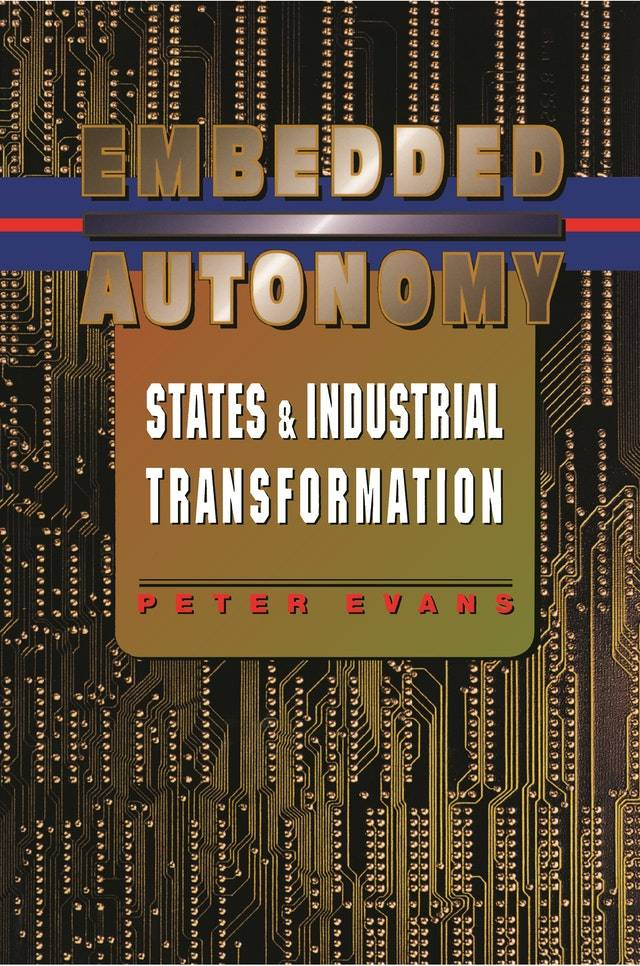

Embedded Autonomy : States and Industrial Transformation

聂老师：好的，谢谢耿老师。接下来咱们俩都表达了观点，又进行了交锋，现在请你用 1~2 句话概括一下你的主要观点，然后我也用 1~2 句话概括我的主要观点。

耿老师：好，我的观点就是我们应该分不同的产业部门，进行区别对待，提出不同的产业政策。如果是落后追赶的就是传统的产业政策；如果是并驾齐驱的，我们就要采取一整套的技术创新政策。好，聂老师请。

#### 中美产业政策比较

聂老师：好，谢谢。我的观点是制定产业政策的过程，可能比产业政策怎么实施更加重要，在这个过程中，我觉得我们不能赋予官员太大的自由裁量权。要有适度的监督，要防止政企合谋。咱们这个阶段到此结束，接下来我们讨论下一个问题，就是如何看待中外的产业政策？

我先讲两个例子，然后我们来讨论一下。因为大家都会关注说你批评美国也好，支持中国也好，都会涉及到一个问题，就是中美两国都有产业政策，它们之间有什么差别呢？大家会问这个问题。尤其是在大国博弈的背景下，政府深度干预经济活动。

我先讲一个故事，美国州政府对福耀玻璃进行了补贴，就是曹德旺的企业。这个故事大家如果看过著名的纪录片《美国工厂》就会知道，福耀玻璃在美国俄亥俄州的代顿市成立了福耀玻璃工厂，他自己投资了 4000 万美金，还获得了美国州政府的 4000 万美金的补贴以及免税的优惠政策。

当然得到的补贴也是有代价的，俄亥俄州政府向曹德旺承诺，如果他能够雇用美国当地员工 1500 人以上，那么 5 年内至少补偿 1300 万到 1500 万美元给福耀，雇佣的人越多，补偿的金额越高。另外还给他一些地皮上的租金给他免税了。曹德旺说算下来购买厂房基本上没花钱，这是一个美国财政的案例。

很有意思的是中国也有类似的政策，比方说特斯拉在上海，大家可能知道特斯拉在上海创造了所谓的"上海速度"，什么叫上海速度？就是他从买地、建厂、拿资质到投产的全部工作，只用了一年时间。从 2019 年 1 月 7 号到 2020 年 1 月 7 号，就这一年时间，首批国产的 model3 就开始交付了，这速度实在是太快了。要是全中国所有的地方政府都能这么快的办企业，如果各地的地方政府，都能像对待特斯拉一样对待我们自己的民营企业，我觉得中国早就是世界 Number  
one 了，对吧？咱们就说了句题外话，我真的很羡慕这个速度。

在这个过程中，上海市政府向特斯拉提供了大量的补贴。根据特斯拉自己公布的上市公司的报告说，2019 年上海政府向特斯拉上海工厂提供了约 8500 万美元的特别补助，8500 万美元约合 5.9 亿元人民币。这其中包括 4600 万美元的现金，以及 3900 万美元的其他补助，比如说土地等等。

当然了，上海的补贴也不是白拿的，对吧？大家都不是傻子。在商言商，这里面还有个有趣的细节，就是特斯拉跟上海市政府签订了一个对赌协议，这个协议内容是什么呢？从 2023 年年底开始，特斯拉必须每年纳税 22.3 亿元人民币，工厂总投资要达到 140.8 亿元人民币，否则的话，特斯拉就要归还土地，并且偿还土地租赁、建筑和其他资产等损失，这个很有意思。

刚才我讲的是一个是美国政府补贴福耀玻璃，一个是中国政府补贴特斯拉，那么大家会问，中国也有产业政策，美国也有产业政策，中国的财政跟美国的财政有什么不一样的地方吗？

相关的问题是中美两国的产业政策，下一步可能会怎么走，我们一会会讨论未来的财政的走向。我们现在讨论这个有趣的问题，中国的产业政策和美国的产业政策到底有没有什么不一样的地方？耿老师你先来。

耿老师：谢谢聂老师，聂老师选这个话题实在太好了。在某个意义上，又展现了中美这两个世界经济强权它做法的一个典型。另外一方面又反映出来，刚刚聂老师跟我的一个意见不同的所在。

我个人来看，我觉得美国补助福耀玻璃这个做法，其实并不能很充分的展现出产业政策它应有的价值。也就是说这样的一个补贴，它的背景是基于地方式的、民粹式的一个考量，主要着眼于比方说就业、税收，而反映出来是地方领导人、地方政府的选举胜利。

在这个意义上，它缺乏理想的，刚刚聂老师所说，理想的产业政策的一个最重要的素质，它不是改善目前的情况，它是改善未来的情况。也就是说它有一个创造市场，领导发展的思路在里面。

所以在这个意义上，中国引进特斯拉，而且签这样一个对赌协议，来强迫它快速地发展。其实有很多进一步的思考在里面，特斯拉作为新能源汽车的领头行业，技术的示范，所能带动相关向前或向后的这些产业的链接，会给中国的尤其是新能源汽车市场，带来一个而整体的提升，所以有可能让中国新能源汽车整个行业，快速地列入全世界领先的范围。

所以在这个意义上，我个人觉得好的产业政策，应该是像上海补助特斯拉的这样的一个范例。而像美国补助福耀玻璃的这样一个做法，它只能看成一般的经济优惠政策，而缺乏很必要的产业发展要素在里面，所以它不能算是一个非常典型或者非常成功、非常前瞻的一个产业政策，这是我个人的看法。

聂老师：好，耿老师你的意思是，美国补贴福耀玻璃不能算严格意义上的产业政策，而中国补贴特斯拉是成功的产业政策，是这个意思吗？

耿老师：是的。

聂老师：好，谢谢你的观点。我跟你的观点在这方面可能不太一样，我当时觉得两个都是产业政策，但是它们有区别。区别在哪里呢？美国的产业政策它是鼓励就业的，它是就业导向，它并没有说我是针对你某一个企业的，也就是说美国的产业政策更像是普惠制，而中国像是特惠制，我纯粹是为了特斯拉开了一个后门，特事特办，一路绿灯。

我刚才说了，如果中国的地方政府都能像对待特斯拉一样对待我们自己的企业，你说中国经济何时不是世界老大？我们的卡脖子技术我看早就解决了，很明显我们是把特斯拉当做一个风向标。

所以在这意义上讲，上海的做法就是一种特惠。而美国对福耀玻璃的补贴，我觉得更像是一种普惠政策。所以如果你认为普惠政策不能算严格意义上的产业政策，我也同意。

所以我觉得大家不能因为美国政府补贴了福耀玻璃，就认为美国政府干预市场的方式和我们一样，我觉得这是我不能同意的，干预的方式有差别，甚至像耿老师刚才说的，美国的政策都未必能称为产业政策。我的意思是什么呢？就算我们要推进产业政策，就算政府要干预经济，也不能以美国补贴的福耀玻璃为例，就来说明我们可以广泛地、不加限制地使用，这仍然是两件不一样的事情，说白了，美国补贴福耀玻璃和中国补贴特斯拉，其实是两个差别很大的事情，一个可能不是产业政策，一个另外是产业政策。就算是产业政策，一个是普惠制，一个是特惠制，我觉得也不可同日而语。

耿老师，我们这方面的意见基本上也是一致的，只不过在这个问题上，你走的比我远。在前面那些问题上，我比你保守，但这里你好像比我还保守，你认为都不能成为产业政策。

耿老师：但是我觉得中国会在这样的一个背景之下，是特惠制，就像聂老师说的一点都没错，大多数会是失败的，存在大量的骗补，大量的浪费，大量的权钱交易，但是我们会在这个过程当中屡败屡战，最终我们能够走出一条路来。

聂老师：好，谢谢耿老师。节目进行到这里了，我们最后一个问题，我们展望一下中国产业政策的走向，谈一谈怎么能够减少无效率的产业政策。刚才你也提到了，要防止一些错误的产业政策。从你的角度讲，我们怎么减少无效率的产业政策，以及你认为未来中国的产业政策应该是一个什么走向呢？耿老师。

#### 未来中国产业政策的走向

耿老师：谢谢。我的一个基本分析框架，其实还不如我自己总结的那么好的是聂老师的总结，也就是市场失灵之下的政府如何扭转信息的劣势，不至于造成政府失灵。所以聂老师这个框架，我们如果用来看一下，中国产业政策的未来应该可以分成两方面来说。

中国过往其实是非常成功的，因为我们采用了先进国家的发展的范例，结合了中国国家政府强大的实力，这两个一结合，就是前者给我们对的方向，后者让我们的举国体制，所以获得极大的成功。

但是在这个过程当中，中国经济也发生了分化，有些部门已经走到全世界的前列，这时候我们就需要考虑，如果走到全球的前列之后，其实就失去了怎么继续发展的一个模范。而这个失去了范例之后，比方说政府去了解产业，了解技术、考核技术、提供赏罚，这些整个政府的一套做法都会失效。

所以在这种过程当中，如果我们坚持之前的做法，那就会比较像杨小凯老师所说的，后发劣势了，因为我们的追赶做法，如果不能调整，那会让我们陷入在当初追赶过程中的那套体制当中。

所以我的建议是我们对产业政策的部分，需要与时俱进。对于那些技术领先的部门，我们需要给它新的一套做法。比方说现在国家也慢慢采用各式各样的这些支持的手段，比方说刚刚提到政府提供民间操作的基金，他们来进行资金的运用跟分配，这样的一个回收，等于是依照出资比例再回到政府基金里面来，这个基金的主导人就是专业人士，他根据国家发展的需要跟基金本身的获利来进行资源的配置。利用这些新的做法，在某些创新的部门，通过与时俱进的原则，我相信会有助于中国各个产业部门的发展，这是我的一点想法。

聂老师：好，谢谢耿老师，耿老师对未来进行了比较美好的展望。我谈一下我的观点，我觉得如果要避免无效率的产业政策，至少有三个方面要做到。

产业政策一定要有明确的规则和适用范围，不管这个范围是从发展阶段来看，还是从这个行业前景来看，我觉得一定要有规则。如果没有规则，等于我们给官员太大的自由裁量权，官员可以在任何地方、任何时候都使用产业政策，我觉得这是比较危险的，我真担心政府会成为脱缰的野马。

产业政策制定过程，我觉得还是要尽可能的透明，至少要能够监督，否则，因为制定产业的过程很有可能就是偏向了某些利益集团，这样会导致寻租，甚至是腐败。我其实刚才说的就是，相对于产业政策怎么用，我更关心产业政策怎么制定，因为很多人忽略这一点，所以我觉得这一点应该引起注意。

我觉得一个总的原则是，让市场发挥决定性作用，政府不要轻易替代市场。当然我同意像耿老师说的，如果我们的政府都是精英分子，都能够保持学习的态度，都能够掌握前沿的技术当然更好了，但是中国的政府在做到这方面，我觉得还是有差距的。

这个原因很简单，就是因为我们现在不可能有那么多高素质的制定产业政策的官员，没有那么庞大的招商集团，没有那么强大的研判市场的能力，所以我觉得这个时候我们可能要保守一点，我觉得宁肯保守一点，也要减少腐败和权力寻租。

当然耿老师的观点可能跟我不一样，耿老师认为，我们可能需要付出必要的试错代价，因为如果你不试错，你就永远不会成长，这样说也有道理。

所以我觉得，关键是我们在哪个角度上，但是我们都同意，对政府应该有必要的约束，比如说廉洁，比如说纪律，比方说一些问责措施，不能让政府任意妄为。我也谈谈我对将来产业政策的走向，我觉得有几个特征可能会越来越明显。

有三个特征，第一，我预计未来在大国博弈的背景下，国家的干预会越来越多，因为全球的竞争格局越来越激烈，而且主要是在几个超级大国之间博弈，所以这个时候产业和企业的背后是国家在决定，是国家在后面参与，这是第一点。

第二个特征是，虽然未来的逆全球化趋势可能会成为一股浪潮，很多企业可能不得不在全球配置供应链规避风险，要在大国博弈的时候选边站队，这样会导致受到产业政策干预的企业更加本土化。

未来我估计特斯拉中国就变成了中国特斯拉。特斯拉中国意思是说，是美国特斯拉企业在中国的一个分部。但是中国特斯拉是什么？中国的分部已经彻底本土化了，它基本上就代表中国政府，代表中国产业的利益，它也不会把利润汇出去，也不会把技术输出去，都在本地解决就业和技术创新问题，这是有可能的。

第三点是，我觉得如果我们的媒体监督和群众监督能够充分发挥作用，而且国际竞争的规则会越来越透明，比方说竞争中心的原则能够深入人心，能够被大多数国家贯彻。我相信未来的财政制定会更加规范透明，因为你在制定财政的时候，你不仅要考虑国内企业的利益，你还要考虑它的国际影响，我觉得这也许会倒逼中国的财政政策会越来越规范，就当时我一个美好的愿望。耿老师，你还有什么要补充的吗？

耿老师：没有，我觉得您讲的我都非常同意。也希望国内学界能够超越产业政策有用，或者产业政策都没用，这样的一个简单的认知、简单的二元对立，进一步思考一下聂老师跟我刚刚所给各位带来的一些观点。

### 结语

聂老师：谢谢耿老师。这就是我们中浪的力量。所以我也希望听众朋友们会喜欢，如果喜欢我们后面还会推出更多的《我们是中浪》的精彩节目。好，谢谢大家，再见。

耿老师：好，谢谢。

公众号懒人找资源，懒人专属群分享

## 番外丨钟鸿钧×聂辉华：蚂蚁集团为何被暂缓上市？

聂辉华（中国人民大学经济学院教授、博导，哈佛大学博士后）

钟鸿钧（牛津大学经济学博士、博士后，上海财经大学数字经济研究中心主任）

### 收听提示：

1\. 蚂蚁集团是科技公司，还是金融公司？

2\. 对蚂蚁集团应该严加监管，还是鼓励创新？

3\. 蚂蚁集团的消费信贷，它究竟是一种普惠金融，还是鼓励超前消费的恶魔？

4\. 对蚂蚁集团，要不要实行像传统银行一样严格资本充足金，或者限制它的金融杠杆？

5\. 在这样一个监管新规下，很多公司尤其是网贷公司，将何去何从？

6\. 蚂蚁集团还要不要上市？以什么方式上市？

#### 

#### 我们是中浪：中青年学者解读中国热点问题

聂辉华老师解读"我们是中浪"：

我们都是 70 后 80 后一代人，我们从年龄上看，既不是老当益壮的前浪，也不是来势汹汹的后浪。我们中大我们是社会的中流砥柱，也是社会的中坚力量。

在分析问题的时候，我们既不会像老一辈的那样主张宏大的抽象的叙事，也不会陷入繁琐的技术细节，所以我们就希望能做到：理论顶天，实践立地。用自己扎实的学术研究，丰富的人生阅历，将理论和实践结合起来，真正做到在讨论实际问题的时候能够不偏不倚，接地气，切实可行。

第一期节目是和浙江大学的耿曙教授讨论的一个话题，话题是：要不要谈政策？什么时候要？产业政策到底是刺激了企业的创新，还是助推了他们的骗补？

今天的节目是：怎么看待蚂蚁集团暂缓上市。

#### 蚂蚁集团暂缓上市的事件背景

10 月 24 日的时候，马云在上海的外滩金融峰会上炮轰监管制度，扔出了三把斧。

第一是，《巴塞尔协议》是治老年病的，中国是个新兴国家，是年轻人，用不着《巴塞尔协议》。主要意思是：要不要对核心资本充足率有一定的要求？要不要有一定的类似于有一定的存款准备金，然后再去放贷，而不是无限放贷。大数据时代，对网贷不应该按照传统银行的方式来管理。

第二是，我们今天需要政策专家，而不需要处长式的文件专家。

第三是，今天的银行延续了当铺的思想。银行放款需要抵押，当铺也需要抵押。马云说我们用大数据解决了抵押问题，我们才是真正的银行，你们都是落伍了。

但这件事很快引起轩然大波， 11 月 2 号，马云被央行、银保监会、证监会和外汇监管局联合约谈，第二天上交所决定蚂蚁集团暂缓上市。

接下来，银保监会和央行就发布了一个网贷新的管理办法，全称叫做《网络小额贷款业务管理暂行办法（征求意见稿）》，这一下就相当于置很多网贷公司于死地了。

如果大家关注中国的政企关系，或者是政治经济学，你一定要关注这一系列事件，这不是偶然的。

与此同时，蚂蚁集团暂缓上市，引发了一系列的争论，这是我们今天讨论的问题。

### 

### 对谈：

#### 蚂蚁集团是科技公司，还是金融公司？

钟鸿钧：蚂蚁集团是一家科技型的公司，双十一那天，它一秒钟峰值交易的笔数是 53 万笔，从这个数字来看，我们肯定可以看到这毫无疑问是一家科技公司，至于它是不是一家金融公司，我觉得可能会有不同的人会有不同的看法，那么但是确定就是说它一定是有金融业务，它的金融也是基于科技的。

它的业务到底是什么？如果我们去看他的蚂蚁的招股说明书，里面就提到了说，它的业务里面主要实际上包括什么？一个是支付的业务，支付的业务主要是日常所用的这种数字的支付，包括像用支付宝来做简单的交易，但是除了这个之外，还有非常大的一块，就是所谓的数字金融的科技平台，数字金融的科技平台里面，有一块业务是我们非常熟悉的，小微的信贷以及我们日常的这种消费的信贷，这一块是在它的微贷的科技平台里面。

那么除了这个之外，它还有一块业务叫做理财的科技平台，理财就是我们通常所讲的，像余额宝、余利宝这这些小额的理财的产品，除了这个之外，还有一块是保险的科技平台。

理财的科技平台和保险的科技平台，我们其实就可以把它看成是一块，是什么意思？就是说它实际上是在做主要的是作为一个渠道，也就是说支付宝作为一个渠道在帮助这些理财的基金公司，或者是保险公司在支付宝这个平台在售卖它这个产品。

那么在小额信贷和消费信贷这一块的话，支付宝它是跟很多的银行在合作，在推销他们这种小微的信贷这种产品。

所以你能够看到说它主要业务主要是有三块，一个是提供主要的便利的支付便利，也就是我们所讲的这种移动支付的便利的数字支付。

第二个作为主要的是销售的通道，或者说渠道的理财和保险的平台。那么第三个就是我们讲最主要的一块就是针对消费贷和小微企业的信贷这一块业务，那么这一块业务的话主要实际上是跟银行合作的，你可以把它看成是联合的信贷业务，这是它的一个基本业务。

基于这一点来看的话，我觉得一个确定是它肯定是一家科技公司，是毫无疑问的。那么它实际上做的非常大的一块业务是金融，所以你可以这样子讲，就是说蚂蚁它实际上是一家科技公司，但是它的商业的变现主要是基于金融服务，这是我的一个基本的观点。

聂辉华：我的观点可能跟钟老师不一样。

我觉得第一，从盈利模式上看，蚂蚁集团应该是在金融公司，为什么？因为它的主要资金来源，蚂蚁的收益根据它的招股说明书分两大块，一块是所谓的数字支付与商家服务占不到 40%，它超过 60%的收入都是来自于金融业务，也就包括信贷加理财加保险，尤其是信贷，信贷是非常具有中国特色的银行业务，它占总收入的 40%以上。

所以我觉得如果从业务上来看，蚂蚁集团绝对是一家金融公司，而且事实上如果你跟银行的业务相比，我们会发现蚂蚁集团已经成为中国最大的线上消费信贷平台、最大的小微经营信贷平台、最大的线上理财服务平台和最大的线上保险服务平台。所以我觉得你不管是从拥有的客户量，现在规模还是客户的资产规模上讲，它其实超越了很多的商业银行，对吧？

这是我说的第一点。

第二点就是你刚才说到的就是蚂蚁的科技手段很重要，但是我觉得科技手段跟它的金融属性应该是不矛盾的，为什么呢？因为科技只是手段而已，我觉得它不应该成为监管业务定性的标准，为什么？

如果从手段上讲的话，其实我们现在很多金融机构都有科技属性，我还专门问过招行的人，他就表示不服，工行的人也表示不服，因为招行和工行自认为他们的网上业务觉得做得很好，网上银行、手机银行，刚才有一个网友就问说，你按这个说法，银行也可以说自己是科技公司，所以我觉得科技公司的工具属性和金融公司的业务属性，可能是不矛盾的，所以你可能更强调前者，我可能比较强调后者。

然后第三点我要说的是什么？我是个人认为，当然也许我的观点比较极端，我至今都认为蚂蚁集团其实是披着科技外衣的现代当铺，马云虽然批评别人说别人是当铺，因为银行要抵押，要担保，所以是当铺，但是请问像蚂蚁公司这样的信贷业务，它为什么网贷公司它为什么不用抵押呢？现在它有大数据，就是因为他掌握我们的大数据，你不敢不还款，你要不还款，对吧？

有些网贷公司我没有说一定是蚂蚁公司，我就说有些网贷公司可能不太规范，要求你上传你的手机通讯录对吧？上传你的个人隐私，上传你的很多东西，你要敢不还钱？首先催债人当然是第三方催债公司特别无良，他可能会打爆你的朋友圈，把你的照片发到你的亲戚朋友那里，给你的很多亲戚朋友打电话，说你欠钱，然后等于是公布你的隐私，所以相当于说白了，我们在大数据公司平台面前，我们都在裸奔，我们是抵押了隐私，我们是没有抵押有形的产品，可是我们抵押的隐私，你说还有什么比隐私更重要对吧？

有的人甚至担心了，你要是得罪了某个网络平台，你将来可能寸步难行，为什么？因为我们现在健康码都是跟网络平台有关系的。所以这是很多人担心的，所以我觉得在这个意义上我们是不需要抵押品，但是我们可能纳了投名状。所以我的意思就是蚂蚁集团，我还是倾向认为他是一个金融公司，当然就算他是个金融公司，我们应该怎么对待他，这是两个问题。我也没有否认蚂蚁集团的科技属性，我是这个意思。

钟鸿钧：我简单的回应一下聂老师刚才讲的第一个问题，就是关于当铺的问题就是说，如果我们去理解传统这个当铺，我们知道叫当铺的核心是什么？就是你是有一个抵押品的对不对？那么如果我们去看蚂蚁的信贷的业务，它其实很多是没有抵押的。这个地方是我还是想讲一点，蚂蚁给小微企业提供的信贷里面有相当大的一部分，实际上是没有任何的抵押的，那么这一部分它肯定不属于当铺的业务。

第二个就是我们刚才所讲的像给保险和基金产品的渠道销售的这块业务的话，因为它这个地方占了也蛮大的一个比例，所以这部分它也不属于当铺。那么如果说有跟当铺相关，可能会是哪一块，就是我们所讲的就是消费信贷。

那么消费信贷在目前来看，互联网的这种消费信贷业务里面，就是说实质上拿来作抵押的是什么东西，就是你刚才所讲的隐私，包括我的朋友圈，甚至我个人的包括说在之前在网上有披露的这种裸照这些东西对吧？这个地方就涉及到你刚刚才讲的第二个问题就是什么？就是隐私，我认为这个问题的话我们可以等一下再来讨论。

这实际上涉及到一个非常重要在互联网的这种公司里面，到底能够把哪一些业务，哪一些数据，哪些隐私信息拿来作为抵押品，我认为这个地方是要说值得去讨论的。目前来讲肯定是有非常多的互联网消费信贷公司在这一块肯定是走过界的，这一点我是完全同意你讲的，所以这个地方我觉得简单总结一下我的观点，我不认为说蚂蚁是一家当铺，这个我肯定是持不同的观点，但是对隐私上的观点我是基本上认同，你刚才所讲的就是说现在有很多消费信贷的公司在这方面是走过头了的，是需要去加强监管。

聂辉华：好，谢谢钟老师。那就我简单的把咱们俩的观点总结一下，就是钟老师从科技手段的角度讲，认为蚂蚁集团首先是一家科技公司，那么我认为从业务的属性上讲，从盈利模式上讲，我会倾向于把蚂蚁集团定位为一家金融公司，因为它主要靠金融挣钱，那么实际上它可能两者都是。

它既是科技公司也是金融公司，你看它改名很有意思。2014 年蚂蚁金服公司成立，很多人知道蚂蚁是因为蚂蚁金服，为了上市 2020 年才改成了蚂蚁科技集团，所以也有人开句玩笑说，蚂蚁可能本来是家科技公司干着金融的活，现在监管层把它打回原形，把它当做一家金融公司。

当然问题我觉得是属于横看成岭侧成峰，远近高低各不同，仁者见仁，智者见智。我们一会回头再回到刚才谈的隐私问题，就是刚才钟老师点了一个很好的题，这是一个大家都非常关键的，毕竟说句实话，我们每个人都要脸，我今天看到一个话题太可怕了，就是有一家售楼公司，就说很多售楼公司装了人脸识别，就是来看你是不是第一次来看楼的，决定要不要给你优惠政策或打折，太可怕了。

以后我们都不敢去买房了，对不对？你没买房你的隐私可能都泄露出去了。好，我们一会再谈话题。

#### 监管新规会不会抑制企业创新？

聂辉华：那么现在我们讨论这样的话题，就是监管新规会不会抑制企业创新，这也是我们今天的主题，说句实话我们都很担心，我们又担心金融风险，可是又担心企业被压抑的太厉害，没法成长。

大家都知道，我觉得很多人还是希望蚂蚁集团能够在科创板上市的，毕竟科创板上的企业就没几家对不对？好不容易有个蚂蚁集团，大家都希望能够挣点钱，心情我可以理解，但是金融风险大家也要小心。那么这里有一个背景，就是 11 月 2 号的时候，被约谈的当晚，蚂蚁它就表态，提了 16 个字，稳妥创新，拥抱监管，服务实体，开放共赢。这 16 个字我不知道是监管当局要求的，还是蚂蚁集团主动提出，它很有意思。

但这里有个矛盾，钟老师我不知道你有没有注意到，创新就意味着新的商业模式，那新的商业模式就意味着突破现有的规矩，对不对？突破条条框框，所以你监管就是要防止别人突破条条框框。理论上讲，技术的说监管和创新，它就是一对水火不容的矛盾，我觉得很难权衡，对不对？你监管太严了没有活力，监管太松了容易导致金融风险。

所以钟老师你怎么看，就蚂蚁金服事情而言，我们怎么看待监管和创新之间的矛盾和冲突，有没有什么更好的办法？你怎么看问题？

钟鸿钧：我觉得确实是说整个蚂蚁的问题，我们讲地方确实是最核心的问题就是说你刚才也讲了，监管跟创新它总是有冲突的，就是说我们从尤其是在金融服务行业来讲，就是它更是这样，因为它更敏感，而且它还有外部性，所以说从监管的层面来讲，我们首先第一个是说我们需要能够有一个非常好的一个风险的防范和规避的这样一个规则体系。

但另外一方面你也讲到就是说我们很多创新都是在边缘上的这种创新，那么在这种情况下，就是我们要去保持监管跟创新这种动态的平衡确实是很难，但是话又说回来如果它不是一个难的问题，它可能就不会拿到今天放到我们讲这整个国家层面这么多人在讨论问题。

所以我觉得重要的是在地方，我们觉得是说我们不是去探测监管跟创新之间的矛盾，而是更多去想我们是不是有可能能够找到一个相对的一个折中的能够说，在目前我们讲强调整个的金融的风险可控的前提下，能够适当的我们讲对企业的这种创新，能够给他们提供一个适当的这种合理的一个空间。

所以我觉得在地方就是说，我会认为说创新跟监管确实说会经常会有矛盾，但是不是说一个非此即彼的这样的一个关系，而是说我们还是要想办法就是在一个适当宽容的一个监管的一个环境下面，能够给创新提供一些空间。

当然是我们要对监管就提出更高的要求，意味着什么，监管得更懂金融的业务，更懂创新的商业跟逻辑，尤其是当创新，比如说它可能会走过头，因为它创新的话，我们讲商业其实是没有一条确定的路线，它肯定会在各个方向去摸索和尝试，那在过程中有可能会犯错，所以说监管要有什么，更需要能够去快速的对创新可能带来的这种风险跟错误的作出反应。

这个地方也就意味着我们监管的官员要变得更加的专业，他不光要懂理论，而且说更多的要懂一个实践，所以我觉得你刚才讲的这点其实非常重要就是说监管跟创新有冲突，但是我觉得我们还是要去想办法去寻找这两个之间是不是能够去往中间各自往中间靠拢一点点，你比方说回到我们蚂蚁核心问题来。

我会觉得说其实在前面监管上还是说给蚂蚁提供了一个非常宽松的一个监管环境，这也是说我们在讲监管的不对称，尤其是对传统的金融的相对严的监管和对互联网金融相对宽松的一个监管下，也有这样一个快速的这种发展。

那么到今天我就说确实到了一个时间点，我们就是要系统的去回顾，咱们对互联网的这种监管到底是应该从哪个角度去，是应该去跟传统的金融会回到统一的一个系统跟框架里面去，还是说我们应当对它的某些业务，就是说去提供一些额外的一个宽松的一个适合的环境。

所以地方实际上说我觉得问题的答案其实跟第一个问题有关，就是说到底公司它做的是什么样的业务，到底是一家金融公司还是一家科技公司，业务是要跟传统的金融业务放到一致的这样一个系统的监管下面，哪些业务是可以去说给他提供一些创新的这样一个空间的？

聂辉华：好，谢谢钟老师。钟老师的意思就是希望能够妥善处理监管和创新的关系，监管要考虑到创新的特点，要考虑到行业的属性，最好是由懂行业的专家来指导监管，大概意思是这个。

钟鸿钧：就是刚才所讲的，我说因为业蚂蚁它其实包含了很多不同的业务，所以这几个不同的业务我的感觉是可能要分开的，监管不是把它放在一个大的一个篮子里面去。

聂辉华：好。在监管和创新的关系，我基本上同意钟老师的观点，但是我可能对蚂蚁或者说类似的公司问题上，我可能有点不太一样的看法。

就是首先有一点，我相信钟老师也会同意就是任何法规政策都要有给我们一个稳定的预期，就是你政策不能老变，你要给所有人有准备。

那么这个从角度讲，最理想的状态肯定是说我先有规则，你再按照我的规则来办，但是这次好像有点仓促，就是蚂蚁都确定了上市的日期，结果监管当局在上市之前抛出了一个征求意见稿，我承认有点仓促，这肯定不是最理想的状态。

我觉得我也希望我们今后的监管就是说要走在前面，但是我要说的另外一点就是出现情况也可能是应该是可以理解的，为什么，因为第一，金融监管他强调安全第一，他不是说把创新放在第一位。

刚才钟老师也讲了，因为金融业务有点特殊性，就是什么巨大的外部性。大家想想看应该因为蚂蚁集团 2.1 万亿的贷款，估市值估值是 2.1 万亿，两个 2.1 万亿，两个 2 万亿多恐怖，那你想想看，一旦上市了，那你说有多少公众存款，多少股民的投资，会牵一发动全身，因为金融的本质它是对风险资产的定价，但是咱们是个发展中国家，教育水平普遍不是很高，就是大多数人对于风险意识其实很弱的。

我举个例子说，我们买的楼买的房子如果涨价了，我们就闷声发大财。要是房价降了，就会有人去砸开楼盘，去集体维权，去市政府面前下跪，我觉得这太没有契约精神了，所以如果蚂蚁集团有什么问题，或者说相类似的金融公司它有什么问题它引发的群众反映，可能是不可控的，所以我想这可能监管层比较谨慎的第一个原因。

第二个是中国的金融监管它有个探索的过程，就是我也跟金融系统的官员聊过，我说就蚂蚁事情，你们为什么要等到那么晚才抛出一个网贷新规，你之前怎么就没有规定？他们也有他们的苦衷，他们说就是说互联网金融首先面临的问题就是我们一开始讨论的有关，就像蚂蚁的这样的公司，他算不算是正统的标准的金融机构，一直是模棱两可的定位非常模糊，因为如果你按照传统的观点，他没有没有银行牌照，他没有吸收公众存款，这两个尤其是公众存款是判断一个机构是否是标准金融机构的最关键的标准，他没有公众存款，又没有银行的牌照。那你说它到底算不算金融机构定位很模糊，这是一个原因。

第二个，就是我们其实一直希望在数字经济方面能够弯道超车，就是大家说中国有什么四大新四大发明，什么高铁、共享单车、支付宝、网络购物，就是所以我们这就很矛盾，就是你要让金融科技或者说让网络平台超前发展的话，适度超前，那你监管必然落后，你监管落后，一旦你监管了，他就会骂你，你怎么落后了？那人家说我如果是为了让你领跑，你现在跑到前面去了，因为嘲笑我跑太慢了，那我跑到前面去你就跑不了了。

所以我觉得他这么解释，我觉得也可以理解。所以我想说的是第三点，我觉得这次监管新规一个出台，总体上还是为了稳定金融市场，我觉得其实从长远来看，对大家是好的，要不然的话你说蚂蚁觉得它要是真上市了，你监管新规你要不要放出来？你放出来你等于灭大家的财路，你不放出来就没法跟进监管了。

所以这是一个两难，所以我觉得我更愿意认为这是一个长痛不如短痛的过程，我不认为这里面有什么阴谋论，好像要针对蚂蚁，我觉得应该没有这样的想法，大家想多了我是这样的，所以好，我总结我的观点，我的意思就是我更赞同稳妥创新，尤其考虑到中国特殊的国情以及大家想想看 2008 年的美国次贷危机，就是因为很多不具备贷款条件的人去贷款，国家在一定程度上放松了对于金融创新，尤其是衍生品创新的监管，所以导致金融危机。

大家有没有想过这么多年中国没有发生金融危机一个重要的原因，固然是我们的金融体系相对封闭，但是另外一个原因是我们的监管比较严，所以我觉得为了防范所谓的系统性金融风险，这就是我的底线思维。所以我觉得对蚂蚁这样的公司适当的严格监管，我觉得是应该的。但是你说严到什么程度，我不好说。

钟老师的观点刚才也说了就是说希望能够求到一个动态的平衡，是吧？钟老师你觉得这么说有没有矛盾，咱俩之间？

钟鸿钧：说实话，我认为就是在监管跟创新的关系上面，我觉得我们俩是没有矛盾的，只不过是刚才你讲的这关于说上市事情，坦率讲我个人会觉得说，其实可能我们大家都想的想多了一点点，就是我个人会觉得可能事情就是你刚才前面也提到说，因为我们科创板还是会希望说有一些比较好的一些标的。

那坦率讲你从角度来说，其实客观讲你是找不到比蚂蚁更好的，这是第一个。

第二个就是说关于 2.1 万亿的我也认为是规模确实，但是我觉得还是要回到第一个问题来讲就是说蚂蚁的 2.1 万亿里面，到底说有多少是他的钱，有多少是和地方的中小银行合作的联合助贷？到底是蚂蚁在做贷款，还是说那些银行在做贷款，就我们在从招股说明书，包括说我们去看这些新闻的话，你会发现就是说这些钱实际上是在那些银行里面的，也就是这些银行是在做贷款决策，蚂蚁它起的决起的作用是什么？

蚂蚁就是帮助他们提供这种包括我们像就这种风险的认定，包括资质，包括它的接入，所以在这个角度来看的话，蚂蚁更多的是一个助贷的一个角色，这也是为什么说这些贷款 2.1 万亿里相当多的都是算在那些银行的贷款的数字里面，也就是它是已经在咱们传统的金融监管、银行的监管体系里面的，所以在这里的话我觉得说风险可能并不是说我们所想象的那么大。

聂辉华：钟老师。不好意思，我要打断你一下，刚才你也说到了，蚂蚁的很多业务是助贷，其实应该叫联合贷款。其实有人披露，蚂蚁只出 2%，银行出 98%，那有人觉得不公平，银行出 98%得到收益，蚂蚁要拿一半左右的利息，如果出了问题，蚂蚁最多承担 2%的损失，银行承担 98%的损失。所以你说监管主要是针对银行已经放进去，但是人家就说这银行不公平，相当于你蚂蚁用超大的杠杆撬动了一大块资金，那你带来的金融风险应该更大。所以人家会说按道理应该实行更严格的监管，怎么能让你这样逃脱这样一个严格的监管。

钟鸿钧：我会个人会认为说不是这么简单去看的，比如说首先刚才 2%跟 98%数字其实是不太准确的，就至少从我所了解的数据来讲，它不是样子。

第二个就是说我们讲贷款的利息的收入的分配上面，实际上它反映了一个什么？就是说银行跟蚂蚁在合作基础上各自贡献的价值，那么我们可以反过来想一下这件事情，就是说银行其实有很多合作伙伴可以选择，他也可以自己单独去放贷，但是银行坦率讲，它其实是没有能力去触达到这些，尤其是这种小微的企业和这些低收入这种阶层的这种普通的个体的这种消费者的，那么你会看到这蚂蚁它其实就是说在联合贷款上面，它其实带来的这种价值是非常大的。

那么从角度来看的话，所以我个人会觉得至于利息的收入的分配上面，我觉得更多可能会是一个市场的一个结果，我觉得在这个上面咱们不能够简单的说它以多少出资去分了很大一比比例的利息收入，就认为是不公平，我觉得不是，不公平，什么叫不公平？因为这是一个市场合作的基础，所以我觉得这一点上我们觉得还是要回到说市场关系，尤其是你契约关系这门课里面就在讲东西，说咱们这是一个市场的合作，它没有说不公平的竞争，我觉得地方我觉得可能会要去讲清楚到底说是不是不公平，那到底不公平是什么意思。

聂辉华：好，行。谢谢钟老师的解释。那我就简单的总结一下，就是我们都认为监管和创新之间存在一定的冲突。

说句实话，这句话就告诉大家，在蚂蚁集团事情上没有完美的答案。你不监管，出了事更多人会有意见，你一监管，现在既得利益者也会有意见，所以监管层可以说是猪八戒照镜子，里外不是人。

但是我还是有一句话觉得中国有个民营企业家说过一句很有名的话，在中国做企业最大的不确定性是政策不确定性。所以我希望从长远来看，从改善营商环境的角度讲，我们的监管环境会越来越稳定，越来越成熟，我们只能有所期待的。

#### 普惠金融？还是助长过度消费？

聂辉华：那么接下来我们讨论第三个话题，其实刚才钟老师已经提到了问题，就是我们看蚂蚁集团的业务，它的主要盈利 40-60%左右来自于信贷，信贷中大部分，就 2.1 万中有 1.7 万亿是针对消费信贷的，那有人就质疑了，所以蚂蚁你号称要搞普惠金融，这怎么普惠的？并没有让大家不会你收的利息蛮高的，你消费信贷的利息大概是 15%，按照蚂蚁招股说明书写的 15%，我算了一下，15%什么概念？就是银行的最低的基准利率 4%，一般人能贷到的利率就是法定的一年期贷款利率也叫 LPR 它是 3.85%，也就是将近 4 个点。

那么蚂蚁收了 15 的点，你这算上去，我算了一下都快接近高利贷了，因为按照现在的标准，高利贷是 4 倍的 LPR，所以那你认为这根本就不是普惠金融，你而且你可能助长了过度消费，助长了不良之风。钟老师你怎么看问题？

钟鸿钧：很好，我很喜欢问题，为什么？就是我想借机会给大家解释一下，就是什么叫做普惠金融。这个来自于 2005 年联合国提出来，他当时提普惠金融，英文实际上叫什么？叫做 inclusive  
finance，那么概念实际上它核心的就在于是说我们在发展中的这种经济体面，其实有大量的这种低收入阶层，或者这种非正式金融的非正式这种商业部门的人士，没有办法去获得这种金融的服务的。

所以他联合国提普惠金融其实就是说那我们有没有可能会去给这些原来不能够获得金融服务的人，包括那些低收入的这种阶级家庭和这种小微的这种企业来给他们提供金融服务。

所以普惠这两个字它其实包括了两个意思，第一个是普，就是我们刚才所讲的低收入阶层，小微的企业，第二个是什么？就是地方误导了我们很多中国人的消费者，就说惠的概念，什么叫惠？惠的就按照我们中文的意思指的是便宜的信贷，便宜就不好讲，就是便宜到底是什么？是绝对意义上的便宜，还是说相对于其他的这种金融服务的这种利息的价格，那么现在比如说我们回到蚂蚁的数据，蚂蚁的话大概它的利息应该是在 15%的样子就说这种的话。

那么如果我们去看其实跟信用卡，跟其他的这些我们讲的国内的这种小贷公司相比的话，它并不是说是特别高的，就是说你包括像新华社的一些调查的这种民间的这种借贷类的，比如说在农村经常业务会有比方说月息是 1.5%，那实际上就是说年化折算下来其实就在多少，就 18%-24%。所以从这个坦率讲，我个人觉得是说利率的话，它确实是高，但也不算是说比市场其他的做小微信贷和市场的这种民间的这种利率要高。

如果横向去看的话，咱们去看比方像美国，国的那些知名的这种网贷的平台的利率其实也不低的，也都在比方说低的可能也就在 10%，那有些高的甚至可能会到百分之二十几也更高。

所以我们还是要回到就是我们一开始所讲的，你问题的核心就是说什么叫做普惠金融？就是这个我觉得说普的意思是说我们要想办法去给这些低收入和业务很不确定这种小微企业去提供这种金融服务，但是这部分客户他的风险是比较高的，所以说从经济学的角度来，普跟惠这两个字其实是不太可能做到兼容的，所以地方它惠的是什么意思？

相对的利率，也就是说你要去跟同行跟其他的比，那我就从这个来说，我觉得就是说不管是蚂蚁还是其他这种小微企业，我觉得如果是说 18%以下，那我觉得实际上还都是说合理的过得去的，包括像咱们国务院，包括我们监管机构的认定的时候不超过 LPR 的 4 倍，也就是差不多是 18%左右，也就是说只要是 18%以下的，那我觉得它都是一个市场的结果，是包含了业务的包括客户的这种风险的这样的一个补偿，所以我觉得从这个来讲就是说，我们要去更准确的去理解什么是普惠金融，我觉得这是一个非常重要的一个前提。

聂辉华：谢谢钟老师。刚才网友也在网上问说你见过高利贷吗？高利贷其实最高法院以前是有司法解释的，就是过去是按 24%界限，24%-36%，就属于高利贷了，超过 24%算高利贷。所以 15%接近于现在的人民银行 LPR 的 4 倍，所以我在这里澄清一下，就是说我们说或者说有人说蚂蚁集团的高利贷，蚂蚁集团接近高利贷，这样的说法我认为没有大的问题，当然刚才钟老师解释了你要是在别的地方你可能贷不到款，还有很多人贷款他是为了周转，他可能未必是说我借多久，这没问题。

但是我还是有疑问，就是我是觉得蚂蚁它的实力，他可以做得更好，但是他目前没有做的更好。比方说为什么，看它的贷款是它的主要的盈利点，可是要贷款 2.1 万亿的信贷，1.7 万亿是放给了消费者贷款，只有 4000 多万是放给了小微经营者信贷。

你看蚂蚁的号称有 10 万的个体用户，有 8000 万的商户，你只放了很少的一部分，我的意思是如果蚂蚁集团把更高的比例用来投放给小微经营者，我觉得这是真正的助力实体经济。那么这样的话，很多人对蚂蚁集团的观感可能好多了，但现在问题是他把大量的贷款都给年轻人，我觉得稍微有点感到难受的是什么？

我个人认为是不应该太鼓励年轻人超前消费的，就我先讲个故事，这是个悲惨的故事，就是我老家有一个小伙子在外面打工想挣快钱，后来不知是为什么中了网上的圈套，那么输之后没钱怎么办？去借钱，从借呗、花呗各种信用卡，各种网贷平台拼命的借，借了之后最后又还不上，还不上事情暴露了，才告诉家里人，家里人着急，找很多亲戚朋友给他凑钱，没办法得把他捞出来，对不对？你年纪轻轻你不能让人家堕落了。

这样的故事我在调研中碰到过好多次，都是真实的。那么这就有问题，你看如果在过去的环境下，如果没有网贷，没有蚂蚁商家的网贷，这小伙子根本不至于，因为什么？他借不到钱，他没有抵押，他没有信用，他没有正规的工作。

所以现在的问题是像蚂蚁集团类似的公司，这样的公司太多，导致年轻人都纷纷超前消费，那就很可能会诱导一种不良的习惯。那么这就刚才我说的可能会导致一系列不好的后果。

这还包括另外两个，一个什么，破坏了良好的储蓄传统。咱们研究经济学都知道，中国的高速增长非常依赖于中国很高的储蓄率，中国的储蓄率在全世界可能是排名第一第二的，相当长一段时间，中国的储蓄率达到了 50%以上，现在也不低，应该有 40%左右。

那么如果年轻人都不储蓄了，都要每个月要吃土、月光族，这以后中国经济的长期的发展潜力就非常危险。第二个考虑到中国已经快进入深度老龄化社会了，将来的年轻人，你看 70 后 80 后 90 后上有老下有小，如果都把钱花光了，那你说将来谁来养老？将来谁来养育家庭？所以我觉得越想越可怕，我觉得真的会加剧我们老龄化转型的危机，所以我就觉得怎么说就是说蚂蚁他把那么多款贷给消费者，鼓励大家超前消费，而且他做的广告我觉得非常不好。就是这么是一个工人对不对？

钟鸿钧：对，三口之家给女儿过生日。

聂辉华：去借钱，我就不明白你女儿这么虚荣吗？你明明是个工人阶级，你为什么要把自己打成了一个中产，甚至是高级白领，这不是鼓励虚荣吗？

我是从文化的角度讲，从长远的经济发展，我认为这是不好的，就是所以我觉得蚂蚁集团应该调整它的经营模式，应该把大量的款贷给小微企业，而不是应该是带给消费者，我觉得这是非常不好的，我对这一点我是持有强烈的批判性的，不知道钟老师能不能接受我这种观点。

钟鸿钧：虽然这一点说是我其实是蛮认同你说的就是说理想的状态是什么？理想的状态是说蚂蚁能够比如说在更多的小微企业的贷款，也就是在目前的 4000 亿的对小微企业贷款，因为它就是刚才也讲了服务于 8000 万小微的商户。

小微商户的社会价值，其实在我看来是被大大的被低估了，因为就是说你基本上可以看到每一个商户的，他基本上可能对应大概 2.9 个雇员那就意味着你可以能够看到说，如果真的能够覆盖到 8000 万这种商户的话，他所能够创造的就业机会是巨大的。

所以我特别认同你这点，就是说如果蚂蚁能够在小微企业的信贷上面能够去做更多的工作，因为这些工作是说坦率讲其实是传统的金融银行是做不了的，因为它没有数据，也没有去观测得到，但是确实是从我所了解的数据来看的话，无论是阿里还是美团，他们都因为说掌握了就是链接商户的这种数据，所以他们现在在这一块就是做了还是说做了不少的工作，但是就跟你刚才所讲的，我们接着说这块是绝对是可以再去提高的。

至于 1.7 万亿的消费贷，我其实确实是蛮认同你所讲的这点，就是说我们在中国至少是我们不应该去过多的去鼓励超前的这种消费，包括是我们讲就是前段时间广告，我认为那个广告是极其糟糕的，我觉得特别特别糟糕，而且甚至可以是恶心，就是说因为他就是你刚才所讲的，他绝对是说跟中国这种倡导的这种传统的家庭的我们讲价值观其实是完全是相违背的，所以我觉得这一点确实是值得说。

蚂蚁的整个我觉得去思考是说我们到底是有消费信贷，在便利的前提下，到底是应该去借给谁，要去帮助谁？帮助那些小微企业要帮助那些确实是在比方说真正是需要这种短期这种过渡的年轻人，但是我们绝对不应该去鼓励这种超前消费。

我们要去鼓励说这种，比如说你如果是短期的一个现金周转上有问题，我要去借个钱去比方说去来交割，去进一步的进修或者各方面都可以，但是确实就是说我们会希望从长远来讲，两个数字的比例上能够去反转过来，比方说是 1.5 万亿去支持小微企业，5000 亿支持消费信贷，但是他现在坦率讲，我觉得地方就涉及到就是我们在讲说理想跟现实的一个冲突，就是说你会看到是说当一个企业它在追求利润的时候，其实你会看到它总是会就是说有时候走走就会忘掉说我的初心是什么，就是我到底要做一些什么样的事情，因为利润的诱惑实在是太大。

咱们都是研究经济学的，咱们就比如说从亚当\*斯密的《国富论》里面就讲得很清楚，就是我们所有的一个组织或者说个体都在追求利益，但过程中确实说就会有时候就会因为有些钱来得太容易了，尤其是当我这种就是说能够去协助于帮助别人去做助贷的业务，很快可能就会下去把规模做得很大。在这点上我其实确实是说蛮认同你讲的，我觉得就是蚂蚁可能需要去做更多的事情，说想说能不能去更多的去帮助小微企业，在消费贷上面我们确实说要值得说要去思考一下，说怎么样能够去帮助那些真正需要是周转的，而不是去盲目去鼓励这种过度的这种超前消费，我是非常同意你的观点。

聂辉华：好，谢谢钟老师，我把咱们的观点稍微归纳一下。

第一，按照现在的标准，蚂蚁集团它的利率快接近高利贷了，但确实还不是高利贷，咱们要实事求是。

第二，蚂蚁集团应该把更多的精力或者说做大小微经营者的那块，现在就是小微经营者的贷款业务应该做大。

第三，我们都同意不要盲目的鼓励年轻人扩大消费，超前消费，这是非常不好的广告，很恶心，我也很反感。

#### 是否应对蚂蚁集团的网贷公司的杠杆率设上限？

好，那么接下来咱们讨论第 4 个话题，就是关于对蚂蚁的监管的有个争议，就是该不该参照传统银行的模式，对蚂蚁集团的网贷公司的杠杆率设一个上限。

那么受上限的观点，因为它到底就是为了防止更高的金融风险，那么有人认为应该放松放松也有道理，为什么？因为我本来就是创新的金融模式，你现在让我按照传统的方式走路，那我就束手束脚，我就走不远了。

所以这好像也是个矛盾。那么钟老师你要先谈谈，你觉得我们是否应该参照传统的方式对网贷公司的杠杆率是一定的限制，如果不是的话，那杠杆的限制率应该多高？

钟鸿钧：这个坦率讲我会觉得其实挺难去讲的，就是涉及到就是说蚂蚁业务，因为它的业务其实还是非常多的，就基本上来讲它所有的金融相关的业务它都有。

那么在问题上，总体这样我的看法，是就是说会支持这种分类监管的方式，也就是说相同的业务我们把它叫归类。但是在这么做的前提是我们还是要把业务的本质首先要搞清楚，就是说我们在讨论蚂蚁的杠杆，因为就是我们经常会讲的一个问题很多，包括公众号的一些文章会讲说蚂蚁的杠杆非常非常高，但是实际上是说蚂蚁的杠杆的问题是这样。

我的理解的话我认为实际上是说很多文章实际上是误解了它的杠杆，就是在跟银行的合作的那块，尤其是就像花呗跟借呗的这一块业务，就是说他到底是蚂蚁自己的放贷业务还是属于助贷业务，所以我我个人会认为说实际上是一个联合贷款或者说这种助贷的这种业务。

那么如果说我们这样子去理解的话，那就是我们要去思考说这一块又在传统银行地方是不是已经得到了有效的监管，在传统银行的杠杆的比例里面，是不是已经得到了很好的这种控制？

所以我觉得说回到蚂蚁问题，如果说在 1.7 万的消费信贷里面，有相当多部分实际上在银行的框架里面去了，那我觉得他就不应当归到蚂蚁的，那更多是我们要回到说蚂蚁自有的资金它的比例里面，那在这种情况下我们去看的话，它的杠杆比例就是很多时候没有我们所想象的那么高。所以我们刚才讲的第一个就是联合贷款里面大部分它实际上是有商业银行在发放的，就那这样的情况下，如果是把这部分扣除掉，你会看到说蚂蚁的杠杆里没有那么高。

那第二个就是你刚才所讲的合理的杠杆是多少，是不是应当参照传统的银行的比例，我会觉得说应当有一个杠杆的这种控制，但是具体是多少，是不是应当参照传统的银行，说实话我不是太确定。

我会一个比较明确的特点，我一个比较明确的观点是说我会支持分类的监管，也就是说我要把它的助贷的业务拿出来看，把它的理财的保险的要把它再分到那一块业务去干，也就是说我觉得要分类监管，而不是把它整个打包再看在一起，说总共是有多少的贷款业务，蚂蚁现在我的资金是多少能够简单去做一这样一个除，能算出一个这样一个高的杠杆。

我认为这样的做法可能不太合适，我觉得说要更好去理解说他到底哪一块业务是自己是做的，哪一块业务是联合贷款去助贷的，也就是这样子才能够真正的把他的杠杆的一个比例给算清楚。

在前提下，那我觉得说参照传统的银行来去规律看，说到底哪一个它是它自己的是跟传统业银行业务有可比性的，哪一块它只是纯粹的一个金融的科技的助贷的有那一块的话，我觉得说应当把它放到传统的银行那边去，让传统银行那边去履行监管和控制杠杆的责任，我觉得就可以了。

聂辉华：好。谢谢钟老师。钟老师的观点概括为 4 个字，分类监管。

我谈一下我的观点。就是在谈这些我先解释。就是大家可能不太理解为什么我们要限制杠杆率，什么叫杠杆率？说白了就是你有 10 块钱，你按道理你只能再借给别人 10 块，但是你能够不断的创造货币，就是你把 10 块钱借出去之后，你把这钱收回来又贷一次，在收获的时候再带一次，所以你相当于你有 10 块钱的本金，你可以贷出 100 块钱或者 200 甚至更多，这就是所谓的货币创造功能。

正是因为金融机构发挥着货币创造的功能，相当程度上发挥着央行的功能，那就涉及到金融稳定，所以一般来说各个国家都会对杠杆率有所限制，而且杠杆力量越大，其实意味着风险越大。那么网贷公司它理论上讲是可以有无限的杠杆率的，为什么？

前重庆市长黄奇帆黄先生举了个例子，我觉得很有意思，我跟大家讲一讲，就他当时发现假如一家公司，他有 30 亿的本金，他放出去 100 个亿，那么杠杆比率三倍多，跟传统一样差不多，但是网贷公司它可以把它做成资产证券化，英文叫 ABS 就是他把贷款打包卖给别人，卖给别人之后他收回一笔钱，收回去之后他又放贷，又打包又卖给别人，再放贷，这样他可以理论上讲，它可以把通过 ABS 把它的杠杆放大到无穷倍。

实际上他举的例子里面最后放到了 3000 亿，你看 30 亿的本金放到了 3000 亿的贷款，相当是 100 倍的杠杆，他觉得太可怕了，他当时举了例子，那么蚂蚁的问题在于你看它其实也是因为通过循环的发放 ABS，所以他 350 亿的资本金，350 点资本金做到了 2.15 万亿的信贷规模，我算了一下 60 倍，虽然没有 100 倍那么夸张，但是 60 倍也挺恐怖的，那银行可能觉得不公平，有人问，有本事你银行也做，大家可能不知道。

我刚才讲了，银行受到更严格的杠杆率的监管，所以银行是不可能用 ABS 的方法去放大自己的货币乘数的，它做不到，他没有办法放大的贷款。

所以意义上讲，对银行传统来说，对银行有点不公平，因为相当于大家做同样的事，但是遵守不同的规则，那尤其是咱俩遵守不同的规则，你有优势，贷款的时候联合贷款你还拿到一半的利率，那对银行来说我觉得这不公平。当然刚才钟老师说了，是市场契约，你愿意给我一半的利率，一定是因为给我一半的利率，你还有钱赚这我也同意，这没问题。

但是我想很多银行可能表示不服，我就稍微解释一下，为什么银行会对网贷公司有意见？那么从现实来看，08 年的时候，银监会它规定的杠杆率是 0.5 倍，2012 年以重庆为代表的地方监管机构放松了对小贷平台的管理办法，允许杠杆率提升到 2.3 倍。今年 9 月 16 号，银保监会印发的一个关于加强小贷款公司监督管理的通知，对小信贷公司的杠杆率又从最初的 0.5 倍升到了 5 倍左右。这一次其实是延续了 9 月 16 号的 5 倍的规定，并不是因为专门为了遏制蚂蚁搞出一个 5 倍的杠杆率要把蚂蚁搞死，我觉得这都是阴谋论，没有道理的。

其实我觉得事情对蚂蚁本身监管新规在蚂蚁本身就是说杠杆率这一条应该没有太大的冲击。就是根据蚂蚁的招股书，它公布的微贷科技 ABS 信息，那么他做成的贷款余推算有人算了，杠杆率应该在 4.7 左右，也就是说其实蚂蚁在目前的杠杆率并不算太高，在 5 倍的范围内，那如果这样的话，其实我觉得我倾向于对金融机构刚跟我刚才假设有关，我假设蚂蚁就是叫金融机构，对蚂蚁金融机构实施 5 倍的杠杆监管力度，我认为是可行的，并不是有太大的负面作用，也不是特别的严格，我觉得这也是比较合理的。

所以这是我的观点，那钟老师可能说我稍微总结一下，钟老师可能认为就是要分类监管，就是说到底是几倍的杠杆率合适，可能要有不同的业务的性质跟传统银行对比，再制定相应的倍数的限制，你是这个意思。

钟鸿钧：我做一个简单的一个补充，就是我觉得一个确定就是说整个国家监管层面的规定绝对不是冲着蚂蚁来，只是说针对行业的乱象，说国家还是希望整个行业能够规范的发展，这是第一个。

第二个就是说你刚才在算的就是说 2.1 万亿里面，我讲的就是 2.1 万亿除以 350 亿，所以说是大概是 60 倍左右，我觉得其实还是说要有一个问题要去想的就是说，2.1 万亿是不是能够这么算？里面是不是有联合助贷的或者就是联合贷款或者是这种助贷的，能不能算在里面？但这一点我觉得我们后面还可以，比如包括在学术上还在做进一步的讨论，就是说你刚才所算的这种算法，就是说拿点 2.1 万亿除以 350 亿，我认为这种做法可能不是太合适。

我觉得就是说在讨论蚂蚁的作用还是要去想就是把它这几个不同的业务给理清出来，就是说它的贷款里面哪些是联合贷款，它是作为助贷的这种角色，那部分贷款是已经在银行体系里面是作为贷款的，也就是说传统的金融体系的监管是已经把那部分已经在纳入到监管的篮子里面去，我觉得地方可能就是我想做的一个总结，也就是说它的杠杆肯定是没有刚刚才说的那种，但是你最后说的是大概是 4、5 倍，我觉得可能的，而且甚至有可能会比数字高一点都有可能。

#### 蚂蚁集团将何去何从？

聂辉华：好的，谢谢钟老师。好，那我们讨论最后一个话题。就是在网贷新规出来之后，市场一片哀鸿，为什么？因为网贷新规有三条要命的东西，第一条注册资本金，如果是区域性的要达到好像是十个亿，如果是全国性的好像是 100 个亿，这是第一条。但对蚂蚁没有影响，因为蚂蚁的注册资本金早就超过了。

第二个是刚才说的杠杆率，5 倍的杠杆率，就是你不能无限放大。那么第三个可能是最要命的，就是你在联合贷中，你必须自己出资 30%以上，你不能再出 2%，让银行去出剩下的 98%，这是不行的。

所以那么这就现在一个问题，就是蚂蚁集团下一步何去何从？他是继续上市，硬扛着，还是说有别的办法，还是说后来就不上市了？主要是咱们来预测一下蚂蚁的下一步的走向，你放心咱俩反正也不买蚂蚁股票，所以你大胆预测吧说错说对说错，请大家原谅。

钟鸿钧：我先算你刚才提到就是关于三个里面，就是我觉得就是说第一个就是关于说区域的问题，现在实际上说对坦率讲我会觉得目前所有的监管的规定都只会更加有力，这些大的这种互联网的平台的这种公司对那些小的会更大的这种打击。

所以从长远来讲，我觉得说实际上可能会导致市场出更加的集中，尤其这种不能跨区域这种竞争。第二个就是我们刚才讲的这种杠杆率的问题，我觉得这倒是确实是一个非常重要的东西，就是说我们要去确保是所有的这种业务能够这尤其是这一块的信贷业务的话，要控制在一个相对稳定的一个杠杆水平下。

第三个关于联合贷款 30%影响，我觉得就我们学经济学的都会知道说，我在上课的时候，我最喜欢跟学生讲的就是说我们任何一个政策或者一个策略都要考虑它的直接效应和间接效应，你比方说 30%联合贷款要求，直接的效应是说那就意味着这些像蚂蚁的这种我们讲互联网的这种现代公司，它的直接贷款的比例下降了的，就是他的杠杆的规模一定会大幅的这种降下来，因为他自己本金有限制但是另外一个我们要考虑它的间接效益，什么是间接效益？

也就是说当它的联合贷款要求说，比如像类似于蚂蚁这样的公司，它自己要出到 30%的时候，那这时我们要去想一下它的间接效果是什么？我猜测的一个间接效果可能会是说，如果我现在蚂蚁要求出 30%，那么银行只出 70%，而不是 100%的话，那我猜测一个大概的一个结果，而且我觉得是 100%的一个结果，可能会是什么？

就利息的分成的比例里面，蚂蚁可能会进一步的提高，说我现在出的 30%，那我现在我要分利率比例会更高，所以地方核心其实还是要回到一个问题的就是说，在这样的一个联合贷款或者助贷的这样一个业务结构里面，就到底说蚂蚁跟他合作的那些银行商业合作支持，他们各自对这笔业务贡献值是多少？

就是当蚂蚁真的是掌握了很多数据的时候，我们要去面对这样一个现实就是说那些小的银行他没有蚂蚁的这种知识，他有可能说根本就做不了这件事情，所以这是我觉得需要去思考的，不能简单的说联合代表蚂蚁出 30%，这样子的话他的杠杆你就下来，但是计算结果会是什么？

它的书的利息占比的比例可能会提升上去，所以最终的结果会是什么？可能会导致说进一步强化蚂蚁的话语权，我不是说是一个必然的结果，但是就是说我们一定要去考虑经济学上所讲的直接效应和间接效应，我觉得这是非常重要的一点。

那么至于说蚂蚁最后最终会走向什么结果，我个人觉得就是我还是会认为说这家公司是非常值得大家去关注的，而且就我个人的判断，我认为这家公司是一定会上市的。

至于说到时说如果估值能够大幅的打折掉下来，比方说到个 1 万亿市值以下，你刚才讲说不买它的股票，那我恰恰相反，我就认为是说如果真的是在将来它上市的时候是以很低的价格上市，我是会绝对会去买它的股票，我认为这是一家，就从我个人角度，我会认为这是一家非常非常好的一家公司，是绝对值得你去持有的。就跟聂老师一开始所讲的，比科创版的几乎绝大部分的公司他都是要优秀的，很多更值得我们去关注。

聂辉华：好，谢谢钟老师。钟老师相当于给大家提了一个好消息，如果蚂蚁上来上市了，你们赶紧买，不要犹豫，好，我的看法可能跟钟老师有点不太一样。

就是因为蚂蚁它就是说是金融科技，就是金融加科技，但是现在被当做一家，至少在监管层看来，我估计他 100%是被当做一家金融公司来监管，因为新的监管精神已经有通过高层的声音放出来就是说要全业务监管，只要你是有金融功能，那我就当金融公司的监管，那你说按照比较严格的规定来监管。

所以你想想看，其实你分析了蚂蚁的账单，它的盈利模式它是一块是金融，一块是科技，差不多每一块都是 100 亿元的这样一个利润。如果两个 100 亿元的利润，你最后成立了一个 2 万亿的市值，但现在金融公司你就受到最严格的监管，那你如果这样的话，那另外一个 100 亿你就撑不起 1 万亿了。

所以很有可能科技公司那一块，我觉得它的含金量还是很高的，而且说实话在这块蚂蚁也没有什么竞争对手，就它的支付宝基本上没有竞争对手。但是金融那一块、信贷那一块，那我估计可能就他的估值条件少很多。

所以那如果你把它放到一起的话，你可能卖不了一个好价格，就比如说我们农村买菜，你有好菜有烂菜，你混在一起，你一定是只能以烂菜的价格卖出去，而且大家还把好菜挑走了，你不如把好菜和烂菜分成两摊，好菜能卖好菜的价格，烂菜卖烂菜的价格，这样的话这是收益最大化的。

所以我估计我今年认为蚂蚁集团可能会在后面我会他可能会把两家微贷公司给拆出来，就拿金融科技板块来上市。但如果这样的话，那它的利润率没那么高，它的估值可能会降低，这也是正常的。

当然你说是这个时候是什么时候，也许半年也许一年，但我不相信它不会上市。我觉得不会上市，让大家太没有面子了，这大家都不好看，应该不太可能发生，而且你都已经定了要在 A 股上市，这是一个。

第二个，就是我也跟大家提个醒，我觉得我们很多人炒股老是想一夜暴富，这是不对的。这蚂蚁集团现在没有那么高的估值了，如果它以后再上市了，你不能因为他没有那么高的估值，就觉得他是一个很差的公司，刚才钟老师就分析了他比绝大多数科创板的还是好多了。

说句实话，现在大家有个排行榜，科创板不如创业板，创业板不如主板，但这个说法是大概而言，并不是针对某一只股票而言，有的股票还是不错的，我们要承认。但是大面积讲科创板应该不如创业板，创业板不如主板。

所以我觉得在这个问题上大家还是要有清醒的认识，你不要老想着一夜暴富，拿多少倍的市盈率或者怎么样，这我觉得这都不太现实，我觉得我们要有健康的理财观和投资观。

另外从我个人来讲，我是希望蚂蚁的能够更多的侧重科技创新，真正的服务实体经济，这几年来大家都知道，利率高没有办法的，所以才会去搞金融。

你像蚂蚁有 10 亿的个人用户，有 8000 万的商户，那是个很好的基础。

所以我觉得这样一个好的基础一定要把它好好做好，千万不要因此利用了大数据，在保护个人隐私方面导致了什么不良的后果？刚才我和钟老师都提到了一点，就是我们非常担心个人隐私问题，我觉得这也是大家担心卖其他的问题，就是刚才我们讲就是为什么得到严格监管，你想这么庞大的隐私。

说句实话，今天的中国掌握隐私最多的不是政府，不是 FBI，是谁？是阿里，是蚂蚁，是支付宝，是微信，我们这么多人的隐私掌握在手上，如果再不好好利用出了什么严重的后果，这就会导致灾难性的现象。

我还是个人觉得国家对蚂蚁集团严格监管，从长远来看，我觉得有利于市场的健康发展，有利于数字经济的蓬勃发展。当然我觉得也有利于资本市场的稳定。钟老师咱们每个人说一句总结的话，说完之后，我们看一下网友有什么问题，我们花 10 分钟左右时间回答一下大家的问题，你看好不好？

钟鸿钧：好，那我先来。这样我就说简单的一句，就是说我们在讨论蚂蚁的问题时候，我觉得观点不重要，重要的是我们要首先要明确要理解说蚂蚁的业务到底它的本质是什么，我觉得这是我们去讨论任何一个问题的前提，这是第一个。

第二个就是说我们在讨论监管跟创新的时候，还是要去适当的去寻求两者的最大的这样一个共同一点，就是在监管的前提下去寻求这种创新，我不认为这两者一定是会必然的，是有可能合适的监管还是能够给创新去创造空间的，那反过来从企业的角度也是这样的就是说我们能够在监管的框架下，能够更好的去寻求说对整个社会更有利的这种创新，我认为才是对整个社会对整个中国经济最有利的这样一个方向，我不觉得地方有什么根本的这种冲突，这是我个人观点，我还是会觉得说监管实际上还是其实还是蛮包容的。

聂辉华：好。谢谢那我也说一句总结的话，首先我觉得数字经济一定是有前途的，阿里做了开路先锋，包括蚂蚁这是功不可没的，这我们要承认，但是我觉得蚂蚁集团在现在这种情况下，应该接受更加审慎的监管，真正助力实体经济，用大数据来行善，我觉得这才是正道。

好，那咱们来看一下问题。第一个问题就是有人问为什么蚂蚁不在主板上市？你怎么看问题？

钟鸿钧：其实就是说我们上海科创板我总要有一面旗帜，旗帜是谁？蚂蚁肯定是一个最好的选择。

聂辉华：对，我同意。大家可能忘了，今年是科创版好像是创立 5 周年是吧？

钟鸿钧：应该是一周年。

聂辉华：对对对。就是当时大家都期待有个大礼包，这就是蚂蚁为什么在科创版上市的原因，所以问题我觉得没什么特别好说的。我再看看其他问题，就是有人问为什么蚂蚁的保险业务没有做大？钟老师你对有研究吗？

钟鸿钧：我还刚好是看了一个他的招股说明书里面数据，其实他做的不小，他其实就我看到数据应该说他已经说通过他们支付宝来销售的保险的产品已经应该是 518 亿所以就数字其实是不小的，就是说他们业务他做的比较晚，也没有那么快，而且就是说保险的销售，包括我们讲它的竞争对手，像平安这种本身它其实是非常非常强，本身像平安的销售渠道是很强，它有一个以万亿计的这样的一个销售的这种团队，所以就是说它的保险业务的我觉得就是说其实还不错，但是你也不要希望一个互联网公司能够去做所有的事情，我觉得他做不起来，也未必是对整个社会未必是一件坏事情，坦白讲就是说目前的体量级也不算那么差。

聂辉华：好，刚才钟老师已经解释了，我对这个问题没有特别的解释，我就说一点，其实我专门看了一个中国人的理财报告，中国人对买保险仍然存在普遍的抵制意识，中国人没有买保险的太多的概念，现在中产阶层也只有少数的买保险，所以这是一个文化问题。所以这个市场本身不太容易迅速做大，我觉得也是一个重要的原因。

### 问答环节

聂辉华：那么有人问一个问题就是说，怎么能够监管青少年超前消费？问题提得好。钟老师你有什么建议吗？

钟鸿钧：青少年超前消费地方，实际上我觉得就是如果是真的是青少年的话，这个地方在超前消费，要去想想是青少年的超前的信贷的消费还是超前的消费？如果是超前的消费，那应当是说这是一个教育问题，而不是一个监管的问题。如果是一个青少年超前的信贷的消费，那我会认为这是一个就是法律上的一个问题。从金融服务的角度讲，法律就不应该是允许说对青少年提供信贷的这种保险的信贷这种消费，因为青少年他不具有赚钱的能力，所以我的观点其实很明确，就是说这地方可能首先是一个教育的问题，才可能是一个法律的问题。

聂辉华：我同意钟老师的，但是如果一个人他过了 18 岁，他仍然可能超前消费，我觉得我们是不是应该有一个就是说大数据公司在这方面其实有优势，它能不能做一个警示教育，就是如果你的孩子偷偷的背着你去借款，是不是应该有个警示机制，对不对？就是相当于说有一道防火墙，能让他不那么容易的随便就贷到款，我觉得否则事情太可怕了。就是相当于鼓励人吸毒对不对？

钟鸿钧：其实坦率讲就是咱们都是学经济学的，就是我会觉得说这一块其实市场是能够起到相当的作用，比方说很简单，比方说我们现在大学生他虽然也有信用卡，他的信用卡的度其实还是比较低的，那比如说你跟我的信用卡的度可能会高很多，那什么原因？其实很简单一个原因，就是因为大学生他在这个阶段他没有赚钱或者没有太多的赚钱能力，所以我能说正常运行的市场机制其实能够解决绝大部分的问题。至于说偶发的个体的话，我认为事情可能其实挺难，他不是一个监管层面的问题就是说你任何事情总会有出现一种极端的例子，所以坦率讲我个人会觉得说问题其实应当不是一个特别特别大的一个问题。

聂辉华：还有个网友问，京东数科和蚂蚁金服有什么区别？钟老师，京东数科现在也受到影响了，因为他本来也打算上市。

钟鸿钧：对。我觉得本质上应该说是没有区别，如果说真的有区别，就可能是真的他可能还没有达到蚂蚁的体量，然后的话它还没有像支付宝这样一个国民级的这样一个 APP 能够去触达到就是 10 亿级别的这种用户，我觉得这可能是他最大的这种，就但是从业务的本质上或者说京东数科想做的事情，它基本上应当是跟蚂蚁想做的事情应该是差不太多，所以我不认为他们会有根本的区别。

聂辉华：我觉得在性质上没有区别，但是有一点区别可能比较明显。就是大家看好蚂蚁金服是因为它依托阿里的强大的生态圈，有篇文章最近分析了，阿里和腾讯他们两个企业周围集聚了 20 万亿的产值，构成了一个庞大的生态群。20 万亿什么概念？20 万亿很多国家的 GDP 都没有这么高。所以说句实话，在一定程度上，像阿里这样的企业，蚂蚁集团已经在市场类似于利比坦，就是一个巨大的怪兽，我觉得对他加强监管，对大家对他们其实都有好处。另外也有人问了一个相关的问题，就是如何看待数据平台的治理问题？因为你可能也注意到了最近市场监管总局也在发布了一个规定征求意见，要对数据平台进行更严格的监控。钟老师你有什么看法？

钟鸿钧：我其实总体上在这一块我其实还蛮支持监管的，因为就是说确实是我们总体来讲，在中国是就是说各个这种互联网平衡或什么这种各种的应用程序什么都是这样的，目前滥用的势头还是蛮明显，所以我在总体讲就是对监管加强数据治理和隐私监管，基本上我还是说就持这种支持这种态度，只不过是说可能在有些方面我可能会觉得说需要更灵活的去处理，不是说简单的一刀切。

聂辉华：好，首先我认为这是一个新的新的命题，为什么？因为过去我们对公司的巨头、对反托拉斯的的管理可能是有点落后了。因为数据平台你看上去它是一个平台，但是它实际上它不只是一个平台，它周围有庞大的生态群，我刚才讲的，全世界没有任何一家公司能像微信和阿里那样讲，我们这么多个人隐私，这太可怕了。这是一个巨大的商业帝国。

所以对数据平台的治理肯定不能沿用传统的模式。我今天认为监管当局可能意识到这一点，所以将来的趋势一定是越来越严。而且其中是一个问题大家都知道，现在我们政府都承认了，数据是一种新的要素，那么数据作为未来的一种新的甚至是最重要的生产要素，它的归属权怎么确定？谁来对数据确权？

比方说支付宝，微信用了我们的数据，拿去赚钱。那请问数据难道不是我自己的吗？我至少有一份。可是他不是这样，他现在我们没份，他们把我们的隐私数据拿去，他还可以赚钱，他甚至可以出售给第三方，那我觉得这可能对我们不公平，也就是说按照传统的政治要素的逻辑，行不通了，我们可能需要讨论一个问题就是说在法律层面数据怎么确权？到底是我们的他们的还说是大家的，如果是大家的，那你是不是有个独立的第三方？

相对来说相对独立的第三方来监管这些数据的使用，或者说交给国家来管理，这是大家非常担心的问题，因为毕竟怎么说，我们每个人只有一张人脸，如果人脸数据都被盗窃了，流失了，你想想看这后果有多可怕所以我觉得从这个角度讲，我们的监管有点落后，但是现在正在努力赶上。而且目前说句实话，全世界都没有针对大数据平台的成功的监管经验，大家都在探索。

你看美国 40 个州的检察长正在准备联合起诉 Facebook 和推特，就说他们涉嫌垄断，所以我觉得大家还是要看到这样一个趋势，觉得我们要珍惜隐私，我们要保护公民的大数据，我们不能因为要数字经济超前发展而放弃或者让渡自己的隐私权，包括新时代我们怎么保护自己，我觉得都是非常值得挑战，非常有挑战的命题，是不是？

钟鸿钧：另外回到了我们在前面讨论过的一个问题，就是关于监管跟创新的之间的一个动态平衡的问题就是说，包括数据的隐私也是就是在国家层面，其实说包括像咱们清华国际安全与战略研究中心，包括傅莹女士，她实际上之前也提到过，就是说我们在讨论这些问题的时候，可能还是要就是说放到整个中国经济的发展的框架下来看，国家层面实际上还是说在前期至少说提供了一个相当宽容的一个发展空间的。

那我们现在可能是要回到这一个规范和治理的一个路数，当然在欧盟的话，你看它有 GDPR（General Data Protection  
Regulation，《通用数据保护条例》为欧洲联盟的条例）的监管的规则，它走的比较严的。在中国到底是我们是要严格去跟从他们，还是要建立一个中国特色的比较能够适合中国目前现在经济发展现状的数据治理规则。我觉得问题其实挺复杂，就是可能会值得说以后也许是再来搞一次就是专门的讨论问题，我的核心意思是问题会非常的复杂，要寻求监管跟治理创新的动态的平衡其实不容易的。

聂辉华：有一个网友多次问，怎么看待传统金融和科技金融的区别？钟老师，你看到就是传统金融和科技金融到底有什么各自的优劣？

钟鸿钧：其实这个问题很好，我其实也看到我刚才还在想，如果你不点的话，我准备拿出来问的，就是因为问题实际上是一个根本，就是怎么去界定就是科技金融。如果我们这直观上去理解的话，其实核心就在于是说传统金融就是我们讲就是可能没有太多这种科技支持，但是实际上当然也不是，我们现在像银行其实也已经有非常多的这种科技的含量在里面，那我们现在讲的这种科技金融，可能更多的是在讨论这种互联网的这种公司。

那么我建议如果是地方的区别的话，应当在于是说核心我觉得应当是大量的这种用户的这种数据和交易的这种数据。那么也就是说现在的这种金融的这种服务的这种角色，还包括它的产品的定价，可能更多是基于这些大的数据，所以我觉得说如果讲中间的一个核心的一个区别就是说一种数据驱动的这样的一个金融产品的定价和产品的质点，这是我的一个理解。

聂辉华：对，我完全同意钟老师说的，其实核心的差别就是能不能用大数据，有大数据和没大数据的机构是不一样的，就跟我们学经济学一样，现在的经济学教材都没有考虑大数据的问题，所以有专家就指出，我们的经济学教科书将来至少我们老师讲课的时候，要不要改写？大数据的引入，导致它新的场景可能会颠覆了已有的传统的规律，这对大家来说都是一个挑战。当然在企业家看来，这也许是一个新的机会。

好，还有人问，比方说为什么腾讯不做科技金融，腾讯其实做了的，你大概很多人用腾讯理财，本质上是一样的。钟老师腾讯放贷吗？我都不知道。

钟鸿钧：当然有，其实不是前段时间不是有人开玩笑说，马云摸着石头走，马化腾摸着马云走，不就是这样，所以实际上是他是有的，就是说你可以这样子讲，它其实有蛮多业务是跟蚂蚁的业务其实是相近的，就是它有非常多的这种业务，包括说你在微信上也有微利贷，这都有，就说其实你会看到很多这种公司它做的业务其实是蛮相通的，所以严格讲其实没有什么太多的这种区别。

如果说有区别的话，就是可能是说蚂蚁的话它相对来讲，因为它在阿里的平台上，它掌握了大量的这种商户的这种交易的数据，所以它对小微企业的信贷这块业务上面可能会比腾讯那边要做的更好，它更擅长，因为它拥有数据，那其他的对个人的话，有可能在将来我会觉得可能会说腾讯对个人的消费信贷可能会比蚂蚁做得更好，都是有可能的，因为我们现在有非常多的用户是用的是微信支付在做交易，所以这样的话它有可能对个人的金融服务，有可能会它做的更好，都是有可能。

聂辉华：好的。对，其实有一点大家没注意到，腾讯不只做了科技金融，腾讯的投资做得比阿里还大。对，因为时间关系我们只能回答最后一个问题了，回答完问题，我们就简单的做个简单的总结，有人问就是如何树立正确的金钱观？钟老师，你怎么看这个问题？你看因为你的姓就是金字旁，所以你先看看如何树立正确的精神观。

钟鸿钧：就是这个问题其实非常好，就是地方我倒是要想对推荐一下就是咱们复旦大学的兰小欢老师，他前两天刚好在微博上，他发了一条微博在讲说怎么样去树立正确的金钱观，具体内容我不太记得了，但是他讲的特别好，就同学们一个是可以去上微博去找一下兰小欢老师的观点.

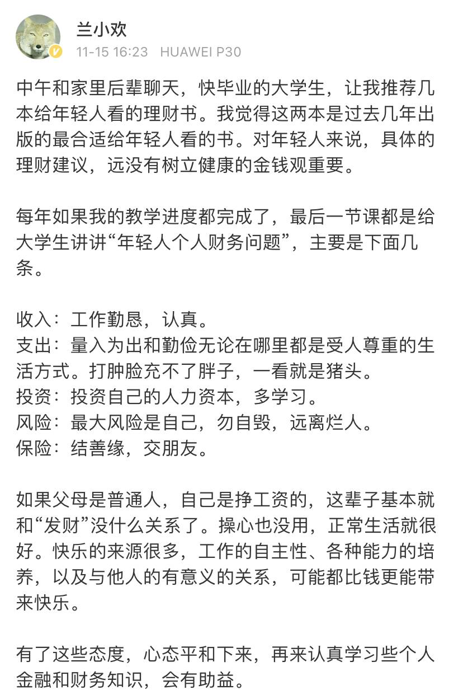

那从我个人的角度，我会觉得说正确的金钱观，就是说首先第一个确定就是说我们要明白就是金钱它不是我们终极的目的，金钱它只是说给我们就是让我们生活变得说更加美好的这样的一个工具，所以明白就说金钱不是我们的终极目的，我们的终极目的是什么？就让我们自己有一个更完美的这样一个人生，都让我们一个更美好的一个家庭，所以重要的里面来说，钱它绝对不是万能的。

这第二个就是什么？尤其因为我们今天有很多年轻人，所以我会觉得说你在年轻的时候，还是就是在金钱消费上，尤其不要去过度的超前，要适当的就是说那自己要去想办法去赚钱，想办法要适当的攒一些钱就是说能够让自己能够过一个比较稳健的生活。而且在你年轻的时候，钱怎么花上要注意，就是钱要拿去，怎么投资到自己的学习，投资到自己的职业发展，投资到自己的健康上去，而不是太多的把钱去回报到这种短期即时消费的东西，给你带来短时快乐的东西，比方说像游戏等等这些东西，所以我觉得正确的纪念馆简单讲一个什么，在年轻的时候想办法多赚钱多攒钱，然后的话让这些东西服务于你的长期的这种职业的发展和家庭的快乐和自己的终身成长。

聂辉华：好，谢谢钟老师。我也谈一点的感想，因为我自己是穷人出身，后来又做研究经济，也涉及到金融。我想第一是我们中国人普遍缺乏财商教育，大家只重视智商，后来也重视情商，但是一直不够重视财商怎么理财的问题。我推荐大家看《穷爸爸富爸爸》那本书，或者是看皮凯蒂的《21 世纪资本论》了解一下，这是第一。

第二，就是我们每个人多少要有点理财意识，就前面说的财政教育，第二个是在实践上要一个理财，就是我们可能三四十岁之前都是靠体力劳动挣钱，那么 40 岁之后，要想办法靠资本挣钱，不能完全靠体力劳动，因为体力劳动是不可复制的，金钱永不眠，只有金钱能够钱滚钱，所以我觉得这是不矛盾的不冲突的。

第三点，我觉得大家一定要有念头，不要想着挣快钱，不要想着一夜暴富。为什么？市场基本上是透明的，激烈的竞争，你要想这么挣快钱，别人都能挣快钱，那为什么这样的机会给了你，没给别人没有道理。所以我觉得大家不要有侥幸的机会，看到别人一夜暴富的去眼红，不要那样，那不是正确的金钱观，一定是量力而行。

第四点就是我非常同意钟老师说的，不要过高的去借贷，不要过高的杠杆率，不要寅吃卯粮，这不是一种值得鼓励的消费观和财富观。那么因为时间关系很遗憾的，今天我们只能到此为止，我们节目已经进行了一个半小时，感谢钟老师，感谢各位朋友。

如果大家对我们的节目感兴趣，欢迎在节目下面留言。如果你觉得对我们今天节目有意见不满意，也欢迎大家在节目下面吐槽，包括到我的自留地上吐槽。好，谢谢大家。好，谢谢钟老师，各位网友再见。

钟鸿钧：好，谢谢同学们，谢谢，再见。

公众号懒人找资源，懒人专属群分享

## 番外丨钟鸿钧×聂辉华：经济学家如何看待垄断与反垄断

聂辉华（中国人民大学经济学院教授、博导，哈佛大学博士后）

钟鸿钧（牛津大学经济学博士、博士后，上海财经大学数字经济研究中心主任）

### 收听提示：

1\. 什么是垄断与反垄断？

2\. 平台对商家要求"入驻只能二选一"是不是垄断行为？

3\. 大数据"杀熟"是不是垄断\\违法行为？

4\. 新经济对反垄断提出了哪些挑战？

5\. 大数据时代下，反垄断经济该如何走？

相关内容：

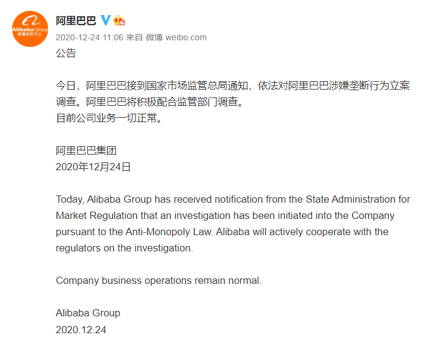

2020 年 12 月 24 日，阿里巴巴涉嫌垄断行为进行立案调查

《关于平台经济领域的反垄断指南（征求意见稿）》

第三章 滥用市场支配地位行为（节选）

第十四条 拒绝交易

具有市场支配地位的平台经济领域经营者，可能滥用其市场支配地位，无正当理由拒绝与交易相对人进行交易，排除、限制市场竞争。分析是否构成拒绝交易，可以考虑以下因素：

（一）停止、拖延、中断与交易相对人的现有交易；

（二）拒绝与交易相对人开展新的交易；

（三）在平台规则、算法、技术、流量分配等方面设置限制和障碍，使交易相对人难以开展交易；

（四）控制平台经济领域必需设施的经营者拒绝与交易相对人以合理条件进行交易。

认定相关平台是否构成必需设施，一般需要综合考虑其他平台的可替代性、是否存在潜在可用平台、发展竞争性平台的可行性、交易相对人对该平台的依赖程度、开放平台对该平台经营者可能造成的影响等因素。

认定相关数据是否构成必需设施，一般需要综合考虑数据对于参与市场竞争是否不可或缺，数据是否存在其他获取渠道，数据开放的技术可行性，以及开放数据对占有数据的经营者可能造成的影响等因素。

平台经济领域经营者拒绝交易可能具有以下正当理由：

（一）因不可抗力等客观原因无法进行交易；

（二）因交易相对人原因，影响交易安全；

（三）与交易相对人交易将使平台经营者利益发生不当减损；

（四）交易相对人明确表示或者实际不遵守公平、合理、无歧视的平台规则；

（五）能够证明行为具有正当性的其他理由。

第十五条 限定交易

具有市场支配地位的平台经济领域经营者，可能滥用市场支配地位，无正当理由对交易相对人进行限定交易，排除、限制市场竞争。分析是否构成限定交易行为，可以考虑以下因素：

（一）要求交易相对人在竞争性平台间进行"二选一"或者其他具有相同效果的行为；

（二）限定交易相对人与其进行独家交易；

（三）限定交易相对人只能与其指定的经营者进行交易；

（四）限定交易相对人不得与特定经营者进行交易。

上述限定可能通过书面协议的方式实现，也可能通过电话、口头方式与交易相对人商定的方式实现，还可能通过平台规则、数据、算法、技术等方面的实际设置限制或者障碍的方式实现。

分析是否构成限定交易，可重点考虑以下两种情形：一是平台经营者通过搜索降权、流量限制、技术障碍、扣取保证金等惩罚性措施实施的限制，因对市场竞争和消费者利益产生直接损害，一般可认定构成限定交易行为。二是平台经营者通过补贴、折扣、优惠、流量资源支持等激励性方式实施的限制，可能对平台内经营者、消费者利益和社会整体福利具有一定积极效果，但如果对市场竞争产生明显的排除、限制影响，也可能被认定构成限定交易行为。

平台经济领域经营者限定交易可能具有以下正当理由：

（一）为保护交易相对人和消费者利益所必须；

（二）为保护知识产权或者数据安全所必须；

（三）为保护针对交易进行的特定资源投入所必须；

（四）为维护平台合理的经营模式所必须；

（五）能够证明行为具有正当性的其他理由。

第十七条 差别待遇

具有市场支配地位的平台经济领域经营者，可能滥用市场支配地位，无正当理由对交易条件相同的交易相对人实施差别待遇，排除、限制市场竞争。分析是否构成差别待遇，可以考虑以下因素：

（一）基于大数据和算法，根据交易相对人的支付能力、消费偏好、使用习惯等，实行差异性交易价格或者其他交易条件；

（二）基于大数据和算法，对新老交易相对人实行差异性交易价格或者其他交易条件；

（三）实行差异性标准、规则、算法；

（四）实行差异性付款条件和交易方式。

条件相同是指交易相对人之间在交易安全、交易成本、信用状况、所处交易环节、交易持续时间等方面不存在实质性影响交易的差别。平台在交易中获取的交易相对人的隐私信息、交易历史、个体偏好、消费习惯等方面存在的差异不影响认定交易相对人条件相同。

平台经济领域经营者实施差别待遇行为可能具有以下正当理由：

（一）根据交易相对人实际需求且符合正当的交易习惯和行业惯例，实行不同交易条件；

（二）针对新用户的首次交易在合理期限内开展的优惠活动；

（三）基于平台公平、合理、无歧视的规则实施的随机性交易；

（四）能够证明行为具有正当性的其他理由。

公众号懒人找资源，懒人专属群分享

## 番外丨基金为何“跌跌不休”？

朋友们，大家好。我是中国人民大学聂辉华，一个犀利幽默的经济学教授。

俗话说，一年之计在于春。但是对于广大基金投资者（"基民"）来说，可谓"春寒料峭"。

从春节后上班那天，也就是 2 月 18 日开始计算，在短短三周时间内，股票和基金一路跌跌不休。

根据统计，在 6000 多只股票型和混合型基金中，有 1200 多只基金的净值亏损超过 20%，80%左右增长率为负。换句话说，大部分基金在年后都是亏损的。

在这次近似灾难式的基金价值下跌过程中，有不少明星基金经理管理的基金跌幅接近 20%，从大家口中的"中国巴菲特"变成了"只会炒白酒的笨蛋"。

我应该感到庆幸，还好我是经济学教授不是基金经理，不然那些难听的评论就更看不过来了。最受关注的还是北大毕业的某位美女基金经理，担任基金经理才两周，她管理的两只基金亏损已经超过 20%，被网友称为"最惨基金经理"。

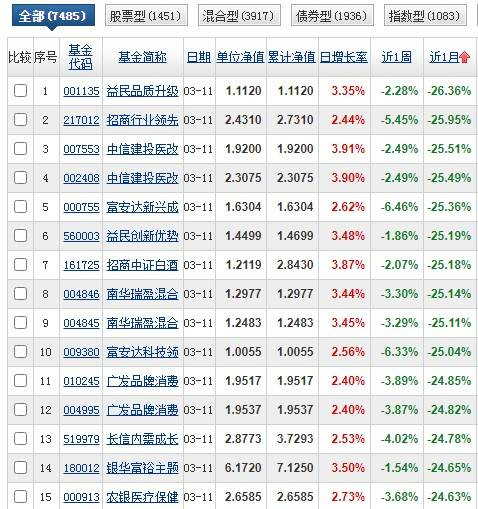

部分基金涨跌情况

#### 1、什么是基金？

首先，我们来了解一下什么是基金。一般我们说的基金（fund），是指投资基金或者共同基金。

它是一种通过公开发售基金份额募集资本，然后投资于股票、债券等证券产品的机构。每只基金都有一到两个基金经理，他们隶属于证券公司、信托投资公司及基金管理公司。

根据交易方式，我们可以将所有基金分为两类：

第一类是开放式基金，你可以通过银行、证券和基金公司随时买入，随时卖出，这类基金的规模是不确定的；

第二类是封闭式基金，只能在特定的期限内买卖，买入后不能在到期之前撤回。

我们普通人购买的基金，通常都是开放式基金。

另外，根据基金的投资对象，我们可以将所有基金分为五类。

第一类是股票型基金，包括指数型基金。顾名思义，就是这类基金把钱都投在购买某些股票或者某一类股票上，因此相对来说，风险最高，收益也最高。

第二类是债券型基金，把钱投在债券上。因为债券的票面利息是固定的，不象股票那样可以上下剧烈浮动，所以债券型基金又叫固定收益基金，它的风险比较小，收益比较低。

第三类是混合型基金，即同时投资于股票和债券，因此它的风险和收益介于股票型基金和债券型基金两者之间。

第四类是货币型基金，它的收益跟银行存款差不多，比如 4%左右的收益率，是所有基金中风险最小的产品。

第五种是其它基金，包括什么 ETF、LOF、FOF、QDII 等，它们的投资方式相对复杂。

大家如果感兴趣，可以自己在网上了解一下。

几种基金的风险程度排序如下：股票型基金>混合型基金>债券型基金>货币型基金。

简单地总结一下：所有的基金和其它金融产品一样，高收益对应高风险，低收益对应低风险。

如果有一样金融产品，收益很高，风险很低，麻烦你告诉聂老师，我也想发财。

其实，从博弈论的角度讲，如果真有这种产品，那么所有人都会去抢购它，于是这种产品的价格就会提高，收益就会下降。这是一种均衡结果。

从这个角度讲，今年亏得多的朋友，至少说明你敢冒风险，比一般人有勇气。别的安慰人的话，聂老师实在是说不出来了。

#### 2、基金为什么会跌？

介绍完了枯燥的基础知识之后，我来谈谈今天最关键的问题：为什么基金会跌跌不休呢？

其实，只要你理解了基金投资的逻辑，就不难理解它的下跌了。以股票型基金为例。因为这类基金的投资对象是股市，所以股票价格和股票型基金的价值是高度正相关的。

比如说，某只白酒类股票型基金，它的投资对象全部是白酒上市公司，比如茅台、五粮液、酒鬼酒。去年下半年以来，白酒类股票一路高涨，简直是所向披靡啊。

因此，白酒类基金，比如"XX 中证白酒指数"，过去一年的回报率大约是 100%，翻了一倍啊。

2020.4-2021.2 白酒类基金静止走势分析（来源：天天基金网）

但是，古人说得好啊，祸兮福之所倚，福兮祸之所伏。用经济学术语来说，就是高收益和高风险是一个硬币的两面。

2 月 18 日之后，股市一路下跌，白酒类股票首当其冲，跌幅普遍高达 30%左右。例如，A 股第一大股贵州茅台，从最高点的 2627 元一股，跌到目前的最低点 1960 元，跌幅高达 25%，市场价值减少了 8400 亿元！

与此对应，白酒类基金也是跌幅最大的基金之一。刚才提到的"XX 中证白酒指数"基金，下跌幅度刚好也是 25%。可谓"成也白酒，败也白酒"。

你看，股票和股票类基金，果然是难兄难弟，可谓"祸不单行"啊。有人可能会问，股市为什么在年后下跌了呢？这是个好问题，不过它比较复杂，我打算之后有机会再讲。

相比之下，债券型基金主要投资于各类债券，包括公司债、企业债和国债。债券不同于股票。

企业发行债券后，如果赚钱了，它只需要按照固定的利息和本金偿还债权人；如果是发行股票，它必须按照股权比例将所有利润分配给股东。因此，股票的收益高于债券。

但是反过来，一旦企业陷入经营困境，企业必须优先还债，然后再考虑股东的权益。

可见，股票的风险也高于债券。因为股票和债券是相互替代的两种融资工具，所以股票行情和债券型基金的收益率基本上是负相关的。

在去年下半年股市飙升的时候，股票型基金的收益率一般都高达 20%-50%，而债券型基金的收益率通常只有 5%-10%。

反过来，在今年很多股票型基金跌幅超过 20%的时候，几乎所有债券型基金的收益率下跌不超过 10%。至于混合型基金，它的风险和收益，都位于股票型基金和债券型基金之间，我们就不详细介绍了。

#### 3、买基金如何减少风险？

最后一个问题：今年的基金跌成这样，以后还要不要买基金？买基金如何减少风险？

我个人的看法是：从长远来看，股市有风险，而基金是由专业的基金经理操盘，可以相对减少风险，当然收益率也相对稳定。

在通货膨胀的预期下，把钱存银行，可能利息都赶不上通胀，相当于补贴银行了。

因此，对于普通人来说，基金投资仍然是获取"睡后收入"的主要渠道之一。

因此，我仍然坚持过去的观点：不留现金，少买货币，多买基金，别碰股票，有钱买房。

不过，我要提醒大家，应该有合理的资产配置，尽量减少风险。比如，你有 100 万元零钱，20 万买货币型基金，这部分是能保本的；20 万买债券型基金，这部分是和股市实现风险对冲的；20 万买股票型基金，30 万买混合型基金；最后 10 万买保险，这是托底的。

这样，你的金融资产就实现了多元化。不管风吹浪打，总能闲庭信步。

最后，我想重申一点。今年 1 月 27 日，我在 B 站的第二期视频里，谈到"投资必备的三层思维是什么？为什么有人能在 2020 年实现基金翻倍？"时，提醒大家一定要从政治经济学的角度看懂宏观大势，还要从博弈论角度掌握微观策略。

我当时就说，大家都去买新能源汽车和白酒的股票或基金，那么这类股票或基金的价格就会水涨船高，收益率就很低，甚至亏本。

我也说过，由于各国都在加印钞票，必然助推通货膨胀，因此股市可能下挫，不宜将大量资金配置在股市和基金上。聂老师不是预言家，但过去说过的话，可以立此存照。

记住，在投资理财方面，努力学习，吸取教训，亡羊补牢，犹未为晚。

如果你喜欢我的内容，欢迎你们关注我的个人账号（聂老师 bilibili 官方号：聂辉华教授，UID:2016841403）。

我是聂辉华，我们下期再见！

公众号懒人找资源，懒人专属群分享

## 番外丨劝酒文化，绝不仅是职场霸凌

### 文稿

最近，中国最有名的互联网大厂阿里曝出了一则丑闻。

8 月 7 日，一位阿里巴巴员工在网上发帖，7 月底自己被男领导强行带去出差，并陪客户喝酒，结果被灌醉后多次被客户猥亵。更恶心的是，这位女员工的男领导当晚四次偷偷进入自己房间，并实施性侵犯。8 月 9 日凌晨，阿里在内网公布了对涉事员工的处理决定。

目前，此案的详细情况还有待警方公布。

员工被强制要求喝酒，这绝不是第一次，也不会是最后一次。去年，厦门国际银行的一位新员工，因为不愿喝酒，居然被领导辱骂、打耳光，还被其他同事集体责骂。

很多人为那些被强制劝酒、灌酒的员工打抱不平，谴责这种职场霸凌现象。

然而，在我看来，劝酒这种事情绝不仅仅是一种职场霸凌，它折射了一种强权文化、奴才文化和男权文化，本质上是契约精神的缺失。它带来的恶劣影响和后果，远比人们想象得要严重得多。中国要成为一个现代市场经济国家，就必须果断抛弃酒桌文化。

#### 四种难以拒绝的劝酒场合

中国很早就有"无酒不成席"的说法，酒桌文化早已成为传统文化的一部分。酒桌文化的核心环节是劝酒。酒精就像兴奋剂一样，能把饭局推向高潮。因此，酒桌之上，推杯换盏、觥筹交错，不劝酒是很难的。对国人来说，难以拒绝的劝酒场合主要是以下四种。

第一种劝酒场合是上级对下级劝酒。不管是政府机关、事业单位还是企业，总有新员工入职，总要搞年会或节庆，又或者大型项目结束之后，总要去饭店"犒劳"一下。

饭桌上，下属向领导敬酒，领导往往意思一下。轮到领导回敬，下属就得受宠若惊，加倍表示。

"潜规则"是，一个人的等级与其必须喝的酒量成反比。官越大，级别越高或者资历越老，越是可以少喝；相反，新员工作为职场等级体系的最底端，就得喝最多。如果有谁胆敢违背这个潜规则，那就是"敬酒不吃吃罚酒"。前面提到的某银行新员工拒绝领导劝酒，  
就属于违背了职场潜规则，结果被同事孤立。

因此，这种场合的劝酒，体现了一种职场霸凌，实质上就是一种强权文化。

第二种劝酒场合是客户对业务人员劝酒。经济下行，生意难做。为了把产品卖出去，光是价格低、回款慢、回扣多还不够，销售员或业务员还必须像孙子一样伺候客户，包括请客户吃好喝好玩好，一条龙服务。说句不夸张的话，一个单位里能把销售做好的，都是人才。

经常有这样的故事：你陪客户多喝一杯酒，客户就多签一张单。为了把业绩做上去，销售能不喝吗？敢不喝吗？这种场合的劝酒，说白了就是一种交易。

第三种劝酒场合是男性对女性劝酒。酒桌上往往男性多于女性，此时男性往往要求女性陪酒助兴。如果女性光喝饮料或茶水，就无法融入酒局，甚至无法介入话题，那还不如早点回家。

在"少数服从多数"的压力下，女性往往被迫参与。如果此时有某个女性甚至主动出击，那其他女性更会感到坐立不安。这种劝酒场合最令女性深恶痛绝，是一种赤裸裸的性别歧视，本质上是一种男权文化。

第四种劝酒场合与前面三种不同，不是"强者"对"弱者"劝酒，而是"弱者"对"强者"劝酒。

假如你在大城市或者大机关混得风生水起，然后逢年过节时衣锦还乡，当地熟人肯定要酒席伺候。此时，一个你可能根本不熟悉的基层干部或者小学同学来敬酒，对方先干为敬，一杯下肚，你喝不喝？你不喝，他就说你看不起他；你喝少了，他也说你看不起他。这就是道德绑架。

#### 喝酒是人情社会的信号发射

全世界是不是只有中国人爱喝酒？并不是。

日本人也爱喝酒。下班之后，公司员工往往集体到居酒屋喝酒，喝了一家再换一家，直到一醉方休。日本人虽然不直接劝酒，但如果一个男性员工不跟同事去喝酒，就会被认为缺乏"团队精神"，会遭到同事排斥。

韩国人也爱喝酒，而且拼命劝酒，每年都要喝死不少人。

新加坡禁止在公共场所喝酒，但是私下场合喝酒时，也存在劝酒现象。

因此，我怀疑劝酒很可能是一种东亚文化。

为什么在东亚地区劝酒形成了一种文化呢？因为东亚地区属于传统的人情社会，高度强调身份认同（identity）。"熟人好办事"，规则是其次。要融入一个熟人社会，关键是如何取得对方的信任，从一个"生人"变成对方的"熟人"。

那么，在信息不对称的条件下，如何让对方信任自己呢？你需要付出某种代价，让对方相信你的诚意。用经济学的话来说，就是"信号发射"。

喝酒，就是一种信号发射机制。为什么呢？因为过度喝酒有害健康，所以一方可以通过付出一定的成本来取得对方的信任。相反，如果喝酒没有任何成本，那它在理论上就无法成为一种有效的信号发射机制。喝酒越多，就表明你越是尊重对方，在乎对方，甚至愿意为了双方的感情付出健康的代价。

此外，从心理学上讲，酒精会让人心情放松以及兴奋，此时人的防备心理会减少，更有可能"酒后吐真言"。因此，一方可以通过喝酒来考察另一方的真实想法、态度和水平。

正是因为喝酒带有强烈的信号发射功能，所以劝酒者----  
不管是上级、客户还是"弱者"，都天然带着一种居高临下的心态俯视对方，形成一种"道德上的优越感"，还美其名曰"考验"对方。酒桌上流行的一些劝酒词，生动地体现了它的信号功能。

比如，"感情浅，舔一舔；感情深，一口闷"；"感情真要铁，不怕胃出血！"又比如，"会喝一两的喝二两，这样朋友够豪爽；会喝二两的喝五两，这样的同志要培养；会喝半斤的喝一斤，这样哥们最贴心！"

然而，喝酒的信号发射功能被严重地夸大了。首先，"酒品如人品"完全没有科学依据。有太多的人，在酒桌上开杯畅饮、豪气冲天，但是办起事情来锱铢必较。有人酒后吐真言，有人酒后说话不算数。

因此，通过喝酒的方式来展示人品、忠诚和能力，最终结果是大家都用一种粗鄙的方式和损害健康为代价，进行"拼底线"的博弈。这分明就是一种"囚徒困境"。

其次，喝酒作为一种信号机制不仅低效，而且不公平。显然，它对不能喝酒的人不公平，对职场新人不公平，实际上助长了一种强权文化。另一方面，"弱者"通过喝酒向"强者"献媚，助长了一种奴性文化。

当然了，会喝酒的人可能对此不以为然，认为这是一种天然的比较优势。且慢高兴。基于跨国数据的经济学研究表明（Swamy 等，2001），女性更少参与腐败活动，因此女性担任政府高官比例越高的国家，腐败程度更低。

我与同事分析了 2000-2014 年 367 个厅级以上贪官案例，发现女性贪官的相对比例远低于男性贪官（聂辉华和仝志辉，2015）。背后的原因之一是，女性由于家庭角色和性别特征，更少参与喝酒、桑拿等娱乐社交活动，从而减少了腐败机会。

可见，喝酒文化实际上助长了腐败风气。

#### 契约社会不欢迎酒桌文化

人类社会前进的方向，是从农耕文明进化到商业文明。在社会关系上，是从人情社会进化到契约社会。现代市场经济，本质上是一种商业文明和契约社会，它们背后的支撑力量是契约精神。什么是契约精神呢？

第一，契约关系是平等自愿的，没有严格的尊卑等级。

不管达官贵人还是贩夫走卒，人与人之间不管是做生意还是做官，都是平等的民事主体之间缔结的一种契约关系。在这份契约中，大家只有分工不同，没有高低贵贱之分。因此，任何人无权强迫他人去做任何不愿意做的事情，包括喝酒。

第二，契约关系是一种非人格化的交易机制，注重规则，淡化人情。

世界著名经济学家、斯坦福大学教授格雷夫（Greif）对比了公元 10-14 世纪地中海地区两个城市的兴衰。

一个城市住着热那亚人，他们实行非人格化交易，与非热那亚人也做生意，并通过正式的法庭来确保契约的执行；另一个城市住着马格里布人，他们奉行人格化交易，只跟马格里布人做生意，并且通过声誉、口碑来维持契约关系。最终，热那亚人的生意越做越大，而马格里布人的生意日渐衰落。

格雷夫的"双城记"研究，理应给我们提供非常深刻的警示。借助喝酒这种高成本的信号发射机制，短期内可能有利于熟人之间的生意往来，但长期来看却阻碍了市场经济的扩张。

第三，契约关系是有边界的，理应权责对等、公私分明。

一些领导或老板总喜欢把单位当作自己的"地盘"，把下属或员工当作自己的"仆人"，这实际上是身份社会的陈腐观念，与现代市场经济和契约社会并不兼容。

从理论上讲，老板和员工的雇佣关系仅限于约定范围之内，在约定范围之外并不存在。过了下班时间，员工有权自由支配自己的时间和精力，有权享受家庭的快乐。"让市场的归市场，让家庭的归家庭。"除非自愿，否则员工没有义务继续服从老板的权威，包括参加老板的饭局。

中国即将进入高收入国家，如果人们辛苦赚钱之后，却不能体面地、有尊严地享受生活，那么我们跨越"中等收入陷阱"的意义何在呢？

总之，契约社会不欢迎酒桌文化。传统文化既是一种资产，也是一种负担，关键是如何扬弃。如果错误地把负担当作资产，那就是"文化错配"。

参考文献：

Swamy, Anand, Stephen Knack, Young Lee, and Omar Azfar, 2001, "Gender and  
Corruption", Journal of Development Economics, 64: 25-55.

聂辉华、仝志辉，《创新纪检监察体制，遏制"一把手"腐败》，中国社会科学出版社，2015 年。

聂辉华，《一切皆契约：真实世界中的博弈与决策》，上海三联书店，2021 年

公众号懒人找资源，懒人专属群分享

## 番外丨理想青年对话：如何理解和应对这个不完美的世界

你好，欢迎收听《理想青年》，我是看理想的音频编辑，香芋。

这一期的嘉宾是中国人民大学经济学院教授聂辉华老师。我记得第一次见聂老师，是在人大对面的一家咖啡馆，那次见面我和聂老师都有提前到，但是我没有认出聂老师，因为聂老师当时穿得非常朴实，可能是我对经济学家会有一些固有印象的感觉，就是西装、公文包、双手交叠的证件照姿态，聂老师前面两个都没有，后来我发现聂老师的证件照确实双手交叠了。

那次我们是去沟通《不完美世界的博弈：契约经济学 35 讲》这档节目，而现在这本书《一切皆契约：真实世界中的博弈与决策》也出版了。

《一切皆契约：真实世界中的博弈与决策》

我从第一次见面就有感觉到聂老师的认真，比如他会先搬好四个椅子，他还会很用心地准备和节目相关的内容，比如"节目是否有小导语""怎么设计'有律动'的话语"，甚至还提前准备十多期稿件等等等等，而且聂老师从不拖稿。

前两天因为一个热点事件，临时找聂老师录制了一期番外《劝酒文化不仅是职场霸凌》，从提议、稿件再修订、录音频，只过去了一个小时。同事为了感谢聂老师，决定请聂老师的编辑，就是我，一个星期的奶茶。

一年之后再见到聂老师，给我的感觉还是很认真，但我似乎发现了多一分的可爱，因为这次是聂老师第一次来看理想，我给聂老师介绍办公室布局的时候，聂老师背着双肩包，对每一个地方充满好奇。

跟聂老师聊完，我似乎对工作、对生活的热情又添上了一把火。那这把火怎么烧起来的，一起来听听咯~

### 对话

香芋：我记得我第一次见到您的时候是在咖啡店，我们两个都有提前到，但是当时互不认识，我就发现您是有很认真地把位置摆好。后来在您的节目上线，您也从来没有拖延过节目，是不是经济学家都会讲究效率，计算过后果，就不会去拖延，就想问老师您会不会有拖延症的问题呢？

聂老师：首先我并不认为经济学家就不会拖延，在我认识的人中，我觉得大部分人都有拖延症，而且是文人的话因为比较散漫，拖延症说不定更严重，因为它毕竟不是一个商业行当，在商业行当里，你要是拖延的话是会导致产品亏损，企业运营就会有问题。

但学者写文章，他对于别人答应的事情很多，确实会有拖延症，我是没有拖延症的人，但是即便这样，我也不认为我就一点没有拖延症，自律是件非常困难的事情。

成功人士都有个优点就是自律，但是只有极少数人能做到。

我们曾经有一个网上的讨论，就是同行发起一个倡议，说我们建一个群，坚持每天三小时，一小时写作、一小时读书、一小时锻炼，一个月之后群解散了，因为没有任何人做得到，听上去并不难了，大部分人做不到这一点。

香芋：那个时候您写稿的时候是直接把所有都写完了吗？

聂老师：差不多。我一旦定了计划，我就会加快推进，而且最好是集中精力推进，但有时候也会每隔一段时间更新一节的内容。

香芋：聂老师，您对节目的认真或者是这种做事情的认真态度，它是能够怎么保持这种状态的，就是因为这种喜欢吗？

聂老师：对，我觉得喜欢很重要，就是你喜欢它，你看重它学者的东西就类似于艺术家的雕刻一样，就是你希望尽善尽美，所以你肯定希望把它更完美的呈现。

如果你没有这种热爱的话，你就不愿意了，但有的人他有的文章写得很潦草，有的文章写得很好，可能他们这文章不太重要，随便写一写应付一下。

那么写的比较好的文章往往是他花了很多时间去修改，反复雕琢，所以学者创造一个东西，跟艺术家创造一个东西，过程是类似的，关键是要有那种真的狂热的喜欢，但一般人做不到，是因为每一个行业它都有职业倦怠感，你可能觉得差不多就行了。这是很常见的。

香芋：您最开始是怎么建立对于经济学的喜欢？

聂老师：喜欢经济学跟做事认真没有必然关系，就是我刚才说的很多喜欢进去的人，他可能做事也未必能，就是我觉得更多是跟性格有关，跟行业无关。

有的人做事就是认真，像我要么不答应，要答应了就一定好办，要么我就干脆不干这件事情了，这是我的性格，但很多人我知道有些同事或者同行他可能缺乏严格的时间观念，他都答应，但他最后又完不成。

然后有很多这样的事情，我有时候都跟这些人绝交，因为跟他合作的项目太痛苦了，他老是拖着，关键他不给你一个预期，比如说他告诉你下个星期会到了，下个星期他又说再给我两个星期，过了一个月之后你等还是不等，你要不等，前面做的东西白做了，你要是等他说不定还要一个月。

不能理解，我不会是这样的人。我如果做不完，我一定会告诉他这个事做不完，或者我会说一个期限，在期限之前一定要完成，我不会再一而再再而三的拖延。所以我觉得这个跟性格有关，跟行业有一定的关系，刚才讲的学术研究，这个行业它没有太严格的竞争，没有那种亏损的概念，不像企业。企业做生意老是迟到，那人就不跟你玩了。所以我觉得既跟性格有关，也跟外部压力有关。

香芋：我是那种比较慢节奏的人，然后我可能会在 Deadline 之前，把事情做完。

聂老师：很多人也是这样。

香芋：您的原则是不是就是说如果你只要在 Deadline 之前做完，就可以了？

聂老师：对，但是我一般会提前几天，原因是万一有什么事耽误了，比方说举个例子像我们当老师的晚上有课，你不能说下午开始备课，万一下午被领导叫去开会怎么办？所以我起码得上午备课，最好是提前一天把课备完了，对吧？第二天自己留有余地，你总要防范一些不测的事件。

香芋：随时会提前做计划。

聂老师：对，我觉得这是现在年轻人普遍的一个焦虑的问题，就是缺乏严格的计划和严格的自律，绝大多数人做不到，这是人性的弱点，真的不容易，我自认为我做的并不是特别好，但虽然我可能比大多数人做的好一点，在这方面一点都不夸张。

比如说为什么会刻意训练自己，然后早上起来先看半个小时论文，然后再上网浏览新闻，大多数人肯定早上起来我先看一下新闻多轻松，我就会刻意训练自己，我一定要先看论文看累了，然后再看一会新闻。

或者是我在开重要的会的时候，我一般是不会轻易看手机的，大多数人做不到，会一无聊马上就开始看手机，这个也要经过训练。

香芋：还是比较严格的自律的那种感觉。

聂老师：真的很难。但是成功人士真的都很自律，因为时间是最宝贵的，所有的人不管是多成功多有钱多穷多失败，实际上都是一样的 24 小时，怎么利用时间肯定是普通人和成功人士的一个最重要的差别。

香芋：那您这种自律的训练是从小就有吗？还是什么时候开始？

聂老师：我很小就有，比如我们读书的时候，三年高考，争分夺秒，那个时候高考也没有什么辅导班，我们都是早上 7 点起床，晚上 11:00 一定要睡觉，中午还要睡一个小时，从来不熬夜，所以我们的时间相当于是以真的是以分钟来计算的，就是这几分钟干什么，那几分钟干什么，你要是有浪费了几分钟，简直就是一种犯罪的感觉。

对高考那段时间比较紧张，那么久而久之就养成一种习惯，所以要刻意的训练，养成习惯非常重要，但我承认真的很难，对所有人来说都很难，不容易，哪怕是有些人已经功成名就了，他就可能想放松一下，想躺平一下。

当然我也理解现在年轻人压力大，比如你说你上了一天班，回到家里快晚上 11 点了，还要坚持看一个小时课外书，为了充实自己，这真的不容易做到。我也能理解，但是如果一个人能克服这一点，他一定是…

香芋：就容易成功.

聂老师：真的，我再要强调这点真的很难做到。尤其是在时间碎片化，被微信被视频碎片化之后，你就发现这一点尤其困难。我觉得像这种，其实可以做个专题）每个人怎么管理好自己的时间，因为太难了。

香芋：所以您也觉得这种自律其实是有帮到您自己的。

聂老师：肯定了，自律的人他能够更好地利用时间做事更有计划，太重要了。炒股也需要自律，你知道很多为什么亏了吗？他买了之后他拿不住，一看到下跌了他马上卖掉，过了一会儿发现又涨了，他又买回来，然后过后他又卖去，他就控制不住自己。

研究发现，散户之所以亏损，就是因为他频繁买卖，这就是缺乏自律的表现，没有定力，因为什么？因为你一看到亏损就坐不住了，别的股票在涨，为什么你的股票跌了呢？尽管你知道跌了可能会涨回来，但是你不知道什么时候涨回来？你熬不住。所以我觉得有时候我说除了智商、情商、财商，理财的熬商也很重要。

所有的成功人士都有个特点，就是能够接受延迟消费。

什么叫延迟消费？举个例子，一个小孩子今天做得不错，我现在可以给你一个糖果，但如果明天继续做得不错，今天不给，明天给你三个，大部分人可能选择第一种，我先吃了糖果再说，如果这个小孩能够忍下来，愿意明天再做的好，得到三个糖果的话，这个小孩真的是很有毅力的，他从小要训练的。

我都知道很多成功人士教育他们子女的时候，都特别强调延迟等待的满意感、满足感，延迟等待的满足感不容易做到。

香芋：这个途径当中有别人帮到你吗？还是您自己总结的？

聂老师：没有，主要是靠我小时候也喜欢看一些成功人士的传记，会学一些人家，然后也跟生长环境有关，我从小是在一个贫困的农村长大的，那么在农村你要出头的唯一道路就是读书，你要读书的话就得勤奋就得刻苦，智商是天生的，接下来就是看你多勤奋，更好的利用时间，这个非常重要。

香芋：我知道您也是从您说的小地方，然后慢慢的努力，再到人大读本科、读硕士、读博士，后来去了哈佛读博士后。您在求学的过程当中，您自己的感触最深的经历是什么？

聂老师：感触最深的经历，没有什么特别。

香芋：多的感触，就是要努力一些。

聂老师：这种感觉对我们从小被输入一种观念"要有出息"有关系，因为家里很穷，所以父母会教育我们，只有读书才有出息，我们必须摆脱贫困，一定要出人头地，就这种强烈的信念，或者说一种执念支撑着我，像我们这种人不断的努力，这很重要。

但现在很多孩子，比如说我跟我同事交流，他的孩子从小生活环境比较优越，还上了人大附小附中，他真的不太在乎，特别勤奋，因为他反正家里条件也不错，现在过得也还可以，是不是非要考顶尖大学，他不是很在乎，是不是非要去找高薪的工作，他也不在乎，这跟家庭环境社会成长环境有关。

香芋：您最开始接触到经济学的内容是从什么时候？

聂老师：高中政治课里面有经济常识就很感兴趣。

还有也跟穷困有关。你像我是江西人，江西比较穷，江西出了很多著名经济学家，为什么我猜一个重要的原因就是因为江西穷，我们每个人都希望能够改变贫困的面貌，要改变经济的落后面貌，当然要学经济学了，就是这么朴素的想法，尽管学了经济学也未必能够帮助江西发展经济，但是至少这种愿望还是很强烈的。

香芋：你觉得现在您的学生就是学经济学，他们也是会因为这个原因。

聂老师：我猜应该不至于，大多数人是因为学经济学比较热门，好找工作，就业前景广，这几乎是 80%以上的年轻人选择经济学专业的原因。

香芋：您觉得经济学是这个样子的吗？因为有其他我们平台上的主讲人老师会讲，一定不要选他的专业，然后说出来就赚不好钱什么之类的。

聂老师：目前经济学、金融学还是文科里面最火热的专业，每年报志愿的时候，假如有人咨询我，人大报什么专业，我都会告诉大家，排名第一的是经济或者金融，这两个你不能同时报，接下来可能是新闻法学，那后面是管理，大致排序是这样的，整个社会的价值取向也跟这差不多，所以我们还不至于告诉别人学经济学不行。

他如果愿意学，当然他很多问题他不知道他愿不愿意学，他可能选择一个比较保险的方法，就是哪个好找工作，面广，我学哪个。我觉得这也无可厚非，因为高中生他并不知道自己要干什么，他选择一条保险的路，没有什么错，什么人知道自己干什么，只有那些中产阶层书香门第，官宦家庭的人，他比较早熟，比较有好的家庭教育，他才知道自己应该干什么，这些人不需要我们指点对吧？

所以我觉得对大多数普通人来说，选择报热门专业本身并没有错，这是一种理性的选择。

香芋：这个跟喜欢的区别就是说，您是最开始就喜欢上经济学，然后就报经济学了，但很多人可能刚刚那个时候不知道自己喜欢什么，然后可能自己报的专业跟后来所工作的地方可能专业就完全不同。

像我一样，我本科是学生物工程的，但我现在的工作是音频编辑，专业知识没有任何的联系。您是觉得这种喜欢的行业跟自己学的专业不同，这个里面是怎么可以去努力的？

聂老师：理论上讲，如果一个人又喜欢这个专业，又擅长做这个专业的事情，当然是完美的，但是很多时候很多的高中生他不知道自己喜欢什么，所以我们不能苛责人家。那么当你不知道自己兴趣是什么的时候，你也可以选你是否擅长干这件事情，如果擅长干这件事情就算不喜欢，至少能维持生存也不坏，所以退而求其次，看自己适合干什么也可以。

然后至于专业的话这个问题比较复杂，因为其实大多数人的专业跟他的工作环境未必是完全匹配的，那就看你怎么理解这个专业。

因为大学说实话，尤其是顶尖大学主要是提供所谓的博雅教育，就是告诉你怎么思考，怎么分析问题，怎么发现问题，怎么为人处事，最主要的功能并不是教具体的知识。

跟你学生物工程，如果你知道怎么找数据，怎么分析生物的行为，生物的行为跟人类的行为非常高度类似的，知道怎么查文献，知道怎么建团队，知道怎么参与合作，知道怎么跟人打交道，也可以，大学并不完全是教纯粹的具体的知识的，但如果能匹配是更好的。

大多数人如果大学不喜欢这个专业，他还有第二次选择机会，他还可以考研。

香芋：考研是觉得什么时候都 ok 的吗？

聂老师：大四考研，你也可以毕业后再考研，如果你仍然不知道自己适合干什么，你可以先去工作的时间摸索一下，对吧？或者通过实习通过工作了解自己的就业取向，专业的时候你可以再去考虑读研究生。

其实在国外很少有本科读了就读硕士的，除非做学者，大多数人都是工作几年之后再来读研究生，因为那时候他知道自己想干什么了，这跟中国是不一样的，所以人家国外读书相对来说目的性更强，更有针对性。

中国大多数还是被社会国家觉得本科不好找工作，就应该有个硕士学位，所以干脆连硕士一起读了，某种程度上是一种资源浪费。很多人并不适合做研究或者并不需要读研究生，他也去读了，很多岗位也不需要研究生他也去读了，对吧？这就是人力资源的浪费。

香芋：我是前段时间，我妈妈给我打电话就跟我说我什么时候考研，就是父母那一辈其实会觉得考研出路可能会比现在更进一步的，其实是会有这种压力在自己身上的。

聂老师：这跟他们当年的经历有关，在他们那个年代学历太重要了，所以他们总觉得多读点书总不是坏事，他们以为博士一定比硕士好找工作，硕士一定比本科好找工作，这句话的前半句肯定是错的，后半句也许有道理，博士肯定是不会有硕士那么宽的就业路径，但硕士通常来说比博士路径要宽，也比研究生路径要宽，所以我觉得读个研究生也还行，但是如果没有什么特别的流，不要去读博士。

香芋：这其实还是想往自己喜欢的方向去考研，这样是比较更划算一点的这种感觉。

聂老师：对，一个是喜欢，第二个就是擅长。有的人喜欢他不一定擅长，比如说有的人想成为网红，但我觉得我们有的时候无条件地鼓励一个人去实现梦想，这是错的，万一他方向错了，别人就想成为歌星，这有什么好鼓励的？我觉得不值得鼓励，你得看他有没有成为个性的潜质，所以我觉得喜欢很重要，擅长也很重要，甚至某种程度上更重要。因为如果你光喜欢不擅长，会把你害死的。

香芋：对自己的职业规划是需要有一个比较明晰的状态的吗？还是说不一定。

聂老师：有些行业需要找规划，比如说做研究，因为它需要持续的专注的投入，艺术、体育这些也需要起草规划，为什么？因为它需要持续的专注的训练，比如说所谓的 1 万小时训练，所以你不能说我工作了七八年，然后看我有没有体育专长没戏了，但是大部分行业大多数人一开始并没有一个明显的是，因为你根本不知道自己适合做什么和喜欢做什么，所以他可以先摸索一下。

但是他可能有个大的方向，比方我喜欢理科或者喜欢文科，或者我去政府机关，我去企业，或者我去事业单位大的方向有了之后，你可以在探索，没有人一开始很早就确立了自己适合干什么，这太难了，所以我觉得人生还是要看到一个过程，只要他一直在尝试在努力，在不断的总结经验和教训，那就没有大的问题，也不要怕失败。

香芋：只是说到怕失败，我最近就会有一些工作上的困惑，就是说会觉得就自己目前的状态，又会觉得自己不够努力也不够优秀，但是又觉得自己时间花在了很多琐碎的事情上，然后有时候又觉得效率提不上来，其实会陷入到这样的一种循环当中，就刚刚您讲的自律其实有点醒到我，是不是要做一个比较合适的规划，可能对于我来说是更合适的。

聂老师：首先如果你觉得你没有好好利用时间，那就一定要反思，因为所有的成功肯定是需要好好利用时间，所以我经常跟年轻人说，在疫情期间干什么都行，但是不要让自己闲着。

我说的闲的是不要干些无意的事情，比如说天天打游戏，这我就不同意。对吧？比如说我外甥今年高考，6 月 6 号高考到现在两个月了对吧？我说你最近干啥了？他说没干啥，我说你怎么会没干啥，这两个月过去了，你必须告诉我你干了什么。他说是上网打手机。

我说这就不好，你不干什么你都不要浪费时间。他说学游泳了，我说那也行，你看你学游泳了做了一件事情。我说你可以学游泳，可以看一下游泳的课外书，也可以上网查一下大学的资料，了解一些情况，做一些提前的准备，总而言之永远不要浪费时间。

你不能整天的就把时间耗得像无意的事情，比如说看电视剧看了一整天，你看的目的是什么？除非是你很久都没有看电视剧，然后特别喜欢这个电视剧，所以我集中把半天时间花在电视，那可以那是有目的的，我的意思不要做一些无意义、无目的的事情。

香芋：其实看电视剧如果放松心情，是不是也是一种目的。

聂老师：但是你不能天天放松心情，那就无意义了啊对不对？所以我就说年轻人千万别让自己闲着。

香芋：您之前会做一个规划，然后会大概是可能一个月两个月会做一个复盘，这种对自己过去的一段时间的一个总结什么的吗？

聂老师：潜意识的我会，我打个比方，比如说我自己炒股我买股票，我会详细的记录每一笔交易什么时间买的价格是多少，买的数量是多少，什么时候卖，然后每隔几天我要看一下，当时的操作是不是有道理。

那如果我以 1800 块钱买了 1600 块钱把它抛了，然后 1700 块钱把它买回来了，这就是愚蠢的操作。

那我就反思怎么会出现这种毫无道理的操作，可能有当时的心情的影响，比方说我之所以 1600 卖掉，是觉得它会大跌，可是后来发现它没有大跌可能会涨，所以我 1700 又买回来，这一年一前一后我就亏了好多钱了，对吧？

但是我就想除非有什么特别的理由能解释，就算是这样结果导致了亏损，我要反思下次怎么避免这种情况，我可能会想下次不要轻易抄底，如果不是横底的话，你就不要去抄了，因为你抄到半山腰，然后再把它卖掉，然后再去抄底，这个很可能是个很很大风险的事情。

就类似这样，我觉得做任何事情都需要不断的总结经验，我自己以前读高中的时候就有这样的习惯。我会写周记，初中的时候就开始写周记，一周至少写几篇日记，回顾一下自己这都做了什么事情，有哪些进步，有哪些不足。然后每一年我都会在 12 月 31 号那天晚上，回顾这一年的事情，总结这一年的经验和教训，然后展望一下下一年，年年如此，过去 20 年我都是这样的。

香芋：那就会有一个很厚的本子那种感觉。

聂老师：对我有好多本日记。

香芋：所以现在回去看其实是能感受到自己的成长。

聂老师：对，而且将来老了自己也可以看看以前写的日记对吧？

所以我一直鼓励年轻人要有写日记或者周记的习惯，好记性不如烂笔头，关键是你写的过程是你整理思维、反思和回顾的过程，这个很重要，我觉得这也是成功人士的一个特征之一，就是善于总结经验，就跟炒股一样，不可能总赢，不可能输不可能一点都不亏损，一定不是个好的投资者，你肯定靠运气或者靠内部消息，对不对？

否则怎么可能只赢不输，关键是输不可怕输，而是说你要不断的复盘，不断的总结经验，不断的想我的逻辑有没有被验证，我的理念有没有被证实，不要再是一时的盈亏，炒股跟人生很多道理是类似的，我只是打比方，纯粹是因为这个大家都比较容易理解，我并不赞成年轻人去炒股，我在节目里说了我是希望年轻人不留现金，少买货币，多买基金，有钱买房。

香芋：不碰股票，您现在看到年轻人的消费观，觉得是 ok 的吗？大部分年轻人。

聂老师：我不太了解到现在年轻人是怎么消费的。

香芋：比如说我然后可能会自己的钱，然后拿一部分出来，然后有一部分会给父母，这可能是占个 1/10 之类的。

然后有一部分会用到自己日常一定会花销的地方，像房租，然后剩下来的一部分钱就会被自己所消费掉，但是有时候也会出现这种提前消费的这种可能性，就是说像花呗这些也会用到。

聂老师：我的观念可能比较传统化，因为我是 70 末的人的心态，像 60 后我会觉得首先第一一定要有存款，不管你挣多少，你得有存款，你怎么会不留下钱，因为年轻的时候你是在挣钱为主，这是第一要有存款。

第二是一般情况下我不会提前消费，也不会去轻易借钱。因为如果你都需要借钱消费了，就说明你的消费能力超越了，准确的说是你的消费的欲望超过了你的消费的能力，这个是要警惕的，这也是一种不够自律的表现。

这也可能跟经历有关系，如果家庭条件比较好，向家里人要钱是好像觉得很正常的事情，但在我们那个年代家里都很穷，向家里要钱就是不道德的事情，工作了之后应该给家里钱了，怎么能要钱呢？所以我还是觉得跟经历有关，现在年轻人虽然家里人好，但是我也不主张年轻人你过了 18 岁你自立了，你怎么能再向父母要钱？

除非买房买车这种大宗支出，你没办法需要向父母借一些钱的，这是可以理解，但是日常的想法我不主张这样，我想说这是一种习惯，因为如果你提前消费养成习惯的话，以后就很麻烦了，下次可能会去借钱炒股了。借钱炒股是很危险的事情，万一亏了怎么办？真的会血本无归，而且炒股有点类似于赌博，你会上瘾的，你输了之后你总想把本掰回来，这也是不够自律的表现。

按道理讲，不要为打翻的牛奶哭泣，经济学中叫固定成本，亏了就亏了，应该往前看，这也是缺乏自律，但大多数人做不到。

香芋：想要赚更多。你是不是不认同那种，比如说就像"上班前两年可能存不住钱"这样的话。还是得看自己是吗？

聂老师：对，我觉得还是不够自律，正常情况下你现在干什么工作会养不活自己，没有这样的事情，一定是你的消费欲望超越了你的消费能力。

香芋：还是回到工作上，您是会经常在工作当中找到有成就感的事情吗？就是说工作做完之后会让自己觉得很有成就感的那种状态，因为我在工作里面其实很难找到自己的价值的存在性，然后也可能会觉得存在感好差，也会觉得成就感很弱。

聂老师：你问了一个很好的问题，我们在一个很难出现英雄的时代，怎么过上有尊严有满足感的生活，是这么一个问题。

大多数人不太可能成为企业家、成为市长、成为教授、成为医生，难道我们就不活了吗？肯定不是，所以怎么从平凡的工作中，从普通的岗位中找到快乐，是一件不容易的事情，这是一个所有人都需要思考的问题。

像我们当老师的也不是所有的老师都是著名教授，有很多老师也可能 50 多岁了还是副教授，他怎么办？我的意思是我们要调整自己的价值观，就是善于去发现有价值的事情，或者调整自己的目标，类似于当老师的人可以想我为什么一定要以评上教授或者以成为著名教授为目标，我完全可以有没有培养出好的学生，学生有没有成就感为荣，如果我启发了一个学生，他成功了，他实现了目标，也是我的快乐，对不对？

好比说你做节目，不是非要说你自己要写本书出来，如果你做了一个很好的节目，你在做节目的过程中，你自己学到的东西还给读者带来的启发，这也是一种成功。

比如说像我有时候我写了很多文章，做了很多节目，我会看上面的留言，有时候读者会给我写信，他会说你的某个东西启发了，我就觉得很高兴。

尽管这样的东西并没有发表在学术刊物上，我并不是特别在乎很多人见面以前都是说"我看过你的博客，后来呢是聂老师我看过你的微博，再后来是聂老师我看过你的微信公众号，现在是聂老师我看过你的 b 站"，没关系，如果对他有启发，我就很高兴，这些东西都不能算我的学术成果。

有的时候比如说我们当老师有个好处就是"桃李满天下"，比如说学生隔了几年给我发封邮件说他已经在美国或者欧洲拿到学位了，找到一个工作对我表示感谢，我觉得很有成就感，我可能并没有怎么帮他，我都忘了。

也许我当时给他写了一封推荐信，但是看到他有成就了，我就很高兴。这种高兴跟你自己评上职称和自己写书是不一样的，这是一种因为帮助了别人或者为社会创造的价值所带来的一种满足感，这个也很重要。我想说的是我们可以调整自己的价值观，不要过于的把自己的成功和价值观、满足感捆绑在一起，这样会导致整个社会都很焦虑。

如果所有的人家长都希望自己孩子要考上 985 大学，可是根本就不可能有那么多 985 大学，必然有大部分人会焦虑，为什么不调整目标？应该说怎么让自己的孩子健康快乐的成长，如果是这样的话，是不是考上 98 大学就没那么重要了，他可能是一个普通大学毕业，可能将来进了一个不错的岗位，也可能他在那个岗位上哪怕是个普通岗位，但是做很重要的事情，比如说他去了某个慈善部门，帮了很多学生救助了很多失学儿童，这不也很了不起，我就很羡慕这种。

因为我是穷困出身，从小看到周围很优秀的小孩上不了学，所以一旦我发现别人能够帮助那些孩子上学，我就特别羡慕他，我就觉得他做了一件很大的善事。

而我经常想说不定我现在的成就感没有他强，比如说如果你问我是帮助了 100 个穷孩子上大学更重要，还是获得诺贝尔经济学奖更重要，我肯定认为是前者更重要。尽管我根本不可能获得诺贝尔奖。

我只是说打个比方，或者说你问我是因为你一本书卖得很畅销更重要，还是你曾经帮过一两个穷孩子让他考上大学更重要？我仍然认为帮助上大学更重要。所以我觉得如果我们这么想的话，其实人生有很多事情是可以有价值的。

香芋：所以您觉得您现在做的这些事情也会有这种体现是吗？

聂老师：有，但是也不是特别多，其实我们大多数有时候你帮助了别人，别人得到了你的帮助，他不一定告诉你，你不一定知道，所以你可能无意中帮了别人，启发了别人也是有可能的，但是我还是认为有感恩的表示是很重要的，有感恩的表示你会鼓励更多的去做好事。

像我们传统家庭出身有农村出身，从小没有那种教育，就是说鼓励别人，赞扬别人，赞美别人。我们大多数地方没有这样的文化，别人做的好，我们不愿意说好话，这些年我开始慢慢往这个方向纠正，就是如果别人做的好要给予鼓励，因为你的鼓励可能对别人很重要。

比方说一个学生，他可能没有我期望的成长那么快，但是他确实有进步，我一定会表扬他。因为有的时候你的一个表扬可能对人家很重要，我们可能没有意识到这一点，因为我经常反思自己，我自己小时候在成长过程中做错了一件事情，特别害怕被老师责罚，如果他当时责罚了，我可能会激起我的反叛的心态，这是个坏老师，我恨他，但是那一次他老师没有责罚，我什么都没有说，我就特别感动。

我就觉得将来如果我碰到别人犯错误了，一定要给别人一个改正的机会。严苛的批评是帮助，但是宽容的善待别人也可能是一种帮助，因人而异。总而言之就是加上我前面说的有点类似于言语律己，宽以待人，但这宽容并不是无原则的宽容，而是说有条件的可能或者是你看这个人他本质不坏，而做了点错事，你原来人家给我说的好事都是我觉得这个很重要。

所以我当老师我就觉得这个责任很重，我现在不会轻易的严厉的批评别人。

我年轻的时候刚当老师，态度很苛责的，就谁做的不好，我会当场批评，而且说话毫不留情面。现在我觉得这样可能不对，因为你的每一句严重的批评可能严重地打击了他的自尊心，从而可能使得他丧失了对这门课程甚至对这个方向的兴趣，我不知道有没有发生这样的事情，所以但是我现在会尽量避免这种事情。我想说什么，就是说我们每一个人不管在什么岗位上，通过努力工作，善待他人，都有可能为这个社会创造重要的价值。

香芋：对，其实有时候我是可能会现在更加注重的看，比如说我的领导，我的同事他们对于我的评价，其实有时候他们的话语可能是会有一些锋利，但是我知道那个意思是为了我好，当时我也特别理解，但是好像这种话当它变多了之后，其实会对我自己内耗的感觉加深，好像会有那种状态，是我昨天在跟朋友分享说"这个问题总是出现，好像对自己就没有了信心"。

聂老师：对，这是很正常的，所以我刚才说其实人都需要被鼓励和被赞扬，你会处于这种状态，是因为你没有别的成就让你自豪。如果你在别的方面有成就，就算别人偶尔批评你也不在乎。

我举个例子，假如一个教授在外面能挣到很多钱，他就不是特别在乎他评不评得上职称，为什么？在别的方面有成就感，所以人一定要有多样的兴趣，要有多种目标，说白了要自己创造成就，不能把希望完全寄托在某一份工作上或者某一个岗位上。

举例来说，我们可能不是很有钱，但是我们可能身体比较健康，尤其是你年轻健康，这也是自豪的资本，有的人他可能没赚到多少钱，但是他有很多的兴趣爱好，他那个爱好可以达到甚至是专业级的，比如说他画画得很好，比方有的人教书教得一般写文章写得一般，但他可能业余爱好，比方说他弹吉他能达到专业水平，他滑雪很厉害，他也有自豪的资本，就人一定要有让自己自豪的资本，就是因为你要发展多种兴趣爱好，你才有这样的事情，这样的话你当你遇到挫折碰到困难的时候，你就有底气，有信心。

就好比说，如果你有很多专长，随时可以找到工作，你就不害怕被老板解雇了，但是并不是我们刻意去把工作敷衍了事，不是这个意思，而是你会更有底气不怕挫折，怕挫折往往是因为你已经一无所有了，还被别人这样批评。尤其是现在年轻人也没有别的专长，就靠这份工作维持，然后又被客户批评，被老板批评肯定是过得很不爽的，还是要多实现自我的价值。

工作是一部分，生活也很重要，就是需要发展多种兴趣，需要多种自我价值的实现，这个真的非常重要，就是我刚才说的在一个很难产生英雄的时代，你怎么让自己过得有满足感和有尊严，不是一件容易的事情。

我们每个人都面临这个问题，不只是你所有人都面临这个问题，但我也会想，如果有一天我因为客观原因被迫持续较真了，我还能不能找到饭碗？我也会经常想这个问题。

比如我想我还可以去写专栏，我还可以去做节目，我甚至还可以去搞培训，总而言之就是我要保持自己在别的方面的竞争优势，如果别的方面都不会，你就会每天提心吊胆，你就没有安全感，安全来自于实力。

所以我就说为什么要严于律己，为什么要利用时间，为什么要自律？因为这些都是为了未来积累资本的，你把时间都浪费在打游戏上，那就很麻烦了。世上没有白吃的苦，所以我跟现在的学生说，年轻的时候要多学基本技术，多学那些复杂的技术，为什么？

因为老了学不动了，还有你技术掌握多，技多不压身，像我很多学生他就算毕业了不去当教职，他也可以去一些公司，因为人家知道他可能会计算，会一些编程，很多企业都需要这种岗位。

香芋：我觉得这里其实也会有一个大家不愿意跳出自己的舒适圈的问题，可能在这一份工作里已经待得比较安稳，可能赚的钱也不是很多，但还是会觉得这样也还好、也还可以的状态，是因为压力不够大？

聂老师：我不相信如果一个人过大的压力的时候，他不会不努力，很多人是因为觉得挺好，反正现在的工作也够养活自己，还有父母会给你钱，你就没东西，我就不会这么想。我会觉得我是家里的长子，农村出来的，我是我们全村人的期望，所以我一定要努力，一定要成功，我一定要把工作做好，另外也顺便要挣点钱，否则我就很难实现大家的期望。

以后这样是不是活得很累，我不觉得活得很累，如果你越成功了，大家会对你期望越高，并不代表你是为别人而活啊，你也可以认为这是一种社会责任，也可以认为这是一种自我实现，并没有什么错。

鼓励成功有问题吗？没问题，再说成功又不是非要定义为当官和赚钱。我在我们乡我们县有名并不是因为我挣得钱多，也不仅我当了官，而是因为我是教授。社会对不同的孩子有不同的评价，并不是完全单一的。

香芋：那就是您把这种压力其实是转化为动力，您会自己平常会有那种非常有压力或者是有不解？

聂老师：我的压力都是我自己找的。说按道理像我这样年纪轻轻 30 多岁就评上教授的人，没有什么压力，好像我在给别人制造压力。但是我还是觉得我要自己要做得更好，我总觉得自己写的文章不够好，比如说我发的世界一流论文太少，我没有提出太有影响的理论，我现在都没有写出能够传世的书来，对我来说这都是重要的没有完成的目标，所以我必须更努力。

还有时代在变，热门的问题在变。比如说我最近关注数字化治理，这是个全新的课题对我们来说，所以我们这个团队花了很多时间去学习新的东西，我要重新看书，要学习技术，甚至向一些学生请教，向一些同行专家请教，都得做。

所以整个暑假我们都没歇着，一直在干这个事情，像我昨天还在一次讲座上讲区块链经济学，在讲之前没有任何人知道我在研究区块链，我讲完之后同事说你讲得真专业，怎么从来没见你学这些？我会每天花时间看这个书看这个视频，然后甚至我的学生也比我厉害，我要向学生请教。

我觉得没什么，我就愿意向别人学习，所以我前面讲的自律时间规划，还有一个特点在向别人学习。

不要误会，我说了半天不断的总结，我只是说以我的例子来说明，成功人士可能也就这些特征。我并不把自己定位为一个成功人士，我刚才说的我这些目标都没有实现，按照我自己标准，我不认为我是一个成功的经济学者。因为我有很多目标根本就没有实现，甚至都未必能实现。

学习能力很重要，就观察那些做得不错的人，我们就不说成功人士，都是那种严于律己，善于利用时间，善于学习，这几点几乎是共同的。

香芋：而且我发现您好像对于那种新内容的接受度其实也很高，就包括我看您的公众号的文章也非常紧跟潮流，你是会多去跟着并了解实时热点，不管是经济学方面还是其他方面的吗？

聂老师：我是这么想的，你要让自己心态保持年轻，就要及时掌握流行的趋势，就是你要了解，不敢说一定赶上。

如果你不了解流行的趋势你怎么跟年轻人交流？像我们当老师的，我们现在面对的群体是越来越年轻，一茬一茬的人以前是教 80 后或者教 90 后，现在教 00 后。如果你完全不了解流行的东西，你怎么跟他们对话，你讲个笑话他们都不会笑，不知道这里有什么梗。

但是我本人并不是那种特别注重热点的人，你看我写的文章，我很少使用特别流行的词，比如说我不会用什么"不明觉厉"，什么"高大上"。我一般不愿意用这些词，我觉得我们传统的文字已经有足够的空间，可以表达足够绚丽的色彩了，不要去用一些毫无厘头的词去糟蹋我们的文化。

这点我比较传统，就是我会关注流行的话题，但是我不太愿意用流行的术语，我其实不太愿意，我这方面比较保守，但是有时候做视频和节目是没有办法，你要我看我的学术文章或者是严肃的文章，我绝对不会用这些词。

香芋：我觉得您有本书好像叫做《跟<西游记>学创业》，感觉其实也会有一种立刻把那种距离就拉近了的感受。

聂老师：还好。对，但是我其实不太喜欢用那些流行的词，包括那些深造出来的，比如说"yyds"，大家不一定赞同我的观点，我觉得这对文字的侮辱，我们的文字不能表达这些东西吗？

频繁的造些词，会搞到外国人没法学中文了，就他看到中文每个字的加在一起不知道什么意思，谁还愿意学我们的东西。所以我觉得在正式场合我建议大家不要随便造词，这个不好。恰恰是如果我们这么做，只是因为我们对传统文化不够了解。比如你看到太阳在海上升起，然后你就说真好，酷逼了，牛逼，这都是很粗俗的，这都是没有文化人才这么说。

你偶尔随口这么说是可以理解，但是你在很多场合这么赞美就很没有意义的，难道就中国古代就没有一些好的词语吗？有很多诗歌可以表达这种情感，你表达不出来，只是因为你对文化的理解太苍白。

当然这样说对大多数人可能太苛刻了，我是说作为文人墨客，没有必要老是用那些新词来显得自己比较时尚，我不太同意。

香芋：您这个节目叫做《不完美世界的博弈：契约经济学 35 讲》，您怎么理解不完美世界的博弈呢？

聂老师：世界的不完美有很多方面，比方说为什么有那么多战争，有那么多疾病，有那么多腐败。但我这本书主要是讨论的是世界上普遍存在信息不对称，信息不对称会带来逆向选择、道德风险、敲竹杠等问题，它会降低社会福利，它会给我们的生活造成很大的困境，它会给我们的国家治理带来麻烦。

所以我这本书主要是从信息不对称角度切入在一个信息不对称的世界里，怎么避免由于信息不对称带来的种种困扰？

香芋：您觉得经济学的节目或者是这个书是有帮大家真正解决经济的问题吗？会有这种感觉吗？

聂老师：经济学本来就不是为了纯粹帮大家解决经济问题的，它更多的是提供一种思维方法。就好比说一个金融学的老师给你讲金融学，但他不能教你炒股，因为股票的价格所以没法预测，跟心情跟政策跟很多因素有关。

但是金融学有些基本的原理你是可以知道的，比如说你股价可能偏离价值太远，他会告诉你怎么估算一个企业的价值，他告诉你怎么分析一个行业的形式，他告诉你怎么分析财政政策和货币政策对资本市场的影响，这些是你可以学的，但我们很多人太功利了，总觉得学会马上就能拿来用，这是不可能的。

因为知识是一种工具，工具它是你解决问题的手段，但并不是具体的解决问题的方案本身，就是我给你一个工具箱，你有了工具箱，你要把螺丝拧下来，你是用大扳手还是用小扳手，是用尺子还是用别的什么，看你具体情况。

我们做的是学的这个工具你会用每一种工具，你自然可以根据情况用工具来解决问题对吧？但如果你每次都要解决方案的话，万一出了新问题怎么办？你就用不了了。

所以我觉得我们要培养解决问题能力，最主要是掌握分析工具这个重要，还有不要老是以结果为导向。我们很多人觉得压力大，过得不愉快，就是老是以成功与否来定义自己，就跟炒股一样，只问赚钱了没有？

这都是错误的，怎么定义赚钱，这个月赚钱了不代表下个月能挣到钱，他一个月能挣到钱了，不代表他一年能挣到钱了，他今年挣到钱了，不代表他过去的三年都挣到钱了，也可能他过去的两年都挣到钱了，今年亏损了。

所以你问他今年亏不亏损，他说亏损那是否代表他就是失败的，不一定。我们看基金经理，我们要看他一年两年三年，看他在一个完整的周期里他的表现，这才是正确的判断，那人做事也是这样，不要太在乎一时的得失，否则的话你会压力很大。

所以我们这个社会为什么交流？就因为太强调以结果为导向，结果太单一，以你是否成功，意味着大学你有没有找到好工作，高中就是以你有没有考上考大学为标准，官场以你有没有升迁为标准，这样说大多数人都是失败的，为什么呢？因为 100 个人考大学可能只有 50%的人录取，其中只有 10%的人上 985，你这么一定义 99%的人注定就是失败的，对吧？没有意义啊。

所以我觉得我们要换个思路，不要过于被结果所牵引，应该想的是你有没有做正确的事情，你有没有从工作过程中得到快乐？成败当然重要，并不是说不重要，我们不能把所有的宝都压在成败上，要不然你养一个孩子，假如你的孩子不是特别聪明，你是不是认为失败了从此不用养了？还可以是有没有快乐？有没有帮助他成长？你不能说他必须考上 985 大学，否则这辈子就失败了。这是什么逻辑？一说这个事大家都能理解，可是为什么在工作中我们就做不到那一部分的原因，是因为我们的考核指标是被别人定的，别人以这个来驱动我们。

我就觉得这个东西不是个人能改变的，需要整个社会，但是你个人你可以调整你的心情，就算在工作上没有太多的起色，不上不下，中庸，但是你并不觉得不快乐，是因为你有别的爱好。

比如我知道我们中国有很多公务员都有第二职业，因为第一，公务员工资不高，大多数公务员是升迁很难的，所以他必须发展第二职业，这样他才能过得好一点，也是自己缓解压力的一个办法。所以他虽然在单位上班，那就是一份工作，谈不上太多的热爱，但也不讨厌对吧？这不过分。然后有第二，职业有点成就，就可以过得挺好的。我并不是鼓励大家都去搞第二职业，我只是就事论事，跟我前面说的理论是一致的，就是你需要一些多样化的爱好，以便缓解你在某一方面的压力。

香芋：是的，因为我自己有感觉到会被大家对你的结果的评判来所影响到你这个结果是好的，然后如果这个结果是不好的，大家也会看到这一点，但是其实你自己在过程当中有没有所得失其实自己是比较明白的，别人是不知道这一点的，但往往是想让别人跟你一样去度过这个过程，其实也是挺难的。

聂老师：这也是一个你提了一个好的问题，当人人都很忙的时候，我们还能不能找到知心朋友来倾诉自己？

有这个想法，你不可能指望单位同事变成你的知心好友，很难，是因为大家都有一份工作，如果你上班谈工作，下班又谈工作，你怎么缓解压力？所以每个人为什么需要朋友，人是情感动物，如果你有朋友工作上也不满，你可以跟朋友说，朋友可以帮你分析一下，总结一下怎么改进或者安慰你一下。

还有，你有朋友你可以干点工作以外的事情能得到快乐，这也是一个办法，所以我们人一定要有社交。在这个意义上我就觉得这个疫情给人的损失真的太大了，任何东西不能取代面对面的交流，我是这么认为的，所以我不太愿意做线上讲座。每次讲起来其实很枯燥，扯着嗓子喊很累，但是没办法，所以我还是觉得没有什么东西可以取代人与人之间的交流。

香芋：就当面的交流会更好一些。

其实我去年刚毕业嘛，然后我是在工作上面临了一个"怎么样把同事当成朋友，如何去掌握这个边界感"这里面的一个非常大的煎熬的过程，我之前是觉得。是可以把所有的同事都当成朋友去处，后来发现这样有一点不好是有时候会工作会比较难沟通，然后其实同事也并不是说会把你当成那种纯粹的知心朋友去对待的，这个时候其实会有一些自己内心上的一些出入。

聂老师：你说的是对的，就是工作是工作，朋友是朋友，两者可以有交叉，但不能完全重合。好比说家庭是家庭，市场是市场，企业是企业一样，也不能完全重合。在一个单位大部分人很多人觉得他只是一份工作，他也对你不熟，所以他未必想跟你交朋友，如果能够自然而然变成那是另外一回事情。

还有就是因为工作中有时候会有竞争关系，不太容易做好朋友，所以我还是主张有一个适度的融合，就是说一部分同事可以成为好朋友，但是你大部分朋友应该不是你的同事才好，否则你如果离开这个单位，你岂不是没有朋友了，太危险了，对不对？如果在西方的话，那工作是工作，家庭是家庭。

所以我在最近一篇文章里说的，中国人没有契约精神的一个表现，就是老板每时每刻都把下属当做他的下属，下了班也是他的下属，周末也是他的下属，在西方不可能出现比如说下班了或者周末了，那么一般来说人家老板是老板，大家都是平等的，我没有说周末非要参加老板的聚会，也要这个给老板捧场，在国外这种情况可能就比较少见了。

在中国这个界限不太明确，就缺乏这种区间，就任何契约关系是有边界的。在工作岗位上你是老板我是下属，我要服从你的指导，这没问题。但是下了班或者周末我们都是平等的，我们之间不再有这种契约关系了，这个时候边界应该很清楚，那你尽量不要周末把下属叫到外面去玩，或者叫你到家里来，我就觉得这样不太好，但是可以理解中国在追赶阶段太累了，大家都在努力，周末也有工作，但我想尽量能够把它分开。

举个例子，我上课的时候或者讨论研究的时候，学生肯定要听我的，但是我跟学生在一起玩的时候，比方打球，学生打得比我好，那就是好，我不会说你要让着我，那太没意思了，最烦的就是把你打球学生让着你打什么劲对吧？

打球就打球，我打错了，我一定会说怪我，我会把大家放在一个平等的，我不会说在任何地方都有领导你们不对的，我觉得我们还是要有边界的概念，现在问题是好多人没有边界的概念，比如说好多学生不管跟你熟不熟，周末也给你打电话问你一些事情，他也不考虑你是不是在度假，是否在工作时间，我认为都是不太礼貌的。

好像你当了老师，你一辈子随时随刻都应该为他免费服务。这个人是老师，他不在工作岗位上，不在工作时间，可能是父亲，他可能是儿子，他可能是朋友，他有承担多种角色，所以我觉得我们要有边界概念，这是契约精神的一个表现，这个也很重要。

香芋：有一个边界之后可能对自己来说也是一个保护。

聂老师：但现在的微信就搞得大家边界越来越模糊了，因为随时可以找到你，这就很不好。

香芋：您是支持那种比如关个微信关三天，然后跑到山里去度假这种方式。

聂老师：如果有必要的话，我觉得也可以。

香芋：放松自己。有一个问题是想问，您觉得在工作当中是成就感重要一些，还是快乐重要一些？还是觉得这两个不好分开。

聂老师：有的人是把成就本身当成他的快乐，是结果导向，有的人的快乐主要来自于过程，未必来自于结果，就像我说的他可能是个副教授，但他辅导了很多人，看到很多，学生成长他也会觉得快乐，你看这两个是可以分的。

我的主张是可以有一部分是结果导向的，可以有部分是过程导向的，不要相信有人说的重要的过程，这是不对的，为什么？因为外部评价你的时候他是看结果的，你不能说你完全不在外部评价，你又不是富二代对不对？你要这么办你就不用工作了。所以你要上进要有一点压力和动力。

我觉得要有一部分权重放在结果上，也有一部分权重放在过程上，就是你养一个孩子，你肯定希望他将来能考好大学，肯定希望他成功，这是毫无疑问的，没有任何家长说我完全不在乎这个结果，我只在乎过程，那都是瞎扯，但是你也很在乎这个过程本身，因为带孩子的过程虽然辛苦，但是也有快乐，孩子能够快乐健康的成长也是件好事。

如果他能够快乐健康的成长，就算最后结果不是特别令人满意。比如他没有考上好的 988 大学，你可能不会那么痛苦，因为你把它分散了，这也是一种风险的分担。

香芋：因为我是在工作当中，还是喜欢把自己的快乐带给大家的状态，可能自己会比较搞笑，有时候会觉得这其实是对同事来说是一种放松的过程，但可能我有时候是需要让自己明白那个度在哪里，其实也是边界的问题。

聂老师：但是我觉得每一个单位都需要一两个活跃气氛的人，交了一个群，大家都不发言有什么劲总得有人有事没事说几句，或者开个玩笑不挺好的。

其实大部分人都希望自己的同事比较善良，比较搞笑，但又不希望那个人是自己，因为他是有风险的，你不知道老板怎么看，我跟你讲说不定不务正业，怎么天天搞笑，所以有时候看看领导我是觉得像我带了好多学生也相当于一个团队一样，有些学生比较闷，有些学生比较搞笑，我觉得蛮好的，否则大家一起吃饭，光我一个人说话多无聊。

比如我会经常请学生吃饭，我就希望有的学生会喝酒，有的学生会讲笑话。我请人吃饭都有一个潜规则，所有人必须讲一个笑话就是活跃下气氛，所以大家一听到我的通知要来吃饭，就现在网上查笑话。其实每个单位都需要一些有幽默细胞的人，但有个度，我又没让大家天天讲笑话，或者有时候我觉得很无聊，就问最近有什么有趣的事，总有几个学生比较幽默，他会讲很多有趣的事，我觉得这蛮好的。

如果所有学生都这么来，肯定大家都不务正业了。但如果所有的学生都很闷，有啥劲吃饭有什么意思？就跟我写的《跟<西游记>学创业》一样，唐僧这个团队为什么好？唐僧一本正经，孙悟空很暴躁，但是很有本事，猪八戒很懒，但是很幽默，沙僧很老实，这不挺好吗？这样一个组合才像一个正常的组织，少了任何一种角色，你觉得美中不足，但是多了某种角色也不好，都是拍马屁的人，没人干活了，都像沙僧这样太闷了，都像孙悟空这样你驾驭不了，对不对？

都像唐僧那样毫无乐趣，其实唐僧有时候也挺幽默的，只是看西游记里面的书，所以我觉得这个团队真的是很有意思的，前提是要领导也这么认为，就怕领导不喜欢这种，领导觉得你们都应该好好干活，或者领导觉得你们都应该搞笑，领导觉得你们都应该拍马屁，这个组织就没意思。

我相信一定是多元化的组织，它能协同起来为一个共同的目标努力，但同时又相对比较多元，否则他们怎么会有活力，没有人喜欢在一个死气沉沉的单位工作。

香芋：但是发现大家没有活力是可能来源于压力太大或者是什么样的状态，导致大家怎么看好像都不快乐这种状态。

聂老师：就是因为有压力，所以才需要活跃气氛的。比如说这个暑假，本来我跟大家学生说 7 月份我们都在学校搞读书会，一周搞一次，暑假放假了还搞读书会，我说 8 月份大家可以出去玩，结果 8 月份赶上疫情了，哪也出不去，我觉得不好意思，所以我说请在校的学生一起吃个饭，放松一下，你就是因为有压力才需要放松一点的。

香芋：那您是怎么理解我们这个节目的名字叫《理想青年》，您是怎么理解就是理想和青年这些词。

聂老师：理想现在是一个比较奢侈的词，我理解的理想是说有一个相对比较远大的目标，经过一定时间的努力，跳一跳能够够得着那叫理想。为理想而活，做有尊严和有价值的事情。

其实我觉得我们每个人不要太在乎成败，应该说你是不是活得有价值，活得快乐，而有价值和快乐往往跟理想有关。因为一个没有理想没有目标的人，他就很难实现快乐，他那个快乐可能是浅层次的，比如说每天混日子，他也觉得快乐，但他一事无成，如果你经过努力能够实现目标，能够实现自己的理想，这就有成就感，这就活得有尊严和快乐，但是问题在于你怎么定义你的理想，如果你定义我必须当市长，我必须升官，我必须发财，这个可能就不叫理想。

理想，我觉得应该是个抽象的目标，能够做一些有意义的事情，能够帮助别人，能够给家庭带来快乐，对吧？能够给孩子带来保障。这都算一种理想，会不会我作为学者我能写一本传世的书，这就是我最重要的理想，我要能实现我就觉得很快乐。像这种我觉得可以定位，但在这个过程我们怎么能够形成健康的三观世界不容易的事情。

比如你看到别人发的文章比你多了，但是他发的文章你可能看不上，你是保持什么心态，你是焦虑急躁，还是置若罔闻，继续做你的事情，心态不太容易平衡，就好比说炒股，你看好一只股票，可能还不断跌，别人的股票在不断涨，你怎么办？

你在工作中，你觉得你做的是正确的，但是老板不表扬你，有的人投机取巧，溜须拍马，老板还特别喜欢他，你怎么办？就这东西其实跟心态跟理想有关。

如果你是一个有远大理想的人，你可能就不会被眼前的这些琐事所烦恼。因为你知道你有更重要的事情要做，你就不会把很多时间和心情浪费在这样的事情上。所以我觉得有远大的理想，我认为还是很重要的，就是所谓的格局，一个没有远大理想的人，他是不会有格局的。

但是现在跟年轻人谈这些可能他们觉得很奢侈，我搞不清楚我这代人 70 后的人跟 60 后的一样，是比较欣赏有理想的人，你有远大的目标你去实现它，你不会太在乎眼前的利益得失。我不知道现在年轻人会不会这么想，我猜大多数人不会这么想，但我还是鼓励年轻人，包括我的学生要有理想，要为这个理想去奋斗。

香芋：您现在如果回到乡下社会，觉得是会更体会到那种生活的艰辛，还是说会觉得他们未来会更好？

聂老师：首先从生活上讲，他们过得比过去好，没有农业税了，也不用为农田里放水，这件小事打架，他们可以去很多地方旅游，去那边打工见世面，这都是进步的表现，我觉得这个时候在很多方面还是在进步的。我们觉得退步了，这个往往是因为我们过去或者说现在过于美好了，想象中的生活，只要不是很多人欣赏田园失败的农村，你真的到农村去生活一个月，你未必喜欢，至少不是我们过去想象的农村你不一定喜欢。

香芋：还有一个固定问题是：如果您穿越时空，遇见 20 多岁的自己，你会对那个时候的自己说什么？

聂老师：一定要走出去，要多见世面。

我高考之前几乎没去过哪里，就是从农村到县城，然后去我们市里福州市，参加了一次英语测试，然后就再也没去过任何城市了，高考之后就直接从我们那里来北京了，后来我去美国也是第一次出国，我就发现人见不见世面，太重要了。

你知道我以前在农村长大，就在一个封闭的农村里，觉得我们家庭附近的山很高，真的很高。现在回去再看那山太矮了，为什么？眼界不一样，如果你一开始生活在一个闭塞的地方，你的思维就打不开，视野就打不开，格局就谈不上。所以我会想人还是要多走走多看看，开阔眼界最重要，但是这个比什么都重要。如果一个人不开过眼界，别的事情不可能能成功的。

香芋：你觉得现在有达到那种状态吗？

聂老师：没有，我大部分世界上的国家我都没去过。

香芋：还是想多去看看。

聂老师：对，我到现在都鼓励学生出国。出国不是说非要拿个学位，这不是最重要的，是说让你接受不一样的世界，让你过一下、让你体验不一样的生活。

现在很多人他不愿意出国，他觉得出国有风险，然后又不回国不好找工作，又有疫情，我说你想的这些都不重要，重要的事情你要学会观察和理解另一个世界，你老是生活在这个世界里，你不觉得人生很单调吗？我是这么看的。

公众号懒人找资源，懒人专属群分享

