# 不说谎的价量

## 免責聲明

期貨、股票與現貨外匯交易的獲利潛能可觀，但也蘊含著顯著風險。各位必須了解這方面的風險，而且願意接受風險，然後才可以交易期貨、股票與外匯。資金如果禁不起損失，就千萬不要進行交易。本書並非推銷、也未試圖鼓勵期貨、股票和外匯的買賣，相關資訊只供教學用途。本書討論並不意味著任何交易帳戶將取得類似的盈虧。指標與方法的過去績效，未必可以代表未來的表現。本書提供的建議和策略，未必符合讀者個人的需要，各位應諮詢專業的意見。對於任何盈虧，包括商業損害在內，而且不侷限於特殊、意外、間接或其他損害，作者概不負責。

## 本書訴求對象

各位在尋求成功的同時，如果深感交易壓力之重而容易受情緒影響，本書應該可以提供幫助。閱讀本書之後，你將發現如何永遠地排除情緒干擾。你將變成深具信心、毫無情緒的交易者，因為你的所有決策都建立在單純的邏輯和普通常識之上。你將能夠輕鬆愉快、信心滿滿地預測市場的下一波走勢。信心創造成功，成功創造財富。不帶情緒地進行交易，不論身為投機客或投資人，你都可以在任何市場成功——沒錯，包含外匯市場在內！本書作者擁有 16 年的交易經驗，每天都運用這套方法，所以各位其實是向某位「已經通達的人」學習。

金融交易只有兩種領先指標。一是價格，另是成交量。如個別使用，它們並無大用，所提供的資訊有限。但兩者如果結合，則是威力強大的炸藥，成為莫可抵擋的組合。各位一旦發現價量分析的威力所在，必定會訝異自己過去為何沒有及早運用。

突然之間，你已經能夠判讀市場的意圖，而且是在其實際發動之前。剛開始的時候，你可能因此覺得震驚、訝異，甚至不知所措。然後，真理愈來愈明。運用這兩種指標，各位將擁有力量和知識，得以預測市場的後續發展。

總之，價量分析將透露市場的 DNA，並且將這種神奇力量交付給各位。你將成為有自信、有把握的交易者。情緒性交易與壓力，將不復存在。各位將開始享受交易，理由很簡單，因為只要根據簡單的邏輯，以及價量關係，就能清楚知道行情接下來將如何發展。

## 本書涵蓋內容

《不說謊的價量》將解析交易上使用這套方法所需要了解的一切。本書的安排，是由淺入深，依序講解，先從最基本的價格和成交量個別概念開始，然後將兩者結合。講解過程將引用簡單、清楚的例子。各位只要按部就班閱讀，就能體會價量分析傳遞的訊息，包括任何市場，也包括任何時間架構。

## 前言

> 對於那些願意研究、學習與辛勤工作的人來說，這是最好的學習時機……從過去的經驗學習，邁向未來的成功。
——羅伯特·清崎（Robert Kiyosaki,1947~）

對於我來說，這是一本意義非凡的書，也是我多年以來一直想寫的書。

現在，我終於有時間寫了！

我希望，各位一旦閱讀本書，也就是我想跟各位分享的一種交易分析技巧，將對各位的交易產生重大影響，就如同發生在我身上的情況一樣。多年來，我偶然發現這種方法，而且整個過程似乎不像是真的，當時我正開始對於金融交易產生興趣。現在，我很高興當初能夠有這個經驗，雖然我也付出了重大代價，如同各位稍後將了解的。學習這套方法，對於我的生命與交易生涯是個關鍵轉捩點。我希望這本書也能改變各位的人生。

所以，這種交易技巧究竟是什麼呢？其中有何特別之處？這種方法已經存在 100 多年，過去的明星級交易者一向都採用。雖然是歷史悠久的遺產，但當今的交易者很多都忽略，甚至不知道這種非常有效的方法。至於原因為何，我也不知道。對於我的交易和投資來說，這套方法過去 16 年來都是我憑藉的基石，而且到現在也還是如此。這套方法威力強大，從很多方面來說，也是最合理的方法。我寫這本書的目的，就是說服各位也採用這種方法。

我只要求各位讀者敞開心胸，接受我所謂價量分析或簡稱 VPA 方法的簡單邏輯和威力。

價量分析（Volume Price Analysis）是我個人獨創的術語，各位可能很難在其他場合看到這種說法。我之所以採用這個術語，是因為這四個字精準傳遞這套方法的含意。任何交易者從事交易的時候，畢竟都只想知道一個問題的答案：價格接下來將如何發展？

價量分析可以提供這個問題的答案。

這套方法可以運用於所有的市場，所有的時間架構，以及任何的交易工具。運用成交量預測未來的價格行為，是我交易得以成功的核心所在，我希望各位閱讀本書之後，這套方法也將從此改變各位的交易。如同我稍早提過的，請各位敞開心胸接受價量分析的簡單邏輯，各位一旦閱讀本書，將可以解釋走勢圖，立即預測價格行為。

這方面的第一次經驗，也就是改變人生的一刻，因為你突然發現這種最具威力的交易技巧，就掌握在自己手中。

身為交易者，由於相關決策是奠定在簡單的邏輯基礎上，以及自己對於價量關係的分析，所以你會變得自信而沉著。可是，如同我稍早說的，此處並無任何神奇之處，也不涉及新鮮的概念。

這套方法也是過去明星級交易者使用的。對於這些人來說，當時既沒有電腦，也沒有網路。所有一切都必須靠人力完成，包括手繪的走勢圖，從紙帶上閱讀報價。相較之下，我們很幸運，所有的東西都由電腦或電子平台處理妥當。我們所需要做的，就是解釋價量關係；至於如何進行這部分工作，就需要有個好老師傳授技巧。

我希望自己擔任老師的角色，透過本書傳授技巧。

可是，談到我如何偶然碰上成交量，以及其與價格的關係和互動呢？嗯，這是一段相當奇特的故事，雖然我因此付出了昂貴的代價，但事後證明我非常幸運，因為我打從開始就運用成交量進行交易。很多交易者花費了多年的時間，使用各種不同的方法，結果都不符合預期，最後才找到相同的結論。

唯有從事後的立場，我才能體會自己有多幸運，而我現在要和各位分享這方面的知識。所以，各位如果是在閱讀本書的初學者，那麼你也很幸運，因為你得以避免歷經一段漫長、痛苦的歲月。反之，各位如果是個交易老手，也歡迎閱讀本書，同時祝福你更能因此滿足自己的洞見，也很高興你還有足夠的熱情再閱讀一本交易書籍。

敘述這段故事，我不準備隱匿任何姓名，這些人很多仍然活躍於交易市場。

## 這一切如何開始

1990 年代末期，我不了解自己的退休金和投資情形，為何總是不能反映當時股票市場正在進行的多頭行情。在網路普遍化之前的這段黑暗時期，我的所有資訊來源都只能仰賴報紙。

1998 年 1 月，我在星期天的泰晤士報看到一篇文章報導，談到某位賺到大錢的交易者，正在招募學員，想要傳授他所採用的方法。這位交易者叫做亞伯特·拉伯斯（Albert Labos）。

兩週後的某個星期天早晨，我和其他數百人擠進名為「HMS 總統號」船上的房間。這條船是 1918 年下水的一艘著名偽裝獵潛船（anti-submarine Q-ship），停泊在泰晤士河的黑衣修士橋（Blackfriars Bridge）附近。我手上拿著支票簿，準備隨時簽一筆對方要求的款項。

這個事件打從開始就充滿神秘氣氛。首先，亞伯特警告房間裡的「間諜」離開。他知道他們是誰，意圖何在，他後來告訴我們，這些間諜是大型銀行派來的，想要竊取其交易技巧的奧秘。這些交易技巧可以挑戰當時造市者（market makers）享有的壟斷聯盟。

然後，我們被介紹給湯姆·威廉斯（Tom Williams）。據說湯姆的視力不好，我不記得他是否持著白色手杖。我們也被告知，湯姆過去是「財團交易者」（syndicate trader）。可是，即使是到了今天，我也弄不清楚什麼是「財團交易者」，或他究竟是幹些什麼的。不過，這一切當時聽起來實在令人肅然起敬。講解過程，我們看到各種走勢圖，亞伯特表示他正在尋找一群具有天份的交易者。可是，名額有限，只有少數人可以參加，接受訓練。

如同多數人一樣，我希望有幸參與這種「一輩子難得的機會」，也很樂意為了這兩個星期的課程而支付五千英鎊費用。

這一切聽起來如果有些古怪，那是因為實際上就是如此，但我覺得蠻有信心的，因為亞伯特有某家信譽卓越的報社幫他背書，而且我渴望學習。

兩個禮拜的課程裡，我們必須撰寫一篇論文，閱讀愛德溫·勒斐佛（Edwin Lefevre）寫的《股票作手回憶錄》（Reminiscences of a Stock Operator），這本書實際上是傑西·李佛摩（Jesse Livermore）的傳記。

整整兩個星期，我們持續被灌輸一種概念：所有的金融市場都多少被操縱。想要知道某特定價格走勢的真假，唯一辦法就是觀察成交量。成交量沒有辦法作假或隱藏，每個人都能看見。

我相信成交量的說法，所以也說服我的丈夫大衛（David），一起參加亞伯特的課程。

事後回顧，學費實在很貴，因為整個課程實際上可以濃縮為幾天就夠了。可是，大衛和我上了基本的價量關係課程之後，就開始運用於我們自己的交易和投資。從此之後的幾年期間，我們交易進展順利，並幾乎涵蓋了所有市場。過去 5 年來，我也透過我們設立的 70 個網站，與大家分享我們的知識和經驗。

藉由本書，我們有機會把這方面的知識，更詳細地傳遞給下一代的交易者和投資人，希望其中包含各位讀者。

# CHAPTER 01

## 交易沒有新鮮事

> 太陽底下沒有新鮮事物。
——傳道書 1：9

首先，容我從一本我閱讀了許多回的書開始，這也是我們當初參加亞伯特課程，第一天抱著天真而期待心情，被推薦閱讀的「課堂讀物」。

這本書是愛德溫·勒斐佛（Edwin Lefevre）寫的《股票作手回憶錄》，出版於 1923 年。其內容也就是過去赫赫有名交易名家傑西·李佛摩的自傳，該書直到現在仍然合乎時宜，就如同過往一般。容我特別引用其中一句話：

> 「華爾街沒有什麼新鮮事。不可能有，因為投機活動就如同山丘一般古老。今天發生在股票市場的一切，過去都曾經發生過，將來也會持續發生。」

此話基本上總結了成交量的功能，以及價量分析法不可磨滅的重要性。各位如果期待看到什麼新鮮事，或某種嶄新的交易方法，恐怕會大失所望。價量分析的基礎已深植於金融市場，但只有極少數交易者能夠接受我們每天看到的邏輯，這種現象實在令人覺得太詭異了。

這是一種已經存在上百年歷史的技巧。無數龐大的財富與傳統機構都曾經奠定在這個基礎上。

在這個節骨眼上，各位可以思考三個問題：

+ 1. 成交量目前是否仍然切題？
+ 2. 成交量和我交易的市場，是否存在重要關聯？
+ 3. 成交量分析是否可以運用於所有交易與投資策略上？

關於第一個問題，容我引用摘錄自《股票與商品雜誌》（Stocks and Commodities）的一段內容。這段話是當時該雜誌作者大衛·潘恩（David Penn）在2002年談到懷可夫（Wyckoff）所寫的：

> 「懷可夫的許多基本主張，現在已經成為技術分析的基本教條。譬如說，承接／出貨的概念，藉由價格與成交量決定股價走勢的至高無上原則。」

至於第二個問題，我只能從個人觀點回答。

我的交易生涯，起始於期貨市場的指數交易。然後，我在現貨市場做投資，在商品市場從事投機，最後進入外匯市場，包括期貨與現貨外匯在內。對於所有這些市場，我都採用價量分析做為主要分析工具，甚至包括現貨外匯市場。沒錯，外匯市場也有成交量數據！價量分析可以運用於所有市場之中。這種方法具有普遍適用性。一旦學會箇中竅門，這種方法就可以運用於任何時間架構及任何交易工具。

最後，關於第三個問題，也就是價量分析是否可以運用於所有的交易和投資策略，在此容我引用價量分析之父——理查·懷可夫的說法，他在其著作《盤勢判讀研究》（Studies in Tape Reading）一書寫道：

> 「藉由市場本身的行為判斷行情，不論你究竟是想預測隨後半小時的走勢波動，或是未來 2 至 3 週的趨勢發展，其中的差異並不重要。兩者都是運用相同的指標，包括價格、成交量、活動、支撐、壓力。不論是雨滴或海洋，水的成份都相同。」

所以，事實很簡單。不論你是在股票、債券、外匯市場上搶帽子進行投機，或是這些市場的趨勢、波段或部位交易者，甚至是長期投資人，各位從本書發現的技巧，其今天的效力就如同一百年前。唯一的前提，就是走勢圖上需要同時標示價格與成交量資料。

關於這種威力強大的技巧，我們必須感謝上個世紀的偉大交易者，他們奠定了今天所謂技術分析的基礎。這些傑出的明星級交易者包括查爾斯．道（Charles Dow），他是「道瓊公司」和《華爾街日報》的創辦人，也是「道氏理論」的發明者，被公認為技術分析之父。

道氏理論的信念之一，認為成交量是價格趨勢的確認指標。查爾斯．道相信，價格走勢如果伴隨著低成交量，可能代表很多意義，存在許多解釋。可是，價格走勢如果伴隨著大量成交量，或成交量持續增加，則該走勢則應該具有有效的意義。價格如果持續朝特定方向發展，並且伴隨著帶有支撐的成交量，代表趨勢開始的訊號。

根據這個基本原理，查爾斯．道將此概念延伸與發展為趨勢的三個主要階段。多頭趨勢的第一個階段，他定義為「承接階段」（the accumulation phase），也就是趨勢開始走高的起點。第二個階段他稱為「大眾參與階段」（the public participation phase），這可以被視為技術趨勢跟進階段。在三個階段之中，大眾參與階段的發展時間通常最長。最後，他稱第三個階段為「出貨階段」（the distribution phase）。這個階段裡，通常會看到投資人蜂擁進入市場，深怕自己錯失大好的賺錢機會。

群眾雖然熱衷追逐買進，但查爾斯·道所謂的「主力大戶」（smart money）則會反向操作而賣出。主力大戶開始獲利了結，把籌碼轉移到群眾手中。所有這些買進與賣出活動，會完全顯示在成交量資料上。

查爾斯·道本人從來沒有發表有關交易或投資的任何正式作品，他只是偶爾在《華爾街日報》談論他的想法。一直到 1902 年他過世之後，好友兼同事山姆·尼爾森（Sam Nelson），以及後來的威廉·漢彌爾頓（William Hamilton）才把他的研究成果整理出版。這本書叫做《股市投機原理》（The ABC of Stock Speculation），出版於 1903 年，而「道氏理論」這個名詞也首次出現世人眼前，代表了這位偉大人物想法。

成交量雖然是道氏理論的核心概念，用以確認伴隨產生的價格行為，但趨勢概念才是查爾斯·道所發展之理論的驅動力量之一。股價指數是另一個重要概念，讓投資人可以藉此觀察市場行為的基本面，用以確認價格。這也是他發展道瓊運輸指數等各種指數的理由，以此做為衡量基準來評估整體經濟之「各種相關產業部門」表現。

整體經濟狀況如果強勁，這個事實自然會反映在市場各個

不同產業的各家企業表現上。我們不妨將此視為市場交錯分析的先驅！

查爾斯·道如果是技術分析之父，則與其同一時代的理查·懷可夫（Richard Wyckoff）應該被視為價量分析之父，他建構了我們今天運用其方法的各項要素。

懷可夫與查爾斯·道是相同世代的人。1888 年，懷可夫 15 歲的時候，就在華爾街擔任跑單人；這個時候，查爾斯·道大約也剛開始發行《華爾街日報》。到了 25 歲，他賺的錢已經足夠開設自己的證券公司。相當不尋常地，他設立自己的證券公司，目的不是賺更多的錢（雖然他也賺了不少錢），而是想扮演教育者，讓小額投資人可以藉此取得客觀的資訊。這是他一輩子的主張，而且不同於查爾斯·道，懷可夫是個多產的作家和出版者。

他的重要著作《理查·懷可夫的股票交易與投資方法》（The Richard Wyckoff Method of Trading and Investing in Stocks）出版於 1930 年代初期，屬於函授課程，甚至到了今天仍然是華爾街投資銀行採用的藍本。這基本上屬於課程讀物，目前雖然不容易找到，但古董書商還有精裝本。

懷可夫一輩子都希望自行做投資的散戶，能夠真正了解市場的運作，所以在 1907 年出版了相當成功的月刊雜誌《股市行情報導》（The Ticker），該刊物後來併入更暢銷的《華爾街雜誌》（The Magazine of Wall Street）。這些刊物之所以成功，當然涉及很多理由，其中一個理由是他對於市場和市場行為的看法。首先，他確信投資人如果想要成功，就需要自行做技術分析研究，不要理會所謂「專家」或媒體的看法。其次，他相信，

技術分析是一門藝術，不是科學。

懷可夫傳遞給讀者，以及參加其課程和講習會學員們的訊息，內容很簡單。通過他多年研究市場，以及在華爾街工作的經驗，他相信股票價格會反映基本的經濟供需原理，而只要觀察價量關係，就可能預測未來的行情走勢。

如同懷可夫曾經多次訪問、並在《華爾街雜誌》報導採訪內容的查爾斯·道與傑西·李佛摩，所有這些過去的偉大交易者，都有—項共通點。他們都觀察報價紙帶，藉以判斷盤勢，因為這些會顯示基本的供需法則，包括價格、成交量、時間、趨勢等方面的資訊。

懷可夫的研究成果可以歸納為三個基本法則。

### 1. 供需法則

這是他的第一個基本法則，歸納自他身為經紀人的多年經驗，以及對於市場如何持續因應價格行為，包括每分鐘及每支線形的詳細專業知識。當需求超過供給，價格就會上升，藉以滿足超額需求；反之，如果供給超過需求，價格則會下跌，藉以吸收超額供給。

不妨思考冬天的賣壓！價格下跌才能吸引買方吸收超額供給。

### 2. 因果法則

根據這個法則，任何結果之所以產生，都要先有原因，而且結果與原因之間，是保持正比例的關係。換言之，少許成交量，只能造成少許價格行為。這個法則適用於數支價格線形，並決定後續的趨勢。原因如果大，結果就大。同理，原因如果小，結果也就小。

海浪可能是最清楚的比喻。大浪衝擊船隻，將導致船隻劇烈搖晃；反之，小浪則不至於造成顯著影響。

### 3. 作用 vs. 結果的法則

懷可夫的第三法則，類似於牛頓的第三運動定律：任何作用都存在等量的反作用。換言之，走勢圖上的價格行為，應該反映對應的成交量行為。價格與成交量之間應該永遠保持協調一致。作用（成交量）應該反映結果（所產生的價格行為）。根據懷可夫的教導，我們應該由此開始分析每支價格線形，運用「犯罪分析」的調查方法，評估這項原則是否成立。如果是肯定的，則市場呈現該有的行為，我們就可以繼續分析下一支線形；否定的話，就代表出現了異常現象，此時就需了解箇中原因，如同犯罪調查員一樣，找到理由。

行情播報非常適合採用懷可夫的方法。他研究市場的 20 多年期間，曾經與傑西·李佛摩、JP 摩根等偉大交易者討論，他成為盤勢判讀（tape reading）的最主要倡導者，後來也成為此方法和分析的基礎。1910 年，他寫下有關盤勢判讀最具權威的著作《盤勢判讀研究》（Studies in Tape Reading），不過沒有採用他的本名發表，而是筆名 Rollo Tape。

李佛摩除了也是盤勢判讀的頂尖高手之外，更是華爾街有史以來最著名的傳奇人物之一。他 15 歲就展開交易生涯，最初在證券商普惠公司（Paine and Webber，現在的瑞銀普惠）工作，負責呼喊行情播報的最新價格，然後把價格資料登記在報價板上。這份工作雖然相當無趣，但年紀輕輕的傑西很快就發現，伴隨著買賣單而持續發生的報價，實際上訴說著故事。如果懂得如何判讀盤勢，就能知道市場最深層的秘密。

他發現，股價如果出現某些行為，隨後往往會爆發一段行情。掌握這方面的知識，李佛摩離開他工作的證券商，運用他的盤勢判讀技巧，開始全心投入交易。經過 2 年的時間，他把 $ 1,000 變成 $ 20,000，這在當時是相當龐大的一筆財富；到了 21 歲，他已經擁有 $ 200,000，並且幫自己贏得「投機小伙子」（Boy Plunger）的綽號。

由股票而涉足商品交易，此處的輸贏更可觀，他曾經在此賺進數百萬，也曾經得而復失，就像乘坐雲霄飛車一樣。他在兩次重大的市場崩盤過程，藉由放空操作而名留歷史。第一次是 1907 年，他賺進 300 萬美金。不過，相較於 1929 年的華爾街崩盤，前述戰果實在小兒科，這次的獲利保守估計應該有 1 億美金。當時，絕大多數人都發生嚴重虧損，但傑西・李佛摩卻賺大錢，這也讓他成為媒體中傷的對象，更成為眾矢之的。不過，這也難怪，因為絕大多數人都蒙受厄運。

崩盤當時，李佛摩的妻子猜想這回他們又再次失去了一切。同時，她因為擔心法警隨時會來查封房子，於是動手搬光 23 個豪宅臥房內的家具和珠寶。事情直到李佛摩當天晚上從辦公室回家，他才平靜地告訴妻子，那天是他這輩子賺最多錢的一天。

對於這些明星級交易者來說，報價紙帶是他們探究金融市場的視窗。懷可夫形容行情播報為：

「這種方法能根據紙帶上現在呈現的資訊，預測將來可能會發生的市況。」

然後，他又在《盤勢判讀研究》說道：

> 「盤勢判讀是快速射擊的常識。目的是要判斷股票是處於承接或出貨階段，價格走高或下滑，同時是否被大咖忽略。盤勢判讀者的目標，是根據一系列交易，藉由市場萬花筒的每個變動，掌握最新狀況，如同閃電般通過大腦評估判斷，擬定決策，然後精準而冷靜地執行。盤勢判讀要衡量特定股票與整體大盤的瞬間供給和需求，比較兩者背後的力量，以及彼此之間的關係，相互對照。」

盤勢判讀者就如同百貨公司的經理人，辦公室裡堆滿各個部門送來數以百計的報告。他知道生意的整體趨勢發展——整個店面的需求旺盛或冷清——但更必須特別關注需求異常旺盛或異常冷清的商品。如果發現某個部門的貨架商品始終供不應求，就必須指示採買人員增加採購；某種商品如果沒有什麼買氣，可能就要降價求售，吸引買家。

身為交易者，這些當然是我們需要知道的！

這項技術原本是在 1860 年代中期發明，運用摩斯密碼傳遞訊息的電報系統，後來經過修改而運用於傳遞股價與交易指令流量。

凡是交易進行過程，這些訊息就打在狹長的紙帶上而持續傳遞。下圖顯示原始的樣本，也是這些偉大交易者用以賺取財富的憑藉。

或許令人難以置信，但這就是成功交易者需要的所有訊息，用以了解成交量、價格、趨勢與時間的關係。

## 圖表 1.10

報價紙帶的樣本

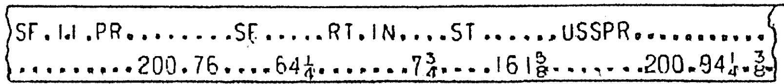

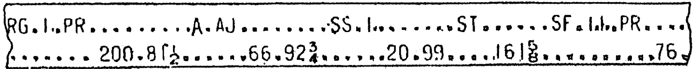

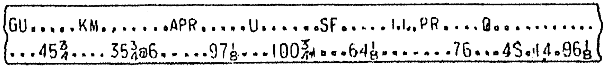

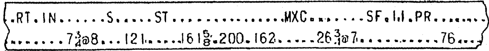

圖表 1.10 是摘錄自 Sereno S. Pratt 於 1909 年的著作《華爾街作品》（Work of Wall Street）的公有圖形，來源由 HathiTrust（https://www.hathitrust.org/）所提供。

這正是查爾斯·道、傑西·李佛摩、理查·懷可夫、JP 摩根與其他明星級交易者每天在辦公室裡看到的東西。報價紙帶不斷滴滴答答響著，傳遞有關市場價格、買賣互動和供需變動的訊息。

所有的訊息都透過手工方式彙整於交易所，然後傳遞到各個證券商辦公室的報價機器。經過長期的運用，很多術語與用詞都有簡短的縮寫，運用最簡潔的方式，傳遞所有的訊息。

## 圖表 1.11

華爾街大崩盤的報價紙帶

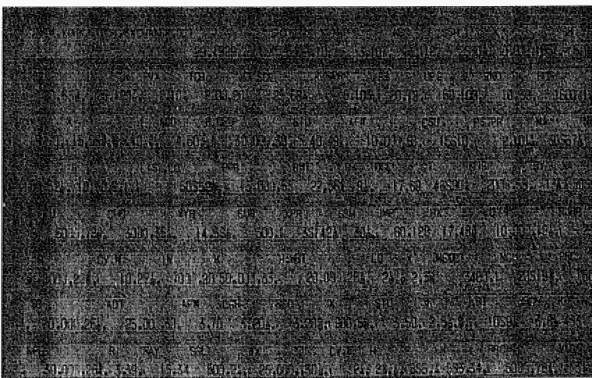

圖表 1.11 的影像是由「美國金融博物館」（Museum of American Finance）慷慨提供，各位可以在前往該處看到原物。

最頂端一行顯示股價報價代碼，固特異（Goodyear Tyre）為 GT，美國鋼鐵（United States Steel）為 X，無線電城（Radio Corporation）為 R，西屋電器（Westinghouse Electric）為 WX，報價代碼旁邊顯示的 PR，代表該股票不是普通股，而是優先股（Preferred）。

第二行是有關價格和成交量的資訊，為了加快程序，都是用簡寫方式表達。報價數字之中偶爾夾雜的英文字母「S」，是用來區隔交易股數和報價，意思和點「·」相同。另外，「SS」代表不足 100 股的崎零股。最後，報價經常會省略零，目的也是提升速度。舉例來說，讓我們拿美國鋼鐵（X）為例，第一行的報價紙帶顯示 10,000，價格為 185 ¾，到 了報價紙帶的末端，該股票的報價是 2.5 ½。所以是 200 股，但對於這樣的交易日，價格可能仍然是 185，或如同很多股票一樣，已經跌到 175，或甚至是 165。

這就是當時使用的報價紙帶，也是那些明星級交易者清楚知道的報價方式。一旦熟悉報價用語，報價紙帶就能訴說故事，而且是透過價格與成交量來敘述。如果要運用於較長期的分析，所有這些資訊就要轉移到走勢圖。

從當時到現在，究竟改變了什麼？老實說，幾乎沒有什麼改變。

很幸運，我們現在都使用電子格式的走勢圖。所有的價格行為與成交量資訊，都是每秒、每個跳動地傳遞，但為了證明報價資訊仍然很重要，以下提供相同資訊較為現代化的版本。唯一的差別，只在於這些是透過電子方式傳遞，但資訊本身幾乎完全相同。

## 圖表 1.12

### 電子報價

100股@45.17
成交量沒有顯示

10,000股@45.30
完整顯示成交量

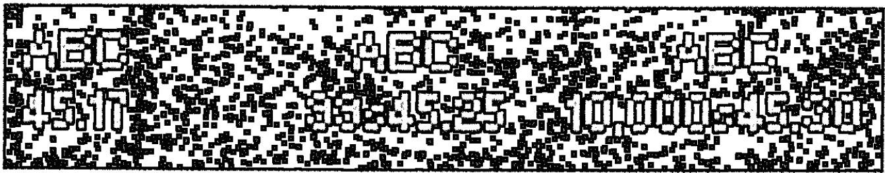

9,900股@45.25
成交量的0省略，注意使用「s」

看起來很熟悉，對吧！圖表 1.12 是個很簡單的例子。

價格由 45.17 上漲到 45.30，伴隨著看起來頗為強勁的成交量。可是，就這些資料來說，我們不知道價格變動的時間，也不知道成交量究竟是偏低、中等或偏高。這些都是重要資訊。

前述兩份圖形顯示的資訊雖然很類似，但存在一項重大差異，也就是相關資訊的時間性。對於過去的明星級交易者，他們使用的報價資料存在時間落後，落後程度可能是幾分鐘，甚至幾個小時；這種情況下，我們很難想像他們如何還能成功。

現在，我們看到的所有資訊，不論是電子報價機的資訊，或是電子版本走勢圖，或是第一級與第二級的螢幕報價資料，完全都是即時的。相較於過去的交易者，我們的日子顯然好過多了。

最後，關於這篇價量分析的導論，容我介紹另一位大家可能比較不熟悉的交易「偉人」。他的傳奇故事，截然不同於道氏、李佛摩與懷可夫，因為他是第一個暴露金融市場專業人士秘密的人，這些人他稱為「專業報價商」(the specialists) 或「內線者」(insiders)，我們則經常稱他們為「造市者」(market makers)

理查·內伊(Richard Ney) 出生於 1916 年，最初活躍於好萊塢，後來搖身一變成為著名的投資人、交易者與作家，他暴露了股票市場內部運作的奧秘，以及主管當局、政府、交易所與銀行之間的默契，允許這種情況持續存在。就這方面來說，他扮演的角色有些類似懷可夫，協助散戶投資人了解內部人士如何操縱這場遊戲。

他的第一本著作《華爾街叢林》(The Wall Street Jungle)在 1970 年榮登《紐約時報》暢銷書，他隨後又出版兩本著作《華爾街幫派》(The Wall Street Gang) 與《市場運作實錄》(Making It in the Market)。這些書籍談論的主題都相同，容我引用美國參議員李梅卡夫(Lee Metcalf) 在《華爾街幫派》一書「前言」的一段話，或許有助於各位了解這些書究竟在說些什麼：

> 「談論美國證管會的一章，內伊顯示他了解證券交易所的神祕運作方式。這些運作都被利益集團的內線人士控制，他們擁有特殊的資訊和影響力，不論相關股票的實際價值如何，都可以藉由各種交易獲利。一般投資大眾被擱置一旁，或被視為外部因素。掛牌股票的實際價值根本無關緊要，這場遊戲的名稱叫做操縱。」

請記住，寫這篇「前言」的人，是當時的美國參議員。無怪乎理查·內伊被視為人民鬥士。

他的著作到了今天仍然跟我們息息相關。為什麼？因為理查·內伊暴露的一切，今天仍然發生在每個市場。讓我把話說清楚，我不是陰謀論專家；我只是陳述交易的現實層面。我們從事交易或投資的每個市場，都受到某種形式的操縱。不論是股票市場偷偷摸摸的造市者，或外匯市場經常進場干預的中央銀行，有時候甚至是明目張膽的做。

然而，有種活動是這些內線人士沒辦法隱藏的，那就是成交量，這也是各位為什麼要讀這本書的理由。成交量會透露人們的活動；成交量會透露價格行為背後的真理；成交量會確認價格。

容我最後再引用《華爾街騙派》的一段話，藉以彰顯我的論點，同時也可以引導我們進入下一章討論。標題為「專業報價商放空運用」(The Specialist's Use of the Short Sale)的一章，理查·內伊說道：

> 「想要了解專業報價員的運作慣例，投資人應該把他們視為想要按照零售價格賣出存貨的商人。等到他們出清存貨，就會運用獲利，按照批發價格買進更多商品。一旦掌握這個概念，就能歸納下列八項法則：

+   1. 身為商人，專業報價員按照批發價格買進，然後試圖按照零售價格賣出。
+   2. 專業報價商營運得愈久，就擁有愈充裕的資金，可以按照批發價格買進股票，然後嘗試按照零售價格賣出。
+   3. 資訊傳播愈發達，就能吸引愈多人參與市場，通常也會導致股價波動更劇烈，因為供需因素的變動更可觀。
+   4. 為了要大量買賣股票，交易所會員會想辦法運用大眾傳播媒體，提升他們的銷售技巧。
+   5. 為了充分運用他們持續增加的金融資源，專業報價商會更大規模地促使價格下跌，藉以震出市場的浮動籌碼。
+   6. 價格漲勢會顯得更猛烈，藉以吸引大眾的注意，協助出脫數量愈來愈可觀的存貨。
+   7. 交付最熱絡的股票，需要較長的出貨時間。
+   8. 經濟會出現更嚴重的崩解，導致通貨膨脹、失業、利率走高與原物料缺乏。」

所以，理查·內伊如此陳述，他在整個 1960 年代、1970 年代和 1980 年代，都正確預測行情的頭部和底部，因此成為美國證管會的眼中釘，但也成為散戶投資人和交易者心目中的英雄鬥士。

所以，成交量會透露數字背後的真實狀況。不論你是在股票或外匯等受到操縱的市場從事交易，或在期貨市場面對大咖玩家，成交量都會赤裸裸顯示操縱和指令流量。

股票市場的造市者不能躲藏，在外匯市場設定匯率的大型銀行也不能躲藏。期貨市場是個純淨的市場，成交量會確認價格，讓我們清楚看到供給與需求的狀況，伴隨著人氣起伏，以及大咖玩家進出市場的指令流量。

下一章將詳細探討成交量的概念，但在之前請先閱讀我多年前幫《股票與商品雜誌》（Stocks and Commodities）寫的一篇文章，其內容呼應理查·內伊的8個法則。我撰寫這篇文章的時間，遠早於我看到理查的書，但兩者內容很相似，所以我將這篇文章擺在本章，希望強調成交量概念的重要性。我希望已經達到這個目的，否則的話，以下的「寓言」或許能夠說服各位！但願如此。

## CHAPTER 02

## 跟隨大戶為何要看成交量？

> 關鍵是要擁有別人所沒有的資訊，然後正確分析，理性運用。
——華倫·巴菲特（Warren Buffett, 1930-）

下列這篇文章是我多年前幫《股票與商品雜誌》寫的，名稱叫做「喬伊叔叔的寓言」（The Parable of Uncle Joe）。此處做了些許修改，但文章的基本內容沒變，和當初發表的情況相同。

某天，交易相當不順利，收盤之後，喬伊叔叔來找我，想要告訴我一些有關市場實際運作狀況的事實，希望能夠安慰我。以下是他告訴我的故事：

喬伊叔叔擁有一家相當獨特的公司，讓他有機會了解股價走勢的內線操縱運作。

他的公司叫做「小器具雜貨公司」，是附近唯一的小器具販賣商店，而且領有政府核發的特許營業執照。他多年來一直從事這些小器具的買賣生意。這些小器具存在內含價值，絕對不會損壞，而且市面的流通數量永遠維持相同。

喬伊叔叔相當精明，而且有多年的商場經驗，他認為目前經營的小器具生意實在沒什麼意思。每次買賣只能賺取蠅頭小利，而且每天生意也不多。

另外，經營生意也有開銷，包括辦公室的日常開支、倉儲與員工薪水。所以，應該要想點其他的方法。

經過一陣子琢磨之後，他想自己如果向鄰居透露，這些小器具即將缺貨，結果會如何呢？他知道這位鄰居是個大嘴巴，所以他等於是在報紙上登了廣告。另外，他也知道，這個計畫如果成功，目前倉庫裡的存貨，應該足以因應需求增加。

隔天，他在門口碰到這位鄰居，裝作很偶然地談到缺貨的問題，並且拜託他不要告訴別人。這位鄰居向他再三保證，絕對不會透露口風。

過了幾天，小器具的銷售狀況並沒有明顯變化。

可是，經過一星期左右，銷貨量開始增加，很多客戶前來，而且購買數量較以往來得多。看起來，他的計畫開始生效了，大家都很高興。客戶高興，因為他們知道小器具即將缺貨，流通價格也會上升。喬伊叔叔很高興，因為每天的生意愈來愈好，可以賺更多錢。

然後，他又開始想了。

既然大家都想買他的小器具，那麼他如果調高售價呢？他畢竟是附近唯一的供應商，而且當時的需求很熱絡。

隔天，他宣佈調高售價，但因為大家仍然相信不久之後會缺貨，所以客戶仍然源源不斷，甚至購買數量反而更多！

隨後幾個星期，他持續調高售價，但買氣仍然沒有減退。雖然有幾個比較精明的客戶，開始把小器具賣還給他而獲利了結，但喬伊叔叔並不在意，因為還有很多人願意買。

對於喬伊叔叔來說，這些都是好消息，直到有一天，他突然發現一個問題：倉庫的貨架都快空了。另外，他也發現每天的營業額開始減少。他決定繼續調高價格，讓大家認為情況仍然沒有變化。

可是，他現在面臨新的麻煩。當初的計畫實在進行得太成功。他如何說服客戶把小器具賣還給他，好讓他能夠繼續做生意？

這個問題困擾了他好幾天，始終找不到好辦法解決。然後，偶然一次機會，他在鎮上又碰到那位鄰居。這個個把他拉到一旁，問他最近的謠言是否是真的？他反問究竟是什麼謠言，喬伊叔叔得知這位鄰居聽說，有另一家規模更小的小器材經銷商即將在附近開始營業。

喬伊叔叔認為，這是老天爺的旨意，想要幫他解決問題。於是，他顯得很沮喪的樣子，承認謠言確實無誤，他的生意可能會受到嚴重打擊。更重要者，小器材的價格也可能因為競爭而大跌。

兩人分手之後，喬伊叔叔拖不住臉上的笑意，覺得自己實在太幸運了，竟然能夠得到鄰居如此幫忙。

幾天之後，他發現自己的倉庫外面大排長龍，人們拿著小器材拜託他買回。由於大家都想賣，價格也應聲下跌，結果造成更多人急著拋售。

隨著價格持續下跌，很多人再也承受不了壓力。喬伊叔叔也因此買回大量的小器材。過了幾個星期，恐慌性賣壓終於告一段落，只有少數人禁得起壓力而繼續抱牢小器材。

喬伊叔叔現在又按照過去的價格，重新開始販售他的小器材，倉庫裡也堆滿了存貨。他不介意生意停頓了好幾個月，因為他先前已經撈了一大筆。他禁得起慢慢來。他的管銷費用已經有了著落，員工薪水也沒問題，甚至還可以分派紅利。大家很快就忘掉了先前的謠言，生活又恢復正常。

可是，有一天喬伊叔叔可能會想，這一切是否可以重新來過？

喬伊叔叔的故事，當然是虛構的。我寫下這段故事，是在我發現理查·內伊的著作之前，但很有趣地，我們兩人都藉由相同的比喻來描述內線人士與專業報價商，或一般人稱呼的造市者。

我（還有理查·內伊）認為，這是金融市場最諷刺的現象之一。外部人士如果從事內線交易，就會受到嚴厲懲罰，遭受鉅額罰款，甚至被判刑入監，但這些真正的內線人士卻被鼓勵、甚至授權這麼做。交易所和政府當局面臨的問題，是如果沒有造市者扮演市場批發商的角色，保證交易指令得以執行，則市場就不能有效運作。當我們在現貨市場買進或賣出，我們的指令必定可以成交，這就是造市者扮演的角色。他們沒有選擇，且有責任撮合委託單，包括買進與賣出的指令，管理他們被交付的指令和存貨。

如同內伊說的，造市者是批發商，不多也不少。他們是專業交易者。他們領有執照，接受管制，被核准針對某些股票的買賣「提供市場」。它們通常是大型銀行組織，全球擁有數以千計的員工。

它們有些是家喻戶曉的機構，有些則是多數人從來沒聽過的企業，但這些業者都有一項共通點，它們得以賺進大把鈔票。造市者為何能夠享有這種獨特的地位，讓它們可以看到市場買賣雙方的資訊——同時掌握供需狀況，或市場當時的存貨部位。

如同喬伊叔叔一樣，它們同時還享有另一項重大優勢：可以根據市況條件設定價格。可是，我也不希望各位因此認為股票市場就是吃人市場，事實上並非如此，沒有任何特定造市者可以一手遮天。

然而，各位需要了解它們如何運用相關的特權與機會，以及各種交易狀況，藉以操控價格。它們會利用每個新聞事件——不論相關與否——來影響價格。各位是不是會覺得奇怪，有些無關的世界事件為何會顯著衝擊行情？為什麼利多消息反而會造成價格下跌，利空消息卻促使價格上漲？

這些解釋或許有些太過簡化，但基本現象確實是如此。所有的主要集中市場，包括紐約證交所（NYSE）、美國證交所（AMEX）與納斯達克市場（NASDAQ），都有專業報價商扮演造市者的角色。這些專業報價商包括 Barclays plc（BARC）與 Getco LLC，它們提供的造市服務，涵蓋所謂的大盤股票（The Big Board）。根據「彭博社」2012 年的報導，「各家交易所正在鼓勵造市者採用更積極的報價方法，藉以營造成交量」。同一份報導也提到，美國境內的交易所正在積極擴增造市者的數量。可是，除此之外，目前的情況和理查·內伊的時代，並沒有明顯的不同。

這些業者是否彼此合作？當然！大家存在不成文的默契。它們是否公開這麼幹？那倒還不至於。它們全部都能看到整體市場的供給與需求狀況，尤其是自己提供造市服務的股票。如果整體專業報價商都面臨供給過剩的局面，一旦新聞事件提供賣出機會，造市者通常都會採取一致行動，因為大家的庫存狀況都差不多。這基本上就是普通常識。

就倫敦證交所來說，很多證券都有正式的造市者（但那些交投最活絡的最大型股票則否，這些股票採用電子自動報價系統 SETS）。

各位可能覺得奇怪，我為什麼要如此大費周章解釋這些業者的作為，因為我們實際上根本看不到它們。答案很簡單；因為這些「有執照的內線」在市場上扮演中間人的角色，可以同時看到買賣雙方的資訊。任何特定時間，它們知道當時的供需狀況。當然，我們一般人永遠不能擁有這方面的資訊，但如果可能的話，我們大概也會運用這方面的優勢。

我們能夠用來反擊的工具，唯有成交量而已。我們或許可 以抉擊現況的是非，但只要我們仍然要從事股票交易或投資，造市者就是既有事實。我們必須接受事實，然後繼續做我們該做的事情。

成交量資訊也不完美。造市者近幾十年來已經知道如何避免申報大額成交量，往往會拖延到盤後交易才申報。不過，這畢竟還是觀察「內線交易」的最佳工具。

所有的市場都有成交量，其提供的資訊同樣珍貴，不論相關市場受到操縱與否。期貨市場的成交量代表純粹的買賣力量，可以透露行情是否喪失動力，可以顯示每天買賣意願上升或下降。成交量可以顯示跳動檔走势圖或短線走势圖每分鐘或每小時拉回或反彈走势的微妙變化。成交量是驅動行情發展的動力，以及透漏大咖玩家進出市場的痕跡。沒有成交量，就沒有走势，價格走势如果與成交量發展不能配合，就代表有問題，意味著警訊來臨。

舉例來說，市場如果處於多頭行情，期貨價格夾著大量走高，這意味著價格走势獲得成交量的確認。大咖玩家買進而推升價格。同樣地，行情如果夾著大量下跌，價格走势同樣獲得成交量的確認。實際上就是這麼簡單，這些原理適用於任何市場，不論是債券、利率、指數、商品或外匯。各位在本書看到的價量分析，適用於每個市場，不論受到操控與否。對於受到操控的股票現貨市場，這是各位可以擁有的終極武器，避免受到造市者愚弄。

從事期貨交易，成交量是用以確認價格的終極武器，可以透露買賣雙方的真正心理狀態，藉由成交量做為趨勢反轉的訊號而適時採取行動。此處，我們將跟隨那些具備內線訊息的大咖玩家腳步。

至於即期外匯市場，我們有個不同的問題。此處沒有真正的申報成交量。即使有的話，也是呈現為成交量金額，也就是「換手的貨幣數量」。不過，很幸運地，對於這個全球規模最大的金融市場，我們也有可供運用的成交量資訊，這叫做跳動檔成交量（tick volume）。

可是，跳動檔成交量並不完美，這畢竟不是實際進行交易的东西。首先，不同平台的跳動檔成交量也就不同，因為跳動檔資料是透過線上經紀商的平台提供。另外，資料素質取決於幾個因素，包括經紀商是否透過某種昂貴的傳輸系統，直接訂閱銀行同業資金運作的資訊。雖說如此，合格的外匯經紀商通常都能提供不錯的傳輸資料。

不過，跳動檔資料是否可以有效代表成交量？

簡單說，可以。這些年來，各方面的研究資料顯示，運用跳動檔資料表示成交量，能夠反映 90% 的市場真實「活動」程度。成交量畢竟只是要衡量活動程度，也就是價格的活動程度，而跳動檔即是衡量價格跳動的頻率。所以，價格如果跳動得很快，不就意味著市場呈現顯著的活動嗎？我個人認為，情況正是如此。為了證明這點，我們只要觀察重大新聞發布之前和之後的跳動檔走勢圖。

就拿每個外匯交易者都知道且也注意的非農業就業人口月份報告來說。假定我們觀察 233 個跳動檔走勢圖。報告公佈前，233 個跳動檔的每支線形，可能要花幾分鐘才會完成。可是，當消息公布當下或之後不久，每支線形可能只要幾秒鐘就能完成，看起來就像拿機關槍對著螢幕掃射！一份原本需要幾個鐘頭才完成的走勢圖，現在只要幾分鐘就填滿空間了。

這就是活動程度，純粹而簡單，我們假定它可以代表成交量。現貨外匯市場永遠都會有行情操縱。由很多角度來看，這都是操縱最嚴重的市場，我們可以把外匯戰爭看成是操縱行情的證據，但身為交易者，跳動檔成交量是我們僅有的，同時也是我們可以運用的。雖然不完美，但我可以向各位保證一件事，有比沒有好。活用這項工具後，明顯會讓你更成功，而且只要開始觀察各種情況下的走勢圖，你就會知道為什麼了。

讀者如果還是 不服氣，讓我再告訴各位一個比喻，雖然不怎麼完美，但應該有幫助。

設想你參加某個拍賣會，為了說明方便起見，假定是一樁家具的拍賣。某個寒冷潮濕而蕭瑟的冬天下午，處在某個鄉間小鎮的房間裡。拍賣場內空蕩蕩的，只有幾個買家。拍賣主持人詳述次個拍賣物件的內容，是一件古董家具，然後叫出開盤底價。隔了一會兒，有人叫價，但沒有人繼續向上叫價，最後拍賣主持人敲槌，按照開盤叫價賣出。

現在，設想相同的物件在另一種場合拍賣。假定拍賣場所設定在某大型都會，而且是在夏天，房間裡擠滿了人。拍賣主持人說明下個物件是前述古董家具，並宣布底價。由於買家興致很高，叫價一路上升，電話買盤也開始加入。最後，叫價速度慢了下來，最後賣出。

對於第一種情況，價格只變動一次，代表買氣不強，沒有人叫價，活動程度冷清，相當於缺乏成交量。至於第二種情況，價格多次變動，而且變動得很快，顯示交易活動熱絡，意味著成交量很大。

換言之，把活動程度和價格關連在一起，這種作法是絕對合理的。因此，就我個人來說，運用跳動資料來代表外匯市場的成交量資料，作法也同樣合理。活動程度與成交量，兩者基本上就是同一件事；但願前述比喻能夠說服各位，雖然有些簡化而不完美。

這個簡單的比喻，也凸顯了成交量的三個重點。

首先，所有的成交量都是相對性的。舉例來說，假定我們是第一次參加拍賣會。這種情況下，我們無從判斷活動程度究竟是平均水準，高於或低於平均水準，因為我們沒有可供衡量 的依據。反之，我們如果經常參加拍賣，就能大致了解該拍賣會的參與程度熱絡與否，也能推估大略的拍賣叫價情況。

這也是為什麼成交量會是重要參考指標的緣故。對於一般人來說，我們可以相當迅速而精確地判斷大小，而成交量之所以重要，就在於其相對大小。不同於根據報價紙帶判讀行情，我們有走勢圖可供運用，不論是短線的盤中跳動檔走勢圖，或長期投資的走勢圖，都可以根據最近的線形判斷成交量相對大小。換言之，真正重點在於相對大小。

其次，如果沒有對應的價格資料，成交量資料本身並無意義。設想拍賣場合，只有 人潮，但完全沒有叫價。如果把一份走勢圖的價格部分移除，只剩下成交量柱狀圖，雖然可以呈現參與熱絡程度，但完全沒有對應的價格行為。唯有價量結合，才會產生化學反應，並創造價量分析的威力。

最後，時間是關鍵要素。對於前述拍賣場合，如果整個過程不是幾分鐘，而是幾個小時（如果允許的話！），結果會如何？應該會造成大家興趣缺缺，恐怕看不到熱烈的價格戰。

讓我再藉由比喻來說明。設想一條裝著灑水器的水管。水管代表價格行為，灑水器代表「成交量」控制閥，灑水器的孔洞大小代表時間長短。灑水器如果保持打開，水會自然流出，沒有明顯的「衝勁」。可是，我們如果關閉灑水器的閥門，水管內的水壓就會累積，同樣的水量，透過更小的孔洞射出，水也會噴得更遠。此時，時間就扮演著重要角色。

市場的情況也是如此。

不過，容我給各位帶來一點刺激的東西，引用理查·懷可夫的一段著名警語：

> 「交易與投資如同從事任何事業——待的時間愈久，獲取的技巧愈多。如果有人知道某種『不費力』的捷徑，恐怕就是悲慘的錯誤。」

這種說法雖然適用於人生的任何領域，但對於價量研究特別適合。

各位可能已經知道，或者只要從事交易遲早都會知道，市面上有幾種免費的「成交量」指標，以及許多花錢可以購買的專屬交易系統。不論是否免費，所有這些都有個共通點。我認為，它們都沒有能力或智慧來分析價量關係，理由很簡單，因為交易是種藝術，不是科學。

我曾經花了 2 個星期時間跟隨亞伯特學習，然後我又花了 6 個月時間只專心研究走勢圖，琢磨如何解釋價量關係。我面對著兩台顯示器，一台用於現貨市場，另一台顯示對應的期貨市場，觀察每支價格線形，以及對應的成交量，運用我的知識解釋期貨市場的行為。這可能不是各位讀者想知道的。某些人可能會訝異這一切所需要花費的工夫。

我認同懷可夫的看法，成功沒有捷徑。技術分析的很多領域，都屬於藝術，價量分析的解釋也是如此。學習需要耗費時間。可是，就如同過去的行情判讀一樣，一旦掌握其中竅門，就是威力無窮的技巧。

這方面技巧相當主觀，決策需要仰賴自由心證。價量分析知識的運用，絕對不可能變成自動化程序；否則的話，本書只能充做柴火。

最後（但願各位仍然決定繼續閱讀，沒有被我嚇跑了），還有一件事情需要釐清。當我們談到成交量，所謂的買或賣，究竟是從誰的立場談論；換言之，是由批發大咖，或由零售散戶的立場說話？容我稍做解釋。

身為投資人或投機客，我們之所以研究成交量，目的完全是想知道內線、專業報價商的意圖和動向。為什麼？理由很簡單，不論他們做些什麼，我們都準備跟著做！此處的假設是一不論隱含與否一他們更清楚行情的後續發展方向。這應該不是不合理的假設。

所以，空頭行情發展過程，價格如果夾著大量暴跌，代表買進高潮（buying climax）。這意味著批發大咖正在買進，零售散戶則恐慌拋售。

同理，多頭行情的頭部，如果持續爆出大量，代表賣出高潮（selling climax），意味著批發大咖正在出貨，而零售散戶瘋狂買進，期待價格繼續飆漲。

所以，請記住，當本書談到成交量，所謂的買或賣，都是站在批發大咖的立場談論，這也是我們永遠想要跟進的對象。

下一章，我們準備處理方程式的另一邊：價格。

## CHAPTER 03
### 市場的真實價格

> 對於空頭來說，價格永遠不會太低，
> 對於多頭來說，價格永遠不會太高。
> ——無名氏

現在，我們準備討論與成交量對應的價格，並容我重複回到本書稍早已經引用傑西·李佛摩說過的一段話：

> 「華爾街沒有什麼新鮮事。不可能有，因為投機活動就如同山丘一般古老。今天發生在股票市場的一切，過去都曾經發生過，將來也會繼續發生。」

如果要直接運用這段著名的話，我要說「交易沒有什麼新鮮事」。如同第 1 章談到的，價量分析的歷史已經超過 100 年。價格分析的情況也是如此，如果要說交易者研究分析的走勢圖有什麼改變的話，可能只有價格的表達方式，因為 1990 年初開始，日本陰陽線的運用逐漸普及。

交易流行，來來去去。幾年前蔚為風潮的東西，可能迅速被淘汰，然後又推出某種「新」方法。「價格行為交易」（price action trading，簡稱 PAT）就是目前正被努力推廣的方法。這套方法的內含，就如同該名詞所顯示，交易只分析價格，沒有（或少量）使用其他指標；我個人認為這是相當古怪的方法，理由如下。

假設我們向過去的頂尖交易者建議採用一套新的行情分析方法，譬如：傑西・李佛摩、查爾斯・道、理查・懷可夫或理查・內伊等人，當報價紙帶傳遞的資訊只有價格，沒有成交量，我相信這些交易者可能會目瞪口呆，全然不知所措。可是，各位不用擔心，本書解釋的價格行為交易，會取得成交量的確認。所以，各位可以買一送一，物超所值！

這……可能有點離題了。我住在倫敦，距離 LIFFE（倫敦國際金融期貨與選擇權交易所）古老建築很近。我經常拜訪倫敦的這個地區，只要開車經過這座交易所大樓，白天就可以看到很多身穿鮮豔外套的交易員，快跑出來買咖啡和三明治，然後又衝回交易所。他們通常都是年輕小伙子，大聲喧嘩、行為粗魯；事實上，在 Walbrook 和 Cannon 街角，現在就豎立一座拿著手機的場內交易員青銅雕像。這是個講究速度與積極交易的時代，而此處竟然就是我當年開始踏入交易生涯的地方，在交易大廳從事 FTSE 100 指數期貨的撮合工作。

營業時段，場內交易員情緒高漲，大聲尖叫嘶喊，比劃著外人看不懂的手勢，在夾雜著汗臭與噪音的瘋狂環境下，從事買賣活動。任何人如果願意觀察，就不難感受到交易大廳散發出來純屬恐懼的原始情緒。

然而，電子交易方法改變了所有這一切，LIFFE 是許多受害者之一。交易員再也不在此從事交易，離開交易塾，改用電子平台。很諷刺地，這些年來，我所碰過的絕大多數交易員，他們都沒能成功由場內交易轉換到電子交易，只因為一個簡單的理由。

身為場內交易員，不僅可以感受到恐懼與貪婪的情緒，也可以藉由場內交易狀況，判讀市場交易流量。對於場內交易員來說，這即是成交量或委託單流量。這也是市場內交易員每天看到、感受到的東西：金錢流動、市場人氣，以及所產生的交易機會。換言之，他們可以「看到」成交量，可以看到大咖買家進場，然後搭他們的順風車。這也代表報價螢幕上顯示的成交量。

可是，由於再也看不到、感受不到、無從判讀場內的交易流量，這些交易員也就不能成功轉換到電子交易平台。有些人雖然得以成功，但絕大部分人都沒辦法從受到某種有形物質支撐的價格行為環境中，成功過渡出來。不論是要稱呼這種物質為活動、委託單流量、人氣或「市場脈動」，這都是賦予價格行為生命的東西，也是他們在電子時代來臨想要爭取成功的憑藉。

目前，場內交易雖然式微，但還是存在，如果有機會的話，我建議大家不妨親眼瞧瞧。只要實際目睹場內交易的狀況，想必就能體會成交量為何能夠賦予價格如此重大的意義。這也是為什麼我認為價格行為交易（PAT）只是沒有具體意義的一時流行。

沒錯，價格行為確實會反映所有的新聞，以及世界各地交易者與投資人的決策和看法，詳細分析價格行為也確實能夠預測未來的行情走向，但沒有成交量，我們就不能確認價格分析的結論。成交量賦予價格意義，讓我們得以解釋價格行為，核對價格分析的效力。這就是場內交易員過去所做的一—他們看到價格走勢，根據場內委託單流量做確認，然後採取因應行動。

對於我們來說，情況也是如此。只是改用電子版本的委託單流量，也就是電腦螢幕上顯示的成交量。

可是，讓我們再回到稍早考慮的拍賣例子，但這次沒有實體的拍賣場地。換言之，讓我們上網進行拍賣；現在，各位想必更能體會那些場內交易員遭遇的困難。離開實體拍賣場地，我們再也看不到實際的買家，沒辦法感受場內人數、電話買盤、叫價速度等。身處在實體拍賣場，我們可以感覺叫價停頓的價位，可以察覺喊價透露的恐懼感，因為價格已經來到這些人的極限附近。他們的喊價開始猶豫，雖然很短暫，但還是感受得出來。這就是場內交易員懷念的東西。

想要參加線上拍賣，首先必須登入，然後等待拍賣開始。看到想買的東西，我們開始喊價。然而，我們不知道究竟有多少潛在買家，也不知道拍賣是否公正。我們只能看到人們的喊價。如同我們了解的，拍賣主持人大有可能「信手拈來」價格（換言之，虛構喊價），這種情況經常發生。我們知道，勝任的拍賣主持人會儘量鼓勵繼續喊價——這有助於他們的生意，因此也可能耍出各種伎倆。

讓我們回到線上拍賣。我們繼續喊價，最後終於得標。

可是，得標的價格好嗎？我們只提到價格，而不是價值，這是兩個全然不同的概念。但願各位現在已經能夠體會我所說的。關於線上拍賣，我們只能看到價格。

因此，從事真正的線上交易「拍賣」，難道我們真的只想根據價格來擬定交易決策嗎？關於這個問題，過去偉大的明星級交易者，他們的答案是很清楚的說——不！

再次地，我承認這不是很好的比喻，但希望得以清楚說明我的意思。

對於我來說，沒有成交量的價格走勢圖，相當於只說一半的故事。特定時間點上的價格，確實可以反映當時的市場人氣，但許多市場充滿了人為操作，我們為什麼要忽略如此珍貴而經常免費的資訊呢！

價格雖然是一種領先指標，但其本身只透露過去發生的事情，而我們藉此解釋將來可能發生的事情。我們的分析也許正確，但成交量可以用來確認。市場如果受到人為操縱，成交量會透露價格行為背後的實際情況。處於純粹的市場，成交量會透露市場人氣與委託單流量背後的實際情況。

所以，讓我們更深入觀察價格，尤其是科技變動對於價格線形四個構成要素——開盤價、最高價、最低價與收盤價——造成的影響。近幾年來，我們看到的最顯著變動，就是電子交易平台的興起，以及這對於開盤價和收盤價的影響。

時序回溯到內伊或更早期的年代，當時只有在實體市場進行交易。市場是在交易所開始營業的時間開盤，在交易所於特定時間結束營業的時候收盤。交易一律在交易所的營業大廳進行，大家都知道市場什麼時候開盤和收盤。這讓開盤價和收盤價具有重要意義，尤其是在每天開盤和收盤時段。交易者和投資人都迫不及待地等待市場開盤，等到接近收盤時段，交易會變得非常熱絡，因為交易者都趁著這個時段結束當日沖銷部位。現在，這段期間稱為正規交易時段（regular trading hours，簡稱 RTH），也就是實體市場（集中市場）的營業時段。全球股票市場基本上還是採用這套方式，紐約證交所（NYSE）的營業

時間是早上 9：30 到下午 4：00，倫敦證交易所（LSE）的營業時間是早上 8：00 到下午 4：30，但交易世界的真正革命性發展，是電子交易的來臨。

芝加哥商業交易所（CME）於 1992 年引進的 Globex 平台改變了一切，此後的每種期貨契約幾乎都是每天 24 小時提供交易。類似如股票等現貨市場，雖然還受到集中市場（交易所）的營業時間限制，但電子指數期貨 24 小時交易仍然造成重大衝擊。這意味著現貨市場的開盤價和收盤價重要性已經大不如前。

這一切只因為引進 Globex，電子交易已經成為指數期貨的標準，而後者是現貨指數的衍生性交易工具。1997 年首先引進 ES E-mini（S&P 500 指數 E 迷你契約），然後是 1999 年開始的 NQ E-mini（Nasdaq100 指數 E 迷你契約），再來是 2002 年引進的 YM E-mini（道瓊 30 種指數 E 迷你契約）。透過這些指數期貨契約，已經可以在遠東盤和亞洲盤進行隔夜交易，現貨市場的開盤價再也不足以令人覺得意外，因為隔夜行情已經可以預先反映。我們知道，在電子交易來臨之前，開盤價向上或向下跳空，通常會強烈凸顯市場的意圖。至於現在，主要指數的開盤價已經很難讓人覺得意外，因為隔夜期貨市場早就提供各種徵兆。

至於個別股票，價格通常也會受到大盤指數影響，因為漲潮會使所有的船隻浮起。所以，個別股票的開盤價和收盤價雖然還是很重要，但股價指數已經預先顯示整體大盤的人氣狀況，因此開盤價也顯得不若以往重要。

收盤價的情況也雷同。集中市場的股票現貨交易雖然已經收盤，但指數期貨的電子盤將在遠東與其他市場繼續進行交易。

電子交易的這方面影響，也同樣適用於所有的商品，因為 Globex 平台幾乎是每天 24 小時提供交易，包括外匯期貨與外匯現貨都是每天 24 小時提供交易。

價格走勢圖也反映出電子交易的特性。20 年前，我們經常看到價格向上或向下跳空，今天開盤價可能明顯高於或低於前一天收盤。價格跳空經常意味著突破走勢，尤其是獲得成交量確認。現在，這類價格行為已經很罕見，而且基本上只發生在股票市場。現在，幾乎所有其他市場都已經電子化，譬如現貨外匯市場，而且如同我們稍早看到的，股價指數也和商品或其他期貨契約一樣，通常會跟進反映隔夜的期貨行情。

現在，某支線形的開盤價，通常就是前一支線形的收盤價，不具有特殊意義。這是電子交易對於走勢圖價格行為造成的諸多影響之一，而且將來應該還會繼續如此。電子交易已經成了定局，各個市場價格行為之構成要素的意義也因此改變。

市場如果每天 24 小時提供交易，則某支線形的開盤價，自然就是前一支線形的收盤價，直到每週交易結束為止。從價格行為交易（PAT）的角度來看，這個事實幾乎排除了任何值得參考的「人氣」訊號，因此讓成交量在目前電子化世界變得更重要——至少我個人如此認為！

可是，讓我們更仔細觀察個別價格線形的四個構成要素，也就是開盤價、最高價、最低價與收盤價，並且從價量分析的角度探討其重要性。現在，我希望特別聲明，本書與我個人的交易，都一律使用燭形線（又稱陰陽線或 K 線）。這也是當初亞伯特教導我們的。

我曾經試著使用長條圖，認為我可以不用 K 線圖。然而，我最後還是重新使用 K 線圖，而且在可預見的未來，也不打算採用其他系統。我知道某些交易者偏愛使用長條圖、曲線圖、Heikin Ashi（平均棒線，或稱為裁縫線、踩盤線等）或其他格式的線形。可是，我所受的價量分析訓練，都是採用 K 線，而且相信採用 K 線最能彰顯這種方法的威力。但願各位讀完本書之後也能認同這點。

所以，讓我們剖析標準的 K 線，解釋我們可以從中得知什麼。標準的 K 線有七個重要構成部份，包括：開盤價、最高價、最低價與收盤價，上影線與下影線，還有實體長度（價差），請參考圖表 3.10。特定時段內的價格行為雖然是由這七個要素共同決定，但藉由成交量進行確認時，上／下影線與實體長度最能透露市場人氣。

## 圖表 3.10

典型的燭形線

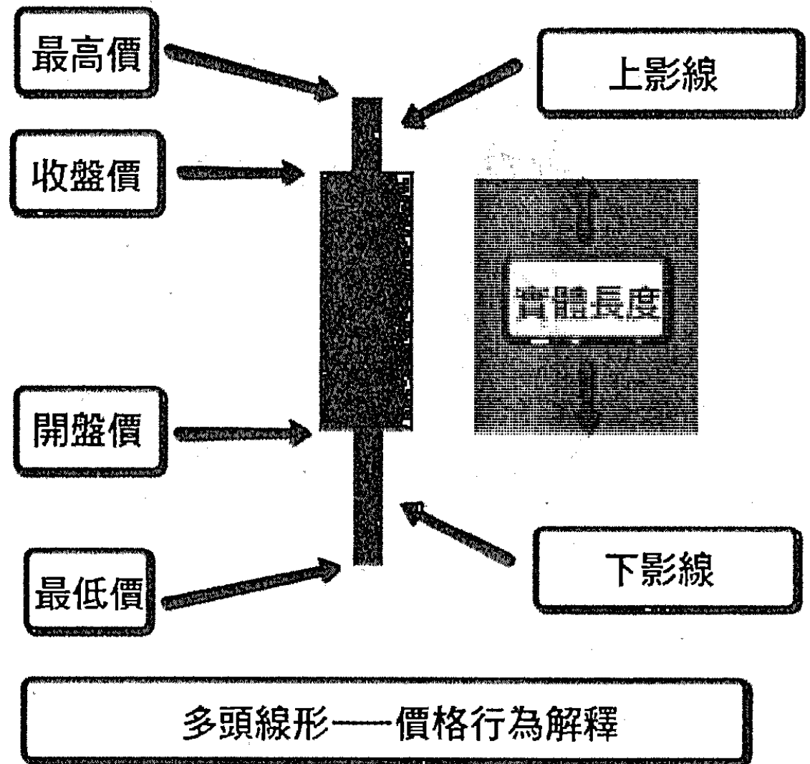

觀察 K 線發展過程的價格行為，最簡單的方式，或許是思考價格在交易時段內（不論是短期的跳動檔走勢圖，乃至於長期的月線圖），買賣雙方彼此角力，造成行情上下擺動，整個過程形成波浪狀價格走勢。

就圖表 3.11 顯示的波浪狀價格走勢來說，買方最終獲勝。請注意，價格也可能透過全然不同的旅程而創造這支相同的線形；可是，重點是最後的線形。

## 圖表 3.11

### 波浪狀價格行為

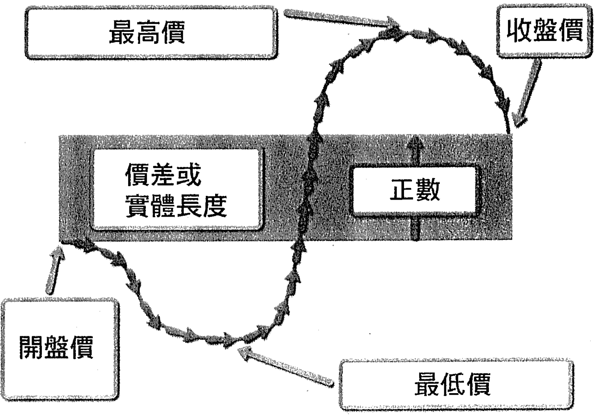

首先讓我們看看反映整個交易時段人氣程度的實體長度（價差）。

開盤價與收盤價之間的價差拉得愈開，代表市場人氣愈旺盛。所謂的人氣，可能是多頭或空頭人氣，取決於收盤價高於或低於開盤價。

開盤價與收盤價之間的價差很小，代表市場人氣不顯著，也就是說市場沒有顯著的多空看法。線形實體上端和下端的影線，代表交易時段內的人氣變動。交易時段的人氣如果始終保持一致，就不該有影線。這類似網路或實體拍賣的情況，開始叫價之後，價格只能走高，最後只能按照更高價格賣出。這種價格行為的 K 線，不會有上影線或下影線；就交易來說，這代表人氣很明確，持續朝單一方向發展。

這就是影線的功能，如果配合線形實體分析，可以透露市場的真正人氣。這也是價格行為交易（PAT）的構成基礎，其本身是絕對有效的。

可是，為何要就此打住呢？為什麼不繼續運用成交量做確認？這是我始終搞不懂的地方，如果有哪位閱讀本書的 PAT 交易者願意幫我開示一番，麻煩傳個電子郵件給我。

所以，影線的長度與發生情況，究竟是上影線或下影線，對於價量分析都至關重要。關於這方面的解釋，透過例子來說明，或許會有幫助。

讓我們看兩個例子，首先是圖表 3.12。此處只有一根影線，價格開盤之後，行情走低，接著開始回升，最後拉高到開盤位置做收。圖表 3.13 代表第二個例子，同樣只有一根影線，價格開盤之後，行情走高，然後向下反轉而在開盤價做收。

讓我們分析相關交易時段內發生的價格行為與市場人氣。

對於這兩個例子，我們都知道所要討論的，是價格行為的輪廓架構，因為價格都返回最初開盤價做收。所以，不會涉及任何猜測。價格行為之內，行情可能起伏波動，交易時段內的某個時候，價格創最低點或最高點，然後折返到最初的開盤價。

## 下影線範例

### 圖表 3.12

下影線的範例

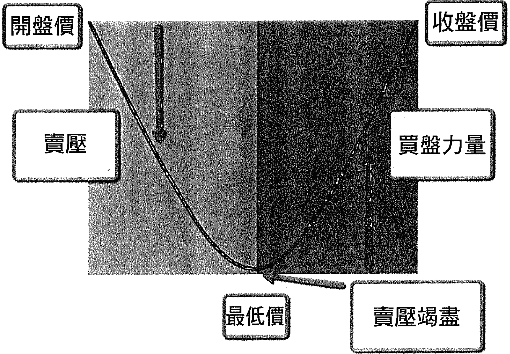

讓我們先看下影線的例子，價格開盤後不久，賣壓立即湧現，買盤無力招架，價格被迫走低。行情走低的發展過程，或許曾經停頓或反彈，這可能顯示在更短期的走勢圖內。然而，

就目前考慮的交易時段，整支線形發展的前半段期間，行情完全都由賣方掌控。

跌勢發展到某種程度，買方認為價格已經具有吸引力，於是進場與賣方角逐。行情發展到最低價附近，賣方力量逐漸放盡，買方也慢慢掌握盤勢。現在，賣方開始承受壓力，買盤力道愈來愈強，最後推升價格回到開盤價做收。

可是，這個價格行為透露什麼？答案是兩件重要的事情。

首先，這個交易時段內，不論時間架構為何，市場人氣出現了全然的反轉。為什麼？因為線形前半段顯現的賣壓，到了後半段完全被吸收，並且被克服。

其次，線形收盤當時呈現多頭人氣——情況理當如此，因為我們知道價格收在開盤價，所以收盤當時，價格應該呈現漲勢，受到買盤力道支撐。

這是否代表任何趨勢反轉的訊號？不盡然，觀察成交量就知道為什麼；配合成交量，才能夠讓我們看到完整的故事。目前，此處只考慮價格行為，我們只看到半個故事，我希望強調的是，影線部分極端重要，屬於價量分析的關鍵部分；總之，影線就如同線形實體一樣。就目前這個例子來說，線形沒有實體，或實體長度為零，但其重要性並不亞於任何巨大實體。

我希望這個例子有助於解釋線形「內部」發生的價格行為。這是個非常簡單的例子，價格行為被劃分為 50 / 50 的兩個對稱部分。雖說如此，但原理仍然相同。價格行為可能被劃分為 25 / 75 或甚至 15 / 85 的兩個部分，但重點是該線形代表交易時段發展過程的某個階段，賣方受到買方壓制。

現在，我們來到價量分析的另一個領域，本書稍後也會討論。截至目前為止，我們已經數度提到價量分析（Volume Price Analysis，VPA），這是探討整支線形的成交量和價格關係，但線形發展過程內的情況又如何呢？也就是實際發生的買賣行為，這稱為價格的成交量分析（Volume At Price，簡稱 VAP）

價量分析（VPA）是研究線形完成之後的價格和成交量之間的「線性關係」，價格的成交量分析（VAP）則是研究價格線形發展過程的成交量輪廓結構。換言之，相關價格行為發展過程，成交量集中在「何處」。

我們不妨這麼說：價量分析（VPA）是研究線形之「外」價量關係的大局；價格的成交量分析（VAP）是研究線形之「內」的成交量輪廓結構細節。這讓我們的外部觀點有了另一種觀察角度——相同事物的兩種觀點，由不同角度觀察，彼此相互確認，也更加明確界定價量關係。

接下來，讓我們討論上影線的例子。

## 上影線範例

### 圖表 3.13

上影線的範例

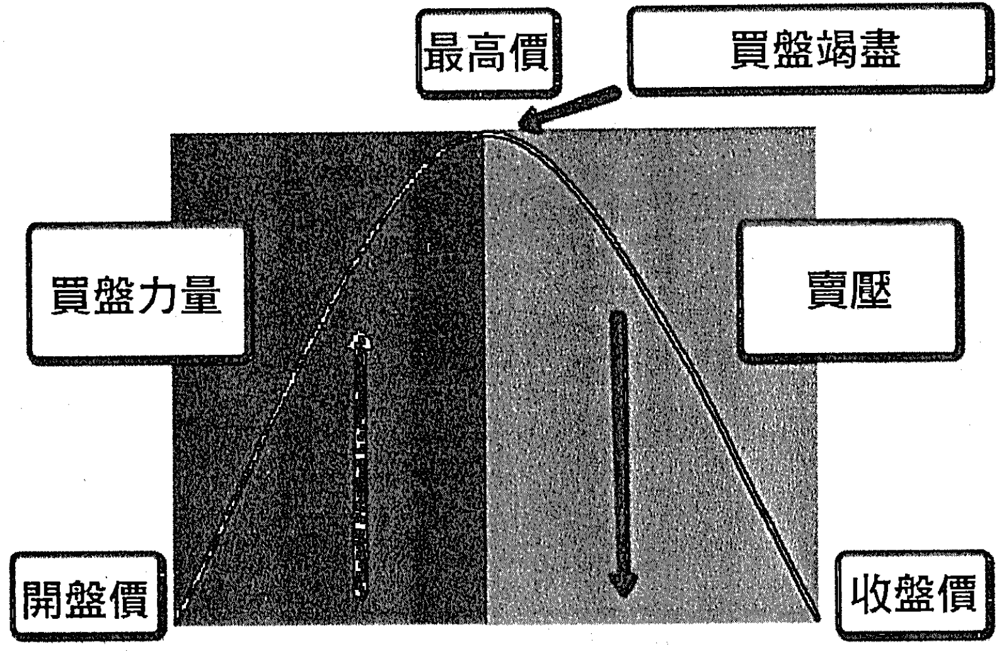

關於這個例子，市場開盤之後，買方立即取得控制權，迫使賣方節節敗退，驅使價格走高。可是，隨著線形發展，價格慢慢上漲到買方無以為繼的地步，漲勢遭遇阻力，賣方逐漸爭取到控制權。

最後，行情發展到最高價附近，買盤終於放盡力氣，賣方湧入，買盤獲利了結。賣壓開始迫使價格下滑。

價格終於折返開盤價做收。同樣地，這個價格行為呈現兩個基本重點。

第一，市場人氣出現全然的反轉，這次是由多翻空。第二，

收盤人氣偏空，因為收盤價跌回到開盤價。

同樣地，這是價格行為的典型化觀點（stylised view）。雖說如此，這是線形涵蓋時段內發生的價格行為，至於該時段究竟為何，並無差別。

這支線形可能出現在跳動檔走勢圖、5 分鐘走勢圖、日線圖或週線圖，這也是時間概念開始發揮作用的地方。相較於 1 分鐘或 5 分鐘走勢圖，這類價格行為伴隨著正確的成交量結構——如果出現在日線圖或週線圖上，就會明顯更具有意義。

後續章節會更詳細討論這方面內容。

可是，如果以 K 線表示在價格走勢圖上，這種價格行為會呈現怎樣的線形呢？

## 下影線範例

### 圖表 3.14

下影線範例的 K 線

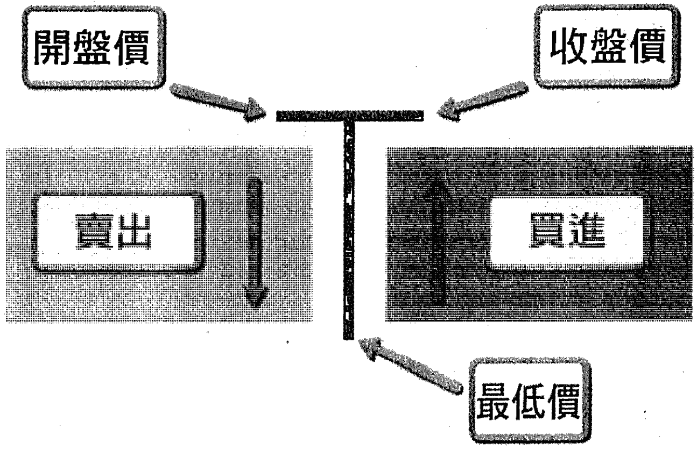

這支線形看起來雖然不怎樣，但如果出現在任何走勢圖上，都代表最具威力的價格行為之一，尤其是配合成交量分析的話。所以，價格行為配合成交量，將告訴我們行情隨後的可能走向。

其次是另一個威力同樣強大的 K 線。

## 上影線範例

同樣地，這是非常重要的價格型態，本書會經常看到這種線形。

### 圖表 3.15

上影線範例的 K 線

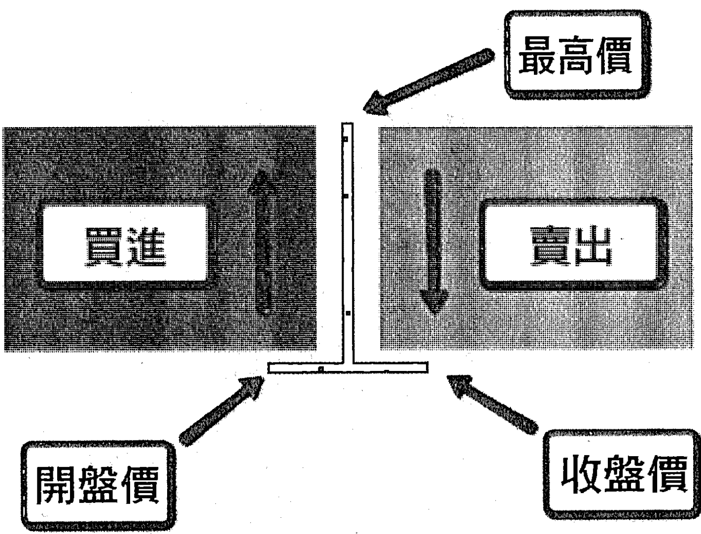

本書主題如果是討論價格行為交易（PAT），或許就可以在此告一段落了。我們現在畢竟已經可以從 K 線的影線價格行
為看到買進與賣出。可是，此處沒有顯示的，當然是價格行為的力道，還有或許更重要的一一價格行為是否有效。換言之，K線所呈現的價格行為究竟是真或假？如果是真的，其力道又如何？是否有任何重要性？這也是為什麼我認為 PAT 只說了半套故事的原因。配合成交量，故事才完整。下一章將討論價量分析的第一原理。

## CHAPTER 04

## 價量分析：第一原理

> 學習曲線不論源自何處，永遠不會有終點。
（持續學習股票投資的過程）
— 約翰・聶夫（John Neff, 1931-）

本章準備開始討論價量分析（VPA）的某些基本原理，也就是我認為想要成功運用 VPA 於交易的一些指導原則。這些原則是我 16 年來所發展、每天運用的，也是我根據亞伯特之教誨而開始運用的技巧。雖然當初花了不少成本，歷經超現實的學習過程，我還是要永遠感謝亞伯特帶領我（還有我丈夫大衛）走上正確的交易道路。但願本書也能帶給各位相同的結果。

這些都是指導原則，不是一成不變的僵硬規定，目的是要協助各位有效運用即將學到的東西。另外，本書接下來會把「價量分析」簡稱為 VPA，希望能夠讓我們彼此都覺得更簡便！

### 原理 1：藝術而非科學

運用 VPA 判讀走勢圖的學問，是一門藝術，不是科學。另外，這種技巧不容易運用於自動化程序或電腦軟體。這套方法需要費點工夫才能熟練，但所花的時間和精力應該會值得。VPA 適用於任何市場的任何交易工具，也適用於任何時間架構。VPA 不適合透過電腦軟體運用，主要是因為這方面分析大多涉
及主觀判斷。我們要根據對應的成交量，分析比較價格行為，尋找確認或異常現象，同時還要根據最近的成交量發展，判斷成交量強弱。

電腦軟體的決策程序不允許涉及主觀判斷，所以不適用。

這種分析方法還有另一個優點，一旦學會，幾乎就可以終身免費使用！你只需要支付資料傳輸成本，以及購買本書的投資！

### 原理 2：耐心

我花了不少工夫才得以體認這項原理，所以我希望能夠幫各位節省一些時間。

金融市場就像一艘超級油輪，沒有辦法立即停頓或轉彎。市場走勢存在慣性，所以在相關線形或價格型態顯示反轉或異常現象的訊號，既有走勢總是還會繼續進行一陣子。剛開始運用這套方法時，每當看到交易訊號，總是迫不及待地進場建立部位，結果發現預期走勢發生之前，既有走勢通常都會繼續發展一陣子。

情況之所以如此，原因很簡單，我們只要思考每支線形的發展，以及市場的實際情況，就不難理解。容我引用例子來說明。

夏天的陣雨。陽光普照，然後情況開始發生變化，烏雲籠罩，幾分鐘之後開始降雨，最初只是稀稀疏疏的幾滴，然後愈下愈大，接著雨勢又開始減緩，最後完全停頓，陽光再度露臉。

這個比喻可以充分說明價格反轉的情況。讓我們考慮某個

下降趨勢的發展情況，行情跌勢已經持續了好幾支線形。然後，開始看到潛在的買盤進場，賣方力量開始受到買方威脅或甚至壓制。可是，這不是完全發生在單一線形的價格行為之內。某些賣家仍然堅持，相信行情還會繼續走低。價格確實繼續小跌，但很快又回升，更多賣家因此被嚇得出場。然後，行情又下挫，接著又彈升，震出更多頑固的賣家。最後，市場已經徹底清除殘餘的賣家，準備妥當，真正的反攻蓄勢待發。

如同我稍早說的，市場永遠不會全然停頓而反轉，突然來個髮夾彎。趨勢變動需要時間醞釀，讓所有的賣方或買方能夠被「徹底清除」，就是這種反覆走勢，導致延伸性行情之後經常出現橫向發展的價格區間，價格上下攪盪。這段期間內，價格支撐與壓力扮演重要角色，這也是 VPA 的關鍵構成要素。

啟示：每當訊號出現，不要立即採取行動。任何訊號都只是警訊，代表既有情況即將發生變化，但我們必須耐心等待。夏天的驟雨不會說停就停，而會由大變小，然後慢慢消失，最後才全然停止。打翻了一杯水，必須用布抹乾，第一次先抹掉大部分的水，第二次才能真正抹乾。市場趨勢變動也是如此，需要花點時間才能抹掉既有趨勢，然後新趨勢才能發展。

但願我說清楚了自己的意思。務必耐心等待。趨勢確實會反轉，但不是在某訊號線形發生的當下。

### 原理 3：一切都是相對的

成交量分析完全是相對的，這是我不再執著於自己的成交量資料完美與否之後，才得到的結論。剛開始的時候，我相當堅持要了解自己成交量資料每個層面的狀況。資料來自何處？
資料是如何蒐集的？資料是否精確？相較於其他來源的資料如何？是否有其他更好的資料可以提供更精確的訊號？以及其他等等。目前，許多交易論壇還是經常談及這類的話題，彼此爭論某些資料來源的優缺點等等。

我花了好幾個月時間嘗試比較各種不同來源的資料，並做歷史資料測試，結果慢慢發現根本沒有必要擔心資料的些微缺失或不完美。如同我稍早強調的，交易與 VPA 是一門藝術，不是科學。我們取得的資料，會因為經紀商或交易平台不同而不相同，使得線形排列也稍有差異。即使是相同時間架構的相同交易工具，我們如果比較不同經紀商提供的走勢圖，往往會看到不同的線形。情況之所以如此，原因很單純。線形收盤價可能受到各種因素影響，包括電腦時鐘的快慢、所處的地理位置、交易時段收盤價什麼時候引發等等，所有情況都可能出現差異。

資料傳輸涉及複雜的程序，包括如何計算，如何把資料呈現於螢幕。我們使用的資料，往往取自不同來源，透過不同方法處理。即使是現貨市場的資料，也可能出現差異，尤其是即期外匯市場。不過，老實說，這根本不是大問題，理由很簡單。

成交量都是相對的，所以只要資料具有前後一致性，就沒有太大差別。這是我花費好幾個月時間研究，最後取得的結論。

因此，每當我聽到有人說，利用跳動檔資料代表成交量，只有 90％的精確性，火氣就會直往上冒。精確性即使只有 80％或 70％，那又如何？我只關心資料的前後一致性。資料只要具備一致性，那就沒問題，因為我是針對自己使用的資料來比較成交量數據，是自己的參考資料！我不是和別人的資料做比較。可是，我也必須承認，我確實花了一點時間才取得這個合乎普
通常識的結論。

所以，不要和我一樣浪費太多時間。成交量是相對的，我們是根據一段期間的成交量來比較某成交量，藉以判斷該成交量是高、是低，或中等。資料即使不完美，並不至於造成差別，因為我們是拿不完美的資料比較不完美的資料。

同樣論述也適用於現貨外匯市場的跳動檔資料。我接受這種不完美的資料，但我們只是比較某支線形和另一支線形，只要資料顯示活動程度，那就沒有問題。我們存在不完美的世界，而且必須在此進行交易。甚至是 MT4 平台免費提供的跳動檔資料也完全沒問題——請相信我。多年來，我一直使用這些資料，同樣賺錢。另外，這是由經紀商免費提供的資料。

### 原理 4：練習才能完美

任何技巧都需要花工夫練習才能熟練。各位即將從本書學到的交易技巧，適用於所有的時間架構，而且不論是投資人或投機客，也同樣適用。身為投資人，買進之後，可能持有好幾個, 所以你會考慮採用較長期的走勢圖，譬如說，就像理查·內伊一樣。反之，如果是當日沖銷的短線帽客，可以在跳動檔走勢圖或短線走勢圖採用 VPA。所以，慢慢來，不要急。你所花費的工夫絕對值得，經過幾個禮拜或幾個月之後，你就會發現自己突然可以解釋走勢圖，預測後續的行情發展。

### 原理 5：技術分析

VPA 只代表一部份故事。我們永遠會運用其他技巧來確認狀況，提供額外的證據。最重要者莫過於支撐 / 壓力，我們在原理 2 談到箇中原因。這是走勢停頓而展開「徹底清除」障礙
的操作，或者，停頓可能只是暫時休息，既有趨勢隨後還會繼續發展；這一切都會藉由成交量進行確認。走勢夾著大量突破密集交易區間，永遠代表強烈的訊號。

趨勢也同樣重要，就如同價格型態分析一樣，這都屬於技術分析的藝術成分。

### 原理 6：確認或異常

運用 VPA 做為分析工具，我們只觀察兩件事情：價格是否受到成交量確認，或者價量關係發生異常現象。價格型態如果得到成交量確認，代表價格型態所預測的走勢將發展。反之，價量關係如果發生異常現象，代表價格型態可能無效。這也就是 VPA 想要探究的兩件事情。

確認或異常，別無其他。探討多支線形與實際走勢圖的案例之前，讓我們先看一些單一線形的確認例子。

## 確認案例

圖表 4.10

高成交量長線形

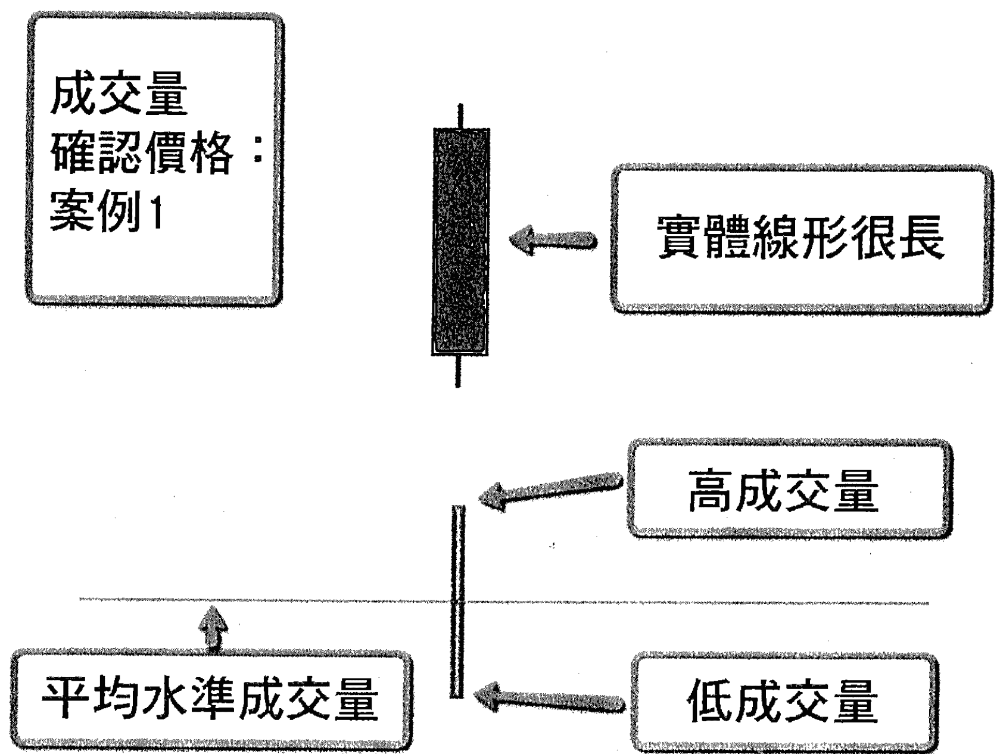

請參考圖表 4.10，這是一支實體很長，上、下影線都很短的線形，成交量明顯大於平均水準，所以價格獲得成交量確認。

就目前這個例子來說，價格呈現多頭行為，幾乎是以最高價做收。這如果是個有效的走勢，則應該看得到某種推升價格的作用反映在成交量上。

記住，這也是懷可夫的第三法則：「作用 vs. 結果」法則。行情上漲需要某種力量作用其中，行情下跌也是如此，所以交易時段如果發生重大價格變動，應該可以看到平均水準以上的成交量做為確認。實際情況也是如此。所以，就目前這個例子來說，價格獲得成交量確認。我們可以就此推測兩件事。第一，這個價格走勢是真的，不是造市者操弄出來的；第二，行情暫時呈現多頭發展，直到發生異常現象為止，所以我們可以繼續持有多頭部位。

## 圖表 4.11

低成交量短線形

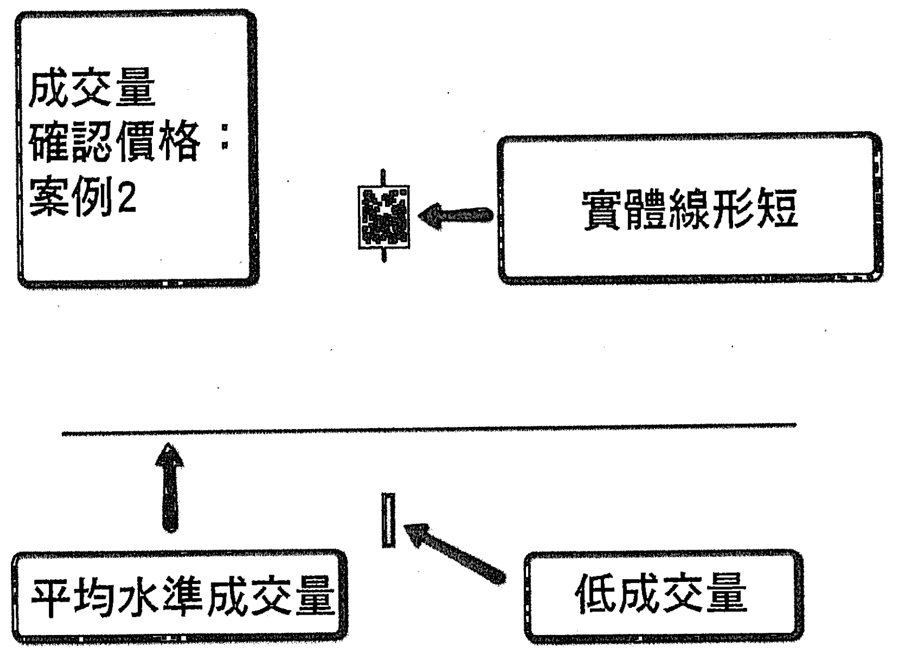

請參考圖表 4.11，這個例子顯示短線形伴隨著低成交量。目前這個例子裡，價格上漲，但幅度很有限，線形很短。上影線與下影線也都很少。線形伴隨的成交量，明顯低於平均水準，此處想要問的問題很簡單。價格行為是否得到成交量的確認？

答案是肯定的。理由也是因為「作用 vs. 結果」。就這個例子來說，價格只是小漲，我們期待成交量也會反映這個事實；換言之，成交量也應該小。作用與結果如果相互配合的話，則價格既然只是小漲（結果），施之於上的作用（成交量）也應該小。所以，此處看到的，是價量彼此配合，價格行為獲得成交量的確認。接下來，讓我們再看看這兩種同樣的價格行為，但價量關係卻出現異常。

## 異常案例

圖形 4.12

低成交量長線形

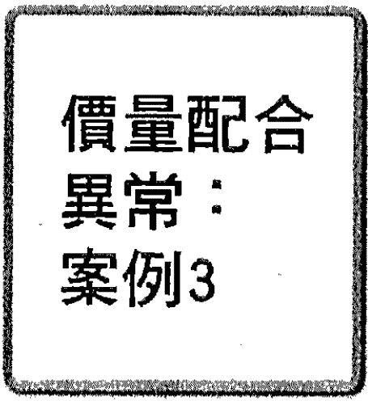

圖表 4.12 顯示價量關係異常的第一個例子。我們看到，價格呈現長線形，根據懷可夫的第三法則，這個結果應該存在對應的作用。可是，我們看到的卻是「大結果」與「小作用」，情況顯然異常。照道理，長線形應該配合高成交量；所以，警鈴響了，情況有些不對勁。

我們馬上想問，既然預期看到大成交量，為何實際上卻出現低成交量呢？是不是某些人——造市者——佈下的陷阱？相當可能，各位現在可以體會 VPA 的威力所在了。只靠著單一線形，我們就可以看出情況不對。價量配合異常，因為價格如果真的走高，就應該得到買盤支持，成交量應該明顯放大。可是，我們卻看到低成交量。

我們手頭上如果持有多頭部位而看到這種發展，就應該立即質疑市況。舉例來說，為什麼會發生這種異常現象？這是否是潛在陷阱的早期徵兆？這種價量型態經常發生在股票市場開盤初期，造市者可能想藉此測試市場人氣。舉例來說，這可能出現在 1 分鐘走勢圖。市場開盤，價格走高，測試買盤追價意願。如果沒有明顯的追價買盤，可能讓價格回挫，做進一步測試。

我們稍早已經談過，股票市場開盤之前，指數期貨市場已經在隔夜的 Globex 進行交易，造市者相當清楚市場人氣偏多或偏空。所以，這方面的測試，只是想知道價位，幫開盤時段做價格定調。不只大盤指數而已，個股也同樣會如此處理。透過成交量資料，我們很容易看出這種意圖。

這也是為什麼我不能了解 PAT 為何能夠流行的緣故。沒有成交量，PAT 交易者根本無從得知狀況。他們只能看到一支長

長的藍線 *，假定行情偏多。

這一切很容易獲得證明，我們只需要看開盤最初的幾支線形。觀察大盤指數，還有幾支重要的個股。這種異常現象經常發生，代表造市者正在測試買盤與賣盤的意圖，然後幫後續行情發展定調，同時還會盯著早上即將公布的重要新聞，因為這些都是可以做為進一步操縱行情的柴火，絕不允許「一場災難被浪費掉」（拉姆・伊曼紐爾的用語，Rahm Emanuel）。他們如果真的買進而導致行情走高，就應該出現大量。

成交量線形與價格行為並不配合，其中必有緣故。就目前這個例子來說，這是因為造市者只是測試買、賣盤，並沒有做出真正的承諾，除非他們確定買盤願意跟進。

同樣的情節也會發生在外匯市場。

基本面消息公布，造市者趁機拉高價格，引發上檔停損。價格隨著消息公布而跳升，但成交量沒有配合放大。

圖表 4.12 是潛在陷阱的明確訊號。價格大幅走高並不是真的，只是想吸引買家進場的假走勢，藉以引發上檔停損買盤，然後又突然壓低價格，讓行情朝反向發展。這也是 VPA 為什麼具有如此威力的原因，各位一旦學會這方面技巧，可能就會覺得奇怪，自己為何沒有更早發現。總之，價量關係會透露市場行為背後的所有真正意圖。

現在，讓我們再看下個異常現象的例子。

* 譯按：按照本書的慣例，線形如果開低收高，繪製為藍色；如果開高收低，則繪製為紅色。

## 圖表 4.13

高成交量短線形

價量配合
異常：
案例4

實體線形短

高成交量

平均水準成交量

低成交量

圖表 4.13 顯示夾著大量的短線形，顯然也是異常的價量關係。

請參考稍早的圖表 4.11，價格小漲（結果），照道理應該配合低成交量（作用），但目前這個例子並非如此。

價格小漲而爆出大量，情況顯然不對勁。一般來說，大成交量應該可以驅動大幅價格走勢。可是，目前這個例子卻不是如此，大成交量只造成價格小幅上漲。

我們認為，這只可能代表一種結論。行情開始走弱，通常會發生在多頭趨勢頭部或空頭趨勢底部初期。

舉例來說，行情呈現既有的多頭趨勢，市場開盤，價格小漲，但多方開始獲利了結，因為他們參與趨勢已經有一段期間，覺得當時已經是出場的適當時機。可是，隨著這些多頭部位了結，還有其他積極買家接手（交易者和投資人通常會在頭部買進），但價格就是沒辦法大漲，因為上檔持續有多頭獲利了結。這種情況會持續發生，導致成交量不斷放大，價格卻難有進展。

當時所發生的情況，是既有漲勢已經發展到某種階段，進一步作用就是沒辦法促使價格真正走高，因為一波波的買盤始終遭遇上檔層層獲利了結的賣壓。

總之，這種價量關係呈現的就是弱勢。如果解析成交量的內涵，我們可能會發現買方力道稍微不及賣方。

這就像開著車，攀爬積著冰雪的山坡，坡度愈來愈陡。剛開始，車子還能輕鬆往上爬，然後愈來愈費力，到了最後，即使踩足油門，還是難有進展，因為車輪不斷空轉。這或許不是很好的比喻，但希望還是能夠凸顯我想說的，釐清相關的概念。這個比喻裡，車子卡著，油門踩足，車輪空轉，可是哪也去不了！接下來，車子開始往下滑，勁道愈來愈大，呈現前述價格行為描述的景象。上升趨勢發展到這種階段，買盤力道不論多足，上檔都有源源不斷的賣壓。

類似的價量型態也會出現在下降趨勢發展過程。對於這種情況，賣壓會持續遭遇買盤吸收，顯示既有的跌勢逐漸喪失動能，趨勢發生向上反轉的潛能。賣壓如果罕有承接買盤，則會

出現長紅線 *，不是短線形。

關於這種價量關係，還會引發更深入的問題，涉及先前談論的內線與造市者。

回頭觀察先前的多頭案例，也就是夾著大量的小線形，我們有理由想問：上檔賣壓到底來自何方神聖？究竟是那些因為行情走高而想要獲利了結的投資人與投機客，或是其他人？譬如說，是內線或是造市者？哪些人的可能性比較高？我們畢竟都知道，當行情處在頭部而比較適合賣出時，交易者與投資人通常比較可能買進，而不是賣出。專業報價商與造市者相當了解多數交易者與投資人的這方面心理和行為傾向。

他們也知道，這些人很容易被嚇退場。一般來說，當多頭行情展開之後，這些人會太遲進場，唯有看到行情持續走高，覺得市況很安全，他們才決定進場，而且通常帶著為何沒有更早掌握賺錢機會的遺憾心理。如同已經過世的克利斯多佛．布朗（Crhistopher Browne）曾經說過的：「大拍賣才是買股票的適當時機，不是大家都想擁有股票的高價行情。」這種心態適用於任何市場的任何交易工具。「大拍賣」的買進時機，永遠發生在趨勢底部，不是頭部。

「錯失機會」是交易者（以及投資人）的典型心態。交易者會一直等待、再等待，最後當他們終於下定決心進場時，往往已經是趨勢開始反轉而應該出場的時候。這就是內線、專業報價商、造市者與大咖玩家仰賴的憑藉：交易者的恐懼心理。

* 譯按：請注意本書的慣例，所謂紅線，是指開高收低的線形。

不要忘掉，這些專業人士享有特權，可以看到市場買賣雙方的委託單。

回到剛才的問題！專業報價商驅使行情走高，但漲勢發展至此已經相當掙扎。他們試圖出清存貨而賣出，但買盤不足以吸收賣壓，無法繼續推升價格，因為上檔賣壓重重，長期交易者持續湧出，獲利回吐的賣盤不斷浮現。專業報價商繼續倒貨，買盤雖眾，但已經不足以推動價格大幅走高，每次嘗試推升行情，總是引來更大的賣壓，而後者又招致更多買盤。

此處發生拉鋸戰。這是行情發展陷入掙扎的第一個徵兆，專業報價商在壓低價格之前，想要先出清存貨。市場的追價意願已經不若先前，但專業報價商也還不能驅動行情下跌，所以戰況持續拉鋸。關於這種狀況，本書稍後還會更詳細解釋。價格大概就僵持在目前水準，吸引更多想要趁機撈一筆的買盤進場，但賣壓持續湧現，阻止價格真正上漲。

這是我們在走勢圖上看到的許多典型關係之一。如同我稍早重複強調地，這可能發生在短期的跳動檔走勢圖，或長期走勢圖。訊號都相同。這是行情走軟的早期警訊，走勢在目前價位陷入掙扎，所以既有部位應該獲利了結，或準備針對相反趨勢建立部位。

另外，相同一支線形，其代表的意義與重要性可能不同，完全取決於該線形發生在趨勢的位置，VPA 的情況也是如此。

對於實際的走勢圖，當我們看到異常價量關係，首先要考慮這是發生在趨勢的哪個位置，以及相關的時間架構。然而，這也正是這類交易分析的迷人之處。舉例來說，對於 5 分鐘走勢圖，如果是持續 2 小時或甚至 1 小時的走勢，就可以被視為是趨勢。可是，對於日線圖，趨勢可能持續幾個星期，或甚至幾個月。所以，談到趨勢時，務必了解趨勢的所在位置。所謂趨勢，永遠是就我們考慮的時間架構而言。某些交易者認為，唯有長達幾天、幾個星期、幾個月的走勢，或甚至超級循環，才算有效的趨勢。

不過，我不認同這種觀點。對於我來說，發生在 1 分鐘或 5 分鐘走勢圖上，趨勢的效力也完全相同。所謂價格趨勢，可能構成是較長期趨勢的短期拉回，或用以確認較長期趨勢；它們都是趨勢，沒有差別。重點是：價格呈現趨勢——價格朝某特定方向進行一陣子，就該時間架構而言。

記住，VPA 運用於 5 分鐘走勢圖，其提供的獲利與低風險賺錢機會，就如同較長期的日線圖或週線圖。分析本身沒有什麼不同。

此處想要強調的重點是：每當我們看到異常現象，第一個步驟就是弄清楚我們所處的趨勢。換言之，首先要找到自己的定位。舉例來說，我們是否處在底部，跌勢是否已經持續一陣子了，是否正在等待主要反轉？

或者，我們是否處在某個趨勢發展過程的半途，所看到的警訊，只代表較長期趨勢的反向折返。決定我們所處的趨勢位置，然後才能引用其他分析工具協助進行 VPA，找到所需要的「三角定位」。

判斷我們所處的趨勢位置，以及潛在反轉點，永遠要觀察支撐 / 壓力、價量型態、個別線形與趨勢線。所有這一切將共同協助我們找到「定位」，幫助我們辨識所處價格行為的位置。或許可以將此稱為「觀點」，用以判斷價量研究重要性的架構。

## 多支線形的案例

現在，我準備說明 VPA 如何運用於多支 K 線與成交量。此處同樣是觀察兩件事情。成交量是否確認價格行為？價量關係是否發生異常現象？

## 圖表 4.14

多支線形在上升趨勢獲得確認

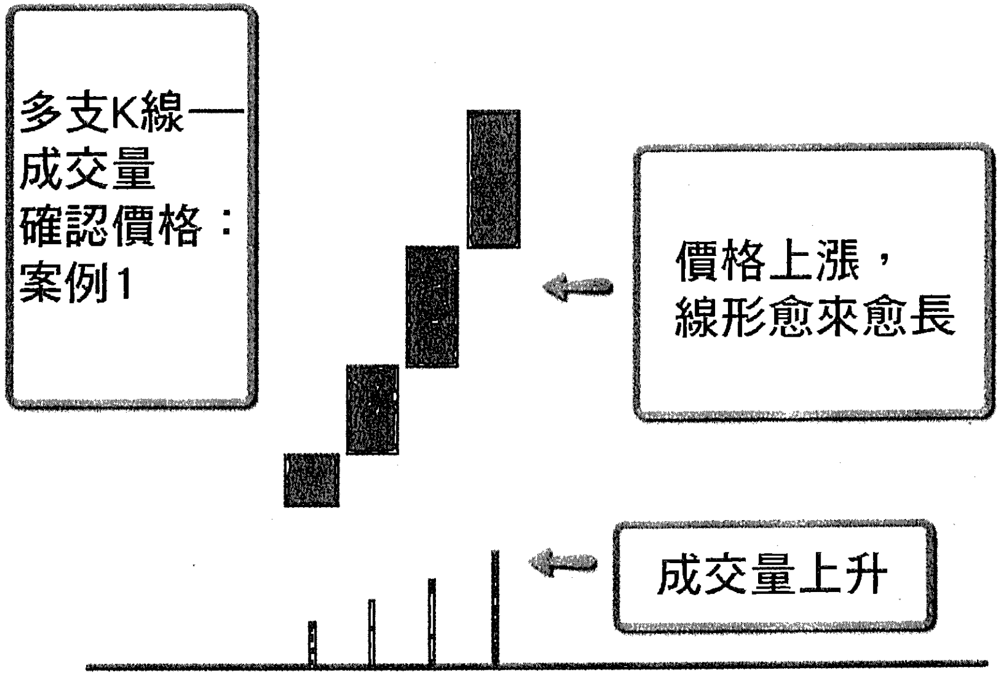

請參考圖表 4.14，我們看到某個發展之中的多頭趨勢，價格正在上漲，配合成交量增加。

這正是我們期待看到的，還有數支成交量線形，因此也讓我們有個基準可供判斷未來的成交量。

當我們觀察價格行為的實際發展，這將會是走勢圖上顯示的。第一支線形出現，是支相當小的線形，成交量也不大，情況沒問題。價格獲得成交量確認，沒有異常。接著，我們看到第二支線形，發現其長度稍微超過第一支線形，根據懷可夫的法則，我們期待成交量也會稍微放大，實際上也正是如此。所以，所呈現的上升趨勢有效，兩支線形的價格行為都獲得成交量確認。

等到第三支線形出現，其長度更超過先前兩支線形，我們預期對應的成交量，應該反映懷可夫的「作用 vs. 結果」法則。第三法則認為，結果如果增加（價格線形長度增加），則作用也應該對應增加（成交量也應該增加）——情況實際上也是如此。因此，線形的價格行為獲得成交量確認。除此之外，三支線形的發展也確認了價格趨勢。

換言之，三支線形的價格持續墊高，發展成為趨勢，而且成交量也增加，整個價格趨勢也獲得成交量確認。請注意，適用於單一線形的作用 vs. 結果，也同樣適用於「趨勢」，後者目前是由三支線形構成。因此，價格如果呈現趨勢走高，則根據懷可夫的第三法則，我們期待成交量也持續放大。目前情況確實是如此。

總之，作用 vs. 結果法則不只適用於個別線形，也同時適用於數支線形構成的趨勢。換言之，此處涉及兩個層次的確認（以及異常）。

第一個層次，考慮的是單一線形本身的價量關係。第二個層次是考慮數支線形（趨勢）的價量關係。趨勢也適用懷可夫的「因果法則」。「果」（價格呈現趨勢發展）的程度和「因」（涵蓋期間及其成交量，也就是時間因素）的大小，兩者之間保持正向關係。

這個簡單的例子，呈現非常單純的情況。每支線形發展過程的價格行為，獲得成交量確認，而且整個趨勢的價格行為，也獲得整體成交量行為的確認。這可以總結為：價格成長＝成交量放大。行情上漲，如果同時看到成交量配合放大，則屬於有效的價格漲勢，行情發展受到市場人氣與專業報價商的支持。換言之，專業報價商與造市者參與走勢，成交量反映在這個事實。

## 圖表 4.15

多支線形在下降趨勢獲得確認

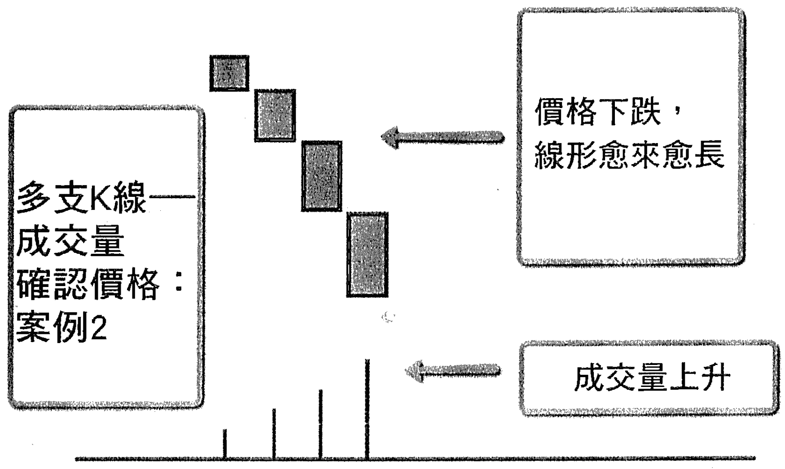

現在，我們準備探討相反的下跌情況，請參考圖表 4.15。

目前這個例子，行情走低，對於 VPA 的初學者來說，這種情況可能會造成困擾。對於一般人來說，我們都熟悉地心引力，也知道要讓東西往上移動，需要施予某種力量或作用。火箭要升空，球要扔高，都需要藉由力量克服地心引力。對於交易者來說，這些有關地心引力的例子，當然適用於價格上漲，就如同圖表 4.14 的例子。可是，關於下跌走勢，我們平常熟悉的地心引力就不適用了，因為同樣要施予作用（成交量）才能導致價格下跌。

價格不論上漲或下跌，都同樣需要施予作用。

專業報價商如果參與行情走勢，不論上漲或下跌，其作為都會反映在成交量。他們如果參與漲勢，成交量會增加，如果參與跌勢，成交量同樣會增加。

懷可夫的第三法則，也就是作用 vs. 結果法則，不論是價格上漲或下跌，都同樣適用。

請觀察圖表 4.15 的四支線形。第一支向下發展的線形，實體長度很短，對應的成交量也很小，因此價格行為獲得成交量確認。相較於第一支線形，第二支下降線形的實體稍長，成交量也稍微放大，所以其價格行為仍然獲得成交量確認。

第三支線形的實體又稍長一些，成交量也符合預期地稍微放大；至於第四支線形，長度持續增長，成交量也跟著放大。所以，對於這四支線形來說，不只個別線形的價格行為獲得成交量確認，整體線形的價格行為也獲得成交量確認。

此處同樣涉及兩個層次的確認。首先，檢視個別線形與對應的成交量，看看個別價量關係是否彼此配合或出現異常。其次，檢視整體趨勢的價格行為和成交量。

關於前述兩個例子，有個問題還沒有回答：成交量究竟代表買進成交量或賣出成交量*？每當市場出現走勢時，這是我們永遠想知道答案的問題。

就圖表 4.14 的例子來說，我們看到行情穩定上漲，成交量也完全配合放大，所以成交量必定代表買進成交量，因為如果有任何明顯的賣出成交量，就應該反映在價格行為。

我們看到，這些線形都沒有影線，所以價格是穩定走高，成交量配合放大，確認價格走勢有效。所以，這只可能是買進成交量，價格漲勢是真的。這種情況下，我們應該樂於參與漲勢，因為漲勢是真的。我們加入內線的行列而買進！

另外，可能更重要的是，這代表低風險的交易機會。我們可以很有信心地進場。我們根據價格和成交量資料自行做研究，然後根據自己的分析擬定交易決策。分析過程沒有引用間接的指標，而是採用最直接的價格和成交量資訊。價量分析是最直接、最單純、最有效，能夠透露市場真正活動與意圖的方法。

* 譯按：這是個很有意思的問題，因為成交量永遠同時代表買進與賣出；交易一定有買有賣，否則就不會有交易。所以譯者個人認為，這是個不合邏輯的問題。當然，我們也可以主張，關鍵是交易成交於買進報價或賣出報價。可是，就本書內文判斷，這應該是就內線大咖玩家的立場來考慮；換言之，專業報價商／造市者買進就代表買進成交量（散戶賣出），大咖玩家賣出就代表賣出成交量（散戶買進）。

市場人氣一覽無遺，市場操縱無所遁形，市場走勢全然顯露。

記住，交易只涉及兩種風險。交易本身的財務風險。這部分風險很容易數量化和管理，只需要採用簡單的資金管理法則即可，譬如 1% 法則。第二種風險很難數量化，這是交易本身的風險。這也是 VPA 試圖處理的對象。藉由 VPA，配合各位將在本書學到的其他分析技術，再加上多重時間架構的分析，我們可以學到非常強大的技巧，協助各位量化這部分的proven 交易風險。

掌握 VPA 技巧，各位可以成為有信心的交易者。交易決策將建立在自己的分析結論之上，完全符合常識與邏輯，只採用兩種領先指標：價格與成交量。

讓我們回頭討論圖表 4.15 的例子，以及我們想要問自己的問題：這是買進或賣出的成交量？我們是否應該參與其中？

我們看到行情明確下跌，而且整個價格行為獲得成交量確認。所有的 K 線都沒有影線，成交量持續放大。所以，這是個有效的走勢，成交量屬於賣出成交量，因為專業報價商參與該走勢而賣出。市場人氣明顯偏空。

根據普通常識與邏輯，以及對於價量關係的了解，這是另一個低風險的進場機會。

接下來，我們準備討論多支線形的情況，以及 VPA 的異常現象。以下例子的異常現象，不只發生在單一層次，因為我們準備由兩個不同層次考慮 VPA 概念。第一個層次適用於單一線形，第二個層次適用於整體趨勢。

## 圖表 4.16

## 多支線形上升趨勢的異常現象

多支K線——成交量異常：案例3

價格上漲，線形愈來愈長

成交量如何？下降！？

圖表 4.16 的例子，我們看到 4 支線形構成的一波漲勢。第一支線形頗小，成交量也很低，所以價量關係相當配合。然後，第二支線形的長度稍微增大，但成交量明顯放大。

根據經驗判斷，並回顧前一支線形，第二支線形的價量關係明顯異常。我們看到成交量明顯大於第一支線形，但價格線形長度只是稍微擴大，情況顯然不對勁。這是個警訊！

各位是否還記得懷可夫的第三法則：作用 vs. 結果？此處的作用（成交量）沒有產生正確的結果（價格），所以價量關係異常，很可能是早期的警訊，值得留意！

接著，出現第三支線形，線形長度繼續擴大，但成交量反而不如前一支線形。就價格線形長度判斷，成交量應該放大，

不是萎縮。這又代表另一個警訊。

第四支線形的長度更長，成交量卻更萎縮。所以，此處呈現許多價量關係異常現象，發生在第二支、第三支與第四支線形。

### 第二支線形異常

價格呈現短小線形，成交量卻很大，價量關係異常。就成交量產生的作用判斷，價格應該明顯上漲。這種現象顯示盤勢發展轉弱，造市者顯然在此賣出！這是內線採取行動的徵兆。

### 第三支線形的兩個異常

兩種異常現象合併發生。價格線形頗長，但成交量卻小。買盤力道不足。第二，行情上漲，成交量卻下降。價漲量縮，關係異常。這也顯示前一支線形的成交量異常（如果還需要其他證據的話）。

### 第四支線形的兩個異常

此處也顯示兩種異常現象合併發生，更進一步確認趨勢發展的價量關係不配合。我們看到長線形伴隨著低量，就作用 vs. 結果法則判斷，長線形應該伴隨大量，不是低量。

其次，在趨勢層次上，行情上漲而成交量萎縮，也呈現異常現象。現在，警訊更為明顯。

我們可以從這四支線形獲得什麼結論？第二支線形開始發生問題。此處成交量的作用並沒有讓價格行為產生對應的結果。這是市況轉弱的第一個徵兆。市場處於「超買」狀態。造市者與專業報價商在此開始陷入掙扎。賣方察覺放空機會而進場，

造成上檔出現賣壓阻力，這可以從第三與第四支線形的成交量下降看出來。

專業報價商與造市者察覺盤勢轉弱，在此開始設法出脫籌碼，準備因應後續的跌勢，但持續拉高價格，希望繼續維持行情偏多的表象。行情轉弱可能只是漲勢暫時停頓，未必代表趨勢反轉，但仍然是盤勢轉弱的徵兆。

第二支線形的大成交量，反映獲利了結的賣壓，剩餘買盤力量不足以推升價格大幅走高。專業報價商和造市者察覺盤勢轉弱，也在此賣出，使得成交量更大。這也是隨後兩支線形成交量下降的原因，他們雖然繼續抬高價格，但本身已經沒有積極參與交易。他們已經撤退，讓交易者陷在高檔。

麻煩最初發生在第二支線形，然後在第三和第四支線形獲得進一步確認。事態通常是如此展開的。

最初，我們看到單一線形分析發生異常價量關係。然後等待第二支線形出現，再根據先前的異常現象做分析。就目前這個例子來說，異常現象獲得確認，價漲量縮的現象持續發生。

現在，我們看到一個明顯轉弱的市場，而且已經獲得確認。接著，就要進行最後階段的分析，也就是根據整份走勢圖的前後關連做分析。如此才能判斷這究竟是小型拉回走勢，或是主要趨勢變動的前兆。

這個時候，懷可夫的第二法則將發揮功能，也就是因果法則。如果這只是小型拉回或反轉，則「因」很小，「果」也有限。

事實上，此處看到的異常現象，可能只會造成短線盤勢轉

弱。原因既然不嚴重，後果也不會嚴重。本書稍後還會深入討論這部分內容，但讓我們先看另一個多支線形的案例。

## 圖表 4.17

多支線形下降趨勢的異常現象

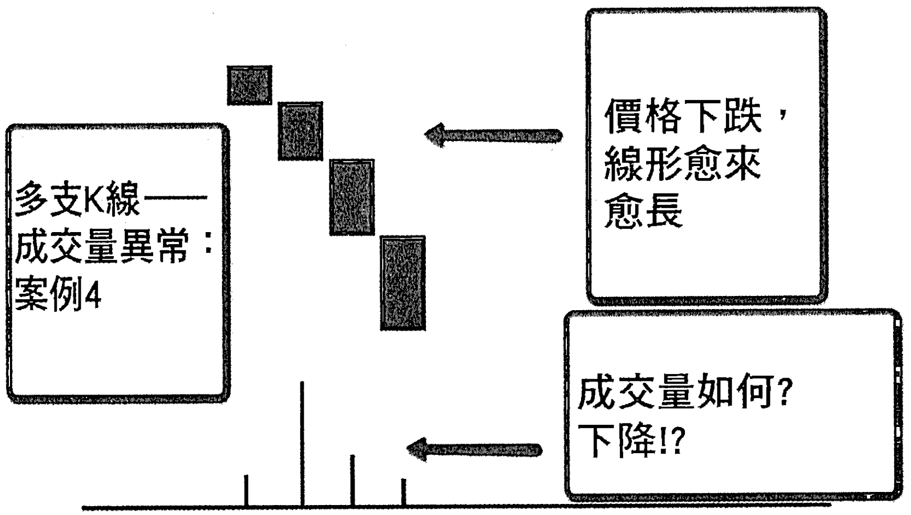

請參考圖表 4.17，這個例子顯示價格瀑布的走勢，我們看到行情急遽暴跌。

第一支線形是向下發展的小紅線，成交量相對有限，價量關係配合正常。然後，從第二支線形開始，我們看到異常現象。

### 第二支線形異常

相較於先前線形，第二支線形的長度稍微增加，但成交量非常可觀。這清楚顯示下檔有限。情況若非如此，則大成交量應該造成價格長線形。可是，市況並非如此發展，所以價量關係異常。如同前一個例子，這代表警訊。這意味著空頭氣氛已

經舒緩，賣壓獲得下檔買盤積極承接。造市者與專業報價商目睹買盤進場帶來的人氣變化，因此也參與買進。

### 第三支線形的兩個異常

類似圖表 4.16 的例子，此處也顯示兩種異常現象。首先，價格長線形伴隨著平均水準或以下的成交量。其次，價格持續下跌，成交量沒有如同預期地放大，卻較先前萎縮，代表賣壓減緩，所傳遞的訊息和前一支線形相同。

### 第四支線形又是兩個異常現象！

同樣地，此處也呈現兩種異常現象。首先，價格長線形應該伴隨著大量，此處卻呈現低量，這是異常。其次，我們現在已經看到連續三支線形的價格下跌，但對應的成交量持續萎縮。這也是異常現象，因為價格連續下跌，成交量應該放大。

如同圖表 4.16 的例子一樣，圖表 4.17 例子的第一支線形，價格行為獲得成交量確認，價量配合，沒有異狀。可是，第二支線形出現第一個警訊。此處的作用（成交量）沒有產生該有的結果（價格行為）。所以，這是走勢可能轉弱的第一個徵兆。這種市況稱為「超賣」。造市者與專業報價商於此陷入掙扎。買方察覺機會而開始進場。下檔出現明顯的支撐，這種現象也在後續兩支線形獲得驗證，其成交量萎縮。

專業報價商與造市者目睹第二支線形的弱勢發展，開始進場，但繼續壓低價格，希望維持行情偏空的假象。同樣地，實際不然！這種情況可能只代表既有跌勢的暫時停頓，未必真的是主要趨勢反轉，但無論如何都顯示盤勢有回升的跡象。

第二支線形的大成交量，代表賣方獲利了結，剩餘的賣盤已經不具備力量促使價格繼續明顯下跌。這個時候，專業報價商和造市者也加入買方，使得成交量更形增加，因為他們察覺買盤進場，所以也樂得吸收賣壓。這也是隨後兩支線形成交量萎縮的緣故，因為他們只是壓低價格，但並沒有積極參與賣出。他們從第二支線形就開始買進，而在第三和第四支線形試圖讓交易者套在空頭部位。

如同前個例子，變盤的最初徵兆發生在第二支線形，隨後在第三和第四支線形獲得進一步確認。這兩個例子裡，第二支線形已經浮現內線的蹤跡，充分反映在成交量與對應的價格行為！

關於這兩個例子，我們現在都準備妥當，等待後續盤勢發展的線索，隨時能夠因應可能發生的任何趨勢反轉，或小型折返。即使這一切只代表較長期趨勢的小型變動，也同樣提供了可供運用的低風險機會，而且我們知道這種機會只存在很短時間。

現在，我準備解釋稍早曾經提過的論點，也就是懷可夫第二法則——因果法則——的架構。

學習如何運用 VPA 擬定交易決策，我們在每份走勢圖上進行的分析程序都完全相同。關於這個程序，聽起來或許有點複雜，但各位只要掌握其中竅門，實際上只需要花費短短幾分鐘。換言之，習慣就成自然。我個人學習這套分析方法，大概花了 6 個月時間，每天研究走勢圖。由於每個人的學習情況不同，各位花費的時間可能更短或稍長——結果都沒有差別，前提是要徹底了解本書解釋的原理。VPA 的分析程序可以劃分為三個步

驟：

### 步驟 1：個體

分析個別線形，觀察其本身的價格行為是否獲得成交量確認，或價量關係出現異常。各位應該很快就能根據先前相同時間架構的成交量概況，判斷何謂平均水準成交量，何謂低量、大量、超大量等等。

### 步驟 2：總體

把個別線形擺在最近幾支線形的前後關係上，分析小型趨勢，觀察既有小型趨勢是否獲得確認，或可能出現反轉。

### 步驟 3：全局

分析完整的走勢圖。由較長期趨勢立場觀察價格行為。相關價格行為是否代表較長期趨勢的頭部或底部，或只是發展過程？這個時候需要綜合考慮支撐／壓力、趨勢線、K 線型態、走勢圖型態等，本書稍後會詳細討論。

換言之，我們先考慮單一線形，然後考慮該線形與附近線形之間的關係，最後考慮整體走勢圖。這好像照相機使用的伸縮鏡頭，由近而遠，由局部而全景。

現在，我準備將此擺在懷可夫因果法則的前後關連上思考，時間也在此開始進入 VPA 分析。

如同先前導論提到的，我多年前經常犯的錯誤，就是假設訊號一旦出現，對應的走勢就應該立即發動。結果，我總是過早進場而被停損出場。市場就像一艘超級大油輪——需要花點工夫才能轉彎；買賣雙方的力量需要時間消化，然後內線、專業

報價商與造市者才算準備妥當。記住，這些專業玩家唯有在市場已經沒有顯著阻力時，才會順勢而為，採取行動。前文討論的簡單案例，我們只觀察四支線形，內線只有在第二支線形採取真正行動。事實上，情況當然不會如此單純，但基本原理就是如此，而本章談論的也是基本原理。

因此，就日線圖來說，這種「徹底清除」的階段可能進行好幾天、幾個星期，甚至幾個月，而行情繼續呈現橫向發展。整理過程可能連續出現好幾個反轉訊號，行情顯然會反轉，但我們不知道什麼時候發生。整理期間愈久，趨勢一旦反轉，力量往往也愈大。這也是懷可夫因果法則說明的情況。整理期間拖得愈久（因愈大），所產生的趨勢也愈明顯，時間延伸愈久。

讓我們把這個概念運用於實際情況，這可以解釋 VPA 配合多重時間架構進行分析的威力。

前文談到的簡單案例，我們觀察四支線形與對應的成交量。就所謂的三步驟程序來說，這等於是第二步驟的總體分析，而且可以發生在任何走勢圖，譬如跳動檔走勢圖或日線圖。我們知道，這四支線形涵蓋的期間內，可能出現趨勢變動。可是，由於訊號只來自於幾支線形，任何反轉的規模可能都不會太大。換言之，所謂反轉可能是只單一線形的小型拉回或反轉。這當然沒什麼問題，仍然代表可接受的低風險交易機會。

然而，鏡頭如果拉遠，觀察同一份走勢圖的全局，可以將此擺在整體趨勢的架構上做分析，可能發現市場在準備進行反轉的過程，這四支線形實際上會在這個層次上重複發生。換言之，「原因」的份量已經超過簡單的反轉，因此我們很可能會看到更顯著的「結果」。所以，現在需要保持耐心，必須等待。

可是，等待什麼呢？這正是支撐／壓力扮演的功能，本章稍後會詳細討論此主題。

回到懷可夫的因果原則，看看這個原則如何運用於多重時間架構，我想和大家分享這種我自己實際運用於交易的策略。這是採用 MT4 典型的走勢圖組合：5 分鐘、15 分鐘與 30 分鐘走勢圖。我運用這三種走勢圖從事外匯市場的當日沖銷交易，訊號來自 15 分鐘走勢圖。5 分鐘走勢圖提供更貼近市場的觀點，30 分鐘走勢圖則讓我在慢速走勢圖上觀察較長期的發展。我經常將此比喻為高速公路上的三條車道。15 分鐘走勢圖落在中間，另外兩種走勢圖則扮演兩側的「後視鏡」。較短時間架構的 5 分鐘走勢圖，告訴我們「快速車道」發生的狀況，30 分鐘走勢圖則顯示「慢速車道」較長期時間架構的發展。

短期時間架構發生的人氣變化，如果蔓延到長期時間架構，則會發展為較長期趨勢。舉例來說，5 分鐘走勢圖如果發生變化，然後蔓延到 15 分鐘走勢圖，最後再蔓延到 30 分鐘走勢圖，這個變動將因此發展為較長期趨勢。

回到我們的 VPA。假定 5 分鐘走勢圖發生異常現象，可能的趨勢變動獲得確認，而且這個變化也反映在 15 分鐘走勢圖。我們如果根據這些分析決定進行交易，而趨勢最後蔓延到 30 分鐘走勢圖，則相關反轉的影響潛力可能更大，因為醞釀時間更久，因此也可能持續得更長。此處，我想利用機械發條模型車來做比喻。

如果花幾秒鐘時間，幫發條轉幾圈，車子可能只能跑一下就停了。如果多花點時間，幫發條多轉幾圈，則車子可以跑遠一點。最後，如果花幾分鐘時間，把發條扭到最緊，車子將可

以跑相當長的距離。換言之，我們用以界定原因之力量所花費的時間與努力，將反應在結果的力量上。

這就是 VPA 如何配合懷可夫因果原則，運用於多重時間架構分析。這是一套威力無窮的方法，結合了兩種最具動態分析功能的技巧。這種方法也可以運用於任何時間架構的組合，由快速的跳動檔走勢圖，到較長時間架構走勢圖。至於你究竟是投機客或投資人，基本上也沒有差別。

這套方法簡單明瞭，如同投擲石頭於池塘引發的漣漪。石頭扔在池塘中央，漣漪會向外移動。這就像市場人氣激起的漣漪，擴散至較長時間架構。漣漪一旦蔓延到較長時間架構，很可能就會造成更長期的影響，因為醞釀的時間更長，累積的動能也更大。就先前的發條模型車來說，完全扭緊發條，就能跑得更遠，這充分說明了因果關係。

下一章將根據這個第一原理做為基礎而討論實際的案例，採用幾個不同市場的真實走勢圖。

## CHAPTER 05

## 價量分析：承接與出貨

> 錯誤是最好的老師，成功沒什麼值得學習之處。
——莫尼斯·帕波萊（Mohnish Pabrai, 1964-）

前一章討論到 VPA 的某些基本架構，首先說明如何運用於單一線形，然後再引用這套知識於少數幾支線形。這實際上也就是 VPA 三個分析程序的前兩個步驟。這個三步驟的分析程序，首先是觀察單一線形，然後慢慢把鏡頭拉遠，第二步驟是觀察相關線形附近的幾支線形。最後，再把鏡頭拉得更遠，看到整個走勢圖的全局，這也是本章的討論重點，但講解過程希望重複溫習前一章學習的技巧。

另外，本章也準備介紹幾個新概念，如此應該有助於納入多種技巧於 VPA 的標準分析程序。我想，現在應該是最適當的時機，然後我們會觀察各種案例，順著每份走勢圖的價格行為發展詳細講解。

首先，讓我從 VPA 的五個重要概念開始：

+   1. 承接（accumulation）
2. 出貨（distribution）
3. 測試（testing）

+   4. 賣壓高潮（selling climax）
5. 買進高潮（buying climax）

想要了解這些名詞，或讓我向各位做解釋，最簡單的辦法，應該是運用稍早有關倉庫的比喻，這也是理查·內伊在其著作內解釋這些概念的方法。他說：

> 「想要了解專業報價員的運作慣例，投資人應該把他們視為想要按照零售價格賣出存貨的商人。等到他們出清存貨，就會運用獲利，按照批發價格買進更多商品。」

多年之後，我在《資金運作雜誌》（Working Money）寫了一篇文章，叫做「喬伊叔叔的寓言」（The Parable of Uncle Joe），也是採用這個比喻。

想要由市場價格行為的角度思考成交量，最簡單的方式，是採用批發商的比喻，而且這適用於所有的市場。可是，為了讓相關說明保持單純，往後我們都把專業報價商、造市者、大咖玩家與專業基金經理人，統一都稱為內線。所以，內線是擁有股票存貨的商人，其賺錢方式主要是按照批發價格買進，然後按照零售價格賣出。

另外，關於下文的解釋，也就是談到我的 VPA 原理 2，請記住市場總要花點工夫才能大轉彎，這也得到懷可夫之因果法則的認同。我們經常會看到行情起伏波動，譬如一些折返走勢或較長期趨勢的反轉。然而，主要趨勢變動（記住，5 分鐘走勢圖或日線圖都同樣可能發生「主要趨勢變動」）需要花費時間。時間花得愈久（因），變動愈可觀（果）。可是，每個市

場的情況都不盡相同。有些市場可能要花幾天、幾個星期，或甚至幾個月時間，才能醞釀重大趨勢變動，其他市場可能只需要短短幾天。稍後，當本書開始觀察個別市場的細膩特性時，我們還會討論這個話題，因為每個市場的行為都不太一樣。

市場性質雖然不同，但此處談論的基本原理仍然一體適用，只是時間架構和事件發展的速度可能有明顯差異，這是因為每個市場的結構與造市者扮演的角色不同，還有每個資本市場本身可能屬於投資或投機工具。

首先準備討論的術語是「承接」。

## 承接階段

內線能夠有所作為之前，他們首先必須確定自己擁有足夠的股票存貨，藉以因應市場需求。不妨這麼想，批發商針對某產品開始大作廣告。這種情況下，任何批發商都不想自己大費周章，投入大筆資金、時間和精力進行產品推銷，幾天後卻發現自己沒貨可賣。這可是天大的災難。內線面臨的情況也是如此。他們不希望大張旗鼓折騰一番，卻發現自己沒股票了。所有這一切都是供給與需求。他們如果能夠創造需求，就需要有供給來因應需求。

可是，在他們大展身手之前，如何先填滿自己倉庫的貨架呢？這也就是「承接」行動扮演的角色，就如同真正的倉儲，需要時間才能完成補貨。一般的大型倉庫，不可能只運來一卡車貨就夠了；通常起碼要好幾百台貨車，而且不要忘了貨物同時還會流出。就如同一般批發商補貨需要花費時間一樣，金融

市場的批發商也是如此。

所以，「承接」是指內線在開始展開大規模行銷戰役之前，進行補充存貨的階段。所以，承接就是內線買貨，所花費的時間可能是幾個星期或幾個月，主要取決於相關市場與交易工具的性質。

現在，還有另一個問題，內線如何「鼓勵」大家賣股票。實際上，很簡單——運用媒體。各種形式的新聞媒體，對於內線來說，這些都是天上掉下來的禮物。數世紀以來，他們已經學會了這方面的每種伎倆，知道如何操縱每個新聞、每個發言、天然災害、政治宣導、戰爭、飢荒、傳染病，以及其他等等。媒體就像 привед不擇食的怪獸，就是需要「新聞」，每天都要嶄新的新聞。內線充分運用這些新聞報導激發的貪婪與恐懼情緒，基於各種理由操縱行情，當然也包括震出浮動籌碼。

關於這個話題，理查·懷可夫在 1930 年寫道：

> 「對於大咖玩家來說，除非他估計有 10 點到 50 點走勢的潛能，否則通常不會採取行動。李佛摩曾經告訴我，除非他估計起碼有 10 點的行情，否則不會碰觸任何東西。在市場上準備採取重大行動，需要花費相當多的時間。大咖玩家或投資人如果單獨採取行動，通常沒辦法在一天之內買進 25,000 到 100,000 股且不至於推升價格大幅走高。所以，為了承接一支或多支股票，通常需要好幾天、幾個星期或幾個月。」

行銷「戰役」的說法相當貼切。行銷戰役就如同軍事戰役，內線採行的計畫必須具備軍事行動般的精確性，每個步驟或階

段絕不允許發生偶然的差錯。各階段的計畫都預先安排妥當，然後就由媒體引發賣壓。可是，承接階段究竟如何進行？實際操作上，情況大致如下：

某件新聞公布，被視為某交易工具或市場的利空消息。內線抓住機會，大幅壓低價格，引爆急遽賣壓，並在下檔開始吃貨，儘可能按照最低價格買進，也就是所謂的批發價格。

然後，市場恢復平靜，利空消息也逐漸被消化，行情又開始走高，這通常都是內線買進的緣故。

此處有兩點要注意。第一，內線千萬不能讓大家因此嚇壞了，否則就沒人願意買。價格波動如果太過劇烈，行情擺動過大，可能嚇跑許多投資人與交易者，那就完全喪失目的了。每個行動都必須謹慎計畫，小心拿捏，行情波動必須剛好震出所需要的浮動籌碼。第二，內線承接股票的過程，股價不能推升得太快，如此才能確保取得必要的存貨。

買得太快太多，不免快速推升價格，所以絕對必須謹慎，這也是為什麼承接階段必須花費很多時間才能完成的緣故。只透過一波壓低價格，絕對不足夠，因為所需要的存貨實在太多。前一章的簡單案例，已經介紹了基本原理。

現在，第一波賣壓過了，安然度過衝擊的持股者覺得安心，他們相信行情將回升，所以打算繼續持有股票。經過一陣子之後，更多利空消息發生，內線再度刻意壓低價格，震出更多浮動籌碼。隨著他們的買進，價格又慢慢回升。

這種價格行為將重複發生多次，內線每次都可以取得股票來補充存貨，直到絕大部分的浮動籌碼都轉移到內線手中。就

走勢圖觀察，這種價格行為看起來如何？

## 圖表 5.10

承接階段

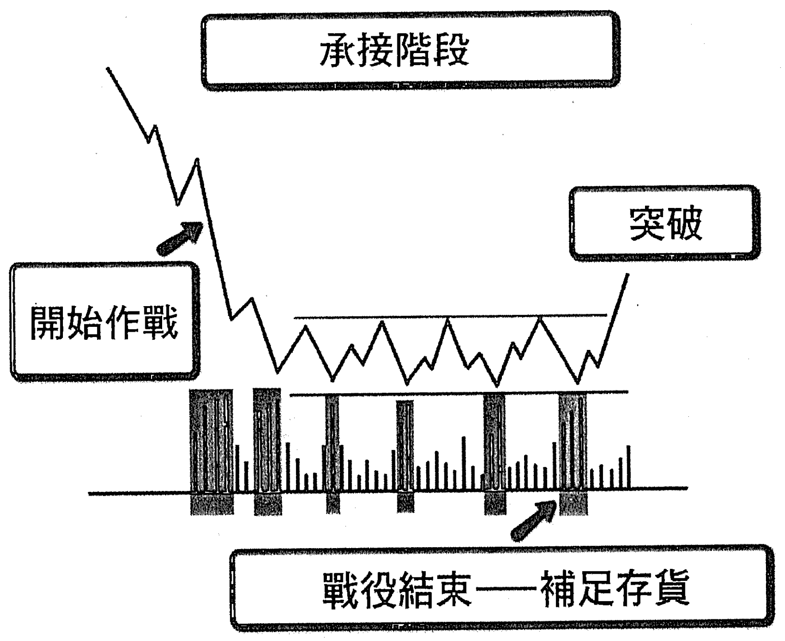

圖表 5.10 藉由圖形解釋承接階段的代表性價格行為，但願各位能夠因此體會價格走勢圖上的實際發展。內線的重複買進，成交量部分標示為陰影。

這份圖形故意沒有標示「價格」、「時間」與「數量」等刻度單位，因為我相信價格與成交量的「形狀」更重要。這就是所有時間架構上，價格行為產生密集交易區間的發展，也說明了「形狀」為何如此具備威力，尤其是與成交量配合顯示。

VPA 讓價格行為產生三度空間的觀點。

這方面的戰役一旦展開，價格行為大體上就會遵循圖表 5.10 的標準型態進行，行情重複上下震盪，藉以震出股票籌碼。這好比搖晃果樹，如同我們在義大利收成橄欖！重複搖晃橄欖樹，才能讓所有的果實掉落。有些果實相當牢固掛在樹上，必須花點工夫才能讓它們掉落。金融市場的情況也是如此。有些人緊抱著股票，但只要不斷重複震盪，這些籌碼遲早還是會被「假跌勢」震出，而且經營者在這個階段即將結束之前，也就是內線即將真正展開拉抬走勢之前。所以，承接階段告一段落。

這種價格行為將重複發生於所有市場的所有時間架構。如果撇開懷可夫的因果法則，以上價格行為可以是屬於較長期循環的「第二階段」，稍後當我們解釋多重時間架構時，我會更詳細討論這個主題。

如同愛因斯坦說的，一切都是相對的。

如果觀察某交易工具 50 年期的走勢圖，可能會有數以百計的承接階段。反之，對於外匯配對市場，承接階段可能只花費數個小時，或數天。

這方面的差異，主要是因為市場的性質與結構。股票市場明顯不同於債券和商品市場。舉例來說，對於股票市場，這個階段可能持續幾天、幾個星期或幾個月的時間；稍後，當我們談論個別市場性質，以及內部與外部影響等可能對於 VPA 交易者造成困擾的細節時，還會更詳細處理這個主題。

重點如下，請認清楚這種價格行為與對應的成交量。這是內線操縱市場，目的是為了隨後拉抬價格。承接階段的時間如果很短，隨後的漲勢可能不大（因果關係），較長期的承接，可能出現更明顯的漲勢。各位如果認為這只是幻想，那麼讓我在引用理查·內伊的說法，這是摘錄自他的第二本著作《華爾街幫派》。

> 「1963 年 11 月 22 日，甘迺迪總統遇刺，專業報價商借此機會把盤勢壓低到批發價水準。等到他們承接大量的股票存貨之後，當天也就打烊，紛紛離開交易大廳。這讓一般投資人沒有辦法在低價買進。舉例來說，11 月 22 日當天，「電話公司」的專業報價員把價格從 $ 138 壓低到 $ 130。25 號開盤價則是 $ 140！為了方便起見，省了零頭不計，他承認交易帳戶賺進 $ 25,000。」

任何新聞都可以是操縱行情的完美藉口，沒有例外。對於美國股票來說，每季的盈餘報告就是最完美的機會。經濟數據也是理想藉口，至於天災，則適合當做較長期走勢的引信。就盤中走勢來說，政客、中央銀行的評論，以及例行公布的經濟數據，都是操縱行情的理想藉口。對於內線來說，賺錢實在很容易；可是，坦白說，如果有機會的話，我們可能也會這麼幹！

## 出貨階段

出貨階段的情況，剛好和承接階段相反。處在承接階段，內線是要補充存貨，準備下一階段的操作；如同我稍早說的，「戰役」這個字眼相當貼切。軍事戰役不允許發生巧合差錯，稍後當我們解釋測試階段時，各位就可以明白我的意思。

存貨一旦補足，內線就要開始推升價格，鼓勵那些緊張而心懷期待的買盤回到市場。這也是為什麼內線不可以過份驚嚇交易大眾的原因，因為絕對不能幹「殺雞取卵」的事情！

承接階段搖晃樹木引發的主要情緒因素是恐懼，損失的恐懼；而出貨階段驅動行情的主要情緒因素也是恐懼，但現在則是錯失大好機會的恐懼。這個時候，時間拿捏很重要，因為內線知道多數投資人與投機客很緊張，在他們實際進場之前，在他們再也不能克制「錯失大好機會」的恐懼之前，希望能夠看到許多確認訊號。這也是為什麼多數交易者與投資人總是在頭部買進、底部賣出的理由。

處在多頭行情的頭部，交易者與投資人看到行情先是緩步走高，然後動能開始加速，他們通常在這個時候買進，因為害怕錯失「迅速獲利」的機會。這剛好也是內線準備驅使漲勢停頓而反轉的位置。相同情形也發生在底部的承接階段。投資人與投機客先看到行情緩步走低，然後加速下跌而引發恐慌性賣壓，於是他們再也不能忍受煎熬。接著，行情恢復平靜，內線開始吃貨。可是，不久之後，行情又下挫，然後恢復平靜，再下挫。這就是內線操控交易者恐懼心理的手段；事實上，由某種角度來說，內線不是操縱行情，他們是操縱人性心理，因為交易者的情緒更容易操控。

所以，出貨階段的標準型態如何？如何發展？

首先，行情由承接階段向上突破，價格穩定走高，成交量維持平均水準。內線按照批發價格已經補足貨源，現在準備緩步醞釀動能，嘗試在趨勢頭部出貨，儘可能以最高價格，創造最大利潤。同樣地，如果有機會的話，我們也會這麼幹。

隨著承接階段結束，現在充斥各種利多消息，人氣已經由「利空消息」瀰漫的下跌行情扭轉向上。

行情逐漸升溫，剛開始進行得相當緩慢，偶爾夾雜著小幅拉回整理，但跌勢並不至於令人害怕。慢慢地，漲勢步調加快，多頭動能加速發展，直逼目標區域。這個時候，出貨開始更積極進行，內線想辦法出清存貨，因為交易者與投資人現在都有些飢不擇食，因為害怕錯失機會。現在，利多消息頻出，市場籠罩在樂觀氣氛之中而持續攀升。

現在，內線擁有一大堆樂意承接籌碼的犧牲者，但他們還是相當謹慎，避免太過積極供給。因此，價格呈現區間整理，每次下跌都吸引更多買盤。最後，存貨終於告罄，戰役圓滿結束。圖表 5.11 顯示出貨階段典型的價格行為與對應成交量。

### 圖表 5.11

出貨階段

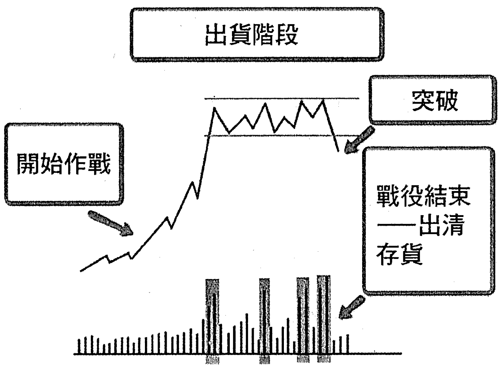

圖表 5.11 說明出貨階段的發展情況，我們如果由補充與出清存貨的立場思考，就會覺得整個過程相當合理。我們如果擁有自己的倉庫，希望按照最高價格出清存貨，大概也會運用類似方法處理。

首先，我們必須確定擁有充裕的股票存貨，然後展開行銷活動，吸引大眾的興趣。其次，更積極從事行銷，創造一些具有吸引力的銷售訊息——或許運用名人、推薦感言、公關、媒體，或有助於傳播訊息的任何東西。最近有個相當引人注目的行銷，就是巴西黑莓（完全不費力減肥聖品，只需吃下黑莓，就可以等著收穫）。

這就是內線的作為，他們只是運用主導行情的兩種情緒：恐懼與貪婪，就是這樣。創造足夠的恐懼，促使持股者賣出。然後，刺激大眾的貪婪念頭，促使人們買進。非常簡單合理，他們的最主要幫手或武器，就是媒體。

承接與出貨的循環，將周而復始不斷上演，發生於所有的時間架構。有些可能導致主要走勢，有些可能只會造成小型行情，但這會發生在每天的每個市場。

## 測試供給

承接階段完成，內線正式拉抬行情之前，面臨的最大問題之一，就是不確定市場的浮動籌碼是否已經大致清除。他們最擔心的情況，就是一旦開始拉抬行情，準備出貨，結果卻在上檔碰到龐大賣壓，破壞了整個運作。內線如何克服這個問題？答案很簡單，而且任何市場的處理方式都相同：測試！

這和一般企業準備進行重大行銷活動的情況一樣。產品的訂價不僅必須正確，而且對於市場的接受度也要有相當把握，也就是所謂的「準備就緒」吧！所以，他們正式展開活動之前，必須先做小規模的測試，評估是否在正確價格販售正確產品，所傳遞的行銷訊息是否正確。

承接階段完成，實際開始推升價格進行出貨之前，內線也希望進行測試。這個時候，他們通常會返回先前曾經大量迫使價格下跌的區間，評估該處的反應，看看承接活動是否已經震出大部分浮動籌碼。關於這方面的測試，請參考圖表 5.12。

### 圖表 5.12

測試過程，確認成交量不高——好消息！

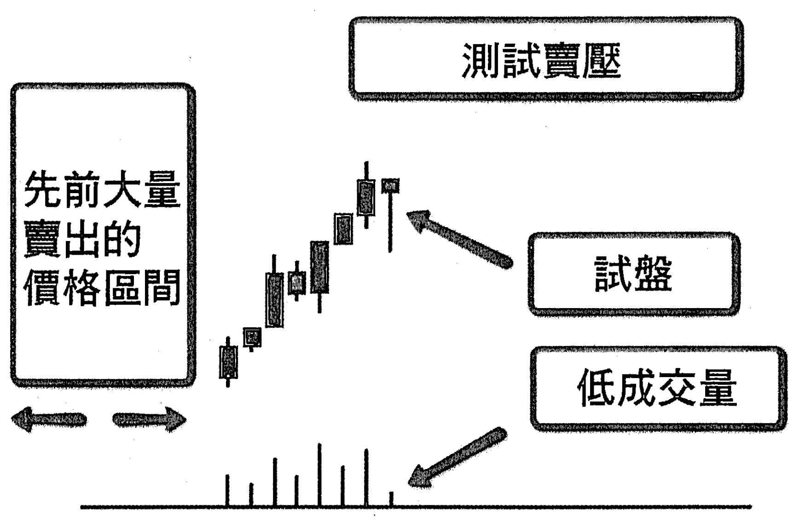

此處想要觀察的價格行為，發生位置是在承接階段完成之後，以及之前內線震出浮動籌碼進行快速殺盤的區域。換言之，

內線曾經先在此驅動大成交量的急殺走勢，然後進行來回洗盤，嘗試搖晃樹木，震出一些更頑固的「果實」。現在，內線準備推升價格穿越這個區域，最終希望在多頭趨勢的頭部進行出貨。

這個時候，內線推升價格走高，準備穿越先前的大成交量殺盤區域，他們最擔心的，是賣壓重新出現，使得出貨計畫胎死腹中。所以，請參考圖 5.12，他們需要先測試賣壓。

造市者壓低價格，或許是藉由一些利空消息，測試剩餘的賣壓究竟有多嚴重。行情走低過程，成交量如果保持很小，就意味著剩餘的賣壓有限，絕大部分浮動籌碼都已經在承接階段被吸收。否則的話，行情應該夾著大量收長紅線。目前的情況顯示，成交量很小，而且——或許是藉由利多消息的鼓舞——收盤價拉高到開盤價附近，造市者準備繼續推升價格，希望有好結果。

這種「低成交量的測試」會發生在所有市場的所有時間架構，是內線測試市場賣壓的簡單辦法。目前，內線想要創造需求，但市場上如果還有超額供給，拉升價格的嘗試恐怕就要頓然而止。

就圖表 5.12 的例子來說，測試相當成功，確認賣壓已經被清除。K 線並不需要具備特別明確的型態，但實體必須很短，下影線很長。線形可以是藍線或紅線。

測試成功，確認上檔不存在具有威脅的賣壓，內線可以開始驅動價格走高，目標是上檔出貨的價格區域。

### 圖表 5.13

測試過程，成交量放大——壞消息！

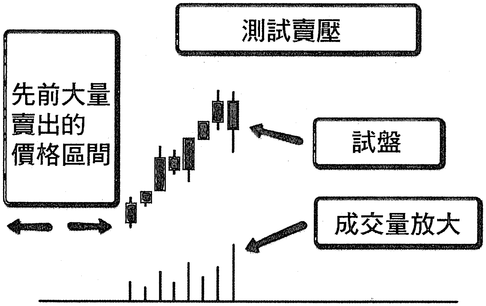

可是，測試如果失敗而爆出大量，那就有問題了。造市者驅動行情由承接區域向上挺進，然後開始壓低價格，展開測試，結果引來龐大賣壓，導致價格大跌。

這種情況下，原先交易區間的賣壓顯然沒有被承接活動清除，造市者如果強行拉高價格，很可能會遭遇重大壓力而失敗。

測試失敗只代表一件事。內線必須儘快讓行情回落，重新進行洗盤，設法清除浮額。市場還沒有準備就緒，不適合向上挺進，內線還有工作要做，然後才可以重新向上攻堅。這就如同企業推出新產品所做的小規模測試遭逢失敗一樣。原因可能是產品訂價不當，行銷訊息不清楚。總之，測試過程顯示某些方面出了差錯，需要進行處理。對於內線來說，測試失敗代表

上檔還有太多賣壓。

內線必須重新清除上檔浮動籌碼，然後再進行測試。測試一旦失敗，通常會看到造市者讓行情回落到先前的密集交易區間，重新進行整理，清除浮額，接著向上突破，準備執行另一次測試。測試如果成功，才能確認上檔相關賣壓已經被清除。

對於任何市場的內線，測試都是他們運用的最重要工具之一。如同 VPA 的其他概念一樣，測試非常容易了解，完全符合邏輯。我們一旦了解承接概念與走勢圖結構，就能察覺所有市場、任何時間架構上進行的測試。這是我們所能夠看到的最重要訊號之一，代表行情即將向上突破而大幅上升。

圖表 5.13 顯示的例子，承接操作告一段落之後，內線測試剩餘的市場賣壓，也就是上檔相關的「供給」籌碼。倉庫貨架上補足了股票存貨，內線準備開始大發利市，最後步驟是測試上檔最近的賣壓是否已經被充分吸收。就目前這個例子來說，賣壓並沒有被徹底吸收。可是，等到測試一旦成功，得到「量縮」的確認，行情就會走高。

## 測試需求

接著，讓我們看看剛好相反的發展情節，發生在出貨運作告一段落的時候。現在，內線貨架上已經沒有股票存貨，壓低價格到先前買盤旺盛的價格區域，準備開始補充存貨，此時最不想看到有大量買盤進場推升價格，與他們爭奪籌碼。

這方面的測試，是要確定先前的出貨階段已經吸收了所有的買盤，然後才開始進行下一階段的承接運作。

所以，出貨階段已經進行一陣子。內線把行情由批發價位，逐漸推升到目標區域的零售價位，充分運用利多消息拋售股票。投資人與投機客蜂擁買進，擔心自己錯失大好賺錢機會，整段行情是由貪婪情緒主導。內線藉由上下震盪的盤勢，吸引更多買盤進場，逐漸拋光手頭上的所有存貨。

最後，出貨運作終於完成，接著又要展開另一循環的承接階段。內線壓低價格進入先前發生大成交量的買進區域。同樣地，此處也需要進行測試，但這次是測試需求。如果買盤需求很有限，代表主要需求已經在出貨階段獲得滿足，整個發展請參考圖表 5.14。

### 圖表 5.14

測試過程，成交量仍然偏低——好消息！

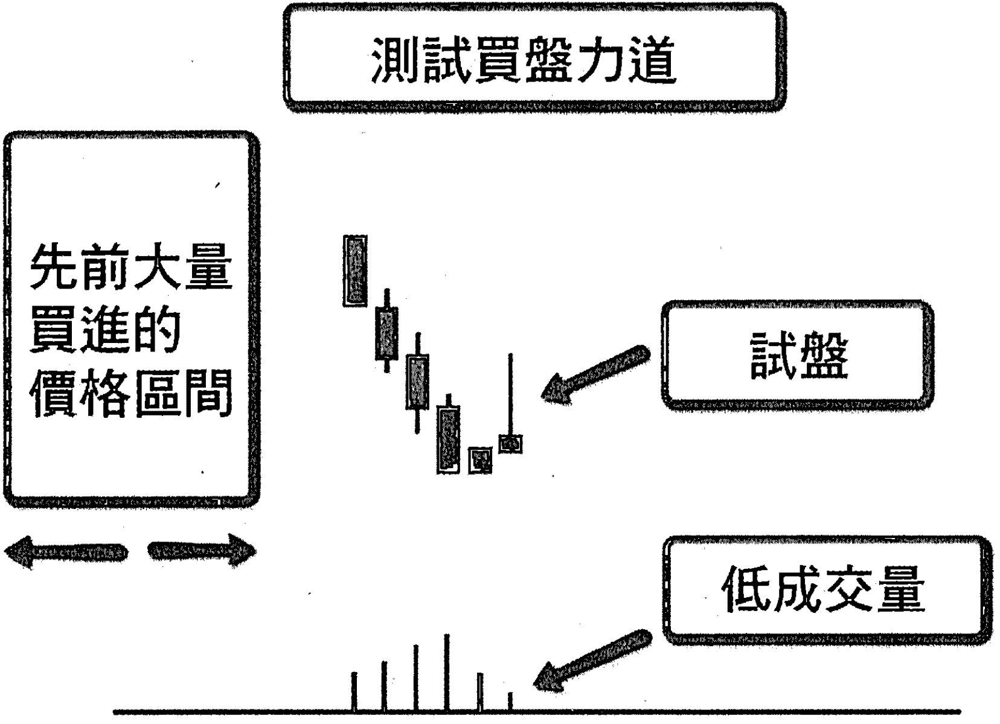

此處顯示出貨階段告一段落之後的發展。內線的股票貨架幾乎已經空空蕩蕩，接下來就是要快速壓低價格，再次進入承接階段。

出貨階段結束，內線希望確定下檔目標承接區域不會有大量的剩餘買盤與其爭奪籌碼，所以會在盤勢進入出貨階段之前的大量買進區域，先測試買盤力道。所以，在目標區域，內線可能運用利多消息稍微拉高價格，如果發現沒有顯著的買盤跟進，價格可能折返開盤價附近做收，成交量很低，這是內線希望看到的情況。現在，他們可以放心地壓低價格開始正式進入承接階段，再次補充存貨。

圖表 5.15 則不是內線希望看到的發展。價格拉高開始進行測試，買盤湧入，認為行情還會繼續走高。測試一旦失敗，內線必須重新回到出貨區域，藉由先前的辦法設法清除剩餘的買盤，然後再重新進行測試。測試如果成功，價格跌勢就會加速發展，讓交易者套在高檔的出貨區域。

現在，我們知道觀察什麼，這些測試隨時會發生在承接與出貨階段之前。我們甚至會看到連續幾次的測試，第一次的成交量很小，隨後第二次或第三次測試的成交量又更小。這些測試可以確認內線正在準備次一階段的運作。價格一旦突破這兩個階段的密集交易區間，我們就知道次一階段已經展開。

### 圖表 5.15

測試過程成交量放大——壞消息！

談論賣壓高潮與買進高潮之前，我認為，目前可能適合回答兩個經常讓交易者與投資人感到困惑的問題。

第一個問題是：相較於跌勢，市場漲勢為何總要花更多時間進行？這是否和內線有關？

第二個問題是：內線補充與出清股票存貨的循環，通常都存在哪個時間架構？這類的循環持續多久？

首先，讓我先回答第一個問題，這和第二個問題也有關。市場內線只想做兩件事。第一，儘量讓我們擔心受怕；第二，盡可能引起我們的貪婪念頭。除了創造這兩種情緒，他們別無其他意圖；總之，永遠要確定我們在錯誤的時機，做出錯誤的

行為，而他們則永遠趁著正確時機，做出正確行為。

容我引用已過世的偉大投資人約翰·坦伯頓（John Templeton）的評論：

> 「請留意偉大股票先驅分析者班傑明·葛拉漢的建議：
當多數人……包括專業玩家在內感到悲觀而賣出時，
代表買進機會；反之，當他們非常樂觀時，則應該賣
出。」

讓我們思考這點，然後回答第一個問題。行情在恐慌性賣壓驅動之下暴跌。經過一陣子之後，市場慢慢恢復平靜，進入橫向發展的承接階段，造市者補足存貨，準備妥當之後，打算推升價格走高。

這個時候，請記住，從內線的立場來看，他們剛不久之前，才把大家嚇得幾乎魂飛魄散，現在當然不該試圖來個髮夾彎，立即全力推升股價，否則的話，可能嚇跑許多投資人和投機客。因為任何人所能夠承受的情緒壓力都有限度，雲霄飛車般的行情發展，等於是殺雞取卵。當前局面顯然需要冷處理，讓盤勢儘量保持平靜，花點工夫醞釀信心，最好保持穩定攀升的走勢，不要嚇跑任何人，逐漸吸引買家回到市場。

很快地，先前恐慌性賣出的記憶逐漸被淡忘，隨著行情復甦，信心也慢慢恢復。內線當然很樂意見到這種情況，因為他們有著滿滿的存貨等著賣出，希望一切都慢慢來，絕對不願在他們驅動行情上揚時碰到大量買盤。這個時候，內線想要的是獲利最大化，而最大獲利是落在出貨目標區的零售價位。只有瘋子才會突然把價格一口氣拉抬到零售價位，因為絕大部分投

資人都會覺得已經錯失機會，隨後也不想再進場。

此處引用的策略，是帶領行情緩步走高，累積信心，逐漸加速發展，讓投資人與投機客相信市場具備上升動能，隨時隨地都在加快步調，所以大家千萬不要錯過賺錢的大好機會。

上升趨勢開始加快步調發展，走走停停，偶爾盤整，甚至小幅拉回，吸引逢低介入的買家，然後繼續攀升，直到接近出貨目標區域。這個時候，漲勢顯著加快，因為買盤受到「不可錯失大好機會」的情緒壓力影響，爭先恐後湧入。

整個行情上升過程，造市者的存貨逐漸減少，但小型回檔引發的獲利了結賣壓，剛好可以協助補充存貨，用以因應最後階段的操作。

這是內線最擅長操作的情緒旅程。走勢之所以形成波浪狀上升發展，轉折高點與低點持續墊高，都是為了營造信心，舒緩先前的恐懼感，取代為另一種情緒——貪婪。這是內線可供運用的兩支楔桿，用以發揮毀滅性的效應，也是我們 VPA 軍火庫的唯一武器。

貪婪之後，又是恐懼——周而復始！

現在，庫存已經空空蕩蕩，內線又得回到「底部」，儘快重新補充存貨。我們如果處在他們的立場，也同樣會這麼幹。

可是，內線現在已經沒有東西可賣，想要恢復賺錢能力，唯一的辦法就是儘快補充存貨，進行另一次的承接行動。行情崩跌，恐慌性賣壓出籠，市場瀰漫著恐懼氣氛，於是內線重新補足庫存。這種循環會一次又一次地不斷重演。我能夠想像的最適當比喻，就是遊樂場經常看得到的大型溜滑梯。爬到溜滑梯的頂端，必須花費不少氣力攀階而上，但滑下來速度很快。這就是金融市場運作的方式。上去爬階梯，下來坐電梯。有種傳統的遊戲叫做蛇梯，最能充分說明這種情況，往上必須爬梯，下來則溜著蛇狀滑道。

透過這種角度思考市場，想必不難理出頭緒，我們或許也會感嘆，除了內線之外，還有誰能賺錢呢。這是另一個話題了。可是，內線也必須很小心，因為價格走勢如果持續劇烈波動，一般投資人與交易者就會另外尋找投資和投機的機會。

所以，就像童話故事裡 Goldilocks 的麥片粥，關鍵是「不太燙，也不太冷」。內線經過數十年的磨練與學習，技巧已經異常高超。多數投資人與投機客都很难避免虧損的命運。各位很幸運。閱讀本書之後，你也會變成 VPA 專家，能夠一眼看穿他們耍弄的伎倆。經過 VPA 的分析，他們的行動將無所遁形，我們只需要解釋訊號，跟著內線的腳步走，實際上就是這麼簡單。

現在，讓我們考慮第二個問題：這種循環多久重複一次？關於這個問題，我想讓各位知道我的一個小秘密。這是我多年以前一直想問亞伯特·拉伯斯的問題，當時我們待在「總統號」的破舊船艙內，學習有關造市者的一切（亞伯特稱其為「他們」）。我當時曾經把這個問題寫下來，而且也問鄰座的學員，但他們也不知道答案。

我當時的想法如下：我了解承接與出貨，而且覺得很合理。當時，我主要是從事股價指數交易，所以考慮的是較長期的循環。我琢磨著，這類循環或許長達 10 年、15 年或 20 年；若是

如此，造市者要等很長一段期間才能賺一次錢。市場每次的大崩盤，相隔時間可能更久，或許要好幾十年吧？我當時不好意思地提出這個問題，但現在纖後悔的。

關於這個問題，答案是：這些循環會發生在所有的時間架構上，由跳動檔走勢圖，到 1 分鐘走勢圖，乃至於 15 分鐘或小時走勢圖，還有日線圖、週線圖與月線圖。不妨將此想像為大小相互堆疊的俄羅斯娃娃。

最小的娃娃嵌在稍大的娃娃內，後者又嵌在更大的娃娃內，依此類推。就這些循環來說，我們也可以如此設想走勢圖。1 分鐘走勢圖的承接 / 出貨循環可能持續幾個小時，它們是較長期走勢圖的一部份，而後者又是更長期走勢圖的一部份，其他依此類推。這是非常重要的概念，凸顯了市場行為的兩個重要層面。

第一，這些循環發生在所有的時間架構；第二，觀察多重時間架構上的價格行為，可以看到這些循環發展，並且彼此確認。1 分鐘走勢圖上已經展開的循環，在 5 分鐘走勢圖上可能看到對應佈局，15 分鐘走勢圖上可能剛開始發展。

容我再引用理查·內伊在《華爾街轄派》上的解釋，他的著作是每位交易者與投資人都應該閱讀的，提供很多重要資訊，讓讀者對於價格與成交量能夠有更廣泛的理解，並且對於專業報價商如何操縱市場提供非常值得參考的見解。這些書雖然是討論股票市場，但相關原理也適用於普遍的金融市場。對於股票市場來說，這些人是專業報價商、內線與造市者，期貨市場則是大咖玩家，現貨外匯市場則又是造市者。

他對於時間架構的看法如下：

> 「專業報酬商的目標可以按照短、中、長期做劃分。
所以，市場價格走勢大致上也可以據此劃分為三種。」

然後，他接著說

> 「短期趨勢可能介於 2 天到 2 個月之間。這種趨勢之內，還有更短期的趨勢，涵蓋期間不超過幾個鐘頭。短期趨勢之所以重要，是因為專業報酬商在這個時間架構上，根據中期與長期目標，處理每天例行的存貨問題。短期趨勢好像是專業報酬商手中的鎚子，挖掘投資人的中期與長期墳墓。」

> 「報價紙帶可以透露專業報酬商處理存貨過程，如何在頭部大量出貨，如何在底部大量承接之相關技巧的微觀景象。」

> 「可是，人們不可能只憑著報價紙帶傳遞當下的資訊，就期待能夠判斷較長期的市場趨勢。除非能夠藉由經驗而根據記憶，或運用價格走勢圖，方才能了解報價紙帶蘊含的意圖，剖析其傳遞的資訊。談及短期與長期走勢圖扮演的功能，兩者分別呈現微觀（microscopic）與宏觀（telescopic）的行情發展。就最終的分析來說，我們同時需要此兩者，才能擬定理性的決策。」

我之所以摘錄理查·內伊著作的這幾段評論，是因為這些敘述相當簡潔歸納了本章想要提供的概念。

請注意，本書是在 1974 年出版，當時報價紙帶還在運用之中，目前可以藉由短期的電子走勢圖取代報價紙帶。相關的概念與原理都相同。我們運用快速與極快時間架構代表市場的微觀景象，然後把鏡頭拉遠到較長期時間架構，由較宏觀的角度看待價量關係。

所以，一切都是相對的，對於短線帽客來說，可能採用 5 分鐘、15 分鐘與 60 分鐘走勢圖。對於波段交易者，可能採用 60 分鐘、240 分鐘與日線圖。對於趨勢交易者，則可能運用 4 小時、日線圖與週線圖。

因此，不論採用哪種交易策略，不論是在股票、商品、債券或外匯等市場從事投資、投機或短線交易，想要成功運用 VPA 進行分析，都應該同時配合多重時間架構。單一走勢圖的 VPA 雖然威力可觀，但同時使用更短期與更長期的時間架構，分析才能有更可靠的「三角定位」，可以看到三度空間的行情發展。

採用單一時間架構的走勢圖雖然沒什麼問題，但不要忘了稍早談到那擁有三車道的高速公路，我們行駛於中間車道，藉由後視鏡觀察兩側快速與慢速的車道，如此有助於增進交易的信心程度。如此不僅能夠幫助學習，一旦實際進行交易，更為重要。

本章最後準備討論內線的兩種重要行為，也就是賣壓高潮與買盤高潮，然後才透過某種簡單架構總結整個循環，協助彰顯一般原理。

## 賣壓高潮

如同稍早曾經提到的，這兩種概念經常引起混淆，所以讓我先解釋清楚。過去，人們談論這方面主題，大多是由一般投資人的立場處理，也就是我們在市場上買進或賣出的情況。可是，這正是內線希望我們做的，他們希望我們在出貨階段買進，在承接階段賣出。

談到這兩個階段是「誰在做什麼」，則承接階段是內線買進而大眾賣出；出貨階段的情況剛好相反，是內線賣出而大眾買進。

本書是由內線、專業報價商、大咖玩家、造市者的立場敘述，想必各位也像我一樣，想跟著這些人走。至少我希望是如此。如同亞伯特說的，當這些人買進，我們也想跟著買；當他們賣出，我們也想跟著賣。很簡單！這也是本書所想要談論的。

本書談到賣壓高潮，我是指內線在出貨階段的賣出行為，買進高潮則是內線在承接階段的買進行為。就我而言，這是比較合理的說法。這可能只是語意學的問題，但很重要，所以借此機會先釐清，因為多數人是從相反的立場談論。

為了避免誤解，容我再強調一次。賣壓高潮是發生在多頭趨勢的頭部，買進高潮是發生在空頭趨勢的底部，所反映的是內線的行為，不是一般大眾！

賣壓高潮是內線開始壓低盤勢之前的「最後喝采」。這是他們大功即將告成之前最後噴出的火花，他們的庫存這時候瀕臨告罄，需要最後再拚命拉抬行情走高，吸引那些在場外持續

等待正確進場時機的投資人和投機客。他們終因害怕錯失機會而不能克制，於是買進。

賣壓高潮發生在出貨階段的末端，可能透過 2、3 支線形進行：開盤後，行情拉高，最後卻收在開盤價附近，留下頗為明顯的上影線。賣壓高潮過後，市場通常會快速挫跌。買盤被套牢在高檔，內線驅使行情如同溜滑梯般地下跌，一切從頭來過。

讓我們看看出貨階段末端賣壓高潮的典型案例，不妨將其設想為煙火——慶典結束的煙火。

請參考圖表 5.16 的賣壓高潮典型發展。內線帶動行情至出貨目標區域，按照零售價格出脫存貨，將籌碼轉移給那些認為股價將一飛沖天的買盤。

## 圖表 5.16

賣壓高潮——一場華麗的煙火秀

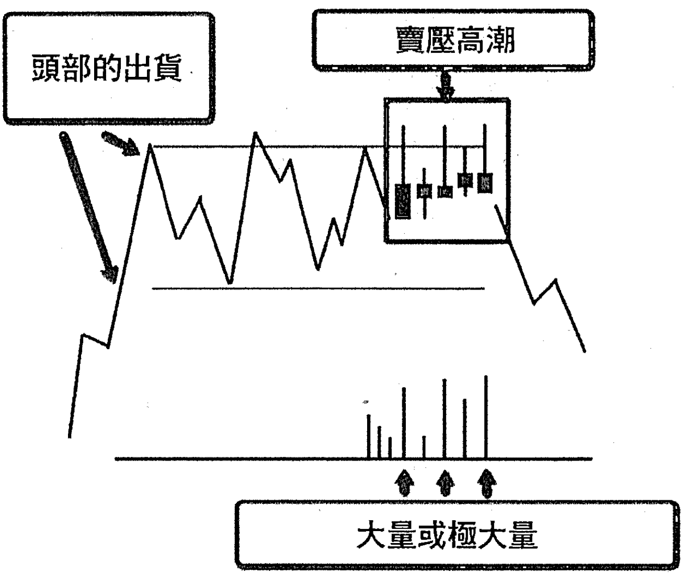

內線十分樂意順應買盤的需求，大量賣出，稍微壓低價格，然後再拉高，吸引更多買盤進場，直到他們出清存貨為止。

賣壓高潮階段，價格走勢的震盪程度轉劇，價格衝高，但收盤價卻回到開盤附近，成交量則暴增，因為買盤擔心錯失多頭趨勢的另一波行情；結果，另一波行情卻是朝相反方向發展。

最後，等到內線出清存貨，行情開始暴跌，跌破出貨階段的價格區間。對於 VPA 專家來說，我們可以清楚看到種種徵兆。

此處看到大成交量，伴隨著實體很短而上影線很長的 K 線，這是罕見的價量組合。本書稍後會詳細解說。

本書第 3 章曾經談到留有「上影線」的線形，我當時解釋這是透露重大訊息的線形，尤其是成交量配合的話。內線最後試圖清空存貨，早盤拉高價格。買盤湧進，推升價格進一步走高，群眾擔心錯失大好機會，成交量明顯放大，但臨收盤之前獲利了結的賣壓讓價格收在開盤價附近，多數買盤都被套在高檔。這個時候，某些交易者已經察覺市況「超買」。

這種價格行為通常會重複幾次，內線迎合需求而大舉賣出，盤中價格每次都會走高，但收盤價卻因為獲利回吐賣壓而跌回開盤附近。

線形實體的顏色不重要，重點是上影線的長度；這種線形通常重複出現幾次，而且伴隨著大成交量。此類價量關係透露的訊號很清楚，一旦造市者出清存貨，市場即將變盤，行情變動將非常快速。內線已經準備棄船，打算溜下滑梯，回到「起跑線」重新展開承接行動。在出貨階段末期看到這類價格行為，你最好立即坐到電腦螢幕前面——準備採取行動！接著，讓我們

看看賣壓高潮的相反情況：買進高潮。這是代表承接階段告一段落的煙火秀，顯示多頭趨勢即將發動的訊號。

## 圖表 5.17

買進高潮——又是另一場煙火秀

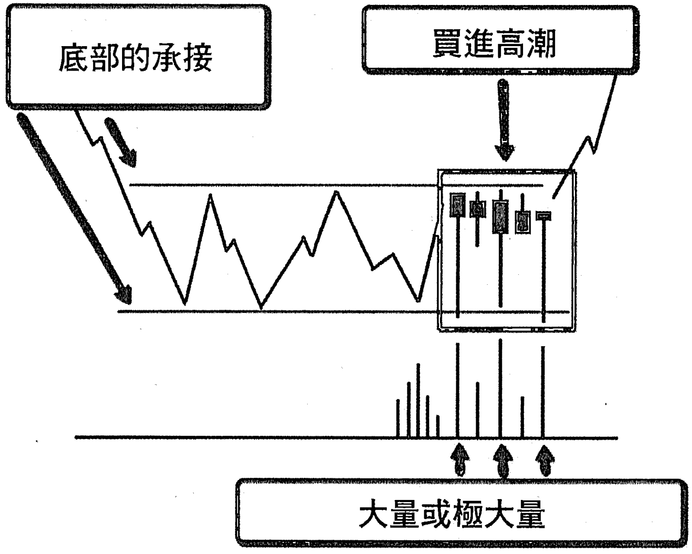

買進高潮就是賣壓高潮的相反發展。內線壓低行情，引發恐慌性賣壓，擔心受怕的持股者紛紛結束部位。請參考圖表 5.17。

內線在承接階段準備補充存貨，趨勢價格上下震盪，試圖震出浮額。

承接階段末端，內線開盤後不久快速壓低價格，引發恐慌

性賣壓，最後再藉由自身的買進而拉高價格到開盤價附近做收。這個時候，有些低檔承接者也意識到市場已經「超賣」。

這種盤勢會連續重複數次，投資人與投機客再也承受不了恐懼虧損的壓力，紛紛認輸，拋出持股。這也是最後的歡呼。

這個時候，內線已經準備就緒，手頭上握滿最近補足的股票存貨，打算開始北進，展開多頭攻勢，逐步挺進到出貨目標區域。

只要我們認同一項事實：所有的市場都受到某種形式的操控，那麼剩餘的故事就顯得理所當然了。

上述發展不僅合理，而且完全符合常識，不要誤以為目前在主管當局監控之下，這些事情已經不可能發生。事實上，自從懷可夫與內伊等人以來，這方面的變化並不大，容我引用發表於 1975 年的「市場創造者」（Making it in the Market）做為例證。

這是理查·內伊接受美國證管會官員電話訪問的談話。證管會是美國金融市場的管理當局。

記住，這是發生在 1975 年，相關資料是取自電話紀錄，證管會官員請教有關專業報價商的查核與規範方法：

> 「專業報價商隸屬於交易所。我們不太關心他們的問題。他們並不直接受證管會管轄。他們是藉由自律方式進行運作。他們自行安排規定和法則——證管會基本上都會核准。除非證管會覺得某些事情不恰當，才會當做例外處理。我們會查核綜合證券商，但從來不到

交易所查核專業報價商。」

所以，這些年來，事態是否有變化？

事實上，很有限，除了交易現在大多已經電子化，證管會目前面臨的許多問題之一，是高頻率交易（High Frequency Trading，簡稱 HFT）。

我們經常看到某些個人與機構試圖證明證管會與其他單位具有某種控制力，希望平息大眾的憂慮，說服大家相信金融市場是受到合理而公開的規範。

很遺憾地，但願前述說法真實無誤，但藉由 VPA 很快就能證明，實際情況基本上並非如此。內線的經驗實在太過豐富，而且異常狡猾，絕對不會幹殺雞取卵的事情。他們會設計更新穎、更周全的方法，藉由操縱價格而實現本身的利益。

讓我引用證管會最近針對高頻率交易的回應：

「高頻率交易技巧涉及幾種不同的類型，證管會的「概念公告」（Concept Release [6]）破解了四種主要的策略類型：

造市：如同傳統市場的造市者，這種策略同時提供市場流動性給買、賣雙方，試圖賺取兩種報價之間的價差。

套利：針對市場出現的套利機會進行交易（舉例來說，股價指數、ETFs 與 ADRs 等交易工具及其構成證券或根本證券之間的價格發生脫序現象）。

結構性：這種策略試圖運用市場或其參與者的任何結構性缺失，包括：潛伏套利（latency arbitrage）與塞單（quote stuffing）*。

方向性：這類策略是預先掌握或引發價格走勢，包括指令預期（order anticipation）與動能啟動（momentum ignition）。」

這些報告的發行日期？2012 年底。

我不想過度渲染這個議題，但我知道本書的某些讀者，必定認為我是個「陰謀論者」。我跟各位擔保，我絕對不是。

如同內伊本人指出的：

> 「政府當局的調查作為，大多都取決於證管會（透過競選獻金或其法律事務所），或期待（如果是證管會的總裁或主席）遙遠的將來能夠在證券產業實施，這些調查基本上都沒有具體結果。」

讓我藉由簡單的解說，做為本章的總結，希望有助於各位了解整體狀況。

請參考圖表 5.18，這代表完整的市場循環，我偏好稱其為內線「辦公室的另一天」，應該不至於讓各位覺得意外。

第一場戰役是承接階段。內線出清存貨之後，驅動行情大

幅走低，嘗試按照批發價格補充存貨。

等到大致補足存貨，就會發動買進高潮，設法藉由盤勢大幅震盪，震出市場浮動籌碼，承接階段一旦完成，內線就會推升行情脫離承接區域，開始測試上檔供給。市場賣壓如果大致上已經徹底清除，內線就會逐步拉高價格，設法恢復市場信心，平息驚魂未定的投資人與投機客。

信心逐漸恢復，上升趨勢也開始蓄積動能，吸引那些相信行情將從此「一路飆漲」的買家。即使是心態謹慎的投資人，大多也難以抵擋「賺錢的大好機會」，終於在行情抵達零售價格目標區附近，開始進入市場。

現在，行情來到零售價格水準，隨著出貨階段如火如荼地進行，價格走高而吸引更多買盤，然後行情回跌而把買盤套在高檔。最後，賣壓高潮出現，價格劇烈波動，內線出清剩餘的存貨。股票存貨一旦出清，市場快速挫跌，穿越出貨價格區間，並且進行測試，但這次是測試買盤。測試如果確認這個區域的買盤已經充分被消化，則行情會快速走低。

整個循環結束，接著是內線數鈔票，計算獲利，並且開始盤算下一循環的運作。如此不斷重複……我相信各位現在應該可以了解市場在玩的把戲了。

## 圖表 5.18

市場循環——交易辦公室日常的一天

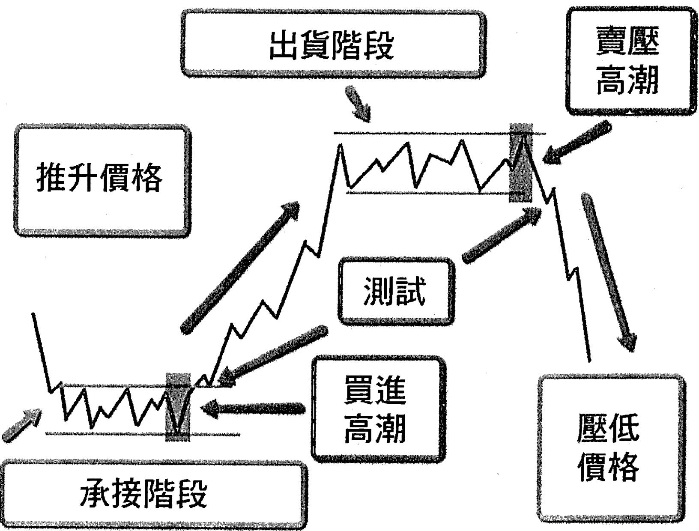

請注意，這種循環可能發生在任何市場的任何時間架構。
前述情節可以發生在配對外匯交易的 5 分鐘走勢圖，整個循環可能持續幾個鐘頭。這也可能發生在個別股票的日線圖，循環可能延續幾個星期或幾個月。這也可能發生在某期貨契約的小時走勢圖；若是如此，內線是大咖玩家，整個循環可能持續幾天或一星期。時間刻度並不重要，除了用以衡量懷可夫的因果法則。

當我們開始深入研究實際的走勢圖，就會看到這類的循環重複發生，交易者與投資人如果具備這幾章講解的知識，應該

可以協助各位了解金融市場的運作方式，並且信心滿滿地從事交易。

可是，對於 VPA 交易者來說，這還剛只是起點。

繼續前進到下一章之前，讓我先總結我們截至目前為止討論的內容，因為我當初開始研究價量分析時，確實花了不少時間才得以慢慢吸收這些資訊。

我準備從市場操縱（market manipulation）開始，嘗試解釋這個名詞的含意。這是不是說內線可以隨心所欲、隨自己高興地拉抬或壓低價格？當然，不是！我所謂的「市場操縱」，含意可能和多數人的解釋不同，我是指內線會利用各種可供運用的資源，激起散戶交易者心中的恐懼或貪婪情緒。換言之，他們會利用媒體刊載的每項新聞，設法影響買賣，驅動行情朝自己有利的方向發展，或是在出貨階段推升價格，或是在承接階段壓低價格。

這是我所謂的市場操縱，也就是創造出一種市況或環境，然後在投資人或投機客心中創造恐懼或貪婪意念。如同我稍早說過的，市場操縱說是操縱價格，倒不如說是操縱恐懼與貪婪的情緒。恐懼會促使賣出行為，貪婪會激起買進意念，而任何形式的媒體，都是創造這兩種情緒的絕佳工具。

其次，內線可能彼此配合運作，但絕對稱不上是聯合壟斷集團。專業報價員與造市者的人數實在太多了，根本不可能形成壟斷集團。不過，內線大概都可以同時察覺市況的強弱。他們掌握的優勢，就是能夠同時看到市場買賣雙方的委託單，因此完全清楚市場人氣狀況。

然而，內線無法隱藏成交量，這也是 VPA 之所以如此有效的原因所在。當內線開始介入操縱價格時，成交量是唯一可供判斷其行為的線索，讓我們知道他們究竟是在買進，或是在賣出。買進高潮期間，當內線積極買進，我們可以透過特殊的價量關係目睹其行為。同樣地，處在賣壓高潮期間，我們同樣可以透過特殊的價量關係，目睹他們積極拋售。對於 VPA，關鍵在於成交量，不是市場操縱因素。

人們經常問我，關於承接與出貨的目標價格區間，內線如何決定？這也是我本身試圖琢磨答案的問題。這些價位是否只是他們事前任意決定的；或者，這些價位的決定，是有合理根據的，所以我們有線索可以據理推測這方面的價格行為。事實上，這些價位的設定，確實是有合理根據的，這也有助於我們了解這些區域的價格行為。

任何價格走勢圖上，我們都會看到密集交易的價格區間，下跌／上漲走勢一旦到達這些價格區域，就會自然形成本章稍早提到的超賣／超買。對於 VPA 來說，這些價位具有絕對的重要性。這些價位代表下跌走勢可能獲得支撐，或上升走勢可能遭逢阻力的區域。換言之，這些區域代表某種關卡或障礙，行情過去曾經在此停頓或反轉。我們稍後會更詳細解釋這方面概念，目前暫時接受這些區域確實存在，通常也是承接或出貨階段發生橫向走勢的區域。

任何時間架構的走勢圖上，我們都會看到這類價格行為的「階段」；內線非常清楚這些區域，而且充分了解它們的可靠或牢靠程度，有些可以提供強勁的支撐／壓力，另一些可能只會造成短暫的阻力。籌劃這類的戰役，內線會預先設定目標，

挑選條件適合進行承接或出貨活動的區域。這也可以解釋行情一旦進入這些目標區域的價格行為。

首先，讓我們考慮出貨階段，觀察賣壓高潮究竟會發生什麼？

配合利多消息的鼓舞，行情走高，然後加速上揚，邁入上檔目標區域，此處也是市場的潛在「超買」區域，換言之，漲勢可能在此轉弱或放盡力氣。這也是內線啟動出貨行動之前，預先選定的目標區域。伴隨著利多消息，多頭趨勢向上發展，吸引愈來愈多的買盤進場，內線現在準備在這個目標區域打住，開始出清存貨。

出貨的最初階段，純粹是運用上升趨勢原本已經具備的動能，所以此時的成交量雖然大，但還不至於過份。凡是「向上」的價格線形，成交量都代表投資人和投機客的「自然」買盤。換言之，這個階段，內線並沒有「施力」驅動行情走高。他們只是順應需求，順著漲勢賣出，買方現在充滿「貪婪」意念。這個階段，任何賣出也都代表「自然」的賣出；換言之，賣出者是在上升趨勢初期進場，察覺漲勢已經鈍化，所以決定獲利了結。這個階段的最重要特色，是成交量明顯超過平均水準，但還不至於太大。

此時，上升趨勢顯然已經透露轉弱的徵兆，如同我們稍後詳細研究走勢圖所將看到的，但出貨的第一階段，是我所謂的「自然」階段。內線只是被動呼應貪婪投資人和投機客的需求。一般投資大眾的賣出，籌碼都被內線吸收成為存貨，準備轉賣。這個區間裡，內線運用當時的新聞消息，順勢驅動行情漲跌，庫存股票持續減少。

賣壓高潮屬於出貨的最後階段，也是內線需要特別施力的階段。發展至此，上升趨勢已經疲態盡露。消息面或許已經不如先前偏多，內線必須利用可供運用的消息，「施力」拉高價格，吸引更多買盤進場。

可是，由於盤勢轉弱，買盤現在遭遇更大的賣壓，這也反映在賣壓高潮的價格線形上。內線現在必須大費周章保持行情上漲，使勁推升價格，設法拋售股票，但隨著賣出數量增加，也影響價格走勢，更增添下降壓力。

這是所有出貨操作都會遭遇的問題。問題很單純。大量賣出，最終究會導致價格下跌，局面不利於出貨。這是一場艱困的戰役，也是內線必須面臨的困境，除了維持價格，同時還必須大量拋售股票。

問題是如何拋售大量股票而不至於造成價格大跌，否則就會前功盡棄。關鍵在於如何拿捏，這種均衡拿捏也是我們在賣壓高潮最後幾支線形所能夠看到的。內線必須驅使價格走高，大量拋售股票，但又不要讓價格崩跌，這些也是我們在賣壓高潮線形看到的。

## 賣壓高潮

圖表 5.19

賣壓高潮

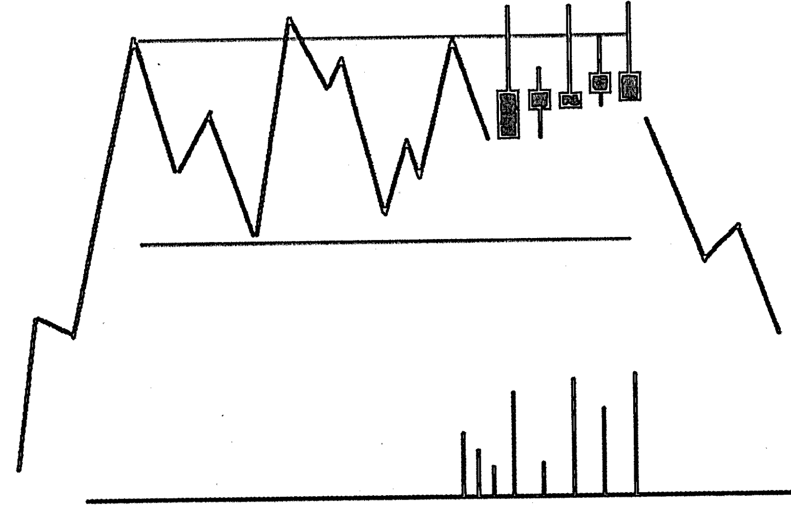

圖表 5.19 顯示內線如何拋售大量股票，驅使價格走低。我們可以思考現實生活的類似例子。物以稀為貴，譬如設計師產品、名牌或奢侈品。如果想增添商品價值，可以生產「限量版」。由於產品較少，供給明顯少於需求，販售價格也因此水漲船高。反之，大量生產的商品，由於供給充裕，價格也就便宜。

每當大型機構想趁著行情頭部大量拋售持股，通常不會直接透過一張大單賣出整批股票。否則的話，勢必會壓低行情，使得獲利減少。為了克服這方面問題，很多大型機構會運用「黑池」（dark pools）的交易管道。

所以，本書稍早曾經說過，成交量是唯一不可隱藏的活動——這種說法也不盡然真是如此。大型機構可以透過「黑池」管道隱藏鉅額交易，相關細節必須等到事後才會公布。

一般投資人或交易者恐怕永遠不會知道這類的資訊。可是，對於我們來說，這並不是大問題，而且我們也無能為力。

所以，如果有大量股票必須賣出，直接在市場上出脫，將會造成價格大跌，所以通常都會分批進行交易，或透過黑池管道隱藏資訊。

內線想要大量吃貨的買進高潮，也會碰到相同的問題，可能導致價格大漲。搞垮霸菱銀行的尼克·李森（Nick Leeson）就遇到這種問題。他建立的部位規模實在太大，不可能在不影響行情的狀況下結束部位。

最後，市場流動性欠佳的股票或外匯，交易也會碰上這類問題。大量買進會立即引發價格上漲，大量賣出又會造成價格大跌。這是內線必須處理的問題，因為他們的買賣數量很大。價格永遠會朝不利方向發展，這也是為什麼內線不能在單一時段內完成他們所想進行之交易的原因。

買進高潮或賣出高潮通常必須透過兩支、三支或四支線形才能完成，承接與出貨階段則需要花費更長時間。剛開始的時候，我花了不少工夫琢磨這個議題，但很快就發現自己必須保持耐心，靜待高潮完成。請記住，大量買進或賣出，都需要花費時間。

* 譯按：這些都是高頻率交易策略，潛伏套利是指套利者搶先取得報價資訊，藉由報價差異賺取利益；塞單是指遞入許多大單，然後立即取消，藉以造成交易撮合困難的塞單效應。

## 買進高潮

買進高潮也會碰到相同的問題。內線本身的買進行為，就會驅使價格上漲，還有空頭回補的買盤。可是，對於價格的影響，主要還是來自內線的買盤。讓我們再回頭看看買進高潮的例子：

圖表 5.20

買進高潮

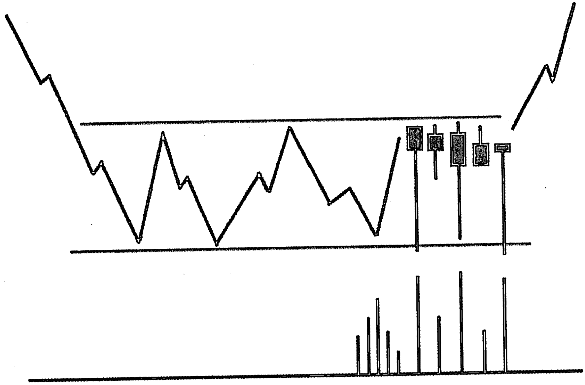

市場氣氛仍然偏空，內線藉由利空消息壓低行情，然後大量買進藉以補充存貨，但也因此驅使價格走高。內線暫時停止買進，市場呈現橫向盤整。

不久，內線再藉由利空消息壓低價格，又大量買進，價格也因為內線買進而上漲。這種程序將持續進行，直到內線補足存貨為止。

由許多角度來看，不論我們是否相信這種價格行為是內線操縱的結果，實際上無關緊要，真正的重點，是各位是否相信這些階段之市場行為所顯示的價量關係。

我們看到買進高潮爆出大量，顯然意味著行情即將向上反轉。同樣地，當我們看到賣壓高潮的價格行為，以及配合的成交量，就知道趨勢應該會向下反轉。

這就是大成交量與相關價格行為所告訴我們的，一切都再清楚不過了。

## CHAPTER 06

## 價量分析：進階用法

> 我永遠不會和盤勢爭論。
——傑西·李佛摩（1877-1940）

前面幾章，我們循序漸進地建構有關 VPA 的知識，首先在個體層次說明簡單的價量關係，也就是報價紙帶的層次。然後，考慮總體層次的簡單價量關係，由前一章「全局」觀點和行為循環角度，說明內線如何運用媒體做為主要工具，推升與壓低價格，配合成交量增減而產生的行情演變。

可是，如同本書開頭強調的，交易世界沒有什麼新鮮事物，成交量分析已經存在 100 多年。最近只發生一項顯著改變，也就是引進日本陰陽線（K 線）做為走勢圖價格行為分析的標準線形。截至目前為止，我們談到的所有著作，包括書籍與文章，都是運用走勢圖描述價格行為。西方交易者普遍採用 K 線圖，大概是 1990 年代之後的事情。我很幸運能夠接受亞伯特的指點，而且之後都採用 K 線圖進行分析，起因於其所傳達的優勢。

我個人認為，K 線能夠更完整傳遞價格行為的資訊。藉由 K 線進行 VPA，是我自己使用的方法。結合陰陽線與 VPA，能夠更深入彰顯市場行為的涵意。

本章準備更詳細地解釋各種陰陽線的特殊線形與價格型態，有助於我們的 VPA。我必須強調，我並不打算在此完整討論日本陰陽線。目前，市面上已經有很多這方面的專門著述，我將來也可能自己寫一本。

本章只準備談論和 VPA 之間存在密切關連的陰陽線線形與價格型態，藉由幾份圖解做說明，方便後續章節觀察相關的實際走勢圖。

不過在進一步討論之前，我想先解釋一些基本原理，這些是我們運用 K 線從事分析所必須掌握的基本概念。

### k 線分析基本原理：

### 原理 1

不論上影線或下影線，影線的長度很重要。分析 K 線，首先應該留意影線長度，因為這代表相關價格走勢的強度、猶豫不決，更重要的是市場人氣。

### 原理 2

K 線如果沒有影線，代表收盤價的方向很明確。

### 原理 3

線形長度很短的短小線形，代表市場人氣不足。線形長度很長的長線形，代表明確的市場人氣。

### 原理 4

相同型態的 K 線，如果發生在價格走勢的不同場合，往往代表全然不同的含意。所以，分析 K 線型態，必須擺在整個走勢架構內做觀察。

### 原理 5

價格與成交量應該配合分析。首先分析 K 線本身的含意，然後觀察成交量，評估價格行為是否受到成交量確認，或者價量關係異常。

所以，讓我們首先分析最重要的兩種 K 線：「流星」（shooting star）與「鎚子」（hammer）。

## 流星線形

價格行為：疲弱。

流星是我們 VPA 相關討論首先準備處理的線形之一，這種線形會出現在所有市場的各種交易工具，以及各種時間架構。

這種線形的價格行為顯露疲弱，價格先盛後衰，收盤價落在開盤價附近，顯示買盤在交易時段內受到賣盤壓制。

流星可能出現在多頭或空頭趨勢，也可能落在趨勢發展過程的每個位置。流星並不代表立即反轉，只意味著既有走勢當時轉趨疲弱。這種線形只有獲得成交量確認才會顯得重要。

流星可能出現在上升趨勢或下降趨勢。這種線形是既有趨勢轉弱的典型徵兆，唯有成交量才能清楚衡量這種弱勢表現的相對強度，並顯示反轉的可能性。想要了解流星的各種含意，最好還是藉由例子說明。

流星如果發生在上升趨勢發展過程，成交量低於平均水準，則代表既有的上升趨勢可能停頓，可能發生短線拉回走勢。這種訊號發生之後，應該考慮先前與後續發展，藉以確認趨勢是否持續進行。

趨勢如果持續發展，這種弱勢表現或許會受到另一支流星的確認，其成交量為平均水準。發生在相同時間架構上的兩支流星，規模如果相當，我們可以比較兩者的成交量。第一支流星如果代表既有趨勢轉弱，第二支流星的成交量較大，則是進一步確認這種弱勢表現。第二支流星的成交量如果大於第一支流星的成交量，意味著第二支流星反映的市場賣壓更嚴重。

任何單一流星，都代表既有趨勢轉弱的現象。如果看到連續兩支流星，或兩支流星發生的位置相當接近，則蘊含的空頭意涵不僅倍增而已。如果是三支流星，則情況更是如此。換言之，單一線形已經具有參考價值，如果多支流星在附近連續出現，空頭氛圍加速累積。請記住，這僅是就價格行為本身判斷。如果配合成交量，則分析將進入另一層次，這也是我之所以不能理解 PAT 交易者為何不使用成交量的理由。

## 圖表 6.10

流星與其成交量

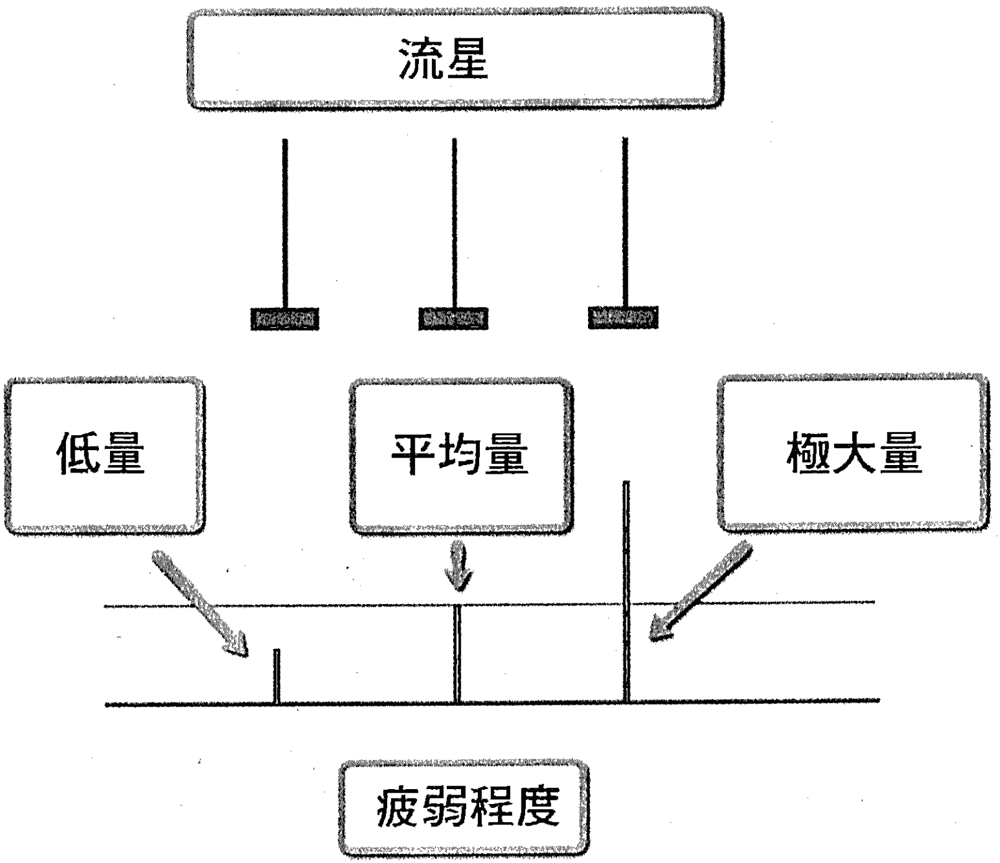

對於圖表 6.10 的價格型態，設想走勢圖上連續出現三支相同的流星線形，成交量陸續放大。根據這種價格型態與成交量組合，各位認為走勢隨後的發展應該會上漲或下跌？

走勢顯然應該會下跌，理由很清楚。第一，連續出現三支線形，盤中高價都落在相同位置，該處存在明顯的賣壓。第二，我們看到三支流星，這種線形本身就代表盤勢疲弱。第三，成交量持續放大，而且連續三支線形的最高價都相同。最後兩支線形可以視為賣壓高潮的一部份。

另外，這個型態如果發生在某橫向走勢的末端，訊號更明確，尤其是運用另一種價格分析技巧——支撐／壓力——來確認 VPA 結論。

事後回顧走勢圖，我們往往很容易辨識價格走勢的頭部和底部。可是，對於正在發展的行情，通常很難判斷主要轉折點，所以我準備運用圖表 6.11 ，解釋這種價格行為如何在走勢圖上展開。同時，這也讓我有機會介紹這套方法其他更廣泛的層面。

## 圖表 6.11

流星的典型價格行為

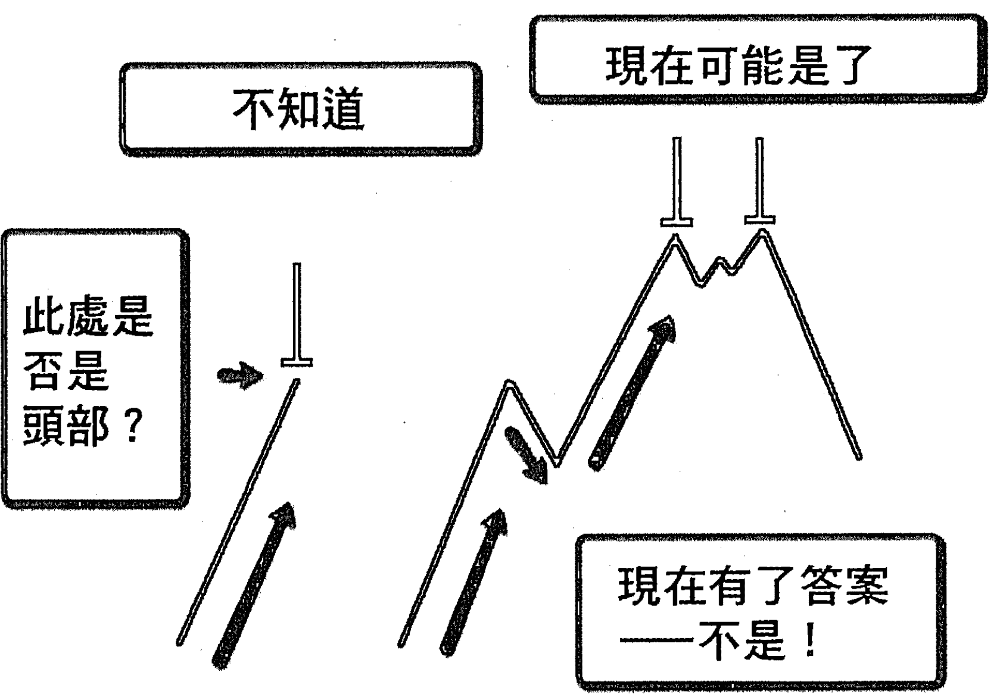

首先看看左側的圖例。行情呈現向上發展的趨勢，然後出現一支流星線形，甚至伴隨著平均水準以上的成交量。這支線形是否意味著主要趨勢反轉？或只代表漲勢可能停頓，稍做拉回整理？單就這支線形判斷，答案是：不知道。

我們只知道：既有趨勢呈現多頭發展，流星代表既有趨勢轉弱。這個訊號確實有值得參考之處，因為流星是發生在一股漲勢的末端，這也是我稍早曾經強調的：所有訊號的判斷，都應該考慮前後關連。

就目前這個例子來說，流星夾著平均水準以上的成交量出現，當時的行情正處於漂亮的多頭漲勢。這份走勢圖引起我們的注意。我們應該怎麼辦？立即進場建立部位嗎？

當然不是。如同稍早強調的，行情不會突然急轉彎。走勢通常會先停頓、猶豫，甚至可能又拉高，然後再停頓，最後才開始下跌。

我們會等待次一支線形，看看這種弱勢表現是否會獲得進一步確認，隨後或許會先出現一支向上的短小線形，然後再跟著出現另一支流星。第一個流星已經代表警訊，提醒我們留意盤勢轉弱，可以根據後續線形確認先前疲弱的現象，嘗試藉由 VPA 判斷相關發展究竟代表較長期走勢轉弱，或只是暫時休息。這個時候，我們也應該回顧走勢圖上過去的密集交易區間，尋找相關線索，或許有助於判斷任何反轉的可能程度。

如果價格走勢最近才剛從承接階段向上突破，則流星非常不可能代表任何明顯的向下反轉訊號；所以，前後關連很重要。關於線形或價格型態的判斷，永遠要考慮前後脈絡。就目前這個情況來說，我們要考慮流星與最近內線承接股票進行之整理走勢的關係。新趨勢如果才剛啟動，畢竟不太可能馬上反轉，尤其是經過成功的測試。所以，我們要考慮線形究竟是發生在什麼位置，以及當時的整體狀況如何，這些考量有助於我們回答問題。

其次，就是要檢視較短期與較長期時間架構的發展情況，包括 VPA 在內。

舉例來說，我們如果運用 1 小時走勢圖進行交易，看到流星線形出現，同時查核 15 分鐘走勢圖，發現該時間架構上也連續出現兩支流星，而且兩支線形的成交量都高於平均水準，這讓我們得以判斷 1 小時走勢圖上流星線形反轉訊號更值得重視。另外，如果 15 分鐘走勢圖的流星上檔緊貼著密集交易區，這可以更增添相關分析的效力。所有這些分析頂多只需要幾分鐘，甚至幾秒鐘，在下一支線形還沒有出現之前就完成了。

運用多重時間架構進行分析，讓我們得以了解較長期趨勢的發展，有助於回答流星線形究竟代表小型折返或較長期趨勢反轉的問題。這是運用多重時間架構從事分析具備的優點之一。另外，運用多重時機架構，也有助於我們決定部位的持有時間。

這是很合理的現象。畢竟長期趨勢如果呈現多頭行情，我們如果在較短期時間架構上從事放空交易，部位持有時間顯然不該太長，因為交易部位違背較高層級趨勢的發展方向。由這個角度觀察，也同樣有助於我們回答流星線形究竟代表小型折返走勢，或屬於較長期趨勢反轉的問題。

關於行情是否出現「頭部」的相關分析，有很多技巧可供運用，本書稍後會陸續詳細介紹。然而，此處準備先談一些。多重時間架構分析、VPA、價格密集交易區與價格型態分析等，都可以用來協助我們回答這個問題。另外，價漲量縮永遠是盤勢轉弱的現象。

流星發生之前，可能先出現一支大量小藍線，這也是典型的弱勢現象；可是，我們仍然沒有辦法用以判斷這究竟是小型折返，或是趨勢主要反轉。想要得到這類的問題，需要仰賴其他時間架構的 VPA，還有各位隨後將學到的技巧。

其中一種技巧，是價格密集交易區的深度與廣度，橫向走勢發展的整理期間愈長，愈可能發生突破與反轉。

另外，VPA 是一門藝術，不是科學，這也是為什麼交易軟體不能幫我們做分析的道理。我們針對每支線形、價格型態、相關成交量，以及多重時間架構之價格行為所做的分析，用以判斷主要趨勢發展，這一切都是主觀的。最初，我們需要花工夫學習，這也是我寫這本書的宗旨所在：協助各位學習，盡可能縮短學習曲線。

本章最初談到的五種原理，適用於所有的 K 線與 VPA，但如同流星一樣，這對於其相反線形「鎚子」也很重要。我覺得現在適合談論進階層次的 VPA 概念。

請注意，流星雖然經常出現在上升趨勢，但也可能發生在下降趨勢。如果發生在下降趨勢，可以確認既有趨勢將繼續呈現疲態，尤其是發生在下降趨勢剛開始不久。賣壓高潮之後的流星，可能是內線為了測試需求而壓低行情。另外，流星如果伴隨著低量，而且是發生在賣壓高潮之後，橫向整理已經持續一陣子，如此可以確認是內線在測試需求。內線推升價格，但沒有需求跟進，所以價格又回跌到開盤價附近，這種盤勢反映在流星的線形之上。

流星也可能發生在小型反轉走勢過程，隨著賣壓稍歇，價格反彈。此處的流星如果伴隨著平均水準以上的大量，意味著行情仍然呈現弱勢，還沒有發展到買進高潮的趨勢底部。

這種價格型態意味著內線賣出他們稍早在恐慌性賣出過程取得的部分存貨。隨著行情繼續走低，這些存貨必須設法處理。內線希望能夠按照目標價位——換言之，批發價格——補充存貨。

這種反彈走勢會吸引一些買盤，因為他們認為行情已經見底回升，但多數人會繼續賣出。價格急跌過程，隨時可能出現這種盤勢。內線必須設法讓價格止跌回升，或許運用媒體的利多新聞，然後趁著需求轉強而賣出，並處理後續而來的賣壓。因此，這類流星的成交量會高於平均水準，甚至爆出大量，顯示盤勢隨後將繼續走弱。

## 鎚子線形

價格行為——強勢。

「鎚子」(hammer) 是我們首先準備討論的三種線形之一，可能出現在任何市場和時間架構。鎚子屬於相當典型的強勢線形，可能代表暫時的強勢，也可能代表較長期的趨勢反轉。

鎚子線形的發展過程，價格先下跌，然後回升到開盤價附近做收。這種盤勢顯示賣壓被吸收，而且買盤的力量足以拉高收盤價。因此，鎚子頗有「起死回生」的意味，就如同流星一樣，如果配合 VPA 分析，屬於深具潛力的線形。

本章稍早討論的五種原理也適用於鎚子。鎚子一旦出現，很容易引起遐想，往往誤以為趨勢即將發生變化。當時的行情如果正處於下降趨勢而快速下跌——經常如此——則趨勢不太可能立即反轉。更可能發展的趨勢，是既有跌勢暫時打住，稍微反彈，然後又繼續下跌。

如同我們了解的，內線出清存貨的下跌過程，鎚子是跌勢停頓的徵兆，代表內線進場，行情暫時獲得支撐。內線甚至可能推升價格而形成流星。鎚子代表內線買進，流星代表內線賣出。內線雖然會快速壓低走勢，但高檔永遠存在賣壓，內線的存貨在行情走低之前必須出清。否則的話，內線將保有某種程度的高價存貨，不是按照批發價格買進。

價格急跌發展過程，跌勢總會有所停頓或反彈，然後才會繼續走低。這個時候，成交量絕對是關鍵，急跌過程的成交量如果持續擴大，代表跌勢將繼續發展。因此，單一的鎚子線形並不足以阻止跌勢，甚至配合大成交量也是如此。關於鎚子代表的意涵，後續的價格行為是關鍵，還有相關時間架構的價量發展，以及附近的密集交易區間。這和我們稍早碰到的問題相同；每當看到鎚子，我們想知道這究竟代表既有趨勢的停頓還是反轉。

不論鎚子或流星，如果我們看到連續出現兩支或三支線形，而且配合大量或極大量，就可以相當確定是買進高潮或賣壓高潮，我們只需要耐心等待內線完成他們的工作，行情自然會走高或下跌。

另外，請記住，買進高潮一旦完成，我們可能看到另一支或幾支鎚子。這些鎚子或許不太像標準的鎚子，下影線長度可能不够，但意涵相同。這些線形的实体长度很短，下影线很明显。

成功的测试，成交量必须明显萎缩，这个阶段测试可能不 仅一次。测试可能发生在承接阶段的密集交易区，以及向上突破的初期，也就是价格回升到上檔賣壓沉重區域。

這兩種線形，是我們最需要注意價量關係者。我相信各位已經知道，對於任何線形或一系列線形，觀察重點就是價量關係彼此確認或異常。換言之，價格行為是否受到成交量確認，或者價量關係異常。因此，這代表截然不同的訊號。

由某種角度來說，流星線形永遠不會出現價量異常現象，因為價格行為本身已經傳遞明確的訊號。任何 PAT 交易者都會告訴你，這種線形本身就代表弱勢，沒有其他解釋。盤中價格先上漲，收盤價卻跌到開盤附近。至於成交量，則用以說明「弱勢」的含意，這也是我為何在圖解內標示三種成交量：低量、平均量與大量（或極大量）。伴隨著低量的流星，雖然代表弱勢，但沒有重要意義，除非是在內線啟動下跌走勢過程，賣壓高潮之後的測試需求。

流星的成交量如果達到平均水準，同樣代表弱勢。可是，相較於成交量小的流星，收盤價拉回到開盤價附近的走勢，空頭意涵更明顯。至於大量或極大量的流星，則代表專業玩家出貨；所謂專業玩家，可能代表股價指數或個股的造市者，期貨的大咖玩家，期貨的造市者，債券的大咖玩家。總之，內線拋售，我們必須準備因應，因為重大走勢可能即將發生。

總之，流星不會有價量關係異常的問題，成交量只能用以確認訊號的強度。價格行為永遠會得到成交量的確認，問題只在於成交量的大小，而這必須根據最近不久之前的成交量狀況做判斷，還有隨後將出現的線形。

鎚子的情況也是如此。換言之，鎚子的價量關係沒有異常的問題，價格行為已經告訴我們所需要知道的。線形發展過程，不論基於什麼理由，價格先是下跌，然後拉高到開盤價附近做收。這種盤勢已經代表力量，成交量只會顯示這種力量強到什麼程度。

同樣地，請參考圖表 6.12，其中顯示三支鎚子，對應的成交量線形也有三支，分別代表低量、平均量與極大量。

鎚子夾著低量，代表強中帶弱；平均水準的成交量，代表鎚子蘊含的勁道更強，可能足以造成反轉；成交量極大的鎚子，代表內線買進。成交量提供某種程度的線索，說明後續發展的可能性。平均水準成交量的鎚子，可能代表盤中搶帽子的機會。這當然沒有什麼問題。鎚子的成交量如果偏低，即使行情出現反轉，上檔可能也相當有限。

這又涉及另一件事，我希望在此提一提。

VPA 不僅協助我們進場建立低風險的交易部位，而且也協助我們繼續保有這些部位，後者往往是交易過程最難辦到的一件事。持有部位而繼續停留在某趨勢之內，有時候相當困難，我相信這是最難精通的一門技巧。這也是許多交易者之所以不能成功的主要理由。畢竟只有繼續停留在趨勢之內，才可能獲取最大利潤，而趨勢可能延續幾分鐘、幾個鐘頭、幾天，或好幾個禮拜。

## 圖表 6.12

鎚子與成交量

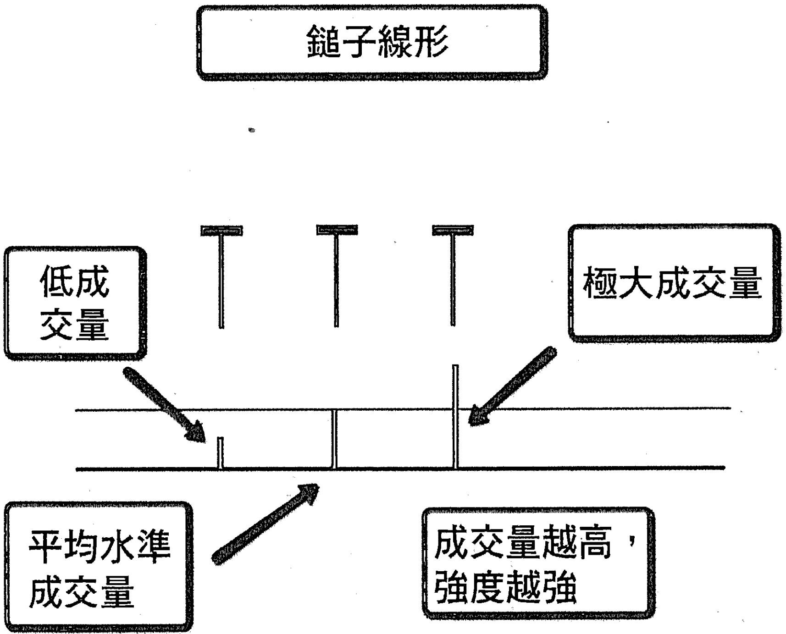

身為交易者，我們知道行情通常會分階段逐步上漲與下跌，不太可能直上或直下，所以當走勢出現短期拉回或折返，我們需要繼續持有部位。這正是 VPA 的重要功能所在，能夠協助我們繼續持有部位，對於我們運用的分析方法保有信心，了解市場內線的真正意圖。

舉例來說，市場處於跌勢，我們持有空頭部位，並且看到一支鎚子線形。這支鎚子究竟代表趨勢反轉的出場訊號，或只是既有趨勢的暫時停頓？成交量如果很小，代表內線沒有積極買進。這支鎚子之後，可能出現帶著平均成交量或大量的流星，確認低量鎚子只代表既有跌勢的暫時休息。如果沒有成交量可供參考，就無從判斷價格行為的強弱。有了成交量，我們就能解釋價格行為，並擬定適當的因應對策。

這就是 VPA 的功能所在。不只引導我們進場建立部位，並且讓我們繼續留在趨勢之內，最後還帶領我們出場。

如果鎚子爆出大量或極大量（請參考圖 6.12），可能代表趨勢反轉的前兆。這意味著大錢進場，我們如果持有空頭部位，最好準備出場，不妨先做部分的獲利了結，一旦看到向上突破的訊號，就要準備建立多頭部位。

進場建立部位的部分，相對容易處理，真正的難處在於如何判斷趨勢持續發展而繼續持有部位，以及何時應該出場。這也是 VPA 得以發揮功能之處，這方面技巧可以協助我們了解市場的真正意圖。一旦懂得如何解釋價量關係，我們的交易就算登堂入室了。

最後，鎚子線形如果出現在多頭趨勢的頭部，那又是另一回事了，這種線形不僅另有名稱，解釋也完全不同。本章稍後，當我們談論其他線形與價格型態時，會探討這種情況。

這也是本章最初談到的原理 4 所強調的：線形必須擺在整體趨勢的前後關連架構上做評估與解釋。發生在上升趨勢頭部的鎚子，叫做「吊人」（hanging man），這種線形如果伴隨著流星出現，代表既有上升趨勢轉弱。

接下來，我們準備討論的最後一種基本線形，稱為「十字線」，但不是一般的十字線，而是「長腳十字線」。

## 長腳十字線

價格行為—猶豫不決。

十字線存在各種變形，幾乎每份走勢圖都可以看見其蹤跡。十字線可能有各種解釋，但共通特色是其開盤價與收盤價相同或極為接近，存在上影線或下影線。

這就是十字線代表的價格行為。十字線雖然有各種不同大小和形式，但就 VPA 而言，我認為只有一種十字線最重要：長腳十字線。

十字線本身是代表「猶豫不決」的價格行為。行情發展到多、空力量均衡的階段。首先讓我們看看交易時段內的實際發展情況：市場開盤，價格朝某個方向發展；但收盤之前，又朝相反方向發展。交易時段的進行過程，多、空雙方可能多次拉鋸，但價格最終收在開盤價或其附近。換言之，交易時段之內，價格曾經大幅擺動，但開盤價／收盤價始終是支點。

關於這種十字線，特點是上影線和下影線相較於實體來說——很長，我過去稱其為「長腿蜘蛛」（腳很長的一種蜘蛛）。

這種線形顯示既有趨勢可能發生反轉。就如同鎚子和流星一樣，十字線的價格行為本身，即代表明確訊號，但配合成交量，意義更顯著。線形的價格行為本身，已經說明盤勢猶豫不決。否則的話，就會出現結構全然不同於十字線的線形。

價格行為透露市場人氣，就目前這種線形來說，盤勢呈現猶豫不決，因此可能發生趨勢反轉。長腳十字可能代表趨勢由多翻空，或由空翻多的訊號，方向究竟如何變動，取決於既有趨勢。如果多頭趨勢已經進行一陣子，這個時候出現長腳十字，可能是趨勢翻空的第一個徵兆。反之，如果行情已經下跌一段期間，則這種線形可能代表盤勢翻多的訊號。

可是，長腳十字有一點不同於流星或鎚子，其價量關係可能出現異常。請參考圖表 6.13，我們看到線形可能配合三種成交量。長腳十字線的成交量如果太低，代表價量關係異常。

讓我解釋價量關係為何會異常，同時還要介紹另一種概念。

### 圖表 6.13

長腳十字線

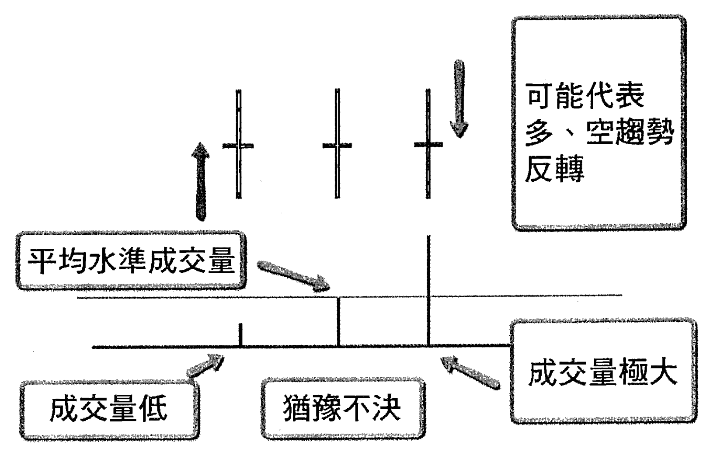

長腳十字伴隨低成交量，這種線形的價量關係為何異常呢？不妨讓我們根據常理推論。交易時段內，價格大幅上下震盪，最後收在開盤價附近。這種價格行為顯示行情波動劇烈，否則我們會看到全然不同的線形。行情既然波動劇烈，成交量為什麼還會偏低呢？

行情波動劇烈，似乎應該有「作用」施予其上，而我們知道作用與結果應該彼此對應。可是，就目前的狀況來說，我們看到明顯的結果（行情震盪），卻沒有發生對應的作用（成交量）。這種價量關係顯然異常，唯一的合理解釋，就是行情雖然是由內線驅動，但內線並沒有積極參與。內線透過這種上下震盪的價格行為，引發停損單和限價單，震出籌碼。然而，內線並沒有積極買進或賣出，只是運用新聞做為催化劑，試圖「打草驚蛇」。談到這裡，又涉及 VPA 的另一個重點。

長腳十字線形經常出現在經濟基本資訊公布當時，譬如每個月份第一個星期五公布的非農業就業人口資料。資料公布時，價格可能大幅波動，最後又回到開盤價附近，於是形成長腳十字線形。這是內線順勢引發停損與其他交易指令的大好時機。

我們知道情況之所以如此，是因為成交量的緣故。成交量如果偏低，則走勢就不是真的，而屬於異常現象。價格出現如此大幅震盪，理當看到力量作用其上，但實際卻沒有看到成交量顯示的作用。這意味著價格走勢是由內線操縱的；這種情況，長腳十字並不代表反轉訊號。行情隨後雖然可能發生反轉，但就目前來說，情況還不明朗，我們不要介入，應該觀察後續的線形發展。

關於成交量與新聞之間的互動狀況，我們的下個論點如下。每當有經濟資料公布，或重大宣布、利率決策，或其他任何基本面資訊宣布，成交量的反應會立即告訴我們，市場究竟是確認該新聞，或忽略相關新聞。換言之，新聞發布會獲得成交量確認，立即顯示市場內線是否參與任何後續的價格走勢，或只是留在場外觀望。

內線如果參與，我們也應該跟進；否則的話，我們就留在場外，如同他們一樣。

舉例來說，假定非農業就業人口資料有重大新聞公布，對於股票、商品或外匯等風險資產的交易，屬於正面的利多消息。這種情況下，這些資產價格應該隨著消息公布而強勁上漲，成交量也應該明顯增加。若是如此，代表市場確認相關新聞，內線與大咖玩家進場。線形可能因此出現一支伴隨著大量的長藍線。價量關係配合，新聞經過確認。

每當新聞發布，我強烈建議各位留意成交量的發展狀況，這是學習 VPA 基本知識的最快速方法。讓我們看看情況可能如何發展。重大價格走勢伴隨著高成交量，或伴隨著低成交量；後者屬於陷阱，譬如低成交量的長腳十字線。請注意，新聞發布時，我們經常看到成交量暴增，這是進行 VPA 的好機會。如果重大價格走勢伴隨著大量，意味著內線參與相關的價格漲勢或跌勢。反之，如果價格隨著新聞發布而啟動，但價格行為沒有得到成交量確認，則屬於異常現象，代表其他力量運作其中。這些徵兆顯示我們應該謹慎因應。

成交量應該伴隨著新聞。交易時段內，市場行情通常都會隨著消息面變動而有所反應，這是判讀行情最簡單也最快速的方法，並且能夠了解各種交易工具和市場的低成交量、平均成交量或高成交量的含意。

長腳十字線形通常至少需要有平均水準的成交量配合，最好是大成交量或極大量。成交量如果太小，則屬異常，可能是內線佈下的陷阱。

以上討論是最經常發生在所有時間架構上的三種基本線形。我們需要特別留意這三種線形，它們也是剛開始學習 VPA 的最佳起步。碰到這些線形，我們如果當時未持有任何部位，則應該留意進場的確認訊號，如果已經持有部位，則應該留意繼續持有或出場的訊號。

現在，我們準備討論其他重要的個別線形，以及某些價格型態。

## 長線形

### 圖表 6.14

長線形

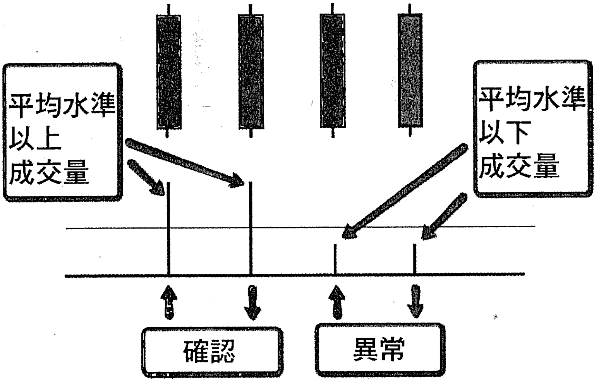

價格行為——市場人氣明確。

長線形（線形實體很長）只傳遞了一種訊號——交易時段內的人氣明確，可能是明確的多頭人氣，或是明確的空頭人氣。換言之，交易時段內，價格強勁上漲而收在最高價附近（長藍線），或價格大幅下跌而收在最低價附近（長紅線）。配合這種人氣，成交量也應該偏高。

如同圖表 6.14 顯示，平均水準以上的成交量，意味著長線形價格行為獲得確認，內線參與行情走勢，價量關係配合發展。

成交量如果低於平均水準或明顯偏低，都代表警訊。價格大幅變動，卻沒有出現對應的作用。很多散戶交易者追逐價格，認為這屬於有效行情，但成交量顯示的情況則非如此。當時如果持有部位，應該考慮出場。如果未持有部位，則應該繼續留在場外，等待後續訊號顯示內線的意圖。

## 短小線形

### 圖表 6.15

短小線形

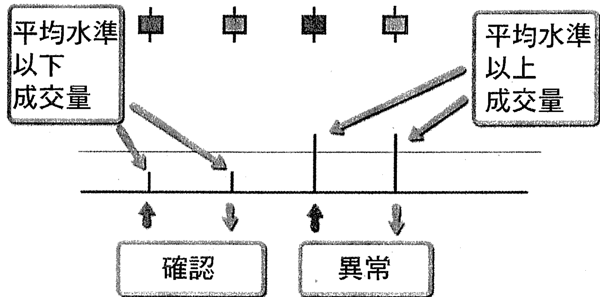

小線形的成交量照道理也應該偏低——反映「作用 vs. 結果」的原理。這種價量關係不該引起我們的注意。可是，小線形如果配合平均水準或以上的成交量，則屬於異常現象，應該立即引起我們的注意，思考箇中原因。

請參考圖表 6.15。我們如果看到向上的小藍線，成交量偏高，這意味著市場呈現某種程度的弱勢。根據「作用 vs. 結果」的原理，大成交量應該造成長藍的價格線形。所以，小藍線顯示內線在此價格區域遭遇上檔壓力，雖然出現大成交量，但也僅能推升價格稍微走高，顯示很難繼續向上攻堅，隨後如果出現流星線形，則可以確認盤勢轉弱。

同理，小紅線如果爆出大量，則適用相反的推理，內線看到盤勢轉強，開始積極進場。線形小而成交量大，意味著下檔承接意願轉趨積極，所以成交量明顯增加而價格不至於大跌，代表由空轉多的徵兆。後續線形可以確認盤勢轉強，我們預期看到錘子或長腳十字等線形。

## 吊人線形

價格行為——多頭趨勢結束之後的潛在弱勢表現。

剛開始採用 VPA 與 K 線時，總認為上升趨勢發展過程出現的吊人線形，屬於強勢表現，意味著上升趨勢將繼續發展，因為這種線形的結構和錘子相同。事實上，情況剛好相反，發生在上升趨勢頭部的吊人線形，代表盤勢轉弱，前提是要配合平均水準以上的大成交量，請參考圖表 6.16。

### 圖表 6.16

吊人線型

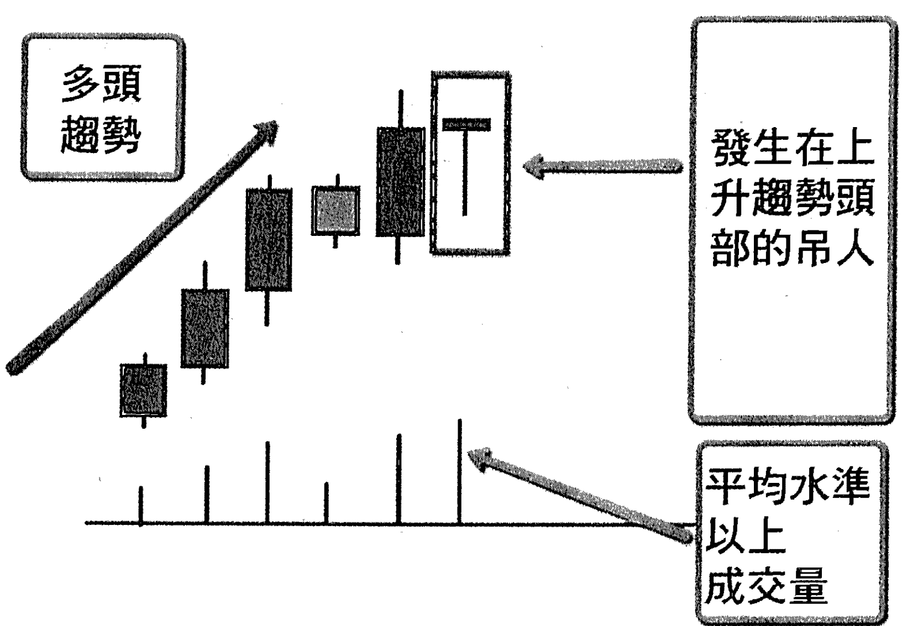

多頭趨勢

發生在上升趨勢頭部的吊人

平均水準以上成交量

問題是：這種類線形為何代表弱勢呢？行情呈現穩定的價漲量增上升走勢，直到這個時候出現明顯的賣壓，盤中價格一度走低，雖然收盤回升到最高價附近，線形結構與鎚子相同。可是，這種線形如果發生在多頭趨勢已經發展一陣子之後，則稱為「吊人」線形。

這種線形之所以呈現弱勢，是因為這代表上升趨勢發展過程第一次出現明顯的賣壓。內線進行測試，發現下檔仍然有強勁的買盤支撐，但該線形已經顯示行情發展到超買區域。吊人線究竟收藍或收紅並不重要，重點是價格收在開盤價附近，而且接近最高價。

價格行為確認強勁的賣壓，雖然目前還有買盤支撐，但至少已經出現變盤的警訊。這屬於早期的警訊，我們需要留意後續的確認訊號。

吊人線形一旦出現，隨後幾支線形之內如果跟著出現流星，就可以視為確認，尤其是流星伴隨著平均水準以上的大量。重點是要經過確認。至於吊人線形本身，則不算是強烈的訊號，只提供可能變盤的早期警訊。

吊人線形需要經過確認，也就是要在相關價位附近看到進一步的弱勢表現。舉例來說，吊人線形發生之後，不久如果看到流星，就屬於相當典型的組合，後者可以確認前者的弱勢表現，即使兩者之間相隔幾支線形，仍然屬於有效確認，前提是流星需要配合大量。

## 制動成交量

價格行為—強勢表現。

行情下跌過程，內線採煞車的價格行為，一般稱為「制動成交量」（stopping volume）。如同前文多次強調的，市場行為如同 一艘大油輪，沒有辦法突然大轉彎，除了其反應需要時間之外，也必須克服既有運動的慣性。

### 圖表 6.17

制動成交量

線形實體
長度縮短

下影線很長，收盤價
落在線形上半部

成交量高，而且持續放大

圖表 6.17 呈現明確的下降趨勢，價格急跌。可是，行情發展至此，內線試圖採煞車，希望減緩跌勢，開始嘗試在下檔買進。這種買進行為，讓線形留下明顯的下影線，但實體長度不算很短。另外，收盤價大多落在線形價格區間的上半部，這也是盤勢轉強的另一徵兆，雖然這並不是絕對必要條件，情況大致如同圖表 6.17 顯示。

請注意，跌勢發展至此，賣壓相當沉重，即使內線進場，力量仍然不足以在單支線形之內阻止跌勢，可能需要經過 2、3 個交易時段踩煞車，就如同前文談到的大油輪。即使引擎完全停止，船隻可能還會繼續航行數英里。市場的情況也是如此，尤其是下跌速度總是遠快於上漲。下跌走勢是由恐慌情緒主導，壓力相當驚人。

內線進場，吸收相當程度的賣壓，收盤價明顯拉高，留下很長的下影線。次個交易時段，賣壓繼續出籠，內線也繼續買進，成交量放大，收盤價由盤中低點明顯回升，線形實體顯得更小，意味著內線更積極買進。再經過一個交易時段，我們看到下影線很長而實體更短的線形。最後，我們終於看到第一支錘子。

圖表 6.17 顯示的一系列線形發展，是幾近於完美的例子，我們如果看到這種型態發生在下跌走勢的末端，就應該特別留意隨後很可能發生的回升走勢。

制動成交量代表的含意就是如此。成交量明顯放大，意味著內線與專業資金積極進場，導致既有跌勢趨緩。這種排列充分顯露力量，行情可能由空翻多，且可能是買進高潮即將發生的前兆，所有的賣壓也將因此被清除。內線既然已經進場，各位也應該如此！

## 盤頭成交量

價格行為—弱勢表現。

名稱透露了線索。制動成交量代表既有跌勢停頓，做頭成交量則是上升行情末端的盤頭走勢。

同樣地，行情發展不會突然停頓而立即反轉；不論上升或下降走勢，都存在慣性。下降走勢蘊含的力量雖然更可觀，因為跌勢通常發展得更快速。雖說如此，但上升趨勢仍然存在慣性，這是內線驅動需求所造成的力量。在貪婪與害怕錯失賺錢機會的意念驅動之下，交易者與投資人爭先恐後進場。成交量放大，內線拉高行情，也趁機出貨。這種價格行為經常會反映在一系列線形排列上，其上影線很長，實體愈來愈短，成交量持續擴大。

行情發展至此，由於內線持續賣出，已經很難維持上升趨勢的既有動能，價格線形的實體愈來愈小，漲勢趨緩。成交量維持在平均水準之上，甚至爆出大量或極大量。

### 圖表 6.18

盤頭成交量

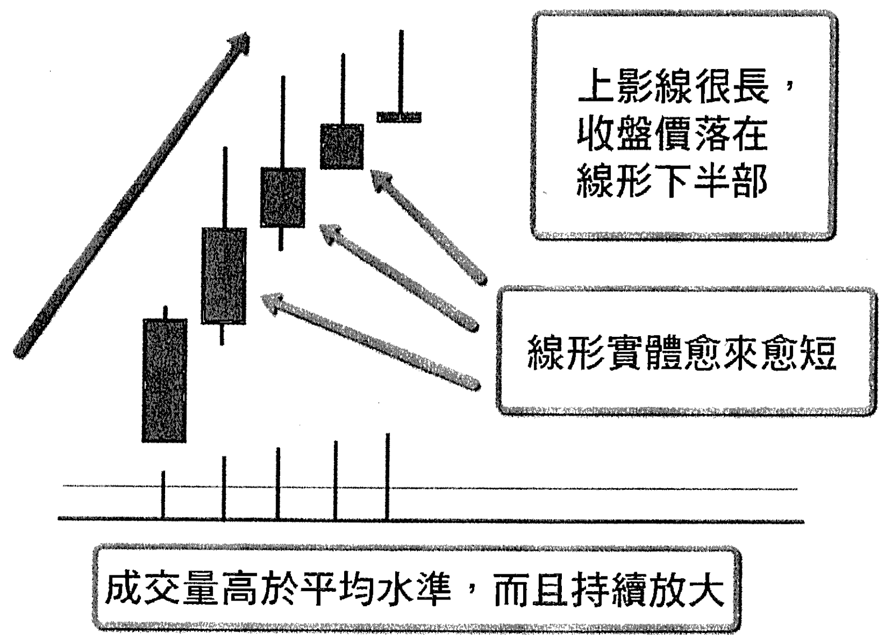

請參考圖表 6.18，這個完美案例的最後一支線形，正是我們的老朋友「流星」。我們看到，出貨階段即將發展為賣壓高潮，這是在市場進入次個循環之前經常看到的盤勢。

不論哪種時間架構、哪種交易工具、哪個市場，我們都應該特別留意這種價量關係發展。對於 VPA 交易者來說，這是主要的起床號。這種訊號可能出現在跳動檔走勢圖或一般走勢圖。相同的價量原理適用於任何場合。各位一旦熟悉前文所談論的內容，以及後文即將討論的知識，就 可以運用於所有的市場。VPA 簡單而實用，一旦學會，就不會忘掉。

關於陰陽線形與型態排列，還有很多值得研究的內容，但如同我們稍早強調的，本書並非討論陰陽線的專書。此處所提到的部分，是我個人覺得最重要、隨時都應該注意的排列。它們代表 VPA 論述的主軸。了解這部分內容，能夠讓各位對於自己的交易決策信心倍增。更重要者，如果持有部位，VPA 可以讓各位保持繼續持有的信心，並且在出場訊號發生時，斷然結束部位。

## CHAPTER 07

## 支援 / 壓力原理

> 金錢與市場絕對不會忘，但人們當然會。
不論是這次、下次或任何一次，都不會有所不同。
——肯尼斯·費雪（Kenneth L. Fisher, 1950-）

截至目前為止，本書討論都侷限於純粹的價量關係。

本章準備介紹另一種分析技巧，有助於我們評估走勢圖上的價格行為。更重要者，這種技巧如果結合了 VPA，往往可以透露趨勢發動或終止於何處，或行情是否邁入密集交易區間。

讓我們借用建築方面的比喻來形容：價格與成交量如果是地基的話，則隨後幾章篇幅將解釋的各種技巧，則是牆壁、地板、天花板與屋頂。換言之，它們提供了價量分析的架構。VPA 本身雖然威力無窮，但配合這些額外的技巧，將獲得重要的參考基準，讓我們了解行情發展的前後狀況與脈絡。

關於交易，最困難的部分可能是部位管理，以及出場合策略。如同我稍早曾經說過的，進場決策是比較容易的部分，出場顯得更困難。而這些技巧此時最能夠「映射」價格行為，它們甚至可以被視為里程碑。所傳遞的訊息，不僅可以協助我們了解趨勢的啟動，甚至——更重要者——是趨勢何時結束。

關於這方面的技巧，首先要介紹支撐／壓力的概念。同樣地，這個概念可以運用於任何市場、任何交易工具，以及任何時間架構；所以，不論 VPA 是運用於當日沖銷的搶帽子，或是較長期的投資，支撐／壓力都是走勢圖上解釋價格行為的主要依據。

可是，有點諷刺地，支撐／壓力與 VPA 在性質上屬於截然相反的概念。VPA 扮演價格行為的「領先」角色，我們嘗試藉由 VPA 判斷行情的未來走向。支撐／壓力的概念剛好相反，是由「落後」的立場進行分析，研究已經發生的價量關係。

撇開這種性質上的差異，兩者彼此結合，可以讓我們了解市場整個旅程的進展狀況，透露行情發展將在何處停頓、突破與反轉，包括目前與未來，還有所有重要的進場與出場位置，以及管理上的重要價位。

所以，讓我扼要重述價格行為的基本概念。大體上而言，市場只可能呈現三種走勢：向上、向下，或橫向發展。換言之，市場只可能呈現上升趨勢、下降趨勢，或橫向的整理。就此三者而言，市場呈現橫向發展的時間，明顯超過上升或下降趨勢。粗略估計，市場大約有 70％的時間呈現整理，只有 30％的時間存在明確的方向趨勢。市場可能基於種種理由而呈現橫向發展，但主要理由有三種：

+ 一、即將公布基本面重大訊息。舉例來說，只要觀察每個 月即將公布非農業就業人口數據時的市況發展。消息 即將公布之前，行情可能呈現好幾個鐘頭的狹幅整理。

+ 二、賣壓高潮或買進高潮發展期間，當內線補充或出清存貨過程，行情呈現橫向整理。

+ 三、行情發展到過去的價格套牢區，市場經常呈現橫向整理。市場遇入這些區域，投機客與投資人經常抓住出場機會，寧可小賠。

不論基於何種理由，支撐／壓力區域看起來就像圖表 7.10。這類價格行為會出現在各種走勢圖，行情在明確價格區間之內橫向整理。

### 圖表 7.10

支撐與壓力

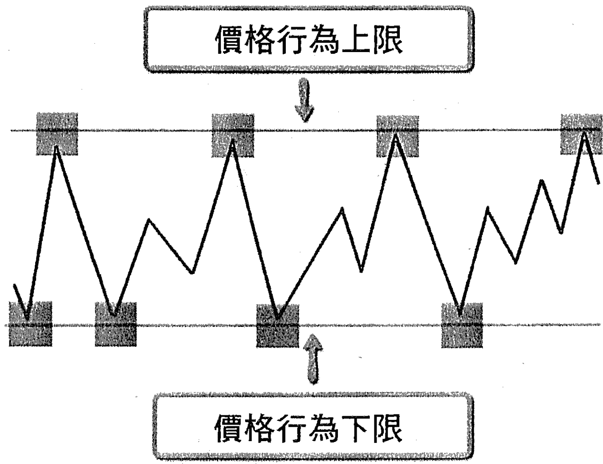

關於這類價格行為，我經常引用房屋的天花板和地板做為比喻，協助解釋這兩種概念。圖表 7.10 的案例究竟發生了什麼事？

價格在特定區間之內，來回漲跌，不斷重複，因此而形成價格「通道」。價格向上發展到特定價位，遭遇壓力，於是向下折返而下跌；跌勢發展到特定價位，又獲得支撐而開始向上反彈。價格每當下跌到特定價位，就出現無形的支撐。該支撐不僅會阻止跌勢，甚至促使價格回升。

價格一旦觸擊地板支撐而回升，就會繼續挺進，抵達天花板壓力區，遭遇無形的障礙，使得漲勢又被壓回，再度呈現跌勢。各位如果還記得最早期的乒乓球電動遊戲，或許會發現就像乒乓球在兩隻拍子之間來回一樣，價格在通道上限壓力與下限支撐之間往返。可是，發展到某個程度，價格會突破這個區域。

繼續討論其他主題之前，有關支撐／壓力通道，我想探討幾點。首先，可能也是最明顯的問題：這種價格行為何以重要？所以，讓我先處理這個問題。

假定圖表 7.10 呈現的價格行為發生在上升趨勢發展過程，而且不是賣壓高潮。這種情況下，該價格行為究竟代表什麼意思呢？

最初，隨著既有上升趨勢發展，買盤持續進場，但價格在高檔向下反轉而走低。於是，某些買盤被套牢在上限高檔，心中相當懊悔。行情走低，但跌勢觸及下檔某支撐區又開始反轉回升，買盤深怕錯失賺錢機會而進場，推升價格繼續走高。當行情逼近前一次的反轉壓力區，當初被套牢在這個地區的買盤終於得以解套，許多人在持平或小賠情況下結束部位。這股解套賣壓使得行情再度折返走低，使得新一批買盤被套牢在高檔。

跌勢處及下檔支撐又開始回升，買盤害怕錯失賺錢機會而進場，驅動價格繼續走高，漲勢再度回到先前的上檔套牢區，於是解套賣壓再度出籠，價格又被壓回。所以，價格在這個通道上限與下限之間來回遊走。

價格通道的上限位置，存在先前的套牢買盤，這些籌碼會轉手給新一批的套牢買盤，如此周而復始，在類似的價格水準形成「看不見的」橫向區域。

那些在低檔下限買進的人，很高興繼續持有，期待價格走高。他們是趁著行情拉回而在較低價位買進，看著價格走高，但隨後又拉回當初的進場價位。這些人的情況不同於高檔套牢買盤，他們持有的部位從來沒有陷入虧損。對於這些在低檔建立部位的人來說，他們碰到的最糟情況，就是帳面獲利得而復失，繼續期待能夠賺錢。恐懼並非這些人擬定決策的關鍵因素。

事實上，關於橫向價格通道的上限與下限，其中並無神秘之處，它們只不過代表某特定價格區間內恐懼／貪婪心理的極端水準。我們必須永遠牢記，價格行為是由兩種基本情緒驅動，價格橫向盤整就是展現這兩種情緒的基本方式。既有上升趨勢是由貪婪情緒主導，等到價格觸及壓力而折返，後續漲勢再來到上檔壓力區，套牢買盤是因為恐懼而出脫籌碼。

## 恐懼與貪婪情緒——主導多頭趨勢的頭部

圖表 7.11

恐懼與貪婪：多頭趨勢

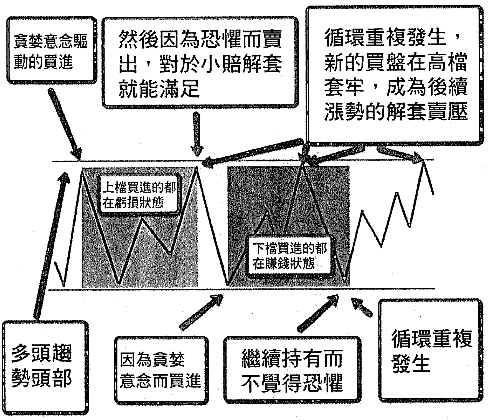

由情緒性買進與賣出的立場思考，就不難理解圖表 7.11 蘊含的邏輯。第一波觸及頭部的漲勢，是由貪婪念頭驅動，但也帶著恐懼心理，因為害怕錯失大好賺錢機會。請記住，這些交易者畢竟都相當優柔寡斷。為什麼？因為他們持續等待、再等待，看著行情走高，卻不敢介入，因為他們是緊張而情緒化的交易者，但同時又害怕錯失「大好賺錢機會」。這些人目睹行情一路走高，內心一直希望能夠及早進場。最後，他們終於忍不住，在第一波漲勢的頭部買進。

走勢很快向下反轉，他們開始害怕虧損。行情持續走低，然後回升。在第一波跌勢底部進場的買盤，趁著回檔走勢買進，慶幸自己能夠取得「好價格」。行情慢慢回到第一波漲勢頭部附近。

原本套牢在此的買盤，很多人迫不及待地想要解套出場，甚至寧可小賠結束部位。請注意，前述價格發展過程，這群人從來都不知道「獲利」的滋味，只經歷過虧損持續擴大，然後逐漸縮小。他們的恐懼情緒——或恐懼指標——隨著價格下跌而上升，然後隨著行情反彈而下降，但從來沒有真正感受到「賺錢」滋味，他們只求解套。

部位虧損畢竟曾經十分嚴重，最後如果能夠以小賠收場，應該也算令人滿意的結局。另外，這群人原本就相當情緒化，因此當他們建立部位時，往往都處於劣勢，很容易被情緒性價格波動操弄。

那些趁著第一波回檔走勢而在低檔買進的人，他們的情況截然不同。這些人有所準備，他們沒有追價，而是等待行情拉回才進場。一般來說，這些人屬於經驗相對豐富的交易者。

當行情再度上漲，他們的部位出現帳面獲利，但價格很快又折返，重新回到他們當初進場的價位。然而，整個發展過程，他們都沒有真正經歷虧損。這些人或許會懊惱為何沒有在漲勢頭部獲利了結，但這個時候很可能會繼續持有，期待行情稍後還會回升。

所以，這兩群交易者的心態與反應，理當全然不同。相較於上檔套牢部位，下檔承接地交易者對於行情發展的情緒壓力較小；他們會感受到帳面獲利流失的情緒壓力，但不必承擔損失擴大的壓力。在每波漲勢頭部買進的交易者，應該算處於劣勢，而趁著每波回檔走勢而在低檔進場的交易者，則應該算處於優勢。當然，我必須承認，這種看法實在過於單純，但也確實是行情處於橫向整理的典型狀況。

這個價格區間內，由於存在特定的買盤與賣壓，所以構成無形的價格關卡，成為後續走勢的上檔壓力或下檔支撐。

讀者可能會問，下跌趨勢的底部，是否也會出現類似的情形？關於這個問題，答案是肯定的，而且是用完全相同的原理。

## 恐懼與貪婪情緒──主導空頭趨勢的底部

## 圖表 7.12

空頭趨勢底部

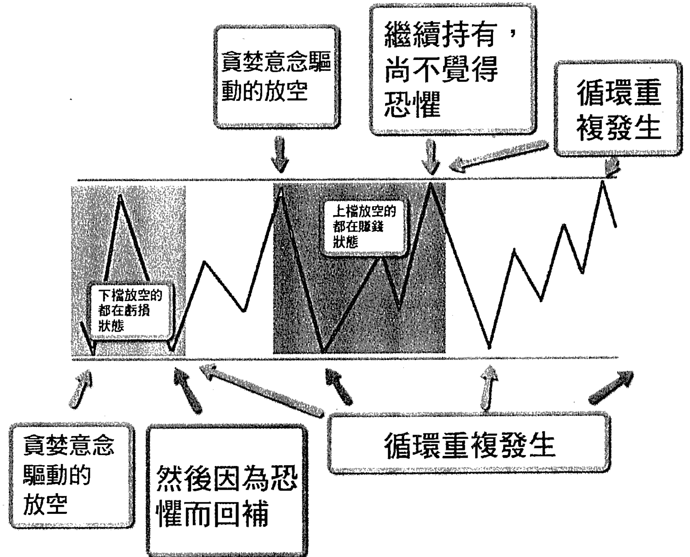

前述多頭趨勢發展的相關原理也完全適用於此。如同圖表 7.12 解釋的，行情呈現跌勢已經有一陣子，正當走勢即將向上反彈之時，某些情緒性交易者受到吸引而進入市場。這些人看到其他交易者因為價格下跌而賺大錢，最後終於克服恐懼心理而決定進場。

不久，價格開始回升，使得低檔進場放空的交易者因此被套牢，而且虧損隨著行情回升而擴大，心理壓力也愈來愈沉重。

最後，價格又開始下跌，而且跌回這些套牢籌碼當初進場的價位附近，這些部位終於有了解套機會，於是紛紛結束部位，甚至樂於承擔些許的虧損。

真正的玩家是在橫向走勢的上檔高點進場建立空頭部位，所以在整個後續發展過程，部位大多處於獲利狀態。

同樣地，橫向盤整發展在特定價位構成無形的障礙，成為後續走勢的上檔壓力和下檔支撐。

我希望這些解釋起碼能夠讓讀者了解這些價位為何重要。某些特定價位為何會在走勢圖上構成無形的障礙，後續價格走勢每當發展到這些特定價位，就會出現明顯的阻力或支撐，因為這些區域存在許多等著買進或賣出的買家與賣家，使得既有價格走勢起碼會發生停頓，進行我稍後將解釋的「測試」。

另一點同樣重要的，是當市場在支撐／壓力區停頓，然後繼續朝既有趨勢方向的發展。此兩者都會引發重大後果，傳遞關鍵訊號，而且全部都要經過成交量的確認。接下來，讓我們首先討論此項分析技巧使用上的一些基本原則。

## 第一原理

支撐／壓力水準並不是一條非常明確的線，而應該被看成是稍具彈性的區間。記住，技術分析與 VPA 是一門藝術，不是科學。支撐／壓力雖然是障礙或關卡，但不是硬梆梆的一面牆。有時候，行情可能突破這些障礙，但很快又折返橫向通道。所以，支撐／壓力性質上是稍微具有彈性的。

## 第二原理

永遠要記住懷可夫的第二法則，也就是因果法則。「因」的大小，理當反映在「果」；這個原理也適用於支撐／壓力。橫向盤整的時間愈長，所構成之支撐／壓力關卡，對於後續走勢的影響也愈大。當然，這都是相對的，不只是日線圖上長達幾個星期盤整，很可能會發展為類似期間的明確趨勢，而 5 分鐘走勢圖上橫向整理的任何突破，可能只會演變為 1 小時的明確趨勢；一切都是相對的。

## 第三原理

第三原理涉及的問題，可能讓許多初學交易者覺得困惑：我們如何知道行情邁入橫向整理？畢竟唯有事後回顧，我們才能看到價格在某特定區間內整理了一段期間，但在走勢進行當下，唯有在「事件發生過後」，才能確定任何整理走勢。

這個時候，我們需要留意孤立樞紐高點（isolated pivot high）與孤立樞紐低點傳遞的關鍵訊號，這些訊號雖然可以透過技術指標自動呈現，但肉眼也很容易察覺。

## 孤立樞紐點

## 圖表 7.13

了解孤立樞紐點

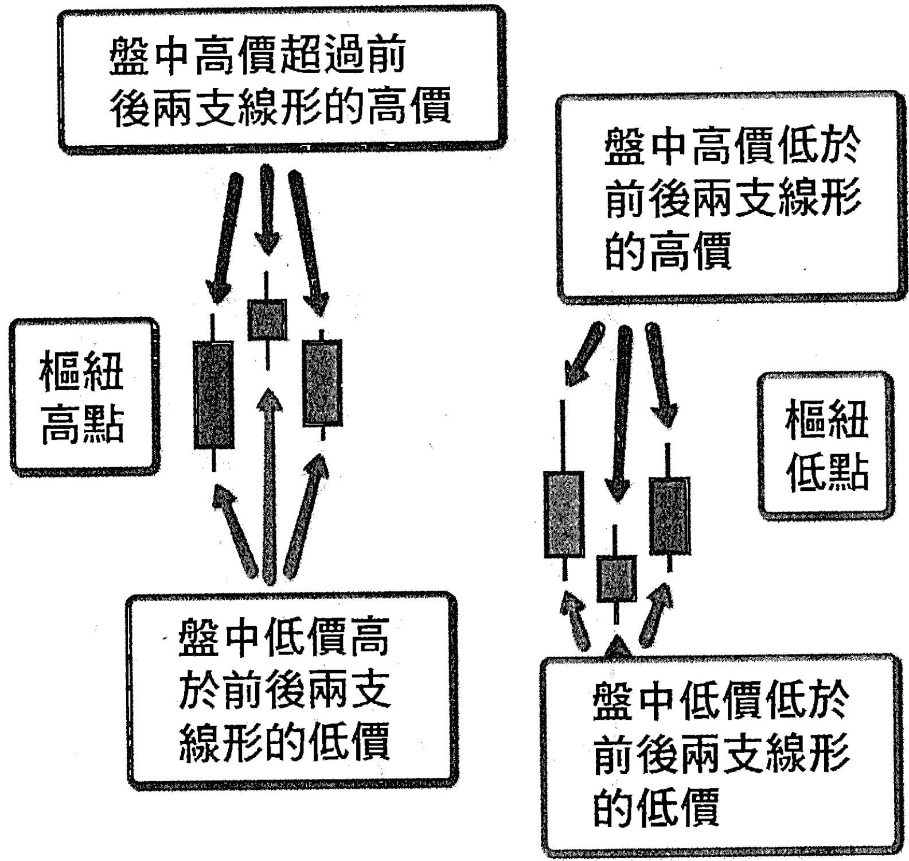

這些是界定任何橫向整理走勢的關鍵。想要了解樞紐點的最簡單方式，是假設行情處於上升趨勢而走高，走勢圖出現孤立樞紐高點，這代表行情可能轉弱的第一個徵兆。请参考图表 7.13，這些樞紐點是由 3 支線形構成的反轉：中間線形的盤中高價與盤中低價，必須分別高於前、後兩支線形的盤中高價與盤中低價。某單一樞紐線形，並不代表行情從此進入橫向整理。

這個時候，我們只能說走勢短期之內可能出現反轉。

現在，我們要等待對應的孤立樞紐低點。換言之，由 3 支線形構成的排列，中間線形的盤中高價與盤中低價，分別低於前、後兩支線形的盤中高價與盤中低價，請參考圖表 7.13 的第二個圖例。

一旦分別看到孤立樞紐高點和孤立樞紐低點，就可以在走勢圖上繪製兩條水平線，暫時用以界定橫向整理區間的上限與下限。這種簡單的 K 線排列不僅界定橫向整理的起點，也界定了整理走勢的上限與下限，請參考圖表 7.14。

## 圖表 7.14

上升趨勢的橫向整理開始

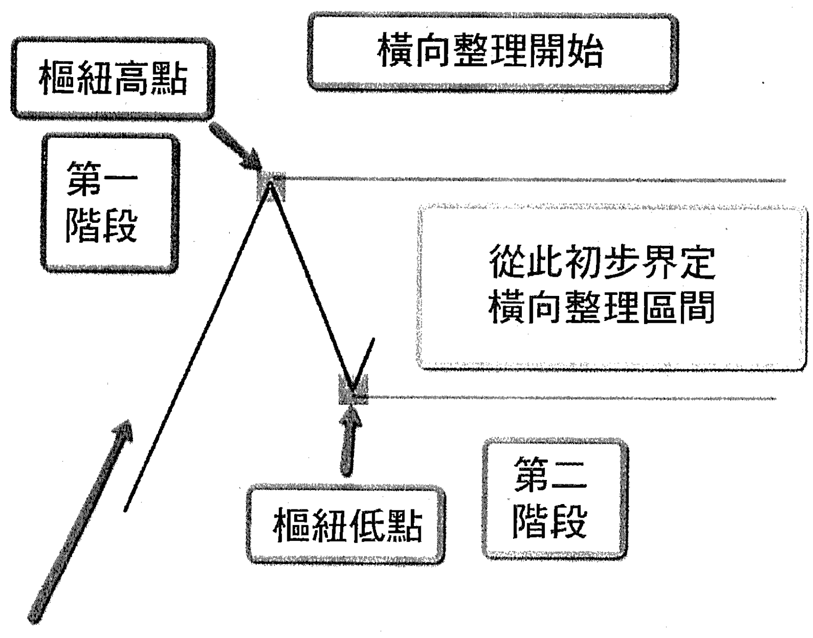

下降趨勢進入橫向發展的情況也是如此。首先需要留意樞紐低點，然後是樞紐高點，請參考圖 7.15。

## 圖表 7.15

下降趨勢的橫向整理開始

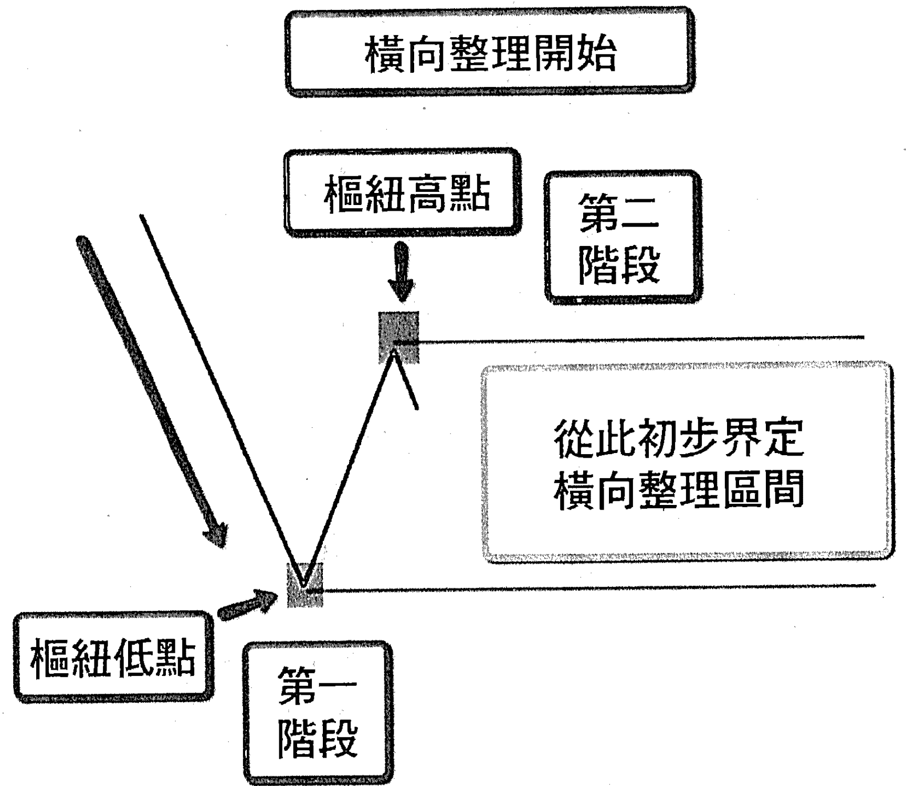

這個時候，我們已經有明確的上限與下限，隨著行情繼續呈現橫向整理，將看到後續發生的樞紐點，可以做為進一步的確認。然後呢？

橫向盤整到了某個階段，終究必須突破，這也是我們等待的訊號。突破會確認既有趨勢的持續發展，或代表趨勢反轉。

可是，整個價格橫向盤整期間，我們都會運用 VPA 知識，持續尋找行情轉強或轉弱的線索和徵兆。另外，橫向發展如果是因为買進或賣壓高潮而產生，訊號應該會很清楚。

行情處於橫向盤整，我們需要留意觀察的，是突破過程的價量關係，以及隨後的強勁走勢。如同我們了解的，橫向區間的上限與下限存在許多套牢籌碼，因此任何有效突破都需要配合成交量，而且需要很可觀的大量。突破過程如果沒有爆出大量，很可能就是內線操作的陷阱，一般稱為「假突破」。

內線再度嘗試藉由假突破設立陷阱，把交易者套在錯誤的一邊，這是另一種典型策略。可是，VPA 交易者清楚這類的假走勢，因為成交量是無法掩藏的證據。這也說明了這些價格區域為何如此重要，理由有三點：

- 一、假定我們當時持有部位而行情朝有利方向突破。這是行情將繼續朝既有趨勢方向發展的明確訊號，讓我們得以信心滿滿地繼續持有部位。
- 二、假定我們當時為持有部位。這種情況下，這代表理想的進場訊號，前提是價格突破必須得到成交量的確認。
- 三、假定我們持有部位而行情朝相反方向突破。這種情況下，有效突破代表明確的出場訊號。

最後，這些區域一旦被突破，對於未來價格走勢來說，就出現了可以提供支撐／壓力的明確區域。這點很重要，也很有幫助，可以做為部位管理或出場目標的參考。各位如果還記得我稍早曾經強調的觀念：建立部位相對容易，如何結束部位才是真正困難之處，而支撐／壓力區域可以提供視覺上的指引，讓我們提前知道行情發展到何處，將陷入掙扎或反轉，或者獲得支撐。如此可以幫助我們更有效管理部位。

現在，讓我們討論突破過程的成交量狀況，以及當行情脫離這些密集交易區間的相關發展。

圖表 7.16 是價格向上突破橫向盤整區間的典型圖解。這種走势可能代表既有上升趨勢的持續發展；換言之，橫向盤整意味著既有上升趨勢的暫時停頓，價格向上突破則是上升趨勢持續發展。可是，這也可能代表趨勢向上反轉。情況究竟如何，實際上不重要，因為重點都相同。

## 圖表 7.16

密集交易區間的突破：多頭趨勢

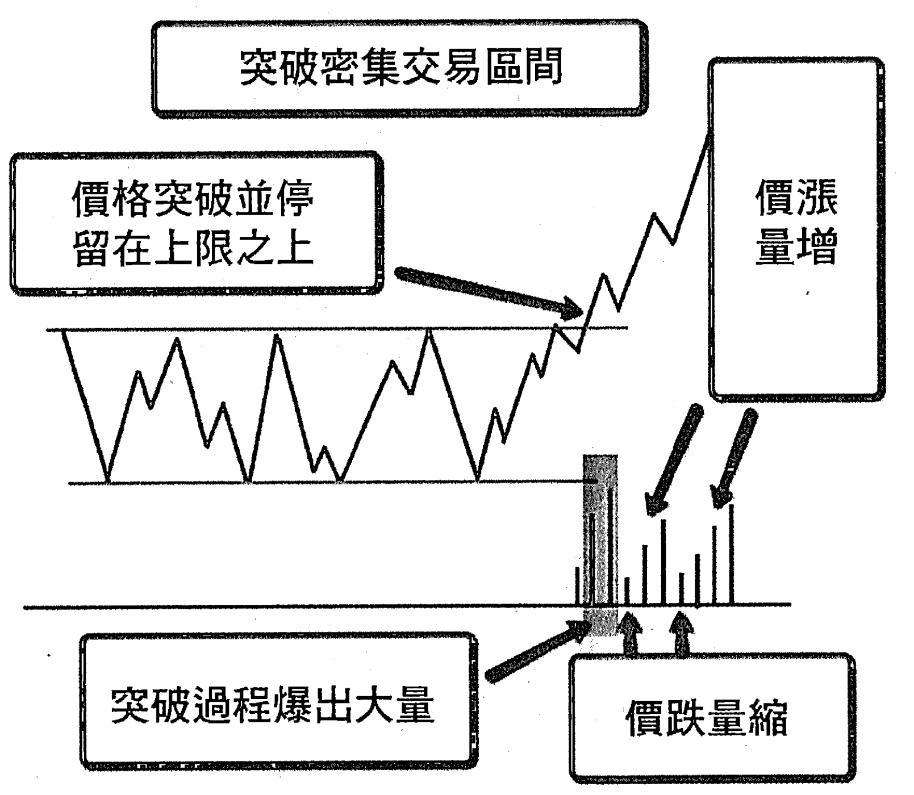

任何有效的突破，首先都必須看到價格明確穿越橫向區間的上限。請記住我稍早強調的，橫向區間的上限或下限，並不是很清楚的一條線，而是具有相當彈性的帶狀，所以價格如果只是稍微穿越，未必代表突破的訊號。我們必須看到收盤價明確穿越上限。可是，何謂「明確穿越」呢？不幸地，其中也沒有任何確定的法則，基本上是取決於判斷、經驗、個別市場和交易工具，因為每種交易工具或個別股票都有其本身的特性。可是，原則上，K 線收盤價必須明顯穿越上限。價格只是第一個訊號，其次要考慮成交量。

請參考圖表 7.16，價格突破上檔壓力，必須配合大量，而且成交量要持續增加。價格走勢要克服壓力，必須具備動力，不能拖泥帶水。所謂的動力，就是突破過程必須爆出大量。突破過程如果沒有夾帶著大成交量，就是內線安排的陷阱，或者市場參與的意願並不強烈。

如果是有力的向上突破，則突破過程必須出現平均水準以上的大量，而且隨後幾支線形的成交量應該持續增加。價格向上突破之後，可能出現拉回走勢，測試下檔支撐，也就是原本的壓力區，但拉回走勢的成交量應該縮小。總之，多頭趨勢發展過程，應該保持「價漲量增，價跌量縮」的特性。情況一旦明朗化，VPA 將接手，我們又回到逐一線形的價格行為分析。

至於價格向下突破而演變為空頭趨勢的發展，也適用完全相同的原理，請參考圖表 7.17。同樣地，向下突破究竟是代表既有下降趨勢的持續發展，或由多翻空的趨勢反轉，對於相關分析並沒有影響。

如同向上突破一樣，向下突破也必須明確，而且成交量必須配合放大。另外，價格向下突破之後，可能反彈而測試原本為支撐但現在演變為壓力的區域。然而，價格回升過程，成交量應該縮小。反之，價格下跌則應該配合大量。請記住，當行情朝主要趨勢方向發展，成交量都應該配合放大，才能確保該主要趨勢能夠健全發展——不論是上升或下降。

## 圖表 7.17

密集交易區間的突破：空頭趨勢

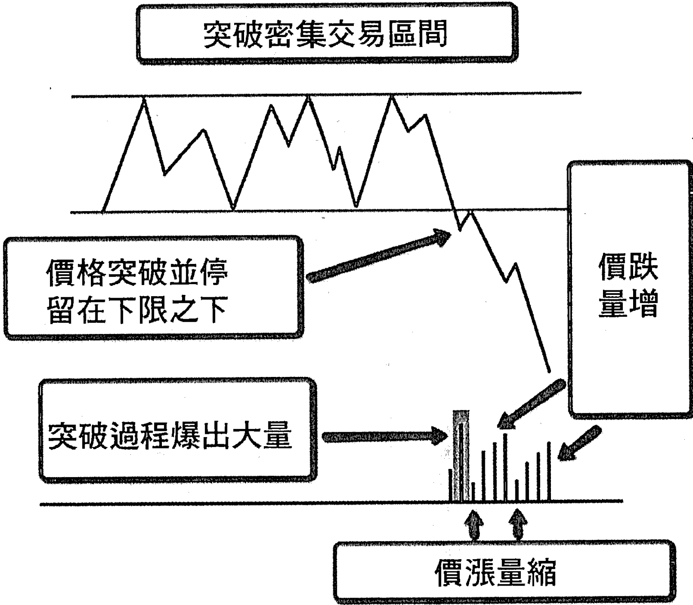

關於價格橫向整理區間的重要性，真是再怎麼強調也不為過。這是構成價格行為的基礎之一，透露許多資訊，提供許多交易機會。有很多交易者只針對其突破走勢進行交易。

我們可以藉由樞紐點界定橫向區間的範圍，然後運用 VPA 分析價格行為，當價格突破獲得成交量確認時，進場建立部位。

支撐 / 壓力是分析價格行為的基石之一。我所認識的每個全職交易者，幾乎都透過某種方式運用這種概念，而且如同各位目前所了解的，這是非常簡單而有效的概念，運用方式各有不同的巧妙。

這種概念可以用來進場建構部位；也可以用來管理部位；最後也可以用來做為目標而結束部位。簡單說，這是可供運用的最有效技巧之一，如果結合 VPA 知識，可以讓各位一窺少數交易者能夠跨越的境界。這個價格行為的發展階段，也是趨勢的起源之處。對於很多交易者來說，一旦碰到橫向盤整走勢，他們就會覺得無所作為，但這種走勢實際上是最有意思的價格行為，交易者務必耐心等待。等到整理完成，行情就會突破，展現新的趨勢。任何趨勢的發展程度，都取決於因果法則！

容我針對支撐 / 壓力概念做個總結，此處引用的比喻是房子的天花板和地板，分別代表橫向盤整區間的上限和下限。

設想我們正在觀察一棟房子的縱切面，如同圖表 7.18 的情況。換言之，正面牆壁被移除掉的房屋，就如同大門敞開的傳統房屋隔間模型。所以，我們可以看到這棟房子有三層樓，以及每個樓層的天花板與地板。

黑色線段代表行情走勢，由第一層樓的地板啟動，上漲到第一層樓的天花板受阻。我們準備藉由這棟房子的結構，解釋價格行為，讓讀者能夠更清楚目睹支撐與壓力扮演的功能。

## 圖表 7.18

支撑 / 壓力：房子

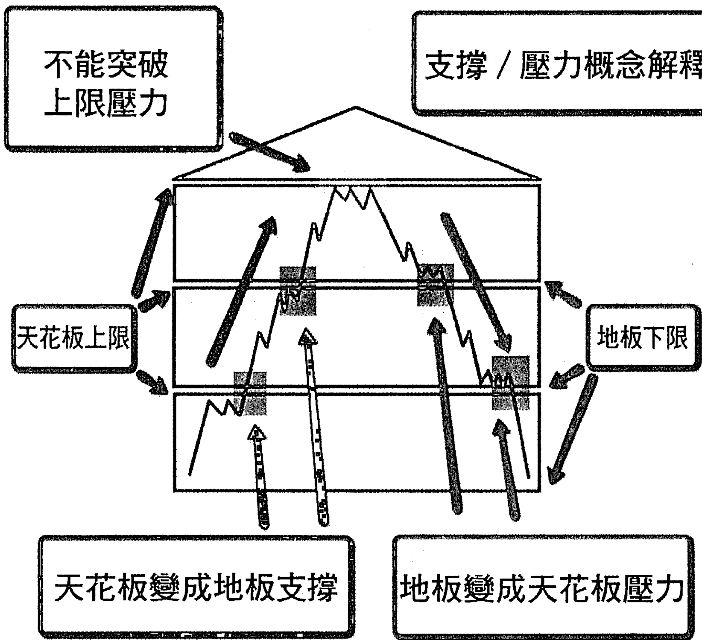

行情由第一層樓的地板開始上漲，最後受阻於第一層樓的天花板而開始橫向盤整。可是，盤整一段期間之後，走勢終於穿越第一層樓天花板壓力而站上第二層樓的地板。請注意，既有的壓力一旦被克服，就會成為後續漲勢的下檔支撑；換言之，第一層樓的天花板，現在成為第二層樓的地板，也就是既有漲勢的下檔支撑。

行情持續走高，不久又碰到第二層樓的天花板壓力而陷入橫向整理。接著又突破第二層樓天花板，前進到第三層樓的地板之上。現在，原本第二層樓天花板的壓力，已經轉變為第三層樓地板支撐。

價格還是繼續走高，最後到達第三層樓的天花板，此處的壓力太過沉重，阻止價格漲勢繼續前進，於是行情終告折返。

現在，趨勢已經由多翻空，價格開始下跌，直逼第三層樓的地板，稍做橫向整理之後，跌破地板支撐。這個時候，原本是第三層樓的地板支撐，現在變成第二層樓行情的天花板壓力。

第二層樓也發生相同的發展，下跌趨勢到達第二層樓的地板，稍做橫向整理，緊跟著就跌破支撐。等到行情到達第一層樓，原本第二層樓的地板支撐，現在變成後續行情的上檔壓力。

可是，這個概念為何如此重要？

支撐／壓力概念之所以重要，理由有幾點。第一，如同前文看到的，橫向盤整走勢的突破，如果獲得成交量確認，代表理想的交易機會。這也是所謂的突破交易。

第二點或許同樣重要，這種交易方法之所以非常普及，是因為採用支撐／壓力的概念做為交易策略的一部份，等於是採用市場本身的價格行為來提供保障。換言之，運用突破走勢做為交易手段，可以利用市場提供的自然屏障，藉以防範市場趨勢突然變動方向。

讓我們回到「房子天花板和地板」的比喻。當價格漲勢抵達第一層樓的天花板而遭遇壓力，開始橫向盤整，最終向上突破，並且站上第二層樓的地板。我們趁著向上突破而建立的多頭部位，下檔存在市場提供的自然屏障，這也是我們多頭部位倚賴的下檔支撐。我們的 VPA 研究顯示，價格漲勢如果反轉，將在此獲得支撐。這個支撐不僅會保護多頭部位，也能促使價格再度走高。

所以，我們知道，價格一旦向上突破壓力，這個壓力區將成為後續走勢的下檔支撐，任何回檔走勢一般都會在此暫時獲得支撐。因此，多頭部位的停損，可以設定在此支撐區的下緣。就是因為這個緣故，突破交易深受歡迎，如果再配合 VPA 的確認，那威力更加無窮了。

相同原理也適用於向下突破的空頭部位。前文討論的「房子」比喻，是引用上升趨勢做為例子，如果考慮下降趨勢，道理也完全相同。

既有的上升趨勢在第三層樓的天花板向下反轉，跌勢逼近第三層樓地板支撐而開始橫向整理，最後終於向下突破到第二層樓。原來的支撐一旦遭到跌破，就會成為後續走勢的上檔壓力，同樣具備兩種功能。這個壓力將阻擋短期價格回升，迫使反彈走勢恢復到既有的下降趨勢，而且也會成為自然的屏障，藉以保障空頭部位。

對於趁著行情向下突破而建立空頭部位的交易者，這也是雙贏的局面。

運用這種概念，可以隨著市況發展而建立交易部位，但這種策略的威力，還在於市場遺留下來的價格行為和歷史。市場遺留了自己的 DNA，埋藏在走勢圖之內。這些價格密集交易區間將永遠留在走勢圖上。價格雖然繼續發展，但這些區域會留下來，未來某個時候，一旦行情再度回到這些區域，它們還會恢復作用，不禁讓我們懷疑：市場是否具有記憶。

或者是因為身為交易者的我們，都看著相同的走勢圖，所以這些價格區域就成了自我實現的預言？或許是因為這些區域存在許多套牢籌碼，仍然等待著解套機會？

或許是這些原因共同造成的。不論理由何在，這些價格行為都會不斷重複發揮功能。密集交易進行的時間愈長，其影響也愈重要。

讓我們再回頭看看「房子」的圖例，尤其是價格漲勢在第三層樓沒能克服天花板的壓力。這次的突破之所以失敗，可能是因為此處是過去的密集橫向交易區間，過去的漲勢原本就曾經在此反轉。行情如果曾經在此失敗，我們可能在較長期的價格走勢圖上，看到這個密集交易區間，也意味著目前漲勢大有可能在此反轉。此處畢竟存在著理由，可能是幾年前發生的賣壓高潮，一度被視為超買區域，但現在被認定價格合理。

總之，身為交易者，我們知道此處是關鍵價位，成交量會透露我們所需要知道的線索。如果此處真的是過去的密集交易區間，過去的漲勢曾經在此突破失敗而反轉，如果這次的突破成功，則漲勢將顯得更重要，而且壓力轉變為支撐也會變得更強大。同樣地，如果這次的突破失敗，顯示這裡的套牢賣壓沉重，也是我們觀察價格型態必須留意的。

這正是支撐／壓力的功能所在，顯示不斷發揮作用的密集交易區間。它們代表市場的 DNA，乃是歷史與故事合而為一；不論是漲勢或跌勢，發展至此都會遭遇阻力。目前這個例子雖然顯示漲勢在此反轉，但如果是跌勢，也會同樣在此獲得支撑。此處會提供自然的支撑平台，可以阻止跌勢進一步發展，就如同其會阻止漲勢一樣，如果這個區域夠寬大深沉，則會顯得更重要；同理，過去的行情如果曾經在此發生反轉，也會提升其重要性。

當然，價格密集交易區間各有不同的形狀和規模，發生在各種不同時間架構。股價指數可能呈現幾天或甚至幾個星期的橫向整理。配對匯率可能橫向整理長達好幾個月。債券更經常呈現長期的橫向整理，尤其是碰到金融危機。同樣地，個別股票也可能連續整理數個月之久。

反之，密集橫向整理可能只維持幾分鐘或幾個鐘頭。總之，根本概念完全相同，VPA 交易者務必記住「因」與「果」之間的關係。對於當日沖銷者來說，5 分鐘走勢圖上的價格橫向整理，仍然可以提供有效的支撑 / 壓力作用，以及突破交易機會，但對於更長期的交易來說，則不足以發揮功能。可是，對於相同交易工具的日線圖，如果看到有深度的價格密集交易區間，突破走勢仍然代表重大意義。

這也是交易之所以需要引用多個不同時間架構走勢圖的理由之一。5 分鐘走勢圖上的價格密集交易區間，重要性不如 15 分鐘走勢圖，後者的重要性又不如小時走勢圖。換言之，假定其他條件相同，時間架構愈長，橫向盤整區間提供的支撑 / 壓力愈重要。

支撑 / 壓力概念本身即是很重要的概念。如果與 VPA 配合運用，則可能構成交易方法的基石。

## CHAPTER 08
## 動態趨勢與趨勢線

> 發生虧損，並不是因為運氣差，而是因為分析不當。
——大衛·安宏（David Einhorn, 1968-）

本章準備討論趨勢與趨勢線的概念。各位無疑應該聽過「讓趨勢成為你的朋友」的說法，我個人認為，這基本上只是毫無意義的胡言亂語。

這往往是那些自詡為大師或教練的人，為了強化本身的地位而念的咒語。可是，就如同價格密集交易區間一樣，如果由事後觀察，即使是傻子也可以輕易看出。我認為，引用這個格言的人，應該沒有實際從事交易。一般來說，這些人繪畫出幾條趨勢線，告訴你應該在哪些地方進場，然後繼續持有部位，直到趨勢發展結束之後出場。如果是回顧過去的走勢圖，所有的ㄧ切顯得非常簡單。

讓我先從趨勢的基本概念談起，因為我想要釐清這方面的一些謬論。首先，讓我們先談個最重要的問題：怎麼知道趨勢開始發展？

如同支撐／壓力的情況一樣，這個問題的簡單答案是：我們不知道，除非由事後判斷。這就如同價格密集交易區間。我們需要仰賴某些參數，讓我們得以判斷趨勢是否在某特定時間架構上開始發展。身為交易者，如果必須回顧相當長的期間才能在走勢圖上繪製趨勢線，這並沒有太大意義，因為這個時候往往已經錯失大部分機會了，甚至等我們決定進場時，剛好碰到內線開始出場。

這也是 VPA 之所以有效的原因：VPA 可以確認價格行為，顯示我們處於較長期趨勢的哪個位置。我們如果看到賣壓高潮或買進高潮，就知道新趨勢正在醞釀。我們是處於新趨勢的開端，也是我們想要進場的位置，而不是趨勢的結束，也是趨勢線最終會到達的位置；如果我們只使用這項技巧，情況更是如此。請注意，這並不代表我認為趨勢線沒有用，它們絕對有用，前提是運用方法必須正確，這也是本章準備討論的。

讓我們從道氏（Charles Dow）的概念談起，他奠定了趨勢分析的基礎。關於這方面價格行為，他認為股價指數的趨勢，其可靠性與參考價值遠超過個別股票。個別股票的價格走勢可能受到很多因素影響，包括：盈餘報告、經紀商的推薦、分析師的看法，以及其他等等，這些全部都可能影響個別股票的價格行為。反之，股價指數更能普遍代表整體市況和人氣，因此更適合據此判斷市場的根本趨勢。關於道氏的見解，很多都融入當今的技術分析理論，包括系統性與非系統性風險在內。

就股票市場來說，系統性風險會影響整體市場的每支股票，包括股價指數的所有成分股在內，而非系統性風險的影響範圍較小，只會侷限於某些股票。道氏的成就大多發生在價格指數方面，這些指數現在也成為金融市場的基石，包括：S&P 500、道瓊工業指數、那斯達克指數（NQ100），以及全球各地的許多重要指數。另外，指數的概念也延伸到其他市場與交易工具，包括價格波動指數（VIX）、股票的類股指數、外匯指數（譬如美元指數），還有商品指數（譬如 CRB 指數）以及其他等等。對於某些市場來說，指數交易的熱絡程度甚至超過根本資產。

道氏的另一項貢獻，是把趨勢按照時間長短劃分為三大類：主要趨勢、次要趨勢與小型趨勢。當然，道氏當時的市場資訊，仍然仰賴著報價紙帶，時間架構截然不同於目前。舉例來說，當時的所謂小型趨勢，通常會持續 2、3 天，而次要趨勢則大約持續 2、3 個星期，主要趨勢可能涵蓋 2、3 個月。可是，對於我們目前引用的電子走勢圖，時間架構明顯較短。就當日沖銷者而言，比較切合實際的小型趨勢可能只有 2、3 個鐘頭，次要趨勢可能持續 2、3 天，主要趨勢可能持續 2、3 星期。對於很多市場來說，長達幾個月的趨勢，只存在於遙遠的過去。這些年來，市場的結構與性質已經出現重大變化，包括電子交易平台取代過去的公開叫價，還有高頻率交易與市場操縱等等。

雖說如此，但道氏的創意與研究工作，也幫後續的技術分析奠定了穩固的基礎。道氏提出的趨勢構想，也同時引進趨勢發展三階段的概念：

- 1. 承接階段
- 2. 後續階段的技術趨勢
- 3. 出貨階段

聽起來有些熟悉，不是嗎？這也就是懷可夫詳細解釋的內線補充和出清存貨循環。道氏稱呼這些內線為「主力大戶」（smart money）；出貨階段代表主力大戶獲利了結的階段，也就是它們「出場」的標誌。

以下的相關解釋，我們準備背離趨勢分析的傳統處理方式，但願如此將有助於各位實際運用趨勢概念於交易，而不像多數書籍由理論角度說些無意義的內容。以上介紹已經提供我們繼續前進的架構，但到了這個階段，多數趨勢分析會引用圖表 8.10 的圖例。

### 圖表 8.10

多頭趨勢走高——當然不是！

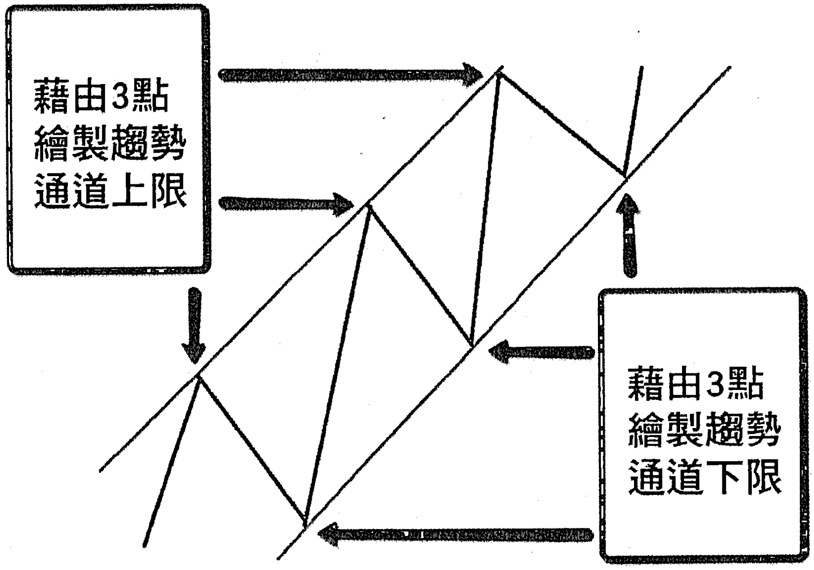

這是討論趨勢的傳統處理方式。市場分成數個階段走高，一旦出現 3 個階段，就可以分別銜接 3 個折返高點與 3 個折返低點繪製上側趨勢線與下側趨勢線，並由此界定明確的上升通道。多數教科書都會強調，2 點不能界定趨勢，因為 2 點的解釋太過含糊，很難有明確的意義，這也是趨勢線為何必須等待 3 點才能繪製的原因。

請參考圖表 8.10，我們看到上升趨勢的發展過程，一系列價格走勢的折返高點與折返低點都必須持續墊高；同理，對於下降趨勢，一系列價格走勢的折返高點與折返低點必須持續下滑。

現在，我們看到明確的趨勢，因此也準備進場建立部位，期待該趨勢會持續發展可是，這只有理論上的意義，因為當我們實際看到一系列的 3 個折返高點與 3 個折返低點，趨勢很可能已經完成一大半，通常已經通過後續階段。換言之，等到我們準備進場時，很可能已經是出貨階段的開始。

可是，我們怎麼知道呢？因為各位閱讀的教科書，作者有太多是那些從來沒有做過交易或投資的人。如同我稍早說的，一切都純屬理論，藉由事後觀察，很容易做判斷；等到趨勢已經充分發展，用途已經不大。

答案是什麼呢？關於這點，我們必須仰賴支撐／壓力概念，這也是前一章為何解釋得如此詳盡的理由。

支撐／壓力是趨勢孕育之地。趨勢在此誕生，然後朝特定方向發展。支撐／壓力也是趨勢反轉之地。支撐／壓力是承接與出貨階段進行的場所，還有賣壓高潮與買進高潮。支撐／壓力是走勢圖上最重要的區域，就如同大河的發源地，也是鮭魚最終返回產卵的地方。

對於所有交易者、投資人與投機客覺得最疑惑的問題，我們就是準備從此提供答案。支撐／壓力是趨勢的起源嗎？如果是，請問趨勢的力量如何？會跑多遠呢？想要回答這些問題，首先必須在 VPA 的背景之下了解支撐 / 壓力。

想要從其他角度進行，都注定會失敗。在走勢圖上繪製幾條線——就我個人觀察——這是毫無意義的。我雖然承認這或許能夠協助釐清趨勢，甚至在趨勢發展開來之後提供一些助益，但如果想藉此建立明確的部位，則毫無價值可言。

可是，不妨讓我們回歸根本，重新造訪價格密集交易區間，也就是價格呈現橫向發展，建構價格支撐 / 壓力的階段。市場正準備進行突破，我們身為交易者、投資人或投機客，這個時候唯一能夠做的，就是耐心等待，然後藉由成交量確認突破的效力。這個階段，我們如何知道趨勢發展的程度呢？簡單說，我們還不知道，但可以做些有根據的猜測。

第一，我們可以參考密集交易區間的發展程度。我們同樣要仰賴懷可夫的「因果法則」，評估當時正在發展的主要、次要或小型趨勢。對於搶短線的當日沖銷來說，所謂的趨勢，當然是小型趨勢，但小型趨勢必定也會發生在較長期的時間架構上。就當日沖銷的立場觀察，我們應該順著較長期的主導趨勢方向進行交易。舉例來說，我們所交易的小型趨勢，其方向必定和較長期的小時走勢圖趨勢相同。

這也是交易需要運用幾種不同時間架構走勢圖的諸多理由之一。如此可以協助我們定調出所交易之時間架構走勢圖的趨勢。然而，即使是逆著主要趨勢的發展方向進行交易，那也未必有錯。舉例來說，股票市場的股價指數可能呈現多頭趨勢，個別股票仍然會有許多放空的賺錢機會。這當然沒有問題，前提是我們必須清楚這點，知道自己是逆著主要趨勢方向進行交易。這類的交易，經常被稱為「逆勢交易」（counter trend trading），這類交易是藉由兩點界定：

第一，這類交易蘊含的風險程度較高，因為我們是「逆勢而為」。第二，這類部位的持有時間通常較短，因為根據定義——部位的交易方向與主要趨勢背離。

其次，行情處在橫向密集交易區間，身為 VPA 交易者，我們會站在兩個立場分析成交量。首先是橫向價格行為的成交量，藉以判斷相關走勢是否代表主要反轉，包括賣壓高潮或買進高潮。其次是突破過程的價量關係，這可以提供進一步的線索，藉以判斷趨勢發展的可能程度。另一方面，我們也會藉由較長時間架構呈現的價量關係，協助進行判斷，並分析後續發展所將遭遇的支撐／壓力，因為它們可能阻礙既有趨勢的未來發展。

因此，第一步驟永遠是行情脫離密集交易區間之後，緊接著出現的價格行為。這有點類似我們先前如何藉由樞紐高點和樞紐低點，判斷行情邁入橫向盤整區間。這提供我們當時的定位。先前的價格行為（不論其為如何）現在已經停頓，暫做休息。關於既有走勢的停頓，樞紐點會提供警訊。走勢停頓可能拖延得很久，若是如此，就會看到進一步的樞紐高點和樞紐低點；走勢停頓也可能很短暫，若是如此，只會看到幾個樞紐點。既有趨勢可能反轉，若是如此，我們應該會看到一些 VPA 活動；既有趨勢停頓之後，也可能繼續發展。所有這一切，將隨著行情邁入傳統的橫向整理而呈現在價格行為上。可是，橫向整理進行到某個時候，就會展開突破；這個時候，樞紐點又會再開始發揮功能，但這次將協助我們界定趨勢的發展。另外，這允許我們儘早介入而建立部位，不必等待一系列走勢持續墊高的折返高點與折返低點（或持續下滑的折返高點與折返低點）。

請參考圖表 8.11，這是向上突破的例子。

### 圖表 8.11

第一個標誌——樞紐高點

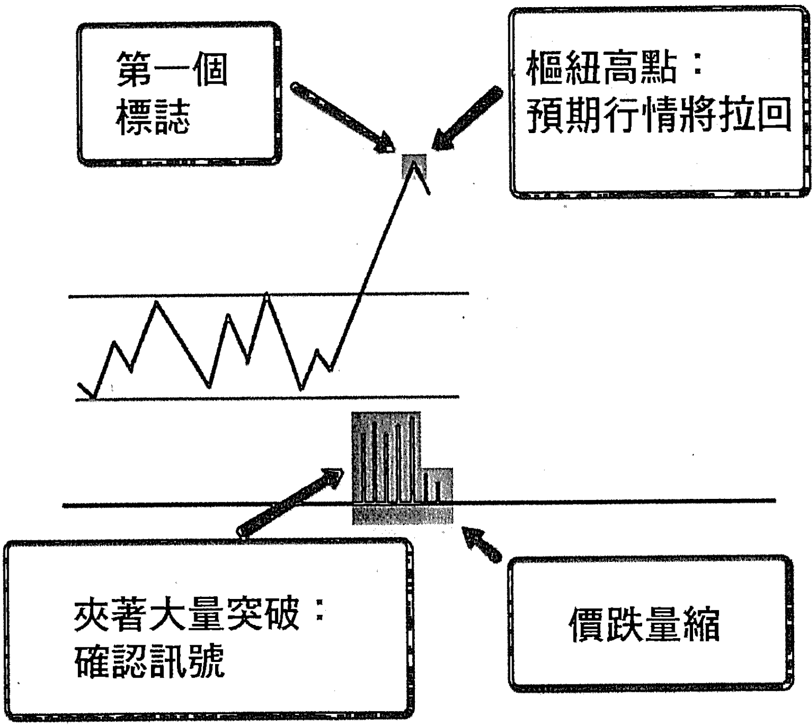

如圖表 8.11 顯示，市場原本處於橫向整理，然後夾著大量向上突破。根據成交量觀察，這個向上突破應該有效，接著觀察相關的上升趨勢發展。我們看到價漲量增的發展，於是建立部位。

我們等待第一個標誌出現，如同前一章討論行情邁入橫向整理的情況一樣，我們要等待樞紐點出現。由於此處考慮的是上升趨勢，所以要尋找樞紐高點。

我們知道，行情不會呈現直線上升或直線下降的發展，樞紐點是走勢反轉的第一個徵兆，並且可以用來界定趨勢通道。各位應該還記得，樞紐高點與樞紐低點都是由三支線形構成，請參考圖表 8.12。

### 圖表 8.12

形成樞紐

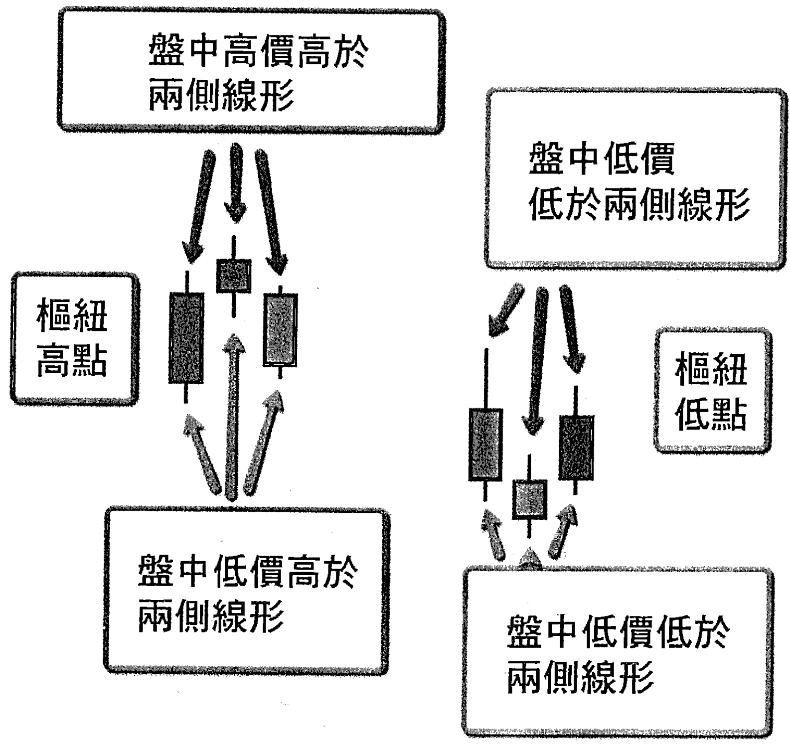

現在，我們有了行情走高的第一個參考點，因為這是個樞紐高點，所以我們知道行情將向下發展。這可能是主要反轉，但就成交量資料觀察，以及行情剛脫離價格密集交易區間不久，這種可能性不高，但我們還是要保持耐心、仔細觀察。價格下跌過程，成交量縮小，這是好現象，跌勢應該會適可而止，然後回升而出現樞紐低點。現在，我們有了趨勢回升的第二個標誌，請參考圖表 8.13。

### 圖表 8.13

第二個標誌：樞紐低點

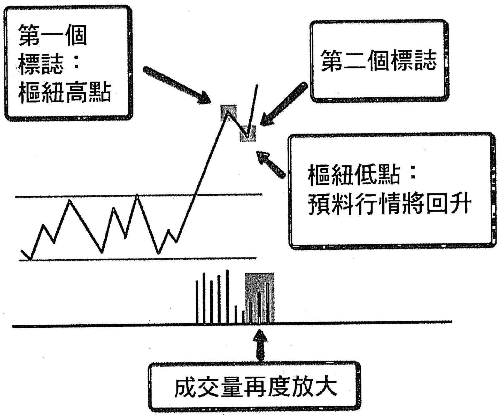

現在，我們準備開始建構價格行為的發展。記住，我們已經建立部位，而且只要價格繼續走高，成交量繼續確認價格，一切就沒有問題。

我們看到樞紐點的形成，用以界定價格旅程與趨勢通道。不同於事後繪製的趨勢線，我們現在看到的是動態的價格行為發展，前提是一系列的樞紐高點和樞紐低點持續墊高，而且成交量確認價格走勢，如此就能確定上升趨勢持續發展，我們也會繼續持有部位。

讓我們觀察後續發展，走勢圖上又增添兩個水準。就目前立場來看，我們預期樞紐低點出現之後，行情將回升，接下來的目標應該是另一個樞紐高點，而且這個樞紐高點的價位，應該高於前一個樞紐高點，如此才能確定趨勢處於上升狀態。第二個樞紐高點一旦出現，我們預期行情將拉回，但期待拉回的程度不大，而且成交量應該縮小，最後形成第二個樞紐低點。

情況確實如此發展，而且第二個樞紐低點的價位，也高於第一個樞紐低點。所以，我們繼續持有部位，預期行情將回升，趨勢繼續朝上發展。

如同預期地，行情繼續走高，我們現在等待第三個樞紐高點出現，其價位應該高於先前兩個樞紐高點，繼續界定上升趨勢通道的上限。這個樞紐高點如果符合預期地出現，則行情應該拉回，構成另一個價格高於先前樞紐低點的第三個樞紐低點，繼續界定上升趨勢通道的下限。我想，讀者現在應該理解相關的發展了。

這就是我們動態建構趨勢的方法，同時根據 VPA 原則，趁著價格突破橫向盤整而持有部位，情況如同圖表 8.14 顯示。

相較於傳統的趨勢分析，我們這套動態方法的結果雖然相同，但可以讓交易者在最適當時機進場建立部位；換言之，在趨勢的開端，而不是結束，請參考圖表 8.14。

### 圖表 8.14

## 動態趨勢線——多頭趨勢

樞紐高點界定
趨勢通道上限

樞紐低點
界定趨勢
通道下限

橫向盤整
「孕育」
趨勢

VPA完全確認

整個發展程序，可以被設想為一種「佈局」。橫向盤整階段奠定價格走勢的基礎。然後，價格夾著大量向上突破。樞紐點就像路燈一樣，照亮行情發展的通道，讓我們有信心繼續持有部位。

上升趨勢發展到某種程度，我們遲早會看到某個樞紐高點，其價位可能約略等於、甚至低於前一個樞紐高點。這個時候，意味著行情可能再度進入橫向整理，隨後可能會出現樞紐低點，其價位也可能約略等於先前的樞紐低點，更進一步強化走勢邁入另一段橫向整理的可能性。接著，我們將繼續觀察後續的樞紐點，以及最後的突破走勢。行情再度邁入橫向整理，究竟代表既有的上升趨勢將因此向下反轉，或只是暫時停頓，最終仍將繼續向上發展？價格如果向下突破，就代表趨勢反轉，我們也應該結束部位；反之，行情如果向上突破，代表上升趨勢繼續發展，我們也繼續持有部位，而且也要重新建構動態趨勢通道。

當然，這是教科書範例，說明價格向上突破橫向走勢的典型發展，但實際交易很少會出現這類教科書範例。有時候，樞紐點並不會出現。舉例來說，行情向上突破之後，可能不會出現樞紐高點，但樞紐低點可能正常發生。

這個時候，我們必須根據 VPA 做成決定，判斷趨勢是否按照我們的預期方式發展。可是，這可能是趨勢發展不能維持動能的早期警訊。一般來說，當行情突破橫向區間，應該具備某種程度的動能，反映在成交量上。隨著行情發展，買賣雙方也會斷然採取行動，選擇進場，或是出場，於是在價格走勢圖上形成樞紐點。

如果基於某些緣故，沒有出現該有的樞紐點，或許就意味著趨勢發展欠缺動能，這也會反映在成交量上。價格上漲，但成交量如果只能維持平均水準，或甚至不足平均水準，就代表行情發展欠缺動能。買賣雙方沒有積極參與上升走勢，趨勢發展並不健全。市場欠缺能量，沒有活力，這些事實都會反映在成交量和價格行為上。

因此，不要期待每個突破都會呈現標準或完美的發展。每個走勢都不相同，各自具備不同的動能和存續期間。我們必須根據 VPA 知識，觀察所有相關的線索，隨著價格發展，等待樞紐點出現。趨勢如果不遵循合理模式發展，意味著可能有所疑慮，漲勢可能在稍高水準重新邁入橫向整理。

由橫向整理區間向下的有效突破，將發展為下降趨勢，其結構與前述的上升趨勢相仿，我們先要留意樞紐低點，然後是樞紐高點，請參考圖表 8.15。

### 圖表 8.15

動態趨勢線——空頭趨勢

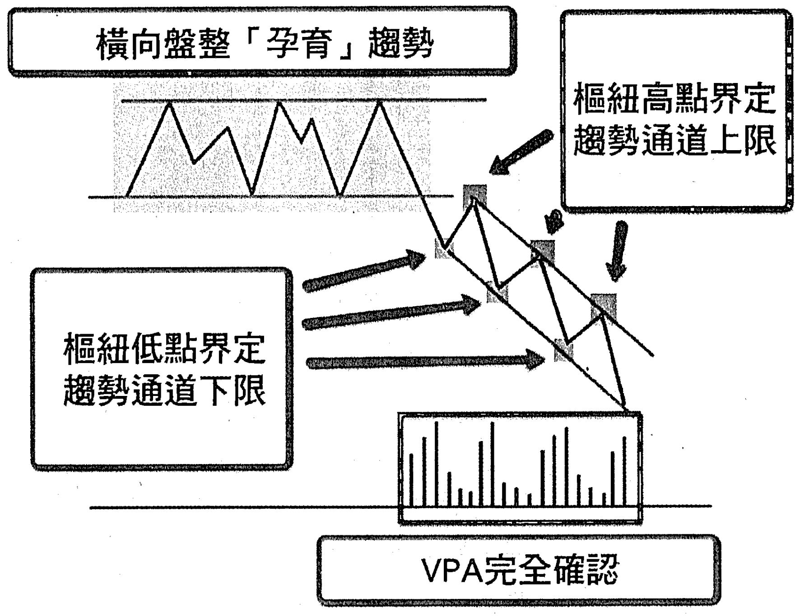

總之，讓我們看看整個程序的前後關連。在價格走勢圖上繪製我所謂的「靜態」趨勢線，當然沒什麼錯，甚至這也是我們此處所做的一部份。可是，差別是本章繪製的趨勢線，是由市場動態價格行為所創造。當然，這很難透過文字描述，最好是隨著行情演變而實際做觀察。雖說如此，我在此處所嘗試描述的，是我們交易旅程的分析程序和價格行為，或更精確地說，是行情發展的旅程。

此處談論的樞紐點，是透過動態方式形成，趨勢的情況也是如此。我們可以藉由樞紐點界定我們的「旅程」。雖然任何東西都很難絕對完美，但運用 VPA，以及我們對於價格橫向整理階段之重要性的了解，能夠讓我們在趨勢形成過程之中而非形成之後，真正即時掌握趨勢。這就是我在這兩章所嘗試說明的，但願讀者閱讀這部分內容之後，至少可以更了解市場的行為方式，以及價格橫向整理區間的重要性。

如同我稍早說的，每當市場邁入橫向整理，很多交易者就會倍感挫折，這種現象讓我很難了解。橫向整理是市場準備下個趨勢的場所，也是趨勢孕育之地；從很多角度來看，這個階段的發展，遠較任何既有趨勢都重要，因為新趨勢將由此展開，而我們可以及早掌握。市場邁入橫向整理的原因，可能是賣壓高潮、買進高潮，或代表既有趨勢的暫時停頓。不論理由為何，也不論時間架構如何，我們都可以確定一點：行情正準備脫離這個區域，正在蓄積力量，準備展開某個方向的突破。我們只需要保持耐心等待，然後運用 VPA 於後續的價格行為，配合樞紐點照亮旅程。

## CHAPTER 09
## 價格的成交量分析

> 碰到多頭市場，最好永遠建立多頭部位；
> 碰到空頭市場，則永遠由空方進行交易。
> —— 查爾斯·道（Charles Dow, 1851-1902）

本書開端，我曾經說過，交易世界沒有什麼新鮮事，成交量分析已經存在百餘年。過去的偉大交易者，憑藉著行情判讀技巧，奠定了 VPA 目前的基礎。

嗯，這個說法也未必完全正確，因為本章將介紹成交量研究的一項新發展，將使得成交量與價量分析被提升到另一個層次。這也就是「價格的成交量分析」，簡稱為 VAP。所以，我們有了 VPA 與 VAP，看起來十分簡潔。

所以，「價格的成交量分析」究竟是什麼？其與我們截至目前為止討論的「價量分析」或 VPA，兩者之間存在什麼關連呢？首先，我想介紹某個簡單的概念，希望有助於各位了解 VAP。我仍然想引用批發商販售產品的例子。某批發商只販售單種產品，他希望設定產品價格而賺取最大的利潤。就此來說，最簡單的辦法，就是「測試市場」。

這也是一般企業經常採取的策略。產品按照某種價格進行銷售，然後記錄其銷售數量。接著，調高或調低價格，繼續記錄銷售數量。對於業者來說，在不影響銷售量的前提之下，價格當然愈高愈好，因為利潤也會因此水漲船高。

可是，價格一旦調高到某種程度，產品銷售數量就會減少，因為買方認為產品定價過高而不願購買。碰到這種情況，業者為了增加銷售量，可能要降低價格。

我們可以運用簡單的長條圖，記錄價格與銷售量之間的關係，請參考圖表 9.10。

### 圖表 9.10

銷售量與價格的關係

這份圖形的橫軸標示價格，縱軸標示銷售量（成交量）。一般來說，價格增加，銷售量就會減少。雖然情況未必始終如

此，但多數情況應該會呈現這種關係。總之，這份圖形顯示價格與數量之間的對應關係。換言之，我們可以看到數量如何隨著價格變動而變動，這也就是「價格的成交量分析」。正常的價格走勢圖上，每支價格線形只對應一支成交量直方圖，該成交量包含所有價格在內，也就是價格線形所涵蓋之全部價格的總成交量。一般成交量直方圖，沒有顯示個別價格的成交量，也就是圖表 9.10 顯示的資訊。如果把圖表 9.10 旋轉 90 度，或許更能夠呈現其意義，請參考圖表 9.11。

## 圖表 9.11

銷售量與價格的關係（經過 90 度旋轉）

現在，各位應該大致了解價格的成交量分析究竟是怎麼回事了；原則上，其名稱已經充分說明相關方法。此處顯示的，是價格的成交量資料。換言之，我們看到行情走高或下跌過程，每個價位的成交量。我們不妨將此視為一般成交量直方圖的分解圖，記錄了價格線形每個價位的成交量資料。

所謂的 VAP，就是剖析每支成交量直方圖，觀察成交量究竟集中在哪些價位。如果成交量都集中在底部，比較可能代表買進成交量，而不是賣出成交量。反之，成交量如果都集中在頭部，則比較可能是賣出成交量。相較於傳統的成交量直方圖，VAP 提供了新的資訊，透露每個價位的成交量，讓我們更清楚支撐／壓力的所在位置。

就我個人來說，關鍵在此。

運用 VAP，目的是要「提升」而不是「取代」傳統的 VPA 方法。如同各位即將發現的，VAP 可以提供嶄新的交易觀點，讓我們知道買進與賣出活動集中在哪些價位，因此也讓我們更清楚支撐／壓力的所在位置。我們已經知道如何運用價格、價格行為與 VPA 來辨識支撐／壓力區域，VAP 是可供運用的另一項工具，讓我們可以透過視覺而在走勢圖上觀察這些區域。我曾經在前一章稱呼支撐／壓力為「無形關卡」，或自然屏障；現在，這些「無形」的關卡，將因為 VAP 而無所遁形。

可是，請記住，VAP 是協助 VPA 的技巧；VAP 雖然極具功能，讓我們得以從不同角度觀察成交量與價格行為，但這種技巧絕對不能取代傳統的 VPA。所以，請運用 VAP 來辨識價格密集交易區的支撐／壓力，然後藉由傳統的 VPA 做確認。

接著，讓我們看一些相關的例子。就這方面來說，好消息是多數繪圖軟體都免費提供這方面的資料。本章引用的所有例子，全部都取自我的 NinjaTrader 交易平台。

## 圖表 9.12

微軟（MSFT）15 分鐘走勢圖

圖表 9.12 是「微軟」的 15 分鐘走勢圖，我們看到傳統的成交量直方圖繪製在圖形底部，而 VAP 指標則繪製在縱軸，如同圖表 9.11 的解釋。

本書從頭到尾都會不斷重複強調支撐／壓力的概念，因為這是孕育趨勢的場所，價格趨勢都是藉由突破支撐或壓力而形成，而 VAP 現在可以把這些價格密集交易區間清楚呈現在走勢圖上。因此，容我解釋這份圖形，有些概念相當明顯，有些在仔看之下則不明顯。

實際討論這個例子之前，讓我先解釋 VAP 直方圖顏色代表的意義。如同傳統的成交量直方圖一樣，藍色或紅色是和對應的價格線形顏色一致；換言之，價格線形如果是藍色（價格開低收高）或紅色（價格開高收低），成交量線形就是藍色或紅色。VAP 直方圖的顏色，也代表類似的意義，其藍色／紅色的比率，乃代表對應價格線形顏色的比率。如果藍色價格線形數量是紅色線形數量的兩倍，則 VAP 的藍色部分就是紅色的兩倍。反之亦然。所以，VAP 呈現的顏色，可以顯示該價格區間內的買進（藍色）與賣出（紅色）力量。

接著，讓我們討論圖表 9.12 這個例子。簡單說，此處可以劃分為 4 個價格密集交易區間，最底部一個涵蓋期間最長，中間有兩個區間，涵蓋期間都相對短暫，最頂端一個則是目前的交易區間。這份走勢圖大概涵蓋 5 天。VAP 透露什麼訊息？首先，VAP 在走勢圖上界定了這 4 個區間。每個區間都各標示著成交量直方圖，讓我們得以評估每個區間的重要性。如同我們看到的，成交量最密集的區域，是最底部區域，一個直方圖超過平均水準，另一個直方圖更是異常凸顯。

這個區域上方的價格密集交易區間，則相對不重要，只有兩支還算顯著的成交量直方圖，而且兩者都低於平均水準。所以，只能算是相當小型的價格密集交易區間。

再往上觀察第三個密集交易區間，此處出現比較顯著的成交量，有兩支平均水準以上的直方圖，顯示這個區域的支撐／壓力相對重要。最後，我們來到目前的價格交易區間，此處出現異常顯著的成交量直方圖。我們可以藉由這些分析推論什麼呢？

首先，我們可以立即看出，哪些區域可能是未來價格走勢的重要支撐／壓力。未來價格走勢一旦到達這些區域，後者將成為無形的關卡，我們根據肉眼觀察的成交量，就能判斷支撐／壓力的大小。當然，「時間」也扮演某種角色。市場停留在密集交易區間的時間愈久，相關價格區間的成交量通常也愈大。行情如果在某狹幅價格區間停留幾天或幾個星期，則所有的成交量都集中在該狹小的價格區間，這個事實會反映在走勢圖左側的 VAP 直方圖。

我們如果把成交量的時間成分和價格行為擺在一起觀察，兩者之間的關係或許很明顯，但還是具有啟發意義。關於這點，讓我們看看 VAP 說些什麼。

圖表 9.12 的價格走勢涵蓋 5 天期間，第一階段的橫向整理大約持續了 3 天。我們在此看到的，完全符合預期，某些大成交量確認了這個價格密集交易區間。我們可以認定，這個價格區域相當重要，我們如果從事交易，價格一旦由這個區域突破，我們有信心認定這個區域應該會提供顯著的支撐／壓力功能。同樣地，行情將來如果重新測試這個區域，此處也應該是個相當穩固的關卡，除非爆出大量，否則很難突破。

來到次一階段的密集交易區間，此處只持續了幾支線形，頂多盤整了短短幾個鐘頭，價格就向上突破。這是個次要的密集交易區間，VAP 成交量清楚顯示這點。成交量低於平均水準，只有兩支直方圖稍微值得留意，所以價格將來如果重新測試這個地區，應該不需花費多大工夫就能穿越。

最後，我們來到圖表 9.12 的第三個和第四個價格密集交易區間。第三個區間持續 14 支價格線形（大約是 4 小時），第四個區間則持續一整天左右。讓我們觀察這些區間的成交量，相較於持續 3 天的第一個密集交易區間；我們發現，第四個區間與第一個區間的成交量直方圖相差不遠，但前者的持續時間只有後者的三分之一。

關於這個價格密集交易區間，成交量告訴我們什麼呢？如同所有的成交量分析一樣，我們是做相互比較，藉由異常的價量關係做出判斷；就此而言，VAP 也沒有什麼不同。圖表 9.12 是個盤中走勢圖，最底部的密集交易區間可以做為比較的基準，藉以評估其他密集交易區間的重要性。

第二個密集交易區間相對不重要，因為成交量低於平均水準，而且盤整時間很短。至於第三個密集交易區間，我們已經看到一些警訊，理由是什麼？

橫向整理的時間雖然不長，但成交量超過平均水準。所以，這是警訊。由交易的立場來看，我們如果持有部位，目前的市況發展讓我們相信行情會朝上突破，此處將是強勁的支撐，我們會繼續持有部位。

接著，我們來到這份走勢圖最上端的價格密集交易區間，VAP 顯示成交量很大，而且在這個狹幅價格區間內，傳統的成交量圖形也顯示大量。此處清楚顯示上檔沉重賣壓。就此處呈現的大成交量判斷，行情理當大幅走高，但實際上卻陷入狹幅整理，意味著盤勢轉弱。

各位如果認為，這個例子是為了彰顯 VAP 的功能而特別挑選的，那就不完全不是事實。這支股票是我撰寫本章剛好挑選的股票，各位或許難以置信，但就在我寫這篇文字的當時，市場開盤，微軟股價一口氣暴跌 $ 1.40，請見圖表 9.13。

## 圖表 9.13

微軟（MSFT）15 分鐘走勢圖

請注意，如同我們預期的，價格的成交量結構又發生了變動，我們看到市場爆出大量，這同時顯現在 VAP 直方圖，以及走勢圖底部的傳統成交量線形上。這又再度彰顯價量分析的功能。我們不僅目睹潛在的支撐區形成，也看到圖形下側的成交量線形確認這點，然後當我們開始分析價格區間時，就可以看到整個價量關係。所以，我實在不了解有些交易者為何會捨棄成交量資料而不用，但願我現在已經說服各位認同這套方法，至少將其視為可行技巧之一。

結束本章的討論之前，讓我們再看看有關 VAP 的一些其他例子。

## 圖表 9.14

美國鋁業（AA）小時走勢圖

圖表 9.14 是美國鋁業的小時走勢圖，相當有意思，請注意左側中間的明顯凸出的超大成交量，而且剛好對應著目前的價格密集交易區間。市場過去也曾經在此交易，而 VAP 顯示此處是很重要的價格整理區間。如同我們看到的，過去幾支線形曾經測試這個區間而失敗。這點顯然不會讓我們覺得意外，因為左側的 VAP 顯示此處壓力沉重。這個時候，我們可以藉由傳統的價量分析，觀察確認和其相關的異常現象，似乎都意味著行情更可能朝下突破。

## 圖表 9.15

寶僑（PG）日線圖

身為投資人，這是一支目前很適合從事交易的股票，各位想必會考慮相對長期持有這檔股票。圖表 9.15 是一份日線圖，涵蓋期間大約 6 個月。我們看到，最初 3 個月呈現橫向整理。然後，請觀察 VAP 呈現的成交量狀況：有個極大量，和另一個平均水準以上的成交量。這段整理期間相當長，其上側還有另一個橫向整理階段，涵蓋期間大概 2 個月，但成交量大概只維持在平均水準。以此做為衡量基準，可以凸顯下側橫向整理區間具備的強大支撐力道，行情如果折返到該區間，應該會獲得強大支撐。

更重要者，當價格夾著大量跳空突破這個長期橫向區間，價量關係完全符合 VPA 的確認原則。從這裡開始，股價強勁上漲，然後展開第二階段的橫向整理，緊接著又向上突破。可是，請注意，第二階段橫向整理的成交量相對較小，因此其支撐／壓力功能不如前個橫向整理區間。這點有助於我們設定停損單，這是由我們的風險管理法則主導。

總之，重點如下。VAP 方法創造的視覺架構，讓我們取得許多不同方面的線索和訊號，協助我們確認當時的價格行為。這些資訊顯示主要橫向區間的支撐／壓力「深度」，讓我們對於突破走勢有信心，因為下檔存在可靠的支撐／壓力。支撐／壓力如果夠強勁，我們就更有信心建立部位；反之，如果支撐／壓力不夠強，我們可能繼續等待進一步訊號。最後，VAP 也會透露未來價格走勢的支撐／壓力勁道，有助於我們透過視覺判斷，進行風險分析。

下一章準備討論有關 VPA 的另一些例子。可是，我想請讀者多花點時間，自行研究 VAP 的運用。此處討論的例子，完全都採用股票，但這項技巧也適用於其他市場和交易工具。

芝加哥商業交易所（CME）過去曾經提供一種叫做 Chart-Ex 的期貨圖形，功能類似 VAP，但我相信目前已經沒有繼續提供。可是，如同我稍早說的，任何好的繪圖平台，都提供這種指標，雖然形式稍有不同。

## CHAPTER 10

## 價量分析實戰案例

> 兩樣關鍵：修正行動與耐心。
這些就是每個人所必須自行培養的。
——查爾士·布蘭帝（Charles Brandes, 1943-）

現在，但願我已經說服各位認同價量分析方法具備的功能與效益。我之所以寫這本書，宗旨有二。第一，讓讀者也能夠跟我一樣幸運，得以踏上我多年前開始從事交易所走的道路。亞伯特是個異類，這些年來不乏指責他的人，但我永遠都慶幸自己能夠在某個偶然機會裡，讀到他在報紙上刊載的文章。就我來說，成交量是最合理的交易參考資訊，也是唯一能夠讓我們看到內線真正市場行為的工具，不論這些人是否試圖操縱行情。本書採用的走勢圖，是取自我的 NinjaTrader 平台，或是取自我的 MT4 交易帳戶。

我寫這本書的第二個理由，是想要透過直截了當的方式，闡述這套方法。金融市場或許很複雜，但並不難以了解，任何人只要下定決心想要學習、研究走勢圖，都可以很快成為 VPA 專家。此處雖然沒有捷徑，卻如同騎腳踏車一樣，只要學會這種技巧，終身都不會忘記。如同我稍早說過的，我不相信電腦軟體可以代替人們分析。交易是一門藝術，不是科學。金融市場非常微妙、細膩，絕對不是機器語言能夠處理的，不論這類的電腦程式究竟有多麼精密複雜。金融交易成為一種藝術的最主要理由，是因為行情來自人們驅動，最主要是反映人們的恐懼與貪婪心理。

因此，隨著本書逐漸邁入尾聲，我希望引用各種不同市場，以及來自不同平台的案例。它們全部都有成交量，有些是現貨市場或期貨市場的實際成交量，有些則是現貨外匯市場的跳動檔成交量。然而，所有這些例子都有個共通點：VPA 的運用都完全相同。凡是有 VAP 資料者，我也都會順便提供，使得分析架構得以更完整。

## 實戰開始

首先，我想先談談美國股票市場的一些例子。請參考圖表 10.10，這是漢威聯合（Honeywell，報價代碼 HON）的日線圖。

這是個很好的案例，給了我們許多啟示。雖然是股票日線圖，但不論在任何市場或任何交易工具之上，VPA 原理都完全適用。

剛開始，我們看到這支股票承受不少賣壓，價格走低，初期的弱勢盤，顯示在「流星」線形上，而且該線形的成交量明顯放大。所以，此處的價量關係沒有異常之處。流星之後的第 4 支線形，線形實體不長，但成交量超過前一支線形，價量關係不正常，可能是制動成交量線形（stopping volume candle）。隔天出現「鎚子」線形，成交量仍然很大。現在，我們期待跌勢應該會在此趨於緩和，或許會展開橫向整理，在行情向上突破之前，可能還會看到更多的承接發展。

## 圖表 10.10

漢威聯合（HON）日線圖

就目前這個例子來說，行情在隔天就立即走高，甚至是開盤跳空，但成交量只有一般水準。隨後幾天，價格線形縮短，成交量也持續縮小。這不是好現象，意味著盤勢轉弱。這支股票恐怕很難明顯上漲，實際上也開始進行橫向整理。可是，這波橫向整理的末期，我們開始看到賣壓被消化的現象，價格收低的線形（紅線）開始縮短，而且成交量放大，這也是異常現象，因為如果出現賣壓，向下線形應該頗長，實際上卻不是如此。我們看到一支收低的小紅線；之後第三天，又出現另一支小紅線。

賣壓已經被消化，現在等待可能出現的向上突破，實際上也立即發生。我們看到一支夾著大量的收高長線形（藍線）。這是行情轉強的訊號。另外，價格一旦向上突破，下檔也出現相當強勁的支撐。不久，行情再度呈現長達兩個星期的橫向整理，價格稍微下滑，但留意盤整末期出現的收低紅線，其成交量明顯萎縮，這不能視為空頭徵兆。走勢如果真的呈現空頭，應該會出現價跌「量增」的現象。可是我們看到整個下滑走勢的發展過程，成交量持續縮小。記住，不論上漲或下跌，都需要成交量配合。

因此，我們期待買盤很快就會進場，實際上也是如此發展。價格夾著平均水準以上的大量突破；請注意盤整階段最後一支藍線，其表現相當令人鼓舞。

隔天，價格夾著大量向上突破。這不是假突破，而是真正的突破，因為成交量如此告訴我們。價格不僅向上突破，而且是開盤向上跳空。所有的徵兆都偏多，而且得到成交量確認。三個月之後，該股票已經來到 $ 76.08。

其次，我們準備討論一支我特別偏愛的美國股票。大衛（我丈夫）和我剛開始交易杜克能源時，股價才 $ 17！現在的價格已經超過 $ 70。當時，我們採行的策略是針對所持有的杜克能源股票，抵補銷售買進選擇權（wrote covered calls），不過這恐怕是另一本書探討的主題了。

## 圖表 10.11

杜克能源（DUK）日線圖

同樣地，這個例子也帶給我們幾個啟示，最重要者，莫過於耐心。各位如果還記得的話，本書最初曾經說過，我剛開始運用 VPA 進行交易時，每當看到鎚子或制動成交量線形，馬上就會進場建立部位可是，如同我不斷重複強調的油輪比喻，龐然大物要改變方向，需要花點時間這也是我們從杜克能源案例中學到的最重要啟示。

讓我們先看圖表 10.11 最左側的線形發展，從第 4 支線形開始出現一波小漲勢，但成交量頗小，尤其是最後一支上升線形（藍線），其實體長度大約是前一支線形實體的兩倍，成交量卻只是稍多而已。這代表漲勢疲弱的早期警訊。兩支線形之後，我們就看到這個警訊預示的發展。行情夾著大量爆發急跌走勢，最後出現兩支制動成交量線形，成交量很大，初步止住跌勢。這個時候，杜克能源股價試圖反彈，但先前第二支制動成交量線形留下的上影線，顯示盤勢力量還不夠強，結果股價又繼續下跌，但成交量只有平均水準。

這波跌勢底部的兩支線形，實體都頗長，相較於先前急跌走勢的線形實體，這兩支線形的成交量理當明顯更大，但實際上並非如此，意味著這是內線吸收籌碼的盤勢。這個時候，股價試圖反彈，尤其是前述第二支線形為藍線，多頭吞噬型態雖然是好兆頭，但成交量太小，意味著力道還不足。

價格勉強反彈，但很快又拉回，這時候出現兩支低量的鐮子線形。這是否代表消化賣壓的最後階段？這個問題的答案，由隨後的「低成交量測試」線形告訴我們。此時內線已經準備妥當，準備反攻。賣壓浮動籌碼已經被清除，而且經過成功的測試。杜克股價即將回升。

股價走高，成交量還算可以，不久又出現一支夾量的跳空線形，顯示這波漲勢不假，不是陷阱，內線已經進場！然後，行情又邁入兩週稍多的橫向整理，接著又出現一支夾量的向上跳空線形，緊接著出現一波緩步下滑的走勢，不過請注意整個跌勢的成交量發展。成交量相當小！顯然異常！我們可以確定這波跌勢不會太嚴重。如果即將爆發大跌走勢，成交量理當放大，實際上卻不是如此，成交量明顯低於平均水準。這波跌勢的末端，我們看到多頭吞噬型態，隔天價格強勁向上跳空。可是，請注意跳空當天的成交量，成交量實在太小。這是否代表內線安排的陷阱？盤勢看起來確實不夠強，隨後出現的緩步上升走勢，成交量始終沒有放大，明顯低於平均水準。另外，請注意當時所處的價位，我們已經回到先前爆發急跌走勢之前的水平；換言之，這裡將面臨龐大的賣壓。所以，我們必須加倍小心。價格向上跳空，但成交量很小；上檔即將面臨龐大賣壓！

所以，接下來的發展如何呢？

## 圖表 10.12

杜克能源（DUK）日線圖

杜克能源股價停留在 $ 65.75 附近好幾天，之後向上突破，夾著大量穩步走高。最後，漲勢終於放盡力氣，這可以由成交量的表現看出來。此處出現 3 支短小線形，對應的成交量卻極為可觀。這代表什麼意思？盤勢是強？是弱？答案很明顯，隨後也出現明顯下跌，但價格下跌過程的成交量並不大，顯然不

代表主要趨勢反轉。杜克能源繼續保持多頭走勢，股價持續走高，至少暫時是如此。本文撰寫當時，杜克能源股價為 $ 74.41。

## 圖表 10.13

白銀 ETF 5 分鐘走勢圖

現在，讓我們考慮不同的市場，以及不同的時間架構，第一個例子是白銀（SLV）的集中市場掛牌基金（ETF）。對於許多交易者來說，ETFs 是介入商品市場頗受歡迎的管道，白銀 ETF 更是最受歡迎的交易工具之一。這是單純的 ETF，沒有擴張信用的實體金屬市場。圖表 10.13 是 5 分鐘走勢圖，最適合運用於搶帽子的短線交易。

讓我們從這份圖形的左端看起，當時的走勢呈現稍微偏多的橫向盤整，然後經由連續 5 枝收低紅線跌破盤中支撐，成交量也放大。這是一波價量關係配合的跌勢；換言之，價格急跌，成交量超過平均水準。

接著，SLV 出現幾隻橫向整理的線形，包括連續 3 支收低的小紅線，其中第二支小紅線的成交量超過平均水準，價量關係不尋常，第三支小紅線更爆出極大量，兩者顯然都是制動成交量線形，顯示內線買進行為，否則這種成交量應該導致長線形。緊接著，我們看到平均水準以上成交量的鎚子線形，買進訊號相當明顯。隨後出現一支上升的長藍線，但成交量偏低，顯然不夠強勢，不過下一支線形則是夾著大量的長藍線，多少彌補了先前的弱勢。然後，行情稍微拉回，內線進行低成交量測試。接著，價格夾著大量上漲，但連續幾支線形測試上檔壓力都失敗而返。

接下來，SLV 在這個價位附近盤整相當長一段時間，直到隔天才出現明顯跌勢。

我可以很輕鬆地舉出無數案例，顯示 VPA 如何凸顯理想的趨勢與交易機會，但 VPA 也反映普通常識，可供我們據以擬定交易決策；更重要者，VPA 可以量化交易本身的風險。

這個例子裡，我們想要尋找搶帽子的機會。可是，交易者的態度如果夠積極，大可只根據「鎚子」線形建立部位，因為這看起來是個相當強勁的訊號。然而，隨後一支線形的價量關係，卻呈現弱勢，讓我們不禁懷疑先前的進場決策是否明智。

多頭部位的停損，可以設定在鎚子線形下影線的稍下方。假定我們繼續持有部位，則緊接著次一支線形的發展頗具鼓勵作用，夾著大量的長藍線，相當好的徵兆。現在，顯然沒必要結束部位。

再往下看，我們發現次支線形的表現很弱，成交量超過平均水準的流星（雖然不是發生在頭部，但流星長長的上影線也充分透露弱勢）。我們預期下支線形會出現盤勢反轉，結果卻是相當正面的表現——低成交量的測試，緊跟著一支夾量的長藍線，然後盤勢稍微停頓，接著又出現最後一波小漲勢。

這個時候，態度比較謹慎的交易者，或許已經察覺到盤勢轉弱的徵兆，實際上也是如此，因此可能決定暫時退出場外，或許等到第二支線形，後者呈現強勢，然後決定建立部位。若是如此，這個部位可能小賺或小賠，或者持平。

我在次挑選的這個例子，除了訓練的目的之外，也想強調 VPA 可以運用於各種時間架構和市場，更重要者，是想強調所有的趨勢與交易機會都是相對的。此處，我們或許可以搶個帽子，每口契約賺進 20 或 30 美分的利潤。

先前討論的股票案例，我們的部位持有數天、數個星期，甚至數個月之久，獲利相當可觀。所以，一切都是相對的。VPA 的好處，是所有的交易決策都是根據邏輯而建立，也就是價格 / 成交量的邏輯。至於如何運用這套方法，則取決於交易者本身的技巧，以及如何在資金管理與個人風險偏好之間取得均衡。VPA 可以提供交易機會，但每個人都必須自行評估交易風險，決定讓多少資本承擔風險。

記住，你的風險評估也要參考多重時間架構的分析。就前述案例來說，較長時間架構走勢圖如果呈現盤勢疲弱的警訊，則搶帽子交易的風險就提高。這個交易機會可能違背主要趨勢的發展方向。事實上也是如此，因為當時白銀在中長期的趨勢大體上偏空，所以短線多頭交易的風險較高。

## 圖表 10.14

黃金 ETF 15 分鐘走勢圖

下個例子也是深愛商品交易者歡迎的工具：黃金（GLD）ETF。同樣地，此處採用相對短期的走勢圖（圖表 10.14），我會逐一評論每支線形的發展，但圖形上沒有做註解，否則會讓整個圖形顯得太過雜亂。

開始討論之前，讓我先提供一些有關黃金行情的背景資料。這份走勢圖發生當時，黃金走勢相當疲弱，因為當時沒有顯著的通貨膨脹威脅，其他風險資產的市場報酬相對較高，所以資金基本上很少流入避險資產。黃金的較長期趨勢明顯偏空。這仿盤中走勢圖是發生在這種背景之下。

開盤夾著極大量向下跳空，相當明顯的弱勢表現。所以，當天開盤的價量關係彼此配合，清楚顯示弱勢。次支線形，是一支小錨子，成交量仍然極大。這代表制動成交量線形嗎？或許，讓我們看看下支線形的發展，這是一支上影線相對長的小紅線，仍然呈現弱勢，而且成交量還是偏大。

所以，錨子如果代表制動成交量線形，顯然沒有得到後續線形的合理回應。隨後兩支收低紅線，分別留下相當長的下影線，顯示一些買盤，但行情繼續保持價跌量增的發展，雖然最後一支線形似乎意味著制動成交量。然後，我們看到這波急跌走勢的最後一支收低紅線，成交量大致上屬於平均水準，接著出現第一支收高的藍線。這是相當疲弱的反應：線形實體很短，上影線很長，成交量超過平均水準。這不太可能是行情即將反彈回升該有的現象。次支線形相當合理，平均成交量的小藍線。

接著，我們又看到這波段第一支收高藍線的類似線形，但這次請注意成交量——非常大。這種價量關係，等於是大聲疾呼「盤勢瀕斃了」。這個成交量如果是來自買盤，價格理當大漲，實際上卻非如此，所以必定來自賣方。換言之，大家都想趁著行情還沒有崩盤，趕快出場，所以任何上升走勢，都馬上被壓回。次一支線形的情況甚至更慘，傳遞的訊號更明顯，大家都在賣出，盤勢極度疲弱。

此處的幾支藍線，成交量極大，價格卻上不去。這些成交量如果代表買進，價格應該大漲。內線屆臨收盤前拉高價格，設法在急跌過程中出脫取得的籌碼，然後就會聽任行情走低。

接下來的兩支紅線，沒有透露明顯線索，線形實體很短，成交量也小，然後出現一支爆量收低的長線形，發展完全符合預期，而且價量關係配合。接著出現制動成交量線形，實體很短，成交量很大，意味著買方進場。隨後出現的另一支線形也是如此：實體很短，成交量大。這個時候，想必應該會看到行情回升。可是在，看看下一支線形的發展。價格試圖反彈，但收盤價又跌回到開盤價附近，成交量超過平均水準。顯然談不上強勁。接著出現的鎚子線形，成交量明顯放大，似乎意味著買盤更積極進場。就這幾支線形判斷，或許即將出現反彈走勢？

隨後出現連續 3 支收高藍線，實體都很短，成交量平平，意味著漲勢恐怕有限。不久，跌勢又起，隨著行情下跌而成交量放大，賣壓不輕。這一系列發展的最後一支線形，是成交量極大的十字線，似乎又代表制動成交量線形，買盤進場。

次支線形是收高的長藍線，成交量仍然維持在平均水準之上，但隨後兩支上攻線形，成交量並沒有持續放大，內線似乎沒積極打算。市場開始陷入相當期間的橫向盤整，過程裡雖然數度試圖向上測試，結果都無功而返，成交量慢慢萎縮，看起來相當疲弱。

次個交易日的發展如圖表 10.15，雖然繼續延伸前一天的弱勢，但程度似乎有些戲劇化，黃金開盤向下跳空，成交量幾乎是前一天開盤時段的 3 倍。

## 圖表 10.15

黃金 ETF 15 分鐘走勢圖（隔天）

對於做多黃金的交易者來說，開盤傳來天大的壞消息，但更糟的還在後頭，第 5、第 6 與第 7 支線形分別爆出天量。這三支線形的成交量，都分別超過 600 萬口契約；正常情況下，每支線形的平均成交量應該是 50 萬口左右。換言之，這代表恐慌性賣壓。

即使是天量的鎚子也沒能立即止住跌勢，隨後的收高長藍線也沒看到跟進的後續發展，整個盤勢只能陷入橫向整理，末期又出現連續 4 支收低紅線，成交量再度放大，凸顯賣壓仍然沉重。

以上的市場分析，是我藉由一般對話語法寫下來的，實際上是我看著螢幕上價格行為而做的對話紀錄，對象可以是任何走勢圖、任何交易工具或任何時間架構。成交量資料可以讓我了解市場內部的發展。只要有成交量資訊，我就能根據價格行為做成結論。以上是對於黃金的評論，但對象也可以是任何 ETF 或其他交易工具，完全沒有差別。

接著，我準備討論即期外匯市場的例子，走勢圖是取自 MT4 平台。此處是採用跳動檔成交量的短線走勢圖，但相關原理完全相同。

第一個例子，是取自我在 15 分鐘走勢圖上，實際進行的一筆澳幣交易。

澳幣 / 美元配對匯率的漲勢已經持續一陣子，成交量大致上維持平均水準（標示為白色虛線），這個階段的價量關係沒有異常，也沒有轉弱的徵兆。接著，突然看到一支收低的藍線，實體相當長，上影線也很長，請見圖 10.16。

現在，請注意該線形的成交量，其中蘊含著相當程度的賣壓，這可以從價格線形留下的上影線看出來。

隨後幾支線形，澳幣勉強繼續挺進，但警訊已經顯露，5 支線形之後，我們看到大成交量的流星。次一支線形仍然呈現弱勢，成交量很大，但線形長度很短，幾乎已經接近十字線的形狀。行情即將發生反轉！次支線形確認盤勢轉弱，這是另一支流星，而且成交量更大。各位要特別留意，第二個流星的盤中高價，低於第一個流星。這是適合建立空頭部位的時機和場所，停損可以設定在第一支流星盤中高價的稍上方。

## 圖表 10.16

澳幣 / 美元 15 分鐘現貨外匯走勢圖

澳幣的走勢確實開始下滑，有一點我希望藉此特別強調，成交量可以幫助我們繼續持有部位，順著趨勢發展而讓獲利得以最大化。

如同我們了解的，行情很少直線發展，跌勢發展一陣子，就會反彈，然後繼續下跌。此處所看到的，就是這種情況。

第二支流星之後的第四支線形，我們看到一支收低的長紅線；對於我們持有的部位來說，這是一項鼓舞。我們的分析證明無誤，而且已經持有空頭部位。接著，行情反彈；這代表趨勢反轉，或只是既有下降趨勢的暫時停頓？

第一支收高藍線，實體長度略短，成交量超過平均水準，多頭氣勢不弱。另外，我們並沒有看到成交量特大而線形很短的制動成交量線形，所以情況看起來可以暫時定調為既有下降趨勢暫時停頓。隨後兩支收高藍線也確認這點，行情走高，成交量卻萎縮，這種價量關係傳達的訊息很清楚！

次支線形相當弱，成交量低於平均水準，這是另一支流星。

行情緩步下跌，每次反彈，成交量都下降，可以確認弱勢反彈的格局。

一旦在市場上建立部位，就要持續運用 VPA 技巧進行分析，如此才能讓你有信心繼續持有部位，停留在趨勢之內。如果持有空頭部位而行情回升，但回升走勢的成交量萎縮，代表這只是暫時反彈，基本趨勢並沒有變化。同樣地，回升走勢發生之前，如果沒有出現制動成交量線形的徵兆，意味著買方並沒有積極進場，任何反彈走勢都難以持續，空頭部位可以繼續持有。

相同地，對於多頭部位來說，也適用相同的原理。上升市場出現反向的拉回走勢，如果拉回過程的成交量縮小，就意味著這只是小型反轉，基本趨勢並沒有發生變化，尤其是頭部如果沒有爆出大量的話。

最後，讓我們觀察圖表 10.16 的右側，制動成交量終於出現，行情也展開橫向整理，賣壓明顯萎縮而低於平均水準。看到這種情況，我了結空頭部位，結束這筆交易。

所以，我們進場進行交易，過程的部位管理，以及最後的出場結束部位，一切都採用相同的工具：VPA。除此無它。至於某些交易者、投機客與投資人為何不重視成交量，我實在不明白其中道理。

接著，讓我們再看看幾個有關現貨外匯市場的案例。

## 圖表 10.17

澳幣 / 美元——現貨外匯週線圖：賣出高潮

我之所以挑選這份澳幣 / 美元週線圖做為說明案例，一方面是因為這份圖形呈現相當明確的賣壓高潮現象，另一個理由，則是讓讀者了解某特定價格行為可以持續多久。本書曾經多次強調，交易者務必保持耐心。主要趨勢的變化，需要時間醞釀和發展，目前這個例子就充分說明這點。另外，這個例子也顯示 VPA 適用於所有的時間架構。

記住，這份圖形涵蓋 18 個月的期間，潛藏著顯著的獲利空間。可 ripple yes.

請關這份走勢圖的最左端，首先呈現一波多頭走勢，不久邁入橫向整理，成交量維持平均水準。接著，我們看到第一個異常現象：夾著大量的收高小線形（藍線）。處在這個價位，澳幣走勢相當掙扎，行情沒有明確的回應。隔週，我們看到更大的成交量，澳幣爆出賣壓，我們原本預期看到暴跌的長線形，實際上卻非如此，當週的線形頗短。這個價位顯然有明確的買盤支撐。隨後線形是一支下影線頗長的鎚子，確認了先前線形呈現的買盤力道。內線確實進場買進，我們等待進一步訊號。次支線形的成交量明顯萎縮，是另一支鎚子，代表成交量小的測試。所以，前幾支線形看到的大成交量，代表龐大的市場賣壓，但基本上都被買盤消化，此處殘存的賣壓已經很有限（這也是最後一支低量鎚子線形顯示的現象）。往後，行情開始穩步走高，成交量也維持穩定。

上升行情持續了好幾個， 但請留意成交量的發展，整個期間的成交量持續減少，雖然不是很顯著，但還是清楚可見，然後邁入圖形方塊的標示區域——此處看到什麼？首先是 3 支收高的藍線，成交量明顯萎縮。這代表非常重要的警訊，意味著上升動能已經耗盡，要不然就有其他的解釋。我們看到造市者大幅拉高價格，但成交量不僅沒有配合放大，反而縮小。

那些先前沒有掌握這波段長期漲勢的人，受到恐懼與貪婪情緒的影響，現在再也難以克制進場慾望，因為他們害怕再度錯失機會，但這個時候也正是造市者打算出場的時候。

接著，我們看到賣壓高潮開始。造市者在高檔開始大量拋售，澳幣也展開連續數週的震盪走低，每波反彈都相當疲弱。

請注意走勢圖最右端的反彈走勢，夾著大量的短小線形，成交量卻萎縮，這是很明顯的弱勢表現。

此處我希望稍微詳細討論趨勢發展過程的成交量增減問題，因為相關的分析與解釋，往往需要保持某種程度的彈性。舉例來說，假定價格連續上升 10 支線形，如果要嚴格套用「價漲量增」的原則，則成交量也必須看到連續 10 支持續上升的直方圖。這種現象顯然只能維持一定限度，因為我們不能期待成交量無限期地增加。

圖表 10.17 就是很典型的例子。上升趨勢發展過的最初幾支線形，成交量配合很好，然後開始上下波動，大概維持平均水準。這完全沒有問題，因為成交量總會發生某種程度的波動，尤其是較長時間架構的走勢圖，成交量難免受到季節性的影響，假日的成交量會減少，如果碰到市場實際關閉，情況更是如此。外匯市場很少發生這類情況，但其他市場則會，並間接影響外匯市場。

所以，關於成交量趨勢判斷，務必稍微保持彈性，保留一些轉圜空間。所謂的異常現象，應該等待連續兩支短小成交量的線形，否則就不代表趨勢變動。

接著，我準備考慮相反的買進高潮發展，請參考圖表 10.18 的澳幣 / 美元週線圖。

這份走勢圖大約涵蓋 18 個月期間，我們看到走勢盤頭，然後出現明顯的跌勢，下跌過程的成交量上升，價量關係充分配合，確認價格跌勢。

然後，出現一支鎚子線形，我們必須判斷當時的制動成交量是否足已緩和跌勢？次週的大量流星，清楚回答我們的問題。

## 圖表 10.18

澳幣 / 美元——現貨外匯週線圖：買進高潮

市場顯然還沒有準備妥當回升，賣壓持續，最後進入買進高潮。可是，當行情開始回升時（成交量標示的方塊區域之後），我們看到 2 支線形頗短的收高藍線，成交量還是很大，但價格留下頗長的上影線，勁道顯然不足。隨後的 2 支線形可以確認這點，尤其是第二支線形，線形頗長，但成交量很小。

我們看到價格又向下反轉，重新進入橫向整理；此處，我在走勢圖上標示兩條水平狀直線，代表橫向盤整的上限壓力和下檔支撐。

任何有效突破，必須配合適當的大成交量。可是，突破過程不必出現「爆發性」大量；事實上，最好也不要出現這種程度的大量，成交量只要穩定上升就好。當然，如果是藉由跳空走勢進行突破，就應該看到明顯超過平均水準的大量（如同我們稍早看到的例子）；如果突破走勢相當突兀時，甚至需要極大成交量配合。可是，一般的壓力突破，只需要平均水準以上的成交量配合就可以了。

突破壓力之後，澳幣展開相當穩定的漲勢，雖然中間曾經稍做停頓。整個上升趨勢大約持續了 9 個月，最後才慢慢失去勁道而發展為賣壓高潮。

接下來，我準備轉移到我的 NinjaTrader 平台討論期貨交易。首先是觀察道瓊工業指數（YM）E-mini 契約的 5 分鐘走勢圖，這種契約是衍生自道瓊工業指數現貨市場。

這種指數期貨契約，有兩種版本：正規版本和迷你版本。正規版本的道瓊期貨每點價值為 $ 25，迷你版本每點價值為 $ 5。對於任何市場的初學交易者來說，最好都由最小的版本著手。所以，各位如果想從事道瓊指數期貨交易，也最好從迷你契約開始。

我之所以討論這個例子，主要是要強調市場開盤的性質。如同稍早所做的解釋，這些契約現在幾乎是每天 24 小時提供交易，因此實體市場的開盤已經不像過去一樣充滿驚奇成分，因為實體市場開盤基本上是反映隔夜的電子契約行情。

## 圖表 10.19

Y M E-mini 契約 5 分鐘走勢圖

上圖顯示了什麼？開盤向上跳空，這代表電子盤的隔夜行情應該走高，所以此處的開盤價走高。最初 5 分鐘的線形相當長，成交量也相當可觀，顯示大玩家進場。隨後兩支線形收低，但成交量明顯萎縮，所以我們認為跌勢應該有限。事實上，第二支紅線的下影線很長，顯示這兩支線形代表的跌勢，應該只是開盤向上跳空的獲利回吐；盤勢基本上還是由買方控制。

從這裡開始，行情穩定走高。完全沒有趨勢反轉的跡象，價格持續上揚，過程只有小幅的拉回，而且每次價格拉回，都會帶動更明顯的上漲，同時保持價漲量增、價跌量縮的趨勢發展。關於成交量趨勢的解釋，務必保留一些彈性。請注意，我們如果比較第一波漲勢和第二波漲勢的買進成交量，將發現第二波上升成交量似乎稍微小些，所以交易者可能會有動能不足的疑慮，甚至考慮結束部位。然而，後續的價格行為並沒有什麼特別值得擔心的發展，尤其是走勢圖右端的紅線成交量極度萎縮。可是，市場的參與積極程度似乎減退，這點需要留意。

結束這部分討論之前，或許還有一點值得談談。

開盤最初幾支走高的線形之後，由於指數突破開盤跳空的壓力，這讓我們產生信心。雖然這只是次級程度的壓力，但還是有助於我們進場建立部位的信心。走勢圖右側，當行情邁入橫向整理的情況也是如此，我們看到整體成交量趨於萎縮，這可能促使我們在此結束部位。

## 圖表 10.20

ES E-mini 契約 10 分鐘走勢圖

ES E-mini 契約是 S&P 500 指數的衍生性期貨契約，也是最受短線玩家歡迎的交易工具之一。可是，S&P 500 的價格波動異常劇烈，而且也是大玩家操縱最嚴重的股價指數，這也是目前這個案例想要強調的。圖表 10.20 是 10 分鐘走勢圖，涵蓋一整個交易日的走勢，而且還包含前一天後段和後一天前段的行情。

首先，請觀察前一天收盤前不久的收低紅線與對應的顯著大量（標示著「大玩家在此賣出」），這支成交量直方圖就像電線桿一樣突兀。大玩家在此出場，針對隔天的操作預作準備。大成交量配合流星線形，顯然是賣出，次一支收高藍線的成交量也很大，但價格沒有明顯進展。總之，大玩家大舉出場，但最後試圖勉強拉高價格，收盤是一支小小的十字線，成交量約為平均水準。

隔天，開盤價格約略落在前一天收盤附近，大玩家藉由一支收高的長藍線布置典型的拉高陷阱，成交量並沒有對應放大，稍低於平均水準。我們如果比較這支線形的成交量，與前一天臨收盤前的流星紅線成交量，就會發現兩者的價格線形實體長度相差不遠，但成交量明顯有別。

這是大玩家在前一天就已經安排好的拉高陷阱。大玩家經常玩這類遊戲，尤其是在開盤時段，不論期貨或現貨市場都經常看到。內線——不論是大玩家或造市者——都喜歡拉高價格讓一般交易者套牢在高檔，因為開盤時段，一般交易者往往都迫不及待想要進場，交易決策經常受到情緒影響，看到明確的上揚或下跌走勢都會害怕錯失機會。行情顯著拉高之後，緊跟著就開始急遽下跌！如果有機會的話，我們可能也會這麼幹！當然，唯一的線索來自成交量：只要觀察成交量，你就能看見這種拉高陷阱發生在所有的市場、所有的時間架構。

為了證明成交量資訊的重要性，請同樣觀察這份走勢圖隔天的向上跳空開盤，成交量相當大，明顯超過前一天的平均水準，所以這個跳空開盤是真的，大玩家積極介入，驅使多頭趨勢走高。

現在，讓我們轉移到另一個平台，不同的市場，以及不同形式的走勢圖。截至目前為止，我們的成交量分析，都是考慮固定時間單位內的成交量，但包括我在內的許多交易者，都喜歡在某些市場運用跳動檔走勢圖。讀者如果從來沒有使用過這種走勢圖，我鼓勵各位試試看，甚至可以只因為一個簡單的理由。

當我們運用固定時間單位的走勢圖，譬如 15 分鐘走勢圖，每支線形固定都涵蓋 15 分鐘的行情發展。反之，如果采用 80 檔走勢圖，則每支線形的涵蓋期間，都取決於完成此 80 個跳動檔的時間。換言之，每支線形涵蓋的期間長短，將取決於市場當時的能量與交易活躍程度。這是評估成交量或市場活動程度的另一種方法。期貨走勢圖上的 1 檔跳動，通常都是 1 筆指令造成的交易，但 1 筆指令可能代表 1 口或數百口契約。跳動檔走勢圖的特色，在於每支線形涵蓋的期間不等。舉例來說，當市場交投特別熱絡的時候，譬如有重大新聞公布，則每 80 個跳動檔可能只需要幾秒鐘就能完成，因為有大量的交易指令同時湧入市場，每筆指令都會造成 1 檔跳動。

所以，當非農業就業人口資料公布時，我們如果觀察跳動檔走勢圖，可能就像在觀看機關槍掃射一樣，每支線形都像子彈一樣快速噴出。所以，觀察每支線形出現的速度，等於也就是看到買賣力量的積極或熱絡程度。

這是我們在一般走勢圖上絕對看不到的，因為這類走勢圖的每支線形都涵蓋固定時間單位。跳動檔走勢圖的情況則不同，這代表關鍵差別，也是許多專業交易者之所以偏愛使用跳動檔走勢圖的原因。

讓我們在適當架構下做觀察，設想下列情況下的跳動檔走勢圖。

如同前述案例顯示的，紐約盤開盤時段，正好公布非農業就業人口資料。80 檔跳動的線形，可能在幾秒鐘或甚至低於一秒鐘之內就完成。然後，設想在亞洲的隔夜盤，可能發生在某個市場收盤和另一個市場開盤的重疊期間，同一份圖形的每支線形，可能要花 30 秒鐘或甚至幾分鐘才能完成。

總之，對於跳動檔走勢圖，可以藉由線形出現的速度，評估交易活絡程度。對於固定時間的走勢圖，我們完全看不到這方面資訊，只能看到價格線形起伏波動。這就是這兩種走勢圖之間的主要差異，也說明了為何很多交易者偏好採用跳動檔走勢圖。藉由跳動檔走勢圖，我們可以看到市場內部的活動情況，強化既有的成交量分析。事實上，我們之所以強調成交量資訊，就是想知道市場交投的活絡程度，而這方面資訊已經顯示在跳動檔走勢圖。

跳動檔走勢圖的成交量，如果也藉由跳動檔表示，我們將看到一系列身高一律相同的「士兵」，每支直方圖都是 80 檔跳動，或代表 80 筆交易。為了克服這方面問題，多數平台都會由使用者選擇走勢圖究竟是採用跳動檔成交量，或交易成交量，我的另一個交易帳戶就是如此。關於這部分選擇，我們可以採用交易成交量，而不是跳動檔成交量，如此就能看到不同的成交量直方圖。

## 圖表 10.21

咖啡期貨——80 跳動檔走勢圖

請參考圖表 10.21 的咖啡走勢圖，開盤走勢稍顯疲弱，價格稍微走高之後，就反轉下滑，但成交量很小，這個階段的賣壓很輕。

行情走低，但成交量持續萎縮，顯示跌勢很有限。

然後，我們看到大咖進場。成交量暴增，而且持續放大，價格也一路挺進可是，到了第 8 支大成交量線形，我們看到盤勢轉弱的第一個徵兆，因為成交量非常大，但價格卻沒有出現對應的發展。沒錯，價格線形雖然頗長，但就整個價量關係判斷，如此龐大的成交量，價格線形似乎應該更長。這個訊號顯示主要玩家在此已經開始陷入掙扎，雖然這支線形的上影線還很短。

行情邁入橫向整理，成交量下降到平均水準，價格線形也縮短，上影線變得更明顯，確認上升力道已經轉弱。價格走勢開始盤頭下滑，成交量放大，行情雖然一度試圖反彈，但價格回升過程的成交量明顯萎縮，這是盤勢轉弱的進一步徵兆。接著，這個時候看到一支流星，緊接著出現急跌的走勢。

請注意，這個例子雖然沒有特別強調這個理由，但行情由急跌走勢復甦，似乎沒有看到明顯的買進成交量或制動成交量。這個現象本身就值得懷疑。這畢竟是一波相當嚴重的跌勢，雖然是發生在相當短線的盤中走勢圖，但我們仍然預期在底部看到大成交量。所以，這波回升行情，是否是另一個低成交量的拉高陷阱？應該不至於，但我們永遠應該防範這種可能性。

前一波上升趨勢的發展過程，成交量非常大而造成嚴重扭曲，使得其他成交量看起來相當渺小。事實上，如果我們往後觀察，將發現急跌走勢底部的成交量還是超過平均水準。所以，我們永遠要記住，不論是哪種交易工具，我們都需要知道何謂大成交量，何謂低成交量，何謂平均水準成交量。如此一來，萬一碰到極端成交量時，才不至於因此受到扭曲而發生誤判。

結束本章討論之前，我希望探討一種受到世人普遍重視的股價指數，也就是道瓊工業指數。道瓊 30 種指數被媒體視為美國經濟的最重要指標。雖然事實並非如此，但這或許是另一本書討論的主題。

本章最後，希望以這個指數做為總結，因為這可以彰顯 VPA 確實適用於所有交易工具、所有時間架構，以及所有的市場。圖表 10.22 是道瓊工業指數的週線圖，本書讀者如果是真正的長期投資人，就應該觀察這個時間架構的走勢圖。

## 圖表 10.22

DJ30——週線圖

稍微瀏覽這份走勢圖，就知道主要買盤發生在何處。情況非常明顯，充分凸顯 VPA 的功能所在。讀者的注意力會立即被異常現象所吸引，包括那些最極端的大量或低量，或交易最密集的區域。從這裡開始，就可以做更深入的研究。這是一份相當典型的走勢圖，說明多頭趨勢如何發展，稍微盤頭做整理，然後繼續挺進，再盤頭，再挺進。

圖表 10.22 成交量部分標示方塊的 11 個星期內，我們看到造市者進場吸收籌碼，然後在隨後的 6 ～ 8 週內，繼續承接，所以在此處做了 4 ～ 5 個月的整理。這就是承接階段所需要耗費的時間，除非一切都準備妥當，否則不會發動走勢。

現在，大家想問的問題是：這波行情還會走多遠？這個問題的答案，取決於成交量。自從承接階段以來，指數穩定攀升，成交量保持平均水準，沒有特別大或特別小的極端發展。如果會發生主要趨勢反轉，絕對會在這個時間架構上看到賣出高潮的徵兆，這些情形顯然到目前為止還沒有發生。

如果發生這類的現象或徵兆，不論是出現在月線圖、週線圖或日線圖上，VPA 交易者絕對會立即察覺。成交量完全沒辦法隱藏，造市者不論如何嘗試，不論施展什麼伎倆，每天的成交量都有目共睹。這些大咖玩家或許十分精明，但恐怕還是沒辦法遮掩成交量資訊。

下一章，我準備討論一些有助於各位從事價量分析的價格型態。

## CHAPTER 11

## 總結

> 金融市場不能仰仗運氣或巧合。
如同戰場一樣，一切取決於概率與勝算。
——大衛·德雷曼（David Dreman, 1936-）

本書有關價量關係的討論即將告一段落，最後希望談談我從事交易16年的經驗，還有運用成交量做為最主要指標的一些想法、觀察、建議和評論。如同稍早曾經說過的，我的交易旅程相當幸運，幾乎打從一開始就接受有關成交量的訓練。這幫我節省了很多時間，而且這些年來也讓我從交易和投資活動賺了不少錢。許多有志從事交易的人，花了多年時間研究各種系統和方法，卻始終不得成功，結果信心全失，更別提財務方面的後果，多數人因此放棄。

某些人從事交易的過程，可能會接觸成交量。有些人可能和我一樣，立即認同這種方法。另一些人則否；各位如果屬於這群人，我希望自己起碼已經透過本書傳達VPA的訊息。可是，如果各位認為VPA並不適用自己，那也不至於發生任何損失，頂多是多花幾塊錢購買本書。反之，各位如果認為VPA合理，那我將替各位覺得高興，因為一輩子的交易和投資成功將等著各位實現。前提是各位要遵循我於本書解釋的原理。

現在，我準備介紹我自己從事交易使用的另一些分析技巧，它們與 VPA 有關，或許有助於協助各位發展以成交量為基礎的交易方法。

首先，我準備解釋價格型態辨識的技巧，本書稍早討論價格橫向整理時，已經接觸這方面內容。可是，此處準備舊話重提，觀察一些實際的市場案例。另外，我也想談談一些在價格突破與趨勢反轉過程，扮演重要角色的其它價格型態，它們當然都和價量分析有關。

我之所以打算重新談論價格型態的議題，是因為先前章節的相關討論大體上專注於價量關係，相對不重視價格型態本身的意涵。本書討論 VPA，是按部就班、藉由數個階段進行討論；目前，我們就是踏入另一個階段，想要進一步提升有關 VPA 的知識。

本章引用的走勢圖案例，將完全專注於價格橫向整理與隨後的反轉與突破，我希望讀者確實掌握這方面的概念。

第一個案例是取自外匯市場的 GBP / USD 匯價（暱稱 cable）15 分鐘走勢圖。

## 圖表 11.10

### 英鎊 / 美元匯價 15 分鐘走勢圖

關於價格密集交易區間的種種議題，圖表 11.10 都做了充分的解釋，並說明突破過程的成交量狀況。如同我們看到的，這份走勢圖涵蓋的期間相當長，大約有 70 支線形。

走勢是藉由樞紐低點進入橫向整理區間，這也代表整理區間的下限。兩支線形之後，我們看到另一支樞紐高點，界定整理區間的上限。這兩個樞紐點的成交量都明顯高於平均水準。當時，GBP/USD 匯價走勢相當疲弱，後續的橫向發展，成交量大體上持續萎縮，顯然沒辦法醞釀足夠的上攻勁道。稍後，我們又看到兩支樞紐高點，然後出現另一個樞紐低點。

整個橫向整理過程，我們看到一系列的樞紐點，它們分別代表整理區間的上限與下限，如同我稍早強調的，這些樞紐點界定的上限與下限，是具有彈性的帶狀，不是明確的線條。

我們看到，這個例子的樞紐點（標示小箭頭）並沒有落在明確的水平狀直線上。市場通常不會呈現線性關係，技術分析是一門藝術，不是科學。所以，成交量交易軟體不能有效預測趨勢變動；這方面分析必須仰賴人為判斷。

處在這個階段，價格繼續呈現橫向整理，交易者則耐心等待行情的催化劑帶動突破。就目前這個例子來說，催化劑是英國即將公布的經濟資料。我的記憶如果沒錯的話，應該是 RPI（零售物價指數）。可是，實際究竟公布什麼資料並不重要，重點是價格行為的反應。

首先，我們看到行情明確向上突破，一支收高的長藍線穿越上檔壓力……現在變成下檔支撐。稍早，當我們談論突破走勢時，曾經強調所謂的突破，必須是收盤價明確突破，而前述第一支收高長藍線已經滿足這方面的條件。其次，我們必須確定這是有效突破；換言之，突破必須獲得成交量的確認。

這段橫向走勢涵蓋的期間相當長，任何突破都必須醞釀足夠的勁道，必須有強大買盤帶動行情走高。此處適合進場建立部位嗎？這是我們所等待的發展；換言之，行情呈現橫向整理，蓄積力量，最後藉由某種催化劑而夾著大成交量向上進行突破。

另外，現在下檔存在相當穩固的支撐，我們如果進場建立多頭部位，停損可以設定在最近樞紐低點的稍下方。時間也扮演重要角色，因為其中蘊含著因果關係。記住，這是一份 15 分鐘走勢圖，而且橫向整理期間相當長，因此突破之後的「果」，應該會反映先前醞釀的「因」。換言之，行情一旦向上突破，趨勢應該會呈現一段長時間的發展。交易者必須保持耐心，等待。

最後，突破還有另一個層面需要注意，本章稍早曾經提過——新聞報導必須獲得成交量的確認。根據當時的價量關係判斷，造市者認同該資料是有助於英鎊走勢的利多新聞。價格夾著大成交量上漲而脫離密集交易區間，此處可以引用我的鮭魚比喻：另一個趨勢在此孕育成長。

這正是橫向整理階段的功能所在——趨勢與反轉的孕育場所。就目前這個例子來說，結果是向上突破，但其他案例的突破方向可能是朝下。方向並不重要。我們等待的，是突破之後的確認，藉由成交量做確認，然後採取適當的因應措施。

接著，我們準備處理的案例，也是有關英鎊／美元匯率，請參考圖表 11.11。可是，這是一份小時走勢圖，涵蓋期間大約 4 天。

## 圖表 11.11

### 英鎊／美元匯價小時走勢圖

關於這個例子，我準備強調一些重點。如同這份走勢圖左側顯示的，英鎊／美元呈現緩步走高的趨勢，然後突然出現一支收低的長紅線。緊跟著出現另一支小紅線，成交量略高於平均水準，似乎顯示低檔有明顯的買盤進場。接著，出現一支收高的藍線，線形相當長，並因此留下樞紐低點（標示為向上的小箭頭）。現在，我們等待可能的樞紐高點出現，橫向區間也將因此獲得界定。

兩支線形之後，就如同我們預期地，樞紐高點出現了。現在，我們等待可能發展的橫向整理。可是，我們立即看到一支收高的長藍線，明確突破前述樞紐高點界定的區域。所以，我們預期的橫向整理，顯然不可能發生了，也代表先前跌勢只代表既有上升趨勢的短暫停頓，英鎊／美元匯率夾著不錯的成交量繼續走高。

兩支線形之後，出現另一個樞紐高點，我們也開始等待樞紐低點出現，用以界定橫向整理區間。就這個例子來說，走勢確實進入橫向整理，成交量明顯萎縮，每次回升走勢都出現樞紐高點，使得整理區間的上限相當明確。我們發現，沒有樞紐低點可以界定橫向區間的下限。可是，這很重要嗎？

這是我之所以引用這個例子的主要理由之一。樞紐點是否存在，並不重要！

樞紐點是由三支線形構成的特殊組合，可以協助界定整理區間，也方便於交易者辨識這個區間。可是，有時候，樞紐高點或樞紐低點並不會出現；這種情況下，交易者必須藉由肉眼判斷。總之，樞紐點畢竟只是協助我們進行判斷的指標。就目前這個例子來說，樞紐高點確實出現，但缺乏對應的樞紐低點，所以我們必須自行判斷橫向區間的下限位置。

四支線形之後，行情再度走高，出現第二個樞紐高點，所以橫向盤整區間的上限已經相當明確，代表目前整理走勢的上檔壓力。接著，我們看到三支收低的紅線，跌勢大約停頓在先前的低檔位置，然後又回升。英鎊／美元匯價看起來是不會出現重大跌勢，因為回檔走勢的成交量下降。所以，橫向整理的下限，也由價格行為清楚界定。相關成交量顯示行情在此區域進行橫向整理。這就是我對於這段發展的論點。

技術分析引用的任何技巧，都應該保留某種程度的彈性，還有常識判斷。當價格邁入橫向整理區間，未必會出現完美的樞紐高點與樞紐低點組合；這種情況下，就必須訴諸常識判斷，當然還有成交量指標。透過成交量分析，通常都可以相當確定行情開始邁入橫向整理。成交量會低於平均水準（標示為白色虛線），因此我們知道行情已經邁入橫向整理，樞紐點只是這方面判斷的指標，協助界定整理區間。

所以，樞紐點雖然重要，但行情是否邁入橫向整理區間，成交量才是判斷的關鍵，樞紐高點與樞紐低點只是用來協助界定整理區間的上限和下限。如果某個樞紐點不存在，我們就需要仰賴肉眼和常識判斷。

此處的情況類似於航海。當我們乘船出海，可以運用兩種形式的導航。一種是 GPS 繪圖機，這種設備可以幫我們打點所有的工作，非常簡便；還有另一種老式的方法，就是採用航海圖、羅盤，觀察時間、潮汐與航點。想要通過駕駛遊艇的考試，你必須同時學會這兩種導航方法。理由很簡單。萬一船隻喪失動能，你必須學會如何使用傳統的航海圖。此處討論的情況也是如此。

我們運用價量關係，判斷走勢圖上價格行為發展的位置。樞紐點是方便判斷的指標，協助我們迅速判斷這些價格行為。

讓我們回到圖表 11.11 的例子，我們看到樞紐高點界定的橫向區間上限，以及價格行為界定的區間下限。接著，我們等待進一步發展的訊號，結果適時出現吊人線形，這是前文案例沒有看過的價格線形，而且成交量突然增加，明顯超過平均水準。行情藉由一支收低的長紅線，跌破橫向區間的下限。現在我們知道，橫向盤整區間已經發展成為趨勢反轉，不是既有趨勢的持續發展。

此處可以考慮建立空頭部位。走勢停頓，然後向上回升，但成交量下降，而且我們又看到第二支吊人線形，顯示走勢疲弱。另外還有一點令放空者覺得安心的，因為上檔存在無形的障礙，也就是原來的密集橫向交易區間。

原來的支撐，一旦被跌破之後，將轉變為後續走勢的上檔壓力；這也是橫向密集交易區間之所以重要的理由，它們不僅會孕育趨勢反轉與突破走勢，如果我們順勢建立部位，它們也會成為部位的天然屏障，部位停損可以設定在密集交易區間的反向外側。

上檔壓力確實發揮功能，市場向下急跌。可是，隨著空頭趨勢發展，成交量也跟著萎縮，所以 VPA 交易者知道這波趨勢不會走得很遠。沒錯，大約經過 7 小時的下跌，底部開始浮現……走勢又在另一個價格區域邁入橫向盤整。

很有意思地，這個橫向整理區間同樣也只有樞紐高點，沒有對應的樞紐低點可是，價量關係告訴我們究竟發生了什麼事情交易者應該耐心等待進一步的發展，這也確實發生在幾個鐘頭之後再次地，我們怎麼知道？成交量提供答案價格夾著平均水準以上的大量向上突破，這是我們期待看到的發展之一，我們也順勢建立部位。

藉由這個大約涵蓋4天期間的走勢圖，希望各位可以了解VPA的整體運作狀況這個例子並不是我特別挑選的，卻可以彰顯先前章節想要特別強調的重點和概念。

透過這種方式判讀走勢圖，並不困難每個市場都是如此發展，呈現一陣子的趨勢，然後進行整理，接著趨勢繼續發展，或出現趨勢反轉各位一旦掌握VPA的原理，再結合價格密集整理方面的知識，大概就完成90％的工作了其他只要繼續練習、再練習，還有更多的練習，然後……一切將迎刃而解。

另外，讀者將發現這套方法對於各位自身交易的價值，以及它在財務方面提供的效益當然，實際運用需要花點工夫，但報酬很可觀，各位如果決定更深入學習，應該可以因此享受某種程度的「未卜先知」快感，當然也能創造一些財務方面的收穫。

現在，我準備重新探討本書稍早曾經提過的重要概念這是我個人運用之交易方法的基礎同樣地，這個概念並非獨一無二的，可以運用於任何市場與任何交易工具；另外，這也不是VPA特有的概念可是，我們可以因此而由三度空間的立場觀察價格行為，有別於絕大多數交易者採取的傳統一度空間方法這個概念提供的最主要優勢，是讓我們得以評估和量化交易風險。

這個概念同時採用數種同時間架構分析價量關係。我們可以藉此對於任何交易做定性和定量的風險分析，評估其相對優點和缺點，以及可能的涵蓋期間。換言之，多重時間架構可以彰顯主導趨勢，以及相關交易工具的主要偏差。

圖表 11.12 是根據三種不同時間架構進行分析的案例。這份圖形雖然很小，但可以同時看到價格和成交量，這也是我在課堂或講習會講授的分析方法。

## 圖表 11.12

英鎊 / 美元——多重時間架構

圖表 11.12 顯示有關 GBP/USD 的三份走勢圖。頂端走勢圖是 30 分鐘走勢圖，我通常視之為「基準」走勢圖。就這個組合來說，這份走勢圖代表我們面臨的主要趨勢，也是觀察另兩份走勢圖的基準。下方左側是 5 分走勢圖，右側是 15 分鐘走勢圖。所有的走勢圖都取自我最偏愛的現貨外匯平台，也就是 MT4。

請注意 30 分鐘走勢圖，箭頭標示的線形是流星，成交量極大。流星發生在這個位置，顯然代表弱勢。流星之前的線形，是一支收高的小藍線，上影線同樣很長，成交量也極大，這是走勢轉弱的第一個徵兆。可是，較快速走勢圖的情況如何呢？就 15 分鐘走勢圖來說，這支流星線形對應兩支線形，5 分鐘走勢圖則對應六支線形，我在兩份走勢圖上分別用方塊標示相關的線形。

現在，我之所以同時採用三種不同時間架構走勢圖的理由應該很明顯了。交易進行的依據，是採用中間時間架構。就目前例子來說，這是 15 分鐘走勢圖，但如果採用 MT4 圖形設定的話，我們也可能採用 30 分鐘 / 60 分鐘 / 240 分鐘的走勢圖；若是如此，則交易本身是採用 60 分鐘走勢圖。可是，就此處討論的 5 分鐘 / 15 分鐘 / 30 分鐘走勢圖組合，交易本身是採用 15 分鐘走勢圖。

此處，30 分鐘走勢圖是較緩慢時間架構，代表主要趨勢，也是基準時間架構，顯示上一層趨勢的發展狀況。這份圖形顯示的，相當於是透過望遠鏡看到的價格行為。換言之，這是退後幾步看到的景象，可能涵蓋最近幾天的價格行為。

然後，我們開始拉近觀察，首先是 15 分鐘走勢圖，然後是呈現更細膩價量資訊的 5 分鐘走勢圖。所以，我們在 15 分鐘走勢圖上進行交易，但同時參考較長期與較短期架構的走勢圖。較長期走勢圖讓我們知道自己所處的大致位置，以及所面臨的趨勢，較短期走勢圖則讓我們得以掌握更詳細的價格行為。

我們在圖表 11.12 看到什麼？首先是流星線形傳遞明確的空頭訊號，這在 15 分鐘走勢圖是對應著兩支線形，收高藍線的成交量很大，而且留下明顯的上影線。請注意，我們如果單獨分析 15 分鐘走勢圖的價格行為，得到的結論可能全然不同。

如果要把 15 分鐘走勢圖上的兩支線形，結合成為 30 分鐘走勢圖上的對應線形，可能要花費不少工夫。現在，我們可以直接觀察 30 分鐘走勢圖。更重要的，我們如果持有部位的話，30 分鐘走勢圖呈現的盤勢轉弱訊號，顯然較 15 分鐘走勢圖明確。

如果兩支線形不容易結合成為對應的單一線形，那麼結合六支線形恐怕就幾乎不可能了，但相關價格行為已經顯示在 5 分鐘走勢圖。從這裡開始，行情進入橫向整理；相較於較短時間架構，較長期的 30 分鐘走勢圖可以更清楚顯示這點。另外，這些走勢圖上，我都故意沒有標示樞紐點，主要是為了不讓走勢圖看起來太複雜。

另外，在交易的 15 分鐘走勢圖上側，另外顯示高一層的 30 分鐘走勢圖，讓我們可以清楚看到「主導」趨勢。30 分鐘走勢圖如果呈現偏多的主導趨勢，而我們在 15 分鐘走勢圖上如果也建立多頭部位，則是順著主導趨勢進行交易，風險也相對較低。這種情況下，交易是順勢而為，不是逆勢操作。如果拿游泳做比喻，我們是順著河水的流動方向前進。

15 分鐘走勢圖上建立的部位，如果違背高一層 30 分鐘走勢圖的主導趨勢，則是建立逆勢部位；這種情況下，有兩點值得注意。第一，交易的風險較高，因為交易部位逆著上一層趨勢方向。第二，部位的持有時間相對較短，因為主導趨勢的方向相反。

換言之，我們是針對主導趨勢的折返走勢進行交易。這當然沒有什麼不對的地方，因為所有的交易都是相對的。日線圖上的折返走勢，畢竟可能持續數天之久。一切都是相對於時間架構而言。

採用多重時間架構走勢圖的第三個理由，是我們可以感受到趨勢變動如何蔓延到不同時間架構。我們如果在某個小池塘的中央丟下一顆小石頭，當石頭觸及水面，就會出現向外擴張的漣漪。市場價格行為也是如此。

趨勢變動的任何潛在徵兆，都會先發生在快速時間架構的 5 分鐘走勢圖。我們可能會在此看到價格與成交量的突然變動。這些變動如果真的具有意義，就會轉移到高一層的 15 分鐘走勢圖，而漣漪最終會傳遞到 30 分鐘走勢圖，使得主導趨勢也發生變化。

這就是進行交易的方式，我們會不斷觀察走勢圖，從較長期時間架構到較短期時間架構，然後回過頭來重複分析，檢視與觀察各種徵兆和訊號，運用三個不同時間架構提供的資訊彼此做確認，並且採用 VPA 做為主要分析工具。即使讀者最終認為 VPA 並不適合自己的交易方式，仍然可以採用多重時間架構的交易方法，因為這可以提供三個不同維度的觀點。當然，時間架構不必侷限為三個；可是，對於我來說，三個就已經足夠了。

最後，本章告一段落之前，我還希望簡單討論幾種效力相當穩定的價格型態。所有這些型態都特別適合運用於價格支撐 / 壓力區域，以及橫向整理區間。

每當行情邁入橫向整理，除了運用 VPA 與多重時間架構分析之外，請特別留意這些價格型態，它們可以提供另一層面的交易觀點。此處準備討論的價格型態包括：下降三角形、上升三角形、三角旗形，以及三重頂和三重底。

## 圖表 11.13

下降三角形——5 分鐘走勢圖

請參考圖表 11.13，我們首先討論下降三角形。顧名思義，這是一種盤勢轉弱的價格型態。根據這份走勢圖呈現的價量關係分析，行情邁入整理，但走勢有愈來愈低的傾向。我們看到一系列回升走勢的高點在逐漸下滑，盤勢轉弱的現象很明顯。對於這種價格型態，由於走勢疲弱，所以行情朝下突破的可能性較高。請注意，下降三角形整理的上限，是朝右下方傾斜，但整理區間的下限，則大致上保持水平狀，任何有效突破都應該得到成交量確認。

如同所有的價格型態，下降三角形可能會出現在所有時間架構的走勢圖，而且我們永遠不要忘了懷可夫的因果法則。「因」如果很顯著，「果」也會很顯著。目前這個下降三角形雖然發生在 5 分鐘走勢圖，但相同的排列也可能出現在日線圖或週線圖，其突破而產生的新趨勢或趨勢反轉可能頗為可觀。

## 圖表 11.14

### 上升三角形—日線圖

請參考圖表 11.14，這是歐元／美元匯價的日線圖，上升三角形排列屬於多頭型態。這個例子裡，整理過程的行情持續走高，雖然上檔測試價位始終保持在相同水準，但線形低點則持續墊高，呈現偏多的氣勢。行情如果偏空的話，線形低點應該會持續下滑。反之，此處呈現的整理過程，線形低點持續上升，透露多頭人氣。最後，價格夾著大量向上突破，漲勢獲得成交量確認。上檔壓力一旦被突破，轉變為當時走勢的下檔支撐，使得依此建立的多頭部位，有了可供設定停損的天然屏障。

此處準備討論的第三種價格型態，是三角旗形，因為結構類似掛在旗桿上的三角旗形。

## 圖表 11.15

### 三角旗形排列——月線圖

圖表 11.15 顯示微軟月線圖上呈現的極長期整理排列，請特別留意行情即將向上突破之前，整理排列的震盪幅度明顯收縮。

三角旗形排列之所以如此稱呼，是因為其形狀如同掛在旗桿上的一面旗子。行情進行橫向整理的過程，走勢轉折高點持續下滑，但轉折低點則持續墊高，所以整理區域的上限與下限朝右方收斂。如同所有價格型態一樣，三角旗形同樣適用因果法則，整理期間愈長，突破之後的價格走勢也愈明顯，我稱此為「螺旋彈簧」。

換言之，價格整理過程，由於震盪幅度愈來愈小，能量不斷受到累積與壓縮，等到排列突破，能量突然釋出，走勢通常相當可觀。可是，這種排列不同於前述兩者，其突破方向沒有明確的跡象可尋。所以，對於不需仰賴行情走向的選擇權策略，這種排列相當適用；然而，對於需要明確趨勢方向的交易來說，我們只能耐心等待實際的突破，然後才能建立部位。

此處準備討論的最後兩種型態，都屬於反轉排列，也是我經常留意尋找的交易機會。市場處於漲勢或跌勢，然後測試下檔支撐或上檔壓力。如同前文討論的價格型態一樣，這兩種排列也會發生在所有時間架構，首先談論的例子，走勢遭受上檔壓力而難以繼續挺進。

圖表 11.16 的澳幣 / 美元日線圖顯示典型的三重頂排列，我們看到價格曾經三度測試 1.0600 水準。事實上，過去幾年來，這個價位經常被測試，但去年則是三度測試，結果都無功而返。此處醞釀了兩種交易機會。

第一，如果 VPA 與多重時間架構分析得以確認行情偏空，可以建立空頭部位。第二，如果行情向上突破該區域，下檔將出現強勁的支撐。

三重頂的相反結構，當然也就是三重底。

## 图表 11.16

三重頂——澳幣 / 美元匯價日線圖

## 图表 11.17

三重底——歐元 / 瑞士法郎匯價小時走勢圖

對於三重底排列，行情是測試底部支撐，每次都無法有效穿越而回升。此處的三重底案例，是取自歐元／瑞士法郎匯價的小時走勢圖，結構相當典型。

三重底也有兩種交易可能，或是經由 VPA 確認而建立多頭部位，或是等待價格跌破底部支撐而建立空頭部位。如果是在行情向下突破之後建立空頭部位，則上檔將有明確的壓力可做為保障。

前述討論的這些價格型態，可能出現在任何交易工具與市場，包括：債券、商品、股票、外匯，也會出現在所有的時間架構。

這些價格排列有個共通點：創造兩種交易機會。首先是價格密集交易區間，其次是價格行為可能營造上檔壓力或下檔支撐。不論是支撐或壓力，遲早都會被突破，然後出現趨勢反轉，或既有趨勢持續發展，這些都需要經過 VPA 確認，當然還有 VAP，後者會讓我們方便在走勢圖上觀察。

本書最後一章，我希望納入有關成交量方面最新發展和交易技巧的相關討論。事實上，最近 100 年以來，這種交易方法和基本概念幾乎從來沒有發生重大變化，現在或許應該出現一些新發展了。

下一章，我準備討論一些有助於各位從事價量分析的價格型態。

## CHAPTER 12

## 價格與成交量：新世代的發展

> 我的最大勝利並非來自金錢，而是無形的報酬：
> 確認我判斷正確，並向前展望，遵循明確的計畫。
> ——傑西·李佛摩（Jesse Livermore, 1877-1940）

本書最初，我曾經說過，交易世界沒有什麼新鮮事，成交量領域特別是如此。最基礎的東西，都是由上個世紀的先驅交易者奠定；從此之後，就鮮有改變。他們當時引用的方法，基本上仍然沿用至今。如果要說變動的話，只有科技和市場本身出現了變化。除此之外，我們今天採用的方法，原理大體上仍然相同，這些年來幾乎沒有變化。

可是，身為成交量的研究者，我始終留意這個領域的發展，因為我的交易生涯就是奠定在成交量的基礎上。我如果忽略這方面的發展，那就不免太鬆懈了。譬如說，對於西方交易者而言，日本陰陽線在 1990 年之前幾乎是前所未聞，但現在已經成為技術交易者的必備工具。

因此，本書最後一章，我希望介紹有關成交量和價格分析方面的一些最新發展與創新概念。我本身並沒有引用這些新發明，所以不能評論其效力，但我覺得有必要做些簡單的介紹。將來，本書如果有機會發行更新版本，或許會做更深入的介紹，甚至包括我個人的使用經驗。

## 當量走勢圖

所謂「當量」（equivolume）的成交量／價格分析方法，是由理査·阿姆斯（Richard Arms）發明，最初發表在他於1994年出版的《股票市場成交量循環》（Volume Cycles In The Stock Market）。就這套方法來說，成交量的重要性超過時間，所以走勢圖的橫軸刻度，把「時間」取代為「成交量」，縱軸仍然代表價格。如果運用這套方法而在走勢圖上表達價量關係，則成交量會和價格資料合併，不再另外標示在價格線形之下的直方圖。所以，走勢圖座標橫軸的刻度，將表示成交量，而不是時間，使得走勢圖顯示純粹的價量關係。

當量走勢圖的價量關係，是藉由「箱形」表示。箱形的上、下兩端，分別代表交易時段的最高價和最低價，箱形的寬度，則代表該交易時段的成交量。所以，走勢圖不再由K線構成，而是由一系列的箱形構成，這些箱形的高矮胖瘦不一，直接代表價格和成交量。時間成分仍然存在，但是由走勢圖下側的另一個橫軸表達，否則就不知道每個箱形發生的時間。

如同阿姆斯自己說的：

> 「市場如果戴著手錶，則錶面是按照股份而不是小時劃分。」

從某種角度來看，這和前文討論的跳動檔走勢圖頗為相似。時間畢竟是人為的概念，市場未必認同或在意。跳動檔走勢圖的妙處，在於行情取決於「速度」。換言之，採用跳動檔走勢圖，我們的交易是融入市場脈動。如果採用傳統走勢圖，是由我們決定所採用的時間架構，這和跳動檔走勢圖之間存在微妙的差異。總之，採用跳動檔走勢圖，我們是根據市場的速度進行交易，傳統走勢圖則否。

當量走勢圖的概念也很類似，這套方法剔除了沒有必要的时间成分，彰顯了更純粹、更有意義的價量關係。

現在，讓我們看看這些箱形的結構，以及它們實際上如何顯示價量關係。請參考圖表 12.10。

## 圖表 12.10

當量箱形

記住，當量箱形的橫軸刻度代表成交量，縱軸刻度代表價格。請看箱形 1，這是個「細長」的箱形，「細」代表該交易時段的成交量很小，「長」代表該交易時段的高、低價差很大。

至於箱形 2，其結構與箱形 1 剛好相反，這是個「矮胖」的箱形，「矮」代表高、低價差很小，「胖」代表成交量很大。請注意，箱形高度是指交易時段最高價和最低價之間的價差，不是開盤價和收盤價之間的價差。所以，就箱形 2 的 K 線來說，這是一支成交量頗大的短小線形。

箱形 3 或許可以視為「常態的」價量關係，平均水準的成交量，對應著明確的價格變動。最後的箱形 4，成交量和價差變動都很大。換言之，這個箱形的寬度頗大，所以成交量超乎平均水準，箱形的高度也相當可觀，所以該交易時段的高、低價差也很大。如同箱形 3 的情況一樣，兩者的價量關係頗為協調。

至於箱形的顏色，則是取決於收盤價。如果某箱形的收盤價高於前個箱形收盤價，則該箱形繪製為黑色；反之，如果某箱形收盤價低於前個箱形收盤價，則該箱形繪製為紅色。

為了要保持箱形的長寬比例，讓走勢圖具有明確的意義，成交量必須經過常態化（normalized），也就是把各交易時段的實際成交量，除以整個走勢圖的總成交量。另外，時間因素雖然沒有出現在箱形本身，但仍然標示於走勢圖，如此才能知道某個箱形發生於哪個交易時段。

我們雖然很難想像實際交易如果不採用 K 線圖，究竟如何運用這種箱形走勢圖，但本書解釋的很多技巧仍然適用。使用這種方法，注意力應該擺在箱形，包括其形狀，以及趨勢發展過程的發生位置。當量走勢圖的突破，其重要性也如同一 VPA，突破過程應該出現「強勁的箱形」，也就是「肥胖巨大」結構。就 VPA 的說法，應該出現夾著平均水準以上成交量的長線形。基本原理大致上都相同，雖然顯示方式截然不同。

此處想要談談我個人的一些想法。

我雖然頗認同把價格與成交量資訊合併顯示於「箱形」結構，如此更方便一眼看出價量關係究竟正常或異常，但我覺得剔除時間成分的作法並不妥當。畢竟如同懷可夫說的，趨勢發展的關鍵，在於其蘊含的因果關係。換言之，時間是評估價量關係的第三個成分。一旦剔除時間，這套方法只剩下兩個維度，不再是三個維度；本書始終強調的觀念是：橫向整理階段的涵蓋期間愈長，後續的突破也就愈重要。橫向整理階段是新趨勢孕育或既有趨勢休息的場所，一旦剔除時間成分，等於是移除價量分析評估後續趨勢發展強度的關鍵支柱之一，至少對我來說是如此。

當然，這只是我個人的看法，我鼓勵各位進一步研究當量走勢圖的可行性。另外，如果使用當量走勢圖，則 K 線圖分析將不能提供協助，但 K 線成交量走勢圖（candle volume charts）可以彌補這方面的缺失。

### K 線成交量走勢圖

顧名思義，K 線成交量走勢圖就是合併當量走勢圖與傳統 K 線圖。換言之，K 線成交量走勢圖就是採用傳統的 K 線圖結構，但運用 K 線的寬度代表成交量，因此也有了一般的開盤價、最高價、最低價和收盤價，同時也藉由箱形寬度表示成交量，後者和當量走勢圖相同。就形狀來看，這等於是有了上影線和下影線的當量走勢圖，請參考圖表 12.11。

## 圖表 12.11

### K 線成交量走勢圖

藉由不同寬度代表成交量

影線恢復了！

看起來頗熟悉！這些線形各有不同的寬度，分別代表該交易時段的成交量，至於線形的垂直部分，仍然代表價格行為，包括：開盤價、最高價、最低價與收盤價。所以，這種走勢圖在線形的兩端也呈現我們熟悉的影線。我個人並沒有深入研究這種格式的走勢圖，但其中可能蘊含某些優點，至少可以克服當量走勢圖的關鍵缺失，包括缺乏時間成分（我認為這是 VPA 不可或缺的部分）。可是，我始終保持開放的態度，本書讀者如果使用 K 線成交量走勢圖有任何心得，不妨跟我聊聊各位的想法和評論。我非常願意繼續學習。

## 差額成交量

結束本章有關「未來的」價量分析之前，還有兩種成交量分析方法值得強調，它們分別是差額成交量（delta volume）與累積差額成交量（cumulative delta volume）。

簡單說，差額成交量就是按照「賣出」與「買進」報價交易之成交量的差額。換言之，這是賣出委託單與買進委託單之間的差額。舉例來說，如果根據交易軟體計算，某支線形有500口契約成交於「買進」報價，只有200口契約成交於「賣出」報價，則差額就是賣出300口契約。對於這種情況，價格線形下側的成交量，將顯示負值的成交量 -300。

圖表 12.12

差額成交量

圖表 12.12 這個圖例顯示行情起伏與買、賣成交量差額之間的關係。換言之，透過另一種方式解釋價量關係。這種處理方式，特別適用於那些具備集中市場的交易工具，譬如期貨與股票。

## 累積差額成交量

累積差額成交量，是把每支線形的差額成交量，持續加總而累積到次一支線形。這種表達方式，試圖說明價格行為與其對應之買進或賣出力量之間的關係。

差額成交量與累積差額成交量是價量分析領域的新概念，所以一般免費軟體通常都不提供這些分析工具。可是，這種情況可能在未來幾年之內發生變化，我相信差額成交量與其相關分析工具的運用，在某些市場會愈來愈普及，特別是股價指數的 E 迷你契約。

現在，本書已經即將告一段落。多年來，我一直想寫這本書，最後終於找到時間完成這份工作。關於本書的論述，我儘可能詳細做解釋，包括我個人認為相當清楚的案例，現在就有賴各位繼續做練習，儘量多研讀走勢圖，熟悉所有相關的技巧。

但願我已經說服各位認同價量分析的功能和效益，而且我相信各位如果準備實際引用這套方法，應該可以在交易市場獲得成功。讀者只需要花工夫多做練習，自然就會精通這些技巧；我認為，這些努力絕對值得。可是，我最後還是要提醒大家，不要花太多錢購買 VPA 方面的分析軟體，因為電腦軟體不能有效幫助各位做分析。VPA 是需要花工夫耐心學習的技巧，不過

一旦精通箇中概念，一切就會水到渠成。

交易者如果想知道市場人氣狀況與內線相關活動，唯一的門路就是分析價量關係，否則等於是盲目從事交易。反之，如果能夠確實掌握價量關係透露的訊息，一切自然會趨於明朗。在 VPA 照耀之下，任何東西都無所遁形。

最後，我要感謝各位賞光閱讀本書，讀者如果有任何意見、問題或建議，我都很樂意傾聽。各位可以透過我個人的電子郵件和我聯絡（anna@annacoulling.com），我保證一定會回信。這本書是根據我個人的交易經驗而寫的，內容都是我多年來認為最實用的技巧。

各位如果覺得本書確實有用，我當然希望大家能夠幫我做廣告，把本書推薦給那些仍然不懂得市場運作方式的交易者。各位如果能夠把閱讀心得或書評發表在亞馬遜書店網站，或許就可以幫助其他讀者找到本書。在此，讓我先跟各位說聲謝謝。

最近幾個月內，我準備出版幾本書。本書是其中的第二本，我不久前已經出版了《三度空間的外匯交易》（A Three Dimensional Approach To Forex Trading），這本書說明如何藉由基本分析與技術分析預測外匯走勢。然後，我還會出版另一本著作《運用 MT4 平台從事外匯交易簡易指南》（A Simple Guide to Forex Trading Using MT4）。另外，我還會和我先生大衛合作出版《二項式選擇權完全指南》（A Complete Guide to Binary Options）。這些書都可以透過我的個人網站購買（http://www.annacoulling.com）。

我還計畫出版其他的書籍，因為交易（以及投資）涵蓋的領域很廣，很多都值得探索。

最後，容我再度感謝各位，也希望各位的交易成功，能夠成為了不起的交易者。

致上最誠摯的謝意
安娜

附註：各位如果想閱讀我的市場分析，或了解我最近出版的著作，請造訪我個人的網站，或加入我的推特或臉書。另外，我也經常舉辦講習會、網路討論會，更詳細解釋交易方面的概念和方法。期待能夠在這些場合與各位見面。謝謝。

- http://www.annacoulling.com
- http://www.twitter.com/annacoull
- http://facebook.com/learnforextrading

## 謝詞 & 免費交易資源

> 欣賞是一件美好的事情，
這使得原本屬於別人的美好事物，也變成我們的。
——伏爾泰（Voltaire，1694-1778）

或許有點不太尋常，我希望感謝過去所有的偉大交易者，也鼓勵各位讀者進一步研究他們的著作。理查・內伊（Richard Ney）是我最偏愛的交易先驅，雖然他的著作都已經絕版了，但各位應該還可以在亞馬遜找到他的二手書，絕對值得各位嘗試。

理查・懷可夫（Richard Wyckoff）是另一位值得推崇的偉大交易者，他的著作顯然比較容易找到，幾乎所有的書籍與論文都還在市面流通，包括原始版本，或是重新排版。

最後，任何想要研究或判讀盤勢發展的人，都不可錯過愛德溫・勒斐佛（Edwin Lefevre）寫的《股票作手回憶錄》（Reminiscences of a Stock Operator），這本書實際上是傑西・李佛摩（Jesse Livermore）的傳記。

我個人的網站會定期提供各種市場的分析與評論，包括商品與股票在內。各位也可以透過這個網站跟我聯絡（留言），或透過電子郵件和我聯絡（anna@annacoulling.com）。

- 作者個人網站 http://www.annacoulling.com
- NinjaTrader 交易網站 www.ninjatrader.com

本書的很多圖形範例都取自 NinjaTrader 交易平台。NinjaTrader 平台與 Kinetick 資料傳輸，可以說是市場最強大的組合之一，而且收盤資料是免費的。

| 分類號 | 書名 | 書號 | 定價 | 分類號 | 書名 | 書號 | 定價 |
|---|---|---|---|---|---|---|---|
| 1 | 波浪理論與動量分析 | F003 | 320 | 41 | 技術分析首部曲 | F257 | 420 |
| 2 | 股票 K 線戰法 | F058 | 600 | 42 | 股票短線 OX 戰術 ( 第 3 版 ) | F261 | 480 |
| 3 | 市場互動技術分析 | F060 | 500 | 43 | 統計套利 | F263 | 480 |
| 4 | 陰線陽線 | F061 | 600 | 44 | 探金實戰 · 波浪理論 ( 系列 1 ) | F266 | 400 |
| 5 | 股票成交當量分析 | F070 | 300 | 45 | 主控技術分析使用手冊 | F271 | 500 |
| 6 | 動能指標 | F091 | 450 | 46 | 費波納奇法則 | F273 | 400 |
| 7 | 技術分析 & 選擇權策略 | F097 | 380 | 47 | 點睛技術分析—心法篇 | F283 | 500 |
| 8 | 史瓦格期貨技術分析 ( 上 ) | F105 | 580 | 48 | J 線正字圖 · 線圖大革命 | F291 | 450 |
| 9 | 史瓦格期貨技術分析 ( 下 ) | F106 | 400 | 49 | 強力陰陽線 ( 完整版 ) | F300 | 650 |
| 10 | 市場韻律與時效分析 | F119 | 480 | 50 | 買進訊號 | F305 | 380 |
| 11 | 完全技術分析手冊 | F137 | 460 | 51 | 賣出訊號 | F306 | 380 |
| 12 | 金融市場技術分析 ( 上 ) | F155 | 420 | 52 | K 線理論 | F310 | 480 |
| 13 | 金融市場技術分析 ( 下 ) | F156 | 420 | 53 | 機械化交易新解：技術指標進化論 | F313 | 480 |
| 14 | 網路當沖交易 | F160 | 300 | 54 | 趨勢交易 | F323 | 420 |
| 15 | 股價型態總覽 ( 上 ) | F162 | 500 | 55 | 艾略特波浪理論新創見 | F332 | 420 |
| 16 | 股價型態總覽 ( 下 ) | F163 | 500 | 56 | 量價關係操作要訣 | F333 | 550 |
| 17 | 包寧傑帶狀操作法 | F179 | 330 | 57 | 精準獲利 K 線戰技 ( 第二版 ) | F334 | 550 |
| 18 | 陰陽線詳解 | F187 | 280 | 58 | 短線投機養成教育 | F337 | 550 |
| 19 | 技術分析選股絕活 | F188 | 240 | 59 | XQ arsen | F342 | 450 |
| 20 | 主控戰略 K 線 | F190 | 350 | 60 | 當沖交易大全 ( 第二版 ) | F343 | 400 |
| 21 | 主控戰略開盤法 | F194 | 380 | 61 | 擊敗控盤者 | F348 | 420 |
| 22 | 狙擊手操作法 | F199 | 380 | 62 | 圖解 B-Band 指標 | F351 | 480 |
| 23 | 反向操作致富術 | F204 | 260 | 63 | 多空操作秘笈 | F353 | 460 |
| 24 | 掌握台股大趨勢 | F206 | 300 | 64 | 主控戰略型態學 | F361 | 480 |
| 25 | 主控戰略移動平均線 | F207 | 350 | 65 | 買在起漲點 | F362 | 450 |
| 26 | 主控戰略成交量 | F213 | 450 | 66 | 賣在起跌點 | F363 | 450 |
| 27 | 盤勢判讀的技巧 | F215 | 450 | 67 | 酒田戰法—圖解 80 招台股實證 | F366 | 380 |
| 28 | 巨波投資法 | F216 | 480 | 68 | 跨市交易思維—墨菲市場互動分析新論 | F367 | 550 |
| 29 | 20 招成功交易策略 | F218 | 360 | 69 | 漲不停的力量—黃絲紅海操盤操作法 | F368 | 480 |
| 30 | 主控戰略即時盤態 | F221 | 420 | 70 | 股市放空獲利術—歐尼爾教 opportunistic 全圖解 | F369 | 380 |
| 31 | 技術分析 · 靈活一點 | F224 | 280 | 71 | 賣出的藝術—賣出時機與放空技巧 | F373 | 600 |
| 32 | 多空對沖交易策略 | F225 | 450 | 72 | 新操作生涯不是夢 | F375 | 600 |
| 33 | 線形玄機 | F227 | 360 | 73 | 新操作生涯不是夢—學習指南 | F376 | 280 |
| 34 | 墨菲論市市場互動分析 | F229 | 460 | 74 | 亞當理論 | F377 | 250 |
| 35 | 主控戰略波浪理論 | F233 | 360 | 75 | 趨向指標操作要訣 | F379 | 360 |
| 36 | 股價趨勢技術分析—典藏版 ( 上 ) | F243 | 600 | 76 | 甘氏理論 ( 第二版 ) 型態 - 價格 - 時間 | F383 | 500 |
| 37 | 股價趨勢技術分析—典藏版 ( 下 ) | F244 | 600 | 77 | 雙動能投資—高報酬低風險策略 | F387 | 360 |
| 38 | 量價進化論 | F254 | 350 | 78 | 科斯托蘭尼金蛋圖 | F390 | 320 |
| 39 | 證據來說話的技術分析 ( 上 ) | F255 | 350 | 79 | 與趨勢共舞 | F394 | 600 |
| 40 | 證據來說話的技術分析 ( 下 ) | F256 | 350 | 80 | 技術分析精論第五版 ( 上 ) | F395 | 560 |

## 技術分析(續)

| 分類號 | 書名 | 書號 | 定價 | 分類號 | 書名 | 書號 | 定價 |
|---|---|---|---|---|---|---|---|
| 81 | 不說謊的價量 | F416 | 420 | 83 | 關鍵買賣點：突破實戰交易的科學與藝 | F433 | 650 |
| 82 | K線理論2: 蝴蝶 K線台股實戰法 | F417 | 380 | 84 | 約翰墨菲 weit覺分析 | F445 | 450 |

## 智慧投資

| 分類號 | 書名 | 書號 | 定價 | 分類號 | 書名 | 書號 | 定價 |
|---|---|---|---|---|---|---|---|
| 1 | 股市大亨 | F013 | 280 | 32 | 探金實戰·李佛摩手稿解密(系列3) | F308 | 480 |
| 2 | 新股市大亨 | F014 | 280 | 33 | 證券分析第六增訂版(上冊) | F316 | 700 |
| 3 | 新金融怪傑(上) | F022 | 280 | 34 | 證券分析第六增訂版(下冊) | F317 | 700 |
| 4 | 新金融怪傑(下) | F023 | 280 | 35 | 探金實戰·李佛摩資金情緒管理(系列4) | F319 | 350 |
| 5 | 智慧型股票投資人 | F046 | 500 | 36 | 探金實戰·李佛摩18堂課(系列5) | F325 | 250 |
| 6 | 股票作手回憶錄(經典版) | F062 | 380 | 37 | 交易贏家的21週全紀錄 | F330 | 460 |
| 7 | 超級強勢股 | F076 | 420 | 38 | 量子盤感 | F339 | 480 |
| 8 | 與操盤贏家共舞 | F174 | 300 | 39 | 探金實戰·作手談股市內幕(系列6) | F345 | 380 |
| 9 | 掌握股票群眾心理 | F184 | 350 | 40 | 柏格頭投資指南 | F346 | 500 |
| 10 | 掌握巴菲特選股絕技 | F189 | 390 | 41 | 股票作手回憶錄—註解版(上冊) | F349 | 600 |
| 11 | 高勝算操盤(上) | F196 | 320 | 42 | 股票作手回憶錄—註解版(下冊) | F350 | 600 |
| 12 | 高勝算操盤(下) | F197 | 270 | 43 | 探金實戰·作手從錯中學習 | F354 | 380 |
| 13 | 透視避險基金 | F209 | 440 | 44 | 投資悍客 | F356 | 400 |
| 14 | 倪德厚夫的投機術(上) | F239 | 300 | 45 | 王力群談股市心理學 | F358 | 420 |
| 15 | 倪德厚夫的投機術(下) | F240 | 300 | 46 | 新世紀金融怪傑(上冊) | F359 | 450 |
| 16 | 圖風勢—股票交易心法 | F242 | 300 | 47 | 新世紀金融怪傑(下冊) | F360 | 450 |
| 17 | 從躺椅上操作：交易心理學 | F247 | 550 | 48 | 金融怪傑(全新修訂版)(上冊) | F371 | 350 |
| 18 | 華爾街傳奇：我的生存之道 | F248 | 280 | 49 | 金融怪傑(全新修訂版)(下冊) | F372 | 350 |
| 19 | 金融投資理論史 | F252 | 600 | 50 | 股票作手回憶錄(完整版) | F374 | 650 |
| 20 | 華爾街一九〇一 | F264 | 300 | 51 | 超越大盤的獲利公式 | F380 | 300 |
| 21 | 費雪·布萊克回憶錄 | F265 | 480 | 52 | 智慧型股票投資人(全新增訂版) | F389 | 800 |
| 22 | 歐尼爾投資的24堂課 | F268 | 300 | 53 | 非常潛力股(經典新譯版) | F393 | 420 |
| 23 | 探金實戰·李佛摩投機技巧(系列2) | F274 | 320 | 54 | 股海奇兵之散戶語錄 | F398 | 380 |
| 24 | 金融風暴求勝術 | F278 | 400 | 55 | 投資進化論：揭開“投爛”不理性的真相 | F400 | 500 |
| 25 | 交易·創造自己的聖盃(第二版) | F282 | 600 | 56 | 擊敗群眾的逆向思維 | F401 | 450 |
| 26 | 華爾街怪傑巴魯克傳 | F292 | 500 | 57 | 投資檢查表：基金經理人的選股秘訣 | F407 | 580 |
| 27 | 交易者的101堂心理訓練課 | F294 | 500 | 58 | 魔球投資學(全新增訂版) | F408 | 500 |
| 28 | 兩岸股市大探索(上) | F301 | 450 | 59 | 操盤快思 X 投資慢想 | F409 | 420 |
| 29 | 兩岸股市大探索(下) | F302 | 350 | 60 | 文化衝突：投資，還是投機？ | F410 | 550 |
| 30 | 專業投機原理Ⅰ | F303 | 480 | 61 | 非理性繁榮：股市。瘋狂。瞎世預言家 | F411 | 600 |
| 31 | 專業投機原理Ⅱ | F304 | 400 | 62 | 巴菲特 & 索羅斯之致勝投資習慣 | F412 | 500 |

## 智慧 投資 (續)

| 分類號 | 書名 | 書號 | 定價 | 分類號 | 書名 | 書號 | 定價 |
|---|---|---|---|---|---|---|---|
| 63 | 客戶的遊艇在哪裡？ | F414 | 350 | 70 | 投資哲人查理蒙格傳 | F435 | 500 |
| 64 | 投資詐彈課：識破投資騙局的五個警訊 | F418 | 380 | 71 | 優勢投資人交戰守則 | F436 | 420 |
| 65 | 心理學博士的深度交易課 | F424 | 500 | 72 | 哥倫比亞商學院必修投資課 | F437 | 700 |
| 66 | 巴菲特的繼承者們 | F425 | 650 | 73 | 索羅斯金融煉金術 | F442 | 600 |
| 67 | 為什麼總是買到賠錢股 | F426 | 380 | 74 | 股市金融怪傑 | F444 | 580 |
| 68 | 約翰柏格投資常識 (全新增訂 & 十周年紀念版) | F430 | 480 | 75 | 頂尖避險基金經理人的形成 | F446 | 450 |
| 69 | 不存在的證據：馬多夫對沖基金騙局最終結案報告 | F432 | 500 |  |  |  |  |

## 投資 策略

| 分類號 | 書名 | 書號 | 定價 | 分類號 | 書名 | 書號 | 定價 |
|---|---|---|---|---|---|---|---|
| 1 | 經濟指標圖解 | F025 | 300 | 30 | 李佛摩操盤術詳解 | F344 | 400 |
| 2 | 史瓦格期貨基本分析 (上) | F103 | 480 | 31 | 用賭場思維交易就對了 | F347 | 460 |
| 3 | 史瓦格期貨基本分析 (下) | F104 | 480 | 32 | 超級績效—金融怪傑交易之道 | F370 | 450 |
| 4 | 操作心經：全球頂尖交易員提供的操作建議 | F139 | 360 | 33 | 你也可以成為股市天才 | F378 | 350 |
| 5 | 攻守四大戰技 | F140 | 360 | 34 | 順勢操作—多元管理的期貨交易策略 | F382 | 550 |
| 6 | 股票期貨操盤技巧指南 | F167 | 250 | 35 | 階梯分析法 | F384 | 480 |
| 7 | 股票成交量操作戰術 | F182 | 420 | 36 | 全面交易—掌握當沖與波段獲利 | F386 | 650 |
| 8 | 股票長短線致富術 | F183 | 350 | 37 | 資產配置投資策略 (全新增訂版) | F391 | 500 |
| 9 | 交易，簡單最好！ | F192 | 320 | 38 | 波克夏教你你的價值投資術 | F392 | 480 |
| 10 | 股價走勢圖精論 | F198 | 250 | 39 | 股市獲利倍增術 (第五版) | F397 | 450 |
| 11 | 價值投資五大關鍵 | F200 | 360 | 40 | 護城河投資勢：巴菲特獲利的唯一法則 | F399 | 320 |
| 12 | 計量技術操盤策略 (上) | F201 | 300 | 41 | 賺贏大盤的動能投資法 | F402 | 450 |
| 13 | 計量技術操盤策略 (下) | F202 | 270 | 42 | 下重注的本事 | F403 | 350 |
| 14 | 震盪盤操作策略 | F205 | 490 | 43 | 趨勢交易正典 (全新增訂版) | F405 | 600 |
| 15 | 透視避險基金 | F209 | 440 | 44 | 股市真規則 | F412 | 580 |
| 16 | 看準市場脈動投機術 | F211 | 420 | 45 | 投資人宣言：建構無懼風浪的終身投資計畫 | F419 | 350 |
| 17 | 巨波投資法 | F216 | 480 | 46 | 美股隊長操作秘笈：美股生存手冊 | F420 | 500 |
| 18 | 股海奇兵 | F219 | 350 | 47 | 傑西．李佛摩股市操盤術 (中文新譯版) | F422 | 420 |
| 19 | 混沌操作法 II | F220 | 450 | 48 | 擊敗黑星期一的投資鬼才：馬丁．索羅斯操盤全攻略 | F423 | 500 |
| 20 | 智慧型資產配置 | F250 | 350 | 49 | 計量價值的勝率 | F428 | 500 |
| 21 | 混沌操作法新解 | F270 | 400 | 50 | 尋找跟隨趨勢的下一隻巴克萊、麥當勞、沃爾瑪與全食超市 | F429 | 500 |
| 22 | 在家投資致富術 | F289 | 420 | 51 | 股海奇兵之成長型投資 | F431 | 280 |
| 23 | 看經濟大環境決定投資 | F293 | 380 | 52 | 超級績效 2：投資冠軍的操盤思維 | F434 | 450 |
| 24 | 高勝算交易策略 | F296 | 450 | 53 | 21 世紀價值投資 | F438 | 500 |
| 25 | 散戶升級的必修課 | F297 | 400 | 54 | 耶魯操盤手：非典型成功 | F439 | 500 |
| 26 | 他們如何超越歐尼爾 | F329 | 500 | 55 | 超級績效 3：動能大師圓桌論壇 | F440 | 420 |
| 27 | 交易，趨勢雲 | F335 | 380 | 56 | 尋找超值股：解決投資難題的價值檢定程序 | F441 | 420 |
| 28 | 沒人教你 的基本面投資術 | F338 | 420 | 57 | 股票交易精鍊手冊 | F443 | 420 |
| 29 | 隨波逐流～台灣 50 平衡比例投資法 | F341 | 380 |  |  |  |  |

| 分類號 | 書名 | 書號 | 定價 | 分類號 | 書名 | 書號 | 定價 |
|---|---|---|---|---|---|---|---|
| 1 | 高勝算操盤 (上) | F196 | 320 | 9 | 交易策略評估與最佳化 (第二版) | F299 | 500 |
| 2 | 高勝算操盤 (下) | F197 | 270 | 10 | 全民貨幣戰爭首部曲 | F307 | 450 |
| 3 | 狙擊手操作法 | F199 | 380 | 11 | HSP 計量操盤策略 | F309 | 400 |
| 4 | 計量技術操盤策略 (上) | F201 | 300 | 12 | MultiCharts 快易通 | F312 | 280 |
| 5 | 計量技術操盤策略 (下) | F202 | 270 | 13 | 計量交易 | F322 | 380 |
| 6 | 《交易大師》操盤密碼 | F208 | 380 | 14 | 策略大師談程式密碼 | F336 | 450 |
| 7 | TS 程式交易全攻略 | F275 | 430 | 15 | 分析師關鍵報告 2 - 張林忠教你程式交易 | F364 | 580 |
| 8 | PowerLanguage 程式交易語法大全 | F298 | 480 | 16 | 三週學會程式交易 | F415 | 550 |

| 分類號 | 書名 | 書號 | 定價 | 分類號 | 書名 | 書號 | 定價 |
|---|---|---|---|---|---|---|---|
| 1 | 高績效期貨操作 | F141 | 580 | 5 | 期指格鬥法 | F295 | 350 |
| 2 | 期貨賽局 (上) | F231 | 460 | 6 | 分析師關鍵報告 (期貨交易篇) | F328 | 450 |
| 3 | 期貨賽局 (下) | F232 | 520 | 7 | 期貨交易策略 | F381 | 360 |
| 4 | 雷達導航期股技術 (期貨篇) | F267 | 420 | 8 | 期貨市場全書 (全新增訂版) | F421 | 1200 |

| 分類號 | 書名 | 書號 | 定價 | 分類號 | 書名 | 書號 | 定價 |
|---|---|---|---|---|---|---|---|
| 1 | 技術分析 & 選擇權策略 | F097 | 380 | 6 | 選擇權安心賺 | F340 | 420 |
| 2 | 交易, 選擇權 | F210 | 480 | 7 | 選擇權 36 計 | F357 | 360 |
| 3 | 選擇權策略王 | F217 | 330 | 8 | 技術指標帶你進入選擇權交易 | F385 | 500 |
| 4 | 活用數學, 交易選擇權 | F246 | 600 | 9 | 台指選擇權攻略手冊 | F404 | 380 |
| 5 | 選擇權實方交易總覽 (第二版) | F320 | 480 | 10 | 選擇權價格波動率與訂價理論 | F406 | 1080 |

| 分類號 | 書名 | 書號 | 定價 | 分類號 | 書名 | 書號 | 定價 |
|---|---|---|---|---|---|---|---|
| 1 | 柏格談共同基金 | F178 | 420 | 4 | 理財贏家 16 問 | F318 | 280 |
| 2 | 基金趨勢戰略 | F272 | 300 | 5 | 共同基金必勝法則 - 十年典藏版 (上) | F326 | 420 |
| 3 | 定期定值投資策略 | F279 | 350 | 6 | 共同基金必勝法則 - 十年典藏版 (下) | F327 | 380 |

## 債券 貨幣

| 分類號 | 書名 | 書號 | 定價 | 分類號 | 書名 | 書號 | 定價 |
|---|---|---|---|---|---|---|---|
| 1 | 賺遍全球：貨幣投資全攻略 | F260 | 300 | 3 | 外匯套利 I | F311 | 450 |
| 2 | 外匯交易精論 | F281 | 300 | 4 | 外匯套利 II | F388 | 580 |

## 財務 教育

| 分類號 | 書名 | 書號 | 定價 | 分類號 | 書名 | 書號 | 定價 |
|---|---|---|---|---|---|---|---|
| 1 | 點時成金 | F237 | 260 | 6 | 就是要好運 | F288 | 350 |
| 2 | 蘇黎士投機定律 | F280 | 250 | 7 | 財報編製與財報分析 | F331 | 320 |
| 3 | 投資心理學（漫畫版） | F284 | 200 | 8 | 交易駭客任務 | F365 | 600 |
| 4 | 歐丹尼成長型股票投資課（漫畫版） | F285 | 200 | 9 | 舉債致富 | F427 | 450 |
| 5 | 貴族．騙子．華爾街 | F287 | 250 |  |  |  |  |

## 財務 ... 程

| 分類號 | 書名 | 書號 | 定價 | 分類號 | 書名 | 書號 | 定價 |
|---|---|---|---|---|---|---|---|
| 1 | 固定收益商品 | F226 | 850 | 3 | 可轉換套利交易策略 | F238 | 520 |
| 2 | 信用衍生性 & 結構性商品 | F234 | 520 | 4 | 我如何成為華爾街計量金融家 | F259 | 500 |

## 國家圖書館出版品預行編目 (CIP) 資料

不說謊的價量：掌握「主力」的承接、測試與出貨時機 / 安娜·庫寧(Anna Coulling) 作；黃嘉斌譯.-- 初版.-- 臺北市：寰宇，2017.11
288 面；14.8×21 公分.-- (寰宇技術分析；416)
譯自：A Complete Guide To Volume Price Analysis
ISBN 978-986-95687-0-8(平裝)
1. 股票投資 2. 投資技術 3. 投資分析
563.53                    106020228

## 不說謊的價量：掌握「主力」的承接、測試與出貨時機

A Complete Guide To Volume Price Analysis / Anna Coulling
Copyright © 2013, Anna Coulling, Marinablu International Limited. All rights reserved.
Complex Chinese translation copyright © 2017 by International Publishing Co., Ltd.
No part of this publication may be reproduced in any form or by any means, without the prior written permission of the publisher.

作者 安娜·庫寧 (Anna Coulling)
譯者 黃嘉斌
編輯 江大衛
校稿 王誼馨、陳律婷
美術設計 富春全球股份有限公司
封面設計 YUNING LEE

發行人 江聰亮
出版者 寰宇出版股份有限公司
臺北市仁愛路四段 109 號 13 樓
TEL: (02) 2721-8138  FAX: (02) 2711-3270
E-mail:service@ipci.com.tw
http://www.ipci.com.tw
劃撥帳號 1146743-9
登記證 局版台省字第 3917 號
定價 420 元
初版 2017 年 11 月初版一刷
2020 年 7 月初版八刷

ISBN 978-986-95687-0-8 ( 平裝 )

※ 本書如有缺頁、破損、裝訂錯誤，請寄回本公司更換。
