# 专业投机原理2


本書將獻給歷史上最偉大的領袖，由一位男士與一位女士代表：

伊莉莎白一世（Elizabeth I）  英國女王（在位期間1558-1603）。伊莉莎白繼承王位時，國家背負龐大的債務。她的才華表現在以獨到的稅收政策清償債務：她使繳稅成為一種自願的行為！她曾經說過：「課稅而被愛戴，並非男人所專有。我將有始有終地受到子民的愛戴。」在15年之內，她將國庫轉虧為盈，並為人民熱愛。

湯馬士·傑佛遜（Thomas Jefferson）  「獨立宣言」的起草人與美國第三任總統，傑佛遜的領導哲學反映在「獨立宣言」的前言中：「我們認爲這是自明之理，人類生而平等，擁有天賦不可侵犯的的權利，其中三者爲生命、自由與追求快樂的權利。」（請留意，「追求快樂」原本是「財產權」。）

## 謝 辭

我希望感謝那些協助我完成本書的人。首先，我要感謝 Douglas Kent ，他負責本書的編輯與校對，並修正書中許多文意不清、前後不一致與辭不達意之處。Doug 已經與我共事八年，他非常瞭解我的原則，如果本書值得讚美，則是他的功勞，因為沒有他的協助，本書絕對無法完成。

Sally Mulroy 是一位非常成功的專業交易員，她在本書的安排、編輯與校對方面，提供無數的建議。本書數個章節的內容都經過她以專業的角度修正，凸顯專業交易員的問題。她貢獻無數珍貴的時間與精力，我在此希望表達我的謝意。我也希望感謝 Terry Brown ，他提供本書的基本架構。

John Wiley & Sons 的工作同仁們以無限的耐心包容我，因為本書在我這方面出現了相當的延誤。我要感謝 Karl Weber 與 Myles Thompson ，他們協助我完成本書。這是一家由優秀人員組成的優秀出版商，我隨時願意與他們合作。在此感謝他們給予我的支持。

Victor Sperandeo
Short Hills, NJ
1994 年 2 月


## 導 論

在《專業投機原理 I 》（Trader Vic-Methods of a Wall Street Master ）一書中，我簡單介紹業餘與專業交易者的基本投機原理。本書宗旨是再向前邁進一步，並提出市場分析與預測的詳細研究工具。這是一本屬於專業交易員的使用手冊。本書內容是針對專業的交易員、希望成為專業交易員的人、以及那些熱愛市場投機活動的人們。本書宗旨很簡單：協助你提升交易技巧，並因此協助你賺錢。

如果希望在交易的領域內獲致任何顯著的成功，需要投入大量的時間與精力。所有市場都具有一項共同的特性：它們不斷地改變。在任何領域內保持最高的境界，需要紀律、專注於細節、並持續地研究學習。然而，研究學習的最佳方式究竟是什麼呢？交易的知識浩瀚如海，判斷買、賣的最佳方法究竟是什麼呢？

### 界定個人的哲學

回答上述問題，你需要發展出一套交易與投資的哲學。所謂「哲學」，是你對於人生與世界深信不疑的一套特定見解。你瞭解我的交易哲學之後，將可因此建立一個穩固的根基，擬定例行的交易決策。

我的交易哲學建立在幾個基本的原則上，稍後我將解釋。這些原則來自於我多年對於經濟學的研究與思考。

經濟學界有一個非常有趣的現象。許多智慧超凡的學者在這個領域內，發展眾多的理論與學說，並提出浩瀚的研究報告支持他們的理論與學說——但眾說紛紜而不相容。因為經濟學並不是一門嚴謹的科學，其研究蘊涵相當成份的主觀性與個人哲學。任何人若思考經濟學，或發表相關的評論，多少都會受到個人價值觀與信念的影響，我當然也不例外。

本書中，你將看到我對經濟學「真理」的解釋，它們來自於我28年的交易經驗與思考。我將提出一些專家們普遍認定的理論，說明那些是我反對的理論，並解釋其中的理由。根據我個人的觀點，有些理論是扭曲真理的謬論，它們嚴重影響投資的決策。如果你贊同我的看法，那很好。如果你不認同，請你以開放的心胸檢驗我的論點。在經濟學方面，我是「奧國經濟學派」的信徒；哲學方面，我是一位「客觀主義者」，信服 Ayn Rand 倡導的哲學。（譯按：Ayn Rand 主張自由放任的資本主義，她主要是以小說的方式倡導這方面主張。）

### 三個指導原則

我個人哲學的主導原則之一是：大體而言，市場走勢是基本經濟力量運作的結果，後者又是政治活動與決策的後果。就目前（1993年夏天）來說，有關全國醫療保健的辯論便是一個例子。國會準備進一步控制醫療產業（政治決策），這將降低醫療產業的獲利能力（經濟後果）。因此，醫療類股的價格下跌；在1992年2月至1993年2月之間，醫療類股的平均跌幅超過30％。

第二個原則是由第一原則延伸而來：如果我們知道如何觀察，過去的事件可以反映未來的事件。瞭解如何將個人的哲學應用在當前的事件上，最佳的方式是回溯過去的事實資料，建立歷史的前因與後果，並分析事件發生的理由。整合與研究事件發生的根本原因，我們通常可以預測未來的事件。

不可盲目接受「專家」告訴你的一切。身爲一位交易者，你相信而準備藉以投機的所有看法與觀點，都必須有歷史事實的驗證。研究歷史發展，檢視每一項看法，直至你相信自己已經掌握真理，並有客觀的事實資料佐證。

探索真理絕對必要，因爲分析錯誤是生命成長的根本挑戰。市場中尤其如此，正確的結果可能來自於錯誤的判斷，而在掌握絕對勝算時，卻產生錯誤的結果。理由很微妙而單純：市場未必具有客觀性。某些情況下，它們受到主觀與情緒性心理的影響。

第三項原則與反向思考（contrarian thinking）有密切的關連。一位反向思考者，不一定要固執己見。這是一種不隨波逐流的智識獨立能力。在市場中獲利的關鍵，是判定既有的錯誤信念，觀察它的發展，並在他人倘沉迷這些錯誤信念時，採取果斷的行動。

本書主題是以歷史事件預測未來；重點是以歷史事實探索所有理論與事件的根本真理。後續章節內，我將提出個人對於某些歷史研究獲致的成功經驗。

### 本書架構

原則的必要性，這在金融預測、市場分析與專業投機等領域內最為明顯。金融交易是一個非常複雜的行業，充滿了細節、事實與數據，在沒有適當原則的指引下，若希望在金融市場交易，相當於是擲骰子的賭博。少數幸運的交易者，或許可以 在某段期間內，憑藉著單純的運氣獲利。然而，對於大多數人而言，必須在無數的事實與數據中篩選，判斷未來的發展，並根據這些判斷投入資金。

原則是智識的濾網，以選取重要的基本知識，從事健全的市場分析與預測。智識的濾網就如同篩選稻穀一樣，必須分層進行：首先篩除較粗的稻桿，讓稻穀與稻穗通過；其次是篩除較細的稻桿，並讓稻穀與沙粒通過；接著是篩選更細的稻穀；依此進行，最後僅留下稻穀，以便加工處理。

最初濾網的網目如果太小，會造成心智的堵塞，無法取得到有效的資訊。最後的濾網，網目如果太大，會產生太多的資訊，使心智迷失在過多的細節中而無法處理。分析的程序必須採用一套正確的原則，並以適當的步驟進行，如此才可能精確地預測未來的市場行為。

## 第Ⅰ篇：經濟基本面

試圖分析市場，首先必須設定目標。就專業的投機而言，我的目標始終在於累積財富，所以我的交易哲學奠定於三項基本原則上：(1)資本的保障，(2)一致性的獲利能力，(3)追求卓越的報酬。我將在第一章說明這些觀念。

在設定基本目標後，下一個步驟是培養達成目標需要的系統化知識。這就如同醫生一樣，在接受正式的醫學教育以前，需要先接受數學、化學與生物學的訓練；專業的交易員、投機者或投資者在研究進一步的知識以前，也必須先學習市場分析的本原則。我將依次說明這些必要的原則，使你可以有效篩選重要的資訊，擬定合理的市場預測，並根據這些知識交易。

不幸地，合理的預測未必便是正確的預測，也未必會帶來獲利的交易。因為市場是由數以百萬計的決策構成，所以不可能由絕對的角度預測市場行為。你頂多僅可以運用心智的濾網篩選可能的發展，並在掌握有利的勝算時才交易。如果你能夠辦到這點，你便可以居於有利的地位。

然而，如何判斷最可能的発展呢？你可以由一個最基本的前提開始，這也是我們先前曾經提及地：

> 市場走勢是基本經濟力量運作的結果，後者則受到政治體系當時的狀況主導，這又受到政客活動的影響。

這適用於金融市場的因果法則。它反映人類行為與經濟成長（或衰退）之間的因果關係，不論涉及人數的多寡。基本上，經濟活動是一種生產與交易的程序。生產——將天然資源運用於人類的需求與消費——是生存的必要條件。交易——自由交換剩餘物品（儲蓄）——是經濟擴張與成長的必要條件。不論在小型部落，或大型工業國家，這些原則都相同，交易者必須瞭解它們，以精確地預測未來的經濟事件。分析基本的經濟關係，並根據這些分析預測未來，這是屬於基本分析的領域，我將在第I篇處理這方面的細節。

然而，僅憑基本分析，僅能瞭解未來的概況；除非是長期投資（數個月至數年），否則基本分析無法提供足夠的交易資訊。這是因為基本分析並不考慮精確的時間性。基本分析可以告訴你未來可能會發生什麼，卻不能告訴你何時將發生。

## 第II篇：技術分析

市場是由個人組成，每個人都各自追求自身界定的價值。就股票市場或任何市場整體而言，唯有絕大部份市場參與者都相信即將產生變化時，市場才會產生變化。所以，第二個根本前提是：

> 市場參與者的多數心理狀態，將決定價格走勢的方向，以及發生變動的時間。

因此，如果希望精確地預測市場趨勢的變動，你必須以某種方法衡量大多數市場參與者的看法。

有關如何衡量大多數市場參與者的看法，唯一精確而可靠的方法是監看市場資產的配置，這會反映在價格模式中。由於足以造成嶄新經濟環境的情況相當有限，所以我們可以在經濟行為模式與價格走勢模式之間找到相關性。這是屬於技術分析的領域，也是第七章至第十一章的討論主題。

所以，我們擁有兩組工具，以及其所關連的兩個根本前提：基本分析的前提是「經濟力量是驅動市場的力量」；技術分析的前提是「市場參與者的多數心理狀態，將決定趨勢變動的時間」。

這兩個前提具有不可分離的相關性。經濟力量將反映人類生存的根本需求，但他們如何與何時執行這些需求，取決於個人如何配置他的資產，這些決策又受到政府誘因與規範的影響。在這個程序中，個人必須調整決策。大多數市場參與者追求類似的目標時——以其資產的累積配置衡量——便產生趨勢了。大多數市場參與者決定他們的方向並不正確，趨勢便發生反轉。這便是基本分析與技術分析的關連。

許多投資者在評估潛在交易時，僅採用基本分析或技術分析。這是相當嚴重的錯誤。若將基本分析與技術分析納入整體性的投機分析方法中，不僅可以判斷未來可能發生的事件，也可以掌握可能發生的時間。所以，你將可掌握有利的勝算。另外，你可以不斷強化自己的知識，並提昇決策在時效上的精確性，進出於中期趨勢（數週至數個月）而增加獲利的程度。一旦可以掌握精確的時效之後，你便可以準備進入選擇權的世界，追求卓越的績效。

## 第Ⅲ篇：選擇權交易

第十二章與第十三章將討論選擇權交易，這是投機活動中最困難的一個領域。選擇權交易之所以困難，是因為你必須非常精確地預測價格走勢變動的時間、方向與幅度。然而，從正面角度觀察，許多選擇權策略使你可以追求卓越的報酬，只需承擔有限的絕對風險。如果能夠有效結合基本與技術分析，選擇權是提升獲利最佳的工具。

即使你不交易選擇權，也需要瞭解它們的運作，並留意選擇權市場的發展，尤其是個股與股價指數的選擇權市場。自從1980年以來，許多大型機構都在市場中建立龐大部位。一家機構的基金經理人可以控制數十億美元價值的市場資產。所以，僅要一小群人便足以影響市場的中、短期價格趨勢。

## 第IV篇：交易者的心理架構

市場是最無情的裁判者。每天，你的判斷都必須接受市場的審判，收盤鈴聲響起時，你的判決便會自動反映在帳戶內。如果你的判斷有效，則可穩定地獲利。反之，如果你的判斷不理想，你的生存僅能仰賴幸運女神的眷顧，但她頂多僅能夠照顧你一陣子。

這種無情而持續的壓力，可以造成嚴重的心理與情緒負擔。緊張的交易可以讓你在生理與心理上付出沉重的代價。然而，在思想、情緒與行為上加以整合，上述的傷害在某種程度上都是可以避免的。

## 後記

本書結尾，我將談論一項很少人願意公開談論的主題：財富的道德觀。在忙碌於資料與細節前，我們有責任記住交易的目的究竟是什麼：賺錢。交易是一份艱辛的工作——我所知道最艱辛的工作。辛勤工作的人有成功的資格，完全沒有感覺歉意的必要。

如果你曾經閱讀我的第一本書，那麼我要感謝你協助它成為暢銷書。各位在本書可能會發現一些贅言，我希望在此表示歉意。原則上，本書是第一本書的延伸，但為了內容的完整性，部份的重覆是必要的。

本書雖然提供許多知識與資訊，但金融交易畢竟是一種藝術而不是科學。本書的內容或許可以讓你掌握優勢而獲得卓越的績效，但絕對無法保證永遠的成功；你必須接受一項事實：失敗是金融交易的一部份。

## 第 I 篇
經濟基本分析

### 第一章

#### 健全投資哲學的基本原則

在一本有關投機的書籍中，採用「哲學」這個名詞似乎有些文謅謅，尤其是當你回憶起大學中那些象牙塔式的哲學課程。我所謂的「哲學」，是指原有的意義而言：「愛好智慧或愛好知識」。這使哲學深具真實感，它是一種追求真理的態度。如果我們沒有足夠的知識，如果我們無法界定目標，並利用知識追求目標，真實的世界就像一座巨大的垃圾處理機一樣地吞噬我們，並把我們拋向失敗。在金融市場投機或投資也是如此。

狹義來說，哲學是指「某知識或活動領域內之一般性原則或法則」（Webster’s New Universal Dictionary，1979）。在投資的領域內，哲學是由三項原則所構成。按重要性的先後秩序排列如下：

- 1. 資本的保障。
- 2. 一致性的獲利能力。
- 3. 追求卓越的報酬。

由這三個整合性原則做為基石與指標，便很容易建立專業投機與投資的完整方法。

##### 資本的保障

Sam Bass的賺錢第一法則是：「不要發生任何虧損。」由投機的角度而言，我贊同這個說法，但你首先必須擁有財富。然而，對於那些不曾繼承祖產的人而言，賺錢的第一法則是：生產。人類為了生存必須生產，這是無法逃避的事實。可是，為了繁榮與成長，我們的生產必須超過我們的需求，並儲存在未來消費或投資於其他的生產。投資的儲蓄是——根據定義——資本儲蓄，或簡稱為資本。

為了交易，你必須擁有屬於自己或他人的資本；每當交易時，你的資本便必須承擔風險。身為一位市場的專業交易員，為了求取生存，交易判斷的正確程度至少必須足以維持費用與開銷，而不至於消耗你的投資資本。換言之，在最低程度內，為了繼續經營，你必須保障資本。這看起來似乎是當然的道理，卻太容易被忽略了。

資本保障的原則蘊涵著一項意義，在投入任何潛在市場活動以前，風險應該是主要的考量。唯有在潛在風險的前後關連中，才能根據潛在的報酬擬定市場決策。這便是分析風險／報酬的真正涵意。在適當的運用之下，這項原則不僅可以評估是否應該涉入某項交易或投資，也可以判斷應該涉入至何種程度。所以，保障資本——「不要發生任何虧損」——是有效資金管理的根本。

在市場活動中，以風險為主要考量，將迫使你由絕對——而非相對——的角度評估績效。對於許多投資者與資金經理人，他們的觀點並不是如此。他們的目標是「優於一般水準的績效」。如果市場價格平均下跌15%，他們的投資組合下跌10%，這項表現便被視為是成功。這種態度不僅是為不理想的績效尋找架拙的藉口，也扭曲基金經理人的風險管理能力。

就績效來說，真正的問題僅有一個：「我是否賺錢？」如果答案為肯定，就可以增加風險資本的百分率。如果答案為否定，則應該減少風險資本。其他任何方法最終都將消耗資本。

以一般性原則來說，任何一筆交易之中，我的報酬-風險比率至少是3：1。唯有當上檔的最小潛在獲利，至少三倍於下檔的最大潛在虧損時，我才會交易。至於潛在獲利與虧損的衡量，則是考慮基本分析與第九章的風險／報酬分析。此外，在新會計期間之初，不論一筆交易的潛在獲利多高，我僅投入少量的資本，任何一個部位的規模絕對不超過既有資本的2%-3%。假定我以3%的資本承擔風險，並連續發生三筆虧損；再假定我在第四筆交易中獲得預期中的三倍利潤，我的交易帳戶僅會出現0.5%的虧損，請參考表1.1。

如果你 的每筆交易，風險／報酬比率至少是1：3，你可以適當控制風險資本，則每三筆交易僅需要成功一筆（不是四筆中一筆），你便可以處於獲利狀態。


###### 表1.1 資本保障的功能

| 交易 | 可用總資本 | 風險資本（3%） | 盈虧 | 資本盈虧 | 績效（%） |
|---|---|---|---|---|---|
| 1 | 100.00 | 3.00 | 虧 | （3.00） | -3.00 |
| 2 | 97.00 | 2.90 | 虧 | （2.91） | -5.91 |
| 3 | 94.09 | 2.82 | 虧 | （2.82） | -8.73 |
| 4 | 91.27 | 2.74 | 盈 | 8.22 | -0.51 |
| 5 | 99.49 |  |  |  |  |

##### 一致性的獲利能力

如果你能夠前後一致地引用資本保障的原則，做為資金管理的基礎，自然會擁有一致性的獲利能力。所以，第二原則是第一原則的自然延伸。可是，就這個原則的本身考慮，一致性的獲利能力可以提昇資金管理與資產配置的效率，使你保障資本，並確保獲利能力。資本並不是一種靜態的量——它會增加或減少（交易的盈虧）。為了使資本增加，你必須要有一致性的獲利能力；但為了要有一致性的獲利能力，你必須能夠保障獲利，並減少虧損。因此，你必須不斷評估每筆交易決策的風險與報酬關係，根據累積的盈虧調整承受的風險，如此才可以增加穩定成功的勝算。

例如，假定你採用最低為1：3的風險／報酬比率，而且每三筆交易中有一筆獲利。你以起始（initial）資本的3％開始交易，隨後以可用（available）資本的3％交易。交易帳戶由虧轉盈時，你便將50％的獲利存至銀行，而且在該會計期間不再動用存入銀行的獲利。在這些假設之下，你的交易記錄可能類似如表1.2所示。

在整個會計年度中，假定你都依此方式交易，而且每年僅進行30筆交易，則你的年度報酬率為27.08％。請留意，在每一筆交易中，你的風險資本絕不超過既有資本的3％。

這雖然是一個高度簡化的例子，但它充分顯示資本保障與一致性獲利能力的功能。在現實世界中，你可能連續虧損三筆交易，其次連續獲利二筆交易，接著又發生五筆虧損交易，然後在五筆交易中又獲利三筆。總之，如果你引用上述資金管理的方法，並在1/3的交易中獲利，結果便非常類似於表1-2。

請留意，表1.2中可用資本欄的數據非常穩定。最大的跌幅為5.91％，只要你可以保持1/3的獲利機率，最大的損失便是這個程度。另外，經過十筆交易後，你的可用資本仍然約略等於起始資本，但這是因為你在追求獲利的情況下，又兼顧資本的保障。

即使你的獲利機率不是1/3，但只要偶限每筆交易的風險資本，你永遠都有可供操作的資本。例如，假定你僅以可用資本的3％交易，當你連續虧損30筆交易後，你仍然保有起始資本的40.1％。這總比損失一切來得理想。

###### 表1.2 一致性獲利能力的機能

| 交易 | 可用總資本a | 風險資本（3%） | 盈虧 | 資本盈虧 | 總績效（%）b | 累積保留盈餘 |
|---|---|---|---|---|---|---|
| 1 | 100.00 | 3.00 | 虧 | -3.00 | -3.00 | 0.00 |
| 2 | 97.00 | 2.91 | 虧 | -2.91 | -5.91 | 0.00 |
| 3 | 94.09 | 2.82 | 盈 | +8.47 | +2.56 | 1.28 |
| 4 | 101.28 | 3.04 | 虧 | -3.04 | -0.48 | 1.28 |
| 5 | 98.24 | 2.95 | 虧 | -2.95 | -3.43 | 1.28 |
| 6 | 95.29 | 2.86 | 盈 | +8.58 | +5.15 | 3.85 |
| 7 | 101.29 | 3.04 | 虧 | -3.04 | +2.11 | 3.85 |
| 8 | 98.25 | 2.95 | 虧 | -2.95 | -0.84 | 3.85 |
| 9 | 95.30 | 2.86 | 盈 | +8.58 | +7.74 | 7.72 |
| 10 | 100.01 |  |  |  |  |  |

a 可用總資本＝起始資本＋／－（盈／虧）－保留盈餘。

b 總績效（%）＝（總盈餘〔虧損〕／（起始資本））×100%。

請留意總績效欄。雖然每三筆交易中，都會出現正、負的數據，但隨著交易的進行，負值愈來愈小，正值愈來愈大。如果可以保持至少1/3的獲利機率，並以這種方式管理資金，總績效最後將呈現穩定的正值。假定你對於行情的判斷具有合理的精確性，一個管理完善的帳戶至少應該俱備這些特性。

在會計期間內，每當你由虧轉盈時，便將總獲利的50%存入銀行，不僅可以增加你的可用資本，而且還可以提升總績效欄保持正值的機率。實務上，只要總績效維持正值，你可能會把每筆獲利交易的50％淨利潤存入銀行，這並不會使結果產生重大的影響。這項措施的重點是，絕不可以把所有的獲利全部用來承擔風險。當然，你的獲利部位可以加碼，但應該提出部份的獲利。雖然實務上還必須考慮稅金的問題，但上述的基本原則仍然有效。侷限你的風險，保留一部份的盈餘，則獲利會累積。一旦你的獲利程度到達相當的水準之後，則可以開始追求卓越的報酬。

##### 追求卓越的報酬

進行一筆交易時，它都可能帶來卓越的報酬。你當初設定的3：1報酬，結果可能成為5：1或甚至於10：1。這固然相當不錯，但並不是我希望闡述的觀點。「追求卓越的報酬」是以較積極的態度來處理風險，但僅以部份利潤為之，絕不動用最初的交易資本。

對於大多數交易者來說，所謂「以較積極的態度處理風險」，它的涵意可能是指改變根本的風險／報酬準則。恰好相反，不論在任何情況下，都絕對不可以忽略或低估潛在的風險。獲利一旦取得之後，便應該被視為是資本而加以保障。可是，當你獲得相當程度的利潤以後，可以考慮以部份利潤增加部位的規模。如果你能夠成功，可以大幅提昇績效。萬一失敗，你的總績效仍然處於獲利狀態，並繼續追求一致性的獲利能力，等待交易帳戶再度到達可以承擔高風險的水準。

在追求卓越的報酬時，我偏愛採用選擇權。選擇權可以讓你侷限下檔的絕對風險，但通常可以提供上檔的可觀潛能，尤其是在價格波動劇烈時（選擇權的細節將於第12章解釋）。我將以個人經歷的例子說明此觀念，雖然我錯失了這個機會。

在1991年11月14日星期四，因為參議院提案準備設定循環性利率的上限，因此我以傳真方式建議客戶做適當的反應，內容如下：

昨天，參議院在銀行法案中緊急附上一個追加條款，並以74-19票通過設定循環信用利率的上限。由於銀行與其他大型發卡機構被認為有剝削消費者的行為，該條款的主要推動者 Alfonse D’Amato 參議員建議，在國稅局設定的懲罰性利率之上應該再設定一個4％的上限。目前，建議的上限利率為14％，遠較實際的平均水準18.94％低。根據D’Amato 參議員的估計，消費者將可因此節省75億美元以上的利息。

政治家認為，這將有刺激的作用，我的看法恰好相反。事實上，如果法案在眾議院通過，我相信10月9日的低點將守不住…

我的推理如下：

+ 1. 猶如限制價格的政策一樣，歷史上有關於限制利率的政策都證明會造成供給面的缺乏。就目前的經濟環境來說，非常不適宜於採取緊縮性的信用政策。
+ 2. 銀行與其他機構在目前最具獲利性的營業項目中，將因此減少大約26％的利潤。
+ 3. 沒有這部份的收益，銀行與發卡機構會降低信用額度，新卡發行的徵信也將更為嚴格。許多借東還西的信用卡持有者將破產，發卡機構將吞下苦果。
+ 4. 因此，消費者的負債將加速收縮，並嚴重影響消費者支出。經濟復甦將停頓，股票價格將下跌——如果不是暴跌的話。

在D’Amato法案的衝擊下，銀行股今早開盤時向下跳空。Avanta由38½至29½〔這家公司承保儲蓄存款、信用卡債務與信用卡的保險，而且也發行信用卡〕。我想，這僅是徵兆而已，一旦法案正式通過後，可能足以戳破店頭市場的投機泡沫。

星期四下午（選擇權到期的前一天）盤勢開始轉弱的時候，我根據自己的建議以125美元的價格，買進150口履約價格為370的OEX賣出選擇權（當時OEX股票價格為371；譯按：選擇權的價格是100股為單位）。非常不幸地，我當天下午必須飛往邁阿密。在飛行途中，『道瓊指數』上漲15點。到達邁阿密時，我查閱價格而發現收盤走勢較我所預期的情況要強勁得多。我知道自己隔天無法監視盤勢，所以我指示公司的助手，如果S&P期貨隔天開高，便把我的部位平倉。S&P確實開高——兩檔，這也是當天的高價。雖然其他指數都開低，但我的助手還是忠誠地執行我的指令，以每口契約50美元的虧損平倉。非常令人懊惱地，當天我經常查看盤面，我知道如果我在辦公室裡，絕對會繼續持有部位。星期五價格一路挫跌。最後，我曾經擁有的賣出選擇權以1,500美元做收，我損失206,250美元的潛在利潤。由某個角度來看，這趟來邁阿密的代價實在太高了。還好，我也為客戶買進12月份的賣出選擇權，這部份的部位並沒有平倉。可是，我自己的帳戶則…。

我以這個範例作為反面教材。我當時並不希望追求卓越的報酬，我是以正常的態度交易：風險／報酬的關係很不錯，我不希望損失整個部位，所以根據一個通常有效的法則交易，但當時我的心態如果更積極一些，給這個部位多一會兒時間，我將願意承擔更高的風險；就這個例子來說，這代表1100％的報酬。嗯…

##### 結論

保障資本、一致性的獲利能力、以及追求卓越的報酬，這雖然是三個單純的原則，但三者合併便可以成為是金融市場獲利的起點與一般性指引。它們之間具有前、後的秩序——保障資本將造成一致性的獲利能力，有了一致性獲利能力才可以追求卓越的報酬。

然而，若希望將這些原則付諸實現，我們需要更多的資訊。例如，保障資本必須克制潛在報酬的誘惑，並以風險為主要的考量。可是，風險究竟是什麼呢？風險又如何衡量呢？為了回答這些與其他許多問題，我們必須盡可能學習市場行為的原則。第二章將學習最根本的資訊：市場預測的根本經濟原則。

### 第二章

#### 市場預測的經濟原則

喬治·梭羅斯（George Soros）可以說是金融圈內的奇才。我最近剛獲知他所賴以成功的秘密。在對「貨幣研究與教育委員會」（Committee for Monetary Research and Education）的一篇講演中，前Barron’s雜誌的記者John Liscio引用梭羅斯的評論做為演講的總結：

經濟歷史是由一幕幕的插曲構成，它們都是奠基於謬誤與謊言，而不是真理。這代表賺大錢的途徑。我們僅需要辨識前為錯誤的趨勢，順勢操作，並在它被拆穿以前及時脫身。

這是一段令人沉痛的評論。梭羅斯是投資界最偉大的心靈之一，他竟然公開表示，最佳的賺錢方式是利用一些建立在謬誤與謊言之上的趨勢。

這聽起來或許有些諷諭的意味，但我無法不認同其精義。為了辨識謬誤的前提，你必需以真理反駁。然而，大多數投資人願意根據謬誤來行為，他們必然將其視為是真理。所以，梭羅斯的評論蘊涵另一層面的意思，如果你希望賺大錢，你需要瞭解經濟學的根本真理，環顧四周，尋求那些否認這些真理的趨勢，順著趨勢操作，並在絕大多數市場參與者即將發現他們被欺騙以前，迅速脫身。

我在『導論』中曾經提及，市場分析與預測有兩大基本原則，按羅斯的評論便相當於是這兩項原則：

+ 1. 市場走勢是根本經濟力量運作的結果，後者受到政治體系當時的狀況主導，這又受到政客活動的影響。
+ 2. 市場參與者的多數心理狀態，將決定價格走勢的方向，以及發生變動的時間。

我長久以來便隱約地瞭解這兩項原則，但我最大的缺失便是太過於重視第一項前提，而忽略第二項，尤其是在1990年與1991年。例如，《紐約時報在1991年4月10日報導，全國主要的經濟學家有70%預測經濟即將開始復甦。我不知道其餘30%的經濟學家有何看法，但我深信這70%的「專家們」是錯誤的。我知道經濟狀況在1991年頂多僅會出現緩慢的成長，我在5月13日的Barron’s雜誌中也是如此表示。

我所持的理由如下，政府在經濟衰退的環境下採行高稅率的政策，並嚴格規範銀行的放款，這將造成持續性的經濟衰退或停滯，而不論Fed的利率政策如何。我認為，單純地調降短期利率並無法帶動長期利率下降——後者是任何信用擴張的先決條件。我主張，以寬鬆貨幣政策來刺激景氣的任何措施，都將引發債券市場對於通貨膨脹的恐懼，並推升長期利率。配合著許多其他的論証，我認為：

種種因素都顯示，1991年將呈現緩慢的成長，如果能夠成長的話。沒有任何的根據可以支撐目前的股價水準…。我雖然瞭解，將股價驅動至目前高點的理由何在，但我懷疑市場所預期的經濟復甦是否會發生。我們終究會看到經濟復甦，這沒有問題…但它恐怕不會很快出現，即使出現，勁道可能相當有限。

我發表這段評論時，克林頓已經取代布希入主白宮，而眾人心目中的首要課題都是經濟問題。自從1989年4月份以來，Fed調降短期利率的次數已經超過24次以上，將聯邦基金利率一度由9.75％調降至3.0％左右。同一期間，長期債券殖利率僅小幅下滑，游走於7.5％至8.0％之間，而銀行的放款仍然緊繃。就在幾個月以前，消費者信心的水準甚至低於1982年經濟衰退的谷底。國會並未就是否應該刺激景氣而辯論，問題僅在於如何與何時，此時的想法與1991年截然不同，當時的思考重心在於控制赤字（當然，議員們絕不會承認錯誤）。主管當局普遍恐懼經濟衰退將持續發展。換言之，我的預測正確無誤。

雖然我的經濟預測正確無誤，但我並未在股票市場中獲得合理的利潤。我認為，股票價格平均來說已經「高估」，所以我不願意大量買進。然而，由於我拒絕參與，所以我錯失獲利的絕佳機會，尤其是店頭市場。我強烈地認為，店頭市場的漲勢純粹僅是泡沫而已，也是梭羅斯所稱的「謊言」。然而，我並未如同梭羅斯一樣挑選個股，充分運用市場認定的謬誤。事後回想起來，我確實應該如此。

這使我想起一部很老的電影The Cincinnati Kid，它是由史提夫·麥昆與愛德華·羅賓遜主演。兩個人都是職業賭徒——撲克玩家。羅賓遜是當時所公認的第一好手——眾人希望打倒的人。史提夫·麥昆則飾演一位後進的賭徒，他希望成為第一號撲克好手。在接近電影尾聲的時候，史提夫·麥昆終於與愛德華·羅賓遜同桌。在經過幾小時之後，台面上僅剩下他們兩個人。

他們是玩五張牌的撲克，先發一張覆蓋的牌，再發一張掀開的牌，經過一輪的叫牌，然後在發一張掀開的牌，再叫一輪牌，依此類推，直至成為一張覆蓋的牌與四張掀開的牌，並做最後的叫牌。在發了三張牌的時候，辛辛那提小子所持的兩張掀開的牌是一對十，羅賓遜則是方塊Q與K。辛辛那提小子的一對十叫牌，羅賓遜又加高賭注，顯示他覆蓋的牌是Q或K——比十大的一個對子。麥昆跟進，第四張牌發下來——麥昆是一張A，羅賓遜是一章方塊十。再次地，雙方下的賭注都很大，現在的情況趨於明朗化，羅賓遜可能希望拿同花或同花順。同花順在撲克中是非常罕見的一手牌。

第五張牌發下來的時候，麥昆拿到另一張A，羅賓遜則是方塊十。麥昆現在掀開的四張牌是兩個對子，羅賓遜則是方塊十、Q、K與A。因為我本人也非常擅長撲克，所以我可以感覺這手牌的緊張程度。你知道嗎？在發四張牌之後，羅賓遜幾乎全無勝算。根據當時的情況，勝算完全站在麥昆這邊，他能夠獲勝的勝算僅為1：649,700！

雙方來回不斷加高賭注，最後麥昆僅是跟進。於是，他們掀開底牌，麥昆是一張A，而持有A帶頭的富爾豪斯（full house）。可是，羅賓遜則是方塊J，而持有A帶頭的方塊同花順——撲克中最大的一手牌，也是當時唯一能夠贏麥昆的一手牌。

當羅賓遜站起來的時候，看看麥昆而說道：「小子，這一切便是在正確的時機，採取錯誤的動作。」

不論由那個角度來說，在1991年初的市場下賭注絕對是一種罕有勝算的做法。雖然如此，但那些下賭注的人獲勝了。至於我，我覺得自己像辛辛那提小子一樣——在錯誤的時機，下正確的賭注。

本章的宗旨是列示必要的基本知識，使你能在正確的時機，採取錯誤的動作；換言之，如何辨識一些創造上檔或下檔賺錢機會的經濟謬誤。然而，在辨識經濟謬誤之前，你首先必須瞭解那些主導市場行為的必然經濟力量。不幸地，這並不簡單。

在經濟學的領域內，最危險的經濟謬誤便是誤解經濟學的研究宗旨。經濟學幾乎已經被侷限為研究政府經濟管理的學問；換言之，政府應該由何處徵收多少民間的資源，而分配至其他個人或經濟部門。

在凱恩斯（Keynes）所謂的新經濟學中，他正式賦予這些經濟謬誤以準科學的地位，這些觀點就像人類的文明一般地古老——這也是梭羅斯所謂的謬誤。凱恩斯提供各種合理化的藉口，使政府得以干預自由市場，使政府得以控制貨幣與信用的供給，使政府得以採用不負責的赤字政策，使政府得以採用通貨膨脹的擴張。除了少數人之外，經濟學界將這些謬誤視為是當然的公理，並將它們衍生為極度複雜的系統與數學方程式，這使得最明顯、最根本、最重要的經濟議題因此被模糊了。

##### 經濟學的定義

經濟學是一門研究人類某些行為的學問。根據經濟學家米賽斯（Ludwig von Mises）的定義，「它是一種科學，以研究如何運用手段達成選定的目的…它並不是討論有形的事物；它的對象是人類，他們的意義與行為。」①換言之，經濟學是研究人類為了達成目標，運用的工具、方法與行為。

米賽斯的經濟學論著超過20本，但在大學教科書中幾乎沒有見過他的名字。阿拉巴馬州的Auburn University與University of Nevada是少數例外，這兩所大學都倡導奧國學派的經濟學。《人類的行爲》（Human Action）是米賽斯最著名的作品，厚達900多頁，相當不容易閱讀。海耶克（Frederick von Hayak）是他最著名的學生，曾經獲得諾貝爾經濟學獎。奧國經濟學派主張，個人的自由，全然自由的市場經濟，金本位制度，價值的主觀性質。有關經濟的短期與長期運作，奧國學派的理論最為精確。

生存是最根本的目標。對於生物來說，生存主要是一種自動的程序，而生與死基本上是由環境——而不是透過抉擇——決定。然而，對於人類來說，生存是取決於意識的運作；更重要者，生存是取決於選擇而追求足以提昇生命的價值。我們不應該僅發現與選擇生存必要的事物（米賽斯所謂的「目的」），而且也應該注重如何取得它們（米賽斯所謂的「手段」）。

在米賽斯對於經濟學的定義中，「選定的」是一個關鍵的概念。人類必須透過選擇來學習、生存與成長。每個人——除非他選擇讓自己成為寄生者——都必須學習如何評估既有的手段與目的、選擇、採取有效的行動，以提供自己的生存。

不論個人的經濟哲學如何，任何經濟觀都必須俱備某些基本的程序：

- 評估。
- 生產。
- 儲蓄。
- 投資。
- 創新。
- 交換（交易）。

我相信，這些程序最初都發生在個人層次上，其次才發生在整體的社會。猶如我在《專業投理原理 I》一書中的評論：

以 Daniel Defoe 筆下的魯賓遜（Robinson Crusoe）為例…漂流至一個只有食人族的荒島上，魯賓遜首先設計一種方法，以取得較目前所需更多的食物，並將它們儲存起來，如此他才可以設法取得其他的必需品。他利用節省的時間建造住所，佈置設備以防禦土著的攻擊，並製造衣物。然後，透過辛勤的工作、獨特的創意、以及時間的管理，他簡化取得必需品的程序，並在時間允許的範圍內，

製造其他的奢侈品。

在提高生活水準的過程中，關鍵在於：評估（evaluation）、生產（production）、儲蓄（saving）、投資（investment）與創新發明（innovation）。他評估當時可以掌握的目標與方法，並根據他的需要來做最適當的選擇。對於他所追求的每一項事物，是根據許多因素判斷其價值（value）：對於需要之迫切性的感覺、追求它需要俱備的方法、以及所需花費的機會成本。他生產生存上的必須品，並加以儲蓄，所以他可以投資精力生產需要或想要的產品。每一事物的價格，是他評估自身的需求而願意花費的精力與時間。他的活動是一種交易（exchange）的行為，從事某項活動而放棄另一項活動，其機會成本之間的差異便是他的利潤（profit）。如果他判斷錯誤，他將遭受損失（loss）。他安排與管理每一步驟的時間；他根據短期、中期與長期的考量來選擇。透過技術的創新發明，生活必需品的成本（以所需支付的時間與精力表示）將降低，他禁得起以較多的時間與精力來追求「奢侈品」。②

一個複雜的工業社會就如同漂流到荒島的個人一樣，必須根據基本的經濟學原則來求取生存。假定個人與社會適用的經濟根本原理並不相同，這是最嚴重的謬誤。對於任何有效的經濟學原則來說，它首先便必須可以適用於個人。唯有如此，它才可以被延伸至社會整體。評估、生產、儲蓄、投資、創新與交換等程序，這是個人求取生存的必要原則。由這個前後關連來瞭解，它們是任何層次經濟分析的基礎。

##### 生產的重要性

在凱恩斯學派的影響下，政府掌握大部份權力，決定以何種手段達成何種目的，所以經濟學已經被矮化為研究政府干預市場的學問。根據凱恩斯學派的說法，生產的驅動力量（換言之，人類經濟成就的驅動力量）是總需求（aggregate demand）——消費的慾望，這是以可支配所得（disposable income）的金額來衡量。凱恩斯認為，政府僅需要謹慎地提高每個人的貨幣所得，便可以刺激總需求。這種情況下，企業界會提高生產，消費者會增加支出，而國家的財富（以GDP來衡量）便會累積。

根據我個人的看法，「總需求決定生產水準」的觀點完全錯誤。就個人單獨而言，他不能透過增加需求或消費來累積財富。事實上，假定其他條件不變，魯賓遜在荒島上如果增加需求，並增加消費量，則他是踏上自我毀滅的道路，減少未來的生產能力。這個道理也適用於「整體」（aggregate），而不論其規模與複雜程度。

經濟成長是由一系列的鏈環構成，生產是最初的一環——人類生存的根本條件。然而，僅依靠生產並無法導致成長；成長需要儲蓄。

##### 儲蓄，投資與科技創新

工資並不是由雇主支付，他僅是經手金錢而已。工資是由產品所支付。

> ——亨利·福特

生產是經濟成長的先決條件；產量不僅必須滿足生存的立即需求，而且還必須有剩餘的存量來供未來的生產。換言之，在經濟得以成長以前，必須有剩餘（surplus）來供儲蓄之用。儲蓄有兩種形式：單純的儲蓄，這是保留未消費的產品以供未來之用；資本儲蓄，這是將儲蓄的產品直接用於未來的生產。在經濟得以成長以前，這兩種形式的儲蓄都必須先存在。

單純的儲蓄是針對自然環境的防範行為，不論這種環境是指自然界或人性而言。在簡單的層次上，單純的儲蓄可能是蒐集蔬菜水果以供冬天之用。在較複雜的層次上，單純的儲蓄可能是企業的保留盈餘，這可以用來渡過經濟不景氣的時機。在上述的兩種情況中，單純的儲蓄是以目前的物質儲存為手段，並用於追求未來的目的。

資本儲蓄是來自於單純的儲蓄，而投資於未來的生產程序。以最簡單的例子來說，今年所保留的種子以供來年播種之用，便是資本儲蓄。由較複雜的層次來說，企業界以保留盈餘購買機器設備，這也是資本投資。

不論由何種層次分析，資本儲蓄都涉及另一項重要的生產要素——科技創新。在儲蓄可以被配置於未來的生產程序之前，在它們可以成為資本儲蓄之前，必須存在兩個先決條件：第一，足夠的單純儲蓄以供投資於其他用途；第二，未來生產的手段（方法）必須存在。假定確實存在足夠的單純儲蓄，發展未來生產的手段則需要科技創新。

就目前的環境來說，我們將科技視為是電腦晶片與電子零件。然而，創新發明實際上是指任何型式的新知識運用；換言之，任何運用資本儲蓄的新方法。由魚鉤乃至太空梭，人類在物質上的任何成就都是由科技創新與資本儲蓄結合而成。換言之，我們現在的發展是奠基於前人的儲蓄與創新發明。

在經濟發展的每一個階段，某些人必須設法重新結合與重新安排自然資源與製造要素以創造新的產品，或以更有效率的方式生產既有的產品。然而，知道如何創造並不足夠，還必須解決以什麼來創造的問題。「以什麼」便是資本儲蓄。在這種意義下，資本儲蓄與投資資本便完全相同。

所有的新生產程序都是如此。企業家思考如何運用資源於未來的生產。另一群人則投資其時間或物質的儲蓄，以實現企業家的構想。在這種投資行為中，他們承擔風險。如果他們的投資成功，則可以創造新的產品與服務，並收取效益（利潤），這是他們讓儲蓄承擔風險換來的結果。如果投資失敗，他們將蒙受損失，損失先前生產的東西；換言之，儲蓄被消費了。

請留意，我使用的都是經濟學中最尋常的名詞，甚至未採用貨幣或信用等字眼。就根本的經濟學原則來講，生產、儲蓄、投資、資本、利潤與損失等觀念都與貨幣和信用沒有關連。貨幣與信用僅是一些科技創新，它們使生產與經濟成長的鏈環得以發揮較高的效率，較容易管理，較容易衡量。

不幸地，許多經濟學家把貨幣視為是財富，把信用視為是一種新形式的財富。經濟系統演化至相當複雜的程度時（類似我們現在的經濟系統），貨幣與信用確實有其必要性，但它們並不是經濟成長的先決條件。在一個複雜的市場經濟中，記帳、評估與交易都需要仰賴貨幣，信用則是交易累積儲蓄的一種手段。第三章將詳細處理這方面的問題。

截至目前為止，我們尚未討論經濟分析上的兩項重要原則：評估（evaluation）與交換（exchange，交易）。

##### 評估與交換

我們為什麼要生產？我們如何決定生產什麼？我們為什麼要交易？我們應該交易什麼？我們如何決定何時消費，何時儲蓄或／與投資？這些問題的答案相當複雜，但很重要。

對於獨居在荒島的個人來說，這些問題的答案較單純。面對著實際的生存問題，魯賓遜有兩項根本的選擇：生產或死亡。一旦他決定生產以後，他必須根據重要性的先後秩序來排列需求。這很簡單：食物與居所。然後，他的選擇便逐漸趨於複雜。他應該先嘗試捕魚，或採集水果？一旦他找到食物以後，是否應該儲存一些，以便騰出時間建造住所；或者，他是否應該以半天的時間尋找食物，再以半天的時間建立住所？住所完工之後，他可以開始製造工具。他應該製造釣魚桿或魚網？他應該在太陽下來曬魚乾，或建個爐灶來燻魚？…

在每個步驟中，魯賓遜都必須評估可供選擇的手段與目的，並挑選他認為最能夠滿足需求的事物。他的選擇便是交換或交易。事實上，魯賓遜是與自己交易，以較不需要的事物交換較需要的事物。他的思考程序可能如下：

嗯，生產確實很辛苦，但總勝過死亡，所以我應該以生產換取生存。新鮮的水果雖然味道較美，但我不願意半夜被凍醒或受風吹與打。所以，我想我應該花幾天的工夫收集食物，然後以一整天的時間建個住所。釣魚桿雖然較容易做，但魚網可以捕到較多的魚，所以我還是應該多花點工夫做魚網。

每個選擇都代表一種風險，他可能因此而蒙受利益或遭遇損失。

沒有其他人，沒有市場，沒有貨幣，魯賓遜必須根據基本的經濟學原理來求生。他必須辨識可供選擇的方案，賦予它們價值，選擇追求的對象，決定消費多少而投資多少，是否應該讓時間與儲蓄承擔風險；這一切都是交易——以較不需要的事物交換較需要的事物。將魯賓遜的選擇延伸至較複雜的社會，這些基本原則並不會發生變化。評估、生產、儲蓄、投資、創新與交換等基本程序仍然相同。經濟架構愈趨於複雜時，愈必須記得：價值終究是一種主觀的概念——取決於每位市場參與者的獨特前後關連與評估程序。

市場是由個人構成，個人會根據其天性而採行魯賓遜在荒島上運用的程序。猶如魯賓遜一樣，他們都可能犯錯；不論在個人或群體的層面上，他們都可能犯錯。價值的感知（perception）是驅動個人或群體採取行動，進行交換的根本動力。

##### 價值的主觀性質

價值（value）並非儲藏於被交換的商品之中，也不是儲藏於投資的對象之中。價值是一種主觀的衡量，它可以分為兩種類型。消費者價值（consumer value）是一種心理關係，它介於個人對於慾望的概念與個人認定某商品滿足此慾望之程度的概念。投資價值（investment value）是介於個人對於貴與賤之概念之間的一種心理關係，這是根據主觀的判斷評估某對象之價格升值可能性。

風險（risk）是可以衡量的概念，不確定性（uncertainty）則否！風險是某事件發生與不發生之機率的比率。若希望成為一位成功的交易者，必須能夠區別這兩個概念。

身為一位專業的投機者或投資者，當你發現絕大部份市場參與者在判斷上都發生錯誤時，這便是我所謂的「楔羅斯式機會」，這是一種你可以運用根本經濟智慧來獲利的機會，但你必須確實瞭解市場大多數人的看法。

例如，1991年全年，經濟情況相當疲軟。類似如IBM之流的股票，價格仍低於1987年崩盤後的低點，本益比為10到12倍。Mobil的殖利率曾經到達5%，但因為石油類股的價格下跌，所以本益比也為11倍而已。然而，所謂的成長型股票，其殖利率則低至2%以下，本益比則高達30或40倍。以Merck為例，其本益比為37倍，殖利率為1.5%，而股價仍居於歷史高點附近。另外，Amgen發生虧損，而本益比為負1500倍。例子還有很多，但我想我已經把重點表達出來了。完全不考慮本益比或殖利率，市場參與者不斷買進高科技的生化股、藥品股、或任何具有盈餘成長或成長潛能的股票。

由於市場的價值觀發生變化，這種趨勢已經產生了一些轉變。如果行情開始崩跌，市場的觀感將徹底改變，高本益比的股票將受到最嚴重的打擊。以圖2.1的PSE & G為例。在1928年，PSE & G曾經創下137.5美元的高價，每股盈餘為3.93美元（本益比為35倍），股息為3.40美元。1932年每股盈餘為3.46美元，股息為3.30美元，而股價則為28美元。這家公司的結構與盈餘都沒有明顯的變化，但市場的價值觀卻發生重大的變化。

###### 圖2.1 PSE & G股價走勢圖

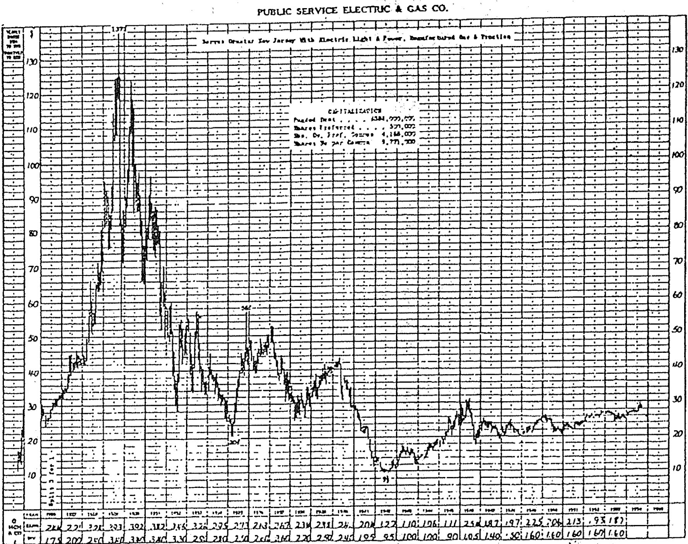

這蘊涵著兩項啟示。第一，分析家認為某支股票的「價值合理」時，務必記住，價值究竟如何，唯有市場說了才算數。價值是一種主觀的東西，它不斷變化。重點僅在於市場是否認同分析家的評估，就是如此而已。第二，如果你相信某支股票或某個類股的「價格高估」，你必須確定你的分析已經把市場中絕大多數人的看法考慮在內。戴高樂（Charles DeGaulle）曾經說過：「條約就像玫瑰花與年輕的女孩一樣，唯有當它們持續有效時，它們才持續有效。」將「條約」換成「趨勢」，這句話仍然有效。有一條古老的交易法則說道：「情況沒有變化時，便沒有變化」，這是絕對的真理。不可把市場遙遠地拋棄在後。接受梭羅斯的勸告。順著謬誤的趨勢交易，而在真相大白以前離開。

##### 經濟價值的性質

許多錯誤與誤解都是源自於不能體會價值的主觀性質。「某人的利益必然是來自某人的損失」，這便是非常普遍的誤解。如果這項陳述為正確，經濟成長便不可能，這項謬誤完全忽略財富的根本精義。在《專業投機原理Ⅰ》中，我曾經寫道：

由於價值具有主觀的性質——人們對於價值的判斷不同——這使人具有交易的慾望與動機，交易的雙方也可以同時獲利。③玉米生產過剩而肉類不足的農夫，他對於玉米的價值判斷將低於牧人，後者需要以玉米飼養牛隻——於是交易的機會便出現了。當交換剩餘品（exchanging their surpluses）的活動涉及愈來愈多的人時，交易將變得相當複雜。許多個人之間的互動，社會將透過自由的結合而提供生產與交易的場所，這便是市場。

就真正的意義來說，利潤並不是來自於交易，而是存在於市場認定之剩餘生產的經濟價值（或經濟財）。交易是一種使利潤極大化的一種機制，但利潤本身並非來自於交易。可以滿足需求的任何東西都具有經濟價值，依此認定，商品與服務都有經濟價值。財富則是未消耗之經濟價值的累積，不論形式為何；它是儲蓄的主要來源，所以也是經濟成長的主要來源。④

你可能會覺得很奇怪，身為一位專業投機者，我如何能夠宣稱，利潤嚴格來說並非源自於交易。畢竟，我的工作便是由交易中獲取利潤，而且在許多情況下，我的利潤確實是來自於他人的損失。然而，我獲得的利潤是發生於剩餘生產的結果；換言之，除非利潤已經存在，否則我無法取得利潤。就最根本的經濟功能而言，身為投機者，我的工作是修正其他人的錯誤，根據供需法則將資本導引至最佳的用途。

以1992年3月為例，我認為市場對於成長股（尤其是先前所提的藥品股與生化科技股）的多數看法即將產生改變。我大量的做空它們，而它們的跌勢也持續至1992年的11月。事實上，我控制誤置的資本，並將它們挪至較具有生產力的用途（換言之，就這個例子來說，他們的判斷錯誤，我的判斷正確）。基本上來說，我是以較低的價格買進他們因為錯誤投資而產生的儲蓄損失。當然，我的判斷如果發生錯誤，情況恰好相反。

非常有趣地，克林頓贏得總統大選時（1993年），藥品與生化科技類股開始反彈。為了避免事後諸葛亮之嫌，我希望在此提出一個預測：在克林頓執政期間，藥品股將蒙受其害，因為克林頓與民主黨控制的國會，對於「富有的」藥品公司頗有偏見。相對之下，「小型而進取的」高科技生化股則享有相反的偏愛。

##### 結論

介紹經濟分析的基本原則，其宗旨在於奠定一個基礎，以辨識市場趨勢的根本真理與謬誤。根據我個人的觀點，分析市場行為的最佳方法是由上而下；換言之，首先觀察驅動經濟循環的根本經濟力量；其次觀察整體股票、債券與商品等市場衍生的趨勢；最後則檢視個別股票、債券與商品。

在瞭解本章討論的經濟基本原理之後，我們現在可以探討繁榮/衰退之景氣循環的因果關係，這是我們現代歷史慣見的現象。

附註：

① Ludwig von Mises，Human Action（3rd rev. ed., New Haven, CT：Yale University Press, 1963）, pp.10, 92。如果各位對於「奧國經濟學派」的思想有興趣，我希望建議一本很好的書：Thomas C. Taylor所著的 An Introduction to Austrian Economics（Auburn, Alabama：Ludwig von Mises Institute, 1980）。如果需要更進一步的資料，請聯絡：The Ludwig von Mises Institute of Austrian Economics Inc., Auburn University, Auburn, Alabama 36849。

② Victor Sperandeo,《專業投機原理 I 》（New York：John Wiley & Sons, 1990）, p. 114。

③ 價值具有主觀的性質，以及人們對於價值的判斷不同，這才能造成交易。這種觀念看起來似乎很單純，但實際上是由米賽斯正式提出。在古典經濟學的理論中（亞當史密斯與其他人），交易的物品必須有相同的價值。

④ 有關財富較完整的討論，以及我駁斥「有形物質的生產才能增加淨財富」的觀點，請參考《專業投機原理 I 》，第九章。

### 第三章

#### 貨幣，信用與經濟循環

在撰寫本文的過程中，美國人民對於國會山莊的作為都保持相當樂觀的態度，認為他們會「做些什麼」將美國經濟拉出沼澤。然而，這些「什麼」究竟是什麼，便頗不確定。在克林頓掌舵，而民主黨在參、眾兩院都居於多數的情況下，民眾紛紛猜測稅金將如何增加與減少。某些民主黨議員倡導「向富人課稅」。其他議員則呼籲政府採取更多的支援或／與獎勵的措施。更有一些議員將經濟的疲軟歸咎於Fed的政策，並主張進一步調降利率刺激復甦。

非常悲哀而諷刺地，我們竟然會期待華盛頓的立法者能夠挽救我們的經濟，我敢打賭，在這些民意代表中，不到2％的人可以真正瞭解經濟衰退發生的原因。在目前的國會辯論中，我沒有聽到任何根據經濟基本原理提出的振興經濟方案。他們僅是談論著一些抽象的陳腔濫調，以討好選民，並將經濟危機的責任推給對立的政黨。當他們繼續這類口舌之爭時，經濟也繼續下滑。

可笑地，經濟循環實際上便是直接來自於華盛頓領導人採行的財政與貨幣政策。他們試圖管理國家的經濟活動時，繁榮與衰退的循環於是產生。猶如米賽斯所說：

影響經濟體系的波浪狀變動，在經濟蕭條〔衰退〕之後又是經濟繁榮，這是不斷嘗試擴張信用而降低市場毛利率的必然結果。以擴張信用帶來的經濟繁榮，絕對無法避免最後的崩解。①

如果你完全瞭解這段評論的意義，則可直接跳至下一章。否則，請繼續閱讀；透過這段評論的分析，我希望你因此擁有完整的知識，以精確預測未來經濟活動的內容。一旦你知道內容之後，你可以在機率的層面上推測這些活動發生的時間。

當我說你可以相當精確地預測未來的經濟活動時，這聽起來似乎有些誇口。沒有錯，你永遠不可能知道所有細節。然而，只要留意的話，你可以知道根本的狀況。讓我以一個實際的例子來說明。

在1979年，我們當時正處於「石油危機」之中，中東產油國壓制石油價格。卡特政府限制國內的石油生產，並課徵石油進口的關稅，立即造成國內石油供給的短缺。石油類股的價格大幅飆漲，其他工業類股則以較緩的速度隨後跟進。Fed 雖然調高利率水準，卻讓貨幣供給仍然加速擴張。換言之，石油產品的價格上漲得到貨幣供給擴張的支持——通貨膨脹。

然後發生了兩件事。第一，在1979年10月12日，Volcker宣佈，Fed 將以貨幣供給的成長率做為政策目標，而不再積極干預利率水準，這意味著通貨膨脹的擴張主義已經告一段落。第二，總統候選人雷根宣佈，如果他當選的話，將讓石油產業自由化。

當我相信雷根將贏得共和黨的提名，並將擊敗卡特時，我知道利率高漲與石油價格偏高的時代已經結束了。我也知道，當石油價格下跌時，其他工業類股將因此而受惠，至少在經濟開始反應通貨膨脹所造成的傷害以前是如此。所以，在1980年10月份的大選期間，我大量做空石油類股。S&P 500（石油類股所佔的比例很大）在11月份出現頭部，石油類股則在1月份做頭。道瓊工業指數在4月份走高，而S&P 500則下滑。7月份道瓊指數確認多頭市場已經結束。這是我們接受報應的時候了，於是我開始完全居於空方。

猶如我先前所說地，主導經濟活動的力量，深受政府政策的影響。人類採取的每一項經濟行為，其後果都是可以預測的。當經濟行為大規模地反映在政府的財政與貨幣政策中時，其對於整體經濟將產生的後果更相對容易預測。唯一的變數是民間部門的創新發明，他們對於生產的貢獻，可能抵消政府的負面行為。

經濟預測的關鍵，絕對不會脫離第二章的根本原則。在人類行為的前後關連中，運用經濟學的基本原則，再配合有關貨幣與信用的知識（包括利率在內），則經濟循環的複雜主題將變得相對容易瞭解。

我在前一章曾經提及，貨幣與信用並不是基本的要素，它們是經濟學根本原則的衍生物。漂流至荒島上的個人，他必須運用經濟學的根本原則，卻不需要貨幣與信用。對於原始部落來說，貨幣與信用也不是必要之物。在貨幣與信用出現之前，經濟社會必然已經發展至相當的程度，成員積極交換剩餘的產

物品；換言之，貨幣與信用是市場經濟的產物。唯有市場經濟的成員已經擁有相當的生產力，並且在某種程度內可以控制生活時，貨幣才有其必要性。信用的情況也是如此。

對於複雜的市場經濟來說，在評估、生產、儲蓄、投資、創新與交換的鏈環中，貨幣與信用是銜接上絕對不可或缺的工具。經濟活動愈來愈複雜時，貨幣與信用便成為經濟進步與成長的必要條件，但這必須在人類行為的基礎上來瞭解與運用它們。如果瞭解與運用並不恰當，它們將導致週期性的繁榮與衰退——經濟循環。

##### 皮埃與沙頌的故事

我喜愛的一段小故事，可以說明經濟循環的根本機制。內容如下：

路易士安那州有兩位農夫，他們的名字分別為皮埃與沙頌。有一天，皮埃來到沙頌的農場，並讚美沙頌的馬道：「這真是一匹漂亮的馬，我一定要買下它。」

沙頌回答道：「皮埃，我不能賣它，我已經擁有這匹馬很多年了，而且我很喜歡它。」

「我願意付出十塊錢的代價買下它，」皮埃說道。

沙頌說，「好吧，我同意。」於是他們簽下一紙契約。

大約一個星期之後，沙頌來到皮埃的農場對他說，

「皮埃，我一定要拿回我的馬，我實在太想念它了。」

皮埃說道，「可是我不能這麼做，因為我已經花了五塊錢買了一部拖車。」

「我願意付二十塊買下這匹馬與拖車，」沙頌說道。皮埃默默地盤算著——15塊的投資在一個星期賺5塊——年度化報酬率超過1700％！所以，他說道，「就這麼辦。」

於是，皮埃與沙頌不斷地交易這匹馬、拖車與其他的附屬配件。最後，他們終於沒有足夠的現金來交易。所以，他們便去找當地的銀行。銀行家首先查明他們的信用狀況，以及這匹馬的價格演變歷史，於是放款給他們兩個人，而馬匹的價格在每輪的交易中也就不斷地上漲。每當完成一次交易，銀行家可以回收全部的放款與利息，而皮埃與沙頌的現金流量也呈幾何級數地增加。

這種情況持續進行，直到數年以後，皮埃以1,500美元的價格買下馬匹。然後，有一個東部佬（哈佛大學的商學碩士）聽說這匹神奇的馬，並做了一些精密的計算，而來到路易士安那州，以2,700美元的價格向皮埃買下這匹馬。

沙頌聽到這個消息以後非常生氣，他來到皮埃的農場大聲責怪道，「皮埃！你這個笨蛋！你怎麼能以2,700美元的價格賣掉馬匹呢！我們的生活都靠著這匹馬啊！」

這段故事說明了經濟循環的精義。皮埃、沙頌與銀行家在無意之間造成一種假象，以紙幣推高同一匹馬的價格。雖然創造了許多貨幣，但財富並沒有增加，而每個人都陶醉在這種假象中。然而，當這位哈佛大學的MBA把馬買走之後，這個假象的泡沫便崩裂了。

人們試圖透過信用擴張降低利率時，便造成繁榮與衰退的循環。如果要充分瞭解其中的意義與經濟循環的原因，則需要瞭解何謂貨幣與信用，以及它們在市場經濟中的運作方式。

##### 貨幣：間接交換的媒介

貨幣發明以前，設想一個相對複雜而小型的封閉經濟。假定一位農夫擁有剩餘的玉米，他希望以玉米交換鐵匠的犁具。鐵匠擁有犁具的存貨，他卻不需要玉米；他需要木材做車輪，以便拖運生鐵與煤。木材商不需要玉米與犁具，而需要勞工來協助搬運客戶所訂的木材。當地的磨坊廠需要玉米，而且老闆的兒子想找份工作，但他又不需要木材與犁具。在這種情況下，產品與服務的供給與需求都存在，但供、需之間的配合則顯然是個嚴重的問題。

如果引進黃金之類普遍可以接受的商品，上述問題可透過間接交換的程序完全解決。間接交換是利用某種交換的媒介，以間接進行一系列的交易，彼此相互交換經濟價值。農夫付出金幣給鐵匠，以交換犁具。鐵匠以金幣換來木材以建造車輪。木材商聘用磨坊廠老闆的兒子，並支付他黃金。磨坊廠老闆的兒子，聽木材商說農夫有剩餘的玉米，於是他父親租用鐵匠的車子來到農場，並以黃金交換玉米。以黃金做為交換的媒介，整體經濟的交易便可以順利進行，每個人都得到他所需要的東西，而且各自以剩餘產品交換更需要的剩餘產品時，每個人都獲得利潤。黃金本身具有價值，也可以促進經濟價值的交換，但它與生產並沒有關係。

就現代的市場經濟來說，如果沒有普遍接受的交換媒介，交易顯然難以進行。普遍接受的交換媒介，不論形式為何，都稱為「貨幣」。②引用米賽斯的說法：

貨幣是交換的媒介。它是最具有市場性的商品，人們希望擁有它，這是因為它可以交換。貨幣是一種普遍被接受為交換媒介的東西。這是它唯一的功能。人們賦予它其它的功能，都僅是此唯一主要功能——交換的媒介——的特定層面而已。③

貨幣在市場中的主要經濟價值，在於它能夠延伸產品交易與產品取得之間的時間。人們之所以需要金錢，因為他們無法透過直接的交換滿足需求。所以，他們決定持有貨幣，並透過間接交換，稍後再以貨幣交換他們需要的產品或服務。

這聽起來似乎相當簡單，甚至於有些瑣碎。然而，如果希望瞭解經濟循環，事先便必須瞭解貨幣。請留意，米賽斯稱貨幣為「最具有市場性的商品」，這意味著貨幣具有經濟價值；它可以滿足需求，而市場也將其視為如此。為了俱備「最具市場性」的經濟價值，貨幣不僅必須是人們普遍想要得到的東西，它還需要有其他的性質，例如：耐久性、便於攜帶、容易分割、以及稀少性。

猶如任何經濟價值一樣，貨幣的價值是取決於市場的供、需法則。就如同任何交換一樣，我們在交易中支付「價格」以取得貨幣，此價格卻不能以貨幣單位來表示。產品與服務的價值是以貨幣單位表示，但貨幣的價值則取決於人們對於其潛在購買力的感知與判斷。兩種價值的衡量都僅能在市場決定，並受制於供、需法則。

貨幣需求與供給之間的關係——米賽斯所謂的「貨幣關係」——並不是決定於總體的層面，而是決定於個人的獨特看法與評估，並表達於市場的累積總和。你或許不相信，這項簡單的事實卻是經濟學家長久以來的爭論議題。事實上，許多經濟學家甚至認為「貨幣關係」並不存在。

例如，類似如穆勒（John Stuart Mill）與休姆（David Hume）等古典經濟學家認為，貨幣具有中性的性質；換言之，貨幣並不如同其他的商品與服務一樣具有經濟價值，所以本身並沒有驅動力量。這種信念可以延伸為一種主張：產品與服務的一般性「物價水準」與貨幣流通數量成比例的關係；換言之，貨幣數量愈大，物價水準愈高，反之亦然。這聽起來似乎頗有道理，但過於簡化；事實上，這種觀念將扭曲經濟活動的根本性質。

古典經濟學家的錯誤是將經濟體系想像為一個靜態的「均衡」。經濟是由許多市場構成，而市場又是由許多個人或群體構成，他們不斷評估與交換，這是一種持續的動態程序。在此不確定與不斷變化的情況下，貨幣的唯一功能是促進交易。另外，貨幣本身也會產生變化。猶如米賽斯所說地：

經濟資料的每一變化，都會使貨幣產生變動，而這又形成為其他新變化的驅動力量。各種非貨幣產品之間的交換比率關係一旦發生變化，這不僅會影響生產與…分配，也會導致貨幣關係的變化，並進一步造成其他變化。④

就這個觀點來看，貨幣供給量變動時，所有產品與服務的價格不可能同時產生相同程度的影響。假定其他條件不變，當貨幣供給發生變化時，唯一可以確定的後果是財富的重新分配；某些人變得更富有，某些人變得更貧窮。⑤

例如，假定在我們先前所提的小型封閉社會中，農夫突然收到聯邦政府補貼的「紙幣」。最初，除了這位農夫持有的紙幣以外，整體經濟並沒有任何的變化。然而，農夫不再需要以玉米交換黃金，而可以直接以紙幣來購買犁具。然後，他還能以剩餘的玉米交換其他的經濟商品。鐵匠在拿到農夫給他的紙幣之後，又向木材商買進木材。可是，當後續的交易程序不斷發展之後，對於整個經濟體系來說，商品將變得較容易取得，價格也開始上揚。

最初，這對於經濟活動有刺激的效果，但這僅是因為某些人並不知道農夫持有紙幣。如果每一位生產者都知道這種情況，他們必然會立即調高價格。他們的無知，使農夫可以對市場中的產品與服務取得較高的請求權，他變得比較富有，因為貨幣供給增加時，價格不會立即上漲。

凱恩思瞭解貨幣絕不是中性的東西，他卻過度運用貨幣的驅動力量。他認為貨幣可以用來創造進一步的生產。根據他的說法，額外的投資（以及額外的經濟成長）是取決於整體經濟的邊際消費傾向，但為了增加生產，你必須增加消費而提高邊際消費傾向，這是以可支配所得的貨幣金額來表示。可支配所得的貨幣金額增加時，消費者的支出增加，將提高企業界的獲利，並使他們擴張生產。

猶如休姆與穆勒一樣，凱恩斯的經濟理論是處於一種靜態的架構內，其中的因果關係都自動地發生在「總體層面」上。根據我個人的看法，這是一個嚴重的錯誤。

事實上，貨幣是在未來取得目前未消費經濟價值（產品與服務）的請求權——就是如此而已。假定你可以將整體經濟凍結在某一時刻，其中將有固定數量的產品與服務，所有現金都由某些人持有，價格將取決於人們對於供、需情況的認定。在下一時刻，如果你將經濟解凍，並增加某些人的現金持有量，整個價格結構必須重新調整。由於突如其來的差距不平衡，持有額外現金的人對於既有產品與服務的請求權將增加。在履行這些額外的請求權時，某些人將因此而較富有，其他人則變得較貧窮。

政府採行刺激性的財政與貨幣政策以增加貨幣供給時，情況也正是如此。在貨幣供給增加的初期階段，某些企業的收益將增加，這是發生在價格上漲之前。這些企業認為需求增加，於是將擴張生產。但是，擴張生產需要時間，而價格將重新調整至較高的水準；所以，企業界增加生產的實際收益可能低於預期的程度，於是他們又減少未來的生產。除非政府可以不斷增加消費者的可支配所得，但就實質所得來講，這是不可能的。政府實際上所能做的僅是增加（或減少）人們持有的現金。如果政府確實這麼做，市場遲早會將物價上漲的因素考慮在內，並抵消刺激的效果。

類似如暫時性減稅的非持續（one-shot）刺激政策，其效果基本上是一場零和遊戲，實際的效果取決於貨幣關係（譯按：由政府部門的支出〔儲蓄〕轉變為民間的支出〔儲蓄〕，實際的效果取決於所得重新分配）。新的生產僅能夠來自於已經投資的儲蓄。某些消費者持有的現金突然增加，並不是老天爺賜予的新儲蓄。這雖然可能造成新的生產，後者又可能造成新的儲蓄與投資，但唯一可以確定的效果是實質財富的任意重新分配。

人們所以持有貨幣，僅是因為他們相信其慾望在一段期間之後可以獲得較大的滿足，而不論這段期間是數秒鐘、數天或數年。每個人對於未來的展望都不同，每個人的慾望也不同，每個人持有現金的理由也各自不同。換言之，每個人希望持有的貨幣（現金）數量，是取決於其對於目前相對於未來的消費或投資態度。

##### 基源利率的概念

如果每個人都相信，世界末日將發生於一個星期之後，生產將立即陷入停頓。相信永生的宗教信徒們可能開始做必要的準備。原本不相信永生的人可能也會皈依，或縱情狂歡。誰知道人們會有何反應？此處希望強調的重點是：所有的經濟評估都是發生在目前與未來的——前後關連中。如果沒有未來的展望，便沒有經濟活動。

每個人在評估既有產品與服務的價值時，都會以某種貼現的程序來溝通目前與未來的價值。所以，每個人都會建立一種利率的架構，以表示目前與明天、後天、或20年後消費之間的關係。

利率的概念通常都與信用聯想在一起，被視為是資金融通的成本。然而，就純粹的經濟觀點來說，利率是信用發生的原因而不是價格。它不是一種數據，而是米賽斯稱認為「在目前滿足慾望設定的價值，以及在未來滿足欲望所設定的價值」之間的比率。⑥

米賽斯稱此為「基源利率」（originary interest），因為它是所有經濟利率的基礎，包括利率（interest rates）在內。

利率既不是儲蓄的誘因，也不是目前不消費所獲得的報酬或補償。它是目前產品與未來產品之間價值溝通上的比率…⑦

基源利率是取決於市場中無數參與者的評估觀點，所以它會不斷變動。然而，在任何一個時刻，供需情況會反映當時市場大多數人所持的基源利率水準。基源利率下降時，人們的儲蓄會增加；基源利率上升時，人們的儲蓄會減少。所以，在理想的狀況下，基源利率將不受市場利率的影響，而決定企業家的投資活動。在市場上，它會反映在資本財（以供未來生產之用）的成長（或衰退）率中。資本累積與市場利率水準未必有直接的關連，本章稍後會討論這個問題。

然而，現實的世界到底不是一個理想的場所。基源利率無法精確量化，因為它具有主觀的性質，而且又不斷變化。所以，企業家在擬定投資決策時，必須根據當時的市場利率水準，而這在目前與可預見的未來，都將受到政府的控制與影響。擬定未來計劃依據的利率水準受到政府控制，這是一種非常危險的現象。

##### 信用與市場毛利率

就字面上的意義來說，信用就是信賴的意思。就經濟上的意義來說，不論信用的形式如何，它都是代表放款（對於未消費財的請求權）而換取以未來生產清償的承諾。一個人決定將信用授予另一個人，放款者選擇持有現金而不做立即的支出。換言之，放款者的基源利率必然相對偏低。所以，基源利率是所有信用交易的驅動力量。

它是驅動力量，但不是決定力量。市場毛利率（gross market rate of interest）才是決定的力量。市場毛利率——當時的市場利率水準——是由三個部份所構成：(1)淨（或實質）利率，(2)企業家的成份（entrepreneurial component），(3)價格的升水成份（price premium component）。⑧⑨

在利率之中，基源利率反映的是淨利率，放款者根據此利率將未來的經濟價值貼現為目前的價值。一般來說，可供放款的貨幣供給，是取決於目前消費與未來報酬（透過資本累積）之間的價值評估關係。如果基源利率偏高，可供放款的資金便相對減少，淨（名義）利率也會偏高，或不論名義利率如何，放款數量將相對偏低。反之，如果基源利率偏低，可供放款的資金便相對充裕，淨利率水準也將偏低。換言之，淨利率或放款數量將始終反映基源利率的水準。

然而，市場毛利率並非僅由淨利率決定。在某種程度內，所有債權人都是企業家。透過放款，他們使借款人可以創造未來的預期收益，不論是用於投資或消費。同時，債權人對於未來的收益也有部份的請求權，而成為債務人未來生產的合夥人。由於每項企業投資都涉及某種程度的風險，放款者當然要求淨利率之外還需要風險的升水，後者取決於風險的程度。這種風險的升水便是市場毛利率中的企業家成份，高低可能隨著每筆放款的不同而不同。

主要的升水成份是反映那決定購買力的貨幣關係（貨幣需求與供給）。購買力的變化可能來自於現金引發（cash-induced；由於貨幣供給量的變動造成的購買力變化），或產品引發（goods-induced；由於可供運用產品與服務之種類與數量的變動造成的購買力變化），或由兩者同時引發；這三者對於貨幣關係都有影響。就現代的經濟環境而言，大多數重要的貨幣關係變化都是來自於現金引發；換言之，來自於政府財政與貨幣政策的變動。

價格升水的成份頂多僅能估計貨幣關係未來變動造成的影響；換言之，現金引發的貨幣關係變動對於購買力造成的層層影響。然而，猶如負債累累的儲貸機構（S&L’s）顯示的情況，放款市場通常是反應——而不是正確地預期——貨幣的未來購買力。米賽斯曾經說：「價格的升水總是落後購買力的變動，因為它並不是反映（廣義）貨幣供給的變動，而是反應貨幣供給變動對於價格結構的影響——這必然會有落後的現象。」⑩事實上，經濟衰退之所以發生，主要便是價格升水成份在時間上的落後性質；換言之，放款者與企業家都無法精確預期貨幣關係中現金引發的價格影響，我稍後將說明這點。

##### 經濟循環的性質

經過上述的討論之後，我們可以就米賽斯的評論觀察經濟循環：繁榮與衰退的循環是來自於「不斷嘗試擴張信用而降低市場毛利率的必然結果。」

根據我們銀行體系的性質來說，信用擴張是起始於會員銀行自由準備金（free reserves）的增加。因為我們是採用部份準備金的制度（fractional reserve system），所以每增加1美元的新準備金，透過潛在的新放款，至少可以增加10美元的新貨幣供給。⑪準備金的增加僅有一個來源，增加個人與企業持有的貨幣，不論是定期或活期存款。

整體來說，假定人們不改變現金儲蓄的習慣，準備金的增加可以來自於貸款的清償，或Fed在公開市場操作中買進政府債券而將現金導入體系之內。在評估經濟循環的成因時，後者是較重要的考量。

Fed在貨幣政策上有兩項主要的操作工具：控制短期利率，透過公開市場操作而改變體系內持有的準備金。在經濟衰退的谷底，一般公認的適當政策是增加體系內的準備金，並降低短期利率。這兩個動作的目的都是為了刺激銀行增加放款，並刺激景氣擴張。然而，這種信用擴張的結果是一種必然會導致衰退的經濟繁榮。繁榮的期間長度與衰退的嚴重程度，則取決於信用擴張的性質與程度，以及政府在此程序中採用的財政政策。

現在，撇開財政政策不談，讓我們考慮中央銀行信用擴張的影響。在經濟循環的谷底，在信用擴張開始之前，市場已經將其視為有利可圖的生產程序付諸運作。根據市場的認定，資金已經被配置於最佳的用途；那些關閉的工場，封閉的油井，未開發的礦產，它們在經濟的考量下都不適合生產。邊際資本投資正等待新資本儲蓄的形成與運作。唯有資本儲蓄提供新的資本時，資本擴張才有可能出現，並用之於生產。

然而，政府採取信用擴張的措施時，將使市場誤以為資本儲蓄已經存在，並可以供邊際投資之用。請留意，貨幣是對於未消費財的請求權。為所增加的貨幣存量是以額外的銀行準備金出現於體系內，所以市場毛利率將下滑（名義利率降低，而貨幣供給增加）；在這種情況下，銀行通常願意增加放款。由於企業家無法區別既有的貨幣與新創造的貨幣，所以他們認為新增加的貸款可以用來請求未消費的資本財，並將它們用於生產。

然而，未消費財（包括資本財在內）的數量實際上並沒有增加。所有的變化僅存在於貨幣關係之中，這使企業家誤以為資本財的供給增加。由於資本財的數量實際沒有增加，而企業家誤以為增加，最後將形成一場追逐資本財的價格戰爭，並導致資本財的價格上漲。然而，價格的變動並不是瞬間完成，各種產品所受到的影響也不相同。

為了說明方便起見，假定信用擴張增加的新放款都發生在企業界，這是中央銀行認定的最理想狀況。生產將擴張。失業人口將重新就業。整個國家的情況將趨於好轉，是嗎？

不是！企業的擴張是基於表面上存在的新資本。事實上，新資本並不存在，所以企業的擴張僅是將既有的資本由原先的最佳用途轉移至其他用途。由於資本被轉移至其他的用途，消費財的重置與新產品的生產，都會產生瓶頸的現象。另外，由於勞動市場的就業增加，消費財的需求也會增加。⑫因此，不僅生產者物價會上漲，消費者物價也會上漲；同樣地，價格的變動並不是瞬間完成，各種產品受到的影響也不相同。

企業界對於物價的上漲非常興奮，認為這代表需求增加，於是進一步擴張生產。他們從事更多的投資，這使生產者物價承受更大的壓力，包括工資在內，工資增加又會對於消費者物價構成壓力。唯有銀行不斷地提供放款，以維繫資本財增加的假象，經濟才可以持續繁榮，並造成典型的惡性通貨膨脹。

物價何時上漲，上漲的速度如何，各經濟部門所受的影響如何——這一切都取決於數項因子。第一點也是最重要的一點，科技創新可以降低生產成本，並因此緩和物價上漲的壓力。第二，銀行新放款的對象也是一個重要因素。以1927-1929年間為例，當時的信用曾經大幅擴張，但生產者與消費者物價的上漲程度非常有限。新的放款都是以股票投資人為對象，這醞釀了一波股票市場的投機行情。以最近的案例來說，在1982年至1987年之間，股票與房地產價格飆漲，但消費者物價的上漲速度卻下降。第三，政府的財政政策（稅金、借款與支出）也可能加速或減緩整個程序。


然而，在大多數情況下，價格上漲具有下列的循環模式：

- 生產者物價會率先上漲，但因為消費者需求具有較直接的影響，所以消費者物價的上漲速度較快。
- 企業家在獲利假象的誘導下，將物價上漲解釋為需求增加，並向放款機構要求更多的貸款以擴張生產。
- 債權人眼見貸款需求的增加與物價的上漲，而提高市場利率的價格升水成份，以及名義利率。
- 然而，不論名義利率的水準如何，由於基源利率的下降，市場毛利率也隨之下滑。
- 於是，體系內出現更多的放款。
- 再次地，貨幣關係中又產生現金引發的變化。
- 再次地，當消費者需求維持不變或增加時，額外產品的生產又出現瓶頸的現象。
- 再次地，消費者物價又趨於上揚。

循環持續進行，在每一循環中，價格升水的成份都不足以充分反映物價上漲的影響。如果它能夠充分反映，則信用擴張將停頓。這基本上便是現代經濟擴張的根源。

信用擴張造成的經濟擴張，其幅度與期間受到一項因素的限制，那便是基源利率。一旦生產者與消費者發現，預期的未來所得將不足以彌補貨幣購買力的下降時，基源利率將開始上升；換言之，將開始出現囤積實物的傾向，資金將流往最足以對抗通貨膨脹的對象（股票、房地產、黃金…）。由於消費財的供給有限而需求不斷增加，會驅使物價加速上漲。

銀行開始擔心而不願再授予信用時，或中央銀行開始由體系內抽離準備金時，經濟擴張將告一段落。這個時候，無數進行中的擴張計劃，必須仰賴持續擴張的信用供給與遭到扭曲的偏低利率。在資本充裕假象下所做的種種盤算與計劃，已經無法再繼續維持。財務狀況不佳的企業為了急於求現，在市場中大量拋售存貨。生產者價格下跌，而且通常是暴跌。工廠關閉，勞工遭到裁員。營建計劃遭到擱置，美國各個城市都可以看見這種尚未完工的建築，這都是資源配置不當的後果。

雖然許多企業都急需現金來週轉，但放款者卻瞭解當時的風險情況，這使利率中的企業家成份被推升至超高的水準，貸款幾乎不再可能。這個時候，整體經濟已經處於恐慌的邊緣，任何利空消息便可能將其引爆。金融市場的價格崩跌，生產趨緩，財富在一夜之間便可能消失，更多的勞工失業，需求降低…經濟衰退於是開始。

經濟衰退是不可避免的結果。猶如米賽斯所說：

信用擴張造成的經濟繁榮，根本問題不在於過度投資，而是在錯誤的場合投資；換言之，不當的投資（malinvestment）。〔企業家〕在擴張時，投資的規模並沒有對應的資本財。由於沒有充分的資本財，所以他們的計劃無法實現。他們遲早會失敗。⑬

然而，雖然許多企業倒閉，仍有一些企業得以渡過衰退的難關；總之，科技創新可以實際增進整體國家的財富。雖然如此，但在調整的期間，無數的計劃將被放棄，這使得真實的財富（以經濟價值而言）因此而被消耗（儲貸機構的危機便是一個例子）。

##### 經濟衰退期間，政府干預並無益處

經濟衰退是經濟繁榮的必然後果。這個結果來自於信用擴張，資源配置錯誤，貨幣關係發生變化，利率遭到扭曲，市場的心理結構趨於混亂。經濟衰退是一段必要的休養期間，使經濟資源可以根據當時的市場狀況來調整，但政府必須讓經濟體系有足夠的時間調整。

一般來說，經濟衰退期間，老百姓會要求政府「做些什麼」來把經濟拉出泥沼。然而，政府實際上並沒有能力改變經濟現實，這必須由經濟體系自行調整。政府唯一能做的便是停止以財政政策為手段徵收資本財，並讓市場決定資本財的運用。換言之，政府可以同時降低稅金與支出。可是，在實務上，政府幾乎不曾這麼做。

政府還有另一個可行的方案，那便是進行另一輪的信用擴張。就歷史上來說，這是政府偏愛的一項抉擇。我相信，歷史上每一個重大的經濟災難幾乎都源自於此。

我們可以檢視最近發生的例子。1991年與1992年，聯邦政府試圖以另一輪信用擴張刺激美國的經濟。這項嘗試顯然失敗了。Fed 增加準備金（透過公開市場操作買進政府證券），並以史無前例的次數調降貼現率，試圖引導市場毛利率下降。然而，放款市場卻拒絕妥協，因為財政政策仍經持續的成長，市場毛利率中的企業家成份非常偏高，這使得放款機構不理會名義利率而不願意放款。

我認為這是令人欣慰的發展，尤其是債券市場不理會短期利率的下滑，而殖利率仍然維持在7.5％以上。這顯示市場對於通貨膨脹信用擴張的影響已經較為明智。然而，另一方面，股票市場的反應便顯得相當不智。在1991年12月，貼現率史無先例地向下調低一個百分點而成為3.5％，股票價格大幅上揚。由於（短期）利率居於歷史的低水準，市場預期將出現新的成長，股價的漲勢持續至1992年12月份。

根據我個人的觀點，這顯然是一個問題。未考慮經濟環境而將名義利率判斷為「低」或「高」，都是一種錯誤的前提。必須考慮的重要關係是：名義利率是否可以真正反映基源利率？這必然是一個主觀的判斷。

如果政府採行的信用擴張政策，可以利用人為的手段降低市場毛利率（與基源利率），則將產生經濟繁榮，反之亦然。關鍵的指標在於貨幣供給的成長率。

##### 結論

現在，你已經瞭解我對於經濟循環的觀點，這當然有些簡略而抽象。總之，我認為經濟循環的根源是政府試圖透過信用擴張而降低市場毛利率。這種情況下，企業家將誤以為資本財增加，實際上並非如此。他們根據這些虛幻的資料而進行盤算與計劃，並從事一開始便註定失敗的投資。然而，人類在市場中展現的創新發明，卻可以減緩上述影響，而使實質的財富在每輪經濟循環中都得以成長。

雖然如此，但人類在貨幣與信用市場的所作所為都無法改變一項事實：新的生產必須仰賴資本儲蓄的增加。信用無法創造國家的新財富。信心也不能創造新財富。總需求的增加更不能創造新財富。其他條件不變時，消費的增加僅會造成新財富潛在生產的減少。唯有生產創造的資本儲蓄增加時，才能形成新財富的累積。

經濟循環是一種惡性循環，是政府「專家們」計劃與執行的一場永無止盡的遊戲。這些行為通常是出自於善意，但結果總是相同。只要中央銀行的體系存在，只要政府試圖控制市場毛利率來規範經濟的成長，便不可避免繁榮與衰退的循環，物價將不斷上揚。非常幸運地，你可以根據本章的知識瞭解這場遊戲，順著這個謬誤前提形成的趨勢來操作，並在這些「啞羅斯的機會」中獲利。

##### 附註：

- ① Ludwig von Mises, Human Action (Chicago: Contemporary Books, Inc., 1966), p. 572。
- ② Ludwig von Mises, Human Action (3rd rev. ed., New Haven, CT: Yale University Press, 1963), p. 398。
- ③ Ludwig von Mises, Human Action (3rd rev. ed., New Haven, CT: Yale University Press, 1963), p. 401。有關奧國學派的貨幣與信用理論，請參考H. E. Batson 所譯的 The Theory of Money and Credit（Indianapolis: Liberty Classics, 1981）。
- ④ Ludwig von Mises, Human Action, p. 418。
- ⑤ Ludwig von Mises, Human Action, pp. 416-419
- ⑥ Ludwig von Mises, Human Action, p. 526。
- ⑦ Ludwig von Mises, Human Action, p. 527。
- ⑧ 完整的討論，請參考 Human Action, pp. 534-586。
- ⑨ 在《專業投機原理Ⅰ》一書中，我誤將基源利率表示為市場毛利率的成份之一。事實上，基源利率是淨（實質）利率始終朝向的目標。企業家與價格升水的成份並不是真正的利率，而是代表貼現的函數，它們分別取決於企業家判斷的風險與貨幣關係的變動。
- ⑩ Ludwig von Mises, Human Action（3rd rev. ed.）p.551。
- ⑪ 有關這個程序的完整討論，請參考《專業投機原理Ⅰ》，第十章。
- ⑫ 消費財的需求增加，可能導致消費財的價格上漲快於資本財，並造成強制性的儲蓄，這在某種程度內，可能抵消生產者物價的上漲壓力。基源利率實際上可能下降，經濟成長的步調可能加快。然而，消費財價格的不断上漲，最後將導致「囤積實物」的現象。
- ⑬ Ludwig von Mises, Human Action, p.559。
- ⑭ Ludwig von Mises, Human Action, p.807。

### 第四章
政治對於經濟循環的影響

為了精確預測未來的經濟活動與金融市場的價格走勢，你必須瞭解與整合貨幣與財政政策對於經濟循環的影響。第三章曾經觀察貨幣政策的某些影響。我們發現，信用擴張的貨幣政策通常會使經濟趨於擴張，但隨後的經濟衰退卻是必然的後果。寬鬆的貨幣政策通常會引發景氣的擴張，但貨幣政策本身並不能決定經濟循環。另一項因素是政府的財政政策：課稅、支出與借款。本章中，我希望說明政府經濟政策的影響——由我認定的根本目的著手。畢竟，如果經濟學是研究「以手段達成選定的目的」，則政府選定的目的便是最重要的課題之一。

當我觀察民意代表的行爲與主張時，我發現一種根本的哲學觀念：經濟活動應有平均所得的功能。在新稅法中，「公平」（fairness）都是訴求的重點。沒有遭受挑戰，也沒有覺得歉意，我們選出的政治代表們，試圖以自由為代價，而由政府強制設定經濟上的平等。

根據現代國會使用的美麗詞藻判斷，政府經濟管理的功能似乎應該是：在未全然壓抑企業家的生產意願為前提下，根據「公平」的標準重新分配財富。我完全反對這種觀點，我可能需要以一整本書的篇幅說明我反對的理由。然而，我目前的意圖並不是駁斥這些思想，而是希望由市場預測的角度，來說明這些思想造成的後果。

#### 課稅對於長期趨勢的影響

課稅的制度會長久存在，這毫無疑問。然而，課稅的形式如何，它們適用的對象為誰或什麼，以及稅金的多寡，都會顯著影響經濟表現——包括金融市場在內——的長期趨勢。

米賽斯以下列評論總結課稅的危險，並解釋課稅的重要理由：

如果課稅的方法…造成資本的消費，或限制新資本的形成，則邊際就業（marginal employments）所需的資本將缺乏，這將妨礙原本應該存在的投資擴張。①

猶如這項評論所暗示地，並非所有稅制都必然會限制經濟的活動與成長。政府提供的服務至少有一部份是必要的，但因此主張以稅金支付政府提供的服務，就如同任何交易一樣，相當於是一種經濟的交換，這種見解未必可以成立。為了確保政府提供的服務能夠順利的運作，這需要一定的稅金來維繫，這種程度的的範圍內，稅金的制度是合理的。然而，不幸地，政府服務的供給、需求與成本，並不是由市場力量決定，而是由政治命令安排。這些命令是由「劫富濟貧」的原則主導時，政府的課稅與支出將完全失去控制，就如同目前的情況一樣。根據定義，沒有必要的稅金會導致不良的後果，例如：強制性的財富重分配、干擾市場中產品與服務之間的交換比率、扭曲貨幣的關係、提高資本消費的傾向。

某些由總體角度觀察經濟運作的人主張，稅金具有「中性」（neutral）或「刺激性」（stimulative）的效果，前者是指它們對於消費沒有影響，後者是指它們實際上可以增加生產。凱恩斯學派認為，邊際消費傾向，（譯按：這是指每增加一單位可支配所得時，所造成的消費變動量）會驅動生產；他們指出，由某個人口袋中拿走的一塊錢，最後還是會落入另一人的口袋。另外，由於較貧窮者的邊際消費傾向較高，而富人的邊際儲蓄傾向較高，所以向富人課稅，並透過社會福利計劃將財富轉交給貧窮者，這可以增加整體經濟的消費，而這又會導致總需求的增加，並刺激企業界增加生產。猶如凱恩斯所說地：

如果財政政策被用來使所得的分配更平均，則其對於增加邊際消費傾向的效果當然很重要。②

這種主張有一項致命的缺少：如果消費的增加發生在生產的增加之前，資本將被消費。如果稅制是以「劫富濟貧」的方式增加貧窮者的可支配所得，則貧窮者的消費增加必然導致富有所的消費減少。雖然富有者的消費型態可能因此而改變，這姑且不論，但因為富有者的邊際儲蓄傾向較高，所以整體經濟的儲蓄將降低，而降低的儲蓄原本可以用於資本的擴張。

讓我們考慮這種「劫富濟貧」稅制可能產生的後果。在最理想的狀況下，這將造成資本在經濟部門之間的重新分配，並導致較緩慢、較缺乏效率的經濟成長。在最糟的狀況下，這將造成資本的直接消費，並減少國家的淨財富。首先由最理想的狀況開始。

假定政府對於年收入在5萬美元以上的人課徵「富人稅」，並直接分配（跳過居中的官僚體系）給年收入少於1.5萬美元的人。這項稅金的目的有二：(1)提高所得的平均程度，(2)增加整體經濟的邊際消費傾向，並期待這還可以增加生產水準（這便是克林頓政策的基礎所在）。現在，假定這項稅制在這兩方面都成功。這項稅制對於所得平均化的效果非常明顯。然而，如果所得重新分配可以增加消費需求，則整體經濟的儲蓄必然會減少。

在所得重新分配以前，經濟中存在既定數量的資本財供給，以生產既定數量的消費財供給。在重新分配之後，經濟中供給的資本財與消費財數量並沒有變化，但用來重置資本與資本擴張的儲蓄已經減少了。同時，消費需求增加，造成物價上漲的壓力。

由於需求增加，企業界擴張生產。然而，為了生產較高水準的消費財，將造成瓶頸，所以價格上漲。企業界擴張生產時，需要運用資本財，所以對於既定數量資本財的需求也將增加。假定貨幣供給沒有變化，資本財的需求增加，而供給相對減少（儲蓄減少），則生產者物價也開始上升，但價格的上升速度可能不若消費財，因為消費財的需求增加較早發生。

由於銷售量增加，而且零售價格上漲，企業界的收益增加，於是某些廠家的投資將運用更多的實質與虛幻的資本，但生產者物價的上漲將抵消一部份的利潤。另一方面，如果所得沒有重新分配，企業家可以運用的資本財原本較充裕。最初，由於需求增加，所以生產量會增加，但因為可供投資的資本財數量已經減少，所以生產的數量將少於課稅以前的水準，價格也較昂貴。除此之外，政府扮演的「中間人」角色必然會降低經濟的效率，並進一步影響潛在的成長。總之，每當你將資本儲蓄轉移至消費支出，將失去一些成長的潛能（包括目前與未來的成長）。這是最理想的情況。

實際的發展未必如此理想，課稅不僅會把資本儲蓄轉移至低所得階層的消費，而且高所得階層的邊際消費傾向也會降低。企業活動的反應並不一致，某些企業是為了滿足高所得階層的需求，另一些企業是為了滿足低所得階層的需求。資源被重新分配至低所得階層時，則提供高所得階層產品的企業將受到打擊，裁減員工（經常是低所得階層的成員），工廠關閉或破產，貸款無法清償，…。不僅既有的資本被消費，以未清償貸款表示的未來資本也被消費。由於提供低所得階層產品的企業會擴張，所以上述損失在某個程度內可以獲得彌補，但根據整個程序的性質來說，整體經濟得到的效益無法抵消發生的損失。

何以如此？因為供、需關係受到任意的扭曲。對於高級品產業來說，它們投資的時間與資本財將發生損失，某些是永久性的損失。某些資本財在性質上無法轉至其他用途。同時，某類資本財將因此閒置，價格暴跌，而低級品產業的資本財需求增加，其價格上漲。然而，兩者之間並不能相互抵消。因為某些資本財已經被消費，或處於閒置狀態，另一些資本財則因為企業擴張而價格上漲。

為了滿足財富重新分配造成的需求增加，提供低所得階層產品的企業必須進行資本投資。所以，低級產品的生產會發生瓶頸。這類消費財的價格將上漲，相關的生產者物價也會上漲。以最後的結果來說，淨資本被消費；換言之，整體經濟與國家將變得較貧窮。

10 % 的「奢侈稅」便是一個典型的例子，它造成淨資本的消費。這項稅制的動機完全是基於利他主義：「任何人如果買得起小飛機或遊艇，他便有能力多付 10 % 的價格」。這便是其支持者主張的理由，而且法案也通過了，但結果呢？他們的判斷完全錯誤。10 % 造成重大的差異。遊艇產業隨之瓦解。小型飛機製造業也是如此。甚至於也波及一些周邊產業，例如：專為遊艇生產的小冰箱。數以千計的藍領工人因此失業。雖然這項稅制稍後被取消，但許多生產設備仍處於閒置狀態。

這段故事的教訓非常明顯：如果市場可以接受較高 10 % 的價格，則價格早已經上漲 10 % 了。任何新稅制造成的價格上漲，必然會影響邊際的購買需求，這又會使邊際生產停頓。實際的情況便是如此。

##### 資本利得稅

根據我個人的看法，資本利得稅（capital gain tax）僅有負面的經濟效果。更糟者，以 28 % 的實際稅率來說（不包括州政府的部份），美國目前課徵的資本利得稅是全世界最高者之一。撇開它不能根據通貨膨脹來調整不談（這相當於是偷竊），資本利得稅是就新投資的根基來課稅：利得——將資金投資於企業計劃賺取的新財富，或就我個人的情況來說（至少是我希望的情況），由他人的不當投資獲得的利潤。

目前的資本利得稅，將28％以上的資本利得轉移至以消費為導向的政府支出，並因此而消費美國的資本。資本利得稅吞噬原本可以用來促進經濟成長的資本儲蓄。資本利得稅率增加時，新投資的數量便減少。我可以直接證明這個論點。

投資者安排資金時，會在替代方案中選擇：直接投資於未上市的企業、股票、債券、各種基金…。在評估每一項可行的方案時，他們會觀察潛在的風險與報酬，並加以比較。然後，根據相對的風險-報酬比率，他們會選擇最具有吸引力的投資方案。每個人對於風險／報酬關係的看法都各自不同，但一般而言，如果兩項或以上的投資方案提供相同的潛在報酬，絕大多數人會選擇風險最低者。由另一個角度來說，涉及的風險愈高，潛在報酬也必須愈高才可以吸引新的投資。

在投資者的心目中，許多潛在的投資都是存在於一種不確定的灰色領域內：它們是屬於邊際（marginal）投資。它們是新企業或既有企業提供的某些投資機會，但潛在報酬雖然稍高於其他低風險的投資方案，例如：免稅的市政公債，但這種程度的報酬並不容易吸引新的資本。例如，一家公司如果五年來提供股東每年的平均稅前報酬為25％，它在募集新資本時應該沒有問題。然而，對於一家新企業而言，如果它承諾新股東每年的平均稅前報酬為10％、甚至於15％，但在資本利得稅的影響下，這家公司在募集資本時可能會有困難。每當資本利得稅增加一個單位，邊際投資的數目便會有對應、甚至於等比例的增加，使得新投資計劃更難以吸引資本。

讓我們考慮一個例子。一家新企業承諾提供10 % 的盈餘成長率，並在各種不同的資本利得稅率下，發行股票募集資本。請你根據表4.1所列的投資方案，評估這家新企業投資的可行性，假定你是一位擁有1萬美元資金的「一般」投資人。

表面上看，一般投資人可能會選擇高成長股票。實際上不然。許多投資人瞭解，只要一季的盈餘報告不理想，本益比高達40倍的股票很容易下跌25 % 或以上。就目前的經濟環境與高達33 % 的資本利得稅考慮，我猜想絕大多數投資人都會選擇中度成長的股票與債券基金的組合。

新企業承諾的報酬率只較債券基金高2.17 % ，債券基金幾乎毫無風險，這種情況下，誰願意投資新企業呢？新企業的風險遠較為高——投資人可能損失所有資金！如果資本利得稅率為15 % ，新企業投資的報酬較債券基金高4.69 % ，這或許可以吸引部份投資人。如果稅率為0，其報酬率將幾乎是債券基金的兩倍，這當然可以吸引風險取向較高的投資人。

為了說明資本利得稅對於邊際投資造成的嚴重影響，讓我們考慮下列簡單案例。史密斯擁有一家非常成功的州際卡車運輸公司，而且他有一個夢想。他希望成為高速公路卡車休息站的麥當勞，提供廉價而高品質的食物給卡車司機與其他旅客。他的基本構想是在車潮較多的地區購買土地設置休息站。經過詳細的研究，他認為最初可以建立100個單位。然後，經過10年或15年，規模可以逐步擴大為1,000單位。


###### 表4.1 投資方案比較分析（在不同的資本稅率下）

假定：
1. 最初投資金額1萬美元。
2. 標價便是最初投資成長一倍。（扣除股息。）
3. 公司盈餘成長以複利表示（扣除股息）。

投資內容
1. 新企業投資：新企業預計提供10%的盈餘成長，並預計在10倍的本益比下發行普通股。
2. 高成長股票：既有企業的普通股，過去五年來的每年的平均盈餘成長率為25%，未來分派股息。
3. 中度成長股票：S&P 500的成份股，盈餘成長率平均每年15%，股息平均每年為3.3%。
4. 市政公債基金：目前的殖利率為7%，每年配息一次。

| 投資方案 | 盈餘成長率 | 本益比 | 最初投資 成長一倍 所需時間 | 稅後年度報酬（配息前） | 稅後年度報酬率（配息前） | 稅後報酬率（配息後） |
|---|---|---|---|---|---|---|
| 新企業投資 | 10%（預計） | 10（預計） | 7.27 | @33% $ 917.01 | @33 9.17 | — |
|  |  |  |  | @15% 1,169.19 | @15 11.69 | — |
|  |  |  |  | @ 0% 1,375.52 | @ 0 13.76 | — |
| 高成長股票 | 25%（歷史） | 40 | 2.93 | @33% $ 2,275.34 | @33 22.75 | — |
|  |  |  |  | @15% 2,901.02 | @15 29.01 | — |
|  |  |  |  | @ 0% 3,412.97 | @ 0 34.12 | — |
| 中度成長股 | 15%（歷史） | 15 | 4.85 | @33% $ 1,374.57 | @33 13.74 | 15.97% |
|  |  |  |  | @15% 1,752.58 | @15 17.53 | 20.33% |
|  |  |  |  | @ 0% 2,061.86 | @ 0 20.62 | 23.62% |
| 市政公債基金 | 7%（未複利） | — | 10.31 | $ 700.00 | 7.00 |  |

在仔細評估成本之後，史密斯認爲每單位的成本大約需要5萬美元；所以他需要5,000萬美元做爲最初資本。史密斯的往來銀行願意以運輸公司爲抵押而放款給他2,500萬美元。他還缺少一半的資金，於是決定成立「史家卡車休息站」的公司，並希望找一家投資銀行承銷發行他的股票。他相信投資者必然非常熱衷於這項「穩賺」的計劃。

他把詳細的投資計劃書提供給投資銀行，包括現金流量的計劃在內。根據他的估計，每單位的營業量至少是50萬美元，營業淨利爲15％。營運單位逐漸增加後，由於經濟規模的緣故，獲利率可以提高至20％。他計劃擁有一半的股權，其他部份則以每股10美元的價格公開籌措資本。根據發行價計算，本益比爲6.67倍，他認爲投資銀行一定會把他的公司視爲是「成長型」的企業，並非常樂意承銷其股票。

實際結果卻令史密斯大失所望。投資銀行家看見預估的報酬率以後，便不斷搖頭。他說道，「史密斯先生，你的構想相當不錯，但整個計劃並不可行。報酬率太低了。」

「你什麼意思，」史密斯說，「15％的報酬一點也不差——它幾乎是目前債券殖利率的兩倍！」

「嗯…」銀行家嘆息道，「15％的公司獲利率當然不算差，但你必須由投資人的角度來設想。你估計報酬率爲15％。假定你每年都再投資，則你公司的盈餘也應該可以每年成長15％，而股票價格至少也應該有類似的表現。可是，投資人主要是爲了長期資本利得而投資。假定你的股票每年平均上漲15%，則33％的資本利得稅將使投資人稅後的報酬率降至10％。他們目前在免稅的市政公債基金中便可以獲得7％的報酬率，而且幾乎毫無風險。再考慮另一項事實，新成立的餐飲業大約80％會失敗，你不妨考慮投資人會怎麼想？你不能期待他們每年為了多賺3％的利潤而承擔損失一切的風險。對不起，史密斯先生，風險／報酬的關係實在不足以吸引投資人。」

於是，史密斯又嘗試其他銀行，但結果完全相同。最後，他終於放棄了，將卡車運輸事業以250萬美元的價格脫手，並將所有資金用來購買免稅的市政公債，又在科羅拉多州買了一棟小木屋，而以債券利息渡過下半輩子。所以，一位卡車休息站的麥當勞就如此提早退休了。

不論新投資案的成功機率多麼高，如果投資人願意投入資金承擔風險，這些計劃的潛在報酬必須遠高於其他低風險的替代方案。至於高出的幅度確實為多少，沒有人知道——這取決於投資人的主觀判斷。然而，如果資本利得稅率是15％而不是33％，則「史家卡車休息站」的報酬率便可以提升至12.75％，較債券基金的殖利率高出82％。如果沒有資本利得稅，則潛在報酬率更有15％，較債券基金的殖利率高出114％。潛在報酬率不斷提升時，在某個水準之後，這項計劃便不再被視為是邊際投資。這個例子中的計劃是否可以獲得投資者的青睞，並沒有什麼重要性。重點是：資本利得稅率愈低，新的投資方案愈容易籌措資本。

然而，反對降低資本利得稅的人認為，如果降低資本利得稅，政府的赤字將增加。事實上，這個問題可以由減少政府支出 來解決，拋開這點不談，我們可以根據簡單的數據反駁這種觀點。例如，1970年代聯邦政府的總收入為3.275兆美元，在1980年代雷根政府大力減稅的十年內，總收入則成長177％而成爲9.061兆美元。不幸地，1980年代政府總支出卻成長202％而成爲10.823兆美元。赤字的問題是來自於不負責任的支出，而不是因爲稅收不足。

每年，估計有數以百計的新投資方案因爲資本利得稅而遭到擱置，並因此減少數以千計的就業機會，以及數以十億計的潛在新稅收。例如，如果資本利得稅並不存在，則「史家卡車休息站」便可以經營成功，將可創造不少稅收。

假定史密斯的營運計劃相當正確。他成立100單位的休息站，平均每個休息站第一年的營業額為50萬美元。假定勞工成本為20％，而且僅聘用當時失業的勞工。他提供的食物，平均成本為30％。每個休息站的房地產成本平均為10萬美元，每處的建築改良成本為25萬美元，並使每單位的財產稅因此而每年提高6,000美元。在每一個休息站中，他購買10萬美元的新設備，並支付5萬美元的雜項費用，包括：投資銀行的費用、律師的費用、貸款申辦的費用、建築許可、以及其他類似費用。在這些簡單的假設之下，第一年的營運便可以為政府增加1000萬美元的稅收（參考表4.2）。

這是創造新財富衍生而來的新稅收。我故意以保守的態度來估計稅金，有許多增加稅收或減少政府支出的項目並未考慮在內，例如：額外的公司所得稅、原本失業之營建工人支付的額外所得稅、州與聯邦政府減少支付的救濟金、以及其他 等等。此外，我也未提及創造新工作的效益──提高市場的競爭而使餐廳的價格下降。

事情的真相很簡單：如果資本利得稅將妨礙「史家卡車休息站」之類的邊際投資方案，資本將被轉移至消費，而潛在的新工作、財富與新的稅收也將因此完全流失。我們應該如何選擇，這應該非常明白：33％的資本利得稅，並因此而每年妨礙數以百萬美元計的新財富增加；或者，降低資本利得稅而鼓勵資本成長，並創造新的稅收？

###### 表4.2 「史家卡車休息站」：第一年營運產生的估計新稅收

|  |  |  |
|---|---|---|
| 增加的財產稅：100單位，每年每單位6,000美元 |  | 600,000 |
| 增加的員工薪資稅： |  |  |
| （假定是聘用原先失業的勞工） |  |  |
| 薪資毛額 | $10,000,000 |  |
| 所得稅 @20% | 2,000,000 |  |
| 社會安全 @12% | 1,200,000 |  |
| 州與地方政府 @5% | 500,000 |  |
| 總薪資稅 | $3,700,000 | 3,700,000 |
| 開創費用的相關稅金： |  |  |
| （假定所有費用是以15%繳納稅金） |  |  |
| 100 × $50,000 ×15% |  | 750,000 |
| 設備批發商支付的稅金： |  |  |
| （假設同上） |  |  |
| 100 × $100,000 ×15% |  | 1,500,000 |
| 營建商支付的稅金： |  |  |
| （假設同上） |  |  |
| 100 × $250,000 ×15% |  | 3,750,000 |
| 所增加的稅收估計總值 |  |  |
| 第一年 |  | $10,300,000 |

1,000 單位的「史家卡車休息站」，這只是一個小型的投資案——每年營業額為5億美元。雖然如此，但假定史密斯在每個休息站都聘用20個人，他將創造2萬個就業機會，每年增加的實質GDP可以高達數百萬美元。假定每年有數以百計、甚至於數以千計的新投資案，是因為資本利得稅而遭到擱置，這便是經濟衰退與經濟繁榮的差別。同時，這也代表政府流失數十億美元的稅收。

批評者可能會說：「你的故事是以悲劇結尾。可憐的史密斯。他擁有價值$2,500萬美元的市政公債，而資本利得稅使他無法更富有。你的例子證明降低資本利得稅僅會造福富有者！」

這種想法完全忽略一項事實，每個有利可圖的新投資案，都可以創造衍生的經濟效益。例如，假設史密斯在法明頓附近開了一家餐廳，這是一個虛構的社區，就如同許多美國郊區一樣，它限於經濟的困境中。約翰與瑪莉住在法明頓附近，並在81號高速公路旁擁有一座農場。農產品價格持續下滑，他們的房屋貸款已經積欠「法明頓第一國家銀行」三個月。他們每個 月需要800美元的收入才能夠勉強渡日子，附近卻全然沒有工作機會。喬冶是本地的銀行家，他告訴約翰與瑪莉，不久之後他將被迫查封他們的財產，並拍賣其農場與設備。

喬冶本身也遭受非常的壓力。銀行的稽查人員緊盯著他，並警告他要立即增加提列壞帳準備金，否則將關閉本地分行。如果他們迫使他去查封約翰與瑪莉，一切便結束了。因為本地的房地產價格大幅下跌，拍賣農場頂多僅能彌補三分之二的貸 款。這部份的損失將迫使喬治結束分行的業務。隨後，Fed將接管一切，並查封更多親朋好友的財產，這將使法明頓與附近的社區完全破產。

有一天，瑪莉駕車沿著高速公路行駛，突然看見一個新招牌，上面寫道：「史家卡車休息站」。在招牌下側寫著：「供應餐點」。於是，她走進餐廳，申請了一份工作，隔週開始上班。她與丈夫及時繳付了當月份貸款，而且在三個月內清償所有積欠的貸款。

喬治發現，不僅是約翰與瑪莉如此而已，其他銀行客戶也開始更及時地繳納貸款。附近的20個居民在「史家卡車休息站」找到工作。餐廳的經理搬到鎮裡，並買下強森的房子，這棟房子已經在市場銷售了九個月。鎮上僅有一家餐館，即使最艱困的期間，它也可以勉強維持獲利，但最近幾個月發了一筆小財，因為「史家卡車休息站」的營建工人時常照顧餐館的生意。在鎮上經營雜貨店的傑克，最近的收入也大幅改善，並開始定時繳納貸款而不再要求延期。由於財產稅收入的增加，鎮上小學的經費也轉為充裕，並再聘雇法蘭克把始終未完工的新教室加以整頓。五金行的生意也明顯好轉；另外，貝西在領了三個月的失業救濟金之後，現在也找到工作了。史密斯每天都存入5,000美元至1.5萬美元的現金至喬治的銀行，其他固定客戶的存款餘額也有所增加。喬治剛好補足了貸款壞帳的準備金，銀行的稽查人員也離開了，喬治的血壓也恢復正常。法明頓終於渡過難關。

降低資本利得稅僅能使富有者受惠嗎？如果沒有資本利得稅，或稅率較低一些，每年都有更多類似如「史家卡車休息站」的潛在投資可以突破「邊際」的狀態。結果，將有更多的資源可以用來創造新的財富——新的產品與服務——造成更多的就業機會，更競爭的價格（通貨膨脹將可趨緩），更多的支出，更多的利潤，更多的儲蓄，更多的投資，如此周而復始。

我可以這麼說，財富將創造財富，這便是所謂的「投資向下延伸的理論」（trickle-down theory of investment），降低稅率的效益可以由富有者向下延伸至低所得的階層。然而，如果你考慮降低資本利得稅產生的整體經濟衍生效益，則「富有的」投資者僅享有一小部份的效益。以「史家卡車休息站」為例，史密斯當然會變得更富有，但就其投資的總效益來說，他的所得增加的比率實在相當微不足道。

降低資本利得稅僅會造福富者，我們可以提出更明白的論證加以反駁。在20%與33%的資本利得稅下，我們可以比較美國中產階級房屋所有者的效益。在1.12億的納稅人口中，有7,400萬的房屋所有者。假定房屋的價格猶如『1986年稅務改革法案』（這時候開始採用33%的資本利得稅）實施前一樣，每年平均升值6%，房屋的價值在12年會上漲一倍。以目前的房屋價格的中位數（median）考慮——15.8萬美元——並假定房屋每12年轉手一次，如果適用的稅率是20%而不是33%，房屋所有者可以多獲得的利潤中位數為20,540美元，平均每年節省的稅金為1,711美元。（當然，如果你賣掉房屋又買進價格更高的房屋，則當時可以完全避免繳稅，但這僅是拖延稅金而已。然而，如果你在55歲以後才賣出房屋，你可以享有一$12.5萬美元的免稅扣減額。）另外，我們還必須指出一點，在目前的規定下，房地產並沒有資本損失的的扣減——當然，這完全是另一個問題。

如果一般的美國房屋所有者有選擇的餘地，則在下列兩個方案中，他們會如何選擇：美國的中產階級在兩年內每年可以減少200美元的所得稅（在本書撰寫時，這部份稅金將轉由富有者承擔），這是國會議員目前主張的方案；或者，讓房屋所有者每年節省1,700美元的稅金。我想答案非常明顯。

顯然地，透過節稅造成的資本淨值增加，可以用來做爲投資或支出的信用擴張。房屋所有者的資本淨值增加時，他們可以申請第二抵押貸款，以改善房屋建築、購買汽車、供兒女接受教育、以及其他等等。資本利得稅會直接消耗資本淨值（累積資本），並降低其可以貸款的金額。如果你知道，在全美國的資本淨值中，有三分之一將由政府透過資本利得稅加以徵收，你應該可以瞭解我們因此將喪失的潛在投資數量。

在政府可以課徵的所有稅金類型中，資本利得稅是對於經濟傷害最嚴重的一種稅制。一般而言，最不具傷害性的稅是那些稅率偏低而沒有差別性的稅，並且課稅的目的僅有一個：以融通政府最需要的支出。根據稅金的性質來說，課稅若是以平均所得爲目的，則對於經濟成長必然有負面的影響。它們會造成資本的消費，這又將減少資本儲蓄，並降低經濟擴張。

##### 政府支出與赤字支出

在某一程度內，政府的課稅與支出可以被視爲是必要的經濟成本。以國防爲例，包括軍事的基本建設與軍事產業，都必 須透過稅金的方式，接受其他生產者的支援。然而，就如同人類消化系統內的細菌一樣，軍事產業是一種仰賴全國產能的必要寄生物。它不僅倚靠政府，而且也必須倚仗其他產業維持生存。可是，對於許多政府融通的計劃卻不是如此。

非常不幸地，許多人將政府視為是一座永遠不會耗竭的資源寶庫，任何團體或任何具有影響力的國外政府，每當遭遇困境時便把美國政府視為是當然的萬靈丹。紐澤西州沿海發生水災？聯邦政府會伸出援手。儲貸機構發生5,000億美元的壞帳？聯邦資金也會加以援助。美國的文盲率過高？更多的聯邦資金將注入原本已經過份浮濫的教育預算。阿根廷政府瀕臨破產？政府擔保的貸款加以援助。前蘇聯的人民將陷入飢荒的困境？美國將提供貸款，並供應廉價的小麥。

我們美國人或許十分大方，但也非常天真。我們政府（人民）的口袋或許很大，但它卻空空如也——除了破洞之外，什麼也沒有。自從1969年以來，預算便不曾平衡，過去40年以來，每年赤字的平均成長率為15.3%。更糟者，我們看不到有任何改善的可能。雖然1990年10月份通過5億美元的「削減赤字」法案，但在1991年9月，「預算管理局」（Office of Management and Budget）官員預測，五年期的赤字將由623億美元增加為1.087兆美元。然而，這是否是一個嚴重的問題？

某些經濟學家認為，就目前的政府赤字水準來說，還不是一個值得擔憂的問題。他們認為，政府赤字僅佔GDP的5.9%，遠勝過大多數的個人。

事實上，我們應該根據債務——而不是赤字——佔所得的 百分率來比較，撇開這點不談，這些經濟學家似乎忽略，個人與企業是仰賴生產清償債務，政府並非如此。政府以赤字融通支出時，是消費未來的資本儲蓄。政府發行長期債券、中期債券或國庫券時，便有等比例的潛在投資資本被用來清償那些已經被消費的產品與服務。赤字支出的真正邪惡之處，是欺騙美國企業家，而攫奪原本屬於他們的成長資本。由於公債幾乎沒有任何風險，所以政府能夠以最低的殖利率發行國庫券、中期與長期的債券，並藉此融通赤字支出。

當然，投資者願意購買政府債券，這些資金原本可以用於新的資本投資。運用資本利得稅之類的稅金來融通赤字支出，這會造成雙重的傷害。政府不僅侵蝕經濟成長的根基，而且還蠶食未來成長的種子。

##### 結論

根據預算管理局估計，1993年政府支出將佔GNP的25％，其中5.9％將以赤字融通。猶如下一章的說明，這些數據很可能會低估。假設它們的估計正確無誤，我們的政府必須維持相當高的稅收，以供應預計中的龐大支出。同時，Fed不斷調降利率，將超額準備輸入銀行體系中。在我的記憶之內，這是一套史無前例的財政與貨幣政策組合。

在一方面，猶如第三章的討論，刺激性的貨幣政策將導致資本財充裕的假象，而造成景氣的繁榮。在另一方面，課稅與支出的政策將壓抑信用驅動的繁榮，因為享有經濟擴張效益的人，會被它們攫取大部份利潤（主要是虛幻的利潤），並將資 本財移轉至消費。

在這組不尋常的政策運作下，最理想的結果是遲緩的成長與中等偏低的通貨膨脹。然而，在我撰寫本文的時候，「道瓊指數」再度穿越3200點，除非1993年呈現繁榮的擴張，否則此股價水準將無法維持。顯然地，市場認定克林頓總統與國會將增加支出，並聽任赤字持續膨脹。如果市場的判斷正確，結果將是經濟的暫時性繁榮，隨後物價將上揚，並在未來幾年內發生漫長的經濟衰退。

然而，我們目睹的景象究竟是什麼？索羅斯的機會？或是，投資者最後的掙扎，而拒絕承認錯誤的前提即將被揭穿？下一章，我將嘗試回答這個問題，把經濟基本分析引用在當前的環境與1990年代的未來投資。

附註：

+ ① Ludwig von Mises, Human Action, p.807。
+ ② John Maynard Keynes, General Theory of Employment, Interest, and Money (1st Harbinger ed., New York: Harcourt Brace, 1964), p.95。

### 第五章

#### 1990年代的展望：

##### 總體基本分析的經濟預測

「總體基本面」（macrofundamentals）實際上便是代表政府干預市場的結果。貨幣與財政政策，各種的法案（稅法、規定、補助、關稅、價格控制…）與軍事行動，都會顯著影響未來的生產與交易，並影響各個金融市場的價格趨勢。

預測政府政策的影響，主要是掌握政府政策的根本性質，擬定一些假設，並根據前幾章討論的原則預測最可能的發展。這是一個「宏觀」的預測，一種由長期角度判斷的景象。由短期的角度填補細節的部份，你需要預測政府政策在近期可能發生的變化，以及在基本經濟原理的範圍內，評估重大的政治、人口與文化的趨勢變動。

本章中，我希望說明，如何運用歷史的統計資料分析未來。我並不試圖告訴你，我認為正確的方法；我僅說明我採用的方法，讓時間證明我的判斷。

##### 由宏觀的角度評估貨幣與財政政策

由宏觀的角度預測時，不可以僅個別考慮貨幣政策與財政

政策，而應該由貨幣與財政政策的整體性組合考量。例如，如果僅以目前貨幣政策反映的低利率水準與充裕的自由準備金判斷，我對於未來幾年的金融行情將非常樂觀，但還需要根據我對於葛林斯班（Alan Greenspan）的瞭解來調整，我稍後會討論這方面問題。然而，如果僅以目前的財政政策判斷——偏高的稅金與相對偏低的支出——則我將看空未來幾年的金融行情。可是，當你由整體角度綜合考慮時，結果雖然未必是個別成份的總和，但與這個總和還是有點關係。

目前的貨幣政策不得不傾向刺激景氣。1992年初《華爾街日報》報導，企業界針對低利率的走勢，開始大量發行債券以籌措營運資金。在整個1992年內，房屋抵押貸款利率承受相當的壓力，30年期的房屋貸款固定利率甚至低到6.5％，這在某種程度內可以刺激房屋市場，但更鼓勵貸款者在較低的利率水準下重新融通，這可增加可支配所得。

銀行界由1989年以來便受到壞帳夢魘的影響，放款意願非常低迷，但就1992年12月的情況判斷，它們已經在低利率政策的引導下開始增加放款；在經濟復甦的初期階段，銀行僅願意承做最保守的抵押放款。

我認為，銀行界目前對於放款的保守態度具有正面意義；顯示放款機構的管理當局已經得到教訓（至少在某種程度內），他們瞭解信用擴張（貨幣供給的通貨膨脹）造成的經濟成長會有什麼長期後果。Fed不斷調降名義利率，並以超額準備金注入銀行體系，而試圖刺激經濟活動。然而，銀行界卻不接受誘導。調整後貨幣基礎（adjusted monetary base；這最可反映信用擴張的潛在能力）在1991年大約成長8.7％（調整後的Fed信用成長9.5％），但M2的成長率卻僅2.6％。因為銀行準備金增加1美元，可供運用的信用便可以增加10美元以上（後者必然會反映在M2的成長中），所以M2的成長率遲緩可以告訴我們，利率中的企業家成份居高不下，雖然名義利率明顯走低。我個人往來的銀行家，他所做的評論最足以說明當時（1992年1月）的情況：「如果貼現率降至零，我們也不會承做信用放款；上級明白地告訴我，如果我批准的貸款發生問題，我會失去工作。」

在經濟衰退的谷底，這是放款機構的典型態度。然而，就目前來講，這種態度已經持續一年，而且還再發展中。我認為，銀行家對於通貨膨脹與信用擴張的後果有最深的感受。他們擔心通貨膨脹，而不願意根據任何水準的名義利率承做固定利率的長期放款，除非抵押的資產可以重新包裝而轉賣給政府，例如：房屋抵押貸款。在這種謹慎的態度下，隨著時間的經過，放款持續獲得清償而累積充分的準備金之後，利率中的企業家成份會開始滑落，而經濟擴張便可以加速進行。

1992年，一項重要發展影響銀行放款的意願與能力。「巴賽爾協定」（Basel Accords）要求銀行在1992年底之前必須符合8％的資本對資產比率。某些渡過這波難關的銀行，透過謹慎的放款，逐漸累積符合規定的資本數量。如果所有銀行都採取類似的謹慎態度，這可以為經濟成長奠定健全的基礎。然而，「巴賽爾協定」的目的僅是讓「聯邦存款保險公司」（FDIC）免於破產而已。由於銀行持有的政府債券可以被視為是資本，並擴張信用，將造成銀行囤積公債。

由於上述與其他種種原因（當利率翻升的時候），相對寬鬆的貨幣政策與銀行放款態度謹慎，所產生正面效果將在目前與未來被財政政策抵消大部份。最重要單一刺激因素，將是民主黨當局支持的龐大政府支出，尤其是政府的赤字支出。

##### 赤字支出：

##### 如果沒有任何改變，則沒有任何改變

為了讓本書保持完整的概念，此處將以一個實際的例子說明，如何運用歷史資料預測未來的結果，並由這項預測中獲利。在此簡單介紹我對於1990年「削減赤字」妥協案例的分析。

當我發現1990年的「削減赤字」法案演變為赤字的加速因子時，我開始自問：這種龐大的支出與赤字究竟還能夠持續多久？在投資人開始嚴厲質疑政府債券的價值以前，政府到底還能夠如何質借我們的未來？

身為一位交易者，我觀察的是趨勢。交易者對於趨勢的看法很簡單：「如果沒有任何變化，則沒有任何變化！」以赤字來說，除非國會與總統根本改變財政政策，否則你必須假定赤字支出的趨勢將持續發展。更明確地說，它將持續發展至赤字支出的財務現實壓倒政治利益為止——直至赤字支出實在無法再進行為止。

可是，這是否會發生？我的看法並不樂觀。政府或許可以減少支出，尤其是全球的軍事競爭已經趨於緩和，但支出的減少將非常有限；赤字的成長率或許可以下降，但赤字的絕對水準恐怕不會減少。根據過去的經驗判斷，稅收增加與支出減少的效果，會被其他方面的支出抵消。讓我們觀察歷史的事實，並由此推論未來的發展。

首先提出一些背景資料。根據「家庭研究委員會」（Family Research Council）的數據顯示，聯邦政府在1950年僅課徵家庭平均所得的2%為稅金，它同時不僅可以維持預算的平衡，還可以有172億美元的盈餘（根據「預算管理局」的《國民所得會計帳》報告）。目前，家庭所得平均至少有24%繳給國庫，而國會不僅不能平衡預算，甚至於不能有效降低赤字的成長率。1991年的預算赤字為2,695億美元，超過IBM、General Motors、Mobil Oil、Coca-Cola、Johnson & Johnson、Du Pont、以及Sears等在外流通普通股的總市值（以1992年1月的價格計算）。

我們究竟是如何陷入目前的困境，答案很簡單：政府持續質借我們未來的生產，而使支出始終大於收入。最嚴重的情況是，不論政府如何增加稅收，支出的成長率永遠超過收入的成長率。表5.1可以顯示這種令人悲哀的警兆。

情況的惡化不能歸咎於物價與生活水準的上升。因為自從1946年以來，消費者物價指數由20.4增加至135.9（1982-1984=100），成長5.6倍。在此44年間內，政府收入由433億美元增加為1.06兆美元，成長23.6倍；而支出則由331億美元增加為1.32兆美元，成長38.8倍。

###### 表5.1 聯邦收入（稅收）與支出，以及成長率

（以十年為單位期間）

| 期間 | 稅收（單位：十億） | 成長率（%） | 支出（單位：十億） | 成長率（%） | 平均a赤字（佔稅收的%） |
|---|---|---|---|---|---|
| 1950年代 | 739.1 | — | 749.1 | — | 0.2 |
| 1960年代 | 1,367.4 | 185 | 1,393.5 | 188 | 2.4 |
| 1970年代 | 3,275.4 | 239 | 3,589.5 | 276 | 10.6 |
| 1980年代b | 9,060.9 | 277 | 10,823.5 | 302 | 20.5 |

a 平均是指十年的平均值。數據是表示為稅收（而不是GNP）的百分率。

b 在1980年代，聯邦債務毛額的增加數量超過各年赤字的總和，這是因為「預算外」的債務增加。

資料來源：「預算管理局」的《國民所得會計帳》

觀察聯邦赤字支出的趨勢時，歷史資料反映出不祥的徵兆。你可有由不同角度估計1990年代的政府預算。你可以採用顯然有問題的政府估計數據，例如：挽救儲貸機構危機的費用，政府估計的成本為1,250億美元左右，而我們知道這絕不可能少於5,000億美元。或者，你可以僅採用客觀的參考數據——歷史的統計趨勢。我便是以後者評估。除非明顯證據顯示政府的政策有根本的變化，否則我便假定歷史趨勢將持續發展。所以，請考慮下列的歷史事實。

根據表5.1所示，就赤字佔稅收的百分率來說，它由1950年代的0.2％，穩定增加為1980年代的20.5％。在1992年1月份，1990年代的平均赤字佔稅收的23.3％。若由年度的資料觀察（表5.2），1947年以來，政府稅收增加率的中位數為6.7％（每年），而政府支出增加率的中位數為8.1％（每年）。

###### 表5.2 聯邦政府的稅收、支出與赤字

（會計年度對會計年度的百分率變動）

| 年份 | 收入 | 支出 | 赤字<盈餘>a |
| --- | --- | --- | --- |
| 1947 | 4.2 | -9.6 | <33.7> |
| 1948b | -5.1 | -32.1 | < 7.7> |
| 1949b | -11.9 | 5.8 | 10.9 |
| 1950 | 54.1 | -2.6 | <29.8> |
| 1951 | 14.5 | 67.5 | 2.7 |
| 1952 | 5.5 | 8.5 | 5.4 |
| 1953b | -6.3 | 5.2 | 17.9 |
| 1954b | 0.1 | -12.5 | 2.9 |
| 1955 | 14.9 | 2.0 | < 8.4> |
| 1956 | 6.7 | 7.4 | < 7.9> |
| 1957b | -1.1 | 9.1 | 1.6 |
| 1958b | 4.4 | 14.9 | 11.8 |
| 1959 | 8.7 | -1.1 | 1.6 |
| 1960b | 4.7 | 4.2 | 1.2 |
| 1961 | 8.1 | 9.1 | 2.2 |
| 1962 | 6.4 | 8.1 | 3.6 |
| 1963 | 7.1 | 3.6 | 0.0 |
| 1964 | 0.4 | 1.0 | 0.1 |
| 1965 | 8.7 | 10.7 | 2.6 |
| 1966 | 14.7 | 16.2 | 4.0 |
| 1967 | 7.0 | 11.3 | 8.2 |
| 1968 | 18.9 | 9.7 | 0.0 |
| 1969 | 6.5 | 4.3 | < 2.2> |
| 1970b | -3.4 | 9.2 | 10.5 |
| 1971 | 7.4 | 7.5 | 11.1 |
| 1972 | 15.3 | 14.5 | 9.9 |
| 1973 | 14.0 | 4.5 | 6.6 |
| 1974b | 9.4 | 17.2 | 7.8 |
| 1975b | 5.5 | 18.2 | 20.8 |
| 1976 | 11.0 | 6.8 | 16.2 |
| 1977 | 13.3 | 10.0 | 12.8 |
| 1978 | 18.3 | 9.4 | 4.3 |
| 1979 | 10.8 | 12.0 | 5.5 |
| 1980b | 12.0 | 18.6 | 11.6 |
| 1981b | 9.5 | 12.8 | 15.0 |
| 1982b | -1.3 | 13.2 | 32.0 |
| 1983 | 6.6 | 1.0 | 25.1 |
| 1984 | 9.9 | 10.0 | 25.2 |
| 1985 | 8.4 | 9.3 | 26.4 |
| 1986 | 6.0 | 2.4 | 22.1 |
| 1987 | 10.0 | 5.6 | 17.2 |
| 1988 | 6.1 | 4.7 | 16.0 |
| 1989 | 5.8 | 4.5 | 14.2 |
| 1990 | 4.1 | 9.4 | 437.7 |
| 1991b | 2.2 | 5.7 | 20.9 |

a 表示為稅收的百分率。

b 經濟衰退的年份，以「國家經濟研究局」的數據為準。

| 統計值 | 收入 | 支出 | 赤字 |
|---|---|---|---|
| 中位數 | 7.1 | 8.1 | 6.7 |
| 平均數 | 7.9 | 8.4 | 15.3 |

註：

+ 1. 中位數是指數據按數值大小排列，取最中間的數據。
2. 平均數是指所有數據的平均值。

假定在截至1995年的五年內，政府會根據44年以來的中位數成長率來增加支出（8.1％）與收入（6.7％），則國會山莊的代表們在1990年代將支出9.2兆美元，全美國的債務至少增加1.9兆美元。

這是一種難以想像的情況，因為除了政府以外，沒有任何的個人或機構可以僅憑命令來融通赤字。未來十年內，如果你嘗試模仿政府一樣舉債渡日，你根本無法借得需要的資金。經濟衰退時，政府的收入與支出都會受到影響，但這些數據並沒有考慮經濟衰退的因素。請觀察圖5.1，自從1955年以來，每當經濟衰退時，政府收入相對於前一年會減少，支出則會增加。

如果由峰位至谷底來觀察經濟衰退的期間（根據「國家經濟研究局」的資料），則政府收入在經濟衰退年份平均下降7.8％（相對於前一年份），而政府支出平均增加17.5％。

經濟衰退期間，由於國民所得減少，經濟活動減緩，所以政府稅收也減少。在另一方面，政府的支出會增加，因為人民對於政府社會福利計劃的需求增加，而且在凱恩斯學派的經濟原則指導下，政府會增加支出以刺激經濟活動。

由於上述的事實與我心中的另一些想法，我以下列四種保守的方法預測政府未來的預算：

- 1. 平均赤字。根據《國民所得會計帳》的數據顯示，1980年代平均赤字成長為1970年代的5.7倍。1970年代與1960年代的數據則分別為12.0與13.8倍。如果我們保守地估計1990年代的平均赤字僅為1980年代的3倍

則1990 年代的每年平均赤字為5,370 億美元。

- 2. 收入與支出的每十年平均成長率。假定1990 年代的收入與支出成長率，是1960 年代、1970 年代與1980 年代的總平均值，則其收入將成長234 %而為21.2 兆美元，支出則成長255 %而為27.6 兆美元。這種情況下，每年

平均的赤字為6,400億美元。

- 3. 收入與支出的中位數成長率。假定政府會根據44年以來的中位數成長率來增加支出（8.1％）與收入（6.7％），則1999年的赤字將是6,720億美元，而1990年代的每年平均赤字為4,160億美元。在這種方法的估計下，1991年與1992年的預算赤字分別為2,516億美元與2,880億美元（兩者都低於政府的預估數據）。

- 4. 赤字佔稅收百分率的中位數。假定政府收入按中位數6.7％成長，赤字佔稅收的百分率則維持在1980年代出現的中位數水準20.4％，1990年代平均每年的赤字為3,710億美元。

如果我們取上述四種方法的平均值，則1990年代預算赤字平均每年預估為4,740億美元。

這些數據是否切合實際？讀者不妨觀察我們引用的假設。在每一種方法中，我們都是根據歷史的趨勢，而且由保守的角度選擇數據。我沒有引用當前的成長率。我引用的數據包括1950年代與1960年代的部份資料，當時的財政政策相對負責。由另一個角度來說，1979年當時的預算約為5,000億美元，而人們擔心赤字可能高達250億美元至300億美元；如果某人預測1991年的預算為1.32兆美元，而赤字為2,660億美元，他一定被視為是「危言聳聽」。然而，統計數據實際上便是如此，處處都顯示支出與赤字的成長趨勢將繼續加速。換言之，我認為我提出的平均赤字預測數據相當切合實際，除非發生一些根本的變化。

###### 圖5.1 經濟衰退期間，政府的稅收、支出與赤字

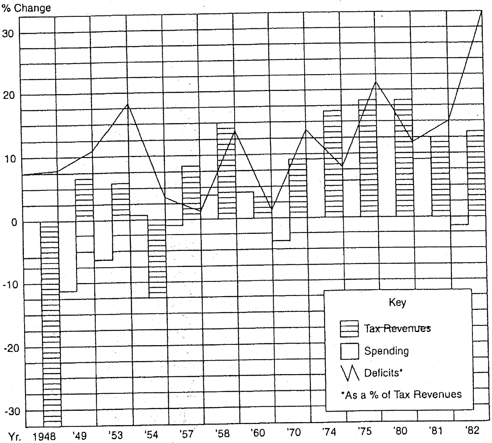

由另一個角度分析，赤字支出很可能在2000年便達到上限，這是根據另一些歷史趨勢的分析。以1961年至1989年的政府收入對利息支出的比率來進行線性迴歸分析，結果顯示套入的情況非常理想（參考表5.3）。假定趨勢維持不變，則2000年時，政府收入對利息支出的比率將降至1.93，而在2005年將成為負値。假定政府收入按過去44年以來的中位數6.7%成長，則2000年的收入為1.972兆美元。現在讓我們觀察預算結構的可能發展。

以1990年會計年度來說，預算的估計（顯然低估）列示於表5.3。

###### 表5.3 1990會計年度預算估計

| 項目 | 支出 (單位：10億美元) | 佔支出的% |
|---|---|---|
| 社會安全 | $248.6 | 19.89% |
| 所得安全 | 148.2 | 11.85 |
| 醫療保健 | 97.0 | 7.76 |
| 利息 | 184.0 | 14.72 |
| 國防 | 300.0 | 24.00 |
| 其他 | 272.2 | 21.78 |
| 總計 | 1,250.0 | 100.00% |

請留意，最後兩項——國防與「其他」支出——佔總支出的45.78%。

假定「社會安全」、「所得安全」與「醫療保健」佔收入的百分率都不變，而且收入（1.1兆美元）中支付利息（1,340億美元）的百分率為16.5%，則在2000會計年度的未平衡預算中，支出的情況將如同表5.4所示。

###### 表5.4 2000會計年度預算估計

| 項目 | 支出（單位：10億美元） | 佔支出的% |
|---|---|---|
| 社會安全 | $539.6 | 19.89% |
| 所得安全 | 322.9 | 11.85 |
| 醫療保健 | 211.5 | 7.76 |
| 利息 | 1021.8 | 37.50 |
| 國防 | 629.2 | 23.09 |
| 總計 | 2,725.0 | 100.00% |

請留意，將有37.5%的預算必須用於清償公債的利息，而「國防與其他」的預算必須減少22.69%。換言之，如果目前趨勢維持不變，則2000年時，為了支付公債的利息，國會必須大幅削減長久以來的既有支出，而且還必須繼續維持龐大的赤字。這是政治上「穩輸」的局面，勢必進行一些改變。

或許在這種情況發生以前，政府會採取必要對策。撰寫本書時，已有相當的人主張減少30年期公債，以緩和政府的利息支出，並舒緩長期利率的上升壓力。這將迫使政府以短期與中期公債來融通，並造成至少兩方面重大影響。

第一，這確實可以舒緩利息的負擔，但程度相當有限。德國並沒有發行30年期的公債，但以1992年的情況來說，10年期公債的殖利率至少較美國長期公債高出1.5個基點（basis points）。另外，節省的利息支出必然會被其他支出抵消。國會有一種「盡情揮霍」的習慣。如果立法者以正常態度反應，則公債利息的支出將會減少，但政府支出佔實質GNP的比率仍會提高，這將導致經濟成長的減緩（我們在第四章曾經討論這方面問題）。更糟者，聯邦政府又可以因此而拖延面對財政問題的時間。另外，請留意，長期房屋貸款利率並不會下降，它們會轉而釘住其他長期債券，例如：AAA級的公司債。

根據表5.2的觀點，利率降低與長期公債的減少，將使政府能夠更升高利息支出佔收入的比率。負擔的利率較低，僅會造成政府借取更多的債務，並延伸政府「舉債渡日」的時間。政府赤字支出所能延續的時間愈長，整個國家產能的負擔也愈重。

第二，政府短期與中期債券的發行將大幅增加，並剝奪企業界在這些市場募集資本的機會，這將造成相當明白的後果。企業界可以轉而向長期市場籌措資金，但將被迫負擔較高的成本。結果，這又將造成經濟成長減緩。

不論政府如何選擇融通的方式，草率的支出僅會抵消擴張性貨幣政策的效果（我不認為貨幣政策可以繼續保持寬鬆），因為這會造成通貨膨脹與美元的貶值，我在下一章將討論這方面問題。


##### 結論

只要債務得以繼續獲得清償，草率的支出便無法改善；就前者來說，歷史資料顯示，利息支出佔稅收的上限大約在30 %以下。以身陷超級通貨膨脹的拉丁美洲國家觀察（墨西哥在1982年的利息費用／稅收比率爲27 %，巴西在1984年爲29 %），這可以讓我們大致瞭解這種情況頂多可以發展至何種程度。以表5.4來說，你絕對不會看見37 %的利息支出，因爲在此發生之前，情況必然已經出現變化。

### 第六章

#### 美元的歷史走勢與未來發展

美元幣值的發展很重要，因爲美元是全球的準備通貨。就這個觀點來說，美元的責任相當重大，因爲這使外國銀行得以持有無數的美元做爲準備資產而以其本國通貨放款。（瑞士例外。非常有趣地，瑞士將美國公債視爲相當於是高級的公司債。）

1980 年代，美國赤字大幅膨脹時，國外在美國的投資明顯增加，因爲美國的經濟成長與利率水準都很高而足以吸引國外資本。1989 年由於實質利率很高，美國的公債有五分之一是由外國投資人持有。然而，1992 年 7 月，Fed 將貼現率調降至 3 %，實質利率則降至零。現在，我們必須爲 1980 年代的債務付出代價，這使美元幣值處於長期的下跌趨勢（參考表 6.1）。

美元是一種商品，並被五種主要的市場參與者持有：(1)資本投資者，他們持有資金進入國際市場，以參與相關國家的成長（換言之，他們買進其他國家的股票、債券、房地產與其他的有形資產）；(2)套利交易者，他們買進幣值穩定或趨於升值的外匯（包括利率的考慮在內）；(3)國際貿易的進、出口商；(4)經常買賣外匯的遊客；(5)中央銀行。

##### 表6.1 聯邦美元指數的歷史發展

| 貼現率 | 期 間 | 美元指數 | 變動 (%) | 消費者物價指數 |
|---|---|---|---|---|
| 6-4-4¾ | 1/1913-2/1919 | 8.26-8.76 | 6.1 | 9.9-16.2 |
| 4¾-7 | 2/1919-12/1920 | 8.76-24.65 | 181.4 | 19.4 |
| 7-4 | 12/1920-4/1922 | 24.65-16.39 | -33.5 | 16.7 |
| 4-4 | 4/1922-7/1926 | 16.39-40.60 | 147.7 | 17.5 |
| 4-3½ | 7/1926-1/1927 | 40.60-30.19 | -25.6 | 17.5 |
| 3½-6 | 1/1927-8/1931 | 30.19-30.39 | 0.7 | 15.1 |
| 6-1½ | 8/1931-12/1932 | 30.39-33.21 | 9.3 | 13.1 |
| 1½-1 | 12/1932-7/1936 | 33.21-20.16 | -39.3 | 13.9 |
| 1-½ | 7/1936-5/1940 | 20.16-51.75 | 156.7 | 14.0 |
| ½-½ | 5/1940-12/1940 | 51.75-46.23 | -10.7 | 14.1 |
| ½-½ | 12/1940-12/1945 | 46.23-47.92 | 3.7 | 18.2 |
| ½-1 | 12/1945-6/1946 | 47.92-71.86 | 50.0 | 21.5 |
| 1-1 | 6/1946-12/1947 | 71.86-71.22 | - 0.9 | 23.4 |
| 1-1 | 12/1947-2/1948 | 71.22-92.49 | 29.9 | 23.5 |
| 1-1¼ | 2/1948-8/1949 | 92.49-92.37 | - 0.1 | 23.8 |
| 1¼-1½ | 8/1949-6/1950 | 92.37-114.53 | 24.0 | 23.8 |
| 1½-3 | 6/1950-7/1957 | 114.53-109.97 | - 4.0 | 28.3 |
| 1¼-6 | 7/1957-9/1969 | 109.97-123.82 | 12.6 | 37.1 |
| 6-4½ | 9/1969-7/1973 | 123.82-92.71 | -25.1 | 44.3 |
| 4½-8-5¼ | 7/1973-6/1976 | 92.71-107.05 | 15.5 | 56.8 |
| 5¼-14 | 6/1976-7/1980 | 107.05-84.65 | -20.9 | 82.7 |
| 14-7½ | 7/1980-2/1985 | 84.65-158.43 | 87.2 | 106.0 |
| 7½-5½ | 2/1985-12/1987 | 158.43-88.70 | -44.0 | 115.4 |
| 6-7 | 12/1987-6/1989 | 88.70-106.52 | 20.1 | 124.0 |
| 7-6 | 6/1989-2/1991 | 106.52-80.60 | -24.3 | 134.8 |
| 6-5½ | 2/1991-7/1991 | 80.60-98.23 | 21.9 | 136.2 |
| 5½-3 | 7/1991-9/1992 | 98.23-78.43 | -20.2 | 140.9 |
| 3- | 9/1992- | 78.43- |  |  |

第一欄列出相關期間的貼現率。

第三欄列出聯邦準備美元指數，這是根據一籃西方國家貨幣為基準加權而成。

第四欄列出美元指數在相關期間的變動。

第五欄列出相關期間最後一個月的消費者物價指數（1982-1984=100）。

一個國家經濟衰退時，通常會買進公債，調降利率而放寬信用。這通常會造成匯率的下降，因爲資本投資者會賣出資產，並抽出資金。一個國家處於經濟復甦或擴張時，情況則相反。

目前，美國調降利率而成果好壞參半。股票與債券價格上漲，但經濟表現相對不理想。所以如此的理由很多，我在本書其他場合將做解釋。我們必須瞭解，很多因素會影響美元匯率，最主要考慮因素是資本投資人的態度。

美國的實質利率低於日本、德國與其他歐洲聯盟國家時，海外投資人持有的美國公債大幅減少。1990年至1992年之間，情況便是如此，國內投資人持有的公債數量增加，尤其是銀行。結果，國內民間部門的企業貸款便相對減少，美元匯率也下跌。

這雖然有利於出口業，但對於國內的物價卻有不利的影響。過去六年來，美元幣值相對於Fed的一籃外幣貶值50.5%，在這種情況之下，美元擔任全球準備通貨的角色還能夠維持多久？在1985年2月至1992年9月之間，德國馬克兌美元升值150%；在1982年11月至1993年4月之間，日圓兌美元升值154%。

此處又有另一個範例說明我的論點：你永遠不可以盲目接受別人的看法，而必須自行思考。我們經常聽到一項評論，美國的油價相對於我們的主要經濟競爭對手——日本與德國——遠較為低廉。這項論點被用來做為調高石油稅率的合理化藉口。然而，這是徹底的扭曲。

情況究竟如何（參考圖6.1）？在1980年至1985年底，原油價格大約每桶為30美元。石油是以美元計價，因為美元是全球的準備通貨。由於美元的貶值，德國與日本的石油價格下跌。在1982年至1993年之間，石油價格由每桶32美元跌至20美元左右。在同一期間，德國馬克以美元表示的價格由低價28.81美分上漲至高價71.96美分；換言之，美元以德國馬克表示的價格由3.47馬克跌至1.39馬克。就美元計值的商品來說，德國馬克的購買力增加60％。在德國，1985年的油價為每桶111馬克，而1992年9月份的價格則低於28馬克。換言之，每桶20美元的石油，在德國僅為8美元。在日本則更低——相當於每桶7.80美元。

##### 圖6.1 德國馬克、日圓與原油價格的比較

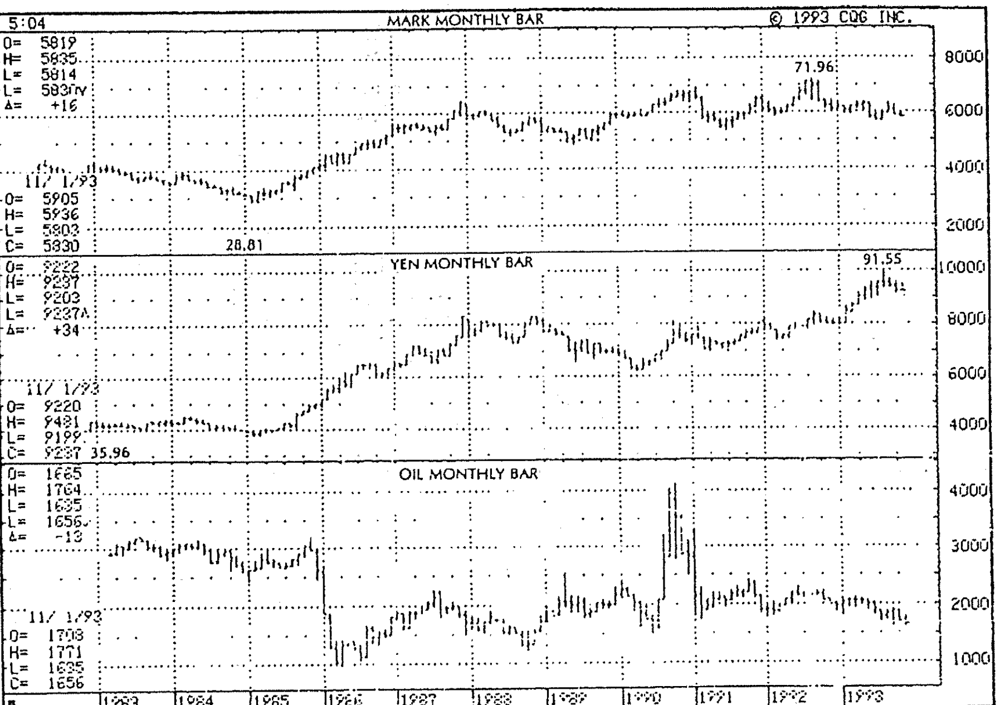

由於美元對所有主要通貨繼續貶值，而使美國公債的報酬不斷縮水，國外投資人購買美國公債的意願究竟還能夠持續多久？「七大工業國家（G7）」的政治壓力與協議還能夠持續多久，以勸服各國中央銀行繼續持有龐大的美元餘額？請留意美國目前的預算赤字與聯邦債務。如果這個趨勢持續發展，則必須有所犧牲。我們必須犧牲的恐怕是美元的幣值。如果你是一位阿拉伯王子，從1986年以來，以美元訂定石油價格已經讓你蒙受相當的損失。我相信，「石油輸出國家組織」（OPEC）總有一天會根據某種綜合性貨幣單位訂定油價，例如：25％的黃金、25％的美元、25％的德國馬克與25％的日圓。一旦情況演變至這種地步，美元幣值將暴跌。

如果Fed持續讓美國的名義利率低於其他主要國家，問題將更爲惡化，因爲國際資本（包括美國的資本在內）將會流往高殖利率而幣值趨升或穩定的市場，使美國缺乏經濟擴張所需的資本。國內利率低於市界市場的水準，將使美國的資金大量流向墨西哥、歐洲聯盟與東歐國家。

「最理想」的情況是所有的外國中央銀行都採取信用擴張的政策，而美國的Fed卻能潔身自愛。這會使美元重新恢復強勢貨幣的角色，因爲各國的貨幣都會在通貨膨脹的影響下而貶值，所以美元的國際購買力將會相對提升。然而，情況即使是如此發展，也需要花費相當的時間來蘊釀。在最近40多年來，各國通貨都無一能夠倖免，貨幣的購買力都不斷下降，唯一的差異僅在於貶值速度而已（請參考表6.2）。

##### 表6-2 外匯表現

|  | 消費者物價指數 |  | 1988年價值（1950=100） | 38年購買力下降（%） |
|---|---|---|---|---|
| 38年：1958−1988a |  |  |  |  |
|  | 1950 | 1988 |  |  |
| 1. 德國馬克 | 32.0 | 101 | 32 | −68 |
| 2. 瑞士法郎 | 31.0 | 104 | 30 | −70 |
| 3. 美元 | 22.0 | 110 | 20 | −80 |
| 4. 加拿大元 | 20.0 | 113 | 17 | −83 |
| 5. 日圓 | 14.0 | 102 | 13 | −87 |
| 6. 法國法郎 | 10.0 | 109 | 9 | −91 |
| 7. 荷蘭基爾德 | 11.0 | 120 | 9 | −91 |
| 8. 英鎊 | 9.5 | 113 | 8 | −92 |
| 9. 澳元 | 11.0 | 127 | 8 | −92 |
| 10. 義大利里拉 | 7.2 | 117 | 6 | −94 |
| 20年：1968−1988a |  |  |  |  |
|  | 消費者物價指數 |  | 1988年價值（1950=100） | 20年購買力下降（%） |
|  | 1968 | 1988 |  |  |
| 1. 德國馬克 | 48.0 | 101 | 48 | −52 |
| 2. 瑞士法郎 | 47.0 | 104 | 45 | −55 |
| 3. 美元 | 32.0 | 102 | 31 | −69 |
| 4. 加拿大元 | 36.0 | 120 | 30 | −70 |
| 5. 日圓 | 32.0 | 110 | 29 | −71 |
| 6. 法國法郎 | 29.0 | 113 | 25 | −75 |
| 7. 荷蘭基爾德 | 22.0 | 109 | 20 | −80 |
| 8. 英鎊 | 17.5 | 113 | 15 | −85 |
| 9. 澳元 | 16.7 | 127 | 13 | −87 |
| 10. 義大利里拉 | 13.0 | 117 | 11 | −89 |
| 10年：1978−1988a |  |  |  |  |

##### 表6-2（續）

|  | 消費者物價指數 |  | 1988年價值（1978=100） | 10年購買力下降（%） |
|---|---|---|---|---|
|  | 1978 | 1988 |  |  |
| 1. 德國馬克 | 78.0 | 102 | 76 | −24 |
| 2. 瑞士法郎 | 75.0 | 101 | 74 | −26 |
| 3. 美元 | 75.0 | 104 | 72 | −28 |
| 4. 加拿大元 | 73.0 | 120 | 61 | −39 |
| 5. 日圓 | 60.0 | 110 | 54 | −46 |
| 6. 法國法郎 | 57.0 | 113 | 50 | −50 |
| 7. 荷蘭基爾德 | 53.0 | 113 | 47 | −53 |
| 8. 英鎊 | 50.0 | 109 | 46 | −54 |
| 9. 澳元 | 56.0 | 127 | 44 | −56 |
| 10. 義大利里拉 | 37.0 | 117 | 32 | −68 |

5年：1983−1988a

|  | 消費者物價指數 |  | 1988年價值（1983=100） | 5年購買力下降（%） |
|---|---|---|---|---|
|  | 1983 | 1988 |  |  |
| 1. 德國馬克 | 95.0 | 100 | 95 | − 5 |
| 2. 瑞士法郎 | 95.8 | 101.4 | 94 | − 6 |
| 3. 美元 | 95.6 | 101.2 | 94 | − 6 |
| 4. 加拿大元 | 94.0 | 104 | 90 | −10 |
| 5. 日圓 | 93.0 | 110 | 84 | −16 |
| 6. 法國法郎 | 92.0 | 113 | 81 | −19 |
| 7. 荷蘭基爾德 | 88.0 | 109 | 80 | −20 |
| 8. 英鎊 | 90.0 | 113 | 79 | −21 |
| 9. 澳元 | 90.0 | 127 | 71 | −29 |
| 10. 義大利里拉 | 83.0 | 117 | 71 | −29 |

a 根據「國際貨幣基金」提供的消費者物價指數。

資料來源：Daniel Poole, Van Eck 基金首席經濟學家。

第三章討論經濟循環時曾經說明，信用擴張可能導致資源的不當配置。一個國家的經濟結構趨於複雜時，信用擴張引起的資源配置不當將更嚴重。例如，第二次大戰結束時，美國以「馬歇爾計劃」協助歐洲的重建，這便是一種大規模的信用擴張。1940年代末期，美國政府的負債已經超過當時的GNP。然而，信用擴張的負面效果卻得以降至最低，因為在國內與國外創造的真實財富都非常可觀。美國雖然將龐大的資本轉移至國外，國內卻仍然能夠持續擴張。

現在與過去兩者之間有相同與相異之處。在一方面，東歐國家擁有可觀的資源，卻沒有必要的資本運用這些資源——這與第二次大戰結束時的西歐非常類似。另一方面，美國的經濟基礎已經沒有能力再提供融通。然而，美國維持低利率的資本，以及課徵偏高的稅金與種種滯礙難行的產業規定，這使美國的資本不斷流向中國大陸、東歐國家、拉丁美洲與其他的歐洲國家。畢竟，現在是一個全球性的經濟體系，資本的流動幾乎沒有任何妨礙。

在這種情況下，資本投資的報酬雖然會回流至美國，但這需要時間。在開發中國家投資，並創造足以回流美國的剩餘資本，這需要一段相當長的期間。另外，美國雖然是一個較有效率的市場，資本的投資可以迅速轉為生產，但相對於其他擁有較具競爭性條件的國家（換言之，勞工成本低廉、環保意識與規定較寬鬆、資本利得稅較低），資本投資的效果仍然不足以比擬。總之，維持低於世界水準的利率，可能無法在美國國內引導經濟擴張（這是凱恩斯學派的主要經濟策略）。

不論由那一個角度觀察目前的政策，如果Fed堅持立場，而國會無法擬定負責的財政政策，我認為明年仍將出現遲緩的成長，這種情況甚至可能維持數年之久。另一個可能的發展是採取大規模的信用擴張，但就目前Fed的態度來說，似乎不可能。

##### 政治趨勢：目前與未來

在1989年至1991年之間，我們目睹所謂的民主勝利。專制政體就如同骨牌一般地紛紛倒塌。歷史學家會評估這項發展的原因，但我認為根本的理由在於經濟：在專制統治之下，馬克思主義顯現的無能。反抗之所以發生，因為當權者不斷譴責「西方」物質文明的邪惡，而使其人民陷入苟活的境地，他們盡其所能地花費每一個小時來工作，但僅能勉強維持生存，而且還必須傾聽領導者宣導的「人盡其才，各取所需」。相形之下，他們目睹西方創造的神奇繁榮，當然希望能夠改採自由市場的經濟與資本主義的結構。

隨著東方集團的瓦解，西方世界又如何呢？年輕將享有的生活條件，可能無法超越其父母一代的水準，這是歷史上首度出現的情況。就這種層面上來說，西方世界（尤其是美國）已經處於衰退的階段。何以如此？政府的政策傾向於推升物價，並減少消費者的財富。

這種趨勢不能夠持續發展。就如同東方集團的人民推翻其領袖一樣，美國人民也將唾棄那些揮霍其生活水準的政客。如果政府持續課徵偏高的稅金，美國人將起而反抗。事實上，他們已經開始在反抗了。

政客逐漸瞭解這種趨勢，並會採取行動保護自己。問題是：這些政客會採取根本而長期的改革，或是仰賴信用擴張——短期的解決之道——來解決問題？

如果銀行界不能發揮影響力，而由葛林斯班（Alan Greenspan）這類政客主導，我相信國會與總統會選擇信用擴張。這項策略已經在運作中，而且在克林頓的觀念中，這是追求「成長」的唯一方法。目前，這是透過降低利率爲之，但 Fed 如果繼續擴張，將調整後的信用由目前的 10 % 增加爲 20 %，則通貨膨脹的問題將開始浮現；觀察這方面的發展，請留意調整後的 Fed 信用」（adjusted Fed credit）。葛林斯班雖然不是直言無諱的人，但他確實瞭解與相信「奧國經濟學派」的理論。不妨參考他 bip aula m有關 Ayn Rand 作品 Capitalism：The Unknown Ideal 的評論。讓信用擴張與通貨膨脹繼續發展，對他而言，這是一種道德上的妥協。我希望他有勇氣追求低通貨膨脹的理想。如果他真的這麼做，則未來幾年內，我們將看不到信用擴張引導的經濟高度成長。

克林頓的政策將導致赤字增加與遲滯的成長。在他領導下，政府支出不會真正的減少。唯有當美國納稅人「忍無可忍」時，並唾棄國會中的長期領導者，如此財政政策才可能出現根本的改革。1994 年的國會議員選舉中，我希望這種趨勢會明朗化。

短期的未來會如何呢？我相信金融市場仍將預期那不會實現的快速成長。在這種預期之下（以通貨膨脹爲代價），股票市場將繼續攀升。然而，成長真正出現時，Fed 終究會緊縮銀根，因爲經濟成長是由信用所驅動，這並不代表真正的成長。然後，市場將發現自己的境遇非常類似 1989 年至 1992 年的日本。在這種情況下，經濟活動將陷入停滯。下一波主要空頭行情發生之後，市場很可能會出現數年之久的根本變化，因爲舊有法則不再適用時，它必須根據新法則來調整；尤其是——偏低的利率將不足以保證景氣擴張。

如果不採行大規模的信用擴張策略，Fed 不將調整後的信用提升至 20 % 以上（我認爲這非常不可能發生），則種種力量會引導實質利率走低。首先，美國的年齡結構逐漸趨於老化。愈來愈多的考慮將擺在未來，這會使基源利率趨於下降。所以，市場毛利率中的實質（淨）成份將會相對走低。另外，假定消費者物價的上漲速度可以控制在每年 3 % 至 5 % 之間，則利率中的價格升水成份也會保持在偏低的水準。企業家的成份則會隨資本的需求情況而變動。

政府支出與民間部門的資本需求都會很高。相對上說，放款機構將處於有利的地位，它們可以評估與選擇最理想的客戶。然而，如果政府持續一些自由市場不願接受的擔保放款，例如對於中國大陸與東歐集團的放款，可能抵消這些正面的發展。

根據個人看法，如果嘗試採取通貨膨脹的擴張政策，債務與美元都將崩跌，這可能足以凝聚真正變革的共識。我有一項非常強烈的看法。自從 1896 年以來，在民主黨執政的 40 年裡，平均每年的通貨膨脹率爲 6.8 %。這是因爲民主黨信仰凱恩斯學

派的社會主義（通貨膨脹）。相形之下，在共和黨執政的56年裡，平均每年的通貨膨脹率爲2.5％。通貨膨脹惡化時，民主黨的領導者只希望將它暫時掃到地毯下，這種態度會讓美國陷入混亂。債券與美元市場都將不可收拾。我認為華盛頓是由金融市場控制，他們將被迫採取行動。他們將如何反應？他們將拯救債券或是美元？何者較爲重要？根據我的看法，立法者將爲美國政府設計一種「大玩意」（Whoppers），爲了拯救美元，債券持有者將被犧牲。

什麼是「大玩意」？1970年代初期紐約市瀕臨破產時，解決的辦法是創造一種稱爲Big Mac的特殊債券。它較既有的債券享有更優惠的權利。我認爲這個案例可以被引用，並將這種新債券稱爲「大玩意」。「大玩意」發行時，既有債券的市場價值將立即崩跌。

所以，「大玩意」出現時，目前債券持有者的權益將被犧牲，但可以拯救美元。由於美元俱備世界通貨準備的地位，如果其價格大幅貶值，全球經濟可能瀕臨瓦解。我們不妨看看1987年崩盤的情況，當時是因爲德國不願意接受貝克（James Baker）的建議，拒絕採行通貨膨脹的策略。結果，德國與日本同意刺激本身經濟時，S&P 500、日經指數與美元都在1987年12月創低點。這一次，這兩個國家已經採行刺激景氣的策略了。

如果沒有採行通貨膨脹的刺激策略，我們將持續忍受三年至五年的經濟衰退。然而，我認爲，銀行體系自從1980年代以來，已經由新一代的年輕人所管理，他們在前一陣子受到嚴重

的教訓。這一代的銀行家與放款者非常不可能重踏覆轍；因為痛苦的記憶猶新，而人類最強烈的慾望便是規避痛苦的慾望——就此而言，希望規避的痛苦是虧損。那些仰賴政府支助的人將承受最大的壓力，這包括許多產業在內。真正的解決之道是降低稅金，並逐漸減少政府支出（但必須立即開始）。

##### 結論

有關 1990 年代的經濟情況（包括美元在內），最理想的情況必須仰賴 Fed 的節制態度，以及美國人民強迫政府採取負責的財政政策。在最理想的情況下，我們將見到緩慢的成長，伴隨著節制的貨幣政策（Fed 的公開市場操作），政治上的趨勢也傾向於節約開支與降低稅金。在這種情形下，美國將可以累積資本，並在 1990 年代中期進入較快速而持續性的成長。

在最糟的情形下，Fed 將因為華盛頓「領導者」的壓力而採取擴張信用的權宜之策。若是如此，我們將見到通貨膨脹推動的快速成長，股票與美元都會出現短暫的上漲，而在 1990 年代中期將出現長期的衰退，美元也將創新低價。

## 第Ⅱ篇
技術分析

### 第七章

#### 波動程度，交易機會以及GNP的成長

1985年「道瓊工業指數」雖然創歷史新高，許多交易者卻難以獲利（選股與併購專家例外）。某些人稱此為「最難交易的行情」。我在該年的獲利率為9.58％，我希望瞭解情況何以如此。

當時，我主要是針對指數期貨與指數選擇權從事當日沖銷與中期部位（數週至數個月）的交易。換言之，我主要的交易對象是指數而不是個股──我是一個市場玩家。我當時的診斷是：市場的波動太小，沒有足夠的空間讓市場玩家操作。

於是，我開始考慮一些問題：我應該如何界定波動程度（volatility）？股票指數的波動來自於什麼因素？我如何預先知道指數的波動將減緩，而應該強調個股的操作？

上述考量是基於兩項動機。第一，我知道當時的波動程度較正常水準低，所以我希望瞭解其中差異的性質。我希望研究市場的歷史資料，以判斷波動程度的「正常」市場行為。第二，我認為這項知識將有利於未來的交易。

本章中將列示我的研究結果（最初完成於1985年，但資料更新至目前），我將說明處理這個問題的方法，並將結論套用

於未來。

##### 交易機會與市場波動

研究的過程中，第一個問題是：一年之內何謂「正常的」交易機會？根據我當時的交易策略來說，我認為在一個月內，如果市場出現2％的價格走勢，便稱得上是交易機會。於是，我回溯至1897年的資料，並計算每年某個月內出現2％價格走勢的月份數，結果列於表7-1中。我發現，每年交易次數的中位數是7次，平均數則為8.7次。換言之，由中位數考慮歷史資料，交易機會大約每1½月出現一次。

###### 表7-1 道瓊工業指數的每年交易次數

判斷基準：交易機會是指一個月內出現2%或以上的價格（上漲或下跌）走勢。

| 年 份 | 交易次數 | 年 份 | 交易次數 |
|---|---|---|---|
| 1897 | 11 | 1945 | 7 |
| 1898 | 8 | 1946 | 9 |
| 1899 | 11 | 1947 | 5 |
| 1900 | 10 | 1948 | 8 |
| 1901 | 7 | 1949 | 7 |
| 1902 | 5 | 1950 | 6 |
| 1903 | 7 | 1951 | 8 |
| 1904 | 9 | 1952 | 7 |
| 1905 | 10 | 1953 | 3 |
| 1906 | 9 | 1954 | 10 |
| 1907 | 8 | 1955 | 5 |
| 1908 | 10 | 1956 | 9 |
| 1909 | 8 | 1957 | 10 |
| 1910 | 7 | 1958 | 9 |
| 1911 | 6 | 1959 | 7 |

###### 表7.1 道瓊工業指數的每年交易次數（續）

| 年 份 | 交易次數 | 年 份 | 交易次數 |
| --- | --- | --- | --- |
| 1912 | 8 | 1960 | 9 |
| 1913 | 9 | 1961 | 8 |
| 1914 | 6 | 1962 | 7 |
| 1915 | 11 | 1963 | 7 |
| 1916 | 8 | 1964 | 2 |
| 1917 | 9 | 1965 | 6 |
| 1918 | 6 | 1966 | 6 |
| 1919 | 9 | 1967 | 8 |
| 1920 | 9 | 1968 | 5 |
| 1921 | 9 | 1969 | 8 |
| 1922 | 9 | 1970 | 9 |
| 1923 | 7 | 1971 | 8 |
| 1924 | 9 | 1972 | 4 |
| 1925 | 9 | 1973 | 9 |
| 1926 | 8 | 1974 | 6 |
| 1927 | 10 | 1975 | 9 |
| 1928 | 8 | 1976 | 6 |
| 1929 | 11 | 1977 | 5 |
| 1930 | 9 | 1978 | 7 |
| 1931 | 11 | 1979 | 7 |
| 1932 | 12 | 1980 | 7 |
| 1933 | 10 | 1981 | 6 |
| 1934 | 6 | 1982 | 6 |
| 1935 | 6 | 1983 | 5 |
| 1936 | 8 | 1984 | 5 |
| 1937 | 9 | 1985 | 5 |
| 1938 | 8 | 1986 | 7 |
| 1939 | 11 | 1987 | 10 |
| 1940 | 7 | 1988 | 7 |
| 1941 | 7 | 1989 | 7 |
| 1942 | 9 | 1990 | 7 |
| 1943 | 8 | 1991 | 7 |
| 1944 | 3 | 1992 | 5 |
|  |  | 1993 | 5 (11/1/93) |

結果摘要列示如下：

| 每年交易次數 | 發生的年數 |
|---|---|
| 2 | 1（在1964年） |
| 3 | 2 |
| 4 | 1 |
| 5 | 9 |
| 6 | 12 |
| 7 | 20 |
| 8 | 16 |
| 9 | 20 |
| 10 | 8 |
| 11 | 6 |
| 12 | 1（在1932年） |

其次，我觀察指數的價格波動程度。我計算「道瓊工業指數」歷史資料中每年的平均每月份絕對百分率變動量，結果列於表7.2。（詳細的計算方法，請參考表7.2的「註」。）然而，利用這項平均值衡量價格波動程度，並比較價格波動程度與交易機會的關係，結果列於表7.3。兩者之間的相关性雖然不顯著，但歷史資料中呈現一種趨勢：交易機會的次數與價格波動率相互對應。

###### 表7.2 道瓊工業指數的價格波動

判斷基準：價格波動是比較指數平均每月份的絕對（漲或跌）百分比變動量。

| 年份 | 月份變動累計百分比（%） | 月份平均變動百分比（%） | 年份 | 月份變動累計百分比（%） | 月份平均變動百分比（%） |
|------|----------------------|----------------------|------|----------------------|----------------------|
| 1897 | 67.3 | 5.6 | 1945 | 38.4 | 3.2 |
| 1898 | 65.1 | 5.4 | 1946 | 51.2 | 4.3 |
| 1899 | 68.2 | 5.7 | 1947 | 23.4 | 2.0 |
| 1900 | 62.9 | 5.2 | 1948 | 46.9 | 3.9 |
| 1901 | 42.0 | 3.5 | 1949 | 30.5 | 2.5 |
| 1902 | 22.0 | 1.8 | 1950 | 30.9 | 2.6 |
| 1903 | 61.4 | 5.1 | 1951 | 37.8 | 3.2 |
| 1904 | 63.0 | 5.3 | 1952 | 32.8 | 2.7 |
| 1905 | 50.5 | 4.2 | 1953 | 23.9 | 2.0 |
| 1906 | 45.9 | 3.8 | 1954 | 48.9 | 4.1 |
| 1907 | 64.2 | 5.4 | 1955 | 26.6 | 2.2 |
| 1908 | 61.5 | 5.1 | 1956 | 45.0 | 3.8 |
| 1909 | 32.1 | 2.7 | 1957 | 35.9 | 3.0 |
| 1910 | 40.7 | 3.4 | 1958 | 34.0 | 2.8 |
| 1911 | 29.9 | 2.5 | 1959 | 29.6 | 2.5 |
| 1912 | 34.4 | 2.9 | 1960 | 39.1 | 3.3 |
| 1913 | 37.8 | 3.2 | 1961 | 26.4 | 2.2 |
| 1914 | 25.9 | 3.2 | 1962 | 53.3 | 4.5 |
| 1915 | 90.7 | 7.6 | 1963 | 32.1 | 2.7 |
| 1916 | 48.5 | 4.0 | 1964 | 15.8 | 1.3 |
| 1917 | 47.1 | 3.9 | 1965 | 28.8 | 2.4 |
| 1918 | 32.7 | 2.7 | 1966 | 33.7 | 2.8 |
| 1919 | 64.3 | 5.4 | 1967 | 39.1 | 3.3 |
| 1920 | 67.5 | 5.6 | 1968 | 34.3 | 2.9 |
| 1921 | 48.5 | 4.0 | 1969 | 41.6 | 3.5 |
| 1922 | 38.1 | 3.2 | 1970 | 49.6 | 4.1 |
| 1923 | 46.1 | 3.8 | 1971 | 40.1 | 3.3 |

###### 表7.2 道瓊工業指數的價格波動

| 年份 | 月份變動累計百分率（%） | 月份平均變動百分率（%） | 年份 | 月份變動累計百分率（%） | 月份平均變動百分率（%） |
|------|----------------------|----------------------|------|----------------------|----------------------|
| 1924 | 50.7 | 4.2 | 1972 | 23.7 | 2.0 |
| 1925 | 44.9 | 3.7 | 1973 | 46.6 | 3.9 |
| 1926 | 38.9 | 3.2 | 1974 | 51.4 | 4.3 |
| 1927 | 54.1 | 4.5 | 1975 | 57.1 | 4.8 |
| 1928 | 60.5 | 5.0 | 1976 | 37.8 | 3.2 |
| 1929 | 94.3 | 7.6 | 1977 | 27.3 | 2.3 |
| 1930 | 77.8 | 6.5 | 1978 | 44.8 | 3.7 |
| 1931 | 49.0 | 12.4 | 1979 | 37.9 | 3.2 |
| 1932 | 59.0 | 13.3 | 1980 | 44.3 | 3.7 |
| 1933 | 37.9 | 11.5 | 1981 | 30.0 | 2.5 |
| 1934 | 49.9 | 4.0 | 1982 | 42.0 | 3.5 |
| 1935 | 41.3 | 3.4 | 1983 | 31.2 | 2.6 |
| 1936 | 40.3 | 3.4 | 1984 | 34.2 | 2.9 |
| 1937 | 64.7 | 5.4 | 1985 | 32.6 | 2.7 |
| 1938 | 91.9 | 7.6 | 1986 | 53.8 | 4.5 |
| 1939 | 72.6 | 6.0 | 1987 | 76.4 | 6.4 |
| 1940 | 44.8 | 3.7 | 1988 | 33.5 | 2.8 |
| 1941 | 39.3 | 3.3 | 1989 | 42.1 | 3.5 |
| 1942 | 37.7 | 3.2 | 1990 | 45.8 | 3.8 |
| 1943 | 41.1 | 3.4 | 1991 | 41.9 | 3.5 |
| 1944 | 20.8 | 1.7 | 1992 | 21.8 | 1.8 |
|      |      |    | 1993 | 17.4 | 1.7 |

註：月份變動累計百分率是計算每個月底至隔月底的價格變動（不論正負），並加總十二個月的期間。月份平均變動百分率是將月份變動累計百分率除以12，這即是我所謂的「價格波動程度」。

價格波動程度的資料摘要列示如下：

| 百分率變動 | 發生的年數 |
|---|---|
| 0.0%−2% | 7 最低為1.3% |
| 2.1%−3% | 22 |
| 3.1%−4% | 36 |
| 4.1%−5% | 11 |
| 5.1%−6% | 12 |
| 6.1%+ | 8 最高為13.3% |

這看起來好像是在證明一些自明的道理，實際上不然。首先，它提供資料讓我們瞭解，在沉悶的行情中，不可頻繁交易。例如，相對於歷史上的典型行情，如果市場走勢太過於沉悶，而且你知道爲什麼，則指數與選擇權的交易應該是「在強勢中買進／在弱勢中賣出」的遊戲，而不應該採用「買進而讓獲利持續發展」的策略。另外，跨形價差交易（straddle）也應該以銷售（而不是買進）爲主。第二，這些研究可以協助你在走勢沉悶的行情中，將投機與投資轉至個股操作，而不應該再以交易指數爲主。顯然地，價格波動程度最嚴重的時侯是在下跌的行情中。這種情況適合交易指數。此外，這項研究使我瞭解價格波動的來源：GNP 成長率的變動。所以，如果你能夠以某種合理的方法預測GNP 的成長率，你應該可以較精確地預測市場價格的波動程度。

###### 表7.3 交易機會與市場波動程度的比較

| 機會 | 1-3 | 4-6 | 7-9 | 10-12 |
| 波動率（%） | 0-1.5 | 1.6-3.0 | 3.1-4.5 | 4.6+ |
| 發生次數 | 4 | 21 | 57 | 14 |
| 相關性 | 75% | 76.2% | 63.2% | 71.4% |

##### GNP的波動與市場價格的波動

在1969年出版的著作中，Gordon Holmes很巧妙地說明，「某股票價格趨勢的斜率，在時間上幾乎總是領先盈餘趨勢在斜率上的對應或對等變化。領先的時間大約為三個月。」①換言之，股票價格的變化會按比例預先反映盈餘成長的變化。很少分析家會否認這種現象。

這是我多年來我知道的事實，但在1985年之前，我卻沒有想到這種現象可以運用於其他方面。如果股價的波動與盈餘的波動有關連，則市場指數的波動與GNP的波動也應該有關連。於是，我決定以統計方法測試GNP波動與市場價格波動之間的相關性。

###### 表7.4 國民生產毛額的波動程度

| 日期 | GNP變動 (%) | 差額絕對值 (%) | 四季移動平均總值 (%) | 平均每季變動 (%) |
|---|---|---|---|---|
| 6/47 | +1.87 |  |  |  |
| 9/47 | +1.83 | 0.04 |  |  |
| 12/47 | +4.41 | 2.58 |  |  |
| 3/48 | +2.63 | 1.78 |  |  |
| 6/48 | +3.00 | 0.37 | 4.77 | 1.19 |
| 9/48 | +2.72 | 0.28 | 5.01 | 1.25 |
| 12/48 | +0.53 | 2.19 | 4.62 | 1.16 |
| 3/49 | −2.03 | 2.56 | 5.40 | 1.35 |
| 6/49 | −1.34 | 0.69 | 5.72 | 1.43 |
| 9/49 | +0.74 | 2.08 | 7.52 | 1.88 |
| 12/49 | −0.81 | 1.55 | 6.88 | 1.72 |
| 3/50 | +4.21 | 5.02 | 9.34 | 2.34 |
| 6/50 | +3.55 | 0.66 | 9.31 | 2.33 |
| 9/50 | +6.39 | 2.84 | 10.07 | 2.52 |
| 12/50 | +3.90 | 2.49 | 11.01 | 2.75 |
| 3/51 | +4.60 | 0.70 | 6.69 | 1.67 |
| 6/51 | +2.47 | 2.13 | 8.16 | 2.04 |
| 9/51 | +2.04 | 0.43 | 5.75 | 1.44 |
| 12/51 | +1.25 | 0.79 | 4.05 | 1.01 |
| 3/52 | +0.80 | 0.45 | 3.80 | 0.95 |
| 6/52 | +0.06 | 0.74 | 2.41 | 0.60 |
| 9/52 | +1.67 | 1.61 | 3.59 | 0.90 |
| 12/52 | +3.51 | 1.84 | 4.64 | 1.16 |
| 3/53 | +1.69 | 1.82 | 6.04 | 1.50 |
| 6/53 | +0.90 | 0.79 | 6.06 | 1.52 |
| 9/53 | −0.27 | 1.17 | 5.62 | 1.41 |
| 12/53 | −1.44 | 1.17 | 4.95 | 1.24 |
| 3/54 | −0.17 | 1.17 | 4.40 | 1.10 |
| 6/54 | −0.06 | 0.11 | 3.72 | 0.93 |
| 9/54 | +1.21 | 1.27 | 3.82 | 0.96 |
| 12/54 | +2.43 | 1.22 | 3.87 | 0.97 |


###### 表7.4 國民生產毛額的波動程度（續）

| 日期 | GNP變動（%） | 差額絕對值（%） | 四季移動平均總值變動（%） | 平均每季變動（%） |
|------|--------------|----------------|--------------------------|-------------------|
| 3/55 | +3.35 | 0.92 | 3.52 | 0.88 |
| 6/55 | +2.06 | 1.29 | 4.70 | 1.18 |
| 9/55 | +2.17 | 0.11 | 3.54 | 0.89 |
| 12/55 | +1.53 | 0.64 | 3.96 | 0.74 |
| 3/56 | +0.44 | 1.09 | 3.13 | 0.78 |
| 6/56 | +1.36 | 0.92 | 2.76 | 0.69 |
| 9/56 | +1.22 | 0.14 | 2.79 | 0.70 |
| 12/56 | +2.03 | 0.81 | 2.96 | 0.74 |
| 3/57 | +1.87 | 0.16 | 2.03 | 0.51 |
| 6/57 | +0.48 | 1.39 | 2.50 | 0.63 |
| 9/57 | +1.61 | 1.13 | 3.49 | 0.87 |
| 12/57 | -1.20 | 2.81 | 5.49 | 1.37 |
| 3/58 | -1.62 | 0.42 | 5.75 | 1.44 |
| 6/58 | +0.89 | 2.51 | 6.87 | 1.72 |
| 9/58 | +3.00 | 2.11 | 7.85 | 1.96 |
| 12/58 | +2.89 | 0.11 | 5.15 | 1.29 |
| 3/59 | +2.14 | 0.75 | 5.48 | 1.37 |
| 6/59 | +2.85 | 0.71 | 3.68 | 0.92 |
| 9/59 | -0.33 | 3.18 | 4.75 | 1.19 |
| 12/59 | +1.23 | 1.56 | 6.20 | 1.55 |
| 3/60 | +2.40 | 1.17 | 6.62 | 1.66 |
| 6/60 | -0.12 | 2.52 | 8.43 | 2.11 |
| 9/60 | +0.34 | 0.46 | 5.71 | 1.43 |
| 12/60 | -0.63 | 0.97 | 5.12 | 1.28 |
| 3/61 | +0.67 | 1.30 | 5.25 | 1.31 |
| 6/61 | +2.16 | 1.49 | 4.22 | 1.06 |
| 9/61 | +1.73 | 0.43 | 4.19 | 1.05 |
| 12/61 | +2.73 | 1.00 | 4.22 | 1.06 |
| 3/62 | +2.14 | 0.59 | 3.51 | 0.88 |
| 6/62 | +1.53 | 0.61 | 2.63 | 0.66 |
| 9/62 | +1.10 | 0.43 | 2.63 | 0.66 |
| 12/62 | +0.95 | 0.15 | 1.78 | 0.45 |
| 3/63 | +1.34 | 0.39 | 1.58 | 0.40 |
| 6/63 | +1.49 | 0.15 | 1.12 | 0.28 |
| 9/63 | +1.88 | 0.39 | 1.08 | 0.27 |
| 12/63 | +1.76 | 0.12 | 1.05 | 0.26 |
| 3/64 | +2.11 | 0.35 | 1.01 | 0.25 |
| 6/64 | +1.39 | 0.72 | 1.58 | 0.40 |
| 9/64 | +1.39 | 0.00 | 1.19 | 0.30 |
| 12/64 | +0.93 | 0.46 | 1.53 | 0.38 |
| 3/65 | +3.08 | 2.15 | 3.33 | 0.83 |
| 6/65 | +1.93 | 1.15 | 3.76 | 0.94 |
| 9/65 | +2.16 | 0.23 | 3.99 | 1.00 |
| 12/65 | +2.99 | 0.83 | 4.36 | 1.09 |
| 3/66 | +2.97 | 0.02 | 2.23 | 0.56 |
| 6/66 | +1.56 | 1.41 | 2.49 | 0.62 |
| 9/66 | +1.41 | 0.15 | 2.41 | 0.60 |
| 12/66 | +1.88 | 0.47 | 2.05 | 0.51 |
| 3/67 | +0.75 | 1.13 | 3.16 | 0.79 |
| 6/67 | +1.01 | 0.26 | 2.01 | 0.50 |
| 9/67 | +2.17 | 1.16 | 3.02 | 0.76 |
| 12/67 | +2.18 | 0.01 | 2.56 | 0.64 |
| 3/68 | +2.17 | 0.01 | 1.44 | 0.36 |
| 6/68 | +3.09 | 0.92 | 2.10 | 0.53 |
| 9/68 | +2.04 | 1.05 | 1.99 | 0.50 |
| 12/68 | +1.74 | 0.30 | 2.28 | 0.57 |
| 3/69 | +2.32 | 0.58 | 2.85 | 0.71 |
| 6/69 | +1.76 | 0.56 | 2.49 | 0.62 |
| 9/69 | +1.91 | 0.15 | 1.59 | 0.40 |
| 12/69 | +0.70 | 1.21 | 2.50 | 0.63 |
| 3/70 | +1.04 | 0.34 | 2.26 | 0.57 |
| 6/70 | +1.47 | 0.43 | 2.13 | 0.53 |
| 9/70 | +1.75 | 0.28 | 2.26 | 0.57 |
| 12/70 | +0.54 | 1.21 | 2.26 | 0.57 |
| 3/71 | +3.99 | 3.45 | 5.37 | 1.34 |
| 6/71 | +1.87 | 2.12 | 7.06 | 1.77 |
| 9/71 | +1.66 | 0.21 | 6.99 | 1.75 |
| 12/71 | +1.77 | 0.11 | 5.89 | 1.47 |
| 3/72 | +3.31 | 1.54 | 3.98 | 1.00 |
| 6/72 | +2.56 | 0.75 | 2.61 | 0.65 |
| 9/72 | +2.08 | 0.48 | 2.88 | 0.72 |
| 12/72 | +3.13 | 1.05 | 3.82 | 0.96 |
| 3/73 | +4.05 | 0.92 | 3.20 | 0.80 |
| 6/73 | +1.88 | 2.17 | 4.62 | 1.16 |
| 9/73 | +2.30 | 0.42 | 4.56 | 1.14 |
| 12/73 | +2.92 | 0.62 | 4.13 | 1.03 |
| 3/74 | +0.80 | 2.12 | 5.33 | 1.33 |
| 6/74 | +2.60 | 1.80 | 4.96 | 1.24 |
| 9/74 | +1.95 | 0.65 | 5.19 | 1.30 |
| 12/74 | +1.53 | 0.42 | 4.99 | 1.25 |
| 3/75 | +0.41 | 1.12 | 3.99 | 1.00 |
| 6/75 | +2.49 | 2.08 | 4.27 | 1.07 |
| 9/75 | +4.07 | 1.58 | 5.20 | 1.63 |
| 12/75 | +2.74 | 1.33 | 6.11 | 1.53 |
| 3/76 | +3.10 | 0.36 | 5.35 | 1.34 |
| 6/76 | +1.59 | 1.51 | 4.78 | 1.20 |
| 9/76 | +1.79 | 0.20 | 3.40 | 0.85 |
| 12/76 | +2.52 | 0.73 | 2.80 | 0.70 |
| 3/77 | +3.51 | 0.99 | 3.43 | 0.86 |
| 6/77 | +3.29 | 0.22 | 2.14 | 0.54 |
| 9/77 | +3.13 | 0.16 | 2.10 | 0.53 |
| 12/77 | +1.77 | 1.36 | 2.73 | 0.68 |
| 3/78 | +2.15 | 0.38 | 2.12 | 0.53 |
| 6/78 | +5.31 | 3.16 | 5.06 | 1.27 |
| 9/78 | +2.94 | 2.37 | 7.27 | 1.82 |
| 12/78 | +2.59 | 0.65 | 6.56 | 1.64 |
| 3/79 | +2.36 | 1.23 | 7.41 | 1.85 |
| 6/79 | +1.82 | 0.54 | 4.79 | 1.20 |
| 9/79 | +3.23 | 1.41 | 3.83 | 0.96 |
| 12/79 | +1.96 | 1.27 | 4.45 | 1.11 |
| 3/80 | +2.80 | 0.84 | 4.06 | 1.02 |
| 6/80 | +0.23 | 2.57 | 6.09 | 1.52 |
| 9/80 | +2.34 | 2.11 | 6.79 | 1.70 |
| 12/80 | +3.67 | 1.33 | 6.85 | 1.71 |
| 3/81 | +5.11 | 1.44 | 7.45 | 1.86 |
| 6/81 | +1.47 | 3.64 | 8.52 | 2.13 |
| 9/81 | +3.13 | 1.66 | 8.07 | 2.02 |
| 12/81 | +0.62 | 2.51 | 9.25 | 2.31 |
| 3/82 | -0.06 | 0.68 | 8.49 | 2.12 |
| 6/82 | +1.16 | 1.22 | 6.07 | 1.52 |
| 9/82 | +0.62 | 0.54 | 4.95 | 1.24 |
| 12/82 | +0.96 | 0.34 | 2.78 | 0.70 |
| 3/83 | +2.06 | 1.10 | 3.20 | 0.80 |
| 6/83 | +2.94 | 0.88 | 2.86 | 0.72 |
| 9/83 | +2.45 | 0.49 | 2.81 | 0.70 |
| 12/83 | +2.54 | 0.09 | 2.56 | 0.64 |
| 3/84 | +3.53 | 0.99 | 2.45 | 0.61 |
| 6/84 | +2.59 | 0.94 | 2.51 | 0.63 |
| 9/84 | +1.37 | 1.22 | 3.24 | 0.81 |
| 12/84 | +1.73 | 0.36 | 3.51 | 0.88 |
| 3/85 | +1.38 | 0.35 | 2.87 | 0.72 |
| 6/85 | +1.10 | 0.28 | 2.21 | 0.55 |
| 9/85 | +1.63 | 0.53 | 1.52 | 0.38 |

首先必須以某種方法衡量GNP的波動程度。猶如表7.4所列的摘要，我取GNP每季百分率變動之差額的四季移動平均代表GNP的波動。計算方法如下：

1. 計算實質GNP每季的百分率變動。
2. 計算季與季之間百分率變動之差額的絕對值。
3. 計算上述絕對值的四季移動平均總值。
4. 將四季移動平均總值除以4，以取得季對季百分率變動的四季移動平均值。

我初步完成對於1985年資料的分析以後，我發現情況完全符合我的假設。就每季的GNP變動平均值觀察，1985年是1963年以來波動程度第三低的年份，難怪行情如此沉悶。然而，進一步測試之後，我卻發現GNP波動與股票指數的價格波動之間並沒有明確的統計關係。沒有證據顯示，股票市場會預先反映GNP成長的變動。

我認爲有數項理由可以解釋兩者之間何以不存在相關性。第一，「道瓊工業指數」僅代表一個經濟部門。第二，我採用實質GNP的資料，而「道瓊指數」會在指數內反映通貨膨脹的影響。第三，股票市場較著重於利率的變動，雖然利率的變動對於經濟活動未必產生影響（1991-1992年間便是一個例子），但市場卻認定如此。

##### 結論

統計的研究類似於淘金，但成功率稍高一些。有時會有重大的發現，有時卻是空忙一場。然而，即使沒有明確的結論，你也必定有所收獲。

例如，我雖然不能在GNP波動程度與指數價格波動程度之間找到顯著的關係，但持續的研究卻讓我在1985年底找到一項重大發現。猶如大多數交易者一樣，我直覺地相信市場會預先反映未來的經濟活動。然而，我希望找到證據。下一章，我希望以一項研究說明股票市場領先整體經濟。

### 第八章

#### 股票市場是一項經濟預測指標：歷史的啟示

「經濟狀況如何？」投資者、生意人、消費者與政治家們每天都會提出這個問題。他們都希望瞭解目前的情況如何，明天又將如何。

瞭解與預測經濟的最尋常方法，是分析各種經濟指數，以及各種代表近期發展的指標。成千上萬的人——統計學家、經濟學家與電腦專家——不斷彙整數據，並試圖解釋其中的意涵。然而，雖然投入無數的資源預測未來的經濟，但結果仍然普遍令人不滿意。透過種種的努力，人們僅能告訴我們曾經發生什麼，而不是將發生什麼。猶如Irving Kristol在1986年1月9日的《華爾街日報》的評論：

為了讓這項科學〔經濟學〕俱備更明確的計量精確性，一切僅能在統計數據上做文章…經濟學中沒有任何的計量關係具有令人信服之處。然而，所有的經濟預測都是推演自這類關係，這些關係先前曾經輸入電腦而又推演其他的關係。這些關係所反映地僅不過是暫時趨勢。所以，經濟預測畢竟是一種有根據的猜測而已。①

非常令人訝異地，我們已經擁有一種相當簡單而精確的預測工具：股票市場的本身。本章中將摘要說明我對於近100年市場資料的研究。我相信這項研究毫無疑問地可以證明，股票市場可以預測未來的經濟活動——換言之，今天的股票市場表現，可以反映明天的一 般經濟情況。

##### 兩種預測方法

基本上，傳統的經濟預測方法是研究最近發生的資料，觀察其趨勢，並假定此趨勢將持續發展。這便是「國家經濟研究局」〔National Bureau of Economic Research；NBER〕採用的方法，該單位負責經濟循環的歸類。

「國家經濟研究局」是成立於1920年的一所非營利機構，它專注於美國經濟的客觀計量分析。除了其他功能之外，它分析美國的經濟循環，並確定峰位與谷底發生的日期。在做此歸類時，有一個由七、八位企業界人士與經濟學家組成的委員會，其成員可以取得各種經濟的數據，並就這些數據討論與評估。大約在經濟循環峰位或谷底發生之後的六個月，該委員會會決定一個月份做為經濟發生轉折的月份。這種學術的觀點或許有歷史上的意義，但對於一般人卻沒有什麼實務上的價值。例如，它確認1990年3月至1991年7月為經濟衰退時，這已經是歷史事件了。

另一種預測經濟變動的方法——根據股票市場本身俱備的預測功能——最初是由李氏〔Robert Rea〕在1938年的著作Dow Theory Applied to Business and Banking中提出。②他比較

1896年至1938年之間的市場變動〔以「道瓊工業指數」與「道瓊鐵路指數」衡量〕與經濟活動〔以Barron’s雜誌提供的「實質工業產量月份指數」〔Barron’s Monthly Index of the Physical Volume of Industrial Production〕來衡量〕。在此42年的期間內，「道氏理論」的確認日通常預先反映未來的經濟活動。特定而言，李氏說道，「在十個多頭行情中，「道氏理論」顯示多頭的確認訊號時，「工業指數」隨後出現的漲勢為80.6%，「鐵路指數」為72.6%，「實質工業產值」為74.3%。相同地，「道氏理論」在空頭行情中，預測「工業指數」、「鐵路指數」與「實質工業產值」的跌勢分別為69.7%、65.9%與79.9%。

1985年我利用「工業產值指數」〔Industrial Production Index〕③更新上述研究。對於多頭市場來說，更新後的數據分別為「工業指數」70.1%、「運輸指數」69.3%、「工業產值指數」74.6%。對於空頭市場來說，對應的數據分別為57.9%、53.3%與61.76%。單單由這些統計數據判斷，股票市場顯然可以預測經濟活動。

##### 研究的重點

我希望探索股票市場變動與整體經濟變動之間的相關性。為了取得完整的統計分析結論，這兩項變數都必須採取一致性而客觀的參考資料。我採用一般公認的資料。對於整體經濟而言，我是選用「國家經濟研究局」公佈的資料；就股票市場而言，我是以「道氏理論」的確認日為準。以下是我的部份發現：

- 股票市場的頭部與底部，領先經濟復甦與衰退達數個月之久〔領先時間的中位數為5.3個月〕。
- 以「道氏理論」確認日為準判定的多頭市場與空頭市場，領先經濟復甦與衰退達數個星期之久〔領先時間的中位數為1.1個月〕。
- 經濟復甦〔以「國家經濟研究局」公佈的資料為準〕與多頭市場〔以嚴格的「道氏理論」解釋〕有密切的對應關係：經濟復甦期間長度的中位數為2年又3個月，多頭市場期間長度的中位數為2年又2個月。經濟衰退與空頭市場的情況也是如此：兩者的期間中位數都是1年又1個月。

然而，在這些發現中，最有價值者是：如果我們觀察1897年以來的泛主要經濟循環，以及道氏〔Charles Dow〕於95年前所創的大盤指數，並比較經濟實際發生轉折的日期〔以「國家經濟研究局」公佈的資料為準〕，以及股票市場發生轉折的日期〔以「道氏理論」的確認日為準〕，我們發現，除了極少數例外，兩者日期幾乎完全吻合。可是，其中有一項重大的差異：「國家經濟研究局」的資料是在事實發生數個月之後才公佈；股票市場的訊號是預先出現。

預先知道未來的經濟發展，其效益非常明顯：任何人都可以因此獲利，或在選舉中獲勝，這兩者往往是同一回事。企業家可以據此增加或減少存貨，擴張或收縮生產，加速或拖延投資計劃，採用支出或儲蓄的政策。對於政治家來說，一旦發現經

經濟的未來發展不利於競選連任時，可以採取必要的措施刺激經濟。

#### 名詞定義

進一步分析以前，此處先定義幾項相關的名詞：

趨勢：任何市場與大盤指數中都存在三種趨勢：短期趨勢，涵蓋期間為數天至數週；中期趨勢，涵蓋期間為數個星期至數個月；長期趨勢，涵蓋期間為數個月至數年。這三種趨勢都同時存在於市場中，方向也可能相反。

多頭市場：這是一種長期（數個月至數年）的價格向上走勢，中間夾雜一系列的中期走勢（數個星期至數個月），其高點與低點都不斷墊高。

空頭市場：這是一種長期的價格向下走勢，中間夾雜一系列的中期走勢，其高點與低點都不斷走低。

主要波段（Primary Swing）：與長期趨勢相同方向的中期走勢（數個星期至數個月）。例如，在多頭市場中的中期上升走勢稱為「多頭市場的主要上升波段」。

次級折返（修正）走勢（Secondary Reaction[Correction]）：與長期趨勢相反方向的中期走勢，折返的幅度通常是前一主要波段的33％至67％之間。修正走勢經常被誤以為是主要趨勢發生變化，尤其是指數在空頭市場中向上突破先前中期走勢的高點，或是當指數在多頭市場中向下

突破先前中期走勢的低點。然而，根據『道氏理論』，唯有兩種指數（譯按：「道瓊工業指數」與「道瓊運輸指數」）都突破先前的中期高點或低點時，才能確認主要趨勢已經發生變化。在整個歷史中，確認錯誤的訊號僅發生過一次（在1991年12月），這是在貼現率宣佈調降1%之前。

道氏理論的確認日：在「道瓊工業指數」與「道瓊運輸指數」之中，第二個指數（繼第一個指數）在空頭市場中向上突破先前中期走勢的高點，或是在多頭市場中向下突破先前中期走勢的低點，這一天稱為確認日。根據定義，這分別確認多頭市場或空頭市場開始。

##### 近一世紀以來的資料

根據這些定義與將近一百年的市場資料，我統計分析股票市場的預測價值，並評估數項關係。這些結果列示在一系列表格中。

首先是資料：表8.1是根據「國家經濟研究局」的資料所列的經濟循環峰位與谷底。不幸地，公佈的資料僅說明月份而已。為了向外插補（interpolation），我假定相關的峰位與谷底都發生在月中。

###### 表8.1 國家經濟研究局對於經濟循環峰位與谷底的歸類（1897-1991）

| 谷底 月份 | 年 | 峰位 月份 | 年 | 期間（月份） 經濟衰退 | 經濟復甦 |
|---|---|---|---|---|---|
| 12月 | 1854 | 6月 | 1857 | 18 | 29 |
| 12月 | 1858 | 10月 | 1860 | 8 | 22 |
| 6月 | 1861 | 4月 | 1865 | 32 | 46 |
| 12月 | 1867 | 6月 | 1869 | 17 | 18 |
| 12月 | 1870 | 10月 | 1873 | 63 | 34 |
| 3月 | 1879 | 3月 | 1882 | 38 | 36 |
| 5月 | 1885 | 3月 | 1887 | 18 | 22 |
| 4月 | 1888 | 7月 | 1890 | 13 | 26 |
| 5月 | 1891 | 1月 | 1893 | 10 | 19 |
| 6月 | 1894 | 12月 | 1895 | 17 | 18 |
| 6月 | 1997 | 6月 | 1899 | 18 | 24 |
| 12月 | 1900 | 9月 | 1902 | 18 | 21 |
| 月 | 1904 | 5月 | 1907 | 23 | 23 |
| 6月 | 1908 | 1月 | 1910 | 13 | 19 |
| 1月 | 1912 | 1月 | 1913 | 24 | 12 |
| 12月 | 1914 | 月 | 1918 | 23 | 44 |
| 3月 | 1919 | 1月 | 1920 | 7 | 10 |
| 7月 | 1921 | 5月 | 1923 | 18 | 22 |
| 7月 | 1924 | 10月 | 1926 | 14 | 27 |
| 12月 | 1927 | 月 | 1929 | 13 | 21 |
| 3月 | 1933 | 5月 | 1937 | 43 | 50 |
| 6月 | 1938 | 2月 | 1945 | 13 | 80 |
| 10月 | 1945 | 11月 | 1948 | 20 | 37 |
| 10月 | 1949 | 7月 | 1953 | 11 | 45 |
| 5月 | 1954 | 月 | 1957 | 10 | 39 |
| 4月 | 1958 | 4月 | 1960 | 8 | 24 |
| 2月 | 1961 | 12月 | 1969 | 10 | 106 |
| 11月 | 1970 | 11月 | 1973 | 11 | 36 |
| 3月 | 1975 | 1月 | 1980 | 16 | 58 |
| 7月 | 1980 | 7月 | 1981 | 6 | 12 |
| 11月 | 1982 | 7月 | 1990 | 16 | 92 |

表8.2（多頭市場）與表8.3（空頭市場）是根據「道氏理論」整理的市場行情循環資料。為了確實瞭解表8.2的數據，則需要明白在『道氏理論』中，唯有「工業指數」與「運輸指數」都未能繼續創高價或低價時，才稱為是「頭部」或「底部」。其中一項指數可能較另一指數先創高價，但這並不是頭部，而唯有另一指數未能創高價而產生背離的現象時，這才是頭部。所以，兩個指數都突破先前的重要中期低點（頭部）或高點（底部）時，這才是確認。

例如，觀察6/15/84開始的多頭市場，當時「工業指數」的低點為1086.30點。「運輸指數」在5/29/84已經在457.82點做底。從此展開一段歷史上第二長的多頭市場，「工業指數」在10/9/89的2791.41點做頭，而「運輸指數」在9/5/89的1532.01點做頭。換言之，先前的空頭市場在6/15/84做底，而多頭市場在10/9/89做頭。

隨後的空頭市場起始於10/9/89，並持續至兩項指數都創空頭市場的重要低點為止（「工業指數」在10/11/90的2365.10點；「運輸指數」在10/17/90的821.93點）。然而，其間「工業指數」曾經向上突破2791.41點的先前高點，並在7/16/90攀升至2999.75點。可是，因為『運輸指數』並未突破先前的1220.84，所以它並未確認「工業指數」，並因此而產生背離；「道氏理論」並未將「工業指數」的這段漲勢視為是多頭市場的主要波段，而是將它歸類為空頭市場的次級修正走勢。表8.4說明如何歸類市場的走勢，這應該可以釐清相關的方法。

請留意，某項指數可能較另一項指數先創頭部或底部，這並非不尋常的現象。就「工業指數」與「運輸指數」在歷史中的26個底部與25個頭部來說：

- 第一個指數出現頭部以後，第二個指數在一個月內出現頭部的次數為27次。
- 第一個指數出現頭部以後，第二個指數在一至二個月內出現頭部的次數為15次。
- 第一個指數出現頭部以後，第二個指數在二至三個月內出現頭部的次數為八次。
- 第一個指數出現頭部以後，第二個指數在三個月之後出現頭部的次數僅有一次。

分析的第一步驟是比較兩組日期：股價指數的頭部與底部，以及「國家經濟研究局」的經濟復甦與衰退。這項比較的目的是觀察兩者在變動時間與期間長度上的相關性。我也觀察「道氏理論」確認日與經濟循環峰位與谷底之間的關係；我最關心的是股價指數的領先時間。

分析的結果列示於表8.5與8.6中。表8.6顯示，股票市場訊號領先一般經濟的程度，這是由兩個不同基準來衡量：股票市場的頭部與底部，以及「道氏理論」的確認日。根據表中的數據顯示，在可以比較的情況下，股票市場總是領先；至於不可比較的情況，稍後討論。

###### 表8.2 1896年以来的多頭市場歸類

##### 道瓊工業指數

| 數目 | 起點 | 終點 | 底部a | 頭部 | 漲幅（%） | 日數 |
|---|---|---|---|---|---|---|
| 1 | 8/10/96 | 4/04/99 | 29.64 | 76.04 | 156.5 | 967 |
| 2 | 6/23/00 | 9/19/02 | 53.68 | 67.77 | 26.2 | 818 |
| 3 | 11/09/03 | 1/19/02 | 42.15 | 103.00 | 144.4 | 802 |
| 4 | 11/15/07 | 11/19/09 | 53.00 | 100.53 | 89.7 | 735 |
| 5 | 7/26/10 | 9/30/12 | 73.62 | 94.13 | 27.9 | 797 |
| 6 | 12/24/14 | 11/21/16 | 53.17 | 110.15 | 107.2 | 698 |
| 7 | 12/19/17 | 11/03/19 | 65.95 | 119.62 | 81.4 | 684 |
| 8 | 8/24/21 | 10/14/22 | 63.90 | 103.42 | 61.9 | 416 |
| 9 | 7/34/23 | 9/03/29 | 86.91 | 381.17 | 338.6 | 2226 |
| 10 | 7/08/32 | 3/10/37 | 41.22 | 194.40 | 371.6 | 1706 |
| 11 | 3/31/38 | 11/12/38 | 98.95 | 158.41 | 60.1 | 226 |
| 12 | 4/08/39 | 9/12/39 | 121.44 | 155.92 | 28.4 | 157 |
| 13 | 4/28/42 | 5/29/46 | 92.92 | 212.50 | 128.7 | 1492 |
| 14 | 5/17/47 | 6/15/48 | 163.21 | 193.16 | 18.4 | 395 |
| 15 | 6/13/49 | 1/05/53 | 161.60 | 293.79 | 81.8 | 1302 |
| 16 | 9/14/53 | 4/06/56 | 255.49 | 521.05 | 103.9 | 935 |
| 17 | 10/22/57 | 8/03/59 | 419.79 | 678.10 | 61.5 | 650 |
| 18 | 10/25/60 | 12/31/61 | 566.05 | 734.91 | 29.8 | 432 |
| 19 | 6/26/62 | 2/09/66 | 535.76 | 995.15 | 85.7 | 1324 |
| 20 | 10/07/66 | 12/03/68 | 744.32 | 985.21 | 32.4 | 788 |
| 21 | 5/26/70 | 5/26/72 | 631.16 | 971.25 | 53.9 | 731 |
| 22 | 10/04/74 | 9/21/76 | 584.56 | 1014.79 | 73.6 | 718 |
| 23 | 2/28/78 | 4/27/81 | 742.12 | 1024.05 | 38.0 | 1154 |
| 24 | 8/12/82 | 11/29/83 | 776.92 | 1287.20 | 65.7 | 477 |
| 25 | 6/15/84 | 10/09/89 | 1086.90 | 2791.41 | 156.8 | 1955 |
| 26 | 10/11/90 |  | 2365.10 |  |  |  |

a 所有報價都是指頭部或底部當天的收盤價。

b 平均漲幅（%）是指工業指數與運輸指數漲幅的平均值。

| 起點 | 終點 | 底部 | 頂部 | 漲幅 | 天數 | 平均漲幅b（％） | 高一低秩序平均（％） |
|------|------|------|------|------|------|----------------|-------------------|
| 8/10/96 | 4/03/99 | 39.04 | 87.04 | 123.0 | 966 | 139.8 | 22.9 |
| 6/23/00 | 9/09/02 | 72.99 | 129.36 | 77.2 | 808 | 51.7 | 27.0 |
| 9/28/03 | 1/22/06 | 88.80 | 138.36 | 55.8 | 847 | 100.1 | 38.1 |
| 11/21/07 | 8/14/09 | 81.41 | 134.46 | 65.2 | 632 | 77.5 | 38.6 |
| 7/26/10 | 10/05/12 | 105.59 | 124.35 | 17.8 | 802 | 22.9 | 42.0 |
| 12/24/14 | 10/04/16 | 87.40 | 112.28 | 28.5 | 650 | 67.8 | 49.0 |
| 12/19/17 | 10/06/19 | 70.75 | 82.48 | 16.6 | 656 | 49.0 | 51.7 |
| 6/20/21 | 9/11/22 | 65.52 | 93.99 | 43.5 | 448 | 52.7 | 52.7 |
| 8/04/23 | 9/03/29 | 76.78 | 189.11 | 146.3 | 2222 | 242.5 | 67.8 |
| 7/08/32 | 3/17/37 | 13.23 | 64.46 | 387.2 | 1713 | 379.4 | 70.4 |
| 3/31/38 | 1/04/39 | 19.00 | 34.33 | 80.7 | 279 | 70.4 | 71.5 |
| 4/08/39 | 9/27/39 | 24.14 | 35.90 | 48.7 | 172 | 38.6 | 77.5 |
| 6/02/42 | 6/13/46 | 23.31 | 68.31 | 193.1 | 1472 | 160.9 | 78.6 |
| 5/19/47 | 7/14/48 | 41.16 | 64.95 | 57.8 | 422 | 38.1 | 81.3 |
| 6/13/49 | 12/22/52 | 41.03 | 112.53 | 174.3 | 1288 | 128.1 | 87.7 |
| 9/14/53 | 5/09/56 | 90.56 | 181.23 | 100.1 | 968 | 102.0 | 95.1 |
| 12/24/57 | 7/08/59 | 95.67 | 173.56 | 881.4 | 561 | 71.5 | 100.1 |
| 9/29/60 | 10/11/61 | 123.37 | 152.92 | 24.0 | 377 | 27.0 | 102.0 |
| 6/25/62 | 12/15/66 | 115.89 | 271.72 | 134.5 | 1331 | 110.1 | 110.1 |
| 10/07/66 | 12/02/68 | 184.34 | 279.48 | 51.6 | 787 | 42.0 | 128.1 |
| 7/07/70 | 4/07/72 | 116.69 | 275.71 | 136.3 | 640 | 95.1 | 139.8 |
| 10/03/74 | 7/14/76 | 125.93 | 231.27 | 83.6 | 650 | 78.6 | 160.9 |
| 3/09/78 | 4/16/81 | 199.31 | 447.38 | 124.5 | 1134 | 81.3 | 242.5 |
| 8/12/82 | 11/22/83 | 292.12 | 612.57 | 109.7 | 467 | 87.7 | 245.7 |
| 5/29/84 | 9/05/89 | 457.82 | 1532.01 | 334.6 | 1891 | 245.7 | 379.4 |
| 10/17/90 |  | 821.93 |  |  |  |  |  |

道瓊運輸（鐵路）指數

###### 表8.3 1896年以來的空頭市場歸類

|  | 道瓊工業指數 |  |  |  |  |  |
|---|---|---|---|---|---|---|
| 數目 | 起點 | 終點 | 底部a | 頭部 | 漲幅 (%) | 日數 |
| 1 | 4/04/99 | 6/23/00 | 76.04 | 53.68 | 29.4 | 445 |
| 2 | 8/19/02 | 11/09/03 | 67.77 | 42.15 | 37.8 | 416 |
| 3 | 1/19/06 | 11/15/07 | 103.00 | 53.00 | 48.5 | 665 |
| 4 | 11/19/09 | 7/26/10 | 100.53 | 73.62 | 26.8 | 249 |
| 5 | 9/30/12 | 12/24/14 | 94.13 | 53.17 | 43.5 | 815 |
| 6 | 11/21/16 | 12/19/17 | 110.15 | 65.95 | 40.1 | 393 |
| 7 | 11/03/19 | 8/24/21 | 119.62 | 63.90 | 46.6 | 660 |
| 8 | 10/14/22 | 7/31/23 | 103.42 | 86.91 | 16.0 | 290 |
| 9 | 9/03/29 | 7/08/32 | 381.17 | 41.22 | 89.2 | 1039 |
| 10 | 3/10/37 | 3/31/38 | 194.40 | 98.95 | 49.1 | 386 |
| 11 | 11/12/38 | 4/08/39 | 158.41 | 121.44 | 23.3 | 147 |
| 12 | 9/12/39 | 4/28/42 | 155.92 | 92.92 | 40.4 | 959 |
| 13 | 5/29/46 | 5/17/47 | 212.50 | 163.21 | 23.2 | 353 |
| 14 | 6/15/48 | 6/13/49 | 193.16 | 161.60 | 16.3 | 363 |
| 15 | 1/05/53 | 9/14/53 | 293.79 | 255.49 | 13.0 | 252 |
| 16 | 4/06/56 | 10/22/57 | 512.05 | 419.79 | 19.4 | 564 |
| 17 | 8/03/59 | 10/25/60 | 678.10 | 566.05 | 16.5 | 449 |
| 18 | 12/31/61 | 6/26/62 | 734.91 | 535.76 | 27.1 | 195 |
| 19 | 2/09/66 | 10/07/66 | 995.15 | 744.32 | 25.2 | 240 |
| 20 | 12/03/68 | 5/26/70 | 985.21 | 631.16 | 35.9 | 539 |
| 21 | 5/26/72 | 10/04/74 | 971.25 | 584.56 | 39.8 | 861 |
| 22 | 9/21/76 | 2/28/78 | 1014.79 | 742.12 | 26.9 | 525 |
| 23 | 4/27/81 | 8/12/82 | 1024.05 | 776.92 | 24.1 | 472 |
| 24 | 11/29/83 | 6/15/84 | 1287.20 | 1086.90 | 15.6 | 238 |
| 25 | 10/09/89 | 10/11/90 | 2791.41 | 2365.10 | 15.3 | 367 |


| 道瓊運輸（鐵路）指數 |  |  |  |  |  | 平均漲幅（%） | 高一低秩序平均（%） |
|---|---|---|---|---|---|---|---|
| 起點 | 終點 | 底部 | 頭部 | 漲幅 | 天數 | 漲幅（%） |  |
| 4/03/99 | 6/23/00 | 87.04 | 72.99 | 16.1 | 446 | 16.1 | 16.3 |
| 9/09/02 | 9/28/03 | 129.36 | 88.80 | 31.4 | 384 | 31.4 | 17.2 |
| 1/22/06 | 11/21/07 | 138.36 | 81.41 | 41.2 | 668 | 41.2 | 20.4 |
| 8/14/09 | 7/26/10 | 134.46 | 105.59 | 21.5 | 346 | 21.4 | 20.5 |
| 10/05/12 | 12/24/14 | 124.35 | 87.40 | 29.7 | 810 | 29.4 | 22.7 |
| 10/04/16 | 12/19/17 | 112.28 | 70.75 | 37.0 | 441 | 37.0 | 22.8 |
| 10/06/19 | 6/20/21 | 82.48 | 65.52 | 20.6 | 623 | 20.6 | 24.1 |
| 9/11/22 | 8/04/23 | 93.99 | 76.78 | 18.3 | 327 | 18.3 | 25.7 |
| 9/03/29 | 7/08/32 | 189.11 | 13.23 | 93.0 | 1039 | 93.0 | 26.5 |
| 3/17/37 | 3/31/38 | 64.46 | 19.00 | 70.5 | 379 | 70.5 | 26.6 |
| 1/04/39 | 4/08/39 | 34.33 | 24.14 | 29.7 | 94 | 29.4 | 28.7 |
| 9/27/39 | 6/02/42 | 35.90 | 23.31 | 35.1 | 979 | 35.1 | 29.4 |
| 6/13/46 | 5/19/47 | 68.31 | 41.16 | 38.7 | 340 | 39.7 | 30.8 |
| 7/14/48 | 6/13/49 | 64.95 | 41.03 | 36.8 | 334 | 36.8 | 31.4 |
| 12/22/52 | 9/14/53 | 112.53 | 90.56 | 19.5 | 266 | 19.5 | 33.3 |
| 5/09/56 | 12/24/57 | 181.23 | 95.67 | 47.2 | 594 | 47.2 | 33.6 |
| 7/08/59 | 9/29/60 | 173.56 | 123.37 | 28.9 | 449 | 28.9 | 34.6 |
| 10/11/61 | 6/25/62 | 152.92 | 115.89 | 24.2 | 257 | 24.2 | 36.6 |
| 12/15/66 | 10/07/66 | 271.72 | 184.34 | 32.2 | 234 | 32.2 | 37.8 |
| 12/02/68 | 7/07/70 | 279.48 | 116.69 | 58.2 | 582 | 58.2 | 38.6 |
| 4/07/72 | 10/03/74 | 275.71 | 125.93 | 54.3 | 909 | 54.3 | 44.9 |
| 7/14/76 | 3/09/78 | 231.27 | 99.31 | 13.8 | 603 | 13.8 | 47.1 |
| 4/16/81 | 8/12/82 | 447.38 | 292.12 | 34.7 | 483 | 34.7 | 47.1 |
| 11/22/83 | 5/29/84 | 612.57 | 457.82 | 25.3 | 189 | 25.3 | 59.8 |
| 9/05/89 | 10/17/90 | 1532.01 | 821.93 | 46.3 | 407 | 46.3 | 91.1 |

###### 表8.4 價格走勢的歸類a

| 市場數目／類型 | 日期 | 道瓊指數 | 日期 | 運輸指數 |
|---|---|---|---|---|
| 25 Bear |  |  |  |  |
| Advance | 10/09/89 | 2791.41 | 09/05/89 | 1532.01 |
| Decline | 11/06/89 | 2582.17 | 11/07/89 | 1188.30 |
| Advance | 01/02/90 | 2810.15 | 12/05/89 | 1220.84 |
| Confirmation | 01/25/90 | 2561.04 | 01/04/90 | 1187.77 |
| Decline | 01/30/90 | 2543.24 | 01/30/90 | 1031.83 |
| Advance | 07/16/90 | 2999.75 | 06/06/90 | 1212.77 |
| Decline | 10/11/90 | 2365.10 | 10/17/90 | 821.93 |
| 26 Bull |  |  |  |  |
| Decline | 10/11/90 | 2365.10 | 10/17/90 | 821.93 |
| Advance | 12/26/90 | 2637.13 | 12/21/90 | 923.91 |
| Decline | 01/09/91 | 2543.24 | 01/07/90 | 894.30 |
| Confirmation | 01/18/91 | 2646.78 | 01/17/91 | 979.55 |

a 中期走勢的歸類範例。

其次是以明確的方式衡量股票市場的預測能力。我根據歷史資料判斷，以「道氏理論」確認日做爲買／賣決策，這可以掌握多少程度的經濟活動。就1938 年以前的資料來說，我與李氏（Robert Rea）一樣採用 Barron’s 雜誌的指數，往後則採用「工業生產指數」。圖8.7的數據顯示，根據多頭市場確認日買進經濟指數，並根據空頭市場確認日賣空經濟指數，其理論性的結果爲：在沒有任何人爲干擾的情況下，上述決策可以掌握經濟成長的61.8％幅度，以及經濟衰退的40.5％幅度。

在判定股票市場確實是一種絕佳的經濟預測指標之後，我決定觀察其投資的潛能。表8.8列示這項分析結果的摘要。結果非常令人訝異：任何基金經理人只要根據『道氏理論』確認日爲買、賣訊號，並以此建立一套電腦模型，幾乎便可以保證獲得14％的長期年度報酬率。

###### 例外與異常情況

自從「道瓊工業指數」1896 年設立以來，股票市場出現重大變化，而整體經濟卻未出現衰退或復甦的情況，總共發生13次。每一次案例中，兩者之間缺乏相關性都有直接的理由，例如：世界大戰與政府對市場的干預。請參考表8.9與8.10。

根據表格的資料可以發現，自從1896年以來，「國家經濟研究局」總共公佈21個完整的經濟循環，而「道氏理論」則歸納出26個完整的股票市場循環。更詳細來說，「國家經濟研究局」歸納的四個經濟衰退，在股票市場並未出現對應的空頭市場；「道氏理論」歸納的八個空頭市場，並未在「國家經濟研究局」的資料中出現對應的經濟衰退；另外，有一個股票多頭市場未在「國家經濟研究局」的資料中出現對應的經濟復甦。讓我分別說明其理由。首先由「國家經濟研究局」歸納的四個經濟衰退開始。

第一個未在股票市場反應的經濟衰退，是發生於1918年8月至1919年3月。猶如你所瞭解地，這是第一次世界大戰的戰後期間。李氏對於股票市場的發展有以下的評論：

1916年底股票的空頭市場預示1917年經濟的突然衰退，但在1917年結束以前，股票市場又向上翻升，預示戰爭結束前的最後經濟擴張。

戰爭結束以後，由於戰爭物資訂單的突然取消，經濟大幅衰退。在這種背景之下，經濟衰退領先股票市場的峰位（發生在1919年）；1921年，經濟循環的谷底又領先股票空頭市場的結束。④

我們總是試圖猜測市場，尤其是市場行為似乎預先反映未來事件的層面。戰爭會為市場帶來不確定。因為政府大量採購武器與軍事物資，而轉移民間部門的資本，這在短期內造成某些產業的繁榮，但政府的採購究竟會持續多久則很難判斷。另外，戰爭只有在結束時才代表真正的結束，所以很難預測戰爭什麼時候會結束。因此，市場對於未來的事件也就很難精確地預先反映。

第二個未反應在股票空頭市場的經濟衰退，它實際上已經顯示在股票市場中。根據「國家經濟研究局」的資料顯示，這

###### 表8.5 峰位、谷底與確認日的領先時間

| 股票市場的頭部與底部 |  | 道瓊理論的確認日 |  |
|---|---|---|---|
| 底部 | 頭部 | 底部 | 頭部 |
| 8/10/96 | 4/04/99 | 6/28/97 | 12/16/99 |
| 6/23/00 | 9/19/02 | 10/10/00 | 06/01/03 |
| 11/09/03 | 1/22/06 | 7/12/04 | 04/26/06 |
| 11/21/07 | 11/19/09 | 4/24/08 | 05/03/10 |
| 7/26/10 | 10/05/12 | 10/10/10 | 01/14/13 |
| 12/24/14 | 11/21/16 | 4/09/15 | 08/28/17 |
| 12/19/17 | 11/03/19 | 5/13/18 | 02/03/20 |
| 8/24/21 | 10/14/22 | 2/06/22 | 06/20/23 |
| 8/04/23 |  | 12/07/23 |  |
|  | 9/03/29 |  | 10/23/29 |
| 7/08/32 | 3/17/37 | 5/24/33 | 09/07/37 |
| 3/31/38 | 01/04/39 | 6/23/38 | 03/31/39 |
| 4/08/39 | 09/27/39 | 7/17/39 | 05/13/40 |
| 6/02/42 | 06/13/26 | 9/24/42 | 08/27/46 |
| 5/19/47 | 07/14/48 | 5/14/48 | 11/09/48 |
| 6/13/49 | 01/15/53 | 9/29/49 | 04/02/53 |
| 9/14/53 | 05/09/56 | 1/19/54 | 10/01/56 |
| 12/24/57 | 8/03/59 | 5/02/58 | 03/03/60 |
| 10/25/60 | 12/31/61 | 12/28/60 | 04/26/62 |
| 6/26/62 | 2/09/66 | 11/09/62 | 05/05/66 |
| 10/07/66 | 12/03/68 | 01/11/67 | 02/25/69 |
| 7/07/70 | 5/26/72 | 08/24/70 | 05/14/73 |
| 10/04/74 | 9/21/76 | 01/27/75 | 10/24/77 |
| 3/09/78 | 4/27/81 | 04/14/78 | 07/02/81 |
| 8/12/82 | 11/29/83 | 10/07/82 | 01/25/84 |
| 6/15/84 | 10/09/89 | 08/01/84 | 10/15/87 |
| 10/17/90 |  |  |  |

| 國家經濟研究局 底部與頭部 |  | 領先時間 |  | 確認日 |  |
|---|---|---|---|---|---|
| 底部 | 頭部 | 底部 | 頭部 | 底部 | 頭部 |
| 6/27 | 6/99 | 9.2 | 2.4 | -0.4 | -6.0 |
| 12/00 | 9/02 | 5.7 | -0.1 | 1.9 | -8.5 |
| 8/04 | 5/07 | 9.2 | 15.5 | 1.1 | 12.6 |
| 6/08 | 1/10 | 6.8 | 1.9 | 1.7 | -3.6 |
| 1/12 | 1/13 | 17.6 | 3.3 | 15.2 | 0.0 |
| 12/14 | 8/18 | -0.3 | 20.8 | 3.8 | -0.4 |
| 3/19 | 1/20 | 15.1a | 2.4 | 10.1a | -0.6 |
| 7/21 | 5/23 | -1.3 | 7.0 | -6.7 | -1.2 |
| 7/24 | 10/26 | 10.3 | N/A | 7.3 | N/A |
| 11/27 | 8/29 | N/A | -1.6 | N/A | -2.3 |
| 3/33 | 5/37 | 8.2 | 1.9 | -2.3 | -3.7 |
| 6/38 |  | 2.5 | N/A | -0.3 | N/A |
|  |  | N/A | N/A | N/A | N/A |
|  | 2/45 | N/A | -15.8a | N/A | -30.4 |
| 11/45 | 11/48 | -21.1a | 4.1 | -19.0a | 0.2 |
| 11/49 | 7/53 | 5.1 | 6.7 | 1.5 | 3.4 |
| 5/54 | 8/57 | 8.0 | 15.2 | 3.9 | 10.4 |
| 4/58 | 4/60 | 3.3 | 8.4 | -0.6 | 1.4 |
|  |  | 3.6 | N/A | 1.6 | N/A |
|  |  | N/A | N/A | N/A | N/A |
| 2/61 | 12/69 | N/A | 12.4 | N/A | 9.6 |
| 11/70 | 11/73 | 4.3 | 17.6 | 2.6 | 6.0 |
| 3/75 | 1/80 | 5.3 | 38.8a | 1.6 | 25.7a |
| 7/80 | 7/81 | 28.2a | 3.6 | 27.0a | 0.4 |
| 11/82 |  | 3.1 | N/A | 1.3 | N/A |
|  |  | N/A | N/A | N/A | N/A |
|  | 7/90 | N/A | N/A | N/A | N/A |

a 由於特殊事故，這些情況不可比較，請參考內文。

###### 表8.6 股票市場領先經濟循環的時間

| 股票市場頭部與底部領先可比較經濟循環高點與低點的時間（月份） |  | 道瓊理論確認日領先可比較經濟循環高點與低點的時間（月份） |  |
|---|---|---|---|
| 編年上的順序 | 領先時間上的順序 | 編年上的順序 | 領先時間上的順序 |
| 9.2 | 17.6 | -0.4 | 15.2 |
| 2.4 | 17.6 | -6.0 | 12.6 |
| 5.7 | 15.8 | 1.9 | 10.4 |
| -0.1 | 15.5 | -8.5 | 9.6 |
| 9.2 | 15.2 | 1.1 | 7.3 |
| 15.5 | 12.4 | 12.6 | 6.0 |
| 6.8 | 10.3 | 1.7 | 3.9 |
| 1.9 | 9.2 | -3.6 | 3.4 |
| 17.6 | 9.2 | 15.2 | 2.6 |
| 3.3 | 8.4 | 0.0 | 1.9 |
| -0.3 | 8.2 | -3.8 | 1.7 |
| 2.4 | 8.0 | -0.4 | 1.6 |
| -1.3 | 7.0 | -0.6 | 1.6 |
| 7.0 | 6.8 | -6.7 | 1.5 |
| 10.3 | 6.7 | -1.2 | 1.4 |
| -1.6 | 5.7 | 7.3 | 1.3 |
| 8.2 | 5.3 中位數 | -2.3 | 1.1 中位數 |
| 1.9 | 5.1 | -2.3 | 0.4 |
| 2.5 | 4.3 | -3.7 | 0.2 |
| 15.8 | 4.1 | -0.3 | 0.0 |
| 4.1 | 3.6 | 0.2 | -0.3 |
| 5.1 | 3.6 | 1.5 | -0.4 |
| 6.7 | 3.3 | 3.4 | -0.4 |
| 8.0 | 3.3 | 3.9 | -0.6 |
| 15.2 | 3.1 | 10.4 | -0.6 |
| 3.3 | 2.5 | -0.6 | -1.2 |
| 8.4 | 2.4 | 1.4 | -2.3 |
| 3.6 | 2.4 | 1.6 | -2.3 |
| 12.4 | 1.9 | 9.6 | -3.6 |
| 4.3 | 1.9 | 2.6 | -3.7 |
| 17.6 | -0.1 | 6.0 | -3.8 |
| 5.3 | -0.3 | 1.6 | -6.0 |
| 3.6 | -1.3 | 0.4 | -6.7 |
| 3.1 | -1.6 | 1.3 | -8.5 |

究局」的資料中出現對應的經濟衰退；另外，有一個股票多頭市場未在「國家經濟研究局」的資料中出現對應的經濟復甦。讓我分別說明其理由。首先由「國家經濟研究局」歸納的四個經濟衰退開始。

第一個未在股票市場反應的經濟衰退，是發生於1918年8月至1919年3月。猶如你所瞭解地，這是第一次世界大戰的戰後期間。李氏對於股票市場的發展有以下的評論：

1916年底股票的空頭市場預示1917年經濟的突然衰退，但在1917年結束以前，股票市場又向上翻升，預示戰爭結束前的最後經濟擴張。

戰爭結束以後，由於戰爭物資訂單的突然取消，經濟大幅衰退。在這種背景之下，經濟衰退領先股票市場的峰位（發生在1919年）；1921年，經濟循環的谷底又領先股票空頭市場的結束。④

我們總是試圖猜測市場，尤其是市場行為似乎預先反映未來事件的層面。戰爭會為市場帶來不確定。因為政府大量採購武器與軍事物資，而轉移民間部門的資本，這在短期內造成某些產業的繁榮，但政府的採購究竟會持續多久則很難判斷。另外，戰爭只有在結束時才代表真正的結束，所以很難預測戰爭什麼時候會結束。因此，市場對於未來的事件也就很難精確地預先反映。

第二個未反應在股票空頭市場的經濟衰退，它實際上已經顯示在股票市場中。根據「國家經濟研究局」的資料顯示，這

###### 表8.7 在道氏理論確認日買、賣經濟指數所可掌握的經濟活動百分比

| 經濟指數峰位與谷底之間上升幅與降幅 |  |  |  | | 在道氏理論確認日之間
的經濟指數升幅與降幅 |  |  |  | |
| 日期 | 高／低 | 升幅 | 降幅 | | 確認日 | 價格 | 升幅 | 降幅 |
| 10/96 Iowa 77.0a |  |  |  | | B1 6/28/97 | 83.0 |  |  |
| 10/99 high 104.0 |  | 27.0 |  | | Br 12/16/99 | 103.0 | 20.0 | 13.0 |
| 11/00 low 88.0 |  |  | 16.0 | | B1 10/20/00 | 90.0 |  |  |
| 7/03 high 106.2 |  | 18.2 |  | | Br 6/01/03 | 105.5 | 15.5 | 14.0 |
| 7/04 low 91.4 |  |  | 14.8 | | B1 7/12/04 | 91.4 |  |  |
| 5/07 high 112.9 |  | 21.5 |  | | Br 4/26/06 | 103.4 | 11.6 |  |
| 3/08 low 81.0 |  |  | 31.9 | | B1 4/24/08 | 83.3 |  | 20.4 |
| 3/10 high 107.8 |  | 26.8 |  | | Br 5/03/10 | 100.9 | 17.6 |  |
| 10/10 low 97.2 |  |  | 10.6 | | B1 10/10/10 | 97.2 |  | 3.7 |
| 1/13 high 106.0 |  | 8.8 |  | | Br 1/14/13 | 106.0 | 8.8 |  |
| 11/14 low 82.1 |  |  | 23.9 | | B1 4/09/15 | 89.5 |  | 16.5 |
| 5/17 high 124.9 |  | 42.8 |  | | Br 8/28/17 | 118.6 | 29.1 |  |
|  |  |  |  | | B1 5/13/18 | 120.1 |  | -1.5 |
|  |  |  |  | | Br 2/03/20 | 109.9 | -10.2 |  |
| 3/21 lowb 6.2b |  |  | 49.9 | | B1 2/06/22 | 7.49 |  | 22.2 |
| 5/23 high 10.3 |  | 4.1 |  | | Br 6/20/23 | 10.13 | 2.64 |  |
| 8/24 low 8.3 |  |  | 2.0 | | B1 12/07/23 | 9.65 |  | 0.48 |
| 7/29 high 13.0 |  | 4.7 |  | | Br 10/23/29 | 12.08 | 2.43 |  |
| 3/33 low 6.2 |  |  | 6.8 | | B1 5/24/33 | 8.65 |  | 3.43 |
| 4/37 high 13.7 |  | 7.5 |  | | Br 9/07/37 | 13.41 | 4.76 |  |
| 5/38 low 9.2 |  |  | 4.5 | | B1 6/23/38 | 9.76 |  | 3.65 |
|  |  |  |  | | Br 3/31/39 | 11.70 | 1.94 |  |
|  |  |  |  | | B1 7/17/39 | 12.01 |  | -0.31 |
|  |  |  |  | | Br 5/13/40 | 13.69 | 7.66 |  |
| 8/44 high 27.4 |  | 18.2 |  | | B1 9/24/42 | 21.40 |  | -7.73 |


|  |  |  |  |  |  |  |  |  |  |
|---|---|---|---|---|---|---|---|---|---|
| 2/46 low | 17.7 | 6.9 | 9.7 | Br 8/27/46 | 21.00 | -0.40 | -2.48 |  |  |
| 7/48 high | 24.6 |  |  | B1 5/14/48 | 23.48 |  |  |  |  |
| 10/49 low | 21.6 | 3.0 |  | Br 11/19/48 | 23.25 | -0.23 | 1.04 |  |  |
| 7/53 high | 32.4 | 10.8 | 3.1 | B1 9/29/49 | 22.21 | 9.80 | 2.34 |  |  |
| 4/54 low | 29.4 |  |  | Br 4/02/53 | 32.01 |  |  |  |  |
| 3/57 high | 36.3 | 7.0 |  | B1 1/19/54 | 29.67 | 5.93 | 4.18 |  |  |
| 4/58 low | 31.4 |  | 4.9 | Br 10/01/56 | 35.60 |  |  |  |  |
| 1/60 high | 39.6 | 8.2 |  | B1 5/02/58 | 31.42 | 7.71 | 0.20 |  |  |
| 12/60 low | 36.2 |  | 3.4 | Br 3/03/60 | 39.13 |  |  |  |  |
| 10/69 high | 64.1 | 27.9 |  | B1 12/28/60 | 38.93 | 2.37 | -0.76 |  |  |
| 10/70 low | 59.6 |  | 4.5 | Br 4/26/62 | 41.30 | 13.54 | -2.40 |  |  |
| 11/73 high | 75.2 | 15.6 |  | B1 11/09/62 | 42.06 |  |  |  |  |
| 5/75 low | 64.5 |  | 10.7 | Br 5/05/66 | 55.60 | 4.96 | 1.34 |  |  |
| 3/80 high | 86.2 | 21.7 |  | B1 11/1/67 | 58.00 |  |  |  |  |
| 7/80 low | 81.2 |  | 5.0 | Br 2/25/69 | 62.96 | 11.56 | 6.65 |  |  |
| 7/81 high | 87.1 | 5.9 |  | B1 8/24/70 | 61.62 | 12.87 | -1.53 |  |  |
| 12/82 low | 79.3 |  | 7.8 | Br 5/14/75 | 73.18 | -0.80 | -0.10 |  |  |
| 9/90 high | 110.6 | 31.3 | 5.5 | B1 10/24/77 | 66.53 |  |  |  |  |
| 4/91 low | 105.1 |  |  | Br 4/14/78 | 79.40 | 10.42 | -3.25 |  |  |
| Totals |  | 320.2 | 218.0 | Totals |  | 197.86 | 88.35 |  |  |
| a Barron's經濟指數。 |  |  |  | 暑進而持有的上升點數－127.21° |  |  |  |  |  |
| b 工業產值指數1987=100） |  |  |  | 根據道氏理論買賣、上升點數－286.21 |  |  |  |  |  |
| 掌握的共幅百分比率－61.8%。 |  |  |  | 道氏理論提供改善百分比率－125.0% |  |  |  |  |  |
| 掌握的陡峰百分比率－40.5%。 |  |  |  |  |  |  |  |  |  |

###### 表8.8 在道氏理論確認日買、賣道道瓊工業指數所可以掌握的股票市場漲、跌幅百分率

##### 道瓊工業指數峰位與谷底之間的漲幅與跌幅

##### 道氏理論確認日之問題的道瓊工業指數漲幅與跌幅

| 日期 | 高／低 | 漲幅 | 跌幅 | 確認日 | 價格 | 漲幅 | 報酬（%） | 跌幅 | 報酬（%） |
|---|---|---|---|---|---|---|---|---|---|
| 8/10/96 | 29.64 |  |  | B1 6/28/97 | 44.61 | 19.23 | 43.11 | 4.40 | 6.89 |
| 4/04/99 | 76.04 | 46.4 | 22.36 | Br 12/16/99 | 63.84 |  | 0.25 |  |  |
| 6/23/00 | 53.68 |  |  | B1 10/20/00 | 59.44 | 00.15 |  | 8.22 | 13.79 |
| 9/19/02 | 67.77 | 14.09 | 25.65 | Br 6/01/03 | 59.59 |  | 79.94 |  |  |
| 11/09/03 | 42.15 |  |  | B1.7/12/04 | 51.37 | 41.07 |  | 22.43 | 24.26 |
| 1/19/06 | 103.00 | 60.85 | 50.00 | Br 4/26/06 | 92.44 |  | 20.23 |  |  |
| 11/15/07 | 53.00 |  |  | B1 4/24/08 | 70.01 | 14.17 |  | 2.81 | 3.32 |
| 11/19/09 | 100.53 | 47.53 | 26.91 | Br 5/03/10 | 84.72 |  | 3.72 |  |  |
| 7/26/10 | 73.62 |  |  | B1 10/10/1 | 81.91 | 3.05 |  | 19.94 | 23.47 |
| 9/30/12 | 94.13 | 20.51 | 40.96 | Br 1/14/13 | 84.96 |  | 32.45 |  |  |
| 12/24/14 | 53.17 |  |  | B1 4/09/15 | 65.02 | 21.10 |  | 3.96 | 4.60 |
| 11/21/16 | 110.15 | 56.98 | 44.20 | Br 8/28/17 | 86.12 |  | 21.66 |  |  |
| 12/19/17 | 65.95 |  |  | B1 5/13/18 | 82.16 | 17.80 |  | 16.26 | 16.27 |
| 11/03/19 | 119.62 | 53.67 | 55.72 | Br 2/03/20 | 99.96 |  | 8.49 |  |  |
| 8/24/21 | 63.90 |  |  | B1 2/06/22 | 83.70 | 7.11 |  | -2.99 | -3.29 |
| 10/14/22 | 103.42 | 39.52 | 16.51 | Br 6/20/23 | 90.81 |  | 226.07 |  |  |
| 7/31/23 | 86.91 |  |  | B1 12/07/23 | 93.80 | 212.05 |  | 221.56 | 72.44 |
| 9/03/29 | 381.47 | 294.56 | 340.25 | Br 10/23/29 | 305.85 |  | 95.03 |  |  |
| 7/08/32 | 41.22 |  |  | B1 5/24/33 | 84.29 | 80.10 |  | 36.99 | 22.50 |
| 3/10/27 | 194.60 | 153.38 | 95.75 | Br 9/07/37 | 164.39 |  | 3.49 |  |  |
| 3/31/38 | 98.95 |  |  | B1 6/23/38 | 127.40 | 4.44 |  | -10.74 | -8.15 |
| 3/12/38 | 158.41 | 59.46 | 36.97 | Br 3/31/39 | 131.84 |  | -3.47 |  |  |
| 11/08/39 | 121.44 |  |  | B1 7/17/39 | 142.58 | -4.95 |  | 28.52 | 20.72 |
| 4/12/39 | 155.92 | 34.48 | 63.00 | Br 5/13/40 | 137.63 |  | 75.09 |  |  |
| 9/28/42 | 92.92 |  |  | B1 9/24/42 | 109.11 | 81.93 |  | 2.44 | 1.28 |
| 4/29/46 | 212.50 | 119.58 | 49.29 | Br 8/27/46 | 191.04 |  |  |  |  |
| 5/17/47 | 163.21 |  |  | B1 5/14/48 | 188.64 |  |  |  |  |

| 6/15/48 | 193.16 | 29.95 | 31.56 | Br 11/19/48 | 173.94 | -14.66 | -7.77 | -8.49 | -4.88 |
| 6/13/49 | 161.60 |  |  | B1 9/29/49 | 182.94 |  |  |  | |
| 1/05/53 | 293.79 | 132.19 | 38.30 | Br 4/02/53 | 280.03 | 97.60 | 53.50 | 51.76 | 18.48 |
| 9/14/53 | 255.49 |  |  | B1 11/19/54 | 228.27 |  |  |  | |
| 4/06/56 | 521.05 | 265.56 |  | Br 10/01/56 | 468.70 | 240.43 | 105.32 |  | |
| 10/22/57 | 419.79 |  | 101.26 | B1 5/02/58 | 459.56 |  |  | 9.14 | 1.95 |
| 8/03/59 | 678.10 | 258.31 |  | Br 3/03/60 | 612.05 | 152.99 | 33.29 |  | |
| 10/25/60 | 566.05 |  | 112.05 | B1 12/28/60 | 615.75 |  |  | -3.70 | -0.60 |
| 12/31/61 | 734.91 | 168.86 |  | Br 4/26/62 | 678.68 | 62.93 | 10.22 |  | |
| 6/26/62 | 535.76 |  | 199.15 | B1 11/09/62 | 616.13 |  |  | 62.55 | 9.22 |
| 2/09/66 | 995.15 | 459.39 |  | Br 5/05/66 | 899.77 | 283.64 | 46.06 |  | |
| 10/07/66 | 744.32 |  | 250.83 | B1 11/1/67 | 822.49 |  |  | 77.28 | 9.40 |
| 12/03/68 | 985.21 | 240.89 |  | Br 2/25/69 | 899.80 | 77.31 | 9.40 |  | |
| 5/26/70 | 631.16 |  | 354.05 | B1 8/24/70 | 759.58 |  |  | 140.22 | 18.46 |
| 5/26/72 | 971.25 | 340.09 |  | Br 5/14/73 | 909.69 | 150.11 | 19.76 |  | |
| 10/04/74 | 584.56 |  | 386.69 | B1 1/27/75 | 692.66 |  |  | 217.03 | 23.86 |
| 9/21/76 | 1014.79 | 430.23 |  | Br 10/24/77 | 802.32 | 109.66 | 15.83 |  | |
| 2/28/78 | 742.19 |  | 272.67 | B1 4/14/78 | 795.13 |  |  | 7.19 | 0.90 |
| 4/27/81 | 1024.05 | 281.93 |  | Br 7/02/81 | 959.19 | 164.06 | 20.63 |  | |
| 8/12/82 | 776.92 |  | 247.13 | B1 10/07/82 | 965.97 |  |  | -6.78 | -0.71 |
| 11/29/83 | 1287.20 | 510.28 |  | Br 1/25/84 | 1231.89 | 265.92 | 27.53 |  | |
| 6/15/84 | 1086.90 |  | 200.30 | B1 8/01/84 | 1134.61 |  |  | 97.28 | 7.90 |
| 10/09/89 | 2791.41 | 1704.51 |  | Br 10/15/87 | 2355.09 | 1220.48 | 107.57 |  | |
| ??/??/?? | 2364.10 |  | 426.31 | B1 2/??/88 | ????? | ??? |  | ??? | ?? |
|  |  |  |  | Br 1/25/90 | 2561.04 | ??? | ??? | ??? | ?? |
|  |  |  |  | B1 1/10/91 | ????? |  |  |  | |
| Totals | 5823.20 |  | 3487.84 | Totals | 3307.72 | 1047.38 | 997.28 | 282.08 | |

達氏理論的年度平均報酬率 –14.22% 。
達氏理論的年度平均複利報酬率 –11.30% 。
期間 –93.51年

掌握的選擇百分率 –56.08% 。
掌握的跌幅百分率 –28.59% 。
實連而持有上升點數 –？？？？？
根據道氏理論、上漲的上升點數 –4305.00 。？？
道氏理論提供改善百分率 –？？？？

###### 表8.9 在道氏理論中未出現對應空頭市場的經濟衰退

| 經濟衰退 |  | 解釋 |
|---|---|---|
| 日期 | 經濟指數降幅（%） | |
| 8/18-3/19 | 25.9 | 第一次世界大戰。市場表現受到政府大量支出扭曲。 主要的相關消息： 6/28/14-12/14 世界大戰開始。在1914年7月至12月之間，股票市場休市。 9/16 基本所得稅調升為2%；最高稅率調升為13%。 4/17 美國參戰。 12/17 政府管制鐵路。課徵超額利潤稅。 1/19 戰後的通貨膨脹繁榮期開始。 |
| 10/26-11/27 | 9.5 | 道氏理論正確地預測經濟衰退，但股價指數並未出現正式的空頭市場，僅陷入漫長的修正走勢。 |
| 2/45-10/45 | 29.1 | 第二次世界大戰。 主要的相關消息： 4/12/45 羅斯福過逝，杜魯門繼任總統。 5/6/45 德國投降。 8/6/45 原子彈投於廣島。 8/14/45 日本投降。 12/31/45 課徵第二次世界大戰的超額利潤稅。 |
| 1/80-7/80 | 5.8 | 卡特總統採行信用管制的措施。道氏理論正確地預先反映經濟衰退，股票市場出現兩波修正走勢（分別發生於1979年10月至11月與1980年2月至3月），但並未出現空頭市場。 |

第二次的經濟衰退是發生在1926年10月至1927年11月之間。在這段期間內，Barron’s雜誌的經濟指數下降9.5％。由嚴格的「道氏理論」判斷，股票市場雖然沒有出現經過確認的空頭行情，其間卻出現兩波中期修正走勢，第一波發生在1926年的2月至3月間，第二波發生在同年的8月至10月間。在第二波修正走勢中，股價指數的跌幅為9.7％。或許我們可以辯稱，這波下跌已經預示即將來臨的經濟衰退；事實上，這次的經濟衰退並不嚴重。另外，當時的股票市場是處於全民參與的大投機行情中，銀行以股票為抵押而大量放款，以助長股票的投機熱潮，這可能減損股票市場的預測能力。所以，「道氏理論」認定的中期修正走勢，「國家經濟研究局」稱為經濟衰退。

第三次經濟衰退發生在1945年2月至1945年10月之間，當時第二次世界大戰已經結束，而經濟正在調整。我認為，股票市場之所以未預先反映戰爭結束後的經濟衰退，最主要的原因之一是市場預料承平期間的經濟將立即重置資本。雖然戰後經濟通常不可避免衰退，但投資者卻買進而持有股票，因為他們相信一切最後都會回歸正常。這種心理相當類似於在空頭市場的底部買進股票，當時的股價已經不會被利空消息撼動。或許，戰爭結束後，投資者已經習慣於大型災難，而經濟衰退相對上並不嚴重。

戰爭對於股票市場的活動還會產生其他方面的扭曲。典型的情況如下。戰爭爆發時，由於戰爭的後果非常不明朗，股票市場通常會出現空頭市場。國外投資人通常會賣出手中持股以融通戰爭的經費，或轉而持有現金以因應不時之需。稍後，戰爭相關的產業將開始趨於繁榮，於是股票市場將展開一段新的

多頭市場。戰爭結束時，所有關於戰爭的經濟活動都會停頓。然而，因為大多數戰爭都是透過信用擴張（通貨膨脹）來融資，而且政府的緊急計劃仍會擔保進一步的通貨膨脹，貨幣性的繁榮會持續發展。所以，經濟活動雖然下滑，但類似如股票投資之類的投機活動仍然相當旺盛。

第四次的經濟衰退發生在1980年1月至1980年7月之間，以反應卡特總統為了壓抑通貨膨脹採用的信用管制措施。這段期間內，「工業生產指數」下降5.8%。再次地，股票市場也出現兩波修正走勢：一次發生在1979年10月至11月，另一次發生在1980年2月至3月。在第二次的修正走勢中，股價指數下跌19.7%。

另一方面，有八次空頭市場預期的經濟衰退並未發生，而有一次多頭市場預期的經濟復甦並未發生。然而，幾乎每一個案例中，市場之所以未能正確預測經濟趨勢，都不是因為股票市場本身的緣故，而是因為戰爭的相關事件，或是因為政府的貨幣與財政政策發生突然而意外的變化。

第一次是發生在1916年10月至1917年12月之間的空頭市場。由於戰爭引發的恐懼與不確定感，再加上政府於1916年9月宣佈調高所得稅率至2%，最高稅率為12%，於是股票市場出現空頭市場；然而，由於政府增加戰爭方面的支出，所以經濟仍然趨於繁榮。

第二個案例是歷史上最短的空頭市場，發生在1938年11月至1939年4月之間。這次事件也是與戰爭相關。希特勒在德國已經掌權，並威脅鄰近的國家。張伯倫由德國返回英國而提出

妥協的計劃時，或許股票市場已經預期德國將於1939年3月入侵捷克。

唯有一次股票的多頭市場，未能正確預測經濟復甦。張伯倫由德國返回英國而提出妥協的計劃，並將Sudetenland拱手讓給希特勒，整個世界似乎又暫時恢復穩定。結果便出現一波歷史最短的多頭行情，由1939年4月至1939年9月。然而，基於明顯的理由，短暫的樂觀氣氛很快便消失了。

第三個案例是一段漫長的空頭市場，發生在1939年9月至1942年4月之間。這又是一個與戰爭有關的事件。這段期間內，不僅德國併吞了捷克，羅斯福總統也宣佈美國進入緊急狀態，法國與英國對德國與義大利宣戰，整個世界也引進新的戰爭模式——閃電戰。股票市場始終未能復甦，直至美國開始正式動員才告一段落，這時候美國是否會被捲入戰爭的疑慮已經明朗化了。

毫不意外地，第二次世界大戰結束帶來一段通貨膨脹。這個時候，Fed剛開始採行凱恩斯學派的微調式經濟政策，並緊縮信用以對抗通貨膨脹。這讓股票市場開始領會Fed的神通。結果是一段空頭市場，涵蓋的期間由1946年7月至1947年7月。然而，信用雖然呈現收縮，但經濟活動並未因此而放緩。整體經濟一直至1948年11月才開始衰退。或許，我們可以辯稱，股票市場確實預先反映經濟衰退——只是時間上稍嫌過早。

從這個時候開始，股票市場未能充分反映實際經濟，基本上都與戰爭無關，而是受到政府貨幣與財政政策干預的影響。首先是發生在1961年12月至1962年6月的空頭市場。這波空頭市場的導火線可能是受到1961年12月第一批軍隊正式介入越南戰爭的影響，但還涉及其他因素。在1961年，Fed小幅收縮信用，而市場中又彌漫著另一股氣氛，甘迺迪總統似乎有意對付大型的財團。在1962年4月，美國鋼鐵公司宣佈調高鋼品價格時，甘迺迪展開干預，並配合輿論加以反制。這引發一波新的反獨佔立法風潮，這使得美國鋼鐵公司終於淪為世界第二流的製造商。在股票市場出現小型的崩盤之後，Fed改變主意而採用寬鬆的貨幣政策，所以並未發生經濟衰退。

隨後，股票市場在1966年2月又進入另一次的空頭市場，並持續至1966年10月。這是反應Fed採取的緊縮信用政策，並預期經濟將因此而發生衰退。就這個案例來說，我確信經濟衰退即將發生，但在它出現以前，Fed又改變想法而採用寬鬆的政策。Fed不允許經濟衰退，而選擇未來的通貨膨脹。可是，1969-1970年的經濟衰退仍然在劫難逃。

在1976年9月至1978年2月，股票市場又出現空頭行情。這次事件極不尋常，而且充分顯示政府對於經濟的管理失當。政府為了解決不斷膨脹的赤字，而在1976年9月通過新稅法，這是導致股票市場下挫的導火線。卡特競選連任成功以後，真正的麻煩於是展開。「石油輸出國家組織」分兩波段調漲油價，這使市場大幅崩跌。為了因應油價的上漲，卡特宣佈課徵意外利得稅，其對象是石油公司，並開始管制油價。另一方面，Fed卻大幅放寬信用，以融通石油價格的上漲，最後幾乎導致超級的通貨膨脹。Fed採取的寬鬆政策，阻止經濟衰退，或更正確地說，將經濟衰退拖延至1981-1982年間。

###### 表8.10 未出現經濟衰退或復甦的股票空頭與多頭市場

| 未出現經濟衰退或復甦的股票空頭與多頭市場（數目以表8.2與8.3為準） | 可能的解釋 |
|---|---|
| 第6號空頭市場 10/16–12/17 | 1916年調高所得稅率，股票市場预期負面的影響，但「國家經濟硏究局」觀察的經濟指標則受到第一次世界大戰增加支出的刺激。 |
| 第11號空頭市場 11/38–4/39 | 德國併吞捷克時所導致的恐懼與不確定感，使股票市場下挫。這是歷史上最短的空頭市場。 |
| 第12號多頭市場 4/39–4/42 | 空頭市場起始於德國在1939年9月入侵波蘭。市場當時的氣氛相當恐懼而不確定。英國與法國對德國宣戰時，羅斯福宣佈美國進入緊急狀況。接著，德國於5/19/40突擊法國邊界，並佔領敦克爾克。日本於12/7/41突襲珍珠港，美國於隔日宣戰，至此不明的氣氛才稍平息。在1941年9月，羅斯福簽署美國歷史上最大的增稅法案。在1942年4月，當菲律賓的巴丹投降時，股票市場見底。 |
| 第13號空頭市場 5/46–5/47 | Fed針對戰後的通貨膨脹緊縮信用。 |
| 第18號空頭市場 12/61–6/62 | 第一批美國部隊於12/11/61進駐越南。Fed開始緊縮信用。「美國鋼鐵公司」宣佈調高價格，而甘迺迪總統公開反對。 |
| 第19號空頭市場 2/66–10/66 | Fed緊縮信用，市場價格下跌以預測經濟衰退。然而，在經濟衰退發生以前，Fed改採寬鬆的政策。 |
| 第22號空頭市場 9/76–2/78 | 1976年9月通過新稅法，股票開始步入空頭市場。卡特在11月份當選連任。12月「石油輸出國家組織」宣佈兩階段調高油價之後，股票市場大幅下跌。股票市場預期的經濟衰退並未發生，因爲Fed採取寬鬆的貨幣政策以融通油價的上漲。 |

註：在1949年之前，「道氏理論」的預測與經濟實際發展之間的誤差，大多與戰爭相關。從此以後，股票空頭市場預期的經濟衰退之所以沒有發生，主要是因爲政府干預市場的結果，尤其是Fed所採行的微調政策，這有效扭曲市場對於經濟活動的預測能力。由於Fed的貨幣政策與經濟的實際反應之間，有6–12個月的時間落後，所以股票市場的反應較快速。

次一個空頭市場發生在1983年11月至1984年6月之間，這與Fed的措施有直接的關連。Fed在1983年5月緊縮信用，大多數的股價指數都在6月做頭，預期經濟將發生衰退。然而，在1984年7月24日，Volcker在參議院的公聽會中表示，Fed目前採行的政策並「不適當」。大多數的市場指數在當天形成底部，而未預期Fed再改變看法。

##### 結論

將近100年的市場資料顯示一項不可否認的事實，股票市場是整體經濟趨勢的精確預測指標。股票市場的高低價位可以預先反映整體經濟的起伏。如果我們觀察一般的市場行情，領先的時間將近六個月。如果我們較保守地採用「道氏理論」的確認日為基準，領先的時間仍然在一個月以上。

總之，在可以比較的案例中，91.2％的情況下，股票市場會領先整體經濟，如果將一個月的領先時間視為是同時，則股票市場在97.1％的情況下會領先整體經濟。如果以「道氏理論」的確認日做為基準，股票市場踏入空頭市場時，整體經濟有64.7％仍處於上升階段，而有82.4％的情況會在兩個月內出現經濟循環的峰位。最重要者，自從1949年以來，股票市場的循環（以「道氏理論」衡量），同時或領先經濟循環的精確程度為100％。

唯一可以影響股票市場預測精確性的因素，是當權者的意外行為。這可能是戰爭，或是貨幣與財政政策的突然變化。然而，即使是在這種情況下，唯一可以影響市場預測能力的力量是政治權力的誤用。在這種情況下，股票市場將因爲Fed緊縮而下跌，直至Fed改變心意爲止。這是因為政治決策的搖擺不定。如果Fed持續緊縮政策，經濟將陷入衰退，如果它改變主意，經濟活動將趨於活絡。股票市場僅是同步反應Fed的態度，或預期Fed未來的政策變化。

附註：

+ ① Gordon A Holmes, Capital Appreciation in the Stock Market（New York：Parket Publishing Company, 1969）, p. 32。
② Robert Rea, Dow Theory Applied to Business and Banking（New York：Simon and Schuster, 1938）。
③ Barron's的指數中止於1938年。在儘可能維持一致性的情況下，我採用「工業生產指數」（1987＝100），期間涵蓋1921年至目前。
④ Robert Rea, Dow Theory Applied to Business and Banking（New York：Simon and Schuster, 1938）, p. 77。

### 第九章

#### 風險—報酬分析的技術性基礎

「風險」與「報酬」是兩項「華爾街」最常被使用的字眼，但也可能是最缺乏明確定義的術語。大部份人都懶得進一步確定它們代表的概念，因為「每個人都知道它們的意義。」風險通常被視爲與虧損有關，而報酬則被視爲與獲利有關。這些關連雖然沒有錯，卻無法做爲分析風險-報酬的基礎。如果不瞭解原子的明確內容，原子物理學家便有無所適從之虞；同理，如果沒有明確界定的風險與報酬觀念，必然會妨礙金融專業者的市場交易。

例如，假定你嘗試管理一個股票的多頭投資組合。在最初的階段，你的問題並不是擁有那些股票，而應該爲：當時的行情是否適合做多？應該做多至何種程度？爲了回答這些問題，你不僅需要瞭解市場的整體趨勢（上升或下降），而且還應該評估當時趨勢持續發展的可能性。如果你判斷它將持續發展，你還需要以某種方法衡量，在當時趨勢反轉以前，它可能會有多少幅度的發展。換言之，做多的時候，你必須瞭解潛在的風險與潛在的報酬。

顯然地，「可能性」與「潛在」等字眼，意味著你處理的是相對機率，而非絕對事實。雖然如此，但如果你可以客觀而一致地界定成功與失敗的機率——如果你可以判定市場在某期間內，上升X％對下降Y％之機率的比率，則你可以在穩固的基礎上擬定明智的投資決策。在這個基礎上，你可以運用基本分析與技術分析評估個股的風險-報酬關係，並藉此管理整個投資組合。

截至目前為止，我們僅由觀念上探討如何增進對於整體市場的投資管理。這雖然是一種非常珍貴的分析架構，但觀念上的分析無助於界定真正的風險與報酬。如果你能夠以某種方法量化風險與報酬的觀念，則風險-報酬分析便有明確的數據可供參考，並可以在不受個人思考的影響下，擬定客觀的進、出場位置。換言之，你可以建立一種不可違背的法則，以防止你為自己的想法或行為，尋找合理化的藉口。

擬定進、出場位置的決策，並不是一種隨意判斷的程序。首先，你必須瞭解經濟基本面。其次，你必須在經濟基本面的範圍內，瞭解當時的市場情況。然後，你可以運用歷史資料的統計數據，以及「道氏理論」的技術分析方法，歸納市場走勢的性質，並為風險-報酬分析建立一種客觀的參考架構。這便是本章將討論的內容。

##### 衡量風險與報酬的工具

1974年我是在中、短期的基礎上交易個股與股票選擇權。交易的情況相當理想，但我錯失了10月份的低點，而損失數以千計的潛在報酬。於是，我分析自己為什麼會錯失這段行情，並對自己提出一些問題：趨勢究竟是什麼？它的幅度通常是多少？它通常會持續多久？

這個時候，我開始研究「道氏理論」，並在實際的交易中運用其中的某些原理，當時我還沒有將這方面知識加以系統化。稍後，我進一步鑽研，閱讀李氏（Robert Rhea）與William Peter Hamilton的所有著作，並發現李氏對於市場三種趨勢的定義可以用來歸納市場的走勢：

道氏的三種走勢（Dow's Three Movements）：市場指數有三種走勢，三者都可以同時出現。第一種走勢最重要，它是主要趨勢（primary trend）：整體向上或向下的走勢而稱爲多頭或空頭市場，期間可能長達數年。第二種走勢最難以捉摸，它是次級的折返走勢（secondary reaction）：它是主要多頭市場中的重要下跌走勢，或是主要空頭市場中的反彈。修正走勢通常會持續三個星期至數個月。第三種走勢通常較不重要，它是每天波動的走勢。①

在這些定義的基礎上，李氏將「道氏理論」的其他原則運用在「道瓊工業指數」與「道瓊運輸（鐵路）指數」的歷史資料上，並將市場價格走勢歸納爲：多頭市場、空頭市場、多頭市場的主升段（primary swing）、多頭市場的修正走勢（correction）、空頭市場的主跌段、空頭市場的修正走勢。他的研究包括每一個走勢的空間（extent）——以前一個中期走勢的重要高點或低點爲基準，以計算指數下跌或上漲的百分率——與時間（duration）——由峰位至谷底的歷經的天數。他的分析基本上止於此處。他並沒有歸納「每天的行情波動」，因爲他認爲這並不重要。另外，除了在廣義觀念上，他也未將所發展的統計方法運用在市場分析上。

閱讀李氏的著作時，我突然有一種想法，如果我以新的資料更新他的研究，可能發現一套非常有效的技術分析工具。所以，在增添一些我個人的看法之後，我歸類歷史上發生的每一個市場走勢。經過一段相當時間的研究後，我根據數值與編年的秩序整理資料，並探索其中的重要關係。整理出來的結果令我非常詭異。

不論就走勢的空間或時間來說，我都發現市場走勢有顯著的統計分配。換言之，市場走勢就像人類一樣具有平均壽命。於是，我就此推想，如果保險公司可以根據人類的平均壽命賺取保費，我就可以根據市場走勢的空間與時間的統計分配，判斷任何一筆交易的勝算。

當然，保險公司引用的數據與我推演的數據，兩者之間存在一項重大的差異。保險公司擁有廣大的客戶群，並打賭其中大多數人會在統計上正常的壽命期間內死亡。然而，當你就市場走勢「下賭注」時，這相當於是對一位客戶承保人壽保險。因此，在你設定市場的「保費」前，你必須運用基本分析、技術分析與統計分析評估整體市場的「健康狀況」。

市場走勢的平均壽命架構可以告訴你，走勢的壽命基本上可以持續多久。以作者撰寫本文的時候來說（1992 年 2 月），股票市場正處於多頭市場的主升段——多頭市場的中期上升走勢（期間爲數個星期至數個月）。我與李氏不同，我不僅僅採用「道瓊工業指數」與「道瓊運輸指數」而已，我是根據 18 種主要指數的平均值歸納市場的走勢。目前，這些指數已經平均上漲 18.6 %，時間平均爲 74.4 天。根據平均壽命的概率分配來說，幅度更大的多頭市場主要波段有53.5%，持續期間更長者有67.3%。換言之，不論就空間或時間判斷，這波走勢已經接近中位數（median）的水準。單就統計分配的觀點衡量，市場「壽命」立即結束的概率有40%。因此，如果你僅採用這項準則操作，則股票投資組合內的多頭部位不應該超過60%。

這雖然不代表可以根據這些資訊建立明確的決策，但卻足以建立一個明確的參考架構，以分析相關的市場風險。讓我們回到人壽保險的比喻，在目前做多市場，這相當於是賣人壽保險給一位年紀60歲出頭的人。當然，在設定保費以前，你必須根據這個年齡層的標準分析被保人的健康狀況。同理，股票市場中，在你決定是否做多或做多至何種程度以前，你應該分析當前市場的情況。

你也可以運用這種統計方法分析特定市場。例如，雖然目前市場的漲幅與持續時間已經接近平均水準，但店頭市場的走勢超過平均水準而成爲「老人」。如果你觀察店頭市場目前的走勢，可以發現它的漲幅爲41.7%，持續時間爲215天。在歷史上所有的類似走勢中，僅有14.2%的走勢有更大的漲幅，而有26.5%的走勢持續更長的時間。所以，如果你在店頭市場中交易，則這位被保人並不是60歲出頭的人，而是80幾歲。進一步分析目前的情況，你將發現店頭市場不僅年紀很大，而且還需要動一次大手術。所以，我目前賣空某些店頭市場的個股，等待它們出現修正走勢。

另一方面，如果你將店頭市場剔除在外，其餘市場持續上升走勢的可能性便增加。以「道瓊工業指數」爲例，目前的漲幅為 14.4 %，持續的時間為 60 天。在歷史上的類似走勢中，69.9 % 的走勢具有更大的漲幅，77 % 的走勢持續更長的時間。所以，單就「年齡」判斷，「道瓊指數」上升趨勢立即死亡的風險很低。事實上，撰寫本文的時候，「道瓊指數」正在創新高，而店頭市場指數（NASDAQ）則下滑。

在我引用的技術分析工具中，風險的衡量最為重要。這些根本的因素使我得以侷限風險，使損失達到最小而利潤為最大。它是一個客觀的架構，使我得以明確衡量風險與報酬，指示我謹慎地管理個股與指數的投資組合。以目前的情況為例，我賣空店頭市場的股票，做多景氣循環最明顯的個股，因為統計分配告訴我，這是風險-報酬關係最理想的方法。

##### 市場的平均壽命架構

觀察「道瓊工業指數」的走勢圖，我們可以發現一種最簡單的賺錢方法，這便是傳統上「買進而持有」的方法。許多投資人與基金經理人採用這種方法，並透過謹慎的選股策略進一步提昇績效。就長期觀點來說，這無疑是一種非常有效的投資策略。然而，基金經理人如果希望追求卓越的績效，則考慮的重心必須由長期趨勢轉移至中期趨勢。例如，在多頭市場中期上升趨勢的初期中，以 100 % 的資金做多；在次級修正走勢即將發生之前，降低多頭部位的持股；在修正走勢中則賣空或退場觀望；然後，在修正走勢的底部附近，再以全部的資金做多。

市場平均壽命分配的最重要功能之一，便是讓交易者能夠更有效地根據中期趨勢的變化，掌握進、出市場的機會。此處以多頭市場中期修正走勢爲例來說明。

首先，讓我們再回顧一些重要的定義。修正走勢（correction）（又稱爲「次級折返走勢」〔secondary reaction〕）是一種與主要長期走勢方向相反的重要中期價格走勢；「中期」是指數個星期至數個月的期間。在我的歸類系統中，95％的修正走勢時間超過14天（包括休假日），98％的折返幅度（retracement）至少爲前一個主要波段的20％。我們以一個例子說明何謂折返幅度。如果「道瓊指數」的前一個多頭市場主要波段爲500點，如果修正走勢下跌300點，則中期走勢的折返幅度爲60％。在修正走勢中，以折返幅度來思考要優於指數的整體百分率變動，因爲這可以使你瞭解當時的行情發展（稍後將說明這個觀點）。

表9.1摘要空間與時間，自1896年以來，「道瓊工業指數」與「道瓊運輸指數」之次級修正走勢的空間與時間。請留意，表中是以數值的順序排列（而不是根據發生時間的先後秩序）。圖9.1中，我們發現空間與時間都呈現常態分配。

詳細觀察圖9.1可以發現，兩種指數的平均壽命呈現常態分配。如果進一步分析S&P 500或任何主要的股價指數，可以發現類似性質。換言之，市場走勢確實呈現統計上可以預測的壽命形態。

運用這些資料僅涉及簡單的算數問題——計算在某時某筆交易的勝算。以「道瓊工業指數」與「道瓊運輸指數」爲例，平均壽命的資料顯示，68％的多頭市場中期修正走勢的折返幅度，介於前一個主要上升波段漲幅的25％至75％之間，而時間

###### 表9.1 道瓊工業與運輸指數（1896年至1992年2月）多頭市場次級修正走勢的空間與時間

| 幅度（％） |  |  |  | 期間長度（天數，包括休假日） |  |  |  |
|---|---|---|---|---|---|---|---|
| 工業 | 運輸 | 工業 | 運輸 | 工業 | 運輸 | 工業 | 運輸 |
| 1. 16.5 | 18.0 | 45. 46.0 | 50.1 | 1. 7 | 9 | 45. 45 | 49 |
| 2. 17.8 | 18.4 | 46. 48.9 | 51.7 | 2. 9 | 11 | 46. 45 | 51 |
| 3. 20.7 | 21.1 | 47. 49.6 | 53.0 | 3. 10 | 13 | 47. 47 | 52 |
| 4. 21.1 | 23.7 | 48. 49.8 | 53.2 | 4. 11 | 13 | 48. 49 | 55 |
| 5. 23.2 | 24.8 | 49. 52.4 | 53.8 | 5. 14 | 13 | 49. 49 | 55 |
| 6. 23.4 | 25.0 | 50. 52.6 | 54.3 | 6. 14 | 14 | 50. 51 | 57 |
| 7. 23.7 | 25.0 | 51. 54.0 | 55.5 | 7. 14 | 14 | 51. 51 | 59 |
| 8. 23.7 | 25.1 | 52. 54.8 | 55.8 | 8. 15 | 15 | 52. 53 | 59 |
| 9. 24.2 | 25.5 | 53. 56.0 | 57.9 | 9. 17 | 16 | 53. 54 | 61 |
| 10. 24.4 | 26.7 | 54. 56.2 | 58.0 | 10. 18 | 16 | 54. 55 | 61 |
| 11. 25.2 | 27.6 | 55. 57.3 | 59.6 | 11. 19 | 18 | 55. 55 | 61 |
| 12. 25.4 | 28.8 | 56. 60.0 | 60.3 | 12. 20 | 19 | 56. 55 | 62 |
| 13. 25.7 | 29.2 | 57. 60.8 | 60.8 | 13. 21 | 20 | 57. 56 | 63 |
| 14. 27.0 | 29.5 | 58. 61.1 | 61.8 | 14. 21 | 21 | 58. 57 | 64 |
| 15. 27.8 | 30.2 | 59. 62.8 | 62.7 | 15. 21 | 22 | 59. 58 | 65 |
| 16. 30.5 | 32.0 | 60. 64.9 | 64.0 | 16. 21 | 22 | 60. 59 | 68 |
| 17. 31.2 | 33.4 | 61. 65.3 | 66.4 | 17. 21 | 22 | 61. 60 | 69 |
| 18. 31.3 | 34.4 | 62. 66.2 | 67.7 | 18. 23 | 23 | 62. 61 | 69 |
| 19. 31.9 | 34.6 | 63. 66.7 | 67.7 | 19. 24 | 24 | 63. 61 | 70 |
| 20. 32.1 | 34.6 | 64. 68.8 | 68.7 | 20. 24 | 24 | 64. 62 | 70 |
| 21. 33.7 | 35.3 | 65. 71.9 | 68.9 | 21. 25 | 25 | 65. 63 | 73 |
| 22. 36.0 | 37.1 | 66. 72.2 | 72.0 | 22. 25 | 27 | 66. 66 | 75 |
| 23. 36.7 | 37.4 | 67. 72.2 | 73.4 | 23. 26 | 27 | 67. 66 | 77 |
| 24. 37.0 | 37.8 | 68. 74.1 | 76.8 | 24. 26 | 28 | 68. 67 | 81 |
| 25. 37.1 | 39.3 | 69. 74.6 | 77.1 | 25. 26 | 29 | 69. 72 | 82 |
| 26. 37.2 | 40.2 | 70. 74.9 | 78.3 | 26. 29 | 29 | 70. 77 | 85 |
| 27. 38.2 | 40.6 | 71. 76.9 | 83.8 | 27. 29 | 30 | 71. 78 | 96 |
| 28. 38.7 | 40.6 | 72. 78.0 | 84.6 | 28. 30 | 30 | 72. 89 | 98 |
| 29. 39.3 | 41.1 | 73. 79.7 | 84.9 | 29. 31 | 30 | 73. 95 | 103 |
| 30. 39.3 | 41.3 | 74. 80.4 | 87.2 | 30. 31 | 32 | 74. 98 | 106 |
| 31. 39.6 | 41.8 | 75. 82.7 | 88.3 | 31. 32 | 32 | 75. 102 | 112 |
| 32. 40.3 | 43.3 | 76. 83.5 | 90.3 | 32. 33 | 34 | 76. 104 | 113 |
| 33. 40.3 | 44.1 | 77. 89.0 | 90.9 | 33. 33 | 35 | 77. 108 | 114 |
| 34. 40.3 | 44.3 | 78. 89.7 | 92.7 | 34. 35 | 37 | 78. 111 | 119 |
| 35. 40.9 | 45.5 | 79. 89.8 | 93.2 | 35. 36 | 39 | 79. 113 | 126 |
| 36. 41.6 | 46.0 | 80. 91.3 | 94.0 | 36. 37 | 39 | 80. 117 | 129 |
| 37. 41.6 | 47.2 | 81. 100.7 | 103.2 | 37. 38 | 39 | 81. 139 | 140 |
| 38. 42.1 | 47.3 | 82. 107.7 | 110.7 | 38. 41 | 40 | 82. 161 | 144 |
| 39. 42.8 | 47.6 | 83. 113.7 | 112.4 | 39. 42 | 41 | 83. 173 | 175 |
| 40. 44.2 | 48.8 | 84. 116.9 | 122.0 | 40. 43 | 44 | 84. 178 | 201 |
| 41. 45.4 | 49.2 | 85. 120.1 | 128.4 | 41. 44 | 46 | 85. 190 | 214 |
| 42. 45.5 | 49.4 | 86. 135.0 | 163.8 | 42. 44 | 47 | 86. 196 | 216 |
| 43. 45.8 | 49.6 | 87. 194.2 | 173.4 | 43. 45 | 48 | 87. 201 | 245 |
| 44. 46.0 | 49.7 | 88. 146.0 | 227.9 | 44. 45 | 49 | 88. 209 | 613 |


###### 圖9.1 多頭市場中期修正走勢之幅度與期間長度的綜合機率分配

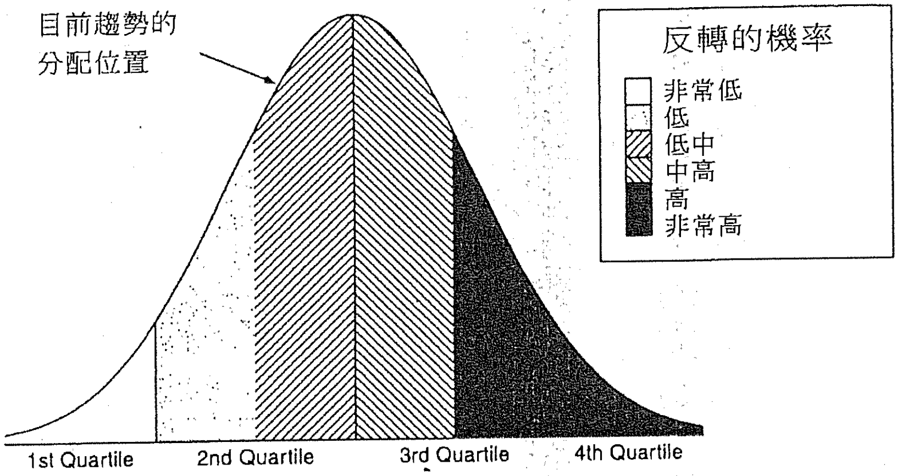

則介於16天至79天之間。歷史上所有多頭市場中期修正走勢僅有22.7％的走勢，折返幅度超過75％，僅有17％的走勢持續100天以上。所以，在多頭市場的修正走勢中，如果折返幅度超過前一個升段的75％，而持續時間超過74天，則在此情況下做多的勝算平均為1：4.4（譯按：應該是1：1.29）。反之，當時做空的勝算為1：4.4。可是，你必須確定一點，當時的走勢務必是次級的下降趨勢，而不是空頭市場的開始。

在每個多頭市場的頭部，市場分析師始終不能確定，這究竟是頭部或僅是修正。雖然我們無從明確地判定（除非空頭市場被確認或修正走勢結束），但長期趨勢的歷史分配情況可以協助我們推算這兩種可能性發生的機率。

表9.2列示「道瓊工業指數」與「道瓊運輸指數」在多頭市
場中的漲幅與持續的時間。假定某個多頭行情已經持續三年，而由前一個空頭市場底部起算的漲幅為115 %。現在，假定市場確實出現次級的修正走勢，並在55天內折返至前一個主升段的60 %。暫時撇開經濟基本面不談，你可以根據表9.1與9.2 計算價格持續下跌的機率。

###### 表9.2 道瓊工業與運輸指數在多頭市場中的漲幅與期間長度

| 期間長度（按數值大小順序排列） |  | | 幅度（按數值大小順序排列） | |
|---|---|---|---|---|
| 期間 | 天數 | 年數 | 期間 | 百分率 |
| 1939 | 164 | 0.45 | 1910-1912 | 22.9 |
| 1938 | 253 | 0.69 | 1960-1961 | 27.0 |
| 1960-1961 | 405 | 1.11 | 1947-1948 | 38.1 |
| 1947-1948 | 409 | 1.12 | 1939 | 38.6 |
| 1921-1922 | 452 | 1.24 | 1966-1968 | 42.0 |
| 1978-1981 | 472 | 1.29 | 1917-1919 | 49.0 |
| 1957-1959 | 606 | 1.66 | 1900-1902 | 51.7 |
| 1917-1919 | 670 | 1.84 | 1921-1922 | 52.7 |
| 1914-1916 | 674 | 1.85 | 1914-1916 | 67.8 |
| 1907-1909 | 684 | 1.87 | 1938-1939 | 70.4 |
| 1974-1976 | 684 | 1.87 | 1957-1959 | 71.5 |
| 1970-1972 | 686 | 1.88 | 1907-1909 | 77.5 |
| 1966-1968 | 787 | 2.16 | 1974-1976 | 78.6 |
| 1910-1912 | 799 | 2.19 | 1978-1981 | 81.3 |
| 1900-1902 | 813 | 2.23 | 1982-1983 | 87.7 |
| 1903-1906 | 844 | 2.31 | 1970-1972 | 95.1 |
| 1953-1956 | 952 | 2.61 | 1903-1906 | 100.1 |
| 1996-1999 | 967 | 2.65 | 1953-1956 | 102.0 |
| 1978-1981 | 1144 | 3.13 | 1962-1966 | 110.1 |
| 1949-1953 | 1295 | 3.55 | 1949-1952 | 128.1 |
| 1962-1966 | 1328 | 3.64 | 1938 | 139.8 |
| 1942-1946 | 1482 | 4.06 | 1942-1946 | 160.9 |
| 1932-1937 | 1710 | 4.68 | 1923-1929 | 242.5 |
| 1984-1989 | 1923 | 5.26 | 1984-1989 | 245.7 |
| 1923-1929 | 2224 | 6.09 | 1932-1937 | 379.4 |

計算的公式很簡單：根據歷史資料計算目前走勢幅度告一段落的機率，持續時間也做類似的計算，再取兩項機率的平均值。就先前的例子來說，計算過程如下：

次級折返走勢持續的機率：

```
幅度 = (88 − 55) / 88 = 0.37
時間 = (88 − 54) / 88 = 0.38
```

亦即以總樣本數（88）減去該走勢告一段落的樣本數（幅度為55，時間為54），再除以總樣本數。（譯按：請參考表9.1，「道瓊工業指數」的總樣本數為88，漲幅在60％以前結束的走勢有55次，持續期間結束於55天的走勢有54次。）

```
平均值 = 0.38
修正走勢終止的勝算為 = 1.63 : 1（換言之，0.62 : 0.38）
```

多頭市場告一段落（空頭市場開始）的機率：

```
幅度 = 19/26 = 0.73（譯按：表9.2的總樣本數為25而不是26）
時間 = 20/26 = 0.78
平均值 = 0.76
空頭市場開始的勝算為 = 3.17 : 1
```

這些資訊可以做為健全的基礎，以進一步分析市場的風險-報酬關係。例如，如果經濟基本面很理想，通貨膨脹率偏低，利率也偏低，其他的經濟指標也顯示景氣將持續成長，你應該強調修正走勢終止的可能性。如果你是站在空方，則應了結部份獲利，降低空頭部位的規模。

另一方面，如果 Fed 在收縮信用，經濟也呈現衰退的徵兆，你應該強調空頭市場開始的可能性。這種情況下，你不應該以次級修正走勢來考慮中期下降趨勢，而應該把它視為是空頭市場的主跌段。由這個角度評估，你將發現下跌趨勢持續發展的機率很高，你應該保有空頭部位，直至空頭市場在歷史統計分配中趨於「老化」為止。

然而，如果概率計算的結論並不明確，這時候怎麼辦？以圖9.1來說，如果當時的修正走勢，幅度與時間在歷史概率分配上都僅到達40％，怎麼辦？在這種情況下，你應該強調當時的下跌趨勢將持續發展——更精確地說，下跌趨勢將持續發展的勝算為1.5：1。這個時候應該謹慎選擇表現相對強勢（賣空時，則為相對弱勢）的類股或個股。我們在第十章將詳細討論這方面的問題。

##### 強調風險的概念

運用統計方法最重要的功能，或許是凸顯風險-報酬分析的重要性。更明確來說，這讓我們更客觀地專注於風險。當你將中期的市場走勢擺在幅度與時間的歷史概率分配中分析時，你將被迫接受一項事實：走勢的發展愈往右移時，你發生虧損的

風險便愈高。當它到達機率分配的中點（或中位數）時，你的勝算為5-5波──相當於擲銅板。超過這點以後，就歷史資料判斷，你的勝算將小於1：1。

這種思考方向可以反映出數項重要的交易原則。第一也是最重要的一點，便是盡可能掌握勝算。例如，在多頭市場主升段的初期階段，非常適合擴張信用來交易大盤指數；換言之，應該謹慎選取指數期貨與選擇權做為交易工具。隨著行情逐漸趨於成熟，則應該強調類股與個股的經濟背景。當市場發展超過中位數的水準時，則應該開始考慮低風險的交易策略與工具，或增加現金的部位，行情逐漸趨於老化時，交易的規模也應該降低。

這聽起來似乎僅是一般常識，但許多人顯然無法根據它來交易。以多頭市場的頭部為例，雖然全世界的人都做多，但股票市場中充滿「擔心受怕」的資金。所以，尋常的風吹草動便可能引發恐慌性的賣壓。然而，每一個恐慌性賣壓出現時，歷史資料都已經預先提出警訊。以1929年為例，在恐慌性賣壓出現以前，市場是處於歷史上最長的多頭行情中，其間歷經11個主升段。此外，1929年10月29日崩盤之前，主升段已經在99天內上漲29.9％，它在時間與幅度上都遠超過機率分配的中位數水準（是的，統計分析在當時已經有效）。

同理，在1987年10月19日的黑色星期一，當時的市場處於第七隻腳（第七個主升段），它在96天內上漲26.9％。再次地，多頭市場已經老化，主升段已經遠超過中位數的水準。單就這個準則考慮，交易必須極端謹慎。在1989年10月，市場處

於第十三隻腳，這是有史以來第二長與第二大的多頭市場。主升段在200天內上漲24.4％，它已經深入概率分配的高風險區。

以上僅是提及一些比較著名的案例，實際情況遠不止於此，它們都說明市場平均壽命的分配，可以預示立即死亡的可能性。在1987年與1989年的崩盤中，我都決定保持空手，統計分析便是主要的原因之一，這使我可以更專注於做空當時的行情。統計分析並不同於水晶球，但它們確實可以提供市場老化的明顯徵兆。

對大多數交易者來說，忽視風險的重要性，往往是失敗的原因。在觀察價格走勢圖時，他們眼中僅看見上檔的空間。發生腐損時，上檔的空間更是加大，使這些交易者心中更充滿無益的期待。市場的平均壽命架構，可以提供明確而不可否認的風險衡量標準，它們使交易者僅能夠仰賴事實——而不是期待。

##### 結論

市場平均壽命的歷史分配，雖然不是萬無一失的風險衡量方法，卻是掌握勝算的根本基礎。如果你知道長期趨勢與中期趨勢持續或終止的機率，在基本分析與技術分析時，你可以參考這項機率。此外，這方面的分析將使你強調風險的觀念，使你不致於在一個老化的市場中，為了多爭取一點獲利，而將辛苦累積的獲利吐回給市場。

在後續的幾章中，我將討論一些技術分析的方法，它們可以配合本章講解的勝算管理。我將說明如何以技術分析判斷趨

勢的變動，而且在有利的勝算情況下，將它們整合進入完整的交易方法中。

每一個市場都有各自的幅度與時間的概率分配架構。你唯有利用歷史資料來分析，才能瞭解這些架構。在本章中，我說明相關的統計分析方法。不幸地，我僅能提供有關股票市場的資料，而我個人資料庫中的數據都有專利權。

附註：

① Robert Rea, Dow Theory Applied to Business and Banking（New York: Simon and Schuster, 1938）。

### 第十章
市場分析的技術性原則

「道氏理論」蘊涵的定義，使我得以發展一套簡單而有力的技術分析工具，由這個角度隨意瀏覽價格走勢圖，成效往往勝過由基本分析角度的苦心研究。①事實上，我在1980年代中期訓練的幾位交易員，都僅根據這些技術分析的原則來交易，而且結果相當理想。

在我的行情分析方法與交易策略中，我是以技術分析做為建構的積木。以股票市場為例，我首先觀察數種主要指數的走勢圖，以判斷各個類股的一般價格趨勢。我將決定趨勢的方向，根據歷史資料的幅度與時間分配判斷趨勢的「年齡」（第九章），並根據價量關係、動能震盪指標與主要的移動平均線衡量趨勢的強度（請參考《專業投理原理 I 》）。在俱備這些認知之後，我再嘗試整合經濟基本分析，並對股票市場形成精確的整體性概念，包括大盤與類股在內。

然後，我可能利用期貨或選擇權在指數上建立部位，我也可能操作個股，以追求更高的獲利與／或更低的風險。一般來說，為了侷限風險，並利用信用擴張來追求更高的獲利潛能，我會同時在指數與個股上建立部位。

本章我將說明我在股票、債券與商品的分析與交易上，運
用的根本技術性原則。某種程度內，可能會重覆我在前一部著作的部份內容，但為了解省篇幅起見，我假定讀者已經瞭解這些技術性工具的基本知識。然後，我會提出另一些有關趨勢變動的判斷方法。

我希望在此強調一點，我絕不建議僅根據技術分析來交易。同時，我也不主張交易者可以完全不瞭解技術分析。金融交易應該整合技術分析、基本分析、以及市場心理等知識，以界定交易的整體勝算。

第二章曾經提及索羅斯（George Soros）的評論：「我們僅需要辨識前提為錯誤的趨勢，順勢操作，並在它被拆穿以前及時脫身。」如果你希望採納這個意見，你顯然必須先能辨識趨勢，以及該趨勢的潛在變化。另外，為了辨識前提為錯誤的趨勢，你必須瞭解經濟學與市場心理學的根本原理。一旦你可以結合實際的技術分析知識，以及經濟與市場的根本原理，你便可以充分掌握交易成功需要的勝算。

#### 名詞定義

#### 三種趨勢

在分析市場的價格走勢時，首先必須瞭解其中存在三種趨勢：

- 1. 短期趨勢，持續的期間為數天至數週（通常為14個交易日或以內）。
- 2. 中期趨勢，持續的期間為數週至數個月。
- 3. 長期趨勢，持續的期間為數個月至數年。

所有這三種趨勢都同時存在，它們的方向可能相反。一般來說，交易者關心短期趨勢，投機者關心中期趨勢，而投資者關心長期趨勢。

不論你在意的是交易、投機或投資，你都必須瞭解長期趨勢的性質與方向。瞭解長期趨勢的性質，意味著瞭解市場對於經濟基本面的看法（不論這種看法正確與否）、它在幅度與時間上的「年齡」、它所處的階段（稍後討論）、以及其他等等。

瞭解長期趨勢的方向雖然較簡單，卻非常重要。如果你不瞭解長期趨勢的方向，除了做短期的交易以外，你便很難做其他的明智判斷。即使僅從事短期的交易，你也需要把短期趨勢擺在中期與長期趨勢的前後關連中來判斷，如此才可以增加勝算。例如，如果你在多頭市場的主升段中從事短期交易，你碰到的上漲行情將遠多於下跌行情。另外，你也會較常遭遇法人機構電腦程式交易驅動的向上價格波動，而向下的價格波動則相對較有限，除非趨勢已經即將變化。

#### 市場的四種階段

在任何市場——股票、債券或商品——長期趨勢會處於下列四種階段中的一種：

- 1. 承接（accumulation）（投資者逐步買進）。
- 2. 出貨（distribution）（投資者逐漸賣出）。
- 3. 向上或向下的趨勢。
- 4. 整理（consolidation）（在一個經過確認的趨勢發展過程中，由於獲利回吐造成的調整）。

就技術分析上來說，市場缺乏趨勢時，它是處於狹幅盤整（line）中，這意味著它可能在整理、承接或出貨。然而，僅根據技術分析並無法判定它究竟是這三種行為的那一種，除非趨勢持續發展（這是整理）；除非趨勢向上突破（這是承接）；除非趨勢向下突破（這是出貨）。狹幅盤整會出現在所有市場中，這是眾所周知的技術分析排列。此處所應該特別強調的或許是股票市場的情況，狹幅盤整的形成與突破，應該同時呈現於所有相關的指數，如此才具有意義。所以，讓我們把討論的重心轉移至趨勢與趨勢變動的評估。

#### 趨勢與其變動的性質

不論技術分析採取何種形式，它必然——至少是隱含地——奠基於趨勢的定義。然而，在我擁有的2,000多本有關交易的書籍中，我不曾見過趨勢的完整定義。甚至於是Edwards與Macgee所著的技術分析聖經Technical Analysis of Stock Trends ②，也沒有明確定義何謂趨勢。所以，包括Edwards與Macgee在內的大多數技術分析家，他們重視的並不是技術分析的原理，而是技術分析的各種工具，這些工具一旦受到普遍的認同

之後便失去了效果，因為它們具有自我破壞的性質。

我們可以這麼說，只要有市場，便有趨勢的存在。所以，我們需要一個在任何場合都能成立的趨勢明確定義。於是便產生一個問題，趨勢有何通性與差異？換言之，所有趨勢有何共通的性質，各種不同的價格走勢之間又有何差異？

趨勢是一種價格走勢——這便是通性，而不需進一步的解釋。然而，具有趨勢的市場與「震盪的」（choppy）市場，兩者之間有何根本的差異呢？這個問題的答案很簡單，幾乎是自明之理，我們能夠以純粹的技術名詞來描述。

為了說明上的方便起見，我把根本的定義劃分為兩部份，一是上升趨勢，一是下降趨勢：③

上升趨勢：上升趨勢是一種價格走勢，它是由一系列的上升波段構成，每一上升波段都向上穿越先前波段的高點，中間並夾雜下降波段，但每一下降波段的低點都不會向下跌破先前下降波段的低點。換言之，上升趨勢是由一系列高點與低點都不斷墊高的波段構成（參考圖10.1）。④

下降趨勢：下降趨勢是一種價格走勢，它是由一系列的下降波段構成，每一下降波段都向下穿越先前波段的低點，中間並夾雜這上升波段，但每一上升波段的高點都不會向上穿越先前上升波段的高點。換言之，下降趨勢是由一系列高點與低點都不斷走低的波段構成（參考圖形10.2）。

###### 圖10.1 上升趨勢與趨勢線

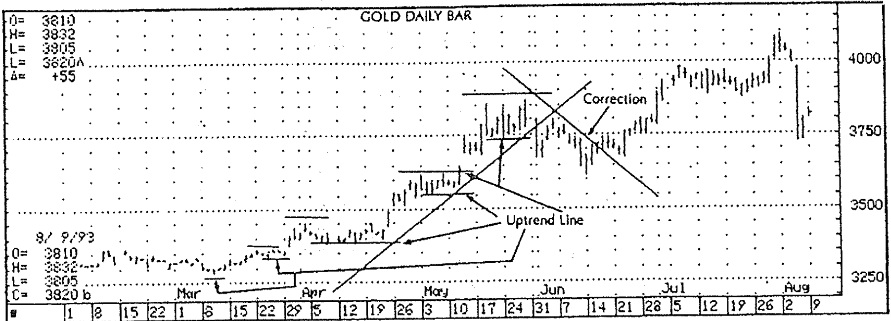

© Copyright 1993 CQG INC.

###### 圖10.2 下降趨勢與趨勢線

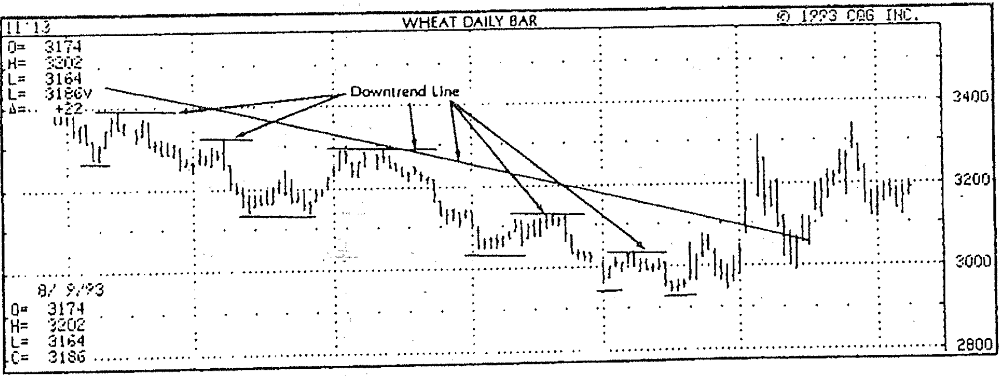

© Copyright 1993 CQG INC.

一種好的定義，它應該可以簡化我們的瞭解，並提供進一步擴張知識的基礎。上述定義便是如此。它們是普遍性的定義，可以適用於每個市場與每種價格走勢。另外，這些定義可以做為一種簡單而始終有效的圖形分析基礎。

#### 如何繪製趨勢線

以技術分析評估趨勢，第一步驟便是繪製趨勢線。這看起來或許相當簡單，但就如同趨勢的定義一樣，很少人能以一致的精確方法繪製趨勢線。我繪製趨勢線的方法是直接引用先前的定義。可是，即使是運用先前的定義，絕大部份人仍然無法繪製正確的趨勢線，他們繪製的線段僅代表大致上的趨勢，這在趨勢變動的判斷上可能產生錯誤的訊號。

以下的方法可以提供一致而精確的結果，而且絕對不會產生錯誤的訊號：

- 1. 選擇考慮的時間：長期（數個月至數年）、中期（數個星期至數個月）、或短期（數天至數個星期）。
- 2. 上升趨勢線：在考慮的時間內，以最低的低點為起點，向右上方繪製一條直線，連接最高點前的某一個低點，使這條直線在兩個低點之間未穿越任何價位。延伸這條直線而經過最高（譯按：這是指水平軸上的位置而言）。趨勢線經過所考慮的最高點以後，它可能穿越某些價位。事實上，這是趨勢發生變化的一種現象，稍後將討論這方面的問題（參考圖10.1）。
- 3. 下降趨勢線：在考慮的時間內，以最高的高點為起點，向右下方繪製一條直線，連接最低點前的某一個高點，而使這條直線在兩個高點之間未穿越任何價位。延伸這條直線而經過最低（參考圖10.2）。

這項方法的優點在於明確性，並可以用來判斷趨勢是否可能變動或已經變動。換言之，根據此方法在圖中繪製趨勢線時，如果你判定需要重新繪製趨勢線，這代表趨勢已經變動。

#### 1-2-3法則

趨勢變動時，必須發生下列三項條件：

#### 判定趨勢變動的準則

- 1. 趨勢線必須被突破——價格必須穿越繪製的趨勢線。
- 2. 上升趨勢不再創新高，或下降趨勢不再創新低。例如，在上升趨勢的回檔走勢之後，價格雖然回升，但未能突破先前的 高點，或僅稍做突破而又回檔。類似的情況也會發生在下降趨勢中。這通常稱為「測試」（test）高點或低點。這種情況通常——但不是必然——發生在趨勢變動的過程中。若非如此，則價格走勢幾乎總是受到重大消息的影響，而向上或向下跳空，並造成異於「常態」的激烈價格走勢。
- 3. 在下降趨勢中，價格向上穿越先前的短期反彈高點；或在上升趨勢中，價格向下穿越先前的短期回檔低點。

此三種條件同時成立時，相當於「道氏理論」對於趨勢變

動的確認。前兩種條件僅發生一種時，代表趨勢可能發生變動。三種條件發生兩種時，這增加趨勢發生變動的可能性。所有三種條件都發生時，即是趨勢變動的定義。

在走勢圖中觀察趨勢的變化，你僅需要將先前的原則轉換為圖形的格式。首先，繪製趨勢線。然後，猶如圖10.3一樣，繪製兩條水平的直線。在下降趨勢中，繪製一條水平的直線穿越目前的最低價，再繪製另一條水平的直線穿越前一波反彈的高點。在上升趨勢中，繪製一條水平的直線穿越目前的最高價，再繪製另一條水平的直線穿越前一波回檔的低點。

###### 圖 10.3 1-2-3法則的繪圖

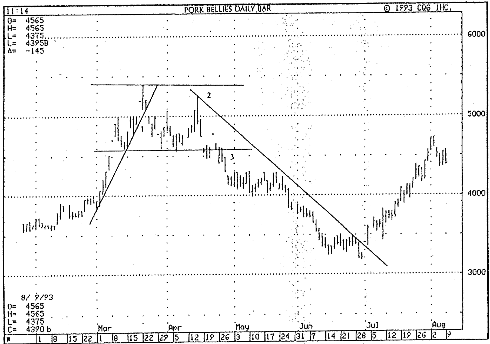

如果價格穿越趨勢線，在穿越的位置標示1，請參考圖10.3。如果價格測試先前的高點或低點——換言之，如果價格接近、接觸或稍為穿越該條對應目前高價或低價的水平直線而未能突破，則在該點標示2。如果價格向下突破該條對應前一個折返高點或低點的水平直線，則在該點標示3。如果這三個情況出現兩者，趨勢很可能會發生變化。如果三個情況全部出現，則趨勢已經發生變化，並最可能朝新的方向繼續發展。

###### 2B指標

請回顧趨勢變動的第二個條件：價格在上升趨勢中不再創新高，或在下降趨勢中不再創新低——通常稱為「測試」高點或低點。請留意，在趨勢的變動中，測試並不是必要條件。例如，市場呈現狹幅盤整時，不會出現測試的情況。價格將在區間內波動，突破趨勢線，最後或是向上、或是向下突破狹幅盤整的價格區間而創新高或新低。雖然如此，但測試的情況一旦發生時，通常代表趨勢即將變化。事實上，我將一種特殊情況的測試稱為「2B指標」。

請留意第2項準則。某些情況下，價格測試先前的高點（低點）時，可能實際穿越先前的高點（低點），但稍後卻又折返。這是一種特殊形態的測試（稱為：2B），也是一種很重要的測試：它代表趨勢即將發生變動的訊號。在評估可能發生的趨勢變動時，這是我最重視的一項準則。⑤

###### 2B法則

在上升趨勢中，如果價格已經穿越先前的/list highs 而未能持續挺升，稍後又跌破先前的**高點**，則趨勢很可能會發生反轉。下降趨勢也是如此。

這項法則適用於所有時間的趨勢，請參考圖10.4。如果2B法則在短期趨勢（3-5 天）中得以成立，則價格創新高（新低）之後，通常會發生在一、二天以內便又向下跌破先前的**高價**（向上穿越先前的**低價**）。在中期趨勢中，2B法則經常代表修

###### 圖 10.4 在三種期間中的2B法則

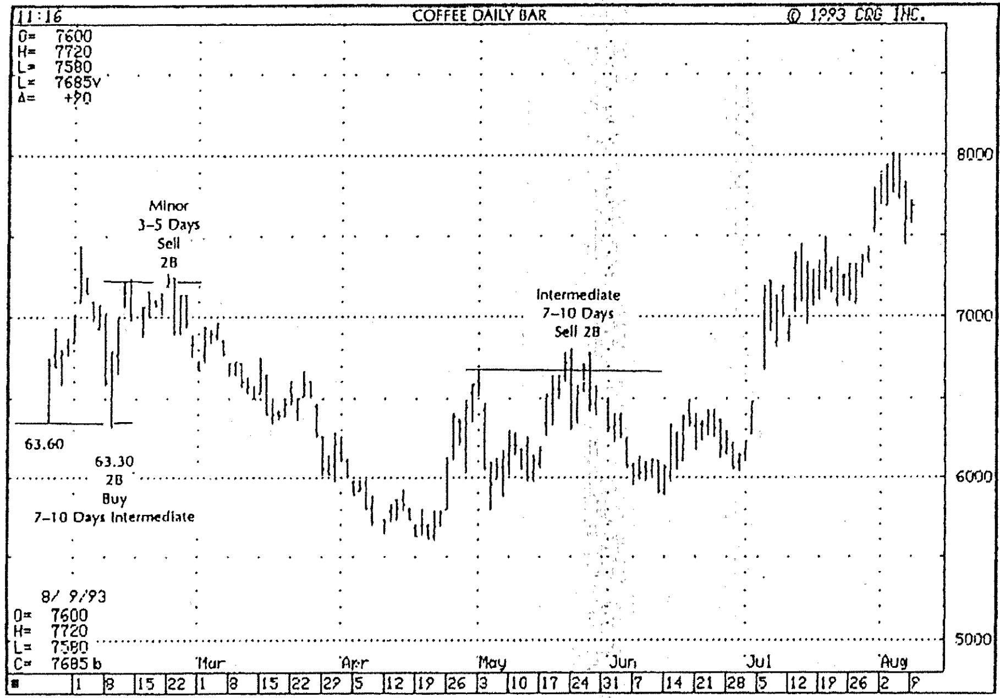

正走勢的開始，並發生於價格創新高或新低之後的3天至5天以內。在市場的主要（長期）轉折點，價格創新高或新低之後，如果2B法則得以成立，則它通常會發生在7天至10天以內。

我從來沒有以嚴格的統計方法測試2B法則的有效性，因為完全沒有這種必要性。即使是每三次訊號僅出現一次有效的趨勢變動（我敢打賭其有效的概率絕不僅如此），我還是可以根據這項法則賺錢，尤其是將它運用在中期趨勢中。這是因為2B法則幾乎可以讓你精確地掌握頭部與底部，並建立風險-報酬關係非常理想的交易。以上升趨勢為例，運用2B法則最佳的方法，是價格重新跌破先前的 `高點時，以停止單賣空（參考圖10.5）。賣空之後，將回補的停損單設定在2B的高點。如果你是就中期趨勢交易，則報酬-風險的比率幾乎總是高於5：1。即使你因此而被連續震盪出場二、三次，甚至於四次，你成功一次的獲利將多於先前的所有損失。

如果你經常以1-2-3與2B法則來練習，很快便能不再需要繪製趨勢線與水平直線，而能夠以目測的方式判斷趨勢發生變動的準則，並以1-2-3思考：(1)突破趨勢線；(2)測試先前的高點或低點而失敗；(3)向下跌破前一波回檔的低點或向上穿越前一波反彈的高點。另外，你也知道如何鎖定2B的潛在交易機會，但依此方法交易時，務必採用停損單來侷限可能發生的損失。

###### 以1-2-3準則交易

以1-2-3準則來交易，最佳的方式是在第三個條件滿足以前進場。以圖10.6為例，你發現「NASDAQ綜合指數」的中期趨

###### 圖 10.5  2B法則的賣空訊號

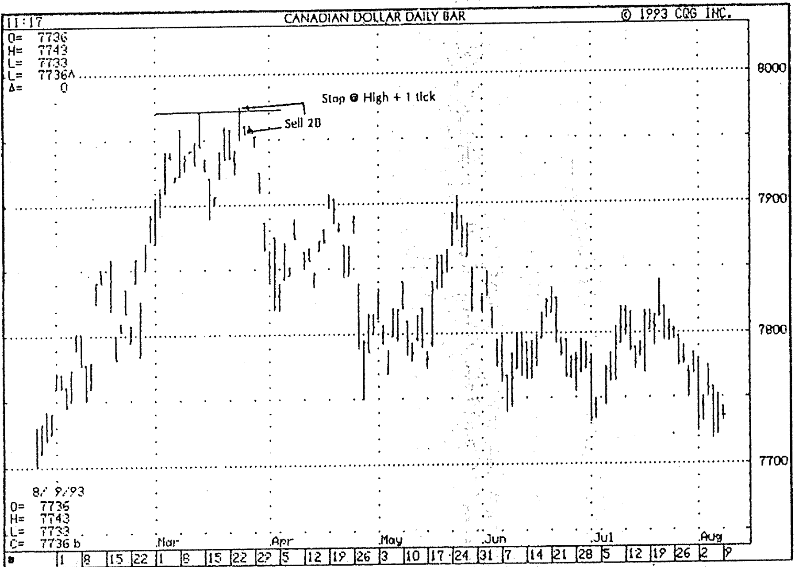

© Copyright 1993 CQG INC.

勢發生1-2-3的變化。由交易的觀點來講，價格在640的水準以大量跌破趨勢線時，我們無法明確判斷趨勢是否會變動。雖然如此，但由風險-報酬的角度判斷，這是理想的賣空機會。以下讓我們由純粹的技術分析觀點評估此機會。

價格在640的水準向下跌破中期趨勢線時（短期的2B法則已經成立），如果你假定趨勢已經發生變化而賣空，而當價格回升至日線圖收盤價的高點644（僅取整數）時，市場證明你的判斷為錯誤。在644水準設定回補的停損單，你的風險僅有

###### 圖 10.6  1-2-3 交易訊號與店頭市場綜合成交量

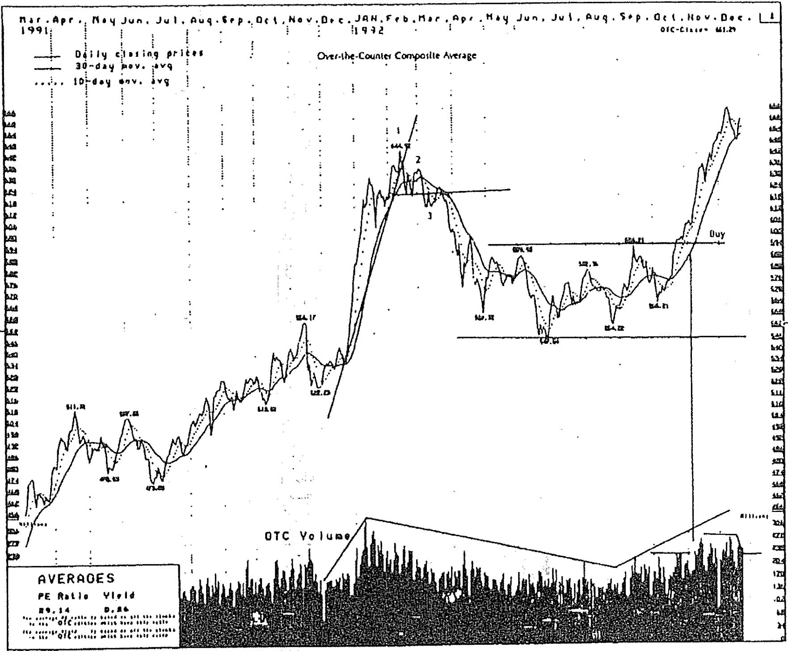

4 點。在潛在的報酬方面，如果你的判斷正確，市場應該至少下跌至 615，這相當於是 25 點的潛在報酬。所以，風險-報酬的比率是 4：25，或 1：6.25。

在如此理想的風險-報酬關係下，值得進一步技術分析。根據市場平均壽命的架構判斷，趨勢非常可能反轉。以 2 月 12 日的收盤價 644.92 為準，「NASDAQ 綜合指數」的主要波段（primary swing）已經上漲36.3％，時間為230 天。在歷史上所有的多頭市場主要波段中，僅21.4％的走勢具有更大的漲幅，而僅22.1％的走勢持續更長的時間。根據這些數據衡量，店頭市場趨勢反轉的勝算為3.6：1。你或許不知道這些統計數據，但只要根據一般常識判斷，你也應該可以區別老年人與年輕人。

如果經濟基本面的情況也配合（確實是如此），你有充分的理由在店頭市場中賣空，至少是建立少量的空頭部位。總之，你應該永遠由各種不同角度評估，如此才可以確實掌握成功的勝算。

###### 市場呈現狹幅盤整的走勢時

在我進一步討論其他輔助性的技術分析工具以前，我需要指出一種1-2-3法則並不適用的價格模式。猶如先前的說明，市場處於整理（consolidation）或出貨（distribution）的階段時，它會形成狹幅盤整的走勢。如果市場是處於整理，則它最後會「突破」盤整區而恢復原來的趨勢（以股票市場來說，突破需要大成交量）。如果市場是處於出貨的階段，它會以大成交量向下突破盤整區。

不幸地，純由技術分析的角度來說，在隨後的突破發生以前，我們無法區別整理與出貨。然而，市場呈現狹幅盤整的走勢時，我們仍然可以由純粹的技術性角度來交易。基本上，這涉及兩個步驟（參考圖10.6）：

- 1. 繪製兩條水平的直線，以對應交易區間的最高價與最低價。

2. 如果價格以大成交量突破上方的水平直線，則買進，並在突破的位置設定賣出的停損單。如果價格以大成交量突破下方的水平直線，則賣空，並在突破的位置設定回補的停損單。

這項交易方法與2B法則有許多類似之處。撇開成交量不談，它與2B一樣，適用於每一種市場與所有的三種趨勢。另外，這種方法也是反映通常的情況。由於這是一種普遍的交易方法，所以會發生假突破的情況，你偶爾會挨耳光；但如果你採取有效的停損策略，這種方法的風險-報酬關係相當不錯。

這雖然是一種有效的交易工具，但你不應該在真空的狀態運用它。避免挨耳光的最佳方法，是掌握經濟基本面的知識，以判斷市場是處於整理或出貨的狀況。就這種情形來說，所謂的經濟基本面知識，我是指「索羅斯」的市場心理。

我希望在此談論一個我本身遭遇的負面案例。在整個1991年的下半年，市場幾乎都處於狹幅盤整的狀態。我由經濟基本面的角度判斷，市場是在出貨，隨後至少應該出現修正走勢，甚至是空頭市場。我顯然誤判了市場的心理，因為它相信利率走低將推動行情上揚。所以，我在11月的反彈行情中賣空，而11月中旬指數大幅下跌。可是，Fed在12月調降貼現率一個百分點時，我未料到市場會相信利率調降將有助於改善當時的經濟疲態。因此，我吐回一大部份的利潤，並錯失12月份的上漲行情，後者顯然是典型的帶量向上突破。

###### 輔助性的技術分析工具

###### 成交量的關係

成交量關係雖然是一種技術分析指標，但在我的方法中，它最不客觀。雖說如此，但在股票市場中，如果不考慮成交量，便不應該交易。

我說成交量關係最不客觀，因為它缺乏明確的法則。它唯能在某特定市場的前後關連中來解釋。解釋成交量關係的唯一方法，是觀察每天的市場發展，以體會何謂「正常量」？何謂「大量」？何謂「小量」？以下是觀察成交量的一般性法則；然後，我將說明如何將此法則運用在店頭市場的行情評估中。

###### 重要的成交量關係

- 1. 成交量通常會與趨勢配合；換言之，在多頭市場中，漲勢的成交量會放大，跌勢的成交量會縮小；在空頭市場，情況則相反（請參考圖10.6 的成交量部份）。市場瀕臨修正時，則為例外，請參考下 API 點。
2. 在多頭或空頭市場的中期反彈中，市場若處於超買狀況，則漲勢的成交量將縮小，跌勢的成交量將放大。反之，在中期的下跌過程中，市場若處於超賣狀況，則漲勢的成交量將放大，跌勢的成交量將縮小。
3. 在多頭市場中，末期的成交量極大（相較於先前的期間），初期的成交量很小。反之，空頭市場的初期成交量很大，末期的成交量很小。

以圖10.6而言，上述的第三點尤其正確，例如，1992年1月底，成交量開始顯著放大。我們知道，整個1991年，店頭市場始終是表現最佳的市場，價量關係也配合很好，這尤其凸顯1月底的情況不尋常。如果你觀察圖10.7，可以發現「工業指數」和「運輸指數」的成交量與「店頭市場綜合指數」和S&P 500的成交量有明顯的不同。特定來說，「工業指數」和「運輸指數」在2、3月份的跌勢中，成交量顯著縮小，但「店頭市場綜合指數」和S&P 500的成交量仍然與前幾個月差不多。

由於上述的成交量關係，所以在2月20日我發行的投資報告《The Rand Monitor of Market Risk》中，我向法人機構的訂閱者建議：「持有景氣循環類股的多頭部位，減少店頭市場與高成長型類股的持股。」由每個角度來觀察，店頭市場與S&P 500，以及扮演領導角色的其他數種指數，都呈現典型的技術性頭部，而且在最後的漲勢與隨後的跌勢中，成交量關係也確認頭部的排列。尤其是店頭市場，它長久以來一直缺乏整理，所以至少應該出現一次大幅的中期修正走勢；根據我個人的看法，它應該扮演領導角色以邁向新的空頭市場。

同理，「道瓊指數」與其他的景氣循環指數，都呈現多頭的氣勢，在跌勢中成交量縮小，在漲勢中成交量放大。所以，我決定以兩種不同的方式來交易：做多景氣循環類股，賣空店頭市場與成長型股票。

上述的討論自然地引導至另一項重要的輔助性技術分析工具，這項技巧很少人將它運用在整體市場上——相對強度（relative strength）。

###### 圖 10.7 成交量模式：道瓊指數與S&P 500

###### 相對強度

在10年至15年以前，你只要分析「道瓊指數」——「工業指數」、「運輸指數」與「公用事業指數」——便可以對整體市場產生一種感覺。情況已經不再是如此了。由於資訊科技的進步，我們已經不能再分析個別類股的市場，而必須由較廣的角度瞭解股價走勢。觀察整體市場的發展時，我追蹤的指數不超過18個，包括每種指數的每天收盤價、幅度與時間。以「道氏理論」做為分析的基礎，我比較各種指數的價格走勢、成交量關係、市場寬度（騰落比率，advance/decline ratio），並觀察它們之間的異同發展。

在強勁的多頭或空頭市場中，所有指數都會朝同一個方向發展。當經濟各產業的情況有明顯的強弱差異時（就如同目前的情形），某些指數會有類似的走勢（例如：「道瓊工業指數」與「主要市場指數」），另一些指數則互有領先與落後的現象。換言之，我會觀察許多指數之間的相對強度關係。

李氏（Robert Rhea）首先提出相對強度的觀念，而稱此為「股票的習慣與相互對照的績效表現」。雖然他是指個股而言，現在卻需要評估指數的習慣，以及它們之間的相互對照表現。猶如我先前所提，整個1991年，S&P 500與店頭市場指數的表現都優於工業指數與其他涵蓋面較廣的指數（例如：「道瓊指數」與AMEX）——它們顯然具有較強的相對強度。在交易之中，如果希望精確預測未來，必須分析各個不同市場之間的相對強度與其涵意。

讓我們繼續分析店頭市場，只要隨意瀏覽1991年的價格走勢圖便可以發現，店頭市場是最強勁的市場。然而，正因為它長久以來都是最強勁的市場，並處於濃厚的投機氣氛中，所以它也應該是首先大幅回檔的市場——如果裝瓷器的架子倒塌了，最上層的瓷器最可能摔破。

###### 200天移動平均線

我採用的另一項重要技術指標是200天移動平均線，雖然它並不適用於店頭市場的分析。我在1968年開始採用這項指標，當時我閱讀William Gordon的一份研究報告，他將200天期移動平均的買賣準則運用於1917年至1967年的「道瓊工業指數」，每年的平均報酬率為18.5%。

###### 200天移動平均的運用

- 1. 如果200天移動平均線由先前的下降趨勢中，開始轉為平坦或上升，而且價格由下往上穿越均線，這代表主要的買進訊號（參考圖10.8）。
2. 如果200天移動平均線由先前的上升趨勢中，開始轉為平坦或下降，而且價格由上往下穿越均線，代表主要的賣出訊號。

200天移動平均線的最大問題是時間嚴重落後。由圖10.8可以看出來，當「道瓊工業指數」的200天移動平均發出買進或賣出訊號時，走勢都已經過了一大半。另外，行情在投機性的長期漲勢之後，如果突然發生崩盤，則200天移動平均線幾乎

###### 圖10.8 移動平均線的訊號

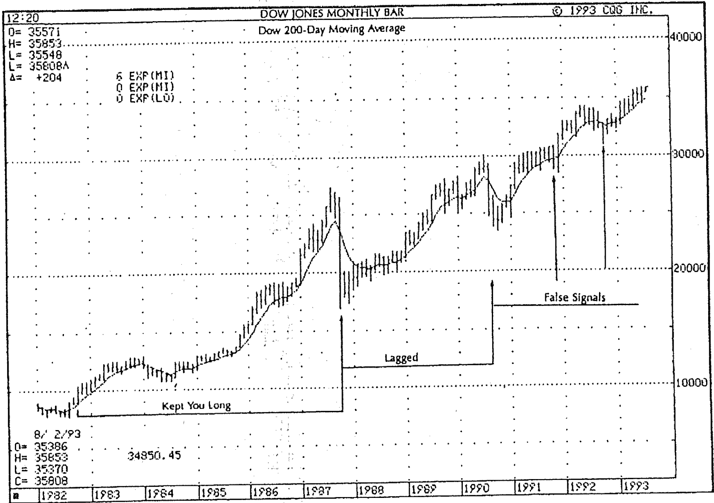

© Copyright 1993 CQG INC.

毫無用處。所以，我僅把200 天移動平均線視為是輔助性的工具。例如，如果「店頭市場綜合指數」跌破200 天移動平均線，則我在2 月底與3 月初將會大量賣空店頭市場的股票。然而，我實際上建立的空頭部位並不特別大。

###### 市場寬度與動能震盪指標

我使用的最後兩項指標分別是市場寬度（breadth），它經常被稱為「騰落線」（advance-decline line；A/D line），以及

騰落線（A/D 線）是計算每天上漲家數與下跌家數的差值，並繪製為圖。對於所有加權性的股價指數來說，騰落線都可以彌補其缺失。以「道瓊工業指數」為例，它僅由30 種股票的價格加權而成。某些情況下，如果某支權數較大的股票（例如：IBM）出現不尋常的走勢，整個指數便不能有效反映整體工業類股的表現。

一般來說，騰落線與大盤指數會呈現相同方向的走勢，一旦兩者之間出現背離的現象時，通常是代表趨勢即將變動的訊號。事實上，我幾乎把它視為是一種大盤指數，並運用「道氏理論」分析它與其他指數之間的關係。然而，就騰落日線圖來說，它僅必須確認先前的高點（低點），而不需確認你當時比較的高點或低點。另外，騰落週線圖應該確認你的多頭或空頭看法。例如，自從1990 年10 月的低點以來，騰落週線圖便是最佳的技術性指標。再舉另一個例子，在1992 年的3 月與4 月，「道瓊指數」創新高，但店頭市場指數、S&P 500 與市場寬度都未創新高。我將這種情況視為是可能的背離，並判斷「道瓊指數」可能做頭。

我始終密切注意市場寬度，將它視為是一種股票指數。我根據它而推演出另一種指標，這是一種動能震盪指標，以衡量整體市場向上或向下的偏頗程度。每天早晨，我首先登錄上漲與下跌家數的淨值；我是以「紐約證券交易所」近30 天以來的資料為準，並計算、登錄、繪製上漲與下跌家數之淨值的移動總和（moving sum）。然後，再將計算結果除以3，以代表10

天期的約當值，並稱其為「10天約當期-淨變動-移動平均-行情寬度震盪指標」（10-day equivalent, net change, moving average, breadth oscillator）。它經常可以有效衡量中期的「超買」或「超賣」情況。⑥

猶如200天移動平均線一樣，我將市場寬度與動能震盪指標視為輔助性的工具，以配合其他較根本的技術分析方法，例如：1-2-3準則、2B法則與平均壽命架構，以判斷交易的整體勝算機率。例如，在2月底與3月初，市場寬度未能創新高，而我的長期震盪指標也顯示整體市場稍有超買的狀況。所以，市場寬度支持我在店頭市場的空頭部位，而震盪指標也稍有支持。整體來講，我雖然掌握勝算，但勝算的程度並不足以讓我採取積極的空頭策略。我個人或客戶投入的風險資本都未超過2％-3％。

###### 一項理想的新指標

我希望各位讀者覺得，本書確實提供某些明確的概念與賺錢的方法。現在，我準備再提出另一種指標：四天法則。這是我偏愛之趨勢變動的中期指標，我以決定與各位分享這項指標，因為我覺得讀者們對於我前一本書《專業投理原理Ⅰ》給予許多支持。

猶如其他指標一樣，這項指標也是來自於長期的研究。我根據1926年至1985年之間的「道瓊工業指數」，衡量其中期走勢的每一個頭部與底部。表10.1顯示四天排列（換言之，連續四天上漲或下跌的走勢）與頭部或底部的相關性。觀察這些資料，我有兩項發現。

###### 表10.1 1926-1985期間的四天法則樣本（中期趨勢）

| 天數 | 次數 | 頻率（%） | 累積頻率（%） |
|---|---|---|---|
| 69 | 2 | 0.9 | 90 |
| 56 | 1 | 0.4 | 90 |
| 53 | 1 | 0.4 | 89 |
| 52 | 1 | 0.4 | 89 |
| 50 | 1 | 0.4 | 88 |
| 48 | 1 | 0.4 | 88 |
| 45 | 2 | 0.9 | 87 |
| 40 | 2 | 0.9 | 86 |
| 38 | 2 | 0.9 | 85 |
| 36 | 1 | 0.4 | 85 |
| 35 | 3 | 1.3 | 84 |
| 34 | 1 | 0.4 | 83 |
| 33 | 1 | 0.4 | 82 |
| 32 | 1 | 0.4 | 82 |
| 31 | 2 | 0.9 | 81 |
| 30 | 3 | 1.3 | 80 |
| 29 | 1 | 0.4 | 79 |
| 28 | 3 | 1.3 | 79 |
| 27 | 1 | 0.4 | 77 |
| 26 | 1 | 0.4 | 77 |
| 25 | 4 | 1.8 | 76 |
| 24 | 1 | 0.4 | 75 |
| 23 | 2 | 0.9 | 74 |
| 22 | 3 | 1.3 | 73 |
| 21 | 1 | 0.4 | 72 |
| 20 | 1 | 0.4 | 71 |
| 19 | 4 | 1.8 | 71 |
| 18 | 5 | 2.2 | 69 |
| 17 | 2 | 0.9 | 67 |
| 16 | 5 | 2.2 | 69 |
| 15 | 4 | 1.8 | 64 |
| 14 | 10 | 4.5 | 62 |
| 13 | 4 | 1.8 | 57 |


###### 表10.1 1926-1985期間的四天法則樣本（中期趨勢）（續）

| 天數 | 次數 | 頻率（%） | 累積頻率（%） |
| --- | --- | --- | --- |
| 12 | 8 | 3.6 | 55 |
| 11 | 2 | 0.9 | 52 |
| 10 | 7 | 3.1 | 51 |
| 9 | 3 | 1.3 | 48 |
| 8 | 6 | 2.7 | 46 |
| 7 | 5 | 2.2 | 44 |
| 6 | 5 | 2.2 | 41 |
| 5 | 9 | 4.0 | 39 |
| 4 | 6 | 2.7 | 35 |
| 3 | 10 | 4.5 | 32 |
| 2 | 5 | 2.2 | 28 |
| 1 | 56 | 25.0 | 25 |

天數 當高點或低點發生四天排列之後，至新趨勢展開經過的天數。
次數 在1926年至1985年之間，當四天排列發生之後，經過某特定天數（列於第一欄）而出現新趨勢的次數。
頻率 將第二欄的次數表示為百分率，但請留意，由10%的中期趨勢並未出現四天排列。

###### 四天法則

在中期走勢中，市場在高點或低點以連續四天下跌或上漲的走勢而呈現反轉時，趨勢很可能發生變化。

在第一個發現中，中期頭部或底部所出現的四天排列，其方向幾乎總是代表趨勢變動的方向。根據表格10.1的資料顯示，當四天排列出現後，25%的中期趨勢立即呈現與四天排列相同方向的反轉，有41%的中期趨勢在四天排列出現後的六天之内發生反轉，75％的中期趨勢在四天排列出現後的24天之内發生反轉。在所有中期趨勢内，僅10％未出現有效的四天排列。

請參考圖10.9，它是S&P 500的週線圖。在1992年10月9日，指數於402.66出現底部。隨後四天的變化如下：10/12為+4.78、10/13為+4.86、10/14為+0.70、10/15為+0.23。這是連續四天的上漲，顯示底部的形成。指數在10月16日仍然上漲，但

###### 圖10.9 四天法則（S&P 500）

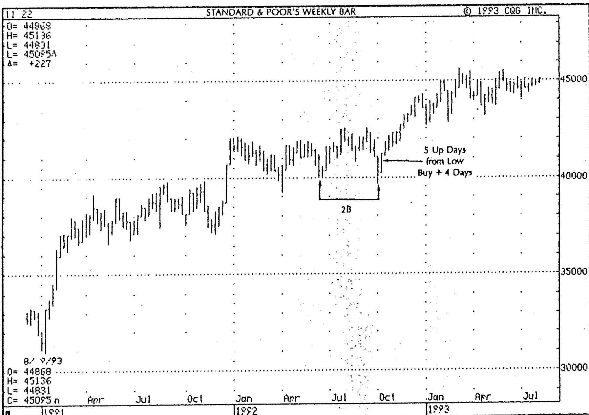

這並不重要。如果這是真正的底部，則指數在幾個月內都不應該跌破10/9/92的低點，所以你可以將停損設定在此處。

四天法則在商品的交易中也非常有效，但我並未就商品的歷史資料做統計的研究。圖10.10是9月份日圓的日線圖，其中包括兩個有效的四天排列。

###### 圖10.10 四天法則（日圓）

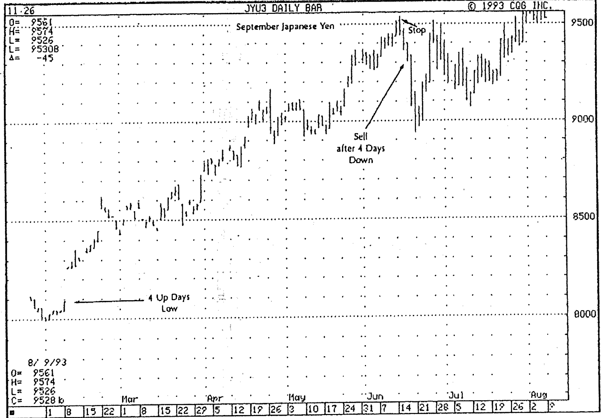

相關的第二項發現是：

###### 四天輔助法則

中期走勢發展至相當程度以後，如果出現順勢的四天（或以上）排列，隨後出現的第一天逆趨勢行情，經常代表趨勢變動的頭部或底部。

圖10.11是「道瓊運輸指數」的日線圖，它充分顯示四天輔助法則的有效性。上升趨勢經過長期的發展，並出現連續五天

###### 圖 10.11 四天法則（道瓊運輸指數）

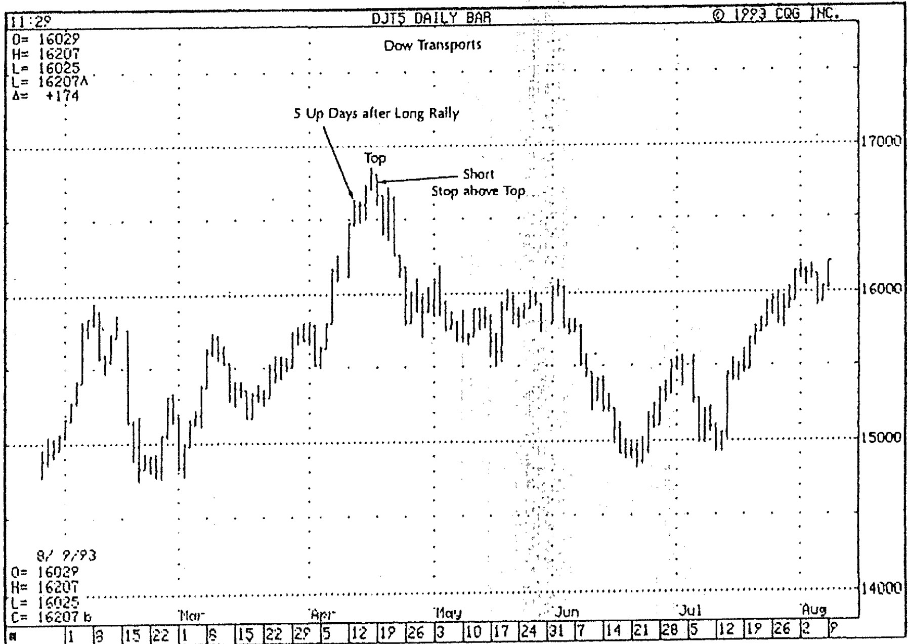

© Copyright 1993 CQG INC.

的漲勢，其後的第一天下跌便代表中期的頭部。你可以在第一天的下跌過程中賣空，並把停損設定在五天排列的高點。

這項輔助法則之所以有效，理由是：行情的高潮是反映在連續數天，所以趨勢反轉蘊含的動能較大（相對於在一日之內以大量出現頭部或底部的行情）。請參考圖10.12的9月份白銀與圖10.13的S&P 500日線圖。

請留意四天排列的現象，你將發現其重要性。

###### 圖 10.12 四天法則（白銀）

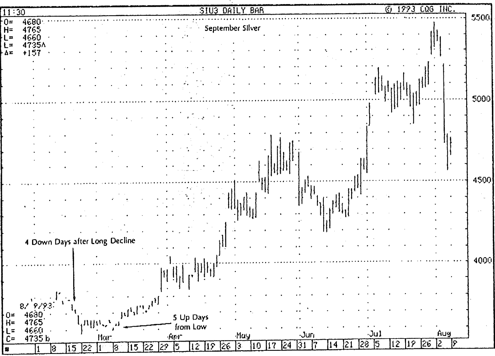

© Copyright 1993 CQG INC.

###### 圖 10.13  四天法則（S&P 500）

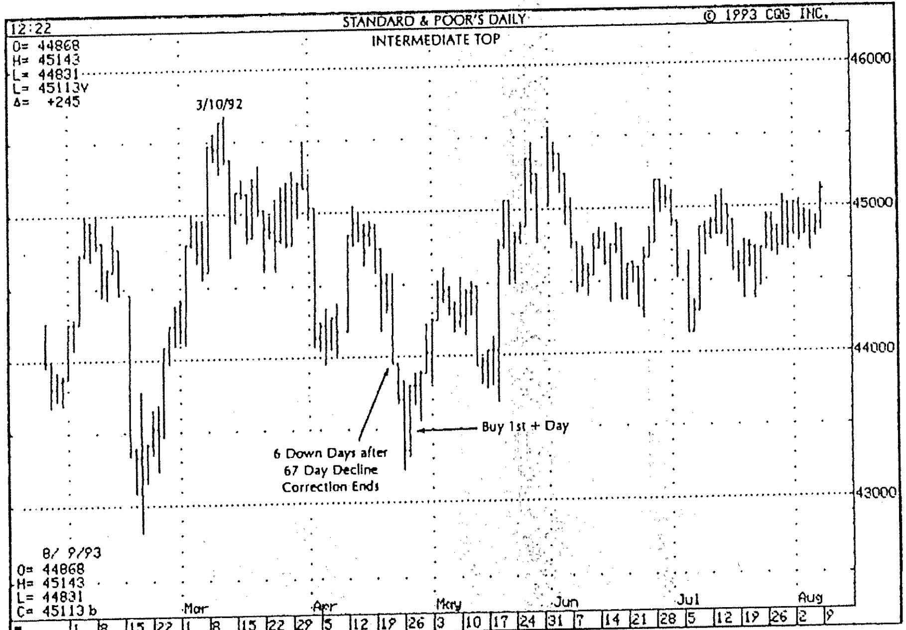

© Copyright 1993 COG INC.

##### 結論

評估市場時，我運用三種主要的技術分析工具，以及數項輔助性的工具。我根據1-2-3準則、2B法則與市場平均壽命架構評估股價指數。如果我判斷趨勢可能發生變動，而且報酬-風險的比率優於3：1，我會進一步觀察成交量關係、移動平均、市場寬度與動能震盪指標。經過這些評估以後，如果我認爲自己

頗有勝算，則建立部位，有時候是僅根據技術分析擬定交易決策。（容我在 TAXI 插入一段題外話，許多的技術指標並未納入本書的討論範圍內。我建議各位參考一本相當不錯的新書，它是 Alexander Elder 博士著的 Trading for a Living，書中摘要說明歷史上所有的重要技術指標。）

然而，我必須強調一點，我很少僅根據技術分析來交易。我見過許多不修邊幅而袖口磨破的交易員，他們是如此地信賴技術分析。技術分析雖然不是萬靈丹，但它是一種衡量交易勝算的珍貴工具，我認為任何人在分析市場與預測行情時，如果全然忽略技術分析，是相當愚蠢的態度。

關鍵在於選擇一些經過時間考驗的主要技術分析工具（例如：1-2-3 準則），然後再配合其他輔助性工具。然而，因為任何理想的工具終究會被市場認同，並因此失去其效力。所以，不可執著於任何技術指標，並將它視為是終極的必勝工具，否則你會因為而發生虧損，我便曾經如此！

本章的討論中，我都是以店頭市場代表整體市場來分析。然而，如果你對於交易相當熟悉的話，則你應該知道目前並沒有店頭市場的指數可供交易。相關的部位必須建立在個股與個股的選擇權之上。所以，接下來如何進行？如何篩選個股或選擇權，以增加交易的勝算？

基本上，你仍然採取相同的程序，再引用一些其他技術分析的方法來提高勝算，這便是下一章將討論的內容。

##### 附註：

+ ① 有關我採用的技術分析方法，讀者若希望進一步瞭解其優點與可能的缺失，請參考 Victor Sperandeo，《專業投理原理 I 》（ New York ： John Wiley & Sons, 1990 ）。
+ ② Robert D. Edwards and John Magee, Technical Analysis of Stock Trends（Springfield, MA ： Jonh Magee, 1966 ）。
+ ③ 有關市場分析的技術性原理，細節部份請參考《專業投理原理 I 》，pp. 49-108 。
+ ④ 這項定義運用於股價指數時，所有相關指數都必須確認此趨勢。若未如此，則存在背離的現象——這顯示趨勢可能發生變化 。
+ ⑤ 有關2B模式所以發生測試的原因，請參考《專業投理原理 I 》，pp.81-84 。
+ ⑥ 相關的細節與計算方法，請參考《專業投理原理 I 》，pp.94-104 。

### 第十一章

技術分析原則的運用

讓我告訴各位一段有關於 Carmine Grigoli 的故事，他是 First Boston Corp. 的金融交易策略專家。1991 年上半年，他預期股票市場會出現新低點，跌破 1990 年 10 月的低點 2365。 然而，指數在年底卻攀升至 3188。根據 Dick West 在 1992 年 3 月 5 日發行的市場報告，Grigoli 對於這種現象的回答是：「我相信大多數的客戶都認為我對於經濟基本面的判斷相當正確，但我對於市場的反應判斷錯誤。」我可以體會 Grigoli 的感受，因為我與他一樣犯下相同的錯誤，尤其是我們都知道基本面的真正情況。然而，關鍵在於市場的心理，而不在於經濟基本面。市場心理是反映人們認為的正確情況，而不是實際上的真正情況。金錢代表這場金融遊戲的分數，這場遊戲永遠不會結束，雖然某些玩家可能自願或被迫退出。

根據市場的性質來說，它們也可能犯錯，因為市場是由一群參與者構成，而這些參與者都試圖預先反映未來的事件。在 1980 年代的後半，許多精明的玩家都葬身市場，以房地產為例，它是「一種價值不應該下跌的資產」，實際上卻下跌了。這涉及本章討論的內容：技術分析的圖形與解釋，以及價格的變化。

在《專業投理原理 I》一書中，我曾經說明兩種判斷趨勢變動的方法，我稱它們為 1-2-3 準則與 2B 法則。前一章僅簡略地

解釋這兩種方法，因為我不希望重覆說明。如果你對於這兩種方法的細節有興趣，請參考該書。

人們經常請我解釋某特定的價格走勢，或就某特定的股票提出操作的建議。在本章中，我將說明我如何分析走勢圖。我將以商品的走勢圖為範例，如此才不至於讓人們認為相關的原則僅適用於股票市場。我所選的商品都是目前交易最熱絡的商品。總之，我將根據我的原則分析走勢圖，並告訴各位我的看法與解釋。我還會提出一些我第一本書中所未討論的內容。我稱為「缺口法則」（gap rule）與「三天的高－低價法則」（high-low 3-day rule）。

缺口法則很簡單；趨勢線的上方或下方出現缺口時，它反映重大的變化（消息面或／與基本面），並顯示趨勢可能發生變動。這個法則並不需要2B，也不需要經過測試（趨勢線）。然而，缺口必須穿越趨勢線，法則才有效。我會在相關的走勢圖中說明此法則。

三天的高-低價法則，是運用最近三天的盤中高價與低價。價格發生反轉而穿越三天的高價或低價時，則做多或賣空，並以第三天的低價或高價做為停損。如果停損被觸發，則將部位反轉。我也會在相關的走勢圖中說明此法則。

請留意，這兩項法則在運用上必須配合另一個確認原則。

#### 圖形分析9月份燕麥（圖11.1）

自從12月以來便處於下降趨勢中，並在2月創低點（133 ¾，隨後在三月測試低點，並展開反彈。3月價格創新低（133.0），但立即回升，這是一個2B排列。你以隔天的收盤價

（135.25）買進，並將停損設定在132.75。4月價格穿越3月的高價時，你可以追加部位。請留意，3月的高價被穿越之後，價格便未再跌破此水準——相當強勢的徵兆。

頭部的形成並沒有技術性的徵兆，此處將首度引用三天法則：經過相當大的漲勢（主觀的判斷）之後，價格出現拉回，並跌破三天以來的低價與趨勢線。

新的低價發生在6月，價格向上突破3月的2B價位時，形成另一個2B排列。請留意，價格跌破先前的低點僅停留一天而已，所以這是一個有效的2B。停損設定在新2B的低點。

###### 圖11.1 9月份燕麥

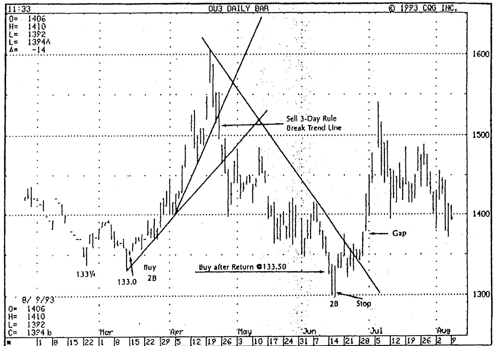

#### S&P現貨月線圖（圖11.2）

我撰寫這部份內容時，如果指數跌破以1990年低點為準繪製的長期趨勢線，你應該賣空。目前的趨勢線大約在432.30，這也是1993年4月的低點。下檔的強勁支撐在332.00，大約是100點的幅度。

###### 圖形11.2 S&P現貨月線圖

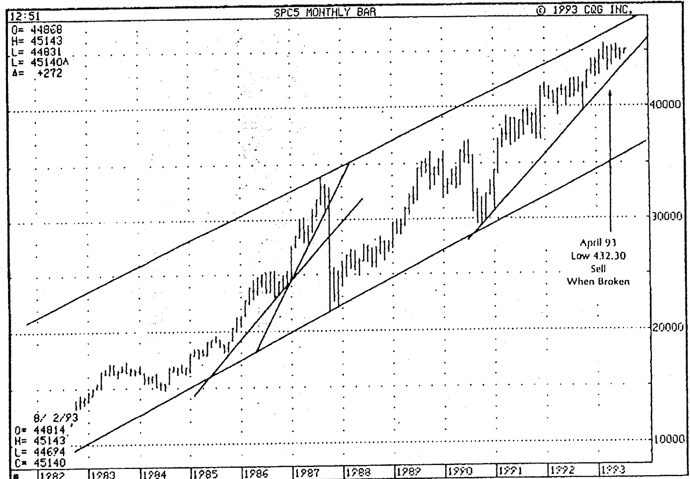

#### 白金週線圖（圖 11.3）

在1993年1月的339.0，出現一個理想的2B買進訊號。價格跌破先前的低點338.50，並創新低點335.50。價格回升而2B排列生效時，你應該買進，並將停損設定在335.50。價格在1992年6月份創下400.00的高價以後，形成一個有效的2B賣出訊號。

圖 11.3 白金週線圖

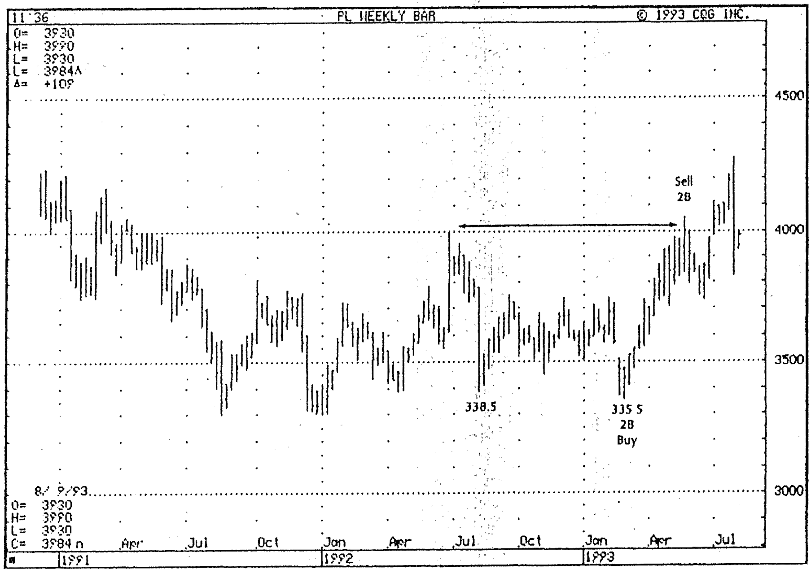

#### 十月份白金（圖11.4）

當399.50 出現2B 的賣出訊號以後，在6月初的378.50出現一個假的2B 買進訊號，這個部位在6月底平倉於373.75。在交易中，最困難的一件事是當你「挨耳光」之後建立反向部位。當價格回升至378.00時，出現第二個2B 的買進訊號，我建議你加碼一倍。讓它付出雙倍的代價！

圖11.4 10月份白金

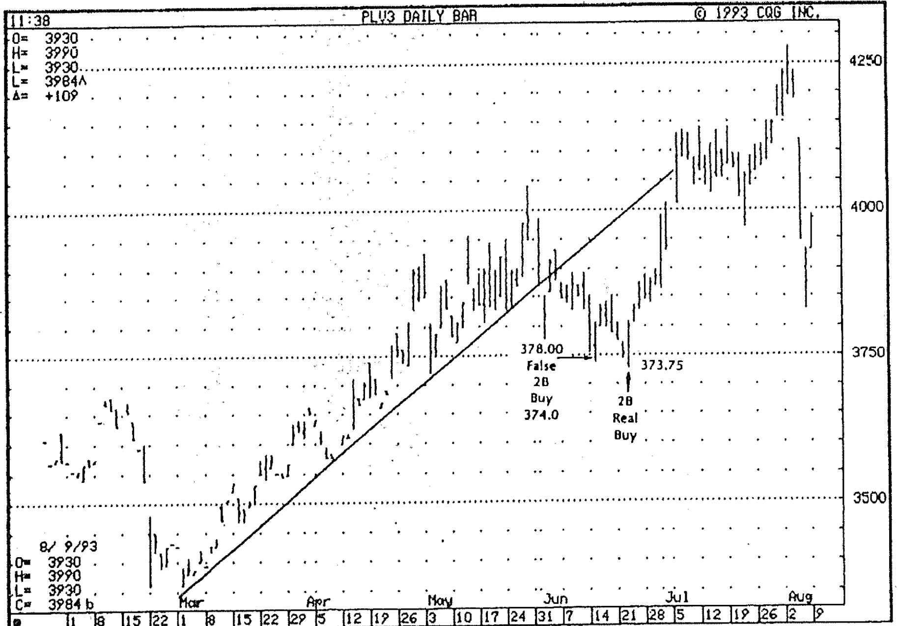

#### 10月份棉花（圖11.5）

由1月份的低點以來，價格已經出現相當的漲幅，當價格跌破近三天低點，並發生2B賣出訊號時，建立空頭部位。在4月底買進，當價格跌破停損時賣出。在次一個2B再買進，隨後再根據3天法則反轉賣空。接下來未出現新的交易訊號，在跌勢中一路持有空頭部位。請留意，在2B的高價與低價處，務必要設定停損。

圖11.5 10月份棉花

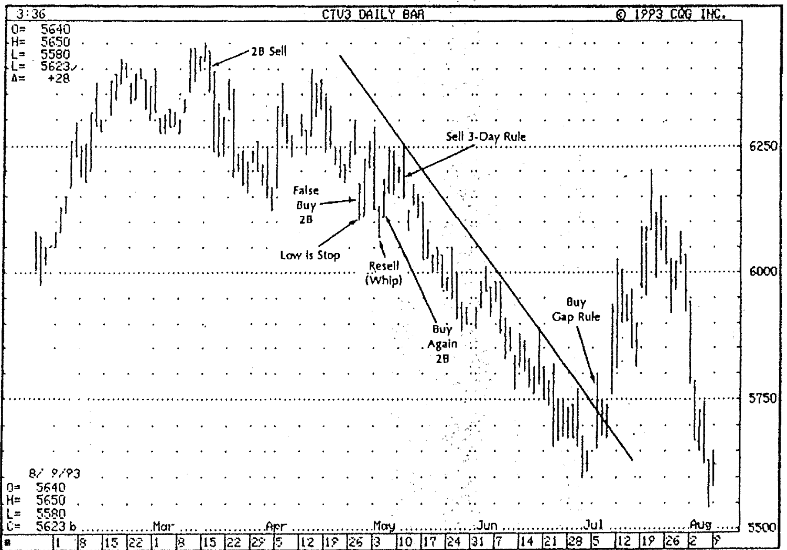

#### 8月份黃金（圖11.6）

在3月的2B買進。在3月份與4月的缺口加碼。在5月的2B賣出，然後在6月的2B買進。

###### 圖11.6 8月份黃金

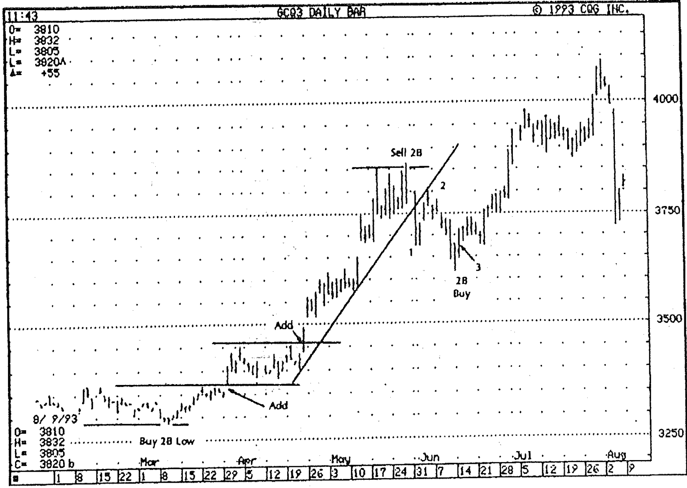

#### 9月份德國馬克（圖11.7）

在3月初買進。你可以根據缺口法則在5月初賣出，或根據隨後的1-2-3法則與三天法則而賣空。

###### 圖11.7 9月份德國馬克

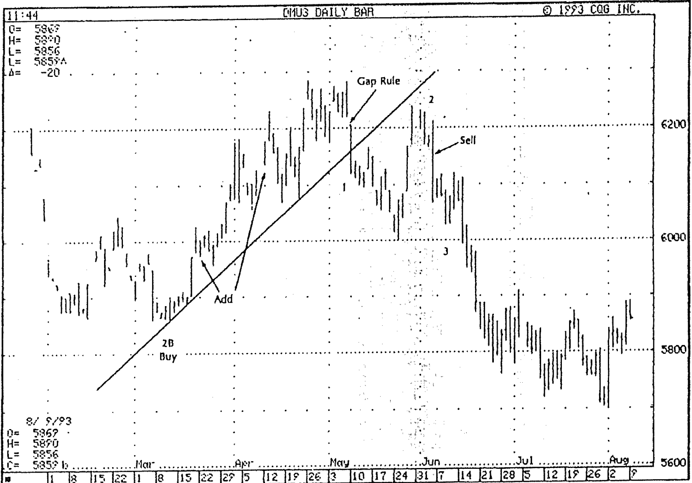

#### 8月份豬腌（圖11.8）

由於三天法則與缺口法則，你可以在1-2-3準則的「1」賣空，或是在「2」發生之後的三天法則出現時賣空。你可以在7月的2B反轉做多，並以31.75為停損，也可以利用缺口法則。

###### 圖11.8 8月份豬腌

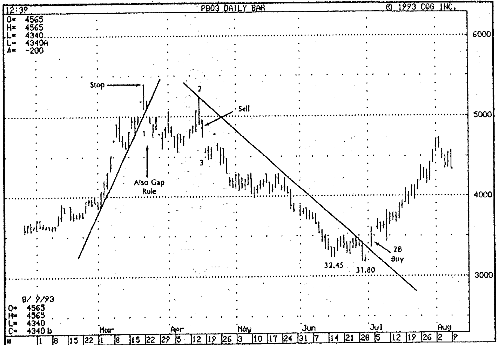

#### 道瓊工業指數週線圖（圖11.9）

1991年底「道瓊指數」在2839創新低之後，你可以在2861根據2B買進。1992年底，又出現另一個2B買進訊號。

###### 圖 11.9 道瓊工業指數週線圖

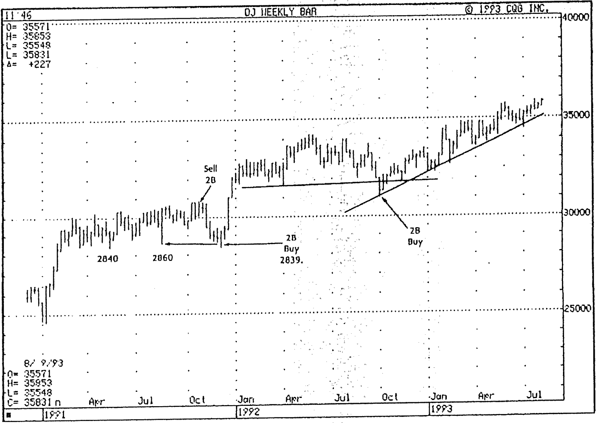

#### 12月份小麥（圖 11.10）

此處有一個典型的1-2-3訊號。在跳空開盤買進，並將停損設定在缺口被填補的價位。隨後，根據2B法則在328賣出。

###### 圖 11.10 12月份小麥

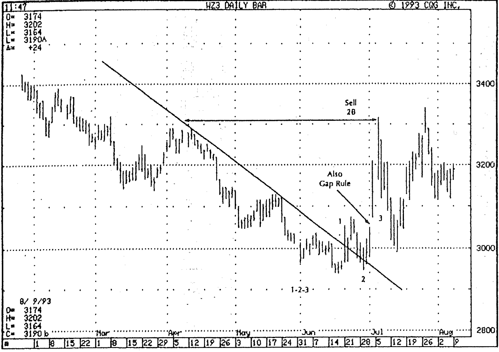

#### 9月份國庫券（圖11.11）

4月底出現2B賣出訊號，其次是1-2-3賣出訊號。6月則出現2B的買進訊號。

###### 圖11.11 9月份國庫券

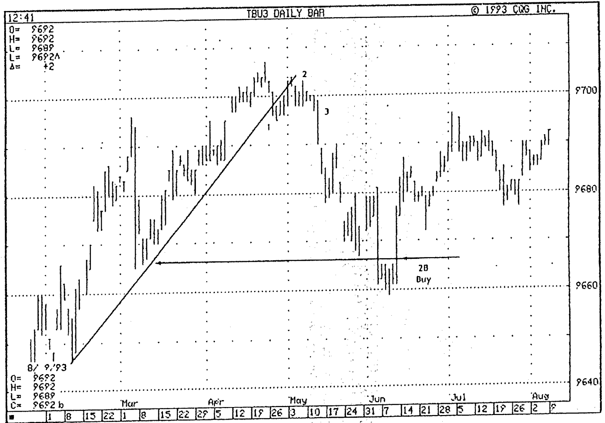

© Copyright 1993 CQG INC.

#### 天然瓦斯週線圖（圖11.12）

1992 年1 月出現2B 買進訊號。9 月，當價格測試1990 年12 月的高價失敗時，出現2B 賣出訊號。下降趨勢線被突破時，回補空頭部位。其次又發生另一
次2B 賣出訊號。

圖 11.12 天然瓦斯週線圖

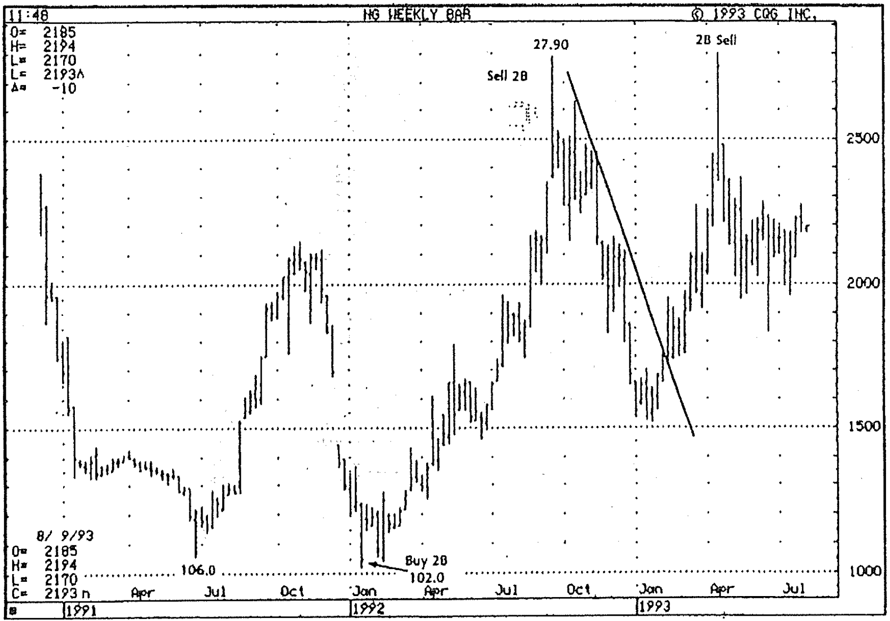

#### 英鎊週線圖（圖 11.13）

在1992年3月份的2B訊號買進。隨後，價格測試1991年2月的高價失敗，出現2B賣出訊號，接著又出現缺口的賣出訊號。如果你是喬治·梭羅斯，你已經因此而賺進數十億美元。

圖 11.13 英鎊週線圖

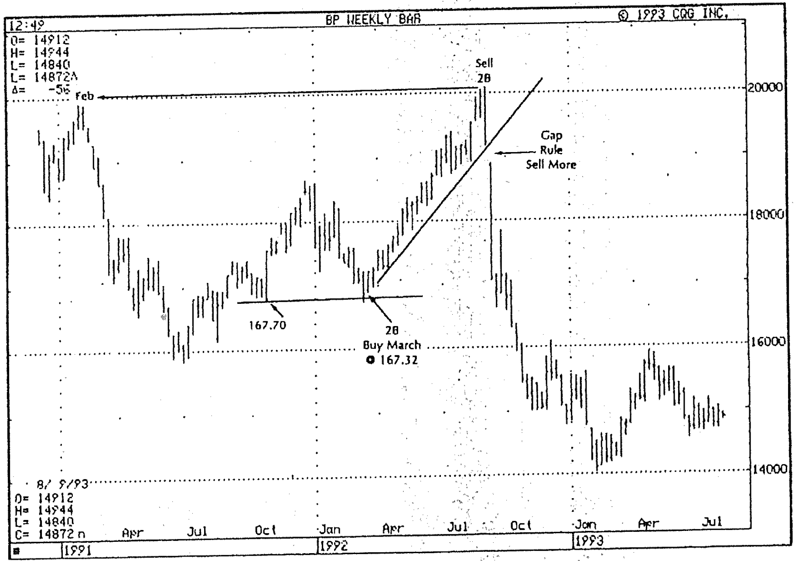

#### 9月份債券（圖11.14）

4月初根據2B買進。4月中旬根據2B賣出。5月根據2B買進，這是一個錯誤的訊號，稍後停損賣出，但同一天又加碼買進。持續做多至8月底。

圖11.14 9月份債券

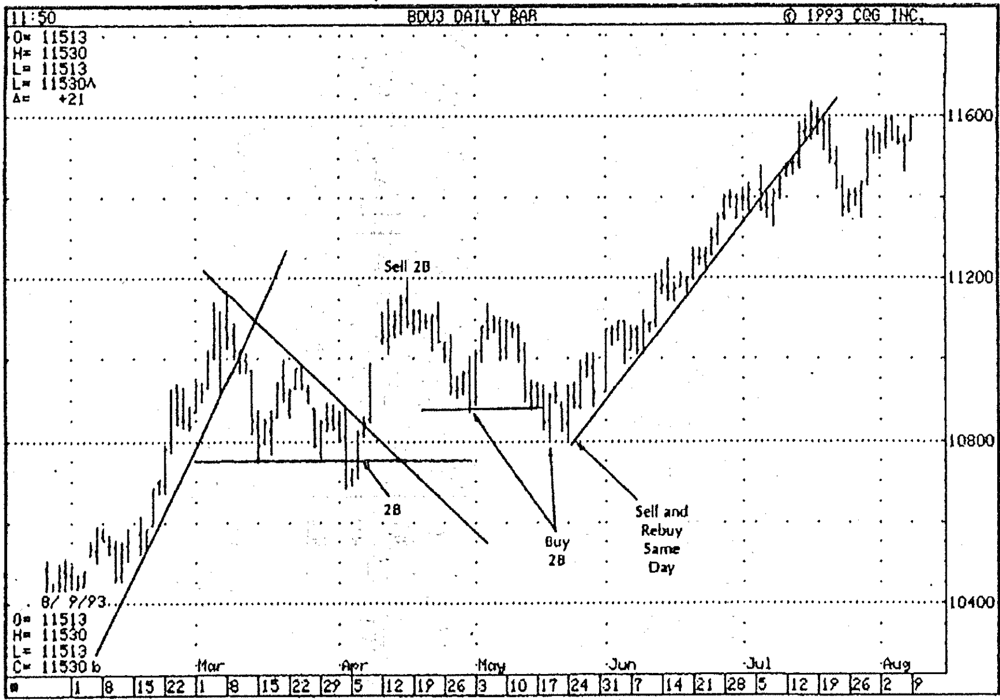

#### 12月份玉米（圖11.15）

3月首先出現錯誤的2B賣出訊號，4月停損回補。接著，在250附近又出現一個2B賣出訊號。你可以在隔天的跳空走勢中賣空——價格同時跌破近三天的低價。在5月初根據2B反轉做多，三天之後又根據2B反轉做空。然後，6月出現2B買進訊號，隨後又出現標準的1-2-3模式。最後，7月初再根據2B賣空。

圖11.15 12月份玉米

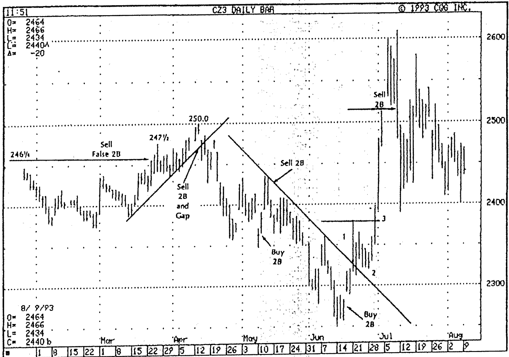

#### 11月份黃豆（圖11.16）

黃豆自從1992年10月便處於上升趨勢中。1993年6月份出現錯誤的2B買進訊號。接著，農產區出現大雨，在1993年6月16日是大量做多的機會，因為出現2B的買進訊號，而且基本面也非常配合——洪水。隔天，價格向上跳空，並穿越近三天的
高價。在點1，你應該加碼。在點2，價格向上突破先前的短期與中期高點時，你應該再加碼。7月的頭部，根據2B訊號賣出，然後直接前往巴黎渡假。

圖11.16 11月份黃豆

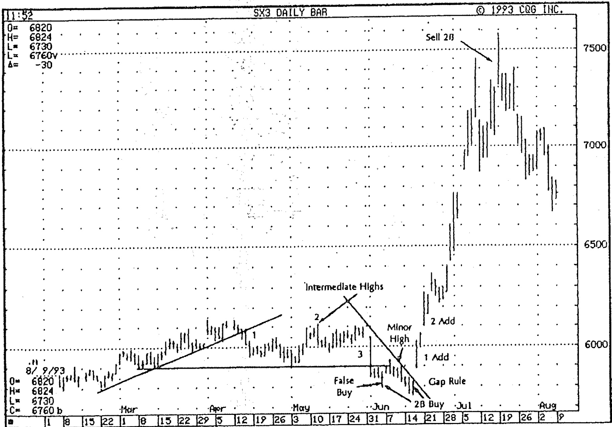

#### 9月份橙汁（圖11.17）

2月出現短線的2B買進訊號，3月出現短線的2B賣出訊號。然後出現向上的跳空缺口與1-2-3買進訊號！4月價格向下跳空而跌破趨勢線，這是明顯的賣空訊號。5月份出現跳空的買進訊號。價格在6月跌破趨勢線時，多頭部位無需平倉，因為這並不滿足1-2-3法則，仍然做多。

###### 圖11.17  9月份橙汁

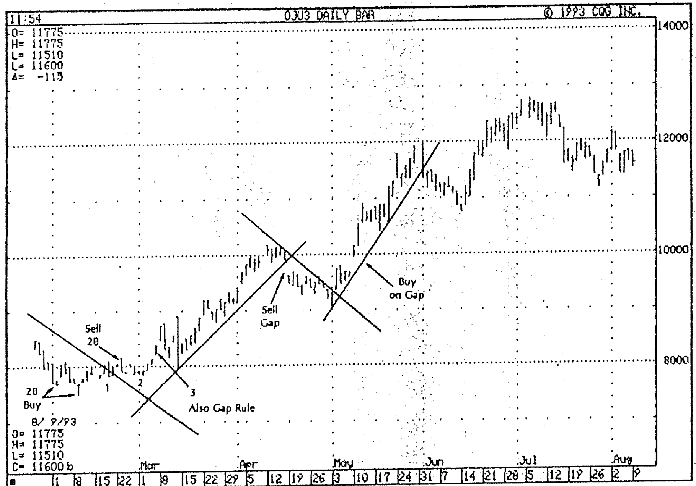

#### 價值線現貨週線與日線圖（圖11.18）

1992 年 10 月可以根據週線圖上的2B 訊號買進。在日線圖上，1993 年 2 月可以根據三天法則賣空，稍後再根據三天法則反轉做多。然後，四月初發生1-2-3 賣出訊號，四月底發生2B 買進訊號。在六月份，根據2B 賣出。三天向下跌破低點的法則並不適用，因爲價格走勢的幅度不夠大，天數也不夠長。

圖11.18 價值線現貨日線圖

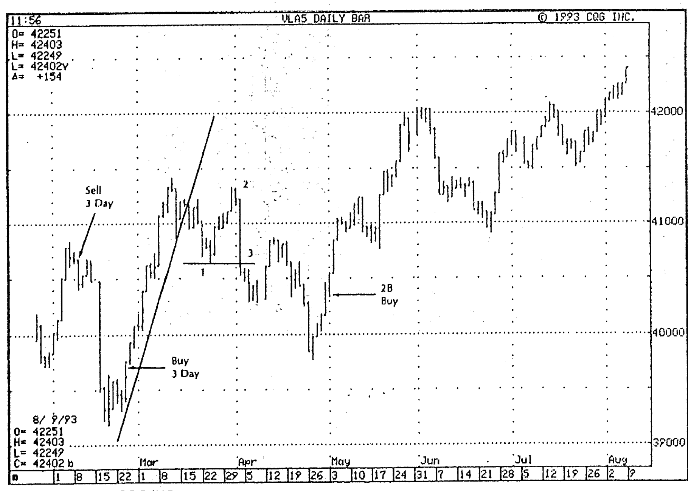

###### 圖 11.18 價値線現貨週線圖（續）

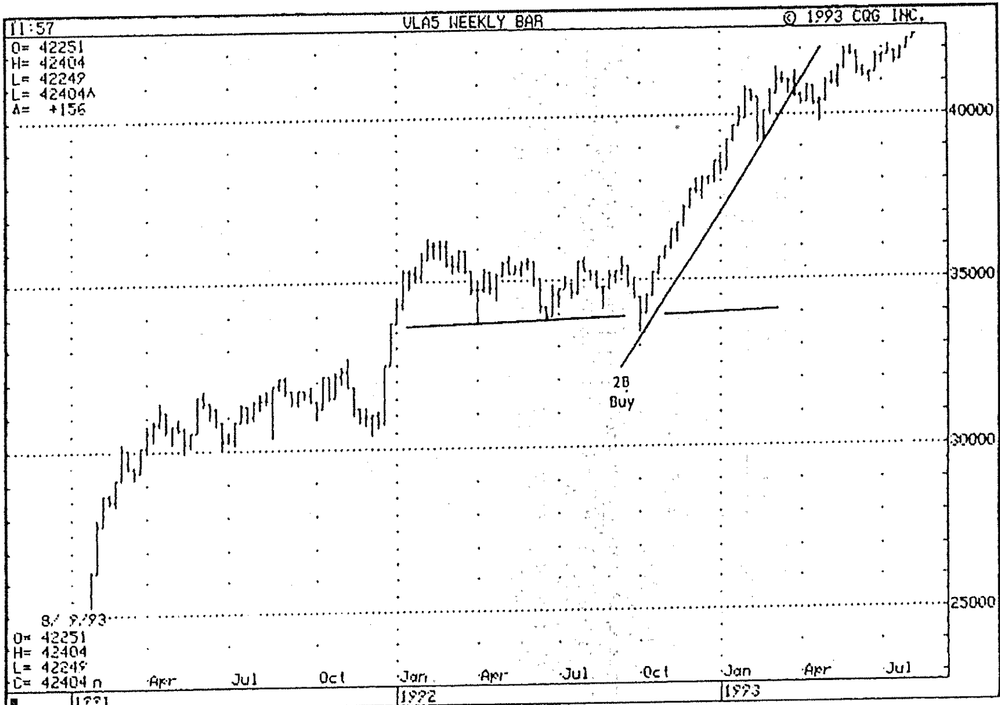

© Copyright 1993 COQ INC.


#### S&P 100（OEX指數）（圖11.19）

在1993年6月1日，根據2B法則賣空。繼續持有空頭部位，將停損由6月1日的高點，降低至6月29日的短期高點418.55。在7月份，根據2B法則反轉做多。

圖11.19 S&P 100

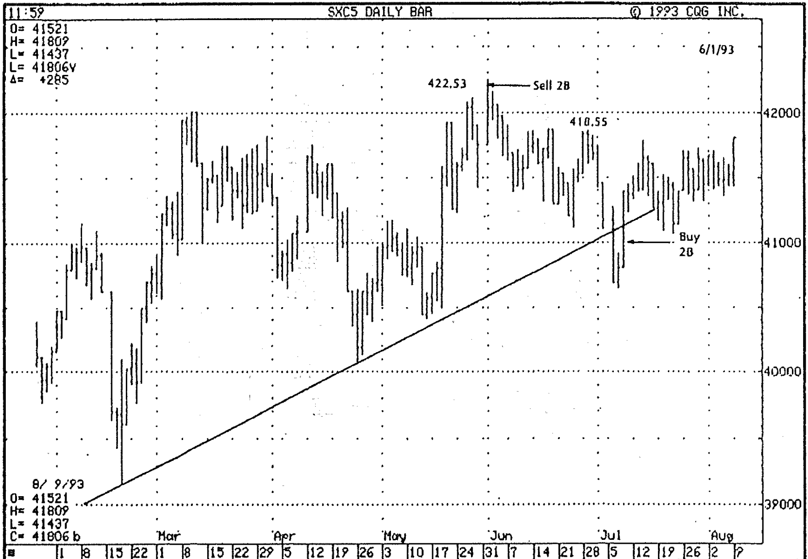

© Copyright 1993 CQG INC.

#### 日圓週線與日線圖（圖11.20）

在週線圖上，你在1992年6月的70.41買進，然後在年底的79.13出現錯誤的賣空訊號，稍後再於1月20日以81.13的價位賣空。往後，4月出現2B買進訊號，10月份出現2B賣出訊號，1993年1月又出現2B買進訊號。

圖11.20 日圓週線圖

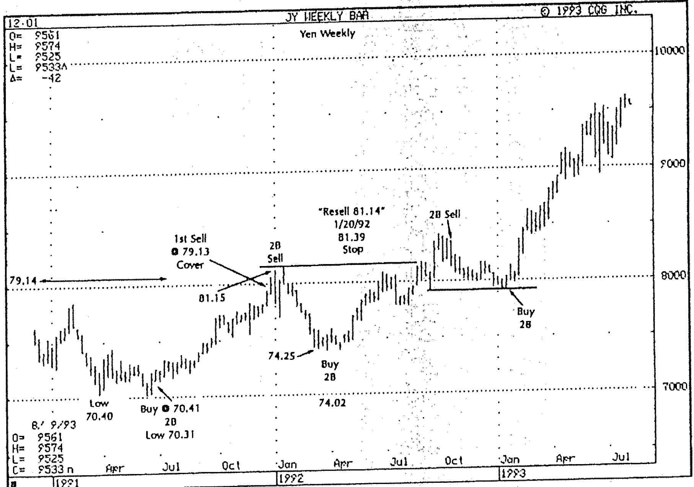

© Copyright 1983 CQG INC.

在日線圖方面，上升的趨勢非常明顯。在3月出現2B賣出訊號。請留意，跌勢僅維持一天。這是相當不理想的情況——你可以回補而保持空手。價格向上突破3月中旬的高點時，你可以做多。然後，在6月份根據三天法則賣出，並等待價格創新高而買進，或等待1-2-3法則的「3」；換言之，價格跌破6月的低點89.41時，則賣空。目前保持空手！

##### 圖 11.20 日圓週線圖（續）

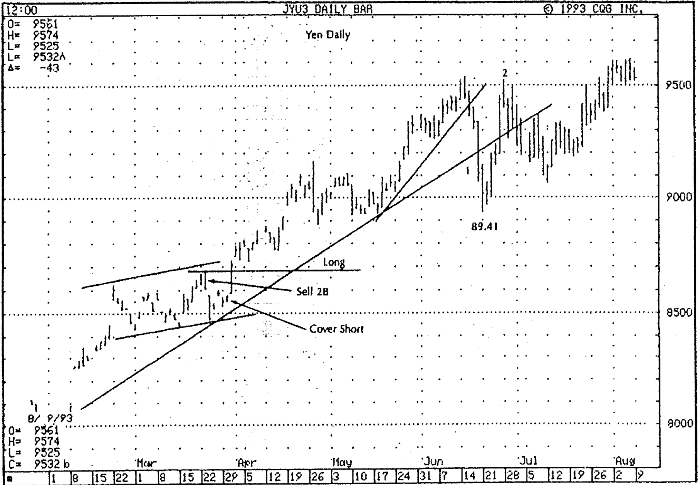

#### 商品研究局指數現貨（圖11.21）

在5月的2B買進，並在次一個2B賣出，然後遵循1-2-3的買進訊號。

##### 圖11.21 商品研究局指數現貨

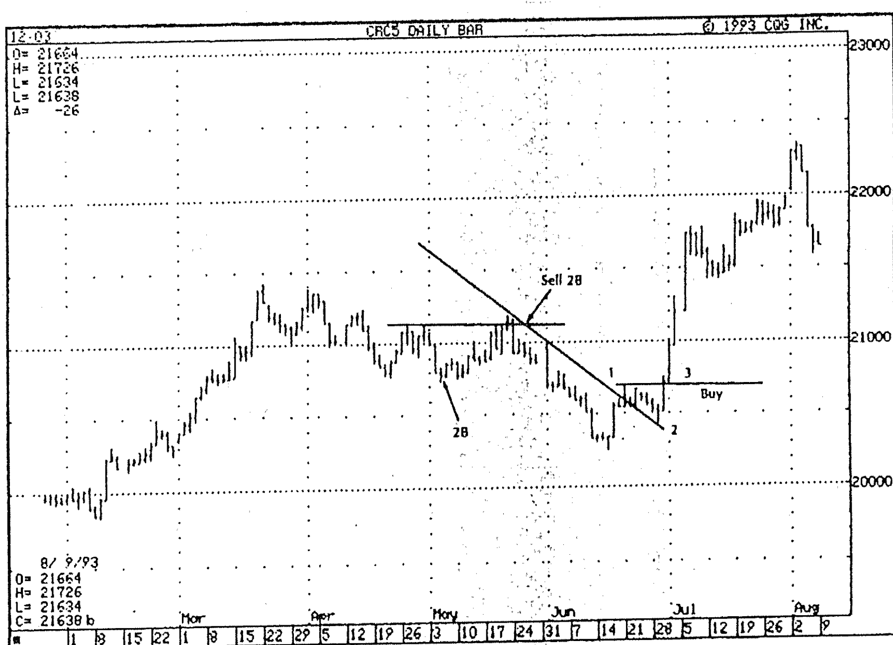

© Copyright 1993 CQG INC.

#### 12月份小麥、12月份玉米與11月份黃豆的相對強度（圖11.22）

請留意，小麥未能突破1月－3月的高價而創新高點，但玉米與黃豆則創新高價。所以，小麥的走勢是三者中最弱者。玉米突破1月份低價而創新低，而黃豆的走勢則未創新低。這顯示黃豆的走勢最強，其次是玉米，而小麥最弱。一種常見的策略是在價差交易（spread）中，賣空最弱者，買進最強者。圖中也顯示4月底的2B訊號。務必記住：永遠要買進最強勢者而賣空最弱勢者。

##### 圖11.22 三種商品的相對強度

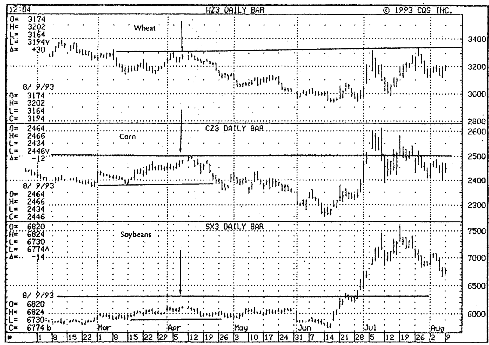

##### 圖 11.22 價差日線圖（做多11月份黃豆/賣空12月份小麥）

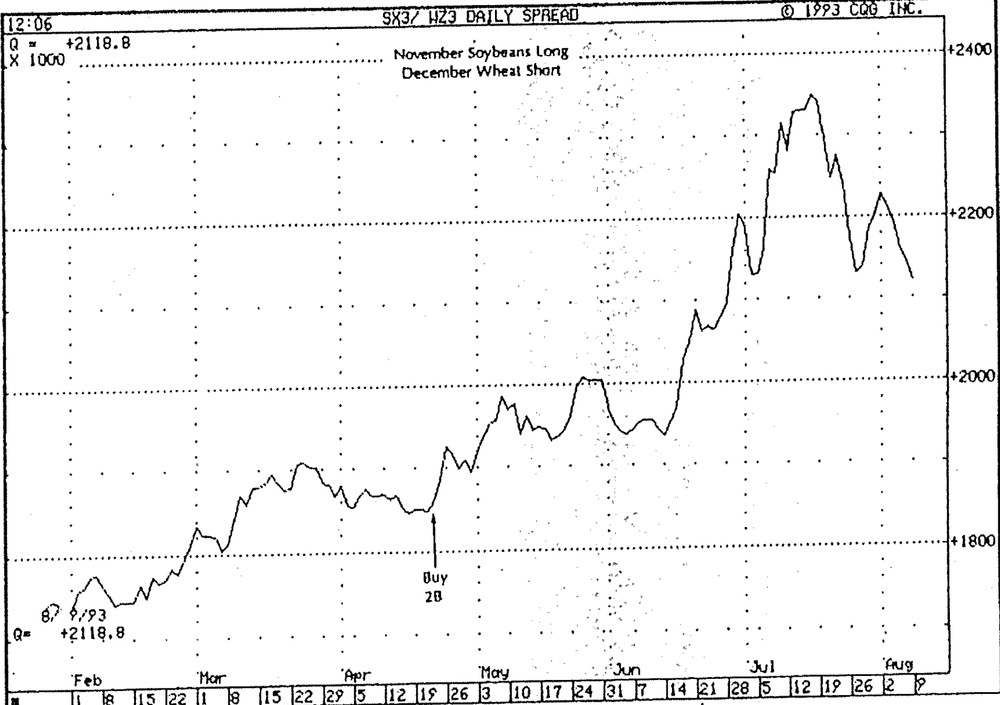

© Copyright 1993 CQG INC.

#### 木材週線與日線圖（圖11.23）

在週線圖中，1992年底出現典型的1-2-3買進訊號。你也可以運用日線圖上的三天買進法則。在日線圖中，唯一的賣出訊號發生在向下跳空跌破趨勢線的缺口，它也構成一個短線而重要的1-2-3賣出訊號。這項賣出訊號之所以重要，是因為缺口與短期低點的測試是發生在相當大的漲幅之後。先前（上漲）走勢的幅度愈大、時間愈長，隨後的1-2-3（賣出）訊號便愈重要。此外，這份走勢圖相當明白：在低點買進，在高點賣出。如果以三天法則做為交易系統，則在1月至6月的走勢中，每口契約可以獲利1.5萬美元。我並未以它做為交易系統；因為我總是採納整合性的交易法則。

##### 圖11.23 木材日線圖

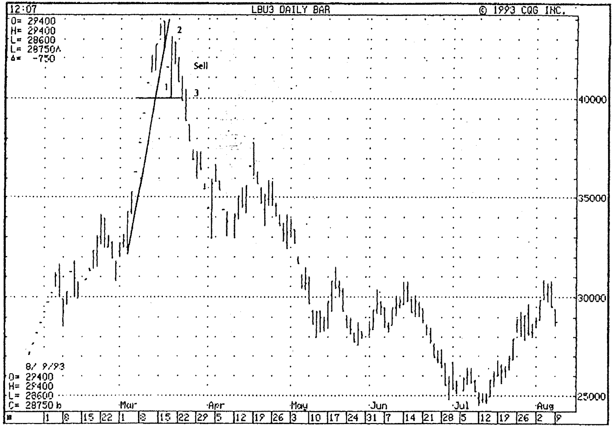

##### 圖 11.23 木材週線圖

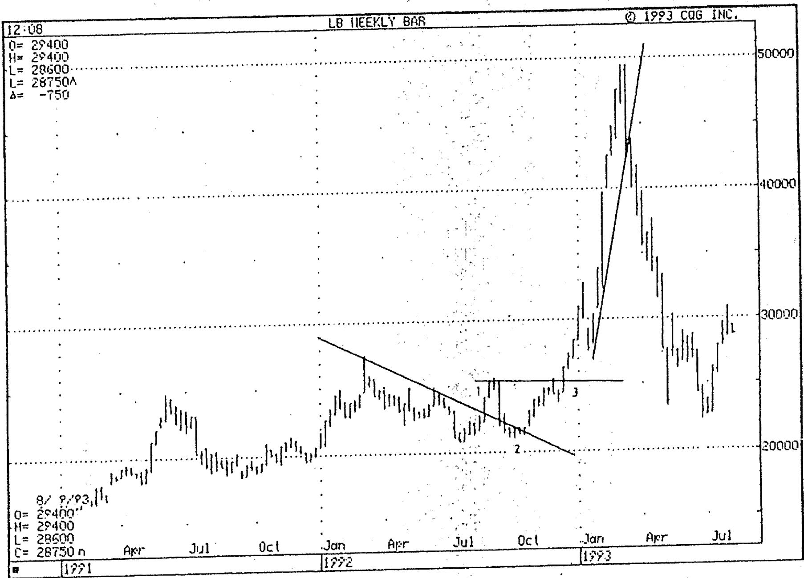

#### 日経現貨（圖11.24）

在長期的空頭走勢之中，出現典型的1-2-3買進訊號。

##### 圖 11.24 日経現貨週線圖

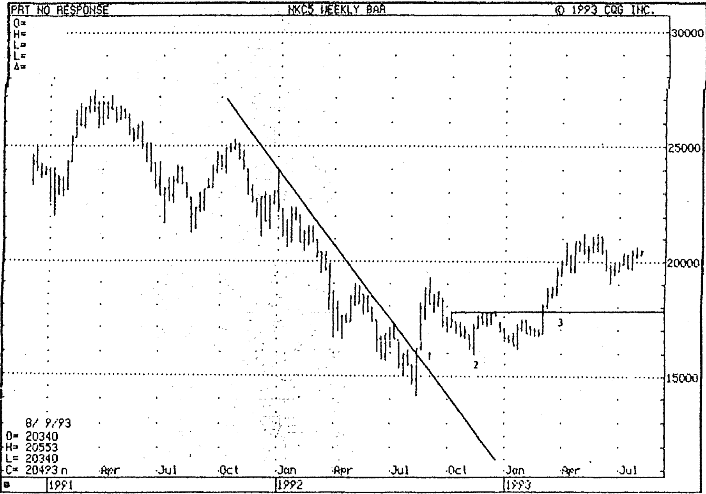

## 第III篇
選擇權交易

### 第十二章

#### 選擇權：三位數報酬率的交易工具

許多場內交易員，尤其是年輕的交易員，他們非常喜愛銷售未經抵補的選擇權（naked options）。「那些傻瓜，」這是指選擇權的買家，「他們只是不斷地提供資金，我則不斷提供一些最後毫無價值的選擇權。」在一年的11個月裡，他們銷售選擇權的成功比率高達90％，但在最後一個月，市場突然出現10％以上的行情，他們必須吐回先前的利潤，或賠上老本，甚至於破產。

「華爾街」存在一種共識，買、賣選擇權是金融業內風險最高的遊戲。「專家們」認為，你絕對沒有勝算；因為在選擇權的交易中獲利，你不僅必須精確地判斷價格走勢，你還必須掌握完美的時效。反對者經常引用「證券交易委員會」1960年的一項研究，選擇權的買家發生虧損的比率超過85％。然而，這項研究涵蓋的期間僅有一季，而且當時的行情非常沉悶。

不可否認地，在選擇權的交易中獲利，挑戰性確實超過股票、債券與其他的交易工具。雖說如此，但選擇權始終是我最偏愛的交易工具。我的交易生涯便是由選擇權開始。1968年1月，我在Filer Schmidt & Company擔任選擇權交易員，從事所謂的「中間人」工作，仲介櫃台交易的選擇權。1968年3月，我開始管理第一個避險基金：透過一個規模5萬美元的選擇權

投資組合，我規避價值100萬美元股票投資組合的風險。我開始瞭解選擇權交易的獲利潛能。

在正確的運用下，選擇權俱備數項其他交易工具不及的優點：

- 1. 它們使你可以絕對控制（下檔的）風險，並享有（上檔的）潛能。
- 2. 它們使你能夠以小量的資本，控制大量的市場資產；它們可以提供最大的財務槓桿效果。
- 3. 它們使你可以根據最低的風險，設計一套彈性的交易策略。
- 4. 行情的波動轉為劇烈時，選擇權權利金的波動幅度與速度都經常超過根本交易工具，所以獲取卓越績效的可能性可以大幅提高。

唯一的問題是：你必須知道在何時買進何種的選擇權。本章希望就這部份內容加以說明。

##### 侷限風險

我開始交易以前，我經常玩撲克。我閱讀許多這方面的書籍，並發現撲克不是一種賭運氣的遊戲，輸贏的關鍵在於風險與勝算的管理。撇開唬人 sidenote，如果你可以根據掌握的勝算下注，並管理資金而使自己得以繼續留在賭桌上，則你便居於贏面。這並不是說你可以贏每一手牌，完全不是如此。然而，如

果你可以永遠掌握勝算，並依此下注，長久下來，你一定可以成為贏家。

選擇權的交易也是如此。為了獲得成功，你不可以只是坐下來，隨意下注，而把其餘的一切都交給老天爺。你必須知道勝算，你必須發展一套下注的策略。就衡量勝算來說，本書介紹的所有原則都適用於此，包括市場平均壽命的架構在內。

讓我以目前的情況為例說明。撰寫本文的時候（1993年6月），我們處於多頭市場中，一個起始於1992年10月9日的中期上升走勢。「道瓊工業指數」在起漲點的收盤價為3136.58，OEX（S&P 100）在當天的收盤價為368.57。我們必須瞭解，唯有一個次級的中期修正走勢才可以終止目前的中期上升趨勢。我們稱修正走勢為「次級」，因為它與目前的長期趨勢在方向上相反。在多頭市場中，次級修正走勢的折返幅度通常是前一個主升段（就目前來說，這是起始於10/9/92年的走勢）的三分之一至三分之二。根據表9.1（第九章）的資料顯示，中位數修正走勢的期間為47天，幅度為前一主要波段的48％（就「工業指數」與「運輸指數」的平均值而言）。

1993年6月，在基本面與技術面上都有明顯的證據顯示市場正在做頭。上升趨勢已經持續235天（10/9/92-6/1/93）。在1982年9月30日至1993年6月1日之間，這是未出現次級修正走勢而延伸最長的主要上升波段。在這種情況下，這是一個年齡已經很老的走勢，它隨時有可能一口氣喘不過來。就我們目前的討論而言，其他基本面與技術面的做頭徵兆並不重要，所以讓我們假定價格走勢隨時都可能拉回，而你決定賣空。於是，

目前的問題是：你應該怎麼做？

你可以融通一倍的資金來賣空股票。你可以賣空S&P期貨，但你必須承擔行情暴漲的風險，萬一你的判斷錯誤，你必須承擔無限的風險。或者，你可以買進股票指數的賣出選擇權（puts），這可以絕對控制風險，同時享有無限的獲利潛能。由風險-報酬的角度衡量，選擇權當然是最理想的賭注。

可是，應該買進那一種的選擇權呢？交易選擇權時，你永遠必須記住一個關鍵性的問題：市場會在哪一段期間，出現多大的走勢（在這個例子中，多大的跌幅？）？你的選擇將由這個問題的答案來決定。

目前情況下，我認為OEX（S&P 100）賣出選擇權是最適當的對象。在1992年10月9日至1993年6月2日之間，OEX指數由368.57上漲至420.63，上漲幅為14.2％。我們已經決定股價下跌的勝算相當高，所以我們必須判斷未來30天的可能跌幅。中期修正走勢通常會持續45天（表9.1），最大的跌勢會發生在最初的30天內，所以我們可以買進一個月的選擇權，需要的時候再展延。

###### 表12.1 道瓊工業指數——月份價格波動的比較

###### 1939年1月——1993年5月

這份表格顯示「道瓊工業指數」每月份的價格變動百分率。整體54年被劃分為五個相等的期間，每個期間都涵蓋大約126個月，然後列示每個期間內價格變動百分率的分配情況。根據表格內的資料，你可以知道每一期間的價格波動情況，並用以推估未來價格波動的可能發展。例如，如果你將過去54年的資料平均，可以發現月份價格波動介於0.0%−1.9%區間的機率有42.1%。自從1984年1月以來，這項機率已經稍有增加而成為45.1%。如果你銷售未經抵補的選擇權，可以利用這項資料來評估你的勝算。請留意，自從1973年1月以來，價格波動區間8%−9%與10.0%+的機率明顯增加，而4%−5.9%區間的機率則減少。這顯示，在某月份內，價格如果已經出現4%−5.9%的波動，價格波動很可能進一步增加。如果詳細分析表格內的資料，你還可以有其他的發現。

| 價格波動區間 | 1/39-6/49 (%) | 7/49-6/62 (%) | 7/62-12/72 (%) | 1/73-12/83 (%) | 1/84-5/93 (%) |
|---|---|---|---|---|---|
| 0-1.9 | 38.9 | 35.2 | 47.6 | 43.9 | 45.1 |
| 2-3.9 | 25.4 | 38.4 | 21.4 | 25.0 | 21.1 |
| 4-5.9 | 21.4 | 19.2 | 21.4 | 14.4 | 16.8 |
| 6-7.9 | 9.5 | 4.8 | 7.2 | 7.6 | 8.0 |
| 8-9.9 | 2.4 | 2.4 | 1.6 | 3.0 | 6.2 |
| 10+ | 2.4 | 0.0 | 0.8 | 6.1 | 2.7 |

表12.1列示「道瓊工業指數」從1939年1月以來月份價格波動的機率分配情況，這使你可以推估未來價格波動的可能情況。自從1984年以來，市場在單月份內出現至少2%價格波動的機率為54.9%（100%−45.1%），出現至少4%價格波動的

機率為33.8％。這項分配自從1939年以來便相當穩定，但我特別強調最後一欄的資料，因為電腦程式交易出現於這段期間。雖然電腦程式交易對於長期趨勢的影響力頗值得懷疑，但絕對可以影響短期行情。所以，如果行情在30天內至少下跌2％，則購買賣出選擇權的策略便可以持平，或甚至有些許的獲利。

目前，OEX的收盤價為420.63，而「OEX7月份415賣出選擇權」（7月份到期，履約價格為415）的收盤價為47/8。這項選擇權的「溢價」（out of the money）幅度為1.3％，還有44天到期。如果行情下跌2％，則OEX指數為412.22。在這個指數水準下，「415賣出選擇權」的價格可能在4½到5之間，這取決於當時的價格波動程度，以及還有多少到期時間。在另一方面，如果行情在30天內下跌4％，則OEX指數為403.18，「415賣出選擇權」的價格至少為11¾——獲利在一倍以上！根據表9.1的資料顯示，中位數的修正走勢幅度為前一主要波段的48％。就目前的例子來說，這相當於是6.8％的跌幅，在這種情況下，OEX指數為392.08，而賣出選擇權的價值至少為23，這幾乎是原來投入成本的五倍。

7月份的賣出選擇權相當理想，因為到期時間還有44天，這約略等於表9.1中修正走勢期間的中位數。這筆交易投入的資金不可以超過風險資本的3％。例如，如果你的風險資本是10萬美元，你應該以487.50美元的價格買進六口賣出選擇權。賣出選擇權在415的價格履約時，這項價值2,925美元的投資，相當於賣空價值246,075美元（=[415 × 100 × 6] − 2925）的OEX指數（大約是總風險資本的2.5倍）。

未來30天內，如果行情沒有變化或上漲，你的損失相當有限。交易選擇權時，我採取一個明確的原則：任何一個選擇權部位，規模絕對不超過風險資本的10％。一般來說，我投入的資金都在1％至3％之間；對於大多數交易者來說，我建議投入的資金約為2％至3％。然而，我強烈認定行情將出現大幅的走勢時，我可能投入10％的資金，例如：在1987年的「黑色星期一」之前，以及在1989年小崩盤之前。

我將選擇權的交易規模限制在相當小的範圍內，所以我判斷正確的比率不需很高便可以獲利。唯有掌握明顯的勝算時，我才交易，而且我將風險-報酬比率限制為至少1：5，並採取小量的投資，所以我的判斷若維持在每4次正確1次便可以獲利。我手風很順時，獲利將非常可觀。如果我的判斷維持在每4次正確1次，我還可以勉強獲利。如果手風很差而判斷每6次正確1次，我還有足夠的資金參與遊戲。

讓我們回到先前的例子。OEX指數在1993年7月7日跌至406.50而後展開反彈。此後，你隨時都有獲利了結的機會。所以，真正的修正走勢並未出現，但這筆交易仍然小有獲利。

例如，在1992年的新罕布夏州初選之前，我與一位投資者討論有關生化科技股與藥品股在整個1991年的飆漲走勢。他持有相當大的投資組合，並要求我評估相關的下檔風險。我告訴他，我看空這些類股，並提出我的理由，我認為如果布希總統在這次初選中輸給布奇南，則市場至少應該下跌5％-10％。在聽過我的解釋以後，他要求我為他價值280美元的多頭投資組合避險，並開立一張7.5萬美元的支票給我。我在個股與OEX賣

出選擇權中分別建立相當於200萬美元與400萬美元的避險部位，投入的資金俏不滿7.5萬美元。

結果，布奇南的表現雖然相當不錯，但他仍然輸了，市場幾乎沒有什麼反應，僅在選舉當天下跌20點左右。然而，由於我買進的個股賣出選擇權都是我原本便看空的股票，而且我又在選舉結果證明我的判斷錯誤時，立即出清所有的選擇權部位，所以我在幾天之內還是賺進了2.5萬美元。我有效管理我的勝算，並在盡可能有利的情況下投入資金，所以即使我假設的情節發展沒有實現，但我在整體15個部位中，只有一個部位發生損失。在另一方面，如果布奇南因為賭爛票而獲勝，市場至少應該下跌5％，我可以獲得可觀的利潤。這便是我偏愛選擇權的理由。

另外，在某些情況下，選擇權可以讓你以小量的資金進場一博，雖然你沒有明確的證據顯示這是一個適當的交易機會。這就像撲克中的唬人。例如，在1992年3月初，咖啡創17年以來的低價，5月份契約跌至66.25。由技術分析的角度來說，情況非常不理想。就基本面來分析，結果也沒有什麼不同。然而，猶如我在電話諮詢熱線中的評論：「雖然沒有任何理由買進5月份的咖啡，但當它創17年來的新低，勢必會反彈。」我建議買進「5月份80的買進選擇權」（5月份到期，履約價格為80），當時的每口價格為75美元。大約一星期之後，5月份期貨價格反彈至71.50，而選擇權的價格為243美元。運氣？或許有一些！直覺？當然！這是一場賭博，但它是 我承受得起的賭博。我僅憑直覺而投入0.25％的資金。

我必須強調一點，在上述的例子中買進咖啡的選擇權，這直接違反了我的交易法則：「不可僅因為價格偏低而買進。不可僅因為價格偏高而賣出。」①可是，如果投入的資金非常有限，則可以僅根據直覺進場一博，因為即使發生虧損也非常有趣，但不可以養成這種習慣。如果你習慣於根據渺茫的機會來交易，結果將不堪設想。

##### 維克的選擇權交易守則

- 1. 保持偏低的交易規模：投入的資金為風險資本的2％-3％。
- 2. 唯有掌握勝算時才交易。
- 3. 風險－報酬比率至少為1：5。
- 4. 不可僅因為價格偏低而買進。不可僅因為價格偏高而賣出。

我並不建議各位專注於選擇權的交易，而忽略其他金融交易工具。在中期趨勢的發展過程中，每一種投資組合都應該包含表現相對強勢的個股。然而，在市場的轉折點附近，尤其是當時的價格波動相當劇烈的話，選擇權最能增加獲利，並降低風險。理由在於財務槓桿效果。

##### 市場心理的重要性

打從一開始，我的選擇權交易方法便不遵從傳統的模式。

1966年至1968年之間，「華爾街」大約有15或20家的選擇權交易商，它們並不是以目前金融圈內的方式經營這方面業務，而是把選擇權當做二手車來買賣。價格幾乎都是在一對一的情況下來訂定，而許多交易商都會欺騙客戶而收取較高的權利金。這些交易商並不在意市場的行情變化，因為他們僅希望賺取買、賣報價之間的價差。所以，大多數選擇權的交易商都失敗了；畢竟，如果交易商僅是試圖剝削客戶，這種生意絕對做不久。

猶如我在《專業投理原理Ⅰ》一書中的解釋，當時的交易程序大致如下：

某甲打電話給「ABC選擇權公司」，要求提供OXY（Occidental Petroleum）股票6個月又10天的買進選擇權報價時，這並不保證他可以根據報價買進該選擇權。此外，如果他打電話給另一、兩位交易商，則他可能發現價格有20％-30％的差異！交易商提供給某甲的報價假定為每口契約225美元，這只是「參考價」（workout price）而已，交易商隨後將尋找願意接受150-175美元價格的賣方。如果可以找到，交易商即可以扮演中間人的角色，將低價買進的契約轉賣給某甲。如果交易商無法在合理價格找到賣方，只能算運氣不佳而毫無所得。②

當時，我曾經在幾家公司從事選擇權的仲介工作，績效相當不錯（我自己也交易選擇權與個股）。然而，當我發現大多數選擇權交易商的經營方式時，我認為我能夠由完全不同的角度來經營——扮演真正的造市者（market maker）角色。在幾

位合夥人的支助下，我在1971年中成立「雷納選擇權公司」（Ragnar Options Corp.）。當時，我已經非常擅長於判讀盤勢，並知道如何判斷市場的趨勢。所以，我們不再單純地仲介選擇權，而且自己也交易選擇權。我們採取一種革命性的做法，對於任何的選擇權，我們都提供所謂的「合理的明確報價」；換言之，我們擔保客戶可以根據報價來買、賣選擇權。如果我們可以找到價格更理想的對應選擇權，我們仍然仲介。如果我們找不到理想的選擇權，我們便自行銷售。所以，我們的業務急速擴展。當我們開張時，「雷納」是第27家選擇權交易商；六個月以後，我們已經是全世界選擇權店頭市場交易量最大的交易商。

我們在市場中始終佔有舉足輕重的地位。1973年4月，「芝加哥選擇權交易所」成立，並集中交易標準規格的選擇權時，我們買進數席會員席位。這個時候，選擇權的經營開始出現明顯的變化。大多數公司都是根據價格波動與時間衰耗的模型，而由統計學家、數學家與經濟學家訂定選擇權的價格，最著名的模型是Black-Scholes Model。從一開始，我便不贊同根據數學模型來訂定選擇權的價格；在「雷納」，我們繼續根據我個人對於市場趨勢的判斷，以及市場的供、需情況來訂定選擇權的價格。

我之所以不贊同數學模型，這是因為它們無法處理選擇權訂價上一項最重要的因素，我稱爲「權利金的心里成份」。例如，如果某選擇權的價格爲300美元，這反映選擇權銷售者在合理的風險-報酬考量下，判斷根本交易工具將在什麼期間內，呈現多少幅度的漲勢或跌勢。一旦你買進這項選擇權之後，假

定其他條件不變，隨著時間的經過，權利金會下降。然而，如果根本交易工具的價格波動非常劇烈，權利金的時間成份便不是重要的考量因素。在這種情況下，權利金的主要驅動力量是市場心理，而不是時間因素，這將導致數學模型的失敗。你不能根據過去的資料來賺錢（譯按：選擇權的數學訂價模型採用五種變數：根本資產的當時價格、履約價格、距離到期日的時間、利率與價格波動程度，前四者都是既定的數據，而價格波動是指歷史價格波動而言。所以，以數學模型訂價，相當於根據過去的資料訂價）。

我交易選擇權時，會考慮時間因素，但我考慮的角度與大多數交易者不同。我並不將選擇權的價格視為是由內含價值與時間價值所構成，我將它視為是在某期間內從事純粹槓桿操作的權利。如果經濟基本面、技術面、平均壽命架構、以及市場的心理狀況，一切都顯示市場在未來幾天內將出現重大的跌勢，我會買進到期時間很短的溢價賣出選擇權。

例如，在1992年3月2日，我深信布希總統在隨後的所有黨內初選中都會失敗，並對市場造成非常的影響。當時，OEX指數為384.65，我能夠以31/8的價格買進「3月份OEX380的賣出選擇權」。換言之，我能夠以315.20美元的代價而在幾個星期內控制價值38,465美元的資產——槓桿倍數相當於1：121。如果我對於初選結果與市場反應的判斷都正確，我可以脫手或履行選擇權，並享有資產價格變動的全部效果，而僅需要負擔不到1%的成本。以另一種方式來說，如果我管理一個規模為100萬美元的投資組合，我能以大約3.2萬美元的代價，賣空或避險四倍於投資組合價值的資產。

當然，如果價格沒有發生波動，則上述的槓桿效果也毫無用處。基於這個理由，在整個1991年裡，我並沒有因為交易選擇權而獲得可觀的利潤。整年內，經濟基本面非常不理想。在數個場合中，統計分配與技術面也顯示市場將出現巨幅的下跌。市場在經濟復甦的預期下而走高，但經濟復甦始終不曾出現。然而，整年度內，股價大多都處於高點的5%交易區間內。

我知道，利率走低是主導行情的主要想法。我也瞭解，降低利率並不足以立即刺激經濟復甦，這是當時市場不瞭解的事實。僅有一點是我所不瞭解的：市場參與者對於Fed能夠創造奇蹟的這項信念究竟還能夠持續多久。每當不佳的經濟資料公佈時，市場便趨於下跌，但Fed立即放寬信用，然後市場又恢復漲勢。最後，11月行情跌破10月份的低點時，似乎顯示市場已經失去信心，而且「道氏理論」也確認行情進入空頭市場。在12月份的反彈走勢中，我利用選擇權大量做空，認定市場將拉回，並持續空頭市場的主要下跌波段。然後，Fed採取一項史無前例的動作，在12月中旬調降貼現率一整個百分點（相當於是22%的調幅，這是歷史上最大的調降幅度），於是市場在兩個星期內飆漲10%。這是「道氏理論」首次發出錯誤的空頭市場訊號，而我的選擇權在數天之內便幾乎一文不值。

這次的經驗讓我想起一段話，但我忘記它的出處：「市場非理性行為持續的時間，可以遠勝過你的資金所能延續的時間。」換言之，即使你較市場更瞭解經濟的基本狀況，這沒有任何的益處，除非這項知識可以讓你更精確地判斷價格趨勢的變動。即使你擁有勝算，你仍然需要掌握市場的心理脈動，為

了辦到這點，你必須順著市場主要看法驅動的技術趨勢。市場對於未來的看法——而不是事實——才是價格的驅動力量。在我的交易生涯裡，缺乏這項認知，對我造成的傷害最為嚴重。

##### 瞭解機構投資者的心理

「道氏理論」在整個96年的歷史中，首次發出錯誤的空頭市場訊號，這也凸顯另一項事實。自從1982年以來，市場便開始受到機構投資者的顯著影響，這對於評估市場心理具有重大的意義。數以十萬計、甚至於百萬計的個別投資人，他們的判斷已經被少數機構基金經理人的判斷取代，後者大多會根據類似的資訊做出類似的反應。所以，大多數的市場價格波動都是由消息面主導。例如，如果大多數的機構基金經理人都相信利率調降將導致經濟復甦，當Fed宣佈調降利率時，股票價格將走高。如果你瞭解機構投資者對於新聞的反應，而且你又能夠預先判斷新聞的發展，你便可以預知價格的走勢。所以，如果你希望在選擇權的操作中獲得理想的績效，你必須同時能夠預測市場心理與新聞。

機構投資者的心態對於選擇權的訂價也有重大的影響，尤其是指數選擇權。例如，在1991年1月16日，「波斯灣戰爭」剛要爆發以前，我看多當時的中期走勢，並預期會出現一波空頭市場的反彈。當時，OEX的指數為295，我希望買進「2月份305的買進選擇權」。它們的價格是53/4！我還記得當時的想法，「他們一定知道什麼消息，」「他們」是指機構的基金經理人而言。以到期時間僅有一個月而溢價10點的選擇權來說，這個價格實在太離譜，所以我放棄了。另外，我認為戰爭會發

生在星期五晚上，因為當時市場會連續休息兩天。我的判斷錯誤。戰爭在星期三晚上爆發，而聯軍顯然立即掌握制空權。隔天，市場上漲150點，如果我決定接受超高的權利金，則獲利將非常可觀。

1992 年 3 月 3 日的情況則相反，當時的 OEX 現貨指數為 384.65，而「3 月份 395 買進選擇權」的權利金為 15/16 —— 這是較正常的價格。我並不看多行情，機構基金經理人也是如此，所以你可以瞭解市場心理對於選擇權訂價的影響。

機構基金經理人在避險、套利與電腦程式交易時，都偏愛採用指數選擇權，而不喜愛個股的選擇權。由於機構投資者擁有龐大的資產，市場的交易量大多來自於機構投資者，所以個股選擇權的需求量大減，它們的價格也相對低廉。這是簡單的供、需原理 —— 需求降低，代表價格低廉。可是，低廉的價格並不代表價格的波動程度便降低。所以，我的交易重心已經由指數選擇權轉移至個股選擇權，而且結果相當不錯，我先前就新罕布夏州初選的交易便是一個例子。

運用第十一章解釋的方法，你可以選擇與大盤有類似走勢而價格波動更劇烈的個股。然後，在這些個股中，你可以進一步篩選市場流動性較佳的選擇權，它們的績效通常優於指數的選擇權。事實上，你可以追隨這些大型機構建立的市場趨勢，並以較低的價格買進更高的槓桿效果。

一般來說，對於市場普遍認同的趨勢，選擇權並不是一項理想的交易工具。如果你希望以選擇權來創造最大的利潤，你必須領先市場，而且你必須非常精確地瞭解你領先的程度。你

必須掌握正確的時機，在每個人都不想要選擇權的時候買進，並在每個人都想買進的時候賣出。這便是「梭羅斯」的機會——順著錯誤看法的趨勢操作，並在看法改變之前及時脫身。選擇權是這方面最理想的交易工具。

##### 時間的進一步考量

運用我先前講解的原則，你通常可以相當精確地預測行情的發展情節。可是，在選擇權的交易中，你不僅要瞭解行情的發展情節，你還必須知道它們「何時」發生。在某些情況下，這並不困難。例如，1987年10月貝克（James Baker）宣佈，他將聽任美元對日圓與德國馬克貶值時，你不需要是天才便可以判定市場將大跌。然而，當市場處於「正常」情況時；換言之，沒有任何特殊事故發生時，通常非常難以預測市場走勢的發生時間。

假定在一個正常的行情中，你希望買進或銷售溢價2％而在兩個星期到期的買進選擇權。你的勝算如何呢？

在這種情況下，判定勝算的最理想工具是運用市場平均壽命的架構，你可以進一步延伸這種架構的根本概念。表12.2列示「道瓊工業指數」由1939年1月至1992年2月之間，每兩個星期之價格走勢的百分率變動絕對值。瀏覽表內資料，你可以發現在所有1,379個樣本中，僅有591個樣本（43％）在兩個星期內出現2％或以上的走勢。所以，如果你銷售賣出選擇權，你的勝算將是1.3：1（譯按：57：43）；如果你是購買買進選擇權，你的發生虧損的機會是1.3：1——兩者的情況都不甚理想

（譯按：事實上，根據這裡的資料無法計算勝率，以銷售選擇權為例：在計算勝率時，你必須知道價格走勢在2 %以下的機率，還有價格跌幅超過2 %的機率，後者的資料並未列示在表12.2中，但我們知道勝算絕對不止1.3：1）。

這是假定你處於歷史標準中所謂的「正常」行情中。如果當時有一個星期處於整理的走勢，則你購買買進選擇權的勝算將更差。如果市場近六個月以來都處於5 %的交易區間內，Fed非常可能採取寬鬆的貨幣政策，你的勝算將增加。

現在，讓我們假定市場是處於穩定的狹幅盤整走勢中，沒有什麼重大的消息，經濟指標好壞參半，Fed也無法放寬信用——換言之，幾乎沒有任何徵兆顯示，市場在未來兩週內可能會出現5 %以上的走勢。根據表12.2的資料判斷，94 %的兩週走勢未能夠超過5 %。所以，如果你銷售溢價5 %的買進選擇權，你的勝算為15.7：1。

你也可以根據這些統計數據評估選擇權的訂價。例如，假定市場走勢相當沉悶，而到期時間還有兩個星期。你考慮是否應該銷售未經抵補的跨形價差交易（naked straddle，同時銷售履約價格與到期日都相同的買進選擇權與賣出選擇權）。當時的OEX為381，所以你將履約價格定為380。假定當時跨形價差交易的權利金為57/8。你是否應該銷售此跨形價差交易的選擇權？

權利金為57/8，這相當於是指數出現1.54 %的走勢。根據表12.2顯示，自從1939年以來，在兩個星期內出現1.54 %走勢的機率大約為55 %，所以你銷售跨形價差交易的勝算為0.82：1，

###### 表12.2 道瓊工業指數——兩週走勢百分率變動絕對值

###### 1939年1月——1992年1月

這是「道瓊工業指數」由1939年1月21日至1991年11月15日之間，每兩週（由星期五至星期五）的價格走勢百分率，資料按數值的大小順序排列。中位數（發生在第689個樣本）為1.71%。你可以根據這54年的價格波動資料，以計算目前跨形價差交易或其他選擇權組合的價格是偏高或偏低。

|  |  |  |  |  |  |  |  |
|---|---|---|---|---|---|---|---|
| 1 | 0.00 | 2 | 0.00 | 3 | 0.01 | 4 | 0.01 |
| 5 | 0.02 | 6 | 0.02 | 7 | 0.02 | 8 | 0.02 |
| 9 | 0.02 | 10 | 0.03 | 11 | 0.03 | 12 | 0.03 |
| 13 | 0.03 | 14 | 0.03 | 15 | 0.03 | 16 | 0.03 |
| 17 | 0.03 | 18 | 0.04 | 19 | 0.04 | 20 | 0.05 |
| 21 | 0.05 | 22 | 0.05 | 23 | 0.05 | 24 | 0.05 |
| 25 | 0.06 | 26 | 0.06 | 27 | 0.06 | 28 | 0.06 |
| 29 | 0.06 | 30 | 0.06 | 31 | 0.06 | 32 | 0.07 |
| 33 | 0.07 | 34 | 0.07 | 35 | 0.07 | 36 | 0.08 |
| 37 | 0.08 | 38 | 0.08 | 39 | 0.08 | 40 | 0.08 |
| 41 | 0.09 | 42 | 0.09 | 43 | 0.10 | 44 | 0.10 |
| 45 | 0.10 | 46 | 0.10 | 47 | 0.10 | 48 | 0.11 |
| 49 | 0.11 | 50 | 0.11 | 51 | 0.12 | 52 | 0.12 |
| 53 | 0.12 | 54 | 0.13 | 55 | 0.13 | 56 | 0.13 |
| 57 | 0.13 | 58 | 0.13 | 59 | 0.13 | 60 | 0.13 |
| 61 | 0.13 | 62 | 0.13 | 63 | 0.13 | 64 | 0.13 |
| 65 | 0.14 | 66 | 0.14 | 67 | 0.15 | 68 | 0.15 |
| 69 | 0.15 | 70 | 0.15 | 71 | 0.16 | 72 | 0.16 |
| 73 | 0.16 | 74 | 0.16 | 75 | 0.16 | 76 | 0.17 |
| 77 | 0.17 | 78 | 0.17 | 79 | 0.18 | 80 | 0.18 |
| 81 | 0.18 | 82 | 0.19 | 83 | 0.19 | 84 | 0.19 |
| 85 | 0.19 | 86 | 0.19 | 87 | 0.20 | 88 | 0.20 |
| 89 | 0.20 | 90 | 0.20 | 91 | 0.20 | 92 | 0.21 |
| 93 | 0.21 | 94 | 0.21 | 95 | 0.21 | 96 | 0.21 |
| 97 | 0.22 | 98 | 0.22 | 99 | 0.22 | 100 | 0.22 |
| 101 | 0.22 | 102 | 0.22 | 103 | 0.22 | 104 | 0.22 |
| 105 | 0.22 | 106 | 0.23 | 107 | 0.23 | 108 | 0.23 |
| 109 | 0.23 | 110 | 0.23 | 111 | 0.24 | 112 | 0.25 |
| 113 | 0.25 | 114 | 0.25 | 115 | 0.25 | 116 | 0.25 |
| 117 | 0.25 | 118 | 0.25 | 119 | 0.26 | 120 | 0.26 |
| 121 | 0.26 | 122 | 0.27 | 123 | 0.27 | 124 | 0.27 |
| 125 | 0.27 | 126 | 0.27 | 127 | 0.28 | 128 | 0.29 |
| 129 | 0.29 | 130 | 0.29 | 131 | 0.29 | 132 | 0.29 |
| 133 | 0.29 | 134 | 0.30 | 135 | 0.30 | 136 | 0.30 |
| 137 | 0.30 | 138 | 0.30 | 139 | 0.30 | 140 | 0.31 |
| 141 | 0.31 | 142 | 0.31 | 143 | 0.31 | 144 | 0.32 |
| 145 | 0.32 | 146 | 0.32 | 147 | 0.32 | 148 | 0.33 |
| 149 | 0.33 | 150 | 0.34 | 151 | 0.34 | 152 | 0.34 |

###### 表12.2 道瓊工業指數——兩週走勢百分率變動絕對值（續）

|   |   |   |   |   |   |   |   |
|---|---|---|---|---|---|---|---|
| 153 | 0.35 | 154 | 0.35 | 155 | 0.36 | 156 | 0.36 |
| 157 | 0.36 | 158 | 0.36 | 159 | 0.36 | 160 | 0.36 |
| 161 | 0.36 | 162 | 0.36 | 163 | 0.36 | 164 | 0.37 |
| 165 | 0.37 | 166 | 0.37 | 167 | 0.37 | 168 | 0.38 |
| 169 | 0.38 | 170 | 0.38 | 171 | 0.38 | 172 | 0.38 |
| 173 | 0.38 | 174 | 0.38 | 175 | 0.39 | 176 | 0.39 |
| 177 | 0.39 | 178 | 0.39 | 179 | 0.39 | 180 | 0.40 |
| 181 | 0.40 | 182 | 0.40 | 183 | 0.40 | 184 | 0.40 |
| 185 | 0.41 | 186 | 0.41 | 187 | 0.42 | 188 | 0.42 |
| 189 | 0.42 | 190 | 0.43 | 191 | 0.43 | 192 | 0.43 |
| 193 | 0.44 | 194 | 0.44 | 195 | 0.45 | 196 | 0.45 |
| 197 | 0.45 | 198 | 0.45 | 199 | 0.46 | 200 | 0.46 |
| 201 | 0.46 | 202 | 0.47 | 203 | 0.47 | 204 | 0.47 |
| 205 | 0.47 | 206 | 0.47 | 207 | 0.47 | 208 | 0.47 |
| 209 | 0.47 | 210 | 0.48 | 211 | 0.48 | 212 | 0.48 |
| 213 | 0.49 | 214 | 0.49 | 215 | 0.49 | 216 | 0.49 |
| 217 | 0.50 | 218 | 0.51 | 219 | 0.51 | 220 | 0.52 |
| 221 | 0.52 | 222 | 0.52 | 223 | 0.52 | 224 | 0.53 |
| 225 | 0.53 | 226 | 0.53 | 227 | 0.53 | 228 | 0.53 |
| 229 | 0.54 | 230 | 0.54 | 231 | 0.54 | 232 | 0.55 |
| 233 | 0.55 | 234 | 0.55 | 235 | 0.55 | 236 | 0.56 |
| 237 | 0.56 | 238 | 0.56 | 239 | 0.56 | 240 | 0.56 |
| 241 | 0.56 | 242 | 0.57 | 243 | 0.57 | 244 | 0.58 |
| 245 | 0.58 | 246 | 0.58 | 247 | 0.58 | 248 | 0.59 |
| 249 | 0.59 | 250 | 0.59 | 251 | 0.59 | 252 | 0.59 |
| 253 | 0.59 | 254 | 0.59 | 255 | 0.59 | 256 | 0.59 |
| 257 | 0.60 | 258 | 0.60 | 259 | 0.60 | 260 | 0.60 |
| 261 | 0.60 | 262 | 0.60 | 263 | 0.60 | 264 | 0.60 |
| 265 | 0.60 | 266 | 0.60 | 267 | 0.61 | 268 | 0.61 |
| 269 | 0.61 | 270 | 0.61 | 271 | 0.62 | 272 | 0.62 |
| 273 | 0.62 | 274 | 0.62 | 275 | 0.62 | 276 | 0.62 |
| 277 | 0.62 | 278 | 0.63 | 279 | 0.64 | 280 | 0.64 |
| 281 | 0.64 | 282 | 0.64 | 283 | 0.64 | 284 | 0.65 |
| 285 | 0.65 | 286 | 0.66 | 287 | 0.66 | 288 | 0.66 |
| 289 | 0.66 | 290 | 0.66 | 291 | 0.66 | 292 | 0.66 |
| 293 | 0.67 | 294 | 0.67 | 295 | 0.67 | 296 | 0.67 |
| 297 | 0.68 | 298 | 0.68 | 299 | 0.69 | 300 | 0.69 |
| 301 | 0.69 | 302 | 0.70 | 303 | 0.70 | 304 | 0.70 |
| 305 | 0.70 | 306 | 0.70 | 307 | 0.70 | 308 | 0.71 |
| 309 | 0.71 | 310 | 0.72 | 311 | 0.72 | 312 | 0.73 |
| 313 | 0.73 | 314 | 0.73 | 315 | 0.73 | 316 | 0.73 |
| 317 | 0.73 | 318 | 0.74 | 319 | 0.74 | 320 | 0.74 |
| 321 | 0.75 | 322 | 0.75 | 323 | 0.75 | 324 | 0.75 |
| 325 | 0.75 | 326 | 0.75 | 327 | 0.75 | 328 | 0.76 |
| 329 | 0.76 | 330 | 0.77 | 331 | 0.77 | 332 | 0.77 |


###### 表12.2 道瓊工業指數——兩週走勢百分率變動絕對值（續）

|  |  |  |  |  |  |  |  |
|---|---|---|---|---|---|---|---|
| 333 | 0.78 | 334 | 0.78 | 335 | 0.78 | 336 | 0.78 |
| 337 | 0.79 | 338 | 0.79 | 339 | 0.79 | 340 | 0.80 |
| 341 | 0.80 | 342 | 0.80 | 343 | 0.80 | 344 | 0.80 |
| 345 | 0.80 | 346 | 0.80 | 347 | 0.80 | 348 | 0.80 |
| 349 | 0.81 | 350 | 0.81 | 351 | 0.81 | 352 | 0.81 |
| 353 | 0.82 | 354 | 0.82 | 355 | 0.82 | 356 | 0.83 |
| 357 | 0.83 | 358 | 0.83 | 359 | 0.83 | 360 | 0.83 |
| 361 | 0.83 | 362 | 0.83 | 363 | 0.83 | 364 | 0.84 |
| 365 | 0.84 | 366 | 0.84 | 367 | 0.85 | 368 | 0.85 |
| 369 | 0.85 | 370 | 0.86 | 371 | 0.86 | 372 | 0.86 |
| 373 | 0.86 | 374 | 0.86 | 375 | 0.86 | 376 | 0.86 |
| 377 | 0.87 | 378 | 0.87 | 379 | 0.87 | 380 | 0.87 |
| 381 | 0.87 | 382 | 0.88 | 383 | 0.88 | 384 | 0.88 |
| 385 | 0.88 | 386 | 0.89 | 387 | 0.89 | 388 | 0.89 |
| 389 | 0.89 | 390 | 0.89 | 391 | 0.89 | 392 | 0.89 |
| 393 | 0.90 | 394 | 0.90 | 395 | 0.90 | 396 | 0.90 |
| 397 | 0.90 | 398 | 0.91 | 399 | 0.91 | 400 | 0.91 |
| 401 | 0.92 | 402 | 0.92 | 403 | 0.93 | 404 | 0.93 |
| 405 | 0.93 | 406 | 0.93 | 407 | 0.93 | 408 | 0.93 |
| 409 | 0.94 | 410 | 0.94 | 411 | 0.94 | 412 | 0.95 |
| 413 | 0.95 | 414 | 0.96 | 415 | 0.96 | 416 | 0.96 |
| 417 | 0.96 | 418 | 0.96 | 419 | 0.97 | 420 | 0.97 |
| 421 | 0.98 | 422 | 0.98 | 423 | 0.98 | 424 | 0.98 |
| 425 | 0.98 | 426 | 0.98 | 427 | 0.98 | 428 | 0.99 |
| 429 | 0.99 | 430 | 0.99 | 431 | 0.99 | 432 | 1.00 |
| 433 | 1.00 | 434 | 1.00 | 435 | 1.00 | 436 | 1.00 |
| 437 | 1.00 | 438 | 1.01 | 439 | 1.01 | 440 | 1.01 |
| 441 | 1.01 | 442 | 1.01 | 443 | 1.02 | 444 | 1.02 |
| 445 | 1.02 | 446 | 1.03 | 447 | 1.03 | 448 | 1.04 |
| 449 | 1.04 | 450 | 1.04 | 451 | 1.04 | 452 | 1.04 |
| 453 | 1.05 | 454 | 1.05 | 455 | 1.05 | 456 | 1.05 |
| 457 | 1.06 | 458 | 1.06 | 459 | 1.06 | 460 | 1.07 |
| 461 | 1.07 | 462 | 1.07 | 463 | 1.07 | 464 | 1.08 |
| 465 | 1.08 | 466 | 1.08 | 467 | 1.08 | 468 | 1.09 |
| 469 | 1.09 | 470 | 1.09 | 471 | 1.09 | 472 | 1.09 |
| 473 | 1.10 | 474 | 1.10 | 475 | 1.10 | 476 | 1.10 |
| 477 | 1.10 | 478 | 1.11 | 479 | 1.12 | 480 | 1.12 |
| 481 | 1.13 | 482 | 1.13 | 483 | 1.13 | 484 | 1.14 |
| 485 | 1.14 | 486 | 1.15 | 487 | 1.15 | 488 | 1.15 |
| 489 | 1.15 | 490 | 1.15 | 491 | 1.16 | 492 | 1.16 |
| 493 | 1.16 | 494 | 1.16 | 495 | 1.16 | 496 | 1.16 |
| 497 | 1.17 | 498 | 1.17 | 499 | 1.17 | 500 | 1.17 |
| 501 | 1.18 | 502 | 1.18 | 503 | 1.19 | 504 | 1.19 |
| 505 | 1.19 | 506 | 1.19 | 507 | 1.20 | 508 | 1.20 |
| 509 | 1.20 | 510 | 1.20 | 511 | 1.20 | 512 | 1.21 |
| 513 | 1.21 | 514 | 1.21 | 515 | 1.21 | 516 | 1.22 |
| 517 | 1.22 | 518 | 1.22 | 519 | 1.22 | 520 | 1.23 |
| 521 | 1.24 | 522 | 1.24 | 523 | 1.24 | 524 | 1.24 |
| 525 | 1.24 | 526 | 1.25 | 527 | 1.25 | 528 | 1.26 |
| 529 | 1.26 | 530 | 1.26 | 531 | 1.26 | 532 | 1.27 |
| 533 | 1.27 | 534 | 1.27 | 535 | 1.28 | 536 | 1.28 |
| 537 | 1.28 | 538 | 1.28 | 539 | 1.29 | 540 | 1.29 |
| 541 | 1.29 | 542 | 1.30 | 543 | 1.30 | 544 | 1.31 |
| 545 | 1.31 | 546 | 1.32 | 547 | 1.32 | 548 | 1.32 |
| 549 | 1.32 | 550 | 1.33 | 551 | 1.33 | 552 | 1.33 |
| 553 | 1.33 | 554 | 1.34 | 555 | 1.34 | 556 | 1.35 |
| 557 | 1.35 | 558 | 1.35 | 559 | 1.35 | 560 | 1.35 |
| 561 | 1.36 | 562 | 1.36 | 563 | 1.36 | 564 | 1.36 |
| 565 | 1.36 | 566 | 1.36 | 567 | 1.37 | 568 | 1.37 |
| 569 | 1.37 | 570 | 1.37 | 571 | 1.38 | 572 | 1.38 |
| 573 | 1.38 | 574 | 1.38 | 575 | 1.39 | 576 | 1.39 |
| 577 | 1.39 | 578 | 1.40 | 579 | 1.40 | 580 | 1.40 |
| 581 | 1.41 | 582 | 1.41 | 583 | 1.41 | 584 | 1.41 |
| 585 | 1.41 | 586 | 1.41 | 587 | 1.41 | 588 | 1.41 |
| 589 | 1.42 | 590 | 1.43 | 591 | 1.43 | 592 | 1.44 |
| 593 | 1.44 | 594 | 1.44 | 595 | 1.44 | 596 | 1.45 |
| 597 | 1.45 | 598 | 1.45 | 599 | 1.46 | 600 | 1.46 |
| 601 | 1.46 | 602 | 1.46 | 603 | 1.47 | 604 | 1.47 |
| 605 | 1.47 | 606 | 1.48 | 607 | 1.48 | 608 | 1.48 |
| 609 | 1.48 | 610 | 1.48 | 611 | 1.49 | 612 | 1.49 |
| 613 | 1.52 | 614 | 1.50 | 615 | 1.50 | 616 | 1.50 |
| 617 | 1.50 | 618 | 1.51 | 619 | 1.51 | 620 | 1.52 |
| 621 | 1.53 | 622 | 1.53 | 623 | 1.53 | 624 | 1.53 |
| 625 | 1.53 | 626 | 1.54 | 627 | 1.54 | 628 | 1.54 |
| 629 | 1.55 | 630 | 1.55 | 631 | 1.55 | 632 | 1.55 |
| 633 | 1.55 | 634 | 1.55 | 635 | 1.56 | 636 | 1.56 |
| 637 | 1.56 | 638 | 1.57 | 639 | 1.57 | 640 | 1.58 |
| 641 | 1.58 | 642 | 1.58 | 643 | 1.59 | 644 | 1.59 |
| 645 | 1.59 | 646 | 1.60 | 647 | 1.60 | 648 | 1.60 |
| 649 | 1.61 | 650 | 1.61 | 651 | 1.61 | 652 | 1.61 |
| 653 | 1.61 | 654 | 1.62 | 655 | 1.62 | 656 | 1.62 |
| 657 | 1.63 | 658 | 1.63 | 659 | 1.64 | 660 | 1.64 |
| 661 | 1.64 | 662 | 1.64 | 663 | 1.64 | 664 | 1.64 |
| 665 | 1.65 | 666 | 1.65 | 667 | 1.65 | 668 | 1.65 |
| 669 | 1.65 | 670 | 1.66 | 671 | 1.66 | 672 | 1.66 |
| 673 | 1.66 | 674 | 1.66 | 675 | 1.66 | 676 | 1.67 |
| 677 | 1.67 | 678 | 1.67 | 679 | 1.67 | 680 | 1.68 |
| 681 | 1.68 | 682 | 1.69 | 683 | 1.70 | 684 | 1.70 |
| 685 | 1.70 | 686 | 1.70 | 687 | 1.71 | 688 | 1.71 |
| 689 | 1.71 | 690 | 1.71 | 691 | 1.71 | 692 | 1.72 |
| 693 | 1.72 | 694 | 1.72 | 695 | 1.72 | 696 | 1.72 |
| 697 | 1.72 | 698 | 1.73 | 699 | 1.73 | 700 | 1.73 |
| 701 | 1.73 | 702 | 1.74 | 703 | 1.75 | 704 | 1.75 |
| 705 | 1.75 | 706 | 1.75 | 707 | 1.76 | 708 | 1.77 |
| 709 | 1.77 | 710 | 1.77 | 711 | 1.77 | 712 | 1.77 |
| 713 | 1.77 | 714 | 1.77 | 715 | 1.78 | 716 | 1.78 |
| 717 | 1.79 | 718 | 1.79 | 719 | 1.79 | 720 | 1.80 |
| 721 | 1.80 | 722 | 1.80 | 723 | 1.80 | 724 | 1.80 |
| 725 | 1.81 | 726 | 1.82 | 727 | 1.82 | 728 | 1.82 |
| 729 | 1.82 | 730 | 1.82 | 731 | 1.82 | 732 | 1.83 |
| 733 | 1.84 | 734 | 1.84 | 735 | 1.84 | 736 | 1.84 |
| 737 | 1.85 | 738 | 1.85 | 739 | 1.86 | 740 | 1.86 |
| 741 | 1.86 | 742 | 1.86 | 743 | 1.86 | 744 | 1.86 |
| 745 | 1.86 | 746 | 1.87 | 747 | 1.88 | 748 | 1.88 |
| 749 | 1.88 | 750 | 1.88 | 751 | 1.88 | 752 | 1.89 |
| 753 | 1.89 | 754 | 1.89 | 755 | 1.90 | 756 | 1.91 |
| 757 | 1.91 | 758 | 1.92 | 759 | 1.92 | 760 | 1.93 |
| 761 | 1.94 | 762 | 1.94 | 763 | 1.94 | 764 | 1.94 |
| 765 | 1.95 | 766 | 1.95 | 767 | 1.95 | 768 | 1.96 |
| 769 | 1.96 | 770 | 1.96 | 771 | 1.96 | 772 | 1.96 |
| 773 | 1.97 | 774 | 1.97 | 775 | 1.97 | 776 | 1.97 |
| 777 | 1.97 | 778 | 1.97 | 779 | 1.98 | 780 | 1.98 |
| 781 | 1.98 | 782 | 1.98 | 783 | 1.98 | 784 | 1.98 |
| 785 | 1.99 | 786 | 1.99 | 787 | 1.99 | 788 | 2.00 |
| 789 | 2.00 | 790 | 2.00 | 791 | 2.00 | 792 | 2.00 |
| 793 | 2.00 | 794 | 2.00 | 795 | 2.01 | 796 | 2.01 |
| 797 | 2.01 | 798 | 2.02 | 799 | 2.02 | 800 | 2.02 |
| 801 | 2.03 | 802 | 2.03 | 803 | 2.03 | 804 | 2.03 |
| 805 | 2.04 | 806 | 2.04 | 807 | 2.04 | 808 | 2.04 |
| 809 | 2.04 | 810 | 2.05 | 811 | 2.05 | 812 | 2.05 |
| 813 | 2.05 | 814 | 2.06 | 815 | 2.07 | 816 | 2.07 |
| 817 | 2.08 | 818 | 2.08 | 819 | 2.09 | 820 | 2.09 |
| 821 | 2.09 | 822 | 2.10 | 823 | 2.11 | 824 | 2.11 |
| 825 | 2.11 | 826 | 2.11 | 827 | 2.12 | 828 | 2.12 |
| 829 | 2.13 | 830 | 2.13 | 831 | 2.13 | 832 | 2.13 |
| 833 | 2.13 | 834 | 2.13 | 835 | 2.13 | 836 | 2.14 |
| 837 | 2.14 | 838 | 2.14 | 839 | 2.14 | 840 | 2.14 |
| 841 | 2.14 | 842 | 2.14 | 843 | 2.15 | 844 | 2.15 |
| 845 | 2.15 | 846 | 2.15 | 847 | 2.15 | 848 | 2.16 |
| 849 | 2.17 | 850 | 2.17 | 851 | 2.17 | 852 | 2.18 |
| 853 | 2.18 | 854 | 2.18 | 855 | 2.18 | 856 | 2.18 |
| 857 | 2.18 | 858 | 2.19 | 859 | 2.19 | 860 | 2.20 |
| 861 | 2.20 | 862 | 2.20 | 863 | 2.20 | 864 | 2.20 |
| 865 | 2.21 | 866 | 2.21 | 867 | 2.22 | 868 | 2.23 |
| 869 | 2.23 | 870 | 2.24 | 871 | 2.24 | 872 | 2.25 |
| 873 | 2.25 | 874 | 2.25 | 875 | 2.26 | 876 | 2.26 |
| 877 | 2.26 | 878 | 2.26 | 879 | 2.27 | 880 | 2.27 |
| 881 | 2.28 | 882 | 2.28 | 883 | 2.28 | 884 | 2.29 |
| 885 | 2.29 | 886 | 2.29 | 887 | 2.29 | 888 | 2.30 |
| 889 | 2.30 | 890 | 2.30 | 891 | 2.30 | 892 | 2.31 |
| 893 | 2.31 | 894 | 2.32 | 895 | 2.32 | 896 | 2.32 |
| 897 | 2.33 | 898 | 2.33 | 899 | 2.34 | 900 | 2.34 |
| 901 | 2.34 | 902 | 2.34 | 903 | 2.35 | 904 | 2.36 |
| 905 | 2.36 | 906 | 2.37 | 907 | 2.37 | 908 | 2.38 |
| 909 | 2.38 | 910 | 2.38 | 911 | 2.38 | 912 | 2.39 |
| 913 | 2.39 | 914 | 2.39 | 915 | 2.40 | 916 | 2.40 |
| 917 | 2.40 | 918 | 2.41 | 919 | 2.41 | 920 | 2.42 |
| 921 | 2.42 | 922 | 2.43 | 923 | 2.44 | 924 | 2.45 |
| 925 | 2.46 | 926 | 2.46 | 927 | 2.46 | 928 | 2.47 |
| 929 | 2.47 | 930 | 2.47 | 931 | 2.48 | 932 | 2.48 |
| 933 | 2.48 | 934 | 2.49 | 935 | 2.50 | 936 | 2.50 |
| 937 | 2.51 | 938 | 2.51 | 939 | 2.51 | 940 | 2.51 |
| 941 | 2.51 | 942 | 2.51 | 943 | 2.52 | 944 | 2.52 |
| 945 | 2.53 | 946 | 2.53 | 947 | 2.53 | 948 | 2.53 |
| 949 | 2.54 | 950 | 2.54 | 951 | 2.54 | 952 | 2.54 |
| 953 | 2.54 | 954 | 2.56 | 955 | 2.56 | 956 | 2.57 |
| 957 | 2.58 | 958 | 2.60 | 959 | 2.60 | 960 | 2.60 |
| 961 | 2.60 | 962 | 2.61 | 963 | 2.61 | 964 | 2.62 |
| 965 | 2.62 | 966 | 2.63 | 967 | 2.64 | 968 | 2.64 |
| 969 | 2.64 | 970 | 2.65 | 971 | 2.65 | 972 | 2.65 |
| 973 | 2.65 | 974 | 2.66 | 975 | 2.66 | 976 | 2.66 |
| 977 | 2.68 | 978 | 2.68 | 979 | 2.68 | 980 | 2.69 |
| 981 | 2.69 | 982 | 2.69 | 983 | 2.70 | 984 | 2.70 |
| 985 | 2.71 | 986 | 2.71 | 987 | 2.71 | 988 | 2.71 |
| 989 | 2.72 | 990 | 2.73 | 991 | 2.73 | 992 | 2.73 |
| 993 | 2.74 | 994 | 2.74 | 995 | 2.75 | 996 | 2.75 |
| 997 | 2.75 | 998 | 2.77 | 999 | 2.78 | 1000 | 2.79 |
| 1001 | 2.79 | 1002 | 2.79 | 1003 | 2.79 | 1004 | 2.79 |
| 1005 | 2.80 | 1006 | 2.80 | 1007 | 2.80 | 1008 | 2.81 |
| 1009 | 2.81 | 1010 | 2.81 | 1011 | 2.82 | 1012 | 2.82 |
| 1013 | 2.83 | 1014 | 2.83 | 1015 | 2.83 | 1016 | 2.84 |
| 1017 | 2.84 | 1018 | 2.84 | 1019 | 2.85 | 1020 | 2.85 |
| 1021 | 2.86 | 1022 | 2.87 | 1023 | 2.87 | 1024 | 2.87 |
| 1025 | 2.87 | 1026 | 2.88 | 1027 | 2.88 | 1028 | 2.89 |
| 1029 | 2.89 | 1030 | 2.89 | 1031 | 2.89 | 1032 | 2.90 |
| 1033 | 2.92 | 1034 | 2.92 | 1035 | 2.93 | 1036 | 2.93 |
| 1037 | 2.93 | 1038 | 2.93 | 1039 | 2.94 | 1040 | 2.94 |


###### 表12.2 道瓊工業指數——兩週走勢百分率變動絕對值（續）

| 1041 | 2.94 | 1042 | 2.95 | 1043 | 2.95 | 1044 | 2.95 |
| 1045 | 2.96 | 1046 | 2.96 | 1047 | 2.96 | 1048 | 2.97 |
| 1049 | 2.97 | 1050 | 2.98 | 1051 | 2.99 | 1052 | 2.99 |
| 1053 | 2.99 | 1054 | 2.99 | 1055 | 3.00 | 1056 | 3.00 |
| 1057 | 3.00 | 1058 | 3.00 | 1059 | 3.01 | 1060 | 3.01 |
| 1061 | 3.02 | 1062 | 3.04 | 1063 | 3.04 | 1064 | 3.04 |
| 1065 | 3.04 | 1066 | 3.05 | 1067 | 3.05 | 1068 | 3.06 |
| 1069 | 3.06 | 1070 | 3.06 | 1071 | 3.06 | 1072 | 3.07 |
| 1073 | 3.07 | 1074 | 3.07 | 1075 | 3.07 | 1076 | 3.08 |
| 1077 | 3.08 | 1078 | 3.08 | 1079 | 3.08 | 1080 | 3.09 |
| 1081 | 3.10 | 1082 | 3.10 | 1083 | 3.11 | 1084 | 3.11 |
| 1085 | 3.12 | 1086 | 3.12 | 1087 | 3.12 | 1088 | 3.13 |
| 1089 | 3.13 | 1090 | 3.14 | 1091 | 3.14 | 1092 | 3.14 |
| 1093 | 3.15 | 1094 | 3.15 | 1095 | 3.15 | 1096 | 3.16 |
| 1097 | 3.16 | 1098 | 3.17 | 1099 | 3.17 | 1100 | 3.18 |
| 1101 | 3.21 | 1102 | 3.23 | 1103 | 3.23 | 1104 | 3.24 |
| 1105 | 3.25 | 1106 | 3.25 | 1107 | 3.27 | 1108 | 3.27 |
| 1109 | 3.28 | 1110 | 3.29 | 1111 | 3.29 | 1112 | 3.30 |
| 1113 | 3.30 | 1114 | 3.30 | 1115 | 3.30 | 1116 | 3.31 |
| 1117 | 3.31 | 1118 | 3.32 | 1119 | 3.32 | 1120 | 3.32 |
| 1121 | 3.32 | 1122 | 3.32 | 1123 | 3.33 | 1124 | 3.34 |
| 1125 | 3.35 | 1126 | 3.40 | 1127 | 3.40 | 1128 | 3.40 |
| 1129 | 3.41 | 1130 | 3.41 | 1131 | 3.41 | 1132 | 3.41 |
| 1133 | 3.42 | 1134 | 3.42 | 1135 | 3.42 | 1136 | 3.42 |
| 1137 | 3.43 | 1138 | 3.44 | 1139 | 3.44 | 1140 | 3.44 |
| 1141 | 3.45 | 1142 | 3.45 | 1143 | 3.46 | 1144 | 3.46 |
| 1145 | 3.46 | 1146 | 3.46 | 1147 | 3.47 | 1148 | 3.47 |
| 1149 | 3.47 | 1150 | 3.47 | 1151 | 3.49 | 1152 | 3.49 |
| 1153 | 3.49 | 1154 | 3.50 | 1155 | 3.51 | 1156 | 3.51 |
| 1157 | 3.52 | 1158 | 3.52 | 1159 | 3.53 | 1160 | 3.56 |
| 1161 | 3.57 | 1162 | 3.58 | 1163 | 3.59 | 1164 | 3.61 |
| 1165 | 3.61 | 1166 | 3.61 | 1167 | 3.62 | 1168 | 3.64 |
| 1169 | 3.64 | 1170 | 3.65 | 1171 | 3.66 | 1172 | 3.67 |
| 1173 | 3.67 | 1174 | 3.68 | 1175 | 3.68 | 1176 | 3.68 |
| 1177 | 3.68 | 1178 | 3.69 | 1179 | 3.69 | 1180 | 3.70 |
| 1181 | 3.70 | 1182 | 3.71 | 1183 | 3.73 | 1184 | 3.74 |
| 1185 | 3.77 | 1186 | 3.78 | 1187 | 3.79 | 1188 | 3.80 |
| 1189 | 3.81 | 1190 | 3.81 | 1191 | 3.83 | 1192 | 3.84 |
| 1193 | 3.84 | 1194 | 3.85 | 1195 | 3.87 | 1196 | 3.87 |
| 1197 | 3.88 | 1198 | 3.88 | 1199 | 3.88 | 1200 | 3.88 |
| 1201 | 3.88 | 1202 | 3.90 | 1203 | 3.91 | 1204 | 3.92 |
| 1205 | 3.92 | 1206 | 3.94 | 1207 | 3.95 | 1208 | 3.97 |
| 1209 | 3.97 | 1210 | 3.98 | 1211 | 4.01 | 1212 | 4.02 |
| 1213 | 4.02 | 1214 | 4.02 | 1215 | 4.03 | 1216 | 4.03 |
| 1217 | 4.04 | 1218 | 4.04 | 1219 | 4.07 | 1220 | 4.07 |
| 1221 | 4.07 | 1222 | 4.08 | 1223 | 4.08 | 1224 | 4.09 |
| 1225 | 4.09 | 1226 | 4.10 | 1227 | 4.11 | 1228 | 4.11 |
| 1229 | 4.16 | 1230 | 4.17 | 1231 | 4.18 | 1232 | 4.21 |
| 1233 | 4.23 | 1234 | 4.27 | 1235 | 4.27 | 1236 | 4.28 |
| 1237 | 4.28 | 1238 | 4.30 | 1239 | 4.30 | 1240 | 4.31 |
| 1241 | 4.32 | 1242 | 4.33 | 1243 | 4.34 | 1244 | 4.35 |
| 1245 | 4.35 | 1246 | 4.36 | 1247 | 4.39 | 1248 | 4.40 |
| 1249 | 4.40 | 1250 | 4.42 | 1251 | 4.42 | 1252 | 4.42 |
| 1253 | 4.43 | 1254 | 4.43 | 1255 | 4.44 | 1256 | 4.45 |
| 1257 | 4.45 | 1258 | 4.47 | 1259 | 4.48 | 1260 | 4.48 |
| 1261 | 4.48 | 1262 | 4.51 | 1263 | 4.53 | 1264 | 4.54 |
| 1265 | 4.55 | 1266 | 4.63 | 1267 | 4.64 | 1268 | 4.64 |
| 1269 | 4.65 | 1270 | 4.65 | 1271 | 4.66 | 1272 | 4.67 |
| 1273 | 4.67 | 1274 | 4.68 | 1275 | 4.68 | 1276 | 4.69 |
| 1277 | 4.70 | 1278 | 4.72 | 1279 | 4.72 | 1280 | 4.73 |
| 1281 | 4.77 | 1282 | 4.81 | 1283 | 4.81 | 1284 | 4.81 |
| 1285 | 4.83 | 1286 | 4.85 | 1287 | 4.86 | 1288 | 4.86 |
| 1289 | 4.88 | 1290 | 4.88 | 1291 | 4.89 | 1292 | 4.91 |
| 1293 | 4.91 | 1294 | 4.92 | 1295 | 4.93 | 1296 | 4.94 |
| 1297 | 4.98 | 1298 | 4.99 | 1299 | 5.00 | 1300 | 5.04 |
| 1301 | 5.13 | 1302 | 5.16 | 1303 | 5.16 | 1304 | 5.21 |
| 1305 | 5.21 | 1306 | 5.22 | 1307 | 5.23 | 1308 | 5.30 |
| 1309 | 5.31 | 1310 | 5.36 | 1311 | 5.45 | 1312 | 5.50 |
| 1313 | 5.53 | 1314 | 5.54 | 1315 | 5.54 | 1316 | 5.56 |
| 1317 | 5.61 | 1318 | 5.62 | 1319 | 5.70 | 1320 | 5.72 |
| 1321 | 5.77 | 1322 | 5.82 | 1323 | 5.89 | 1324 | 5.94 |
| 1325 | 5.98 | 1326 | 6.02 | 1327 | 6.03 | 1328 | 6.03 |
| 1329 | 6.05 | 1330 | 6.05 | 1331 | 6.07 | 1332 | 6.09 |
| 1333 | 6.12 | 1334 | 6.20 | 1335 | 6.22 | 1336 | 6.24 |
| 1337 | 6.27 | 1338 | 6.29 | 1339 | 6.31 | 1340 | 6.39 |
| 1341 | 6.42 | 1342 | 6.44 | 1343 | 6.46 | 1344 | 6.47 |
| 1345 | 6.67 | 1346 | 6.69 | 1347 | 6.69 | 1348 | 6.76 |
| 1349 | 6.77 | 1350 | 6.82 | 1351 | 6.85 | 1352 | 6.85 |
| 1353 | 7.02 | 1354 | 7.13 | 1355 | 7.23 | 1356 | 7.35 |
| 1357 | 7.51 | 1358 | 7.53 | 1359 | 7.57 | 1360 | 7.58 |
| 1361 | 7.67 | 1362 | 7.67 | 1363 | 7.74 | 1364 | 7.77 |
| 1365 | 7.96 | 1366 | 8.25 | 1367 | 8.27 | 1368 | 8.60 |
| 1369 | 8.99 | 1370 | 9.14 | 1371 | 9.16 | 1372 | 9.23 |
| 1373 | 9.40 | 1374 | 10.18 | 1375 | 10.37 | 1376 | 10.83 |
| 1377 | 11.80 | 1378 | 20.78 | 1379 | 21.41 |

而買進的勝算也僅有1.22：1。在這種勝算情況下，除非有特殊的理由，否則你不應該買進或銷售跨形價差交易。

「波斯灣戰爭」瀕臨爆發之前，便屬於特殊狀況，購買買進選擇權在歷史資料上僅有些許的勝算，但我還是非常希望交易。市場中彌漫著恐懼的氣氛。人們談論著每桶100美元的油價。我深信我們可以一面倒地贏得戰爭，而且由技術面判斷，市場也將出現反彈。我希望買進溢價10點而僅剩一個月到期時間的買進選擇權。事實上，我判定市場至少會出現3.5％的漲幅，而且市場心理將驅動選擇權的價格大幅走高。

不幸地，市場的恐懼心理轉化為超高的權利金，我必須承擔將近2％的風險（譯按：權利金÷指數水準＝53/4÷295＝1.95％）才能參與賭局。我實在無法接受這筆交易代表的風險-報酬關係。如果選擇權的價格是21/2-3，而不是53/4-6，我會建立大量部位。

我希望上述的範例可以顯示統計分析對於選擇權交易的重要性。我不僅整理兩週的走勢資料，我也經常運用單週與月份的走勢資料，以擬定選擇權在時效上與訂價上的策略。

##### 市場價格波動的新趨勢

如果你每天都浸淫於這個市場達30年之久，你可以感覺市場價格波動的發展。近幾年以來，我深信機構投資者主導的市場，其價格波動的性質已經出現根本的變化，尤其是對於盤中交易來說。於是，我整理價格的統計資料，並嘗試分析價格波動是否有改變，改變的程度為多少。

瀏覽月份的資料，並配合我對於市場歷史發展的知識，可以發現一個明顯的現象：1930 年代的情況非常特殊；換言之，它經常出現 10 % 以上的走勢，頻繁程度遠超過先前與後來的期間。所以，我的統計資料是取自 1939 年之後。我將資料分為五個期間，並比較每個期間價格走勢百分率的機率分配。結果列示於表 12.1。

事實上，我非常訝異於機率分配的一致性，其中僅有一個例外。在 1982 年至 1992 年之間（表 12.2），兩週價格走勢幅度落在 3 % -4 % 區間的頻率明顯降低，降低的程度平均大約為先前期間的 5.2 %。價格走勢幅度落在 7 % -8 % 區間的頻率則明顯上升，上升的程度平均大約為先前期間的 4.7 %。很明顯地，價格波動由低百分率區間移至高百分率區間。我非常訝異於這種轉移的明顯程度，並使得這兩個百分率區間的機率分配發生顯著的變化。你或許認為，資訊傳遞科技的進步，以及機構投資者對於市場的影響，這已經造成市場價格波動的普遍增加。然而，實際上並不如此，價格波動程度轉劇僅出現盤中交易與上述的特定百分率區間。這驗證了「道氏理論」的一項前提：人為操縱僅能影響短期趨勢。

##### 選擇權的策略性計劃

截至目前為止，我們的討論重點是如何運用選擇權在短期間內掌握價格的波動。然而，選擇權的優點之一，是你幾乎可以根據任何市況設計對應的策略。讓我以最近的一個案例來說明。

1991 年是一個適合操作個股的年份，只有在12 月的最後兩個星期才出現一波大約10 %的漲勢。在隨後的兩個月內，市場處於狹幅的交易區間，但店頭市場與二類股則出現緩慢的修正走勢。截至3 月，S&P 500 出現的修正走勢為前一波中期漲勢的37 %，「道瓊指數」卻仍然創新高。換言之，這是一個漲跌互見的市場。各種指數的走勢相當不一致，這使得我很難根據大盤來交易。在這種漲跌互見而相對穩定的情況下，你可以運用選擇權賺取穩定而低風險的利潤。

1991 年3 月份，市場呈現上下震盪而稍偏向多頭的走勢，我認為市場在未來幾個星期內將保持穩定。在這種情況下，我設計一套相當成功的策略：銷售未經抵補的跨形價差交易，並在履約價格的兩翼建立保護的部位。當時，OEX 現貨指數稍高於383。「4 月份385 買進選擇權」與「4 月份385 賣出選擇權」的價格分別為53/8 與67/8，這使一個月期的跨形價差交易的權利金為121/4。因為我認為市場將保持穩定，所以我銷售跨形價差交易。然而，為了防範意外，對於每一口跨形價差交易，我都分別以7/8 與21/4 的價格買進「400 買進選擇權」與「375 賣出選擇權」，這使得我的權利金淨收益為91/8，而後者便是兩翼部位（譯按：事實上，這是在建立一個空頭的跨形價差交易，並在其履約價格的兩翼建立一個多頭的吊形價差交易[strangle]以鎖住風險）。

###### 表12.3 道瓊工業指數——變動絕對值

1982年5月——1993年6月

這是「道瓊工業指數」的月份價格走勢百分率，資料按數值的大小順序排列。資料是由1982年5月開始，因為S&P期貨在這個時候開始交易。月份走勢的中位數為2.2%。由月初起算的單月份價格走勢超過10%的概率尚不足4%。

| 0–1% | 1%–2% | 2%–3% | 3%–4% | 4%–5% | 5%–6% | 6%–7% | 7%–10% | 10+ % |
|---|---|---|---|---|---|---|---|---|
| 1 0 | 31 1.0 | 64 2.0 | 79 3.0 | 92 4.0 | 1 5.0 | 12 6.1 | 20 7.1 | 28 10.0 |
| 2 0 | 32 1.0 | 65 2.1 | 80 3.0 | 93 4.0 | 2 5.2 | 13 6.2 | 21 7.5 | 29 10.6 |
| 3 1 | 33 1.0 | 66 2.2 | 81 3.0 | 94 4.0 | 3 5.3 | 14 6.2 | 22 8.0 | 30 11.4 |
| 4 1 | 34 1.1 | 67 2.3 | 82 3.3 | 95 4.1 | 4 5.4 | 15 6.2 | 23 8.2 | 31 13.8 |
| 5 1 | 35 1.3 | 68 2.3 | 83 3.4 | 96 4.5 | 5 5.4 | 16 6.3 | 24 8.5 | 32 23.2 |
| 6 2 | 36 1.3 | 69 2.3 | 84 3.4 | 97 4.5 | 6 5.4 | 17 6.4 | 25 8.7 |  |
| 7 2 | 37 1.3 | 70 2.4 | 85 3.5 | 98 4.7 | 7 5.5 | 18 6.8 | 26 9.0 |  |
| 8 2 | 38 1.4 | 71 2.4 | 86 3.5 | 99 4.8 | 8 5.6 | 19 6.9 | 27 9.7 |  |
| 9 3 | 39 1.4 | 72 2.5 | 87 3.6 | 00 4.8 | 9 5.7 |  |  |  |
| 10 3 | 40 1.4 | 73 2.5 | 88 3.8 |  | 10 5.7 |  |  |  |
| 11 4 | 41 1.4 | 74 2.5 | 89 3.9 |  | 11 5.9 |  |  |  |
| 12 4 | 42 1.4 | 75 2.7 | 90 3.9 |  |  |  |  |  |
| 13 4 | 43 1.5 | 76 2.8 | 91 3.9 |  |  |  |  |  |
| 14 4 | 44 1.5 | 77 2.8 |  |  |  |  |  |  |
| 15 4 | 45 1.5 | 78 2.9 |  |  |  |  |  |  |
| 16 5 | 46 1.5 |  |  |  |  |  |  |  |
| 17 5 | 47 1.5 |  |  |  |  |  |  |  |
| 18 6 | 48 1.5 |  |  |  |  |  |  |  |
| 19 6 | 49 1.5 |  |  |  |  |  |  |  |
| 20 6 | 50 1.6 |  |  |  |  |  |  |  |
| 21 6 | 51 1.6 |  |  |  |  |  |  |  |
| 22 6 | 52 1.6 |  |  |  |  |  |  |  |
| 23 7 | 53 1.7 |  |  |  |  |  |  |  |
| 24 8 | 54 1.7 |  |  |  |  |  |  |  |
| 25 8 | 55 1.7 |  |  |  |  |  |  |  |
| 26 8 | 56 1.7 |  |  |  |  |  |  |  |
| 27 8 | 57 1.8 |  |  |  |  |  |  |  |
| 28 8 | 58 1.8 |  |  |  |  |  |  |  |
| 29 9 | 59 1.8 |  |  |  |  |  |  |  |
| 30 9 | 60 1.9 |  |  |  |  |  |  |  |
|  | 61 1.9 |  |  |  |  |  |  |  |
|  | 62 1.9 |  |  |  |  |  |  |  |
|  | 63 1.9 |  |  |  |  |  |  |  |


表 12.3 列示「道瓊指數」由 1982 年 5 月以來的月份走勢百分率的變動情況。根據資料顯示，月份走勢的中位數爲 2.2 %，而且自從 1982 年以來，月份走勢少於 3 % 的機率爲 59 %。選擇權到期時，如果 OEX 出現中位數 2.2 % 的漲幅而成爲 391.4，則我大概要以 7 1/2 的價格回補買進選擇權，但我仍可以保有 15/8 的淨權利金收益。如果漲幅更高，我會發生一些虧損，但不會太嚴重，因爲我以「400 買進選擇權」鎖住風險。另外，一般來說，跨形價差交易的權利金，時間耗損較兩翼部位嚴重，這顯然也有利於我的部位（譯按：選擇權愈接近平價 [at the money]，權利金的時間耗損愈嚴重）。行情下跌時，情況也一樣。總之，如果行情如同我預期地維持在 1 %-2 % 以內，我便可以獲得些許的利潤。換言之，即使市場幾乎沒有變動，我也可以獲利。

這雖然不是什麼了不起的交易，但也不算太差。風險很低，勝算很不錯，槓桿倍數也很理想。對於一般投資人來說，上述每單位部位的保證金大約爲 2,000 美元，而 200 美元的獲利便代表每月 10 % 的報酬率——對於狹幅盤整的行情來說，這是相當不錯的績效。

這僅是許多選擇權策略的一種。它們可以用來避險與套利，而且不僅適用於股票市場，也適用於期貨市場。目前有許多這方面的著述，所以我不打算進一步說明。

##### 結論

對於許多人而言，選擇權是金融圈內風險最高的遊戲。然而，它們也是最具挑戰性、最具彈性與最具獲利潛能的金融交易工具。你只要保持謹慎的態度，運用健全的資金管理方法，唯有在很 有利的風險／報酬關係下才交易，並耐心地等待機會，則長期獲利的可能性應該很高。根據保守的估計，我個人交易生涯的獲利至少有40 % 是來自於選擇權。

務必記住下列的重點：
- 1. 偏高的權利金代表消息面非常敏感。
- 2. 任何一個選擇權部位的規模，絕對不可以超過風險資本的3 % 。
- 3. 永遠必須瞭解交易的勝算與風險／報酬比率。
- 4. 不可採用一般的模型。
- 5. 銷售選擇權的獲利頻率雖然頗高，但長期而言，你通常會發生虧損。
- 6. 建立的交易策略應該要侷限風險，而風險-報酬比率至少要1：3，最好是1：5 。

我成功的關鍵在於控制風險，再配合技術分析、基本分析與統計上的平均壽命架構。如果你可以善用這些工具，你必然可以有效掌握勝算，並獲取最後的勝利。

附註：
① 有關交易法則的詳細內容，請參考Victor Sperandeo,《專業投理原理 I 》
（New York：John Wiley & Sons, 1990） 。
② 請參考 Victor Sperandeo, Trader 《專業投理原理 I 》（New York：John Wiley & Sons, 1990）。

### 第十三章
當日沖銷的專業交易方法①

Lorenzo Ghiberti 是15世紀的雕塑家，他擁有偉大當日沖銷交易員所需俱備的特質：投入、專注、決心、以及完成工作的毅力。Ghiberti 以48年的時間雕塑義大利佛羅倫斯「San Giovanni 大教堂」的四座銅門。你可以設想其中的景象，以48年的時間投入一件作品，整天幾乎都沒有交談的對象，這似乎是一件永無止的工作。

由許多角度來說，一位交易員的心態與毅力，無異於這位偉大的雕塑家。他們都必須單獨工作，專注而集中精神於瑣瑣的細節，在心智上盤算各種構想，並付諸執行。他們都從事非常孤獨的工作，結果的累積非常緩慢，但最後卻可以形成一件傑作。

1968年我進入Filer Schmidt & Company 工作時，便從事當日沖銷的交易，隨後的18年內也都是如此。1986年的時候，我的交易步調愈來愈快：在S&P期貨市場，每天進行30筆當日沖銷的交易。可是，這也引起我的血壓偏高，所以我決定轉而從事中期趨勢的交易。畢竟，成為全墓園裡最富有的死人，並沒有什麼意義。1987年，我僅交易五筆，報酬率為資本的168％，而且也賺回自己的健康。

這段故事的啟示是什麼？在1991年1月的「波斯灣戰爭」之後，股票市場陷入97年以來最沉悶的行情中（參閱第七章），而中期趨勢的交易幾乎不可能。所以，我又重操舊業而從事當日沖銷。本章我希望就這個非常困難、又非常緊張的領域提供一些意見。

#### 必要的心理特質

對於我個人而言，當日沖銷的交易十分簡單，因爲我的個性非常適合，「認賠」從來不曾困擾我。

大多數人都痛恨犯錯。我不認識有人會很高興地說，「我的判斷完全錯誤。」自我（ego）是一個致命的殺手；就心理意義——而不是就哲學意義——而言，自我與自尊（self-esteem）完全相反。自我（或謬誤的自尊）會在潛意識中說，「我不可能犯錯，因爲我很了不起。如果我判斷錯誤，我將無法獲得人們的尊敬。」然而，人類不是上帝，交易者也不可能無所不知；他們偶爾總會犯錯。不願意承認這項事實，顯然不合理。

身爲一位當日沖銷的交易員，你必須要有自尊，你必須覺得自己能夠勝任，覺得自己有價值。如果你不能信賴自己的判斷，就無法恰當交易。爲了交易，你必須能夠認賠，接受數以千、萬計的損失，並再次充滿信心地交易。務必留神：絕對不可以讓自我（謬誤的自尊）取代自尊的地位。

一位當日沖銷者必須具有內省能力，深刻地瞭解自己是誰。如果你希望成為一位成功的當日沖銷者，必須永遠誠實地對待自己。如果你缺乏誠實面對自己的能力，請你跳過這章的內容——因為你不適合從事當日沖銷的交易。這是一個你絕對不可以欺騙自己的場合。事實的真相很單純：你偶爾會虧損。你無需為此尋找合理化的藉口；你無需躲在謬誤的防禦機制之後。你只需要大聲地說「我錯了。」承認錯誤並不代表你很愚蠢，或無法勝任。犯錯是金融交易的一部份，也是生命的一部份。在當日沖銷中，你是你唯一的敵人；你是你自己的主人，你必須決定自己的命運。

#### 必要的知識

在上述的心理背景下，讓我告訴你一些必要的知識。首先，購買一本Yale Hirsch 所著最新版的「股票交易者年鑑」（Stock Trader's Almanac）。②這本書提供股票市場絕佳的資訊。1960年代末期與1970年代初期，單是閱讀這本書，便讓我在市場中頗有收穫。雖然電腦程式交易對於市場已經造成某些變化，但Yale Hirsch 提供的內容還是很重要而實際。就如同你必須認識字母才能閱讀一樣，你必須擁有這本書提供的知識，才能夠開始交易。

本章中，我將告訴你如何預測行情的模式而從事當日沖銷的交易。如果你曾經利用我的電話諮詢熱線，你應該瞭解我預測行情的方法。根的概念如下：你必須知道應該（supposed）發生的情況，如果情況並未如此發展，你必須判定自己錯誤，並立即調整。例如，如果你準備明天外出旅遊，氣象預報說這將是一個晴朗的好天氣。隔天早上，你在雨聲中醒來時，你不應該說，「沒有下雨，」並走到門外對沾滿雨水的草地撒謊。你應該對自己說道，「正在下雨，氣象局大概誤判衛星氣象圖，所以我要改變計劃而去看場電影。」交易的關鍵在於預先知道應該發生的情況，如果情況未如預期發展，必須立即根據事實調整！

你的預測必須根據下列的考量來進行：

- 1. 長期、中期與短期趨勢的知識。
- 2. 對於當天經濟新聞的瞭解與感覺。
- 3. 季節性的知識（瞭解每年這個時候的特殊現象），這可以參考《股票交易者年鑑》。
- 4. 掌握技術性的因素，例如：選擇權的到期，電腦程式交易的動向，圖形的排列，機構基金經理人的動作（例如：每季結束時的美化帳面），盈餘報告，共同基金的資金流入與流出。
- 5. 瞭解近期內的政治動向。
- 6. 瞭解Fed的政策，以及其干預市場的態度與動作。
- 7. 瞭解世界局勢，並閱讀相關的報導。例如：《Barron’s雜誌》與《華爾街日報》（尤其是兩者的社論）、《紐約時報》與《華盛頓郵報》（兩者的社論不需閱讀）、《Forbes雜誌》、《財星富雜誌》、Investor’s Daily、《倫敦時報》、《經濟學人雜誌》《新聞週刊》、《商業週刊》、以及《Institutional Investor Magazine》。
- 8. 健全的心智態度，不要承受外來的壓力。
- 9. 良好的生理狀況——健康、清醒、機警。
- 10. 專注，留意觀察，態度機警，專心思考所有的市場，以及它們相互之間的關係。

在《專業投理原理Ⅰ》一書中，我曾經將相關的交易守則編爲一章「至少有五十種方法讓你發生虧損」。其中某些法則僅適用於場內交易員。因為我訓練許多場內交易員，為了讓他們瞭解這些法則的重要性，我將它們印製在卡片上。（深入的解釋，請參考《專業投理原理Ⅰ》。）以下是另一套稍有不同的交易守則，我交易的時候，一定把這些守則擺在身邊：

#### 交易員守則

- 1. 不可過度交易。
- 2. 不可把虧損帶回家。
- 3. 不理想的交易部位不可加碼。
- 4. 不可讓獲利演變爲虧損。
- 5. 交易前，務必先決定你的停損位置。
- 6. 不可以成爲單方向的交易員。務必保持彈性。
- 7. 在適當的情況下，可以追加獲利的部位。最佳的買進與賣空時機是整理或交易區間被突破的時候。
- 8. 如果你在場內，務必僅專注於一個營業廳的行情發展。
- 9. 瞭解所有場內交易員與經紀人的癖性。
- 10. 除非行情非常熱絡，否則不要在交易時段的中間突然插進交易。
- 11. 你離開場內或報價機時，每個部位都必須設定停損。
- 12. 當你建立新部位而在漲勢中買進或跌勢中賣空時，務必謹慎。
- 13. 務必控制自己的情緒，包括：恐懼、貪婪、期待、焦慮、草率、陶醉與謬誤的自尊。
- 14. 保持耐心。
- 15. 迅速認賠，並讓獲利部位持續發展。
- 16. 如果你沒有把握，不要交易。

#### 當日沖銷：逐步講解

現在，你已經準備妥當，首先必須預測全天應發生的情況。對於一位具有28年交易經驗的人來說，我閱讀當天的報紙，並登錄我的走勢圖以後——「道瓊工業指數」、「道瓊運輸指數」、S&P的收盤價、最高價與最低價，以及騰落線——這一切都會由潛意識中浮現。這是我每天早上的第一件工作，而且在5：30AM以前完成。

當你知道整個世界市場的交易情況，包括美國債券與股票的晚間交易在內，並瞭解當天的新闻，尤其是未來幾天內可能影響行情的新聞，就可以開始預測。這非常重要。當通貨膨脹是市場關注的重點時，經濟學家們會在數天以前便提供他們的預估值，所以重要數據將在數天內公佈時，你必須留意經濟學家的預測。如果數據將在五天內公佈，你必須非常留意市場的開盤，尤其是跳空的開盤；它們代表經濟學家的預測，以及預測的內容。

現在你可以開始預測行情。債券在前一天晚上有交易，但資料還未公佈。這些資料將在紐約時間8：30AM才陸續發佈。在我的電話諮詢熱線中，我的第一次預測大約是在8：50AM左右；在這個時候，我已經瞭解債券市場的情況，相關的新聞，以及前一天晚上股票市場的動能。預測行情時，我會把本書討論的一切都整合為一體，並將我的評論留在諮詢熱線中。

交易日盤中，我會在下列時間分別預測：9：00AM、中午12：00、3：00PM與5：00PM。在星期日的5：00PM，我會在電話中錄製較長期與中期的行情預測。我的判斷完全錯誤，或市場的價格波動非常劇烈時，我會在10：30AM或1：30PM更新的預測。以下便是一個晨間預測的樣本：

#### 1993年7月12日9：00AM星期一：晨間預測

明天將公佈的「生產者物價指數」預估會-0.2％至-0.3％，債券價格走高。市場已經做充分的反映。債券行情目前為+3，今天稍後應該介於+8至-2之間。+16的時候，應該獲利了結，因為這些預測值在上個星期四已經知道。股票市場也應該出現類似於債券的走勢：以平、高盤開出，然後走高，再拉回，收盤時又走高。這是一個漲跌互見而偏於上漲的行情。黃金在上星期五的獲利回吐走勢之後，今天回升，這與「生產者物價指數」或「消費者物價指數」都沒有關連。黃金目前的價位在394美元，星期三以後會攀升至400美元以上。由於天氣的緣故，黃豆價格會下滑。不要在跌勢中賣出，等待反彈。我們在黃豆的部位上已經有100點的獲利，由615至717。在中午12點，我將告訴各位如何操作。

當日沖銷交易時，這類藍圖非常重要，因為實際的發展如果與你的預測相反，這代表一種訊號：發生差錯。或許是因為電腦程式交易，或許是你對於新聞的解讀發生錯誤，或許你低估某項法案的重要性。重點是：你必須預先知道這一切所將代表的意義；反轉部位是轉虧為盈的關鍵所在。在整個交易生涯中，我經常引用一段口頭禪：「應該發生的事情沒有發生，立即反轉部位。」

讓我以此討論S&P期貨的開盤。這是一天行情的關鍵部位。交易是否能夠獲利的重要考量因素是：(1)開盤的交易區間，以及開盤之後的價格走勢；(2)開盤價是否高於昨天的收盤價；(3)開盤價是否高於昨天的最高價或低於昨天的最低價。

撇開其他資料不談，如果行情的後續發展高於當天開盤的交易區間，你應該買進，並將停損設定在交易區間高價的下方一檔處。例如，假定昨天收盤價為450.00，今天的開盤交易區間是450.00-450.25，則應該在450.30買進，並將停損設定在450.20。然而，停損單僅可以用来平倉，不可以用來建立反轉的空頭部位。如果價格向上突破開盤區間的高價，並跳空走高，你很可能已經看見今天的低價。如果開盤的最初價格是當天的最低價，這尤其重要；這可能代表當天的向上走勢非常強勁（下跌的情況則恰好相反）。

身為交易員，你必須瞭解你的工作是買進與賣出，而不是持有。從事S&P 期貨的交易時，關鍵之一是在開盤價上方1點了結部份的獲利（這是指你至少必須交易兩口以上的契約），就我們的例子而言，這是在451.00。在這個價位，你平倉一半的部位，為什麼？因為場內交易員都會這麼做，這是圈內的默契。

如果有跳空缺口，盤勢會反轉，95%的情況下，這會發生在開盤後的10至15分鐘之間。請相信我其中的勝算，確實是如此。在10至15分鐘之後，如果行情持續向跳空缺口的方向發展，則有強烈的徵兆顯示當天剩下來 的走勢都會保持這個方向，收盤的走勢也是如此。即使在10至15分鐘之後的期間內，行情出現反轉，而又未填補缺口，則收盤走勢會朝缺口方向發展的可能性還是較高。這種現象適用於股票與其他商品。

讓我在這裡暫時談一段題外話。開盤與開盤後的走勢大約會持續半個小時。在這段期間之後，盤勢通常是以場內交易員為導向，根據技術面、基本面、消息面、某些評論、或內部的發展，市場之間會產生互動。債券市場便是一個典型的例子。當債券市場的走勢出現時，股票市場便會跟進，然後黃金市場跟進，其次是「商品研究局指數」，然後是其他的商品。當然，這些走勢都有限度；它們可能完全不會發生，但在大多數情況下，多少會產生某種程度的互動影響。這種互動關係的根本原因很重要而必須瞭解，我在本書與前一本書《專業投理原理Ⅰ》中已經提出間接的解釋。你愈瞭解總體經濟的情況，獲利機會愈大。典型的一天走勢如下：

由10：00AM至11：45AM之間，走勢相當平靜，通常專注於Fed的行動，後者通常發生在11：40AM左右。雖然市場大多數時候都已經預期Fed的行動，但交易員還是必須保持警戒，以防範政策突然改變。在11：45AM至2：30PM之間，股票市場傾向於保持平靜，一般會有上下震盪的情況。在2：30PM之後，交易員必須提高警覺——大多數的走勢會開始顯現。

3：10PM開始的走勢。市場在這個時候出現的走勢方向，80％的情況下，也會發生在收盤走勢中。同樣地，必須留意3：10PM以後的走勢；然後留意反轉。如果市場出現相反方向的走勢，然後又恢復3：10PM當時的走勢方向，這顯示市場會朝這個方向呈現更大的走勢。請留意，這僅是一般的模式，而不是「太陽會由東方升起」的現象。

大多數情況下，S&P期貨每天的走勢可以劃分為四個不同的階段：(1)開盤與反開盤走勢；(2)在10：00AM至中午12：00之間，出現單方向的震盪走勢；(3)在中午12：00至2：30PM之間，出現反方向的震盪走勢；(4)收盤走勢通常呈現單一方向。關鍵的字眼在於「通常」。假定其他條件不變，你應該預期會發生「通常」的情況，並隨時準備反應意外的狀況。大多數商品也會呈現類似的交易模式，但時間架構必須根據個別商品的交易時間來調整（參考圖13.1）。

###### 圖13.1 每天的走勢

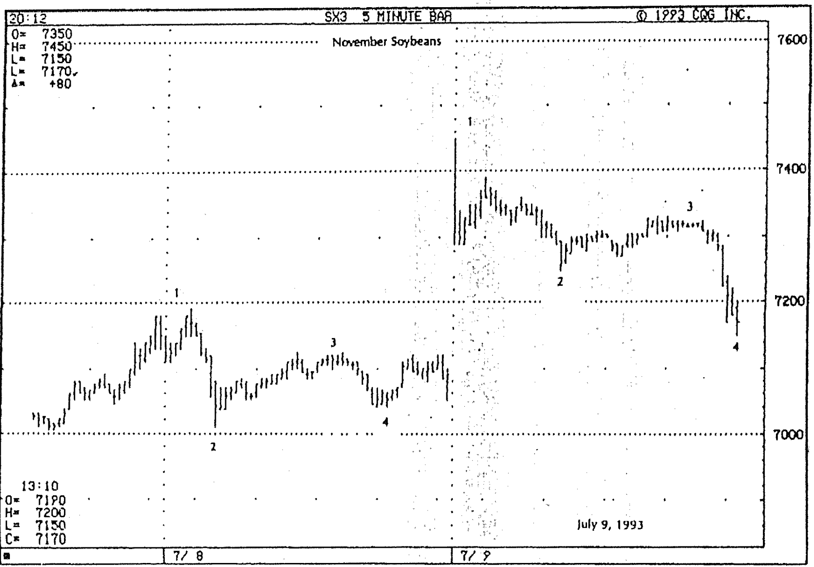

#### 短期趨勢

本書中，我始終強調歷史資料的統計分析方法，並藉此掌握投機的勝算。這種方法必須被整合到整體交易方法中，才不致於過份偏重單一的層面。我提及的所有要素都應該融會貫通地加以整合，以確保績效的一致性。

整合時，你必須瞭解當日沖銷的交易是屬於短期的趨勢，後者持續的時間為數天至數個星期，幾乎絕對不會超過14天。任何較長的趨勢，則屬於中期趨勢，它們的持續時間為數星期至數個月。短期的趨勢經常被視為是非理性的波動。這種看法並不正確。

今天的盤勢是判斷明天盤勢的重要線索。圖13.2是一個實際的例子。重點在於：當日沖銷必須在短期趨勢的前後關連中交易。

圖13.2是9月份S&P期貨的15分鐘走勢圖，這份走勢圖相當不尋常。一般來說，股票市場應該遵循債券市場的走勢；但在7月7日，債券價格下跌，而S&P期貨開盤向上跳空，這是很「不尋常」的訊號。這是因為7月13日與14日將分別公佈「生產者物價指數」與「消費者物價指數」，而其預測值在7月7日已經出現。

交易員必須立即回答一個問題──為什麼股票期貨走高而債券下跌？你是否知道這個問題的答案，這並不重要，但關鍵在於這個缺口自從7月6日收盤以來便不曾被填補，這是非常強勢的多頭訊號。這使我們預測7月8日的盤勢將向上。猶如圖形所顯示，在7月7日的時候，盤勢告訴你市場發生某些有利於上漲的情況，因爲股票原本應該遵循債券的下跌走勢。

如果短期趨勢向上，則你可以預估隔天的走勢，除非事實的發展證明情況並非如此。換言之，你可以預測明天的情況應該如何，如果明天的情況並非如此，你知道市場發生了一些變化而可能影響短期趨勢。這也完全適用於短期趨勢演變爲中期趨勢，以及中期趨勢演變爲長期趨勢。

###### 圖 13.2 S&P 期貨

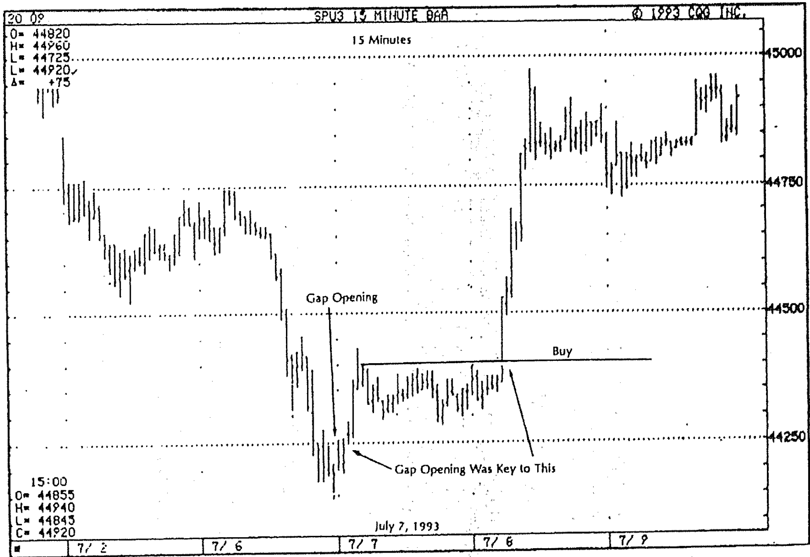

© Copyright 1993 CQG INC.

圖13.3中，我列示一些條形圖的模式，包括：開盤-最高-最低-收盤，這可以透露短期的趨勢，以及隔天的可能發展。請詳細研究這些模式，並將它們納入你的記憶中。短期趨勢經常會與中期趨勢相反，而且通常會持續一天至三天。

###### 圖13.3 買進與賣出訊號

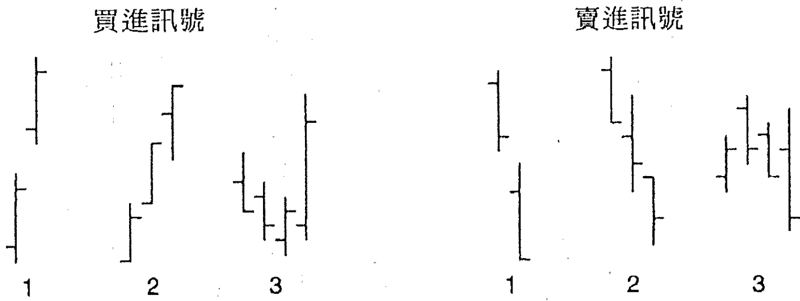

以下列示一些項目，你可以運用它們解釋盤中走勢。請採用一般的點數評估系統，每一項目的重要性大致相同。

股票或商品是否……

- 1. 較昨天創新高或新低？
- 2. 開高或開低？
- 3. 收盤上漲或下跌？
- 4. 收盤價位於交易區間的上半部50%或下半部50%？


5. 收盤價高於或低於今天的開盤價？
6. 今天的低價高於昨天的低價，或今天的高價低於昨天的
的高價？
7. 今天的收盤價高於昨天的.Items等

每個多頭的現象加一點，每個空頭的現象減一點。為了清晰起見，將多頭的現象列示如下：

+   1. 今天的高價高於昨天的的
2. 今天的開盤價上漲（相對於昨天收盤價）。
3. 今天的收盤價上漲（相對於昨天收盤價）。
4. 今天的收盤價位於交易區間的.””
5. 今天的收盤價高於今天的””
6. 今天的低價高於昨天的低價。
7. 今天的收盤價高於昨天的””

如果上述七個項目都顯示多頭的現象，則90％的情況下，隔天的高價會高於今天的高價；在80％的情況下，隔天的收盤價會高於今天的收盤價。如果你願意的話，可以把上述七個項目整理為一套交易系統。我曾經這麼做過，但我並不是在推銷交易系統。我只是希望告訴你，如何整合多頭或空頭的現象，形成一套相當精確的方法，以預測隔天的盤勢。然而，這僅是

其中的一種方法，還有其他有效的方法（請參考圖13.4）。

###### 圖13.4 買進訊號

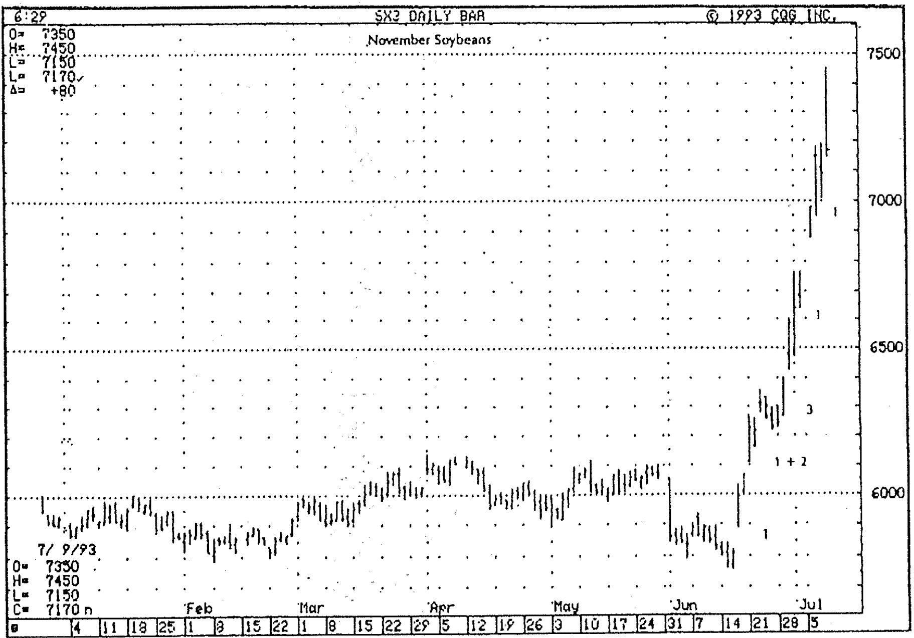

© Copyright 1993 CQG INC.

在此說明我的思考程序，如此你才可以自行觀察，並建立你自己的預測。我最好是以一個比喻說明這項思考程序。你是否還記得尤伯連納（Yul Brynner）與史提夫麥昆（Steve McQueen）主演的西部片「豪勇七蛟龍」（The Magnificent Seven）。墨西哥某村落聘雇尤伯連納與另六位槍手抵抗盜匪的掠劫。挑選槍手時，一位村民看著某位臉上有一條巨大疤痕的人說，「他一定很勇猛。看看他臉上的疤痕。」另一位說，

「不！你應該找造成這道疤痕的人。」尤伯連納回過頭說，「你現在又學習了一個訣竅！」

你必須學習與觀察重覆出現的致勝模式。我無法告訴你這一切，因為我無法提出全部的模式，而且每種商品與股票都有不同的模式，但我可以告訴你如何觀察，由何處著手。

#### 趨勢的分析

猶如本書的慣例一樣，檢驗一套理論的有效性，最佳的方式便是以歷史資料測試。此處便是一個典型的範例。

> 在中期趨勢內交易

瞭解中期趨勢的方向，交易者應該利用這項知識而在短期趨勢內交易。這適用於每一種中期趨勢。

歸根結底來說，這是有關於每天盤勢在判斷上的勝算。例如，在股票市場的中期上升趨勢中，每天的勝算如下：

| 連續下跌天數 | 隔天上漲的勝算 |
|---|---|
| 1 | 60.6% |
| 2 | 85.9% |
| 3 | 94.4% |

這很簡單，但我如何取得這些勝算的資料呢？要取得這些數據，你首先必須歸類中期趨勢。請參考表13.1。對於多頭市場，你必須衡量中期上升趨勢與修正（中期下降）走勢中的連續上漲與下跌天數。對於空頭市場，你必須衡量中期下降趨勢

與修正（中期上升）走勢中的連續上漲與下跌天數。我將提供總數的資料，以及衡量的 方法。最初，我是以人工方式來計算，稍後則採用電腦。歸類是以『道氏理論』為標準。

此處是以道瓊工業指數來研究，其資料雖然起始於1897年，但我僅採用1926年以後的資料，因為這份研究是針對S&P期貨的交易，而S&P是起始於1926年。我採用道瓊指數而不用S&P，因為我已經擁有道瓊指數的資料，而且這兩項指數之間有很顯著的相關性。

這一切能夠告訴你什麼呢？這取決於你的觀察力。舉例來說，請觀察「多頭市場中期上升趨勢」的總數部份。在多頭市場中，如果中期趨勢是處於上升狀態，則連續3天漲勢的平均漲幅為2.068%。當價格連續下跌三天時，平均跌幅為1.666%。另外，在這種中期上升趨勢中，單日下跌的次數（1,042）遠多於單日上漲的次數（692）。可是，連續二天、三天與四天的上漲次數則多於下跌的次數。在當日沖銷的交易中，我們可以建立一種範例來運用這些資料。假定當時是處於多頭市場的中期上升趨勢中，而價格已經連續下跌三天，跌幅為1.666%。你可以運用上述的一項資料：在連續下跌三天之後，第四天上漲的勝算是94.4%；所以，如果你在第三天收盤時買進，則在未來兩天之內的平均獲利率為1.309%，獲利率的中位數則為1.06%。你可以由各種不同的角度運用這些資料。

###### 表13.1 中期走勢分析

道瓊工業指數：多頭市場中期趨勢

| | | |
|---|---|---|
| 下降（底部） | 7/31/23 | 86.91 |
| 上升 | 8/29/23 | 93.70 |
| 下降 | 10/27/23 | 85.76 |
| 上升 | 2/6/24 | 101.31 |
| 下降 | 5/20/24 | 88.33 |
| 上升 | 8/20/24 | 105.57 |
| 下降 | 10/14/24 | 99.18 |
| 上升 | 3/6/25 | 125.68 |
| 下降 | 3/30/25 | 115.00 |
| 上升 | 2/11/26 | 162.31 |
| 下降 | 3/30/26 | 135.20 |
| 上升 | 8/14/26 | 166.64 |
| 下降 | 10/19/26 | 145.66 |
| 上升 | 10/3/27 | 199.78 |
| 下降 | 10/22/27 | 179.78 |
| 上升 | 5/14/28 | 220.88 |
| 下降 | 6/18/28 | 201.96 |
| 上升 | 11/28/28 | 295.62 |
| 下降 | 12/8/28 | 257.33 |
| 上升 | 2/5/29 | 322.06 |
| 下降 | 5/27/29 | 293.42 |
| 上升（頭部） | 9/3/29 | 381.17 |

道瓊工業指數：空頭市場中期趨勢

| | | |
|---|---|---|
| 上升（頭部） | 9/3/29 | 381.17 |
| 下降 | 10/4/29 | 325.17 |
| 上升 | 10/10/29 | 352.86 |
| 下降 | 11/13/29 | 198.69 |
| 上升 | 4/17/30 | 294.07 |
| 下降 | 6/24/30 | 211.84 |
| 上升 | 9/10/30 | 245.09 |
| 下降 | 12/16/30 | 157.51 |
| 上升 | 2/24/31 | 194.36 |
| 下降 | 6/2/31 | 121.70 |
| 上升 | 6/27/31 | 156.93 |
| 下降 | 10/5/31 | 86.48 |
| 上升 | 11/9/31 | 116.79 |
| 下降 | 1/5/32 | 71.24 |
| 上升 | 3/8/32 | 88.78 |
| 下降（底部） | 7/8/32 | 41.22 |

###### 表13.1 （續）

多頭市場中期上升走勢
單一中期走勢的樣本

起始日：3/30/26      終止日：8/14/26      天數：113
道瓊起始點數：140.46  道瓊終止點數：166.64  點數：26.18
%變動：18.6%
連續漲勢平均值：2.05%               連續跌勢平均值：−1.21%
連續漲勢中位數：1.74%              連續跌勢中位數：−0.99%
連續漲勢平均天數：3.04             連續跌勢平均天數：1.73
連續漲勢天數中位數：3             連續跌勢天數中位數：1

| 連續上漲天數 | 發生次數 | 走勢幅度中位數（%） |
|---|---|---|
| 1 | 6 | 0.28 |
| 2 | 4 | 1.13 |
| 3 | 6 | 1.56 |
|   | 4 | 1.77 |
| 4 | 2 | 2.27 |
| 5 | 0 | — |
| 6 | 1 | 6.13 |
| 7 | 1 | 4.49 |
| 8 | … |   |

| 連續下跌天數 | 發生次數 | 走勢幅度中位數（%） |
|---|---|---|
| 1 | 15 | −0.79 |
| 2 | 5 | −1.68 |
| 3 | 0 | — |
| 4 | 1 | −2.80 |
| 5 | 1 | −2.77 |
| 6 | 1 | −1.89 |

###### 表13.1（續）

總數：所有多頭市場的中期上升走勢頭（1926—1985）

| 連續上漲天數 | 發生次數 | 走勢幅度中位數（%） |
|---|---|---|
| 1 | 692 | 0.39 |
| 2 | 530 | 1.06 |
| 3 | 349 | 1.72 |
| 4 | 168 | 2.29 |
| 5 | 114 | 2.82 |
| 6 | 61 | 2.90 |
| 7 | 31 | 3.46 |
| 8 | 21 | 4.07 |
| 9 | 12 | 3.30 |
| 11 | 2 | 2.83 |
| 12 | 1 | 8.23 |

| 連續下跌天數 | 發生次數 | 走勢幅度中位數（%） |
|---|---|---|
| 1 | 1042 | -0.33 |
| 2 | 523 | -0.83 |
| 3 | 214 |  |
| 4 | 86 | -1.45 |
| 5 | 35 |  |
| 6 | 19 | -1.87 |
| 7 | 3 | -2.36 |
| 8 | 0 | -2.59 |
| 9 | 1 |  |
|  |  | -3.12 |
|  |  | - |
|  |  | -3.05 |

###### 表 13.1 （續）

多頭市場中期上升走勢
單一中期走勢的樣本

起始日：8/14/26        終止日：10/19/26        天數：53
道瓊起始點數：166.10  道瓊終止點數：145.66  點數：−20.44
％變動：−12.3％

連續漲勢平均值：1.05％        連續跌勢平均值：−1.92％
連續漲勢中位數：0.92％        連續跌勢中位數：−1.71％
連續漲勢平均天數：1.69        連續跌勢平均天數：2.21
連續漲勢天數中位數：2        連續跌勢天數中位數：2

| 連續上漲天數 | 發生次數 | 走勢幅度中位數（％） |
|---|---|---|
| 1 | 6 | 0.71 |
| 2 | 5 | 1.29 |
| 3 | 2 | 0.91 |
| 8 |  |  |

| 連續下跌天數 | 發生次數 | 走勢幅度中位數（％） |
|---|---|---|
| 1 | 5 | −0.58 |
| 2 | 5 | −1.84 |
| 3 | 2 | −2.40 |
| 4 | 0 | − |
| 5 | 2 | −4.58 |

###### 表13.1 （續）

總數：所有多頭市場的中期上升走勢頭（1926年—1985年）

| 連續上漲天數 | 發生次數 | 走勢幅度中位數（%） |
|---|---|---|
| 1 | 233 | 0.43 |
|  | 142 | 1.95 |
| 2 | 52 | 1.64 |
| 3 | 14 | 1.77 |
| 4 | 18 | 2.25 |
| 5 | 6 | 1.89 |
| 6 | 2 | 1.48 |
| 7 | 0 | — |
| 8 | 1 | 8.27 |
| 9 |  |  |
| 連續下跌天數 | 發生次數 | 走勢幅度中位數（%） |
|---|---|---|
| 1 | 195 | −0.43 |
| 2 | 117 | −1.15 |
| 3 | 90 |  |
| 4 | 61 | −1.94 |
| 5 | 29 |  |
| 6 | 11 | −2.89 |
| 7 | 7 | −3.09 |
| 8 | 2 | −4.21 |
|  |  | −4.08 |
|  |  | −7.56 |

###### 表13.1 （續）

空頭市場中期上升走勢

單一中期走勢的樣本

起始日：9/3/29      終止日：10/4/29      天數：27
道瓊起始點數：381.17  道瓊終止點數：325.17  點數：−56.00
%變動：−14.6%

連續漲勢平均值：1.08%      連續跌勢平均值：−2.89%
連續漲勢中位數：0.96%      連續跌勢中位數：−3.00%
連續漲勢平均天數：1.42      連續跌勢平均天數：2.12
連續漲勢天數中位數：1      連續跌勢天數中位數：2

| 連續上漲天數 | 發生次數 | 走勢幅度中位數（%） |
|---|---|---|
| 1 | 5 | 0.67 |
| 2 | 1 | 2.10 |
| 3 | 1 | 1.65 |

| 連續下跌天數 | 發生次數 | 走勢幅度中位數（%） |
|---|---|---|
| 1 | 3 | −1.23 |
| 2 | 4 | −3.00 |
| 3 | 0 | − |
| 4 | 0 | − |
| 5 | 0 | − |
| 6 | 1 | −5.03 |

###### 表13.1 （續）

總數：所有空頭市場的中期上升走勢頭（1926年—1985年）

| 連續上漲天數 | 發生次數 | 走勢幅度中位數（%） |
|---|---|---|
| 1 | 421 | 0.47 |
| 2 | 202 | 1.11 |
| 3 | 84 | 1.79 |
| 4 | 36 | 2.14 |
| 5 | 19 | 2.64 |
| 6 | 6 | 2.24 |
| 7 | 2 | 2.84 |
| 8 | 0 |  |
| 9 | 0 |  |
| 10 | 1 | 5.59 |

| 連續上漲天數 | 發生次數 | 走勢幅度中位數（%） |
|---|---|---|
| 1 | 244 | -0.04 |
|  | 218 | -1.40 |
| 2 | 165 |  |
| 3 | 72 | -2.23 |
| 4 | 64 |  |
| 5 | 29 | -2.72 |
| 6 | 21 | -3.55 |
| 7 | 10 | -4.69 |
| 8 | 1 |  |
| 9 |  | -5.68 |
| 10 |  | -8.99 |
|  |  | -4.37 |

###### 表13.1 （續）

空頭市場中期上升走勢
單一中期走勢的樣本

起始日：10/4/29      終止日：10/10/29      天數：5

道瓊起始點數：325.17  道瓊終止點數：352.86  點數：27.69

%變動：8.5%

連續漲勢平均值：4.26%                連續跌勢平均值：−0.21%

連續漲勢中位數：2.27%                連續跌勢中位數：−0.21%

連續漲勢平均天數：2                  連續跌勢平均天數：1

連續漲勢天數中位數：2                連續跌勢天數中位數：1

| 連續上漲天數 | 發生次數 | 走勢幅度中位數（%） |
|---|---|---|
| 1 | 2 | — |
| 2 | 2 | 2.27 |

| 連續下跌天數 | 發生次數 | 走勢幅度中位數（%） |
|---|---|---|
| 1 | 1 | −0.21 |

總數：所有空頭市場的中期上升走勢頭（1926年—1985年）

| 連續上漲天數 | 發生次數 | 走勢幅度中位數（%） |
|---|---|---|
| 1 | 231 | 0.51 |
| 2 | 205 | 1.14 |
| 3 | 120 | 1.73 |
| 4 | 61 | 2.10 |
| 5 | 43 | 2.84 |
| 6 | 22 | 3.12 |
| 7 | 5 | 2.19 |
| 8 | 6 | 3.47 |
| 9 | 2 | 2.44 |
| 10 | 1 | 4.62 |

###### 表13.1 （續）

| 連續下跌天數 | 發生次數 | 走勢幅度中位數（%） |
| --- | --- | --- |
| 1 | 339 | - 0.36 |
| 2 | 170 | - 0.74 |
| 3 | 76 | - 1.16 |
| 4 | 34 | - 1.89 |
| 5 | 19 | - 2.16 |
| 6 | 10 | - 3.39 |
| 7 | 4 | - 3.46 |
| 8 | 1 | - 4.58 |

你需要的僅是想像力與時間而已，並朝我告訴你的方向前進。我是否可以提供給你一套交易系統？可以！然而，所有系統並不是永遠有效，我本身就不是如此運用這些資料。如果我提供你任何系統，當你閱讀本書時，它可能已經需要修正了。除此之外，如果你要根據一套系統來交易，你必須全然信賴它，因此我可以提供的任何交易系統都比不上你自己的創造力。我希望提供給你的是我已經提供給你的宏觀處理方法。祝你幸運！績效卓越！

##### 附註：

+   ① 本章獻給Howard Shapiro，他是我所知道的最佳當日沖銷交易員。

+   ② Yale Hirsch, 1993 Stock Trader's Almanac, （Old Tappan, NJ：Hirsch, 1993）。

## 第IV篇
交易者的心理架构

### 第十四章

#### 交易者的特質與個性

如何才能夠成為一位成功的交易者？經驗？對於市場的敏銳「感覺」？精通技術分析的技巧？雖然這一切都很重要，但即使擁有最高境界的專業技巧，這仍不足夠。身為一位真正成功的交易者——不論你如何界定「成功」的意義——你必須俱備交易者所特有的心理架構：理想的特質，某類型個性，以及特殊的思考方式。

##### 真正的成功

就如同大部份的類似書籍一樣，本書處理的對象主要是市場，專注於認知的層面：我們心智所能知道與理解的一切。先前數章的內容是討論明確、理性與科學的觀念：技術分析的技巧、經濟的基本原則、以及各種表格闡釋的資料。這些工具，並以敏銳的心智運用它們，這當然是成功交易者的必備條件。但是，真正的成功是指個人的整體而言，這不僅需要優異的頭腦，還需要個人特質的配合。

特質（character）是反映個人的道德倫理哲學。『韋氏字典』對於特質所提出的定義是「個人特有的心智與倫理性質。」倫理是一組價值觀，以指引個人的行為與抉擇。你是否

把你個人或家人的利益擺在最優先的地位，或你更關心其他人們的福祉？你如何選擇誠實與說謊、誠懇與虛偽、生產與空閒？你是否可以一致性地判斷何謂正確與錯誤、何謂正義與寬恕、何謂理性與情緒性的反覆、何謂驕傲與謙卑？這些抉擇的程序或許僅是來自於直覺，而且很難解釋，但它們完全仰賴你個人對於倫理道德的概念——換言之，你的特質。

在另一方面，個性（personality）是指你如何行為，而不是指你相信什麼。再次地引用『韋氏字典』：「(1)…個人特有的一組特性；(2)個人行為上與情緒上的整體傾向；(3)個人特有的一組性質、態度或習慣；(4)他們的性情（disposition）。」

你是否俱備成功交易者需要的特質與個性？何謂健康的心裡，它是由什麼要素構成？人類是否可以透過學習來改變？如果你希望追求快樂與成功的生 活，這都是非常重要的問題，但對於艱困的金融交易生涯來說，它們更是關鍵性的問題。

金融交易何以如此困難？因為你不能說謊、逃避、裝俎、或為失敗找尋合理化的藉口。在交易的生涯裡，事實便是事實。以亞里思多德的說法來表示，A 就是 A！如果你是一位律師，當你敗訴時，你可以找尋藉口：「陪審團不公正」。如果你是一位醫生，當病人過逝時，你可以說道：「我已經盡一切所能，但這是老天爺的旨意。」在這兩種情況下，你仍能夠獲得報酬。然而，對於一位交易者來說，在計算期間結束時——不論這是一天、一個月、一季或一年——「績效報告」上顯示的必然是盈或虧。沒有任何藉口，因為金融交易的關鍵僅在於盈或虧。金融交易者不會因為失敗而獲得報酬。


Ayn Rand對於交易者的原則有非常精闢的看法，包括以下這段評論：

交易者是「理性」人類之間所有關係的象徵，也是人類尊嚴的道德象徵。不論在物質上或精神上，我們都是交易者，因為我們的生存是仰賴價值而不是掠奪。一位交易者將以自己的力量賺取他的所得，他不會要求或給予非份之物。交易者不會對於自己的失敗要求償付，也不會要求人們饒許他的錯誤。

這便是金融交易的精義。瞭解、並接受它，或者離開這個行業。

##### 神經性的交易者

當我們進入特質與個性的領域時，我們處理的對象是心理上的問題。直接了當地說，如果你的心理不健全，你不可能成功的交易者。不健全的人——神經性（neurotic）的人——希望逃避現實，這在金融交易中並不可能，至少長期而言不可能。

遭遇困難時，神經性的人不希望面對問題，他們會逃避。逃避的方式可能是酗酒、吸食毒品、暴飲暴食、雜交——任何可以讓他們暫時麻醉的方法。在金融交易圈內，最經常出現的形式是賭博性的刺激。

神經性的交易者，他們的交易目的是獲取「快感」。他們需要永遠保持在深淵的邊緣。他們在白天交易，晚上則賭棒球、籃球、足球、拳擊…，週末則賭馬，甚至於休假也是以賭博為中心。對他們來說，快感是來自於賭博的本身而不是結果。他們的心智永遠擺在下一場賭局，下一筆交易，或任何有關輸贏的東西。除此之外，他們沒有任何目標。我們在後文中將發現，這便是衝動性行為的根本心理，這與成功交易者的健全心理截然相反。

##### 兩種類型的個性

另一種相反的類型是Karen Horney描述的「誠心、沒有虛假、在情緒上真誠、能夠將自己投入感覺、工作與信念中。」這是很貼切的描述，我真心建議各位記取她的思想，因為這些性質對於生活的每一層面都很重要，不僅是交易而已，對於一些具有重大意義的關係尤其重要，例如：心愛的人、配偶、家庭成員、兒女與朋友。

一位成功的交易員在個性上有何特色？就外表上來說，有兩種極端不同的類型。一種是安靜而保守，在聚會中通常不會引起任何人的注意。另一種是外向、行為招搖、充滿嬉戲之心而與眾不同；有時候甚至於離經叛道。然而，就內在來說，這兩種類型卻非常相似。在大學的時候，他們對許多課外活動都很感興趣，成績的表現相當不一致——某些學科為A，某些學科為C。一般來說，他們並不會特別為人們所喜愛或討厭，很容易適應新的人、事與環境。他們具有非常的決心，極度的個人主義，從來不要求他人的協助。他們或許會聽取你的意見，閱讀許多分析報告，但他們的決策都是來自於自己的判斷。他們對於自己非常誠實，完全仰賴自己的智慧與勇氣。發生虧損時，他們或許會大聲詛咒；交易指令執行不當時，他們或許會大聲怒罵；但這通常僅是他們宣洩緊張情緒的管道。他們把所有的盈虧都視為是自己的責任，絕對不會歸咎於他人。最明顯的特色在於情緒的控制；他們會強忍痛苦，即使在發生虧損時，他們也會強擠出笑容。大多數專業好手只會談論自己的虧損，而不會炫耀獲利。

不適合從事交易的人，他們會聽取別人的意見，並據此交易，一旦發生虧損，便把責任歸咎於他人。這類的交易者永遠不會為自己的決策負責，對於任何的虧損都尋找一些合理化的藉口，或是責怪運氣。他們永遠試圖與別人比較，充滿嫉妒之心，不會由錯誤中學習改進。事實上，他們根本拒絕自己有犯錯的可能！

我認識一位交易員——姑且稱他為約翰——有一次，他坐在酒吧與他的朋友保羅閒聊著。

「保羅，」他問，「我是不是一個偉大的交易員？」

「你很棒，約翰，」保羅回答，「但稱不上偉大。」

「你這是什麼意思？上個月，我在34筆交易中獲利32筆，只不過虧損幾仟塊而已。」

這便是尋找合理化的藉口。這也是一個最典型的例子，它說明某些交易者何以不能夠成功——缺乏認賠的能力。

##### 成功交易者的心理條件

所以，成功的交易者究竟需要什麼素質呢？我列出一些我認為重要的心理條件，我並不多做說明，因為它們的意義都很明顯，但其代表的絕對不僅是字面上的意義而已。這些單純的字眼蘊涵著生活的真正原則。

一般來說，成功的交易者俱備下列的特質：

- 判斷力（Judgment）
- 勇氣（Courage）
- 自省（Self-criticism）
- 投入（Commitment）
- 榮譽感（Honor）
- 堅持原則（Integrity）
- 忠誠（Loyalty）
- 自信（Self-truthfulness）
- 獲勝的決心（Devotion to winning）
- 公正（Honesty）

成功的交易者俱備下列的個性：

- 紀律（Discipline）
- 集中精神（Concentration）
- 耐心（Patience）
- 獲勝的強烈慾望（Supreme desire to win）
- 客觀（Detachment）
- 完美主義——A型個性（Perfectionism—Type A Personality）
- 熱情（Passion）
- 競爭（Competition）
- 專注（Intensity）
- 靈感敏銳（Inspiration）

成功交易者的態度（attitude）——感覺、行動與信念的混合——包括：

自尊（Self-esteem）——感覺自己很棒、有能力、有價值。

樂觀（Optimism）——永不放棄，總是看見未來的積極面。

自信（Trust）——具有勝任的感覺。

彈性（Flexibility）——應變的能力。

毅力（Perseverance）——不斷地研究與學習。

贊賞（Admiration）——認同別人的成功，不會嫉妒。

智識（Intelligence）也屬必要——

不只是智商而已，還需要內在的瞭解。這包括：

清晰（Clarity）——就目的而言。

智慧（Wisdom）——以觀察客觀的關係。

想像力（Imagination）——想像未來的可能發展。

創造力（Creativity）——以建立投資組合。

明確（Certainty）——以建立部位。

這些素質不能夠在真空狀態中瞭解。思考「你應該做什麼」的最佳方式是「瞭解你不應該做什麼」。讓我描述一種「衝動型的個性」（impulsive personality）——這與成功交易者的個性與特質恰巧相反。

##### 衝動性的行為

就正常的思慮與意圖評斷，衝動性的人對於事物的瞭解角度與行為方法，我們認為有所殘缺。行為的方式有所殘缺，這是反映在缺乏控制上——行為反覆，易於受到誘惑，無法克制而明知故犯。某人決定交易10口契約，結果卻交易100口契約，然後說：「我就是這麼做了——我也不曉得為什麼」，這便是衝動性的行為。

衝動或反覆的行為，根本形式都相同：扭曲正常的慾望而呈現失控的行為。衝動性的人對於自己缺乏信心，他們僅是期待與希冀某些結果。他們沒有長期的目標，僅有立即的衝動。他們的行為相當突兀而直接，沒有計劃；念頭與行動之間所隔的時間非常短暫。這並不是說反應迅速在交易中是一種負面的特質。恰好相反，這是優秀交易者的必備條件，但差異在於採取行動當時的決心程度，以及預先的根本規劃。

缺乏計劃的行為，其後果是：失敗發生時，整體程序將失去功能，而且無法由失敗中有效汲取教訓。在沒有計劃的情況下，衝動性的人缺乏一致性的標準判斷何種方法有效，而何種方法無效。他們不瞭解自己何以失敗，他們不能夠像成功交易者把失敗的計劃視為是一種有益的機會，因為這可以在未來避免觸犯相同的錯誤。

缺乏計劃僅是問題的一部份。衝動性的人也缺乏思考的方法。一般人會透過評估、分析、研究，而發展一種初步的看法，但衝動的人僅會猜測，心存僥倖，不願意深入思考。他們缺乏耐心、專注、反省與抽象的能力。他們的判斷經常相當離譜，但「不佳的判斷」並不是因為智識的緣故，而是來自於個性與特質。

對於原則的堅持也是一個問題。以一位具有特質的人來說，他不願意違背某些道德原則。特質意味著你的生活是根據某些重要的原則來進行，即使他人並不瞭解這些無形的原則，即使這些原則的價值主要在於長期。衝動的人，為了渴求立即的滿足，他們必須放棄原則。對他們來說，這些道德原則僅是一種妨礙。對他們來說，生命僅是一系列的誘惑。這些誘惑看起來始終像是機會，但最後都導致失望、挫折、焦慮與沮喪，而這又將造成各種神經性與自我毀滅的行為。如果任何人質疑他們，他們的回答將是：「我無法克制。」在某一層面上，他們的說法絕對正確：你確實無法克制你不希望克制的行為。

更糟者，衝動性的人在生活上也缺乏平衡。他們對於外在的世界沒有興趣，他們除了追求立即的滿足以外，便沒有任何的目標。他們並不十分關心家庭、朋友與社會。他們不期待建立積極的人際關係，對於文化、智識與政治的議題也都沒有興趣。所以，他們的工作開始分崩離析時（通常都會如此），他們的生活將沒有任何的寄託。

##### 結論

從事金融交易，你必須徹底瞭解自己。為了在交易與生活中取得勝利，你必須瞭解自己如何思考、自己相信什麼、以及你對於生命的看法。很少人瞭解或認知交易的微妙之處。在其他行業中，你可以混日子；但在交易中，你可能被立即地摧毀。最悲哀之處是：大多數人並不理解他們何以失敗。

## 後記

### 財富的道德觀

本書宗旨是試圖闡明金融市場的現實與真理。就這方面來說，最適切的方式是辛勤的研究，客觀的分析，並觀察歷史的發展。本書結束之前，我希望提出我個人的一些看法，它們來自於我嘗試瞭解市場與經濟究竟是如何發揮功能，以及它們如何透過經濟循環的起伏推動文明。

這是一種政治的程序。它實際上是一種追求自由的過程，以掙脫各種假藉善意之名而呈現的控制力量。控制的理由是為了國家、貧困者、饑餓者、共同的利益、利他主義、或人類無窮欲望中的任何需求。然而，歸根結底，這僅是國家統治者控制人民的慾望。

在有關金融交易的書籍中，這是你很罕於接觸的一個主題，但它實際上非常重要，因為資本主義是歷史上極不尋常的現象。在美國，純粹的資本主義出現於1776年至1913年之間的137年期間，而終止於我們正式採納「第六修正法案」（以累進稅率課徵所得稅）與成立中央銀行。以下說明此議題的一些基本資料，以及它們與身為交易者的你有何關連。

很少人會注意其自身的心理架構。你的信念，以及你持有這些信念的理由，它們將決定你的行為。你的信念體系將在不知不覺中，決定你如何交易與如何生活。看起來或許有些奇怪，你在潛意識內已經被灌輸一種思想：「賺錢」是可以的，但你不應該賺取或保有太多。不論是新聞媒體、報章雜誌、電影、書籍、教師、政治人物、以及宗教領袖，都不斷要求你犧牲個人的福利，並告訴你，協助他人才是正確的道德觀。你可以在生活的各個領域察覺這種現象。電影中富有者被描述為壞蛋，通常都是從事白領犯罪的生意人。你雖然因為電影明星、故事內容或演技而欣賞電影，但哲學上的議題卻是「富有者」，以及自利（self-interest）與犧牲的抉擇。自利與犧牲是相互對立的道德觀念，雖然兩者並不相互排斥。然而，何者才是較重要而恰當的觀念呢？這是一個你必須處理的問題，因為你對於金錢的看法將影響你的交易，而且交易的目的在於創造財富。創造的財富愈多，你的工作表現便愈理想。

道德是一種價值觀，它將引導你的抉擇與行為。就個人的層面來說，它決定你應該如何生活；就政治的層面來說，它決定社會應該如何運作。在過去，倫理觀主要是由宗教提供，它反映在「十誡」之中。可是，道德觀並不受到獨佔的操控。自從1700年代末期以來，國家已經取代上帝的地位。第二次世界大戰之後，道德觀是由公共利益來界定；換言之，全民的福利或普遍的犧牲精神。「自利」的觀念幾乎從來都不受重視。

18世紀以來，大多數哲學家都很輕視財富（或許是他們都是厭惡工作的知識份子，因此而很貧窮）。據說馬克斯（Karl Marx）的母親曾經說過：「如果卡爾能夠停止談論資本而實際去賺一點，那就好了。」當然，他有一位贊助者恩格爾（Friedrich Engels）。非常諷刺地，恩格爾的父親是一位富有的製造商，他在財務上支持他的兒子與馬克斯。盧梭（Jean Jacques Rousseau）與康德（Immanuel Kant）也是如此，前者是環保主義與福利國家的倡導者，後者則主張「利他主義」（altruism）的倫理學說。

另一方面，少數哲學家與知識份子主張，創造財富不僅可以接受，而且還是「良好的行為」。最著名的兩位人物是亞當史密斯（Adam Smith）與約翰洛克（John Locke）。美國憲法中許多觀念都是出自他們兩位的主張。傑佛遜（Jefferson）便在「獨立宣言」中引用約翰洛克的評論。

誰對？誰錯？財富是善或惡？在回答這些問題時，我們必須以現實為起點，或一般的情况究竟是如何？換言之，相對於這些學者與理論家的「願望與理想」，一般人的看法又如何？

人類都痛恨貧窮。我們透過工作避免貧窮，以及它帶來的不安全感。唯一的問題是：我們應該採用什麼方法避免貧窮而追求富裕。對一般人來說，是否應該停留在貧窮中，這並不是一個難以抉擇的問題。避免貧窮的方法有：(1)福利（你欠我所有的生活必需品——食物、醫療保健、住屋、衣服、以及有線電視——這是我不需工作便應該擁有的東西，因為我是人類）；(2)以偷竊或其他不合法的方式取得；(3)繼承；(4)辛勤的工作，這也是一種一般的方法。

辛勤的工作並不能保證成功，但它通常代表一種最低的安全感。所有人都偏愛富裕而厭惡貧窮，雖然一些偽君子們會提出相反的論調。例如，國會議員將他們自己的薪水由1982年的60,662美元調升為1992年的13萬美元，調升的幅度為141.3％，而同期的「消費者物價指數」僅上升41.9％…可是，國會議員仍然主張雷根的政策僅是造福富人。

追求財富是一種普遍、恆常、重要、完全、美妙的慾望。大多數人每天工作八小時或以上（不計往返工作花費的時間），以賺取金錢來維持一定的生活水準。追求財富是男人的普遍慾望，並藉此吸引女人。以往，女人希望嫁給成功的男人，以便安心地養育子女。目前，社會的型態已經改變；許多女人也有自己的事業，並在財務上協助家庭，但她們仍然偏愛有錢有勢的男人，至少是經濟條件不差的男人。

有些人主張利他主義，他們認為人應該超越對於金錢的熱愛，以追求更高的道德（犧牲）。對於這些人，我希望提出一個問題：你根據什麼標準判斷這項道德？所有人的普遍標準是生命——自己的生命，而不是生存在地球上另外的50億人口，也不是其他動物或植物。

你的生存、價值、目標與生命，才是創造財富之所以為「善」的根本理由。你的生存與目標，將決定你的抉擇與行為，這才是你需要倫理觀的理由。滿足無限陌生人的無窮需求與慾望，這是不可能賴以生存的道德觀。唯一「合理」的道德觀是對於生命的相互尊重。某些宗教主張，死後的情況才是生命的目標。基督教宣稱，有生之年的真正道德目標，是在天堂佔一席之地；某些基督教派系認為，為了順利進入天堂，你必須保持貧窮、忍受痛苦，並為亞當偷食（知識之樹的）蘋果而贖罪。這並不是人類真正的生活方式，即使他是虔誠的教徒。人類的天性與實際的情況認為：「這是相當不錯的一套理論，但我拒絕以它做為生活的準則，雖然我相信上帝。」

你的生活應該是以持續生存為最高（主要）的價值原則。你不應該為了一些你不認識的人，為了某些試圖當選連任的政治人物，而在社會的祭壇上犧牲自己。Ayn Rand 在她的小說 We the Living 的前言中，曾經非常適切的表達這個觀點，她試圖由個人的角度闡明這部小說的哲學主題——生命的最高價值。一位年輕的女孩被驅逐至西伯利亞，她知道有生之年再也不可能回來。她說道：「這是你的生命。你將它開始，感覺它是如此珍貴而稀罕，它是如此的美妙，就像是神聖的寶藏。現在，一切都結束了，而這不會對任何人造成影響…。」（摘自 Ayn Rand 的 We the Living，前言。）

Ayn Rand 的這段描述可以讓你瞭解很多現象：某些人動不動就把你送去打一場你全然不知道目的的戰爭，把你繳的稅金用在毫無目的的用途上。政治人物除了關心自己的生命以外，他們一點也不在意你的生命。你是否聽過政治人物說道：「我相信我們應該設法結束這場漫延500年的波希米亞戰爭！我們必須派出軍隊，而我自願第一個上前線！」沒有，當然沒有！在這句話中，「我們」是指你和我，而不是指他們！你是否聽說政治人物們願意放棄目前所擁有的一切與未來的所得，以協助「貧困者」？你是否聽過他們說道：「以我為榜樣」？絕對沒有！他們要求你做必要的犧牲，以協助那些沒有名字、沒有臉孔的「貧困者」或為「公共的福利」奉獻，這僅不過是為了他們自己的權力。為了當選連任，政治人物必須花費你的稅金買票。

這個國家的創始者非常瞭解這種情況。Gouverneur Morris 是美國憲法的起草人之一，他在1787年8月7日的演講中說道：
「把選票投給沒有財產的人，然後富有者便會賄賂他們。」
1993年的情況則是如此：一位政治人物在籌措競選經費時，答應以稅務的漏洞、撥款、獎助金…做為回報。這些特殊利益集團微笑地同意了。於是，這位政治人物便可以聘雇競選文宣與民意調查的人員，並正式開始營業了！

那些辛勤努力而獲得成功的人，他們有資格享受自己的工作成果，難道不是很明顯嗎？政治人物憑藉法律力量強取你的工作成果，並把它們轉交給那些在競選經費上賄賂他們的利益集團，公正（fairness）的概念不應該如此界定。憲法中從來沒有提及公正；這是政治人物的合理化藉口，以強取我們辛勤工作的收獲，用來保障他們自身的連任、權利、門面、13萬美元的薪水、未花費的競選經費、以及退休的福利。

根據這些事實，我們必須認定，透過自身工作與能力而創造財富，這是一種合理而公正的生活方式。美國的建國者將「上帝」之眼繪製在一元美鈔的背後（金字塔的上方），根據《韋氏字典》（Webster’s New Universal Dictionary）的解釋，這代表「以供未來必要運用的先見之明。」一個政治上自由的國家，目的在於保護經濟的自由與個人的財產，而不是基於個人的權力來重新分配財富。

憲法上的一些背景資料，或許可以讓你更加瞭解美國建國者對於「公正」的看法。第一章第九節規定：「不可課徵稅金或其他的直接稅，除非所課的稅金是以人頭計算。」換言之，除非每人分攤相同的稅金，否則不可課徵直接稅。非常有趣地，在137年的期間內，這便是所謂的「公正」。

1913年，「第六修正法案」通過，它允許「根據任何來源的所得課稅，不需考慮各州的人口比率以課徵直接稅，也不需考慮任何人頭上的問題。」在此修正法案通過以後，對於年所得為5,000美元的個人，「公正」的稅率是0.4%。就目前來說，經過通貨膨脹的調整，這項所得相當於是8萬美元，根據1913年的稅率，8萬美元的所得僅需要繳納320美元的稅金。今天，就這個水準的所得來說，一般家庭所需繳納的平均稅金超過1.1萬美元。各位可以發現，所謂的「公正」，其行情的變化遠超過S&P期貨，而且完全取決於政治人物推動的政策。

同時，自由的喪失隨著「費邊主義」（Fabianism）的思潮而逐漸擴大：「政府的信念是緩慢的演變而不是革命性的變化；這與英國的某社會主義組織有關。」為了證明起見，看看克林頓總統的好友Derek Shearer，他是一位公認的社會主義（Socialist）者，雖然他現在總是談論「經濟民主」，因為他認為「你不能採用S開頭的字」。Shearer認為克林頓是「革新論者」，並說「克林頓相信激進的政府。」Shearer被任命為美國商務部次長以主管經濟事務，這難道不代表什麼意義嗎？或者，讓我們來看看勞工部長Robert Reich的典型評論：「我們必須開始表揚集體性的專家領導。我們需要多讚美我們的團隊，而少讚美激進的領導者與勇敢的天才們。」

國會「住屋委員會」主席Dan Rostenkowski是伊利諾州選出來的議員，他發表的一段評論最足以反映目前的政治心態：

「對於那些過去十年享受富裕生活的人來說，我會盡一切所能追討他們的財富。」我們不妨把這段話來比較美國第四任總統麥迪生（James Madison）的看法，他被稱爲是「美國憲法之父」：「政府的主要目的是保護那些獲致繁榮所需要的各種不同機能。」所以，你可以發現，自從1913年以來，政府對於道德與政治的信念已經不僅是些微的變化了。

在合理的範圍內，辛勤工作獲得的財富應該受到尊重與讚美，難道父母不是如此教導我們嗎？然而，目前的政府左派份子卻否認工作是一種道德。他們宣稱，福利應該被接受，因爲每個人類都有權利撫養兒女；如果一位母親希望養育18個小孩，這是她的權利。若是如此，福利的對象何以僅侷限爲美國人？何以不是全世界的人？

政治人物的合理化藉口是針對辛勤工作的結果──稅金。他們認爲，「你不可以賺取而保有太多，」因爲這是貪婪。貪婪的概念實際上已經違背概念的原則，因爲它可以代表任何你希望它代表的事物。對於饑餓的人來說，擁有兩罐花生醬也可以被視爲是貪婪。事實上，就心理層面來說，貪婪僅是被用來攻擊誠實而成功的人。例如，你從來不曾聽說黑手黨的首領是貪婪，人們僅將他視爲是罪犯。可是，一位犯罪的富有生意人則是貪婪，他並不是罪犯！這便是政治社會試圖勸服你接受的犧牲，使你對於自己的成功產生罪惡感。想一想下述的問題：以合法的手段賺取而保有財富，這何以是不道德？比爾蓋茨（Bill Gates）熱愛他的工作，在37歲的年齡仍不退休而繼續賺取第70億的財富，這是貪婪嗎？由個人角度判定爲不道德的事物，對於整體社會也不可能爲道德。政治左派份子批評而阻止人們追求財富，卻以民眾的名義而盡一切所能擴張政府的權力，這顯示的是真正的虛僞。當人們控制希冀或需要的物質之後，他們何以就變得邪惡？如果一個人決定每星期工作80小時，以便在高級的餐廳吃飯，並駕著「法拉利」的跑車，這究竟有什麼錯？爲什麼那些辛勤工作的富有者爲不道德，而那些不事生產的人便爲道德？

上述問題的答案無關乎邏輯與誤解，而是在於意識形態與心理架構。就後者來說，這是對於成功的憎惡，他們希望成爲摧毀成功的力量，因爲無法獲得相同的成功使他們嫉妒。就前者來說，這是一種齊頭式的平等概念，他們希望人們變成一種絕對不可能的情況——對於工作與成功的慾望都相等。這是共產主義、社會主義與集體主義的思想精義，而自由派民主主義的目標是利他主義的倫理，其政策並不是照顧有所需要的人，而是對於任何聽起來似乎是「善」的動機都必須犧牲，而追求自利則是「惡」。

請瞭解，自利並不代表你必須犧牲他人的利益。它並不代表你必須傷害他人。它並不代表你必須捨棄心愛的人以滿足自身的需求。它並不代表你可以爲了自身利益而剝削他人。它的真正涵意是：你有權利爲自己而生存，你沒有義務在任何時候、在任何地方、因爲任何理由而被奴役。Ayn Rand在所著的《Philosophy：Who Needs It》一書中有精闢的評論：

利他主義的道德觀是什麼？利他主義的基本原則是：人類沒有權利爲了自己而生存，服務他人是生存的唯一目的，自我犧牲是最高的道德、德性與價值。

這並不是一種慈悲為懷的倫理哲學。它代表的是：任何人需要你協助時，你有義務提供你的生命。然而，當你決定拿一塊錢給路旁流浪漢買杯咖啡時，這代表的是完全不同的概念。問題在於：你是否有義務提供你擁有的每一塊錢，直至你也成為流浪漢為止？你的生命意義不應該因為他人的需求而受到奴役。如果你決定幫助某人，這很好；可是，這稱為慈善，而不是義務。

為了公平起見，讓我引用一個範例闡釋相反的道德觀，這使你更能夠對照兩者之間的差異。1985年8月份的《花花公子》雜誌曾經訪問卡斯楚（Fidel Castro）：

記者：…請問卡斯楚先生，你目前的驅動力量是什麼？

卡斯楚：這是一個很難回答的問題。金錢不是我的驅動力量；物質的享受不是我的驅動力量。我認為，無私的觀念逐漸成長，犧牲的精神逐漸成長；你逐漸捨棄個人的驕傲、虛榮…所有一切人類多少存在的特性…

如果你不能防範這些虛幻的東西，如果你讓自己遭到蒙蔽，或認爲自己是不可或缺或不可取代的人物，你將沉迷於這一切——富有與榮耀。

你不妨參照Rand的觀念，她將你的生命視爲是至高的價值，如此你便能理解，何以這麼多的古巴人希望逃到佛羅里達州。另一方面，前蘇聯也曾經主張犧牲與奉獻，但現在的蘇聯人則以日本人爲楷模。巴塞隆納的一家報紙曾經採訪蘇聯新聞部副部長Mikhail Fedotov：

過去我們被教育而相信金錢爲邪惡，富人是剝削者，這種觀念曾經使蘇聯陷入羅網中，而且可能會再度套中我們。現在，我們必需教導人民，使他們相信財富是好的，人必須自私；我們必須創造一個以自我利益爲中心的社會，使人民願意辛勤地工作，並遵守法律。如此一來，每個人都會受益。在蘇聯，我們有1.5億無用的人民，他們根本不知道如何過正常的生活。

我之所以花費這麼多的篇幅討論這個問題，因爲你在潛意識中必須相信，賺錢是一種健康而正確的善行。在利他主義的影響下，美國人民蒙受相當的罪惡感，這足以使人們擔心自己的成功。身爲金融交易者已經面對非常艱困的工作，如果你還懷疑這些行爲的正確性，你幾乎不可能成功。

另外，美國已經逐漸喪失其自由國家的本質。根據目前的自由衰退狀況，你可能會失去交易的能力。偏高的稅率，新的法案，政治上的變革，這一切可能使金融交易無法再繼續生存。請瞭解，金融交易的基礎是建立在概念與觀念之上。以下這些人的觀念截然相反。他們的思想涵蓋整個哲學發展史，但你僅能夠選擇其中的一邊爲真理：

亞里斯多德（Aristotle）或柏拉圖（Plato）

聖湯瑪士·阿奎納（St. Thomas Aquinas）或聖奧古斯丁（St. Augustine）

約翰·洛克（John Locke）或盧梭（Jean Jacques Rousseau）

亞當·史密斯（Adam Smith）或卡爾馬克斯（Karl Marx）

湯瑪士·傑佛遜（Thomas Jefferson）或列寧（Vladimir Lenin）

蘭德（Ayn Rand）或康德（Immanuel Kant）

若希望成爲一位成功的交易者，你必須能夠自由地從事交易。爲了從事交易，你必須瞭解、並能夠在觀念的戰爭中站穩自己的立場。另外，你必須感覺賺錢是一種完全合乎道德的行爲，而賺多少錢是你個人的決定。最後，你必須相信，你的生命並不積欠社會什麼，他人的生命也不積欠你什麼。

我無法在一章的篇幅內，充分說明財富的心理學與倫理學，但我希望可以引導你從事這方面的思考，並瞭解美國正朝那個方向前進。

我們的社會體制最初是屬於資本主義，但1913年以來已經演變爲一種混合的社會體制。整個潮流正緩慢而明確地摧毀資本主義，而成爲法西斯主義、社會主義、共產主義的混合體，並成爲一個福利國家。社會的精英份子——政治人物、新聞從業者、教授與律師——他們是最初體制的最大受益者。然而，他們大多根據自己的動機與個人的表現，而反對財富分配的道德觀。我希望各位可以擁有最大的自由，並追求最大的財富。

### 全新改版

### 強檔上線

Invest your profession

### 歡迎大家加入IPC

即可享有會員專屬優惠

www.ipci.com.tw

我的IPC

書城

BLOG
即時報

NEWS
哈牌快訊

### iPC 寰宇財金網
財金趨勢與產業動態的領航家

### 書 城全新改版

### 財經書·我選擇窩宇！

Invest your profession. Trade your advantage.

### 歡迎大家加入 iPC 立即享優惠

### 強檔上線

專屬達人專區、財金主題企劃
多種全新服務將陸續強檔上線

- 外匯
- 股票
- 投資
- 程式


### HOT 精選套書

### HOT 經典

股票
期貨選擇權
程式交易

### 跨市交易思維

### 震宇圖書分類

### 技術 分析

| 分類號 | 書名 | 書號 | 定價 | 分類號 | 書名 | 書號 | 定價 |
|---|---|---|---|---|---|---|---|
| 1 | 波浪理論與動量分析 | F003 | 320 | 41 | 股票短線 OX 戰術（第 3 版） | F261 | 480 |
| 2 | 股票 K 線戰法 | F058 | 600 | 42 | 統計套利 | F263 | 480 |
| 3 | 市場互動技術分析 | F060 | 500 | 43 | 探金實戰．波浪理論（系列 1） | F266 | 400 |
| 4 | 股票成交當量分析 | F070 | 300 | 44 | 主控技術分析使用手冊 | F271 | 500 |
| 5 | 動能指標 | F091 | 450 | 45 | 費波納奇法則 | F273 | 400 |
| 6 | 技術分析 & 選擇權策略 | F097 | 380 | 46 | 點晴技術分析—心法篇 | F283 | 500 |
| 7 | 史瓦格期貨技術分析（上） | F105 | 580 | 47 | J線正字圖．線圖大革命 | F291 | 450 |
| 8 | 史瓦格期貨技術分析（下） | F106 | 400 | 48 | 強力陰陽線（完整版） | F300 | 650 |
| 9 | 市場х維與時效分析 | F119 | 480 | 49 | 買進訊號 | F305 | 380 |
| 10 | 完全技術分析手冊 | F137 | 460 | 50 | 賣出訊號 | F306 | 380 |
| 11 | 金融市場技術分析（上） | F155 | 420 | 51 | K 線理論 | F310 | 480 |
| 12 | 金融市場技術分析（下） | F156 | 420 | 52 | 機械化交易新解：技術指標進化論 | F313 | 480 |
| 13 | 網絡當沖交易 | F160 | 300 | 53 | 趨勢交易 | F323 | 420 |
| 14 | 股價型態總覽（上） | F162 | 500 | 54 | 艾略特波浪理論新創見 | F332 | 420 |
| 15 | 股價型態總覽（下） | F163 | 500 | 55 | 量價關係操作要訣 | F333 | 550 |
| 16 | 包寧傑帶狀操作法 | F179 | 330 | 56 | 精準獲利 K 線戰技（第二版） | F334 | 550 |
| 17 | 陰陽線詳解 | F187 | 280 | 57 | 短線投機戰成教育 | F337 | 550 |
| 18 | 技術分析選股絕活 | F188 | 240 | 58 | XQ 洩天機 | F342 | 450 |
| 19 | 主控戰略 K 線 | F190 | 350 | 59 | 當沖交易大全（第二版） | F343 | 400 |
| 20 | 主控戰略開盤法 | F194 | 380 | 60 | 聚敗控盤者 | F348 | 420 |
| 21 | 狙擊手操作法 | F199 | 380 | 61 | 圖解 B-Band 指標 | F351 | 480 |
| 22 | 反向操作致富術 | F204 | 260 | 62 | 多空操作秘笈 | F353 | 460 |
| 23 | 掌握台股大趨勢 | F206 | 300 | 63 | 主控戰略型態學 | F361 | 480 |
| 24 | 主控戰略移動平均線 | F207 | 350 | 64 | 買在起漲點 | F362 | 450 |
| 25 | 主控戰略成交量 | F213 | 450 | 65 | 賣在起跌點 | F363 | 450 |
| 26 | 盤勢判讀的技巧 | F215 | 450 | 66 | 酒田戰法—圖解 80 招台股實證 | F366 | 380 |
| 27 | 巨波投資法 | F216 | 480 | 67 | 跨市交易思維—墨菲市場互動分析新論 | F367 | 550 |
| 28 | 20 招成功交易策略 | F218 | 360 | 68 | 漲不停的力量—黃絲紅海撈操作法 | F368 | 480 |
| 29 | 主控戰略即時盤態 | F221 | 420 | 69 | 股市放空獲利術—歐尼爾教賺全圖解 | F369 | 380 |
| 30 | 技術分析．靈活一點 | F224 | 280 | 70 | 賣出的藝術—賣出時機與放空技巧 | F373 | 600 |
| 31 | 多空對沖交易策略 | F225 | 450 | 71 | 新操作生涯不是夢 | F375 | 600 |
| 32 | 線形玄機 | F227 | 360 | 72 | 新操作生涯不是夢—學習指南 | F376 | 280 |
| 33 | 墨菲論市場互動分析 | F229 | 460 | 73 | 亞當理論 | F377 | 250 |
| 34 | 主控戰略波浪理論 | F233 | 360 | 74 | 趨向指標操作要訣 | F379 | 360 |
| 35 | 股價趨勢技術分析—典藏版（上） | F243 | 600 | 75 | 甘氏理論（第二版）型態 - 價格 - 時間 | F383 | 500 |
| 36 | 股價趨勢技術分析—典藏版（下） | F244 | 600 | 76 | 雙動能投資—高報酬低風險策略 | F387 | 360 |
| 37 | 量價進化論 | F254 | 350 | 77 | 科斯托蘭尼金屬圖 | F390 | 320 |
| 38 | 證證據說話的技術分析（上） | F255 | 350 | 78 | 與趨勢共舞 | F394 | 600 |
| 39 | 證證據說話的技術分析（下） | F256 | 350 | 79 | 技術分析精論第五版（上） | F395 | 560 |
| 40 | 技術分析首部曲 | F257 | 420 | 80 | 技術分析精論第五版（下） | F396 | 500 |

### 技術 分析 (續)

| 分類號 | 書名 | 書號 | 定價 | 分類號 | 書名 | 書號 | 定價 |
|---|---|---|---|---|---|---|---|
| 81 | 不說謊的價量 | F416 | 420 | 83 | 關鍵買賣點：突破實戰交易的科學與藝 | F433 | 650 |
| 82 | K 線理論 2：蝴蝶 K 線台股實戰法 | F417 | 380 | 84 | 約翰墨菲概覽分析 | F445 | 450 |

### 智慧 投資

| 分類號 | 書名 | 書號 | 定價 | 分類號 | 書名 | 書號 | 定價 |
|---|---|---|---|---|---|---|---|
| 1 | 股市大亨 | F013 | 280 | 32 | 探金實戰．李佛摩手稿解密 (系列 3) | F308 | 480 |
| 2 | 新股市大亨 | F014 | 280 | 33 | 證券分析第六增訂版 (上冊) | F316 | 700 |
| 3 | 新金融怪傑 (上) | F022 | 280 | 34 | 證券分析第六增訂版 (下冊) | F317 | 700 |
| 4 | 新金融怪傑 (下) | F023 | 280 | 35 | 探金實戰．李佛摩資金情緒管理 (系列 4) | F319 | 350 |
| 5 | 智慧型股票投資人 | F046 | 500 | 36 | 探金實戰．李佛摩 18 堂課 (系列 5) | F325 | 250 |
| 6 | 股票作手回憶錄 (經典版) | F062 | 380 | 37 | 交易贏家的 21 週全紀錄 | F330 | 460 |
| 7 | 超級強勢股 | F076 | 420 | 38 | 量子盤感 | F339 | 480 |
| 8 | 與操盤贏家共舞 | F174 | 300 | 39 | 探金實戰．作手談股市內幕 (系列 6) | F345 | 380 |
| 9 | 掌握股票掮客心理 | F184 | 350 | 40 | 柏格頭投資指南 | F346 | 500 |
| 10 | 掌握巴菲特選股絕技 | F189 | 390 | 41 | 股票作手回憶錄—註解版 (上冊) | F349 | 600 |
| 11 | 高勝算操盤 (上) | F196 | 320 | 42 | 股票作手回憶錄—註解版 (下冊) | F350 | 600 |
| 12 | 高勝算操盤 (下) | F197 | 270 | 43 | 探金實戰．作手從錯中學習 | F354 | 380 |
| 13 | 透視避險基金 | F209 | 440 | 44 | 投資煳客 | F356 | 400 |
| 14 | 倪德厚夫的投機術 (上) | F239 | 300 | 45 | 王力群談股市心理學 | F358 | 420 |
| 15 | 倪德厚夫的投機術 (下) | F240 | 300 | 46 | 新世紀金融怪傑 (上冊) | F359 | 450 |
| 16 | 團風勢—股票交易心法 | F242 | 300 | 47 | 新世紀金融怪傑 (下冊) | F360 | 450 |
| 17 | 從躺椅上操作：交易心理學 | F247 | 550 | 48 | 金融怪傑 (全新修訂版) (上冊) | F371 | 350 |
| 18 | 華爾街傳奇：我的生存之道 | F248 | 280 | 49 | 金融怪傑 (全新修訂版) (下冊) | F372 | 350 |
| 19 | 金融投資理論史 | F252 | 600 | 50 | 股票作手回憶錄 (完整版) | F374 | 650 |
| 20 | 華爾街一九○一 | F264 | 300 | 51 | 超越大盤的獲利公式 | F380 | 300 |
| 21 | 費雪．布萊克回憶錄 | F265 | 480 | 52 | 智慧型股票投資人 (全新增訂版) | F389 | 800 |
| 22 | 歐尼爾投資的 24 堂課 | F268 | 300 | 53 | 非常獅力股 (經典新譯版) | F393 | 420 |
| 23 | 探金實戰．李佛摩投機技巧 (系列 2) | F274 | 320 | 54 | 股海奇兵之散戶語錄 | F398 | 380 |
| 24 | 金融風暴求勝術 | F278 | 400 | 55 | 投資進化論：揭開 "投骰" 不理性的真相 | F400 | 500 |
| 25 | 交易．創造自己的聖盃 (第二版) | F282 | 600 | 56 | 擊敗群眾的逆向思維 | F401 | 450 |
| 26 | 華爾街怪傑巴魯克傳 | F292 | 500 | 57 | 投資檢查表：基金經理人的選股秘訣 | F407 | 580 |
| 27 | 交易者的 101 堂心理訓練課 | F294 | 500 | 58 | 魔球投資學 (全新增訂版) | F408 | 500 |
| 28 | 兩岸股市大探索 (上) | F301 | 450 | 59 | 操盤快思 X 投資慢想 | F409 | 420 |
| 29 | 兩岸股市大探索 (下) | F302 | 350 | 60 | 文化衝突：投資，還是投機？ | F410 | 550 |
| 30 | 專業投機原理 I | F303 | 480 | 61 | 非理性繁榮：股市．瘋狂．嚮世預言家 | F411 | 600 |
| 31 | 專業投機原理 II | F304 | 400 | 62 | 巴菲特 & 萊羅斯之致勝投資習慣 | F412 | 500 |


### 智慧 投資（續）

| 分類號 | 書名 | 書號 | 定價 | 分類號 | 書名 | 書號 | 定價 |
|---|---|---|---|---|---|---|---|
| 63 | 客戶的遊艇在哪裡？ | F414 | 350 | 70 | 投資哲人查理蒙格傳 | F435 | 500 |
| 64 | 投資詐騙課：識破投資騙局的五個警訊 | F418 | 380 | 71 | 優勢投資人交易守則 | F436 | 420 |
| 65 | 心理學博士的深度交易課 | F424 | 500 | 72 | 哥倫比亞商學院必修投資課 | F437 | 700 |
| 66 | 巴菲特的繼承者們 | F425 | 650 | 73 | 索羅斯金融煉金術 | F442 | 600 |
| 67 | 為什麼總是買到賠錢股 | F426 | 380 | 74 | 股市金融怪傑 | F444 | 580 |
| 68 | 約翰柏格投資常識（全新增訂＆十周年紀念版） | F430 | 480 | 75 | 頂尖避險基金經理人的形成 | F446 | 450 |
| 69 | 不存在的訊號：馬多夫對沖基金鬧局最終結案報告 | F432 | 500 | 76 | 股海奇兵之贏在判讀力 | F448 | 380 |

### 投資 策略

| 分類號 | 書名 | 書號 | 定價 | 分類號 | 書名 | 書號 | 定價 |
|---|---|---|---|---|---|---|---|
| 1 | 經濟指標圖解 | F025 | 300 | 30 | 李佛摩操盤術詳解 | F344 | 400 |
| 2 | 史瓦格期貨基本分析（上） | F103 | 480 | 31 | 用賭場思維交易就對了 | F347 | 460 |
| 3 | 史瓦格期貨基本分析（下） | F104 | 480 | 32 | 超級績效—金融怪傑交易之道 | F370 | 450 |
| 4 | 操作心經：全球頂尖交易員提供的操作建議 | F139 | 360 | 33 | 你也可以成為股市天才 | F378 | 350 |
| 5 | 攻守四大戰技 | F140 | 360 | 34 | 順勢操作—多元管理的期貨交易策略 | F382 | 550 |
| 6 | 股票期貨操盤技巧指南 | F167 | 250 | 35 | 階梯分析法 | F384 | 480 |
| 7 | 股票成交量操作戰術 | F182 | 420 | 36 | 全面交易—掌握當沖與波段獲利 | F386 | 650 |
| 8 | 股票長短線致富術 | F183 | 350 | 37 | 資產配置投資策略（全新增訂版） | F391 | 500 |
| 9 | 交易，簡單最好！ | F192 | 320 | 38 | 波克夏沒教你的，價值投資術 | F392 | 480 |
| 10 | 股價走勢圖精論 | F198 | 250 | 39 | 股市獲利倍增術（第五版） | F397 | 450 |
| 11 | 價值投資五大關鍵 | F200 | 360 | 40 | 證券河投資勢：巴菲特獲利的唯一法則 | F399 | 320 |
| 12 | 計量技術操盤策略（上） | F201 | 300 | 41 | 賺錢大盤的動能投資法 | F402 | 450 |
| 13 | 計量技術操盤策略（下） | F202 | 270 | 42 | 下重注的本事 | F403 | 350 |
| 14 | 震盪盤操作策略 | F205 | 490 | 43 | 趨勢交易之正典（全新增訂版） | F405 | 600 |
| 15 | 透視避險基金 | F209 | 440 | 44 | 股市真規則 | F412 | 580 |
| 16 | 看準市場脈動投機術 | F211 | 420 | 45 | 投資人宣言：建構無懼風浪的終身投資計畫 | F419 | 350 |
| 17 | 巨波投資法 | F216 | 480 | 46 | 美股隊長操作秘笈：美股生存手冊 | F420 | 500 |
| 18 | 股海奇兵 | F219 | 350 | 47 | 傑西、李佛摩股市操盤術（中文新譯版） | F422 | 420 |
| 19 | 混沌操作法Ⅱ | F220 | 450 | 48 | 擊敗黑星期的投資高手：馬丁、蓋就採盤全攻略 | F423 | 500 |
| 20 | 智慧型資產配置 | F250 | 350 | 49 | 計量價值的勝率 | F428 | 500 |
| 21 | 混沌操作法新解 | F270 | 400 | 50 | 尋找便宜貨前的下一個肥肥克、婆當勞、沃爾瑪與全食超市 | F429 | 500 |
| 22 | 在家投資致富術 | F289 | 420 | 51 | 股海奇兵之成長型投資 | F431 | 280 |
| 23 | 看經濟大環境決定投資 | F293 | 380 | 52 | 超級績效2：投資冠軍的操盤思維 | F434 | 450 |
| 24 | 高勝算交易策略 | F296 | 450 | 53 | 21世紀價值投資 | F438 | 500 |
| 25 | 散戶升級的必修課 | F297 | 400 | 54 | 耶魯操盤手：非典型成功 | F439 | 500 |
| 26 | 他們如何超越歐尼爾 | F329 | 500 | 55 | 超級績效3：動能大師圓桌論壇 | F440 | 420 |
| 27 | 交易，趨勢雲 | F335 | 380 | 56 | 尋找超值股：解決投資難題的價值檢定程序 | F441 | 420 |
| 28 | 沒人教你的基本面投資術 | F338 | 420 | 57 | 股票交易精緻手冊 | F443 | 420 |
| 29 | 隨波逐流～台灣50平衡比例投資法 | F341 | 380 | 58 | 順勢交易：多空策略實作指引 | F447 | 450 |

### 程式 交易

| 分類號 | 書名 | 書號 | 定價 | 分類號 | 書名 | 書號 | 定價 |
|---|---|---|---|---|---|---|---|
| 1 | 高勝算操盤 (上) | F196 | 320 | 9 | 交易策略評估與最佳化 (第二版) | F299 | 500 |
| 2 | 高勝算操盤 (下) | F197 | 270 | 10 | 全民貨幣戰爭首部曲 | F307 | 450 |
| 3 | 狙擊手操作法 | F199 | 380 | 11 | HSP 計量操盤策略 | F309 | 400 |
| 4 | 計量技術操盤策略 (上) | F201 | 300 | 12 | MultiCharts 快易通 | F312 | 280 |
| 5 | 計量技術操盤策略 (下) | F202 | 270 | 13 | 計量交易 | F322 | 380 |
| 6 | 《交易大師》操盤密碼 | F208 | 380 | 14 | 策略大師談程式密碼 | F336 | 450 |
| 7 | TS 程式交易全攻略 | F275 | 430 | 15 | 分析師關維報告 2 - 張林忠教你程式交易 | F364 | 580 |
| 8 | PowerLanguage 程式交易語法大全 | F298 | 480 | 16 | 三週學會程式交易 | F415 | 550 |

### 期 貨

| 分類號 | 書名 | 書號 | 定價 | 分類號 | 書名 | 書號 | 定價 |
|---|---|---|---|---|---|---|---|
| 1 | 高績效期貨操作 | F141 | 580 | 5 | 期指格鬥法 | F295 | 350 |
| 2 | 期貨賽局 (上) | F231 | 460 | 6 | 分析師關維報告 (期貨交易篇) | F328 | 450 |
| 3 | 期貨賽局 (下) | F232 | 520 | 7 | 期貨交易策略 | F381 | 360 |
| 4 | 雷達導航期股技術 (期貨篇) | F267 | 420 | 8 | 期貨市場全書 (全新增訂版) | F421 | 1200 |

### 選 擇 權

| 分類號 | 書名 | 書號 | 定價 | 分類號 | 書名 | 書號 | 定價 |
|---|---|---|---|---|---|---|---|
| 1 | 技術分析 & 選擇權策略 | F097 | 380 | 6 | 選擇權安心賺 | F340 | 420 |
| 2 | 交易，選擇權 | F210 | 480 | 7 | 選擇權 36 計 | F357 | 360 |
| 3 | 選擇權策略王 | F217 | 330 | 8 | 技術指標帶你進入選擇權交易 | F385 | 500 |
| 4 | 活用數學，交易選擇權 | F246 | 600 | 9 | 台指選擇權攻略手冊 | F404 | 380 |
| 5 | 選擇權賣方交易總覽 (第二版) | F320 | 480 | 10 | 選擇權價格波動率與訂價理論 | F406 | 1080 |

### 共 同 基 金

| 分類號 | 書名 | 書號 | 定價 | 分類號 | 書名 | 書號 | 定價 |
|---|---|---|---|---|---|---|---|
| 1 | 柏格談共同基金 | F178 | 420 | 4 | 理財贏家 16 問 | F318 | 280 |
| 2 | 基金趨勢戰略 | F272 | 300 | 5 | 共同基金必勝法則 - 十年典藏版 (上) | F326 | 420 |
| 3 | 定期定值投資策略 | F279 | 350 | 6 | 共同基金必勝法則 - 十年典藏版 (下) | F327 | 380 |

| 債券 |  |  | 貨幣 |  |  |
|---|---|---|---|---|---|
| 分類號 | 書名 | 書號 定價 | 分類號 | 書名 | 書號 定價 |
| 1 | 賺遍全球：貨幣投資全攻略 | F260 300 | 3 | 外匯套利 I | F311 450 |
| 2 | 外匯交易精論 | F281 300 | 4 | 外匯套利 II | F388 580 |

| 財務 |  |  | 教育 |  |  |
|---|---|---|---|---|---|
| 分類號 | 書名 | 書號 定價 | 分類號 | 書名 | 書號 定價 |
| 1 | 點時成金 | F237 260 | 6 | 就是要好運 | F288 350 |
| 2 | 蘇黎士投機定律 | F280 250 | 7 | 財報編製與財報分析 | F331 320 |
| 3 | 投資心心理學 (漫畫版) | F284 200 | 8 | 交易駭客任務 | F365 600 |
| 4 | 歐丹尼成長型股票投資課 (漫畫版) | F285 200 | 9 | 舉債致富 | F427 450 |
| 5 | 貴族・鴨子・華爾街 | F287 250 |  |  |  |

| 財務 |  |  | 工程 |  |  |
|---|---|---|---|---|---|
| 分類號 | 書名 | 書號 定價 | 分類號 | 書名 | 書號 定價 |
| 1 | 固定收益商品 | F226 850 | 3 | 可轉換套利交易策略 | F238 520 |
| 2 | 信用衍生性 & 結構性商品 | F234 520 | 4 | 我如何成為華爾街計量金融家 | F259 500 |

國家圖書館出版品預行編目資料

專業投機原理, II ／ Victor Sperandeo 著；
真如譯；-- 初版 -- 台北市：寰宇, 民 87
面； 公分 .-- (寰宇智慧投資； 304 )
譯自： Trader Vic II—principles of
professional speculation
ISBN 978-957-845-733-1 (平裝)

1. 證券 2. 投資 - 分析

563.53                                                                 87001273

寰宇智慧投資 304

### 專業投機原理 II

作者 Victor Sperandeo
譯者 真如
主編 柴蕙玲

發行人 江曉亮
出版 寰宇出版股份有限公司
臺北市仁愛路四段 109 號 13 樓
TEL(02) 27218138 FAX(02)27113270
http : // www.ipci.com.tw
E- mail : service@ipci.com.tw
劃撥帳號：1146743-9
登記證：局版台省字第 3917 號

定價 400 元
出版 2011 年 2 月二版一刷
2020 年10月二版十五刷
ISBN 978-957-845-733-1 ( 平裝 )

本書如有缺頁、破損、裝訂錯誤，請寄回本公司更換。
