# 中国史纲50讲

# 01 | 发刊词: 历史学才是真正的未来学

你好，欢迎来到《中国史纲50讲》。

可能你会问，在一个高速发展的互联网时代，我们应该更多展望未来，为什么还要读历史呢？

很简单，是为了回答门口保安会问你的那三个深刻的哲学问题：

> "你是谁？你从哪里来？你要到哪里去？"

为什么这么说呢？因为，在你思考未来的时候，最重要的一个事情，就是你对未来目标的设定。这个目标如何设定呢？这首先取决于你如何理解自己、如何理解世界。而只有当你搞清楚了自己是从哪里来的，也就是理解了过去，理解了历史，才能搞清楚当下自己在哪里，然后才知道该如何规划未来。所以，越是一个需要规划未来的时代，就越是一个需要回顾过去的时代。

历史的功用，不是让你知道几个八卦，知道谁继皇位，司马懿和杨修到底啥关系。历史真正的功用，是帮助你通过过去看到未来，在这个意义上可以说，历史学才是真正的未来学。

## 究竟什么是中国

我们要通过重读中国历史，弄清楚究竟什么是中国，弄清楚它从哪来，想明白它会向哪去。也许你会感觉奇怪，什么是中国，这还用问吗？当然要问了，而且这个问题很值得问，我举两个例子你就明白了。

一个是，你可能看过这么一种说法，“崖山之后无中国”，就是宋朝灭亡后，汉族政权被北方游牧民族政权所取代，有些人就认为，宋朝之后都不能叫中国了。咱们先不急于判断这说法对错，只追问一下，在一个几百年前都不是中国的地方，成长起来的人还会是中国人吗？如果是，那么似乎崖山之后还有中国呀。如果不是，那我们凭什么自称中国人呢？但是崖山之前和崖山之后，似乎确实也不一样了。到底是什么不一样呢？这些究竟应该如何理解呢？简单地这么一追问，你就会发现，什么是中国，这个问题还真不是那么容易回答的。

另一个例子是，你可能在网上也经常看到一种说法：说我们只要几天不买某国商品，那个国家就会遇到经济上的麻烦，几个月不买它的商品，它就会崩溃，所以只要大家联合起来抵制，就一定能治住它，不转不是中国人。但问题是，你只要稍微研究一下就会发现，要抵制的商品，除了品牌是那个国家的，几乎所有的生产过程都是在中国完成的，你越抵制那个国家，实际上就越是在抵制中国自己。中国和世界的边界变得越来越模糊了，而中国与世界的关系不是今天才发生的，是从历史上发展起来并不断演化的。不搞清楚中国和世界的关系的变迁过程同样也说不清楚什么是中国。要回答前面的这些问题，都需要静下心来重读历史。

## 时间和空间的两条线素

因此，在我的这门课里，我会从时间和空间这两个维度上，为你梳理中国历史。从时间上，我会从3000多年前的武王伐纣、周朝取代商朝开始，一直讲到近年来中国的经济奇迹。你会看到这些重大变化的真实逻辑。在空间上，我也会带你看看在中原以外，在草原、在高原、在海洋上，都发生过哪些重要的变化。你会看到，这几个空间在几千年来一直在发生密切的联系，也给彼此的历史留下了深刻的烙印，互相定义着对方。而到了近代之后，这个空间概念进一步扩大了，你会看到，世界对中国的改造，和中国对世界的改造。当你听完这门课的时候，会发现：从内部来说，中国一直是一个超大规模的，多元成分的国家。从外部来说，中国在近代开始成长为世界秩序当中的一个枢纽。而内外这两个特征，又有着非常深刻的相关性。当然，我们这门课不是学术研究，我会用一系列有趣的故事，来给你呈现这些深层、真实的历史逻辑。

比如：
- 真实的诸葛亮到底是一个什么样的人？
- 为什么北宋一直不能收复幽云十六州？
- 明朝为什么盛产忠臣和奸臣？
- 中国在改革开放后经济崛起的深层逻辑是什么？等等。

## 历史的“第一性原则”

那么，我讲述这些故事，与以往你一般历史书上看到的说法有什么不同呢？简单来说，我会搁置价值判断，不断努力进入到深层的历史运动逻辑进行分析。历史本身是各个行为主体不断博弈的过程。要说到博弈，就有两个事情必须纳入考量：一个是博弈的内部动力机制，一个是博弈的外部约束条件。内部动力机制是什么呢？主要就是人们的欲望。外部约束条件是什么呢？主要是博弈当中可用的各种资源，以及人们彼此之间的结构性关系。用两个词来总结，就是欲望和秩序，我把这两个东西称为历史的“第一性原则”。讲述过程中，我对任何事情的分析，都会不断地回到历史的第一性原则上去。最终你会发现：具体的历史中，并不是什么统治阶级和被统治阶级之间的压迫与反抗，而是各种不同的博弈主体不断地交换结盟关系，并调整他们的行为策略。究竟和谁结盟，取决于它们彼此间的相对位置关系和相对力量关系，以及它们所掌据的资源类型，这些都会影响他们的行为策略。在博弈中，气候变化和技术变迁又是两个至关重要的变量。在资源不发生大变化的情况下，这些群体的博弈会逐渐达成一个均衡点，社会结构就稳定下来了。但是，如果发生气候变化，或者重大的技术变革，导致资源数量和类型又发生巨大变化，就会有一次打破原来的均衡，社会结构就得再一次重构，出现重大的历史变迁。历史上曾经发生过的大变迁和大转折，其底层的逻辑都在这里。现在，你已经掌握这门课的分析工具了，也就是历史的第一性原则。在未来的50讲里，你会看到，我会如何利用这些工具，给你展现一个历史上各方博弈的真实面貌。

用这些工具，给你展现一个历史上各方博弈的重要节点。

## 你会在这门课听到什么

这些重要节点主要分为六个模块。

古代历史部分，我们会讲述封建社会、豪族社会、古代平民社会这几个章节。

近代之后，我们会主要讨论近代转型、现代革命、中国崛起与世界秩序的互动，这样几个重要话题。

在每一讲里，你都会到不同群体展开的精彩博弈，发现中国内在的发展逻辑。你可以看一下文末的课程表，会对我们这门课有更直观的印象。

最后再介绍一下我自己。

我现在外交学院任教，教授西方思想史、文明史等方面的课程。

对，历史并不是我的主业，而且我的本科是学习工科的，后来觉得工科不好玩，又转向文科，最后在北京大学拿到了史学博士。

你可能觉得很奇怪，一个学工科的，中途转了文科，在学校教的又是西方思想史，干嘛又来得到讲一门中国历史的课呢？

答案是：工科能够解决日常的问题，却无法解决一直让我困惑不已的问题——中国是如何变成今天这个样子的？

只有历史能解答这些问题。

而学习和教授西方思想史，是为了系统掌握分析问题的理论工具，以及，搞清楚中国在近代以来所面临的外部环境。

那么，我为什么又来「得到」讲中国历史呢？

因为学习西方的理论并不是目的，而通过这些工具，恰当地理解中国，解答问题，才是目的。

作为一个曾经的外行，闯入史学领域，也让我会去问一些内行不会问的笨问题。

但正是通过这些笨问题，却把我引上了通常不会有人去走的一些思考路径，获得了…

我希望能够把这些年的思考分享给你，与你共同探讨更加有趣的话题，一起发现更加广阔的视野。

欢迎你的加入，期待课程里见！

课程更新时间：20:00

## ——◇ 课程表 ◇——

# 施展·中国史纲50讲 课表

导论 历史学家才是真正的未来学 究竟什么是“中国历史”

封建社会篇 中华历史的时空坐标与商周之交 封建社会是如何走到终结的 诸子百家的三大流派

家族社会篇 法、治、信：守牢到底宽容还是 汉人王朝为什么统治不了长城以北 孝悌征服草王朝为什么唯一吞天下 中原及其走向定族社会的为何后汉“莱小人、沉贵庄” 诸葛亮的士族系统行动 司马懿时代的豪强相权 司马家族事业的断裂式下跌 五胡乱华的血泪与乡思 鲜卑人如何为篡位打下基础 影响绵延历史的几个女人 安史之乱：结束了贵族社会 西域：帝国命途的伊丝 壮族，草原王朝的兴与衰 吐蕃，草原王朝的兴与衰

古代平民社会篇 大辽：首破百年的游牧帝国 大宋，和平换来的高度发展 土安全与司马光在争什么 金太宗接收了，促成安康崛起 从元朝看中国历史的正统性 明朝为何盛大志和好皇 杭州已然与明同的回反 砍掉佛教怎样却大声入关 大清的官改治局与 改革成功为何没成功 人口太多，技术无法不动了

近代转型篇 太平天国时期的中国与世界 左宗棠努力改革，收复新疆 南洋华人对近代中国的早期 英国秩序下的中国角色 俄国秩序下的中国角色 日本秩序构想下的中国角色

现代革命篇 回归法案有几个来源 巴黎和会对中国的刺激 民族主义蓝图与实政布局 尼、共的两场战争与胜利 中国：普世主义与海洋中介

中国崛起篇 中国经济奇迹的奥秘 中国法导致的世界经济双循环 冷战和后冷战期的中国和平 为何中国必须购买美国债券 伊斯兰世界的困境 在非洲发现中国 中国在非洲放问题上如何做 中国，世界枢纽

# 02 | 究竟什么是“中国历史”

你好，欢迎来到《中国史纲50讲》。

这一讲是这门课的导论，我们顺着第一讲的话题，再来展开聊一下，究竟什么叫“中国历史”。

“中国历史”，这四个字里面有两个关键词，一是“中国”，一是“历史”。

这俩关键词就大有说道。

## 什么是“中国”

我们先说第一个关键词，什么是“中国”？

咱们在发刊词中也提到过，有这么一种说法，就是“崖山之后无中国”，崖山就是灭亡南宋的最后一场战役所在之地。

这种说法想强调元朝、清朝都不是汉人的政权，所以不是中国的朝代。

实际上，我们可以反过来想一下，为什么会有这样一种说法流传呢？

仔细一琢磨你会发现，这说法里面实际上包含着一个预设，那就是，中国人等同于汉族人。

这就已经触碰到一个很核心的问题了，我们对于中国历史能做这种简单的等同吗？

咱们顺着“中国人”这个问题再往下思考一下，还会发现一个很耐人寻味的事情。

就是，古代历史上，能够稳定可持续地，同时统治长城南北的朝代，其实没有一个是纯汉人王朝，都是草原征服王朝。

无论是早期的北魏、中古时代的辽、金，还是后来的元、清 都是崛起于长城以北，入主中原的王朝。

也许你会说，不对啊，唐朝也统治了长城南北吧，实际上，到后面的讲解里你会看到，唐朝并不是一个纯粹的汉人王朝，而是一个鲜卑、汉人的混合王朝。

你可能又会说，明朝也做到了同时统治长城南北，而且它一直统治到了黑龙江以北。

但实际上，在辽东以外的地方，明朝朝廷只是给了当地少数民族首领一个封号而已，至于这个封号人家接受不接受，主动权并不都在大明这边。

你可能还会说，今天的中国也做到了啊，能够同时统治长城南北。

你说的没错。但是，请注意，我说的是古代历史，今天已经不是古代历史了。

更何况，今天中国的领土基础，是继承自清朝，而不是明朝；明朝后期的领土基本上就是长城以南的地盘。

所以，哪怕是为了解释清楚今天的中国，我们也必须要回答这个问题：

为什么中国古代，纯汉人王朝做不到稳定可持续地统一长城南北？或者说：草原征服王朝又是怎么做到的呢？

接下来问题是，如果真的像有些人理解的那样，草原征服王朝的历史，不属于中国的历史，那么今天中国的边疆地区，我们又该如何看待呢？

以及，像唐朝这样的混合王朝，又算不算中国朝代呢？如果这些问题说不清楚，还真就说不清什么是“中国”了。

说到这，你可能明白了，我们后面的课程，就是要尝试回答这些问题。

通过将近五十讲的课程，你会看到，中国并不等同于中原，中国人也并不等同于汉族人。

倘若忽视了草原、绿洲、高原和海洋上的历史，只看中原，那么讲出来的只是半部中国史。

但这并不是说，我要把今天中国疆域内的中原、草原、绿洲、高原、海洋等各个不同地区的历史，都给你并列讲一遍。

如果只是机械地并列讲一遍，那就跟把中国历史与俄罗斯历史，并列起来讲一遍没区别。

在后面的课程里，你会看到：

中国内部的这些亚区域，彼此之间有着深刻的相互渗透、相互塑造的关系，以至于，脱离开一方，就无法有效地解释另一方。

而过去通行的历史讲述，不仅仅忽视了中原以外的地方，还忽视了这些地方与中原的相互塑造作用，因此对中原历史的解释也是非常不完整的。

今天中国疆域内的这些地区，彼此间在历史上有着一种深刻的有机联系，它们夹在一起，互相作用，作为一个体系，才构成了一个完整的“中国”概念。

中国历史，实际上就是这个体系的演化史，它在不断地寻找着最适合自己的存在形式，演化到现在就形成了我们今天所看到的中国。

## 什么是“历史”

着深刻的相互影响。

咱们这门课所要讲述的“中国历史”，要把历史事实和基于事实的意义，这两部分各自独立的逻辑给呈现出来。

同时，我们还要把事实和意义，相互影响的逻辑也呈现出来。

最终让你看到：

一方面，这个远远大于中原的“中国”，它究竟是怎么走过来的。

另一方面，这一切对我们又意味着什么，我们由此对未来又可以期待些什么。

你现在应该明白了。我们要讲的中国历史，和你过去看过的中国历史，不太一样。

我会给你呈现一些过去很少看到的基本事实，同时，对于过去你比较熟悉的事实，我也会给你展现一个更完整的底层逻辑，展现出一幅很不一样的蓝图。

## ——◆ 今日小结 ◆——

我们过去对于中国历史的理解，在“中国”和“历史”这两个关键词上，都是有欠缺的。

第一个问题，什么是“中国”？

今天中国疆域内的中原、草原、海洋、高原、西域，这几大空间互相联系，互相作用，作为一个体系，才构成了一个完整的“中国”概念。

第二个问题，什么是“历史”？

历史不仅包括事实，还包括基于事实的意义。一方面，我们要知道“中国”是如何走过来的。另一方面，也要知道这对我们意味着什么。

解释清楚这两个关键词，对今天的中国是很有必要的，这也是我们后面的课程要回答的终极问题。

我们接下来的近五十讲，就会围绕这些内容展开，给你呈现出一个从未见过的中国历史图景。

下一讲，我们就要进入到封建社会。为你讲述中国历史上第一个大转折，商周之变。

# 03 | 中国历史的时空坐标与商周之变

这一讲开始对中国历史的具体讨论。咱们会从中国历史开端处，一直讲到当下。

这几千年的历史并不是个流水账，仔细看的话，你会发现一套重要的时空坐标。

## 四个时间坐标点

先说时间坐标，中国历史发生过几次重要的转型，这些转型推动着中国历史向前的发展。

第一个转型，是商周之变，就是从商朝到周朝的转型。

这次转型之后，我们开始有了“中国”这个概念，中华文明当中最初的普世主义理想开始出现了。

第二个转型，周秦之变，就是从周朝到秦朝的转型。

这次转型，让中原从分封建据的局面进入到大一统的局面，中国历史也开始超越于中原之上，中原与草原的相互塑造和对抗开始成为中国历史的大脉络。

第三个转型，唐宋之变，就是从唐朝到宋朝的转型。

这次转型，让中国社会结构从豪族社会进入到平民社会，此后中国历史再无长期的分裂，大一统开始成为一个不可逆的历史进程。

在先秦之后，中国的文化在宋朝迎来了又一次大爆发，有些西方学者甚至称这是中国的文艺复兴。这次文化爆发，不仅决定了此后将近一千年的中国文化气质，也决定了日本、朝鲜、越南等其他儒教国家的文化气质。

第四个转型，就是清朝末期开始的古今之变，中国开始从古代社会向现代社会进行艰难转型。

这个过程带来了一系列轰轰烈烈 的历史过程，转型过程直到今天仍在继续，还未完成。

## 五个空间坐标点

时间和空间加在一块，才是完整的历史。

所以，说完了时间坐标，再来看 看空间坐标，那就是上一讲曾经提到过的草原、中原、海洋、西域、高原。

这几个大的空间，彼此之间有着极为深刻的相互依赖相互塑造的关系，以至于脱离开一方就完全解释不了另一方，所以它们加在一块构成一个体系。

所谓 的中国历史，就是这个体系的演化史。

就空间坐标来说，这里面的主线是草原、中原、海洋这三大空间的关系；副线是由西域和高原这两个空间构成，副线起着催化剂的作用，影响着主线的发展过程。

主线也有个演化的逻辑：

简单说，在古代历史上，我们会主要探讨草原和中原的关系，因为草原和中原之间的博弈，带来了新秩序。

你可以理解为在草原和中原之间不断生长出新帝国，所以草原和中原是一条秩序的“创生线”。

而中原和海洋的关系，在中国古代只是秩序的传播线，也就是海洋在古代只起到传播影响的作用，不负责创造；

到了近现代历史上，就反过来了，海洋和中原的关系，成 为新秩序的创生线。

新的民族主义精神、组织力量都在海洋和中原的关系中展开。而中原和草原的关系，在这时候变成了新秩序的传播线。

咱们这五十讲的课程，就是要把这个时空坐标系的演化过程给你展示出来，有了这样一种时空坐标系，你再看中国历史的时候，就比过去更容易找到感觉了。

而这一切的起点，都在第一个大转型上，就是商周之变。下面来展开讲一下这个转型。

## 什么是商周之变？

商周之变，发展出了“中国”这个概念，也催生了中华文明最初的普世主义理想。这个得仔细解释下。

先说“中国”概念。

“中国”这个词在历史上第一次出现，就是在周朝，但跟今天的意思差别很大。

周朝的第二位君主周成王，兴建了东都洛阳城，当时有个叫做“何”的贵族，这人铸了一件青铜器纪念这个事儿，1963年这个青铜器在陕西宝鸡被发现，今天称其为“何尊”。

何尊的底部铸了一百多个字，里面提到，周武王说要“宅兹中国”，就是说要“住在 ‘中国’”，这是“中国”这个词的最早来源。复旦大学葛兆光老师有一本书叫做《宅兹中国》，专门就说过这个事。

“宅兹中国”，“我要住在中国”，这话啥意思呢？周天子你不就是住在中国 的土地上吗？

这就是我说的古代和现代的差别了。

在现代，咱们对于“中国”这个词的理解，它是一个国家的名称，指代着具体的土地。

在古代，所谓的“中国”，指的是“天下的中央”，也就是说全世界的中心。

但是请注意，这个中心不是地理意义上的中心，而是文明意义上的中心。

什么叫文明意义上的中心呢？

意思就是，文明和野蛮是不一样的，文明是人类应该追求的方向。

而啥叫文明，得有个标准：达到了文明最高水准的地方，就是文明意义上的中心，古人就管这种地方叫做“中国”。

那么，周武王说要在那住的那个“中国”，在呢？或者说，他认为哪里才是达到了文明的最高水准的地方呢？就是在今天的中原大地，河南一带；后来随着历史的发展，这个地理范围逐渐扩大。

所以，在古代历史上，如果有人谈到“中国”，不仅仅是指中原大地，更重要的是指，这里是文明水准最高的地方。

既然文明水准才是定义“中国”的标准，那么依照这个逻辑，“中国”就并不必然是指今天咱们所说的中国这片土地了。

有个很有意思的故事，在甲午海战之后，签署马关条约的时候，缔约双方在条约中 都有称呼，大清这边自称“中国”，日本坚决不干，说你现在那么落后，哪里是什么中国，我才是中国呢。

要注意，马关条约，这是1895年的事情，马 上就进入20世纪了，东亚世界的人到了 这样会，还是从文明的角度出发来理解啥叫“中国”呢。

从马关条约这故事里还能看到啥呢？

那就是，古代中国对于文明的理解，并不认为它是属于特定的哪一群人的，而是认为文明是属于所有人的，只不过是刚好我们中原这边的文明水准最高，所以你们别人应该向我看齐。

但是原则上来说，文明应该是所有人共同的精神财富，并不专属于中原的人群。

这个就是我们前面说的另一个东西，中华文明的普世主义理想。

## “中国”概念是怎样生成的

解释了“中国”概念和普世主义理想，再来说一下 它们是怎样在商周之变当中生成

说一下它们是怎样在商周之变当中生成的。

这个和古人的天命观有关系了。古人非常重视天命，认为只有天命所归才能成为君主。

商朝是由“商人”这个群体建立的，这个“商人”不是指做买卖的人，而是指商族。他们认为天命降于商人。

那是啥意思呢？差不多可以理解成，商人才算人，商人之外都不是人。为了让上天能够永远地保佑自己，商人会经常地进行大规模的祭祀活动，祭祀当中会大量用到活人做祭品。

这些被献祭的人从哪来呢？

从对外战争掠夺的羌人而来。当时所谓的羌人并不是今天所说的羌族，而是生活在商王朝西部的、除了商朝人以外的所有人，包括后来推翻了商朝的周人，差不多都被称作羌人。

可以看到，商人的这种天命观，绝对不是普世主义的，它就没打算建立一种“普天之下”“率土之滨”的秩序，而是要努力维持住自己的优势地位，在他们看来，这样岁月就静好了。

商人的这种天命观，肯定会受到羌人的抵抗。

## 这才是封建社会

推翻了商朝之后，周朝又是如何具体建立它的统治方式呢？那就是，分封制。

周天子向下分封了他的大量亲戚和重臣，意图依靠他们形成的藩属诸侯国，来拱卫周王。这样一种政治统治形式就被称为“封建”，这种社会叫做封建社会。

## ——今日小结——

要理解中国，就得先理解中国历史。

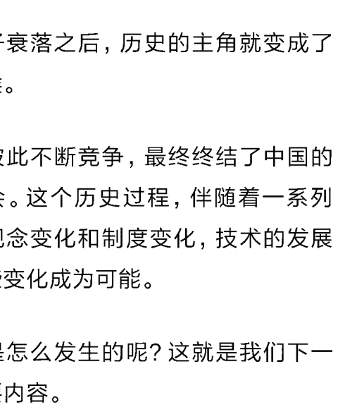

# 04 | 封建社会是如何走向终结的

上一讲我们说到，到了西周后期，周天子的影响力越来越差，最终被迫迁都洛阳，中国历史进入到东周。

东周又分成了春秋战国两个时期，这一讲咱们就来清说说，封建社会是如何在春秋战国时代走上末日的。

末日之路的由来，是因为在春秋战国时期，出现了一个非常关键的变化，就是战争逻辑变了。

春秋之前的战争，其实不是以砍死人为目的的，战争的仪式性大于实用性。但到了春秋中后期，战争变成以砍死人为目的了。也正是由这个战争逻辑的变化，才把中国引向了大一统。

那么，为什么战争逻辑会变化呢？

原因在于，春秋末期出现了一些重要的技术发展，它带来了新的经济和人力资源，打破了过去的社会均衡，封建社会当中的贵族秩序崩塌了。

## 周朝贵族之间的礼仪战

为了讲清楚这个变化，咱们首先得讲一下周朝封建社会的贵族是怎么来的。

无论中外，贵族最初都是军事征服者。周朝取代商朝之后，给一群亲戚和近臣分封了领地，他们带着家人、亲兵来到封地进行军事殖民，就成为了贵族。封地上的土著居民则为平民。

## 战争从礼仪性走向实用性

问题是，这样一种战争的打法，有个前提，就是大家都认同“礼”这套规矩很重要。万一碰上个根本不懂这套规矩、不按套路出牌的人，不踏正步而是直接打刀砍人，那战争的打法就变了。

## 封建社会是如何终结的

虽然底线变了，但是在这个时候战争的规模还是不会特别大。为什么？因为这个时期的战争，还是只有贵族才能参加，平民还没有被发动参与到战争里来。

臣，还得有依附于自己私人的人事班底，而不能由着贵族们来处理政治事务。问题是，如果不能在贵族之外找到有文化的人，这私人人事班底就建立不起来啊。

文化的载体是文字，在周朝前期，文字是祭祀专用的，通过铸鼎的方式向外分发，除了大贵族们，没几个人有机会接触到文字，有文化的人就只能是大贵族，大贵族是不会帮助君主对付自己的。

这就轮到竹简技术显身手的时候了。到了春秋战国时期，文字开始被刻在一片片竹简上，这可比铜鼎要轻巧得多，不仅仅是便于携带，复制的成本也极大降低，知识传播的成本急剧下降，一般的贵族子弟、甚至运气好的普通百姓，都有机会学习文字获得知识了。

由于多年的CK

君主们早就想养一群可控的自己人了。什么样的人最好用呢？

第一，他们要在本国没有根基，没资本对抗君主；

第二，他们的地位尊荣都取决于君主的赏赐，就有动力与君主相配合。从别国跑来的游士完全符合这两点要求。君主与游士一拍即合，游士成为依附于君主的私人人事班底。这个私人人事班底，后来就发展为官僚制。

官僚和贵族的区别在于，本质上来说，官僚没有独立性，他们是职业经理人，其地位取决于君主的意志；贵族有独立性，他们是准合伙人，君主有大事必须和他们商量着来。

## —— 今日小结 ——

好，我们现在可以总结一下这一讲的核心内容。

春秋战国时期，战争的逻辑发生了深刻的变化，再加上铁器牛耕以及竹简这些新技术的出现，使得平民开始成为君主可以利用的政治力量。

所有这些因素，都导致了贵族所重视的那种“礼”的秩序崩溃，中国历史上的封建秩序就走上了末日。

在春秋战国这样一个血光四射的年代，不仅有激烈的军事竞争，也发生了一系列激烈的思想竞争。这带来了中国历史上罕见的、大规模的思想变革，并在很大程度上奠定了之后两千多年中国人的精神基础。

这就是我们下一讲的内容。

欢迎关注施展公众号（微信搜索公众号「施展世界」添加关注，ID: shizhanworld），获取更多延伸阅读。

## 【封建社会是如何走向终结的】

春秋末期出现了两个重要的技术发展，它带来了新的经济和人力资源，打破了过去的社会均衡，封建社会当中的贵族秩序崩塌了。

也正是这两个技术变迁，导致了战争逻辑的变化。战争从礼性化走向实用性，开始变成以杀死人为目的了。也正是由于这个战争逻辑的变化，才把中国引向了大一统。

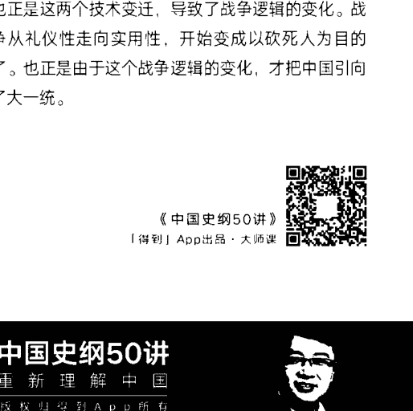

# 05 | 诸子百家的三大流派

05讲 | 诸子百家的三大流派

这一讲咱们来聊聊春秋战国时代的百家争鸣，这是中国古代历史Ｄ上最为灿烂夺目的年代之一。

咱们来梳理一下，看看百家争鸣是怎么来的，以及该如何理解这些思想流派。

在前面讲商周之变时我们谈到，在周朝建立的时候，一种普世主义文明出现了。

但那会儿的人们对这文明却处在一种很懵懂的状态，也就是所谓的“日用而不知”，他们会下意识地用这套价值观来理解世界，下意识地形成了一些行为习惯。

这些行为习惯被整合成为“礼”，是贵族们战争时的道德标准，也是君子和小人之间交往的行为参照系。但是，这个时候并没有人清晰地琢磨和总结这些秩序。

## 对待传统有三种态度

你初一看，会觉得诸子百家的流派好多啊，不知该如何找到头绪来理解它们。

实际上，这里面有个基本的结构，这些流派依照它们对待传统的不同态度，可以区分成三大类，把这三大类大致搞清楚了，就找到头绪了。

对待传统可能有三种态度，一是力挺，认为传统好极了；一是抛弃，认为传统坏透了；一是无所谓，它是好是坏跟我有什么关系呀？

这三种态度，分别就对应着，儒家、法家和道家。其它的诸子百家，都可以视作这三家的某种变形；因为对待传统的态度一共也就是这三种可能性。

## 儒家：克己复礼

接下来咱们再展开点，对三家分别更细致地解释下。

儒家是从商周两朝的巫师系统发展出来的，这里的所谓巫师，不是要把它理解成现代的跳大神那种巫师，而是古代沟通天意与人事的神职人员。这种工作主要通过占卜和祭祀来完成。

## 法家：君主意志

但在法家看来，儒家的理念也太迂腐了，既然明知其不可，还要为之，有什么用呢？

## 道家：无为而治

无论儒家法家是怎么思考的，在出于荆楚之地的道家看来，都会觉得，中原的人也太看不开 leder 世间这点东西有什么好争的？

这种超然的态度在庄子的一个故事里，体现得最确切。

庄子有一位朋友叫惠施。惠施在魏国谋得宰相的职位，庄子远行路过魏国，打算顺路去看望他。有人就跟惠施说，庄子到魏国来，就是想取代你做宰相。

惠施听说后很紧张，便命人在国都大肆搜捕三天三夜，想逮着庄子把他立刻赶走。

庄子听说了，就主动去见惠施，给他讲了个故事，说，凤凰从南方飞去北海，一路上只要不是梧桐树，它不落下休息。不是竹子的果实，它不吃。不是甘甜的泉水，它不喝；结果半路上碰到只猫头鹰，刚捡着个死老鼠。猫头鹰看见凤凰，马上大声叫唤想要吓走凤凰，生怕它抢走死老鼠。

庄子说，惠施你现在这么大肆搜捕我，你以为我看得上这宰相职位吗？说罢飘然而去。

要知道，惠施也不是一般人，“学富五车”这成语，最初就是描述他的。

所以，关于道家也不用再多说什么了，这个故事足够体现道家的气度和洒脱。

那么，在道家看来，世间的事情该怎样才能搞好呢？

道家另一个代表人物老子会反问你，搞什么搞？最糟糕的就是你们这种非要搞事情的人，你们以为只有这样世界才会好，可世界恰恰就是被你们搞坏了。

道家认为，当今之计，是放下非得要搞点事情的想法。

顺其自然，让世界、让百姓自由自主地活动，事情自然就好了，这就叫“无为而治”。

## —— 今日小结 ——

好，现在咱俩可以总结一下这一讲了。

百家争鸣的出现，是在礼崩乐坏的时代，人们试图重新寻找意义参照系的结果，各学说根本上来说都要回答一个问题，就是如何对待传统。

在这个问题上大致可以分出三种态度，就是主张回归传统、主张抛弃传统、以及完全不在乎传统，分别对应着儒家、法家和道家。

百家争鸣的思想自由，很依赖于春秋战国时期诸侯国彼此之间的竞争。竞争的终结点是天下的大一统。一旦一统，百家争鸣马上就会受到抑制。

中国历史也走到了时空坐标系的第二个坐标点，周秦之变。

周秦之变是怎么发生的呢？这之后的大帝国又是如何面对百家争鸣所留下的思想成果呢？

这就是我们下一讲的内容。

今日得到 12月 20日

## 【诸子百家的三大流派】

春秋后期，天下列乱、礼崩乐坏。人们突然发现赖以理解世界的坐标系没有了，世界的意义丧失了。而这种时候，就是思想大爆发的时候。

诸子百家，根据他们对待传统不同的态度，可以分为三类：一类是力挺传统，代表就是儒家；一类是抛弃传统，代表就是法家；还有一类是不在乎传统，代表就是道家。

《中国史纲50讲》
「诸葛」App出品·大昕译

# 06 | 法、道、儒：皇上到底喜欢谁

06 | 法、道、儒：皇上到底...

这一讲，咱们要说到中国历史当中的第二个时空坐标，周秦之变。

战国时期是中国古代历史上变革最激烈的时期之一，它终结了封建社会，中国走上大一统帝国，带来了周秦之变。

周秦之变对中国的思想史还带来个自然延伸的影响，就是我们在历史上看到的，从秦始到汉武，帝国的官方思想经历了从法家到道家再到儒家的转换过程。

这些变化背后的机理非常重要，是我们理解此后大一统帝国的一个重要线索。

## 周秦之变的“法家逻辑”

先来说周秦之变是怎么发生的，这与战国时期诸侯争霸的逻辑紧密相关。

对诸侯来说，随着战争规模的扩大，提升国家的战争效率就成了重中之重。

百家争鸣的诸多学说，哪一种更注重提升战争效率，它就会获得诸侯们在政治上的更多支持。

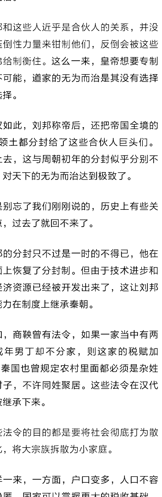

## 帝国官方思想开始转变

## 汉高祖为何要“无为而治”

## 给你重要的提示：《中国史纲50讲》要搬家啦

你好，

关于《中国史纲50讲》，有件事项要特别跟你汇报：

得到App已更新至最新版本3.1.3。在这一版本里，将会在App首页增加「大师课」这个新的产品模块。

除了《中国史纲50讲》，未来还将有更多「大师课」陆续加入，带你透过大师的视野，领悟各个领域的顶级洞察。

作为第一门大师课，《中国史纲50讲》，预计将在12月24日，全部迁移到新的「大师课」模块中。

对给你带来的不便，深感抱歉。特此向你说明搬家后的课程使用情况。

### 搬家的基本情况是这样的

+ 1. 专栏模块下的《中国史纲50讲》，也就是你正在使用的本课程，从12月24日起将不再更新后续内容；《中国史纲50讲》的全部内容，将迁移到「大师课」模块的新课程中。
+ 2. 请确保在第一时间升级得到App至最新版本，你会在12月24日后，在「大师课」模块中，继续找到和学习《中国史纲50讲》。课程内容无任何变化。

### 你可能还有以下这几个问题

Q：搬家后，如何找到已购买的《中国史纲50讲》？

如果你已经购买了《中国史纲50讲》，请确保在第一时间升级到最新版本3.1.3。

课程搬家完成后（预估在12月24日0:00后），你会在两个地方找到《中国史纲50讲》：

+ 1. 得到App首页，你会看到「大师课」模块和搬家后的《中国史纲50讲》。
+ 2. 在已购里，你会在新的「课程」分类以及「全部」下，找到搬家后的《中国史纲50讲》。

所以，如果你无法找到《中国史纲50讲》，一定要确保更新得到App至最新版本3.1.3，就可以继续收听《中国史纲50讲》啦。

Q：搬家后的课程内容会有变化吗？

大师课搬家，不会对《中国史纲50讲》的课程设置和内容带来任何变化。

如果你已经购买课程，可以在更新版本后，继续收听和学习。

Q：搬家后，去哪里找到我之前的留言和笔记？

《中国史纲50讲》搬家后，留言区会重新精选。因此，如果你之前的留言已经「上墙」。很抱歉，搬家后这条「上墙」的留言会无法显示。

但是，你留言的内容，以及你做过的知识笔记，仍然可以在你的「知识账本」里找到。

也希望你能给我们帮一个忙，把你的精彩留言，在新的《中国史纲50讲》课程里再写一次。

对于之前已经「上墙」的精选留言，我们会优先再次精选，让未来更多的用户能够看见它。

如果你还有其他问题，欢迎进一步跟我们沟通，反馈渠道是：

得到App，进入右下角「我的」，点击「帮助中心」，点击右上角「意见反馈」，留下你的意见，以及你的联系方式。我们会及时回复处理。

感谢你的体谅和支持！

让我们继续一起，在《中国史纲50讲》里，看懂3000年的中国。

得到团队
2017年12月22日

# 07 | 汉人王朝为何统治不了长城以北

这一讲我们来聊一聊中国历史上极为重要的一条线索，中原与草原的相爱相杀。

通行的历史叙述，也就是你一般看到的历史，都是从中原的视角来展开的。但实际上，中原和草原，一直以来就是保持着相爱相杀，相互塑造的关系。

这种相互塑造的关系非常重要，以至于脱离了草原，你根本无法解释中原；脱离了中原，你也无法解释草原。这是在我们过去的历史叙述中极少见到的一角度。

## 究竟什么是汉人

首先，我们要明确一个问题，在古代的中国，究竟什么是“汉人”？

你不仔细想，不会觉得有问题，但仔细想一想，就会出现实际上答案很模糊。

## 儒家文化的地理依赖性

定居的前提是农耕，而农耕有一个最硬性的约束条件，就是年降水量。东亚大陆上，如果一个地方年降水量少于400毫米的话，靠农耕是活不下去的。

那么，东亚大陆的400毫米等降雨线在郎儿呢？

这条400毫米等降雨线，差不多和长城重合。长城再往北，年降水量就不足400毫米了。也就是说，儒家帝国在农耕地区的扩张极限，就是400毫米等降雨线。于是在这里，儒家帝国修建了长城。长城再往北就是游牧区域了。

## 中原和草原的继承逻辑区别

我们可以顺着这个结论再往前推导一步。

正是因为自然生态原因带来的社会结构不同，也导致了中原和草原这两边，一旦形成帝国的话，统治逻辑和继承秩序有很大的不同。

这是因为，你想要通过税收建立中央财政，有个前提，那就是税收的收益要大于成本，你不能花了十块钱雇人去征税，却只征回来两块钱，必须征回来二十块钱，这事才玩得下去。

对于中原人口，因为都是定居的生活方式，所以征税相对容易，你花十块钱的成本能征回来二十块甚至三十块；但草原上，因为游牧者的生活高度流动化，逃避征税太容易了，你花十块钱能征回来两块钱就不错了。

由于在草原上征税成本太高，所以在草原上根本就建立不起中央财政，也建立不起来官僚制。因为根本没钱养活官僚嘛。

没有中央财政，没有官僚体系，这就导致草原上无法进行大规模治理。所以，在草原上，人们只能以小部落为单位行动。在小群体情况下，是可以依靠熟人关系完成管理的。

小群体的规模上限是多大呢？英国有一位人类学家叫做邓巴，他提出，这个规模上限是150人左右，150这个数字就被称为“邓巴数”。超过150人，要维持群体内所有人之间的密切关系，所要处理的数据量就超过大脑的承受极限了。

所以，一旦群体规模超过这个临界点，它就不再是个熟人社会，是陌生人社会，只能靠规则来治理。规则就得有人来执行，官僚体系就是干这个的；但是草原上又养不起官僚。

所以，一旦部落的规模超过临界点，它就会分裂出新的部落，继续以小集群的方式来行动。

## 继承逻辑

| 中原 | 草原 |
| --- | --- |
| 农耕-定居 | 游牧-流动 |
| 容易征税 | 征税成本高 |
| 稳定中央财政 | 没有稳定财政 |
| 形成官僚体系 | 小部落诸治 |
| 君主保证正当性 | 君主保证战斗力 |
| 嫡长子继承制 | 成年兄弟继位 |
| 父系子及 | 兄弟兼及 |

说到这里，你可能要问了，既然草原上不能大规模治理，那么，草原上为何会有匈奴、鲜卑、蒙古那种强大的游牧帝国呢？

要回答这个问题，你必须要先搞清楚一个背景，就是强大的草原游牧帝国是何时出现的？

在秦统一天下之前，并没有出现过什么强悍的草原民族。那时的北方游牧民，在历史记载中顶多是跑龙套的，根本算不上什么威胁。但到了西汉帝国时期，一个强大的匈奴帝国仿佛从天而降，突然耸立在北方。

中原形成庞大的帝国，即便是从有文字记载的商朝算起，也经历了将近一千几百年的积累，如果算上有文字前的历史，那更不知道积累了多久。

那么，为什么草原几乎没经过什么时间的积累，就能一下子建起一个庞大帝国呢？

以及，为什么像元朝、清朝这样的草原征服型王朝，能够超越汉人王朝，建立起同时统治长城南北的大帝国呢，他们又是如何做到的呢？

关于这一系列问题，我会在下一讲专门来谈谈。

## —— 今日小结 ——

这一讲，我带你从中原这边入手，解释了为什么纯汉人王朝无法统治长城以北。

这个问题，其底层是由儒家文化以及儒家文化的地理依赖性决定的。而中原和草原在地理特征上的区别，也带来了在财政制度、继承秩序上的差异。

但是，正如我们在开头所说，中原和草原在历史上一直保持着相爱相杀、相互塑造的关系。

下一讲，我将从草原这边展开，回答我们在这 legend 讲结尾留下的问题。下一讲见！

欢迎关注施展公众号（微信搜索公众号「施展世界」添加关注，ID: shizhanworld），获取更多延伸阅读。

今日得到 12月 22日

## 【汉人王朝为何无法统治长城以北】

官僚制帝国有个很重要的特征，就是君主和官僚，在功能上是有分工的。

君主的首要功能，是象征正当性。所以，君主的能力只排在第二位，第一重要的是君位继承的稳定性。

嫡长子资格是最容易达成这种共识的。所以，中原的继承原则就稳定在嫡长子继承制上了。

组织起来反抗的成本变高，利于皇帝的统治。

这套打法与无为而治完全不贴边，相反，绝对是一种积极进取的政策。这从反面也证明了，无为而治只是面对强大合伙人时的无奈之举。

刘邦在登基后花了八年的时间，分步骤地将能够威胁皇帝的异姓诸侯都剪除掉，将他们的封地转封给刘氏宗亲，意图以此来巩固汉室江山。

历史证明，同姓封王，并不比异姓封王更可靠。异姓王爷如果有异心，可能也就是想要割据，而同姓王爷如果有异心，可能是想篡位。

以刘邦的政治智慧，他肯定能看到这一点，他用这些策略是想要精巧地构筑一种力量均衡。刘邦不能把开国重臣们都杀掉，那些没有封王的重臣多半都留下了，因为北面还有匈奴呢，得有人能打仗。

再封一群同姓王爷，可以平衡这些重臣；反过来，重臣对同姓王爷也能形成制衡。皇帝则超越于各种力量之上，居间操控平衡。

刘邦一死，同姓王爷果然谋反作乱了。军功重臣与同姓王爷的相互制衡作用马上发挥出来，他们把王爷们的作乱平息掉了。

此后几代汉朝皇帝不懈努力，到汉武帝时，终于将同姓王爷的封地逐渐消解为郡县大小。这时候，汉朝初年的军功重臣也都老的、死的死，皇室不再需要这两种力量相互制衡了。

大汉帝国终于从貌似分封制的结构，回到其本质上的大一统结构。

## 汉武帝为何“独尊儒术”

到了这一步，官方思想的又一次转型就提上日程了。

汉武帝雄才大略，从内外两个方向都下重手，重整了帝国秩序。这样一来，讲求无为而治、追求出世的道家逻辑不合胃口了，他要寻求新的意识形态，来论证自己各种作为的正当性。

于是那些追求入世的学说，又有机会了。什么学说会胜出、获得皇家的认可呢？法家的逻辑肯定不行了，因为会面对秦朝那种下场，所以更好的选项就是儒家了。

于是有了汉武帝时期著名的“罢黜百家、独尊儒术”。

一直有人因此而抨击儒家是为专制辩护的，我们倒是要为儒家说几句公道话。

汉武帝那会儿的专制都已经成型了，你不能指望几个儒生就能改变它，儒生根本做不到。

对儒家来说，可能做到的最多就是：我迎合你的权力，你不是要一个新的观念系统吗？我来给你！只要你接受了我的这套观念系统，我就可以来论证你统治的正当性。

合伙干之后，一个变化浮现出来了：对儒家来说，我这套观念系统论证了你的正当性，对它的解释能力不在你手里，而在我手里。也就是说，儒学的解释能力，在儒生集团手里，而不在皇帝手里。儒生以这种方式对皇帝形成一个反制能力。

这种反制力肯定没有过去的封建贵族对天子的反制力那么强，但是没办法，儒家最多也只能做到这一步，不能要求更多。

从此之后，中国约两千年的历史命运，也浮现出基本形态了，这就是所谓的“阳儒阴法”，又称“外儒内法”。

什么意思呢？从观念层面来看，是儒家在主导，儒家解读着天意，君主也不敢完全违背儒家的教导而行事。儒家表面上的迂腐，却为君主划出了大致的行动边界；但在具体的制度设计上，却还是法家逻辑。

这样一来，对君主来说，治理的效率有了，安抚民心的口径也有了。

到了这会儿，我们可以说，周秦之变终于走完了它的转型过程。

汉朝能够取代秦朝，成为中国历史上第一个长寿的大一统朝代，很大原因就在于它能够有效地综合这几家的观念；同时也让达成了均衡的各种力量，获得了有效的安定。

所以，我们说的周秦之变，并不是到秦朝就结束了。而是从周朝开始，经过秦朝，最终到汉朝才完成这个转型过程。

## —— 今日小结 ——

今天讲的主要内容就是，战国末期的动荡终结了封建社会，带来了周秦之变。

而周秦之变的过程中，中国的官方思想经历了从法家到道家再到儒家的转型过程，最终汉朝把所有新的要素都结合起来，让中国从制度和思想两个方面获得稳定，中国走上大一统。

但是，历史却总是和我们开玩笑。

汉朝的大一统在汉武帝手上发展到了极致，但也正是在他的手上，刺激了社会上豪族的兴起，改变了未来大一统帝国的命运走向。

要解释这背后的深层逻辑，得先从草原上的故事讲起。这就是我们下一讲的内容。

欢迎关注施展公众号（微信搜索公众号「施展世界」添加关注，ID：shizhanworld），获取更多延伸阅读。

今日得到 12月 21日

## 【法·道·儒：皇帝到底喜欢谁】

汉武帝之后，中国约两千年的历史命运，也浮现出基本形态了，这就是所谓的“阳儒阴法”，又称“外儒内法”。

怎么理解“外儒内法”？儒家表面上的迂腐，却为君主划出了大致的行动边界；但在具体的制度设计上，仍然还是法家逻辑。

# 08 | 草原征服型王朝为何能一统天下

上一讲结尾，我们留下了一个问题，受限于草原的自然生态条件，草原只能依靠一个个小部落来统治。

但是，为什么从西汉开始，草原上会出现像匈奴、鲜卑、蒙古那样的强大游牧帝国呢？

而且，这些庞大的游牧帝国，仿佛是一夜之间出现的。为什么是这样呢？

其实，这个问题的答案非常简单：草原游牧帝国出现的最根本的原因，就是中原的统一。

正是在秦统一中原，建立庞大的农耕帝国之后，草原上才有可能出现庞大的游牧帝国。

## 游牧帝国是如何建立的

这是为什么呢？还是要从草原和中原的双边关系来讲起。

草原上的资源有限，除了肉、奶等少数产品外，游牧者需要很多种生活资料都要从南方农耕地区获得。这主要通过两种渠道一战争与贸易，贸易显然是成本更低的办法。

问题是，中原地区是否愿意与草原贸易？

如果中原没有统一，中原各诸侯国会竞相和草原部落进行贸易，因为它们需要草原上的马。草原马，是战争的利器。不和草原做生意买马的诸侯国，和其他诸侯国一旦打起来，就该吃亏了。

如此一来，诸侯国之间竞争起来，草原无论是买还是卖，都能有个不错的价格，小部落也就没有任何欲望想要联合起来。因为一旦联合了，贸易利润肯定会被盟主剥去一层，还不如不联合呢。

但是一旦中原统一，这个贸易关系就变了。

中原一统一，就不再有各个诸侯国的竞争，统一的大帝国垄断了中原市场，帝国就可以用政治手段去干涉贸易，要么抬低价格，要么干脆断绝贸易。

这样一来，草原上的那么多小部落，他们仍然需要那些必需品，却没法正常地买来了，那就只有抢。要从中原帝国手里抢东西，小部落根本不是对手，那就必须联合成为一个大的部落联盟才行。于是，强大的游牧帝国出现了。

联合起来的草原帝国，其人口仍远远少于中原帝国，但却比中原帝国更有战斗力。

一方面，草原上是骑兵，对上中原的步兵时，基本是碾压性的优势；它想打你的时候，你跑不掉，你想打它的时候，你追不上，中原一方完全没得玩。

另一方面，草原上的生产、生活、战斗的单位是合一的。战斗效率高，后勤压力低，远非中原军队可比。

还有一方面原因是，草原上比中原贫穷，对于草原帝国来说，战争近乎是净收益。对中原帝国来说，则战争近乎是净消耗，两边的战争收益和欲望大不相同。这一系列原因，使得草原帝国会对中原帝国构成巨大军事压力。

这个所谓的游牧帝国，事实上是一个庞大的部落联盟。联盟的大可汗通过垄断战利品的分配权，形成一个由战争衍生出来的中央财政。

草原的中央财政和中原那种靠税收的财政体制很不一样，它主要是靠战争战利品形成的财政。

所以，只要联盟的大可汗，能够持续从南边的中原地区抢来东西，持续垄断战利品的分配权，那么他的帝国统一就能维系下去；一旦大可汗没办法带人抢回来东西了，帝国统一就要完了。

因此，对北边来说，对大可汗的第一要求是他必须特别能打；这一条也和南边中原很不一样。

我们上一讲说了，中原的官僚制帝国，对皇帝就没这要求，他只要能保证统治的最高正当性，也就是保证公认的继承顺序就行了。

但是北方的可汗是必须经常出去打仗的，你不能带头抢东西回来，就没人愿意跟你了。由于对可汗战斗力的要求，意味着可汗的继承人绝不能是小孩。但是草原上战事频繁，可汗的寿命有很大不确定性，当大可汗去世的时候，他的儿子很可能还未成年。

所以在草原上，一般来说，继承制不是中原式的父子传子，而是兄终弟及，也就是哥哥死了弟弟来继位。

## 草原的周期性继承危机

那这就会带来一个问题了，等到大哥二哥三哥老么这些兄弟全都做了可汗、都去世之后，接下来该谁继位了呢？

第二代的子侄辈们，谁都觉得自己有资格，因为他们的爹都当过可汗啊。于是在这情况下，他们就会分裂，发生内战。

中原有句古语叫做“胡虏无百年之运”，为什么草原帝国没有超过一百年的国运呢？

就是因为开国那一代可汗，他的兄弟几个加一块儿也活不过一百年。等到这一代全都去世之后，第二代一定会分裂。

我们看到的所谓大汉远逐匈奴、大唐远逐突厥，实际上就是中原帝国终于熬到草原帝国自然分裂的那一天了。只要北边一分裂，南边就有下手的机会了；而南边一定比北边能熬，因为南边有钱啊。

除了继承危机，草原上的大可汗还面临另一个问题：就是，我把这游牧帝国统一起来了，但我没有足够多的钱把所有的兵都养起来，那么，这些兵就不一定听我的。

这些兵听谁的呢？还是听他原来所属那个小部落的小可汗的，只不过这些小可汗认我大可汗做老大而已。因此，草原的大可汗，会始终面临这些小可汗的制约和牵制。

比如，在八旗入关之前，努尔哈赤当大汗的时候，八旗里面只有上两旗是努尔哈赤的，剩下的旗都是别的旗主的。到皇太极的时候又拨走一旗，上三旗是皇太极的，另外五旗都是别的旗主的。

大可汗最多只掌握三旗，还有另外五旗不在你手里，大汗就是没有办法独断专行的。小可汗就是军事实贵族，军事贵族对大可汗会形成相当强的制约关系。草原上的军事贵族民主制可以长期保持下来，这不是因为大汗宽容，而是因为他没辙。

这种统治形式也和中原很不一样。中原这边，在商鞅变法后，军事贵族基本上就都不存在了，以官僚体系为代表的皇权，在中原是非常强大的。

于是，我们在中原和草原上，就看到两种完全不同的治理逻辑，以及完全不同的命运转循环。

就草原来说，它面临的是周期性的继承危机，每逢百年大限到来，它一定会瓦解，也就是我们前面说的，“胡虏无百年之运”。

## 草原力量如何注入中原

就中原来说，要面对的则是周期性的衰败危机。因为皇帝是靠官僚体系进行治理的，但是官僚体系里面也都是人啊，你没有办法防止具体的官僚利用官位以权谋私的，除非皇帝能力足够强，能够制衡官僚体系。

但我们经常看到的是，只有开国的头两三代君主有这个能力，往后的君主，一辈子生活在深宫，没见过世面，不知道如何应对官僚体系，这个帝国就会被官僚体系绊住。

最初的官僚体系是帝国的工具，但是很快，它就变成一个寄生虫，并且这个寄生虫反过来主导这个帝国。于是，南边的中原帝国就会陷入离心离德的一个状态。

由于南边的富裕规模足够大、社会散沙化，所以，组织化的反抗很难建立起来，它大多还能撑得下去。但是，这个时候，如果出现另外一个变量，局势就会不一样了：就是气候变化。

一旦气候发生变化，人口对资源的压力一下子变得很大，会导致北方旗帜大规模南下。

对南边来说，他必须使劲儿抵挡，就要大规模征兵和征税。问题是，南方的农民也遭遇气候变化了，他们本来就遭灾没饭吃，朝廷还要加派征税，农民只好起来造反。于是，中原帝国就在内外夹攻的情况下，崩溃掉了。

中原帝国要重建秩序，散沙般的社会是无法自我组织起来形成秩序的，需要有一些中间阶层、就是广义的贵族，来作为社会的基石，才能把秩序恢复起来。

问题是，中原的贵族多半已经被皇帝和官僚铲除了，社会自我组织的能力不行了。而我们前面说了，草原上是始终存在着天然的贵族制的，于是我们会看到，在历史上有多次，中原是通过草原力量的注入，来重建秩序的。

草原力量成功注入中原，是从南北朝时期的北魏开始的。之后的多次入主的草原力量，也都是来自东北的。

## 二元帝国的治理逻辑

为什么都是从东北来呢？这是理解中国历史的又一条重要线索。

要想把秩序重整起来，首先需要足够强的军事能力，冷兵器时代最厉害的就是草原骑兵。

但是，游牧统治者假如不能有效克服周期性的继承危机的話，没多久也会灭亡。

克服继承危机的关键是，你能有效掌握中原的税赋；稳定掌握中原税赋的前提是，你得能理解儒家的治理方式；另一方面，你要稳定控制中原的办法就是，得能利用草原骑兵，懂得草原上的治理方式。

纯粹的中原人无法理解草原，纯粹的草原人也无法理解中原。

而东北则是中原与草原的过渡带，它北边靠着呼伦贝尔大草原，南边靠着辽东的农耕地区。但凡在东北能站得住脚的人，南北这两种治理模式他必须全懂。所以在入关后，他就可以建立起一个二元帝国。

所谓二元帝国，就是，在长城以南，能以中原儒家的方式来完成统治，统治者的身份是皇帝；在长城以北，则按草原游牧的方式来完成统治，统治者的身份是大可汗。

大可汗在入关后，可以用中原这边的庞大财富，一下把所有的草原骑兵全都养起来，军事贵族就被收买掉了。

在过去，如果大可汗没有战斗力，部落联盟就彻底没饭吃；而今天即便大可汗没有战斗力，也照样有饭吃。大汗从中原获得“饭”，再用中原的“饭”，把草原骑兵给赎买掉，然后再用草原骑兵来控制中原。

一个正向的循环就建立起来了。到了这种情况下，大可汗的继承逻辑就可以发生变化了。人們再怎么爱兄弟，也超不过爱儿子；继承顺序终于能从兄终弟及转化为父终子及，周期性的继承危机破掉了，“胡唐”就可以超过一百年了。

比如大清，一共统治了二百六十七年。这里边也可以看到满洲人的一些历史记忆。

比如在《雍正王朝》里面演到的，八爷、九爷他们想要收拾雍正，要搞“八王议政”。

我们无法想象会有哪个明朝王爷敢跟永乐大帝或者万历皇帝提出八王议政的要求，因为提出要求就是近乎于谋反了，会被千刀万剐的。

但是八爷九爷却会对雍正提出这要求，因为在关外的时候，大汗只能控制两三个旗，八王议政本来就是满洲人生活的一部分。满洲人入关之后仍然有着这样一个历史记忆，所以他们觉得可以这么搞一把。

但是他们没有想到的是，草原入主中原后，两者都经历了深刻的重构过程，所有的逻辑全都变了，所以“八王议政”很快就被雍正拍死了。

## —— ◇ 今日小结 ◇ ——

说到这，可以回顾一下这两讲的内容，我们展开讲了草原和中原的相互塑造的关系。

中原的统一的农耕帝国，促使草原出现了统一的游牧帝国。游牧帝国又反过来用军事压力改变中原帝国，并且能在中原帝国衰败时输入秩序，重建社会，建立同时统治中原和草原的庞大帝国。

这类帝国，必须能熟练运用中原和草原两套游戏规则。也就是说，它必须是一个胡汉二元帝国。

我们这一周的内容就基本结束了，明天我会带着你做一个系统的回顾。

而在未来一周的课程中，你会不断看到我们今天讲的草原和中原的复杂关系。

你会看到，中原帝国如何走向衰败，草原力量又是如何注入，中原与草原如何完成重构，令帝国获得新生，甚至焕发出比以往更加强大的活力的。

今日得到 12月 23日

## 【草原征服型王朝为何能统一天下】

东北是中原与草原的过渡带，但凡在东北能站得住脚的人，南北这两种治理模式他必须全懂。所以在入关后，他就可以建立起一个二元帝国。

所谓二元帝国，就是在长城以南，以中原儒家的方式来完成统治，统治者的身份是皇帝；而在长城以北，则按草原游牧的方式来完成统治，统治者的身份是大可汗。

欢迎关注施展公众号（微信搜索公众号「施展世界」添加关注，ID: shizhanworld），获取更多延伸阅读。

留言精选

提交留言可与施展互动

## 欢迎你回到大师课《中国史纲50讲》

你好，

欢迎你回到《中国史纲50讲》。

从12月24日起，《中国史纲50讲》后续内容将在该课程内正常更新，课程内容与设置无任何变化。

12月24日前已发布的内容，也已经全部迁移至该课程内。你可以正常收听和使用。

未来，还将陆续有更多「大师课」课程上线，带你透过大师的视野，领悟各个领域的顶级洞察。

### 从哪里进入课程

+ 1. 得到App首页，你会看到「大师课」模块和搬家后的《中国史纲50讲》。
+ 2. 在已购里，你会在新的「课程」分类以及「全部」下，找到搬家后的《中国史纲50讲》。

如果你在已购区发现两个《中国史纲50讲》，可以退出重新登陆，之后在已购区只会出现搬家后的《中国史纲50讲》。

### 如何找到你之前的留言和笔记

《中国史纲50讲》在搬家后，留言区会重新精选。因此，如果你之前的留言已经「上墙」，很抱歉，这条「上墙」的留言在本课程内会无法显示。

但是，你留言的内容，以及你做过的知识笔记，仍可以在你的「知识账本」里找到。

欢迎你继续给搬家后的《中国史纲50讲》留言。

也希望你给我们帮一个忙，把你的精彩留言在这个新的课程里再留一次，让更多人看到你的精彩观点。对于之前已经「上墙」的精选留言，我们会优先再次精选。

感谢你体谅和支持！

用户留言

提交留言可与专栏作者互动

## 这个刑问题有意思 | 欧洲为何没有走向大统一

你好，

12月18日，也就是本周一，我的《中国史纲50讲》上线了。

感谢你的支持，期待未来一段时间，我能够继续陪伴你学习。

我也希望，能得到你的更多反馈，这几乎可以说是对方我最大的奖赏。

上线第一周发布了8讲内容，我一共收到了3000多条留言。我在后台看到这些留言的时候，是很震撼的。

虽然我知道「得到」这个平台上聚集了大量的终身学习者，但是这里很多留言质量之高，仍然超出我的想象。我也能看出，每一条留言都是非常用心的。我自己在看留言和回复的过程中，也得到了非常多的收获。

未来一段时间，我会继续关注你的每一...回应。

### 西欧为何能保留贵族制

其实，这个问题在罗胖的《重新理解中国·之三》里面，已经俏过我的一部分解释了。

不过，还有一部分内容我没告诉罗胖，我在这里完整告诉你：

维持大一统的关键，是军事和财政逻辑。关键就要看中国中央政府是否能够低成本地从社会上汲取财政资源，而财政资源是军事能力的基...。

如果能够低成本大规模汲取资源，超过某个门槛之后，中央政府就可以碾压任何区域性的反抗力量。

中国和欧洲相比，就是在这里分岔了。

中国的...地理破碎...。

于是，中国这边维持大一统的难度就很小，欧洲维持大一统的难度就很大。

## —— 下周预告 ——

下一周，我们会正式进入豪族社会篇。

明日见！

今日得到 12月 24日

【欧洲为何没有走向大统一】

# 09 | 中国是如何走向豪族社会的

我们在前面曾经谈到，汉朝的大一统在汉武帝手上发展到了极致，也正是他刺激了社会上豪族的兴起，改变了大一统帝国的命运走向。

今天这讲就来解释这个问题，看看豪族是如何兴起的，他们与皇帝之间的博弈，如何让西汉垮掉，又如何推动了东汉的建立。

这段历史中有三个标志性的人物，就是汉武帝、王莽和刘秀，这三个皇帝代表了从西汉到东汉的三个重要阶段。

## 汉武帝：促使豪族兴起

咱们先从汉武帝说起，他的雄才大略的副产品就是豪族兴起。

汉武帝的爷爷和老爹，共同开创了中国古代历史上第一个著名的盛世“文景之治”。这两位皇帝无为而治，有点像今天咱们说的，让“看不见的手”来主导经济与社会。

经过几十年，民间发展得非常富裕，大汉帝国的腰包也跟着鼓了起来。腰包鼓到什么程度呢？据说国库里钱多得用不完，甚至于串钱的绳子都烂了。

到了汉武帝，帝国终于有了本钱与匈奴掰手腕。

## 地方官僚与豪族结盟

## 王莽：抑制豪族

以私自买卖，盐、铁这两种最重要的民用物资、山川林泽、铸造货币的权力，等等这一切，全都被收归国有。此外，还设置了一些国家储备机构，用来调节物价。

但事实上，这些制度被设计出来，当然不是因为王莽读了社会主义政治经济学，实际上他是要努力依照《周礼》来复古改制。在这个意义上说，王莽根本不是从现代穿越回去的，而是从更古老的时代穿越到汉朝的。

王莽这些政策的核心目标都是要抑制豪族，重新恢复帝国朝廷的统治能力。但是这种努力在当时是不可能成功的。原因很简单，你想要控制豪族，豪族会老老实实地等着你来控制他吗？

除非你手上掌握的资源对豪族具有碾压性优势，否则豪族反抗起来绝对够你头疼的。王莽能掌握的资源从哪里来呢？只能来自社会上的税收。可是社会已经被豪族控制了，你到哪里去获取能碾压豪族的资源呢？

要想真的干掉豪族，除非是有了新的技术进步。在豪族的控制之外，形成了新的经济资源，皇帝可以在这里收到税，用这个来养活自己能控制的军队，才能干掉豪族，否则皇帝只能接受与豪族共治这样一个事实。

这样一种新的技术进步，要到唐朝后期才会出现，正是它催生了唐宋之变。我们到后面会逐渐讲到这些内容，你只要知道，在王莽这时候，没这条件干掉豪族就行了。

## 刘秀：与豪族共治

豪族的兴起是个历史大势，王莽不肯接受这个大势，就轮到刘秀登场了。

豪族们起来反抗，很快就推翻了王莽的政权；刘秀作为这些豪族的领袖，建立了东汉政权。就凭刘秀的这些支持力量，东汉也注定只能是个皇帝与豪族合作共治的朝代。

也许你会想，不忙，坐等，看刘秀如何像刘邦一样，逐渐灭掉这些合伙人巨头。

很抱歉，东汉没有这个机会了，原因就在于，社会结构变了。

西汉从秦朝所继承的是个散沙状的平民社会，刘邦身边的巨头们，并不能从社会中直接获取支持，皇帝有机会灭掉他们；东汉从西汉继承的是个豪族社会，刘秀身边的巨头们，能够从社会中直接获取支持，皇帝也就没机会消灭这些巨头了。

甚至，对刘秀来说，像刘邦一样定都长安，以便对豪族们形成战略优势，都变得没有意义了。

于是，刘秀直接就选择了在洛阳定都，这里没有军事地理优势，但这里是豪族们的大本营。这相当于刘秀明白地告诉了豪族，咱们都是一家人了。

## —— 今日小结 ——

总结一下，今天的核心线索就是：

汉武帝的鬻武政策，改变了汉朝社会结构，对社会的控制力由中央政府转移到了豪族手中。

经过王莽篡位之后，豪族领袖刘秀干掉王莽，建立了东汉，最终形成了豪族和皇帝合作共治的局面。

咱俩中学时都学过诸葛亮的《出师表》，想来你一定记得其中的一句话，“亲贤臣、远小人，此先汉所以兴隆也；亲小人、远贤臣，此后汉所以倾颓也”？

前汉和后汉，在社会结构上有区别也就罢了，为何在用人水准上还会有如此鲜明的对比呢？

这就是我们下一讲要解释的问题。

欢迎关注施展公众号（微信搜索公众号「施展世界」添加关注，ID: shizhanworld），获取更多延伸阅读。

今日得到 12月 25日

## 【中国是如何走向豪族社会的】

汉武帝雄才大略的副产品，就是豪族兴起。

朝廷越来越弱，豪族越来越强，西汉就由扁平的散沙状社会逐渐变成了豪族社会。
豪族社会维持了差不多一千年，一直 到唐宋的转折期，豪族社会才结束。

《中国史纲50讲》
「得到」App 出品 · 大师译

## 留言精选

提交留言可与施展互动

# 10 | 为何后汉皇帝“亲小人、远贤臣”

10 | 为何后汉皇帝“亲小人... ↓

今天咱们一起来聊一下，为什么后汉的皇帝会“亲小人、远贤臣”？

诸葛亮说过这是后汉衰败的根本原因，后汉的皇帝为啥会这么自取灭亡呢？是他们都特别地蠢吗？肯定不是。

这是因为后汉的皇帝遇到了新形势，他们的选择其实很有限。那么，后汉的皇帝们遇到了什么形势呢？

最关键的就是，上一讲刚刚说过的，豪族社会。为啥豪族社会就会让他们亲小人远贤臣呢？

关键是要看看“小人”和“贤臣”分别都是什么人，以及他们和皇帝都是什么关系。

## “贤臣”是谁

所谓贤臣是什么人呢？他们就是儒家化了的豪族。对皇帝来说，豪族不可怕，就怕豪族有文化。

因为，一般的豪族对社会有组织力，又让皇上收税变得困难，皇上不大容易动得了他，但他们还不会从观念上批评皇上；但是，有文化的人，则会引经据典地批评皇上，说你昏庸。

如果以上两种情况合二为一，这个有文化的人还是豪族，皇上就只能睁眼被他批评，还动不了他。有文化的豪族，从东汉的时候逐渐发展起来，直到隋唐的历史上，被称为门阀士族，经常也简称为士族。

士族对皇帝有各种约束，皇上就在士族外边再去找一些有文化的人，为自己所用，不就能够反制士族了吗？你引经据典说我昏庸，我的人就会引经据典地说我是圣明，皇上不就不那么懵了？

道理是这么个道理，但是皇帝不大容易找着人。为啥呢？

因为知识传播技术不发达。要想在社会中有足够多的有文化的人，知识传播的成本必须降下来。

首先得有纸的出现，东汉蔡伦改进了造纸技术。但这会儿的造纸技术还不发达，有句话成语“洛阳纸贵”，这个描述的其实已经是西晋时期了，说的是有篇文章写得太好了，洛阳的文化人竞相传抄，纸不够用了，于是就卖贵了。

西晋时期比“亲小人、远贤臣”的东汉又晚了一百多年，这说明纸本来就不多，本来也就不会太便宜。

光有纸还不够，还得有印刷术大规模的应用。但东汉还没有什么印刷术可言，书籍的拷贝要靠手写。这种情况下，知识传播的成本相当高，不是豪族的话，一般人根本读不起书；读得起的豪族，就成了士族了。

士族一代代发展壮大，逐渐成为世家大族，他们垄断了知识和地位，垄断了社会上的舆论。

这些人就是所谓“贤臣”，他们差不多把持了朝廷和地方的各种重要职位。世家大族彼此间还联姻通婚，形成了庞大的关系网络，对皇帝有着相当强的制约能力。

## “小人”是谁

东汉开国的头几位皇帝还比较有实力，而世家大族也还在发展中，他们彼此还能相互制衡，还不算什么大问题。

到了后面的皇帝，越来越受到世家大族的约束。皇上肯定感觉非常不痛快，我都是皇上了，还天天被这人这么节制？不行，我得有自己的人，收拾收拾这些天天跟我叫板的家伙。

皇上要找来支持自己的人，来对抗世家大族。但问题是，世家大族把持着官僚体系，也控制着舆论，这些皇帝的支持者就肯定会被指责为“小人”了。

这与他们实际上的品行、官品怎么样关系不大。皇帝的行为，在世家大族嘴里，也肯定是“亲小人、远贤臣”了。

再看看皇上吧，他到哪去找自己人呢？到民间去找？就像前面说的，知识都被世家大族垄断，民间没什么可用之才。到朝廷上找？朝廷上放眼望去，都是彼此串通一气的世家大族，也不行。

皇上还得保证这些人能站在自己一边。对皇帝来说，什么才能够保这些人支持自己呢？忠诚这东西是不敢指望了，能指望的是，他们的身份地位都完全依赖于皇帝，这些人即使是出于自私，也得站在皇帝一边了。

那是什么人啊？只有两种，宦官，也就是太监，还有外戚，也就是皇后的家族。

宦官和外戚还彼此看不顺眼。宦官完全被世家大族所瞧不起，外戚有不少也是出身世家大族的，但一旦与皇上结了亲，马上就会有压过其他世家大族一头的感觉，会借此不断扩大自己的势力范围，这又与其他世家大族之间会发生矛盾。

## 皇帝、外戚、宦官、世家大族的博弈关系

于是，皇帝、外戚、宦官、世家大族组成的官僚，彼此之间形成了复杂的关系。

东汉中后期昏君很多，汉桓帝尤其是在昏君里的典型。但是仔仔细看汉桓帝的经历，能发现非常有意思的东西。汉桓帝是在15岁的时候被大将军梁冀扶上台的。梁冀是前朝外戚，觉得扶植个15岁小孩好控制，利于自己继续掌权。

那些不同意梁冀，想要拥立个成年君主的大臣，都被他给收拾了。被扶上台之后，桓帝感觉特别不爽，因为梁冀像太上皇一样天天控制着他。

汉桓帝想要反制梁冀，但又没有人可用。在当了13年的傀儡皇帝之后，桓帝终于发掘出几个心腹宦官，与他们联手，贿赂为盟，发誓要搞掉梁冀。

皇上和宦官联手把梁冀做掉之后，桓帝开始自己说了算，马上就来了一个历史上著名的“党锢之祸”，就是说，有一群世家大族的名士重臣，他们痛斥宦官，结果就被指责为结党营私，这些人或被罢官逐走或被抓起来，并被规定此后永远不得录用。

我们今天历史书上说党锢之祸是“宦官专权”什么的，实际上只不过是皇帝通过宦官之手，跟这些世家大族进行PK，党锢之祸就是皇帝进行中央集权的努力。

用宦官压制了世家大族之后，汉桓帝又反过来开始压制宦官，把当年帮自己做掉梁冀的宦官们狠狠收拾了一番。

但皇上也不会抛弃宦官，只是让他们不要那么嚣张，日后还会借重宦官继续抗衡世家大族。看到这些作为，我们会感觉，汉桓帝虽然说不上是什么明君，但智慧绝对不差。

宦官的力量过强，皇帝还可能再去用外戚来压制他们，东汉后期的诸位皇帝，交替地扶植宦官和外戚。世家大族面对皇帝的这些对抗举措，便会进一步强化自己的“天下为己任”的形象，获得道德制高点，宦官和外戚就进一步被还原为“小人”。

这就是“亲小人、远贤臣”的由来，至于贤臣是否真的贤，则是另一个问题了。

## 东汉的瓦解

皇权与世家大族的这种冲突过程，会极大地破坏帝国的治理水准。

正赶上东汉末年进入了一个小冰期，连年天灾，民变四起。朝堂上各怀勾心斗角，民间的疾苦实际上没人真的去管。

在这种情况下，老百姓求告无门，只好想法自己组织起来，寻找活路。各种民间信仰，就是组织的工具，因此而获得了越来越大的影响力。

汉朝的儒学讲究天人感应认为天灾必定是皇帝失德，上天降下灾祸，皇帝被迫多次颁发罪己诏。皇上天天都在罪己的话，人们对朝廷的敬畏就会动摇了。民间信仰趁机说，自己才是天命所在，于是，到公元184年爆发了黄巾大起义，动摇天下。

朝廷彻底没辙了，只能寄希望于世家大族与地方豪强兴兵勤王。但豪强们各怀鬼胎，逐鹿中原的诱惑迅速地让这些“贤臣”的种子都变成乱世的枭雄。

大汉帝国冰消瓦解，天下大分裂的时代由此拉开序幕。

## —— 今日小结 ——

今天我们谈到，“贤臣”其实是世家大家族，“小人”就是外戚、宦官，他们是皇帝中央集权的工具。

后汉皇帝“亲小人，远贤臣”的背后其实是皇权和世家大家族的权力斗争。

一旦进入战乱时代，能够把握时代的就不一定是擅长读书的世家大家族了，会有其他出身并不高贵却能力超凡的人脱颖而出。

三国时期的各种战争冲突，今天我们熟知的各种名字，仔细分析的话，会发现隐藏着出身不高的人与世家大家族的对抗过程。

这就是我们下一讲的内容。

欢迎关注施展公众号（微信搜索公众号「施展世界」添加关注，ID: shizhanworld），获取更多延伸阅读。

今日得到 12月 26日

## 【为何后汉皇帝“亲小人、远贤臣”】

党锢之祸，通常被解读为是“宦官专权”。

但实际上，只不过是皇帝通过宦官之手，跟世家大家族进行PK。党锢之祸就是皇帝进行中央集权的努力。

# 12 | 彩蛋：司马懿时代的窝窝相报

12 | 彩蛋：司马懿时代的窝...

上一讲，我们从诸葛亮的心机讲起，谈到了三国时期士族和寒族的对抗。

最终，这种对抗的结局，是士族战胜了寒族，形成了晋朝的局面。而开创晋朝的司马家，就是士族的重要代表力量。

三国的历史很有名了，但是之后从曹魏到晋朝的这段历史，你可能相对比较陌生。正好，最近企鹅正在热播一部电视剧，《军师联盟之《虎啸龙吟》，就是以这段历史为背景的。里面大部分人物都是历史上真实存在的，虽然具体情节有不少虚构，但是大的时间线都是符合历史的。

正好咱们这门课的讲说也进展到这段历史了，接下来，我想给你一个彩蛋，专门讲讲这段历史中的人和事，让你感受一下人性的复杂，和真实历史的跌宕。

我要讲讲这个时期的几个大家族，司马家、曹家、桓家和诸葛家的家族恩怨。

## 曹丕和曹叡的托孤策略

先说曹家。司马家和曹家的关系太复杂了，这一讲，咱们只从司马懿接受曹丕托孤讲起。曹丕短命，去世的时候还不到四十岁，比被他废掉的汉献帝死得还早。

如果他能再多活个三十年，像司马懿一样活到七十多岁，那天下也就没有司马家什么事了，还有可能成就圣君贤相的一段佳话。但是曹丕壮年去世，幼子继位，便需要托孤，曹丕留下了四个顾命大臣，分别是曹真、司马懿、陈群、曹休。

## 高平陵之变

虽然曹叡继承了曹丕的托孤策略，让功臣和宗室相制衡，但无奈曹爽实在是太草包了，只迷恋于权力的外观，并不真正懂得权力的实质。

## 司马家族的事业急剧上升

这也轮到我要说的第二个家族，桓氏家族登场了。

到洛阳城。之后没有多久曹爽兄弟就被司马懿杀掉了，桓范也被诛灭了三族。

司马家族从此进入了急剧上升期，架空了曹魏皇帝，并最终篡权建立西晋。桓氏家族的血是司马懿成功的垫脚石。

没想到的是，桓范的儿子中有一个逃脱了法网，隐姓埋名，以低微的身份在东晋政权中谋生。桓家这家人还是非常能干，逐渐又崛起到了，到桓范的玄孙一代，叫做桓温，位极人臣，差一点就能篡掉司马家的皇位；桓温的儿子桓玄最终完成了篡位工作，虽然很快又被人推翻，但东晋之后也还是很快就亡掉了。

桓氏家族通过几代人的努力，居然鬼使神差地实现了复仇，亲手将司马家族的事业送上终点。冥冥之中，似乎有天意。

## 诸葛家族和司马家族的恩怨

说完了曹家和桓家，接下来再说说司马家族和诸葛家族的恩怨。

不过这里要说的不仅仅是诸葛亮。诸葛家族是三国时期最狡兔三窟的家族。诸葛亮在蜀汉，他亲哥哥诸葛瑾在东吴，都身居高位，他们还有个堂兄弟诸葛诞，在魏国任征东大将军，相当于大军区司令，也不是等闲之辈。司马家族和诸葛这三家都有复杂的恩怨关系。

你最熟悉的肯定是诸葛亮与司马懿的争斗历史。这个争斗对司马懿非常重要。他几次被曹魏贬黜，但是随即就会有诸葛亮北伐，司马懿便又被起用。

正是跟诸葛亮争斗的这个过程，让司马懿在关中地区培植了自己的军事势力，这是后来司马懿能够成事的关键之一。

可以说，正是诸葛亮，开启了司马家族攀向事业最高峰的道路。

司马懿在高平陵之变后过了两年多去世了，长子司马师继承了他的位子把持朝政。司马师没有太多战功，人心不稳。

这会儿诸葛亮已经去世多年，蜀国疲弱不堪，而诸葛瑾的儿子诸葛恪，当上了东吴的宰相，诸葛恪又来攻打曹魏，司马师苦战之后击败了诸葛恪，稳固了自己的位子。

于是，在司马家族的第二代继续攀登权力顶峰的道路上，诸葛家族的第二代又给垫了一块石头。

又过了没多久，司马师也病死了。司马昭再继承哥哥的位子，他的战功还不如哥哥，人心又开始不稳。

诸葛家族第三位垫石头的人又来了。魏国的征东大将军诸葛诞发动叛乱，并向东吴求援。司马昭经历苦战，打败了诸葛诞，稳固了自己的位子。

之后司马昭之心日渐显露，但他还是觉得功劳不够大，没有篡夺皇位的基础。于是，在众人的反对声中，司马昭毅然决定要派钟会去攻灭蜀汉，一旦这个事情能够做成，那么自己有了超级军功，就可以取代曹魏自立为帝了。

魏军出奇兵攻至成都城下，诸葛亮的长子诸葛瞻和长孙诸葛尚，率领蜀军最后精锐都战死在城外，蜀汉就此灭亡。

诸葛家族终于助力司马家族走完了登上皇位的最后一步。

但是，司马昭即将篡位了，却突然也病死了。之后是他的儿子司马炎继承了他的位子，并最终篡夺帝位，开创了西晋。

## —— 本讲小结 ——

司马家族就此走上了事业的最巅峰，但一个巨大的风险也就此埋下了。

从司马师到司马昭再到司马炎，这个继承关系里埋着一系列复杂的连环套关系，导致各种得位不正的问题，这是西晋皇室即将跳入的巨大陷阱。

正是这个陷阱让司马家族的事业从急速攀升走向了断崖式下跌，导致这个下跌的就是历史上著名的“八王之乱”。

但是客观说，司马家族的事业下跌，并不是仅仅因为得位不正，还因为一些谁也躲不过的时代大势。

这就是我们下一讲的内容。

欢迎关注施展公众号（微信搜索公众号「施展世界」添加关注，ID: shizhanworld），获取更多延伸阅读。

# 11 | 诸葛亮的士族绞杀行动

这一讲咱们来聊聊三国。一说到三国，大家首先会想到的就是魏蜀吴的冲突，但今天咱们从诸葛亮的心机说起。

在这个故事里，你会发现，国家之间的斗争，有时并不是最重要的，重要的是特定社会结构下，不同利益集团间的冲突。

历史大势，很多时候是由这些藏在明面下边的冲突决定的。

## “孟达反叛”的常规版本

中国人普遍都熟知诸葛亮北伐中原，与司马懿斗智斗勇的故事。两人的第一次斗智，与一个叫孟达的人相关。

我们先来来讲讲这个故事的常规版本。先说说孟达是谁。

孟达这人，他原本也是蜀汉的臣子，也就是刘备、诸葛亮的旧部。他在早年刘备在世时，犯过严重的政治错误，他自知知道求饶无望，索性就投奔了曹操。

## 蜀汉的主客矛盾

史书上记录这个故事时，一般都定调说，诸葛亮是防范孟达反复无常，所以见死不救。

但是北京大学已故的历史学教授田余庆，却对这段历史给出了一个不同的解释版本。这个版本让人听得一身冷汗，让人意识到，历史和人心有多复杂。

## 士族和寒族的斗争

当时的权力关系是什么呢？

就是我们在上一讲曾经讲过的，出身高贵的世家大族，与出身不高的之间的权力争夺关系。出身高贵的，历史上又被称为士族。

## 曹操对士族的打击

这种乱世里，更能干的人就脱颖而出，曹操崛起？

巾贼就是平民。曹操在青州平了黄巾贼之后，将其收编为“青州兵”，这是曹操最重要的资本。

曹操以此为基础，一把获得了跟士族撕手腕儿的资格，后来又陆续打掉了一堆顶级士族，诸如袁绍、袁术之类，当然，还有纯耍嘴皮子的士族如孔融之类。

这些士族位高权重，又有很大野心，曹操把他们全剪平了，因此他得意的说：“设若天下无孤，不知几人称王，几人称霸”！

曹操为了防止有人再称王称霸，不断地打压士族，这就意味着必须源源不断地从平民中选拔人才。他有一句话，叫“治平尚德行，有事赏功能”。

意思是士族有德行，太平年月里，我可以容忍你们这帮家仇。但在乱世里，就是赏功能的时候，也就是器重有本事的人。你就算偷鸡摸狗之辈也无所谓，只要你有能力，就能得到重用。

曹操以这样的观念，就把士族与寒族的界限给打掉了。他所凭借的根本力量，就是出身平民的青州兵。但是，青州兵只服曹操一个人，等到曹操一死，青州兵马上哗变，曹丕完全控制不住局势，只能发点儿路费让他们回家了事。

曹丕没有了支持自己对抗士族的力量，而且他还是篡位的，更不能服人，在这种情况下他若想玩儿得转，就必须对士族让步。

怎么让步呢？曹丕接受了士族的建议，说咱们搞“九品中正制”吧！

# 13 | 司马家族事业的断崖式下跌

前面的彩蛋，咱们讲了司马家族的事业如何急速上升，又如何断崖式下跌。

彩蛋主要是故事为主，对于更深层的历史机理没有太多分析，这一讲咱们再回到学门课的逻辑上来，分析一下深层的历史机理。

你会看到，西晋末年的天下大乱，不仅仅是司马家族自己的问题，还有一系列难以抗衡的历史大势在背后起作用，最终天下大乱，中原人口被迫进行了第一次的大规模南迁。

## 司马家族面对的历史大势

咱们先来说说，司马家族所面临的历史大势是什么，这些大势是天下大乱的深层原因。

第一个原因是气候的变化。司马家族就算再牛，也牛不过气候变化去。从东汉中期开始，气温在不断下降，到三国魏晋时期降到了最低点。

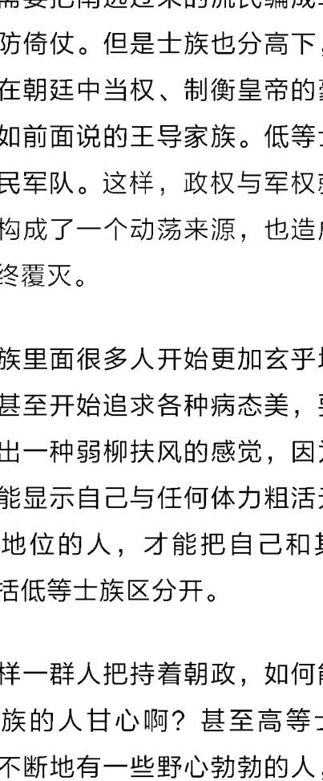

第二个原因是中原社会的豪族化，它不断地削弱着帝国政府的能力。

## 与士族共治的东晋政权

## 南朝皇帝的正统性困境

上的问题。随着北朝逐渐稳定下来，南朝在武力上越来越不是北朝的对手，南朝就只能通过坚持儒家理念强化自己的正朔地位，说我才是中原正统，占据北方的不不过是蛮夷。

可问题是，南朝皇帝们自己也不过是篡位上来的，越坚持儒家的理念，就越放大了自己的正统性缺失。

这是个两难困境，皇上们非常难办。如果皇上们手上掌握着很多资源，能碾压任何野心家，那么他们也不会害怕。问题是，坞堡经济还是主要的经济形式，资源都掌握在豪族手里，皇帝家里还是没多少余粮。

结果，南朝始终处在严重的不稳定当中，皇位乃至朝代都跑马灯似地变换着。

这段历史非常糟心。不过，如果我们换个视角再来看看东晋和南朝，却能发现一个新的历史价值出来。

## 江南土地的开发

今天我们一说到中国的人口稠密、经济发达的地方，肯定第一反应就是江南，以及岭南。

但是在宋朝以前的历史上，江南人口一直是远远比中原地区要稀疏的，岭南就更不用说了。人口稀少，无力进行开发，经济上自然也就 ◻ 不值一提。

## 中华文化的对外传播

在南朝的时候，中华文化不仅仅是传播到了长江以南的土著地区，甚至跨海传向中国土地之外。

## —— 今日小结 ——

西晋的灭亡，是受制于一些无力改变的历史大势，比如气候变迁、中原的豪族化、士族的堕落等等一系列原因。这些原因使得，有生命力的新秩序，已经不能指望过去的这些中原士族了。

欢迎关注施展公号（微信搜索公众号「施展世界」添加关注，ID：shizhanworld），获取更多延伸阅读。

今日得到 12月 28日

## [司马家族事业的断崖式下跌]

每一次北方游牧者大规模南下，都会伴随着中原人大规模南迁，也就带来了帝国对于南方土地开发的大规模深入。

儒家文化也在这个过程中传到了过去根本传不过去的土著地区。

# 14 | 五胡乱华的血泪与梦想

昨天聊了东晋和南朝的历史，今天咱们来聊一聊北边的历史。

北边的历史分成两个阶段，一是著名的五胡乱华的阶段；一是北魏建立了稳定统治的大帝国之后阶段，后面这段被称作北朝。

中国人引以为傲的大唐盛世，正是在北朝的基础上发展起来的。

## 五胡乱华的三个阶段

实际上，五胡十六国时期，不同的政权都对胡人和汉人的关系作了不同处理，并不是简单地就是要欺负汉人。

## 胡人刘渊：兴复汉室

第一个起事的胡人，是南匈奴的首领，叫做刘渊。

## 胡人本位阶段

## 混一胡汉的不成功阶段

雄，都收留并重用。这种态度极为得人心，他很快就统一了大半个中国。

但这个策略埋藏着很大的风险。当时，有个鲜卑大英雄慕容垂，刚才我们说打败冉闵的，就是慕容垂他们家人。慕容垂因为本国前燕发生内乱，被迫来投奔前秦。

宰相王猛一眼就看出慕容垂绝非池中之物，劝苻坚及早干掉他。苻坚却说，“我正要以诚来招募天下英雄，慕容垂落难来投，我却杀了他，让别人怎么看我”。结果，不仅没有除掉慕容垂，反倒让慕容垂带领鲜卑部落穷军，镇守重地。

结果，当苻坚在淝水之战战败后，前秦的兵力损毁修重。又过了一段时间，慕容垂起兵反秦，兴复大燕，一下就让苻坚的前秦彻底瓦解了。

苻坚的失败，在于他太想超越于胡汉之上，成为天下的共主了。他的意图表无疑是正确的，但是很可惜，他把政治步骤走错了。

## 混一胡汉的成功阶段

在慕容垂起兵反秦之后，即将进入五胡十六国第三个阶段，就是成功实现了混一胡汉、建立二元帝国的阶段。

在这个阶段，除了燕国的慕容垂，还有一个鲜卑人叫拓跋珪，这两个人可以被称为鲜卑人的绝对代双骄。他们终于站在前人的肩膀上，摸到了成功的门径。

拓跋氏真正地建立了持续统治北方的大帝国北魏。北魏的开国皇帝，道武帝拓跋珪，和苻坚一样，都琢磨着要混一胡汉。但是又和苻坚不一样，他把步骤走对了。

## 北魏的制度安排

在南下夺取了中原的财富之后，拓跋珪的实力壮大了，于是他推行了一个重要政策，叫“离散部落”，就是把部落这种小共同体打碎。就这样，拓跋珪同时离散了他统治下的拓跋氏部落，和其他胡人的部落。

拓跋珪采用了一种新的制度，他把已经被他离散掉的鲜卑各族，重新编为八部，设立了八部大人来统领他们。

在这种新的制度安排下，拓跋珪打破了原来的部落制，同时又建立了自己能控制的新部落制。

北魏帝国混一胡汉，实现了汉人和胡人的融合。这种超越于中原-草原之上的努力，终将把北魏转化为一个二元帝国，皇帝居于各方之上，作为均衡力量，代表着帝国的统一。

—— 今日小结 ——

这一讲我们看到，五胡乱华到北魏时期的北方，如何经历波折，最终建立了胡汉混一的二元帝国。

接下来最引人注目的历史事件，应该就是魏孝文帝迁都洛阳了。过去的历史叙述，一般都在谈魏孝文帝的南迁如何促成了民族融合。但是从来没讲过，北魏在魏孝文帝去世后不久，就亡国了。

【五胡乱华的血泪与梦想】 五胡十六国时期，根据不同政权对胡汉关系的处理方式，可以把这段历史分为三个阶段。

# 15 | 鲜卑人如何为隋唐打下基础

15 | 鲜卑人如何为隋唐打下...

这一讲，咱们讲讲从后三国到天下统一。你可能会说，三国我很熟悉，后三国是哪个时代？

后三国，就是在南北朝之后，北边的北魏分裂成东魏和西魏，再加上南边的南朝，就有再次形成了一个三国鼎立的阶段，这就是后三国。

为什么后三国很重要呢？因为正是这个时期，形成了一系列重要的制度创新，都被后来的隋唐大帝国继承下来了，于是有了让中国人引以为自豪的大唐盛世。

也就是说，要搞清楚大唐盛世，就一定得搞清楚后三国这段历史。

要解释清楚这段历史，我们重点得说两个事情。

一个是魏孝文帝迁都。这个事件我们过去的解读，一般是说它成功促进了民族大融合，但实际上，魏孝文帝迁都直接导致了北魏的灭亡，从而带来了后三国时代；

## 北魏孝文帝迁都

我们先来看第一个事情，北魏的魏孝文帝迁都。

北魏，我们在上一讲说过，这是一个鲜卑人建立的政权。魏孝文帝是北魏的第七任皇帝。这个人很有意思，他虽然是鲜卑人，但是他从小接受的就是系统的儒家教育，对儒家文化有很深的感情。

这是怎么回事呢？其实是他的奶奶冯太后一手安排的。冯太后，是历史上著名的女强人。冯太后的老公是北魏第五任皇帝，年纪轻轻就去世了，新继位的小皇帝年少国疑，一些大军事贵族开始觊觎孤儿寡母。

没想到，年轻的冯太后手段凌厉，几下就把大贵族们干掉了。但是等到小皇帝长大亲政之后，对冯太后的控制很不满，于是又过了几年，冯太后就把小皇帝也干掉了，扶植了小皇帝的儿子继位，也就是魏孝文帝。

冯太后掌权，不符合祖制，跟各种皇亲国戚大贵族们斗了这么多年，所以她必须在贵族之外，建立自己的官僚系统才能控住局面。咱们在前面提到过，建立官僚系统这种事，草原上的人根本不擅长，只有中原汉人才擅长，所以冯太后进行了一系列的汉化改革。

## 汉化改革带来的危险

危险在哪里？在于皇上对于帝国制度的理解出现了偏差。

我们上一讲说过，北魏之所以成功地统一了北方，建立了稳定的大帝国，在于它建立了二元帝国，也就是北魏同时整合了草原与中原的两种统治逻辑。

## 东魏和西魏的建立

在胡太后还在洛阳胡作非为的时候，一个出身怀朔镇的小兵偶然来到洛阳送信，他看到洛阳的乱象，认定天下即将大乱，该是成大事的时候了，他回到怀朔就散尽家财，募集英雄。

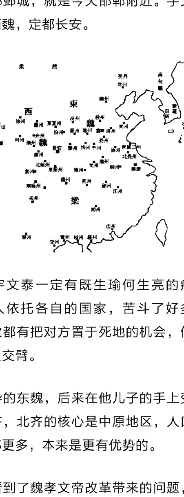

国往鲜卑化的方向拉。鲜卑军人们是高兴了，但是，这就没法充分动员起汉人的力量，结果东魏人多钱多的优势完全发挥不出来。

## 鲜卑人宇文泰复周礼

再说宇文泰主导的西魏，西魏其实就是后来隋唐帝国的母体。

西魏的主体在今天的陕西关中地区，人口和财富都没有办法跟高欢的地盘相比，宇文泰不得不想方设法把手下所有人的力量都充分发动动员起来。

宇文泰是怎么做的呢？

他首先得安顿鲜卑这一方的人心。所以他没有继续孝文帝改汉姓的这种做法，而是要求鲜卑人都恢复鲜卑姓，甚至，他还要要求汉人也要给自己起个鲜卑的姓氏。这下鲜卑人满意了，但是汉人的人心怎么收拢呢？

宇文泰又搞出了一个极有想象力的办法，“复周礼”！

复周礼，这是儒家文化的最高理想之一，之前一直没人做到过。鲜卑人宇文泰却努力做到了，一下子就收服了汉人的人心。

## —— 今日小结 ——

现在来简单回顾一下这一讲的主要内容。

## 【鲜卑人如何为隋唐打下基础】

周礼实际上是一种由贵族所主导的、兵民一体的社会秩序。

# 16 | 影响隋唐历史的两个女人

上一讲说到混一胡汉的二元帝国最终得以建立，隋、唐世界帝国一统天下。

正如前几讲说过的，一个国家的命运，往往是不同利益集团的冲突决定的。大隋大唐，也不少例外。

所以，今天咱俩要来讲解两位老婆的故事，一位是隋文帝的老婆——独孤皇后；另一位是唐高宗的老婆——武则天。

为什么要讲这两位老婆呢？不仅仅因为这两位都是女中豪杰。更重要的是，从她们的故事里面，可以发现理解隋唐帝国的核心逻辑。

## 独孤皇后背后的关陇贵族

隋文帝杨坚的老婆独孤皇后，能为非凡，在杨坚夺取天下、治理帝国 的过程中，出谋划策，居功莫伟。两人结婚之际就约好了，一夫一妻相守，不能再亲近别人。

## 隋炀帝的野心

## 唐太宗回归“关中本位”

## 武则天再次放弃“关中本位”

则天在唐代命运起伏，最终居然能够成功称帝，这里可以看到大唐王朝深处的草原底色。

武则天执掌大权之后，她知道关陇贵族肯定不会支持她的，所以她放弃关中本位，迁都洛阳。武则天一朝又开始大规模地开科取士。

这些做法是不是都听着耳熟啊？没错，跟隋炀帝的做法差不多。隋唐帝国的核心问题都是皇权与关陇贵族的关系问题，武则天与隋炀帝的诉求类似，当然策略选择也就类似。

但是在武则天的时代，印刷术还是没有发展起来，知识传播成本仍然比较高，能够参加科举的人多半还是贵族出身，只不过是关东贵族获得了比过去更多的机会，武则天就可以用关东贵族来制衡关中的贵族。

可是只要是贵族，就还是不会特别听皇上的话，皇上就又得提拔一些对自己有着高度依赖性的、会很听话的人，来约束无论是哪里的贵族。

所以在武则天时代，有一些很有名的酷吏，像什么周兴、来俊臣，他们都是出身无赖，对皇上有着高度依赖性，做事也没有贵族们的那种道德标准，各种没底线。最后皇上用完他们，又会很容易地抛弃他们，再去寻找新的无赖来替代他们。

## —— 本讲小结 ——

今天这一讲，并不是要给你呈现八卦，而是要呈现隋唐大帝国最深层的政治逻辑：就是关陇军事贵族和皇权之间的对抗关系。

独孤皇帝代表了关陇军事贵族；武则天，则以一种特别的方式代表了皇权。

武则天的统治被终结后，出于恢复正朔的考虑，首都再迁回到长安，又经历了几年的皇室变乱，最终是唐玄宗父子安定了局面。

但对新的雄主唐玄宗来说，他也并不想奉行关中本位，受到关陇贵族的约束，他在某种意义上继续了武则天的统治策略。

隋唐帝国政治的主题，皇权和关陇军事贵族的对抗，到了唐玄宗这里，仍然在继续。

但是他的统治策略里面隐含了一些极为危险的东西，最终让盛唐的辉煌戛然而止。这是怎么回事呢？且听下一讲来解释。

欢迎关注施展公众号（微信搜索公众号「施展世界」添加关注，ID：shizhanworld），获取更多延伸阅读。

# 17 | 安史之乱终结了豪族社会

17 | 安史之乱终结了豪族社会 ↓

今天来讲一下，安史之乱如何终结了豪族社会。

上一讲到我们说到，唐玄宗在政策上有一系列致命的问题，带来了巨大的危险，最终导致了安史之乱。这个问题就是，唐玄宗在不懂得怎样用胡人的情况下，却在滥用胡人。

安史之乱是在公元755年到763年，由胡人安禄山和史思明发动的一场叛乱。正是这场叛乱，使大唐帝国从最巅峰跌落下来。

安史之乱如何终结了豪族社会？

正是在安史之乱之后，技术变迁成为可能，引入了新的经济资源，使得皇帝一直苦苦寻找的豪族之外的财政能力成为可能。

## 大唐帝国的二元性

从皇权的角度来看，武则天真是给唐玄宗留下了很不错的底子。

## 唐玄宗放弃草原身份

## 江南经济的大发展

济要素，帝国也就获得了新的财政基础。

晚唐时期，大诗人韩愈曾经说过，江南所提供的赋税，占了天下赋税的差不多十分之九。这个数比较夸张，但江南已经发展成为帝国的核心经济区是毫无疑问的。

## 财政制度改革

大唐帝国劫后余生，开始努力恢复，江南的开发让皇帝意外地获得了新经济要素，有可能用它来对付各种过去搞不定的力量。

但首先得进行财政制度的改革，新的经济要素才能为皇帝所用。

在安史之乱以前，唐朝的财政制度是从北魏继承下来的租庸调制，主要就是按照户来分派，每户每年要交多少粮食、多少绢帛、要服多少劳役等等。

这套制度已经运转不下去了。公元780年，唐朝进行了极为重要的财政制度改革，推行两税法，把过去的各种劳役、粮食、绢帛等等都折算为钱，每年分夏秋两次征收。

两税法原则上来说必须缴纳铜钱。这意味着，从东汉末年以来持续了数百年的实物财政，又转成了货币财政。皇帝想要搞点什么事的话，拿着钱可比拿着粮更好办，皇帝对付豪族的办法就变得更多了。两税法构成了此后中国历代税赋制度的主要基础。

这些新的经济和财政资源，终于让从隋炀帝开始的皇权对抗豪族的努力，获得了政治可能性。

不过大唐已经无法利用这种可能性了，因为唐朝皇室经过安史之乱的打击，已经没有办法把各种资源充分整合起来，只能苟延残喘。但是如果没有江南的新资源、没有两税法改革的话，估计大唐想要苟延残喘都喘不下去。

要打破过去的社会结构，光有新经济要素的出现还不够，还得有新的知识传播技术，让更多的人能够读得起书，形成新的人力资源基础，新秩序才真的能够浮现出来。

新的知识传播技术就是印刷术，实际上这也不是全新的技术发明，而是对既有技术的新应用。在唐朝的时候印刷术就已经在应用了。但那会儿主要是用来印佛经，因为当时的豪族社会，社会上对于儒经的需求相对有限，寺院对于佛经则很有消费能力，印佛经很划算。

但是随着平民社会的发展，对儒经的需求逐渐浮现出来，五代十国时，官方第一次主持了对儒经的大规模印刷，到了宋代，印刷儒经完全变成一个社会性的商业活动。

知识传播成本由此急剧下降，很多平民百姓都能读得起书了。这让宋代皇帝有机会从平民中大规模拨擢人才充实官僚体系，隋朝开始的科举制，终于真正转化为皇帝对抗贵族的一个重要武器。

至此，中原从豪族社会结构不可逆地进入到了平民社会结构。

## —— 本讲小结 ——

唐玄宗为了加强皇权、对抗关陇贵族，重用胡人胡将，引发了安史之乱。但安史之乱却进一步促进了江南的经济开发，使皇权获得了新的经济资源。

同时中原向江南的移民过程，使社会逐渐平民化。平民化又促进了印刷术的普及，为皇权对抗贵族提供了人力基础。因此，让唐朝盛极而衰的安史之乱，实际上也是促使中原由豪族社会向平民社会转化的关键节点。

安史之乱不仅仅在中原带来了巨大的变化，在草原、西域、乃至雪域高原都带来了极为深刻的历史变化，它们进一步对于后世的中国历史产生了深远影响。

这就是下几讲我们会谈到的话题。

欢迎关注施展公众号（微信搜索公众号「施展世界」添加关注，ID：shizhanworld），获取更多延伸阅读。

# 18 | 西域，帝国命运的催化剂

前面我们讲了很多中原和草原上发生的事情，讲了它们如何相互地改变着对方。

但实际上，草原和中原的互动过程，很多时候都有第三方的介入。第三方就像催化剂，草原和中原之间发生着各种化学反应，催化剂则决定着这些反应发展的节奏。

那么，第三方催化剂是谁呢？实际上不止一个，在古代历史上，西域和雪域高原都曾经起到过这种作用，这就是接下来 few 讲，我们会重点讲的内容。

## 中亚的自由城邦特征

这一讲咱们先来说说西域。西域就是新疆，它和今天中亚的几个斯坦国加在一块，还构成了大中亚的概念。

由于它们特殊的地理位置，在近代以前，大中亚一直都是东西方的贸易通道。同时，由于特殊的地理特征，中亚在历史上形成了许多自由城邦。

自由城邦的意思是，这些城邦彼此之间互不统属，强大的帝国也无法直接统治它们，而只能间接统治，于是城邦生活不会受到政治的压力。

自由城邦的特征再加上贸易带来的巨大财富，在古代，这就是能够形成高水准文明的标配。

中亚即使当时没有自己独创出比东西方更高的水准。在历史时机合适的时候，又会反过来再传向东西方，改变东西方的文化和历史，这就是我所说的中亚作为催化剂的作用。

比如，中亚向东传播文化，草原帝国的精神世界有一大半是由中亚所塑造的，这显然会极大地影响草原和中原互动的模式。

再比如，中亚向西传播文化，对欧洲的精神世界带来深刻刺激，甚至奠定了欧洲文艺复兴的基础。

## 地理结构带来的政治逻辑差异

说了这些，你大致就能知道西域和中亚作为历史催化剂，有多大的重要性了。而这一切，都离不开它特殊的地理结构。所以，我们先简单了解一下它的地理结构。

你可以先看文稿里面的大中亚地图，先看横向的，中国境内的天山，以及一条起源天山、向西流的大河锡尔河。

天山-锡尔河这一条线很重要，这条线以北是中亚的游牧区，这条线以南是中亚的定居地区。这条分界线的意义，就跟长城在东亚的意义一样。

天山-锡尔河以北的游牧地区，政治和社会的逻辑，和长城以北的草原上差不多，但南面的定居地区则与中原有很大差别。

中原有很多大河，有充沛的水源进行灌溉，农耕区的规模很大，连成片，财富总量就很大；中亚定居区的水源，只有雪山融水还有一些内流河，水资源很匮乏，只能形成一些高度分散的小规模绿洲，因此财富总量很小，和中原没法比。

## 中亚的贸易地位

先来说说贸易，这样一种自由城邦，是最适合于贸易的需求的。在这里，商业的逻辑不会被政治的逻辑所干扰，贸易的效率能够得到保障。

古代中亚有一系列以经商而闻名的绿洲城邦，比如西域的鄯善、库车、和田、喀什噶尔等等，越过帕米尔高原，还有《松雕英雄传》里郭靖出征过的撒马尔罕、花剌子模等等，这些都是中亚历史上的贸易重镇。

唐完成了后勤运输工作。如果离开了这些中亚商人，大唐帝国的统治成本会急剧上升，帝国疆域恐怕会大幅缩水。

当然，中亚商人在本质上是生意人，不会拒绝任何生意，大唐的对手，比如突厥帝国以及后来的回鹘帝国，在战争中也会用中亚商人的网络，商人们还会成为突厥人重要的军事参谋。

## 中亚的文化传播

除了贸易，从文明传播的角度讲，中亚在历史上发挥的作用就更重要了。

中亚绿洲地区地理太过破碎，单个城邦的财富总量很小，因此它无法原生性地发展起轴心文明。原生性的轴心文明有中华文明、印度文明、希腊罗马文明、希伯来文明等，它们只能出现在财富总量很大的地方。

但是，伴随着贸易和战争等，各种轴心文明都会传播到中亚地区。中亚虽然总财富量不大，但是人均财富量很高，这让中亚人养得起仰望星空的人，他们有能力进行深刻的学术思考，思考这些轴心文明所提出的问题。

各种文明在中亚自由传播、自由竞争，在这里又没有强大帝国的直接统治，文明的逻辑不会遭遇政治的逻辑的压制。在大帝国内部，政治一定会压制文化的。所以各种文明在中亚能够得到充分的释放和发展，这对于人类的文明发展有着至关重要的意义。

比如佛教。诞生于印度本土的佛教，是通过中亚才传播到中国的，佛教对于整个东亚世界的影响与改造是全方位的。

再比如，在公元3世纪诞生于波斯的摩尼教，就是张无忌的明教。摩尼教在波斯帝国本土发展得总是θό顺，有时候被帝国政府摔杀，有时又被打杀，直到它传到中亚之后，才形成了独立的教会，不再受教会总部的管辖，一下子反倒发展壮大了，到8世纪中期，独立出来的中亚摩尼教，甚至成为草原霸主回鹘帝国的国教。

在中世纪的中亚，最灿烂辉煌的文明，就是伊斯兰教。和咱们今天对伊斯兰教的一般认知不一样，在中世纪的时候，伊斯兰教极为开放、包容，文化发展水准极高，有着发达的哲学思辨。

古希腊哲学很早就传到了中东和中亚地区，伊斯兰思想家把这些哲学进一步发展到非常高的水准，其他还有天文学、数学、医学、航海学等等，伊斯兰世界的水准都是当时世界上最顶级的。反倒是当时的基督教世界处在很不宽容、很蒙昧的状态。

但是有趣的是，伊斯兰教这么高的文化水平，并没有出现在阿拉伯帝国的大本营——中东，而是出现在中亚，因为这里远离帝国中心，有自己独立的伊斯兰经学院，文化的逻辑不会受到政治逻辑的压制。

而帝国中心的伊斯兰经学院，则要受到最高统治者哈里发的控制，文化被政治所压制。所以，中亚的伊斯兰教才能把文明的各种可能性都释放出来。

到了公元9-10世纪的时候，中亚出现了几位历史上最伟大的伊斯兰哲学家，如阿尔法拉比、阿维森纳等，他们将古希腊哲学与伊斯兰神学结合在一块，发展出宏大的思想体系。

这些伟大思想家的工作后来辗转传入西方世界，处在蒙昧状态中的中世纪西方人，才重新发现了古希腊哲学，这些知识传播过程奠定了后来欧洲文艺复兴的基础。

所以有人评价，在那个年代，中亚才是世界的知识中心。

## —— 本讲小结 ——

总结一下，可以说，在近代以前，大中亚地区是东西方贸易交通的核心要道，也是高度自治的自由城邦。

中亚虽然没有产生轴心文明，但是各种文明传播到了中亚，就像登上了诺亚方舟，得到了充分的发展和释放。整个中世纪，中亚的文化水平极高，还可以在东方和西方世界的文明处于没落的时候，中亚反过来向它们输送文明，进行文化反哺。

但是，到了地理大发现，新航道开辟出来，中亚沦落为很次要的贸易通道，人均财富量也大幅下降，没有足够多的人有闲情逸致仰望星空，中亚就从人类的知识高地跌落了下来。

而在中国这边，在唐末安史之乱之后，中原、草原和西域之间发生了非常复杂又有趣的历史联动关系，西域的历史催化剂作用表现得极为到位，深刻地改变了中国的历史。

这就是我们下一讲的内容。

# 19 | 回鹘，草原霸主的兴与衰

上一讲里，我们谈到了西域的重要意义，以及整个大中亚地区对中国历史乃至世界历史的催化作用。

这一讲里，我们再来看一下唐朝中期以后的草原霸主，回鹘汗国。你会看到中原和西域分别是如何促成了回鹘汗国的崛起，又如何让它败亡，后续的历史又是如何深刻地改造着西域。

从回鹘汗国跌宕起伏的命运里，你能看到草原、中原与西域深刻的联动关系。你也会更好地理解，我为什么说中国历史是一个体系史。

## 回鹘汗国是如何崛起的

其实在回鹘之前，还有一个草原霸主，就是突厥汗国。突厥汗国曾被唐太宗征服，后来在武则天掌权期间，又复国了。再后来，唐玄宗为了打击它，又扶植了一个突厥人的附属部落，回纥。

在大唐和回纥的联手打击下，突厥汗国在公元744年灭国了。突厥汗国被灭掉之后，回纥就成为了新的草原霸主，后来它又改名成为回鹘。

回鹘汗国成立后刚过十年，迎来上了一个大大的红利。这个红利是什么呢？跟安史之乱有直接关系。

公元755年，唐朝发生了安史之乱。安史之乱的主谋安禄山，出生在农耕、草原过渡地带的辽西地区，他爸爸是来自中亚的粟特人，粟特人属于东波斯族群，他妈妈是出身草原的突厥人，所以他的身上同时流着中亚和草原的两种血。

安史之乱爆发后，唐玄宗派遣大将哥舒翰去应战。但是唐玄宗一通瞎指挥，导致哥舒翰被安禄山俘虏，唐玄宗吓得慌了，被迫逃离长安，并黯然退位。

大唐终于发现，光靠自己搞不定安禄山了，甚至有亡国的危险，于是，回鹘人的巨大红利就来了。

大唐不得不向这个刚刚被扶植起来的小弟求助，于是回鹘的乞伏可汗带领大军南下助战。回鹘大军协同唐军作战，收复了东都洛阳，回鹘在洛阳也抢得不少财富，除了财富，乞伏可汗还有另外一个重要收获，就是三个来自中亚的粟特僧人，乞伏可汗回程的时候，把这三个僧人也带上了。

当然，这三位不是佛教僧人，而是摩尼教的僧人，我们上一讲也说过这个摩尼教，也就是张无忌信的那个明教。你别小看这三个不起眼的粟特僧人，他们让草原发生了天翻地覆的变化。

什么变化呢？他们几个人，说服了乞伏可汗皈依摩尼教，并且通过可汗之力，吸引了越来越多的回鹘人皈依摩尼教，没多久就让摩尼教成为回鹘帝国的国教。

原本身处中亚的粟特人，看到摩尼教在回鹘发展得这么好，就纷纷来到回鹘。粟特人由此与回鹘、大唐发生了复杂的多重博弈关系，并深刻地改变着这几方的命运。

这个时候，大唐帝国勉强从安史之乱中活了下来，却又陷入藩镇割据的困境，再也没当年的雄风，有好几次，帝国政府在试图打击藩镇的时候，差点被反过来搞死。

每逢这种时候，大唐就不得不再次向回鹘求救，对回鹘来说，他们当然愿意接这种买卖，于是再次南下，帮助大唐平息内部问题，顺手再狠狠地敲诈一笔保护费。

回鹘很乐意让大唐的帝国政府和藩镇之间，保持这么一种均衡关系，不让藩镇有能力推翻帝国政府，也不让帝国有能力灭掉藩镇。只有这样，回鹘才能不断拿到保护费。

上一讲我们说到过，做买卖这种事，中亚贸易要道上出身的粟特人最擅长了。而这个时期，刚好又有大量粟特移民来到回鹘，其中有不少就成了回鹘人的重要参谋，帮助回鹘更有效地从大唐榨取保护费。

这个过程虽然让大唐非常疲惫，但是也带来了另外一个结果：回鹘为了能够持续收到保护费，便不得不保护大唐的帝国政府，免得它被藩镇割据给颠覆掉。

实际上，帝国政府早就风雨飘摇了。在安史之乱后，唐朝还能延续将近150年，回鹘人的干预是一个重要原因。

## 回鹘帝国的灭亡

刚才说的这批移民过来的粟特人，除了能帮回鹘榨取保护费，还帮回鹘人发明了文字，这种文字是从东地中海的叙利亚地区传遍历过来的，经过粟特人之手，又传到了蒙古高原上的回鹘帝国。

直到今天，蒙文和满文所用的字母都还是这种源自粟特文的字母。

这些粟特人帮助回鹘积累了大量的财富，同时他们也把这些财富转卖到西方，并且还引导着回鹘人对抗波斯人，以便打击贸易上的竞争对手。

这个过程中，中亚粟特人成了回鹘汗国的大脑。包括西域在内的整个大中亚，与中原、草原发生了深刻的历史联动关系，你能清楚地看到，中国这部体系史的脉络。

回鹘与粟特人的这种合作共生关系，让回鹘人获得了知识与财富，迅速地文明化了。

这带来一个衍生的结果，文明化之后的回鹘，开始摒弃改变生活方式，他们开始修筑城墙。于是，回鹘成为蒙古高原历代游牧帝国当中，唯一的一个筑城的帝国。

对于游牧帝国来说，筑城定居绝对是大忌。因为这样一来，游牧帝国的机动性就会丧失掉，游牧者兵民一体、生产-生活-战斗密切结合的组织特征也将发生分化，组织结构变得复杂。

游牧者令人生畏的战斗力正是依赖它的高度机动性，以及超简简单的组织结构。这方面发生变化，会让游牧帝国变得脆弱，在遇到危险时难以自保。

于是，在公元840年，从回鹘帝国西北方森林中跑出来又一个野蛮的突厥人部落—葛思人。葛思人发起的攻击让回鹘帝国几乎没有还手之力，很快就亡国了。

## 喀喇汗国的建立

你以为故事就此结束了？后面发生的事情更精彩。

亡国的回鹘人分为几支四散逃亡。对于后世的影响最为深远的是向西逃亡的回鹘人。西迁回鹘又分成了好几支，其中有两支，分别逃亡到中亚地区，和甘肃、青海一带，对后世有重要影响。

这一讲主要说投奔到中亚的这一支，他们对整个中亚的政治、人口和文化都带来了翻天覆地的变化。

这群迁回到中亚的回鹘人，征服了当地游牧者，建立了喀喇汗国，主要位于今天的新疆西部和中亚的几个斯坦国，后来又以帕米尔高原为界，分裂为东喀喇汗国和西喀喇汗国。

这个汗国可能你都没听过，但它非常重要，上一讲里说过的那些中亚伟大的思想家，都生活在喀喇汗国。

## 喀喇汗国对中亚的改造

先看看喀喇汗国在政治上的影响。

我们在前面讲了很多东亚这边的游牧-定居复合结构的二元帝国，中亚却一直没有这种复合帝国，直到喀喇汗国的建立。

喀喇汗国的北部，是游牧区，回鹘人是很熟悉的。喀喇汗国的南部是定居地区，按理说，出身草原的回鹘人是没法搞定定居区域的。

但是，早年在漠北的时候，回鹘人在粟特人的帮助下，积累了足够多的知识，懂得中亚的定居文明该如何治理。所以回鹘人也有能力去统治中亚的定居地区，从而建立起了二元帝国，也就是喀喇汗国。

建立了二元帝国，也就是喀喇汗国。

有意思的是，这些回鹘人仍然有着强烈的中国意识，他们作为喀喇汗国的统治者，自称“桃花石汗”，“桃花石”就是中亚人对于中国的称呼，这个名字的来源是北魏的皇族，他们姓“拓跋”，到了中亚，口音不大准确，被称为“桃花石”。

随着喀喇汗国的建立，中亚的人口结构也发生重大变化，也就是波斯人口的突厥化。

在喀喇汗国以前，中亚的定居地区，也就是天山-锡尔河以南，我们今天说的南疆地区，多半是东波斯族群的粟特人，就是广义的波斯人吧，他们是高鼻深目的白色人种。

而在北边的游牧地区多半是突厥人，突厥人其实是蒙古人种。这些突厥人以前也没有多少兴趣迁居到天山-锡尔河这一条线以南，因为他们没兴趣定居。但是回鹘人在漠北的时候已经有过定居的经验，所以在迁到中亚之后，他们中有相当部分的人开始进入天山-锡尔河以南，转为定居的生活方式。

这些回鹘人和当地的波斯人口混血，逐渐改变了中亚的人口结构，让中亚开始了普遍的突厥化过程。今天我们看南疆的少数民族，白色人种的特征相对更明显，北疆的少数民族则是黄色人种的特征相对更明显，这种差异就和这段历史上突厥人与波斯人混血的不同比例有关。

除了人口结构的变化，喀喇汗国的建立，还带来了一个重要影响，就是突厥民族的伊斯兰化。

在回鹘西迁前，中亚地区已经伊斯兰化了，但之前在中亚来来往往的突厥人并没有信仰伊斯兰教，因为他们并没有这方面的需求。

直到喀喇汗国，开始了突厥人的伊斯兰化进程。因为这个时候的伊斯兰教，正处在文明发达如日中天的阶段，回鹘在漠北的时候虽然已经跟随粟特人，走上了文明化的道路，但毕竟时间太短，也不那么系统，到了中亚，看到当地伊朗语系人群代表的高度发达的政治秩序与文明成果，心向往之，是一个很自然的事情。

另外就是，如果皈依了伊斯兰教，统治当地穆斯林的成本也会变得更低。几件事加在一起，突厥人开始了伊斯兰化。

## —— 本讲小结 ——

现在可以回顾一下这一讲的主要内容了。

回鹘这样一个草原帝国，本来是循着通常草原帝国的路子发展起来的，但是由于中亚粟特人的深度介入，它的歷史走上了一条完全不同的路子，并深刻地影响了大唐与自身的兴衰。

到了回鹘灭亡后，又深刻地改变了中亚的历史命运。通过回鹘汗国的历史，可以说看到草原、中原和中亚绿洲，多个地区历史联动的典型案例。

但回鹘人的故事还没完。我刚刚提到西迁回鹘比较重要的有两支，除了西迁中亚的这一支，还有一支投奔了高原上的吐蕃帝国，在甘肃、青海一带建立了被称为甘州回鹘的附庸国。

这群人并没有喀喇汗国那样的文化与武功，但他们给雪域高原上带来了深远变化，导致了强大的吐蕃帝国的崩溃，也带来了藏传佛教的独特体系。

这就是我们下一讲的话题——吐蕃，雪域霸主的聚与散。

欢迎关注施展公众号（微信搜索公众号「施展世界」添加关注，ID: shizhanworld），获取更多延伸阅读。

# 20 | 吐蕃，雪域霸主的聚与散

我们括在上一讲谈到了草原霸主回鹘汗国的崛起和败亡，以及在回鹘汗国灭亡后，向西逃亡的一支回鹘人，如何深刻地改造了中亚。

这一讲我要讲的主题是雪域高原上的吐蕃帝国，但这个帝国的命运却和另外一支向西逃亡的回鹘人关联了起来。

这支亡国的回鹘人来到吐蕃寄人篱下，但却又很快导致了吐蕃帝国的灭亡。崩溃后的雪域高原，走上和了中原、草原差到巨大的社一种会组织形式，从而带来了藏传佛教的独特体系。

而藏传佛教，对元明清的帝国统治都有着极为重要的作用。

## 雪域高原的地理特征

先来说雪域高原上的这个吐蕃帝国。

雪域高原的地理条件特殊，资源极度匮乏。所以在历史上的大部分时间，都是分成一个个小部落，由部落首领来领导的。

## 吐蕃帝国的贵族制

## 松赞干布对贵族的控制

## 安史之乱给吐蕃带来的机遇

越大。于是赞普就开始筹组自己的私人班底，以便从人事层面 Visit 进一步压制贵族。

这个人事班底肯定也得是识字的人，赞普才好用，僧人们很多是识字的。所以赞普最初是发展起一些僧官，就是把佛教当中的一些重要人物纳入自己的人事班底。

从历史上来看，我们会发现这个阶段的赞普给了佛教大量的支持，其实上这只不过是他对抗贵族的一个表征。

这会的赞普看上去越来越强大了，但实际上他是越来越脆弱了。因为他要养活的僧官越来越多，财政的压力越来越大，也就越来越依赖于来自西域的财政。

一旦西域出点问题，赞普的麻烦就来了，他不光是养不起僧官的问题了，因为贵族在在这个过程中被赞普压制得越来越厉害，他们的反弹也同样会变得非常厉害。

## 回鹘人促使吐蕃灭亡

没多久，麻烦果然来了。

从哪来的呢？就是我们开头说的，那支跑过来寄人篱下的回鹘人。这就很有意思了，因为吐蕃的死对头一直是回鹘。而回鹘终于亡国了，反倒让吐蕃遇到麻烦了，完全体现了“福兮祸所依”的道理。

回鹘亡国了，吐蕃一开始感觉很好，觉得终于算是把回鹘人给踩在脚底下了。跑过来的这支回鹘人，建立了一个附庸国，甘肃回鹘。

但是吐蕃没注意到，甘肃回鹘的地理位置，非常要命。它位于哪里呢？正处在从青海道进入河西走廊和西域的必经要道上，甘肃，就在今天的甘肃张掖地区，来自西域的财富，要想运到赞普所在的拉萨，肯定得过甘肃回鹘的地盘。

只要他们在里面略微截流一下下，马上赞普就受不了了。对甘肃回鹘来说，肯定要截流啊，没有放着钱不赚的道理。

所以回鹘帝国在公元840年亡国，而仅仅两年之后，吐蕃也就亡国了。亡国的导火索是老赞普遇刺，而帝国财政已经陷入危机，新赞普也没有任何能力压制反抗的贵族们。

强大的吐蕃帝国就此解体，佛教也遭遇巨大挫折。

## 雪域高原的组织逻辑

接下来一个有趣的历史过程就出现了。

说实在的，雪域高原上那么恶劣的自然环境，能建立起一个强大的帝国实在是难以想象，它需要各种历史的机缘巧合才能建立起来，这种机缘巧合是不可能被复制的。

所以吐蕃帝国解体之后，高原上就再也没有过什么强大的政治体了，只能再恢复到过去的那种区域性的小部落、小共同体的状态。

这样一种散落的小共同体，要想形成秩序，其核心逻辑就跟中原大不一样了。中原这边是比拼哪种组织模式的效率更高，效率高会吃掉效率低的，最终一统天下。

但是要想比拼效率，前提是资源非常丰富，因为高效率通常伴随着高消耗。而高原上资源太稀缺了，消耗不起。所以高原上要比拼的，是哪种组织模式的成本更低，谁的成本低，谁的存活机会就更大。

对资源稀缺的小共同体来说，哪种组织模式成本最低呢？当然就是宗教。

于是，雪域高原上又像吐蕃帝国崛起之前那样，形成了一系列宗教主导的小共同体。雪域高原因此也成为古代中国非常独特的一个区域，它成了唯一一个教权有机独立于政权之外发展起来的地方。

反过来説，如果一个地方的政权很强大，它就不会允许教权有机会独立发展，那么这个地方的宗教性肯定会被政治的世俗性冲淡的。

又过了GE一百年多年，佛教再一次传入雪域，这次的佛教没有赞普作为强力的后盾，就必须和苯教融合，才有可能被那些小共同体当中的贵族话事人所接受。

于是，我们今天会看到，藏传佛教与汉传佛教的气质很不一样，根源都在这里。而正是这样一种气质，使得藏传佛教更容易被草原上的游牧者所接受。

几百年后，藏传佛教主导了蒙古草原上的精神世界，这是后来满洲人能够联合与控制蒙古人的一个重要抓手。

## —— 本讲小结 ——

讲完这一讲，中原、草原、西域、高原等中国各各种组成部分，全都闪亮登场，并相互影响着展开历史演化。它们彼此之间相互依赖、相互构造，脱离开一方，真的是完全解释不了另一方。

我们通过对于边疆地区的讲述，可以更深刻地看到，中国史是一个体系史。中国内部所有的这些组成部分之间，通过彼此的相互依赖，而彼此相互成就，它们就是在这个意义上有着深刻的共同历史记忆。

大唐时期的历史结束，进入到大宋，中国就从豪族社会进入到平民社会，开始了一轮不同的历史演化过程了。

下L讲，我们要来看看宋、辽这两个中原帝国与草原帝国之间的历史博弈，与此前的历史博弈有何不同。

欢迎关注施展公众号（微信搜索公众号【施展世界】添加关注，ID: shizhanworld），获取更多延伸阅读

# 留言精选

提交留言可与施展互动

# 21 | 大辽，首破百年的游牧帝国

21 | 大辽，首破百年的游牧帝国…

上一讲结尾说到，从唐到宋，中国由豪族社会变为平民社会。宋朝又分成两段，北宋和南宋。北宋的历史是和大辽共同度过的。

你听说书《杨家将》可能会觉得，宋、辽经常在打仗。事实上，杨家将的抗辽战争发生在北宋初年。此后直到北宋灭亡，两国基本没有什么战争了，保持了中国历史上极为罕见的持续百余年的和平。

为什么会这样呢？解释这个问题 sib

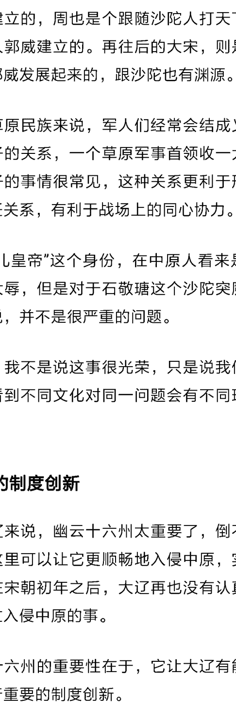

这片土地包括今天的北京、天津、河北和山西两省的北部区域，面积大概10万平方公里多一点。

## 中原和大辽的格局

当时中原和大辽的格局是怎么样的呢？
中原这边，在唐宋两个朝代之间，有一段分裂割据的历史，就是五代十国。

## 大辽如何占领幽云十六州

那么幽云十六州是怎么到了大辽的手里呢？在后梁和后唐的时候，幽云十六州还掌握在中原手中。一直到了后晋，这块土地才到了大辽手里。

## 大辽的制度创新

对大辽来说，幽云十六州太重要了，倒不是说这里可以让它更顺畅地入侵中原，实际上在宋朝初年之后，大辽再也没有认真考虑过入侵中原的事。

幽云十六州的重要性在于，它让大辽有能力进行重要的制度创新。

首先，大辽的财政逻辑变了。

起来的，实际上并未真正理解这种二元帝国的核心逻辑，所以才会有魏孝文帝迁都，和唐玄宗乱用胡人这些问题。

大唐能够统一长城南北，主要是依靠唐太宗这样同时熟悉草原和中原游戏规则的个人，一旦这种个人不在了，二元帝国的逻辑也就快要搞不下去了。

大辽把二元帝国给制度化，就意味着，帝国的稳定，不再是依靠哪个领导者个人的能力了，而是依靠一套制度安排。制度超越于所有人之上，不会因为哪个人死了，帝国就碰到麻烦。

我们在前面还讲过，一旦能够建立起这种二元帝国，那么草原的继承逻辑也会转化。会从兄终弟及转为父终子及，草原帝国周期性的继承危机就被破解了，帝国的生命周期就能大大延长。

再加上二元帝国的制度化，大辽因此成为中国历史上第一个延续了两百多年的、由游牧者建立的帝国。它对幽云十六州农耕地区的掌控，是它能够长寿的关键。

大辽的这个制度创新，对后来的中国影响极为重大。可以这么说，如果没有大辽的制度创新，就不可能有后来的元朝和清朝，今天中国的领土就只能局限在长城以南了。

在咱们过去的历史讲述中，通常是站在大宋的视角，大辽经常是作为大宋的对手出现。在民间，由于评书《杨家将》的影响，大辽更是作为坏人的形象。

真实的历史上并不是这么回事，《杨家将》基本上相当于一部“抗辽神剧”，跟今天的“抗日神剧”也差不太多。

## —— 本讲小结 ——

唐宋之间，中原政权出现了一段分裂割据的历史，也就是五代十国。而五代里面有三代都是沙陀突厥人所建立的。其中后晋这一代，把幽云十六州割让给了北方的草原王朝大辽。

大辽由此发生了一系列深刻的改变，最终在中国历史上第一次把兼容草原和中原的二元帝国制度化了，并对后来中国的历史产生了极为深刻的影响。为今天中国的庞大疆域，奠定了古代的制度基础。

这一讲我们从大辽的角度说了幽云十六州，下تن讲我们再从大宋的角度来讲讲。

历史书上常常说北宋“积贫积弱”，一个重要表现就是北宋始终收不回幽云十六州。但是事实真的是这样吗？下一讲我会跟你聊聊这个问题。

欢迎关注施展公众号（微信搜索公众号「施展世界」添加关注，ID: shizhanworld），获取更多延伸阅读。

# 22 | 大宋，和平换来的高度发展

上一讲，我们讲了幽云十六州是如何割让给大辽的，以及大辽因此发生的一系列深层转变。

这一讲，我们重点来看看北宋。

## 大宋并不积贫

在通常的历史叙述中，无法收复幽云十六州，常常被视作为大宋“积贫积弱”的象征。

大宋是否“积弱”，这个话题先放一边。但是要说“积贫”，那绝对是对大宋的污蔑。

实际上，北宋不论在经济、文化，还是技术层面，都取得了高速的发展，应该RICT

## 繁荣发展的经济

先看看大宋在经济上是如何富裕的，跟大唐对比下更能看清楚。

在唐代的时候，城市里的小商小贩是不能随便摆摊、开门店的，而是要依照政府的规定，在被四面墙围起来的“坊”里活动。

## 中国的文艺复兴时代

再来看看文化层面，宋代被许多人称为中国的文艺复兴时代。

## 技术广泛应用

在技术层面，宋代的航海、造船、医药、工程、农艺等等技术达到前所未有的高度。

## 以财政手段解决军事问题

大宋能够发展得如此之富裕，而又进步、开放，有个至关重要的前提——它拥有中国古代最高的社会自由度。

换句话说，就是朝廷对社会的压制力是很少的，这样民间创造力才能充分释放出来。

提，就是你得有一个能够长期做交易的对象，财政方案才能执行。

如果对手总是没几天就死了，那就不任何财政方案都没法落实了。幽云十六州的重要性于是浮现出来了。

我们上一讲刚说过，幽云十六州让大辽帝国有了长寿的基础，大宋能长期做交易的对象就有了。

草原上还有时不时冒出来的无序的游牧部落，大辽会定期地到草原上扫荡一番，消灭这些可能构成威胁的部落。

大辽本来就有草原的一面，做这种事情驾轻就熟。这反过来让大宋不用再头疼什么草原部落的问题。

在大辽那边，因为有了幽云十六州，又有了大宋的岁币，已经有效地解决了自己的财政和治理问题，也就没有多大兴趣南侵。

因此，在1004年的澶渊之盟之后，宋辽两国交好百余年未曾发生战争。

如果大辽是个短命帝国，大宋必将面临草原上各种无序力量的冲击。那么大宋的选择就很有限了。或者会更早地亡国，或者要想不亡国，就得像后来大明一样，对社会进行高度控制，以便确保国家的动员力，面对北方的威胁。

对社会严厉控制，就不会发展起富裕的社会和优雅的文化。因为那都是基于和平与兼容的环境才能出现的。

从这个角度看，被割走的幽云十六州，表面上是大宋的心头之病，但实际上是其安全保护伞的必要骨架。

## —— ◆ 本讲小结 ◆ ——

回顾一下这一讲的主要内容：

进入大宋，中国从豪族社会进入到平民社会，经济、社会、文化都高度发达。所有这一切的发达、繁荣，都以政府对社会的压制比较轻，社会拥有一种和平兼容的环境为前提。

之所以大宋能够拥有这种环境，在于北边的大辽是个长寿的草原帝国，大宋获得了一个稳定的对手方，可以用财政手段解决军事问题。因此，幽云十六州是大宋的安全保护伞的必要骨架。

从后世的视角来看，中原帝国选择与草原帝国合作，用财政手段解决军事问题，是个最低成本的选项。

中原帝国由此不面临外部威胁，不需要强大的动员与控制机制，于是其社会层面有着高度的活力。后世拒绝以财政方案解决军事问题的大明，与大宋正好构成鲜明对照。

但是当时的人却未必都这么想，很多宋朝人也感觉还是要富国强兵，才能扬眉吐气。于是就有了著名的王安石变法，而另一位伟大的人物司马光，则因此成了王安石的政敌。他们的争执在相当大的程度上给北宋的灭亡埋下了祸根。

那他们究竟是在争什么呢？这会是我们下一讲的内容。

欢迎关注施展公众号（微信搜索公众号「施展世界」添加关注，ID: shizhanworld），获取更多延伸阅读。

留言精选

提交留言可与施展互动

# 23 | 王安石与司马光在争什么

23 | 王安石与司马光在争什么 ↓

这一讲来谈一下北宋年间一段非常重要的历史，就是王安石变法。

说王安石变法里面一个主角肯定就是王安石，但还有另一个主角，也是一个大名鼎鼎的人物，就是砚缸的那位——司马光。

这两位都是宋代的名臣，但是在变法这个事上针锋相对，成为最大的政敌。

那他们两个究竟是在争什么呢？简单说来一句话，是在争究竟怎样才算一种好的政治。

两个人肯定都是想要好的政治，问题是他们俩对于什么叫好，标准不一样。

王安石认为如何才是好的政治呢？是勇敢去创新，守旧是没有任何前进的。

## 不拘小节的王安石

王安石这个人超级不拘小节，有一个特别好玩儿的小故事。

有一次王安石的一个朋友请他吃饭，然后饭后就跟王安石的老婆说，我终于知道你们家老王爱吃什么了。前几天吃饭，他把一盘鹿肉吃得精光，一点儿没剩。

## 王安石推行新法

王安石获得了宋神宗的重用，开始了变法。他虽然有着一腔的报国热情，变法的效果却一点都不好。我们来简单地看一下他推行的几个新法。

## 新法推行失败

咱们先说这个保甲法。保甲法是把老百姓都给编成兵民一体的组织结构，王安石设计这个法令的时候，是有着非常高大上考虑的，要复周礼，但是他失败了。

## 政治原则之争

我们再来看看一下，王安石和司马光究竟争的是什么？他们争的实际上是一种最根本的政治原则。

王安石一听，火更大了，啥叫异想天开的念头呐？没有我那新法是复周礼吗？你再老成持重，你还能老得过周公去？既然你们这帮家伙不愿意帮忙，还拖后腿，我不用你们行吗？我就有新人。于是王安石的那套人事改革方案就派上用场了。

但问题是双方已经纠到这个份儿上了，道德德比较强的人肯定就不会愿意跟王安石混了。因为王安石这个人个性确实太奇怪，的确是不太容易合作。再加上他以复周礼的名义连祖宗之法都可以不要了，那什么事干不出来啊。

所以在这种情况下，君子不会来的，各种能力很强但是心术不正，善于投机钻营的人就被王安石提拔起来了。

当然，王安石本人是非常重道德的。王安石曾经讨论战国时期很著名的齐国的孟尝君，他说世人全都称赞孟尝君能够收拢天下的人心，各种人才全部都愿意为他所用，鸡鸣狗盗之徒他也都能用起来。

王安石非常看不上，他说就算齐国那么强大，要真能得到一个人才，绝对就能压制住秦国称霸，你还用得着鸡鸣狗盗之徒吗？正是因為孟尝君门下有一堆鸡鸣狗盗之徒，所以真正的人才才不来。

## 大宋的结局

到了北宋后期的这几十年里，就沦落到了越来越烂的政治水准里面。大臣和皇上们一个比一个不靠谱。

## 朱熹评价靖康之变

到了南宋的时候，有一个大儒叫做朱熹。他评论靖康之变这段历史，特别的愤慨，痛斥说：

> “你看看宋徽宗那一朝有一件事情做的是对的吗？古代大国的君主就算再差，总还是有一两件大事能做对，就算是这样都免不了要亡国。可是宋徽宗那会儿，连一件小事都没有做过，就算没有女真人南下，这国家也别想能搞好。女真人是一帮夷狄，他们和咱们签约了说话还不能算数，咱们却反复反复地违约，能不把女真人惹毛了吗？”

总结一下这一讲，我们讲了北宋重要的一段历史——王安石变法。王安石和司马光两人在最根本的政治原则上产生了分歧，王安石要求创新，而司马光则提倡尊重传统。

## ——本讲小结——

# 24 | 金太宗挨板子，促成蒙古崛起

24 | 金太宗挨板子，促成蒙古...

这一讲咱们来说一下女真人建立的大金朝，看一下金朝的一个童年阴影是如何让金朝最终亡国的。

这个童年阴影是跟金朝的第二位君主金太宗完颜吴乞买相关。

金太祖完颜阿骨打在大辽还没有被完全灭掉的时候就去世了，所以到后来彻底灭掉大辽和北宋的是金太祖的兄弟金太宗。

可以说金朝是太祖和太宗这两个兄弟联合开国的，金太宗好歹也可以算半个开国皇帝。

但是金太宗却曾经被大臣们拉下龙椅来打了一顿屁股，这个事情对后来的皇帝们来说肯定算是帝国的一个童年阴影。

## 金国的童年阴影

咱们先来说一下为什么金太宗会被大臣们打屁股，这个事儿还是跟他大哥金太祖完颜阿骨打留下了一个规矩有关。

金太祖当年在起兵的时候，那会儿的女真人可是非常的贫穷落后，回想一下咱们前面讲过的建政权所需要的财政逻辑，你就能知道金太祖手下的那些重臣肯定不是乖乖听话的臣子，而是一群军事贵族合伙人。

## 金国的汉化

在太祖的时候皇上家里没余粮，手上没钱，他只能靠着跟重臣们平等相待，生死与共，才有可能带来凝聚力和战斗力。

但是太宗的时候可再也不是那种没钱的状态了。后来还有一位宋朝使臣，也有过记载，这位使臣比上一位出使的时候晚了三年，这会儿大辽是刚刚覆灭，而大金还没有来得及进攻大宋。但是大金已经从大辽掠夺到了大量的财富，这帮兄弟就开始奢侈了。

了他当皇上之前的称号，叫海陵王。

## 金国迁都

海陵王虽然他的皇帝称号被剥夺了，但是他做了一件事儿对后世影响非常巨大，什么事儿呢？迁都，把大金的首都从今天的黑龙江一带给迁到了北京。

回忆一下咱们前面讲过好几位皇上都迁过都，北魏的孝文帝迁都、隋炀帝迁都、武则天迁都，回忆一下这帮兄弟，海陵王迁都的意图就非常容易理解了。

是什么呢？远离军事贵族的大本营。只要远离了这个大本营，就能够有利于皇上极权，那皇上当起来多痛快。

不仅如此，海陵王的皇位不正，他必须得建立更大的功绩才能让群臣服气，怎样才能建立更大功绩？一统天下。

所以海陵王迁都燕京之后还不够，他还想要进一步的迁都，要迁都到开封，而且要发兵南下，要灭掉南宋，一统天下。

一旦到了那一步，他就名正言顺天下控主，丰功伟业不亚于甚至超过了金太祖、金太宗，群臣就没人敢再多说话了。

## 蒙古的崛起

但是金国一旦汉化到这个程度，一个衍生性的效应就出现了，就是蒙古的崛起。这个历史进程肯定跟那童年阴影相关。

## —— 本讲小结 ——

总结一下，这一讲我们讲了金太宗因为破坏誓约而被大臣们打屁股，成为了金朝帝国的童年阴影。

受这个阴影的影响，大金走上了汉化的道路，以至于放弃了二元帝国的属性，失去了草原视野。它带来的衍生效应是蒙古的崛起。金朝应对草原势力的攻击，以失败告终。

# 25 | 从元朝看中国历史的正统性

这一讲咱们来说一下元朝的正统性问题，咱们来看一看元朝是如何理解自身的，以及明朝人又是如何看待元朝的。

正统性这个事儿对中国历史来说可太重要了，儒家学说里面非常重要的一个关注点就是正统究竟在哪儿。

同样，咱们要想理解一个超越于中原之上的中国，理解一个作为体系的中国的话，正统性这个问题同样也是个核心的问题。

近年来咱们在网上经常可以看到一些流传的文章，它说元朝、清朝都不是中国的朝代。

这个说法肯定是很荒唐的了，但是很好玩儿的是，这么说的人很多都会是明朝的粉丝，因为明朝曾经有过一个口号，叫做“驱除胡虏，恢复中华”，它重建了汉人的王朝。

但是咱们来看一下，明朝人又是么理解元朝的呢？

## 明朝人如何理解元朝

有一篇复旦大学的姚大力教授写的文章，叫做《中国历史上的民族关系与国家认同》，这个在网上能搜到，我推荐你来读一下。

姚大力老师在文章里面引用了钱穆先生一些非常有趣的研究，钱穆先生曾经注意到，明朝的人对于元朝的灭亡并不是从胡汉之分的角度理解的，他根本就不认为这是什么赶走了蛮夷，他们认为这只不过是一次改朝换代而已，和以往的改朝换代没有什么本质区别。

朱元璋这个位开国皇帝他当然试过驱逐胡虏这个话了，但是他经常说的是另外一个说法，他说元朝虽然是夷狄建立的，但是它统治了天下将近一百 Bayesian... 而天下的百姓全都 有赖于元朝的生养。

所以朱元璋在即位诏书里面也说，宋朝统治了中国三百多年，但是后来气数已尽，天命就流转到了大漠当中崛起的元朝。又过了 一百年余元朝的气数也尽了，天下大乱，群雄并起，大明朝获得了天命，但明朝这天命不是从元朝，而是从群雄手中夺得的。

啥意思呢？朱元璋完全承认了元朝统治这一百来年的正当性。

## 元朝人如何认识自身

明朝人的这些历史认知肯定会让你大吃一惊，那么咱们再来看看，元朝他们是如何认识自己的呢？

当然这个情况就非常复杂了，所谓元朝人的认知，你可以从两个角度来说论：一个是元朝蒙古人的认知，再一个是元朝汉人的认知，这肯定得分开来说一下。

咱们先说蒙古人。对蒙古人来说这事儿也很麻烦，它也有一个双重的认知，一个是从蒙古帝国的角度，再一个是大元帝国的角度。

从蒙古帝国的角度来说，蒙古人肯定认为他们所建立的是一个庞大的世界帝国，这个世界帝国下面分了好几支，有统治波罗斯地区的金帐汗国，有统治中亚地区的察合台汗国，有统治西亚地区的伊利汗国，还有一个就是统治东亚地区的大元帝国。

这个是大蒙古帝国的角度，可是从大元帝国的角度来说，蒙古人必须得对儒家的世界观做一种回应，否则没法统治这么庞大的汉人群体。

## 元朝汉人如何认知正朔

那么说到了这儿，咱们就又得转过头来看一下元朝的汉人是怎么认知正朔这个问题的了。因为很多的争吵都是发生在汉人内部的。

但是经常被咱们忽略的是，元朝的汉人对正朔这个事儿也有双重的认知。为什么会这样呢？这就跟元朝内部人们的身分差异

这样呢？这就跟元朝内部人们的身份差异有关系了。

咱们在历史课上都学过，元朝是把帝国内部的人给分成四种，分别是蒙古人、色目人、汉人和南人。

南人指的是1279年才被蒙古所征服的南宋的人。汉人是谁呢？汉人是1234年的时候就被蒙古征服的金朝统治之下的人。

当然了，这个汉人里面除了通常意义上的汉人之外，也包括那些已经汉化的契丹人、女真人等等。

到了金朝的后期，金朝的人口已经非常膨胀了，全国人口超过了5000万，虽然经过蒙古的征战，人口的损失非常严重，但也还是千万量级的。

## 政教分离

假如正朔这个问题没法往下聊，那很麻烦，前朝的历史没法修了，这个问题必须解决。

## —— 本讲小结 ——

说到这儿咱们总结一下，元朝的时候人们对于正统性的问题或者说对于正朔问题的认知，可以分为四种。分别是蒙古人有两种：从大蒙古帝国的视角和从大元帝国的视角；以及汉人这边也有两种：身份汉人对于正朔的认知和南人对于正朔的认知。

元朝结束之后就进入到明朝了，咱们看明朝的话有一个很有意思的特征就是，它非常盛产奸臣，也特别盛产忠臣，这个现象很自相矛盾。

这么一个自相矛盾的现象到底是怎么来的呢？这是咱们下一讲的主要内容。

欢迎关注施展公众号（微信搜索公众号「施展世界」添加关注，ID: shizhanworld），获取更多延伸阅读。

# 留言精选

# 26 | 明朝为何盛产忠臣和奸臣

26 | 明朝为何盛产忠臣和奸臣

这一讲咱们来讲一下大明王朝。

取个特别的角度，我们看明朝的历史会发现，和其他朝代相比，明朝特别盛产忠臣，也特别盛产奸臣，几乎每个皇上的治下都会有几个著名的大忠臣和大奸臣。其他朝代很少有这么多的忠臣和奸臣。

为什么会是这个样子呢？

老子在《道德经》里有一句话：“六亲不合有孝慈，国家昏乱有忠臣”，就是说只有家里的亲戚各样不和睦，才能显出来孝子，大家都很和睦的情况下，反倒显不出来；只有政治很糟糕，才能显出来忠臣，在政治清明的情况下，反倒显示不出来。

明朝有如此多的忠臣和奸臣，看来是政治很不清明？可是明朝还有个著名的特征，就是经常是皇上几十年不上朝，帝国还运转得没问题。政治不清明的 话，帝国怎么能坚持得下去呢？

要解释这些问题，咱们需要把它放到一个大的历史中，对唐宋元明清几个朝代来作个比较，就容易理解了。

## 皇权和皇帝的权力

要作这个比较，咱们先得区分一下经常会被人混淆的两种权力，就是作为制度的皇权，和作为皇帝个人的权力。

这俩权力不仅不是一回事，它们之间经常还有冲突。不同朝代，它们的冲突方式不一样，明朝盛产忠臣和奸臣，奥秘就在这里。

## 唐宋：皇权由弱变强

## 元明：皇帝权力的上升

> “这却尚每道至圣旨么道，没事例的勿当休做者。做啀，他每不怕邓若干么！圣旨俺的。”

> “奉天承运，皇帝昭曰，告诉百姓每，准备好刀子，这帮家伙来了，杀了再说。钦此。”

皇帝，就是站立着的皇帝，那就是刘公公。

有人曾经考证，刘瑾贪污的财富，让他成为当时的世界首富。但你再富又能怎么样？后来皇上一发怒，直接把刘瑾就给<|start|>延处死了，就是给剿了。

而且刘公公绝对是个人才，就连被剿也要创造纪录，他是史上被剿刀数最多的人，一共剿了3357刀，整整三天才弄完，中间刘公公还喝过几大碗粥补充体力。

## 明朝：皇权与皇帝权力的大冲突

不过，明朝盛行大太监，反过来也证明了明代的官僚体系的强大。它对作为个人的皇帝的制约力度相当大，否则皇上对作为打手的太监也没这么大需求。

制度性的皇权和皇帝的个人权力，两者之间的冲突，从未像明朝那么大过，在中国历史上也是独一无二了。

宋朝的忠臣和奸臣就没有明朝那么多，宋朝比较多的是名臣。名臣是啥呢？就是相对较少地受到乱七八糟的影响，能够认真办事。

但是明朝的大臣们面对的各种乱七八糟的影响太多了。作为个人的皇帝，总要通过太监们搞一搞事情，有些人就会攀附上去，形成一系列奸臣。

刘公公的攀附者还发展得不到位，发展到登峰造极的是明末魏忠贤魏公公为首的阉党。不过客观来说，也不是攀附了阉党的就一定是奸臣。因为魏公公权力太大，你要想干点事，不把他哄好是不行的，但是只要哄他，就容易被人给指责为奸臣阉党了。

而能够坚持原则的人，就是忠臣，但是忠臣很多精力要放在和奸臣的对抗上，而为了能够有效地对抗，也不得不结成党派。结党之后，个人的原则也不得不受到党派原则的约束。忠臣到底是不是个好的大臣，这事也说不好了。

所以，明朝的政治，越到后来，越糟糕。忠臣和奸臣分别结成党派，但实际上党派本身与道德没多大关系，只和结盟的需要有关系。面对着紧迫的国家大事，一方提出应对方案，另一方往往会对人不对事地大肆批判，对问题的讨论于是又迅速堕落为党争。

到了帝国晚期，局势极为艰难，需要作出一些重大的政治决断，但是各种党争，已经让帝国的决断能力瘫痪掉了。

崇祯皇帝曾经有一系列机会能够把局面挽回来的，比如：

+   李自成曾经想要跟朝廷讲和，讨个大大的封赏就行；
+   皇太极也曾经想和大明讲和，多要点岁币就行；
+   在局势极度危难的时候，曾经有人提议迁都南京，那边有一整套现成的官僚班子，因为最早明朝的首都曾经就是南京嘛，要崇祯别困在北京，必须留得青山在。

所有这些建议，都能给大明王朝续命，但是在党争当中，一个也通不过。因为一定会有另一派的人站出来骂街，说出这主意的是卑鄙小人。

党争把人的道德心性也败坏掉了，最终一帮人都眼睁睁看着帝国大厦崩塌掉，等李自成和大清先后进北京了，再去攀附新的力量。

甚至到了这会儿，有王爷在南京登基建立了南明，却根本没法搞成南宋那样，大家仍然在党政当中吵得不可开交，最终只好投降大清了事，少数不愿投降的就战死拉倒。

## 清朝：明朝官僚体系的继承

到了清朝，几乎原封不动地继承了明朝的官僚体系。而清朝的皇上也不打算被官僚体系所约束，但是他们用不着通过太监的力量来对抗官僚体系。

明朝的皇上之所以必须用太监，在于他们必须找到只依附皇上、不依附官僚体系的人。也就是说，和皇上有着紧密的私人关系的人，才能放心使用。

大清的皇上们不用太监，也有这样与自己有紧密的私人关系的人，那就是自己的包衣奴隶以及满蒙八旗的人。

不要以为包衣奴隶就是那种吃不饱穿不暖的苦命人，他们经常是主人的心腹，比如雍正朝著名的年羹尧、李卫等人，你要是看过《雍正王朝》电视剧，对这俩名字应该不陌生，他们都是雍正的包衣奴隶。

这些包衣奴隶以及满蒙的八旗子弟，都和皇上之间有着一种私人性的认同关系，这和一般的汉人官僚是不一样的：

前者对后者可以形成制约；而包衣奴隶和八旗子弟们又在真正意义上是官僚体系的一部分。所以私人认同关系并不会使得官僚体系的运转受到严重干扰。

这样，清朝的制度性皇权和皇帝的个人性权力都很强大，但这两种权力却没有像元朝和明朝那样发生严重的冲突。所以，大清治理的水准比元朝和明朝都要好些。

## —— 本讲小结 ——

总结一下今天的内容，最核心的就是，作为制度性的皇权，与皇帝的个人权力，这是完全不同的两回事。它们之间的冲突关系，在不同朝代都不一样，而明朝正是两者冲突最激烈的一个朝代，所以盛产忠臣和奸臣。

但是，明朝的兴盛和衰败，有着很复杂的逻辑，不能仅仅用它的官僚体系这一套来解释，它还和世界局势的变迁有着深刻的关联。

中国从这个时候起，就和世界产生了极为深刻的联系了。这就是咱们下一讲的内容，“世界格局的变迁与大明国运的跌宕起伏”。

欢迎关注施展公众号（微信搜索公众号「施展世界」添加关注，ID: shizhanworld），获取更多延伸阅读。

# 27 | 美洲白银与明朝的国运

这一讲咱们来说一下，世界格局的变化与大明王朝的国运。

看明朝的历史，咱们能发现，在明朝初期，民间社会会受到朝廷很强的压制，社会活力一般般；但是到了明朝中后期，却有了发达的民间社会，活力巨大，尤其是在江南地区，不亚于大宋。

这前后的区别，和明朝所面临的世界格局的变化，有着深刻关联。今天咱们就来释释下这个问题。

## 伊斯兰世界白银短缺与元朝的瓦解

世界格局的变化对明朝产生影响，很大程度上是以货币作为传导机制。说到这个话题，咱们还得再回头看看元朝。

## 明朝应对白银短缺的户口制度

## 美日白银与明朝的灭亡

机会的。

而大明这会儿真就遇到内部问题了，问题的原因很多，其中一个就是来自欧洲和日本的白银供给出问题了。

1618年到1648年，欧洲发生了一场历史上非常有名的战争，叫做“三十年战争”，战争的主角之一就是西班牙帝国。来自西班牙所属美洲的白银，这回都流到欧洲去做军费了，流入中国的大量减少。

屋漏偏逢连夜雨，到了明朝后期，日本结束了战国时代，对银矿也开始进行控制，日本方面流入大明的白银也大幅减少。这里可以插一句，万历年间，丰臣秀吉侵略朝鲜，军费主要就是来自这个银矿。

欧洲和日本方面的政治秩序变化，却影响到了大明的货币供给，明朝末期又出现了严重的通货紧缩，经济开始萧条，财政也严重地吃紧。

要命的是，小冰期来了，北边游牧者南下的压力开始变大，大明帝国内部又是民变四起，张献忠李自成啥的全出来了，朝廷不得不更多地征税来应对这些问题。

更要命的是，白银短缺了，铜钱的数量却没发生大的变化，这导致大明内部的铜钱相对于白银发生贬值，因为铜钱的相对数量变多了；老百姓的日常经济活动主要是用铜钱，朝廷从老百姓那征税，却是按白银来核算和征收，百姓必须把手里的铜钱兑换成白银交税。

可是铜钱贬值了，这就意味着税率变得更高。这玩意儿谁受得了啊，老百姓只好就投奔李自成去了，大明王朝的国运就加速式地冲向了悬崖，最终亡于大清。

## —— 本讲小结 ——

总结一下，今天这一讲的核心内容就是，大明的国运变迁，和外部世界的秩序变迁之间，有着深刻的联动关系。

到了这个时代，我们已经不能再以中国为单位来理解中国历史的问题了，而是必须进入一种世界视野，才能更好地理解中国。

再看看取代了大明的大清，虽然在入关之前，皇太极就已经在沈阳称帝了，但他并不是说自己就能取代大明皇帝了，而是认为自己继承的是大元皇帝的统绪。入关之后，满清认为自己同时继承了大元和大明两个统绪。

这是怎么回事呢？说来话长，这就是咱们到下一讲的主要内容，雪域高原如何改变了蒙古世界的历史命运，藏传佛教怎样帮助大清入关。

欢迎关注施展公众号（微信搜索公众号「施展世界」添加关注，ID: shizhanworld），获取更多延伸阅读。

# 28 | 藏传佛教怎样帮助大清入关

上一讲咱们留了个引子，说道大清在入关之前，就已经继承了元朝的正统，入关之后又继承了明朝的正统，就把两个正统给整合在了一块。清朝继承明朝的正统性这么好理解，但是大清入关之前就继承了元朝的正统，这个就需要解释一下了。

大清入关依靠的力量是啥呀？你可别说是吴三桂把自己进来的，大清入关首先是得自身有力量。

大清自身的力量来自什么呢？不仅仅是来自满洲八旗，而是来自满蒙联盟，就是满洲人和蒙古人结成的一个紧密联盟。

而之所以蒙古人肯买满洲人的账，首先是因为皇太极继承了元朝的正统。说道这，你就明白这个事情对中国历史的重要性了。

## 西藏和蒙古的联动关系

那么，叱咤风云的蒙古人，为啥会接受满洲人作为他们的大小汗呢？

这个还要从西藏说起，西藏和蒙古在历史上也有好几次互相支持、互相联合的过程。

正是这种蒙古联合，让雪域高原上发生了巨大变化，藏传佛教也因此变成今天这样子，也才有了达赖喇嘛这种制度的出现；
反过来，这个过程也让蒙古草原上的精神世界陷入分裂，随后开始了长时间的内斗。于是，大清趁机抓住机会崛起，形成了新的军事联盟，也就是满蒙联盟。这才有了后来入关征服中原的可能性。

雪域高原和草原世界互相影响的过程，就是咱们这一讲要讲的主要话题。

## 蒙古高原的继承逻辑

咱们先来看看在明朝的时候，蒙古高原上都发生了些什么事情。元朝末代皇帝元顺帝，看到朱元璋的大军北伐，觉得打不过，于是自己主动逃离北京回到草原上。

但是他并不认为元朝已经灭亡了，而只是认为元朝统治的地盘变小了，中原丢了而已。元顺帝及其继承人在草原上以元朝的名号继续统治，史称北元。

但是这些蒙古大汗已经没能力控制草原上的众多蒙古部落了，部落彼此之间经常各种混战。

不过，蒙古人有了统治中原的一百多年历史，继承逻辑跟原来在草原上的兄弟弟及的顺序早就不一样了。虽然草原上一片混战，对于谁有资格当最高的大汗，各部落却是有共识的，那就是，只有黄金家族的人，才可以当大汗。

什么叫黄金家族呢，就是成吉思汗的直系后代。后来，这个概念又进一步窄化，只有成吉思汗的幼子拖雷这一脉的后代，才算黄金家族。黄金家族中，又是长子这一支有优先继承权，其他人只有在该脉找不到合法继承人的情况下才有继承资格。

历史上，中间偶尔也会其他不符合规则的人夺取蒙古汗位，但没多久，汗位还是会回到正统继承人手中。

只要各个部落对于法统的唯一性有共识，蒙古人的精神世界就依然有一种底层的统一性。在北元后期开始，正统大汗固定在了察哈尔部，只有这个部落的首领才能成为大汗。

## 蒙古世界的法统分裂

但是，在16世纪中期，也就是明朝统治的中后期，出现了变化。

黄金家族的小支当中崛起了一位英雄，叫做俺答汗。俺答汗非常能打，带领着自己所属的土黙特部，几乎统一了整个漠南地区的蒙古诸部落。赶上这个时候正统大汗的武力不大灵光，就被俺答汗给排挤到了东蒙古地区。

俺答汗几乎成为蒙古诸部的共主，但是因为血统的问题却不能当大汗，这个让他感觉很不爽，于是开始动了别的心思。

俺答汗在继续征战的过程中，一路打到青海，在这里发现了新的机会。什么机会呢？就是藏传佛教。藏传佛教实际上有很多派别，让俺答汗发现机会的，是其中一个派别格鲁派，也叫黄教。

雪域高原上教派众多，有红教、白教、花教，等等。黄教格鲁派是在15世纪初期建立的，但跟其他教派竞争的时候一直很痛苦，所以他们也一直在寻找外援。

于是，1578年，在一个精心安排的场景中，俺答汗和格鲁派领袖索南嘉措在青海湖边进行了一次会面，这次会面具有重大的历史意义。两人一见如故，索南嘉措说他一眼就认出，俺答汗是元朝开国君主忽必烈转世，而俺答汗则一眼看出，索南嘉措就是曾经大元帝国的国师—八思巴转世。

八思巴是一位很有名的藏传佛教高僧，在三百多年前，忽必烈和八思巴曾经结成过师徒关系，那是蒙古草原和雪域高原发生的第一次相互塑造的历史。

俺答汗和索南嘉措，认为他们的这次会面，就是当年那对师徒的转世重逢。于是两个人互赠尊号，索南嘉措把忽必烈的汗号赐给了俺答汗，俺答汗则对索南嘉措为达赖喇嘛，意思是拥有如大海一般广阔智慧的高僧上师。

今天咱们所知道的达赖喇嘛制度就此建立了起来。格鲁派有了强力外援的支持，很快就压过了雪域其他的教派。

俺答汗这回痛快了，他是忽必烈转世，这可比什么正统大汗都要更加正统，他就可以名正言顺地成为全体蒙古人的大汗了。

不过，为了让人们都接受这一点了，必须要让大家都接受藏传佛教才行。所以，俺答汗开始极力推动藏传佛教在草原上的传播。这一次，藏传佛教终于成为蒙古普通百姓的信仰了。

然而，一个衍生性的效果就出现了，等到大家都信了藏传佛教之后，活佛可以向草原首领授予可汗尊号这件事情，也就被普遍接受了。

问题是黄教里面不只有一个活佛，高原上也不止黄教这一个教派，于是是一发而不可收，草原上有若干个黄金家族小支的部落首领，甚至还有并非黄金家族的部落首领，都通过成为某个活佛的喇嘛，也就是施主，而获得了可汗的尊号。

蒙古世界的统治正当性，也就是法统就此分裂了，那种精神世界的底层统一性也就破掉了。

## 蒙古内斗促成的满蒙联盟

蒙古世界的法统分裂，严重削弱了蒙古对于东亚世界的影响力，这就给了大清崛起的机会了。也就是开头说的那个问题，皇太极获得了机会夺得元朝的正统。

这个还是跟蒙古的内斗有关，这个内斗又跟藏传佛教的一系列影响有关。

蒙古内斗的核心人物是林丹汗，他是在17世纪初期登上察哈尔部的大汗地位的。注意说，他是察哈尔部的大汗，这可是黄金家族的正牌大汗。林丹汗也是个雄才大略的人，而俺答汗的后代则不那么强大了，林丹汗便决心要重新恢复正统大汗的地位。

但是他也得面对黄教已经是蒙古人普遍信仰这样一个事实。林丹汗也信仰黄教的，为了能够吸引到足够多的支持者，他组织人把大量的藏文佛教经译成了蒙文，这样就可以在某种意义上掌握蒙古地区的黄教解释权，从而吸引其他蒙古部落。

光是掌握精神解释权还不够，还要在军事上把不服的挑战者制住，所以林丹汗又进行了一系列战争。

但是，那些不服的部落根本就不理林丹汗，一旦打不过，就投奔女真人去了。这下把林丹汗气坏了，我帮你们建立更完整的精神世界，却没人买我的账。既然黄教不能给我带来帮助，我干嘛还要信黄教。

林丹汗正在郁闷中，另一个蒙古部落喀尔喀部有位好兄弟却图汗来找他，跟我一块改成宗得了，别信黄教了，改信白教的红帽派吧。

林丹汗一气之下跟着却图汗改了宗，这下别的蒙古部落更排斥他了。皇太极趁机联合这些蒙古部落，在1634年一举打败林丹汗，成为满蒙两大族群的霸主。

但这会儿皇太极还没能继承元朝的正统，必须得拿到元朝留下的玉玺才行，但玉玺还在林丹汗手里。

这会儿被打败的林丹汗去哪了呢？要说林丹汗真是個英雄，他在这一会儿形成了一个极大的大略。林丹汗带着仍然忠诚于他的部众逃往青海，计划在这里和他的好兄弟却图汗会师。俩人加一块手上就有将近十万人，这支力量可以横扫雪域高原了。

林丹汗计划凭这支大军攻入西藏，以干钧之力灭掉黄教，扶植红帽派，一举掌握住雪域高原的精神秩序。然后，再逆袭回蒙古，扫平已经丧失了黄教精神世界的蒙古诸部，一举成为横跨草原与高原的霸主，同时掌控政治秩序与精神秩序，雄踞整个内亚世界。

这个大胆的战略如果能够成功，会结合起高原与草原两种力量，将会对东亚其他力量形成巨大的军事压力。

从汉武帝开始，中原帝国的战略目标之一，就是要防止草原与高原联合起来，以免受到一种战略包围。

汉武帝为了防止草原上的匈奴和高原上的西羌形成联盟，不得不攻占河西走廊，把它们隔开，而为了保住河西走廊，又不得不通西域。

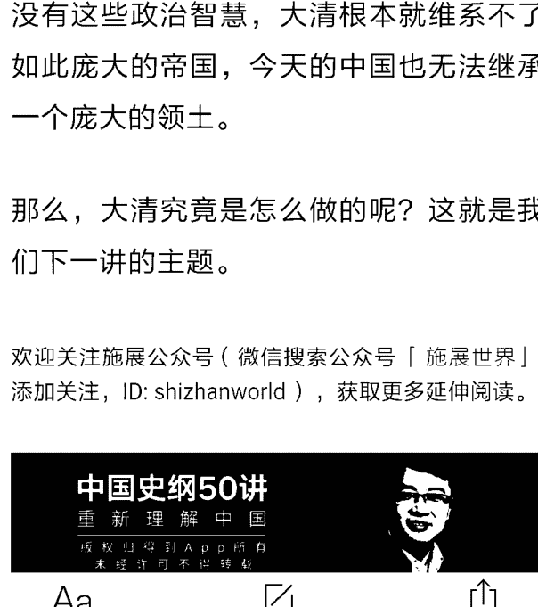

林丹汗的战略极有想象力，但是人算不如天算，他到了青海没多久就染上天花病死了，伟大的战略无疾而终。

林丹汗死后，他的家人无处可去，只好又回到老家投降了皇太极，并交出了大元传国玉玺。皇太极于是登基称帝，成为满洲人和蒙古人共同的大汗，满蒙联盟的军事基础就此成立。

## —— 本讲小结 ——

总结一下，今天讲的主要内容就是，雪域从草原方向获得政治秩序的输入，使得雪域内部的教派秩序发生深刻变迁。

草原则从雪域获得精神秩序的输入，这个输入却在蒙古世界产生深刻的影响，反过来给了满洲人以崛起的机会，满蒙联盟成为大清得以夺取天下的重要基础。

但不要以为大清的天下就是靠满蒙联盟的战争能力维系的，实际上，大清帝国经过多年征战，把汉满蒙回藏全都纳入了中华帝国的统治之下，这背后有一系列极其高超的治理技术。

没有这些政治智慧，大清根本就维系不了如此庞大的帝国，今天的中国也无法继承一个庞大的领土。

那么，大清究竟是怎么做的呢？这就是我们下一讲的主题。

欢迎关注施展公众号（微信搜索公众号「施展世界」添加关注，ID: shizhanworld），获取更多延伸阅读。

# 29 | 大清的高级政治智慧

这一讲我们来说一下鸦片战争以前的大清。跟其朝代相比，大清离今天太远，清朝末年又遭遇太多令人懵闷的历史，导致咱们经常难以平心静气地讨论大清的历史。

实际上，大清的帝国统治有着非常高超的政治智慧，差不多可以被理解为古代中国的最终完成形态。

最终完成形态是什么意思呢？就是说大清差不多是把中华帝国所需要的各种要素都成功地整合起来了。

注意，我在这讲里所说的都是鸦片战争以前的大清，对它的评价也是基于古代中国的标准，大清还不是个现代政治体，咱们不能用现代政治的标准来简单化地衡量大清，那会严重地扭曲我们对历史的认识。

错误地理解历史，就没法恰当地理解今天的中国。

## 游牧者的春天

要讨论大清的历史，可以先把视野放大一下。

进入公元15世纪之后，世界气候进入一个小冰期时代，但对游牧者来说，他们进入了政治上的春天。从西边的奥斯曼土耳其帝国开始往东，波斯帝国、印度帝国、大清帝国，都是在这一两百年里由游牧者主导建立的。

大清入关，只不过是游牧者在欧亚大陆上普遍获得主导地位的一个案例。大陆上唯一的例外是西欧和北欧，那边离草原太远，游牧者没法深入进去。

尽管后来晚清的时候又丢掉了不少，但剩下的领土仍然是明末领土的接近三倍，今天的中国继承的就是大清留下的疆域。

可见在领土意义上，大清曾经为中国撂下了多么厚的家底。你比较一下明朝晚期的地图，和大清地图以及今天的中国地图，就明白了。

## 大清的多元帝国

大清征服的疆域极为庞大，治下的人口也是极为复杂，没法用同一套办法去遍天下，在不同的地方必须发展出不同的统治技术。

大清在这个过程中把大辽开创的二元帝国治理技术，发展为多元治理技术。汉满蒙回藏这些次级区域，在大清内部各自起到了其他区域完全无法替代的作用。

大清的最高统治者在这些地方也以不同的身份出现，作为体系的中国，其内部整合达到了前所未有的高度。

康熙曾经说过“一座庙胜十万兵”，这是实打实的胜过十万兵。

但是皇上还得想办法再对藏区形成一种有效的统治，避免豪和藏联起来。怎么做呢？

大清统治者除了皇上和大汗之外，还有第三个身份，那就是文殊菩萨转世，在藏传佛教里获得了一个特别高的地位。

你达赖喇嘛是观世音菩萨转世，我是文殊菩萨转世，咱俩级别差不多，这样，皇上凭这身份，对藏传佛教就有了一种特殊的控制力。藏传佛教可以说是在特殊意义上提供了帝国的精神秩序。

西域地区，则是主导着整个帝国所需要的的安全战略空间。因为外蒙与新疆、尤其是北疆，在军事地理上可以说是同一个空间。

所以，清末重臣左宗棠要收复被中亚冒险家阿古柏所割据的新疆时，就上书朝廷说，“重新疆者，所以保蒙古，保蒙古者，所以卫京师”。也就是说，如果新疆没了，蒙古就悬了，如果蒙古没了，那北京可就悬了，大清也就完了。

汉满蒙回藏这些个地方，彼此之间有着极为深刻的相互依赖相互塑造的关系，以至于脱离开一方完全解释不了另一方，它们共同构造了一部作为体系的中国史。

## 大清帝国的中间性因素

大清帝国的治理技艺之高超，还体现在，它善于寻找到各种中间性因素，作为帝国治理的依靠力量。

## —— 本讲小结 ——

鸦片战争之前的大清帝国，有着高超的统治智慧，汉满蒙回藏各个亚区域都被它整合进一个彼此相互依赖的体系当中。

# 30 | 郑成功为何没成功？

这一讲咱俩来请一下明清时期的东亚海洋。

在这个时期，中国的民间，而不是帝国朝廷，如何成为东亚的海上霸主，但是这些人又是如何注定会失败的。

这里面包含着我们理解中国与世界的关系的一些重要密码。

## 明朝官方的海上活动

要说明清时期的海洋活动，大概你的第一反应就是郑和下西洋。经常有人在感叹，说郑和下西洋是一个多么伟大的壮举！如果继续坚持下去，不是半途而废，征服世界的就是西方人而是中国人了！

是这样吗？一方面，郑和下西洋确实雄大，这壮举比哥伦布发现新大陆早了将近九十年，船队的规模也是哥伦布望尘莫及的。哥伦布的船队只有三艘小船，郑和的船队有两百多艘大船；哥伦布的旗舰，船的长度还不如郑和舰队当中一般的船的宽度。

但另一方面，郑和的壮举是肯定不可持续的。最主要的原因是，这是纯官方行为，而不是民间行为。

郑和下西洋，要的是显示天朝国威，要的是一个派头，而不是斤斤计较挣了几毛钱。民间行为才是要赚钱的，不赚钱的事儿就没人干了。

由于大明的海禁政策，郑和船队遮天蔽日，但后面不可能有民间的船队跟上。朝廷这么烧钱，却没法通过民间贸易的方式把烧的钱收回来，那这个事情当然持续不下去了。梁启超也曾评价，说郑和下西洋这事儿，基本上就是雄才大略的皇上自娱自乐而已。

哥伦布那种小破船开创的事业，为啥就能够持续下去成为一个庞大的历史过程呢？

因为其中的行为主体起于民间，一群又一群的冒险家到海外去搏机会，多数没搏成，就死了。少数搏成的，就发了大财，发财的家伙再用这笔钱反过来促成欧洲国家的政治变化。

因此可以知道，海上和陆地上的秩序原则是不一样的。

在陆地上，可以靠帝国的征服来解决问題。而到海上活动，要想能够坚持得下去，一定是以发达的贸易为基础，这就只能是以民间行为为主。

民间贸易积聚起巨额财富，推动着国家政治变迁。变迁中很重要的一个内容就是，国家要出动海军力量，保护民间商人们在远方的贸易利益，商人则从贸易利润中拿出一部分来交税，以便支撑国家的这种军事行动。

西方国家的现代政治秩序，以及它们所主导的现代世界秩序，正是在这样一个过程中逐渐发展起来的。

## 明朝民间的海上活动

那么，古代的中国是否有民间力量要到海上贸易。

当然有，宋代以后，东南沿海地区逐渐变得地狭人稠，这些地方的百姓，靠种地已经不够吃了，有很多是到海上讨生活的。他们通过家族成员迁徙的方式，在很多重要的贸易港口都有自己的据点，发展起遍布环中国海地区的贸易网络。

东南亚很多贸易城邦以朝贡贸易的名义和中国这边做生意。实际上操作的多半也是这些华人，他们形成了很大的海上力量。

但对这些人来说很尴尬的是，大明朝一立国，就开始了海禁政策，也就是不许民间到海上贸易了。为什么大明要搞海禁呢？

明朝开国的时候把人分成四种户籍，搞起了一种准计划经济。这个政策让大明王朝在货币严重短缺的情况下，能比较快地恢复了经济。但是对于准计划经济来说，有一个很重要的要求就是，不能让人随意移动，否则没法计划了。所以大明必须得搞海禁，免得到海的人到处乱跑。

问题是，朝廷能够搞海禁，可是民间到海上贸易的需求还在。东南沿海地狭人稠的状况，到了明朝越来越严重，朝廷又没法给这些人找到别的饭吃。不让做贸易了，那这些人就只能变成海盗，进行私自贸易。

东亚海面上这些海盗被称作什么呢？也许你已经猜到了，就是倭寇。

倭寇这个名字听上去好象是一群日本海盗，实际上，倭寇里的日本人基本上都是马仔，真正的大Boss都是中国人。

当时最有名的倭寇首领是个安徽徽州人，叫做汪直。汪直极为精明能干，逐渐地把各路走私商人聚到一个巨大的海盗走私集团，差不多断了整个东亚海面上的贸易。

他把大本营设置在日本长崎，在这立国号为宋，自称魏王。他募集了大批的日本武士听他号令，手下有五千多人作为常备武装，必要的时候能够鼓动起来差不多十万人。汪直长期是大明朝剿倭寇的重中之重对象，后来终于被逮到杀掉了。

大明没想到，此后倭寇问题反倒更严重了。因为过去的各种倭寇海盗还是受汪直节制的，大明要想绞杀的话，还知道找谁去谈。汪直没有了，各种倭寇海盗没有了统一的头目，大明不知道该跟谁去谈判了，这成了明朝中后期极头痛的一个问题。

到最后这个问题是怎么解决的呢？不是靠戚继光剿倭寇的神勇，而是靠开放海禁。能够合法经商的话，人们做海盗的冲动就下降了。

## 郑成功的海上帝国

但是，虽然大明朝廷开放了海禁，却仍然严格限制对日本的贸易，只有限度地开放了对东南亚的贸易，这就仍然给了海盗以生长的空间。

到了明朝末年，又一个强大的海盗兼海商崛起于，这是郑成功的老爸郑芝龙。郑芝龙以长崎与台南两个地方作为他的海上大本营，纵横东亚洋面。巅峰时期，他手上有超过三千艘大小船只，拥有一支二十万人的军队，军队中包括中国人、日本人、朝鲜人、南洋人甚至非洲黑人等各色人种。

任何人要到东亚海面上做生意，都必须向郑家交保护费，一艘大船要交三千两白银，交了保护费，就会得到郑家的一面令旗，可以平安航行。荷兰人是那个时代欧洲的海上霸主，但到了东亚照样得给郑家交保护费。

郑家在东亚洋面上的这种保护费生意，每年入账上千万两白银，富可敌国。而由于这个大海盗的存在，其他小海盗都数被灭掉了，东亚洋面上反而获得了一种秩序。

注意，我在后面说的都是郑家，而不是郑芝龙。原因在于，他在崇祯年间被大明招安了。到了大清入关之后，又投降了清朝，他的庞大的海上帝国就被他坚决不降清的儿子郑成功继承了下来。

郑成功接手这个海上帝国还是颇费了不少力气，但是接手下来之后，就以厦负为根据地，进行了长期的反清复明战争。在清兵入关十几年后，郑成功还出水路发动了一次规模巨大的北伐，从长江顺流而上，差点攻克南京，但最后还是失败了。

这次战役结束后，郑成功反思失败的原因，决定进驻台湾，毕竟厦门这个根据地还是太小了点。

当时的台湾已被荷兰人侵占了三十多年，但毕竟郑成功才是东亚海上霸主。郑成功攻打台湾虽然费了些事，花了几个月的时间，但荷兰人肯定是扛不住的。到台湾被郑成功打下来时，大清这边政权已经不在了，是康熙继位了。可见郑成功的海上帝国曾经坚持了多久。

但是很快这个帝国就要坚持不住了。不是因为郑成功攻克台湾没有多久就去世了，而是因为康熙朝一开始就颁布了迁海令，规定从山东东南到广东沿海二十里的范围内不许住人，都得迁到内地，沿海的船只也都毁掉，寸板不许入海。

庞大的大陆市场一下子关闭了，郑成功的继任者马上上面临了财政危机。郑氏家族在...

继任者马上 面临了财政困难。郑氏家族在台湾又坚持了二十多年的时间，终于被大清灭掉了。

到了这有一个问题就需要解释了，为什么汪直和郑成功最终都无法成功，都被大陆帝国给灭掉了呢？和后来到来的英国人对比一下，问题就更明显了。

郑成功面对的大清，还在初创时期，清朝的统治仍未被中原百姓普遍接受，而郑成功手下有约二十万将士。

英国人所面对的大清，是康乾盛世之后的时期，清朝的统治早就获得了百姓的认同，英军在鸦片战争中最多的时候也不过两万人，并且这会儿英国对大清的武器优势并不是特别大。

两相比较看来，郑成功面对的困难比英国人小得多。那为什么郑成功最终失败了，英国人却能成功呢？

原因就得到海上帝国的生存逻辑当中来找了。

英国人建立的是一个全球海洋帝国，它依靠的是全球市场。而郑成功、汪直他们建立的只是一个东亚海洋帝国，依靠的只能是东亚大陆市场。

# 31 | 人口太多，技术发展不动了

上一讲我们谈到了中国在大陆秩序方面太成功了，反倒带来了自己在海洋秩序方面的失败。这一讲就来看一下，为何中国必须加入世界秩序。

你会看到，中国在大陆方面的超级大一统，反倒让中国历史走上一种自我锁死的状态；自我锁死状态的根本原因是人口的过度膨胀，它使得中国经济只能在一种低水平均衡上挣扎。

到了此时，中国历史就走到了又一个重要的关节节点上。

## “一条鞭法”与人口膨胀

先来看看中国人口为何会过度膨胀吧。这和底层百姓所面临的财政压力的变化有着直接关联，也就是说，底层老百姓交的税少了。

老百姓财政压力的变化源自两个事情，一是明朝后期张居正搞的“一条鞭法”改革，再一个是大清入关。

## “和平红利”与“自我锁死”

“和平红利”在这是啥意思呢？咱们知道，在明朝的时候，中原的百姓要负担两支高强度军队，大明的军队肯定定位是中国中原百姓养活的，关外的游牧者也依靠从中原抢来的战利品维系统治，事实上也是靠中原百姓养活的。老百姓被迫交各种五花八门的税，苦不堪言。

## 加入世界秩序，跳出困境

这个情况有些麻烦，因为这些过剩人口，靠农业经济是吸收不掉的，只有靠工业经济才能吸收掉。但是，正因为人口的过剩，导致中国无法内生性地进入工业经济。

不了内生的工业革命，那就从外部传入新技术呃，这样就能刺激中国发展起工业，然后就能吸收掉过剩人口了。

这外部世界是谁呢？就是西方世界。所以我们可以看到，到了这个时候，中国与西方世界的相遇，或者说，通过与西方相遇，而加入到世界秩序当中，已经是中国历史的一种内在需求了。

西方的到来当然给中国带来了战争与屈辱。西方征服了很多非西方的古老文明和地区，让它们沦为殖民地；但是西方却没法完全征服中国。因为中国实在是太大了，人口也太多了。

这样一种超大规模，使得没有任何一国能够完全征服它。而列强们都是这个心理，我吃不着，你也别想吃着，中国就利用了列强的这种矛盾，寻找到夹缝，不仅没被彻底征服，反倒挺过了屈辱，还发展出解决自己困境的手段。

随着西方的到来，中国的超大规模又呈现出另外一个效果。在中国作为一个封闭经济体的情况下，过剩人口一定会导致内卷化的困境；但是一旦加入到一个开放的世界经济体系，过剩人口反倒有可能会成为中国的巨大竞争优势，因为比拼劳动力价格谁也比不过中国。

而由于中国的超大规模性，在它加入世界经济体系之后，无论它是否主动想要做，都会深刻地改变世界秩序。

## —— 本讲小结 ——

总结一下，今天讲的主要内容是，明朝末年的税收改革，以及清朝入关所带来的和平红利，让中国的人口获得了大规模成长的机会。但是，如此超大规模的人口，反倒让中国没法内生性地发展出新技术和工业经济，陷入一种内卷化的困境，只有通过加入世界秩序，才能够克服这种困境。

讲到这里，我们对于中国古代历史的讲解就告结束了。古代史与近代史的分界，就是中国开始努力融入世界秩序的开始。

虽然我们在这普讲里面谈到了，加入世界秩序不仅会让中国跳出内卷化陷阱，还会让中国在全球经济中获得竞争优势，但这有一个前提，就是中国必须从政治意义上先对自己完成一种现代式的整合。

如果不能完成这种政治整合，加入世界秩序反而有可能让中国陷入更大的麻烦；只有完成这种政治整合，中国在经济上的巨大竞争优势才真地能够释放出来。

加入世界秩序的初期，中国陷入更大麻烦。如何克服这种麻烦，如何实现现代式的政治整合，以及在此之后如何把中国的竞争优势释放出来，这是中国近代历史与现代历史上最核心的问题。也是我们这个小课题的下半部分要讲述的核心内容。

下一讲，咱们先从加入世界秩序后中国的第一个大事件讲起，通过太平天国起义，来看看近代中国的命运与世界秩序的关系。

欢迎关注施展公众号（微信搜索公众号「施展世界」添加关注，ID: shizhanworld），获取更多延伸阅读。

# 32 | 太平天国时期的中国与世界

从这一讲开始，我们进入对于中国近现代史的讨论，先从太平天国时期讲起。

也许你会奇怪，近代史的开端不是鸦片战争吗？为什么从太平天国时期讲起呢？

虽然中国在鸦片战争中第一次面临了来自西方的压力，但当时的帝国统治阶层并没有理解这个事情。在他们看来，英国人打过来跟噶尔丹打过来，没有本质区别。就是说，帝国虽然遭遇了一场近代意义的战争，但对其理解却还是停留在古代。

那是什么时候，帝国开始意识到世界已经

所以这一讲并不是讲太平天国，而是围绕着太平天国时期的前后几十年展开。让你看到太平天国的兴起与鸦片战争之间有着什么样的内在关联，太平天国如何导致了大清内部的深刻变化，又如何导致了大清对世界理解的变迁，以及这一切与世界大势的变化之间有着怎样的深刻关联。

## 太平天国与鸦片战争

先来说说太平天国与鸦片战争之间的关系吧。要讲清楚这个，还得先看看鸦片战争与世界秩序变化的关联。

英国人往中国输入鸦片导致白银外流，只是鸦片战争的表层起因，后面还有一个更深层的原因——国际秩序的变迁。

前面讲到过，美洲和日本的白银供给的变化，直接影响着明朝经济乃至国运的兴衰。这样一种影响，在清朝仍在继续，甚至变得更加深刻。能出现康乾盛世，其外部原因就是当时的世界白银供给很充足。

到18世纪后期，日本再次禁止白银大规模出口，这对大清来说问题还不算大，反正还有源源不断的美洲白银。

但是没多久，发生了法国大革命，这与中国也产生了关联。法国大革命之后，很快就侵入西班牙，而美洲白银都是来自西班牙的美洲殖民地，所以世界白银供给马上严重受控。

好不容易等到法国大革命结束了，拉丁美洲又开始了独立运动，一系列的战争导致白银生产还是迟迟恢复不起来。

这些动荡的结果是什么呢？从1790年代到1830年代，全世界的金银产量减少了大约50%，白银流入中国的数量骤然减少。这下大清就头大了，白银供给短缺，导致经济变得很萧条。

但是通过刚才的解释可以看出，在19世纪前期，鸦片的流入不是导致中国白银净流出的根本原因。因为在此之前中国的白银一直是既有流入又有流出的，世界白银供给的骤然减少，导致向中国流入的白银急剧减少，才是中国白银净流出的根本原因。于是经济就萧条了，大清的日子就不可能过了。

但当时的局内人不可能看得清这个问题，大清把白银短缺归因于鸦片的大规模流入，最终引发了1840年的鸦片战争。

战争的结果你应该很熟悉了，一方面是割地赔款，一方面是改造了外贸秩序，从广州作为唯一的外贸港口，改为五口通商。

五口通商对大清带来了更大的冲击，大清当时主要的外贸商品是茶叶、生丝、瓷器、漆器等。产地在江南、江西、两湖、福建等地。在一口通商的时候，出口品得千里迢迢地运往广州，运输中最困难的就是翻越南岭的一段路，这段路养活了一大批广西籍的搬运工。

看了上图，你就知道华南的主要地理结构了。

五口通商之后，就用不着往广州运输了，出口品可以就近从上海、宁波、福州、厦门等地出海，于是广西籍搬运工失业了。

屋漏偏逢连夜雨，经济既萧条，大清的人口也已经膨胀到临界点。正好赶上两广地区又是基督教比较早进入的地区，基督教带来了一种全新的动员和组织机制。

这些因素全都加在一起，太平天国起义就在1851年从广西发动起来了。在很短的时间内席卷到长江中下游地区，也是大清最富庶的地区，一直坚持到1864年。

太平天国的具体过程就不多说了，重点看看太平天国时期中国在对内与对外两个方面发生的深刻变化。

## 太平天国时期的大清内部变化

太平天国起义兴起之后，大清发现曾经叱咤风云的八旗军队，要对付太平天国已经完全不顶用了。

在灭掉准噶尔之后，大清经历了近百年的和平，中间只打过规模比较小的几仗。八旗子弟奢侈主要的本事是提笼、架鸟、听戏、唱曲，不再能打仗了。

怎么办？死马当活马医吧，皇上只能硬着头皮起用汉族地方官员，过去是绝对不能起用他们的，担心他们有异心。让他们想办法能不能摆平太平天国，于是曾国藩、左宗棠、李鸿章、胡林翼等这一批晚清中兴名臣就在这个过程中走上了历史舞台。

曾左李胡这些人，在地方训练出湘军、淮军等军队，这完全是在大清传统的八旗兵和绿营兵之外的军事系统。朝廷在这样儿没银子给曾左李胡他们，那他们怎么练兵呢？

朝廷虽然没钱，但却放政策，允许他们征收厘金充作军费。这是什么钱呢？就是各个省之间运输商品时的过境税。几位重臣就是靠厘金的支撑训练出了可用的军队。

当时能够征收到的厘金规模还是不小的，这意味着各省之间的商品贸易规模不小。如果此规模的内贸发展，依赖于外贸的拉动。而外贸的拉动力，则是因为五口通商导致的中国贸易规模扩大。

大清允许地方督抚们通过厘金来筹军费，这带来一个后果，地方财政对于中央的依赖性变小了。

中国自从宋朝进入到平民社会后，帝国朝廷一直是采取一种强干弱枝的政策。财权和军权收归中央，地方要受制于中央，以此来确保帝国的统一。这种政策使得从大宋到大清这九百多年的历史中，再也没有出现过长时期的分裂割据状态。

与宋朝以前的豪族社会时期不一样，那时常出现分裂状态，而且一出现就是好几百年。为应对太平天国，使得大清帝国从强干弱枝开始转为强枝弱干，帝国中央对于地方的控制力开始下降了。

中央控制力的下降不仅仅体现在财政方面，也体现在人事与军事方面。

在镇压太平天国时，朝廷不得不允许地方督抚们便宜行事，可以自行任免和奖惩地方各级的军政官员，这就逐渐培植出了庞大的地方势力集团。

与太平军打仗时，人们又发现用冷兵器完全搞不定了，必须用热兵器。李鸿章从洋人手里买了不少洋枪、洋炮，最终用这些打败了南京城墙，灭掉了太平天国。中国的战争从此进入热兵器时代。

要想用热兵器的话，你要是能自己生产那是最好地，至少你也可以自己能修....

于是我们可以看到，太平天国起义给中国内部带来了一系列的深刻变化。

一方面，在大一统了八九百年之后，帝国从强干弱枝变成了强枝弱干。几十年后的北洋政府时期，军阀割据混战的状态，早在这个时候就埋下了种子。

另一方面，这种强枝弱干，又正好与满汉差异叠合在一起。鸦片战争之前，大清的治理智慧极高超，汉、满、蒙、回、藏各种群体起着彼此完全无法替代的功能，而每...帝国有着一种内在均衡性。

一种内在均衡性。

太平天国之后，财政秩序、军事秩序、人才秩序，甚至是精神秩序，全方位地转由中原地区的汉人主导了，帝国内部的均衡被打破了。

对帝国来说，这就很麻烦了。过去的帝国有均衡，满蒙两个群体又吃饱又干活，有一些特殊地位可以为人所容忍。但是现在帝国失衡了，满蒙群体有光吃饭不干活的嫌疑了，他们的特殊地位逐渐就不为汉人所容忍。

对满蒙两个群体来说，他们本能地能感受到危险，于是就会做一种自保的努力。反映在政策上，就是变得越来越保守。

对于一部分汉人来说，你们不仅是光吃饭不干活，还对我们拯救帝国的努力不断地拖后腿，那索性推翻你们算了。于是，革命的理念就在这个时候隐隐地埋下了一种子。

可以看到，太平天国对中国内部产生了两个深远影响。第一，埋下了地方分裂的种子；第二，导致了帝国内部的失衡，从而埋下了革命的种子。

## 太平天国时期的大清对外变化

太平天国时期，大清对外的变化主要体现在大清对于世界的理解出现了巨大的变迁。大清开始努力地融入国际条约体系。国际条约体系就是西方在近代建立起来的一种新国际关系形式。

严格说来，对外的变化不是太平天国运动带来的，只是赶在同一个时代而已。同时代还发生了一件什么大事呢？那就是1860年的第二次鸦片战争，英法联军火烧圆明园就是这一次干的。

这一场战争的结果让大清大吃一惊，不得不重新理解世界。火烧圆明园意味着国家的首都已经被别人刚刚给攻占了。

在过去，首都被敌人占领了，这基本就意味着要亡国了。但是大清没想到，英法联军占领了北京之后，居然没打算灭亡大清，而是要求跟大清签订条约。只要条约签订了，两国就按照约定退兵了，这是一种闻所未闻的搞法。

大清由此见识到了一种全新的世界秩序，就是前面所说的国际条约体系。国和国之间的关系是通过国际条约来确定的，缔约的国家彼此之间是一种平等关系。大清过去对于世界秩序的想象，是古代中华帝国留下来的朝贡体系。

这两次鸦片战争之前，西方国家过来想要跟大清签订平等贸易条约，但是大清坚决不同意。

在大清看来，你们这些破国家，离我天朝十万八千里，还想要平等？离得远只能说明你是最低层的国家。再说，跟你们平等了，朝鲜、越南这些离得近的藩属，我该咋对待他们？所以大清坚决地拒绝了英国、法国等国家所要求的平等。

结果到了第二次鸦片战争，大清被打得不行了，不得不接受了和西方国家签订平等条约，但实际上条约里埋藏了许多不平等的条款。之后大清想要平等，西方不给了。

大清和西方国家签订了条约之后，发现过去的六部衙门都没办法作为处理这种条约的部门。于是又设置了一个全新的部门，叫做总理各国事务衙门，也就咱们在电视里时不时会听到的总理衙门，专门负责对外事务。

中国由此开始了努力融入现代世界的进程，总理衙门在这里起到过重要作用。一方面是作为最早期的外交部；另一方面主导开启了洋务运动，推动大清寻求自强。

洋务运动的推动与发展，也和国际市场上贵金属供给的变化紧密相关。1856年之后，美国加州和澳大利亚陆续发现了一些新的银矿，并且拉丁美洲的秩序也逐渐恢复，白银供给又比较充足了。

于是可以看到，在这之后几十年里，大清的鸦片进口数量比鸦片战争之前还大，却有着持续的白银净流入。这极大地缓解了大清的财政压力，并且让经济开始恢复景气。帝国正是在这个过程中真正获得了镇压太平天国的能力。

## —— 本讲小结 ——

总结一下这一讲的内容：

太平天国时期是中国真正地开始认识世界，努力推动自己进行转型的起点。

但是太平天国时期也给中国埋下了一系列困局的种子，它们在未来会成为中国在现代转型中必须克服的问题。

所有的这些变化，都是在中国与世界秩序的关联互动中发生的，我们再也不可能脱离开世界理解中国。甚至可以发现，中国加入世界秩序，给自己带来了一系列问题，但也同样带来了解决问题的手段。

# 33 | 左宗棠借力伦敦，收复新疆

33 | 左宗棠借力伦敦，收复...

这一讲来说西域，也就是新疆。西域在中国近代历史上有一个非常独特的意义，中国最早是在这里找到了大国博弈的感觉。

西域是大中亚的一个部分，再加上西边的几个斯坦国，共同构成了大中亚。

大中亚在近代历史上是大国博弈特别重要的场所。中亚的大博弈，包括两个方向。南北方向，主要是俄国和英国的博弈。东西方向上，主要是中国和俄国的博弈。

这一讲我们来展现中亚大博弈的历史，以及在东西方向，俄国和中国的博弈。

我们会用左宗棠收复新疆这段历史作为例子。这段历史，可以说折射了中国在现代世界秩序中的作用。

## 中亚的大博弈

先来说中亚南北方向的博弈。不管是哪个方向的博弈，都跟地理结构相关。

## 新疆是怎么丢的

## 俄国在中亚的策略

## 左宗棠收复新疆

税规模够大。

那么大清帝国的外贸规模是什么时候发展起来的呢？上一讲我们就说到过了，是鸦片战争之后！五口通商了，帝国的贸易规模就扩展起来了。

鸦片战争和外国人管理海关，让大清帝国获得了一种特殊的战争融资手段。假如没有这个融资手段的话，军饷跟不上，西域丢了就是丢了，肯定无法收复，历史上这种事情有过好多次。

大清没想到的是，自己和英国打仗失败了，半推半就地加入了世界秩序，却让帝国获得了一种全新的自我保全能力。

回过头来接着说汇丰银行，它是到哪里搞了1500万两白银借给大清呢？它不是靠储户的存款，而是到伦敦金融市场发行债券。通过发债完成融资，借给大清，大清再以此来平定内陆深处的动荡。

伦敦金融市场在当时对世界市场的统治力，要远远大过今天纽约的统治力，它就是整个海洋世界的运转轴心。

## 中国的海陆枢纽位置

一个更有意思的东西就浮现出来了。

整个海洋世界基于多年的远洋贸易和工业革命而发展起来的资本秩序，以中国为中介，转化为向失序的大陆深处投放秩序的历史过程。而对于英国来说，由中俄两国分治中亚，远远好过俄国一家独占中亚，在可能的情况下，它也愿意支持中国收复新疆。

于是，中国成为联系海洋与大陆的必须的中介性存在，是一种海陆枢纽性的存在。

至此，咱们能够发现，近代的中亚正是通过它的混乱失序状态，而让中国能够发现它的历史意义。左宗棠说服太后的时候曾...

也就是说，新疆丢了，连锁效应就是北京就危险了，那帝国也就完了。那么，帝国为了成就自身，也必须安顿新疆的秩序，否则帝国甚至无法成就它自己。这不是它能选择的，而是它必须担负起来的历史命运。

在肩负这个历史命运的时候，中国在不自觉中就成为了海陆枢纽。

这一地位只有中国能够承担起来，因为要将海洋方面的资源转化为向大陆深处的秩序投放，这个中介者必须具有超大规模性，否则根本没有能力。而中国的中介性地位，正是通过融入世界而被激活的。

## —— 本讲小结 ——

这一讲所讲的核心内容就是，西域-中亚是人类世界秩序的一个缩影，这里构成了海洋帝国、大陆帝国、作为第三支力量的海陆枢纽性帝国的边界。

中国正是在这里，才能够看清自己的历史责任。

但是，中国要想真的承担起这个历史责任，必须更有效地融入世界，完成自己的现代政治转型。

南洋就起到了激活中国这种意识的作用。于是，为了理解西北，我们就必须再看看南洋。这是我们下一讲的主要内容。

欢迎关注施展公众号（微信搜索公众号「施展世界」添加关注，ID: shizhanworld），获取更多延伸阅读。

# 34 | 南洋华人对近代中国的塑造

34 | 南洋华人对近代中国的...

这一讲咱来聊一下南洋，为什么要聊南洋？因为这里蕴含着中国历史一个非常重要的深层结构。

中国历史是在一个草原-中原-海洋的三重结构中开展的。而帝国就是在过度地带形成起来的，具体是谁的过度地带呢？

在古代，是草原与中原的过度地带，这这里他们能获得重要的治理智慧。比如大唐、大清，他们以草原和中原为基础，建立一个强大的帝国，然后向海洋传播自己的文化。到了近代，这个过度地带是呢？

就是南洋了。

它是中国近代转型需要的，最重要的政治智慧的来源。以这里为基础，中原跟海洋的资源都能够被调动起来，然后才有了咱们上一讲所说的，向大陆深处、向动脉地区投放秩序的努力。这些加到一块是一个完整的中国历史的结构。

## 宗族关系，帮助海外华人开枝散叶

海外华侨之所以能在全世界开枝散叶，能够建立遍及整个南洋，一直扩展到整个美国、日本、欧洲的大网络，最基本的载体是什么？

宗族关系。

这个宗族关系主要是依托东南沿海地区既有的社会结构。

## 宗族关系，限制了南洋华人的政治地位

- 南洋本身有着丰富的自然资源；
又被西方征服成为殖民地，一下子可以分享西方庞大的世界市场；
这里又有西方所提供的一整套现代法律体系和现代经济与技术；
而且因为地处西方与大清的贸易通道，这里还有充足的货币资本；
再随着大量廉价的中国劳工的到来，于是就发展起一种畸形繁荣的殖民地经济。

华人劳工极度便宜，能接受极低的工作标准，土著都接受不了，于是土著的工作就没了。

对于白人殖民者来说，华人帮会打打杀杀是潜在的秩序扰乱者，也影响税收，白人也想收拾你。

因此，无论是土著还是白人殖民者，都产生了很强的排华欲望，而他们在排华的时候不会区分什么福清人、潮州人、客家人之类的，在他们看来这都是笼统的中国人。所以他们是对地方性群体不做区分的，笼统地排华。

所以，共同的屈辱，终于让来自不同地区的海外华人浮现出某种共同的身份感，一种民族主义情绪渐渐开始出现了。

## 革命力量从南洋兴起

但是，南洋华人只是模糊地感受到了对新观念的需求，却还说不清楚，所要的新观念究竟是什么。想要把这个意识说出来，就需要有人进行观念的灌输和塑造。

于是，流亡海外的维新派领袖康有为、梁启超，革命党领袖孙中山等人的工作有了用武之地，他们通过各种政治宣传和组织工作，把海外华人对于各种苦难的感知，转化为一个意识：

如果我们有一个强大中国，你们将会获得保护。

海外华人逐渐有了比较清晰的民族主义观念，他们渴望中国能够保护自己，也渴望中国也能够拥有他们在海外见到的那些现代的法律和制度；但是回头看看中国，实在不争气，民族主义情绪便被逐渐地引向了革命激情。

- 1. 在辛亥革命之前，孙中山组织过十次起义，其中有八次是靠南洋作为支援的，著名的黄花岗七十二烈士，其中有二十九个人就是从南洋赶回来参加起义的。
- 2. 孙中山为革命募的款，有差不多85%来自南洋，再加上来自美国的募款，则占到了93%。
- 3. 更有意思的是，孙中山要想发动革命，就必须找到把理念转化为行动能力的组织资源。南洋华人的帮会组织，就是现成的组织资源。为了能把帮会充分动员起来，中山先生还曾亲自加入洪门，当上了其中的大龙头，这成了他发动起义所依托的重要组织资源。

不过，中山先生在早期发动的革命一直不成功，问题也就在这里了。因为你依托帮会作为你发动革命的组织资源，帮会所关注范围也决定了这种革命的动员极限。

帮会里的人主要来源还是福建、两广，意味着你革命的动员也就是在这几个省份，不可能形成全国性的动员。

因此，革命要想真的搞起来，在全国范围内有影响，光靠东南亚的海外华人已经不够用了。大陆地区的口岸城市，开始起到了更重要的作用。

上海、广州、汉口、九江，这些有租界的地方，都是口岸城市。它们与中原有着更紧密的关联。在租界地区，他们也能感受到，现代政治、法律、观念。

所以口岸地区，我把它们定义为一个广义的南洋。这里“南洋”不再仅仅是一个地理概念，它包括所有对现代政治、法律、观念有接触，同时对中国内部有深入了解的地区。这些地方的人，我称为广义的南洋华人。

所以，我们看到20世纪初年，以口岸地区为基础成立的一些革命组织他们走上了历史舞台。他们对中原地区的了解比南洋华人更加深入，他们所能动员的资源也不再局限于福建和两广有限的几个省份，而是能在国内形成更大范围、更大规模的动员。

我们在20世纪初期，看到成立了一些比如，广东地区的兴中会、浙江地区的光复会、湖北地区的华兴会，最终这些组织又合并成为同盟会。这几个地方：

- 1. 有口岸、有租借；
- 2. 跟内陆有更深刻的联系；
- 3. 能动员起的人已经远远超出了两广和福建。

所以这些组织合并成同盟会后，带来了辛亥革命。中国的历史从此进入了革命的世纪。

## —— 本讲小结 ——

咱们大致介绍了，中国走出古代社会，进入近代转型的这个关口之后，所面临的一系列状况。而中国要走上近代转型之路，不是只靠内部的努力就能完成的，是内部跟外部两种动因共同作用的结果。

我们所讨论的都是内部的动因，接下来我们就得再讲讲外部的动因，也就是对近代中国转型影响最大的三个国家英国、俄罗斯、日本。它们的谋划与行动，是中国转型的外部约束条件。

只有把内外两种动因都搞明白了，你才能恰当地理解近现代的中国历史。

接下来的三讲，我们会暂时地脱离开中国，来讲那三个国家。

欢迎关注施展公号（微信搜索公众号「施展世界」添加关注，ID: shizhanworld），获取更多延伸阅读。

# 35｜英国秩序下的中国角色

上一讲，我们说到了近代中国转型的一个内在动力，也就是南洋。

从这一讲开始，我会用三讲来给你讲讲外部因素，也就是对中国近代转型影响最大的三个国家，分别是英国、俄国和日本。

它们构成了中国转型的外部约束条件，不理解这三个国家的政治行为，就没法真正理解中国历史所面临的处境。

这一讲先来说一下，近代历史上的英国。

## 主导世界市场的英国

英国这个国家很特殊，其它的列强国家就仅仅是个国家，大英帝国却同时有着国家性和世界性这两重属性。

就国家性来说，它和其他列强并列竞争；

就世界性来说，它超越于所有国家之上，主导着全球贸易体系与金融体系，其他国家都没有这种主导能力。

## 英国的小社会、大政府

那么，为何英国能让自己的内政和外交高度打通呢？

## 诉诸国家保护的英国商人

既然是社会博弈决定着英国的政治主题，社会的变化就会直接反映在英国的政策变化上。

会是胜者全得，因为别人的钱也不会白花，会有各种对冲、抵消的效果。最终的决策就会是多方博弈妥协的一个结果，只不过会朝花钱最多的那一方有所偏重而已。

这也合理，肯花足够多的钱，意味着在海外相关利益的规模足够大，对它进行保护就是合理的政治决策。

来会议游说的利益团体，既有国内的，也有国外的，甚至还有纯粹的外国利益团体也会雇人来游说。所有国内国外的各种考虑，要在同一个场子里来PK，内政与外交很自然地就打通了。

还要再强调一下，重要的事情分三点来强调：

- 第一，这些利益集团花钱游说，并不是行贿。
- 第二，不要看到利益集团就觉得它会绑架社会，于是想更打击利益集团。

利益集团是内在于人性，人类社会的常态，永远会存在的，所以要打击的根本不是利益集团，而是区分不按规则行事的利益集团。
- 第三，利益集团根据自己在一线经济的感受，对游说费用的调整，就会影响到国家政治决策的变化。

这种决策方式，对于世界市场的变化能够非常敏捷地进行反应，所以英国的内政、外交就高度打通了。

## 不殖民、只通商的非正式帝国

政治决策是要保障国家利益，在英国的这种决策逻辑下，国家利益不是被事先规定出来的，而是被动态发掘出来的。

所以，要问近代历史上英国的国家利益是什么，首先应该问的是，英国商人的利益是什么，因为英国商人的利益会转化为英国的国家利益。

对商人来说，利益是什么呢？

就是寻找到稳定的市场，扩大贸易规模，以及尽量少地付出管理成本嘛。

## 英国想要稳定统一、适度繁荣的大清

于是，我们就能理解，英国和大清进行了几次战争，却从来没有想过要统治和灭亡中国，战争的目的只不过是让中国开放贸易。

- 如果大清政治不稳定，就意味着英国无法获得一个稳定的市场；
- 如果大清被列强肢解，列强有可能在自己瓜分的地盘上向英国关闭市场，这肯定不如大清的统一市场对英国更有利；
- 但如果大清太贫困，这个市场就算稳定，也没消费能力，英国进入这个市场也没啥用；
- 如果大清太富裕，就可能变得太强大，有可能用政治手段向英国关闭市场，这也不符合英国的利益。

## —— 本讲小结 ——

要理解列强的冲突和矛盾，前提就是理解列强的生存逻辑跟利益结构。

欢迎关注施展公号（微信搜索公号「施展世界」添加关注，ID: shizhanworld），获取更多延伸阅读。

# 36 | 俄国秩序下的中国角色

这一讲来说一下俄国。

俄国几乎就是大陆帝国的代名词，但让俄国成为大陆帝国的，不仅仅是它的地理特征，还有它的精神特征。

俄国有一种西方国家所没有的特殊命运观，俄国认为自己这个国家承担着一种神秘而又神圣的历史责任，要通过承担苦难，来完成对人类的救赎。

它认为这种命运来源于耶稣基督对人类的拯救，这个使命在今...要由神圣的俄罗斯承担起来。

耶稣是弥赛亚，弥赛亚是救世主的意思，那么俄罗斯帝国就是个弥赛亚帝国。

## 东西罗马的分离

弥赛亚帝国的观念和俄国的大陆地理特征结合在一块，才能完整地解释俄国在近现代的一系列内政和外交行为，也才能真正理解它在近现代历史中对中国的一系列政策。

## 俄罗斯的东正教渊源

拜占庭帝国一直认为自己是帮助人类实现救赎的弥赛亚帝国，它为此努力向外传教。

## 承受苦难、救赎人类的使命

既然俄罗斯帝国都是第三罗马了，那第二罗马的弥赛亚帝国的使命，也得继承下来。

得特别惨，马上小宇宙就能爆发，瞬间崛起，反过来把敌人打得屁滚尿流。

刚说到了跟希特勒的战争，那已经是苏联时期打的了。仔细考察一下苏联的布尔什维克革命，会发现它的精神结构跟弥赛亚帝国很像。

布尔什维克也相信苦难对于人类的净化作用，相信人类的救赎寄托在苦难的无产阶级之中。

而列宁提出俄国是世界革命的中心，相信通过俄国的革命，将引起连锁反应从而使人类获得终极解放，这几乎就是弥赛亚帝国特殊使命的新时代版本。

俄罗斯人对共产主义经常会有一中特殊的感觉，原因就在这里。

## 领土扩张的贪婪与不安全感

与苦难相伴生的，是俄罗斯民族性格中深刻的不安全感。

这个主要是跟地理相关了，俄罗斯地理上一马平川，周围没有任何自然屏障，历史上经常被入侵，这让它有不安全感。

但是不安全这个事儿也得两面看，从另一个角度来说，这也是个苦难啊。

从这里面又激活出了俄罗斯的弥赛亚帝国情怀。

这两种情感叠加在一起，促使俄罗斯从16世纪开始了大规模的对外扩张。它一方面要用庞大的战略纵深来克服地理上的不安全感；一方面要通过扩张，实现自己的弥赛亚帝国命运。

这种精神构成了俄国对外战略的深层精神驱动力。

对俄国来说，对外扩张对是一种道德使命，而不是像英国人法国人那样，仅仅追求一些商业利益。商业利益是可以讨价还价的，道德使命则不能讨价还价。

所以和西欧国家相比，俄国对占领土地有着特殊的感情，当然，从别人的角度来说，就是特殊的贪婪。

俄罗斯对于大清的贪婪，就是它对长城以北的地区都不怀好意。

对东北，俄罗斯打算直接就吞并成为自己的领土了，它给这里的昵称都起好了，叫“黄俄罗斯”，这里不仅土地肥沃，还能搞到一个梦寐以求的太平洋方向的不冻港。

对蒙古和新疆地区，俄罗斯倒没打算直接吞并，但也不遗余力地想要把这些地方胶解出来，变成自己的势力范围。

但它在这些地方除了会遇到大清的反抗，还有几个对手。

在新疆地区，它的主要对手是英国和中亚本土力量，这就是之前我们曾经说到过的中亚的大博弈。

在东北和蒙古地区，主要的对手则是日本，当然，也包括在各处都有贸易利益的英国。

## 众矢之的一一东北

英国作为海洋帝国，并不打算在东北占有一土地，但是如果俄国要把它变成黄俄罗斯，这英国人就不干了。因为俄国可能把东北市场向英国关闭，那肯定不如让大清统治东北。

可是在八国联军之后，看起来大清已经没有能力守住东北了，英国需要远东再扶持一个盟友以便抗衡俄国。日本因此抓住了机会，在英国支持下，于1904-05年的日俄战争中一举打败俄国。

而日本这会儿正极力想要证明自己远比大清更有资格成为东亚领袖，那就有必要表明自己更加适合现代国际条约体系，也不能得罪英国，英国希望东北处在大清的统治之下，所以日本并未公开吞夺东北。

大清则意识到了东北越来越危险了，当今之计，只能把尽可能多的列强利益都引入这里，让它们相互制衡，大清才有可能保住龙兴之地。张之洞曾经给朝廷出过这个主意，要让东北遍地开放。

结果东北一下子成为近代历史上中国最开放的地区，这给了它奠定了一个基础，让东北在后来好几十年的时间里，都是中国工业经济最发达的地区。

## 布尔什维克的苦难救赎

第一次世界大战之后，沙皇俄国变成了实行马克思主义的苏联。

马克思认为，共产主义天然是属于全人类的，而只有发达国家的资本主义足够成熟，阶级矛盾矛盾足够激化，才到了该向共产主义过渡的时候，所以共产主义革命必须在所有发达国家普遍实现，不可能在哪个国家单独实现。

列宁把这理论给调整了一下，认为发达国家的阶级矛盾不如俄国这种半发达国家激烈，所以革命最先会在俄国这种帝国主义链条上的薄弱环节率先开始。但俄国自己的革命不算革命成功，最终要引起发达国家连锁革命才算成功。

前面说过了，这样一种观念和俄国的弥赛亚帝国观念是同构的，俄国因此成为世界革命的中心。

但是，俄国革命后，发达国家并未发生连锁革命。

列宁对此给出了解释，发达国家手上都掌握着庞大的殖民地，它们从这里掠夺巨额财富，收买了本国无产阶级，弱化革命意志，所以发达国家不革命了。

因此，为了让全球革命真正展开，必须让落后地区先发动起来，即便这些地方发动的不再是共产主义革命，而仅仅是追求民族独立的民族主义革命，也能让帝国主义国家没法再收买本国无产阶级，让它们内部矛盾激化，最终实现全球革命。

因此，苏联成立了共产国际，一个重要任务就是要支持在落后国家和地区的革命发展，中国的20世纪历史也因此受到了深刻影响。

## —— 本讲小结 ——

小结一下，俄国的精神特征就是弥赛亚情结，通过承担苦难来救赎全人类，再加上“一马平川”的地理位置带来的不安全感，造就了俄国的非同寻常的扩张性。

它的扩张性和上一讲说的大英帝国不同，近乎一种宗教感情，是不以利益计算为准则的。

俄国在远东的各种政策，始终面临另一个强国的竞争，尤其到了一战之后更加明显。

这个国家就是日本，也是下一讲的主要内容。

欢迎关注施展公号（微信搜索公众号「施展世界」添加关注，ID: shizhanworld），获取更多延伸阅读。

# 37 | 日本秩序构想下的中国角色

这一讲来说一下让中国人最为感情复杂的邻国——日本。

日本与前面说过的英国和俄国都不一样，它没有自己强大的原生文明，只能向外部学习。早期是向中国学习，后来又向西方学习。

学习者的位置让日本始终有一种精神焦虑感，因为总仰视别人，总感觉自己矮人一头。日本想设法克服要这种焦虑感，寻找自己的精神独特性，它尝试过两种办法。

第一个办法是为了克服中国对自己的精神压制，日本开始追随西方，要脱亚入欧。但是这样一来又会陷入西方对自己的精神压制。

于是日本又想了第二个办法，在两次世界大战之间，转回头来寻找大东亚主义，和西方的白人相对抗。

日本的这些努力，都因为国家规模不够大，注定会失败。而在这些努力的过程中，日本给中国带来了巨大的灾难。虽然如此，咱们还是必须说清楚日本的精神焦虑感究竟是怎么回事，才能真正地知道该如何应对。

## 在中国阴影下

先来看看中国给日本带来的精神焦虑，这个焦虑主要要留在中国近代以前。

日本在历史上和中国发生的第一场大的战争，是公元663年的白江口之战。当时正盛唐，大唐在朝鲜半岛的白江口一仗把日本给彻底打服了。日本认定大唐是最高端的文化，随即大规模地派遣遣唐使，到唐朝来学习各种制度和文化，把日本按照唐朝的样子改造一番。

日本对唐朝的模仿达到什么程度呢？举个例子，曾经作为日本首都一千多年的京都，就是仿照大唐的洛阳城建设的。

方方正正的城市，正中间南北向的一条大道叫做朱雀大街，把城市分成两半，西半边叫做长安城，东半边叫做洛阳城。诸侯们到首都朝见天皇，叫做“上洛”，就是上洛阳去。到了现在，京都的门牌上也写着洛南多少号、洛北多少号，京都的旅游大巴还是叫做洛巴士。

学到这份上，该满足了吧？可是转念一想，日本觉得不行。再怎么像洛阳，那也是山寨版的，真正的洛阳在中原呢，山寨版的总是低人一等。只有中原那边才是中华，日本这边显然是夷狄，可是又没法把家搬中原去。当时甚至有日本人因为这个事情痛万分，以至于痛哭流涕。

明朝灭亡后，满清入关建立新的朝代，日本发现了一个克服中国精神压制的机会。

他们发展起一个说法，叫做“华夷变态论”。什么意思呢？儒家非常讲究中华与夷狄的区分，认为这是文明与野蛮的区别。过去中原帝国一直自称中华，把日本贬低为夷狄。

这回好了，大明被大清替代，中原已经被真正的夷狄所统治。所以不再是中华了，你们变成夷狄了，我们日本这边保留着最精粹的儒家文明，我们才是真正的中华。

日本这种华夷变态的说法，在朝鲜和越南也都有，他们国内也都有说法认为自己才是中华，大清这边是夷狄。

但是对日本来说，这套说法并没有真正解决问题，华夷变态论反而在某种意义上放大了他们的精神焦虑。

因为华夷变态论仍然是用儒家的秩序观来解释日本和中原的身份，你要真想自称中华，你就得入主中原，天天在海岛上叫嚣华夷变态论，只是纯属意淫。日本也感受到了这个困境，但完全没办法。

## 摆脱中国的压制

终于，200多年后，西方人的到来，让日本看到了完全不同的一种可能性。

西方在把大清和日本都胖揍过几顿之后，看上去像是更高级的文明。何况大清也开始推行洋务，要向西方学习。

日本如果能够比大清更快更好地学习西方，就意味着日本比大清更快更好地踏上了文明之路。那就终于是能够俯视中国了，这一千多年来一直仰视中国的日子终于要结束。

众所周知，日本的转型之路比大清顺畅得多。对这件事，不能简单地指责清朝统治者笨蛋，后面有一系列复杂的原因。

比如，日本国内基本上是单一民族，国土相对狭小，问题简单，政策容易聚焦。不像大清那样，有汉、满、蒙、回、藏各个族群需要平衡，有各种需要考虑的问题，政策太难聚焦了。原因还有很多，不一一列举了。

最终的结果是，日本转型更快。终于通过甲午战争打败大清，一下子翻转了一千多年来东亚秩序。十年后，又一举打败了俄国，正式加入列强的队伍，日本彻彻底底扬眉吐气了。

在这个过程中，日本大量翻译了西方的著作，深入学习西方的思想、文化和技术。中国被日本打败后，不得不低下头来，开始向日本学习，并通过日本翻译的西方著作来学习西方。

有大量的现代中文词汇，都是从西方的语系中借用过来的。而这些词汇最初被译成汉字，并不是中国人翻译的，都是日本人的工作。比如像服务、组织、纪律、政治、政府、干部、方针、政策，这些词都是我们从日语里借鉴过来的。

日本成了西方文化传入中国的重要通道。日本有些思想家骄傲地说，我们曾经从中国汲取文化千年之久，受益甚多，现在也该反过来向中国输出些东西了。

## 「大东亚主义」兴起

日本终于摆脱了中国对自己的精神压制，但是很快就发现不对劲了，因为它又落入到了西方人的精神压制当中。之所以你能够俯视中国了，就是因为你学习西方比中国学得好。可是你学得再好，还是个山寨的，仍然低人一等。

日本拼命努力，打败俄国加入列强，之后又在第一次世界大战中成为战胜国，觉得这回终于能够成为完全的文明国家，和西方平起平坐了。没想到，在一战后的巴黎和会上，日本又被深刻地侮辱了，也更清晰地体会到西方对于它的精神压制。

和会上讨论要成立一个国际联盟，作为全世界最高的政治机构。日本拿出一个提案，要求把“种族平等”这一条加到国联的章程里。当时日本的这个提案，中国也坚决支持，但是西方列强根本就不理这茬，直接拒绝了。

这下日本就火大了，合着我再怎么向你们学习，渴望加入你们的俱乐部，你们从来就没拿我当回事。

日本从中国身上好不容易刚获得点优越感，一下子又被打得稀碎。看来你们西方人那些口口声声说的自由平等的国际秩序，只不过就是白人用来压迫有色人种的工具而已。按照你们这套玩法，有色人种就永远无法获得真正的尊严。既然这样，那就必须把你们打倒。

日本就此埋下了要和西方一决高下的野心。但是它也知道，光靠自己肯定是没戏的，必须动员起更大的资源，这事才有可能。

因此日本就重新定义了和西方人之间的斗争，这将不是日本人与西方人之间的战争，而是黄种人与白种人之间的极端对决。通过一场战争，来彻底推翻西方白人帝国主义者对世界的统治。

那怎样才能把黄种人动员起来呢？日本必须用一种超越日本本土之上的理念。

于是，一种我们经常在电影里听到的概念就浮现出来了——“大东亚主义”。但是大东亚这个概念大虚了，还得从里面发掘出文化内核，才能把人动员起来。

既然是和西方人对决，那就只能用东方的文化，于是日本人把儒家的理念改造一番用了起来。比如，另外一个我们经常在电影里听到的概念——“王道乐土”。“王道”，一直是儒家所要追求的最理想统治方式。

实际上，明治维新之后，即使表面上脱亚入欧，日本并未放弃儒家的理念。

入欧，日本并未放弃僭 referred to 儒家的理念。

甲午战争之后，签订马关条约的时候，大清在条约中要自称“中国”，日本坚决不同意。认为你本来就是占据了中原的夷狄，现在又被我打成这样，哪有资格自称“中国”。这个事情显示了儒家理念是如何影响着日本的潜意识，它不认为“中国”是个国家的名称，而是一种文明水准的象征。

在“大东亚”的理念下，日本认为这回东亚的儒家秩序应该由它来主导了。但从它对“中国”这个概念的纠结就能看出，它内心里仍然潜藏着中原正统性的焦虑。要想真正主导儒家秩序，以及为了有效地把大东亚整合起来，必须征服中国。

## 民族主义的双刃剑

日本认为征服中国不会太困难，当年满洲就那么点人，都能征服中原建立大清，日本当时的战斗力是满洲骑兵比不了的，当然能征服中国了。

但是日本忘了，满洲征服中原的时候，不是民族主义的时代，统治者的血统不是核心问题，是否承受天命才是核心问题。只要能表现出尊儒重道，又富有活力，老百姓就可以默认你是承受天命的。

20世纪是个民族主义的时代，统治者的血统是核心问题。这就意味着日本永远不可能...

## —— 本讲小结 ——

回顾一下这一讲的内容：

日本没有自己强大的原生文明，一直是以学习者的姿态出现，有很强的精神焦虑。先是学习中国，后来学习西方。本以为打败中国和俄国，步入列强之后，可以摆脱焦虑。

# 38 | 民国法统有两个来源

前面三讲咱们花时间讲了英国、俄国、日本这三个国家，这是中国要进行现代转型时所必须面对的外部环境。这一讲开始，咱们再回到中国。

进入20世纪后，中国最重要的一个政治与历史变革，就是结束帝制，走向共和。但是帝制结束了，并不代表革命者就可以马上建立一个新制度，走向共和。

一个最关键的问题是，推翻帝制之后，共和国的正当性，或者说法统从哪儿来？

## 什么是法统

先说说什么叫法统，法统可不仅仅是个西方政治学概念。任何时代、任何国家，政治秩序要想稳定，都必须要求讲究法统，中国当然也不例外。

比如，《论语》里讨论如何治理国家时，第一个问题就是要“正名”，否则“名不正则言不顺，言不顺则事不成”。名分不对头，做事情就师出无名，搞不定。

这个正统的名分，其实就是法统，可以为人们提供一些最基本的共识，让各种政治活动都有了连贯统一的名义，国家秩序才能成立。

在中国古代，法统归皇上，所以政治活动最根本的名义都从皇上而来。到了现代的共和国，就要以人民的名义了。

但人民的名义有一个麻烦，你得听听人民到底是怎么想的，可是你不可能真的把几千万、几亿的人民都罗在一起开个会，这事根本没办法操作。所以得有人作为人民的代表，来代表人民的名义。

那么问题就来了，谁有资格代表人民呢？这些代表们发生争执的时候，又该听谁的呢？所以肯定不能简单地说“以人民的名义”，必须先得找到所有人都认可的共识。

你可能会问，为什么非得要有共识？都已经革命了，把旧制度一把火烧了不就行了，哪有这么复杂。但是，一把火烧掉之后日子还得过，要过日子就得有一定的规则。要让大家对规则都认账，这就是最基本的共识。

那么怎么才能建立一个规则让大家全都认账呢？那就是宪法，只要大家都认这个宪法，发生争执的时候，就有公认的解决争议的规则，不至于要掀桌子，用武力解决问題。天天掀桌子的话，日子就没法过了。

问题还是没解决，宪法要从哪来？没办法让全体人民聚在一起写宪法，还得有人代表人民来写。谁有资格来做这个代表呢？怎么判断他是否有这个资格呢？谁来做这个判断呢？他做判断的资格又是怎么样获得的呢？

这些问题可以不断地问下去，但到这里就打住吧。所有这些问题归结起来就是一句话，对一个国家来说，你的法统和正当性是哪里来的？这个问题能说清，别的都迎刃而解。

## 民国法统的第一个来源

推翻帝制，建立共和，有了中华民国，那么民国的法统是从哪里来的呢？

民国的法统有两个来源，可以用两个历史文献来代表。分别是1912年3月11日的《中华民国临时约法》，和1912年2月12日的《清帝退位诏书》。

先说第一个来源，《中华民国临时约法》。《临时约法》里面一开头就说了，中华民国的主权属于国民全体，这就是说，一切都是以人民的名义。那么人民都包括哪些人呢？《临时约法》里特别说明了，是包括汉、满、蒙、回、藏的所有人。这就是著名的“五族共和”的说法。

为什么要特别说明是五族共和？这里其实有一个很大的转变。

在辛亥革命时期，革命者有一句口号是“驱除鞑虏，恢复中华”。谁是鞑虏？就是少数民族统治者。这个主张来自于清末民初的学者章太炎。他在清末鼓吹革命的时候就提出，中国人民应该只包括接受儒家文化熏陶的人。

革命后的中国应该包括中原的汉族地区、朝鲜、越南和半个缅甸，因为这些都是受儒家文化熏陶的地方。至于满、蒙、回、藏，那里的人愿意加入中国也行，不愿意加入就不理他们。这个主张可精简为一句话，就是“驱除鞑虏，恢复中华”。

但在当时，还有一派人非常不同意章太炎的观点，代表人物叫杨度。他认为中国人民应该是大清所统治下的所有人。

如果照章太炎的说法，只要一革命，满、蒙、回、藏马上就会被列强瓜分。东北会被日本分走，蒙古和新疆地区被俄国分走，西藏地区被英国分走。别的列强一看没捞着好处，马上就会过来再瓜分汉族中原地区。

按这个路数，中国就什么都不剩了，章太炎还想要朝鲜、越南，中原能不能保住都很难说。所以中国绝对不等于中原，中国人民也绝不等于汉族，必须以大清帝国的政治现实为基础，来定议中国和中国人民，别的办法都会带来灾难。

很有意思的是，章太炎的观点，其革命动员的效果远远比杨度的要好。因为杨度认为，政治变革要稳妥，不要搞革命，让皇上主动颁布君主立宪是最好的。革命者肯定对杨度的路数不耐烦，事情坏就坏在皇上帝，你还想指望他？

所以辛亥革命刚搞起来的时候，口号就是章太炎主张的“驱除鞑虏、恢复中华”，动员效果极佳。但是等到革命搞起来之后，革命者很快就意识到，杨度的说法有道理。革命成功的条件之一就是要完整地保有大清领土，否则国家真的有可能会被列强蚕食瓜分，革命也就完蛋了。

所以武昌起义后，革命者很快就在南京组建了一个临时参议院，制定出《临时约法》。约法中所追求的就是汉、满、蒙、回、藏的“五族共和”，只有这样，才能完整地继承大清领土。

这样，《临时约法》就给中华民国提供了一个重要的法统。这相当于临时参议院代表中国人民，或者说以人民的名义，抛弃了传统，在南京制定宪法，确立了共和的新法统。

临时约法有个严重的先天不足。虽说《临时约法》规定了中国人民是包括汉、满、蒙、回、藏的所有人，但是临时参议院的议员代表只来自部分省份，并没有召集到来自全国的代表，它的权威很难获得满、蒙、回、藏地区的认可，因为人家本来只认大清皇上。

这样一来，《临时约法》是否真能代表人民的名义就有点含糊了。

## 民国法统的第二个来源

民国法统还需要有第二个来源，这就是《清帝退位诏书》。

大清皇帝颁布这个《退位诏书》，肯定是出于各种无奈。但从法统的角度来说，皇帝是怎么想的并不重要，重要的是，这里给出的一个系列说法。

因为法统要的就是正统的名义，《退位诏书》里的说法刚好给出了这些名义。诏书一方面承认了共和是人心所向，一方面也解决了满、蒙、回、藏的问题。

我们仔细来看看诏书是怎么说的，诏书原文是文言文，网上能搜到，读出来可能比较难懂，在这就只用白话文讲一下其中的意思。由于当时皇上还是个六岁的小孩，所以诏书是以太后的名义发出的。诏书的前半部分大致是说：

> 有人在南方起义两个月了，各省响应的很多，南北双方谈判很久了也没谈成。能看出来全国人民的心理，多半都是倾向于共和，而不是帝制，看来这就是天命了。既然这样，我们家继续赖在这，跟全国人民拗着来，也说不过去。仔细考虑了天下大势和国内民情，我带着皇上，我们娘俩把统治权归给全国，把国家改成一个共和立宪的国体，这样既满足了国内结束动荡的渴望，也符合古天人天下为公的大义。

这里说得很明确，我们爱新觉罗家已经看明白了，天命已经不在我们这了，全国人民想要的就是共和，那天命就在共和那边了。

皇上都这么说了，那么民国自然就有正当性了。诏书用的还是天命这说法，这就相当于一次特殊的禅让。历史上各种禅让，都是一个皇上禅让给另一个皇上，这回是皇上禅让给人民。民国因此获得了继承大清的资格，获得了正统的名义。

接下来还有诏书的后半部分，有这样一段话：

要把汉、满、蒙、回、藏，五族的所有领土合在一块，构成一个大中华民国，之后皇上我们娘俩就闲着吧，眼看着太平盛世建成，也是件美事。

这段话非常重要，满、蒙、回、藏如果坚持认为自己所效忠的是大清皇上，那么就势必要服从皇上的诏命。

皇上现在说了，你们应该跟汉族地区联合在一块，过去你们怎么效忠我，未来就怎么效忠中华民国。就是这段话，让满、蒙、回、藏地区的独立失去了正当性，否则你们就是背叛了效忠皇帝的誓言。反过来，大清的领土完全地传承给中华民国，也就有了正统的名义。

前后这两部分内容加一块，大清就既承认了民国的天命所归，也明确了满、蒙、回、藏都应成为中华民国的一部分，弥补了《临时约法》的先天不足。

肖全丞教授写过一本书，叫《立宪时刻》，专门研究了《清帝退位诏书》的宪法作用，你可以找来看一看。

因此，我们必须说中华民国是有两个法统来源的。满、蒙、回、藏地区不一定认南京临时政府的《临时约法》，但是有了《清帝退位诏书》，满、蒙、回、藏即使不认南京政府的账，也必须要承认中华民国。

所以说，有了《清帝退位诏书》，民国才能完整地继承大清的领土、国民和法律身份。

## 为什么是袁世凯担任大总统

解决了中华民国的正统性，那么应该由谁来承载这个正统性呢？这两个法统来源，又是怎么统一起来的呢？答案是，通过一个人——袁世凯。

《清帝退位诏书》里还有一句话：委托袁世凯全权组织临时共和政府，与南方的革命党协商南北统一的办法。有了这句话，袁世凯就能接住大清这边的法统。

南京方面的临时大总统孙中山也向袁世凯承诺，如果他愿意拥护共和，让清帝退位，那么愿意把大总统之位让给袁世凯。有了这个承诺，袁世凯也能接住南京方面革命党的法统。

这样，两边的法统都落到了袁世凯的身上。

为什么两边都愿意支持袁世凯呢？对于大清来说，实在是没办法。革命党起来了，大清要去镇压，可是能用的兵在哪呢？只能是当年袁世凯训练出来的新军，这些军队一般人根本指挥不动，必须要袁世凯才行，大清就被袁世凯挟持了。

对于革命党来说，也没办法。因为南京临时政府实在是没钱，国库里一度就只有十块大洋。当时中国南部动荡不已，临时政府也没法迅速地恢复秩序。这就意味着，没法通过征税来充实国库。政府的财政问题怎么解决？只剩一条出路，就是向洋人贷款。

可是贷款也贷不来，因为临时政府能不能活下去还在未定之间，没人肯借钱，临时政府很可能要撑不下去。如果袁世凯愿意支持共和，那么革命党就愿意跟他做交换，支持袁世凯当大总统。

但是大清和革命党的支持还不够，还需要第三个力量的支持，就是英国人。

清帝退位前，其实不光南京方面需要贷款，北京方面的清政府也同样需要贷款，两边都没钱了。要谈到贷款这种事，肯定绕不开英国人，英国是那个时代全球资本市场的主导者。

可是英国人反过来就得评估一下了，贷款给南京政府靠谱，还是贷款给北京政府靠谱？两边一衡量，都不靠谱。

南京政府里面那帮人，满腔热血，但没啥治国经验，把宝压在他们身上，亏本的概率很大。大清的北京政府，也不靠谱，因为连自己的命运都掌握不了，命运掌握在袁世凯手里。

英国人仔细一分析发现，还是袁世凯最靠谱。他一方面能挟持大清，另一方面也能跟革命党做交易。这个家伙两边都能摆平，又非常能干，有治国经验。如果支持他，就能把南京、北京两边统一起来。

对英国来说，这样既能保住中国庞大的统一市场，又能确保贷款的安全性。在前面讲英国的时候说到过，这两条是最符合英国的国家利益的，所以支持袁世凯就是英国人的最佳决策。

就这样，在清朝政府、南京政府、英国人，这三方合力的作用下，袁世凯如愿当上了大总统。在英国的主导下，一笔巨大的贷款给了袁世凯政府，新生的民国得以支撑下去。

双重法统很重要，但也带来个问题。如果革命党看不惯袁世凯的话，他们可以用《临时约法》这个法统来指责袁世凯。如果袁世凯不服，则用从大清那获得的法统，来进行反驳。两边的共识因此又会破碎，这就导致了袁世凯统治没几年，就发生了一连串的新革命。

革命党试图推翻袁世凯，重建真正的共和，这就带来了民国初年的政治动荡。

## —— 本讲小结 ——

回顾一下这一讲的主要内容：

法统是一个国家正当性的最重要基础。民国的法统有着双重来源，既把统治的正当性从皇帝的名义转换成人民的名义，又获得了整合汉、满、蒙、回、藏为一个完整国家的正当性。但也正是这个双重法统带来了后续的政治动荡。

民国初年的一系列政治动荡，其实并未能够有效地发动一般百姓，中国的现代转型深度仍然很有限。但是过了没几年，在终结第一次世界大战的巴黎和会上，中国的一系列遭遇，却动员了一般百姓，中国的现代转型迅速地走向深入化与激进化。这一切是怎么来的呢？这是下一讲的内容。

欢迎关注施展公号（微信搜索公众号「施展世界」添加关注，ID: shizhanworld），获取更多延伸阅读。

# 39 | 巴黎和会对中国的刺激

上一讲结尾咱们谈到，民国初年，中国发生了政治革命，但并未发生社会革命。也就是说，中国的政治制度发生了一场天翻地覆的变化，从君主制变成了共和制，但是中国的社会却传统时代相比没多大变化。

结果就是，新的政治制度没法从社会层面获得支持。可以想象一下，你给一群留着辫子的人讲民主权，他们能听懂多少，没几个人能听懂的话，新的制度就很难维持下去。

这一讲，我们就来看一下，国际秩序的变迁，如何刺激着中国革命深入到社会层面，让革命真正成为理解20世纪中国历史的关键词。

## 从现实主义转向理想主义

先来看看国际秩序在20世纪初年的变化，这些变化跟第一次世界大战紧密相关。

一战一方面让列强关系重新洗了牌，美国和日本都赚了一大票，英法两国遭到严重削弱，德意志帝国、奥匈帝国、沙俄帝国全部崩溃。

另一方面也带来了国际秩序观的深刻变迁，从现实主义转向量了理想主义。

一战前的国际秩序观是由欧洲列强主导的现实主义，现实主义认为，国际秩序以国家实力为前提，不考虑实力对比就别谈理想。

但是单纯从实力出发，各国就会天天死磕，打起来就没头了，所以为了保卫和平，必须在列强之间构建力量均衡，大家发现谁也打不倒对方，也就认账了，只能坐下来谈了。

为了确保大国之间的力量均衡以便保障和平，必要的时候便要牺牲弱小国家和民族，牺牲弱者也谈不上什么正义不正义，现实世界本来就不是理想的。

这套国际秩序理念，保障了从拿破仑战争结束直至一战之前大约一百年的和平，之间虽然有过一些战争，规模都不大，基本上就是调整力量均衡的。

但是第一次世界大战让现实主义的逻辑说不通了。因为现实主义完全没能阻止一战的爆发，而且战争刚开始的时候，谁都没想到过它会打这么久，规模这么大，死伤的人这么多。

过去人们常说“战争是政治的延续”，意思是战争是用来自实现政治目标的，但是一战打到后来，已经和政治目标没啥关系了，各个国家全都是咬牙硬扛着，只是在比谁死得更晚，而不是谁获益更多。

这种战争已经很荒唐了，所以，人们都觉得现实主义不靠谱了，需要有新的理念来替代它。

一战末期，出现了理想主义的理念，认为大国之间的力量均衡并不能保障和平，一种符合道德的、公正的国际秩序才能保障和平。

这会儿就出现了两种理想主义理念，一种是美国总统威尔逊提出的，被称为威尔逊主义，另一种是俄国的列宁主义。

威尔逊和列宁都反对现实主义，但是关于啥样的国际秩序才算符合道德，俩人的主张区别很大。

威尔逊认为，之所以会爆发世界大战，根本原因就是大帝国以建立力量均衡为名，到处欺负弱小民族。只要允许弱小民族都独立建国，不再有人挨欺负，大家都平等，就能保障世界和平，这主张归结为一句话，就是“民族自决”，各个民族要自己决定自己的命运。

列宁则认为，之所以会爆发世界大战，根本原因是帝国主义国家内部的阶级矛盾发展到了最为深刻阶段，统治阶级要向外转移矛盾，就爆发了战争。但是就算战争打完了，帝国主义国家内部的阶级矛盾仍然在，所以还得对外转移矛盾，还会继续爆发大战。

要保障世界和平，唯有各个国家都发生无产阶级革命，从此之后，作为阶级统治工具的国家就消失了，阶级矛盾也化解了，人类就大同了。列宁的主张归结为一句话，就是“全球革命”。

威尔逊的民族自决和列宁的全球革命，这两种理想主义理念，从不同的角度对中国的内政与外交都产生了极为深远的影响。

## 威尔逊主义主导下的巴黎和会

威尔逊主义主导了一战后的巴黎和会。

在一战前，根本轮不到美国人来指点国际秩序应该是啥样子，那会儿的美国在外交上不值一提，曾经有欧洲国家因为财政紧张想要裁撤驻外使馆，纠结了半天，最后裁撤了驻美使馆，保留了驻土耳其使馆，因为那个时候土耳其在外交上比美国更重要。

但是到了一战后不一样了，欧洲国家全都打得鼻青脸肿，战争中都欠了美国人一屁股债，吃人家的嘴短，巴黎和会上就不得不让美国人来指点江山一把。

但威尔逊主义只是看起来很美，实际上根本没法落实。因为英法两个战胜国都是当面一套背后一套。它们俩好不容易把德国打败了，正盘算着怎么瓜分德国留下的那一大堆殖民地和势力范围呢，依照现实主义逻辑，殖民地可以随便瓜分，但是依照理想主义，这事儿就不能干。

两国都不敢公开反对威尔逊，毕竟欠人家钱嘛，但是暗地里就是各种拆台。巴黎和会就开成了明面上理想主义，暗地里现实主义的套路。

## 巴黎和会上的中国

这套路让中国特受侮。

本来，中国作为一个弱国，长期处于现实主义的国际环境之中，对自身命运的期望值并不高，只是想要在列强的夹缝中生存就好了。但是巴黎和会上理想主义的口号一喊出来，中国一下就把对命运的期望值调得非常高。

这就悲催了。就好比，你去谈判的时候，本来想着能捞回来十块钱就行，实在不行五块也忍了；结果有人给你画了一张大饼，告诉你能捞回来一百块，你一兴奋了，这下，哪怕是捞回来五十块都觉得亏了大本，如果最终还是只捞回来十块，肯定想要跟人拼命啊。

说实话，中国在巴黎和会上能捞回来十块钱已经不容易了，不仅仅是因为英法跟日本有各种勾兑，还因为中国代表团自己个儿就不团结。

在民国初年的政治斗争中，孙中山领导的革命派和先是袁世凯、后是段祺瑞领导的北洋派，发生了严重的冲突，后来彻底分裂，形成了北京和广州两个自称中央的政府，上一讲说过民国双重合法性来源，这会儿北京和广州就各自主张一个法统。

赴巴黎参加和会的中国代表团，是北京政府和广州政府各出了几个人士联合组成的，这些人彼此不信任，也说不清谁真正代表中国，对外谈判就处在极为不利的状况，这种情况下还能捞回来十块钱，已经很有本事了。

## 巴黎和会上的日本

说了中国，再来看看巴黎和会上中国的主要对手，日本。

日本这会儿也很郁闷，它搞不清自己到底是想支持现实主义还是理想主义了。

一方面，日本挺想支持现实主义的。英法两国在一战中为了拉拢日本，早就暗中承诺，战后可以把德国在山东的权益转让给日本，这肯定是以牺牲中国利益为代价的，在现实主义的逻辑下看来，这是很正常的，但依照威尔逊的理想主义，这事儿肯定就不能干了。

另一方面，日本也挺想支持威尔逊主义的。因为咱们在前面第33讲说过，它渴望着黄种人和白种人之间的平等，否则就会被西方人在精神上死死地压着，所以日本将“种族平等”作为一个议案专门在和会上提了出来。但是这个主张直接被英法给拒绝了，它们倒不一定是冲日本来的，而是冲着自己的殖民地来的，一旦种族平等了，它们统治殖民地就没理由了。

为了安抚日本，英法两国答应支持日本对山东的要求。但是日本觉得这已经不够了，山东权益本来就是自己应得的。

了，山东权益本来就是自己应得的。

日本这么想，不仅仅因为英法之前的承诺，更因为日本在一战中给了段祺瑞政府大量贷款，贷款数额差不多等于甲午战争后大清赔给日本的数额了，贷款的抵押品之一就是山东的路权、矿权等等；段祺瑞从来就没打算还钱，认为这钱本来就是中国的，日本一看收不回贷款，便觉得自己拿去抵押品，也就是在山东的一系列权益，是正当的。

## 国内舆论的反应

但是中国这边就无法忍受了。

作为一个弱国，中国是不能接受现实主义的，因为这只会让自己换取负，好不容易盼来了威尔逊的理想主义，结果还是换汤不换药，这就不仅仅是丢失山东权益的屈辱了，更有感情被玩弄的愤怒。各种愤怒通过大量新出现的媒体的宣传，严重刺激着国人的情感。

这就得说说新出现的媒体了。巴黎和会是1919年召开的，辛亥革命过去快8年了，这几年间中国的舆论环境前所未有地宽松，各种报纸媒体雨后春笋般出现。

尤其是1915年陈独秀创办《新青年》杂志，开始了新文化运动，大力推动启蒙。

## 巴黎和会对远东秩序的影响

由于五四运动的激烈反对，中国代表团并未在巴黎和会达成的条约上签字，这就相当于远东的战后秩序悬而未决。所以两年后，又在华盛顿召开会议来讨论远东问题，中国在这次会上，收回了山东的主要权益。

## —— 本讲小结 ——

回顾一下这讲的核心内容。

在第一次世界大战之后，国际秩序从观念上出现了从现实主义到理想主义的变迁，但在实践中则还是现实主义的主导。这里面的矛盾刺激了中国的革命深入到社会层面，也使得列宁主义进入到中国历史当中。

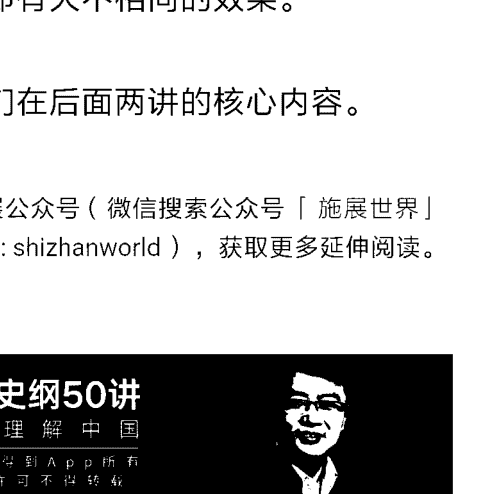

# 40 | 民族主义带来国民政府困局

上一讲说到了列宁主义在20世纪20年代进入到中国历史。中国革命的两个重要推动者，无论是追求普世主义的共产党，还是追求民族主义的国民党，都吸收了列宁主义的深刻影响。

这一讲，我们先来说一说国民党。我们知道国民党最终失败了，它失败有政治和经济层面上的很多原因，这一讲我们先说政治上的、也是更根本的原因，那就是它格局太小。因为它尝试用民族主义的路途来整合中国，但是中国是一个内在多元的超大规模的国家，这种国家用民族主义是搞不定的。

所以这一讲我们来看看，国民党的民族主义方案，是如何在内政和外交上遇到困境的。

## 列宁主义促成国共合作

先解释下，为什么苏联不仅会支持共产党，还会支持国民党。

前面讲俄罗斯的时候曾经提到过，列宁认为，在俄国革命之后，之所以帝国主义国家没有发生连锁革命，就是因为它们手上掌握着庞大殖民地，可以从这里掠夺财富收买本国无产阶级，于是本国无产阶级的革命意志就弱化了。

## "格局"不同终至分裂

但是，就在北伐的过程中，曾经紧密合作的国共双方却在1927年分裂了。

## 国民党的民族主义无法整合中国

先说边疆少数民族问题。

咱们在前面讲辛亥革命的时候谈到过，民国的基本原则是“五族共和”，就是说汉满蒙回藏（实际上还有其他一些少数民族）加在一块构成一个“大中华民族”。

日本就按照这个战略在努力肢解中国的边疆地区，一旦成功，就可以通过从海上一直到中亚大陆，对中原地区形成一个战略大包围，困死国民政府，那么大东亚的战略就成功了。

日本的这套打法，不仅仅从军事上，更从理论上要彻底瓦解掉中国，这就让国人的民族主义情绪被更强地激活了。所以当时不仅国民政府在努力反击日本，学界也在从理论上反击，有几个重要的学者提出一个概念叫做“中华民族是一个”，但这些学者也没有足够好地解释清楚，超越于汉满蒙回藏之上的大中华民族是什么。

之所以有这个困境，根本原因就在于，民族主义的理念是没法真正用来整合内在多元的中国的。

## 国民党外交上的视野和格局

再说与大国关系的问题。民族主义的格局，会让中国这种超大规模国家没法恰当理解自己与世界的关系。

咱们可以通过一个小例子来看，国民政府在当时的外交活动中所表现出来的视野和格局。

从1937年开始，中国独自对抗日本好几年的时间，终于坚持到1941年底日本人跟英美撕破脸了，蒋介石松了一口气。他就安排在1942年初访问印度，试图调解印度的民族主义领袖尼赫鲁、甘地等人与英国殖民当局的矛盾，以便让大家联合起来，共同对抗日本。

但英国不愿意中国过多掺和到印度的事情当中，怕中国人会跟印度人联手把英国人赶走，所以虽然对蒋介石在印度的行程提供了很多方便，但在会见尼赫鲁和甘地这件事情上设了不少障碍。

蒋介石知道英国人的小心思，但这却刺激了他的民族主义情绪，再联想起此前英国的一些作为，就觉得英国人尽管不像日本人那么危险，但也不是什么好东西，于是接下来就发生了一系列外交上的赌气行为。

比如，1942年底宋美龄访问美国，希望美国人支持中国的抗战，在国会演讲之后又在全国发表巡回演讲，极受美国民众欢迎，大获成功。英国国王于是发出邀请，希望宋美龄访英，但是宋美龄给拒绝了。

不仅如此，当时英国首相丘吉尔正好在美国，宋美龄也拒绝见丘吉尔，反倒公开发表声明，要求英国释放被软禁了的印度领袖尼赫鲁。

当时的驻英大使顾维钧，看着宋美龄的这些做法极为无奈。

顾维钧是中国近代历史上最伟大的外交家之一，非常懂得如何与西方打交道，他曾是中国派出参加巴黎和会的代表，和会上就山东问题据理力争，曾说过一句轰动西方的话，“中国的孔子有如西方的耶酥，中国不能失去山东，正如西方不能失去耶路撒冷。”

顾维钧深知，英国是中国最重要的盟友之一，拒绝英王、冷落丘吉尔，这种赌气行为看上去很痛快，大长民族主义的志气，但是对于中国的国家利益会有深远伤害，因为中国有着比向英国人撒气重要得多的事情要做，不能让一时的赌气破坏了大事。

他在无奈之中只能再提醒宋美龄，虽然已经都这么做了，也没办法了，但是既然不去访问英国，那就千万别去访问英国的殖民地加拿大，否则对英国人的侮辱就太大了。宋美龄根本不听，偏偏就到加拿大转了一圈。

宋美龄这种级别的人物，具体的活动安排肯定不是由着自己个人的性子，而是国民政府内部的决策。

这一系列糟糕的决策，反映出的是民族主义的狭隘性，最高统治者难以获得足够的视野与格局，作为一个弱国，在急需国际盟友最广泛支持的情况下，居然会赌气行事，完全无意义地得罪英国，意味着国民政府无能力真正地理解中国现实和国际大格局。

1943年底召开的开罗会议，在美国总统罗斯福的极力主张下，正式把中国拉入与美国、英国、苏联相并列的地位，说这四个国家在战后将是世界四大警察，是世界和平的保卫者，并将整个东亚和东南亚的战区都划归中国来统筹。

多少年来一直受尽屈辱的中国，获得了近代历史上从未有过的地位，这毕竟是在国民政府苦卓绝的战争努力下获得的，所以国民政府在国内的正当性也达到了历史上最高的水准。

但是国民政府的民族主义格局太小，并没法理解这个事情的意义，不知道孰重孰轻，之后又与英国、苏联、甚至于美国发生了一些没多大实际意义的争执，以至于这个机会被它浪费了，没能把自己由此获得的超级正当性转化为在国内整合各种力量、在国际争取更多支持的契机，因此也导致了国民政府后来的败局。

## —— 本讲小节 ——

回顾一下这一讲的主要内容。

国民党引入了列宁主义的组织原则，让自己获得了的能量，推翻了北洋军阀建立了南京国民政府。但是国民政府试图用民族主义的方式来整合中国，结果遭遇困境，对内无法有效解决边疆问题，对外无法有效处理外交问题。

民族主义带来的这一系列困境还仅仅是政治层面的，国民政府同时还面临着一些经济层面的困境，这些问题给国民政府的统治带来了深刻的危机，日本的侵略只是使这些危机变得更尖锐了而已。我们下一讲就来看看，经济层面的困境是什么。

欢迎关注施展公众号（微信搜索公众号「施展世界」添加关注，ID: shizhanworld），获取更多延伸阅读。

# 41 | 国、共的两场货币战争

上一讲谈到了国民政府时期，中国在政治层面上所面临的内外一系列困境，这一讲咱们再来看看那段时期中国在经济层面对怎样的困境。

当然说起困境，一开始还是有一段不错的时期，也就是人们经常说的抗战前“黄金十年”，当时候国内有一系列的经济努力，包括民族资本家的奋斗，以及国民政府的一些经济建设政策，但是黄金十年不仅跟国内的努力有关，与全球经济秩序的变迁也紧密相关。

这一讲就着重说说国际经济秩序如何影响当时的中国，在这个过程中，国民党和共产党在各自的能力范围内，分别采取了不同的办法应对困局，打了两场非常重要的货币战争。

## 西方经济危机下中国的“黄金十年”

先来说一下黄金十年和全球经济秩序变迁的关系。

黄金十年是指从国民政府定都南京的1927年到日本侵华战争全面爆发的1937年，这十年间，除了个别时期之外，中国的经济发展确实还是不错。

但不知道你是否注意到过，这会儿的国际经济，正是著名的三十年代经济大危机的时期，从1929年开始，西方国家陷入了近现代历史上最可怕的经济危机。

## 国民党的“法币改革”

但是黄金十年并不是一帆风顺的，这倒不是说日本在其中捣乱，而是国际货币秩序在这十年中还在发生变化，其中对中国影响最深远的一个变化是美国带来的。

## 抗战时期共产党的“货币战争”

说完了国民党被迫面对的货币战争，再来看看共产党这边的货币战争。注意，这里说不是1949年之后的事情，而就是在抗日战争时期的事情。

作担保，那要以什么作为货币的信用基础呢？

北海银行很有创造性，它以农业物资储备作为担保，来发行北海币，只要你拿着北海币，随时就可以用它兑换根据地所储备的农业物资，只要这种兑付承诺是真实的，人们就可以接受这种货币。

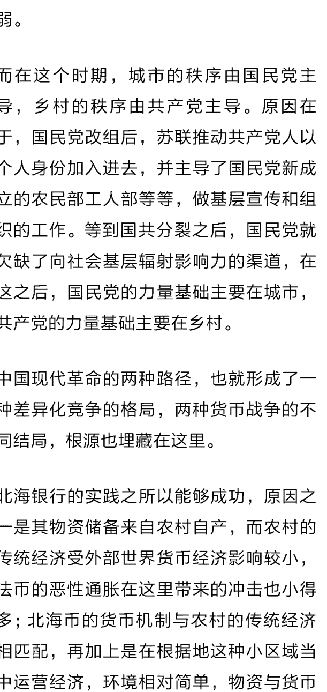

北海银行进一步根据农业周期来调整货币发行数量，并且依据物价涨跌的情况，安排根据地的工商局吞吐储备物资，来回笼货币或者投放货币，调整货币流通数量以保持币值稳定。

这一系列做法非常成功，北海币在其流通领域中的信用远远好过法币和汪精卫政权发行的伪币，成为强势货币。根据地的经济官员还因此总结出了关于北海币的“物资本位”理论，摸索出通过控制纸币发行进行宏观调控的政策等等，打起货币战争来得心应手。

那么问题就来了，为什么胶东根据地居然能够赢得货币战争，国民政府却不行呢？

这就涉及到中国经济的二元性问题了。我们在前面曾经说过，中国作为一个超大规模国家，是没法被外部世界整体性地拉动起来的，只能被局部地拉动起来，于是会造成中国经济严重的二元撕裂，口岸城市融入世界经济体系，但是乡村地区则仍然在传统经济当中挣扎。

所谓的“黄金十年”时期，就是这个状况，上海广州等大城市发展成为远东顶级大都市，但是它们与内地乡村的经济联系就很弱。

而在这一时期，城市的秩序由国民党主导，乡村的秩序由共产党主导。原因在于，国民党改组后，苏联推动共产党人以个人身份加入进去，并主导了国民党新成立的农民部工人部等等，做基层宣传和组织的工作。等到国共分裂之后，国民党就欠缺了向社会基层辐射影响力的渠道，在这之后，国民党的力量基础主要在城市，共产党的力量基础主要在乡村。

中国现代革命的两种路径，也就形成了一种差异化竞争的格局，两种货币战争的不同结局，根源也埋藏在这里。

北海银行的实践之所以能够成功，原因之一是其物资储备来自农村自产，而农村的传统经济受外部世界货币经济影响较小，法币的恶性通胀在这里带来的冲击也小得多；北海币的货币机制与农村的传统经济相匹配，再加上是在根据地这种小区域当中运营经济，环境相对简单，物资与货币容易形成匹配关系。

这样一种货币机制也几乎可以无缝对接入计划经济，共产党在建国后的很多经济政策，在抗战时就已经有了一些相应的经济实践。

但是国民党的法币机制是应用于市场经济的货币，并要在全国大区域当中运营经济，而中国的二元经济结构使得国民党的货币机制显得过于超前了，一方面，没法深入影响农村传统经济，另一方面，市场经济很发达的城市，恰好是受到恶性通货膨胀冲击最严重的地方。

这样，国民党既无法主导农村，又丢掉了城市的支持，最终就只能接受统治失败的苦果。

## —— 本讲小结 ——

回顾一下这一讲的主要内容。

中国经济与世界经济之间有着复杂的联动关系，但是中国作为一个超大规模国家，是没法被外部世界整体性地把经济拉动起来的，结果就导致了中国社会与经济的二元撕裂。

这一撕裂状况刚好对应于国民党、共产党这两种革命路径，于是我们就看到了两个党进行的两种不同的货币战争。

两场货币战争的结局，从经济的角度也说明了，中国必须先完成政治整合，才能让自己以真正地融入世界经济体系，并释放出自己的优势。国民党的民族主义方案，由于无法真正完成政治整合，于是处理经济问题上同样无法找到合适的着力点。

那么，共产党的路径就获得了历史性的机会。这将是我们下一讲的主要内容。

欢迎关注施展公众号（微信搜索公众号「施展世界」添加关注，ID: shizhanworld），获取更多延伸阅读。

# 42 | 中国：普世主义与海陆中介

前面两讲主要讲的是国民党，它尝试以民族主义进行救亡的努力失败了，对内无法整合边疆，对外无法理解中国与世界秩序的关系。

这一讲我们来看看，共产党跟国民党有些什么样的重区区别，为什么它能够突破民族主义的狭隘格局，对中国进行政治整合，进一步解释，共产党的革命实践，如何从脱离中国的实际，发展为内在于中国的历史，共产党又是如何解决边疆问题，以及如何逐渐深入地理解中国的世界地位的。

所有这些，都与共产党的意识形态相关联，它打开了一种超级宏大的视野格局，打开了一种新的历史可能性。

## “内部控制”的组织机制

先来看看共产党的革命实践，是如何发展为内在于中国历史的。

## 用共产主义格局处理民族问题

## 用共产主义视野理解世界秩序

毛泽东在这个时候是从善恶二元对决的角度理解世界秩序，并在在这个大背景下寻找中国的位置，这种思考的格局跟蒋介石明显就不一样。

美苏两强对立的格局，也可以理解为海洋秩序与大陆秩序对立的格局，这继承了19世纪中期以来英国海洋帝国和俄国大陆帝国对抗的格局。毛泽东对于世界秩序的理解，很明确地表明中国要属于大陆秩序。

1950年的抗美援朝战争，是用最硬的方式表达了中国加入大陆秩序的意志。这场战争让毛泽东和共产党在国内的政治正当性达到前所未有的高度，获得了充分的政治资源，用以完成对于国内的政治整合。整合过程付出了很多代价，但中国在内政上确实达到了前所未有的统一性。

在这之后，毛泽东还在各种谈话中多次谈到“中间地带”这个概念，延续着1946年的意思。可是到1962年，毛泽东的说法变了，他第一次提出，“中间地带”有两个，欧洲日本澳洲等发达国家是一个，亚非拉等不发达国家是一个。

之所以会提出这种新说法，是因为当时中苏关系已经闹翻了，中国同时与美苏两大强国成为敌人，这让中国的外交格局陷入前所未有的危险当中。

此时中国必须找到自己的外交基本盘，否则在国际上却底没得玩了。而欧洲日本澳洲等发达国家永远不可能成为中国的外交基本盘，毛泽东意识到了这个问题，但还没有想清楚该怎么重新理解世界秩序，所以姑且用了个含混的说法，把中间地带分成两个。

紧跟着我们可以再问一句，中国和美国苏联都闹翻了，那么中国在海洋秩序和大陆秩序当中，到底是处在什么地位呢？

仔细思考一下就会发现，中国的新定位此时模模糊糊地浮现出来了，那就是中国可能是处在海洋帝国和大陆帝国之外的第三支力量，作为一种海陆中介性的力量存在，而对于世界来说，三足鼎立的格局也是比二元对抗更加稳定的。

到了60年代中后期，中国的海陆中介性在共产党的意识当中越来越清楚了。比如美国打越南风战争的时候，中国跟美国形成了一系列默契，中美两国在越南都有系列军事动作，但都不会去触碰对方的底线，这跟朝鲜战争完全不一样了。

通过这样一种相互试探与摸索，美国与中国都重新理解了对方。到了1971年、72年，基辛格、尼克松陆续访华，开始构建中美苏大三角关系，中国终于清晰地意识到了自己作为海陆两大帝国之外第三力量的地位。

这种地位也在毛泽东在1974年全新阐述的“三个世界”的说法中获得了完整表达，美苏是第一世界，西方发达国家和东欧国家是第二世界，包括中国在内的亚非拉国家是第三世界，中美苏各有自己的外交基本盘。

由于中国作为海陆之外第三力量的存在，不管中国在如何表达自己对战争与和平的理解，它都在事实上成为世界和平的保卫者，因为全球的力量博弈格局决定了这一点。

中国在60年代的时候一度外交局面极为危险，在各个方向全都是敌人，到了70年代却一下子成为全球所有大国当中战略灵活度最高的一个国家。

最根本的原因就在于，中国终于想清楚了自己的国际定位，终于知道了自己既不属于海洋秩序，也不属于大陆秩序，而是独立于它们的第三存在。

这种格局，带着民族主义的眼镜，是不可能打开的，正是通过共产主义这种普世主义的观念结构，才能够把这种格局撑开。
而且我们还可以看到，这种超级格局，不仅仅是在领导人的头脑中，也贯穿在一般国民的日常话语中。

即便是穷乡僻壤的地方，农民在田间耕地，田头的大喇叭也在讲着古巴的事情、坦桑尼亚的事情，这些农民可能一辈子连大山都还没出去过，但是却会讨论另一个半球的事情。他们所理解的世界并非真实的世界，但对外部世界的这种关注度却是中国此前所未有的。

中国人再也不是两耳不闻窗外事，只想着老婆孩子热炕头，而是打开了一种超级想象力。

我们在这几十讲里反复在强调中国的超大规模性，这种规模性意味着中国的一举一动都有世界性的影响力。

因此，不从世界格局的角度出发，中国根本没法恰当理解自己。而要从世界格局出发，中国第一步就需要有一种超级的视野，即便这种视野并未给出真实的认知，但是它打开了一个完全不同的可能性。

就像古代有很多人尝试要让人飞上天，他们给出的办法都不灵，很多人都摔死了；但是如果没有这种想要飞翔的想象力存在，倒的确不会有那些尝试者摔死，但人类也永远不会有机会飞上天空了。

共产主义就是帮助中国人打开这样一种想象力，打开一种全新的空间感格局感的钥匙。它对世界给出的解释可能并不准确，这不要紧，重要的是，正是通过它，中国获得了一种全新的可能性。

毛泽东时代所打开的一系列空间感，到了邓小平时代终架转化为中国向海洋世界全面开放的一个现实。中国与美国建交，随即又通过对越自卫反击战，以一种很硬的方式，表达了加入海洋秩序、也就是全球经济体系的决心。但此时的中国，已经完成了自我政治整合，不会再因为加入全球经济体系而被内在撕裂了。

可以说，朝鲜战争是中国加入大陆秩序的宣言书，对越自卫反击战则是中国加入海洋秩序的宣言书。

但是严格说来，中国的本质是一个作为海陆中介或者说海陆枢纽的国家，这种国家想要把自己的世界使命真正承担起来，必须先以大陆国家的方式完成自我政治整合，再以海洋国家的方式加入世界经济体系，才能真正承担应有的使命。

在这个意义上，朝鲜战争和对越自卫反击战是同一场战争的两个阶段，中国通过这两个阶段，完成了自己先大陆后海洋的身 份确认，并真正打开了中国参与现代世界秩序构建的大门。

## —— 本讲小结 ——

回顾一下这一讲的内容：

共产主义为中国带来了全新的组织机制，也带来了全新的视野格局，它为中国打开了一种前所未有的可能性，使得中国在面对少数民族和国际秩序问题的时候，都有国民打不开的窍洞，也就有了全新的处理办法。

在中国进行改革开放，投入世界经济体系当中后，中国作为超大规模国家的竞争优势终于充分释放，实现了奇迹般的经济增长。过去人们常说这是因为中国劳动力和土地的要素价格低，这个解释对于上世纪八十年代是有效的。

但是进入21世纪，要素价格高多了，中国的经济增长却并未减速，这用要素价格就解释不通了，必须找到新的解释框架，才能让我们理解中国的经济谜团，并对下一步的走向做出判断。这就是我们下一讲的主要内容。

欢迎关注施展公众号（微信搜索公众号「施展世界」添加关注，ID: shizhanworld），获取更多延伸阅读。

# 43 | 中国经济奇迹的奥秘

前面几讲，我们讲了中国作为超大规模国家，在政治上进行自我整合的过程。

在这之后，中国终于释放了超大规模人口带来的竞争优势，在世界经济体系中，开始扮演至关重要的角色。

从1978年改革开放开始，直到2013-14年的时候，除个别年份的波动，中国经济基本上始终保持着8%到10%的快速增长速度。这就被称为“中国的经济奇迹”。

人们过去对这种高速发展的“中国奇迹”给出的解释是，中国的劳动力与土地这两种要素价格是有效的。

进入21世纪之后，中国的劳动力和土地成本比80年代高多了，发展速度却并没有下降，甚至制造业发展的速度比80年代还要更快了，而中国正是在21世纪之初，才成为“世界工厂”的。这就没法用要素价格来解释了。

有学者提出，这是因为地方领导为了晋升而竞争推动经济发展，带来了经济奇迹。但这个解释也不够。因为，并不是所有推行发展政策的国家都能像中国一样最终成功。

中国能够崛起成为世界工厂，实际上是世界经济和中国经济，几乎在同一时期发生了两个重要的变化：

第一个变化，是西方世界进入到创新经济时代，带来了制造业的大规模外包；

另一个变化是中国土地财政的改变——中国用一种令人意外的方式，获得了承接外包的能力，而且这个承接能力远超过其他国家的水平。

## 崛起能力：完善的供应链网络

第一个变化，是西方进入创新经济时代，其制造业将生产流程大规模地外包。

进入创新经济时代之前，人类经济的一大特征是，大部分人还处在基本需求尚未被满足的阶段。

“基本需求”不仅仅是指你有吃有穿，也包括随着技术和生活水平的发展，一些过去不存在的需求也会被纳入到基本需求。

比如，在过去，人们对移动电话没有需求，但今天它毫无疑问成为人们的基本需求之一。

在基本需求还没有被满足的时候，能最有效地占据市场的产品，一定是流水线上生产的均质化、廉价、非常皮实耐用的大众化产品。哪个企业把这一点做到极致，它就能成为王者。

但是等到了创新经济时代，人们的需求变了，制造业的生产形态也跟着变了。过去二十年来手机行业的发展，就能看到这种变化。

在大众化产品的时代，诺基亚在流水线生产效率上，比西门子、摩托罗拉都要做的好，就成了王者。

但是诺基亚没有想到，它在满足基本需求上做得越好，就越快地走向了终点。当你把大部分人的基本需求都满足了，你的产品又廉价又耐用，功能简单易懂，根本不会坏，人们更新换代的需求就很低，产品就无法再卖出去了。

到了这会儿，手机要还想卖得出去的话，就必须有新的、有趣的、能带来新体验的功能。

也就是说，手机领域开始进入创新经济时代，谁能够创新才能继续在这个市场上更好地活下去。诺基亚也发布了智能手机，但还是在短短几年后轰然倒塌。

我曾问过诺基亚的人，为什么会这样？他告诉我，在智能手机刚刚出现之际，诺基亚是所有手机厂商中，唯一一个有自己完整生产线的厂商。这就意味着诺基亚的创新能力一定是被抑制的。

因为生产线是按照之前产品的需求设计的，想创新的话，整条生产线都得调整，成本极高，诺基亚就跟不上创新经济的步伐了。

而勇敢闯入创新经济领域的公司，必须把生产流程外包，把生产流程转型的成本全部交给别人，这样才有可能创新。

苹果公司就是创新经济时代非常典型的一个企业。它自己完全不生产，只负责创新、负责品牌和渠道的维护，生产流程全部外包出去。

接下来的问题就是，什么样的人才能成为承包方呢？

承包方必须同时满足两个要求：

第一，它的生产过程必须有效率，没效率根本接不到活儿。

效率的前提是专业化，但一旦高度专业化，就会锁定在特定产品上，对承包方的风险非常大，发包方的创意一变，承包方马上就会死掉。

所以又有第二个要求，就是承包方的生产过程必须有弹性，以便有能力迅速转型。

但有弹性的前提是不能专业化。但如果不专业，生产的效率就不够高，可能根本就拿不到订单。

所以，弹性与效率是彼此矛盾的，但又必须同时达成。

中国能够成为世界工厂，能够承接大规模外包，就是因为中国解决了这个问题，实现了弹性和效率的统一。

中国为什么能解决这个问题呢？

主要是中国在这一时期形成了一个庞大的供应链网络，把弹性和效率这两个要求放到了两个不同的层次上处理。

具体说来，在中国东南沿海地区，有大量中小民营企业，单个企业的专业化程度达到了匪夷所思的程度。比如，我见过一些生产拉杆天线的厂家，一个厂只生产其中的一节，这就专业化到极致了。

无数家极度专业化的中小企业形成一个庞大的供应链网络，彼此之间互相配套，而且这种配套关系会不断地重组。

上游的第一个发包任务来了，供应链网络会自动地运动起来，小企业互为配套把任务完成；如果上游需求变了，第二个发包任务来了，网络会再次运动起来，自动形成新的配套关系，再把它完成。

高度专业化的单个小企业，确保了生产效率；而这些小企业组成的在不断动态重组的网络，又确保了弹性。弹性与效率两个条件就同时满足了。

因此，供应链网络，是承接大规模外包的一个重要前提。

这种供应链网络要发展起来，一开始一定要有足够多的、分工足够细的小企业，在同一时间成长起来，形成一个联动的网络。

如果一个高度专业化分工的企业，自己先建起来了，等二十年，其他配套企业才逐渐成长起来，那第一家企业根本就活不下去。这样的建设节奏，是无法组合成一个供应链网络的。

如果这么多企业必须要在同一时期建起来，那么前提就是，必须要有很多建设得非常好的、规模很大工业开发区已经建设起来，但是里面又没有相应的工业能力进驻。

换句话说，是否有大量近乎空白的开发区等着有企业进驻。否则，供应链网络会因为基础设施不配套，物流成本过高，根本长不起来。

开发区的建设也算是广义的城市化了。这就意味着，供应链发展起来的前提是，城市化必须先于工业化。

然而看一下经济社会发展，通常的历史节奏都是工业化拉动城市化，而不能反过来。

因为，城市对于公共服务的要求远高于乡村，所以城市对于财政的需求远高于乡村，如果没有足够的工业能力发展起来，城市便支撑不了相应的财政能力，提供了所需的公共服务。所以，通常都是工业化拉动城市化。

但是，中国偏偏就把这历史节奏给反过来了。因为1994年进行的财政制度改革，引发了土地财政，使中国的城市化在工业化之前，先发展起来了。

## 崛起机遇：财税改革遇上世界订单

中国能够崛起成为世界工厂的第二个关键改变，恰恰就来自于中国的土地财政改革。

1994年的财政改革被称作分税制改革，在此之前中国实行的财政制度叫做包干制。财政包干制的基本逻辑是，地方政府每年要给中央上交一定程度的财政，除了上交的部分，地方政府还能收多少钱、花多少钱，都是自己的事，中央不管。

这套财政制度对80年代的改革非常重要，因为它极大地刺激了地方的积极性，中央层面推动改革有阻力的时候，地方上会有各种制度创新，让中国从旧体制当中迅速突破出来。

但是中央完全没有想到，地方活力能释放得如此之大，发达地区的财政上涨如此之快，以至于从1984年开始，中央财政占全国财政收入的比例越来越小。

1993年，中央收入只占全国收入的大约20%。于是，中央说话发达地区不大愿意听，而中央想支持不发达地区发展，手上也没钱。

为了改变这种情况，中央政府与地方政府进行了艰难的谈判，终于在1994年推行了分税制改革，把不同税种在中央和地方之间进行了划分，有的税种是中央税，有的税种是地方税。

这个改革立竿见影，第二年中央财政收入占全国财政收入的比例，就从约20%上升到差不多60%。中央从地方口袋里把钱拿走，地方需要花钱的时候，中央再向下拨付，以此来确保中央对于全国经济与社会的调控能力。

对地方官员来说，这是个巨大的变化。

过去钱就在地方政府口袋里，现在得等着中央拨下来。官员晋升主要考核指标是经济发展，经济发展需要各种投资来实现。

可是投资的决策权力，已经被中央收走了，这就刺激地方官员去寻找其他的资金来源。

土地财政就是在这样一个过程中发展起来的。

分税制把营业税划归地方，建筑类企业就是缴纳营业税的，而建筑业对土地有大量需求，与土地增值相关的税收也都归地方，所以地方政府就开始鼓励建筑业的发展，这构成了最初意义上的土地财政。

后来地方政府又发现，可以拍卖土地使用权，或者用土地作抵押，进行融资贷款，来建设开发区，开发区把土地炒热了，周边土地升值了，可以再进行新一轮的拍卖或者融资。很快这就变成了地方政府极为重要的资金来源。

这个过程就刺激了中国城市化的大发展，大量开发区也建设起来了。土地财政在21世纪初见成效。

于是，中国就走出了和一般国家相反的历史节奏，城市化早于工业化。

但光有城市化，光有开发区，没有足够的企业进驻，肯定是不可持续的。

因为如果没有工业经济带来税收，城市建设的巨额贷款，肯定是还不起的，最后土地财政的融资机制会崩溃，引发极为可怕的经济危机，经济出现断崖式下跌。

### —— 本讲小结 ——

总结一下这一讲的主要内容。

西方进入创新经济时代，带来生产流程大规模外包的需求。外包的承接方必须同时满足效率与弹性这两个彼此矛盾的要求，因此必须要有大规模供应链网络的存在，才有能力承接外包。

中国的土地财政的发展，刚好使城市化先于工业化发展起来了，使得供应链网络获得成长空间。土地财政与大规模外包的需求，在时间上刚好重合了，中国经济于是发生了令人目眩的成长。

通过这一讲，我们能看到，中国的经济奇迹，完全是依托于世界大势而成。

中国的经济崛起深刻地内在于世界经济的发展过程之中，可以说，中国的经济崛起和西方经济的转型，是同一个过程。

我们无法脱离开世界经济秩序来讨论中国问题；同样，随着中国经济崛起成为现实，我们也无法脱离开中国的影响力来讨论世界经济秩序的前景。

中国的崛起导致了世界经济秩序一个极为深刻的转型，这个转型为未来打开了极为深远的想象空间，这就是我们下一讲的主要内容。

欢迎关注施展公众号（微信搜索公众号「施展世界」添加关注，ID: shizhanworld），获取更多延伸阅读。

# 44 | 中国崛起导致的世界经贸双循环

上一讲我们讲了中国经济崛起的奥秘。西方进入创新经济、中国的土地财政，这两个事情正好在同一时期发生，让中国的供应链网络成长起来了，于是带来了中国经济的崛起。

但近些年，部分制造业开始从中国向东南亚转移，这带来了一种新的担忧，就是中国会不会像拉美国家那样，陷入到“中等收入陷阱”？

这一讲，我们就会展开来讲，以中国为中心的东亚制造业聚集区，这种产业格局是终局性的。也就是说，很难会有新的制造业聚集区能够崛起，来取代东亚聚集区的位置。

这种产业格局，也让世界经济秩序发生了深刻变化。

以前，世界经济秩序是以西方世界为中心的，是一个“中心到外围”的结构。而现在的世界经济秩序，产生了中国这样一个副中心，并且形成了一个新的双循环结构。

## “中等收入陷阱”在中国不可能出现

我们先说第一个话题，中国经济在崛起之后，会不会陷入像拉美国家那样的“中等收入陷阱”。

上一讲我们说了，中国的崛起，主要是形成了一个制造业的供应链网络，这个网络是由无数家中小企业组成的。

其中，单个小企业是高度专业化分工的，作为微观个体，它们确保了生产效率。

这些小企业之间又互相为配套，不断动态组合，形成一个供应链网络，这个网络确保了生产的弹性。

一方面，现有东亚集聚区的制造能力，已经能够轻易满足全球的需求，新崛起的地方很难与东亚就制造业进行竞争；

另一方面，其他地方若想重复中国崛起的历程，大规模承接外包需求，它也必须有大量已经建好的，但又几乎空白的开发区，否则供应链体系无法成长起来；但上一讲我们也解释了，这种以国家为单位的开发区建设，在中国以外是根本不可能出现的。

当然了，也不是说任何类型的制造业都不能转走，那种对供应链要求不高，并且对于远距离物流成本敏感的制造业，就能转走。

一种产品对物流成本是否敏感，有个很简单的判断标准，就是单位重量的产品售价。

如果售价比较高，就不敏感，比如手机；如果售价比较低就敏感，比如玻璃、低标号水泥、粗陶窑之类的。

像玻璃、水泥这样的产品适合就近生产，不适合在距离销售市场很远的地方生产，这样物流成本太高，不划算。所以这样的产业能够被转走，也应该转移走，这符合经济规律。前一阵福耀玻璃向美国转移就是很好的例子。

## 中国成为“双循环”经贸结构枢纽

“中心-外围”结构是美国学者沃勒斯坦提出的一个概念。

他认为，从工业革命以来，西方发达国家成为中心地区，其他国家和地区是外围地区。

### —— 本讲小结 ——

回顾下这一讲的主要内容。

中国的超大规模性，使得以中国为中心的东亚制造业集聚区，是终局性的，是很难被取代的。

这进一步带来了全球经贸结构的转型，从“中心-外围”结构，转成“双循环”结构，中国是双循环当中的连接枢纽。

# 45 | 冷战和后冷战里的中国利益

上一讲我们讲到，随着中国经济崛起，全球经贸出现了一个新结构，就是双循环结构。中国开始成为世界经济的一个副中心。

与此差不多同时代，全球政治秩序的一个巨大变化，就是冷战的结束。

在后冷战时代，海洋与大陆世界发生了深刻的变化，大陆世界陷入到混乱中。而中国作为海陆枢纽，将对失序的大陆世界发挥重要的作用。这…讲咱们就来讨论下这个问题。

## 冷战： 中国成为世界和平的保卫者

第二次世界大战结束之后不久，世界就进入了冷战秩序。

美国和苏联主导的两大政治集团开始对峙，也就是海洋帝国与大陆帝国的对峙。

两大集团虽然对立，但是它们在各自的盘内都维持了一个很强大很稳定的秩序。像今天索马里那样的局面，在那会儿都是没有的。

## 后冷战： 中国成为世界新秩序的投放者

后冷战时代发生了一个重要的变化，苏联在1991年年底瓦解了。

答案，就是中国。

21世纪，很多原材料国家又开始获得不错的经济表现，正是因为中国的庞大需求到来了。

此时就可以看到，在后冷战时代，中国几乎是唯一能向大陆世界投放财政资源、从而投放秩序的国家。因为中国可以通过贸易过程，再回收这些投放的财政资源，整件事情便是可持续的。

回收的途径很多，简单地说，通过向当地投放资源，使当地获得稳定的政治秩序，从而确保稳定的原材料价格，这对于中国制造业的成本控制是非常重要的。

从而，借助这些动荡地区，便不能简单地看到我们花出去了多少钱，还要看到从中带来了多大的潜在收益。

在这个意义上说，中国向大陆世界投放秩序，不仅仅只是一种大国的责任，同时也高度符合中国的国家利益。

中国在与发达国家，也就是海洋世界的第二循环中，获得了贸易红利；再通过各种方式，把这些红利在第二循环中投放到大陆世界。

在这个过程中，中国也向大陆世界投放新的秩序。

## 超大国家的外交姿态：普遍主义

双循环结构，到了这里就开始显出一种政治学意义：中国作为陆桥枢纽，不仅仅是和平安的保卫者，更是全球形成秩序发展必须枢纽。

同时，在这个过程中，以中国为中介，西方与大陆世界也有可能间接地去形成经贸循环。

### —— 本讲小结 ——

现在来回顾一下这一讲的内容。

冷战时代，美苏各自撑起了海洋和大陆的秩序，中国则作为第三方力量，是世界和平的保卫者。

后冷战时代，海洋秩序还在，大陆秩序瓦解了，外部世界必须向大陆世界投放新的秩序，人类秩序才能稳定下来。

这个新秩序的投放者只能是中国。

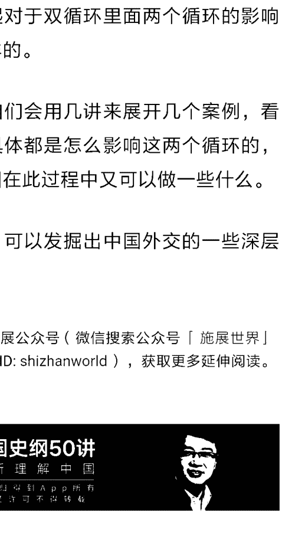

留言精选 提交留言可与施展互动

# 46 | 为何中国必须购买美国国债

在前面几讲，讲了中国崛起的过程。中国崛起其实有一个大前提，就是西方创新经济的发展。

可以说，正是西方世界拉动了中国经济的崛起。但是在这一过程中，西方世界温水煮青蛙一般地慢慢陷入到危机当中。

近些年，网上经常可以看到一些争论，说中国的贫困地区还有很多，为什么还要一直借钱给西方国家。

实际上，中国借钱给西方国家也是为了延续自己的经济崛起。但这个过程反过来导致了西方的经济危机，并且带来了最近一两年来西方政治的保守化趋势，川普上台就是这种保守化趋势的一个基本反映。

西方遇到的一系列困境，中国也不能置身事外，会伤害到中国的国家利益。这一讲咱们就来说一下这背后的机理。对中国与西方关系的讨论，也就是对双循环结构当中第一循环的讨论。

当然，这里要强调一下，接下来这几讲都是我个人在学术研究中，所形成的一些理论认识，不能代表官方战略。主要是希望通过这个认识，能对你理解中国、理解世界秩序有所帮助。

## 用经济手段解决困境

西方国家在最近几年遇到的这一系列困境，都是技术变迁所导致的，这个过程还间接促成了中国的崛起。

都出现过多次技术变迁所导致的秩序失衡，以至于引发一系列的危机。但这次西方世界的失衡和过去有很大的不一样，危机发生的原因以及解决的方法和以往都不一样。

先来看看此前西方世界的失衡是怎样形成的，又是怎么解决的。这个搞清楚了，就很容易理解这一危机是哪里不一样了。

近代历史上最重要的一次技术变迁肯定就是工业革命。工业革命之前都是传统经济，财富的增长很缓慢。工业革命让财富像井喷一样涌了出来，这是此前人类做梦也想不到的事情。

海量财富突然之间从天而降，不一定是好事，因为如何分配财富就成了一个严峻的问题。如果分配不当，有可能引发剧烈的冲突。

想象一下，你突然中了五百萬大奖，很快你就会发现冒出来一大帮你平时不怎么联系、甚至没怎么听过的亲戚。大家都想分一杯羹，结果就引发了一堆家庭矛盾，闹得…

## 政治手段对冲经济困境

既然经济手段不奏效，政治手段就会被提上台面，以对冲经济过程所带来的问题。

贷款的。

给穷人的贷款风险性都比较高，但是房利美和房地美把这些高风险贷款和低风险贷款给打包在一块儿，变成证券之后出售给其他投资者。这些证券背后有着联邦政府隐性的政治担保，于是又多了一层低风险外衣，所以这种证券就变得很好卖。

美国不只是有大量的这种住房贷款，还有大量的日常消费的贷款。这些金融需求都被投行变成为了复杂的金融衍生品，转化为一系列债券售出。

欧洲国家的做法也差不多，通过政府的担保行为，来提供大量低息贷款，这就扭曲了资本市场。高风险的人群本来是无法获得低息贷款的，但是政府担保让利息降下来了，相当于用政治干预经济，这是第一轮的政治手段对冲经济。

为什么当权者要这么做呢？他们试图用这个来确保选票。

中国是依托全球产业链的变迁而获得经济崛起的，这种经济逻辑意味着中国必须是个出口导向型的经济体，这就需要外部世界有发达的消费能力。这样，中国巨大的生产能力才有用武之地，否则根本没法出口。

过去也有很多别的新兴经济体像亚洲四小龙之类的，是出口导向型的。其经济成长也是依赖于西方世界的市场需求，但这些经济体规模较小，其出口容易被外部世界所吸收，不会引起严重的经济失衡。

中国的经济规模太大，它的出口导向必定意味着外部世界会遭遇严重的经济失衡。这就意味着外部世界就没有消费能力了，这样中国的东西就卖不出去。

为此，中国不得不将自己通过出口积累的大量外汇储备用来购买西方国家的债券，为其融资，以便让它们始终能买得起中国的东西。

但是这个过程对西方也不是好事，因为从中国来的大量贷款，维持着西方的低利率，人们总觉得借钱很划算，愿意大肆消费。

西方世界的“失业型复苏”并没有发生实质性的好转，那些贷款的穷人，只是借新债还旧债，风险就越积越大，终于到2008年爆发了世界性的经济危机。

经济危机一来，西方的消费能力下降，中国的出口马上遭遇困境。于是就有了最近几年中国制造业的艰难状况。

不要以为仅仅是制造业转移到东南亚这么简单，是因为世界市场的需求下降了。而这种下降是因为中国在崛起的过程中导致了西方国家严重的内在失衡，于是西方世界的消费能力大幅下降。

中国在不断努力调整经济结构，扩大内需，来缓冲世界经济危机的冲击，但是内需的扩大根本抵消不了整个西方世界的需求下降，所以中国仍然在艰难度日。

西方就更郁闷了，过去还有“失业型复苏”，现在只是失业了，民怨越来越大，就要求政府采取本国优先的政治立场。排除掉移民的竞争，排除掉外国商品的竞争，保障本国人的福利，等等。

在选票的压力下，西方政府近年来逐渐地开始保守化转向，这就是第二轮的政治手段对冲经济。包括川普上台，英国退欧，欧洲若干个国家保守政党上台，乃至于最近看到的西方国家发生的文革一般的社会冲突，都是第二轮政治对冲经济的表现。

可是，前面几讲说过世界经济结构变迁的逻辑，这个逻辑决定了保守化转向不可能帮助西方国家真正解决问题。

中国在西方的这一轮转向过程中，也不可能置身事外。因为中国的国家利益在今天已经是全球性的，中国与西方国家都是在非常深刻的意义上你中有我我中有你。

西方的保守化一定会损害中国的国家利益，而且无法真正解决问题，于是就出现了中国和西方之间进行谈判的可能性和空间。

过往的国际贸易治理规则已经无法适应中国崛起之后的世界，因此需要中国与西方进行贸易谈判，用一种新的国际治理秩序来调整世界的失衡。但是这种谈判注定是艰难的，甚至到了今天，双方关于问题的理解，关于谈判的意愿上仍然有巨大的差异。

为了弥合这种差异，中国与西方在这个过程中都需要深刻地调整自己对于世界秩序的理解，对于自己的理解，打开更为广阔的视野，才有可能找到更加深层的利益交汇点，谈判才能形成建设性的成果。

### —— 本讲小结 ——

回顾一下今天的主要内容：

在历史上，西方的创新都会带来社会的失衡。但通过经济的发展，拉动新的产业，可以消化掉这种失衡。

最新一轮的创新，新拉动出的产业却不在西方本土而在中国，这导致了西方世界如今的危机。

西方国家通过政治手段对冲经济困境，并不是真正的解决问题之道，会带来新的问题，也伤害自己和中国的利益。

西方的失衡没办法通过自己来消化，必须在与中国的互动过程中，在一个更大的国际治理框架之下，找到消化的办法。这需要中国与西方都要在观念层面发生深刻的变化，才能突破当下的困境。

然而，失衡是在双循环的结构里面普遍发生的，视野只局限在第一循环里面是解决不了问题的。

我们接下来两讲，会以伊斯兰世界和非洲作为案例，看看第二循环里面都有些什么能打开缺口的可能性。

欢迎关注施展公衆号（微信搜索公众号「施展世界」添加关注，ID: shizhanworld），获取更多延伸阅读。

# 留言精选

提交留言可与施展互动

# 47 | 伊斯兰世界的困境

前面几讲，我们讨论了现今的世界政治和经济格局，中国处在一个双循环结构的枢纽位置。

这种新的世界格局，让第一循环里面的发达国家出现了严重的贫富分化，产生了一轮的经济危机，以及政治上的保守化。

接下来，我们会重点聊聊第二循环。

第二循环里面的国家很多，其需求的差别也非常大，没法统一讨论，所以就挑两个有代表性的地区。一个是从中亚一直横贯到北非的伊斯兰地区，一个是撒哈拉沙漠以南的非洲地区。

今天这一讲就先讲讲伊斯兰地区，这片地区最近几年轻荡不已，我们来看这种动荡的原因。

我们前面谈到过，中世纪的伊斯兰世界，经济富饶，文明极度开放、包容。当时，伊斯兰的思想家甚至启蒙了欧洲的文艺复兴。为什么到了今天，伊斯兰地区在现代世界遇到了一系列的困境？

这些话题与中国并不远，因为中国与伊斯兰世界的经贸关系和政治关系越来越密切，对于这些问题的理解，与中国国家利益紧密相关。

## 教义的两面性

说到伊斯兰世界的动荡，可能你的第一反应就是伊斯兰国（ISIS）。

这个组织应该是这些年来的恐怖主义组织里...尤其是从伊斯兰国里，很多恐怖分子都是从西方发达国家跑来的穆斯林青年。

这些帮家伙在西方的日子过得好好的，跑到这里干什么？

网上能看到有些人在指责，这是因为伊斯兰教天然就是个暴力的宗教，于是会有这种事情。这种指责是完全不靠谱的。

伊斯兰教的教义里同时并存着两面，一面是教人友善、热爱和平、尊老爱幼的；另一面是教人决不妥协，要勇敢反抗不正义的。这两面都是伊斯兰教不可分割的部分，只是这两面在信徒的生活和行动中不一定全都表现出来。

所以应该问的是，什么时候会是热爱和平的那一面表现出来，什么时候会是决不妥协的那一面表现出来？搞清楚这个问题，对我们理解伊斯兰世界的动荡非常重要。

伊斯兰教信徒究竟呈现出来哪一面，根本上取决于信徒生活在怎样的一种社会结构里。

如果信徒是生活在传统共同体里，比如抬头低头都是熟人的村子，或者是大家都很熟的小城，那么教人友善、热爱和平的一面就会表现出来。在很多地方的穆斯林村镇，你都能体会到，当地人真诚、友爱、善良，跟他们打起交道来很舒服。

如果信徒生活在一个陌生人组成的大城市里，又恰好这位信徒的技能一般，找不到理想的工作，生活比较困窘，遭受各种歧视。那么教人决不妥协的一面就会呈现出来，它会告诉信徒，即使全世界都抛弃了你，安拉仍然和你在一起。

说到这里，要插一句，犹太教、基督教、伊斯兰教信的神实际上是同一个神，只不过他们对这个神的理解不一样。安拉就是阿拉伯语“神”这个词的音译。

对城里的那个倒霉家伙来说，安拉都没有抛弃我，世界却抛弃了我，那说明什么呢？安拉不可能错，那只能说明一个问题，世界错了。既然如此，就得把错误的世界改成正确的世界，因此就会走上特别暴力的反抗之路。

因为受教育水平低，他也说不清究竟要反抗的是什么，只是直观地感觉现代大城市里的家伙们都很坏，就是那帮家伙在欺我，所以笼统地反抗整个现代世界。

这样，你大致就能理解，为什么会有那么多在西方长大的穆斯林却要跑到中东去参加伊斯兰国了。

不过，还得再多说一句，这种决不妥协坚决反抗的精神，并不是只有伊斯兰教才有，它是犹太教、基督教、伊斯兰教这三大宗教共享的。

## 民主化和世俗化的矛盾

不知你是否注意到过，伊斯兰国的恐怖主义不仅仅是针对西方世界的，同时也是针对伊斯兰世界自己的。

伊斯兰国的地盘主要在叙利亚和伊拉克境内，死在伊斯兰国手里的什么人最多？当然不是西方人，而是当地的穆斯林。在穆斯林地区之外的伊斯兰世界，也经常发生各种恐怖袭击，比西方所遭遇的要多得多。

为什么穆斯林要打穆斯林呢？这就又得解释下伊斯兰世界的政治困境了。

现代国家有两个基本原则，民主制和世俗制，但这两个原则在穆斯林国家却很难并存。

又打不过，那就只好用恐怖袭击了。

结果是，恐怖主义最多的地方，并不是西方，而是伊斯兰世界。只不过我们平时在新闻里更注意西方的消息，对于穆斯林国家发生恐袭炸死一堆人的事情不注意罢了。

## 世界经济下行和资源匮乏

既然伊斯兰世界有这么多内在的困境，为什么最近才冒出来伊斯兰国这种奇葩呢？早先为什么没有呢？这就跟全球经济秩序的变迁有关了。

穆斯林国家的那些强人统治者也知道，不能指望老百姓在政治上真正地认可自己，但如果能在经济上搞出个不错的成绩单，老百姓应该也能默许。

巧的是，中东和中亚的穆斯林国家，很多都是石油天然气储量丰富的国家。在世界经济的上行时期，能源价格高涨，有油田就像有印钞机一样，能够让百姓日子过得不错。

北非没有多少石油的国家，像突尼斯、埃及等，旅游资源超级丰富，是欧洲人的后花园。当地人靠旅游经济也能获得不错的收入，所以这些国家都还有能力让社会稳定。

问题是，谁也无法确保经济一直处在上行曲线，有起有伏是正常状态。要是经济下行的话，这些强人统治者就遇到麻烦了。

穆斯林国家对世界经济的起伏太敏感了，一旦外部世界经济打喷嚏，穆斯林国家就有可能感冒，一旦外部感冒了，穆斯林国家可能就休克了。

在上一讲刚刚说过，随着中国崛起，西方世界遇到了内部的失衡。政客们为了选票考虑，就出台各种政策，鼓励人们借助消费。但实体经济萎缩了，借贷有还不上的那一天。

终于，这种经济谬误导致了2008年以来的世界经济危机。世界经济感冒了，欧洲人没钱到北非去玩了，世界能源价格也大幅下跌，穆斯林国家就出现危机了。

大的格局走到这一步，小人物也能撼动大历史。

2010年底，突尼斯一个失业的小贩自焚，抗议警察粗暴执法，引起了大半个伊斯兰世界的连锁政治动荡。从北非到中东，一个接一个长期执政的政权倒了下去，有几个国家到今天仍然在惨烈内战。

特别值得注意的是，在中亚和中东的伊斯兰世界，还有另外一个特征，就是当地多半都是沙漠、戈壁地区，人们主要是在绿洲。

绿洲地区的生态环境的脆弱，尤其水资源很匮乏。在很多绿洲中的农村，每一户的用水都有严格的限制，具体什么时候可以用水，要由村里统一分配。在特别匮乏的地方，放水的时间分到每户的头上甚至是以秒来计算的。

水资源的匮乏是个最大的短板，会带来一系列其他生活资源的匮乏。这意味着什么呢？这样，我们就不能把资源丰沛地区的社会观念套用到当地。在资源丰沛的地区，人们可以突破各种传统的限制，尽情挥霍资源，这几乎成了现代社会的一个基本特征。

但绿洲地区的资源根本就挥霍不起。绿洲地区有数千年下来的一系列古老的传统和智慧，这些传统经常是给人们的行为划定一些很奇怪的禁忌，这些禁忌在外部世界的人看来可能不大容易理解。正是这些禁忌，才在资源匮乏的情况下，能够让绿洲世界绵延几千年一直活下来。

现代经济和现代观念对于这些传统的冲击，使得那些禁忌被抛弃了。这样既打破了前面说的那种传统共同体，又威胁着绿洲地区脆弱的生态资源，从而会进一步加剧这些地方的恐怖主义威胁。

归结下来一句话，对于中亚、中东这些伊斯兰地区，它们的首要需求很可能不是经济发展，而是反恐。

经济发展有可能会有助于反恐，因为如果经济上彻底崩溃，那就不别指望能安定了。但是经济发展也有可能加剧恐怖主义的威胁，因为不考虑绿洲地区的各种传统智慧，以及各种生态资源的约束，经济发展有可能让人们陷入更加糟糕的境地，从而把更多没有出路的人推到恐怖主义那一边去。

我们可以看到，伊斯兰世界最近这些年的动荡，是各种内因和外因联合作用的结果，中国的活动也是外因里面的一个要素。

在这些动荡的地区，必须要重建秩序，这与中国的国家利益紧密相关，不仅仅仅因为中国已经成了全球最大的能源消费国，还因为恐怖主义同样会威胁中国的安全。

由于双循环结构的存在，中国会是重建秩序过程中极为重要一个角色，但这也是很有挑战性的一个角色。

因为要在这地区重建秩序，所需要的办法和经验，与中国所习惯的办法和经验有着巨大差异。什么样的经济和政策才是最合适的，需要对于当地的传统和问题进行仔细研究，否则有可能会好心办坏事。

### —— 本讲小结 ——

回顾一下这一讲的主要内容：

伊斯兰世界在现代化的路上，面对着传统与现代的矛盾，面对着民主制与世俗制的矛盾，面对着资源匮乏的困境。

这些困境，有可能刺激伊斯兰教当中教人决不妥协的那一面表现出来，再叠加上近些年来的世界经济危机，于是恐怖主义就成了严重的问题。伊斯兰世界的很多地方，首要的需求并不是经济发展，而是反恐。

外部世界要参与当地的活动，首先要理解前面说的这些矛盾，以及理解当地的历史传统。中国在与伊斯兰世界发生经贸关系以及进行投资的时候，必须要考虑以上所有的问题，才不会恶化恐怖主义的局面，才有可能带来建设性成果，否则很可能好心办坏事。

通过最近这几讲，你肯定也能够体会到了，中国的超大规模性使我们的国家利益一定是世界性的。所以中国必须从全球视野，而不能从民族主义日思考问题。必须打开眼界，从全球着眼，才配得上这个国家。

下一讲，我们再来看看双循环的第二循环中另外一种类型的地区——非洲。在那里，中国可以发展出一些特别有建设性、有创造力的方案，比《战狼2》里面所描述的非洲情景更有意思得多。

欢迎关注施展公众号（微信搜索公众号「施展世界」添加关注，ID: shizhanworld），获取更多延伸阅读。

留言精选

提交留言可与施展互动

# 48 | 在非洲发现中国

这一讲咱们来聊聊非洲。

你可能对非洲有一些刻板印象，认为非洲饥饿、贫穷。我会用我自己的一系列亲身经历，告诉你并不是这样的。

近些年，中国在非洲也进行了一些援助项目。我会具体以坦桑尼亚为案例，跟你聊聊中国与非洲可能的合作战略。从这里可以看到，中国和非洲这样的欠发达地区，还有很多的可能行值得探索。

## 对非洲的误解

提到非洲，可能你的第一印象是，这是一块饥饿的大陆、贫穷的大陆、动荡的大陆等等。这些多是要被排除的错误印象。

首先，非洲不是饥饿的大陆。

根据过去的印象，你可能会觉得非洲一定粮食很短缺，否则怎么会有那么可怕的大饥荒。然而，学者们早就研究清楚了，非洲饥荒年份的收成往往并不差，出现饥荒的原因不是粮食短缺，而是粮食的流通和分配机制有严重的问题。

## 坦桑尼亚的战略可能性

中国的经济崛起速度太快，给世界格局带来了新格局，也就是双循环结构，仅仅十年来左右的时间。

这港口就在坦桑尼亚首都达累斯萨拉姆几乎市中心的位置。达市现在堵车已经一塌糊涂了，绝不比北京差。如果河港口容，意味着城市交通将彻底瘫痪，那就得迁都。这事儿完全不靠谱，还不如在别处再建个港口。

果然，2013年上半年，中国和坦桑签订条约，要在达市面大约六十多公里有个叫Bagamoyo的地方修建一个新的海港。这个海港的规划吞吐量约等于现在非洲东部海岸所有其他港口的总和。

重要的是，从坦赞铁路修一条几十公里的支线，就能和Bagamoyo港口连起来。你肯定已经听明白了，这个港口，将使得坦赞铁路真的有可能被激活。

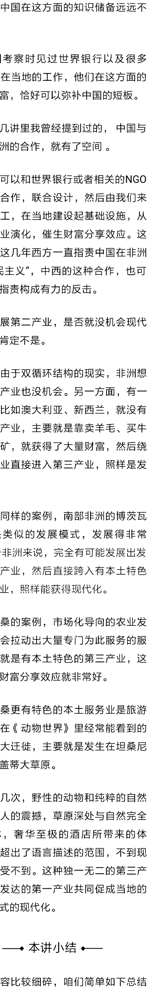

修港口、复活铁路，这两个项目都还在路上，离见成效还有段时间。但是从这里面我们已经可以推想出一些非常有意思的可能性出来了。

首先，这些基础设施的建设，将使得坦桑政府的“南方粮食走廊计划”能够真正发展起来，闲置的土地就能够有效耕种。

坦桑尼亚是世界上最好的玉米产地，玉米是做饲料最重要的原料。反观中国这边，这些年来中国人的饮食结构发生了很大变化，吃肉越来越多了，那就意味着需要大量的饲料用地。

中国耕地有18亿亩的红线，看2016年的数据，其中大约5.5亿亩是种玉米的，这里相当部分是做饲料用。

想象一下，如果我们把这些饲料用地转到坦桑尼亚去，这并不会影响到中国人的粮食安全，最多影响饲料的安全，可是中国这边就有可能腾出来几亿亩的土地。几亿亩能够转化成多么巨大的经济资源。

中国很多现在解不开的经济困境，一下子就能找到解决的办法了。我们前面反复说过，中国问题必须在世界格局下才能找到出路，这就是个非常好的例子。

再说坦桑尼亚这边，有双循环结构做经济前提，中国市场的巨大吸纳力，可以让坦桑尼亚的玉米之类的农产品产多少就能销多少。

一种市场化导向的农业经济就能发展起来，会提供大量的就业机会，带来非常好的财富富享效应。老百姓变得越来越富裕，他们对于日用品的消费能力就会越来越大，中国的制成品将获得更大规模的市场

当然，不是说修了港口和铁路，市场化导向的农业就能发展起来。

这两大设施只相当于大动脉，真正健康的循环，光有大动脉肯定不行，还需要有大量的毛细血管，需要大量的乡村土地、农村水利电力、乡村卫生防疫部门、农业供销社等等，一系列基础设施。这些设施的建设与完善，可能也得个十几、二十年的时间。

做这种工程项目，中国称第二，世界上没人敢称第一，于是这里又有大量工程建设能力输出的机会。在这些基础设施建设的过程中，就已经可以为当地非洲人提供大量的就业机会，财富分享的过程就可以展开了。

以前中国在非洲也有很多这种基础设施的建设，投资和援建了不少工厂，但是这些建设都有个问题，就是没法拉动当地的产业演化。

产业不能演化，意味着提供的就业机会就只能是那个厂的工作岗位，拉动不出更多的就业机会，无法带来投资的乘数效应。

为什么过去的建设没法拉动产业演化呢？因为当时没有意识到，非洲在国际贸易上的比较优势根本就不可能是工业。我们投资的工业园，在里面建立工厂，以为工厂服务的基础设施，就都是孤立的存在，没法发展为一个产业网络，这种援助和投资的效率就不高。

具体什么样的基础设施才能适合当地的比较优势，才能拉动产业演化，更具财富的分享效应呢？这需要有丰富的地方法识才知道，中国在这方面的知识储备远远不够。

我在非洲考察时见过世界银行以及很多NGO组织在当地的工作，他们在这方面的知识很丰富，恰好可以弥补中国的短板。

于是，前几讲里我曾经提到过的，中国与西方在非洲的合作，就有了空间。

中国完全可以和世界银行或者相关的NGO组织进行合作，联合设计，然后由我们来执行和施工，在当地建设基础设施，从而拉动产业演化，催生财富分享效应。这样一来，这几年西方一直指责中国在非洲搞“新殖民主义”，中西的这种合作，也可以对这些指责构成有力的反击。

非洲不发展第二产业，是否就没机会现代化了？肯定不是。

一方面，由于双循环结构的现实，非洲想发展第二产业也没机会。另一方面，有一些国家，比如澳大利亚、新西兰，就没有多少第二产业，主要就是靠卖羊毛、买牛肉、卖铁矿，就获得了大量财富，然后绕过第二产业直接进入第三产业，照样是发达国家。

非洲也有同样的案例，南部非洲的博茨瓦纳，也是类似的发展模式，发展得非常好。对于非洲来说，完全有可能发展出发达的第一产业，然后直接跨入有本土特色的第三产业，照样能获得现代化。

具体到坦桑的案例，市场化导向的农业发展起来，会拉动出大量专为此服务的服务业，这就是有本土特色的第三产业，这种发展的财富分享效应是非常好的。

当然，坦桑更有特色的本土服务业是旅游业。比如在《动物世界》里经常能看到的东非动物大迁徙，主要就是发生在坦桑尼亚的塞伦盖蒂大草原。

我去看过几次，野性的动物和纯粹的自然所能给予人的震撼，草原深处与自然完全融为一体，奢华至极的酒店所带来的体验，真的是超出了语言描述的范围，不到现场完全感受不到。这种独一无二的第三产业，将与发达的第一产业共同促成当地的另一种样式的现代化。

### —— 本讲小结 ——

这讲的内容比较琐碎，咱们简单如下总结一下：

双循环结构当中，由于中国经济独特的拉动效应，使得第二循环里面的国家获得了一种特殊的発展机会，中国与西方在这个过程中也有着深度合作的空间。在所有这些过程中，还能反过来使得中国国内很多不容易化解的困境，获得新的解决空间。

这几讲分别讲了双循环结构当中的第一、第二循环，但是还有一些国际政治、经济的变迁是超越两个循环的，比如气候变暖、碳减排问题等等。中国在这里也有着非常有意思的政治和经济战略展开的可能性，咱们下讲就来讲下这个话题。

欢迎关注施展公众号（微信搜索公众号『施展世界』添加关注，ID: shizhanworld），获取更多延伸阅读。

留言精选

提交留言可与施展互动

# 49 | 中国在碳排放问题上怎么赢

我们在前面几讲讨论了在双循环结构下中国与不同国家的政治经济关系。但国际政治和经济中有些事情，是超出双循环结构的，比如全球变暖问题。

理论上来说，这个问题对所有国家都有同样的影响，中国、美国和坦桑尼亚，谁都没法置身事外。

现在，一般认为是人类过度排放温室气体尤其是二氧化碳，导致了全球变暖，所以国际上对于碳减排的事情吵得很厉害，咱就简称碳问题吧。

这讲就以碳问题作为案例，看看中国的超大规模特征，让中国在这里有着什么样的机会和责任。

## 碳问题的由来

咱们先得说说碳问题的由来。

1990年，联合国的气候变化委员会发表了第一份评估报告，确认了人类活动导致全球变暖。这之后，各国不断谈判，达成了几个关于碳减排的国际公约。

1998年的《京都议定书》进一步确定了一个原则，叫做“共同但有区别的责任”。就是说，所有人都得面临碳排放导致的结果，所以各国就都有减排的责任。

工业是排碳最多的产业，发达国家已经工业革命有两百年了，发展中国家最近几十年才开始发展工业，二氧化碳一大半都是发达国家排放的。现在要所有人统一减排，这不合理。

所以，发达国家要马上开始减排，发展中国家不着急，晚一点再开始减排。发达国家还有义务出钱帮助发展中国家减排，这就是“共同但有区别的责任”。

2009年，各国在丹麦哥本哈根又开了一个大会，打算讨论个新的协定出来，进一步明确各个国家的责任，并取代将
于2012年到期的《京都议定书》。

然而哥本哈根会议开得一地鸡毛，唯一的成果就是确定了下次在哪开继续讨论。后面的几次会议，每次的成果也都是确定下一次的会址。到现在，什么可行的新协议都没达成。

为什么会是这样呢？一方方面，学界对于气候变暖的原因并没有真正达成共识；另一方面，各国在这一方面的利益诉求差异太大，没法达成共识。

## 如何建立新的碳排放秩序

主流学界的主张，也就是碳排放导致全球变暖，看上去还是有更扎实的证据，所以国际主流也认为，人类确实需要一种关于碳排放的秩序安排。

但气候谈判一无所得，那么这个秩序怎样才能建立起来？

实力的基础包含两条：一，我有能力伤害你；二，我却选择不伤害你。于是谈判的空间才打开。

所以碳实力的核心要素就是：第一，我必须得特别能排，这就是伤害别人的能力；第二，我又必须有能力减排，这就是选择不伤害别人。这两个要素哪怕欠缺一条，都不具备真正意义上的碳实力。光能排不能减，人家跟你谈也没用；光能减不能排，人家凭什么要坐下来跟你谈。

那么世界上究竟谁有碳实力呢？

中国碳排放占全球的比例，在2000年之后迅速上升。因为2000年之后制造业大规模外包开始了，中国迅速工业化，当然中国的排放量就会迅速上升了。

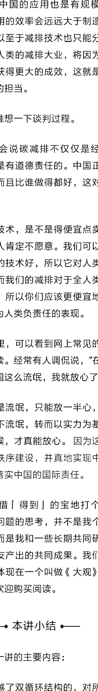

根据2013年的数据，各国的当年排放量，中国占全球的29%，美国占15%，欧盟占10%，印度占7.1%，其他国家都是在5%以下。中国的人均排放量已经超过欧洲，但还不到美国人均排放量的40%。

根据进一步的测算，中国到2016年已经成为历史上累计碳排放量最高的国家。不过近年来中国的年度排放量已经开始下降，也就是减排开始见效了。而印度的年度排放量却在上升，上升的量比中国减排的量还大。

一个大致的碳实力结构关系已经可以勾勒出来了。

中国和美国都有强大的碳实力，特别能排，技术水准到位，所以也都很能减。

欧洲就不好了，进入后工业化时代，人均排放量很低，所以是能减不能排。

印度正好反过来，工业化还将持续很长时间，是能排不能减。

至于其他国家，排放量太小，能排还是能减都不重要了。

所以真正拥有完整碳实力的就只有中美两国。如果中美两国不配合，气候谈判多少轮都没用。虽然欧洲在气候问题上占道德高地，但没多大用处。碳问题要真真正正获得解决，必须是中美两国有主动的动作。

中美两国对现在的气候谈判不愿意配合，原因是什么呢？

对美国来说，主要是美国人不愿放弃自己大手大脚的生活方式。如果承诺减排，民间会有较大反对声音，国会那边就不大容易过得去。

对中国来说，有更复杂的原因。首先，中国的工业化开始得很晚，在“共同但有区别的责任”里，中国更重视自己获得区别对待，欧洲则更强调中国的共同责任。因为中国现在太能排了，这问题上双方就谈不拢。

往更深层去挖的话，会发现双循环结构又回来了。

双循环结构之下，中国作为世界工厂，几乎是在为全世界生产，当然也就是为全世界在排放。西方国家的生产都转移到中国了，当然排放就少了，回过头来再指责中国太能排，这事就不对了。

制造业大规模外包也使得生产已经完全不是以国家为单位运行了。但是是气候谈判中最为激烈的内 内容之一就是碳排放的配额，每个国家每年可以免费排放的数量，却是以国家为单位来分配。超出配额的部分就得向其他配额用不完的国家来购买。

生产和排放并不以国家为单位，但是配额却以国家为单位，这显然是不合理的。在这个角度上可以说，中国并不是不愿意参与气候谈判，中国近年来做的减排工作也颇有成效。主要是现有的议程设定对中国来说很成问题。

中国有足够的碳实力，甚至是最强的碳实力，也就意味着，中国实际上可以发起一种新的谈判议程，让其更有创造性并且更能体现中国的国际责任。

中国的立足点应该是什么呢？肯定得以自己的实力为基础，就是我是最能排的。那么为什么我能排呢？因为我在替全世界生产，从而是替全世界在排放。反过来来看，我减排，就相当于替全世界在减排。这是中国的国际责任所在，中国也愿意承担这个责任。

由于中国制造业的超大规模效应，意味着减排技术在中国的应用也是有规模效应的，技术应用的效率会远远大于制造业分散在各国，以至于减排技术也只能分散应用的情况。人类的减排大业，将因为中国的减排，而获得更大的成效，这就是中国对国际责任的担当。

可以再往前推想一下谈判过程。

比如欧洲人会说碳减排不仅仅是经济事务，同时还是有道德责任的。中国正在做这个事情，而且比谁做得都好，这对全人类都很重要。

欧洲的减排技术，是不是得便宜点卖给我们呐？欧洲人肯定不愿意。我们可以说，正因为你们的技术好，所以它对人类来说更加重要，而我们的减排对于全人类有着重大的意义，所以你们应该更便宜地卖给我们，这是为人 类负责的表现。

从这个演绎里，可以看到网上常见的另一个玩笑的解读。经常有人调侃说，“在国际上，看到祖国这么流氓，我就放心了”。

实际上，光是流氓，只能放一半心，只有它能流氓却不流氓，转而以实力为基础与人谈判的时候，才真能放心。因为这样才 会导向新的秩序建设，并真地实现中国的国家利益，落实中国的国际责任。

说到这里，借「得到」的宝地打个小广告。对于碳问题的思考，并不是我个人的研究成果，而是我和一些长期共同研究国际问题的朋友产出的共同成果。我们的成果很多，都体现在一个叫做《大观》的系列丛书里，欢迎购买阅读。

### —— 本讲小结 ——

回顾一下这一讲的主要内容：

碳问题是超出了双循环结构的，对所有国家都有普遍影响的事情。

欧洲作为主要推动者，在国际上发起了一轮又一轮的气候谈判，但始终没有实质性成果。原因在于，谈判的议程设置和谈判各方的实力结构，并不匹配。

碳实力包含两个要素，首先必须能排，其次必须能减，两个要素都具备的只有中美两国。

中国替全世界生产，也就替全世界排放，进而能替全世界减排。以此为基础，气候谈判会展开大为不同的议程，这是中国的国家利益所在，也是中国的国际责任所在。

经过这么几十讲，我们把「中国历史」这个话题，从商周之变一直讲到当下，甚至对未来还有某种构想。从这里能看到一个连贯的线索，就是我们始终要回答一个问题，究竟中国是谁，它从哪里来，又会到哪里去。

下一讲将是最后一讲，会把所有这些讲的内容做个总结，对那个贯穿始终的问题，梳理出一个简洁而清晰的答案。

欢迎关注施展公众号（微信搜索公众号「施展世界」添加关注，ID: shizhanworld），获取更多延伸阅读。

留言精选

提交留言可与施展互动

# 50 | 完结篇：中国，世界枢纽

这一讲，就是大结局了。

前面的四十多讲，我带你一起还原了中国历史的两个维度。

第一个维度是时间，中国历史发生过四次重要的转型。从商周之变，经过秦汉之变、唐宋之变，最终走到了从清末开始的古今之变。

另外一个维度是空间，中国历史一直是一个多元体系，包含了中原、草原、海洋，还有西域和高原。这几个空间在历史上互相依赖、互相塑造，加在一起才构成了一部完整的中国历史。

到了近代，这种空间进入更宏大的格局，中国开始和世界发生深刻的相互塑造过程。

到了最后一讲，我们终于可以试着回答一个终极问题了。那就是——究竟什么是中国？什么是中国人？

## 究竟什么是中国

那么，究竟什么是中国呢？尝试回答这个问题之前，我先来讲个亲身经历的小故事。

这就是这些中国人完成了我前面说的服装生产和销售工作。他们的产品，你不能说不是意大利货，但和通常所理解的意大利货又不大一样。纪录片里管这个现象叫做“欧盟关税区下面的中国”。

从这个案例你能看到，中国跟世界已经是你中有我、我中有你，国家的意义已经发生改变了。在这种情况下，我们必须重新理解什么是中国，什么是世界。只有重新理解这些问题，才能避免各种不必要的麻烦。

那么，究竟什么是中国呢？我们可以用一个词来简单地回答，那就是——世界枢纽。

## 为什么中国是枢纽

中国之所以能够成为世界枢纽，离不开中国的两大特征：一个是它的多元成分，另一个是它的超大规模性。

这种多元的超大规模性，并不是在今天，或者近代以后才突然发展起来的，而是在一个漫长的历史过程中逐渐发展起来的。说到这，你大概也就明白了，我们这门课为什么要从几千年前中国历史开始讲起。

里，中国人历尽人类历史上罕见的苦难和牺牲，但也收获了一种宏大的普世主义视野，并在21世纪成为世界经贸秩序当中绕不开的枢纽。

在时间层面上，我们可以看到，作为超大规模的多元体系，中国是如何发展到今天的。今天的中国之所以能够成为世界枢纽，也是得益于中国的多元性。

中国内部有海洋，有大陆，还有海陆中介，这三大部分。

中国的海洋区域就是东南沿海地区，这里有着庞大的资本和世界级的制造业能力。

中国的大陆区域就是西部地区，这里自然环境艰难，秩序脆弱，宗教气氛浓厚，像藏传佛教、伊斯兰教等等都影响着人们的精神世界。

中国的中间区域就是庞大的中原地区，这里有庞大的人口资源和市场资源，可以作为连接性力量。

这三个部分形成了一个完整的体系，东部海洋地区生产出来巨大的财富，中原拥有庞大人口与市场，可以作为中介，把东部的巨大财富转化为向西部大陆地区投放的秩序。

中国的海洋区域和大陆区域，又各有一个特殊节点，作为向外的接口。这两个接口分别是香港和新疆，作为纽带，它们让中国更紧密地跟外界的海洋区域和大陆区域相互联系。

香港是中国境内唯一施行普通法（又称英美习惯法）的地区，与普通法体系相对的就是大陆法体系，欧洲的大陆国家、中国等等都是大陆法系的国家。

普通法和大陆法对经济的影响很不一样，普通法对中小投资者权益的保护，要好过大陸法。我们以金融市场为例，在普通法地区，直接融资市场的效率，远远高于间接融资市场，大陆法地区正好相反过来。

直接融资市场就是股市、债市、期货市场等等，中小投资者个人直接买卖股票、债券、期货，进行投资理财。间接融资市场就是银行，中小投资者把钱存在银行，或者购买银行的理财产品，银行再代替中小投资者个人来进行投资理财。

正是因为这个差别，英国、美国这些普通法地区的中小投资者，就更愿意自己去冒险。而大陆法地区的中小投资者，则更愿意抱大腿，通过银行来理财，因为银行保护自身权益的能力更强。

我们可以看到，世界上最重要的股市，都在普通法地区，比如纽约、伦敦、香港、新加坡，最重要的期货市场也在普通法地区。所以，普通法地区的资本市场更加活跃，市场深度更大，对于国际经济和国际贸易的影响力也更大。

不同国家的商人之间在进行国际贸易的时候，如果各自的法律规定有冲突，双方也经常约定采用普通法，来保障合同的执行。几乎可以说，普通法体系就是规范整个海洋世界与国际经济秩序的基本法律逻辑。

因此，香港就具有一种重要的二元性。一方面，它是中国这个大陆法国家不可分割的领土；另一方面，它又和整个海洋世界分享着同样的普通法秩序。

中国通过香港，就有了一个与海洋世界形成无缝连接的接口。中国可以通过香港，来影响国际资本市场，反过来也可以通过香港，从国际资本市场汲取巨大的力量。

再来看看新疆，新疆同样具有二元特征。它一方面是中国不可分割的领土，一方面又与欧亚世界有着深刻的历史关联，也就是中国以西、欧洲以东的世界，包括中亚和一部分中东地区。

站在中原看新疆的时候，会觉得那是中国西部的尽头。但是，一旦你转换视角就会发现，新疆实际上是中国继续向欧亚世界投射影响力的起点，也是欧亚世界的影响力进入中国的起点。

视角的变化直接会影响你对世界的理解。

大航海时代有一个很好的例子。葡萄牙首都里斯本郊外有个海角，叫做罗卡角。在古代历史上，欧洲人认为那是大陆的尽头，再向远走是海神波塞冬的阴暗世界，没有人去了那里还能活着回来。但是到了大航海时代，罗卡角一下子成为人们去往大海的起点，成了一个充满希望的地方。

这前后180°的大转变，并不是罗卡角发生了什么变化，而是人们看着罗卡角的视角发生了变化，以及人们与世界打交道的方式发生了变化。所以罗卡角的一块石碑上刻着两句话“大陆到此终止，大海由此开始”。

对于新疆，我们同样也可以说，“东亚到此终止，欧亚由此开始”。

新疆是联系中国与欧亚世界的关键纽带，也正是因为新疆的存在，中国获得了与大陆世界无缝连接的接口，才能真正成就自己作为海陆枢纽的地位。

有了这种视角转换，我们也会意识到，中国在大陆区域的历史方向，并不是要发展出跟东南沿海一样发达的工业经济和市场经济，而且这也不可能做到，还会对大陆区域的生态造成灾难性后果。

中国大陆区域的历史方向是，类似于西藏、新疆这样自然资源匮乏、精神资源丰富的地区，应该对自然资源丰富、精神资源匮乏的中国海洋区域起到平衡作用。让正在高速现代化，经常遭遇精神与物质失衡的中国，实现再均衡。

中国在现代化过程中成为了世界的枢纽。但中国的现代转型还没有结束，未来仍然有不确定性。这种不确定性也赋予了我们新的责任，所以我们要通过对历史的回望，真正理解这部漫长而又宏大的历史，去发现中国这个庞大体系的精神内涵，而不是念念不忘过去的晦气。

如果我们理解不了中国的内涵，我们也永远没法恰当地理解中国与世界的关系。我们将浪费这百年来的苦难。一个国家能想象到的最可怕的浪费，就是对于自身苦难的浪费。

中国近年来的崛起，又间接导致了世界原有秩序的失衡。世界的再均衡，需要中国的积极主动作为，这就需要中国进一步打开自己的视野，从全球性的角度来思考中国的国家利益和中国的世界责任。可以回想一下那个偷渡客的小故事，对外打开视野，与对内转换视角，是同一个过程；所以，世界的再均衡与中国的再均衡，也是同一个过程。

我们可以把这一过程总结为一段话：

中国因为加入了世界秩序而获得崛起。由于超大规模性，中国的崛起将会深刻地改变，乃至重新定义世界秩序，而新的世界秩序也会反过来重新定义中国。究竟中国是谁？世界是谁？这些问题的答案，都在一个永远不会完结的互动过程中，持久地生成着、演化着。

中国作为世界枢纽，作为世界秩序的基础要素，只有在一个宏大的格局当中，才真正地能够实现自身。

中国作为一个伟大的文明传承，作为一个多元一体的国家，也只有让自己的视野和精神格局，上升到世界高度，才配得上它的精神内涵。所以中国民族的伟大复兴，一切尽在这里。

到这里，这门《中国史纲》也将结束。感谢你的陪伴，希望你有所收获，期待着我们能在未来的课程中再见！

欢迎关注施展公号（微信搜索公众号「施展世界」添加关注，ID: shizhanworld），获取更多延伸阅读。

## 直播回顾 | 理性和想象力，谁更重要？

施展

1月4日晚上，罗胖和我进行了一场腾讯直播。我们谈到了我在做《枢纽》系列研究时打开的脑洞。其中，我谈到了一个关于理性和想象力的案例，正好趁周末分享给你。

《枢纽》这本书，以及《中国史纲50讲》这两课，并不是仅仅在探讨历史事实，而是要重构史观。重构史观，相当于我们要重建一个全新的观念系统，用来理解世界。

所谓重建观念系统，并不是对更多事实的发现，而是更多脑洞的打开。

通过打开一个全新的脑洞，过去完全同样的事实可以显现完全不一样的意义。

甚至可以说，想象力并不是事实，但是它在定义事实。

## 科学革命的真相

说到这里，我用一个更加开脑洞的故事来解释一下。我用你熟悉的科学革命作为例子，科学革命的起点是哥白尼的天文学革命，就是从过去的地心说转向了日心说这样一种全新的宇宙观。

从地心说到日心说的转化，过去我们经常说这是理性战胜了信仰，科学战胜了愚昧，因此人类终于突破过去的困境，走入到一个科学理性的未来。

但是，假如你仔细读一下科学史的话，你会发现并不是这个样子。历史实际上是什么样子呢？

我们可以这么说，所谓的科学革命并不是理性战胜了信仰，科学战胜了蒙昧，而是信仰战胜了理性，再把自己发展成为新的理性。

## 地心说和日心说

在哥白尼之前，人們普遍接受的宇宙结构图是地心说。

你在下面的图片可以看到，中间的小圆点是地球，外围是地球、太阳、月亮、行星，最外层是恒星。这个理论是由天文学家托勒密发展完善出来的。

而当时哥白尼勾勒的新宇宙结构图，太阳在中间，外围的几大行星相对位置关系就是我们今天所理解的样子。

你还可以回到托勒密的图，地心并不是纯粹拍脑袋想出来的，他是有一整套很复杂的理论体系作为支撑。

哥白尼和托勒密把宇宙画成了两种不同的结构。但是，他们是怎么画出这两种结构的呢？

实际上他们俩都是站在地球上来观测天上各种星星运行的位置，然后会发现星星的位置关系经常变换，于是就在地球上想象，宇宙的结构是什么样的。

## 地心说是高度科学化的体系

而在当时看来，托勒密的解释确实要比哥白尼“科学”多了。这是为什么呢？

首先，托勒密对很多理论解释的负载没有那么重。假如你从来没有学过任何天文学的话，你会本能认为地球就是宇宙中心。

其二，假如哥白尼的说法正确的话，地球绕着太阳高速运转，那么有一个严重的问题你必须得解释。就是如此之高速运动的地球，为什么不会把人甩出去？这些都是需要解释的。

## 哥白尼的强大信念

你可以发现，在哥白尼时代，实际上托勒密的体系已经高度科学化了，而且预测非常准确。

但是哥白尼有一个坚定的信念，那就是，上帝一定是按照最简洁、最完美的方式创造宇宙的。哥白尼就坚信这两点，你没有办法用理性来说服他。

所以，你可以看到哥白尼体系里面，行星轨道的确是最严格的正圆。今天咱们知道事实上并不是正圆，而是椭圆，太阳位于焦点上。

而哥白尼坚信轨道是正圆，这会导致一个结果，就是哥白尼对于这些行星位置的预测跟托勒密体系相比，根本不准。

## 从信念转化为理性

那么你可以想象一下，假如你是一个哥白尼同时代的人，把托勒密体系跟哥白尼体系并列一块，你是一个足够健全理性的人，会选择相信谁？

托勒密体系可以完美地被观测证实，而哥白尼体系用来观测的时候，你会发现预测不准，有严重的问题。

此时你是一个健全理性的人，你一定会相信托勒密，会觉得人家才是科学。而哥白尼没有任何道理。

直到在哥白尼之后又出现另一个伟大的天文学家，开普勒。他经过了三十几年的计算和微调，才解决了哥白尼体系之前的问题。

后来又经过了伽利略和牛顿，终于使得哥白尼体系的所有困境都被解决了。到了这一步，哥白尼体系，从最初基于内在的一个信念，到了牛顿时代，终于被呈现为新的理性。

我们可以再追问一下。哥白尼为什么在那个时代会提出这样一个问题，为什么会尝试重新解释宇宙的结构？

因为那也是一个大变革时代。在哥白尼时代，地理大发现开始有一段时间了，大量全新的东西进入人们的视野。此时，人们过去熟悉的那个秩序、那个世界已经彻底崩溃坍塌了。依靠过去的体系观念已经不奏效了，你必须寻找到新的观念体系，才有可能努力尝试解释新的世界，去把握住未来。

可是这个新的东西、新的观念体系框架靠什么呢？事实本身并不能告诉你意义，新的观念体系和观念，依靠的就是想象力。

所以，面对这种大的变革时代，想象力是我们能够重新理解世界、重新理解事实的一个重要起点。

## —— 今日要点 ——

这也是我为什么说应该重塑史观。

史观相当程度上，就是要给你提供更多脑洞，帮你刺激出更大的想象力，使得你可以发现过去你所熟视无睹，从来没有意识到的新的事实。于是你对于世界的理解也会出现全新的变化。

我们当下毫无疑问正处在一个大变革时代，在这种大变革时代，你也需要一个全新的历史观。

通过这种新的历史观，才能够帮助你突破在观念上、思想上、精神上的边界，使得你在遭遇到瓶颈的时候，对于未来充满焦虑的时候，仍然可以做到海阔天空。

注：本期内容来自施展直播内容，不包含音频。本课程内其他内容均包含施展亲述音频。

留言精选

提交留言可与施展互动

## 直播回顾（下）| 美国如何从孤立主义走向世界？

施展

在1月4日晚上上的跃联直播中，罗胖和我谈起了美国从孤立主义走向世界秩序的过程。

在美国建国初期，美国有一个强烈的意识，就是孤立主义。他们对外界的纷争和争端完全不感兴趣。这种观念一直延续到二战时期。最终是在二战结束后，在罗斯福的领导下，美国彻底走出了孤立主义，主动融入到世界的大秩序中。

我认为美国的这段历史也很有意思，一起周末分享给你。

关于一战之后，美国如何走向世界的历史。这里有两个故事跟你分享一下。

## 美国国民精神的一体两面

美国在二战之前的孤立主义，跟美国在二战之后的普世主义，其实是美国国民精神当中一体两面的体现。

## 凯恩斯的脑洞

除了罗斯福的领导，美国转向普世主义的过程中，还有另外一个人发生过重要的作用，就是经济学家凯恩斯。

## 普世民族主义方案

但是光有普世主义无法带来动力，而凯恩斯提出的，恰恰是一个普世民族主义的方案。

—— 今日要点 ——
从美国转向普世主义的这个历史过程中，你可以发现，作为美国这样一个超大规模的国家，你即使想要从自私的角度获取国家利益。唯一的办法也是将获取之、必先予之。

这体现了一个大国的责任。作为一个崛起的大国，你必须要重新思考自己在全球秩序中的角色。

从美国转向普世主义的这个历史过程中，你可以发现，作为美国这样一个超大规模的国家，你即便想要从自私的角度获取国家利益。唯一的办法也是将欲取之、必先予之。

这体现了一个大国的责任。作为一个崛起的大国，你必须要重新思考自己在全球秩序中的角色。

这同样也是我们这代人的使命。

# 留言精选

## 驻场答疑之一 | 地理对历史的作用到底有多大？

你好，今天是我驻场的第⼀天。

接下来的一周，我会每天都挑选一个我认为是最有价值、有意思的问题，来跟你展开聊聊。希望你在学习的过程中，也能在留言区写下你的想法，留下你的问题。我会第一时间关注你的每一个好问题。

可以说，你提出的问题，就是这门课内容的一部分，期待你来和我一起打造这门课！

## 这门课是否地理决定论？

## 这门课是否地理决定论？

## 这门课是否地理决定论？

## 这门课是否地理决定论？

## 这门课是否地理决定论？

今天我来回答一个很有意思的问题，不少我的用户在留言问我，这门课的解释框架是否地理决定论。这个问题可以这么来说，地理不是一个决定性的要素，但它是一个约束性的要素。

什么叫决定性要素？就是说只要有了这个条件，那么它一定会出现什么样的后果，这算地理决定性的要素。

什么叫约束性要素？就是说没有这个条件，某些后果就一定不会出现，这叫约束性要素。

比如，我们在前面谈到过草原上不可能像中原一样，按照儒家的那种方式来生活，三从四德、三纲五常，因为这种生活方式的前提是定居。

但是这只能说明草原上儒家的生活方式没法持续，不代表草原上只能是特定的某种生活方式。这就是我所说的，它是约束要素，而不是决定要素。儒家的生活方式，在草原上没法持续，但草原上仍然可以有多种多样的其他生活方式。

所以这门课里的一些基本方法，是在讨论各种秩序的约束条件是什么，而不是在讨论一种地理决定论的方法。

## 地理和气候是最大的约束条件

但是说回来，地理问题从来都是讨论历史问题和政治问题的一个基础。

比如，所谓政治是什么呢？政治就是在给定的资源约束条件之下，要形成一种稳定的、可持续的，大家都感觉舒服的一种秩序安排。

那么要注意了，在给定的资源约束条件之下，你不考虑资源约束，这肯定是行不的。而最大的资源约束来源于什么呢？毫无疑问就是来源于地理和气候。

所以我们讨论政治、讨论历史的时候，当然要讨论地理。脱离了对于地理的关注，那么我们对于政治、对于历史的讨论都是很空洞的。

所以我们可以看到，古典时代所有那些讨论政治问题的书籍、著作全都会讨论地理的。反倒到了现代的讨论当中，我们往往忘了这点，只是从一些抽象的理念和观念出发，而忽视了这些理念和观念要想落实现在的制度安排，一定得以特定的资源条件为前提。

而这些资源条件依赖于什么呢？当然是依赖于地理了。所以现代的讨论当中，把地理要素给屏蔽在对于政治和历史的讨论之外，这是非常不应该的。

## 经济学的产权理论

说到这我就想起一个例子，经济学里面有一个基本的说法，认为产权的边界越清晰、越往个人或者家庭的方向收敛，那么交易的成本就越低，于是经济的效率就越高。

比如内地的农业，1958年到1978年的人民公社，产权就不再是以个人或者以家庭为单位了，而是变成了以整个人民公社的集体。在这种情况下，很多人开始偷懒。所以它就导致农业生产的效率就比较低。

于是改革开放之后，我们搞了联产承包责任制等等一系列的政策改革，把土地的使用权重新界定在以户为单位的小农名下。这回千多、千少，收益和损失直接跟个人相关了，于是就极大地刺激了经济效率，中国的农业出现了一个巨大的发展。

你听到人民公社这个例子，会觉得产权理论这个逻辑解释得狠顺畅。但是我去伊犁考察的时候，却看到了一个完全不同的案例。

但在这要声明一下，以下是我去伊犁考察时基于与当地人的讨论，所获得的一些启发。未必十分准确，但是大的逻辑是没问题的。

伊犁有什么不一样呢？伊犁是地属新疆的北疆，那里是哈萨克族的游牧地区。当地人给我讲，哈萨克的部落在他们的当地的语言里面叫做“阿吾勒”。

对于游牧民来说，最重要的就是草场。那么草场的单位是怎么划分呢？在1949年以前，草场的单位是以“阿吾勒”为单位来划分，也就是说草场不是划分在个人名下或者说家庭名下，而是划分在整个部落名下的。

而到了人民公社改造的时候，就把这些哈萨克族民的“阿吾勒”直接改成了人民公社，草场是以人民公社为单位的，这意味着什么？

实际上对于哈萨克族民来说，草场的划分单位事实上没有发生变化。只不过换了一个名，从“阿吾勒”换成了人民公社而已。

很有意思的是，在这些游牧地区，效率并没有因为这样一种制度变化而发生变化，效率不受影响。

## 游牧经济下的产权

但是到了改革开放之后，内地开始把土地划分到小农的名下了，发现生产效率极大提高。于是就想，如果把这个政策也推广到游牧地区的这话，是不是也能够促进这些地方的生产效率的提高呢？

于是在哈萨克这些地方也进行了相应的改革，把草场划分到了以户为单位的名下。一开始看起来确实是效率更高了，但是没有几年就出现了负面的效应，什么效应呢？

草场开始严重退化，草场退化意味着生产效率开始受到严重的影响。

为什么会出现这样一个问题呢？原因就在于在草原上的羊不能只吃一种草，只吃一种草，它的营养不均衡，它必须得吃多种草。

而在小面积的草场上，是没法同时长多种草的，必须得是足够大面积的草场才能长多种草。那么足够大面积的草场，那是以什么为单位的草场呢？至少得是以“阿吾勒”为单位的草场。

而如果你把草场的划分转化为以户为单位，就意味着每一户只能有比较小的草场。而这种小草场上所长的草的种类不全，对羊来说营养不够。营养不够怎么办？只能加餐让它多吃。多吃的结果就是草场退化，从而导致整体上来说生态的破坏以及生产效率的下降。

伊犁的考察给了我一个巨大的刺激，第一次让我开始反思产权理论。过去我们都认为，产权划分的边界越清晰，越往个人或者往家庭的方向来收敛，那么经济的效率就越高。

可是游牧经济给了我当头一棒，让我意识到过去对于这个问题的理解是多么地狭隘。它让我重新反思到，产权单位的划分和经济效率之间的关系，首先取决于是什么样的经济类型。

游牧经济和农业经济、工业经济，它们的经济类型有着很大的差异，从而导致最有效率的产权单位是不一样的。

## 地理条件的重要性

那么紧跟着要问了，为什么那个地方是游牧经济，这个地方是农耕经济，另一个地方又是工业经济。它的约束条件是什么呢？答案是地理。

所以你就会知道，为什么在讨论历史的时候，一定要讨论地理了。因为地理带来了一系列重要的约束条件，这些约束条件使我们习以为常的大量概念、理论都可能会遇到它的适用性边界。超过适用性边界，这个理论本身是要被反思的，甚至是要被废的。

要作废的。

而我们现在看到的绝大部分理论，都是在资源丰沛的地区，在能够发展农业和工业经济的地区发展起来的。那么这些理论就不会去考虑游牧地区、沙漠地区的人，他所需要的产权结构，他所需要的法律形式，以及他所需要的一系列要素。

但是我们要对历史、对政治有一个完整理解的话，就必须得能够看到这一系列的约束条件，也能够理解到理论的适用性边界，不能把理论无条件地、广泛地推广开去。

## —— 今日要点 ——

现在你应该知道，地理对历史究竟有多大作用了。

理解政治、理解社会、理解历史，甚至理解经济，所有这一切都脱不开对于资源约束条件的基础性分析。而你要分析这些基础性的约束条件，前提首先是理解地理和气候生态。

明天我会继续选择一个问题来跟你进行深入的讨论，明天见！

留言精选

提交留言可与施展互动

# 驻场答疑之二 | 历史是由英雄推动的吗？

你好，欢迎收听中国史纲，今天是我驻场回答问题的第二天。

有一个问题是这门课的用户问的比较多的，就是，历史究竟由英雄推动，还是由人民推动？

这里首先涉及到对英雄的理解。我会把一个人能否成为英雄，给出四个判断要素。

一是历史大势；二是超级的勇气；三是非凡的直觉力；四是非凡的心理素质。

但即便有了这些，这个人多半还会失败，要想能够成功，还得加上非常重要的一点，运气。

# 历史大势

一个人即便是有些成为英雄的素质，也必须赶上历史大势，他的素质才能转化为翻江倒海的事业。所谓历史大势，就是大变革的时代。

# 超级的勇气

# 非凡的直觉

# 超凡的意志力

# 英雄和时代的共振

## —— 今日要点 ——

所以，可以说英雄和人民，在共同创造历史。

英雄就像河水中的巨浪，汹涌澎湃，但是多一半都变成泡沫。只有少数运气好的才能赶起滔天大浪。

人民就像河床，看上去极其沉默、被动，但是却决定着巨浪到底能不能成事。

# 驻场答疑之三 | 金朝会如何理解岳飞？

驻场答疑之三 | 金朝会如何...

你好，今天是我驻场回答问题的第三天。

我在后台留言里看到了一个问题，非常值得拿出来讲一讲。那就是，如果说中原史和草原史都是中国史的一部分，那么金朝会怎么理解岳飞？也会认为他是英雄吗？

之所以我认为这个问题值得讲，是因为这和我在课程中一直强调的中原、草原等各种亚区域，彼此之间深刻的互相构造性，有着很重要的关联。

从这个问题里面可以看出，中原和草原的互动关系，又是如何塑造着我们这个民族共同的历史记忆，从而形成超越于单个区域之上的认同感。

先说我的结论，金朝对岳飞会怎么理解呢？

金朝既会把他作为最凶恶的敌人，又会高度地敬重他，甚至赞颂他，因为金朝会是在两种意义框架中来评价岳飞的。

# 岳飞象征的道德意义

在具体解释这两种意义框架之前，先从当代人的角度来解释一个问题，就是，有着像岳飞一样战功的名将，历史上有很多。为什么岳飞会特别吸引人们的情感呢？

# 时代蓝图和永恒蓝图

这就进入到前面说的两种意义框架了，或者说两种蓝图。具体到对任何人、任何事的评价上，我们都可以看到，实际上有着两重蓝图。

一重蓝图，是当时具体的历史情境下的蓝图，我们可以把它称为时代蓝图。比如金朝人要站在宋金战争这个具体情境，来理解或评价岳飞。

# 民族共享记忆

我们从个人命运的角度来说，当然希望岳飞能得善终。不过说实话，如果他真是一个得善终的人，我们未必会记住有这样一位名将，也就谈不到希望他的命运会怎样了。

完颜陈和尚极为曲折的命运，有些像岳飞。完颜陈和尚的英雄行为，在永恒蓝图这个背景下，同样也会让大宋这边感动，并且看历史记录，他确实让蒙古一方也感动了。

他所经受的这样一种苦难，本来也会进入今天中国人普遍的历史记忆，构成我们的历史认同的一部分的，只不过我们的主流历史叙述中很少出现他们的名字和事迹罢了。

## —— 今日要点 ——

从岳飞这个问题也能看到，中华民族共同的历史记忆，中华民族深刻的道德感，它有着多么复杂又多样的来源。

中原、草原等等各个区域的互相塑造，不仅仅是在政治和经济意义上，同样是在精神意义上。

明天我会继续驻场来回答一个问题，明天见！

欢迎关注施展公众号（微信搜索公众号「施展世界」添加关注，ID： shizhanworld），获取更多延伸阅读。

# 留言精选

提交留言可与施展互动

# 驻场答疑之四 | 学习文史哲，到底有什么用？

驻场答疑之四 | 学习文史哲...

你好，欢迎收听中国史纲，今天是我驻场回答问题的第四天。

今天我选出来的是后台很多人问，比较典型的一个问题，那就是，学习文学、历史、哲学、社会学等等这些学科，到底有什么用？或者说有什么实践性的意义？

这话题很有意思，咱们就不从“眼前的苟且与诗和远方”的角度出发了，咱们就从到底有什么用的角度出发，来解释这个问题。

到最后，你就能看到，原来“诗和远方”不仅仅是让人有更丰富的内心，它居然也有那么大的用。

# 看到和看见

我先来讲一个故事，这是个真事。有
一本书记叫做《火星上的人类学家》，这书非常有意思，作者是一位脑神经外科医生，讲了他所遇到过的很多病例，其中有一个给我印象特别深。

这个病例是一位一岁左右就失明的盲人，这几乎相当于先天失明了，这位盲人遇到这个医生的时候，已经五十来岁了，一辈子都是这么过来的，早就不适应了依靠触觉和听觉的生活方式。

结果，医生给他检查了一下，发现他的眼睛事实上各方面都挺好，就是有一个小问题导致失明，用一个简单的手术就能够让他再看见。之后的手术很成功，这位盲人果然复明了，但是后续的结果让所有人都大吃一惊。他能“看到”，但却无法“看见”。

这话听起来很奇怪，什么意思呢？就是说，外部世界的各种色彩都能进到他的眼睛里了，但是他却无法辨认出任何东西。

咱们正常人看世界，实际上看的是进入到眼中的各种光线、色彩，然后我们的大脑懂得如何去把这些混杂、交织在一起的光线和色彩整理出秩序，区分出前景和背景，于是我们就能辨认出来外部世界的各种东西，这就算我们能够“看见”了。

但是对这位复明的人来说，进入他眼睛里的，只是混杂在一块的各种杂乱无章的色彩而已，从中无法感到任何秩序、任何意义，他的大脑不知道该如何整理这些涌入眼中的色彩，于是，他就能“看到”，却无法“看见”。

曾经有人把他领到一个车床前面，告诉他这是一个车床，都是干嘛用的。说了半天，他睁大了眼睛，还是啥也看不见。直到他闭着眼睛，上前把整个车床摸了一遍，再退后回来，说，“嗯，这回我能看见车床了。”

因为他摸了一遍之后，脑子里就已经把各种触觉整合出一个完整的形状了，也就是，有了个蓝图了，然后再用这个蓝图来对应着整合进入到眼睛里的各种色彩。

虽然很可能不大顺畅，但好歹也算是整合的办法了，这之后他才能理解这些视觉刺激，才能“看见”。

# 什么是预置蓝图

好，听完这个故事，你一定已经意识到了，原来，世界并不是直接向我们呈现出来的，我们以为自己是直接在看世界。实际上，我们永远是在通过大脑中一些预置的蓝图在看世界。

进入到大脑当中的，不管是视觉信号，还是触觉或者听觉信号，都不过是咱们经常比喻的那种点头而已。如果没有那些预置的蓝图，它们根本就无法呈现出任何意义，我们根本就无法理解它们。而这些预置的蓝图，你如果不反思一下，甚至根本都意识不到它的存在。

那么，这些预置的蓝图，又是从哪来的呢？

预置蓝图可以分为两种，一种是生物学意义上的，比如大脑里整合视觉信号或者触觉信号的能力，只要是正常人类，在这个方面都有同样的预置蓝图。

动物也同样有这种预置蓝图，比如大马哈鱼总是要洄游，它自己也不知道为什么要洄游，但就是要这么做，这就是它的头脑里被预置的蓝图。

另一种是文化意义上的预置蓝图，比如咱们现在都以瘦为美，但是唐朝的时候就是以胖为美。今天太平洋上的一个岛国汤加，那里的人也是以胖为美，到那一看，遍地都是大胖子。那到底瘦美还是胖美呢？根本就没有客观的答案，那都是取决于你的文化。

如果你还是固执地认为，肯定是瘦比胖美，那只不过是因为你在坚持自己的文化才是唯一正确的文化而已。

# 打破你的预置蓝图

但是，如果你坚持自己的文化才是唯一正确的文化，会有什么问题呢？你一定会陷入到某种偏见当中，无法自拔。

这会让你对于世界的理解遭遇各种遮蔽，没法去理解更广大的世界。你见识得再多，也什么用都没有，就像那个复明的盲人一样，所有进入你大脑的东西，都不过是一堆杂乱无章的混沌，你能看到，但什么也看不见。

你所属的文化，就是随着你的成长，通过教育、通过与身边人的互动，在社会化的过程中，而逐渐被预置在你头脑中的一种蓝图。

人要成长，肯定要先接受这样一种预置的文化蓝图，才能开始获得对于世界的理解。但是，随着你继续长大，这个预置蓝图却会开始构成你进一步理解世界的障碍，因为它会让你无法理解其他的东西。

人要继续长大，而继续长大的标志之一，就是你有能力不断地调整、重画自己头脑中的文化蓝图，从而让自己对于世界能够获得更深刻、更立体的理解。

那么，到哪里去学习重画蓝图的技术呢？

那就得先问问这些蓝图是哪来的。答案很简单，各种不同的蓝图，以及画蓝图的技术，正是存在于文学、历史、哲学、社会学等等这些学科，以及各种经典著作当中。

## —— 今日要点 ——

现在你应该知道文学、历史、哲学以及社会学的实践性意义在哪里了。

它们不仅仅是给你提供“诗和远方”所带来的那种纯粹的心灵愉悦，它们同样能让你摆脱文化上的睁眼瞎状态。

它们看似无用，实际上真正有大用。

# 驻场答疑之五 | 海洋秩序和大陆秩序，有什么区别？

你好，欢迎来到《中国史纲50讲》。

今天我要回答的问题是，海洋秩序和大陆秩序到底有什么区别？

这个问题很重要。海洋秩序和大陆秩序的区别，在我的音频课第35讲和36讲，分别讲英国和德国的部分，曾经初步谈到过，如果你有兴趣，可以回过头来再去听一下。

不过在那两讲里面，有个重要问题我没有时间展开，那就是在第50讲里面也提到过的普通法，又叫英美习惯法，这非常值得拿出来讲一讲，因为这是理解今天世界秩序的一个关键。

整个现代海洋世界的秩序，都是在普通法的逻辑下成长起来的，所以这也是理解中国与世界关系的关键。

# 普通法和大陆法的区别

可能你早就听说过世界上 अंग्रेज़ी 美习惯法与大陆成文法 这两种法律体系，后面咱们就简单地说普通法和大陆法。

但是你未必知道这里的深层差异。尤其中国是属于大陆法系的，不熟悉普通法的思维，对于普通法就更难以理解。

这两种法律体系的深层差异在哪呢？简单地一句话来概括，对普通法来说，法律是被发现出来的，对大陆法来说，法律是被发明出来的。

# 普通法的“发现”过程

先来解释第一个问题。要回答这个问题，得先看看近代以前的欧洲是什么样的状态。

# 英国和欧陆国家的差别

接下来就是第二个问题，为啥在近代早期，英国和欧陆走上了分岔，英国仍然保留着普通法传统，欧陆却没有了呢？

新局面，它的法律逻辑也就从尊重传统的普通法或习惯法，转化为大陆的成文法。

紧跟着还有个问题，为什么过去，欧陆的国王搞不定那些贵族，建不起强大的陆军。到了近代早期就能建设起来，灭掉贵族呢？

听了我们这门音频课的用户大概已经能猜到了，是因为出现了技术变迁，带来了新的经济资源，于是打破了原有的博弈均衡，国王就能够干掉原来干不掉的贵族了。

这个技术变迁是什么呢？简单说，就是地理大发现和远洋贸易。

过去，人们的财富基础都在土地上，你的财富规模就是和你占有的土地规模成正比的。国王并不比手下贵族的土地规模更大，就搞不定他们。

远洋贸易使得这些商人一寸土地也不占有，却能够拥有巨额财富，这些财富就可以被国王用贷款的方式借来，国王有能力用这笔钱去瑞士雇一帮雇佣兵来帮自己打仗，最后就能灭掉贵族。

对有钱的商人来说，钱可以借给国王也可以借给贵族，优先考虑的就是借给谁的风险更小一些。国王毕竟正统性更强嘛，风险就更小一些。

于是国王就借着这个过程崛起了，欧陆与英国也就此走上了分岔的道路。

## —— 今日小结 ——

普通法和大陆法这两种法律体系，对于国家的对外扩张模式、帝国统治模式、政治与经济的关系模式等等，影响都非常不同。

这些差异，在历史上都形成了极为深远的后果。

比如，在近代历史上，整个世界贸易的法律秩序，实际上是由普通法所主导的，而全球贸易秩序是理解现代秩序的基础；

比如，近代历史上，只有普通法国家才建成了全球帝国，所有的大陆法国家都只建成了区域性的帝国；

又比如，普通法国家的直接融资市场如股市、债市，远远好过间接融资市场如银行。但是在大陆法国家，则正好相反，这带来了两种国家不同的创新效率；

还比如，在非殖民化运动之后，普通法宗主国的前殖民地，发展程度普遍好过大大陆法宗主国的前殖民地。

普通法和大陆法带来的影响还有很多，就不一一举例解释了。可以说，这两种法律体系是现代世界秩序重要的底层逻辑。

因此，所谓的海洋秩序与大陆秩序的区别，可以一直追溯到普通法与大陆法的差别上来。

今天我的回答就到这里，明天再见！

欢迎关注施展公众号（微信搜索公众号「施展世界」添加关注，ID： shizhanworld），获取更多延伸阅读。

# 驻场答疑六 | 中原和边疆的深层互动，是怎样构建的？

你好，欢迎收听《中国史纲50讲》，今天是我驻场回答问题的第六天。

今天我要回答的问题是，中原和边疆之间，确实有相互塑造关系。但是在具体的历史中，它们能确确实解到这种关系吗？

这个问题很重要，因为它直接关涉到，该如何理解那个远远超越于中原之上的中国的历史。

中原和中国，这是完全不同的两个概念。中原只是中国的一个组成部分，中国是包含着中原、草原、西域、高原、海洋等多个亚区域的多元复合体系。

但是，这个多元复合体系究竟是怎么复合起来的呢？各个亚区域彼此之间是否能理解到呢？

# 过渡地带的作用

各个亚区域是怎么联系起来的呢？

那就是，在各个亚区域之间，有一种“过渡地带”。“过渡地带”同时兼具旁边两个亚区域的特征，同时理解两边的谬误。比如我在第八讲说到草原征服王朝，都是来自东北或者长城沿线，这就是“过渡地带”。

多元的亚区域，就是通过“过渡地带”而被连接起来，从而实现中国的复合性的。要说各个亚区域是否能彼此理解，关键也在“过渡地带”，它能够让各个方向获得相互理解。

最近我看到《中国民族报》几篇文章，内容非常好。这系列文章用了另一个概念，“走廊地带”，实际上跟“过渡地带”是一个意思。这系列文章通过对几个“走廊地带”的讨论，让我们在更具体的层面上看到，中国的多元复合性是如何实现的。

今天我就引用其中的两篇文章来回答前面问题。一篇是讲“长城-天山走廊”的，但这篇讨论的已经不仅仅是中原与草原的相互塑造了，更是帝国的东部、西部是如何相互塑造的。读完很开脑洞，这篇的作者是陇西师范大学的黄达远教授。

另一篇是讲“苗疆走廊”的，这是与中原地区与大西南的相互塑造有关的，作者是贵州大学的杨志强教授。

通过我对这两篇文章的讲解，你可以发现，在某种意义上，正是过渡地带，或者说走廊地带，才是定义这个国家的基础。

# 大清的长城-天山走廊

先看看“长城-天山走廊”。这条走廊首先是衔接中原与草原，中原和草原这个话题我在第八讲中已经比较仔细地解释过，这里不再展开。今天主要来讲讲它是如何衔接大清帝国的东部与西部的。

# 明朝的苗疆走廊

再来说说第二条走廊，“苗疆走廊”。

苗疆走廊是从今天的湖南西部向西贵通道云南昆明的一条走廊，横贯整个贵州。

云南昆明的一条走廊，横贯整个贵州。

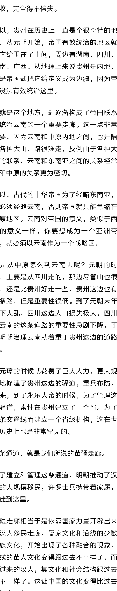

贵州这个地方，在古代有三句话形容它，叫做“天无三日晴、地无三尺平、人无三分银”，就是说，气候连绵多雨，几乎没有一点平原，到处都是山，交通极为困难，因此人民也非常穷困。

这样的地方，在古代肯定是帝国统治的噩梦。当地民风极为彪悍，完全不服管。由于交通极为困难，帝国要派兵进驻统治，成本奇高，当地又太穷了，也征不来什么税收，完全得不偿失。

所以，贵州在历史上一直是个很奇特的地方。从元朝开始，帝国有效统治的地区就把它给围在了中间，周边有湖南、四川、云南、广西。从地理上来说贵州是内地，但是帝国却把它给定义成为边疆，因为帝国没法有效统治这里。

但就是这个地方，却逐渐构成了帝国联系和统治云南的一个重要走廊。这一点非常重要，因为云南和中原内地之间，也是隔着各种大山，路很难走，反倒由于各种大河的联系，云南和东南亚之间的关系经常比和中原的关系更为密切。

所以，古代的中华帝国为了经略东南亚，就必须经略云南，否则帝国就只能龟缩在中原地区。云南对帝国的意思，类似于西域的意思一样，你要想成为一个亚洲帝国，就必须以云南作为一个战略区。

可是从中原怎么到云南去呢？元朝的时候，主要是从四川走的，那边尽管山也很多，还是比贵州好走一些，贵州这边也有—条路，但是重要性很低。到了元朝末年天下大乱，四川这边人口损失极大，四川入云南的这条道路的重要性急剧下降，于是明朝治理云南就着重于贵州这边的道路了。

朱元璋的时候就花费了巨大人力，更大规模地修建了贵州这边的驿道，重兵布防。后来，到了永乐大帝的时候，为了管理这条驿道，索性在贵州建立了一个省。为了—条交通线而建立一个省级机构，这在世界历史上也是非常罕见的。

这条通道，就是我们所说的苗疆走廊。

为了建立和管理这条通道，明朝推动了汉人的大规模移民，许多士兵携带着家属，迁徙到这里。

苗疆走廊相当于于是依靠国家力量开辟出来的汉人移民走廊，儒家文化和沿线的少数民族文化，开始出现了各种融合的现象。沿线的苗人文化变得跟过去不一样了，而移过来的汉人，其文化和社会结构跟过去也不一样了。这让中国的文化变得比过去更加丰富多彩。

苗疆走廊在明朝和清朝成为帝国赖以控制西南边疆的首选的、甚至一度是唯一的通道。不仅如此，“苗疆走廊”后来逐渐又发展成为—条贯通长江、珠江两大水系，连接周边多个省份的经济走廊带。

这一路上逐渐发展得城镇密集、人口集中、民族众多。如果没有这条走廊，中国的南方很可能会形成彼此割裂的几块，四川、云南、两广、两湖，有可能就是割裂开的，但是由于这条走廊的存在，南方完全被联系为一体。

在明清时期，这对于中国在更庞大的东南亚区域的地缘政治战略，对于南部经济格局的重组以及民族的交融共生，都产生了极为深远的影响，其功能和意义早已超出线路本身，一直延续到今天。

## —— 今日要点 ——

通过这两个例子，你可以看出，过渡地带或者说走廊地带，对于中国历史、对于中国国家建构的重要意义。

正是它们，把帝国内部多个亚区域，给联系成为一体，使中国从中原地区的政治体，而发展成为一个超级庞大的亚洲帝国，为今天的疆域打下了根本的基础。

在这个意义上，绝对可以说，正是走廊地带，在定义着“何谓中国”。

也因此，走廊地带绝不是后人的附会，它是历史性地形成的，是中华帝国、中华民族在自我成长、自我发展过程当中，伟大而又深刻的智慧的体现。

今天这个问题就回答到这里了，明天我会再选择一个问题来回答，明天见！

关于今天谈到的两篇文章，欢迎关注施展公众号（微信搜索公众号「施展世界」添加关注，ID： shizhanworld），可阅读原文。

# 驻场答疑之七 | 世界上都有哪些超大规模国家？

驻场答疑之七 | 世界上都有...

你好，欢迎来到《中国史纲50讲》，今天是我驻场回答问题的第七天。

今天咱们来说两个事，第一个事是，我会继续回答一个问题。第二件事情是，我还会就近期与订阅用户的互动中产生的一个想法，向你征求意见。

## 国家的超大规模性

今天我选出来的问题是，是否还有其他国家也有超大规模性？

这个问题也很重要，因为这是我们理解世界秩序的一个基础，理解中国与世界秩序关系的一个关键。

先说结论，当然还有其他国家也有超大规模性，但与中国不是在一个领域中。

## 超大规模国家的博弈

就超大规模国家来说，刚才还提到了一个概念，就是它们可以参与到世界的底基层秩序的博弈当中。

## 超大规模国家的嵌入性

但是，我们还是要看到，今天的超大规模国家之间的对抗，和历史上超大规模国家的对抗，有个最大的区别，就是经济上相互深刻的内在嵌入性。

互深刻的内在嵌入性。

美苏对抗，发生在经济上两个彼此隔绝的世界。一战的对抗，发生在仅仅是外贸上彼此依赖的国家。而今天的中美两个超大规模国家，是在工商业意义上的相互依赖，美国现在所有的新科技，要想能够落地，都必须和中国的生产能力相结合。

这个意义上的经济相互依赖性，完全不是历史上那种依赖可比。历史上的依赖，总还是外部性的依赖，程度或多或少而已。

今天的依赖，完全是内部依赖，脱离开对方，自己运转不了。这是历史上从未出现过的，用历史不足以类比。

这个情况是全新的，人性却是永恒的。超级大国彼此间的对抗还是会继续，但不太可能表现为战争，更有可能表现在国际道义的争夺上，也就是对盟友阵营的打造上。打造一个对自己更有利的格局，让自己在底层博弈上更能玩得转。

至于打造得不利的那一方，如果想开了，实际上问题也不大，不会有差不多真实的危险，因为历史情境已经变了。

但这种对抗模式的转型，不是因为超级大国开始讲道义了，而是因为这是今天更加可行的对抗途径。

## 印度能否成为下一个中国

还有很多人也在问，印度的人口也是超大规模的，是否会成为下一个中国，取代中国的地位？

我提炼为几点，来简单回应一下这个问题。

第一，从市场吸纳能力来说，在目前的技术条件下，中国（再加上溢出到东南亚）的制造业能力已经穷尽了世界市场的消费能力。世界市场无法容纳两个这么大的国家，所以印度不会有机会形成制造业上的崛起。

第二，从制造业发展的前提来说，仍然是在目前的技术条件下，超级供应链网络是制造业发展的前提，超级供应链又依赖于超级基础设施，这方面印度也没有机会。印度目前发展得好的，都是对供应链需求很低的如制药业、软件业、服务外包业。

第三，从国民发展欲望角度来说，印度人的信仰使得他们的内心比较恬淡，发展欲望上不如中国人。

第四，从国民的精神世界来说，印度的种姓制带来一个效应，就是他们同时拥有世界顶级精英，也同时拥有世界上最大规模的贫穷人口。

印度的顶级精英，在融入世界这方面的水准比中国高出不少，今天硅谷很多大公司的管理者都是印度人或者印度裔，很多国际机构的高级雇员也是印度人甚至巴基斯坦人，比中国人要多不少。但是印度一般国民却并不能跟上这种步伐。

作为一个国家来讨论的时候，必须看到它的整体性。作为整体性的国家，毕竟印度的规模在那里，是个必须重视的国家。

但要说有可能会超越中国的地方，主要还是在个体层面或者小的精英群体层面。在整体层面上，印度的机会不大。

## 向你征求意见：

这段时间，和你们在后台的互动，让我非常感动！

我实实在在地看到了，我所提出的一种对于中国的新理解框架，是如何有可能获得你的接受和支持，并且帮助我继续加深思考的。

得到用户的inclusive high quality，确实名不虚传，这让我对于未来充满了希望。

并且，我也因此产生了更进一步的想法，考虑专门讲讲走廊地带，是如何从物质力量和精神格局这两个层面上去，从根本上定义着古代的中华帝国，让古代中国突破狭隘的中原观，而建设成为一个伟大的亚洲帝国的。

之所以选择这样一个切入点，在于，走廊地带是理解古代中国秩序的一个最锐利的角度，把握住它的历史意义，就把握住了理解中华帝国的核心密码。理解了这些，才是真正地理解了中国。

我们不能仅仅陶醉在所谓的“犯强汉者虽远必诛”的说法之中，而要在真正意义上理解我们的祖先，是如何构造一个真正伟大的帝国的。

真正伟大的帝国，它是对正义的承诺，它是对秩序的担当，它是对人性与生命的真正悲悯与敬畏。

如果视野局限在中原地区，反倒看不到这些。而从走廊地带，能同时看到中原与边疆这两边，看到它们如何在相互塑造的过程当中，演化出帝国的力量与精神的融合，这种深刻性才能在我们的眼前展开。

理解了这些，才能真正地理解中华民族要在未来担当的伟大而又深远的世界历史使命。

如果你对走廊地带这个想法感兴趣，请告诉我你希望听到的内容，提出我更好的建议。我希望在与你的讨论中，共同把内容打造出来。

期待看到你更多的支持，也期待有机会在未来与你再见！

欢迎关注施展公众号（微信搜索公众号「施展世界」添加关注，ID: shizhanworld），获取更多延伸阅读。

# 加餐 | 历史上的高手是如何化解贸易战的

加餐 | 历史上的高手是如何...

你好，欢迎回到《中国史纲》，我是施展。

在之前的直播里，我预告过《中国史纲50讲》会继续更新，未来可能达到100讲甚至更多。目前我正在准备《中国史纲》的第二季，我会从走廊地带入手，从一些更微观的角度，带你更深...理解“何谓中国”。

那么，在第二季上线之前，我会不定期地就热点问题录制一些评论，用《中国史纲》一以贯之的方法论，来对热点问题进行分析。

最近的一大热点问题就是中美两国似乎一触即发的贸易战了。关于中美两国为什么会爆发贸易战，《中国史纲》第46讲就已经分析了其深层原因，它是与全球经济格局的演化紧密相关的。我们已经在昨天提炼了其中的知识点，整理成清单放在课程里了。

## 一战后的贸易战是如何爆发的

在我看来，历史上最重要的一個高手支招，便是著名前經濟學家凯恩斯在一战之后提出的解決方案，具体体现现在他写的一本小册子《和约的经济后果》当中。

## 经济与政治机制的不匹配

论是否曾经致对，都应同样地有机会在这里获得贷款，以便获得购买外国产品的能力。

相应地，还要有一个国际保证基金，以此来为陷入货币危机的国家提供支持，稳定其汇率，从而让整体的国际经济秩序能够稳定。

如果你对二战后的国际关系史有一定了解，就会发现，凯恩斯的这些招，相当于提前二十多年，勾勒出了二战后一系列重要的国际安排，包括拯救了欧洲经济的马歇尔计划，推动了欧洲统一进程的欧洲煤炭共同体，再以作&WTO前身的关贸总协定、世界银行和国际货币基金组织这三大国际经济组织。

凯恩斯力图通过这些方案，来为超国家的经济治理找到一种政治安排。不过我们必须要说，要美英两国免除其他国家的战俘债务，这两国也不是活雷锋。所以凯恩斯提出，要用免除债务，来换取这两国在国际经济组织当中的影响力，成为新的全球秩序当中的领导者。

凯恩斯出的这些主张可谓非常高超，为什么在当时就几乎没有一个人愿意听呢？看看凯恩斯是怎么批评凡尔赛和会上战胜国列强的领导人吧。

## 民族主义向世界主义的观念转型

那么问题又来了，为什么在二战后，凯恩斯的主意就获得了各国的支持呢？

这非常依赖于各国的观念转型，可以用德国和法国为例来说说这个问题。在这里又可以看到各路高手的支招。

德国在第二次世界大战后，开始了深刻的反思。战后成立的联邦德国，面临着两个必须同时实现的任务：一是国家重建，二是取得世界的信任。

但是这两个任务却是彼此矛盾的。如果实现了国家重建，则世界就会非常惧怕德国，要想让世界信任德国，除非是德国非常衰弱弱；可是非常衰弱的德国，有可能爆发革命，最终整个地被苏联所掌控，那对西方世界来说是更加可怕的前景。

如果德国仍然以民族主义的观念来制定国家政策，这两个彼此矛盾的任务就哪一个都无法实现。德国必须超越民族主义，实现某种世界主义的观念转型，才有可能找到解套的办法。

## 如何化解中美贸易战

今天这讲加餐，已经不仅只是历史上的高手如何给解套贸易战支招了，还包括更加深远的解套方案。

有了这种视野，再反思当下的中国与美国的贸易战问题，我们会发现，两国在这个问题上都陷入了某种观念困境，都需要实现观念突破。

中美两国必须找到一种超越于各自之上的贸易框架，形成一种谈判机制，因为世界贸易失衡所导致的中美贸易战，才能真正消解。

WTO有可能不足以作为这种超越于两国的谈判框架，因为WTO的机制是基于旧有的国际政治经济结构而形成的，而中国经济的迅猛增长，已经使得其中很多机制不适应用于全新的世界经济结构了。

留言精选

提交留言可与施展互动

# 清单解读 | 为什么美国会向中国发起贸易战

你好，欢迎回来。自从上次直播我们也有一段时间没见面了。

想必你也知道，上周，美国特朗普政府正式对中国打响了贸易战，以关税、配额以及行政命令的方式，限制中美之间的贸易。

要理解中美贸易战，我觉得可以从两个角度出发：一是中美为什么会爆发贸易战，其背后有何深层机理？二是历史上的贸易战，高手曾经给支过什么样的招，来解决问题。

实际上，关于第一个思考角度，我在课程第46讲《为何中国必须购买美国国债》中，就已经为你详细解读过它的底层逻辑。

今天，我就把第46讲的内容做一个梳理，来看看中美贸易战爆发的深层原因是什么。很快，我还会在课程里继续放送一个我录制的新内容，再从第二个思考角度给出新的解读。

## 美国为何挑起贸易战：

- 1. 经济发展必然会带来一个衍生问题，就是滚滚而来的新财富，能否获得较好的分配。最理想状态是，这个衍生问题用经济手段就能解决，但是这并不总能做到。一旦无法通过经济手段解决时，就会出现政治手段的对冲。这也是这次中美贸易战爆发的根本逻辑。
- 2. 西方社会进入工业社会后，经历过三次工业革命，都带来了大量新财富，随之而来的就有了三次财富分配过程。这三次工业革命，都让富人变得更富了，但穷人在这个过程中也享受到了好处。因为前三次工业革命虽然都摧毁了很多传统部门，但都拉动了更多的新产业部门，比如第一次工业革命就拉动了采矿业、冶金业和铁路业等等，从而创造出更多就业机会，工人阶级也能够获得更多收入。
- 3. 到了20世纪末、21世纪初，西方社会出现了新一轮创新周期。但这次创新经济和以往的工业革命都不同，结果是改变了原来的财富分配机制，也给全球经济格局带来了变化。
- 4. 新一轮创新经济仍然是由美国为代表的西方开始的，带来了巨额财富，也摧毁了很多传统产业，同样也拉动出大量的新产业。但是，拉动出的新产业却并不出现在西方，而是在中国，表现为生产流程的大规模外包。中国就在这个过程中踩上了风口，成为世界工厂。而在西方，尤其是美国，本土的创新部门虽然获得了井喷式财富，但传统行业的衰落，却带来了很多失业。于是，西方社会的贫富分化就逐渐拉大。
- 5. 西方社会草根阶级的利益在新一轮创新经济中受损，这一问题又无法通过进一步的经济发展来解决，因为越发展，就越拉动中国的新产业。于是政治手段就会在西方被提上台面，去对冲经济发展带来的问题。
- 6. 西方社会尝试的第一种政治手段，是通过政府的担保行为，去给穷人提供大量低息贷款，保证他们的消费能力。但是财富分配的根本问题仍然没有得到解决，穷人借新债还旧债，风险越累越高，最终在2008年爆发了世界性的经济危机。
- 7. 第一种政治手段失效后，在选票压力下，西方政府开始第二轮的政治手段来对冲经济问题，这就表现为政治上的保守化转向。特朗普当选，英国脱欧，欧洲若干国家保守政党上台，以及上周特朗普政府对中国打响贸易战，这都是政治保守化的表现。
- 8. 西方的保守化一定会损害中国的国家利益，而且也无法真正解决西方社会内部的问题。因为世界经济结构已经发生了深刻变迁，西方的财富分配困境，是因为现实的结构性困境所导致的，不是向中国加税就能解决的。相反，由于中国和西方国家都在非常深的程度上，处于你中有我、我中有你的状态，贸易战所带来的结果更可能是两败俱伤。
- 9. 过往的国际贸易秩序已经无法适应中国崛起后的世界。因此，中国与西方都需要深刻地调整自己对于世界秩序的理解，打开更广阔的视野，寻找新的利益交汇点，用全新的治理秩序来调整世界的失衡。

通过对第46讲的重新解读，我想你应该已经明白中美发生贸易战的深层原因了。接下来要问的是，这种问题是否有解呢？

我很快会为你放送一讲新内容，专门给你讲讲历史上的高手是如何为解决贸易战问题支招的。期待你的关注！

# 加餐02 | 公海自由原则是怎么形成的

你好，欢迎回到《中国史纲》，我是施展。

最近我刚刚去了一趟新加坡，旅行途中看到了一些以前没有注意到的有趣历史，对于我们理解世界秩序和南海秩序会有帮助。所以，我打算分成两个话题，用两天的时间来跟你聊一聊。

今天要说的就是现代国际法体系的生成。严格说来，现代国际法体系的生成和新加坡没有直接关系，但是促成这个体系生成的一个事件，却就发生在新加坡附近。

你应该在影视作品中看到过，有一些游轮会开到公海上上去开设赌场，因为公海不服从任何国家的国内法管辖。当然，我不是说公海上做违法的事情不会被追究责任。

但是，这种公海自由原则是怎么来的呢，为什么公海上会有这种自由呢？

今天我们就从发生在新加坡的一场海战，来聊聊这个问题。

## 一场撼动变革的海战

新加坡的机场叫做樟宜机场，就在新加坡岛的东海岸。

现在去到樟宜，只会感受到一个国际化大空港的繁忙，但如果lot四百多年前去那里，说得准确点，在1603年的2月25日到樟宜的话，你站在海 Caracas 边却会看到一场持续了差不多一整天的不大不小的海战。

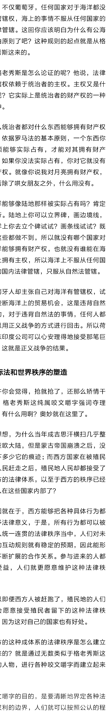

在海战中，一艘叫做圣卡特琳娜号的葡萄牙船只，被几艘隶属于荷兰东印度公司的船只击败并俘虏。这艘葡萄牙船只装满了来自中国的丝绸和瓷器，荷兰人把这艘葡萄牙船开回了阿姆斯特丹并卖掉货物，获得第一笔巨款，据说相当于当时英国政府年收入的两倍。

## 格老秀斯的海洋自由论

格老秀斯被公认为国际法的奠基人。格老秀斯为这个案子写了一篇长长的辩护词，长到什么程度呢？后来出版成了一本书，叫做《论捕获法》，书中有一章被摘出来，单独出版成为一个小册子，叫做《海洋自由论》，就是这个小册子，后来成了现代海洋法的奠基性著作。

## 国际法和世界秩序的塑造

法律就是这么来的，就是这么重要，它是塑造现代世界秩序的一个重要基础。

互动规则，使得国和国之间的合作成为可能。而现代国际法怎么来的呢？你要追溯其最初的来源，就会追到发生在新加坡旁边的这场海战上面去。

好，今天先聊到这里，明天咱们再接着聊第二个话题，明天再见！

## 留言精选

小光
49
施展老师不仅有大视野大格局，细节观点也有追溯性，完全颠覆了一个理科生对历史的认知，让我重新拾起了学历史

# 加餐03 | 新加坡是如何融合不同文明的

昨晚我们从公海上开设婚场这个事情，聊到了新加坡与现代海洋法之间很有趣的故事。今天咱们再来说一下第二个话题。

你也许已经注意到了，第一个话题的故事中，可以被抽象出几个要素，就是葡萄牙人装载了一船的中国商品，在新加坡旁边被抢了，荷兰人又把它卖到欧洲，发了笔大财。

中国、欧洲，这两个相距遥远的地方，却通过新加坡被联系起来了。这就是我想说的第二个话题，在远洋贸易的时代，新加坡作为全球贸易的重要中转站，以及多种文明的交汇之地，是如何发展起来的。

## 亚洲地区的传统贸易网络

实际上，在西方人来殖民亚洲之前，公元15、6世纪以后，亚洲地区就存在着一个庞大的区域市场，以中国和印度作为两轴，以东南亚作为中介。这些区域市场都是以海洋为通道的，东亚的海洋贸易和印度洋贸易，通过南海连接起来。

## 新加坡的华人移民

东亚海洋与印度洋这两大贸易圈，在新加坡发生交集，两大贸易圈的主导族群，就向新加坡有很多移民。

## 英国殖民者的法律化管理

来到南洋的华人，背井离乡，为了不挨人欺负，就组织成各种社会，实际上就是形成各种黑社会组织。其中让英国殖民统治者最头疼的黑社会组织，曾让康熙也极为头疼，就是天地会。

## 新加坡人的海洋视角

另一方面，新加坡所处的地理位置，使得当地人、即使是华人，看待世界的视角也与身处中原的人天然不一样。

## —— 下期预告 ——

这次新加坡之行我还有一个特别的收获，就是在新加坡国家博物馆里面，我看到一个青铜的骑马雕像。

你一看这个雕像，会觉得这是个中亚的草原游牧者的雕像。但我要告诉你，这是爪哇本土制造的雕像。这就奇怪了，为什么爪哇这边会有中亚风格的雕像？因为，在历史上，东南亚和中亚曾经有过一些非常有趣又深远的关联。

# 加餐04 | 贵霜帝国，如何成为“中介性”枢纽

加餐04 | 贵霜帝国，如何成...

你好，欢迎回到《中国史纲》，我是施展。

如果你是这门课的新用户，非常欢迎你，同时我也有一个小建议要给你。你可以在这门课程的右上角，点击“正序”，从课程的开头来听这门课，相信你会有更完整、更成体系的收获。

如果你是老用户的话，我想你应该很熟悉，在这门课程里，我一直在试图带你看到一个多元成分、动态变化的中国。在中原之外，西域、草原、高原等等不同空间，一直在发生着深刻的相互联系、相互影响。

今天的这次加餐，我想带你把视野继续拉大，看看在“中国”之外，历史上曾经发生的一次更大空间上的相互联系、相互影响的过程。这个过程的主角，就是我今天要说的贵霜帝国。

还记得在上次加餐最后我留了一个问题吗？我 lega 在新加坡国家博物馆看到一个青铜的骑马雕像，这个雕像是爪哇本土的，但是它看起来风格完全就像中亚草原游牧者的雕像。

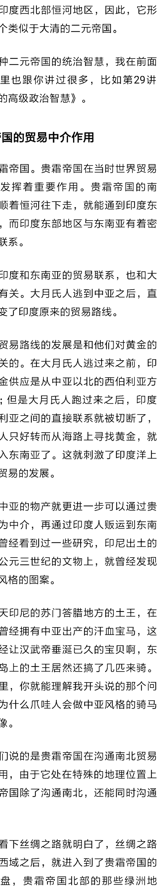

那么，为什么爪哇会有中亚风格的雕像呢？

这就跟我们今天的主角，贵霜帝国有关了。正是贵霜帝国促进了在东南亚和中亚之间的深远关联。

## 二元帝国“贵霜”

贵霜帝国你可能没听说过，但是它在历史上非常重要，在公元一到三世纪之间是世界上顶级帝国之一。

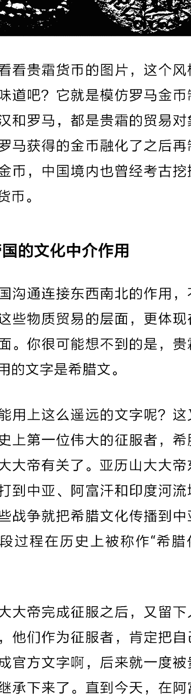

## 贵霜帝国的贸易中介作用

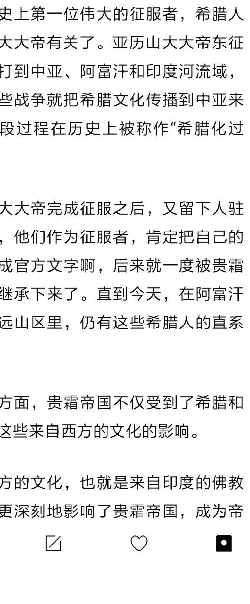

## 贵霜帝国的文化中介作用

文化，更深刻地影响了贵霜帝国，成为帝国的主要宗教，一系列贵霜的君主都是虔诚的佛教徒。帝国的首都建立了很多宏伟的寺院和佛塔，东晋时期的高僧法显，曾经看到过这些建筑，赞叹不已，说从没见过这么壮丽的。

贵霜在这里还有着自己进一步的发明，它把来自希腊的造型艺术，和印度的传统相结合，形成了后世所称的“犍陀罗文化”，你差不多可以把它理解成就是用特定的希腊雕塑的风格来雕刻佛像。今天你在中国各大寺庙看到的佛像，长得明显不像中国人嘛，也不大像印度人，这就是健陀罗艺术的影响。

说到这，你可能会进一步猜想，既然贵霜的佛教造型艺术影响了中国，那么佛教传入中国，应该也跟贵霜帝国脱不了关系。

没错，还记得我们前面说过，贵霜帝国就是大月氏人建立起来的，但月氏人被匈奴打败之后，并没有全部逃往中亚，还有一小部分留在了河西走廊等地，这部分人被称作小月氏，他们在后来又接受了中原王朝的统治。小月氏人就是佛教从贵霜帝国传入中国的人脉中介。

大、小月氏本来就是一家人嘛，所以来自大月氏的佛教，在河西的小月氏人那里非常有亲近感，以此为中介，佛教比较顺利的进入了河西走廊。刚好，由于汉武帝的征服，河西走廊有儒教，却又不占绝对压倒性优势地位，于是外来的佛教就有机和儒教形成一定融合关系。

这个过程很重要，因为中原地区的儒教占压倒性优势，佛教要想进一步往这边传，要是事先没有点融合工作的话，便会遭遇 到儒教的强烈排斥，以至于难以进来。因此，月氏人在佛教传入中国的过程中，起到了极为重要的中介作用，两汉三国时期，云游在中国的外国僧人，半数以上都来自贵霜帝国。

我曾经与王剑利老师合作了一篇文章，叫做《从河西走廊看"多元互构"》，发表在《中国民族报》的"理论周刊"上，里面对这话题有更进一步的讨论，你如果有兴趣，可以到我的个人公号"施展世界"上面去找来读一下。

好，今天的加餐就到这里了。

我希望通过贵霜帝国的历史，给你展现了一个更大视野下的，跨越中亚、南亚、东南亚、大陆、海洋等等多空间融合互动的过程。

如果你有什么感兴趣的话题，以及还有什么进一步想讨论的东西的话，欢迎留言。我会从中选择一些可以展开进一步讨论的话题，作为我后面加餐的内容。

两周后再见！

## 加餐05 | 敦煌如何带来了古代中国大复兴

你好，欢迎回到《中国史纲》，我是施展。

前两周我刚去了一趟敦煌，最近看罗胖连续讲了两次敦煌莫高窟，今天我再从不同的角度跟你聊聊敦煌。

你可能对敦煌和莫高窟都有所了解，莫高窟的壁画有着极高的艺术成就。但是你可能不太知道的是，莫高窟这个艺术宝库，其实是汉人和胡人，胡汉融合的结晶。

今天，我就带你看看敦煌的胡汉混融特征，再来讲讲这些特征背后有什么历史意义，看它是如何带来魏晋南北朝之后中国的一次大复兴的。

## 敦煌的胡汉互动历史

开始之前，还是先简单地说一下敦煌的由来。敦煌是著名的河西四郡当中的一个，河西四郡是汉武帝时期设置的，从东到西分别是武威、张掖、酒泉和敦煌，都分布在今天的甘肃省。

咱们的教材上经常说汉武帝打通河西走廊是为了通西域。实际上，通西域是个计划外的结果。汉武帝打通河西走廊的首要目的是“隔绝羌胡”，就是把在青藏高原上游牧的羌人和北方草原上游牧的匈奴人给隔绝开。

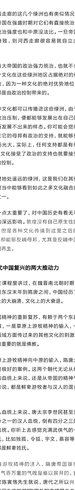

## 莫高窟的多元文化特征

莫高窟最早的开窟，是在中国北方陷入大动荡的五胡十六国时期。

## 敦煌对中原的文化反哺

## 古代中国复兴的兩大推动力

启，扩大恢张，遂能别创空前之世局。

再说佛教，它不仅对于中国，对于整个东亚世界的改造都是全方位的。而我在上一讲加餐里提到了，正是因为河西走廊的绿洲特性，各种文化在当地都有传播，但是没有谁有绝对优势地位。因此佛教才有机会在这里与儒教形成一定的融合之后，再传入中原，否则它根本就没有机会进入中原。

西魏的洞窟中能够看到亚历山大式的骑兵壁画，这跟佛教的由来差不多，中亚的文化以各种方式传入西域和河西走廊。

敦煌因此就像一个密码箱，古代中国的文化之所以在大混乱之后能够复苏，要解读这段历史的密码，就部分地就藏在敦煌的这些洞窟当中。

## 佛教与游牧精神的深远关联

有趣的是，佛教向中原的传入，与游牧者的统治之间，还有着一种深远的关联。游牧者依赖佛教为自己的统治提供重要的精神基础。佛教和游牧精神这两大刺激中华帝国复苏的要素，就这么勾连起来了。

佛教第一次大规模传入中国，就是在南北朝时期，此前虽然也有传入，但是规模小得多。佛教之所以在这个时期大规模传入，有一个重要的政治原因，就是无论南朝还是北朝的皇帝们，都想给自己在儒教之外寻找正当性。

先说南朝，我在本课程第13讲《司马家族事业的断崖式下跌》当中讲到过，南朝的皇帝们都是篡位上台，就大力弘扬佛教，因为如果过分强调儒教的话，儒教太重视正统性，会让篡位这个事情显得特别扎眼，对皇帝们很不利。

再说北边，五胡十六国以及北朝的皇帝们也面临着类似的问题，他们最大的问题就是自己是胡人，统治汉人的时候容易面对各种不服，因为儒教很讲究华夷之辨的。虽然儒教说的华夷之辨不是指血统，而是指文化，但是血统还是很容易被拿出来说事，胡人皇帝们很忌讳这一点。所以，他们就很有兴趣来推广佛教。

比如四世纪初期的后赵，这是五胡当中的羯族人建立的。有汉人大臣对皇帝石虎说，不应该允许百姓拜佛，否则破坏礼仪法度，皇帝就说，我本来就是出身羌彝的胡人，有我们自己的祭祀礼仪，佛也是个胡人的神明，不管是胡人还是汉人的老百姓，愿意信就信吧，国家不要阻止。很多胡人皇帝都是这种心理，汉传佛教就在这样一种大的历史环境下传入中原。

在汉传佛教发展的历史过程中，不仅仅是皇帝，胡人在各个层面都起着无可替代的作用。比如，汉传佛教的鸠摩罗什，是来自西域龟兹，也就是今天新疆库车的胡人，被前秦大将吕光从西域带到凉州，也就是今天甘肃武威，停留了17年，并在

这里形成了思想上的重大进展。吕光建立的后凉被后秦的皇帝姚兴所灭，姚兴又把鸠摩罗什带到长安，鸠摩罗什在长安完成他最重要的译经事业。

前秦的建立者苻氏家族以及后凉的建立者吕光，都是五胡中的氐人，后秦的建立者姚氏是五胡中的羌人。后来鲜卑人建立了北魏，被北魏灭掉的北凉的建立者则是匈奴人，而北凉开启了莫高窟，北魏时代则开始了大规模经营莫高窟。

无论北朝还是南朝，早期重要的佛教传播者和佛经翻译者，大部分都是胡人。包括熟读金庸的人都会知道的达摩祖师，就是个彻彻底底的胡人。

陷入低谷当中的中国文化，就是这样在胡汉交融的过程当中，获得复苏乃至再一次爆发。

## —— 本讲小结 ——

我们在敦煌看到的令人眼花缭乱的多元艺术，看到的胡汉交融的多种存在，就是这个历史过程的一个缩影。

对胡汉交融的理解，是我们真正理解中国历史、理解我们是谁的一个大前提。不要以为胡汉交融的结果是胡人汉化，经历了这个交融之后，胡人不再是原来的胡人，汉人也不再是原来的汉人了，他们共同演化出新的更加蓬勃的文化与历史。

今天我从河西四郡当中最西端的敦煌讲起，聊了它对于中国文化的深远影响，聊了从中可以解读出的中国历史的一些机理。

下一讲我想再转到河西走廊的最东端，武威，在历史上它叫做凉州，讲一讲它是如何撬动中国历史的。下讲再见！

留言精选

提交留言可与施展互动

## 加餐06 | 美国独特的精神气质从何而来（上）

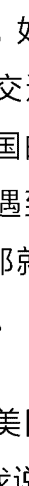

加餐06 | 美国独特的精神气质...

最近我刚刚跟随隔壁王煜全老师的前哨团，到美国考察高科技。行程中，我和王煜全老师探讨了中美之间的深层差异，比如为什么中兴这样的中国企业却很难融入美国主流社会，这个问题的症结何在？

我觉得我们讨论的这个问题很有代表性，所以，今天和明天的加餐，我就主要来跟你聊聊这个问题。上次我跟你预告的关于武威的话题，我会放到下一次加餐来跟你聊。

## 美国的优势在于制度？

谈到中美之间的差异，你可能会说，中美之间的差异主要是制度上的差异。没错，中美之间的很多差异来自于制度上。但是，两国的差异并不仅仅存在于制度层面。

我想，如果你和美国的政府或者社会组织打过交道，肯定会有一个感受，就是你按照中国的办法在美国制度框架下办事，总会遇到各种不爽，对此你也一定触 Resonance 深，那就是中国和美国的制度差异实在太大了。

说到美国的制度，有一个段子很能说明问题，我给你听听：

在二战结束后，德国人就跟美国人说，说你们美国真是幸运，你们没有踹出来希特勒。美国人却说，这算什么，如果希特勒放在美国的话，就又是一个好总统。

那么问题来了，为什么美国可以说希特勒放在美国就又是一个好总统呢？或者进一步追问，美国的制度是如何约束希特勒潜质的总统的呢？

这主要归功于美国的制度保障，这套制度保障使得哪怕是希特勒这种，集闪电般的行动力与飓风般的想象力于一身、而且行为轨迹几乎完全不可预测的天才级独裁者，都很难在美国的政治舞台上找到任何可宰性而为空间。

## 社会力量远大于政府力量的美国社会

我倾向于后者，就是所在地本身的社会土壤。这也是开头我说，中美之间的差异来自于制度上的差异，但两国的差异并不仅仅存在于制度层面。

我们不要忽视社会土壤对美国制度的驯化作用。因为让美国的制度真正能够有效运转起来的，是美国独特的土壤，也就是有美国特色的强大的社会。这就可以解释，为什么利比里亚有也有与美国几乎是一样的制度，却运转得一塌糊涂。

## 基于理性的权利观VS基于信仰的权利观

清教传统里面有一个很核心的观念，就是信仰的无条件性。所谓信仰的无条件性，意味着有些东西根本不是通过理性讨论获得的，而是通过信仰获得的，绝对不容任何讨价还价，不容任何谈判绝不可以交易。

2015年夏天，美国最高法院作出一个判决，让同性恋婚姻在全国合法化。LGBT 人士尚定欢呼雀跃，说终于美国这个堡垒被攻克了，婚姻是 LGBT 这些性少数群体本来就应该拥有的权利，终于他们也拥有了！

值得注意的是，美国最高法院是九个大法官，他们对于所审理的案件投票，少数服从多数，同性恋婚姻这个案例上的投票结果是四比五，有四张反对票。

结果是四比五，有四张反对票。投反对票的四个大法官里面，其中有一位写的反对意见，大致的意思是这样的：

圣经里面说了，婚姻应该是两个异性之间的结合，同性之间是不能结合的，否则就好像邪恶的索多玛城一样会被摧毁。

那么既然现在你们要用理性的反思把圣经里面那种不容讨论的东西给打掉，认为我们应该依按照理性的原则把婚姻权利赋予所有人，性少数群体也不例外，所以不是非得两个异性才能结婚，同性之间也可以结婚。

既然要以理性反思来突破信仰的禁忌，那么我接下来问你，为啥婚姻一定得是俩人呢？为啥婚姻一定得是人跟人呢？你用理性反思突破禁忌，往前走的边界在哪呢？迟早你都会走到让自己感觉难以接受的地方，碰到你的禁忌，倘什么到时候就不让别人来用理性反思突破你的禁忌呢？

实际上到最后你会发现，要坚持逻辑一致性的话，理性反思走到后来几乎守不住任何边界。

反过来这也就意味着，当你面对信念上的敌人时，你是没有办法强硬起来的。因为你的敌人会用你的东西来打击你。他们会说，你不是讲理性反思讲宽容吗？我跟你信念不一致你也必须得宽容我。

基于理性反思的这种权利观，它在绝对意义上是没有办法驳斥敌人的这样一种质疑的。而基于信仰的这种权利观，跟敌人之间就没有这个讨论的空间了。什么宽容？没这事，我再宽容也宽容不到你身上，说不行就是不行。

这么解释一下，你可能就知道美国和欧洲这两种权利观的区别了。那么这和美国的强社会有什么关联呢？关联关系非常复杂，我在这里只能从最简单的一个角度来解释一下。

如果你认为你的个人权利是基于理性反思和理性推导的，那就有个前提，理性能推导出来的东西，理性也能把它给否定掉，最终要想让这种权利稳定下来，就不得不由政府来规定个人权利的边界，社会对政府就会有比较强的依赖性。法国在这方面非常典型，托克维尔在《旧制度与大革命》当中的分析，往深了说都有这个意思。

而依照美国的路数，基于上帝所赐予的个人权利，不仅轮不到政府来规定，相反政府还有可能构成对个人权利的威胁，所以社会就想办法自我组织起来约束政府，于是就有了强社会对于政府的制衡能力。

美国与欧洲在权利观念上的区别，在它们在今天国际政治上的一系列表现当中也能够看到。

当然，要再强调一遍，我这里所说的是今天的美国和欧洲，此前的历史并不不是这个样子，并且美国和欧洲内部也都有反例，我说的只不过是主流，并不排斥反例。

## 美国清教传统的强悍精神

再说回到两个地方在国际政治上的区别。

国际政治学界有一句话叫做，如果你手里拿的是锤子，你看着什么都像钉子，但是如果你手里拿的不是锤子，你希望啥都不是钉子。

今天的欧洲就是这样，它手里没锤子，不仅仅是说它没有军事力量，它各种意义上的锤子都不行了。也就是说精神上它已经把自己的锤子给卸掉了，它就希望啥都不是钉子。

而美国正好反过来，手里拿的是锤子，它看着啥都像钉子。

这会有什么效应呢？就是你会感觉美国的行事极为霸道，它经常不跟你讲理。

但从另一个角度来说，这很重要。如果世界上全都是欧洲那样的谦谦君子，碰到别的不讲理的，欧洲所认可的那套秩序不就泡汤了吗？

在这种情况之下，欧洲的身后也得站一个不讲理的，它跟欧洲有差不多价值观，但是不允许讨价还价，谁想在这上讨价还价，它直接就跟你正面硬刚，这样一来，欧洲想讲的那种理，才有得可讲。

也就是说，讲理的前提得是有能主持这个理，而主持这个理的人，就必须有执行力，要有执行力，还真就需要霸道一点，否则执行力就很差。

美国就是提供这个执行力，而它能这么做，它最底层的精神结构来自于什么呢？

就是刚才我所说的，来自于美国深刻的清教精神。

虽然美国的东、西海岸的大城市，已经越发欧洲化了，前面说的美国最高法院支持同性恋婚姻，那些投赞成票的大法官，主要支持者就是来自这些地方。但是在美国南方的很多地方，仍然保持着一种很保守的状态。

但恰恰是这种保守，才是美国真正的力量所在。美国的力量不在于去简单地弘扬什么价值，单论弘扬价值，欧洲人比美国做得漂亮得多，美国的力量在于，最终如何落实你所推崇的这个价值，这是需要美国人出手的。

奥巴马的支持者主要来自美国的东、西海岸大城市，这些地方高度国际化，越是国际化，与世界交往越多的地方，就越欧洲化，我所说的欧洲化就是指，它已经开始对人的权利进行各种理性反思，但是这种地方就不太容易保持那种非常强悍的东西。奥巴马看上去很政治正确，但这种政治正确却可能使他丧失某种执行力。

而川普的支持者群体，主要就在美国非常保守的那些地方，这反倒成为美国的今天的超强行动力的根基所在。这些保守的地方保持着那种强悍的东西。

强悍跟野蛮不是一回事。野蛮是什么意思？完全啥理也不讲。强悍是指，我跟你说清楚，道儿我给你画出来了，你别踩线，只要你不踩线，咱们啥都好说，敢踩线我就弄死你，这是强悍。

美国的清教传统里面有着一种非常强悍的精神。这种精神结构里包含着一些完全不容谈判，不容挑衅的东西，你不许碰一下，敢碰我就弄死你。

这种精神结构是中国人极为陌生的东西，但这恰是我 们理解美国非常必要的 一个东西，否则我们就并不知道该如何恰当地与美国人打交道。

这一期加餐先说到这里，下一期咱们再来说一下，这样一种强悍的精神结构，它到底是怎么来的，在《圣经》教义里面究竟是怎么表述的。下一期再见！

用户留言

提交留言可与专栏作者互动

## 加餐 | 用博弈论读懂中美关系

加餐 | 用博弈论读懂中美关系

近来发生的最重大事件，就是中美不由分说地走到了贸易战边缘。

中美之间在政治关系上从来没有亲密过，但在经济上却是高度相互依存。人人曾经说过的全球经济双引擎、G2、Chimerica等等，指的都是这个紧密关系以及对全世界的重要性。

突然间，两国维持底线以上的合作关系都变得相当棘手。这个趋势如果继续，不止住滑坡，后果不堪设想。

经贸关系会从互利走向互恐，地缘政治事件会屡出不穷，黑天鹅会成群飞起，不可设想的事情会成为常态。

已经发生的事情说明，两国关系从正和博弈的丰富维度堕到零和博弈的单一维度，速度真的很快。有识之士要抓紧时间有所作为，扛起已经滚起的雪球，不让它引发雪崩。

## 永恒的国家间战争

先讲第一本，小约瑟夫·奈的《理解国际冲突》。曾经任哈佛大学肯尼迪学院院长，不仅是国际政治学大家，还在冷战结束后当过美国助理国防部长，一手加强而不是削弱了美同盟，奠定今天东亚政治格局。

## 国家间的安全关系与博弈空间

- 1. 国家之间都处于"无政府状态"，没有超国家机构能提供安全保护；
- 2. 每个国家都拥有武力；
- 3. 每个国家对其他国家的意图都无法完全放心。

更重要的是，米尔斯海默眼中的国家间的安全关系是零和游戏。

也就是说，就算是自己仍然是最强大的，也不能容忍别人变得强大起来，不能容忍自己的领先优势缩小。这就将包含丰富可能的复杂博弈变成一场简单而残酷的零和博弈。民间把这种博弈心态叫做见不得别人好。

在米尔斯海默看来，这场零和游戏与国家性质无关，与民族血缘无关，既无关乎政体，更无关乎善恶。

他不相信自由贸易把世界各国的经济利益绑在一起会有助于减少冲突，对民主国家之间不会打仗之类的说法嗤之以鼻，也 không 认为诸如联合国、经合组织、WTO之类的国际机构能化解零和游戏的本质。

中国在这本书里多次出现。米尔斯海默强烈批评美国多年来对于中国的接触政策（engagement），认为这是养虎贻患。他相信中国一旦兴起则两国争霸不可避免。

他预测东北亚的现有格局难以维持到2020年以后。

他现在最新的主张，是美国应放弃对华的接触政策，转而致力于建立一个包括日、韩、印、越南、新加坡，如有可能包括俄罗斯的庞大联盟，以遏制中国。

他认为欧美制裁俄罗斯是回避现实浪费资源，重点在东方。

## 避免开战的方式

今天要讲的第三本书试图回答我们的第三个问题：如果冲突发生，它比较可能是怎样发生？

反过来要回答的问题是：怎样才能遏制它的发生？

美国最知名的战略智库兰德公司，2016年发布了报告《与中国开战：不可思议之议》(War with China)。作者大卫·康伯特（David Compert）曾任美国国家情报常务副总监，还代理过总监，绝对的内部人。

《与中国开战》标题抓人，但并非主张对华动武。中美关系极为复杂，它只截取一段来分析：如果中美开战，战事可能会怎样展开？怎样避免开战？

报告基于一系列假设：

- 如果中美开战，战区主要在东亚海空，包括海上、海底、空中、太空；
除网络战以外，总体是场地地区性和常规性战争；
中国不会攻击美国本土。

这些假设是否成立其实很难讲，但分析总要从什么地方开始，这组假设就是报告的起点。

- 1. 近期，激烈，短促；
- 2. 近期，激烈，漫长；
- 3. 近期，温和，短促；
- 4. 近期，温和，漫长；
- 5. 远期，激烈，短促；
- 6. 远期，激烈，漫长；
- 7. 远期，温和，短促；
- 8. 远期，温和，漫长。

不一一细讲了，基本分析如下：

第一，中美战事不会有决定性后果，没有清楚的胜者，不会有哪方获得绝对胜利另一方遭遇完败。

第二，如果战事于近期爆发，美国军力会实质性受损，如若远期爆发，损失会更大，因为中国军力在迅速成长；但无论近期远期，中国军力损失会更大。

第三，战争激烈与否取决于领导人在战事开启时所下决心，战事长度取决于双方何时丧失继续作战的意志。

第四，东亚海空成为战区，不论在哪种情形中，中国经济都将遭受重创，战事变得漫长更是存有难度性后果；美国经济当然也受冲击，但主要限于双方贸易损失；此外，如果战事变得漫长，国际形势对中国会进一步恶化。

第五，战事爆发最可能的原因是一方误判，以为可以通过一场短促战争达到目的。一战时德法俄决策者就出现过这种误判，以为战争只会持续几个星期，结果是持续4年，一代精英丧生，当时的世界中心地带焦土化。为防止这种误判，必须向对方清楚地表明自己已经做好长期激战的准备。

## 划重点

1.国家虽然是为了解决内部冲突而存在的，但国家之间由于无政府状态，所以国家之间发生冲突的倾向是永恒的，问题是如何限制它而不是放它出笼。

2.经贸往来是正和博弈，但利益分配又回到了零和博弈。无论如何要保持住正和博弈的空间，不能陷入零和博弈的死局。

## 加餐08 | 武威，这座小城如何撬动中国历史（上）

加餐08 | 武威，这座小城如何。

你好，欢迎回到《中国史纲》，我是施展。

这一期加餐，我要讲讲武威这个城市对于中国历史的影响。有可能你对武威这个名字有些陌生，但它在历史上可是大大有名，它是汉武帝时期设置的著名的河西四郡当中最东边的一个。

前面我讲敦煌的加餐里面也曾经提到过，河西四郡从东往西分别是武威、张掖、酒泉、敦煌。武威在古代还有另外一个名字，你可能更熟悉，就是凉州。

## 撬动中国历史的武威

武威在今天似乎已经是个沉寂的小城了，但它在历史上对中国的影响可是大大的，完全可以称之为撬动整个中国历史的一个支点。没有武威，后来的中国历史就会走上完全不同的路径。

在介绍武威之前，我还是先简单地说一下河西走廊，这会更有助于你理解武威。河西走廊可不仅仅是咱们通常所说的丝绸之路的贸易通道，它的历史地位比这个要重要得多。

我在驻场答疑的第六讲专门和你分享过，中国有若干个过渡地带，比如长城沿线是中原与草原之间的过渡地带，康巴地区是中原与高原之间的过渡地带，这些过渡地带都是衔接两个亚区域的。而河西走廊则是中国唯一的一个，同时衔接起中原、西域、草原、高原，东西南北这四个方向的亚区域的过渡地带。

如果你熟悉这门课的话会知道，我经常说，过渡地带定义着那个远大于中原的中国，因为没有过渡地带的话，中国内部的多个亚区域就无法被衔接起来形成一个整体。所以，在特定意义上可以说，河西走廊作为同时衔接四个方向的过渡地带，它才定义着“何谓中国”。

为什么河西走廊能有这么大的作用呢？这就与河西走廊的地理结构有关了。你可以看一下文稿里面的地图，更容易对我后面要讲的内容形成概念。

武威在兰州西面，而在兰州与武威之间，有一座山叫做乌鞘岭，它是河西走廊的东端起点。乌鞘岭是我国一个重要的地理分界线，该山脉以东是外流区域，河流都流入大海；这座山脉以西则是内流区域，河流只流入内流湖。

河西四郡就在乌鞘岭以西的内流区域，这里的水源供给主要不是靠降雨，而是靠雪山融水。河西走廊所依赖的雪山，就是走廊南侧的祁连山。祁连山平均海拔4000米以上，常年积雪，雪山融水浇灌了山脚下的多片绿洲，有些地方水草相当丰美。

比如张掖市下面的山丹县，在历史上便是极为重要的马场，匈奴曾经在这里牧马，后来汉武帝又在这里牧马，这里在今天是世界第一大军马场，在夏天的景色极为壮阔秀美。霍去病攻占河西之后，匈奴人哀叹，“失我祁连山，使我六畜不蕃息；失我焉支山，使我妇女无颜色”，指的就是这里。祁连山雪水浇灌出山脚下一个个连续的绿洲空间，主要的就是河西四郡，它们成为从中原通往西域的一个个中继站。

祁连山有几个重要的山口，山南的高原游牧人群通过这里可以进入河西走廊。走廊北侧的山脉则海拔相对较低，难以存住积雪，无法形成雪山融水，山的外侧便是沙漠。祁连山上的融雪水下来，形成河西走廊三大水系。

中国的大部分水系都是东西走向，流入大海，但是由于山形地势的原因，河西这三大水系都是南北走向，穿过戈壁沙漠，注入北方远处的内流湖，比如在今天内蒙古额济纳旗的著名的居延海等等。

草原游牧人群可以从蒙古草原顺着这些水系南下，进入河西走廊的水草丰美地区。这样，河西走廊又可以衔接起草原与高原。这也是为什么我在讲敦煌的加餐里提到，汉武帝打通河西走廊的首要目的是“隔绝羌胡”，就是把在青藏高原上的游牧者和北方草原上的游牧者给隔离开来，以免双方联手，威胁到长安的安全。

这样，你就可以看出河西走廊是如何能够衔接东南西北四个方向的。在这种地理结构下，武威，或者说凉州，作为河西走廊最东端的重镇，它能够撬动中国历史，也就不会是特别令人惊讶的事情了。

凉州具体又是如何撬动中国历史的呢？我从如下三个角度来分别展开解释一下，文化的融合性、视野的敞开性和帝国的建构性。了解完这三个角度，你就会发现，凉州的历史不仅仅是关于凉州，而是关于到整个中国的历史命运。

前两个角度文化的融合性、视野的敞开性，这都关乎文化、精神气质这些软遗嘱，我主要放在这一讲来讲。帝国的建构性，这关乎多元互动的硬遗嘱，我放在下一讲跟你分享。

## 文化的融合性

一说到文化融合，你的第一反应可能是从丝绸之路上传过来的异域文化，通过河西走廊进入中原。但是我要告诉你，还不仅如此。凉州曾经成为儒家的避难所，并且在之后又反过来对中原形成深刻影响。这段历史就发生在五胡乱华以其后的北魏时期。

从东汉末年开始，中原儒家的传承过程逐渐落在一系列的大家族身上。到了西晋末年天下大乱，长安洛阳都沦为废墟，这些有学问的大家族多半四处流散。流散主要就是两个方向，一是跟随残存的晋朝皇室逃往江南，再一个就是逃往远离中原，相对来说稍@... [河西走廊地区。

包括我在敦煌那期加餐提到过，胡人高僧鸠摩罗什，他就曾在凉州前后停留了17年的时间，他在这里经受了一系列的考验，心性获得升华，又学会了汉语。鸠摩罗什是被后凉的统治者从西域的龟兹（今天新疆的库车）带到凉州的。后来后凉又被羌人建立的后秦灭掉，鸠摩罗什被带到长安，在这里，鸠摩罗什开始了他所主持的空前的佛经翻译事业，翻译出74部、584卷佛经。

今天我们所熟悉的佛经的开篇语“如是我闻”，就是出自鸠摩罗什的手笔，电影《倩女幽魂》当中法力无边的《金刚经》、王菲曾经改成歌来唱的《心经》，也都是鸠摩罗什翻译的。鸠摩罗什所开创的汉传佛教，不仅对中国，对整个东亚精神世界的影响与改造都是全方位的。

如果没有在凉州停留的17年时间，鸠摩罗什很可能也难以获得如此之深的功力。鸠摩罗什停留凉州期间所住的鸠摩罗什寺，就在武威的市中心，今天的寺庙已经是百年前大地震毁坏过后重建的了，但是寺中供奉着鸠摩罗什舌舍利的罗什塔，仍然是1600多年前留下的古迹。

我在讲敦煌的加餐里面也提到，佛教进入中原，河西走廊是个重要的中介，让佛教有机会在这里和不占统治地位的儒教文化先进行某种融合，然后才能继续向前进入中原，而不是直接被中原儒教排斥掉。讲了凉州的儒教和佛教共存的盛况，你一定对河西走廊的这种中介地位的重要性有更深的感觉了。

这些无一例外地都是在整体上撼动着中国的历史。

## 视野的开阔性

说完了文化的融合性，再来说说视野的敞开性。这最直观地体现在唐诗当中。

我猜想你读唐诗的时候大概会有跟我差不多的感觉，读来最为血脉贲张摄人心魄的，就是那些边塞诗。诗人的视野与精神格局，非常直观地象征着一个时代的视野与精神格局，唐代雄视万里、兼容韬达的精神格局，通过边塞诗获得最好的表达。

全唐诗里面有大约两千首边塞诗，其中有一大半指向广义的河西，边塞诗当中还有一种著名的体例，叫做“凉州词”，很多大诗人也以此为题写过众口流传的诗篇。不过要说明一下，凉州词不是专门写凉州的，它是唐代所流行的一种曲调名。

凉州乐舞也是隋唐时期王朝乐舞中的精华，甚至于唐玄宗时期的乐曲，很多都以边地命名，比如《凉州》、《伊州》（伊州，今天的新疆哈密）、《甘州》（甘州，今天的张掖）。

我还非常喜欢王维的一首诗，“单车欲问边，属国过居延。征蓬出汉塞，归雁入胡天。大漠孤烟直，长河落日圆。萧关逢候骑，都护在燕然”。

诗人走出汉家边塞，进入胡人士地，北归的大雁告别中原水草回归到胡人的天空，胡汉在这里不是判然对立的两方，而是在一种宏大的视野格局当中，连续过渡的两个自然空间。体验过这样一种气魄与格局之后，各种斤斤计较的小气与“非我族类”的猜忌，就都会在“大漠孤烟”与“长河落日”的雄浑之气中，被透视出现屑与不堪。

诗中还提到居延海，这是河西三大水系之一黑河水系的尾间湖，诗人在这里听到了数千里之外的蒙古草原上，边塞大将燕然都护的消息，河西地区连通中原、西域、草原的空间感，仅用寥寥几个字就都给展开了。

可以想见，没有边塞诗，就不会有光芒四射的盛唐气象；而没有河西及西域对于诗人视野的敞开，王朝的格局又如何才能打开呢？这些都构成了中华民族的精神记忆当中极为重要的组成部分，倘若没有它们，我们便无法想象我们今天的样子。

好，这一讲的加餐就讲到这里了。下一讲我会接着再来讲一下帝国的建构性，这样一个关于多元互动的硬逻辑。下一讲再见！

留言精选

提交留言可与施展互动

# 加餐09 | 武威，这座小城如何撬动中国历史（下）

你好，欢迎回到《中国史纲》，我是施展。

上一讲我刚刚跟你分享了凉州在文化的融合性、以及视野的敞开性这两个方面对于中国历史的重要影响。这一讲我要再来跟你聊聊，凉州在中国历史中的另一个很重要的作用，就是帝国的建构性。

其实这个话题，我在这门课的第28讲也跟提到过，当时我跟你主要聊的是满蒙联盟是如何建立起来的。实际上，满蒙联盟的建立，其更深的渊源还应该再往前回溯三百多年，也就是今天我要跟你分享的凉州会盟。

这是一场公元1247年发生。站在寺中，环顾四周一派萧瑟，让人油然而生对历史的感慨。

## 藏传佛教的教派竞争

要说清楚这个会盟，就得再简单回顾一下我 在《中国史纲》第二十讲当中讲过的，雪域高原在吐蕃崩溃之后的状态。

## 凉州会盟的影响

在1247之前的几年中，蒙古王爷西凉王阔端曾经派兵打雪域高原。但是领兵大将打了一段时间之后，向阔端建议，不如跟藏传佛教的领袖谈判，让他们自愿归顺更好。于是阔端发出带有威胁性质的邀请，萨迦派的领袖萨迦班智达就负重任，代表整个雪域高原来到凉州与阔端会谈。

## 满蒙联盟的建立

阔端和萨迦班智达在凉州会盟之后过了四年就接连去世了。继承他们位置的是阔端的堂弟忽必烈和萨迦班智达的侄子八思巴。忽必烈和八思巴也结成了师徒关系，八思巴后来还成了大元帝国的国师，总管天下各大教派。

## 中国历史的多元互构性

凉州会盟的发生地就在武威的白塔寺，今天的寺中仍然有几十座白塔，当然很多都是在近百年年前地震震塌后重建的，但是埋葬萨迦班智达遗骨的灵骨塔，仍然保留着原貌。站在寺中，环顾四周一派萧瑟，让人油然而生对历史的感慨。

好，这一讲的加餐就到这里了。两周后再见！

施展

武威和河西走廊对于整个中国历史的现实意义，亲身到当地会得到更加直观的体会和震撼。8月初，我和爱道思人文文学社计划组织一次武威与张掖的游学活动，用4天的时间，带你到真实的历史场景中去，边走边看边讲。

# 加餐10| “大国宪制”中的官僚制有多重要？

你好，欢迎回到《中国史纲》，我是施展。

最近，罗胖讲了苏力老师的著作《大国宪制》。这一讲加餐，我也来和你聊一下“宪制”的问题。

确实如罗胖所说，《大国宪制》是一本被严重低估了的著作。苏力老师在书中所提出的问题，很多是被长期忽视的真问题。要知道，在思考当中，提出真问题的能力，经常会给一个答案的能力更加重要。

今天这讲加餐，我会专门聊聊宪制当中的官僚制。官僚制到底在国家治理中发挥了什么作用，这种制度在古代中国又是怎么建立的，官僚制和皇帝制度之间又是一种什么样的关系。今天我就要来回答这些问题。

## 宪制的含义

要说“宪制”这话题，先得看看宪制究竟是什么意思。宪制这个词，英文是constitution，你可能比较熟悉它今天指的意思，就是宪法。

那么作为宪制的constitution又是什么意思呢？苏力老师在书中专门谈过，在古希腊时期，思想家们就经常谈论constitution的问题。从古希腊直到法国大革命之前，constitution指的首先都是城邦或者政治共同体的内部结构，也就是说，它关注的是共同体的内部是怎么构成和具体运作的，而不是一部成文的法典。

## 官僚制的重要性

我们可以先来看为什么官僚制如此的重要。

对于官僚制的分析，有一个极为强大的方法论，就是德国大思想家马克思·韦伯的社会学理论。韦伯是个大牛，你可能早就听说过他的著作《新教伦理与资本主义精神》。但他更加精深的著作叫做《经济与社会》，其中核心关注的问题是理性化的问题，他认为官僚制是理性化一个基本表现。

## 官僚和贵族的区分

说完了官僚制的重要性，还得简单说一下官僚和贵族的区别，过去咱们经常把官僚跟贵族混为一谈，说他们都是统治阶级，这说法是有大问题的。这个话题我在《中国史纲》第四讲里面曾经谈到过。

本质上来说，官僚相对于君主没有独立性，他们是职业经理人，没有属于自己的地盘，生活来源得靠君主给的俸禄，官僚的地位取决于君主的意志；

## 官僚制是如何建立的

我们前面借用韦伯的分析说了，官僚制是一个国家进行治理的理性化结果，官僚制能最大程度保证治理的效率。那么，古代的官僚制又是如何建立起来的呢。

赋税，有了这些赋税，君主就有钱养活听自己话的官僚了。

而竹简的出现，则让更多的人读得起书，不像过去那样只有大贵族才有机会识字。于是，君主也就能找到自己供养的、同时又能为自己所用的人了，对这些人的管理和应用，逐渐就发展成为官僚制。

在这之后，君主以官僚为工具，与那些不听自己话的贵族相博弈，逐渐让后者淡出了舞台，实现了中原地区的大一统。如果遍地都是贵族的话，大一统这个事情是搞不定的。

## 官僚制和皇帝制的配合

好，我们聊完了官僚制，它是维系古代社会治理的重要结构。那你可能要问了，皇帝到底是干什么的呢？皇帝在国家治理过程中发挥什么作用？

苏力老师在书中也专门用一章提到了皇帝制度的重要性，将皇帝区分为有为君主和守成君主。有为君主主要是开国君主，以及少数虽非开国、但是有着雄才大略、对历史有重大影响的君主；守成君主则是依循祖制，守住祖宗基业的君主。

我在《枢纽》一书中也提到过政治学当中一个重要的区分，也是类似的，就是非常政治和日常政治。

非常政治是指一个政治秩序的开创时刻，以及政治当中一些遭遇重大危机、需要重大决断的时刻；日常政治则是指没有任何重大危机，规则已经给定，只要正常运转即可的时期。

要应对非常政治，需要的是非凡的意志力和想象力，但是日常政治恰恰排斥这样一种意志力和想象力，因为这种想象力经常会打断人们对于未来的稳定预期，让人们没法怡当地安排自己的生活。

把非常政治、日常政治这俩概念与官僚制比对一下，你就会发现，官僚制天然是为日常政治准备的，因为它要确保官僚制的规则大于其中任何一个个人，从而带来政治运作的稳定性与可预期性。

但是官僚制的局限也就在这里了，规则都是用来应付常例的，无法用来应对重大危机或者无法用来做需要想象力的重大决策，而官僚制当中的每一个个人又都无法超越于规则体系之外来做事。

面对这样一种状况，就需要有超越于官僚制之外的一种力量，否则便无法应对危机。比如，美国南北战争时期，是南方先挑起战争，此时便需要北方的联邦做一个决断，是否要通过战争解决问题。这种决策靠官僚制是搞不定的，需要总统的巨大意志力和想象力。总统做了决策之后，有了目标，官僚制才能够行动，作为实现总统设定的国家目标的最重要工具。

也就是说，官僚制无法生成目标，而只能作为工具去实现目标；目标的生成，必须是来自官僚制以外的力量。

皇帝制度恰好就是起到这样一个功能，它在官僚体系之外存在。理想状态下，在日常政治当中，皇帝“垂拱而治”，官僚可以搞定一切；在非常政治的时刻，皇帝能够临机做出重大决断，从而引领帝国度过危机。

当然这是一种纯粹理想状态，在现实的历史中，经常见到的是，遭遇非常政治的时候，皇帝的能力却未必跟得上，只能依靠几个能干的大臣勉强应付，应付得不好就崩溃了。

但我们在这里所说的，并不是现实的历史是否符合理想状态，而是说在古代中国的宪制当中，在一般的政治秩序当中，需要有着怎样的一种功能性的设置。皇帝制度就是这样一种功能性的设置。

说到这里，想起一本书，书名是《叫魂》，这本书里对于皇帝与官僚之间的制约、博弈关系，以及皇帝制度在帝国当中所起到的那种非常政治的功能，通过一些具体的历史案例，分析得很到位，推荐你去找来一读。每天听本书里也有《叫魂》这本书的解读，你也可以听一听。

## —— 本讲小结 ——

好，今天的加餐就到这里了。

我给你分析了官僚制的兴起，它所需要的一些基本条件，以及皇帝制度与官僚制度的两种不同功能设置，它们所对应的是非常政治与日常政治这两种政治状态。

希望这些讲解对你有所启发。咱们下次加餐再见！

留言精选

提交留言可与施展互动

# 上新推荐 | 《中国史纲》兄弟篇，终于来了！

你好，欢迎回到《中国史纲》，我是施展。

这一讲，我要给你推荐一门刚刚上线的课，就是李筠老师的《西方史纲50讲》。

## 《中国史纲》和《西方史纲》

你一听这个名字，《西方史纲》，应该就能猜出来，这和我的《中国史纲》关系肯定不一般。实际上，这门课的主讲人李筠老师，我早想推荐给你了。

## 一中一西，帮你理解完整的世界

实际上，《西方史纲》的问题意识与《中国史纲》的问题意识是同出一脉的，也都是我们“大观”小组这些年一直关注的，就是究竟如何理解中国以及中国的未来。

## 只有用文明的视野，才能帮你把握未来

## “史纲体”，带你看到文明的大逻辑

