# 产品沉思录 ProductThinking 201601-202308

来源：[`mp.weixin.qq.com`](http://mp.weixin.qq.com)

# 《妥协社会》：和痛苦的关系，定义了我们是谁

> 原文：[`mp.weixin.qq.com/s?\_\_biz=MzkyNjM1ODA2MA==&mid=2247485116&idx=1&sn=117185cff9171ada561a1fba3a344652&chksm=c239c9fff54e40e9e2c7424b919c0a795eccd314facacfe8240baf84487f1b27d409eeda1046&scene=126&sessionid=1692256435#rd`](http://mp.weixin.qq.com/s?__biz=MzkyNjM1ODA2MA==&mid=2247485116&idx=1&sn=117185cff9171ada561a1fba3a344652&chksm=c239c9fff54e40e9e2c7424b919c0a795eccd314facacfe8240baf84487f1b27d409eeda1046&scene=126&sessionid=1692256435#rd) 

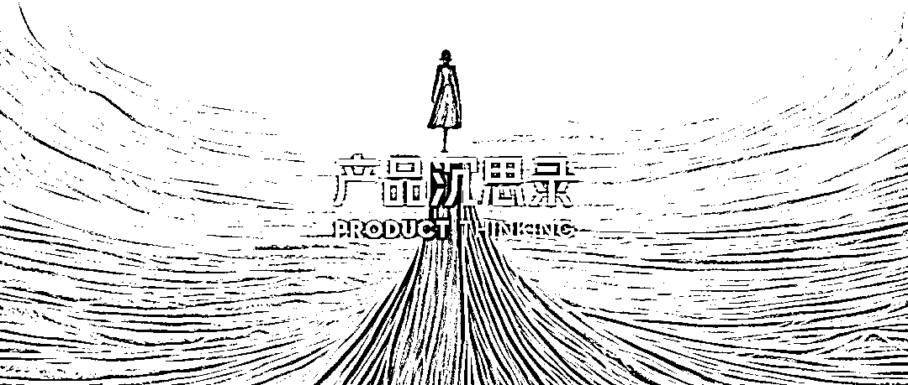

在过去的两年里，集中探索了和欲望、焦虑、恐惧、倦怠等情绪相处的方法，但和痛苦的相处却似乎没有单独拎出来思考过。这一次，不谈产品，谈谈和自我的关系 —— 痛苦的意义。

  

这次思考启发自于韩炳哲的《妥协社会》。之前产品沉思录推荐过韩炳哲的不少内容，比如《倦怠社会》中对无聊的思考等。他的书不好读，因为有很多专有名词和背景信息，但又总有一些启发，就像鱼感觉不到水一样，他总能从我们习以为常的行为中，看到一些不一样的东西。

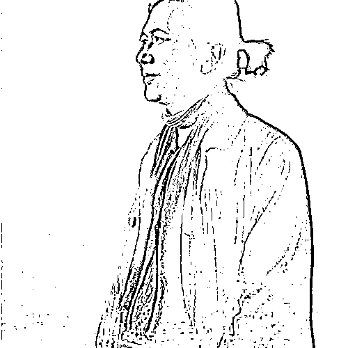

所以每次读他的书时，都没有试图去彻底理解每个字的意思，而是从中找到新的启发性视角，让自己能有一种新的看待世界的方法 —— 所以本篇分享未必包含了他的本意，而是一次夹带私货的分享。

### 痛苦是什么

•痛苦并非是指物理上的病痛，也指思想上的痛苦。•**痛苦即关联，**拒绝一切痛苦状态的人，是没有建立关系能力的。比如为了避免失恋的痛苦，导致恐惧于建立亲密关系；为了避免付出没有回报的痛苦，选择每天划水摸鱼 —— **当我们开始不断妥协时，虽然规避了痛苦，但也在让自己麻木。**•**痛苦即真实，**抵抗痛苦时让我们感觉到真实，而妥协则是麻醉。社交媒体的点赞泛滥，导致我们感受力钝化，对一切无动于衷，变得麻木。**其实一切真实的东西都是痛苦的，真理是痛苦的，痛苦是检验真理的可靠标准**。实事求是中最重要的一条原则，就是接受不愉快的事实。•**痛苦勾勒出自己，**描绘出自己的轮廓。以自己为例，从上家公司离开，很大的痛苦在于要把自己花了几年时间打磨的产品交出去；而职级、Title、收入，其实都没让我如此痛苦。反之，正是这些痛苦定义了自己是谁。•如果没有痛苦，我们就必须找到更强烈的刺激，来感受到自己存在。比如消费更加暴力色情的内容、尝试各种极限运动或者不可描述的事情。

### 痛苦的价值

•精神即痛苦，因为唯有通过痛苦，精神才能获得新的洞见。精神的成长依赖于战胜痛苦，没有痛苦，精神就是一成不变的。没有痛苦，就不可能与曾在的过往彻底决裂。**越是能苦中寻乐的人，就越深刻。**一个人如果未曾深入人类的痛苦，也就无法从内心最深处笑出来。•**痛苦不仅仅是一种体验，而是以否定性为前提，引发我们具体的变化。**比如你作为一个「体验」过画油画的人，虽然知道油画的技巧和方法，但是无法改变的自己行为；但当一个经历过被摄影术抢了饭碗的画家，这种刻骨铭心的痛苦才能让其行为发生彻底的转变 —— 而在今日，我们更多惧怕痛苦，开启任何新的探索时，总会选择浅浅的体验，不去建立过度深厚的关系。•**其实痛苦往往动摇了惯常的意义关联，强迫精神进行彻底的视角转换。**与快乐不同，痛苦会启动反思过程，带来全新看待问题的方法。比如在这次创业途中，也是因为之前的种种痛苦经历，让我们选择和过去的经验与惯性决裂，去做 Small Businesses Owner。•当我们感到痛苦时，才是真正被嵌入整个架构中，不仅仅是一个旁观者。比如为何摸鱼也没有那么快乐，是因为我们把自己变成了一个旁观者，一个零件，事情的成败和我们无关，感受不到任何意义。其实只有真正的归属关系受到威胁时，痛苦才会出现。如果没有痛苦，我们就会丧失目标，没有能力获得真理与洞见。•**没有痛苦，就没有奔向新事物的征程，也就没有历史。永远去创立，同时也必须永远去打破。**

### 痛苦在社会中的演化

•酷刑社会时（如中世纪），痛苦与之密切相关，是一种统治手段，如残酷的刑罚、压抑的宗教仪式等。痛苦直接作用于我们的肉体。•规训社会时（如工业革命），身体上的刑罚逐渐让位于将身体变成生产工具，痛苦主要变成了对思想的控制，让人物化，成为资本中的一个螺丝钉。只不过不再公开展示，而是进入如学校、工厂等封闭的规训场所，想想富士康对人的异化。•功绩社会时（今日之社会），身体更多处于享乐的状态，开始拒绝痛苦。自我欣赏、自我享受。所以「你要过的幸福」成为了新的统治公式，而痛苦成为了一种医疗事件，和政治逐渐脱钩。

### 幸福的陷阱

•当我们认为应该努力让自己过得「幸福」时，导致每个人只关注自己的内心，而不去对社会关系进行批判性探究 —— 比如有些苦难是社会造成的，但人们却被要求去改变自己的心理状态。**这种思考方式，强制我们进行自我反省，而忽略和现存统治的关系。**•幸福预期还让我们变得孤立，因为幸福变成了一件私事，苦难意味着个人的失败。所以不会再有革命，只剩下个人的抑郁。我们不会再归咎于社会，而会归咎于自己。•幸福预期物化了幸福，但幸福不可能完美无缺。因为痛苦承载着幸福，使幸福长久，因为任何强烈的感情都是痛苦的。如果痛苦被抑制，幸福也会变得乏善可陈，变得沉闷。•**痛苦不会消失，只会改变形式。**如果你眼前一片岁月静好，需要问问是谁在哪里帮你负重前行。而无聊不是别的，是溶解在时间里的痛苦而已。

### 为何今日我们惧怕痛苦

•因为我们在面对痛苦时，**给予我们支持，以及方向的关系不复存在**，所以变得无法忍受。比如痛苦时的一杯酒，一次拥抱，一声安慰，一次拍拍肩，在今日都变得难以企及。痛苦来临时只能孤身一人舔着伤口，自然不愿意再去尝试。•为何这种关系关系不复存在？和项飚说的「附近的消失」有一定的关系。人与人之间变得接口化，缺少有意义的沟通与接触，比如外卖小哥在雪天冻得瑟瑟发抖将外卖放在门口，却很少得到一句安慰，只剩下纯粹的工具性。•信息的空前发达，更是让所有的苦难变化成了远方的数字，比如疫情地图上每天死亡的人数，让人们逐渐麻木。再加上功绩社会中一切都被量化，大多数人都在试图暴露自己的所有痛苦，获得比他人更多的点赞与关注 —— 想想之前抖音上一堆人复制造桥死爷爷的梗 —— 痛苦变成了消费品，继而变成了劣质仿品，再加上注意力不断被稀释，上一秒的苦难下一秒就变成了小姐姐的误导，所以也很难让人产生共情，最终变得麻木。•再放大到社会层面，今日的社会中到处都能看到「妥协」的存在，比如社会层面上不断消除否定，推崇积极心理学的做法，仿佛痛苦是一种「无能」的象征，因为你是 loser ，因为你自己能力不够，所以你才痛苦。真正积极的人是会笑看一切的。这种强调「讨喜」的社会风气一旦形成，大多数人都不愿意再去经历痛苦，分享痛苦，而是去追求「自我的幸福」。

  

我们无需去寻找某种「答案」，也并不是说从明天起就要做一个天天受苦的人。只不过希望能通过上面的文字，让我们重新去思考：

•是自己选择孤独，还是在逃避建立深厚关系时可能需要承担的痛苦？•是选择成为看客，还是在逃避真实世界中让人难以接受的事实？•是选择接纳痛苦，还是选择让自己变得麻木？•痛苦真的是一无是处？还是能为我们带来全新的启发？

  

没有痛苦，我们既没有爱过，也没有活过。

  

**一如村上春树所说：痛苦难以避免，而磨难可以选择。**

  

References  

`[1]` 《妥协社会》 by 韩炳哲: *https://weread.qq.com/web/reader/58432770813ab774eg01379b*  
`[2]` 倚靠在痛苦中，修复人而不是机器: *https://xiaobot.net/post/ce79f6f4-4a5e-4991-a96c-c3d94938fd79*

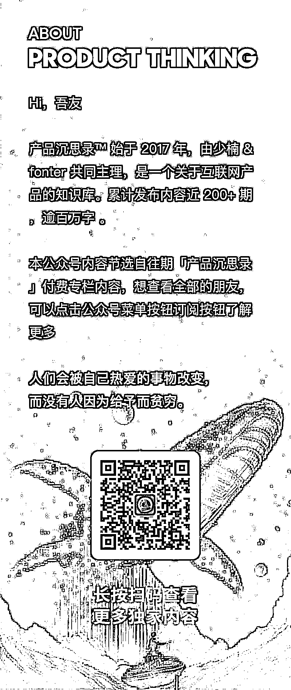

  

# 【播客】和雨白聊聊韩炳哲的《倦怠社会》

> 原文：[`mp.weixin.qq.com/s?\_\_biz=MzkyNjM1ODA2MA==&mid=2247485116&idx=2&sn=7e7fd0bdd97890fbdfab73326be3c358&chksm=c239c9fff54e40e937f92088f9cf4707bf2ee7625d634ca0757fb9254a2dd4b431214cce58b1&scene=126&sessionid=1692256435#rd`](http://mp.weixin.qq.com/s?__biz=MzkyNjM1ODA2MA==&mid=2247485116&idx=2&sn=7e7fd0bdd97890fbdfab73326be3c358&chksm=c239c9fff54e40e937f92088f9cf4707bf2ee7625d634ca0757fb9254a2dd4b431214cce58b1&scene=126&sessionid=1692256435#rd) 

 

这期和「有知有行」的雨白聊了聊哲学家韩炳哲的《倦怠社会》给我们带来的启发，还有对于意义追寻，留白，消费主义的一些不成熟的思考。

  

为什么我们在工作生活中总是感到疲惫？又因为什么我们无法停止剥削自己？关于这些问题，韩炳哲在书中都给出了很好的答案。希望听完这一期漫谈，可以让你缓解一些焦虑，得到些许启发。

  

**创作者们：**

主持 / 雨白

嘉宾 / 少楠

制作 / 有知有行

剪辑 / wanying

  

**以下为本期内容的 shownotes:**

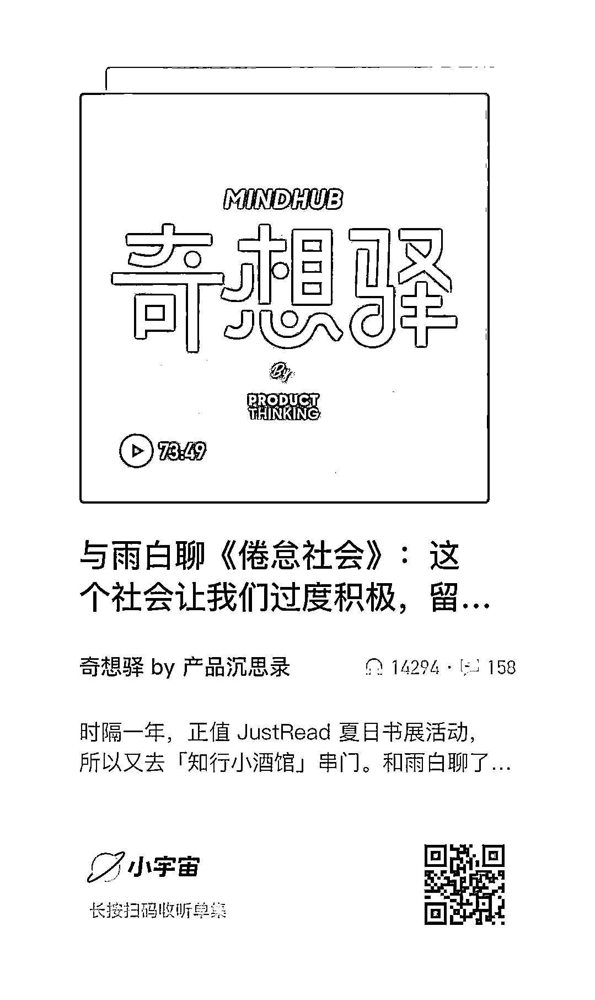

03:35 从规训社会到功绩社会，我们和爸妈那一代究竟有什么不同？

06:32 功绩社会的鸡娃榜样：风靡一时的哈佛女孩刘亦婷

08:24 社交媒体对我们的改变：为什么会有人因为谷爱凌而感到痛苦？

16:39 过分积极的社会让我们疲于奔命，越来越卷

21:21 「产品沉思录」诞生的真实原因

26:37 游戏大作玩不动，电视剧看不进去，在电影院坐不住，我们为何变成这样？

32:25 不要把自己加工成商品

35:19 整个世界都在刺激我们尽量多地分泌多巴胺

40:55 试着给自己的生活制造一些无聊的闲暇时刻

45:58 时隔一年回访少楠：为什么他解散了 flomo 的所有微信群？

53:11 真正的没有进步，是你在原地思考犹豫、焦虑徘徊而不去付诸行动

57:08 既然现在大家都没有共识了，那不如走一条属于你自己的路

60:08 那些埋头在自己专注的事情上的人，可能会是最后获得奖赏的人

63:48 消费带来的所有快乐，都没有创造来的持久

66:31 给自己制造一个「深度年」

  

# 如何找到优质信源：重要的不是降噪，而是挑选

> 原文：[`mp.weixin.qq.com/s?\_\_biz=MzkyNjM1ODA2MA==&mid=2247485106&idx=1&sn=eae72d62625b554df98a2c97fb676e92&chksm=c239c9f1f54e40e7ec4e84b1333b388533bd34616417e3b23b0d6b7b6cd52e7dd468ccdf5237&scene=126&sessionid=1692256435#rd`](http://mp.weixin.qq.com/s?__biz=MzkyNjM1ODA2MA==&mid=2247485106&idx=1&sn=eae72d62625b554df98a2c97fb676e92&chksm=c239c9f1f54e40e7ec4e84b1333b388533bd34616417e3b23b0d6b7b6cd52e7dd468ccdf5237&scene=126&sessionid=1692256435#rd) 

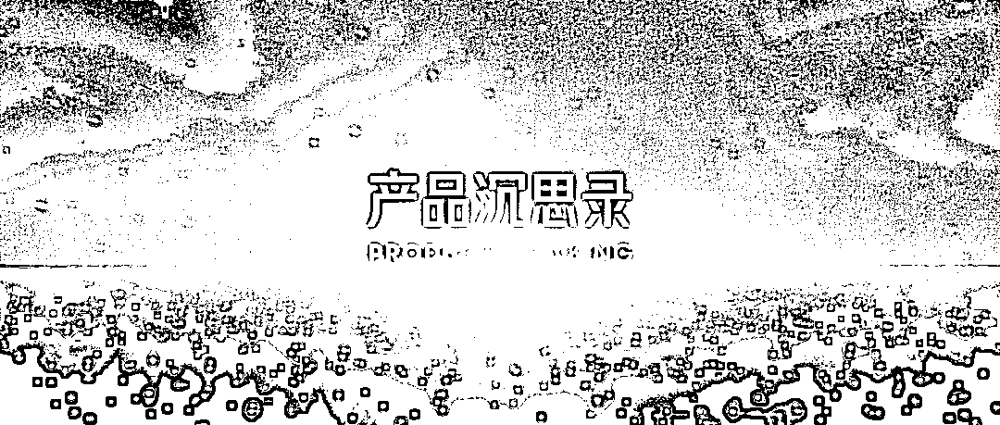

最近在和一些朋友聊天的过程中，发现大家对「如何获得优质信息」这件事很关心。

  

虽然写了很久的产品沉思录，但是似乎从未好好整理过自己的方法。

  

这里试着梳理一下基础的版本，后续可能还会迭代。

### 勇气：敢于放弃泛泛的求知

随便走进一家麦当劳，随便点一两个食物，今天的热量就会爆棚。

  

信源也一样，因为今日获取信息太方便了，所以一不小心就会吃撑。

  

和减肥一样，重要的不是今天跑了多少公里，少吃了多少卡路里。而是先有一个明确的目的，减肥是为了什么 —— 是追求一个健美运动员的身材，还是希望能减少疾病，又或是确保日常精力充沛？

  

目的不同，手段自然不同。但身边许多人减肥很容易陷入到对各种方法的尝试，如生酮饮食，只吃素等，却忽略了，自己的目标是什么。

  

信源也是如此。有人能把 wikipedia 当做小说来看，有人也能在其中查找到很重要的资料。**关键在于内在的评判标准，而非别人的看法**。评星好的书未必是经典；粉丝多的人说的也未必正确。

  

**缺少目标的另一个副作用，是很容易产生「错过」的恐惧。**因为不知道自己想要什么，所以认为什么都值得看看，但正是由于这种泛泛的求知，会让自己的精力不断被分散无法精进，而无法精进就很难培养对信源的甄选辨别能力。

  

如何找到自己的目标，无人能回答。唯一的建议是勇气，敢于放弃一些东西不去关注，不去学习，这样才能有自己关注的领域，自己的评判标准。

  

**人生也需要战略，而战略的重点是不做什么，才能让值得做的事情清晰起来。**

### 来源：在书中挖掘过去的智慧，从先锋的视角看未来

未必把读书看的多崇高，书中的垃圾也有很多，所以小心辨别书的质量就很重要。

  

这里试着总结一些自己关于选书和读书的原则（感觉后续可以展开更多条😁）

•**避免看热榜的书，去看经受时间考验的书。**尤其是避免看流行书（除非自己很感兴趣），这些书尚未被时间检验，许多结论未必经得起推敲。而那些一版再版的书（比如德鲁克），必定有一些穿越时间的道理蕴含其中。•**进入新领域，重要的不是读经典，而是激发自己的兴趣。**比如我数学很差，所以直接看《几何原本》就疯了，但是吴军的《数学之美》让我看到了几何学之外的意义，以及用一些简单的例子成功勾起了自己的兴趣，这时候再看《几何原本》，就会明白几何学除了考试之外，对自己思维方式的构建有何意义。•**未必要读完，把自己能用得到的感兴趣的看完即可。**从头到尾翻阅是小学生的做法，读书重要的不是画出来思维导图，而是其中有一两句话，一两个观点能改变自己看待世界或者行动的方式，就足够值回票价了。•**把注释当做挖掘新书的方法。**我很喜欢看引用和注释，因为这都是隐藏的线索。而越是经典考究的书，引用的资料越是翔实靠谱，这能很有效的帮我们拓展相关领域的知识。•**同时读许多本书，甚至摊在桌子上一起读。**这是电子阅读做不到的，好处在于能把许多不相关的知识点串联起来。比如读《美国大城市的死与生》时，可以对比山崎亮《社区设计》中的案例来看雅各布斯的观点是否正确，以及混合《城市的胜利》中反对雅各布斯的观点，会是非常有趣的体验。•**问问身边的人，你最近在「重读」什么书。**如果一个人反复读一本书，那么说明这本书对其价值巨大，以至于能再次阅读。而许多书随着年龄变化，也会读出来不一样的结果，比如《悉达多》的故事。

  

但书籍因为其出版周期问题，导致对于新鲜事物总是滞后的，所以对于新鲜的东西，学习先锋的视角可能更好（这个观点出自 @fonter ）

  

这里的「先锋」定义比较个人化，根据产品沉思录的原则，更偏向于创始人（且公司不要太大），工程师，设计师，学者，哲学家这几类，因为他们更多地在创造最前沿或者思考最前沿的东西，能从他们的分享中窥见具体真实的情境和过程是什么样的。

  

不过有一点要注意的是，在浏览这些人的内容时，尽量不要看第三方对于这些人的叙述，而是**看他自己写的文章、推特或者接受的访谈，确保拿到的是第一手信息，而不是演绎过的**。

  

举例来说，我长期关注的就有：

•Notion CEO Ivan Zhao•Stripe CEO Patrick Collison•Hey.com CEO DHH•Stack Overflow 创始人 Joel Spolsky•EvergreenNotes 发明者， Andy Matuschak•人类学家，项飚•哲学家，王德峰、陈嘉映、刘擎等

  

之前有和 fonter 维护过一个先锋列表，但是整理的不到位，下半年看看有时间能否优化一下公开给大家。但这个格式可供大家参考，整理一个属于你的先锋名单。

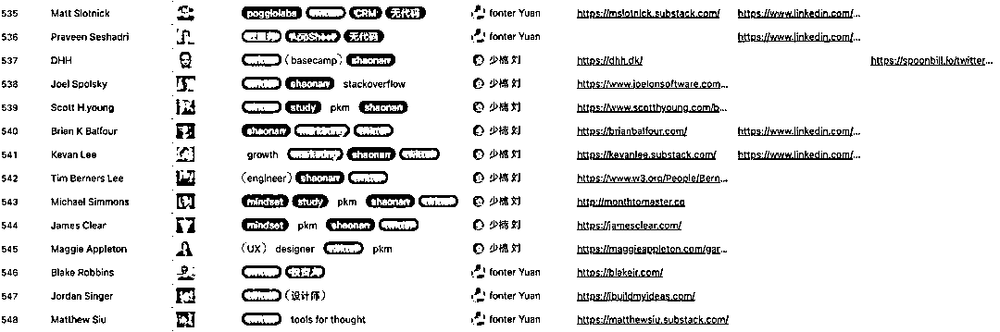

另：基于个人倾向，排除掉了大多数投资人，因为探讨的话题过于宏观，对日常生活工作帮助不大。

  

关注这些人的渠道包括但不限于：Twitter / Blog / Linkedin / Medium / Substack / Podcast 。

  

所以顺便推荐两个小工具提高效率：

•Twitter 的插件「Twemex: Sidebar for Twitter^(\[1\])」，可以直接按照热门程度浏览一个人的时间轴

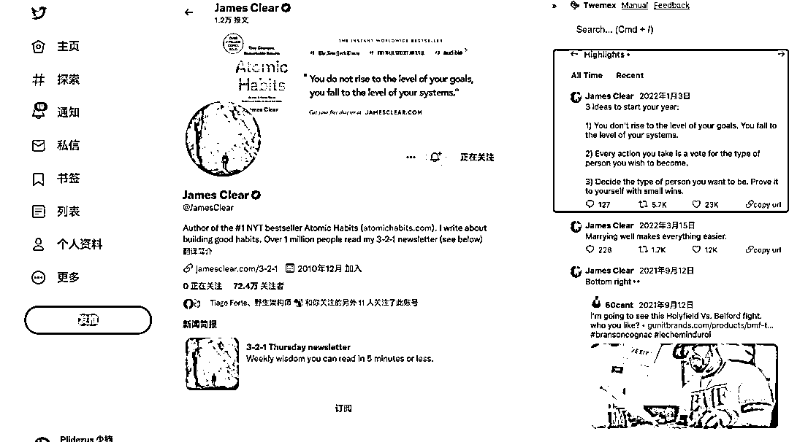

•英语听力不好的，可以考虑用这「PodcastNotes^(\[2\])」来搜索对应节目是否有逐字稿或者摘要，找到之后用任意翻译软件翻成中文就能看了。

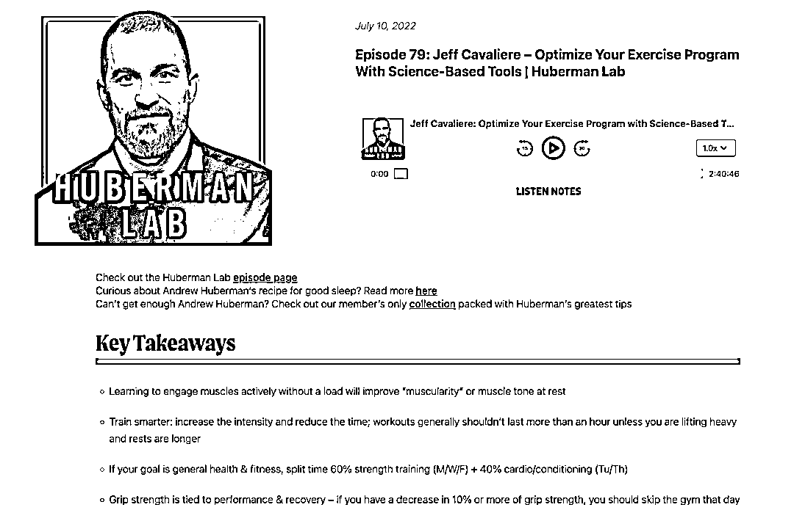

### 方式：主动获取，避免推送

我的手机一直都是处于勿扰模式，但可以拨通电话进来。原因很简单，着急的事情一定是打电话的，而其他事情都没那么着急。这样的另一个好处是，信息就从推送，变成了主动获取 —— 所以也更容易克制住点开 App 看是否有人给自己点赞的冲动。

  

**所以尽量掌握信息获取的主动权才是关键。**

我没用什么复杂的信息获取工具，也建议你不要纠结于工具的选择。

•Newsletter 基本上靠 Gmail + 过滤器解决，直接跳过收件箱归档，并且如果连续读了几期觉得没营养的，或者更新过于频繁的，就直接取消掉订阅，避免信息过载。•Twitter/Medium/Matter 很少主动浏览（英语不好必须挂着翻译软件），所以基本上有需要才去检索。•在 Notion 中有个页面，存储了我长期关注人/产品/组织的 Blog/Twitter/官网，以及上次访问的时间。这样可以每隔一阵去主动刷一遍看看有什么新鲜的东西出来。（不过践行的不好，正在改进）

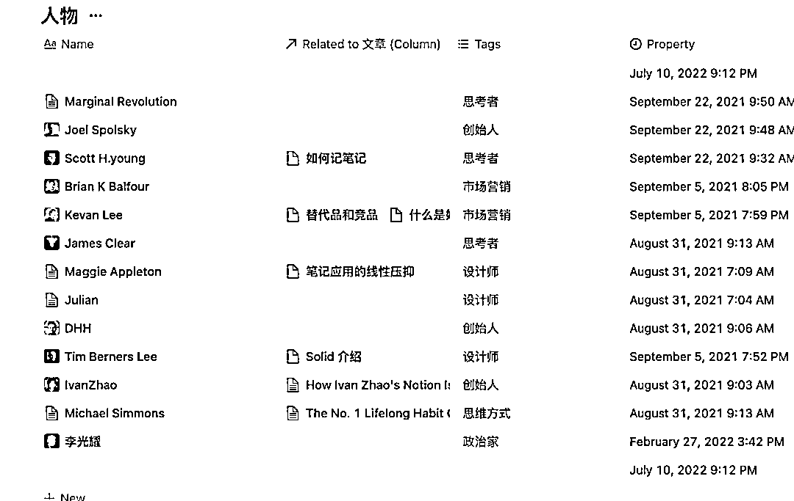

其实这里关键是在探寻某个话题的时候，一个高质量的信息源，往往会带出来更多高质量的信息源，循着路径去找就好了。比如：

•Naval 的官网^(\[3\])•Perell 的官网^(\[4\])•Alexey Guzey 的推荐清单^(\[5\])

  

唯一要做的就是控制好时间投入，不要一头扎进去出不来。另一个就是做好浏览记录，方便下次再回来。

  

另外，信源并非是越多越好，还要能消化掉。目前的选择是，尽量在日常上为获取信息留出足够时间（阅读和自由时间都是在干这个），有了固定时间之后，就不用随时响应朋友发来的内容或者其他产品的推送，确保不被分心。

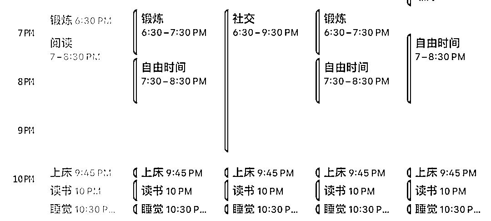

如果真的有好的内容但来不及看，多半选择丢在 flomo 的置顶 MEMO 中，或者随手浮窗在微信（注意不要收藏，收藏几乎不会看了）。

  

**碎片化收集和学习并非没有用，前提是你还有完整的时间来进行归纳和整理。**

### 方法：互动大于消费

这里说的输出未必是像本文一样絮絮叨叨的长篇大论。但恰好是因为这篇文章，让我把脑海中许多模糊的东西梳理清楚了，比如书籍和先锋之间的关系，推送和拉取之间的关系。

  

许多时候我们以为自己懂了，会了，知道了。但是实际上开始动手写的时候，就会发现可能许多地方还是模糊的。

  

但输出未必总是写字，而是深度的和内容互动。比如之前看看西蒙 · 赫伯特的书，发现其中并未提到过「西蒙学习法」，但在知乎却很多人提及。所以就花了不少时间来寻找出处，发现果然是一个赝品。由于投入了不少精力，对这个点就记得很深刻。

  

又比如我很爱玩游戏，但也很喜欢研究游戏如何设计的。在消费完许多关于《艾尔登法环》的设计思路后，我会专门去游戏中寻找一下他们说的这些细节，是否如此。或者反过来，在玩的时候琢磨一些背后的可能，然后再来寻找信源佐证。

  

在这种深度互动的过程中，我们其实是在做筛选和关联。

•筛选出来重要的信息，比如最终了解《艾尔登法环》的设计思路和欧美游戏不同，是先设计世界，再设计玩法，最后设计体验。这样一句话就解决了为何这个游戏体验和其他游戏差异那么大的原因。•关联是指上面讲读吴军《数学之美》时候一起看《几何原本》和《原则》时候的例子，把这些信息关联在一起，然后在 flomo 中记下自己的思考。

**所以不光要收集信息源，还要有固定的频率消费避免囤积过多，并且在消费过程中产生积极的互动。**

### 尾声

其实我们获取信源最重要的事情，并不是「看」，而是「产生某种行动」。**要么是思想上看待世界有了新的视角，要么是具体执行中有了一些新的动作。**如果一篇文章洋洋洒洒阅读十万加，但是自己读完并不能带来上述两种行动，那么这种信源对自己来说，并没有太大价值。

  

这也是我几乎不看新闻（尤其是社会新闻）的原因，因为总是在重复昨天的故事，而我们对此除了愤怒，并不能做什么事情。

  

或者说，相比廉价的同情心，我更希望能具体的做些什么事情，哪怕是再微小的改变。

  

之前看到冰哥（XDash）翻译的《**[Walking as a Productivity System | 步行作为一个生产力系统 (opens new window)](https://mp.weixin.qq.com/s?__biz=MzA4NDk5OTgzMg==&mid=2650591453&idx=1&sn=936bae5caf69984e9aea45139fd3bc01&scene=21#wechat_redirect "Walking as a Productivity System | 步行作为一个生产力系统 (opens new window)")**》，其中有一段话很打动我：

> 如果你想写一本 80000 字的小说，而你只写了 80000 字，这也许是可以接受的。但是如果你写了 30 万或者 40 万字，然后把它减少到 8 万字，几乎可以肯定这会是一本更好的小说。

  

或许你也要看过成百上千的信息源，最终才能筛选出来一些适合自己的优质信源。

  

所以相比直接复制别人的推荐清单，不如去「偷」那些有价值的问题，比如：**你最近在重读哪本书？（欢迎留言）**

### References

`[1]` Sidebar for Twitter: *https://chrome.google.com/webstore/detail/twemex-sidebar-for-twitte/amoldiondpmjdnllknhklocndiibkcoe*  
`[2]` PodcastNotes: *https://podcastnotes.org/*  
`[3]` Naval 的官网: *https://nav.al/archive*  
`[4]` Perell 的官网: *https://perell.com/essay/the-ultimate-guide-to-writing-online/*  
`[5]` Alexey Guzey 的推荐清单: *https://guzey.com/notes/#/*

# 浅谈自我是如何形成的：我们都是环境的产物

> 原文：[`mp.weixin.qq.com/s?\_\_biz=MzkyNjM1ODA2MA==&mid=2247485088&idx=1&sn=356021483928e5741b21f1ee9b3ab69f&chksm=c239c9e3f54e40f57c7ee506aac1b5ab8c1fb3dc4dc7ff820e0bb74b7b7510be9316abe734c1&scene=126&sessionid=1692256435#rd`](http://mp.weixin.qq.com/s?__biz=MzkyNjM1ODA2MA==&mid=2247485088&idx=1&sn=356021483928e5741b21f1ee9b3ab69f&chksm=c239c9e3f54e40f57c7ee506aac1b5ab8c1fb3dc4dc7ff820e0bb74b7b7510be9316abe734c1&scene=126&sessionid=1692256435#rd) 

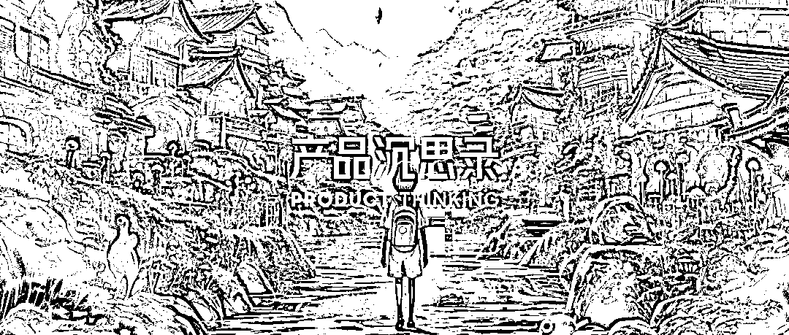

在南方生活的时间已经步入第 20 个年头，超过了在北方故乡的时间。

  

所以每次回家都有一种时空上的距离感 —— 熟悉于那些模糊的记忆，陌生于自己和当下环境的格格不入。而这种反差很有趣，因为鱼很难知道水是什么东西，只有跳脱出这个环境，才能看到更多的结构。

  

和许多亲戚朋友聊天，在这个过程中也让我对「自我」到底是如何形成的，有了一些新的看法。

### 自我都是涌现出来的，我们是环境的产物

在老家经常会用「长大了」这个词来形容一个人有自我意识了，但很难记起来，是什么时候开始有自我这个意识的，小学？初中？高中？

  

**自我更像是无数的时间和事件堆积，尔后涌现出来的一种特征。**

少数重大的变故固然会让人觉悟，但许多人一生没有太大风浪，所以许多时间和事件，多数时候都是被环境潜移默化所影响的。比如在南方吃饭早就习惯于 AA 制，而回到老家的家族聚餐，二姑讲起来她们的姐妹团还不适应 AA 制，感觉很不好意思。

  

所以选择什么样的环境，对于自我尚不明确的时候非常重要。但仔细想想能改变环境的机会并不多：

•更换原生家庭，这个基本上没有选择空间，只能尽早地独立出去生活，或者组建自己的家庭。这个机会一生最多一两次。•更换省份或城市，多半只有年轻时候高考或者外出打工，一旦在故土定居很难进行这么大的迁移。这种机会一生可能在五次以内•更换公司和团队，这种机会严格来说可能也只有十次以内，年龄越大，跳槽的可能性就在逐渐降低。

  

倒不是说环境改变越多越好，只不过一旦意识到自我被环境塑造，想要改变的时候，手中的筹码其实并不多，那就要在每次机会来临时候下重注。

  

**一个人即使自我意志再强烈，也经不起环境悄无声息地渗透。**

### 做自己的转折点，源自于对于环境输入信息的质疑

无论是社会环境，还是家庭环境，都在无时无刻对自我进行信息的输入，无论是门口叫卖的大爷，还是爸妈的一些动作。

  

真正的自我觉醒恰恰来自于对这些事情的质疑。比如小时候我很困惑在门口卖包子为何丢人？而老妈给的答案是做生意的风吹日晒，哪有在厂里呆着舒服，还能喝茶看报。但九十年代改革开放后，许多做小买卖的收入都比工人工资高许多，而老妈他们依旧很难改变这种观点。

  

表妹一直在老家生活，属于比较听话比较乖的那种女孩。毕业工作结婚生子，一直很少有自我的意识，都是听家人的安排。但生完孩子之后有一个让我印象深刻的转变，她不再听家人和婆家的念叨去找个安稳的前台之类的工作（没有说前台工作不好的意思），而是自己开始筹划做点小生意。虽然过程中很多坎坷，但终于经济独立。许多事情也不再依赖父母和丈夫的判断，而是能自己独立决断。

  

**我们一般很难想到去质疑环境，但这却是做自己的起点，因为这时候开始怀疑默认值是否正确。**

想想自己也是上大学之后，才发现家人教的那一套有诸多和自己看到的不一样的，虽然当时内心很冲突迷茫，但却是让自己开始思考，那些默认值真的对么？

### 做自己并不是一劳永逸的决定，而是一种状态

许多时候我们都会听到「去做自己」这样的话，仿佛是某一刻觉醒之后，就能从此一番风顺，但生活显然不是这么简单。

  

即使今天相对独立地做 flomo 和小报童，比起很多所谓打工人已经自由很多，但有些时候还是会不小心做出许多「不像是自己」的决策。比如当自己很疲倦的时候，遇到一些无理取闹的用户，还是会血压飙升撸起键盘和他尬起来。又比如压力大的的时候脾气很容易暴躁，也会吃许多碳水炸弹来缓解情绪。当然还有沮丧的时候认为没办法了，日子只能这样过了。

  

**做自己应该是一种保持觉察的状态，确保选择不是被社会默认值所驱动。**

### 做自己意味着有一系列稳定的，经过审慎过的原则

当然，如果每个选择都觉察，那么会非常累，所以我们会设置一些原则（或形成一些习惯）来加速这个过程。

  

只不过需要注意的是，要确保这些原则（或习惯）都是自己觉察过的，并且会定期复盘迭代，而不是被别人强塞，或者未认真思考拿来就用。比如关于挣多少钱够花这件事，又比如幸福真的是有房有车么？

  

这些原则不会很多，但难点在于许多方面觉察不到自己有默认值存在。

  

但从另一个角度来看，许多原则固化下来，也意味着僵化产生。

### 小结

自我形成的步骤

•通过**变更环境**，引起自我和新环境产生冲突，继而产生质疑。•通过**产生质疑**，意识到环境默认值和自我选择之间有冲突；•通过**解决冲突**，意识到自己的选择，继而产生原则；•通过**觉察原则**，来看自己使用的原则是否经得起推敲，以及是否按照原则行事。

  

思考的未必透彻，也欢迎大家留言说说你的想法，后续有深入思考会继续分享。

### References

`[1]` 王德峰：寻觅意义: *https://www.notion.so/4297d414e2b24211b4eb0ab3296176fa?pvs=21*  
`[2]` 韩炳哲：何谓倦怠社会: *https://www.notion.so/af9ea9decb4b491db4fb8b0e413cd8cf?pvs=21*

  

# 在众多内容型产品中，小红书做对了哪些事儿？

> 原文：[`mp.weixin.qq.com/s?\_\_biz=MzkyNjM1ODA2MA==&mid=2247485083&idx=1&sn=e7474cd0181a8dd83f5fc5854a368a57&chksm=c239c9d8f54e40cebec1ea1c5be22be63d22155df235acdfc7bc40ae272036964e8dbd1427e6&scene=126&sessionid=1692256435#rd`](http://mp.weixin.qq.com/s?__biz=MzkyNjM1ODA2MA==&mid=2247485083&idx=1&sn=e7474cd0181a8dd83f5fc5854a368a57&chksm=c239c9d8f54e40cebec1ea1c5be22be63d22155df235acdfc7bc40ae272036964e8dbd1427e6&scene=126&sessionid=1692256435#rd) 

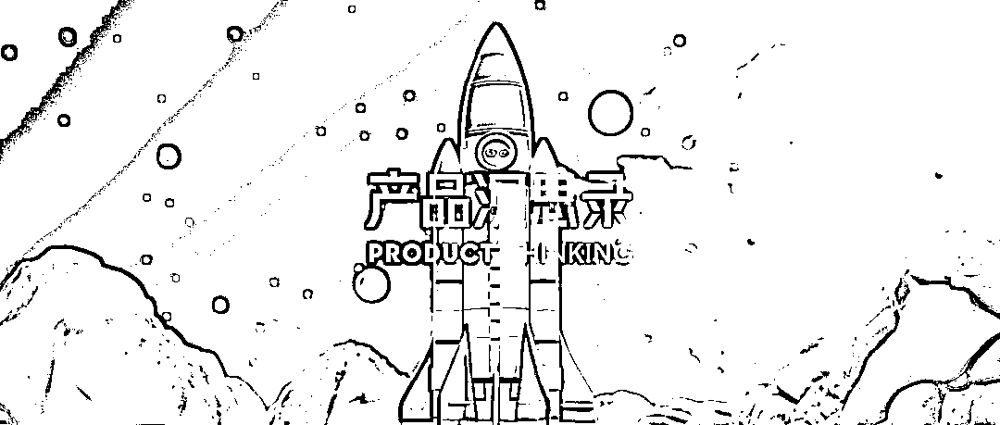

上周我们聊了下「当我们开始做内容时，需要思考些什么」，本周我们沿着内容这个话题，精选了飞哥之前在沉思录中更新的关于小红书的一些看法和见解。

  

> 关于刘飞。播客「三五环」主理人，原叶茶「三五杯」联合创始人，公众号「刘言飞语」作者；前阿里、滴滴产品经理，《产品思维》作者，主要关注内容创作、品牌建设和商业逻辑。

 

作为经历过知乎、公众号、播客等内容平台/形式的内容创作者，一直在观察内容产品。我自己并不是小红书的创作者，但从前几年开始，已经是高粘性用户，今年甚至是日活用户。

  

小红书为什么能吸引我？小红书为什么能从大厂厮杀中生存？淘宝内部为什么视小红书为洪水猛兽？这些问题都很值得思考。

  

本次的内容是源于我跟苏青阳的一次有关小红书的对谈而来，加入了我的一些思考和补充。

  

> 关于苏青阳：原网易云音乐社区负责人，历经阿里、腾讯等互联网公司，有多年的内容平台运营和产品经验，公众号「[互联网苏青阳](https://mp.weixin.qq.com/s?__biz=MzI5MjIwNDAxNQ==&mid=2650678705&idx=1&sn=20f21c7cda636c57f283224b73fe0006&scene=21#wechat_redirect "互联网苏青阳")」作者；对内容社区有长期深度的观察。

### 1

**内容定位并非是公关上的价值主张，可能是真正决定了内容平台厚积薄发的前提**。

  

苏青阳认为：「从一开始小红书内容调性主张的就是**实用**，这种主张本身更贴合用户的价值。其他的平台早期在做社区时更多以娱乐为切入点，虽然更容易满足当下需求的，但如果以实用为切入点，更能够厚积薄发。」

  

试想下，如果是追求娱乐明星的热点，势必可以快速获得大量曝光。然而这些内容的半衰期都极短，很快会消失在历史中。我们如今已经不关心去年甚至上个月发生的事情了。

  

然而实用是反其道行之的——**实用的内容，会反复打开**。打开又会增强对内容实用性的信赖。诸如菜谱、装修、育儿，都是可以长期产生价值的。

  

至于具体的差异点，对比百度，信息过于庞杂，且没有好的去伪存真的判断标准，小红书则通过互动功能（点赞、收藏、评论）一定程度解决了这个问题。

  

对比知乎，虽说知乎的内容往往足够完整、很多堪称专业，可是动辄就上千字的长篇大论，讲的是「道理」，不是「怎么做」。大家并不想要了解这背后的理论框架。

  

我自己真正用小红书，是在搬家后，很多家居、日用品乃至黑胶唱片的信息，都能快速有效找到有价值的内容。苏青阳也是，他后来真正开始使用，是从家里装修开始的。

### 2

小红书的长尾内容常被人称赞。这背后，是**创作门槛**的设立所致。

  

苏青阳认为：「知乎的整个社交货币是赞同，它典型的产品语言是**『你要赞同我』**。但天底下最难的事情就是把别人的钱塞到自己口袋里和把你的思想塞到别人的脑袋里。所以要获得别人的赞同，就意味着我需要长篇大论，有理有据，有足够的信服力。

  

因此，虽然都以图文内容为主要载体，但知乎的创作心理门槛比小红书高很多。两者的区别在于，**知乎更偏向底层的知识体系构建，但小红书更偏向应用层的使用**。而且除了实用的题材类型，还有很多人真的是把小红书当做一个分享自己生活的平台，就像**朋友圈**。」

  

我自己早年也算是知乎写手，对此深有同感。按理说知乎是原本大家认为图文分享生活经验很合适的地方，却被知乎的创作门槛所限。

  

知乎的创作门槛并非是指编辑器或内容创作，是否支持多少字等等。知乎的回答也可以写短文，也可以插入图片和链接。创作门槛不在于此，而在于**「社区治理」和「氛围」**。

  

正如苏青阳所述，若是知识体系构建型的内容，势必要长篇大论。有的看法，其实也有用、也挺专业，但篇幅不够，读者会天然有看法，这就是真正「内卷」起来，还要各种分段和延伸介绍，乃至要引用说明。

  

有些知乎答主，则彻底放弃长篇大论，以「抖机灵」为主，一句话、一段话开个玩笑，说个小故事，戛然而止，达到解构的戏剧性效果，在知乎也颇为常见。

  

所以知乎就呈现了**要么很长，要么很短**的奇诡局面。

  

对比小红书，多年如一日的内容界面，图片+文字分离的形式，以及不错的正反馈氛围，让很多人愿意随意分享，没有那么多压力。

### 3

**平台的社交货币会影响整体内容的导向。**

苏青阳认为：「早期小红书典型的算法分发是以 CTR 为主，所以导致首页会有一些博人眼球的内容出现。在后续的调整过程当中，就取消了以点击率为单一算法评估指标价值体系，融合了收藏行为和评论行为，帮助平台更好地判断什么内容是有用的。

  

……你的社交货币到底是什么？我们刚才提到了**知乎是赞同、抖音是红心、小红书是收藏**，其实产品经理设计的一个简单的交互操作会带来整个社区的颠覆性的影响。」

  

小红书的收藏意义很大。内容平台少有围绕收藏来做内容判断标准的，毕竟它未必是见效快的。而对于小红书、抖音这样基于个性化推荐算法为核心的平台来说，内容判断标准的一念之差，就会影响整个平台的内容变成怎样的特质。

  

收藏意味着，是**我日后可能还会拿出来再看的内容**，比如说菜谱就是一个典型的例子。看到一个不错的做法，收藏一下，下次就会拿出来用。这是用户在协助平台把这样的内容筛选出来。

  

这样的筛选有一层对平台的附加价值——**用户的唤醒和内容的重复消费**。很多平台都苦恼于如何让用户打开 APP，或者怎么提升他们的活跃。收藏的内容天然提供了这一场景，用户在遭遇某些场景时会回想起收藏，继而打开，这比其它平台的内容就有优势。

  

可以想象的是，如果小红书完全围绕的是点击，那创作者就会倾向用更擦边球、更有煽动性的封面来做内容；如果小红书完全围绕红心，那么很多娱乐的、搞笑的、美女帅哥的内容，就容易脱颖而出。

  

这里可以补充一个问题，是 fonter 提出的，他发现身边的朋友不少还是在用搜索功能。这是小红书所谓的「起家立业」的内容消费方式，小红书最初是依赖搜索海淘攻略这样的工具性很强的内容得到关注的。而在搜索功能下，我们讨论的价值导向意义不大，**搜索是满足用户意图，而非平台导向**。我们所聊到的以上逻辑，发生在当下的小红书，大多用户的主要场景已经切换为个性化推荐的方式消费，这种平台导向就能更突显价值了。

  

社交货币可以类比是 KPI。平台内容算法的 KPI 到底是筛选什么样的内容，内容创作者就也会依据这样的 KPI 去完成内容。

  

我可以分享亲身观察的案例。淘宝的「有好货」功能模块，是我几年前很喜欢用的，它会依据我的过往数据推荐有意思的产品，跟首页信息流有差别的是，它会加入一些创作者的描述。这是小红书之外很有意义的种草平台。

  

结果由于「有好货」后来设计的 **KPI 是点击（点击率）和转化（成交额），就让内容创作变得扭曲了**。创作者们开始用虚假的图片吸引人点击，点进来再说；很多创作者也放弃了做低客单价的商品，毕竟成交额不高。慢慢就变成各式各样搞噱头的家用电器、数码玩具等等的领地，失去了原本的价值。

### 4

跟苏青阳的对谈里，对我有一个认知冲击的地方是，他认为**做创作者激励计划未必是正向收益的**。这是我作为没做过社区运营的产品经理，不太好认知到的。

  

那些内容平台动辄千亿百亿的激励计划，追求的往往是短期的规模，带来了大量的头部竞争者。如果是一个新的平台，其实生态还远没有很健壮，这样反而会严重挤压长尾创作者的空间。

  

长尾创作者是很依赖平台的，但平台的激励计划未必覆盖到他们。甚至很多平台的创作者运营，专挑别的平台的头部来挖，他们来到平台后，对平台没有依赖，合同期一过，就纷纷回归，留下的反而是一地狼藉。扶持原生的创作者反而是更有意义的。

  

这点我自己也深有体会。从各种商业案例看，平台与供给方的关系，往往不在于谁处于上游、或谁更有资本，其实只在于**「谁更依赖谁」，谁离开了对方就更难生存**。

  

比如很多直播平台扶持起来的最头部的主播，到后期对平台来说就显得棘手，虽说一个是平台、一个是内容方，但平台还要花大力气去留住对方，否则没有流量，就是很危险的事情；如果贸然得罪了主播，他跳槽到竞品平台，就格外麻烦。

  

曾经辉煌过的教育行业也有个说法，新东方的名师们都名声在外，老师们各有所长，如今做主播、做脱口秀演员甚至去做企业家，都得心应手，但这不一定是好事——培养出来的，都弃你而去。反而好未来的老师们，按照 SOP 去工作，对平台来说没有这类风险。

  

这次先分享这么多。有关内容平台的认知和思考，还有更多在路上。我们下次见。

  

### References

`[1]` [跟苏青阳聊聊小红书和社区产品](https://mp.weixin.qq.com/s?__biz=MjM5NDkyNTUzOA==&mid=2657925794&idx=1&sn=4b4d9fdc821abf278edd9274560695df&chksm=bd18442f8a6fcd390df5e3861063f51326a2acc5054d923bee679dfc4d4ec9b7b542c2da33b9&token=343665087&lang=zh_CN&scene=21#wechat_redirect "跟苏青阳聊聊小红书和社区产品")

`[2]` 三五环-No.66 跟苏青阳聊聊小红书和社区产品: *https://www.xiaoyuzhoufm.com/episode/62277defe1378f3cc49d8f9e*

  

# 当我们开始做内容时，需要思考些什么

> 原文：[`mp.weixin.qq.com/s?\_\_biz=MzkyNjM1ODA2MA==&mid=2247485078&idx=1&sn=8ed35231cbcd57e45837a04956d5e946&chksm=c239c9d5f54e40c38f0db54522d9fbdd14ca2049b41a0a8608838dc5918dcd2903dbad1cffd2&scene=126&sessionid=1692256435#rd`](http://mp.weixin.qq.com/s?__biz=MzkyNjM1ODA2MA==&mid=2247485078&idx=1&sn=8ed35231cbcd57e45837a04956d5e946&chksm=c239c9d5f54e40c38f0db54522d9fbdd14ca2049b41a0a8608838dc5918dcd2903dbad1cffd2&scene=126&sessionid=1692256435#rd) 

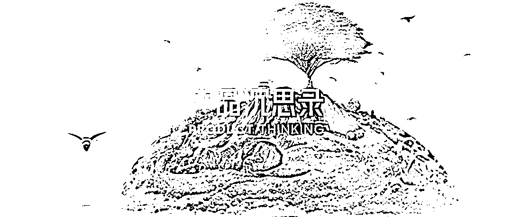

不开玩笑地说，做内容成为许多互联网人思考副业的第一站。而从另一个角度来看，许多时候内容也是某种「产品」，比如 flomo 的知识管理小册子，便是某种提高产品使用深度的产物。

  

这篇《The Content Pyramid: The 5 Levels Of Becoming A Legendary Writer, Creator, and Thought Leader》，系统地梳理了做内容演化的五个阶段，如果你打算开始在内容方面做点事情，又或者遇到了一些瓶颈，那么这篇文章或许会对你有所启发。

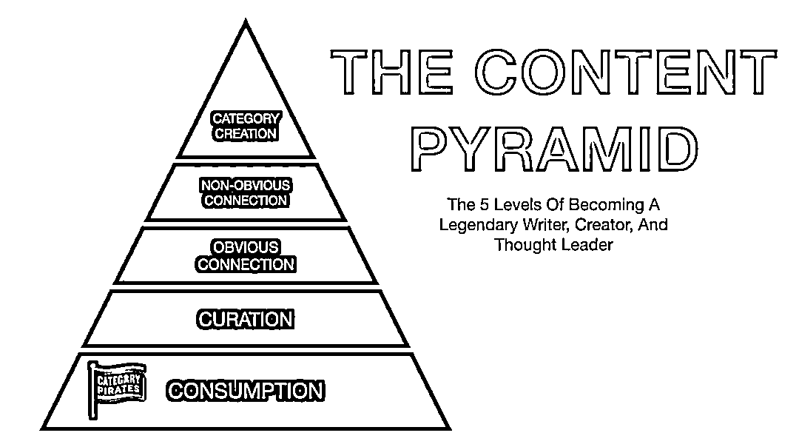

不经意间，自己也做了不少内容，从「产品沉思录」的专栏，再到「知识资产」这本书，还有「奇想驿」播客等，尝试过许多种内容形式。本次推荐并不会详述其中的各个阶段和过程，而是结合文章，浅谈一些自己在做沉思录时的思考，希望对于那些想从内容开始做副业的朋友有所启发。

### 你在追求的到底是哪种影响力

偶尔也会有虚荣心作祟，比如为何觉得很好的内容，却无人问津？又或者能否破圈，建立更大的影响力？甚至也和出版社接洽过，是否能把「产品沉思录精选」付梓印刷？但得到的答案是：受众太小，恐怕销量会很难看。

  

这种内心的冲突，其实是没有搞清楚，通过内容建立的「影响力」到底是指哪一种：

•一种影响力追求质量，来自于内容专业度，即在某个小圈子内享有影响力，如塔勒布的《黑天鹅》奠定了其在概率领域中的江湖地位。•另一种影响力追求数量，来自于内容接受度，即最大化地说出大众内心所想，获得他们的认可，如各种鸡汤教主和畅销书作者。

  

所以在加入这个游戏前，需要先确认你是想有所作为（创造有意义的思想，引起多数人的思考），还是被大多数人所接受（只需要针对最大公约数，重复他人的金句即可，不需要引发大多数人的思考）。

  

注意，这并不是说谁更高级，而是要搞清楚自己的选择，如果选择寻找高质量受众，就不要天天关注粉丝量。换个角度来看，也不要因此产生某些不切实际的优越感，**因为那些畅销书作者，或许比你还聪明，只不过他们选择生产大多数人需要的内容而已。**

### 问题大小决定受众大小

当一个人说「我是为自己做内容」的时候，他往往是为了避免回答「我的内容到底能帮别人解决什么问题」。**因为是你关注的问题，决定受众的大小，而非内容的质量。**

所以许多人搞错了做内容的步骤，先是坐下来开始写自己知道的东西，在完成后拼命将其推广出去，试图让全世界人关注 —— 但现实往往很快就会打脸，一本《母猪的产后护理》写的再精彩，能让母猪产崽率提高 N 倍，也很难破圈，因为大多数人并不会遇到这个问题。同理，那些试图将个人成长经历作为主题的新人，其内容价值亦是如此。

  

所以如果你想要更大的影响力，那么多数时候需要回答大多数人的普遍问题，并且尽量避免他们思考，而是让他们感觉到自己的想法是对的，值得认可的。比如「零成本赚到 100 万」「二十天产品面试集训营」等。

  

而如果你想接触到更多高质量的受众，那么关注的领域越垂直越好，需要引起他们的思考。比如「作为一个大学生，如何通过卖电话卡，一学期赚到 10 万元」。

  

换个视角来看：

•在网上拥有大量粉丝的人，往往会创建最肤浅、最明显的内容。•而拥有较少、更多垂直受众的人往往会创建不明显、高度相关的内容。

  

PS：这个方法也可以用来审视自己的信息饮食来源质量如何。

### 两种不同的内容

即使在同一个问题上，往往也会有两种不同的内容思路，因为任何内容都可以被归纳到两类内容：**有明显联系**或者**无明显联系。**

明显联系是指线性的内容

•这些内容更具实操性，内容结构相对简单，确定性强，读者不需要思考就能理解价值。•比如产品经理如何用 PRD 撰写模板、小红书如何快速涨粉、如何给网站做 SEO 等。•但缺点是保质期比较短，并且缺少独特性，很难形成独特的品类，很容易被其他人所替代。•**如果你想短期内将你的知识或特长货币化，那么最快的途径就是这种内容。**

  

无明显联系的内容

•**是指内容并非线性，比较抽象不容易理解，需要知道许多背景信息，并通过思考才能洞察其中的关系，货币化比较困难。**•比如《思考快与慢》中提出的「前景理论」就显然需要你开动脑筋仔细思考，才能从中获取到价值。•这种内容生产代价往往生产成本很高，并且其内容需要读者思考（而大多数普通人是不希望思考的），这就可能会导致无人问津，或者被嘲讽反对。•但从时间的维度来看，这样的内容更能穿越时间，也能因此真正改变世界上其他人的想法。

  

要搞清楚，你到底需要哪个，不要欺骗自己。

### 终极目的是创建品类，而非优化内容

我们关注薛兆丰，是因为其经济学洞察，倘若他去讲计算机历史，或许就没有人关注了。「个人品牌」是个伪命题，因为读者爱上的不是你，而是你创建的品类。

  

为何许多早年的「大 V」逐渐泯然众矣，便是脱离了自己创建的品类，开始输出许多和自身专业无关的问题，比如社会问题、政治问题等，导致对于读者的价值稀释。

  

相反，现在提到「[孟岩](https://mp.weixin.qq.com/s?__biz=MzIzNTQ4ODg4OA==&mid=2247488192&idx=1&sn=da6bcae9ed2346afab5afca724cf29e8&scene=21#wechat_redirect "孟岩")」，因为其长达五年不断更新和价值投资相关的内容，基本和「价值投资」这个品类画上了等号，所以当有知有行出来[长钱账户](https://mp.weixin.qq.com/s?__biz=MzIzNTQ4ODg4OA==&mid=2247488192&idx=1&sn=da6bcae9ed2346afab5afca724cf29e8&scene=21#wechat_redirect "长钱账户")时，获得了许多朋友认可（不构成投资建议）。

  

你不能同时服务两个市场，既要大众易于理解和传播，又要在小众圈子中获得高质量口碑。

  

这两个不同的市场还意味着不同的商业模式，所以越细分，产品就越具体；而越稀有，能收取的费用就越高。同时，一旦你创建了差异化的类别，就可以解锁更多商业模式。下图就是个简单的例子：

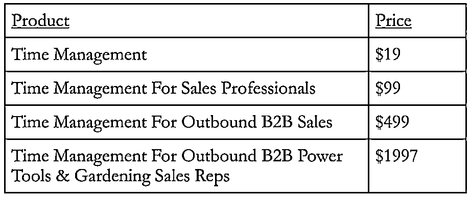

再比如，畅销书作家 Ryan Holiday （他在国内出名的是那本《微习惯》。但在国外几乎是「斯多葛学派」的代言人），他除了写书之外，还会销售在线课程，工具，以及付费通讯，甚至是实体周边等。

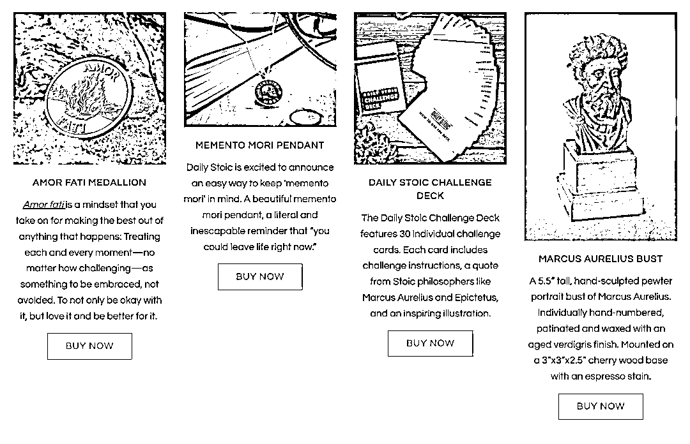

**因为当人们被这个品类所吸引的时候，会不断需要这个品类的内容，而这些只有你能提供。**

### 关于定价

许多人在处理收费内容时，往往会显得很没信心（我也一样），一方面是因为边际成本较低，另一方面是希望能通过降低价格，获得更多受众。

  

但却忽略了，人们买东西是为了达成交易 —— **即他们认为他们得到的东西，比他们付出的代价更有价值**。换句话说，如果你不能比你的竞争对手便宜 10 倍，就不要在价格上竞争。因为成为第二便宜没有任何优势，倒不如成为一个贵的让人印象深刻的东西。

  

当你提高价格时，你会增加客户获得价值的感觉，这像是一种心理暗示。人们将更多的价值分配给成本更高的东西 —— 前提是，你的内容确实比市面上内容独特。

  

而如果你提供的服务客户必须做一些事情才能获得价值（比如阅读你的提供的内容、学习你提供的课程等），那么当你的售价更贵时，他们会更乐意去消费。

  

**因为付出最多的人关注最多。**

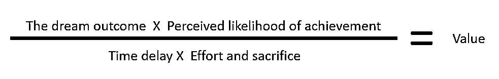

**设定价格时，可以考虑 Alex Hormozi^(\[1\]) 在《$100M Offers》中的价值公式**

•梦想的结果：大多数人的梦想都和社会地位的提升有关，最不济也是如何不下降。所以应该描绘他们的梦想，告诉他们如何实现梦想。•结果可感知度：食物能顶饿，这是 100% 的；而读一本书能带来什么效果？不确定。你的内容能否让读者感受到某种确定性？•时间的延迟：多久能看到结果？是一年后才能赚到 10000 元，还是每天能多挣 10 块钱？•付出的代价：让事情尽量变得直接、无缝、轻松。尽量从心理学而非物理学角度来思考这个问题，比如不要让地铁更快，而是告诉人们还要等待多久；人们不想长胖但还是喜欢甜味，所以告诉他们这种糖不长胖。

  

前两个属性比较好思考，只需要有奔放的想象力即可。而后两个则比较难，因为需要实打实地给出解决方案。

### 小结：

•你追求的到底是哪种影响力？不要既要在小圈子举足轻重，又想要尽可能多的受众关注。•在开始做内容之前，思考自己在解决的是什么问题。因为问题大小决定受众多少。•如果着急进行内容变现，尽量提供有直接联系的内容，比如如何在小红书涨粉；如果希望能真正改变人们的思想，尽量提供无明显联系的内容，比如卡尼曼的「前景理论」。•做内容终极目的是创建品类，而非优化内容。最好让自己成为某个品类的代言人，比如薛兆丰之于经济学，孟岩之于价值投资。•定价不要一味追求便宜，而是要关注读者是否能真正获得价值，因为付出越多的人，关注越多。

### References

`[1]` Alex Hormozi: *https://www.acquisition.com/firm*  
`[2]` The Content Pyramid: The 5 Levels Of Becoming A Legendary Writer, and Thought Leader: *https://xiaobaotong.feishu.cn/docx/TkJrdnDmmoY78kxHpMmcy8SfnSd*  
`[3]` Summary of $100M Offers by Alex Hormozi: *https://xiaobaotong.feishu.cn/docx/IzqRdK3F2or1DexTQcCc2dMMnWe?from=from\_copylink*

# 建立产品优势，从整体产品与细分市场开始考虑

> 原文：[`mp.weixin.qq.com/s?\_\_biz=MzkyNjM1ODA2MA==&mid=2247485067&idx=1&sn=efc70aa42c98921298939baa495ba45c&chksm=c239c9c8f54e40de7a63cd04f762f8842d5d35564ebff70257daaae92807d2cc5a90c59388fd&scene=126&sessionid=1692256435#rd`](http://mp.weixin.qq.com/s?__biz=MzkyNjM1ODA2MA==&mid=2247485067&idx=1&sn=efc70aa42c98921298939baa495ba45c&chksm=c239c9c8f54e40de7a63cd04f762f8842d5d35564ebff70257daaae92807d2cc5a90c59388fd&scene=126&sessionid=1692256435#rd) 

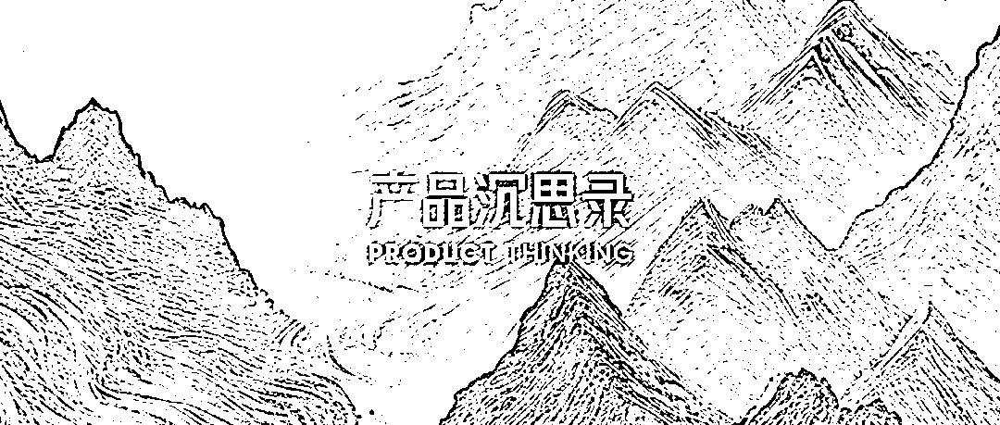

许多热心用户经常反馈，某某软件出了个白板很棒，你们（flomo）应该考虑下；又或者有人吐槽说，怎么这产品那么简陋，连基础的 Markdown 都不支持。

  

其实许多时候，产品竞争不是单一层次，而是多个层次一起竞争。不是在一个通用市场竞争，而是在许多细分市场竞争。

### 整体产品

在上个世纪八十年代，西奥多 · 莱维特教授就提出了「整体产品」的基础概念；而在十年后，英特尔的高级副总裁 Bill Davidow 在《Marketing High Technology》一书中完善了这个概念。

  

> **你在营销时向顾客承诺交付的，跟你实际交付的产品是不一样的，两者会存在落差。想要消灭落差，必须强化产品，增加配套服务和辅助产品，使之成为整体产品。** 

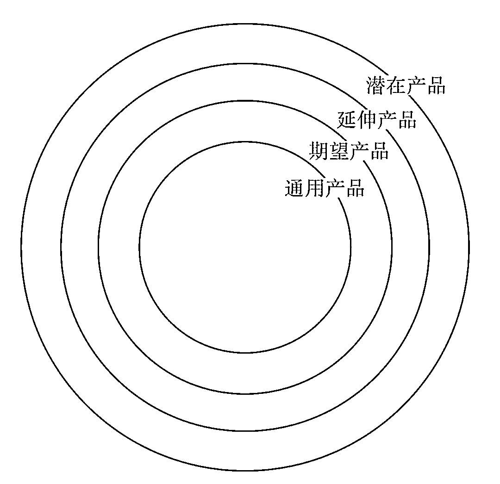

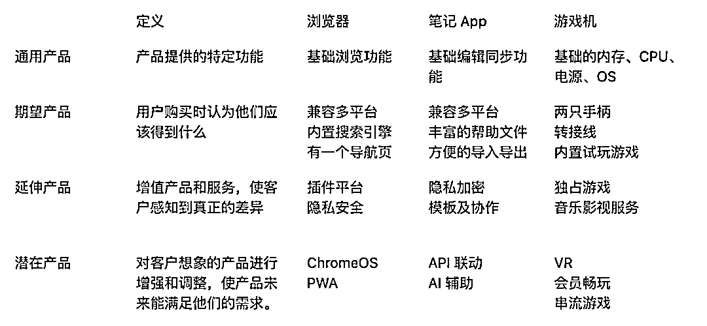

**用户使用产品时，看似是为了通用产品，实则必须满足他们的期望后，才会选择。**比如一款饮料很好喝，但是必须跑很远才能买到，那么对于用户来说就不会选择。又比如虽然 Safari 号称速度很快，在通用产品层面吊打 Chrome，但依旧很难撼动其地位，因为 Chrome 在期望产品、延伸产品方面做优势更多。

### 细分市场

「整体产品」并不意味着我们要满足市场上所有人，而是让产品在某些细分市场更有竞争力。

  

比如同样是验孕的需求，即使是两位女性从人口统计学上特征一致，但一位是希望怀孕，另一位是担心怀孕，两款产品在「通用产品」层面不会有差异，而差异往往在名字及包装，销售渠道及方式等其他层次的产品层面。

  

但细分市场并非是指人口统计学层面的分类，**而是取决于用户在做购买决策时，是否会互相参照。**

举个例子，虽然都是用 flomo 做读书笔记，但是从《卡片笔记写作法》下载的用户，和通过应用市场推荐位下载的用户就完全不同，因为两者很少能相互参照。即使是在小红书上，通过 App 推荐类账号下载 flomo 的，和读书博主推荐而下载 flomo 的，因为两个用户群受众很少相互参考。所以不能把小红书人群看做同一个细分市场，而是需要进一步拆分。

  

为何「参照」成为细分市场的标准？因为如果用户之间不参照，那么传播成本就会太高。而**细分市场中用户相互参考程度越高，则越容易形成所谓的「口碑效应」**。比如用药助手这个 App 已经覆盖了中国一半以上的医生，那么任何新加入到医生行业的用户，选择用药查询时，多数时候都会选择这款产品。

  

如何细分市场？可以从下面几个方面去衡量：

1.**可识别，**比如「爱学习的学生」这个市场就不好识别；「考公务员的学生」相对就比较好识别。2.**有规模，**如果细分市场规模太小意义也不大，比如白板类工具在国内一直无法起来，就是因为真正用的起来的细分市场规模太小。3.**可触达，**如果一个细分市场没有好的触达渠道，那么也无济于事。比如当时 flomo 做飞书 Bot 输入，就会遇到一个问题，如何触达到对应的组织？4.**较稳定，**细分市场应该足够稳定才能长时间地进行营销，反之则要小心。比如玩飞盘的人群，就未必有玩跑步的人群稳定。5.**有反馈，**如果你找到了一个细分市场，但是投入宣传后用户无法给予有效反馈，一定要小心，很可能是产品对这个细分市场没有价值。比如当年锤子发布的 TNT，即使是锤粉都爱不起来。

  

细分市场时还要注意一些陷阱，因为**细分市场不是被创建的，而是被发现的**。比如「双链笔记市场」就是一个人为创建的伪细分市场。另外就是避免为了细分而细分，许多产品设计之初定位模糊，就喜爱在后期不断地细分，导致最终得到一个无效的细分市场。

### 在正确的市场及产品层次，建立竞争优势

**而任何产品在上线之初，竞争都是在通用产品层面打响的。**只不过随着竞争对手变多，核心功能趋于一致，战斗就开始向圆环外蔓延。

  

比如 RoamResearch 最早把双链及星图给普及了，但今天几乎已经成为了每个笔记产品的标配，其期望产品和延伸产品却没有跟上，导致热度下降许多；又比如，flomo 有许多开源仿品，他们认为 flomo 太简单不值得收费，但却忽略了，对于普通用户来说，通用产品只是起点，而真正能用起来，需要在各个层面的产品完善才能选择，毕竟大多数人并不懂如何折腾 Webdav。

  

所以这里要小心的是：

1.**不要总盯着「通用产品」来改进**，比如许多笔记类工具，虽然基础功能非常赞，但却忽略了 Windows 和 Android 巨大的用户群，导致许多潜在用户无法使用产品。当一个市场出现两个以上同类产品时，投入到通用产品资源的 ROI 就会越来越低，而在其他层次产品投入的 ROI 则会变高。2.寻找细分市场时，要注意不要陷入人口统计学误区，而是要关注人群是否具有**相互参照的动机**。比如「针对学生的笔记市场」也是一种不严谨的细分 —— 毕竟不同专业，不同水平的学校，其学生群体的参考性大相径庭。3.**明白你所在细分市场中的用户到底是谁**。其实越是早期细分市场中的硬核用户，往往越聚焦于通用产品改进，比如支持各种语言、公式、代码块等功能，但对于大众用户来说，可能各个平台都有客户端，甚至能在各种电脑管家中搜索下载到，才是关键。

### 小结

**「细分市场」让我们思考真正的用户是谁，「整体产品」则让我们跳脱基础功能的竞争，从大多数普通用户的视角来看他们究竟期望购买的是什么。**毕竟对于足力健来说，款式的多寡可能就不如门店服务态度重要。

  

### References

`[1]` What You Need to Know About Segmentation: *https://hbr.org/2014/07/what-you-need-to-know-about-segmentation*  
`[2]` The Whole Product Concept: *https://productstride.substack.com/p/whole\_product*  
`[3]` 跨越鸿沟：颠覆性产品营销指南: *https://weread.qq.com/web/reader/71832a90813ab779fg012d02k45c322601945c48cce2e120*  
`[4]` 营销想象力: *https://weread.qq.com/web/reader/38332e90723e7646383d64ckc1632f5021fc16a5320f3dc*  
`[5]` 营销笔记: *https://weread.qq.com/web/reader/0fd322c0813ab705bg019599k9bf32f301f9bf31c7ff0a60*

  

# 为什么工作总不在状态？不如试试能量审计

> 原文：[`mp.weixin.qq.com/s?\_\_biz=MzkyNjM1ODA2MA==&mid=2247485060&idx=1&sn=513163fcaf51ae051842f94516039dd7&chksm=c239c9c7f54e40d15d218190e317f150c19f2e7c9880d9440c644630483b01a7d0e8b87f74cb&scene=126&sessionid=1692256435#rd`](http://mp.weixin.qq.com/s?__biz=MzkyNjM1ODA2MA==&mid=2247485060&idx=1&sn=513163fcaf51ae051842f94516039dd7&chksm=c239c9c7f54e40d15d218190e317f150c19f2e7c9880d9440c644630483b01a7d0e8b87f74cb&scene=126&sessionid=1692256435#rd) 

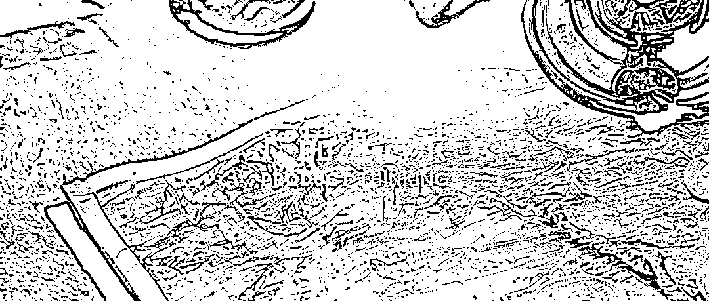

沉思录中曾提到过一个概念叫「审计（Audit）」，即花些时间来屏蔽外界干扰，看看对应领域的状态如何，最核心的要素有哪些，以及是否要做出对应的改变。

  

本文内容来自于硅谷著名的 CEO 教练 Matt Mochary ，以及 Front CEO Mathilde Collin 的分享，主要提及的是创业过程中，如何「审计」自己的能量状态 —— 这刚好也是自己近半年遇到的问题。

  

其实创业看起来很美好，但当你实际开始「经营」一个业务就会发现，快意江湖的事情是很少的，多数时候都是琐碎但又不能出错的细节，比如年末的各种财务、法务问题等。所以创业中的疲累，往往不来自于加班等体力消耗，而是那些琐碎又没有成就感的事情。

  

下面是编译的内容。

### 识别两种状态 & 四个区域

如果一件事情不是让你乐在其中，那么多数时候就是在消耗能量。而做能量审计的关键是要把他们识别出来，客观地分析，给出明确的解决方案，而不是得到一个感性的结论。

  

具体步骤如下：

1.开启你的 [lifelog](http://mp.weixin.qq.com/s?__biz=MzkyNjM1ODA2MA==&mid=2247484837&idx=1&sn=4ce5a376e6f2b514a9af4d982560aa98&chksm=c239cae6f54e43f07a1a942aa661d1807015d40b167e70b29a7d95fb232a630c93252b0afc77&scene=21#wechat_redirect)，客观记录所有和工作相关的事宜（偶发的事情除外）2.记录一到两周后，把这些不断要做的事情罗列在一张纸上。3.仔细思考每件事情后面，是在增加你的能量，还是在消耗你的能量。举个自己的例子：

•每周写沉思录（尤其是遇到感兴趣的主题）会让我感觉很兴奋，能量满满。•做一些界面设计工作，尤其是比较新的概念性的设计，会让自己感到能量满满。•每次直播前都会很紧张，直播后会让人感觉很累，仿佛用尽了所有力气。•处理沉思录的迁移问题，会让我感觉很疲倦（当然也怪之前 CRM 系统没做好😆）

  

但这并不是说，制造增加能量的事情，而是要看这些事情分布在什么区域内：

•**无能区域：其他人做的比你更好（例如处理财务问题）**•**尚可区域：你能做好，但其他人也能做到（例如做客服）**•**卓越区域：你能做的比别人好很多，别人希望你多做，但你并不喜欢（例如做咨询顾问）**•**天才区域：你自己擅长，且自己喜欢，以至于做这些事情时很容易进入心流（设计产品）**

  

根据上述的两个步骤，可以得到一张表格（把自己的思考做个 DEMO）：

 
| 2022.12 || 增加 || 消耗 |
| --- | --- | --- |
| 天才 || 沉思录撰写设计 flomo 的某些功能 ||   
 |
| --- | --- | --- |
| 卓越 || 录制播客 || 参与直播参与不必要的社交 |
| 尚可 || 处理客服工作 || 书籍撰写手工维护 CRM 系统 |
| 无能 ||   
 || 采购、对账工作 |

  

当得到这张图之后，发现一些很有趣的结果：

•一段时间内处理的事情如果都是尚可和无能区的东西，整个人就会很丧。比如之前有一阵就是充斥着大量的机械性工作，或者自己完全无能的工作。•**卓越区最危险，因为会有更强的外力推动**（毕竟你擅长，所以对他们有好处）。回想之前打工的时候，大多数事情都是出于这个区域内。•在目标不明确时，很容易去做增加能量的事情，但如果不注意区分，就会选择低水平努力。比如有时候处理一两个客服问题时，不小心就会搭进去许多时间。

  

**最好的状态，是我们有 80% 的时间都在做那些天才区内，增强我们能量的事情。**

### 如何解决消耗能量的事情

你不喜欢的事情未必别人不喜欢，世界足够大。所以对于那些消耗你能量的事情，可以尝试下面的解决方案：

•消除：一劳永逸地解决某一类问题。如沉思录的迁移，就解决了人工维护 CRM ，以及每周人工多出同步文章的事情。•外包：找到对应天才区的人，转交给他们。比如和飞哥录制播客，剪辑的工作基本上都是由他来解决。•精进：把消耗变成了滋养。比如写作时，投入更多的精力而不是被迫履约，这样一方面能提高写作能力，另一方面也能把过程中的资料再次内化。

  

说来简单，观察自己为何之前没有解决，问题来自于：

1.无法逃离卓越区：虽然不喜欢，但觉得自己做的比他人更好，没意识到丧失了机会成本^(\[1\])。2.没有留出余裕：解决问题会短时间内消耗更多能量，需要额外留出余裕才能执行。

  

除此以外，审计工作往往不是一次性的，刚开始可以每个月都连续来尝试，直到自己的 80% 的时间都在做能给你增加能量的事情上，这样就会让自己处于一个更好的状态。

  

### References

`[1]` 丧失了机会成本: *https://xiaobot.net/post/614f09ab-31a9-4caa-b55c-2d7683af1c85*  
`[2]` Energy Audit by Matt Mochary: *https://docs.google.com/document/d/1HmaRdtk8R5GQtMj72Y6XhHTru5SQAiiqDfDP3qy73k4/edit*  
`[3]` How to find your zone of genius: *https://collinmathilde.medium.com/how-to-find-your-zone-of-genius-68378d493320*  
  

# 构建一次，销售两次：如果不出卖时间，如何才能创造更多财富？

> 原文：[`mp.weixin.qq.com/s?\_\_biz=MzkyNjM1ODA2MA==&mid=2247485055&idx=1&sn=9240a7958be6d2628899b4066d1964e3&chksm=c239c93cf54e402a34006d8bc4cf4ab84c344ee3d81d9fb032ee4f56ce043ff20c4b63effdcf&scene=126&sessionid=1692256435#rd`](http://mp.weixin.qq.com/s?__biz=MzkyNjM1ODA2MA==&mid=2247485055&idx=1&sn=9240a7958be6d2628899b4066d1964e3&chksm=c239c93cf54e402a34006d8bc4cf4ab84c344ee3d81d9fb032ee4f56ce043ff20c4b63effdcf&scene=126&sessionid=1692256435#rd) 

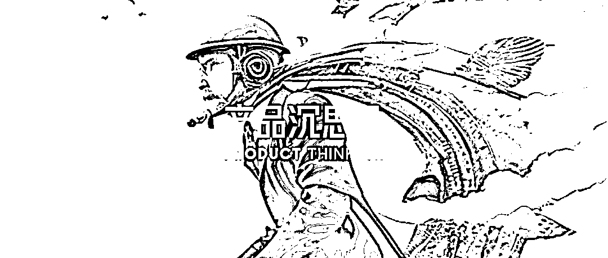

许多朋友在寻找副业或打算单干时，会比较关注收入情况和 ROI ，却容易忽略背后的结构 —— **究竟是让一份时间能被卖多次，还是提高单位时间的价值。**前者的典型是制作标准化的产品和服务销售，而后者则是提升自己的专业度，接更贵的单子。我们长期以来在公司养成的习惯是后者，而实际上前者才能让自己彻底自由。  

  

本文源自 Jack Butcher 自己亲身体验后衍生的一门课程。他曾经做了数十年的平面设计师，但在 2020 年 1 月时，他公司的银行账户只有 58 美元。因为当时的他正处于一个瓶颈期（估计也是大多数打工人遇到的）：出卖时间赚钱，逐渐达到一个临界点，身心俱疲，无法前行。

  

他决定缩小注意力范围，致力于解决一个特定的问题 —— 即通过视觉效果，使复杂的东西易于理解。随着精力聚焦，他逐渐衍生出一个品牌「Visualize Value」，通过社交媒体不断分享比如思想家、心智模型或者某些哲学名言转化为的视觉图形（如下图）。除此以外，他还提供从服务到产品的多种变现方式。在 2020 年末时，产品收入已经超过了 100w 美元。

Failure is the frame, not the picture.

下面是他们关于「构建一次，销售两次」课程的一些笔记汇总，其核心观点就是：**将出售时间付出的努力，转化为可以反复出售的数字资产（如文档、课程、资料库）中。**

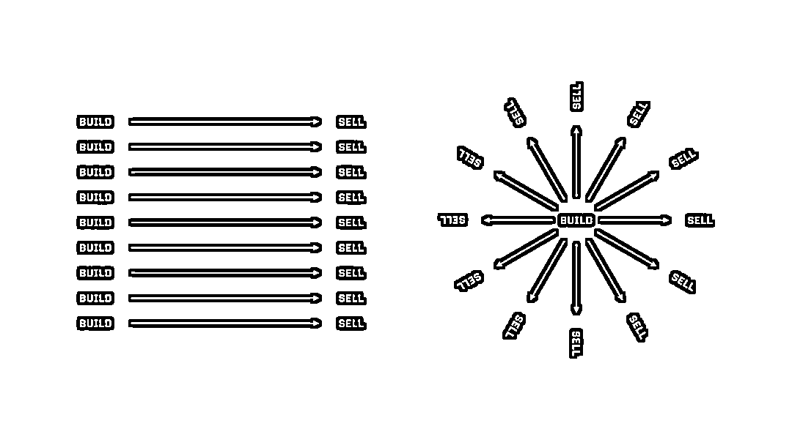

这里有一个在做小报童业务时候的洞察：**订阅制是一个服务，交付内容和边界不稳定；买断制是一个产品（就像一本书），交付内容及边界相对清晰。**如果你打算开始构建自己的服务和资产，建议可以从一个具体的问题下手，比如最近在小报童后台就看到许多案例库（如小红书冷启动 100 个案例）和方案库（如何学会 AI 绘图）等，都远比一个订阅制专栏更加产品化。

  

具体的原因，以及如何从服务转化为产品，诸位可以继续往下看，括号内是个人的一些注解，仅供参考。

  

**课程主要内容概述**

1.Jack Butcher 最初有一家卖服务的广告公司（和打工人一样），但是赚的越多越痛苦，因为成本线性增长，无法把自己解脱出来。痛定思痛，他在暂停服务之后，开始考虑设计自己的产品。2.如何实现？大幅缩小关注范围。**从响应别人的需求（如接甲方的单子），变为创造需求反复销售（如这门课）。**在他的能力圈内，就是将复杂的概念用简单的图形表达出来。

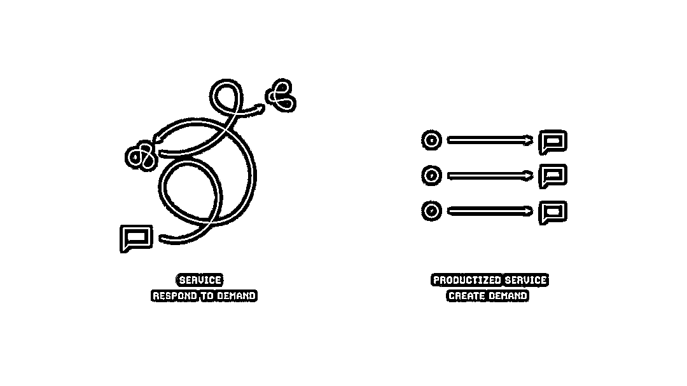

3.所以他创建了一个网站，然后开通了各种社交网络，**每天都在与市场接触，**向市场证明他在这方面的能力，同时建立受众，增加声誉。这样内容生态就能不断帮助他们，**提升品牌，增强产品的价值认知。同时自动寻找和转换客户。**4.将这些平台上的流量转化至他们用来获取价值的资产上—— 高客单价的定制服务，中客单价的标准服务，以及低客单价的产品。这样带来了两个好处：**让咨询工作变得结构化，能够让他们和市场需求保持一致；产品收入无需再次耗费时间构建。**（徒有流量靠广告还是不稳妥的方案，尽量有能力自己生产产品，把收入这件事跑通，如近期和飞哥聊的，他的「半拿铁」就开启了部分节目付费收听，以及还在撰写《内容即品牌^(\[1\])》这本书）

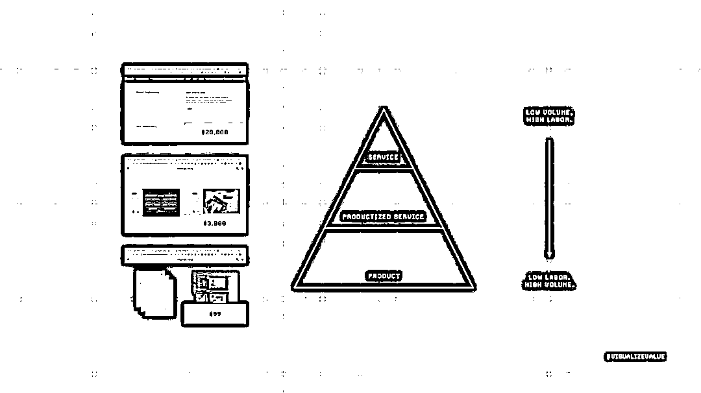

### 构建产品的思维方式

思维方式决定了我们做什么，做什么决定了我们最终的结局。所以先要打破心理障碍，让自己成为资产。

1.**承担责任：**创造资产刚开始是难的，但好处是巨大的，因为通过互联网来实现，是一场不对称的赌注（成本低，回报高）。注意将自己放入游戏中，承担交易风险，这样才能让自己更强壮。2.**掌控一切：学会销售，学会构建。**这样可以依赖更多人来养活自己，而不是唯一的雇主。这样的好处在于，你可以不需要任何人的许可。（许多人过度注意构建能力，比如设计师一直钻研设计能力，却忽略了销售能力，比如擅长 PS 不如找到一群喜欢定制姓名壁纸的人群。）3.**培养技能：没有人在乎你能做什么，每个人都在乎你能为他们做什么（反复读几遍）**

•**从经验中学习：**体验越独特，产品越有价值。所以可以从这个视角重新定义你认为浪费时间的东西，是否能将其作为独特性的必要投资。

•**通过迭代学习：**你钦佩的每个人都曾是初学者，创造有价值的东西不可避免的第一步是创造一些毫无价值的东西。工作就是一系列的实验，而不是失败。•**通过帮助别人来学习：**让别人成功，在这个过程中你也能理解在哪里放大了自己的价值。•**通过构建学习：**无需别人许可，意味着你可以以自己的方式在互联网上发布你想要的内容，不必是非常详细的商业计划，只需要将你自己**非常具体**的观点呈现给世界，这样你就会从大多数人中脱颖而出。

### 如何构建产品

现在你的工作是以一种**产生独家需求**的方式包装你独特的技能、观点和兴趣。但无论销售什么，都要经历下面三个步骤：

1.**证明问题：**世界不会奖励最善于解决问题的人，而是**奖励沟通问题最好的人**。**表达问题的能力与解决问题的能力一样重要。**所以你能提供服务的能力，取决于你自己定位何为问题，以及提供答案的能力。并非所有的问题都是巨大的。（之前和「生财有术^(\[2\])」合作开了眼界，见识了许多闻所未闻的需求 —— 不要冲动消费，请根据需要购买）。2.**证明过程：**问题的另一半是设计一个流程，使你能够为很多人解决这个清晰表达的问题。所以这里面分为两部分：**好好沟通问题、很好地传达解决方案。**当然最美妙的地方就在于此，你不需要任何人就能向世界证明你的能力。（许多产品本身并没有问题，但是缺少和用户沟通的能力，乔老爷就是一个擅长沟通的典型。）3.**证明自己（解决方案）**：人们信任人，所以需要一份明确的证明，证明你在过往服务中提供了你曾经承诺的结果。（想办法把你的能力展现出来，个人网站、播客、演讲等等，把你头脑中有价值的东西展开。）

  

在构建产品之前，你只是增加了时间的价值，但你做的事其实是有限的。**需要将声誉和特定知识转化为资产，并且可以用零复制成本无限次销售的产品。**

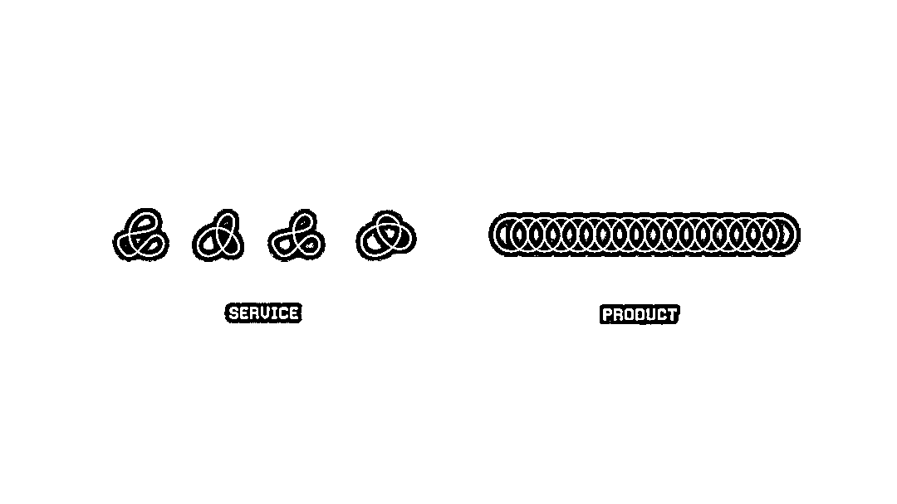

补充：定义问题是最关键的，比如会用 PS 的人很多，但能想到帮别人定制壁纸的人并不多，而真正能开始行动并找到受众的人就是凤毛麟角了。理解自己技能价值时，试着把自己从主角位置上剥离出来，看看别人要什么。

### 建立声誉

巩固独特声誉的长期目标，是完全摆脱竞争。人们买的不是你的商品，而是买你这个人的价值观，记得玩一场长期游戏。

1.**要慎重：**制造噪音（多尝试），聆听信号（看反馈）。当你收到信号时，需要聚焦于实质并加快输出周期。想要被市场认可，就要能被识别。2.**要有主见：**人们只会信任你到你信任自己的程度，不要跟随市场人云亦云，专注你的市场。（反过来看，许多大 V 凡事都发表意见，最终很快就会变得泯然众人。）3.**保持心态：**接受批评和模仿，这是受众正在增长的信号。经营业务需要意见，把自己和业务分离开。4.**保持多产：**找到 1000 种说话的方式，不断向人们展示你在做什么，这样你的受众就会觉得你无处不在。5.**保持开放：**带人进入幕后，通过展示你如何做到来证明你可以解决具体问题。泄露「秘密」，人们会付钱给你来教会他们。6.**做你自己：**在沟通中越接近自然状态，越能与竞争隔离。因为人们从人们那边购买，所以你作为公司资产的增长载体，将会受到行为真实程度的巨大影响。（所以不要去搞人设，因为装出来的，一定会露馅）7.**拥有自己的声誉：**在你独特的资产能力之上，和其他拥有独特资产能力的人建立互惠互利的关系。这样你的关系网络中参与者会越来越多。但要小心，随着网络变大，你要开始挑选其中的机会。8.**承认自己的失败：**搞砸了就承认，因为每个场合，承认并请求原谅，会让别人觉得你真实，反而能带来增长。

### 拥有你独一无二的故事

塔勒布说：温和的成功可以用技能和劳动来解释。巨大的成功归因于差异。

1.**声誉与互惠：你是你的投资组合中，最有价值的资产**。你的声誉是你未来收入的代表。而声誉是一个简单的结构，建立在两个想法之上 —— **能力：**你能做什么；**可靠性：**你实际做了什么。（身居高位的人往往会混淆两者，因为你能做不代表你实际做过。  

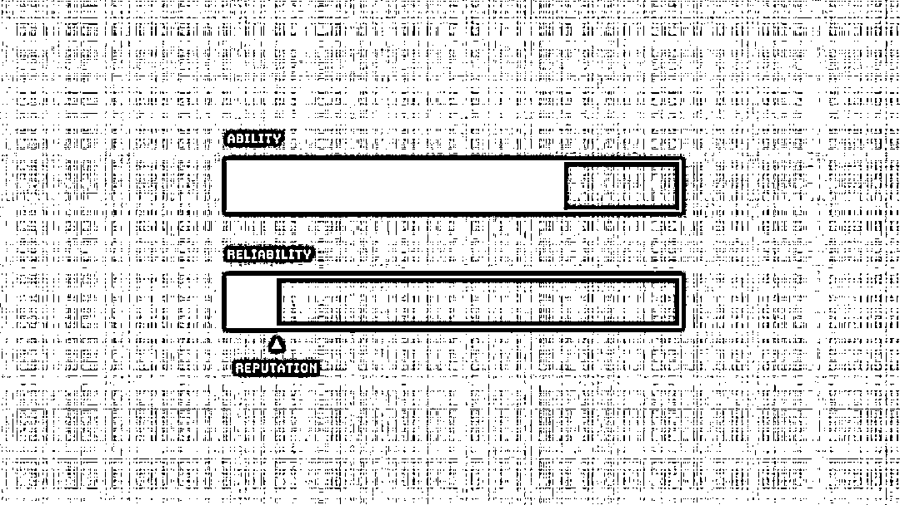

   互惠：你的店面分散在社交网络上，**所以每个不同的内容都是一次投资，**你将其推向市场后，就会变成资产。反之，如果它们不进入市场，你就没有股权。你在市场中的权益，代表消费你的信息的人分配给你的价值。（注意：投资的第一条是去有鱼的地方捕鱼，第二条是不要去投资自己不懂的东西。）2.**所有权 × 时间 = 自由：**我们摆脱他人期望的能力，**取决于我们创造东西的能力，这些东西让我们按照自己想要的方式生活。**你是一种资产，你的技能组合是一种资产，你的独特体验是一种资产，你的声誉是一种资产，投资他们。3.**价值创造：**为他人创造价值，所以你可以选择，做人们不做的事情（打扫屋子），做人们不会做的事情（经营家政服务），做人们做不到的事情（构建家政服务平台） —— 你得到的报酬与你解决问题的难度成正比。 

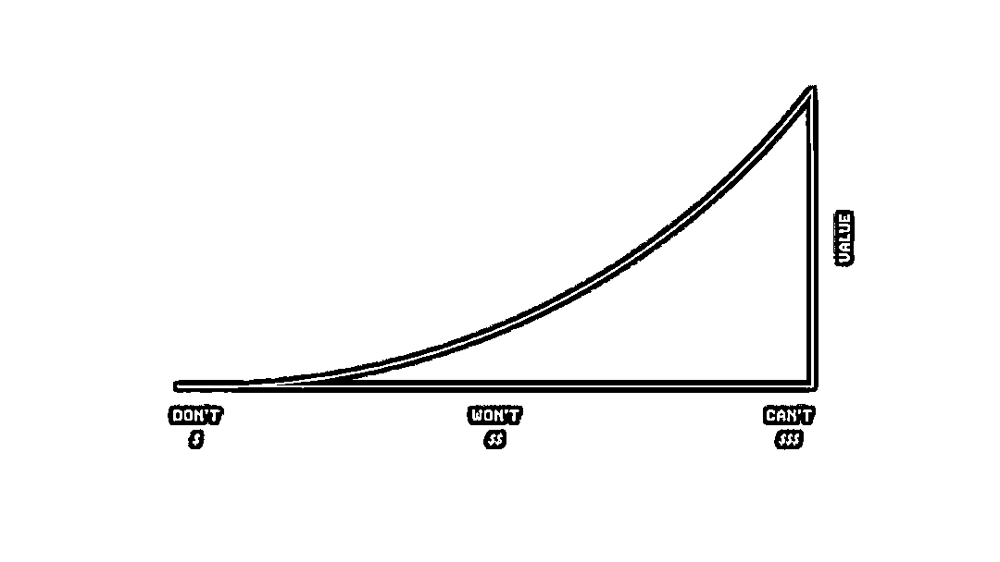

   这里有几种模式：

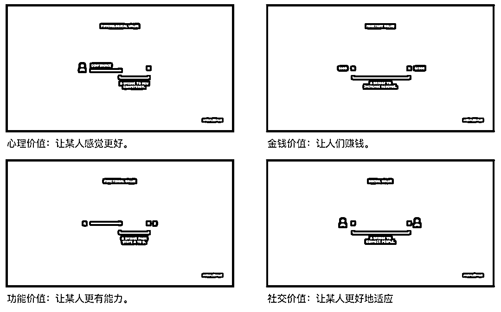

4.**杠杆作用：**通过互联网，放大你的努力。一次构建，多次销售；写一次，发表两次；设计一次，使用两次；构建一次，销售两次。（比如产品沉思录部分内容，还会成为播客的养料，以及设计产品的启发。记得利用好杠杆。）5.**复利：**要有耐心。大多数人没有足够的耐心从复利中受益，许多人在达到复合有意义开始的门槛之前就放弃了。在 vv.com^(\[3\]) 获得回报时，已经过去了 12 个月。（从五年的时间回看，产生巨大价值的时刻，也是来自于 3 年后。）

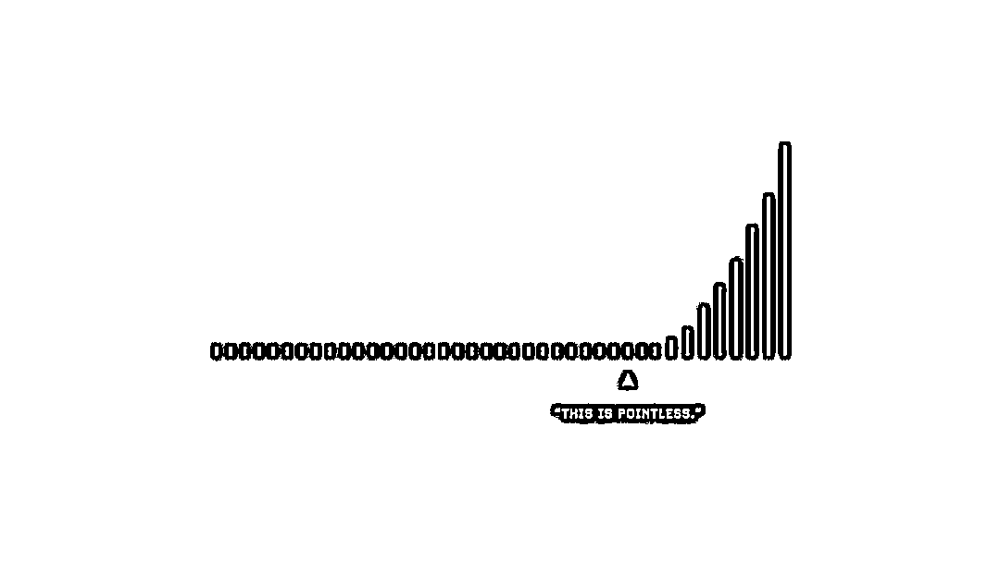

6.**失败：**你描述失败的方式是你成长轨迹中影响最大的因素之一，搞清楚失败和错误的区别。**你失败的唯一方法就是什么都不做。**

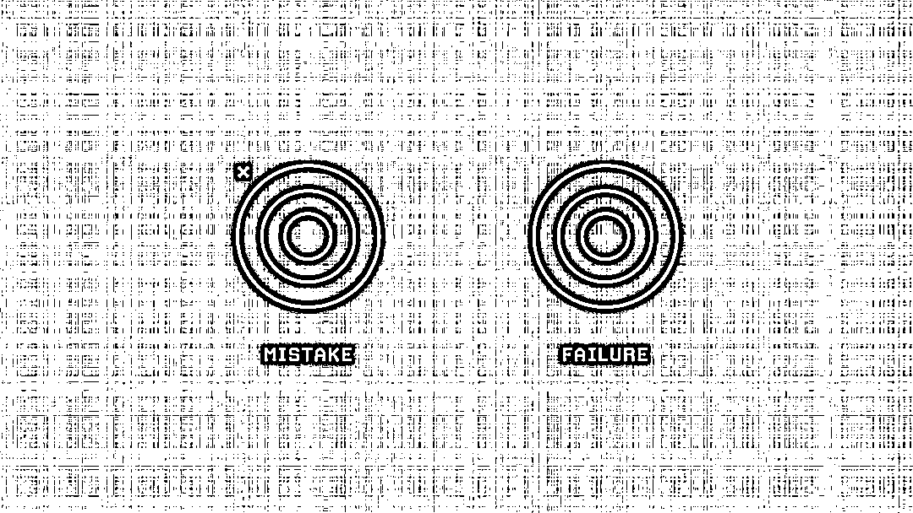

7.**内容：**内容就是魔术。它赋予你传送到世界任何地方的能力。倾注你的精力来传达一个想法一次，这个想法可以被观看/阅读/收听数亿次。如果你想在互联网上谋生，那就把时间花在挖掘独特供应方面，而非人云亦云。（比如，产品拆解，就不如产品经理的 100 道大厂面试题来的独特。）8.**服务：**服务是你学会帮助别人的方式。如果您曾经帮助过他人做某事，那么您就是服务提供商。但长远来看，服务的问题是导致人们承担他们不是特别有资格解决的问题（客户需求一直在变，甚至超过自己能力范围）。避免去服务企业（打工也如此），**因为这会让自己丧失构建生意的能力，因而只剩下工作。同时这种状态无法创造需求，只能回应别人的需求。更无法参与构建过程，因为本身就成为了过程中一个步骤而已。**

9.**产品化服务：**构建系统。**如果你不能将你正在做的事情描述为一个过程，你就不知道你在做什么。**从服务业务到产品化服务业务再到产品的过渡，都是关于构建过程的。当我们有流程时，我们就有了可预测性。当我们有可预测性时，我们就会安心。现在是**首先考虑需求的时候了。**

•你的客户与你合作时购买的是什么？•你始终如一地解决的问题是什么？•如何将该问题的解决方案转化为流程？•如何始终如一地创造需求？

   10.**产品：**构建资产，为了趁着睡觉赚钱，就要做不睡觉的东西。

•服务是没有流程的工作。（获取具体知识，比如定制化的咨询服务）•产品化服务是有流程的工作。（稳定你的时间和收入，比如一套课程体系）•产品是没有工作的流程，直接交付。（买回你的时间，比如 flomo ）11.**断开时间和金钱的关系：我们无法创造更多时间，但是能创造更多价  值。如果出卖时间，每天早上都会被重置；如果出卖价值，则会逐渐积累。**为了分离你的时间和金钱，建立没有你的工作资产。（所以塔勒布才说：努力并不值得骄傲，因为缺乏天赋和才能，才不得不做的可耻的事情。）

   12.**好奇心驱动：**在你所做的事情上成为世界上最好的，不断重新定义你所做的事情，直到这是真的。当你的好奇心让你更有能力时，你就完全退出了竞争的领域。你在玩的时候还是有报酬的，别人怎么和你 PK？（反过来看，如果自己并不喜欢赚钱，但奔着钱去做事情，多半坚持不了多久就会放弃）。

  

由于内容过长，还有下面部分内容，有兴趣的朋友可以查看推荐链接，其中还有 60% 的内容（开个翻译软件基本上能读下来，你们不会比我英语能力更差了 😆），主要包括：

•如何挖掘和整理需求•个人品牌与项目品牌的关系•故事套利•如何构建课程•销售锯末（即如何把课程的副产品用作增长）•定价和证明价格合理性

  

总结一下，在今天你不需要任何人的许可，就可以构建你想要的东西，然后通过大量渠道发布获得反馈。**不过要注意，没有人在意你能做什么，而是关心你能为他们做什么，所以提供市场需要的东西和产品质量一样重要。**

你可以通过做别人**不想做的事情（$），不会做（$$），或者不能做（$$$）的事情来获得价值**。先让人们感兴趣，然后提供远超于他们预期的价值，收取比你的产品实施时「价值」低 10 倍的费用。这样你就能不断构建一个增值的价值网络。

### References

`[1]` 内容即品牌: *https://xiaobot.net/p/mediabrand*  
`[2]` 生财有术: *https://xiaobot.net/p/shengcaiyoushu*  
`[3]` vv.com: *http://vv.com*  
`[4]` jackbutcher 的 Twitter: *https://twitter.com/jackbutcher*  
`[5]` visualizevalue.com: *http://visualizevalue.com/*  
`[6]` 从 0 - 100w: *https://visualizevalue.com/blogs/feed/0-1-000-000*  
`[7]` 课程笔记（英文）上: *https://coursehunters.online/t/build-once-sell-twice-part-1/5608/1*  
`[8]` 课程笔记（英文）中: *https://coursehunters.online/t/build-once-sell-twice-part-2/5609*  
`[9]` 课程笔记（英文）下: *https://coursehunters.online/t/build-once-sell-twice-part-3/5610*

  

# 如何解决产品复杂性，打磨产品的第一公里？

> 原文：[`mp.weixin.qq.com/s?\_\_biz=MzkyNjM1ODA2MA==&mid=2247485037&idx=1&sn=e4d7248255b9ab753042c504fcf057af&chksm=c239c92ef54e4038c2e37d53bb3ba88272ab5fc1b2aaaf45214bf71cdd77a795aa691e789547&scene=126&sessionid=1692256435#rd`](http://mp.weixin.qq.com/s?__biz=MzkyNjM1ODA2MA==&mid=2247485037&idx=1&sn=e4d7248255b9ab753042c504fcf057af&chksm=c239c92ef54e4038c2e37d53bb3ba88272ab5fc1b2aaaf45214bf71cdd77a795aa691e789547&scene=126&sessionid=1692256435#rd) 

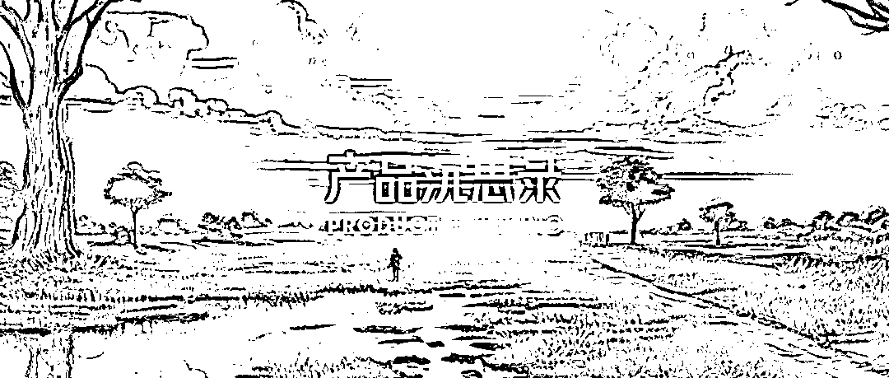

首先，用户涌向简单的产品。

然后，产品将用户视为理所当然，并为高级用户添加更多功能。

最终，用户涌向简单的产品（但是是另一个）。

  

产品总会随着时间的推移而变得复杂，最终被用户抛弃。但这并不是说应该像 Cragslist 那样几十年如一日躺平，但作为纯工具类产品，没有社交网络的护城河，不复杂会落后，复杂会被抛弃，往往会处于进退两难的地步。

  

如何应对逐渐增加的复杂？Eventbrite CPO Casey Winters 推荐了下面几种方法：

  

•**先验证，后解绑（接受临时的复杂）**

先利用已有业务本身的用户基数来验证需求，确认成立后再将其单独拆分出来独立发展，避免增加主业务的复杂度。比如美团为了深入电影行业分拆猫眼，Facebook 拆分 Messager 为独立的 IM 等。

  

这种策略优点在于能用初始规模让人们接触到新的价值，确认 PMF（产品符合市场需求） 后将其独立，不会影响主产品的复杂度和市场契合度。但问题在于，独立后的新业务未必能单独存活，因为其成本和获客方式都会面临巨大的转变。

  

•**逐步展开或分层体验（临时性简单）**

Pinterest 在用户首次注册时，并不允许用户使用消息和群组等高级功能，而是聚焦在让用户先学习核心的概念，以免用户不堪重负。在早期设计 flomo 时，曾犯过在欢迎界面堆砌功能介绍的错误，**避免成为那个总觉得你需要穿秋裤的妈，而是聚焦在当下用户最核心的体验目标是什么。 **

  

不过值得注意的是，如果许多功能都不值得第一次就展示给用户，要反思这些功能是否早就该被删除了。

  

•**选择合适的培训方法（主动降低用户学习成本）**

这取决用户的 ARPU（平均每付费用户收入） 值有多高，如果价值越高，则可以通过这种复杂的交付方式来降低用户的学习成本。而当 ARPU 值很低的时候，尽量让产品做到不需要培训即可上手使用。 

  

不过培训并非是指真人沟通，还可用视频，模板等方式，需要根据自己的业务特点（尤其是利润）来选择合适的方式。比如 Notion 选择的是模板（以及社群提供了大量的视频），而 WhatsApp 选择的是用简洁易懂的体验。 

  

反之，不要总想着把自己复杂如 Photoshop 的 SAAS 做成美图秀秀就有机会 PLG（产品驱动增长），选择合适的方法最重要。

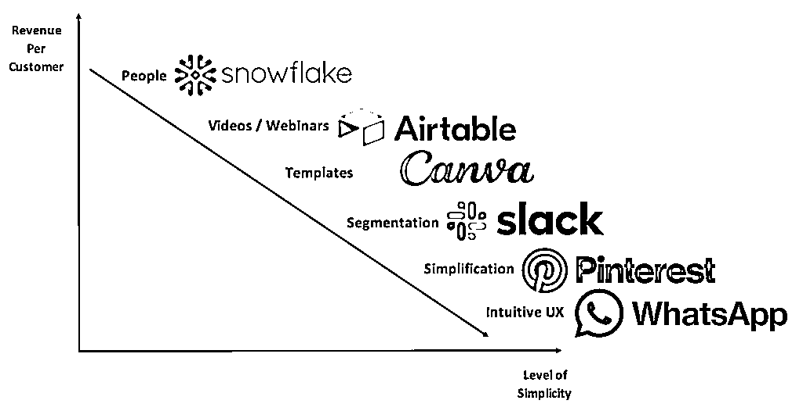

•**将高级功能隐藏（感知上简单）**

这在 Notion 的产品设计中最容易体验到，因为许多复杂的功能都被隐藏在 / 选项之下，以及藏在菜单中。在国内比较熟悉的例子是微信，比如你从未登录过桌面端时，那么就不会关注还有文件传输助手这个选项。

  

另，根据 shaonan 的经验，这些事情不应该是在某个时刻才开始做，而是应该在构建产品的时候不断地优化。**如果在相当长的时间内都没有功能被删除或合并，那么意味着你的产品已经变得过于复杂了。**

  

除了关注产品日益增加的复杂性问题，新人使用流程依旧值得反复打磨。原因有两个：

1.刚开始设计产品时，你不会首先设计产品的包装盒，再去构建核心产品。**但从用户的视角来看，他们永远是从第一个界面开始，逐渐了解到产品的核心 —— 问题在于，我们在这部分的投资往往不足。**2.另一方面，即使我们曾经优化过注册流程，**但是随着更多人开始使用产品，人群构成也发生了变化**，刚开始适合小众的做法往往不适合更普遍的大众。比如当时 flomo 的注册界面是致同路者的一封信，虽然很有情怀，但后续拓圈之后许多人下载了不知道能用来干啥，随手就卸载了。

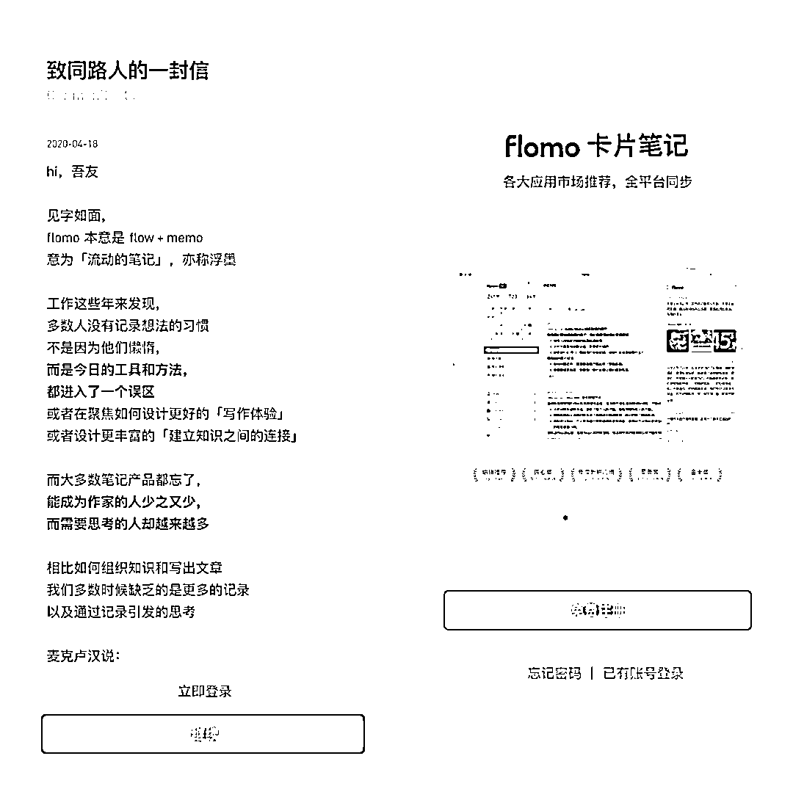

Behance 创始人 Scott Belsky 根据他的经验给出了下面的建议：

•**在前 15 秒内打动用户。**做（模板、默认值） > 展示（引导用户） > 解释（长篇大论地阐述功能卖点）•**引导用户参与。**如果是社交产品，让用户 Po 出去内容就比单纯看朋友更有价值。对于工具产品来说，核心是让用户尽快参与到最核心的功能体验中来，比如 flomo 的发布一条内容。•**确保默认值设计的是合理的。**用户首次使用往往面对的是空白的数据界面，这时候请不要让他们面对白板不知所措。•**减少额外的学习成本。**避免使用特殊的术语或奇怪的交互，这会让用户额外增加学习成本。应该多向系统默认应用或超级应用学习他们的流程与措辞。

  

始终不要忘记一个事实，即当你的产品处于增长期时，你会为了利润来开发更多付费会员需要的高级功能，但这个时候涌入最多的却是新用户，他们会被复杂性（或简陋的）第一公里给劝退。

### References

`[1]` **Crafting The First Mile Of Product**: *https://medium.com/positiveslope/crafting-the-first-mile-of-product-7ed25e8f1027*  
`[2]` **Five Ways to Address Complexity In Your Product**: *https://caseyaccidental.com/product-complexity*

  

  

# René Girard：何谓模仿欲望

> 原文：[`mp.weixin.qq.com/s?\_\_biz=MzkyNjM1ODA2MA==&mid=2247485030&idx=2&sn=4bac32b068bd96a611b84883a7c8b15c&chksm=c239c925f54e40334fa244ad8adea41a3a3d29c14317c893e732ffa661168287f53df5516150&scene=126&sessionid=1692256436#rd`](http://mp.weixin.qq.com/s?__biz=MzkyNjM1ODA2MA==&mid=2247485030&idx=2&sn=4bac32b068bd96a611b84883a7c8b15c&chksm=c239c925f54e40334fa244ad8adea41a3a3d29c14317c893e732ffa661168287f53df5516150&scene=126&sessionid=1692256436#rd) 

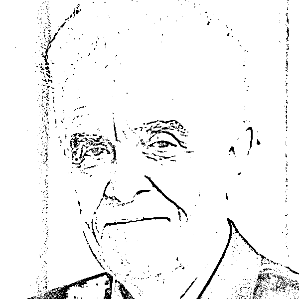

> Rene Girard 生于法国阿维尼翁，逝于美国加州斯坦福。吉拉尔是法国人类学家和哲学家，法兰西学术院院士，“欲望的模仿理论”的创始人。他的研究兴趣和影响力极其广泛，在文学批评、批判理论、人类学、神学、心理学、神话学、社会学、经济学、文化研究和哲学都有成就。
> 
> 他以模仿欲望而闻名，同时也是 Peter Thiel 的精神导师。

  

### 基本概念

勒内·吉拉尔的理论大厦的奠基石是「三角欲望」，后来也称之为「模仿欲望」。他首先指出：在人（甚至动物）的行为中有一种模仿特性，一种模仿同类的愿望。这个模仿对于文明的人是必不可少的。人要通过模仿学习讲话、走路、遵规守法、参与集体活动等。但必须区别习得模仿和竞争模仿，他研究的是竞争模仿。竞争模仿也称「对抗模仿」。

  

人基本上被「模仿欲望」支配着，人希望得到一个客体是因为另一个人也想得到它 。

  

莎士比亚有句名言：“你所以爱她，因为晓得我爱她。”（注：参见莎士比亚《十四 行诗》第 42 首）在吉拉尔看来，**一个人爱一个女人，不是自发的爱，而是看到他者也在爱她，他也想模仿他者，爱这个女人**。他把他者视为他的朋友、楷模，才追求这个女人 ，如果他者不爱她，那么他也不会爱她。

  

**简言之，人不是直接自发地产生欲望，而是通过他者激发欲望的。**过去，人们普遍认为主体想得到客体，这是两者之间的直线关系。但吉拉尔认为：在两者中还穿插着一个介体，形成等腰三角形。他者充当介体，既是楷模又是敌手。因为他者也在觊觎客体，从而阻挡主体得到客体，主体与他者之间产生激烈的竞争，这就叫做「模仿竞争」。

  

关于暴力，他认为：人相互性模仿竞争消除了差异，趋向同一性，许多具有差异的人为了追求同一欲望而互相冲突，共同希望得到同一物体，进行一场激烈的竞争和冲突，从而导致社会的一片混乱，威胁团体和社会的团结。这场冲突的解决方法是团体同意找出一个所谓「罪犯」（一个人或一个部落)）承担这场冲突的责任，团体在集体屠杀中启动牺牲机制，杀害一个替罪羊，牺牲一个无辜的受害者，挽救整个社会，调和了团体的矛盾。

  

危机平静后，这个受害者被神圣化， 因为，他既承担动乱的责任，又承担秩序恢复的责任。

### 1\. 不要模仿你的邻居

### 我们不是想要东西，我们想要证明存在

**我们通过模仿别人来观察和学习，而我们从别人身上学到的最重要的东西就是欲望。**人类是模仿的动物。我们在进化过程中超强地做了一件比别人更好的事：通过观察和模仿别人来学习。所有欲望的真正根源，从来不在于我们追求的对象或体验，而在于我们从他人那里学会了想要这些东西。

  

神经学的深层次上，当我们观察别人并模仿他们的欲望时，我们与其说是获得了对那个物体的欲望，不如说是学习模仿他人，努力成为他们。吉拉德称这种现象为模仿欲望。我们不想要，我们想要成为。

  

而物品本身构成了我们日常活动和关注的大部分，但它们是短暂的，重要的是其他人 —— 想想买买买之后的空虚感。我们感知这些事物的方式以及我们对它们的关心程度，绝大多数都受到我们所关心的榜样的意见的影响。

### 模仿对象的差别带来的心理因素

模仿的对象（即模型）有两种，一种是距离很远的「英雄式模型」（如上帝，已经去世的大师，或者距离/阶层差距很远的人），另一种是距离很近的「亲密关系模型」（如领导、家人、朋友）。

  

前者能成为榜样，激励我们。我们也会赞扬他们，不断和自己比较。而我们也不用担心会追上他们，超过他们，像一个「愿景」不断地去追寻。

  

但后者往往会变成我们的对手、障碍。会让你难受，一方面你想成为他们那样，另一方面你又担心被说成是模仿者，继而进化为妒忌。

  

所以回看日常的冲突，不是英雄那样的克服一切困难的冲突，而是和**想要模仿的对象之间的地位竞争**（达到并取代），而地位游戏本质上是零和游戏。—— 一个团队只能有一个 leader，一个部落只能有一位酋长。而越是亲密关系成为模仿对象，越容易出现这种冲突。

  

这样，我们就陷入了深深的焦虑（甚至抑郁），继而会产生争吵。所以**我们争吵不是因为我们不同，而是因为我们是一样的。**

而接下来你会发现，**斗争激烈不是因为利益巨大，而是因为利害关系太小了。**因为巨大冲突往往是非对错明确，**可以被解决**。但是利益太小，导致师出无名，只能下黑手，失去合法性。（基辛格说：如果有形成珍珠的条件，就一定能找到沙子）

  

因为利益太小，没有合理性的解决方案，最终会变成死亡决斗，迫使某个人退出游戏（比如合伙人分家、断绝家庭关系等）。

### 2\. 时间向前推进

### 从周期时间到线性时间

在基督教之前，人类认为时间是周期性的，无论你做什么，世界总会回到原点 —— 这种观点隐含的是人类的主观能动性并没有价值。

  

但从希腊人开始，经过基督教作家如 St. Augustine 的加速，西方哲学被定义为走向天堂般的完美。西方人把进步、进化和创新视为同义词。我们认为，增加的自由和知识只受到时间流逝和积极致力于创造更美好未来的限制。就像自然法则一样，进步就像春天樱花开放一样不可避免。

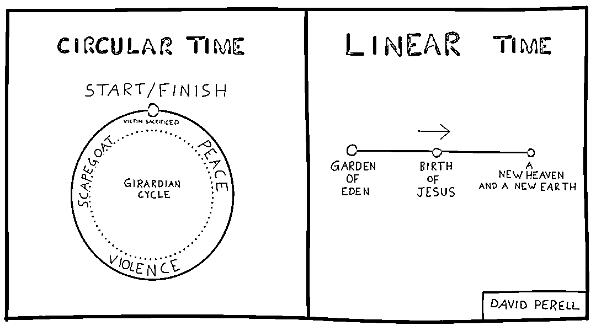

人类是面向未来的生物。如果我们对未来没有一个积极的愿景，我们就会成为当下欲望的奴隶，在日常生活的痛苦中崩溃。

  

如果认为世界是周期性演变的，那么基督教揭示了替罪羊现象的根本不公正。所有的替罪羊都是内部人士和外部人士。他们必须立刻成为圈内人，成为社区的一部分，但也必须成为社区问题的外来者。

  

牺牲是一个社会事件。没有牺牲，人类就不会有文化。所有的人类社会都是围绕着宗教建立的，因为宗教是和平解决替罪羊问题的唯一途径。当人类陷入模仿危机时，暴力只能通过谋杀替罪羊来解决。这种一次又一次地杀害受害者的过程是古老社会的主要和平药丸。

  

一个社区不能把某人当作替罪羊，除非它认为替罪羊是有罪的。这就是为什么找替罪羊必须是无意识的。一旦进行集体仪式，暴力就会被排斥，社区的和平就会恢复。

  

通过献祭，人类用暴力包容了暴力，因为牺牲拯救了社区免于自身的暴力。这个牺牲的模式，往复循环。

### 线性时间如何推动进步和长期思考

短期思维是罪的本质。开始你必须学习结束。你不想成为第一个采取行动的人，你想成为坚持到最后的人。（何塞·劳尔·卡帕布兰卡）

  

一个坏的计划总比没有计划好。应该着眼于长期，并且有清晰的未来愿景。

  

并且长远的眼界不仅仅是心理上的。它们是文化的。现代社会饱受时间耗竭之苦。或者，正如社会学家埃莉斯 · 布尔丁曾经说过的: “如果一个人在处理现在的问题时总是在精神上上气不接下气，那么他就没有精力去想象未来了。”

  

今日更多人开始获取信息，而不是博览群书，让文化的情绪主宰自己，忘记了我们在历史中的位置。

  

Thiel 认为时间是线性的，而不是周期性的，未来要么更好，要么更糟。如同基督教一样，发起积极的反馈循环，

  

在进步中带来更多进步。

### 3\. 未来将不同于现在

> “俗话是这么说的: 把每一天都当作生命的最后一天来过。接受这个建议的最好方法就是反其道而行之: 把每一天都当作你将永生一样生活。”ー Peter Thiel

  

今日的世界越来越喜欢模仿，而少数人可以毁灭整个世界。而社交媒体虽然戾气重，但是避免了人们在物理世界中打架。

### 关于未来的四种思考方式

1.确定的乐观: 未来会更好，我们知道如何去做 2.不确定的乐观: 未来会更好，但我们不知道如何去做 3.绝对悲观: 未来会更糟，我们知道该怎么做 4.不确定的悲观: 未来会更糟，我们不知道怎么办

  

人类（美国人视角）从确定乐观（如阿波罗计划）变成了不确定乐观或者绝对悲观。

  

明确的乐观主义正在消亡。大梦想现在被视为幼稚的幻想。我们不再相信拥有丰富想象力的业余爱好者（比如发明 CDMA 的海蒂·拉玛），我们也不再挑战人们去想象与现在截然不同的未来。相反，我们只听从主流意见的专家。

  

2011 年，一篇名为《未来的终结》的文章，出现在他的风险投资公司的主页上，文章认为进步停滞不前。我们已经从资助转型公司转向解决增量问题的公司，有时甚至是假冒的公司。我们把我们的信念放在小的调整和 a/b 测试上，这意味着数以百万计的小行动是改善世界和创造理想未来的更好方式。

  

本杰明 · 富兰克林曾经说过: “如果每个人的想法都是一样的，那么就没有人在思考。”

  

如果对自己的未来没有一个积极的愿景，这些年轻的美国人就会陷入恶性的零和游戏。它们反映了周围人的目标，而不是建构我们自己的欲望。**他知道如何把事情做好，但是从来不会问一开始是否值得做。**他不是在解决重要的问题，而是在为未来构建“选项” —— 如何让自己在竞争的游戏中手中的牌更多一些。

  

看看这么一个怪圈：在初中努力学习，这样你才能在高中好好学习; 在高中努力学习，这样你才能在大学里好好学习; 在大学里努力学习，这样你才能得到一份受人尊敬的工作; 在你职业生涯即将结束的某一天，你终于可以做你想做的事情了。一直以来，你都在 “积累技能” 和“积累选择”，就好像下一个拐角会带给你一直以来所追求的幸福。

  

当我们追求选择性时，我们会避免大胆的决定。就像任何有意义的事情一样，冒险进入未知领域也是一种信仰行为。这需要责任感。你必须表明立场，相信自己的决定，无视外界不同意见的嘲弄。

### 4\. 彼得 · 蒂尔的建议

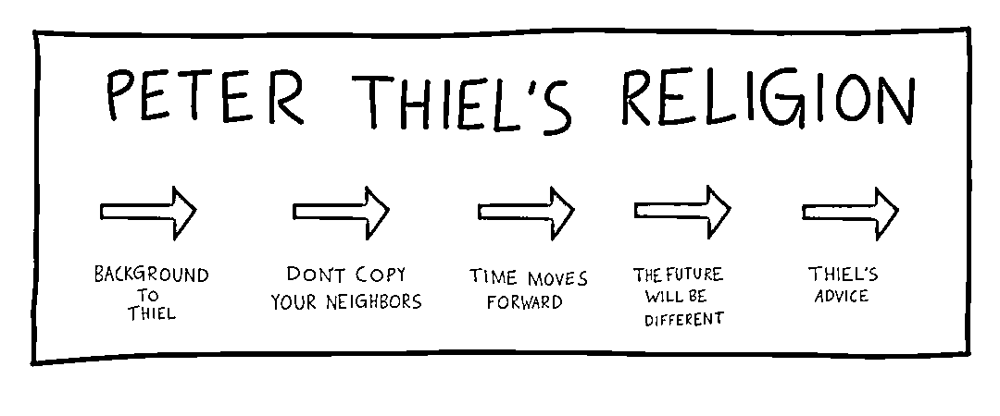

1.为未来创造一个积极的愿景（寻找不为人知的秘密）2.小心你复制的东西 3.遵循十诫。

### 寻找秘密

我们把太多的东西归功于运气，这阻止了我们实际行动。寻找秘密而不是运气，通过这些不对称的信息才能获得更大的价值。

  

最大的秘密是，还有许多秘密需要揭开。在人类知识的地图上仍然有许多巨大的空白区域。你可以去发现它们。那就去做吧。走出去，填补空白。每时每刻都有可能去这些新地方探索 —— 这样就能避免陷入到残酷的竞争中。

  

什么是非常重要的真理，很少有人同意你的观点?

### 小心你模仿的人

即使模仿是不可避免的，我们也可以减少它的负面影响。我们可以避免那种导致暴力的竞争。如果我们必须模仿别人，我们应该注意我们模仿谁。

  

吉拉德的观点，一个社会越差异化，它就越稳定。社交媒体缩短了人们和他们的榜样之间的距离，因此对虚假神的崇拜比以往任何时候都要强烈。KOL 通过制造嫉妒，他们告诉粉丝，如果他们看起来像他们，穿着像他们，行为像他们，他们可以成为他们。

  

**如果你打算追随一个榜样，找一个你不会与之竞争的榜样。不要向你的同龄人寻求答案。**

在生活中你有两个选择：你可以冷静地接受宇宙的本来面目，或者你可以在宇宙中留下痕迹。但你不能同时做到这两点。

### 关注十诫

> “不可贪图邻居的财物”——第 10 条戒律

  

社会会把你推向竞争，但是你不应该和你的同龄人竞争或者依靠他们的指导。竞争是属于失败者的。与其向你周围的人寻求答案，不如找一些你无法与之竞争的对象。**模仿那些不模仿别人的人，承担风险。建立差异化的技能。**追求永恒的智慧，而不是流行的风潮。对传统持怀疑态度，不要让它成为通往真理的捷径。解决别人没有解决的问题，特别是如果你有独一无二的能力解决它们。

  

最后，问一些你不应该问的问题，这样你就能找到你不应该找到的答案。

### References

`[1]` 关于人的秘密：简短且危险地介绍 René Girard: *https://www.notion.so/Ren-Girard-36240ba7b5f6433cb525c9da7235d649*

  

  

# 不要把“身边人”当榜样，小心陷入模仿欲望的游戏陷阱中

> 原文：[`mp.weixin.qq.com/s?\_\_biz=MzkyNjM1ODA2MA==&mid=2247485030&idx=1&sn=7bcbc95bb5b08526bcbf9d1bfa653e0f&chksm=c239c925f54e403344761d563731c8988d9099fd6f0cdb52422ec311f7baae6ef3904b5009ed&scene=126&sessionid=1692256436#rd`](http://mp.weixin.qq.com/s?__biz=MzkyNjM1ODA2MA==&mid=2247485030&idx=1&sn=7bcbc95bb5b08526bcbf9d1bfa653e0f&chksm=c239c925f54e403344761d563731c8988d9099fd6f0cdb52422ec311f7baae6ef3904b5009ed&scene=126&sessionid=1692256436#rd) 

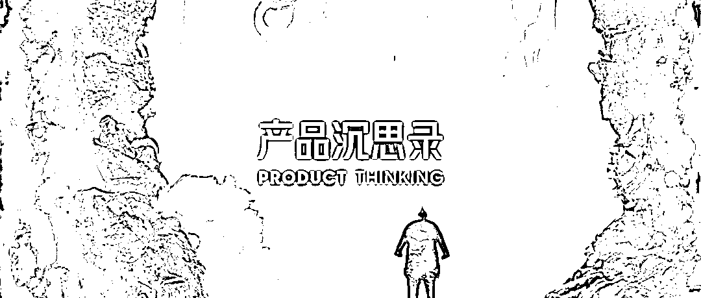

  

之前曾经介绍过一些关于模仿欲望的内容，正好最近看到《欲望：日常生活中模仿欲望的力量》（Wanting：The Power of Mimetic Desire in Everyday Life）一书的作者 **Luke Burgis** 的一系列分享，让我对于这个 Rene Girard 的思想有了更进一步的了解。（建议本篇文章可以结合另外一篇「模仿欲望」一起阅读。）

  

Rene Girard 意识到欲望的一个特性：

> 我们希望我们的欲望来自我们最深处的自我，我们的个人深处，但如果是这样，那将不是欲望。**欲望总是为了我们觉得我们缺乏的东西。**Rene Girard 指出，欲望并不像我们经常想象的那样，是我们自己完全控制的东西。它不是我们可以自己生成或制造的东西，它在很大程度上是社会过程的产物。

  

人是不知道该渴望什么的生物，所以他转向别人，以便下定决心做什么。他把这种欲望称为「模仿欲望」。如果我认为某些职业、生活方式或假期是好的，那是因为其他人以这样一种方式模仿它，以至于它对我来说是好的。

> 

  

可以说，Rene Girard 关于「模仿欲望」的阐述，是去年让我和自己和解的一个重要因素，让自己能从模仿游戏失败者的角色走出来，去做一些自己想做的事情，不再追求别人在追求的东西。

  

为何说是和自己和解的重要因素呢？因为许多时候痛苦都是来自于有欲望而无法得到。具体的建议才是好建议，只是不断地强调「放弃我执」，修炼好自己的内心，就像对一个肥胖的人说要少喝可乐一样，道理都对但根本无法执行。Rene Girard 关于欲望的阐述，则是让我们能窥见欲望产生的原因，继而才能勘破其中的欲望循环。

  

关于这个概念的运用，除了用来防止自身陷入模仿欲望的游戏，也可以用来解释许多营销上或者品牌上的问题。比如某些潮牌如何崛起，为何有些广告无效而有些效果特别好等等，理解这种人类更加底层的特性后，对从事上述任务的时候也会有更多的启发。

### 欲望和需求

需求是本能，就像我们饿了就吃，困了就睡一样，需求是可以被满足的。

  

欲望是人类特有东西，欲望是关于我们「存在」的表现，我们满足欲望的终极目的，是希望向别人展示自己是一个什么样的人，即在社会中获取地位游戏的冠军。

  

**许多时候我们并不是直接想要一个东西，而是看到了身边的人拥有了这个东西，所以才想要。**

比如刚到上海的时候，觉得星巴克实在是太贵了，一杯好几十，但内心的欲望还是想要 —— 其实并不是想喝咖啡（当时觉得，小苦水有啥好喝的），而是觉得什么时候才能有那样的消费力。再往下挖一挖，其实是当时在一家媒体公司工作，身边的人对于「品牌」是非常在意的，月薪并不高的同事都要背着 LV 上下班，星巴克可是「小资生活」的必备要素，饭后来一杯拿在手上，就觉得很有「腔调」。

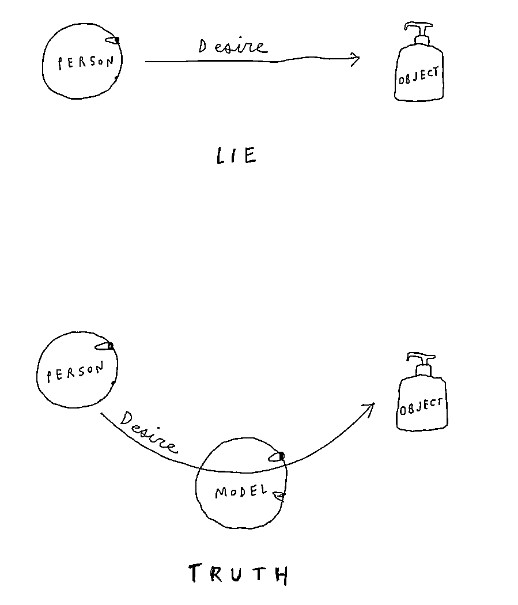

其实你会发现，能喝得起星巴克之后，还会需要吃黑珍珠餐厅、买内环内的房子、买一辆豪车、找到让别人艳羡不已的配偶、以及安排孩子上国际学校等等。

  

许多时候得到了这些东西也不会开心，因为我们并不是真正的想要得到这些东西，而是想要模仿身边拥有这些人的身份和地位，但遗憾的是这些外化的东西往往并不是根本 —— 多数时候还会成为我们的累赘。

  

**和用东西满足需求不同，欲望总要有一种东西来依附，一旦与事件分离，就必须将自己附加在另一个事物上。**

### 欲望的光谱模型

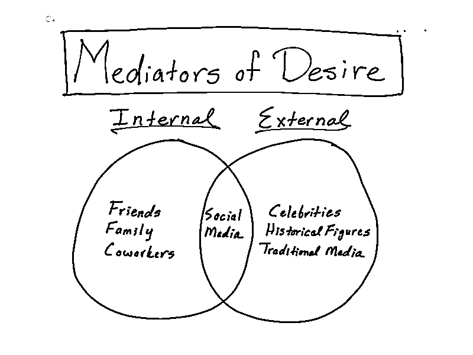

模仿欲望的对象是一个光谱

•最左端是身边的对象，如朋友、同事、父母（Freshmanistan）•最右侧是无法达到的对象，如历史名人、社会地位极高的人、虚构的人（Celebristan）•中间则是近些年兴起的似近实远的社交媒体

  

Freshmanistan 模式，没有障碍，就在身边（所有的社交媒体都是这样，所以我们被欲望包围），这让我们的欲望之海永不停歇，欲望是高度反射性的。比如身边的某个不如自己的人突然买了辆好车，或者看到某个领导开始穿 Lululemon 等。

  

Celebristan 模式，是和模仿对象之间有一个巨大的障碍，可以是时间空间，以及地位，难以触及。所以我们无法直接同他们争夺想要的对象。比如沉思录中介绍的「羔羊」们。

  

而社交网络这种新媒介，模糊了这两者之间的距离。媒介进化导致人们感官能力异化，让远距离的人感觉就在身边可以模仿，但是事实上又有距离，达不到那个样子。以前三四线城市的孩子只能看某些 x 时代小说来憧憬一线城市的生活，其他时候都是处在一个稳定的「附近」，而现在打开抖音何止是一线城市，全球的各种文化都会涌入而来 —— 我们被包裹在了可怕的欲望之海中。

  

而这些让我们欲望喷薄而出的信息，却是不完整的，碎片的。比如你在抖音上看了许多别人狗狗可爱的视频，就像养一只狗。但是这种以博眼球为目的的媒介上，是不会有人去告诉你养一只狗麻烦的地方，因为这些事情既不新鲜，也不有趣。当你真正开始养狗的时候，初期会不断地模仿别人拍摄各种视频去获取关注，但随着时间推移，许多具体而无趣的事情浮现，就会发现和预期差异好大，继而丧失了兴趣，变得不耐烦。类似的还有打卡式旅游、拍照式吃饭等。

  

**长此以往，既让自己变得肤浅，又会让自己变得没有耐心，还会让自己丧失触碰现实的勇气。**

### 是自己的目标，还是模仿的欲望

今日的社会，往往会促使我们设置很多目标，但许多时候这种痴迷设定目标的事情，往往适得其反。**因为大多数人对于设定目标并不负责，而是在追求其欲望系统中提供给他们的目标，而这些目标总在不停变化：**

•毕业生想要进入大厂找到一份体面的工作，而不是寻找自己想要的。•VC 寻找能上头条的 CEO 和性感的公司，而不去寻找长期发展的。•在社交媒体上，人们可以模仿的事情就更多了，因为本质上平台在鼓励模仿。

  

目标其实多数都是嵌入在整个社会的欲望系统中，我们不断地模仿身边的人，来让自己感觉到安全，从教育到 VC，莫不如此。

### 欲望的冲突

如果我们设置的模仿欲望对象很远，我们永远达不到，则会激励我们不断逼近目标，但永远无法达到，无法达到则不会产生冲突。

  

但如果模仿对象很近，则基于上述的论点，我们开始希望能达到他们的状态，甚至超过他们，想想今日的「内卷」背后的动机，也是这种不断模仿的欲望。

  

悲剧在于，地位游戏是一个零和游戏。我们在争的不是某个物质对象，而是达到甚至超越身边模仿对象的社会地位，这样的争夺势必会引起剧烈的冲突。当参与冲突的人越多，冲突剧烈到无法解决的时候，参与者往往会推举出来一个「替罪羊」，然后将其「献祭」作为冲突的解决方式。想想公司中内部斗争中失败的案例，其实往往冲突者并不是只有一方，但是当乱到一定程度的时候，总会需要某个倒霉鬼出来背锅，然后让整个即将崩坏的系统继续运转下去。

### 识别你的欲望

诚实是必备的条件之一，下面的这些问题需要你空下来的时候好好问问自己，去剥掉厚厚的灰尘，看看掩藏在欲望背后的根源是什么。

  

**确定是谁影响了你的需求：**

•我想要某种生活方式时，谁最能体现它？•除了父母，童年谁对我影响最大？是很近的人，还是很远的人？（宫崎骏吧）•我不希望看到谁成功？这是你用来衡量自己的人（以前曾经有）

  

**将模仿对象分为内部和外部**

•不要痴迷于身边人拥有或者想要的东西。•尽量找到自己想要模仿的外部对象

**绘制生活中的欲望系统**

•识别出来自己被什么欲望体系所绑架了（是真实的想法，还是别人的准绳或别人遵守的准绳）•对这个系统保持距离，审视这个欲望，不要作为默认值而勾选他们。•去深入回顾欲望的历史，了解哪些欲望跟随你很久，哪些欲望像风一样来来去去。

### 如何过上反模仿欲望的生活

模仿是正常的，只不过要树立更远的目标，而不是身边的目标。

  

记得在实现的过程中，可以接受刚开始模仿，**但请打上你自己的烙印**。这样就能开始慢慢的从模仿欲望变成探寻自己的欲望。

  

欲望是一个光谱，一面是完全发自内心（如母爱），另一端是完全模仿（买同样的东西）。发自内心的欲望不会被随意更改，只会被掩埋。

  

过上反模仿的生活，需要我们：

•摆脱无意中追寻的欲望，避免负面模仿，尤其是查看新闻和社交媒体。•思考在什么样的人或事上，欲望能够得到休息，而没有不安，不需要得到更多。•避免以牙还牙的策略，想想圣雄甘地，他用非暴力不合作开启了模仿欲望的积极循环。•欲望不安不一定是坏事，但要注意这种不安是否过于持续。

  

如果我们的欲望是由模型决定的，那么我们的欲望就不是我们自己的。

  

去把那些跨越时空的人作为模仿对象，让自己的永远无法达到其高度。

  

**通过把你的生活建立在更深层次的东西上，把自己从从众的心态中解放出来。**

### References

`[1]` **Mimetic Desire 101**: *https://read.lukeburgis.com/p/mimetic-desire-101?s=r*  
`[2]` **Mimetic Desire 102**: *https://read.lukeburgis.com/p/mimetic-desire-102-mimes-memes?s=r*  
`[3]` We're All Chasing One Another's Goals: *https://read.lukeburgis.com/p/were-all-chasing-one-anothers-goals?s=r*  
`[4]` **What People Are Really Doing When They Play Hard to Get**: *https://read.lukeburgis.com/p/mimetic-romance?s=r*  
`[5]` **How to know what you really want**: *https://psyche.co/guides/how-to-know-what-you-really-want-and-be-free-from-mimetic-desire*

  

# 关于时间管理的误区，你必须接纳自己的有限性

> 原文：[`mp.weixin.qq.com/s?\_\_biz=MzkyNjM1ODA2MA==&mid=2247485013&idx=1&sn=755b60e520a69b54aab224a64bc2c9fd&chksm=c239c916f54e40001d69900831b7dea371a9db5a239b55855b95868f6e44cc1cbe7543f1e881&scene=126&sessionid=1692256441#rd`](http://mp.weixin.qq.com/s?__biz=MzkyNjM1ODA2MA==&mid=2247485013&idx=1&sn=755b60e520a69b54aab224a64bc2c9fd&chksm=c239c916f54e40001d69900831b7dea371a9db5a239b55855b95868f6e44cc1cbe7543f1e881&scene=126&sessionid=1692256441#rd) 

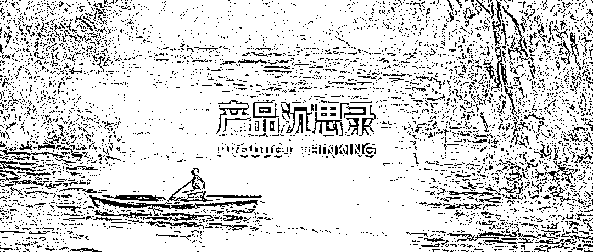

如果说在研究笔记工具的时候，找到的核心问题是：**你希望在什么领域发展。**

那么在研究时间管理的过程中，找到的核心问题是：**你是否能接纳自己的有限性。**

关于 GTD 我们最常听到的比喻是：在一个空瓶子里，先放大石头，然后放小石头，最后再放沙子，这样看起来似乎利用好了每一块时间。

  

但遗憾的是这个故事只是实验室中的版本。现实中的版本是，你只有一个可怜的小瓶子（24 小时），而生活中总是有一块又一块的大石头压过来（比如是否要换工作、和谁交往、去什么城市），**难点不在于先后，而在于如何取舍。**

其实在将视角转换至此之前，自己总是希望能通过提高效率来完成更多任务。比如利用各种清单工具来安排事情的优先级，或者严格按照小时来规划事情，但结果不甚理想。面对延期的各种事情，对自己亦产生了诸多怨念 —— 但是却从未想过，也许自己真的做不到那么高效，也不可能随时满足所有人的请求。

  

这种自我埋怨和焦虑的状态，持续了相当长的一段时间。最早认为这是对想做更多事情的贪心。而在读完《四千周》^(\[1\])之后才意识到，这其实是一种恐惧，**一种不敢承认自己有限性的恐惧。**

这本来自于效率专家奥利弗 · 伯克曼的书，从结构上来说更像是博文合集，但其中也有不少有价值的观点，在这里用自己的话整理如下：

### 不要把所有时间都视作资源

•时间不应该只是作为可以利用的资源，否则会让我们感到压力（比如在工作之外再利用时间开展「副业」，把自己塞得满满的，看似高效，其实会让自己疲惫不堪）。其实时间也是某种消费品，需要为自己留出一些，而当与时间的关系都是工具性的时候，当前的时刻就会失去意义。•今日的消费社会让我们把休闲变成了某种需要完成的任务，每一项休闲都带有很强的目的性（比如去跑步是为了保持身材），导致我们不敢浪费时间，继而造成了更大的焦虑。•**真正的休闲应该交给自己的爱好。但对于爱好，应该显得平庸**，因为这样才不会有「好好利用时间来进步」的焦虑，才能全然的享受过程，不去追求更多目的。

### 效率陷阱：必须接纳有限性

•人类喜爱确定性，所以热爱规划时间、罗列待办。但你没有理由认为，完成更多工作就能掌控一切，毕竟总有意外发生，而你自己本身也会有许多局限性。所以避免有完成所有事情的幻想，而是反过来看，将**精力集中在少数几件事情上**。•对于大事来说，我们希望能充分准备后才执行（比如希望能升到某个职位、或者等到某个项目结束后再跳槽）。但许多时候，我们总会被紧急的事情侵占时间，这也意味着大事永远无法「充分」准备。试着**优先推动大事发生**，否则永远没有充足的时间来做这些事情。•学会与焦虑相处，**避免条件反射般的做事**（比如自己经常沉浸于客服问题、或者微信上其他人的提问）。尽量避免解决此类问题，而是尽量拒绝这些问题（比如直接回绝一些见面或分享的邀约）。

### 关于拖延：也许只是内心的恐惧

•拖延不可避免，但无需根治。不断拖延和分心，其实是在试图推迟重大事情的发生，而用以规避内心的恐惧。核心在于**如何明智地选择你要拖延的事情**，以便专注于重要的事情。•**衡量时间管理真正的技巧，是能否让你忽略该忽略的事情。**往罐子中倒石头的案例，忽略了生活中总有许多巨大的石头超过罐子的容积。

### 如何避免多做事情

•我们习惯于先响应他人的请求或处理紧急的事情，但如果总是等其他事情结束后再用剩余时间来偿付自己，最终往往不得偿付（比如每天晚上回家精疲力尽，很难再为自己而读书）。所以重要的方式不是提高效率留出时间，而是**优先索取时间**。（比如把读书时间改为清晨，甚至改为醒来的第一件事。）•接纳自己效率有限，无法完成所有事情。所以控制手头工作的数量，避免同时跟进许多事情，让自己的精力被分散。甚至给自己设定好时间的总量，避免过度承诺而让自己耗竭。•**抵抗次优先级的工作**，那些不够诱人的机会，往往并不值得下注。（像巴菲特投资一样谨慎对机会那样，在确定投资时间给这些机会前，可以多索取相关信息来判断是否值得投入。）•战略性放弃，拒绝众多机会的诱惑，否则没有什么事情能干好。（如果今天想做自媒体，明天想考公，那么多少时间也不够）•避免关心，放弃那些全人类都关心的问题，聚焦在只有少数人甚至自己关心的事情上

### 耐心的三大原则：许多事情总要持续投入很多时间

•**让自己喜欢上问题，而不是着急解决。**因为我们永远不可能没有问题，也不可能解决所有问题。（最近写书就调整了心态，不再是着急完成，而是试着每一章都比上一章更完善且游刃有余一些）•**接受渐进的原则，保持频次和质量**，远胜过短期内紧张的工作，因为后者会让人们讨厌过程。（最近写书也从集中一天梭哈制变成了每天写 2-3 小时，并且避免写的过多，焦虑感下降许多。）•原创就在模仿的前方，不要急于求成，因为必须熟悉了惯常，才能从中找到独特的东西。（**创新不是特立独行，而是在达到平均水平之后再突破。**毕加索后期作品看似抽象，但其基础绘画功底其实异常深厚。）

  

或许这本书最大的启发，就是让自己承认在工作效率上，已经到达了能力的边界。但认怂并没有什么不好的，接纳了这个版本的自己后，不被掌控的焦虑感就会小了许多，而耐心的三大原则中，接纳渐进的原则，也让自己能重新来享受做这件事的过程。

  

所以对于奥威尔的这句话：一个人如果将他自己描述得很好的话，他十有八九是在撒谎，因为任何生命从内部审视都只不过是一系列的失败。

  

或者还有另一个角度的解读，即我们注定要在许多地方失败，那么仅存的胜利，应该是什么。

### References

`[1]` 《四千周》 （豆瓣介绍）: *https://book.douban.com/subject/36093214/*

  

# 产品做的足够好，为什么用户仍然不用？

> 原文：[`mp.weixin.qq.com/s?\_\_biz=MzkyNjM1ODA2MA==&mid=2247485007&idx=1&sn=a4c14969f5408374f828551366254bc2&chksm=c239c90cf54e401ad1b622ae32e1083dcb608776ec00f2662a0487a82669a751def01f42d618&scene=126&sessionid=1692256441#rd`](http://mp.weixin.qq.com/s?__biz=MzkyNjM1ODA2MA==&mid=2247485007&idx=1&sn=a4c14969f5408374f828551366254bc2&chksm=c239c90cf54e401ad1b622ae32e1083dcb608776ec00f2662a0487a82669a751def01f42d618&scene=126&sessionid=1692256441#rd) 

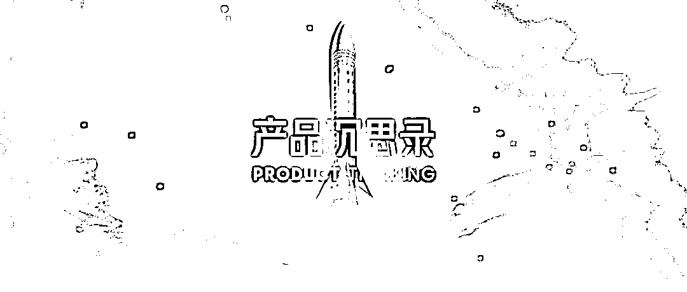

虽说人的欲望无限，但在感知层面，质量和数量上来说都有其上限。

  

比如白给你一台 iPhone 会觉得很开心，但是如果白给你 1 万台，那么你就要考虑怎么存放和处理了。在质量上也是如此，比如雨天能打到车就足够了，至于来的车辆型号没那么重要。

  

**为何要提到感知的「上限」？因为对于产品（或者服务）来说，做的足够好未必能赢。因为用户对于多余的好，是无法感知的。**

这听起来有点反直觉，毕竟「极致」是小米成功的法则之一？来举个例子先，最早单车大战的时候，小蓝车主打的是骑行的舒适感，但对大多数人来说，地铁口有车最重要，至于在骑行感上优化，用户感知并不强烈。

  

又比如安卓应用市场，早期有豌豆荚，91 助手等诸多第三方平台用户量巨大，一时成为资本宠儿。但后续随着国产手机崛起，自带应用市场和第三方相比体验差异不大，所以曾经巨大的估值也成了过眼云烟。

  

为何曾经重要的竞争优势会转移呢？其实需要我们换个视角来看。

  

每个行业，实际上是一整个相互关联的活动链条，他们共同将原始资源转化为产品或者服务，来满足用户需要完成的工作。

  

比如我们中午点的外卖的目的是填饱肚子。而其价值链为供应商 → 外卖店铺 → 外卖平台 → 配送。在这个链条中，一个企业能否获得巨大价值，取决于两个问题：

1.这个企业是否能解决价值链中的瓶颈问题。2.该解决方案是否足够好到超过了用户的感知。

  

比如在外卖行业中，味道和味道之间很难有十倍以上的差异，但是配送速度差十倍很容易感知。所以美团外卖的估值远高于餐饮企业。而为了解决配送问题，美团除了自建外卖体系，也需要介入到商家接单模块，进一步提高配送效率。而近些年则开始发力供应链（快驴），试图从源头开始提供可控的服务。

  

**解决瓶颈问题依赖于模块的整合。而当你控制价值链上最大瓶颈问题的相关模块越多，竞争优势就越强。**

比如同样是文档写作， Notion 不但提供了文档，同时在看板、数据库、表格等，还大量整合第三方协作工具嵌入，吊打 Evernote，在海外增速飞快。同样，出版行业一片萧条时，读库就通过控制独家内容生产的质量及频次，以及销售渠道，而不至于陷入缺少利润的恶性竞争。

  

**但这并非是一劳永逸，如果你解决的瓶颈问题，随着技术进步不再是问题，逐渐超过了用户感知，你的地位将不再牢固。**

早年在百姓网，有个很有效的增长方法是提高网速，因为彼时宽带还很窄，所以打开越快，用户留存越好。但是随着宽带普及，当年这种加载速度的强感知体验被迫拉平。用户的需求也就从追求信息的丰富性，变成了追求信息的真实性，而过往积累的工程优势就无法复用，逐渐被 58 所取代。

  

**除了被技术颠覆，还有另外一种情况，即过度提供先进但用户无法感知的体验，造成浪费。**

还是以 Notion （及其国内的 Notion like）为例，为何在国内一直没有起飞？一个可能的猜测便是现有的解决方案足够好。比如从个人用户来看，对于大多数普通人来说，印象笔记功能已经足够好，Notion 反而显得复杂；从企业协作来看，国内御三家（钉钉、企微、飞书）有先发优势，其协作部分被绑定于此，这种 All in one 没有提供太多增量价值。所以功能并非是越多越先进越好，而是要看这些改进对用户来说**是否能感知**。

  

每一条价值链中都有一定的力量，这种力量不能被创造或毁灭，只能转化。这种力量反映了谁控制了价值链中重要的集成点，谁在提供不太重要的模块化组件。如果重要的集成点发生变化（多半是由于技术的推进），那么曾经拥有权力的价值链层级将失去权力。

  

上述文字也是对克里斯坦森的「模块化守恒」概念的一次拆解和应用，有兴趣的朋友可以去阅读《创新者的解答》。

### References

`[1]` Finding Power：An introduction to Clay Christensen’s most underrated idea: “The Conservation of Modularity”: *https://every.to/divinations/finding-power-432187*  
`[2]` 《创新者的解答》: *https://www.dedao.cn/ebook/detail?id=bBVDEXGGLn7eB51b8NjVRqDoQJPMk3aX5VWadYrXmAxE4Ov92lgzK6ZypxLqdQjp&source=douban*

  

# 如果你追逐别人的认可，最终可能会失去自己的认可

> 原文：[`mp.weixin.qq.com/s?\_\_biz=MzkyNjM1ODA2MA==&mid=2247485002&idx=1&sn=d7441fa17873f67f93ccb754c2437a66&chksm=c239c909f54e401fc6d8bdb6f61943b846b9c006c953c1828e2d60e4eb2a386ce853ee9f59bd&scene=126&sessionid=1692256441#rd`](http://mp.weixin.qq.com/s?__biz=MzkyNjM1ODA2MA==&mid=2247485002&idx=1&sn=d7441fa17873f67f93ccb754c2437a66&chksm=c239c909f54e401fc6d8bdb6f61943b846b9c006c953c1828e2d60e4eb2a386ce853ee9f59bd&scene=126&sessionid=1692256441#rd) 

**你在凝视深渊的时候，深渊也在凝视你。**

如果你在做个人 IP ，包括但不限于开一个 x 红书账号，做播客，录视频，搞直播。那么 Gurinder 的这篇警告，值得好好思考下。

  

下图是 Youtube 的一个播主 Nicholas Perry（2016 年），刚开始开通账号时，分享的都是如何拉小提琴并赞美素食主义 —— 但毫无意外，没有任何波澜。

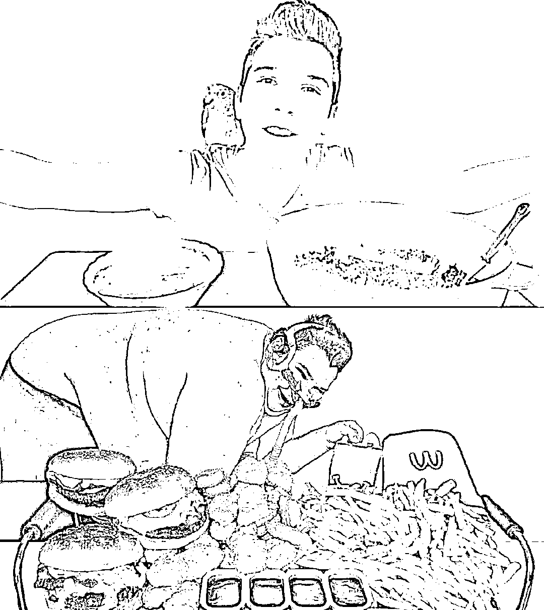

后来他开始对着镜头表演说话吃饭，粉丝开始增加。

后续为了博取眼球，渐渐地演变成大胃王挑战，吃下各种东西。

后来他积累了 600w 粉丝，并且已经改名为 Nikocado Avocado 。

从举止温和的小提琴家到一个粗暴的怪诞的大胃王，

  

究竟是他俘获了观众？还是观众异化了他？

### 迷失在镜子中

表面来看这是一个作者为了迎合观众而做出的商业决策而已。其实这个过程往往是无意识的，**它逐渐用观众群体认可的身份取代了这个人的真实身份。**

  

我们定义自己，往往需要不断地反馈。而多数时候，我们依赖的反馈往往来自其他人。并且不是他们所说所言，而是我们认为他们看到的。

  

**我们通过别人的眼睛来想象自己，发展自己。**

  

社会学家查尔斯·库利（Charles Cooley）将这种现象称为「镜中自我（the looking glass self^(\[1\])）」。当我们生活在紧密的小圈子中，这种镜中自我会帮我们成为我们所爱之人希望的样子，这会为双方的关系带来极大的促进。

  

但问题在于，我们今天暴露在互联网上，被无数陌生人观察，然后我们试图通过他们的眼睛来发展自己的个性。

  

但我们并不熟悉他们，彼此的背景和价值观差异如此之大，许多反馈反而会成为异化的开始。比如满足他们内心黑暗的欲望更容易得到认可，而这种认可又反过来让创作者本人进一步走向黑暗。

  

如果没有有意识地控制，我们就会被网上的这个虚拟身份所吸引，逐渐吞噬掉自己在现实生活中的自我，被受众所支配。君不见，约克瑟庞麦郎的滑板鞋犹在耳边说唱。

### 做人的时候，不要过于「定位」

**拥有错误的观众比没有观众更糟糕。**因为他们会用错误的期望来约束你的创作，迫使你聚焦在一个小的领域，牺牲掉其他一切可能。

  

抵抗这种不切实际的期望，唯一的方法是，自己知道自己想要成为什么样的人。

  

这并不是要我们退网或者删号，Grurwinder 是这么解决的：在 Twitter 上分享自己理性的思考，培养同路人，进行合理的探讨。而粉丝增加多半来自于他分享的心智模型系列内容，这样来的粉丝本身就具有一定的思辨能力，并且想成为和他一样具有独立思考的能力的人。

  

这样就能保证他的品牌形象，他的受众期望他的形象，和他理想中的形象，自己想成为的人就合二为一了。除此之外他也会分享许多其他的内容，这在专业人士看来会「稀释品牌」，但这种模糊感反而让他不会被受众所裹挟。

  

**从这个角度看，那些具有强大清晰的个人品牌的人，反而值得警惕。**

  

随着我们越来越孤独，将身份外包给粉丝或许会简单很多。但在这样的诱惑中有巨大的陷阱。因为当你以牺牲自己为代价成为粉丝所期望的人时，你得到的感情不是为你准备的，而是为你扮演的角色准备的，一个你最终可能会厌倦的角色。

  

**如果你追逐别人的认可，你最终可能会失去自己的认可。**

### 后记与思考

看到 Grurwinder 这篇文章时我也不禁问自己，做了这么久内容，我们被异化了么？因为最近观察到身边越来越多人开始做个人 IP，开始立人设，甚至每天讨论的主题就变成了 x 红书如何涨粉，我该如何让下一篇内容比这一篇阅读量更大。

  

记得当时交代小朋友帮忙更新产品沉思录公众号时，第一个原则就是：不要在乎阅读量，确保你自己读完有启发就行，其他的都是副产品。在做奇想驿播客的时候，明显看到一些讲「仁波切」的内容播放量大，但也时刻警告自己，一方面是关于这些领域还知之甚少，另一方面则是不要忘了「有趣」 —— 或许未来你会在里面听到一些意想不到的主题，但未必会喜欢。

  

其实你看到这段文字带有强烈的主观偏见，因为沉思录如果不能满足我们的好奇心和求知欲，只提供所谓的「理中客」的分析和推荐，那么我们宁可它早点结束使命 —— 这并不是不尊重诸位，而是让其保持特色，并且能持续运转下去的一种方法。

  

另一方面，我们也很小心把这里变成自己秀智力的跑马场，所以我们也会在文章中尽量多地结合自己的实践经验。

  

因为在我们看来，能改变人行动的信息才是好信息。**如果我们推荐了许多内容，但自己一个都不去实践，那么我们一定是贩卖智力优越感的骗子。**

  

**人的每一种身份都是一种自我绑架，唯有失去是通往自由之途。**

### References

`[1]` 镜中自我（the looking glass self）: *https://zh.m.wikipedia.org/zh-hk/%E9%8F%A1%E4%B8%AD%E8%87%AA%E6%88%91#:~:text=%E9%8F%A1%E4%B8%AD%E8%87%AA%E6%88%91%EF%BC%88%E8%8B%B1%E8%AA%9E%EF%BC%9Alooking,%E4%BA%A4%E4%BA%92%E8%AB%96%E3%80%8D%E7%9A%84%E7%90%86%E8%AB%96%E5%85%88%E9%A9%85%E3%80%82*

  

# 为什么设定好价格，产品的竞争模型才能出现？

> 原文：[`mp.weixin.qq.com/s?\_\_biz=MzkyNjM1ODA2MA==&mid=2247484990&idx=1&sn=d4de393790e72ee46792945dd3c6b4d2&chksm=c239c97df54e406b619887d43921ae1fb99e9270b4ff021f39c1be0b271b38b7c4fca1385750&scene=126&sessionid=1692256441#rd`](http://mp.weixin.qq.com/s?__biz=MzkyNjM1ODA2MA==&mid=2247484990&idx=1&sn=d4de393790e72ee46792945dd3c6b4d2&chksm=c239c97df54e406b619887d43921ae1fb99e9270b4ff021f39c1be0b271b38b7c4fca1385750&scene=126&sessionid=1692256441#rd) 

回顾一个当年定价上的失败案例，儿科会员卡。即当你购买这个会员卡之后，可以在本年度每天问 N 次参与此计划的医生，而平台基于一个固定价格，根据问诊次数向参与计划的医生结算。

  

这个业务最终失败的原因主要为以下两方面：一是本身需求方和供给方的利益并不一致，需求方贪婪，供给方懒惰，最终是一个零和博弈；另一方面则是为了销量和 GMV，定价过低导致部分羊毛党「物尽其用」，最终博弈结果就是平台补贴不少，而供给方也无法保证及时响应，纷纷退出服务。

  

当时只考虑设计服务体验，也计算了服务成本，但是却没有仔细思考定价的问题，临上线时才匆忙确定。

  

这个错误的决定浪费了团队半年多时间，如果能早些在价格上仔细审视，也许不至于浪费这么多资源。

  

下面这篇文章来自 First Round Review，由 Madhavan Ramanujam 的分享总结而来。结合个人经验，在其中增加/替换了部分案例供参考。

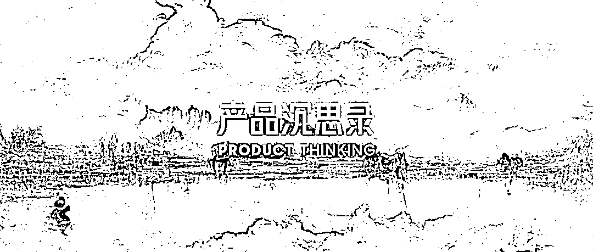

### 定价一开始就很关键

**价格设计本身应该是产品设计的一环，而不应该是产品设计之外的事情。**

在宜家的设计思路中，他们总是先确定价格带，比如「低价类别」，然后在这个价格带中选择一个价格，如 7.99 美元，然后开始朝着这个目标去努力。

  

**当设定好这个价格后，一个产品的竞争模型就出来了 —— 形式，功能，质量，可持续性和低价格不断相互竞争。**

  

设定价格的好处是，能快速让设计者界定产品大致的竞争模型，而不会陷入无边无际的讨论中。比如上述定价的椅子，就不可能考虑实木的材料。而同时如果以低价为目标，那么还要考虑运输成本、库存成本、包装成本等一系列元素，而非仅仅是功能与形式的设计。

  

定价是一种选择，在《华为终端战略》一书中也提到，当时华为为何聚焦做高端手机，便是因为高端手机的定价，能带来丰厚的利润，才能让供应链配合度变高，也能拿出足够的利润来研究芯片及其他更底层的（2021 年小米研发费用是 132 亿元，华为则为 1427 亿元）。

  

产品和定价错配，往往会让成本激增入不敷出或价格过高销售乏力。所以定价一开始就很关键。

  

另外定价时一定要考虑**成本问题**，许多时候我们设计功能容易忽略本身客单价的因素，不断地去为体验做局部优化，比如只考虑共享带来用户传播，忽略了审核成本；降低抽佣比例吸引创作者，却忽略公司的税费和支付成本等。

### 为何货币化经常失败

**许多产品失败的根本原因在于，未能将消费者愿意为产品支付的意愿置于产品设计的核心。**太多人推迟做决定，直到产品开发完成。他们希望自己能赚到钱，但并不知道自己能否赚到钱。但却忽略了，越是推迟决定，拿到真实反馈，越不知道自己开发的产品是否满足了用户支付的意愿。

  

定价失败往往是对价格点、特性和市场的错误判断，主要有以下几种方式：

**1、功能太多**

•特征：这意味着过度设计，导致成本变高，最终不符合用户需求（如锤子的 TNT 工作站）。•避免：与其堆功能，不如克制，或者分好几个版本，产品配置本身就需要勇气去去除无用特征。

**2、定价过低**

•特征：用户需求量暴增，供给量跟不上，导致利润降低，需求也未被有效满足（如上门美甲）。•避免：如果大多数销售渠道毫无阻力，那么很可能低估了价格。

**3、不该发布**

•特征：正确问题的错误答案，要么是无人关心问题的答案（如 Apple Lisa）。•避免：尽早在工程阶段就找到用户去了解是否愿意支付，支付的意愿如何。

### 新产品货币化的关键

**1、尽早进行支付意愿讨论**

不要问用户是否喜欢你的产品，而是问他们愿意为此支付多少钱 —— 以及最高支付多少，和高到离谱的价格是多少。

•愿意为此支付的价格，代表用户无压力支付的金额，往往偏低，一般只有为了增长才会选择这个区间的价格。•最高支付价格，往往代表用户真实愿意支付的价格，这个价格往往处于用户认为价值和价格匹配的地方。•离谱的价格，用来检验自己是否高估了自己产品在用户眼中的价值。

  

在 flomo 早期我们就上线了支付功能，彼时甚至付费功能都还未开发完。其核心并不是为了赚钱（当时有一种声音就说我们想钱想疯了 😂 ），而是为了验证用户的支付需求，以及支付想要获得的功能点是什么，也避免了我们自作多情地开发许多想当然的功能，徒增成本。

  

**2、如何收取以及收取什么费用**

早年我们听歌都是从 CD 烧录到 MP3 里面，而 itunes 变成了直接购买单曲，而今天则变成了订阅制。

  

Slack 是按照能查看最近消息数量收费；Notion 早期是按照 Block 数量进行收费；Github 则是当你需要新建隐私代码库的时候向你收费。

  

明白自己应该以什么模式收费，以及收取什么费用至关重要。**有时候，最好的产品创新源自于货币化模式创新。**

  

**3、不要用一个版本来为所有人解决问题**

如果一瓶水在便利店，是 1.5 元；如果换成动车模型装放在高铁站，是 8 元；如果换成玻璃瓶放在酒吧，可能是几十元。

  

不同的情境，不同的用户，会有不同的支付意愿，想想那些想要最好产品的人、立即就想要的人、只想要基础版的人、价格敏感的人等。**唯一的解决方法在于接受用户细分。**

但要小心，多 SKU 会导致销售、营销变得复杂，先从三到四个细分开始，尽量精确地描述这些细分人群的特征。

  

**4、帮助用户设定价格（shaonan 补充）**

平台型非标型产品/服务往往会面临一个问题，即供给方不会设定价格，比如对于在线问诊平台上的医生来说，绝大多数不知道一次问诊该怎么定价，导致出现了主任定价比主治还低，主任订单多到爆最终关诊歇业；而主治则由于定价过高无人问津而退出。后续根据身份推荐定价范围后，这种问题就很少出现了。同时还发现了一个有趣的现象，即**多数人都是按照平台推荐价格定价**，只有不到 10% 的供给方调整过价格。

  

所以作为平台方最好的方式就是基于对供给方的理解，给出建议的价格范围，引导供给方去设置。这样能避免供需双方交易摩擦过大，也能避免供给方随意设置价格的时候价格带过于混乱。

### 小结

围绕价格尽早进行设计，会迫使你尽早思考客户最看中什么，以及什么功能能最大限度地提高你的成功。**没有价格，你就没有产品**。要小心产品上有许多用户不需要的功能，或者那些用户不在意的服务。

  

从另一个角度来看，**定价影响收入，继而决定商业模式，而商业模式最终决定公司文化。**比如亚马逊和美团的商业模式利润有限，则整个公司文化都会有强执行低成本的特点；而字节和腾讯由于是广告模式为主，由于利润丰厚则会对创造性有更多的包容。对于初创团队来说，创始人只能塑造一部分文化，而另一部分则是由自己的商业模式所决定，并不是每个产品都能学习 Apple 把体验做到极致。

  

**活下去，才有可能完成使命。**

### References

`[1]` It’s Price Before Product. Period.: *https://review.firstround.com/its-price-before-product-period?utm\_source=Firstround.com+Library&utm\_campaign=5cfb76fbf8-jane\_davis&utm\_medium=email&utm\_term=0\_d9bb43e05b-5cfb76fbf8-79993419*  
`[2]` Ikea sets the prices of its products before they're even designed: *https://www.businessinsider.com/ikea-price-first-design-later-2016-10*  
`[3]` 小报童经营者指南：如何给专栏定价: *https://help.xiaobot.net/operation.html*  
`[4]` 什么是价格带: *https://wiki.mbalib.com/wiki/%E4%BB%B7%E6%A0%BC%E5%B8%A6*

  

# 产品沉思录精选 4 月更新

> 原文：[`mp.weixin.qq.com/s?\_\_biz=MzkyNjM1ODA2MA==&mid=2247484990&idx=2&sn=9f35300a5d946a52fd817abb2aaabcf9&chksm=c239c97df54e406b89efdbccc278c3e24740ebb374d3d1e5c350056a3acb8573ffa632c1a1d2&scene=126&sessionid=1692256441#rd`](http://mp.weixin.qq.com/s?__biz=MzkyNjM1ODA2MA==&mid=2247484990&idx=2&sn=9f35300a5d946a52fd817abb2aaabcf9&chksm=c239c97df54e406b89efdbccc278c3e24740ebb374d3d1e5c350056a3acb8573ffa632c1a1d2&scene=126&sessionid=1692256441#rd) 

趁着放假，给产品沉思录精选补充了许多内容，免费即可浏览。

  

秉承一贯的理念，都不是最新最热的东西，但对我和 @fonter 来说，却穿越了时间，值得推荐。

  

长按识别二维码，可以查看详情链接~ 

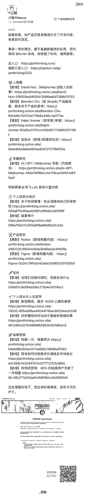

# 如何打造生活中的工具箱

> 原文：[`mp.weixin.qq.com/s?\_\_biz=MzkyNjM1ODA2MA==&mid=2247484980&idx=1&sn=b78251a16219a0c7a97bce08b43933de&chksm=c239c977f54e406131a05e9a5d9b88945711afe53984946a6581437a30ad5b50745fc9aac1a6&scene=126&sessionid=1692256441#rd`](http://mp.weixin.qq.com/s?__biz=MzkyNjM1ODA2MA==&mid=2247484980&idx=1&sn=b78251a16219a0c7a97bce08b43933de&chksm=c239c977f54e406131a05e9a5d9b88945711afe53984946a6581437a30ad5b50745fc9aac1a6&scene=126&sessionid=1692256441#rd) 

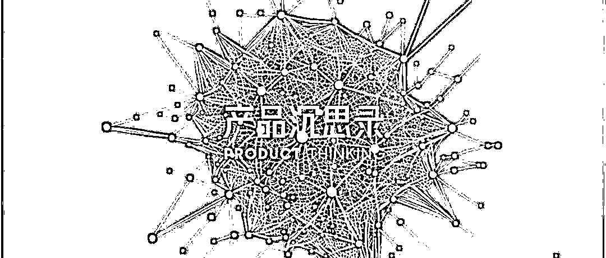

试着回想下自己意识到「自己在做自己」的时候，是否并没有哪个顿悟时刻，而是回头看的时候才发现一路走来成为了自己。

  

在这其中是一系列一以贯之的选择，通过这些选择我们塑造了「自己」。比如有些人利益为先，有些人兴趣为先，有些人快乐为先，有些人奉献为先，这背后都是一系列选择框架在起作用。而有些人（包括自己）呈现出多变，很难理解的状态，容易人云亦云，主要源自于缺少稳定的决策框架。反之，那些能做「自己」的人，往往有一套自己的处世哲学，对自我的叙事逻辑完备。

  

在尝试搭建思维框架时，Shaonan 曾遇到过下面几种问题：

•仅有纯粹的形而上的哲学框架，缺少实践。比如 B 站上许多年纪尚轻就感悟自己已经如阳明先生一样顿悟了知行合一的意义，或者家庭饭桌上老人那些并不靠谱的人生感悟。这套体系很容易变成形而上的纯粹哲学讨论，甚至成为某种麻痹自己安于现状的禁锢，而没有任何具体实践的方法。•以学科分类法来看待所有知识，没有放置在合适的分层。比如把心理学当做一整个学科来选择研究或放弃，而忽略了在生活中应用的分支并不相同，比如社会心理学和积极心理学往往并不在一个情况下使用。

  

你不需要重新发明轮子，毕竟已经有太多先贤在这些问题上思考的，比作为普通人的我们要深入许多。所以更多的是寻找到好的框架，然后去践行。

  

但即使是此，也会面临两个困难：

•由于每个人的经历和知识不同，很难有一套标准的框架参考，所以吾之蜜糖，彼之砒霜，需要不断地探索，实践，迭代。所以大胆魔改前人的框架并不是孟浪，而是现实需要。否则削足适履更加拧巴。•没有时间去思考和搭建这些框架。这个过程往往需要向内探索很深，花费时间很多，并且产出效果并不明显。所以许多人宁可选择去学习一些新技能，或者纯粹的娱乐休闲，也不愿意在这里投资。

  

面对艰难的生活，我们需要有一套工具箱，用来应对生活的挑战，而不是每次都重新打造工具；另一个角度，这些工具也必须按照秩序来放置，才能让我们正确使用，否则总是每次顺手摸出来锤子，那就只能把一切当做钉子来砸。

### 工具箱的作者

这篇文章源自姚勇，除了是永航科技的 CEO，打造了「QQ 炫舞」之外，还曾经是水木年华乐队的成员。更有趣的是他的另一个身份 —— 王小波的外甥，即王小波杂文《我怎样做青年的思想工作^(\[1\])》中那个被教育的外甥：

> 我外甥马上接上来道：舅舅，何必要快乐呢？痛苦是灵感的源泉哪。前人不是说：没有痛苦，叫什么诗人？——我记得这是莱蒙托夫的诗句。连这话他都知道，事情看来很有点不妙了……痛苦是艺术的源泉，这似乎无法辩驳：在舞台上，人们唱的是《黄土高坡》《一无所有》，在银幕上，看到的是《老井》《菊豆》《秋菊打官司》……
> 
>   
> 
> 照此看来，我外甥决心选择一种痛苦的生活方式，以此净化灵魂，达到艺术的高峰，该是正确的了。但我偏说他不正确，因为他是我外甥，我对我姐姐总要有个交待。因此我说：不错，痛苦是艺术的源泉；但也不必是你的痛苦……柴科夫斯基自己可不是小伊万；玛瑞·凯瑞也没在南方的种植园里收过棉花；唱黄土高坡的都打扮得珠光宝气；演秋菊的卸了妆一点都不悲惨，她有的是钱……听说她还想嫁个大款。
> 
>   
> 
> 这种种事实说明了一个真理：**别人的痛苦才是你艺术的源泉；而你去受苦，只会成为别人的艺术源泉。**
> 
> 因为我外甥是个聪明孩子，他马上就想到了，虽然开掘出艺术的源泉，却不是自己的，这不合算——虽然我自己并不真这么想，但我把外甥说服了。他同意好好念书，毕业以后不搞摇滚，进公司去挣大钱。

> 

  

如果你对他的这段经历有兴趣，可以先看看在王小波逝世 24 周年时他的回忆^(\[2\])。

  

基于上述这些经历，再来看他对自己的工具箱的阐述：**工具箱建立在心理科学、逻辑学与社会科学基础上。结合了在世俗社会中，实现功利目标的经验**。**这篇介绍你能够领悟多少，取决于你在工作生活中遭受痛楚的程度，和思想开放性**。

### 工具箱的边界、功能和思考

姚勇在文章中提到了工具箱的边界和三种功能。

  

边界是指工具箱不包含各种专业技能，这里是曾经让 shaonan 困惑的地方。因为理论上这些知识占据了我们学习的大多数时间，而剩下的那些东西我们会粗浅的概括为叫「软技能」「人情世故」要么就是比较玄学的「元技能」，分分钟扯到人类的神经和进化论。所以退一步看，每个人可以有两个工具工具箱，一个来放自己的专业知识，另一个来放如何应对生活中遇到的各种问题。前者是我们赖以生存的基础，后者则可以促进与提高前者的效率和价值，以及让自己内心得到安定。

  

所以他介绍认为生活工具箱应该有三种功能

1.让自己更好地做事获取成就。2.处理各种关系，包括社会关系与亲密关系。3.让自己感觉好过一些，并抵抗挫折。

  

然后将所有的工具分为了六个层次（图片引用自姚勇的文章^(\[3\])）

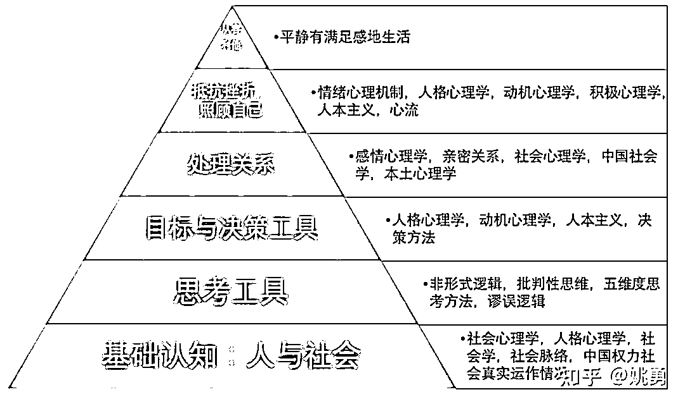

### 工具箱的启发

关于他的工具箱的具体内容，诸位可以点击文末阅读原文查阅，在这里不加赘述，值得提醒的是前两类是后面四类的基础。这里只分享下对 shaonan 的一些启发。

  

shaonan 的框架其实一直未完成，除了上面说的专业工具箱和生活工具箱的混淆之外，对比这个框架还有几个忽略的地方，比如在哲学部分囊括的太多比较混乱，缺少决策层等，具体如下：

  

**1.把目标和决策工具，与思考工具混淆。**

这样造成的问题是，大多数时间都投资思考工具的研究上，甚至有些「收集癖」，希望尽量全的掌握在工具箱里面，这在沉思中也有体现，能看到许多关于「思维」的文章。但是对于目标的设定往往缺乏方法和锻炼，对于决策亦是犹犹豫豫，不够科学。其实只有正确的使用思考工具做出决策，这些工具才有价值。仅仅拥有思考工具并不能做出好的决策。

  

举个例子，他多年前就知道芒格的人类误判心理学，收集了其中的许多思考工具，甚至认为没有什么新鲜的。但却忽略了如何应用这些工具，因为对于芒格来说他是用这些工具来证伪投资机会的，而不是用来证明。而他则以为是用这些工具证明机会，可想而知做出的许多决策都是错误的。

  

**2.没有区分理解自我和处理关系是不同的部分。**

他有相当长的一段时间内他都在探索自我，涉及到不少宗教于哲学思考。但却很少投入精力去关注关系该如何维护，这就导致了其实在社交层面有一种「社恐」的心态，而在多人协作中往往会不好处理和上下级，平级的关系，缺少一种理性的视角看待，很容易从自我来代入；而在亲密关系中的知识缺失，则会因为不懂如何沟通而伤害亲近的人，没有分清楚沟通情绪还是沟通事实。同时还经常会把自我牺牲包装成「爱」，以此来绑架亲密度人。

  

我们其实无时无刻都活在关系中，所以如何处理好这两方面的事情，是需要一些知识和智慧的，值得单独拎出来学习，让自己的心智尽快成熟。

  

**3.在基础认知方面，忽略了对社会脉络部分中内容的理解。**

在社会脉络中还可以分成四类：身体生存、权力、财富、男女关系。

•身体生存并不仅仅是健身和减肥，其中还包括精力管理，情绪管理等。身体和精神是我们的硬件基础，随着年龄见涨在这方面的投资要提高。Shaonan 之前在这方面单独把他们拆分成了多个领域，比如如何健身和保证睡眠恢复精力是分开的，以及情绪管理单独放在了自我认知一块，分散后的问题是无法统一规划，比如很多时候其实需要休息的是精神，但是却容易将休息时间安排给健身，导致最终精力不济。•对于财富的理解其实是这些年才单独补齐的，比如之前没搞清楚金钱和资产的关系，以及自己挣钱的目的。文中有一段论述很精彩：**在对财富的态度上，有一些不容易被人察觉的概念区别。对金钱的喜爱，对挣钱的喜爱，和对花钱的喜爱。是三种完全不同的倾向。**想清楚自己和财富的关系，对于幸福至关重要。•男女关系一章也是值得深入思考的。人有七情六欲，男人管不住下半身，这些都不是借口。一方面如何寻找到亲密关系，让家庭生活持续下去，不被耗尽。另一方面人生漫长，一定会遇到某些其他的心动时刻，如何处理好这种情况不逾矩，则不能仅仅诉诸于意志力。另一个视角则是通过他人如何处理这种关系来端查此人的特质，如对亲密关系不屑一顾寻花问柳，在事业上的靠谱程度也会大打折扣，一定要慎重合作。

  

以上这些是他比较主观的感受，主要目的是分享拿到比较好的框架后的反应：

•每个人都不是活在真空中，所以不存在拿来框架直接就用的情况，必须内化。尽信书不如无书。•框架的好处是能带来一种新的视角，在混乱中找到秩序，在模糊中找到规律，能有部分启发就足矣，取长补短，不断迭代。

### 小结

这篇文章感谢 Hans 的推荐，其实之前就想分享给大家，但始终感觉尚未理解透彻，反复阅读了四五次，所以拖到了今日。

  

但这些等待的时间是值得的，一方面解决了 shaonan 自己框架不连贯的问题，把一些模糊的地方清晰出了层次（如把亲密关系从自我中剥离、把决策从思维工具中剥离），同时也补齐了一些缺乏的视角（如关于身体生存部分、男女关系部分、权力部分等）

  

同时对于大家阅读沉思录也会有些益处。许多新订阅的朋友往往会困惑于产品沉思录如何阅读，之前虽然说是可以找你感兴趣的阅读，其实大抵是一种自己对于结构没有理解的托词。

  

无论你是否愿意整理这个工具箱，生活中的问题都摆在哪里，所以与其硬刚，不如找些方法。整理的过程会消耗不少时间，但一旦梳理清楚这些工具箱内的工具，内心会安静不少，还能持续使用多年。

  

另，在使用这些工具有一些先后顺序，建议动手使用前先反复看文章中的第十节。

### References

`[1]` 我怎样做青年的思想工作: *https://link.zhihu.com/?target=http%3A//mp.weixin.qq.com/s%3F\_\_biz%3DMzA4NTE1NDIxMA%3D%3D%26mid%3D2651824629%26idx%3D2%26sn%3D5589fe0b65d05bddc73ebb7c2d33166e%26chksm%3D84274138b350c82e0bbd5b4a603e175072587a1750f7e3490be1020b4541cbf80b356db7d316%26scene%3D21%23wechat\_redirect*  
`[2]` 在王小波逝世 24 周年时他的回忆: *https://www.zhihu.com/question/453877246/answer/1829893891*  
`[3]` 图片引用自姚勇的文章: *https://www.zhihu.com/column/c\_1276994955883040768*  
`[4]` 人生艰难，如何才能过得好一点呢: *https://www.notion.so/1ba3e874231f4b04b1c9ef78452fcb9d*  
`[5]` 姚勇的专栏：Remixing 艺术&科技-黑铁时代杂谈: *https://www.zhihu.com/column/c\_1276994955883040768*  
  

  

# flomo 3 周年，感谢有你，和 6 位老朋友一起送上周年庆大礼包

> 原文：[`mp.weixin.qq.com/s?\_\_biz=MzkyNjM1ODA2MA==&mid=2247484972&idx=1&sn=ae51086df75735b1d7cba8d932cb60f2&chksm=c239c96ff54e407956304b44c22c02768f8c3b53ed0efed23b70e424c06a94404b2afd18d43d&scene=126&sessionid=1692256441#rd`](http://mp.weixin.qq.com/s?__biz=MzkyNjM1ODA2MA==&mid=2247484972&idx=1&sn=ae51086df75735b1d7cba8d932cb60f2&chksm=c239c96ff54e407956304b44c22c02768f8c3b53ed0efed23b70e424c06a94404b2afd18d43d&scene=126&sessionid=1692256441#rd) 

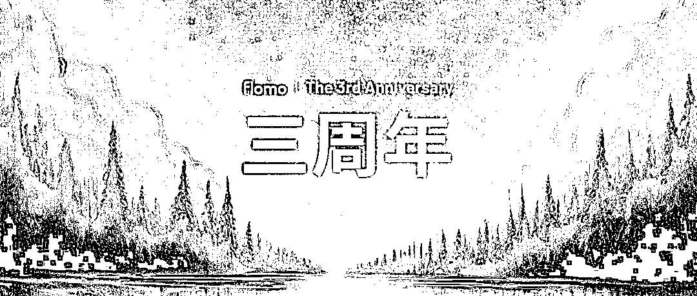

时光荏苒，flomo 今天 3 周年了。

想起当时刚出发时，只有一个简单的网页；而 3 年后的今天，flomo 已覆盖手机、平板、Windows、Mac 等主流平台。而最开心的是，3 年了，**你们还在，我们也在。**

  

在这三年里，我们坚持了一些**不合常理**的原则。

  

**在经营层面：**

· 不融资，自供血；

· 不刻意追求规模，而是追求体面地、尽可能长时间存在；  

· 关注为用户创造价值，多于为公司创造收入。

详见：《[一个笔记服务的长期主义](http://mp.weixin.qq.com/s?__biz=MzI0MDA3MjQ2Mg==&mid=2247484695&idx=1&sn=4d684ce42099c3fd4708be72c8cc37e5&chksm=e9212776de56ae60b852d0e8e39cbae81863504bb8324d42e714d1905a2cc965b0a798854770&scene=21#wechat_redirect)》

  

**在产品层面：**

· 不做 All in one，力求将一个场景打透；

· 不仅提供产品功能，更关心你如何使用；  

·  控制创造者的贪欲，尊重产品的主体性，让 flomo 始终是 flomo。

详见：《[flomo 的 2022](http://mp.weixin.qq.com/s?__biz=MzI0MDA3MjQ2Mg==&mid=2247486609&idx=1&sn=027e055d44bc01c1fcd472be05ab428c&chksm=e9212ef0de56a7e6fc344ad34b139324e62a46b405d6c7bf6e1982655564f6dab4eaa89f3990&scene=21#wechat_redirect)》、《[flomo 的 2021](http://mp.weixin.qq.com/s?__biz=MzI0MDA3MjQ2Mg==&mid=2247485677&idx=1&sn=131c2b0eb8fba825c059f538e98130da&chksm=e9212a8cde56a39abe6bf6c14e0f436132184f148c39c4c10a1e899d11d576e7daec12d8daf8&scene=21#wechat_redirect)》

  

三年，不长，但也足够跌宕。感谢你的陪伴与支持，让我们能够在这条窄路上，坚持走到今天；也佐证了这些**不合常理**的做法倒也**未必不符合常识**。

三年，也很长，在这段旅途中，也有许多老朋友帮助过我们，不吝将 flomo 介绍给他们的用户，让更多人感受到持续不断记录的价值。

  

**三周年庆 · 联合会员包限时福利（2023 年 4 月 18 日 - 2023 年 4 月 30 日）**

在这个三周年的日子里，我们和**滴答清单、读库、潮汐、有知有行、白描、即刻（排名不分先后）**等诸位老朋友一起，为你准备了丰富的联合会员礼包，帮你在接下来的日子里，更好地管理时间，获取优质的信息，提高记录的效率。

  

**白描**

无论电子书今天多么发达，我们依旧需要在纸面上阅读。但是，**这些阅读背后的记录，却应该汇总在我们的数字笔记中，和已有的知识建立更深的连接**，而非任其散落在纸面上，封存在书架里。

三年来，许多 flomo 用户，通过白描的扫描分享接口，将内容直接分享到 flomo 中保存。

趁着周年，白描团队送来了更加优惠的买断福利，如果你经常需要扫描东西，那么这个联合会员相信你会觉得很超值。

  

**在任意应用市场搜索「白描」，或点下方关注他们服务号免费下载试用。**

 

白描 × flomo 联合会员，**原价 139 元，优惠价格为 108 元**。其中包括：

•白描黄金会员（买断制，全功能解锁）—— 原价 40 元•flomo PRO 年度会员一年 —— 原价 99 元/年

详细会员权益、兑换方式等，请【[点击链接查看](https://k.youshop10.com/Mm5nN5VH?a=b&p=iphone&wfr=BuyercopyURL&share_relation=4aab80c0e009db4d_1569889238_1)】。

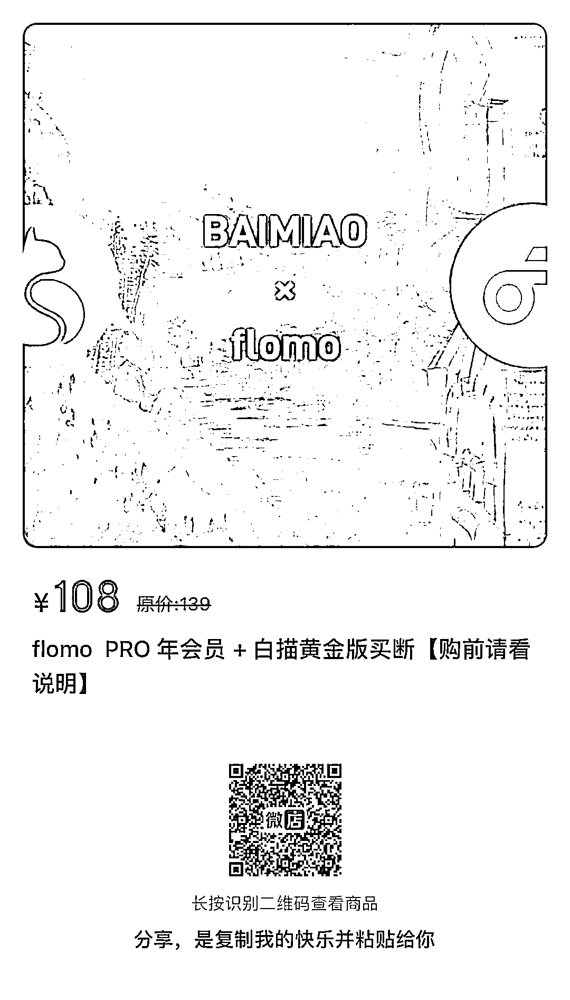

* * *

**滴答清单**

滴答清单或许是国内最知名的 TODO App 了，无论是在产品设计上，还是对于产品的理念上，都对 flomo 有诸多启发。并且自 2021 年起，[连续多年支持 flomo 的联合会员活动](http://mp.weixin.qq.com/s?__biz=MzI0MDA3MjQ2Mg==&mid=2247485774&idx=1&sn=e629a018029769ff98bd8fd26570b31c&chksm=e9212b2fde56a23979d05254f46907ea626ff2d0698206c7cfc3c71a12d9f62530776aea94c0&scene=21#wechat_redirect)。

如果你还在为选择什么待办（TODO）类工具发愁，可以立即尝试下滴答清单。说真的，免费版已足够好用，并且还有和 flomo 一样的微信输入生成待办事项的功能。而会员的日历视图则能让你在事项规划上更加精细。

  

**在任意应用市场搜索「滴答清单」，或点下方关注他们服务号免费下载。 **

 

滴答清单 × flomo 联合会员，**原价 238 元，优惠价格为 198 元**。其中包括：

•滴答清单高级会员一年 —— 原价 139 元/年•flomo PRO 年度会员一年 —— 原价 99 元/年

详细会员权益、兑换方式等，请扫描二维码或【[点击链接查看](https://k.youshop10.com/84VMM09p?a=b&p=iphone&wfr=BuyercopyURL&share_relation=4a0126d6409f5458_1569889238_1)】。

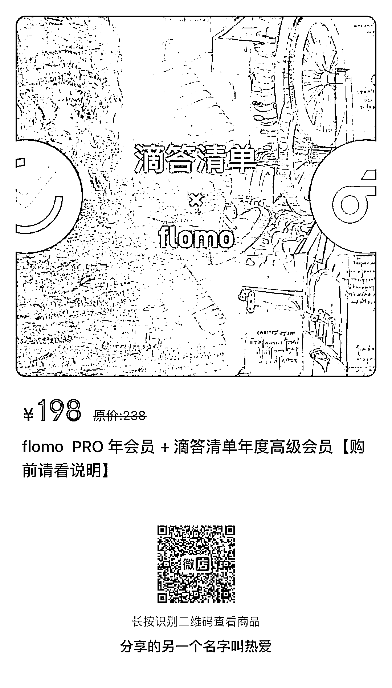  

* * *

**潮汐** 

和潮汐创始人启旭相识多年，flomo 刚开始创业忐忐忑忑时，他给予了很多帮助。

这些年来，看着他们在冥想这条路上不断前行，内容逐渐由浅到深，许多个失眠的晚上，潮汐都是安抚情绪的利器之一。如果你恰巧对正念冥想感兴趣，可以试试潮汐上的冥想入门。

  

**在任意应用市场搜索「潮汐」，或点下方关注他们服务号免费下载。**

 

潮汐 × flomo 联合会员，**原价 327 元，优惠价格为 248 元**。其中包括：

•潮汐 Plus 会员一年 —— 原价 228 元/年•flomo PRO 年度会员一年 —— 原价 99 元/年

详细会员权益、兑换方式等，请扫描下图二维码，或【[点此查看](https://k.youshop10.com/r7daGLr=?a=b&p=iphone&wfr=BuyercopyURL&share_relation=ccc4bd9c82a3455d_1569889238_1)】

  

* * *

  

**有知有行：投资第一课** 

我们依旧记得在有知有行的办公室里，孟岩鼓励我们纵身一跃，才有了今天 flomo 的诸多样貌，才有了这封信。

这三年来，有知有行也有了诸多变化，从一个独立的 App，衍生出来了《[知行小酒馆](https://www.xiaoyuzhoufm.com/podcast/6013f9f58e2f7ee375cf4216)》《[无人知晓](https://www.xiaoyuzhoufm.com/podcast/611719d3cb0b82e1df0ad29e)》两档播客，也孵化出了简单易用的「长钱」系统。而曾经在 flomo 推荐过的《投资第一课》，如今已经由「读库」制作为全新的实体书，一本工艺精美的「小红书」。

  

**如果你对投资没有妄念，且比较相信长期价值，那么关注下有知有行，或许能找到更多同路人。**

 

投资第 1 课 × flomo 联合会员，**原价 167 元，优惠价格为 129 元****。**其中包括：

•投资第一课实体书 1 本 —— 原价 68 元•flomo PRO 年度会员一年 —— 原价 99 元/年

详细会员权益、兑换方式等，请扫描下图二维码，或【[点此查看](https://k.youshop10.com/X4koBlrg?a=b&p=iphone&wfr=BuyercopyURL&share_relation=6b86b8196ead876f_1569889238_1)】

**注意：本书目前为预售，4.25 日后发货**

* * *

  

**即刻**

如果没有即刻，flomo 或许很难冷启动，找到第一批种子用户。我们依旧清晰地记得，当年官网上线时，大家纷纷帮忙转发的那天。在这个镇子里，很温暖。

三年来，许多即友在即刻上分享 flomo 的用法及内容，对我们颇有启发；也有许多批评和建议，让我们不敢懈怠。

即刻算是新技术浪潮讨论浓度最高的阵地，不论 web3、VR 还是 AI，如果你希望找到一个温暖且能看到不同见地的社区，或许可以试试即刻。flomo 及两位元神，都在等你到来。

  

**在任意应用市场搜索「即刻」，或点下方关注他们服务号免费下载。**

 

Jike Yellow × flomo 联合会员，**原价 247 元，优惠价格为 188 元。**其中包括：

• Jike Yellow 会员一年 —— 原价 148 元•flomo PRO 年度会员一年 —— 原价 99 元/年

详细会员权益、兑换方式等，请扫描下图二维码，或【[点此查看](https://k.youshop10.com/EyBcaU91?a=b&p=iphone&wfr=BuyercopyURL&share_relation=c23d09513c112362_1569889238_1)】

* * *

**读库 **

和《读库》已经合作两年，但相识已经十几年。

[为何要找《读库》来做联合会员？](http://mp.weixin.qq.com/s?__biz=MzI0MDA3MjQ2Mg==&mid=2247486603&idx=2&sn=692934b9858941e2016f7c194149e3de&chksm=e9212eeade56a7fc7d331db6d3b3f38d31dac929dc4ccc7899bdb0b3a668cc8f8a61f0de39a2&scene=21#wechat_redirect)**是因为 flomo 一直希望能找到更优质的信息源合作，因为只有这样，才能引起大家更多的思考，也才有更多记录的动机。**

如果你还不知道读库是什么，那么这里有一段小介绍：《读库》由张立宪（江湖人称老六）创办于 2005 年，着重于发表中篇非虚构的文章，着重关注「那些 Google 不到的人或事」。《读库》的发行模式很特别，是一本独特的杂志书（MOOK），每两个月出版一辑，全年订阅，还会收到额外的一辑（共七辑）。被公认为国内相当有影响力的出版机构之一。

  

**2022 年，读库 App 也支持了划线内容分享至 flomo，让你更方便地记录所思所想。关注下面公众号，了解详情~**

 

读库 × flomo 联合会员 读库 + flomo 会员，**原价 438 元，优惠价格为 328 元**。其中包括：

•读库 2023 年阅读计划（全年共七册 + 读库 App 阅读权限）—— 原价 339 元•flomo PRO 年度会员一年 —— 原价 99 元/年

详细会员权益、兑换方式等，请扫描下图二维码，或【[点此查看](https://k.youshop10.com/AoLqRDxo?a=b&p=iphone&wfr=BuyercopyURL&share_relation=73627706947b502f_1569889238_1)】

* * *

  

**希望明年的你，会感谢今天的自己，也希望明年此时，我们还能在此相会。**

**持续不断记录，意义自然浮现。**

  

# 品牌为何需要故事：参考框架如何极大地改变事物的价值

> 原文：[`mp.weixin.qq.com/s?\_\_biz=MzkyNjM1ODA2MA==&mid=2247484970&idx=1&sn=3556926f010c0823686a7f5364a7b281&chksm=c239c969f54e407f95d3299aa5a7b66e1d2813eb9a0775c43b0812f4fb06887b0fa679c8f3c6&scene=126&sessionid=1692256441#rd`](http://mp.weixin.qq.com/s?__biz=MzkyNjM1ODA2MA==&mid=2247484970&idx=1&sn=3556926f010c0823686a7f5364a7b281&chksm=c239c969f54e407f95d3299aa5a7b66e1d2813eb9a0775c43b0812f4fb06887b0fa679c8f3c6&scene=126&sessionid=1692256441#rd) 

Rory Sutherland 是英国奥美的副主席兼行为科学实践创始人，他将大量行为科学和广告营销进行结合，带来了许多独特的视角，另强烈推荐看他的 TED 演讲，风趣又深刻。

  

本文编译自他的系列播客、TED 演讲、专栏等，对我启发最大的几个点：

•参考框架极大地改变了某物的实际价值，叙事很重要。•营销像是餐厅的清洁工，虽然不产生核心价值，但是不可或缺。•经济学之外，还可以通过心理的方式来解决，如许多时候人类追求的不是效率，而是确定性。

  

另外他还经常揶揄古典经济学，比如：**市场营销是一门知道经济学家错在哪里的科学。**

### 品牌的非传统定义

**在演化论的语境中，品牌是选择的单位。我们通过复购或者抵制，来支持和反对产品或服务。**品牌的声誉主要是让你产生足够的信任和信心，是维护声誉和确保其产品质量的角色。

  

比如所有面包店都不许挂牌子，统一都叫「面包」，那么就没有人会愿意创新了，因为用户无法识别出来真正创造的人的价值，市场趋向于劣币驱逐良币。所以一个不保护品牌的环境，将会导致所有同类型的制造者，没有动力去做得比竞品更好 —— 因为无法被用户识别出来，继而扼杀创新。

  

当然，品牌也可以分为两种：最佳品牌和足够好品牌。足够好品牌是麦当劳，比较安全，全球任何一家都一样；最佳品牌是蒂芙尼，代表某个领域最好的东西。许多新品牌都愿意做到极致，但我们多数时候都是由情感驱动的。

  

**因为买家通常不太关心追求完美，而更关心避免灾难。**

PS：这也和之前 flomo 一个千人样本调研结果很类似，用户最关心的是：极简输入，全平台免费同步，而非那些创新性的功能。所以这也和我们当时思考类似 —— 那些双链，星图，脑图，白板未必是大多数人关心的 —— 虽然他们会在访谈中反复提到。

### 关于营销在建立品牌认知方面的作用

做营销的时候，需要从两个方面考虑价值的意义。一方面是内在的客观价值，另一方面是受众的感受 —— 也可以说是人们看待某件事物的看法。

奥地利学派经济学家 Ludwig Von Mises 曾做过一个比喻：

> **营销工作像是一个餐厅中负责清洁卫生工作的角色，但这与制造产品的餐厅主厨一样重要** 
> 
> *there is no useful distinction to be made between the value created by the man who cooks the food manufacturing and the value created by the man who sweeps the floor*

  

如果餐厅不干净，它就没有吸引力；如果食品安全出了问题，会摧毁你的品牌 —— 即使你拥有世界上最好的厨师，甚至是有米其林评级，也会是一家糟糕的企业。

  

营销的关键在于唤起你的情绪反应，让你知晓某物或者某事背后的故事，因为这是你感知价值的主要方式。比如知道 KFC 是桑德斯教授 65 岁时候才创建的品牌，不会改变你吃到东西的任何性质，但是却能改变你对这个品牌的看法。

  

思考：我们是否拥有很棒的产品，但是没有打扫好周围的环境？这里有一些 flomo 的案例供参考：

•❎ 不注重应用商店的介绍和配图，以及新用户的欢迎流程过于「求逼格」，导致如果是从应用市场而不是通过其他营销渠道来的用户，感受不到产品的核心价值。•✅ 比较重视客服工作，以及进行大量理念的输出，能和用户频繁建立连接，了解设计背后的故事，继而提高了留存度和信任度。

### 参考框架极大地改变了某物的实际价值

亚当 · 斯密（Adam Smith）发现，只有当有人愿意为此付出代价时，它才有价值。某人是否愿意为它付费，以及他们愿意为此支付多少钱，这既取决于产品本身的客观品质，也取决于语境（如上下文，框架，比较或意义的结果） —— 并不仅仅取决于客观价值。想想可乐在便利店和酒吧的定价就知道了。

  

下面是一些 Rory Sutherland 在多个场合讲述的「改变框架带来新价值」的案例：

•18 世纪的德国，弗雷德里克大帝希望人民食用土豆，因为能解决饥荒问题，降低面包价格动荡。但是土豆太丑了，农民拒绝种植。强迫是无用的，他想到另一个方法：宣布土豆是宫廷用菜，并派人看守一块皇家种土豆的农田（但却让看守不必认真）。农民们的一个常识是，值得看守的东西，也值得偷。不久后，德国就出现了规模宏大的地下土豆种植。他通过改变大众的思考框架，成功重塑了土豆的品牌形象。•土耳其的国父 Kemal Atatürk 就任第一届总统期间， 希望改掉土耳其女性穿戴面纱的陋习。可是穿戴面纱是土耳其女性传统的宗教习俗，要土耳其女性拿下面纱必与宗教习惯相互抵触，于是他规定土耳其的妓女出门一定要戴面纱。•为何人们愿意为课程支付比书更高的溢价？首先课程对标的是培训，而非书，客单价不同。其次人们认为生产产品需要更多资源时，愿意付出更多费用（比如录课比印刷书籍成本高）。最后因为课程更贵，会让人感觉「有效」的可能性更大。•Nespresso 销售星巴克胶囊，是因为它让顾客将其与星巴克进行比较，而不是家庭咖啡。和谁比较很重要。

  

**为何框架效应如此重要：**

•所有的价值都是主观的，而说服往往要比强制更有效。•叙事是销售的一部分，创造了人为的稀缺性并放大了经济效应。•构建产品的方式决定了消费者的感知和行为。

  

这在之前「松节油」中有写到类似的内容，如何给功能加上叙事： 功能与叙事^(\[1\])

### 一朵花只是一棵有广告预算的杂草

广告的最大目标是引起注意，如果用户没有看到您的广告，他们就不会发现您的产品或服务。在心理学中，这被称为冯·雷斯托夫效应 —— 这里的广告，也可以延伸到产品的曝光，如货架等渠道位置。

  

广告除了提供信息引起注意，还肩负着传递信号的作用，在自然界已经存在了 2000 万年，比如色彩斑斓的毒蛇通过身上花纹来警告天敌，降低死亡威胁。而蜜蜂通过判断花瓣的大小来决定是否来采摘，因为花瓣越大说明植物越健康；而花朵则为了达到这种目的，需要冒险将自己的花瓣尽量变大，这势必会更容易引起食草动物的注意。

  

研究论文来源^(\[2\])

  

**所以许多公司打广告未必是直接促进销售，而是通过昂贵的成本，传递出可靠的信号（机场/高铁站的 OPPO 品牌广告）。或者通过发布重大公告或内容，越公开翔实越可信（如有知有行的《投资第一课^(\[3\])》）。**

### 经济学之外，还可以通过心理的方式来解决

今日的营销，很容易让决策过度依赖于数字和指标，认为只有测量的东西才是真实的，但并非所有东西都可以被测量。这是因为在卡尼曼之前，心理学的框架没有经济学夯实，所以往往会让位给经济学的思考方式，即从理性人的角度出发思考问题。

  

**我们缺乏人类情绪的指标，所以总是试图通过优化与情绪无关的变量来改变情绪状态。**新的市场往往并不能从客户访谈中挖掘出来，而多少含有一些非理性成分。

  

**一些案例：**

•欧洲之星为了从巴黎到伦敦缩短 40 分钟的时间花了 600 万镑，但是只需要花 0.01% 让整个路程上都有 wifi，反而会让整个旅途更愉快和有用。当然参考维珍航空选择更好的服务员来提供上等红酒，可能人们还希望列车开得慢点。•英国邮政曾想把隔日投递率从 98% 提高到 99% ，但大多数用户感受其实并不强烈，认为只有 50% 左右。这就像一个很臭的餐厅希望提升食物质量来提高满意度。其实最重要的是告诉用户 98% 的邮件隔日达就好。（😁 英国人真好玩，疯狂黑德国，比如还可以说相比德国，多数信件会在隔日到）•Uber 并没有提高汽车的速度，但是却让用户有了一个明确的预期，而极大地改变了用户的体验。早期 iPhone 性能并不比 Android 手机好，但是会在用户触摸屏幕的时候优先响应界面，会让用户觉得「丝滑顺畅」，这是跑分所无法替代的。

  

**一些有用的心理学框架（其他常见的暂不罗列）**

•**红色运动鞋效应：**在专业环境中穿着另类衣服的人通常被认为具有更高的地位。马克·扎克伯格穿着灰色衬衫，史蒂夫·乔布斯穿着黑色高领毛衣和牛仔裤•**等候效应：**只要他们有事情要做，人们就不介意排队等候，如果给人们一个估计的等待时间，排队等候的痛苦就会减少。•**Pratfall 效应：^(\[4\])**一种心理现象，被别人认为很棒的人，一个小小的错误会让别人感觉到他们的人性化，从而更加喜欢他们。缺陷和优势往往是同一枚硬币的两面。•**九岁效应：**年龄在 9 岁的人特别有可能做出重大的生活方式改变（19 岁，29 岁，39 岁等）

  

Rory Sutherland 除了风趣的演讲，也有一些比较人文的部分，这是他在演讲最后给的两个建议：

**1.我们需要更多的时间品味已经存在的事物， 而少花一点时间去为难自己搞新的花样。****2.诗歌就是使新事物亲切近人，并且使熟悉的事物衍生出新意。**

  

如果有机会，去读读诗集，未必是从文学角度考量，而是给自己一些观察世界的新视角。

  

当然，也可以先把 Rory Sutherland TED 的演讲看了，会让你很开心的（简直是吐槽帝）

### References

`[1]` 功能与叙事: *https://pmthinking.notion.site/6738b18dad7a4eb2bafc4eb9fa3704ab*

`[2]` 研究论文来源: *https://www.researchgate.net/figure/Aposematic-signaling-has-been-documented-in-a-wide-variety-of-taxa-These-include-but\_fig1\_323946246*  
`[3]` 投资第一课: *https://youzhiyouxing.cn/curriculum*  
`[4]` Pratfall 效应：: *https://www.brescia.edu/2017/06/pratfall-effect/#:~:text=What%20Is%20the%20Pratfall%20Effect,psychologist%20Elliot%20Aronson%20in%201966.*  
`[5]` Rory Sutherland: Marketing based on behavioral economics: *https://www.yaagneshwaran.com/blog/rory-sutherland-behavioral-economics/*  
`[6]` A Guide To The Best Advice From Rory Sutherland: A Podcast Notes Collection: *https://web.getmatter.app/reader?url=https%3A%2F%2Fpodcastnotes.org%2Fmembers-only%2Fbest-advice-rory-sutherland%2F&from=ext&v=3.0.1*  
`[7]` Rory Sutherland’s Marketing Secrets: *https://perell.com/note/rory-sutherland/*  
`[8]` 【TED 中字幕】Life lessons from an ad man: *https://www.ted.com/talks/rory\_sutherland\_life\_lessons\_from\_an\_ad\_man?language=en&subtitle=zh-cn*  
`[9]` 【TED 中字幕】Perspective is everything: *https://www.ted.com/talks/rory\_sutherland\_perspective\_is\_everything*  
`[10]` Rory Sutherland 推荐的书籍: *https://www.readthistwice.com/person/rory-sutherland*

# 欲望三部曲：心有猛虎，细嗅蔷薇

> 原文：[`mp.weixin.qq.com/s?\_\_biz=MzkyNjM1ODA2MA==&mid=2247484960&idx=1&sn=5d8b3ffc02fbbbd3b7b9d877b888b446&chksm=c239c963f54e4075fca208c6d6196c15e4e21fc253e83cf411895850170372aa787cc18f8f2b&scene=126&sessionid=1692256441#rd`](http://mp.weixin.qq.com/s?__biz=MzkyNjM1ODA2MA==&mid=2247484960&idx=1&sn=5d8b3ffc02fbbbd3b7b9d877b888b446&chksm=c239c963f54e4075fca208c6d6196c15e4e21fc253e83cf411895850170372aa787cc18f8f2b&scene=126&sessionid=1692256441#rd) 

> 哲学是人类灵魂的 API 文档，所以在「产品沉思录」中，我们也会探讨和人生哲学相关的内容。本文是 shaonan 过往几年关于「欲望」的思考合集。

  

维特根斯坦说，许多问题和困惑源于语言和概念的误解。在日常生活中，困扰我们的诸多事情，并非仅仅是一个词汇那么简单。

  

比如对自己来说，这个词就叫「欲望」。曾经简单地想把它给处理掉，无论是化解还是逃避，最终都无功而返。而不断地深入下去之后，才发现这个词背后还隐藏了许多结构，而发现其中的结构，才有进一步理解。

  

任何一个词语背后，都隐藏着一片山海；而下面的文字，便是在「欲望」的山海间，漫游的琐记。

### 欲望和好奇心

清明爬山，总会去想一些相对抽象的问题。

  

这次思考的是欲望，因为总是想得到一些东西、关系、地位、名声。无欲则刚不假，但一味克制并不能解决问题，这就像用土去围堵洪水一样，不是根本之道。

  

在茶园的山脊上行走，看到新绿色层层叠叠布满山头，虽然是第三年至此，但依旧觉得分外美丽，也突然有了一个启发：因为我从未有过拥有这座山的欲望，只是希望能来其中转转坐坐，走走停停，好奇地发现，全然地欣赏。

  

欲望的反面不是克制欲望，就像黑色的反面不是非黑。一个想法不一定对：**欲望的另一面，是好奇心**。

  

欲望的目的是获得占有某个对象的感觉，特点是把任何对象都物化了，希望不断地拉近距离，继而占有，让对象丧失独立性，成为自己的附庸。而忽略了欣赏这个对象本身的美，以及和其相处的当下。并且一旦得到之后，就会选择寻找下一个对象。

  

好奇心首先是对对象有距离感，因为有距离感才能打量，观察。这时候得到本身不是目的，观察才是。好奇心是关于对象运转的逻辑，以及纯粹的审美。好奇心不在乎占有，而是了解和观察，而对象因此得到全然的独立，不断发展。而审美和观察则在当下就已经发生，所以不存在后悔，遗憾，和痛苦，只有全然的感恩。

  

欲望是关于得不到的未来，和已经获得的过去，在挣扎中忘记了当下。

  

**好奇心则是关注当下，去了解对象的过去和未来，然后全然的在当下了解或欣赏。**

  

过去不能改变，未来一切未知，人在其中几乎没有控制力，所以会催生各种痛苦和无力；而我们能控制的只有当下，一臂之内的距离。

  

去观察、去欣赏、去理解、而不着急拥有。或者说在那一刻，你已经拥有。

### 欲望与距离

时间与时间之间，空间与空间之间，自己与世界之间的缝隙，就是距离。

  

克里希那穆提说，**距离都是观念的产物，都会让我们无法了解事物本身样子**。

  

上周傍晚在长桥溪湿地公园，天空阴霾暴雨骤降，荷叶在塘中翻飞，那一刻像极了在跳舞。本应就此观察，不带任何知识和观念的介入，但脑子里蹦出来的是：

•没有带伞出来，等会雨太大怎么回家？•天黑了之后，这个地方安全么？•住在阔石板路的人真幸福啊，出门就能看到这么美的景色。•有可能在这附近租个房子？这样傍晚就能来走走了。•旁边有个人急匆匆跑过去，肯定会被淋成落汤鸡。•雷峰塔的顶上居然还有这么亮的灯。•这个小亭子真不错，下次应该带老婆一起来野餐。•等会要不要去苏堤走走？好像也没有多远。•不行，还是得回去，准备下下周的工作计划。•怎么跳出来一首这么难听的音乐，打开手机换一下。•发个即刻吧，该怎么写呢？去对面先拍个照片吧。

  

这些念头背后都是基于「我」的观念产生的，比如对于安全的恐惧、对于未来生活的憧憬、对于他者影响的反应等。

  

在这么多念头之下，虽然我和翻飞的荷叶不超过十米，但距离却无比遥远，以至于无法去全然地观察这份美景，继而无法了解「事实」到底是什么样子的。

  

**其实问题并不出在有距离上，距离本身不是问题，问题出在我们看到距离就想缩短，被欲望绑架。**

  

这种「努力缩短距离」是自幼我们就被灌输的，看到距离总想去弥补，缩短，因而只能肤浅地思考，无法了解真相。曾经有一阵我问过 @fonter 为何想要研究投资人 Danwang 的观点，因为在我看来两人距离很远，而且 Danwang 关注的事情基本上也是 fonter 无法去做的，这样研究有什么价值。

  

fonter 的回答让我意外，他说其实并非都要有什么具体的价值。研究 Danwang 对他拉来说，一个是能换个维度理解世界，这就已经很满足了。另一个是锻炼自己的逻辑能力，尤其是捕捉暗线的能力，这个能力也是未必要立即派上用场。

  

所以沉思录中他写的内容，许多时候是纯粹的好奇心去驱动，能给我带来许多启发。但反观自己，就很容易陷入到偏实用主义的观念中，总想缩短距离，一旦发现无法缩短，便会弃置，而丧失了真正了解事物真相的机会。

  

距离缩短还会带来另一个问题，就是让我们和对象贴的太近，缺少腾挪的空间，让自己缺少选择，视野被局限住。

  

早期 flomo 陷入增长瓶颈的时候，我很焦虑，总想着去改进某些功能带来增长。恨不得在一个月内让 flomo 长得像 Notion 一样完善，天天能做联合活动。恐怕这个和当父母的对孩子恨铁不成钢是一种感觉。

  

而这时候 Light 却提议我们去尝试做下小报童，和 flomo 拉开点距离，也许能更客观地看待它的成长。

  

近一年下来，有了这个距离感之后，反而轻松了不少。因为不会着急去推进 flomo 变成什么样子，而有了两个产品之后，腾挪的空间也变多了，不会把所有的希望都寄托在一个产品的一个功能上，比如再也不会对 flomo 无法做分享耿耿于怀，可以引导真正有创作欲的用户来使用小报童。

  

这也为何我对项飚印象深刻，因为在他看来，了解具体的事情，看到宏大是如何由微小叠加出来的。**只有看到结构之后，才能看到缝隙；看到缝隙之后，才能有腾挪的可能；有腾挪的可能，才能带来结构性的改变。**

  

许多时候我们并非没有选择，而是和对象贴的太近，看不到其他的可能性了。

  

**重要的不是立即缩短距离，这会让我们仅仅流于肤浅的思考；全然地不带任何观念和知识的观察，才能真正的接近真实。**

  

或许这是实事求是的另一种理解。

### 欲望与我执

上面两部分，其实只回答了一半的问题，因为内心还是希望去「规避」欲望，将其消弭与无形。

  

但上周在南京的汤泉湖边，听到某位前辈的分享，意识到作为一个普通的人类，通过「禁欲」来达到某种状态，反而是一种更加狂妄的欲望：人本身就是割裂的，都会有向上（成为😇）或向下的欲望（成为😈），接受这一点，在起起伏伏中，让自己尽量向上一点，不要去试图彻底规避，也不可能去规避。

  

**想一劳永逸躺平消解掉欲望，本身就是一种欲望。**生而为人，永远无法彻底解决这个问题，只能找到相处共生之道。

  

恰好近期睡前都会翻翻克里希那穆提的书，里面也有一段谈及欲望的部分，原文记不清了，就把自己的理解写下来。

  

欲望本身并没有问题，如果我们没有欲望，就会成为一具行尸走肉，对这个世界没有任何的反馈，也看不到各种美好。

  

相反，欲望能让我们开始行动，就像我们有看到美的欲望，才能看到花开，看到晴空，看到生命的萌发，甚至看到心动的人，看到想为之奋斗的事情，然后才能行动。

  

所以问题不在欲望的前半截，而是在后半截 —— **当我们被欲望驱动开始行动时，自己是否对结果有执念。**比如在山野漫步时，爱美的欲望让我们看到某些花草随风摇曳在林间，极美。

  

如果全然地欣赏，观察，甚至在旁边坐下，和它们共度一段时光，都不会造成内心的困扰。造成困扰的是我们想要「拥有」的执念：

•想把这朵花摘走，装裱在画框，放在家里；•想把这个镜头拍下，发在社交网络，得到点赞；•想找到更多下一朵这样的花，然后告诉别人自己的发现•……

  

如此，便进一步解决了自己和自己各种欲望的冲突 —— 不是去回避，而是与之在当下同在，然后结束了就挥手告别。

  

只不过缺少觉察的内心，很容易自动激活后半段的占有模式，遇到什么美好的事情，立即会想着再来一次，再来一次，继而希望能永远占有，永远可以再次享受。

  

然后陷入到无尽的拉扯之中，但其实得到之后，又会丢在一旁，继续寻找下一个目标。

  

想到这里，脑子里蹦出一个词，「心有猛虎，细嗅蔷薇」，试着按照用自己的理解重新阐述：**欲望像猛虎，我们在这个世界上产生行动的理由，而细嗅蔷薇，则是驯服其对结果的不执，不去占有，仅仅与其在当下在一起而已。**

  

# 那些成功投资人背后的三个共性

> 原文：[`mp.weixin.qq.com/s?\_\_biz=MzkyNjM1ODA2MA==&mid=2247484948&idx=1&sn=f748af4ca2357a3da6ae8a9d37691f33&chksm=c239c957f54e40412cdc24f8b6d449a72d15411d4455d626331b8484fec4cd4aa8d16c27184b&scene=126&sessionid=1692256441#rd`](http://mp.weixin.qq.com/s?__biz=MzkyNjM1ODA2MA==&mid=2247484948&idx=1&sn=f748af4ca2357a3da6ae8a9d37691f33&chksm=c239c957f54e40412cdc24f8b6d449a72d15411d4455d626331b8484fec4cd4aa8d16c27184b&scene=126&sessionid=1692256441#rd) 

读完了毛远推荐的一本关于投资人理念群像的书《[更富有，更睿智，更快乐](https://mp.weixin.qq.com/s?__biz=Mzg2MjEwMzM0Mw==&mid=2247486223&idx=1&sn=72413e5a0ea64dd74c9cae2679f53287&scene=21#wechat_redirect "更富有，更睿智，更快乐")》。获得了一个新的视角。因为之前读这类书功利心比较强，想从中找到「特别」的思考维度用来让自己多一种看待世界的方法。但这次在阅读中有了另外的思考 —— **不是去寻找他们的差异，而是挖掘这群人思考的共性** —— 这么多特立独行的人都认可思考方式，可能更加隽永。

  

下面便是基于个人视角，在把每个投资人的理念单独摘录后的再次汇总。

  

### 逆向思考，才能不做蠢事

**「反过来想，总是反过来想」**，这种逆向思考方式已经成为了芒格标志性的思考方式，但通过这本书才知道，他这个想法源其生物学家朋友加勒特 · 哈丁。他经常问的一个问题是：如果你想帮助印度，那么只需要问「毁灭印度的方式有哪些」，然后选择不去做这些事情就好 —— 虽然这样想看起来比较违反直觉，但确实能帮你思考周全，并解决问题。

  

逆向思考几乎贯穿了这本书的所有人：

•比如汤姆·盖纳（Tom Gayner）所说：在所有人都追求每件事都做到极致的时候，倒不如保持适当的进步就好，避免极致带来的不可持续。•比如莫尼什·帕伯莱（Mohnish Pabrai）所说：如果能从其他人身上学习，就不必混沌地提出自己的想法了。•比如霍华德 · 马克斯（Howard S. Marks）所说：想要增加价值，应该避开效率最高的市场，只关注效率较低的市场。因为研究得越多，被关注得越多，被接受得越多，被宣传得越多，在该市场上讨价还价的余地就越小。

  

同样在这次创业中，light 曾多次提醒我从逆向的角度考虑问题，不要考虑能把业务做的多大多好，而是思考这家公司会如何失败：

•比如没处理好审核问题导致服务被封禁，所以一直没有做全网共享功能。•比如没处理好现金流问题导致资金链断裂，所以非常严格的控制各种刚性支出。•比如没处理好团队关系导致闹掰分家，所以刚开始合作就定下来要相互坦诚。

  

诸如此类的思考还有许多，这是之前几次创业所不会考虑的。**逆向思考的价值并不在于证明之前的思考多么有效，而是寻找并规避决策过程中是否有哪个步骤具有归零的风险。**因为必须把许多步骤做对才能达到目标，但过程中只要有一个决策失误，就可以让这件事归零。

  

但要小心，逆向思考并不是无理由的「唱反调」，而是基于大量对于客观事实的掌握和调研之后才能进行的思考。许多时候我们会陷入到「主义」之争：比如要秉承「去中心化」的理念，那么所有的「推荐」思路都要予以反驳。这种标签化思考，是逆向思考最大的敌人。他们通过固化自己的信念来试图降低决策的复杂度，但是真实的世界并不会按照他们规划好的剧本来出演。

  

最好找到和我们意见相左的诤友，挑战我们不可靠的想法和偏见。这样做的同时，你也会为了提高自己的观点说服力而尽力组织想法。

### 积微知著，避免为极端优化

许多产品神话告诉我们一个功能是「决定性」的，我也很容易陷入到这种迷思，但回头来看这种憋大招的想法，无一例外的都未如愿。

  

如果你看过足够多产品的历史，就会知道这和生物学上的演化如出一辙 —— **并没有一个神奇的时刻因为某个功能就让某个产品飞黄腾达，相反是背后许多微小的努力累积起来的效应带来了看似石破天惊的一跃。**

  

比如在《成为乔布斯》一书中关于 iPod 的诞生，其背后源自于：

•Apple 试图用 iMovie 进入消费者市场，但是视频剪辑市场尚未成熟一直不温不火，直到被 Nepster 刺激后，才转型做音乐管理，收购了 Soundjam 魔改为 iTunes，这也为管理 iPod 歌曲埋下了伏笔。•因为 2000 年前后日本东芝发明了一个口袋大小的硬盘，恰好被 Apple 的鲁宾斯坦关注到，才有了大容量存储的可能。•因为有了大容量，所以才需要有一种特殊的导航方式来选择歌曲。而 ivy 设计的滚轮导航之所以能发挥巨大的价值，则在于软件的配合。•iPod 的软件来自于之前失败的牛顿平板，并且还加入了 PortalPlayer 的基础文档管理系统，也混合了一些 Mac OS X 的一些元素。

  

这中间每一个过程和决定，都是慢慢的演化，并无神助。只不过历史是成功者所书写的，为了传播效果许多故事就变得越来越神，脱离了实际的情况 —— 要知道当年 iMovie 也被乔老爷吹到过天上去，但依旧不温不火。

  

所以这本书中关于「积微知著」一章让我感慨良多，因为和之前的许多惯性思维都不一样：

•**微小的优势和劣势会长期积累。**凡事不追求极致，那很难坚持；保持适度，避免在错误的道路上走太远，而渐进的改变是可以持续的。•每一天都比前一天做的好一些，不断进步才是关键。同时不要犯致命的错误，这是长寿的根本。**不要追求第一名，而是保持稳步前进，不要出局。**随着时间推移，竞争者会越来越少，你会越来越领先。•不要试图做到极致，问问你自己，超越极限了么？反脆弱程度来自于你没有达到极限的程度。而长期来看，不需要极致就能获得超乎寻常的结果，极致反而会让人陷入麻烦。选择一条温和和持续的道路前进。

  

之前做互联网产品强调的是「极致体验，单点突破」，但对一个系统来说，**任何单点最优一定不是系统最优**。单点极致突破看似快，但风险非常高，我记得当时敢让家人使用丁香医生的问诊服务时，已经距离质控系统上线一年有余。这个过程全是笨功夫，从审核系统的搭建，到人员培训，到规则优化，到全年无休的人工审核，可以说是枯燥到乏味。另一个印象深刻的案例是《最终幻想 14》具体的故事可以点此查看。^(\[1\])

  

其实书中提到了一种抨击华尔街的思路，在产品行业中依旧适用：

> 华尔街到处都是猎人，他们总是在四处寻找猎物。他们发现猎物后，会把它带回来，然后举办一场精彩的盛宴。接下来他们会去寻找下一个猎物。我是播撒下种子，然后花所有的时间精心培育它们。

  

**作为产品经理，也应该把自己视为农民。Gradually then suddenly。**

### 简单并非没有价值

整本书里有许多道理都很简单，简单到好几个投资人都会解释道：投资成功真的只需要依赖这么简单的道理么？答案确实如此。比如他们都提到控制风险，避免被短期波动影响等。

  

对于此，帕伯莱有一个观点很有趣：

> 遇到其他人无法理解的真理时，最重要的就是坚持他们。这时候其实你获得了一个巨大的竞争优势。聪明的人很容易被复杂的事物吸引，同时会低估简单想法巨大的影响力和重要性。

  

我遇到好多个 flomo 的用户，都是在经历了一番探索之后，放弃了复杂的工具和流程重新回归。究其原因，是因为工作多年的人，其实并没有那么多的时间来维护一套复杂的知识管理流程，对于他们来说简单的卡片积累就已经能带来许多价值，也能让他们在已经复杂的工作生活中坚持下去。

  

在写作上我深有感触，能让产品沉思录坚持这么多年的一个简单的道理就是：**因为要为付费的读者们负责，就会有履约的压力，这比任何详细的写作计划都更有效。**

段永平说「常识非常识」，大抵就是这个意思。比如我们都知道虚荣指标对产品不好，但是奈何为了绩效总要做点这种事情等。重要的不是拥有非常多的「非共识」，而是将常识贯彻到底，如书中所说：**投资的主要活动是持有，而不是买卖**。

  

好的思想也是如此，重要的是持有并坚持，而非天天顿悟成瘾。

### 小结

这本书有趣的地方在于，这些投资人的观点其实许多是有冲突的。比如有人坦然只需要模仿就行，不需要自己的原创；而另一些人则坚持原创，避免有任何从众的行为。

  

但你会看到他们最终都取得了不错的成就，也让自己过的很满足。所以重要的不是他们说了什么，而是哪些东西对你有启发，并且你能应用到自己日常的实践中去，因为重要的不是**用不同的方式解释世界，而是在于如何改变世界。**

因为任何道理最终都指向一个问题：如何成为你自己。

### References

`[1]` 具体的故事可以点此查看。: *https://m.huxiu.com/article/453842.html*  
`[2]` 逆向思考 by lightory: *https://xiaobot.net/post/e1669696-7e39-4d6d-b07c-c8434e91ee86*  
`[3]` 知行小酒馆的播客节目：《更富有、更睿智、更快乐》- 新一代价值投资者的良好生活提案: *https://www.xiaoyuzhoufm.com/episode/62da8aff92f0689a31f5051c*

# 设计你的环境：一个地方或产品的特征，是由发生在那里的事件所赋予的

> 原文：[`mp.weixin.qq.com/s?\_\_biz=MzkyNjM1ODA2MA==&mid=2247484941&idx=1&sn=430269bdaed37de0a9cd367b8762642f&chksm=c239c94ef54e4058874dfa99f3072ce5373e94b5855e6d2383bad90fb8168f674c834bffbe0b&scene=126&sessionid=1692256441#rd`](http://mp.weixin.qq.com/s?__biz=MzkyNjM1ODA2MA==&mid=2247484941&idx=1&sn=430269bdaed37de0a9cd367b8762642f&chksm=c239c94ef54e4058874dfa99f3072ce5373e94b5855e6d2383bad90fb8168f674c834bffbe0b&scene=126&sessionid=1692256441#rd) 

fonter 和我都很喜欢 Christopher Alexander ，今天，我们也想把他和他的理念介绍给沉思录的读者们。

> Christopher Alexander 于 2022-03-17 过世，享年 85 岁，被广泛地描述为**过去半个世纪最有影响力的建筑师和城市规划专家。** 作为一位著名的建筑师，其以人为本的设计理念影响了诸如城市设计，软件设计和社会学等诸多领域，甚至被认为是模式语言运动之父 —— Wikipedia 便是来自于他的这种设计理念。 

  

而我在 2014 年的时候读到其 1979 年的著作《建筑的永恒之道》，被隽永的语言所打动，但由于个人能力原因，无法消化其背后的思想，只断断续续记录了一些碎片。时隔多年再次阅读，希望能从中找到建筑设计与产品设计的交叉点。

  

本文也受到 Basecamp 产品管理专家 Ryan Singer 的演讲《Designing with Forces：How to Applied Christopher Alexander in Everyday Work》的启发：

### 形式（form）与情境（Context）适合

每个设计问题都始于努力实现两个实体之间的适应性：形式及其上下文。**形式是问题的解决方案；上下文定义了问题。**第一次通过设计来解决现实问题时，其实是在决定形式上下文边界在哪里，以及可以将其挪动到哪里。

•在形式和内容之间画出边界•识别对形式提出要求的作用力•将相关的力量分解成新的形式•将设计过的形式在环境中测试，重新发掘摩擦

以上图为例，解释下四个步骤。

  

人们的目的是获得热水，厨房里随处可见的热水壶就是形式，而在厨房中使用明火将水烧开，则是其情境的上下文。在这个环境中，同时还有许多的作用力，比如加热的方式可以是天然气，也可以是电，但在某些地方则是柴火；烧热之后我们要立即使用，所以要求上面有把手和壶嘴，可以方便地让我们提起来等等。

  

Alexander 在书中指出，**任何一个边界内，都由一系列事件，重复组成某种模式。**当我们在设计一个形式时，我们应该知道这个世界上实际上有哪些形式和这个相关，以及哪些事件在影响我们要做的事情。比如在厨房中烧开热水，往往有这几个应用：

1.为了保证健康直接烧开饮用或冲泡饮品 2.用来让冬天刷碗没那么痛苦

  

如果我们希望把模式 2 更好地解决，那么未必是设计一个更好的热水壶，而是来看如何满足下面几个约束条件：快速地把水加热到四十度，和水池更近一些，出水量不需要很大但需要持续。

  

移动问题的边界，就会得到全新的形式。如这种接驳式水龙头就能让冬天刷碗没有那么痛苦，同时也不破坏现有的结构，成功地把相关力量分解成了新的形式，并且适合当下的环境。

同样，最早和 light 聊过有机会想重新设计一款 RSS 阅读器，用来更好地挖掘优质信息。但仔细思考后发现，现在并不是缺乏信息，而是缺乏优质信息；不是过滤器不够强大，而是缺少优质的内容供给；而没有优质供给的背后，是激励机制的问题 —— 毕竟知识类的内容不适合免费阅读 + 广告这种模式。

  

所以 RSS 阅读器只是形式，而我们目的是为了获取优质信息，环境因素是优质供给少。所以我们挪动了问题的边界，把信息聚合筛选问题，变成了激励机制模式设计的问题，得到了完全不一样的答案 —— 即小报童的付费专栏^(\[1\])。

  

**当你重新定义了边界，要解决的问题就完全不同了。**

### 需求是关于世界的事实，而不是属性

许多时候我们会把用户需求抽象为一个属性，如学生怎么用，产品经理怎么用，老人怎么用。但这都是把世界简化为了某些属性，而不是真实发生的事情。

  

如同下面的锤子，你固然可以抽象出来一个叫做「锤子」的概念，但是却不会在贴瓷砖的时候用铁锤，在钉钉子的时候用软木锤。当然你更想不到砸开核桃的话用诺基亚 720 也可以 —— 从这个角度看它也是锤子。

**设计产品的时候，最终都是用形式满足真实的情境，而不是符合「概念」。**比如最早在设计 flomo 的导出功能时，为何采用的是 HTML 而不是 MD，PDF，WORD 等格式，原因是，今天任何一台电脑上都有浏览器，但未必都有 Office/Adobe/MD 等应用。而对于大多数老百姓来说，多数人导出数据的真正目的保存下数据以求心安，其次才是希望能联动其他工具。所以导出之后如何最方便的查看，这是真实世界的限制。

  

同样在丁香医生上有个提问成功页面，有一个其他医生推荐列表，方便用户焦虑可以再问一个医生。但这显然并未真正的理解现实世界的样子，后续发现，对于儿科来说，母亲提问完之后，在等待医生回复的过程中依旧是焦虑的，而他们往往第一个会问比较贵（但多数回复会比较慢），这时候再推荐一组响应速度快的医生，就能很好地缓解这种焦虑情绪；而对于皮肤科来说，来问诊的都是年轻人，对价格比较敏感，排序要素就要以价格优先 —— 都是再问一个医生的需求，但是事实并不一样。

  

但并非是有多少种事实就要设计多少种形式，这会导致产品无比复杂。**好的形式不但能解决当前的问题，还能兼容未来的可能性。**

  

比如 Notion 的 Blocks 设计，从一句话到一个网页，再到一个视频，或者各种第三方工具，都可以被抽象为一个 Block，未来对接任何新的具体需求，都可以用这套形式来解决。

  

而为何 flomo 的回顾不做成艾宾浩斯曲线式那样，可以对每个 MEMO 进行再次提醒设置。是因为这会让每个 MEMO 都多一个额外的要素叫做回顾周期，且这个要素仅能在这一个情境下使用，对未来没有兼容性。如果按照这个思路来改进产品，用不了多久就会变成复杂的缝合怪。

  

仅仅有需求清单是不够的，因为往往是模糊和抽象的，需要考虑到底是什么元素在影响我们做决策。

### 识别模式，组合模式，自下而上地生成

家是模式的集合，比如在我家的厨房中，就有许多模式在其中发生，以洗手池为例。

•水池上面是洗手液和清洁剂，以及洗水果的小苏打和食用酒精•水池右侧是用来沥干碗筷的架子•水池左侧往往会用来切菜和防止临时的东西，所以案板在水池附近•厨余垃圾桶紧挨着水池，这样刷碗后的易腐垃圾可以方便地放进去•厨房中在工作台和水池中间，向下倒置方便取用擦拭，也不会浪费台面空间•水池右侧挨着是食器柜，可以方便地取用或者放回

事件组成事件模式（如刷碗，沥干），摆放组成空间模式（如水池位置），如果模式之间和谐，就会形成一曲交响乐，如果不和谐，就会手忙脚乱。而设计厨房最基础的思路，并不是来安排有多好的燃气灶，有多好的油烟机，也不是去定制一个橱柜就结束了，而是从最小的元素 —— 即发生其中的事件是什么，开始自下而上地设计。整个厨房从搬进来到现在，除了燃气灶和水池的位置，其他已经进行过多轮的迭代和改进。

  

而我们传统的设计思路是，并不去识别这些模式，而是机械地根据流程来设计：

1.拿厨房平面图 2.确定外墙的位置 3.决定制作计数器多长时间 4.决定冰箱放在哪里 5.决定在墙上涂什么颜色 6.决定在地板上放置哪些瓷砖

  

对于这种自下而上的设计思路，Alexander 有一段诗意的描写：

> **一个地方的特征，则是由发生在那里的事件所赋予的。**不想象事件发生的场所，就不能想象任何方式的事件；不想象我自己睡在哪，我就不能想象睡眠。不能想象哪里发生了什么，就不可能想到那个地方。不想象床、睡眠，起床 —— 我就不能想象起居室。

  

同样，在这本书之前，我看待产品设计也是有类似的标准流程；而真正读懂他这段话，会把一切产品都看做是「溪流」 —— 即**一系列事件的组合，像溪水一样流淌在每个人生活中的环境。**

  

比如想象一下为何 flomo 不支持微信直接转发文章保存。当用户随手转发很方便，就会和自己记录的笔记混合在一起；当收藏的内容变多，就会把这里当仓库而不是笔记本；当收藏的东西更多而不去看，内心会有焦虑或惭愧，试图更少地打开这个工具；而当这里存储的大多数内容都不是他创造的，而是别人的东西，他就会倾向于抛弃这里，因为这里几乎没有他的痕迹。（当然我也承认，在这条原则上，还是有过动摇的）

  

从单点来看，转发收藏很方便，值得做。但从溪流的角度拉长时间来看，这样做最终会导致 flomo 成为死水潭，所以这未必就是一个好选择了。

  

溪流的视角还能让我们自下而上地来设计产品。比如我们对 flomo 并没有几年的「战略」规划，而是顺着时间和事件思考：当一个人记录很多的时候，他可能会需要回顾；而所有的回顾又分为主动回顾和被动回顾，所以如何把搜索做好，如何挖掘每日回顾背后的逻辑，便是水到渠成的事情。至于这些回顾能给他带来什么价值，就像是下图所示一样，我们在期待和用户的交互过程中识别出来新的可能。

  

**正如一朵花不能制造，却只能从种子中产生一样，你要做的是设计好目的和环境，剩下的交由它自己去发生。**

by Ryan Singer

### 小结

通过在情境中划定范围，来识别其中的上下文；

在范围内识别相关的事件，通过事件识别模式；

将常见的模式组合，生成成新的形式。

这种「模式与情景」匹配的思考方式，对于我们有两种意义：

1.**通过解决问题过程的明确路径**。这样我们就可以逐步使每个问题的中心适应邻近问题的中心，然后将他们编织成一个更大的组合。2.**允许我们避免过度设计细节。**因为在开始的时候，往往无法理解所有事件细节，更不能理解这些事件之间的相互作用，规划的过于详细是浪费时间。

另，我们自身也是由川流不息的事件所塑造的，行胜于言。

### References

`[1]` 小报童的付费专栏: *http://xiaobot.net*  
`[2]` Designing with Forces How to Apply Christopher Alexander in Everyday Work （youtube，约 1 小时）: *https://www.youtube.com/watch?v=vjWJBy\_9DO0*  
`[3]` Notes of Ryan Singer's Introduction to Christopher Alexander: *https://edovanroyen.com/notes-of-ryan-singers-introduction-to-christopher-alexander/*  
`[4]` Notes on Christopher Alexander’s Notes on the Synthesis of Form and Design Thinking: *https://medium.com/@ashpodel/good-design-is-making-a-misfit-free-ensemble-2ce5fe25bdb0*  
`[5]` "Designing with Forces" – How to apply Christopher Alexander in everyday work: *https://signalvnoise.com/posts/2294-designing-with-forces-how-to-apply-christopher-alexander-in-everyday-work*  
`[6]` 《建筑的永恒之道》: *https://book.douban.com/subject/1177968/*

# 当你准备开展「付费内容」时，你需要思考什么？

> 原文：[`mp.weixin.qq.com/s?\_\_biz=MzkyNjM1ODA2MA==&mid=2247484929&idx=1&sn=dcad5d35d86ebaed3ef5293c66554b37&chksm=c239c942f54e4054f562dba86bf4ece5f30d747787527782f609abac4585611c7b8643b927fa&scene=126&sessionid=1692256446#rd`](http://mp.weixin.qq.com/s?__biz=MzkyNjM1ODA2MA==&mid=2247484929&idx=1&sn=dcad5d35d86ebaed3ef5293c66554b37&chksm=c239c942f54e4054f562dba86bf4ece5f30d747787527782f609abac4585611c7b8643b927fa&scene=126&sessionid=1692256446#rd) 

在经营「小报童^(\[1\])」的时候发现，许多想要尝试创作者经济的人都会陷入到下面的误区：

•认为自己很能写，但是忽略了自己的推广能力和策略•没有想清楚主题，以为和免费 blog/公众号一样记录自己的生活和成长即可•对回报预期过高，希望能快速的将自己的内容变现

  

其实当你开始「做内容」时，并不仅仅是在「做内容」，还要考虑整个经营策略 —— 如何推广，在什么渠道推广，如何区分免费和付费内容，如何持续不断地提供价值等 —— Lenny 的这个复盘就能让我们从他的第一人称视角看到**一个付费邮件组从无到有的过程需要付出哪些努力**；而后半段 linktree 的报告，则能从宏观层面揭露一个更加骨感的现实 —— 绝大多数人在创作者经济中，都是陪跑的玩家，并且超过一半的人，都会觉得精神压力巨大。

### 微观方面

Lenny 在 Airbnb 工作了七年，在团队中任 PM。这个分享来自于他复盘这几年做自己的 Newsletter 的心得，也可以作为一个大厂打工人转身内容创作者的典型案例来分析：

•6w 免费订阅，5k 付费订阅，目前每年收入为 50 万美金•花费两年时间打造，每周聚焦于产品与增长建议，是 Substack 商业分类排名第一的 Newsletter

他在 PPT 中复盘了做 Newsletter 的三个阶段：

•启动一个免费订阅•启动一个付费订阅•在付费前应该考虑的问题

  

**启动免费订阅**

在他启动免费订阅的时候，其实很好地利用了老东家的名气。其出道时候的爆款内容源自于一篇文章：如何建立起一个业务 —— 我在 Airbnb 工作七年学会的那些事。Airbnb 本身的名气，七年的时间，加上他本身的人脉，让这篇文章很快就在 Twitter 和 Medium 上火爆，这篇文章为其带来了近 30w 的浏览量。这个阶段的技巧为尽量在多个平台分发自己的优质内容，获得最广泛的受众。

  

接下来的重点就是打造自己的 Newsletter，原因很简单 —— 这些用户不会被平台掠夺走。在文章发布几个月后，趁着这波热潮，他在 Substack 上开启了自己的邮件订阅。而这个过程中，曾经因为优质内容建立的联系和之前人脉成为了助推的关键资源。也正是这些资源让其达到了 500 个订阅的目标。

  

接下来的增长就是去各种客串。比如在知名投资人 Andrew Chen 的博客上分享客座文章等 —— 这些渠道都是自己的目标受众。这里补充一点，如果你经常看 Lenny 的文章就会发现，他做的并不是原创观点的挖掘，而是就某个问题（比如平台的增长方式）围绕自己的人脉进行访谈然后整合，而**这些人后期都是内容的传播者**。这个策略不断地重复也让其订阅者达到了 3000 人。（近期几次增长都是源自于在播客节目上的串场，如「三五环」和「组织进化论」）

  

接下来的增长就是其重磅文章《How to kickstart and Scale a Marketplace Business》系列，（也在产品沉思录推荐过[「鸡生蛋蛋生鸡」](http://mp.weixin.qq.com/s?__biz=MzkyNjM1ODA2MA==&mid=2247484432&idx=1&sn=19c2b6e7a03ec2a2efd24b872a5a6ba7&chksm=c239cb53f54e424556a5d077aa0237bc4666c32f2223f0299c601bbe8e4fdf8b43c0e661f5bc&scene=21#wechat_redirect)），这个系列文章非常长，我翻译了两天才搞定，且干货非常多。也正是这篇文章才关注到他。

这种比较艰难的工作还是会带来巨大的回报，订阅人数顺利突破 5000 人。而在后期他也坦诚道：有将近 1.5w 人都是通过两篇爆款文章带来的，所以长期更新和爆款文章需要有节奏的穿插。（印象中，产品沉思录也是通过几篇爆款获得了更多的传播和转发，比如那篇「如果你没有观点，你就不值得被关注」）

  

后续的增长其实并没有什么特别的花头，就是持续不断地重复上述策略。他分享了一组数据，其中**大多数用户都是通过口口相传而来的**，这和产品沉思录的订阅用户来源结构是一致的，SEO 只占很小一部分 —— **不要着急推广，而是持续不断提供价值**。

如何持续不断地提供价值呢？他有几个建议：

•取悦读者（如 The Browser - 每天阅读数百篇文章，并推荐五个精彩的故事供您欣赏）•让他们觉得变聪明（如 2PM - 关于媒体、数据、品牌、数据科学和电子商务领域新发展）•帮他们赚钱（如 The pomp - 分析商业，金融和技术行业的最佳每日时事通讯。）•让他们了解情况（如 The Dispatch - 基于事实的政治、政策和文化报道和评论）•让他们感觉到自己是更大事情的一部分（如 Heated - 关于全球气候的邮件组）

  

**启动付费订阅**

在启动付费订阅前，他是这么思考的：除了自己享受写邮件组之外，收入当然是好的，还可以避免去打工，更重要的是可以让这件事获得更加积极的反馈。

  

所以当你要开启做付费内容的时候，也可以问问自己几个问题：

•是否准备好连续写很多年，甚至是永远？•你有足够的高质量内容了么？•扣除掉各种费用后，你的实际收入是多少？•后续你为付费用户提供什么独特内容？

  

想清楚这些后，付费订阅最重要的就是「定价」。这里面需要思考的是：你的受众收入如何？你提供的价值是维他命还是止痛药？有多少独特性？你的用户受众是谁？

  

其实在经营小报童业务的时候也发现很多创作者会困惑于此，不过 Lenny 并没有拍脑袋，而是做了如下调研分析，从中能看到，**个人的独家观点，在定价上更有竞争力**。

而在开启付费订阅的时候，仔细打磨宣传内容也是非常重要的，毕竟第一印象只有一次。除此之外，有了付费内容，反而**免费内容应该更加努力地打磨** —— 因为巨大的传播量能带来更好的信任背书和付费转化。

  

坦白来说，Lenny 的这套思路比早期产品沉思录的增长要清晰很多，如果你也考虑建立自己的付费邮件组，值得多揣摩下他的策略和内容。

### 宏观方面：

但 Lenny 终究只是少数，因为其过往的经历和条件大多数人并不具备。回到宏观层面来看下骨感的现实。Linktr.ee^(\[2\]) 是一个帮助创作者快速建立个人名片的服务，前不久他们发布了 2022 年创作者生态报告，访谈了 9500 位创作者，可以让我们更加客观地看到创作者经济背后的事实。

  

在计算总体目标市场规模的时候，他们以社交媒体用户来作为天花板，认为有 5 亿用户愿意为创作者付费，而创作者可能达到惊人的 2 亿。

但这是一个非常长尾的市场，因为从受众规模来看就非常骨感了：

•0 - 1000 粉丝，预估有 2300 万人•1000 - 1w 粉丝，预估有 1.4 亿人•1w - 10w 粉丝，预估有 4100 万人•10w - 100w 粉丝，预估有 200 万人•超过 100w 粉丝，预估有 200 万人

  

其中关于时间的分配

•其中 66% 的用户认为自己是兼职创作者•43% 的创作者每周少于 5 小时创建内容•36% 创作者制作内容的时间少于一年

Tips：产品沉思录这两年来的内容，每周大概按照人工时间大概是 15-20 小时/期

  

收入情况更是艰难

•59% 的用户根本没有赚到过钱•35% 的人无法靠这些收入让自己过的舒服（所以一直处于兼职状态）•6% 的用户年收入超过 1w 美金

  

从全职和兼职来看

•有 12% 的全职创作者，3% 的兼职创作者，年收入超过 5w 美金•有 46% 的全职创作者，68% 的兼职创作者，年收入低于 1000 美金

而这一行并不容易，其中有超过一半的创作者（无论兼职还是全职），都能感觉到很大的压力和疲劳。

  

关于未来的建议，报告中给了几个提示：

1.**寻找优质受众而不是数量：**粉丝数并不是唯一的，保持特色最重要，垂直市场很难靠广告生存。2.**投资垂类领域内容：**成为主流并不是唯一选择，选择专业化建立和粉丝之间的深度粘性。从收入情况来看，选择垂类领域的创作者在各个层面都会比泛内容的创作者更有优势：

•付费实时通讯：3% 垂类，2% 非垂类•付费课程：10% 垂类，3% 非垂类•付费下载资源：10% 垂类，5% 非垂类•联盟营销：15% 垂类，10% 非垂类•广告：13% 垂类，9% 非垂类•网红营销：14% 垂类，9% 非垂类•自有商品：23% 垂类，18% 非垂类

  

创作者所开发的内容媒介数量（比如文字，视频，播客等，都属于不同媒介）

•30% 的创作者仅仅会选择 1 种媒介•58% 的创作者选择 2-4 种媒介

### 一些思考

•创作者经济并不是像投资/媒体人鼓吹的那么美好，多数人还是属于陪跑阶段 —— 无论中国还是美国，疫情之后大多数人还是会回归常规工作，并不是所有人都聚焦在互联网上。短期来看，创作者经济还很难支撑起大多数人作为主要收入，所以**全职做内容创作需要谨慎**。•带有推荐引擎的平台适合新人曝光，但是要围绕平台的喜好生产内容，粉丝增长快但连接未必紧密；自己建立订阅渠道适合和小范围铁杆粉丝互动，增长慢但是关系更牢靠。最好的方式就是两者相结合，在推荐引擎上获得新的关注，然后将其转化为自有渠道。•**最好在第一天就考虑好你的商业模式**，是快速增长曝光来走广告模式；还是建立起自己的行业口碑做付费内容；又或者是通过不断连接更多人成为社群模式。三者需要的能力和积累都不相同，很难随便切换。•**如果以挣钱为第一优先级，比内容付费的方式好的还有很多，如果不是发自内心的热爱，大可不必走这条路。**

### 以上，如果对内容创作你已经有了深度的思考，欢迎访问小报童来申请

 

### References

`[1]` 小报童: *http://xiaobot.net*  
`[2]` Linktr.ee: *http://Linktr.ee*  
`[3]` How I （Unexpectedly）make a living writing a newsletter: *https://www.canva.com/design/DAEctjxzvYQ/OUVN-gLFNOrxVV\_Gc13E3A/view#1*  
`[4]` 感谢黄东炜推荐: *https://xiaobot.net/p/buildforever/*  
`[5]` 2022 linktr.ee creator report: *https://linktr.ee/creator-report/*

# 具体的建议才是好建议

> 原文：[`mp.weixin.qq.com/s?\_\_biz=MzkyNjM1ODA2MA==&mid=2247484918&idx=1&sn=e221da12d45ff6cfe13c741a41612834&chksm=c239cab5f54e43a3948bc0906bf385f7df8ca34a77407c0859e192f8e90f1b3c5c49428d6fe3&scene=126&sessionid=1692256446#rd`](http://mp.weixin.qq.com/s?__biz=MzkyNjM1ODA2MA==&mid=2247484918&idx=1&sn=e221da12d45ff6cfe13c741a41612834&chksm=c239cab5f54e43a3948bc0906bf385f7df8ca34a77407c0859e192f8e90f1b3c5c49428d6fe3&scene=126&sessionid=1692256446#rd) 

「Andrew Huberman 博士关于早晨和睡眠的建议」 的分享中曾经提到过**具体的建议才是好建议。**

Huberman 博士罗列了许多关于促进睡眠的建议，从个人的实践上来看是颇为有效的，比如睡前让屋子应该更冷一些，而非刚睡觉的时候就调高空调温度，因为低温能让人更快地进入睡眠。

  

当时还在文末放了「**Raptitude**」关于「具体的建议才是好建议」的文章来源，但点击率很低。最近发生的许多事情恰好和这段话有关，所以单独再来把这个话题展开分享。

  

除此之外，也希望这个观点成为后续「产品沉思录」选文荐文的原则 —— 毕竟如果无法引发行动的并不叫知识，仅仅是信息而已。

  

### 具体的建议并非是过于细节的建议

起初自己并不喜欢给具体的建议，因为感觉过于细节。

  

所以当别人求助于自己的时候，往往会丢一本书或者一篇文章，让对方自己品。这样看似「授人以渔」，但实际上效果并不好，一方面信息量过大，不知道从中提取什么内容；加上每个人知识结构不同，也许缺少了背景知识就算看到了内容也无法从中获取建议 —— 这种给笼统建议的方式如同「听君一席话，如听一席话」一般无用。

  

**具体的建议并不是过于细节的建议，而是需要全面分析当前的问题，并从中找到优先级最高的问题。**

比如上周朋友愁云满面的问，他们 PM 不堪重负希望能有时间来系统性优化下后台，下面是一些脱敏后的问答：

•问：你说你们的 PM 希望能优化整个后台系统？•答：是的，因为他觉得目前问题很多，导致服务提供者效率很低，客户留存差。•问：客户留存差是因为客户没有被服务离开，还是服务后对服务质量不满意而离开。•答：（犹豫了一会）应该是前者，因为很可能客户多了之后待服务列表太长，服务提供者没有看到。•问：那你有问过这些提供者是没有看到，还是看到了没有能力来服务呢？•答：（继续犹豫）可能是没有看到吧，这个不是很确定。所以 PM 希望能把提醒功能给强化。•问：那为什么不让这个 PM 在服务提供者收到新订单时就电话过去提醒一下呢？看看究竟是对方没看到，还是看到了没能力服务？因为无论如何怎么改产品，都不可能比打电话这个提醒更强烈了。而且这样并不需要改什么产品，只需要他花两三天天时间做做调研。

  

在这个沟通过程中他也意识到，并不是 PM 忙不过来的问题，而是没有人对相关需求进行调研和拍板。这样具体的讨论后，不但节省了招聘的名额，还能减少工程师的动作，去把具体的问题理清楚。

  

因为虽然许多金句或哲理确实是最好的建议，比如芒格说的「反过来想，总是反过来想」。但是由于其过于抽象，往往缺少具体的行动指南，以至于变得陈腐。同样的问题不仅仅是在生活上，在产品中依旧会遇到类似的问题。

  

以 flomo 出海为例。当时许多人建议我们「出海」，因为市场大用户付费习惯好；做海外主要就是投放 Facebook 或者 google，顺便再找一些 KOL 帮忙推广就好。这些建议听起来都对，但是真正到自己具体执行的时候就会发现：

•海外那么大，先从哪个国家开始？•投放广告，资金如何从国内汇出到国外？•找 KOL，哪个平台的哪种类型比较好？

  

但带着这些问题继续追问，就会发现真正做过的和没做过的区别就出现了。我们很庆幸曾得到过某位朋友非常具体的建议，具体到：

•你们没有融资，所以上来就走投放这条路并不稳妥，烧不过别人。建议先从 KOL 尝试，这样预算可控，还能遇到一些自来水。•有一些我们联系过的 KOL，大概报价多少，他们的优点缺点是什么，合作的时候要注意哪些地方，提供什么资料。其中 xx 是不合适你们的，原因如下。•Tiktok 和 youtube 的 KOL 区别是 xxx，他们的联系方式多半在 xxx，沟通时候的话术应该如何。

  

这些具体的事情未必能让我们把事情做成，但是至少有了起步的方向，以及有了可衡量的结果。

> **没有具体的应用，一段经典的语录或者金句只是陈词滥调。它仅会作为一个概念存在于你的世界里面，就像是一本未读的书籍 …… 它会让你感到安心，但是并不会让你做出任何改变。**

  

我们可以带着这个视角来看待我们收到的建议和给出的建议：

•珍惜能给出具体建议的朋友，因为他们是真正懂行的。避免追随那些只会说大词或者正确的废话的人。•给出建议时则要求自己能尽量具体，这也是一次很好地复盘自己知识的机会。

  

另，给建议前要慎重。以前自己总希望能帮助来问问题的人。但后来发现这是一种 ego 很大的行为。因为自己能力有限，随便回答不如不回答；其次太多问题或空泛或求捷径，根本无解。

  

错误的问题无法得到正确的答案。

### 具体建议和承诺之间的关系

如果知识不能带来改变，那么只能称之为信息。而我们能做出的改变，就在我们一臂之内的距离。

  

比如渴了就要拿杯子去喝水，这里面每一个动作都是具体的，不存在任何模糊的地方。那么同样，当我想要避免自己过度沉迷游戏的时候，不能只说「你要成为更好的自己」，要给出具体的建议 —— 即具体的行动指南。

  

比如我总是要求自己打游戏不超过 2 小时，但是每次闹钟响的时候就觉得「这个 Boss 还没过去，过去了就关机」，再一抬头可能就已经过去 4 小时了。

  

问题并非出自 flag，而是缺少一种具体的行动指南。我们如果总是动用意志力来和这些 flag 进行对抗，那么总会体力不支。我们会埋怨但是立下 flag 的那个自己，抱怨他们不知道今日维持这个 flag 有多辛苦，继而在意志力薄弱的时候选择放自己一马，然后积攒这种愧疚感和沮丧来鞭笞自己做出改变。

  

基于羞愧和愤怒的行动并不是行动，只是机械的在执行，这其中没有任何的主动和自由，也没有任何的喜乐。

  

所以我们可以换个方式来阻断这种联系。因为当我们立 flag 想要改变某事的时候，这件事已经在我们生活中存在了许久，或多或少形成了惯性。想要避免惯性则需要我们给出一套具体的执行计划，否则就会继续沿着默认状态前行。

  

后续解决自己玩游戏的沉迷的方法就是，周六玩完游戏立即把电源拔掉，手柄放到柜子深处，然后调整好接下来要读的电子书。一旦周日想要玩游戏，会先发现电源收起来了，插上去要折腾半天，然后手柄还要去柜子深处抠出来。这时候有闲暇就会先去拿电子书，打开就可以继续之前的内容来看。如果没有这个具体的替代计划，脑子里就会觉得：反正今天周日，稍微玩一下也不过分，然后就又陷入上面的这个循环。

  

许多时候并不是我们意志力不够，是意志力识别出来了情况，但是没有具体的解决方案，导致无法行动，只能回归默认状态。

### References

`[1]` Advice Gets Good When It Gets Specific: *https://www.notion.so/a65ef341010a40a0a125f85a34041c00*

`[2]` You Don’t Need a Promise, You Need a Plan: *https://www.raptitude.com/2022/03/you-dont-need-a-promise-you-need-a-plan/*

`[3]` 用投资的时间做标尺，挖掘自己真正热爱的事情: *https://www.notion.so/f7e8ce7d16ac4775bfe39656d971d57c*

  

# AI 专栏合辑：关于 AI 的应用赋能、商业解析及 MJ 保姆教程

> 原文：[`mp.weixin.qq.com/s?\_\_biz=MzkyNjM1ODA2MA==&mid=2247484918&idx=2&sn=a053b3bc90cbfe5478fdca6d240082c0&chksm=c239cab5f54e43a3bec386c4575cd2f3fa7eb4b2aab4b2c5538c0f7f80e8b7cba9c980c71df5&scene=126&sessionid=1692256446#rd`](http://mp.weixin.qq.com/s?__biz=MzkyNjM1ODA2MA==&mid=2247484918&idx=2&sn=a053b3bc90cbfe5478fdca6d240082c0&chksm=c239cab5f54e43a3bec386c4575cd2f3fa7eb4b2aab4b2c5538c0f7f80e8b7cba9c980c71df5&scene=126&sessionid=1692256446#rd) 

小报童是一个付费内容服务。在这里，创造者体面而用心地创作，与读者建立更紧密的联系——不用再追逐热点、也无需植入软广、更不怕被杠精吐槽。

  

在小报童精选，即本公众号，将定期精选小报童内的优质内容，为你提供丰富且精致的信息饮食。

  

本期精选：

•Midjourney 进阶创意库｜2023•AI 赋能指南•ChatGPT 应用宝典：新手实战指南•AI 项目商业解析

  

### Midjourney 进阶创意库｜2023

刘飞是互联网产品经理，播客「三五环」「半拿铁」的主播。他同时也是一个持续在关注和思考创新的事物的创作者。

  

他在使用 Midjourney 几个月后，体会到了 AI 绘图的乐趣，于是攒了一个专栏，分享过程中的经验和思考。

  

对于用 Midjourney 画好图这件事来说，**prompt（提示词）**是至关重要的。这个专栏也会围绕这一点出发，每篇文章一个主题，吃透某个关键词。

  

除了专栏的内容，读者还可以加入**会员群**，这是一个属于 Midjourney 爱好者们的社群，大家每天都在**分享各式各样的绘图技巧和有意思的资料**。

  

如果你正对 AI 绘图颇有兴趣，还不知如何开始，不妨来尝试一下～

###   

### AI 赋能指南

骰骰，热爱聊天和写作的 AI 产品经理，集齐了一批 AIGC 的狂热分子带来了这本专栏。

  

耗时一个月时间，这本专栏深入浅出地从**理论层拆解到应用层**。什么是 ChatGPT？它的底层原理是什么？个体能够借鉴 ChatGPT 发展历程中的哪些经验？如何用好各种 AI 工具，变成驾驭工具的高级魔法师？

  

发表了多篇 sci 乃至 A 类会议的冰冰博士和 lyn 负责审稿、校对、搭建理论框架；聚焦技术的 77、小智和逸飞共同整理出了喂饭级聊天机器人部署方法；用 AI 为创业赋能并年省百万的智宇提供应用层的一手经验。

  

结合具体案例，从入门了解到赋能变现，切实教你怎么**在工作中用好 AI**。也提供翔实的**操作文档**，让你分分钟实现部署，变成技术大拿！哪怕你对 AIGC 一无所知，也能够加入专栏读者的社群，**获取行业最新资讯**、交流有关 AIGC 的一切。通往 AIGC 的路上，你不再是孤身一人。

###   

### ChatGPT 应用宝典：新手实战指南

成甲，是《好好学习》《好好思考》的作者。

  

君子善假于物，好的工具能让我们事半功倍，而 ChatGPT 就是这么一款对知识工作者有着革命性意义的工具。但是，ChatGPT 并不是人人能用好，它有遇强则强，遇弱则弱的特点，只有正确的使用方式，才能真正激活 ChatGPT 的价值。

  

作为一个小白用户，**怎么快速学到正确应用 ChatGPT 的方法**，就很重要。

  

为此，过去一个月他不断请教各位老师，学到了很多让他恍然大悟的实操技能，对他发挥 ChatGPT 的神奇功效有特别大的帮助。

  

或许还有很多人还停留在和 ChatGPT 简单聊天的阶段，为了能够帮助更多人用好 ChatGPT，他联合各行各业的专家一起创建了图文并茂，手把手保姆级的实操案例教程《ChatGPT 应用宝典》，**用“所见即所得”的方式帮助读者把 ChatGPT 应用到自己的工作生活中。**

###   

### AI 项目商业解析

王凯，前日事清合伙人、刷刷看增长负责人，创业九年，近半年在持续找 AI 创业机会。

  

专栏内容主要包含作者发现的 **AI 应用层商业案例** 以及 **基于案例进行的商业分析**，以此帮助人们更好地了解 AI、知道**能借助 AI 做什么来赚钱**、找寻创业机会。

  

多数人对 AI 的了解尤其是应用层了解可能不全面，他研究了上千款国外 AI 服务，沟通过 200 多位钻研 AI 创业的朋友，写下《AI 项目商业解析》给大家些 AI 商业方面的参考，帮助读者快速避坑。

###   

### Fin

如果你最近也在研究 AI 相关领域，或者有自己独特的见解，可点击下方「查看原文」申请小报童专栏进行创作。

# 丛林中的门铃：将 “运气” 最大化的一种商业模式

> 原文：[`mp.weixin.qq.com/s?\_\_biz=MzkyNjM1ODA2MA==&mid=2247484913&idx=1&sn=24ea1d5c24758f2f9eb1f589a3b3a2b9&chksm=c239cab2f54e43a421a83a298ad7d91c04b10b1f461953bf5982c5edcacbe892e40312bae19c&scene=126&sessionid=1692256446#rd`](http://mp.weixin.qq.com/s?__biz=MzkyNjM1ODA2MA==&mid=2247484913&idx=1&sn=24ea1d5c24758f2f9eb1f589a3b3a2b9&chksm=c239cab2f54e43a421a83a298ad7d91c04b10b1f461953bf5982c5edcacbe892e40312bae19c&scene=126&sessionid=1692256446#rd) 

这是一个寓言故事，作者 Alex Komoroske，Stripe 的企业战略负责人。去年我们曾经推荐过他的 「Gardening Platforms^(\[1\])」一文，讲述了如何从农夫的视角看待平台的发展。

  

这篇寓言依旧和「耕种」的视角有关 —— 如何以极低的成本，让巨大的机会涌现出来。文末会分享一些切身的案例供诸位参考。

### 一个寓言故事

曾经有一个很热门的行业，他们销售一种特定类型的小玩意。这些小东西质量特别好，但即使是最有经验的工人，成品率也不过 10% 。某种程度来看，这种小玩意是一种奢侈品，所以吸引高质量的买家就变得非常重要。

有这么一家经营这类小玩意的商店，坐落在某条繁华的大道上。橱窗设计得极其迷人，最完美的小玩意被摆放在里面，吸引街上的顾客。大厅里面是专业的销售代表，他们认真努力地与每一个客户交谈，了解他们的需求。然后花费巨大的代价挑选适合他们的小玩意，甚至可以帮他们定制一个。

  

**虽然其利润率很高，但是由于这种高成本的制造/销售模式，意味着这家店铺只能通过雇佣更多的销售和工匠带来利润线性增长。**

  

在商店的背后，有一块密林，密林中有一个小车间，工人们就是在这里制作那些小玩意。同时这里也是堆砌残次品的地方，时不时会有一家回收公司来收集废弃物并将其当做废品出售。

  

一名叫路易莎的新员工加入了这家公司。她看到车间堆满了废弃的小玩意，意识到如果能为这些东西找到要求没有那么高的买家，就能够降低成品小玩意的成本，同时也改变这个行业。**但问题是，谁会愿意买这些质量没有那么高的小玩意呢？**

  

路易莎试图在商店后面销售这些质量未达标的小玩意。但每个人都认为她疯了，因为这意味着要把商店后面的密林，改造成有专门的囤货、装卸区，并且还要雇佣更多人来装卸。这些成本要求批发业务必须达到上亿元才能有足够的利润来支付，而谁会穿越密林来批发这些质量没那么高的小玩意呢？至少商店的老板们没空去思考这样一个问题，他们忙于线性地增加供给和销售，只不过他们也同意路易莎，如果有人能从丛林中开辟出一条路，那这将会是一个奇迹。

  

某日，路易莎在上班途中看到一扇废弃的旧门，她有了个主意。她拿着门，穿越密林来到商店后面，把门粘在墙上，然后在旁边粘上了一个无线门铃。这扇门显然不能用，但看起来和真的一样。这没有花费她几分钟时间，她匆匆绕出密林，回到商店中，开始了如常的工作。

  

两个月后的某天，路易莎的那个无线门铃咣咣大作，大家都不知道怎么回事。路易莎跑到假门旁边的通风口看到，有个人站在假门口。

  

路易莎搞明白了那个人的来意：他过些日子就要在社区开一场慈善筹卖会，但是没有什么能卖的东西。他知道这家店卖的小玩意质量很好，即使是次品对于普通人来说质量也足够了，**所以想绕到后面车间看看有没有这种次品可以买，然后他就看到了那个门铃。**

  

路易莎告诉老板有人想批发一些次品，老板非常惊讶。因为本来是废品的小玩意居然能以批发价格卖出去，他赶紧让路易莎出去开门接待。路易莎说，其实那个门是假的。**老板说，那就拿个锤在墙上砸个门出来，因为这笔交易足够造个门了。**

  

于是这位买家成功地拿走了那些本应是废品的小玩意，公司也收到了第一笔批发的现金。老板很开心，让路易莎找人把刚砸的门洞好好修整下 —— 假门终于转正成真正的门了。

  

没过几周，那位买家又来了，因为销售程度超出预期，于是希望能买更多，老板自然很开心，而路易莎建议老板好好把门修理下，这样可以更方便买家的清点整理工作，老板很赞同。

  

这样每隔几周，买家就会过来购买。而路易莎也提醒老板要准备好这些废弃的小玩意，以便买家来采购。

接下来的事情更有意思，除了第一位买家，陆陆续续有更多人来购买这些「废品」。而他们都是从第一位买家那边听说的，这些人越来越多，丛林中渐渐被他们踩出来了一条小路。

  

当小路开始出现的时候，更有趣的事情发生了，开始有人直接循着小路来购买。而随着购买者变多，路易莎也开始申请把后门的小仓库改造成一个大点的储藏室，以方便把扔在车间里的「废品」给整理好，方便卖给这些人。**老板欣然答应，因为相比批发的利润，这没有多花几个钱。**

  

随着购买者越来越多，路易莎开始在后门收拾出来一个办公室，然后雇人把丛林中的荆棘砍掉，铺好小路，来的人会更方便地走到办公室来洽谈购买。而某日有个其他城市的买家跑来告诉路易莎，他要买很多东西，如果车能开进来就好了。**于是路易莎又开始花时间拓展铺好的小路，使车辆能通过。**

  

生意越来越好，后门从一个无人问津的密林，变成了有装卸区，停车位，接待室的热闹之所。而更重要的是，路易莎当时走过的小路，变成了一条宽阔的马路。而老板也很认可这个业务，在商店前门放上了一块巨大的招牌，告诉所有人：**后门可以批发一些「普通质量的小玩意」。**

  

多年以后，这家商店前门已经在经营高利润但规模有限的小玩意，但更多的收入则是来自于后门的批发业务。路易莎从不切实际的梦想家，变成了拯救公司的人。

**这一切奇迹，都是在丛林中放置一个假门和门铃开始。**

### 这种模式为何有效

传统商人研究业务时，往往会考虑完整的业务形态成本是如何，以及预期的市场规模。但在上述案例中，没有人能预估到有人会疯狂地从丛林中穿过来，并且买点他们认为是废品的东西。即使这些人知道每笔交易利润率很高，但是发生的概率很小，整体来看预期很低，所以无法投资。

  

路易莎的模式其实没有什么成本，虽然作用比较小且有限，但是收益是巨大的，甚至没有上限：**如果流量奇迹般地出现，他们就能与之交易，获取利润。**而他们也可以根据具体的需求（而非预估的需求）逐步增加投资。而随着时间发展，他们也能对这些具体的需求做出反应，而不是进行猜测，让业务能不断迭代。**即使是没有出现下个阶段的需求，他们也不会损失太多投入。**

而从客户侧来看，他们能按响丛林中的门铃，则说明已经越过荆棘。这表明他们非常积极，也展示了他们的最初需求的临界质量。无论何时，只要你有非常积极的客户，他们就会有更多的需求，**而当你减少他们购买路上的荆棘时，他们将会释放出来更多的需求。**

  

如果你解锁的价值大于构建该产品的成本，则该产品就达到了 PMF（Product Market Fit）。PMF 看似是一种全局阈值，但是门槛却和特定群体有关，就是「市场」。**如果把「市场」定义为一个非常窄的高动机用户集合，那么即使是看似低质量的产品，也可以有 PMF。**

  

你可以寻找一个长期的市场（TAM，Total Addressable Market），为一项大型投资提供一个更加明确的商业计划 ……但你还有另一条路，即如果面前的决定很小，而且机会成本很低，那么你可以尝试进行投入。即使没有真实需求存在，你也只是失去了一个很小的固定成本。**而如果需求存在，你则可以对其迅速做出反应。**

  

当你有一些现成的东西，试试用胶带把他们黏在一起做成产品，**这种模式成本并不高，并且能让你在机会消失前迅速用其来响应需求。**当产品是开放的，允许用户在没有许可的情况下，做一些新奇的事情，而你可以对此做出反应时，这种模式就特别有效。**当然，要使这种模式发挥作用，你还必须有足够的耐心，以及有一个长期稳定的线性增长的业务，**这样才能给你创造出更多的时间来等待奇迹的发生。

  

当然，很有可能最后没有人会按门铃，但如果他们按了，放下一切去回应他们的要求！任何一个奇迹发生的可能性都很低。**但是，如果你设置了足够多的门铃，并且能够耐心等待，**那么至少其中一个门铃触发的可能性很高，因为这种可能性与每个门铃的奇迹发生率 X 次门铃数 X 次成正比。

  

如果门铃足够便宜，你可以在不同的地方安装很多门铃，**让你对来自不同方向的具体需求做出反应，而不是猜测理论上的需求将来自哪里。**通过安装门铃，你减少了对具有大量 TAM 的单一产品的需求，而组织中的每个人都同意将其作为重点。

  

你所需要的是每个人都同意安装门铃的成本很低，而且如果有顾客按门铃则会立即回应。**与其对价值的底线进行高度推测，不如对成本的一个非常低的上限进行论证。**要提出一个把门铃放好的理由，你是在尽量减少小成本无法收回的机会，而不是试图使价值最大化。

  

这种模式有效的原因之一是，不同客户的需求不是独立的，而是随着越来越多的投资被用来减少麻烦，在客户群体中共同演化。早期的采用者不在乎麻烦的过程，但随着时间的推移，使用门槛会越来越低，需求就会逐渐被挖掘出来。

  

当然，门铃并不是免费的。**如果你的全部产品都是门铃，而没有真正的门，那么整个产品可能会被认为是坑爹货。**你还要确保在门铃响时建造一扇门不会有危险。**如果它违反了安全模型的关键部分，或者会让客户做自我伤害的动作，那么你就不应该建造它。**

  

同样重要的是，每个人都能同意，如果门铃被按响，对它做出反应是不费吹灰之力的。如果一些销售人员到处张贴门铃，即使其中一个门铃响了，那么回应它也不一定是个好主意。**它可能会把你拉到一个随机分散注意力的角落，或者导致你建立一个破坏整个产品的功能。**

  

最好的做法是由产品负责人来决定把门铃放在哪里，确保对任何一个门铃的回应都有助于使产品朝着与长期战略一致的方向发展。

### 此模式的真实案例

•Google Earth 最早开放的 XML 标记，允许用户自由创建各种图层分享，后续变成了重要的产品功能。•Figma 中的插件系统，补齐了 Figma 本身的欠缺的功能，甚至还能带来许多意想不到的效果。•Midjourney 让用户在 Discord 中公开各种自己的 Prompt ，而后基于这些内容不断迭代自己的 AI 算法。同时用户也会相互进行学习，创造出更好的 Prompt。

### 为何大多数人不用这个模式

多数管理者都依赖于数字作出决定。数字越详细他们的建模越可靠，然后决策成功率就越高，亦可调动更多资源来投入。这种垂直思考的是大多数人的默认值，给人以具体的确定感觉，并且这样「程序正义」，即使是失败了也有情可原，虽然很难有巨大的回报，但及格是没问题的。

  

而文中所说丛林中的门铃，是一种水平思考的方法。放弃了具体的、特定的预先计划的想法，而是专注于对于过程中的反应。水平思考的方法看似松散，也不严肃，看起来像是运气，但其实可以不断增加运气的表面积（如低成本放置更多门铃）。

  

而垂直思考也有其代价，就是必须投入大量时间研究，并且投入大量资源执行，一旦错了，就很难改变方向了。

  

丛林的门铃是优化偶然性的一个例子。如果有人穿过丛林去按门铃，那将是一个奇迹 ——但获得这个奇迹的正面接触的成本很低，所以为什么不这样做呢？

  

通过遵循丛林中门铃模式，你培养了对各种奇迹的积极接触。做得好的话，你几乎可以保证有一个奇迹般的结果。

  

**你所要做的就是放下一点控制和确定性的幻觉。**

### 一些实操案例补充

flomo 的 API 便是一个类似的案例。flomo 的 API 的设计极其简单，没有复杂的 Auth 过程，虽然对用户来说有一些上手门槛，但是开发成本极低。

当这个 API 开发完之后，我们本来还以为需要自己写一些功能，没想到上线当日就有人开发出来的基于 iOS 捷径的输入方式，接下来 Chrome 扩展、导入微信读书、Alfred 插件、Draft 插件、Marginnote 插件等纷至沓来，不完全统计有三十多款。

  

这些插件不但极大的丰富了 flomo 用户的应用场景，也促成了许多我们和第三方的合作，比如和得到 App 的笔记同步，都是基于这个简单的 API 开发的。这一切的涌现是设计之初始料未及的，而当时一点点的投入，的确带来了巨大的回报。

  

小报童之前有一个新增的业务叫「小册」，其实也源自于一个微小的改动，即用户说：我已经有一些完整的题目，日后不会持续更新，能否让用户一次性付费买断呢？虽然当时没有更多的案例，但是只需要把购买时长一次延长至 99 年，基本上四舍五入也接近买断了，所以我们便在这个启发下，衍生出来了新的类型。

  

这个功能上线后，不少有趣的事情逐渐展开，比如有人用来写一些指南类型的小册，有人用来写一些题库类型的小册，而我们自己也考虑把 flomo101 升级为一本预出版的书。这些新的可能也推着我们去迭代产品，就像是丛林中那条路，渐渐被踩了出来。而对于未来的投入，也是随着需求一点一点涨出来，并不会高举高打浪费许多资源。

但别忘记上文中的那句话：**涌现可能需要漫长的时间，有一个能持续带来利润的业务才能让其等到那一天。**

  

References  

`[1]` Gardening Platforms: *https://pmthinking.notion.site/Gardening-Platforms-2e4a72a963554728acfbb9d500031653*  
`[2]` The Doorbell in the Jungle: *https://medium.com/@komorama/the-doorbell-in-the-jungle-cca22fbd78d0*

# Worthy Five, Give me Five

> 原文：[`mp.weixin.qq.com/s?\_\_biz=MzkyNjM1ODA2MA==&mid=2247484913&idx=2&sn=a7fb0b8380bed752c160946bfeec61e0&chksm=c239cab2f54e43a44038fccec6eb085c23df5558b75e8117a9e328a82e213744b5cdb958aff8&scene=126&sessionid=1692256446#rd`](http://mp.weixin.qq.com/s?__biz=MzkyNjM1ODA2MA==&mid=2247484913&idx=2&sn=a7fb0b8380bed752c160946bfeec61e0&chksm=c239cab2f54e43a44038fccec6eb085c23df5558b75e8117a9e328a82e213744b5cdb958aff8&scene=126&sessionid=1692256446#rd) 

> Elisabeth Kübler Ross 说过「我们所知道的最美丽的人是那些经历过失败，经历过痛苦，经历过挣扎，经历过失去，并且从深渊中找到出路的人。这些人有一种欣赏、敏感和对生活的理解，使他们充满同情、温柔和深切的关怀。漂亮的人不是凭空出现的」

  

「产品沉思录」中有个固定的栏目叫「Worthy Five，Give me Five 」^(\[1\]) ，它缘起于 DenseDiscovery 上的 Worthy Five ，作者每期推荐他认识的一个人，让他们回答 5 个问题，这个栏目的想法，便来自于此。我们能从中看到非常多不一样的生活，以及不一样的灵魂。在积累了几百人的回答之后，我们希望能让更多人以一种更加真实的方式知道这些有趣的人和世界。

本期想和大家分享来自于 zhouxinxing 的投稿：  

### ❶.有什么建议值得被推荐传递？

睡眠记录，每天睁眼后，记录身体感受和头脑念头，看看是否得到了真正的休息。记录项可以是眼睛里的红血丝情况、是否做梦？梦境是什么内容？醒来后的身体感受是怎样？

### ❷.近期有什么值得一看的内容（视频、播客、微博、句子等）？

李一诺和《臣服实验》作者迈克的对谈，近期我的最高分内容推荐！一诺每个提问，都踩在了我内心困惑和混乱的点上，迈克给的回答平息了窒息、愤怒、困惑、质问等等，解答了这个荒唐世界到底有没有进步？作为个体的我，可以做些什么。

### ❸.近期有什么值得关注的人（朋友、同事、同学或者读到的人）？

微博/即刻-青一 Q，旅居四海的画家，东方嬉皮士。童年被家暴，金融创业后出逃，北大研究生辍学，海外画展获奖者，演讲家等等；刚听她当年买完去欧洲机票和签证后，被告知无法参加画展，身上就剩 500 块，还是义无反顾去了欧洲，学会了“流浪者&艺术家”的生活方式，靠卖画、帮人剪头发、做中餐换沙发客的资格。

### ❹. 有什么问题很值得问一问？

爱不是关于人是否能做得到，而是关于人愿不愿意选择去做，你有找到无条件选择去爱的事 or 人吗？

### ❺.推荐一本近期你读过或者想读的很棒的书吧

《美联储》巨长的一本书，我把它当八卦书看，看美国华盛顿和华尔街如何斗法，搞出来了今天这个奇葩的美联储；新闻上不断弹出的美联储加息，怎么就能收割了全世界的韭菜？它的运作规则是怎么炒出来的？被种草的小伙伴，建议看看「产品沉思录」交易市场的资料，或者看看宏观经济学/金融学入门书，有一些金融常识后，读起来才会比较顺。

  

我们也欢迎你点击文末阅读原文分享自己的 Five 故事，更多朋友 Five 的分享，可以来我们 随便玩玩日报社^(\[2\]) 看看。

### References

`[1]` Worthy Five, Give me 介绍: *https://pmthinking.notion.site/Give-Me-Five-c38aba942d9a4b70b4215f5d107c2a6a*

`[3]` 随便玩玩日报社: *https://www.notion.so/a698e7df3f7c44399186ea9755f6688d*

  

  

# 为什么待办清单总是完不成？试试用价值观来规划时间

> 原文：[`mp.weixin.qq.com/s?\_\_biz=MzkyNjM1ODA2MA==&mid=2247484900&idx=1&sn=56dd99be0bd0f1880109d904fa835271&chksm=c239caa7f54e43b1b1df7ddb35f516eebe5f9d1b5de5938a51da4f80724ee0eeba521599e574&scene=126&sessionid=1692256446#rd`](http://mp.weixin.qq.com/s?__biz=MzkyNjM1ODA2MA==&mid=2247484900&idx=1&sn=56dd99be0bd0f1880109d904fa835271&chksm=c239caa7f54e43b1b1df7ddb35f516eebe5f9d1b5de5938a51da4f80724ee0eeba521599e574&scene=126&sessionid=1692256446#rd) 

fonter 之前在沉思录分享过吉姆 · 柯林斯的时间管理方法，即记录每天发生的事情，以及其中创造性的时间占比。在尝试了将近一个月的时间之后，结果令人沮丧 —— 不是这套方法让人沮丧，而是结果本身

•由于琐碎的事情较多，任务总是完不成。•承诺的任务总完不成，会让合作者对承诺有效性打折扣。•试图用待办清单加提高效率完成任务，结果把时间塞得更满直到精疲力竭掉链子。

这是一个负向循环，恰好本周在看连续创业者和学者 NIR 的文章中提到了类似的情境，特别有感触。

### 待办清单本身是一种焦虑的源头

**1\. 待办事项清单延续了有害的自我刻板印象**

由于待办清单强调把脑海中想要做的事情尽快收集起来，让你专注当下。但这样下来待办清单中就会充斥着永远无法做完的任务。

这样就会让我们一直处于责怪自己没有完成任务的状态下，慢慢地开始怀疑产生自我怀疑，强化自己的刻板印象，继而开始摆烂。

  

NIR 则认为：

> 如果你想塑形，就不能在立下新年决心后一个月就放弃。您必须将自己视为一名运动员，这样您才能在余生中坚持锻炼。如果你想影响社会变革，不要只是投票；成为选民。如果你想停止拖延，但发现自己经常分心，不要对自己做出承诺，你以后会违背的；心不在焉。

**差异可能看起来很小，但一些研究^(\[1\])表明我们倾向于符合我们的自我形象。身份先于行为。**

  

当我们想做的事情和实际做的事情一直不协调，我们就会把自己看做是一个「问题」。不再怀疑我们的日程规划系统是否有问题，而是觉得「反正我也就那样」「我是一个容易分心的人」。

  

**2.待办清单会导致分心**

分心的定义是：让我们远离我们打算做的事情的行为。分心的反面不是「专注」，而是「牵引力」。

  

比如在规定的时间内回复客服问题，这不是分心。而当在设计产品的时候，突然看到有人提问，继而中断工作来回复他，即使他再感谢，其他人再认可你的回复和热心，但这依旧是分心 —— 因为它让你脱离了当前承诺时间该做的事情。

  

待办清单的问题就在于此，因为我们会为那个 ✔️ 来强化自己的行为，只要今天的十个勾点掉，就是卓有成效的一天。所以当遇到那些难啃的任务时，看一眼待办清单 —— 哦，上面好像还有很多简单/紧急的事情，要么先搞那个吧，反正今天都是要做的。

  

完成之后发现大事还是没做，而且时间也不充分了，就继续拖到明天 —— 毕竟今天也是有一些 成果的 —— 除了最重要的那件事。然后不断重复这样的循环，度过「富有成效」的一天又一天。

**我们以完成工作名义跑得越来越快，却没意识到在向错误的方向前进。**

  

**3.待办清单破坏生活的乐趣**

总有事情未完成，那么脑子里的进程就不会关闭；这种挂起的进程会非常消耗我们的精力，比如吃饭的时候会想起未完成的事情，接下来应该怎么做等问题。

  

而这样的消耗让我们丧失了专注于当下的状态，总是挂念即将发生和尚未完成的事情。

### 用价值观来规划时间，而不是罗列待办清单

NIR 推荐的一种方法叫做「时间盒」，但在谈工具之前更重要的是理念上的转变：

•如果你不计划你的时间，你怎么知道自己分心了？•如果你没有安排好计划，别人会为你安排好计划。•如果你说自己想成为某个人，而一点时间都没有分配，那么如何可能达到目标？

时间盒并不复杂， 知名投资人马克 · 安德森也用类似的方式来管理，你能看到在他的日历上有大量的「时间块」，但是并没有具体的事情，但我们能从这些时间块的分布中看到他的作息规律，以及他认为「长期重要的事情」是什么。

回看之前自己尝试的记录中，也部分用到了类似的方式，而当我严格遵守这个时间块的安排时，很容易进入心流且会有很强烈的获得感，以及产出的结果也不错，下面是一些例子：

•周日 9 点至下午 5 点，用来处理产品沉思录的内容及排版。•周一 9 点半至下午 5 点，用来完成 flomo 和小报童的设计。•周一中午 12 点半一定会和父母打电话唠家常。

  

NIR 给出了设定时间盒的三个优先级：

•先考虑自己的价值观：即你想成为什么样的人，价值观是你想成为的人的属性。如你是一个基督徒，就一定会有礼拜时间；如果你想成为画家，那么必定有时间在练习绘画。•再考虑你和他人的关系：建立有意义的关系是我们生活中很重要的一部分，如家人、朋友、伙伴。我们很容易假借工作之口来忘记维护关系。•最后才是工作：当前两类事情安排完之后，才是工作。不要让工作接管了个人的生活，不要把随时待命当做一种优秀的策略。你要管理日程，而不是让日程管理你。

### 小结

如果说 NIR 最打动我的，便是那句：**用价值观来规划时间。**

  

我们想成为什么样，并不只能靠想象，还要靠不断投入时间。而吊诡的是日程表上，关于践行自己价值观的时间少之又少，这是值得反思的事情。

  

另一方面则是，事情是永远做不完的，这样会有很严重的挂念负担；而切换成时间块模式则就会好很多，就像之前张一鸣在字节内部提的：该吃饭吃饭，该睡觉睡觉 —— 成败并非朝夕之力，而是长期时间投资的带来的复利。

  

歌德曾经这么说过：**如果我知道你如何度过你的时间，那么我就知道你会变成什么样子。**

  

References  

`[1]` 一些研究: *https://pubmed.ncbi.nlm.nih.gov/3615707/*  
`[2]` Timeboxing: The Magical Productivity Hack You’re Not Using: *https://www.nirandfar.com/timeboxing/*  
`[3]` Be a Schedule Builder, Not a To-Do List Maker: *https://www.nirandfar.com/todo-vs-schedule-builder/*  
`[4]` If You Don’t Plan Your Time, Someone Else Will: *https://www.nirandfar.com/plan-your-time-or-someone-else-will/*  
`[5]` Schedule Maker: *https://www.nirandfar.com/schedule-maker/*  
`[6]` NIR AND FAR 官网: *https://www.nirandfar.com/*  
`[7]` 马克安德森的效率指南（2020 版）: *https://a16z.com/2020/09/07/on-productivity-scheduling-reading-habits-marc-andreessen/*

  

# 12 年损失 1000 万美金带来的教训：有枪的年代不会有武侠

> 原文：[`mp.weixin.qq.com/s?\_\_biz=MzkyNjM1ODA2MA==&mid=2247484892&idx=1&sn=69fc1156290e2f1afab29cd2ebae8304&chksm=c239ca9ff54e4389fd30820ee8db275481484604cd6ff78d86a4f8e4f5034f1bda23e0a21532&scene=126&sessionid=1692256446#rd`](http://mp.weixin.qq.com/s?__biz=MzkyNjM1ODA2MA==&mid=2247484892&idx=1&sn=69fc1156290e2f1afab29cd2ebae8304&chksm=c239ca9ff54e4389fd30820ee8db275481484604cd6ff78d86a4f8e4f5034f1bda23e0a21532&scene=126&sessionid=1692256446#rd) 

Andrew Wilkinson 是 Tiny.com 的联合创始人，这是一家效仿伯克希尔哈撒韦的互联网投资公司，希望收购一些优质资产然后长期持有，他们在过去 15 年建立了一个由 35 家优秀企业组成的家族，设计师比较耳熟能详的 Dribbble.com^(\[1\]) 也被他们收购。

  

但在早期，Andrew Wilkinson 并不是这样的心态。他曾经打造过一个设计公司 Metalab，为许多知名互联网公司（如 Uber、Slack 等）做产品设计，公司每年也有几十万美元的利润。不过他们也为这种模式发愁，一方面是这种模式很依赖大客户，并不稳定；另一方面是如何把这些利润再投资出去。

  

下面是 Andrew 在 Twitter 上分享的一段横跨 12 年的复盘，关于 todo 应用 flow 的成败故事。这个故事对我们在做的 flomo/小报童/产品沉思录，以及「Small Businesses Owner」有很多借鉴意义，我会把一些思考放在文末。

  

在 2009 前后，Saas 的概念还没兴起，Basecamp 的两位创始人提出了许多有趣的想法：为自己的痛点构建软件，然后按月出售对它的访问权，整个模型简单来说是：

1.构建能解决自己痛点的伟大软件（项目管理）2.假设其他人也有这个问题 3.每月订购后授予他们访问权限 (SaaS)4.专注于通过产品改进和公共写作来实现有机增长 5.花的比他们赚的少 6.拥有利润

  

这对一直通过接 2B 客户的 Andrew 来说很有吸引力，因为这样可以说是躺赚了 —— 做自己喜欢的事，然后还能赚钱，并且可以不依赖于 VC 的钱就能活下来。

  

Andrew 选择了从 todo 软件下手，因为他自己本身就是一个待办清单迷 —— 注意下时间点，在 2009 年我们熟悉的 Any.do、Doit.im、滴答清单等尚未出现。并且当时的 todo 软件都是为了个人开发，并没有团队协作的功能，所以他创办的 Flow 算是入局比较早且有竞争力的。

  

在 Beta 期间他们开始收费，每个月收入跃升到 2w 美金，然后以 10% 的速度增长，这看起来是好事。但只有一个问题：每个月的开支是收入的 2-3 倍，而这些钱并不是风险投资提供的，而是从 Andrew 的银行账户自己取出。

  

Asana 出现了，这个今日的 Saas 巨头由 Facebook 的联创 Dustin Moskovitz 创办，而不巧的是他也是个 todo 迷，而且也已经悄咪咪的开发了很久。**不过上线后 Andrew 松了口气，因为这些产品太丑了，看起来就是工程师做的，而自己的团队短小精干且产品比他们优质。**

  

这时候 Dustin 邀请 Andrew 去旧金山喝咖啡，明里暗里表示：可以考虑退出战场了，因为他们一定会占领这个市场，并且介绍了他们背后的投资人、资金、人才梯队等 —— 消灭 flow 只是时间问题。

  

Andrew 觉得搞笑，因为撒币未必能赢，索性就全面开战。

  

但 2010 年开始，移动互联网爆发，对移动应用的需求也呼声很高，跨平台看起来是必选项，但背后的代价就是疯狂的烧钱。Asana 很快就发布了各个平台的客户端，毕竟他们的团队是 flow 的 5 倍，这时候人们开始意识到 flow 缺少移动端是一个软肋。

  

一夜之间 flow 的烧钱速度就翻倍了，团队成员快速扩张，到 2012 年开始已经入不敷出，并且自己的主业务 MetaLab 也遇到了困境，这时候才意识到已经为 flow 投入了几百万美元。

  

悲剧的是 Asana 这时候又融到了 2800 万美金并且开始投入到营销中，flow 只能说：我们专注自然增长…… 但 Andrew 也知道，这也只是自己没钱的借口，因为和 Asana 的投入比，他们的这些努力就像是风中的屁，从机场到巴士站，从 FB 到 google，Asana 的广告无处不在。

  

所以 flow 也开始在广告上烧钱，但是目的只是为了维持基本面，这样能让他们专注于打磨产品 —— 这是当时他们认为剩下的唯一一个优势。

  

但这个优势也需要建立在经济基础上，随着用户逐渐流逝，收入降低，在工程师团队投入也受到限制，并且由于跨平台带来了更多问题，用户投诉激增，增长也从 20% 下降到 5%，团队也因此士气低落 —— 于是不得不花费数年，重写客户端。

  

在这时，Asana 聘请了设计团队，然后开始重新设计所有相关的产品功能，等 flow 重构完成后，Asana 已经脱胎换骨，比 flow 设计的更好看，速度更快，功能更丰富，错误也更少。这时候眼看着对方不断扩张，flow 只能选择缩小目标，选择在这个市场中占据一个小位置就好。但是不幸的是，即使是这样增长也逐渐停滞了，因为 Asana 不断用更高的客单价抢走 flow 的用户，而 flow 本身由于负循环导致产品问题一直无法得到解决。

  

十二年，投入超过 1000 万美金，最终得到的结果是：Asana 在各个方面都做的更加优秀。他们已经输掉了这场战斗，原因是经验不足、产品短视，以及在资本密集度高的竞争中缺乏资金。

  

Andrew 说，他们当时就像是斐济手持 AK-47 乘着快艇向美国的航母舰队发起冲锋……所以他把这个一千万美元的教训总结如下：

1.**如果你在一个竞争激烈的风险投资领域，不筹集资金就去竞争是愚蠢的。不要带着刀去枪战现场。**2.**最好的产品并不总是赢家，产品并不是长期的竞争优势。**3.如果一棵树在森林中倒下，而周围没有人听到，那么它就没有倒下。4.世界上的每一个开发者醒来时都在想 "我应该建立一个待办事项列表应用程序"，人们喜欢在生产力应用程序和工作流程之间跳跃。生产力没有护城河 —— 如果你可以的话，请避开它。5.在没有深入了解流失率、LTV、CAC 等的情况下经营 SaaS 业务，就像在没有仪器设备的情况下驾驶飞机一样，非常愚蠢和危险。6.失败会慢慢地向你袭来，然后一下子发生。7.研发是昂贵的。特别是在与风险企业竞争的时候。8.**如果你要在功能上竞争，它永远不会停止，是一个不断增加的项目。**9.**好的产品加上出色的营销，胜过没有营销的出色产品。**10.启动一个新项目，在没有竞争的空间/领域，或者你有独特的优势（个人品牌、独特的客户获取渠道等）时效果会更好。

  

我和 light 曾在 flomo 的立项和推进过程中也遇到过类似 Andrew 的抉择：

•在尚未确定做什么的时候，我们很明确不做那些没有数据沉淀的工具，todo 就是其中的一种。如果你很早订阅了产品沉思录，那么这篇 我们如何开发革命性思维工具？^(\[2\]) 中就有明确的答案，从我们今日的实践来看，作者的观点非常具有洞察。•不少投资人希望我们不去做 flomo 而是做 Notion like 的中文版，但当时我们拒绝了，一方面是因为我们自认为并不具备这样的能力，另一方面这样会进入到白热化竞争的 Saas 领域。而融资烧钱扩张团队并非是我们擅长的。•不少对 flomo 持反对意见的人往往认为我们营销大于功能，从某种视角来看的确如此，毕竟我们没有开发出来什么硬核的功能。但如第九条所说，营销本身就是产品不可或缺的一个环节，今日的用户并不缺少工具，而是缺少使用工具的理由，甚至缺少知道你的产品的渠道。唯产品功能论，往往只存在于平台诞生初期，如 web2.0 时代的 Gmail，移动互联网时代的 Instagram 。•另一方面是**对功能的克制**，看似许多基础功能都不做，实则是避免陷入到迭代的竞争中。因为做加法我们无论如何不可能 PK 过大厂几百上千人团队的迭代规模，而选择简单则意味着，他们不得不在我们的设计基础上不断做加法，然后会让产品复杂到难易使用。同时这种策略也让我们能深入思考最核心的迭代在哪里，节省开发成本（当然，即使是这样也浪费了不少资源）。如果你在一个小团队负责产品，千万要小心陷入功能内卷。•**产品不是护城河，尤其是小团队的产品。**创业本来就像是在考商学院博士，这时候如果再引入一个原创技术研究，那么基本上就是再修一个计算机博士 —— 最后结果往往是两个一起搞砸。而这两年来也看到许多大厂明里暗里对我们的一些设计进行致敬，所以千万不要把产品功能当做壁垒。相反，不要忽略品牌、社群、营销、客服这些地方，因为在和用户心理建立联系，这是大厂所不能做到的（也是他们不愿意做的）。产品未必有网络效应，但是品牌却可以，那边是更持久的护城河。•如果今日开始创业，选择一个小市场，一个巨头/资本看不上的利基市场启动。同时控制成本确保业务有利润，这样竞争对手能更少一些。同时你可以建立起在这个市场独特的声誉，对产品增长会有不少帮助，比如播客市场虽然不大，但是飞哥的三五环和孟岩的无人知晓都名列前茅，为他们吸引到不少忠实的受众。而如果一上来就去角逐小红书、抖音等，或许那些投入就像是「风中的屁」 —— 不要只看市场大，也要看自己能吃到嘴里的。

  

**不要拿着大刀闯入马克沁机枪的阵地，在有枪的年代，是不应该有武侠的。**

  

已经翻译了原文（可点击文末「阅读原文」查看），可以从作者的角度再读一遍看看对自己有何启发。读完之后推荐阅读「我们如何开发革命性的思维工具」中第三部分，为何今日缺少革命性思维工具的部分，应该就能从更深入理解 Andrew 为何说：**产品不是护城河**。

### References

`[1]` Dribbble.com: *http://Dribbble.com*

`[2]` 我们如何开发革命性思维工具？: *https://www.notion.so/3743b11e05d14928a943ed9741100d7e*

`[3]` 【沉思录翻译】flow 的故事：12 年，10,000,000 美元的损失: *https://pmthinking.notion.site/flow-12-10-000-000-e5723ecc48294c1584b66df8498a165c*

`[4]` Andrew 的 TwitterThread: *https://threadreaderapp.com/thread/1376985854229504007.html*

`[5]` Andrew 文中提到的 Flow 这个应用（现在也是一个有利润的业务）: *https://www.getflow.com/*

`[6]` Andrew 在经营的 Tiny.com: *https://www.tiny.com/companies*

  

  

  

  

  

# flomo 的 2022

> 原文：[`mp.weixin.qq.com/s?\_\_biz=MzkyNjM1ODA2MA==&mid=2247484892&idx=2&sn=55be4b7c2f934b40f1d5bc2ee80d28b0&chksm=c239ca9ff54e4389250e781d8e729a6e0e5fa2491858c119b2b7ddfd4195525a3214a4ff5019&scene=126&sessionid=1692256446#rd`](http://mp.weixin.qq.com/s?__biz=MzkyNjM1ODA2MA==&mid=2247484892&idx=2&sn=55be4b7c2f934b40f1d5bc2ee80d28b0&chksm=c239ca9ff54e4389250e781d8e729a6e0e5fa2491858c119b2b7ddfd4195525a3214a4ff5019&scene=126&sessionid=1692256446#rd) 

# **1**

  

无论从哪个角度看，2022 都称不上是太平的一年，甚至可说是持续打破预期和共识的一年。  

在这样糟心的一年里，我们继续埋头干活、默默耕耘，年末一看——flomo 的核心指标竟增长了 103%，团队规模也逆势增长，刚好翻了一倍。这个结果，令我们自己也颇为意外。

并不是我们有多厉害，只是 flomo 还太小，处在一个小环境，尚感受不到世界的宏观变迁——除了 2022 和 2023 交接之际的那个巨大波谷。

无论如何，我们有了更强的底气，能够继续向你做出长期运营的承诺。[我们的七年之约](http://mp.weixin.qq.com/s?__biz=MzI0MDA3MjQ2Mg==&mid=2247484695&idx=1&sn=4d684ce42099c3fd4708be72c8cc37e5&chksm=e9212776de56ae60b852d0e8e39cbae81863504bb8324d42e714d1905a2cc965b0a798854770&scene=21#wechat_redirect)，一直都在。

  
 

# **2**

  
在这一年里： 

*   iOS 更新了 10 个版本，从 v1.6.0 进化到 v1.8.3，同时得到了 App Store 的多次推荐；
    
*   Android 更新了 9 个版本，从 v1.5.1 进化到 v2.2.4，也集齐了主流应用市场的全部奖项；
    
*   完全重写 Mac 和 Windows 桌面客户端，并继续更新了 4 个版本；
    
*   Web 没有版本概念，但有 1000 多次代码提交。
    

围绕着快速记录（Capture fast）、更好回顾（Review better）两块核心体验，flomo 做了大量功能改进，比如离线支持、语音输入、高级搜索、@ 快速关联、回顾小组件升级、全新的统计面板等等等等。

另一个角度，flomo 终于覆盖了 Android、iOS、Windows、Mac、Web 等主流平台，并且依然保持了不限制设备数量的免费同步功能，方便你随时随地记录与回顾。

尽管做了这许多改进，还是会有朋友问，flomo 和一年之前好像没什么大变化呀？

是的，他们说得也没错，并没有巨大的变化。但这恰是我们的坚持——我们持续改进 flomo，是想为你提供一个更好的 flomo，而不是魔改 flomo 使其成为另一个产品或某种大杂烩。

**flomo 会持续地变成更好的 flomo，但在这个过程中，flomo 一直都会是 flomo。**就如，我们也期待你会持续变成更好的你，而不是被社会改造为非你的模样。

  
 

# **3**

  

「flomo 如何看待竞争」仍然是一个无法逃避的话题。笔记 App 一直是个竞争激烈的市场，尽管 flomo 是一款创新产品，也在持续努力创新，但产品层面的创新确实无法形成真正意义上的护城河，抄袭者和竞争者很快便会追上，甚至颠倒黑白。

去年回答这个问题时，我引了张小龙的「你问我们和竞争对手有什么区别，我说我们没有他们那些臃肿艳俗的部分」。

今年我再从另一个角度回答：**人们总是看重变化的价值，却会忽略不变的价值**。

当同行又有了新战略，当同行又有了新定位，flomo 却仍然是 flomo。两年前是，一年前是，现在是，未来也仍然是 flomo。

基于长期不变的要素，追求长期不变的价值，持续积累。   
 

We think in decades, not years.

#   

# **4**

 

**flomo 不仅提供产品功能，更加关心你如何使用。**

[flomo 101](https://help.flomoapp.com/) 也进入到了 2.0 的阶段，围绕着快速记录（Capture fast）、更好回顾（Review better）两块核心体验修订了功能介绍。除此之外，也修订了使用指南，帮助你发现更多使用 flomo 的场景。如果好久没来看 101 了，欢迎回来看看。

除此以外，去年启动的《[知识资产](http://mp.weixin.qq.com/s?__biz=MzI0MDA3MjQ2Mg==&mid=2247486302&idx=1&sn=43566ec4d5541772861ca34f7348ddd3&chksm=e921293fde56a029fd8216e2273f77a2dd89d2af993f453bd218058973b00a87598f95df4567&scene=21#wechat_redirect)》连载计划也略微超出预期，在诸位的支持下突破了 5000 人订阅的大关。半年多的时间内更新了 28 篇接近 10W 字的内容，同时也已完成了三场直播分享和答疑。

目前已进入准备出版的阶段，还有许多需要改进和调整的地方。所以距离大家拿到实体书，还是需要再耐心等待几个月。

希望你拿到实体书时，会发现一些我们这几个月为你准备的惊喜。

正如 flomo 启动第一天时所说，**我们关注 flomo 的功能，更关注你使用 flomo 后思维的变化。**

#   

# **5**

  
 

2022，感谢那些给予我们支持的人。

我们记得你的留言，你的分享，你的建议，你的反馈，你的代码，你的文章，你为我们遭遇不公时的呐喊，你为我们获得荣誉时的赞叹。

我们无法将你们的名字一一写在这里，但我们会用你们的支持，来支持更多更多使用 flomo 的人。

2023，我们继续同行。 愿我们都能：**不疾不徐，绘制一条坚决向上的曲线。**  

**持续不断****记录****，意义自然浮现。**

#   

# **彩蛋**

  
 若你对支撑 flomo 的理念感兴趣，这里再推荐一些过往的文章。 

*   《[flomo 浮墨笔记的源起](http://mp.weixin.qq.com/s?__biz=MzI0MDA3MjQ2Mg==&mid=2247483825&idx=1&sn=bcd8738020aa3ab7df46dc21512c78d9&chksm=e92123d0de56aac6256620e606e75ba68a5ff3468f39ec3c5e396f37a4367a3d187a404a8585&scene=21#wechat_redirect)》，2020/12/13 
*   《[一个笔记服务的长期主义](http://mp.weixin.qq.com/s?__biz=MzI0MDA3MjQ2Mg==&mid=2247484695&idx=1&sn=4d684ce42099c3fd4708be72c8cc37e5&chksm=e9212776de56ae60b852d0e8e39cbae81863504bb8324d42e714d1905a2cc965b0a798854770&scene=21#wechat_redirect)》，2021/08/11 
*   《[诚实](http://mp.weixin.qq.com/s?__biz=MzAxNDE0MjA2OQ==&mid=2650422870&idx=1&sn=5a659e24e72e30ca98df92f26ef3aecb&chksm=8399414cb4eec85a695cf913c4d90a4c81de359cb6706ee5a99a545f6df3dcd3523a064794fc&scene=21#wechat_redirect)》，2022/02/27 
*   《[波谷](http://mp.weixin.qq.com/s?__biz=MzAxNDE0MjA2OQ==&mid=2650422947&idx=1&sn=12623f7aa2c554aa934588be19fcd959&chksm=839941b9b4eec8af8c714c742205a3c64661b88784e8f4e5a3158fe15814c9e39ad35dfc222a&scene=21#wechat_redirect)》，2022/06/30 

  
 

以及背后的人儿：  

  

# 【播客】和飞哥聊聊产品思维地图的新看法

> 原文：[`mp.weixin.qq.com/s?\_\_biz=MzkyNjM1ODA2MA==&mid=2247484879&idx=2&sn=3506e1fe0c3e4e0f8ffad25476c88d58&chksm=c239ca8cf54e439a0a0a15f0a7d80b468e940f3fd87a473dc1219e6955817c0e191cf36103d2&scene=126&sessionid=1692256446#rd`](http://mp.weixin.qq.com/s?__biz=MzkyNjM1ODA2MA==&mid=2247484879&idx=2&sn=3506e1fe0c3e4e0f8ffad25476c88d58&chksm=c239ca8cf54e439a0a0a15f0a7d80b468e940f3fd87a473dc1219e6955817c0e191cf36103d2&scene=126&sessionid=1692256446#rd) 

 

本期和飞哥一起聊聊我们发布的产品思维地图，围绕这些年我们对于认知产品、价值判断和商业化相关的话题。希望对你有所帮助。

  

产品思维地图第一版在这里聊过：[跟少楠聊聊产品思维地图](http://mp.weixin.qq.com/s?__biz=MzkyNjM1ODA2MA==&mid=2247484384&idx=1&sn=d6805dad5329d59058a8b793352eab36&chksm=c239cca3f54e45b5f9631bffd65e1c4d32b744cec5082a4a145ad18562b30d6f99fbc1ebb463&scene=21#wechat_redirect)

产品思维地图 0.1.0 获取方式：在公众号 刘言飞语，回复「地图」。

我们在聊的产品思维地图 0.2.0 还在迭代中，适时会再发布。

  

创作者们：

主持 / 刘飞

嘉宾 / 少楠

制作人 / 严格

栏目 / 三五环

  

**以下为本期内容的 shownotes:**

**02:17 Part1 认知用户的补充**

不知道用户是谁，不大可能做出好产品

加了用户画像与用户研究

答案永远在现场

高级用户陷阱

  

**11:30 Part2 价值分析的补充**

用户感知不到的东西是没有价值的

营销像餐厅里的清洁工，让产品的价值更洁净

品牌溢价在哪了？

  

**27:23 Part3 成本意识和商业化的补充**

产品设计 vs 服务设计

成本意识要从全局看

用户体验 vs 商业化

  

**40:26 Part4 项目迭代的补充**

MVP 最小可行性产品

持续经营

  

**46:45 Part5 交叉学科、职业发展和核心能力的补充**

三五环非大厂叙事

追求一句话定论是在逃避思考

价值在「复用」中体现

实事求是：想是没用的，要暴露在事实中

  

# 信息成瘾无法避免？不如试试数字闭关

> 原文：[`mp.weixin.qq.com/s?\_\_biz=MzkyNjM1ODA2MA==&mid=2247484879&idx=1&sn=a403e3e98613f0a9ad0d81240c1c055b&chksm=c239ca8cf54e439a516bf25cd2a390072585087185a80196e96f1a33d52ebdcf76f939a13204&scene=126&sessionid=1692256446#rd`](http://mp.weixin.qq.com/s?__biz=MzkyNjM1ODA2MA==&mid=2247484879&idx=1&sn=a403e3e98613f0a9ad0d81240c1c055b&chksm=c239ca8cf54e439a516bf25cd2a390072585087185a80196e96f1a33d52ebdcf76f939a13204&scene=126&sessionid=1692256446#rd) 

  

22 年有一段时间，我因为即刻上瘾，删掉了一段时间（并不是鼓励大家删即刻的意思）。在这段时间里有许多有趣的感受先和大家分享下：

1.删掉即刻后，当空余时间下意识打开手机的时候，发现并没有什么能立即消费的信息源（日常也没有安装新闻客户端，也关闭了朋友圈），所以只剩下两个选择：关掉手机放空下，或者打开微信读书继续阅读。2.由于没法刷即刻，在这一周中多了好几个小时阅读时间，重新把《成为乔布斯》读完，还啃掉了一本《神经的逻辑》，同时也精读了许多篇其他文章。3.根据自我观察，最浪费时间的便是发布，因为涉及到一系列的思考、编辑、发布、互动等，尤其是发布完之后等待反馈的时间，让人心痒痒。由于没法发即刻/朋友圈，所以当有一个想发布的念头出来后（比如想到了什么，或者拍了什么照片），立马就可以止住。4.一周时间过去，生活和工作并没有受到什么影响，反而处理一些事情时精神更加集中（经常打开手机找不到能刷的，然后才意识到删了，所以出去走一圈继续搬砖），在 flomo 中的笔记密度明显高了起来，运动的时间也变多了。

  

这里并非是即刻的问题（我是真爱粉），而是意识到自己之前的习惯已经成为了某种「瘾」，让自己不断想要打开，创造和等待互动。

  

除了社交成瘾，还有一种问题叫做「效率成瘾」。今日的许多「效率」思维都是某种多巴胺成瘾。

  

如何利用好碎片时间，最佳实战的一天。这些方法都是为了让我们一刻不停地塞满每个时间的缝隙，却忽略了越是这么做，目光就越短浅。因为这会带一种看似达到目标的虚假成就感，却无助于我们深入思考。

  

**成瘾最大的问题是，我们的耐受度会不断增加，需要越来越大的剂量才能让我们勉强维持满足感。**

•我已经观察到很多次自己发布完内容后，大脑渴望获得别人点赞的那种信号，尤其是打开即刻看到 99+ 消息的时候，有一种莫名的满足感，而如果发了什么内容没有达到这个程度，就会觉得不满足。•又或者清空 flomo 上百个微信群的反馈后，有一种虚假的成就感，但随着微信群的增加，自己的时间消耗变得更多。•还有一种就是不断把自己卷起来，拼命塞入更多事情，然后研究用一些更高效的工具和方法试图完成。

  

成瘾背后是对于多巴胺的依赖 —— 今日的许多数字产品的成瘾性都不亚于酒精和尼古丁，比如电子游戏、社交网络、小视频、网络小说等。**手机其实是一台多巴胺分泌机器。**

**Lembke 博士在《多巴胺国家》一书中提到：没有什么能与堡垒之夜和 Instagram 竞争——两者都被设计的像赌场游戏一样触发多巴胺。**

如果说电子游戏就像是「🍫」。那么读书和思考更像是「🥦」，健康的东西往往吸引力并不强。

  

但多巴胺并不都是负面作用，它就像是火箭的燃料，既能让其加速，也能让其减速：

•欲望回路：所有的成瘾性根本原因，基于原始的动力不断地希望获得更多，比如食物（肥胖），生殖（出轨）等。•控制回路：创造力的来源，帮助我们达到终点、使用抽象的概念和前瞻性策略，控制周围世界，支配我们的环境。

  

**所以并非是考虑抑制所有多巴胺分泌，而是跳脱多巴胺成瘾的欲望回路，但又能保留多巴胺带来的创造力。**

  

下面是一些近期刚好找到的「解药」，他们彼此并非先后逻辑顺序，可以根据自己的情况实践取用。

### 数字闭关（✅ 亲测有效）

**删掉手机中让人上瘾的应用程序**，就像戒酒的人把家中含有酒精的饮料都拿走一样。非必要尽量减少检查消息和邮箱等，停止阅读新闻和社交媒体。

  

在日常生活中创造安静且无聊的时刻，比如默默地走路（不听歌或者播客），默默地做家务 —— 这种无聊是降低刺激，提高你对其他事情的敏感度。

  

避免把许多多巴胺分泌的事情堆积在一天，比如锻炼前喝咖啡，锻炼时听播客和看手机，锻炼完大吃一顿，那基本上会让你很快地厌倦锻炼，而产生极端的多巴胺。

### 设置反目标（✅ 亲测有效）

生活是连续不断的，如果一直设置目标，终究会被其他突发事情打断，并且很容易陷入到追逐目标的狭隘视野中。

  

**反目标（Antigoal）是思考自己想要避免什么样的生活。如果能对大量自己不感兴趣的事情 say no，那么就能过上自己不讨厌的生活。**

  

所以应该思考的是自己感觉过的很糟糕的一天是什么样的。然后来看如何在生活中避免这些事情发生。

  

通过反目标，可以让自己避免做出过多琐碎的决策，保持意志力识别成瘾行为，也从根本上避免被大众行为所裹挟。

  

以社交为例，我给自己设置了每周最多一次和人面对面 talk 的原则后，许多关于社交请求带来的内耗就少了很多。类似的还有完全放弃对于 Web3 的研究等

### 设置限量而非目标（✅ 亲测有效）

不去设定目标，而是反过来把目标改为限制，比如不要每天都去读书，而是限制每天读书不能超过 10 页。我在准备文章时，收集资料和罗列大纲那天会规定自己不许写文章，这样能有效提高写作的质量，不会因为体力不支带来赶工。

  

这样的好处是，能保持多巴胺分泌的「控制回路」，保护好我们的创造力，而不至于陷入创造力疲倦。

  

**保持欲望最好的方式，就是抑制它；反过来，杀死欲望最好的方式，就是满足它。**

### 未完待续（………）

•我大概卸载即刻一周后就又装回来了，只不过现在必须搜索才能找到，增加了一些门槛。•用意志力抵抗是徒劳的，尽量还是从设计环境下手。从这个角度说，《福格行为模型》是有效的。•想要「戒除」确实很难，一方面这是主要社交圈，朋友都在上面。另一方面就像去吸根烟（虽然我不会吸烟）放松一下类似，在焦虑的时候反而会频繁打开，还未完全戒除。•如果上述的焦虑情绪进一步放大，还是会短暂闭关，让自己真正安静下来。•闭关的好处是，知道了许多话可以不必说，许多事可以不必看，所以现在发布频率少了。如果你也有类似的「成瘾」，可以试试闭关一段时间。

### References

`[1]` 数字闭关 by Andrew Wilkinson（已翻译）: *https://www.notion.so/c34163904d0545e3a8891620aca2d1ce*  
`[2]` 设置反目标 by Curtis Mchale: *https://curtismchale.ca/2018/06/18/if-you-havent-planned-where-youre-going-youll-hate-where-you-end-up/*  
`[3]` 设置限量而非目标 by 王建硕: *https://m.okjike.com/originalPosts/62f67d6ff826874f6f7923e0?s=ewoidSI6ICI2MTc3ZWVkODJkZjk0OTAwMTBjMzE0YzEiCn0=*  
`[4]` 贪婪的多巴胺: *https://pmthinking.notion.site/5e5640cf807443cdac5a3e848b2e24b7*  
`[5]` 欲望和好奇心: *https://pmthinking.notion.site/d1c0a20f62f44a63852330c6677100fd*

  

# 什么时候该对现在的工作说「不」？

> 原文：[`mp.weixin.qq.com/s?\_\_biz=MzkyNjM1ODA2MA==&mid=2247484871&idx=1&sn=6c9495851661ee4eca0eea25f1bebed5&chksm=c239ca84f54e43927671bb6b334caf00935953cf1ddb98445a0e8580800e556d14560d387eaf&scene=126&sessionid=1692256446#rd`](http://mp.weixin.qq.com/s?__biz=MzkyNjM1ODA2MA==&mid=2247484871&idx=1&sn=6c9495851661ee4eca0eea25f1bebed5&chksm=c239ca84f54e43927671bb6b334caf00935953cf1ddb98445a0e8580800e556d14560d387eaf&scene=126&sessionid=1692256446#rd) 

22 年初的时候提到了「深度年」的概念，回过去看发现其实践行的并不算好。一方面是总会贪心看点新鲜事物；另一方面则是被焦虑所驱动，担心错过什么；更深层次的则是围绕一个话题挖掘下去，其实难度和要求会更高。

  

近一段时间在努力安抚自己的效率情绪，主要是减少了许多工作量，每周控制在 36 - 40 小时以内，并且专门空出来时间进行思考 —— **一方面是在做的产品接下来该如何，另一方面则是「自己」这个产品接下来要如何。**于是就又想起了在 Vol.20210801 期中，fonter 提到了关于「Life audit，对生活进行审计」：

  

> 生活很忙碌，但有时可以抬头看一看，后退一步问一下问题，我们做得怎么样？我们要去哪儿？现在什么是重要的，以前没能注意到的

  

Life audit，自我反省的练习，帮助你清除杂乱的、外部的目标和当前的干扰，重新审视或揭示真正的主题和核心价值，驱动和激励你。

  

所以藉由这个契机，分享一些自己在工作中尝试的「审计」方法，识别出自己状态，设定好下一阶段的目标，不疾不徐地向上生长。

### 工具一：耐受列表

Andy Johns 曾是 Facebook、Twitter、Quora 增长的关键性人物，但其也因在这些高速增长的公司导致身心俱疲。这时候最难的其实是：何时停止这种状态。

  

文章中他用了一套「耐受列表」的分析思路对我很有启发。因为我也曾有很长时间处于这种状态，但是和他不同的是并没有如此清晰地梳理出来自己的原则，浪费了不少机会成本。虽然最终结果相似，但深知如果不厘清个中原则，将来还会陷入类似困惑。希望这个方法也能帮助在当前岗位中挣扎焦灼的朋友。

### **▍耐受法则和识别范围**

耐受法则（Shelford's law of tolerance^(\[1\])）是美国动物学家维克多·欧内斯特·谢尔福德（Victor Ernest Shelford）于 1911 年提出的，用来描述物种在各种情况下的最佳生存条件。简单来说就是：一个物种对限制性因素的反应分布可以表示为一个钟形曲线，有 3 个不同的区域（最佳区域、压力区、不耐受区域），在最佳区域生存存活率更高。

来源：Law of Tolerance^(\[2\])

来源：Expanding the "Window of Tolerance”^(\[3\])

  

从这个视角来看，我们应该尽量保持自己在最佳区域。但是在一个竞争激烈的环境中，势必会让我们长期处于压力区，甚至是不耐受的区域。

  

当超出耐受范围时，我们将会出现以下情况（上图）：

•荷尔蒙失调，我们会陷入到负面情绪，感到烦躁、焦虑、悲伤、愤怒或者退缩。•生理失调，自然机能出现问题，如血压升高，呼吸系统疾病，内分泌失调，神经衰弱等。

  

之前几年压力最大的时候，也都出现过这样的情况，头发很容易变白，整个人天天像是吃了火药桶。压力最大的时候和心理咨询师沟通时直接就哭出来了，但又难以讲出原因是什么。

  

**补充一个方法：生命潮汐（via 赵赵）**

  

对于年龄大的人有个特殊的优势，就是可以用年为单位，来看自己生命周期的波动如何，也能藉由此来看自己处于什么范围内。

•Ranking = 努力与结果之间，评分越高越是正相关。•从潮汐起伏中，识别自己的状态，以及造成这些状态的原因。•接受潮汐波动，在上升期乘胜追击，在瓶颈期放慢速度慢下来思考，放纵时一定要控制风险。•在低谷一定要行动，但要控制好预期，不要眼高手低，也不要因为没有结果而抱怨。

### **▍创建你的耐受列表和目标**

既然已经知道压力水平，那么接下来应该尽量让自己保持在最佳区域内，可以从创建一个列表开始，识别自己的最佳区域是什么。

  

1.不可容忍事项列表：这些变量一旦出现，会让你立即变得无法容忍。回想过往经历，哪些事情让你产生了巨大的情绪反应，从此一蹶不振（比如遭到某种不公正待遇）？或者明明知道有伤害，还是经常性地重复这种行为。（比如暴饮暴食）2.边界列表：主要是作为一个缓冲带，避免一些行为滑到无法忍受的情况。（比如确保自己每周有一次运动）3.计划发展列表：能让自己处于最佳范围的项目列表。想想哪些事情是让你感觉到健康或美好。

  

下面是 Andy 的耐受列表，他从情感、行为、精神、社交、金融、专业六个方面，梳理出来了最在意的事项。可以从这些具体的例子中看到上述三种事情具体所指是什么：

这个列表的好处在于，一方面能看看是自己太矫情，还是持续坚守某些原则。比如压弯我的最后一根稻草是突然得知无法继续打造自己从零开始做的产品，所以后续坚定地选择了离开。**这些原则也是个人的「核武器」，当你这方面的边界清晰，且能说到做到，别人对你的尊重就越多。**

  

另一方面的边界列表，则是避免自己滑向深渊的方法，更重要的是理清楚自己未来想要发展的方向，看看自己的时间是否投资其中。

  

这个清单看起来很有局限性，但只要你了解自己的局限性，并有意识地做出决定，与你能够蓬勃发展的东西保持一致，就不必担心。

  

因为当需要停止它时，你会感到放心地说「**不，谢谢。我已经受够了。**」

### 工具二：为工作空间进行审计

人是环境的反应器，一个好的工作环境能提高我们的效率。但这并不是说非要购买昂贵的办公椅或者独立办公室，而是通过识别并切换我们和环境之间的关系，达到目的。

### **▍时间如何安排**

在一天中的不同时间里，我们不是同一个人，至少在神经化学上不是。

每天可以分为三个阶段：

  

第一阶段（醒来后 0-8 小时）

在这个阶段，化学物质去甲肾上腺素，皮质醇和多巴胺在大脑和身体中升高。通过感受阳光，咖啡因和禁食可以进一步提高警觉性。  

阶段 1 非常适合分析「硬」思维以及你认为特别具有挑战性的任何工作。这不仅仅是把最重要的东西排除在外，它是关于利用你的自然生物学来为你所处的生物状态提供最佳的工作类型。  

但要小心尽量避免收发邮件或者看社交媒体，因为这个阶段也是最容易分心的阶段。  

  

第二阶段（醒来后约 9 - 16 小时）

在这个时候，血清素水平相对升高，这有利于一种更放松的状态 - 最适合头脑风暴和创造性工作。  

  

第三阶段（醒来后约 17 - 24 小时）

你应该入睡或尝试入睡的时候。在这个阶段，不要进行艰苦的思考或工作，除非你必须这样（如大考临近）。保持环境黑暗或非常昏暗，室温低（你的身体需要温度下降才能入睡并保持睡眠状态）。

### **▍坐着还是站着**

最好的方式是两者兼具，每隔半小时切换一次。但是如果没有这个条件，也可以考虑工作 45 分钟之后出去走 5-15 分钟。这种方式的好处在于能有效减少颈部、肩部和背部的疼痛感。

### **▍将屏幕（和视觉）放置在正确的位置**

我们看的地方和我们的警觉程度之间是有关系的。

  

当向下看地面时，与平静和嗜睡有关的神经元被激活，而抬头看则相反。这可能听起来很不可思议，但基于控制向上或向下看的神经回路，它是有道理的。站着和坐直，同时看着屏幕或书籍，如果屏幕或书籍被提升到略高于视线水平，将产生最大的警觉性。

### **▍获得正确的背景（声音）以获得最佳工作输出**

有些人喜欢安静地工作，而另一些人则喜欢背景噪音。某些类型的背景噪声对我们的工作输出特别好。但任何白噪音都不适合超过 45 分钟的工作，所以长时间干活时请不要使用。双耳节拍（约 40 Hz）是一种由科学支持的简洁工具，可以将大脑置于更好的学习状态。

  

关于白噪音，我用的是 Endel 。虽然没具体查过是否是 40Hz，但好处在于相比于随意收藏或者整理的音乐歌单，整体节奏感和情绪比较稳定。相比其他白噪音应用，Endel 基于算法的动态调整，重复率低不容易腻。这种白噪音配合关闭社交网络，对个人来说确实能提高效率，不容易分心。

### **▍选择合适的空间**

当我们处于小视野中时，它更专注于分析处理。当我们处于空旷的空间中，更适合激发抽象思维和创造力。

  

春天的时候经常在山里走动，许多灵感确实会不停迸发，但在公园处理项目就会很糟糕。而夏天来了之后，明显在办公室里面呆得更久，想东西总会感觉卡住。

### 小结

审计的意义是让我们停下来看看前方的目标和自己脚下的路是否一致。另一重意义则是梳理自己对各种事情的原则和顺序。

  

**最重要的，是找回自己内心的秩序，获得安宁后笃定前行。**

  

References  

`[1]` Shelford's law of tolerance: *https://en.wikipedia.org/wiki/Shelford%27s\_law\_of\_tolerance*  
`[2]` Law of Tolerance: *https://ib.bioninja.com.au/options/option-c-ecology-and-conser/c1-species-and-communities/survival-factors.html*  
`[3]` Expanding the "Window of Tolerance”: *https://www.psychologytoday.com/us/blog/lifespan-psychology/202004/expanding-the-window-tolerance*  
`[4]` How to know when to stop: *https://andyjohns.substack.com/p/how-to-know-when-to-stop*  
`[5]` 5 SCIENCE-BASED STEPS TO IMPROVE YOUR WORKSPACE: *https://hubermanlab.com/5-science-based-steps-to-improve-your-workspace%ef%bf%bc/*  
`[6]` Vol.20210801：Life Audit ，为生活进行审计: *https://pmthinking.notion.site/Vol-20210801-9bf61d5313be4d1baa0cd3e5be9eb087*

  

# 播客小捕手：提高听英文播客效率的小服务

> 原文：[`mp.weixin.qq.com/s?\_\_biz=MzkyNjM1ODA2MA==&mid=2247484871&idx=2&sn=e1745a3fed32f0b0da7fe451bebb599f&chksm=c239ca84f54e4392c6502c8f91d56432dca4a80385bd4711687c03929423115ca7d30b91b47c&scene=126&sessionid=1692256446#rd`](http://mp.weixin.qq.com/s?__biz=MzkyNjM1ODA2MA==&mid=2247484871&idx=2&sn=e1745a3fed32f0b0da7fe451bebb599f&chksm=c239ca84f54e4392c6502c8f91d56432dca4a80385bd4711687c03929423115ca7d30b91b47c&scene=126&sessionid=1692256446#rd) 

### 播客小捕手是什么？

有很多知识埋藏在非文本的媒介中，造成现有的搜索引擎很难发现他们，人们想要获取这些知识也需要很大的时间成本。但是这些埋藏的知识有比较独特和有价值。

  

我因为每周写沉思录的原因，平时会去听比较多的海外播客，但常常遇到以下几个问题：

•海外的播客单集时长比较长，一般都是 1~2 小时，听起来会比较累。•部分英文播客内容比较难，听起来比较费劲。•英文播客内容比较多，不知道有哪些内容值得听。

  

Unlock knowledge in podcast，于是和朋友 Jimmy 萌生了，用 AI 工具将播客转成文字，然后再将文字翻译成中文的想法，用了各种工具搭建了一个自动抓取、自动翻译系统加上一部分人工听译服务。借助这个系统，极大地提升了我们听播客的效率。

  

这就是播客小捕手。简单说来，播客小捕手是一个**海外播客数据库**，你可以：

•通过搜索功能搜寻到你感兴趣的内容。•查看精华节目的人工听译总结。•在这个数据库里查看该播客的中文稿。

### 播客小捕手包含哪些内容？

海外有非常多的播客，但并不是所有播客都值得细听。播客小捕手精选了以下 3 个播客的内容：

*   **Huberman Lab** ：内容主要涵盖健康相关话题，包含健身、睡眠、记忆、饮食等专题。主理人是斯坦福医学院教授 Andrew Huberman，此播客在美国 Apple Podcast **健康类播客排名中位列第一**，全网累计订阅听众超过 300 万。
    
*   **The Knowledge Project**：内容主要以访谈为主，聊的内容多为**领导力、决策，以及生产力有关**的内容。历史访谈人有如 Stripe 联合创始人 Patrick Collison、Shopify CEO Tobi Lütke 等顶级学者或企业家
    
*   **Invest Like The Best**：内容主要也是以访谈为主，但聊的主要以**投资为主**。历史访谈人有如 Spotify 创始人 Daniel Ek、 红杉资本合伙人及 CPO Jess Lee、以及 YC CEO Garry Tan 等顶级企业家或者投资人。
    
      
    

One More Thing，除了数据库外，你还将获得至少 **40 篇精华节目的人工总结**（可点击文末阅读全文免费试看）。这些总结会每周推送给大家（目前我们已经存了十多篇存稿，请大家放心）。

### 注意事项

1.  ### 截止到 2023 年 1 月，我们的数据库仅包含 Huberman Lab 的数据，剩余的两个播客我们会逐步更新。另外，因为不同的播客，其历史播客数量不尽相同，有些历史比较久远的单集信息上可能已经过时，所以我们的数据库，每个播客仅会收录其最新的 100 期。
    
2.  ### 虽然我们尝试了很多 AI 翻译的服务，并从中选择了我们认为最好的服务的。但 AI 翻译的质量仍然有很大的提升空间，翻译效果可能不及你的预期。
    
3.  ### **AI 翻译中文稿属于赠送福利。**
    
4.  ### **购买后，可以先看看置顶文章，或者 tag 为 One Page 的文章，里面有数据库的访问链接。**  
    
5.  ### 价格会根据订阅人数进行调整（只涨不降）。
    

  

如果你跟我一样，在听英文播客的时候，常常遇到听不懂，听着累，甚至不知道听什么的问题。那么播客小捕手应该能帮到你。欢迎扫描下方二维码购买：

# 为《杖藜远眺》的人，守护他的雄心壮志

> 原文：[`mp.weixin.qq.com/s?\_\_biz=MzkyNjM1ODA2MA==&mid=2247484857&idx=1&sn=0cdfbaee9cfd50c47b70f62332e85949&chksm=c239cafaf54e43ecca27020726b17e5f6603e4037b2ad1e744e06f470c7161202371378b0cf0&scene=126&sessionid=1692256446#rd`](http://mp.weixin.qq.com/s?__biz=MzkyNjM1ODA2MA==&mid=2247484857&idx=1&sn=0cdfbaee9cfd50c47b70f62332e85949&chksm=c239cafaf54e43ecca27020726b17e5f6603e4037b2ad1e744e06f470c7161202371378b0cf0&scene=126&sessionid=1692256446#rd) 

 

新的一年，祝你身体健康，新年快乐。

  

这一个月，很多朋友都切身感受到了新冠对身心的影响，好在大多数朋友都已恢复，回归到正常工作中。然而疫情对我们的影响并未就此打住，时下的互联网充斥着裁员新闻和找不到工作的烦恼。如果此刻你正在看工作机会，请你坚守住自己的本心。如果你是「守门人」，也希望能够更好地守护住他们的雄心壮志，以待时机卷土重来。

  

500 多年前的明代大画家沈周有一幅《杖藜远眺》图，现藏美国纳尔逊艺术博物馆。画中题诗：白云如带束山腰 ，石磴飞空细路遥。独倚杖藜舒眺望，欲因鸣涧答吹箫。恰似你或者你身边的朋友，本有一副雄心壮志需要去抛洒，但遇到 2022 年这个现实。不如让本文的作者，一个现代人给你一些安慰。

  

明代大画家沈周有一幅《杖藜远眺》图，现藏美国纳尔逊艺术博物馆

  

我们倾向于把野心看作是一种人格特质。我们总爱说这个人有野心或者或者没有野心，就好像野心是他们存在的固有属性一样。然而现实是，野心会随着环境和时间而变化。

  

随着时间的推移，你可以变得更有雄心壮志，因为你知道自己能做什么，并且随着正反馈推动你前进。相反，当你感到气馁时，你的雄心壮志就会消退。

  

守护年轻人的雄心壮志是一件重要的事情，而对那些心中有雄心壮志的人的培养也是如此。这些人可能只代表一个特定社会的一小部分。但如果他们中的一半人最终气馁到失去雄心壮志，那这对于社会而言也是巨大的损失。

### 那么是什么导致了雄心壮志的衰退？

原因有很多，比如亲人的不支持或者自己的健康状况出了问题等等。但是，最终的答案往往和失败有关。你有一些大项目，比如出版一本书，获得一份高职位的工作，或者通过创业来颠覆一个行业。在尝试了一段时间后，你意识到这比你想象的要难，你的写作、简历或者商业想法都没有达到自己的预期。然后你开始产生不值得为这个项目投入更多时间精力的想法，最后放弃了。当你进行下一个项目时，你很有可能会选择一些不那么有挑战性的。

  

然而失败也有不同的表现形式。在某些情况下，它可以成为你努力尝试的催化剂。它激发了你的野心。当你爬上一座山，发现一条路被一些岩石阻挡，你可能会重新燃起热情另辟蹊径。如果路不是被石头堵住，而是被一个人堵住了呢？如果这个人有权决定谁可以登上这座山，基于对你性格的一些评估，拒绝你进入呢？我猜如果是这样你放弃的可能性会更大。

  

因此，**雄心壮志**最容易受到一种特定失败的影响，这种失败在社会上被称为：拒绝。

  

那些经历过大量求职或约会的人非常了解被拒绝的痛苦。即使你面试的岗位不是你真心喜欢的，或者很明显你和约会对象相处得不好，被拒绝也是很伤人的。它会削弱你的自信心。你开始怀疑自己是不是瞄得太高了。也许你应该申请一些不那么好的工作。也许你应该降低你的约会标准。

  

值得注意的是，你什么都知道。你知道拒绝只是生活中正常的一部分。这种事经常发生。当你需要分配你的时间、金钱和注意力时，你自己也会这样做。你知道，抽象地说，人们会因为最随机的原因而拒绝别人，但这并不意味着被拒绝的人不好。

  

但你就是不开心，即使是最微不足道的拒绝ー在社交媒体上失去一些匿名关注者ー也可能引发社交痛苦。你开始怀疑，是我不够好吗？为什么他们不再关注我了？是我发了什么不好的内容了吗？

### 如何保护我们自己的抱负？我们怎样才能减轻被拒绝的打击？

答案当然不是避免被拒绝。

  

为了实现自己的抱负，你必须承担相应的被拒绝的风险。这时候，你可能会说，那把精力花在不需要别人认可的事情上不就好了。**你不必承诺一旦找到工作就会成为一个有天赋的程序员/作家/摄影师，而是可以自己编码/写作/拍照。**

但是我们生活在一个复杂的、专业化的社会里，除非你出生富有，否则你迟早要申请某个职位。

  

因此，这是一个好建议，但不是一个完整的解决方案。也许，只是也许，你可以聪明地选择适合自己的专业。每次你提出要求却被拒绝时，你都会为你的野心付出一点代价; 你可能不想浪费你的雄心壮志，因为你知道你要求的东西很多是不可能得到的。

  

我们中的大多数人已经太害羞了，不敢提要求。我们常常对自己的潜力没有一个很好的了解。另外，如果你精心准备了一份工作/奖学金/学校的申请，但是被拒绝了，那么对你的雄心壮志的打击可能会更大。最好将心理成本分摊到许多小的尝试上。

  

所以相反的建议可能更好: 让自己尽可能多地遭到拒绝。经常收到“不”的回答。我认为这个方法很有效，因为它最大化了至少有一个人说“是”的机会。**但是我不喜欢把它作为一种应对拒绝的心理策略: 它相当于麻木我们自己，** **我怀疑当我们最终得到一个“是”的时候，麻木会削弱对雄心壮志的激励**

在实践中，没有任何单一的解决方案。拒绝是生活中一定会遇到的，每个人都需要找到自己的应对策略。我能提供的建议是，当你知道拒绝背后的原理时，你会更容易接受。

  

**从抽象的角度来看，仅仅知道拒绝通常是随机的、非个体化的还不够，但它确实有所帮助。**

关于拒绝的心理成本，也许一个前进的方向是，尽量将拒绝你的工作与拒绝你的人分离开来。

### 拒绝别人的人，该如何更好地拒绝？

如果你是一个守门人，比如招聘经理、投资商、出版商或者比赛的评委，你该怎么办？

  

所有人的时间和金钱都是有限的，所以现实中你通常会发送一个通用的拒绝信息。

  

制作一封通用拒绝信的艺术

> 谢谢你给我们机会考虑你在\[我们公司\]的角色。我们真的很感谢你花时间应聘。你的专业背景令人印象深刻, 但很遗憾我们决定暂时不能满足你的应聘申请。如果将来有合适的职位空缺，我们可能会联系你。

  

我们在过去也确实是这么做的，但我担心，考虑到时间成本问题，以后可能会不了了之。而且通用拒绝信无论写得多么好，必然会偷走申请人的一点点雄心壮志。客观的拒绝无法避免这一点。

  

我曾经亲眼目睹过，当一封拒信明显是针对你个人的时候，你的感受会好很多。因为它表明写信人愿意花时间把你当作一个独立个体来看待，同时它提供了一点透明度。当你不知道自己为什么被拒绝的时候，你只能盲猜，很容易就会陷入自我怀疑。

  

然而个性化的拒绝是很难复制扩大的。

  

尽管如此，我还是希望我们可以做得更好。我们正在变得足够富有，可以去做一些不那么规模化的事情。守门人不仅可以把自己看作是组织的猎头，还可以看作是社会集体雄心壮志供应的管理者。我们可以建议他们尽可能少地浪费申请人的雄心壮志，努力将这一雄心重新引导和分配到最需要的地方。

  

与其简单地拒绝杖藜远眺的人，不如友好地鼓励他们，引导他们走上另一条他们可以选择的道路。

^()

### References

`[1]` 原文：**Remaining Ambitious**: *https://etiennefd.substack.com/p/remaining-ambitious?s=r*

  

# Worthy Five, Give me Five：我的大白狗朋友

> 原文：[`mp.weixin.qq.com/s?\_\_biz=MzkyNjM1ODA2MA==&mid=2247484857&idx=2&sn=229646d9fa945623b05b7116713a1cb9&chksm=c239cafaf54e43ecae5fefcce0010ec4368ebad123d848ac2172d184fd4dbf802223d73f87da&scene=126&sessionid=1692256446#rd`](http://mp.weixin.qq.com/s?__biz=MzkyNjM1ODA2MA==&mid=2247484857&idx=2&sn=229646d9fa945623b05b7116713a1cb9&chksm=c239cafaf54e43ecae5fefcce0010ec4368ebad123d848ac2172d184fd4dbf802223d73f87da&scene=126&sessionid=1692256446#rd) 

> Elisabeth Kübler Ross 说过「我们所知道的最美丽的人是那些经历过失败，经历过痛苦，经历过挣扎，经历过失去，并且从深渊中找到出路的人。这些人有一种欣赏、敏感和对生活的理解，使他们充满同情、温柔和深切的关怀。漂亮的人不是凭空出现的」

  

「产品沉思录」中有个固定的栏目叫「Worthy Five，Give me Five 」^(\[1\]) ，它缘起于 DenseDiscovery 上的 Worthy Five ，作者每期推荐他认识的一个人，让他们回答 5 个问题，这个栏目的想法，便来自于此。我们能从中看到非常多不一样的生活，以及不一样的灵魂。在积累了几百人的回答之后，我们希望能让更多人以一种更加真实的方式知道这些有趣的人和世界。

本期想和大家分享来自于 xianzhi 的投稿：

### ❶.近期有什么值得再试的菜谱(🥬、☕️、🥃)？

薄片儿的鲜苹果撒盐；牛油果泥混入碎块儿的芹菜，加橄榄油、盐和胡椒调味；滚烫的红茶泡薄荷。

### ❷.近期你的城市中有什么值得再去的地方？

有想再见的人，没有想再去的地方。

### ❸.近期有什么值得独自或者和友人做的活动(🎮)？

最近和朋友尝试了一下围棋。独自一人的时候学古琴。

### ❹. 有什么问题很值得问一问？

有一个朋友，他说着最硬朗的语言，内心柔软耿直的好像一只晒太阳的大白狗。在别人面前除了必要的工作以外不多说一句话；在我面前除了工作的时候他很安静，其他时候侃侃而谈，我都很少能插进去一句话。他唯一能想出来的睡前故事是解释量子计算机的工作原理及应用，并且解释得头头是道。我们聊天南海北，但是不碰过去未来。从理论聊到虚无，从具体聊到抽象，从严肃聊到顽皮。在我眼里，他是隐藏在迷雾深处的一座笨钟。我敲击自己的灵魂以发出声响，他在远方和我产生了共鸣。初见时，我只是随口问了一个人，**月亮这么圆，要不要和我坐在一起欣赏一下？**

### ❺.推荐一本近期你读过或者想读的很棒的书吧

很喜欢 Joy Harjo 的诗歌，和《牧羊少年奇幻之旅（the Alchemist）》。

  

我们也欢迎你点击文末阅读原文分享自己的 Five 故事，更多朋友 Five 的分享，可以来我们 随便玩玩日报社^(\[2\]) 看看。

### References

`[1]` Worthy Five, Give me 介绍: *https://pmthinking.notion.site/Give-Me-Five-c38aba942d9a4b70b4215f5d107c2a6a*

`[3]` 随便玩玩日报社: *https://www.notion.so/a698e7df3f7c44399186ea9755f6688d*

  

# 2022 的吉光片羽：以苦酿蜜，方知甘甜

> 原文：[`mp.weixin.qq.com/s?\_\_biz=MzkyNjM1ODA2MA==&mid=2247484847&idx=1&sn=9f0ffda4d7b2ffe8053142bc35f894fe&chksm=c239caecf54e43fa0b5d9f1d0e8a709eae70b73e555560a66e410060444703ab79df98abc92a&scene=126&sessionid=1692256446#rd`](http://mp.weixin.qq.com/s?__biz=MzkyNjM1ODA2MA==&mid=2247484847&idx=1&sn=9f0ffda4d7b2ffe8053142bc35f894fe&chksm=c239caecf54e43fa0b5d9f1d0e8a709eae70b73e555560a66e410060444703ab79df98abc92a&scene=126&sessionid=1692256446#rd) 

 

2020 年，在公司内压抑与迷茫，如今回头来看，大抵是无法和自己的欲望和解。

2021 年，再次重新创业，如履薄冰，「欲望」被「恐惧」取代，成了这一年的主旋律。

2022 年，从日志的词频中看，更多的是「焦虑」 —— 焦虑于增长，焦虑于未来；而后半年的词频则更多是「事实」，以及多决策的记录。

  

如果说这一年最大的收获，便是在合伙人 @Light 的影响下，重新理解了「实事求是」

•更加追求「真」，而非「美」，尤其是叙述意义上的「美」；•可以客观地讨论「事实」，而不让自己情绪参与其中；•以工程的视角来做事，而非像艺术家一样依赖灵感。

  

想来也有些可笑，许多与我不熟之人，都认为我极端理性，如理工科出身一般。但自己却知道，内心依然敏感冲动，依旧可以因为一句歌词落泪，一篇诗句而感慨 —— 一如本文开头的那首曲子。

  

用感性，去感受世界的多彩固然重要；但如果想改造世界（或者说，抵抗被世界改造），则需要用理性处理一个又一个问题，就像《火星救援》中那样，当你解决完一个又一个问题之后，就可以回家了。

  

另一方面，当第一年创业时，需要的是发散思维来捕捉机会，用感性去扭曲现实力场；但当业务进入轨道时，就需要切换到工程模式来，一边解决问题，一边设计解决问题的机器。从设计产品到写书，从组织团队到财务，概莫如此。

  

所以回望这一年，和自己情绪的斗争逐渐减少，更多的是开始步履蹒跚的重新理解一个又一个事实，做出一个又一个判断，然后重复这个过程。

  

这里是 2022 年总结，也是 36 岁的一个句号。它们琐碎，跳跃，却又在冥冥之中像一条河流，将自己引向更宽广的大海。（可能有一些也引用自他人，抱歉当时未记录出处，欢迎勘误指正）

### 自省

树叶是天空的涟漪 @ 于谦祠

  

如果今年送自己一个字，应该是「定」。知止而后有定，定而后能静，静而后能安，安而后能虑，虑而后能得。

  

避免过度承诺。随口答应事情容易，但是做不到却会令让对方失望。如果刚开始控制好预期，虽然做的事情少，但是至少大家不会有失望的感觉。

  

要警惕别人的一句夸赞就觉得自己擅长，至少得知道什么是好，标准是什么，否则只是一个做的凑合的业余选手。

  

不要先入为主下判断，着急表达自己的观点，而是去听一下对方的理由和视角。

  

感觉和事实是两码事，尽量获取事实再沟通，减少感觉。

  

自己讨厌做题（或者说是挑战），总爱逃避，其实是不想面对错误，无论是打游戏还是做练习，都是如此。而没有这样的练习，许多事情还是浮于表面，无法深入下去。

  

感觉自己做的事很小。但，那些看似宏大的事，是否也是因为自己不知道而显得大？

  

生活本来就是痛苦的，幸福其实某种意义上也只是过得去的一种说法。

  

不要试图从欲望中解脱，因为那本身就是一种欲望。不要试图静止下来，因为想要静止下来本身就是一种运动，寂静本来就在那里。

  

希伯来语中的罪，是指没有达到目标，忽略了当下。

  

不要给自己下定义，但可以给自己设置边界。以前关注美，现在更关注真，真实存在的。

  

不要过分否定自己，也不要过分接纳新东西，把这些东西都放远一点，缓一缓再看。

  

微小的可能性有毒，因为欲望会从缝隙中溜过去。如若刚开始就把边界设置清晰，就不会有想尝试的可能。

  

欲望或仇恨，都会因为对目标的渴望，让我们目光变得狭窄。希望一切都按照剧本来演出，但现实并不会这样，所以冲突就会越来越多。

  

亲密关系的前提是，自己是谁。先成为自己，才能看清对方。亲密关系不是丧失自我，是找到共同的角度看到新的可能性。亲密关系不需要牺牲，而是纯粹基于自己意愿地奉献，不求回报。亲密关系不是支配，抱有某些期望。而是做符合自己该做的事情。抱有期望，就有成住坏空。而没有期望地付出，则次第花开。

  

为了达成自己的私欲，希望能据为己有，根本称不上爱。真正的观察，基于本心的行动，才是真正的爱。

  

「找休息」不是休息，不找任何东西，才是休息。

  

消解欲望的方法，是有足够的好奇心去观察。要么看到许多让你敬畏的东西，要么看到许多让你厌烦的东西，或近或远之后，你就不再想得到了。

  

当过程不是目的，而别有目的的时候，似乎欲望就来了。

  

赞誉是一种负债；批评是一种资产。

  

留白需要力量，不能过于疲惫，那样无法觉知。留白更像是在散步的状态，不思考过去，不憧憬未来。不再进行任何输入，给内部的状态留出余裕。

  

无论是环境还是精神，有什么让人感觉到精神紧绷的东西，需要识别出来。否则会在潜意识中不断地消耗能量。

  

所有本应得到的，都已经得到；所以本没有什么本应得到，如果有，那就是妄念而已。

  

觉得自己 ego 小，本身就是一种 ego 很大的行为。只有当我们陷入麻烦时，才会仔细思考事情的发生真正源自何处。

  

偏见很多时候来自于自我膨胀，而非真的是对方有问题。

  

教练的意义在于，在你觉得做的不错的时候给你一棍；在你觉得熬不住的时候再推你一把。这样被有质量的摩擦一下，ego 就会小了许多。

  

当自己说「不就是」的时候，往往既没有搞懂评论对象的事实，也包含着对于新生事物的恐惧，更意味着自我思维的固化和局限。

  

把「只有」换成「还有」，就不会那么焦虑，反而会心存感恩。

  

当你恐惧做一件事时，去分析让你恐惧的对象。这样巨大的不确定性，就会以平易近人的方式展开。然后你就会发现，构成恐惧结构中的缝隙。

  

想象一件事的时候，不自觉就会想象其未来，而且是美好的未来。这种缥缈的美好像糖，但生命总是苦涩如歌。

  

对别事情评价越多，自我就会越膨胀。冷静下来以后，反噬就会越厉害。

  

许多时候不愿意承认事实，是因为打破了内心的叙事，感觉到被冒犯，妒忌，鄙视，这都是自己内心的表演而已。事实不针对谁，事实就是事实。自我往往是真相敌人，因为真相往往很痛苦。

  

人有三次死亡，第一次是思想上的停滞，第二次是肉体上的灭亡，第三次是姓名就此湮灭。吊诡的是，发生顺序各不相同；安慰的是，世间万物概莫能外。

  

庄稼只有阳光没有雨水，或者多晴少雨多雨少晴多都会生病，不能健康成长。对于人的意识、身体、乃至团体、社会的生存也一样。所以在「动」与「乱」的作用中，许多新的事情才能萌生。

  

当我们害怕无聊的时候，其实是在害怕没有意义，不想面对巨大的虚无。忙忙碌碌既能让我们看起来活的很有价值，也能让我们逃避各种承诺，还能给自己平添许多安慰。

  

小时候不会立即做出判断，而是不断地观察世界。长大后喜欢快速预判，将观点和答案替换掉事实本身，并且也不愿意修改，即使是错的，也会将错就错。再往后，就直接拿观点和答案代替思考，形成固化思维和习惯。我们自己把自己封闭了起来，不再能接受新鲜事物，然后抱怨世界不再有新鲜感。**判断做出越早，离美好的真相越远。**

### 不成熟的观点

镜桥 @ 柳浪闻莺

  

我们鲜少有独自创造作品的机会，总会要为其他人负责（比如在公司有上级，创业有投资人）。这时候会给创造过程之外带来一个额外的目的性，即那些人的反应是什么。而这种顾虑如果逐渐放大，就会变得极有功利心，也让创造毫无乐趣。久而久之，创造的意义就让位于讨别人认可的意义，然后就不再愿意继续创造，想草草了事。

  

真正创造一个东西的时候不会在乎别人的评价，创造过程本身就是最好的回报。也只有这样才能在无人鼓掌的时候，继续坚持下去 —— 准确的说不是坚持，而是乐在其中。相反任何事情一旦变成了坚持，就没有了生命力，变成了消耗。

  

修补墙面，修自行车，切钢管，换锁，刷木蜡油，扔家具，洗床品，擦地，删除文件，整理书柜，去菜场买韭黄，包饺子，剥栗子，做栗子烧鸡，买面包，冲咖啡，看书，玩游戏 —— 生活是具体的。

  

重要的不在说什么，在于做什么。不要先承诺什么再做什么，而是先做了什么，再来看达到没达到自己内心的承诺。

  

聪明就是有能力解决一个具体的困难问题。智慧就是始终让自己有很多选择，以至于根本不需要被迫去解决什么刁钻困难的问题。

  

叙事有意义，叙事具有巨大的感染力，但也要小心自己被感染。

  

如果一个人没有带来新能力，就不考虑让其正式加入，警惕刚性开支。

  

应该设置反向指标，即某些人闻风而动，说明这个领域开始有泡沫了。

  

如果一个观点你提不出来反向的观点，那么大概率是自己对这个事情没吃透。

  

如果没有想清楚自己的使命，那么融资出发是很危险的事情。资本自有其意志，如果处理不好，要么会压力太大动作走形，要么釜底抽薪，半途塌陷。

  

增长不应该看高峰，那只是为今天储备一些缓冲，低谷的增加，才是真正的增长。

  

有什么能力是长在自己身上别人无法拿走的东西呢？从这个角度找到的东西，才是真正属于自己的东西，而不是从外界去分析。

  

思考运营时意识到不能从「我想要」什么出发，而是应该从「为别人创造什么价值」出发。

  

不应该是购买某样东西，而在于构建某种共同的体验。

  

看的内容太多，噪音也会太多，反而影响了有价值的内容输入。这也是为何读经典的另一个视角。

  

质量胜于数量。低质量的重复，消耗了精力，同时还培养了坏习惯，不如不做。

  

多数时候，身边都是旗鼓相当的对手，所以很难一拳定胜负。所以出拳的时候速度快，不仅仅是为攻击，也是为了保护好自己的软肋不被对手攻击。

  

以为稳操胜券的时候，往往还没有胜。所以稳操胜券，可能是最不稳的一张券。

  

微信中没有备注的人，要么特别熟悉，要么特别陌生。

  

重读马克思：哲学家只是在用不同的方式解释世界，而问题的关键在于改造世界。

  

赢得信任的诀窍是，避免一切诀窍。

  

这个时代观点太多，所以并不稀缺。真正稀缺的是「清晰」的观点，如何让人一看就能理解。这其实需要很多的打磨。

  

除非形成取舍，否则一定不长久。加速快跑不能形成竞争优势。公司如此，人亦如此。

  

「永远」是一种丰饶，但也意味着不再重要。「死亡」是一种稀缺，因为让一切变的珍重。产品，关系，人生皆被死亡赐福而显得珍惜，只不过我们没有意识到，遥远的事情并不是永远。

  

消费无法定义自己是谁，只有通过创造才能定义自己。  

  

从众和竞争是同义词，因为其根源都在于和别人比较。

  

当人们希望随机时，是希望「每样东西来一个」；当人们希望平均时，是希望「至少得有我一份」。说最漂亮的话，要最实在的事，这时候纯粹的依赖数学就翻车了。

  

怀念过往某人某事某地，其实是怀念那时候自己，人就是这么残忍又自私。

  

人造产品，尤其是信息类的，都充满了「味精」，好吃是真好吃，所以就容易吃得多，大脑就会负担很重。在自然界就好多了，没有太多信息主动投递。

  

认怂是一个很重要的能力，退一步才有距离，有距离才有斡旋余地，有斡旋余地，才有反败为胜的可能。

  

太聪明，是一个赞誉，也是一个诅咒。

  

失败带来问题，问题带来可能性，可能性拓宽视野，失败是成事不可分割的一部分。

  

计算的时代，算计横行。

  

**这是我的麦加，我已抵达 —— 不知道为何看到这句话眼泪止不住涌出来。**

### 做事

北国的天空 @ 国棉壹厂

  

许多突破不是石破天惊，而是朝着一个方向有条不紊地前进。

  

节律是重复，又不仅仅是机械重复，需要循环向上。

  

超额承诺，变化想法，背后其实都是只关注机会而不是体系。

  

逻辑上的推导再多，都抵不上一个有力的事实。但我们很容易陷入到逻辑的推演过程中，求得完美的结构，但却不愿意去面对令人不愉快的事实。

  

是什么和想要做之间，还有一段很大的距离。只不过很容易在还没了解是什么的时候，已经开始思考如何做了。而这个过程又因为不了解，会产生很多的迷茫与恐惧。

  

发现 09 年的一些邮件对话，恍如隔世。那些缺陷却是很容易看到，发散，感性，空有愿力，但是却不知道如何实现，脱离了具体的世界。这些年补充的，恐怕便是脚踏实地地认识现实而已。

  

需要设计系统，而不仅仅是依靠个人能力输出；不仅仅是人员组织，还要考虑生产系统。

  

尽量在低谷期做理性决策。尽量在感到幸福的时候做感性决策。前者能让自己的 ego 小一些，后者能让自己不被欲望裹挟。

  

**Play long game with long people**

技能和决策与获取信息的质量成正比，做决定的能力如何，基本上取决于获取信息的能力如何。

  

要小心信息是事实还是别人的观点，许多时候真正有价值的信息很稀缺，大多数都是他人的观点和猜测，且负向情绪价值，会影响自己的情绪，继而影响决策。

  

感觉到失控，是因为每件事都没有投入时间思考，而需要立即做出反馈。同理，如果没有明确地找寻问题，对于别人的反馈就是不负责的。

  

不要被「慢慢发展」所迷惑，还是要回答为谁创造什么价值，破局点在哪里。不能把缓冲带当安乐窝。

  

视角决定价值。许多时候价值未必是直接带来，而是背后的思考方式借鉴。避免过于功利性。不是所有和业务相关的讨论都要立即带来效果。

  

避免内行人误区。他人看似有欠缺的判断，未必是错误，很可能是自己拥有额外的信息。所以应该关注其思考的逻辑，而不是结果。

  

许多时候我们以为自己做失败了，但大多数时候我们都根本没有资格说失败，因为压根没有投入精力。

  

默认信任人是好事，但如若希望通过提供过度的信任而讨好别人，则当意外发生的时候，想要收回就会很难，因为人们都是损失厌恶的。

  

你不可能做完所有事，所以重点不在于提高效率，而是选择最重要的事做，然后对其他事情说不。

  

负面声音一定会有，不要去反抗或者无视，而是脱离出来，看看其反馈是否能带来新的启发。

  

如果每次遇到问题，试图重新解决，丢掉过往内容，那么将会很难进步，因为把孩子和洗澡水都抛掉了。成功的原因在于知道留下哪些经验，以及在哪些经验上改进。

  

许多故事都在击毙 boss 的高潮中结束，但重要的是如何从崩坏的世界中安全撤离，这一点小岛秀夫就做的很通透。

  

当自己对某个事情/产品/领域很狂热的时候，99%都是还没到时候，因为离的还不够近。雾里看花，总是美丽；仔细端详，方知利弊。

  

想用钱解决的问题，都不是真问题，因为总有人比你有钱。所以这个解就算对，结果也未必必能抓住 —— 比如创业公司一上来就想投放。

  

做完任何作品后，一定要静置一些时间，在时间和空间上拉开距离，才能看到问题所在。同样，学完任何东西，都不要立即应用，也需要静置一段，才能真正的消化理解。

  

许多时候并不是问题难，而是个人的偏见带来的盲区，比如身份，经验，职级，情绪等等。识别偏见需要觉知和空隙，如果一旦求快，便丧失了这种机会。

  

复盘的目的在于，识别问题是什么，以及和解决方案之间的关系如何，是符合还是错配。不是甩锅，也不是检讨，更不是庆功 —— 但后者却是最常见到的复盘。

  

一件事情的完成，也往往意味着这件事的死亡，所以「未完成」才是值得珍惜的状态。

  

一旦任何事情你想走捷径了，那么这件事大抵就不是你的热爱。

  

激情让一件事启动，责任让一件事持续，热爱让这事不痛苦。

  

第一次创业，希望去创业；第二次创业，希望成为企业家；第三次创业，希望解决一点具体的问题。模仿别人，骗自己，最容易。

  

提高效率意味着充满所有的缝隙，无论是用来输入，还是用来输出，无论是用来创造，还是用来消费，而缝隙本身意味着空间和距离，在这个时空里可以思考和休息。

  

之前在管理团队时，总爱亲自下手做，但这样既耽误了自己的时间，又让团队成员没成长。@light 给了一个有趣的理论^(\[1\])，证明为何不该这么做：根据李嘉图的比较优势，管理者不应该总是插手下属，尤其是认为做的不如自己。相反，他们做的好不好不重要，重要的是能把自己时间解放出来，投入到更重要的事情上来，这样才能团队效率最大化。希望一切做的尽善尽美，多数是在展示自己的优越性，而非全局最优。

  

被问到什么时候应该出来创业，想了个实在的答案：在没有任何外部资金的情况下，你的存款足够支撑 18 个月的所有开支（包括房贷、车贷等各种家庭开支，不要只算公司的开支），并且如果没有收入，应该在第 12 个月开始去找工作。在谈理想前，先做到便利店自由。

  

当概念具体或者量化之后，才可以被传授。反思自己之前的产品设计，更多的是直觉，缺少了量化和模式总结。

### 产品

眉眼低垂 @ 杭州植物园

  

一样事物，创造出来的时候是带有棱角的。但是这个世界并没有完美嵌入它的地方，需要将其打磨，修整，抛光，才能嵌入到这个世界的运行体系中 —— 这便是经营的意义，不是一个方面的，而是全方位的；不是一瞬间的，而是持续性的。

  

极简产品思考框架：如果不依赖于现有基础（因为也没有什么值得依赖的），这件事成立么？是否能说出来具体的人在具体的情境下的困难是什么？

  

理念需要在大量的事实上才有价值。少一些理念的研究，多一些事实的观察和输入，把自己从设计者和创作者的角色拉出来，从经营者的角度来思考。

  

美好的事情并不是天然都应该在的，都经历了漫长的雕琢过程。

  

模式的改变，才能带来新的市场，而不是功能。

  

如果一段时间内逻辑和在做的事情过于自洽，并非是好事。因为今天的自洽，意味着没有未来的变化做好应对的准备。同理产品亦是如此，如果许多用户都觉得当下的设计没问题，没有别的需求，大概率会被下一个时代淘汰。

  

在业务不稳定的阶段，应该是寻找最重要的结构性问题，而不是直接去优化整个系统。后者回报不明显，耗费的精力过多，更多时候会成为没有仔细思考的托词。

  

PM 的协作方式，重要的是明确自己排序的优先级，并让其他部门的人知道。而不是试图完成每一个别人的需求。接口明确，限制清晰，把主动跟进变为被动调取。

  

如果部门之间冲突，大概率是他们的目标没有一致；如果一个人没有重点，排除能力之外的问题，大概率是目标不清晰，甚至是目标清晰惩罚不足。

  

常识非常识。比如我们总是去打造核心产品体验，却很少在用户首次使用上下功夫；又比如我们完成再多任务也无法掌控一切，却很少承认自己边界有限；比如我们总会被最热门的风口吸引希望能拔得头筹，却很少意识到竞争也会无比激烈。在即将到来的冬天，或许不是去远行，而是储备好过冬的物资，静待来年花开。

  

当感性狂热的时候，需要理性来降温。在 2019 年《中国统计年鉴中》，低收入群体（月收入在 5k 以下）的人有 12.5 亿^(\[2\])。当我们为一些事情（AIGC、Web3 等）感觉到 FOMO 的时候，或许仅仅是被信息茧房包裹。而走出我们的舒适区，会发现大多数人，并不需要更先进的锤子。

  

不应该试图描绘全景，而是从问题开始倒推，更能吸引人，也能始终紧扣目的。

  

解决的问题价值越大，得到的收益越大。刚性不刚性只是需求的一个侧面，刚性未必代表价值大。

  

突然意识到，许多产品经理为何想做这个岗位，因为经理两个字爹味很重。总是想各种宠用户，美其名曰注重体验。类似你妈觉得你秋天应该穿秋裤，而且我觉得你应该要且我不管怎么实现，仿佛能指点一切。这样的岗位谁不想。改成产品设计师可能会好一些，至少设计的时候，需要考虑下实现方案和成本，爹味就没那么浓了。

  

菜谱就是代码，照着菜谱的步骤烹饪，最终应该能得到和菜谱上差不多的食物。城市就是代码，地铁按照规律停靠；垃圾总是有人处理；堵车总是定时出现。从这个角度来看，其实我们每个人都拥有写「代码」的能力，但是多数时候我们却没有将其写下来的意识，也忽略了背后的巨大价值。

  

建筑不是砖石的排列组合，还是时间的积累，比如 1933 老场坊从屠宰场变成创意园；产品也不是功能和数据的结合，也有时间的积累，从惊艳变为基建；人生也不是事件和知识的组合，我们被过往塑造，也在塑造未来；看任何东西时，其实时间的河流都在面前展开，只是碍于自己的视野，总爱用一个切片来进行定义，更可怕的是，用切片定义自己和自己的作品。看不到过去，看不到未来。

  

把限制作为一种设计哲学，因为人的欲望是无穷的，而人又是自恋的。对应到产品设计中，即会发现，一方面用户往往会不断地提出需求，永不满足。另一方面用户往往会高估自己的能力，然后挫败。倘若一味满足用户，不去用限制控制其预期和行为，往往会让产品陷入或过度复杂或难度过高的境地。

  

功能搬家，对许多新产品来说，短期看能快速增长，长期看却会让自己沦为备胎。因为用户心智还带着上一个产品的惯性，看不到你的好，还会怀念前任的欢愉，只有强大之后这样才有意义。

  

设计产品需要承认一个事实，每个人理想的自我和实际的自我，是有巨大差异的。

  

创造性的成功类似于挖井。在你能喝一滴水之前，要流很多汗，很多血，很多泪。

  

竞争之心一起，用户洞察就荡然无存，谨记。

  

如何让一顿饭变得好吃？多数时候想到食材，菜式，炊具，口味，但其实上一顿少吃点或者不吃…也能让眼下这顿饭变得美味，要什么给什么，反而欲壑难填。

  

当你的视角越来越多，你对事情的看法就会从一元论、二分法变成一道光谱，避免了自己视角的单一。而在光谱上许多事情也不是绝对的正确和错误，而是有许多交叉的地带，这些地方往往就是新产品诞生的地方，比如能打电话的上网终端（iPhone） ，UI/UX 设计师的 Photoshop （figma）

  

你的产品和时代精神的契合点是什么？（感谢 Kyth 的灵魂拷问）

### 终章

人总要说许多话， 然后沉默。

有衣有食，就当知足 @ 木墨餐厅（东信和创园店）

### References

`[1]` 有趣的理论: *https://xiaobot.net/post/09496de2-9e6e-41fd-8f70-432768bd7525*  
`[2]` 低收入群体（月收入在 5k 以下）的人有 12.5 亿: *https://new.qq.com/rain/a/20201203A0I4Z200*

  

# 开启 life log 之后，我发现了哪些未被觉察的问题？

> 原文：[`mp.weixin.qq.com/s?\_\_biz=MzkyNjM1ODA2MA==&mid=2247484837&idx=1&sn=4ce5a376e6f2b514a9af4d982560aa98&chksm=c239cae6f54e43f07a1a942aa661d1807015d40b167e70b29a7d95fb232a630c93252b0afc77&scene=126&sessionid=1692256446#rd`](http://mp.weixin.qq.com/s?__biz=MzkyNjM1ODA2MA==&mid=2247484837&idx=1&sn=4ce5a376e6f2b514a9af4d982560aa98&chksm=c239cae6f54e43f07a1a942aa661d1807015d40b167e70b29a7d95fb232a630c93252b0afc77&scene=126&sessionid=1692256446#rd) 

> 本周和大家分享两篇 life log 相关的文章，方法论虽有所不同。但最终都能帮助我们更好地发现问题，认识自己。希望大家看完也能实践起来。

美国著名管理学家吉姆柯林斯提到自己日常有 log 工作记录的习惯，其中包括：

•日常工作的小时数及任务•当日创造性小时数•当日情绪

这样的好处是，log 久了之后，就可以来「调试」自己。因为我们单靠意志力是很难改变行动的，而缺少 log 之后，根本不知道自己所处的环境和状态如何。

  

我尝试了大概两个月，除了周末，每天都会写这么一些简单的 log，其中包括：

•当日的情绪如何（分为 low、mid、good）•当日的事情，从早到晚进行 log 一些概要，同时还有一些简单的感触•当日创造性的时间

通过 log 了一段时间的数据，有一些具体的感受：

  

大多数日子都是 mid；good 和 low 并不太多，但是印象深刻的却是 low 的日子。

  

Good 的日子多半有两种情况，一种是是创造性时间超过 2 小时的日子，另一种是和老朋友/家人出去闲聊吃饭的日子。相反那种「意外惊喜」，如被华为应用市场推荐这种事情，并不能影响当日的情绪。

  

**Low 的日子特征很明显，就是被许多琐事打断**，比如一边开着微信加人开通小报童，另外处理 flomo 的客服，顺便还要提交新版本，这时候每件事情的效率都会大打折扣，而且心神不宁，继而产生拖沓的状态，甚至会逃避去刷即刻。

  

在当下你会觉得无比清晰的事情，如果超过一天不去 log，就会想不起来。很多时候我都是靠项目管理软件和聊天记录来回溯昨天干啥了，大脑真靠不住。推而广之，如果没有这样的 log，恐怕完全不知道上个月自己在干啥。

  

经过一段时间 log，你会发现**时间很容易就被侵蚀**。一个意外的电话，一个客服的问题，一个突发的 bug。想保护好自己的时间真的是需要「努力」的事情，随随便便的任事情发生，最终会像黑洞一样吞噬掉大量时间。

  

我们太容易高估自己的能力，所以**别把时间安排太满**，因为一定会有意外的事情发生，而且每天创造性的时间能有 2 小时就不错了。情绪最差的那周发现基本上每天都在忙一些不得不做的事情，或者给之前的自己擦屁股，完全没法进入创造性时间。

  

有了 log 就能调整状态了，所以下面是自己测试有效的方法：

  

**睡眠是最重要的**，只要无法保证睡眠，第二天状态和情绪一定是差的。千万别贪心晚上睡前多看点什么，得不偿失。睡前最重要的是调低室温和控制噪音，确保连续性睡眠和深度睡眠的时长 —— 这个从数据来看基本上是正相关。

  

**设定时间块而不是任务清单**，状态会好很多。因为每个时间块都会告诉你，当下重要的是什么，只要你干了就会逐渐熟悉。而任务清单则会让你处于不断切换的状态，很难集中精神。另外就是时间块可以让你没有负罪感，超过这个时间如果没做完，那就明天继续，没必要干完。还有个好处是，时间块可以让你从宏观的角度来看，在什么地方应该投资时间，这是任务清单完全做不到的。

  

如果要保证创造性的时间，早上一定一定不要打开微信，就算不得不开也不要登录电脑端。基本上开了之后就再也不得安生，会被不停地打断。而这种多线程的状态是情绪效率双低落的来源。另外关于琐碎事情的解决方法是：固定时间来处理，每天控制时间投入上限即可。

  

许多事情不是难做，是畏难。而**畏难的原因是，无法进入状态** —— 毕竟属于有些棘手或者看起来无趣的事情。因为进入状态需要时间，这个时候一定不要分心点开任何其他的网站或者应用，手机也丢远点，不被打扰的话，大概 10 分钟左右就能进入状态。我买了一个计时器放在手边，开始一个冲刺（45 分钟）的时候不去看手机。目前有几次成功的尝试效果不错，但是还是忍不住会被打破，需要继续磨炼。

  

行百里者半九十，项目也一样。看着设计方案差不多的 case，到实际收尾能交给开发同学，耗费的时间其实差不多一样多，还有反复修改的。所以评估时间尽量多留出来一些，以免几个 case 一反复，整个人就抓狂了。

  

在这个过程中还有一个额外的感触，就是**我们无时无刻不在用时间投资**。

  

只需要看看我们日常把时间花在哪里，就知道自己是个什么样的人了。比如虽然和老朋友聚会很开心，但是却从未为其留出来时间；对未来会有焦虑，但是从未规划出来思考未来的时间。

  

许多时候时间 log 拉出来一看，才知道我们具体的投资回报如何。

  

### References

**`[1]` The Tim Ferris Show 播客对 Jim Collins 的采访: *https://podcastnotes.org/tim-ferris-show/collins/*  
`[2]` 吉姆·柯林斯的著作: *https://m.douban.com/book/author/263801/***

* * *

  

**现在扫描下方二维码，仅需 199 元即可获得 2020+2021+2022+2023 共四年，价值 796 元的专栏内容的永久访问权（2022 年之外的内容会在元旦后统一发放）**

  

# Human log 教你如何更好地认识自己 ？

> 原文：[`mp.weixin.qq.com/s?\_\_biz=MzkyNjM1ODA2MA==&mid=2247484837&idx=2&sn=5f78009919a77ef5a0995883dc4e3810&chksm=c239cae6f54e43f0cafc1b751939a61cde4a21c8aea6fd92a9c8f94804c8bd5948e09d768844&scene=126&sessionid=1692256446#rd`](http://mp.weixin.qq.com/s?__biz=MzkyNjM1ODA2MA==&mid=2247484837&idx=2&sn=5f78009919a77ef5a0995883dc4e3810&chksm=c239cae6f54e43f0cafc1b751939a61cde4a21c8aea6fd92a9c8f94804c8bd5948e09d768844&scene=126&sessionid=1692256446#rd) 

人自身的物理和社会环境都是一个复杂的系统，人类为复杂的系统发明了很多科学的方法来掌握和优化这些系统，且同样适用于人类自身。

  

有些人会嘲笑这样生活很累不自由，有些人做了一半放弃了，有些人坚持下去没看到改进。这些都是很正常的现象，也不会阻碍我们去关注有些人用一种确定性的方法去获得幸福和愉悦。

  

本期有些新的视角，我读完较大的感知是你相信这一件事，你相信做什么能让你愉悦，做什么让你沮丧，人类的内存容量和记忆容量都有限，需要借助外力和工具去优化这些感受。

  

**本期分 3 部分**

•Neil Kakkar 的思考 The Human Log•**Felix Krause 开发了 3 年并开源的 howisFelix.today**•我用的一些 track 软件

### Neil Kakkar 的思考 The Human Log

**1、LOG 的溯源**

Log 一词，英文中有原木的意思，现代语境里面应用最多的场景是日志。日志是人类一个特别有趣的发明。它起源于 16 世纪航海家们在茫茫大海中，被水环绕，看不见陆地，没有方向感，也没有速度感的状态下，为了感知环境发明的一种方法。航海的水手们都很机灵。他们用一根原木系在一根绳子上，把它扔进水里，用它来测量速度。然后他们会在航海日志上记录下这一时间段的速度。这就是最早的 log。随着时间的推移，日志记录的信息越来越多。水手们觉得跟踪他们的速度是不够的。他们填补了测量的空白——天气、事故以及最后一次清洁马桶的时间。

  

如果你有一个日志，你可以找出哪里出错了，也可以找出自己犯错的地方。如果飞机坠毁，也多亏了日志，你才能知道它最后的状态是什么。这个概念几乎渗透到了我们建造的每一件东西中。计算机系统一直都是这样做的。每一个受人尊敬的软件都有一个日志。无论是核反应堆控制器，你的 facebook 帐户或银行交易管理系统。每个重要的系统都有日志，因为它们是随着时间推移改进系统所必需的。这让我想到了我所知道的最重要的系统。一个我们从未设计过却一直在使用的：那就是人类本身。

  

**2、为什么我们没有给一个最重要的系统的记录日志？**

这个系统没有停止按钮。没有启动按钮。没有重新启动按钮。只有崩溃和恢复。

  

比如说人体的微崩溃。我们的身体每周都会崩溃和恢复。还记得刚才的头痛吗? 那是微崩溃。还记得不管你做了什么都无法入睡吗? 这是一个微崩溃。还记得不能集中精力做任何事情，结果整天都是在看剧? 这是一个微崩溃。持续的微小碰撞可能会变成大的碰撞。头痛变成偏头痛，变成失眠，不能集中注意力变成了慢性拖延症。

在我看来，它们是由系统行为引起的错误。在计算机系统中，我们不会忽略它们——我们会找出到底是哪里出了问题。弄清人类系统中的事情要困难得多——我们从未设计过这个系统，所以我们不确定它是如何工作的。

**3、如何设计一个 Human Log？**

使用代码编程，计算机日志给了我们足够的信息，他们记录了所有重要的变量。

  

但人类的身体不是这样工作的。有太多的变量，我们不知道哪些是重要的。我们无法试图把它们全部记录下来

  

**在这种情况下，我认为最好的方法是使用一种可以被演化的算法。**

  

先开始记录一些简单的东西，比如你每天的体重。

  

当体重不断增加，你可能会崩溃。然后回查日志，看看是否能找出崩溃的原因。如果答案是肯定的，那就太棒了。

  

如果没有也没关系，因为你可能会发现丢失了什么数据。你要搞清楚这次崩溃是否需要修复。如果是，则将新数据添加到日志中并继续。下次发生这种情况的时候，你就会有数据了。

  

不要忘了，在这之前，你的生活没有 log。还要记住，这是一个长期的事情。你不可能在一天内改正所有的错误——这是你一生的追求。

  

**4、一些 log 的结构**

•每日体重•食物摄取量•排便情况•任何持续性的问题(如上文提到的头痛例子)•锻炼的细节•记录冥想•什么让你感到快乐?-想想你应该多做些什么•什么让你难过?-想想你应该少做些什么

还会出现一个问题，尽管你知道自己在第一天、第七天和第十五天都会头痛，但是你可能不记得你周围的环境是如何导致这些头痛的。你能做些什么呢？

  

还是日志，还是**使用一种可以被演化的算法。**你可以同时追踪症状和环境。症状是头痛，环境是对你每天所做的事情的简短描述。我不害怕记录那些看起来毫无意义的事情——因为，我不知道什么是重要的。下次出现头痛模式时，我不知道是环境中的什么原因造成的——但我知道我可以进化我的日志记录: 更多地关注崩溃之前发生的事情。

  

**5、这和写日记有什么区别？**

我认为日记可以成为你日志的一部分——它可以是环境日志，但有一些注意事项。

  

海明威说，我的目标是用最简单、最好的方式把我看到的和感觉到的写在纸上。

  

大多数写日记的专家是这么建议你的

•我无法想象生活中没有..。•如果我可以和青春期的自己说话，我会说的一件事是..。•我觉得最有活力的时候是..。•列出所有能激发你灵感的东西ーー从书籍到网站，从名言到人物，从绘画到商店，再到明星。•列出 30 件能让你微笑的事情。

  

这些都是需要回答的重要问题。但是这些“日记专家”是否希望我通过写下来来回答这些问题呢？花 10 分钟好好想想吧？当然，我今天可以思考这个问题，编造一些东西，把它写下来——可以说这会让我更有自我意识。但每天这样做是一个痛苦的练习，太难实现了。

  

我发现这个很无用，因为它缺少必要的数据。所有的建议都是为了回答这些有趣的问题。所有这一切都是通过 10 分钟的努力思考。它缺少的是一贯写日志所需要的结构。除了努力思考之外，你会如何解决这些问题？

  

从你收集的数据中去找，你的每一天都是一个数据，一种由数据驱动的日记。比如说，关于我的生活，我想回答的一个大问题是，我的生活离不开什么。因此，每天的数据收集变成了每天写日记，回答一个问题: 没有它，我今天无法生活，它是什么？随着时间的推移，我会收集足够多的数据来头头是道地回答这个问题，这才是真正的自我意识觉醒。而且，和我们一样，我们的日记也在演化。

  

以下是一些值得回答的问题，每个问题可能需要一年的时间。

•你什么时候感觉最有活力？

这就变成了在白天记录你的能量峰值。一个月后再来看，你会发现一些模式。如果什么都没有，那就获取更多的数据。三个月后再来吧。

•什么让你快乐？•是什么让你难过？•是什么激励了你？•你擅长什么？

这里有一些问题，我认为日常数据日志可能帮助不够。但是仍然值得我们思考。

  

另一方面，我认为你不可能在 10 分钟内找到答案。

•你想成为谁？•你为什么每天早上醒来？•你的过去是如何塑造你的现在的？•你的过去如何影响你的未来？

  

**你的日志是一个平台。你可以插入任何你想要的插件。**

  

**你可以把它扩展到包括决策日志、认知日志、愿望清单和数据驱动的日志。**

  

总的来说，请记住，你不必从每件事开始。我不建议这么做。相反，从一件事开始。找出适合你的媒介。找出适合你的时间。一旦你感到舒服了，你可以继续保持现状，或者在你的日志中添加更多有趣的东西。

  

这些改变不会马上发生，但是时间的投入是值得的。毕竟，这是一个终身的习惯。你会变得更有自我意识，更负责任。

  

最重要的是，有了这样一个系统，你可以总是回到你的高效率，高效率和快乐的自我。这是你选择优化的目标。

### Felix Krause 开发了 3 年并开源的 howisFelix.today

来源于同样的一个问题，更细节的问题，我如何将我的一生都放在一个数据库中，跟踪 100 多种不同的数据类型，从健身和营养到社交生活、计算机使用和天气，拥有超过 380,000 个数据点。我想知道影响我日常生活的因素，例如我的位置、天气、我吃的东西、电脑使用时间、健身指标和会议时间。**Felix Krause 花了 3 年时间开发了这一套开源的系统，有 44 个图表，涵盖了它过去 8 年生活的方方面面。**

### 我个人在过去 3 年中使用的 track 软件

人体：**人体操作系统 Gyroscope 的愿景：live healthier & happier lives^(\[1\])**

人际：**clay.earth：大脑的延伸，能帮助你记住身边的人^(\[2\])**

### References

**`[1]` 人体操作系统 Gyroscope 的愿景：live healthier & happier lives: *https://pmthinking.notion.site/Vol-20210829-721ae2d21f61483794f5cf43bdb65ea0*  
`[2]` clay.earth：大脑的延伸，能帮助你记住身边的人: *https://pmthinking.notion.site/Vol-20210905-71569323ccf74a1d9ab3a7dd99b8ca3a*  
`[3]` neil kakkar 的思考 The Human Log: *https://neilkakkar.com/the-human-log.html*  
`[4]` Felix Krause 开发了 3 年并开源的 howisFelix.today: *https://howisfelix.today/***

* * *

**现在扫描下方二维码，仅需 199 元即可获得 2020+2021+2022+2023 共四年，价值 796 元的专栏内容的永久访问权（2022 年之外的内容会在元旦后统一发放）**

  

# 当你恐惧时，试着列个清单

> 原文：[`mp.weixin.qq.com/s?\_\_biz=MzkyNjM1ODA2MA==&mid=2247484826&idx=1&sn=bb7a037a2c86e54e9aae1d6dcd38c693&chksm=c239cad9f54e43cf338e4c51d54b6392cfee6aa6df3f6fb549e8d422e9a1630519541daae992&scene=126&sessionid=1692256449#rd`](http://mp.weixin.qq.com/s?__biz=MzkyNjM1ODA2MA==&mid=2247484826&idx=1&sn=bb7a037a2c86e54e9aae1d6dcd38c693&chksm=c239cad9f54e43cf338e4c51d54b6392cfee6aa6df3f6fb549e8d422e9a1630519541daae992&scene=126&sessionid=1692256449#rd) 

 

> 最近由于防疫政策的变化，身边的家人朋友明显分为了两派：一种是为自由高歌；另一种则是不知如何面对即将感染率增加的恐惧。假设你也正在经历这种恐惧，希望这篇文章对你有所启发。

人不是突然变得勇敢的，而是经过不断地对抗而变得勇敢。

  

和健身一样，如果上来就面对极大的压力，那么在还没有锻炼的情况下就直接吓趴下了，所以这件事不是心力有多强大，而是**建立一种锻炼的机制。**

  

尝试过一种「恐惧清单」的方法来锻炼自己，现在再回头看看，当时定义的「恐惧」程度在今日来看基本上很难再引起巨大的波澜。

  

这个清单包含如下部分：

•事情的定义•恐惧程度•预防措施•修复措施•尝试后带来的好处•不做的代价（半年）•不做的代价（3 年）

  

我在上一个团队的时候，某一天得到一个消息，即当时所在的团队有可能会被别的团队合并，且这件事情的可逆性很小。突然传出来这个消息让人很难接受，因为我加入这家公司就是为了从零到一把这个项目做起来，这也意味着放在我面前的只有两个选择：接受合并，自己滚蛋 —— 但因为一些主观原因，我不大可能接受合并；

  

所以这个恐惧的事件是：即将滚蛋。

  

这件事对我来说恐惧程度大概在 5 （满分 10），不恐惧在于我始终没担心过失业；但恐惧的部分在于，我不想再给人打工。那么如果依靠自己的能力独立活下来，这件事还是挺恐怖的，毕竟除了打工就是融资创业，自己养活自己的事情还真没做过，所以究其根本现金收入大幅降低是最恐惧的。

（Tips：最好在清单上注明各个恐惧程度对应的事情，以便自己罗列事项的时候标准统一）

  

当时的预防措施是，开始围绕「产品沉思录」进行探索升级，毕竟这是当时自己唯一有现金流收入的业务。

  

围绕现金收入锐减这件事，修复措施就是不增加新的额外刚性开支。

  

尝试后带来的好处也很明显，能找到自己养活自己的方法，同时也找到了自己所追求的事情。（没有这段经历，可能也不会有今天的 flomo 和小报童了）

  

如果不做产品沉思录的这次尝试，那么半年后的代价也很明显，依旧是个工具人，依旧没有自己的资产，依旧面临离职后收入锐减的恐惧。

  

而如果三年后来看，很有可能因为团队合并导致没有项目愿意投入精力，或者随便选个项目苟着，让自己的能力退化，变得丧失竞争力；要么出去继续打工，也许会重复这个循环。

  

PS：上面许多记录都是当时写的，所以时隔两年后再来看，这些当时感觉非常恐惧的事情，已经变成了故事而已。

  

这个清单并不复杂，而是通过罗列这个清单，先让自己去**把内心恐惧的事情罗列出来，并排布优先级**，不让他们在内心深处暗搓搓的发酵 —— 一旦能观察到他们，这些负面情绪蔓延的触角就会被斩断。

  

另外就是通过回答这些问题，可以从两个方面帮助自己 —— 一个是把巨大的未知问题变成多个小的问题，让我们有能力去面对；另一方面是强迫你**用理性来给出解决方案**，这些方案或许不是最好的，但是相比一直逃避，最终用感性来做「战」或者「逃」的应激反应来说会好很多。而由于写下来之后，就有了查看和改进的可能，我们内心的「肌肉」，也会随着这种锻炼而变得强壮。

  

不必拘泥于这些问题，核心在于对恐惧的事情进行优先级排序，以及留出时间思考应对的方法，并且通过实践来修正这些方法。

  

不过，我们不可能永远没有恐惧。

  

**所以重要的不是治愈，而是带着病痛活下去。**

  

  

# 【播客】和飞哥聊聊 AIGC 会让谁失业？

> 原文：[`mp.weixin.qq.com/s?\_\_biz=MzkyNjM1ODA2MA==&mid=2247484826&idx=2&sn=90da7c06f73330e541888dffff85f553&chksm=c239cad9f54e43cff12dcd1a59271d695b478523d6d502348b1acfee46a37e83a28a3ec5b8fa&scene=126&sessionid=1692256449#rd`](http://mp.weixin.qq.com/s?__biz=MzkyNjM1ODA2MA==&mid=2247484826&idx=2&sn=90da7c06f73330e541888dffff85f553&chksm=c239cad9f54e43cff12dcd1a59271d695b478523d6d502348b1acfee46a37e83a28a3ec5b8fa&scene=126&sessionid=1692256449#rd) 

 

这期和飞哥一起聊聊 AIGC，尤其是对 Midjourney 的观察。主要聊聊 AIGC 究竟是什么？作为设计师的体验是怎样的？它们背后的基础技术、设计理念、应用及商业化如何？我们该如何看待和思考新事物的产生呢？

  

创作者们：

主持 / 刘飞

嘉宾 / 少楠

制作人 / 严格

栏目 / 三五环

  

**以下为本期内容的 shownotes:**

**00:55 Part1**

AIGC 是啥？

要说 AI 绘画，先给各位报个菜名吧

以 Midjourney 为例：怎么玩、产品设计理念、让专业选手印象深刻的图

AIGC 的价值：创意与实现之间的解绑

  

**19:28 Part2**

AIGC 的多层应用场景：底层技术、应用层、交易层...

商业化的可能性

谁会失业？创意工作者需关注，工具的使用

  

**45:26 Part3**

别拒绝“新事物”，先乐观再谨慎

如何看待 AIGC 的本质：

•从技术发展看•从政治经济学框架看•从历史看：建立自己理解新事物的框架

少楠和 Light 的思想实验：创业与投资

产品沉思录的人物志

保护好奇心与想象力

  

# 产品沉思录搬家啦，顺带一波福利大放送！

> 原文：[`mp.weixin.qq.com/s?\_\_biz=MzkyNjM1ODA2MA==&mid=2247484817&idx=1&sn=815256c539bbb2e5bbf60a1a1da85f7c&chksm=c239cad2f54e43c4f6409ad3bb96b72f2816eab29cf6ec68c1a2bcd71b56451817a669293bb7&scene=126&sessionid=1692256449#rd`](http://mp.weixin.qq.com/s?__biz=MzkyNjM1ODA2MA==&mid=2247484817&idx=1&sn=815256c539bbb2e5bbf60a1a1da85f7c&chksm=c239cad2f54e43c4f6409ad3bb96b72f2816eab29cf6ec68c1a2bcd71b56451817a669293bb7&scene=126&sessionid=1692256449#rd) 

不知不觉，产品沉思录的 newsletter 已经持续更新了 5 年，为了提升用户体验，同时也为了减轻我和 fonter 每周履约的精神压力，我们决定对产品沉思录进行迁移。

  

这次迁移我们已经提前通知了付费老用户们。如果你是还未订阅的新用户，欢迎先去浏览下我们往期免费精选集（可点击产品沉思录公众号菜单栏-精选集下载），如果对你有所启发，我们也欢迎你订阅付费内容，付费内容包含：

•**全年**「产品沉思录」独家专栏，至少 **48** 期。•每期都由主理人从国内外近百个信息源/图书/论文中精选内容•**每期至少涵盖 4 个方向，约 6-10k 字，每期耗时十小时以上**•长期跟踪 No Code、Tools for Thought、知识管理等产品及先锋人物•**永久买断制**，可以随时回看本年度发布内容•如果你是学生，购买后可以添加文末 shaonan 微信，获得八折教育优惠

###   

### 由于近期沉思录在迁移平台，现在订阅的用户，权益将会升级为：

•**永久查看 2022 年专栏**•**额外赠送 2023 年全新专栏永久查看**•**额外赠送 2020、2021 年往期专栏永久查看**

**也就是说，只需支付 199 元，即可获得 2020+2021+2022+2023 共四年，价值 796 元的专栏买断权益，算是史无前例的超值大礼包。**

  

这份福利仅针对**2022 年 12 月 31 日前**订阅的用户有效。这也意味着，2023 年元旦以后订阅的用户，花费 199 元仅能看到 2023 年的内容，如需访问历史，需要按照 199 元 的价格单独购买往年的专栏。如需订阅，可扫描下方二维码：

  

  

PS：

•由于历史内容过多，订阅后暂时只能看到 2022 年专栏内容，历史其他权益将会在 2022 年 12 月 31 日全部交付。  

订阅后如何查看  

沉思录迁移后，将使用 [***小报童***](http://mp.weixin.qq.com/s?__biz=MzkyNjM1ODA2MA==&mid=2247484418&idx=1&sn=282a1a0cf1cbe473a10f8808ef239481&chksm=c239cb41f54e4257676d39821fab9c6e8a12192f0451df2a8594bc901cd58ded323ea14ed191&scene=21#wechat_redirect) 作为载体，无论从订阅流程、访问速度还是互动体验都更加友好，下面介绍一下使用方法：  

  

**主动浏览**

•通过电脑浏览器，输入 https://xiaobot.net ，点击右侧我的订阅，扫码登录即可访问桌面版。•在微信内找到「小报童投递」服务号，点击菜单上「开始阅读」即可看到内容。

  

**投递设置**

•投递渠道：小报童默认开通了微信服务号提醒。**如需邮件通知，需要在我的 - 设置 - 投递中手工开启。**•投递频次：小报童默认是每天检查专栏是否有更新，如已订阅多个专栏，可自行修改投递频次，以及具体的投递时间。

  

其他如有任何问题，请添加 shaonan 微信沟通

# 感觉在公司很努力但无法推动事情？原因可能是这个……

> 原文：[`mp.weixin.qq.com/s?\_\_biz=MzkyNjM1ODA2MA==&mid=2247484816&idx=1&sn=4caa76e7fdcdc1c42f36ab48822520d3&chksm=c239cad3f54e43c5df0f149dabfce9b0042f50c3e43ad61d2d59fdb9b89191491a523272641e&scene=126&sessionid=1692256449#rd`](http://mp.weixin.qq.com/s?__biz=MzkyNjM1ODA2MA==&mid=2247484816&idx=1&sn=4caa76e7fdcdc1c42f36ab48822520d3&chksm=c239cad3f54e43c5df0f149dabfce9b0042f50c3e43ad61d2d59fdb9b89191491a523272641e&scene=126&sessionid=1692256449#rd) 

这是一个关于组织为何越来越低效的 PPT，来自于 Stripe 的企业战略主管 Alex Komoroske。他回答了我的一些困惑：**为何组织内每个人都很努力，但是最终感觉好像什么都推不动？**

先来看一个公式：P（🏆）= P（👩🏻‍⚕️）× P（👨🏻‍💻）

•其中 🏆 代表项目，P（🏆）代表项目最终的成功率。•P（👩🏻‍⚕️）代表一个人的努力程度（以百分比计算）•多个人协作就是努力程度相乘

然后来看下下面的惊心动魄的公式：

•0.97 = 0.99 × 0.99 × 0.99（3 个人协作，99%努力）•0.90 = 0.99¹⁰（10 个人协作，99%努力）•0.60 = 0.95¹⁰（10 个人协作，95%努力）•0.30 = 0.90¹⁰（10 个人协作，90%努力）

  

是不是很惊人？每个人都稍微不上心一点，结果就会有巨大的差异。而在公司里，我们很少是一个人行动，很多时候手里还不止一个项目；不仅如此，许多项目的成功率往往很难预期，有些时候还会因为信任问题，团队内部起了分歧，此时投入度会直线下降。

  

这其实不怪谁，只要组织自上而下不断变大，随着时间积累，这种阻力将以**非线性**的方式增长：

•不确定性增加，导致大家对投入带来的回报更加怀疑。•项目团队越来越大，越来越分散，人和人的信任度降低。•更加自上而下，导致摩擦更多。

  

解决方案看起来只有投入时间，很多很多的时间：

•用**预防性措施**解决信任问题，或者不断地**强调协作**，所以很多小事情都会变得非常昂贵。•**激励**人们更加努力工作，但结果却总是让人沮丧。每个人都有太多的工作要做，常常处于精疲力竭的边缘。于是人们开始向领导层隐瞒问题，领导层对事实知道的就更少。•像英雄一样想解决所有问题，但会造成更多的不确定性，带来更大的副作用，最终需要更多的英雄主义，进入到负循环。•**高管深入细节去帮助，但问题在于系统，不在于细节**。不了解细节去干预会造成更大的混乱。而领导的时间有限。•长期策略越来越难执行，每个人都很疲惫。越想像个英雄一样努力，造成的混乱和泡沫就越多。

上述的解决方案我都试过，但是结果除了让自己身心俱疲之外，还让整个团队苦不堪言。每个人都很努力，但是最终结果却很糟糕。而自己的英雄主义也因为精力问题无法长期持续，最终造成了更多的混乱。

  

悲观来看，**如果组织结构无法进行改进，那么个人在局部的努力是没有用的**；但乐观来看，如果你有机会设计一个组织，甚至是一个社群的时候，可以考虑将其设计为像黏菌一样：

•与其让今天一切都完美无缺，不如以**最终趋同**为目的。•**放弃不必要的细节和协调**，而让项目在足够长的时间上获得足够好的结果。•**给出空白时间**，不动脑的想法往往会变成糟糕的想法，无聊的想法最终会变成伟大的想法。•**制定一系列小的目标**，不要直接登月。因为直接登月的成本和代价都极大，而且反馈回路特别长，需要很多奇迹。•不要把自己想象成一个建筑师，建筑师会因为建筑材料不匹配而沮丧。**把自己想象成一个园丁**。

### References

**`[1]` Coordination Headwind 原文: *https://komoroske.com/slime-mold/***

**`[2]` 中文机器翻译版: *https://flomo.lanzoui.com/i5G16wqnuri***

[**`[3]`** ***Small Businesses Owner***](https://mp.weixin.qq.com/s?__biz=MzAxNDE0MjA2OQ==&mid=2650422816&idx=1&sn=20a2a900d2f02d3c8ea6e35da17e69ff&scene=21#wechat_redirect "Small Businesses Owner")

  

* * *

  

  

# 如何更好地做出职业选择？不如试试这套框架

> 原文：[`mp.weixin.qq.com/s?\_\_biz=MzkyNjM1ODA2MA==&mid=2247484791&idx=1&sn=150f0479dd3fb1b2bac7f539018d7e46&chksm=c239ca34f54e432233b17690807ac7d4a6c7d14fc43bdb010f2ab76f1ea31f567dff8c443a80&scene=126&sessionid=1692256449#rd`](http://mp.weixin.qq.com/s?__biz=MzkyNjM1ODA2MA==&mid=2247484791&idx=1&sn=150f0479dd3fb1b2bac7f539018d7e46&chksm=c239ca34f54e432233b17690807ac7d4a6c7d14fc43bdb010f2ab76f1ea31f567dff8c443a80&scene=126&sessionid=1692256449#rd) 

经常会收到一些初入职场的朋友来询问职业的选择，早些年我爱站在自己的角度给出建议。但这些年反思这样其实是很不负责任的行为 —— 因为自己对提问的人并不了解，而对方提供的信息又很少，基于这些有限的信息提供反馈，是一种很自大和狂妄的表现。于是此后便拒绝了所有询问职业发展的相关问题，不是冷漠，而是这个选择对提问人影响巨大，需要慎言。

  

但这个问题又是如此普遍，我们终会遇到。所以不应该指望每次遇到问题就直接寻找答案，更好的思路是寻找一个思维框架，以便将所有的要素罗列清楚，排出优先级，用理性来作出决定。

  

这篇来自前 Instagram 增长主管 Bangaly Kaba 的关于职业选择的思考框架简单又真诚。说简单是他把许多复杂的要素缩减为**客观环境**和**主观技能**两方面，甚至有手把手的量化指导；说真诚是文末的一些建议，重点罗列如下：

•最重要的变量是你的领导，因为他们控制资源，给你空间，引导你执行。所以需要仔细评估这个变量。•沟通是最重要的技能，良好的执行力但是糟糕的沟通，会极大地削弱你的影响力。•不要认为各个地方都有问题（包括客观和主观），这套框架最大的价值在于帮你找到问题，并排清楚优先级。•**影响 = 环境 x 技能，**其结果是乘积，所以当其中有一项为 0 或者负数，那么则整体无效。尽量识别出这种绝对短板的问题。

于我来说，如果不是当年遇到了 Jimsang 就不会去百姓网，如果没有 jianshuo，xiaoliang，jia，york 等 leader 的指点，也不会在产品之路上有所进步。并且当时给了极大地容错空间来折腾，教会了我许多工作的基本功，现在想想那种机会和环境都是实在难得。而与之对应的，曾经面试的某创新院，当时拖拖拉拉面试了半年多，而在产品上的许多设计原则最重要的却是让 Boss 满意，而非真正地理解用户的需求，后果可想而知。

  

**人是环境的产物，一个人不仅要靠自己的努力，还要依赖于环境。**一个人的能力再强，也无法抵抗环境不断地侵袭。文中还有许多我们常见的误区，希望能对你有所启发。

  

### 影响 = 环境 x 技能 ，如何做出职业决定

1.影响力如何成为职业发展的动力。2.职业决策的常见陷阱。3.影响 = 环境 x 技能(我评估这些决定的个人框架)。4.如何使用影响 = 环境 x 技能框架。5.使用这个框架的关键在于你自己的决定。

### 影响力推动职业发展

升职并不是薪酬的增加，升职是因为影响力的增加，薪酬是输出，影响力是输入。

### 职业决策的常见陷阱

1.**追逐新潮酷炫**，但是否有价值，还是要看团队的能力和资源配置。如果负责人不适合或者资源很少，最终不会产出什么好的结果。（想想几年前追逐互金热点的职业选择）2.**只要在自己身上下功夫就好了**，但其实你的上限往往受制于环境。相对于在一个恶劣的环境里，一个充沛友好的环境能更快地提升你的能力，环境变量和你自己的变量一样重要。（要主动思考环境的变量，而非随遇而安，吃苦耐劳某些时候也是智力的懒惰）3.**短期思考**，不能低头不断做事，这样会导致要么快速达到局部最大值，要么已经处于局部最大值而不自知，也有可能已经意识到却不知如何走出。许多时候不是能力问题，而是你到达了这个环境的天花板。（不要把过度忙碌当做自我感动，也许是环境导致的无效摩擦太多）4.**过度关注雇主品牌**。虽然这些品牌很大，但糟糕的管理者，项目缺少资源的情况依旧很常见，所以并不能因为品牌就做选择，而是要深思熟虑地评估，不能走捷径。（大厂的边缘部门，不如小的创业团队骨干）5.**温水煮青蛙**，如果一直在公司过的很舒服，那么很可能导致你在学习新事物上已经有了障碍，**你有责任推着自己向前**。（如果你还没有到退休的年龄，那么这种状况是很可怕的，越不敢离开，将来的代价越大。）6.**感性和理性需要结合**，当你做职业决定时，征询的外部意见往往是很多观点（且基于反馈的人）而非事实。许多时候还是要依赖于你具体的调查和决定，如人饮水，冷暖自知。

### 影响 = 环境 x 技能

•核心需要解决的是影响力问题•影响力是我们的环境和技能的产物•如果我们技能很好，但环境不行（反之亦然），我们就无法成功产生影响

  

**环境的主要变量**

•**管理者**，这个人不仅仅是上司，**他其实还潜移默化地影响你的职业能力提升和控制你的产出**。想要知道这个人的能力，只能通过和他以前管理过的人沟通获得。（请务必弄清楚这一条，亲身经历证明，这一条花多少精力都不足为过，因为很可能这个人在几年间能对你产生**几何级**的影响，或者压制你无法成长。）•**资源**，不仅仅是人力和资本，还需要考虑流程、管理支持和预算。某些情况下需要更强的容忍度，或者更长期的耐心。（主要是公司的文化和创始人的风格，胳膊扭不过大腿。）•**职责范围**，这是你产出工作的核心跑道。如果需求和你的能力不匹配，无论机会多好都不是为你准备的，**职责范围最好比你能力大一些，能让你更好的发展，但不要过大，导致无法执行**。（要有一定的野心，但不要有过大的野心，更不要做出违心的决定。）•**团队**，由三个部分组成，足够的人，足够的能力，良好的协作。但其中能力强、协作良好的团队更容易增加人手，反之则很难提出理由加人。（别幻想着自己力挽狂澜，多数时候陷入沼泽中，你跳进去也很难救人）•**报酬**，如果付出和回报不匹配，会打击你的积极性。如果公司在某些岗位的薪酬总是低于业内平均水平，说明他们在这个方面并不重视，你也很难走得远。•**公司文化**，公司文化需要与你的信念和工作方式保持一致。文化越不协调，你对工作的积极性和热情就越低。一个人很难抵抗一个公司的文化。（看似不经意，但实际上会极大地影响你的发展。如果是应届生，那么这种文化甚至能影响你很多年的工作习惯，一定要慎重的选择，一定一定。）

  

**技能的主要变量**

•**沟通**，在任何职能中，进步的关键部分是你能够更好地表达你想表达的东西，你如何表达它，以及把它传达给谁。好消息是，这是一门技能，可以学习。•**影响力/领导力**，当你成为一名管理者，你需要影响你直接管理的人，但也要间接影响你不管理的人。然后，随着你在管理层的提升，你对整个团队直接影响变少，更多是间接影响。影响力是最难的技能，因为它取决于你周围的人。你可以做得很好，但是你周围的人可能做不到。•**战略思维**，战略思维是你透过树木看到森林的能力。作为领导者，你要学会做这项工作。随着你职业生涯的成长，你需要学习如何预判未来工作。你需要了解更大的系统及需求，以及如何让团队融入其中。•**执行力**，在你职业生涯的早期，你最初的评判标准是你自己的执行力。这是成为一名经理人的先决条件，尽管它与管理技能无关。一旦你成为一名经理人，评判你的标准是你团队的执行力，而不是你自己，这意味着你必须更多地依靠上面提到的其他技能。

### 冬天来了，如果你正面临抉择，希望此文对你有所启发。

### References

**`[1]` Impact = Environment x Skills: How to make career decisions: *https://www.reforge.com/blog/how-to-make-career-decisions*  
`[2]` Vol.20210725：我们生活在一个半结构化的世界 | 语言在思想和行动中的作用: *https://pmthinking.notion.site/Vol-20210725-bcff14f0bb4b4abfae977c62faa10771*  
`[3]` 美团校招生培训 - 职业发展、个人成长、解题: *https://www.notion.so/77f5b822c5df42b781f9352472214d8b***

* * *

# Worthy Five, Give me Five：去见见久未谋面的朋友吧

> 原文：[`mp.weixin.qq.com/s?\_\_biz=MzkyNjM1ODA2MA==&mid=2247484791&idx=2&sn=bcf4b9f053d0dbf8d512ff937e15ccc6&chksm=c239ca34f54e432269143ca854103ac92c8be334d0c140ed472d0dbce2e8ba283550267047cd&scene=126&sessionid=1692256449#rd`](http://mp.weixin.qq.com/s?__biz=MzkyNjM1ODA2MA==&mid=2247484791&idx=2&sn=bcf4b9f053d0dbf8d512ff937e15ccc6&chksm=c239ca34f54e432269143ca854103ac92c8be334d0c140ed472d0dbce2e8ba283550267047cd&scene=126&sessionid=1692256449#rd) 

> Elisabeth Kübler Ross 说过「我们所知道的最美丽的人是那些经历过失败，经历过痛苦，经历过挣扎，经历过失去，并且从深渊中找到出路的人。这些人有一种欣赏、敏感和对生活的理解，使他们充满同情、温柔和深切的关怀。漂亮的人不是凭空出现的」

  

「产品沉思录」中有个固定的栏目叫「Worthy Five，Give me Five 」^(\[1\]) ，它缘起于 DenseDiscovery 上的 Worthy Five ，作者每期推荐他认识的一个人，让他们回答 5 个问题，这个栏目的想法，便来自于此。我们能从中看到非常多不一样的生活，以及不一样的灵魂。在积累了几百人的回答之后，我们希望能让更多人以一种更加真实的方式知道这些有趣的人和世界。

  

本期想和大家分享来自于 Katrina 的投稿：

### ❶.近期有什么值得再试的菜谱(🥬、☕️、🥃)？

盘尼西林鸡尾酒，非常经典 - 原来从前不喜欢偏酸鸡尾酒的原因可能只是没有找到适合自己味蕾的。

### ❷.近期你的城市中有什么值得再去的地方？

Salesforce Transit Center 乘坐扶梯上楼后可以到达的小公园 这是一个温暖的小社区，一个坐落于三藩市的空中花园。

### ❸.近期有什么值得独自或者和友人做的活动(🎮)？

入门瑜伽 🧘‍♀️

### ❹.可以说一说你最近见过的朋友吗？

上周去纽约见了从前的一个室友。她因为决定从学校 drop out 后搬走了，而快一年后见到她，发现她的状态比之前好了很多。她说最后决定相信自己的感觉，没有吃医生给的一些药，而后来证明她的坚持是对的。她仍然非常高产地写很多歌，恋爱，跟别的乐队也偶尔自己在布鲁克林大大小小的场子演出。我为她感到高兴。我们骑着城市的 city bike 穿过大街小巷，拜访每个不算起眼的小花园。她告诉我她怎么搭的这个太阳板、那个给小孩们的 sand box，一边水池里的乌龟被她起名叫 Noral Jones，还有在她为她的新吉他命名 Patty 后的一天真的在街角见到了她的偶像 Patty Smith.

我说，这是吸引力法则。她点头。

我们一边走一边讲彼此对佛学新的理解，还有音乐，还一起回忆大一的时候在宿舍整晚放 Lana Del Rey 的夜晚。我们还聊到《瞬息全宇宙》，聊我们在不同的时间、不同的地点为同一部电影毫无预料地痛哭。后来没有纸巾了，我俩只能用口罩擦鼻子。真的很丢脸。

后来我们在 Chelsea Market 前分手，各自说一两句道别的话、拥抱。我目送她汇入人群没有回头。我想我得到了一种理想中的友谊 - 透明、野生、但不落牵挂。我隐隐有感觉她不会再回来西岸读书了。她把没能带走的吉他送给我并请我帮她变卖家具。我为她高兴，盼望未来能在西岸圆形的开放式希腊剧场听到她唱歌。

有种人的才华是，只要她拿起乐器的一瞬间，某种宇宙的能量就在她周遭降临，没人能够挪得开眼睛。她就是这种。

### ❺.推荐一本近期你读过很棒的书吧

黑塞《悉达多》。虽然这是本很经典并被很多人反复推荐的书了，但实在不能免俗。“当一个人能够如此单纯，如此觉醒，如此专注于当下，毫无疑虑地走过这个世界，生命真是一件赏心乐事。”

  

我们也欢迎你点击文末阅读原文分享自己的 Five 故事，更多朋友 Five 的分享，可以来我们 随便玩玩日报社^(\[2\]) 看看。

### References

`[1]` Worthy Five, Give me 介绍: *https://pmthinking.notion.site/Give-Me-Five-c38aba942d9a4b70b4215f5d107c2a6a*

`[3]` 随便玩玩日报社: *https://www.notion.so/a698e7df3f7c44399186ea9755f6688d*

  

# 如何让拖延成为提效的手段？

> 原文：[`mp.weixin.qq.com/s?\_\_biz=MzkyNjM1ODA2MA==&mid=2247484781&idx=1&sn=5b845dba22b5f42fef0f4e0c49135932&chksm=c239ca2ef54e4338e9e87d2edab5d4c444bb48f9c998e242c5d1fb2a665d5d64aa9ef664c68b&scene=126&sessionid=1692256449#rd`](http://mp.weixin.qq.com/s?__biz=MzkyNjM1ODA2MA==&mid=2247484781&idx=1&sn=5b845dba22b5f42fef0f4e0c49135932&chksm=c239ca2ef54e4338e9e87d2edab5d4c444bb48f9c998e242c5d1fb2a665d5d64aa9ef664c68b&scene=126&sessionid=1692256449#rd) 

这是知名投资人 Marc Andreessen 在 2013 年写的一篇文章，2020 年他有过一次更新，但更新版于我个人来说反而距离更远了，所以选择分享的还是 2013 年的版本，根据自己的理解顺序有所改变和精简，全部内容请看文末的链接。

### 关注任务列表与要做的事情

安德森有三个列表：

•**TODO：**必须做的，按照时间排序•**观察：**需要不断 follow 的事情•**稍后：**后续想做，当下不着急做的事情

睡前写下明日三件事，第二天醒来就做这三件事。如果做到了就认为是成功的一天，虽然看着事情不多，但是实际上还是挺难做到的。同时，如果你做了一些不在这个列表中的事情，也把他们记下来。不是为了指责，而是告诉自己到底在忙什么。

  

补充：TODO 和稍后都是常见的策略，但是**观察的清单**总是被忘记，如一个产品上线后的效果，一个运营活动之后的反馈等，甚至包括自己一些长期的变化如健康，投资等。这个清单由于紧迫性不高，反馈周期长，很容易被忘记。

### 结构化拖延

所谓结构化拖延，就是不抵抗拖延，而**把拖延期间的时间用来做其他的事情。**

  

因为拖延症患者并不是什么事情都不做，而是不想去做任务清单中最重要最紧急的那件事。他们往往会选择一些要么难而不着急的事情，要么急但是不难的事情去做。

  

所以这是一种策略，即当你不想完成最重要最紧急事情的时候，可以考虑好好**设计清单上的任务**，在最重要最紧急的任务后面列上其他值得做的事情（比如我就是经常会把整理产品沉思录结构等事情列为如此），这样拖延就成了某种新的动力。

  

拖延者的错误往往是最小化承诺，或者确保清单上只有这件事情。这样会让他们彻底地丧失动力，完全逃避成为什么事儿都不做的人。

  

那作为清单中最开头的几件重要任务是不是有可能永远都被其他事情所取代呢？这里的关键在于，优先级最高的任务类型的选择，应该是那种看着有最后期限（但实际上没有），以及看着很重要（但实际上并不重要）的任务。

  

这确实是自我欺骗的一种，但拖延者本身也在自我欺骗，那就负负得正咯。

### 策略性无能（认怂）

一次性把事情做砸，然后就再也不用考虑这个事情了。比如我拒绝对「穿搭」这件事投入任何精力，因为选择品味实在是太差了（😅）

### 一天只处理两次邮件&不要打电话

其实是**尽量少处理各种信息**，因为会带来一种完成的快感。但很可惜这些事情都是不太紧急或多半不重要的。

  

在尝试把几个微信这样处理后，发现精力能大大地节省，也没有造成什么严重的后果。建议睡前和醒来第一件事，不要看微信，等自己精力充沛了之后，再来集中处理。

### 不要轻易答应

很多时候，大脑同意的时候，心里是不同意的。但是由于拒绝很难受，就会口是心非地答应。然后自己的时间就被堆积满了别人发起的邀请（在大公司尤其是各种会议预约，多数时候产出非常不明显），而忽略了自己真正重要的事情。

  

文章中还提到了 Paul Graham 的《边缘人的力量》，其中关于大公司的流程有这么一个观点很有趣，也是我不曾有勇气去思考的：大公司所谓的流程并不一定是合理的流程，在其中积累的知识，多数时候只对这个系统生效。所以有很多事情，你可以不必学。如果说想留在大公司为了学其他的东西，那也大可以换个环境学。

  

### References

**`[1]` 结构化拖延: *http://www.structuredprocrastination.com/*  
`[2]` 个人生产力指南（2013 版）: *https://fictivekin.github.io/pmarchive-jekyll/guide\_to\_personal\_productivity.html*  
`[3]` 中文: *http://www.kejilie.com/jiasuhui/article/AZrm2a.html*  
`[4]` 个人生产力指南（2020 版）: *https://a16z.com/2020/09/07/on-productivity-scheduling-reading-habits-marc-andreessen/*  
`[5]` 边缘人的力量: *https://zhuanlan.zhihu.com/p/20461387***

* * *

# Worthy Five, Give me Five：请你相信，你本身就是奇迹

> 原文：[`mp.weixin.qq.com/s?\_\_biz=MzkyNjM1ODA2MA==&mid=2247484781&idx=2&sn=572f9a9dac5a2465deb873ea07236011&chksm=c239ca2ef54e4338350cdfcdff460702059cc024c861f0b6aebf849148649aabc82c3e8b9962&scene=126&sessionid=1692256449#rd`](http://mp.weixin.qq.com/s?__biz=MzkyNjM1ODA2MA==&mid=2247484781&idx=2&sn=572f9a9dac5a2465deb873ea07236011&chksm=c239ca2ef54e4338350cdfcdff460702059cc024c861f0b6aebf849148649aabc82c3e8b9962&scene=126&sessionid=1692256449#rd) 

> Elisabeth Kübler Ross 说过「我们所知道的最美丽的人是那些经历过失败，经历过痛苦，经历过挣扎，经历过失去，并且从深渊中找到出路的人。这些人有一种欣赏、敏感和对生活的理解，使他们充满同情、温柔和深切的关怀。漂亮的人不是凭空出现的」

  

「产品沉思录」中有个固定的栏目叫「Worthy Five，Give me Five 」^(\[1\]) ，它缘起于 DenseDiscovery 上的 Worthy Five ，作者每期推荐他认识的一个人，让他们回答 5 个问题，这个栏目的想法，便来自于此。我们能从中看到非常多不一样的生活，以及不一样的灵魂。在积累了几百人的回答之后，我们希望能让更多人以一种更加真实的方式知道这些有趣的人和世界。

  

本期要和大家分享的是来自于 132\*\*\*\*297 用户的分享

### ❶.有什么建议值得被推荐传递？

请你相信，你本身就是奇迹。大家应该都有被云彩的绚烂、树叶脉络的细节等惊叹过的体验，稍纵即逝的彩霞，一年一会的树叶，造物主都用心细细雕琢。推算可知，作为能活 70 岁的人类，我们身上肯定天生自带奇迹因子。锻炼的时候，会想人就一个脑袋，4 只手脚肢，怎么这么难搞？因为被造物主偏爱，倾注了太多的心血，因此身体过于精密复杂。同理，当遇到难迈的坎，请相信上帝的偏爱，这些复杂经历是为了匹配上我们的智慧水平，每个人本自具足。

### ❷.近期有什么值得一看的内容（视频、播客、微博、句子等）？

可汗学院的英语阅读&写作课^(\[2\])，萌萌哒的手绘画和声如其境的讲解，超级无敌可爱，感觉我在读视频版本的绘本。同时，传授的阅读和写作技巧，水准非常高，有趣又有料，爱了。

### ❸.近期有什么值得关注的人（朋友、同事、同学或者读到的人）？

B 站 up 主六月没头，想要提升自身情商，升华说话的艺术，听懂谈判桌上的刀光剑影，搞明白多个场合以及相对应场景下，如何稳住有的放矢，优雅的接话，不要错过她的视频。

### ❹. 有什么问题很值得问一问？

自卑的反面不是自信，而是自我慈悲。你人生中，不苛责自己，无条件爱自己的场景，多吗？

### ❺.推荐一本近期你读过或者想读的很棒的书吧

一行禅师的《How To Fight》，是他流亡欧洲，为漫长的越战而写，讲个体如何通过修行，来疗愈战火中的伤痕累累。这本书很适合当入门英语读物，很少有看不懂的单词以及长难句，且配有插画。推荐大家跟朋友一起读，中英文交互讨论，更有利于培养英语思维，让英语也能在潜意识后台运作。

  

我们也欢迎你点击文末阅读原文分享自己的 Five 故事，更多朋友 Five 的分享，可以来我们 随便玩玩日报社^(\[3\]) 看看。

### References

`[1]` Worthy Five, Give me 介绍: *https://pmthinking.notion.site/Give-Me-Five-c38aba942d9a4b70b4215f5d107c2a6a*

*`[2]` **可汗学院:** *https://www.khanacademy.org/ela**

`[3]` 随便玩玩日报社: *https://www.notion.so/a698e7df3f7c44399186ea9755f6688d*

  

# 信息论之父克劳德·香农：解决问题有何通用方法

> 原文：[`mp.weixin.qq.com/s?\_\_biz=MzkyNjM1ODA2MA==&mid=2247484770&idx=1&sn=637db83dfe835d632bdd401b2e8d868f&chksm=c239ca21f54e433712be6a011f2882bd519a5a60c746e984b4469585cef19717672ae2eb1360&scene=126&sessionid=1692256449#rd`](http://mp.weixin.qq.com/s?__biz=MzkyNjM1ODA2MA==&mid=2247484770&idx=1&sn=637db83dfe835d632bdd401b2e8d868f&chksm=c239ca21f54e433712be6a011f2882bd519a5a60c746e984b4469585cef19717672ae2eb1360&scene=126&sessionid=1692256449#rd) 

> 🔆 **尽管他的独轮车技术不错，香农还是比他的老同事们更加耀眼，且同样才华横溢。**
> 
> 香农并没有像维纳那样展露自己的天才，也没有像冯 · 诺依曼那样有一连串具有里程碑意义的发现，
> 
> 他也许是一个谦虚的人，但绝不是一个胆小的人，当香农有东西要发表，它通常会改变世界。
> 
> —《Tools for Thought》

  

这是 1952 年 3 月 20 日 香农给其贝尔实验室同事的一份打字稿，题名为《Creative Thinking》。

它我们提供了一个罕见的窗口，能够窥见这位天才科学家是如何解决问题的。

### 解题人的特质

**1、 大量的训练和经验**

无论你处于哪个领域，你都应该具有该领域基本的理论素养。

  

不管他有多聪明，你都不会指望一位律师，给你解释一个新的物理数学或工程学理论。

  

**2、较高的智商**

人类的平均智商水平是 100，你至少应达到普通人的智商，才能比较好得完成工程或研究。智商是环境问题，同时也和遗传有关。

  

**3\. 强烈的动机-这可能是造就爱因斯坦或牛顿的重要特质**

就算你拥有了所有的才能，你还是需要好奇心才能提出好问题。

  

换句话说，你必须有某种**驱动力**，某种寻找答案的欲望，一种寻找事物之所以存在的欲望。即使你拥有了世界上所有的训练和智慧，但如果你没有好奇心，很有可能你不会有问题，更不会找到问题的答案。这不是一件简单的事情

  

至于你是否会朝着科学研究的方向前进可能和早期训练或者早期儿童经历息息相关。但我的感觉是，优秀的科学家有很多我们可以称之为**好奇心**的东西。他只是好奇事情是如何发生的，他想知道问题的答案。

  

**不满足**

不是那种对世界的悲观不满，而是一种建设性不满，一切可以做得更好。比如：这很好，但我认为事情可以做得更好；我认为有一种更简洁的方法可以做到这一点；我认为情况可以改进一点。换句话说，当事情看起来不太对劲时，总会有轻微的刺激；而我认为**对现状的不满是优秀科学家的关键驱动力。**

  

**找到答案时的快乐，一种简单纯粹的快乐**

如果我为了证明一个数学定理努力了一周，并且最终找到了解决方案，那我会特别开心。当我看到解决工程问题的一个巧妙方法，一个使用少量设备就能获得明显成果的电路设计，我会得到很大的安慰。

  

就动机而言，这可能有点像 Fats Waller 所说的摇摆音乐——“要么你有，要么你没有。”如果你没有，你不想知道那种答案，你也许就不应该做研究工作。虽然没有这种动力的人在其他领域可能会很成功，但研究人员应该有极强的求知欲，他工作的时候会完全忘记时间，只是为了找出研究的答案。

### 解题之法

是否有某种方法，可供所有人用于研究和探索，并且帮助你更快地找到解决方案？

  

**1、简化问题**

你面对的几乎所有的问题都充斥着各种无关的信息；如果你能找出主要矛盾，你就能更清楚地知道自己需要做什么。香农说，不管是什么问题，「将其缩小」。他承认，在这个过程中可能会让问题「消失」。但这正是关键，「你可能已经把它简化到了一个地步，甚至与你开始时的问题都不一样了；但很多时候，如果你能解决这个简单的问题，你就可以在这个问题的解决方案上增加细化的内容，直到解决最初的问题。」

  

**2、寻找类似问题**

当你面临的问题与一个已知问题相类似时，可以将这两个问题相结合，再推断出两者间答案或许能有什么共同之处。说到这里时，香农在黑板上写了一个“P”和一个“S”，分别代表问题和解决方案。他说：“如果你在这个领域里有一定的经验了，你很可能就能找到一个跟 P 很像的问题，P'，以及它的解决方案 S'，你要做的就是找出 P 与 P'的相似处，再以相同的类比推论出 S 和 S'的相似处。这也是为何在一个工作领域的经验有多么重要，因为如果你经验丰富，你能知道上千种已被解决的问题。你的‘思维矩阵’中会充满了各种相关与不相关的 P 和 S。”

  

**3、多角度重述问题**

「改变话术，改变观点。……从某些心智障碍中挣脱出来，这些障碍让你以特定的方式看待问题。」换个角度，你可能会找到答案。

  

当你已经在一个问题上卡了好几个月时，一个对该问题毫无经验的人或许能够帮助你解决这个问题。因为他在这个问题上没有受到任何由时间累积起的思维固化，有的更多的是新颖的观点。

  

我们自己如何能做到这一点？一种可行的方法是——广泛阅读。香农的「P 和 S」策略之所以能奏效，是因为他有非常丰富的「心智矩阵」。

  

**4、泛化想法**

另一个能帮助研究工作的思维技巧，是泛化思想。

  

事实证明，在最小级别成立的逻辑在更大级别往往也是成立的。这在数学领域非常有用。「典型的数学理论是从证明非常孤立、独特的结果、特殊的理论发展而来的。但总有人会来泛化它。」比如把它从 2 维变成 N 维；或是从某种代数演化为通用代数；或是从实数领域变为代数领域。

  

一旦你找到了解决方案，就花点时间来看看它能延伸到多远。

  

所以，如果有人在某件事上有了巧妙的解决方案，你应该马上问问自己，「我是否能将同样的原则应用到更多领域？我是否能将这个好主意用来解决更大的问题？是否有别的地方还可以用这种特别的方法？」

  

**5、对问题进行结构分析**

改变观点的一种最为有力的方法就是通过「结构分析」——即将复杂的问题分解成小块。

  

数学家尤其如此。「数学上的许多证明实际上是通过极其迂回的过程找到的，当一个人开始证明某定理时，他发现他在整个地图上漫游，在证明了许多结果后，似乎并没有指向何处，然而最终会得到问题的答案。」通常，当你完成证明后，也许很容易来简化，即当你达到某一阶段后，你也许会发现过程中往往会有捷径。

  

当然，这种洞察力并不只限于数学。他的机器和设计工作受益于同样的方法。伟大的工程师^(\[1\])将这些挑战视为一系列小巧的步骤。不要着眼于整个问题，要找出其组成部分，并逐个解决。「但当你真正掌握并抓住了问题的本质后，你可以开始裁剪组件，发现一些部件其实是多余的，当初你并不需要它们。」

  

「对于任何心理思维，做出两个小跳跃总比一个大跳跃容易得多。」拒绝「一个大跳跃」是 Shannon 早年多产岁月的成功秘诀。

  

**6、逆向思考**

香农提出的另一件事是在数学工作中经常遇到的问题-问题的反演。

  

如果你不能用你的假设来证明你的结论，那么试想结论已经成立，反过来证明这个假设，看看会发生什么。也许从这个方向证明相对容易，你会发现相对直接的路径。好比你在证明的路上做了个标记，然后反过来看你将如何抵达，也许只需要经历几个不那么困难的步骤。

  

香农认为如果能下意识地将这些技巧运用到解决问题上，在很多情况下应该都会发现问题解决的速度比平时要更快了。我也认为好的研究人员会在不知不觉中使用这些技巧，让这一系列操作自然发生。

### 香农的趣事和晚年

20 世纪 50 年代末，香农开始退出公共生活。

他在 20 世纪 50 年代所做的大量工作从未被印刷出版。

他不想让别人替他写论文，他自己也不会写。他不喜欢教书。他不喜欢讲课。

到了 1960 年，他甚至连办公室都不来了。

1960 年后，香农开始对股票市场感兴趣，认为这是概率论的一个现实世界的实验，有传言说他做得不错。

**1978 年，**香农得了老年痴呆症，在疗养院度过了生命的最后几年;

**2001 年，**去世，留下了妻子、一个儿子和一个女儿，以及两个孙女。

  

他还对杂耍、独轮车和国际象棋很感兴趣。

他还发明了许多设备，包括罗马数字计算机 THROBAC、杂耍机和喷火喇叭。

他发明了一种可以解开魔方谜题的装置。

  

更多了解他，可以看**香农传^(\[2\])。**

  

References  

**`[1]` 伟大的工程师: *https://fangfrancis.github.io/culture/2017/08/11/engineering/*  
`[2]` 香农传: *https://book.douban.com/subject/30320103/*  
`[3]` 1952 年 3 月 20 日 贝尔实验室 Creative Thinking: *http://www1.ece.neu.edu/~naderi/Claude%20Shannon.html*  
`[4]` LiangFang ：创意从何而来？: *https://fangfrancis.github.io/culture/2017/09/01/creativity/*  
`[5]` 香农的“创意思维"在编程的应用: *https://juejin.cn/post/6844903581791813646*  
`[6]` Claude Shannon: *https://www.notion.so/Claude-Shannon-2c9feecaaad94916a098170e85bd0437***

* * *

* * *

# 邀你见证一本新书的诞生——《内容即品牌：用内容创作，让更多人喜欢你》

> 原文：[`mp.weixin.qq.com/s?\_\_biz=MzkyNjM1ODA2MA==&mid=2247484770&idx=2&sn=956870316aff52026c4b2000e5da86b8&chksm=c239ca21f54e43376012b9bf3971e3f30cbd83821464496de47f7571f221f51c759957b11f85&scene=126&sessionid=1692256449#rd`](http://mp.weixin.qq.com/s?__biz=MzkyNjM1ODA2MA==&mid=2247484770&idx=2&sn=956870316aff52026c4b2000e5da86b8&chksm=c239ca21f54e43376012b9bf3971e3f30cbd83821464496de47f7571f221f51c759957b11f85&scene=126&sessionid=1692256449#rd) 

封面效果图

## **内容大纲**

**小册**整体目录如下，**内容正在连载中（目前为每周一篇的速度），目前已经完成部分章节可以抢先阅读，全部内容预计在 2023 年 2 月完成。**

## **成为小册的创始读者**

这本小册子，将会在「小报童」上进行连载，直到付梓出版，创始读者也可以在这个过程中见证这本小册的诞生。

  

所以今天的预售，是希望能招募到一些创始读者。

  

不但购买后可终身阅读，也能提前看到内容并进行反馈；还能一起在这本书的创始读者群探讨案例并分享资料；更可以参与几次嘉宾邀请的主题直播并有读者专属提问环节。具体权益如下：

  

  

  
  

  

当然这本小册子只是探讨内容与品牌的一次尝试，只是起点。真正的内容创作，总是在下笔千言后；真正的品牌建立，总是在日久生情后。

  

唯愿这本小册子能成为漫漫长路上的路牌和地标，能让诸位少走一些弯路。  

  

# 切换内核后，Edge 浏览器如何涅槃重生？

> 原文：[`mp.weixin.qq.com/s?\_\_biz=MzkyNjM1ODA2MA==&mid=2247484762&idx=1&sn=70b877eaa2e7c18b9e99d96e21374af3&chksm=c239ca19f54e430f1cabb3c6f37c1b80a86999d2c758dcfce3258b42f357d4e0623414964832&scene=126&sessionid=1692256449#rd`](http://mp.weixin.qq.com/s?__biz=MzkyNjM1ODA2MA==&mid=2247484762&idx=1&sn=70b877eaa2e7c18b9e99d96e21374af3&chksm=c239ca19f54e430f1cabb3c6f37c1b80a86999d2c758dcfce3258b42f357d4e0623414964832&scene=126&sessionid=1692256449#rd) 

Chrome is bad^(\[1\])，当年挑战 IE 的屠龙少年，终会变成巨龙。

  

已经切换至微软的 Edge 浏览器许久，一方面是由于 Chrome 的内存管理实在糟糕，另一方面由于各种原因 Chrome 的扩展和账号同步在跨平台上始终是个问题。

  

好奇查了下数据，惊讶的发现新版 Edge 从发布正式版到现在的两年多时间，桌面端的市场份额已经占了全球浏览器市场份额的 10%，甚至反超了苹果的 Safari 。而彼时当 Edge 宣布放弃自己的内核转型时，又有多少人看衰微软？

  

历史不是突然发生的，都是在尝试、失败、尝试、转型、失败、再尝试中不断前行的。先来看看微软浏览器的历史：

•微软独立引擎（IE 内核）开发了 25 年。•2015 年 1 月 21 日发布第一个版本，称之为 Edge HTML。虽然速度很快，但是还有很多问题。

•2015 年 1 月 21 日发布第一个版本，称之为 Edge HTML。虽然速度很快，但是还有很多问题，比如只能基于 Win10，无法兼容过去且和现有网页也不兼容（虽然快但没卵用）。•2017 年 Nadella 推进团队使用开源引擎。•2018 年 12 月宣布基于 chromium 内核开发。•2019 年 5 月 20 日，第一个针对 macOS 的 Edge 预览版发布，距离上次发布 Mac 版浏览器，已过 13 年。•2020 年 1 月 15 日正式发布，支持所有平台。•2020 年 8 月，Microsoft 365 各项服务将陆续终止支持 IE。Microsoft Teams 网页版在 2020 年 11 月结束支持 IE，Office 365、OneDrive 及 Outlook 等服务则预计在 2021 年 8 月 17 日终止支持 IE。•2021 年 3 月，开始推送给 Win10 用户移除 EdgeHTML。•2021 年 10 月，市场份额达到 10.22%，和经营了多年的 Firefox 不相伯仲。  

这里需要补充一点，Nadella 于 2014 年继任微软 CEO，提出了其新的战略「移动为先，云为先」。从这角度来看固守 25 年传统 Edge HTML 内核带来的结果是：

•丧失所有移动端上浏览器的份额，因为在移动端已经没有 Winphone 的份额了。•所有基于云的业务团队工作量都要翻倍，因为不但要适应 Blink 内核，还要适配 Edge HTML 内核，尤其是外部团队根本没有动力适配。•云和 SAAS 时代到来，越来越多团队会利用浏览器完成工作，如果没有先进的浏览器，用户被迫需要替代品。而公司的云业务发展越好，对浏览器团队冲击越大。•丧失了对于过去操作系统的兼容性，即使能和 windows 捆绑， 也要许多年后才会看到回报，彼时的份额可能被 Chrome 吃掉更多。

微软在 Edge 浏览器中更深入整合 Office 功能^(\[2\])

这里有一个值得思考的问题：**许多时候先进的技术，真的是护城河么？**或者说需要足够先进到什么程度，才是护城河？（许多时候创业团队会对这一点迷之自信。）

  

而 18 年开始，Edge 团队放弃了正面冲突企图挽回落后局面的思路，而是选择了柔道策略，利用基于 Chrome 的开源内核 Blink 作为开发，迅速拉平了两者之间的差距，**让本来已有的技术壁垒变得没有壁垒，大家重新站在一个起跑线上，然后将重点就变成了安全、隐私、整合，这些或利用微软独有的资源，或者还没形成巨大壁垒的地方：**

•安全是指和 windows / Azure 结合，更好地做出提醒。•隐私在于保护用户的数据安全，比如密码泄露提醒。•集成是关键，如和 windows 的集成，以及跨平台账号的同步，将数据汇总在一起。

  

还记得之前一起提到[微软后发先至](http://mp.weixin.qq.com/s?__biz=MzkyNjM1ODA2MA==&mid=2247484588&idx=1&sn=0aa8011455ea542d6a60630d62fbdec9&chksm=c239cbeff54e42f9b453074c002233e62e1a3b92ca5fb4202d5df3a445ac9ab9128282c489f6&scene=21#wechat_redirect)的传统艺能么？**要么提供一个向后兼容的模式，要么提供杀手级的应用。**

•使用了 Chrome 内核的 Edge，不仅在操作系统上兼容了 Windows 的老版本，还能支持 MacOS 和各个手机端，在可及性上迈出了极大地前进。•不用再为重新发明内核苦恼，同时还兼容掉了所有为 Chrome 所优化的网站及应用，以及 Chrome 衍生出来的生态等。•另一方面由于云业务的发展，越来越多的企业级应用会驱动大家更多的使用浏览器，比如大杀器 Office 365，以及超过 Slack 市场份额的 Teams，以及新出的像极了 Notion 的 Loop。  

或许很难看到 Edge 逆风翻盘，但却能有效阻止 Chrome 的市场份额增加 —— 所以当 Windows 本身的浏览器足够好用，用户为何还要切换呢？

  

Edge 的选择，也让我们看到即使强如微软，只是用蛮力正面冲突也不会大力出奇迹。相反，许多时候换个角度来看问题，答案便变得很清晰。许多概念随着时间演进，都需要再次定义，比如真的需要一个 25 年历史的内核么？Nadella 在访谈中也提到一种全新视角的 Windows：

> 那么什么是概念上的 Windows：它总是关于管理一堆硬件资源，无论是在服务器上还是在客户端上，并在其上面创建一个应用程序模型。我们现在比以往任何时候都更多地拥有这种能力。

  

另外还有一个值得思考的就是，**开源是一种手段，一副名牌。无所谓正义与邪恶，自由与封闭。更开放的前提是拥有更底层的业务能力，或许这便是开源时代，后发先至的一种思路。**

  

References  

**`[1]` Chrome is bad: *https://chromeisbad.com/***

**`[2] `微软在 Edge 浏览器中更深入整合 Office 功能:` `**https://www.cnbeta.com/articles/tech/1201205.htm****

**`[3]` Microsoft Edge Emerges as Google Chrome Competitor****: *****https://thenewstack.io/microsoft-edge-emerges-as-google-chrome-competitor/*  
`[4]` INSIDE MICROSOFT’S SURPRISE DECISION TO WORK WITH GOOGLE ON ITS EDGE BROWSER: *https://www.theverge.com/2019/5/6/18527550/microsoft-chromium-edge-google-history-collaboration*  
`[5]` NADELLA’S MICROSOFT: h*ttps://www.theverge.com/2018/5/7/17324920/microsoft-ceo-satya-nadella-interview-windows-10-build-2018*  
`[6]` Wikipedia：Microsoft Edge: *https://zh.wikipedia.org/wiki/Microsoft\_Edge***  
  

* * *

  

# 从 0-70% 的市场份额，看 Chrome 如何重新定义了浏览器

> 原文：[`mp.weixin.qq.com/s?\_\_biz=MzkyNjM1ODA2MA==&mid=2247484762&idx=2&sn=082dc2ad6d62b9dd0983c064257813ae&chksm=c239ca19f54e430f43cc63ca4df1263c28f9a8d0b35b5eadc5b253fffe3252c4a01b5929efbf&scene=126&sessionid=1692256449#rd`](http://mp.weixin.qq.com/s?__biz=MzkyNjM1ODA2MA==&mid=2247484762&idx=2&sn=082dc2ad6d62b9dd0983c064257813ae&chksm=c239ca19f54e430f43cc63ca4df1263c28f9a8d0b35b5eadc5b253fffe3252c4a01b5929efbf&scene=126&sessionid=1692256449#rd) 

海明威曾经有个关于习惯的警告：**Gradually, then Suddenly**。翻译成中文就是「渐渐地，突然」。许多事情的发生都是经历了这两个阶段，先是渐渐的有了一些变化，但彼时谁都不在意，然后昨日还在见他宴宾客，今日便楼塌了，一切发生的都是那么突然。

  

2008 年，IE 市场份额为 60%，Firefox 和其他浏览器占 30%，Chrome 在这个环境下诞生了。十年不到的时间，它就从 0.8% 的市场份额，扩展到了 70% 的市场份额。

  

**Alan kay 说，一个好的观点值 80 点的智商。**

在浏览器设计已经趋同的时候，如何重新设计浏览器？答案便是视角的转变，Chrome 不认为自己是一个浏览器，而是一个平台，承载的是在线应用的飞速扩展（Gmail、GoogleDoc 等）。

  

> **从表面上看，我们设计了一个精简而简单的浏览器窗口。对于大多数人来说，重要的不是浏览器。它只是一个运行重要内容的工具 - 构成 Web 的页面，站点和应用程序。\[...\]它挡住了你的去路，把你带到了你想去的地方。**

### Chrome 简史

这里有段视频「**Most Popular Web Browsers 1993 - 2020**^(\[1\])****」，能直观地看到「Gradually, then Suddenly^(\[2\])」在 Chrome 身上的变化，也能看到各个主要玩家在不同年代的变化趋势，推荐先看一下了解下文的主要玩家。

  

**前 Chrome 时代**

•早期的浏览器都是单窗口页面。所以选项卡式浏览的发明是 Web 浏览器历史上的关键时刻之一。它不仅加快了在线查找和收集信息的过程，而且还使比较不同网站上的数据成为可能。•Firefox 和 Safari 分别和 IE 的战争旷日持久，前者拥有 Gecko 渲染引擎；而后者则是基于 KHTML 开发的 webkit 引擎，这个引擎刚开始被 Chrome 使用，然后分叉。

**2008-2013：重新思考浏览器**

•web2.0 时代从单纯的浏览变成了交互为主。•IE 不思进取，和十年前没有什么变化，卡顿假死问题严重。但是人们的需求已经变化。•开始基于 Webkit 的内核重新构建浏览器，主要目的是为了支持 GoogleMap 这种始终在线的应用。•创新的标签沙盒机制，避免了一个页面崩溃带来的整个浏览器崩溃，也加速了页面的渲染，使其更像是单个应用。（注：也是内存杀手的原因）•拥抱开发者，由于 Webkit 本身就是开源的，所以开源 Chromium （Chrome 的开源项目）吸引了许多优秀的开发者来贡献内容，同时也积极拥抱开源社区的各种标准，让大家意识到 IE 是落后和封闭的。•09 年开始支持第三方扩展，这对于当年 Firefox 是致敬，也是釜底抽薪。由于架构的不同，chrome 的应用开发更简单，且安装体验更好（不用重启浏览器）。扩展程序极大地增强了 Chrome 在各个细分场景中的应用，让其从单纯的工具变成了一个生态系统。时至今日，超过 1000w 用户量的扩展有 13 个。•13 年，推出 Chrome 应用（PWA 的前身），可以让用户无需联网利用浏览器本身的能力进行操作，比如计算器和一些待办应用。

**2014-至今：赢得大战，隐忧渐显**

•占据 40%的市场份额，在手机上推出 Chrome 移动版•改造 Chrome 应用市场的货币化方式，可以让开发者用更加灵活的方式来获利。•15 年开始，Chrome 内核改为自主的 Blink 内核，主产品并没有太多变化；但浏览器扩展从配角逐渐变成了主角，Dropbox 和微软在内的许多大厂都开始支持 Chrome 的扩展，而许多初创公司都开始从扩展开始下手。•2018 年推出十周年，占据 62% 的市场份额，成为某种事实意义上的 Web 开发标准。从标准的拥护者变成了看门人。•同年，Chrome 有个变化引发了人们对于隐私的担忧，即登录 Chrome 也会同时登录 Gmail，而在这之前都是可以单独登录的。作为垄断者的口碑开始出现了裂痕。•同年，微软宣布终止 EdgeHTML 内核的开发，Edge 的内核换为了 Chrome 的内核 Blink，这也意味着这些扩展也能在 Edge 上直接使用。

**战争之外：**

•在移动端，Facebook 和 Wechat 的内置浏览器市场占有率不可小觑，类似的还有 Tiktok。而当年微信的 js-sdk 则让重新定义了「浏览器」，在微信这个超级应用的体量下，通过这个 sdk 能方便地调用微信本身的扫描、定位、账号、分享等能力，而同时由于极强的治理手段，在安全性上也得到了极大的加强。

**另：排版引擎简史**

•Gecko，Firefox 的核心引擎，背后是 Mozilla 基金会•Webkit，Safari 和早期 Chrome 的引擎，也是 iOS 上的核心渲染引擎，背后是 Apple•Blink，基于 Webkit 衍生的引擎，用在 Chrome/Chromium 以及安卓平台，背后是 Google•【已经消失】Trident，IE 的渲染引擎，2015 被 EdgeHTML 取代，尔后 Edge 更换为 Blink。•【已经消失】Presto，Opera 的渲染引擎，2013 年 Opera 更换为 Blink 内核。

### 我们从中学习到什么？

产品究竟在什么层面竞争？我把浏览器的竞争分为三类：

**协议/引擎层：**

•如 Webkit，Blink 等•这场战役几乎是巨头的战争，且随着 FF 式微和 Opera 退出，日渐统一。如果互联网没有巨大的范式变化，不会有巨大的改变。•Web 3 的哪些技术会对浏览器带来范式转移？

**产品层：**

•Chrome、Edge、Safari、Wechat（小程序）。•这些产品早期都进行了大量的底层技术创新，带来了 10x 的硬核体验提升；后期则能利用和 OS 的关系（或本身就在超级应用内），能调用 OS 特殊能力确保地位永固（比如在 iPhone 上，任何浏览器都是 Safari 的换壳产品）•重点在于生态的建设和维护：如 Chrome 的扩展市场、微信的小程序生态等。Edge 能否利用好 windows store 还有待观察，但能看到 Outlook 已经开始测试纯 PWA 版本了。

**功能层：**

•Maxthon，360 安全浏览器、搜狗浏览器、Brave、StackBrowser。•这些产品往往出现在竞争中后期，技术迭代放缓时，合理挖掘用户需求和利用市场环境来迅速占据市场份额。•第一波功能层混战在 2008 年前后发生。其主要特征是交互层面的变化，典型如早期的 Maxthon 基于 IE 的窗口体验，以及 IE/Webkit 双核体验等；不过功能层的改进往往不够持久，非常容易被复制 —— 前者很快就成了浏览器的标配，后者也快速被搜狗/360 安全卫士等借鉴，被遗忘在故纸堆。而悲剧在于，前者由于多是小团队的免费产品，为爱发电或者商业化效率不够，往往会被后者挤压出市场。•第二波功能层混战出现在 2020 年前后。其主要特征是利用标准的底层内核 （如 Webkit），在基本功能面迅速和大厂的产品拉平，然后着力满足某些小众人群的安全、体验、或者专业场景：

  -  Brave/DuckDuckGo 主打的是隐私保护，用来帮助用户逃离 Big brother 的监控。但随着 Safari 和 Firefox 在隐私层面的发力，其切入点效果如何，还需观察。  - SigmaOS/StackBrowser/Sidekick 主打的是在线办公的场景，其特点在于对于 workspace 的设计，以及多窗口、多账号、高级搜索等生产效率的需求的满足。商业模式也比较清晰，即直接向终端用户收费，多数采用订阅制。  - Brave/Opera 开始尝试引入 Web3 中的钱包、支持 IPFS 协议、以及 ETH 域名，方便用户访问 dApp ，增强浏览体验（像极了当年 Maxthon 在 IE 时代为不健全的 Web 做的事情）

  

**一些尚未验证的思考：**

•**浏览器是路径，不是目的：**如果 Gmail 和 Youtube 在 IE 下不断弹窗让你更换 Chrome 否则无法享受到更好的体验，那么即使 IE 当时的内核再先进，也很难与之匹敌 —— 用户在意的是内容，而非工具。与其想要用户来用你的工具，不如给用户一个无法拒绝的理由，然后让其再来顺手选择你给的工具。•**PC 市场并未持续萎缩：**疫情促进了在线办公，而在线办公手机并不擅长。2021 年 PC 的全球出货量达到了过去 10 年的新高，累计 3.49 亿台， 如果再加上 Pad 设备多数也是利用网页访问。企业应用交互更复杂，在线时间更长，是否有新的垂直场景诞生？（就像 360 找到的「安全」这个切口？），并且「办公协作」需求下的商业化路径也会相对清晰。•**插件成为 App 之间的桥梁。**基于上述条件，桌面浏览器是一个更开放的市场，而插件可以方便地将各个应用内的数据孤岛进行打通。比如新型的 CRM 工具 Clay 便是依赖扩展将 Twitter / Linkedin / Github 等网站上同一个人的信息进行打通汇总。而 flomo 本身也是利用浏览器插件才能做到汇聚各个地方的读书笔记。•**PWA 的未来或在桌面可期。**微软在「Monarch」项目中计划用 PWA 来逐步替换内置的原生应用，其中 Outlook 就会成为第一个试水的产品。而纵观其他微软的产品线，Office 系列的网页版也已经很完备，而 Airtable 等新生代产品天然就是基于网页而生，那么在失去了移动端的应用市场生态后，微软的桌面端应用市场生态，也许会面临一个从 x86 转型到 PWA 的契机 —— 毕竟现在好多 win 下应用也是用 flutter 等跨平台语言编写的，本质上也是浏览器套壳。•**Web3 会带来什么变化？**一个适合 Web3 的浏览器需要具备哪些特点？钱包？协议支持？NFT 展示？就像当年 Chrome 的多标签沙盒机制那样，彻底颠覆了 IE 时代的设计思路一样，一个 Web3 的浏览器的不同视角，该从哪边下手？

^()

### References

`[1]` **Most Popular Web Browsers 1993 - 2020: *https://www.bilibili.com/video/BV1ZZ4y1A7Ni?spm\_id\_from=333.337.search-card.all.click*  
`[2]` Gradually, then Suddenly: *https://www.bilibili.com/video/BV1ZZ4y1A7Ni?spm\_id\_from=333.337.search-card.all.click*  
`[3]` 浏览器发展历史（维基百科）: *https://en.wikipedia.org/wiki/History\_of\_the\_web\_browser*  
`[4]` Web 浏览器简史（firefox 视角）: *https://www.mozilla.org/zh-CN/firefox/browsers/browser-history/*  
`[5]` Chrome 的发展历史（en）: *https://nira.com/chrome-history/*  
`[6]` web 浏览器的演变（en）: *https://www.taskade.com/blog/history-of-web-browsers-internet-online-productivity/*  
`[7]` Most Popular Web Browsers 1993 - 2020: *https://www.bilibili.com/video/BV1ZZ4y1A7Ni?spm\_id\_from=333.337.search-card.all.click***

  

# Worthy Five, Give me Five：为你写诗

> 原文：[`mp.weixin.qq.com/s?\_\_biz=MzkyNjM1ODA2MA==&mid=2247484746&idx=2&sn=fadcd3e057fa3beba988a5391d2f6543&chksm=c239ca09f54e431fc87c7fda559e12f41a0d9e5af0b8aeeddb13f76cd077a3fa8651ab7d4f37&scene=126&sessionid=1692256449#rd`](http://mp.weixin.qq.com/s?__biz=MzkyNjM1ODA2MA==&mid=2247484746&idx=2&sn=fadcd3e057fa3beba988a5391d2f6543&chksm=c239ca09f54e431fc87c7fda559e12f41a0d9e5af0b8aeeddb13f76cd077a3fa8651ab7d4f37&scene=126&sessionid=1692256449#rd) 

> Elisabeth Kübler Ross 说过「我们所知道的最美丽的人是那些经历过失败，经历过痛苦，经历过挣扎，经历过失去，并且从深渊中找到出路的人。这些人有一种欣赏、敏感和对生活的理解，使他们充满同情、温柔和深切的关怀。漂亮的人不是凭空出现的」

  

「产品沉思录」中有个固定的栏目叫「Worthy Five，Give me Five 」^(\[1\]) ，它缘起于 DenseDiscovery 上的 Worthy Five ，作者每期推荐他认识的一个人，让他们回答 5 个问题，这个栏目的想法，便来自于此。我们能从中看到非常多不一样的生活，以及不一样的灵魂。在积累了几百人的回答之后，我们希望能让更多人以一种更加真实的方式知道这些有趣的人和世界。

  

本期想和大家分享来自于 pipi 去年 8 月的投稿：

**❶.近期有什么值得再试的菜谱(🥬、☕️、🥃)？**  

羊肉抓饭。自从前年去了一次新疆以后，就爱上了羊肉抓饭。回到上海吃过几次新疆餐厅，都不甚满意，直到朋友介绍了一家徐汇区百色路上的拜格里格烤肉新疆餐厅，又让我得以重新回味了在新疆时的味道。

  

羊肉抓饭一定要用六七分肥的羊肉，秋冬季节尤佳，煸炒出油，配上黄萝卜和洋葱等配料，然后放入锅中蒸煮。米饭要选上好的东北大米，蒸煮时让米饭充分吸收油脂，但又粒粒分明，绝不粘连。当热腾腾的米饭出锅之时，香气从唇舌间溢入鼻中，唤醒了人类千百年来对油脂和碳水的迷恋。如果你是肉食动物，一定不能错过这个。

  

**❷.近期你的城市中有什么值得再去的地方？**

浦东滨江。我太爱浦东滨江了，无论是跑步骑行还是只是无聊时休闲逛一逛，都值得一去。滨江每公里都设有一座望江驿站，累了便可停下来休息一下，还有自动售货机，非常人性化。

  

**❸.近期有什么值得独自或者和友人做的活动(🎮)？**

户外溯溪。夏天是玩水的季节，和三五好友，带上水枪水瓢，在清凉的溪水中大战三百回合，不亦乐乎？

  

❹. **可以说一说你最近见过的朋友吗？**

更想说说最想见的一个人，半个多月没见了，非常思念。我是个内向的人，思念的时候无法排解，于是找到了诗，发现自己竟然也能写诗，不管写得如何吧，当思念的时候，就可以寄托在诗歌上，比如这两首：

  

思念在心口酝酿 若缪斯女神恰好不忙 纸短情长 便是诗章

傍晚的时候 夕阳找白云说了会话 白云不胜欢喜 粉红了脸颊

  

也不一定是写思念的，比如这两首关于夏天的：

荷叶铺满了池塘 凉风吹满了夏夜 梧桐绿满了长街 夏天来了

夏至倏忽至 湖畔的荷叶田田 你闭上眼睛 微风轻抚过树叶 远处的蝉鸣悠长

  

难怪艺术家们老喜欢谈恋爱，恋爱上脑确实灵感不断，会上瘾的哈哈哈。

  

**❺.推荐一本近期你读过很棒的书吧**

《时间的秩序》

这是一部关于时间的科普长诗，用最诗意的语言来科普最科幻的物理学研究，文字优美，科普到位，推论大胆。200 页的小册子，读了一周，迟迟不舍得读完，每一段文字都想摘录下来，细细品味。

  

我们也欢迎你点击文末阅读原文分享自己的 Five 故事，更多朋友 Five 的分享，可以来我们 随便玩玩日报社^(\[2\]) 看看。

### References

`[1]` Worthy Five, Give me 介绍: *https://pmthinking.notion.site/Give-Me-Five-c38aba942d9a4b70b4215f5d107c2a6a*

`[3]` 随便玩玩日报社: *https://www.notion.so/a698e7df3f7c44399186ea9755f6688d*

  

  

# 浅谈 Midjourney 等 AI 绘图工具的使用技巧，及社群带来的价值

> 原文：[`mp.weixin.qq.com/s?\_\_biz=MzkyNjM1ODA2MA==&mid=2247484746&idx=1&sn=aaafa0c2f097db75ff0f7db3a92ccf0f&chksm=c239ca09f54e431f82a549ac1a6650ed729282ff730cf4c90db1ebdd4924590b24253f595d64&scene=126&sessionid=1692256449#rd`](http://mp.weixin.qq.com/s?__biz=MzkyNjM1ODA2MA==&mid=2247484746&idx=1&sn=aaafa0c2f097db75ff0f7db3a92ccf0f&chksm=c239ca09f54e431f82a549ac1a6650ed729282ff730cf4c90db1ebdd4924590b24253f595d64&scene=126&sessionid=1692256449#rd) 

上周更新的关于 AI 画图的思考收到了不少读者的讨论，这周我们继续展开说说它的使用技巧和背后社群带来的价值。

在官网的描述上，Midjourney 把自己定位成一个实验室，并非艺术工作室，而是专注于探索能赋予人们新能力的媒介和工具。这个实验室极其低调，对外的资料很少，官网也只有一个 Discord 的入口而已。目前已经知道的是 DiscoDiffusion 的创造者之一 Somnai^(\[1\]) 在其中工作。

  

Midjourney 有两部分是比较有趣的，一部分是算法效果本身，另一部分是架设在 Discord 上的社区，接下来单独来讲：

### 一张画的背后，是理解和技法，最终是数学

作为一个曾经学了很多年美术的人，可以说看到这些效果时被震撼的说不出话来。这种感觉就像习惯了在物理世界在暗房中冲洗和修改照片的人，突然看到了 Photoshop 的那种震撼 —— 因为之前的许多习惯和努力，或许都要重新再思考。

  

这并不是否认绘画的价值，而是一种思维方式的转变。我曾经在 09 年做了一年的美术外包，客户是外国人，基本上拿到的需求是这样的：一个会魔法的精灵族的房屋，波斯风格，需要有长廊和二层楼，魔法师在这里学习魔法。下面就是我们根据这段简单的的描述和参考了对方给的资料，加上自己一些脑补绘制的效果图 。

如果再把这个过程拆解，其实这段文本背后依赖于大量的资料查找，比如「波斯」，比如「精灵」，比如「魔法」，每个文本背后都隐藏着数不清的概念，需要创作者从中选择自己想要的并且进行改进，然后依靠个人的绘画能力生成许多个版本，最终依靠「功能&审美」选择出来了一个方案不断改进。当时被打回来修改很多次，因为外国人的对「波斯」的理解和我们对「波斯」的理解大相径庭，只有良好的绘画技法是无济于事的。所以这里面核心是两个能力：**词汇理解 & 绘画技巧**。

关于词汇的理解，目前还不知道 Midjourney 背后使用的 CLIP（即基于对比的图片 - 文本学习的跨模态训练模型）是哪个，但是常见的也有几亿对参数。比如在测试中 AI 能相对好地理解唐朝街道和神秘的吴哥窟。

关于绘画技巧，其实还能继续拆解为数学问题：

•对象就是坐标在空间中位置的集合，所谓的九头身就是统计学上人类觉得美的比例合集•材质就是对于光线的反射参数，比如人的皮肤反射率低，而金属就会比较高•光线本身有颜色、面积、强度等指数，照在不同的材质上会有不同的效果。•画面取决于镜头的尺寸、角度、焦距等•而风格是一个艺术家不断重复上述过程带来的统计学合集

只不过有了 Midjourney 之后，这个过程就交给了计算机的 AI，我们能从其提示语（Prompt）中窥见一些结构：

•基础句型：如 The\_ of \_ and \_ , in the style of \_

\-主要有对象的数量和关系，比如有什么，谁在谁什么地方，关系是什么\-图像的性质，比如是海报，封面，油画，设计图等\-画面的风格

     a.基于画家的风格：比如莫奈，或者吉卜力     b.基于时代的风格：比如波普，复古，暗房等     c.基于器材的风格：比如某种镜头，或者某个渲染器•光线：Soft Lighting / Bright•视角：鸟瞰/鱼眼/微缩镜头•其他参数：快速/去除/高清•尺寸：画布的长宽比和大小  

当年几十个步骤的创作，可能现在变成了一句话加上 50s 的等待时间，而这背后就从感性变成了数学计算问题。

穆夏风格，一个长发女子望向圆月，有花瓣飘舞

浮世绘风格，飞流直下三千尺的英文翻译

  

‍就像 Photoshop 最终并非只是用来处理照片，还衍生出来了许多别的用法，PS 本身就成为了一种创造的媒介。而当绘画技巧和理解不是问题之后， Midjourney 为代表的这种 AI 创作媒介，会带来什么样的变化？通过在我社群中的观察，发现了一些可能性：

  

1.**版权生意的变革：**很难说这些创作是属于输入文本的人，还是拥有绘画风格的人，还是开发算法的人。目前在官网的介绍中并未看到特别明确的说明，但至少意味着，那些图库版权的生意，肯定会迎来某种变革，毕竟从音乐封面到公众号配图，大多数时候并不需要某个指定的画面。Midjourney 很早就意识到这种 AI 创作会和 NFT 进行关联，所以当任何和区块链相关的项目超过每月 2 万美金收入的时候，就要为其支付 20% 的版税。  
2.**辅助创作：**在电影/游戏的创作中有一个角色叫做「概念设计」，多半是通过快速的涂抹和拼贴，产生一些导演脑子中的效果，将抽象的概念具象化。而有了这个工具之后，效率会大幅提升，或者带来很多灵感启发。比如看到许多人在里面创造一些各种国家的街道，或者幻想中的场景。  
3.**启发创作：**在观察中发现，有人使用 AI 来创造各种各样的椅子。因为对于 AI 来说并没有对椅子风格的喜好和成见，反而能渲染出来一些独特的风格。这不是说能替代人类解决问题，但是却能让人跳脱自己和已知世界的框架，看到不同的答案。  
4.**新的创作革命：**就像 PS 和 AI 让许多曾经不会绘画的人也能设计出来自己的海报；AI 能够帮助那些有瑰丽想象力和审美意识的人无需经过几十年的基础努力，就能很快把自己脑海中的东西给具象化的呈现出来，当稀缺的资源不再稀缺的时候，总会带来巨大的变革。

这张画风格出自 Ivan Aivazovsky ，俄国著名画家，在 1900 年去世。所以他不可能看过香港的九龙城寨，以及理解什么是赛博朋克的风格。

  

而灵感则来自于押井守《攻壳机动队》的一个经典镜头，即在九龙城寨仰望飞机即将降落启德机场。后期由于飞机 AI 无法识别，所以是通过 PS 贴图，以及用 PS 贴合了一些电线和广告牌，调整了颜色的明暗。

在这个创作过程中，我和 AI 更多的是在探讨：这个画面应该怎么样，应该有什么不该有什么，应该增加什么减少什么，它是在搞不定的最终我会拿 PS 来修复，而它的许多创造有些是惨不忍睹，有些又超出我的预期。在我们不断地配合下，各司其职，最终生成了一个作品。

  

问题是，这张画，算是谁的？这种创作过程，又和传统的绘画过程有何不同呢？

### 像社群的产品，像产品的社群

与 Disco Diffusion 需要一堆麻烦的配置不同，Midjourney 主要架设在 Discord 上。

  

只需要在群内@机器人，然后输入上述指令，就可以每次生成四张图片，你可以选择其中一张继续扩展细节，也可以选择基于某张继续生成。

想要创作的时候，需要将命令发在群里并 @Bot ，然后 Bot 将会开始为你创作。通过和 Bot 的简单互动，就能得到最终的作品。同时基于 Discord 的接口，你可以在 Midjourney 的官网上看到自己的作品、Feeds、内容精选，以及对应不同的权限。

  

这意味着，除了高级付费会员，其他任何人的任何创作都能被其他人看到，而在群里面的人更像是在学习魔法的麻瓜，不断捕捉别人的关键字和风格，试图创造出来不一样的东西。

Discord 的频道中，各种人在尝试各种风格

通过接口将 Discord 的内容读取到网站上，可以浏览收藏和跳转到对应的内容

  

群内的学习速度非常之快，像极了生物的进化。比如有人带来了一个前所未有的艺术家风格，或者用了一组特殊的词汇来描述镜头，又或者是开了个巨大的脑洞，其他人很快就会来学习。在社区中创作，在社区中学习，在社区中获得荣誉，这和传统 web2.0 时代做一个 App 然后让别人下载，再拉起一堆微信群和开个公众号，是完全不同的演化思路。**而任何新人加入，都只能通过已经付费的用户邀请加入群才能使用**，这样新人到了之后能很快地在其他人的影响下开始创作，形成正向循环。而当这些新人掌握技巧后，会自然分流到主题群进行专业的创造（比如我就一直待在环境群里面生成各种风景图。）

  

另一方面，由于 Discord 足够丰富的接口，可以将社群中的内容提炼并沉淀出来，把快速流动的信息变成相对静态的资料库，这样对于新加入社群的人来说也能看到历史上的精华（比如优秀的作品和一些关键词），每个人也能从川流中退出，回到自己的主页，对已有作品进行欣赏和再创作。从这个视角来看，微信群最终归于沉寂是必然，因为既无法通过机器人提供高频的交互，也无法通过接口将内容和第三方共享沉淀群的历史价值，真的是很让人**遗憾**的事情。

  

Discord 让社群天然成为了产品的一部分，而 AI 产品本身需要被训练的特性，也因为社群不断激发和迭代。实话实说，在这一刻，内心有些羡慕这样的基础设施和产品。

### 小结

遇到一个新的媒介，最忌讳的其实是用老的思路来使用。更重要的是，理解这个媒介本身的特性，然后用这个特性来创造截然不同于之前东西，就像电影语言和游戏是不同的，印刷出版和电子出版也是不同的 —— 但可悲的是，任何媒介都会被老的媒介影响很久，直到新一代没有受到老媒介的新人诞生，才能为这个媒介找到最终的语言。

  

我兴奋于 AI 能绘制出来 1817 年风格的油画作品，被构图和颜色所震撼；但也观察到许多人并不用来做绘画，有用来生成房屋内的设计，有用来生成封面，有用来窥探某个历史事件的画面，有人用来做工业设计，有人用来模拟各种材质的效果，让已故的画家绘制未来的风格，也让梦境中的画面跃然纸上。

  

所以我唯一知道的是，不知道自己不知道的东西，还有太多，不要总是惯性思考。

### References

`[1]`** Somnai: *https://twitter.com/Somnai\_dreams*  
`[2]` 人工智能绘画工具 Disco Diffusion 入门教程: *https://www.zcool.com.cn/article/ZMTM3OTg3Mg==.html*  
`[3]` Midjourney 的说明文档: *https://midjourney.gitbook.io/docs/*  
`[4]` Midjourney 的中文介绍: *https://www.incgmedia.com/new-release/ai-midjourney*  
`[5]` AI 生成的风格对比: *https://weirdwonderfulai.art/resources/disco-diffusion-70-plus-artist-studies/***

* * *

***最近几期的沉思录 newsletter 中，我也更新了几篇关于 AI 画图的新思考和背后原理的认知，如果你对此感兴趣，也欢迎扫描下方二维码订阅。***

  

# 当我沉迷 AI 画图几百小时后，我在思考什么？

> 原文：[`mp.weixin.qq.com/s?\_\_biz=MzkyNjM1ODA2MA==&mid=2247484718&idx=1&sn=16874e6d3be300ed2985ecfa9d1d0287&chksm=c239ca6df54e437b9f143a10ced5ceceee26e9dfd26d9c3c0fb6b7175d77e325703e1722703d&scene=126&sessionid=1692256449#rd`](http://mp.weixin.qq.com/s?__biz=MzkyNjM1ODA2MA==&mid=2247484718&idx=1&sn=16874e6d3be300ed2985ecfa9d1d0287&chksm=c239ca6df54e437b9f143a10ced5ceceee26e9dfd26d9c3c0fb6b7175d77e325703e1722703d&scene=126&sessionid=1692256449#rd) 

细心的读者可能已经发现，沉思录从 6 月开始对文章封面图进行了一波升级，也总是有小伙伴来问图片是哪里来的。今天我们就来聊聊封面图的来源-Midjourney。

  

Midjourney 是一个用 AI 生成图片的工具，基本上说一句话，就能得到一张图片。

  

比如：A beautiful painting by Ivan Aivazovsky, a lonely girl in the snow-covered woods,HD,with cliffs in the distance

刚发现这个工具的时候，我几乎每天的业余时间都泡在 Midjourney 上生成图片，把大脑中曾经有过的画面给展现出来。

得说个脏话，太™牛逼了！

  

——————冷静的分割线——————

  

先讲个历史，我最初学画画并不是想学艺术，而是当年想画漫画讲故事，但是郑州没有地方学，只能学素描了。在上素描课之前，画的都是飞船、太空人各种科幻小说才有的场景。但是上了素描课之后，画的都是苹果橘子葡萄啤酒瓶和破布，要么就是丑老头和讨厌的同学，最喜欢的风景速写不在考试范围，更别提漫画了，谁画谁就是大逆不道，淦。

吐槽完美术教育，回到画画这件事上。在没有 PS 的时代，我们都是用颜料在纸面上绘制，所谓的参考要么是实物，要么是照片，许多时候你想表达一个东西，就需要练习非常多的时间积累基本功。当然能积累出来的人都非常厉害，比如宫崎骏的许多动画背景，都还是在纸上画出来的，并非电脑绘画。我们先假设表达脑子中一个画面的难度为 100。

  

后来有了 PS 之后，就产生了一个新的流派，叫 CG（Computer Graphics）。好处是什么？一方面不用担心颜料干了或者画布翘了，但最关键的是有撤回啊！这简直是神器啊，有多少次一笔画错了基本上一张画就废了。最可怕的还有图层叠加功能，这样就不会干扰之前的层次。甚至能方便地缩放比例，调整整体色调。这群人最初是遭到鄙视的，因为那些曾经辛苦手绘的人觉得你是在作弊。利用这种技术画头脑中的画面，难度基本上降低到了 50。

  

这其中有一个人叫「新海诚」，一不做二不休的直接拍了照片然后在上面疯狂 PS，在他的动画中人物各种崩坏，但是场景美哭。这种直接魔改照片的流派在当时被 CG 派鄙视，因为前者好歹还自己徒手画，这直接拍照 + 调色 + 补充几笔，算什么英雄好汉。但架不住人家最后拍出来了《你的名字》等票房大作，这种作画方式也得到了主流的认可。现在绘制头脑中的画面，难度继续降低到了 20 左右。

Midjourney 直接把这个门槛拉到了 1 ，大概这么个量级。

  

先不着急总结，我们来看另外一个案例。在 B 站上有一个很火的《三体》外传《章北海传》，整个画面都是利用类似「我的世界」那种方头人来渲染的，但是由于故事很吸引人，许多人都看得津津有味。

  

那么问题来了：假如没有「我的世界」的引擎，《章北海传》的导演这辈子恐怕都没有机会来表达自己的故事能力。

  

**技术赋予更多人创作的能力，继而让创作的权利更加平等。**

所以回到刚才绘画的鄙视链上，其实随着时间的推移，人们总会转移到先进生产力上，剩下一些古老的艺术当做怀念。所以今天很多人鄙视 AI 画画，认为不是绘画，但我并不这么看。

  

**因为一张画，除了绘画技巧之外，表达的主题和画面构成也很重要。**如果有兴趣可以对比姜文和老谋子的分镜头，你会发现姜文的属于儿童画，但这不妨碍姜文的故事讲的比老谋子更好。

  

有了 Midjourney 后，绘画能力和表达能力，终于低成本的被分离出来 —— 你可以不用依赖于任何一个画家，低成本地来实现脑海中的想要表达的画面，甚至可以指定某个艺术风格，镜头，颜色，东西的位置等等。

  

当绘画技巧不是问题的时候，**主题和风格就成了新的难题：**大家都知道梵高和印象派，但是一个赛博朋克的印象派城市是什么样的呢？穆夏画女人很漂亮，那么来画个克苏鲁的怪兽呢？泡在社区中的十几个小时，我对许多人的脑洞惊为天人，也对 AI 对字词的理解（或者是曲解）表示惊叹，许多是从未有过的脑洞。另一方面是对风格的学习和了解，自古人类有这么多的艺术风格，如何找到匹配的风格和主体就成了最难的部分，因为每一种流派都有其局限性，非要拿浮世绘画个欧洲古典圣母降临。

所以有人类的地方就很卷，当技巧被拉平到一根水平线上的时候，创造力，或者说叙事能力就变得更重要了，因为你无法说出一个你大脑中不存在的单词。就像一个外国人很难描绘出来中国园林一样，许多画面中的东西，也是超过我生活中认知的叙事。另一方面就是关于艺术流派和镜头控制的技巧，那一刻我才发现自己对于艺术家了解的如此之少，对于镜头的运用如此之呆板。

  

但随着我生成了几百张画面之后，逐渐发现自己主题开始重复。这就产生了一个新的痛苦和挑战 —— 我想讲一个属于自己的故事，自己的世界观，而这又要反推，你需要疯狂获取许多新的知识和花费更多时间在脑海中铸造那个狂野世界的细节。

  

**在 AI 的加持下，第一次感觉到精神世界「被掏空」，创造的速度超过了表达的速度。也感觉到，「叙事」将会变得无比重要。那些拥有狂野想象力但是没有绘画能力的人，将会在新的媒介上，如鱼得水。**

  

这是一个革命，也是一种自由，但也伴随着巨大的痛苦。

然后又过了一阵，我发现我错了，我在用一种古老的方式使用新的媒介。

  

刘慈欣的《诗云》中讲了这么一个故事：当外星人用熄灭太阳的能量来用所有汉字组合了所有诗歌的可能性后，却发现由于信息量太大，无法搜索到那些绝美的诗歌。

  

其实 Midjourney 是一个庞大的数据库，里面有几十亿对匹配的数据，再加上机器学习的进化。所以理论上它存储了所有的可能性，问题是，我该如何来检索这个数据库呢？仅仅是基于审美？

  

**把自己从主角的位置上拿开，反而有了新的视角。**

比如之前看到有人在生成无人的加油站，虽然短短的一句话，但是 AI 不知道怎么抽风了，画出来的画面极其具有故事感，单凭这张图就可以写出来一个科幻小说。也就是说，我们不再是命令 AI 来完成自己的意志，而是 AI 本身自有其意志，甚至可能是创作主体，我们做的更多的是提出问题，然后看他给的答案。

  

是否会有一个流派的文字创作，会依赖于 AI 生成一些画面，然后根据画面来为自己的文字补充缺失的细节？或者直接将自己的未完成的小说生成画面，配上音乐和镜头做成电影？或许应该有更多新的创作形式，而不仅仅是用 AI 来绘制浮世绘。**从这个角度来看，人机共生不是脑后插管，而是思维的融合。**

  

最后一个问题：外卖员在送外卖的时候，小哥是主角，还是指挥他送餐的 AI 是主角？

  

我们该如何和 AI 相处？我们该在什么位置和 AI 相处？

  

* * *

  

# 揭秘：元神 Light 的笔记系统 —— 内功心法、招式套路和实战经验

> 原文：[`mp.weixin.qq.com/s?\_\_biz=MzkyNjM1ODA2MA==&mid=2247484718&idx=2&sn=fb046eb1b8225e479c6e114a89baf5ed&chksm=c239ca6df54e437b9f159916567e8ebd57f8fe617257fbcfba529468483d1c37b4e5e9c288f6&scene=126&sessionid=1692256449#rd`](http://mp.weixin.qq.com/s?__biz=MzkyNjM1ODA2MA==&mid=2247484718&idx=2&sn=fb046eb1b8225e479c6e114a89baf5ed&chksm=c239ca6df54e437b9f159916567e8ebd57f8fe617257fbcfba529468483d1c37b4e5e9c288f6&scene=126&sessionid=1692256449#rd) 

最近在写《[知识资产](https://mp.weixin.qq.com/s?__biz=MzI0MDA3MjQ2Mg==&mid=2247486302&idx=1&sn=43566ec4d5541772861ca34f7348ddd3&scene=21#wechat_redirect)》，其中第 1.5 节《工具控》阐述「建立流程之前，工具都是无用的」时， 简要提到了我的笔记系统——内功心法、招式套路、实战经验。  
读者普遍反馈：听不懂你在说啥，但好像很有意思，能不能展开讲讲？ 展开，那就 2400 字了啊…… 

## **为何写笔记**

## 

##   

## 世界上最可怕的句式，莫过于「为了 XX 而 XX」。

##   

## 无论什么，被套上这个句式都会变得浅薄，比如「为了读书而读书」、「为了创业而创业」、「为了结婚而结婚」。

##   

## 原来，纯粹地做事情是不行的，做任何事都必然有一个额外的意义。任何意义，往往也有另外一个更高的意义。

##   

## 就如一条因果链——为何要打白骨精，因为要救师父；为何要救师父，因为要取经书；为何要取经书，因为….

##   

## 自然，也不能够「为了写笔记而写笔记」。

##   

## 如果没有想明白写笔记是为了什么，却执着于挑选最好的笔记工具、醉心于构建完善的结构体系、满足于每日记录数千字、热衷于修缮数字花园，那便是陷入「为了写笔记而写笔记」的误区，把过程当做了目的。

## 

## **写笔记只是一个过程，目的一定另有其它**，比如记录知识是为了自我提升，比如记录情绪是为了平稳情绪，比如记录幸福是为了更好地感受幸福。

##   

## 至于我，作为一个创业者和投资者，目的非常明确，就是更好地做经营决策和投资决策。

##   

## 从这个目的倒推，以终为始，我将笔记分为三大类：内功心法、招式套路和实战经验。**每一类笔记，应用场景都不同，因而记录重点、回顾方式、保存周期等策略也都有所不同。**

**内功心法** 

## **内功心法，指需要高频使用的知识。**

##   

## 主要有两类：

*   长周期、经久不衰的普世智慧，我公开发表的大多数文字都属于此类，如《[实事求是](https://mp.weixin.qq.com/s?__biz=MzAxNDE0MjA2OQ==&mid=2650422925&idx=1&sn=e2592f3e410bdc44144a7532235c6834&scene=21#wechat_redirect)》、《[诚实](https://mp.weixin.qq.com/s?__biz=MzAxNDE0MjA2OQ==&mid=2650422870&idx=1&sn=5a659e24e72e30ca98df92f26ef3aecb&scene=21#wechat_redirect)》、《[钱，生而不平等](https://mp.weixin.qq.com/s?__biz=MzAxNDE0MjA2OQ==&mid=2650422762&idx=1&sn=8a73a4e1aa8ec9d5cc1b2f9233e8181f&scene=21#wechat_redirect)》、《[概念考察](https://mp.weixin.qq.com/s?__biz=MzAxNDE0MjA2OQ==&mid=2650422885&idx=1&sn=643b73152e14ef2d906c9f20633e5309&scene=21#wechat_redirect)》等，我一般也将其称之为「[常识](https://mp.weixin.qq.com/s?__biz=MzAxNDE0MjA2OQ==&mid=2650422981&idx=1&sn=639f30cd1d2f484f51e5048fc8634b04&scene=21#wechat_redirect)」； 
*   并非普世智慧，但因工作缘故需要高频用到的专业知识，这部分因人而异，对我而言主要是商业模式的分析和构建，下图是一个例子。 
    

  

内功心法，顾名思义，必须经过长时间修炼，彻底内化。重要的不是在笔记软件中记录了多少内功心法；**重要的是，我能够真正练成多少内功、可以在实战中自然而然地运用。**  
因而，这部分笔记会借助 flomo 的每日回顾功能高频重温，也会在每一次重温时结合新的经历用力思考。  
如下图，便是 flomo 的桌面回顾小组件，又一次教导我：不要追求彻底的秩序，适度混乱亦有好处。 

  

当我确认内化、修炼完成后，我通常会写一篇成体系的文字以作梳理，并删除 flomo 里的相关笔记。 

*   梳理体系文字，是为了进一步梳理内在逻辑、加深理解。我写的每一篇文章，虽也能对读者有些启发，但最大的受益者一定是我自己。 
*   删除 flomo 里的笔记，是为了能专注于修炼其他内功。九阳神功既已大成，那就不必对秘籍恋恋不舍，咱继续练乾坤大挪移呗。如此反复，持续修行。 

  对于内功心法，笔记纯粹是一个过程，目的是将其内化于身。以六经注我。 

## **招式套路**

## 

## **招式套路，指低频使用的知识。**

##   

## 因为低频，所以没必要像内功心法一样用力内化，不划算；我将其看做一种外挂，需要时能够装备上即可。因而，对于招式套路，重要的是索引：

*   ## 一是应用场景和知识点的索引，在有需要时能回忆起这个可解决问题的知识点；
    
*   二是知识点和详细内容的索引，能在回忆起后迅速找到详细内容，以便实操。  

 故而，记录的重点也是索引：应用场景，要点概括，有必要也会再附上完整内容的链接。下图是一个例子。 

  

这部分笔记也会偶尔回顾，但只是为加强对索引的记忆，并不试图内化；因而一般也不会删除。  
招式套路和内功心法的核心区别，只在于使用频率的高低。 

*   内功心法，就是高频使用的知识； 
*   招式套路，就是低频使用的知识。 

  
   这只是一种纯主观的分类，并非知识的固有属性。 

*   当我的工作范畴发生变化，原来的招式套路可能就会变作内功心法。 
*   我的招式套路，可能会是另一个人的内功心法。 

    **知识就该主观分类。**因为知识没有任何价值，只有为我所用才有价值。 人是万物的尺度，我亦是所有知识的尺度。 

## **实战经验**

##   

## 我们运用知识进行决策的过程，抽象而言是三步：Input → Process → Output。即，输入信息、进行处理、输出决策。俗称 IPO。

##   

## 内功心法和招式套路是 Process 过程的根基，虽然非常重要，但要产生好的 Output 依然不够。

*   内功心法和招式套路，都是理论。但凡理论，都有适用的场景，也有不适用的场景。理论上，理论和现实是一样的；但实际上，理论和现实总是不一样。空有好的理论还不够，还需要在实战中不断地打磨、验证、调整，也需要在实战中持续地理解其适用范围。 
*   如果没有好的 Input，Process 过程再厉害也是无用。正如计算机领域的黑话「Garbage In, Garbage Out」，输入的是垃圾，输出的也只能是垃圾。 

 **如果只关注内功心法和招式套路，那最好的出路也就是一个不通世事的学究。**学究虽穷经皓首，却缺乏实战，因而也就只能够指点江山、激扬文字。恰若长平之赵括、街亭之马谡。 实战经验，正是我记录最多的一类笔记。 实战经验，亦有两类。**第一类实战经验，也叫情报。**比如： 

*   做 flomo 的过程，我会记录典型用户的场景； 
*   做小报童的过程，我会记录出版行业的特性。 

 这些情报，都是未来决策过程中重要的 Input。如无这些 Input，那决策就是无根之木，甚至都不能叫决策，只能叫瞎猜。 

**第二类实战经验，叫做决策记录。**即，如实客观记录每一次重大决策和结果。

**一来，可作为决策思考的演练，即对此刻 IPO 过程的描绘。**比如，flomo 是否要写一本书《[知识资产](https://mp.weixin.qq.com/s?__biz=MzI0MDA3MjQ2Mg==&mid=2247486302&idx=1&sn=43566ec4d5541772861ca34f7348ddd3&scene=21#wechat_redirect)》，就是一个重大决策，必须考虑非常多的因素，如：

*   我们能否驾驭好这个话题？能否真的帮助到读者？ 
*   写一本书的复杂度，和写一篇文章的复杂度，不可同日而语。我们做好准备了吗？ 
*   对应的时间成本会是多少？我们是否有足够的空余时间？ 
*   其它还有哪些工作在推进？值得为写这本书推迟其它工作吗？ 
*   etc… 

 人脑的思考是混沌的、跳跃的、非结构化的，并不适合处理这种复杂决策；将决策过程写下来，会更结构、更清晰、更全景，也就更能够反复推演，以做出更严谨的决策。 **二来，可作为未来决策复盘的依据，即作为未来的 Input。**白纸黑字的记录，不会遗忘，也不容篡改。我能够清晰看到过去的决策思考过程，比如： 

*   不同阶段对 flomo 产品定位的思考； 
*   对小报童的破局路线的不断尝试； 
*   对投资股票（公司）的持续认知。 

  这些决策记录，都是最珍贵的一手资料，帮助我持续优化自己的决策过程。这是一个[贝叶斯学习](https://mp.weixin.qq.com/s?__biz=MzI0MDA3MjQ2Mg==&mid=2247485716&idx=1&sn=a3abe89573645c0f4228931101771f43&scene=21#wechat_redirect)的过程，在实战中不断校正认知。 

*   如果结果是差的，能够知道是错在哪里，往后如何改进； 
*   如果结果是好的， 
    *   也能够知道是真的做对了决策、往后如何继续保持； 
    *   还是决策其实不对但瞎猫碰上死耗子、莫要得意（这种情况其实挺多）。 

 实战经验，务必要客观记录、尽量详实，但只在必要时主动检索，几乎不被动回顾，且永不删除。 一个例子： 

## **Fin**

##   

## 没有一套知识管理流程能够适宜所有人，切忌削足适履。

##   

## 本文的最佳使用方式，也绝不是照抄这套笔记系统，而应该是：理解我是如何以终为始设计这套适宜我的笔记系统，再**从你自己的需求、场景和目标出发，设计自己的知识管理流程。**

##   

## 我们正在连载的《[知识资产](https://mp.weixin.qq.com/s?__biz=MzI0MDA3MjQ2Mg==&mid=2247486302&idx=1&sn=43566ec4d5541772861ca34f7348ddd3&scene=21#wechat_redirect)》，或许也能对你设计自己的知识管理流程，有一些帮助。

## 

 

  

# 微软：如何能成为第一个市值$10T 的公司？

> 原文：[`mp.weixin.qq.com/s?\_\_biz=MzkyNjM1ODA2MA==&mid=2247484703&idx=1&sn=a567c0269c2b16b8b6ffa8e180e1d2e0&chksm=c239ca5cf54e434a019545ac1b3ba65f28a59ca0aa8c2c11d8780d9fe066d1b3852ee4abbbea&scene=126&sessionid=1692256449#rd`](http://mp.weixin.qq.com/s?__biz=MzkyNjM1ODA2MA==&mid=2247484703&idx=1&sn=a567c0269c2b16b8b6ffa8e180e1d2e0&chksm=c239ca5cf54e434a019545ac1b3ba65f28a59ca0aa8c2c11d8780d9fe066d1b3852ee4abbbea&scene=126&sessionid=1692256449#rd) 

> 别忘了微软！
> 
> 它不是像苹果、 Facebook、亚马逊或谷歌那样深受消费者喜爱的品牌。
> 
> 微软盈利能力太强，他不需要 VC，所以创始人在 IPO 时拥有 70% 的股份。
> 
> 它是 FAMGA （Facebook，Apple，Google，微软，亚马逊）最古老的，隐藏在另一个州的城市 Redmond。
> 
> 尽管规模庞大，但微软是美国科技领域最受忽视的公司之一。

  

  

去年微软的市值达到 $2T，是继 Apple 之后第二家公司。本文是 John Luttig 阐述的一篇观点文章，全文有不少对企业服务领域的洞见，值得从业者阅读，全文核心在回答一个问题，**微软可能是人类历史上第一个市值能达到 $10T 的公司**，并给出了他发现的很多不被看到的东西的见解。

### 有史以来最快达到 100 亿美元的收入 B2B 产品 ？

在微软的历史上，1970s 年代创办的年代赶上浪潮攫取了巨额财富，而在 2000s 之后的年代糟糕的战略判断（认为个人电脑市场仍然大幅增长）和四处开花的产品策略^(\[1\])让那段时间错失移动互联网市值一度只有 1999 年历史最高点的 30%。

但是时间回到 2010s ，换了印度裔 Satya 领导微软，他对文化非常敏感，他将微软从一个“不”文化转变成一个“是”文化。通过解除各部门高管的封锁，微软在 2010 年代末加速了收入增长，从个位数增长到今天的十几位数。其中最重要的一个增长来自云计算操作系统 Azure。

  

**微软拥有深厚的企业客户的分布和信任**，这是其他 FAMGA 成员所没有的。这些优势让微软抓住了下一波浪潮: **云基础设施**。微软新的云计算操作系统 Azure 迅速成为了一个攻击性的举动。2006 年，Azure 作为首席软件架构师 Ray Ozzie 的一个实验项目启动。在 Windows-everywhere 的梦想指引下，Ozzie 将 Azure 定位为“云端的窗口”，或者说是一个云计算操作系统。

  

但客户实际上想要的是一个易于使用的云虚拟机，亚马逊的 ec2 提供了这个虚拟机。到 2010 年 Azure 开始普及时，它已经拼凑出了适合产品市场的产品。AWS 四年的领先优势使 Azure 获得了后发优势: 它立即从 4 年前推出的 AWS 那里学到了很多东西。但与亚马逊不同的是，微软已经有了企业分销渠道。一旦微软开始在现有的企业交易中加入 Azure 信用和消费，这项业务就开始腾飞。到 2010 年代末，Azure 在企业分销方面的优势创造了一个巨大的发展空间，为整个公司的发展注入了新的活力。

  

### The path to $10T

现在我们知道微软有能力驾驭 Satya 领导下的新浪潮，他们可以探索其他潜在的机会来扩张微软帝国。  

  

有了正确的战略和执行，微软可以成为第一个 $10T 的公司。

  

微软目前的优势

•微软有 1300 亿美元现金。•$2.3T 的市值。•96000 个工程师。•微软拥有强大的无形资产。相对于其他 FAMGA 成员，它可能是唯一拥有反垄断豁免权的国家。（软件市场不像消费者互联网那样垄断。即使是增长最快的业务系列 Azure，也只占有 19% 的市场份额）•还有一个金融“增长”战略：微软在 2014 年，也就是 Satya 接任 CEO 的那一年，开始大力回购股票。

  

但以上这些并不是全部，以下几点也值得探讨：

  

**在人口统计学维度扩张微软的边界**

•微软的产品在全球 500 强公司随处可见，但是在两个增长的领域明显缺席：年轻用户和成长中的科技公司，使用微软的产品只有 18% 的团队用户年龄在 35 岁以下。但是这 2 个群体是未来的企业客户。在过去的五年里，微软未能抓住机会。通过收购具有互补特征的公司，微软可以重新夺回这些细分市场。在年轻 + 科技用户中分销，填补了过去 10 年微软的空白。•投资并购 **Airtable、Notion、Mirro**（这可能代表一个全新的 Office 套件产品线——数字白板。每个企业都是在 COVID 时期开始使用数字白板的）。

  

**让开发者喜欢上 Azure**

•Azure 是一项巨大的业务，但对于下一代开发者来说，它并不酷。没有它们，Azure 将只能自上而下地进行销售。事实上，微软在开发者中的不受欢迎始于 1998 年的万圣节文件^(\[2\])表明微软对 Linux 和开源的敌意，这种敌意困扰了他们几十年。•微软意识到了这个失误，并且正在弥补，Nadella 在 2015 年声称“ Microsoft ❤ Linux”，在 2018 年以 75 亿美元的引人注目的收购了 GitHub，Azure 拥有深度的 Linux 支持(一半的 Azure 工作负载运行在 Linux 上)。•但是拥有 GitHub 并不能马上转化为喜欢 Azure 的年轻开发者。微软的任务是优雅地利用其新发现的对开发人员的热爱。在推动用户使用 Azure 之前，微软需要更深层次的支持开发者工具。

  

**数据强化了微软的核心产品**

•电子表格是商业计算的杀手级应用，而微软 Excel 最终统治了这个市场。它创造了一代数据分析师和金融专家。几十年来，Excel 一直是最好的商业数据存储。•但是 Excel 的市场却被不断地瓜分，Excel 不够友好的 UX 体验为 Airtable 和 Asana 腾出了空间。弱数据原语为基于 crud 的现代应用程序提供了空间。微弱的定制和集成为垂直软件公司提供了空间。软弱的协作为 Google Sheets 腾出了空间。弱后端架构和互操作性为现代数据堆栈提供了空间。Excel 并没有实现其平台潜力，它只是一个很棒的应用程序。•不过在微软现有的产品套件中，拥有客户数据的机会也是巨大的。首先，微软是与 Salesforce 竞争的最佳公司之一。微软的 CRM 产品 Dynamics 只是一小部分。微软在销售和市场营销、领英以及打破 Salesforce 的技术基础设施方面拥有最具战略性的资产。•如果微软说服客户将他们的客户数据存储在 Azure (通过 LinkedIn 的数据丰富了客户数据)而不是 CRM，那么 CRM 将成为企业获取客户数据的一个简单窗口。然后，其他业务应用程序将建立在 Azure 之上，而不是 Salesforce。如果微软将客户关系管理从客户数据记录系统中分离出来，那么它将使自己的补充商品化，从而击败 Salesforce。

  

**深度是微软赢得新市场的途径**

•微软的大部分历史表明，其防御性产品线并不成功: 必应生活在谷歌的阴影之下，Surface 生活在 iPad 的阴影之下，Skype 生活在 Zoom 的阴影之下。•但这些产品线是为了弥补微软在消费者互联网领域的弱点，而不是其在企业领域的优势。当微软倾斜到它的企业发行版，即使是防御性的，它赢了。•如果我负责微软的产品战略，我会认真考虑与任何一家年收入达到 1 亿美元的企业软件公司竞争。鉴于其崇高的使命和人工智能推动的愿景，微软可能过于自豪，以至于无法克隆简单的 SaaS 产品。但是 Facebook 已经表明，无情地复制新创业公司的产品是一个相对成功的策略。•微软在大多数市场上都处于追赶状态，因此仅靠内部产品开发是不够的，还必须辅之以并购。我想到可以并购的几家公司： **DocuSign、Zoom**。•这些并不是全面的例子。微软应该运行一个筛选练习来建立、购买或忽略 **Bessemer 索引**^(\[3\])中的每一家公司。将新购买的软件公司引入微软的分销引擎进行捆绑销售（软件中确实存在捆绑效应。参见论文^(\[4\])，例如，Microsoft Teams 在发布仅 3 年后就超过了硅谷宠儿 Slack。），立即推动了它们的增长，这意味着微软能够以高于市场的价格购买伟大的产品。随着微软在新的软件市场上的竞争，它扩大了 TAM，降低了销售成本，并获得了一股新的浪潮。

  

作为研究学习微软的学生，这篇文章远远不足以完全消化它的复杂性。每个技术人员都应该花时间向微软学习，微软应该得到特别的关注。

  

那么什么是微软呢？它在 2000 年代是 Windows 公司，在 2010 年代成为 Office 公司，在 2020 年代成为云公司。这是其核心优势的总和: **Microsoft = enterprise distribution + user trust + engineering talent.**

  

有了这些优势，我认为微软是第一个 $10T 的公司，单凭 Azure 就可以获得数千亿美元的收入，并将成为当今世界上最大的独立公司之一。要想获得每年$1T 的收入，就需要在每个软件市场上无情地扩张产品和并购业务。对创业公司来说，微软就是一座宝库，它教会创业公司如何让分销、捆绑销售、并购业务和实现复合增长的力量。

原文：**Don’t forget Microsoft^(\[5\])**

### References

`[1]` 产品策略: *https://en.wikipedia.org/wiki/List\_of\_Microsoft\_software*  
`[2]` 万圣节文件: *http://iowa.gotthefacts.org/011607/6000/PX06501.pdf*  
`[3]` Bessemer 索引: *https://cloudindex.bvp.com/companies*  
`[4]` 参见论文: *https://www.youtube.com/watch?v=BbSNA64TQ7s*  
`[5]` Don’t forget Microsoft: *https://luttig.substack.com/p/dont-forget-microsoft?utm\_source=url&s=r*

* * *

  

# Worthy Five, Give me Five：公交盲盒大冒险

> 原文：[`mp.weixin.qq.com/s?\_\_biz=MzkyNjM1ODA2MA==&mid=2247484703&idx=2&sn=bb517c70ee4e68dc4aee9681b2cf493d&chksm=c239ca5cf54e434a5f613bed4024af49c8d7365bc05b3472e0dce99097d15e2ffcdcbeeab2de&scene=126&sessionid=1692256449#rd`](http://mp.weixin.qq.com/s?__biz=MzkyNjM1ODA2MA==&mid=2247484703&idx=2&sn=bb517c70ee4e68dc4aee9681b2cf493d&chksm=c239ca5cf54e434a5f613bed4024af49c8d7365bc05b3472e0dce99097d15e2ffcdcbeeab2de&scene=126&sessionid=1692256449#rd) 

> Elisabeth Kübler Ross 说过「我们所知道的最美丽的人是那些经历过失败，经历过痛苦，经历过挣扎，经历过失去，并且从深渊中找到出路的人。这些人有一种欣赏、敏感和对生活的理解，使他们充满同情、温柔和深切的关怀。漂亮的人不是凭空出现的」

  

「产品沉思录」中有个固定的栏目叫「Worthy Five，Give me Five 」^(\[1\]) ，它缘起于 DenseDiscovery 上的 Worthy Five ，作者每期推荐他认识的一个人，让他们回答 5 个问题，这个栏目的想法，便来自于此。我们能从中看到非常多不一样的生活，以及不一样的灵魂。在积累了几百人的回答之后，我们希望能让更多人以一种更加真实的方式知道这些有趣的人和世界。

  

本期想和大家分享来自于 chen 的故事：

### ❶.近期有什么值得再试的菜谱(🥬、☕️、🥃)？

推荐深圳的美食馆子——潮香四海

我比较喜欢它家的蚝仔烙、芋头饭和椒盐九肚鱼。蚝仔烙的做法和在其他店里吃到的不同，是用油炸的，外酥里嫩，特别香。芋头饭是我个人特别爱吃的（相关：闽南多芋头），这家的芋头饭好吃程度仅次于我奶奶（我奶奶做的芋头饭最好吃），芋头很香，但吃多会有点干。椒盐九肚鱼是裹淀粉油炸的，鱼肉非常香嫩，有些小刺但可以直接吃不影响。

### ❷.近期你的城市中有什么值得再去的地方？

广西北海涠洲岛。

今年元旦去的，岛上有很多好吃的（主要是海鲜），有不少好玩的景点。租个电动车就可以环岛瞎跑，岛西边码头附近有一片礁石滩，退潮的时候可以赶海，我们去抓到了很多塔螺，小螃蟹，甚至还抓到了一只海参。最赞的还是住在滴水丹屏景区的临海民宿，可以看到海景和日落，日落特别特别好看。

### ❸.近期有什么值得独自或者和友人做的活动(🎮)？

这是我自己突发奇想创造的活动，我称之为——《公交盲盒大冒险》

不查攻略，不看地图，找一个公交站，不管下一辆公交车是几路直接上车，路上看到啥好玩就下车，或者坐到终点站下车，没有任何实现计划的目的地，随处发现好玩好吃有趣的地方就下车，然后再找一个公交站，继续大冒险…有一次大冒险到蛇口，发现的隐藏在深圳核心区的面粉厂，还有蛇口的海鲜和小吃很好吃。活动价值：很多时候我发现自己太过于习惯依赖那些美食 app 和攻略，喜欢按照计划行事，这样会缺失很多的惊喜感和仪式感。相比按计划行事那种循规蹈矩的方式，盲盒式能带来更多的意想不到的惊喜和不期而遇的意外。

### ❹. 可以说一说你最近见过的朋友吗？

最近见到了同校同系兼老乡的师兄，我们在 18、19 年曾经见面比较频繁，那时候我刚到深圳，而他在做一个智慧停车的创业项目，我也参与了一部分的项目工作，不过最后很可惜没有做起来，他去了深汕合作区的智慧城市研究院，后来就比较少联系。

最近他又回到了深职院新成立的未来技术学院当老师，和我住的地方很近，所以就和他一起吃了个饭。

聊起了这几年在体制内的经历以及为什么从研究院离开，他只是说，经历过打工-创业之后，再回到体制内，仍然无法按捺住那颗想做点事业的心，但体制内并不是适合想做事的人去的地方。

让我想起了钱钟书在《围城》里的一句话：“围在城里的人想逃出来，城外的人想冲进去，对婚姻也罢，职业也罢，人生的愿望大都如此。”

以及我当时写下的书评：“少年峥嵘，志向远大，恨极了平凡；中年知命，多谙事故，深陷于围城之中。”

### ❺.推荐一本近期你读过很棒的书吧

《一个叫做欧维的男人决定去死》

比起《活着》残忍的悲剧，这本书更偏向于治愈系。倔强固执的外在和善良柔软内心之间的反差萌让欧维显得特别的真实和立体，善良的欧维被生活一次次地伤害，没有变得冷漠刻薄，而是内心永远深沉而温柔的爱着这个世界。

特别喜欢书中那段对爱情的描述，3 年前曾在同学婚礼上听到新娘念出这段独白，感动了台下很多的人。“爱上一个人就像搬进一座房子，一开始你会爱上新的一切，陶醉于拥有它的每一个清晨，就好像害怕会有人突然冲进房门指出这是个错误，你根本不该住得这么好。但经年累月房子的外墙开始陈旧，木板七翘八裂，你会因为它本该完美的不完美而渐渐不再那么爱它。然后你渐渐谙熟所有的破绽和瑕疵。天冷的时候，如何避免钥匙卡在锁孔里；哪块地板踩上去的时候容易弯曲；怎么打开一扇橱门又恰好可以不让它嘎吱作响。这些都是会赋予你归属感的小秘密。”

从新鲜到熟悉再到抱怨和最后的习惯和依赖，陪着你渐渐老去，或许这就是爱情吧。

  

我们也欢迎你点击文末阅读原文分享自己的 Five 故事，更多朋友 Five 的分享，可以来我们 随便玩玩日报社^(\[2\]) 看看。

### References

`[1]` Worthy Five, Give me 介绍: *https://pmthinking.notion.site/Give-Me-Five-c38aba942d9a4b70b4215f5d107c2a6a*

`[3]` 随便玩玩日报社: *https://www.notion.so/a698e7df3f7c44399186ea9755f6688d*

  

# 如何挖掘用户需求：将产品视作用户完成任务的手段

> 原文：[`mp.weixin.qq.com/s?\_\_biz=MzkyNjM1ODA2MA==&mid=2247484692&idx=1&sn=204296ac7cc1779d4b106f33d79bd0ee&chksm=c239ca57f54e43410e6d85862c0ed2accfb38408b6c1e971a58b5db7c86bb85972349ed139f3&scene=126&sessionid=1692256451#rd`](http://mp.weixin.qq.com/s?__biz=MzkyNjM1ODA2MA==&mid=2247484692&idx=1&sn=204296ac7cc1779d4b106f33d79bd0ee&chksm=c239ca57f54e43410e6d85862c0ed2accfb38408b6c1e971a58b5db7c86bb85972349ed139f3&scene=126&sessionid=1692256451#rd) 

  

之前 [孟岩](https://mp.weixin.qq.com/s?__biz=MzIzNTQ4ODg4OA==&mid=2247488136&idx=1&sn=441498a1634d93f703929bf127295228&scene=21#wechat_redirect) 推荐我看《与运气竞争》这本书，后来又在有知有行当面聊了好几个小时这本书。于我来说，其实一直不知道如何讲述「产品设计」，而这次讨论，则给我了一个基础的框架 —— 一切的核心，来自于**发掘用户需要完成的任务是什么。**

  

传统的调研总是把人们机械地分为各种背景，男人女人，一线二线。这种机械的分类往往看似有道理，但是细究一下，却发现很多时候无法进行下去 —— 因为这些是用户的客观属性，我们却不知道背后的动机是什么。而不知道动机，就无法设计其背后的行为。

  

其实无论国内外，大家的观点都很相同：

•俞军说：人是需求的集合•张小龙说：人是环境的反应器•克里斯坦森说：用户并非在购买服务，而是雇佣产品/服务完成任务。

  

机械地将人群分类，并不能指导产品更好。我们需要将目标转到用户想要完成的任务上。

  

孟岩认为，用户遇到的任务可以划分为三个关键要素「**场景、问题、情感**」，而恰好和我经常说的判断用户需求的三个层次「**不知、不会、不愿**」有异曲同工之妙：

•我不知道是什么 = 我没有使用场景•我不知道如何使用 = 我有问题不知道如何解决•我知道怎么用但不愿意用 = 我情感上没有得到满足

  

书中提到的例子大家耳熟能详（墙上的洞，为何要买奶昔等），讲一个之前的案例：部分医生总是不愿意参与「义诊」（可以理解为部分服务参与活动折扣区），即使参与了，价格也定的很高。这就会导致没有效果，继而更加不参与，无论我们怎么号召都没用，只能自己补贴。

  

但后续在调查中，发现许多人根本不知道义诊专区的排序规则是什么（价格从低到高排），也不知道自己所处的排位（医生端和用户端是分离的，医生基本上不看用户端的样子），更不知道义诊的好处（可以提升整体排名）。

  

其实能看到医生更多的是集中在**不会**和**不愿**，而这里最重要的是他们做决策的时候缺少相应的信息，所以我们就在申请界面处加了一个入口，提醒他查看自己所在科室的义诊情况，并告知排序规则和好处，这样他们就能看到：

•目前最低价是多少元，自己若要排在前面需要设置多少元•有多少人参与，是否当下参与是个比较好的机会点•参与的人多了，如果自己不参与，则会在大盘上落后

  

这样设计之后，整体的补贴费用大幅降低，而平均客单价也降低（更多人参与竞争），订单的转化率也在逐步提高（符合设计预期，因为是希望更多人先用一次，而我们的补贴费用不提升）

  

所以如果不了解用户动机，就无法设计产品。即使你知道他所有的背景资料，你也无法知道他为什么做决策 —— 毕竟人们做决策时都是不理智的。

  

**另一个为何要去现场，要一线的调研和沟通，是因为我们要去了解情境。**而所谓情境，我理解为是「时间」 +「空间」交集的地方，即用户所在的微观环境。

  

而另一个不可忽略的，则是缓慢而巨大的宏观环境的变化。盗用孟岩 PPT 里面的一个公式：**意识 = 人 + 宏观变化 + 微观刺激**

  

举个真实的例子：相对传统的图文，越来越多人开始在抖音上看非娱乐类视频，比如菜谱、某些生活技巧等（宏观环境变化）；而当他们需要再次查看的时候（比如想做某道菜这种微观环境），却忘了如何能再次搜索到 —— 要么放在抖音“喜欢”，要么下载到相册，都很麻烦。

  

随着越来越多的知识类视频产生（宏观），人们需要提取知识的场景越来越多（微观），传统的笔记类产品，似乎都无法解决这个问题，那么在新时代究竟该如何设计基于视频的笔记工具呢？（发现需求，而非创造需求）

  

未来已至，只是分布的不均匀。这句话也可以理解为：用户目前觉得不爽的，痛苦的，麻烦的事儿，就是未来的机会，因为现有的产品局限住了他的使用。就像基于 flomo 的大量调研，其实许多人都会在微信中利用文件传输助手或者小号来记录一些内容，这便是面向未来的一个机会：**用户不需要写文章，但需要记录碎片化的知识。**

  

**概言之：在宏观上顺应变化，在微观上发挥努力。**

### References

`[1]` **与运气竞争: ***https://weread.qq.com/web/reader/c8532ab071543c07c85a3f2kc81322c012c81e728d9d180*

  

# 【播客】对话毛远：从投资视角看产品和生活，如何找到自己热爱，构建护城河

> 原文：[`mp.weixin.qq.com/s?\_\_biz=MzkyNjM1ODA2MA==&mid=2247484692&idx=2&sn=ed5e99c771c6856cbbf83df34be39f89&chksm=c239ca57f54e43412b4bbfd71b281c1f7473ccb9840f4ca9d26128f9f1fd5fb32c24448a1845&scene=126&sessionid=1692256451#rd`](http://mp.weixin.qq.com/s?__biz=MzkyNjM1ODA2MA==&mid=2247484692&idx=2&sn=ed5e99c771c6856cbbf83df34be39f89&chksm=c239ca57f54e43412b4bbfd71b281c1f7473ccb9840f4ca9d26128f9f1fd5fb32c24448a1845&scene=126&sessionid=1692256451#rd) 

 

  

和毛远认识，大概在两年前有知有行的上一个办公室，一见如故。

  

第二次见面就是在他家附近，早起吃了阳阳中国饭的豆腐脑和油条，在小公园中走了许久（下图，能猜到是哪么），畅谈了许多关于产品的故事。

  

尔后我们就约定，要录一期播客。但一别就将近一年，期间各种情况导致无法去北京见面，直到前些日子终于能走动，才继续在有知有行的第二个办公室中，了却了录播客这个心愿。

  

当然，毛老师温柔的声线下，还有另一面，就是一位可怕的带货狂魔。手边的微信阅读器二代，运动耳机都是拜其所赐 —— 如果不是我没驾照，恐怕早就被他按头买了蔚来 —— 所以这件事他一直耿耿于怀，所以每次都要开车送我去机场。而当时为何投奔微信微信阅读器，皆因其循循善诱甚至不惜借我试用成瘾。

  

言归正题，这次主要聊的话题是从投资的视角看产品与生活。或许经历了互联网产品从无到有，从盛极到现在的困顿，而我们也从毛头小子变成了中年大叔，对于时间的敬畏，对于朴素的道理，有了和年轻时不同的看法。

  

以及，毛老师提出了一种新的找到热爱事情的观点很有启发：一旦任何事情你想走捷径了，那么这件事大抵就不是你的热爱。

  

希望对各位有所启发。

  

**创作者们：**

嘉宾 / 毛远，北京互联网产品经理，有知有行课代表，播客「人生是滚雪球」主理人

主持 / 少楠 

剪辑 / Mengna 

制作 / 奇想驿 by 产品沉思录 

特别感谢 / 一知羊、孟岩、有知有行 

  

**以下为本期节目的 shownotes:**  

00:01:47 毛远老师的 BAT 大厂之旅

00:04:18 谈谈如何把投资的理念，应用在生活和产品中？

00:07:34 在腾讯亲历的长期主义 —— 如何帮助一个视障人士？

00:12:48 为何腾讯如此关心用户体验？

00:16:53 美团的用户体验和腾讯有何差异？

00:21:48 以腾讯为例，讲讲「商业模式」究竟是什么（内含大量回忆杀）

00:27:57 腾讯当年的休闲游戏是如何崛起的？

00:34:31 如何识别自己的护城河该建在哪里，以及如何打造？

00:39:36 抄袭内容为何会丧失一份资产？

00:46:49 寻找热爱事情的方法：一旦不耐烦想抄捷径，大抵这件事就不是

00:57:36 时间是每个人最大的资产

00:59:43 尊重自然节律，按时候开花结果

  

# 如何让生活变得更好：倚靠在痛苦中，面对现实，修复机器而不是人

> 原文：[`mp.weixin.qq.com/s?\_\_biz=MzkyNjM1ODA2MA==&mid=2247484677&idx=1&sn=320388ccc1c2dbedcc3cb5eda360e365&chksm=c239ca46f54e43503b0b4853e54bb4d880ebc85b809e910d8463bf5e1334ba3a77295594853d&scene=126&sessionid=1692256451#rd`](http://mp.weixin.qq.com/s?__biz=MzkyNjM1ODA2MA==&mid=2247484677&idx=1&sn=320388ccc1c2dbedcc3cb5eda360e365&chksm=c239ca46f54e43503b0b4853e54bb4d880ebc85b809e910d8463bf5e1334ba3a77295594853d&scene=126&sessionid=1692256451#rd) 

这是一个系列的文章「原始神经 | Raw Nerve」，这是一系列关于在生活中变得更好的作品。

  

作者 [亚伦·斯沃茨](https://mp.weixin.qq.com/s?__biz=MjM5NzI0Mjg0MA==&mid=2652373907&idx=1&sn=12a81c8ad70e6b00e1e81623b1172bcb&scene=21#wechat_redirect) 写下这个系列的动机来自于一个思考：

> 我们大部分时间都盯着眼前的东西，做出决策。但是很少思考，我们在做出选择的时候，**是否考虑给自己增加选项，而不是选出当下最好的那个。**

  

全文共七篇，这次编辑了有启发的三篇，后续会逐渐全部翻译至专题。

互联网之子：Aaron Swartz  

### 倚靠在痛苦中

> 在这篇文章中，对我有两个启发。一个是关于心理上的痛苦，因为不像生理上的痛苦可以感知和有明确的获得，许多时候面对痛苦总是容易逃避。另一个是很喜欢作者说的**「倚靠」**的概念，不是去逃避或者靠意志力抵抗，而是和痛苦在一起，将其从无法面对的事情，变成锻炼自己的事情 —— 而自己在此之前给自己或者别人的建议都是「抵抗」，实际上这种纯粹的意志力是无法解决问题的，也会让自己在其中筋疲力尽。

  

**重要的不是治愈，而是带着病痛活下去。**

  

锻炼总是让人痛苦，所以我们总是间断；当你好不容易完成一次锻炼后，第二天依旧很痛苦。但为何我们还是坚持下来了，因为长期来看，痛苦能让我们变得更强大。而之前痛苦的情况，也会随着锻炼而减轻。

  

**心理上的痛苦也一样**，只不过许多人没有意识到，每次遇到类似的痛苦就像把手放在炙热的火炉一样，赶紧退缩然后拒绝思考。

  

但这些痛苦的思考，往往是对我们最重要的事情之一：我们决定要做什么、我们最关心的关系、对未来的重大决定、面临的危险风险等等。虽然我们知道这些事情重要，但是总是愿意把头埋在土里 —— 但问题在于，如果我们从不去考虑他们，我们就永远无法胜任这些事情。

  

试着换个思路，**痛苦不是需要推迟和避免的可怕事情，而是一个信号，表明你正在变得更强大** —— 一种品尝和享受的东西。这是让你变得更好的原因。

  

把每个痛苦都当做一次变强壮的机会，所以当你开始感觉到心理上的痛苦来临时，不要退缩并畏缩 —— 倚靠在痛苦中。

  

但许多痛楚实在是难以坚持，该如何解决呢？答案并不是意志力，而是**降低碰触的深度和提高碰触的频次**。许多职场中的人一旦遇到负面反馈，就会退回到原地，然后试图等着一个完美的版本再提交，但是这样的痛苦只会更加强烈。更好地方法是，快速的迭代并获得反馈，这样虽然可能还是许多负面反馈，但是至少糟糕程度会越来越轻。

  

诀窍是不逃避，这样整个人生观就会发生许多改变，这样整个世界到处都会成为了你的试炼场，让你变得更强大。

  

所以**从小处着手总是好的**，不要一下子试图解决巨大的问题，而是坐下来，承认思考这些事情是痛苦的，然后开始慢慢地**拆解**，你会看到自己越来越胜任这件事情。

  

**不要逃避痛苦或者避免痛苦，而是倚靠在其中。**

### 面对现实

> 之前问 @fonter ，我一直想把李光耀的专题给完善了，但是每次都觉得难以下手；他的建议是：不要试图一次完成所有，毕竟那是一个伟人；相反，从对你最有启发的方面去写，记得多少写多少就好了。**许多时候拖延并不是自己的意志力问题，而是选择了一个看似「困难」的目标**，然后由于足够困难，所以总是花时间在准备中，而始终处于未完成……

  

另，**「顿悟成瘾」**这个词绝了，关键不在于「顿悟」，而在于之后你对自己的行为做了什么样的改变，哪怕是微小的改变，这才是重要的。

  

看起来雄心勃勃的人经常陷入一个陷阱，即看不上小的问题，总是希望能在「改变世界」的赛道上一鸣惊人，所以他们不会在一周两周内动手，而是不断地「思考并等待机会」，从外界的角度来看，他们似乎总是在等待一些事情的到来。

  

但从另一个角度来看，选择非常困难的事情和选择非常容易的事情，本质上是一样的 —— 选择简单的目标时，你知道总能搞定；**而选择困难的目标时，你知道自己永远不会失败**（因为事情还没发展到那一步呢，再等等）。

  

其实重要的的是做一些务实的小挑战，如果你的创业公司最终能赚到一百万美元，那么他能从赚十美元开始么？与其将所有的成功都推到无限期的未来，不如看看现在能否通过一个小的测试。

  

**重要的是让这些小事在真实的世界中发生。**

  

要小心 Chris Macleod 说的「顿悟成瘾」：**每当他们偶然发现一些改变生活的方法时，都会感觉到精力充沛，而不去推进任何现实世界的变化，然后当他们回到现实生活中，发现一切照旧，然后继续开始思考如何解决，之后继续因为新的顿悟而激动。**

  

选择简单的事情，你不会有成就；

选择困难的事情，你不会有失败；

选择艰巨的事情，可能会失败，但尝试去成功。

  

### 修复机器，而不是人

> 我曾经常在团队大喊大叫，因为问题总是一而再再而三出现，那时候习惯性归罪于人不行，缺少主动性，不敢承担责任云云。

  

但现在再回看，当时精力往往都放在了产品上，忽略了这个产品背后「系统」的设计。将人骂一顿，是一种智力上的偷懒，也犯了基本归因谬误 —— 并不是有人想搞砸，而是规则和流程不清晰导致他们处境艰难。

  

许多产品设计不好，并不仅仅是负责的产品经理能力不行，而是设计产品背后的那套系统的设计师不行。反之，如果需要设计一个好的产品，那么对背后系统的投资，也不可或缺 —— 虽然可能投入回报周期极长。

  

通用汽车在弗里蒙特的工厂是一场灾难，管理层和工人矛盾极大。一方面是工人不遵守规矩，各种摸鱼；而管理层也一直用各种惩罚手段，这更加激化工人的反抗之心，对产品更加漠不关心。

  

1982 年，通用汽车关闭了这个工厂。两年后丰田接手，奇怪的是不满和缺勤消失了，工人们开始喜欢上班，因为在丰田，劳资双方认为自己在一个团队中，**当工人陷入困境时，经理没有对他们大喊大叫，而是问他们如何提供帮助并征求建议**。

  

  

**一个组织不仅仅是一堆人，还是一套结构。**如果你只把人扔进仓库，里面有一堆零件和一本手册，那么肯定是一个灾难；相反，应该精心设计一个结构，零件在传送带上前进，每个人完成自己的步骤。

  

**当系统不起作用时，仅仅对其中的人大喊大叫是没有意义的 —— 对着齿轮大喊大叫并不能修理好机器。**

  

一个人的目标也是需要由组织完成的，但这并不意味着事必躬亲 —— 有些你擅长的事情固然自己做就好，但是如果你不擅长的，应该向后退一步，设计好系统，然后让系统发挥作用。比如你要建造一个树屋，但自己又不擅长建筑，那就应该设计好整体的目标，然后去找擅长建筑的人，把自己从建筑师的角色上解雇掉，而是看这个系统如何运转（比如如何设计报酬），因为你的目标是一个树屋，是不是自己建造的重要吗？

  

我们之所以经常对着人大喊大叫，是因为基本归因谬误（by Lee Ross，1977） 。我们习惯性的将汽车邋遢的司机认为是糟糕的人，而不去考虑他的匆忙性；看到警察殴打抗议者，认为是可怕的人，而不是可怕的训练 —— **我们习惯于将人们的行为归因于他们的个性，而不是他们的处境。**

  

所以，当有人搞砸事情的时候，我们习惯于大吼大叫，但实际上并不解决问题 —— 因为没有人愿意搞砸。所以有效的不是大喊大叫，而是改变周围的环境和系统，让这些出错的事情不再出错。

  

当你对某人感到不满的时候，并不要去大吼大叫，试图控制他们的行为，这只会让他们更加抵触。相反，应该聆听原因并去改变环境，这样他们才能真正的改变。

  

### References

`[1]` **亚伦·斯沃茨:** *http://www.aaronsw.com/*  
`[2]` **原始神经**: *http://www.aaronsw.com/weblog/rawnerve*  
`[3]` **退后一步**: *http://www.aaronsw.com/weblog/stepback*  
`[4]` **相信你可以改变**: *http://www.aaronsw.com/weblog/dweck*  
`[5]` **客观看待自己**: *http://www.aaronsw.com/weblog/semmelweis*  
`[6]` **倚靠在痛苦中**: *http://www.aaronsw.com/weblog/dalio*  
`[7]` **面对现实**: *http://www.aaronsw.com/weblog/anders*  
`[8]` **珍惜错误**: *http://www.aaronsw.com/weblog/geremiah*  
`[9]` **修复机器，而不是人**: *http://www.aaronsw.com/weblog/nummi*

  

  

# Shape Up：来自 Basecamp 的产品方法论

> 原文：[`mp.weixin.qq.com/s?\_\_biz=MzkyNjM1ODA2MA==&mid=2247484668&idx=1&sn=6e98cca39c01e0c5bc29b6efd42732fe&chksm=c239cbbff54e42a969c6560ecb6271702122ae13c976415c2930d7590f6f9a9775f70497bef2&scene=126&sessionid=1692256451#rd`](http://mp.weixin.qq.com/s?__biz=MzkyNjM1ODA2MA==&mid=2247484668&idx=1&sn=6e98cca39c01e0c5bc29b6efd42732fe&chksm=c239cbbff54e42a969c6560ecb6271702122ae13c976415c2930d7590f6f9a9775f70497bef2&scene=126&sessionid=1692256451#rd) 

感谢产品沉思录读者 建松 Jason 的分享，《Shape Up》是 Ryan Singer 在 2019 年发布的一本书。他在 Basecamp 工作了 17 年，从 UI 设计到产品经理，再到战略主管，其设计的功能影响了数百万人，也间接影响了早期 SAAS 行业。

  

和 Basecamp 其他书一样，这本书大概两三个小时就能翻完，短小精悍，其 Shaping 的方法更适用于小型团队。

**可点击文末「阅读原文」查看本书**  

  

我很喜欢 Shaping 这个概念，可以翻译为「塑造」，因为这代表了一个**「持续」**的过程，而非一次性精确地设计好。这本书让我收获最大的是他们把产品从设计到交付，拆成了两个不同的轨道，交由两个不同的团队完成：

•成型团队：用来把想法转化为更清晰的方案•构建团队：用来将成型团队的方案完成并上线

  

这种做法看似将流程变长，但是看完本书之后我觉得还是有其可取之处：

•想法总是脆弱的，如果没有一个团队来保护他将其完善，很容易陷入到**只解决已知问题的局部优化**中。•**成型团队需要的是洞察力，构建团队需要的是执行力，许多人并不同时具备这两种能力。**•团队越大，对执行力要求越高，而这群人在一起讨论新想法时，那些想法火苗很容易被扼杀。•**给有洞察力的人松绑**，允许有些项目搁置、放弃，而不用总是在乎执行力。

  

在我之前带的团队中，就很容易形成大家太专注于达成短期目标，而对新想法意兴阑珊。而在在创业的这一年多中，我也频繁遇到在两种模式之间切换的消耗 —— 更准确地说是没意识到在切换。

  

那么如何 Shaping 呢？书中提到了四个方面，鉴于大家的情景不同，我摘选了其中对我有启发的方面。

### 设定边界，定义清楚问题

*   **搞清楚在解决什么需求**  
    

我们很容会为一个漂亮的解决方案或一个大的愿景激动，比如在设计 flomo 之初我就曾为「用涌现的思路帮用户发现自己笔记背后的关系」而激动不已，但事实上却并未明确「用户遇到了什么问题」，导致上线一年后因 ROI 过低而下线。

同样在丁香医生时，也有一阵对于「年卡」这种模式很感兴趣，但并未思考适合什么科室，匆匆上线医生年卡功能，却发现除了头部医生根本销售不出去。  

  

所以一定要小心，**不要上来就讨论方案，而是要先确认：我们到底在解决什么需求。**

*   ****定义好资源范围****
    

之前大团队时，产品和开发是按照需求来交付的，即根据功能来评估时间，这样的问题就是许多时候层层加码，从产品到交互再到 UI，技术再加上一些重构工作，最终导致开发周期越拖越长，而最终上线了却发现许多设计并未达到预期。而本书中的模式则是，按照「六周」为一个单位，如果想法太大无法放在这个周期内完成设计，那么就需要将想法进一步拆分。

  

*   ******定义清楚问题边界******
    

通过约束资源来约束问题的范围，就能让解决方案更加锋利。因为「好」是和约束条件有关，如果没有边界则会成为资源黑洞。而对于小团队来说「又不是不能用」的哲学能让产品快速获得反馈，继而进行关键路径迭代。

  

另外讲**清楚哪些问题不解决也很关键**，比如 flomo 的时候其实对于提醒、表格等需求也曾心痒痒，但一旦确定了 flomo 不解决这些问题，反而效率极大地提高了。

  

*   ******识别风险和兔子洞******
    

风险不仅仅是没有满足用户需求，还包括法律风险，运营风险，新技术应用风险等，要小心给协作的上下游挖坑。

  

而兔子洞则是那种 ROI 很低的事情，典型如边研究新的技术方案边做新需求，或者视觉交互设计对于小地方不断地雕花。还有一种兔子洞是上面提到的「边界不清晰」，PM 总是不断添加需求。我的解决方法是：**遇事不决，砍掉解决** —— 一旦决定开始设计，默认砍掉旁支需求而非添加。

  

多讲一句波普尔的「否定法哲学」 —— **否定比肯定有更强的确定性**。

  

否定法的有效性有一个前提条件，就是**答案最好是有限的集合**。否则，无限否定下去就没有意义了。否定看似比较繁琐，但常常是找到答案最快的路径。

  

**每一次否定，就缩小了范围，增加了找到的可能性。**

### References

`[1]`** shape up 英文原文**：*http://basecamp.com/shapeup*

`[2]`[ **shape up 中文翻译**](https://mp.weixin.qq.com/s?__biz=MzA3NDc3NDE4Mw==&mid=2657875447&idx=1&sn=d716ec6f8c7143e279c277a5eccad5e5&chksm=84e5f63fb3927f29dcbd631733e8384a024757cd33897310da96608c010534a133937b276e88&mpshare=1&scene=21&srcid=0225btEXH9Oj0eO4ejtrxdph&sharer_sharetime=1645792410632&sharer_shareid=19af92ba2f6e4703dba4d620b48650a6#wechat_redirect)（一共 14 章，可关注译者公众号查看）

`[3]` **Ryan Singer 个人主页**：*https://feltpresence.com/*

`[4]`[ **寻家宝：如何找到 10 亿美金**](https://mp.weixin.qq.com/s?__biz=MzI1ODAzMTgyMw==&mid=2651488161&idx=1&sn=8b3d9a89285cae2c1580b6b68f50d312&scene=21#wechat_redirect)

`[5]` **说不的力量**：*https://www.notion.so/e9c3e2ad572842e39e48ddbfab3c8dbb*

# 邀你见证一个新「产品」的诞生 ——《知识资产：从一张卡片开始积累》

> 原文：[`mp.weixin.qq.com/s?\_\_biz=MzkyNjM1ODA2MA==&mid=2247484660&idx=1&sn=99a6966d0bdcfbdf239b3d5379347cb6&chksm=c239cbb7f54e42a1b25f099210b198479db339a42da2a50c769eac1618341360f3fdb954a179&scene=126&sessionid=1692256451#rd`](http://mp.weixin.qq.com/s?__biz=MzkyNjM1ODA2MA==&mid=2247484660&idx=1&sn=99a6966d0bdcfbdf239b3d5379347cb6&chksm=c239cbb7f54e42a1b25f099210b198479db339a42da2a50c769eac1618341360f3fdb954a179&scene=126&sessionid=1692256451#rd) 

> 
> 
>   
> 
> 接近一年前，我在 flomo 中写了下这样一段文字。一年后的今天，终于要开启这段旅程了。

在创造 flomo 的 850 天里，我们见证了上百万热爱学习的同路人，通过 flomo 帮助他们积累了许多知识卡片。但同时，我们作为 flomo 的首席客服和大家沟通中发现，积累知识资产的难点，不在工具不称手，而是缺少对应的思考方式，比如：

•积累知识资产固然重要，但具体到自己身上，到底该积累哪方面的知识？是该学投资理财？还是学写作？Python 呢？是不是还要再看下如何打造个人 IP？•看了许多大咖推荐的书，也做了读书笔记，但是为何感觉总是原地踏步？是看的书不对？还是自己做笔记的方法有问题？还是说自己太笨了学不会？•看到许多厉害的知识管理方法，但到底康奈尔笔记法好还是子弹笔记法好？分类的时候是用图书馆分类学还是用多级文件夹？

**如果没有合适的道路，再快的汽车也没用。如果不改变思维方式，再好的工具也没用。**所以我们就在思考，能否写一本朴素、实用的个人知识管理小册，能帮助大家解决这些问题呢？

  

经过了几个月的准备，我们完成了小册的目录和部分内容。但我们希望改变下传统的出版形式，尝试下「社会化写作」 —— **即通过公开「预售」这本小册，让创始读者能对后续更新的内容先睹为快，并参与社群的讨论与互动，一起能见证这本小册的诞生。而在最终付梓印刷后，创始读者不但能得到签名实体书，还能在书末的致谢清单上，看到自己的名字。**

请放心，这不是关于 flomo 的软文集合，因为在写的时候我们定下了一些规矩：

•聚焦于个人知识管理，而非解决组织或团队的知识管理问题。•聚焦于让普通人「方便上手和坚持」，保持简单朴素，而非让已经有成熟体系的人精进。•尽量避免任何炫技的成份，或对于工具的过度推崇，尽量保证这套方法能穿越周期•让这套方法可以兼容从系统备忘录到任何第二大脑工具。

不过在介绍小册的目录和创始读者的权益之前，我们想先讲讲这背后的心路历程。

## **为何大家都开始知识焦虑了**

不知道大家发现没有，最近几年开始出现的很多焦虑，都和「获取知识」有关。

  

我们的爷爷辈在十七、八岁时就可以学会一辈子都用得着的一门手艺。而在知识社会中，我们的知识过了四五年就会被淘汰，所以会有很强的知识焦虑感，因为生怕被时代抛弃…

  

这些现象的背后，是社会重心的转变 —— **知识成为了社会以及个人生产和发展最重要的资源。**

  

**努力工作是工业时代取得成功的方法，努力学习则是知识经济的必经之路。**

## **知识资产，能转化为更多其他资产**

和工业时代不同，我们今天获取各种资产的方式并不仅仅依靠继承和剥削，还可以通过知识的创造。法国著名的社会学大师皮埃尔 · 布迪厄（Pierre Bourdieu）在 1970 年代提出了三种资产：

•**社会资产：**我们在社会中关系的总和。例如家庭关系、专业网络以及与有影响力的人的关系。•**知识资产：**是指一个人获得教育，技能和知识等资源的机会。比如学位证、专利著作或者举止习惯。•**经济资产：**是指现金和各种可以转化为现金的资产。例如股票、房产、债券、贵金属等。

那么知识资产如何转化为其他几种资产呢？举一个真实的案例：

> 我写了 5 年的「产品沉思录」，积累了许多关于笔记工具和思维方式的知识（知识资产）。这后续也成为了设计 flomo 的重要基础，以及 flomo101 的重要素材来源。
> 
>   
> 
> 因为公开了部分知识库内容，结识了许多有趣的人（社会资产）。而其中有一位朋友孟岩坚定了我和 Light 做 flomo 的决心，并且还帮忙一起做联合推广。
> 
>   
> 
> 在他的支持下，我们最终选择全职投入 flomo，在诸位用户的帮助下，我们也因此获得了独立生存的条件。（知识资产 → 社会资产 → 经济资产）。

  

**由此我们能看到，在今天的社会中，知识资产是促进其它资产获取的重要手段。**做一个不严谨的比喻：

•社会资产是道路，帮我们连接到各个地方，资产越多车道越宽连接越广。•知识资产是汽车，帮我们抵达各个地方，资产越多车辆越大车速越快，甚至可以有很多辆。•经济资产是燃料，既能帮助汽车抵达目的地，也能帮助道路扩建。

  

**但知识在得到管理后，才能称之为一种资产。** 不受管理的知识只是潜在资产，未管理的知识是负债而不是资产 —— 他们除了会消耗我们许多时间，也会把大脑弄的混乱不堪。

## **这本小册的特色与内容大纲**

封面效果图

我们希望写一个为大众考虑的、更容易上手、适应性更强、应用更广泛的知识管理手册。所以希望这个小册能帮大家解决以下问题：

1.识别个人知识管理的一些误区，放弃低效的努力和固有的惯性思维。2.基于卡片笔记法，提供简单易用的框架及具体可执行的方案，帮助大家从零开始搭建自己的知识管理体系。3.提供具体完整的实操案例，让大家在执行的时候有丰富的参考对象。4.探讨如何将知识资产转化为其他类型的资产，让每个人都能接近更自由的人生。  

**小册整体目录如下，内容正在连载中（目前为每周一篇的速度），目前已经完成部分章节可以抢先阅读，全部内容预计在 2023 年春节前完成。**

Tips：虽然有部分内容在 flomo101 有提及过，但是其中都会重新编撰，以及补充更多案例，方便理解和消化。

  

## **成为小册的创始读者**

这本知识管理小册，有一个特别的地方，**将会「直播」写作过程** —— 我们将会在 flomo 的姊妹产品「小报童」上进行连载，直到付梓出版，创始读者也可以在这个过程中见证这本小册的诞生。

  

所以今天的预售，是希望能招募到一些创始读者。

  

不但购买后可终身阅读，也能提前看到内容并进行反馈；还能一起在这本书的创始读者群探讨案例并分享资料；甚至在出版实体书的时候，获得独家的签名本，以及永久出现在这本实体书的感谢名单上，具体权益如下：

  

当然这本小册不会是你知识管理的终点，我们亦没有野心成为终点。我们只希望所做的这一切，是一座小小的灯塔，照亮一些航道，让你不用再按照过往船只的方向航行，而是能找到你自己的道路。

  

# 【播客】对话孟岩：我们彼此的成长

> 原文：[`mp.weixin.qq.com/s?\_\_biz=MzkyNjM1ODA2MA==&mid=2247484644&idx=2&sn=2faaa195eacf97c92387eaa052d76e2a&chksm=c239cba7f54e42b10bedbcc7e311f94040deb0103079eade34c70549333de20914ad2e8b2b00&scene=126&sessionid=1692256451#rd`](http://mp.weixin.qq.com/s?__biz=MzkyNjM1ODA2MA==&mid=2247484644&idx=2&sn=2faaa195eacf97c92387eaa052d76e2a&chksm=c239cba7f54e42b10bedbcc7e311f94040deb0103079eade34c70549333de20914ad2e8b2b00&scene=126&sessionid=1692256451#rd) 

 

***无数细小的事情叠加，才造就了今天的我们 —— via 未来的未来***

  

2020 年冬天，我和 light 应孟岩的邀请，去了北京和他见了一面，彼时有知有行也是刚刚萌芽，flomo 也还是处于襁褓的状态。那时候我们还没有笃定要全职开始做 flomo，只是模糊间感觉到了一些召唤。

  

我依旧记得在有知有行的那个办公室，能看到远处的山峦。冬日午后，孟岩给讲了何谓「奥德赛之旅」，也让我们明白，如果人生注定是一场远行，那么无论悲喜，都是命运馈赠的礼物，多年以后，我们会感激它，也感谢自己踏上旅途。

  

这次对谈，我们没有做任何草稿，或许像一部公路片，讲述了这两年来我们在各自的「奥德赛之旅」中看到的各种景色，遇到的各种困难，以及对这个词语带来的新的感悟。

  

另，感谢 一知羊 同学的招待和整理的 Shownotes，享受了一把有知有行专业播客录音房的待遇。

  

以下为本期节目的 shownotes  

**🔑 收听地图**

02:40 孟岩给 flomo 打多少分？少楠给「有知有行」打多少分？

10:02 新体悟：不再被「产品」二字束缚，而是以「服务」心态做事

17:49 从孟岩刚入手的时髦电动二轮车开始，聊聊什么是价值创造？

34:29 人为什么开始寻觅意义并通过消费获得意义？「创造」产生的意义更持久

39:52 「规模化服务更多人」与「满足少数人对追求意义的需求」冲突吗？

48:35 少楠创业两年后的心态变化——「当你羡慕他人时，就去思考其代价」

50:44 是「奥德赛之旅」这五个字推着少楠下定创业的决心？时隔两年，彼此都对这词有了新的理解

64:21 嘿 ，放 轻 松 。

75:36 如何实现愿景？不以「标准答案」待用户，也不鼓励、不期待用户接受「标准答案」

84:16 少楠在 flomo 当客服处理退款时，赚到了最有价值的 99 元

92:05 「做服务和产品就像打造一条嵌在人们生命中的大河，真正重要的是从上游着手」

  

**📢 声波摘录**

当你羡慕任何东西的时候，就去思考其代价。

  

有三个问题可以用来检视自己的生活是否让自己满意：当下这个时刻，我是不是全力以赴？我是不是正沉浸在当下这个时刻里？下一个时刻就离开这个世界的话，我现在满不满意？

  

我没有改变别人的妄念。第一，我不确定自己一定是对的，我只是找到了一个自己认可的方式，并且愿意把这个理念传递给很多人。第二，我觉得自己在做的事情是「站在路灯下讲话」，在他们心目中种下一个种子，告诉别人我们憧憬的那个世界是什么样子——我们希望每个人是有创造力的，他们每个人不需要焦虑。我不奢望他们会因此改变，但我相信这个种子某一天一定会生根发芽。

  

当你做一个服务（产品）的时候，它就像一条河流一样，不断地拓宽。而当我们想要这条河流水量很丰富的时候，我们会干嘛？我们不会着急地把河道挖宽，而会去确认：上游水土有没有流失？水草是否丰饶？它周边的生态系统是在变好还是在变坏？

  

**📜 书摘小纸条**

用户价值 = 新体验 - 旧体验 - 替换成本 ——《俞军产品方法论》

  

知止而后有定，定而后能静，静而后能安，安而后能虑，虑而后能得。——《礼记·大学》

  

知识可以分享，智慧无法分享，它可以被发现，被体验。智慧令人安详，智慧创造奇迹，但人们无法言说和传授智慧。——《悉达多》

  

**🐚 书、文章、播客、产品**

📝 少楠提供的服务：产品沉思录、flomo 浮墨笔记、小报童

💰 孟岩提供的产品：有知有行、投资第一课、孟岩投资实证、无人知晓、知行小酒馆

📚《蓝海战略》《文化战略》《冲浪板上的公司》《建筑的永恒之道》《手把手教你读财报》《悉达多》《千面英雄》《战争论》《The Mindful Athlete》《活出生命的意义》《俞军产品方法论》

  

# 创建你自己的知识地图：更好地理解、记忆和运用知识

> 原文：[`mp.weixin.qq.com/s?\_\_biz=MzkyNjM1ODA2MA==&mid=2247484644&idx=1&sn=e494565af118d6d4a730a879af88c511&chksm=c239cba7f54e42b1f752c28b38aab315c67635102bf6e5130830ffe078e88edc82abd08911f4&scene=126&sessionid=1692256451#rd`](http://mp.weixin.qq.com/s?__biz=MzkyNjM1ODA2MA==&mid=2247484644&idx=1&sn=e494565af118d6d4a730a879af88c511&chksm=c239cba7f54e42b1f752c28b38aab315c67635102bf6e5130830ffe078e88edc82abd08911f4&scene=126&sessionid=1692256451#rd) 

刚进入互联网医疗行业的时候，因为太多的术语和概念，既有来自医学本身，又有来自医疗行业的，虽然也在不断地记录，但是还是缺少宏观的图景，这会导致：

1.许多概念记的并不深刻，经常忘记 2.概念和概念之间的关系不明，会导致决策时考虑不周 3.不知道自己所处的上下游环境，无法更好地规划未来

  

某日在和团队新成员讲业务的时候，发现大家听得都是云里雾里的，满脸都是我是谁我在哪我在干什么 —— 因为语言本身是线性的沟通，所以如果每个人只能按照词汇顺序去理解，然后在大脑中建模。只不过遗憾的是每个人的建模能力不一样，最终出来的图景不同，就会出现大家懵逼的情况。

  

当时抽了点时间，凭借直觉绘制了一张行业地图，当时绘制的想法如下：

•搞清楚行业的资金流向，从哪里来到哪里去•搞清楚有多少玩家在其中，他们之间的关系如何，受什么影响•我们在哪里，和谁是盟友，又抢了谁的饭碗

  

这张图在今日来看未必完全正确，但是当时至少能让许多刚入门的同学快速的了解行业的背景，也让自己能全局的来看哪些节点自己是否了解，政策到底影响了哪些节点之间的关系。

  

后来因为离职等原因，围绕这个话题就没再深究下去。恰巧近日在思考知识管理的时候发现一篇论文《Organising knowledge with multi-level content: Making knowledge easier to understand, remember and communicate》，其中就提到知识地图对于我们理解和运用知识的促进作用，让我对之前无意间做的事情有了新的认识 —— 并不仅仅是「画个图」那么简单。

### 知识结构与学习的过程

对于想学习和交流知识的人来说，往往会遇到两个关键问题：

**1.知识的结构问题 2.知识的层次问题**

  

理解任何知识都需要我们解释其结构（比如奶奶是爸爸的妈妈），而语言对于这方面其实效率非常低下。如果没有可视化的表现，那么我们通过阅读和语言来理解小六的七舅姥爷是谁这件事就会非常复杂。

  

并且知识本身并不仅仅有结构，而且还有层次结构。比如许多产品功能我们可以从交互的层面来看如何提高易用性，也可以从经济学的角度来看如何提高人们行为的动机，如果需要理解复杂的解释，就必须重新组织多个层次之间的关系。

Frederick Reif 在《将认知科学应用于教育》一书中提到：一个人如何才能有效地处理大量知识？尤其是考虑到人类信息处理能力相当有限。

  

其核心在于确保知识被有效地组织起来，因此**对于所获取的知识进行组织，和获取知识的内容一样重要。**

  

我们学习的过程往往有下面三个阶段：

1.熟悉越来越多的知识集群 2.理解集群内部的结构关系，以及集群之间的关系 3.分清哪些是重要的，哪些是不重要的

  

以阅读某本非虚构书籍为例，多数时候我们都是按下图来阅读的，只能看到章节的内容。但这时候需要消耗我们大脑中的许多缓存用来建模，而一旦建模失败就会觉得这本书不知所云。而且往往我们习惯于按照顺序阅读，可能真正有用的部分没有读到就被放弃了，这样就会导致学习过程失败。

更好的方式是**边读边拆解其结构**，不断地提炼和建立知识地图，让我们始终保持一个大的图景，也能在中断的时候快速的回来，以及在过程中反复理解结构和细节，确保自己真正地理解。

### 如何建立知识地图

一张地图如果包含所有细节，那么这张地图就没有任何用途。

我们在使用各种地图工具的时候往往会采用几种方式：平移、放大、缩小、筛选。

在创建知识地图的时候也是如此：

•从核心知识到非核心知识•从大图景到小细节•从全局到构成部分•从一般到特殊•从广泛背景到聚焦窄点

所以没有人上来就能绘制出来精细的知识地图，**所有的绘制过程都是缓慢发展的，重要的是开始，然后在这个过程中不断地修正。**而绘制过程中我们也可以参考 google map 的设计，可以横向观察相关的知识集群是什么，也可以缩小来看自己当前学习的处于什么位置，还可以放大到当前学习的知识集群内部，看看里面的构成是否都已经了解清楚。

  

比如 Buster Benson 的这张认知偏差图，便是从文字到图形，将 189 个认知偏差分为四大领域和 20 种认知偏差类别，几个月后他还做了一个更精炼的只有四个问题领域描述的介绍，用来让新接触到的人能快速地建立结构体系和层次。

绘制的结构往往有下面九种方式，你能看到许多知识地图都是下面某个模式或好几个模式的混合。

关于绘制知识地图的一些原则，Frederick Reif 提出了下面四个方法：

•知识集群不应该太大，会导致其中的知识量难以承受；也不应该太小，以至于需要花费很多精力去理解结构。•知识集群内部的知识组织，不一定是分层的，这样易于管理•相同的信息可以出现在邻近的知识集群中，没必要非此即彼•交叉引用不同层次关系的相关知识是有帮助的

### 结语

上述内容只是这篇论文的一小部分，用有道文档翻译下基本都能读懂，建议有时间可以翻翻全文。

  

如果你刚开始进入一个行业还有点棘手，那么可以考虑通过知识地图的方式慢慢绘制，这样和很多人交流时就会有迹可循，方便将新知识放入到你的体系中。

  

创造知识地图是一个提醒，用来提醒我们**学习知识的内容和理解知识的结构一样重要**，而我们往往追求前者而忽略了后者。在这个过程中不需要完美，更不需要有「设计」能力 （这也是我一直很反对所谓的华而不实的视觉笔记的原因），重要的是**将不同的知识元素连接在一起思考**，而不是发到朋友圈获赞。

  

@Positivteacha 绘制的英国文学时期地图，能看到并不需要特别复杂的图表也能表达其含义。

  

References  

`[1]` **Organising Knowledge with Multi-level Content（PDF）**: *https://www.francismiller.com/organising\_knowledge\_paper.pdf*  
`[2]` **绘图工具使用的是 Plectica**: *https://www.plectica.com/*

* * *

  

# 我们如何对自己进行自我管理

> 原文：[`mp.weixin.qq.com/s?\_\_biz=MzkyNjM1ODA2MA==&mid=2247484625&idx=1&sn=9abbbc48af370125684b3f5cb85b58af&chksm=c239cb92f54e4284a41ef722125708731c7f74b279f0167980a8214b4d6ef57067aa18d9f6d3&scene=126&sessionid=1692256451#rd`](http://mp.weixin.qq.com/s?__biz=MzkyNjM1ODA2MA==&mid=2247484625&idx=1&sn=9abbbc48af370125684b3f5cb85b58af&chksm=c239cb92f54e4284a41ef722125708731c7f74b279f0167980a8214b4d6ef57067aa18d9f6d3&scene=126&sessionid=1692256451#rd) 

我曾刻意的拒绝翻阅许多「经典」，因为担心其「过于大众化」，但翻阅许多旧文的时候，都感觉作者有种先知般的存在，又让人膜拜的不行，德鲁克先生便是其中之一。

  

之前推荐过他在六十年代写的[*德鲁克：成果管理*](http://mp.weixin.qq.com/s?__biz=MzkyNjM1ODA2MA==&mid=2247484552&idx=1&sn=fb7da3d84150364a15e2dbe09c968692&chksm=c239cbcbf54e42dd04f959227ab653008f34b7cb23cd8dda83112b8dfa73f6fe0c37aa757cae&scene=21#wechat_redirect) ，而这篇关于《如何自我管理》 在今天看来，依旧对我有很多启发，也许诸君看过，便常看常新；如若尚未看过，那便是一个好好思考的机会。

  

这篇文章（Managing Oneselfby Peter F. Drucker）被《哈佛商业评论》选为十大必读文章的第三篇，原文出自其 1999 年著作《21 世纪的管理挑战》。

  

**知识工作者必须成为自己的 CEO，因为多数公司并不怎么在乎员工的发展。**要干出好成绩，不仅仅是需要清楚自己的优缺点，也要知道怎么学习新知识，如何与别人共处，以及自己的价值观和擅长点。

  

**我们很少会像父辈一样 20 多岁开始工作，用一门手艺在一家公司待到终老。我们的年龄往往比许多组织年龄都长，这就意味着我们必须投资自己的未来，以确保下半生能持续的获得良好的收益。**

*本文节选自 2021 年产品沉思录邮件组，主要分享德鲁克自我管理的方法及我的思考。如果对你有帮助，也欢迎分享。如想获取最新订阅，可扫描下方二维码*

下面是文章中的几个问题，可以问问自己的真实答案是什么。

### Question 1 ：我的长处是什么

**一个人要有所作为，只能发挥自己的长处。**在短板上是补不好的，更别提完全不适合自己的。以前的人由于出身限制不需要思考（比如封建社会的农民、商人等），但是知识工作者必须去知道自己擅长的地方。

  

发现长处的方法是**回馈分析法**（feedback analysis）

•做出重要决定的时候，记录下来自己对结果的预期•一年左右拿出来结果和自己的预期比较

  

找到符合自己预期的事情后，可以采取如下行动

•**专注长处**，把自己放在发挥长处的地方。•加强长处，不断投入。•发现任何由于恃才傲物造成的偏见和无知，并加以克服。•**纠正不良习惯**，避免影响工作成效和表现的事情。

  

把预期和实际结果做比较，发现自己不能做什么。这其中第三、四条值得仔细思考，因为即使找到了自己的长处并不断投入，但是由于自傲和不良习惯，终究会停在某处。

  

**传统教育是希望把能力低下的人培养成合格的人，但实际上我们需要的是某些方面的佼佼者。**

### Question 2 ：我的工作方式是怎样的

对知识工作者来说，我如何工作，比我的长处更加重要。**因为这是知识工作者的生产工具**，如果一直用不习惯的方式，最终会导致效率低下，无法发挥出来自己优势。

•**吸收**：读者（阅读信息） vs 听者（听取信息） —— 信息的吸收方式•**学习**：写作 vs 讲话 —— 信息的处理•**合作**：单干 vs 协作 —— 团队的配合•**成果**：决策 vs 顾问 —— 能否承担压力，对可预测性的追求

  

**不要试图改变自我，但可以改变工作方式，避免从事自己干不好的工作。**也不需要总是听信别人的建议，如人饮水，冷暖自知。

### Question 3 ：我的价值观是什么

对道德的「镜子测试」：我每天在镜子里想要看到一个什么样的人？个人习惯和长处很少冲突，但是价值观和长处倒是会经常冲突，比如你擅长做流量转化，但是你的价值观却无法容忍割韭菜的行为。

  

为了在组织中取得成效，个人价值观必须与组织相容。所以许多时候感到痛苦，并不是自己能力不行，而是价值观产生了冲突。但作为非组织的缔造者，大概率只有你迁就环境，少数非创始人（且拥有足够高的权限），才有能力改变整个组织的文化，比如微软的 CEO 萨提亚·纳德拉。

  

**价值观是并且应该是最终的试金石。**

### Question 4 ：我属于何处

通过回答上述三个问题（擅长、工作方式、价值观），然后能决定自己去往何处，或者决定自己不属于何处。

  

知道答案，就能更坦然地接受机会、邀请、任务，或者拒绝。知道自己属于何处，就能使一个普通人，变成出类拔萃的人。

  

因为会在自己的能力圈内不断的精深，又不会因为欲望去做一些超过自己能力范围的事情，口碑也能不断地积累。当你发现你和当前所在的环境有剧烈的冲突时，别害怕之前投入的沉没成本，就像一笔不正确的投资的时候，立即停下才是最好的止损之道。

### Question 5 ：我该做出什么贡献

多数人不需要回答这个问题，因为他的贡献都是由别人告知的，比如所有工作都是上级安排，或者听命于家庭的建议。另一种是完全不听任何人的建议自行其是。这两种极端观点都是不可取的。

  

思考贡献的时候，需要思考三个不同因素

•当前形势的要求是什么（Tips：放在今日的中国语境下会更深刻一点，比如纯粹的资本主义模式？）•鉴于我的长处、工作方式及价值观，我怎样才能对需要完成的任务做出最大贡献？•必须取得什么结果才能产生重要影响？

  

一项计划超过 18 个月，就很难做到明确具体。所以可以进一步将问题细化为：我在哪些方面能在今后一年半取得效果？如何取得这样的效果？有几个前提条件：

1.结果应该是有一定**挑战性**的 2.结果应该是富**有意义**的，能够产生一定影响 3.结果**明显可见**，还能**衡量**

  

一旦确定了目标，接下来就非常明确：做什么、何处着手、如何开始、目标是什么、多长时间完成。

  

德鲁克文中还有两个问题就留给大家自己阅读吧。最终的思考没有对错，只有选择。一旦选择后，就不要骑墙。

  

**最重要的品质，是诚实地对待自己。**

  

### References

`[1]` [自我管理（翻译版）](https://mp.weixin.qq.com/s?__biz=MjM5OTExNDI1Ng==&mid=2649425260&idx=1&sn=135ae228e47098002988d2355eb11357&scene=21#wechat_redirect)

`[2]` 英文原版: *http://hbr.org/2005/01/managing-oneself/ar/1*  

*`[2]` [知识资本将胜过金融资本](https://mp.weixin.qq.com/s?__biz=MzkyNjM1ODA2MA==&mid=2247484427&idx=1&sn=2662b2a719f376ab8fa6305b8d18b48d&chksm=c239cb48f54e425ed7d5db13f2a174a9d82b924030c6e3bb6e45c8289aea9880555cf9ad290b&token=200533814&lang=zh_CN&scene=21#wechat_redirect)*

  

  

# 搞研究并不高大上，产品人如何开始你的研究？

> 原文：[`mp.weixin.qq.com/s?\_\_biz=MzkyNjM1ODA2MA==&mid=2247484617&idx=1&sn=c25e481fc8be9b2cc7f19baa2fddd4a1&chksm=c239cb8af54e429c169dba6c4bdf5760ff6bbffc18bd8b9e977831299673c235d04c416e292d&scene=126&sessionid=1692256451#rd`](http://mp.weixin.qq.com/s?__biz=MzkyNjM1ODA2MA==&mid=2247484617&idx=1&sn=c25e481fc8be9b2cc7f19baa2fddd4a1&chksm=c239cb8af54e429c169dba6c4bdf5760ff6bbffc18bd8b9e977831299673c235d04c416e292d&scene=126&sessionid=1692256451#rd) 

作为一个野生的产品经理，除了日常捣鼓互联网产品之外，这十年来还有过几次比较「跨界」的业余研究：

•2011-2014，因为在百姓网所以开始研究城市规划对于互联网产品的影响。•2015-2017，因为做 O2O 开始了对服务设计的研究。•2017-2019，因为做丁香医生所以开始对交易平台及微观经济学有一些初步探索。•2019-2021，因为做 flomo 所以对思维工具、笔记方法、知识管理有了一些初窥。

坦白来说自己肯定是个业余选手，毕竟每个领域都并非专精。但反之，这些看似业余的研究，却也极大地促进了自己的认知和解决问题的能力，甚至将其中一些业余研究也转正成为了全职创业项目。

  

**研究并非是教授或者科学家才需要的事**，作为一个平均寿命长达七十年的普通人，我们或多或少的需要研究一些事情，幸运的话，还能将这些兴趣转化为事业，转化为使命。

  

大卫·拉克  

  

这篇文章非常古老，发表于 1960 年，并且和互联网一点关系都没，而是讲述如何研究鸟类的。作者是大卫·拉克，英国鸟类学家，世界知名演化生物学家，对鸟类学、生态学和行为学有杰出贡献。

  

但有趣的是我在阅读的过程中不停地点头，似乎作者走过的每一步自己都走过，只是没有这么清晰地整理出来。我试着将其中关于鸟类的部分抽离掉，得到一个抽象的版本，你可以将对象替换成任何你感兴趣的内容，比如用户研究，比如某个行业知识，比如 Web3 各种新概念。

  

**没有人天生就是专业的，但是有人生来就乐在其中。**

### 1\. 业余爱好者也能研究

•研究并不高大上，只是指意外发现了一些别人未曾发现的东西。•研究既可以是偶然的观察，也可以是大量的分析和推演。•所有的研究都有**一个简单的开始**，结束时往往也一样。•一个基础的研究例子：偶然观察到，先尽量记录。然后查阅相关资料，是否被人记录过。试着重复观察上述行为，确认无误。最后可以尝试投稿给专业期刊，核心是**验证你的观察**。

### 2\. 如何开展研究

•研究因人而异，问别人没有意义，核心在于**是否乐在其中**，将其视为一种消遣而非义务，这样才能避免长期的厌倦，时时刻刻沉浸在研究里。•研究对象应该量力而行，而自己最了解自己的局限，所以研究对象一定个性十足。•如果你来问「如何开始研究」，那么这个方向就不适合自己。因为真正喜欢研究的人早就开始投入其中，并不断有问题牵引着自己前进。•可以先从协助别人工作开始，来看自己是否真正喜欢这项研究。

### 3\. 从偶然的发现进步

•生物学的领域进步大多发于**偶然**，达尔文没有从第一性原理中推导出演化论。•**环境会影响研究**，所以应该充分了解所在环境而非基于惯性思考，刻舟求剑缘木求鱼。•当新的事实和想法卡住的时候不应该四处漫游，反而应该去做别的事情，这时候如果有想法冒出来则证明新的想法足够强大，能将你从别的事物中吸引出来。•另一种思路是**带着好奇心而非责任**大量阅读文献，这样将自己浸泡在语境中更容易出现新的点子。反之，如果基于责任的阅读晦涩的资料，很容易放弃。

### 4\. 不要被任何能够克服的困难吓倒

•**热情**，这样才能在不断重复的日子里持续坚持。•**谦逊**，放弃先入之见，像小孩子一样老老实实坐下来，追随事实前进，无论高山深谷。•**勇气**，不仅是面对各种直观的苦难，也包括去挑战学习一些其他领域的新知识。•**诚实**，花更多的时间去观察思考，并且捕捉和自己相左的观点。不要着急出名或者达到目的。•**时间**，投入足够多的时间是必要条件。•**核心，让我们的研究与自身的局限性相适应**。不好的研究总是仓促或者急于求成。应该基于兴趣而非野心从事研究，才能自然而然地得到结果。

【注意】聪明并不包含在内，因为很有可能想法超过事实，而做出糟糕的研究。**聪明仅仅是加分项，并非决定项**。（文末单独推荐 Paul Graham 的一篇关于聪明的文章）

### 5\. 如何取得进展

•**吸取别人的反馈**，因为在这个过程中，表达本身就能对自己启发，而反馈则能给给予自己更多的刺激。•**要理论和实践同步**，不要害怕新技术和新资料，更不要害怕新的视角研究对象。•**拥有明确的观点**很有价值，因为模棱两可的人无法证明或者证伪。•量化更能确保研究的准确性，而实验则是为了对问题更好地解答，而非从实验中找到问题。最终通过统计数据和分析，以及大量时间的思考，才能得到结论。

### 6\. 好好写论文（输出）

•完成研究后输出不能等太久，否则会逐渐厌倦。但也别过于匆忙，会陷入不断修改和补充。•写作方式因人而异，但**切忌使用行话或者术语**，也不要过于叙述共识，多用图片或者表格来佐证观点。•写作本身是研究的一部分，一气呵成容易，但后续也要做好大量**修改**的准备，只有不断地修改才能将观点打磨得犀利。

  

这篇文章六十年后能跨越半个地球抵达我们面前，可以看到朴素的道理可以穿越时间。

  

**开始你的研究，从业余的开始也行。**

  

**推荐阅读：**

•[***该不该问“我要如何开始”？by David Lack，1960***](https://mp.weixin.qq.com/s?__biz=MjM5OTM4MDY4MQ==&mid=2650126757&idx=1&sn=ae4dfc7860ad1987136248a6871480f4&scene=21#wechat_redirect)•  **你和你的研究 by Richard Hamming ，1986：**http://www.ruanyifeng.com/blog/2016/04/you-and-your-research.html****•[***超越了"聪明"的厉害东西 by Paul Graham***](https://mp.weixin.qq.com/s?__biz=MjM5NTAyODE0MQ==&mid=2650814679&idx=1&sn=f2000204db81d21be5cbd962f72c407f&scene=21#wechat_redirect)^(  
)

* * *

  

# 【播客】和 Mars 聊聊个人产品化：创造个人价值，而非给自己找个新老板

> 原文：[`mp.weixin.qq.com/s?\_\_biz=MzkyNjM1ODA2MA==&mid=2247484617&idx=2&sn=0bdcec3c5c6dcf5d1b3f318e5c8cfd1b&chksm=c239cb8af54e429c4857b39c947c2af5e80500af4f980861ea76374ae316bbc11b0e68835815&scene=126&sessionid=1692256451#rd`](http://mp.weixin.qq.com/s?__biz=MzkyNjM1ODA2MA==&mid=2247484617&idx=2&sn=0bdcec3c5c6dcf5d1b3f318e5c8cfd1b&chksm=c239cb8af54e429c4857b39c947c2af5e80500af4f980861ea76374ae316bbc11b0e68835815&scene=126&sessionid=1692256451#rd) 

 

很开心能和 Mars 一起聊聊关于“个人产品化”这个话题，Mars 强调关于“个人产品化”有个前提：人不是产品，我们用产品思维是为了提高自己在某些领域的思考框架，为了看得更多一点，不去忽略重要的方面，找到做事的最优方法等等。

  

以下为本期节目的 shownotes

Shownotes

**01:56 Part 1 什么是个人产品化**

把自己的原则和规则理清楚，稳定是关键

个人产品化=稳定交付

稳定的流程和稳定的原则

  

**17:27 Part 2 如何把个人产品化**

找到自己的 PMF：得从吃过的亏说起

创造价值，再加杠杆放大价值

小心过度反思的陷阱：从时间分配来看

设计回报机制

个人 IP 或品牌是结果，不是目的

  

**41:22 Part 3 关于个人产品化的建议**

由碎片串联创造属于自己的母题：可以从做自己独特视角的种草清单开始

扎实调研所在领域：过去、现在和未来

要面对真实的自己，不要被创造的标签绑架

  

# 项飚：把自己当作方法，然后呢？

> 原文：[`mp.weixin.qq.com/s?\_\_biz=MzkyNjM1ODA2MA==&mid=2247484607&idx=1&sn=719daa0fca23eaf7f167e1f35c1039a4&chksm=c239cbfcf54e42ea1bfa29600d1dffbdc20b18542e8e7be82850c15a40d8cbf64a8ddcff1644&scene=126&sessionid=1692256451#rd`](http://mp.weixin.qq.com/s?__biz=MzkyNjM1ODA2MA==&mid=2247484607&idx=1&sn=719daa0fca23eaf7f167e1f35c1039a4&chksm=c239cbfcf54e42ea1bfa29600d1dffbdc20b18542e8e7be82850c15a40d8cbf64a8ddcff1644&scene=126&sessionid=1692256451#rd) 

图片来源：sixthtone

> **把自己作为方法，强调自己是方法，而不是主体，不是真正的目的。**
> 
> 项飚生于浙江温州，任英国牛津大学人类学教授，目前于马克思-普朗克社会人类学研究所工作。著有《跨越边界的社区》和《全球“猎身”》，以及对话录《把自己作为方法》
> 
> 主页：https://www.mpg.de/14960720/social-anthropology-xiang Email：xiang@th.mpg.de

### 关于项飚

* * *

•1990 年从温州中学毕业保送北京大学•1998 年获北大硕士学位，当年受邀免考牛津大学博士•2000 年 8 月出版《跨越边界的社区》•2002 年获英国牛津大学博士学位。•2008 年《全球猎身 | Global Bodyshopping》获得 Anthony Leeds 奖•2012 年《Predatory Princes》获得 William L. Holland 奖•2021 年 9 月从英国牛津搬到德国柏林，任马克思-普朗克民族学院研究所领导 "Anthropology of Economic Experimentation” 部门

### 观点摘录

* * *

•把自己作为方法，好处在于不会陷入到范畴的空洞组合，所有的感受都是具象的，继而推导出的社会是怎么组织的，世界是怎么回事，才会更加扎实。•真正的英雄不是改变世界，而是改变自己生活的每一天。•宏大的叙事把世界简化为戏剧，但真正深刻的东西来自于细节。•意义必须在实践当中生长出来，意义也必须在自己和他人的相处中才能浮现出来。•现代人的贫困，其实是意义贫困。无法看到自己所做事情的意义是什么。  

### 启发：把自己作为方法  

* * *

重读项飚的文字和播客，并不是试图追赶他在社会学的建树，而是希望能理解他研究问题的一些方法论 —— **如何把自己作为方法，从具身的感受来理解这个世界。**

  

**把自己当作方法，然后呢？**

  

在《把自己作为方法》一书中，强调自己是方法，而不是主体，不是真正的目的。就像做菜，叫外卖和自己烹饪，目的都是吃到好吃的。所以这句话重点不在于「自己」，而是**如何通过自己来应对世界**。

  

这么做的原因是，我们对世界是模糊的，既有生活经验的不足，也和教育以灌输为主有关。举个例子，我们有时会植入一些比较大的词：比如「道德」。「道德」这种范畴，本身比较空泛，我们如果偷过东西，那么自己和周围一系列的人的反应能深深的印在自己脑子里，而如果只是泛泛而谈道德，不够让人有具身的感受，也无法精确的反思和描述。而足够抽象之后，观点就很容易极端化，只有同意和不同意，对于背后的历史和渊源就丧失了兴趣。讨论就变成了范畴的碰撞，爽快但是不持久。

  

从这个角度来看，互联网其实是一个造词大户：Web3 、元宇宙、PLG 等。我们能看到许多雄文，试图用一堆概念来解释另一堆概念，而观者也没有具身的经验，很快就陷入到了上面所说的「范畴」之争，比如 VR 究竟该重云还是重端等 —— 看似言之凿凿的讨论者，很可能每天玩 VR 设备的时间都不超过 10 分钟。

  

从自己出发的好处在于，不会陷入到范畴的空洞组合，所有的感受都是具象的，继而推导出的社会是怎么组织的，世界是怎么回事，才会更加扎实。

  

**宏大叙事让人上瘾，是因为把世界简化为了戏剧冲突**

曾经一度觉得过度关注细节会让人小家子气，眼界打不开。然后对许多描写宏大叙事的内容产生兴趣，比如企业战略，国际政治，新锐思想等。

  

这些概念之所以让人上瘾，是因其用一种语法结构，把宏大的叙事精简并变得戏剧化 —— 比如北京出租车的师傅总能和你侃国家大事，其中许多描述都是充满了戏剧性的冲突，往往会将一个国家或组织具象到一个人身上，然后这个人的某个情绪变化就做出了许多影响世界格局的决定。

  

**但这些背后并不是事实，而是一个又一个的观点**，倘若不断的沉浸在这样的信息中，那么自己脑子中就会装满别人的观点，而无法形成新的洞察 —— 因为洞察的基础「事实」并不存在。

  

相反，**要理解一个大局必须了解足够多的细节和细节之间的关系，才能懂得其运作的道理**。比如如何经营一家创业公司，并不仅仅是要把产品做好，提交到应用市场就结束了。还要考虑风险合规、财税问题、客服问题、以及现金流的情况。这些事情看似可以「外包」，但实际上你必须将其看做一个整体来思考，才能保证公司不死。

  

**那么深入细节是否会缺少大局观？**

拘泥于细节没有大局观，是因为看到了很多具体的东西，但没有去搞清楚他们之间的**关系**，无法拼装成一个更大的图景。譬如绘画中的点彩，虽然都是一笔一笔的小色彩，但是梵高在一张画布上作画，画出了星月夜。而另一位则同时在十几张画布上作画，同样的笔触和色彩，但最终每一张画都看不出所以然。

  

我们的知识体系是一个网络，对于网络效应来说，节点之间的连接量要比单纯地增加节点数量更重要。所以缺少大局观的原因并不是过度关注细节，而是没有掌握这些细节背后的那张网络拼出来的图景。

  

**深入细节时，情绪不重要，重要的是保持距离感**

去理解许多具体的事实，难点在于放下自我的情绪，**让自己和问题保持距离**。有了空间之后才能观察到结构，以及才会有运作调整的空间。

  

比如在访谈中有个 00 后读者问项飚：更年轻的朋友们的现实生活处境是非常艰辛的，他们可能没有机会享受到我们当年所享受到的教育和资源，所以他觉得在这个时候谈自我是很奢侈的。

  

如若是我看到这样的问题，第一反应就是会基于自己的观念进行反驳。但项飚却没有直接回答，而是进一步去拆分这个问题中的词汇，比如何谓艰辛，是哪个人群的人感觉到的艰辛？是农民工还是 211 毕业的大厂打工人？提问的人是上述哪个背景？

  

这在产品设计中非常关键。当我们具象到具体的人群中之后，才能发现真正的问题。比如在即刻上有人说 flomo 的搜索结果中 😅 表情让人很冒犯，我的第一反应自然是回怼玻璃心。而正好研究项飚的方法则让我停了下来，后退一步做了个调研（详情看文末^(\[1\])），才发现在 00 后中，基于微博、B 站、热门手游中的语境，这个表情表示「阴阳怪气」，而不是 80-90 后理解的「尴尬而不好意思」。

  

  

上述案例能看到，情绪其实是社会让我们产生的，而非自然的过程。年轻的用户被新世代的环境影响，继而对其他产品带有负面情绪；而我们也因为社会环境影响，很容易对其身份进行标签化攻击，比如 XX 这一代人不行。**但实际上这都是社会环境强加给我们的，当你后退一步就能看到，不必按照主流叙事来定义自己，这样就能看到距离，避免了情绪化和简单归因。**

**所以面对问题的时候，一定要进行冷静分析 、 关注细节，去分析细节背后的联系、拒绝简单归因、拒绝用大范畴归因。**

### 工作与意义贫困

* * *

**为何现代人会感觉到自己像个工具人一样，被工具化的感受缘何？**

•**资本积累的目的是达到人生意义的手段**，而不是目的。但在今天这个被人遗忘了。（源自马克思 · 韦伯的工具理性概念）•被控制，让人们进入非常紧张的竞争状态，人和人之间的联系少了。•压迫度太高之后，整个人是没有时间停下来思考的，就会感觉到被工具化了。

  

**意义贫困**

•人们工作的时候，看不到对应的工作产生的意义是什么。加上金钱叙事的终结，所以才会感觉到内卷。•工具理性的重点在于建立起一个链条，做事情是一个「手段」，**手段和一定的意义结合在一起，才能形成自我的意义**。但倘若禁止思考和沟通，人们就会被异化，无法知道在链条中的位置和意义。

  

**无法接受重复工作**

•能产生即时快感的工作，要么是每天更换新的类型，要么是直接看到意义反馈。但这都不是常态。•大的事情和好的事情，都是不断重复的。只有在这个过程中，才能不断地深入，和他人的事情不断地链接，最终汇聚成大事。

  

**封闭的个人系统**

•人因为依赖了大量工具，导致人和人之间联系就少了，自我意识就逐渐强大起来。•人一天到晚生活在自己的大脑和心理空间，就需要更多的意义，但缺少联系会让自我成为一个情绪的核弹。•但自己在工作中又是极其渺小的，所以感受会比之前工业革命时代的异化是不同的。是巨大的自我和渺小的意义之间的冲突。•重要的还是要从个人的心理空间退出来，去和别人建立联系。关心别人、看到别人、对别人感兴趣。

  

**所谓好的工作**

•**能不厌其烦愿意主动重复的工作，是好工作。**•能主动重复的前提必然是，能对这个事情不断深挖，以及知道其意义。•和他人紧密合作的也是，能感受到其他人的反馈，获得意义。•能即时感到意义的工作并不多，但现在的社会风气在倡导这种即时文化。

  

**意义必须在实践当中生长出来，意义也必须在自己和他人的相处中才能浮现出来**。

  

更多他的访谈、词汇、推荐书等，可点击原文查看^()

### References

`[1]` 表情包调研详情点此: *https://m.okjike.com/originalPosts/6207ae3d237cbf001009b07b?s=ewoidSI6ICI1ODZkOTg0NjcxOWRiNTAwMTJjYWI5YTciCn0=*  
  

* * *

# 【播客】和刀姐聊聊，积累个人知识资产的意义

> 原文：[`mp.weixin.qq.com/s?\_\_biz=MzkyNjM1ODA2MA==&mid=2247484607&idx=2&sn=b27493e3bb4efaa4b98c56d8e3908f5d&chksm=c239cbfcf54e42eab4f9b7ce78c69d742b09427242ffe0a51806ef8effec099df6e3175b6a6e&scene=126&sessionid=1692256451#rd`](http://mp.weixin.qq.com/s?__biz=MzkyNjM1ODA2MA==&mid=2247484607&idx=2&sn=b27493e3bb4efaa4b98c56d8e3908f5d&chksm=c239cbfcf54e42eab4f9b7ce78c69d742b09427242ffe0a51806ef8effec099df6e3175b6a6e&scene=126&sessionid=1692256451#rd) 

  

 

本期主要关于如何积累个人知识资产，其中提到了不少做《产品沉思录》内容的心得，好像之前并没有系统的整理过。

  

感谢温柔一刀的主播 @刀姐 doris 邀请，@旺仔珂珂糖 策划，@诗雨 剪辑

以下为本期节目的 shownotes  

Shownotes

02:05 flomo——小小工具背后的大大理念

05:50 为什么会从丁香医生出来？为什么开始创业做 flomo？

08:23 你想做多大的公司？或者说，一定要做一个大公司吗？

09:30 产品流水过亿也不影响我每天下楼吃沙县

12:56 notion 是 flomo 的启蒙老师

14:14 成不了什么标杆，那就成为一个小小灯塔

20:42 坚持写了 5 年产品沉思录：只有在一件事上乐此不疲才能超过别人

21:48 我们都需要一个“提问机器”

23:55 刀姐灵魂三问：怎么建设品牌？怎么做增长？怎么平衡的？

26:43 主动挖掘大于被动吸收

30:14 你关心 web 3.0 吗？

32:26 首度公开：产品沉思录的筛选内容标准是什么？

36:42 如何打造一个可持续的内容生产体系而不是靠灵感？

44:19 艺术家关注最终结果，工程师关注内在体系

47:31 什么是超级品牌？如何找到你的超级用户？

51:00 千万不要在 b 站做学习博主

54:57 所有人都适合开专栏吗？

57:09 什么样的内容应该付费？什么样的内容应该免费？

59:25 “个人知识资产的意义和价值”和“打工人的自救之道”

01:06:00 flomo 的品牌应该怎么做？

  

> 关于刀姐的介绍  
> 
>   
> 
> 刀法 Digipont 创始人兼 CEO
> 
>   
> 
> 前互联网平台衣二三 CMO、北美支付宝市场运营负责人、纽约 MK 传播经理、北美联合利华护肤品类品牌经理。同时也是一个营销圈和消费圈的头部 KOL，全网百万粉丝。 
> 
>   
> 
> 刀法致力于打造全球品牌的营销智库。秉承「成就中国好品牌，带领走向全世界」的核心目标，为中国品牌找到企业发展所需要的「品牌之道」、「效果之术」，以及拥有同样价值观的人才及合作伙伴，助力品牌加速。

  

音乐

片头：Fanfare of Adolescence by 泽野弘之 

片尾：Ichijiku by kadan

  

# 向前兼容：微软在多个领域后发先至的秘密

> 原文：[`mp.weixin.qq.com/s?\_\_biz=MzkyNjM1ODA2MA==&mid=2247484588&idx=1&sn=0aa8011455ea542d6a60630d62fbdec9&chksm=c239cbeff54e42f9b453074c002233e62e1a3b92ca5fb4202d5df3a445ac9ab9128282c489f6&scene=126&sessionid=1692256451#rd`](http://mp.weixin.qq.com/s?__biz=MzkyNjM1ODA2MA==&mid=2247484588&idx=1&sn=0aa8011455ea542d6a60630d62fbdec9&chksm=c239cbeff54e42f9b453074c002233e62e1a3b92ca5fb4202d5df3a445ac9ab9128282c489f6&scene=126&sessionid=1692256451#rd) 

> Joel Spolsk 是 Fog Creek Software 的创始人之一，其核心产品是 Trello、Glitch、FogBugz。他同时还是 StackOverflow 的联创及前 CEO。除此之外，他还在 Excel 团队中工作过一段时间，所以有很多对于微软产品的思考 —— 很难想象作为全球第一大编程工具 Excel^(\[1\]) ，当年居然面对的是一个市场近乎被 Lotus 123 垄断的市场。 

  

  

这是 Joel Spolsky 的三篇关于战略的文章合集：

•第一篇是关于选择：做亚马逊一样在**新市场快速增长**的公司，还是像 BEN&JERRY'S^(\[2\]) （一家美国冰激凌公司）一样在**竞争激烈的市场缓慢增长**的公司•第二篇是关于鸡与蛋的问题：当你选择在一个已经有激烈竞争的市场中，如何后发制人。•第三篇是关于如何看待竞争：不要总去创造市场，而是看看用户迁移到你的产品有什么障碍。

### Part.1 你的战略选择是什么

创业，需要弄明白的是自己的整体模式并坚持下去，骑墙往往没好下场。关于模式有两种选择：

•B&J 的模式是从小目标开始，慢慢建立一个长期企业。•Amazon 的模式是快速成长（又名跑马圈地），筹集大量资金，迅速增长，不考虑盈利。

  

这两种模式的适用范围：

•B&J， **适合成熟行业，有许多竞争对手时候**，因为你只能耐心的从对手中把人迁移过来。•Amazon，**适合新技术和新领域**，一开始没有竞争，所以必须要快，因为后来进入的人就有了竞争壁垒。

  

关于网络效应和用户锁定：

•B&J，没有网络效应，弱厂商锁定（如日历、待办事项类型新产品）•Amazon，强网络效应，强厂商锁定（如 figma 的特定格式、iCloud 的存储数据）

  

关于资本和盈利：

•B&J，**所需资本很少，收支平衡很快**。但不能用钱来快速压缩时间，比如雇更高级的人来提效。•Amazon，巨额资本要求，盈利要等很多年。但可以**用钱来压缩时间**，比如雇佣高级人才，提供足够好的福利。

  

关于错误：

•B&J，错误是宝贵的教训，因为每个错误都需要自己买单。•Amazon，错误并没有被真正注意到，比如收购错误。

  

关于成长：

•B&J，需要很长时间才能变大，听起来不让人兴奋，即使让人昏昏欲睡且盈利，也很难被人关注。当你不能承诺巨额回报时，能创造的的便是旅途即回报的工作，人与人必须成为朋友，而不仅仅是同事。你吸引来的是那些被 IPO 愚弄过多次的人，**他们只是想寻找一些可持续的东西。**•Amazon，很快就会变大。会让周围的人感觉很兴奋，永远在聚光灯下。所以即使在其中的人很讨厌这家公司，也会因为能看到有可能的变现而忍受。

  

关于成功与失败：

•B&J，可能成功，但肯定不会输很多钱•Amazon，成为亿万富翁的机会微乎其微，但失败的几率很大  

  

这两种选择没有好坏，**但最糟糕的就是在两者之间骑墙摇摆**。你需要评估你要去的市场是什么样的，如果市场环境和模式不匹配，结局并不好。从另一个角度来说，也应该根据你的价值观来选择，看看这些公司的历史，然后问问自己想选择什么。还有一种更恶心的情况，以为自己是 Amazon，但是实际上却按照 B&J 的模式经营。

### Part.2 兼容：解决鸡与蛋问题的另一种思路

任何创建平台业务的时候，都要回答鸡和蛋的问题。如果回答不好，即使是乔布斯，也会面临败北（Mac，NeXT）。

  

回到过去，看看微软如何赢得市场呢？IBM - PC 当年并不需要 DOS，或者说还有很多其他候选人。同时还有很强大的对手 Digital Research。

 

PC 问世前，人们能得到的唯一操作系统是 CP/M，虽然贵，但是上面能跑 WordStar，其他平台没有对应的应用软件。**MS-DOS 内置了兼容 CP/M 的代码，不但有新的接口面向未来，老的 CP/M 的代码也能跑**。WordStar 通过修改一个字节编码，就能跑在 MS-DOS 上了。

  

**DOS 流行，是因为第一天就有软件可用。**同样，大家转移到 Win3.x，也是因为 80386 的芯片，因为可以支持非全屏运行 DOS 程序；同时芯片支持 DOS 程序模拟拥有整台电脑而保证效率。所以 Win3.x 是第一个可以运行多个 DOS 程序的版本。同样，Win95 的 32 位 API 完美地兼容了 16 位的 API。因为能保证向下兼容，所以人们才愿意升级。

  

  

**破局之道在于，提供一个向后兼容的模式。要么提供一卡车的鸡，要么提供一卡车的蛋，但不能空手出行。**

任何要求制造一台不能运行 Excel 的计算机的商业计划，都不会有结果。没有理解鸡与蛋问题的公司，其实在试图煮沸海洋。

### Part.3 消除障碍：从竞争对手中攫取市场

Excel 曾经也是 B&J 型的阵营的一员，因为竞争对手 Lotus 123 当时几乎垄断了市场，他们只有不断地努力才能从对手那边「攫取土地」。

  

想要改变，需要的事情就是：**承认事实，然后消除其中的障碍** —— 前者比你想象的更难，甚至很多人不敢承认这个事实，而选择闭门造车。

  

回到 1991 年，Lotus 123 的市场份额接近 100%，当年 Excel 团队面临的阻碍有很多，每个障碍都会阻止一些人迁移到你的产品上。反过来看，只要你消除一个障碍，你的销售额就会翻番。

  

所以当时 Excel 团队面临障碍，做了这些动作：

1.他们必须了解 Excel，并知道 Excel 更好 —— 发送演示磁盘，全国巡回展示 2.必须购买 Excel —— 为前 123 个用户转换到 Excel 提供特别折扣 3.必须购买 Windows 才能运行 Excel —— 制作一个可以运行 Excel 的免费 Win 版本 4.必须将现有表格从 123 转移到 Excel —— 让 Excel 能读取 123 的内容 5.Excel 无法运行 123 的宏 —— 让 Excel 能运行 6.他们必须学习新界面 —— 让 Excel 兼容 123 的操作方式 7.他们需要一台 速度更快地电脑 —— 让摩尔定律来解决

  

除此之外，Excel 4.0 是一个巨大的转折点，**因为这是首个可以编写 Lotus 123 表格的 Excel 版本。这样的好处是，那些不得不和 Lotus 123 协作的人，就可以加入 Excel 阵营了**。

  

**想要占领一个市场，必须解决每一个进入障碍。如果忘记了 50% 的潜在市场障碍，那么你不可能得到超过 50%的市场份额，你将不会替代主导者，然后陷入鸡与蛋的问题。**

多数人其实并不愿意将精力花在导出与兼容上，而是希望能把潜在用户留在产品内。但成熟的战略方法不是强迫潜在用户接受，而是在你弱小的时候，通过兼容巨头的功能，消除迁移障碍。

  

这样人们才会涌入，尝试你的业务。

### 小结

回到国内的环境，虽然大家都希望去寻找 Amazon 那样的机会，但今天的互联网创业环境并非十年前的蛮荒之地。多数时候小团队创业，需要的是从存量市场中活下来，然后从竞争对手中慢慢将人迁移过来。承认这个事实是其实需要莫大的勇气，因为十年前甚至十五年前的那种融资烧钱 - 扩展规模 - 再融资的模式在今日不一定奏效了。

  

其实在做 flomo 伊始我们便想清楚了这个道理：个人笔记产品是一个红海市场，融资并不能加速圈地，反而需要尽快的用小团队确保收支平衡，然后有足够的耐心慢慢的将用户从已有产品中迁移出来，从一年多的时间来看，这个决定依旧是有效的。

  

鸡与蛋的问题则对我有新的启发，虽然 flomo 本身并不是一个「平台」，但是用户依旧需要「应用」的场景。当许多产品都聚焦在「写作体验」上时，经过大量的调研发现，大多数人成体系的记录场景是「读书笔记」「日记」而已，这都对于输入的便利性要求很高，而对输入的体验性要求并不高，与其打造成「All in one」，倒不如把一个小点给做透。**所以做任何充分竞争市场中的新产品，找到并兼容曾经的「核心应用场景」，比单纯的「做好产品体验」更重要。**

而从竞争对手攫取市场，消除用户迁移阻碍这个思路上，flomo 也有一些小的实践案例分享，具体内容可以见文末推荐链接。但给我的启发是这句话：**成熟的战略方法不是强迫潜在用户接受，而是在你弱小的时候，通过兼容巨头的功能，消除迁移障碍。具体效果如何，等过些日子尝试完再和大家分享。**

**^()**

### References

**`[1]` 全球第一大编程工具 Excel: *https://pmthinking.notion.site/2f752d52a7b840d78264261972feff29*  
`[2]` BEN&JERRY'S: *https://baike.baidu.com/item/%E7%8F%AD%E6%9D%B0%E7%91%9E/3233034*  
`[3]` Strategy Letter I: Ben and Jerry’s vs. Amazon: *https://www.joelonsoftware.com/2000/05/12/strategy-letter-i-ben-and-jerrys-vs-amazon/*  
`[4]` Strategy Letter II: Chicken and Egg Problems: *https://www.joelonsoftware.com/2000/05/24/strategy-letter-ii-chicken-and-egg-problems/*  
`[5]` Strategy Letter III: Let Me Go Back!: *https://www.joelonsoftware.com/2000/06/03/strategy-letter-iii-let-me-go-back/*  
`[6]` flomo 的运营思考 V0.1: *https://pmthinking.notion.site/flomo-V0-1-82f435b1514d45c9ac12ad5fe6d38eac***

  

  

# 从 Xbox 的历史中，看「兼容」如何让其逆风翻盘

> 原文：[`mp.weixin.qq.com/s?\_\_biz=MzkyNjM1ODA2MA==&mid=2247484588&idx=2&sn=2a9b292ce08ed53ac00f7478db6f8e81&chksm=c239cbeff54e42f91545ff55ff756e89e3ef16932a0e2f839f619a13de4f51ccd5b8e7e27090&scene=126&sessionid=1692256451#rd`](http://mp.weixin.qq.com/s?__biz=MzkyNjM1ODA2MA==&mid=2247484588&idx=2&sn=2a9b292ce08ed53ac00f7478db6f8e81&chksm=c239cbeff54e42f91545ff55ff756e89e3ef16932a0e2f839f619a13de4f51ccd5b8e7e27090&scene=126&sessionid=1692256451#rd) 

推荐一部关于 Xbox 诞生的纪录片^(\[1\])，也是一个后发先至的故事，一个宫斗的故事，更关键的是里面许多失败和反思的东西，很有启发。记录一些印象深刻的部分，非时间轴顺序，按照主题来重新组合了下。

### 1\. 起点（内外环境）

Xbox 的原意是 Direct X box，一个装应用程序的小盒子。Direct X 是一种通用接口，可以让以 windows 为平台的游戏执行效率更高，而不用为每种硬件单独优化 —— 要知道早年 windows 打个游戏，装驱动都得弄半天。

  

  

当时写出来 Direct X 的小团队（四个人）突发奇想，如果基于这个技术和 win 的平台，打造一个对游戏开发者很友好的平台，会如何？毕竟当时开发游戏都是被任天堂和 PS 支配的恐惧，所有的技术文档都是日文，还有很多架构不透明。但那是九十年代，微软还是一家「效率」公司，核心是 windows 和 office，内部遇到很大的阻力。这个项目立项就是一个大型宫斗剧，赢下来的主要有几个核心：

1.找到了外敌吓唬盖茨 —— 虽然微软占领了书房，但是 PS 要占领客厅，然后再把微软给吃掉，这可把盖茨给吓坏了。2.找到了内部关键人物 —— ED FRIES ，这个从实习生就在微软工作的人，熟悉内部所有结构，也和盖茨私交不错。3.当 windows CE 团队想出来抢工立项的时候，拿出来的是 PPT；但是这帮 Xbox 小组是真肝，手搓了一台原型机，然后用了几秒钟启动了 windows，这让盖茨一下惊呆了（彼时启动 win95 都是以分钟计算的）

后续还有许多宫斗，姑且不展开，但能看到想把事情办成，这些也是不得不掌握的技能。

### 2\. Xbox（硬件）

立项后噩梦才开始，刚开始想要去收购任天堂，结果被群嘲。一圈碰壁之后发现还是得自己做，毕竟微软彼时还没什么硬件经验，可想开局之难。但在设计的时候还是很有前瞻性的，一方面是接入了宽带接口，这为后面 halo 的辉煌和 Xbox live 打下了基础；另一方面是拒绝了 Office 的团队（毕竟没人想在沙发上写 word ），甚至去偷了 WindowsNT 的内核（对，是偷，因为人家团队不给），然后一阵魔改核心代码只有 200k，没有变成一个臃肿的怪物 —— 不过这后来差点让盖茨撕掉他们，说好的用 windows 占领客厅呢？

  

  

不过这一切过去后他们思路倒是清晰，先搞定开发者。所以第一站选择了 GDC（The Game Developers Conference），先进的打光技巧，物理效果等各种让开发者眼前一亮的特性，一下子就和 PS2 分庭抗礼了。

### 3\. Halo （内容）

微软其实捡了一个大便宜 —— 343 工作室的 《Halo（光晕）》。关于这个工作室还有个插曲，本来他们一直是为苹果开发的，但是由于当时资金周转问题，果子也没有给他们什么帮助，这时候微软就跳出来截胡了。这个游戏在当时的历史地位是，**把第一人称射击游戏，从 PC 带到了主机。**在此之前大家都是觉得键盘鼠标才能有精细化的操作，手柄怎么玩呢？（其实当时我都有这种困惑）。

  

《Halo》有多可怕呢？这是娱乐行业中，游戏销售额首次能比肩和电影相比，而之后的续作销量更是一骑绝尘。

  

第一人称射击游戏最爽的其实还不是刷剧情，而是一堆人在一起联网，想想当年 CS 火爆网吧的时代。在《DOOM 启示录》这本书中也能看到，PC 玩家因为《DOOM》的联机导致生产力大幅下降，无数人沉迷其中，甚至盖茨为了推广 windows 都要去给《DOOM》站台。

  

还记得上面提到 Xbox 添加到以太网接口么？当《Halo》能通过这个以太网接口进行局域网联机之后，整个热情就被点燃了。当时年轻人就是搬着主机和电视跑到朋友家昏天黑地的联网，一时不知魏晋。

  

### 4\. Xbox Live（网络）

有了这个起点之后，Xbox Live 就开始准备登场了。这时候微软后发的优势就展示出来，毕竟互联网时代美国的基础比日本好很多。所以许多今天我们习以为常的东西，反而最初都是在 Xbox Live 中出现的：

•统一的账号体系•成就系统•语音联机（2001 年，比 Skype 还早），间接催生了头戴式耳麦的普及。•应用商店（不过都是 for 游戏的）

  

虽然这个服务还要额外掏钱买点卡，但是挡不住玩家的热情。而最可怕的是，Xbox 的第二个网络效应被建立起来了 —— 能拉着老朋友联机，还有什么比这个更诱惑的？所以这个服务变成了老男人晚上下班娃睡了之后，和老朋友边踢踢球边唠嗑的重要社交手段。

  

而这个服务又成了后续 GamePass 的基石。

### 5\. 弯路

一切都顺利很容易膨胀，Xbox 360 发布了。最要命的问题是死亡三红，即硬件设计缺陷，当时微软如果不是花了数十亿挽救这些故障机器，估计今天就没有 Xbox 了。

  

好不容易解决了这个问题后，Wii 又出来给了游戏行业当头一棒，原来游戏机还可以这么做。微软自然不会放松跟进，Kinect 这个外设也紧随其后，不需要手柄就能实现体感游戏。另一方面 Xbox 360 结合 Xbox live，希望能打造成家庭娱乐中心，所以除了游戏还开始有电影，音乐，照片等服务，希望能拓展「游戏人群」。

  

所以后续就出了集成了 Kinect 的 Xbox One，这种强制对用户好的行为，直接导致游戏机成本贵了 100 刀，而彼时 PS3 便成了最便宜的机器。同时微软这种讨好非核心玩家的做法让很多硬核玩家和开发者伤心。

  

更可怕的是由于 Xbox Live 的火爆让其认为云游戏的时代到来了，全面启动了云为先的概念，就算是买了光盘还得本地联网先校验下，以至于二手光盘市场彻底被堵死 —— 又贵，又麻烦，这让 Xbox 一下跌落神坛。

  

**领先一步是天才，领先三步是先烈。**

### 6\. GAME PASS（内容为王）

其实许多时候并不是牌不好，而是出牌顺序出了问题。当 Xbox One 失败之后，其高管引咎辞职，来了一位资深游戏玩家 Phil Spencer 。新官上任三把火：

•发布不含 Kinect 的主机，降低成本，和 PS3 站在同一起跑线（基本面）•关掉内部制作电影的娱乐部门，向内传达回归游戏为主的态度（内部士气）•挖掘独立游戏开发者，启动 ID@XBOX 计划，为他们提供分发机制（对外讨好开发者）

关于第三项其实还有一个有趣的注脚，独立游戏开发大佬 Jonathan Blow 的第一款游戏《时空幻境》就是基于这个服务爆红的，成为了第一个赚到钱的独立游戏开发者。因为游戏行业充满了意外，并非总是 3A 大作才能爆红，许多有创造力的个人也能带来现象级的作品。

  

其实前面的故事也反复证明，**游戏行业最重要的是「内容」**。如果没有开发者为其提供作品，那么再好的机器也白搭。而彼时微软有什么呢？当然是「钞能力」 —— Phil Spencer 开启了买买买模式，入手了《我的世界》 —— 现在是全球有 5 亿用户。不过他们并没有卸磨杀驴，毕竟之前玩死过《神鬼寓言》的工作室。他们发现与其杀鸡取卵将其限制为 Xbox 专用，倒不如让玩家在任何设备任何时间来玩更重要。

  

内容为王。既然有第一方大作，又有众多独立开发者，那么如何让内容更加吸引人呢？当然是游戏畅玩服务 —— GamePass

•**价值感强**，玩家随时畅玩各种游戏，时间被占满很难迁移。这背后是因为 GP 对许多小制作的游戏来说很友好，因为不用自己做宣发了；而大制作又是自己旗下工作室，质量保证。同时因为 Xbox 最初的架构兼容性很好，可以很方便的把老游戏移植到新系统上来，这一点 PS 就吃了个大亏，总是换处理器架构让老游戏只能在老设备上玩。•因为能畅玩，Xbox Live 的**网络效应会更强**，那种因为某个朋友没买游戏导致一群人无法联机的场景就变少了。•改革了游戏发布的方式。直接变成了**数字**发布，然后进一步推演就是**云游戏**。而后续又和 Windows 平台打通，用户可以随时随地在任何设备上玩游戏。

从这个视角来看，Xbox 已经跳脱了纯粹的硬件竞争，结合其钞能力开始不断地把优秀制作者拉拢到自己的阵营来，看看下面的收购清单（已经还在路上的暴雪）就知道微软的「钞能力」有多强。

  

### 不算结尾，先暂时小结

•**前瞻性和品味很重要，但前提是热爱**，否则不知道真正的玩家需要什么。•做一个平台的时候先要搞清楚供需关系，然后想尽办法拉拢供给，从服务到宣发都要跟上。•始终明白自己想要什么，**专注于核心挖掘拓展**。泛化带来的是短期增长，但也会极大地削弱自己曾经的优势。•每一步的前进都在上一步的基石上，无法提前预判，Skin in game 很重要。不过要记得，领先一步是天才，领先三步是先烈。

### References

`[1]` **Xbox 的故事: *https://www.bilibili.com/video/BV153411t7Fj?p=1&vd\_source=93d5d28b2f4aaea6b481a428a9d48989***

* * *

  

*本文节选自少楠的小报童，如果对你有帮助，欢迎分享。若想获取最新订阅，可扫描下方二维码*  

# 把事情做好不是重点，如何找到正确的事才是关键

> 原文：[`mp.weixin.qq.com/s?\_\_biz=MzkyNjM1ODA2MA==&mid=2247484552&idx=1&sn=fb7da3d84150364a15e2dbe09c968692&chksm=c239cbcbf54e42dd04f959227ab653008f34b7cb23cd8dda83112b8dfa73f6fe0c37aa757cae&scene=126&sessionid=1692256452#rd`](http://mp.weixin.qq.com/s?__biz=MzkyNjM1ODA2MA==&mid=2247484552&idx=1&sn=fb7da3d84150364a15e2dbe09c968692&chksm=c239cbcbf54e42dd04f959227ab653008f34b7cb23cd8dda83112b8dfa73f6fe0c37aa757cae&scene=126&sessionid=1692256452#rd) 

  

看德鲁克的书越多，对其越佩服，之前被「管理大师」的称谓给迷惑了，其实有相当多的内容，都不仅仅是管理。《成果管理》^(\[1\]) 这本书首次出版于 1964 年，经历了接近 60 年的洗礼，内容对今日依旧有很大启发 —— 好的洞察，确实可以穿越时间。  

  

其实这本书并非需要你是世界 500 强的管理者才有看的意义，在德鲁克的书中其实很多洞察都可以用在个人身上。**而随着基础设施的完善，我们个体的能力越来越强，借鉴意义就更加巨大。**

这本书和费雪的《利息理论》一样，开头的几句话醍醐灌顶：**成果的取得靠挖掘机会，而不是靠解决问题。**要创造出成果，资源必须被分配给机会。机会最大化是对企业经营工作的有意义的定义，即企业要的是有效性，而不是效率。**如何把事情做好不是重点，重点是「如何找到正确的事情做，并且集中资源和力量做好这件事」**

想想这和我们自己的人生何其相似，观察一下众多描写中年危机的文章和身边人的反馈，「疲于奔命」是一种典型的状态，而这种一直在救火的状态，是否像极了「不断解决问题」，以至于无暇思考「机会在哪里」。

  

当然，在产品设计中亦是如此，改进再多的交互细节也无法让业务上升到另一个层次，而 BUG 永远修不完。每每看到大多数时间放在局部优化和 BUG 撕扯上，我总会想起余额宝之于支付宝、摩拜单车之于美团、公众号之于微信、离线传文件之于 QQ ，这些都是局部优化所无法达到的。

  

*本文节选自 2021 年产品沉思录邮件组，主要分德鲁克《成果管理》一书中的观点和我的思考。如果对你有帮助，也欢迎分享。如想获取最新订阅，可扫描下方二维码*

在看这本书的时候我脑子里涌现出来了三个主要结构

•企业是什么 —— 企业是一个过程，在过程中将资源（或认知）转化为给市场带来经济价值的行为。•企业在经营什么 —— 经营顾客与知识•发展靠什么 —— 发展靠优势，寻找机会，实现成果

### 1\. 企业的现实

下面有一组假设，如果你套用在人生中，亦可

•创造未来的行为不会在明天发生；这种行为是今天发生的，而很大程度离不开与今天任务有关的决策和行动。**如果没有明天的目标，那么今天的行动多半是重复昨天的事。**•成果或资源不是来源于企业内部，他们来源于企业外部。即我们通过从外部获取知识和资源（如钱），然后通过知识将其转化为产品或服务，最终在市场上销售出去。所以成果和资源都来自于外部 —— 我们必须融入到社会中去，天才不是凭空洞察需求的。•**所有企业的差异，多来自于对于知识的运用** —— 人也一样。•知识分布在社会上，不会一直是秘密 —— 这也是好事，说明我们有更多的机会可以学习这些知识。•**成果的取得靠挖掘机会，而不是靠解决问题。**只有保持领先，企业才能创造出经济成果。如果不能保持领先，则会缺少利润，继而被排挤出市场。（人过三十不学艺，看起来这句谚语的理解误导了许多人）•**任何领先地位都是暂时的。**所以经营者的职责就是把重心放在机会并远离问题，重新带来优势并阻止平庸的趋势，用新的活力和方向取代迟钝和惰性。•企业是事务处理系统，其中的固定成本不仅是硬件，还有不得不为之的流程。（小孩比大人轻松一些，也是因为不得已为之的流程更少一些，比如开家长会什么的。）•**市场越大，留给平庸产品的空间就越小 —— 因为利益足够大，会有巨头进入。**•知识和资金是企业唯一可用的资源，前者重视质，后者的用途和金额一样重要。

上述论证简单的讲述了企业是什么，以及为何成果和资源取决于外部知识和顾客。这一段震撼在于，成书的 1964 年，就对「知识」这个概念如此强调。

### 2.1 企业经营的是顾客

我惊讶于德鲁克对于「顾客需求」的洞察，和 西奥多 · 莱维特^(\[2\]) 有惊人的相似，所以仅仅用「管理大师」来概括德鲁克，是完全不够的：

•顾客很少购买企业想卖给他的东西。他们买的是满足感，但没有人能卖满足感 —— **所以几乎所有产品都在出售或者交付的是 —— 获得满足感的手段。（多读几遍）**•企业得明白自己的竞争对手是谁 —— 比如泡面的竞争对手不是其他速食，而是外卖。•顾客不会被企业自身付出的努力所感动，他们只关心「它能为我做什么呢？」。用户有自己的合理性，所以关键是了解为什么顾客的行为看起来不合理。**想要改变的前提是了解和尊重。**•顾客不是「付了钱的人」，而是「做出购买决策的人」。•三个核心问题：谁购买、在哪里购买、购买的目的是什么。**市场与分销渠道常常比产品更重要。**

  

除了关注已有的顾客，还需要关注一些意料之外的事情，即那些不用我们的人，他们在想什么  

•谁是非顾客，即在目标市场，但是不购买？•顾客购买的是什么？他怎么花他的时间和钱？•顾客在其他企业购买什么产品？带来了什么价值？•哪些产品或服务能满足真正的需求？

•什么会促使顾客放弃我们的产品或服务？•在顾客心中和他的经济体系中，什么是有意义的集合？•谁是我们的非竞争对手？（比如对便利店来说，中石化也是其竞争对手）

  

值得一提的是，德鲁克提出了「有意义的集合」，这个在《哈佛商学院最受欢迎的营销课》中也有提到，即品牌分类 —— 因为人类天然愿意先分类再观察，这个多半源自于感性。利用这种特性，产品或服务要注意该被放在已有分类，还是该跳出来做新的分类？

•Apple watch 最早想走的是奢侈品路线，后续转变为健康路线，便是一次「有意义的集合」的调整。•上网本这个品类最早是想给低价的笔记本电脑找到一个细分，但是最终却无疾而终。  

### 2.2 企业经营的是知识

在研究 何谓知识管理 V0.1^(\[3\]) 中，才发现我对于知识定义的无知。而一个概念如果定义不清楚边界，就无法深入研究下去。

  

德鲁克认为：**知识是人类特有的资源。书上没有知识，书上只有信息；知识是在特殊的工作和行动中运用信息的能力**。技术是在工作中运用自然科学，是知识的一种。

  

任何有形的商品和服务，只是用顾客的购买力交换企业的知识的手段。企业想要成功，**知识在满足感和价值上必须对顾客来说有意义**。在企业内部知识无用，只有通过在企业外部（顾客、市场和最终用途）做出贡献，知识才有效。

  

而为何要做擅长的事情？是因为处理知识的最佳方式是，知道自己擅长做什么不擅长做什么 —— 哪些事我们做起来不费吹灰之力，而其他人很难；反之，我们不擅长做什么，但是其他人似乎驾轻就熟。

  

但知识的现实比较残酷

•企业的独特知识很难定义，因为人们很难明白自己擅长什么。•要有效分析知识，人们需要实践。•知识是容易消失的商品，需要不断努力才能获得优势。•随着时间的流逝，每种知识最终都会成为错误的知识。•任何公司都无法在许多知识领域创造出不凡的成就。

  

而知识的有效性也需要定期分析

•我们的知识是恰当的么，是否集中在创造成果的地方？•我们投入的知识，实际上是否能给我们带来回报？•我们的知识能充分地融入到我们的产品和服务中吗？•我们能改进什么，缺少什么，弥补什么？

### 3\. 发展靠优势

所有方法都指向：依靠优势；寻找的是机会，而不是问题；强调的是可实现的成果，而不是需要避免危险 —— 机会最大化让我们走出昨天，迈入今天，迎接明天。

  

**放弃也是一种机会，因为放弃过时和不值得做的事，是成功寻找新方向的前提条件，因为这样才能解放资源，并激励去找新旧交替的机会。**

创新不是越大越好，而是越小越好。创新是提供我们所欠缺的、最微小的连接纽带，把已经存在的因素（知识、产品、需求和市场）重新转化为一个全新的、更有效的有机体。

### 结语

这本书已经看了四遍，其中还有关于「成本」的描述非常有趣，但限于个人的能力和当下的情境，暂时无法有更深入的理解，就不在此展开。

  

我们每个人都在经营「自己」这家企业，每个人都是自己的 CEO。从这本书里能看到，知识对于每个人的重要性，以及终身学习的重要性。

  

并且，我们需要勇敢地放弃一些事情，发现自己的优势，投入到寻找机会而非问题的事情中，才能取得有意义的成果。

### 推荐阅读

`[1]` 《成果管理》 via 彼得 · 德鲁克: *http://m.igetget.com/native/ebook#/ebook/detail?ebookId=AYxRj1dbLGNgA2oaD6VBevmQZ7rnbYWmbD3kyOKRMzJpX9lP5dxqE41j8De2pmOP&bookType=2*

`[2]` 西奥多 · 莱维特: *https://pmthinking.notion.site/4ed71d81d36c42a89ea971c3e2f11cec*

`[3]` 何谓知识管理 V0.1: *https://pmthinking.notion.site/V0-1-9c938ec2de1c47b69e7ad21427728ddf*

`[4]` 营销想象力: *https://wenku.baidu.com/view/ea9a1b305a8102d277a22f05.html*

* * *

  

给新朋友的一份简介:

我是少楠，产品沉思录™的主理人之一，一个十年老产品人。人称滨江仁波切，热爱阅读，也热衷于研究知识管理。

产品沉思录™始于 2017 年，由我和 fonter 共同主理，是一个关于**产品的知识库**，除产品外，我们还会关注构建产品的许多其他相关领域，如新技术、经济学、哲学、个人成长等。累计发布内容近 200+ 期，逾百万字。

本公众号内容节选自往期沉思录，**每周四不定时更新**，大家可以选择自己感兴趣的内容浏览。

想查看更多内容的新朋友，我们建议你先瞅瞅我们精心整理的往年产品沉思录精选（免费），点击「公众号菜单栏 - 精选集」即可查阅。

免费内容如若已经无法满足你，可点击文末「阅读原文」或者扫描下方二维码了解付费订阅详情。

  

# 想改变用户行为，或许提示比动机更重要

> 原文：[`mp.weixin.qq.com/s?\_\_biz=MzkyNjM1ODA2MA==&mid=2247484543&idx=1&sn=931f2fc174ee293aaf94c96afc28b6e6&chksm=c239cb3cf54e422a80954143bfa9ae524bc611e5069dd842e72d66b45de747ccee9774c82a71&scene=126&sessionid=1692256452#rd`](http://mp.weixin.qq.com/s?__biz=MzkyNjM1ODA2MA==&mid=2247484543&idx=1&sn=931f2fc174ee293aaf94c96afc28b6e6&chksm=c239cb3cf54e422a80954143bfa9ae524bc611e5069dd842e72d66b45de747ccee9774c82a71&scene=126&sessionid=1692256452#rd) 

  
Prompt：a beautiful breath of the wild landscape,light house cliff,sea,night,cloud, by Wes Anderson , Ghibli style.

  

多年前[建硕](http://mp.weixin.qq.com/s?__biz=MjM5NzI0Mjg0MA==&mid=2652374527&idx=2&sn=73654b1811058d70e0edf6dcc50a3c19&chksm=bd3057488a47de5e096a953ebfebba0b720673a129665ba1971c2e6891e249ba68044745008b&scene=21#wechat_redirect)经常在公司讲一些「玄学」梗，比如想让自己多喝水，就要在工位左手边放一个透明杯子，保证其中至少有六分满的水。经过一番对比测试，放在左手边大概 8—10 杯，放在右手边大约 4 杯。

  

这个故事有趣在于：

•多喝水大家都知道，所以不存在动机问题•喝水也不复杂，不存在能力问题

  

为何放在左手边的六分满透明玻璃杯就能多喝水呢？好奇的可以看建硕的实验^(\[1\])。但其实原理很简单，因为有个提示一直在告诉你，多喝水。

  

*本文节选自 2021 年产品沉思录邮件组，主要分享福格行为模型的定义及思考。如果对你有帮助，也欢迎分享。如想获取最新订阅，可扫描下方二维码*

  

设计产品或服务，即设计行为。但人类如何才会改变行为？《福格行为模型》一书便是聚焦在人类行为改变要素的分析。其中最核心的公式为：

  

***B（行为） = M （动机）A（能力）P（提示）***

  

阅读过程中让我意外的是，本以为动机是最根本的原因，但福格却认为提示比动机更重要 —— **就拿喝水这个例子来说，我妈每次打电话都会嘱咐我多喝水，但是并没有什么用处；相反自从把饮水机放到右手边并且换了个巨大的杯子后，每天喝水量直线上升。所以并不是我的动机出了问题，而是因为「提示」不够，没有看到，就无法启动「动机」**

下面是关于 M （动机）A（能力）P（提示） 的详细解读：

### 动机（Motivation）

**我们拥有某个动机，往往是基于某个愿望，然后通过一系列的行动，带来某种结果。**

•愿望：抽象的欲望，比如取得成功，不好衡量，只有模糊的方向。•成果：是容易衡量的短期愿望，比如考证、升职等。•行为：现在或者某个特定时刻可以采取的行动。

  

**动机不足，多是把成果和行为搞混淆。**如为了达到某些成果而设定目标，常见如「满意度达到 x%」「收入达到 Y%」，看似精确可衡量，但实际上都是成果，不是行为，无法引导人们行动，最终动机就被削弱。

  

举个例子，某个用户的孩子鼻腔有问题，在线问医生，希望看看如何让孩子好起来。

  

A 医生回答：可能是鼻窦炎，去医院做个鼻腔检查再看下。

B 医生回答：从孩子的总体症状来看，主要还是鼻窦炎的问题，过敏性鼻炎不是很清楚。如果孩子从来没有做过鼻腔镜检查的话，最好带孩子再做一个电子鼻腔镜检查，与 ct 相比，电子鼻腔镜不但无创无辐射、简单快捷，而且可以直观的看到孩子鼻粘膜的状态，可以从鼻粘膜的状态以及鼻腔深处分泌物的性质，大致判断孩子鼻炎鼻窦炎的类型。这些也是给出诊断和提供治疗建议的重要参考资料。（via 张文娟医生^(\[2\])）

  

显然 B 医生的回答更能说服这个用户，因为将家长模糊的目标（鼻腔问题）拆解为了具体的问题（鼻窦炎 or 过敏性鼻炎），然后给出了明确的解决方案（可能很多家长都不知道电子鼻腔镜），同时还说明这种方案的意义所在（后续诊断重要参考，反之，没这些参考线上问了也没用）。

  

将一个愿望（孩子健康）中的阶段性成果（看好鼻子问题）拆解为可执行的动作（去医院做电子鼻腔镜），才能真正得到成果，实现愿望；而前者的回答则聚焦于完成目标（回答用户问题，检查鼻腔），而非给出明确的行为。

  

辨别是不是鸡汤文，或者鸡肋功能，可以从这个角度来观察，是否有受众可理解的执行步骤。

  

但动机也有其缺陷，福格在书中讲到：

•动机起因很复杂，依赖于人，行动，和环境。比如下雨天突然想到学个开车就好了，就能不焦虑地呼叫专车。•动机冲上顶峰后立即回落，高水平动机很难维持。比如号称减肥买了一堆运动器材，然后从入门到放弃。•动机波动很明显。比如双十一之前就很想消费，过了之后就开始吃土。•将动机用于追逐抽象概念无法产生结果，需要明确可衡量。•仅凭动机无法实现长期改变，因为难理解，波动大，很难维持。

换个角度来看，人类的动机很复杂，虽然一旦启动就能带来行动，但是持续性差，且多样性丰富，很难被标准化。

### 能力（Ability）

人类天然不擅长坚持做长期令自己痛苦的事情，反而多半从容易的上手。所以 Don't make me think 才成为众多 PM 的信条。

  

人们做不到的原因往往有五个方面（福格先生太会给大家找借口了😏）

•足够的时间•足够的资金•足够的体力•是否需要消耗许多脑力•符合现在的日程么（融入生活）

  

先从上述方面找原因，找到之后再来用下面的方法突破：

•提升技能（但往往没那么多精力）•获取工具和资源（但需要消耗资金和时间）•让行为变得微小（不要过早提高标准做出更大行为）

  

在设计 flomo 的时候，我们知道很难短期内提升用户的写作能力，所以更多的是从第二第三点开始解决，比如更小的输入框 （写几个字就好了，也不用排版写标题），想在哪写都可以（微信、API、各种客户端），每天写两三个卡片就行，不需要很烧脑。所以去年做了每月回顾功能后，许多用户惊讶居然写了几万字（包括我自己都惊讶于写了这么多）

  

  

说句题外话，我们往往会高估自己的能力，尤其是改变某些行为的时候，希望用意志力来克服。虽然许多伟人如此，但是从概率上来说，这些人还是少数的。**作为普通人，把复杂的事情拆解为简单的行为才是长久之计。**

  

戏剧化 All in 之类的，能带来大胆的转折，但是很少是持续的动力，遇到困难之后就直接秒怂。想想上一次年度 flag 完成了多少😂？

### 提示（Prompt）

如上文所说，提示是发生的决定性要素，没有提示，行为就不会发生。当人们既有动力又有能力时，会对提示做出可靠的回应 —— 比如上班摸鱼的时候，收到微博 push 顺便刷一会吃个瓜。

  

flomo 有个功能叫微信服务号输入，如果单纯从功能上来说其实并不复杂，比不上那些硬核 Markdown 编辑器的优化。但是从提示的思路来看却不一样，因为无论 App 编辑器再好，也很难被放到首屏，一旦被放到文件夹里面，可能就再也想不起来了。

  

而微信输入除了方便之外，还有个好处就是很容易曝光。如果这个服务号在头部置顶着，那么基本上每次打开微信都是一次「提示」。并且在微信输入之外，flomo 还有微信回顾，进一步来提高这种「提示」的权重。

  

  

同样的策略其实还有 flomo 的小部件回顾；和《卡片笔记写作法》合作，可以让 flomo 出现在新华书店中；和得到 App 的合作，可以让其用户选择同步笔记时同步到 flomo 等 —— 尽量出现在用户所有想要记录的地方，这样当其想要记录的时候，flomo 就会是他们的第一选择。

  

最近在读《详谈：吴骏》（三顿半创始人），其中提到了三顿半的「返航计划」也是类似的思路：通过让用户把使用过的三顿半咖啡空罐，在指定开放日，带到分布在各个城市角落中的返航点，兑换周边产品等「返航物资」。

  

思考下这样能让三顿半的小杯子又给了其粉丝哪些「提示」？

  

当然最厉害的其实是占据某些符号，而这些符号最好还是高频出现的，最典型的就是「怕上火喝王老吉」，想想有多少次我们吃火锅时候是被这句话影响而选择了王老吉？这种占据了符号的「提示」几乎像刻在用户脑子里一样，不断影响用户选择。

  

**如果看不到，遑论引发动机？**

  

小结  

这本书中间的案例写的略嫌啰嗦，但瑕不掩瑜，如果你想改变自己的行为，参考其中的方案是明确可行的，我自己也亲自尝试过。

  

从产品设计的角度来说，如果你所在产品没有极强的技术/资源/网络壁垒，尤其是初创产品，那么现在的互联网环境更像是消费品市场。我们需要一个更加宏观的视角，参与到品牌和营销的设计过程中来，不仅仅关注降低用户使用门槛或者提高其能力，或者理解其动机，还要关注如何能更多的提示用户去做这件事。

  

**提示本身并不仅仅是发 push 和买广告，最高级的提示是和符号进行关联。**

  

**推荐阅读：**

•**《福格行为模型》**•**《超级符号就是超级创意》**•左手边六分水的玻璃杯^(\[3\])**•Vol.20210725：我们生活在一个半结构化的世界^(\[4\]) | 《语言学的邀请》**

### References

**`[1]` 建硕的实验: *http://home.wangjianshuo.com/cn/20090312\_eccc-3.htm*  
`[2]` 张文娟医生: *https://dxy.com/question/1961419*  
`[3]` 左手边六分水的玻璃杯: *http://home.wangjianshuo.com/cn/20090312\_eccc-3.htm*  
`[4]` Vol.20210725：我们生活在一个半结构化的世界: *https://pmthinking.com/post/758***

  

# 禅修与产品经理沉底艺术 | 小册集锦

> 原文：[`mp.weixin.qq.com/s?\_\_biz=MzkyNjM1ODA2MA==&mid=2247484530&idx=2&sn=a53c329c318f47fd94a375422d39d73b&chksm=c239cb31f54e4227b4622855e186085162681f7b2196856278abda486b08980d60c70a2213d0&scene=126&sessionid=1692256452#rd`](http://mp.weixin.qq.com/s?__biz=MzkyNjM1ODA2MA==&mid=2247484530&idx=2&sn=a53c329c318f47fd94a375422d39d73b&chksm=c239cb31f54e4227b4622855e186085162681f7b2196856278abda486b08980d60c70a2213d0&scene=126&sessionid=1692256452#rd) 

  

小报童最近提供一个新功能：**小册**。

  

如果拿一份报纸来比喻专栏——模糊主题、无限内容、按时订阅；那么小册就类似于一本书——**明确主题、有限内容、一次买断**。

  

本期精选，介绍四本连载中的小册：

\- 禅修第一课

\- 产品经理的非必读书  

\- 穿越创伤：接住生命的礼物

\- 产品沉底录

  

  

**禅修第一课：**

**从零开启冥想+366 天引导语**

  

修行要看破红尘、在深山老林吗？有 11 年深度禅修经验的 azure 回答：不是，也是。  

  

复旦英文毕业后，她在去 Iowa 学创意写作（理想）和工作赚钱（现实）间选择了后者。拿着不错的薪水，依然月光，依然不确定人生的意义。不愿将就，她义无反顾地踏上了一条向心内寻去的道路 ——

  

·  在禅宗临济宗的禅堂打过十数次禅七，短期出家 · 真的剃头过；

·  跟随多位上座部的尊者们修习止观，在禅林小木屋长住过；

·  连续四年每年去尼泊尔和印度亲聆明就仁波切的教法（直到疫情来临）……

  

前 5 年，她有全职工作；

后 6 年，她选择自由职业，还开启了 F.I.R.E 财务自由计划，目前进度 56%。

  

此刻的她，有底气选择理想了，写一本有野心的小册：

～ 它很宏大，是 366 篇、至少 20 万字的大工程。致力于将 11 年的所得尽数道来，寻找易于被真正地理解和运用于日常生活中的东西。

～ 它又很细节，充满了一个真正实践过的人才知道的细节、坑、疑惑和对治方法，充满了真实的信心和犹疑、挣扎和蜕变。

  

  

  

**产品经理的非必读书**

  

少楠是一位十年经验的产品经理，亦是 flomo 和小报童的联合创始人。  

  

他于 2011 年建过一个书单，罗列了 100 本产品经理的非必读书，之后不断增删修订。但这个书单里，并没有什么产品书籍——因为，所有的创造都来自于领域边缘的融合。

  

这本小册是对于这个书单的再展开，会把曾经写过对这些书的理解，再次整理集结成册，也是对自己思想大厦基石的再梳理。

  

大概会更新 100 篇（虽然不知道何时才能结束）。

PS：如果购买过产品沉思录的同学请不要反复购买，往期邮件中都有。

  

  

**穿越创伤：****接住生命的礼物**

  

冰清是一位 6 岁男孩的妈妈，目前在公立医院从事病原微生物的检测工作。

  

她经常被人贴上“自律女神”、“时间管理大师”之类的标签：作为一名有全职工作的妈妈，她在兼顾家庭和工作之外，做着一份线上销售的兼职，保持着每天 30 分钟中高强度的运动、年精读 40-50 本书，日更专栏周更公众号，输出自我成长方法论……

  

我们问，你是怎么有这么大动力和热情去做这些事情的？她说，可能是因为创伤。

> 从我 22 岁到 31 岁这近 10 年的时间里，我先是因自身的各种病痛备受折磨，后来又因新出生的孩子的病危、抢救、大手术而绝望万分……这些经历在很长一段时间内是我不敢回忆的。
> 
>   
> 
> 前两天我刚满 36 岁，我决定把那些幽暗绝望的岁月以半小说的形式叙述出来——一个人是怎样从生活的反复蹂躏中蜕变和重生的，于是《穿越创伤：接住生命的礼物》诞生了。
> 
>   
> 
> 这本小册是对我自己至暗时刻的一个交代，我也试图以此敲一敲每扇因为痛苦而紧闭的心门：来吧，你并不孤单，我们来一起面对这些创伤，找到出口。

  

  

  

**产品沉底录**

  

范冰是商业畅销书《增长黑客》的作者，常年关注商业兴衰。

  

产品沉底录是他的一个实验，精选 40 篇（陆续更新完）过往收藏的【中外明星产品 / 项目 / 公司的商业失败】的深度解析、经验复盘。

  

往事不可谏，来者犹可追。

  

  

  

**Fin**

  

如果你也想创作一本小册，可长按扫描二维码，或点击下方「查看原文」申请。  

  

# 如何提高你的决策能力：在是与否之间，还可以悬置判断

> 原文：[`mp.weixin.qq.com/s?\_\_biz=MzkyNjM1ODA2MA==&mid=2247484530&idx=1&sn=af3cb6ebab3b249e459cce61907ed848&chksm=c239cb31f54e4227b218806103f95149c866d68bbcabef84d8e25807b75fe268de8f4d0c3374&scene=126&sessionid=1692256452#rd`](http://mp.weixin.qq.com/s?__biz=MzkyNjM1ODA2MA==&mid=2247484530&idx=1&sn=af3cb6ebab3b249e459cce61907ed848&chksm=c239cb31f54e4227b218806103f95149c866d68bbcabef84d8e25807b75fe268de8f4d0c3374&scene=126&sessionid=1692256452#rd) 

最近和 light 设计产品的时候有两个刻意，一个刻意是放缓速度，尽量少作决策；另一个刻意是对许多功能的去留放长时间，不轻易下结论。

  

这和之前做产品有了很大的不同。因为当年 facebook 的信条 move fast and break things 犹在耳边回荡，快糙猛是一种值得鼓励的精神，为何现在变得更加「缓慢」了呢？

  

记得以前看邓爷爷传记时候有个例子印象深刻（大意）：后代肯定比我们更加聪明，所以制度的选择交给他们来解决，我们这一代人先把经济给发展上去。

  

于是就悬置了当时大家箭弩拔张的社会性质的问题，转而先解决更关乎民生的经济问题，于是有了改革开放，蛇口特区，深圳特区等等。

  

*本文节选自 2021 年产品沉思录邮件组，主要分享关于悬置判断的思考和方法，也欢迎大家扫码获取最新订阅*

  

**近期思考的一个观点：在没有充足信息前，尽量悬置判断。**

**说人话的版本是：在是和否之间，还有一种选择叫再看看。**

  

为何需要悬置判断？因为我们的大脑太爱下结论了（见《思考，快与慢》）。迅速的对某件事情或者某个人下定论，可以一劳永逸的避免再去思考。典型的就是遇到重大事情的时候，还没搞清楚关键问题，就四处求助于人或轻易下了判断，比如「我该不该从这个公司跳槽」「互联网教育好还是互联网医疗好」「我觉得 NFT 就是庞氏骗局」等。

  

而悬置判断，则是不断地提醒自己，是否还没有足够多的信息用来下判断。

  

这里有两个难点：

•能否意识到自己是真没下判断•能否有效的行动以获取更多的信息

### 何谓真的不下判断

**真正的不下判断，是像初学者一样不带任何主观情绪和历史经验去观察，获得真正客观的事实。**而难点在于，多数情况下，人们都是先下结论再观察，而不是反过来。（ via 沃尔特 · 李普曼《公众舆论》），而许多好事并不会在一刹那发生。

  

记得当时有个同学开始做平台治理时，非常气愤于为何每天这么多医生的服务质量这么差，总是这个违规那个违规，是否这一届招募的医生质量不行。于是不断地拔高质量门槛，让医生叫苦不迭，但重刑之后，整体收效却甚微。后来仔细的访谈和观察发现，不是大家不遵守规则，而是规则太多根本记不住，而且也不知道自己还剩余几次机会，至此才会发现并非是这群人恶意为之。后续将规则简化，刑罚统一，并给与明确的违规警告和历史查询，整体的违规率大幅下降。

  

医生服务质量有问题，但是答案却不一定是「这一届医生不行」，只是戴上了先入为主的眼镜，就很难再摘下来，遇到的任何问题都在不断的强化之前的观点，而忽略了「其实是规则复杂」这种可能性。

  

我也曾经错判过一些事情，或者说着急地下了判断。当时在创业的时候，在没有严谨的调研时候就草草下了判断「我们不靠广告盈利」，究竟是模式不适合？那么什么模式适合？还是规模有天花板？那么天花板究竟是多少？能否先让团队熬过这个冬天？其实并没有这么仔细的推演，而是觉得「作为一家互联网创业公司，商业模式不能这么传统」。

  

这种判断看似有理有据，并且一腔热血，但其实就像打仗的时候不去侦察敌情，而是口中念念有词然后贴上符文趁着一阵大风跃出壕沟以为刀枪不入，结果被打成筛子。

  

而最近研究品牌和文化，更发现许多判断更需要悬置。比如 flomo 的用户社群的建设，在刚开始的时候依旧有诸多担心，比如运营成本高，管理不过来，没有经验等等。但当时没有判断这件事是行或者不行，而是观察一阵再看看。时至今日，这些社群的建设对于 flomo 本身的留存具有重要的价值，也因此认识了许多有趣的志愿者。

  

许多投入并不是短期能看到结果的，往往需要积累到一定程度才能看到一些端倪。但这一切知易行难，佛教说「色即是空」，禅宗说「初心」，都是在强调这种拉开距离不做判断的能力。而这种能力最大的好处便是：**能给我们争取到更多的时间来收集更多的信息，看到更多的可能性，增加我们决策的胜算。**

### 何谓有效行动

达到真正的不判断之后并非万事大吉，因为这只能让你更客观地看待问题。而解决问题，必须诉诸于有觉知的主动行动。

  

如果你谈过恋爱，大抵就懂单相思时候的那种焦虑，直接表白怕 GG，而自己煎熬实在太痛苦。这时候如果你冷静下来，不着急立即得到最终答案，那么还是有很多事情可以行动的，比如找到暗恋对象的好友打听一下对你的看法等。这样当事情奔着终局一点一点发生时，便会得到更多的信息，那么距离终局的判断也会更加的有把握，继而也就不焦虑了。这里要注意的是**行动需要有目标而不是乱动**，比如这时候去算命或者看星盘，虽然也是行动，但是对于促进判断的效果肯定有限。

  

另外一种无效行动就是被动行动，典型如一个产品上线后，bug 一堆反馈一堆，设计功能的人完全没有精力思考当下还缺少什么重要信息没有得到，而是淹没在不断地被动行动中，丧失了主动性。

  

而所谓的觉知，则是**开放自己的观点**，在行动中尽量保持客观，把所有的信息都汇总在一起，增加判断的选项。

  

以微信服务号模板消息为例，因为 flomo 是强依赖于服务号模板消息来完成每日回顾。当时我们听到这个新闻的时候也有点焦虑，立即想动手开始改产品。（典型的被动行动模式）

  

  

但冷静下来觉得，似乎这件事挺难落实 —— 毕竟除了我们，还有大量的业务跑在模板消息上。所以围绕「要不要去改进服务号回顾」功能的判断就被悬置了，我们分了几路去获取信息：

•某些行业是可以申请长期消息模板的，但仅限民生服务。•大量依赖模板消息的服务暂时没有动作，疑似也在和微信沟通。•个别成熟产品设计了新的告知方式，可以作为将来部署之后的参考。

  

从上面的信息来看，比较好的设计方案应该是可以申请长期模板消息能力，但需要审核。一刀切显然会触动太多人的利益。在这一系列的行动后，我们决定静观其变。

  

果然，在约定时间到期后，微信决定再次延缓模板消息停用的时间，具体时间待定。

  

有效的行动一定是围绕一个明确的目标，带着自己的觉知，主动出击。

### 如何更好的悬置判断，我大概有以下几个方法：

•**后退一步**，假设提问的是挚友，以第三方的视角来看现状，你做出判断前还缺少什么前置条件。•**远离噪音**，如果不关乎生死问题，没结论就向后再延迟（但不要忘记），先屏蔽一些用户反馈。•**问题之上**，寻找更本源的问题来解决，一旦解决了这个悬置的问题自然就解决了。

  

不过「悬置」并非是给自己「拖延」找的理由，一如辨喜在《行动瑜伽》中所说，**当我们具有全然获得的能力时，我们的放弃才有力量**；同样，所有的「悬置」判断应该是你有能力随时做出决策，这样「悬置」才有意义，否则 deadline 在屁股后面追着，也容不得你随意拖沓。

  

当然还有一个情况，是当你悬置最终判断的时候，也许随着环境的变化，这个之前的终局又有了新的变化，要么变得无足轻重，要么变得不值一提。

  

回到开头那个悬置判断的故事，随着时间的变化，我们能看到下面的数据：

•1990 年：中国香港占全球进出口贸易的 2%，同期中国大陆占比 2%•2000 年：中国香港占全球进出口贸易的 3%，同期中国大陆占比 4%•2010 年：中国香港占全球进出口贸易的 3%，同期中国大陆占比 10%•2018 年：中国香港占全球进出口贸易的 3%，同期中国大陆占比 12%

  

经济基础决定上层建筑，当经济发展上去之后，当年悬置的问题也渐渐有了明确的答案。

**悬置判断的最大意义在于，发现更多的可能性，继而做出更好的决策。**

  

推荐阅读

*   **思考，快与慢：https://weread.qq.com/web/bookDetail/af83263058c217af81f8979**
    

  

# 隐性知识：执行不是搬砖，而是积累我们自己知识的护城河。

> 原文：[`mp.weixin.qq.com/s?\_\_biz=MzkyNjM1ODA2MA==&mid=2247484518&idx=1&sn=9f2b1ffb96badaf166db4ee77c375bfa&chksm=c239cb25f54e42335e7e4d47317e49667805d155c07a6d5f2bb449a31eab52264fbe04a11a74&scene=126&sessionid=1692256452#rd`](http://mp.weixin.qq.com/s?__biz=MzkyNjM1ODA2MA==&mid=2247484518&idx=1&sn=9f2b1ffb96badaf166db4ee77c375bfa&chksm=c239cb25f54e42335e7e4d47317e49667805d155c07a6d5f2bb449a31eab52264fbe04a11a74&scene=126&sessionid=1692256452#rd) 

近期对自己的输入有个反思：**概念性的知识较多，事实性知识较少**。概念性是指比如「创作者经济意味着什么」；事实性的是指「某人为何放弃了运营付费社群」。

  

这个体感是在开始经营「小报童」后意识到的，究其原因，是因为做 flomo 时，可以身体力行的每日实践，且能覆盖到大多数场景；而个人在小报童的实践比较个性化，不具有代表性，所以其他类型创作者的需求和困难，很难有具身体会，之前产品设计上也因为不了解翻车好几次。

  

由于小报童现在已经不是在选择方向和判断未来走势的阶段，那些概念性的东西无法指导具体的实践，所以看再多「创作者经济」的分析文章，也无法回答为何「发布时间尽量不要精确到小时」。而吊诡的是，许多从业者（包括我）总想从前者的文章中找到通往未来的关键钥匙，但实际上北极星不会天天变，而溪水的走向却总是蜿蜒。

  

*本文节选自 2022 年产品沉思录邮件组，主要分享事实性知识-隐性知识的概念和提高能力的方法，也欢迎大家扫码获取最新订阅*  

  

其实上述用「事实性知识」并不严谨，更准确的说法是迈克尔·波兰尼在 1958 年从哲学领域提出的概念 —— 「隐性知识（Tacit Knowledge）」

  

我们日常能获取的知识往往可以分为显性和隐性两类：

  

**显性知识：所有人都能获取到的信息，非常丰富。**

•**显性 - 公开：**大多数显性知识都是公开的，但其解释非常复杂，无法指导具体的执行，比如鱼肝油的作用，能看到非常多论文的辩护，但对你自己要不要吃，没有特别具体的帮助。•**显性 - 私有：**由于各种限制的原因或动机缺失，需要花费点时间才能获取到，比如报价单等。

  

**隐性知识：仅靠言语无法捕捉到的知识。**

•**隐性 - 集体：**不是存储在单个节点中，而是存储在网络中，无法脱离社会网络学习。比如字节的 OKR 文化、得到的上级给下级写周报等。•**隐性 - 躯体：**与人体有关的具体操作性知识，比如学习骑自行车，做红烧肉等。•**隐性 - 关系：**由于人们彼此之间的关系而成为隐性的知识，只能通过言传身教的师徒制来传授，很难从外界获取，比如冥想，某种艺术风格。

  

在实践中，我们所做的许多事情都涉及所有三种类型的隐性知识：例如，汽车驾驶涉及隐性 - 关系知识，因为它是一种必须从他人那里获得的技能；它涉及隐性 - 躯体知识，因为它是我们用身体做的事情，最后它涉及隐性 - 集体知识，因为我们每当开车时，无论我们在世界的哪个地方，都需要遵守交规和一些风俗。

  

隐性知识根植于环境、经验、实践和价值观中，难以沟通 - 它存在于实践者的头脑中，是长期竞争优势和创新的最佳来源，通过社会化、指导等方式传递 - IT 部门不能很好地处理这个问题 

  

通过上述分类能看到，越能决定个人具体价值的，越是偏隐性的，而这种知识往往很难获得。比如有两种学习方式：

•通过大量阅读书籍、资料和数据来获取某个领域的知识。•找到在该领域的浸泡了许久的「专家」进行咨询。

  

你会发现，第二种方式能获得更多的「隐性知识」。因为我们在遇到某些具体的问题时，想要解决往往需要阅读大量的内容才能找到问题，而后者则能根据自己的经验甚至直觉，很快给出反馈。并且能根据互动不断地进行修正反馈 —— 这是阅读文献所无法比拟的。

  

比如前些日子部署本地开发环境，我很好奇为啥许多命令不需要输入 ip 地址或者网址就能下载各种软件，比如 Brew，是先从 Brew 的起源开始，还是 Linux 的命令行开始？后来 Lightory 一句话就解释清楚了：把 Brew / VUE 这种东西当作 Appstore 就好，安装完之后只需要去搜索想要的应用就行。

  

当然专家也固有其问题，如个人的偏好，自己的错误等。所以最好的方法应该是：**上网搜索了十分钟还没有答案，就找个专家问问** —— 既能保证自己有一些基础的背景信息，又能快速地找到答案。

  

  

在搜索引擎普及之后，显性知识的索引价值直线下降，因为大部分的知识都被公开；**而一个人越接近执行（与抽象的知识相比），公开的知识就越少，正是这些通过探索获得的隐性知识，才形成了我们的知识护城河。**

  

我们如何提高获取隐性知识的能力呢？

•**亲自临摹一些事情并获得反馈：**你无法通过看自行车教学视频就学会骑车；同样无法看创业指南而学会创业。巴菲特也有很长的时间在格雷厄姆手下学习投资。最好找到一个好的教练，然后照着他的样子模仿，并让他指出问题在哪里，继续改进。一般来说，有大量隐性知识的人在指导中会提出各种具体的警告，反之则说明此人并不具备对应的能力。•**让自己浸泡在环境之中：**这和之前经常提到的要「去现场」「到一线」强相关，因为看似琐碎具体，但是在那个环境中充斥着上下文，可以观察到许多忽略的信息。比如小报童大多数人都是兼职来运营，而宣传会通过朋友圈，那么如果有具体的发布时间，被人看到反而会得出「上班摸鱼」的结论，这种观察如果不是亲历其中，是无法捕捉到的。•**获得原始资料自己推演：**之前 Lightory 问我，如果带着今天的知识回到 14 年的那时候重新看食色这个项目，我会怎么做呢？如果是 3 年前我大抵会说出一些补救方案，而前些日子突然下意识的回答，我会直接停掉这个项目，因为这个模型从出发的时候就有巨大的缺陷。这种推演的过程是别人无法替代和传授的，但前提是需要有大量的原始资料，投资中经常用到的「策略回测」也是如此。•**搞明白自己学习的目的：**学习每个领域都并不是只有一套方法，比如我学习知识管理，是为了更好地帮助更多人使用 flomo，以及明白 flomo 自身的局限性；而有些人则是为了做出系列课程，指导更多人建立自己的知识体系。大家的出发点不同，捕捉到的隐性知识自然不同。并没有统一的「专家」标准 —— 毕竟 Musk 自己也不会设计火箭发动机。•**与足够多的专家交谈：**可以让你获得足够的知识，以快速验证一个想法，回答一个问题，并对一个领域有足够好的感觉。另一方面也不要忽略「闲聊」的价值，因为没有人能迅速将自己的知识展示出来，在不经意的沟通中，某些新事实会刺激那部分尚未展示的部分暴露出来。•**多去研究案例和故事：**故事和案例的价值在于，其中虽然有许多戏剧性的成分，但是只有数据表格无法让我们捕捉到那部分丢失的隐性信息。这也是我们做人物志的原因，只有我们知道了这些人背后发生过什么故事，才能理解他们为何会做出某些判断，而这些东西在数据表格上所没有的。

  

另外刻意练习和隐性知识并不是一回事，刻意练习只有在具有悠久的教学法历史的领域才有可能被定义为可能的。换句话说，刻意练习**只能存在于音乐，数学和国际象棋等领域**。

  

所以如果你不在上述领域，那么学习隐性知识更好的过程是：找到一个大师，在他们手下工作几年，你通过模仿、反馈和理解来学习—— 而不是通过刻意练习。（比如庵野秀明在吉卜力打工的日子，宫崎骏在东映打工的日子）

  

关于这个话题后续还会继续展开，英文好的同学可以去看看推荐阅读部分。

  

推荐阅读

*   **Scaling tacit knowledge by Nintil: https://nintil.com/scaling-tacit-knowledge#/**
    
*   **Why Tacit Knowledge is More Important Than Deliberate Practice: https://commoncog.com/blog/tacit-knowledge-is-a-real-thing/**
    
*   **一个 Twitter Thread 关于隐性知识网络的讨论: https://twitter.com/krishnanrohit/status/1452954528806998019**
    
*   **关于隐性知识的两个故事（en）: https://www.strangeloopcanon.com/p/two-stories-about-tacit-knowledge**
    
*   **The YouTube Revolution in Knowledge Transfer: https://medium.com/@samo.burja/the-youtube-revolution-in-knowledge-transfer-cb701f82096a**
    
*   **什么是暗知识 : https://pmthinking.notion.site/2e0e6eb147b44bd28b89decd33093df3**
    
*   **什么是知识在社会中的运用: https://pmthinking.notion.site/9467320e167842349c0cfa9057133634**
    

  

图片由 Midjourney 生成

# 便利店之神铃木敏文：永远站在客户立场

> 原文：[`mp.weixin.qq.com/s?\_\_biz=MzkyNjM1ODA2MA==&mid=2247484506&idx=1&sn=5c9d40cbb91e9a48c5988c4d85f7ef51&chksm=c239cb19f54e420fa44287d07db1468e41fa51190a0c7af4c04dd241293e8f02340b94a1d4aa&scene=126&sessionid=1692256452#rd`](http://mp.weixin.qq.com/s?__biz=MzkyNjM1ODA2MA==&mid=2247484506&idx=1&sn=5c9d40cbb91e9a48c5988c4d85f7ef51&chksm=c239cb19f54e420fa44287d07db1468e41fa51190a0c7af4c04dd241293e8f02340b94a1d4aa&scene=126&sessionid=1692256452#rd) 

> 沉思录中有个人物专题系列叫“羔羊” 。
> 
> 这个专题以人为维度，分享具有启发意义的作品及事迹，同步他们的资讯、观点。  
> 
> 这些是我常在无助的时候会去想，他们在我的年纪是怎么做的。  
> 
> 在我们迷茫无助的时候，我常感动于那些碎片， 那些指引我的人。 
> 
> 虽然我们不曾蒙面，但是却给了我灵感和思考的。  
> 
> 启发激励我生存下去的，给我信心和乐观。 
> 
> 希望记录下他们分享给与我同样迷茫的人，  
> 
> 希望羔羊不会迷途。

*如果你对他们也感兴趣，可以扫描下方二维码获取最新订阅。*

  

本期和大家分享的内容来自我十分欣赏的日本企业家-铃木敏文。

  

关注铃木先生，源于 6 年前的一段经历，彼时试图在线下开设实体店，但苦于没有经验，便去报名 7-Eleven 的门店经理见习了三周。

  

  

对于那时想要改造一切的互联网人来说，这次经历不但打开了视野，接触到了许多从未接触到的概念，也让我对传统行业充满了敬畏之心。

  

虽然不属于一个行业，但是对于做产品启发颇多，因为都是面向大众消费者提供服务的。

  

下面的案例也是之前经验思考的实践：

•在经营丁香医生的时候，应用便利店内「价格带」管理来重新改造医生的定价指导体系。•在进行医生运营时，参考便利的许多 SOP 标准制定的方法以及培训体系，提高医生的服务意识和质量。

6 年以后，再看铃木敏文的书籍和资料，依旧对当下的创业有颇多的启发。但由于其书籍资料重复度较高，每本书自有其结构，所以在此结合自己的经验和对互联网产品设计的启发，重新整理如下，不断迭代。

  

  

**关于铃木敏文**  

> •20 岁：全面改革东贩《新刊新闻》杂志版面，杂志发行量扩大了 26 倍。•30 岁：作为人事部门负责人在伊藤洋华堂引进新的人事制度和考核方法；•40 岁：在日本成立第一家真正意义上的便利店——7-Eleven；•50 岁：由于 1981 年伊藤洋华堂业绩下滑，成立业务改革委员会，开始推进「业改」；•60 岁：推动破产的美国南方公司重组，并在公司重组后三年时间内实现盈利；•70 岁：成立世界上罕见的复合型企业集团（混合联合企业）——Seven & i 公司；•80 岁：颠覆业内传统认知，提出了 Seven Gold「黄金吐司」产品方案；•2016 年 4 月 7 日，退出 7&I 控股公司与 7-Eleven 集团的管理层。 

###   

### 以顾客的视角出发

「为顾客着想」和「站在客户立场」是完全不同的概念，前者还是站在卖方的立场，脱离了消费者的普通生活；而「站在客户立场」则是跳脱 ego，贴近生活场景。

  

当形成「我的作用就是让顾客满意」的认识的时候，「我」就成了主体。人在对待自己的事情时就会形成保守的心理状态，**当「我」成为主体的时候，就是在曾经做过的事情的范围内思考接下来应当做什么**，并基于自身过去的经验和经历，形成“「如果这样做的话，就是对顾客有利的」这种思维。

  

「重要的是顾客感到满意」，这种思维则是将顾客作为主体。怎么做，顾客才会感到满意？此时，需要让自己与顾客融为一体，将自己视为顾客。如果不能站在顾客的立场上思考问题，就不可能寻找到顾客感到满意的答案。

  

比如在卖方看来货架上的东西销售一空是「经营的很厉害」的表现，但是从顾客的视角来看「这家店铺备货如此不足，想必经营的不是很到位」。

  

比如在卖方看来将饮料冷藏是更加好喝的一种手段，理应促进消费；但是在女性顾客的视角来看，夏季经常处于空调室内，加上每个月可能有不舒服的日子，倘若有常温的饮料就更好了。

  

比如卖方觉得经营到晚上八九点就已经很晚了，是兢兢业业的表现；但是在顾客看来，如果全天候随时开着门，无论何时都可以去消费才是更好的体验，才会由衷感慨有这家店铺真好。

  

但许多公司随着自身发展变得庞大之后，成员都会聚焦于公司内部的观点和既有流程，向上级负责，而丧失了从顾客视角看待问题的能力，组织就会变得僵化，最终被时代淘汰。

  

**所以难点在于必须舍弃自身的经验，回归来看顾客到底要什么。**

### 以顾客的需求作为唯一标准  

当我们以自己为标准的时候，往往会有波动；而以外部视角为标准的时候，能更好地维持统一。

  

在顾客心里，只有「好」和「不好」两个选项，不会花费大量时间思考比较后才作出结论，所以他们不会关注：

•你比同行好了多少，或者有什么微妙的差异。•你花了多少时间和精力，他们不会关注你的「苦劳」部分，只在乎最终呈现的结果。•所谓专家的观点和看法，以及历史上的数据和经验是什么。

  

**所以竞品和内部付出都不重要，模棱两可的态度也不行，唯一的竞争对手只有一个：消费者瞬息万变的需求。**

而「用心去做」和「做正确的事情」这两件事所包含的意义完全不同。

### 了解顾客心理

销售不是指把东西卖给顾客，**而是理解顾客。**

物质过剩时代，消费者热衷于新鲜事物，所以「作为第二名跟随」的策略，很难让人看得上。

  

**现代消费者更倾向于「自发消费」和「自我奖励式消费」，所以商家要给用户充足的理由支持其自身的购买行为。比如用户购买贵的东西，其理由并不是因为自己有钱，而是选择在周末犒劳下自己，偶尔消费更贵的东西。**

所以越是未来不明朗，消费者越愿意在当下享受，避免未来的损失。所以消费者需要的是更多消费的理由，他们不再仅仅关注产品本身，而是赋予消费活动更多意义。**他们不再是单纯地购买「东西」，而是购买一个「事件」。**现代消费者并非在消费产品本身，而是由自己重视的事情引发了消费行为。

  

用旧衣服换新的优惠，为何比直接打折还好？因为这样他们不用面对「丢弃」旧衣服的痛苦，并且还给自己腾出空间装新衣服。所以不仅仅是价格的问题，而是需要给用户充足的理由，让其打消套路的念头。

  

顾客购买的对象是产品的价值，而不是价格。所以低价背后也需要有理由让其知道原因，才能合理化自身消费行为（比如「青春版」手机）

  

除此之外，提供丰富的选择也并非优势。在物质丰饶时代，顾客需要的不是选择，因为已经多到选择瘫痪；而更多的是精选，并为其提供足够信服的理由。

  

### 所谓创新：不变的「立场」与全新的「素材」

不变的立场更像是中药，长久不变的立场是创新的根基；而素材更像是抗生素，能快速起效；所以结合两者能更好地形成理想效果。

  

秋元康以北野武为例：寻找「普遍适用型」笑料，而非「容易厌倦型」笑料。区别在于前者用流行话题作为素材，用独特观点切入；后者是依赖于「俏皮话」的逗乐方式。

  

旭山动物园的改造，为了让经常睡觉的动物都保持活力，所以便以「传达生命力」的理念来重塑，思考出了独特的「行动展示法」。核心在于不断推陈出新，采用新鲜方案，把「传达生命力」当做不变的立场，然后不断地加入速效元素作为新「素材」。比如不断地更换喂食位置，让动物捉摸不透。

  

**越是美味的东西，顾客越愿意购买，但美味的东西，也是容易生腻的东西。**

所以优秀的商家并不是有能力创造让顾客难以腻烦的产品，这只是假象；而事实是，商家必须源源不断地推出「美味到让人生腻」的产品，在时间层面上才能形成连续性。

  

所以 7-11 不变的立场是，站在顾客角度思考问题，近距离的便利。

  

### 创造性地解决问题

战略是指，**寻求有盈利可能的差异化经营方式**；而不是无盈利的另辟蹊径。

  

所以如果找不到现成的方法，就自己去研究开拓道路。挑战和有勇无谋的差异在于对事实的掌握，超过七成胜算，就可以尝试。

  

**1 . **避**免在 A 的延长线上思考**

A 和 A+ 即使存在差异，在顾客眼中依然是同一个 A，所以绝不能把顾客昨日追求的东西提供给明天的顾客，所以应该摒弃在 A 的延长线上思考 A+，而是应该去找 B 和 C。仅仅站在过去的延长线上就能判断出“有利可图”的项目大抵缺乏未来的潜力，而不被看好的事业往往潜藏着巨大的商机。

  

秋元康的建议：当向日葵掀起热潮的时候，应及时洒下蒲公英的种子。

  

**2 . 创建新的组合搭配**

如果第一眼能看到「有利可图」，那么势必会引起大量的人进入，竞争激烈。反之如果进入到新的领域，一开始不被大多数人看好，则反而能做成一些事情。

  

**打破前定和谐，跨界组合，找到新的情境**。比如在便利店中提供存取款服务，提高人们来便利店消费的理由和频次，同时也能带动其他货品销售。以及在便利店中提供「食材」服务，带来了老年人和家庭主妇的购买率增长。

  

**3 . 寻找被忽略的区间**

高品质和便利性通常是 Trade Off 的关系，但这并不是非此即彼。相反应该是在追求某个的时候，别放弃另一方面的品质。而不去界定清楚自己的主线，则会让公司丧失竞争力。

  

但用户的追求经常会变化，需要及时改进。比如图书市场现在多数还是以打折降价为主，但是读纸质书的人其实对品质的要求反而提高了。

  

在高品质和便利性这个坐标轴上，多数消费者喜欢的是价格，少数喜欢的是品质。但是大多数卖方都会集中在低价的市场竞争，而高品质的市场却只有少数卖家提供。**所以不能单看市场潜力，还要思考竞争环境，以及自身能获取的份额。**

  

### 工作的态度

**不要依赖其他，尤其是公司**

工作是陪伴你一生的能力，而公司只是工作的一个实践载体。

不要依附于公司，因为人如果依附于某一事物，就会丧失真正的力量。

  

**不能将目的和手段混为一谈**

比如开会的目的是传达信息，而非设计 PPT

比如单品管理是实践目的，而 POS 则是验证假设的手段，不能因为引入 POS 后反而只通过历史的数据去寻找。

  

**人一旦将手段当做目的，就可能做出很多多余的事情。**

果能够清醒地认识到自己应当做的事情的本质，明确事情的目的和实现目的手段，就可以将精力集中于关键的事情上。比如其 SevenBank，核心是为了提供便利性，而非通过金融赚钱。

**所以要经常问一问：是不是真的是这样？**

不要盲目全盘接受外界的信息，去看看不同人群的事实，答案自然就会浮现出来。

  

**推荐阅读：**

****`[1]`**** 零售的哲学：https://weread.qq.com/web/bookDetail/11032a1058990c110e3b83e****

******`[2]`**** 零售心理战 ：https://weread.qq.com/web/bookDetail/89432ca059b1f78947ad790******

************`[3]`**** 7-Eleven 工作法 ：https://book.douban.com/subject/27066044/************

******************`[4]`****  孤高：7-Eleven 创始人铃木敏文自述人生：https://book.douban.com/subject/33441638/******************

******************************`[5]`**** 我的零售人生 ：https://book.douban.com/subject/4932288/******************************

# 今年个人认知最重要的转变：实事求是

> 原文：[`mp.weixin.qq.com/s?\_\_biz=MzkyNjM1ODA2MA==&mid=2247484506&idx=2&sn=d1be4759da3f20bb21cea89c09e04cc0&chksm=c239cb19f54e420f4b6fc69f5e884772f6f0ec12263915c3e42655fbaca2fd0f8b0877d4e35e&scene=126&sessionid=1692256452#rd`](http://mp.weixin.qq.com/s?__biz=MzkyNjM1ODA2MA==&mid=2247484506&idx=2&sn=d1be4759da3f20bb21cea89c09e04cc0&chksm=c239cb19f54e420f4b6fc69f5e884772f6f0ec12263915c3e42655fbaca2fd0f8b0877d4e35e&scene=126&sessionid=1692256452#rd) 

春假在读《邓小平时代》，信息量极大，mark 了四百多段话。  

  

谈谈他最为著名的“实事求是”。

  

  

  

**摆脱意识形态的束缚**

  

邓时代初期的束缚主要在于“以阶级斗争为纲”。

  

为什么会形成束缚？今人看来觉得未免可笑。但[人的思想主要是环境的产物](http://mp.weixin.qq.com/s?__biz=MzAxNDE0MjA2OQ==&mid=2650422919&idx=1&sn=7ce0562982486049ab62f7b37144d66e&chksm=8399419db4eec88b0295e4b6462abc930a878fa9b1f63d86f28ae586e45fdb61e579b6c517e9&scene=21#wechat_redirect)，要回到当时的历史背景来理解。

  

因为这正是我党能够统一战线、抵御外侮、赢得内战、解放中国的法宝。它在几十年里持续被证明有效，已经成为不容置疑的真理，形成巨大的惯性，深刻在基因。

  

即便**时过境迁**，革命者已成为统治者，惯性也依然发挥巨大作用。甚至，即便已经造成十年巨大创伤，也没有完全停下，依然束缚着人们的思想，可见成功经验的惯性之大。

  

当环境和约束发生变化，曾经的成功者仍然执着于昔日卓有有效的方法，于是日薄西山。这样的故事，持续不断重演，永不停歇。

  

**那些杀不死你的，使你更强大。**

**但那些使你强大的，总有一天会杀死你。**

对我们的启示是——

a）当然不能因噎废食，放弃对原则和方法的使用，这是[决策的杠杆](https://mp.weixin.qq.com/s?__biz=MzAxNDE0MjA2OQ==&mid=2650422714&idx=1&sn=9e137707fd039bd556d17c3126d6ac73&scene=21#wechat_redirect)；

b）但若要奉行任何原则或方法，确保理解适用范围；

c）对环境变化，保持极度敏感；

d）环境变化时，具备运用第一性原理从头算起的能力和勇气。

e）在所有原则中，“实事求是”应当是第零原则。当然，[我总是爱说“诚实”](http://mp.weixin.qq.com/s?__biz=MzAxNDE0MjA2OQ==&mid=2650422870&idx=1&sn=5a659e24e72e30ca98df92f26ef3aecb&chksm=8399414cb4eec85a695cf913c4d90a4c81de359cb6706ee5a99a545f6df3dcd3523a064794fc&scene=21#wechat_redirect)。

  

我党历次对主要矛盾的阐述是极好学习材料。

  

拿自己举例，从前“以融资为导向”固然已被证明并非合适原则，但我同样警惕 [Small Businesses Owner](https://mp.weixin.qq.com/s?__biz=MzAxNDE0MjA2OQ==&mid=2650422816&idx=1&sn=20a2a900d2f02d3c8ea6e35da17e69ff&scene=21#wechat_redirect) 会在未来某日重新形成束缚。

  

拿 flomo 举例，内容和社群运营固然是过去成果的一个重要因子，但我们也总是战战兢兢，警惕这是否会成为某种反噬力量。

  

**大多数人会想提升短板，少数人知道发扬长处，但几乎所有人都会忘记警惕自己的长处。**

  

  

**承认令人不快的事实**

  

邓小平重新掌握权力后，不仅自己短时间内出访国外 5 次，同时也热衷于鼓动和安排其它同志出国考察。

  

看得越多，就越知道自己多么落后。这种对落后的认识是改革获得支持的关键因素。出国考察使很多高层干部更加相信邓小平的看法是正确的：中国必须改弦易辙。

  

还有一个更局部的切面。

  

彼时每年都有成千上万的年轻人冒险偷渡到香港。解决方案一直是在 20 公里长的边境上架起高丝网，派数千警察和部队巡逻。

  

这样的解法，是将问题归因为年轻人的“思想觉悟”不够。

  

但令人不快的事实是，边境两边生活的差距才是症结所在。只有坦率承认这个事实，才能开始着手彻底解决问题——提高边境这侧人们的生活水平。

  

**不承认令人不快的事实，就只会治标，不能治本。治标而不治本，问题就无穷尽也。**

  

\--

  

春假也在读 Honeywell 前 CEO 高德威写的《长期主义》。

  

他写了经营三原则，第一条竟然是——保证会计和商业活动的真实性。初读觉得十分惊讶，这不是基础中的基础嘛，但继续读下去确实就感受到必要性。

  

高德威上任后，拿到的行动方案，几乎没有一条是真正能增加公司收入或降低成本的，相反，所有操作建议都是为增加公司账面利润的一次性交易。

  

比如：

\- 卖掉某项业务；

\- 在财季的最后一周，大力促销；

\- 将某些支出资本化，分摊到未来 10~20 年；

\- 将某些预付款标记为当期收入。

  

我从前只知道这些“财技”可用于哄骗投资者；然而，[在哄骗别人之前，首先骗倒的便是自己](http://mp.weixin.qq.com/s?__biz=MzAxNDE0MjA2OQ==&mid=2650422870&idx=1&sn=5a659e24e72e30ca98df92f26ef3aecb&chksm=8399414cb4eec85a695cf913c4d90a4c81de359cb6706ee5a99a545f6df3dcd3523a064794fc&scene=21#wechat_redirect)。

  

娴熟使用财技的结果是，管理者盲目关注短期业绩，将财报打扮得漂漂亮亮，却不去正视业务本身的问题。在此过程中，透支业务的未来。

  

\--

  

前两年我负责过某人力密集型业务的中台产品。

  

最初我总是恼火和痛苦于——定义的业务逻辑，很难在几百人的组织内得到完美贯彻和执行。我定义问题是，这个组织的管理和执行力不行。如此定义问题，自然是只能继续恼火和痛苦。

  

以前做的都是经典的互联网产品，所有业务逻辑都转化为严格的代码逻辑，由机器承载，自然能得到完美贯彻和执行。但当大部分业务逻辑由人来承载时，自然不能再如此期望。

  

需要正视的不快事实是：管理和执行问题，客观存在，中台产品应作为操作系统的一部分，共同来解决这个问题。

  

如此切换视角后，事情才有所进展。

  

\--

  

欲获得知识，必先承认无知；

欲获得智慧，必先承认愚蠢；

欲获得品德，必先承认卑劣。

  

**所有成长，都始于承认自己的不足。**

**不能够坦率承认令人不快的事实，就只能够故步自封。**

  

  

**实践是检验真理的唯一标准**

  

先摆脱意识形态的束缚，再承认令人不快的事实，接下来的问题便是：如何寻求改良的方法？

  

答案：实践是检验真理的唯一标准。

  

1989 年 5 月，邓小平与戈尔巴乔夫提起自己早年参与过的中苏意识形态之争。他给的断言是：双方讲的全是空话。

  

这是他对「理论之争」的典型态度。

  

改革，必然要面临保守力量的抵制，必然存在很多争议。但理论和立场之争总是难以达成一致，更是低效的。

  

更何况：

理论上，理论和事实是一样的；

事实上，理论和事实总是不一样。

  

邓小平的典型方法一直是：

\- 不花时间去争论；

\- 先以实验名义进行小范围尝试，以降低保守力量的抵制；

\- 如见效，则有实绩可说服保守力量，再行推广。

  

比如经济特区，比如农村改革，比如个体经济，都经历了如此过程。

  

而那些争议太大的议题，邓小平也不愿浪费时间和消磨感情，干脆搁置争议，留待后人解决。他应该会喜欢 Linus 那句名言：Talk is cheap，show me the code。

  

虽然邓被尊为改革开放的总设计师，但他从未有过一张详尽的设计蓝图，都是在实践中摸索所得。

  

\--

  

不论组织，对个体亦是如此。

  

**人的思想，其实是极难改变的。因为人的思想都是基于过去的自己，而改变——便意味着背离过去的自己。背离自己，总是最痛苦的。**君不见，那么多人到了一定年纪就固步自封，十年经验其实是重复十年的一年经验？

  

**在人生前二十年，甚至更短的时间里，建立起自己的思维框架；然后，余生将自己永久地束缚在内。这是一般的精神道路。**

  

细思恐极。

  

当你想要寻求改变时，东方的儒家教你“心正而后身修”，西方的《高效能人士的七个习惯》教你“由内而外的改变”。都是一个道理。但这是圣人之道，凡人极难做到——因为”改变内”就是极难的。 

  

第一步应该是“[由外而内的改变](http://mp.weixin.qq.com/s?__biz=MzAxNDE0MjA2OQ==&mid=2650422545&idx=1&sn=b20dbecc6ca176ebf32860c10735cdf6&chksm=8399420bb4eecb1d589bb982074fb9316fa06d38bcd883d296c913e81db5a890cee044bc52d9&scene=21#wechat_redirect)”。

  

接触到新的信息，不管你认不认可，先（小仓位）行动照做，如尝到甜头，思想就有了改变的契机。这才是凡人之道。 

  

确切地说，改变需要两步：**先由外而内，再由内而外。**

  

或者更通俗地讲：**从实践中学习理论，再让理论指导实践。**

  

  

**Fin  
**

  

摆脱意识形态的束缚，承认令人不快的事实，实践是检验真理的唯一标准。

  

Elon Musk：第一性原理。

邓小平：实事求是。

  

  

// 如想看我的更多思考，或愿意支持我的持续写作，可订阅[我的付费专栏 SmallTalk](http://mp.weixin.qq.com/s?__biz=MzAxNDE0MjA2OQ==&mid=2650422825&idx=1&sn=61f646b3857b228225d2bdacd9062441&chksm=83994133b4eec8255223560b014dd1db73d51ffa11085e6aa9ac6dfe4895fe7072f8d7f9a49b&scene=21#wechat_redirect)。

  

# 为何做减法如此之难：爱做加法真不是产品经理的锅，是人性使然。

> 原文：[`mp.weixin.qq.com/s?\_\_biz=MzkyNjM1ODA2MA==&mid=2247484484&idx=1&sn=949072a32f6ce96f9894f5d5fe0c0ef1&chksm=c239cb07f54e42119a317e3ea03f01d07cbb02297720fcd2739a3df143e626c01886be2b6d0d&scene=126&sessionid=1692256452#rd`](http://mp.weixin.qq.com/s?__biz=MzkyNjM1ODA2MA==&mid=2247484484&idx=1&sn=949072a32f6ce96f9894f5d5fe0c0ef1&chksm=c239cb07f54e42119a317e3ea03f01d07cbb02297720fcd2739a3df143e626c01886be2b6d0d&scene=126&sessionid=1692256452#rd) 

 

> 这篇内容分享自「产品沉思录 Vol.20210502」。本文是源自 2021 年 4 月在自然杂志的一篇论文的概述，主要用来论证爱做加法不是产品经理的毛病，而是所有人类共通的「默认值」，也再次证明「少即是多」「如无必要，勿增实体」等说法具有的智慧。 

  

先看这张图片，你需要做的是在屋顶上面放置一个积木，同时又不能让整个屋顶失去平衡砸着小人。倘若每加一块积木就要花费 10rmb，你会怎么操作？

  

  

如果你开始思考添加积木，那么恭喜你也是个普通人。这个题目的另一个解法是，把那个支柱积木拿出来放在屋顶上，就能完成这个任务，还能节省 10rmb。

  

这是 2021 年 4 月在自然杂志的一篇论文，论文作者、弗吉尼亚大学工程系统与环境工程系统与环境系副教授 Leidy Klotz 说，人**们爱做加法这不仅会发生在工程设计中，还会发生在写作、烹饪和其他任何事情上。**「只要想想你自己的作品，你就会看到它。」Klotz 说，「我们想到的第一件事往往是，可以添加什么来使它变得更好。我们的研究表明，即便加法是无益的，唯一正确的答案是减法，甚至是有经济上的激励，我们仍然不愿意做减法。」

  

例如，当人们对家里的装修感到不满意时，他们可能会通过疯狂消费和购买更多的家具来解决这个问题ーー即使摆脱一张杂乱的咖啡桌也同样有效。对于资源匮乏的消费者来说，这种趋势可能特别明显，因为他们往往特别注重获取物质商品。这不仅损害了这些消费者的财务状况，而且也增加了我们环境的压力。

  

究其原因是因为，当我们打算以一种新的方式改造一个物体、想法或处境时，首先这是一种想象的行为，是一个搜索环境和自己的知识储备以寻找可能的变化的过程。启发式记忆搜索可以帮助人们在正确的时间有效地获取正确的信息，但就像任何心理捷径一样，**启发式记忆搜索可能会被过度应用，导致人们在考虑潜在的优越替代方案之前就接受了适当的解决方案。**

  

从认知、文化和社会生态学的角度来看，人们可能会对加法性变化比减法性变化更感兴趣。

•首先，**加法性变化可能更容易处理**。在我们日常接触的事务当中，任何可以被减去的成分默认都是已经被减去的，如果再从中减少会造成「破坏整体」的想法。•第二，随着时间的推移，人们对加法变化的看法可能比减法变化更积极。更多 "和 "更高 "的数字概念可能与 "积极 "和 "更好 "的评价概念相对应；可以看到加法在文化中有比较积极的一面。•第三，人们可能不愿意做减法，因为在其注意力和评价过程倾向于维持现状。（损失厌恶）•最后，这些决策过程是在一个环境中进行的，从概率上讲，日常生活中我们遇到的情况往往是，增加的好机会比减少的好机会要多•简单来说就是：**感性默认做加法，而减法需要理性思考**。

  

虽然论文证明做加法是人类的天性，但也不是没有解决方法

•**避免惯性思维**，拿到任何问题的时候，多问问这是什么问题，而不是立即和曾经解决过的「类似」的问题挂钩•避免自己处于认知资源紧张的状态，即越是压力大，越容易做出做加法的决策•把**做减法作为自己的信条**（至少我设计产品的时候总是这么告诉自己）•敢于承担一些责任，毕竟一个垃圾系统都是在妥协的基础上恶心的实现出来的•慎重对待让你添加这个，添加那个的反馈（多数用户反馈均是如此），那只会让你迈向平庸

  

多说几个关于优秀产品做减法的例子

•iPhone 最早拿掉了耳机接口 、Macbook 不断地阉割各种接口，推动整个生态往云端和无线化演进•微信去掉了早期各种独特的插件（漂流瓶、新闻等），最终以服务号、小程序的方式来将其重新实现•instagram 的产品设计 最早诞生于一个游戏中的一个功能

  

生活也是如此，买买买比断舍离更简单 —— 但需要记住差异化才能生存，泯然众生是宇宙引力 —— 所以做减法，也是一种抵抗泯然众生引力的方式。

  

**因为只有人类才能为宇宙熵增做减法。**

  

论文中有其他几个详细的实验设计及过程，有兴趣的朋友可以看看（能力有限，也欢迎勘误，点击阅读全文查看）

  

* * *

  

  

本文选自产品沉思录 2021 年精选集。  
  
产品沉思录™ 是一个关于产品的知识库，也是一个 Newsletter （邮件组），始于 2017 年，主理人 少楠（Plidezus） 和 fonter。累计发布近 200+ 期，涵盖几十个人物/产品/公司专题研究，累计近百万字内容。

  
在最近的一期沉思录邮件组中，我们分享了「产品删除功能的意义及艺术」，如果你对此也感兴趣，可以扫描下方二维码获取最新订阅。

  

# 【播客】对话浩翔：我们身份的保质期，到底有多久

> 原文：[`mp.weixin.qq.com/s?\_\_biz=MzkyNjM1ODA2MA==&mid=2247484484&idx=2&sn=b3ecdd88c09490519e412b3009cd3991&chksm=c239cb07f54e4211e44ed50355b04359a222019fdee8ddbc093c2672aa63035c029600dffdbb&scene=126&sessionid=1692256452#rd`](http://mp.weixin.qq.com/s?__biz=MzkyNjM1ODA2MA==&mid=2247484484&idx=2&sn=b3ecdd88c09490519e412b3009cd3991&chksm=c239cb07f54e4211e44ed50355b04359a222019fdee8ddbc093c2672aa63035c029600dffdbb&scene=126&sessionid=1692256452#rd) 

马克思说过：「我是一个异化的机器的零件，我拼命地在把我的生命转化为商品，在这个过程中我得到工资。得到工资后我不断用工资买我想要的东西。买到我想要的东西后，我的欲望在不断的提升，就会导致我更努力的工作，更像机器的一个零件」

  

本期是我和老朋友「坐井说天阔」的主播浩翔对谈的一期内容，嗯，逼着浩翔剪辑和写 Shownotes。

  

缘起是最近杭州每隔 48 小时就要做一次核酸，我们戏称目前杭州人是 48 小时保质期。恰巧最近各公司裁员潮，我顺便聊到了可能职场人也就 48 个月保质期吧。由此，关于自我认知以及与关于我们与外界的认知这个亘古长存的话题娓娓展开。

  

我们不仅深扒了自己不为人知且不靠谱的过往，也十分仁波切的谈论了内生的信念与排除外生噪音的心得。

  

主播：沈浩翔，前大厂员工，播客坐井说天阔 主理人，求是设计会主理人，十倍互联网主理人 

主播：少楠，flomo/小报童执剑人之一，产品沉思录主理人。播客@奇想驿 主理人！

————

00:53 少楠&浩翔的自我介绍，两个古典产品经理可能是最容易描述我们俩的身份。

  

01:44 感春悲秋了一下，我们出道时期的一些名人

  

03:50 少楠聊两类身份：我们迫切想割舍掉的身份，以及另一种想拿却拿不稳的身份。浩翔聊了一下自己面对身份过期，早期的惶恐心态少楠聊聊知识的过期，讲了交易平台的操盘与分享的故事。

  

06:03 浩翔反思，我们是否需要抛弃过去的身份，讲了自己的一些过往。少楠 继续聊割离身份的事儿，讲了自己过去的故事。

  

09:10 回归到聊我们为什么要隔离身份和保留身份，我们是否是在迎合这个世界？

  

11:53 回忆我们在作为设计师时代的“辉煌”青春，怀念那个志存高远，天不怕地不怕的日子。我们怀念我们不被定义身份，不给自己设限的日子。

  

14:20 反思追逐身份是否是我们功利的表现？少楠金句：我们需要身份是因为，我们不是设计系统里的人，我们只是这个系统需要的一颗螺丝，螺丝不需要有身份。没有对错，当时社会对我们的要求 我（浩翔）谈过去面对身份的胆怯和投机主义。浩翔金句：好像身份还要充值的感觉，一旦不充值了，好像就不能作为一个人民币玩家玩这场职场的游戏了。弃游一段时间，再想续费起充量好像还很高的样子。

  

18:11 我（浩翔）享受着身份空档期。少楠点睛：身份有内生的和外标的。少楠主义：“作品即身份”，作品赋予的身份不会过期！职业标签型的身份则会过期。

  

22:39 为什么在大厂中做产品，我们没有归属感？少楠点睛：这涉及到事物意义的链条。（参考向标的《螺丝在拧紧》）。这对应到事情的链条，我们对一件事情决策和掌控力。劳动和结果的意义的关联有多强烈！意义缺失，我们就会对身份产生深度怀疑。浩翔聊了一些自己的切身经历和体会。

  

28:05 为什么别人认可你的身份？你做的事情与你的身份相符！事情强化身份！

  

28:42 除了内生的身份和外标的身份。内生的身份也分两种，主观的还是客观的！

  

31:40 少楠延伸谈，身份的错配才是我们焦虑烦躁的根源。我（浩翔）强烈共鸣，以身说法，讨厌被人定义和框死的自己。身份还是要自己掌控

  

35:52 少楠谈身份的阶段，第一个阶段，我们是没有自己的，社会主流叙事随波逐流；第二个阶段，叛逆，讨厌被贴标签，但自己不知道要干嘛，但特意给自己找一个标签，把它打磨的很 sharp；第三个阶段，撕掉标签，我就是我，接纳自己多样性的身份。

  

40:56 我们身份切换时的迷茫，我们用时间和金钱，向自己生命最重要的两个沙漏互相充值。少楠开解道，马克思思考过：“我是一个异化的机器的零件，我拼命地在把我的生命转化为商品，在这个过程中我得到工资。得到工资后我不断用工资买我想要的东西。买到我想要的东西后，我的欲望在不断的提升，就会导致我更努力的工作，更像机器的一个零件”。

  

44:46 我（浩翔）开启虚无主义话题。少楠进入深度仁波切状态。我们如何面对那些口号式骗局？“爱她，就送她哈根达斯” “再不 XXX 就老了”戳穿骗局的关键，就是重视当下，深度享受当下的时光。控制欲望这只寄生虫。

  

49:34 身份与欲望类似，真正的深度绑定，需要实践的捆绑，你做了什么你就是谁。我们不要去抓住一个身份，身份是通过一件又一件的事情得到的。真正重要的身份，永不过期。

  

51:04 仁波切到底，我们如何处理伟大与平凡的纠结。少楠的以身解惑，由终局反推过程，所有动作不过是让结果来的慢一点或快一点而已，让自己问心无愧即可。做自己的事情，我们积极地摆烂就好了！

  

1:01:26 所谓保质期是工业时代的产物，因为我们把根丢了。我们的保质期就是我们生命的长度：世寿所许！

  

终极赠语，来自海因莱因：一个人应该能换尿布、杀猪、开船、设计房子、写十四行诗、砌墙、接脱臼的骨头、救濒死的人、服从命令、发送命令、接受合作、独立行动、解数学方程、分析新的问题、铲粪、电脑编程，做出可口的饭菜、善于打架、勇敢的死去，只有昆虫才专业化！

  

————————

你可以在下面这些地方找到浩翔：

公众号/视频号：十倍互联网

个人微信号：gundam215

知乎/即刻：沈浩翔

小报童：坐井说天阔

————————

音乐：

片头片尾：Red Rock Riviera by Sea Power

插曲一：Dragonfly by Sergio Altamura

插曲二：Space Lion by 菅野よう子

Red Rock Riviera 的歌词：

I’ll wake up in a new life，我将开启新的生活

down by the **suicide**以”自我毁灭“的方式

I’ll wake up in a new life，我将醒来，如同新生

down by the seaside 于恬静海边

Down by the suicide 于毁灭之际

DOWN BY THE **SEASIDE**于灰域之涯

  

# 产品沉思录精选：对少即是多的误解

> 原文：[`mp.weixin.qq.com/s?\_\_biz=MzkyNjM1ODA2MA==&mid=2247484476&idx=1&sn=a41b2722b55bf4ba9629d38b38c82c5b&chksm=c239cb7ff54e426938a2662a392c690a1c70e76294b12266cd3a33d8f51ecb06c1fc0cd390fd&scene=126&sessionid=1692256452#rd`](http://mp.weixin.qq.com/s?__biz=MzkyNjM1ODA2MA==&mid=2247484476&idx=1&sn=a41b2722b55bf4ba9629d38b38c82c5b&chksm=c239cb7ff54e426938a2662a392c690a1c70e76294b12266cd3a33d8f51ecb06c1fc0cd390fd&scene=126&sessionid=1692256452#rd) 

相信很多人都听说过「少即是多」这个词，对这个词疑惑是因为最近在拒绝一些需求时，会有一些人以「少即是多」来进行赞同。但我拒绝的本意并非是基于此原则，而是需求本身的合理性还值得探索。但「言辞不是事实」，自己对「少即是多」这个词反而有了好奇心 —— 它既不应该不代表一成不变，也不应该代表永远的简单和简陋，那么，到底这个词的起源在哪里呢？ 

  

带着这个问题，加上最近对设计哲学的反思，恰好碰到了一个「少即是多」的专题**^(\[1\]) **，特此整理出来与诸君分享（可复制文末链接查阅）。

  

由于原文内容比较长，在这里简要阐述一些对我的知识补充与启发（机器翻译不准确，欢迎反馈错误）。

### 关于「少即是多」的历史及现状

少即是多在西方世界出现的时间并不长，大约在 20 世纪初，主要来自于建筑师 Mies van der Rohe（1866-1969） ，在他的设计中，建筑从装饰性的风格变成简单干净现代风格，注重做减法。在一战后由蒙特里安的 De Stijl 运动与德国的包豪斯流派发扬光大。

  

简化设计究其根本是因为**社会阶级的快速变化**（如世界大战爆发等），即从森严的等级体系转化为越来越多拥有权利的公民，曾经特权阶级用来打造自己身份地位的复杂设计逐渐被排斥，设计开始为更多人服务，所以少即是多，一方面是向传统权贵的挑战，另一方面也是让更多人负担起的手段 —— 兼具意义与实用性。

  

而在东方则是另一个起源。日本由于禅宗的兴盛，在 Mies van der Rohe 前 500 年就已经遵循了「Wabi-sabi」的哲学。起因也同样来自于巨大的社会变动 —— 应仁之乱后，民不聊生，这时候禅僧大量参与到社会运动中，让整个社会对于佛教的哲学「一切无常」开始逐渐接纳，放弃积极与消极的世界观，接受一切源自于「空」，也逐渐形成了侘寂之美的社会共识。

  

东西方的「少即是多」，均出现在社会资本疯狂地扩张之后崩溃的阶段。因为随着欲望的膨胀，「更多」带来了更剧烈的竞争，人们迅速的生产，大量的消费，然后由于分配问题和增长乏力，导致社会的破坏与瓦解。这也让许多人意识到**对「更多」的追求最终会让一切变得「更少」**。

  

“少即是多”的美学思想，如 wabi-sabi、 De Stijl 和包豪斯，是在社会经历了前所未有的财富积累和破坏性竞争之后出现的。我们今天的社会可能正处于又一个前所未有的财富积累水平的顶峰。 

  

由于当今世界主要运行的是「资本主义」的各种版本，「资本」对于扩张的要求，「效率」是唯一的准则，而非「幸福」。由于整个体系为效率不断优化，人与人的差距越来越大，虽然我们处于人类历史上最富足的阶段，但大家的安全感日益减少，因为担心被整个全球分工所淘汰，所以不断地「内卷」。

  

效率严格监控和明确排名的每一个资源的经济系统消耗。效率越高，竞争就越激烈，越多的人被拉出体制的中心。

  

效率奖励胜利者，胜利者可以得到「更多」。但**「更多」并不意味着幸福**，比如不断变大的草莓，其味道却不如传统种植的。地球资源的限制，也注定了我们无法一直获得「更多」。「少即是多」的经济与其说是物质匮乏，不如说这是一种认识，对「更多」的追求，尤其是物质上的「更多」，只能解决我们的幸福的一部分。

### 关于「少即是多」的设计思想

1+1 = 2 ，是可以量化的输出系统；1+1 = ∞，则是不可量化的输出系统。前者是典型的 3A 游戏，投入产出比可以精确计算；而后者则是俄罗斯方块，能从发明到现在依旧让很多人沉迷。

  

我们过度强调「Don't make me think」，会让用户丧失掉释放自己潜力的机会。一如小孩子自行车的辅助轮，不能提供完美的平衡，也总是临时性的，但是这个过程能让骑车的孩子自己释放出来找到平衡的能力，这便是「这样就好」的设计哲学 —— **不去过度地设计**。

  

在这里有两种少即是多的思想：

•以东方禅宗思想「空」代表的，极小化设计元素带来最大的可能性，产品本身是一个容器，释放拥有者自己的创造力和想象力。典型如枯山水，无印良品，以及 Notion 等。•以西方功能极简主义代表的，确保基础功能的扎实，能不断地建立和拥有者之间的共同回忆，以保证价值持续。典型如 IKEA ，博朗**^(\[2\]) **的产品等  

  

在少即是多的设计中，设计者尊重每个人都有「创造」的能力，不应该只是沙发土豆一样的「纯消费者」，**好的设计应该能让消费者本身参与到设计本身中来。**

  

专题中的许多案例，虽然在商业上来看并不一定成功，但是他们在[「利润之上」](https://mp.weixin.qq.com/s?__biz=Mzg2MjEwMzM0Mw==&mid=2247485633&idx=1&sn=10d00b2f832d45807afbcda45b07831f&scene=21#wechat_redirect)的追求，是很值得思考和学习的。

  

**少即是多，并不仅仅是一句口号或者一个技巧，而是一种设计哲学，一种尊重人本身的创造性，而甘愿将自己作为容器的哲学** —— 在这背后是对经济增长模式，人类与环境的关系，人类本身的幸福，人类自己的能动性的思考。

  

在今日疫情尚未结束，经济遇到瓶颈时，更值得我们作为设计者反思的是：如何拒绝物质层面「更多」的设计 —— 比如复杂而华丽的界面交互，冗余的流程等；更多地思考和更好地设计「更少」，然后**让更多人享受到设计带来的价值，以及激发出更多人的创造力（而非消费欲）** —— 就像当年蒙特里安对繁复的设计做出的挑战一样，也像任天堂和乐高一样。

  

**推荐阅读：**

****`[1]`**** 少即是多的起源与意义：https://pmthinking.notion.site/706ad00c2e7b4b509794abcbef5195d9****

******`[2]`**** 博朗设计师 Dieter Rams：https://pmthinking.notion.site/Dieter-Rams-f45900fb59b549b29a2430026ba3adfd******

* * *

本文选自产品沉思录 2021 年精选集，在最近的一期沉思录邮件组中，fonter 分享了德国哲学家 Ralph Ammer 对于设计师和设计工作的理解，如果你对此也感兴趣，欢迎扫描下方二维码或阅读全文获取最新订阅。

  

  

# 产品沉思录精选：人们为何要关心你的品牌

> 原文：[`mp.weixin.qq.com/s?\_\_biz=MzkyNjM1ODA2MA==&mid=2247484454&idx=1&sn=8f8b2ca5b622d76b544f247da443d290&chksm=c239cb65f54e4273d7fafdfec32b2169e7d26f488d555a8ce90d23c4faf73ddcdff676be2ba2&scene=126&sessionid=1692256452#rd`](http://mp.weixin.qq.com/s?__biz=MzkyNjM1ODA2MA==&mid=2247484454&idx=1&sn=8f8b2ca5b622d76b544f247da443d290&chksm=c239cb65f54e4273d7fafdfec32b2169e7d26f488d555a8ce90d23c4faf73ddcdff676be2ba2&scene=126&sessionid=1692256452#rd) 

我对「品牌」这个概念一直很模糊 —— 因为学校里面学的品牌设计，只是 VI 设计，而显然一个商标，一句口号，都只是品牌的表现，而非品牌本身。而今日的产品已经很难通过功能和体验来建立壁垒，而这就是品牌的用武之地。

  

本文推荐的《Obsessed》由 Red Antler’s 的品牌总监 Emily Heyward 撰写，其中提出了关于品牌战略的三个部分：

1.我们的**目标受众的心态**，也就是说，这个行业最适合谁？这一部分不是要确定一个确切的人口统计(例如，30 多岁的女性生活在主要的城市地区) ，而是要确定那些最关心这个品牌的人的态度和行为。它的目的是为 "品牌冠军 "描绘一幅生动的图画，这个人将是第一个爱上这个品牌的人，然后将其传播出去。  
2.这些观众的关键问题是，他们的生活中缺少了什么？在我们所知道的所有关于他们的事情中，这项**业务能够解决的最突出的问题**是什么？  
3.**品牌理念**，表明品牌将如何解决这一特定问题。这是一个关于品牌核心代表的清晰、单一的声明。它解释了为什么这个品牌会对人们很重要。

### 以消费者为中心，别自嗨

品牌的背后，应该是「你为人们解决了什么问题」。但许多时候我们问出这个问题时，往往得到的答案是：通过降低成本让任何人都能参与到运动中来；帮助人们更快地找到医生。这些都不是问题，这些都是解决方案。**换个角度来看，品牌的定义用「人们为什么应该关心你」更贴切一些。**

关注你在解决的问题，是品牌战略的基础。这不是关于「看着我，听我说，为什么我很棒」相反，它是「这是我理解你的需求，这是我在这里帮助你的方式」，应该以消费者为中心，而不是以自身为中心。

  

熟悉的问题，意想不到的答案。正是这种舒适和惊喜的结合，使得新品牌如此迅速地进入人们的生活，成为不可或缺的东西。在谈论一个品牌的情感共鸣之前，必须先从产品本身开始，而产品需要有意义的[差异化](http://mp.weixin.qq.com/s?__biz=MzkyNjM1ODA2MA==&mid=2247484430&idx=1&sn=e6bc17e7870c3267de73c92d2572be5f&chksm=c239cb4df54e425bb07b85c55a6e508a009ef8a04556a1c4e5b2b0e721d0ff22e4b4809ba5c9&scene=21#wechat_redirect)。

### 创造有意义和持久的关系

书中以 Allbirds 为例，提到其以可持续材料为重点改造制鞋业为使命。因为环保运动鞋带来的叙事很小，而改变一个行业，则能让购买者和一个更加宏大的使命连接在一起。但品牌的情感共鸣不是凭空捏造出来的。它必须得到公司实际行为和销售产品的支持。一个品牌的言行与它给人们带来的感受之间需要有**结缔组织**。所以每一个功能背后，都应该考虑传达出去的情绪是什么，是否能唤起人们的共鸣。

  

今天最成功的品牌认识到，**为了创造有意义和持久的关系**，他们需要找到新的和积极的方式来挖掘人们的自我意识。当品牌能够从一开始就围绕共同的价值观创造统一的时候，社群就形成了。这种共同的痴迷在陌生人之间建立了一种即使看不见也能感觉到的联系。社群意识进一步促进了人们对品牌的亲和力，创造了一个良性循环，增强了团队的忠诚度。

  

一个品牌的社区感觉越亲密和紧密，品牌的影响力就越大。这是一个社区和一群人之间的区别。在一个团体中，每个人都很重要ーー你是团体的一部分，你为整体做出了贡献。你不仅仅是一个无名之辈，你属于这里。

  

社群不是由你在社交媒体上的粉丝数量来定义的。相反，**真正的社群是在你找到通过一系列共享的价值观来连接你的消费者的方法时形成的。**

打造商业帝国，要拥有理念（而不是营销预算）。

### 成为谈资

传统品牌建设强调的始终如一，把一个信息不断的强化重复。（比如脑白金）。但是今日的潮牌，反而是更加的灵活。人们在社交媒体上接触他们喜欢的品牌，因为这给了他们一种新的、更亲密的接触方式。现在，品牌的成功不是靠光鲜的营销，而是靠成为谈话的一部分。越来越多地，**加入到对话中需要拥抱不完美，展现品牌世界和受众的不同和真实的一面。**

  

你不知道品牌接下来会干什么，只知道大概的方向。那些潮牌会不断地制造意外和惊喜，邀请你一起踏上曲折的旅程，这种共生的感觉会让人痴迷。

  

lululemon  

  

所以作为一个品牌，你应该代表一个理念，但是你可以而且必须用许多不同的方式来表达这个理念。一个品牌今天需要出现在所有的地方，必须谦逊和皮实，以保持有趣。而因为有了社交媒体后，品牌的缔造者还能和更多人公开谈论为何要创办这家公司，而当社群知道品牌背后的人是谁之后，支持他们就容易的多 —— 因为不断地接触会造成亲密感。

  

**品牌是一项持续的投资，是一个会呼吸的东西，不断地通过你团队的文化向外传递着行为和表现。**

**推荐阅读：**

**• 打造商业帝国，要拥有理念（而不是营销预算）：https://pmthinking.notion.site/1b89bd4d365744f3abb8baf2546e6f45•《obsessed》读书笔记：https://theadmiringbog.tumblr.com/post/626644805100994560/obsessed• 如果你没有观点，你就不值得被关注：https://pmthinking.com/post/263**

* * *

****    如需获取最新订阅，或访问会员专属数据库，请扫描下方二维码或点击阅读全文****

  

  

# 【播客】如果你没有观点，你就不值得被关注

> 原文：[`mp.weixin.qq.com/s?\_\_biz=MzkyNjM1ODA2MA==&mid=2247484454&idx=2&sn=338e59c9c9aca032bff3840bfc55331c&chksm=c239cb65f54e42739b3b05ac722bdb04de2dab7173e41c72f89e19144ab750682ccc8d0287f2&scene=126&sessionid=1692256452#rd`](http://mp.weixin.qq.com/s?__biz=MzkyNjM1ODA2MA==&mid=2247484454&idx=2&sn=338e59c9c9aca032bff3840bfc55331c&chksm=c239cb65f54e42739b3b05ac722bdb04de2dab7173e41c72f89e19144ab750682ccc8d0287f2&scene=126&sessionid=1692256452#rd) 

前段时间和飞书做了个播客联动，聊了聊关于创作与记录，如果你有兴趣，不妨一起来听一听。

以下为本期节目的 Shownotes

很多朋友会问：我也想写作，但是不知道写些什么，或者从何写起？面对日常碎片化的知识，我们如何能够将日常中的所见所闻沉淀、积累下来，搜寻和积累的知识碎片能否重新组织起来，建立一个属于自己的知识库？

  

本期节目我们邀请到笔记产品 flomo 的联合创始人和订阅邮件组《产品沉思录》的主理人刘少楠。相信常听播客的朋友们对少楠都不陌生，作为《组织进化论》跟《奇想驿》播客的一个联动，主播 Zara 和少楠分享了自己如何持续的高质量输出和如何使用工具帮助我们知识管理的心得和感悟，相信你听完一定会有所收获。

  

欢迎大家收听！

  

【主播】 **Zara** ，飞书产品经理

【嘉宾】 **刘少楠** ，flomo 联合创始人、订阅邮件组《产品沉思录》主理人

【Staff】

监制 ^ Mark、迪卡普里鑫

后期 ^ Jack、 陈太太

文字编辑 ^ BeiBei、Jack、 Mark

运营 ^ Yao

  

【主要话题】

•02:03 从「产品沉思录」到建立 flomo ，如何保持高质量的持续输出？•05:54 挖掘选题，我们在历史中寻找「生不逢时」的智慧•14:00 避免复制粘贴式的输入，抽象成自己的知识库更重要•19:43 持续写作的动力来源：“找你比别人做起来不累的事”•27:32 在工作中，重视自己和他人的「过程知识」•35:26 工具不是越多越好，工具背后的思维方式才是关键•53:21 「内容营销」不应该是求转化，而应该是如何建立声誉•01:04:23 「单休」多年的少楠，如何理解纯粹的休息？

  

# 一个容易被忽略的增长关键指标

> 原文：[`mp.weixin.qq.com/s?\_\_biz=MzkyNjM1ODA2MA==&mid=2247484431&idx=1&sn=278cb3fed0fa0169a855742059a7f0b8&chksm=c239cb4cf54e425ae48e31b44f1f8880be7e29970afdaa5f9e501bae6bae7cc28929ecbac269&scene=126&sessionid=1692256452#rd`](http://mp.weixin.qq.com/s?__biz=MzkyNjM1ODA2MA==&mid=2247484431&idx=1&sn=278cb3fed0fa0169a855742059a7f0b8&chksm=c239cb4cf54e425ae48e31b44f1f8880be7e29970afdaa5f9e501bae6bae7cc28929ecbac269&scene=126&sessionid=1692256452#rd) 

> 如果我们希望水桶里面的水变得更满，有两个视角来思考：让流入的水流更多，或者让漏水的地方更少。长期以来我们都会习惯性的把前者丢给市场营销部门去做，而产品经理则是不断地提高转化率，试图让漏水的地方更少。
> 
> 但仔细想想，如果是希望水流更多，那么加粗进水口即可；而一个水桶漏水，总有万千个理由，或是木板老化，或是钉子松动，当这些理由不断地冒出来，我们的精力就会逐渐被稀释，而忘记了我们本身并不是要修补好木桶，而是希望木桶内的水不断增加而已。

  

  

通过各种平均过的数字来指导我们的日常的行为，往往就像是寻找一个木桶到底有多少个漏水的理由。以留存率为例，它代表的是一种后置的指标，是许多用户在你的产品中经历过一系列的体验之后剩下来的指标，它告诉了你一个大多数人的结果，但是却忽略了极端的情境 —— 极好的人被极差的人平均掉了，而在我们不了解这种极端行为的情况下，即使加上调研，也因为样本的偏差导致，提出的修改方案就会变得很琐碎，团队也会逐渐失去焦点 —— 即使最终修改上线，**由于针对的是「平均问题」，那些极端用户的需求往往很难被覆盖。**

  

我大概在 2011 年的时候知道了 NPS 这个概念，因为当时单纯看流量和留存，百姓网的数据并不差，但是访谈用户他们又总是不满意，不过后续并没有落实下来测试。后续在许多年的工作中陆续也听到见到一些人用，但很少看到有人分享基于这套体系的的收获，大家还是比较关注如何不断地用各种 Growth Hack 的方式增长。

  

所以，知道并不意味着懂得。在看完 Frederick F. Reichheld 的这篇《The One Number You Need to Grow》，了解了 NPS 背后的起源时，才理解 NPS 背后的设计思路。

  

简要的说明下 NPS 是什么：

  

> NPS，Net Promoter Score 。**净推荐值，亦称口碑**。
> 
>   
> 
> 简单来说是一份问卷，其中只有一个问题 —— 你向朋友或同事推荐某品牌或公司的可能性有多大? 然后设置为 0-10 分，0 意味着不可能，5 意味着中立，10 意味着极有可能。
> 
>   
> 
> 其中 9-10 分的客户是推荐者，0-6 分的用户是贬损者，剩下的是被动满意者。净推荐值(NPS)=(推荐者数/ 总样本数)×100%-(贬损者数/ 总样本数)×100%。
> 
>   
> 
> NPS 可以是负数。亚马逊能得到 80% 左右。

  

NPS 最早起源于 Rent A Car 的门店排名，他们当时为了给全国门店简单的排序，选择了两个指标：租赁体验如何；是否会再次租赁。而不一样的是，**他们只计算体验评价最高的客户数量，忽略其他人以及平均数等。**  

后来从中发现，最热衷于租赁体验的用户，往往还会向朋友推荐。这便是 NPS 的雏形 —— **把客户的购买行为和推荐行为联系起来，最终才能和公司的增长联系起来** —— 也许推荐不是最关键的测量程度的方法，有它不能保证增长，但是没有它一定不会有增长。

  

提到客户忠诚度这个词，往往会被具象化到积分商城，签到打卡等。真正尊重用户的行为不多，更像如何用一些小恩小惠加上各种人性的缺陷，来让一个冤大头心甘情愿的掏出更多的钱。

  

回到原点，文中提到：**忠诚度是指一个人愿意为了加强关系，而做出投资或者个人牺牲的意愿** —— 这可能意味着，即使交易没有提供最优惠的价格，他也愿意继续保持长期关系。客户忠诚不仅能降低获客成本，随着客户的收入变高，也倾向于持续不断的消费。另外不仅仅是重复购买，老用户并非总是有利可图，因为随着时间变化，他们会逐渐离开，但是依旧会继续向别人推荐（比如今日我离开丁香医生，但我依旧会给身边的人推荐小毛病去丁香看看）。

  

反之，长期购买的人也不一定是忠诚用户，可能仅仅是因为不得不使用而已，比如门口的小店或者服务态度差但是有航线的航空公司。

  

**推荐是忠诚度最好的指标之一，因为客户愿意拿自己的声誉去冒险。**

文中提到了他们如何找到 NPS 这个方式，以及如何通过不断迭代问题，跟踪用户来验证这套思路，在这里不加赘述。

  

  

回到本文开头，当我们只有 NPS 值的时候，下一步做什么就很明确了：那些愿意推荐的人是为什么狂热，而那些贬损的人为何不满意，如何将贬损者减少，让推荐者增加，便成了明确的行动方向。

  

在另一篇《The Power User Curve: The best way to understand your most engaged users》，投资人 Andrew Chen 提出了一种分析热心用户的数据指标和方式 —— The Power User Curve。

  

相对于 DAU/MAU 这种空泛的数据，The Power User Curve 有如下好处：

•它显示了你是否有一个铁杆的、每天都会使用的参与群体•它显示了用户之间的差异：一些用户轻微参与，而另一些则是高级用户。与 DAU/MAU 对比 —— 它是一个单一的数字，因此模糊了这种差异•当被映射到群组时，Power User Curve 可以让你看到你的参与度是否随着时间的推移而变得更好ーー这反过来有助于评估产品发布和其他功能变化的表现•The Power User Curve 可以显示不同的用户行为，而不仅仅是应用程序打开。如果对你的产品有影响的核心活动是在漏斗更深处，这就很重要了。

  

当然这个行为不一定非得是 DAU 这种， 也可以是产品的核心 Action，尽管大多数人都倾向于做出轻微的贡献，但也有一小部分用户是高级用户。想想 Youtube 创建者、 Ebay 卖家的分布情况。

  

**实现盈利增长的唯一途径，在于公司能否让其忠实客户成为其营销部门。而这个过程，需要的是彼此的尊重，真诚和有足够长期的耐心。**

  

**推荐阅读：**

**•The One Number You Need to Grow ：https://hbr.org/2003/12/the-one-number-you-need-to-grow•The Power User Curve -The best way to understand your most engaged users：https://andrewchen.com/power-user-curve/•Brand strategy playbook：https://kevanlee.substack.com/p/203-brand-strategy-playbook-**

  

* * *

****如需获取最新订阅，**或访问会员专属数据库，**请扫描下方二维码或点击阅读全文**  
**  

  

  

# 产品沉思录精选：差异化才是生存的根本

> 原文：[`mp.weixin.qq.com/s?\_\_biz=MzkyNjM1ODA2MA==&mid=2247484430&idx=1&sn=e6bc17e7870c3267de73c92d2572be5f&chksm=c239cb4df54e425bb07b85c55a6e508a009ef8a04556a1c4e5b2b0e721d0ff22e4b4809ba5c9&scene=126&sessionid=1692256452#rd`](http://mp.weixin.qq.com/s?__biz=MzkyNjM1ODA2MA==&mid=2247484430&idx=1&sn=e6bc17e7870c3267de73c92d2572be5f&chksm=c239cb4df54e425bb07b85c55a6e508a009ef8a04556a1c4e5b2b0e721d0ff22e4b4809ba5c9&scene=126&sessionid=1692256452#rd) 

***“我们模仿对手，却忘了差异才是竞争的目的”***

  

只要你是做产品的，就经常会听到一种用户反馈的论调：别的 xx 都有 oo 功能，我觉得你们应该加上；如果偶尔团队开头脑风暴，也会听到各种关于竞品又做了什么，我们要不要做点什么。除了听到，我们也能看到很多产品越来越接近，升级的差别也越来越小（比如手机行业就是典型）。

  

消费者往往要求一些他们没有得到的东西，而这些东西恰恰是竞争对手所提供的。如果基于市场调查来改进产品，那么最终会发现彼此之间没有差异，而双方也会丧失自己的个性。

  

群氓，让所有人都趋于一致。而真正的差异并不来自于均衡化。

  

多数人关注在如何消除自己的差异，因为我们从小就生活在这样的环境中，不鼓励我们特立独行，而鼓励我们按照一个模式，一张试卷来发展，抹杀了个性，忽略了应该强化这些差异。因为我们有改变自己「弱点」的冲动，而不是增强优势，和竞争者拉开差距。

  

商业领域最重要的抗趋同化，就是差异化。企业越努力参与竞争，与其他企业的差异越小。

  

警惕共识：了解竞品、学会聆听消费者等，都是促进人们一致化的工具。

  

**我们升级产品，增加了成本但是却让消费者更加不满意。**

产品升级往往有两种方式：

•加法升级（越来越好）：将产品功能看做一系列优势，不断地强化，添加附加功能，投消费者所好（比如手机功能）•乘法升级（越来越多）：不断将现有产品裂变，让每个产品兼具核心功能以及对特定群体的额外功能（比如饮料行业的碳酸、无糖系列）

  

这两种方式会让产品越来越接近，**而人们本身具有享乐适应症，所以反而会变成一种提高成本但是没有拉开差异的竞争模式。**

当你发现自己深陷无穷无尽的竞争大战中时，就会很容易忘记，你所处的这个阶段是有历史、有未来的。“**有”当然比“没有”要好一些，但是“多”就不见得比“有”好，而“更多”则可能意味着一点都不好。**当你陷入某个时期时，你很容易就会忘记这一点。

### 变化的用户行为

互联网让消费行为从私密变为公开后，变化的其实是我们的注意力。所有的消费就变成了一个展示自己的窗口，所以人们会开始注意自己的消费行为，而非像上一代过于注重功能。

  

人们在社交网络上的文字，其目的都是为了塑造自己在他人心中的形象 —— 每个人都是他们自己形象的宣传员 —— 消费行为是这一代人的身份外衣，所以一个能引发消费者激情、并且具有专业度的品牌，能引起人们强烈的共鸣：

•内外：不为取悦男性，只让女人舒适的内衣•小米：为发烧而生（早期）

### 解决方案 1：逆向战略

对抗产品类别内的升级趋势，坚持不提供消费者想要「升级」的功能，而是提供他们内心深处需求的新的解决方案 ，即 —— 拿走我们希望得到的东西，然后提供一些我们意想不到的东西。其他商家说“是”的时候说“不”，其他人说“不”的时候说“是”：

•Apple vs 诺基亚•360 vs 卡巴斯基 产品升级包含了一则寓言，那它就在警示我们：精益求精可能会导致平庸

  

既然产品类别已经高度成熟化，可能就会有很多顾客对产品过度满意，即获得的过量服务其实并不是他们真正需要的。这种理念促使企业制定合理的价值定位，而不是继续给顾客提供更多服务。

  

删减了服务种类，定位更加具体，才能对基本的服务产生新的认识。

### 解决方案 2：超越行业品牌（混搭）

多数情况下，人们都是先下结论再观察，而不是反过来。（via 沃尔特 · 李普曼《公众舆论》）

  

如果第一时间被分类，那么接下来消费者所有的思考都会用这个品类的角度来审视你的产品：

•aibo 从机器人品类变成了宠物品类，大家就能原谅他的失误了•金佰利生产的四岁以上孩子用的「大孩子内裤」，是从婴儿纸尿裤升级上来的新品类•家安空调清洁剂，定义了一个新的家电的清扫方式

  

超越行业品牌，就是定义一种新的参考标准，让用户能放弃在某个商品上的固有消费态度，并且没有对抗我们分类的习惯，而是给我们提供另外一个品类，自动引发另一种行为脚本。

### 解决方案 3：敌意品牌

现有的广告大多过度虚伪，总是鼓吹好的一面，掩盖不好的一面，不真诚，仅仅是营销人员的自我感动。敌意营销是直接公开缺点，或者不做品牌推销，抵制自我感动的良好宣传。

  

总之，就是在消费者面前树起消费障碍，而接纳的人，则成为品牌忠诚的公开展示平台。最让人迷恋的品牌，是那些没有感觉被愚弄的品牌，既不向任何人妥协，又不会竭力取悦于大众：

•Minicooper vs 传统大车，将小这个缺点不断放大，继而产生持续的顾虑•红牛，如果让你感到紧张，你就不要喝

  

敌意品牌是坚守立场的品牌，是身份的象征，总有一些人要凸显自己，向旧世界宣战。传统品牌把我们藏起来，而敌意品牌则迫使我们凸显自我。

  

所以敌意品牌不单会两极分化，还会积极树敌。告诉大家，渴望一战 —— 从文化冲突中获得力量。

  

而对于消费者来说，当我们被“一致性”和“同质性”包围的时候，就会寻找方法制造一点摩擦，目的就是为了让我们与众不同，哪怕只是稍有不同也可以。而当你自己感觉处在一个少数群体中，群体的共同特征就会被放大。

  

敌意 ≠ 低俗，而是要有自己的观点和信仰。在试图引起别人注意的时候，很多人都选择了不费力气、不用动脑的方式，而真正的差异化，要来自于投入了全情的精力，然后证明不一样。

  

**市场调查能告诉我们如何变得更好，但是他们无法告诉我们如何感到惊喜 —— 因为用户自己都不知道什么是惊喜。**

  

  

> 后记：以上内容，源自于《Different》一书，中文翻译《哈佛商学院最受欢迎的营销课》。但注意，看这本书的时候，你必须掌握另一面，即如果只有营销视角而没有产品视角，那么最终只能做出来忽悠人的保健品或者短命的品牌，比如书中列举的 Apple 和 Google 的战略选择，这背后是深厚的技术实力创新，假如没有这些能力，即使是知道了这些营销的策略，依旧无济于事。
> 
>   
> 
> Notion 的设计师 Ryo 在一次访谈中提到：他们经常会去 Dribbble（一个设计师发布设计作品的网站）看看当下流行什么，然后告诉自己千万别照着做 —— 这样做竞品调研，会更有价值。
> 
>   
> 
> 人生亦是如此，你的不同才是你的价值，但一定要有能力支持你。

  

****推荐阅读：****

*   哈佛商学院最受欢迎的营销课：https://weread.qq.com/web/reader/d9032fd071543bd5d90bc61  
    
*   天才的车票理论：https://pmthinking.notion.site/8b9a0810bed7427f937f95eab10d95cf
    
*   Theodore Levitt | 西奥多 · 莱维特：https://pmthinking.notion.site/Theodore-Levitt-4ed71d81d36c42a89ea971c3e2f11cec
    
*   妒忌与暴力的根源：模仿欲望 https://pmthinking.notion.site/0d7bfbc71f43475db5cbef6662562230
    
      
    
    * * *
    
      
    
    **如需获取最新订阅，**或访问会员专属数据库，**请扫描下方二维码或点击阅读全文**
    
      
    
    
    

  

# 2021 年产品沉思录精选集 PDF 下载及卷首语合集：像农夫一样耕耘和等待

> 原文：[`mp.weixin.qq.com/s?\_\_biz=MzkyNjM1ODA2MA==&mid=2247484429&idx=1&sn=64e588382b8fbb9050dfcde6af9bb6bd&chksm=c239cb4ef54e425874f85522e83ee67a041282605ad70d7012efa0408371a398ce7c655d8d4b&scene=126&sessionid=1692256454#rd`](http://mp.weixin.qq.com/s?__biz=MzkyNjM1ODA2MA==&mid=2247484429&idx=1&sn=64e588382b8fbb9050dfcde6af9bb6bd&chksm=c239cb4ef54e425874f85522e83ee67a041282605ad70d7012efa0408371a398ce7c655d8d4b&scene=126&sessionid=1692256454#rd) 

### 2021 精选集 PDF 下载

 

  

和@fonter 整理的 2021 年产品沉思录精选 PDF 来了，34 万字，十个专题，上百篇内容，依旧按照老规矩，免费分享给大家。唯一希望的是，如果觉得有帮助，可以转给你觉得需要的人 —— **因为人们会被自己热爱的事物改变，而没有人因为给予而贫穷。**

  

**获取方式：关注「产品沉思录 ProductThinking」公众号后回复「2021」，即可获得下载链接。**

  

### 那些言论  

  

若要成事，必然要经历一段回报与投入不成比例的时期，或长或短。对此规律，还是要有客观认识。via light

  

反过来想，总是反过来想。via 查理芒格

  

悟以往之不谏，知来者之可追。——《归去来兮辞》

  

幸福是 default state，是你什么都不再缺失的状态。如果你什么都不缺，心灵就会关闭。你停止思考未来，停止回顾过去。你缺失了这些时刻，你就在此处此时此地此刻。生存模式下，人类总是需要各样食物，有着各样欲望。幸福模式下，人类不再渴求某样东西，他们与时间共存，**feel the moment**。——《The Almanack of Naval Ravikant》

  

亦余心之所善兮，虽九死其犹未悔。——《离骚》

  

若是细勘深究这个世界所产生的种种伟大人格，在大多数情况下我们都会发现——比之快乐，痛苦能教会我们更多；比之富裕，贫穷能教给我们更多；比之赞美，打击更会激发人们内在的生命之火。via 辨喜

  

流水不争先，争的是滔滔不绝。——《道德经》

  

建立持久的系统是让你自己和你的生活取得进步的唯一可靠的方法 。Via Cadence

  

模仿把人们拉到一起，然后像海洋激流一样把他们分开。最激烈的竞争不是出现在不同的人之间，而是出现在相同的人之间。两个人分享的欲望越多，模仿竞争的风险就越大。Via David Perell

  

**不要试图想得更快，而是试图想得更好。**Stop trying to think faster. Start trying to think better.

  

当问题是成本问题的时候，意味着突破只是一个时间问题。这些都预示着颠覆性的变化。via 黄铮

  

天才是一种依赖时间、地点和文化的人类构造，这种构造可以用一个公式来量化，Genius = Significance ✕ Number ✕ Duration，天才等于影响或变化程度的意义，乘以受影响的人数，乘以影响的持续时间。这可以看成是一种构建讨论框架的有用方法。via 耶鲁教授 Craig Wright

  

斯多葛哲学中一个很有用的技巧，是 **a view from above**。这个技巧给你一个大的图景，并且提醒你，你有多么渺小，而大部分事情是多么微不足道。这个技巧帮助你思考，眼前的事情到底有多重要 —— Always zoom out, always have a long term mindset.  via oldtiger

  

除非你从繁忙的生活中抽出时间反思自我，不然你永远不知道什么才对自己最重要。仅仅满足当下的冲动和渴望，并不能为人们带来美好的生活。书写过去可以让你知道自己究竟是谁；书写现在可以帮助你评估优缺点；书写未来让你思考自己真正想要的是什么。[来源](https://mp.weixin.qq.com/s?__biz=MzAwODgwMjU2Ng==&mid=2651983651&idx=1&sn=ab7aad2b1fd59b5e847e5dc8025ac7fa&scene=21#wechat_redirect)

  

君子可以寓意于物，而不可以留意于物。via 苏轼

  

我们只有一个命题：如何与世界相处。我的身体，还有我的念头（包括思考理性）其实都是世界而不是“我”，但这两个是最接近“我”而也最需要学会相处的：前者或通过健身太极瑜伽、后者或通过冥想。而“认识”这件事情更像是学习如何与世界相处的方式，认识的手段也可以有很多种，理性的学习，规则入手，或者是感受先行，或实践先行。最终目的是一样的：**寻找自己在世界中合适的位置**。via 叶梓涛&lightory 的对话

  

数据对你的意义完全取决于你是否能从数据中辨识对你有用的模式，以及识别这些模式时你支付的成本。注意，“对你有用”的模式，意味着这些模式与你的生命演化有足够强烈的互补性。via 汪丁丁

  

大部分人可能没有勇气来制造自己的故事，所以需要其他的人来填补自己的内心，赋予自己意义。

  

人的一生中会遇到三种蛇，一种是梦中的蛇，一种是把某物错当为蛇，一种是真正的蛇。蛇即问题，而我们解决问题往往有两种方式，一种是靠行动 —— 用来解决真的问题；另一种是靠智慧 —— 用来解决假问题。

梦中的蛇、看走眼的蛇其实并不存在，只有真正遇到蛇才需要避开。所以前两者的解决需要用知识，后者需要付诸行动。我们大多数的恐惧和担忧，多半都是假问题，所以需要不断地求知。而当真实问题来临时，只有知识是没有用的，还需要切实地行动起来才能解决。 [来源](https://mp.weixin.qq.com/s?__biz=MzU1Mzc5MDE1Nw==&mid=2247487365&idx=1&sn=d8da875aad1c58dcf80eaf666ae8562a&scene=21#wechat_redirect)

  

人的每一种身份都是一种自我绑架，**唯有失去是通往自由之途**。via light

  

如果你想写一本 80000 字的小说，而你只写了 80000 字，这也许是可以接受的。但是如果你写了 30 万或者 40 万字，然后把它减少到 8 万字，几乎可以肯定这会是一本更好的小说。——[《步行作为操作系统》](https://mp.weixin.qq.com/s?__biz=MzA4NDk5OTgzMg==&mid=2650591453&idx=1&sn=936bae5caf69984e9aea45139fd3bc01&scene=21#wechat_redirect)

  

使唐僧成为唐僧的，不是经书，是那条取经的路。via 詹青云

  

很多人的人生痛苦与失落，往往起于一劳永逸的念头，把人生目标化、目的化，进而人生的理想也固化，趋于静态，而忘记了整个生命（包括宇宙大生命），都应该是走一步再走一步的无穷尽的行动，是历程中的真实。**不要为了采集一束花而犹豫不决，往前走吧，你会看到生命道上的沿路花开。**via 闻中

  

我们不是为别人造的 Mac 计算机。我们是为自己造的。我们是会来评价它是不是了不起的那群人。我们不会走出去来做市场研究。我们就是要做我们能做出的最好的东西。via 乔布斯

  

你能看到多远的过去，就能看到多远的未来（The farther backward you can look, the farther forward you are likely to see）。via 丘吉尔

  

阳光明媚的天气不仅会让人态度松懈，还会增加癌症、加快衰老的风险。相反，更冷的温度能够让精神、身体以及心智变得清醒。via Telegram 创始人在 37 岁生日的建议^(\[1\]) 

  

冰山运动之所以雄伟壮观，是因为它只有八分之一在水面上。via 海明威

  

自尊心也分脆弱的和怯懦的。

想要成名又不敢找高人切磋，同时又不屑与凡夫俗子为伍。

其实深怕自己本非美玉，故而不敢加以刻苦琢磨，

却又半信自己是块美玉，故又不肯庸庸碌碌，与瓦砾为伍。

于是便疏远世人，却任愤懑与羞恨日益助长内心怯弱的自尊心。

其实，**任何人都是驯兽师，而那野兽，无非就是各人的性情而已**。

—— 《山月记》^(\[2\]) 

  

总是沿着最有趣的道路前进，同时进行多个项目也没什么不好*^(\[3\])* 。via 卢曼

  

熟悉意味着我们把想要的变成了拥有的，把拥有的变成熟悉的，把熟悉的变成习惯的，再把习惯变成熟视无睹的。然后再无视一切的变化，生活在偏见中。via 半山先生

  

我们所有过去的思想都是死掉的思想，因为他们不再会发生变化。而我们的许多观点则是经由过去的思想塑造而成，如果不能抛弃掉这些经验，这些熟悉的结论，全然的观察当下的状态，那么我们便无法做到真正的理解。via 克里希那穆提

  

当我们反复使用一种媒介，直到它成为我们自身的延展，它就改变了我们。由于每种媒介强调不同的感官培养，所以反复使用某一媒介，会使我们的感官有条件的只接受某些特定的刺激，而忽略掉其他刺激。

但大众传媒传递的往往不是信息，而是被想象的主题浸泡过的商品。受众除了是这类商品的消费者以外，什么也不是。大众回应这些消费符号时，并非自然，而是达到设计者目的的过程。

商业广告是虚伪的，因为鼓励大众期待， 这种期待，即使是在任何人最好的情况下也难以达到的目标， 这种期待，是一种脱离残酷现实的毒药， 广告美化了人类无法满足的欲望， 成为了禁锢人们思想的奴役手段，使人们被消费所奴役， 成为资本主义世界中的一个齿轮。—— 《初识传播学》

一个人如果将他自己描述得很好的话，他十有八九是在撒谎，因为任何生命从内部审视都只不过是一系列的失败。via 奥威尔

  

最难的不是精力不足的时候多休息，而是精力充沛的时候敢于少干活。**与谁同行，比要去的诗和远方更重要。**我们常常高估未来变化带来的冲击，却低估了「对的人」解决问题和应对挑战的能力。Talk with 也大

  

**那些观点**

### 1、关于生活  

推荐一个指导生活的模型** 8+1 system** —— 8 分别是指：赚钱、投资、助人、学习、健康、家庭、社交、ego，而+1 则是对这些事情进行回顾。你可以这样想象，把每个类别当做一个盒子，生活中的不同活动可以放进一个或多个盒子里。想确保每个盒子在任何时候都尽可能接近满的状态。与其渴望在生活的某个特定领域做得好，还不如立志在我生活的所有领域做得尽可能好。为了取得事业上的成功，人们应该做的不是牺牲其他活动的时间，而是把其他活动做的又快又好。

我们应该有意识地培养对生活的疏离感。当我们对生活拉开了足够的距离，不但会发现生活当中好的一面会变得更美，就连不好的一面也会变得更加容易承受，而美感永远伴随着距离感出现

### 2、关于产品

在做产品的过程中我们都希望摩擦越少越好，这样可以让更多人不用去思考。但是却没想过，我们能在脑子中留下印象，多半是因为那件事我们付出了努力克服了摩擦，才记忆犹新 —— 这便是人类特别的地方，需要「有目的的实践活动」。所以慢一点无妨，因为 slow is smooth and smooth is fast.

再次翻看了《禅者的初心》*^(\[4\])*，比当时印象更深刻的是，做产品尤其需要**「初学者」**的心态，不会饱受老手的那种惯性所羁绊。接受一切，怀疑一切，对一切可能性敞开。这其中最难的便是要求自己不下判断，而是弄清楚「事实」究竟是什么。

产品如生命，不会突然绽放，也不会突然灭亡。耐心的**等待**，是所有生命的必经之路，而许多时候，除了等待，添加什么事情，都是让可能完美的事情变得不完美。

伟大的产品的设计过程，是通过大量对于现实世界的研究，设计众多的方案，然后在其中寻找到那条最真实，最朴素的道路，然后用最简单的形式呈现。由此想到，大道至简的前提是，在大道上走的够远够久，看了很多，尝试很多，最终选择的朴素之路。和空洞的极简是完全不同的道路。

这世界不是由天才创造的，更多的是比普通人领先一步的人。套用在产品上也一样，始终要清醒的明白，自己在为什么样的用户群服务，他们的需求最大公约数是什么，而不是想当然的一切都求新

### 3、关于时间

经常听到的 2 句话，「一日之计在于晨」 ，「最重要的东西投入最多的资源去做」 。希望大家能知道重要的东西们的顺序，利用早晨的时间把最重要的事情做了。不管是运动还是学语言或其他，即便只有 30 分钟。

英国经济学家蒂姆 · 哈福德详细阐述了说不的好处 —— 我们能夺回属于我们的时间 —— 被别人占用走的时间，是一份必须履约的债务，而债务太多之后，你的精力就会破产。时间是我们最重要的投资，所以，请保护好你的时间，毕竟**说「不」**，比任何时间管理都更有效。

### 4、关于焦虑

我们应当区分焦虑还是恐惧，前者让我们踌躇不前，而后者其实能促使我们变得更好，只不过不要让恐惧过大就好。你需要把焦虑的情绪，转化为对事物的恐惧，然后将恐惧拆开，你会发现恐惧的背后是不确定性，而信息则是能用来消除不确定性的。

在《呼吸》杂志中有李松蔚老师关于「后退一步」的视角值得当下焦虑的我们深思 —— 向前并不是唯一价值观，后退几步也不坏，并且换个角度来看，后退还有三个好处：

•退出内卷的竞争，可以选择新的赛道•让自己重新定义前进的方向，不去用大众的标准折磨自己•允许各种可能性的存在，可向前，亦可向后。可以快，也可以慢。少一些必须如此。

**路永远都有，只要你敢回头。继续向前让我们有动力，而允许后退才会让我们有空间。**

### 5、关于判断

曾经在工作前几年的时候，一直在锻炼自己的「判断力」，因为那时候自己经常犹豫不决，而现在则在锻炼对许多事情不下判断的能力，因为有太多的事情，用不同的尺度去度量，往往会得到不同的结果。遗憾的事，自动判断的过程已经太强大了，我们多数时候说的「再看看」，其实已经是对某件事下了结论，只是不好意思承认而已。

### 6、关于自我

上周和一位朋友聊天，其实发现大多数人接近 30 岁时候痛苦的事情很相似 —— 到底自己喜欢什么？接下来要做什么 —— 找到自己所爱的事情，并非那么简单。但找到所热爱的事情或许是个误区，就像任何人都想买到十倍股一样；如果我们在某些事情上，比别人的耐受度更高，别人痛苦而你像玩，并且乐此不彼，在别人都放弃的时候你还在继续，那么这件事大抵就应该是你选择的方向了 —— 这里无关能力，而是在于**耐受性**。

上周和树柳*^(\[5\])*在玉皇山上讨论了一个非常奢侈的问题：人们如何从自我的环境中意识到那不是真实的自己？只是在模仿别人的欲望？如果能抛弃这些，剩下的应该就是自己的使命？类似的讨论还有：心唯有问出根本的问题，这永远都很重要，要问根本的问题，要问问题而不满足于任何答案，要能够打破砂锅问到底，才能看见真实，成为真实。反之，我们就会落入千万年重复轮回的肤浅与虚幻之中。

在看闻中先生的书*^(\[6\])*中，重新理解下「无畏」，即安全是容易获得的外在事物，而**无畏源自于内心的坚定** —— 即明白自己存在的意义，由此便知道哪些可以放下，哪些要穷其一生去行动。无畏不是一时的勇敢，是更加主动地面对周遭的威胁，淡定地选择自己要走的那条路。

### 7、关于财富

和 lightory 讨论了一些关于钱的性质的问题 —— **「All Cash is NOT Equal」**，虽然创业后收入少了，但是却更像是建立了一个资产缓慢的释放价值，这和拿到同样多的薪资性质完全不同，因为薪水几乎是价值的立即兑现。只是难点在于，前期需要承担风险，但很多时候我们缺少勇气和耐心。

消费带来的快乐，终究是递减和短暂的。而多数人对于「成长」的渴求，往往是基于对于「财富」的渴望。能让余生充满意义的事情，往往源自于创造，源自于那些埋藏在内心深处的宿命感。而我们始终不敢面对，不是时机尚未成熟，只是源自于懦弱而已。从另一个角度来看，这也是一个创造的好时代，因为当屏幕无处不在，对于内容的需求急剧增加，而创造和发行内容的门槛不断下降，这是前人所无法想象的好时光，唯一的要求是，你是独特而稀缺的。

投资于生产工具，能提高自己的生产效率；投资于自己的认知水平，让自己能捕捉到更多新的可能性。

### 8、关于幸福

人有两条生命。第二条生命开始于你发现你只有一次生命时。我们诞生在悲惨世界，但却可以通过各种手段来改善处境，而宇宙根本不在乎我们做了什么。**放下我执，是幸福的关键。**

生活中从来就没有长久的幸福和快乐，实现之前和之后总会伴随着痛苦和折磨，你永远不可能逃离「人生是一场苦旅」的事实。在这个消费主义时代，一切宣称让你摆脱痛苦的手段（鸡汤书籍、幸福课程、酒精毒品、娱乐体育等等）都是市场营销的噱头，都是为了让你花钱买一个短暂的解药，但真正的解药在于你去**面对痛苦**这个事实，是不需要向外界求索的过程，而是一个自我内心探索的过程。

在《新哲人》中，对当下数字时代试图记录一切的行为提出了反思：不断的拍照与分享，让我们丧失了构建和体验当下的可能性。把一切都变成了打卡，为了未来，为了不在场的其他人记录，屈服于过去和未来。忙于记录本身，会把现在立即推向过去，即忙着为回忆做准备。快乐本身就是实实在在和当下相处，而记录与分享让人们丧失了这个能力。

### 9、关于对立

**和解势必意味着有一方妥协，但妥协不解决问题；不和解不是怄气，不和解是一种找到新的答案的动力。**

因为人们都生活在语言中，人以语言之家为家，所以有了一个世界（而不仅仅是环境）。人对世界的基本经验和理解，都是语言中形成的。中国的语言是包含二元对立的，比如缘分。所以大抵在东方的语境下才能理解：

•要开始一个事情，一定要从想要达到的事情的对立面开始，比如所有强大都是从弱小开始。•要长久地保留一个事物，让这个事物包含他的对立面，困难是我们的恩人，敌人是我们的老师。

### 10、关于创业

去年和 Lightory 一起聊到过想要把这次创业做成什么样子，他抛出来一个概念我很喜欢：[**Small Businesses Owner**](https://mp.weixin.qq.com/s?__biz=MzAxNDE0MjA2OQ==&mid=2650422816&idx=1&sn=20a2a900d2f02d3c8ea6e35da17e69ff&scene=21#wechat_redirect)：

•Small：利基市场，精英组织•Business：不把融资当做唯一路径，不慈善用爱发电•Businesses：乐趣最大化，轮作，平常心•Owner：长期视角，自由意志，系统视角

以前创业的时候，受到各种投资人和媒体的影响，总是希望 All in，让自己死命盯着一个事情不断地干；而和许多在大厂的朋友聊起来他们也苦恼于此，或者为了自己绩效，或者为了上下级，总之就是围绕一件事情不断地卷下去。**但许多事情本身就有周期性，不断地盯着只能让自己焦虑**，或者动作变形，揠苗助长。或许对于专注是一种误读，就像当你专注种花的时候，就好好种花，施肥浇水。但不应该每时每刻都盯着它，如果有精力，就去耕耘点别的事情。

周末在家看「决战」*^(\[7\])*这本讲解放战争三大战役的书，其中让人挥之不去的一个词是「决战」，套用现在的词汇是「一把梭」或者「All in」。彼时创业时总爱说这个词，实则是智力上的偷懒。因为一场战役是无数场战斗组成的，毕其功于一役的只能是战斗，而整个战争则是由漫长的等待和少数几个关键决策决定。如果是初次创业，或者心气极高，往往会有这种「决战」的心态。曾听一老友说准备在某个时间倾尽所有融资准备来一波大推广，而当时我的判断是这种心态很可怕，因为当有这个念头且还不是在市场占优时，这么做基本上就是加速自己的灭亡 —— 毕竟这世界还是尊重概率的。在生活中也经常遇到这种情况，所以当有人劝你放手一搏买套房，或者你自己准备「All in」在某个投资节点时，可以问问自己，究竟是把握充分，还是懒于思考。而如何做出正确的「决战」的决策，从这本书上只有四字箴言 —— 「**实事求是**」。

### 10、关于问题

当你把一个事情当做是一个「问题」的时候，其实往往会限制自己的视野；**而当你把一个事情当做「合理的存在」时，视野反而会宽很多**。听起来很奇怪？就像在山径上行走，你会遇到各种艰难险阻的路，如果你把这种艰险当做「问题」，那么很快在山径行走的乐趣就会消失，你所有的目光都聚焦在如何找到不难走的路；而当你认为这就是客观的「存在」，那么你反而会发现更多的风景，而且也会有更多的解决方案，比如既然路难走，那么索性找根木棍？或者既然难走，那么索性吃点干粮吃饱了再走？又或者，找到一条新的路？许多时候对于问题的仔细观察，就像我们对情绪的仔细观察一样，一旦能观察到了，就会觉得我干嘛为这种事情不开心，然后郁闷的情绪也就不存在了。

### 11、关于诚实

一个人应该先对自己诚实，无论环境如何。诚实不是固执，而是知道到最深处的意识是什么，识别、接纳、行动。

自己骗自己最容易，但欺骗总有代价。如果不诚实，那些意识深处的东西，就会被包裹在种种情绪之下掩藏，且因为自己无法面对而选择找到别的理由和周边的人冲突，工作生活概莫能外。 

一旦和自己坦诚，则能觉察到惯性。想要停下来某种惯性，往往要考虑换个环境。因为惯性往往是环境的副作用，而个人很难在一个养成的惯性的环境中，不断地调动精神去抵抗。诚实和改变环境都会造成一些混乱，但这是好事，因为混乱是创造新的层次的必要手段。不要将自己等同于任何事物，方能保持心意的自由。

### 12、关于持续

塔勒布说，规律性有毒，让你更脆弱，比如月薪。规律性为什么有毒？因为它暗示了持续性和稳定性，但没有事物能够持续稳定。

很多事情，用短的尺子度量是正确的，用更长的尺子度量又未必。所有的决定并不会立即带来变化，需要在时间的维度上拉长验证。自己能做的一方面是确保在一条正确的轨道上，另一方面是确保自己没有懈怠，还在持续产生价值。

**不要急于求成，像农夫一样耕耘和等待，一切便会，按时候开花结果。**

### References

**`[1]`****`《``Telegram 创始人在 37 岁生日的建议``》:`***`https://www.ithome.com/0/579/829.htm`*

**`[2]《山月记》`*`:`****` https://weread.qq.com/web/reader/06832500717d468b0687125`*

**`[3]`***`https://index.pmthinking.com/Zettelkasten-25627d7ce99344c487f4e42d861f9e0a`*

****`[4]《禅者的初心》：`*****`https://weread.qq.com/web/reader/5e732c507166b2aa5e7c1f4`*

**`[5] 树柳：`***`https://web.okjike.com/u/fdbc0aa0-296c-4ffe-9edf-b4f3c2a788fa`*

****`[6] 《与世界有一场深入的遇见》：`*****`https://weread.qq.com/web/reader/b64328107212f166b645ec5`*

******`[7] 《决战：毛泽东、蒋介石是如何应对三大战役的》：`*******`https://weread.qq.com/web/reader/4fa32d807212b0814fa3b09`*

  

  

  

# 【播客】跟飞哥聊聊我们从游戏中得到的产品启发

> 原文：[`mp.weixin.qq.com/s?\_\_biz=MzkyNjM1ODA2MA==&mid=2247484428&idx=1&sn=cdc0dcaea9db621161ffad01f3257e58&chksm=c239cb4ff54e425968e127ec8fdd79684ac719c499c6dbbf801d84d5b66a4919d58c7351e255&scene=126&sessionid=1692256454#rd`](http://mp.weixin.qq.com/s?__biz=MzkyNjM1ODA2MA==&mid=2247484428&idx=1&sn=cdc0dcaea9db621161ffad01f3257e58&chksm=c239cb4ff54e425968e127ec8fdd79684ac719c499c6dbbf801d84d5b66a4919d58c7351e255&scene=126&sessionid=1692256454#rd) 

少楠又回归啦，这次我们没有聊「干巴巴」的产品方法，而是从更轻松的视角——玩游戏，聊聊这些年我们从游戏里得到的产品启发。  

  

电脑游戏和主机游戏是陪伴我们这代人非常重要的娱乐手段，游戏本身就是一个产品，里面有很多的设计哲学。不仅如此，游戏还承载了让大众熟悉新交互的历史使命，而和一个人最好的交互是创造一个机会让 Ta 胜任这一件事。

  

游戏行业也是一个值得更多尊敬的行业，反过来，尊重用户原始好奇心的产品设计才是可持续的。

  

（作为编辑，在梳理文稿的过程中，真心觉得本期内容不听音频太可惜啦！）

  

  

   

**01 从 Labo 看枯萎技术的水平思考**  

**02 从塞尔达看乘法设计****(Action × Field)**

**03 从缺氧看模块化的有机生长**

**04 从死亡搁浅看叙事合理化**

**05 从节奏光剑看游戏承载的历史使命**

**06 从尼尔机械纪元看做善意的产品**

  

  
**01 从 Labo 看枯萎技术的水平思考** 

  

**刘飞：**我们一个一个聊，你先开个场吧。 

  

**少楠：**开场很简单，塞尔达天下第一！不过我们说塞尔达之前，我想先讲讲任天堂。如果要做一家企业，你期望做成谁？我会选择任天堂。首先它活得足够久，是一家有 100 多年历史的公司；第二，我们今天玩的所有游戏操作几乎都是任天堂定义的，包括 3D 游戏怎么设计；另外，任天堂也不做整合和收购，就是不断地研发新游戏机，并且围绕新一代游戏机去设计更多新游戏。

  

举个例子，Nintendo Labo 是 Switch 上的一个纸盒子游戏。之所以很特别，因为纸盒子是物理实体。Switch 的两个手柄有红外传感器和陀螺仪，把两个手柄拆开以后，可以和纸盒子组成钓鱼竿、钢琴甚至是赛车的控制器。

  

 

这里引出了任天堂一个经典的理念，横井军平（Game Boy 之父）提出的，枯萎技术的水平思考。所谓“枯萎技术”是指这个技术已经非常成熟了，并不是指衰败。例如，陀螺仪和感应器都是非常成熟的技术，在手机上的应用非常多，但是可能在另外一个领域里面创造出全新的东西。

  

**刘飞：用一个新的内容来让老的技术重新焕发青春。**

  

**少楠：**在产品设计里，可能也有一些被我们忽略的东西其实值得被再次创造。例如，短信在早期是人与人之间沟通的介质，渐渐地变成了人与机器沟通的工具，现在甚至可以做智能识别和免登录，例如短信验证码。

  

**刘飞：**的确，有一个重要认知是技术不等于产品。我们经常谈论一些新技术，但**新技术不一定等于好的产品。**一个技术从发明到真正被应用，再到体验良好并且为大家所接受，这中间可能要经历很多产品内容的迭代。

  

并且，有些场景下可能低技术的手段反而更加有效。之前在滴滴做司机方向时，为了招募更多司机，我们会反复从产品视角优化注册页面，减少注册步骤，简化注册环节，但无论如何总会卡掉 10% 的司机，尤其是三四线城市或者乡镇的数据很难优化。后来我们找当地的工作人员摆一个小桌，司机只需要在注册页面里留一个联系方式，工作人员就会联系你到这个地方来报名。这些司机可能手机输入都有困难，或者证件不全等等。产品很难解决他们的问题，但是一个电话能解决。 

  

**少楠：**对。包括最早是丰田在使用二维码技术，已经很多年了（二维码是由丰田旗下的电装公司在 1994 年发明的，其发明之初的目的是为了容纳更多的字符信息），近些年二维码技术又被微信和支付宝带起来了。**所以并不是非得用最好的芯片、最好的技术、最好的算法来解决问题。**

  

**刘飞：**我觉得是两种思路，当然我们不能一直沉溺于用旧技术做新东西，还是需要有人引领新技术，但并不代表没有新技术就一定不好。

  

**少楠：**对，在互联网里大家很容易把“新的”等价于“好的”。

  

我们再看任天堂，它还有一个特点——**系统整体最优而非单点最优。**当年 Game Boy 明明能用彩色屏但是没用，因为电池扛不住。当时玩 Game Boy 最贵的不是游戏而是电池。如果用彩色屏，大家可能玩一会就没电了。

  

**刘飞：**如果为了追求一个新技术或单点最优，有可能最后导致使用体验很差。

  

**少楠：**所以我们做产品设计得考虑一个系统性的最优，而不是追求单点最牛。现在在很多产品设计上开始有这个趋势了。

  
  

  

**02 从塞尔达看乘法设计**

**—— Action × Field**  

  

**少楠：**我第一次玩塞尔达时十分震撼，毫不夸张地说，上一次让我感到如此震撼还是第一次拿到 iPhone 4 的时候。在塞尔达里只要你眼睛能看到的地方你都能去，我心里就在想，这么大一个世界我要去探险了！它是一个开放世界，没有什么限制、指引和固定的框架。

  

**刘飞：**对，有战斗上的自由度也非常高。

  

**少楠：**那么如何设计出这么一个丰富的世界，以及如何让大家一上手就会玩的呢？

  

举个例子，第一次玩的时候我不知道吃辣椒可以防寒，但我用其他方法解决了寒冷的问题——举着火把。我发现举着火把好像就不掉血了，我就猜想可能是因为火抗雪。后来好几个任务里都有大冰球阻挡，我又尝试点了火把，发现火把点燃以后冰就变小了。诸如此类，塞尔达里面用了很多常识来解决游戏上的问号。

  

  

**刘飞：**对，没有人塞给你一份说明书，而是让你凭自己的经验去探索，这种乐趣是很特别的。

  

****少楠：****后来我看了很多塞尔达的设计理论和分享内容。**他们有一个设计概念叫做乘法设计——Action × Field，即动作乘以场景。**

  

理论上，如果单独设计每个关卡、道具和任务，游戏会特别精妙，设计体验肯定更好。但会存在一个很大的问题就是你吃不消——大家掏不起这个钱，你也付不起这个成本。那么怎样既能让大家玩到不一样的东西，又不用耗费太大的成本呢？把动作和场景拆一下，如果我们设计 10 个动作和 50 个场景，动作和场景相乘那就是个巨大的数。

  

**刘飞：**它不是完全模拟现实，而是把现实当中的一些动作和场景抽象出来。

  

****少楠：****对，Action 里面又分为物理和化学。

  

第一个是物理引擎，是指计算移动的规则——任何一个对象怎么移动，例如爬行、飞行和砍等等，我可以砍一只怪或者一棵树，我可以用石头、木头或者竹子砍，排列组合非常多。

  

第二个是化学引擎，是指改变对象的状态。比如刚刚提到的火把可以融化冰块。火是一种元素，对象是一块冰，火把冰的状态从大变成小。这里面有三条铁律——第一，元素可以改变材质的状态，比如火可以把树烧了，可以把草烧成秃了；第二，元素可以改变元素的状态，水可以灭火，水可以导电；第三，材质之间无法互相影响，木头和铁之间没什么关系。

  

和我们现实世界很类似，基本元素有火、水、风、电 4 种，材质有木头、铁和肉身等等，再加上各种动作，可以有无穷多种玩法，虽然实际上还是基于一套规则和公式组装出来的。另外，把这些组合放到不同的情境里面又会得到不同的答案，因为“**人是情境的发生器**”。

  

 

  
  

另外，塞尔达的地图相当于是地球风貌大赏，溶洞、雪山和沙地，它的设计也参照了现实生活。第一，整个地图的大小跟京都差不多；第二，地图里神庙的密度和京都的便利店密度相近似，那么大家在里面逛的就会觉得疏密刚刚好。

  

情景和操作都取决于现实生活，这两种东西累加起来，既不需要很高的学习成本又足够丰富。所以我玩塞尔达的时候，会有一种我怎么这么聪明的感觉，不需要任何指引，我的好奇心已经足以驱动我玩下去。

  
  

**03 从缺氧看模块化的有机生长**

  

**刘飞：**塞尔达和缺氧让我有一个非常大的启发——设计一些基本元素，然后做一些模块化的设计，它就能自己生长出来很多东西，生长出来的不光是各种游戏的玩法，还有玩家不断去探索的动力和好奇心。

  

这个游戏讲的是几个小人掉落到一个星球上，这个星球上有原始资源，你要从头开始建设，有点像荒岛求生的背景。过程中你要解决很多问题，最重要的问题是这个星球上没有氧气。但它里面有大量的基础材料，比如铁、铜和各种各样的金属，还有水和石油等等。各自有一些属性，包括物质的密度、重量、比热容、气压和液压等等。

  

这些属性在游戏里是严格遵循物理法则的，就会产生很多有趣的现象。比如，如果小人的工作压力太大，就可能会尿失禁。又由于重力法则，小人的尿液会滚动，很可能会滚到你刚刚建好的清水池里，因此你需要治理水污染，同样需要遵循物理法则，比如把导入处理器再导出等等。你得用这种复杂的解决手段才行，这个游戏的乐趣就在这里面。有一些基本元素和场景，在这些基础之上之上允许用户不断地探索。

  

  

又说回这里面最重要的问题——氧气。制造氧气的方式也很多，你可以通过藻类制氧，水电解产氧，还可以通过铁锈脱氧。不同的手段可能带来不同的后果，你又得去想怎么应对这些后果和额外的问题。总之，问题和意外非常多，比如说机器受热受损，你怎么解决降温的问题；可能有一些涉及人的操作，你要解决人效率的问题；可能气体产生的压强太高，你得把压强降低。

  

****少楠：****总之像极了产品经理，到处救火！

  

**刘飞：**你还得通过合理安排小人来“救火”，合理地配置他们的工作日程和优先级。对于游戏设计而言，你得充分地考虑和抽象出不同模块的交互，元素和材料之间，用户或者玩家与模块之间，其实这里面有很多逻辑上的设计。

  

****少楠：****所以其实挺考验抽象能力的，我们做产品，如果只是拿到一个需求就解决一个需求，那么只能叫需求翻译器，难就难在通过不断地抽象把多个需求整合在一起。

  

  

**04 从死亡搁浅看叙事合理化**

  

****少楠：****假期在沉迷死亡搁浅，是小岛秀夫设计的。这个人非常有意思，他在科纳米待了 30 年，发明了潜入这个游戏类型（潜入类游戏是以隐藏和躲藏为主题的电子游戏，即以不被敌人发现的方式达成目标的游戏），在 50 多岁高龄的时候被科纳米 fire 了，也就是说他 50 多岁失业了。

  

后来他重新开始创作，当时没有人愿意贷款给他，因为他什么都没有，就只有一个人，一个大脑，以及“小岛秀夫”这个名字。费了九牛二虎之力才贷到款，游戏引擎是别人送的。我玩这个游戏时，第一次感受到了——在你很没钱的时候，**如何把最少的钱花在最好的刀刃上，剩下的部分靠故事。**

  

这个游戏的核心场景就是送外卖，一直在路上。当时我在 B 站上云通关，大概花了 7 个小时把所有的剧情看了一遍。因为不是我操作，所以没有游戏性，就觉得这个游戏不过如此。

  

但当我真正开始玩的时候，头两个任务就把我 shock 了。第一个任务，如果你走的时候背太多东西，货物会往左倾，你要按右边的按钮来保持平衡。主角什么超能力都没有，如果你的货物掉到沟里了，你得跳下去或者顺着钢索爬下去救货。

  

 

  

  

这里面涉及一个最基础的原子设计——你怎么走路。以前我们玩的游戏里面，你想跑多快就跑多快，只要有体力槽就可以连蹦带跳，反正也摔不死，还会自动帮你修正一下。死亡搁浅是完全反过来的，大平地都能栽个跟头。

  

整个游戏的元素非常简单，就是送货，但这个系统被雕琢得很精妙。因此，我走的每一步都很算数，我翻过雪山坐在山头的时候就感觉我真的翻过了一座雪山，**因为每一步都很认真，整个过程中最打动我的就是这种成就感。**我走过草原、荒漠和雪山，那种归属感和看别人录屏的感觉完全不一样。

  

这里我想提一下 flomo，我们希望用户的每一条记录都是自己思考过或做过的，那种成就感和内啡肽的生产是不一样的。

  

另外，因为没有充足的资金，所以他没法去开发很华丽的任务。怎么办呢？他给游戏填充了各种各样的故事。举个例子，他说世界被毁灭了，所以没有城市都是自然界。这样有什么好处呢？自然界是可以靠程序生成的，草和树很容易重复，成本就降低了很多。并且，游戏主角有接触恐惧症，害怕跟其他人接触，所以游戏里没有什么角色。剩下的那些人因为害怕外面有怪物，所以生活在地下。因此，整个大街上就我一个人在跑。

  

**刘飞：**他是想做一个核心的玩法，所有的 story 和其他内容都是为这个玩法服务的。

  

****少楠：****并且这个玩法和剧情特别扎实。他提供给你一堆概念，给你解释得特别清楚，让你觉得他不是没钱，即便他有钱也会这样做。

  

为什么我这么喜欢用 Notion，因为它在不停地对外传输理念，理念就是一种 story。当用户使用产品时，发现产品跟 Ta 想的不一样，第一时间会觉得你错了，但是，当你给 Ta 讲清楚故事的背景和原因，用户会觉得合理了。

  

这是死亡搁浅给我带来的一个重要启发，就是叙事——**理念的 sale 也很重要，因为用户买的就是一个理由。**如果不告知理由，用户会觉得你设计得不好；反过来，可以告诉用户这背后你思考过并且正因为思考过才这样决策。

  

**刘飞：**通过这样的方式其实你能筛选出来一些真正的用户，既然用户接受你的理念，他就能接受你的工具。

  

  

**05 从节奏光剑看游戏承载的历史使命**

  

**刘飞：**最近在玩节奏光剑，我发现字节做的 VR 设备 Pico 主打的也是一个类似的光剑游戏。之前金叶宸提到光剑其实很像 PC 时代的扫雷，是一个很好入门的游戏，**而这个游戏承载了一个重要的历史使命——让大家熟悉这套全新的交互或者玩法。**

  

当年扫雷和纸牌是我们那个年代最早接触的电脑游戏，这些游戏不是平白无故存在的，它们都有自己的目的。最早出现是纸牌，它是为了训练用户拖动；后来扫雷的出现是为了训练用户点击；再后来又出现了红心大战，主要是用来推局域网和互联网。

  

空当接龙的目的比较特殊，当时大部分的家用电脑都是 16 位，微软刚开始出 32 位。在 32 位的系统上做了一个套件叫 Win32s，它可以在 16 位的机器上运行，那么如何检验这个套件能否成功运行呢？通过一个游戏来检验，这个游戏就是空当接龙。

  

除了节奏光剑， Climb 也是我很喜欢的一个攀岩游戏，非常有沉浸感，但是 Climb 的操作比较复杂。这次过年回家，验证发现只有节奏光剑是一个合家欢的游戏，所有人都能玩，哪怕年纪比较大的或者小朋友都能玩这个。戴上设备之后我一下子就知道该怎么办，这是非常有意思的。其实你会发现每一个时代都有这样的游戏软件起到推广硬件平台和新交互的历史任务。

  

  

比如 iPhone 当年在演示平衡仪功能时，用的就是触控战机这个游戏。它很好地展示了设备左右摇晃时，飞机也能跟着你左右摇晃。包括后来为了让大家学习触屏的一系列游戏，比如水果忍者、神庙逃亡和愤怒的小鸟。

  

从另一个视角看，**任何一个新的设备或者一个新的平台在推广的时候，刚开始一定是要先从用户可以接受的、低门槛的方式去切入。**例如 iPhone 刚开始做了大量的拟物的交互操作，是因为拟物能更好地让用户知道应该如何操作。乔布斯在第一代手机发布会上演示照片的放大和缩小，大家觉得非常震撼，因为这个跟物理世界一模一样。

  

之前我在做司机方向的时候，会有很多线下培训，但是发现再多的培训都不如让司机自己去完成一单。所以后来我们的注意力都放在如何让司机以更低成本完成一单，我们会给首单司机一个非常简单的新手任务，筛选出他们熟悉的区域并且订单距离比较短，以及不太会堵车或者出现意外纠纷的路径，让司机能够比较轻松地完成新手任务。最后不管是出于好奇心还是实际操作里掌握的经验，都能更好地激励司机去探索。

  

我想说的一个核心观念是，**交给用户一本很厚的说明书是没用的，**没有人看说明书的就跟没有人看用户协议一样。你应该让用户先以低门槛的方式参与进去，互动的过程中用户自己就能探索出来很多东西来。  

  

****少楠：****让我想到另外一点，在任天堂的游戏里很少看到血腥和暴力，没有用这种方式刺激你的肾上腺素。反而，它一直在利用你最原始的好奇心，激发你去尝试一些东西。

  

我们在设计产品的时候，可能被资本催得很急，所以会用补贴、诱惑、弹窗、抽奖、大转盘等手段。我们往往没有尊重用户是一个人，而和一个人最好的交互是——你提供一个小任务，Ta 胜任了这个任务，你们都很开心，这才是一种可持续的设计。

  

  

  

**06 从尼尔机械纪元看做善意的产品**

  

****少楠：****如果没有玩过，大家可以去 B 站搜索《尼尔：机械纪元》大结局。在这个游戏中你有一个存档，有很多装备和等级。

  

在游戏大结局时，会出现一些制作人的名字，你有一架小飞机会攻击那些字母，一个类似于当年在游戏机上玩小蜜蜂的场景。字母就是你要攻打的怪，滚动出来的制作人越多，你的火力就越发不够，这个时候游戏会问你：

  

“你要求救吗？”

  

如果你选择 “Yes”，就会出现很多架小飞机，帮你攻打并且会帮你挡子弹。

  

  

这时候游戏会告诉你：“每一架飞机都是一个人的存档，如果飞机毁了，那么这个人的存档就会被删除。”

  

那一刻你会感觉很悲壮！全球有那么多种语言，那么多种人和 ID 围绕在你身边，他们为了护送你而死去。

  

当你继续向前，最终游戏会再问你一个问题：“是否愿意贡献你的存档？”

  

 

  

  

  

我们在现实生活中很难做到捐躯这种事情，在游戏里面贡献存档相当于捐了一部分生命。当你选择把它捐出来，最后得到的那份归属感和震撼感，是现实生活中很难体会到的。**这些激发人性善良的设计，我觉得在游戏里是有一些初步的探索，**比如像尼尔、死亡搁浅、风之旅人，都能去激发人性善意的一面。这也是我很愿意去尝试的一个方向。

  

**刘飞：**其实我在第一本书的最后写了一段话，大概意思是说做产品还是得心存善意，产品一定程度上代表了产品设计者的想法和理念。如果你心存善意的话，最后你做出来的产品就是充满善意的，提供给用户的东西也是不一样的。

  

前些年大家比较着急，为了生存会一定程度上影响产品设计。但是现在大家已经冷静下来了，可以再去思考怎么让事情更持续一点。并不是建议大家去做慈善或故作清高，**善意本身就是一个长期经济的事情**，你释放的善意长期来看一定会有正向的收益的。

  

****少楠：****更多的是一种尊重，尊重用户作为一个人具备的这种创造力和好奇心，而不是把用户视为一个欲望驱动的机器。

  

**怎么充满善意地设计一款产品，是一个很有趣的命题。**

  

**\-END-**  

  

以上内容为本期播客的浓缩版。长按扫描二维码，即可收听本期播客完整版本：

  

  
**内容 Timeline** 

\[00:10:35\]从 Labo 看枯萎技术的水平思考

\[00:25:50\]从塞尔达看乘法设计（Action × Field）

\[00:34:10\]从缺氧看模块化的有机生长

\[00:49:35\]从死亡搁浅看叙事合理化

\[00:57:19\]从节奏光剑看游戏承载的历史使命

\[00:69:05\]从尼尔机械纪元看做善意的产品

  

  

**关键词解释**

\[Labo\] 即任天堂的 Nintendo Labo，用纸板做的零件与手柄拼成控制配件的游戏。

\[横井军平\] Game Boy 之父，任天堂早期骨干。Game Boy 是在 1989 年发售的掌机，到 2003 年止销量 1.2 亿台。

\[缺氧\] Oxygen Not Included，Klei Entertainment 制作的模拟游戏。

\[Oculus Quest 2\] Facebook（Meta）旗下的 VR 设备品牌。

\[Pico\] 北京小鸟看看科技有限公司旗下 VR 设备品牌，2021 年被字节收购。

\[触控战机\] Touch Fighter，2008 年苹果公司在发布会上演示的游戏。

\[几款 iPhone 上的早期游戏\] 水果忍者、愤怒的小鸟、doodle jump、神庙逃亡。

  

  

**相关音乐** 

片头：Where Are You Going (Live) - 海龟先生

片尾：メインテーマ コンサートバージョン（《塞尔达传说：旷野之息》主题曲） - 竹岡智行

  

  

— Three Five Ring Road —  

  

编辑：言尽海 & 耳朵山

  

# 春小喜：是 B 站知名 UP 主，更是自我教育的文学少女

> 原文：[`mp.weixin.qq.com/s?\_\_biz=MzkyNjM1ODA2MA==&mid=2247484427&idx=2&sn=5573ffc6a45233bcfceef826e462b770&chksm=c239cb48f54e425e7c25ce5eeee5c24b77e2b55aaa853f218c072f96cbedc9b46eb55ae491b8&scene=126&sessionid=1692256454#rd`](http://mp.weixin.qq.com/s?__biz=MzkyNjM1ODA2MA==&mid=2247484427&idx=2&sn=5573ffc6a45233bcfceef826e462b770&chksm=c239cb48f54e425e7c25ce5eeee5c24b77e2b55aaa853f218c072f96cbedc9b46eb55ae491b8&scene=126&sessionid=1692256454#rd) 

小报童是一个帮助创作者建立付费专栏的服务，

目前已经有上百位创作者，

通过小报童和自己的读者建立了更紧密的联系。

  

这些专栏中不乏或视角独特，或亲身经历的内容。

所以在他们的授权下，我们将其有代表性的内容通过这个栏目提供给大家，

一方面帮他们做一点点力所能及的宣传，

另一方面通过不断精选，让这里成为一个你会经常翻看的优质信息源。

帮你均衡你的信息饮食，引发你的更多思考。

  

**友情提醒：不要冲动消费，确保对自己有价值再购买。**

## **本期推荐  
小喜的角落**

本期为大家介绍三个人：  

一个马来西亚华人；

一个热爱读书、学习和思考的文学少女；

一个全职视频自媒体/YouTuber/B 站 up 主。

  

她们，其实是一个人，春小喜。

  

  

作为马来西亚华人，她却长期混迹中国网络，和中国网友打交道，身在局中，人在局外，于是成了一个文化边疆上的守望者和游牧人。她守望文化的边界，又为边界两端搭起桥梁，是一个中国大使馆认证过的马中友谊民间使者。所以她带来的往往是**一个奇特的他者的视角**。

  

春小喜生于书香门第，却选择了“不上大学”，不去拥抱一个既存体系，而是自己来搭建知识体系。她惶恐地走上了一条少有人走的路，却也收获了不错的结果。她**以身践行终身学习，是科学学习的受益者**，所以也经常会分享自己在这方面的心得与知识。

  

春小喜还是一个全职视频创作者，经营自己的频道，YouTube 和 B 站加起来关注者有 30 多万。文化、读书与学习是她创作的主题，**写作和表达是她创作中修炼的重要技能**，所以你也能在她的专栏内容里看到她在这方面的践行与学习。

  

上面这些身份，总的来说是一个完整的系统：**阅读和学习是输入，思考是转化，创作是输出，而马来西亚华人是她天然带有的一个独特视角。**

**小喜的一个视频作品：**

## **小喜的角落  
内容摘录**

  

* * *

  

  

* * *

  

  

* * *

  

## **长按扫码订阅  
小喜的角落**  

## **申请小报童  
开启副业之路  
**  

**如果你厌倦了紧追热点来写作**

**如果你厌倦了作品被植入软广**

**如果你厌倦了被杠精无脑吐槽**

**你该试试小报童付费专栏，体面而用心地创作**

  

  

# 产品沉思录精选：为何知识资本将胜过金融资本

> 原文：[`mp.weixin.qq.com/s?\_\_biz=MzkyNjM1ODA2MA==&mid=2247484427&idx=1&sn=2662b2a719f376ab8fa6305b8d18b48d&chksm=c239cb48f54e425ed7d5db13f2a174a9d82b924030c6e3bb6e45c8289aea9880555cf9ad290b&scene=126&sessionid=1692256454#rd`](http://mp.weixin.qq.com/s?__biz=MzkyNjM1ODA2MA==&mid=2247484427&idx=1&sn=2662b2a719f376ab8fa6305b8d18b48d&chksm=c239cb48f54e425ed7d5db13f2a174a9d82b924030c6e3bb6e45c8289aea9880555cf9ad290b&scene=126&sessionid=1692256454#rd) 

 

  

《明朝那些事儿》中，有一个章节专门是讲王阳明如何找到「知行合一」这个重要的方法论的 —— 在此之前，他遵循先辈的理学，不停地「格物」但却最终没有见到什么效果，因为有「知识」的人并不注重行动而在于「自知」，而注重行动的人并非拥有「知识」。  

  

无独有偶，在古希腊也是如此。自柏拉图时代起，关于知识的意义与功能大抵也分为两类

•柏拉图的观点：将知识用作**自知**（即所谓的「智慧」）•普罗塔哥拉的观点：将知识用作**知道说什么和怎么说**（即所谓的通识或人文教育）

  

无论东西方，大家对于知识是什么很难下定义，但是对于知识不是什么倒是惊人的一致 —— **即知识不是「工作技能」，也不是「实用利器」，而是「技术」**。这也能理解为什么在我们熟知的中国历史中，很早就发现了勾股定律，但是却没有受到人们的重视。

  

  

事情的变化在 1700 年，「technology（技术）」出现了。这个英文单词由两个词根构成：一个是“téchne”，指某门手艺的奥秘；另一个是“logy”，指有组织的、系统的、有目的的知识。之后才有了专门的培训学校，才有了我们今天所知道的工程院校、医学院校等培养「专业知识」的体系。

  

所以我们大抵可以重新来理解知识这个词，在德鲁克《知识社会》一书中，他将知识分为：

•**综合性知识**：即我们传统而言的智慧，主要在于培养有教养、道德的人，目的是为了自知•**专属知识：**即行动中可以证实对行动结果有效的信息，主要在于工作研究、工作分析和工作管理上

  

举个简单的例子，如果你被迫流落荒岛，大概率希望和贝爷一起生存，而不是和苏格拉底或者孔子，因为后者虽然有道德和修养，但是前者关于生存的专属知识能解决我们吃饭和睡觉的具体问题。正是由于这种视角的转化，才构建了工业革命之后的新型社会，赋予了我们知识和专家的权利。

  

我们今天说自己都是「打工人」，仔细拆分下这个角色背后，其实也有两类：

•**传统雇员：**依赖于资本家生产工具的打工人，典型如送外卖（需要订单、导航系统等）、钢铁（需要大型机械）•**知识雇员：**虽然也依赖于资本家提供生产力工具，但是最终的价值却由知识雇员产生，典型如核磁共振（需要专业医生来解读，否则只有机器没用）。

  

这种变化，**意味着知识成为了我们的生产力工具**。我们从一家公司离开，并不是一无所谓，反而积累的知识就是我们的生产力工具（甚至是生产资料） —— 比如我们可以将过往的经验总结，整理成一本书或者一门课，来养活自己；也可以抽象成新的框架，为接下来的面试提供有力的支援。

  

今天的互联网不如十年前那么多姿多彩，大家纷纷觉得内卷，是因为十年前参与互联网的人大多数都是「知识雇员」，他们在创造许多生产力工具；而今天的感觉到卷的人，由于岗位的标准化，又变成了传统雇员 —— 对比下当年开发搜索广告的人和今天投放搜索广告的人的差异就知道了。

  

从过去到现在是如此，那么未来呢？**未来很可能是知识资本超越金融资本。**

  

秦朝为了传递边境的信息，斥资约 4200 亿人民币修建了长城；而今天传递同等数量的信息，成本几乎为零。原因很简单：技术的进步，让信息服务的成本越来越低，而**知识是用于生产的信息（有意义的信息）**。谁能从信息中提取出来更多的知识用于生产，谁就更有价值；想想那些掉进中等收入陷阱的国家（如委内瑞拉），掌握着大量的物质资产但是经济萎靡不振；而腾飞的经济体，没有不重视知识资产的（想想芯片战争）。

  

胡克发明的信号塔，每分钟传输 3 个字母

  

那种 5 岁 - 23 岁学习，然后剩余的时间用来工作的时代属于我们的父辈，而我们必定需要终身学习知识。**而那些在整个职业生涯中都非常努力工作，但却没有从日程表中抽出时间来不断学习的人将成为新的「高危人群」。**

  

关于如何在这个时代学习的一些能力，可以对照自身来思考  

1.**正确识别有价值知识的能力** —— 当下什么知识是最具潜力的？就像十年前应该学习 UI 设计而不是平面设计；显然今日再研究 App UI 并不是一个投资回报率更高的事情，那么作为设计师，该去研究什么？2.**快速学习并掌握知识的能力** —— 所有的知识都有有效期，所以如何能掌握一套快速学习的方法，或者将已有知识迁移到新领域是至关重要的，这里核心是能否掌握许多底层的框架（对我来说微观经济学是打通行业知识的底层框架）3.**向他人传递自身价值的能力** —— 如何把自己卖个好价钱，让别人觉得你值钱；这也是为何我们今天必须有写作和表达能力的原因，因为知识不像钱，没法像 LV 一样大老远的就能看出来，你必须进行自我表达，才能让别人意识到你的价值。4.**将知识转化为价值的能力** —— 找到工作是一种知识变现，但是这种看似稳定其实风险特别高。你可以尝试做播客、视频、做顾问等等，但如果缺少这种转化能力，学再多的知识也无济于事。5.**像投资一样获取高回报率的能力** —— 对于学习到什么来说，学什么更加关键。除此之外，还要注意自己的投资策略，因为你的时间只有那么多，所以审视自己该学习什么，学习回报率如何，不要一根筋扎下去（比如我就不适合投资在技术研究上，缺乏逻辑思维和语言天赋）6.**学习如何学习的能力** —— 最根本的能力，学习并不是打开书开始看，而是一种元能力。具体可以参考沉思录中的「学习如何学习」^(\[1\]) 

纵观历史，工匠往往只需经过五六年的学徒期，在十七八岁就可以学会一辈子都用得着的一门手艺。但在知识社会中，可以肯定地说，任何一个有知识的人每隔四五年就必须得学会新知识，否则的话就会落伍。

**努力工作是工业时代取得成功的方法，努力学习是知识经济的必经之路。**

  

****推荐阅读：****

*   **5-Hour Rule: If you’re not spending 5 hours per week learning, you’re being irresponsible^(\[2\]) **
    
*   **《知识社会》 彼得 · 德鲁克 ，1993^(\[3\]) **
    

### References

**`[1]`**** 学习如何学习：***https://pmthinking.notion.site/4d92410d370849c1be0bde496b6d60bb*

****`[2]`**5-Hour Rule: If you’re not spending 5 hours per week learning, you’re being irresponsible：***https://medium.com/accelerated-intelligence/the-5-hour-rule-if-youre-not-spending-5-hours-per-week-learning-you-re-being-irresponsible-791c3f18f5e6*

**`[3]`****《**知识社会》：*****h**ttps://weread.qq.com/web/reader/830328507232781a830ec55kc81322c012c81e728d9d180*

* * *

  

**如需获取最新订阅，**或访问会员专属数据库，**请扫描下方二维码或点击阅读全文**  

### 

  

  

  

# 产品沉思录精选：如何面对信息过载与分配时间的三种方式

> 原文：[`mp.weixin.qq.com/s?\_\_biz=MzkyNjM1ODA2MA==&mid=2247484426&idx=1&sn=01e3dbfeb5a8e6131f9522c10792448d&chksm=c239cb49f54e425f4e3765a841edefede757802743add97f2ad33886288397dab152ac65c7b9&scene=126&sessionid=1692256454#rd`](http://mp.weixin.qq.com/s?__biz=MzkyNjM1ODA2MA==&mid=2247484426&idx=1&sn=01e3dbfeb5a8e6131f9522c10792448d&chksm=c239cb49f54e425f4e3765a841edefede757802743add97f2ad33886288397dab152ac65c7b9&scene=126&sessionid=1692256454#rd) 

> 我们消耗的信息与我们摄入的食物一样重要。它影响着我们的思维，行为，以及我们如何理解自己在这个世界上的位置。以及我们如何理解他人。—— Evan Williams（Twitter 和 Medium 的联合创始人）  
>   
> 如果你想获取最新的「产品沉思录**」**订阅，欢迎扫描文末二维码。如果觉得有帮助，也欢迎转发  

 

  

在 WWDC 上，我们看到了 iOS15 对于通知中心的改造，而这些今天有些讨人厌的小红点和提醒，出自 12 年前的 iOS 3 的通知系统，自此之后，我们从拉取信息变成了被推送信息，继而造就了今天注意力不断涣散的局面。而随着手机成为了我们的器官，推送来的信息针对性越来越强。

  

  

不断推送和你相关的信息，就像不断拿着充满了热量的信息在你眼前经过，而悲剧在于，我们的意志力是有限的。这就导致我们今天面临如下的困境：

•**内容海啸：**我们能学到更多知识，但是问题是我们很难找到我们想要学习的知识。（所以**知识策展**变得更加重要，你可以认为沉思录便是一种「策展」形式）•**回音室效应：**沟通越紧密，小团体就越多，对应的沟通壁垒越高。我们想要破圈的难度变大。（比如现在饭圈流行什么，对我来说就是非常有挑战的……）•**持续分心：**我们贡献的数据越多，广告商和内容提供商就越了解我们，继而能给我们投喂来更打动我们的东西供我们消费。而我们的注意力则被不断打破 —— 毕竟消费还是比创造更简单的。•**FOMO（害怕错过）：**损失厌恶在信息层面的具体表现，让人不堪重负的不是选择的数量，而是好的选择的数量。放弃好的选择对人类来说是痛苦的。所以我们不想错过任何的点赞和评论。  
  

我们感慨互联网优质内容越来越少，看起来像一个信息沙漠也是有道理的 —— 充满了大部分的垃圾信息，而许多人却不自知，认为能从这些垃圾食品中找到一些滋养自己的东西。

  

**一些可能的解决方案：**

•问自己一个简单的问题，可以帮助你从增量的知识中筛选出突破性的知识：**寻找否定证据**ーー证明你现有观点是错误的证据ーー比确认证据更有价值。•使用具有更高信噪比的新知识形式：一本书胜过一个帖子；一本书摘要胜过一本书；一个领域指南胜过一本书的摘要。•学习一种能帮助你系统地提高寻找突破性知识的技能：不断投资你自己的学习能力。  

从上述解决方案能看到，**核心是主动学习 —— 对学习目标的把握、对信息来源的挑选、对学习能力的提升。**

  

上面讲了信息过载的原因和解决方案，但还不够。因为决定这一切的还源自我们的**时间分配**，而这种分配往往是我们不太注意的。

•现在许多知识工作者把自己变成了体力劳动者，只关注效率、努力工作和高产出。•知识工作者本质应该关注于**产出质量**而非数量，就像我们关心老师教会了学生什么，而不是教了多少人。

  

我们日常分配时间有三种模式：

•**管理者模式：专注于协调**，日程安排是为老板制定的。经常被打断，需要不断和别人协作。•**创作者模式：专注于产出**，如程序员和作家，至少以半天为单位使用时间，集中进行有目的的输出。•**学习者模式：专注于洞察**，如巴菲特、盖茨等，制造大量空闲的时间来屏蔽噪音，进行思考。专注于洞察的质量而非待办清单的处理速度。

  

之前在和 light 进行 flomo 月度复盘的时候，就发现我经常处于管理者模式（因为要协调大量的合作内容和运营社群），而他经常处于创作者模式（因为需要集中精力升级架构和完成开发），而我们都缺少了「学习者模式」 —— 即一段不被打扰的闲置空间，用来进行思考 —— 就像我们在天竺路漫步的时候，无数的灵感和想法就从心底里面冒出来了。

  

所以如果你每天都处于精疲力竭之中，**那么可以检查下自己的时间安排是否合理，以及是否消费了太多无用的信息。如上文所说，没有时间来学习的人，将会在未来成为「高危人群」**

  

  

**推荐阅读：**

•**Maker’s Schedule, Manager’s Schedule**^(\[1\])•**The No. 1 Lifelong Habit Of Warren Buffett: The 5-Hour Rule**^(\[2\]) | [中文版](https://mp.weixin.qq.com/s?__biz=MzA4ODM3MTkwNg==&mid=2651019596&idx=1&sn=c0a140bb70117a401ad24ef298394b10&scene=21#wechat_redirect "中文版")\*\*

### References

`[1]` **Maker’s Schedule, Manager’s Schedule**: *http://www.paulgraham.com/makersschedule.html*  
`[2]` **The No. 1 Lifelong Habit Of Warren Buffett: The 5-Hour Rule**: *https://medium.com/accelerated-intelligence/the-no-1-lifelong-habit-of-warren-buffett-the-5-hour-rule-57884dce03f3*

* * *

### **如需获取最新订阅，**或访问会员专属数据库，**请扫描下方二维码或点击阅读全文**

  

# 【播客】帮用户变得更好，而不是期待用户爱上自己

> 原文：[`mp.weixin.qq.com/s?\_\_biz=MzkyNjM1ODA2MA==&mid=2247484426&idx=2&sn=2a5252bd7603018fa881c5e870aa784d&chksm=c239cb49f54e425feacc4e143687de39b6fe97aacbe92bd0f88649b1b9de42e7b06009f8954d&scene=126&sessionid=1692256454#rd`](http://mp.weixin.qq.com/s?__biz=MzkyNjM1ODA2MA==&mid=2247484426&idx=2&sn=2a5252bd7603018fa881c5e870aa784d&chksm=c239cb49f54e425feacc4e143687de39b6fe97aacbe92bd0f88649b1b9de42e7b06009f8954d&scene=126&sessionid=1692256454#rd) 

  

去 Mars 的节目串了个门，每次找他聊天都能收获许多新奇的想法。

下面是本期节目的 Shownotes

  

《任鑫这周找谁学》是个随性的节目。我对很多事情都很好奇，打算让自己每周找牛逼的朋友请教学习一两件事儿，用这个播客把过程记录下来。

  

希望我的学习过程，对你也能有些许启发。

  

本期嘉宾｜少楠，产品大牛，flomo 和小报童创始人，产品沉思录主理人

  

这周我找来了少楠，我是他的“产品沉思录”忠实读者，也是他的 flomo 浮墨笔记的付费用户。本来想拉他来聊聊“怎么做播客”（因为感觉他也很业余在做），但实际上几乎没怎么聊播客，更多是在聊生活、聊工作、聊怎么建立输出的体系、怎么帮助用户成为更好的自己、怎么才能不贪……

  

我也在用少楠做的“小报童”产品，会在上面发布零零碎碎的（或者不方便公开的）各种想法，欢迎订阅

  

*   02:58 播客更重要的是陪伴、故事和情绪
    
*   10:39 一个人一生，能做的产品个数是有限的
    
*   21:58 别骂人，修理机器，靠输出拉动
    
*   26:49 帮助用户变得更好，而不是期待用户爱上自己
    
*   34:32 找到值得挖掘的人或者其他母题，研究下去
    
*   46:00 不贪，不逼自己一定要卷到极致
    

# 产品沉思录精选：西方人读孔子-有关德、礼及生死

> 原文：[`mp.weixin.qq.com/s?\_\_biz=MzkyNjM1ODA2MA==&mid=2247484424&idx=1&sn=c361db13d8e807616e27f6f686c02884&chksm=c239cb4bf54e425d2367ea5a7d59162a6ebc890dece1456811e3d48effab50ce694c696dde93&scene=126&sessionid=1692256454#rd`](http://mp.weixin.qq.com/s?__biz=MzkyNjM1ODA2MA==&mid=2247484424&idx=1&sn=c361db13d8e807616e27f6f686c02884&chksm=c239cb4bf54e425d2367ea5a7d59162a6ebc890dece1456811e3d48effab50ce694c696dde93&scene=126&sessionid=1692256454#rd) 

> 本周推荐的文章来自之前特别喜欢的一个德国光头设计师 Ralph Ammer，他在德国慕尼黑应用大学教书，曾在中国生活过，中文名阿码拉尔夫。 
> 
>   
> 
> 之前我大量阅读他撰写的生动有趣的哲学和设计的文章，特别是关于怎么读维根斯坦，怎么看待画画等观点。去年无意中在 instagram 上看到他发了一个鸡的视频，就随手发了一个表情，没想到就沟通上了，特意兴奋的问他什么时候更新。他说最近一直在学哲学，正在写一篇文章，然后就看到了他说的这篇文章《Confucius – Why we need rituals》^(\[1\]) ，简单翻译和推荐一下。
> 
>   
> 
> ***如果你想获取最新的订阅，欢迎扫描文末二维码。如果觉得有帮助，也欢迎转发***

### 一个问题

孔子说：席不正，不坐。

为什么孔子总是在坐下之前小心翼翼地把垫子拉直？

###   

### 德,从内到外

生活在一个政治动荡的时代，孔子想知道如何创造一个更好的社会。

他找到的答案是，我们不需要一个复杂的规则体系。我们需要的是有良好品格的人，特别是领导。

以此替代用规则体系告诉别人该做什么。

我们可以从我们自己开始，成为一个品德高尚的人。  

这样高尚的人的最高美德就是善待他人。  

类似于柏拉图和亚里士多德，但孔子要更早一点，他提倡一种**美德伦理学**。

我们可以通过培养自己的品格来创造一个更好的社会。

通过我们的行动，这些美德会向外传播到其他人身上。

当我们发展出一种高尚的品格时，这将对我们的家庭关系产生影响，并逐渐影响到更大的社区，甚至国家。

### 礼，从外到内  

孔子说，这也适用于其他方面。良好的行为和仪式会提升我们的品格。

因此，我们不仅要非常小心我们做了什么，而且要非常小心我们如何去做。

**关注我们做事的方式会让我们变得更好。**

当我们知道孔子在坐下之前总是仔细地把垫子拉直，我们不应该把这误解为强迫行为！

这些事情很重要。

正是通过这些小小的日常行动，我们才能培养出一个好的性格。

无论是下班后清理办公桌，还是在开始做饭前仔细安排原料，或是在开会前适当地准备房间。

我们如何做这些事情决定了我们是谁。

我们可以在日常生活中通过礼仪来强化我们的品格。

  

### 宗教

孔子甚至超越了日常仪式，要求我们遵循宗教仪式。

对于一个完全不信教的人来说，这是很奇怪的。孔子说过，子不语怪，力，乱，神。

为什么像他这样公开宣称是不可知论者的人会如此强调宗教仪式的传导？

他并没有要求我们相信超自然灵魂的存在，而是要求我们表现得像它们存在一样。

关于这个问题，中国哲学家 冯友兰：《中国哲学简史》第十三章^(\[2\]) 解释评论过

他以《礼记》为例，说明知行矛盾，讨论了，关于如何处理亲人的死亡的问题。

  

> 子曰：「之死而致死之，不仁而不可為也；之死而致生之，不知而不可為也。是故，竹不成用，瓦不成味，木不成斫，琴瑟張而不平，竽笙備而不和，有鐘磬而無簨虡，其曰明器，神明之也。」 ——《禮記・檀弓上》

  

孔子说，对待死者，如果我们把他们当作完全死去的人来对待，那就是缺乏爱心，不应该这样做。

或者，如果我们把他们当作完全活着的人来对待，那就是缺乏智慧，也不应该这样做。

  

**当我们哀悼所爱的人时，我们必须服务于我们思想的理性和情感方面。**

我们不可能仅仅以理性的方式去理解这个人已经永远离开了，只是继续我们的生活。

我们也必须承认我们的情感需求。

仪式礼仪可以促进这一过程。

  

宗教，诗，二者都是人的幻想的表现。  

二者都是把想象和现实融合起来。

所不同者，宗教是把它当作真的来说，而诗是把它当作假的来说。

  

诗所说的不是真事，它自己也知道不是真事。

所以，它是自己欺骗自己，可是是自觉的自欺。

它很不科学，可是并不反对科学。

  

我们从诗中得到情感的满足而并不妨碍理智的进步。

就像我们日常生活中的小仪式一样，宗教仪式可以帮助我们培养我们的道德风范，即使我们根本不信教。

  

### 我们能从中学到什么？

如果我们想要改变或者改善我们的现状，我们应该明白不仅仅是行动本身，还有我们如何去做。

我们如何在门口迎接别人，我们如何刷牙或摆放我们的办公桌可以使一切不同。

通过这些小仪式，我们可以为良好的行为“营造气氛”。

即使我们根本不信教，我们也可以从宗教仪式中找到价值，因为它们可以补充我们的理性思维。

你的日常习惯是什么?

  

### 题外话

**张一鸣与《论语》**

  

其中 inside(内） 和 outside（外），莫名想到字节跳动张一鸣微博上说过的一些话。

  

> 成熟就是从 inside-out 更多的变成 outside-in ，就是在需要时常能变成忍者神龟，在另一些时候又能变成动感超人。

—— 张一鸣 2010-6-22

  

早在 2006 年，张一鸣在南开的博客里面讲过他读《论语》的感想。张一鸣在读完《论语》和《高效能人士的 7 个习惯》之后评价到 2 本书殊途同归，但是自己还是喜欢西方摆事实讲道理的叙述方式。

  

case by case，这个词组也是常关在字节跳动员工口中的词语。张一鸣说东方的哲学是画龙点睛式的总结，对新手不友好，挺虚的。而西方的则喜欢多用事例去归纳总结去演绎，新手用户体验好多了。这一东西的差距一直影响到他后来创立的商业组织中的管理与决策。

  

> 对《嬴》的评价：主要内容是 围绕着一些清晰的原则进行阐述。**原则是虚的，关键是能用很多事例和推理总结来清晰地体现之。**

  

我在今年上半年花了一点时间看《论语》等古文，表达类似的观点中华文明喜欢精辟总结，画龙点睛，意犹未尽。最近一直看《Senven Habits Of Effective People》。**西方文明则喜欢演绎，归纳，比喻并把细节描述的形象生动，并成一定体系。**我在想这或许还是效率的维度，在理解知识的角度，case by case 的理解/学习效率是要大于画龙点睛式的总结。

—— 张一鸣 2006 南开个人博客

  

张一鸣豆瓣最新更新停留在 2020-01-01，想读《论语（中英文对照）》^(\[3\])。14 年后又开始看《论语》了，不知道这次他又有什么新的想法。

  

  

### References

`[1]` 《Confucius – Why we need rituals》: *https://ralphammer.com/confucius-why-we-need-rituals/*

`[2]` 冯友兰：《中国哲学简史》第十三章: *https://www.aisixiang.com/data/101153.html*  
`[3]` 《论语（中英文对照）》: *https://book.douban.com/subject/3184954/*  

* * *

### **如需获取最新订阅，**或访问会员专属数据库，**请扫描下方二维码或点击阅读全文**

  

# 产品沉思录精选：如何像管理金融投资组合一样来管理知识？

> 原文：[`mp.weixin.qq.com/s?\_\_biz=MzkyNjM1ODA2MA==&mid=2247484423&idx=1&sn=92eed39b2fe712e139c8682095c680e0&chksm=c239cb44f54e425280c376bf22fbdfa2ca7db62b71366daa7cdd38ff42520ac99810b005c00e&scene=126&sessionid=1692256454#rd`](http://mp.weixin.qq.com/s?__biz=MzkyNjM1ODA2MA==&mid=2247484423&idx=1&sn=92eed39b2fe712e139c8682095c680e0&chksm=c239cb44f54e425280c376bf22fbdfa2ca7db62b71366daa7cdd38ff42520ac99810b005c00e&scene=126&sessionid=1692256454#rd) 

前些年的产品沉思录中，我放弃了研究相关投资领域的内容，主要原因在于缺少实践投资的资金和时间。而当时的观点是，一个知识如果不能实践，那么顶多只能算是一条信息。

  

拥有这种观点，这恰好说明了我对投资的不了解。大概在半年前和做投资的朋友 @lulu zhang 聊天时，提到「产品沉思录」像是某种**「数字资产」**—— 一年 365 天，没有一刻停歇下来，每时每刻都在帮我不断地和更多人建立联系；同时让我看待问题的角度从单一维度变得更加多元化 —— 这种思考让我隐约感觉到了**知识的「复利」效应**，但并未因此和「投资理念」建立直接的联系。

  

直到看到《程序员的修炼之道》***^(\[1\])***的作者 Andrew Hunt 提到 —— **你应该像管理金融投资组合一样来管理知识**，这才把缺失的那个视角给补齐。

  

他给出了一些「投资知识」的理念，如果你本身从事一些投资，那么相信会非常耳熟能详。

1.**定期投资** —— 养成坚持学习的习惯 2.**长期投资，多元化是关键** —— 专注眼下的事情，但也要注意更广泛的范围 3.**管理风险** —— 不要把「鸡蛋都放在一个篮子里」，同时也要避免低风险低回报 4.**设法低买高卖，获取最大利润** —— 学习新兴技术或者适用面逐渐广的技术 5.**周期性的评估和平衡** —— 定期评估哪些是值得学习和关注的

  

讲几个对「知识投资」低回报的案例：

•候选人 A 在某个大厂呆了很多年，由于所有的经验和知识都和这家公司深度绑定，以至于脱离之前的那个体系，自己做事情寸步难行 —— 因为调用成熟的公司「接口」已经习惯了，而已有公司的口碑则能帮他搞定很多客户的「不信任」•候选人 B 不断地在追逐风口，能看到他做过区块链、电商代运营、私域流量等等领域，发现互联网医疗很热门，也想快速的进来分一杯羹 —— 而迄今为止他还没「做成」什么事情。当知道互联网医疗坑很多时候，又在考虑要不要去做教育行业。•父亲的朋友 Z ， 当年修汽车是一把好手远近闻名，很多疑难杂症都药到病除，还创造性地解决过许多那个时代汽车高温等问题。但随着汽车中的电路替代机械越来越多，不懂电气知识的他在修车中越来越被动，直到最终淘汰。•朋友 C，曾经是非常优秀的设计师，但是一直守着平面设计领域，对于 UI / UX 不太重视。随着传统广告行业的衰落和互联网的崛起，想要再换行的时候，发现自己这方面的知识匮乏，而十多年的设计惯性让他理解 UI 所遵循的概念非常之难，最终还是换了一家需要平面设计的互联网公司

  

当然还有许多投资回报率高的案例就不一一展开，并非想说这些人成功或者失败，而是**希望能从投资的视角来看，他们在上述五条投资原则中，错失了哪条，然后对照下自己，是否走在悬崖的边缘**。

  

  

回望自己在丁香园的四年时间，一方面是在学习互联网医疗领域 （互联网医疗思考***^(\[2\])*** ），另一方面还积累了关于「交易平台指南 V2.0」***^(\[3\])***的知识，同时由于一半的时间都在做运营工作，让我对纯粹产品能做到的边界有了更清晰的认知。这个过程不断地将知识和实践积累沉淀为诸位看的「产品沉思录」，通过沉淀的过程发现了 Notion 缺少的 Inbox 概念，继而设计了 flomo 。按照上述的规则来看，就是避免 2、3 的问题，同时由于沉思录的原因，导致 1 是不得不进行（其实我也挺懒，只不过有这份契约在😃，丝毫不敢懈怠）

  

去年年初辞职，全身心投入到 flomo 中，所以也重新评估了当前的研究重点，减少对交易平台、社区等内容的研究（今年内可能用不到），加强对营销领域的研究（flomo 推广需要），加强对思维、记忆、决策、知识管理的研究（flomo 设计产品需要），加强对计算机历史和相关信息产业的研究，同时继续研究个人的哲学和宗教（让内心得到平静，找到和这个世界相处的方式），这也是对 5 的一次践行，避免精力过度分散。

  

上面只是提到了如何从投资的视角来看待知识管理，那么是否一些投资理念是否可以共通呢？**答案是：可以。**

  

《黑天鹅》的作者塔勒布提到过一种“**杠铃策略”**：**尽量避免获得中等回报的投资，应该在消除亏损的同时，最大限度获得利润** —— 即极度安全的资产 + 高风险高回报的资产。究其原因是，这世界由两部分构成：

•**平均斯坦（Mediocristan）*****^(\[4\])***：当样本数量最够大，任何个例都不会对整体产生重大影响。eg 高度、重量、车祸、死亡率、智商以及体力劳动等等。•**极端斯坦（Extremistan）**：个体对整体产生了不成比例的影响。eg 财富、收入、城市人口、公司规模、金融市场，以及脑力劳动等等。  

  

那么我们在吸收知识的过程中，尤其是读书，是否也可以考虑这种方式？因为我们像投资股票一样，一方面需要大量阅读获取大量的知识，另一方面也希望把精力集中在最好的股票上（经典的著作和文章）。所以我们需要确保大部分投资（主要是我们的时间）是安全的，而赌注却很小。控制可能的损失，保留可能的无限收益。

  

这里有一个典型的谬误，即无论你看了多少支股票，如果你没下手买进，那么只是一个嘴炮型选手，并没有拥有自己的「资产」 —— 而获取知识资产也是同样的，如果你读了一本书，尤其是利用许多「速读」的方法，而没有留出时间去思考和实践，结合到自己的知识体系中，那么这些信息并不属于你 —— 想象一下，为什么我们讨厌那些嘴炮型选手，因为他们并没有真正的实践，当真正的机会来临时，他们却无法抓到机会。

  

那么杠铃学习法***^(\[5\])***是什么呢？与「何谓渐进式总结」***^(\[6\])***类似，是一种更加简化的理念

•**快速阅读**，不跳过任何部分，迅速 mark 你感兴趣的东西。•不是所有的书都值得读完，也不是所有知识当下都能直接理解，要勇敢的做出**挑选和实践**。•再读一遍内容，**只读标记部分**，然后记录下来并和过去的知识进行**连接**，并记录下来对应的**思考**。

  

首次阅读的时候，按照下面四种方式处理

•有用且难以理解，需要大量处理这些部分以便理解和利用•有用且易于理解，后续可以 mark•不是很有用但很难理解•不是很有用，也不难理解

  

**第二次阅读的时候，集中在有用或难以理解的内容上**

•先解决易于理解的内容，从中获取灵感，熟悉上下文语境，为后续理解难的知识做出准备。•在难以理解的部分，不断使你自己深入思考，尤其是结合自己实践来思考。因为真正的阅读并不是被动的，阅读创造了信息的涌入，其中包括处理、思考和记录，这些东西被记录下来和已知的东西关联。

  

**只有阅读、思考和写作这三个部分结合在一起，才能给你的大脑带来真正的改变，使你成为一个更好的思考者**。即使你不打算写关于某件事的书，把你读到的写下来也是很重要的。不过，如果你想正确地思考，你还是得动手记录。

**Don’t practice shallow processing. But process deeply and practice deep thinking.**

**不要练习浅层思考，而是练习深层思考**

### References

`[1]` 《程序员的修炼之道》读后感（En)：https://michaelion.net/posts/2020-02-10-pragmatic-programmer-notes/

`[2]` 沉思录精选集-互联网医疗思考合辑：https://pmthinking.notion.site/c93a72e9cf1f4c3498015fa6db4f994b

`[3]` 沉思录精选集-交易平台指南 V2.0：https://pmthinking.notion.site/V2-0-2988cce8ac5845c0aa2adfa040795668

`[4]` 平均斯坦、极端斯坦：https://xueqiu.com/2641119458/109835415  

`[5]` 杠铃阅读法（En)：https://zettelkasten.de/posts/barbell-method-reading/

`[6]` 沉思录精选集-何谓渐进式总结：https://pmthinking.notion.site/3a8c5d77b5be42c58719d174bfbfa935

  

* * *

  

### **如需获取最新订阅，**或访问会员专属数据库，**请扫描下方二维码或点击阅读全文**

  

# 【播客】好的产品，是让用户成为更好的自己

> 原文：[`mp.weixin.qq.com/s?\_\_biz=MzkyNjM1ODA2MA==&mid=2247484423&idx=2&sn=2ffc537ed54c0256c7c89f62b2759aab&chksm=c239cb44f54e4252eefd1b820907940f0f648158cf4d28b869f1f89ec29cc767f742ce83b72c&scene=126&sessionid=1692256454#rd`](http://mp.weixin.qq.com/s?__biz=MzkyNjM1ODA2MA==&mid=2247484423&idx=2&sn=2ffc537ed54c0256c7c89f62b2759aab&chksm=c239cb44f54e4252eefd1b820907940f0f648158cf4d28b869f1f89ec29cc767f742ce83b72c&scene=126&sessionid=1692256454#rd) 

 

  

毕加索说，“艺术评论家聚在一起谈论的是形式、结构和意义，而艺术家们在一起讨论在哪里可以买到便宜的松节油。” 「松节油」是我在小报童上开的一个专栏，关于什么是小报童，你可以[点此了解背后的创作过程](https://mp.weixin.qq.com/s?__biz=MzI3NDEzMjIyMQ==&mid=2649474539&idx=1&sn=1c26b169a19984ee304b9bf7cb2b8497&scene=21#wechat_redirect)。本期是我在小报童中部分内容的汇总分享，希望对你有所启发。

  

  

这一年创业以来，我更喜爱**真实的细节胜过宏大的叙事**。但深入细节并非意味着没有大局观。相反，要理解一个大局必须了解足够多的细节和细节之间的关系，才能懂的其运作的道理。比如如何经营一家创业公司，比如如何给一只老猫打胰岛素。

  

如果没有细节只谈宏大的叙事，就容易进入到戏剧性的故事中，只是在重复，无法形成新的洞察。比如国际政治的分析，科技媒体鼓吹的元宇宙等。

  

而拘泥于细节没有大局观，则是因为看到了很多具体的东西，但没有去搞清楚他们之间的关系，无法拼装成一个更大的图景。就像同时在许多张画布上作画，而非像梵高一样在一张画上点彩。

  

**本期播客介绍：**  

*   00:01:02：小报童是什么？
    
*   00:05:12：我们必须去洞察到非常具体的事情，才能去看到它背后的一些阻力和诉求，才能真正解决用户的问题
    
*   00:09:53：如何避免“知识的诅咒”？
    
*   00:13:53：不要 YY，注意“功夫在诗外”
    
*   00:16:58：你应该让用户爱上的是因为使用了你的产品而变得更好的自己，而不是爱上你（的产品）
    
*   00:21:32：做产品和做业务就是需要不断地切入，切入再切入，而着急的人不切入，他们在外围就下了很多的判断
    
*   00:22:10：欣赏“通盘无妙手”的状态
    
*   00:27:24：谨慎“51 分的贪婪”
    

  

  

  

  

  

  

# 意义第一：何谓以学为导向的学习

> 原文：[`mp.weixin.qq.com/s?\_\_biz=MzkyNjM1ODA2MA==&mid=2247484422&idx=1&sn=9a54337142716daabe6e98d5ea8983fe&chksm=c239cb45f54e4253034f8615c47bf58a457d82a548451d33ea129413da5fe6934a34d788cc6d&scene=126&sessionid=1692256454#rd`](http://mp.weixin.qq.com/s?__biz=MzkyNjM1ODA2MA==&mid=2247484422&idx=1&sn=9a54337142716daabe6e98d5ea8983fe&chksm=c239cb45f54e4253034f8615c47bf58a457d82a548451d33ea129413da5fe6934a34d788cc6d&scene=126&sessionid=1692256454#rd) 

> 这是 Efrat Furst 博士的一个文章合集***^(\[1\])***，她曾任哈佛大学工程与应用科学学院(SEAS)学习孵化器(LInc)博士后研究员，目前在以色列希伯来大学教学中心工作。主要与教育工作者和学习者合作，将学习科学与课堂教学联系起来。
> 
> 我们终其一生都是自己的老师，理解如何更好地教学，才能让我们自学的效率更高。而 Efrat Furst 的认知心理学和神经科学背景，也让「学习」过程变得具象，许多配图能把复杂的概念简单化，而许多案例也有明确严谨的实验过程。但更关键的是，能使我们看到许多自己思维上的误区。
> 
> 编译内容有所删减也可能有所疏漏，欢迎勘误。这里着重讲一下对我个人比较有启发的部分。

***如果你想获取最新的订阅，欢迎扫描文末二维码。如果觉得有帮助，也欢迎转发。***

  

  

当我们谈学习时，大脑中发生了什么  

一般来说大脑的功能是接收并处理来自环境的信号，并作出有效的反应，以支持机体的健康和生存。比如外面飘雪了就多穿一件衣服，看到老虎要转身逃跑。关于在特定情况下什么信息有效，是从长期记忆系统中检索出来的。比如一小孩子从来没有见过老虎，那么当老虎来吃人的时候，他是不知道该如何反应的。

  

信息存储在神经元中，通过发送和接收信号建立联系形成网络。这是大脑的基本运转机制。**这些信息通过学习获得，存储在长期记忆中，然后在回忆的时候重新激活。**比如我们提到雪花，往往会联想到冬天，火炉等相关概念。正是这些关联的概念让我们对「冬天」这个词有了深入的理解。

  

但要做出有效的反应，还是需要把这些信息和外界的刺激提取到工作记忆中来处理。

  

工作记忆是所有心理过程发生的地方，通常以一个决定或行动的方式出现。其特点为：

•需要同时操纵过去的知识和新输入的信息•容量有限（7±2）•重新加载会丢失之前的内容 —— 要么对新的内容无视，要么删除掉当前进程（这也是为什么学习时候要避免被打断）•**所有长期记忆存储，必须通过工作记忆处理**（PS：这是一个之前没注意到的知识点）  

在工作记忆中如何处理信息，才能支持长期记忆存储？

•**当信息被深入且有意义的加工时，容易记得更牢。**比如第一次背诵「也无风雨也无晴」时只是觉得美，后续如果不考试很快就忘了。但当你看完苏轼一生的故事，见识过南方的竹林和萧瑟的雨天，以及人到中年的心境，这句话才能记得更牢。（关于意义的构建，文末有推荐）•**当信息能和已有概念进行关联时，容易记得更牢。**比如刚进入互联网的时候听说 LTV、PV、UV 的时候感觉每个概念都是陌生的且没有关系，只能死记硬背且还容易忘。后续习惯之后再引入 Time on site 、ARPU 等概念，就能和之前的概念迅速建立关联网络，就能记得更清楚。这也是为何「费曼学习法」奏效的原因：你需要把新学的概念和你已知的概念融合，并且你能站在一个初学者的角度用他的常识知识来解释，这就经历了：**新的专业信息 - 自己知识网络内化 - 从内化网络找到普适概念传递**三个阶段，如果能完美传达，自然理解深刻。  

所以建立长期的记忆，有下面四个阶段：

•**知道：**即知道某个东西，从这个角度来看，词汇量是认知的边界。但仅仅知道是不够的。•**理解：**将这个新的概念和老的知识网络建立联系，产生对应的意义。•**使用：**实践所学到的东西，以建立可及性和了解其功能。这里难点在于我们提取的路径往往不同，所以要不断地实践才能熟练的使用。•**精通：**能快速轻松地使用它，甚至是自动地使用它。这样的好处是可以释放出来工作记忆的空间来处理更多其他的信息，典型的就是初学开车的全神贯注，和精通开车之后可以边开边聊天。  

从上述阶段可知，我们学习的快慢，其实取决于我们**「先验知识」**的多少。这个东西没有什么捷径，只能靠自己的积累，读万卷书和行万里路是很关键的，但注意**节点之间不能距离过大导致没有连接**，那样的孤立知识很快就会被遗忘，所以并不是别人推荐什么就应该学习什么，而是应该评估自己本身的知识点，然后再在已有的节点中添加更多相关的节点，这样才能更好地掌握知识。

  

  

而学习的时候由于有工作记忆的限制，如果一下扎入到一个新的领域中会产生「概念海啸」，导致工作记忆堵塞什么都学不会，这时候不应该贪多，反而应该先出来，再从自己有积累的角度进入，或者先把基础的知识打扎实再进入。

  

关于如何更好地使用和回忆，在文集中有关于「提取练习」的部分，可以着重浏览。

  

### 意义第一，但也要兼顾语境  

**创造意义是学习的核心原则**，所有其他原则都建立在这个基础上。因为我们只记得我们有意识地想到的东西，知识的深浅取决于学习者关注或被引导去思考的方面。

  

这里的意义比较简单，并非是人为何活着那么复杂，而是类似「PLG」这样的概念代表的意义是什么，以及如何使用「PLG」这个概念。（Product-led growth）

  

创造意义的定义是：**用我们已经理解的其他概念来描述一个新的概念**。一旦我们能用一个新词汇进行交流，我们就算是某种程度的理解了「它」。

  

但这种理解也分浅层和深层，其理解程度取决于上下文。比如小孩子能理解「融化」的概念，但是多数时候只能理解冰变成水，当她不断接受更多知识的时候，就能理解钢铁也是能「融化」的。这样他对这个单词意义的理解就更加的深入。

  

**意义本身依赖于上下文（Context）**，而不是某种绝对值，上下文越多，我们能理解的意义更加深刻（从这个角度来看 Context Not Control 是不是更有意思了？）。而理解意义的核心在于这个概念是否有用 —— 能被使用、强化和记忆，否则很快就会被遗忘。所以我们很难真正的「理解」某事，而是随着时空的不同而逐步加深理解，这也是在真实环境中实践的重要性。

  

在初始阶段，我们应该计划如何将一个新的概念嵌入到现有的网络中，使其能够正常工作。在后面的实践阶段，我们需要强调概念在各种相关语境中的效用，以扩展和嵌入所需的意义水平。

  

「知识」和「理解」是同一事物的两个部分: **知识是结构，理解是功能**。在某种意义上，任何知识都有某种程度的意义。譬如我们知道了「沉没成本」这个概念，但只有我们真正依赖这个概念产生决策或行动时，我们才是真正的理解了，这也便是知行合一的意义。反之，我们的大脑只能在有限的时间内保存任意的信息（例如一个新词）。当它不再有用的时候，它会迅速消失，而当它有用的时候，它就会固定下来。

  

结语：这组内容对我最大的启发便是，除了对学习的过程更加清晰，对「理解」和「创造意义」的原因和意义也更清晰，同时也消除了许多妄念，比如临时抱佛脚的学习，缺少大量知识的跳跃性学习，还有没有框架的碎片化学习，以及只输入不回顾的问题等。

  

从另一个角度来看，我对费曼学习法有了更深入的理解：任何时候自己开始用「大词」等复杂的词汇传授经验时，多半自己并没有理解，或者说，没有理解到更深层次的普适概念，以至于听众无法理解。

  

**别用复杂的词汇和行话来糊弄自己，诚实一些才能真正的进步。**

### References

`[1]` 以学习为导向的教学文章合辑：https://pmthinking.notion.site/3370d7baf8204bdbad007ba44acdfee1

  

* * *

  

### **如需获取最新订阅，**或访问会员专属数据库，**请扫描下方二维码或点击阅读全文**

  

# 静止的量子：坚持分享硬核物理知识，做到抖音 50 万粉丝

> 原文：[`mp.weixin.qq.com/s?\_\_biz=MzkyNjM1ODA2MA==&mid=2247484422&idx=2&sn=9833899afa2b63b344190a02b326ba74&chksm=c239cb45f54e4253f9009f7e2abf973539780dccb39cc8edfffe085d938c00070fd34c356c98&scene=126&sessionid=1692256454#rd`](http://mp.weixin.qq.com/s?__biz=MzkyNjM1ODA2MA==&mid=2247484422&idx=2&sn=9833899afa2b63b344190a02b326ba74&chksm=c239cb45f54e4253f9009f7e2abf973539780dccb39cc8edfffe085d938c00070fd34c356c98&scene=126&sessionid=1692256454#rd) 

  

小报童是一个帮助创作者建立付费专栏的服务，

目前已经有上百位创作者，

通过小报童和自己的读者建立了更紧密的联系。

  

这些专栏中不乏或视角独特，或亲身经历的内容。

所以在他们的授权下，我们将其有代表性的内容通过这个栏目提供给大家，

一方面帮他们做一点点力所能及的宣传，

另一方面通过不断精选，让这里成为一个你会经常翻看的优质信息源。

帮你均衡你的信息饮食，引发你的更多思考。

  

**友情提醒：不要冲动消费，确保对自己有价值再购买。**

## **本期推荐  
静止的量子  
**  

**关于修饼**

我是一名物理科普博主，定期输出硬核的科学知识，在抖音有近 50 万粉丝。不过我并不是很懂运营抖音（这不是谦虚），我只是尽量保证分享的知识没有犯下科学性的错误；又要找到独特的视角，把厚重的科学知识，变得轻盈短小，朴实易读。

  

所以从不曾想到，这几十万的粉丝主要来自于讲黑洞、讲运气、讲引力的视频。也许在内卷的今天，也依旧有人的好奇心没有被磨灭。

  

  

为了做内容而翻看的书籍，这还不包括许多播客、论文等。  

  

其实物理打动我的地方不是知识点，而是审美。我毕业于北京电影学院，物理是自学的，喜欢物理的原因其实跟喜欢电影一模一样，觉得物理太美了，跟艺术一样美妙，且简单易懂。

  

**关于「静止的量子」专栏**

开通小报童是因为在抖音上有很多网友会跟我互动，但都是一些非常泛泛的讨论，很难深入交流，所以萌发了做小报童的想法，**想跟用户更深度地连接**。  

  

小报童对我来说就是科普视频的另一半，我会在这里更深入地记录做科普的心得、输出科学哲学和科学冷知识内容、偶尔也会穿插一些日常小想法。这些内容看似短小，但实际上都要符合下面两个条件：

 · 信源是否可靠，信息是否准确，确保没有科学性错误  
 · 如何找到视角的独特性，而不是重复大家知道的知识

  

对我来说，保持好奇心和探索尝试性的想法，远比被社会接受重要得多。

## **静止的量子  
内容摘录**

### 洁净与危险

英国人类学家玛丽道格拉斯写过一本书《洁净与危险》，**她把脏定义为一种文化概念，而非完全的自然科学概念。**

  

比如，一块蛋糕放在桌上的时候是干净的，蹭到衣服上后，就变成脏东西了；犹太人不吃猪肉，因为猪跟其他动物不太一样，它不反刍，在反不反刍的这个分类中，猪属于异类，然后吃猪肉逐渐演变成了禁忌，禁忌折射出了一种文化。

  

所以脏不是一个孤立的事件，而是存在于一个系统中的，受到它所处位置的影响。

  

与这个观点类似的，我们对一件事物的看法，受到自身文化观念的影响，可能与事物的本来面目没有一点关系，只是折射出了我们自己看待世界的方式而已。

  

### 上帝粒子是个乌龙

2013 年诺贝尔物理学奖颁给了英国科学家希格斯，因为他预言了希格斯粒子的存在，这个粒子为万事万物赋予了质量，也被称为上帝粒子，它的名字由来非常有趣。

  

希格斯本人觉得这个粒子以自己的名字命名，非常难为情，觉得自己不配，但他更讨厌“上帝粒子”这个名字，因为他跟霍金一样是个坚定的无神论者。

  

其实“上帝粒子”这个名字是个乌龙，**最开始是另一位诺贝尔奖得主莱德曼写了一本书叫《该死的粒子》（the god-damn particle),** 来吐槽这个粒子太难找了，但出版商不同意这个名字，硬是把名字改成了《上帝粒子》（the god particle), 于是上帝粒子就这么来了。

  

找到上帝粒子，是欧洲强子对撞机（世界上最贵的对撞机）至今为止最大的成果。也因为这个名字，媒体特别爱报道它～

  

### 学物理的作用

我经常会被问到，学习物理到底有什么用？

它最大的作用就是帮我构建一套叙事，相信哪种叙事决定着我们在生活各个层面的认知和选择，在学习物理后，我在想法上有以下几个显著的改变：

1、对因果关系的判定，不强行归因。

2、遵循奥卡姆剃刀，科学中的奥卡姆剃刀主要体现在“不代入过多假设”。

3、对什么是“真实”的认定，我们的观点不代表真实，只代表我们看待事物的模型。

4、世界存在很多人类无法掌控的真随机事件，学会放下我执，放下控制欲。一方面世界存在真随机，存在没有任何因果关系的事情；另一方面复杂的事存在很多隐变量，人类能力局限导致无法认清它，不受人掌控的事有很多，接受混沌。

5、在强有力的证据面前，就算自己再怎么抗拒，它再怎么反常识，也要学会接受。

我愿意把自己交付给物理，让它来帮我构建自我叙事。当然，物理还帮我找到了很多跨领域的朋友，打开了我的社交面。

  

### 光谱

物理语言会影响我的表达，比如我喜欢用“光谱”来描述自己的感受，而非纯粹的好与坏，对一件事物的好恶几乎都存在灰度。

  

有时候我说喜欢某件事，可能只是 80%的喜欢，剩下的还有 10%的不喜欢和 10%的不了解，这个配比很可能是动态变化的，只不过在当下喜欢的占比偏高而已。

  

**人的主观体验往往是复合的，存在多个影响因子，很难提纯**，所以我会用光谱或一个模型去描述我的感受，喜欢或不喜欢，开心或不开心，爱或不爱，哪种感受占主导，取决于哪部分被更多地唤醒。

  

### 爱因斯坦的另一个身份

爱因斯坦除了是一个伟大的科学家以外，他还是水管工协会的会员。

  

他觉得做科学家受到太多社会干扰，很郁闷，所以在一次采访时说，如果让他再年轻一次，他会选择去当一名水管修理工而不是做一个科学家。后来芝加哥水管工协会给他颁发了会员资格，给他寄去了修理工具，还有水管工表示想跟他合作成立公司。

  

在平行世界里，爱因斯坦可能是个水管工哟！

## **长按扫码订阅  
静止的量子**

### 申请小报童

**如果你厌倦了紧追热点来写作**

**如果你厌倦了作品被植入软广**

**如果你厌倦了被杠精无脑吐槽**

**你该试试小报童付费专栏，体面而用心地创作**

  

  

# 增长黑客范冰：如何在 600+ 信息源中，挖掘出有价值的内容

> 原文：[`mp.weixin.qq.com/s?\_\_biz=MzkyNjM1ODA2MA==&mid=2247484421&idx=2&sn=430914358ca8b5bc1dbf3a7fdc4dbcb8&chksm=c239cb46f54e425061ea590b8c601e3bd6e0a4bc1eb00382fb67f0dbbeae17490e010cedc404&scene=126&sessionid=1692256454#rd`](http://mp.weixin.qq.com/s?__biz=MzkyNjM1ODA2MA==&mid=2247484421&idx=2&sn=430914358ca8b5bc1dbf3a7fdc4dbcb8&chksm=c239cb46f54e425061ea590b8c601e3bd6e0a4bc1eb00382fb67f0dbbeae17490e010cedc404&scene=126&sessionid=1692256454#rd) 

  

小报童是一个帮助创作者建立付费专栏的服务， 目前已经有上百位创作者， 通过小报童和自己的读者建立了更紧密的联系。   
 这些专栏中不乏或视角独特，或亲身经历的内容。  所以在他们的授权下，我们将其有代表性的内容通过这个栏目提供给大家，  
一方面帮他们做一点点力所能及的宣传， 另一方面通过不断精选，让这里成为一个你会经常翻看的优质信息源。 帮你均衡你的信息饮食，引发你的更多思考。   
 **友情提醒：不要冲动消费，确保对自己有价值再购买。** 

## **本期推荐  
阅冰室**

  

「阅冰室」是商业畅销书《增长黑客》的作者范冰（@XDash）的阅读精华整理，**每天他会精选自己阅读过的深度长文/信息流/书籍（不限中英）中的 4 条内容，围绕「商业 / 效能 / 智识」增长 3 个主题来分享。**

关于这些内容的是如何被精选出来的，我们专门请范冰给我们解释了下具体的标准和过程：

> 信源方面，每天平均花费 3 小时在 RSS 阅读器，浏览来自 600+ 个优质信源（通过设置好的规则过滤器）筛选出的几十条必读资讯，囊括 RSS、邮件列表、电报群组、微博/即刻/推特等平台；  
>   
> 工具方面，每月在信息效率类工具上的订阅费超过 500 元，包括电子杂志、Inoreader、Readwise、各种笔记工具如 flomo 等，用这些工具来进行内容阅读和筛选。  
>   
> 为了刻意保证信息差，我自己开发了一套第一时间阅读海外新书的工具，可以对照翻译+AI 高亮标注出潜在的优质段落，便于快速阅读和吸收，通常能领先国内一年以上挖掘到尚未引进的优质外版书。  
>   
> 近五年平均每年读书 200+ 本，保持主动筛选+回顾复盘+对外输出的习惯。

不过在他分享完上面的一组组数字后，又发来了下面的这段话：

> **阅读是被高估的美德。书单是前人设下的枷锁。请忽略上面销售感十足的数字和话术。我内心也比较排斥用时间、花销、读书量这些虚荣指标鼓吹阅读行为。  
> **  
> 「阅冰室」的初衷是延伸我（本就在坚持的）阅读输出习惯的对外价值，为与曾经的我有同样困惑和自负的人，提供多一个理解周遭世界的视野，同时识别和聚集有共同兴趣和价值观的同僚。  
>   
> 所以请审慎地评估我将在这里更新的内容，不要 fomo，不要冲动消费。适合你的才是好的。

## **阅冰室  
部分内容摘录**

感谢 XDash 的授权，下面是「阅冰室」中的部分内容摘录，类似的精选内容每天会更新 4 条，每周会保持在 20 条左右。

  

**论阅读的知识密度**

有一种读品，也算是建立了一个新的框架， 但是知识密度不够， 或者被更加新的知识取代。这类读品我觉得也不值得阅读。

比方说，佛经有很多种读法，其中有一种读的方法是把佛经当成心理学读。如果是这样，那么读佛经，绝对抵不上读现代心理学的书籍。

现代心理学，无论是在框架完整性，还是在对问题的研究深入程度上，都胜过于佛经不知道多少倍（我不想打口水仗，我只谈把佛经解读为心理学和现代西方心理学之间的关系）。

像《黑天鹅》这样的书，其实也是废话太多。如果读者肯花功夫认真研究概率论，则这本书绝对抵不上概率论的深度和广度。

像牛顿的《原理》，现在更加好的物理教科书太多了，完全没有必要读牛顿的原作。

—— via blog.youxu.info

  

**优先级**

他说: “把生活想象成一个在空中抛接五个球的游戏。你给他们起名字ーー工作、家庭、健康、朋友和精神... ... 你把这些都放在空气中。你很快就会明白，工作是一个橡皮球。如果你把它掉在地上，它会反弹回来的。但是其他四个球ーー家庭、健康、朋友和精神ーー是玻璃做的。如果你掉落其中一个，它们将不可避免地被磨损、标记、刻痕、损坏，甚至粉碎。它们将永远不会一样。”

—— via 《33 Things I Stole From People Smarter Than Me》 by Rayn Holiday

**GTD 三个列表**

保留三个并且只有三个列表: 一个待办事项列表、一个观察列表和一个后续列表。你对列表的了解越多，它就越重要。在待办事项清单上列出了所有你“必须”做的事情——承诺、义务、必须完成的事情。一个单独的列表，可能按时间表(今天、本周、下周、下个月)进行细分。列入观察清单的事情包括你生活中发生的所有你必须跟进的事情，等待别人回复你，提醒你自己的未来，或者以其他方式记住。后续列表包括了所有其他的事情——所有你有时间或者希望做的事情。如果它不在这三个列表中的任何一个上面，它就会消失。

—— via 《Pmarca Guide to Personal Productivity》by pmarchive.com

**Tim Draper 父亲如何培养孩子财商**

My father had left a registered Small Business Investment Company (SBIC) in a blind trust when he went to work for the US Export-Import Bank. He was moving over to the job at the United Nations. He suggested that I take over the family SBIC and see what I could do with it. It had about $2 million worth of illiquid private stocks in it. If I was going to invest anything, I would have to wait until there was a liquidity event, but the opportunity still sounded exciting to me. Burt McMurtry at Technology Venture Investors generously let me have an office there since I was good friends with Dave Marquardt and Bob Kagle, who were both young associates at the company. To find entrepreneurs, I started to knock on doors of companies who were working out of new real estate developments that had "software" in their name.

—— via 《How to Be the Startup Hero》by Tim Draper

  

**投资大佬的人情世故**

1、分过钱才能交朋友。

2、字里行间都在立人设的小心，很可能是杀猪盘。

3、双向的才是互动，单向的都是舔狗。拒被白嫖，拒做工具人，拒被 PUA。

4、根据数据和逻辑的二维结合去判断，千万不能产生情绪的三维和梦想的四维。

5、上头加仓是犯错的开端，下头止损也要瞬间果决。

6、背调很重要。

7、一切的社会活动中，最大的利润来源就是认知劫持；对人际关系的认知尚且模糊，对市场的认知更需要花时间才能拨开层层迷雾。

—— 某做二级市场/Crypto 的千万身家投资人朋友，今天早上总结他的人情世故观。

// 谈感情和做投资是相通的，虽然这么说可能对两者而言都不公平

## **长按扫码订阅  
阅冰室**

  

### 范冰的公众号

 

### 申请小报童

**如果你厌倦了紧追热点来写作**

**如果你厌倦了作品被植入软广**

**如果你厌倦了被杠精无脑吐槽**

**你该试试小报童付费专栏，体面而用心地创作**

  

  

# 产品沉思录精选：拒绝信息成瘾，重新思考你和信息的关系。

> 原文：[`mp.weixin.qq.com/s?\_\_biz=MzkyNjM1ODA2MA==&mid=2247484421&idx=1&sn=8b54e8eb5f385993beb7e5c1a90b0fb0&chksm=c239cb46f54e42509913c91131f063003c008e75081ccc8303ee1efb0f372c9b4e2f0408139d&scene=126&sessionid=1692256454#rd`](http://mp.weixin.qq.com/s?__biz=MzkyNjM1ODA2MA==&mid=2247484421&idx=1&sn=8b54e8eb5f385993beb7e5c1a90b0fb0&chksm=c239cb46f54e42509913c91131f063003c008e75081ccc8303ee1efb0f372c9b4e2f0408139d&scene=126&sessionid=1692256454#rd) 

> 产品沉思录计划在 2022.4.1 日上调订阅价格至 248 元/年（续费还是 199 不变）。  
> 
>   
> 
> 原因是自 17 年起，运营成本增加了很多，许多服务都从免费变成了付费；且每周我和 fonter 投入的精力都比原来要大很多，基本上每周都要十个小时起。
> 
>   
> 
> 但还是觉得不应该把通胀和成本的锅丢到大家头上，所以打算把我在小报童的专栏「松节油」（99 元/年）在旅行者俱乐部同步一份，提供额外的价值。 
> 
>   
> 
> • 如果还不知道什么是小报童，[那么可以看这里](http://mp.weixin.qq.com/s?__biz=MzI3NDEzMjIyMQ==&mid=2649474539&idx=1&sn=1c26b169a19984ee304b9bf7cb2b8497&chksm=f307d879c470516faf4c360aebff1ca02515d17ea76ca752225ba1462a48b92ac7be5838554a&scene=21#wechat_redirect)。 
> 
> • 如果同时订阅了沉思录和松节油，加我微信「ProductThinking2017」退还订阅费给你。
> 
>   
> 
> 如果你想获取最新的订阅，欢迎扫描文末二维码。如果觉得有帮助，也欢迎转发。

  

 

  

***本文编译自《Defetter》^(\[1\]  
)****  
成瘾是一种脑部疾病，其特点是强迫性地参与奖励性刺激，尽管有不良后果。via 维基百科***

## **01.基础介绍  
  
**

### 什么是信息成瘾

**Information addiction （IA）**

是由不负责任的信息消费（尤其是强迫性消费）引起的状况。比如不断刷朋友圈，不断打开微博等。

  

就像强迫症一样，你会非常渴望看到一些新鲜的东西，比如恐怖袭击或者政治事件。

  

然后你开始担忧着世界的未来，继而产生沮丧，焦虑，不满和恐惧。

### 信息成瘾像食物

如果你和食物关系不好，他们将会破坏你的生活。

  

信息比食物还危险，因为吃饭至少还需要做饭和刷碗（外卖似乎快颠覆了这个问题），但是信息消费却毫不费力，你身边总有屏幕。

  

食物还会反映在身体上，比如一段时间吃多了，会感觉变胖。但是信息却容易被忽视。因为除了让你自己心烦意乱，其他并没有什么明显的特征

  

如果你吃饱了，你是无法再吃下去几个蛋糕的，所以你也应该像这个样子，控制你对信息的摄入。

### 信息成瘾的影响

•消耗时间和精力，改变生产力和创造力•永久性分散注意力，让你难以追求复杂和深刻的事物•麻木生活经历，对生活中的社交不再在乎•不断的被刺激，丧失了在行动的思考和反思，以及看到更大的局面•根据个人口味会加强认知缺陷和确认偏见•极大的促进了悲观主义，沮丧，厌世，宿命论和虚无主义

### 因果

很难说下面这些谁是造成信息成瘾的原因，谁是结果，但他们加和在一起，塑造了今天的局面。

### 现实的结果

•如果你本身处于糟糕的状态，感到没有前途、无助，那么信息成瘾会很快趁虚而入。•忽略了对自己的投资，忽视个人健康和生活，被各种声音吸引•无处不在的屏幕，就像在候车厅的戒烟室吸烟一样•让你精疲力尽，无处休息和冷静

### 人际关系

•社会期望很难回避，毕竟你的社交网络在推着你向信息成瘾迈进。•花时间和其他人在一起是我们生活的核心。缺少可以共度时光的人可能会把你推向信息成瘾。简而言之，信息成瘾会麻木和分散注意力，以至于缺乏联系不那么痛苦。

### 心理问题

•**注意力分散**：注意力是一种生物，当你不断被通知打扰时，它就会诞生，最终大脑会不断的期待下一次的中断，然后这些中断耗费你的精力带宽，最终让你焦虑并失去理智，做出低质量的决策•**体验性质麻木**：每个人每天的精神能量储备有限，**超支之后很难短期补偿**。你周围的世界不会没有你而停止转动，而各种信息渠道都在试图和你建立联系，让你丧失了观察世界的敏感性•**感到不知所措**：信息洪流无情，拥有信息太多，全部消费会让人陷入不知道接下来该做啥的噩梦•**悲观主义**：因为信息的流通极其方便，加上人类天然的灾难性偏见，所以我们会觉得今日的世界非常糟糕（但是实际上并不是）。而新闻媒体更是推波助澜，因为他们需要用充满偏见的角度来解析信息（这样才能吸引你的注意力）•**不断循环**：一个视频就能吞没你一下午的时间。因为越来越高频的获取信息会让你处于一种习惯状态，**你的所有注意力都会被信息所吸引，然后忽略了外面的真实世界** —— 因为和外面糟糕的世界相比，消费信息简单又愉悦

### 缺陷和偏见

这些缺陷每个人都有，或为互补，或为同谋。而正是这些缺陷和偏见，让我们成为了信息的奴隶。

•**灾难偏见：**媒体们不断的制造“万物皆可怕“的观点，来让我们关注•**他人偏见：**在通过我们与群体中其他人的相似性来定义我们的隶属关系时，贪恋权力的政客和贪恋观点的媒体靠着这一点让我们顺从。•**+1 偏见：**大脑喜欢看到数字上升，而社会风气取决于虚荣心，他们都在庆祝贪婪•**连接喜好：**人类是社交动物，希望能不断建立更多链接（但是却容易忽略链接的质量）•**害怕错过什么：**FOMO，当你错过社交内容时就会感到焦虑，会导致周期性的不适。•**验证偏差：**与 +1 偏差 和 连接偏差是相辅相成的，我们喜欢被告知我们做的很好，社交网络进一步加强了这种情况。•**熟悉性偏见：**日常生活建立起我们坚固的价值观城墙，我们无法超越其并看到更广阔的世界•**重复和过度暴露偏见：**由于不愉快的事件和人们占据了大部分的广播时间，不愉快的事情也会在你身上发生。•**新奇偏好：**遇见差异大脑会变得兴奋，无论是奇怪的观点和图像•**即时性偏差：**丧失目标会让人进入焦虑的状态，而信息的易得性能很容易让你关注，继而减轻你的痛苦•**近因偏差：**新发生的事情会吸引你的注意力，超过重要的事情•**相关性偏见：**你知道你已经关心的事情更有可能激起你的兴趣，这也是信息茧房的基石•**简化性偏见：**仅仅用一小块不相关的信息，很难编织复杂或微妙的透视图，会让你变得肤浅•**便利性偏见：**丧失了对世界运作背后复杂性的理解，把自己交给了机器，而放弃了让自己更好的机会•**预期偏见：**如老虎机，不断地制造新的预期让你根本停不下来。•**鲜明度偏见：**暴力、刺激、狂躁的内容更能吸引我们的注意力

## **02.信息焦虑的套路**

本节介绍模式和口味。模式是利用缺陷的系统模板，口味是某种主题，在此主题下，一组互补的模式、技术和有针对性的弱点，被用来诱导强迫行为。  

### 模式

•**无止境的 feed 流：**你可以无穷尽地滚动下去，寻找有趣的好玩的东西，而进入一种「僵尸」状态。是的，只需要滚动，点击，心不在焉地把时间都浪费掉。•**成就系统：**尤其是游戏里面，譬如你玩了多久，拿到了什么更高级的装备 —— 在这些游戏中，玩家没有去创造性的的操纵系统，达到精通或心流状态，也不去探索陌生的世界。只是不断收藏和升级。•**无休止的 Push：**他们会不断地试探你的边界（而不至于让你关掉），并且不断的试探你的口味，吸引你的点击，分散你的注意力。•**随机的奖励：**老虎机、卡牌辅助包、任何新闻的更新。像一个斯金纳箱一样，把你拉入了「点击 - 接收 - 奖励」的成瘾循环。•**拖长奖励周期**，如放置类游戏不断的通过几个小时让你玩一次产生习惯

### 口味

下面是一些对于信息风格的反思，每个人都可能不同

•**社交媒体：**花费太多时间在上面会让你觉得自己是个废物；夸大了灾难性偏见，建立了刷不到头的信息茧房；利用我们对联系性偏误和确认偏误，苍白的模仿我们和关心的人在一起的状态，稀释了我们在现实中的时间。•**新闻：**新闻因观点而繁荣，所以记者和编辑都在满足我们的**偏见**让我们点击和观看，而新闻本身倾向于灾难偏见，所以我们看到的是一个不断扭曲的世界。一个 Tips：我真的需要听（并采纳）这个人对世界发生的事情的看法吗？•**游戏：**一种基于屏幕的最令人**上瘾**的体验，逃避现实的绝佳入口。游戏的价值，正在被外在动机（成就）而不是内在动机（内心的满足）所稀释•**视频：**因为不是交互式，所以不需要你的输入，而无需输入意味着进入门槛更低，你可以随心所欲的投入精力，直到他们不经意间被消耗殆尽。并且视频可以让你间接体验他人生活，这会让在生活中缺乏联系的人上瘾。•**聊天：**用 IM 进行的讨论多数是低带宽，低承诺的讨论，讨论的人多，但是不够深入。因为讨论对象众多所以注意力也要频繁切换，无法在现实中聚焦。•**花钱：**买东西非常让人上瘾，偶尔的冲动很好理解，但如果你手头拮据，则会带来很多的问题。其实你可以拒绝有压力的紧迫性提议，而是留给自己时间思考，**这些东西是否真的能让你的生活变得更好**。多数时候你其实并不需要他，你值得花费一些时间来理解你的动机，是社会认可？还是完美主义？还是安全感？值得为此投入么？换个角度来想，如果你不知道它的存在，那么根本不会产生购买欲望。

## **03.如何治疗信息成瘾**

因为信息成瘾是非常个人化的，所以你是唯一一个能解救自己的人。人们很擅长欺骗自己，但也是自己的唯一权威。  

### 认真对待

不要轻易、随意、习惯性的在空余时间跃入信息流。审视自己的每个行为，想想你花费在信息流上的这段时间，自己失去了什么？和朋友、家人在一起的时间？丧失了学习一门有创造力事情的机会？

  

**找到信息成瘾从你那里偷走了什么**，严肃的对待他们

### 审慎的消费

你只有一个任务，了解你的信息饮食习惯，并设定标准，进行控制。

  

**检查信息的质量和数量**，拒绝那些利用你的偏见的信息（们），控制你的总消耗量。

  

关于质量，就像吃饭一样，你不应该一天到晚吃外卖，而对于吃这件事来说，「**适量**」永远是保持健康的不二法门。

  

关于数量，过多的关注会让你丧失敏感，分散注意力。每天应该**设置一个固定的限额**，避免下意识地选择。而当你开始消费时，请全神贯注。

  

**时刻保持警惕**，避免那些利用你偏见的模式（及产品），最好的方式就是**躲开他们**。审视自己的内心，看看什么时候你的偏见被人利用而带来了情绪的变化。

  

**要有意志力**，在你和让你焦虑的信息源交互的时候，一定要明确你的目的。比如我要查看下昨天的邮件是否需要有审批的，而不是习惯性的打开收件箱，然后沉迷在邮件的海洋中。这样你就掌握了主动，不再是一个被动的消费者。

  

一个简单的判断：**任何推送东西给你的产品都有一定的原罪**；而如果一个产品当你打开时有明确的目的，如翻译、计算、画图、写作，则是对你有好处的。

  

决定什么是可以的，在你尝试控制冲动之前，你要告诉自己这意味着什么。模糊的负罪感或焦虑完全是在浪费精力。

### 培养冲动控制能力

发现某件事对你是否有好处的方法，就是评估**他给你带来的感觉如何**。如果有空虚和后悔的感觉，那多半就是不好的。

  

所以你需要一个详尽而具体的计划。无需一步到位，但是要写下来比如每天刷朋友圈带来的价值，写下来让你自己审视他们。

  

你需要不断的评估和跟踪自己的行为，没有量化，就没有改进的可能。

### 对自己有点耐心

理解自己的立场，想想如果每天只能刷 10 分钟朋友圈，你在害怕什么？

  

**时间是你的盟友，改变习惯需要时间，这个没有捷径**。

  

一定要坚持，虽然你从未做过某事的时候失败率会很高，但这就是人类进步的原因 —— 用反思来迎接失败，换来成长的机会。

  

**如果做的不好也没关系，记得原谅自己，不要厌恶自己** —— 那会让你陷入自我否定的循环。

### 充实新的空余时间

如果感到无聊或无所事事，你会很容易回到信息成瘾。人类喜欢做很酷的 事情（成就感），试着养成做这些事情的习惯。

•挑战一些慢、深的事情，比如阅读一本经典著作来烧脑•罗列有趣想法的清单，一旦有空就去这个清单开始寻找•从事一个创造性的领域，如写文章、写歌、画画等•享受一些美好而经历，比如跳舞、露营、探险 —— 和世界接触

## **04.前景决定一切**

乐观主义是人类思想唯一最有力的动力。积极的结果能够并且确实发生，并且值得为之奋斗。等式的另一半是能动性。如果你相信你可以做一些事情，你就可以。你需要引导自己相信你做到了。

  

**但是注意，凡事都需要适度。**突然戒烟会让你成为社会的弃儿。和朋友一起看电影是很棒的社交粘合剂。如果你想一夜之间成为一个和尚，你很快就会放弃。信息是伟大的，它可以极大地丰富你的生活。简单地反思一下你们消费的数量和质量。不要绝对地思考，善待自己。

  

你会知道什么时候你需要更进一步，什么时候你需要收手，什么时候你已经找到了平衡。

  

**确保是你在听。**

  

### References

`[1]` 《Defetter》:https://pmthinking.notion.site/Defetter-e8d7cf667ac44501816dd4418ed5947d

  

* * *

### **如需获取最新订阅，**或访问会员专属数据库，**请扫描下方二维码或点击阅读全文**  

  

# 产品沉思录精选：如何管理需求优先级 | RICE 方法

> 原文：[`mp.weixin.qq.com/s?\_\_biz=MzkyNjM1ODA2MA==&mid=2247484420&idx=1&sn=2d6208e0354aac31eb4bbe5aa75a79fb&chksm=c239cb47f54e42516b22684e759d3cd88e1b21e9bf981b80c1358429d611e032049ff2ba52e0&scene=126&sessionid=1692256454#rd`](http://mp.weixin.qq.com/s?__biz=MzkyNjM1ODA2MA==&mid=2247484420&idx=1&sn=2d6208e0354aac31eb4bbe5aa75a79fb&chksm=c239cb47f54e42516b22684e759d3cd88e1b21e9bf981b80c1358429d611e032049ff2ba52e0&scene=126&sessionid=1692256454#rd) 

  

> 虎年的第一期产品沉思录精选，是去年看到很想推荐的关于如何判断需求优先级的方法论。这是一种理念上的变化，但是可能落地到工作实践中会有些难度。没关系，在新的一年知道了还存在另一种经过认真思考的方法也是不错的，希望可以通过 fonter 翻译的这篇文章摘要，帮助你获得一个不同视角来观察手头工作。   
>  最近我和 fonter 也在整理产品沉思录的结构体系，2021 年的产品沉思录精选集相信不久就会和大家见面。   
>  如果你想获取最新的订阅，欢迎扫描文末二维码。如果觉得有帮助，也欢迎转发给同样走在产品路上的小伙伴。  
>  

  

**选自沉思录邮件组  
Vol.20210516：只要有空置，就有价格歧视** 

  

本文来自 Fibery 的产品博客 ，基于其 CEO 和产品经理 Anton Iokov 的总结。Fibery 的 CEO 说，启发于 Kevin Simler 的一篇《虚无主义者的意义探究指南》，[耳听曾经撰文推荐过 Kevin Simler](https://mp.weixin.qq.com/s?__biz=MzA4MjkwMDcyOQ==&mid=2647743667&idx=1&sn=f442ea7355697cc33c92b7a7f2eb4bed&scene=21#wechat_redirect "耳听曾经撰文推荐过  Kevin Simler") ，他也有一本畅销书《脑中的大象》^(\[1\])。看本文的朋友，很大比例是产品经理岗位的吧，日常工作中遇到的常见的场景恐怕逃不过需求的 battle，优先级排序，你们日常的不满和妥协很大一部分来自于此吧。

  

需求的优先级排序，有时候是个玄学问题，是产品管理中最困难的问题之一。Fibery 的 CEO 说，有许多技巧可能会有帮助，他已经尝试了所有的方法，但都没有很大成功。简而言之，这些技术只是线性模型，和有经验的产品经理的直觉一样好(或一样坏)。他们 Fibery 团队借鉴 PageRank 引入了网络效应的特性来加强优先级排序的方法。他们的目标不是替换当前的优先级排序的逻辑 （RICE 模型），而是**增强现有的优先排序方法**。

  

传统上从客户反馈中收到繁多的线索，如何处理他们？你会注意到一些某些角色岗位的反馈重复出现，从中提炼普适的共性，凝练成 features。下一步如何排序这些 features？如何评估 feature 价值的时候到了，大家有了一致的价值评估原则的时候，就可以相对理性的探讨。

  

* * *

  

RICE 模型是产品经理常用的一种方法，其中包括四个方面：

*   Reach 触达力
    
*   Impact 影响力
    
*   Confidence 信心
    
*   Effort 工作量
    

  
**Reach 触达力**

***反馈在每个功能将有多少人在一定的时间期限内影响和有多少人会注意到的变化。***

  

**定义**

估计每个项目在一定时间段内会影响多少用户。尽可能使用产品指标的**实际测量结果**，而不是随机去拍一个数。

接触数量用每个时间段的用户数或事件数来衡量。这可能是「每季度客户数量」或「每月交易数量」。尽可能使用产品指标的实际测量结果，而不是随机去拍一个数 

  

**举例**

*   项目 1：500 个客户每月在注册漏斗中达到此点，30％ 选择此选项。那么每季度的接触数量是 500×30％×3=450 个客户。
    
*   项目 2：每季度使用此功能的每个客户都将看到这一变化。那么每季度的接触数量是 2000 个客户。
    
*   项目 3：这一变化将对 800 个现有客户产生一次性影响，而且没有持续的影响，则每季度的接触数量是 800 个客户。
    

  

****Impact 影响力  
*****展示了该功能将如何为产品做出贡献以及该项目将如何影响您的客户。*****

**定义**

要专注于那些能对你的目标产生可观影响的项目，预估这个项目对个人产生的影响。

*   对于作者的团队来说，是「当客户遇到这个项目时，能够提高多少转化率？」。
    
*   你的团队可能会用另一个目标，比如「提高采用率」，或者「最大化满意度」。
    

  

**分数**

影响程度难以准确度量，因此，作者设置了一些选项来衡量：**3 为「巨大影响」，2 为「高」，1 为「中」，0.5 为「低」，最后 0.25 为「最低」。**

**举例**

*   对于每个看到它的客户，这将产生很大的影响。则影响程度假定是 3。
    
*   这将对每个客户产生较小的影响。则影响程度是 1。
    
*   这在影响方面处于中间位置。则影响程度是 2。
    

  
**  
Confidence 信心**

***表明了对所有估计的把握- 包括影响和工作量。***

  

**定义**

有些主意非常激动人心但是并不明确，为了遏制住马上去实践它们热情，在评估时请把信心指数考虑进去（我们认为这个功能能实现 R 和 I 的自信程度）。

信心指数是一个百分比，作者设置了另一种选项来避免决策瘫痪。

*   100％ 是「高信心度」，80％ 是「中等」，50％ 是「低」。
    
*   比这更低的信心指数都可以认为是「登月计划」
    

  

**举例**

*   项目 1：我们有定量指标来衡量接触数量，有用户研究来证明影响程度，还有工程预估会投入的精力。则这个项目的信心指数是 100％。
    
*   项目 2：我有数据支撑接触数量和投入精力，但我不确定项目的影响会是什么程度。则这个项目的信心指数是 80％。
    
*   项目 3：这个项目的接触数量和影响程度可能低于预期，需要投入的精力则高于预期。则这个项目的信心指数是 50％。
    

**Effort 工作量**

***取决于需要的“人月”，周或小时。这是一个团队成员在特定月份可*** ***完成的工作。*** 

  

**定义**

估算项目需要团队的所有成员（产品，设计和工程）的总时间。

投入精力的预估单位是「人/月」

*   一个团队成员可以在一个月内做的工作
    
*   有很多未知数，所以考虑用整数来预估（一个月以下的任何事情都用 0.5 来预估）
    

  

**举例**

*   项目 1：这个项目需要约一周时间做计划，1- 2 周的设计和 2-4 周的研发时间。则预估的精力投入是 2 人/月。
    
*   项目 2：这个项目需要几周时间做计划，大量的设计时间和一个工程师至少两个月的时间。则预估的精力投入是 4 人/月。
    
*   项目 3：这只需要一个星期的计划，不需要新的设计，几周的工程时间。则预估的精力投入是 0.5 人/月。
    

  

* * *

   

   需要使用“Reach”，“Impact”，“Confidence”和“Effort”对建议的功能进行排名，并使用最终得出的分数来决定应首先实施的功能。   

**举个例子**  

其中红色圆圈是用户的场景用户的要解决的问题，绿色圆圈是需要开发的功能。

需求 A 和需求 B 如何评估价值进行排序？

按照 RICE ，似乎需求 A 能影响更多的人成本较小，似乎 A 更高优？

  

> 上述这种思考方式其实就是典型的一阶思维，这种思维快速而简单，但是往往只解决眼前问题，却没有考虑后果。  
> 
>   
> 
> 然而，在判断需求优先级时，我们需要使用更深思熟虑的**二阶思维**。它是从互动和时间的角度来思考，明白我们的干预往往会造成伤害。
> 
>   
> 
> 使用二阶思维时，需要习惯性地问自己，**然后呢**？试着连续问五个然后呢，或许会有清晰的答案。在思考中加入时间维度，比如 10 天/10 个月/1 年后会怎样也是经常用到的方法。最后，切记要考虑利益相关者的反应。  
> 
>   
> 
> 那接下来我们就用 RICE 方法论和二阶思维重新再思考下这个案例

  

**用户反馈之间的联系是什么？**

*   解决一堆不相关的用户反馈案例
    
*   意味着为每个人而不是任何人构建一个产品。
    
*   大多数情况下，这是一个糟糕的策略
    
*   用户反馈的真正重要性在于他们之间的 connections
    

  

**功能之间的后续影响是什么？**

*   一些功能开启了新的可能性并增强了现有的功能；
    
*   其他的功能增加了复杂性并减慢了开发速度；
    
*   虽然一些功能可以解决重要的用户反馈，但它们对整个业务的网络是有害的。
    

  

考虑了上面 2 个问题，再来看下图

需求 A 似乎没那么重要了，如果优先做了 A 似乎是笨蛋

那么这个过程该如何量化并实践到工作中去？请看产品经理 Anton Iokov 的文章 《Enhancing prioritization with networks》^(\[2\])。

  

### References

`[1]` 《脑中的大象》: *https://book.douban.com/subject/35235952/*

*`[2]` 《Enhancing prioritization wtih networks》: https://uxdesign.cc/enhancing-prioritization-with-networks-894760555b04*

### **如需获取最新订阅，**或访问会员专属数据库，**请扫描下方二维码或点击阅读全文**

  
  

# 小报童精选：如何将一本书读出两本书的信息量

> 原文：[`mp.weixin.qq.com/s?\_\_biz=MzkyNjM1ODA2MA==&mid=2247484420&idx=2&sn=6b4b18892809eca2fecd9330efb28c75&chksm=c239cb47f54e4251e40b3258cf8f804db2dfb034067e2a4e066196062d071f9bbec0b1442a02&scene=126&sessionid=1692256454#rd`](http://mp.weixin.qq.com/s?__biz=MzkyNjM1ODA2MA==&mid=2247484420&idx=2&sn=6b4b18892809eca2fecd9330efb28c75&chksm=c239cb47f54e4251e40b3258cf8f804db2dfb034067e2a4e066196062d071f9bbec0b1442a02&scene=126&sessionid=1692256454#rd) 

### 何为精选  
精选为何  

在小报童，我们发现许多有趣的人，

他们或品味独特，或躬身入局，

其内容对我们亦有很大启发。

  

但许多人都是第一次做付费专栏，

导致这些优质内容只有少数人知晓。

所以我们想试着将其有代表性的内容

免费提供给大家，

  

一方面帮他们做一点点力所能及的宣传，

另一方面通过不断精选，

让这里成为一个你会经常翻看的优质信息源。

  

**帮你均衡你的信息饮食，引发你的更多思考。**

**友情提醒：不要冲动消费。**

  

* * *

### 关于亮总  
十年运营老人家

  

庞亮，10+年互联网运营老人家，看起来满脸少年气，其实三十有四。带团队之后手下人不忍心叫庞总，觉得油腻，从此改名亮总。

  

媒老板商学院高级合伙人、运营总监，现专注公域私域引流和企业培训辅导。曾做过百万级微博、公众号矩阵，有赞内容电商、小鹅通知识付费的首批案例操盘手。

  

打造过单月 300w GMV 的内容电商案例、多个百万营收线上知识付费课程案例。线上线下学员超过 3 万人，涉及行业包括教育培训、母婴等多个行业。

  

正在认真运营个人付费栏目“亮总记事本”，主讲互联网行业观察，运营成长，职业选择和工作方法。按部就班完成“一日一更，周末休息”的写作频率。

  

下面是我专栏中反响比较不错的内容，在这里免费提供给大家，希望能对你有所启发。

  

* * *

### 如何把一本书  
听出两本书的信息量

送给大家一个看书的技巧和角度，让你把一本书听出两本书的信息量。

  

**前几天给别的小伙伴分享一本听书，是一本讲国家发展规律的书，我让她换个角度，你把“国家”换成“个人”，瞬间这本书就成为了一个人生指导规划书。**

她听了这个角度之后，马上跟着去做，非常兴奋地找我反馈说太有用了。

  

  

这本书叫《创造性破坏的力量》，讲的事情并不特别稀奇，就是在经济发展中，新旧技术淘汰，造成的各种得失。

  

我给大家列几条这本书的核心观点，以及我对应翻译成个人视角之后的内容：

  

**国家：**中等收入陷阱，是指一个国家凭借某种优势，实现经济的快速发展，使人均收入达到了一定水准，再也不能继续提高。

**个人：**80 分成长困境，是指一个人在职场集中通过短期冲刺，某项技能获得一定水平之后，再也不能继续提高。（见下文部分）

  

**国家：**一个国家推动经济发展的方式有两种：一种是追赶模式，另一种是前沿创新。

**个人：**一个人成长进步的方式有两种：一种是多学习抄作业，另一种是多总结研究自己的方法。

  

**国家：**现实中许多国家增长到一定程度，就需要改变轨道，因为模仿到极致就没有模仿对象了，这时候需要切换成技术发展路线，才能够突破。

**个人：**现实中许多人成长到一定程度，就需要改变成长的方式，因为学习和抄作业到一定程度了，需要总结出更符合自己的方法论，才能够突破。

  

balabala，以此类推。

  

以上片段大概是这本书的第一部分内容，大家如果感兴趣我在文末给大家留下学习链接，大家可以带着这个视角来试着去听听看（注：这是链接在他的小报童专栏内，并不在本文中）。

  

这种学习的方式，经常让我把一本书读成两本书。把小变成大，把集体变成个人，把规模浓缩成个体，把过去代入当下甚至是未来。

  

特别是学院派或者学科功底优秀的作者，写的书基本上在整个框架和方法论上是极其严谨的，越是这样的书越是容易迁移且很少逻辑谬误。

  

就像这本书的作者，是法兰西学院院士，伦敦政治经济学院教授；被视为内生经济增长理论的领军人物；还担任过法国前总统奥朗德的经济顾问。

  

当然我自己也是有阅读的缺陷，大部头的书籍并不像爱读书的人那么有毅力。同时我又是个听觉动物，所以更多的时候我选择“听书”来解决信息收集的问题。听到了真的感兴趣的书，再买来细细琢磨。

  

希望通过这种方法，你也能从一本书的信息里面，听出两本书的内容。

  

* * *

### 关于互联网运营岗的  
纵向和横向发展

工作十来年了，经常 1 对 1 做职场新人的职业辅导，讲两个成长模型，每次讲完他们都大为受用。

  

我也不清楚为啥，这两个模型在各类职业规划书里提过很多次了，可能我的说法更贴近运营他们一听就懂吧。

  

绝大多数的运营，要么是横向发展模型，要么是竖向发展模型。也有人说这是“一”型和“丨”型。（熟悉不

  

运营岗是一个技能很杂的岗位，例如内容能力，数据能力，服务能力，策划能力，增长能力等等等等。所以入行初期，你基本上只有两个选择：要么只做其中一两个，要么全都做。

  

竖向发展，“丨”型，其实就是在这么多方向里只做一两个，例如内容编辑，专注图文内容；例如电商运营，专注成交转化；例如短视频运营，专注视频类制作和传播。

  

你想，一个人在一段时间里，专注做一件事，能不快速成长吗？所以初期一两年、两三年他们的成长体验都特别好，好像很快掌握了一些东西的核心，也做出了一些成绩和效果。

  

这个时候，我们可以说，这个人在某个技能上已经达到了 70 分，更优秀的可以到 80 分。

  

然后，他就会迎来“80 分成长困境”。时间可能长达 3~5 年。

  

这个词是我自己生造的，所谓困境有这么几个典型的表现：

⭕️感觉自己成长速度下降了

⭕️感觉身边的人成长速度比自己快多了

⭕️感觉自己的收获和付出不成正比了

⭕️感觉自己做的事情单调乏味没希望了

  

像不像大多数人的第一个职业瓶颈？

  

**从 80 分开始，人的能力每向上 1 分，所付出的代价，那都是成倍增长的。低垂的果实已被摘完，接下来才是真实而困难的世界真相。**

  

要打破这种困境，基本方法有两种：

1️⃣你天赋异禀，毅力坚韧，花费所有的精力，all in 这个技能的升级，突破到常人无法企及的高度。

2️⃣你勇于尝试，突破边界，把别的技能补齐，补到六七十分，这时候你发现主要能力做到 85 分的难度下降了。别的技能补到七八十分，你发现主要能力做到 90 分的难度下降了。

  

别看我说得容易，其实做起来很难。

  

选择坚持的人，会在相当长一段时间内失去正向反馈，熬到不知道什么时候，猛的一天会发现，咦，好像成了？咪蒙就是这样的人。

  

选择改变的人，会失去前期建立起来的优势，会丢掉眼前的收益，甚至要成为别的新人的下级，然后再快速成长，等到主技能再次提高，然后重回职业快车道。各种跨行业跨岗位的人才都是这么成长起来的。

  

然而现实是，更多的人，换了个工作，换了个环境，对自己的困境改善并没有帮助。

  

**因为改变工作，改变环境，是改变不了问题和困境的。**

这也是大家要尽早知道的职场真相。  

  

要下狠手，要建立专业度，要建立职业度，努力成为 90 分人才之后，才有选择，才有一个更大的世界向大家招手。不过 90 分的世界其实是后话了，不在这两档的讨论之中。

  

下一篇讲讲横向发展的模型，以及成长规律。

  

* * *

  

这个我熟，因为我就是这样成长起来的。🚀

  

横向发展，“一”型，就是在这么多的技能面前，啥都做一点。

  

比方说你要写内容，你还要管裂变增长，同时还运营着一个商城要做成交，最后手上还有任务去搞投放。这一条龙事情上的客服你也要会接着做。

  

这样做的结果就是，你接手的时候任何东西都做得一塌糊涂，内容你写不深的，因为没时间研究；裂变模型也很简单，因为没时间研究；电商数据运营也没空挖掘，因为没时间研究。

  

在相当长的一段时间里，你的工作内容和成果都是一塌糊涂，任何一个技能点的进步都比别人缓慢。一心多用嘛，很正常。

  

所以，别人某个技能都 70 分了，你这好几个技能才刚入门，50 分上下。别人都 80 分了，你可能才刚刚 60 多 70 分。

  

和竖型发展不一样，这是“50 分成长困境”。这个困境的表现大概有这么几种：

⭕️感觉精力不够用，一直在救火

⭕️感觉注意力不集中，因为事情繁杂

⭕️感觉自己的工作没有很强烈的正反馈，出成绩的速度比较慢

⭕️感觉自己不如别人优秀，成长速度太慢

  

**这是横向发展最反人性的地方。你要接受长达三四年的低速发展，甚至是没有优秀成果的工作。**

然后，5 年后，红利期到来。

  

因为你在多个技能点都经过磨练，都做到了不差甚至还有点小结果的时候，同样是 80 分，你往 90 分冲击的难度比竖型要容易得多。你会融会贯通多项技能来完成手上的工作，有许多零零碎碎别人不知道的工具和技能，以及更为灵活地对待工作的方式。

  

这类型的人才，最终都会成为能解决复杂任务的人，更容易成为版块业务甚至是公司总体业务的负责人。就看谁能熬得过谁了，胜者为王在这里的真正含义是剩者为王。

  

其实横向发展和竖型发展的差异，就是那个踏出舒适圈的阶段到底是前置还是后置。

  

说到底，那个最艰难的阶段总是会来的，只是看你到底选择先苦后甜还是先甜后苦。

  

绝大多数人都是竖型发展，先甜后苦是人性使然；

一小部分人选择横向发展，可能是因为迫不得已；

  

**当然，他们都有光明的未来。🎉**

  

* * *

### 扫码或点阅读全文  
订阅亮总记事本

  

* * *

### 申请小报童  
体面而用心地创作

**如果你厌倦了紧追热点来写作**

**如果你厌倦了作品被植入软广**

**如果你厌倦了被杠精无脑吐槽**

**长按识别二维码，申请小报童**  

  

# 产品沉思录精选：交易平台的金字塔进阶

> 原文：[`mp.weixin.qq.com/s?\_\_biz=MzkyNjM1ODA2MA==&mid=2247484419&idx=1&sn=1fe846047046d14b4a6182a4c159733c&chksm=c239cb40f54e4256531e3bb852a95d874e7dd5971be319cdc125972dc361a06ec05f1019154c&scene=126&sessionid=1692256454#rd`](http://mp.weixin.qq.com/s?__biz=MzkyNjM1ODA2MA==&mid=2247484419&idx=1&sn=1fe846047046d14b4a6182a4c159733c&chksm=c239cb40f54e4256531e3bb852a95d874e7dd5971be319cdc125972dc361a06ec05f1019154c&scene=126&sessionid=1692256454#rd) 

> 本文根据上一期沉思录回顾的调研结果，为大家翻译整理了交易平台的金字塔进阶专题。   
> 作为本年回顾类型的最后一期，想随着这个话题给大家分享 fonter 在新一期沉思录中介绍的概念 depth year “深度年”。   
> 新的一年，大家可能会想学习新的技能，读一些新书，并不是说这样不好，只是无穷的可能性使我们更难深入探索任何一个给定的可能性。因为当旧的新事物已经到达一个困难或无聊的部分时，总是有更多的“新”可以求助。   
> 相反，用一整年的时间去更深入而不是更广泛地探索，你最终会收集到丰富但精心策划的个人兴趣，而不是像后工业社会一样很容易发生的那些大部分时间处于休眠状态的迷恋。   
>  对深度年感兴趣的朋友，欢迎扫描文末二维码订阅。 

  

本文作者 Sarah Tavel 是 Benchmark 的合伙人，之前在 Pinterest 负责产品。她搭建了一个层级进阶的框架来分析交易平台，其核心观点是：驱动交易平台进阶壮大的并非 GMV，而是为平台上供需双方创造的幸福感。文中的“我”均指作者本人。

  

本翻译是「产品沉思录」参考了金沙江创投的[部分中文翻译](https://mp.weixin.qq.com/s?__biz=MzIwNzYxNDQ1Mg==&mid=2247485326&idx=1&sn=9e6d70674df86985f11e351e03e371ae&scene=21&token=1981398724&lang=zh_CN#wechat_redirect)，补充了原文缺失的 PPT，以及部分漏掉的翻译。

  

本文所有的翻译错误都是自身能力有限导致的，欢迎诸位留言批评指正。原文来自：https://medium.com/@sarahtavel/the\-hierarchy-of-marketplaces-introduction-and-level\-1-983995aa218e

  

* * *

  

在交易平台的战场，你想要赢，就要比所有竞争对手提供更多的幸福感或者说满意度，即让你平台上无论是买家还是卖家，都比他们在其他平台上获得更多有意义的幸福感。这无关 GMV（总成交金额），**如果你一味追求高 GMV 往往会走向一条表面风光的错误道路。**

你可以试着用这个框架来思考你的业务，和构建你自己的产品路径。这个思考框架还在持续梳理中，也欢迎随时给我反馈。我将分三篇来细说这个框架。

  

在数易其稿的过程中，我得到了来自 Bill Gurley, Casey Winters, Lenny Rachitsky, Riley Newman, Jason Droege, Sebastian Gutierrez, Dan Hockenmaier, Malay Gandhi 等的含金量非常高的反馈和建议，在此一并感谢！

  

* * *

## **前言**  

从规模上来说，交易平台这个赛道是有大机会、会出大公司的。但做交易平台的难度也众所周知：**启动就异常艰难，而且竞争激烈，想要突出重围更是难上加难。**

**那么，怎么做可以让你的赢面更大一些？**

*上图为我本人（Sarah)和 Benchmark 过往的一些代表案例*

### 交易平台的三个层次

**第一层、启动：**首要目标：单点突破，达到最低幸福感门槛；

**第二层、引爆：**找到你业务的核心正循环，并将其最大化，从而引爆市场；

**第三层、主导：**做到行业第一，**且是比第二名遥遥领先的第一名。**

* * *

## **Level.1 启动**  

**交易平台的启动之难，堪比“鸡生蛋、蛋生鸡”的亘古命题。**

  

关于交易平台如何启动，市面上已经有很多非常棒的观点和内容，我特别推荐如下几篇：

（第二篇上期产品沉思录回顾中有介绍过：[**如何启动和扩大 Marketplace 业务规模 - 第一阶段 : 鸡生蛋蛋生鸡的问题**](http://mp.weixin.qq.com/s?__biz=MzI3NDEzMjIyMQ==&mid=2649474528&idx=1&sn=daacf5ea7f51234e5979547e90372509&chksm=f307d872c4705164361d37da894455ea0a546de74f37c5883511a2a68ed6bafb20cda8ad543f&scene=21#wechat_redirect)）

  

  

在这里要特别注意一个核心问题：

**在启动阶段，你的目标绝不是去追求更多交易量，而是要比其他竞争者创造更多有益的幸福感，即让平台上的买卖双方都更满意。这个核心要义从启动阶段就要沉淀在平台的基因里，后文我还会强调很多次。**

### 案例：Uber 与传统出租车之战

  

这是最经典的案例了。出租车坐拥更多的供给、更大的交易量、更成熟的用户习惯。但最终的赢家是 Uber。

### 案例：DoorDash 和 Postmates

  

第二个例子是外卖平台。Postmates 比 DoorDash 早做一年，目前被 DoorDash 反超。两者启动采用的是同一种技术。那么，为什么 DoorDash 晚一年开始还能反超？后文我们会展开这个案例。

### 案例：GOAT 与 eBay

  

当专门做球鞋交易的平台 GOAT 上线的时候，eBay 上球鞋的交易量具有压倒性的优势。但现在 GOAT 已经成为这个细分赛道的领导者。GOAT 是怎么在球鞋这个品类战胜 eBay 这样强大的对手？

  

这几个看似以弱胜强的案例中，后来者之所以能赢，**是因为在交易中，买家和卖家并不在乎平台有多大，他们更关心你有没有提升他们的满意度，有没有比其他所有竞争者更让他们有幸福感。**

幸福感或者说满意度这种看似主观的评价标准，表现在哪些方面呢？**更高的效率，更强的匹配，更经济实惠，更多信任，更好的用户体验**等等。

  

**做交易平台，要不断超越预期，不断极致追求为平台上各方创造幸福感。**这一点极端重要，我再展开说几句：

  

如同 MAU（月活跃用户数）之于社交平台，我认为 GMV 对交易平台来说，同样是一个流于表面的指标。正如上述这几个案例，**GMV 无法反映出最核心的问题，即你有没有为平台上的各方创造可持续的价值。**从这个意义上来说，**不论现有平台的规模有多大，后来者如果能让交易中的买卖双方更满意，那它永远有机会。换言之，交易平台的壁垒是满意度，而非规模。**

对交易量的关注和追求是可以理解的，因为它比较容易量化，也很容易制定一些诸如 100 万美金 GMV 之类的小目标。**但必须铭记，真正带你走向最终成功的不是你完成了多少交易，而是在交易中你能够比其他所有对手创造更多的价值和满意度。**

**这当然不是说你不应该重视增长。相反，对交易平台来说，饱和攻击至关重要。**而要做到这一点，**必须极端重视增长，不断增长，规模扩张，别无他法。**但要注意，当你把增长看作提升用户满意度的路径，而非把增长本身当做目标，你将会更多关注到增长的质量而非表面的数量本身。

  

巧合的是，我在第二阶段会说到，**当你到达某个幸福感阈值，规模的增长就是水到渠成的了。换言之，当你不遗余力地创造幸福感，你自然会达到数据的增长。但反过来是不成立的。**

  

**之前我们提到的三个案例中，后来者都是找了一个足够小、足够痛的点来切入，这是最容易单点突破来显著提升幸福感的。**DoorDash、Uber、GOAT 都是找到了比竞争对手更细分的、更局限的点来切入，把满意度做到了最大。

•DoorDash 聚焦在湾区郊区的餐馆，这是一个被忽视且低估的利基市场，几乎没有竞争。反之，Postmates 在竞争激烈的旧金山的热门品类（零售、咖啡、餐馆）•Uber 在旧金山以“黑车”起家•GOAT 从 eBay 找到了一个被低估的垂类 —— 二手球鞋

  

你从单点切入，会有机会赢下全局；但如果你初出茅庐，就想全面开战拿下整个战场，那是完全没有胜算的。无疑，如何选择这个突破点至关重要。

  

**如果你担心你挑的细分市场本身不够大，那么大概率，你的方向是对的，**只要确保前面不是死胡同就行。我见过的最好的交易平台的创始人，他们有一个非常厉害的共性，就是能找到自己从哪一点先切入，再如何排序实现之后的一个个小目标。

  

推荐大家一个不错的方法，**尤其是站在买家的角度来思考这个问题：**

> **在我选的这个突破点前方，有没有一个邻近的需求，或者比较容易拓展到的使用场景？并且这个场景和我的使命愿景是方向一致的。**

  

如果有，那么恭喜你；如果没有，建议你重新选一个突破点。

  

相反，如果你觉得自己选的起始战场太大了，但就重新审视所有业务线，找出其中最具优势的部分，**在这个局部战场投入重兵，单点突破。**

  

利用产品和规则（而不仅仅是供给）来为每笔交易创造最大的幸福感。

•比如 GOAT 有“球鞋保真”政策，这显然比 eBay 上的假货风险更让用户满意，以及移动优先提供更便捷的用户体验等。•Uber 让出租车来找你，低评级的司机被剔除出去，让支付更简单，而且比出租车还便宜（当年不收份子钱啊）•Postmates 和 DoorDash 都比 Grubhub 更具有幸福感，因为都能送餐上门。  

**如何判断你是否创造了足够多的幸福感？收入留存是目前最好的指标。**

**💡***怎么知道你的用户是满意的？不是他们停止抱怨了，而是他们留在你的平台上了。——Casey Winters，Eventbrite CPO*

  

当你达到所谓“最低幸福感门槛”，你就可以跨入第二阶段了。什么是幸福感的门槛值？这里有两个重点：

1、供需两端对平台的满意度均达到一个百分比，这可以参考**用户留存**；

2、但各个细分领域用户留存的标准是不一样的，比如旅游和餐饮，很难有一个统一的标准。在这里，我们用**收入留存**作为指标，就比较好衡量了。一般来说，我们希望供需两边至少一边的收入留存大于 100%，而另 一方面，你的留存和你的支出，要能对得上。这些数据完全反映了市场意志。

  

**Level.1 总结：**

Sean Ellis 的问题评估法我觉得有一定道理。**“失去某个公司的某某产品，你会有多失望？”**所谓不能失去的程度，这可能是一个不错的指标，可是我还没有足够的数据支撑，你可以试一下，然后告诉我这个评估指标是不是比收入留存更好。

  

第一，**我承认收入留存不是衡量幸福感的完美指标，但确实是最有效的单一指标。**一些人可能会说，推荐指数或者说口碑分是更好的指标，但那还不足以让我信服。

  

**第二，最低幸福感门槛是动态变化的，**所以要时刻保持关注。因为幸福感是和期望值相关的，也是和别的平台比出来的。在 Postmates，DoorDash 乃至 Uber Eats 出现之前，用户对 Grubhub 也是满意的。而随着后面那些竞争者的陆续出现，用户对 Grubhub 的满意度下降，转向那些随时接单的、有更多选择的订餐平台，当然，这种幸福感的急剧下降体现在了 Grubhub 恶化的收入留存上。

  

**还有一点小提醒，买卖双方的期望都在不断发展，随着这种发展，达到最低幸福感门槛和不断提升幸福感所需的条件也会随之改变。**

* * *

## **Level.2 引爆**

在前言和第一层中，我提出了关于驱动交易平台向上进阶的核心观点：**持续为买卖双方创造幸福感，才是最终决定交易平台能走多远的关键。我们要不懈追求的始终是幸福感，而非 GMV。**

别误会，这不是说你不应该追求增长。相反，**交易平台想要创造更多的幸福感，必须增长，不断增长，别无他法。但要铭记，增长是为提升平台上供需双方的幸福感服务的。这就是第二个阶段的核心要务。**

交易平台第一层的目标是启动交易，并达到最低幸福门槛，而到了第二层，你的目标就是幸福阈值，这意味着**你为平台上供需双方创造的幸福感远远超过其他所有竞争者，那么，这个市场必然会由你引爆。**

  

而要达到这一目标，你需要找到一种可规模化、系统化的增长路径，以便随着时间的推移，为买卖双方带来越来越好的匹配。这就意味着，**你必须找到你业务中最核心的、持续推动业务发展壮大的那个循环，通过最大化这个循环，来引爆市场，我们称之为“引爆循环”。**

在这里，以下两种类型的循环可以协同作用：**增长循环**和我称之为**幸福循环**。增长循环通过利用现有的买卖双方来帮助你获客，这里的获客也包括供给端。这将帮助你降低获客成本。而幸福循环，就是通过给供给端排序，帮助平台上的买家找到最好的卖家，以及避开那些不好的。

  

**但请注意：并非所有市场都能被引爆。**后文我将结合具体案例，列出交易平台发展中可能会遇到的六大障碍，它们都可能让你与引爆市场无缘。

  

  

单点突破之后，你的交易开始起量。现在，你的工作就是引爆这个市场。

  

所谓引爆点，就是当你的网络效应显现出威力的那个时刻，把幸福感推上一个新高度。突然，增长不那么艰难了，瞬间变得容易起来。大致表现在两个方面：

第一，你现有业务的**留存变得更好，**并且**每个用户的交易量变多；**

第二，**新的买家和卖家加速涌入平台，且是自然增长而不是通过付费渠道获客。**

到达这个阈值是一个重要指标，表示与竞争对手相比，你在目标市场里的渗透率最好。

  

这也预示着，高速增长即将开启。

  

在第一阶段，平台为了启动交易，可能需要做一些无法规模化的事情，而到了第二阶段，你要做的就是集中精力**做可以规模化增长的事情。**这就需要找到我们刚刚提到的“引爆循环”，它会为你的系统性增长提供源源不断的动能。

  

**在这里，增长循环和幸福循环的共同作用非常重要，即一边高速增长，同时维护和提升平台上各方的幸福感。**

**增长循环帮你降低获客成本：**

•Uber 的供给增长：司机享受驾驶（其实就是挣钱多了） → 告诉哥们 → 哥们来加入•HIPCAMP 的需求增长：HIPCAMP 建立了一次露营 → 邀请朋友加入自己的 → 朋友单独开团

**幸福循环帮买家找到最好的卖家：**

**案例 1：Uber Eats**

  

以 Uber Eats 为例，当用户想选择餐厅叫外卖，**Uber Eats 会把出餐更快的餐厅排在比较前面，帮助他们获得更多用户，而用户可以更快拿到外卖，体验也会更好，从而产生复购，周而复始，正向循环。**

  

**案例 2：Airbnb**

第二个幸福循环的例子来自 Airbnb。当房客入住房东的房子之后，会留下评语，评语会让房东的评分上升或是下降；而后面的房客自然会倾向于选择评分高的房东，那他们的体验也会更好。**这是 Airbnb 的核心正循环。**

**幸福循环威力无穷。**它能有效激励那些你想要留在平台上的优质卖家，让他们更投入和依赖平台，并为平台上的买家提供最好的体验。

  

**同时，幸福循环帮助买家获得更好的匹配，更多的幸福感，从而增加留存复购。**

**最后，幸福循环帮助你在不降低买家用户体验的情况下进行规模扩张。**因为通过这个循环，会**把更多的买家分配给更好的卖家，而剩下那些不那么优质的卖家即使流失了，对你影响也不大。**

而你要做的，就是**找出你业务中最核心的正循环，并使它们最大化。**

对 Uber 来说，**增长循环最为核心，**所以它的策略是通过奖励，让司机推荐司机，来迅速扩大供给。

  

**而对 Airbnb 来说，幸福循环扮演着更重要的作用，它的策略体现在“超级房东”徽章这一身份认证上。**有徽章认证的房东会获得更多的交易机会，于是房东们都会努力去成为超级房东。当然，用户入住超级房东的房子，也会获得更好的体验。

  

  

Airbnb 设置“超级房东”徽章，本意是为了让那些最好的房东感觉自己被认可。更棒的是，在执行过程中，**他们慢慢沉淀出了构成一个超级房东的要素，明确了房东为了提升房客的体验，具体要做哪些事情。**  

### **Level.2 之**幸福循环至少有三个优点：

**第一，它明确告诉房东，哪些行为是平台鼓励和嘉奖的，**是会给房客带来更好的体验的，因为这个循环的存在，**一些还没获得徽章的房东也会按照超级房东的标准去努力，那他们的房客也因此得到了更好的服务；**

**其次，它极大提高了房东的放弃成本。**一旦获得徽章认证，这些房东就可以从 Airbnb 上获得更多价值，并且不想失去它，“得到更多”和“不想失去”都会提升房东的留存；

  

**第三，提高了房客的效率和用户体验。**他们不再需要读完所有关于房东的评论来选出最好的那个。通过这个徽章，**谁是平台上最好的房东，一目了然。**这样，幸福感自然提升。

  

为了保持并最大化这个正向循环，**要始终致力于寻找和降低交易中的摩擦。**

  

以下是在供给端和需求端一些常见的可以被改善的因素：

  

**供给端：**

•卖家入驻平台、交易及打通实时库存是否便捷？•卖家权衡每单交易的毛利与交付成本，经济模型是否跑通？•资金回笼速度如何？•平台抽成是否合理？  

**需求端：**

•购买流程是否便捷？包括找到想要的、匹配最好的供给、下单完成购买；•搜索是否有效？会不会搜不到或者搜出来不是买家想要的；•错误率如何？诸如联系不上卖家或是其他不尽如人意的情况；•跟其他平台相比，有没有帮买家省钱或是省时间？•买家对购买的产品或服务是否满意？

  

**这些摩擦因素降得越低，越能让你在获得早期用户之后迅速扩张。**

**减少摩擦是一个永无止境的过程。交易平台的历程中，减少摩擦永远有空间、也永远有路径。关键是时刻关注这一点，并始终放在优先级。**

  

**Level.2 之阻止市场引爆的六大原因**

**并非每个市场都能被引爆。**以下列出常见的六大阻碍，都可能让你与引爆市场无缘：

### 1、竞争  

**从最容易获胜的地方开始。**以外卖为例，Doordash 选择从基本没有对手的城市郊区起步，而 Postmates 一头扎进了竞争激烈的旧金山。**当然是没有对手的一方，更容易获胜。**

**长期要追求交易分成尽可能多，但不是短期。**一开始就交易抽成太多，数据好看，但容易招来竞争。推荐阅读 Bill Gurley 关于交易抽成的观点。

  

**在竞争情况下，光靠前面提到的那些循环就不足以引爆市场了。**你要继续迭代自己的市场设计和体验，才能逐步改善幸福感。

  

这里要特别提一下补贴这个策略。**补贴看似行之有效且立竿见影（就像 Uber 和 Lyft 那样），**但请注意：**补贴是提升幸福感的辅助手段，你可以使用补贴，你的竞争对手也可以。如果可以的话，最好解锁更多可持续的方式。**

### 2、供需双方任意一边过于集中

  

当一个市场高度集中，你没有话语权，更谈不上引爆了。

  

这就是为什么旅游行业的交易平台都是从酒店赚钱，而不是机票赚钱了。因为酒店足够分散，而航空公司过于集中。

### 3、供需不均

  

**交易平台是一个不断平衡的过程。必须同时对供需双方的幸福感时刻保持警觉，任意一方幸福感下降都会对平台造成伤害。**

比如餐厅试用 Groupon 给用户团购优惠后没有带来价值相当的复购，这就导致了供给端的大量流失。

  

ClassPass 曾经也面临过类似的情况，但他们通过对平台上供给的课程、时间等进行了精细化的管理运营，缓解了双方的供需不均。

### 4、监管

  

有时我们看到政策会扶持交易平台的成长，比如 Airbnb 一开始是不用交旅馆税的，但如同我们后来在 Uber 和 Airbnb 身上看到的那样，监管也会对行业发展壮大有所制约。

  

关于政策变化这件事，创业公司的态度应该是既不能坐等扶持，也不能置若罔闻。

### 5、买方需求的高度同质化

  

Airbnb 上每个租客的需求是个性化的，意味着每多一个供给，对用户来说会带来额外的幸福感。

  

而对于 Mechanical Turk 这种数据标注平台来说，用户需求太标准化，所以平台之间竞争必然激烈，不可能主宰市场。

### 6、对买方没有掌控力

  

就像 Bill Gurley 常说的那样，光聚合供给方是不够的的，必须对买方也有掌控力，不然你就只是一个中介。

  

从这个意义上来说，低频交易平台显然是比较脆弱的。Zocdoc 虽然汇聚了数以千计的医生，但因为低频，无法与买方建立起强绑定，所以也无法引爆市场。

  

* * *

## **Level.3 DOMINATE · 主导**

**交易平台的第一级和第二级聚焦的都是单一战场。**要达到最低幸福感门槛已经够难了，再向上要达到幸福阈值，引爆增长就更难了。必须全神贯注，才有可能实现这两个目标。

  

如果你已准备好挑战第三级，那么现在你的**用户留存应该越来越强，并且自然增长势头迅猛。**恭喜，市场正在被你引爆，但还远没有到庆功的时候。

  

挪威大型企业集团 Schibsted 是挪威最大的媒体公司，以多元化经营著称，线上业务投资布局广泛，在付费媒体、分类广告、社交、搜索等等赛道均有涉猎。他们对这些投资组合进行分析研究时发现，**第一名比第二名在规模上领先多少，直接影响了第一名的盈利能力。所以，不仅要做到第一名，还要做比第二名领先非常多的第一名！**

只拿下某个单一市场或品类还远远不够。**你攻下的每一个城市或细分赛道都会形成自己的正循环。产生更多的利润，利润投入业务，同时还能在更大的规模上分摊平台成本。**当然，赢下一个局部战役，还能帮助你更容易地筹集到更多的风险投资，这是平台全面盈利之前承担运营成本的重要资金来源。

  

**换言之，你现在所处的阶段，正是攻城略地，抢占赛道制高点。**

**Level3 的三大阶段任务**

第一，在最初的细分市场或领域（就是你选择的切入点）超过所有人，且领先优势巨大；

  

第二，把业务从最初的切入点向外拓展，拓宽和丰富平台上买方的消费场景；

  

第三，把在之前两个阶段中跑通的打法同时运用到多个战场，迅速扩张。

  

当然，这并不是说你要同时去做这三件事。如何在三者之间保持平衡取决于你的竞争环境。到了第三阶段，很大程度上就是要在竞争环境中权衡取舍，来获取最终的统治地位。

  

  

但请时刻谨记——即使你认为自己已经赢了，都永远不要固步自封，那些曾经的王者也随时可能被后来者超越。

### ******Level.3 之**实战策略分析：****

在第二阶段，我们经历了艰苦卓绝的努力，引爆了市场。但从引爆市场，到主导行业，这一步要怎么走？

  

**仅仅成为第一名是不够的。在某个细分市场或品类中，你领先第二名越多，持续增长需要投入的资金或补贴就越少，你才有机会得到最多的价值和利润。**

  

**到了主导这场竞争的时候……**

  

在这个阶段，你怎么跑很大程度上取决于你的竞争环境。

在这个阶段，你怎么跑很大程度上取决于你的竞争环境。如果你足够幸运，根本没有对手，那当然可以迅速拿下市场。

  

**这里有两个小小的提醒：**

**第一，想要走得快，先得走得慢。**第一、第二个阶段要非常扎实。

**第二，如果你是一个本地交易平台，那要在尽可能多的城市把你的正循环跑通。**

  

**同时，找机会拓宽买方的消费场景和增加复购。**

•**Uber 的拓宽路径是从价格高的产品往价格低的延伸。**先从最贵的专车切入，然后延伸到和出租车同等价位的 UberX，再到价格更便宜、逼近公共交通的 Pool。•**Airbnb 是从窄众到大众，**从只出租一个简单的床位，到和传统酒店类似的一个房间或公寓，到各种设施更加完善的 plus 产品线。•**Etsy 的例子有一点警示作用，**他们原先是一个手工艺制品的交易平台，然后有段时间为了追求 GMV，拓宽到什么都卖，那着实是一段弯路。

  

**拓宽业务的关键是要沿着品牌和愿景一致的路径。**你还是要符合并牢牢占据你在消费者心目中的定位。比如 Uber 推出了这么多产品线，但都是围绕交通出行展开的。

  

**Etsy 走弯路的那段时间是一个很有价值的反面例子。**

曾经有一段时间，我推测是因为要上市，Etsy 在拼命冲 GMV，就把供应“手工制品”这个限制或者说特质完全打破了，如同 Wired 杂志的文章“疏远手工艺的 Etsy，失去了灵魂”中提到的那样，消费者不知道平台上的商品到底是手工制作的还是机器批量生产的，而那些做手工制品的卖家，被批量生产的商品冲击了价格，也纷纷抗议。**买卖双方的信任感和幸福感都被打破了，平台随之陷入危机。**

好在 Etsy 及时意识到了问题的严重性，清理了供应方，一举扭转颓势。Etsy 的例子给我们提了醒：**与使命和品牌背道而驰的增长弊大于利。再次重申，要不懈追求的是创造幸福感，而非 GMV。**

当你处在竞争环境中，首先问自己一个问题：

  

**你的规模是第二名的两倍以上吗？**

•**如果回答是“不”，你应该采取的策略是：保持专注，减少亏损**

如果你不想投入足够的时间、努力、资金去让你比第二名大两倍以上，那就不要烧钱了，保持专注，在你的最强的领域做到极致。

•**如果回答是“是”，那你应该：攻城略地，步步为营**

全力增长，同时拓宽买方的消费场景，但最重要的是，时刻谨记创造幸福感这一初衷。如果你是一个本地交易平台，此时要尽可能多的去开拓其他城市的市场了。

HomeAway 占领制高点之后被 Airbnb 超越，Grubhub 称王之后还有 Postmates，DoorDash，Uber Eats 等等后来者，Ebay 在球鞋领域被 GOAT 超越……不胜枚举。

  

**即使你认为你已经赢了，也永远不要固步自封，那些曾经的王者，也随时有可能被后来者超越……**

  

* * *

### **如需获取最新订阅，**或访问会员专属数据库，**请扫描下方二维码或点击阅读全文**  

  

# 关于小报童的源起：人们更愿意追随一个活生生的人，而非一个公司。

> 原文：[`mp.weixin.qq.com/s?\_\_biz=MzkyNjM1ODA2MA==&mid=2247484418&idx=1&sn=282a1a0cf1cbe473a10f8808ef239481&chksm=c239cb41f54e4257676d39821fab9c6e8a12192f0451df2a8594bc901cd58ded323ea14ed191&scene=126&sessionid=1692256456#rd`](http://mp.weixin.qq.com/s?__biz=MzkyNjM1ODA2MA==&mid=2247484418&idx=1&sn=282a1a0cf1cbe473a10f8808ef239481&chksm=c239cb41f54e4257676d39821fab9c6e8a12192f0451df2a8594bc901cd58ded323ea14ed191&scene=126&sessionid=1692256456#rd) 

> **People follow people, not companies.**   
> **人们更愿意追随一个活生生的人，而非一个公司  
> **

 

## 1.  

2020 年夏，上海，上生新所。

  

彼时茑屋书店还未开门，我和 Lightory 在门口的树影下讨论着 flomo 的未来，直到日暮西垂。翻看当时的笔记中，还躺着另外一个选项：

> flomo 帮助大家建设自己的池塘，完整的类比是洪流，溪流，池塘，花园，森林。我们在做的事，就是帮助爱创造的人，获取有价值的的信息，帮助他们创造更多有价值的东西 —— 那么当每个人的花园都建立好之后，重新设计一个 RSS 阅读器会怎样？

  

在 Web2.0 的启蒙时代，我和 Lightory、XDash 因为 Blog 而认识，那时候我们在 blog 分享着自己的新知和见闻，用 Google Reader 订阅着彼此的博客，每个博客都像是一个独立的花园，无论是否有人前来，我们都在用心且享受的耕耘着。

  

  

然后出现了微信公众号，出现了朋友圈，出现了标题党，出现了推荐引擎，出现了私域流量，出现了知识付费，出现了内容红利。人们蜂拥而至，喧嚣的盖过冷静的；刺激的盖过严谨的；娱乐的盖过思辨的；太多优质创作者都停更于几年前，而极端的情绪在四处蔓延。

  

所以如果重新设计一个 RSS 阅读器，也会因为优质供给过少而失败，因为当井水枯竭时，再好的管道也无法泵出水来。

## 2.

曾经一直天真地认为，优秀的内容应该是免费供应的，在这样才是纯粹的互联网精神。但现实也给过我一个惨痛的教训。

  

曾经在 2008 年开始经营过一个动画媒体 AnimeTaste，之后五年几乎所有业余时间都投入进去，翻译字幕，撰写访谈，策划专题，每年的周年庆在北京的动画圈都还算是一个小盛会。我们不仅有媒体，还有全端 App，还有电子书，还有创作者作品集艾墨镇，**但我们没有盈利模式，也没有接受付费订阅的想法**，这一切美好的构想，被现实拍打在脸上，又红又肿。而曾经的光荣与梦想，拜倒在柴米油盐酱醋茶脚下。

  

  

多年以后，我创业失败，不得不去接咨询单子挣钱，而有个客户恰好和 AnimeTaste 当年的构想非常像，从翻译到作品集，从访谈到发行，只不过他们找到了赢利的方式，而我们没有。

  

那天我站在他们楼下，看他们公司的人来来往往，而上面照片的兄弟们散落在不同的城市里为生计奔波。楼顶 LOGO 反射的阳光，刺的人心痛，但我脸上还得挂着笑容。

  

**理想要有，但面包也是必须的。**

  

在这之后，很长一段时间我都不想再碰内容编辑与创作。但由于对内容的渴望，和对编辑的喜爱，在 XDash 的唆使下，又开始了《产品沉思录》的旅程。不同的是听了 XDash 的一句话：**你应该收费，不是为了挣钱，而是让买的人投入注意力，让你也有履约的压力。**

  

正是这份压力和契约，让《产品沉思录》坚持到了第五个年头，从几个付费订阅用户做到了几千个付费订阅用户，而许多同期的免费 newsletter ，纷纷因为现实的生存问题而关闭。但这些收入并不轻松，**因为这是许多相信我的人，对我的投资，他们在帮助我赎回自己的时间**，然后期待我用自己的能力为他们挑选更好的内容，带来启发，引起思考。

  

但人性总是懒的，我也概莫能外，曾经也想过偷懒、放弃、放鸽子，**但由于这份责任在身上，不得不去硬着头皮上；而除了金钱收益之外，这些年投入大量时间积累的知识资产，也在今天慢慢地产生回报。**这是一个美妙的循环 —— 当我投入更多精力撰写内容时，也有越来越多的人认可，帮忙传播，带来更多人订阅。而更多的订阅收入，可以买下来我更多的时间，让我把内容做的更好 —— 直到有一天发现，这份收入超过了我在公司的工资。

  

那一刻我意识到，我找到了一千个真正认可我的读者，他们用自己的金钱投票，帮助我去探寻更多的可能性，然后分享给他们。

  

某种程度来说，我自由了。

## 3.

但《产品沉思录》还是太复杂，需要用到 Notion 的数据库，Mikecrm 的表单，Mailchimp 的邮件，Airtable 的分析，Wordpress 的呈现，这还不算 Cloudflare 的边缘计算，以及出问题时各种朋友帮忙投入的精力。

  

我猜大多数人也没有精力去搞 Substack 或者 Ghost，虽然大洋彼岸创作者经济浪潮汹涌，而在国内其实面临的环境却完全不同。

  

橘生淮北为枳。

  

**有没有一种更简单的、更符合国内环境的工具，让更多有才华的人开启自己的付费专栏** ？为身边一千个读者提供有价值的内容，然后直接获得收益，赎回自己的时间。

  

所以我们想的小报童，大抵应该是这样的。

•聚焦于你的真实思考和体验，输出核心观点而非撰写大段文章，降低创作门槛。•基于微信生态内容创作与投递，无需安装任何客户端，提高触达率和阅读率。•多种付费模式，和读者签订长期契约，让好的内容能直接换取到价值。

  

这里是我的专栏，请不要冲动订阅，只是希望你能看到一个专栏，在小报童的样子。

  

  

除了工具，我也知道许多人内心其实是忐忑的 —— 我的内容是否有人看？其实我们史无前例的驶入了一个「富足」的时代，而我们所有的思维方式的惯性还是在应对「稀缺」（所以才有了肥胖和糖尿病），我们今日的烦恼多半来自于信息过载、食物过载等等。

  

如果能吃到你做的果酱，那么我肯定不买超市标准化的；同样，如果能看到你的故事，我也不想听不认识的人生产的心灵鸡汤 —— 在富足的世界里，我们更希望支持我们认识、信任的人，而非冰冷的公司。这也是为什么从硬广到明星，再到 KOL，再到 KOC 的趋势演化。因为随着基础设施完善，能让个体的能力发挥到前所未有的阶段。

  

**人们愿意追随一个活生生的人，而非一个公司。**

## 4.

我们不会把小报童做成社区，我们也不会帮你分发内容，我们更不会在你的读者前面贴上恶心的广告，然后趁你不在的时候，将这些人当做流量悄悄卖掉。

  

因为我们知道，他们是人不是数据，是那些在乎你的和你在乎的人。

  

所以我们只想做一个火炬一样的工具，由你点燃，由你挥舞，帮你照亮一方天地，映照出一个独立而完整的个体。而你身边的人，也因为你不断挥舞的知识火炬，慢慢聚拢，互相启迪，一起前行。

  

我们希望先帮助 100 位作者打点好自己的专栏，我和 Lightory 将会一对一沟通。

  

**这会消耗我们很多精力，**所以希望来报名的朋友有一些基础准备和相关经验，方便沟通与探索：

•公众号 1000 关注者以上；或，其他平台 2000 关注者以上。•有想要尝试进行付费专栏探索的动力，并有明确的创作主题及经验。

  

我们期待和你的沟通

  

而那些还未达到标准的朋友也别急，当我们摸索出来明确的道路时，会回来告诉你。

  

**不追光，去成为光。**

  

# 2020.05.24 期回顾：何谓判断时距？如何如何启动和扩大 Marketplace？

> 原文：[`mp.weixin.qq.com/s?\_\_biz=MzkyNjM1ODA2MA==&mid=2247484417&idx=1&sn=5c0daad0da905ee48e57f0d0bbfc7782&chksm=c239cb42f54e4254d16895888d42f6e2105e5eb6dcfb052d8b595a4542f08e1607ce6d487cb2&scene=126&sessionid=1692256456#rd`](http://mp.weixin.qq.com/s?__biz=MzkyNjM1ODA2MA==&mid=2247484417&idx=1&sn=5c0daad0da905ee48e57f0d0bbfc7782&chksm=c239cb42f54e4254d16895888d42f6e2105e5eb6dcfb052d8b595a4542f08e1607ce6d487cb2&scene=126&sessionid=1692256456#rd) 

> 产品沉思录是我从 2017 年开始运营的付费 Newsletter （邮件组），经过四年来的运营，还积累了一个庞大的关于产品的知识库。   
> 
>   
> 
> 每周我（少楠） 和 fonter ，都会精选四篇关于互联网产品的优质内容集合，并附上独立的观点，以期为你拓展视野的边界。  
> 
>   
> 
> 我们关注的范围不仅仅包括互联网产品，还包括构建产品的许多其他相关领域，如新技术、新趋势、经济学，心理学，社会学等。我们尽量选择那些半衰期较长的内容，以确保这些知识能跨越时间
> 
>   
> 
> 感谢 Mengna 桑编辑排版。

### 最新邮件内容预告

*   `思考` 我应该干什么？对做事优先级的一个思考 
*   `趋势` Chris Dixon 关于 Web 3 的思维模型及其他看法 
*   `思考` 可组合数据对于产品开发就像复利对于投资一样 
*   `产品` 以 Mirro.xyz 为例，思考如何在区块链上设计工具
    

**如需获取最新订阅，**或访问会员专属数据库，**请扫描文末二维码或点击阅读全文；如果觉得有帮助，也欢迎转发给同样走在产品路上的小伙伴。**

* * *

  

**    VOL.20200524**

**少楠说：**这周从小玩到大的两个老朋友来杭州玩（我们约定每年一次），一起坐在西溪的摇橹船上，我们发现所有的回忆都是分布式的散布在我们各个人的脑海里，只有凑在一起的时候才能读取出来。而从现在开始往当时回望，许多当年（初中）的影响在今天我们的身上依旧能找到痕迹 —— 比如当时在郑州普通工薪人家，能买上电脑，并且给连上网络，对于上一辈来说已经是莫大的支持了。而对于计算机和网络的摸索，只能靠我们自己凭着兴趣和爱好瞎摸索了，说到一些遗憾，就是我们几个人都没有走上「编程」这条路，但无论怎么推演，在当时（1998 - 2001 ）的郑州西郊，这个问题是几乎无解的 —— 许多决策，需要足够长的时间才能看到影响。

  

我们都是 RTS（即时战略）游戏的狂热爱好者，幸亏当年没有退学去参加第一届全国星际争霸比赛，否则现在我估计应该在郑州开出租吧。但 RTS 游戏在我身上的烙印却很明显 —— 最初的选择，侦查与反侦察，能对你的决策带来巨大的影响（操作反而并不是最关键的），如果在前 5 分钟你的选择错了，那么后续翻盘的可能性就很小了。所以对于玩家来说，如何做出更长的判断，而非一城一地之得失，就是赢得游戏的关键。

  

我们如何才能穿透时间的距离来做出决策？我并没有更好的答案，但是本期的内容却让我又复盘了一次当年从零建设丁香医生平台的早期过程中犯过的错误，以及什么是「时距判断」这个概念的起源和在产品设计中的重要性 —— 只有时间对我们每个人是公平的，我想不断的复盘就是从过去的历史中挖掘金矿的过程。而时间这个资产，也是我们每个人所独有的，只是许多人不愿意去挖掘罢了 —— 因为值得复盘的，都是不愿提及痛苦往事罢了。

  

* * *

### #01  

### 如何启动和扩大 Marketplace 业务规模 - 第一阶段 : 鸡生蛋蛋生鸡的问题 🐣  

**少楠说：**这篇文章是 Airbnb 供给端增长主管 Lenny Rachitsky 撰写，综合了 Doordash 和 Etsy 等 17 家市场企业的见解。文章分为三个阶段，本章是第一阶段（已经有 1.5w 字了 -\_-|| ），主要是在谈论如何解决一个新兴的 Marketplace 的冷启动问题。

  

这篇文章属于需要带着自己的观点来阅读：

1.因为作者基本上是以访谈为主，就某一些问题和对方进行了沟通，换个角度来看更像是一次大规模的用户调查 —— 你不能指望用户自己告诉你答案，需要你从中来思考和总结规律。2.作者采访的各种类型的 marketplace 足够多，虽然不能用来做定量的结论，但可以从中寻找到和你业务类型相近的，参考他们在一些决策和方向上的判断  

在这个过程中我也反思当年建立丁香医生这个 Marketplace 的一些弯路：

1.在界定市场边界方面，最初并没有缩小范围，而是是要做医院所有科室的补充。在大约半年多以后，才意识到只能选择很少一些科室。而在去年更是缩窄到了可以线上诊疗且偏保健属性的科室。按照芒格的话说，就是在不断的识别自己能力圈的范围。**而聚焦之后，对于我们许多决策和业务的发展，反而是有促进作用的**。2.在供需端谁是重点，没有理解透彻。许多做在线问诊平台的人都会觉得医生是稀缺资源应该搞定就能带来增长，但这是个误区。其实这个行业和直播也很像，只有头部的专家才能带来流量，而大多数医生只是普通人，并没有太多的流量可以经营，他们反而还要依赖平台带流量。在完成基础供给之后，应该重点扩展需求方。而这次疫情也确实证明了，用户需求强劲的时候，医生的加入动力非常充足。从这个角度来看，一个**marketplace 如果解决「替代需求」，那么应该专注在供给；而如果是「激发需求」，多数时候应该专注在需求。**3.根据上述判断，我们的业务落在了低频且需要激发需求的区间，这意味着用户对平台的认知是比较薄弱的，所以搜索就成了用户的第一入口（而非 App），而我们对于搜索入口的建设比较薄弱，不过其实这个算是意识到了，但是没有执行到位。如张川在 美团张川：做了 8 年平台，我总结了平台的 5 道坎^(\[1\]) 中提到的「**高频服务靠补贴，低频服务靠广告。**」也是如此。

     

  

额外的阅读说明：

1.中美生活习惯和市场环境差异过大，部分作者的总结在中国不一定适用，所以有些地方标注，有些地方折叠，但仅代表个人观点。2.没有单独对这些平台进行解释，麻烦诸君自己看的时候对陌生的名字，自己去搜索下看看他们的业务类型是什么，能更方便理解。  

  

原文：https://www.lennyrachitsky.com/p/how-to-kickstart-and-scale-a-marketplace

  

* * *

### #02

### 判断时距 | Time Span of Discretion

**少楠说：**这是上周让我很喜欢的一个概念，因为在设计产品的时候，我总发现对于一些 Case 大家的看法不同，而这个不同的根本就是「对于时间距离的判断」。

  

记得最早我们在上审核系统的时候，遭到了许多的医生抵制 —— 质疑的原因无非是：我们负责解决患者问题就好了，为什么还要强调服务态度；患者自己问了那么多问题，难道每个都要解答么…… 其实如果没有经历过在百姓网做质量控制的日子，估计也很难坚持下来，因为这件事情是无法短期内用数据证明的。三年过去了，目前我们的在线问诊服务质量至少我敢放心的丢给我家人随便用。

  

以前我喜欢用 5 个 why 来提问，试图让大家把 Case 理解的更透彻，但是有些同学就不太知道该如何继续去找下一个 why —— 其实自己的方式是循着时间来思考，设想上线后或成或败之后的情况，然后基于这些情况继续推演。但是在看到此文之前并未意识到。比如说我们对于医生排序的修改，虽然可能寥寥几个参数，但是对于生态的长期影响是巨大的。所以在设计产品的时候，有些 case 放在一个足够长的时间中来看，或许根本不值得做；而有些解决近期问题的 Case，往往会对系统造成长期的影响 —— 就像最近深圳的离婚潮，谁会想到其中有一部分是因为房子限购政策而导致的呢？

  

这篇文章中并不是讲产品的，而是讲在各个不同的行业和各个不同的岗位的人，对于其决策影响的时间长度的差异。从另一个角度来说，屁股决定脑袋这件事是毋庸置疑的。但如若希冀继续向上攀登，则一定要超越自己的「时距」，去用更长期的视野来看当下的问题，理解一个更复杂系统的演进过程。

  

想起在李光耀的自传中，他念念不忘的几个事情，一个是新加坡的双语教育，另一个是新加坡本身的海水过滤系统，这两个都是需要几代人的努力才能实现的，从这个角度来看，优秀政治家的视野格局，也是非常让人敬佩的。

  

^(  
)

* * *

### #03

### AppleGlass 猜想以及，关于科技的过去和未来

**少楠说：**其实沉思录很少讨论当下热门的科技，因为我希望这份周刊提供的信息半衰期足够长，若干年后来翻依旧能有所收获。这次谈及 Apple Glass，更多的是一种对未来的猜测，当有一天上市之后，看看今日的「视距」到底有多长。

  

我对 Glass 设备一直很好奇，当年一直想体验下 Google Glass 未能如愿 —— 因为这种新的人机交互方式，势必带来一轮新的变化。只可惜没想到在那几个惊艳的 Demo 视频后就销声匿迹转向 2B 领域发展了。

  

最近 Apple Glass 的传言四起，让我又花了一些时间来研究其中的可行性。Apple 的方案比较有趣的地方在于，没有像 Google Glass 一样带了摄像头，而是用了最新的 iPad Pro 上面装载的 LiDAR（激光雷达） —— 这样既保留了「眼睛」的感知能力（主要是空间以及对象），又避免了普通摄像头的隐私问题（毕竟带着眼镜上厕所这个问题还是蛮麻烦的）。

  

另外其实从 Apple 的习惯上来看，任何新功能推出都要保证生态的跟进。这次另一个被忽略的主角是 U1 芯片。目前来看其实大家并不是很关注，但看了下面的 U1 芯片的故事，可能会对你有新的启发 —— 毕竟当年 Apple 就是愣生生的在电池不能扩大的情况下，在 iPhone 中增加了一块 M5 芯片来解决 GPS 等传感器数据 I/O 的耗电问题，如果最终以比较低价格开放给开发者的话，感觉会像二维码一样引起新一轮基建，毕竟当年的 iBeacon 太贵了…输给了二维码。

  

另外 iOS 其实也在准备了，记得当年看 Google Glass 的设计规范，其中提到的就是「展示信息」而非「展示 UI」。从这几个版本来看，iOS 的通知中心做的是越来越方便的，许多操作能直接搞定。再加上 iOS14 对 Widget 的支持，那么所谓的 StoryBoard 的 UI 框架应该也能猜出来个七七八八。

  

这和产品有什么关系？推荐阅读扫描下方图片阅读。能看到摄像头这个小小的传感器，带来了整个世界多么巨大的变化，而这背后就是利用好传感器的机会。

  

那么如何设计产品？不光要从需求来理解，还要看当今的技术能否支持。但许多时候我们也在用上一代思路来设计新一代的产品，比如当年没有「隐身」的微信，着实还是让人惊艳了。从这个角度来看，理解新的技术架构，能让你的思考更加靠谱，这也是推荐 Apple 芯片故事的原因。

  

第二篇是一个猜想，比我想象中的要更加激进一些，直接能用手势来操控眼镜。同时也提出了一些我心里的困惑，但憧憬下总是好的，毕竟乔老爷仙逝的 10 年后，已经好久没有让人看到惊艳的产品了。

  

最后一篇是一段历史，虽然看完这段历史不能让我们明天的产品设计更好，但这段历史值得我们从中去学习，就像在医疗行业中我们面临的问题一样，不是哪个单点出了问题，而是去理解整个体系是怎么走到了今天。只有知道了历史，才能去设计未来。

  

  
1.Apple U1 芯片的故事：https://www.infoq.cn/article/zY3kmbNN6d4SgaTeg4qF2.瞄准出行的 Apple Glass：[`mp.weixin.qq.com/s/8tEJjada3sHb1Nnw38X1aQ`](https://mp.weixin.qq.com/s?__biz=MzU4NjEwNDU5MQ==&mid=2247484723&idx=1&sn=9d89645cd9f092ec8262d36aa8c6a223&scene=21#wechat_redirect "https://mp.weixin.qq.com/s?__biz=MzU4NjEwNDU5MQ==&mid=2247484723&idx=1&sn=9d89645cd9f092ec8262d36aa8c6a223&scene=21#wechat_redirect")3.中国芯酸往事：[`www.notion.so/plidezus/33c54c0cea604a7aa440b763c4a1de3e`](https://mp.weixin.qq.com/s?__biz=MTQzMjE1NjQwMQ==&mid=2655546584&idx=2&sn=d67b4da77a5be4bfd35ba4fb7abc8717&scene=21#wechat_redirect "https://www.notion.so/plidezus/33c54c0cea604a7aa440b763c4a1de3e")  

* * *

  

  

### #04

### Jingy 推荐：不在内心，而在工具

**少楠说：**上周和 @Yifeng Li 讨论了不少关于交易平台的 Case，把这个专题又大幅更新了一下 —— 但是这个专题如果不是放在 Notion，而是一篇公众号文章，或者一个 word 文档，那么决计是不会迭代如此频繁。并非意识使然，而是因为工具的特性，塑造了我们的思维方式。

  

这篇文章虽然有一些标题党，但是我还是比较认可的。其中第二部分对我启发很大，上周情绪波动大的时候，将所有的情绪翻录至外部的文档上之后，进行一番观察和描摹之后，居然就慢慢的消失掉了。其实我们没有自己想象中那么牢靠，总是把情绪关在脑子的最深处，并不能得到消解，而由于其不稳定性，会和其他情绪交织在一起无法自拔。当写出来之后，就能让这些情绪遁形，然后斩断和其他情绪的勾结。

  

另外最近在看好多朋友用 Notion 来管理个人知识，这是件好事。但是千万不要陷入「完美架构」的陷阱，确保先把数量拉上来，再说改进质量（和结构）。没有基础的积累，谈何管理呢？

  

卢曼在 卡片盒（Zettelkasten）笔记法^(\[2\]) 中 也说到：

这个世界上没有一本《未曾记录下来的观念百科全书》，也没有一本《没有写出来的知识全史》。知识的输入是为了输出。说出来，写出来，演出来，就是不能存起来。

  

  

原文：

[`mp.weixin.qq.com/s/DRqx1enqVRxVWuHHfR9JAA`](https://mp.weixin.qq.com/s?__biz=MzU3NjA0NTQ2NQ==&mid=2247484219&idx=1&sn=ed3e56042d2ac17c82a0f127359fafd7&scene=21#wechat_redirect "https://mp.weixin.qq.com/s?__biz=MzU3NjA0NTQ2NQ==&mid=2247484219&idx=1&sn=ed3e56042d2ac17c82a0f127359fafd7&scene=21#wechat_redirect")

  

* * *

### #05

### 温故知新：互联网信息分发简明史

摘录时间：December 2019

**少楠说：**我很信奉信息论祖师爷香农那句「信息是用来消除不确定性」，而互联网本质其实就是关于「信息」的技术，只是当我们身在其中的时候反而会忽略掉这个朴素的事实。在《代谢增长论》这本书里面也有提到「传输机」的概念，除了铁路公路这种传输物质的传输机，互联网应该算是最大的信息「传输机」，而「传输机」的革命带来了人类自工业革命以后最大的繁荣。

  

对于 95 后来说，可能没有经历过 web1.0 的时代，这篇文章能很好地帮我们回溯互联网信息分发的变迁，继而也能理解为什么金老汉成为了 Jellow 首席头条吹捧官：搜索引擎解决我们知道我们不知道的问题，而推荐引擎要解决的是我们不知道我们不知道的问题，这个象限内的想象空间远比前者更大。

  

互联网信息分发的演化过程，实际上有些类似生物的演化过程，不会直接淘汰传统的模式，而是在叠加的过程中不断的进化。如果你处在这个战场，那么要思考的是未来在哪里？以及你手里的武器是核弹，还是大锤？

  

原文版：

[`mp.weixin.qq.com/s/LZJXuFqKZW34Q7hao1TXUw`](https://mp.weixin.qq.com/s?__biz=MzAwNTcxMTE0Mg==&mid=2649488359&idx=1&sn=d968672c70e68b37d4c4d5e87683ae80&scene=21#wechat_redirect "https://mp.weixin.qq.com/s?__biz=MzAwNTcxMTE0Mg==&mid=2649488359&idx=1&sn=d968672c70e68b37d4c4d5e87683ae80&scene=21#wechat_redirect")

  

* * *

### 最后做个小投票，帮助我们分享更多大家感兴趣的内容

### 📹 /mp/newappmsgvote?action=show&\_\_biz=MzI3NDEzMjIyMQ==&supervoteid=465806190#wechat\_redirect  

* * *

### **如需获取最新订阅，**或访问会员专属数据库，**请扫描下方二维码或点击阅读全文**  

  

  

* * *

### References

`[1]` 美团张川：做了 8 年平台，我总结了平台的 5 道坎: *https://www.notion.so/8-5-3dd7f0daa9f4470e996e6521cb690f1e*  
`[2]` 卡片盒（Zettelkasten）笔记法: *https://www.notion.so/Zettelkasten-25627d7ce99344c487f4e42d861f9e0a*  
  

  

# 2021 年的无聊瞬间：生命并不是一座永不干枯的井，而你会看到几次满月呢？

> 原文：[`mp.weixin.qq.com/s?\_\_biz=MzkyNjM1ODA2MA==&mid=2247484416&idx=1&sn=18eb4b49b05e3f23f01d99f3a76746b7&chksm=c239cb43f54e42553c23a98018946a57b283117915b136310b421f92ceb5335eef5cbf1fb4b9&scene=126&sessionid=1692256456#rd`](http://mp.weixin.qq.com/s?__biz=MzkyNjM1ODA2MA==&mid=2247484416&idx=1&sn=18eb4b49b05e3f23f01d99f3a76746b7&chksm=c239cb43f54e42553c23a98018946a57b283117915b136310b421f92ceb5335eef5cbf1fb4b9&scene=126&sessionid=1692256456#rd) 

今年留下了太多的文字记录，寻觅了许多意义，

却很少纯粹的为自己而写。

索性放弃所谓的年终总结，换个角度，

看看这一年有哪些无聊的时刻，

它们不存在意义，不需要评判，只需要纯粹的感受，

它们构成了生命中幸福的点点滴滴。

  

 

  

春日，杨公堤，三台山。

和妻漫步堤边，飞鸟穿过新柳，忽闻笛声清丽，

合着春风与微波，行人无不驻足，

余亦坐于石桥之上，看水潺潺，听笛袅袅。

于春日和风而歌，甚是自在。

  

清明，独自登山，第三年。  

步行至此已三十余公里，甚累，于旁休憩。

忽闻亭中传来吉他与合唱：

我曾经跨过山和大海，也穿过人山人海

我曾经拥有着的一切，转眼都飘散如烟

美好的风景，最爱的歌曲，山巅的合唱，

我不敢奢望再次遇到，但遇到了，就尽情享受。

用无人机为他们录了一段视频，分享给他们时看到纯粹的喜悦，

尔后不问姓名，江湖再见。

  

和妻与岳母在双灵村，这并非么知名景点，  

普通的村落，布满了绿色青苔的河道，可以见底的溪水，

春色快要浓的化不开，让人着迷。

  

和妻漫步于九溪，

未曾想过步速快于溪流，

遂在石桥上呆坐等待，

看溪水慢慢充盈一个个洼地，漫过一颗颗石头，

时间仿佛也被拉长。

  

雨后，和妻漫步苏堤西望，  

蓝色笼罩在山林，烟气从山谷中升起，

微风，微冷，

灯火明灭，蝉鸣寂静，

  

在菜场找到一首诗：

不过分积极

不沉迷任何一种状态

跟随季节的变化

发芽，生长，繁盛，孤寂

往复循环

  

盛夏，郑州，暴雨间隙

和父母在房顶，周围一片死寂

前苏联修的红色砖楼，静默不语

旧宅仿佛被时光锁定，成为钢铁森林中的洼地

  

我想起了舌头的歌词：

妈妈，有些东西永远也不会忘记

这样说，可以获得你的原谅吧。

反正这里到处都是你的脚印

不毛之地，已高楼林立

流亡之处，已灯红酒绿

一个人，看到的最后一丝亮光

  

时值夏末，  

路遇苏堤兴起下车。

向西而坐，

呆看荷叶摇曳，耳风和蝉

留一时，给湖泊与山脉

  

是日清晨，和妻赏味知竹素面，

尔后漫步灵隐，寂静无人，

忽见僧人面佛而思，

和佛像对望的瞬间，刹那千年。

  

周日，兴起想去看看于谦祠

看看这位伟大的将军，

在墓前呆坐良久，

让自己感受到自己的渺小。

在石桥上面山静坐，

声音里藏着一个收获的秋天。

  

初秋，江洋畔，和妻野餐，

道观镶嵌在山顶，

风把云从山背后推出来，

然后调皮的去拨弄荷叶与芦苇，

弹奏出久违的和弦。

  

深秋，长桥溪公园，和妻早餐，

一杯咖啡，一块面包，一片阳光，一片绿色，

幸福是一种能力，而非是一种结果。

幸福需要去发现，而非在原地等待。

  

冬日，多日不见太阳，

终遇晴日，独上凤凰山，

不知行至何处，累了便坐，

看天，看树，看竹，看风从山谷悄悄登上山坡，拂过头顶。

  

尔后继续前行，没有目的，没有期待

待下山时，在梵天寺经幢前，

忽然听到传来童声的合唱：

黑黑的天空低垂

亮亮的繁星相随

虫儿飞，虫儿飞

你在思念谁

  

冬日，九溪，和妻漫步杨梅岭，

巨大的杉树被风拨弄，落叶像雪花闪亮在深色的林中，

飞舞，旋转，掉落在溪水上，却并不沉入。

一层，又一层，小溪变得越来越窄，颜色越来越深，

原来即使不下雪，溪水也会冬眠。

  

 

这便是一年的无聊，用一首坂本龙一的曲子结束，里面的对白来自 Paul Bowles

  

Because we don't know when we will die,

因为我们不知道死亡何时到达

  

we get to think of life as an inexhaustible well.

所以会把生命当成一座永不干枯的井

  

And yet everything happens only a certain number of times,

然而，所有事物都只出现一定的次数，

  

and a very small number really.

并且很少，真的

  

How many more times will you remember a certain afternoon of your childhood,

你会想起多少次童年中某个特定的下午，

  

some afternoon that's so deeply a part of your being that you can't conceive of your life without it?

某个深深成为你生命一部分的下午，如果没有它，你甚至无法想象自己的人生？

  

Perhaps four,or five times more?Perhaps not even that.

也许，四或五次吧？甚至可能没这么多。

  

How many more times will you watch the full moon rise?

你会看到满月升起几次呢?

  

Perhaps twenty.

也许 20 次，

  

And yet it all seems limitless...

然而这些都看似无穷...

  

# 一个产品人的妄念与懦弱

> 原文：[`mp.weixin.qq.com/s?\_\_biz=MzkyNjM1ODA2MA==&mid=2247484415&idx=1&sn=146b46d70d47b842213a055ae55ddb2d&chksm=c239ccbcf54e45aa9b72bdf65c1712e86956219c047f6d3ca2228946336cc51af7f8a0c5f925&scene=126&sessionid=1692256456#rd`](http://mp.weixin.qq.com/s?__biz=MzkyNjM1ODA2MA==&mid=2247484415&idx=1&sn=146b46d70d47b842213a055ae55ddb2d&chksm=c239ccbcf54e45aa9b72bdf65c1712e86956219c047f6d3ca2228946336cc51af7f8a0c5f925&scene=126&sessionid=1692256456#rd) 

> 刘少楠有着一份丰富的职业履历。他曾是「百姓网」的产品经理、是美食分享 app「食色」的创始人、也是互联网医疗头部公司「丁香园」的首席产品经理。但少为人知的是，他还做过精品动画门户 AnimeTaste，也做过便签工具 Evermemo、二手书平台「摆摆书架」。
> 
> 在他的人生里，似乎总有两条线在明暗交织地同时延展。他说，隐藏在这两条线背后的，是他作为一个产品人的「妄念」和「懦弱」……

* * *

## 01\. 空中城堡

> 让我们先把时间拉回 1995 年，那一年，少楠小学四年级，正好刚满 10 岁。也是在那一年，他在家里的电视上，看到了一部对他影响深远的动画片。

**少楠：**我是河南郑州的，我爸妈都是在棉纺织厂工作，所以我被就近分配到了他们的厂矿子弟学校。那时候工厂还有一个自己的厂矿电视台，每天晚上 8 点开始会播一些盗版片子。

我记得小学四年级的时候，有一天我在那个电视台上看了半截动画片，对话是日文，它没有字幕，电视台放的没有开头、也没有结尾、我不知道动画片的名字，甚至都不太知道剧情。但当片子里那些人登上那个叫「拉普达」的地方的时候，我被那个充满想象力的画面惊呆了，它完美地契合了那个时候我对于科幻片的想象。

在那之后我就和这个片子失联了。直到很多年以后，等我上了中学，我才知道了原来当时看的这个片子叫《天空之城》，知道了有一个导演叫宫崎骏，那种感觉像是偶遇了一个失散多年的老朋友。那个时候我就觉得，做动画这件事情好棒。

《天空之城》中的飞行岛屿拉普达 | 图源：studioghiblimovies.com

我从小就特别喜欢火箭、航天飞机、星球、科幻这些东西。你年幼无知的时候就会想，你怎么去实现这个事儿？我觉得好歹我能写出来、或者我能画出来。我中学时候一方面是学习不好，另一方面也是确实喜欢美术，所以初中开始就一直学美术，又因为喜欢宫崎骏，我就决定以后一定要考动画系。所以当时考大学就只报了动画系，把央美、国美、中传和江南大学等几十所只要是有动画系的学校我都报了。

**Riceman：**我知道你后来是考入了江南大学，但是再之后的经历就跟动画已经没什么关系了。你后来放弃动画这条路是因为什么呢？

**少楠：**我快毕业那会儿，整个中国动画的环境是很差的。很多公司是冲着国家补贴去凑时长的，就是你每做一分钟卖给电视台，最后不管播不播都无所谓，反正你都可以得到很多国家补贴。所以很多公司是那种把《三国演义》的电视剧垫在下面，上面就拿 Flash 描一下，随便做一做，我感觉那就像是在垃圾生产线上工作，所以就觉得很没希望。再加上工资又特别低，一个月大概就 1500。我当时每天都要算好，今天早上如果吃了个贵的手抓饼，晚上就只能吃一碗拉面了，就处于这种状态。就这些很朴素的原因吧，就没有选这条路走下去。

**Riceman：**学了四年动画又不做了，当时毕业的时候打算接下去做什么呢？

**少楠：**那会儿不是我「打算」做什么，是我就想自己还「能」做什么？那会儿其实对互联网或者对 UI 都没啥概念，但我会做点平面设计，所以有半年时间，我就是靠在猪八戒网上接外包单子活着的。

**Riceman**：都是接些什么样的单子？能赚多少钱？

**少楠**：就是靠给人做 logo 挣钱，做一个 logo 80 块钱。有的时候 50 块钱一个也做过。反正当时有半年时间，天天给人做 logo、画画图、做做平面设计，有一些街道办事处的宣传单、宣传页之类的活。这样来算一下，你一个月其实接不了多少的，那会儿其实一个月大概有个 1000 块钱左右。但我当时在上海，房租就要 700 块钱。

**Riceman**：那你吃啥？

**少楠**：一天吃一顿，吃拉面。如果今天单子收成不错，就在拉面里加个蛋。

少楠早期设计作品 | 图源：少楠

**Riceman**：为什么不去找个工作呢？

**少楠：**因为我之前积累的所有经验全是跟美术相关的。我投任何公司的任何岗位，别人都会觉得说，你是谁？你会干嘛？为什么要把这个岗位给你？所以当时很难。除了接单，我真的一天到晚都在投简历，几乎是家公司就投，一天投十家，而且当时我给自己的要求是接到面试电话一定要站着听，才能不至于气馁吧。但是就是没有 offer，半年时间，一直都没有。

那时候刚毕业，很孤独。所以当时没什么事就一个人跟着网上的教程，学学 Photoshop，学各种技巧，做做 UI，其实也没什么方向，就这样就度过了大概半年多的时光。

**Riceman**：后来呢？你后来找到第一份工作是不是就好点了？

**少楠**：其实也没有。当时是一个朋友介绍我去了一个创业公司。那会儿是 09 年， Facebook 的社交游戏很火，当时国内就是开心网上的「偷菜」游戏很火。当时我一个朋友说他认识一个老板有资源可以搞定人人网（当时还叫校内网）这边的游戏上架，据说这玩意很挣钱，所以想找个团队一起做社交游戏来挣钱，然后我就去了。

去那儿干了大半年、快一年，到最后这个游戏都没上线。所以那家公司之后，我就意识到一件事，就是纯粹奔着钱来的一个团队的氛围是特别差的，只要一出事，所有人就是互相骂对方傻逼，因为所有人都是冲着钱过来，大家的状态就特别差。

少楠自绘当时租住的小屋 | 图源：少楠  

* * *

## 02\. 蠢蠢欲动

2010 年，在各种机缘巧合之下，少楠加入了上海一家报社旗下的新媒体业务部门。也是在那一年，苹果发布了在今天看来具有里程碑意义的 iPhone 4，苹果 App Store 第一次进入中国市场。那时候的少楠隐隐地感觉到，一个新的互联网时代即将到来。

**少楠：**我当时看了那次苹果发布会，我第一次看到「视网膜屏」的时候，整个人都惊呆了。因为在那之前手机分辨率都是 72，第一次看到有手机分辨率超过 300、达到印刷级别，我就有一种很神奇的感觉，感觉好像一个未来的东西已经到来了。

我当时去买了一台合约机，第一次拿到兜里面，就觉得像是揣了一块钻石在兜里。你想想，那个年代你很少能揣个 1 万多块钱的东西在兜里。然后那时候我就天天在那里研究，觉得 iPhone 太棒了。

但对于当时我在的媒体公司来说，就有一种「这世界要变」的感觉，大家有点不知道要怎么办了。

2010 年 6 月，苹果发布 iPhone 4，App Store 第一次进入中国市场 | 图源：Bloomberg.com

**Riceman：**你后来从那家媒体公司走了以后，11 到 14 年你是去了百姓网，百姓网也算是当时一个很不错的公司，也是当时一个比较火的赛道，但你 14 年的时候就决定离开百姓，要自己出来创业。当时是什么让你下了这个决心，离开原来那个比较舒服的环境自己出来做呢？

**少楠**：一个很重要的原因就是我非常想做 app 相关的东西，但是因为公司主要的流量和业务都在网站端，或者是给非智能机用的当时所谓「3G 端」。

当时很多人会强调一个概念叫「移动第一」（mobile first），很多报道都在说移动互联网的大潮要来了。然后你会看到很多比如豌豆荚、MIUI、Kik 这样的产品出来，包括创新工场投的很多这种新公司。那几年给人一种感觉，就是可能你睡一觉第二天醒来就发现外面天都变了，就真的是有这种感觉。

**Riceman：**你那个时候是不是有种蠢蠢欲动的感觉？

**少楠**：对，而且那会儿跟今天不一样，今天创业其实都是老兵创业，那会儿就三四个人捣鼓一个东西，就「啪」，爆了，都是这种感觉。你会有「或可取而代之」这样的自我膨胀。

当时唯一可能纠结的就是离开百姓会不会有一些收入上的减少，因为还有点期权，然后我合伙人说「你都自己要创业了，干嘛还在乎别人那点期权？」后来我们就放弃了期权去创业去了。现在想想挺傻的，好几十万，在上海买一平房子，我就能 200% 地赚回来。那时候真的年轻。

**Riceman：**但什么样的福利也挡不住你的蠢蠢欲动。  

**少楠：**对，总想留下点什么。

* * *

## 03\. 出道即巅峰

**Riceman：**那我们来聊聊你的第一次蠢蠢欲动的创业经历，可以给大家打个底，这是个「大起大落」的故事，对吧？

**少楠**：我觉得不应该叫「大起大落」，是叫「出道即巅峰」。

我们当时那个产品叫「食色」。当时的环境是这样的：那个时候 Instagram 很火，朋友圈也开始流行了。再加上我是设计背景，我的合伙人喜欢拍照，所以我们就在想说做照片分享这个方向的。但当时 Instagram 已经有了，我们也想过做更多的滤镜，但我们当时有一个朴素的感觉就是滤镜虽然重要，但不能让我们赢得这场战争，最终可能还是要做一个社区，这是第一个想法。

第二个想法是，很多人都愿意往朋友圈里去晒图，那我们能不能利用他晒图的机会去获得更多的信息来做点不一样的东西。

我们当时就想，一个用户的相册里有什么东西。第一个肯定是大量的姑娘们的自拍，这个很多产品都在做了。第二就是旅游。当时有很多人做游记，但我们当时判断，游记的照片是一段时间多，但长期来看并不多。第三类就是食物。我们就说能不能通过帮助用户美化食物照片，来获取今天我们所谓的 PUI 信息——就是你去的店、点的菜、和地理位置信息。当时的大众点评还是没有菜单的，只有下面一些评论说什么东西好吃。所以我们当时认为我们能比点评做得先进，因为我们能知道哪道菜长什么样，好不好吃。

而且当时外面也有很多「蛊惑」，你会听信别人说「衣食住行」这种都是大赛道，你会被这种赛道理论影响，所以我们就选了这个方向，简单来说就是一个帮人拍美食，然后有一些滤镜工具，又带一点社区的概念的，一个半工具半社区的产品。

食色 app V3 产品介绍图 | 图源：apkpure.com

**Riceman：**这个产品一开始它有自造血能力吗，能靠自己赚钱吗？

**少楠：**没有，所以肯定需要融资。但当时融资很快。我们的天使投资是百姓网的一个合伙人，很快就给投了我们 100 万人民币，那会连协议都没签，就直接打账上了。

但我那会是真没创过业，今天来看我都想抽我自己。你猜拿到钱之后我第一件事干嘛去了？

**Riceman**：猜不到……

**少楠**：拿到钱第一件事就是去租了个小别墅。因为当时「小红书」和我们是差不多同期创业的，他们租了一个小洋楼，我和当时的合伙人去看过，感觉很好。而且他们说租小洋楼招人效率很高。我们当时刚开始是在一个民居里干活，招人挺难的，你让人去民居里面试压力也挺大的，别人会感觉你跟骗子一样。当时看完小红书觉得很高大上，所以我们就也在上海找了一个小别墅，租了一小间办公室， 5 万块钱一个月，挺贵的。

我们当时产品增长是非常快的，很快日活就到 10 万了。我感觉那会儿就是只要你做得不太烂，产品长得好看一点，传播是非常快的。所以那会儿在朋友的帮忙下，又拿到了第二笔融资，这次是 100 万美金的 pre-A 轮融资。也是连 BP（商业计划书）都没有写，在四季酒店聊完第二天就说打钱签字。所以我说我们当时是「出道即巅峰」。

**Riceman：**租了小洋房、拿了 100 万美金融资，你那会儿自己是什么感觉？

**少楠：**你还记得你第一次开车的时候吗？那种感觉就是你第一次开很贵的车的时候。你刚从驾校出来，就要上一个 120 迈的高速，而且车上不是只有你自己，后面还坐了四五个人——就是这种感觉。而且你去的环境，所有的交通符号，所有的道路你都不知道，没有 GPS，没有导航，你上了高速，但是不知道你要去哪，那会儿就有这种迷茫感。

**Riceman：**除了迷茫，是不是也会感觉挺爽的？至少刚开始的时候。

**少楠**：对，产品增速很快，到处看到被人推荐。当时大众点评就离我们大概 4 条街，我当时就觉得「或可一战」。因为我们当时增长很快，每天产生的图片量大概将近 10 万的量级了，然后当时我打听了一下点评可能是一天几十万万点评，大家应该差不多是在一个量级上面。而且我们又才只有五六个人，我觉得如果照这样下去的话，我们的图片又漂亮，提取的结构化数据信息又多，我在想是不是很快能和点评 pk 一下。而且还有很多投资人络绎不绝来找你，你整个人就会处于一种比较膨胀的状态。

在上海的小洋楼里办公，并不如想象的那般舒服 | 图源：少楠

* * *

## 04\. 「你在那瞎闹啥呢？」

**Riceman：**什么时候开始你感觉好像有点不对了？

**少楠：**应该是 2015 年下半年，那会儿市场环境开始不好了，而且当时我们做了几个错误的决定。第一是急着想变现，其实那会儿应该是要用户规模的，你要快速地把这个规模做上去，你才有价值。但当时做的判断就是不融资，想变现。想变现是因为你心里没底，当时你不知道将来怎么能变现。这里面又回到你做这事儿的最初心的时候，你不是非常坚定地走这条路，你是一个机会主义者。因为你是机会主义者，你对这个行业投入就没那么多，我本质上是对美化图片这件事很有热情，但是对整个餐饮、美食行业的东西就不是很想知道，也没兴趣知道，这是埋下的第一个隐患。

第二个隐患就是没有再去融资，因为那会儿也没有什么概念，就觉得说反正还有钱，那 100 万美金都还没怎么动呢。这其实是不对的，因为别人给你钱是让你成规模地去扩张的，而不是说让你拿着存银行。但因为没有任何人教育过你该怎么去做这个事情，拿到钱怎么扩张，团队怎么去做，市场推广怎么做，所以那会儿拿到钱之后，我是去把它存起来，就现在看来肯定是很蠢，但当时我整个人处于一种很割裂的状态，就是你在做着最前沿的事情，但是你有很多的知识是非常古老的。

第三个错误决策就是在变现方式上。变现有很多种，你老老实实接个广告不好吗？不，我觉得互联网公司怎么能接广告，这么 low，就会有这种奇怪的傲气。当时蒙牛、伊利、雀巢之类的公司想做一些品牌广告，具体数额我记不清了，大概就是一个月给你十七八万。但是我当时想着的是「我们将来是要做 10 亿美金公司的」，怎么能这么 low 地接广告？就瞧不上，就没做。

当时我是不知道自己的能力在哪里的，有很多这种盲目的自大和野心。当时你没有很多时间去思考，因为整个公司在往前走，团队在往前走，每个人都问你说接下来你要干嘛，你一天到晚都处在很多很事务性的细节里，就很容易迷失了。

可以这么说，在 2014 年到 2016 年之间，基本上就是用「沙雕」这个词称自己并不为过。当时是想一出是一出，并没有什么顿悟的瞬间。说实话，只有到最后公司决定关门的那一刻，你才停下来开始思考。关门那天我印象很深，就那一天你会觉得说终于解脱了。因为在这之前你不能停下来，你没有资格停下来，拿了别人钱了，有这么多团队等着你了，你业务在往前跑着，你怎么能说不干就不干，然后你又赚不到钱，每天就在看着账上的钱在烧、在减少，你谈融资，没有任何人要投资你，然后你要讲一个你自己不信的故事，你要跑很多地方，被人冷眼嘲笑，就那个过程你都没有空去思考这个事情，你就会觉得说就是一艘下沉的船，船上全是洞，你拼了命地要把水往外摇出去。

我们当时变现有两个选择，要么做团购，要么做 O2O，但是我当时根本就不懂这两个业务背后的本质是什么。比如说你要做电商的话，要有供应链，但你没有任何的经历，甚至都不知道该去招什么人过来，只是觉得说好像卖东西能挣钱。然后你想七八个人团队本来是做线上推广、发发微博，做做用户活动，打卡分享什么的，「咵」地变成了要去跟小店老板谈，要去 BD （商务拓展）、去谈判。你都不知道你的优势在哪，那会的重点能力应该是你的商务能力，你能谈下什么单子，怎么做营销、做推广。当我当时还是专注在做产品、做系统，做到后期觉得实在做不下去了，就说去做外卖，然后我们就真的自己开了个餐厅去做外卖了，那就完全进到自己不擅长的领域里面去了。

这就像你突然跳到了一个巨大的沼泽地里去，然后你还觉得说没关系，我能从沼泽地里找到一条活路，真的是无知者无畏。

**Riceman**：你外卖卖什么？那时候你们团队有人会做饭吗？

**少楠**：主要做外卖便当。我们都不怎么会做饭，但当时有一种东西叫料包，其实背后是一个成熟的食品供应链，像糖醋小排这些东西都是有标准的料包的，米面粮油也是有供应链来给你供应的。我们自己去买了个工业级的蒸箱，一次蒸七八盒米饭。然后把料包隔水加热几分钟捞出来，剪开倒进饭盒，米饭再一勺扣进去，盖上盖，贴上条发出去，就完了。

**Riceman**：你从一开始做动画，到后来做设计师、做产品经理，怎么就突然进到食品这个行业开始做盒饭了？

**少楠**：我觉得还是那会儿太狂妄了。年少无知，觉得我什么都能学，而且当时很多人说互联网人做这些传统行业像是「降维打击」。我觉得这些想法就是一种狂妄和对其他行业的不尊重。今天回过头去看，其实有好结果的人并不多。你可能用一时的聪明能在某个点有些优势，但那不会是一个长久的生意。

比如我们当时有一个竞争优势，就是我们的工作流系统是我们自己设计实现的，所以我们对数据是很敏感的，整体效率是很高的。虽然我们店很小，十几平米不到，但是我们一个中午能做 220 份饭，而且报损率非常低，浪费很少，因为我们是靠系统去预测的，我大概在上午 10 点左右就能知道今天我该生产多少份饭了。

我们当时还有自动接单系统，饿了么、美团的订单过来会自动接单，然后自动汇总到后厨那边的一个大看板，其实跟麦当劳有点像，就今天来看这套系统也不过时。如果我们要真心想一辈子做餐饮其实也是可以的，一家店投资七八万块钱，一个多月就能收回成本，然后接下来每个月能赚个四五万，其实也是一种挺好的模式。

**Riceman：**你前面说最开始蒙牛、伊利找你一个月的广告费就十七八万，现在你在这做盒饭外卖一个月赚四五万……

**少楠：**对，所以你发现你离航线越来越远了，你在一个非常不擅长的地方跟所有人作战。刚开始我们都是见投资人、做技术，后来就是跟隔壁小店老板讨论一下「饭盒哪里买比较便宜」。那会其实旁观者已经提了很多次了，我老婆都跟我说「你在那瞎闹啥呢？」说了我很多次，但那时候我就像被洗脑了一样，还觉得这事有前途，但实际上那辆车已经不知道开到哪去了。

少楠的盒饭外卖店拥有自研的 SaaS 系统 | 图源：少楠

**Riceman：**最后是什么让你决定把公司关掉了呢？

**少楠：**其实是跟我当时的合伙人有一定的分歧，他不想做了，他说这事跟技术已经没啥关系了，其实他说得也没错。而且那时候账上也没钱了，发完最后一个月工资，大家吃了顿火锅就结束了。

刚开始我们公司是在一个小别墅里，最后我们关闭公司的时候是在一个老旧的民宅里面。那个民宅就十几平的一个一室一厅，是办公室也是仓库，后来过来面试的人都不敢来了，看到办公室就说「不好意思我走错了」，这样有过好几次。

**Riceman**：那天跟大家说散伙的时候，还记得那天是什么状态吗？

**少楠：**其实所有人都如释重负。所有人都觉得说太好了，都觉得解脱了。但另一方面，我是陷入到了完全的自我否定里面，就想你说的，产品你也不做了，设计也不做了，你开始蒸米饭、卖盒饭了，所以接下来要干嘛？

而且你看这一路的奇幻漂流里面，你是为了创业而创业。你认为创业本身即目的，我想创业，我想自由。但其实创业是一个为了实现什么东西的路径，它本身不是目的。所以这次创业，包括创业结束以后差不多半年的时间，都是一个很空虚、很迷茫、很害怕的状态。

你不知道自己在干嘛，你会卖盒饭、你手上有很多餐饮供应链上的联系方式，但这些你都不想碰了。再加上当时很多同期的公司做得很好，所以就有了很强的自我怀疑。

而且那会儿是 17 年，就业市场也是很惨淡的，算是「古典产品经理的落日」吧。那会儿又出来了很多新的名词，什么 SaaS、O2O、各种上门服务和电商，你会发现这些你都不懂、也不擅长。你会觉得你这个人过时了。

那年我正好 30 岁，又是中年危机，又是创业失败，整个人就陷入到一个全然的自我怀疑，处于一种非常差的状态。

食色团队解散前夕所在的民宅办公室 | 图源：少楠

* * *

## 05\. 人最容易骗的就是自己

**Riceman：**创业失败以后在家休整了半年以后，你加入了丁香园，为什么当时选择加入一个比较成熟的公司了呢？当时没想再找一个方向继续创业吗？

**少楠：**一个人要敢去承认一个你喜欢的东西是一件非常非常难的事情，人太容易欺骗自己，太容易被别人影响了。以今天来看的话，我觉得就是那时候你不敢说你喜欢什么，你又回到了「大赛道」、「大方向」这套逻辑上来。当时是觉得医疗行业又是将来一个大赛道，丁香园是头部公司，积累也挺多，数据也很多。而且团队还不错，张老板这些人都挺好挺正直的，给的钱还挺多，所以就当时就先去了。

少楠在「丁香医生生态合作伙伴大会」上发言（左三站立） | 图源：少楠

**Riceman：**你在丁香园做了四年，这四年下来有什么收获吗？

**少楠：**我觉得是明白了自己想要什么。四年下来我发现我不喜欢医疗行业，我不喜欢跟这个行业的人打交道，并且缺少太多的背景常识，许多业务无法驾驭，只能作为一个旁观者或者副手。

另一方面是发现我不是很享受管理很多人的这个过程。你可能不得不招一些可能你不喜欢的人，可能你需要把大家看作是「资源」，团队大了以后，你开始不熟悉大家了，你开始要跟其他机构部门打交道了，然后你会发现你不是这个行业里最核心的玩家，最重大的决策其实你是做不了的。

我觉得可以这样说，这 4 年是让我看清了自己。

**Riceman：**你说一个人要说自己喜欢什么是很难的，但是你要说自己不喜欢一个事情，尤其是如果这个事情还正好是很火的事情，是不是也挺难的？因为过去一年多的疫情，让很多人第一次上网看病，互联网医疗赛道感觉就更火了。

**少楠：**我觉得不是的。其实你今天再回过头来看，我最早是被宫崎骏的动画片打动的，那会儿第一我是被他漂亮的想象力呈现所打动了，第二它让人觉得是一个很精致的作品。这两件事是一切出发的原点，就是你希望创造一个能在世界上留下一点印记的作品。

我这十年中间经历了这么多奇幻漂流，刚毕业的时候就是吃不饱饭，然后过了几年拿了融资，去到了什么赛道，不敢去做自己想干的事情，不敢调头，不敢换行业，你都忘了你曾经可能喜欢和想干什么。你开始觉得可能应该像大多数人那样去生活，到了 30 多岁，生个孩子，再买个房。

所以你看我所有的选择，其实是两根线，一根是明线，那是马斯洛需求最底层的，就是你希望活下来，希望吃饱，希望有一个能遮风挡雨的处所，希望随着大流去做一些热门的事情，那是你的明线，你最底层的需求。而那根潜在的暗线，就是这些年你希望有一个作品能留下来。我发现我最开心的时光、最愿意拿得出手的东西都是那些我自己做的小东西。比如说 AnimeTaste 这个小网站，虽然很小，但是我们当时组织四五十个动画人在北京聚会，就特别开心，特别有成就感。

AnimeTaste 5 周年 | 图源：少楠

**Riceman：**我在准备这期节目的时候，我发现其实你过去十几年里一直都不是一条线，你基本上一直保持有至少两条线，一条主业，一条副业。当中有很多副业，包括摆摆书架，是一个二手书借阅平台，你还做过一个有点像 Google Keep 一样的笔记工具叫 Evermemo，还有一个日记小程序叫 DailyMemory，这些是你的一些副业。而你的主业是百姓网、丁香园、食色……我看你的主业和副业基本都不在一个方向，感觉你一直在探索各种不同的方向，美食分享、盒饭外卖、互联网医疗、也有笔记工具、日记软件、二手书平台……你的主副业并行、但又方向很杂，你觉得这种「杂」背后的原因是什么？

**少楠：**是懦弱。是你不敢去做你想做的事情。我们很多的选择都是害怕，都是恐惧，都是「不敢」，都是「再等等」，都是经常在说「等到我攒够多少钱我就去干嘛干嘛了」……

我在学校是个极端理想主义的人，喜欢看科幻、看电影、拍电影、写剧本这种四六不着的这种东西。然后一工作，第一件事就是想吃饱肚子，想吃手抓饼的时候多加两块培根。这些年你就一直想买个房子，你要在上海定居下来，希望自己不那么窘迫。另一方面，你又希望说能去创造点理想的东西，这两根线交织在一起这么多年，它是狂妄跟懦弱之间的一个反复纠结。你狂妄于希望创造一个很伟大的事情，而你的懦弱又让你不敢去承认你的狂妄理想。

* * *

## 06\. 喜欢，就是乐此不疲

**Riceman**：你说你想要做作品，但是作品的方向是有很多可能性的。你怎么去确定它就是我想做的作品呢？我知道你现在有两个同时在做的作品，一个是产品沉思录，就是一个基于 Notion 的付费通讯，把你的行业洞察和读书感悟分享给大家。还有一个就是「flomo 浮墨笔记」，一个基于卡片形式的笔记工具。你怎么知道这两件事情是你想做的作品呢？

**少楠：**很多人都会说，要去做你「喜欢」做的事情，但我觉得其实最终来看，我们选择的是一条我们最能忍受的路，而不是我们最喜欢的路。

如果你在一件事上能比别人的耐受度高很多，我觉得大概率这就是你喜欢的事情，否则你不可能耐得住。举个简单的例子，我有一段时间很胖，想减肥，然后我就去跑步，但我跑步腿疼、喘不上气。骑自行车我又感觉路况不好有危险，跳操什么的我都不想去，但是我惊喜地发现游泳这件事情对我来说就像玩一样，别人可能游十圈就游不动了，我游三十圈都没感觉，起来洗洗脸就继续干活去了。

其实回过头来看，我喜欢做的事情里有些东西一直没变。一个就是阅读，我获取知识的这种渴望一直是没有变的。我整个人完全是因为阅读带给我的思维上的转变，才取得了今天的一点点成绩。另一个就是对信息的整理和编制。

不管我在什么行业、什么公司，我都没有觉得阅读和信息整理是让人觉得很累的事情。所以我会坚持写产品沉思录，写的过程当中我又接触到了 Notion 这个软件，这两件事情加一块儿启发了我和 lightory 去做 flomo 这个产品。

我写产品沉思录写了 4 年，每个周末也要放进去 5 到 10 个小时。我可能写沉思录写累了，我去看本书，或者做会儿 flomo 的设计，我觉得就已经是休息了。我昨天做 flomo 的官网做了大概十几个小时，一抬头 12 点了，我没觉得厌烦，也没觉得它枯燥。我觉得那些别人可能觉得烦的、坚持不下去的事情，你却能乐此不疲，那件事，应该就是你喜欢的。

另一方面，不像之前那些年我创业做的东西都是些叫好不叫座的，我坚持下来的这两件事情它确实也有经济回报，有一个正循环。

**Riceman：**你怎么确定它不是另一个食色？你做 flomo 的状态和做食色的状态，感觉有不一样吗？  

**少楠：**有。我和 lightory 知道 flomo 几年后的样子，我们知道它 1 年后、2 年后、3 年后、4 年后的样子，我们能很清晰地看到他们。我们觉得这是两者本质上的差别，就是之前的想象力很大，但它是空洞的，今天的想象是小的具体的，但它是有很多后续的东西支撑着。

我希望今天跟你们聊的这句话，立在这之后，5 年后我再来听这个播客，我希望我没有打脸，虽然很可能大概率会打脸…

**Riceman：**你做 flomo 这个笔记工具，会不会有人质疑说市场上有这么多笔记工具，而且再怎么做也就是个笔记工具，能做多大？商业化的天花板是不是就这点，用户规模是不是也就这点，会有类似这样子的声音吗？

**少楠：**何止是会，简直是如雷贯耳。但我会问下一句：所以呢？

在钱这个问题上我有一个后知后觉的洞察，就是我以前没想清楚我为啥要挣那么多钱。我也没什么奢侈性消费，我又不买豪车，也不去买奢侈品，我要挣大钱干啥？

我觉得这些年最重要的就是心态上的变化以及自己的逻辑开始慢慢自洽了。就你不再听信别人说的那些东西，你会觉得说 ok，我知道你说的很对，但我有自己的路，然后这条路的代价我自己承担。

**Riceman：**我觉得你对前后两次创业的叙述就有蛮明显的不同的。你讲七年前的食色的时候，你说的是「大家说『吃』是大赛道」，「别人说天花板高、商业前景好」，这些话当时对你产生了很大影响。七年后，同样的话别人反过来说「天花板不高、商业前景不好、这个是小众需求」，好像对你就影响不大了。前后七年，外部的话术还是同一套，但你内在的心态已经不同了，是吗？

**少楠：**对。人最容易骗的就是自己，最难认识的也是自己。我记得有一次我的合伙人白光来杭州，我们俩就聊起，我们当年一起做过摆摆书架、做过 Animetaste，他还做过一个布丁动画，这都是我们很喜欢的东西，但是我们不敢去追求它，就是因为我们骗自己说这些都太小众了，挣不到钱，还是听听大多数人是怎么想的吧，就跟着这些人走了。但我们忽略的是，也许那些东西其实是我们有独特价值的地方。

和 flomo 的合伙人 Lightory 相识十年有余 | 图源：少楠

如果你去追逐流行，你就永远追不到流行。所以 7 年后我觉得是对自己的认识更多了。我觉得今天我做这些事，我很享受这个过程，它有意义，它在继续发生，这样是不是就够了？

**Riceman：**我们刚才聊食色的时候，你从来没有讲你自己当时是不是享受那个状态，好像聊的都是团队能不能活、拿到钱、转型。那会儿你好像没有很在意自己个人的状态，但今天再和你聊你现在在做的事情，感觉你开始很在意你自己在做这件事情的时候的状态，你自己是不是享受的。

**少楠：**对，那会儿欲望太大了，你希望赶紧上市，赶紧成名，赶紧融资，赶紧扩大规模，赶紧日活过百万，那都是你的欲望，欲望会让人痛苦，不是说欲望不好，但是欲望会让人痛苦。

以前的创业我是希望所谓的「赶紧上岸」，「赶紧做完，我就可以怎样怎样了」，就想着赚到一笔钱赶紧跑了，以后再也不来这儿了，是有这种投机的心态。现在我的状态是，虽然还是有痛苦，也会有不满意，也会有焦虑，比如我上周看数据就很焦虑，说是不是增长不行了，是不是走下坡路了？我有时候还是会陷到这种恐惧里面。但现在更多的不是想去克服欲望、去摆脱痛苦，而是我都跟它们在一起就好了，我只是不让它们压倒过我。

比如我今天很忙，但是杭州的太阳出来了，我还是想去公园里转一转。我不想因为今天数据跌了，就导致我今天没有去欣赏这么美的杭州，这样就得不偿失了。所以确实像你刚才说的，我感觉它更平静、更具体了一些，而不是很惶恐地活在过去或者未来，然后你就可以认认真真把一些小事给做好。

趁着春日，少楠在杭州的一座公园里办公 | 图源：少楠

> 2021 年，少楠决定和 Lightory 一起，认认真真地把 flomo 这件小事做好。尽管在这个过程里，他还是会焦虑、还是会痛苦，但和七年前相比，这一次的他显得更平静、更从容了一些。少楠告诉我，在丁香园那几年，他工作上事情很多，压力也大，他几乎就没怎么去杭州的山里转过。而过去这半年里，杭州大大小小的山景、公园和咖啡店，却成了少楠最常去的地方。

**制作、编辑** | Hoka、Riceman

**题图** | 少楠

# 2020.05.17 期回顾：如何积累知识的复利？

> 原文：[`mp.weixin.qq.com/s?\_\_biz=MzkyNjM1ODA2MA==&mid=2247484414&idx=1&sn=c6500a79f700aa0ae22a3e7ac97061f3&chksm=c239ccbdf54e45abc8d2dbcf676f11b751340368a28549ad08ed95102d2e0f5dabd9bfbf1ba8&scene=126&sessionid=1692256456#rd`](http://mp.weixin.qq.com/s?__biz=MzkyNjM1ODA2MA==&mid=2247484414&idx=1&sn=c6500a79f700aa0ae22a3e7ac97061f3&chksm=c239ccbdf54e45abc8d2dbcf676f11b751340368a28549ad08ed95102d2e0f5dabd9bfbf1ba8&scene=126&sessionid=1692256456#rd) 

> 产品沉思录是我从 2017 年开始运营的付费 Newsletter （邮件组），经过四年来的运营，还积累了一个庞大的关于产品的知识库。   
> 
>   
> 
> 每周我（少楠） 和 fonter ，都会精选四篇关于互联网产品的优质内容集合，并附上独立的观点，以期为你拓展视野的边界。 
> 
>   
> 
> 我们关注的范围不仅仅包括互联网产品，还包括构建产品的许多其他相关领域，如新技术、新趋势、经济学，心理学，社会学等。我们尽量选择那些半衰期较长的内容，以确保这些知识能跨越时间。

  

  

### 2021.11.28 邮件内容预告

*   **`读书`** 贪婪的多巴胺 
*   **`产品`** 像农夫一样耕耘平台 | Gardening Platforms by Alex Komoroske 
*   **`观点`** 创作者平台的度量衡 by Evan Armstrong 
*   **`历史`** 战后美国的 73 年 by Morgan Housel 

**如需获取最新订阅，**或访问会员专属数据库，**请扫描文末二维码或点击阅读全文；如果觉得有帮助，也欢迎转发给同样走在产品路上的小伙伴。**

  

* * *

  

**VOL.20200517**  

  

**少楠说：**这周在朋友的介绍下遇到了成甲，交谈的过程中有一个细节让我印象深刻。记得查理芒格曾经说过，**告诉我我会死在哪里，我将永远不去那个地方**。这个听起来像是一个玩笑话，但是实际上却是非常智慧的。这背后说的是一种思考方式，**真正的逆向思考不是完全反过来**，这是机械的因果论。而是应该知道雷区在哪里躲着走，这样才能确保自己存活的概率更高。

  

这种思维方式不仅仅可以用于投资，也可以用于工作和生活。比如我们无法确保自己始终是幸福的，但是至少我们知道哪些事情会让我们不幸福。我们不知道什么是「健康」的，但是至少我们能避免不健康的习惯。我们很难说公司怎么能成为行业第一，但是至少知道缺少现金流和用户认可一定会死。

  

所以这么来思考的话，就不会有那么多焦虑了，因为许多机缘只是未到，在这之前，幸福健康的活着，才能确保不下牌桌。

  

本期内容比较「硬核」，都是关于「思考」的研究，分别从外部工具（如 App）和内部工具（你的大脑）来解释我们是如何学习知识的，以及一个来自微信创始团队「啃饼」的个人「思考」的复盘。最后是 Naval Ravikant 对于「思考」之后的致富之路的建议。

  

* * *

### #01

### 我们如何获取信息，组织知识

**少楠说：**《降临》中九肢桶拥有一种人类无法描述的语言，即每次沟通都会把因果一起交代出来。初看时候觉得很费解，但是随着对思维方式不断地研究发现，其实我们脑子中许多知识的节点也拥有一些类似的特征 —— 比如当你和别人讨论一个问题的时候，如果彼此很有默契则沟通效率很高，你可以直接说答案而不需要说原因，而和没默契的人，就需要耐心的一点一点的展开你的想法，还要确保他始终跟得上。

  

其实每个词汇背后，都拥有巨大的背景信息，只是不同的人存储的不同，以及每个词汇背后联结的网络不同。所以这才明白，**为什么说「词汇」是认知的边界**，以及为什么国外总有一些书籍会提到要扩充你的词汇量 —— 以前我只是单纯从文学的角度来思考这件事，觉得有点矫情；而从认知的角度来看，则是不断地扩充你的知识网络，比如「白牌」「工作量证明」「激励相容」—— 这也正是一个很好的例子来说明，我对一些「词汇」的局限性导致我的认知边缘曾经被束缚在文学感性的角度。

  

最近越发发现，在信息爆炸的时代（其实这个概念从我高中开始就有人天天念叨了），信息的产量和交换速度，远超我们本身大脑的进化。对此我们做的准备非常不足，依赖传统的学习方式和记录方式根本无法让我们应对这些局面，而对于这一课其实学校也不曾教授，公司也不太提及，那么能依靠的只有自己，因为这个知识网络会伴随你一生，而且会不断地产生复利效果 —— **相比投资的复利，知识的复利对我们来说确定性更强。**

  

那么是否需要重新审视我们是如何获取信息，以及该如何将这些信息放置在自己的知识网络中方便后续的调用呢？这篇文章本来是在研究 RoamResarch 的白皮书的摘要及创始人在 twitter 的 meme ，但是在过程中不断的和其他朋友讨论以及查阅了更多相关的资料，增补了一半关于信息组织的思考，以及结合了部分西蒙学习法。所以算是一篇半摘录半总结的内容。文中还有一些关于 Roam 本身设计思路的，放在参考资料中，有兴趣的朋友可以查看。其实从使用体验上来看，Roam 并非是一个最佳的解决方案，只是试图回答「如何组织信息」的一个解，同样 Bear 的 Tag 也是一个解。

  

如果你看完对「信息组织」感兴趣，欢迎和我一起讨论，目前感觉离吃透这个部分还差比较远，但先写下来，才能让我们有进化的可能。

  

  

* * *

### #02

### 学习《如何学习》

**少楠说：**这篇文章源自 @Bob Fu 的「灵感买家俱乐部^(\[1\])」通讯，这个俱乐部是关于「工具、观念和谜题」的，他也是之前我很喜欢的媒体「离线杂志^(\[2\])」和「利器^(\[3\])」的创办人，大家有兴趣的可以去围观。

  

这篇文章可以看做上面那篇文章的另一面，上面的关乎外部工具，而这一篇关于我们的内部工具 —— 即我们的大脑究竟是如何「学习」的。文章中让我比较印象深刻的地方有：

*   思维的聚焦模式和漫步模式各有其用途，聚焦模式解决已知问题，漫步模式适合解决未知问题。所以并非说思维跳跃就是坏事，聚焦就一定是好事（反之亦然）。结合当下的场景（或者环境）来找到适合的思维方式更关键。
    
*   抽象的概念和已有知识的神经元联系的比较弱，所以复习（Recall）是比较有效的方式加强。如果不刻意的练习，则很快就会失去这个链接 —— 但前提是你最好能记下来，否则日后连 Recall 的触发器都不存在。
    
*   记得给学习（包括工作）设置一个终点。我们很多时候会有起点，但是却忽略了终点。超过一定时限之后再学习就会进入疲倦期。而且睡觉能帮我们巩固已有知识，清除不必要的链接。所以留点时间给睡前回溯下今天的收获是个好习惯。
    
*   只是聚焦在知识块（chunk）的积累并不一定能让你记忆的更清楚。更好的记忆方法是记录这个 Chunk 更上级的 Context 是什么（即我们经常会提到的大背景是什么）。所以如果遇到一些不懂得问题，除了搞明白这个问题怎么弄，最好能再问问，这个问题背后的更大的背景是什么，而有了 context，就不一定用这个 chuck 来解决，或许有更多的思路。
    
*   Chunking 不仅有助于掌握特定的知识，还有助于将来学习其他领域的知识。这是因为 Chunk 之间可以互相联系。这种现象叫做**迁移（Transfer）**。一个人如果掌握许多 Chunk，就好比他的大脑里面**储存了许多有用的神经回路**。这样在遇到新问题时他就有很大概率能够直接调出正确的解决方案。在这里 Diffuse Mode 起了很大的作用。
    
*   不要用「意志力」来对抗习惯，而是重新设计你所在的环境。比如如果有睡懒觉的习惯，那么就确保 10 点半以后不看手机。如果精力很难集中，那么就把手机设置为勿扰模式。对于我来说，清晨的游泳就是一个确保自己能在不被打扰的情况下进行思考的时段 —— 毕竟没法抓着手机游泳，而且清晨起床也不会有太多的信息骚扰，还能增加点内啡肽 什么是多巴胺、内啡肽、血清素、催产素^(\[4\]) 感受世界的美好。
    

  

这篇文章比较好的是没有太多的鸡汤，而是从神经学和人的认知层面来讲述这么做的原因，相对比较科学以及可实践，如果你也有类似的实践或者有什么心得，欢迎来 Comment 。

  

  

原文：https://zhuanlan.zhihu.com/p/25787003

  

* * *

### #03

### 啃饼关于圈子、微信、产品的思考

**少楠说**：啃饼是微信团队最早的一批成员，曾经沉思录也推荐过他的公众号的一些文章，他是早期微信客户端的群、语音等产品都有他的代码。而坊间传说之所以叫啃饼是因为他啃着饼干撸完了曾经风靡全国的「飞机大战」，以及奠定了早期的微信小程序的框架设计。而最近的时间，则是放弃了之前所有的成就，开始捣鼓微信的「圈子」，这些内容就是从他的圈子中摘录出来的。

  

其实外界对于圈子有诸多的解读和定位，唱衰看好都有。这个过程中圈子也有很多次转型，比较难得的是他都分享了每次转型背后的原因及思考 —— 即使是在 WXG，即使是十年经验，也并没有什么捷径可走，如他所说「优秀的产品功能不是想出来的，也不是设计出来的，而是改出来的。」

  

我个人把他的分享按照自己的理解分为了几个部分：关于微信、关于产品设计、个人思考、关于社区、关于产品

  

关于社区部分是比较有趣的，其中分析了社区的成长阶段，分类方式，社交、媒体、社区之间的关系等，虽然文字不多，但是值得反复体会 —— 从文字中能看到，社区的关键是「文化」的形成。

  

另外他还分享了不少关于产品经理这个岗位的思考，认为要成长为优秀的产品经理，需要满足两个条件。

*   其一，独立思考能力。这需要丰富的经历和强大的内省。
    
*   其二，资源控制力。包括研发资源、推广资源和运营资源。这需要基于专业度的影响力、有论据的说服力和正直的人品。也不用太着急，成功的产品经理一般都要经历二十年以上专注的工作才获得了这两项能力。
    

  

从这个角度来说，我的第二个十年才刚刚开始，这样一来反而没那么焦虑了。

  

  

* * *

### #04

### 如何不靠运气致富

**少楠说：**自从做了这个邮件组之后，其实自己收获了许多意外的朋友，比如和 @Yifeng Li 讨论开始了 Marketplace 的研究，而和 @fonter Yuan 的聊天开启了 Tools for Tought 的探索等等，而最近越来越多的朋友开始在 Notion 的批注版上留言。这个过程中隐约有一种感觉，即慢慢的沉思录成为了某种「数字资产」，能让我在睡觉之后依旧能收获更多的灵感和知识。

  

推荐这篇文章便是因为他将我这种模糊的感觉给具象化了，文中是这么解释的：

*   你不会通过出租自己的时间而变得富有。你必须拥有产权，也就是生意的一部分，以此才能赢得个人财务自由。互联网极大拓展了一个人职业生涯的可能性。绝大多数人对此毫无认知。（而所谓的产权，不一定非得是一幢楼或者一部小说，一篇经典的文章，一部短视频，都会成为你的资产）
    
*   财富增长需要使用杠杆。商业杠杆有三个来源：1、资本；2、人力；3、复制起来边际成本为零的产品（如：代码和媒体）。资本和劳动力是需要征得许可才能使用的杠杆。每个人都在追逐资本，但总得有个什么人给你才行；每个人都想要领导其它人，但总得有什么人愿意跟着你才行。代码和媒体是无需要许可即可使用的杠杆。它们是新贵人群背后的杠杆，你可以通过自己创建的软件和媒体，在睡觉时仍然为你干活。
    
*   如果你不会编程，那你还可以写书和博客，或者做视频或者音频节目。
    

另外这篇文章说是「致富」，但其实最核心的观点是你要拥有你自己「独特的知识」，并且能规模化的供应。

*   **独到知识**是那种不可以通过培训而获得的知识。这是因为，如果这种知识可以经由培训而得，那么其他人同样也可以，并且以此取代你。在真正的好奇心和热情驱使你前进的路上，你更有可能获得独到知识，而不是在追逐潮流热点的闻风起舞脚步里。创建独到知识的过程对于你就像是在玩，而对于别人则像是工作。
    

  

许多朋友问我为什么不给沉思录做严格的权限控制，别人很容易复制。但于我来说其实沉思录有两个独到知识，一个是关于这么多内容的「索引」，另一个是不断地「更新」（包括历史的内容）。如果他复制走了但没有这里两把钥匙，效率会大打折扣吧。

  

别问现在动手还晚不晚，种树最好的时间是十年前，其次是现在。

  

  

原文：https://new.qq.com/omn/20200413/20200413A0U72C00.html

  

* * *

### #05

### 温故知新：开放在他处

收录时间：january 2019

  

**少楠之前说：**前些天，因为有一个医生在平台给一个家长推荐小儿推拿而审核同学没有发现，被其他用户看到（因为患者选择公开问题）发到了网上，引起了团队内部的争辩，即这样的问题，是否应该强监管。

  

其实关于这件事我之前并没有定论，但隐约间我觉得我们打造的生态是一个针对性设计，强监管的生态。因为只有这样才能保证秩序和安全。想通了这件事之后，对应的其他管理系统以及审核系统的重要性则一目了然。

  

不过唯一遗憾的是，相对严格控制的生态，我更喜欢那种自然生长的生态，野蛮但又具有多样性，不过在医疗行业还是作罢，也许团队这个「产品」可以变成那种样子？

  

这篇文章应该成为微信群和朋友圈组成的「暗网」相关的项目开始大肆融资的注脚。

* * *

  

**少楠说：**这篇还是当年收藏的啃饼的文章。过了一年，对于生态的设计理解更深入了一些，之前自己喜欢自然的野蛮状态，是因为不曾设计好一套体系，而且对于「意外」有过多的美化。但是对于生态来说，「规制」反而更加重要，尤其是人类设计的机制。

  

当然从另一个角度来说，不要试图去设计完美的规则，更重要的是时时刻刻保持平衡。而灰色的部分，随着时间的推移，也要慢慢的清晰。比如今年以来微信的各种对于微信群的规则等 —— 灰色带来生命力，然后将其能驯化的部分漂洗为白色，而抹去黑色的。

  

  

原文：

[`mp.weixin.qq.com/s/zl5Hpi91dVSySsxpgrMWZA`](https://mp.weixin.qq.com/s?__biz=MjM5MDAwNTYyMA==&mid=2649966338&idx=1&sn=33dd9dfc1b71f27b4c581dbbeacf2723&scene=21#wechat_redirect "https://mp.weixin.qq.com/s?__biz=MjM5MDAwNTYyMA==&mid=2649966338&idx=1&sn=33dd9dfc1b71f27b4c581dbbeacf2723&scene=21#wechat_redirect")

  

* * *

### **如需获取最新订阅，**或访问会员专属数据库，**请扫描下方二维码或点击阅读全文**

### 

  

* * *

### References  

`[1]` 灵感买家俱乐部: *https://club.q24.io/*  
`[2]` 离线杂志: *https://www.zhihu.com/org/li-xian-81-24*  
`[3]` 利器: *https://liqi.io/*  
`[4]` 什么是多巴胺、内啡肽、血清素、催产素: *https://www.notion.so/5e5640cf807443cdac5a3e848b2e24b7*  
  

  

# 行动瑜伽：何谓不执的行动

> 原文：[`mp.weixin.qq.com/s?\_\_biz=MzkyNjM1ODA2MA==&mid=2247484413&idx=1&sn=8a7f1cc27aa98788f083e5bcb36ce3f9&chksm=c239ccbef54e45a824203ee218cc8b7a044a89f54d8e77f64d2f00876b7975e3fee2d168cdee&scene=126&sessionid=1692256456#rd`](http://mp.weixin.qq.com/s?__biz=MzkyNjM1ODA2MA==&mid=2247484413&idx=1&sn=8a7f1cc27aa98788f083e5bcb36ce3f9&chksm=c239ccbef54e45a824203ee218cc8b7a044a89f54d8e77f64d2f00876b7975e3fee2d168cdee&scene=126&sessionid=1692256456#rd) 

夏日傍晚，雨后，和妻漫步苏堤西望，山间云雾轻起，驻足良久  

  

 

  

大概在 16 年创业最焦虑的时候，学过一段时间的冥想。当时老师说要把自己从情绪中抽离出来，用第三方的视角观察自己，但始终是徒劳的，越想达到这种状态，就越是焦躁。

  

这正呼应了《悉达多》那本书中说的：智慧无法被言传，只能发现和体验。  

  

时至今日，也不知道自己是否算是学会了冥想，但至少能感觉到抽离出来这个动作的价值。

  

偶然在即刻认识朋友树柳，聊起这件事。

  

他说：你尝试告诉自己，波澜非你，平静非你。将真正的“你”与外显的状态分离开来，如同蛋黄蛋清，如同蛋壳内外。练习这件事，你会看见果真如此。因为之前的你没有遭遇真正的变动，自然无法获得相应的真知。现在的心绪动荡，也正是练习观察的最佳时机，在浪潮湧動里見「我」是大海。

  

那么只需要观察就够了？我问到。

**不够。观察之后是行动。观察里你知晓什么在发生，什么要发生，你要如何行动。随即自然且坚定行动起来。**

行动的目的是什么呢？阻止？跳过？

**行动本来没有目的。只是一件事要发生，或你要一件事发生，你在其中必然行动，此时你的身体，你的心智，都是你行动的工具。**

  

当时的对话就停止于此，但树柳留了个线索 —— 《行动瑜伽》这本书，便是对我的问题的一个回应——我们为何要行动。

  

  

  

> 作者辨喜（1863 年～1902 年 7 月 4 日）是印度近代哲学家，他将古印度的哲学放入现代社会语境下进行重构，调和了科学和宗教之间的关系，对西方社会产生了巨大的影响。

  

提起瑜伽，我想很多人都会第一反应为那种各种奇怪造型的动作，我也是这么理解，心想树柳难道知道我正在减肥？这个测试很有趣，我们对于许多词汇都会有一些先入为主的判断，然后听到这个词就调用已有的判断，然后告诉自己这个东西自己已经很熟悉。我们用有色眼镜看待万物，这就导致了这种状态（或者说是惯性），让我们难以接近真相。

  

其实所谓行动瑜伽，就是能满心欢喜的将自己投入到人世间的一切活动中，而又不执其结果之得失便是。

  

**如果只是努力奋斗，没有喜乐，再加上执着，便是没有灵性的世俗行为。**

因为不对结果执着，所以永远不失望，还能不懈的行动。他们的意义就在于追求本身，而充满生命内在的喜乐。

  

下面是一些摘录和思考，不一定对，也不一定理解，需要自己的发现和体验。

## **关于行动**

* * *

  

秋日的云栖竹径红枫  

  

行动本身并不是为了别人和世界，而是为了我们自己。我们的品格不是在虚空中塑造的，而是在不断地行动，经历了一个又一个的事件所塑造的。  

  

比如我们寒冷的时候偎依在火边，便会觉得火是好的；而当我们做饭时不小心被火烫伤，则会埋怨火是坏的。但实际上火就是火，没有任何变化，变化的是我们的内心，世界本身是美好的。而如果你对一个没有被烫伤过的人讲火之恶，或者经历过火灾的人讲火之美，大抵都很难和对方达成共识。

  

**所以只有不带判断的行动，全然的经历后才能真正的看到事物本来的样子。**

我们行动，不要试图去改变世界或者帮助世界，这是一种 EGO 特别强的观念。这世界不需要你我的帮助，我们善意的行动，只是为了我们自己能获得平静而已。所以我们应该感谢别人给我们帮助的他们的机会，就像感谢乞丐给我行善的机会一样。帮助别人时，绝不要考虑他应以何种态度来对待你。如果你想做一件大事或善事，就根本没有必要去考虑会产生什么样的结果。

  

这个世界所产生的种种伟大人格，在大多数情况下我们都会发现——比之快乐，痛苦能教会我们更多；比之富裕，贫穷能教给我们更多；比之赞美，打击更会激发人们内在的生命之火。

  

**所以无人能得到任何东西，除非他配得上拥有。**

## 关于执着

* * *

  

冬日的云栖竹径，好多百年老树都枯败了  

  

许多痛苦，都来自于执着。

  

比如希望能达到某个目标，一旦执着于此便会让自己的视野变得狭隘，极端情况下还会不择手段。这个过程中我们不断对外界进行互动，但正如我们发出的每一个作用力，都会有反作用力返回我们，我们加于他人的行动，也会从他人那里得到相等的回应。

  

书中写道：你与世界全然相异，你虽然活在此世，但不论你在其中怎样行动，都不是为了自己。你为了自己从事的任何行动，都必将产生其后果且由你自己来承受。

  

如果这是一个善的行动，那么你必将得到善的结果；如果这是一个恶的行动，那你就必将承受恶的结果。**但若你从事的任何行动都不是为了你自己，那么不管它是善是恶，都不会有任何结果加诸于你。**

不要弃绝此世，而应安居其中，并尽可能地去接受世界的影响；但若这是为了自己的享受，则全无功效。

  

**你必须把你要为世界做些什么的念头从你的心中驱逐出去，这个世界并不需要你的任何帮助。任何一个人，若认为他生而负有帮助世界的使命绝对是无稽之谈。这不过是一种傲慢，是一种乔装为美德的自私。**

世界离开谁都会继续运转。所以自己应该避免狂热，才能把事情做好。所以我们应该感谢乞丐给我们行善的机会，因为这是给我们自己行善的机会。

  

人们很难立刻领会一切。毕竟对一切事物的理解，都有赖于你自己。无人能真被另一个人教会，我们每个人都必须自己教导自己。

  

不执不是不行动，不努力。不执是指全力执着最高的目标，直至目标达成。只要执着于最高的事物，其他都不是障碍。

  

**每个人只有走在自己内心最认同的道路上，才能走得最远，最有力量。**

## 关于自由

* * *

  

夏日的光明寺水库，一叶扁舟

  

自由是一个很抽象的概念，以至于我们很少会花时间去思考它。自由很多时候意味着选择权。而一旦进入执着的状态，我们便失去了自由。看看身边，我们或多或少能听到许多抱怨，想要离开某个组织或家庭环境，但是实际上因为各种沉没成本，导致许多人根本无法以此行动。

试想一下，当你收入很低的时候，为了说服自己不乱花钱，内心是不断地抵抗外界的诱惑，但这个过程很累；但另一种方式是你体验了，经历了，然后发现不过如此，这并不是自己想要的，那么日后便对这些事物没有了执念。我们为了摆脱束缚，必须缓慢而坚定地穿越它。

  

当一个人有能力获得某样事情的时候，他们的放弃才更有力量。

  

**行动瑜伽讲的便是，不停地行动，但弃绝对行动的所有执着。不要将自己等同于任何事物，保持心意的自由。**

**痛苦来自于执着 ，而非行动。自私伴随着占有的观念而来，而自私必将招致痛苦。所以永远不要说「我的」，当某物属于「我的」，痛苦随即而来。**

我们被责任驱动，但何谓责任？实际上是肉体的冲动，即执着的冲动。执着形成，便成为责任。如果我们不停地履约责任，就会如硬币的两面，得到之后也会失去，快乐之后也会悲伤。所以全身心地行动，且只是为了行动，并非责任，这样才能避免执着。

  

**责任是一种慢性病。当责任是急性病时，我们称之为疾病；当它是慢性时，我们却称之为自然。**

  

我们从事的每一项善行，若不怀有任何不可告人的动机，其实是打碎了一个枷锁的时候又给自己偷偷装上了另外一个枷锁。而我们面向这个世界传递的每一个善念，若不求任何回报，这些善念便会得到存储，并将打碎链条中的一个环节，使我们越来越纯净，直至我们成为最纯粹的人。

## 尾声

* * *

  

盛夏的天龙禅寺内，总是空无一人  

  

我一度以为树柳不是真实存在的，因为在天龙寺前，在紫来洞内，在凤凰山道上，我们讨论的似乎是来自另一个世界的问题，这些问题在生活中罕有人提及，而这一路无人，万物不语，静默如迷。

  

比如：你为什么要做产品。

比如：当巨变时代来临时，我们应当如何？  

比如：当我们说我们可以「斋戒」「思考」「等待」的时候，我们是在抵抗，还是真正的「斋戒」「思考」「等待」。

  

我并不奢望能在短短的几千字内就讲清楚对这本书的理解，更多的答案也许需要每个人自己去行动，去寻觅。

  

行动能让我们获得事实，而事实比观点更有力量。这些力量将会让我们更加无畏，更加不执。所以可以观察下自己，日常的许多判断，是基于事实，还是别人的观点？

  

**一个人只能成为自己，在这之前，他只是想成为别人想要让他成为的样子。有趣的是，后者既不能成功，也不能幸福。**

如果把所有的目标都当做道路，便能不断地行动去探寻事实。而亦是因为没有目标的执念，则会更加的幸福。

  

**「我」即真相，「我」即道路。**

## 推荐阅读：

* * *

•**《行动瑜伽》^(\[1\]) by 辨喜**•**《与世界有一场深入的遇见》^(\[2\]) by 闻中（译者）**

### References

`[1]` 《行动瑜伽》: *https://pmthinking.us11.list-manage.com/track/click?u=c4dcdf8a6b76265256adf8255&id=8e5b44c96c&e=403976f862*  
`[2]` 《与世界有一场深入的遇见》: *https://pmthinking.us11.list-manage.com/track/click?u=c4dcdf8a6b76265256adf8255&id=3319c1a412&e=403976f862*

  

# 2020.05.10 期回顾：要有及时止损的勇气

> 原文：[`mp.weixin.qq.com/s?\_\_biz=MzkyNjM1ODA2MA==&mid=2247484412&idx=1&sn=990ec504ed145373a1b8f279a9446c30&chksm=c239ccbff54e45a994b1d3697a81998a589aaec2e24eb487fbd588fc26554740c4a43b454a4c&scene=126&sessionid=1692256456#rd`](http://mp.weixin.qq.com/s?__biz=MzkyNjM1ODA2MA==&mid=2247484412&idx=1&sn=990ec504ed145373a1b8f279a9446c30&chksm=c239ccbff54e45a994b1d3697a81998a589aaec2e24eb487fbd588fc26554740c4a43b454a4c&scene=126&sessionid=1692256456#rd) 

> 产品沉思录是我从 2017 年开始运营的付费 Newsletter （邮件组），经过四年来的运营，还积累了一个庞大的关于产品的知识库。  
> 
>   
> 
> 每周我（少楠） 和 fonter ，都会精选四篇关于互联网产品的优质内容集合，并附上独立的观点，以期为你拓展视野的边界。
> 
>   
> 
> 我们关注的范围不仅仅包括互联网产品，还包括构建产品的许多其他相关领域，如新技术、新趋势、经济学，心理学，社会学等。我们尽量选择那些半衰期较长的内容，以确保这些知识能跨越时间。  

  

### 2021.11.21 邮件内容预告

*   **`台杉`** 怀念曾工作过的 Stripe by Brie Wolfson 
*   **`组作`** 为何组织内每个人都很努力，但结果一败涂地 by Alex Komoroske 
*   **`暗线`** 现代生活的一些悖论 by David Perell 
*   **`趋势`** Web3.0 究竟是什么，架构如何？
    

  
**如需获取最新订阅，**或访问会员专属数据库，**请扫描下方二维码；如果觉得有帮助，也欢迎转发给同样走在产品路上的小伙伴。**  

  

* * *

  

  
 **VOL.20200510**

  

**少楠说：** 本周邮件的标题全文应该是「**遇到错误的问题，立即停止，不管是多大的代价都是最小的代价**」，这句话源自段永平的访谈，并且在我脑子里徘徊了好几天。其实许多时候我们不是意识不到错误，而是意识到了，但是缺乏停止的勇气，或者会被停止之后的迷茫击垮，索性就闷着头继续走下去，期待着有一些「奇迹」发生。但看看身边的例子吧，不信任的团队在重压之下分崩离析；不靠谱的功能在上线后成为了新的鸡肋；天天抱怨污浊的环境最终同流合污 —— 不胜枚举。

  

这一期可能没有太多如何设计产品的技巧，**而是对于许多过往设计的产品进行反思**。有哪些不该做的东西做了，当时为什么没有意识到，还是意识到了没有勇气喊停？为什么会在这些地方妥协？妥协是否达到了最好的结果？还是得到了最坏的结果？

  

这期主要介绍的是两个人物，人送外号中国巴菲特的段永平，另外一个是技术神棍（褒义）凯文· 凯利的 68 岁生日送出的 68 个建议。无论资历深浅，都应该把这些内容当做镜子，用来反射自己真实的思想是什么样的，当你把这些思想映射出来的时候，往往能发现自己日常忽略的部分。

  

* * *

### #01

### 人物：段永平

**少楠说：** 段永平之前一直是被我放在「投资」这个分类里面的，但是上周看到的关于他的一些理念的复盘，才让我重新认识到他作为「非常注重产品」的企业家也是异常厉害的。也许是受到巴菲特的影响比较大，他的复盘中没有许多花里胡哨的东西，但这些朴素的道理，却值得反复回味。

  

这次人物专辑中展开了两篇文章，是从不同的角度来复盘了他这些年来对外的公开演讲中反复提及的理念，并且收录了 2016 年到 2020 年他在各种社交媒体的回复（坊间内称之为段永平投资箴言，但不全是关于投资）。这两篇文章，其实我来来回回看了四五遍吧，其实让我触动的有以下几个方面：

1.  **做对的事情：知道错了，要有停止的勇气，越早停止，代价越小。** 许多时候其实我们都能意识到某些事情不对，但是基于恐惧/沉没成本/懒惰/没有更好的目标等等理由，让这个事情（或者产品功能）就这样一直跑下去，最终带来系统性的崩溃。例子不胜枚举，比如去错了一家公司，比如遇见了一个渣男/女等等，却不敢终止这段关系。另一种是为了短期的利益，或者短期的指标，冲一把量并且下不为例，但是吃了药之后才发现其实是药不能停，典型就是 luckin ，但我也犯过类似的错误，比如当年食色增长很快的时候，其实许多内容不是原创，但是睁一只眼闭一只眼，后面带来了生态灾难性的恶化 —— 之所以这几个字简单但又很难，是因为一方面要有有坦然面对的勇气，另一方面还要能极大地克制自己的欲望。   
    
2.  **敢为天下后：** 这句话还有半句许多人不知道，先补齐叫「后要争先」。但在快速迭代的互联网行业，大家纷纷求新求快，这就导致许多产品的设计和改进，往往为了创新而创新，曾经当时我也对区块链行业激动不已，不停地设想和医疗数据如何结合，是否能形成个人的健康钱包？这些数据是否能带来更大的收益等等。但其实却发现当时自己连交易平台的基础都没摸清楚（甚至都没有意识到这是一个交易平台）。现在来看许多产品都不是第一个发明的，但想深想透之后，才能有更长久的生命力。   
    
3.  **慢就是快：** 引用文中关于美国海军陆战队的箴言「Slow is smooth and smooth is fast. 」，具体解释是 —— 不太精锐的步兵，特别是许多现代民兵的非正规军，在任何时间点上的移动速度都会比较快。他们往往会狂热地冲锋陷阵，给人一种气势汹汹的感觉。但当他们遇到抵抗时，他们必须在他们没有多少时间评估的阵地上进行掩护。他们可能会发现自己被切断了补给线而孤立无援，战术上不知道自己在哪里，也不知道自己是如何到达那里的。如果他们设法挣脱了，他们往往会再次发起冲锋，继续进行起伏不定的进攻，直到一方（通常是他们）让步。就像谚语中的野兔一样，这种冲刺和恢复的循环，在当下看来似乎很快，但在环境中的长期进展是缓慢的，而且受到不明威胁的困扰 —— 像不像我们气势汹汹的开发了新的功能快速上线然后冷场之后的反应？ 

  

文中相关的资料和引用我都做了批注，也结合个人的经历补充了一些内容。阅读完两篇概述之后可以补充下历史，然后再看「不为清单」。

  

最后再阅读投资箴言部分，阅读的时候也可以批注下你的想法，因为这种总结文的好处是，让你沉浸在碎片化的语义里面，思考自己是否做过什么相关的事情，以及结果是怎么样的。

  

David Senra 有一个理论，说已经死去的聪明人比活着的聪明人要多。所以后续会继续研究一些在世的和已经去世的人物，从他们的身上去学习。

  

###   

* * *

### #02

### 凯文 · 凯利 68 岁生日的 68 条人生建议

**少楠说：** 知道 K.K 还是那本厚厚的《失控》，如果设计社交、电商等大规模人群互动的产品，还是建议读一读，其中许多关于自然演化的思考虽然提出于 1994 年，但是今天看起来依旧不过时。  

  

这 68 条建议，不应该当做金句来记，而是当做当做 68 面镜子，用来反射自己对这些问题的观点（我标记了超过 50%），有些心领神会，有些则相识恨晚 —— **你可以当作一个审视自己思维的 checklist**，检查自己的对于这些问题的现状。

  

比较有趣的是，里面许多内容和本期推荐的 段永平 专题中提到的一些朴素的观点惊人的一致：

*   犯错是人之常情。认错是极好的。没有什么比迅速承认自己犯下的错误并承担个人责任，然后公平地改正它们，更能提升一个人的地位了。如果你搞砸了，那就坦白吧。这种精神的强大令人震惊。   
    
*   如果你最终为了工作而要用某些工具，那就买你能负担得起的最好的。 

  

而让我有启发的则是：

*   将创造过程与改进分开。你不能同时写作又编辑，雕刻又润色，创造又分析。如果你这样做， 编辑者会阻碍创作者。当你发明时，不要选择。当你画草图时，不要检查。当你写初稿时，不要反思。一开始，**创造者的思想必须从审判中释放出来。**   
      
*   做好心理准备：当你搞定了一个大项目（一栋房子、一部电影、一场活动、一个 App）的 90%，**剩下的大量细节也将需要 90% 当量的时间才能完成。** 

  

Enjoy 这场思维审视之旅。

  

* * *

### 

  

原文：

 [`mp.weixin.qq.com/s/MlRjgOl2iYMLZvU3MRWWGg`](https://mp.weixin.qq.com/s?__biz=MzI4NDAwOTU3OA==&mid=2650677521&idx=1&sn=b6e534cedd566c912b3673986b27a0bb&scene=21#wechat_redirect)

  

* * *

### #03

### 这个时代的消费主义

**少楠说：** 何谓良好生活？前几日正好在读一本同名的哲学书《何谓良好生活》，但大多数时候，我们很少精确地思考这个问题，多数时候是比较模糊的概述 —— 需要有一间自己的房子，有个落地窗最好，最好有辆 xx 品牌的车，是时候可以炒老板的鱿鱼来一场说走就走的旅行 ……

  

免费的内容为了你的注意力，不断地把标题打磨的吸引眼球，似乎让你觉得身边只有你自己过得没有勇气，没有拥有所谓的良好生活。其实这一切都是消费主义埋下的伏笔，**通过现在无处不在的社交媒体及推荐算法向你推荐头部 IP 推崇的生活方式，而这些生活方式的构成又是由规模化生产出来的标准件构成的** —— 每天都有新的方式诞生，而自己始终挣得不够多，所以为什么越看娱乐新闻，越让人焦虑。

  

分享这篇文章，并非是想贬低或者斥责消费主义，而是希望了解是什么原因促成了现状。如果想要设计出符合时代的产品，那么需要接受这些现实，并利用好其中的要素，而不要妄图在这个时代反消费主义的扮演纯粹的小清新。

  

另一个目的就是为了让我们**理解自己产生焦虑的原因**。自从搬家到杭州之后焦虑便少了许多，一来是践行断舍离的物质生活，割断了购物的消费欲；二来杭州有山有水，周末减少了 Shopping 的次数，和自然在一起能去思考一些更朴素的事情；三来学习和实践一些功利性没那么强的事情（如正在撰写的沉思录），也能让我没那么焦虑。

  

  

原文：https://zhuanlan.zhihu.com/p/34668881

  

* * *

### #04

### Second-Order Thinking | 二阶思维

**少楠说：** 日常在看一些产品和运营 Case 的时候会习惯性的问一个问题 —— 如果达到了你这个设计的目标，那么接下来你会做什么；如果没有达到目标，接下来你会做什么。如果 Case 的负责人能回答出来，我会继续再问一遍这个问题。

  

比如医生在用户咨询后不开处方，如果只是想到要增加一个「强制开方提醒」，虽然能达到部分效果，但是产生的副作用更明显，群里面会一天到晚充斥着对这种规则的抱怨，而且平白无故的增加了许多工作量。其实往下挖掘医生不开处方是因为，开具处方非但对个人没有经济收益，还会有开错药的风险。所以如果用二阶思维来看，需要将医生的行为和平台的行为调整成为一致，即上期提到的激励相容（ 机制设计理论研究 ），把开具处方的比例和排名挂钩，排名本身又影响流量继而影响收入，才能彻底的解决这个问题。

  

多问几次「然后呢」，往往能发现，许多 Case 要么是只解决了表面的问题，却给未来埋下了一个隐患，要么是对问题挖掘的不够深，解决了一个边缘的问题。

  

二阶思维是霍华德 · 马克斯在他著作《投资中最重要的事》中提出的，这让我想起一个段子，什么时候开始路边的大妈或者出租车司机都在谈论股市（或者任何类似的市场，比如区块链），那么这个市场就已经有巨大的泡沫了，这就是二阶思维的应用。

  

不过，二阶思维并不是一个简单的技巧，而是一种独立思考的判断，需要反复联系之外，还要有笃定的勇气，否则凭运气赚到的钱，会凭实力赔回去 —— 我在区块链上脑袋一热导致的投资失败，大概就是这种案例（还好额度不大-\_-||）。

  

  

原文：https://fs.blog/2016/04/second-order-thinking/

  

* * *

### #05

### 温故知新：表扬孩子错了吗？

收录时间：April 2017

**少楠说：** 文章内容亦可用来套用在团队上，如何正确的表扬团队成员，其实也是一门大学问，并不是说几句漂亮话就好的。如果没有细致的观察，则表扬的就会非常无力，反而让受表扬和没有受表扬的人都觉得很「假」。

  

作者的建议用描述性的语言而不是简单的评论来表扬孩子。这不仅仅因为简单的评论给孩子一种你给他的才智下判断的感觉，而且因为简单评论显得非常不真诚。具体的描述性语言就显得更真实，也更有帮助。

  

  

# 产品沉思录 #Vol.20200425：所谓常识

> 原文：[`mp.weixin.qq.com/s?\_\_biz=MzkyNjM1ODA2MA==&mid=2247484411&idx=1&sn=eee3d9c42dfaeda254d73cfcece7569f&chksm=c239ccb8f54e45aefed796680d6da2f9639e5c96f4957860eb0027162afc59012db26cb9ca5e&scene=126&sessionid=1692256456#rd`](http://mp.weixin.qq.com/s?__biz=MzkyNjM1ODA2MA==&mid=2247484411&idx=1&sn=eee3d9c42dfaeda254d73cfcece7569f&chksm=c239ccb8f54e45aefed796680d6da2f9639e5c96f4957860eb0027162afc59012db26cb9ca5e&scene=126&sessionid=1692256456#rd) 

> 产品沉思录是我从 2017 年开始运营的付费 Newsletter （邮件组），经过四年来的运营，还积累了一个庞大的关于产品的知识库。 
> 
>   
> 
> 每周我（少楠） 和 fonter ，都会精选四篇关于互联网产品的优质内容集合，并附上独立的观点，以期为你拓展视野的边界。 我们关注的范围不仅仅包括互联网产品，还包括构建产品的许多其他相关领域，‍如新技术、新‍趋势、经济学，心理学，社会学等。**我们尽量选择那些半衰期较长的内容，以确保这些知识能跨越时间。 **
> 
>   
> 
> 这是去年一些付费邮件组的内容供大家预览。**如需获取最新订阅，或访问会员专属数据库，请点击阅读全文查看。    **

  

  

  

**   Vol.20200425**

好的设计是尽可能不设计；一家企业必须盈利；非比特类的产品边际成本不可能为零；注射消毒液不能防止病毒传播；这些都是朴素的常识。

  

常识从某种意义上来说就是我们的世界观，而**我们的世界观是由许多的观念拼装起来的**。我们虽然会嘲笑亚里士多德提及的地心说，但是坦白来说作为个体我们也并没有自己亲自观察到过地球的运动，之所以我们深信不疑是因为我们周边的所有观点都和牛顿的世界观一致而已。

  

其实「常识」这个词定义的不够精确，常识一方面是指导我们不会要在无用的地方耗费功夫（比如去设计个永动机），另一方面又减少了许多的可能性（比如被烧死的哥白尼）。那我们是否该突破常识呢？怎么确保我们是科学的尝试，而不是民科的论述呢？我并不敢说有个通用的答案，但是至少可以按照一句老话来进行学习「生不碰，熟不放」，从自己已有的知识拼图里面去不断的延展，而不要突然跳到一个没有基础的领域然后就宣称自己找到了前所未有的方法。

  

**有时候承认自己的无知，是进步的关键力量。**

本期推荐的内容都和「常识」有关，一个是许小年老师的新书《商业的本质和互联网》，从经济学和历史的角度回溯了网络的前生今世，也进一步补充了之前的「交易平台（MarketPlace）研究」。

  

另一个「常识」是关于设计的，来自德国的工业设计师迪特 · 拉姆斯（这也是尝试首次围绕人物来策划专题）。不知道他没关系，但你肯定被他影响过，因为他的设计十诫是张小龙反复提到的，而他的设计理念直接影响了 Apple 和 MUJI 的设计。从他的设计理念中我们能看到许多朴素的设计哲学，但是这些「常识」的背后却要付出巨大的努力才能得到。

  

还有一份「常识」来自于 Paul Graham 关于如何选择自己感兴趣的工作。其中有非常多的观点我很赞同 —— 关于寻找一份自己喜爱的事情，我们付出的时间和精力往往却少的可怜。

  

其他还有来自刘飞老师的推荐《如何为「自媒体」「作者」洗白？》和 Fonter 的推荐《看板和任务清单等工具在扼杀团队的创造力》，也希望你能对这些习以为常的「常识」，有一个新的解读。

尊重「常识的力量」，才能突破常识。

  

* * *

### 1\. 商业的本质和互联网

**少楠说：** 这本书是经济学家许小年的新书 —— 《商业的本质和互联网》（微信读书上有），估计又是一本被名字耽搁的好书。找到这本书是因为和飞哥录制「[三五环](https://mp.weixin.qq.com/s?__biz=MjM5NDkyNTUzOA==&mid=2657924283&idx=1&sn=95341b7c81e2c130b0c36a7e4466357e&scene=21#wechat_redirect)」的时候他分享的，如果不是这次聊天，我决计不会点击打开的。

  

这本书我个人把他分为下面的几个部分：

*   网络的前生今世：从运载原子到运输比特 
*   网络平台的四种效应及应用：**梅特卡夫效应/双边市场效应/规模效应/协同效应** 
*   没有上述效应的互联网业务 
*   网络平台的壁垒 
*   网络平台的未来以及对组织的影响 

  

本期播客，我们主要讨论的是第二部分即四种效应在互联网产品中的应用。但是这本书挺有趣的，行文风格很犀利，对一些事情的分析角度也很有趣，能看到经济学家是怎么看互联网的。

  

这里补充一个来自英国科幻作家道格拉斯·亚当斯的科技三定律（成名作《银河系漫游指南》）：

*   任何在我出生时已经有的科技都是稀松平常的世界本来秩序的一部分。 
*   任何在我 15-35 岁之间诞生的科技都是将会改变世界的革命性产物。 
*   任何在我 35 岁之后诞生的科技都是违反自然规律要遭天谴的。 

  

其实在今日，我们会觉得移动互联网带来的改变激动人心（当然现在也觉得稀松平常了），而在本书中比较详细的回溯了铁路网络的发展史，能看到**当时铁路对于世界经济格局的改变不亚于今日的互联网**。如果了解这段历史，再加上知道今日的科技改变了什么，没改变什么，设计产品的时候就不至于掉到坑里去了。在批注版内容中，我补充了来自陈平老师《代谢增长论》中关于传输机的部分，用来对网络的前生今世做另外一个维度的注解。

  

另外，在摘录的时候我打破了本书的顺序，将四种概念重新整理，以及单独整理了「没有上述效应的互联网业务」的这一节 —— 坦白来说这一节对于一个互联网人来说更有价值，因为思维惯性会觉得互联网公司的服务怎么会没有网络的特性？其中关于 P2P 的论述对于我这个外行来说做了很好的科普。

  

这本书的论述风格很犀利，有一段话很有趣摘录至此：企业为什么必须赢利？还用问吗？这是常识。日新月异的技术进步似乎创造了一个又一个的奇迹，颠覆了一个又一个的常识。果真如此吗？**我们需要在不断变化的环境中，反复论证常识。**

  

另，该书内容也已经合并至「交易平台（MarketPlace）研究」专题，同时还更新了 Andreessen Horowitz 关于网络平台演进的历史「What’s Next for Marketplace Startups?」，有兴趣的同学可以去瞅瞅。

  

  

原文（节选）：[`mp.weixin.qq.com/s/bg84Nv1lMOiWv40AVP9j-g`](https://mp.weixin.qq.com/s?__biz=MzI3NDEzMjIyMQ==&mid=2649474119&idx=1&sn=590aacab41cd99ca5f6307114fab81dd&scene=21#wechat_redirect)

  

* * *

### 2、Dieter Rams & 606 Design System

少楠说：大概在十年前，我还在周末画报的时候，恰巧认识了 Hi PDA 的 zhuyi 兄。有一次偶然聊天说到宜家门口很多卖各种贴纸的，我嘲笑到这种贴纸能卖几个，而且各种尺寸都得生产。而 zhuyi 兄则告诉我了另外一个视角：宜家的设计是遵循某种系统的，这些贴纸只要符合这些设计规则就行了，其实没几种的。而他的工作室的家具也是按照宜家的设计规范来规划的，这样可以很好的和宜家的家具进行「兼容」。但之后我也并没有再深究什么了。

  

想起这段小故事是因为前些日子看了「[《财富》：100 个最伟大的现代设计](https://mp.weixin.qq.com/s?__biz=MzIwNjY4NzY3Mw==&mid=2247486823&idx=1&sn=7ae1708c89721101303d200127fd2911&scene=21#wechat_redirect)」中提到的 606 搁架系统，恍惚间想起了十年前的那个没有搞明白的问题，所以就顺藤摸瓜的找到了背后的创造者「Dieter Rams」。

  

其实 Dieter Rams 的许多设计理念，早就渗入到我的生活和设计哲学中了。

*   张小龙推荐过他的「设计十诫」 
*   Jonathan Ive 在 Apple 的设计中不断的践行以及致敬。 
*   深泽直人为 MUJI 操刀的设计也成为了我家中不可缺少的元素。 

  

606 搁架系统在今日来看依旧经典 —— 简单的元素能组合出来几乎所有的场景，以及能随着环境的变化自然的调整 —— 这和设计互联网产品强调「高内聚，低耦合」的模块化思路如出一辙。而 Vitsoe 这个品牌，几十年来只出售三种家具，606 通用搁架，621 茶几，620 座椅，其中 606 通用搁架被纽约现代艺术博物馆永久收藏。

  

让我想起了上周 @Light 所说的，如果再创造一些东西，那么尽量能保证「**干掉同题**」，如果从这个角度来说，606 搁架系统算是设计领域里面的标杆：家里面拥有一套这样的搁架系统，可以伴随一生的需求了。所以即使你不是工业设计师，对他的设计理念也应该有所了解 —— 「Less, but better」回答了常识带来的力量。

  

  

* * *

### 3、如何才能去做喜欢的事情

  

少楠说：一个朴素的道理「**喜欢一件事才能做好它**」，但是如何找到自己喜欢的事情，确实很难。我定期的也会问我自己，到底目前在做的事情是否是自己喜欢的事情。

  

Paul Graham 在文中提到了很多我们觉得习以为常，但是深究下来却值得思考的情况：

*   **如果父母都不喜欢自己的工作，那么孩子如何能找到自己喜欢的工作呢？** 比如我父亲就是典型的例子，年轻时候在机械厂做翻沙工人，改革开放后开出租车到退休。终其一生都没有试着尝试下做自己热爱的事情，都是被温饱追着走而已，那么在我刚毕业的时候，他对我的职业规划无法给出任何的建议。（好在老爷子爱看书且兴趣广泛，这两点我也有所继承） 
*   **真正的危险来自于名利双收的职业，例如从事企业法律或者医学工作。一份既有保障又有前途的工作，再加上一点可以不劳而获的声望，才是对青年人最大的威胁，因为他们还没开始思考什么是他们真正喜欢的。** 因为工作原因能接触到很多医生，在我目前的观察里面，真正热爱这个行业的人是很少的，大多数都是如上面所说才从事这个行业，甚至经常看到个别玻璃心的医生因为一个非满分评价，不停的抱怨用户素质低且自己受到了天大的委屈，认为医疗不应该以服务业的标准来要求。 
*   **不能每个人都做自己喜欢的事，总得有人做令人讨厌的工作。** 这种自我安慰的言论在身边也屡见不鲜，因为能很好的给自己找到一个推脱的借口，然后一代一代人这样传下去。但如苏世民所说「做大事和做小事的难易程度是一样的，所以要选择一个值得追求的宏伟目标，让回报与你的努力相匹配」 
*   **钱越多的工作越危险，因为要付出全部精力。** 环境对于一个人的塑造是巨大的，辩证的说，在一个回报更多的地方意味着更多的责任，而更多的责任让你不得不付出更多的精力（996 不也是这种情况下诞生的么？拿双倍工资付出三倍劳动）。加上如果不慎重让自己的生活开支因此提的很高，整个人就被工作和生活双重绑架，丧失了再选择所爱的可能。 

  

另外我很赞同文中提到的测试自己喜好的方法，**要想知道一个人是否喜欢他正在做的事，就看他会不会无偿地工作，即使不得不做另一份工作以求生存。**

  

这里特别想问问诸位，你是否在做你喜欢的职业呢？

  

  

原文：http://www.paulgraham.com/love.html（英文）

  

* * *

### 4、看板和任务清单等工具在扼杀团队的创造力

  

**@fonter Yuan 说：** 很多协作软件，都是基于一个个的 task 去协作的。但是我们的想法和创造力的产生的速度要远大于完成任务的速度，造成永远无法 done 的任务，压力丛生。

  

我们需要聚焦创造力是创造力，任务是任务，于是诞生最近很火热的 Roam Search， Roam 的期望是让我们分离了创造力和任务，但是任务仍然会累计造成压力。这篇文章是 Roadmap 的 CEO 讲述他们团队遇到的这样的问题，是如何多次突破的。在他们突破的方案背景下 诞生了 Roadmap，在正确的时间完成正确的任务。度量的颗粒不再是任务的 done 而是时间，不再完成所有的任务而是在时间的预期下关注任务的优先级。

  

**少楠说：** 这篇文章的几个事实戳中了我：

*   最后期限总不是最后期限，有各种理由可以 Delay 
*   从 Task 的数量来追踪，而不是重要程度来追踪。更重要的是每个不同的 Task 看起来长的都一样 
*   日常让团队陷入了微观管理， 忽略了前因后果，丧失了连续性（典型的就是每日早例会） 

  

也许他们的工具不一定是最好的解决方案，但是他们提到的问题却是值得我们反思的问题。比如我也会发现早例会大家说的事情都是过于碎片没有前因后果，而 Task 数量和一个人的产出并没有什么相关性。在项目的跟进和项目的程度上的划分，每个人都有一套自己的想法 —— 我们有了工具，但还是缺少实用工具的方法，尤其是审慎过的使用方法。

  

无论是现在的 todo 还是 Kanban，还是甘特图，在组织和分发任务上都还是延续工业时代思路（比如，Kanban 的诞生源自丰田汽车）。那么在远程办公和知识工作为主的今天，又应该如何重新思考上述问题呢？如文中所说：**真正的进步是团队在正确的时间完成正确的事情，而不是清空 todo。**

英文版：https://www.3dro.ps/post/why-roadmap

* * *

### 5、如何为「自媒体」「作者」洗白？  

**@Luffy Lau 说：** 足羽是多年互联网新闻的编辑，他对媒体行业和自媒体领域都有丰富的经验和观察。如今媒体大势随着互联网发展千变万化，其中也在发生很多微妙的联系。比如，话语权的转移，会让传统的内容工作者失去社会地位（甚至物质回报）；更加随意和追求热度的内容匹配形式，也可能会造成娱乐至死的社会问题。

  

这中间产生的诸多已经在发生、或者潜在的影响，未必都是自媒体从业者才需要关注的。在新的时代，我们每个人都被迫成为表达者和参与者，如何理解媒体和内容的逻辑，将是一堂必修课。这篇文章写得像篇散文，然形散神不散尔，每个片段提供的价值，值得回味。

  

**少楠说：** 恰巧上周对 Medium 的盈利方式进行了研究，Medium 用 Members 的付费以及大量的编辑精选，来解决博眼球但是没价值的内容 —— 他们是以用户观看文章的时长而非 Pageview 来给作者付费，也就是说你为了博眼球写的太长没人看，写的太短也占不到便宜 —— 也只有这样从底层机制上设计的系统，才能培养一个更好地社区氛围吧，而仅仅是保护原创和付费阅读，很难给出一个好的答案。

  

另外，当信息的创造和加工变得免费的时候，寻找真正有价值的信息和观点变得更难。从国内的现状来看，这样的新的出版平台还很遥远，我们势必要在信息的获取上花费更多的资金和时间，来保证自己的大脑不被污染。

  

另这篇文中和上面许小年老师的书中都提到了不靠谱的「互联网从业者」和「风险投资人」，其实原因无他，就是因为新生事物发展的太快，让我们的敬畏之心少了一些而造成的原因吧。

  

  

* * *

  

**最新一期预告**

Vol.20211114：保护好时间，创造你的知识资产

  

*   `思考` 400 年前笛卡尔的一个证明 by Ralph Ammer 
*   `创作` 线上写作终极指南 | The Ultimate Guide to Writing Online - David Perell 
*   `个人` 如何成为有效的执行者 
*   `历史` Alan Kay：电脑的发明真正归功于谁？ 

  
如需订阅，请点击阅读全文查看介绍；如果觉得有帮助，也欢迎转发给同样走在产品路上的小伙伴。 

  

  

# 产品沉思录 #Vol.20200315：交易平台研究

> 原文：[`mp.weixin.qq.com/s?\_\_biz=MzkyNjM1ODA2MA==&mid=2247484410&idx=1&sn=752d3140128fda10c0cdbf2821a5ae57&chksm=c239ccb9f54e45afa9e81ec115e0b6f5c940db4190af38b3d7c41578d97525ea0653eeb15783&scene=126&sessionid=1692256456#rd`](http://mp.weixin.qq.com/s?__biz=MzkyNjM1ODA2MA==&mid=2247484410&idx=1&sn=752d3140128fda10c0cdbf2821a5ae57&chksm=c239ccb9f54e45afa9e81ec115e0b6f5c940db4190af38b3d7c41578d97525ea0653eeb15783&scene=126&sessionid=1692256456#rd) 

  

> 产品沉思录是我从 2017 年开始运营的付费 Newsletter （邮件组），经过四年来的运营，还积累了一个庞大的关于产品的知识库。
> 
>   
> 
> 每周我（少楠） 和 fonter ，都会精选四篇关于互联网产品的优质内容集合，并附上独立的观点，以期为你拓展视野的边界。 我们关注的范围不仅仅包括互联网产品，还包括构建产品的许多其他相关领域，如新技术、新趋势、经济学，心理学，社会学等。**我们尽量选择那些半衰期较长的内容，以确保这些知识能跨越时间。**
> 
>   
> 
> 这是去年一些付费邮件组的内容供大家预览。**如需获取最新订阅，或访问会员专属数据库，请点击阅读全文查看。**

  

  

卷首语  

似乎回到了大学时代做《蠡湖》杂志主编的日子，那时候也要给每本新杂志写卷首语，如果你知道我在说什么，那么有机会我们再去宝界桥走走，鼋头渚的樱花依旧，你我曾是少年。如你所见这应该是「产品沉思录」诞生以来第三次迭代（第一次介绍内容都是摘抄、第二次转型介绍文为「少楠说」）。

对于一个急性子的产品汪来说，这种版本迭代周期堪称佛系。近期还有一件事促使我改为这种手动编辑的（对，以前是 RSS 自动的，所以没换行 🤪），是上次做了很多批注的王慧文那篇关于分层的 Notion 的链接后，好多小伙伴在其中的留言和互动，让我对一篇文章或者一个概念，理解的更加深入，仿佛他们就在你旁边，转过椅子过来就某个问题开始讨论。**这种对世界的好奇心和思考，是我始终所向往的**。

而这周每晚，我都想找到一个既能在国内访问便利，又能协作批注的工具。很遗憾的是，并没有顺手的（也跟自己懒有关）。所以干脆就再多费一份力气，将介绍改为手工编辑，附上源链接与可以讨论的链接，由诸君自取，也算对的起诸位的时间和银两。我相信「功不唐捐」，更相信交换后的思想能让我们能更加理性客观的看待这个世界。其他林林总总的还改了下排版和布局，更加干净些，让我依稀记得曾经也是一位设计师。添加了一些推荐资源（如银叔的犬校，里面好货颇多）。也许中年的产品汪，不再会奢望改变世界，只求不被世界改变太多。能在工作之余，守护这一方小天地，便已是幸运至极。

**过去埋藏在地下，挖出来时是煤炭，是你今天的炉火。**

  

* * *

### 平台革命 | 荐书  

少楠说：根据上周的资料，继续研究了杰奥夫雷 · G · 帕克的《平台革命》。这本书更像是一个关于平台方方面面的索引书，是研究交易平台的线索集，美团的小伙伴们也很推崇这本书。

本书开篇就提到了交易平台的诞生及其原因，从经济学的角度也好理解 —— 因为信息发达，导致人们创造、交换信息的方式更加多元和简单，以前各个领域里面的「守门人（如编辑）」，渐渐的让位给了各种推荐引擎，所以传统的「管道」公司让位给了「平台公司」

而交易平台的核心交互就是「交易」，如果这本书只能记住一个知识点，那就记住下面这个公式：

**交易 = 买卖双方 × 价值单元 × 过滤器**

买卖双方自不必说，价值单元是比较有趣的提炼。简单来讲就是点评上的一家「店」，外卖上的一道「菜」，滴滴上的一辆「车」，所有来平台的双方，都是围绕着这个价值单元来进行交易。

但交换价值单元不仅仅是「价格」因素，很多时候我们往往会忽略这一点。2012 年诺贝尔经济学奖得主埃尔文·E·罗斯提到，早年的市场是「商品市场」，「每一个商品的售价对应的是所有的买家，每一个商品的购价对应的是所有的卖家，所以价格是核心因素」，但是现在我们说的如外卖，打车，更像是「配对市场 —— 在配对市场中，每一个交易都需要单独考虑，例如在就业市场上，每一个面试者都必须接受单独的考察」。（ PS：这个部分下期会介绍到）

非虚拟物品/服务，本质上我们在线上交易的那一刻，只是购买了「信息」和「使用权」而已，所以促成交易其实有四大特点：**Price-价格、Availability-可获得性、Content-内容、Extra feature-特殊权益和功能**（From Booking 方法论），这背后其实都是关于价值单元的信息补全。

而仅仅有丰富的信息还不够，还要有一个足够好的「过滤器」来匹配双方的需求。许多时候假冒信息的并不是交易失败的关键问题，而是将信息传达给有需求的一方代价太大（想想寒风中扬招出租车的日子吧）

另外本书还讲到了关于平台治理的章节对我启发颇大，首先提纲掣领的提出了什么是「治理」：**治理是一组关于谁来参与生态系统、如何进行价值分配、以及如何解决冲突的「规则集」,** 然后参考广义平台治理参考宪法学家劳伦斯 · 莱格斯提供的四个主要工具：法律、规范、体系结构、市场 —— 这也是让我决定迭代掉 1.0 运营管理手册的根本原因，因为这个框架更加完整。

具体书籍（有个人批注的版本，字丑多见谅）和详细解读，请点击查看。这个文档同时也是会记录自己关于运营的思考（目前是 2.0 版本），有兴趣的同学欢迎 Mark 留言讨论。

  

阅读全文：

https://www.notion.so/plidezus/a64235bddbde47bb9169bd07af2fcd23

  

* * *

### MarketPlace 指南 V6.0 | 荐书

少楠说：感谢「四十二章经」的曲凯老师不吝赐教，分享了这本翻译好的《MarketPlace 指南》。如果说上面那本《平台革命》更加学术一点，那么这本则是从风险投资人的眼光来看互联网交易平台的演进史，它是 Version One Ventures 合伙人——Boris Wertz 和 Angela Tran Kingyen 的作品。它清晰地解构了 marketplace 的创建、增长和评估，被 A16Z 、USV 等知名投资机构视为经典。创业者们也可以把它作为工具书，常常 翻阅，时时反思。除了更加针对性之外，最后一章还分享了从投资人的视角来看，如何给平台型互联网公司进行估值的方法。

下载地址中的是我自己批注过的版本，有许多思考都标记在上面。但如果你想要纯净版，可以回复邮件告诉我。在这里摘录下几点对我的启发：

1.  影响 MarketPlace 规模的六大因素：市场是否高度分散、依赖卖家还是依赖平台（如私人医生服务就是极端依赖卖家的）、应用场景是否高频、潜在市场规模有多大、是否参与了支付过程（当年的分类信息网站就完全没有参与支付过程）。以上条件不是必须，而是拥有的要素越多越好。 
2.  **网络效应和病毒传播不是一回事**。一般来说交易平台具有网络效应，但是并不具备很强的病毒传播属性。这一点对于新兴平台的创业团队来说很容易误以为是一回事（我曾经也犯过类似的错误）。媒体、游戏、通信产品具有很强的病毒传播效应，但平台（非通信类）并不是如此。这里面大家容易搞混的是「类型」，**即不应该总想着让平台进行病毒传播，而是把平台的某些使用场景，用媒体、游戏等方式进行传播**，继而带来用户增长。这个最典型的就是拼多多的果园和蚂蚁森林了。邀请用户给 X 元这种方式实际上除了养肥了羊毛党，并不会给平台带来爆炸性的效应 —— 想一想聊天宝的悲惨境遇吧。 
3.  在规模化时，支持头部供应商。但注意**这里的「头部」是指在平台上成长起来的供给方，而非更大市场中的供给方**。举个例子来说，协和医院的张羽医生就是更大市场中的头部，而浙江省妇保的翁若鹏医生就是丁香医生平台上的头部，在平台初期挖大咖拉流量是没问题的。但是后期规模化的时候，如果还是将流量倾斜给他们，那么一方面是平台的议价能力始终不高（人家说走就能走，而且各地都得供着），另一方面是自己这边的独特供给无法产生，多样性缺失 —— 道理虽然朴素，但是实际上自己操盘的时候会经不住诱惑，因为前者很容易带来「虚荣指标」 
4.  在新类型 MarketPlace 中，其实让我更加明确了丁香医生这个平台的属性，即 Managed MarketPlace（参考资料），**信任、安全和风 险管理是 Managed MarketPlace 的基本要素**，MarketPlace 如何管理信任决定了它 能吸引多少消费者。这也是我们始终在信任和安全投入带来回报的一个注脚。从另一个角度来说，进行高度管控还带来的好处是拓展了供给方的能力，比如一个医生是很难去谈药品供应链及设置处方审核系统的，但是我们完成相关的服务后，能让许多医生在线咨询的能力得到极大的延伸，从「话疗」变成真正的「治疗」。同类型的可以参考美团外卖自营运力之后，许多本身因为无法自建物流的餐厅就会选择接入平台。从这个角度来说，接下来的平台发展多半是这种重投入高管控的平台 —— 但好处是对应的抽成也会变多。 

其他还有很多启发不再展开，具体大家下载阅读吧：

https://flomo.lanzoui.com/i28Rrjz3xgb

  

* * *

### 双边市场分析 | 交易平台

少楠说：这篇文章和@刘飞 讨论了好多，都放在批注里面，有兴趣有条件的朋友，可以点开讨论版链接参与讨论。

这篇文章相比上面两篇，更加聚焦在双边平台这种类型，其中提到了三个最有影响性的要素：

*   **双边平台中哪一侧对另一侧的正外部性更强，哪一侧竞争就会更加激烈**（如酒吧对女士免费，果园主对蜂农免费提供食宿、KFC/麦当劳入驻外卖平台会能谈一个非常好的 Deal ） 
*   **平台是收取固定费用还是交易费用。**（以前百姓网属于收取固定费用的，但是会造成劣币驱逐良币。假冒伪劣的信息发布者会因为付费了，疯狂的发送信息，而那些本身优质的发布者的信息就会被淹没） 
*   **单栖还是多栖 Single-homing or Multi-homing。**（国内互联网产品看，绝大多数消费者都是 MH 的，而各平台也正在从 MH 强行把商家往 SH 转 via 刘飞。） 

其中单栖还是多栖这个话题和刘飞聊了蛮久，得出的一个初步结论是：**对需求的满足程度，决定了 MH 的程度**，例如虽然美团和饿了么都能满足外卖需求，但是一旦用户使用了某个平台并且能满足绝大多数需求的时候，就不会选择 MH 了。比如我的习惯是用美团，除非点星巴克才会用饿了么。

另外双边市场中最核心的策略在于两个方面：**定价和开放**，后者对我有所启发：「如果一个市场本身多样性很强，那即使有强大平台占据了大部分市场份额，选择不兼容的小平台也依然有生存空间。比如 Windows 与 MacOS」。对于在线问诊平台，**不同的科室及不同的职级，其实是一个巨大的分散市场**。刚开始对平台选择「循证医学」及「Email 式沟通」很不理解，担心会成为一个限制发展的瓶颈。但是如果再放到当时的大环境来说（春雨、好大夫经营多年），选择这么一个独立不兼容的系统，确实找到了一个发展的缝隙；而今天随着习惯的养成和系统的培养，会导致熟悉我们系统和理念的医生很难跳槽到别的平台；从别的平台加入我们平台的供给方，会由我们专人培训以提高对系统的适应性，这也从另一个角度保证了供给方的独特性和对其他平台供给的兼容性。

  

原文地址：

https://zhuanlan.zhihu.com/p/37125473

讨论版地址：

https://www.notion.so/plidezus/c6c80577df5542bca20b5dac552e44d3

  

* * *

### P.A.R.A 方法: 一个通用的数字信息组织系统 | 信息整理

少楠说：上周末，一直觉得整个人处于「凌乱」的状态，在冥想时不断地反思这种感觉的原因。大概整理如下：

**断舍离：**

1.  历史负担：许多悬而未决或历史负担导致今天一直还需要耗费精力在其中 
2.  欲望太多：凌乱来自于复杂，不仅仅是事情没有解决，包括购买了新东西，频繁的想要体验各种生活 

**少切换：**

1.  同时追踪多件事情，都需要精力来管理，尽量避免没有规划的情况下突然开启一件事情。 
2.  优先级没设定好，没有重点事项，会导致选择的时候无法做到有条不紊 

**多准备：**

1.  准备工作不足，会导致每件事情做的时候太多事情需要从头准备，显得凌乱 
2.  低估下自己的能力边界，别高估，许多事情不是想象中那么简单 

**勤复盘：**

1.  缺少阶段性的里程碑，会导致感觉事情一直延续没有进展或者不知道和终点的距离 
2.  缺少周期性的复盘，会导致缺少明确的分割点和休止符 

整理完之后，发现其实许多凌乱的许多点在于**没有终止**和**随意输入**，这也体现在我的笔记本中始终处于「凌乱」的状态。于是就寻找到了一套新的信息管理方法：P.A.R.A

P.A.R.A 其实就是四个步骤，Projects — Areas — Resources — Archives，其实也是从小到大的来把日常的事情进行快速的分类。这个系统的好处是一套方法论，**核心特点是避免较多的内容或特别深入的层次**（看到有些朋友用杜威十进制方法来管理个人知识库只能是跪拜），另外这个系统不依赖于什么特定的软件，我是基于 Notion 来做的（讨论版中有 Notion 应用实践）

我很喜欢文中对于这四个概念的定义：

*   Projects：一系列与一个目标相关的任务，有一个最后期限。如撰写本期沉思录 
*   Areas：一个活动领域，随着时间的推移需要维持一个标准。如复盘所学知识 
*   Resources：持续感兴趣的主题或话题。如下周要分享的埃尔文罗斯的「市场设计」 
*   Archives：上述三类不再更新的归档 

这里比较容易搞混的是 Areas 和 Project 的关系：跑马拉松是一个项目，而健康是一个领域。许多时候混乱来自于我们定义错了两者的关系，或者只关注了 Project 而忽略了对 Areas 的投资（我就是如此）

这套系统在实践中，慢慢感受到了「**生活是一连串的事件**」的意义，我们之所以变成今天的样子，都是由一个一个的事件导致的，但是我们却很少的「复盘及规划」，要么是周期太久，要么是颗粒太大。现在做完系统后每周能复盘下在哪里花的精力不够，哪里过多，在下周规划的时候也更加清晰，凌乱的感觉少了许多。

但是注意的是，这套系统有一个问题就是「过于精密」，所以我并未完全照搬，也没有把每个方面都做到严丝合缝，目前主要是工作上的事情在应用，而生活上，还是希望保持一些随机性和意外:)

原文地址：

https://fortelabs.co/blog/para/

讨论版地址：

https://www.notion.so/plidezus/The-PARA-Method-A-Universal-System-for-Organizing-Digital-Information-Forte-Labs-d7126103c87f4516b9741248c77ea976

  

* * *

**产品沉思录最新一期预告：**

  

  

**Vol.20211107：如果不缺钱，余生你想做什么?**

*   如果不缺钱，余生你想做什么 | John O'Nolan 
*   切换至 Chromium 内核，Edge 浏览器的至暗时刻？ 
*   数字空间中的二三事 
*   Canvas for Programming / Designing / Writing / Thinking | Mike Matas 

如需订阅，请点击阅读全文查看介绍；如果觉得有帮助，也欢迎转发给同样走在产品路上的小伙伴。  

  

纵目千里，无远弗届。

# 一切笔直都是骗人的 —— 2020 年产品沉思录卷首语摘录

> 原文：[`mp.weixin.qq.com/s?\_\_biz=MzkyNjM1ODA2MA==&mid=2247484409&idx=1&sn=a8223da276bb815beec243593d550b0e&chksm=c239ccbaf54e45ac7c583e7174aa0040e5f4fb15e7ee88c3d5c89e679ab8e58c952f4b596abf&scene=126&sessionid=1692256456#rd`](http://mp.weixin.qq.com/s?__biz=MzkyNjM1ODA2MA==&mid=2247484409&idx=1&sn=a8223da276bb815beec243593d550b0e&chksm=c239ccbaf54e45ac7c583e7174aa0040e5f4fb15e7ee88c3d5c89e679ab8e58c952f4b596abf&scene=126&sessionid=1692256456#rd) 

 

  

小时候很喜欢看《读者》，尤其是其中的「言论」部分，在那个能把所有书籍读完的时代，很难走出家门五公里的年代，这些字字玑珠的文字仿佛打开了另外一个世界的大门。

  

抽空把 2020 年产品沉思录的卷首语整理了下，其中有一些自己的感悟，一些摘录，他们不精确，混乱又迷人，但谁知道有哪几句能启迪另外一个少年呢？

  

不过请谨记，凡所有相，皆是虚妄。

## 那些言论

尼采说，一切美好的事物都是曲折地接近自己的目标，一切笔直都是骗人的，所有真理都是弯曲的，时间本身就是一个圆圈。

  

当机会来了，不要贪心，但一定要抓住属于自己的那一份；而当机会没来的时候，就要调整下预期，不要眼高手低，这时候最应该静下来学习，更不要因为没有结果而暴躁。

  

「**遇到错误的问题，立即停止，不管是多大的代价都是最小的代价**」，这句话源自段永平的访谈，并且在我脑子里徘徊了好几天。其实许多时候我们不是意识不到错误，而是意识到了，但是缺乏停止的勇气，或者会被停止之后的迷茫击垮，索性就闷着头继续走下去，期待着有一些「奇迹」发生。但看看身边的例子吧，不信任的团队在重压之下分崩离析；不靠谱的功能在上线后成为了新的鸡肋；天天抱怨污浊的环境最终同流合污 —— 不胜枚举。

  

其实一直对于投资一直有一些误解，认为投资只和钱有关。最近突然明白了，**最大的投资是时间，甚至不是全部时间，而是自己可控的那一小段时间而已**。把时间放在哪里，就是对什么事情的投资。在狭义投资中犯的错误和经验，在日常中也屡屡出现，比如爱频繁做决策而决策筹码太小的毛病等等 。

  

**如果三月播种，九月将有收获，焦虑的人啊，请你不要守着四月的土地哭泣。土地已经平整，种子已经发芽，剩下的事情交给时间来完成。**

模型是沟通的根本，如果沟通者一方脑海里的模型和另一方的非常不相同，那么就没有共同的模型也没有沟通 — J.C.R Licklider

  

让事情彻底的暴露，其性质发生变化后，定性了就可以处理了。—— 《论持久战》

  

观看历史，是为了能体会不一样的人生，看到他们当年的判断和终局的结果如何 —— talk with zhanglulu

  

创业者对某件事情的态度，不仅仅是停留在嘴上，更重要的是表现在行动上。比如 SAAS 的创业者，应该始终关注着客户的成功，而不是自己的产品多厉害。—— talk with huiwen

  

不要逆周期行事，毕竟在周期，机会之后，才是个人的努力，而我们也就只能在个人努力上发挥一点点主观能动性。—— talk with huiwen

  

培养能对抗周期的能力。去大公司不算是抗周期，所有的技术类工种都不抗周期，对人的洞察，二级市场投资是抗周期的。—— talk with huiwen

  

这件事情到底是事实，还是观点？—— talk with XP

  

小农的生产方式是典型的「自我剥削」，即当他们正在生存边缘的时候，哪怕为了增加一点收成，也必须付出长时间的艰辛劳动。

  

西方父母养育子女是为了使其成长为独立的个体；而中国父母养育儿子是为了防老传宗接代，并使血统能无限制的延续下去。而女儿则被视为迟早要不属于这个家庭的人，属于赔钱货。

  

输入框才是最好的收藏夹。

  

Taleb 说，规律性有毒，让你更脆弱，比如月薪。规律性为什么有毒？因为它暗示了持续性和稳定性， 但没有事物能够持续稳定。（via @Light ）

  

何谓接纳自己？除了自己认可自己的想法（对内），另一方面是接受当下自己在环境中的位置（对外），而之前自己忽略了后者。

  

有些焦虑来自于对于机会成本丧失的恐惧，遗憾也是如此。但如若换过来想，当下的选择就是自己能做的最好的选择，则就不会有这些焦虑了。

  

我们这一代人也许经历过贫穷，但从未体验过衰退。

  

公平多在过程中强调，正义多在结果中强调（来源：《完美的正义》）

  

有趣的是：希腊语中 chaos（混乱）的反义词，是 cosmos，宇宙。

  

在发表言论的时候，你并没有影响对方，而是在塑造自己。via @Luffy Lau

  

经验源自过去，而问题面向未来。所以高手也只能帮你删减一些必死的选项，剩下的仍需自己探索，从来就没没有一劳永逸。via [剪枝者](https://mp.weixin.qq.com/s?__biz=MzU3NjA0NTQ2NQ==&mid=2247484193&idx=1&sn=b10b6854a4f5ca29c017252cbd5a5d71&scene=21#wechat_redirect "剪枝者")

  

人来到世间没有带着镜子，人认识自己是通过自己制造的产品、创造的作品。要了解自己，无非是利用自己的体力精力智力实力去工作、去生活，在使用和创造多样的产品和服务中，才知道自己是怎样的。via [剪枝者](https://mp.weixin.qq.com/s?__biz=MzU3NjA0NTQ2NQ==&mid=2247484193&idx=1&sn=b10b6854a4f5ca29c017252cbd5a5d71&scene=21#wechat_redirect "剪枝者")

  

你要终身跟那些很强的东西，很可怕的东西和水准很高的东西相碰撞，然后才知道“自己”是什么。自我是不断地在自我升级中间碰撞而产生的。不是在寻找所谓的真我；根本没有什么真我，自我是一个持续的自我塑造的过程。via 山本耀司

  

自己热爱且有价值的巨大问题 + 解决的问题的能力 = 巨大的使命。via @Light

  

如果一个人的努力是靠焦虑驱动的，那么当他付出一些努力，焦虑就很容易缓解，他也就失去了继续努力的动力。而如果一个人的努力是靠热爱/正向的情绪驱动的，那么他就不会因为情绪的波动而松懈持续的付出。

  

面对复杂问题时，目标大概更多的是提供继续努力的意义，而不是提供解决路径。via Ben Van Roy

  

每个人的叙事都是如此的完美和自洽，唯一的区别是，有些人知道自己在扮演一个角色，而有些人不知道自己在叙事。via 少楠

  

荣誉不属于批评家，那些指出强者如何跌倒或者实干家哪里可以做得更好的人。荣誉属于真正在竞技场上拼搏的人，属于脸庞沾满灰尘、汗水和鲜血的人。via 罗斯福《竞技场上的人》

  

只要没有观点，就立于不败之地了，但也因此失去了成长的可能。via 王慧文

  

手机相册现在更像是照片发布的缓冲区，而不是记录的空间。via： [记录的原始动机](https://mp.weixin.qq.com/s?__biz=MzI3NDQzNTk2Mw==&mid=2247483876&idx=1&sn=d51bfb633a7d0b39b9fe729fc3cde46d&scene=21#wechat_redirect "记录的原始动机")

  

判断一个信息技术是否是伪需求原则：用更少的能量传输、处理和存储更多的信息。（via 吴军）

  

要真想做长期主义，自己得有一定的条件，还得对某件事有热爱，可以放弃一些东西，花个 10 年 20 年就做这件事，最后做成一件大事，包括像屠呦呦这样的学者都是如此（via [吴军](https://mp.weixin.qq.com/s?__biz=MzI0ODEyMTM1OQ==&mid=2649936947&idx=1&sn=4dd48b334fb6ea2c9ba19096a66c1a9c&scene=21#wechat_redirect "吴军")）

  

如果你没有为你的第一个产品感到丢脸，只能说你推出的太迟了。（via 霍夫曼）

  

我们要么「成为某个人」，要么「做了一件事」（via 军事战略家约翰-博伊）

  

不是你多优秀，而是你多坚持，最后，多稀缺。当只剩下你的时候，你仿佛就价值连城。只此一家，垄断局面；你的竞争优势就在于，你没有竞争对手，因为你是“唯一屹立在战场上的人”。（via 即刻网友）

  

也许我们生活中一切的恶龙都是公主们，它们只是等候着，美丽而勇敢地看一看我们。也许一切恐怖的事物在最深处是无助的，向我们要求救助。（via 诗人里尔克）

  

生产力提高不代表我在做最重要的工作，它仅仅意味着我更快地响应了他人的需求而已。

  

过去，人们出生时是社区的一部分，必须作为个体找到自己的位置。现在，人们生来就是个体，必须找到自己的社区。（来源^(\[1\])）

  

时间会还原一切真相，却不会给任何补偿 via 浩翔

  

我们所痛恨的，就是如此可怕的准确性。但因为我们不知道死亡何时到达，所以会把生命当成一座永不干枯的井。然而，所有事物都只出现一定的次数，并且很少，真的。你会想起多少次童年中，某个特定的下午，某个深深成为你生命一部分的下午。如果没有它，你甚至无法想象自己的人生。via 坂本龙一^(\[2\])

^(  
)

如何找到比你更厉害的人，并让他愿意为你工作？答：你有为某个不如你的人长期工作过么，为什么？（via 王慧文）

  

真正能够持续的幸福感，需要我们为了一个有意义的目标快乐地努力与奋斗。幸福不是拼命爬到山顶，也不是在山下漫无目的地游逛，幸福是向山顶努力攀登过程中的种种经历和感受。（via 孟岩：什么是冥想）

  

证明题和求解题，对人的要求完全不一样。求解题需要大量的客观信息，不需要自我的 EGO，面对的对象是客观的问题。证明题，是需要 EGO 的表达，能充分的发挥每个人的创造力，但是容易过于放大 EGO via 《怎样解题》

  

想要成事的时候，ego 就小了；想要成就的时候，ego 就爆了。

  

处理痛苦最好的办法是——不去回避它。

  

太想做成一件事，就可以把自我变得很小很小，不太在意自己的情绪，而是寻找做成事情的手段。如果情绪波动很大，那说明 EGO 超过了想要做成事情的愿望。

  

不要说自己做不到。这种心态一旦有了，就成了封闭式心态，很可能这辈子的前进也就到此了。

归因总是简单的，许多结论看似合理其实经不起推敲。有人讨厌我，我也讨厌某些人，但实际上是，这事怎么做才是关键。讨厌某些人，只是某种借口罢了，实则是这事情不知道怎么做。

真正的谦卑包括两件事：第一是知道了自己的局限性；第二是懂得去寻找必要的帮助。「英雄」在自己的世界中死亡了，这便是男人（或者男孩）和自己真正谦卑之心相遇了，这或许正是**他英雄意识的终结时刻。via** Papillon

## 那些观点

### 关于和解  

在杭州出梅的前一天傍晚，我在钱塘江畔一路骑行狂奔，但空气似乎凝固般，把对面林立的高楼渲染成蓝色，复兴大桥上的车流被隐藏，世界仿佛一切陷入了巨大的沉默，而我决定在这片迷雾中和解。

和解于，对曾经鄙视的事情，变得理解。理解于他们的努力付出，他们的努力，他们的聪敏，他们的无奈。不再把他们视为巨大的对手，或者邪恶的敌人，开始能欣赏他们，理解他们 —— 但却更坚定了，**不要成为他们**。一如在《一生的旅程》中罗伯特 · 艾格做出的一个又一个重大的决策，虽然许多人盛赞这本书的领导力，但是我却对书中对于乔老爷的执念及拉赛特创造皮克斯的使命而动容，对卢卡斯卖掉星球大战系列的无奈而揪心。

我终于承认，也许终其一生也无法达到某个高度，成为某种人，哪怕这是大多数人都认为的「成功」的人。

### 关于诚实

除了书之外，诚实是最近我思考的比较多的一个抽象的概念。  

曾经我认为诚实就是简单地「不对别人说假话」，但后来发现这样解释过于狭隘。其实人最容易欺骗的是自己，所以后来我理解诚实为坦诚的对待自己和他人。

但 follow your heart 就是诚实么？这要看目标是内化还是外化的，倘若是外化的目标（即别人期望你怎么做），那么这件事本身就是不诚实的事情。只有自己内化的目标，才是真正值得 follow 的，才是真正的诚实 —— 因为你已经想明白了自己想要什么，能要什么，可要什么。

诚实不仅仅是表现在沟通，还表现在做事。比如一个产品设计是否诚实，不仅仅是不欺骗，也还包含不夸大，不自己感动自己，坦诚的将优缺点暴露出来，将事实和你的欲望，他的动机，摆在他的面前。

**Good design is honest.** by Dieter Rams^(\[3\])

### 关于问题

面试的时候我很喜欢问：最近半年让你印象最深刻的一个问题是什么。但是许多人的回答多半是敷衍或者平平无奇，似乎我们的工作就是为了解决问题，而不是提出问题。但除了解决问题的人，还有一类人是提出问题的人。

问题解决者：集中精力解决大家都知道的问题，往往都是及其精通技术和努力工作的人。他们视解决问题的困难程度为社会的财富，而无需去考虑其他相关问题

问题创造者：总是能发现技术上简单，但是却有趣的新问题，或者以新的方式提出老问题，或者展示了一种以前没有人意识到但是富有成效的联系。

前者容易拥有许多社会优势，而且容易衡量；后者则容易打开一个新的问题领域，成为首个奠基人。这种选择没有对错，但于我个人来说，更希望（也算是更擅长）成为一个问题创造者 —— 我总希望能看到不一样的世界。

### 关于决策

**架构师的工作不是做出决策，而是尽可能久地推迟决策，先在不做出重大决策的情况下构建程序，以便以后有足够信息时再做出决策。—— Bob Martin**

虽然日常顶着产品架构师的 title，也经常说「默认不做新功能」，但是对于这个岗位的理解，因为这句话变得更加透彻了一些 —— 架构上的设计缺陷，往往不会当下发生，而会在一年甚至更久以后带来灾难性的恶化，而这一切可能都源自于某个仓促的决策。

那么如何做出更好的决策呢？这个话题也是我不断在研究的。本期内容选择的都是和决策有关，有来自字节内部的决策复盘，也有来自日本的茑屋书店的选择，还有如何通过内容影响消费者决策，最后两篇更加理论一些，一个是丹尼尔 · 卡尼曼研究的人们如何在不确定性下做出决策的习惯，另一个是王嘉陵的决策思维 —— 这两篇内容都有相关的书籍可以浏览，强烈推荐看完介绍再看原著。

没有人能一次做好所有决策，但更应该注意的是，**如果没有分配资源，就没有做出任何真正的决定。**

### 关于中年危机

所谓产品经理（甚至其它岗位）的中年危机，其实应该说的是，**缺少了愿意投入此生研究的母题之后，人生的空虚和迷茫。**

引用蔡志忠老爷子的一段话：因为人生不是走斜坡，你持续走就可以走到巅峰；人生像走阶梯，每一阶有每一阶的难点，学物理有物理的难点，学漫画有漫画的难点，你没有克服难点，再怎么努力都是原地跳。所以当你克服难点，你跳上去就不会下来了。

也就是说，垂直方向的努力更有意义，水平方向的努力意义不大。你把同一件事情勤奋地做上十遍，还是只会做这一件事；你做完这件事后，再去挑战更难的事情，就有机会学会做两件事。

### 关于耐心

最近在读《善战者说 · 孙子兵法与取胜十二讲^(\[4\])》，和华杉的版本比更加的朴素了一些。以前的自己总有毕其功于一役的冲动，喜欢百战百胜力挽狂澜的人 —— 比如像乔老爷一样上演一出王者归来，而现在更相信一场战役的大多数时间都是在等待，在做基本功，在避免犯错，多数时候是无趣甚至乏味的，甚至是对手先溃散不战而胜 —— 记得当年和一个老友的谈话，他准备在春节前后用上所有的资金进行一搏，我劝了他良久，因为当一个人想要决战的时候，往往已经输了 —— 事后来看，也确实如此。

因为一个决策很难在执行中得到修正，而条件不成熟的时候，只能等待。冒进则会让自己（乃至整个团队）陷入到泥潭中。许多时候对垒不是自己做的比对方多好，而是自己没有犯错给对手留下可趁之机，这种案例屡见不鲜，比如在百团大战时候的剩者美团，就没有因为所有人在烧钱而跟着行动，反而不停的修炼内功等待时机。

以前觉得一个业务的决胜周期是两三年，这在移动互联网高速增长的时候，2C 产品是很有可能的。当我刚进入产业互联网的时候也带着这个心态，却发现举步维艰 —— 单就政策这一项来说，就需要很多的耐心去等待和解读，而一旦走的太快反而会有灭顶之灾。所以本期第一篇 舒克@贝壳 在谈产业互联网的要点和团队能力时，有一种相见恨晚的感觉。

如果你打算跃入一个产业来继续发展，那么「持重待机^(\[5\])」将是一个必要的策略。

### 关于回报

提到重仓，可能总是想到投资中描述对某个机会的看好，并用行动来表示。

但其实我们的时间亦是如此。人生可用时间本身就不多，再加上分布的不均匀，二十多岁的重头再来的气概，在三十多岁的时候可能已不敢奢望。我们会心疼在股市中错误决策赔了十几万，但是却忽略了，**我们其实无时无刻都在用时间下注** —— 那些投资了许多时间才培养的习惯，在一个行业摸爬滚打积累的经验，在一家公司呆的时间等等。

那么回报是什么呢？如果只有基础的工资，就像是存在银行的活期存款，回报率低的惊人；如果频繁的切换关注点、公司、岗位，那么就像是在股票市场中因为一点不完备的信息，一时间的冲动，甚至可能凭借某个概念就重注投入（比如之前火爆的数字货币领域、互联网金融领域等）而频繁的换手，这样非但不会带来什么收益，甚至还会让我们之前的投入化为乌有。

所以更有效的回报不仅仅是把自己打造成一个更好的人，而还应该有能力搭建一套好的体系，让自己的知识发挥更大的价值，最终让整个体系脱离自己还能继续运转。这样花下去的时间，得到的回报才丰盛。

记得之前有一篇关于王兴的采访中，提到了《有限与无限的游戏^(\[6\])》。这本书讲了两种游戏的目的，一种是以战胜对手为目的，一种是以不断地改变边界让游戏延续下去。如果我们的人生是按照打怪升级的目的来设置，那么很快就会变成失去意义，因为目标是外化的；如果以实现某个意义为目的，也就是所谓的做成一件事，那么就能跳脱有限的游戏，将游戏无限的进行下去。

### 关于默认值

经常开玩笑说，默认值里面，藏着产品经理的良心。

但这世界上还有诸多默认值，无关善恶，就只是因为生物的演化和社会的发展而已，如果你没识别出来这些默认值，更改过其中的一些配置，便不能看到一个更大的世界，也不能让内心得到安宁。

这也是这期内容中隐藏的主题：我们的默认值。

从个人角度来说，我们的烦恼与忧虑，多数是来自于以自己为中心的视角看待这个世界。导致我们总是会觉得全世界都和我们作对。

从环境角度来说，因为信息科技近几十年的发展，导致我们已经从稀缺时代迈入了富足时代，但是我们的默认值还是稀缺时代的思维方式。

无论从个体还是从环境中来看，先能识别出来默认值是什么，再试着改变默认值，都会对我们大有裨益，想起父亲曾经常挂在嘴边一句话：人的思维一旦固定了，再高的智商也没用了。

话粗理不糙。

### 关于**良好生活的提示** （ via The LessWrong^(\[7\]) ）

试图在过于泛化的 Navalisms 和关于会改变你生活的特定思考和过于具体的提示之间找到一条中间道路。  

任何生活建议并不是为你量身定制的，也并不是为了严格遵守而设计的，试着与产生它的哲学产生共鸣。

或许就是这些建议的出发点。

工作区不是存放东西的地方，它是一个完成事情的地方，只有你的工具

如果你想知道人们对某个产品真实的想法，搜索 xxx + reddit，这比搜索结果 SEO 后的内容更真实

在谷歌上搜索一个食谱时，在它前面加上 best

占据你生命时长中很重要的东西值得投资（bed: 1/3rd, office-chair: 1/4th）**¹**^(\[8\])

如果你的大部分工作是在电脑上完成的，那么建议你再买一台显示器，减少在窗口切换，花更多时间思考

The 20-20-20 rule：每隔 20 分钟，看着 20 米外的地方 20 秒钟

花几个小时为一周准备饭菜。

补充维生素 D 似乎确实有效，这很重要，因为缺乏维生素 D 是常见的，其他的或许思考思考 **²**^(\[9\])

### 关于改变

**改变已经发生，只是还没有觉察**（via [老六](https://mp.weixin.qq.com/s?__biz=MjM5OTM4MDY4MQ==&mid=2650109596&idx=1&sn=000ce4d8faecf1769508566be6d802c4&scene=21#wechat_redirect "老六")）

专业比热爱重要，如果没有基本功扎实，那么再多的热爱也无法交付，最终导致没有成绩，没有正反馈。

太多的娱乐形式不断刺激人的多巴胺，让人们成瘾，但后续也会削弱人们的注意力

这个时代最需要的是抗干扰能力，不要对坏的事情过于敏感

上网会导致现在人的注意力蜂巢化，大家在同一时间谈的都是相同的东西，导致思想特别单一

现在信息太多，必须贴标签才能迅速抵达。感受力就不够细腻了。这也是现在所有的交流都渴望金句的原因。但所谓的金句是多少阅读多少经历才总结出来的，缺少了这些背景之后得到的只是加强了个人的偏执。成功学之所以无效就是因为，里面都是金句，无法指导行动。

什么叫为生命负责？认认真真做一个自己喜欢的，自己的知音能欣赏的，对自己一辈子有个交代的事情。

### 关于常识

好的设计是尽可能不设计；一家企业必须盈利；非比特类的产品边际成本不可能为零；注射消毒液不能防止新冠病毒传播；这些都是朴素的常识。

常识从某种意义上来说就是我们的世界观，而**我们的世界观是由许多的观念拼装起来的**。我们虽然会嘲笑亚里士多德提及的地心说，但是坦白来说作为个体我们也并没有自己亲自观察到过地球的运动，之所以我们深信不疑是因为我们周边的所有观点都和牛顿的世界观一致而已。

其实「常识」这个词定义的不够精确，常识一方面是指导我们不会要在无用的地方耗费功夫（比如去设计个永动机），另一方面又减少了许多的可能性（比如被烧死的哥白尼）。那我们是否该突破常识呢？怎么确保我们是科学的尝试，而不是民科的论述呢？我并不敢说有个通用的答案，但是至少可以按照一句老话来进行学习「生不碰，熟不放」，从自己已有的知识拼图里面去不断的延展，而不要突然跳到一个没有基础的领域然后就宣称自己找到了前所未有的方法。

有时候承认自己的无知，是进步的关键力量。

### 关于自我

秋日的长凳，温暖的阳光，杭州的十一月。和一位许久不见的老哥，拿着咖啡晒着阳光，似乎许久都没有停下来过了。一直以来他在我心里总是一个干大事的人，应该是一往无前操盘十几亿生意的人。但是那天他突然转头问我：为什么你们总觉得我应该干大事？我也喜欢建造一些精致的东西。

那一刻我竟一时语塞，不知道如何回答，因为这种感觉从几年前刚认识他时，就似乎烙印在心里，从来没有改变过。

**我们都容易被身边人的反馈给绑架，而忘记了自己是谁**，他喝了一口咖啡说道。

人过三十，就总是问自己，究竟自己喜欢什么呢？后来才意识到，因为自己的选择成本越来越高，而时间的流逝又是越来越快，所有的困惑都是来自于沉没成本的堆积。

所幸这几年来不断地逼问，探索，被锤，意识到自己更喜欢的还是，建构一些美妙的产品，让身边的人用起来愉悦且有帮助，就像沉思录的数据库，就像 flomo 的缓慢迭代，以及在工作中构建的交易平台和垂直社区。这种创造的快乐（应该是解决问题后分泌的多巴胺），是其他什么事情都无法替代的。

想起上周帮朋友的产品测试功能，接到了一个学生打来的电话。他提了一个奇怪的问题，即如何让自己应聘上产品经理的岗位，因为觉得自己只能做这个但没有什么经历。我很愕然，其实创造并不需要你掌握代码技术，必须会设计，文采斐然。只需要像 互联网医院研究^(\[10\]) 这样朴素的把资料整理和积累，慢慢的形成自己的理解和认知，同时又对其他人有一定的价值，这便是创造，这便是某种意义上的产品。

我所敬佩的产品经理，都是具有极强的创造力，希望能为这个世界带来一些不一样的东西。

**如果你热爱产品，请开始你的创造吧，少年。**

  

### References

`[1]` 来源: *https://sariazout.substack.com/p/check-your-pulse-37*  
`[2]` 坂本龙一: *https://music.163.com/song?id=468882563&userid=222733*  
`[3]` Dieter Rams: *https://www.notion.so/Dieter-Rams-f45900fb59b549b29a2430026ba3adfd*  
`[4]` 善战者说 · 孙子兵法与取胜十二讲: *https://flomo.app/user/2?tag=%E8%AF%BB%E4%B9%A6/%E5%96%84%E6%88%98%E8%80%85%E8%AF%B4*  
`[5]` 持重待机: *http://cd.hwxnet.com/view/bknaklcmofcjamhb.html*  
`[6]` 有限与无限的游戏: *https://book.douban.com/subject/25742296/*  
`[7]` The LessWrong: *https://www.lesswrong.com/posts/7hFeMWC6Y5eaSixbD/100-tips-for-a-better-life?from=from\_parent\_mindnote*  
`[8]` **¹**: *https://www.lesswrong.com/posts/wnnsqR784yx7KNtmk/how-can-i-spend-money-to-improve-my-life*  
`[9]` **²**: *https://www.nytimes.com/2009/02/17/health/17well.html*  
`[10]` 互联网医院研究: *https://www.notion.so/abac37f88820424594e8bdc58fa8a3c5*

  

# 【播客】我们生活在两个世界：地图不是疆域，言辞也不是事实

> 原文：[`mp.weixin.qq.com/s?\_\_biz=MzkyNjM1ODA2MA==&mid=2247484407&idx=1&sn=7e2c1a39ab651e0d7007ff7876a1e970&chksm=c239ccb4f54e45a262fca7dc8e5b6d23abf96c904167671632673d07ceef12a15113ee8a829d&scene=126&sessionid=1692256457#rd`](http://mp.weixin.qq.com/s?__biz=MzkyNjM1ODA2MA==&mid=2247484407&idx=1&sn=7e2c1a39ab651e0d7007ff7876a1e970&chksm=c239ccb4f54e45a262fca7dc8e5b6d23abf96c904167671632673d07ceef12a15113ee8a829d&scene=126&sessionid=1692256457#rd) 

暴雨之后的郑州，在老家房顶上远眺，周围鸦雀无声。

一个词代表的往往不是一个意思，而是一个意义区间，比如「语言」这个词，并不仅仅代表我们对外说话。每天早上醒来，其实就有大量的「语言」充斥着我们的大脑 —— 不仅是新闻，街道上的广告牌，同事的交谈等。

  

本期讲述的一个概念出自塞缪尔 · 早川的《语言学的邀请 | Language in Thought and Action》。

  

  

和猴子不同，我们能理解符号，也在追求符号（比如钱、奢侈品），但符号不是事实。银行账户里面的钱并不是真正的「金银」。所以要小心的是，**符号并不代表真正的事物，就像 ，言辞也不是事实一样。** 地图不是疆域^(\[1\])

^(  
)

我们认知到的是两个世界：

•直接认知的世界，即通过个人经验直接获得，其实这个世界很小，来自于你周围的环境。•间接认知的世界，即通过其他人的叙述，自己无法验证的言辞来获得经验的世界，这个世界很广阔，也是我们学习的主战场，但也充满了谬误。

  

冲突的产生便在于，间接认知（书中称之为言辞世界）和直接认知的世界起了冲突，比如我们在学校学到「设计改变世界」，但是在日常工作中「却是一个修图的」，这种现实的落差，也是许多人郁郁寡欢的原因。**但其实我们应该承认间接认知世界是有一定错误性的，需要基于事实不断的抛弃和更新。**

同样，我们知道了某些概念之后，如果不亲自尝试，并不能说自己真正的「懂得」了。如果缺乏实践的环境，就像看了许多地图当做自己旅游过一样可笑。

  

如何真正拓展疆域，利用指南针或者北极星，不断的行动。另一种方式是，获得可信的信源，保证言辞世界的可靠。

  

最后一个小小的彩蛋，如何和痛苦相处的故事。

  

**参考资料**

•Vol.20210725：我们生活在一个半结构化的世界^(\[2\]) | 产品沉思录精选^(\[3\])•The Map is Not the Territory by Korzybski（1931）^(\[4\])•Language in Thought and Action ^(\[5\])•任天堂的设计哲学^(\[6\])

**音乐选自**

•The Last Autumn Theme @ Frostpunk Expansions ^(\[7\])

依旧推荐边听边用 flomo 记录， 点此注册^(\[8\])

### References

`[1]` 地图不是疆域: *https://www.notion.so/b9e9baa725524607a0bca3aaa1947bda*  
`[2]` Vol.20210725：我们生活在一个半结构化的世界: *https://pmthinking.com/post/758*  
`[3]` 产品沉思录精选: *https://index.pmthinking.com/*  
`[4]` The Map is Not the Territory by Korzybski（1931）: *https://pmthinking.notion.site/b9e9baa725524607a0bca3aaa1947bda*  
`[5]` Language in Thought and Action : *https://book.douban.com/subject/26431646/*  
`[6]` 任天堂的设计哲学: *https://pmthinking.notion.site/df90d3cef10048de90645d7c95761917*  
`[7]` The Last Autumn Theme @ Frostpunk Expansions : *https://music.163.com/song?id=1838651286&userid=222733*  
`[8]` 点此注册: *https://flomoapp.com/register2/?Mg*

  

# 致印象团队的一封信：感谢「印象轻记」对「flomo」 像素级的致敬。

> 原文：[`mp.weixin.qq.com/s?\_\_biz=MzkyNjM1ODA2MA==&mid=2247484406&idx=1&sn=a264d5b1d42c625b6dd0a9b745c7cb8b&chksm=c239ccb5f54e45a3fee7dde7f00b7cf087d446949980ae8faf4fba4f79e1a264b8daefa50409&scene=126&sessionid=1692256457#rd`](http://mp.weixin.qq.com/s?__biz=MzkyNjM1ODA2MA==&mid=2247484406&idx=1&sn=a264d5b1d42c625b6dd0a9b745c7cb8b&chksm=c239ccb5f54e45a3fee7dde7f00b7cf087d446949980ae8faf4fba4f79e1a264b8daefa50409&scene=126&sessionid=1692256457#rd) 

我的印象笔记账号注册于 2009 年 11 月，距今已有十多年的时间。

  

  

如果你曾经看过当年的印象笔记，会觉得当时这款产品充满了创造力，全平台同步、普及了第二大脑的概念、剪藏、扩展中心等等等等。当时许多媒体都惊呼，这么一款产品凭借一己之力，就建立了一个丰富的生态系统，是当时所有做产品人崇拜和学习的对象。

  

**时光荏苒，你永远不知道十二年的时间，会把曾经的榜样变成什么样。**

  

2021 年 8 月 3 日，偌大的印象笔记（中国）团队，给上线仅一年，只有两名正式员工的 flomo 团队，送上了一份致敬的礼物，让我们很是「惊喜」。（左侧为 flomo，右侧为礼物）

  

不仅仅是界面上的致敬，在功能亦有「惊喜」。不过这里有个 Tips ，许多用户反馈这种提醒很打扰，建议有开发资源的时候，做个开关（不过开关也有副作用，这个问题请独立思考下哈）。

  

当然还有些「神交已久」的功能。不过这里也有个建议：单纯的词频聚类，会导致结果很惨不忍睹，记得花点精力训练下算法。

  

对了，我们的 API 口碑也不错，建议诸位一起考虑下。**代码很简单，就下面几行，如果速度快的话，一个小时就能搞定。**

因为这样，用户就可以从微信读书、得到读书、Kindle、Alfred、Chrome、即刻、有知有行、白描等等产品中来汇聚信息。**如果复刻的成功，甚至这些插件不用修改，就可以直接拿来用呢！**

  

  

除此之外，我们还要感谢在前些日子里，贵司对我们的一而再，再而三认可。**因为从「专业」角度来说，的确无可厚非。**

  

  

* * *

## **对 flomo 共建者们的心里话**

熟悉 flomo 的用户都知道，在很早以前，我们就在主页上写了我们不擅长什么，因为我们深知小团队，应该聚焦在一处，做好自己的产品，甚至推荐其他的产品来帮助用户完成工作流。

  

不仅如此，我们还大量撰写了相关的文章，准备了丰富的直播和资料，就是为了让大家不仅仅是使用某个功能，而是真正的在思维上有所改变。

  

**而今日种种，更让我们看到了坚持聚焦带来的价值，以及同行们的肯定。**

  

  

一个产品，如果只有功能而没有自己的哲学，以及认可这些哲学的同路人，是无法长久生存下去的。同样， flomo 的走到今天并不仅仅在于产品和功能，而是还有许许多多认可 flomo 理念的同路人。

  

他们在 flomo 中记录下来一个又一个的知识点和思考。

他们在数百个微信群中交流，碰撞，学习。

他们基于 API 开发了各种丰富的第三方扩展。

他们在各种社交媒体上分享 flomo 带给他们的改变。

他们见证了 flomo 的改变，flomo 也见证了他们的成长。

  

**flomo 最大的壁垒，不在于这些功能，而在于背后这群认可我们理念的共建者。**

而这背后，是对人的尊重。其实，做产品久了，就容易忘记，**用户们是人，是活生生的人，是想要不断提高自己的人啊 —— 不是某种绿色的经济作物，割掉一茬，再来一茬。**

所以当他们把自己生命中的一段时光和记忆拜托给我们的时候，我们诚惶诚恐，不敢有广告和弹窗，甚至产品内连图片都不太敢加，就是为了让加载速度再快一些，再快一些。我们不敢设计那么多四处借鉴的功能，就是为了让他们记录的时候专注一些，再专注一些。

  

**如果有可能，请把这部分也一起「致敬」走，而不是试图用心理学的沉没成本来拴住人；如果有可能，请去街头巷尾听听用户的声音，而非把所有的人都看做数字和转化率。**

末了，作为一个干了十多年互联网产品经理的老狗，想和做产品的同僚们分享一段《明朝那些事儿》中，很喜欢的一段话：

**你还很年轻，将来你会遇到很多人，经历很多事，得到很多，也会失去很多，但无论如何，有两样东西，你绝不能丢弃，****一个叫良心，一个叫理想。**

  

# 断章：当暴雨与痛风不期而至

> 原文：[`mp.weixin.qq.com/s?\_\_biz=MzkyNjM1ODA2MA==&mid=2247484405&idx=1&sn=0ab1d1cbbeb60e524f33b28ee0e7a7c2&chksm=c239ccb6f54e45a000f0f8fb53e649a9de1fd5f7f7a8f3dc7d889e4ea7d59e6c82932447bafc&scene=126&sessionid=1692256457#rd`](http://mp.weixin.qq.com/s?__biz=MzkyNjM1ODA2MA==&mid=2247484405&idx=1&sn=0ab1d1cbbeb60e524f33b28ee0e7a7c2&chksm=c239ccb6f54e45a000f0f8fb53e649a9de1fd5f7f7a8f3dc7d889e4ea7d59e6c82932447bafc&scene=126&sessionid=1692256457#rd) 

 

  

从奶奶家出来，外面的积水已经漫过了脚脖。窨井盖被水顶起来，呼呼的冒着看似透明却异味强烈的雨水。雨很快就把裤子打湿，和父母不想乘公交，便从奶奶家步行回家。旁边的花坛上深陷了一个巨大的洞，走投无路的雨水蜂拥而至，很难想到接下来的几个小时里面，这种塌陷将会遍布在郑州的许多地方。

  

雨继续变大，路过一个 Mall，看到地下广场抬出了抽水机不停地向外抽水，但总有一种杯水车薪的无力感。在十几个小时以后，许多地下道也会面临这种无力感。十字路口的斑马线，已经变成了湍急的溪流，汽车从路口驶过溅起一人多高的水花，但再过几个小时就不再敢有车辆如此勇猛涉水。

  

刚开始下雨，树木都很精神

家门口的小街已经看不到路面，随着车流涌动，不断有水波冲刷着旁边的人行道。三个骑着摩托车的少年，站在轰鸣的机车上，似乎在享受着这前所未有的大雨，他们的越野车从身边呼啸而过，全然不顾积水溅的满脸都是，没有人知道，接下来的几小时内，将会有近百个西湖的雨水，被浇在这个常年干旱的城市上，很少有人能再笑着在这样的雨水中嬉戏。

  

三点到家，老友群里面的聚会决定取消，堵在路上的兄弟，实况直播旁边的墙面倒塌。家族群里面画面不断，奶奶家门口常年的水洼，已经让许多公交车搁浅在水中。房间内有一种让人窒息的轰鸣声，是暴雨打在阳台顶棚的声音，屋内开始漏雨，习以为常的拿过脸盆接水，却发现对面的树已经被打的抬不起头。

  

九十年代，就已经习惯了这种配置

今晚不回家了，两个老朋友都分别决定住在公司和店里，但还是有些人希望回家，他们有的咒骂为何不让上地铁，有的咒骂为何隧道堵车，而此时的暴雨依然呼啸，有些人却再也没能到家。

  

停水停电，网络也断掉。和父亲在阳台上看着大雨，似乎在小时候少不经事的时候，父亲这么对我谈过一些什么，却怎么也回忆不起来。这是一次极其奢侈的对谈，在这样一个环境中，和一个赐予我生命的人，探讨生命的意义。

  
一个人沉思的时候，突然理解了，回到老家，就像是回到自己起源的地方。这些环境塑造了自己的元初。比如家里的一些习惯，会有许多「凑合」的行为，比如一个临时的管道，一个临时的补丁。其实很像完成了一个事情的草稿，但无法最终完成一个完整的作品交付，到处都是半成品，也能用，但是无法给更多人用。

  

其实草稿到完成品，还有很长的距离要走。而剩下的要么是麻烦的，要么是无聊的。如果要做成一些事，就必须克服掉这些问题。

  

右边的红色房顶小楼，是当年苏联援建的

雨小了些，和父与母上楼，用无人机拍摄了几张照片，那是想了很久的角度。因为 97 年后，便一直好奇这个角度是什么样的。

  

很快来电，只是没水，似乎一切又平静了下来。和父亲一起看贝佐斯的蓝色起源载人航天直播，他总是给我讲小时候抱着我看挑战者号爆炸的事情，但是时年三岁的我应该根本不记得。

  

via 即刻@抬抬高  

但那一夜很魔幻，有百年一遇的暴雨，可能要决堤的水库，被困在地铁里的人，有人类在卡门线的惊险一跃，有剁肉馅的声音，在这个已经没有了工厂的家属院的老楼中，在脑海中，他们很近，又很远。

  

这一夜痛风来临，拇指红肿的像个猪蹄，如果非要形容下，那边是一脚踢到墙面上，然后不停歇的扭动。每一口呼吸都是痛的，这样写出来的时候，并不觉得矫情。

  

尝试过移注意力，但疼痛很快会把你拉回来；尝试过睡觉，疼痛会让你辗转；尝试过用意志力对抗，但除了一身冷汗似乎也无果。不得已从床上坐起，开始接纳这个事实，仔细分辨其中的痛楚，是脉搏跳动时的酸胀，灼烧着皮肤。渐渐地开始有了好奇心，究竟在什么时候遇到过这种感受，到底疼痛中夹杂着多少种感觉，意外的，痛楚居然减轻了不少。

  

楼道里新修的暖气管，崭新的钢管和风化的墙面对比如此强烈

  

那一刻突然很感谢这具躯体，虽然硬件限制蛮多，中年以后各种器官退化，但正是这具不完美的躯体，才能让自己意识感受到这个世界的美妙。之前使用的粗糙，是该好好的维护起来了。那一刻仿佛自己是一个旁观者，在特意的体验这段痛苦，一旦来了好奇心，反而就没有那么痛苦难耐了。

  

依旧没水，趁着雨大，和父亲下楼拿脸盆接水冲马桶，因为脚痛无法拎重物，看着父亲把盆放在对面小楼的排水槽下，想起了 08 年无锡蓝藻爆发的时候，大学城中一样的情境。一方面因为病情需要多喝水，另一方面家里没有储备很多水且上厕所不方便，开始感受到一些暴雨带来的窘迫了。

  

不知道什么时候睡着的，但那一夜肯定很多人都没睡着。小时候野炊的常庄水库告急，不知道疏散了多少人，而曾经很遥远的距离，在地图上看也近在咫尺。消息一个接一个的传来，像极了疫情期间的那种状态，到处都在嘶吼，也到处有人奋战。

  

  

寂静无声，但又发生着多少故事

翌日清晨雨量略小，租了有水的民宿，叫上父母，还有发小，轮着洗澡。从浴室出来的时候，才发现之前觉得「无聊」的生活居然那么难得。

  

这世界本就不存在什么确定性，把一切事情的尺度拉长，都充满了随机与波澜。如果你现在过的平静我的朋友，请享受当下，这是宇宙赐予你的一段宝贵时光。我有幸还能在奔往「烟花」的高铁上写下这些伴随疼痛的文字，感谢生命带来的体验。

  

如果你还能和身边的人拥抱，那就去拥抱

如果还能和身边的兄弟喝酒，那就去喝酒

如果还能站起来看看窗外的云彩，那就看看云彩

如果你还能跑，还能跳，那就蹦一下

他们不是永远的应该在你生命里出现的  

下一刻，可能就被宇宙收回去

  

因为时代的一粒尘埃，或者大自然的一次随机波动，落在一个人头上，就是难以承受之重。 

  

今日生死无常，愿所有桥梁都坚固，隧道都光明。

  

[断章 · 关于雪的记忆碎片](http://mp.weixin.qq.com/s?__biz=MzI3NDEzMjIyMQ==&mid=2649473874&idx=1&sn=98c5f70c2a7e3debb3eb0403c565d581&chksm=f307dec0c47057d603273d344f695f17c0e498b7c516e548356eec6d44b16e7a9772dc858744&scene=21#wechat_redirect)  

# 【播客】新节目上线：Worthy Five，Give me five

> 原文：[`mp.weixin.qq.com/s?\_\_biz=MzkyNjM1ODA2MA==&mid=2247484404&idx=1&sn=7be1e0e29f21970b2b6d6d41fc37352a&chksm=c239ccb7f54e45a14dd7cd62e3423acb7db642d3801cf5fe14944c114747059c02c7cf009cb6&scene=126&sessionid=1692256457#rd`](http://mp.weixin.qq.com/s?__biz=MzkyNjM1ODA2MA==&mid=2247484404&idx=1&sn=7be1e0e29f21970b2b6d6d41fc37352a&chksm=c239ccb7f54e45a14dd7cd62e3423acb7db642d3801cf5fe14944c114747059c02c7cf009cb6&scene=126&sessionid=1692256457#rd) 

相信「产品沉思录」的读者们都已经看到过很多期「Worthy Five，Give me Five 」，我们能从中看到非常多不一样的生活，以及不一样的灵魂。在积累了几百人的回答之后，我们希望能让更多人知道这些有趣的人和世界 —— 以一种更加真实的方式，所以才有了这个系列节目。

  

这个节目缘起于 DenseDiscovery 上的 Worthy Five ，作者每期推荐他认识的 一个人，让他们回答 5 个问题，这个栏目的想法，便来自于此。

  

Elisabeth Kübler Ross 说过「我们所知道的最美丽的人是那些经历过失败，经历过痛苦，经历过挣扎，经历过失去，并且从深渊中找到出路的人。这些人有一种欣赏、敏感和对生活的理解，使他们充满同情、温柔和深切的关怀。漂亮的人不是凭空出现的」

  

希望你在这里能遇到一些不同的灵魂。

  

**第 002 期嘉宾 - fonter**

****

fonter 是产品沉思录的另一位主理人，非常温柔又具有思考力的植物爱好者。

•00:00:31 fonter 老师的自我介绍•00:01:34 一个值得传递的建议：做事情顺序非常重要•00:08:00 一本值得读的书：《调香师日记》 —— 为何气味是文字，芳香是文学•00:14:13 一个值得思考的问题：如何用 24 张照片，记录你过去的十年？•00:22:32 为何我们不珍惜照片了？•00:25:15 一个值得关注的人：Danwang•00:27:51 一个有趣的观点：技术到底是什么？何谓过程知识？

  

**第 001 期嘉宾 - 少楠**

  

为了给新的主持小盆友 Mengna 练手，我就当了第一期嘉宾哈哈。

•00:03:10 值得一看的内容：《复盘网飞》•00:09:10 值得问一问的问题：哪些热爱是别人（环境）强加给你的，哪些热爱是发自内心的。•00:12:21 值得再读的书：《零售的哲学》•00:15:49 值得关注的人：徐英瑾•00:21:24 值得传递的建议：前方的道路并不拥挤，因为坚持的人并不多

 

  

# 【播客】对话正一：从做微信产品到互联网卖房，到底经历了什么

> 原文：[`mp.weixin.qq.com/s?\_\_biz=MzkyNjM1ODA2MA==&mid=2247484403&idx=1&sn=da23a7bc1a6d72e9924b8f115d5ffb7d&chksm=c239ccb0f54e45a6af2037a18f560f49b8fd11121ab497ce5ad2460be6c22b507626707329bc&scene=126&sessionid=1692256457#rd`](http://mp.weixin.qq.com/s?__biz=MzkyNjM1ODA2MA==&mid=2247484403&idx=1&sn=da23a7bc1a6d72e9924b8f115d5ffb7d&chksm=c239ccb0f54e45a6af2037a18f560f49b8fd11121ab497ce5ad2460be6c22b507626707329bc&scene=126&sessionid=1692256457#rd) 

 

  

这是和发小正一的一次唠嗑。掐指一算，已相识 23 年。

  

我们从 98 年一起读初中，后来发现也住在一个家属院，尔后一起逃过课，一起打过枪(CS)，一起打飞机（星际争霸），从小屁孩一起玩成中年大叔。

  

这次录播客是有一些私心的，想和老朋友们留下点什么纪念，等待更老的时候拿出来当做笑谈 —— 就像我现在移动硬盘还保存着当年的星际安装包文件，因为当时大家说老了之后能一起再战。

  

当然正一本身也很有故事，从小都是学霸（我的数学作业全靠他……），本科和研究生都是保送（不用参加高考那种），毕业后直接进入腾讯做 QQ 会员产品。14 年我们差不多同期开始创业，彼时我做的业务还算「古典」，但正一的业务就是实打实的「O2O」，他从微信出来后回到家乡，开始投入互联网房产行业 —— 当时他给我说新公司叫「真二网」我还还愣了半天，后来才知道是「真是二手房的意思。而本着初生牛犊不怕虎的精神，一度占据了郑州 30%的二手房交易。

  

之前听他零零星星讲了不少东西，甚是有趣。所以趁着假期约了个电话，和诸君分享。如果有兴趣和正一聊聊，欢迎加他微信「lstick」

  

**这次对话我们主要讨论了:**

•00:03:00 从河南话切换到普通话（太难了，从小都是说方言的）•00:04:45 为什么选择了创业这条路•00:11:04 真二网的业务形式以及当年的竞争环境•00:20:25 业务人员到底要什么样的支援•00:27:37 真二网的营销都做了什么•00:33:05 以酱香白酒为例来看「定位」营销的适用面•00:38:05 真二网中印象最深刻的营销案例•00:41:10 给产品经理和创业者的经验分享

  

 

  

# 我是如何用 flomo + notion 打造流动的知识体系 —— 以「交易平台」专题为例

> 原文：[`mp.weixin.qq.com/s?\_\_biz=MzkyNjM1ODA2MA==&mid=2247484402&idx=1&sn=588c9c7fe711bfd2433a64ad6e93c1b3&chksm=c239ccb1f54e45a7b65d54f8d20c09762bb329198b84ce382c2b975194fdf65a27957afeb7b2&scene=126&sessionid=1692256457#rd`](http://mp.weixin.qq.com/s?__biz=MzkyNjM1ODA2MA==&mid=2247484402&idx=1&sn=588c9c7fe711bfd2433a64ad6e93c1b3&chksm=c239ccb1f54e45a7b65d54f8d20c09762bb329198b84ce382c2b975194fdf65a27957afeb7b2&scene=126&sessionid=1692256457#rd) 

 

我的背包里面有一把朋友送的瑞士军刀，功能非常多，但是我使用最频繁的其实是用它来拆快递。并非是不知道这把刀能做别的事情，而是在生活中缺少使用的情境。  

  

思维工具亦是如此。日常经常看到许多基于产品功能的讨论，以至于许多新上手的用户也被带到了这个漩涡中，试图寻找到一个「完美」的工具，然后才开始动手建立自己的知识体系。

  

**任何工具的使用，不取决于工具本身的丰富程度，而取决于我们的情境和需求。**

本文无意讨论工具的好坏之分，更多的是希望通过一个具体的案例，提供一种「思维上的工具」，来看到底该在什么情境下，使用哪些工具来解决自己的问题。

  

与其关注功能，不如多问自己要解决的核心问题是什么。

## **1\. 知识管理之前，先设定你的母题**

> 很多导演一生的所有作品，不过是围绕同一个母题的变奏。

  

**所谓的「知识管理」只是一种手段，而不是目的。如果你本身没有需要解决的问题（或者说专注研究的领域），那么知识管理只是个伪命题。**

你需要设定自己的母题，就像时间之于诺兰、飞翔之于宫崎骏。有了母题之后，才知道自己需要花精力在哪里，而不断地深挖下去，知识之间的连接也会更加丰富。

  

  

举个例子，在 2017 年左右，刚开始负责丁香医生在线问诊平台的搭建。面对一个新业务其实有点无从下手，而彼时知识管理于我来说，无非是收藏文章然后分类存放，每天要消费很多内容，比如创投圈大佬说什么了，区块链行业有什么变化，O2O 的终局是什么等等，感觉许多内容都说的有道理，但是看了许多之后脑子里总还是空洞的 —— 既不能对业务有明确的指导，涉猎面又过杂而无法聚焦，并且还消耗了大量的时间。

  

而在 2019 年，当我明白在线问诊本质上是一个「非标服务交易平台」，所有的问题都应该围绕「如何促进交易双方成交」来研究，接下来的许多积累便变得非常有的放矢，从经济学到公共政策制定，从优惠券的设计到跨行业取经交流，一个关于交易平台的知识体系随着对问题的不断投入，慢慢的生长出来。

历年来个人母题的变化，并非一蹴而就，而是一个缓慢迭代的过程。

  

这个其实并不是某一刻的顿悟，而是不断地收敛自己的关注点。当意识到许多领域自己不需要关心的时候，那个值得关心的问题自然就会浮出水面。从另一个角度来看，任何时候都应该自己给自己设定一些需要解决的问题，而不是机械的执行别人安排的任务，这样才能不断地提升思考的能力。

  

**我们需要管理的不是知识，而是自己的精力和想要了解的问题。**

## **2\. 输入要简单，方便积累；输出为自己，无关文笔**

一个好的知识体系，不能只有输入，也不能只有输出。太多的输入会让我们丧失目标，而太多的输出会因为缺乏新鲜的内容而变得陈词滥调。你的知识应该是像一条大河一样，有上游涓涓的溪流，也能灌溉更多的良田。

我把知识管理素朴的分为两个阶段：

•输入：尽量多的捕捉下来自己想法和知识盲区，但避免无脑摘录。•输出：重要的不是文采，而是让自己内化知识，并获得高质量的反馈。

### 为何用 flomo 做输入

在没有创造 flomo 之前，我都在 Notion 中一直有一个叫「缓存」的页面，用来记录自己的碎片化想法及看到的知识点。不过前由于众所周知的原因，手机上打开的速度受到许多客观限制。当然 iOS 默认的备忘录也是极好的，只是在 Android 和 PC 上就很无能为力了。

  

除了速度和跨平台问题，传统产品的输入过程也非常「严肃」，每次都像是要提笔码字的感觉，标题段落排版一应俱全 —— 但是一个想法可能也就几十个字就说完了，于是我的备忘录中就充满了只有标题的空记录 —— 从这个角度来看，在即刻上发想法，就无比流畅（除了有些内容不能分享😝）。

  

所以 flomo 便是基于此场景诞生的，希望能兼顾社交媒体的无压力的输入方式，不需要分类也不需要设计标题，但同时又能避免「社交」带来的压力，并且尽可能多的跨平台。而且不仅如此，随着我们对用户调研的不断挖掘，发现其实大家不仅仅是需要跨平台输入，许多时候我们往往在一些应用内就希望能开始记录，这时候再切换产品是很麻烦的。

  

下图便是一个典型的阅读场景。一般我会把比较值得再看的文章悬浮在微信中。然后集中一个时间在桌面端阅读，同时在右侧开着 flomo 的 mini 窗口（网页拖窄一点即可出现此效果），这样看到有启发的内容可以摘录并加上自己的看法，并加上标签方便将来回溯。其实一篇文章往往能拆出来许多的小段落，后面会讲到这些小块内容，将来会很有价值。

  

  

除了用 flomo 的 App 记录， flomo 还可以在许多「观点发生」的地方记录，我往往这么用。

  

除了方便输入，在设计 flomo 的过程中，深受卢曼关于「收藏」的观念影响 —— 如果你在获取知识的途中没有做任何的加工（即用自己的话说出来），那么只是一个知识的搬运工。

  

坦白来说，「剪藏」除了让自己的数据库看起来「很丰富」，实际上许多内容不是未读，就是读完忘记了。究其原因，是因为这个过程过于「自动化」，而大脑本身并没有彻底的理解这个知识点 —— 这也是为何我们用笔写下来的东西印象更深刻，是因为这个过程「摩擦」非常大，但正是这样低效率的摩擦，才能让我们印象深刻。

  

所以之后的日常阅读时，我就很少全文摘录，而是用自己的话将有用的知识点记录下来。而这样还有一个隐藏的好处，即这些知识块是独立的，方便后续拼装和改善。

所以快和方便，是 flomo 的独特优势，也是我们设计的起点。而拒绝排版和长文输入，则是方便你将来的回顾和输出。

### 为何用 Notion 做输出

先定义一下「输出」的概念：本文所说的「输出」，并非是指文采斐然的发布在自己的公众号或者其他媒体平台获得 10w+，而是有体系有结构的能对外公开访问。

  

许多时候我们踟蹰不前，多半是因为脑海中对于「输出」的定义束缚着自己，担心自己写的不好或者追逐热点扭曲了输出的动机。而后者很简单，其目的是为了做思维的「刻意练习」，而在「刻意练习」中，完成比完美重要，同时在不断地练习中，获得高质量的反馈也非常重要。

  

选择 Notion 作为输出工具而非其他，主要是因为：

•表现力强：Notion 的嵌套及 Block 化的编辑器，能方便的解决许多实用的排版问题和以及方便的嵌入第三方的内容，比如用 figma 做的图可以实时修改，不需要单独再截图上传。•方便互动：高质量的反馈是刻意练习中不可或缺的一环。所以输出是为了保证有了探讨的基础，哪怕只有三五个人，带来的价值远超一篇完美的文章。•易于迭代：和多数传统笔记工具只能共享一篇文章不同，Notion 无限层级的 Block 及方便的引用功能，能一次分享一个类似小型 wiki 一样的专题内容，并且更改后实时生效。

这里要替 Notion 喊喊冤，说其难用，倒不如说是思维被一些旧有的习惯束缚。最典型的就是还没开始的时候就希望建立一套「完美的分类」，试图让一切内容都井井有条，MECE。

  

其实我们对于许多领域的知识并非了解的一样充分，越不了解越难分类，如果必须分类才能记录，那么就很难迈出第一步。相反，所有的分类结构都是慢慢涌现出来的，并非是静态不变的，如下图所示，我的 Notion 专题会经常的更迭，合并，甚至删除。因为随着我们持续不断的在这个专题上积累，我们对于许多事情的理解会更加精进，而这篇文章的结构也会更加清晰。

  

  

荀子曰：君子生非异也，善假於物也。

## **3\. flomo + Notion 实践案例：交易平台专题如何建立**

一个好的问题，胜过许多好的答案。在 2019 年开始，我便以「什么是交易平台？」这个问题，开始不断地积累。

  

日常工作中很难给我们一个像课堂一样的完美环境，有大量不被打扰的时间用来学习。我们必须学会更好地利用碎片时间来学习，积累一个又一个的知识卡片，然后再找到整块的时间，将其整理成更完整的体系 —— 但要注意，许多时候我们不是没时间整理，而是压根没有积累足够多的东西，可以被积累。

  

以交易平台这个专题为例，目前整个专题有十五个章节，累计有将近五万字的内容，其中参考书籍数本，论文十几篇，文章近百篇。但这个结构并非是第一天就想明白了这些。

  

他们最早并非出现在 Notion 中，而是在 flomo 里面。所以当我确定了这个阶段的母题之后，就开始在日常的搜索和阅读中，以及和朋友的交谈中不断地收集相关的信息，这些信息都被放在 flomo 的「#交易平台」下面，并且被置顶在左侧，方便我随时翻看。

  

而记录的内容则比较零碎，因为在对这个概念不熟悉的时候，我只能确保每一个 MEMO 中的内容尽量的完整独立，这样将来有一天要进行拼接整合的时候，代价最小。

  

当然也并不是每一条都这么严肃认真，许多碎片化的思考也值得被捕捉下来。还有一些和朋友的聊天（比如在即刻认识的 @jingywo 老弟^(\[1\])），往往也具有很不错的价值。

  

由于当时发现 A16Z 的博客有大量相关文章后，我开始一段时间的集中阅读。在接下来的时间里面，根据上述线索不断地深挖，越来越多的知识碎片被汇集在 flomo 中。

  

承认一个事实，在 flomo 中，很难完成结构化的输出和互动。但如果没有结构化的记录，这些碎片很难都记住。

  

**这时候就需要 Notion 出场了，没有 API，没有导出导入，套用一本项飚的书「把自己作为方法」。**

在定期翻阅 flomo 内容的过程中，发现许多记录的知识点和自己日常的工作中都在探讨「交易平台谁来定价」，一个属于自己的框架就慢慢在脑子里浮现出来。

  

这里面提供一个梳理框架的技巧「[四象限法](https://mp.weixin.qq.com/s?__biz=MzAxNDE0MjA2OQ==&mid=2650422678&idx=1&sn=9516ff6afb6fd4b2f10d00480a00af9e&scene=21#wechat_redirect)」（有兴趣可以点击阅读），四象限法是个非常实用、且易学易用的思维工具，可用于构建不同领域的分析模型。换个方法简单但有效，究其原因是因为：世界本就是复杂、多维的，但人真的太不擅长进行多维度思考，多维的事物总是被简化为单维，过于简化地看待世界。

  

而使用四象限，正是借助工具的力量，强制进行多维度思考。多出一个维度进行观察分析，世界往往也就变得清晰。

  

  

  

这里面其实有一个心理上的门槛跨越，之前我对原文保存的东西是很小心的，生怕弄坏了文章的结构。但一篇文章中有价值的内容（包括本文）其实并不多，大多数是为了让大家理解增加的描述性的内容或者背景型的内容。

  

这时候其实勇敢一些，大刀阔斧的从别的文章中剪切出来，然后放入到这个框架下面，保证自己能理解即可。这个「剪辑」的过程，也是我们内化吸收和重新理解的过程。

  

于是这样许多小的知识点，就悬挂在了一个结构上面。当我需要用这个领域知识的时候，只要大概回忆起对应的结构，许多对应的知识点就能顺势回忆起来了。

  

而许多这样的结构，就组成了一个「什么是交易平台」的专题。

  

所以在交易平台这个专题中，最早只有「交易平台的分类」和「交易平台谁来定价」两个章节。但随着一年多时间不断的积累，内容越来越丰富。

•「交易的核心要素」这个章节源自《平台革命》这本书•「平台治理」的基本框架源自莱格斯的《网络》这本书中•「交易成本」的概念起源于罗纳德 · 科斯，其中还加了许多来自《详谈：左晖》中的中介案例•在「平台治理」中意识到了这个和赫维茨的「公地理论」有异曲同工之妙•……

  

当你开始建立自己的体系的时候，你才真正开始掌握这些知识。**不要试图一次搭建一个完美的框架，许多结构都是随着自己的认知慢慢长出来的。**

而在这个过程中，我也从专题变为了对内对外宣讲的课程，有了更丰富的输出。这样获得了更多的反馈和案例，对这个问题有了更深入的研究。

  

这并不难，但需要时间和耐心。但仔细想想，如果这样围绕一个话题积累若干年，则是一笔非常可观的知识财富，所谓知识的复利，大抵也是如此吧。

  

  

## 尾声

生产力专家，提供的思路仅仅是「如何写出来更好地生产力效率文章」，而不是你真实工作/生活环境，所以这些建议，并不一定符合你的真实世界。

真正的创造笔记方法的人，根本就没提过这套方法是什么，而是聚焦在产生丰硕的研究成果，比如卢曼（Luhmann），他几乎没写过关于 Zettelkasten 的文章，仅仅是在职业生涯快结束的时候写了一些小的实践分享。

以上这篇文章只是一个引子，也希望你能摸索出来属于你的知识管理办法。但更重要的是，关注你的思维。

还记得当时给 flomo 起中文名字，浮墨意味着：**浮于墨上。**笔墨之上，那便是我们关注的根本，**是否帮你更好地思考。**

**如果你还没有开始用 flomo，点击阅读全文，领取 42 天的 PRO 会员试用，开启 flomo 之旅。也欢迎加群交流各种用法心得。**

  

### References

`[1]` 在即刻认识的 @jingywo 老弟: *https://web.okjike.com/u/ED5A7549-4187-4AC7-9136-6781FB1DAB35*

  

# 【播客】对话赵赵：美国大城市的死与生与社区建设

> 原文：[`mp.weixin.qq.com/s?\_\_biz=MzkyNjM1ODA2MA==&mid=2247484401&idx=1&sn=80645a7df1db5eb9feaf62fd8b50d1a4&chksm=c239ccb2f54e45a4f1fe1a36017cced55d2ed0bccdc2d6343574a2ec2ac8900a14321642af12&scene=126&sessionid=1692256457#rd`](http://mp.weixin.qq.com/s?__biz=MzkyNjM1ODA2MA==&mid=2247484401&idx=1&sn=80645a7df1db5eb9feaf62fd8b50d1a4&chksm=c239ccb2f54e45a4f1fe1a36017cced55d2ed0bccdc2d6343574a2ec2ac8900a14321642af12&scene=126&sessionid=1692256457#rd) 

  

这是和老朋友赵君的一次唠嗑，当时大概是 2012 年左右他推荐《美国大城市的死与生》给我，改变了我对设计产品的看法 —— 社区产品本身具有自己的生命力，而我们只能培养，不能机械的拼装和设计。  

  

  

后来我们在 2014 -2016 一起创业做了「食色」，但当时对于社区的运营、信息的分发等问题没有深入的认知，这次对谈也是对六年前许多决策的反思。

因为鼻炎加上猫咪在录制时候频繁出现，经常会擦鼻涕，请各位见谅。🙏🏻

  

 

•00:00 Shelter (Piano version) by Porter Robinson•03:25 这本书是怎么发现的，对当时的我们有什么启发•09:26 项飚的《跨越边界的社区》，和这本书有什么关系？•11:51 这本书提升了我们玩模拟城市的水平 😏•13:37 街道对于一个城市的重要性，也对于一个产品的重要性•19:54 如何让用户融入社区，以及社区产品形态的变化•28:10 从猫扑关闭发帖到社区治理的一些探讨•38:22 社区的本质是人，治理的时候不能一刀切•41:53 从微信暂停关闭模板消息来看为何经营社区是个慢活  

**参考资料：**

•  [互联网城市的死与生](http://mp.weixin.qq.com/s?__biz=MzI3NDEzMjIyMQ==&mid=2649473781&idx=1&sn=23a4d778612303e0a42e830dd0baefb3&chksm=f307df67c4705671fa70c5bbeae6b5a8cc28cd0c0ab41098f26c87ad80c41866fde2d343b82a&scene=21#wechat_redirect)（2016 年的一篇关于这本书的文章）•《美国大城市的死与生》 by 简·雅各布斯•产品沉思录专题：向城市和建筑学习  

**边听播客边用 flomo 做笔记，点击阅读全文注册 flomo（有 42 天会员可以领取 😁）**

  

  

# 作为 flomo 有且只有的工程师，lightory 在思考些什么？

> 原文：[`mp.weixin.qq.com/s?\_\_biz=MzkyNjM1ODA2MA==&mid=2247484398&idx=1&sn=ab0b32fbbde0735d5676c388fa08d2a4&chksm=c239ccadf54e45bb97b9ac9a3f9ce0acd092ee16518a68a1a42bc031e053fd406567beb98008&scene=126&sessionid=1692256457#rd`](http://mp.weixin.qq.com/s?__biz=MzkyNjM1ODA2MA==&mid=2247484398&idx=1&sn=ab0b32fbbde0735d5676c388fa08d2a4&chksm=c239ccadf54e45bb97b9ac9a3f9ce0acd092ee16518a68a1a42bc031e053fd406567beb98008&scene=126&sessionid=1692256457#rd) 

或许你还不知道，我最近主要在做 flomo，w/ [少楠](http://mp.weixin.qq.com/s?__biz=MzI3NDEzMjIyMQ==&mid=2649474297&idx=1&sn=c957ad750d01bb298beacfda2bd69912&chksm=f307d96bc470507df10bdd93a9698cff3cf2a1081268e45506a34bc03bea3bc86d98a750272e&scene=21#wechat_redirect)。

  

狭义而言，这是一款不太一样的轻量级笔记软件。emmm，算了，坦白说吧，是**完全不一样**。

  

广义而言，自创作之初，我们对其的期望就是思维工具。

  

我们有一点点野心，希望 [flomo](http://mp.weixin.qq.com/s?__biz=MzI0MDA3MjQ2Mg==&mid=2247483825&idx=1&sn=bcd8738020aa3ab7df46dc21512c78d9&chksm=e92123d0de56aac6256620e606e75ba68a5ff3468f39ec3c5e396f37a4367a3d187a404a8585&scene=21#wechat_redirect) 能对使用者的思维产生正向影响。

> We shape our tools and thereafter they shape us. 麦克卢汉 

  

（点击文末的“阅读原文”，可访问 flomoapp.com。）  

  

  

  

眼下，刚好到了 flomo 启动一周年。阶段性写点文字。

  

flomo 毕竟还是小团队，少楠和我都扮演了诸多角色。本文分享我作为工程师的部分思考和决策。

  

还有产品、企业家和投资者的视角，甚至我做财务也是有一些些心得的...这些就等到二周年、三周年吧。

  

  

  

**技术选型**

  

最初面临的决策是，**第一个版本选用什么平台和什么关键技术**。许多的笔记软件选择了 iOS 和 iCloud，自然也有其理由，而 flomo 偏不。

  

  

**为什么不选择 iCloud？**

  

iCloud 是 Apple Only 的技术，使用 iCloud 便意味着抛弃 Windows 和 Android 用户。

  

我们希望服务尽可能多的用户，同时也希望能满足单一用户的多个场景——或许你不知道，并不是每个 iPhone 用户都在用 Mac。

  

  

**为什么不选择 iOS？**

  

我其实是积极考虑过 iOS 作为第一个版本的，还向[图拉鼎](http://mp.weixin.qq.com/s?__biz=MjM5OTA5MDg2MQ==&mid=2649029849&idx=1&sn=3edcfb09f103158f9791d078d05ac254&chksm=bed0931b89a71a0d203e9ffc1e7fa8589bad3f5c5031c727ab2df465e2da4a460328a76042db&scene=21#wechat_redirect)请教过一些技术问题。但最终还是选择了 Web。

  

Web 技术意味着**更好的兼容性**，真正的**一次编写、多端复用**。事实上，flomo 最初只实现 Web 端；额外花一点点精力后，便支持了手机端；再使用 PWA 的一些些特性，便在手机上拥有了接近于 Native App 的体验。

  

Web 技术也意味着**更快的迭代速度**。产品早期，尚未定型，迭代速度非常重要。Native App 的迭代，再快也得按天来；而 Web App，可以做到高频的迭代更新。  

  

  

**为什么 iOS App 和 Android App 又选择了原生技术？**

  

早期阶段会有很多取舍。而度过早期阶段，长期价值的权重会提高。作为一款富交互的 App，原生技术无疑能够提供更好的体验。

  

  

  

**API**  

  

flomo 的最小单位是 memo，一条简短的内容。所以，它对界面的依赖度是低的，也就是天生适合 API 交互。

  

flomo 也早早就有推出 API 的计划，原计划在 2021Q2。实际，上线于 2020 年 11 月。

  

为什么能大大提前？

  

因为想清楚两个事情：

1\. 并不需要功能完备的 API。需求最旺盛的是输入 API。

2\. 并不需要做那么严谨的认证（OAuth 是人类的敌人好吗）。一串随机字符足以解决问题。这对开发者实际也更加友好。

  

想清楚后就简单了。我用很短的时间就完成了实现。这支撑了目前丰富的第三方工具生态，覆盖了 iOS 捷径、Chrome 扩展、Alfred App、Telegram Bot 等等等等。

  

当然，也要感谢诸多热心的开发者。

  

  

这里多说几句。我观察到，对于 API 有两种广泛误区：

1\. 直接拒绝 API，拒绝开放。

2\. 无条件热情拥抱 API。

  

都没有必要。客观一点朋友们，也不要原教旨主义。

  

API 不过就是诸多路径之一，不是目的。虽然也是个不错的路径，但不必把路径当作目的。

  

  

  

**拒绝做完美的产品**

  

少有人知道的事实是，没有必要做一款完美的产品。

  

即便是大家认为对细节最最最吹毛求疵的 Steve Jobs（是不是猜错了？不是罗永浩），即便是他最有代表性的作品、也就是大家认为最最最完美的 iPhone，在早期也是最最最不完美的产品。

  

甚至于，每一款 iPhone 的发布，都会被热心网友拿来和石头做一番比较。

  

  

而在 Tim Cook 时代，你很难再对 iPhone 挑出太多毛病，但同时也被广泛认为遗失了 Jobs 时代的创新精神。  

  

拒绝做完美的产品，把精力聚焦于用户价值的核心。

  

flomo 的核心是什么？memo 相关的一系列功能。

非核心呢？其它所有。

  

所以你会看到，设置页面大都有些粗糙，边缘场景也未必照顾到位。甚至有些基础功能，比如“修改昵称”，至今都还没有。

  

一个最为直观的例子是，flomo 的付费功能，最早只是用第三方服务 MikeCRM 驱动的表单。即便今日，部分付费场景也依旧靠表单驱动。  

  

在这些地方，用户体验确实是差的。正如早期的 iPhone 甚至不支持彩信。  

  

  

  

**团队生产力**

  

flomo 的许多运营策略，大都经历了从不 scale（aka 人肉）到 scale 的过程。  

  

最初不 scale 是因为：

1\. 判断永远可能出错；

2\. 快速启动是一个重要约束；

3\. scale 的前置条件是标准化，而标准化意味着信息损失和容错性低下。

  

而之后 scale 是因为：机器可以在许多地方提高效率。

  

就本质而言，工程师的超能力是**使用计算机器作为杠杆**，以高效率地完成重复性工作。

  

自己的开发工作要多使用杠杆，也要保持觉察，适时为你的伙伴递上杠杆。

  

  

  

  

**Fin**

  

就举这么几个例子。

  

其实我想说的是：**工程师也可以直接对业务产生影响**。

  

近年来，看过太多的工程师，主动放弃自己的可能性，只安心实现别人提出的需求，甚至于对需求价值都不做思索，乐于将自己作为一项优质的执行资源。

  

但残酷的事实是，对业务缺乏思考的工程师，也很难成为优质的执行资源。

  

我不会劝你们不要背叛业务或团队，我只希望**曾经有梦想的工程师，不要背叛自己。**

  

  

借用建硕的话结束本文。

> 虽然工程师需要具备一些开发者的技能，比如写代码，但**从根本上，工程师的能力，和代码无关。**
> 
> 王建硕 

 

# 做了一档播客「奇想驿」

> 原文：[`mp.weixin.qq.com/s?\_\_biz=MzkyNjM1ODA2MA==&mid=2247484395&idx=1&sn=df44f759650609e748d9ea571c19c11c&chksm=c239cca8f54e45be9eca9da7b971e637e6a3bc002f8295b0b3897b89a751a8d980e7945e3cbd&scene=126&sessionid=1692256459#rd`](http://mp.weixin.qq.com/s?__biz=MzkyNjM1ODA2MA==&mid=2247484395&idx=1&sn=df44f759650609e748d9ea571c19c11c&chksm=c239cca8f54e45be9eca9da7b971e637e6a3bc002f8295b0b3897b89a751a8d980e7945e3cbd&scene=126&sessionid=1692256459#rd) 

在海拉尔遇到龙

老朋友 luxu 给起的名字，设计的 logo。

就像荒野之息中海拉尔的驿站

一团篝火，一些故事

原汁原味，人间烟火

推荐你听的时候，用 flomo 记录下来其中的思考。

现在 flomo 已经上线各大应用市场，搜索即可下载，特殊的邀请码（28 天福利）「NjM0」可以登录 flomoapp.com 兑换

# flomo 的设计美学，有原研哉的影子

> 原文：[`mp.weixin.qq.com/s?\_\_biz=MzkyNjM1ODA2MA==&mid=2247484394&idx=1&sn=39b867e4703665c2b41f86f91d80e002&chksm=c239cca9f54e45bf19d7ea49f236ae4992bfac57925823d00d7d94961be9d8d51ae0ea49de18&scene=126&sessionid=1692256459#rd`](http://mp.weixin.qq.com/s?__biz=MzkyNjM1ODA2MA==&mid=2247484394&idx=1&sn=39b867e4703665c2b41f86f91d80e002&chksm=c239cca9f54e45bf19d7ea49f236ae4992bfac57925823d00d7d94961be9d8d51ae0ea49de18&scene=126&sessionid=1692256459#rd) 

说起产品设计，许多时候已经默认是互联网产品该如何设计。而所谓的设计师们多半默认只指张小龙、俞军、王慧文等产品经理。  

  

但是这次比较有幸的和 ARTsOUT 的主播 lingzi 聊了聊大学时代对我影响最大的设计师，他们则是原研哉，迪特拉姆斯，深泽直人等。

  

其实在江南大学设计学院浸泡了四年，并没有学会真正的「设计」，最多只能说是培养了一些关于设计的审美。但也让我有幸结识了这些设计大师们，只不过是在很多年后，才理解他们的苦口婆心和令人钦佩之处。

  

这是第一次在 ClubHouse 录制播客，体验也很有趣。一方面是能看到几百人在听着，还有许多老同学熟悉的身影，能带来不一样的启发；另一方面能实时互动，这种感觉更像是在现场采访或者多人座谈（只不过给 Lingzi 增加了许多剪辑难度 😁）

  

00:00:18 嘉宾介绍

00:02:06 刚到设计学院，认为的设计是什么样的，以及当时大家鼓励的设计什么样

00:04:00 第一次去宜家家居被「真正的设计震撼的样子」

00:06:51 设计只是为了好看么？——对当时设计教育的反思

00:08:35 带着对设计教育的困惑进入了游戏圈，以及初碰界面设计

00:10:04 人机交互指南启示——设计中数学/理性的重要性

00:16:29 从媒体公司到百姓网的设计经历——从关注好看，到关注好用

00:22:51 为什么喜欢白和空，好的设计为什么是不设计——谈谈原研哉

00:34:28 张小龙说的设计十戒是什么——谈谈迪特拉姆斯的 606 货架系统

00:40:51 flomo 的设计理念是什么

  

对于迪特拉姆斯感兴趣的，可以点击阅读全文，查看整理的他的专题内容

  

# 世界五大学习方法之西蒙学习法 —— 真的存在么？

> 原文：[`mp.weixin.qq.com/s?\_\_biz=MzkyNjM1ODA2MA==&mid=2247484393&idx=1&sn=e88c33f3861c1162477d30facfedc519&chksm=c239ccaaf54e45bccb61cac22c767778d454bd325e4bab5d309a271aa35a8ec0c56ed4475a85&scene=126&sessionid=1692256459#rd`](http://mp.weixin.qq.com/s?__biz=MzkyNjM1ODA2MA==&mid=2247484393&idx=1&sn=e88c33f3861c1162477d30facfedc519&chksm=c239ccaaf54e45bccb61cac22c767778d454bd325e4bab5d309a271aa35a8ec0c56ed4475a85&scene=126&sessionid=1692256459#rd) 

在中文互联网上，有一种学习方法叫做「西蒙学习法」，特点如下：  

•对于一个有一定基础的人来说，他只要真正肯下功夫，在 6 个月内就可以掌握任何一门学问。•举例来说，一个人 1 分钟到 1 分半钟可以记忆一个信息，心理学把这样一个信息称为"块"，估计每一门学问所包含的信息量大约是 5 万块，如果 1 分钟能记忆 1"块"，那么 5 万块大约需要 1000 个小时，以每星期学习 40 小时计算，要掌握一门学问大约需要用 6 个月。•为了感谢西蒙的这个研究成果，教育心理学界称这种学习法为西蒙学习法。•其实原理很简单：烧一壶开水，如果断断续续地烧，1 万个小时也烧不开，如果连续烧，1 个小时就够用了。•为了形象地说明，把西蒙学习法比做一把锥子。正如居里夫人所说：知识的专一性像锥尖，精力的集中好比是锥子的作用力，时间的连续性好比是不停顿地使锥子往前钻进。西蒙学习法所支配的学习活动，呈现出一种尖锐猛烈、持续不断的态势，所以又名锥形学习法

听起来很有道理，但仔细琢磨下很奇怪，许多概念看着寥寥数字，但是理解起来却要花很多时间；即使是英文单词，可能一分半也记不住，需要反复琢磨。而上文中的计算显然忽略了在真实情况下的遗忘曲线，只是笼统的计算了下理想状态。

  

带这个困惑，偶然找到西蒙 · 赫伯特的原始论文《What We Know About Learning》之后，发现并没有所谓的“西蒙学习法”这一说，也没有关于华盛顿邮报的报道。

  

即友 Zipfs 留言：一万小时是研究象棋选手的结论，我感觉是 de Groot 的研究，他只是引用。坊间报道是 HBR 1989. The Experts in Your Midst. p.121 最后一段。

  

**仔细阅读全原文，其中确实提到了知识块（Chunk）的概念，以及如何通过这些知识块形成专家网络：**

•每个受过高等教育的人，差不多都能识别 5 万到 10 万个不同词汇，并回想起它们的含义。”这些词汇会形成辨识网络。“在任何专门知识领域里，正是由于有了一张十分精致的辨识网络，人们才能够从千万种不同事物、不同情境当中，判别出其中任一事物或情境，这种网络是专家的基本工具之一，是其直觉的主要源泉。”

**在 Simon 的论文中着重强调的是**

•心理学研究如何发现了“手段 - 目的”模型•如何从建筑学中学到“设计是一种解决问题的手段”。•如何通过知识块的积累形成专家网络，并且“索引”的过程及价值是什么•真正要增强学习能力，最核心的还是要根据学生的能力，设计好在他们能力范围内的，拆分为一步一步的问题，让他们在解决一系列前后相关的问题时，掌握想让他们掌握的知识•学习只发生在学生身上，而作为教师只能引导学生做点什么而已。

**并没有所谓的**

•六个月掌握任何一门学科•像烧热水一样的聚焦所谓“锥形学习法”•最难的其实是把问题拆分为合理的“块”，**而不是持续不断的努力**

有时候找到一手资料还是很关键的，这样能避免被忽悠。**而许多看似捷径的道路，往往是最远甚至是不通的道路。**

  

下面是通过 Deepl.com 加上个人的理解翻译的，有兴趣的朋友可以看看原文，大概 1w 多字。（能力有限，不保证完全正确，如有问题请留言勘误，多谢。）

  

* * *

## What We Know About Learning

## 关于西蒙 · 赫伯特

西蒙 · 赫伯特又名司马贺 (Herbert A. Simon)，美国著名学者、计算机科学家和心理学家，研究领域涉及认知心理学、计算机科学、公共行政、经济学、管理学和科学哲学等多个方向。为 1975 年图灵奖得主，1978 年，获得诺贝尔经济学奖。著有《人类活动中的理性》、《现代决策理论的基石》、《管理行为》

  

## 摘要

传统上，工程研究和教学的方式截然不同。为了准备研究，我们要接受多年的严格训练，包括科学知识和通过实验分析获得新知识的各种方法。为了准备教学，我们获得同样的知识，但除了当过一段时间的助教，我们几乎没有接受过如何将知识传授给学生的培训。

幸运的是，现在已经有了一门发达的人类学习科学，**它对我们的学生应该如何学习，我们应该如何教学有很强的借鉴意义。**本文讨论了我们对人类学习的一些认识，这些认识可以大大改善我们的大学教学。

我们对学习的了解以及这些知识对工程教育的意义是什么？我很高兴能参与这个话题的讨论。我也很高兴看到今天人们对理工类大学教学的关注，已经大多集中在设计过程的学习上了。在我们的工程学院里，曾经有一个时期，我们认为我们通过向大家保证我们所做的事情是真正的工程科学，从而在学术界获得了某种威望。但结果却发现，在工程学院里，关心工程设计过程教学的人越来越难。

我认为这种趋势现在正在发生逆转。也许部分原因是由于计算机的出现，以及我们试图在计算机上实现设计过程各方面的自动化，我们已经开始明白，设计和其他每一个人类的心理活动一样，都有系统的基础。有一门 "设计的科学"，既然它是一门科学 —— 我们可以教它。当然，如果我们不称它为科学，我们仍然可以教它；但我们现在可以分析综合过程 —— 设计中的各种心理过程 —— 这一事实使我们有信心学会如何有效地教它。

## I. 学会教与学 Learning to Teach and Learn

* * *

大学是一个非常长寿的机构，而且在几个方面是相当奇怪的机构。巴黎大学大约成立于 1200 年，当时学生们通过抄写教授的讲稿来准备自己的教科书。**尽管在此后不久发明了印刷术，但学生们在课堂上仍旧表现得像个抄写员 —— 勤勤恳恳地做着笔记，记录着教授们无死角的话语，仿佛他们不知道已经发明了印刷术并已大规模普及。**我听说，有些大学，即使在今天也有这种情况发生。

  

我会把对新技术反应的迟钝，部分归因到过去和现今大学关于学习和教学的业余性。(关于 K12，我会有不同的说法。幼儿园到 12 年级的教育方式可能存在一些问题，但业余主义不是其中之一）

  

业余主义在大学里是普遍存在的。我指的是技术意义上的 "业余主义"：也就是说，**无论是我们教员，还是我们的学生，在每天的大部分时间里做我们所做的事情时，并没有接受过任何重要的正规培训。**

比如我们中的大多数人是在研究生时担任过几个班级的助教，勉强算接受了教师的训练；而我们的学生，除了极少数例外，从来没有接受过任何系统的、一致的关于如何学习的指导。然而，这就是他们每个工作日都在使用的技能。**所以，学生不研究学习的技能，大学老师也不研究教学的技能。**

我并不是说我们的大学里没有学习和教学，我认为大量的学习和教学都在进行。但是，我们完全有理由相信，通过引入更高的专业教学的水平，可以使老师与学生做事效率大幅提升。

  

将目前的做法与大学里也在进行的体育教学进行一下对比。你会发现，运动员是被系统地训练而成。如果你仔细看下训练过程，你会发现大部分都是为了学习如何获得技能：你需要如何表现得像一个有抱负的运动员，这样明天你就会成为一名更好的运动员。学习过程，无论它如何非正式地处理，在很大程度上是典型的运动训练和教练制度的一部分。教练本身也接受过教练技能的培训。现在，也许我们的比赛比他们的比赛打得更好，但我认为我们不应该指望这一点。我认为我们应该严肃地问一问，**我们是否也应该明确地注意学习和教学的技巧。**

我们如何在大学里实现这一点？我想吹嘘一下卡内基梅隆大学，或者当时的叫法 —— 卡内基科技大学，因为我到的时候，大概是 1949 年，当时有一个叫卡内基计划的东西。卡内基计划有几个方面：首先，它是在工程学院里产生的，但这并不奇怪，因为当时的卡内基理工学院主要是一个工程学院。卡内基计划的思想是，**工程教育的重点不应该放在知识上，而应该关注学生的学习过程和解决问题的过程。**培养学生的目标是使他们能够执行技能，他们必须掌握这些技能，而最基本的技能就是我们所说的解决问题的广泛技能。在工科学校里，你可以肯定的是，你要在工程问题的背景下教授和锻炼这些技能，但技能本身比这些技能更广泛，更基本。

  

让我讲一个简单的故事。我们的校长，当时是 Bob Doherty。Doherty 来自耶鲁大学的通用电气公司 他是被著名工程师 Stiglitz 收留的聪明的年轻人之一。每逢周六，Stiglitz 都会为这些被通用电气招揽来的、试图学习更先进的工程理论和解决问题技术的，有才华的年轻人举行一次会议。通常情况下，Bob Doherty 在处理问题时有时会遇到很大的困难。这时，他就会走到大厅里，敲开 Stiglitz 的门，和他交谈 —— 天哪，几分钟或者一刻钟之后，问题就会得到解决。

  

一天早上， Doherty 在去 Stiglitz 办公室的路上，自言自语地说："我们到底要谈什么？我们谈话的性质是什么？" 他的下一个想法是："好吧， Stiglitz 从来不说什么，他只是问我问题。而我不知道问题的答案，否则我就不会过去了；然而十五分钟后，我就知道答案了。所以，他没有继续去 Stiglitz 的办公室，而是去了最近的男厕所，坐了一会儿，问自己："**Stiglitz 会问我什么问题**？，十分钟后，他就有了问题的答案，并到 Stiglitz 的办公室，自豪地宣布他知道如何解决这个问题。

  

所以你可以看到，Doherty 对学习的过程非常感兴趣，正是他的这种精神，将强调解决问题和学会学习的卡内基计划，带入卡内基梅隆大学。他还为实现专业教育和通识教育之间的平衡做了很多工作，我们今天在工科学校都认为这是理所当然的，其实在当时并没有。

## II. 我们对教学的新认识 Our New Understanding of Teaching and Learning

* * *

在大学里，我们应该更系统地关注学与教的过程，但是，除非我们有一些关于如何学与教的东西，否则这样做是没有用的。这里一定有一门潜在的科学，或一些系统的基础知识：**当一个人在学习或教学时，他们的头脑中到底经历哪些过程。**

要说心理学对学习的过程感兴趣，可以追溯到 20 世纪初。一开始，它从先进的科学中得到启示："我们必须先研究简单的东西，然后才能研究复杂的东西"。

  

美国心理学界有很长一段时间研究的对象是老鼠 —— 因为据说老鼠比人类简单。当时从业者的想法是，**如果你真的通过让老鼠跑过迷宫来了解老鼠是如何学习的，那么也许你就会对人是如何学习的有一些看法。**当然，心理学家既用人做了实验，也用老鼠做了实验，对老鼠和人类的学习都有很多发现。这一时期的 "行为主义 "与 Watson 有关，后来又与 B. F. Skinner 有关

  

而最近，心理学发生了两件事。首先，人们对复杂的人类任务 —— 不是简单地记忆胡乱的音节或简单的概念 —— 的研究意愿大大增强，而且是专业层面的任务。其中研究最多的任务（当然也是专业任务）是下棋。国际象棋已经成为认知心理学研究的果蝇 —— 标准的研究生物体 ——我们在其中积累了大量的知识。

  

我们还研究了其他更简单的 "生物体" —— 名为 "汉诺塔"的谜题，在那里，你将盘子从一个棋子移到另一个棋子上，以达到所需的模式。在那里，我们又发现了一些解决问题活动的基本原则 —— 在人类解决问题的过程中经常观察到的一种叫做**「手段-目的」分析的东西**（即使你们不熟悉这个名字，也都很熟悉）。于是，作为比果蝇更简单的生物体，汉诺塔就成了认知心理学研究中的大肠杆菌。

## III. 学习与教学设计 Learning and Teaching Design

* * *

工程和工程设计很大程度上受到了心理学这些发展的影响。自 20 世纪 60 年代以来，人们对设计过程的关注度越来越高，从你们出席这次会议的情况来看，我想你们中的许多人不仅熟悉最近的研究，而且熟悉最近的工程设计教科书（一个很好的例子是 Dym\[1\]）。建筑学领域也同样，对于设计一栋房子或一间办公室这些非常不明确的任务，已经做了很多很好的工作。设计已经是心理学研究这一新趋势的受益者。另一件事是，越来越多的心理学家对我们所学到的关于学习的知识应用到教育上产生了兴趣。

  

例如，在卡内基梅隆大学，我的同事 John Anderson ，大约十年来一直在为高中生建立计算机辅导系统，主要是几何和代数，以及逻辑和计算机编程。计算机辅导并不是一个新事物，但新事物，而且发展非常迅速，就是根据我们对学习过程的了解 —— 根据基本的心理学原理来设计这些辅导程序\[2\]。

  

例如，这意味着从分析你要教的任务和技能开始设计教学。如果任务是教几何学，就要确定学生脑子里要储存什么，才能证明几何定理和解决几何问题。

•你必须做的第一件事是确定目标。•然后，你要试着用人类的思维过程来明确这些目标的内容；•然后你要问，如果让学生接触到什么样的体验，能让他们获得这些技能。

这种计算机辅助教学有趣的是，不仅仅是基于计算机能做什么，**而是基于当计算机为人们提供某些体验时，人们能做什么。**这是两种完全不同的看待技术的方式。随着我的讲解，你会明白我为什么要强调这一点。

  

当我们研究设计的过程时，我们会发现，**设计就是解决问题**。如果你有了解决问题的基本理论，那么你就已经在设计理论的道路上走得很好了。这个发现对于我们这些一直在其他领域进行人类思维认知研究的人来说，并不深感意外。**设计是一种特殊的问题解决方式**\[3\]。

  

设计是一种非结构化的解题方式。与汉诺塔甚至国际象棋不同，你不会一开始就有一个明确的目标。你也不会一开始就有一套明确的备选方案，或者根本没有任何备选方案。目标和备选方案必须通过设计过程本身产生：**它的首要任务之一就是明确和阐述目标，并开始产生备选方案。**

如果你看看任何真正复杂的工程或建筑设计，你会发现，在设计即将完成之前，目标永远不会被完全确定。在设计过程中的任何时候，你都可以说："那里必须有足够的空间让那扇门摇摆开来。所以我必须把它设定为一个新的约束条件，并确保这个条件得到满足。" **设计的过程本身就会提醒你必须满足新的条件。**

设计除了这种逐渐出现的目标特点之外，还有一个特殊的地方，就是不断产生备选方案。决策的理论有很多，这是一个被经济学家和统计学家大力培养的领域。但大多数决策理论都是从一组给定的备选方案开始，然后问如何在这些备选方案中进行选择。相比之下，在设计中，大部分的时间和精力都花在了生成备选方案上，而这些备选方案并不是一开始就给定的。

  

当然，生成备选方案和在其中进行选择并不是相互孤立的。**设计的过程是一个不断生成备选方案和测试评估备选方案的循环。**我们一开始就有所有的备选方案，然后在其中进行选择的想法是完全不现实的。如果你正在设计一座重要的桥梁，你可能会考虑两到三种基本的桥梁，并选择一种，然后进入下一个层次的细节，以此类推。在整个设计过程中，你总是在生成两三个备选方案，并在其中进行选择，然后设定具体参数的值，以适应当前的应用。

  

我们开始了解设计是一个什么样的解决问题的过程，它的基本原则是什么。如果我们想有效地教授设计，那么作为教师，我们应该对其理论和支持理论的经验证据有充分的了解。而这些事项应该进入我们的课程建设中，也应该进入我们在这些课程中使用的教学技术的建设中。让我来提示一下我们对设计和一般的专业知识的其他一些了解 —— 因为工程师无论在从事哪种工程，都应该是专家。

## IV. 专门知识的性质 The Nature of Expertise

* * *

关于什么是专业技术，已经有了大量的研究\[4，5\]。除了象棋，医疗诊断也是一个标准的环境，在这个环境下，人们对专业知识的研究也很多。医生看着进诊室的病人，如何判断是什么病，产生一个拉丁文的名称，并且经常产生一些治疗的建议？是如何做到的呢？在医疗诊断和下棋的情况下，我们都发现了是怎么做的，我不知道为什么在工程上要基本不同。事实上，我们对此也有一些认识。

  

首先，**专家在专业领域拥有大量的索引记忆**。**在每一个被研究过的领域，专家至少拥有大约 5 万到 10 万个 "块（Chunk） "的知识。**"块 "是心理学中的一个专业术语，意思是指任何已经熟悉并在记忆的索引中占有一席之地的知识单位。既然在索引中占有一席之地，那么 "块 "就是你在专业领域中能认识到的任何东西。说英语的人都是英语专家 —— 我们已经储存了超过 10 万个熟悉的块，这些块被称为单词。当我们在文本中看到它们时，我们会认出它们并从记忆中检索它们的含义。

  

现在 "索引 "是什么意思呢？索引是一组模式，它能让你识别你有知识的事物，只要它们出现，你就能识别它们。**除非你能在相关的时候获得知识，否则拥有知识是没有用的；而在相关的时候获得知识，使用的是我们称之为识别的过程。**如果你说 "嗨，妈妈"，有人说："你是怎么做到的？"你回答说："嗯，我可以认出我自己的妈妈！" 我们不太会说自己看到了什么特征才能认出她，但我们可以肯定识别的行为。

  

通过对众多专业领域的研究表明，比如说，一个医生，当你走进办公室时，很大一部分技能只是识别模式的技能。有时我们用一个更高级的词：我们说，我们是靠直觉来做的。直觉本质上是识别的同义词。拥有直觉意味着你在不太清楚自己是如何做到的情况下获得了关于某件事的知识：在不知道基本过程的情况下。通常，直觉来得比较突然，有人说："你怎么知道的？"你说："哦，我有一个直觉。" 如果你只是说："哦，我认识到了。"你会听起来不那么神秘。我认出了那个块。" 而认出了这个块，你就会像对待百科全书的索引一样：**你可以访问储存在你的大脑里所有你知道的关于它的所有东西。**这就是专业知识的一大内容。

专业知识的另一部分是在问题空间中搜索的技能：**从你现在所处的情况向目标情况搜索，并有询问下一步该怎么做的技能。这就是手段-目的分析的运用。**"我在这里，我想在那里。这里和那里的区别是什么？我有什么操作手段，有时可以减少那种差异？现在让我们应用这样的手段，能否取得一些进展？"

各种各样的人工智能系统已经被设计出来，它们可以做智能的事情：它们通常被称为专家系统。一般来说，它们的专业技术比人类的专业技术要窄得多；但在很多很多情况下 —— 每天都在增加 —— 我们生产的计算机程序的性能达到了人类的专家水平。当你观察这些程序的内部时，你主要看到的是：

1.识别熟悉的模式的能力；2.每当识别到这些模式时，就能获得有关这些模式的含义的信息；3.向目标进行适量的非常有选择性的搜索的能力。

当然，对于计算机，我们不必像人类那样必须有选择性地搜索，因为计算机的搜索速度比人类快得多。如果你研究一下像 "深蓝 "这样花哨的人工智能程序，也就是打败世界象棋冠军卡斯帕罗夫的程序，你就会发现，它无非是以下两个方面的结合：

1.大量的象棋知识，让计算机能够通过索引的方式识别棋盘上的重要特征，并利用其知识来应对这种特征的棋步 2.非常大的提前搜索能力。

但不要被这个过程所误导。极其快速的前瞻搜索过程本身并不是使深蓝成为世界冠军的原因 —— 尽管 IBM 的说法与此相反。**如果没有复杂的国际象棋知识来引导搜索沿着有希望的路径进行（关于替代设计的知识），没有国际象棋知识来评估所达到的位置（选择评估知识），再多的搜索也无法做到这一点**。这些知识是由国际象棋专家，包括一位特级大师顾问提供给深蓝公司的。后一代的计算机国际象棋程序将直接从国际象棋书籍中获取知识

## V. 学与教的若干原则 Some Principles of Learning and Teaching

* * *

早在进行这种人工智能和认知科学的研究之前，我们就已经对学习有了充分的了解。我们所知道的一些东西已经蕴含在我前面所说的卡耐基计划的智慧中。

**第一个原则：学习必须发生在学生身上。**你可以在教室里或其他地方做任何你喜欢做的事情 —— 你可以站在你的头上 —— 除非它能引起学生行为的改变，否则它不会有丝毫的不同。

**学习是在学生的头脑中进行的，而不是在其他地方，教师的有效性在于他们能诱导学生做什么。**任何教育程序设计的开始，都是为学生设计经验：我们希望学生做的事情，因为这些活动能帮助他们学习这种信息和技能。然后我们可以退而求其次，问我们要怎么做才能让学生进行这些活动。

## VI. 教育技术的作用：计算机显示 The Role of Educational Technology: Computer Displays

* * *

请注意，如果你以这种方式进行，**技术是工具，但它不是驱动力。我们首先要避免的是设计出技术先进的锤子，然后到处寻找可以用它们敲击的钉子。**这对我们所有从事计算机技术的人来说都是一个巨大的诱惑；因为计算机在不固执的时候可以做一些非常迷人的事情；我们想看看如何在教育中利用这些潜力。但我认为，除非我们真正把问题反过来，**首先明确学生应该做哪些事情：什么是具有成本效益和时间效益的方法，让学生可以继续学习，否则我们不会成功。**我们需要进行必要的分析，以了解他们必须做什么 —— 哪些活动会产生学习效果 —— 然后问自己，技术如何帮助我们做到这一点。

让我举一个现实生活中的粗略例子。我们都知道，我们并不是所有的推理都是用文字来完成的，我们很多的推理都是用图片来完成的。计算机的用途之一就是呈现图片和显示。当一个人要进行视觉推理的演讲时，首先想到的是用视觉展示来作为例子。但是，在进行这样的演讲时，还有另外一种方式。

不使用屏幕来进行视觉推理的演讲是很有趣的，因为我们每个人都有一个屏幕，它被称为 "心灵之眼"，我们每个人都可以在屏幕上将事物视觉化。所以，如果我们在讲解有关视觉化的材料时，可以给学生做视觉化的练习。"这是一个长方形，这里有一条从它的左上角到右下角的对角线。" 我根本不需要画出来，因为你们中的大多数人，在我描述的时候，已经在脑海中 "画 "出了一个长方形，并 "画 "出了横过它的对角线\[6\]。

如果我们了解了人的思想，我们就开始了解我们可以利用教育技术做什么。让我举一个消极的例子\[6，第 37-39 页\]。几年前，我们有兴趣了解学生如何利用视觉材料进行思考：学生如何来理解狭义相对论，特别是洛伦兹方程的推导。我们建造了一个高科技的计算机显示器，它显示了一个可以使其移动的杆子和一束光，这束光辐射到杆子的远端，然后反射到近端，按照爱因斯坦在 1905 年的论文中对这一现象的原始描述。我们有同时与静止的参照系和移动的参照系同步的时钟；我们可以在任何一个参照系中显示杆子；时钟可以做它们的事情；学生们可以观看这一切 —— 这使他们完全陷入了困惑。

现在也许我们设计了错误的展示；事实上，这是错误的展示。也许有另一种展示可以完成这项工作。但是，从 "我们能不能把这些现象都弄到显示屏上？我们能把它做成虚拟现实吗？"这不是正确的方法。更多的技术并不是所需要的，而是更多的了解人们如何处理视觉展示。

所以后来我们又回去研究了一下学生：我们干脆把爱因斯坦 1905 年的论文文本给他们看。如果你看过那篇论文，你就会知道前七页除了代数之外没有别的东西，然而你却能从中得到导致洛伦兹变换的基本方程。所以我们把那几页纸给了学生，让他们去读，我们观察他们的表现。**他们开始使用他们的心眼，他们在面前的纸上画出了他们在心眼里看到的图。**

但他们的图看起来一点也不像我们的电脑显示屏。他们在纸上画了一根杆子，然后也许他们在杆子的末端放了一个小箭头，表示它在移动。想了一会儿，他们又画了第二根杆子，向右位移。然后他们说："当光线到达杆子的远端并被反射时，这就是杆子的位置。" 然后他们通常又画了一个箭头，显示一束光从杆子开始移动时的原始位置，到远端到达的点，当光打到镜子上并被反射。

如果你画出那张图，我想你就会发现，只要标出你画的各个部分，你马上就能写出爱因斯坦写的事件时间的方程式。把箭头标为光（ct），因为，速度为 c 时，这就是它在时间 t 内所走的距离，把杆子的长度标为 "l"；把从杆子的初始位置到后来移动的地方的小箭头标为杆子移动的距离，速度为 v 时，就是 vt。现在你在图中看到，线段 ct 的长度等于杆长 l，加上线段 vt 的长度；于是你写出 "ct=l+vt"，并求解 t。

因此，在教学中，计算机显示的诀窍是找出人类能够设想的事物，他们是如何设想的，在此基础上，设计你的计算机程序。对于这个问题，最好的显示可能是学生画的那张图，它是关键事件（光的运动）的前后图，可以推理出变化。运动是通过经济学家所说的 "比较静态 "的静态显示来捕捉的。

## VII. 从实例中学习 Learning from Examples

* * *

我们发现，学习的有力方法之一就是，**给学生提供经过加工的例子，一步步解决问题的例子\[7，8\]。让学生通过这些例子，找出如何从一个步骤到下一个步骤。**现在，这有点像从实践中学习 —— 扔给学生一个问题，让他或她去解决它。但通过提供例子，你是让学生一步步解决一系列子问题。你可以根据学生的难易程度，把每一步都做得很长或很短。

学生在研究解决的例子时，会怎么做呢？他或她问："从第一步到第二步发生了什么变化？" 比方说，这是一个要解的代数方程。"哦，两边都减去了 7"。这有什么不同呢？"嗯，原来我们左手边有一个数字，我们不想这样，所以我们把它去掉了。" 于是，学生开始联想到可以采取的行动和这些行动的不同，这就决定了在什么条件下要使用某个行动。

你们都坐过教授的课堂，他上课时从黑板的左端开始写方程，下课时在黑板的右端写 QED。你一直在仔细观察，你知道每一步都是正确的。但你不知道的是，为什么只选择了这几步。今天我们知道，要了解采取这些步骤的原因。你必须在脑海中把题目的信息组织成一组制作--if-then 语句。如果我在等式的左手边有一个数字 而我只想要 X 在那一边，那么就从两边减去这个数字。

在计算机科学中，我们把这些 if-then 语句称为 productions。熟练掌握问题领域的人类就像一个生产系统一样进行操作，在给定的情况下找到适合的动作（IF），然后应用这个动作（THEN）。这就使我们要问，我们可以给学生提供什么样的练习，引导他们获得这些生产。当我们理解了这一点，我们就可以设计一个计算机教程，或者说是一个纸笔小册子，将适当的问题传递给学生，为他们提供这类学习经验。

事实上，在过去的十年里，这个特殊的想法已经被应用到中国大陆的代数教学中。现在在中国几百所中学里，代数课程的教学几乎没有讲座，通常是 50 人左右的班级。教师在班上工作，辅导个别学生，技能几乎完全是通过让学生做例题来教授的。评估表明，这种方法非常有效。

我关于图表和关于从例子中学习的评论说明了理解人类的思维过程与理解如何使用现在我们所能获得的技术好东西之间的相互作用。如果我们要为学生设计有效的教育活动和经验，就必须将我们对思维过程的了解与我们对技术的了解结合起来。

## VIII. 在大学的应用 Applications in the University

* * *

20 多年来，我们在卡内基梅隆大学设立了一个教学中心，使我们的教师接触到我所描述的那种基于原则的教学方法。大约五年来，我们有一个学习创新中心，通过将拥有重要认知和心理技能的教师与负责规划和教授课程的部门的教师聚集在一起，在大学内应用这些原则。在这两项相关活动中，我们的目标是开始实现大学教育过程的专业化。我们深信，我们再也不能承受由业余教师向业余学生提供的大学教育了。在我们创建的两个组织中，现代教育技术正发挥着越来越重要的作用，但始终是在对学习必须进行合理的心理分析的前提下进行的。我们认为这是一种普遍有用的模式。

## IX. 结语 Conclusion

* * *

现代信息技术，包括计算机和通信网络技术，对工程教育具有重要意义。

首先，它使我们建立了一个重要的设计理论，为工程设计以及工程科学的教学提供了一个结构。

第二，信息技术应用于计算机模拟人的思维过程，极大地促进了我们对专业知识的性质以及专业能力和专业知识获得的学习过程的理解。

第三，信息技术，特别是它的心理学成分，使我们能够通过认真分析要掌握的任务结构、成功表现的基础的生成系统（if-then 规则）以及使学生获得这些生成的活动种类，来构建新的教学程序。

最后，我们可以在我们的计算技术中找到新的能力--例如，视觉显示的能力--来向学生呈现我们的认知理论所指出的对教学有效的学习经验。

我们现在已经具备了基本的能力，如果我们愿意使用这些能力，就可以把大学教育从一个有天赋的业余爱好者、教师和学生的活动转变为一个以坚实的科学知识为基础的活动，这种活动可以以一种完全专业的方式进行，从而越来越有效。

## 参考资料 **References**

* * *

1.Dym, C. L., Engineering Design: A Synthesis of Views, New York, NY: Cambridge University Press, 1994.2.Anderson, J. R., et al., "Cognitive Tutors: Lessons Learned," The Journal of Learning Sciences, 4,167-207, 1995.3.Simon, H. A., The Sciences of the Artificial (3rd. ed.), Cambridge, MA: The MIT Press, 1996, especially chapters 5 and 6.4.Ericsson, K. A., and J. Smith (eds.), Toward a General Theory of Expertise, New York, NY: Cambridge University Press, 1991.5.Ericsson, K. A. (ed.), The Road to Excellence: The Acquisition of Expert Performance, Mahwah, NJ: Erlbaum, 1996.6.Tabachneck-Schijf, H. J. M., and H. A. Simon, "Alternative Representations of Instructional Material," in D. Peterson (ed.), Forms of Representation (pp. 28-46), Exeter, UK: Intellect Books, 1996.7.Zhu, X., and H. a. Simon, "Learning Mathematics from Examples and by Doning," Cognition and Instruction, 4 , 137-166, 1988.8.Zhu, X., et al, "Cue Recognition and Cue Elaboration in Learning from Examples," Proceedings of the National Academy of Sciences, USA, 93 , 1346-1351, 1996.

What we know about learning, Herbert A. Simon^(\[1\])

### 点击阅读全文，查看英文原文

# 我的人生哲学（三十六岁版）

> 原文：[`mp.weixin.qq.com/s?\_\_biz=MzkyNjM1ODA2MA==&mid=2247484392&idx=1&sn=77c1063f997d6f587fdbf33e5eaa76c8&chksm=c239ccabf54e45bd04b012846e1ddfc36b7ae92b384322e706718191043b10a49f21df44ac77&scene=126&sessionid=1692256459#rd`](http://mp.weixin.qq.com/s?__biz=MzkyNjM1ODA2MA==&mid=2247484392&idx=1&sn=77c1063f997d6f587fdbf33e5eaa76c8&chksm=c239ccabf54e45bd04b012846e1ddfc36b7ae92b384322e706718191043b10a49f21df44ac77&scene=126&sessionid=1692256459#rd) 

2016 年 8 月，摄于 苏州太湖边，Mudlab 唯一一次年会  

  

一个人有了自己的哲学，最大的好处就是，在做许多判断的时候不需要纠结于选择。比如现在拒绝大厂的邀约时候不需要任何思考；在面对用户提出的各种需求中也不会被牵着鼻子走；当面临纷扰复杂的关系时，会选择离开。这些判断放在十年前，恐怕能让我整夜难眠（当然，现在也会失眠，大概半夜吧）  

  

任何人生哲学都由两个部分组成：

•它们告诉我们生命中什么事情值得拥有，什么事情不值得•它们也告诉我们应该如何获得那些值得拥有的事物  

有几本对我影响蛮大的几本书：

•《禅与摩托车维修的艺术》，这是我刚从上海到杭州工作时带的唯一一本书，一本探讨什么是「良质」的书，我们该如何发现所谓「良质」？以及古典主义和浪漫主义之间的差别。•《像哲学家一样生活》，这是我在 18 年人生低谷的时候，帮我从深渊中脱出的重要力量之一，也让我重新审视了自己对待生活的态度。当然时至今日，我对斯多葛学派的践行依然还是刚刚入门。•《为什么佛学是真的》，这是在杭州定居之后经常游走在清晨的寺庙中会思考问题，这些静谧的寺庙和呢喃的佛经究竟在讲述什么？作为一个无神论者，一个参与过礼拜和禅修的人的好奇心，在这本书中找到了一些答案，也让内心更加的宁静。  

但我还是想忍不住谈谈产品。一个有自己哲学的产品，不一定走得远；但是走的远的产品背后一定有哲学的支撑。这些支撑无关技巧，而是一种对待世界的态度，比如你永远不想在和朋友聊天的时候，看到他脸上有一张广告。某些时候，我总是觉得张小龙就像三体里面的罗辑，是微信宇宙的执剑人，用自己的哲学守护着这个上亿人使用的产品。

  

2014 年 11 月，摄于 上海滴水湖，远方便是太平洋  

我们在学习产品的时候往往是从技巧开始，这无可厚非，因为这是吃饭的基础技能。但随着年岁渐长，并不是所有人都能形成自己的产品设计哲学，究其原因，是没有形成自己做人的哲学 —— 一如开头的观点，在反复变化的潮流中，渐渐蹉跎了岁月，迷失了方向。

加缪说，一个人到了 30 岁，应该要对自己了如指掌，确切知道自己有哪些优缺点，晓得自己的极限在哪里，预见自己的衰颓——做他自己。尤其是接受这些。我们会变得很积极。一切有待实践，一切也有待抛却。不再造作，但仍戴着面具。我已经见过够多的世面，几乎能够抛开一切。剩下的，是一种每天持续不断，不可思议的努力。能够守密的努力，不抱希望，亦无怨尤。再也不会去否认什么，因为一切都能够加以肯定，凌驾伤痕。

梁文道说，为什么很多人年纪轻轻却总说自己已经老了。是因为自己没有达到自己心目中在这个年纪应该取得的成绩。老的不是年纪而是年纪与预期的之间的差距。老的实质是一种丧失，害怕死亡的人往往是因为没有好好活过。

但，你没必要认同它们，遵从它们，甚至可以带着审慎的态度阅读下面的文字，而这个思辨的过程，就是你自己哲学大厦的奠基过程 —— 然后用尽余生，去建造。

* * *

### 像哲学家一样生活

幸福，不是收获的多，而是抱怨的少。

或许幸福这个词我们提到的太多太频繁，以至于就不去思考到底这两个字意味着什么。而在 18 年的时候，我感觉自己非常不幸福，人到中年的危机加上一事无成的抱怨，让我对世界充满了敌意。因为抱怨环境比抱怨自己更让人心安理得。

和这本书的缘分也很特别。记得那天是在上海，和久未谋面的 [Sofish](https://mp.weixin.qq.com/s?__biz=MjM5NjI4MjM0Mw==&mid=2652166048&idx=1&sn=daf6ca6f031ef97214c8575692e36b08&scene=21#wechat_redirect "Sofish") 在一个咖啡厅聊了许久，关于产品，关于设计，关于人生的价值，关于人到中年的意义。往回走的路上，他提到了这本书。我知道那时候他经历过同样的折磨，只是他并未劝我良多，而是希望我在书中找到答案。

其实这本书也可以称作是「斯多葛学派在生活中的应用」。对于这个古怪的名字，如果你没有兴趣研究哲学史，那么只需要知道斯多葛的英文是 Stoic（廊柱），其中比较有名的哲学家是芝诺、爱比克泰德、马克·奥勒留、塞涅卡等。

我之所以接纳斯多葛学派的观点，是因为逐渐意识到自己是一个普通人，二十多岁时向往的英雄主义逐渐消退，在漫长的生活中很难不断地英勇的冲锋和就义，也很难不断地去获取到所有能得到的东西。斯多葛学派的核心是寻求内心的安宁同时，修炼自己的德行。但如若从另一个不客气的角度来看，也可以说是阿 Q 的「精神胜利法」。

  

2018 年 9 月，摄于 杭州白塔公园

斯多葛学派的思维工具主要有三个：**消极想象、控制三分法、自我否定。**

消极想象是一个很有趣的思维工具，大抵是让我们思考「能发生的最坏结果是什么」。听起来是一种自虐的思考方式，但是其背后的原理则是：**我们所拥有的一切都会失去，因为死亡终将到来；而如果我们只是一味享受所拥有的一切，一旦失去的时候，我们就会感到莫大的痛苦。**

从另一个角度来说，我们的不幸福，很大程度来自于我们的不知足；我们拼命工作，得到我们想要的东西，然后就会失去对所渴望事物的兴趣，周而复始，像奔跑在滚轮中的仓鼠。

消极想想就是这么一个工具，**用来阻止我们对惯常的事物丧失欲望，**学会如何想要我们已经拥有的事物，避免陷入老鼠陷阱。想想被扔在衣柜中只穿过一两次的衣服，落满了灰尘的手办等。有意识的进行消极思考，比如我们在乎的人离开了自己，重要的东西被破坏等等，这种思考，会让我们更珍惜现在拥有的关系和东西，这种重新获得的珍视，能让我们的喜悦死而复生。

  

但这并不是让我们变成悲观主义者，你不需要随时随地去思考。而是在一切和顺甚至春风得意的时候，抽出来一小段时间告诉自己，这一切都是你暂时借来的，命运可以随时不经过你允许就收回。这样会让自己狂喜的心境平复，也对这一切有更多的珍惜和敬畏。

消极想象其实是在教我们享受所拥有的东西，而又不依附于他们。因为许多时候，我们在做某事的时候，就是最后一次，命运从不给我们提前预告。

  

如果说消极想象是向内探索，让我们珍视已有，那么控制三分法则是让我们避免被外界不可控的因素所干扰。

控制三分法简单来说，就是将这世间所有事情分为：自己完全可控、自己完全不可控、自己只能控制一部分三类。而让我们心烦意乱的，往往是第三类只能控制一部分的事情。而斯多葛学派的建议用俗语来说，就是「尽人事，听天命」 —— 比如设计出来某个产品，不要寄希望于其他人的都去爱他喜欢他，而是问问自己是否尽力了，是否调研扎实设计合理，如果都问心无愧，剩下的就交给时间来裁决即可。

这样我们就改变了满足欲望的方式 —— **从改变周围的世界，到改变自己的欲望来获得满足。**

不断地将不可控的目标内化为自己可控的目标，这样将控制权掌握在自己手里，便能仔细设定内在而非外在的目标，继而能避免大量的挫败与失望。

  

自我否定听起来是一个很消极的词语，但是在斯多葛学派的语境中，是让我们在舒适的生活中偶尔体会下不舒服，避免我们的阈值太高无法抵御突如其来的变故。我日常每周会有一两天中午不吃饭，最初是为了减肥，现在则是为了体验一种「饥饿」的感觉，而这种感觉能让我再吃饭的时候能更加的珍惜和有味道。偶尔我也会自己一个人去一些陌生的地方，在菜市场的角落里吃一碗拌川或者蒸饺，只是为了让自己不要忘记生活还有其他许多种滋味。

除了去体验一些不适之外，还应该主动放弃一些体验快乐的追求。如塞涅卡所说，追求快乐就像追逐野兽一样，当野兽被追上时，它就会转身过来扑向我们。这也是为什么连续打游戏/追剧之后会有强烈的空虚感，但这并不是让我们成为一个消极的人，而是为了培养「自控力」这个我们身上最宝贵的品质之一。如果没有自控力，我们便会被生活提供的各种快乐吸引，无法聚焦在我们本身想要实现的价值上。

  

2019 年 1 月，摄于 杭州龙井山，初雪

自我否定是让我们避免成为多巴胺的奴隶，**因为任何高级的快乐都是和痛苦相伴而来的。**这让我想起宫崎骏老爷子在纪录片中说的一段话「世界上重要的事情，大多都很麻烦」，但也正是因为很麻烦，才越证明我们正在做着重要的事情。

  

除了知道上述的思维工具，还应该给自己留出一段「沉思」时间。用来定期的回顾自己对日常事件的反省，思考一些当时不甚明了的问题，以及用来评判在这条路上自己的精进如何。

书中还给出了斯多葛学派哲学家为寻求安宁的人提出的十条建议

•我们应该变得具有自我意识，应该观察和反思自己，每天如何回应各种发生的事件•我们应该运用理性思考来克服消极情感和欲望，思考这些东西是否真的值得拥有•在我们没有追求财富但却富有时，应该享受富裕，但不应执着于财富，也要做好失去的打算•不要试图切断和其他人的联系，因为我们是社会性动物。但我们可以避免和消极的人做朋友•虽然和人交往不可避免的会出现摩擦，但是对于这些摩擦的不回应则能让我们消解掉•我们的不幸主要来自于贪得无厌和担心超出我们控制力事件的倾向•为了解决贪得无厌，我们需要进行消极想象，这样便能从不断追求新事物的渴望变成珍惜当下•为了抑制超出控制力的担心，采取控制三分法，不要为不能控制的部分劳神•当我们花时间来处理不能完全控制的事情时，应当注意目标的内化•对于外部世界，应该持有宿命论的态度：当下发生在我们身上的事是超越我们控制的，为此烦恼是愚蠢的

愿你找到安宁，我的朋友

豆瓣链接^(\[1\])

* * *

### 禅与摩托车维修的艺术

这是四年前从上海来杭州带的唯一一本书，当时刚经历了关闭公司，没有方向，对自己的前途感到迷茫。每天深夜和清晨都会在阳台的飘窗上翻几页，其实那会已经忘记是第几次看这本书，但只是那时候才算勉强读懂。因为我是学艺术出身，所以在做产品经理之前，更多的是被情感所驱动，是一个浪漫主义的人；而开始做产品之后，首先进入的环境又是一个被数字驱动的工程师文化很浓厚的地方，这导致了我开始极端排斥自己的浪漫主义思考方式。

  

2019 年 4 月，摄于 杭州虎跑的山径

时至今日，我并不试图告诉你这本书我真的就读懂了，而是想告诉你以此书为镜，我看到了从我个人身上反射出来的东西 —— 如何在浪漫主义和古典主义中找到平衡，如何找到在设计产品中的「良质」

1.古典的认知认为这个世界是由一些基本形式组成的。古典的风格往往直接了当而且完全不加修饰，不情绪化，简洁，有严谨的比例，目的不是激发别人的情绪，而是从混乱中找到秩序，把未知变成已知。浪漫的认知则是从它的表象来观察，浪漫的模式主要有丰富的灵感、想象力、创造力和直觉。最主要的是情感而非事实，不依赖于理性或是法则，而是依赖于情感、直觉和美学。古典的良质则超越此刻，必须考虑现在与过去和未来的关系，而浪漫的良质是指此时此地的事情，过去和未来都囊括于此。**人们思考和感觉的时候往往会偏向一种形式，而且会误解和看清另一种形式。**2.解决问题的方法非常朴素：首先写明白你遇到的问题是什么，但是只能写你知道的东西，没有任何欺骗在里面；然后假设这个问题的原因是什么；通过实验证实每个假设，注意真正的实验失败不是没达到预期，而是无法检验实验结果；预测实验结果；观察实验结果；把实验结果写下来，不多不少。**最重要的工作来自于仔细观察和精确思考，而非付出的劳动。**3.书中提到的重要概念即「良质」。**良质并不是一种物体，它是一种事件，它是主观意识到客观的存在时所发生的事件。**比如我们欣赏一部经典的电影，不需要任何量化的指标和对电影技术的理解，大多数人在看完之后，都能识别到这部电影比其他电影优秀，这其中的原因便是良质。除了影视作品，对于某些产品、服务，我们也能直观的感受到差异。所以良质就是我们用以判断「一些事情比其他的要好」的标准 。人们对于良质有不同的看法，并不是因为良质本身有差异，而是每一个人的经验背景不同。4.良质的意义在于，**帮助我们解决「卡住」的问题**。如果我们只是把所有的事物冰冷的按照逻辑分类，你的认知就会非常的呆板。比如开锁师傅帮忙开门的时候，想到的是一个有韧性的能伸到门缝中卡住锁头的物体，是可乐瓶子还是塑料片都不重要。但是如果缺乏「良质」，那么他只会选择标准的工具，而缺少了应变能力。良质是古典和浪漫世界的平衡点，所以为什么缺乏良质的人无法做好一件事情？**因为所有的说明书中的步骤来做，只有冰冷的逻辑，而忽略了好坏的分辨**。这也是为什么尽信书不如无书的本质。5.**进取心是精神的补给品，能够推动事情的进行。**但是周遭的环境会损耗一个人的进取心，让人陷入进取心陷阱，即因为无法意识到良质，从而使人丧失做事的热忱。比如重复不断地做一些无聊的事情而并没有找到这件事情的意义。这其中有分为内部和外部的两种陷阱。6.**外部陷阱是指，因为环境影响，导致挫折感**，比如拆解一个复杂的东西。这时候应对的方式，耐心的记录每一个步骤和细节，尤其是特殊的步骤。然后展开所有部分，理解其结构 7.**内部陷阱是指，因为内部情绪，导致的忧虑感**。典型表现有思维僵化（可以放慢脚步）、自我膨胀（哪怕装出来也要谦虚）、焦虑（写下来然后寻找更多信息消除不确定性）、枯燥（不设置结束点，尤其是新工作；或者降低预期）、真理（考虑「无」的状态，扩大问题预设）、工具不好用（更换工具、环境或锻炼肌肉的精确性）8.对于没有辨识力的人来说，自我的爬山和无我的爬山看上去可能都一样，都是一步一步地向上爬；呼吸的速度也一样；疲惫的时候都会停下来；休息够了又会继续前行。但是事实上两者多么不同。**自我的爬山者对周围的反应不是太快就是太慢，谈论的话题永远是别的事和别的地方。**因为他拒绝活在此地，他想赶快爬到山顶，但其实山顶也非其目的，他依旧会不快乐。9.当你做某件事的时候，**一旦想要求快，就表示你再也不关心它，只想做别的事**。10.内心的平静有三个等级：生理的平静、心理的平静、价值的平静。圆熟只是衰朽的另一个面向。

豆瓣链接^(\[2\])

* * *

### 为什么佛学是真的 | Why Buddhism is True

我本身是个无神论者，但因为早些对看阿兰 · 德波顿的《写给无神论者^(\[3\])》十分喜欢，反而对宗教产生了浓厚的兴趣。后来零零星星的参加了几次礼拜，半年禅修课，搬到杭州之后更是有机会清晨去法喜寺和永福禅寺静坐一会，虽然并未产生对某些宗教信奉的想法，但对宗教中关于我们的烦恼忧虑从何而来又如何消解，以及人生存在的意义是什么产生了更加浓厚的兴趣，毕竟这些大问题，先哲们其实所思甚多。

  

2020 年 5 月，摄于 杭州江洋畔，蜘蛛丝与花蕊

  

这本书便是将佛学中宗教的部分剥离后，用普通人的眼光来从佛学中可以汲取到的智慧。

在佛学中主要的观点，来自于消灭欲望。但我们大可不必如此严苛，而是意识到我们感受到的种种「苦」，皆是不满足造成的，在梵语中，duḥkha 也可以翻译为不满足。

我们的不满足，源自于我们希望追求到快乐。但抛开宗教从进化心理学的角度来看，我们的基因要求我们最大化的繁衍后代，多数直接的「快乐」都和增加生存权和生育权这两个行为有关。而如果快乐绵长且易得，则我们将会丧失继续做某些事的动机，所以快乐永远是短暂的。

另一方面，我们的烦恼来自于对失去这两种权利的恐惧，但工业革命后的时代发展太快，我们的大脑来不及进化，所以我们为了提高生存的概率，依旧对增加脂肪、疑神疑鬼、焦躁暴怒情有独钟，却没有考虑过其实我们很难受到如此直接的生命威胁了。

所以我们不满足，导致我们感受到「苦」，而我们日常被各种情绪捉弄，总是带着有色的眼镜看世界，所以无法达到「空」的境界。

色即是空，这个词一提起来，大家就会嘿嘿一笑，但这其实是误读。色并非是和性有关的意思，而是我们对于任何事情（哪怕是我们从未经历过的事情）总会默认的先入为主的带上感情色彩，以至于我们无法客观的去观察和理解这个对象到底本来是什么样的。

举个简单的例子，想象一下熊诗璇和张力，你会自然的为前者代入一个秀丽的女性形象，而后者很可能是一个戴眼镜的程序员。但其实这两个词汇，并不代表任何意义。我们之所以迅速的给万事万物赋予内涵，是因为进化要求我们这么做，尽快的做出判断才能更好地在自然界中生存下去，但带来的副作用就是，我们始终被情绪所驱赶，无法看到事实是什么样子的。

人们对东西先入为主的感触，其实是不真实的。佛学中「空」的核心，是让人们更自由，自由的选择想要体察什么东西。要想真正的去「体验」想要体验的对象，必须先降低感情的浓度，不做任何预判，继而接受对象的所有，就能获得更加丰富的体验。

另外经常在张小龙语录中出现的「贪嗔痴」，其实并非是三种欲望，而是两种欲望结合诞生了一种行为。

•贪，就是被一个事物吸引•嗔，泛指一切负面情绪•贪 + 嗔 = 痴，即对各种事物做感情判断，戴上了有色眼镜

而所谓的涅槃（nirvana），也不是一把火把自己烧成灰烬。把自己和自己的 tanha（饥渴、贪爱）分开，就是「涅槃」。我没有达到过这样的境界，作者也是说听别人讲到是什么状态，但是有两点是可以推演出来的，一个是内心的足够安宁不被打扰，另一个是对周围事物有非常清晰的认知，不被情绪所左右。

  

2020 年 5 月，摄于 北京国贸，那天不冷但心很凉

书中也提到了如何化解情绪的方法，这一点和在冥想课上学到的是一样的，即觉察自己的情绪（对冥想有兴趣的可以阅读《正念禅修^(\[4\])》这本书），不要用意志力的方法去「对抗」欲望，而是用正念的方法去「化解」欲望。当你能觉察出来「我在发怒」，「这件小事也值得我去发怒啊」，可能当下那一刻的情绪就烟消云散了。

自控的关键不是调动理性，而是调配感情。因为我们所有的决策，都是从感情开始，以感情结束。理性只不过是感情的工具，感情才是真正的决策者。

另外关于佛学中比较重要的「无常」和「无名」的概念对我也很受用，虽然本书并未从这个角度来解读，但在《正见：佛陀的证悟^(\[5\])》这本书中阐述的颇为细致。

**无常，便是可以理解为变化，是这世间唯一确定的东西。**无常并不意味着死亡，而是意味着变化。任何事物和另一个事物之间的位置或关系变了就是无常。变化是不可避免的，而死亡只是这个循环的一部分。

没有不切实际的期待，就不会有失望。如果了解一切都是无常，就不会攀缘执着；如果不攀缘执着，就不会患得患失，也才能真正完完全全的活着。

恐惧和焦虑是人类心中主要的心理状态。恐惧的背后是对确定性的不断的苛求、我们对未知感到恐惧。人心对肯定的渴望，是根植于我们对无常的恐惧。

当你能觉察不去定型，确信这些关联的成分不可能保持恒长与不变时，就能生起无畏之心。准备好面对最坏的情况，同时又能容许最好的状况发生。

无明，一切情绪皆苦。导致痛苦的是人的情绪，情绪即痛苦。无论直接间接，一切情绪都生起于自私，都与我执有关。如果想要根除痛苦，就必须培养觉知，留心情绪，学习如何避免被鼓动起来。

**情绪的起源根植于误解，因此根本上是错误的。**基本上所有的情绪都是一种偏见，在每一种情绪之中，都存有分别心的成分，也就是无明的根源 —— 我执

**无明单纯的就是不了解事实，或对事实了解不正确，或认识的不完整。**所有这些形式的无明，都导致误解和误判，高估和低估。

任何源自无明所做的行为，都是冒险。**我们在不了解或者不全了解的情况下行动，就不会有信心。**我们根本的不安全感就是由此而生，创造出所有这些有名或无明、已知或未知的各种情绪。无名的喜乐只不过是不断高估对自己有利的可能性，以及低估障碍而已。

当你有了觉知 —— 就像知道自己走在悬崖的边缘，了解前面的危险但是仍旧可以继续前行。带着觉知行走不再那么恐怖，反而是非常刺激，因为**不知才是恐惧的真正根源**。

另，这本书已经有了简体中文版《洞见》。

豆瓣链接^(\[6\]) | 人生哲学：为什么佛学是真的^(\[7\])

* * *

### 番外：和基督教的机缘

关于基督教的了解，还要感谢两个人：雪芳和醒哥，你们作为上帝的子民，对于我这个非教徒也对上帝有了一些粗浅的认知。

我不敢贸然的分析宗教的奥义，只是把一些和醒哥在江边漫步时候的谈话， 摘录于此，不算虔诚，但是也能通过不同的视角，看到古老的宗教如何弥补这些人性的缺陷。

  

权欲是比较常见的情绪波动，憋久了会对自己造成很大的伤害。在基督教里面，当人们产生这种欲望之后，往往是**忘记了上帝的恩典，把荣耀归在了自己的身上。**

我们之所以会产生权欲，其实是源自我们**自身狂野的想象力，希望能彻底的控制对象**，按照自己的想象任自己摆布。这时候也是对对方的不尊重，将对方物化为自己欲望的载体，而非一个普通的人。

应该有一种「仆人」的心态，既是上帝的仆人，又是需求者的仆人

•仆人心态，能让我们在帮人解决问题之后不居功自傲，因为我们只是上帝的管道，上帝一直在场，只是借由我们传递出去而已，所以荣耀应该归于上帝而非我们自己。•仆人的另一层意思是，我们能以做上帝的仆人而满足，因为是沐浴在他的圣光之下，这样让我们就不必自怨自艾，将自己看的过于无足轻重，继而嫌弃自己。  

当然，在我很艰难的日子，你们也总能送上福音(约伯记 11:15-20 和合本)

**那时，你必仰起脸来毫无斑点；你也必坚固，无所惧怕。你必忘记你的苦楚，就是想起也如流过去的水一样。你在世的日子要比正午更明，虽有黑暗仍像早晨。你因有指望就必稳固，也必四围巡查，坦然安息。你躺卧，无人惊吓，且有许多人向你求恩。但恶人的眼目必要失明。他们无路可逃；他们的指望就是气绝。**

  

* * *

  

你能看到这里，想必也已经很累了。但不要有压力，**因为我并不能做到上面说的那种洒脱，平静，淡然**。反而，正是因为自己会有憎恨、埋怨、自卑、妒忌等等情绪，才希望能找到安静的方法。

并且，即使看了再多的方法， 在没有经历过惊涛骇浪的拍击之后，是无法真正明白其中的含义的。

  

（转自即友@施言）

你不必去接受上面所有的观点，能带着开放的心态观察他们，就已经是一趟很有意思的旅途。而我们所谓的中年危机、产品经理的黄昏、996 福报等，其实都是先哲们经历过的。

时过境迁，我们还会遇到老年危机，孩子的教育危机，存在感危机，死亡到来的危机等。所以，如果决定面对这些问题，便不如索性多投入点时间，想的透彻一些。

我不会祝福你获得更多的快乐

我会祝你获得安宁与平静，找到幸福

### References

`[1]` 豆瓣链接: *https://book.douban.com/subject/27167270/*  
`[2]` 豆瓣链接: *https://book.douban.com/subject/6811366/*  
`[3]` 写给无神论者: *https://book.douban.com/subject/10594802/*  
`[4]` 正念禅修: *https://book.douban.com/subject/23037911/*  
`[5]` 正见：佛陀的证悟: *https://book.douban.com/subject/1963912/*  
`[6]` 豆瓣链接: *https://book.douban.com/subject/35140470/*  
`[7]` 人生哲学：为什么佛学是真的: *https://www.notion.so/c2c09b77a53249479af77774ace975f8*

  

# AhaClub X 少楠：“我想用 flomo 改善一代人的思考方式”（附文字版）

> 原文：[`mp.weixin.qq.com/s?\_\_biz=MzkyNjM1ODA2MA==&mid=2247484391&idx=1&sn=8cc6b0ab1f042c57f477470a0e960ecc&chksm=c239cca4f54e45b2e784d846fdd729a7b444f043bcd2ac58cb2f8a383afd186a1723b0431e9d&scene=126&sessionid=1692256459#rd`](http://mp.weixin.qq.com/s?__biz=MzkyNjM1ODA2MA==&mid=2247484391&idx=1&sn=8cc6b0ab1f042c57f477470a0e960ecc&chksm=c239cca4f54e45b2e784d846fdd729a7b444f043bcd2ac58cb2f8a383afd186a1723b0431e9d&scene=126&sessionid=1692256459#rd) 

 点击进入 AhaClub 经验星球 

  

> AhaClub 经验星球成立于 2020 年 4 月，快速发展为集求职&留学一体的交流社区，拥有互联网、咨询、金融、快消、商科、数分等多领域的优秀导师来为你带来 1V1 咨询/Mock/讲座分享。

  

欢迎大家在喜马拉雅、小宇宙、荔枝、苹果 podcast 收听本期节目，整理好的文字版在本推的末尾中哦~

  
  大家好我是 Mark，本期邀请到了**十年骨灰级产品经理、丁香医生首席产品架构师刘少楠老师**（尖叫！！   
 少楠老师首先根据他的工作经历，聊了聊产品经理这个职业，再由他本人长期以来思考写作的经验，引申到对 flomo 这款产品的设计。   
   **（了解更多 flomo 详戳[用 flomo 管理自己的奇思妙想瀑布流](http://mp.weixin.qq.com/s?__biz=MzI0MDA3MjQ2Mg==&mid=2247484055&idx=4&sn=dfbd6f3a0471771efabfd1320526fe28&chksm=e92120f6de56a9e001b11f3cdf45b715f36928dfa83ec509af03fb53b120f143267475e77d8b&scene=21#wechat_redirect)）**   
 flomo 一词是 flow 和 memo 的合成，在产品简介里有句话我很喜欢：**“重要的不是记出漂亮的笔记，而是更好地思考”**，希望本期播客能让大家对这款产品有所了解~   
 也欢迎大家在评论里分享自己思考写作的方式、或是对 flomo 的表白与期待！   
 

  
   **PS：快要过年啦，在某宝搜索栏搜索“马尔克给听众发年终”，就可以领到 AhaFM 专属小红包哦~~**  

* * *

  
      **访谈实录：Aha X 少楠**       

  

（本文将近 2 万字，整理 by mark，编辑 by ivy，读不完的童鞋建议选择更轻松的播客形式收听~）

  

  

**目录：**

1/ 个人与时代：产品经理的职业变迁  
 2/ PM 的核心能力项 

● 好奇心驱使

● 别拍脑袋，去现场

● 用抽象能力精简架构

● 做减法而不是做加法

3/ 其他建议

● 在忙乱的互联网行业寻找自己、注重底层思考

● 时间管理的技巧：复用

4/ flomo 缘何而来？ 

● 私人数据库＋积累与拼装＋去收藏化＋思维锻炼

5/ flomo 怎么做增长？ 6/ “老家伙” 对职场新人的留言 

  

***个人与时代：**产品经理的职业变迁***

  

我在产品经理这个岗位上已经干了十几年了，经历了整个所谓的古典互联网到产业互联网的历史。

  

我本人大概经历是，第一段是在周末画报，当时做 i-weekly 的项目，这也是比较老了，当时我们是第一批接触 IOS 开发的，那会还叫 iphone os。

  

在那做完之后，就在 11 年的时候去了百姓网，当时是赶集、58 、百姓三家在打仗。所以很有幸地经历了分类信息大战这个阶段。在这里面其实补齐了很多短板，我是学艺术出身的，对于比如说数据、技术是一无所知的。在百姓网那几年，算是补齐这些短板。

  

然后 14 年正好移动互联网很热，加上有几个志趣相投的朋友，我们当时就去创业了，做了一个产品叫食色。然后做到 17 年毫无意外地挂了，做到 了 16 年底。

 

***Mark：***

  

为什么说毫无意外的就挂了？

 

***少楠：***

  

因为那个时代融资太容易了。

 

***Mark：***

  

就是钱在天上飘？

 

***少楠：***

  

对，就是如果吹牛逼地讲，当时也是没有写 BP 就拿到钱了，这个牛逼也是可以吹的，但这个并没有什么意义。

  

因为当时会遇到一个情况是太多人或者太多钱在等着项目；而做项目的人，本身对于商业的理解比较浅。你想当时我们其实对于商业化对于如何做好一款产品，或者那会儿我们说做好一款产品，它只有交互或者体验上的愉悦、只有用户本身使用的扩张，但它的商业价值有多少？其实并没有人去审慎地考虑过这件事情。

***Mark：***

  

像广告这种商业化还没起来？

 

***少楠：***

对，投资人他都会问你怎么赚钱？你会说 shit 不要跟我讨论这个问题，我能增长很快就 OK 了。其实你看后续也会很麻烦，有很多当年红极一时的那种几百几千万的安装量的产品，其实最后也都悄无声息了，都是一样的问题。

  

那是一个黄金年代，过了年黄金年代之后，17 年我就去了丁香医生，在这边做互联网医院的项目，转身进入到了一个很垂直的领域里面，在这边也做了有四年了吧。对，大概是这么一段经历。

  

***Mark：***

  

那我们也很好奇，您作为一个十年以上的老互联网人，您觉得（根据您的工作经历）产品经理这个职业就存在着怎样的一个变化？从宏观来说。  

 

***少楠：***

这个变化还是蛮大的，因为我刚做的时候其实都没这个岗位，就**不存在有产品经理**这个岗位，我们当时就是说写代码的，作图的。我是属于作图的，就是很粗暴嘛。是因为当时百姓网的很多工程师很厉害，直接把界面都给你做了。所以那会儿并没有产品经理、没有交互设计师；UI 其实都还是刚刚分化出来的。

  

所以一切都是属于一段很蛮荒的状态。但这个**蛮荒**的好处是你的**成长空间非常大，**你有机会接触到几乎所有的东西，比如像当时我在百姓网做一个设计师，我会逼着写 sql。原因是没有人会给我提供很多的数据查询工具。然后，你要做很多大量的用户调研什么的，这是「一个阶段」。

  

然后「第二个阶段」是你自己创业。这个阶段里面，可能整个产品经理的变化包括外界的环境的变化，我们会从纯线上慢慢的往线下去接触了。那会电商起来了，我是没有完全没有电商经历的，所以我对电商没有任何的感知。但是后来我们开始做一些跟线下有关的服务，那时正红的当红炸子鸡是 airbnb 和 uber。你就会想说，有好多体验的**触点不在线上，**就是你 app 做得再好，没有司机还是白搭；或者你去了一个别人家里面一住，发现特别脏乱差你就会打差评。

  

甚至有一段我记得大家分析饿了么的产品、看差评，几乎全是说外卖送的慢，然后产品经理就说好无辜、我也没办法。所以那会意识到说**产品经理，好像它不仅仅是只是做一个手机上一个界面上的这些事情，你也要去思考，很多业务上的事情。**

  

再到这些年，我桌面上放了很多 PDF 全是「政府的红头文件」，说明接下来的政策趋势、政策要求，你要对着这些政策来看说：这句政策意味着产品上该怎么改、这句政策意味着将来什么趋势——整体会更关注这个行业和政策的变化了。**从 toC****变成 toB 变成 toG。**

  

***PM 的核心能力项***

  

**【好奇心驱使】**

  

***少楠：***

  

我是学美术的。我刚毕业的第一份工作是在游戏公司里画画。我发现，这玩意儿太凭天赋了，有可能那种十几岁的小孩画的就是惊为天人，这个很常见的。所以我就在想说哪一个岗位他时间积累越久越吃香，然后选来选去，好像**做产品这件事你是要去理解人，具有大量的经验，然后你才能去设计一个好的产品，所以我才选择做坚定的做产品这一行。**

  

大家觉得产品经理没有壁垒，是因为看起来没有壁垒，比如说经常我面试的时候也会遇到，有些人说我又不会做设计，又不会写代码，我只能做产品，这真不是段子；或者说我要去改变世界，我像乔老爷一样做一个 iphone 这样的产品，然后我今天啥也不会。

  

我觉得产品经理的第一个核心能力项是「好奇心」。因为没有好奇心的话，你是做不好的，做产品本身是去设计很多的系统，或者设计很多底层的运转的结构，然后让这些结构去承载更多的服务。**如果你对很多的业务没有好奇心。那么你根本就不知道它背后是怎么运转的，你只能看到很表面的工作。**

  

我举个例子，你们骑摩拜单车或者美团单车之类的；有没有发现，**那个自行车车板上面的那个板子是太阳能板？**很少有人去注意说那个太阳能板上经常会被贴上广告对吧，你有观察过他们做了哪些改进吗？

  

你们可以去看一下最新的那款黄色的单车里面他是放了白色的，透明的井字格的塑料，放这个的原因是什么？放了个井字之后你就贴不紧了，贴不紧了风一吹雨一刮，然后太阳能板就能露出来，那继续能给车充电、车的续航相就变长了。这不一定对，这是我个人的观察，我没事爱去琢磨这些事情。  

  

**其次，第二件事情我觉得就是去现场的能力。**我经常会挑战别人一个问题：这件事你做了多少调研。比如说在做 flomo 的过程中，虽然他是个业余的小项目，但是，我也访谈和观察了很多的人，比如说，公司里面的我身边的产品经理、运营的小朋友，都被我观察过一遍，**注意不是「访谈」是「观察」，**可能会看他们怎么用，我会观察，没有一个人是不用数字化的笔记工具的，这个好理解对吧。但是我观察到大多数人都会用备忘录就是 mac 默认的备忘录。你看他们即使用了有道、evernote 啊，也只会建了三个文件夹，一个叫工作，一个生活、一个手摘。

  

所以你会看到这是一个定性的调研，你会发现很多人并不太会记笔记、或者并不太会记录很多东西；反过来讲，这这些人几乎没有写文章的需求，你给他们一个很好的编辑器，或者像一个很大的知识库，他们不会用。而且除了要写年度总结或者那种阅报之外，大多数人其实就是没事记个大概 100 字 50 字的小想法小灵感小讨论就结束了，你看他们的那个标题的命名都是 2020 年或者 X 年 X 月 X 日的 XX 记录，几乎是没有意义的标题，这是我的一个观察。

  

另外一个就是我会做大量的类似于**调研和线上的访谈，**我就会一个一个问，你为什么知道我们（从哪来的）、你之前用什么工具、你那工具有什么好和不好的。这样的访谈大概在我们初期访谈的几百个吧，然后整个问卷我们大概有 1 万份的样本吧，将近 1 万份。

  

所以这个我觉得这是个**基本功，****不管你做什么事情，你不去到现实里面看一看或者不到现场去看一看，你是不知道发生了什么的。**

  

我给你讲一个段子，就有一次我们跑到湖州市人民医院，我们去做调研。当时想法其实挺蠢的，你说我们要推广丁香医生在线问诊业务，我去医院这是很正常吧，因为用户在那，听起来很 make sense。

  

但你去了医院，你才发现你是个傻 X。为什么原因？用户会问你第一个问题：我都到医院了，我干还在网上问？第二个问题是你那医生比我们这儿好吗？你说是杭州什么啥的，这还也就罢了哈，那杭州跟我们这也差不了太多，因为它不是大病嘛，大病肯定都去省会了。第三个更挫败了，我说那你看一下我的医生吧，我们打开列表，推荐了一个西京医院、一个萍乡市人民医院。他说你这啥意思，你这是莆田系吧？因为你发现了很多人对医院的了解，仅限于当地，比如西京，其实在西安的人都知道非常好对吧，或者说那个齐鲁医院在当地都是很有名的，但是对于湖州的一个人来讲，他可能根本不关心这件事情。就在那一刻，你才会意识到说：**ok，我坐在办公室里想的都是错的。**

  

**【别拍脑袋，去现场】**

  

***ivy：***

  

少楠老师，我理解这个去现场的能力，其实是不是一种手段，它最根本其实还是需求挖掘的能力，就是你到底知不知道你的用户是谁，到底他们的需求是怎样？然后你怎么样通过识别用户需求来设计产品解决方案，不知道这样理解对不对？

  

***少楠：***

  

这么说是对的，但是为什么我格外强调去现场，是因为**有太多产品的人 ego 很大，**自我太强了，也就是他认为他即是用户。就我一直觉得，**做产品****里面最重要的一件事就是你自己最不重要，你怎么想最不重要。**

  

很多产品经理搞不清哪些是自我，比如我作 flomo 的时候两种状态，一种是我就是终端用户。我使用频率最高，我输入最多，那我知道我是一个用户的时候，我的要求是什么；但另一面就是我是设计师，用户提的 10 个需求或者 50 个需求，可能我只能选择一到两个，然后作为设计师的时候，我要去斟酌很多的情况。

  

因为 flomo 还简单一点，它是一个我自己又是用户，我又自己设计的人，但比如说我们要给医生设计医生端，那你几乎不知道它在什么情境下面去了。所以这时候如果你不去现场——而且我为什么说去现场，因为很多人就都说调查就是我打个电话问问或者做个问卷。

  

其实你应该去现场观察，很多事情你去看看，那些人在说什么、做什么、动什么，因为你不到那个情境里面去，你是不知道说 OK，原来他们是这么用的。比如说我最简单的例子就是，你就拿我刚才调查大家怎么用笔记本和备忘录，你去调查说，大家都用笔记软件都用了，然后大家都会那个选择云同步，还有几个很好的优点——但最后你会发现一个很重要的 point，他们**不分类****，**或者他们分类分得极其随意，或者说你会发现说，他们的标题可能就写的很简单，就有很多这样的细节。你不在现场去观察的时候，你是不知道的，**问卷已经失真了，能填问卷几乎就全是样本偏差了。**所以去现场是**你说的分析用户的能力，但是它也更是一种共情能力吧，**你去了现场得到大量信息，跟大量的用户交谈之后，你才知道说好，我的用户大概是这样的，在这之后你再做远程调研，或者说电话，就 OK 了。

  

**【用抽象能力精简架构】**

  

**第三点我觉得是抽象能力。**产品最重要的一件事情是你需要**承载很多的需求，**然后很多的产品设计的过程，其实是做加法的过程；但这个过程中，如果你不去控制它的**复杂度**——因为我看到过很多说产品经理废柴的典型，就是叫**需求翻译器，**就有个人提到一个需求，我就把它翻译成 prd，就给开发，但实际上不是。

  

举个最简单的例子，你们看看。微信加好友就通过好友的那个界面，我们现在是有两个选择，一个叫仅聊天，对吧，一个可以开放你的朋友圈。你还记得之前是什么样吗？之前的选项其实比这个多。也就是在微信这种体量下的产品，它还是在**不停地做精简，**包括你看最近这次改版，如果是别的厂做附近的直播，你觉得会怎么做？那肯定是新入口小红点到处给你加满对吧？即使在今天，你看微信这个让他做这些事，还算很克制了。虽然我觉得网上有很多人骂说什么微信想什么直播想疯了、想视频想疯了，但是我觉得他们的抽象和归纳能力以及架构能力都是非常的克制的，**如果你没有好的架构能力，你都会让整个系统变得无比复杂、无比复杂之后就会有非常大的工作量不说，而且你这个系统的易用性会变得极差。**

 

我自己的体验，我都不知道在某宝里面养了多少东西的，到底是鸡鸭鱼我都不知道讲了多少了，（Mark：还有猫）又种田又种西瓜了，反正种了很多东西，养了很多东西，我都实在搞不清楚了。但这个其实更多的我觉得，是从公正的角度上来讲，因为很多产品经理被人 diss，尤其是被程序员要拿刀砍死的，最核心原因就是老拍脑袋嘛~你本身不去好好设计架构，不去抽象出来，一拍脑袋，一个新想法，那你可不就被人揍吗？

  

**【做减法而不是做加法】**

  

我需求评审时候一般会有三条：

  

**第一条叫做这事能不能不做，**因为多数情况下不做也没问题，很多时候都是我们 yy 的需求，重要的决策其实没有几个。所以我的默认第一件事是这事，可不可以不做；

  

**第二个就是如果这事要做，**那可不可以在现有的功能上改。就是你从哪个功能你能改进出来，或者说你能把那个功能升级上去，因为至少这意味着说你是在现有的架构上面去做。

  

**第三个是，如果****你非得要做，请告诉****我两个以上的场景。**就是我几乎不会批准去做一个特别特殊的功能。就拿丁香医生举例子吧，我当时要我们要开品类。那就相当于是说，我要抽象为：我们可以去销售某些 SKU 了。这些 SKU 里面包括药品，包括非药品，甚至可能还包括其他类型的东西，我都会把它抽象为是某一类的 SKU。

  

那只是这里面有一些细微的差别：比如处方药和非处方药有一些不同的处理方式、商品跟药品也有不同的处理方式。你不能说我做一个功能仅是为某一个很小的东西做得，那你还是会让系统变复杂嘛。所以这个有点像乐高，我经常会给大家讲乐高的故事，就是，**他可能拼出来不是最像的那个东西，但是它的那个通用性是最强的，你从房屋上拆一块积木，你贴到那个火箭上还是能用的。****所以就是高内聚低耦合。**

  

**【在忙乱的互联网行业寻找自己、注重底层思考】**

  

***Ivy：***

最近有一个大家讨论的还蛮多的事件，就是拼多多有一个前线的妹子倒在了工作的一线。这里其实也联系到最近几年，好像进互联网公司就一定要拼命的工作，一定要上功能、一定要去赶迭代之类的。

  

我本身还算是一个职场新人，觉得好像是有哪里不太对，因为刚才提到的产品经理的核心能力，我觉得都是你需要去静下心来和新思考的，而你在那样一个拼命去赶功能、赶迭代，一个拉满的状态似乎是没办法做这样的思考的。想问问少楠老师对这一点的看法是怎样的？

  

还有如果说作为一个职场新人，我们似乎不能改变公司组织架构或者是整个工作安排的情况下，能够怎样去做一些些小的努力来改变现状？

 

***少楠：***

  

我可以这样讲，很多职场新人会来问，我两个岗位，比如说字节跟腾讯哪个好，他会经常问这样的问题。

我第一会问，究竟是你图什么去的？你是为了大厂贴金？你是为了拿一份好的工资，还是说你觉得这个岗位这个方向你很感兴趣？这个其实基本上能让他们去有一个大致的答案是什么。

  

第二点就是，在这个环境里面。你如果不能改变太多，那你该汇报该干嘛干嘛，但我觉得至少有几点，就是你可以**在这个过程中去训练你自己的能力。**比如说我有一个很懒的习惯，**凡是一件事，只要能让我重复的事情做两遍以上，我就会偷懒，我就会想办法去偷懒。**你用工具也好，脚本也好，自动化的工具也好，我一定会想办法去偷懒，这是一类；

  

第二类是你在这个过程中还是可以去**培养大量的、对这个行业这个业务的认知。**比如说你可以做大量的调研，大量的访谈，这些东西是别人拿不走的。因为有很多做产品的人就很急，包括说我之前也遇到过一些小朋友，就是工作个一年两年就特别着急，想去做一款很大的产品。然后我最后我都会劝他，我说要不咱先把一个小功能做好。我举个例子，比如说什么叫做把一个小事给弄好，就是我们之前做一个调研，女性用户在网上问医生。那很多产品经理就开始去做页面转化率，做做各种调查，做各种改进，然后让医生发优惠券都会做很多这样复杂的动作。这些种种手段，可能会有效果，但不一定是根本。

  

那根本是什么，我们之前团队有个小姑娘，我其实是我逼着他做用研做了很久了，做了 3 年的用研，然后她的用研洞察就很厉害，跟我说了这么一件事情，有很多年轻的女性，她可能会得一些女性的疾病，这时候他面临几个情况第一不好意思问妈妈，有的大学生，家里人会怎么想？不好意思问同学、不好意思去医院，觉得自己可能会被别人认为是个生活不检点的人，然后她又很难受。

  

那在这个情况下，她会选择说我在网上，要么找个医生先问问吧，所以有是年轻女性的第一次生理上的问题来咨询医生，那她需要的这个医生不一定是协和的专家吧。可能价格也不能太贵，太贵我还不如去医院。但是，又要有很好的亲和力，又不能是太年纪太大的，然后可能男性也不一定适合。

  

那你基于此，你在想你该找到什么样的供给才合理。再给你举一个相对应的例子，比如说一个妈妈，怀了孩子可能会生产了。那这时候她要问一个医生，她会怎么想，因为是在帮肚子里的孩子，她会去选择说：最好给我一个贵一点的，因为这是我的宝宝，我会不计成本的去问，哪怕这事很轻。

  

所以这两种不同的供给你找到这样的供给之后，用户的转化率才会提升，**这才是最根本的事情。**你只是去改界面改啥的也 OK 吧。但实际上其实效果不明显，不是根本的问题。

 

把一件小事做好，其实是挺难的，只是很多时候大家没太大耐心吧，我觉得就现在都是流行内卷和焦虑吗？所以我觉得很多时候是我们太着急了。

 

***ivy：***

  

在我看来，新人产品经理，这个岗位本身也是需要大量的思考的。想问一下老师，在内容上有建议大家怎么样去更好的整理整理自己的知识体系，或者说怎么去做笔记呢？

 

***少楠：***

  

我觉得这里其实有几个误区吧。比如说，第一个我非常讨厌所谓的分析产品功能。我非常讨厌这件事，就经常有人会跑过来说，你这个丁香不好用，原因是 12345。然后多半时候会客气的说一下，这是政策限制。有时候不客气的说，就是你去把那个互联网医院条例给我翻一遍。尤其是刚工作的人，可能我反而觉得还是应该非常的具体，具体到说这一个个小功能，究竟它为什么这么设计。

  

比如说我不知道你们用过盒马吗？你去用盒马 APP 的时候，你会发现他们其实每周周几打折，为什么那个时间点打折、以及他周末和周二的时候有什么差异？与其我们去分析非常宏大的框架，多数情况下百分之九十九的一个职场新人，工作一两年的，你是不可能去负责一个产品架构上的设计的，对吧，那我们多半只会设计一些小的功能。那再小的功能里面，我的建议是，能不能在一段时间内，我们只研究一个问题。

  

比如说我当时又刚才说到那个妇产科的案例了，我们当时的问题就是我们在一个科室，我们有 34 个科室，我们的问题是在这一个科室里面到底有几类人，他为什么想来问这些问题，我就把这个命题布置给了我们的一个小运营的同学，他就不停的带着这个问题去调查调查、分析分析。

  

因为这样的话能让你的思考足够的尖锐，因为你无时无刻都在浸泡在这个问浸泡在这一个问题的环境中。而我发现大多数的刚工作的人是他没有问题，他只是在吸收。今天看到一篇公众号 10 万+我要看一看，明天出了一个新技术，我要看一看，后天有本新书，我要看一看。你的问题是什么？因为一个好的问题，胜过许多答案。

  

我再讲一个可能你们更好理解的例子，比如说，诺兰的信条看了吧？这里面我觉得最大的点就是，你回想诺兰所有的片子他只回答一个问题，就是时间如何在电影中表现。诺兰的主题就是一个，他称之为一道母题，就是时间。他所有的片子都跟这件事有关。那对于你来讲，当然我们做不到那么牛逼的导演，也不像李安，李安讨论的时候全是人跟人之间的关系，但是你看好的导演都有一个东西叫母题，就我这辈子就解决这个问题了。

  

那我们刚工作的人，我们做不到那种一辈子的问题，至少比如说这个阶段我就研究一件事，我能把这一件事研究透。比如说我就研究：社区流量如何做分发或者如何研究如何引导用户去互动，我就把这件事给研究透，我看无数多的案例，我做不停的测试，然后我做大量的调研，我就为了回答这一个小问题——我觉得这样去记笔记和研究会更好。

 

***ivy：***

  

所以是要深，但不要泛，可以这么理解吗？

 

***少楠：***

  

对，因为刚工作的时候，不是说工作很多年以后；刚工作的时候你需要有一根线非常长，因为任何公司雇佣你，都是为了让你解决一个问题或者当下的一个小问题。那你这个特长要特别长，你才能去胜任，才能打败所有的可能一起跟你去应聘的人。你反而样样都稀稀松的话，那别人为什么要找你？我记得当时我面试一个工作 3 年的产品经理，我很欣赏的原因就是，我当时会问他们一个问题，我们丁香上的医生如何去排序。 

  

然后大多数人给我的反馈都是我想想，想大概可能 5 秒到 7 秒左右就给了我一个答案，这个答案多半是支离破碎的。那个小姑娘当时说：OK 这个问题我知道怎么写，但是我需要一点时间，请给我一个笔和一张纸，然后第二个是我需要你回答我一些的问题，这些问题你包括 1234567，然后我全部告诉她的时候，她说我需要一点时间，你先出去待一会。

  

我在回来之后，我拿到了一张非常完整的设计思路，那我觉得说，她可能在其他方面很弱，沟通也觉得就是那种瑟瑟发抖的，然后整个人感觉好像也很害羞，不太擅长交流，但逻辑极其清晰，而且在那一刻我会觉得说 OK 应该是这个人。她非常有信心，也非常仔细的完成了这个 case。但这种人很少见了。

  

**【时间管理的技巧：复用】**

  

***Mark：***

  

对，确实因为互联网本身也是快速拓展，叫小步快跑，大家好像也都是这么走过来的，都觉得这样是对的。但可能未来就会越来越精细化，就是越来越往小的方向去（慢慢）发展。（少楠：对）那其实老师我们知道，您除了本职工作之外，还会看很多书，然后，包括之前也做了播客，就是一粒百优解、然后也写了产品沉思录。就比较好奇，你是怎么做这个时间管理的？

 

***少楠：***

  

我觉得这里面其实很重要的一件事情就是**时间的复用**吧。

  

首先我爱看书，是因为这第一是这是个习惯；第二个是我在这些年也在不停地纠正调整我的看书方式，比如说我会看几类，一类纯粹消遣型的，比如我还看一些科幻小说之类的，然后另外一类是可能是哲学类的和那个思想类的，另外一种是商业类和是工作上用的，那这里面多半…比如说工作上，我遇到一个问题，那么我会去选择先找书，因为书是比较成体系的东西，然后在这个过程中，我会把这本书相关的记录、其他引用资料、其他的论文、其他的作者给整理出来。然后这个过程中我会记忆很多的笔记，那这里面可能就是一个 flomo 的场景，我会不停地记很多小笔记，因为你可能每天会读个半个小时一个小时，然后你就会把它记到笔记里面。

  

我当时为什么做沉思录？原因也很简单，就是我说，我也逼逼自己就是每周都有一定的输出会怎么样，那我就会把这周的小笔记全部汇总一下，说这周我看了什么东西，哪些好的，就把它做成了沉思录。

  

百忧解相当于是因为日常，我跟很多朋友也会去聊天聊爱情最近读了什么书，什么东西比较好玩，那你相当于是说，你把 flomo 里的内容拿出来再好好再讲一遍，用你自己的话说出来，那教是最好的学。其实，我录节目的时候几乎都不做草稿的，就是说，哪本书最近读完了咱直接就开始讲吧。几乎就是吃个饭的时间半个小时就完了，没有草稿没有准备。没有什么东西。因为这些东西已经印在脑子里很久了。

  

而且包括其实你看我作沉思录的过程中，很多时候是被问题驱动。我在工作中遇到了一个问题，带着这个问题，我找了很多资料，把这个资料整理成文字论的内容。然后这个过程中，日常我就用 flomo 在不停地记录。使用 flomo 的过程，又是我对 flomo 改进的过程。

 

我们的时间都是一样的。需要保证你的每一份时间，它能产生多份价值。就当时一直研究美团一直研究，越研究，越觉得说这个公司好厉害，最后索性就去买了美团的股票了，然后现在涨了很多了，因为我在疫情期间买的。

  

***flomo 缘何而来？***

  

**【私人数据库＋积累与拼装＋去收藏化＋思维锻炼】**

  

***ivy：***

  

老师刚提到碎片化思考以及碎片化记录的软件 flomo，为什么会开始想要做这个产品呢？

 

***少楠：***

  

我们先来看几个问题。

  

第一个问题，我相信你们都在用笔记软件对吧，我们现在处理的信息量是我们父辈的几百倍到上千倍，这是事实吧。也就是说**我们的大脑不可能再去处理这么多的数据了，**我们必须依赖一个工具。这是第一个环境的变化。

  

第二个是我们每天产生了大量的思考，根本没有被记录下来，或者记录到了公司的 wiki 里面去，那么我们再讲一个简单的例子，如果你现在离开一家公司，你不能从 wiki 上拷走任何东西，且你没有做任何的备忘，你还能记得多少？应该就非常稀少了。虽然脑子是好用的，但是可能你工作越久工作个 3、5 年的时候，其实就会有很多的知识点就没有记得那么清了。所以我觉得不管是不是用 flomo 的第一件事，你应该有一个**自己的数据库，**不管你用什么样的方式记下来。

  

不是所有的人都能成为作家。我们面对一张白纸的时候，是很恐惧的。就以前我写东西的时候都是开个 word，或者开个石墨文档，然后面对一大片白纸开始写写，写到一半就觉得写不动了，我没灵感了，我们经常会说我自己没灵感了，但后来你发现**不是你没灵感，是你没积累，**因为你经常会遇到这种情形…写着写着，这句话谁说的过去查一查，再写一写，这边需要有个什么数据，去查一查。对吧，我不知道你们有没有这种感觉。

 

***ivy：***

  

之前写论文的时候有这样的感觉，哈哈。

***少楠：***

  

对，但实际上，其实现在比如像我写沉思录或者我写一些东西，我其实没有在写，我是在**拼装，**因为我日常的积累已经在 flomo 里面了。我没事会在里面记，一周大概可能会写个 50 到 70 条左右的内容，然后我需要的时候就把这个主题调出来，把一些观点拉出来拼一拼，相当于再拿格式、再拿我的语言去组织一遍就完了。你可以理解，我现在的写作过程已经变成了拼积木的过程，它并不是一个从 0 开始一个字一个字写的，因为很多的观点都被我已经放在了我的 flomo 里面去，所以这是第二个问题。**你不需要去写很多的东西，但是你需要去记录很多的想法。**

  

然后这里还有一个误区，是可能现在互联网上都会有一个误区，就是收藏。你看看吧，每个人的微信收藏里面的就是等于已阅，因为很多人收藏东西跟囤积物品是一个毛病，就是我有，但实际上你并没有去享受或者没有去消化它。所以为什么 flomo 里面我们非常不鼓励任何的导入收藏，read it later 都不准支持，是因为**收藏就等于农夫山泉一样，你只是一个****知识的搬运工；****你搬运本身没有带来任何新的价值，你只有把它用你的话写出来了，写个 50 字 100 字，那你才是真正吸收。**比如听完我们这期播客，你光听完你肯定是记不住的，你写两句、在小宇宙上写一句评论，这都是一个很好的练习

 

***Mark：***

  

插播一下，因为我其实都是用 flomo 来做这个播客的记录，就是有什么想法就是随手记录。

 

***少楠：***

  

对我也是，我经常在里面去记，因为很方便嘛，一边听一边记很方便的。

  

然后第四个其实是。我是学美术出身的，就是我们以前画画的时候，一天五张画都不用聊，上午一张素描，下午一张色彩，然后晚上就是几张速写，我能每天不停地练习；那我反过来，问知识工作者该怎么练习？写文章太难了，你不可能一天写一篇文章的，对吧？但是你想想我一天可是练五张画，那你知识工作者你怎么练？所以这里面是个问题，就是知识工作者有大量的是半成品。  

  

比如今天我们聊了很多东西，都很有意思。如果你只是觉得有意思，睡一觉第二天就没有了，如果你把它记下来，然后再把你的思考也写下来。你写五张 memo 六张 memo，那都是你今天的锻炼。所以我们说起 flomo 为什么写左上角有小格子为什么是 memo，而不是文章。这里面就是它是一种你对你思维的锻炼。你只有不停的锻炼，不停的去写，不停的去把你的收藏转化成你的观点，你的思考，你才能真正地去思考。否则你只是在收藏一直在搬运而已，所以就是听了很多道理也过不好这一生就是这个问题嘛，这是我们设计的一些本源吧。

 

***ivy：***

  

转化到 flomo 现在的功能上。有什么巧思的点在上面吗？比如说刚才老师提到那个日历，我之前有用一个日记类的 APP，它也有类似的功能，但是我观察到很多笔记类的 APP 都没有这种日历的功能，当时是怎么会想到说去做这样一个功能呢？另一个我非常喜欢的一个功能点是 flomo 的随机漫步，想问问少楠老师，在设计产品功能的时候，有着背后怎样的思考？

 

***少楠：***

  

整体分为三个阶段，你们现在看到的只是三大阶段里的第一大阶段，就是**方便的输入；**之后，会有“回顾”和“集体智慧”，这是三大部分，可能分别都要花一年到两年时间去实现。

  

那在第一部分里面，**我当时只有两个元问题：第一个问题是如何让大家更方便地输入、降低输入的摩擦，第二个问题是如何提高输入的动机。**

  

那我先说怎么提高动机，里面分为一天的、一周的、和一个月的；举个例子，很多产品会做打卡，签到送积分吧，这个你们肯定见过。很多人会说 flomo 为什么不能签到？你这不是签到格子吗？你这为什么不能让我打卡？——**任何扭曲用户动机的产品，最后都不长久，这是我的一个基本观点。**

  

左上角的格子其实不是日历，那个是**你自己的成就墙，**或者在 github 上面他叫贡献墙，就你到底贡献了多少代码。所以这是第一个。用户刚用一天到三天的时候，他会觉得说，我的格子在填满，然后我每天使劲的这个程度能在这个墙上看到，所以这是他的第一个愉悦的价值。然后在**一周左右的时候，他能体会到第二个价值，就是它有回顾了，**就是那个微信端的每日回顾，发现说几天前我居然写了这个东西，可能像我经常会看到说，我几十天前我居然是这么想的。

  

这时候我会打开 flomo，对着那句话写了一句，今天的评论说当时的你真是个傻 X，你为什么会这样想？对，因为你会让他慢慢的体会到说记录的价值是什么，这是一周左右的。而到一个月左右的话，为什么做随机漫步是因为他输入的内容足够多了，然后这时候你会让他看到说，原来我在我记录的这些过程中，还有这些隐藏的线索，我没有发现，那么我是不是应该记录的更多？所以这些功能是按照这根线组织起来的。

  

另外，比如说我们支持微信输入、支持 API，可能做各种各样的很方便的这种插件，都是为了降低输入的摩擦。所以我们只有这两根线。

 

***Mark：***

  

老师后续还有两个阶段，是有什么构想吗？

 

***少楠：***

  

有的！其实你现在很多人看到 flomo，他觉得，好简单，这个产品这么丑，也没有什么 UI，因为这里面你看到他只是像一个微博。但是你换一个维度来想一想。如果里面有 1500 到 2000 条，你把它想象一个 excel 的记录。里面有 1000 多条记录，你可以去从中加上一堆筛选条件，比如说我可以筛选，今年 1 月份到 5 月份所有关于工作心得里面的记录，把它呈现在我面前。那我可以把它做一个 board，叫做说我的工作心得墙。那这就是我的一份整理了。

  

再比如举个例子，我可以选择所有我的链接，里面包含文档功能的东西全部放在一起，叫我的工作文档。也就是这里面其实有一个跟大家想象不一样的东西，就是很多人会跟我说，为什么你们不做分类，为什么你们不做这种整理？拖动，什么合并——因为这些都不重要。

  

你想想我们日常整理东西是什么样的，我们在家里并不会按照什么图书馆分类法去放我们的图书吧。我们需要的是在我想要的时候，这东西能拿到我面前，用完之后两种方式，一种是就这样放在这了、一种是放回去了。那所以你最重要的不是分类，你最重要的是回顾，而你的回顾，你把它抽象来看，就是设置你的数据库里面的一堆元数据，通过某些条件以合理的方式展现在你面前。所以这是我们要做的第二部分。

  

**本质上，其实你现在是在一个巨大的 excel 里面的填表，你看每一条慢慢回顾背后有哪些东西，**第一是有你的内容，内容里面包含各种词，各种具体的媒体——当然现在只有图片了，将来可能有更多的媒体有标签，有时间有地点，有你的设备以及可能有第三方引用的内容，这第三方引用的内容。比如说我引用了一个那个我们的这期节目，这期节目里面也有标题也有 note，也有内容，这个内容又能来描述这个 memo 里面写的是什么。

  

所以你的一条 memo 会有巨量的数据，而这些数据将来都可以变成你的筛选条件，这些条件可以根据你当下的临时性需求或者长期需求创建为很多很多的 board，这些 board 你可以展示给自己或者展示给别人来用，这就是第二步和第三步，我们要去创造的东西。

 

***flomo 怎么做增长？***

  

***ivy：***

  

现在的 flomo 的用户大概是一个怎样的量级？其实这个问题的本质是是想问少楠老师， flomo 它的第一步增长是怎么做的？我理解现在可以算是一个 MVP 的阶段嘛，它究竟是怎么样去一步步进行实验的

  

***少楠：***

  

我们现在的用户数还不多。但是，有一个可能大家会忽略的事情，我记得当时我们做了收费功能，做的很早。我想问问，在你来看我们收费的目的是什么？

  

***ivy：***

  

我个人看的话，我是觉得有几点。第一个是看数据，多少人愿意为这个付费，整体的付费意愿是怎样的。第二个是得到这个数据之后可以去做下一步的规划，然后这个钱，我觉得可能现阶段肯定不是为了直接去赚钱，可能也是反向约束创作者的一个激励吧。对，这是我的理解。

 

***少楠：***

  

其实差不多是这么个思路，因为我在刚收费的时候就有人在骂说，这几个人想钱想疯了。而且就是居然收费，还用了一个免费的表单去收费简直是\*\*。但其实我们换一个角度来看，首先为什么我们要付费，因为付费是最强的 nps——因为他为你掏钱了，这是一种最强的就是认可吧，对吧，否则他是不会给你掏钱的。

 

***Mark：***

  

那么能不能给大家讲一下什么叫 MVP 和 NPS？我怕有些，有些听众可能不太理解。

 

***少楠：***

  

MVP 其实就是勉强凑合能用的产品吧，基本上它能验证你的需求。nps 是用户推荐值，我们在很多网站会弹出一个框，说零分一分还是零分到十分。

  

如果你要推荐，你现在打分的话，你会有多愿意推荐给别人。然后应该是 7 分以下都是没用的，7 分以上才是用户真正想要的。我们当时认为说也不想做这么复杂了，就先收钱吧，他愿意掏钱，那就是真喜欢你。

  

这里第二步就是他到底喜欢你哪一点，所以你看我们的收费里面改了几个版本，我们现在的版本是你必须说你为什么喜欢这个产品，就你为什么功能付费，其中有一项最重要的就是要把个人因素排除，因为有很多比如朋友支持，什么支持独立开发者，你要把这东西刨掉，然后你会观察到有很多个功能，比如我们为 API 付费的人越来越多了，那你就会来反思说。为什么他们要为 API 付费？我是不是可以让更多人去了解这件事情，他们背后有什么动机，所以其实收费是并不是说我现在要赚到多少钱，也赚不了多少钱吧~但反过来讲它是一个最好的去验证用户需求的试金石。我们整个产品上线了之后，真正的大推广其实没做过什么，都是用户自发去做很多的传播。

  

但这里面还有一个设计上和运营上的思考不一样，就是我们的这个运营的社群非常的重。因为这里面有一个思考，**任何一个思维工具，一定不会只是工具，它是一种思考方式的转变。如果你只给别人一个工具，他是不会用的。**

  

那么你如何去做思考的转变，你需要在一个社群不停地跟大家讨论、探讨该怎么用，有什么更好的案例，我这样使用有什么方法，有什么问题，让他找到归属感。你其实想一想，人类是这样的，人类是一种很好玩的生物，你像我们都会觉得说。我加到一个群里面就像夹到了一个组织里面。

  

那你想为什么我要加到这个组织里面，是因为**我们天然是社会型动物，我特别怕被一个组织抛弃，**我会觉得很孤独。然后这里就有一个问题，如果你让他说你别用 evernote，你用 flomo。然后他第一反应是什么，我要离开 evernote 这个社群了，这个社群有那么多书，有那么多网站、有那么多的文章都在介绍…

  

当年是一种很时尚的行为，或者是很 fashion、很新潮的行为，我现在要离开这个东西，然后你又不给我一个社区让我归属。那我用了两天觉得说，好像 notion 挺热闹的，我去 notion 吧，现在不是网上很多人在录 notion 的视频教程，对吧？有很多这样的，他就会觉得说我没有**归属感，**我就去那边去了。

  

所以这里面就是我们不仅仅是在做产品，我们还做了大量的社群运营，然后社群运营里面我们有大量的知识的输出，就是你该如何去整理你的思维，你应该如何更好地用 flomo。不是说你今天把功能做完就完了，其实运营一定要跟上了。

  

***Mark：***

  

您刚刚说到有一点叫思考方式的转变，我确实觉得它有潜力，可以改变很多很多人的思考方式，甚至老师你会希望它成为一个现象级的产品吗？

  

***少楠：***

  

哈哈，我没这个野心，但我刚才想说的一点，为什么说改变思维方式很重要，这里面有一个很重要的点思考的点。我想先问，你们会用 PS 吗？

  

***ivy：***

  

会简单的，哈哈。

  

***少楠：***

  

你看，其实为什么现在有这些大型的软件还能活着，比如 PS、figma、sketch 对吧，相对大型的。然后那些小型的，比如说脑图、番茄钟、to do 类的，那这些软件其实过得并不好，或者说他做不太大。这是为什么？**是因为你任何一种这种思维工具的软件，它背后都是配套了一套思维。**

  

他和另外一个东西可能很像，比如说前一段时间有个现象级的东西叫健身环，我理解看来算是一种全新的玩游戏的方式。对吧，也是一种新的思维方式，原来游戏还可以这样玩。但是因为游戏的特点是它在很短期内就能最大化地传播，最快的收回成本，而且你上手成本很低，所以游戏行业里面这样的创新很多。但是你回到比如说你要学会 PS，那得多难。你得看多少书，你得听多少教程？如果你想我现在就丢给你 PS，你不许上网搜任何东西。你会用吗？不会用对吧。

  

那这个过程中，尤其是那些小厂，比如说番茄钟这种小的，可能你用户刚学会了之后发现说：要么是我根本学不会，要么是说你的替代性太高了，你没有任何的壁垒。所以这里面就是你会发现，我当时没有去选择这种工具，这种记事类的什么 todo 类的，就是因为它的出护城河太浅了。

  

这也就是当年很多很多这样的工具，其实 14 年 15 年很多做这种工具，现在一波全部衰败了，原因就是在这。因为我本质上没有在做一个笔记本工具，**我是在做一个个人数据库，如果我只是在做一个笔记工具，也没什么壁垒的。**Markdown 的编辑器谁还不会做吗？  

  

***Mark：***

  

其实也有，就是我们之前搜集的问题，就是有听众想问问这个效率工具到底有哪些比较重要的这个方面需要去考量？

 

***少楠：***

  

我觉得这里面要去分清楚**效率工具跟思维工具是两类东西。**然后如果或者是效率工具的话，坦白来讲，我没有任何的很好的回答，因为我本身不太用那些东西。那我这里面要界定一下，比如说，我们认为 todo 类的是一种效率工具，然后 notion 它是一种非效率工具，那对于效率工具来讲，我只是觉得它的壁垒不强，就是你自己一个人做着玩一玩还好，你想做成现象级的其实挺难的。你看到现在为止活下来的 things、滴答，这些都是很早那个时代里面就已经出名了，他只是因为有了一个规模效应在那边，所以其实才流传到今天。

  

如果现在有很多的独立开发者都希望说，我来做一个这种独立小产品吧，就算交互做的再炫酷，也只是一时吧；或者说能找到一小撮人群跟你在一起…所以这里面刚才说，再扯回来，就是我想表达的点是做一款产品本身不仅仅是一款产品，它背后是对，可能是我对这个行业的一个思考吧——**就是思维工具要配套有思维的改变，需要用社群加培训的方式去来解决这个问题。**

***ivy：***

  

是做用户教育对吗？

 

***少楠：***

对，你看，其实当时印象笔记很棒的一点叫印象大使吗？印象大使是干的？就是一天到晚跟你讲你怎么用印象笔记，你再看现在的 notion，也是 notion 的社区做得很好之后，就会有大量的人甚至在小红书上在 B 站上面讲，我教你怎么用。notion 是你建一个数据库，这些人就是在做培训吧。

 

***Mark：***

  

我理解了，那其实刚刚之前可能有个问题可以再补一下。就是老师，你觉得你和市场上像 notion，包括像印象笔记、老师您之前也做一个叫好像是叫 evermemo，您觉得这个新产品相对于这些竞争者，有什么比较重要的优势？然后一方面也想问一下，这个 evermemo 到 flomo，它是有什么连接的关系吗？

 

***少楠：***

  

连接的关系都是叫哞（mou），因为我属牛，都是哞哈哈，这个太牵强了，开玩笑的。

  

然后我觉得这里面我们会先分时代，个人的这种记录工具里面分几个时代，我们先看它处理的对象是什么，比如说有道也好，印象笔记也好或者说其他很多的东西，它处理的对象叫 document，他的对象叫文档。

  

文档的特点就是你打开一篇文章 1000 字。你知道这 1000 里面可能有几张图片，你并不知道它细节。它的对象是很粗的，而 notion 也好 flomo 也好它的处理对象其实更细、原子化更小，叫 block，或者我们这称之为叫一条 memo。

  

**当你处理的对象颗粒越细，你将来对对象的再组织能力就越强。**你想印象笔记你能怎么组织，基本上就是加标签、分组，没了对吧？你想在 notion 已经怎么玩？我都能玩出花来，能双向链接你能引用，你能做 table 你能做各种的操作，就是因为它的对象足够原子化。原子化了之后，你才能有更多的处理方式。所以我们跟印象笔记不是一个时代的东西，是一个新时代的东西。

  

那新世代的东西里面，比如说有 airtable 有 notion，和 flomo 的切入点不一样，比如 airtable，它其实是从表格切入的，包括飞书的多维表格，他们的思路是我切入 excel 的工作流里面去，来让你填充你的数据库。notion 是一个披着文档外衣的数据库，我们是一个披着微博外衣的数据库。就大家场景不太一样了，就是越往 airtable 它的协作性越强，越往我这边他的个人独立性越强，notion 处于中间的状态。你想我们，我们三个**本质上就是最后一个大的 excel，**对吧，只是大家填充的方式不一样。

 

***ivy：***

  

三个产品，我都有体验过，我个人作为一个用户，少楠老师刚才提到的 flomo，她的无感输入是做得最好的。我去打开 notion，或者我打开 airtable，我就看那个表单，就不知道从何下手，（少楠：对）我不知道干啥，因为他很多、很大、他可以做很多事情，但是 flomo 我就知道我就往里填，我就开始劈啦啪啦打字就行了。

  

***少楠：***

  

对，因为这也是我当时选择的一个点，就是我们在所有的刚才讲的那种理念的培养和社群的沟通里面，我们都给你强调大量的改变你思维方式的东西。在整个产品的过程中，我是**尽量让门槛降低，降低到你拿着就可以用，因为对于多数人来讲是记录太少——它不是记录太多不好整理。**

  

很多人上来就问说，我这玩意怎么整理、怎么分 tag，我都会先回一句，我说你先记个几十条再说吧。因为我们大多数人面临的是，没数据可以整理，这是最大的问题。这都是当时我记得…因为 notion 我用的很多，最核心的原因是我花了一天半的时间去学习，如何柔顺地用数据库，搞了好久在那练习；但是研究练习，终于搞懂之后才觉得，哇，这玩意太爽、太厉害了！

  

第二是我有一个很明确的动机，就是我要把沉思录产品这些思路给做成数据库，我这个动机非常强烈，所以基于此，我才能把东西用起来，但是我之前试着用它管理过一段我的项目，或者作为那种灵感的记录，太麻烦了。不是 diss 对方，但实在是太麻烦。所以我会经常推荐大家，**在 flomo 里记录，在 notion 里面拼装，**我非常推荐这种方式。因为在 notion 里拼装的快乐是很爽的。

  

***Mark：***

  

老师，你觉得 flomo 最突出的一点，或者说，你能用一句话向观众总结一下这个 flomo 吗？就是如果只有一句话，希望让听众能带走，知道 flomo 是一个东西，你会觉得怎么样描述它比较合适？

 

***少楠：***

  

我现在从传播的角度来讲，我会说它只是一个**给你自己看的微博，**或者一个**加强版的文件传输助手。**

 

***“老家伙”对职场新人的留言***

  

***少楠：*** 

  

我最后其实有一个可能想跟大家说的吧，因为你这边有很多是职场的新人嘛。因为我倒不想提任何之前聊的那些工具、产品类的，我想提一点就是**耐心。**就是你看着可能会走很多的弯路，可能会不开心，可能会觉得自己没有学到很多东西，或者自己的才华没有被发挥出来；

  

你过了三年或者五年之后，你会发现那段路…你会非常感谢那段时光，因为你那会儿使劲了，那会付出了。这不是鸡汤，是因为**那些弯路让你看到了别人看不到的风景，这时候你才会很感谢那段弯路说，原来我走的不是弯路，而是一条很笔直的路。**所以我经常会说，一个词就一直挂在嘴边，叫功不唐捐。

 

***Mark：***

  

功不唐捐，对，刘飞老师跟我讲过。

 

***少楠：***

  

对，因为这个估计我也一天到晚和他讲的，因为这个里面我觉得就是，做任何事情，你都需要一段很或长或短的投资，然后得到回报，其实周期是很长的，你不要说我今天投入了五个小时，明天就要回报给我多少收入。**这个投资很长的，可能两年三年，五年七年你才能得到这个回报，所以好的回报都是要有时间的、积累的。就真的不要急、真的不要急。**所以这可能是如果要送大家一个祝福的话，我觉得作为一个老家伙，有的这点观念吧。

 

本期播客就到这里，我们下期再见！

  

* * *

  

排版 by 阿子

# 2020 的吉光片羽

> 原文：[`mp.weixin.qq.com/s?\_\_biz=MzkyNjM1ODA2MA==&mid=2247484390&idx=1&sn=9860da814a6fe72872b9329f38eaec3c&chksm=c239cca5f54e45b3a398c37a76a688c0c54184a1b45789920f77ab0451ed6e19c88bd831c5c2&scene=126&sessionid=1692256459#rd`](http://mp.weixin.qq.com/s?__biz=MzkyNjM1ODA2MA==&mid=2247484390&idx=1&sn=9860da814a6fe72872b9329f38eaec3c&chksm=c239cca5f54e45b3a398c37a76a688c0c54184a1b45789920f77ab0451ed6e19c88bd831c5c2&scene=126&sessionid=1692256459#rd) 

 

  

这一年有许多的意外，或者说意外才是人生的主旋律。如果不是「少数派」的意外邀请，也就没有这篇回顾，既然意外的写了，那就不妨多写几句。

  

这一年最重要的一点收获，便是对投资和回报之间的耐心有了更进一步的认识：

•  在产品沉思录上投入第四年的业余时间，大概写了 20w 字，更关键的是这 20w 字带我认识了许多新的朋友，也带来了许多新的灵感，在工作和生活上，都带来了许多新的启发。这在四年前的火车上码上第一行文字的时候，是根本无法想象的回报。•  后半年，和@lightory 开始做 flomo，完成一个未竟的小愿望，继续做一款古典互联网的笔记工具。在开始的时候，和他约定，无论中间遇到什么困难，先坚持到 2021 年元旦再说，不要半途而废。时至今日也积累了许多用户，甚至产生了许多奇妙的连接。•  疫情期间买了点美团的股票，但是跌的让人心惊肉跳，后来回本之后就卖了一些。但始终觉得美团的使用比例越用越高，且随着对交易平台的研究以及和美团的朋友交流，都觉得这家公司值得持续投入。之后一路建仓，带来的回报也远超当时的预期。  
  

这样回头看看，则对时间的力量无比感慨，让人敬畏。这一切无法预期，但是会有模糊正确的方向，所以这一年经常挂在嘴边的词，大抵就是**「过往不恋，功不唐捐」**。

  

下面的问题框架主要是少数派的三羊店长给出的，也是意外。可以从一些不同的角度回望过去。

### 介绍一下你自己，2020 年主要是在哪儿度过的？

我是少楠。一位产品汪，目前主要在丁香医生负责整体互联网医院业务，简单来说就是在线问诊和购药；业余时间主要是捣鼓 flomo^(\[1\]) 和《产品沉思录^(\[2\])》。今年因为疫情原因主要是在杭州度过的，没怎么出门。

（妻爱做饭和收集食器，因为工作原因一般早餐是家里最认真的一顿饭）

### 2020 年的特殊感想/经历（简单概括一下你的 2020）

这一年太特别了，可以分为上下两部分。

  

上节主要是和疫情相关的。大年二十九的时候，公司群里面就炸了，因为当时疫情已经出现人传人的趋势了，当时留在公司没有走的人开始集中开始做疫情地图。

  

年初二刚过完，因为担心路线封锁，我和妻子就从老家赶紧回到杭州。刚到杭州采购完，各个小区的隔离就已经开始了，那时候家里没有囤很多口罩，只能每天深夜去等盒马或者叮咚买菜的外送机会。

  

那会疫情地图已经很大的流量了，公司让我们开始准备对接。我们动员了好多医生开始参与支援武汉的义诊，但是那场面太 …… 可以用壮烈来形容。许多医生的义诊名额一上线，几乎都被秒杀光。在医生群里面看到有些医生说，根本不敢睡觉，就想多安抚几个人，别让他们再出去跑医院交叉感染；而同期全国各地都在支援武汉，能看到群里陆续有医生说，兄弟们我下了准备去前线，医院组织要去增援武汉了，这里交给你们了，那一会眼泪真的止不住。

  

当时有个机缘让我加入了 YO！群的增援武汉的行动，是因为我们群里有个武汉周边城市的医生在群里说能否支援点口罩什么的，马上就用完了。我就把这个消息发到了 YO！群里面，很快就有人来对接了，那会主要是子雄，大鹏，大力 Summer 等同学在对接，一方面联系海外的供应商往国内送货，一方面联系有什么渠道能进武汉。我记得当时还有个在武汉协和的医生朋友自发组织了车队，在武汉周边对接货物往市内的医院运输。

  

那时候每天基本上只睡五六个小时，睁开眼就开始忙，一直舍不得下线，倒不是为别的什么，只是基于一个朴素的想法，能帮一个是一个。

  

这段经历还有很多故事（[这里有详情](https://mp.weixin.qq.com/s?__biz=MjM5NTA0MzIyMA==&mid=2649917246&idx=1&sn=3986a0de11650ca1d7d7f55c4d16fc48&scene=21#wechat_redirect "这里有详情")），但也就先在这里告一段落吧。套用一句 B 站常见弹幕「此生无悔入华夏」

（收到我们捐赠物品的医院工作人员合影）

人在过度应激之后会产生许多后遗症，尤其是在短时间内见过太多的生离死别。今年下半截便是后遗症的作用，一个不断和 ego 对抗的过程 —— **你会思考活着的意义和自己想要到达的远方是什么。**

不得不说 Notion 基本上改变了我的人生。最初用 Notion 主要是为了产品沉思录的数据库维护^(\[3\])。但是在这个过程中受到 fonter 的影响，开始研究 Notion 背后的人物^(\[4\])，而这些人物的过往徐徐在你面前展开的时候，你会惊叹于当时那些计算机先锋们^(\[5\])的创造力和洞察力，以至于特别想参与到其中来。

  

（图片来自好友 fonter 设计）

所以下半年除了工作之外，就和 lightory 开始设计 flomoapp.com ，希望能完成一个未竟之梦，做一款好的思维工具出来。

  

另外对我比较重要的就是，在山里漫步的时间变多了。几乎只要是晴朗的周末我都会去杭州的山里待着，最喜欢的就是从灵隐寺到法喜寺的那条小路，崎岖陡峭，但是非常安静，空气中回荡着寺庙的钟声，山风拂过树叶，有喜鹊在枝头。

  

（摄于冬日的云溪竹径，一天之后杭州大降温，红叶尽散）

### 推荐 3 个你觉得不错的年度好物

这一年，随着卖掉上海的房子，我们家对物品的态度也越来越倾向于断舍离 —— 只保留对生产力工具的投资，以及对提高生活品质物品的投资，且必须保证克制。同类的东西，如果要进新的，就一定要给老的找到归宿。

  

**食器们**

在杭州我们最喜欢去两个地方，一个是东信和创园，一个是海马百货。这两个地方有许多关于食器的小店。妻子很喜欢食器，也很喜欢创作美食，吃饭即是家的重要组成部分，又是一个很好的创作机会，而食器则是这场每日都有的小展览的重要道具。

  

这是很容易忽略的一种仪式感，一份美食配上合适的容器，屋子里飘着咖啡氤氲的香气，配合着清晨的阳光和音乐，算是每日的小确幸。

  

（某日妻在保养食器，偶然得之）

  

**iPhone12 Pro MAX**

我是被 iCloud 生态捆绑很重的人，之前因为拍照原因一直使用华为。这次终于从工业设计到拍照，以及续航和屏幕都让人达到了满意的状态。其实单说手机各家真的差异不大，但是如果日常经常要开发或者协同，这一点苹果的生态还是让人望尘莫及。

  

想起当年乔老爷吐槽 MobileME，开启新的 iCloud 业务时还觉得，5G 空间太大了根本用不完。现在已经是乖乖的 2T 用户了，不得不感慨其眼光之深远。而从 handoff 到云剪贴板，再缓慢的把文稿以及桌面放到 iCloud，再支持 iPad 的随行，整个渐进的过程则是笃定又悄无声息。

  

（摄于厦门红点博物馆 Apple 专区，看到乔帮主和乔纳森爵士的照片，一时泪目）

  

**factorio**

这是一款开发了很多年的小游戏，但是开创了一个独特的品类「工厂模拟」。几乎没有剧情，你的飞船在外星坠毁了，你需要不断的开采各种矿产资源来生产各种材料，最终造出火箭离开。不过过程中随着污染越来越重，星球上的虫子会对你的工厂不断地攻击。所以是一个塔防 + 模拟建造的游戏。

  

喜欢这款游戏是因为，他把整个人类的工业发展给抽象到一个游戏中来，如果你看过陈平老师的《代谢增长论：技术小波和文明兴衰》，那么就会对其中提到的能源机、传输机、制造机、控制机的概念会心一笑。

  

而如果你学过一点点编程或者是个产品经理，则更推荐这个游戏了。一方面是游戏本身里面存在大量「模块调用」和「接口设计」，如果设计不好则会「缓存溢出」，对于设计产品的思维很有帮助。另一方面是看开发者的 releasenotes，以及看这个小游戏建立的两个小生态 —— MOD 和模板。对于设计开放性产品的架构也会很有启发。

（一件让人沉迷的作品，Factorio）

### 最有成就感的一件事

把体重减下来了，成功从穿 XL 的尺码，变成了可以穿 M 的尺码。而且游泳的时候能一口气游上 30 个来回，对于长期不运动加从未进过深水区的人来说，是个很大的成就吧。

  

其实喜欢游泳，还有一个重要的原因，是给自己一个独立思考的空间。在泳池里没有任何人打扰，只有自己的呼吸和划水的声音，这时候带着一个问题鱼跃而入，冰冷的池水能让脑子格外清醒。

### 有哪些事情是你今年新开始做的？为什么？

学着「浪费」一些时间。

  

我记得那天晚风微凉，暮霭昏黄。其实内心的波澜已经快把自己吞噬，人生第一次接受心理咨询，因为像溺水的人，拼命希望抓到了什么救命的稻草。这一年，一直告诫自己隐忍和克制，但是总是有太多的无处或者无法倾诉，那种不安、未酬、恐惧、狂妄、自卑、自怜萦绕与冲突，无处安放。

  

我从不敢停下来，在咨询师看来，这是一种少时的应激反应。因为彼时的自己，总是被人嘲笑为学渣，以至于父母对我几乎没有什么预期，自己也索性破罐子破摔。但其实在内心的最深处，总有一种不服输的赌气，表面看起来玩世不恭，我始终不能接受在自己最在乎的地方，输给别人。

  

放过自己最难，所以今年会花时间在杭州的城市里找一些有趣的角落发呆，走一条没走过的山路，骑车在湖边遛弯，在家里玩玩游戏，约老朋友来杭州玩玩等等，主要是避免内心对于「投资」这种时间的负罪感。可能年轻的时候需要把时间都「投资」出去，而现在希望能拿一点点利息来「消费」一下。

  

（夏日，和初中结识的老友们一年一度聚会，约在杭州爬龙井山）

  

### 今年最难忘的幸福/开心时刻？

（2014-2020，告别法华镇路）

这是我们最后一次在我们上海的小屋拍照，一小时之后这个承载我们在上海回忆的小屋就会过户给另外一户人家，而我们也在杭州的六和塔的江对面，定居了下来。

  

2008 年刚来上海的时候，说是身无分文也不会太离谱。记得当时还和一帮大学同学在外滩溜达时候说，这辈子有没有可能在上海有一间自己的房子，说完两个人把兜里仅有的钱拿去买了麦当劳的蛋筒，然后走路回的家。2014 年想买房的时候，觉得贷款一百多万实在是太吓人了，何时才能还清，然后好死不死的那时候又开始创业，妻子一身厨艺都是那时候逼出来的 —— 毕竟工资微薄只能在家做饭省钱。但其实没过几年，这些问题就不是什么问题了，记得之前百姓网 CEO 健硕写过一篇文章让我们都印象深刻 —— 对贡献有激情，对回报有信心^(\[6\])，回头看看，确实如此。

  

虽然那时候创业非常拮据，不敢经常出门或旅游，但在这四十多平的屋子，过得却很丰富。这个小屋是妻子设计的，有个天井养了很多花草和鱼，猫咪也经常在屋子内外溜达，我们在这个小天井里面搭过游泳池，吃过烧烤，听过雨，见过光，深夜的上海从不曾安静，但有一方天地不喧嚣。

  

（第三次迭代的院子，枫树送给了赵赵，水槽留给了下家）

  

但这个小屋给我最大的启示就是，「家」不是一间房子，而是一个不断流动的概念，并不是在某一次盛大的庆典之后就不再更新，需要不断的迭代和变换，像一幅作品，永远没有完成的状态。而这一切的根源，来自于对这个容器的投资，关于一些金钱，关于大量时光。

  

（猫岛物语 2.0 落户在杭州钱塘江畔，六和塔对岸）

  

### 推荐一本今年看过的书

项飚的书《把自己作为方法》，以及还想私心多推荐一本陈嘉映老师的《何为良好生活^(\[7\])》。

  

这两本书的特点都是非常「诚实」，没有坐而论道的虚无缥缈的概念，就是如长辈的生活经验一样。

  

比如关于焦虑，我们总说焦虑，总调侃被福报，总对未来忧心忡忡。我们习惯性抱怨为社会竞争压力大，但是也就至此作罢。而「对现在的否定」这个洞察，点明了改革开放以来，人们的目标及意义由内化转向外化带来的副作用 —— 我们都在别人设定的框架下狂奔， 为了达到一个世俗意义上「成功」的目标。

  

比如关于做事，**项飚说道：任何东西都是一点一点做出来的，所以要重视创造的物质性过程。**物质性包含你在哪个空间，喝什么茶用什么纸写。布罗代尔说：看上去很大的一件事，比如全球性贸易，仔细看下来是由许多小环节构成的，一定要看整个物理性的过程。

  

这种过程，需要很多耐心，也需要耐得住寂寞。其实做产品（也包括其他许多事情）没有什么捷径，没有几本书几堂课就能让能力突飞猛进，必须去一线调研，去挨个分析数据，做失败一个又一个产品，从中得到反思，然后慢慢的将这些经验累积起来。不是说宏观的分析不对，而是许多时候缺少丰富的细节和经验，只能止步于某个层次，再难深化执行，而变成了坐而论道。最终就变成了所谓的「沟通技巧」，成了嘴炮型选手。

  

（摄于广东揭阳大槐树村卫生院）

  

比如关于理想，陈嘉映在书中写道：我们并不是先有个与现实无关的理想，然后面对一个与理想无关的现实。我们生在具体的现实里面，理想是在这个现实里呈现的。我们在成长和做事的过程中变得具体，是具体的事情在发生，而许多时候我们忙着做事，忽略了和理想之间的关系。而无论你抱有怎样的理想，都无法原封不动的体现在这些实际工作中。理想因此变得微弱，变形。

  

我该怎样生活？不是选择道路的问题，不是对或错的问题，而是行路的问题 —— 知道自己在走什么路，知道这条路怎么走：我们是否贴切着自己的真实天性行路。

  

自身通透，洞明自己行在何处，浑然一体地洞明自己和自己所行之路，从而能贴切着自己真实天性行路，把自己大致保持在天性所指的路上。

  

最后项飚还提到了一种温柔而坚定的力量 —— **认命不认输**

### 今年思考最多的问题？

如何诚实的面对自己，尤其是自己的 ego。

  

曾经我认为诚实就是简单地「不对别人说假话」，但后来发现这样解释过于狭隘。其实人最容易欺骗的是自己，所以后来我理解诚实为坦诚的对待自己和他人。

  

但 follow your heart 就是诚实么？这要看目标是内化还是外化的，倘若是外化的目标（即别人期望你怎么做），那么这件事本身就是不诚实的事情。只有自己内化的目标，才是真正值得 follow 的，才是真正的诚实 —— 因为你已经想明白了自己想要什么，能要什么，可要什么，不要什么。

  

诚实不仅仅是表现在沟通，还表现在做事。比如一个产品设计是否诚实，不仅仅是不欺骗，也还包含不夸大，不自己感动自己，坦诚的将优缺点暴露出来，将事实和你的欲望，他的动机，摆在他的面前。

  

这一年，我把自己的名字 Plidezus 改成了 Melow，是为了提醒自己，躬身自省，身卑才进。

  

### 可以在全球自由移动后，第一个想去的地点

三鹰之森美术馆，和妻子因为都爱宫老爷子的动画相识，加上自己曾经学动画的，家里还有一堆宫老爷子的画集，趁着老爷子还在，去朝圣。

###   

### 展望 2021

寻找到「余生只做一件事」的那件事，就像《不了神话：宫崎骏》里面的宫老爷子那样，一边说烦躁，一边又投入了整个人生。

  

  

以上便是 2020 的吉光片羽。

还有太多的人来不及感谢，太多的事来不及记录。

但，继续向前吧，我的朋友们。  

  

在新的一年，我不再把计划罗列于此

因为我大抵已经知道自己想要活成什么样子

愿你也能找到自己余生

愿意为之付出的那件事

在年富力强之时

### References

`[1]` flomo: *https://flomoapp.com*  
`[2]` 产品沉思录: *index.pmthinking.com*  
`[3]` 产品沉思录的数据库维护: *index.pmthinking.com*  
`[4]` 背后的人物: *https://www.notion.so/plidezus/Notion-d48222b76554430ab3b86eb3e3f4bf9a*  
`[5]` 计算机先锋们: *https://www.notion.so/plidezus/17a53980eea24399b399d376b5dac06b*  
`[6]` 对贡献有激情，对回报有信心: *http://home.wangjianshuo.com/cn/20060513ecieae.htm*  
`[7]` 何为良好生活: *https://flomo.app/user/2?tag=%E8%AF%BB%E4%B9%A6/%E4%BD%95%E4%B8%BA%E8%89%AF%E5%A5%BD%E7%94%9F%E6%B4%BB*

  

# flomo weekly vol.000 - flomo 浮墨笔记的源起（有彩蛋）

> 原文：[`mp.weixin.qq.com/s?\_\_biz=MzkyNjM1ODA2MA==&mid=2247484389&idx=1&sn=3b844be61a4ea3e1eb7e1d61cbf63119&chksm=c239cca6f54e45b09c7708764f17e8cd06cc6ec0a91f37e983b50483dc9a50631bdcda41393e&scene=126&sessionid=1692256459#rd`](http://mp.weixin.qq.com/s?__biz=MzkyNjM1ODA2MA==&mid=2247484389&idx=1&sn=3b844be61a4ea3e1eb7e1d61cbf63119&chksm=c239cca6f54e45b09c7708764f17e8cd06cc6ec0a91f37e983b50483dc9a50631bdcda41393e&scene=126&sessionid=1692256459#rd) 

  

这期其实是一个拖了很久的第 0 期周刊，因为是关于 flomo 的起源背后的故事和理念。感谢**少数派的邀请，**终于解决了拖稿问题，也借此机会给所有使用 flomo 的共建者们一起分享下 flomo 诞生的经过。

  

一分钟有多少念头？在一次骑车的时候，15 分钟内我大概捕捉到了 20 多个想法。但过了一天，这些有趣的想法都消失不见了；每天，我都会阅读大概十几篇文章，将其中有价值的收藏，但一星期过后，似乎什么都想不起来了；兴冲冲的开了公众号，参加培训营，希望能提高写作能力，但是面对空白的文档，还是一筹莫展。

别担心，这种困惑不是你一个人。

### flomo 是什么

flomo 是我和好友 lightory 两个人一起创造的一款「思维工具」，主要目的是帮助你「记录想法的川流」。目前是一个支持 PWA 的网页应用，可以跨平台多端使用，也可以绑定微信服务号输入。同时 App 也在开发中。

用接地气的话翻译一下就是，flomo 是一个只给自己看的微博，或者说是一个加强版的文件传输助手。像是一个对话框一样，脑海中蹦出什么想法，只需要丢进去就可以了。  

  

其实稍微留心下身边的人就会发现，多数人没有记录想法的习惯。不是因为他们懒惰，而是今日的工具和方法，都进入了一个误区。或者在聚焦如何设计更好的「写作体验」，或者设计更丰富的「建立知识之间的连接」。  

  

而大多数笔记产品都忘了，能成为作家的人少之又少，而需要思考的人却越来越多。相比如何组织知识和写出文章，我们更缺乏的是更多的记录，以及更多有效的思考。

### flomo 的起源

我是 Notion 的忠实用户，很惊叹于 Notion 背后的故事。他们的初心和愿景，让我作为一个古典产品经理感到汗颜。所以在他们的愿景的驱使下，不但经营了一个基于 Notion 比较庞大的共享数据库「产品沉思录^(\[1\])」，也给 Notion 带来了超过 200 位用户的新增。

  

但在日常推荐 Notion 给好友的过程中，我总有一种很强烈的挫败感 —— 这个工具到底该怎么用？比印象笔记好在哪里？block 是什么？database 又是什么？无论是之前写的《P.A.R.A 方法^(\[2\])》也好，还是《何谓渐进式笔记^(\[3\])》也罢，大家都会觉得很有道理，但是第二天却依旧重复昨日的习惯。

  

  

**麦克卢汉说：我们塑造了工具，尔后工具也在塑造我们**

  

作为一个十年产品汪的直觉，我开始静下心观察身边的同事，究竟是什么工具塑造了他们今日的行为？通过观察其实让我还挺意外的 —— 除了产品经理和开发，可能会尝试一下下 Notion，更多的还是印象笔记或 sublime 等本地工具；而运营客服部门的同学，用有道云笔记的比印象笔记稍微多一点。更多的人会直接用电脑的备忘录和记事本，更让我意外的是，居然很多人会开个小号发给自己，以及发给文件传输助手。

  

**但几乎没有人不用数字化记录工具。**

进一步调查他们如何使用这些工具，发现一个有趣的现象：大多数人用这些工具的时候都很少分类，而且极少有完整的文档，标题基本上就是日期或者随手写了个什么。极少数人有整理归档的需求，每次问个东西要么是搜索，要么按照时间轴向前追溯。只有公司要求的文档格式，才稍微会记录一些。

  

通过这些观察，我们渐渐得出一些观点：  

•随着移动互联网普及，知识工作者越来越多，势必需要一个数字化工具来长期管理信息和知识。•大多数思维工具都聚焦在如何撰写文档，整理知识。但却忽略了，大多数人的问题都不在整理，也不在于如何写文档，而在于许多想法都没记下来，是输入量不够。•随着每个人在公司的平均周期越来越短，每个人势必不能只依赖于公司的知识管理工具，而需要一个面向个人的工具伴随自己终身。

  

但到这里为止我们也没有轻易出手，而是在思考。什么样的工具形态能让大多数人输入无压力，记录更频繁。

  

slack（或者说文件传输助手）的形态进入了我们的视野，毕竟聊天应该是最没有压力的一种输入方式了。我们进行了两周的实验，只用 slack 的频道和 Thread 来记录想法和收集信息，发现虽然整理起来没有那么方便（后续还是在 notion 输出的文章），但明显记下来的东西变多了。

  

### flomo 的理念  

有了对用户需求的定性和定量调查，但还不够。因为对于思维工具来说，重要的不仅仅是做出来一堆功能，而是去思考产品背后的理念和哲学是什么。其实 flomo 的理念也并非原创，而是站在前人的肩膀上，结合今日现状进行新的抽象和归纳。在这里着重介绍两位对我们产品设计有巨大影响的前辈。

  

**尼克拉斯 · 卢曼：**

关于尼克拉斯 · 卢曼的卡片盒记事法在少数派已经有很多文章了，在这里就不多赘述。研究卢曼对我来说不仅是学习一种新的笔记方法，而是去学习他对问题的思考方式，对一些惯性的观念进行了重新的审视。

  

**写作不是思考的结果，而是思考发生的媒介。**写作可以很好地提高思维能力，因为它迫使你从更深的层次去阅读。就像学游泳一样，你必须通过实践来学习，而不仅仅是通过在纸面上的学习。

  
  

**没有人会从零开始一件事情。**关于创造力最坑爹神话之一就是它从无到有发生的。空白的页面、白色的画布、空荡荡的舞台 —— 我们最浪漫、最普遍的艺术主题似乎在暗示，“从零开始”是创造力的本质。但正确的方法是，在你选择你要写的东西之前，你必须下功夫研究并积累。

  

**收藏往往没有作用。**多数时候我们都会陷入「收藏者谬误」，感觉收藏就是学习到，但实际上「知晓某事」并不是「知道某事」。收藏更像是把信息搬运（而非加工），途中没有增加任何知识。

  

**为什么分类不重要。**我们的大脑不会按照分类来工作，至少一开始不会。当知识增长时，我们所知道的事物网络就会有机地生长（而非搭建了某种结构，更像是植物。而非建筑物）信息被个人主观的理解，贴上标签建立连接，成为知识。每个人的体系都不一样，所以一定是个性化的，不断生长的。传统的分类无法满足这种生长的状态。

  

  

**Andy Matuschak：**

用全栈工程师定义 Andy Matuschak 似乎已经不够，他曾经在 Apple 参与 iOS 系统的建造，尔后在可汗学院领导研发工作，他经常游走于学术界和硅谷之间。

  

「EvergreenNote」是 Andy 的工作笔记 —— 类似卢曼的卡片盒笔记法，每个「EvergreenNote」像是一张卡片，但是以一种很独特的方式呈现出来的。但重要的不是 Andy 工作笔记的形式，而是他提出的问题和笔记建议：

  

**知识工作者如何刻意练习？**运动员和音乐家比知识工作者更严格的追求基本技能的精湛技艺。但是知识工作者对磨炼基本功并不认真，阅读随意，笔记随便，无法随着时间推移来积累，而且往往是临时性的实践。知识工作很少涉及刻意实践，典型的工作环境很少有刻意训练的环境，就像是玩游戏来锻炼身体一样。EvergreenNote 可以当做知识工作的基本单位，即每天记录了多少单位的笔记。

  

更好的记笔记”没有抓住要点；重要的是“更好的思考”。绝大多数的写作都集中在一些所谓“生活整理”式的框架上，专注于回答这样的问题: “我应该如何组织我的笔记? ”“我应该用什么样的日记? ”……这些问题集中在错误的事情上。**我们的目标不是做笔记，而是有效地思考。**

洞察力的飞跃取决于在这些主题上积累了大量的先前思考。有时候，这种积累完全发生在我们的潜意识中，但这有助于我们设计我们的外部认知系统，使我们的日常思考能够积累

  

为何要把读到的写下来？积累标签、保存 pdf 文件和制作书签看起来像是一种进步，但是我们系统地高估了它的价值。理解需要努力的投入。你不太可能从一个文件夹中得到太多的理解。我们收集素材是因为它很容易，也因为它消除了我们再也找不到我们要找的东西的焦虑。但实际上，我们往往只是把事情弄得更糟，把重要的材料埋在数以吨计的次要物质中，我们只是“不想失去”这种观念与知识工作应该积累的观念形成对比。

  

除此之外，阳志平老师、奥野宣之的《如何有效阅读一本书》、以及 fonter 的《[Notion 的支撑者](https://mp.weixin.qq.com/s?__biz=MzA4MjkwMDcyOQ==&mid=2647743399&idx=1&sn=8684046cb4a74b5dd7651693b4f8398c&scene=21#wechat_redirect "Notion 的支撑者")》都对我们设计产品有莫大的启发。

### 从理念到设计

基于上述调查和前辈们的观点，我们把所有的精力都聚焦于记录想法，而非整理文档。所以我们把整个产品分为两个大阶段 —— 也许需要若干年才能完成。

•降低输入摩擦，提高输入动机•建立回顾体系，协助整理归纳  

目前我们只是达到了第一阶段，所以就针对这部分的思考进一步展开分析。

  

**降低用户的输入摩擦**

让用户能尽量多的无压力的记录下来自己的想法。但不鼓励收藏和导入，因为这样本质上还是知识的搬运工。

•  降低摩擦：微信是大家使用最频繁的工具，而在输入框输入是摩擦最小的场景，所以我们开发了服务号输入。在提供 API 之后，目前已经能支持 iOS 快捷指令、Alfred、Automator 等快捷输入方式。•无压输入：flomo 的输入框更像是微博，并且仅支持一点点 Markdown 语法，不支持图文混排。尽量消除排版的可能。•flomo weekly：通过每周的周刊，推荐相关的使用心得和笔记理念给 flomo 用户，降低大家使用 flomo 的门槛，学到更多使用情境。

  

**提高用户的输入动机**

量化用户的输入反馈，让用户能感知到自己记录后带来的价值。但不会做分享或签到激励，扭曲用户的动机。

•参考 Github / 豆瓣的贡献墙设计，帮用户即时看到自己积累的 MEMO 数量，获得记录的成就感。•建立每日回顾体系，通过服务号根据条件下发历史记录的内容，提高用户对过往记录的感知。•建立随机漫步体系，根据用户记录的内容帮他挖掘 MEMO 背后的关系，提高他对自己的洞察，提高进一步记录的动机。

  

所以许多用户反馈我们不支持 Markdown 语法，不能修改字体和颜色，不能一键收藏的原因，便在上面的思考里面了。

  

### flomo 的未来

在上周的 flomo weekly 上，我写到 flomo 的愿景：

我们敬佩 Notion 背后的初心，但我们不打算拷贝 Notion 的功能做成 All in one；我们也赞叹 RoamResearch 信息架构之精妙，但我们也不打算借鉴 Roam 的双向链接；我们感慨石墨背后编辑器的耗费的精力，但我们不打算成为另一个文档编辑器；当资本和创业者都在关注企业协同的时候，我们选择关注个体。

  

**我们只是朴素的关注着你，未来一年，未来三年，未来五年的你。**

当你需要复盘和回顾自己的时候，希望能在 flomo 里面找到过去的自己。而不是把他们丢在公司的 wiki 或者企业 IM 的聊天记录里。

  

**我们不仅关心你的过去，还关心你的未来。**

  

想象一下，当我们拥有了成百上千的 MEMO，根据你的需要摊开在一张空白的桌面上，根据你的需要自动排列和组合，然后围绕一个主题合并成一篇文章，归档输出。这样你就再也不用担心思维的枯竭，而许多丢失的创造力，也能因此寻回。

  

我们在路上了，欢迎加入我们，同路人。

### 本周更新

*   完成 API V0.1 版本的开发，在设置页面中能找到你自己的 Key 和官方精选的首批第三方服务（iOS 快捷指令、Alfred、Automator）
    
*   分享生成图片正在进行中，希望下周能搞定。  
    
*   官网更新，增加了用户故事收集及帮助入口。同时启动了「flomo 创作者计划」，具体可以点击设置中的「邀请好友」入口查看。  
    

  

### flomo 的彩蛋

还没注册的朋友，通过「阅读全文」的链接，可以获得额外的注册奖励哦（累计 PRO 会员 28 天）

  

^()

### References

`[1]` 产品沉思录: *https://index.pmthinking.com/a601a12335044f349a22caf57f274c27*  
`[2]` P.A.R.A 方法: *https://sspai.com/post/61459*  
`[3]` 何谓渐进式笔记: *https://index.pmthinking.com/Progressive-Summarization-faf06977850b46a6a7de1623ebf699f2*  
`[4]` flomo: *https://flomoapp.com/register2/?Mg*

  

# flomo weekly 010 - 如何向自己的思想致敬

> 原文：[`mp.weixin.qq.com/s?\_\_biz=MzkyNjM1ODA2MA==&mid=2247484388&idx=1&sn=c88bdc6c2adcb1bf53609022489acb13&chksm=c239cca7f54e45b125e3aec6bb137646aa79b63e0e4ee6b6c15f93a51ccc71a1194d2580bf35&scene=126&sessionid=1692256459#rd`](http://mp.weixin.qq.com/s?__biz=MzkyNjM1ODA2MA==&mid=2247484388&idx=1&sn=c88bdc6c2adcb1bf53609022489acb13&chksm=c239cca7f54e45b125e3aec6bb137646aa79b63e0e4ee6b6c15f93a51ccc71a1194d2580bf35&scene=126&sessionid=1692256459#rd) 

这是 flomo weekly 第十期。如果你想参与到 flomo 笔记的内测中来，点击阅读全文，填写内测申请表即可加入。  

  

之前曾经每年元旦的时候，都会买一个 Moleskine 的本子，希望能把许多思考「认真」的记录在上面 —— 然后现在书柜里面多了三个吃灰的本子，看来即使是「重金投入」也无法阻止人类的懒惰。

  

但仔细想想，是什么阻止了在笔记本上的记录？其实很大的原因便是 —— **分类记录**。究竟什么东西该被记录在这么「贵」的本子上呢？所思所想当然最好，读书笔记呢？日常 todo 记不记？工作中临时的启发记不记？如果都记下来，那么读书笔记一次读不完，下次再记录到底写在哪里呢？如何把他们连在一起？要不要专门弄个本子记读书笔记呢？但是同时背两个本子好沉？如果不带，那么有想法到底记录在哪里呢？

以上便是尝试了许多次失败的原因之一，我想除了纸质笔记本，笔记类 App 多数也会遭到类似的命运 —— 我们同时用好多种类型的笔记产品，然后迷失在选择和分类整理中。

  

所以最近两周在使用 flomo 的过程中，采取了《如何有效的整理信息》中提到的，「一元笔记法」。

 

所谓「一元笔记法」，**便是将所有信息保存在一个可以反复翻阅的笔记本中，不做区分**（和 flomo 的理念居然惊人的相似哈哈），这样做的好处有：

•简洁而简单，不会造成混乱：不需要分类思考，不用考虑生产还是摘录，不需考虑时间•无压力持续使用，不需要浪费时间分类和整理，也就不需要有心理负担。不需要单独分类坚持，提高训练密度•自由度高，能够随意调整：不需要考虑各个地方的限制，用一套方法记录和复习  

但作者也强调，最应该记录的，不是「知识生产的素材」（即某种答案），而是「**对你造成极大触动的信息**」（居然能从这个角度提出问题），前者只会成为收藏的垃圾箱，而后者才是能不断启发你的重要信息。这个概念在《学生为什么不喜欢上学》中也有提及 —— **引发情绪波动的信息更容易被记忆**，所以记录答案不如记录问题，因为问题就是冲突，冲突能让问题自动的前进。

  

核心是「记录自己的声音」，**因为自己的想法是别人无法告诉你的。只有能打动自己的东西，才能成为知识生产的核心。**

那么不分类是否会造成回顾的混乱呢？我在使用这种方法的时候也会很忐忑。但实际操作下来发现并不麻烦：

•能确定东西一定在这个笔记本里面，所以不会出现找不到的情况•搜索能快速定位，标签系也能方便的根据分类来查看•把最近关注的标签，「置顶」在侧边栏方便查看（上周更新的功能哟）•如果完全没线索，那就不停地往前翻，总能在某个时间点找到（这一点 flomo 后续还要加强时间维度的查找）

  

而近期在做的「随机漫步」功能，后续更是能根据你记录的内容，通过算法分析，帮你找到其中隐藏的线索，让你更好地找到信息背后隐藏的线索（预期 十一月内上线）

因为知识生产的核心目的，即是产出新信息，而非仅仅整理已有信息。所以不用担心分类是否完毕，记录是否周全，只要是能打动你的信息，大可以丢到 flomo 中来，我们会一起来帮你回顾整理信息，让许多新的灵感迸发。

  

**记笔记是在向自己的思想致敬**，思考和照片一样，量变带来质变。如果没有长期的记录锻炼，是无法产出有价值的内容的。

## 近期改进  

•标签支持添加到侧边栏置顶。但为了避免滥用，最多只支持置顶 5 个。

•标签「随机漫步」功能由于开发工作量超过预期（算法的调优，以及设计方案改了好几版本），所以还在进行中，希望下周能和大家见面。

## 11 月产品规划

•标签「随机漫步」功能上线•标签的修改功能•官网上线（终于要有个门脸了）•邀请和会员计划

## 往期内容

[flomo weekly vol.005](http://mp.weixin.qq.com/s?__biz=MzI0MDA3MjQ2Mg==&mid=2247483679&idx=1&sn=a4e98d2ebc689d4df0f450e8682911ec&chksm=e921237ede56aa6868fbcf46a465435cc31f84e1353ad9af03068dc052757b00eb9c4839b679&scene=21#wechat_redirect) - flomo 究竟是什么

[flomo weekly vol.006 - 「回顾」功能发布](http://mp.weixin.qq.com/s?__biz=MzI0MDA3MjQ2Mg==&mid=2247483690&idx=1&sn=dcdc89cf9ed769993aa85dc759364ce3&chksm=e921234bde56aa5d40bf04eb94a8e909b75980064e88e470962a52ea17fcd69c3f13af68397f&scene=21#wechat_redirect)  

[flomo weekly vol.007 - PWA 版本发布及批注功能重构（计划）](http://mp.weixin.qq.com/s?__biz=MzI0MDA3MjQ2Mg==&mid=2247483700&idx=1&sn=ca579c578f1ed749d5ffaf182396420f&chksm=e9212355de56aa431cd71938e620e3c0400b240e2bfe4331915a324fb36f77132e4692fa67b2&scene=21#wechat_redirect)  

[flomo weekly vol.008 - 「 批注」功能再设计](http://mp.weixin.qq.com/s?__biz=MzI0MDA3MjQ2Mg==&mid=2247483715&idx=1&sn=4101b28e6411698e57a69786b7d989f8&chksm=e9212322de56aa3436e9fd8679685949249d3adee2c0da0dd6d5b599c66a9eacfb0f6af39c72&scene=21#wechat_redirect)  

[flomo weekly vol.009](http://mp.weixin.qq.com/s?__biz=MzI0MDA3MjQ2Mg==&mid=2247483727&idx=1&sn=5f1bee7531badb00dccb20bc8e355ee8&chksm=e921232ede56aa38cfeb7bfe04a2a5f0f28d5593f7111c2a3cb0ad181752af93118df54571c1&scene=21#wechat_redirect) - 记忆如何塑造

  

如果你想参与到 flomo 的内测中来，点击阅读全文，填写内测申请表即可加入。

  

  

  

# 交易平台何时拥有定价权：初探背后的经济学原理

> 原文：[`mp.weixin.qq.com/s?\_\_biz=MzkyNjM1ODA2MA==&mid=2247484387&idx=1&sn=ed66d86758f936be9998ab6fd3e583f1&chksm=c239cca0f54e45b62dcfe028cf46b3a1966ca4026d6f247b5c7ec85b5ea6e73af102ea3a12e7&scene=126&sessionid=1692256460#rd`](http://mp.weixin.qq.com/s?__biz=MzkyNjM1ODA2MA==&mid=2247484387&idx=1&sn=ed66d86758f936be9998ab6fd3e583f1&chksm=c239cca0f54e45b62dcfe028cf46b3a1966ca4026d6f247b5c7ec85b5ea6e73af102ea3a12e7&scene=126&sessionid=1692256460#rd) 

一个问题，从不同的层次看，也许会得到同样的结论，但是结论的扎实程度和对将来的指导，则是完全不同的。当时虽然总结过某些业务的失败，但是更多的是从产品设计/运营商来分析，没有站在经济学的框架下去分析。恰好最近在研究交易平台定价权的事情，加上近半年还有一些别的案例，所以专门再复盘一次。

先说背景，在丁香医生平台上的业务有两类定价方式

•**供给方定价**，典型如供给方根据自身情况制定价格，需求方自己挑选合适的成交。•**平台定价，**典型如儿科会员，一口价购买之后咨询免费；又比如语音急诊，69 元/次咨询，由平台指定医生提供语音服务。

但也有失败的案例，我们曾设计过一个平台定价的业务模型「快速图文」，简单来讲是需求方仅需花费 10 元，便会由平台指派一个某级别的医生进行轻症的咨询。

但是很快需求和供给之间的矛盾激增 —— 需求方意愿强烈，但是供给方意兴阑珊 —— 用户的问题五花八门，很多都超过了「轻症」的范围，比如：左侧面部连续抽搐疼痛三天，平时也有吃降压药，到底是怎么回事儿？（多病种叠加描述不清晰，很难标准化治疗）

而供给方意兴阑珊，是因为付出收入完全不成正比，在供给方的心里，轻症应该是：24 岁脸上起了黑头吃什么药（症状明确且治疗方案标准）

随着供给方意愿的降低，服务响应速度越来越慢，最终因为供给不足，只能边缘化这个业务。

那么究竟平台该如何选择自己的定价模式呢？这里再罗列一些交易平台定价之间的区别：

•找靓机相较于当年的百姓网，把二手交易从议价模式变成了卖家定价模式；•闲鱼卖二手手机有代拍卖模式，在议价、卖家定价模式之外又回归到了竞价模式；•好友 Ruthia 在美国做的医疗健康服务 Donefirst.com^(\[1\]) （治疗成人 ADHD）采用了平台定价模式，将整个治疗方案标准化，增长迅速。

那么什么时候考虑平台定价？什么时候引入双方议价？什么时候供给方定价？到底有多少种定价方式，该怎么选择？

结合与朋友的一些探讨和经验，试图梳理一些基础的框架。

## 什么是交易成本

回到原点，一个交易平台，最核心的价值是**促进交易**。

而交易的达成，则依赖于交易平台不断**降低买卖双方之间的摩擦**，即降低交易成本^(\[2\])。

说起交易成本，罗纳德 · 科斯（Ronald Coase）获得了诺贝尔经济学奖便是发掘了此理论 —— 就是封面图那位。

他认为，交易成本包括获得准确市场信息所需要的费用，以及谈判和经常性契约的费用。通俗来说就是信息搜寻成本、谈判缔约成本、监督履约成本 …… 有点拗口了，正好前些日子在职人社做分享，有个比较简单理解的版本

上图是选取了自己在 2010 年和 2020 年租房、买菜、吃饭的三个场景，分别对应了**信息收集成本、价格谈判成本、履约成本。**

**信息收集成本**

2010 年租房是要跑到每个小区门口看公告栏的，一天跑不了几个地方，而且全是文字描述根本不知道具体的「南北通透，简装」是个什么鬼，一天看个三五套就；而 2020 年在贝壳上能把房子的 3D 户型图都给看完，加上周边配套等信息丰富，以及中介带看的反馈，一天能看几十套，从时间成本说，降低了非常多；从覆盖范围来说，以前每个小区门口都是自己的中介自留地，而贝壳则覆盖了许多城市，从用户侧来看，成交概率显然比十年前更高；从平台侧来看，则价值比当年零散的中介来说也巨大。

  

**价格谈判成本**

2010 年在我老家家属院门口买菜，我和老娘去买会遇到截然不同的价格。（这也养成了老娘凡事不还价不舒服的习惯，所以超爱拼多多！那是个还价砍价的过程很爽！）；2020 年在盒马上买菜，无论是生鲜还是水果，所有的价格都是一目了然，直接下单即可。其实买菜可能浪费的时间还不算多，比如在闲鱼买卖二手手机，砍价的过程能持续两到三天，所以我多半都会选择去找个回收商直接一口价出掉。这里面的成本除了价格本身的波动损益之外，另一个就是时间成本。

  

**履约成本**

2010 年想吃家门口一厂夜市的胖子羊肉串，只能做绿皮车回家才能「履约」；而 2020 年想吃徐州的老郑烤肉筋，淘宝上下单，当天就有人给速冻然后发顺丰冷链，第二天傍晚就能吃到了。这样交易的摩擦就从 400 元的火车票 + 14 小时的时间，变成了 20 元的邮费。因为履约能力的升级，让我有了更多消费的欲望，平台的价值也在不断地提升。

上面是三个生活中的案例，能看到随着时间的迭代以及新的交易平台诞生（贝壳、盒马、淘宝），交易的摩擦被降低，而交易的频率就会越来越高，交易平台的价值就会越来越大

## 交易成本构成的特点

上面三个案例比较简单的解释了这些「成本」十年间的变化。下面通过将交易成本拆分为更细的三个成本，我们能更好地分析这些交易成本的特点，以及如何针对性的降低成本。

**匹配成本**

•主要受到产品的**异质性、供需即时性和供需稠密**度影响。•种类越多（58 同城上的二手），即时性要求越高（滴滴打车），供需越稀疏（房屋装修），其匹配难度就会越大，交易成本越高。

**谈判缔约成本**

•**定价成本**。即如何给交易对象制定合理价格所需要花费的时间。其实并非每个人都会定价，我们就遇到有些医生职级很高但是定价低于市场价，造成订单爆棚服务质量降低；也遇到过自信爆棚定价过高无人问津。但整体来说，对于供给方来说，定价的确定生死，需要花很多精力去设计，这些设计的过程，即是定价成本。•**议价成本**。当没有固定价格的时候，买卖双方只能慢慢讨论，这个花费的成本（比如时间）即为议价成本。越是信息不对称，议价成本越高。当时在百姓网二手车分类流量很大但是没法往下深挖，就是因为二手车信息差太多了，到处是暗坑，买卖双方像拉锯战一样不停地沟通确认，真正想要达成交易摩擦巨大。

**执行履约成本**

•缔约后保护交易顺利实施的成本即为执行履约成本。比如在贝壳看中一个房子后，中介除了需要提供买卖双方信息外，还要陪伴双方走完整个交易流程，这其中的成本便是执行履约成本；又比如在丁香医生上，为了保证医生给患者的回复都是符合临床要求，避免误诊。所以我们单独有一个审核团队和专家抽查团队来匿名审核每条回复。这其中产生的成本便是我们的履约成本。

## 定价的三种形式

结合交易成本的特点（异质性、稠密性、即时性）与交易平台的角色利益诉求（供给方、需求方、平台方），可能存在的定价方式有：

•**双向议价：**供需双方之间需要对价格进行最终确认才能成交•**供给方定价：**供给方自由制定价格，平台只负责提供价格指导（而非强制约束）•**平台定价：**平台制定标准价格向供给方采购，再提供给需求方

## 案例分析

### 1\. 为什么快速图文（即一口价平台指派医生）失败了而开药问诊却欣欣向荣

这两个业务模式都是用户支付一笔固定费用（10 元以内），然后由平台指派一个医生来进行服务。唯一的差别是前者用户诉求是来「咨询小病」，需求异质性强；后者用户诉求是希望针对某个明确的病症申请开药，需求同质化强。

因为买卖双方的需求异质性太强且支付价格偏低，用户认为的「小毛病」和医生认为的「小毛病」无法完全匹配，且不存在一个相对标准的定义，无法标准化；平台一口价会产生逆向选择，有严重问题的用户想来这里占便宜；而医生则因为收入低，倾向于提供更简单的服务导致拒绝接单。

另外双方的信息不对称也是个问题。患者不知道医生的身份是否真实和可靠，如果平台派单，也不知道其服务质量如何（这一点和出行场景比，异质化更强），虽然看似降低了匹配的时间成本，但是在可信度上反而增加了成本。而开药没有类似的问题，因为患者核心需求是药品，这个结果是足够标准化的（如，医生我灰指甲请给我开两盒斯皮仁诺），医生也仅需检查下患者之前的处方和个人信息，选择对应的药品即可，不需要依赖于太多医生的服务能力。

上文说的 donefirst.com 针对 ADHD （多动症）这种疾病，通过问卷 + 标准治疗方案的方式，将信息不对称尽量压缩，效率比丁香医生平台处理类似的问题要高很多，利润也更高。

### 2\. eBay 的拍卖为什么渐渐变成了一口价

eBay 早期主要交易的是二手商品，异质性比较强。虽然能最大化价格，但是交易的周期比较久，且二手有个最大的问题就是定价难，人们总倾向于对于自己已有物品进行高估值（损失厌恶）。

随着越来越多电商的玩家加入（如 Amazon），商家开始卖更多的标品，这时候标品的交易不太存在价格发现的可能，且卖家定价能极大地降低交易时间成本，增加潜在的销售可能性。而这个举措上线之后，买家人数和卖家利润双双提高。

类似的例子还有滴滴的一口价之于黑车每次都要议价等场景。

### 一个容易忽略的地方：交易时间成本

我们很容易注意到价格的变化，会考虑是否因为价格的限制导致了转化率低。但是很容易忽略掉，**时间成本**也是一个巨大的变量。这个成本会导致即使两个业务定价一样，但是实际上用户支付的成本不一样。

举例来说，我们有个业务叫「预约电话问诊」，你可以自由选择某个提供服务的医生，预约其未来的某个时间段（医生自己设置的）进行电话直接沟通，但是使用量一直不高。

刚开始我们以为是价格的问题，后来发现即使是价格接近的情况下，用户依然不会选择语音。仔细反思下，因为我们这边的医生和竞品不同，不属于特别「高职级」的医生，所以用户的「耐受力」不强，毕竟如果是一个疑难杂症只有某几个医生能治疗，让我等半个月都能忍；但是如果是昨天吃多了肚子有点不舒服，那么估计让你等一天以上才有人回复，可能自己就好了。

虽然价格看起来只有 10% 左右的差异，但是如果算上等待的时间成本，对用户来说的「机会成本」就增加许多 —— 不仅是单纯的时间等待，还要为将来的电话沟通留出空档，不能安排别的事。而对于医生来说也有类似的问题，只多赚了 10% 不足以覆盖其时间成本，所以要么参与者寥寥，要么价格很贵。

PS：接下来准备考虑从供给的时效性上来进行改进，让用户无需预约直接拨打，降低时间成本；同时对于供给侧除了稳定供给之外，会再有一些指导定价，让其符合用户支付的价格带区间范围内。

## 小结：三种定价模式的适用范围

对于许多成熟的交易平台来说，往往都会有多种形式的定价方式，所以无需纠结于一种，更重要的是适合当下的业务发展。而随着时间和业务的发展，许多平台也会改进其定价模式，如 eBay、爱回收就从议价模式变成了平台定价模式等，而闲鱼则在尝试代卖拍等。

下面是一个快速的小结，方便你摘录，也欢迎留言回复一起讨论这个命题。

**议价模式：**

•异质性非标品，定价难度高，买卖双方信息差大，议价时间成本低（如闲鱼、猪八戒）

**卖家定价：**

•异质性商品，平台定价研发成本过高，如 Airbnb 很难去搞清楚每个奇葩房型的当晚价格，但是滴滴可以大概弄明白什么车开 3 公里定价范围是多少。（Airbnb、Etsy）•标准化商品，议价/竞价买卖双方时间成本过高，比如直接让用户购买（如京东，天猫）

**平台定价：**

•时间成本高，信息不对称，议价模式供需双方匹配率低（如爱回收、找靓机、多抓鱼）•寻求即时性，议价模式会导致时间成本过高，机会主义导致交易量下降（如滴滴、Uber）  
关于交易平台如何定价的小结暂时于此。如果对「交易平台」这个话题感兴趣，可以回复「交易平台」，查看部分精选资料库。

## 彩蛋

新建了一个微信圈子，终于可以和大家一起探讨问题了。欢迎进圈子一起探讨下，不同交易平台该如何定价？以及哪些平台改了定价模式之后带来了或者正向、或者负向的变化？

### References

`[1]` Donefirst.com: *http://donefirst.com*  
`[2]` 交易成本: *https://wiki.mbalib.com/wiki/%E4%BA%A4%E6%98%93%E6%88%90%E6%9C%AC*

  

# 花园与溪流：建造花园的人将赢得未来

> 原文：[`mp.weixin.qq.com/s?\_\_biz=MzkyNjM1ODA2MA==&mid=2247484386&idx=1&sn=9289de389c68ff20d75824b19e72da8d&chksm=c239cca1f54e45b75964f9617d1cd5545383dea23a89368bdd1f6a7bb139fa10fb6c6c49bc85&scene=126&sessionid=1692256460#rd`](http://mp.weixin.qq.com/s?__biz=MzkyNjM1ODA2MA==&mid=2247484386&idx=1&sn=9289de389c68ff20d75824b19e72da8d&chksm=c239cca1f54e45b75964f9617d1cd5545383dea23a89368bdd1f6a7bb139fa10fb6c6c49bc85&scene=126&sessionid=1692256460#rd) 

少楠说：每年我大概要去十几次的九溪十八涧或者龙井村，有一年难得元旦下雪，深夜立马定了民宿住到了山里，第二天醒来，仿佛回到了临安。

仔细想想原因，是因为四时美景不同，各种维度的美也不同。你可以在春天看山峦叠色，也可以冬日看万物素裹，既可以带着野餐坐在溪水边看树影摇曳，又可以躲在山中茶馆听虫鸣鸟叫 —— 从来没有一个角度能拍摄这个地方的美，而你每次进入和离开的方式、时段不一样，会让你的体验截然不同。从这个角度来说，**这一片山水像一个体验生成器，让每次体验皆为不同。**

但我们的信息生活，仿佛一个巨大的湍流，把我们裹挟。都说互联网只有三分钟的记忆，这并非是我们的过错，也非是互联网产品的过错，你在一个泄洪口扔下一块铁锚，妄图让铁锚固定住不被冲走，和痴人说梦无异。我们每天都被 Feeds 、Push、Email 、小红点塑造的信息湍流向前冲刷，仿佛应接不暇，似乎学会了许多新知识，因为你不能观察湍流，你其实被包裹其中，不停的被冲刷。只有夜深人静的时候，放下手机之后，才能感觉到内心中空荡的感觉。

  

这个批注版本来是我摘录和整理的，但是经过 @fonter Yuan 的修剪，则变得更加的精妙美好。在这个过程中，而且这个过程几乎是实时的，我在看着他裁剪内容中多余的枝叶，然后让原文的信息更加的精确，丰满，从这个角度来说，他在园艺上的造诣，令人钦佩。

  

愿我有一日能去你的花园参观，也希望你能每次在我的花园（产品沉思录）中观赏到四时美景的不同。

  

* * *

  

此概念源自 Mike Caulfield，2015 年在斯坦福的演讲。

温哥华华盛顿州立大学混合和网络学习的主任

•美国民主项目（American Democracy Project）•"数字极化计划"（Digital Polarization Initiative）

## **问题**

* * *

**信息被武装起来 → 信息的末世**

我们面临着新的挑战：信息灾难（Information Apocalypse）。

不仅有太多的信息需要消费或管理，许多信息现在已经被武装起来了。

无论是在网络上追逐我们的重定向广告，

还是为上瘾而设计的移动应用，

或者是在每个渠道上冲击我们的情绪化新闻，

我们常常会觉得自己生活在信息的末世。

  

我们被训练成不断地转换我们的焦点时，作为一个创造者需要耐心。

当我们被训练成条件反射的时候，他需要反思。

他要求我们一次又一次地重新审视每一个想法，直到我们真正提炼出它的精髓，

而不是为最新的新事物而不停刷新 feed。

  

**信息饮食**

上网是一件好事，从推特到哲学书籍，每一种信息流都有价值。

均衡的信息饮食有多种来源：**短与长、简单与复杂、琐碎与崇高、熟悉与新奇。**

**信息灾难与我们正在消费的信息量没有多大关系。它来自以信息类快餐为主的饮食。**

社交网络的主要形式：**博客、Twitter、Facebook、论坛、Reddit、Instagram 的综合体；**

**是一种贫乏的学习和研究模式。**

我们作为一个物种的生存取决于我们能否超越 "`对话式网络` "的带来的短暂的如碳水的快乐，

而转向更永恒、更综合、更迭代、更少个人化和更少自我主张、更孤独但更有联系的东西。

  

**对话式网络**

当今的"`对话式网络`"（Twitter、FB、微博等）。

是一个痴迷于争论观点的网络。

一个被视为自我表达工具而非思想工具的网络。

在这个网络中，你把信息和数据焊接到你的论点中，这样它就永远不会被用来对付你。

网络不是一个可重新配置的理解模式，而是一个封闭的展示模式。

  

**解法**：**从 "溪流 " → "花园"**

将创造者思维应用到我们在网络的行为中，用更多的营养成分来平衡我们的信息饮食

需要转变我们的社交网络模式，**从 "溪流 "到 "花园"。**

## **何谓花园**

* * *

花园是一个与超文本有关的古老隐喻。

那些熟悉历史的人会认识到这一点。

二十世纪中叶的交叉小径的花园^(\[1\])。（博尔赫斯的小说，引发超文本小说的领域）

这是 20 世纪 90 年代的 Wiki Gardener 概念，

出自马克 · 伯恩斯坦（Mark Bernstein）1998 年的论文《 Hypertext Gardens 》。

  

**花园是什么？**

**花园是网络的拓扑结构。**

网络作为空间。它是一个综合性的网络，一个迭代性的网络，网络是事物之间的一种安排和重新排列。

花园是一个有限的空间，它的各个部分都在缓慢地发展，并且相互之间有关系。

**这就是我们所说的“网络是拓扑”或者“网络是空间”的部分含义。**

  

它是迭代的，四时美景不同。

花园中并不只有一条路，而是有许多路。

这意味着，有许多的可能性。每次走过它，我们都会创造新的意义。

我们不断地以一种偶然的方式为花园添加事物，使许多未来的、不可预知的关系成为可能。

  

**花园里面的桥是什么？**

我们可以在上图照片中看到这一点。这是同一座桥在不同的时间、不同的角度的样子。  

桥固然是桥ーー一个有既定边界和既定目标的明确事物。

但是花园的多样性特征意味着没有一个正确且唯一的视角去观察桥梁。

**建筑师创造了桥，但是公园的游客创造了桥的意义**。

一座好的桥梁支持多种方式，多种视角，多个季节，也许还有多种用途，

而且这座桥的意义甚至会随着时间的推移而发展。

  

在花园里，事情发生的先后顺序是无关紧要的。

在一个精心设计的花园里，“桥是在这些树之后建造的吗? ”这个问题是毫无意义的琐事。

它们以一种相对没有时间限制的方式彼此关联呼应。

花园里的一切都是如此。

园丁将每一朵花、每一棵树和每一棵藤都与整体联系在一起，

这样参观者就可以有独特而连贯的体验，因为他们可以在花园中找到自己的道路。

**我们创造花园作为一种****经验的发生器****，能够无限的表达和意义。**

## **何谓溪流**

* * *

**事件流 → Lifestream（时间流） → feed stream（信息流）**

“溪流”（Stream） 既古老又现代。

我们可以想到编程的“事件流” ，研究人员在 20 世纪 90 年代提出的“时间流”（lifestream）。

最近，这个术语流已经应用于 twitter、新闻提醒和 Facebook feeds 那些无休止的信息推送上。

  

**溪流需要流经大脑才会被感受**

在溪流的比喻中，你不像花园通过绕着走来体验它，也不是通过观察它，或者跟随它到达它的终点。

你只能跳进去，让它流经过你的大脑，感受信息在溪流中的浮沉。

  

**帖子、@提及、评论** **按时间线顺序构成信息流中的叙事**

这并不是说你在信息流中是被动的。你可以很活跃。

但是你在那里的行为（帖子、@提及、评论）都存在于一个被压缩成简单的事件时间线的背景中

这些事件共同构成了一个叙事。

  

**什么是溪流？**

换句话说，溪流用序列化替换了拓扑。

而不是想象一个永恒的世界的连接和多个路径，

流提供给我们一个单一的，时间有序的路径与我们的经验(只有我们的经验)在中心。

  

**如何理解溪流？**

在许多方面，从巴赫金的语句观念的角度看 "流 "是最好的。

巴金认为语句，即`对话式`的言语转换，是与语境密不可分的。

**要理解一个语句，你必须回到以前的事情，你必须找出它是在回答什么，**

**你必须知道写它的人和他们的言语背景**

**要理解你的陈述，我必须还原你的整个流才能理解。**

当然，因为我不能对你随意发表的言论去还原整个背景，我大多数时候只是停留在我知道的信息流中。

## **花园与溪流**

* * *

  

  

如果说花园是论述，

那么溪流就是对话和修辞，没有好坏之分。

  

花园是综合性的，溪流是自我肯定的。

这是说服，这是辩论，这是宣传。

它是个人的，个性化的，即时的。

这让人精力充沛。

  

正如我们马上就会看到的，它也完全不适合我们将其用于某些用途。

这个溪流就是我在 Twitter 和博客平台上做的事情。

我拿出一个事实，把它作为一个论点、叙述或人物角色中的另一块砖，

随着时间的推移而建立起来，然后重述而不是重复。

## **起源**

* * *

**memex**

万尼瓦尔 · 布什 1945 年的文章《 As We May Think - The Atlantic^(\[2\]) 》中提到了 memex 这个概念

我们对其其实理解的并不透彻。

  

我们一直在使用网络作为一个即时的出版机器。

但它也可以被用来作为一个图书馆。

  

你可以拥有每一份文件、书籍、图像、视频或网页的副本，

你发现有启发或有趣的东西，以一种你直接控制的形式。

你可以对它们进行编辑、注释、添加链接、总结和分享。

  

这些人类生产的东西，会成为你思考的工具。

这个个人知识库是你的，你可以根据自己的需要进行塑造。

你不仅可以用事实和权威的答案来填充它，

还可以用疑惑、问题、你还没有完全证明的脆弱的联系来填充它。

  

在公共网络上，只有作者才有权力说一个想法与什么有关。

在你的私人图书馆里，你的模型有时间经过婴儿期成长为全新的思维和行动方式。

## **未来**

* * *

所以一旦花园准备好了，那么你就可以分享它。不是作为当日新闻的热点，而是一座思想花园 —— 一种技术、理论、框架、产品或服务 —— 能够自立于世界并对世界产生影响。它甚至可以为你未来的努力提供收入来源。这样，人类就可以进步，不是通过争论，而是通过真正的合作。

  

**每个人都想在 "溪流 "中玩耍，但那些建造花园的人将赢得未来。\[3\]**

**回复「花园」，查看两篇原文翻译**

### References

`[1]` 交叉小径的花园: https://zh.wikipedia.org/wiki/%E5%B0%8F%E5%BE%84%E5%88%86%E5%B2%94%E7%9A%84%E8%8A%B1%E5%9B%AD  
`[2]` As We May Think - The Atlantic: https://www.notion.so/As-We-May-Think-The-Atlantic-2eb9018f3f39496fa8259a68b920bada

`[3]` 每个人都想在 "溪流 "中玩耍，但那些建造花园的人将赢得未来。: https://hapgood.us/2015/10/17/the-garden-and-the-stream-a-technopastoral/

# Hey.com：如果你没有观点，你就不值得关注

> 原文：[`mp.weixin.qq.com/s?\_\_biz=MzkyNjM1ODA2MA==&mid=2247484385&idx=1&sn=5a5972acce1b8b57d532bb6a708c04b9&chksm=c239cca2f54e45b429fd26aa73b8003f8d755b263039eb3200e4962514e71e76190ffc492d27&scene=126&sessionid=1692256460#rd`](http://mp.weixin.qq.com/s?__biz=MzkyNjM1ODA2MA==&mid=2247484385&idx=1&sn=5a5972acce1b8b57d532bb6a708c04b9&chksm=c239cca2f54e45b429fd26aa73b8003f8d755b263039eb3200e4962514e71e76190ffc492d27&scene=126&sessionid=1692256460#rd) 

  

  

似乎互联网界也迎来了「复古」的潮流，已经久不更新的生产力工具被 Notion 和 Roam 推到了大众的聚光灯下，而许久波澜不惊的 Email 领域也被老牌「工作方式」公司 37signal 新开发的邮件解决方案 Hey.com^(\[1\]) 推到了风口浪尖。  

说起 37signal 可能略微陌生，basecamp 这个赫赫有名的产品便是出自他们之手，但相对于产品，他们的几本书在国内可能更加出名：《Rework》^(\[2\])《Remote 》^(\[3\])都是当年的创业者几乎人手一本的创业指南，而书中大胆犀利的观点也影响了许多公司 —— 这也说明他们是一家很会「输出理念」的公司

人是情绪化的动物，在社交网络及推荐引擎时代，我们的情绪很容易被鼓动。我依稀还记得 2011 年移动互联网泡沫的时候，一个叫「 Color^(\[4\]) 」的 App 也是非常的撩人心弦，**因为提出了一种全新的概念 —— 弹性社交网络，**Color 会根据环境的灯光强弱、距离、朝向、速度甚至声音将用户自动分入不同的小组。例如，附近有三个用户，两个人在屋里，一个人在屋外，那么屋内的两个人将自动成为一个群组。Color 凭着这个抓眼球的概念，成为后 PC 时代社交黑马，获得了 4100 万美金的天使融资（21 个月后以 700 万美金卖给了 Apple ）

  

回到 Hey.com^(\[5\]) ，关注到他们是 Hey 发布在其官网的宣言非常具有挑动性，国内各种产品/投资人群里面都在讨论。加上前几天创始人怼苹果 Appstore 的收费策略^(\[6\])，关注度一路上升。

在拿到测试版试用之后，整体产品来说保持了其一贯的水准，设计上非常有自己的特色，让你一看就知道与众不同。产品的完成度也相当高，官网承诺的东西都实现了（这一点比 Color 要好太多太多）。**但如果你没有仔细看过他们的宣言，或者没有了解功能设计背后的理念，只是单纯开始使用这个新工具，保证你会一头雾水。**

这是一种非常有趣的体验 —— 理念先行，接受了理念之后再体验产品，而不是传统产品设计中提到的，让用户无需学习。

  

我花了点时间翻译了其产品宣言和 20 个产品功能，然后对对产品功能进行了归纳和整理。**这是一个褪魅的过程**，在我看 Hey 的宣言时，就像看网络爽文一样舒服，似乎立马就想掏钱加入讨伐 Gmail，hotmail 这群不争气的老家伙的大军。

### Hey 的「大义」有几个

1.电子邮件是个宝藏，但是目前让人沮丧。你应该掌控谁给你发邮件，而不是让垃圾邮件塞满你的邮箱 —— 我想这个观点大家很少有人会否认。2.大公司们不作为，人们上一次对电子邮件感到兴奋还是 16 年前 Gmail 发布的时候。—— 你也会点头，因为确实许多年没人改造了。3.现代电子邮件 App 的功能丰富，但缺乏理念。没人教你该如何「使用电子邮件」，只是提供给你一个工具，而我们会提供给你一套工作流 —— 你也会点头，因为确实如此。而这也是在你心里埋下了接受他们理念的种子。

### 然后他们开出的药方是（仅摘取部分，括号为个人解读）：

**A platform, not a client | 一个平台，不是一个客户端** 

要想对电子邮件进行重大、有意义的升级，你需要建立自己的平台。这就是为什么 HEY 不是一款位于 Gmail、Outlook、iCloud、Yahoo 等之上的应用。**HEY 是一个完整的电子邮件服务提供商。**你不是用 HEY 来检查你的 Gmail 账户，而是用 HEY 来检查你的 HEY 账户。它是自己的平台，它是你所需要的一切。

（付费的理由充分合理，对不？）

  

**No consent, no attention | 没有同意，没有注意** 

任何人只要掌握了你的电子邮件地址，就能随时吸引你的注意力。当他们发送电子邮件的那一刻，它就在你的收件箱的顶部，在你的脸上，在你的口袋或手腕上嗡嗡作响。不再是这样。有了 HEY，除非你明确允许，否则没有人会出现在你的收件箱中。如果你不同意，就永远不会再收到他们的信息，就这么简单。

（确实是一个我们日常讨厌的情景，会引起共鸣）

  

**Get less email | 获取更少的电子邮件** 

一些 App 承诺帮助你加快电子邮件的处理速度。但这就像是治标不治本。**要想在 Email 管理方面取得进步，唯一的办法就是少收邮件**。HEY 就能解决这个问题。首先，在源头上（由你决定谁能给你发邮件）。其次，在界面上（通过将你真正需要看到的东西与其他一切分开）。这是一个深刻且有效的转变，你用了之后再也回不到 HEY 之前的日子了。

（开始价值观输出）

  

**Workflows, not workarounds | 工作流程，而不是工作方法** 

在某件事情上加星号或标记，以表示十几种不同的意思。给自己写草稿，因为你没有其他地方可以记笔记。做一件事代表另一件事的日子已经结束了。Hack 式、迂回式的工作流程已经一去不复返了。HEY 为您提供了适合当今人们电子邮件方式的工作流程。

（继续价值观输出，为邮件备注功能打伏笔）

  

**Start fresh | 重新开始** 

人们的第一直觉是，无论在哪里切换到一个新的电子邮件服务，都要带上他们的全部电子邮件历史记录。但这是一个重大的负担，99%的邮件都是死的。HEY 不会从其他服务中导入电子邮件，因为我们相信一个新的开始是一种祝福，而不是诅咒。一个与过去断绝关系，重新开始的时刻。一所新房子，有新的家具，而不是一个装满了你在大学里所有旧的蹩脚的东西。

（灌输一个理念，让你继续用下去。我就遇到了打开新邮箱完全无法体验其对「爆炸」邮箱整理的快感 —— 仔细想想也很难，因为 Hey 的很多功能还是需要手动标记，如果直接大量邮件轰炸，体验会很糟糕）

  

  

**Their mess isn’t your mess | 他们的烂摊子不是你的烂摊子** 

电子邮件的永远是发件人比收件人受益。如果有人先给你发邮件，他们就可以给 thread 起名字（而且通常是 “哟 “或 “更新 “或 “想法 “之类的非描述性 thread）。如果有人给你发了四个关于同一件事的独立 thread ，你就会陷入一团糟。HEY 可以让你重命名线程，让它们有意义。或者将多个主题合并成一个。即使不是你发起的，HEY 也能给你清理混乱的权力。

（其实场景不多见，但会给你一种，用了 Hey 你就当家做主的感觉）

  

**HI not AI | HI 不是 AI** 

电子邮件最好是由一个人掌舵。那就是你。你更擅长决定事情的走向，你的意图是什么，以及你希望事情如何设置。在机器能够猜测你是否真的想看那封邮件，是收件还是通讯，甚至你应该给别人写什么之前，它们还有很多学习的工作要做。在 hey，是人类智能高于人工智能。HI > AI。

（一个看似缺点不够潮的功能点被转换了视角引起大家认同）

  

**You don’t need to read everything | 你不需要什么都看** 

阅读/未读是电子邮件的一个基本组成部分，不必每个都处理，交给我们就好。在 HEY 中，只有某些类型的邮件是需要标记已读或未读的。其余的只是存在就好了。你不需要将一封通讯、营销邮件或货物确认标记为已读。事实上，大多数电子邮件不应该带有阅读它们、处理它们或跟踪它们状态的义务。它们只是信息，不是对话。

（能获得认可，但实际使用的时候非常的不习惯）

  

**No bother | 不打扰** 

你不需要被提醒何时检查你的电子邮件。这就是为什么所有推送通知在 HEY 中默认为关闭的原因。你应该在想查看的时候查看，而不是有人提醒。但有时你绝对想知道某些人何时给你发邮件，有了 HEY，你可以有选择地打开某些人的通知，甚至是整个线程的通知。这样，当你收到 HEY 的推送时，你就会知道这是一个对你真正重要的人。

（非常小的功能点，但能让你「信息降噪」，感觉到某种放松，从这个角度来讲，不同比优秀更重要）

  

**Counterintelligence | 反隐私泄露** 

你知道仅仅是打开一封邮件，就能与原发件人分享你的各种个人资料吗？在你不知情的情况下？当电子邮件间谍跟踪器隐藏在电子邮件中时，他们可以告诉发件人你打开他们的电子邮件的频率，你的一般物理位置，甚至你的手机品牌。我们认为这是对您隐私的侵犯，所以 HEY 阻止了几乎所有追踪您电子邮件行为的尝试。阅读更多关于电子邮件间谍追踪的信息

（这算是个刚需的理念 + 功能）

  

**Don’t contribute to footer crap | 不要为脚下的垃圾做贡献** 

你知道那些签名比内容本身还长的邮件吗？电子邮件的结尾是一堆热气腾腾的法律条文，说如果不是为了你就不读，或者是一堆社交网络图片？够了! 它没完没了，浪费，简直让人讨厌。所以，我们要致力于成为我们想要看到的改变。在 HEY 中，没有自动签名或页脚。邮件已经说明是你写的。如果有人需要你的电话号码，他们可以问。

（小细节，但是能引发巨大的共鸣，还会让大家觉得「匠人精神」充分，这种细节都注意到了。）

  

**Pay with money, not privacy | 用钱支付，而不是隐私** 

有很多 “免费 “的电子邮件服务，但免费的电子邮件花费了你最宝贵的东西之一 —— 你的隐私和你的个人信息。我们对您的个人数据不感兴趣。它永远是您的，而不是我们的。我们只是对 HEY 收取统一的、全包的 99 美元/年的费用。这使得我们的业务无需出售你的数据，向你做广告，或以其他方式参与不择手段的营销策略。我们制造一个伟大的产品，你为它支付一个合理的价格 —— 这对每个人都是公平的。

（好的，掏钱吧，我都讲了那么多了。）

  

**Long haul | 长期服务** 

人们害怕更换电子邮件提供商的原因之一是，他们不确定新的提供商是否会坚持下去。他们会歇菜吗？他们会不会卖掉？即使是像 Google 这样的公司，也经常会扼杀产品，让他们的客户悬而未决。我们不会这样做。在 Basecamp(HEY 的制造商)，我们致力于支持我们的产品 直到互联网结束^(\[7\]) 。有了完全的独立性，加上 21 年的记录，我们会长期在这里工作。我们将为您提供正确的服务。

（让你安心付费多一些理由）

  

* * *

  

是不是很有蛊惑性？是不是已经有点兴致勃勃？其实我们每天都在忍受这些情况，也已经习以为常。但是看到这些充满了「强烈观点」的宣言，内心一直在不停地点头，似乎进入了某种现实扭曲立场。而当你看完这些宣言再看他们发布的功能后，就会觉得：**这就是我想要的东西，我需要这套服务来让我的工作方式变的更好。** 这就是一篇宣言带来的力量，或者说观点带来的力量。如果没有这篇宣言，单独把这个邮件服务的功能点写下来你再感受下：

•默认不开启通知，但你可以设置个别人提醒（这不是脱裤子放屁么？）•你可以修改任意邮件的主题，或者把多个邮件合并为一个主题（我干嘛要这么干？）•直接查找所有邮件的附件（这玩意也值得拿出来说？）•给任意邮件做备注，或者给任意对话中间插入备忘（我要这玩意干嘛？）•可以依次展开所有邮件一口气读完（神经病？！）•你要付费 99 美元/年创建一个新的邮箱（免费的那么多我钱多烧的？）

感受一下差异？所以我说整理的过程是一个褪魅的过程。Hey 很好的把他们并不是「革命性」的改进，包裹在了一个更大的使命中 —— 「**和十几年不更新的 Email 巨头开战，夺回你的隐私和控制权，让你凌驾于发件人之上**」，让你向往一种更好地生活，一旦你接受了这个设定，就会觉得每个细节都如此的迷人和切中痛点，继而觉得 99 刀/年的费用四舍五入简直不要钱，我就是要享受这种 workstyle —— 想想当年 iPhone 发布的时候，是否也是有这种感觉？所以在《一天世界》的通讯中将 37signal 称为「贩卖工作方式」的公司还是很有道理的，毕竟接受他们的产品，其实就是接受了一整套工作方式理念。

  

在一篇关于 Hey 的评论中^(\[8\])，有个看法我很赞同：**拥有一个观点比充足的营销预算更有效**  

因为在这个时代复制 code 代价如此之小，而唯一不能复制的就是属于你的产品理念，进一步说是你融入到产品中的「独特观点」。如果你没有什么可说的，你就没有值得关注的东西。因为今天商业的目标不是卖给每一个需要你所拥有的东西的人。**目标是卖给与你有相同意见的人 —— 那些相信你所相信的人。**

写到这里，我并没有对 Hey 有任何的鄙夷，产品也在使用过程中给人了一些愉悦感（估计还需要时间来体验）。相反，我对他们非常的佩服，能通过这样一种方式来在一片红海中找到自己的区隔，并且让人们争相传颂。而这种「宣言」，如果不是产品本身的设计者，交给营销人员是决计写不出的。

另外一个收获是，相较于 Persona 这种面向用户来设计的，能确保做良好的产品的流程来说，如果想设计出来一款伟大的产品，那么必须是基于全新的理念来设计 —— **优秀的产品没有硬伤，伟大的产品总是缺点明显。**

  

Hey 的专辑已经收录至「产品沉思录」，希望看全部功能介绍和宣言的朋友，请回复「Hey」。  

### References

`[1]` Hey.com: *http://hey.com/*  
`[2]` 《Rework》: *https://book.douban.com/subject/5320866/*  
`[3]` 《Remote 》: *https://book.douban.com/subject/25861795/*  
`[4]` Color: *https://www.yicai.com/news/2270175.html*  
`[5]` Hey.com: *http://hey.com/*  
`[6]` 怼苹果 Appstore 的收费策略: *https://www.cnbeta.com/articles/tech/994357.htm*  
`[7]` 直到互联网结束: *https://basecamp.com/about/policies/until-the-end-of-the-internet*  
`[8]` Hey 的评论中: *https://medium.com/swlh/to-build-a-business-empire-own-an-opinion-not-a-marketing-budget-5834db08810c*  
`[9]` 什么是黄金圈法则: *https://zhuanlan.zhihu.com/p/64053912*

  
  

  

  

# 跟刘飞聊聊产品思维地图

> 原文：[`mp.weixin.qq.com/s?\_\_biz=MzkyNjM1ODA2MA==&mid=2247484384&idx=1&sn=d6805dad5329d59058a8b793352eab36&chksm=c239cca3f54e45b5f9631bffd65e1c4d32b744cec5082a4a145ad18562b30d6f99fbc1ebb463&scene=126&sessionid=1692256460#rd`](http://mp.weixin.qq.com/s?__biz=MzkyNjM1ODA2MA==&mid=2247484384&idx=1&sn=d6805dad5329d59058a8b793352eab36&chksm=c239cca3f54e45b5f9631bffd65e1c4d32b744cec5082a4a145ad18562b30d6f99fbc1ebb463&scene=126&sessionid=1692256460#rd) 

这次又拜托飞哥剪辑了，作为感谢，我把这个新的三五环的头图地面给擦干净了一点（不信你点下面的链接看看对比 ），PS 用来干这个算不算大炮打蚊子？

还没看过产品地图的，点击右侧：[跟少楠聊聊产品思维地图](http://mp.weixin.qq.com/s?__biz=MjM5NDkyNTUzOA==&mid=2657924514&idx=1&sn=692a34776e9a0a5fad0086532fba8a81&chksm=bd184b2f8a6fc23946e5741d2be24a30d7cba5c35eb5bd00934ccef665c7ce539c1bec42effa&scene=21#wechat_redirect)  关注「刘言飞语」公众号后回复「地图」，即可免费获得高清无版权限制随意编辑版本。

  

🤪

  

刘飞说：

这是播客《三五环》的第 22 期。

跟少楠想聊的话题一直排着，有不少了，很抱歉确实更新太慢。这次终于挤出时间录了一期，聊聊我们之前发的那版产品思维地图：[我重绘了一版产品思维地图](http://mp.weixin.qq.com/s?__biz=MjM5NDkyNTUzOA==&mid=2657924453&idx=1&sn=98edb7760dd5b2aad88ec290b339394e&chksm=bd184be88a6fc2fe0e998f60828e1e6dbdb787fef0443b880c4cae37e1088146b659e442712c&scene=21#wechat_redirect)

内容其实并没有具体展开讲每个地图的细节，而是围绕着这份地图是怎样形成的、为什么包含了这些内容以及地图的正确使用方式展开。希望能够对你有所启发。

  

  

🗺

  

少楠说：

其实当时看到飞哥这个地图，让我很受触动。触动的点是 —— **我并没有一张这样的地图**。或者说，没有仔细的思考过如何讲自己的知识脉络放在一张地图上来看，还有哪些未知之地，以及哪里的疆域已经需要修改了。

所以跨了半个杭州城，和飞哥就这个话题很又展开聊了聊，了解到了更多背景，也分享了一些在「疆域」上的感受。  

说起地图，其实还有一些额外的话要说。之前在「产品沉思录 Vol.20200607：地图不是疆域，但我们还需要有指南针」中提到过：

地图不是疆域，**这其中并非说地图和疆域谁有过错，而是分别代表了两种不同的思维方式。**如果不去实际的现场观察，则很可能会错过许多重要的信息，比如对于做产品来说最核心的就是去观察和了解用户所在的情境和动机，这个无论是任何二手信息都无法给你的；而地图则是我们对事物的认知抽象，也可以理解为自己的能力圈范围，比如知道了自己在某些地方的地图模糊或者不清晰，如我对社交和电商的理解就很浅，那么要么躬身入局去实地考察清楚，要么明确标记不要到那里去。 

**如果只有疆域概念而没有地图的概念，很可能陷入到无穷的细节中无法自拔，失去前进的目标；而只有地图没有去实际的边疆看过，则容易变为纸上谈兵的嘴炮型选手。 **

但你还是应该随身带个指南针，因为所有的地图都会随着时间的变化而变得不精确，而大公司的不断膨胀只能让创业者不断地寻找新的边疆。那么在一片未知的土地上，任何地图都是没有用的，这时候唯有指南针才能让你抵达你想去的地方。

和许多朋友聊过之后，发现这个指南针就是 —— 热爱。

**愿你足够幸运，在年富力强的时候，找到自己的使命**

**🧭**

  

**内容索引：**

*   人人都应该迭代自己的产品思维地图
    
*   对用户的认知都是长年累月积攒起来的
    
*   知道什么是「真正的产品」才算踏上开悟之坡
    
*   反复强调「到现场去」
    
*   看待理论就像识别一件顺手的工具
    
*   所有产品经理都要加上定语才有意义
    
*   希望你一起来共创这份地图
    

片头曲：Athletics - III (Find Yourself)

**点击“阅读原文”收听，或在网易云音乐、Podcast 等平台搜索“三五环”收听。**

**💾**

  

另最近「产品沉思录」迭代了一些有趣关于**计算机历史上先锋人物**的专题，有兴趣的朋友可以直接输入 index.pmthinking.com 查看

对了，猜猜封面图的这艘船的名字，叫什么？欢迎留言。

# Notion 的支撑者

> 原文：[`mp.weixin.qq.com/s?\_\_biz=MzkyNjM1ODA2MA==&mid=2247484383&idx=1&sn=b40fe99a35b72be9bf09778fbbd8214e&chksm=c239cc9cf54e458a6a775f92e07c2019a05e233f9639362963780807e68b7f65dbe0c9494004&scene=126&sessionid=1692256460#rd`](http://mp.weixin.qq.com/s?__biz=MzkyNjM1ODA2MA==&mid=2247484383&idx=1&sn=b40fe99a35b72be9bf09778fbbd8214e&chksm=c239cc9cf54e458a6a775f92e07c2019a05e233f9639362963780807e68b7f65dbe0c9494004&scene=126&sessionid=1692256460#rd) 

  

## 这篇文章是好友 Fonter 所写，发布在他的公众号「[耳聽](http://mp.weixin.qq.com/s?__biz=MzA4MjkwMDcyOQ==&mid=2647743399&idx=1&sn=8684046cb4a74b5dd7651693b4f8398c&chksm=87db5831b0acd127bbc1f2cf549c4cb80c45067ffdf5b5e7d426b280c0602a8c99a33098bd26&scene=21#wechat_redirect)」，之前「产品沉思录」中的「Notion 小传」也是他的作品（回复 Notion 就能查看）。  
  
Fonter 对于 Tools for Thought 的思考颇深，我也是在他的启发下才接触到了这群工具背后的历史先锋，继而对这群人迷人的理念不可自拔，强烈推荐大家关注。  
  
在他的影响下，近期我也整理了一些关于那个时代先锋人物的内容，放在文末阅读全文中（或回复「先锋」），给意犹未尽的同学加餐。  
  

## 前言

**2018** 年，就职于字节跳动效率工程团队时，首次了解 Notion，那时他刚在文档中引入 database，在默默壮大中，成为当年 Product Hunt 的年度 App。 惊讶于协作工具的新形态，以及背后的自由度和丰富度，于是开启一段好奇心驱动的兔子洞探索，有感于其 CEO（ Ivan Zhao/赵伊 ）的 2 句话，探究了 Notion 背后的先锋人物的思想，开始了一段令我感动的沉浸之旅。 

> \- tools for thought；   
> 
> \- 我并没有创新什么，我只是在复刻历史； 

当然，我也发现中美 2 地都是同时洞察到文档乃至协同工具领域将会出现重大变化，不管是软件周期的预示还是创作者群体/maker 们的洞察，都暗示着这一轮周期的来临。当你嬴面较大的时候，就应该 All In，毕竟人生太短，机遇难求。这是我的感慨，感慨常发自于出局者或者局外人。

如今， Notion 已经成为硅谷炙手可热的初创团队，NYT 今年 4 月报道其融资 5000 万美元估值 20 亿美元^(\[1\])。Notion 的使用者（也是最大的支撑者）也在不断泛化，从硅谷泛化到全球，从常青藤的精英泛化到中国的大学生。于是我想借着机会聊一下 Notion 的支撑者们。

  

**本文分 4 部分  
**

*   Notion 背后的先锋
    
*   Notion 的 28 位员工  
    
*   Notion 的 9 位投资人  
    
*   对同行的启示
    

❧  

## Notion 背后的先锋

**2016** 年在一次 designernews.co 社区对 Ivan Zhao/赵伊（以下简称 Zhao ） 的采访^(\[2\])中， Zhao 提到，Old Office 是演化而来的，不是最佳设计。Notion 是 post-MS Office，是抛开 Office 的历史包袱来设计。而他设计 Notion 的灵感来源于另一段历史，由美国早期计算机先锋们的想法构成的。他坦诚并谦虚的说到，我并没有创新什么，我只是在复刻历史。

我们打开 notion.so 的 About 页面可以看到，提到 3 个人物的 3 句话，他们分别是 Alan Kay、Doug Engelbart 与 Ted Nelson。而他们 3 人的思想也是「 tools for thought 」思想链里的紧密链接的一环，还是同时代的人物。

> \- augment our collective intellect  
> \[Doug Engelbart\]   
> 
> \- amplify imagination   
>  \[Alan Kay\]   
> 
> \- expand our thoughts far beyond text on paper   
> \[Ted Nelson\] 

左→右：Doug Engelbart → Alan Kay → Ted Nelson

### Doug Engelbart 

说起他，除了著名的鼠标之父类介绍外，我更喜欢说他的 3 个故事，以描绘他对我强烈的启迪。

**1950**** 年的推理**

Doug  在 25 岁时求婚成功，作为一个在大萧条中长大的人，他从小被灌输了 3 个目标：「上大学，获得一份稳定的工作，结婚」， 现在他都做到了。好像人生没有值得做的事情了。他估计自己一生中还有大约 550 万分钟的工作时间。25 岁的他开始思考他需要把这些时间投资到什么事情上去？

> 在决策过程的早期，我就不把金钱当作一个目标。 我是在类似「钱够生活所用就 OK 」 这样的环境下长大的，我从来不认识有钱人。 
> 
> 但到了 1950 年，在我看来，世界变化之巨犹如我们所面对的问题，以至于我决定寻找一个能为人类带来最大回报的人生目标。
> 
> — Doug Engelbart

在之后持续的几个月里，他推断出这样的想法。  

1.  他想将事业专注在**让世界变得更好**上面；
    
2.  任何让世界变得更好的都是集体**协作**的结果；
    
3.  利用人类集体的智慧来找到有效的解决方法是问题的关键；
    
4.  若能大幅度的提高集体智慧（augment our collective intellect），就能推进每一个重要问题的解决；
    
5.  计算机可能作为大幅度的提高人类这一能力的工具。
    

**1962**** 年的论文**  

在 1962 年他首次以成型的论文记录了他在 1950 年前后的思考，并在之后的 1968 年举行第一次公开演示以向世人表达他的愿景。

> \-通过提高人的智力，我的意思是提高人解决复杂问题的能力，根据自己的需求去理解问题，并推断出解决问题的方法…… 我们说的不是单独的在某个情况下才能使用的技巧，而是指将预感的、实验性的、无形的、和人们对状态的感知与技术、符号、方法、以及有力的电子助力相结合，在这一结合的领域上的新的生活方式 。
> 
> \-一方面，人类系统包括范式、组织、程序、习俗、方法、语言、态度、技能、知识、训练等等，所有这些都存在于人类基本的感知和运动能力之中。
> 
> \- 另一方面，有工具系统，其中包括媒体，计算机，通信系统等。它们共同构成了增强系统。工具和人类系统共同进化，以制造更好的工具和系统，从而使我们自力更生。
> 
> —《 Augmenting Human Intellect》

我很喜欢 Bret Victor 在 Doug 逝世后介绍他时^(\[3\])说到观点，关于 Doug 我们问的最不重要的问题：「他建造了什么?」 。而我们要问的最重要的问题是：「他想创造什么样的世界?」（这些都在 1962paper.org  他的那篇论文里） 。

**1968**** 年的演示**

1968 年秋天的计算机大会上 Doug 演示 NLS（oN-Line System）来证明计算机可以用来增强人类智力。NLS  其中包括图形界面、文字处理，超级链接，多人协同的文字处理，以及与相隔 30 英里外的同事进行视频会议（今天这个演示被称为《The Mother of All Demos》，成为了 60 年代自由主义和黑客文化的顶峰。关于演示的详细资料，可以阅读 1968demo.org ）。

  

**the features of NLS**

\- The computer mouse    

\- 2-dimensional display editing   

\- In-file object addressing, linking  

\-Formatting directives 

\- Distributed client-server architecture 

\- Uniform command syntax 

\- Protocols for virtual terminals 

\- Remote procedure call protocols 

\- Compilable "Command Meta Language" 

**\- Hypermedia  超媒体**

\- Integrated hypermedia email 

\- Hypermedia publishing 

**\- Outline processing  **

**\- Flexible view control  **

**\- Cross-file editing **

**\- Document version control  **

\- Shared-screen teleconferencing  

\- Computer-aided meetings 

\- Context-sensitive help 

\- Universal "user interface" front-end module 

\- Multi-tool integration 

\- Grammar-driven command language interpreter

我们看到 NLS 包含的大部分正在协同工具里演化着，但是 Bret Victor 提醒^(\[3\])我们 「不能引用现在来理解过去」。Bret 拿 「Shared-screen teleconferencing」举例，Doug 和我们现在理解的是不同的，可以说是「同音异义词」 ，而这中间的理解的差异正是 Notion 所要去实现。

  

在 Notion 的办公室，我们会看到书架旁摆着设计师们为 Doug 画的素描。

Doug 在 2013 年过世，他既不富有，也不出名，也没有权势，不过这些从来都不是他的目标。他一直以来所渴望的是一个准备好的世界，为此他想方设法给予各种帮助。 

具有讽刺意味的是，他位于加州库比蒂诺的 Tymshare 办公室（收购 Doug 数字资产的公司 ）距离苹果公司总部只有几个街区之遥。而苹果公司这个上万亿美元的生意正是由图标、鼠标、窗口、位图屏幕以及其他 Doug 发明的创意构成的。

> 他扩充人类智力的愿景其实就是给心灵新建一个房子。如果你愿意的话，也可以是一座大教堂。而建大教堂需要时间... 他建造了很好的工具，在 1968 年 demo 之后，其他人都想借用他的 demo 以及思想，他自由无私的分享。通过分享，他希望人们帮助他一起建造大教堂，让他早日来到世间。... 我们都是站在一条大鲸鱼上，捕捞着小鱼。  
> 
> — Paul Saffo 给 Doug Engelbart 的悼词

Alan Kay  

**2013 **年，Bret Victor 在博客中总结了这一年他惊为天人的阅读，其中提到 Alan Kay。在 Bret Victor 眼中， Alan Kay 是当代最伟大的思想家^(\[4\])，但是人们却并没有真正了解他的思想（Alan Kay 给 Bret Victor  的评价也挺高，当今世界上最伟大的用户界面设计头脑之一）。

> 当作者比读者在一个更广泛的背景下思考时，误解就产生了。一个读者可能会在战术（短暂执行的角度）层面思考：「今天我如何才能把工作做得更好？」 ， 而作者却在战略层面（长久的发展角度）思考：「我们如何能创造一个更好的明天？」当真正的进步需要放弃今天的世界并且重新开始的时候，这种误解会变得更加严重。  
> 
> 
> 我们就好像是在树枝上爬的蚂蚁，大部分蚂蚁很高兴在分支上，很高兴的向前走。
> 
> 
> 
> 但是， 有一些特殊的蚂蚁，不知为什么，他们能看到更大的图画。他们可以看到这个分枝是个死胡同。他们可以看到，如果我们真的要向前走的话，我们必须原路返回很长一段。他们通常很难去和那些只能看见自己分支的那些蚂蚁解释。对他们而言，前面的这条路看似乎可以永远走下去。
> 
> Alan Kay 就是那只看到更大的图画的蚂蚁。
> 
> —— Bret Victor 

Alan 并不符合人们对傲慢自大、反社会的黑客或者象牙塔里的计算机科学家的印象。他穿着跑鞋和灯芯绒服饰，留着细小的小胡子，一头蓬松的白发。他是如此的难以想象，以至于你可以在他工作的地方的大厅里碰到他而不会注意到他，即使他是老板。 

Alan 很难接受教育。刚开始的时候，他比他所有的同学和大多数老师都了解得更多，而且他不介意大声地展示自己的才能——这种才能让他被赶出了教室，在操场上挨了打。

所以成为另一位硅谷百万富翁，或者接受麻省理工学院的教席，对他的吸引力不及将这种力量投入到每一个被赶出教室的聪明孩子手里。数以百万计的便携式，负担得起的「想象力放大器（imagination Amplifier）」落入手中的八岁的儿童就是他的愿景。

而这个「想象力放大器（imagination Amplifier）」的关键在于构造一个全新的动态的媒介（medium）。Alan 看待计算机的方式是迥异于我们的。他**把计算机当成一个媒介**(Computer-as-medium)，而不是把计算机当成技术(Computer-as-technology) 。

Bret Victor 用了印刷术的类比向我们解释了这个观点。印刷术的发明和传播被广泛认为是第二个千年最具影响力的事件之一，它彻底改变了人们构想和描述他们所生活的世界的方式，并开启了现代化时期。

印刷机的文化重要性与技术（油墨和金属字体）没有太大关系，而是印刷机如何作为一种媒介，以特定的方式放大人类的思想。

印刷品直接促成了一个受过教育和文化修养的社会的出现，(例如)使社会自我管理的想法成为可能。美国宪法只能存在于一个有文化的印刷文化中，在那里(例如)联邦党人和反联邦党人的文章观点可以在报纸上辩论。

当你在看 Alan Kay 的东西时，试着不要去想计算机技术，而是去想一个不同的社会，这个社会人们可以在计算机媒介提供的新的维度下进行自如的思考和辩论。 不要去想「写代码 coding」 (那些是墨水和金属类型的问题，已经过去了)，也不要去想「软件开发者 software developers」（中世纪抄写员只有在非文化社会中才合理）。 而是去思考 modeling phenomena、modeling situations、 simulating models 以及 gaining a common-sense intuition for nonlinear dynamic processes。在这个新社会中，每个受教育的人都可以做这些事。正如我们今天在书写的媒介下阅读或书写复杂的逻辑论证一样简单和自然。 

「阅读」 曾经是那些少数神职人员（牧师、僧侣）的特权，他们负责给大众传达不容置疑的神圣真理。而今天，阅读成为了每个人做的事。想象一个世界里，科学不再是少数人的特权，向大众传达不容置疑的真理，而是每个人做的事情。而这个世界就是 Alan Kay 想要创造的世界。

### Ted Nelson

Ted 为我们熟知的是，他是 Hyperlink（超链接）和 Hypertext （超文本）词语的发明人。然后 Doug 才是实际上这个概念的最早工程实现者。Ted 是文科类型的人，Doug 是工程类型的人。Doug 更关心的是构建解决问题的工具箱和工作坊，而不是推测这种工具可能创造出什么样的文学形式。 

Ted 对这种二分法深感遗憾，因为这种二分法让他长期远离计算机，困扰他一生。Ted 没有能力创造一些东西，即使他能够清楚地想象出来，这在软件世界中并不少见。这个问题是如此普遍，以至于计算机编程的一个非官方规则( Babbage 定律)是: 「任何大型编程项目所需的时间总是你估计的两倍」 。

Ted 一生绝大部分时间都在想「给世界一个更好的表达思考和想法的方法，expand our thoughts far beyond text on paper」 。 他眼中的东西叫做  Xanadu Project，在过去四十多年里，Ted 仿佛生活在平行宇宙中，堂吉诃德般地建造着他心目中的数字世外桃源。

  

在 Xanadu Project 中 Ted 坚持：  

上都计划的评论标注 

*   我们必须能够标记任何东西 
    
*   在任何东西上加笔记 
    
*   在任何东西上加注释或加边注 
    
*   用可视化的方式显示相关联的内容 
    

  

上都计划的超文本链接 

*   被引用方的授权
    
*   不会失效的链接
    
*   更简易和宽松的版权协议
    
*   双向链接
    
*   相连文档之间的并排对照
    
*   深度版本管理
    
*   增量出版
    

  

在 Ivan Zhao 的书架上，右侧一本泛黄的 Ted 著《Computer Lib / Dream Machine 》

国外媒体喜欢用一副悲情臭老头的语调描述他，大都是着眼于嘲笑他眼高手低以及直言不讳的臭脾气，他得罪了所有在学术、商业和军事计算领域能够帮助他的人，看他对教育制度的疯狂评价。  

> 和 Alan 一样，Ted 讨厌教育制度。
> 
> 「 我一辈子都讨厌学校，从一年级到高中，每一分钟都讨厌。我从来没有见过像我这样讨厌学校的人，尽管我认为其他辍学生也是这样。... 在媒体中，一旦你建立了前提，你就几乎锁定了轨道。一旦你有了课程，就有了我们现在所知道的教育系统。换句话说学校是一个雇佣教师的系统，因此每个教师都必须为他一直在做的事情找到一个借口，就像警察需要罪犯一样。」  
> 
> ——Ted Nelson 

但是，我却了解到另一个 Ted，从他在 Doug  逝世纪念活动上带着强烈的悲悯给朋友致辞纪念中感受到**一种真挚**。

> \- 我不仅仅觉得失去了最好的朋友。
> 
> \- 我觉得我失去了我最好的星球。  
> 
> ——Ted Nelson 

也从 Alan Kay 的口中感受到**一种纯粹**。

> 「 两只眼睛的人构思出了一个辉煌的乐曲，告诉大家如果我们做某件事，那么生活就会多么的深刻和丰富。但是普通的世界将这个辉煌的音乐过滤和简化。最终如果我们听得到一个拨号声就已经算幸运了，盲人大众看不到这个想法、而独眼的人只窥见一瞥，但他们认为他们瞥见的是全部。
> 
> 在我们的时代，如果这些人认为从这一瞥中可以赚到钱，某些事情就会发生，他们想要将其卖给盲人大众市场，他们还会将瞥见的想法稀释。
> 
> 可能会有负责教育的人来帮助盲人学习如何看，这正是科学为人类所做的事，而学习如何去看是一个累人的工作，所以大部分人不感兴趣尤其是做市场的人。
> 
> 重要的是让有两只眼睛的人成为布道者，Ted Nelson 和我以及我们的共同英雄 Doug Engelbart 一生都在不知疲倦的指出，在这个世界里，国王不但没有穿衣服，而且他到手机接收不到真正的音乐（Alan 一生最爱书和音乐）」
> 
> —— Alan Kay

Ted Nelson 在他的自传里说，有句谚语叫做 「 In the country of the blind, the one-eyed man is king」。那若是在独眼龙的世界呢？没有人会相信有人能看出立体感。所以在独眼龙的世界，有两只眼睛的人要小心了。

Alan Kay 同样引用了那句谚语「In the country of the blind, the one-eyed man is king , In the country of the blind, the one-eyed people run things. and the two-eyed people are in for a rough time」。「 我们的文明很大程度上归功于那些给人启迪的并遭受苦难的极少部分拥有两只眼睛的人，Ted Nelson 就是其中之一，我们应该感激他。 」

❧

增强人类智力这对大多数人来说没想过，不知道怎么样想的事情，却在百年来驱动人类的天才先锋长老冒险家在工具的路途上研究。 

他们可以花费他们近半生的时间，虽遥远但并不放弃。就像植物一样，缓慢而坚定的生长着。类似这种长期的愿景才能驱使一个人或者团队走得更远和更深。Notion 的愿景也是增强人类的智力这个领域，Ivan Zhao/赵伊 一直以来社交媒体签名都是 tools for thought。其实除了字面意思之外，他还指的是一本同名科技思想史的书。

书的作者也是来自那个时代天才、先锋、长老以及冒险家聚集的施乐实验室。《tools for thought》 开篇指出计算机革命（作为增强人类智力的初衷）远未达成目标。

计算机这个硬件的是智力增强技术的产物，来源的背景计算航海天文中的数据，但是却是一开始就是被设计来作为扩大思维和交流的工具。书中着重挖掘了智力增强的思想链，介绍了思想链背后的一系列希腊哲学家、英国逻辑学家、匈牙利数学家和美国发明家的故事。 

> 在  Babbage 和 Boole 之间，他们是一体 2 面，这 2 种动机在几个世纪里面指引或者内驱世人去想象并成功塑造出了计算机。 
> 
> 一方是科学家工程师，总是渴望有一个设备来分离他们的创造力和事务工作，解放他们的思想去追求更有趣的问题，繁琐的计算交给机器。 
> 
> 另一方是有个更抽象更恢弘的欲望，用一套数学符号系统去捕捉人类理性思考的过程。
> 
> —— 《tools for thought》

人们可以用计算机来扩大思维和交流，作为智力工作和社会活动的工具，这个想法并不是主流计算机工业或正统计算机科学的发明，甚至也不是自制计算机专家的发明。他们的工作植根于古老的、同样古怪的、同样有远见的工作。 除非你知道思维放大技术从何而来，否则你无法真正猜测它将走向何方。

Notion 是人类智力增强计划在现代的一种表现，是 Ivan Zhao/赵伊 阅读学习智力增强的思想链上的历史人物以及他们遗存的产物。我们同时也看到了欧美的年轻人都不同程度的在实践这种愿景，除了 Notion 之外，还有如 Roam Search、Workflowy、Liquid、Obsidian、coda、Airtable 等。

❧  

  

## Notion 的员工

我关注了 Ivan Zhao/赵伊 的 twitter ^(\[5\])，线上探访了他的 27 位关注者。27 位 Notion 员工，查看了他们的 LinkedIn ，了解其职业经历，也看了他们多姿多彩的个人主页，看了他们的文章和眼中的世界。

\- 在多样性上，Notion 团队的都有接近 1/3 的女性或者少数族裔的雇员；

\- 能观察到他们的用人策略：能力全栈、B 端经验以及 5-10 年丰厚经验；

\- Stripe（简直像硅谷初创企业的黄埔军校）的关系带来一批员工；  

### Leader

**CEO **：Ivan Zhao/赵伊

**Ivan Zhao/赵伊** 1987 年出生于中国新疆，幼时随父母迁居北京读小学，小学时候就开始接触编程。后举家移民加拿大，在加拿大上的高中和大学。

大学时主修认知科学，曾经开发来一款基于维基百科的知识探索付费游戏 3 Degree 并成为 AppStore 教育类畅销 App。大学时候主修的认知科学课程让他接触到了前面提到的 3 个计算机历史上的先锋人物。

毕业后 Ivan Zhao/赵伊在 Inkling 从事教育产品相关的设计工作，认识了他的天使投资人 Matt Macinnis（Inkling 的 CEO，前苹果公司全球教育市场的高级经理）。

  

**联合创始人 **：Simon Last

**Simon Last **有一张长脸，是一个设计开发兼具的全栈工程师，马里兰大学计算机专业毕业。在 Nebula 和 Space Telescope Science Institute 做过短暂的实习软件工程师。和 Zhao 一样喜欢摄影和数字艺术，在做 Notion 之前做过很多好玩的实验包括游戏，大都是给儿童和青少年学习编程创造的。  

  

**COO**：Akshay Kothari

现年 33 岁，印度裔，也是 Notion 的早期投资人。拥有 10 年的产品管理经验，2018 年年底加入 Notion 之前是 LinkedIn 国际业务产品负责人。

出生在印度的第七大城市 Ahmedabad，考上斯坦福大学读电气工程学位，期间创业开发了新闻阅读业务 Pulse。3 年时间积攒了 3000 万的用户，被 LinkedIn 以 9000 万美元收购。加入 LinkedIn 之后不久回到印度，一直在印度本地开拓市场，5 年后升为 LinkedIn 国际业务的产品总负责人。

  

**Head of Engineering**：Michael Manapat

亚裔面孔，2020 年初加入 Notion，10 年工程经验。职业生涯从哈佛大学毕业之后加入 Google → Stripe 。Stripe 从事 6 年的机器学习工作，在 Stipe 主导了一门支付行业的欺诈检测的机器学习课程。（想起 Peter Thiel 利用当年在 PayPal 积攒到的支付欺诈解决方案，开设了一家大数据服务公司 Palantir Technologies ，首单客户就是美国 CIA）

  

**Head of Customer Success**：David Apple

法裔，2019 年加入 Notion，一年后成为 Customer Success 负责人。有 17 年的销售经验，入职 Notion 之前是著名的线上调查问卷公司 typeform 美国区的总经理和主管 Customer Success 的 VP（副总裁）。

  

**Head of Growth**：Jamie Quint

12 年的增长经验，曾经 2 次拿下 Y Combinator 的年度冠军。2016 年开始服务于 Reddit，负责增长。期间同时为多家初创公司提供增长咨询服务。与知名投资人兼增长专家 Andrew Chen 熟识。  

  

**Head of Platform & Partnerships**：Cristina Cordova

拥有 10 年平台伙伴关系经验，与 COO （Akshay Kothari）相识，其职业的初期参与 Akshay Kothari 的创业公司 Pulse 负责商务。其后在 Stripe 任职长达 7 年，成长为 Stripe 的商务负责人。

Notion 的几位 leader 都出身于较好的科技公司，拥有 10 年的创业管理经验，带有更多元的视角，加入 Notion 之前多服务的市场多与企业服务有瓜葛。在 30 岁左右选择 Notion 这一更具可能性，有更多赢面的业务。  

### Designer

**CEO 与联合创始人**：Ivan Zhao/赵伊 & Simon Last 都有设计背景，Notion 标志性的插画风格出自  Roman\_m 之手。除了创始人之外，又多了 2 位设计师：Ryo Lu 和 Cory Etzkorn。

**Ryo Lu **来自中国，有一头标志性的黄发。其也是来自于之前多次提到的 Stripe，此外还有短暂的 Asana 经历，在没来美国之前就职于国内初创支付解决方案公司 Ping++。  

**Cory Etzkorn** 是一个玩瑜伽，玩音乐的全栈设计师。之前在《华尔街日报》做过设计工作，在 Fuzzco 和 Ghostly Ferns 做前端开发。更早之前创业做了一款音乐社交 App：Hendrix。

### Engineer

我们可以看到有 3 位女性工程师，并且多位都是 10 年+的经验。这里重点说一下一位有趣的工程师，也是第一位加入 Notion 的工程师。

  

**Chet Corcos**

曾在 SpaceX 实习过并为雷达设计了一个控制系统，7 年的工程经验，早在 2017 年就加入了 Notion 团队。在加入 Notion 之前，是 Bret Victor 的粉丝，带有类似 tools for thought 的愿景，受 Bret Victor 的启发要开发 Explorable Explanations 的编辑器。在和朋友分享的时候被告知了 Notion 正在做一样的事情，于是加入了 Notion。

### Marketing

我们看到市场团队的多位员工都是 7 年+的经验，并来自于类 SaaS 服务的公司。这里介绍一位在以色列参军过的 25 岁小伙子 Ben Lang。

  

**Ben Lang**

他最有趣的点是创立国际鹰嘴豆日（5 月 13 日），每年的这一天一起吃鹰嘴豆，以色列人善于烹调鹰嘴豆。他高中毕业之后就搬到以色列，在以色列国防军的一个情报单位服役。他同时最早做了 notionpages.com 一个民间 Notion 模版集合的网站。也是十分启发于 Doug Engelbart 的智力放大的愿景，之后逐步加入 Notion 的。

❧

## Notion 的投资人

这是 Notion 网站公布的早期 8 位投资人，不过这里肯定不能少掉的一位就是，**Ivan Zhao/赵伊 的妈妈**。2016 年，Zhao 从妈妈那里借了 15 万美元以维持运转，彼时，Notion 3 年前融资的 200 万美元快花光了。

  

8 位投资人的背景和豪华的业绩，侧面反映了那些嗅觉敏感的人感知的趋势大概是什么。

  

*   Shana Fisher：纽约风投大牛，投过 Pinterest, Stripe, FiftyThree。
    
*   Naval Ravikant：股权投资界的鼻祖，投过 Twitter, Uber, Yammer。
    
*   Ram Shriram：Sherpalo Ventures 合伙人，Google 董事。
    
*   Phin Barnes：First Round Capital 的合伙人。
    
*   Aydin Senkut：Felicis Ventures 的创始人，1999 年任职 Google，第一任产品经理，帮助推出了谷歌前 10 个海外网站。经典案例 Fitbit 和 Shopify。
    
*   Matt Macinnis：Ivan Zhao 前老板，Inkling 的 CEO，苹果前全球教育市场的高级经理。
    
*   Elad Gil：Twitter 前 VP，投过 Airbnb, Stripe, Square, Pinterest。
    
*   Mike Vernal：红杉资本合伙人，facebook 负责平台关系的前 VP。
    

### 投资人的视角

投资人 Ram Shriram 于 2013 年投资了 Notion，他说「我们使用的许多产品都是 1990 年代设计的」。

  

在 70 年代，我们开始数字化文档。我们把纸片变成了文字处理器(WordStar) ，把会计账簿变成了电子表格(VisiCalc) ，把教授的幻灯片变成了演示文稿(Harvard Graphics)。

  

在接下来的 40 年里，数字世界完全改变了。操作系统发生了根本性的变化。数据库已经超越了关系。电视从广播到有线电视再到在线视频。搜索引擎和社交网络取而代之。

  

令人惊讶的是，文件，在基本和结构层面上，并没有改变。但是我们使用文档的方式已经完全改变了。我们不再试图将物理类比数字化。我们使用文档作为管理团队的工具。

  

软件产业 60 年，而商业软件的历史只有 40 年。我们看软件产业的周期 ^(\[6\])历史，互联网与移动互联网快接近末期，新的周期已经来到。或许 Notion 就是这个周期里面的一个顺应周期的东西。

  

❧

  

## 对同行的启示

对国内产品的一些启示。

*   做协作工具的想走远，得有类似「早知道就好了」 的强大的愿景；
    
*   全球化的配置，组织的多元与专业度上向硅谷一线科技公司对齐；
    
*   如果创新没头绪，请去读 Doug、Alan 及 Ted；
    

  

**The Computer Revolution Hasn’t Happened Yet.**

**❧**

### References

`[1]` NYT 报道融资新闻: *dwz.date/barN*  
`[2]` Design News 采访: dwz.date/batv  
`[3]` 读 Engelbart ：worrydream.com/Engelbart/  
`[4]` 读 Alan Kay：worrydream.com/Links2013/  
`[5]` Ivan Zhao：twitter.com/ivanhzhao  
`[6]` 软件的下一轮周期：dwz.date/bat2  
`[7]` Shuo Yang：medium.com/@yang140

  

# 如何管理信息：P.A.R.A. 是什么及在 Notion 中的应用

> 原文：[`mp.weixin.qq.com/s?\_\_biz=MzkyNjM1ODA2MA==&mid=2247484382&idx=1&sn=f26881e3622b2a224109509dc72e2c6b&chksm=c239cc9df54e458b8d2ff81a6db245ab8bea4cf2748e856d043c32c41a79ed2ef18025970006&scene=126&sessionid=1692256460#rd`](http://mp.weixin.qq.com/s?__biz=MzkyNjM1ODA2MA==&mid=2247484382&idx=1&sn=f26881e3622b2a224109509dc72e2c6b&chksm=c239cc9df54e458b8d2ff81a6db245ab8bea4cf2748e856d043c32c41a79ed2ef18025970006&scene=126&sessionid=1692256460#rd) 

先介绍一个词汇「Infovores · 食知动物」，**用来形容那些强行给自己灌输无穷无尽的书籍、文章和课程，希望有东西能坚持下来，但最终一无所得的人。**曾经我也是一只「食知动物」，看了许多的书，但是最后却没有沉淀和记忆，丢到 Evernote 的文件再也没有阅读过。

而当遇到 Notion 之后发现传统的文件夹思路 + tag 的思维方式，已经不合适这种更加灵活强大的思维工具了。如何保证自己收集的信息和创造的内容，更好地被组织和管理，不至于沦为一个垃圾堆之后换另一个工具？这也敦促我去寻找新的管理方法，恰好遇到了 P.A.R.A 信息组织方法，**或许他不是最好最完美的，但至少比没有框架时来说，已经是一个质的飞跃。**

但在开始具体了解 P.A.R.A 之前， @George Hale 在「产品沉思录俱乐部」里分享的，对此类信息管理工具和方法的观点很值得先了解一下，因为这样才能让我们明白做这些事情的初衷和必要的条件。

**事务和信息管理工具与方法（下统称“工具”），需要搞明白两个问题，**

•该工具的父级别或元级别工具类型的核心目的与原则（如 RoamResearch 源自 Zettelkasten，也就是 slip-box ）•二是该工具设计初衷发生或者适合的场景（如 GTD、GIST、OKR 等） 

第二点会对第一点进行约束和有所侧重，虽然各种理论的鼓吹者都在试图让这些理论变得通用，但是不可否认人和人、企业和企业之间的差异是巨大的。**所以每个工具适合的场景都会需要不同的目的和配套设施才能良好运行。**

显然所有的事务和信息管理都是为了采用自然或非自然应对的方式，协助记忆、按部就班处理事务、清空大脑专注眼前、目标导向、可衡量可延续等，在 slip-box 的思路下，**知识管理、持续精进是侧重点**。

下面是根据个人的理解和实战，结合 Notion 以及国内的环境，**仅保留了作者最初的思想架构，对内容结构有比较大的调整**，并补充了个人使用中发现的问题 —— **因为 P.A.R.A 只是一种指导思想而非操作指南，所以本文有大量内容涉及理念的讨论，具体的操作部分会相对简略 ——** 许多时候我们很容易匆忙上马一个工具，而忽视了是否合适。所以理解工具背后的理念，根据理念来创造自己的方法，远比知道别人具体的操作更重要。

  

感谢产品沉思录俱乐部同学的贡献：（排名不分先后）：@Isabella zhang @Mona Chang @George Hale @miko gao @YaoXing Liu @wuxixinyu L

  

版本：2020 年 06 月 01 日 第一版

  

* * *

  

**P.A.R.A 的起源**  

P.A.R.A 的作者是 Tiago Forte^(\[1\]) ，是世界上最著名的生产力专家之一。他通过自己的项目在全世界教育了 2 万多人，并撰写和演讲技术如何帮助知识工作者彻底改变他们的个人效率。Tiago 的在线课程《打造第二大脑》（ Building a Second Brain^(\[2\]) ）已经有来自 70 多个国家的 1000 多名学生参加了该课程。

时至今日，信息管理软件越来越多，信息管理方法也越来越多，但双方却很少是一群人发明的。想象一下完美的信息组织系统。它能有效的支持你的当下和未来的工作，告诉你信息都被放在了哪里，以及当你需要的时候就能快速找到，并且不会被工具所束缚。 **所以这个系统必须满足以下条件**

•**通用的（universal）：**包含来自任何来源的任何种类的信息，并且能跨平台兼容不同时代的信息管理工具。•**灵活的（flexible）：**能够与你之前的任何项目或活动所兼容，并且能兼顾未来的拓展性•**简单的（simple）：** 不需要任何耗时的维护、编目、标记或重组，只需最低限度的维护、编目、标记或重组即可•**可操作（actionable）：**与任务管理和项目管理方法的无缝集成•**结果导向（outcome-oriented）：**构建信息的结构，以便能交付有价值工作•**模块化（modular）：**根据当前任务的需要，允许隐藏或显示不同级别的细节•**机动性强（opportunistic）：**从好的方面来说，是利用已经完成的工作，而不是需要专门的管理时间  

* * *

## **P.A.R.A 的含义与定义**

图片源自 fortelabs.co，汉化@Isabella zhang

  

  

P.A.R.A. 是一种组织信息的思路，但并不是某种具体的规范和教条，其核心是「**根据信息的可操作性程度，对信息进行聚焦或转移**」 P.A.R.A. 是 **项目（Project）、领域（Area）、资源（Resource）、 档案（Archive）的简称。**这四个一级分类涵盖了你在工作和生活中可能遇到的所有类型的信息。下面是每个模块的定义，也是这套方法论的核心。（⚠️⚠️因篇幅问题，该部分每个展开内容都比较多，请点击阅读全文浏览）

•**项目：具有明确的目标以及时间范围，是最小执行单位**•**领域：你日常需要精进的领域（所以你需要为此负责）**•**资源：你感兴趣的事情，也是支撑现在 Area 和将来 Area 的外部知识储备**•**归档：沉寂的内容，但也许对未来有用**•**缓存：快速的收集信息，减少判断的成本** （个人添加）

@George Hale 说道：如果要对信息或者工作寄托长久，有三点是必须遵循的，专注一些领域、步步为营和广泛吸收。可量化意味着明确的阶段性和边界，不可直接量化的领域“专家”是偏主观、自我感受和直觉。

其中 Goal 是贯穿始终的，**Area 的持续精进是最终目的**，Project 的选择和执行是阶可量化的段性目标，Resource 是支撑二级的“Area“的资源、资料（外部的）。

**围绕 Area 的精进，我们需要不断吸收外部的有效信息和进行阶段性的”创作“，**而阶段性的创作需要的主题，可以是 Area 的拆分，也可以是基于 Project 的抽象和总结，但来源主要是通过实践（Project）和理论来进行的（即 Resource，外部参考、经验、方法论）。

  

图片源自 fortelabs.co

  

  

* * *

## **聚焦项目与领域的关系**

欧文 · 费雪在《利息理论》中一书说道：收入是一连串的事件。其实对应到人生中也是如此，我们的一生中由许多事件构成。

只是对于大多数人来说，他们其实并没有一个关于自己生活和工作的完整的项目清单。但是他们却会告诉你，有太多的事情要做。当这样忙忙碌碌多年以后，其实发现自己可能做了许多事，但是却「样样稀松」。**这就是只有项目，而缺乏领域聚焦带来的问题。**

图片源自 fortelabs.co，汉化@Isabella zhang

创建一个清晰的项目清单，能让**你知道你的能力边界。而一旦界定了边界，你就可以有意识地、战略性地决定做或者不做，如何弥补还是尽快放弃。** 只是大多数人搞不清楚项目和领域的区别，看看图片中的例子，这个列表中没有一项是项目。假期有结束的时候吗？有没有这样一个时刻，你可以一劳永逸地把“效率”从你的清单上划掉？不 —— 这些是正在进行的领域，而不是项目。

这就是问题所在，当我们对项目定义不清晰的时候，它会带来以下的问题（⚠️⚠️因篇幅问题，该部分内容较多无法展开，请点击阅读全文浏览）

•**1\. 你对自己能承诺的边界一无所知**•**2\. 目前的努力和长期目标没有关联**•**3\. 你不知道你是否在朝着你的目标前进**•**4\. 项目和领域需要完全不同的思维方式**

* * *

## **如何开始应用，及后期如何维护**

## **0\. 理清你的领域**

> Set your course by the stars, not by the lights of passing ships. —— Omar Bradley 按照星星，而不是按照过往船只的灯光设定航向。

你大可不必 20 岁就结婚，30 岁就进入中年危机，然后 40 岁就开始佛系养老。也大可不必按部就班的完成各种「别人」对你的安排。对领域的安排，更多的应该是你自己决定你想要在什么地方投入精力，而非别人的期盼 —— 除了你自己之外，没有人应该对你负责。

理清领域最难的地方在于，你要坦然面对自己的内心。^(\[3\])世俗的力量往往只能让我们在年轻的岁月时候看似不迷茫，但是过了中年之后就只能自己摸索，我们可以从上一代人身上看到他们退休后迷茫的样子 —— 如张潇雨的文章「人生总有一刻，我们会开始思考死亡」中提到的，虽然我们最终都会死亡，但是距离死亡还是有很长的而时间，你可以有两种方式来面对：**一种是让自己和一些宏大的东西联系起来，比如写一本书，建立一家公司，研究一种美食，持续的帮助一些人；另一种是只关注当下，不考虑过去和未来。**

如果你希望是以前者的姿态来面对人生，那么想清楚你想精进的领域，就非常重要了。我们罕有一些机会停下来问问自己想要成为什么样的人（而不是别人希望我们成为的人），那么可以把这件事当做一切的起点。**你可以像投资一样来审视你的时间，然后思考你的投资策略**（关于时间其实你能利用的不多，详见 Dead time & Live time^(\[4\]) ） —— 是把鸡蛋放在一个篮子里还是放在多个篮子里？是追求收益最大化还是保本就行？**记得时间和金钱唯一不同的是，没有任何「储蓄」的手段。**

## **1\. 先定义项目清单**

图片源自 fortelabs.co  

**定义你的项目，否则他们会定义你**。你会不断地被拉着、被推到别人的项目中去，你会发现，即使别人提出来帮你做你的项目，你也不知道该让他们从哪里下手。  

这意味着，核心问题是定义你的项目，而工具只是一个解决手段。**与其寻找 「一个万能的通用工具」，不如制定你的项目列表**，然后将这个列表复制到你现在和将来使用的每一个工具上。这样你就可以在程序之间的过渡尽可能的无缝衔接。

试图根据每个程序的能力来适应不同的方案，会迫使大脑在每次切换程序时都要 “加载 “并记住不同的方案。这对学习可能更适合专业任务的新工具产生了摩擦，抑制了创新。

在上面的例子中，每个程序中的项目列表是相同的，可以进一步扩展到其他任何数量的程序。这样既发挥了每个程序的独特功能，又保持了项目层跨界面的统一性。P.A.R.A. 能兼顾两者：**集中化的一致性，分散化的适应性。**

## **2\. 建立项目清单**

如上面提到的，对于大多数人来说他们其实并没有一个关于自己的完整的项目清单。但是他们却会告诉你，有太多的事情要做。而当清单呈现在他们面前的时候，他们会惊讶于自己竟然同时在做这么多事情，然后很容易选择鸵鸟策略视而不见继续前行。但注意，**收集完整的清单是获得控制权的第一步。**创建一个清晰的项目清单，让你有信心对新的承诺说是或不是。（⚠️⚠️因篇幅问题，该部分近千字无法展开，请点击阅读全文浏览）

•**导出所有想法**•**保存有价值的东西**•**整理和完善你的清单**•**确定预期成果和时间范围**•**进行优先级排序，审视结果**

## **3\. 和过去告别**

如果从未使用过 P.A.R.A 方法，那么可以这样重新开始 —— 这是因为与其在泥塘里打滚，或者耗费了巨大的精力整理将来不一定能用到的东西，这些都会让你丧失开始的契机。所以不如和他们告别，将他们束之高阁，当需要的时候，通过搜索还是能找到他们 —— **重要的事情不会忘记，忘记的事情都不重要。**

1.将现有的文件移动到一个新的文件夹中，名为 “归档\[日期\]”的文件夹中（带今天的日期）2.为你当前的每个项目创建文件夹。3.将所有项目文件夹移到一个新的文件夹中，名为 “项目”。4.创建一个新的 “归档 “文件夹，并将现有的文件夹移入其中。5.仅在需要时才创建新的文件夹。

## **4\. 日常维护**

图片源自 fortelabs.co  

  

### 4.1 大胆的让信息在各模块之间的流转  

P.A.R.A.与其他组织方式的一个关键区别是，**它是一个动态的系统**。**它的力量不是来自于深层次的 “知识 “储备**，因为这些知识需要遵循严格的规则和惯例，**而是来自于四个类别之间不断变化的信息流动。项目的快速更替不是一个需要管理的风险，而是我们维持这个系统的实际机制。**

对于一个特定的信息（无论是一行文字、一张图片、一个完整的笔记，还是整个笔记本），都有单独的用例，可以在四个主要类别中的任意两个类别之间流动。

由于人的思维方式是网状的，而不是金字塔状的（ 参考 我们如何获取信息，组织知识^(\[5\]) ），所以要避免创建一大堆可能永远不会被使用的空的笔记本或文件夹，这只会让你的工作空间变得拥挤不堪。

**几点注意事项：**

•项目和领域之间会经常变化，比如某个产品功能上线后效果不错，成为了需要长期维护的系统•领域和资源之间也会变化，比如把某个兴趣爱好升级为副业•不要吝惜归档，也不要认为归档是垃圾箱。许多时候当前项目的总结，会对未来的内容有用，记得去归档中寻找过去的智慧，不要重新发明轮子。

### 4.2 用每个当下来维护系统

这套管理系统在设计之初就是希望能降低使用成本，无需额外投入太多的精力而设计的。**所以一旦你需要单独抽取大量时间来维护，则就意味着违背了这套系统的初衷。**之所以这么设计，**因为 “整理东西 “是人们永远不会去做的事情之一**。原因很简单：

•它代表着耗时的间接工作，没有明显的回报或影响。•在一个项目中，你没有时间去 “停下来整理东西”，因为你需要每一分钟的空闲时间去赶工期。•你也不会在项目结束后再去做，因为要去做下一个项目了。在你的部门预算中，没有专门的项目用于 “整理工作”。

因此，这种工作一拖再拖，直到达到一个崩溃点，所有的系统开始崩溃。然后，这种故障被归咎于 “缺乏生产力”。

相反，当你已经在浏览你的笔记的时候，利用这段时间，把你注意到的一个笔记转移到其他地方会更合适。**我们其实每天都在这些工具上花费不少时间，这样的机会比你可能意识到的还要多。**所以当时机出现时，应择机进行组织和整理工作。你可以称这种方法称为 “及时组织”（Just-In-Time Organization）。这看起来就像在你的组织结构中，随着你的发展，**在你的组织结构中进行小批量的改变，而不是大批量的改变，更不是作为一种专门的努力。**

不用担心把笔记从一个类别流转另一个类别是出现什么错误。没有 “完成”，因此你不必担心 “完成 “是什么样子的! 你总是有搜索作为备份工具，无论你漏掉了什么，或者放错了什么，都可以找到。一旦你开始有规律地使用这套系统，你就会频繁地与这 4 个分类进行互动，你就会开始注意到各种小的优化和变化，让信息更容易被未来的自己发现。

## **X. 个人 Notion 使用方法**

### Project 设定

  

根据上面的定义，一个 Project 至少需要一连串的事件才能完成。所以一些特别小的事情并不会进入到这个数据库。我把日常各个领域相关的 Project 都新建在一起，然后通过关联数据库来实现分类，然后通过 filter 和 view 来实现各种视图和筛选。这样好处是未来项目性质发生变化的时候，无需迁移数据库，只需要改分类就好了。每个 Project 的属性如下：

•**事项：**项目名称，尽量保证清晰明了（对自己而言）•**Area 关联：**在 Project 数据库里面关联了 Area（下图）的数据库，用来做领域的分类。•**状态：**未开工、进行中、跟进中（主要推进者不在我这里，或者如等收集数据之类需要时间的项目）、已完成会自动从 View 中归档。•**优先级：**一星到三星。这样强迫自己不会出现一堆三星档•**时间：**分为开始时间和预期结束时间•**分类：**因为有些 Area 比较庞大，所以我新建了一层分类，方便日后的管理。

### Area 设定

现有 Area 的归纳，没有贪心开太多。

•主要用来统计项目的数量，观察自己的精力分配。比如明显的，最近在家庭生活和人生哲学投入的精力比较少•一些领域相关的标准和思考，会直接在这个领域的 Page 上进行编辑，而不是放一个项目进行关联，这样更方便查找 

### Resource 设定

Resource 部分由两个数据库构成，一个用来进行内容收集（ 见 ），另一个用来做分类管理，两者相互关联。

之所以这么设定，而不是在一个数据库中用 tag 做区分，是因为有些创作会直接放在这个分类中（但此时还不属于什么领域，只是单纯的记录一些东西），而内容收集的 List 里面全部都是摘录的内容，方便区分。

日常收集就是靠 Notion 的 webclip 插件来收藏到一个 list 上，待自己看完之后会和这个分类进行关联。

阅读过程中会参考 何谓渐进式总结：Progressive Summarization^(\[6\]) 的方法对内容进行重点摘取，这样方便日后的复盘。同时由于个人兴趣比较多，如果订阅 Product Thinking 产品沉思录精选^(\[7\]) 的朋友会能看到，这里包含了相关的方向和日常工作的方向，还有一些是纯粹的个人喜好。分类的目的是为了让自己不要过于分散继而失焦。

### Index 设定

基于 P.A.R.A 系统 ，给自己设计的个人首页，作为每天工作的起点。你可以理解为给个人创建了一个工作台，每天能鸟瞰全局知道当下事情的进展。

这里 link 了 Project 的数据库，以及能看到还有一个 MindCache 来缓存自己的想法。每周日晚上，我会规划下周要进行的事情，将其在 Project 中新建并和 Area 关联；同时会把 MindCache Review 一遍，进行归档。

  

* * *

  

**像大厨学习终极原则：mise en place**  

  

Mise en place^(\[8\]) ，在法语中的意思是指，**在烹饪前**，**将所有的材料准备好，摆放在一个地方，让你一眼能看到**。这样做不仅仅是告诉观众需要哪些食材，更重要的是帮助厨师更好更从容地烹饪。那为什么要 Mise en place 呢？

**第一，让厨师对于这道菜有一个大局观**，知道需要用什么食材和调料，有一个大致的概念，这样不容易遗忘步骤和食材。如果最后发现，桌上还剩下一种食材或者调料，那一定是哪里出了问题。 

**第二，让厨师更专注于烹饪**。对于新手厨师，如果你边看菜谱边做菜时，很可能会遇到如下情况：把菜放入锅里，突然发现需要 10 克糖，然后赶紧去取糖称重，回来时发现锅内可能已经烧焦了。但是通过 Mise en place，可以极大程度地减少手忙脚乱，让我们更专注在烹饪上。 

**第三，增强心理暗示**。专业厨师和业余厨师很大的差别，就在于 Mise en place。当你把所有食材放在一起，就等于告诉自己，我现在是一名厨师，我要把这些食材变成一道美味的菜肴。你会将对于美食的热爱，倾注在眼前的的食材中。这才是专业厨师的风范。

**厨房是知识型工作的终极隐喻，因为他们也必须在紧张的时间压力下，将精雕细琢的产品提供给苛刻的观众。 **所以让我们回到一些更底层的原则，来更好地理解一个好的系统，究竟需要具备哪些原则。（⚠️⚠️因篇幅问题，该部分近千字无法展开，请点击阅读全文浏览）

**•按可操作性来组织•适时地组织•控制随机性•复杂的系统只能生长出来，而不能建造出来•注重成果交付•接受不完美•扁平化而非多层次**‍  

* * *

## **尾声**  

Alan Kay ^(\[9\]) 在 2012 年的 SCIx 上提到，**每当你创造一个工具的时候，你既做了一个增强器又做了一个假肢。汽车在一定程度上增强了我们，同时在另一方面弱化了我们的身体。** 虽然通过 P.A.R.A + Notion 能极大的增强我们对于「第二大脑」的建设，但是这一切的价值还是建立在「第一大脑」的背后 —— 因为所谓的知识和智慧，目前来看，只有第一大脑才能生成。

另，可以继续阅读 何谓渐进式总结：Progressive Summarization^(\[10\])，解决我们有了信息组织框架之后，该如何记录笔记，增援未来的自己。

  

· 回复**「渐进**」查看「何谓渐进式总结：Progressive Summarization」

· 回复「**PARA**」查看本文 Notion 完整版  

· 回复「**精选**」查看产品沉思录精选集

### References

`[1]` Tiago Forte: *https://fortelabs.co/about-forte-labs*  
`[2]` Building a Second Brain: *https://www.buildingasecondbrain.com/*  
`[3]` 理清领域最难的地方在于，你要坦然面对自己的内心。: *https://index.pmthinking.com/dd0826476d064e3d9968b16860666df6*  
`[4]` Dead time & Live time: *https://www.notion.so/Dead-time-Live-time-b3237b1cd7fb45978f39d02f845af766*  
`[5]` 我们如何获取信息，组织知识: *https://www.notion.so/619b68d4a9184080a9429f24724e8c0a*  
`[6]` 何谓渐进式总结：Progressive Summarization: *https://www.notion.so/Progressive-Summarization-faf06977850b46a6a7de1623ebf699f2*  
`[7]` Product Thinking 产品沉思录精选: *https://www.notion.so/Product-Thinking-a601a12335044f349a22caf57f274c27*  
`[8]` Mise en place: *https://www.jianshu.com/p/84145a9dec9e*  
`[9]` Alan Kay : *https://www.notion.so/Alan-Kay-8d18c63887bb44d69c9074760b79f1d3*  
`[10]` 何谓渐进式总结：Progressive Summarization: *https://www.notion.so/Progressive-Summarization-faf06977850b46a6a7de1623ebf699f2*

  

# 用户画像的起源：The origin of personas

> 原文：[`mp.weixin.qq.com/s?\_\_biz=MzkyNjM1ODA2MA==&mid=2247484381&idx=1&sn=263b2ae83b1d864ce4acf9ee5db8839d&chksm=c239cc9ef54e4588d0ceb80df494a5dd61a051f9e64f51fe3dcc31897f0076da924f91569129&scene=126&sessionid=1692256460#rd`](http://mp.weixin.qq.com/s?__biz=MzkyNjM1ODA2MA==&mid=2247484381&idx=1&sn=263b2ae83b1d864ce4acf9ee5db8839d&chksm=c239cc9ef54e4588d0ceb80df494a5dd61a051f9e64f51fe3dcc31897f0076da924f91569129&scene=126&sessionid=1692256460#rd) 

这是 2017 年初翻译的一篇关于 Persona 的起源，最近整理笔记的时候又发现了，似乎没在这里发过，所以重新整理了下。知道过去，才能更好地设计未来。

当时正在帮许多公司做产品咨询，发现许多公司并不知道自己的用户是谁，沟通起来效率也很低，就额外增加了 Persona 这堂课和这个调研部分。不过当时也激起了自己的好奇心，想知道用户画像到底是怎么来的，便有了此文。

2017 年中加入丁香医生之后，也要求团队做了大量的用户调研，最终沉淀了一些用户画像，文章末尾有一些早期案例（不代表今日用户构成），仅供参考。

* * *

  

> 本文作者阿兰·库珀（ Alan Cooper ），交互设计的提倡者。现在经营一家设计公司 Cooper，并且著书讲述如何让软件的用户界面更加人性化。库珀有些时候被叫做 Visual Basic 之父，虽然大多数的工作是由微软的内部开发团队完成的，但是对于 Windows 可视化设计工具的创意是来源于库珀的。

《交互设计之路：让科技回归人性》，出版于 1998 年，介绍了使用人物角色（ Persona ）作为实际的交互设计工具。基于其中一个章节的讨论，人物角色由于其不同寻常的能力和极高的效率在软件行业得到了普及。人物角色曾经在实验室中得到了多年的发展，其完整的发展历程早就公布于世。只是这些年我在 Cooper 的工作中经常使用而已，随着那本书的出版，很多人来追问人物角色的起源是什么，这里我们就来仔细谈谈。

在《硅谷之火》这本书中，作者 Paul Freiberger 和 Mike Swaine ，早在 1975 年写出了「微机上的第一款商业软件」，像同时期的那么多软件一样，它非常的难用，其真正证明的是：写出一个易于使用的软件比大家想象的更有难度。尽管我一直致力于让软件更加易用，但是直到 1983 年，在我完成了 15 个商业或私人项目之后，我才开始寻找一种有效的方法来解决这个问题。

我当时在写一个关键路径管理软件的时候，姑且叫他「 Plan\*it 」吧，我采访了七八个将来可能是这个软件使用者的同事。特别是我与一位在 Carlick 广告公司的名叫 Kathy 女士进行了很深入的沟通。当时 Kathy 的工作主要是负责运营，确保项目中每个人都得到充分的发挥。这就像一个经典的项目管理任务。Kathy 就顺理成章的成为了我的第一个人物角色的原型。  

在 1983 年，计算机的性能还是非常的孱弱，往往一次编译就需要好几个小时。我基本上利用午饭的时间进行编译。我当时住在加利福尼亚的蒙特利，靠近 Old Del Monte 高尔夫球场。饭后计算机往往还在继续进行着编译，我就会去球场走几圈。从我家可以不受打扰的走到第九球洞，就是散步中，我设计了我的程序。

**在我散步的过程中，我开始自己和自己对话，把自己设想成一个项目管理人员，就像之前提到的 Kathy 一样，在我的程序中完成一些操作或者向我提出一些新的需求。**我经常沉浸在这种对话中，大声的说话还做着各种奇怪的手势，让一些没意识到我存在的打球的人吓了一跳，当然这并没有打扰我，**因为我发现这种类似于戏剧表演的方法，对于拆分复杂的需求非常的有帮助，能让我看到什么是必要的什么是不必要的，更重要的是能让我区分哪些功能常用的哪些功能不常用。**

「 Plan\*it 」最终卖给了冠群公司，并作为一个顶级产品向公众发布，这个项目取得了商业上巨大的成功。在接下来的许多年中，它是个人电脑上项目管理的主要工具，其设计模式成为了今天市场上领导产品，微软的 Project 的原型。

我使用类似的方式设计的另一个产品是一种可视化编程语言「 Ruby 」。我最终将 Ruby 销售给了 Bill Gates ，他将其 QuickBASIC 语言结合在一起，创建了 Visual Basic 。在那之后，我成为加利福尼亚的美国银行的一名 IT 经理。

在 1990 年，我并没有设计一些新的程序，而是第一次以一个顾问的身份给我的同事提供软件设计方面的经验。我很快的就发现了做咨询和企业发明有很大的区别。以前我只要做我认为是正确的事情就行，但现在我不得不说服我的客户，让他们看到我提供的方案的优点。这种沟通方式促使我将人物角色的概念正式建立起来。

  

1995 年，我与被成为「商业洞察」先锋的 Sagent Technologies 的三位创始人合作。我发现自己不断地进行着循环对话。我问他们用户使用他们软件的典型例子是什么，答案总会像下面这样「他们会需要一个自定义销售报表，可能包括一个图形，或者是他们的销售数据。反正它能做任何他们想要的事情」。这些聪明的富有逻辑的程序员似乎无法想象一个普通的用户如何使用他们的产品，即使它有如此丰富的功能。不幸的是，我还被要求帮他们把软件介绍给客户。

虽然当时这还是一家刚成立的公司，自己的产品还没有发布，但创始人已与三家以前的客户公司建立了良好的业务关系。Sagent 公司产品营销主管 Alice Blair 带我拜访了六个预定他们产品的客户。其中一个是一所大型大学的金融分析师，一个是软件公司的营销分析师。只有一部分人精通计算机。我通过一些开放式问题来了解他们的工作，以及他们想通过这些数据来实现什么。虽然他们之间的需求差异巨大，**但是通过几次访谈之后，一些模式便慢慢的清晰了起来。用户分为三个不同的群体，他们的目标、任务和技能水平明显不同。**如果像过去我自己设计软件那样，我会开始扮演起这些人。但是现在的情况导致我不得不把他们的许多特征描述给 Sagent 团队。所以我创建了 Chuck，Cynthia 和 Rob 。这三个角色是第一个真正的，目标导向的人物角色。

Chuck 是一个使用现成模板和报告的分析师 。Cynthia 也是一个分析师，她使用类似的现成的模板。但 Cynthia 还写了几个模板给了 Chuck 使用。Rob 是支持 Cynthia 的 IT 经理。他可以优化 Cynthia 的模板，但他自己并不会编写模板来使用。

**在接下来的小组会议上，我从 Chuck ，Cynthia 和 Rob 的观点呈现了我的设计，而不是从我自己观点设计的。结果非常戏剧性，虽然对这种方法还是颇有微词，但是程序员还是可以通过这几个假设原型清晰的了解我的设计意图。**从那时起，我总是使用其中一个角色介绍设计工作，最终连 Sagent 工程师都开始使用「 Cynthia 会做什么」「 Chuck 是否能理解」这样的对话模式。当产品最终上市的时候，虽然界面设计还是比较粗糙，但是它拥有一个明确的，面向三个人群的交互界面：Chuck 的界面允许他选择和使用现成的模板，建立报告; Cynthia 的界面允许她设计和发布模板; Rob 的接口允许他优化 Cynthia 的模板的性能，而不改变他们的内容或操作。该产品非常成功，它定义了一个新的产品领域。公司也成功的于四年后上市。

  

至此，Chuck ， Cynthia 和 Rob 作为我的设计工具，与作为开发团队沟通工具，其效果是显而易见的。于是我开始在我的所有设计项目中使用人物角色这个工具，Cooper 的设计师也是如此。在接下来的几年里，我们开发和完善了这项技术。它成为我们交互设计的秘密武器。一些人建议我不要公开人物角色这个秘密，保持我们的竞争优势。但在我看来，角色是如此简单，清晰，强大，即使我不公开，其他的从业者也会很快的发现这个秘密。当这种情况发生时，我还是会失去我的竞争优势，但如果我现在公开我所了解的人物角色，至少我还可以对行业有一些贡献。

那本书旨在提醒管理者设计非工程师使用的软件中可能存在的问题。它从来不是作为一个给交互设计师「如何去做」的书。当时的交互设计还是比较少提及，我的方法论也显得比较陌生。我觉得有必要添加一些基于目标导向方法的介绍。我的目标只是要证明我的方法是有效的：它是不同的，它是有效的，它是真实的。

  

我总是说，人物角色是反直觉的，更准确的说，他们是反逻辑的。我怀疑这就是为什么他们起源于实践，而不是在实验室或学术界。**设想下，根据用户的指令来设计，你会倾向于浏览用户社区，收集他们的功能请求，然后为他们提供包含所有这些功能的产品。我称之为「大而全的设计」。但是有充分的经验证明，这种解决方案很有局限的。**因为，虽然逻辑是一个强大和有效的编程工具，但是对于交互设计来说，它的作用非常小（因为大多数人都是没有逻辑的）

我的很多前辈都采用像创建人物角色一样的人种用户研究结构来帮助他们设计。产品营销专家多年来也使用像人物角色一样的方法来统计人口分布。但人物角色是独特的，唯一的。

角色（ Persona ），像所有强大的工具，易于上手难于精通。Cooper 的互动设计师也要花上几个星期的学习和几个月的实践，才能创造专业水平的人物角色并熟练的应用。许多设计师使用了 Inmates 上面 25 页的「角色操作方法」手册，但是关于人物角色的完整「方法」还没有被写出来。我希望有一天，Cooper 的一个非常有成就的架构师会写出这本书，因为他们已经开发了一种复杂技术，远远超出了我当时基础设计。我期待他们对人物角色做出巨大的贡献。

  

* * *

  

补记：

用户画像并不是一次定型就不需要在改变了，相反画像应该跟随业务的发展而不断地更新。下面就是我们 2018 年早期的案例，时至今日许多业务都已经发生了巨大的变化，不能再按照当时的画像来按图索骥。

另外就是许多人做用户画像的时候，会用许多统计数据来描绘一个人，比如男，三线城市，月收入 4000 等，但这是错误的。用户画像是影响用户行为和动机，而人口统计特征是结果，不能影响用户的行为。应更加关注用户如何看待、使用产品，并如何与之互动

根据俞军老师的理论，用户是需求的集合，所以用户画像不能用来概括所有的的可能性。同样一个业务部门的不同业务，可能画像截然不同，所以不是一个团队做完用户画像其他人就高枕无忧了。

当年总结了一个如何做用户画像的 PPT ，有兴趣的朋友回复「**Persona**」拿吧，日后有机会会再迭代几个版本。另外用研需要大量的理解用户的决策流程，这个我在产品沉思录精选里面第一部分着重强调增强自己认知的原因，**点击阅读全文，查看精选集内容。**  

  

  

# 我们如何获取信息，组织知识

> 原文：[`mp.weixin.qq.com/s?\_\_biz=MzkyNjM1ODA2MA==&mid=2247484380&idx=1&sn=0b3aa4338fe1f8fdd2f126ce462bc76e&chksm=c239cc9ff54e45892513aef192228cc37c16545e3ef7f756d2dd717112ff3863fd9699d1415b&scene=126&sessionid=1692256460#rd`](http://mp.weixin.qq.com/s?__biz=MzkyNjM1ODA2MA==&mid=2247484380&idx=1&sn=0b3aa4338fe1f8fdd2f126ce462bc76e&chksm=c239cc9ff54e45892513aef192228cc37c16545e3ef7f756d2dd717112ff3863fd9699d1415b&scene=126&sessionid=1692256460#rd) 

## 前言：近日在研究 RoamRearch 的时候，发现他们的白皮书和创始人的一系列关于信息获取和组织知识的思考蛮有趣，加上最近也在重构自己的知识库有所思考，所以结合其部分观点，谈谈对于信息获取和知识组织的看法。  
  
· 想看 RoamResearch 白皮书原文的回复「Roam」  
· 想看 Roam 创始人的思考原文的的回复「WhyRoam」  
· 想看 何为 EvergreenNotes 回复「Green」  
· 想看 何为 西蒙学习法 回复「西蒙」  
· 想看 Notion 小传 回复「Notion」

## **1\. 我们遇到了什么问题  
**  
信息过载，知识爆炸。据 IDC 发布《数据时代 2025 》的报告显示，全球每年产生的数据将从 2018 年的 33ZB 增长到 175ZB ，相当于每天产生 491EB 的数据。如果把 175ZB 全部存在 DVD 光盘中，那么 DVD 叠加起来的高度将是地球和月球距离的 23 倍（月地最近距离约 39.3 万公里），或者绕地球 222 圈（一圈约为四万公里）。以 25Mb /秒网速计算，要下载完这 175ZB 的数据，需要 18 亿年。虽然这种指数级的增长为个人和整个社会带来了巨大的机遇，但无论是人类的大脑还是目前的技术，都无法充分发挥其潜力。

`Tips：Byte < KB < MB < GB < TB < PB < EB < ZB < YB`

信息时代是最近 200 年才开始兴起的，所以从进化的角度来看，人类对信息时代的适应性很差。虽然大脑的存储量惊人（并且消耗能量很少），但是也是出了名的不可靠 —— 这是因为我们并不会存储我们知道的而每一个细节，而是将其识别为各种「模式」，回忆的时候将各种「模块」拼装成大概的样子。比如当你经历「2001 年那个寒冷的下雪的晚上」，你会把「寒冷」「下雪」「晚上」以及 「2001 年」这些「记忆」分别存储，等需要调用的时候再一起「拼装」出来。同样当你回忆去年很冷的晚上遇见了一个老朋友，那么这个「寒冷」的感觉就是被复用的 —— **这也是为什么我们总会有一种「此时此地此景我似乎在哪里见到过」的原因 。**

另外，基于上述存储方式，我们很少能精确地进行量化 —— 我们生活中经常使用 「可能」、「肯定」、「也许」等词，在我们的直觉中，**我们会感觉到类似于我们对这些信念模糊的概率，但是实际上我们经常被客观数据打脸**。这也是为什么我们总强调客观，但始终还是做不到的原因，因为我们的记忆是模糊的。所以我们今天的大脑还是会有许多的认知偏差，让我们做出各种错误的决策。

这就是我们的大脑，虽然存储量很大耗能很少（基本上就是一个 5w 的灯泡），但是不够精确，充满了不确定性。

**2\. 我们是如何获取知识的**

**我们通过观察、抽象（如定义词等）、建立模型、归纳推理和演绎推理等方式，形成了关于世界如何运作的复杂信念**，然后将其通过「词汇」在我们脑子里建立节点，形成一个彼此相连的网络。所以有些时候你会发现不同的语言之间确实很难翻译，因为这些词汇背后的「语境」需要很多文化背景才能解释。比如在德语中的「verschlimmbessern」，就是动词：尝试改善却使情况更糟。

但我们的学习过程，**是以非线性的方式形成的**。比如你在外面餐厅吃饭，可能同时增加了餐厅管理的知识，也增加了烹饪知识，而且很可能是某种面试的烹饪技巧。心理学家将能在 60 - 90s 记忆的一个信息，称之为一个「块（chuck）」。根据赫伯特 · 西蒙（ 什么是西蒙学习法^(\[1\]) ）的说法，每一门学问所包含的信息量大约是 5 万块，如果 1 分钟能记忆 1「块」，那么 5 万块大约需要 1000 个小时，以每星期学习 40 小时计算，要掌握一门学问大约需要用 6 个月 —— **不过如果这个知识块没有和现有的知识连接，那么根据用进废退的原则，这些神经回路很快就会萎缩**，也就是我们所说的遗忘。

每个受过高等教育的人，差不多都能识别 5 万到 10 万个不同词汇，并回想起它们的含义。这些词汇会形成专属的知识网络。「**在任何专门知识领域里，正是由于有了一张十分精致的网络，人们才能够从千万种不同事物、不同情境当中，判别出其中任一事物或情境，这种网络是专家的基本工具之一，是其直觉的主要源泉。**」但随着你的观察越来越深入，获取的信息越来越多，你也很有可能会颠覆你在过去很久以来形成的决策或逻辑链。（比如，在今天这个时代是不需要考虑「下线」这种产品状态的）

那么写下来是否能解决这个问题呢？根据尼克拉斯 · 卢曼的说法，用你自己的话写出来当然能促进记忆，但问题是，如果你想把这些想法从脑子里拿出来，基于人类现在的 I/O 接口，你必须把图（Graph）变成一个流（Flow）。因为你一次只能说或写一个字。而我们日常受到的教育都是让我们按照八股文的形式，整理成完整的文档，而不是类似「原子化」的笔记。

而要想让别人（包括你未来的自己）吸收、有效地批判你的过去的思想基础上，他们必须把那一串话语/想法，在自己的脑海中重建原型 （说到这里推荐可以去看下《降临》，就能知道那种不需要时间维度一下就能将所有的信息讲述给对方的「外星语言」）

即使是这样，对于真正重要的想法，也是很难的。因为有些想法或模型在你只听了一个片段的时候，是没有意义的，或者当你只听了一个框架的时候，这些想法或模型看起来很反直觉：比如突然跟你讨论「尼克拉斯·卢曼的卡片盒笔记法是非常好的笔记方法」，你显然会一脸懵逼，除非你已经有了一些入门的基础信息，否则根本无法参与讨论。同样当你学习一门语言的时候，你不是通过掌握一个单词就能学会的（虽然你确实需要一次学会一个单词），而是通过沉浸式的学习，在上下文中看到越来越多的单词在一起，直到事情开始有了眉目。

但是困难的是，我们无法直接识别对方的背景，只能通过不断地沟通（类似 什么是蒙特卡洛算法^(\[2\]) ）来测试对方知识的轮廓，然后有的放矢的沟通。

From《A City is Not a Tree》 by 克里斯托佛·亚历山大  

  

**3\. 目前知识管理的问题**  

From Notion 官网  

人类针对大脑的这些问题，其实不断地在思考如何能拥有一个「精确的大脑」。古登堡印刷术发明后，实体书和期刊大量涌现，此后部分被文字处理机、网站、博客、论坛、维基百科和软件应用所取代。除了记录文字，亚历山大图书馆这种组织知识的地方也非常有意义。1893 年的世界博览会金奖得主，就是一种称之为「立式归档」的文件存储系统，相比横着堆叠文件的抽屉式存储，这种文件柜柜效率更高占地空间更少。而这种组织能力的提升，成为了信息革命前的基石 —— **由打字机和存储柜组成的高效信息生产及索引工具，带来了新的科技革命，一直到今天**。所以从历史的演进来看，知识管理一直伴随着两个亘古不变的话题「存储对象」以及「组织方式」  

### 3.1 存储对象的迭代

从互联网的兴起到今天，我们大致经历了几个「存储」时代：

•  **书签时代**（还记得 Delicious.com^(\[3\]) 么）：这时候你存储的对象仅仅是 URL，背后可能是一个 Homepage，也可以是一篇文章，但在浏览的时候你并不知道，他们也不存储 URL 背后的信息。•  **文章时代：**随着移动设备的兴起，以及 UGC 的普及，内容创作越来越多，我们希望能把这些「信息/知识」都收藏起来，这时候收藏的对象多是一篇文章/视频等。但问题也随之而来 —— 一篇文章中往往会有许多的知识点，而这些知识点在不同的人看来，会放在不同的框架里面去。但是 Evernote（或者说 instapaper）他们却无意解决这个问题，只是将文章保存放到文件夹，而那些 ReaditLater 的文章，基本上就是 ReaditNever•  **Block 时代：**Pinterest 是个特殊的异类，但从保存信息的视角来看，则颗粒度更加精细了一层。比如在一篇图文混排的关于宫崎骏的介绍中，你可以把一些老爷子的照片放在「动画导演」这个 Board 中，而下面的「风之谷」的插画，则就可以保存在「吉卜力动画」及「动画场景」的 Board 中，相对来说更加自由。目前国外也有一些关于文本的尝试，如 hypothes.is，WorldBrain's Memex 等

### 3.2 信息组织的更新

虽然我们在组织知识的时候有很多选择，但几乎每一种技术都遵循同样的基本「文件柜」格式。**一个单位的知识被保存到一定的文件路径中，将其置于一个由文件夹、章节或类别组成的分类法中**。当一个项目与许多事物相关时，可以应用标签，但每个文件一般只存储在一个嵌套的层次结构中。要访问这些信息，用户必须记住他们将文件存储在哪里，用什么标记，或者使用搜索功能来定位。（ Notion 小传^(\[5\]) 中也提到这个问题 ）

当你收集信息的时候，你会很快发现，每一篇内容可能都和你考虑的很多问题有关。但你不得不按照上面的方法将内容放在一个文件夹里，而无法同时和许多内容联结，而许多文件也脱离了上下文 —— 被丢进孤零零的文件夹里。

更麻烦的是，你读到的每一篇文章都有许多知识块（chuck），这些知识块在你现在的思维结构中的不同层次和位置上都有。这会导致你使用文件夹的时候陷入困境 ：如果一篇文章中对你现在研究的三个方面都有所关联， —— 那么你是否把它的副本放在所有三个地方？—— 如果你这样做了，那么你以后对它做的任何修改（无论你在什么时候对这个想法进行完善或建立在这个想法的基础上，或使其失效）都需要 3 倍的工作。

**虽然树形结构可以在给定的层次结构中嵌套的文件之间建立伪关系，但这些关系并不明确，只能描述垂直的 「父子 」分类法，但是如上文所说，我们的大脑不是这么记忆知识点的。**

而 Tag 也并非好的解决方案，它们对于浏览来说是很好的，但因为它们是扁平的（而且很难合并在一起），需要你提前猜测你的结构。如果你依赖标签，你可以把同一个项目分成多个集合，但你就失去了从更高的 "鸟瞰能力 " —— 最后你需要在同级别的 100 个标签中寻找你想要的 —— 当然也看到有人对这种 tag 系统进行了补充，Bear 就是一个很好的例子，利用#父级/子集#这种标签方式，兼顾了标签的灵活性也增加了标签的逻辑层次，在整理和归纳信息的时候更加方便了一些。而 Roam/workflowy 则是走了另一条路，让每个 tag 都成为了一个实体 Block，这样就可以相互轻易地转换和引用。

**4\. 那我们需要什么？**

今天我们作为从事脑力劳动的人，仅仅靠脑子显然不够应付这么复杂的局面。根据行为经济学家丹尼尔 · 卡尼曼的研究，大脑分为系统 1（直觉脑） 和系统 2（逻辑脑），许多逻辑运算都是基于系统 2 来的，但是系统 2 非常消耗能量，你必须把许多数据从大脑中挪出来（大脑一般能记录 5±2 的工作记忆），所以**我们需要把事情「从脑海中」剥离出来，在我们回忆的时候能更好地检索，继而让我们做出更好地决策**，而不是在海量信息来的时候，凭着「感觉做事情」。

一个好的工具应该能从以下几个方面来解决我们的问题：

•  信息的收集（包含对信息对象的原子化）•  信息的整理和组织（这是从信息转化为知识的核心步骤）•  知识的索引和发现（这是利用和拓展知识最关键的手段）

但除了工具之外，还要养成一个更好地习惯，即不断地整理「Evergreen note · 常青笔记」，这个概念来自于 Andy Matuschak^(\[6\])。多数时候我们仅仅把把笔记当作临时性的草稿纸，并不会去好好整理和归纳，也没有打磨过自己的实践方式。这种态度其实让我们错失了许多思考的机会，毕竟写作不是为了表达，而是为了更好地思考

具体的执行其实可以参考 [原子笔记法：Zettelkasten](http://mp.weixin.qq.com/s?__biz=MzI3NDEzMjIyMQ==&mid=2649474090&idx=1&sn=bf2fcc5c3a909e939795eb36b1ec33ae&chksm=f307d9b8c47050ae1f88ed976deef2e7e51b44fd4eac768b5541743a9876cc1a505df11a3a71&scene=21#wechat_redirect)^(\[7\]) （可点击查看），在这里就不展开了。

值得一提的是，许多人思考「复利」的时候往往只考虑了金钱的回报，却忘记了**知识也是有复利的**。当这样积累一段时间之后，你的知识节点越来越多，连接越来越丰富，就会产生知识的复利效应 —— 毕竟知识网络是具有极强的[「梅特卡夫」效应的。](http://mp.weixin.qq.com/s?__biz=MzI3NDEzMjIyMQ==&mid=2649474119&idx=1&sn=590aacab41cd99ca5f6307114fab81dd&chksm=f307d9d5c47050c30e0e9692b605463b42ec7fddc7ad938a60aae265638d2fb6101c3f5a413f&scene=21#wechat_redirect)

## **参考资料**

•💡 Roam White Paper | Roam 白皮书^(\[8\])• 新型笔记工具 Roam Research 简介及快速上手教程 – Jarodise^(\[9\])• Roam Research: Why I Love It and How I Use It - Nat Eliason^(\[10\])• A brief rant on note-taking apps and the structure of thought. Or "Why Evernote is a terrible second brain."^(\[11\])• 原子笔记法：Zettelkasten^(\[12\])• 什么是西蒙学习法^(\[13\])^(•  meet.2008.1450450214.pdf^(\[14\]))•  https://twitter.com/rjs/status/1130609983408578561  
**后记**

本篇文章首发在「产品沉思录」邮件组，后续还会有类似的研究，有兴趣的朋友欢迎订阅（关注公众号回复「订阅」）  
  
· 想看 RoamResearch 白皮书原文的回复「Roam」  
· 想看 Roam 创始人的思考原文的的回复「WhyRoam」  
· 想看 何为 EvergreenNotes 回复「Green」  
· 想看 何为 西蒙学习法 回复「西蒙」  
· 想看 Notion 小传 回复「Notion」  
  

另外对知识管理**有兴趣的朋友可以点击「阅读原文」，限时免费查看一些其他资料。**

### ReferencesLinks

`[1]` 什么是西蒙学习法: *https://www.notion.so/126c29c8b15441ab89c5eeb8fa948396*  
`[2]` 什么是蒙特卡洛算法: *https://www.notion.so/43dd388e31234fdeac1c277e9c317e45*  
`[3]` Delicious.com: *http://delicious.com*  
`[4]` 常见信息组织方式: *https://www.notion.so/aee21708ef1c441cb86aad9fe6544b19*  
`[5]` Notion 小传: *https://www.notion.so/Notion-d48222b76554430ab3b86eb3e3f4bf9a*  
`[6]` Andy Matuschak: *https://notes.andymatuschak.org/About\_these\_notes*  
`[7]` 原子笔记法：Zettelkasten: *https://www.notion.so/Zettelkasten-25627d7ce99344c487f4e42d861f9e0a*  
`[8]` 💡 Roam White Paper | Roam 白皮书: *https://www.notion.so/Roam-White-Paper-Roam-ad25fca6b11d4aaab39a5686ecb5f12e*  
`[9]` 新型笔记工具 Roam Research 简介及快速上手教程 – Jarodise: *https://www.notion.so/Roam-Research-Jarodise-3b1625568365415aa57b4e019e37bb47*  
`[10]` Roam Research: Why I Love It and How I Use It - Nat Eliason: *https://www.notion.so/Roam-Research-Why-I-Love-It-and-How-I-Use-It-Nat-Eliason-e48c7a54b4384e5491e72db699f6da76*  
`[11]` A brief rant on note-taking apps and the structure of thought. Or "Why Evernote is a terrible second brain.": *https://www.notion.so/A-brief-rant-on-note-taking-apps-and-the-structure-of-thought-Or-Why-Evernote-is-a-terrible-second-4391c4c6873d43768c1f39c783332bd0*  
`[12]` 原子笔记法：Zettelkasten: *https://www.notion.so/Zettelkasten-25627d7ce99344c487f4e42d861f9e0a*  
`[13]` 什么是西蒙学习法: *https://www.notion.so/126c29c8b15441ab89c5eeb8fa948396*  
`[14]` meet.2008.1450450214.pdf: *https://s3-us-west-2.amazonaws.com/secure.notion-static.com/44d7c206-7d12-414f-99c4-414194c6602d/meet.2008.1450450214.pdf*

  

# 电子表格的历史：除非你知道它从何而来，否则你将无法预测它将走向何方

> 原文：[`mp.weixin.qq.com/s?\_\_biz=MzkyNjM1ODA2MA==&mid=2247484379&idx=1&sn=7db2975a018761911e35e0f61efce6b1&chksm=c239cc98f54e458eaf2971da70245ab843bfdccedb072de358e28f53ec8c252b959b029ce891&scene=126&sessionid=1692256460#rd`](http://mp.weixin.qq.com/s?__biz=MzkyNjM1ODA2MA==&mid=2247484379&idx=1&sn=7db2975a018761911e35e0f61efce6b1&chksm=c239cc98f54e458eaf2971da70245ab843bfdccedb072de358e28f53ec8c252b959b029ce891&scene=126&sessionid=1692256460#rd) 

我想只要是从事互联网行业的人，应该不存在没有碰过 Excel 的人吧？可能我们已经习惯于用 Excel 处理各种报表、数据，然后用 Excel 做数据分析、绘制曲线图等等，似乎这些已经是天经地义的事情，就像我们把文件放到一个个文件夹一样自然，或者把水龙头开开有自来水一样，丝毫没有觉得这类「电子表格」工具有值得深思的地方。

但熟悉就意味着开始忽略细节，我们已经很少思考这些工具带给我们的启示。Howard Rheingold 在信息产业启示录般的《\Tools For Thought\)》一书的引言中写道：

> 除非你知道思维增强技术从何而来，否则你无法猜测它将走向何方。  You can't really guess where mind-amplifying technology is going unless you understand where it came from. 

从 Airtable 为代表的 Nocode 工具开始，到近期因为疫情导致的 Remote 办公风潮的兴起，在面对未来迷茫的时候，答案其实往往蕴藏在过去的历史中。所以本文回溯了电子表格从 1978 年的创造史，到今天 Airtable 的现状，看看能否从历史的浪潮中，找到新的机会所在（或者说找到古典产品经理的尊严😃）。  

哦对了，从某种意义上说，Excel 是世界上最常用的编程语言和用户界面工具，同时也是使用最多的数据库。

  

**1\. 电子表格的诞生**

Bricklin 毕业于麻省理工学院，在那里 —— 这对他 1978 年下午的想法至关重要 —— 他曾与计算机打过交道。在决定上研究生之前，他曾在两家主要的计算机公司工作过 —— 先是在王安（Wang）公司，然后是数字设备（Digital Equipment Corporation）公司，他帮助设计了一个文字处理程序。和大多数哈佛 MBA 考生一样，他也想成为一名商人，但更多的时候，他还是更喜欢探究技术领域。  

1978 年的那天，Bricklin 在思考一个问题，那就是如何利用他所知道的计算机知识来帮助他搞定金融课上的任务：和其他几个学生被要求预测一家公司收购另一家公司带来的复杂财务影响。

VisiCalc running on Apple IIc, 1983. 

Bricklin 和他的同学们需要账目表，通常被称为电子表格（Spreadsheets）。只有在电子表格的淡绿色格子上认真填写，他们才能准确地了解合并的情况和后果。账本上的一行可能代表某类收入的支出；一列可能代表某段时间 —— 一天、一个月、一年。用手指划过一排数字，比如说，一排数字代表某处房产的抵押贷款付款，水平行的每一个 "单元格 "中的数字就是该垂直列所代表的时间段内支付的数字。在表格的某处，这些列和行将被计算出来，这些信息将被输入到更大的表格中。

但是问题来了，一旦一个地方出错，或者仅仅是一些参数的改变，基本上上述动作就要重新再来一遍，这种枯燥乏味的工作，很少有获得哈佛 MBA 学位的人愿意去做。当时流行的分工是这种低级的体力活儿应该交给会计、秘书等人完成。而他们这些天之骄子，主要是在大型机上完成更高端的动作「数学建模」 —— 此时风靡一时的个人微型机 AppleII ，刚刚发布才一年。

Bricklin 思考：为什么不在微型计算机上制作电子表格呢？

> 为什么不设计一个程序，在电脑屏幕上生成一个绿色的、会发光的账本，这样计算结果和最终的表格就能被 "计算 "的人看到呢？
> 
> Why not design a program that would produce on a computer screen a green, glowing ledger, so that the calculations, as well as the final tabulations, would be visible to the person “crunching” the numbers?

Bricklin 在哈佛的老师认为他是在浪费时间：一个经理人为什么要在那些 "玩具 "电脑上做电子表格？秘书和会计以及 DP 公司的那些人下来做什么？  

但 Bricklin 并不打算停下来，他和一位来自麻省理工学院的计算机程序员朋友 Bob Frankston 一起，开始着手开发第一个电子电子表格程序。程序通过一张软盘在当时全新的苹果个人电脑上运行。Bricklin 和 Frankson 在 1979 年底发布了 VisiCalc（这个名字来自于 Visible Calculation）。

Bob Frankston (standing) and Dan Bricklin, 1982.   

另外，从某种意义上说，电子表格其实创造了 PC 市场，属于「杀手级应用」，否则 AppleII 还真的只是个摆设（就像今天的 VR 设备一样）。乔老爷（Steve Jobs）在 1984 年的一次采访中不情愿的说道：

> VisiCalc … propelled the … success \[of Apple\] … more than any other single event

关于 Excel ，这里面还有乔老爷和盖茨老爷的两个小八卦

•  微软 Excel 的第一个版本是为苹果公司编写的。事实上，微软是受史蒂夫 · 乔布斯的委托，为苹果当时正在进行的一个非常秘密的项目编写一个图形界面的电子试算表: Lisa 和第一台 Macintosh，以及他们第一个个人电脑的图形用户界面。微软为 Mac 电脑提供了 Excel，但同时也秘密开始了自己的项目。这个项目最终变成了微软的 Windows。乔布斯认为这是一种背叛，因此开始了乔布斯和比尔·盖茨之间的竞争，直到 2011 年乔布斯去世，这种竞争一直没有结束•  微软 Windows 2.0 的商业发行是在 1987 年 11 月开始的。不是作为 DOS 之上的独立的图形用户界面，而是作为 Microsoft Excel 的图形用户界面。单机版的发布是在次月推出的，不过这还是说明了 Excel 的重要性。**2\. 电子表格给世界带来的变化**

电子表格给世界带来的变化，不亚于复式记账簿。有了电子表格之后，商人们只需要将数字输入，就能看到输出是什么 —— 就像油画之于素描。并且在微机上运行的电子表格打破了大公司的层级结构，将权利下放给更多人，甚至自己不需要依赖于数据部门就能搞定 —— Lotus 1-2-3 的创始人 Mitch Kapor 这么评价道：

>  "想象一下，电子表格就像横贯大陆的铁路。它加速了这一运动，使之成为可能，并改变了国家的发展方向。" 
> 
>  “The spreadsheet in that comparison is like the transcontinental railroad. It accelerated the movement, made it possible, and changed the course of the nation.”

正如麦克卢汉所言「我们塑造了工具，然后我们的工具又塑造了我们」 ，电子表格从一种工具变成了一种世界观 —— 用数字来看待事实。而在此之前人们并没有这种能力来快速的进行统计和计算，所以许多时候都要依靠「拍脑袋」和「经验」。

电子表格的发明，不仅仅是十倍于提高效率（以前十个小时的活儿几分钟就搞定了），而且还能帮助企业跟踪以前没有被量化的事情或者忽略的事情，许多数据的更新可以从季度变成月度 —— 与 Dan Bricklin 一起设计 VisiCalc 的程序员 Bob Frankston 指出，「**即时数据，在过去是一种奢侈的东西，很快就成为一种必需品。电子表格工具正在塑造着我们。**人们会对决策的定量而非定性理由的需求越来越多，」他说。「在过去，在电子表格之前，人们会采取猜测的方式。现在，他们觉得有义务去运行数字。」（记得当年 Google Analytics 支持实时数据的时候惊为天人）。

然而，真正让电子表格用户着迷的并不仅仅是即时的数据，**而是「如果」的因素**：创建情景、探索假设的发展、尝试不同的选择的能力。正如一位高管所说的那样，电子表格让用户可以在电脑中创建并尝试 「虚拟业务」 —— 这就像我们每个季度来做下季度预测一样，哪些参数的变化会带来什么结果，在今天我们认为习以为常，而在当时，这是一种新的「权利」。

但并非一切都是积极的，当年留下的问题到现在其实还在。电子表格再怎么推演的数据，也仅仅是「假设的数据」，但真实世界的参数会很多，预测的结果往往大相径庭。而通过各种数据的演示，电子表格（或者说「用数据说话」）**成为了一种雄辩的技巧而非提高生产力** —— 虽然我们都知道数字可以被任意解读，但是大家还是会觉得一大堆数字甩出来的时候，感觉可信度极高。

这些问题不仅存在于今天，早在 1984 年的时候就已经让大家头疼了。^(\[2\])

## **3\. 人们在用电子表格做什么？**

世界上几乎所有的电子表格都用于以下\三种用途之一\)  

### 小型数据库 | Small databases

无论何时需要收集任何数据，普通用户都会首先启动电子表格：比如联系人列表、库存清单、统计到岗时间。**这些文件中通常没有多少公式，而且与其他电子表格相比，内容往往文本很多**。这些文件通常很小（少于 1,000 行数据）并包含二维数据。不过，偶尔你会在用户创建的电子表格中看到更复杂的数据结构：

•  多维：一个表中的多个表头通常会增加一个维度，但显然仍然用二维网格来表示(这里有一个简单的多维数据介绍)•  层次结构：表中的某些行属于较低级别，并在更高级别的操作中引用（比如原始数据的汇总和统计之后的再计算）•  关系型：一个工作表上的数据引用了另一个工作表上的详细信息，或者其他行列出了父工作表的子工作表（比如数据透视表）

### 建模 | Models

这些文件通常都是大量的数据，它们的定义特征是其中包含公式。也就是说 用户正在计算一些东西。

•  预测：从一组相对较小的输入参数生成大量数据的情况。一个常见的例子是基于一组假设的财务预测（通常是由 20 个假设产生的 1000 个数字）•  分析：从大量数据中计算出一小组数据，通常导出其他一些系统。一个典型的例子是根据从零售系统导出的数据按年龄组计算客户的平均支出。在这种情况下，电子表格直接与专门构建的 BI 系统竞争，并在许多方面取得了胜利 —— 时至今日依旧如此，毕竟自己操作还是比委托别人效率更高。•  计算：这是最多样化的子类别。在这里你会发现人们正在电子表格中进行各种计算，但是输入和输出变量的数量之间的平衡更好。这里的一个例子可能是抵押贷款计算器或者个人所得税计算等。

### 处理业务流程 | Business Processes

这种场景往往被忽略但是却很常见，一个简单的例子可能是工作场所的午餐订单：在 11:30 之前填写电子表格，订单就会发出。

组织中的每个部门都必须填写电子表格模板，并在月底之前将其提交给人力资源或财务部。在那里，一些糟糕的后台办公室人员将数据汇总到另一个电子表格中，将结果输入到工资单系统中，并发送给要去做演示 PPT 的人。**这些电子表格通常伴随着正式或不那么正式的工作流程，它们依赖于到处发送电子表格，并且需要通知人们这些存在服务器或者云端的表格发生了变化。**

许多公司耗费巨资开发了内部系统，往往不久之后就回滚（也可以说是滚回）到电子表格系统。

## **4\. 为什么今天适合重新设计电子表格？**

事实上，电子表格存在严重的缺陷：

•  **它们很容易出错并且难以测试**•  **它们背后的逻辑是不透明的**，除了作者之外的人很难理解（甚至在几个月后再看电子表格各种复杂引用的时候，作者也很难理解）。•  **它们在很大程度上是一个单用户、桌面工具**，而不是网络的 「原生 」公民。与在本地机器上运行的 Microsoft Excel 的强大功能相比，在线电子表格还是相当基础的，但更糟糕的是：除了（一些）协作功能之外，它们基本上是将桌面 - 客户端的隐喻转移到浏览器中运行的客户端上，很少注意到在 "云端 "运行时真正不同的东西。

而从另一个角度来看，计算机科学的一个关键思想是三层架构:

 •  **data 数据** —— 现代网络系统中的“数据层”通常存在于关系数据库  •  **logic 逻辑** —— “逻辑层”通常是服务器端代码和前端代码的组合。服务器端代码可能类似于 Python，而前端代码通常是 JavaScript。 •  **presentation 展示** —— 人们实际看到的东西——是用 HTML 和 CSS 编码的。通常，刚开始的时候还会涉及到许多其他的技术。

如果想完成一个简单的从数据输入，到计算，再到展示，需要学会几十种语言 —— 太复杂了。

这里简单展开下 Airtable 的答案^(\[4\])（或许还有很多别的答案，因精力问题还未研究那么多）。

与 Excel 的单元格不同（通常限于字母或数字等数据类型），Airtable 的网格表示许多不同的数据类型 —— 包括文件、联系人和事件等等。用户可以查看和操作许多不同类型的数据。通过允许用户在一个基于网格的布局中处理多种不同的数据类型（也就是不同的 View），试想其实我们的日程本、Teambition 中的看板、todolist、甚至 Blog 的文章，其实仅仅是数据库数据的不同展示而已 —— 从这个角度来看，许多创业公司做的事情，其实也就是一个 Excel 的子应用而已😎

另外在 2015 年 4 月 推出的 API Builder 和嵌入式数据库功能则将其推到了一个新的高度 —— 因为它允许用户从底层数据库中提取记录，并将这些数据无缝地集成到外部应用程序和网站中。嵌入数据的能力对于那些缺乏使用 Airtable API 的技术能力的不太懂技术的用户来说是超级棒的方案。

  

恰巧我就有个实际的案例：之前帮朋友处理几家店铺调货的问题，对于电脑操作技术不高的服务员来说，**教会他们用库存管理系统实在是太复杂了。**而纵观他们的日常操作，其实就是在微信群里面吼一声，然后打开电脑上的 excel 查看下数据然后再回到微信群里面吼一句。我们的思路大概是希望通过 @微信机器人 来帮他们实时查看库存。

如果换做传统的开发，我们除机器人之外，还要建立复杂的数据库和运行环境。而利用了 Airtable 的 API 之后，只需要个别人维护下表格，其他人直接在群里面@机器人查询，然后机器人**后端直接通过 API 调用 Airtable 的数据**，极大地节省了后端的开发，而整个操作也比之前他们买的不知名的库存管理软件要友好的多。

所以，随着算力增加和设备的全面联网，整个时代的基础设施已经可以试图解决上面的三个问题了 —— 这也是 Nocode 兴起的原因。

## **5\. 一些关于电子表格的数据与观点：**

•  12 亿人使用微软办公软件（ WindowsCentral，2016 年 3 月） ，他们中的大多数至少有机会使用微软 Excel•  微软认为世界上每五个成年人中就有一个使用 Excel (“微软 Excel 的最新发展^(\[5\])” ，2017 年 9 月)•  Excel 是招聘广告中提到的第一技能，大约有三分之一的招聘广告提及! (Indeed.com^(\[6\]) Job Trends, 2017 年 6 月)•  2010 年，RescueTime 发现，约 25% 的电脑用户每天都在使用 Excel，在任何地方的电脑上花费的时间中，约有 2% 的时间是在使用 Microsoft Excel，仅次于电子邮件软件 —— 大概还有网页浏览器。•  电子表格确实是为数字分析和财务计算而优化的。但几乎 90%的电子表格都没有公式。大多数是用来整理的。" - Howie Liu，Airtable 创始人•  有一种假设认为，软件必须包括字面上的代码编写。这是一件很难摆脱的事情，因为我们已经通过编写代码构建了很多东西。但是当你考虑一个有用的应用程序，尤其是在一个公司用例中的 B2B 内部工具中，这些工具构成了大量的软件，消耗的代码行数，大多数主要是一个关系数据库模型，它的关系数据库方面不是一个任意的格式 \- Howie Liu，Airtable 创始人

### 后记

本篇文章是《About Spreadsheets》 的概述版本，首发在「\[产品沉思录\].^(\[7\])」邮件组，后续还会有类似的研究，有兴趣的朋友欢迎订阅（关注公众号回复「订阅」）

另外完整版本里面还有关于**整个电子表格发展的编年史**（以 Excel、Google Sheet、Airtable 为主）和各个产品的发展史，但把他们按照时代串联在一起的时候能感受到一种波澜壮阔的感觉，但因为篇幅原因就不在这里展开，**有兴趣的朋友可以点击「阅读原文」，限时免费查看。**

### References

`[1]` howard rheingold's | tools for thought: *http://rheingold.com/texts/tft/*  
`[2]` 早在 1984 年的时候就已经让大家头疼了。: *https://www.wired.com/2014/10/a-spreadsheet-way-of-knowledge/*  
`[3]` The 3 types of spreadsheets - The GRID Blog: *https://grid.is/blog/the-3-types-of-spreadsheets*  
`[4]` 这里简单展开下 Airtable 的答案: *https://usefyi.com/airtable-history/*  
`[5]` 微软 Excel 的最新发展: *https://techcommunity.microsoft.com/t5/Resources-and-Community/What-is-new-in-Excel-Ignite-2017-announcements/m-p/117029*  
`[6]` Indeed.com: *http://indeed.com/*  
`[7]` 产品沉思录: *https://www.notion.so/plidezus/Product-Thinking-a601a12335044f349a22caf57f274c27*

  

# 聊聊互联网平台的四个效应

> 原文：[`mp.weixin.qq.com/s?\_\_biz=MzkyNjM1ODA2MA==&mid=2247484378&idx=1&sn=ef97fc55ecc1cdfd4a5458512b3d706a&chksm=c239cc99f54e458fded5be7769fa7787bddfebf39043d9e3a5f76a27ffd67c77748a9a8a273f&scene=126&sessionid=1692256460#rd`](http://mp.weixin.qq.com/s?__biz=MzkyNjM1ODA2MA==&mid=2247484378&idx=1&sn=ef97fc55ecc1cdfd4a5458512b3d706a&chksm=c239cc99f54e458fded5be7769fa7787bddfebf39043d9e3a5f76a27ffd67c77748a9a8a273f&scene=126&sessionid=1692256460#rd) 

继续和[飞哥聊交易平台的一期播客](https://mp.weixin.qq.com/s?__biz=MjM5NDkyNTUzOA==&mid=2657924283&idx=1&sn=95341b7c81e2c130b0c36a7e4466357e&scene=21#wechat_redirect)。先说个八卦，这期聊之前他神神秘秘的给我截了一本书上的许多内容就不告诉我书名，为了就是增加现场捧哏的效果。

从最终的效果看还是蛮好的，这种「不期而遇」的感觉能带来不少的新鲜感，准备下期同样的来捉弄他一下（笑）。这期音频由刘飞剪辑，大家感兴趣可以关注公众号「[刘言飞语](http://mp.weixin.qq.com/s?__biz=MjM5NDkyNTUzOA==&mid=2657924283&idx=1&sn=95341b7c81e2c130b0c36a7e4466357e&chksm=bd184a368a6fc320499756b07c19e80479a85b6522936cd3537bc8927f93f7433e34c420a31f&scene=21#wechat_redirect)」或者在小宇宙和喜马拉雅订阅「三五环」，下期聊的话题是「平台治理」

  

[🔈 聊聊互联网平台的四个效应](https://res.wx.qq.com/voice/getvoice?mediaid=MzI3NDEzMjIyMV8yNjQ5NDc0MTE4)

  

这本书是经济学家许小年的新书 —— 《商业的本质和互联网》（微信读书上有），估计又是一本被名字耽搁的好书，如果不是这次聊天，我决计不会点击打开的。

这本书我个人把他分为下面的几个部分：

•网络的前生今世：从运载原子到运输比特•网络平台的四种效应及应用：梅特卡夫效应/双边市场效应/规模效应/协同效应/•没有上述效应的互联网业务•网络平台的壁垒•网络平台的未来以及对组织的影响（本文暂不展开）

本期播客，我们主要讨论的是第二部分。但是这本书挺有趣的，行文风格很犀利，对一些事情的分析角度也很有趣，能看到经济学家是怎么看互联网的。就把第一和第三部分也整理至此文，大家听完播客后可以对照文字更易于理解。

  

* * *

  

**1\. 网络的前生今世**  

****

网络分为两种，**一种传输原子，另一种传输比特**。运输网是历史最悠久的网络，古代的秦朝和古罗马帝国，都是通过道路的延伸来达到对于帝国的掌控。而通信网是另一种运载信息的网络，从最早的烽火狼烟，到 1838 年在英国诞生了第一条电报线路，终于能让人们的沟通可以**超越感官可视距离**。

新技术会引起社会结构的改变，结构性改变会带来资源的使用和配置效率提升。比如：

•没有铁路之前，许多服务都是属地制。有了铁路之后才打破了地理位置的限制。•仅有技术创新还不足以改变生产方式，市场规模才是最终的推手。因为虽然机器效率高但是投入成本大，如果不能摊薄成本，甚至不如手工生产。•有了铁路之后人们开始向城市集中，社会分工进一步细化，专业分工从家庭劳动中分离。同时面向的市场更大，可以进行大规模的工业生产。继而围绕工业生产的上下游供应链开始聚集。

**铁路带来的商业模式案例：不仅催生新的模式，还带来新的创新浪潮。**

•西尔斯百货（ 美国，1892），利用铁路投放邮购目录，同时用火车给客户送去商品。•商业电报（英国 ，1838），利用西部铁路线架设了世界上第一条商业电报线路。

**就扩大市场规模、降低交易成本而言，今天的互联网和昔日的铁路网并无本质区别，人们一般认为的互联网创造的新业态，在历史上其实也有迹可循。**这也是为什么说「历史从不重复，但是一定会押韵」。

另，上述说的「网络」核心在于「传输」，让我想起了陈平在《代谢增长论》中对整个人类产业的基本构成的分类，以及传输机带来的技术革命

  

* * *

**2\. 网络的四种效应及分析**

2.1 梅特卡夫效应

  

这里先引入一个关于「交换机」的概念，虽然可能或多或少都听过，但是其原理可能大家并不清楚。

在没有交换机之前，只能做点对点的单线联系，如果三个人 A、B、C 要实现互通，需要建设 AB 之间、AC 之间和 BC 之间的三条线，使用交换机后，有 AB 和 BC 两条线就够了，A 和 C 之间不必再有线路直通。A 若想给 C 打电话，信号可走 AB 线，由交换机转接 BC 线到达 C，这样就节省了电话网络的建设费用，而且用户数量越多，人均成本就越低，网络的这个性质表述为「梅特卡夫效应（Metcalfe's law）」。

该效应由乔治·吉尔德于 1993 年提出，但以计算机网络先驱、3Com 公司的创始人罗伯特·梅特卡夫的姓氏命名，以表彰他在以太网上的贡献。其内容是：一个网络的价值等于该网络内的节点数的平方，而且该网络的价值与联网的用户数的平方成正比。  

VM 代表具有梅特卡夫效应的网络价值，k1 是个常数，n 是网络节点或网络用户数。这里面比较有趣的是腾讯的联合创始人曾李青曾经提出过一个扩展理论，在播客中也有单独展开详聊。  

这里比较有趣的黑互联网从业者就开始了，许小年老师提醒到：用户数的增加并不自动增加公司的价值，VM 仅给出一个网络的理论或潜在价值，而不是市场上的实际价值。最终决定价值的是用户的互动方式以及互联网公司的商业模式。**只关注活跃用户数而忽视商业模式，创业公司往往“赔本赚吆喝”。**所以时至今日，如果你是创业者要建立一个新的产品（尤其是社交产品）的时候，一定要多揣摩一下这段话。

  

**2.2 双边市场效应（Two-Sided Market）**

不同类型用户之间正反馈交互所创造的价值。不同类型用户”的限定，这意味着同类用户之间没有互动，双边市场效应因此弱于梅特卡夫效应。  

比如义乌小商品城，采购者愿意去义乌，因为那里有琳琅满目的小商品可供选择。生产厂家愿意在义乌设点，因为那里有来自全国甚至全世界的众多采购者。就供给和需求之间的良性循环而言，义乌和优步没有本质的区别。

举个栗子，双边市场交易平台的价值远低于社交网络，因为在一般情况下，m 远小于 n，例如淘宝网上约有 1000 万商家和 4 亿活跃用户，根据式（4-2）可知，107×4×108=4×1015，淘宝网的理论价值是千万亿级的；而微信有 10 亿用户，根据式（4-1）,109×109= 1018，它的价值是 100 亿亿级的，理论上为淘宝的 250 倍。

  

**2.3 规模经济效应（Economies of Scale）**

规模效益取决于成本结构。企业的总成本由固定成本和可变成本组成，固定成本的比重越大，规模经济效益越好。互联网的规模效应和钢铁厂没有本质的区别，只不过它的边际成本更低，规模经济效益更为显著而已。

规模经济效益的另一表达是边际成本递减，互联网公司接近于零。但是注意很多人会栽到这里，「接近」和「等于」不是一回事，而且这些说法仅限于「虚拟产品」，如果是做电商和 O2O 的，那成本就高了去了。

阻止规模效应的方法也很简单，因为它的前提是完全相同的产品或服务，差异化产品 —— 哪怕稍有不同，就有可能阻断规模效应的蔓延。想想钉钉之于微信，再想想来往之于微信就好理解了。

  

**2.4 协同效应**

协同效应虽然也依赖规模，但它源于品种增加所带来的收入，而不是单一产品平均成本的下降。人们熟知的 Shopping Mall 即有明显的协同效应。

协同效应和规模效应是一对互斥的效应。因为规模经济效应的前提是完全相同的产品或服务，取得先发优势的大公司依仗接近于零的边际成本来抵挡后发者的进入。

  

* * *

## **3\. 没有上述四种效应的互联网业务**

这一节蛮有意思，因为日常一个思维的惯性是互联网业务一定会具有互联网的这些特点，想想当年 O2O 火爆的时候有诞生了多少的「平台」，但其实最终留下来的不多，按照作者的观点根本原因是没弄清楚，这些业务模式的本质究竟是什么。

  

3.1 电商（B2C）和 互金（P2P）  

  

这里说的电商，仅仅指的是类似亚马逊和京东这种 B2C 模式，淘宝和拼多多则是交易平台，不在此论述范围内。

VE 是电商网络价值，n 和 m 分别是消费者和厂家数量，k3 是一个系数。相对于交易平台，电商的优势在于供应链和物流管理，它为消费者筛选厂家和产品，严格控制产品品质，确保及时和准确的配送是核心价值。但是

代价是减少了用户之间的互动，牺牲了梅特卡夫效应和双边市场效应，比如上图，电商 B 从厂家 b1、b2 采购商品，卖给消费者，居中阻断了供应商和消费者的互动，因而降低了电商网络的理论价值。

另外除了音频、视频、软件等可在线上消费的产品，凡是牵涉到物理属性和商品或者服务，都不存在无穷大的空间。譬如说，电商的品种越多，单品的平均采购批量越小，而批量越小采购价格越高，因为在小批量生产的情况下，供应商自己的原材料采购、生产、配送等环节上没有规模效益。换句话说，互联网公司的规模效应和协同效应在相当大程度上**取决于供应商的生产规模，**而不是互联网公司的客户规模。这种简单的经济学常识，在投资狂潮中，需要付出许多的代价才能意识到其不成立。

所以对于实物产品而言，长尾理论不成立，而专注头部的店商倒是有不少成功的案例。（Costco、7-11）

  

另，书中对于 P2P 的分析也很犀利到位，因模型相同不再单独展开。

  

* * *

### 3.2 共享单车

这个模式最坑，虽然顶着互联网和共享经济两个热门概念，但其实并没有梅特卡夫效应，也没有双边市场效应，因为平台上只有一家供应商 B，消费者之间也不发生互动和交易，其网络结构如上图，从一点向外放射，看上去已不再像网络了。

当网络退化到上图那样的点对点放射状时，互联网在这里变成了像机床和电脑那样的纯粹的工具，而没有多少商业模式创新的意义。

  

* * *

  

**4\. 「网络平台」的壁垒**  

这部分书中论述的不是特别多，但是确是非常重要的一章。其中有两个观点比较让我印象深刻：

•规模不构成进入壁垒，建起壁垒才能做大规模（比如网约车，始终没有壁垒）。以补贴做规模，说穿了是企业竞争的失败，不能在技术和服务上超越对手，转到资金市场上一决雌雄。—— 类似一针见血的评论在书中还有很多，烧钱垄断听起来很美好，但是又有哪家公司敢拍着胸口说能把市场上的钱，都融到自己手里呢？•  壁垒不必是高科技，貌不惊人的砖头、水泥和卡车也可以成为进入壁垒。不要沉迷轻重资产，而是看核心的「**资产回报率**」。—— 如果能提供技术壁垒，当然是最好的。但是也不能轻视这种「低科技」资产，一味追求「轻资产」也让对手很容易进入自己的市场。

  

* * *

  

书中有一句话振聋反馈，我单独标记出来了，在这里也分享給大家：企业为什么必须赢利？还用问吗？这是常识。日新月异的技术进步似乎创造了一个又一个的奇迹，颠覆了一个又一个的常识。果真如此吗？**我们需要在不断变化的环境中，反复论证常识。**

**本书详细阅读笔记已经融合至「交易平台研究」专题，感兴趣的同学可以点击阅读全文，找到最下方的相关资料中《商业的本质与互联网》部分查看**

  

  

* * *

  

由少楠主理的邮件组  

关于产品的深度思考

扫码免费查看 4 年来精华内容  

  

  

# 真正的思考技术：来自德国社会学 Niklas Luhmann 的 Zettelkasten 方法

> 原文：[`mp.weixin.qq.com/s?\_\_biz=MzkyNjM1ODA2MA==&mid=2247484377&idx=1&sn=9a8a98ff7a3a14ae161ad022b23c85a4&chksm=c239cc9af54e458c5b6faaa8e1efe8daed371be9386e0b08501006b27f53e52c98cf4f635534&scene=126&sessionid=1692256462#rd`](http://mp.weixin.qq.com/s?__biz=MzkyNjM1ODA2MA==&mid=2247484377&idx=1&sn=9a8a98ff7a3a14ae161ad022b23c85a4&chksm=c239cc9af54e458c5b6faaa8e1efe8daed371be9386e0b08501006b27f53e52c98cf4f635534&scene=126&sessionid=1692256462#rd) 

前言：之前在产品沉思录中推荐了 P.A.R.A 的个人信息组织方法，循着踪迹找到了其方法的参考源头之一「Zettelkasten^(\[1\])」，来自德国的社会学家和系统理论家 —— 尼克拉斯 · 卢曼（Niklas Luhmann）

研究卢曼的 Zettelkasten 方法时，对我启发最大的并不是学习了这套方法，而是破除了一些固有的观念，比如：

•本以为写作是输出，其实写作不是思考的结果，而是思考发生的媒介。•关于创造力最坑爹神话之一就是它从无到有发生的，经常面对白纸一张开始创作（以前画画时候养成的坏习惯），却忽略了没有人能从零开始创造。•遇到困难总是死磕，但其实沿着最有趣的道路前进，同时进行多个项目也没什么不好•喜欢全文收藏，但其实收藏更像是把信息搬运（而非加工），途中没有增加任何知识。•总想建立一套完美的分类，但其实分类像建筑物，一经设计好再改进就面临彻底重构的问题。而我们吸收知识更像是神经回路不断被加强/减弱的过程，收集之后会慢慢的生长出来结构。

卢曼使用这套方法，积累了 90000 个知识卡片，一生中写了 60 本书和其他大量出版物。1968 年卢曼在新大学的教授职位上发表论文时，他收到一份调查问卷关于他研究的内容，他的回答是这样的：「**项目：社会学理论。期限：30 年。成本：零。**」

  

这种记录和整理知识的方法，是经过德国作家 Sönke Ahrens 的书《 How to take smart notes^(\[2\]) 》被广为人知的。这本书详细介绍了卡片盒笔记法的前因后果和详细指南。本文有颇多内容引用自此书及相关介绍，另：

•本文不提供详细的 Zettelkasten 使用方法，有兴趣的可以点击「阅读全文」在尾部找到参考链接，里面有非常具体的执行方法。•本文算是对 Zettelkasten 思想的应用，并非真正的「原创」（即并非一个一个字手打出来），而是有许多内容是对知识的「拼贴」以及大量的删减和自己的见解，会有一些偏见和误区，阅读时应谨慎思考。

## **Zettelkasten 是什么**

* * *

  

Zettelkasten 是德语，英语是 Slip-box，翻译过来就是纸条盒、便签盒、卡片盒子、卡片箱；简称卡片盒笔记法，或者卡盒笔记法。^(\[3\])

^(  
)

从本质上讲，它不是一种「技巧」，而是一个「流程」，一种**存储和组织知识、扩展记忆以及生成新连接和想法的方法**。简单来说，就是把你感兴趣或者觉得自己将来会用到的知识收集起来，然后用一种**标准化**的方式去处理这些笔记，建立笔记之间的联系，供你使用。

  

  

作为一种工具，Zettelkasten 是一个盒子（或一个盒子柜） ，用来装索引卡片或纸条（Zettel）。每张卡片上都有一条信息，一个索引和信息的来源。索引可以是一个正在进行的数字，日期和时间，或者任何你可以用作唯一标识符的东西。在大多数情况下，这些信息都很简短，应该限制在几个单词或句子里。卡片的大小有助于保持它的简洁。图片和其他形式的信息也可以使用。

  

但是注意**不要只复制信息。你必须用你自己的话写**，用你理解的方式。每次消费来自其他地方的新信息时候，你都必须以自己理解的方式处理该信息。不用担心理解的不够透彻，因为还要在卡片上标记信息的出处等更多的 Metadata，方便将来查找源信息。其实这里关键的思想是，**为你的未来做永久的笔记**。写起来，好像写给别人，用清晰、简洁的方式写作。也可以把它想象成一篇维基百科上的内容，可能并不是文采出众，但是记录翔实索引明确。

  

卡片撰写完成后，放在盒子里。每个盒子里都有一组相互关联的卡片。在盒子里，卡片可以通过放置带有关键字的标签进一步组织起来，这样你就可以更容易地在大盒子里查找卡片。 **不要担心结构**，此方法的一个关键思想是，在添加注释时，让类别或主题「有机的」出现在你面前。**预先设计结构、类别和层次，就会造成信息高速公路，好处是能快速的到达想去的地方，坏处是永远不知道别的小路能通向哪里。**

随着时间的推移，你会添加越来越多的卡片。要充分释放其潜力，必须通过使用盒子标签、关键字和你所引用的卡片索引手动链接卡片。卡片的连接形式也可以很多样，既可以没有连接，也可以和很多张连接。要想将它们连接起来，你必须在 Zettelkasten 的结构中进行大量的搜索和查找，这但也是它的设计的一部分 —— 随机发现一些之前忽略的连接方式和遗失的知识。

  

**将卡片连接起来的过程就像你的大脑一样。**^(\[4\]) 通过连接丢失的信息点，你创建了相互连接的知识集群，这些知识集群强调了基于连接数量的信息的重要性。它还可以帮助你记住在哪里可以找到一条信息。相互连接的信息会加速你的思考广度和整体价值。 **卡片尺寸有限，其实是鼓励通过它来连接知识而不是记录知识**。一旦你写下了一个信息或想法，并把它与相关的卡片联系起来，你就可以把它从你的头脑中扔掉 —— 传统的 inbox 思路的坏处是，只归档，但是没有连接，最终 inbox 就变成了垃圾桶，所有的想法被一起倒掉。

## **Zettelkasten 的应用 **\[5\]

* * *

  

卢曼曾经说过，如果你使用某种结构（比如书中的目录） ，你就会遵循一个固定的架构，这个架构会影响你的思维，限制你在知识库穿梭的路径。这就是为什么你选择的索引系统对于你的 Zettelkasten 的可扩展性非常重要。在分配新索引时，**灵活性至关重要**，例如在两张现有卡片之间插入一张新卡片，同时保留有意义的索引。索引系统是你们齐特尔卡斯顿的骨干。

  

那么，什么是好的索引系统？卢曼使用的是等级索引，这使他能够在他的结构中添加新的卡片，并同时保持它们的顺序。我们从一个非常基本的 Zettel 结构开始，只包含三张卡片。

  

正如你所看到的，这些卡片上有一个连续的数字。如果我们想进一步了解第二张卡片的细节。我们可以通过添加卡号 2a，然后用卡号 2b、2c 等继续这一行。

  

如果我们现在想对其中一个更深层次的卡片进行更多的细节，我们只需从 1 开始的新序列开始，如果你愿意的话，这可以一直进行下去。最后，我们有了一个结构，它提供了一个快速的、相对较小的知识库概述，但如果你沿着一条路走下去，就会深入到细节。这个结构也可以被扁平化，形成一个信息流，比如说可以这样写成一本书。

  

## **Zettelkasten 背后的思考**

* * *

### 观念的改变^(\[6\])

**1\. 写作不是思考的结果，而是思考发生的媒介。**

即使不打算著书立说，你也需要一种方法来组织你的思想，跟踪你所消费的信息。如果你想学习并长期记住一些东西，你必须把它写下来。如果你想理解一个想法，你必须把它翻译成你自己的语言放在自己的知识体系里面。写作不仅仅是为了表达完整形成的观点，而且是为了在第一时间形成**值得分享的意见**。

  

写作可以很好地提高一个人的思维能力，因为它迫使你从更深的层次去消费信息。仅仅阅读的多并不意味着你有更多或更好的想法。 **就像学游泳一样，你必须通过实践来学习，而不仅仅是通过在纸面上的学习**。因此，写作和学习的挑战不在于学习，而在于理解。当你真正理解某件事情的时候，它被放在在一个由相关的想法和意义组成的架构中，这使得它更容易被记住。（可以参考阅读《世界观》一书）

  

当你消费信息的时候，拥有一个明确的、切实的目标会完全改变你处理信息的方式。你会更加专注，更加好奇。你不会浪费时间写下每一个细节，试图把所说的每一件事都做一个完美的记录。相反，你将尽可能有效地学习基础知识，这样你就可以到达让开放性问题出现的地步，因为这些是唯一值得写的问题。

  

刻意练习是提高任何事情的最好方法，在这种情况下，你是在刻意练习最基本的技能: 思考。即使你从来没有真正发表过一行文章，当你做任何事情的时候，就好像除了写作什么都不重要一样，你会极大地改善你思考的方方面面。

  

**2\. 没有人会从零开始一件事情（也不要这样做）**

关于创造力最坑爹神话之一就是它从无到有发生的。空白的页面、白色的画布、空荡荡的舞台 —— 我们最浪漫、最普遍的艺术主题似乎在暗示，“从零开始”是创造力的本质。

  

这种信念通过典型的写作教学方式得到了强化：我们被告知“选择一个话题”作为必要的第一步，然后进行研究、讨论和分析，最后得出结论。但是，在你读到一个有趣的话题之前，你如何决定就是它呢？在你知道如何提出一个好问题之前，你必须让自己沉浸在研究之中。阅读一个主题与另一个主题的决定也不是凭空出现的。它通常来自现有的兴趣或理解。

  

这就是创作过程的核心: **在你选择你要写的东西之前，你必须下功夫研究并积累**。理想情况下，你应该在创作开始之前就开始研究，这样一旦你决定了一个话题，你就有数周、数月甚至数年的丰富资料可以利用。这就是为什么你要把信息放在「第二大脑」如此重要的原因。

  

当我们阅读的时候，我们建立了一个不断增长的外在化的思想池。到了创作的时候，**我们不是按照从我们不可靠的大脑中摘取的盲目编造的计划去做**。我们翻看笔记，追随兴趣、好奇心和直觉，这些都来自于阅读、思考、讨论和记笔记的实际工作。我们再也不用面对那空白的屏幕，不可能的要求“想写点什么”。

  

**没有人真正从零开始创作**。他们想出来的任何东西都必须来自于之前的经验、研究或其他洞察。但因为他们没有根据这个事实采取行动，所以他们无法追根溯源。他们既没有支持性的材料，也没有准确的来源。由于他们没有从一开始就做笔记，所以他们要么从全新的东西开始（这是有风险的），要么回溯自己的历史（这很无聊）。

  

记笔记（并放置在你的第二大脑中）可以让你从传统的线性写作路径中解放出来。它允许你系统地从线性资源中提取信息，将它们混合在一起，重新组织，直到新的模式出现，然后再将它们转化为线性文本供其他人阅读。

  

当你发现从之前没有足够的东西可写，变成有太多东西可写时，你就会发现这些习惯带来的变化。

  

**3\. 总是沿着最有趣的道路前进，同时进行多个项目也没什么不好**

在大多数情况下，学生失败不是因为缺乏能力，而是因为他们失去了与所学内容的个人联系。“即使是非常聪明的学生在学习上也失败了，最常见的原因是他们看不到他们应该学习的东西的意义（Balduf，2009） ，无法将其与个人目标联系起来（Glynn ，2009），或者缺乏自主控制自己学习的能力（Reeve 2006; Reeve，2009）”

  

这就是为什么我们必须花尽可能多的时间在我们感兴趣的事情上。 **这并不是一种放纵，而是使我们的工作可持续并获得成功的一个重要原因。**这个建议与我们学到的典型的计划方法背道而驰。我们被告知要「制定一个详细的计划」， 成功与否取决于我们对这个计划的坚持程度，所以如果因为某些原因我们萌生了一些新的念头，多数情况下会被压制 —— 因为会被指责说：你分心了。

  

但科学史上充满了偶然发现的故事，比如青霉素，比如 DNA。DNA 研究是由一笔拨款开始的，本身研究目标是寻找治疗癌症的方法。但在他们工作的过程中，研究小组跟随他们的直觉和兴趣，一路开发出实际的研究项目(莱茵伯格 1997)。如果他们坚持他们最初的计划，他们可能不会发现癌症的治疗方法，当然也不会发现 DNA 的结构。

  

计划是为了让我们有一种控制感，但更重要的是真正掌控局面，这意味着能够把我们的工作引向我们认为有趣和相关的方向。根据心理学教授 Arlen Moller 在 2006 年的一项研究，“当人们在选择（工作内容）方面有一种自主意识时，他们对随后任务的精力并没有减少”（Moller 2006）。换句话说，**当我们选择自己感兴趣工作时，并不需要太多的意志力**。

  

我们的成就感取决于持续不断的前进。但是在创造性工作中，问题会改变，新的方向会出现。这就是洞察力的本质。因此，我们不希望按照一个僵化的工作流程来工作，这个工作流程会受到意外事件的威胁。我们需要能够做出小的、持续的调整，以保持我们的兴趣、动力和工作一致。通过将写作工作分解成独立的步骤，对每个步骤获得快速反馈，并且始终遵循最深刻见解的路径，意想不到的见解可以成为我们工作的驱动力。

  

卢曼从不强迫自己去做任何事情，只做那些对他来说很容易做到的事情: “**当我被卡住了一会儿，我就离开它去做别的事情。**” 就像在比赛中一样，如果你遇到了阻力或者对手的力量，你不应该反抗它，而是应该先把他放在一边。

  

另外，只有当你同时进行多个感兴趣的项目时，外部思维系统的全部潜力才能实现。因为在研究过程中你不知道自己会碰到什么，你会阅读许多书，但是这些书里面并不一定有你要的答案。但找到一本书所包含的见解的唯一方法就是去读它，所以你不妨有成效地去阅读和做笔记。花一点额外的时间来记录你遇到的最好的想法 —— 不管你是否知道它们最终将如何被使用 —— 归档下来后，至少在未来你很可能会「偶然」的再次发现他。过于专注于寻找答案，会浪费掉很多过程中花费的时间。

  

  

* * *

### 关于信息获取与组织

**1\. 标准化的行为，反而能激发创造力**

在用集装箱运输之前，全球运输的效率是很低下的，所有的配套设施都是非标准化的。全球贸易的到来是因为全部运输过程都围绕集装箱进行了设计，这样让输出和输入效率变得极高，继而带动了许多地区贸易的腾飞。

  

在日常的记录中也是如此。时至今日，许多人仍然以临时的、随机的方式记笔记 —— 甚至很多人不做记录。如果他们看到一个有趣的金句，他们会在下面划线。如果他们想发表评论，他们会把它写在空白处。如果他们有一个好主意，他们会把它写在手边的任何一个笔记本上（或者手机备忘录）。如果一篇文章看起来足够重要，他们可能会努力保存一个摘录。这使得他们在许多不同的地方用不同的记录方式记录了许多各种格式的内容。这也意味着，当他们开始写作的时候，他们首先得针对这些凌乱的记录，进行一个大规模的收集和整理 —— 或者直接从脑子中调取。

  

**Zettelkasten 就像是思想的集装箱，里面存放了你在过往积累的大量知识。**与其为你阅读的每一类信息「发明」一种新的记笔记的方式，不如每次都使用一种完全标准化的格式。不管这些笔记包含什么内容，它们与哪个主题有关，或者它们通过什么媒介传播——你对待每一个笔记的方式完全相同。

  

正是这种笔记的标准化，使得属于你的信息能够在一个地方建立起来，从量变到质变。如果没有一个标准的格式，虽然收集的数据量会增加，但整理的时间也会增加，或者最终沦为垃圾桶。通用格式消除了不必要的复杂性，也消除了混乱。就像乐高积木一样，标准化的笔记可以很容易地拼装在一起，组装成无穷无尽的形状，同时又不会丢失它们所包含的信息。

  

同样的原则也适用于我们处理笔记的步骤。就像没有集装箱的时候运输什么东西到每个地方都要重新设计「接口」，如果都按照标准来的话，一切就会变得非常简单。比如，写下笔记并不是很难。把一组笔记变成一个大纲也不是很难。把一个充满相关论据的工作大纲变成一个粗略的草稿也不是什么挑战。把一个构思周密的粗略草稿润色成最终的草稿也是微不足道的。

  

通过标准化和简化笔记的格式和处理步骤，我们可以更聚焦在下面的流程：思考、反思、写作、讨论、测试和分享。这是一项增值的工作，现在我们有时间更有效地完成它。

  

**2\. 收藏无用，你需要自己整理信息**

多数时候我们都会陷入「收藏者谬误」，感觉收藏到就是学习到，但实际上「知晓某事」并不是「知道某事」。收藏更像是把信息搬运（而非加工），途中没有增加任何知识。

  

正确的做法应该是：Research, Read, Assimilate; rinse and repeat。没必要捕捉 100% 的信息，大脑像个过滤器，只有不断改变过滤器，才能让信息真正输入到大脑（潜意识会默认过滤掉大量无用信息，这一点很难觉察到）

  

信息被你的感官收集。信息不是这世间万物的属性，而是我们解释他们的一部分。所以消费信息的时候，不断的记录就是一个解释的过程，也是一个向大脑内「写入」的过程。

  

阅读是一种建构主义的活动：信息必须从现有的数据中创造出来。这就意味着需要一个创造者，在其中加入自己的感悟。你的工作是对文本进行意义的建构，创造信息，并将其记录下来，因为你自己的解读才是最重要的。

  

**3\. 杠铃式阅读法（反复锻炼重点部位）**

虽然我们要提高信息吸收效率，但大多数所谓的“快速阅读”技巧要么是为了提高阅读速度而降低理解力，要么就是跳过大部分内容。试图提高阅读速度的另一个问题是，他们强调的是你摄入的文本的绝对数量。阅读过程中最重要也是最容易被忽视的一部分就是对所读内容的处理。

  

经常出现的问题是：要么仔细阅读，浪费了大量时间在不好的书上。要么提高阅读速度，但其实囫囵吞枣并没有彻底的理解一本书 —— 因为信息没有转化为知识和技能 —— 信息只是一个机会。不利用信息就没有任何意义。

  

**杠铃式阅读法的步骤及原理**

•快速阅读本书，不要跳过，但是要标记出来那些你感兴趣的，有用的信息•再读一遍，只读你标记出来的部分。并且好好做笔记，建立结构

真正的阅读不是一个被动的过程，在这个过程中你只是创造了信息的涌入。它包括深度处理、思考和写作，这些都是你已经读过的东西，并与你已经知道的东西相互联系。只有阅读、思考和写作这三个部分结合在一起，才能给你的大脑带来真正的改变，使你成为一个更好的思考者。

  

**4\. 为什么分类是个坏主意**

创建类别是一个自顶向下的过程。你从结构开始，然后把材料归档。注释必须符合这个结构。我们的大脑不会按照分类来工作，至少一开始不会。它可能会发明类别以提高效率，但我们不会从已经存在的类别开始我们的生活 —— 我们的生活元初都是混沌。

  

当知识增长时，我们所知道的事物网络就会有机地生长（而非搭建了某种结构，更像是植物。而非建筑物）

  

分类像建筑物，一经设计好再改进就面临彻底重构的问题。而我们吸收知识更像是神经回路不断被加强/减弱的过程，收集之后会慢慢的生长出来结构。

  

信息被个人主观的理解，贴上标签建立连接，成为知识。每个人的体系都不一样，所以一定是个性化的，不断生长的。传统的分类无法满足这种生长的状态。

## **尾声**

* * *

  

卢曼经常说，他从不强迫自己去做自己不喜欢做的事情。"我只做容易做的事。只有当我马上知道如何去做的时候，我才会去写。如果我稍有动摇，我就会把事情放在一边，去做别的事情。"（Luhmann，1987）。

下图是将卢曼一生的积累做成的信息可视化的图表，也希望从今日开始起，开始积累你自己的知识库吧。

### References

`[1]` Zettelkasten: *https://niklas-luhmann-archiv.de/nachlass/uebersicht*  
`[2]` How to take smart notes: *https://book.douban.com/subject/30216624/*  
`[3]` Zettelkasten 是德语，英语是 Slip-box，翻译过来就是纸条盒、便签盒、卡片盒子、卡片箱；简称卡片盒笔记法，或者卡盒笔记法。: *https://www.zhihu.com/question/384309878/answer/1120682799*  
`[4]` **将卡片连接起来的过程就像你的大脑一样。**: *https://www.heise.de/newsticker/meldung/Missing-Link-Luhmanns-Denkmaschine-endlich-im-Netz-4364512.html?**seite=all&hg=1&hgi=0&hgf=false*  
`[5]` Zettelkasten 的应用: *https://emvi.com/blog/luhmanns-zettelkasten-a-productivity-tool-that-works-like-your-brain-N9Gd2G4aPv*  
`[6]` 观念的改变: *https://fortelabs.co/blog/how-to-take-smart-notes/*

# About Spreadsheets

> 原文：[`mp.weixin.qq.com/s?\_\_biz=MzkyNjM1ODA2MA==&mid=2247484376&idx=1&sn=cc996fcd367e39f328465755d67126f9&chksm=c239cc9bf54e458d01e8522994b3b35accfab5fe0396b74b915075253b9798d8f573efc294c5&scene=126&sessionid=1692256462#rd`](http://mp.weixin.qq.com/s?__biz=MzkyNjM1ODA2MA==&mid=2247484376&idx=1&sn=cc996fcd367e39f328465755d67126f9&chksm=c239cc9bf54e458d01e8522994b3b35accfab5fe0396b74b915075253b9798d8f573efc294c5&scene=126&sessionid=1692256462#rd) 

VisiCalc running on Apple IIc, 1983. 

最近在研究电子表格的历史，看到关于 EXCEL 的几个故事很有趣，先和大家分享下。整理好会放到产品沉思录的精华索引。

微软 Excel 的第一个版本是为苹果公司编写的。 事实上，微软是受史蒂夫 · 乔布斯的委托，为苹果当时正在进行的一个非常秘密的项目编写一个图形界面的电子试算表: Lisa 和第一台 Macintosh，以及他们第一个个人电脑的图形用户界面。 微软为 Mac 电脑提供了 Excel，但同时也秘密开始了自己的项目。 这个项目最终变成了微软的 Windows。 乔布斯认为这是一种背叛，因此开始了乔布斯和比尔 · 盖茨之间的竞争，直到 2011 年乔布斯去世，这种竞争一直没有结束

微软 Windows 2.0 的商业发行是在 1987 年 11 月开始的。不是作为 DOS 之上的独立的图形用户界面，而是作为—— 你猜对了—— Microsoft Excel 的图形用户界面。单机版的发布是在次月推出的，不过这还是说明了 Excel 的重要性。

乔老爷在一次采访中不太情愿的承认：“VisiCalc … propelled the … success \[of Apple\] … more than any other single event”

个人电脑的杀手级应用是电子表格，更准确的说是跑在 AppleII 上面的 VisiCalc

电子表格的发明不亚于复式记账的发明。节省时间并不是电子表格的唯一好处。它们鼓励企业跟踪以前未被量化或完全被忽视的事情。

12 亿人使用微软办公软件(WindowsCentral，2016 年 3 月) ，他们中的大多数人都会使用微软 Excel。

世界上几乎所有的电子表格都用于以下三种用途之一

\- 小型数据库（花名册，几乎没有公式只有数据）

\- 建模（预算表，几乎都是数字和公式）

\- 业务流程（如周末出游报名表，主要放在其他流程里用，比如买票）

"电子表格确实是为数字分析和财务计算而优化的。但几乎 90%的电子表格都没有公式。大多数是用来整理的。" - Howie Liu，Airtable 创始人

大多数创业公司业务，都是围绕一个 EXCEL 应用的延伸而已。

总的来说，电子表格，特别是 Excel，是目前世界上使用最多的数据库。 它也是世界上最常用的编程语言和用户界面工具。

电子表格让人们进入了数据时代，改进了之前的经验决策的历史。甚至某种情况下，可以推演未来。

手机发公众号，还是不方便😂😂😂😂😂😂887cf4

# No.14 交易平台初探【交易平台系列①】

> 原文：[`mp.weixin.qq.com/s?\_\_biz=MzkyNjM1ODA2MA==&mid=2247484374&idx=1&sn=524c2ec5e6b203ee37d0d8b5840944df&chksm=c239cc95f54e4583dc2b2c9d75a727b2718cc33dc8abcc173eea2981c0acb7737e8a91d580eb&scene=126&sessionid=1692256462#rd`](http://mp.weixin.qq.com/s?__biz=MzkyNjM1ODA2MA==&mid=2247484374&idx=1&sn=524c2ec5e6b203ee37d0d8b5840944df&chksm=c239cc95f54e4583dc2b2c9d75a727b2718cc33dc8abcc173eea2981c0acb7737e8a91d580eb&scene=126&sessionid=1692256462#rd) 

之前和飞哥聊得投机，相约有空多聊聊产品。最近正好自己一直在研究「**交易平台**」，就先从这个地方下手试试看。这期挺特别的还在于飞哥把方向盘都交给我了，剪辑和配乐都是由我操刀。

  

  

  

本来以为是挺简单的事儿，结果开了剪辑软件职业病就犯了，听到各种卡壳的地方不剪辑掉实在是难受，只可惜音频软件没有「一键修复」，索性 24K 手工一刀一刀的切起来。大概 1.5 小时的音频被缩减到了 45 分钟，想起了大学时代学动画时的段子：片头 2 分钟，字幕 2 分钟，正片 2 分钟，基本上就能交作业了……  

  

另外有几个需要感谢的朋友得单独再提一下：

*   **LUXU 兴宇**，帮忙设计了产品沉思录的 Logo（就是现在这个头像）。作为一个能录音能写代码的独立设计师，推荐大家可以下载他的助眠作品「Mion」
    
*   **Jingy**，在 Jellow 上认识美团快驴的小伙伴，和他的讨论引发了最近一段时间的思考和研究，在交易策略和会员上认知颇深也操刀不少。  
    
*   **42 章经的曲凯老师、米读小说的老战友王中杰**都提供了非常多的关于交易平台的研究资料。
    

  

  

 

  

本期主要回顾了互联网交易平台的几个阶段，以及各个阶段里面我们亲身经历过的一些事情，以及促成交易的核心因素等，下面是部分摘录。  

  

1.  **双边市场的交易平台分为三个阶段**：信息平台（58、赶集），商品平台（淘宝、ebay），服务平台（滴滴、外卖）。衡量一个平台是否为交易平台，要看其是否介入交易。服务平台也随着逐渐进入到非标服务，所以开始有了新的分支：Managed MarketPlace —— 丁香医生这种非标的医疗服务便是其中一个代表，类似的还有家政、教育等。
    
2.  **什么叫配对市场，什么叫商品市场**。商品市场是客观设计（如电商、期货等），而匹配市场是个体化设计（如求职，相亲）。在匹配的市场中，钱并不是万能的，你在意的是你在和谁交易，比如在相亲市场中，很难单方面同意之后就达成交易；同样，一个人面对不同的配对者，要求也在不断的变化。
    
3.  **分类信息的本质。**一条分类信息，仅对两个人有效，对其他人都无效。比如某人发布了一条二手手机的转让信息，最终只有唯一的买家和这条卖家才觉得这条信息有价值，而对其他人来说这条信息都是冗余。尤其是这条信息在成交之后更是冗余，对成交双方及潜在买家都是干扰。所以当年做分类信息的时候意识到信息的稀缺性需要解决，却忽略了信息的流动性也是非常重要的，没看到业务的本质。
    
4.  **网络效应和病毒传播不是一回事。**一般来说交易平台具有网络效应，但是并不具备很强的病毒传播属性。这一点对于新兴平台的创业团队来说很容易误以为是一回事（我曾经也犯过类似的错误）。媒体、游戏、通信产品具有很强的病毒传播效应，但平台（非通信类）并不是如此。这里面大家容易搞混的是「类型」，即不应该总想着让平台进行病毒传播，而是把平台的某些使用场景，用媒体、游戏等方式进行传播，继而带来用户增长。这个最典型的就是拼多多的果园和蚂蚁森林了。邀请用户给 X 元这种方式实际上除了养肥了羊毛党，并不会给平台带来爆炸性的效应 —— 想一想聊天宝的悲惨境遇吧。
    
5.  **为什么新加坡说英文。**1965 年前后，新加坡是夹缝中（马来西亚、印度、中国与西方之间）生存的 200 多万人口的小国，要避免沦落到周围大国的附庸，必须得与当时的主流世界接轨。而当时选择英文作为母语，很明确的一点就是能迅速的加入到国际主流经济协作体系中，而加入到一个更大的网络能让这个小国快速的腾飞。
    
6.  **交易的核心公式。**参与者 + 价值单元 + 过滤器 = 交易；
    
7.  **价值单元的四个因素。**所谓价值单元，便是供给方和需求方在平台上交换的基本单位（如 Facebook 的每个人的每条状态、丁香医生上的每个医生擅长的）。每次业务的突破，都是价值单元的再细分（都是吃，点评是店、外卖是菜） 非虚拟商品的交易，本质上我们都是在线上交换信息。而信息能匹配上则需要满足四个条件：rice-价格、Availability-可获得性、Content-内容、Extra feature-特殊权益和功能
    
8.  **平台的治理工具。**法律、规范、体系结构、市场。比如为了减少吸烟。可以通过法律手段禁止吸烟；出台规范禁止打广告或者进行负面例子教育；推广烟草替代品或者限制烟草的焦油含量；收取烟草税收或补贴「戒烟」项目。
    

  

参考资料

1.  Boris Wertz, Angela Tran Kingyens @ Version One Ventures《A Guide to Marketplace V6.0》
    
2.  埃尔文 E.罗斯（Alvin E. Roth）《市场设计及其应用：Who Gets What —— and Why》
    
3.  劳伦斯 · 莱格斯（Lawrence Lessig）《代码 2.0》
    
4.  李光耀《李光耀：新加坡赖以生存的硬道理》
    
5.  张川《什么是 Listing 业务》
    
6.  BGM：Athletics 《Who You Are Is Not Enough —— III (Find Yourself) 》
    

  

另，最近在用即刻团队出品的「小宇宙」听播客，体验很棒，作为一个曾经的古典产品经理留下了羡慕的泪水。特地问他们要了一份邀请码给产品沉思录的读者们，下载后记得填写「PMTK」就能激活啦，数量有限先到先得。

  

点击阅读全文试听本期播客

# 产品沉思录 V3.0 试读

> 原文：[`mp.weixin.qq.com/s?\_\_biz=MzkyNjM1ODA2MA==&mid=2247484373&idx=1&sn=7cd4873f2b0b4b7bb067e352f50057fb&chksm=c239cc96f54e4580861c7d8b08a36e5cae135cdbdaf857ab90d05900205f59777a02a65627ae&scene=126&sessionid=1692256462#rd`](http://mp.weixin.qq.com/s?__biz=MzkyNjM1ODA2MA==&mid=2247484373&idx=1&sn=7cd4873f2b0b4b7bb067e352f50057fb&chksm=c239cc96f54e4580861c7d8b08a36e5cae135cdbdaf857ab90d05900205f59777a02a65627ae&scene=126&sessionid=1692256462#rd) 

 

**卷首语**  

似乎回到了大学时代做《蠡湖》杂志主编的日子，那时候也要给每本新杂志写卷首语，如果你知道我在说什么，那么有机会我们再去宝界桥走走，鼋头渚的樱花依旧，你我曾是少年。

产品沉思录是 2016 年底我送给自己的三十岁生日礼物，一个付费邮件周刊 ，转眼间已经是第四个年头。

如你所见这应该是「产品沉思录」诞生以来第三次迭代（第一次介绍内容都是摘抄、第二次转型介绍文为「少楠说」）。对于一个急性子的产品汪来说，这种版本迭代周期堪称佛系。许多人可能只看过产品沉思录的「精华索引」但是却没看过正文内容几何，**故特地摘录升级后第一期分享给大家**。  

近期还有一件事促使我改为这种手动编辑的（对，以前是 RSS 自动的，所以没换行 🤪），是上次做了很多批注的王慧文那篇关于分层的 Notion 的链接后（回复「分层」查看内容），好多小伙伴在其中的留言和互动，让我对一篇文章或者一个概念，理解的更加深入，仿佛他们就在你旁边，转过椅子过来就某个问题开始讨论。**这种对世界的好奇心和思考，是我始终所向往的。**

而这周每晚，我都想找到一个既能在国内访问便利，又能协作批注的工具。很遗憾的是，并没有顺手的（也跟自己懒有关）。所以干脆就再多费一份力气，将介绍改为手工编辑，附上源链接与可以讨论的链接，由诸君自取，也算对的起诸位的时间和银两。**我相信「功不唐捐」，更相信交换后的思想能让我们能更加理性客观的看待这个世界。**

其他林林总总的还改了下排版和布局，更加干净些，让我依稀记得曾经也是一位设计师。添加了一些推荐资源（如银叔的犬校，里面好货颇多）。也许中年的产品汪，不再会奢望改变世界，只求不被世界改变太多。能在工作之余，守护这一方小天地，便已是幸运至极。

**过去埋藏在地下，挖出来时是煤炭，是你今天的炉火。**

PS：访问 Notion 链接很慢的解决方案点这里：https://linmi.cc/6133.html

  

* * *

     

**平台革命 | 荐书**

原文链接：https://www.notion.so/plidezus/a64235bddbde47bb9169bd07af2fcd23

少楠说：根据上周的资料，继续研究了杰奥夫雷 · G · 帕克的《平台革命》。这本书更像是一个关于平台方方面面的索引书，是研究交易平台的线索集，美团的小伙伴们也很推崇这本书。

本书开篇就提到了交易平台的诞生及其原因，从经济学的角度也好理解 —— 因为信息发达，导致人们创造、交换信息的方式更加多元和简单，以前各个领域里面的「守门人（如编辑）」，渐渐的让位给了各种推荐引擎，所以传统的「管道」公司让位给了「平台公司」

而交易平台的核心交互就是「交易」，如果这本书只能记住一个知识点，那就记住下面这个公式：

**交易 = 买卖双方 × 价值单元 × 过滤器**

买卖双方自不必说，价值单元是比较有趣的提炼。简单来讲就是点评上的一家「店」，外卖上的一道「菜」，滴滴上的一辆「车」，所有来平台的双方，都是围绕着这个价值单元来进行交易。

但交换价值单元不仅仅是「价格」因素，很多时候我们往往会忽略这一点。2012 年诺贝尔经济学奖得主**埃尔文·E·罗斯**提到，早年的市场是「商品市场」，「**每一个商品的售价对应的是所有的买家，每一个商品的购价对应的是所有的卖家，所以价格是核心因素**」，但是现在我们说的如外卖，打车，更像是「配对市场 —— 在配对市场中，每一个交易都需要单独考虑，例如在就业市场上，每一个面试者都必须接受单独的考察」。（ PS：这个部分下期会介绍到 ）

非虚拟物品/服务，本质上我们在线上交易的那一刻，只是购买了「信息」和「使用权」而已，所以促成交易其实有四大特点：**Price-价格、Availability-可获得性、Content-内容、Extra feature-特殊权益和功能**（From Booking 方法论），这背后其实都是关于价值单元的信息补全。

而仅仅有丰富的信息还不够，还要有一个足够好的「过滤器」来匹配双方的需求。许多时候假冒信息的并不是交易失败的关键问题，而是将信息传达给有需求的一方代价太大（想想寒风中扬招出租车的日子吧）

另外本书还讲到了关于平台治理的章节对我启发颇大，首先提纲掣领的提出了什么是「治理」：**治理是一组关于谁来参与生态系统、如何进行价值分配、以及如何解决冲突的「规则集」**，然后参考广义平台治理参考宪法学家劳伦斯 · 莱格斯提供的四个主要工具：**法律、规范、体系结构、市场** —— 这也是让我决定迭代掉 1.0 运营管理手册的根本原因，因为这个框架更加完整。

具体书籍（有个人批注的版本，字丑多见谅）和详细解读，请点击查看。这个文档同时也是会记录自己关于运营的思考（目前是 2.0 版本），有兴趣的同学欢迎 Mark 留言讨论。

阅读全文：https://www.notion.so/plidezus/a64235bddbde47bb9169bd07af2fcd23

* * *

**MarketPlace 指南 V6.0 | 荐书**  

下载地址：https://cowtransfer.com/s/83cddcebfc8d45

少楠说：感谢「[四十二章经](http://mp.weixin.qq.com/s?__biz=MzIyMDE5OTYyMw==&mid=2651049237&idx=1&sn=568ef2d992a334e1a688deeb3e66a832&chksm=8c38c2bdbb4f4bab6535d422c66df20539884a3e65651aec4df17f79aa2066ccad167a56b359&scene=21#wechat_redirect)」的曲凯老师不吝赐教，分享了这本翻译好的《MarketPlace 指南》。如果说上面那本《平台革命》更加学术一点，那么这本则是从风险投资人的眼光来看互联网交易平台的演进史，它是 Version One Ventures 合伙人——Boris Wertz 和 Angela Tran Kingyen 的作品。**它清晰地解构了 marketplace 的创建、增长和评估**，被 A16Z 、USV 等知名投资机构视为经典。创业者们也可以把它作为工具书，常常 翻阅，时时反思。除了更加针对性之外，最后一章还分享了从投资人的视角来看，如何给平台型互联网公司进行估值的方法。

下载地址中的是我自己批注过的版本，有许多思考都标记在上面。但如果你想要纯净版，可以回复邮件告诉我。在这里摘录下几点对我的启发：

**1\. 影响 MarketPlace 规模的六大因素**：市场是否高度分散、依赖卖家还是依赖平台（如私人医生服务就是极端依赖卖家的）、应用场景是否高频、潜在市场规模有多大、是否参与了支付过程（当年的分类信息网站就完全没有参与支付过程）。以上条件不是必须，而是拥有的要素越多越好。

**2\. 网络效应和病毒传播不是一回事**。一般来说交易平台具有网络效应，但是并不具备很强的病毒传播属性。这一点对于新兴平台的创业团队来说很容易误以为是一回事（我曾经也犯过类似的错误）。**媒体、游戏、通信产品具有很强的病毒传播效应，但平台（非通信类）并不是如此**。这里面大家容易搞混的是「类型」，即不应该总想着让平台进行病毒传播，而是把平台的某些使用场景，用媒体、游戏等方式进行传播，继而带来用户增长。这个最典型的就是拼多多的果园和蚂蚁森林了。邀请用户给 X 元这种方式实际上除了养肥了羊毛党，并不会给平台带来爆炸性的效应 —— 想一想聊天宝的悲惨境遇吧。

3\. **在规模化时，支持头部供应商。但注意这里的「头部」是指在平台上成长起来的供给方，而非更大市场中的供给方**。举个例子来说，协和医院的张羽医生就是更大市场中的头部，而浙江省妇保的翁若鹏医生就是丁香医生平台上的头部，在平台初期挖大咖拉流量是没问题的。但是后期规模化的时候，如果还是将流量倾斜给他们，那么一方面是平台的议价能力始终不高（人家说走就能走，而且各地都得供着），另一方面是自己这边的独特供给无法产生，多样性缺失 —— 道理虽然朴素，但是实际上自己操盘的时候会经不住诱惑，因为前者很容易带来「虚荣指标」

在新类型 MarketPlace 中，其实让我更加明确了丁香医生这个平台的属性，即 Managed MarketPlace（上期有提到），**信任、安全和风 险管理是 Managed MarketPlace 的基本要素**，MarketPlace 如何管理信任决定了它 能吸引多少消费者。这也是我们始终在信任和安全投入带来回报的一个注脚。从另一个角度来说，进行高度管控还带来的好处是拓展了供给方的能力，比如一个医生是很难去谈药品供应链及设置处方审核系统的，但是我们完成相关的服务后，能让许多医生在线咨询的能力得到极大的延伸，从「话疗」变成真正的「治疗」。同类型的可以参考美团外卖自营运力之后，许多本身因为无法自建物流的餐厅就会选择接入平台。从这个角度来说，接下来的平台发展多半是这种重投入高管控的平台 —— 但好处是对应的抽成也会变多。

其他还有很多启发不再展开，具体大家下载阅读吧：

https://cowtransfer.com/s/83cddcebfc8d45

  

* * *

     

**双边市场分析 | 交易平台**

原文地址：https://zhuanlan.zhihu.com/p/37125473

讨论版地址：https://www.notion.so/plidezus/c6c80577df5542bca20b5dac552e44d3

少楠说：这篇文章和 [刘飞](http://mp.weixin.qq.com/s?__biz=MjM5NDkyNTUzOA==&mid=2657924128&idx=1&sn=a0ea1ced057a0577e3c8cc76437e51fa&chksm=bd184aad8a6fc3bb0b0647950b8582433e1180af325f34ad1f20774b30dbd6fcdbe8d85dd593&scene=21#wechat_redirect) 讨论了好多，都放在批注里面，有兴趣有条件的朋友，可以点开讨论版链接参与讨论。

这篇文章相比上面两篇，更加聚焦在双边平台这种类型，其中提到了三个最有影响性的要素：

**1\. 双边平台中哪一侧对另一侧的正外部性更强，哪一侧竞争就会更加激烈**（如酒吧对女士免费，果园主对蜂农免费提供食宿、KFC/麦当劳入驻外卖平台会能谈一个非常好的 Deal ）

**2\. 平台是收取固定费用还是交易费用。**（以前百姓网属于收取固定费用的，但是会造成劣币驱逐良币。假冒伪劣的信息发布者会因为付费了，疯狂的发送信息，而那些本身优质的发布者的信息就会被淹没）

**3\. 单栖还是多栖 Single-homing or Multi-homing。**（国内互联网产品看，绝大多数消费者都是 MH 的，而各平台也正在从 MH 强行把商家往 SH 转 via 刘飞。）其中单栖还是多栖这个话题和刘飞聊了蛮久，得出的一个初步结论是：**对需求的满足程度，决定了 MH 的程度。**例如虽然美团和饿了么都能满足外卖需求，但是一旦用户使用了某个平台并且能满足绝大多数需求的时候，就不会选择 MH 了。比如我的习惯是用美团，除非点星巴克才会用饿了么。

另外双边市场中最核心的策略在于两个方面：**定价和开放**，后者对我有所启发：「**如果一个市场本身多样性很强，那即使有强大平台占据了大部分市场份额，选择不兼容的小平台也依然有生存空间**。比如 Windows 与 MacOS」。对于在线问诊平台，不同的科室及不同的职级，其实是一个巨大的分散市场。刚开始对平台选择「循证医学」及「Email 式沟通」很不理解，担心会成为一个限制发展的瓶颈。但是如果再放到当时的大环境来说（春雨、好大夫经营多年），选择这么一个独立不兼容的系统，确实找到了一个发展的缝隙；而今天随着习惯的养成和系统的培养，会导致熟悉我们系统和理念的医生很难跳槽到别的平台；从别的平台加入我们平台的供给方，会由我们专人培训以提高对系统的适应性，这也从另一个角度保证了供给方的独特性和对其他平台供给的兼容性。

原文地址：https://zhuanlan.zhihu.com/p/37125473

讨论版地址：https://www.notion.so/plidezus/c6c80577df5542bca20b5dac552e44d3

* * *

     

**P.A.R.A 方法：一个通用的数字信息组织系统 | 信息整理**

原文地址：https://fortelabs.co/blog/para/

讨论版地址：https://www.notion.so/plidezus/The-PARA-Method-A-Universal-System-for-Organizing-Digital-Information-Forte-Labs-d7126103c87f4516b9741248c77ea976

少楠说：上周末，一直觉得整个人处于「凌乱」的状态，在冥想时不断地反思这种感觉的原因。大概整理如下：

**断舍离：**

历史负担：许多悬而未决或历史负担导致今天一直还需要耗费精力在其中

欲望太多：凌乱来自于复杂，不仅仅是事情没有解决，包括购买了新东西，频繁的想要体验各种生活

**少切换：**

同时追踪多件事情，都需要精力来管理，尽量避免没有规划的情况下突然开启一件事情。

优先级没设定好，没有重点事项，会导致选择的时候无法做到有条不紊

**多准备：**

准备工作不足，会导致每件事情做的时候太多事情需要从头准备，显得凌乱

低估下自己的能力边界，别高估，许多事情不是想象中那么简单

**勤复盘：**

缺少阶段性的里程碑，会导致感觉事情一直延续没有进展或者不知道和终点的距离

缺少周期性的复盘，会导致缺少明确的分割点和休止符整理完之后，发现其实许多凌乱的许多点在于没有终止和随意输入，这也体现在我的笔记本中始终处于「凌乱」的状态。于是就寻找到了一套新的信息管理方法：P.A.R.A

**P.A.R.A 其实就是四个步骤，Projects — Areas — Resources — Archives**，其实也是从小到大的来把日常的事情进行快速的分类。这个系统的好处是一套方法论，核心特点是避免较多的内容或特别深入的层次（看到有些朋友用杜威十进制方法来管理个人知识库只能是跪拜），另外这个系统不依赖于什么特定的软件，我是基于 Notion 来做的（讨论版中有 Notion 应用实践）

我很喜欢文中对于这四个概念的定义：Projects：一系列与一个目标相关的任务，有一个最后期限。如撰写本期沉思录 Areas：一个活动领域，随着时间的推移需要维持一个标准。如复盘所学知识 Resources：持续感兴趣的主题或话题。如下周要分享的埃尔文罗斯的「市场设计」Archives：上述三类不再更新的归档

这里比较容易搞混的是 Areas 和 Project 的关系：**跑马拉松是一个项目，而健康是一个领域。许多时候混乱来自于我们定义错了两者的关系，或者只关注了 Project 而忽略了对 Areas 的投资（我就是如此）**

这套系统在实践中，慢慢感受到了「**生活是一连串的事件**」的意义，我们之所以变成今天的样子，都是由一个一个的事件导致的，但是我们却很少的「复盘及规划」，要么是周期太久，要么是颗粒太大。现在做完系统后每周能复盘下在哪里花的精力不够，哪里过多，在下周规划的时候也更加清晰，凌乱的感觉少了许多。

但是注意的是，**这套系统有一个问题就是「过于精密」，所以我并未完全照搬，也没有把每个方面都做到严丝合缝**，目前主要是工作上的事情在应用，而生活上，还是希望保持一些随机性和意外:)

原文地址：https://fortelabs.co/blog/para/

讨论版地址：https://www.notion.so/plidezus/The-PARA-Method-A-Universal-System-for-Organizing-Digital-Information-Forte-Labs-d7126103c87f4516b9741248c77ea976

* * *

以上便是升级后 V3.0 的「产品沉思录」的一期文章，我会尽量保持这个频次和内容质量。

点击阅读全文（会很慢，请耐心），查看「产品沉思录」精选集的其他内容（周末也进行了大范围更新），订阅前请再三斟酌。

  

# 从信息差的角度来看：在交易中供需双方谁应该首先提供信息

> 原文：[`mp.weixin.qq.com/s?\_\_biz=MzkyNjM1ODA2MA==&mid=2247484371&idx=1&sn=96de9596d87dc400725190a2dcd5d01c&chksm=c239cc90f54e45863831cf9b33d61f4d56eea7fdfb6d1a7b928333549c43fc3cb6c0d9dffae6&scene=126&sessionid=1692256462#rd`](http://mp.weixin.qq.com/s?__biz=MzkyNjM1ODA2MA==&mid=2247484371&idx=1&sn=96de9596d87dc400725190a2dcd5d01c&chksm=c239cc90f54e45863831cf9b33d61f4d56eea7fdfb6d1a7b928333549c43fc3cb6c0d9dffae6&scene=126&sessionid=1692256462#rd) 

*交易源自人的不耐 —— 欧文 · 费雪*（别和封面图搞混了，这是费雪**）****  

  

   **背景**

疫情期间，许多在线问诊平台都开始提供免费的问诊服务，一时间大量的用户需求被释放，问题订单蜂拥至各个平台，供给能力瞬间捉襟见肘。鉴于疫情期间的隔离造成的不仅仅是用户的恐惧，因为无法线下就诊/购药，用户的需求呈多样化离散化，**故下文所述的用户需求均是非标且离散的。**

这时候能看到在此情境下，有两种不同达成「交易」的方式

*   优先展示供给：将供给量展示给用户，由用户选择匹配，匹配成功后才能描述需求，量入为出。供给不足时候用户需求无法得到释放，错失机会。
    
*   优先收集需求：用户先描述需求，由供给侧筛选，能大量的收集用户的需求。供给不足时履约率将会很低，带来大量的负面口碑。
    

基于此情境下的业务描述是：在线问诊业务中，究竟是应该用户首先描述其需求，供医生挑选；还是应该先提供自己丰富的信息，供用户挑选。

**抽象来看则是：在交易双方中，谁应该主动提供更多信息。**

许多时候互联网业务讲究「模式的复用」，但是许多业务只得其表（如早年瀑布流、近年信息流），而不得其里，违背了基本的商业常识和经济学常识，本文试图从交易时交易双方信息差的角度，来阐述其模式的可行性，以便让自己对此洞察有更深入的了解。

  

* * *

     

**交易的达成依赖于信息，尤其是分散的信息**

（封面中的）经济学家哈耶克（Friedrich Hayek）于 1945 年发表的学术文章《知识在社会中的使用》中提到，在当下的年代，我们提到「知识」的时候，过多的关注了「科学知识」，而忽略了「经验知识」，认为后者是不重要且低等的，但后者在交易中的作用性却强于前者。

在这里展开说明下，所谓**科学知识**便是我们日常在课堂或书本所学如「新冠肺炎第六版诊疗方案」，而**经验知识**则是「我家门口小区的便利店里面昨天新到了一批口罩，老板是我好朋友刚打电话给我说的」。显然我们都会觉得前者的「价值」更大， 但是却忽略了，**我们日常非常多的交易行为都是基于后者（所谓的经验知识）的信息作出的。**

经验知识的特点是非常分散，这一点从早年计划经济的溃败中就能看到，没有任何一个中枢组织能掌握那些存在于每个人每个当下场景稍纵即逝的知识，而掌握这些知识的人其实才能最终促成交易。从这个角度来说，为什么许多人「听了许多道理，依旧过不好这一生」，因为整天听到的知识都是「科学知识」，但是自己却没有能力从实践中获得「经验知识」。

在这里不再展开赘述，有兴趣的可以点击「阅读全文」查看《知识在社会中的使用》相关介绍。

  

* * *

     

**信息差较大的一方，应首先提供信息**

因为上述两种知识都是某种「信息」，为了减少概念引起的分歧，故接下来对这些知识都统称为「信息」。无论是在线问诊，还是出门买口罩，本质都是交易，而交易是一种决策，决策的变化依赖于信息的不断输入。

  

***eg.1***  

****以在线问诊为例（供给方信息差较大的情况）****

基于上述观点，当一个用户遇到问题，需要在线咨询医生时，双方达成交易需要的信息大致如下：

用户侧：

*   感觉身体不舒服，需要找到对应医院、科室、医生的信息，所以需要去搜索……
    
*   医院要考虑是不是公立、三甲、同城……
    
*   科室要考虑是否对症（比如脱发究竟是内分泌科还是皮肤科）……
    
*   医生要考虑是否专业对口、个人经历如何、服务质量如何、其他人的评价如何、多久能回复我、信息是否真实、咨询价格是否自己能承受……
    

医生侧：

*   年龄、性别、症状、病史、过敏史……
    

上述关于双方对于信息的需求，仅是一个示例，描述并不完备，不同的人在不同的情境下考虑的信息可能更多。但是能明显看到在「在线问诊」这个场景下，双方为了达成交易，用户侧对医生信息的需求，是远远大于医生侧对用户的需求。

**所以整体来看医生侧的信息差较大，需要医生尽可能多的提供关于自己的信息，才能方便用户做出决策，进入交易环节。**

***eg.2***   

****以打车为例（需求方信息差较大的情况）****

我们再以打车为例来论证，假如某君今天要从家里打车去公司，天气不好下雨。则他和司机为了达成交易所需要的信息大致如下：

用户侧：

*   一辆车能在 X 点前达到楼下，把我送到公司，最好能干净点。但实在不行脏点也能忍。
    

司机侧：

*   他是谁、他要去哪里、他愿意付多少钱、是一个人还是几个人……
    
*   会经过堵车路段么、去的地方限行么、警察多么、路段我熟悉么……
    
*   我车子还有多少油、距离交接班还有多少时间……
    

通过上述例子能看到，对于交易的达成，司机侧对于用户的信息需求更多（也就是我们俗称的挑活儿），而用户侧对于司机的信息需要较少，所以在此交易模型下，**应该用户侧首先提供信息，司机根据用户提供的信息，选择是否进入交易环节。**

  

***eg.3***   

****以房产交易为例（供给方信息差较大的情况）****

因最近在链家挂了上海的房子在出售，所以最近对贝壳产品有所体验，复用此模型依旧有效：

买房侧：

*   地段、面积、楼层、房龄、朝向……
    
*   价格、房东贷款、出售原因、意愿
    
*   是否符合政策条件、是否学区房、周边配套如何、交通方便如何
    
*   信息的真实性、
    

卖房侧：

*   是否有购房资格
    
*   是否有贷款资格或现金支付
    

从上述举例能看到，作为房东我需要提供大量的信息才能让买家得到满意，而我对买家的信息要求非常少，**所以是我（房东）来首先提供大量信息，方便买房的人进行判断。**

**由此可得：交易双方为了达成交易，所需信息差相对较大的一方，则应首先提供信息。**

* * *

     

**平台提高撮合效率的最佳方式是，促进双方提供更多的信息**

之前一直提到的是交易双方自己提供信息，但是交易平台本身其实也能利用自身的能力加第三方的角色，帮助双方提供本身他们无法提供的信息，来更好的撮合双方需求达成交易。

基于上述卖房的经历，这一点不得不说贝壳（链家）对于信息的丰富程度上帮房东做了非常多的事情：

*   信息丰富度：VR 看房，专业摄影，户型图（这玩意我自己都没有），周边配套描述等
    
*   信息真实度：中介带看评价，房东自述（被中介催了好多次），专属经纪人，房东活跃情况等
    

因为平台提供了这些个人无法提供的信息，所以同样的一套房子在不同的平台，交易的可能性会完全不同，从目前来贝壳带来的浏览和意向交易远超其他平台。

在丁香医生的产品上也有过类似的例子：

*   信息丰富度：擅长方向（由患者提问自动计算）、平台优秀标签（由系统自动计算）、公开问题精选、医院信息（是否三甲/医保 ）
    
*   信息真实度：真人照片审核、专业服务能力审核、患者评价、公开问题
    

目前仅从公开问题这一项上来说，几乎所有提问的患者在问医生之前都会查看 3-5 条，以确定医生的服务质量如何。而这是其他许多平台所忽略的地方，仅仅依赖于医生自己提供，没有从平台的角度来提升其「丰富度」和「真实度」。

所以就平台而言，可以利用自身的资源（如人力、技术）和身份（第三方中立角度），**增加交易双方的信息「丰富度」和「真实度」**

  

* * *

     

**小结**

从具体的业务模型来看，适合让用户首先提供信息的在线问诊服务，仅限于个人用药明确，仅需处方买药的场景，因为在此场景下患者对于医生无太多诉求，仅需重审之前的处方而已。

而一旦到了不确定性更多的问诊场景，则先让用户提交需求，再有医生自己挑选回复的模型很难成立，因为一方面患者很难描述清楚自己对于医生的需求，另一方面即使医生提供了服务，但是最终带来的是信息错配，即患者本身想要的是个二线城市的主治来解答，但是提供服务的却是一个村镇卫生院的全科医生，虽然从问题的角度得到了解答，但是由于提供方的信息错配，则最终的满意度和可信度会大打折扣，造成负面口碑。

从抽象的模型来看：  

*   **交易双方为了达成交易，所需信息差相对较大的一方，则应首先提供信息。**
    
*   **平台如能从信息的丰富度和真实度上，为双方赋能，方便其提供更多信息，则撮合效率能进一步提升。**
    

以上讨论感谢 @lightory 同学提供思路，最初我仅仅是站在「服务标准化」的维度来看供需双方的匹配，而其中带来的许多关于「标准化」的定义问题，譬如为什么叫车需求算标准化，外卖为什么不算等等，@lightory 则从「信息差」的角度提供了新的视角，简化了比较模型，根据奥卡姆剃刀原则，应当选择这个更加简洁的描述。

  

**参考资料：**

*   《知识在社会中的使用》希·哈耶克（Friedrich Hayek），1945
    
*   《利息理论》欧文 · 费雪（Irving Fisher），1930
    

  

* * *

  

由少楠主理的邮件组  

关于产品的思考

扫码免费查看 4 年来精华内容  

🤓

  

# 对接完 115 家医院的需求后，复盘下如何用产品的思路进行募捐

> 原文：[`mp.weixin.qq.com/s?\_\_biz=MzkyNjM1ODA2MA==&mid=2247484370&idx=1&sn=c3c0c5997507938eae3007e3d3856ccd&chksm=c239cc91f54e45877c24962a9e907fbaf3d4f96724b99ebe267d25dd56164d63868b2d33b337&scene=126&sessionid=1692256462#rd`](http://mp.weixin.qq.com/s?__biz=MzkyNjM1ODA2MA==&mid=2247484370&idx=1&sn=c3c0c5997507938eae3007e3d3856ccd&chksm=c239cc91f54e45877c24962a9e907fbaf3d4f96724b99ebe267d25dd56164d63868b2d33b337&scene=126&sessionid=1692256462#rd) 

2020 年 2 月 2 日，某医院的医生戴上了 Yo!群捐赠的护目镜奔赴抗新冠肺炎的前线，这么多天的辛苦，历经需求对接、物资采购、物流打通等各个环节，终于发挥了其价值。

把时间拨回到一周前，2020 年 1 月 25 日，新冠肺炎疫情爆发，虽然大家都踏上了归家的旅途，但是却立即忙碌起来，开始在组织丁香医生上医生参与支援湖北疫情，提供免费问诊服务。

我们内部许多的医生群信息也开始多了起来，但是有一个医生的发言引起了我的注意。他们所在城市荆门也有不少疑似患者，但是物资储备却非常匮乏，很快就会被消耗完，问群里面大家哪里知道能募集到口罩护目镜之类的防护装备。

恰巧在几天前，我所在的 Yo!群（某互联网产品群）里正在发起动公益活动，希望能帮忙对接医院和捐赠方需求，我就试着在群里面丢了一下需求，然后就有了接下来的一段经历。很庆幸认识这么一群人一起做了一点事（后期因为工作原因投入精力渐少，略憾），具体过程可以查看结尾处的引用资料。  

除捐赠本身社会意义外，协作中多是产品和技术同学（其实许多人都已经是 Founder 和高管了），所以基于产品思路的协作方式也让值得复盘。

我在其中主要做的一点事情，是建立了医院需求对接的数据表格及对接的标准操作，前者保证所有人的信息同步，后者则能让新加入的同学快速上手，迅速扩大规模。

上图是基础业务的结构说明，不理解没关系，先大概看看下面会展开讲。  

  

  

##    

**1\. 梳理业务模式**

这次捐赠的目的是为了缓解前线的医院的压力。刚开始是以捐款为主，但是很快发现医院缺少的不是资金而是物资。所以中途转型开始用募捐的钱进行采购，这和创业公司非常像，在前进中不断地修正目标，而不拘泥于形式。

但因为刚上手做，货源信息和医院信息需要同时整理，加上大家都是志愿者，并没有立即明确详细的分工，加上没有统一的标准，都是在摸索中前进，许多信息拿来之后并无法辅助我们做判断，许多事情都需要在群里沟通，造成信息冗余非常大，需要不停地看着手机，或者不停的找人询问。

在大概参与了一个晚上之后，才初步梳理出来业务模型：

> *   对接募资需求，进行募资和采购；
>     
> *   对接医院的需求，进行信息整理和需求汇总，等待分配物资；
>     
> *   对接物资供应商，进行定点采购（因为初期募集部分资金，所以优选考虑采购，然后是接受捐赠）；
>     
> *   确定物资和医院的匹配需求，安排物流；
>     
> *   送货到医院，履约完成；
>     

  

  

##    

**2\. 建立实体模型**

初期许多信息都是在每个人脑子里面和散落在各个群里面，新加入的人很难上手，只能不停的发问，而同时疫情爆发很快，大家忙于对接也无暇告诉新人该干啥（我就懵逼了半天）。所以我便开始进行医院侧的信息整理（财务是@藤、物资是@子雄），希望能把大家脑子里的信息清晰的呈现在所有人面前，保证同步。

值得一提的是，这件事也让我意识到信息同步在组织中的重要性。在这个临时的组织中，所有人的动机和能力都没有问题，但因为初期信息同步的低效，产生了大量的冗余事务，并且许多事都处于模糊状态进度不明，只能不停地发问，但是信息很快就会被淹没。导致新人很难上手，组织也无法再扩大规模。所以如果一个团队低效，团队间摩擦大，不一定是能力和动机的问题，大概率是信息的同步问题。

做什么的问题已经很清晰，那么这一步需要回答的是我们做了什么以及接下来怎么做，那么在有基础业务模型后，就可以开始建模了。从上述业务模式能看到我们需要关注的「实体（即重要对象）」有如下几个：

> *   物资（包含规格、厂家、外观、符合什么国家标准）
>     
> *   医院（包含医院属性、医护人员数量、防护措施，物流情况等）
>     
> *   资金（包含捐赠收入、采购支出等）
>     
> *   物流（包含物流订单、收件人信息、物流状态等）
>     

在每一个对象上，又包含属性和状态两方面，以医院侧为例

> *   属性：名称、级别、所在地、医护人员数量、感染人员数量、联络人信息、收货人信息
>     
> *   状态：信息是否齐备，物资是否分配，物流状态如何
>     

其实一个业务不管多复杂，一定有几个重要的实体，而每个实体的属性定义和状态变化几乎是所有业务的核心。那么对于每个实体的属性的罗列及状态的穷举至关重要，只有这些清晰了之后，才能保证整体业务稳定。

下图是我们对接的部分医院信息，我们用表格做属性，颜色做状态，有效的跟踪每个医院的进展，而所有负责对接的人也知道彼此的进展，负责分配的人也知道哪些医院信息已经收集完成（下图是迭代的第三个大版本）

  

##    

**3\. 确定接口标准**

确定完是实体的属性和状态后，那么就需要对实体进行「增加、删除、改写、查询」，而这些动作的实现，就需要依赖「接口」进行「通信」（其实就是填表格啦）。

这里可以把「接口」想象成某种粗细口径的水管子，你想要家里面的热水器里面有水，必须通过一个口径合适的管子对接，太粗太细都不行。而且里面必须是自来水，不能是工业废水；又比如达到某种水压，不能一阵高一阵低。

所以抽象来看，「接口」最重要的作用是信息的「输入、输出」，而其本身重点则是「格式、顺序」  

  

###    

****信息的完整性****

初期一些情况是医院报的需求量大，但实际上是未雨绸缪；有些医院报的少，但是感染者多且物资奇缺，只是不好意思开口。这里面其实牵涉到的是信息的完整性。

其实外界（如对接募捐的医生们）信息多数情况下是处于非标准非结构化状态，很多时候是想到哪里说哪里，每个人都不同，部分情况下还会失真。如果定义好需要输入的内容，那么可以反向约束他们提供的信息，减少其不必要的信息传递，提高效率，保证信息的完整性。

所以我们提供了标准版「接口格式」，解决信息的完整度（感谢@xklxkl 提供的升级加强版「懒人包」），基本上上来直接丢这个懒人包，等待对方回答我们想要的信息即可，别的冗余信息可以不必理会和收集。

  

###    

****信息队列顺序****

另外就是在信息不全的时候，同时同步许多双向信息，比如医院问你们有什么，我们要去问供应商有什么；反之有人愿意捐赠许多物资，但不知道医院是否有需求（如集成灶、蔬菜等），需要再去同步咨询医院。

这里面的问题是信息队列顺序，针对信息不全时双边匹配低效的情况，我们确定了供给和需求侧进行信息分工整理，并且只记录关键信息，其他的作为「冗余」仅备注，降低优先级。

最后交由统一的决策人决策，信息收集者不在收集过程中参与物资分配的决策。

下图是第一个版本的「标准化操作流程」，解决信息处理的顺序。

  

##    

**4\. 建立决策机制**

虽然民主也是一种决策制度，但是在这种快速迭代的情况下，最佳的方式还是大家就决策标准达成共识，然后让专人负责决策，效率更高。（这里感谢@大鹏 和@Summer 大力）

建立决策标准的好处是，所有人有了有明确的目标，反之就是有明确不做的事情。比如我们在讨论时就明确尽量帮助非武汉的湖北周边二甲以下医院，主要提供口罩和护目镜，这样其他的需求（如）暂时不对接，能更加有利于目的的达成。

这里插一句，其实从传统的观念上看这些人就是所谓的「领导」，但是在协作过程中能看到这只是一个「分工」而已，而且他们许多的判断也依赖于信息的整理和分析，并非是拍脑袋的决定。

  

##    

**5\. 规模化匹配需求及系统迭代**

有了这些基础工作之后，新来的许多小伙伴就能快速的上手参与到需求对接中来，截止到 31 日已经有 85 家医院的需求对接完毕。

比较有趣的是，做这件事过程中还被几个媒体报道了，许多志愿者想要加入活动中来。这时候便把上面的这套流程传授给他们，而这群充满了活力的 PM，在现有基础上，迭代的更加完善，反而让我收获颇多，看到了许多之前忽略的地方。在此向他们表示敬佩和感谢。

  

  

##   

##    

**尾声**

这样整个系统就已经被初步搭建完成，也有了自然成长的能力，实体对象（接受捐赠的物资种类）也在不断的增加，匹配效率不断提高。

这也是一种 MVP 的产品思路，即关注业务模型，抽象对象，定义属性及状态，确认接口形式和决策方式，希望在未来的新业务中也对你有一定的启发。

另外，还有一些组织采用了「抢单制」的模式，即拉入需求方，然后开始广播现有物资，等待抢单。就这种模式群内也有讨论，结论是虽然对于公益组织来说运营成本低，但是真正需要物资的医院和医生其实没空一直守着手机来抢，所以会造成最需要物资的人反而得不到有效的救助。

因丁香医生的湖北义诊项目超出预期，工作量陡增，所以我从 29 日下午开始投入的精力渐少。打开手机看到群内的信息近千条，便感觉到，产品经理除了画原型，我们也能做一些力所能及的事情。

**2020 年 02 月 02 日 Update**

  

项目已经移交给「转转」，他们会投入人力进行 2-3 个月的开发，目前已经部分产品化，很开心项目有了一个好的结尾，有兴趣的朋友可以点此链接查看：

https://act.zhuanzhuan.com/platform/zz-platform-pages/socialAssistance/index?needHideHead=1

**其他资料**

人间像素的采访：77 个互联网产品经理决定支援武汉，这里是他们的经验

[`mp.weixin.qq.com/s/SUjGNSe\_fm\_R4WEtF1kaoA`](https://mp.weixin.qq.com/s?__biz=MTQzMjE1NjQwMQ==&mid=2655566913&idx=1&sn=9436a31f1b571fc0d54d16a162125bfc&scene=21#wechat_redirect)

马力老师的开源文档：普通人为了抗击新型肺炎，还可以做些什么？

https://www.zhihu.com/question/367810004/answer/995245140

子雄老师关于口罩选择的硬核文档：

https://docs.qq.com/doc/DSWZKWE1vdVRkQ2RU

海均老师的个人记录：

[`mp.weixin.qq.com/s/0PIv66TTESn8j-0EfeNxyQ`](https://mp.weixin.qq.com/s?__biz=MjM5NTE1NTQ0Mw==&mid=2653598941&idx=1&sn=5da468acad2b99b87e3498d41a27bd70&scene=21#wechat_redirect)

  

  

  

在这里记录下一起参与项目的朋友们：

大鹏 丁晨 黄海均 马力 子雄 小奥 Oscar 柳言语 albert 藤 keith 大力 Summer 江洋 Zhibai 少楠 穆裔坤 PS 刘颖博 WebLeOn 刘飞 判官 showe xklxkl 孙琦 Aray Doris 谢文斌 葫芦娃 李三科 李奇 罗 X 永昊 舒克 yusen 伊底 Wei Hai 高欣艺 hidecloud 冰冰陈 王海波 adzukibean 吴宁 陈逸菲 崔怀舟 yaping 宫一柳 潔 琉森 nonono alai 付国立 凡禹 沈振宁 tbag chaosRED 远聘 Koji 大头 李翔浩 伊卡洛斯之翼 陈拓 Annabelle 肖蔷 超载机 何义 whshang 亦小彤 李婧 Amy 王小硕 黄侔 曲卉 陈高兴 马德龙 water 刘炯 绯火 麦克船长 Fay 吴智宁 Sat 卫诗婕 张卿@垂衣

  

上图为支援武汉志愿者群友：大鹏、丁晨、黄海均、马力、子雄、小奥 Oscar、柳言语、albert、藤、keith、大力 Summer、江洋、Zhibai、少楠、穆裔坤、PS、刘颖博、WebLeOn、刘飞、判官、showe、xklxkl、麦克船长、伊卡洛斯之翼、葫芦娃、nononono。他们负责医院对接沟通，物资寻找鉴定，采买发货。

* * *

  

由少楠主理的邮件组

关于产品的思考

扫码免费查看 4 年来精华内容  

🤓

  

# 想斗胆穿越时间：产品沉思录 2019 年复盘

> 原文：[`mp.weixin.qq.com/s?\_\_biz=MzkyNjM1ODA2MA==&mid=2247484369&idx=1&sn=1c45c402dd6bf56902c326f1b380daef&chksm=c239cc92f54e45845cff2d94fd2256ad48416a4905650b815e87759e09e122648c34f54b30a8&scene=126&sessionid=1692256462#rd`](http://mp.weixin.qq.com/s?__biz=MzkyNjM1ODA2MA==&mid=2247484369&idx=1&sn=1c45c402dd6bf56902c326f1b380daef&chksm=c239cc92f54e45845cff2d94fd2256ad48416a4905650b815e87759e09e122648c34f54b30a8&scene=126&sessionid=1692256462#rd) 

 

过去埋藏在地下，挖出来时是煤炭，是你今天的炉火。  

从 **2017** 年开始打理「**产品沉思录 · ProductThinking**」，迄今为止已有 4 年。所有摘录内容均为人工筛选并附注评论，所以有强烈的个人主观色彩及认知盲区。做这个事情的主要目的在于鞭策自己筛选有价值的信息，意识到自己的盲区，因为不知道自己不知道是最可怕的事情。当然更重要的是如费曼先生所言，自己真正能传授出去的知识，才是自己真正掌握的知识。

作为一个十年从业经历的产品汪，经历了从 MS-DOS 到 WechatOS，我依旧很喜欢产品经理这个岗位，尽管它始终没有教科书，也从未被定义。（当然现在大致区分为古典产品经理和产品经理😏）。所以周刊内容其中包括但不限于产品设计，交互设计，服务设计，数据分析，互联网技术，经济学，心理学，社会学，自然科学，城市规划，零售，团队管理等内容。

这次更新的幅度比 18 年要大，主要是重新梳理了分类结构，因为之前对于许多概念的定义不够清晰。另外许多模块，开始从单篇文章进入到合集状态（比如微信部分、多巴胺部分、人物部分）。单独拆分了决策模块和投资模块，新的一年会不断的补齐相关的内容。

我斗胆想做一些穿越时间的事情，想试着看如果积累了十年以后，这个文档会变成什么样子，自己会变成什么样子。这篇内容来自于 2018 年的复盘整理，迄今为止已经 2 年。这篇内容会经常变化，就像绘制一幅画，只要你愿意，可以一直画下去。

只有两种情况是结束：创作者主观停止或者客观不得不停止。所以这篇文章在我目前可及的生命中来看，应该暂时没有终点，随着时间的变化，它会重构，会增加，会删减。所以唯一不变的，可能就是变化了。

有兴趣看的同学，可以扫描下面二维码观看（Notion 打开速度略慢，打不开可以修改 DNS 为 114.114.114.114）

##    

**回望初心：2016 年的卷首语**

装模作样的写这个标题，源自于大学时代的主编经历，那是一本活跃在江大的校园杂志（叫《蠡湖》），那时候我们年轻，我们在一起谈论文学，谈论新闻，谈论理想，谈论自由，当然不出意外的我们会被现实的墙撞的粉身碎骨，两次封刊。好在最后都活过来了，时至今日这本杂志应该已经十几岁了，希望在蠡湖边的她，岁月静好。

这份「产品沉思录」其实缘起于 Xdash 的怂恿，但真正驱动我来做的是最近帮几家公司做产品咨询，结识了一群充满了好奇心和上进心的产品同学，但是时间苦短，我没有独特的法门能让大家迅速提升，产品设计的能力不是一蹴而就的，能做的只能是大量的经验积累和不断的拓展自己的知识面，以及不断提升自己的思维方式。

看到他们迷茫的样子，我深知面对巨大的未知时候的无助，若不是有幸在百姓网与一干有激情有追求的人一起同路，我也很难迈过这个门槛；若不是三年来的创业磨砺，亦不会能跳脱产品经理的局限（虽然也许还有一些顽疾）。

所以我想不若就把我平日看的关于产品的内容摘录下来，做成一份周刊，至少大家能每周有一点点灵感的碰撞，或者一些不同的启发，这样便是最好的结果。当然私心的说，还能记得曾经共事的日子，便也足够。

今天恰好是我 31 周岁的生日，在从帝都到魔都的火车上写下这份刊首语，也算是送自己的一份礼物，一份责任。

# 基层村医调研（上）：尽本分

> 原文：[`mp.weixin.qq.com/s?\_\_biz=MzkyNjM1ODA2MA==&mid=2247484368&idx=1&sn=f01fe6d45ff12c31b8abb478136a4c07&chksm=c239cc93f54e4585f73d249da8b61f33330dc7df0cda2df7bc052c1deac1e7ad29d120865826&scene=126&sessionid=1692256462#rd`](http://mp.weixin.qq.com/s?__biz=MzkyNjM1ODA2MA==&mid=2247484368&idx=1&sn=f01fe6d45ff12c31b8abb478136a4c07&chksm=c239cc93f54e4585f73d249da8b61f33330dc7df0cda2df7bc052c1deac1e7ad29d120865826&scene=126&sessionid=1692256462#rd) 

2019 年底，和我们的药品供应商阿康健康拜访了广东省的一些村医，让我对这个群体才有了鲜活的概念。  

整个故事其实并不跌宕，但是当你亲自坐在落满灰尘贴满各种神药海报的卫生室里面，还是会有一种魔幻现实主义的感觉 —— 你很难说这是蛮荒之地，因为门口的汽车和来往行人的手机都证明了这是 2019 年，这些人享受到了现代科技带来的福利。但是在关于健康和医疗方面，大家的认知又是那么的传统和匮乏，在精神上的蛮荒之地加上天高皇帝远的鞭长莫及，你会想起贾樟柯电影中摇曳的镜头，或许并不虚构。但在这摇曳的镜头里，依旧能看到某些发光的画面，也是 2019 年里，让我印象最深的一组镜头。

文章会有两部分构成，上部会是一个故事，讲述一个我在九树村遇到的村医崇舞的故事，下部会是客观的基层医疗调研记录。

  

##    

**本分**

在这个年龄贸然的把一些人当作榜样太冒然，但是并不妨碍在某些时刻和一些人的偶遇，在刹那的对白间闪耀着一些火花，让人难以忘怀，崇舞便是如此。

两个年过七旬的老奶奶，带着斗笠，穿着红色的褂子，相互搀扶着来到了崇舞这间位于九树村小学对面的破旧的诊室。如果你在八十年代出生，这样的场景应该并不陌生。

虽然听不懂潮汕话，但是大概能猜到其中一个老人应该是发了烧，崇舞熟练的给她塞上了一根温度计，然后另外一个老人说了几句就坐到了他的办公桌前。崇舞从抽屉里取出一个斑驳的血压计帮老人量血压，桌面上是他写的一本又一本的慢病记录，记录了九树村里面老人的慢病情况，没有任何电子化的记录，用尺子画格，用钢笔填写，详细而工整。

他量完血压，认真的将血压计收好放回斑驳的盒子。然后又让老奶奶伸出胳膊开始把脉，面色微沉。诊断结束后他的表情有一些轻松，但是立即又严肃起来：不要为了节省二十块钱就不吃药，降压药是不能断的，不是看到血压低了就可以停用了。七十多岁的老人害羞的像是一个小姑娘，眼睛不停的偷瞄着我们，想吐舌头做鬼脸。

他熟练的从柜台里面找到对应的药瓶，从中倒出了几颗，准备包起来，但转念一想，又从旁边的袋子里摸出来一个空药瓶，用粗马克笔工整的写上用药频次和计量，边把药片放到盒子里边交代那个老奶奶不要再省钱了，真的已经不贵了。老人还是害羞的笑着从兜里掏出了两张皱巴巴的纸币，递上去一张二十的。

这药真的不贵，崇舞回头告诉我们，但是就是有些老人为了省钱，最终导致没有控制住病情反而花了更多钱，这样的例子不胜枚举，除了一遍一遍给他们讲道理，也似乎没有更多别的办法了。相对于其他村医来说，他的药品柜台里面几乎找不到高毛利的控销药（控销药下篇会着重讲）。对于当地几家药品供应商提供的药品好坏质量价格他了然于胸，不会轻易的受到供应商的影响。

他的诊室深处有一个架子，里面放满了公共卫生的相关事项：叶酸发放，慢病人群建档，出生记录，疫苗记录，死亡记录等等。这些都是需要走街串巷去挨个记录，讲到这里的时候他还很骄傲的翻出来了手机给我们看他前几天才去量过血压的九旬老人的照片 —— 这些基础白纸黑字，构成了国家基础医疗信息的重要来源 —— 而从这个屋子往外望去，便是一片田野。

这么多的事情忙下来，他告诉我一般是没有休息日的，不是自己不想休息，实在是突发事情太多，基本上只能保证早上定时开门，至于关门的时间，就要看最后一位病人什么时候诊断完毕。

  

他本可以有很多抱怨，但是在我们访谈的过程中，听到的都是他在力所能及给出的最优解：

> *   他能很快说出来某个供应商药品的价格和质量，而反复强调要货比三家保证质量。
>     
> *   他没有任何电子化的信息系统，依靠的是一笔一画的誊写和记录，然后拍照发微信给乡卫生院相关负责人进行电子化记录。
>     
> *   他知道自己的局限性，所以利用闲暇时间也想考一个执业医师的资格证，自费报名了网上的医考培训班。他还有很多医疗相关的微信群和公众号，这样业余时间也能提升下自己。
>     
> *   他也知道药企的培训多半是为了让他们卖药，但是这也是他少数能接触学术的机会，所以还是会去认真听一些，万一真的有用呢？
>     

我无意去评价他的医术高低，无意评价中西医结合的手法是否有效，无意评价他在用经验医学还是循证医学，这些都不重要，重要的是在九树村，有一个能用心给患者解释原理，尽本分的医生，某种程度上来说，也算是村民们的某种幸运。

其实我本以为能做到不抱怨已经是莫大的勇气，但是在那个时刻，我突然意识到。**不抱怨依旧只是原地踏步，而在力所能及的范围内用尽全力的尽到自己的本分，才是莫大的勇气。**  

我们开车向北继续探访其他的村落，路过的村子里灯光明灭，高架桥在村子上方横跃而过，但我们离高速入口还很远，车辆呼啸而过的啸叫不断划破村庄的宁静，似乎和整个世界很近，却又那么远。

我们又能实实在在的，做点什么呢？

  

* * *

  

由少楠主理的邮件组

关于产品的思考

扫码免费查看 4 年来精华内容  

🤓

  

# 如果不重新发明轮子，那么该如何创新？

> 原文：[`mp.weixin.qq.com/s?\_\_biz=MzkyNjM1ODA2MA==&mid=2247484366&idx=1&sn=452e22b3da6494f2680281525ab0f0cd&chksm=c239cc8df54e459b55d655c5d309b508122cef847523a79d327b20b76b4feb0d0182f0222935&scene=126&sessionid=1692256462#rd`](http://mp.weixin.qq.com/s?__biz=MzkyNjM1ODA2MA==&mid=2247484366&idx=1&sn=452e22b3da6494f2680281525ab0f0cd&chksm=c239cc8df54e459b55d655c5d309b508122cef847523a79d327b20b76b4feb0d0182f0222935&scene=126&sessionid=1692256462#rd) 

音乐来自《死亡搁浅》中曲「Poznań」

在谈「创新」之前，我们应该先定义「创新」。因为词汇往往承载对复杂事实的定义，但由于词汇具有模糊性（尤其是中文）以及个体的认知局限，会导致我们对一些词汇理解流于表面。  

比如「发明」和「创新」，前者强调的是首创性，其来源本质上是对世界运行规律的深刻洞察。后者则多是在经济活动中的概念，不求首创性，但求其带来经济效益，否则就会沦为「无效创新」。前者是一个绝对概念，后者是一个相对概念；**前者强调首创，后者强调收益。**

举例说明，齐奥尔科夫斯基「发明」了火箭技术的理论知识，但是并不知道该用在什么地方 —— 究竟是武器，还是脱离引力的载具；而 SpaceX ，通过回收火箭技术，降低了火箭发射成本，在太空运输方面进行了「创新」，对企业和社会带来了更多的经济价值。

所以当我们提到「创新」时，更应注重其是否能带来更多经济价值，且要避免超过同类太多的过度创新，更要避免为了追求首创性，去「重新发明轮子」。

下面便是关于创新的一些念头，从个人到组织的不完全记录。

***1***

  

##    

**关于创新的基础能力**

在日常生活中我们经常会提到创新，暗含之意是带来更多经济收益。但多数情况下，我们创新会遇到两种困难：一种是因循守旧，重复已有模式不敢突破；另一种是纸上谈兵，在实际执行中违反客观经济规律，导致最终草草收场。解决这两种困难，需要满足以下主观客观的四个能力。

***1.1***

  

###    

****客观能力****

以大量事实为依托的丰富经验

经常在简历中看到许多人写了大量的项目经验，但究竟有没有事实支撑？这个很多时候丢给他一个全新的没解决的问题就能一下暴露其本质。

举个例子，在设计师职业范围内，设计师其实更关注字体颜色排版等方面的创新，但往往会忽略了其物料最终摆放的情境和受众，如若不去现场观摩，则其设计很容易沦为华而不实的无效物料。譬如地推易拉宝设计，在我们第一次地推时，设计师因排版原因，将二维码放在易拉宝下方。评审时在电脑上看不觉得有丝毫问题，但是在实际推广过程中，会发现靠下的位置需要用户弯腰去扫，而且为了保证易拉宝的稳定性会在下方堆砌一些物料，这样一来用户的扫码成功率大大下降，这是不去现场实际查验过无法知晓的问题。脱离了事实创新，则很难产生「经济价值」。

📹 [`mp.weixin.qq.com/mp/readtemplate?t=pages/video\_player\_tmpl&action=mpvideo&auto=0&vid=wxv\_1131372816131080192`](https://mp.weixin.qq.com/mp/readtemplate?t=pages/video_player_tmpl&action=mpvideo&auto=0&vid=wxv_1131372816131080192)

又比如只要提到在线医疗产品，多数人都会不假思索说去医院推广，但实际并非如此。而在湖州等地医院里我们观察到，人群年龄相对较大，且来医院多半已是不得已而为之，而在线问诊本身也无法替代线下检查过程，那么针对这个人群推广转化率就极低 —— 用户既然来了就希望能当面见到医生。退而求其次只能针对那些现有诊断结果不满意人群推广，却发现这群人问题相对复杂，更需要进一步预约专家当面确诊，亦非我们所擅长。  

相对医院而言，大学城和工业区隐藏了大量「我有些毛病但是懒得去看」的人群（例如痘痘和黑头等），并且这些人多半没有医保。对他们来说简单的线上问诊可以极大节省了其付出的时间成本，加上非严重疾病，诊金不贵亦不会让其担忧其诊断的准确性，所以尝试意愿强烈。

所以想要创新的前提是：**具有以大量事实为依托的丰富经验**

以多学科维度抽象的理论知识

是不是只泡在一线就能解决所有问题？也不尽然。这些基于事实的经验，如若没有多学科理论来进行抽象总结，就像不懂石油提炼，只能把石油用来点燃一样浪费。**多学科的抽象理论知识，其价值在于，能让已有经验被反复萃取提纯，将来可以复用在更多地方。**

丁香医生的服务设计，大量利用了 2011 年在百姓网的经验和 2016 年在便利店的经验，而这两者从行业来看似乎和医疗无关，但是深挖下去又有异曲同工之妙。

譬如丁香医生的问诊服务交付，主要是信息，而信息的真实性和有效性是第一要务。2011 年的百姓网亦是面临同样问题，如何确保信息的有效性？其选择是利用人工+机器的方法，**将一条信息除了内容之外的属性进行不断拆分，根据行为反推用户的发帖动机，然后设定不同权重进行相应处理**。以百姓网当年为例，任何新发布的帖子，都要进入其「赤壁」审核系统进行审核，每个帖子有一个默认分值，由几十个属性进行控制，分数扣完自动删帖。而剩下来的帖子再会进入人工审核系统进行审核，同时人工会不断迭代规则，例如：发帖人 IP 地址是娄底 + 发帖时间在凌晨 + 照片没有 exif 信息 + 发布城市为上海 + 车型为桑塔纳 ，其多半是假信息。通过不断迭代此类规则，确保帖子的有效性又能节省大量人工。

下图是我们控制医生排序的列表，和上述思路一样，只是对象由单个的帖子变成了人。整个算法由基础分 + 能力分 + 实时分 + 质量分构成，基础分意味着医生的「先天出身」，短期内很难改；能力分意味着医生的「主观能动性」，短期内能改；实时分意味着当下「接待能力」，每 30 分钟更新一次；质量分则是「用户+系统质量评判」。

分数越高的医生排序越高继而收入越高，分数低于一定值的医生会被封禁。通过不断的调整参数并对医生进行培训，医生回复质量明显提升，极大提升了用户的口碑，目前长期稳定在 98.3%的好评率（皆为用户主动评价，无默认值）。

  

所以这两个看似不同的行业，在其交付物性质上有相当的一致。而如果当时只知道赤壁是用来审核垃圾帖子的工具，没有深究其对信息处理的设计思路，就不会有这个应用。

而便利店的管理方法，抽象来看是对服务标准化的优秀提炼。譬如招募供给方面，我们参考了便利店对店长的要求 —— **选择能动性强但非经验丰富的合作者**，对于便利店来说是四五线城市中专生，因为其收入要求不高且易于培训，吃得了苦。而对我们来说，重点是非一线城市的三甲主治医生，因为这群人在医院非既得利益者，加上人到中年还未固化但家庭开支多，所以很容易接受和配合平台的规则。

除了选人，我们还参考「店长管理手册」，制定了如「优秀问答五步法」等各种培训指南，并且还有专门团队对新入驻医生进行入门培训和考试，以及专项功能培训等。这样相对其他在线问诊平台，我们的医生服务质量更标准，更有获得感并且会积极配合平台规则进行服务迭代。同时我们还吸收了便利店保持其员工服务标准的检查方式「神秘访客」制度，我们会定期随机抽查医生部分回复内容交给行业专家评判，超过两次专业不合格即会做封禁处理，因为其随机性和匿名性，这样能有效的保证其在服务质量上长期不敢懈怠。

如芒格所说「你必须把经验悬挂在头脑中的一个由许多思维模型组成的框架上。」并且「如果知道我会死在哪里，那我将永远不去那个地方」

  

***1.2***

  

###    

****主观能力****

对世界充满好奇心

在面试产品经理或者运营的时候，我很喜欢问骑过共享自行车的候选人一个问题：如何解决摩拜单车车身上面贴的小广告。在近百名候选人中，多数人都会根据自己的职位和经验惯性，开始设计举报系统，积分系统，举报免费骑，举报有奖活动等，甚至还有会有人设计专门的广告位然后开始招商（或者说招安）那些贴广告的人…… 但是很多人会忽略一个问题：**车身上有广告到底是什么问题，这个问题需要被解决么？**

根据目前的观察，多数情况下共享单车的刚性需求更强烈，早上一车难求的情况还挺多见。即使有小广告，只要车没坏而且不是巨脏多半也能忍，所以回答影响品牌形象的候选人多半对这个问题没有深入的思考，也侧面暴露其思维惯性非常大。目前大多数共享单车的广告都集中在车篓的太阳能电池板上（很多人没有观察到这个细节，以为就是塑料板），这个电池板的设计是为了延长单车车锁的电池寿命，减少人工换电池的成本。所以小广告如果贴在车篓里，就会影响车锁电池的蓄电能力，继而车辆运营寿命才是这个问题的关键。

定位好这个问题之后，就可以抽象来看谁还会遇到此类问题，答案是小区居民楼墙面的解决方案（也是日常生活的好奇心观察），即用把光滑的表面弄的凹凸不平，让黏胶无法贴牢，物业清洗时只需要冲水和用扫把就能轻松去掉。所以你现在能看到，许多单车在太阳能板上放置一些突起物（hellobike 是类似一层白色指压板），这样小广告粘不紧，风吹雨淋自然就会脱落。如果你是团队负责人，你会觉得谁更有「创新」能力呢？是一个完善的用户举报系统+活动策划案，还是太阳能板上的一层凹凸呢？

如果对世界没有好奇心，那么答案即使放在面前，也会很难觉察。**而许多创新，往往在学科交叉的边缘地带出现，这背后就是强大的好奇心。**

不跟随无所畏

我们在的商业社会其实是一片黑暗森林，传统的生态位置早就被巨头和先发者垄断，作为新兴团队是没有资格谈「后发先至」的。想要找到我们在这片森林的栖息之所，必须面对残酷的现实，并且通过创新寻找到新的独特生态位，走出巨头的阴影。所以创新对于小团队来说不仅仅是关乎价值的创造，更是关乎生死存亡。

2016 年底丁香医生上线，面临的是已经做了好几年在用户心智中占据领先位置的春雨，以及有挂号作为天然引流的微医，还有百度加持深耕在线咨询多年的好大夫，以及亲爹腿巨粗的平安好医生，那么我们的是不是无路可走了呢？内部和外部都会有许多声音冒出来，我们应该找专家，应该接挂号，应该免费问诊等等。但齐白石老爷子很早前就说过「**学我者生，像我者死**」，如果我们继续跟随这些先发者和巨头订好的规则游戏，那么最终一定是我们输掉这场战役。

我们将他们的优势摆在桌面上来看，看这条马奇诺防线哪里有漏洞，**我们要选择在他们忽略的地方作战。**

> *   我们没有大咖名医，但是我们有一群大群遵循循证医学理念的年轻主治，并且及其认可丁香园的品牌和理念
>     
> *   我们没有挂号引流，但是来我们平台的用户，遇到的问题多数也不需要去医院解决
>     
> *   我们没有免费问诊，但是我们能确保用户付费之后得到 wow 的体验。
>     

看清了这些现实之后，我们的创新选择就很简单了，All in 在别人忽略的「皮肤科、儿科、妇科」等「小科室问题」，主要抓「萍乡市人民医院」「淮南市人民医院」这样的三甲「腰部医生」，遵循循证医学避免出现「专业问题」，不断提高「服务态度」。通过不断的细分市场，我们慢慢的占领了一些用户的心智，带来了我们独有的局部优势。到今天为止，我们的付费咨询订单量在国内已经排名前三。

许多时候我们提到创新总会着力在「已有问题突破性的解决方案」，却很容易忽略「当前情况下在哪里才是机会」。德鲁克先生早在 1964 年就告诉我们「**发现机会，而非解决问题**」才能让公司活下去。

***2***

  

##    

**关于创新的环境**

一座城市的特质不能被建造，只能间接的由人们日常活动来产生，**正如一朵花不能制造，却只能从深埋在泥土中的种子产生一样。**一个组织的创新环境，也不是由一系列规矩组合而来，是长期内外环境的孕育带来的。不用去责怪团队没创新，反而是应该看看是否有能立于创新的环境。

***2.1***

  

###    

****组织内环境****

有两种军队，一种是令行禁止的金字塔结构，每个级别的人都严格遵循上级发挥的每个步骤，所有信息都汇总到总部，由总部来决定每一步怎么走。这种军队在阵地战的时候非常厉害，因为在这种情境下需要的是压倒性的优势和足够大的惯性，而一旦环境有变，或者中枢指挥失联，则会瞬间化为乌有。许多传统的军事组织都是这样组成的，所谓「擒贼先擒王」便是如此。

另一种军队，常见于新闻联播的国际新闻部分，蒙面持枪，唯一的目的是制造恐慌。对他们来说每个团队都是一个独立的单元，对他们来说不需要详细的任务细节，只有一个核心战略意图「制造恐慌」，所以他们会在任何环境，利用任何能利用的手段来达到目标，而且就算消灭了个别单元或者部分首脑，整个组织还能继续运转，并且能演变出来新的领袖。

在伊拉克战争中，拉姆斯菲尔德对美军的改造，其实参考了恐怖组织的这种形态，即强调战略意图，前端执行的是由特殊技能的战士（如狙击手，突击队员，通信员，医护人员）组成的小分队，而将大量的重火力（如舰炮，飞机轰炸，导弹支援）等放至后方，根据前方小队的具体需求来调用。

我们今天听起来高大上的「中台化」的思想，也来源于此，即让前端业务人员能非常灵活的调用公司各种后方资源，不断的适应快速变化的环境，进行各种创新的尝试；中台支撑部门不断的将资源 API 化，方便前方调用。

综上，一个理想的组织应该由三部分构成：

> *   明确的战略意图，让团队明白为何而战，而不拘泥具体操作路径
>     
> *   在各个方面足够优秀的突击队成员，能力不相伯仲
>     
> *   强大的支持部门，API 化资源，方便前方小队随时调用
>     

关于组织设计还有很多理论，在此就不再单独展开。但值得提及的是，许多新型的组织形态都会首先在军事组织中应用，研究企业组织的变革不如研究军事组织的变革更前沿。

***2.2***

  

###    

****组织外环境****

长者教育我们，**人的命运要靠自我奋斗，但也要考虑历史的进程**。许多创新，往往集中在某些结构性的时代变革中，所以想要看清时代的脉搏，应该站在更宏观的角度来看待历史。引用峰瑞资本创始人李丰的观点：中国每次遇到经济危机都会开放一些原来封闭的行业，并且从未再关上准入大门，而许多创新的机会，就孕育其中。

> *   1994 年，开放房地产。而 92 年到 94 年人民币贬值近一倍
>     
> *   1998 年，开放外贸出口。同年亚洲金融危机
>     
> *   2008 年，开放创业板。同年美国次贷危机
>     
> *   2018 年，开放基础设施行业和服务业，包括能源、粮食流通和生产等（当然也包括我们在的医疗行业）。同年全球金融危机，中美贸易战
>     

通过以上行业开放时间，结合胡润百富榜，就能看到许多创新如果在这些结构性的机会里面，将会带来巨大的回报。但是如果过早或者过晚，创新再厉害似乎也激不起波澜。回到我们所处的互联网医疗行业，虽然在线问诊概念早在 2011 年就已经通过某产品被大众所熟知，但是为什么在 2019 年才能看到一些腾飞的前兆？其根本原因不是那些组织不行，而是大环境还不成熟，举一些必要条件：

> *   2011 年，中国移动互联网用户 4.13 亿，2019 年 11.4 亿
>     
> *   2012 年，微信公众号上线
>     
> *   2014 年，微信红包奇袭支付宝，全民进入移动支付时代
>     
> *   2017 年，国家颁布《互联网医院管理条例》建立线上诊疗新渠道，微信小程序上线
>     
> *   2019 年，药品法修改，支持在线购买处方药。
>     

以上只是环境变化的冰山一角，但是相信你能感受到 2011 年的环境和 2019 年的环境成熟度也接近天壤之别了，基础设施的完善和法律法规的完善，供应链日趋丰富，用户习惯业已培养，我们的创新才算是有了坚固的基石，也能让我们今天提供的服务深度远超当年。

为什么理解组织外环境对创新如此重要？因为整个社会如一架巨大的机器，每个组织都是系统中的一个齿轮。如果这个齿轮和周边耦合的好，那么带动周边齿轮提高效率，能产生更多的系统价值；如果耦合的不好拖慢了系统，就会被系统淘汰。但是任何组织，如果脱离周边协作方，进入真空地带创新，其结果多半是脱氧而死。历史上失败的例子不胜枚举，如乔帮主的 Next 公司，Apple Lisa，任天堂的 N64，WiiU。这不是说这些组织本身的创新能力不行，而是**脱离了社会这个大系统的配套设置，导致曲高和寡无疾而终。**（有兴趣可以看《世界观》一书）

相信诸位很难达到尼古拉斯 · 特斯拉的成就（我也一样达不到），但即使是这个发明了交流电、无线电等的天才，也会因为环境不成熟的问题，穷困潦倒死于温德姆纽约客酒店。

***3***

  

##    

**关于创新的若干误区**

> *   失败是默认值，成功是小概率事件。如果不能容忍失败，那么就不要提创新，创新总是站在失败的废墟上。
>     
> *   不要重新发明轮子，如果有现成的工具和基础设施，就用好他们（如拼多多利用了微信关系链做了下沉生意、ClubFactory 利用了 EMS + 1688 做了印度生意）。
>     
> *   一个组织，不要看他嘴上如何说鼓励创新，要看他如何做到鼓励创新。如果创新失败的人绩效都很惨淡，那么多半也只是说说而已。
>     
> *   创新不是小聪明，也不是走捷径，这是一条最艰难的道路。丛林里有两条路，我选择人迹罕至的那一条。
>     

参考资料：

*   峰瑞资本李丰：2018 年很难，但也是充满拐点意义的一年：[`mp.weixin.qq.com/s/Ib47ElTpZhzQJFeZj7B86g`](https://mp.weixin.qq.com/s?__biz=MzUyMDQ5NzI5Mg==&mid=2247500827&idx=1&sn=a731fc6b2f9a51d11dd907b3bac37a0d&scene=21#wechat_redirect) 
*   你的创业团队是斑马和角马，还是美军小分队？[`mp.weixin.qq.com/s/DqPzR4FhIBuVHFokQaADxg`](https://mp.weixin.qq.com/s?__biz=MzA5MDQ2NjIzMw==&mid=2650246345&idx=1&sn=1d7303108db5c1706fe2b82f65930228&scene=21#wechat_redirect)? 
*   重新审视你的”系统工程“——SpaceX 对系统工程的颠覆认知：[`mp.weixin.qq.com/s/-77WIQdDgxS6GYyTgu4O6Q`](https://mp.weixin.qq.com/s?__biz=MzI5NTE1ODYwNA==&mid=2649712982&idx=1&sn=c21c6e6b42476139ab2bf984d75b026a&scene=21#wechat_redirect) 
*   逆向思维：听上去很简单，但究竟如何用它解决实际问题？：https://36kr.com/coop/toutiao/5123287.html 
*   711 的成功之道 - 读《零售的哲学》：[`mp.weixin.qq.com/s/1wbGrFgJrq4qtMlMm\_9kyg`](https://mp.weixin.qq.com/s?__biz=MjM5NTIyNTUyMQ==&mid=2709545489&idx=1&sn=119f38c93e62092fcc42733a610afcf6&scene=21#wechat_redirect)? 
*   《任天堂的设计哲学》：[`mp.weixin.qq.com/s/glO4auN63pHun7K4-SOdbw`](https://mp.weixin.qq.com/s?__biz=MzI3NDEzMjIyMQ==&mid=2649473936&idx=1&sn=748c7a53bb0f34d716a545c8c4c90b6a&scene=21#wechat_redirect) 
*   《资源革命》：https://book.douban.com/subject/26435017/ 
*   《企业战略博弈》：https://book.douban.com/subject/1967814/ 
*   《成果管理》：https://book.douban.com/subject/1881449/   
    

  

# 关于互联网医院的几点思考：历史会在哪里押韵？

> 原文：[`mp.weixin.qq.com/s?\_\_biz=MzkyNjM1ODA2MA==&mid=2247484365&idx=1&sn=736345b54d4b595a4a74a6522c69b041&chksm=c239cc8ef54e459870e394eb5843a511f917304a981dc1959ead50033c879450c06b269d00fa&scene=126&sessionid=1692256463#rd`](http://mp.weixin.qq.com/s?__biz=MzkyNjM1ODA2MA==&mid=2247484365&idx=1&sn=736345b54d4b595a4a74a6522c69b041&chksm=c239cc8ef54e459870e394eb5843a511f917304a981dc1959ead50033c879450c06b269d00fa&scene=126&sessionid=1692256463#rd) 

2016 年底，在西康公园长椅上的决定，才有了这篇文章。

2019 年，庆幸在这个新的领域里，你们都还在。

  

*   摩拜单车出来之前，大家都觉得公共自行车只能是有桩，很难随时随地大规模铺开。
    
*   iPhone 中的 M 系列芯片出来之前，多数手机解决续航问题，都是增大电池的容量。
    
*   饿了么出来之前，大家都觉得外卖是个小众需求，谁愿意为一顿不贵的饭多付一笔费用。
    
*   在诚品书店没有证明其经营模式之前，所有人都觉得书店已经是昨日黄花，将退出历史舞台。
    

  

想象一下，当所有阿姨大爷都在谈论股票，股市就会一直高歌猛进么？那么当许多从业者谈到互联网医院，就会不可避免的谈到挂号，谈到专家坐诊，谈到医保呢？这些都是互联网医院的必须品么？历史只有这一条路径么？又或者说，当我们谈互联网医院的时候，又是在谈什么呢？ 

  

**如果没有明确的定义，那么大多数观点，往往是拒绝深入思考或者从众的表面伪装而已。**最终的历史，不是由于谈论某种观念的人数众多就会实现，而本质上是由绝大多数人的欲望的集合体创造出来的。因为几千年来，我们都只是基因的载具而已，是若干化学元素刺激了人类的欲望，继而推动了历史。所以「人欲」，才是「历史不会重复，但是总会押韵」的韵脚吧。 

  

  
 那么关于互联网医院，究竟又是什么呢？以下只是个人观点： 

  

1.  有两种互联网医院，**一种是基于线下医院的延伸，一种是完全基于线上的互联网医院。**
    
2.  第一种互联网医院，未来会成为各个实体医院的标配，成为线上复诊预约的重要手段。由于医疗资源的集中性，线下大医院在线上依旧会形成虹吸效应，对小医院来说没有什么弯道超车的机会，并且由于大量的建设导致一段时间的浪费，就像各地的公共自行车或者银行的客户端一样，难用且效率低下，但不得不用。**虽然整体效率会提升，但不会带来颠覆性的改变。**
    
3.  第二种互联网医院，针对的不是现在去医院的用户，更多的是**针对不去医院的用户，**他们不是没问题，而是不知道自己的问题可以被简单的解决。就像人们不是不骑车，而是之前的解决方案不够好。当解决方案足够简单优雅的时候，能激发出来巨大的潜在需求。
    
4.  所有医疗解决的需求其实分为两大类，**一类是延长你的生命（如治疗糖尿病，脑溢血等），一类是提高你的生活质量（如拔智齿，治近视等）。**而我们之前谈的医疗，多半是指前者。但在人均寿命超过七十岁且人口结构变化的今天，后者的需求已经积累的许久，未得到充分的释放，光看中国的医美市场就知道消费级医疗的潜力有多巨大。
    
5.  在医疗行业中，赚钱的主要是药品、器械、检查、治疗（含住院）。同样可以按照上述的分类来看，大多数器械、检查、治疗不但必须依赖线下，而且**为了保证延长大多数人的生命，这时候就需要医保来进行补贴**。
    
6.  医疗需求不可激发的观点，应该随着 4 的分拆而分拆。的确我们无法激发一个正常人安装心脏支架，但是我们能影响一个觉得自己很健康但是脸上有痤疮的姑娘去找医生进行诊断，获得对应的治疗。而在此之前，这些人要么忍着，要么选择了不彻底的解决方案（比如用化妆品遮盖），从这个角度来看，**医不入户的概念需要被重新定义。**
    
7.  传统医疗的解决方案都是坐商，即选择好地点就等人们主动上门，很少有主动拉客的需求（莆田系除外）。但结合上述观点，会应该诞生一种新形态的医疗机构，围绕用户的一系列健康需求出发，主**动告知他们如何能用科学的方法提高生活质量** —— 就像在诚品书店一样，烹饪书籍和品酒书籍在一起，旁边都是炊具红酒和各种进口食材，让你路过的时候告诉你，我这里有美好生活的解决方案。
    
8.  所以第二种互联网医院不应该参照线下的医院来设置科室，**以解决延长人们生命的问题，而是应该聚焦解决提高生活质量的问题。**这些问题不需要依赖线下检查，在线上进行沟通就能解决，并且由于不是延长生命的主要社会矛盾，所以亦不会纳入医保体系。并且这家医院应该改变自己的定位，就像现在的书店是一种生活方式空间一样，主动的去告诉潜在的人群应该以一种什么样的方式来提高生活质量，然后提供给他们合理的解决方案。
    
9.  对于 4 + 7 带量采购，以及三年后全国实施 DRG ，大量仿制药即将上市，非管制类药品会变得更像消费品，这意味着没有进医保且竞品众多的药品，需要寻找新的渠道来触达消费者，上述渠道将是一个新的选择。
    
10.  **我说的都是错的。因为丛林里有两条路，我选择人迹罕至的那一条。**
     
       
     

  

* * *

  

由少楠主理的邮件组

关于产品的思考

扫码免费查看 3 年来精华内容  

🤓

  

# 互联网医疗漫谈（1）：Truepill —— 医药行业的阿里云

> 原文：[`mp.weixin.qq.com/s?\_\_biz=MzkyNjM1ODA2MA==&mid=2247484364&idx=1&sn=71d57190c376d426ce74909bd444bb0d&chksm=c239cc8ff54e45990030f64633aee49dddede618b6ea14c588751122fad6b9e8c170838eb9a2&scene=126&sessionid=1692256463#rd`](http://mp.weixin.qq.com/s?__biz=MzkyNjM1ODA2MA==&mid=2247484364&idx=1&sn=71d57190c376d426ce74909bd444bb0d&chksm=c239cc8ff54e45990030f64633aee49dddede618b6ea14c588751122fad6b9e8c170838eb9a2&scene=126&sessionid=1692256463#rd) 

  
 2017 年 10 月，一个名叫 **forhims.com** 的公司上线了，给广大脱发和 ED 的男性带来了新的解决方案 。  
2018 年 3 月，Hims 实现 1000 万美元的销售额，成为增长最快的美国护理品牌。 2018 年 6 月，B 轮融资中拿下 5000 万美元，其估值达 3 亿美元。 2019 年 1 月，估值超过 10 亿美金，跻身独角兽。   
其实不光是 Hims，Roman、Nurx 等一系列按需定制的新药品销售品牌（DTC Prescribing）在国外都很受投资人青睐。 

*   Roman（Ro），2019 年 4 月 5 日 ，B 轮融资 8500 万美元，估值达 5 亿美元  
    
*   Nurx，2019 年 8 月 16 日，C 轮融资 5200 万美元，估值达 5 亿美元
    

  

橘生淮南则为橘，生于淮北则为枳。在一些 VC 们和创业者狂热研究 Hims 模式能不能复制的时候，而忽略了其所在的互联网医疗行业本身的环境差异，要知道在医疗这个高度管控的行业，中美之间的差异可比纯粹的 TMT 行业要大得多，而单纯的 Copy  to China 的模式注定是行不通的。   
 「学我者生，似我者死」，所以在研究 Hims 时，整个美国互联网医疗的环境变化趋势，才是首先应该分析的地方。这篇文章记录的内容并不完善，只是作为一个阶段性的总结，也欢迎感兴趣的朋友们来留言补充。   

## **美国互联网医疗与健康领域趋势**

  
上图是 2019 年在医疗健康领域上下游的诸多创业公司。可能之前比较知名的新闻是亚马逊 10 亿美金收购 **PillPack** 而进入医药零售行业，另外就是 **Hims** 跻身独角兽。   
 但仔细研究 Hims、LemondAID 所在的 DTC Prescribing 这个模块的服务背后，发现其实还隐藏着一家公司来提供更基础的供应链服务 —— **Truepill**。   
 在讲 Truepill 之前，先大概交代下背景（不一定全面，欢迎指正）： 

*   2017 年美国在药品消费消费上花费了近 4500 亿美元，市场规模可见一斑。
    
*   在没有网络快递之前，大家都是拿着医生的处方跑到 CVS、Walgreens 甚至 Walmart 等线下渠道去买药。大概在 2013 年前后，Capsule、PillPack 这些新型网售处方药的公司开始建立。
    
*   美国电子处方从 2007 年开始实施，直到 2012 年使用率终于接近 48% 。
    
*   远程诊疗在 2010 年前后政策开始成熟，2017 年 Teladoc 所在的德州在其第 185 届立法会上通过了远程医疗立法法案，废除了医生只能在与患者面对面接触之后才能为其提供远程医疗服务的规定。
    

  

  

如上图所示，大概就能看到  Truepill 在行业中所处的环境，以及对应的竞争对手如何。   
   
 

## **医药零售行业的阿里云**

Turepill 在其官网上写到「**We enable fulfillment of medications nationwide through our API**」，简单来说就是「医药行业的阿里云」（当然人家对标的其实是亚马逊的 AWS ），即当用户通过合作伙伴提供了电子处方后，通过 API 传递给 Truepill ，剩下的审方、保险、采购、包装、发货的事情他们就全套搞定，省去了创业公司自己申请牌照，和药厂洽谈，设立仓库，药品分拣，包装发货等等麻烦 —— 要知道在美国如果做药品快递，需要每个州都获得官方授权才行。   
 除了搞定货品和物流，Truepill 还提供了全套的 API ，方便随时查询费用和订单状态；支持自定义包装和物流渠道；极强的可扩展性爆单也不怕；明确的 Dashboard  —— 相比来说国内的供应商数据同步可能还要依赖 Excel，自定义包装物流，因为还有 2C 业务，所以偶尔骚扰你的用户飞单等等。 

  

  

能想到这些架构的人，肯定不是单单是医药行业出身的人。创始人之一 Sid Viswanathan 曾经自己创业 CardMunch （一个名片转录服务，可以扫描名片并在用户手机中创建联系人），后被  Linkedin 收购，辞职后和药剂师出身的  Umar Afridi 一起创业做 Truepill 。所以对这套互联网的玩法很是熟悉，他们在创业伊始就定下来了两个非常简单的准则： 

*   **公司愿景最核心部分**一定要包含技术和软件的力量**（technology and software had to be a core part of the vision）**
    
*   **我们不会在消费者/B2C 领域里面做任何事情（we would not do anything in the consumer/B2C space. ）**
    

  

要知道这可是 2015 年，O2O 火的一塌糊涂，VC 排队等着送钱。但他们并没有被「风口」冲昏头脑。根据 Sid Viswanathan 所说，他们聊遍了他们能聊的所有医疗保健公司，并发现一个巨大的需求 —— 他们都有正在服药的病人，也就是说，这些都是 Truepill 潜在的客户。   
 不选择直接做面向消费者的服务，意味着有机会成为一个行业新型的「中间件」，如支付行业的 Stripe（国内参考 Ping++ ），也正是这个决定，让其在巨头环伺的医药零售领域里面占据了一席之地。同时无论那些以流量驱动公司在获取用户方面烧钱烧的多凶，对他们来说都是旱涝保收。而后期一旦成为行业内的基础设施，还有可能像 Saleforce 那样，对嫁接在其上的生态公司进行投资。这样他们把前端获客的事情都交给新的创业公司，自己在背后做水电煤。   
   
 Truepill 的崛起，除了「个人的努力外」，还依赖于「历史的进程」。美国早期的远程医疗公司，如  Amwell ， Teladoc 等，虽然能让医生在几分钟内提供在线咨询服务 ，但是并没有解决电子处方问题（类似早期春雨医生快速发展的那个时代），患者得到咨询后，如果需要药品，还是需要去线下药店来解决需求。   
 所以如果处方不电子化在线上流转，远程医疗基本上只能作为某种程度的导诊或者「**安慰剂**」，这和当年春雨医生创业时开创的「轻问诊」模式非常类似，也是这么多年国内在线医疗没有蓬勃发展的主要原因 —— 就像只提供信息而不提供配送服务的外卖平台一样鸡肋。   
 在药品品类方面，不同于被亚马逊收购的聚焦于慢病管理的 Pillpack ， Truepill 虽然能提供网售处方药，但是品类还是聚焦在避孕、脱发、ED、痤疮等**适合远程诊断的非严重疾病**。这也和他们的合作方的需求有关。   
 相比常见的慢性病，这些看起来处于「医疗边缘」的需求，其实是非常强劲的。分享两个数据： 

*   白云山药业 3 月 18 日披露的 2018 年年报显示，其曾自称中国首个“伟哥”仿制药的枸橼酸西地那非片，报告期生产量为 4903.08 万片，销售量达到 4773.99 万片。（每片 20 元左右）
    
*   Hims 在 C 轮 BP 中的数据，其治疗男性 ED 的订阅服务月复购率在 70%左右，而单月订阅费则在 35 美元。
    

另外再补充一下关于这些疾病的特征： 

*   都属于改善生活型的疾病，用户需求强烈，但风险系数小
    
*   治疗周期长（如脱发），或者需要持续用药（ED）
    
*   客单价高毛利高（ED 原研药每粒上百元）不进医保（中国特色）
    

  

  

于是在发展了 2 年多后，Truepill 解决了 100 万张处方单的用药需求。根据合作伙伴的数据预估 ，每张订单大概也在 50 - 100 美元上下。并且基于之前朴素的准则，还生长出了 Hims 这种独角兽和准独角兽公司。而这一切起源于一封简短的邮件：   
 「Hi Umar， Just wanted to reach out to get your thoughts on \*\*\*\*\*\*\* Do you think this is the future of pharmacy in the US？」   
 

##   

## **那么中国呢？**

回到开头，中国能不能出现 Hims 的模式？我想在回答这个问题前，需要回答三个问题： 

*   如何在政策上做到合规
    
*   有没有合适的供应链提供类似的服务
    
*   中国用户目前的解决方案是什么
    

就目前来看，政策方面显然还是比较保守，有不少灰色地带，但是在逐步放开，前些日子修订的《中华人民共和国药品管理法》就是某种意义上对网售处方药的一种「正名」。  
  
 供应链的成熟度也是另外一个问题。之前初步调研药品供应商的时候，许多供应方都是既做 2C 又做 2B，单独针对线上销售的供应链还是很原始的，这里不单独展开，具体的分析容待单独再起一篇文章来讲。   
 供应链上还有一些比较不同的地方 ，比如 Truepill 支持自定义包装。如 Hims 的用户拿到手之后便是印有  Hims 品牌的药品包装，对用户来说品牌感非常强烈。   
 而自定义包装除了带来「品牌」感之外，对药品来说还能带来一些价格的空间。因为无论其商品名如何差异（如金戈、万艾可），是否为原研药，其化学名总是一致的（都叫西地那非），吃起来虽然效果有些些差异，但是价格会相差非常多，对于患者来说 Hims 就成了一个西地那非的新的商品 。   
 国内针对药品二次分装，基本上还处于非常模糊的地带，目前允许的是在医院、诊所和药店进行分装处理，但是仅限患者当时取走，不能像 Truepill 这样支持二次定义并且提供物流服务。那是否可以申请一个新的规格批号呢？打听了下，初步得到的结论是整个周期非常长，而且在未得到明确销量保证的情况下，药企并没有什么动力帮你去做这个事情。   
 多说一句，在医疗领域如果以「**法无禁止皆可为**」的互联网思路来做，很可能分分钟就进局子了 —— 毕竟这是处方药。   
 

##   

## **后记**

记得几个月前曾经去一家专门做直播带货供应链的公司学习，虽然业务模型比较粗糙，但是来访的主播络绎不绝。   
 究其原因是他们提供了最简单的一站式服务，主播只需要人来这边选货，然后挑选对应风格的直播间，剩下的交给他们即可。而他们在供应链上除了支持全套下单发货之外，还支持柔性生产，以及迭代 SKU 远超普通电商，为主播提供了非常全面的服务。   
 所以当新的营销渠道崛起之后，会对供应链提出新的要求；反之新供应链一旦改善，则会在新营销 渠道上面产生更多的化学反应。   
 所以，解决了货品问题，接下来的故事估计 Truepill 自己也没有想到，就是以针对某一类人群，以营销获客为主的 Hims 们开始登上了舞台。   
（本期内容完，下期介绍 Hims ）   
 

* * *

  
 

### 参考资料

*   Truepill raises $13.4 million to deliver pills to your doorstep https://venturebeat.com/2019/03/12/truepill-raises-14-million-to-deliver-pills-to-your-doorstep/
    
*   One Million Prescriptions and Counting - Sid Viswanathan - Medium https://medium.com/@sidviswanathan/one-million-prescriptions-and-counting-6b4cd6c2b466
    
*   远程医疗解决三分之一门诊 美国如何做到？2018-06-17，赵泓维@动脉网 https://www.cn-healthcare.com/article/20180617/content-504784.html
    
*   成立五年被亚马逊以 10 亿美元收购，Pillpack 能给国内医药电商们哪些启示？2018-08-28，杨雪@动脉网 https://vcbeat.top/NGM3ZGFlYWFiZmExOGU1ZjBkMjY5MmVjNThhOTNlMjA=
    

  

  

* * *

  

由少楠主理的邮件组

关于产品的思考

扫码免费查看 3 年来精华内容  

🤓  

  

  

# 任天堂的设计哲学

> 原文：[`mp.weixin.qq.com/s?\_\_biz=MzkyNjM1ODA2MA==&mid=2247484363&idx=1&sn=f8878ff486c688a748a7c7f1865ff135&chksm=c239cc88f54e459ed20cb3da161a4144457266687a3f78a29590ae6a014f628f98888b8adf1d&scene=126&sessionid=1692256463#rd`](http://mp.weixin.qq.com/s?__biz=MzkyNjM1ODA2MA==&mid=2247484363&idx=1&sn=f8878ff486c688a748a7c7f1865ff135&chksm=c239cc88f54e459ed20cb3da161a4144457266687a3f78a29590ae6a014f628f98888b8adf1d&scene=126&sessionid=1692256463#rd) 

> 小时候的快乐，是对世界的未知与好奇 长大后的快乐，是对世界的发泄与征服 

 之前在山里和一位创业的前辈（此人要求叫其小哥）讨论新零售的机会，其中提到了如何将线下行为数据线上化，脑爆过程中，发现越是复杂先进的方案，越是无法难以实现想达到的目标；而最终觉得有趣的方案都是特别特别老土的方式，在淘宝上面几十块钱就能解决。当时脑子里蹦出来的想法正是来自 GBA 之父横井军平的设计哲学「枯萎技术的水平思考」。    
 他对于消费级产品有一套自己的理论：“在产品开发时期，研究者总会想利用最先进的技术来制造最棒的商品。但我以为，想要研发出赚钱的商品，使用最先进的技术，对商品而言不是加分而是扣分。利用已经发展成熟，甚至接近淘汰的技术进行水平思考，将它应用到完全不同的领域上，反而容易制造出畅销商品。”   
 从这个思路中，反思现在所谓的创新，突然意识到，社会的进步取决于最基础的应用改进，而非最先进的技术探索。因为前者是把复杂的事情给规模化经济化。   
 回到本文原点，因为 Switch + 塞尔达的组合是继 iPhone4 之后让人难以忘怀的体验，所以一直想看看曾经屡遭失败（N64、WiiU）的任天堂是如何一次一次上演王者归来。而另一方面本来有足够的冷饭可以炒，为什么任天堂炒的特别香呢？围绕这个问题收集了蛮多任天堂软硬件的资料，加上自己的体验，在这里汇总下，究竟任天堂的产品设计哲学（硬件及软件）有什么有趣之处   
 

### **枯萎技术的水平思考**

**** △爱情测量仪   
 最早横井军平在任天堂还在开发玩具的时代，发明了一种「爱情测量仪」，原理很简单，通过导电来看双方手心有没有出汗，这种在测谎仪上已经「枯萎」的技术在玩具的领域找到了新的用途，而成本因为技术的「枯萎」而变得非常廉价。这就是所谓「枯萎技术的水平思考」。 

  

这个理念始终贯穿着任天堂的后来的硬件设计。在设计 Game&Watch 时，正逢 SHARP 以及 CASIO 为了争夺电子计算机的市场，进行激烈的价格战，导致日本国内半导体以及液晶显示器的生产设备过剩，横井就又一次的将便宜的液晶显示器用在了游戏机上。   
 △Switch 右侧手柄的摄像头 

  

最新的游戏机 Switch 上，其中一枚手柄中用的就是普通手机里面的三轴陀螺仪，加上一个 320 分辨率的感应形状，运动和距离的红外摄像头，这些都是已经非常成熟且进入激烈竞争的元件。而利用这些简单的感应器，可以做出来类似 1- 2- 3Switch 和「马里奥派对」这样多变的多人游戏。  
  
 除此之外，当所有的 VR 都是用 4K 分辨率加各种先进感应器来作为标准的时候，老任再次用纸盒子 + 游戏机做的 LABO VR 系列，只需几片纸片加上游戏机主体，就能体验到各种 VR 和 AR 的快乐。并且变成手工+体感控制后，大家会发现完全不一样的乐趣，因为融合了物理世界中的手工成果，玩的时候又要调动浑身的肌肉，虽然不会玩很久，但是会作为一种独特的「体验」让用户铭记。   
  △LABO 系列套装   
 《资源革命》中提到的用汽车零件而非精密的设计来做婴儿保温箱，也是这么个思路。之前支付宝增速最大的就是收款码贴纸对于三四线城市的普及，激活了许多小微个体的在线交易，而本质其实也就是二维码加贴纸，这比各种用 NFC 来改造支付场景，经济的多。   
 所以在今天看来，人工智能全面降临还是有很长的距离，而「按键精灵 + 图像识别 + 语义分析」的 RPA（Robotic process automation），也许更务实一些。   
  

> 不过，任天堂很多理念也超级先进  
> 
> *   在 FC 时代就拥有了类似「AppStore」的设计，所有的软件必须交给任天堂审核通过后，由任天堂来压盘生产。 
> *   Wii 在 2007 年就开始提供网络下载游戏，此时 Phone 尚未发布 

  

 

### **系统最优而非单点突破**

△当年无比想要的 GameBoy   
 任天堂的设备看起来都是很「廉价感」的塑料制品，但是很快你就会忽略这些东西，进入到游戏的世界中不可自拔。GBA 当年并不是画面最好的，但是其游戏量 + 游戏性 + 续航能力，则是所有掌机中最强的，相对于其他掌机，GBA 这个系统综合带来的「游戏愉悦感」是超越所有掌机的。想想当年多少只关注画面的主机最后惨败的历史吧。  

### 

   
 而廉价感的另一个好处是，易于维修。游戏机本身是易耗品（一激动摔了下很常见），如果坏了维修成本很高，可能就会流失一个用户，所以任天堂游戏机的修理价格也是极其便宜。可以说乔老爷当年对苹果的设备材质的精妙度有多苛刻，老任就也有那么苛刻—— 但更多的是反向苛刻，比如 Wii 的标准是 80kg 重物持续挤压 1 分钟不坏，掌机标准是 1.5 米高处掉落 10 次仍然能正常工作…… 这一切都是为了延长游戏机的寿命，让用户在周期内玩到（也是败家到）更多游戏。   
 其实类似的例子还有很多，比如 SpaceX 的猎鹰九号，其核心梅林引擎也是参考了马歇尔航天中心的 Fastrac 廉价发动机。之所以不去采购市面上最先进的引擎，而是采用这种「大路货」，就是因为 SpaceX 成立伊始，就是为了「可回收」的这个思路来设计火箭，继而降低到同步轨道的运载成本，尔后在同步轨道再二次发射进行星际旅行，而非是为「航天事业作出贡献」。   
 这种思考方式，其实最适合创业公司/团队和巨头博弈。   
 

### **生不碰，熟不放**

△风靡一时的 Nintendo Zone，线下导流神器 

  

2008 年的 NDS 有 2200 万台，可以在线直播、点餐。但是任天堂认为自己是「游戏公司」，不应该做擅长以外的事情，所以既不对外投资，又不盲目扩张，超出边界的事情只提供技术支持，不具体参与。之所以不乱投资并购，是因为「游戏产业风险大，一着不慎就容易损失很多，所以要屯的钱多才能熬过寒冬」，另外现金多有利于外包，因为现金约等于「保证金」。任天堂 Zone 和 Fan Network，核心目标都是维持 NDS 的市场占有率，而不是开拓新业务，更不应该将精力放在游戏以外的地方。  
  
 在《建筑的永恒之道》中，其中反复再三提起的是「有活力的模式」，自马里奥诞生以来，跳跃是其核心的元素，想好如何让其跳跃，以及跳跃和跳跃之间能组合出来什么东西，这就是其中最具活力的地方。当定义完核心的「模式」之后，再来建立一个符合其特点的环境，便能让整个游戏变的充满了生机 —— 在最新作「马里奥奥德赛」中，如果有些地方你去不了，一定是你没有找到合适的组合，而一旦你掌握了合适的组合，则那个地方一定会奖励你，甚至在你觉得你已经超脱游戏边界的时候，那个地方还是会有制作人员的会心一笑。   
 说日本人轴也好死脑筋也罢，也多亏这份匠人精神才能让我们在今天依旧能玩到回归儿时快乐的游戏 。   
 

### **无用的的东西，就必须简单**

△妈妈都容易上手的控制器 

  

定义问题是最核心的能力，放在家里面的 Wii，因为一直连着电源，希望人们长期保持这种连接，所以才有了 Wii 频道的想法。并且希望这个频道是全家所有人愿意看的，而非某些人愿意看的。所以 2004 年开始，Wii 就会自动联网更新内容了（苹果的 PowerNap 功能是 2012 年上线的）  

### 

   
 Wii 的手柄设计当时为了让母亲大人方便的加入，专门设计如遥控器一般小巧轻便。我曾观察过巨大的 Xbox 手柄是如何让女生望而生畏的，而 Wii 的遥控器，拿在手里，挥动一下就有反应，马上就会想要尝试着玩点什么了。   
 任天堂认为自己是娱乐公司，苹果是高科技公司。娱乐产品的需求非刚性（没用的东西），计算机是生活的刚需，所以即使不愿意用户也会强迫自己搞清楚。但游戏是「没用的东西」，所以用户很没有耐心，更不会看说明书，如果有搞不懂的地方很快就会放弃，所以在设计的时候不允许用户出现一点点令人不快的因素。   
 这也是我为什么反对在所有而产品中增加「引导」功能的原因，因为这是设计者在偷懒没有去找到符合用户行为和心智的解决方案。   
 

### **源于生活中的设计**

 △如何设计塞尔达传说之荒野之息 

  

在「塞尔达：荒野之息」中，第一章的新人引导几乎是教科书式的存在，基本上你可以把自己生活中的经验套用在游戏中，而这些互动，会让你惊喜不已。比如想爬？就爬爬树。地上有苹果，就摘下来吃。看到火，试试点个火把？然后就成为一个乐此不彼的放火小孩。而遇到冰块的时候，生个篝火就能融化。至于下雨山难爬，刮风飞不动这些物理引擎，都是对现实生活的映射。   
 除了这些交互，在设计大地图的时候，制作组也是费尽苦心。如何设定游戏的「节奏」呢？整个制作组居然是以京都市地图为蓝本，自己亲自测算跑一圈的感觉是如何。比如最初的时候他们在游戏中搭建了一座清水寺，用在其中溜达的时间来评估游戏中「神庙」的规模和谜题难度。而游戏的「密度感」，则是依赖于在街道上行走时“看到便利店的频率”、“遇见邮筒的频率”，这种日常生活的经验。   
**结**  

△不务正业天天爬树   
 我经常开着「塞尔达 · 荒野之息」，跑到一个地方就站着，不作任何任务，把音量开到最大，当做白噪音来听（如文章头部的音乐），空灵的钢琴声加上蟋蟀的叫声，以及清风拂过树梢的沙沙声，能把儿时在旷野中玩耍的的体验在游戏中如此美妙的复刻出来，很感谢有这么一家公司在守护着儿时游戏最初的感动。  
  
 

* * *

   
**附：大神们的设计理念** 宫本茂 

*   妻度计：是否能让对游戏毫无兴趣的妻子也感兴趣 
*   背后的视线：交给一个不怎么玩游戏的人，反思出现的问题 

横井军平 

*   枯萎技术的水平发展：无论多好的画面，人们也不会惊奇，毕竟都是司空见惯的东西。而一种全新的，立体的世界会给人们带来无限乐趣。所以横井摒弃了技术至上的理念，最终回归到了「趣味性」和「惊喜」 

山内溥： 

*   娱乐不是生活的必须，所以当人们不满意的时候，可以很轻易地丢弃不再使用，或者从其他企业寻找替代品。技术、性能、价格不应该是娱乐产业的核心，服务、产品的娱乐性和趣味性才是至关重要的。 
*   一个人的思想如果不是来自于自身的经验，就不具备任何指导价值 

 岩田聪： 

*   在我的名片上，我是任天堂的社长，在我的脑海里，我是一名游戏开发者，而在我内心深处，我是一名玩家。 
*   电子游戏应该带给更多人快乐，而不是制作技术上的比拼 

  

  

  
△岩田聪去世后，留下了 Switch 这个遗产。山内君和横井君应该很欣慰吧。 

  

> 参考资料： · 文章：游戏开发方式的改变，造就了《塞尔达传说 荒野之息》  · 书籍：任天堂哲学 · 文章：任天堂「成熟技术的水平思考」是否还适应现今的情况？ · 文章：如何正确地“黑”SpaceX（一）：从梅林引擎开始 · 文章：猎鹰 9 号进化史——走向多次复用的设计变革 · 文章：从 Jawbone 倒闭谈“枯萎技术”是否适合 VR 

  

  

* * *

  

  

# 少年，与自己和解吧

> 原文：[`mp.weixin.qq.com/s?\_\_biz=MzkyNjM1ODA2MA==&mid=2247484362&idx=1&sn=0d212641e1d7f48bb5d032cd2e8434af&chksm=c239cc89f54e459f88ca7caabc7c1848d094eded1688d124308ceebdd1eef455eda4a7fd85d5&scene=126&sessionid=1692256463#rd`](http://mp.weixin.qq.com/s?__biz=MzkyNjM1ODA2MA==&mid=2247484362&idx=1&sn=0d212641e1d7f48bb5d032cd2e8434af&chksm=c239cc89f54e459f88ca7caabc7c1848d094eded1688d124308ceebdd1eef455eda4a7fd85d5&scene=126&sessionid=1692256463#rd) 

 

> 写此文的时候，听的便是这首 Sleeping at Last 乐队的 Saturn ，充满了宇宙的空灵，歌词也很赞。

  

人过三十，便很少码字。与其说是不愿意献丑，实则是怕自己出丑 —— 既不敢如鲜衣怒马的少年一样激荡时政，又少了鹤发童颜的老者的睿智箴言。  
  
 但人是一种又贪婪又容易健忘的动物。说其贪婪是因为时间不多及时行乐，这种码字复盘的时间，实不如看看美剧来的划算；说其健忘，是无论当时的伤痕有多深，时间总是能淡化一切。如若少了复盘，则当时无论告诫自己多少次要铭记在心的事情，总会失之一二。  
  
 所以谈谈对自己的认识，尤其是对情绪的认知，兴许是这个容易油腻的年龄的不二选择，也是对自己一个说得过去的交代。 

  

### **壹 · 愤怒**

   
 最近一年来，和自己情绪的斗争从未停歇，亦未曾和解，像极了《七种武器》里面的「愤怒的小马 」。结果自然很烂，除了自己心力憔悴，周边伙伴也惨遭殃及。 

  

曾经和自己说所有的源动力来自于对这个世界的愤怒，像极了小说中顶着主角光环的人物，认为愤怒之后才有冲冠一怒为红颜的动力，但很多时候，其实是拔剑四顾心茫然。渐渐地明白，战争的构成不是只有吹响的冲锋号和越过壕沟的冲锋，更多的时间是不断地「运动」和「等待」，尤其是等待，从另一个角度来看便是坚持 。 

  

一直自诩有一颗艺术家的内核，但实则创作也如一场战争。能在短时间内爆发出来大量脍炙人口 的艺术作品的，是天才。而自己顶多算个勉强及格的成年人，那么大多数时候基本上没有拼天赋这条路，剩下的就只有坚持和等待，谦虚如村上春树，作品已然经典，却还在半自传中不断强调自己也只是资质平平，唯有严格的自我约束加良好的体力来持续创作。 

  

至此来看，**缺少坚持**，如狗熊掰苞米一般的开启项目关闭项目，美其名曰跨界学习，实则是耐力不足。零八年离家的时候老爷子交代「戒贪」，自己在金钱和处事方面有所审慎，但在个人思维和选择上则过分「贪婪」，样样知道，样样不精通，和芒格老爷子的多元思维模型相比，只得其形，不得其神。 

  

被挚友抨击为总爱撂挑子，初还觉得委屈只不过是「随口一说」，但后续细细谈来，则这种口头禅，会给身边的人巨大的不安全感，也让自己在他人眼里变得非常不稳定，无法托付重担，严重的情绪闹起来，甚至短期内会成为废人。 

  

所以无论从身材还是行为上，都是二师兄附体无疑了，赶紧减减肥收收心，从高老庄里面爬出来。 

  

### **贰 · 偏见**

   
 默认值里面藏着产品经理的良心，因为绝大多数时候用户是不会调整默认值。其实生活中也有许多的默认值，而我们无时无刻不再带着有色眼镜看这个世界。比如同样一个陌生人，今天 T 恤拖鞋，明天西装革履，即使这个人内核没有任何变化，仅凭外表我们其实已经把这个人划归三六九等了。 

  

这种快速的模式识别，是我们老祖宗能生存下来的必备技能。但和科技发展比，我们的大脑进化的 太缓慢了，这种带默认值的模式判断在今日复杂的世界里已然不适用。 

  

说一个概念「**色即是空**」，长期以来这个词除了是我一个室友的 QQ 名之外，还代表着一部韩国有色电影，或者老司机之间的会心一笑 。但究其本意，则发现所谓「色」并非是「女色」，而是我们快速的赋予一个事物一个意义，即是「色」，简单来说就是戴了个有色眼镜。**而「色即是空」，则是这个眼镜背后带来的意义其实并没有什么意义。** 

  

这件事困扰我许久，因为在没承认自己只是一个普通的中年人之前，当年百姓网的精英主义在身上的烙印太深（虽然其实我并非是所谓的精英，只是一个普通 211 大学的艺术学士而已），即使不断告诫自己，但还是觉得社会最大公约数怎么如此之低，于是乎看身边的人总有一种「俯视」的态度，而这种角度很容易形成一个负循环，直接把人默认划为「白痴」「蠢货」「马屁精」，继而产生如上面提到的「愤怒」，希望能成为别人的救世主，或者从此老死不相往来。 

  

但摘掉有色眼镜之后，发现其实每个人背后都有其闪光的地方，而再看自己亦是其中平平的一员，自己都身陷囹圄，又谈何瞧不上别人？ 

  

相比感时花溅泪，恨别鸟惊心的青年时代，色即是空才是更符合中年人的生存哲学。 

  

### **叁 · 恐惧**

  
  
 困扰我的情绪中，除了怒，还有恐惧。恐惧被时代抛弃，恐惧自己不思进取，恐惧即将到来的三十五岁。 

  

一切恐惧源于「我执」，**我执便是有偏见，有偏见则无法客观的获取信息，继而无法看到事物的全貌**，无法基于客观判断做出客观的决策，于是乎变成了冒险，或高估低估，在漫长的黑夜中在悬崖边前行。 

  

自从信奉「信息论」之后，每每遇到这种时刻，总不断的告诫自己「信息是消除不确定性」的，当恐惧来临的时候，先不做判断，尽力的全方位的收集信息，不断地把不确定性消除。想象一下你蒙眼站在两个悬崖之间的吊桥上，不断听到耳边呼啸的风声，这时候如果摘掉布条，相信你会双腿一软，开始不断设想自己掉下去的 100 种惨状。这便是我们经常用未来没有发生的恐惧吓唬自己。那么解决方案也很简单，你开始抬头看到自己背上有安全索，心理安慰了一点。然后看到桥面上其实有一层透明的玻璃，更放心了一点。再看教练在身后抓着你，最好还是施瓦辛格那种身材的，给你一个露齿微笑，是不是就放心了？你看，是不是未知的恐惧，已经随着信息的获取变得越来越确定？ 

  

信息是用来消除不确定性的。 

  

### **肆 · 和解**

   
 不要说和这个世界和解，因为世界根本没空搭理你。你只能和自己和解，和自己的情绪和解。曾经以为不断的加强理性的逻辑训练就能解决情绪化的问题，后来发现并不是这样的 。 

  

**我们所有的决策，都是从感情开始，以感情结束**。理性只不过是感情的工具，感情才是真正的决策者。所以想想你购买任何东西的时候，是不是脑子里或多或少有一个得到这个物品（或体验）的感情的画面？所以意识到这个事情之后，就发现自己给脑子里的小孩子们准备了一把威力巨大的武器，随时准备给自己轰个大窟窿。 

  

曾经也试过惩罚自己的策略，如每次动怒罚款，依旧不解决问题。情绪像洪水，来的时候宜疏不宜堵，只能自己化解。所以禅修时学习的抽离出来看自己这时候就发挥了很大的作用。先识别自己的情绪，然后观察这个情绪的起因，是因为什么产生（目前多半是因为厌倦或有色眼镜的问题），继而接受这个情绪，这时候羞愧之心便能激发另外的情绪，刚才愤怒的情绪自然就消解了。 

  

愤怒的感情才没那么快就消解掉吧？其实所有的情绪都来得快也去得快，曾经在一次步行中做过记录，短短的 20 分钟内，产生了将近八十多个想法，而这些想法存在的时间只能谓之须臾。 

  

自控的关键不是调动理性，而是调配感情。 

  

### **结 · 克制**

 年初的时候挚友送我「克制」二字，初读以为是「堵」，便在四处隐忍，但最终依旧是火山喷发，多次殃及他人，也让自己遍体鳞伤。 

  

半年后再反思此二字，则应该「减掉冗余，坚持少数应该坚持的东西」，化冲动于未然，或许此便为「克制」。   
 说句抱歉，那些曾经我被伤过的朋友，我知道疤痕始终都会在。 

  

> 1.  图片来自游戏《inside》，强烈推荐 
>     
> 2.  部分内容灵感来自于《佛教为什么是真的》《正念禅修》《佛陀的证悟》《战争论》《信息简史》  
>     

  

  

# 2017 复盘之「耶鲁投资法」

> 原文：[`mp.weixin.qq.com/s?\_\_biz=MzkyNjM1ODA2MA==&mid=2247484360&idx=1&sn=998aab0a1e16ee1f18655208ae3eb986&chksm=c239cc8bf54e459dbda0e0704089d02c5f2fba3225952801ea21e4411416bdabbb5c0f3269d3&scene=126&sessionid=1692256463#rd`](http://mp.weixin.qq.com/s?__biz=MzkyNjM1ODA2MA==&mid=2247484360&idx=1&sn=998aab0a1e16ee1f18655208ae3eb986&chksm=c239cc8bf54e459dbda0e0704089d02c5f2fba3225952801ea21e4411416bdabbb5c0f3269d3&scene=126&sessionid=1692256463#rd) 

大约在 2017 年春天，和晓良君在龙之梦旁边的咖啡馆聊天，听其提到了「耶鲁投资法」。经过一年低配版的验证，目前在基金市场中投资回报率为 **20.8%**。  

  

我经常嘲笑我老爷子，买什么跌什么，卖什么涨什么，他一度不信，而过了知天命的年纪后，终于认怂老老实实的存余额宝了。在没有听到这个概念之前，其实我的理财方式仅限于余额宝或者理财通。

  

一个小白不可能一年时间就成为投资高手，所以说这是一个低配的试验版，至于 18 年能否验证这个思路，还需要时间的考验。

  

我对这个投资方法有一个比较朴素的理解：

  

> 如果你希望得到一盆热水，那么其实在盆地的任意地方加热，只要时间足够长，整盆水都是会被加热到指定的温度，区别仅仅在于在加热的过程中，热量分布的不是那么均匀。以上是物理学决定的，和个人意志无关。

  

整个人类的经济也是如此，如果没有增长，整个人类就会消亡，而人类的增长一方面表现在人口数量，另一方面就表现在经济方面。

  

中国的经济也是如此，从 92 年改革开放到现在，GDP 从 7.013 万亿，增长为 73.515 万亿。也就是说，如果能买「中国」这个股票，从 92 年到现在，至少增长 1000%  ！但是问题来了，我们都知道中国整体会变好，但是具体是哪个地方变好，却很难说清楚了，譬如 92 年时候的下海潮，08 年的炒房团，近些年的互联网革命等，而不清楚这些，就无法把资金有效配置，追涨杀跌，最终被割韭菜或者被通货膨胀所吞噬。

  

中国 GDP 情况，以上数据来源于世界银行公开数据



耶鲁投资法中很强调的就是资产合理配置，尽量配置彼此不相关的资产并长期持有，通过丧失流动性，以达到较高的收益率。但由于自己本金有限（反正买不起不动产），所以我便根据这个思路进行了一个低配的实验版本，目标是 10%的收益率，大致思路如下：

  

*   选择基金作为投资方式，因为基金本身也是持有众多不同类型的资本。
    

*   以 2000 元为一个单位买入，标准为：
    

*   *   如果三年前的今天买入 2000 元，则今日的收益率超过 10%。
        

*   *   ‍选择持股尽量不相似的基金，因为很多基金名字不一样，但是持有的股票会很类似（这一点是我在茅台疯长之后意识到的，所以当时调整了一批）
        

*   *   除了中国的基金，还要可以考虑 QDII 的，从全球对冲风险（但选择不多）
        

*   *   如果基金本身成立年份不足三年，无论当下回报率多高，一律不予考虑‍
        

*   忘记这件事，可以天天看收益，但不要操作
    

这一年中我只集中操作过一次，因为当时茅台疯涨，导致个别基金收益太高引起了警觉，才发现好多基金（如 xx 养老基金和 xx 白基金）居然都大量持有茅台，风险过高才进行了一轮更换。其他时间至多是早上起来看一眼，然后就忘记这个事情。

  

关于这个投资方法距离吃透还有很远的路，不过至少这一年来，让我对许多事情的看法有了新的改观：

*   **从更加长期的角度来看待增长问题，忽略短期的波动，对于创业和工作也一样**
    

*   **对一件事情进行深度思考时，可以从自然规律中找到可以证明其运转的方式，所谓第一性原理。**
    

*   **如果想重视一件事情，那么最好的方式是投入一笔会引起你注意的钱**
    

*   **如果一家公司的产品/服务你用的越来越多，或不住想推荐给别人，那么这家公司多半不会太差，比如腾讯和任天堂**
    

  

  

阅读全文，查看「耶鲁掌门的投资理念与思考」

  

  

# 统计学，最强的商业武器

> 原文：[`mp.weixin.qq.com/s?\_\_biz=MzkyNjM1ODA2MA==&mid=2247484359&idx=1&sn=a95619470853c595ca4435bb4e445d76&chksm=c239cc84f54e4592a201a3807e017adae6dc87bb6dbc30abfb46db32d0c4fb892abc1f17813b&scene=126&sessionid=1692256463#rd`](http://mp.weixin.qq.com/s?__biz=MzkyNjM1ODA2MA==&mid=2247484359&idx=1&sn=a95619470853c595ca4435bb4e445d76&chksm=c239cc84f54e4592a201a3807e017adae6dc87bb6dbc30abfb46db32d0c4fb892abc1f17813b&scene=126&sessionid=1692256463#rd) 

  

偶然在诚品书店翻到这本台版《统计学，最强的商业武器》，秉承着日本人写书精细实用的原则加上作者本身曾学习生物统计学，将复杂的统计学的历史及在商业上的应用写的相对浅显易懂，将我脑子里许多关于统计和数据分析的碎片知识给串联了起来，并且把很多只知道用法不知道原因的概念给找到的根源。

  

**为什么要溯源**

  

因为在今天来看，每个学科都无比庞杂且各学科之间相互引用，以至于入门时不知道从何下手。但每个学科刚兴起的时候一定是由某些相对单纯的原因促成，这时候作为一个新兴学科，还没有特别的复杂，会更容易理解。另外，最好再辅以该学科演化的简史，找到关键的变量，去针对性的研读，这样既能对学科的发展有个宏观的概念，又能集中精力找到最大变量去研究。所以回想起自己自学生以来，反而是年过三十才对数学感兴趣，也是因为看了更多相关的学科背景，激发了对数学的兴趣，一边学其历史一边学其思想，反而能坚持下来。

  

如果要理解《塞尔达·荒野之息》的设计原点，最好的也不是去直接看成品（右图），因为变量且交互也更复杂。最好是去玩制作组内部测试的 2D 版本（左图），因为基本上只有最简单但最重要的核心功能

  

对于统计学来说，下面这个例子是个很经典的案例，其引发了科学实验的方法、A/B 测试的思路、流行病学的起源。

  

> 1854 年，伦敦爆发霍乱，10 天内夺去了 500 多人的生命。根据当时流行的观点，霍乱是经空气传播的。但是约翰·斯诺（John Snow)医师并不相信这种说法，于是他做了以下看似单纯的事情：
> 
> *   到死者家中拜访，口头询问并观察附近环境
>     
> *   比较同类情况，感染和未感染霍乱者的差别
>     
> *   做出假设后，进行大规模资料收集，进行验证差异点的可信度
>     
> 
> 结果从统计结果来看，影响最大的居然是当时给伦敦市供水的某一家自来水公司的住户更容易发病。而当时的伦敦并不是现在城市这种根据片区划分提供自来水的，所以即使是邻居也有可能用的是两家不同的自来水公司。
> 
>   
> 
> 于是在还不知道霍乱传染原因的情况下，停止饮用其中患病率高的那家自来水厂，就有效的抑制了霍乱的传播。

  

这也便是流行病学的开端事件，也是统计学在医学中的最早应用之一，更是现代循证医学的思想的萌芽 —— 所谓的循证医学，便是以合理的方式去的统计数据，以及分析该数据之后得到的结果。

  

这本书的前两章就是着重于介绍统计学的历史及其现状，其中很多案例又和《女士品茶》《这才是心理学》相互呼应，有兴趣的可以三本书对照着看。

  

**无意义的图表**

  

作者西内启有一种银河护卫队里面「火箭」的吐槽感。但他的吐槽不无道理，其中最引发我的共鸣的便是关于无意义的图表。

  

  

例如上面这种用户对我们产品的感觉分析图表（喜欢还是不喜欢），这种图表看起来似乎蕴藏了巨大的信息量，但是最终我们所有人大概只能得到「哦」的感慨吧。

  

其实这在 WonderDesign 的 Persona 课题中，关于用户画像的定义误区中提到的错误如出一辙，因为这些图表呈现是一个客观事实的数据，即使我们知道了客观事实并不能做出任何有价值的行动，比如即使我们知道许多人非常不喜欢我们，我们又能做什么呢？他们在什么情况下回答这个问题的？他们的背景是什么？他们除了购买我们的产品还购买谁的产品？所以我们常说，用户永远不会直接告诉你真实答案 —— 尤其是在问卷里面。

  

西内启为此提供了三个问题作为商业分析前的准备工作：

1.  哪个因素的变化能提高收益？
    

2.  采取了引发这种变化的行动，可行么？
    
3.  若是引发该变化的行动可行，成本会高于所增加的收益么？
    

  

其实核心思想便是丰田所谓的「五个为什么」，如果得出一个「哦」的结论的时候，多问问自己这些数据背后意味着什么，便能找到更进一步的答案。

  

毕竟，分析本身并无任何价值，其价值是从分析结果所采取的行动，到底可以带来多少价值而已。

  

**搞错因果关系的分析**

  

昨天正好看到百雀羚的分析广告爆棚（我也来蹭一下热点），基本上用来吐槽的都是「惨败，180 万头部自媒体投放，销售转化不足 8000 元」作为标题吸引眼球。但这样的分析真的有意义么？虽然作者看起来很用心的在扒百雀羚淘宝店的销量，并认真的计算单价和整体金额等客观数据。只是有个大前提我想我们都不清楚：百雀羚的母公司，投放的目的是什么？是为了直接转化么？

  

之前我在「产品沉思录」中推荐过一篇关于 Vivo 品牌广告投放思路，如果按照其中的算法来看，可能这次反而是一个成功的案例。

  

> 品牌怎么起来的？是全球性头部媒体全面占领。vivo 内部的广告投放 KPI 不是最重要的参考标准，只有一个要求，占领全世界的头部媒体，包括不限于网络广告、机场高铁广告、电视广告、各种强势 IP 植入、全世界最火的明星的代言（除了韩国欧巴，他们还找了史蒂芬库里）。其实这原理很简单，花 5 个亿赞助一档节目，这档节目能在一季时间内影响到中国 10 亿人，那么一个人被轰炸的成本只有 5 毛钱（这叫传播成本，不是转化成本）。大多数情况下，影响 10 亿人花不了 5 个亿。
> 
>   
> 
> 举个例子，就上海虹桥高铁站出站口的 OV 广告，放一年，大概能影响 1.4 亿人次（虹桥站 2016 年吞吐量），这广告就算一年 1.4 亿，一个人次的传播成本也才一块钱。

  

所以覆盖了将近 3000 万的曝光才 180 万，传播成本算是非常划算的。如果不知道这个案例的原因是什么，就算获取了再多数据，得到的结论也无法让人信服吧。

  

 其实这个世界上充斥着无没有考虑因果关系的统计分析，那么到底该分析什么样的数据呢？这本书给出的思路是：

1.  确定商业上的明确目标 —— 已达成目标者（或理想用户）和未达成目标者的差异
    

2.  这个指标与获利有任何直接相关么？
    

  

**统计学的大杀器：随机对照实验**

  

熟悉 A/B 测试的同学应该都知道至少要保证测试组与对照组在样本数量足够的情况下，每次只测试一个变量，其他的变量尽量保持一致。这个在今天看起来习以为常的问题，却在当时动摇了科学的哲学观和极大的拓展了科学能处理的目标对象范围。

  

这个实验的方法论，是费雪在 1935 年的《实验设计》中提出了一个看似很无聊的问题：完美的红茶是应该先倒茶，还是先倒奶。当时传统的观念是因为化学元素是一样的，所以混合出来的口感应该没有差别，但是当时现场有一位女士表示她能分别出这两种泡法的差异。但费雪就在思考，如何能通过测试检验这位女士的假设是否成立呢？费雪在书里详细记录了他的思考过程，「随机化」这个重要概念便是在此推导而出。

  

为什么说这个概念动摇了科学的哲学根基，是因为在此之前科学家都是在期刊发表结果，并没有附上精确的实验过程，并且人们都认为「实验」是如牛顿力学一样精确的，有明显因果关系的，对于这种有误差的科学思路，却是从未思考过。

  

Sir Ronald Aylmer Fisher

  

为什么说这种实验扩大了科学的处理目标对象范围呢？因为在此之前，人们做实验更多的是充满了明确因果关系，比如证明血液是由心脏供给的实验（William Harvey 1628），而面对复杂变量的实验，比如什么因素影响小麦生长这种问题都无法回答， 那么遑论复杂的人类社会呢？依靠随机化，我们便能将复杂的变量随机分配，只去比较最突出的其中一个（或者几个），便能在充满不确定性的世界中找到答案。

  

**适合产品汪的统计学**

  

在看这本书之前隐约觉得不同情况下的统计思路是不同的，比如调查目标用户满意度时，和发布成功率下跌的原因，运用的思路截然不同。这本书最后的章节给了一个比较好的解答，目前常见的统计学有以下六大领域，根据个人认知拓展了一些使用场景。不过整体来说，产品设计的过程中往往需要综合运用这些方法，知道这些分类之后更有利于我们有的放矢的去研究相关领域的知识。  

      

**社会调查法：**

*   目的：掌握实际情况
    
*   方法：随机抽样，持续研究如何避免误差，并以最有效率的方式获得符合误差范围的推估值
    
*   应用场景：如准备拓展新的城市，或者新的目标人群，或潜在客户的消费力等相对宏观的问题
    

**流行病学及生物统计学：**

*   目的：合理判断
    
*   方法：随机对照或回归分析，只要能作出判断便可，比如得出吸烟影响健康即可，但每个人具体的影响是什么不必深究。
    
*   应用场景：功能使用率的变化，某些因素是正面还是负面的影响等
    

**心理统计学：**

*   目的：测量抽象概念
    
*   方法：将模糊的概念抽象为相关且可测量的因素，如「智利」无法直接测量，需要拆分为反应速度，语言能力，计算能力和记忆力。
    
*   应用场景：招聘一个「好」人，用户忠诚度，用户满意度等
    

**数据挖掘（BI）：**

*   目的：机械式分类，找到相关性
    
*   方法：聚类分析
    
*   应用场景：电商中的相关推荐，预测用户某些可能行为
    

**文字勘探：**

*   目的：处理自然语言
    
*   方法：形态分析
    
*   应用场景：用户评价中的关键因素，机器翻译，微信机器人
    

**计量经济学，这个理解的不够透彻，还需要再研究**

  

所以从分类上来看，社会调查法和流行病统计学是基本功，心理统计学是接下来重点研究的部分。

  

* * *

  

  

如果你有兴趣，可以在评论区给我讲讲你设计产品的过程中，如何利用统计学的故事。

**「阅读全文」是自己读过的统计学相关的书籍，有兴趣的同学可以买来自行研究。**

  

**iOS 版本赞赏的分割线**

  

  

# 互联网匠人作品：「反社交」的书签服务 Pinboard.in

> 原文：[`mp.weixin.qq.com/s?\_\_biz=MzkyNjM1ODA2MA==&mid=2247484358&idx=1&sn=147fc8ba8155236ebcaf1f17364869d3&chksm=c239cc85f54e4593f7d0ce629034f3d5024ba8de76805caa73eacf21582f92cf90a96dc30b71&scene=126&sessionid=1692256463#rd`](http://mp.weixin.qq.com/s?__biz=MzkyNjM1ODA2MA==&mid=2247484358&idx=1&sn=147fc8ba8155236ebcaf1f17364869d3&chksm=c239cc85f54e4593f7d0ce629034f3d5024ba8de76805caa73eacf21582f92cf90a96dc30b71&scene=126&sessionid=1692256463#rd) 

> 和什么都不做就死了相比，在制作中死去要好的多，做点什么总比等死强，情愿在想着自己不能死的时候死掉。  
> 
> —— NHK 纪录片《不了神话 宫崎骏》

如果互联网也有匠人这一说，那么 2004 年是个群星璀璨的时代。南下打工的张小龙凭借一身写代码的能力，在摇滚和烟草陪伴的夜里，写出了技惊四座的 Foxmail；同年，在广东兴宁县，距离自己首次出远门还有一年时间的李兴平，上线了纯手工编辑的 hao123.com；大洋彼岸，Joshua Schachter 刚上线的 del.icio.us ，以其奇怪的命名和全新的社交+书签模式，即将引发出一段 Web2.0 的革命。

所有人都知道浪潮将至，但并不知道何时袭来，有些作品成就了人，有些人成就了新的作品，有些人和作品都淹没在了历史的浮沙之中，也有一些小而美产品依旧活到了今天，在一个几乎和我们没有交集的「小宇宙」里面，有一群人和他的创作者在守护着一方净土。

Pinboard.in 亦是如此。

## **Pinboard 是什么**

在 2009 年的春天，面对着已经成为了时代的弄潮儿的 Delicious 不断堆积的功能和不断拓展的社交功能，一个在 Yahoo 工作的内向的波兰人觉得这些喧嚣带来更多的寂寞，便撸起袖子，码下了第一行代码。Pinboard 就在 09 年底由 Maciej Ceglowski 开发上线。在用户达 1200 人时，该项目变成他的全职工作。

Pinboard 是一个「反社交」的在线书签，你每年只需要付几块钱就可以把你浏览器里面的书签，Twitter 账户，或者 Instapaper/Pocket 等流行服务同步。

同时 Pinboard 还提供全文存档服务，可以保存你书签里面的所有内容，并自动检查死链。这样即使保存书签的来源丢失，你依旧可以访问。

Pinboard 的访问速度很快，页面上除了 logo 几乎没有更多的图片，设计亦是简约轻便（当然你也可以称之为简陋），即使你有再多的书签，也几乎是秒开网页。

另外还有诸如 RSS 输出，任意格式的导入和导出、主流浏览器插件、主流手机平台 16 款客户端，以及 9 个桌面客户端，并且为开发者提供了 6 种编程语言接口（这些客户端均由第三方开发者主动开发，没有一个是 Maciej 自己开发或外包的）。

  

  

最重要的是，如果你不喜欢 Pinboard，作者还提供了 9 个替代品 推荐给你。

听起来不是很性感？的确，很难想象一个和 1024 类内容无关的网站，胆敢用如此简陋（甚至是丑陋）的界面及单调的功能存活八年，居然还能不断成长，这基本上违反了我们的很多「常识」。

这篇文章并不打算将 Pinboard 的每个功能细细数来（相信我，你开始用的时候发现你关注的功能不会超过 3 个），而是试着挖掘这样一个持续了 8 年的「一人项目」背后是什么在支撑着，以及为什么这么看似「简陋」的产品，却吸引了《TIME》《Wired》《经济学人》杂志竞相报道。

因为在 2016 年年底，Pinboard 在没有任何资本注入的情况下，年度收入 234000 美元 ，全职员工数量为 1.5 人。  

  

**反社交**  

一个产品的 About 页面决定了这个产品的气质，我想 Maciej 一定是一个内向的人，因为在产品的简介中这样写到：

> **这是一个给内向的人使用的一个书签网站。**

在 2010 年的一篇博文上，Maciej 提到了他对「反社交书签」的一些看法。因为在 Pinboard 上面正好有两派人，一派把 Pinboard 当做一个 Delicious 的「增强版」来使用，主要是因为 Delicious 的速度慢以及不如 Pinboard 的功能。

另一派人本身就是反社交的，只是想安安静静的把自己书签的放在服务器上，他们更感兴趣的是如何整合更多第三方服务，方便自己能快速的添加书签到 Pinboard，而不需要自己维护。

Maciej 使用 Delicious 的时候，已经是其上线很久之后。虽然他和 Delicious 的创始人是好朋友，但他始终觉得，「在本地存你自己的书签就好了，为什么非得放在别人的服务器上」。

Maciej Ceglowski

后来打动他的是 Delicious 的两个功能。一个是书签的标签，当时的互联网上对于某个链接的描述，没有什么地方能比 Delicious 的标签更准确；另一个功能是 inbox，相当于一个订阅列表，可以关注你感兴趣的人又收集了什么书签，这样每天打开就有很优质的内容等着你来阅读。  

  

「反社交书签」的起源，就出在了后者上。因为会有许多人来关注自己添加到 Delicious 的书签，所以随意添加书签行为因为有了订阅者的存在，添加的人开始有了心里负担，所以添加的心态越来像是在「出版」一份日报，开始变得谨小慎微。Maciej 觉察到这一点，当时他为了在自己 blog 上写一篇 关于航天飞机的内容 ，在 Delicious 上面存储了上百个链接。在这篇文章写完之后，他突然意识到自己已经用大量的 NASA 文章和各种 Powerpoint 占满了关注者的 inbox。

这便是 Pinboard 的起源，Maciej 希望能保留社会化书签的优势，又能消除使用社会化书签的尴尬。他用了一个形象的比喻：美味书签（指 Delicious）像是一个咖啡桌，属于半公开的场合，你可以在桌面上摆放一些很有逼格的书籍并用你风趣的谈吐打动别人。而他想要的是一个图书馆的阅读桌，在这里，每个人只需要干自己想干的事情，而不需要关心对面坐着的是谁，也不必关心你在别人眼里的印象，如果谁觉得无聊，他自己会走开。而在你身后，是数不清的人类智慧的合集。

## **商业模式**

在 Maciej 写给新用户的 你应该用 Pinboard 的十三个理由 中的第十三条是「该网站有一个你祖父母都熟悉的理智的商业模式」 —— 用户为其服务付费，每年 11 美元，如果需要缓存服务，每年则需 25 美元。

之前关于 Pinboard 的中文内容中，都会提到其「奇葩」的定价策略：每多一个人注册，注册价格就多涨一美分。但这个「奇葩」设定背后的原因并不是哗众取宠，而是源自于 Maciej 朴素的价值观：

> Don't Be A Free User（不要成为一个免费的用户）。

在 2011 年的博客中他提到，我们今天使用的很多很酷的产品，都是免费产品，而且聚集了大量人气。但是接下来的故事往往会很伤感 —— 大公司并购了这个项目，然后发了个新闻稿宣布关闭这个项目（想想 Yahoo 被称为 Web2.0 杀手原因是什么），项目中的工程师被调到别的项目，于是你辛辛苦苦参与创建的内容就灰飞烟灭。

因为项目不挣钱，而不挣钱的项目无法继续。当越来越多的人使用这个免费服务的时候，反而是对创始人资金极大的消耗 —— 尤其是当每个月服务器账单放到面前的时候。

如果你真的喜欢一些小的项目，那么请赞助下创始人，或者观看他们在网站上放的一些广告，这样他们就不会因为付出了许多努力而收不到任何回报，最终放弃这个项目或者被收购。如果你不愿意这么做，没关系，你可以复制他们的代码自己来维护下（自己做一个），然后你就懂了。

Pinboard 的收入虽然不是巨大，但是 Maciej 还是身体力行的用这些收入做了一些事情，比如捐款给联合国粮食计划署，向叙利亚难民提供粮食。还建立了一个奇怪的项目「Pinboard Co-Prosperity Cloud」，这个项目会给每个申请的人提供 37 美元和一些宣传资源（这个项目也让 Maciej 获得了「史上最抠门的风投」的称号）。申请要求很简单，你有一个好主意，你有能力去将其实现出来，并且能制定出一个计划，加上至少一丢丢盈利的可能性。

听起来很扯淡？对，Maciej 自己也说 ：「我不能在资金上给你更多的帮助，但我会尝试通过帮你宣传来让更多人知道你的项目。我也会给你尽可能多的商业建议，这可能比 37 美元还要贵。」因为在 2013 年，在线项目的启动和运营成本几乎可以忽略不计，创造有用的东西最大的障碍是找到需求，然后开始动起来，吸引到付费客户群。所以这个项目更多的是鼓励那些怀揣梦想人们，勇敢的向前迈出一步。 Maciej 便是如此启动的 Pinboard 项目，所以他也期望能从这个项目中激励其他人。

2013 年底，Maciej 选出了 6 位获奖的选手给予他们承诺过的每人 37 美元的赞助资金，这些项目从帮助爱烘焙的人贩卖手工美食到棋盘游戏项目不一而足，Skud 便是其中一位获奖者，她负责经营一个「园丁的交流社区」 ，到今天为止已经有 1731 个成员在 2500 个花园种植了 610 个农作物 3187 次。而 Maciej 提供的 37 美元用来支付了网站服务器的费用，更重要的是，这次获奖让她有了去推进项目前进的动力。

  

「如果你想要一个 Pinboard 账户，但又希望你的钱能支持更有价值的事业而不是我懒惰的生活方式，那么这是绝佳的机会；如果你有能力，请直接捐助世界粮食计划署。」Maciej 总爱在每篇博文的最后一脸正经地这样调侃。

## **信誉与可靠**

一个书签网站最大的挑战是什么？是信誉。互联网上散布着各种承诺「永久」保存你数据的站点，但是在 VC 资金耗尽的时候轰然倒塌。至此人们才发现，书签站点，创业容易守业难。而对 Maciej 来说，这反而激起了其斗志：

> 像一株在死亡的沙漠中蓬勃发展的多刺植物一样，我试图找到适应这种恶劣商业环境的方法。 我踩着对手的尸体不断的前行！

Maciej 在这一年反思自己的角色，很像一个 18 世纪 80 年代的小镇银行家，大家都来赞助他，期望他能保证自己的财富（书签）稳定持久。所以他也觉得书签这种服务应该像银行一样，你想到的时候就来使用他，用完就忘掉好了。而不是不停的提醒我你在这里请你关注我，每天打开并且访问。

这也让他重新反思了 Pinboard 最核心的关键是什么：

*   保证网站稳定（几乎每年的总结中都有当年服务挂掉的时间指标）；  
    
*   克制自己不断添加功能的冲动（想想国内多少产品经理每天做无用功）；
    
*   多挣钱，钱多了才能保证服务器稳定，但这不难，因为人们将为一个体面的服务付出代价；
    
*   避免自己的倦怠（这背后要求自己更高的视野）。
    

  

关于 Pinboard 的另一个细节非常打动我，就是全文存储。的确，就算是书签服务本身再稳定，其指向的地址并非永远存在，就像我们终将无法回去的家乡一样，当你再次踏上故土的时候，你看到的已经是物是人非的 404。早在 2011 年，Maciej 便在 blog 发表过关于死亡链接的内容，他从 1997 年到 2011 年中每年随机抽取 300 个 URL，统计后发现，每 7 年就有四分之一的链接被判定为死亡（到今天来看可能速度更快）。  


所以他在设计 Pinboard 的时候也不断的优化其全文存储功能，相对于一般书签网站只存储 HTML 副本的服务，他投入了大量精力来对保存的页面进行解耦合，将当前页面的图像、JavaScript、CSS 等其他嵌入式资源全部缓下来。这样即使将来指向的链接失效，Pinboard 的用户也能从中找到当年网页的大致面貌。

> 从用户角度来看，存档的副本页面应该与原页面一模一样，这是无论如何都要做的事情。

> 

代码如诗，但功夫在诗外。当你嘲笑 Pinboard 古董级别的简陋界面时，却没看到 Maciej 背后付出的努力以及努力背后的使命感。同样，当你嘲笑 hao123 完全无技术含量的界面后，却没看到李兴平对于每个链接斟酌再三的思考。

## **我和 Pinboard**

我和 Pinboard 的缘起要上溯到一本书《增长黑客》，作者 Xdash 是我的好友加校友。当时他刚建立了一个增长黑客的社群，其中有一项福利是《增长黑客周刊》。他一直撺掇我也开一个产品相关的周刊。那时候正好和合伙人露露转型做产品咨询，每天需要大量的摄入许多新的信息，加上当时的客户在杭州，每周都要火车往返上海。正好在我生日那一天，我决定动手做起来，当作给自己 30 岁的生日礼物。

整个周刊的思路是：将自己觉得有价值的内容，通过邮件定时发送给订阅者。围绕着这个思路有下面的几个步骤。

1.  收集：平时我会把看起来觉得有价值的内容全部汇总到微信的收藏夹，每天晚上和早晨起床集中阅读。一般来说我不会选取特别大众的媒体内容，因为这种信息你在哪里都能看到，没必要再来付费订阅一遍。
    
2.  整理：看到有价值的内容，在手机上复制网址，然后通过 Workflow 同步到 Pinboard。Pinboard 除了支持书签 RSS 输出，更棒的是可以输出书签的 note，这样我就可以对每篇文章进行评论，告诉读者推荐的理由。
    
3.  发行：用 MailChimp 读取 Pinboard 的 RSS，设定好发行时间。之后一切就是自动化的，我只需要在规定时间前，把内容输入到 Pinboard 里面就好了。同时 MailChimp 还有强大的统计功能，可以看到邮件的打开率和内容的点击率，方便我来评估内容的有效性。
    

产品沉思录 · ProductThinking

这样来看，我属于一个非典型的 Pinboard 用户，但是通过对之前积累的大量 Read It Never 的内容进行二次梳理，将有价值的内容分类输出到 Pinboard ，同时使用 Pinboard 的 Note 功能，写下对每篇内容自己的观点，对于更深刻的理解内容的价值，有非常大的帮助。

## **后记**

Pinboard.in 的一切就这么简单。在一个盛产用清理流氓软件起家，然后做浏览器用网址站挣钱，却成为了最大的应用市场的国度里，每天都有人在编织着更加复杂的商业模式，没有人愿意相信，如此简单的商业模式能坚持下去。的确，从资本的角度来看，这只是一个 23 万美元的小生意而已，没有什么故事可以讲。而在匠人的眼里，这是代表他个人的无价作品，每一行代码，都有讲不完的故事。

Pinboard 的博客上面，记载了 6 个周年的瞬间。我们能从中看到，一个产品是如何被打磨出来的，又是如何在竞品崛起的时候，保持内心的平和，以及作为一个匠人，多么希望自己作品拥有持久生命力的那种渴望。

这就是 Pinboard 背后的故事，一个不怎么鸡汤，但却是不断打磨和提升作品的故事。对于一款互联网产品，或者用数字来作为总结更好。截至当前，Pinboard 共有：

*   书签：148,000,000
    
*   标签：291,000,000
    
*   用户：24,000 人
    
*   16 年收入：234,000 美元
    
*   投资：0
    
*   博客：192 篇
    

  

  

* * *

  

> 这篇文章的完成要感谢少数派的主编 Yves，如果不是他提出这个好的选题并且各种「威逼利诱」，我是无法三易其稿改进文章结构的。而对细节的校对，让我看到了一个主编对内容精益求精的态度。对科技资讯感兴趣的同学，推荐可以去关注公众号「少数派」。
> 
>   
> 
> 另一方面，Pinboard 作者的博客是一个大宝藏，这篇文章的内容几乎都来自于他的博客自述，其中还有很多和技术相关的内容我没有提及，有兴趣的同学可以去看看。在写文过程中还是很收获颇丰，尤其是作者自己坦诚 2015 年几乎没有改进产品的时候，其实我反而释然了，因为很多时候太多产品的改动是为了改动而改动，忽略掉了产品最本质的稳定性。
> 
>   
> 
> 片头主题曲在两部片子中都出现过，想起来是哪两部么？

  

# 这压根不是心理学，这是科学！

> 原文：[`mp.weixin.qq.com/s?\_\_biz=MzkyNjM1ODA2MA==&mid=2247484357&idx=1&sn=dffd6361722fa5283b2c2e74c93cb531&chksm=c239cc86f54e459047e9ed17cfdc001a9ff67b8525487b80e8ec37aff8713982cb32b81f924c&scene=126&sessionid=1692256463#rd`](http://mp.weixin.qq.com/s?__biz=MzkyNjM1ODA2MA==&mid=2247484357&idx=1&sn=dffd6361722fa5283b2c2e74c93cb531&chksm=c239cc86f54e459047e9ed17cfdc001a9ff67b8525487b80e8ec37aff8713982cb32b81f924c&scene=126&sessionid=1692256463#rd) 

一本书的价值在于读者和作者之间碰撞出来的火花，而非把作者的内容抽离再画出「脑图」。这篇文字也是如此，倘若希望系统的了解此书，还是自己重头阅读比较好，这里谈到的，都是对个人的启发。

  

* * *

  

**什么是科学的思考方式：承认无知，不断的改进**

记得之前在维东老师的禅修课上，印象最深的一个概念是「觉知」。从脑科学的角度来讲，我们都非常容易用快认知回答一切事情，而拒绝去思考一些司空见惯的东西背后，其成因和合理性是什么。而「觉知」，则是能让你停止自动驾驶，重新审视这个世界（马克•威廉姆斯，2013）。

  

这本书的意义便是于此，我们今天所谓的互联网思维，所谓的精益创业，这些热闹的概念背后，其实就是朴素的「科学思考方式」的一些演绎而已。正好趁着假期重读了在赫拉利的《人类简史》第四章节，讲的也是科学革命的前生今世，即：

  

*   承认自己的无知
    
*   以观察和数学为中心
    
*   取得新能力
    

  

但限于那本书是讲历史的形成的，关于何谓「科学的思考方式」，反而在这本「挂羊头卖狗肉」的心理学书籍中获益良多，因为知道了历史的成因，才能更好的理解。

  

* * *

  

**为什么要学习科学的思考方式：137 亿年的样本数据**

《穷查理宝典》的编辑，Glenair 的 CEO Perter Kaufman 在一次访谈中提到：每一个统计学家最好的朋友是巨大且相关的样本量。找寻普遍规则的过程中，最大最相关的三个样本是什么呢？

  

*   第一个是无机系统，有 137 亿年的样本量。它包含了所有数学和物理学的规律，是整个物理宇宙。
    
*   第二个是有机系统，地球上生物的历史有 35 亿年的样本量。
    
*   第三个是人类的历史，你可以选择自己喜欢的年份，我选择了有记载的 2 万年的人类行为样本。
    

  

这些就是我们在这世界上所能接触到和最相关的三大样本。一个更形象的图示如下：

  

所以科学的思考方式，便是人类了解上面三大系统的最根本手段，是被时间检验过的方式。这些方式远比个人短短几年的工作、生活上积累的所谓的经验（很多都是小聪明）更为扎实有效。  

  

* * *

  

**关于错误**  

  

**1.用错误不断逼近正确**

  

在说科学的思考方式之前，先讲一个艺术上的故事：小时候学素描，方形三角形很快就能搞定，惟独球体怎么都画不出来，在纸上不停的练习「圈圈」也并没有什么效果 —— 出来的都是非几何意义上的球体。

  

而后来美术老师给我变了一个神奇的魔法：想要画球，先画个正方形。

  

网上的例子真丑，比当年白菁老师画的差的海了去了

  

在看这本书的时候，其中讲到科学中关于错误的态度「逼近真理」时，脑海里却不断浮现的是儿时画球形的画面 —— 我们如果直奔答案而去，往往得到的都是非系统性的解答（歪七扭八的球形），而更好的做法是，先确定大致的范围（一个方形），不断去试错（削减方形），去不断的接近最终的答案（球形）。这个过程中我们会犯很多错误，你很难说最终哪一笔让方形变成了球形，但我们知道最开始的笔触基本上都是无效（错误）的，我们很快就能确认并不再重复那些笔触，向更精确的球形前进。

  

这就像对于一个律师来说，知道什么案件是「不公正」的要比确认案件是「公正」的更容易；对医生来说，知道什么是「不健康」要比知道什么是「健康」更容易。

  

于我启发的的地方便在于此，倘若近百年来，整个科学体系的演化方式便是如此，一路踏着错误的步子蹒跚走来，那么作为一个普通人来说，妄图在一段时间内思考清楚一辈子应该如何度过，或者说凭感觉就「follow your heart，just do it」，是多么可笑的一种行为。其实能做的最有价值的事情，就是去不断的尝试，然后犯错，承认错误，向下一个路口走去。

  

  

**2\. 接受错误以改进错误**

  

俗话说「以不变应万变」，先来看一道题目

  

> 被试坐在两盏灯（一红一蓝）前，要求他们预估每次测试哪盏灯会亮。测试中其实红灯亮的几率为 70%，蓝灯几率为 30%，最好的策略是什么？

  

假设被试有 100 次机会，那么下面有两种方案，A 方案是在 100 次测试中，红灯亮了 70 次，因为每次都要决策红和蓝，按照最大几率猜测也只能猜对 70 次中的 70%即 49 次，同理可得蓝灯猜中的几率是 9 次。而 B 方案就是简单粗暴的，只猜一种答案：

  

*   A：100 x 70%  x 70%  + 100 x 30% x 30% = 58%
    
*   B：100 x 70% x 100% + 100 x 30% x 0% = 70%
    

  

  

我数学不好，最后发现最好的策略是 B 的时候，还是愣了下，因为只笃定红色，接受错误，却可得到最优解。简单来说，就是无论自己开车技术多么高超，每次出行都系上安全带的生存几率一定会超过有时系有时候不系的人。

  

可惜大多数时候我们都像赌徒一样（瓦格纳，1998），虽然有时候能意识到赌博造成的不良后果且输多赢少，但是他们却不能用统计学的思路来看待接下来的赌博，丰富的直觉经验让他们觉得能控制下一局结果。

  

在之前招聘过程中，也会犯下类似「有效的策略应该在每一把都有效」的赌徒谬误，过多的看中面试的过程，用个人经验对其判断，继而认定/否定这个人的价值和潜力，而忽略了当其进入试用期期间，给予一个统计学上的日常评估测试来考察其真实的能力，导致出现问题后才意识到，没有将其放在合适的岗位或能力并不足以胜任当前的岗位。若不是这本书，这种亏其实吃了好几次还不会有反思，因为总觉得，「这个人和那个人不一样」。

  

所以 Stay foolish 有多么重要，因为有时候我们就是太「聪明」

  

* * *

**关于答案：没有银弹，接受渐进式整合**

  

我们都喜欢答案，尤其是喜欢唯一性的答案，比如生病了吃这个药就好了，太胖了喝这个汁就好了，想让她看上你？读这本书就够了。在设计产品的时候，我们内心深处也是希望找到一枚银弹，或者找到一个 Magic Number（比如 42，懂梗的留言吧）就能让产品一鸣惊人飞黄腾达。

  

看来这种痴梦不是我一个人有，在整个科学体系里面，抱有这种幻想的人还挺多。尤其是在医学方面，多少医生希望一种药能针对性的对一种病产生明确效果，没有任何副作用，然而这并不可能。

  

这本书里面提到的「渐进式整合」是对我的产品观的一个验证，毕竟做产品越久，越觉得所谓的银弹都是事后的总结，所有超前的产品都死在了沙滩上，更多的改变则是基于现有的习惯持续不断的演化而来，就像看完张小龙 2359 条饭否之后，你会看到他在封神之前不断的向前飞奔，拿下一个又一个的需求，而不是指望一招毙命。

  

在另一本书里面《伟大创意的诞生》也提到了类似的观点：如果所有的部分皆为原创，则现在的环境无法提供足够的支持（如巴贝奇的差分机）。而 SpaceX 之所以能成，是因为利用了一切现有的成熟技术去攻克一个别人忽视的问题。

  

关于答案还有一个很容易忽略的问题，就是有些情况就是纯粹的偶然，没有什么意义，但我们的快脑总会不断的去寻找奇怪的联系。就像我们嘲笑彩票站里面对着中奖号码沉思的人，却没觉知自己为了一个异常波动的小数据耗费了多少时间。

  

* * *

  

**统计心理学：注意第三变量，忽略偶然因素**

  

这本书还顺带贩卖了下统计学的各种谬误，其中印象最深的例子是第五章的「戈德伯格与糙皮病」，细节请看书。核心点就是在所有人都觉得这个病和卫生条件（尤其是饮水）有关，但是戈德伯格却说是和营养有关。

  

听起来都很有道理，准备看撕逼大戏，结果作者阴险的说了句「因为戈德伯格吃下了糙皮病患者的排泄物，顺带还输了个血」，然后这幕大戏就怂了（作者很喜欢这种写作风格……）。丫创造了一个极端情况，符合了论点一的所有传播条件，但是平安无事！丫还顺便做了个关于营养的 AB 测试，结果控制组真的因为营养不良复现了糙皮病！对，就是下面这个帅气的家伙！

  

  

当然除了对戈德伯格的经验精神感动之外，更多的是提醒自己，两个变量相关，并不意味着变量之间有直接的联系，可能他们都和第三变量相关，而很多时候我们忽略了这个第三变量。

  

即使我们大多数时候能识别「喝可乐杀精子」这种不靠谱的论调，但是如糙皮病这种看似逻辑上合理的推论，如果缺乏一些探究精神，则就会如作者所说「医疗的历史大多数时候是安慰剂的历史」。

  

* * *

  

**结语**

  

值得花时间读一下，尤其是非理科生的人。点击阅读原文看看其他人书评。

  

# 断章 · 关于雪的记忆碎片

> 原文：[`mp.weixin.qq.com/s?\_\_biz=MzkyNjM1ODA2MA==&mid=2247484356&idx=1&sn=49256c0fde55c5ee4ec3483adafd95cd&chksm=c239cc87f54e4591d10ba0297884761b4367d9593b70fe2707a09bf8be0b6500d00f914dbc39&scene=126&sessionid=1692256464#rd`](http://mp.weixin.qq.com/s?__biz=MzkyNjM1ODA2MA==&mid=2247484356&idx=1&sn=49256c0fde55c5ee4ec3483adafd95cd&chksm=c239cc87f54e4591d10ba0297884761b4367d9593b70fe2707a09bf8be0b6500d00f914dbc39&scene=126&sessionid=1692256464#rd) 

窗外居然开始飘雪了。  

  

许多事情确实我们根本没有忘记，而是缺少索引的手段而已。而以为回忆起来的事情，其实是无数生活碎片临时拼装的而已。

  

一

  

80 年代的冬天比现在要冷，白天基本上我都会窝在奶奶家的煤火旁边，除了热之外，煤火上无论何时都会有烤熟的花生和瓜子，有时候还会有一两块红薯，在那个物质匮乏的年代，这已经是顶级的美味。吃完之后的瓜子皮，丢到蜂窝煤中黄色的火焰上，会有紫色的火苗从煤眼中窜出来。当然如果是逢年过节，更开心的事情是从厨房偷一把粉丝，然后放在煤眼里面炙烤，看到细细的粉丝变得焦粗之后，拿出来塞到嘴里，像极了现在吃的各种膨化小零食，只是因为技术不精湛，大多数情况下拿出来的粉丝头部焦黑还带着火苗，只能当香祭拜五脏庙了。

  

下雪天基本上就没有什么吃的了，所幸奶奶会提前在楼下的地窖里放上很多爱国菜（大白菜），记不清楚是谁去拿菜了，只记得当时地上盖着厚厚的雪，很小心的挪向自己家地窖的位置，生怕一个不留神就掉下去了，而这附近除了我家的地窖，也还有很多其他人家的。扒开厚厚的雪，拿出扔在盖子上的树枝，掀开塑料布，就能看到一个一米见方的坑里面，放了很多已经冻的嘎嘣脆的大白菜。抱着上楼化冻切开，放上一点猪肉和粉条，那便是一顿难忘的美味。

  

大雪之后便要滑雪，那时候也没有所谓的雪橇，拿起家里的木头方凳，从外面捡起来两片破木板，用长钉将两个凳子腿固定在破木板上，前面拴上一个麻绳，便和老爹老妈出街了。自行车道上积雪最厚，满满的都是两个父母拉着孩子，坐在稀奇古怪的凳子上，哼哧哼哧的被拽着向前。我记得当时是软磨硬泡了很久父亲才给做了一个雪橇，很不理解为什么，只是后来依稀记得回家后被爷爷吼了一顿，大意是你个臭小子家里面本来凳子就不多且快散架了你这么一折腾等会把钉子拆了如果散了家里吃饭就不够了云云。那时候的父亲比我现在写文字的年纪，应该还小几岁。

  

  

二

  

初中关于雪的记忆最多，也是最有趣的。

当时在一所私立初中上学，楼型单薄，走廊一侧是教室，另一侧就是栏杆。而班主任则无论何时都喜欢在窗户和后门偷窥。夏天的时候我们就会用报纸糊满窗户，美其名曰阳光刺眼看不到黑板，而冬天则必须采用另一种方法：待到气温适合飘雪，早晨来扫地的同学一定要在走廊上洒满凉水，然后美其名曰说是清洗走廊，一层五个班级，办公室在最中间，所以每个班的人都会有默契的如此这般，这样大概在上午第一堂课下课的时候，地面上就结满了厚厚一层冰，而年过半百的班主任大人，基本上也就不敢出门乱晃了。

  

下雪之后的篮球场会有很多神奇的效果，并且让我们因此对一个人印象深刻，就是教我们「平顶山 English」的英语老师墨镜卢四眼。那天雪初停，操场如镜面，许多荷尔蒙分泌过度的男孩子们又开始在操场打球，忘记了为什么卢四眼也加入其中，他个头很低，一年四季戴着墨镜，以至于你根本不知道他在看哪里。从没有人见过卢四眼打球，以后估计也没有人能见到，因为他过人凶猛，而且还会滑冰，从三分线一个前滑就到了三秒线，然后一个僵尸跳投，没人能想到小个子的卢四眼能跳的那么高，恍惚间我们都觉得他跳的超过了自己的身高。球准确无误的空心落篮。那时候的走廊传来的都是惊叹声，因为滑冰比他好的人不会打球，打球比他好的人没他跳得高，跳得高的英语没他好，英语好的人，不会说平顶山 English。而以后的球场里留下了两个传说，一个是三步上篮从三分线滑到三秒线，一个是僵尸跳并口吐平顶山 English 灌篮。

  

如今没有人知道卢四眼是谁，那个操场也已经变成了房地产，新的学校大概在老鸦陈，只是郑州已经很少下雪，而口吐平顶山 English 的老师估计也很难来当英语老师了。

  

  

三

  

倘若下雪，上学放学路上便有更多的乐趣。比如如果从伏牛路骑车上学，那么要到学校就要经历一个大斜坡，这时候如果路边有木板，便会有场比赛开始。每个人坐一块木板，然后一个助跑坐在木板上，看谁滑行的远。但很遗憾我们都没有意识到木板和屁股之间没有任何固定的东西，所以绝大多数情况人滑走的速度远超木板，然后会在陡坡结束的时候各路选手都会在地上拗出各种犯罪现场的造型。

  

另一个有趣的比赛是造雪人，站在小塔松下面猜拳，输的一个人就要站在树下，然后其他几个小伙伴就猛的踹一脚小树就闪开，这时候大块的落雪砸在输的人头上，如果积雪比较厚，那么运气差的人一两个回合后便会成为一个白花花的雪人。

  

放学回家的路上，现在想来甚是残暴。自行车道本身就结了厚厚的冰，但是所有人都必须骑车上路，推车回家的会被嘲笑。然而这并不是全部，更可怕的但凡是超认识人的车，一定要单手骑车，用另一只手拽着被超车的人，然后使劲往后一拉，让自己获得前进的加速度，而绝大多数骑车技术不好的哥们儿，就会直接连人带车栽倒在地。但获得加速度的哥们儿也不会过的很好，因为速度过快之后一个刹车便会导致人车分离的惨剧。印象中当时最惨的一路摔了十几次，车轮框都摔歪了，但是身子居然没事儿，也许当时不仅穿了秋裤，还穿了棉裤和棉衣的缘故吧。

  

作为一个从小不好好学习的孩子，倘若在雪天早晨 7 点不到就出门坐公交去上学，多半是有鬼的。那时候家人因为雪太大不让骑车上学，就让我们坐公交去，恰巧的是最好的几个玩伴都在一条公交线上，而在没有手机的时代，所有人都是极其守时的，大概七点十分我就会到家门口的公交站，老刁多半已经在车站等车了，203 入站之后，棍和其他几个同学也都在车上，如果说去早读就太看得起我们了。车过中原路口，车上的男生就都下车了，然后交代同车的女同学说「路上看到我们了，但我们的车坏了，对吧」。下车钻入游戏机房，那时候的老板也真敬业，为了我们这帮熊孩子七点半不到就打开了游戏机，于是在 8 点第一堂课之前，我们硬生生挤出来了 45 分钟搓拳皇的时间。

  

  

四

  

到了南方上大学之后，只有第一年见过大雪

那时候还在梅园校区，早上照例去阳台上看，惊讶的发现对面的山白了，然后从阳台翻到豆子和老龚的屋里，发现他们也已经起床，老龚告诉我两个惊人的事实，一个是挂在外面的牛仔裤冻的比鸡吧还硬，另一个事实是昨天拉的屎因为没水就没冲，结果起来发现冻的比牛仔裤还硬，尿了一泡纹丝不动，那么问题来了，到底什么东西最硬。

  

当时我们住在六楼，双人间带阳台，宿管是一位陪女儿来读大学的大叔，和我们住在一层，因为混的久了，多半时候对我们是睁一只眼闭一只眼，我们很是感激，于是估计干了梅园校区史上前无古人后无来者的事情：在房顶上和同班妹子一起烧烤。

  

我们抬着提前预约好的卖羊肉串的烤炉上楼，说是第二天要出去野游。然后让班里面的妹纸收起长发戴着帽子，然后在我们的护送下进入了罗汉楼，直奔顶楼。将羊肉串炉子放在杨医生屋子阳台台阶上，妹子在屋子里面串肉，我们在阳台上生火，火光下我们看到了天空开始飘雪，而梅园校区的宿舍楼上，在深夜里燃出袅袅炊烟。

从此以后无锡就没有见过那么大的雪，而每个人有了电脑之后，就再也没有类似的班级集体活动了。

  

  

五

  

认知科学家道格拉斯·霍夫施塔特说道：「记忆，是高度重建的。在记忆中进行搜取，需要从数目庞大的事件中挑选出什么是重要的，什么是不重要的，强调重要的东西，忽略不重要的东西。」这种选择的过程实际上就是感知。

  

所以记忆都并非是线性存储在脑子里面的，我们更多的时候会把各种情境拆分为各个元素然后压缩存储，比如我现在想起来三岁下雪的冷，并不真是三岁的时候的冷，而是这一生中各种冷的抽象合集，在我回忆的时候临时被拼装起来，仿佛自己真的记忆起当时的情景，其实只是记忆碎片的拼接而已。

  

我们根本不曾忘记事情，只是我们想不起来而已。而我们所谓信誓旦旦的回忆，只不过是记忆碎片临时拼接的舞台剧而已。

  

# 在纷杂的世界里，如何有效的获取信息（下）

> 原文：[`mp.weixin.qq.com/s?\_\_biz=MzkyNjM1ODA2MA==&mid=2247484355&idx=1&sn=c5f4b01697e6d354fd4492f6da91d16d&chksm=c239cc80f54e4596041529ec16615b19ee63bc2e88ffd200cdc0bcd4fdbf899c92e6c3b8eaa3&scene=126&sessionid=1692256464#rd`](http://mp.weixin.qq.com/s?__biz=MzkyNjM1ODA2MA==&mid=2247484355&idx=1&sn=c5f4b01697e6d354fd4492f6da91d16d&chksm=c239cc80f54e4596041529ec16615b19ee63bc2e88ffd200cdc0bcd4fdbf899c92e6c3b8eaa3&scene=126&sessionid=1692256464#rd) 

SpaceX 的猎鹰 9 号最近一次成功返回地面的瞬间

  

> 我们认识世界的方式一直在转变，人类不断采集信息，又将信息转变为知识，再将知识转变为认识和改造世界的方法论。

  

相关阅读：[在纷杂的世界里，如何有效的获取信息（上）](http://mp.weixin.qq.com/s?__biz=MzI3NDEzMjIyMQ==&mid=2649473860&idx=1&sn=7e08117e575221a7c0ddbb5145a2d21a&chksm=f307ded6c47057c008134dfd1588b5b35f51ef5c865b5da40cdfebf886eed6ac6dcb737ade62&scene=21#wechat_redirect)

  

如果忘记或者未看过上一篇的同学建议先重温旧文。另，上一篇文章有同学反馈写的太「干」，这次尝试用一种讲故事的手法来把下半部分完成。

  

* * *

  

**获取有效信息的步骤 —— 以城市规划对产品设计的影响为例**

Google 纪念雅各布斯的涂鸦

如果说之前的经历中和城市规划相关的东西，那也就只能说是个「模拟城市」的爱好者了。当时大概是 2012 年的，我还在百姓网负责整个「社区氛围」相关的产品设计，但是我并没有任何社区设计的经验，之前的产品设计更多的是偏工具性产品的设计，虽然网上有很多社区设计相关的文章，但是更多的都是信息碎片，或者一些实用技巧，缺乏整体方法论的指导 —— 毕竟这是一个长期的工作，如果没有扎实的方法论的支撑，到最后就会给自己和团队挖下很多的坑。这个时候其实就已经**根据外层流动的信息，开始去积累相关栅格化方向上的知识点。**

  

当时或多或少的对建筑有一点兴趣，看过相关的一些书籍， 所以有一天 Milkliker 推荐了一本放在休息室书架上很久但没人看过的《美国大城市的死与生》给我，本着来者不拒的原则就翻了起来。但看完第一章的时候我就知道这本书就是我要找的答案，因为整个所谓的线上社区，本质上就是从部落聚落开始到超级城市的映射而已，城市规划本质上也是对线下社区的规划，雅各布斯极具人文的洞察也让人受益匪浅。这次收获虽然有点意外，但是因为**先前**在**脑子里种植了一个觉知，要寻找相关方面的信息，所以当这些信息出现之后，就会牢牢地抓住。**

看完这本书之后如醍醐灌顶，就开始思考如何和产品进行结合，譬如放弃之前对于某些类目中商家的赶尽杀绝，因为这样会导致分类多样性的降低，二手物品的流动性就会变差 —— 就像一个新的小区中如果只有所谓的白领，长期没有基础的家政人员，快递人员，甚至卖黑心小盒饭的，这个新小区也会逐渐衰落下去，因为人们多层次的需求无法被满足。不过很遗憾当时很快就被抽调到其他部门，很多相关的设计并未最终的实现，在这里只是举例**，当你觉得某个领域的信息有启发的时候，不应该只是记录，更应该抽象模型，尝试用该领域的思路去解决之前遇到其他领域的一个问题。  
**

辞职创业后，其实对于城市规划对线上社区的兴趣依旧不减，所以根据雅各布斯这位作者作为关键的索引，将她的其他著作如《集体失忆的黑暗年代》等都阅读了下，又根据其作品的相关的性，阅读了《落脚城市》《城市意像》《城市的胜利》，尤其是《城市的胜利》属于反雅各布斯派的思路，让你又能从另外的视角审视雅各布斯主张，在今天是否继续有效？**这就是对于一个知识点深挖之后，以此为跳板，不断的寻找这个领域内其他的相关文献，了解其观点背后的成因及最新的内容，更全面的掌握该领域的有效信息。**

这个过程中恰巧《离线》杂志的主编傅丰元同学，邀请我撰写关于在线社区和线下社区之间的关系，硬着头皮答应之后发现更是一个巨坑，不但要补充线下社区的起源和关系，还需要补齐线上社区的前生今世，之前抖聪明从中汲取的几个小灵感现在立马不够用了，需要站在更高的角度来审视两者之间的关系。其中多次想放弃，但是因为答应交稿在先，所以硬着头皮完成了这篇《[互联网城市的死与生](http://mp.weixin.qq.com/s?__biz=MzI3NDEzMjIyMQ==&mid=2649473781&idx=1&sn=23a4d778612303e0a42e830dd0baefb3&scene=21#wechat_redirect)》。

  

当然今天来看这篇文章依旧稚嫩，但是这次经历让我收获的是，**教是最好的学，如果你能让从未听过这个概念的人在一次分享中听懂并有所收获，那么说明你对该概念的也已经是驾轻就熟了。许多时候我们可以去尝试分享或者教一下别人，就会能验证出来我们是否真正的掌握了。**

当然距离最后一步还差一点就是「**总结出具体的问题，和该领域的专业人士交流听取反馈**」，毕竟上面吸收到的都是标品信息，和人沟通才能收获更多「非标」的有效信息，这样对于之前概念的理解就会更加深入，而同时在日后的工作中亦能随时有个专家提供意见。

  

以上就是个人从获取有效信息到固化下来的一个简单的过程。

  

* * *

**获取有效信息的三种方式**

  

信息论的奠基人 香农

**随意搜寻**

我更喜欢随意的在书籍的海洋中漫步，因为根据上一篇提到的「步速分层」理论来说，这个层面的信息更加完整，对相关领域的了解会更加深入。本身因为兴趣很广泛，并不会固定的只看某个方面的书籍，一般都会在遇到一些具体问题的时候会来寻找相关的内容。

  

比如刚开始创业的时候，发现自己要面临无数多的决策需要做出，很多时候需要在信息非常不完整的情况下作出判断，那么如何做出更好的判断呢？这个问题肯定不止我一个人遇到过，所以我就去寻找和决策判断相关的数据，发现了一本比较简单的入门书《决断力》，然后这本书中大量引用了丹尼尔卡尼曼的《思考，快与慢》中的例子，于是顺藤摸瓜把丹尼尔卡尼曼相关的资料都看了，然后这其中又有很多是统计学相关的知识，于是《统计数字会撒谎》和《随机漫步的傻瓜》又成了涉猎目标。

  

而之后在吴军的《智能时代》中大量提及大数据时代的思考方式又和前面两本书提到的统计学相关知识有关，阅读中又对前两本书的内容得到了强化，恰巧吴军这本书中也大量引用了自己《数学之美》相关的案例，于是顺理成章的阅读又会继续。

  

而以上这些内容，在设计产品的时候，既能让我站在心理学的角度去思考用户是如何做判断的，又能考虑到在统计学层面来看是否存在统计误差，又能考虑相关大致算法背后的逻辑是什么样的。倘若只是专注在「产品经理」相关的书籍，大抵只能得到一些「术」的层面的东西罢了。

  

另外一个让我印象深刻的是《信息简史》第十章「生命的编码」中，讲分子生物学的历史，对基因的认识，从物质的概念转向信息的认识，DNA 碱基对不是基因，而是编码了基因。基因本身是由比特构成的。让我更加坚信**解决本行业的问题往往在本行业之外** ，**扩展知识面，学习多元思维框架和系统思考才是关键。**

  

在长达十几年的阅读中，我也是近些年来才慢慢的梳理出来了阅读的脉络，所以无需着急现在立即获得什么，「功不唐捐」也许便是这个意思。

  

**主题探索**

当然大多数时候我为了工作上的需求，也会进行大量的主题阅读。 譬如开始开设线下门店的时候，除了去[便利店打工](http://mp.weixin.qq.com/s?__biz=MzI3NDEzMjIyMQ==&mid=2649473820&idx=1&sn=ec1d448fda7606863b5a3b29a72c2019&chksm=f307de8ec47057989965cd33931e1dae58d0a7402989f1c7f380c9a112547d18321b72fadd3f&scene=21#wechat_redirect)，还有大量的相关内容的研究，市面上铃木敏文和所有关于 7-11 的书籍都被阅读殆尽，诸如《零售的哲学》《铃木敏文的统计心理学》《零售的本质》让我大致了解这个行业最顶尖人物的思考方式和心路历程如何，连同着相关行业的也继续挖掘来读，如《解密无印良品》中提到的没有衡量就没有改进的可能，至今对我生活的方方面面也有很多启发。而实体生产中如何提高效率，JIT 又是 如何产生的？在《丰田的生产方式》又有详细的描述。

  

**上面的例子不再展开，主题阅读的好处是短时间内能快速的了解一个行业所需的信息，同时又能梳理出行业之间的联系和演化，相关的阅读方法可以参考《如何阅读一本书》中提及的大规模联合阅读。**

  

**交流分享 **

有些经验是书本无法传授的，这就是所谓的非标品的信息，这些信息价值往往是巨大的，最简单的，许多失败的案例只有在小圈子内才能复盘分享，而我们看到的很多所谓的大佬都是伟光正的，而他们背后犯过多少错误我们是根本无从得知的。

  

指望通过大会获得有效信息的可能性无限趋向于 0，所以个人**更喜欢小范围（不超过 4 个人）的沟通，这时候大家分享的都是亲身经历和内部数据，加上相对熟悉的关系能更加了解他做出判断的来龙去脉**。

  

当然很重要的一点是，在你获得这些信息的时候，也要考虑能给大家提供什么有价值的观点、想法，毕竟来而不往非礼，没有人喜欢伸手党。

  

* * *

**蛇足，一些自问自答**

*   我不认识那么多人 —— 主动提供有价值的思考，自然有人愿意和你沟通
    
*   知识点太散没有串联关系 —— 注意积累和跨领域思考，做时间的朋友
    
*   没机会写作和讲课 —— 那就先写下来给自己看
    
*   学会就好了 —— 所有的知识都是要更新的
    

  

> 2017-01-22 21:45:31 第一版于上海
> 
> 今年不会开很多的新内容，希望能把一些相关的内容打磨的足够好，这个系列内容会随着时间的修改不断的迭代。

  

  

# 在纷杂的世界里，如何有效的获取信息（上）

> 原文：[`mp.weixin.qq.com/s?\_\_biz=MzkyNjM1ODA2MA==&mid=2247484354&idx=1&sn=eeb86159b23d9c5e9b58c83fa48334d0&chksm=c239cc81f54e4597244efa06eb7e213be8d6b285f5620afc6d6d82579575ee8c5c384b7f3792&scene=126&sessionid=1692256464#rd`](http://mp.weixin.qq.com/s?__biz=MzkyNjM1ODA2MA==&mid=2247484354&idx=1&sn=eeb86159b23d9c5e9b58c83fa48334d0&chksm=c239cc81f54e4597244efa06eb7e213be8d6b285f5620afc6d6d82579575ee8c5c384b7f3792&scene=126&sessionid=1692256464#rd) 

  

  

> 我们认识世界的方式一直在转变，人类不断采集信息，又将信息转变为知识，再将知识转变为认识和改造世界的方法论。

  

前不久有一位「[产品沉思录](http://mp.weixin.qq.com/s?__biz=MzI3NDEzMjIyMQ==&mid=2649473847&idx=1&sn=9f2cd3660c3366e9db3f3464863af32c&chksm=f307dea5c47057b33795f7f5df126f562336a6a49bfaa53ed3f0d8606767b52ee6e016b7f487&scene=21#wechat_redirect)」的朋友回信问，我是如何找到高质量的信息的。当时匆匆回复了一封邮件并未过多的总结；上周在花厂做咨询的时候亦有同学问获取信息的技巧是什么，突然发现这方面其实并未系统的梳理过，本着**没有记录就没有改进**的原则，趁夜整理如下。

  

整个文章结构如下，会分两篇写完：

*   分层原则：什么是层次步速原理
    
*   如何分层：怎样合理分配时间
    
*   选择框架：向查理·芒格偷师
    
*   获取有效信息的步骤
    
*   获取有效信息三种方式
    
*   实践问题与解决方案
    

  

  

**步速分层（Pace Layering）原理是什么**

  

  

  

> 我们的观点是：没有一个称之为「建筑」的东西。建筑的正确构思是设计好每个层次构件的不同寿命。
> 
>                                            ——  Brand 1994

  

我们获取信息的渠道有很多，但是并不代表这些渠道都是等价的。就如同我们建造一座建筑，也包含了许多丰富的层次（如上图）。每个层次都有一个独特的合适的变化频率，慢层次提供稳定性，快层次驱使创新。不同层次独立变化是自然进化的健康结果，而并非被人为的控制。

  

看完年度所有营销案例可能很难，但是掌握大众心理学却能举一反三；优衣库虽然标榜的是快时尚每季上新，但是其热卖爆款背后的核心技术「摇粒绒」多年未变。

  

回到知识上来看何尝不是如此呢？大规模的编辑队伍，自动化的推荐算法，甚至人工智能写稿。妄图在快层次浏览完海量信息只能是痴人说梦；而媒体之前不断鼓吹的碎片化学习或者干货读书法，在你没有坚实的知识结构和基于你自己内心出发的原点之前，看似得到了有效的信息，但是其实只会让你的的知识结构更加风中凌乱。

  

**如何分层：怎样合理分配时间**  

  

努力并不是关键，选择才是。那么如何合理的在各个层次的渠道分配时间就成了最关键的事情。结合步速分层理论，我把获取信息的渠道分为以下几个层次，由快而慢依次罗列，至于时间如何分配，我想你看完自然会懂：

  

*   **信息粒：刷微博／朋友圈／新闻**
    
    *   **避免信息过载**，此层面信息量极大且冗余，会极大的消耗时间，但能提供最新的灵感火花。建议不断的筛选信息的源头，控制每日消耗在上面的时间，不要成为算法和流水线喂养的懒人。
        
    *   **客观对待其有效性**，人们极易被日常发生的新闻所左右，如最近报道杀人案多了就会人心惶惶，但其实每天死于车祸的人远比此多。
        
    *   **发现灵感后及时记录**，并且尽量附上相关的感想和信息来源，以便日后追查，否则就像大梦一场酣畅淋漓，醒来之后屁都没有。  
        
*   **信息点：阅读文章/杂志**（论文除外）
    
    *   **文章杂志够快但深度不够**，一如电影《指环王》虽然故事漂亮剧情宏伟，但是出场人物及世界观刻画，还是比不过电视剧《权力的游戏》来的复杂和瑰丽。许多文章亦是如此，看的时候拍案叫绝，不过因其写作时间和篇幅，对信息的归纳和抽象远不如一本书来的成体系。（这篇文章亦是如此:P）
        
    *   **此渠道属于对关注领域知识点的补足和启发**，用来促进我们对现有知识的思考和应用。也可以作为想要拓展新的领域的先头部队，比如想了解下地铁线路是如何规划的，读一本地铁线路设计教科书显然不如一篇风趣的文章能激起更多兴趣。
        
    *   **朋友圈是一个很好的此类信息的来源**，我会定期查看一些不同行业朋友的朋友圈，来看他分享了什么新鲜的信息。一般来说，这个人本身在行业的等级决定了他分享的信息质量，所以如果朋友圈里都是鸡汤（如我老妈的朋友圈），那么你需要思考平时交朋友的思路是否有问题。  
        
*   **信息块：阅读一本书**
    
    *   **纯娱乐**：培养阅读兴趣。阅读效率高，收获低。
        
    *   **趋势流行**：掌握最新前沿研究成果和新模式，激发灵感。阅读效率高，收获一般。有条件最好直接读英文，国内的这方面的书相对较水。  
        
    *   **历史经典**：培养语感和思维，对人性的观察，建立体系。阅读效率中等，需要大量阅读建立了体系后会渐入佳境。
        
    *   **科学自然**：培养逻辑和抽象能力，认识并掌握自然的规律。阅读效率取决于基础知识是否扎实，如不扎实可以从基础的科普/自然类书籍读起。短期内最好不要同时看很多本这种书，会很烧脑。  
        
    *   **哲学思想**：思维的框架，元认知，存在的意义。属于奢侈品，阅读效率低，烧脑。研究还不深，只是刚入门，所以暂不多言。
        
*   **信息流：和睿智的人交谈**
    
    *   **纸上学来终觉浅**，而且多半是被抽象和美化过的。和在相关行业不断前进的人沟通能让你看到更加真实环境和更具智慧的思考答案。比如「周末去哪儿」的 CEO 肖鹏兄把他们所在行业和视频网站行业进行类比，把其中几家视频网站战略演化和结果复盘，便能让迷雾的前景拨云见日。而前些日和丁香诊所的田太医的聊天，让我们知道了在医疗行业，医生的诊断方式，对于数据的理解和分析及对于决策学的看法，反过来对于产品设计方面亦有新的启发（这个之后研究明白了会单独写）。
        
    *   **每个人都是一条不断进化的河流**，所以定期的沟通聊天扯淡还是很重要的，和这些人的交谈往往可以伸缩自如，可以具体到一个案例背后的相关信息，也可以挖掘他们做决策背后的历史原因，这是任何其他获取信息的方式所
        
    *   **来而不往非礼也**，在你被别人启发的时候，也要保证自己能给对方带来启发，毕竟这些有价值的信息都是大家花费了许多时间和金钱以及脑细胞换来的，相当昂贵。  
        
*   **信息源：理解定理/定律**
    
    *   **有效信息最终会指向到一些定理/定律**，理解这些才能最大限度的举一反三，亦会认知到世界的边界，不会犯下堂吉诃德式的错误。正面例子如 Musk 思考的可回收火箭，既没有违反物理常识，又符合了最基本的经济学规律。反面例子就是人有多大胆地有多大产，不展开你懂的。
        
    *   **定律具有抽象性**，这时候可以反过来去阅读涉及相关定律/定理的书籍，将其具象化，更便于理解。比如从《思考，快与慢》这本书了解到背后其实是「决策学」和「脑科学」，但纯粹的决策学又比较难看懂，那么再通过阅读《决断力》来看一些更浅层的应用会更好理解。
        
    *   **定律和定律之间会有大量的关联**，可以顺藤摸瓜掌握相关衍生内容。比如大众心理学里面也会经常提到经济行为学，就可以找相关资料来看继而挖掘其定理/定律。
        

  

**选择框架：向查理·芒格偷师**

我很偷懒的选择了查理·芒格的「栅格化思维」，在没有遇到《穷查理宝典》之前，我一直觉得自己的知识结构非常凌乱，获取的信息很多但是无处安放，导致了自己感觉什么都懂一点但是理解并不深入，也没有进一步抽象出来去融会贯通。

  

当我发现有人可以熟练运营如此多元的思维框架之后深感震惊，也由于多年的阅读积累开始能找到一些学科间的交集，比如从城市规划中找到设计互联网社区的方法，从信息论的角度来看待人机交互之间的难点。

  

至此我才发现，选择一个有效的思维框架来安放基于获取的有效信息转化而来的知识有多么重要。

  

但在思维方式上我依旧不敢认为自己有更成熟的框架，所以摘录一段关于芒格「栅格化思维」的内容，请各位看官自行品味。

  

> 芒格格栅理论的基本论点是：**真正的、永远的成功属于那些首先努力建立思维模式格栅。然后学会以善于联系、多学科并用的方式思考的人们。**
> 
>   
> 
> 查理·芒格总结的五个普遍性原理：
> 
> 1.  通常意义上最好先决定那些最不费脑筋的事情来使问题简单化。
>     
> 2.  模仿伽利略的结论，任何符合科学规律的事实，通常只能通过数学来揭示，这就好像在说**数学是上帝的语言一样**。在这个纷繁复杂的现实生活中尤为有效。
>     
> 3.  思考问题仅仅想到将来是不够的。必须同时**运用逆向思维**。事实上，很多问题不能仅以未来作为标准来加以解决。
>     
> 4.  最好而又最实用的智慧，就是大学里教授的那些最基本的理论。但是，一个相当重要的条件：你必须**以一种多学科的方式进行思考**。你必须运用所有那些在大学中的新生所学习的各科基础课程中简单易学的概念。当你掌握了这些基本的概念，你想要解决的问题就不会受到限。
>     
> 5.  **往往只有许多种因素的组合才能产生巨大的效应**。比如：治疗结核病的药方正是将三种不同的药物按比例混合而成，尽管这三种药物早已存在，但将它们组合在一起治疗结核病的药方却过了很长一段时间才被发现。
>     

  

上篇完，以上方法论仅为个人整理，使用前请先关注公众号后点击菜单，了解「关于我」以便能更好的了解这篇文章背后的成因及适用条件。

  

另外第一次要来福利，来自于 XP 哥赠送的三张「周末去哪儿」价值 100 元的无差别优惠券，**希望你留言聊聊你获取有效信息的渠道有哪些，我会从留言中选取最有启发的三位同学，赠送兑换码哦**~ 感谢第一个赞助商「周末去哪儿」哈哈哈，基于个人体验，在静安寺晶品的那个双人展确实值得情侣和闺密们去看看（两个老爷们就别去了）。

  

内容来源及感谢：

*   《随意搜寻》，沈浩翔翻译版本  
    
*   《How Buildings Learn》，Stewart Brand
    
*   《穷查理宝典》，彼得·考夫曼
    
*   肖鹏，周末去哪儿 CEO
    
*   田吉顺，丁香诊所妇产科医学总监
    

  

  

  

# 产品的向心力

> 原文：[`mp.weixin.qq.com/s?\_\_biz=MzkyNjM1ODA2MA==&mid=2247484353&idx=1&sn=58d1df484a8ee338445c90e6ea3b9d5c&chksm=c239cc82f54e4594f5f15ad54996db0b11bfee48440d284a083f81531dfd232352e69325a0c6&scene=126&sessionid=1692256464#rd`](http://mp.weixin.qq.com/s?__biz=MzkyNjM1ODA2MA==&mid=2247484353&idx=1&sn=58d1df484a8ee338445c90e6ea3b9d5c&chksm=c239cc82f54e4594f5f15ad54996db0b11bfee48440d284a083f81531dfd232352e69325a0c6&scene=126&sessionid=1692256464#rd) 

📹 [`v.qq.com/iframe/preview.html?vid=q0128cb3u15&width=500&height=375&auto=0`](https://v.qq.com/iframe/preview.html?vid=q0128cb3u15&width=500&height=375&auto=0)

  

想像一下，50 亿年后，太阳衰变为红巨星（恒星晚年的一种形态），引力逐渐减少，围绕太阳运转的星球开始因为向心力的减少，而被而木星捕，整个太阳系的中心就从太阳慢慢的迁移到了木星上去，而所谓的生命早就在氦闪的时候烟消云散。

  

一个产品是否也有自己的向心力呢？关于这个问题最近一直萦绕在我的脑海中。最近在分析几个产品的时候，会发现许多的模块就像是强行用钉子钉在一起，然后用烧钱的方式把用户导进来，然后丢向一个巨大的导航系统中，期望用户能转化出来 —— 从某些方面来说在商业上也许这样能引入许多新鲜概念同时带来一些漂亮的数据，甚至还能估值几十个亿这样，但恰恰是这样的产品让我感觉到了强烈的「离心力」，似乎每一块都很强大，用户却不知道我为何要使用这个产品。

  

**什么是向心力，和产品定位有什么区别？**

所谓向心力就是围绕产品的一个核心价值所产生的一系列手段（功能或服务），向心力是约束手段不要跑偏的一种方法。

  

以最近研究的健康类产品举例，许多产品都有问诊、买药、健康计步、挂号、直播、新闻资讯等功能，但是大多数产品都是把这些模块堆在一起，表面上看是给用户许多选择，而实际上各个模块之间并无关联，更多的是仿照现有的热门产品，用强利益驱动的方式来诱导用户完成任务。（根据观察的数据，30 分钟内一个医生接诊 75 位用户，请告诉我这是什么样的神医）

  

  

  

如果换个方式，假如以在线问诊为向心力的原点，那么这些功能模块该如何设计呢？  

  

**以资讯模块举例：**如果围绕着让用户更多的进行在线问诊的向心力来看，资讯本身就不应该是个单纯的拉流量消耗用户时间的功能，而应该站在如何消除用户疑惑心理，增加医生的可信度，以及设定情景引导用户意识到要去问诊的方向来设计。这里面的运营策略就从小编们之前同类产品四处粘贴各种健康文章（尤其是两性生殖类内容）变成了如何激励在线回答问题的医生们来撰写其专业相关的文章，让用户看到之后产生信任和需求，继而提高转化。

  

那么产品向心力和产品定位又有什么关系呢？，「作业帮」的大喵同学给的定义我觉得非常有趣：

  

*   产品定位，是树立目标或者核心价值
    
*   产品向心力，是指设计产品的有效手段
    

  

 两者相辅相成，缺一不可。

  

**如何确定产品向心力？**

  

关于向心力如何确定，其实有许多种不同的方法。让我印象深刻的是西奥多·莱维特在「营销想象力」中提到的一个思路：

  

> 铁路停止增长，不是因为客运和货物运输的需求萎缩了。需求仍在增长。铁路陷入今天的困境，不是因为需求被其他工具（轿车、卡车、飞机甚至电话）满足了，而是因为铁路自己没能满足这些需求。铁路公司的管理者任由其他交通工具夺走他们的客户，因为他们认为自己做的是铁路生意而不是运输生意。他们之所以错误定义了自己的行业，是因为他们以铁路为导向，而没有以运输为导向；以产品为导向，而没有以客户服务为导向。

  

当我们通过这种关于「服务」的思考找到了我们所解决的核心问题是什么之后，将各种解决方案以问题上下游相关度排列在核心问题周围，距离原点越近的解决方案越值得优先做，而相对边缘的需求就可以放在后面甚至如果太边缘就可以不做。

  

假如没有这些向心力约束着产品的设计，许多边缘的需求在 KPI 的推动下就开始慢慢的耗费更多的资源，直到影响到整个系统的稳定性。比如纯粹被 KPI 驱动的许多产品都有的所谓「日报」「日签」「签到送积分」等功能，提升的纯粹都是虚荣指标。

  

  

  

这也是为什么我最近一直在研究「服务设计」的原因之一，因为这种全局的思考方式能让你从更宏观的角度来看自己所能提供的服务是什么，而不会被困在「产品」中无法自拔，被 KPI 驱使的迷失方向。

  

回复「服务设计」查看服务设计的基础概念，回复「营销想象力」在线阅读

  

**产品向心力有可能改么？**

  

Lightory 在讨论的过程中提到向心力一定要强，一如地球和月球的引力不同，最后带来的生态完全不同。而回到产品上来看，沟通和支付的引力也各不相同，所以围绕前者做出来的产品上能不断的附加额外的东西我们并不觉得难用，而后者已经强行改命很多次，却依然没有什么效果。所以产品最初的向心力决定了产品能走多远，而在这个事情上，快速迭代并不能解决核心问题，因为你永远无法把一颗苹果种子种出来香蕉的。

  

关于向心力是否能改，纯银叔的判断是：不能。因为一款互联网产品从上线第一天起，命就已经决定了，如果几个月之内拉不起来，那么基本上命运的边界就已经决定。

  

向心力本身也可以理解为产品的边界，但是边界其实是非常模糊的，很多时候我们无法对这个边界清晰无比，就像 Uber 突然有一天也会抢快递的饭碗一样，这也是产品的玄学之一 —— 无法用逻辑和数据来论证，更多的是靠想象力和感觉来建立新的连接。

  

> 感谢小岛视频的纯银、作业帮的大喵、布丁动画的 Lightory 参与讨论
> 
> 部分内容引用自「营销想象力」一书

  

**PS：如果希望平时多一点产品的火花，可以点击阅读全文订阅「产品沉思录」**

  

# 产品沉思录周刊 · 刊首语

> 原文：[`mp.weixin.qq.com/s?\_\_biz=MzkyNjM1ODA2MA==&mid=2247484352&idx=1&sn=5280a5be30f20a4dd2c86e2ecae061c6&chksm=c239cc83f54e4595c0ebc30016d386f6689ccaeec1cac31c91a05c05b48743ae00993bb496fd&scene=126&sessionid=1692256464#rd`](http://mp.weixin.qq.com/s?__biz=MzkyNjM1ODA2MA==&mid=2247484352&idx=1&sn=5280a5be30f20a4dd2c86e2ecae061c6&chksm=c239cc83f54e4595c0ebc30016d386f6689ccaeec1cac31c91a05c05b48743ae00993bb496fd&scene=126&sessionid=1692256464#rd) 

  

是夜，可以听着歌继续。

  

装模作样的写这个标题，源自于大学时代的主编经历，那是一本活跃在江大的校园杂志，那时候我们年轻，我们在一起谈论文学，谈论新闻，谈论理想，谈论自由，当然不出意外的我们会被现实的墙撞的粉身碎骨，两次封刊。好在最后都活过来了，时至今日这本杂志应该已经十几岁了，希望在蠡湖边的她，岁月静好。

  

这份「产品沉思录」其实缘起于 Xdash 的怂恿，但真正驱动我来做的是最近帮几家公司做产品咨询，结识了一群充满了好奇心和上进心的产品同学，但是时间苦短，我没有独特的法门能让大家迅速提升，产品设计的能力不是一蹴而就的，能做的只能是大量的经验积累和不断的拓展自己的知识面，以及不断提升自己的思维方式。

  

看到他们迷茫的样子，我深知面对巨大的未知时候的无助，若不是有幸在百姓网与一干有激情有追求的人一起同路，我也很难迈过这个门槛；若不是三年来的创业磨砺，亦不会能跳脱产品经理的局限（虽然也许还有一些顽疾）。

  

所以我想不若就把我平日看的关于产品的内容摘录下来，做成一份周刊，至少大家能每周有一点点灵感的碰撞，或者一些不同的启发，这样便是最好的结果。当然私心的说，还能记得曾经共事的日子，便也足够。

  

希望订阅这个周刊的同学，我会收你**14.4 元**，不足一杯奶茶的钱，这是我在微信读书上买的一本书的价格《耶鲁大学公开课：死亡》，有些任性，但更大的意义是，我希望需要的人，能投入更多的注意力在这份周刊，从中汲取到灵感。因为从我自己最近的付费习惯上来说，我付钱订阅的渠道会成为优先消费的渠道，而免费的渠道往往就会被搁置在一旁。从另一个角度来说，这是一份契约，如果是免费的，我亦不会对这件事情有强烈的责任感，那么这份周刊就会因为各种理由而中断。

  

整个周刊的样子就是下面的截图，下周还是会隔日发送，下下周预期变成周刊（毕竟我也要迭代几个版本才能放心么）

  

  

  

订阅方法是：

1.  长按二维码扫码转账
    
2.  然后截图后台给我，同时附上你的邮箱（尽量避免用 QQ 和 163 的邮箱）
    
3.  静候每周一的周刊，里面也有往期的内容
    

  

  

  

收到的费用，除了用来购买一些付费服务，剩下的银子，我会每周给周刊投稿（直接回复那封邮件就行）最多的同学一本微信读书的电子书，至于是什么书，就看我到时候读什么了:)

  

今天恰好是我 31 周岁的生日，在从帝都到魔都的火车上写下这份刊首语，也算是送自己的一份礼物，一份责任。

  

# Service Design 究竟是个什么鬼！

> 原文：[`mp.weixin.qq.com/s?\_\_biz=MzkyNjM1ODA2MA==&mid=2247484351&idx=1&sn=de22d009cf5ae0aa4d963be3eb7053e1&chksm=c239ccfcf54e45eab1dfce89233441786e10cf3a015346ca688fa8061e7b377a5ec718199b5e&scene=126&sessionid=1692256464#rd`](http://mp.weixin.qq.com/s?__biz=MzkyNjM1ODA2MA==&mid=2247484351&idx=1&sn=de22d009cf5ae0aa4d963be3eb7053e1&chksm=c239ccfcf54e45eab1dfce89233441786e10cf3a015346ca688fa8061e7b377a5ec718199b5e&scene=126&sessionid=1692256464#rd) 

> 今天在「中国软件技术大会」分享了「从产品设计到服务设计」，限于时间问题没有展开更多的关于服务设计的背景，正好现场很多同学都关注了帐号，那么正好趁此机会介绍下服务设计（ServiceDesign）究竟是什么，文章由我的合伙人露露撰写。

  

第一次接触 Service Design 是去 2014 年底，刚开始创业，探寻在短时间内快速了解一个行业，发现机会点的方法，我的老师带着团队用了大半天时间做了一次 Service Design 的 workshop，收获非常大，从那时起经常研究关于 Service Design 的东西。

  

**Service Design 是什么？** 简单来说就是一种新的设计思维，让设计不仅仅停留在产品层面，更专注体验和交互关系。让用户感知不仅仅是“有用”“可用”，而是“好用”，甚至“惊喜”。  现有体验设计基本停留在产品“可用”层面，但随着市场竞争激烈及用户对体验要求的升高，现有的设计方法已经无法满足令产品“好用”，而 Service Design 就是用来挖掘新的机会、“desirable”体验的方法。  
  
 

**服务设计的 5 条原则**

1.  用户为中心（USER CENTERED）：以用户的视角做服务设计
    
2.  集体创造（CO-CERATIVE）：相关者都应该参与到服务设计过程
    
3.  排序（SEQUENCING）：服务应该被视为相互关联操作的序列
    
4.  具象为实物（EVIDENCING）：无形的服务当做具体实物角度来看待
    
5.  整体性（HOLISTIC）：考虑服务发生的整体环境因素
    

  

**与用户/客户体验设计有何区别？** **用户体验设计(User Experience Design)：**在单一用户接触点的设计。  
 如：用户在 APP 上预定餐厅。

**客户体验设计（Customer Experience Design）：**

在跨渠道交叉服务流上的优化设计。

如：APP 上预订餐厅-导航走过去-到达餐厅-点单-吃饭-结账付款-离开，在这个从 online - offline 的服务流上满足客户在各个点上的需求和预期。也可能跨更多渠道，如在家里 PC 上预订餐厅，开车过去，到餐厅，点单吃饭，用 APP 结账付款，PC-offline-APP 跨了三个 Channel。

  

**服务设计（Service Design）：**

是全面的一整套体验设计方法。不仅仅在单点，单服务流，跨渠道交叉服务流上（这些都属于前台-即跟用户接触）的设计实施，还要包含后台的设计。有时为了实现更好的服务，甚至要改变现有的组织结构、系统等。

如：在手机上预定好餐厅之后就显示了预定的桌号，还推荐今天最受欢迎的菜，到餐厅后点单、上菜、付款，每一步都需要有用户跟服务者的交互接触，也有服务者跟餐厅后台支持系统、后厨供应系统的交互，这些是用户不可见的后台流程。但如果要优化整个服务，那么前台后台都有可能挖掘新的机会点。 

在国外 Service Design 已经被广泛使用在各种领域，苹果 iPod 在设计过程中，就是用了 Service Design 的方法。很多知名咨询公司如 IDEO、Live|Work、Frog Design 等更是 Service Design 的忠实实践者。传入中国虽时间不长，随着互联网+创业潮，也有一些人在创业过程中尝试使用 Service Design 的方法了。

  

**为什么需要 Service Design？** 提升体验、用户忠诚度、挖掘商业机会点啥的就不多说了，借用 31Volts 公司的一句话来描述吧。 

> When you have two coffee shops right next to each other,and each sells the exact same coffee at the exact same price,service design is what makes you walk into one and not the other. 

  

  

**服务设计的工具们**

Service Design 中有一个非常重要的概念— 触点（touchpoint），即服务整个流程中，与用户发生互动的地方。一项服务会有很多触点组成。比如“用大众点评 app 叫外卖”，“快递打电话”，“拿外卖”，这都是触点。

  

Service Design 的方法论也分三步：1）定义用户 2）定义需求 3）重现服务过程。但每个阶段的工具都极其丰富，考虑的因素也极多，如地理位置、场景环境、接触物体、心理变化、时间顺序，动作等。Service Design 的工具很多，如 Persona、Customer Journey、Desk Model、Key Users Map、......每一种都有不同的侧重点，面向的问题不同，deliver 的结果也不同。

  

下面简单介绍 3 种比较常用的工具：

  

**1.Persona** 

**定义**

> 基于对潜在用户群的极致观察，集齐一类用户的特点于一身的一个虚构用户原型。目的是用一个鲜活的形象代表一类人的属性（包括社会属性、人口特征、需求、愿望、文化背景等），便于团队在脑子里有具象的概念，深刻理解“用户是谁”。 

  
**方法** 

> 一般可以请实际的用户来分享、也可到服务场景中观察。拉个服务相关人的小组一起贡献碎片信息，这些信息可以是文字，图形，语音，视频，所有跟用户相关的东西都需要。描述一个 Persona 也有一些基本的框架问题。如： 
> 
> *   基本属性：性别、年龄、外貌、穿衣、收入、学历...
>     
> *   性格社交：内向外向、喜欢宅 or 浪，业余时间干嘛...
>     
> *   获取信息：用什么手机、上哪些网站、看哪些书...
>     
> *   习惯喜好：听谁的歌，看什么电影、什么牌子衣服...
>     
> *   跟服务相关：如美食类，了解吃饭的场景，频率，跟谁，怎么选餐厅、人均，付钱方式...
>     

  

**KEY POINTS**

> 1.  不是某个实际的用户，也不是单纯的用属性来划分 segment，是一群用户的已知行为和认知集中在 1 个虚构的原型上。  
>     
> 2.  在现实场景下观察可以收集“一手”信息，对理解用户 insight 帮助很大，毕竟“二手”转述可能会有信息偏失，或基于某种“不好意思”用户表达的并非真实想法。
>     
> 3.  别把自己当用户！！别把自己当用户！！别把自己当用户！！
>     

  

这是我们好朋友波波所在的公司「酒店哥哥」里面的用户画像  

  

**2.Customer Journey Map** **定义** 

> 由很多 touchpoint 按顺序组织的、视觉化的方法生动描述某个完整的用户体验地图。通过这样的方式体会用户在体验流程中哪些不好，发掘新的机会点。 

  
 **方法** 

> 一个典型的 Customer Journey 可以通过调研实际用户。如果是新建服务，也可通过假设 1 个用户角色。通过详细列出整个服务流程中的 touchpoint，每个 touchpoint 还要包含用户此刻的行为、场景、接触物、想法、感受等，每个 touchpoint 记录在一张 card 上（便利贴是非常好的工具），这些 cards 连在一起，最终按时间顺序描述整个体验过程。 

  

KEY POINTS

> 1.  Customer Journey 是完全从用户角度出发的；
>     
> 2.  要全面考虑用户在这点的需求、行为、场景、接触物、想法、感受...
>     
> 3.  展示用户为达成某一目标的全过程，而不是某一点。
>     

  

举个栗子，Airbnb 的著名的白雪公主计划（文章最后有详情）

  

**3.Service Blueprint**

**定义** 

> 是一种用可视化的方式详细、全方面的描述用户体验传递过程，包含前台传递（直接面向用户）、后台传递（后端支持）、支持过程、物理场景等。 If you have a hammer, everything is a nail. If you have a service blueprint, everything is a detail to be nailed down, even if those details don’t contribute to your ultimate goal. 

  

**方法**

> 定义某个服务过程，以用户视角描述整个服务过程，同样把 touchpoint 写在 card 上，描述提供服务者应做出的响应、技术实施、支持过程，前后台相互关联，用线条把每个 detail 连接在一起，形成一个完整的服务传递过程。 

  

标准的工具模板样式

**KEY POINT** 

> 1.  以用户视角描述过程。
>     
> 2.  不仅包含用户可感知到的前台，还有后台系统，甚至是无形的一条信息。
>     
> 3.  体现服务内部的相互影响和关系，需要多部门 teamwork。
>     

  

Blueprint 和 Customer Journey 的区别：  
 两者都包含用户体验点和服务传递过程，Customer Journey 更关注前者，Blueprint 更关注后者，这个日后之后会有专门的文章展开介绍，这里就不赘述。 

  

举个栗子（完整案例最后有详情）

  

  

  

**应用&Workshop**

Service Design 非常强调团队合作，集体贡献，所以几个人的小型 workshop 很适合，Designer、市场、销售、技术、客服都行。一方面可以调动积极性，让不同的业务线的人都能把储存在自己脑子里的东西贡献出来，大家角度不同，容易发现机会点，碰撞火花。另一方面 workshop 的方式很容易留下深刻的印象，在以后的沟通中都会有积极影响。如销售在提出个要求说某某大客户要求加个功能，至少可以告诉他，用户 Coco 应该不需要这个的功能。

关于 Workshop 日后会专门来写一篇内容，这里也不再赘述

【某次公司内的 workshop，大概 6、7 位小伙伴参加，大家投入到完全忘记吃晚饭】 

  

相关资料：

*   Airbnb 的白雪公主计划，回复「Airbnb」
    
*   NEURO CLINIC 的完整项目计划，回复「蓝图」
    
*   今天演讲完整 PPT 下载，回复「演讲」
    
*   关于用户调研推荐毛爷爷的「寻乌调查」，回复「寻乌」
    

📹 /mp/newappmsgvote?action=show&\_\_biz=MzI3NDEzMjIyMQ==&supervoteid=449742653#wechat\_redirect

# 当我在 7-11 打工时，我在学什么。Chapter.2

> 原文：[`mp.weixin.qq.com/s?\_\_biz=MzkyNjM1ODA2MA==&mid=2247484350&idx=1&sn=1f8f6f5eef8837e3b3a4a4a2eb104898&chksm=c239ccfdf54e45eb6d575441118793d429424a206307fba5628d9ceadac3b6ad9aef38e6f3a4&scene=126&sessionid=1692256464#rd`](http://mp.weixin.qq.com/s?__biz=MzkyNjM1ODA2MA==&mid=2247484350&idx=1&sn=1f8f6f5eef8837e3b3a4a4a2eb104898&chksm=c239ccfdf54e45eb6d575441118793d429424a206307fba5628d9ceadac3b6ad9aef38e6f3a4&scene=126&sessionid=1692256464#rd) 

且说上回通过面试进入 7-11，和众多小鲜肉一起完成储备店长培训，接下来开始进入了门店实战环节。我一共经历过两家门店，一家是教练店，一家是社区店，正好由于这两家店区位差别太大，让我能从中对比蛮多东西。

  

  

  

**数据，数据，数据**

所有的理念和方法论都是在前人的积累之上产生的，没有无根之水。就像时下火爆的「精益创业」的概念，最初也源自于丰田汽车的精益生产方式（见大野耐一《丰田生产方式》一书）。而我们觉得互联网公司才有的基于数据的假设-论证系统，其实在 7-11 已经运行了好多年。在《零售的哲学》一书中铃木也强调了基于数据的分析和假设，而这次的体验让我能深入的了解，数据是如何被采集和应用的——以一种看似落后却非常有效的方式。

  

最初我好奇门店的用户数量如何收集，基于职业习惯（这个习惯是大坑）以为肯定是有某种红外线探测设备或者基于视频分析人数，而当我站在收银台的时候，看到收银机我不禁拍案叫绝，因为当你扫描完所有的商品后，弹出钱箱的按钮有两组，分别是男/女少年，男/女青年，男/女中年，男/女老年（不同的便利店分组方式可能不同，但据我观察大多数连锁的都有类似的设计），不按这个按钮就无法弹出钱箱！而最初在我以为操作起来会非常麻烦，但是当收银超过 10 个之后手感就来了，加上人脑的系统 1 对于判断人的年龄和性别几乎是毫秒级操作（关于人脑系统 1 和系统 2 概念源自《思考，快与慢》，即直觉脑和理性脑），并且门店周边的客源结构短期变化不会很大，偶尔的误差数据误差也还能接受。所以有时候放下手里的锤子仔细看看，对面放的是不是个钉子，对不？

  

图片来自于网络，非大陆版本，仅供参考

  

仔细分析这里其实是个很有趣的设计数据收集的思路，因为人不是机器，所以在线下会有很多具体的生产中利用**防呆法**来尽量达到 100%的准确率（不知道的请百度百科），这个设计巧妙的是在每个防呆点里面去进行数据收集的「埋点」，既不会破坏现有流程，又能在不太增加工作量的情况下收集许多相关数据。  

  

除了类似的数据，门店最核心的是一本「门店运营手册」，每天大量的数据和设备状态都必须被 log 在上面，比如冰箱的温度，报损的情况，设备的运转情况等。当每天的数据都被记录起来之后，虽然没有 Excel 表格画出趋势图，但是整体趋势的变化还是能一目了然地看到。我每天早上到门店第一件事是翻看这个手册，同时 log 今天的数据。这就像在百姓网工作的时候，每天一大早第一件事是看公司整体的的数据报表以及自己所在部门的核心数据报表，来判断业务接下来如何发展。**其核心原理就是记录，没有记录就没有比较，没有比较就没有改进的参照物**。这也是那本《解密无印良品》里面提到的 MUJI 的核心思路。

  

如果一家便利店都能用纸和笔来 log 自己的经营数据，那么互联网创业公司又有任何借口来说我们无法记录我们的数据呢？

  

  

  

**系统，系统，系统**

互联网做久了，有个坏毛病，说起系统就想到是一套程序或者一个 App。但系统的本质就一定是程序么？基于对系统粗浅的理解，我认为**系统是一整套的结构体系，然后有特定的信息在各个结构之间流转**。这套结构可以是由代码形成的，也可以是一本小册子，也可以是一些抽象的概念放在脑子里。

  

在 7-11 内部就有很多这样的系统在运转着，因为时间原因无法深入了解所有系统，所以简单介绍几个自己接触到的系统。

  

不知道大家平时去便利店是否观察过，每家便利店虽然格局差不多，但是经营的品种有非常大的差异，比如社区型的店铺和 CBD 的店铺，里面卖的饮料会大相径庭，甚至促销活动都会完全不同，那么这些促销活动和商品选择都是依赖店长的经验么？如果总部那边的货都不合适怎么办？我是新调来的店长不会做促销怎么办？

  

7-11 另一本有趣的小册子「行销双周刊」就要登场咯。这是一本印刷非常不精美的黑白 A4 打印纸册子，但对门店来说非常有用。小册子中最有趣的首先是许多的活动推荐，每个活动推荐都有详细的受众说明，活动内容，甚至还会有摆放的位置参考。这样作为一个新人店长我就从无边无际的问答题变成了有限的选择题。而活动本身其实是根据抽象出来的门店模型来设计的，所以你只需要知道自己门店的模式，然后从对应的活动中选出一个活动就好了，这样既能保证不同门店的自主性，又能保证门店活动的统一性，还能极大的降低对门店人员的依赖 —— 只要总部有少量对市场极有洞见的人来根据门店类型设计活动就能支持一个城市的门店需求了。

  

小册子后半截是最新商品列表，这是总部里商品部伙伴筛选的最新的内容。便利店每年要淘汰将近 70%的商品，所以上新也是一个重要的环节。基于上面活动的思路，每个商品也有照片，受众人群，价格，毛利率，可以辅助店长进货。其实这里面最好玩的是，这种模式让总部和门店形成了竞合的关系，避免了总部开发商品的伙伴一意孤行，可以从店长的选择中看到自己开发的商品的优劣，同时对门店来说，也降低了商品选择的难题。

  

以上内容仅代表个人的理解，也许还有很多背后的模式没有识别出来。当然如果有 7-11 内部的同学看到，也给做商品和行销策划的同学说一声，让他们多去门店看看和店长沟通下，这个小册子的内容实际的反馈是否如当时设计时想达到的目标一样。

  

  
图片来自于网络，非大陆版本，仅供参考

  

另外一个系统就是店长用的订货系统了，有移动版和 PC 版两种，其实这个对于互联网公司的人来说并不陌生，里面将上千个 SKU 分了 N 个类目，可以根据历史周期来看这些品类或者某个商品贡献的利润和销售额，有了可视化的曲线以后，对于店长来说就能直观的对于明日的进货数据有个初步判断了。

  

当时我记得有一天看这个订货系统， 发现鲜食销售比例变高了 ，但是对于我们门店来说是一个异常数据，店长告诉我说是因为周末旁边的学校周末做活动，所以小学生早上和晚上会来买点鲜食吃。这其中其实又引出了 7-11 的情报系统，这一点在铃木的书中也有提及，门店的伙伴会尽量的收集周边的店铺、人员、活动的信息，用来辅助经营决策。具体的表格记不清了，大概的模式是每隔一段时间要告诉总部周边开了什么店，开了什么公司，人员构成有无重大变化，对本店的影响是什么，这样每个门店因为这个系统成了总部的眼线，能源源不断的提供更丰富的区位信息。

  

内部系统对 7-11 的价值我无法直观的衡量，不过下图是美团内部系统带来的价值，大家可以感受一下如果没有系统会如何（数据来自互联网）

  

许多初创公司都会极度的关心给用户用的产品，但是对于内部系统却很少投入精力去改善，许多东西都是依赖于某个人的经验和判断。这样带来的问题是：

*   知识和经验无法继承和复制
    
*   对人员要求高招聘难度增加
    
*   内部协作效率低下
    
*   输出物不稳定
    

  

第二篇就到此为止了，接下来的一篇主要会聚焦在门店的管理、人员、商品。如果大家也在便利店工作过，或者有类似的经历，不妨也留言给我，这样可以在接下来的章节中一起分享给大家，或者说说还想知道哪方面的内容，我可以想想之前遇到过没有。

  

另外推荐有兴趣的同学可以继续看下面 NHK 的纪录片《上海便利店之争（渣画质）》，你会看到基于数据和调研的日系便利店是怎么打败经验主义的国内便利店的。  

  

📹 [`v.qq.com/iframe/preview.html?width=500&height=375&auto=0&vid=n0126w2u5f5`](https://v.qq.com/iframe/preview.html?width=500&height=375&auto=0&vid=n0126w2u5f5)

# 当我在 7-11 打工时，我在学什么。Chapter.1

> 原文：[`mp.weixin.qq.com/s?\_\_biz=MzkyNjM1ODA2MA==&mid=2247484349&idx=1&sn=80dd18dab5453702014667019bdd93fd&chksm=c239ccfef54e45e890ec718272df6ded2279b49dc751ff90e41eb89efa5584855d9b84d615c9&scene=126&sessionid=1692256464#rd`](http://mp.weixin.qq.com/s?__biz=MzkyNjM1ODA2MA==&mid=2247484349&idx=1&sn=80dd18dab5453702014667019bdd93fd&chksm=c239ccfef54e45e890ec718272df6ded2279b49dc751ff90e41eb89efa5584855d9b84d615c9&scene=126&sessionid=1692256464#rd) 

  

我喜欢不确定性， 因为不确定的未来才能让人更好的憧憬。同时对于一个不了解的系统，去亲自深入其中才能更好的了解他们运作的原理。所以今年夏天的时候也脑洞大开的去了 7-11 打工了两周，一来是希望能借着这个机会去学习下线下实体行业的服务对产品设计有什么启发和借鉴，另一方面是想完全放下自己的所知道的，尝试作为一个普通人去从事服务行业，会有一番怎样的体验。

  

**一、面试**

在面试之前，需要给自己一个身份很重要，我的设定是一个在广告公司工作多年天天加班导致身体吃不消的孱弱骚年，然后和朋友开了一个小饭店但是经营不善倒闭了，不过算是对服务业有一些小经历。其中服务业的经历是在之前做饭事的时候在某些老板的店里帮忙和听老板说的，这样就算问到细节也能应对自如。

  

我选择面试的方法很粗暴，直接跑到门店去找店长。然而作为一个奔三的人去面试服务行业最尴尬的地方莫过于，一旦你告知了年龄之后，所有人都觉得你太老了，要不是看在有本科学历的情况下，估计许多店长都会直接把我扫地出门。这期间经历了肯德基、麦当劳、7-11、全家，最终在 7-11 意外的遇到了当时某片区的区域经理，得以进一步去总部面试。虽然这是一个很残酷的事实，但是纯粹劳动力的行业就是这样，只能去更加劳累辛苦的行业，把貌似光鲜亮丽的位置留给年轻人。

  

在总部面试的那天想起了自己第一次来上海面试的感觉，充满了陌生和忐忑。但这种感觉带来的好处就是能让自己处于一个相对不自信的状态，这样就不至于把许多之前工作的习惯和经验暴露出来。

  

我面试的是储备店长，过程比较简单，主要是填写一个类似性格测试的表格，来看你属于什么性格的人。对于流动性很高的行业来说，势必进行大量的人员筛选，加上从业者的水平参差，估计这一步能让许多涉世未深的人露出马脚。然后就是一个一对一的会谈，其中多半是对过去的经历的询问。

  

然后谈定了薪资，月薪 4800，干得好半年时间就能升职呢， 作为为数不多的本科生，我前程远大。

  

  

**二、培训**

我拿着在 7-11 买的包子上楼，楼道中弥漫着青春的气息。屋子里面充满了嬉闹的声音，这是一群来自江西某技校的学生们，作为 7-11 的对口院校，每年学校会把新鲜廉价的生产力输送到一线城市的世界 500 强企业中实习，这对学校、对家长、对公司都有了一个很好的交代。当然实习是强制的，和学位证挂钩的，这样作为公司才能有稳定的劳动力，而作为院校才有继续和世界 500 强合作的资格。所以在 7-11（统一集团）人力资源是一个很大的部门，每年需要深入三四线城市为集团的未来做好劳动力储备，降低在一线城市的用人成本。

  

因为是储备店长，所以培训有专门的老师来讲课。让我感兴趣的是这群学生的状态，虽然是 90 后，但是和我们高中时代的时候没有太大的差异，面对庞大而未知的人生，他们显然还不知道未来会发生什么，有的感慨上海的物价太高吃不饱（和我刚来到南方的感慨一样），有的感慨衣服真好看就是买不起。后来我才知道这群学生的工资是 17 元/小时，如果在星巴克买一杯拿铁，那么需要站在柜台两个小时，而之后的实际操作证明，站两个小时之后，你根本不舍得拿这点钱去喝咖啡，甚至买瓶农夫山泉都于心不忍。

  

7-11 的培训体系还是可圈可点的，也是我疯狂做笔记的部分。

*   **公司使命与历史**，基本上是强制要求背诵，之后在门店也会有一个喊口号的过程，接下来的培训，都是根据这四项基本原则展开的：
    
    *   **商品丰富、品质优良、卫生保证、服务亲切**  
        
*   **部门构成**：营业部、鲜食部、商品部、工程管理、整合贩促。从中应该能看到在整个门店系统中各个部分的占比和构成。
    
*   **人才培育**：新人培训 - 储备值班经理 - 值班经理 - 店经理课程培训 - StarTeam 历练 - 晋升店经理 - 晋升区顾问。这里面比较有趣的是每个阶段都有专门的培训，并且还有专门的教练店，而完成之后还要去 StarTeam 磨练，可见 7-11 对于培训和团队配合要求还是下了很大的功夫。基本上最快的从这个系统里出来也要半年左右。
    
*   **薪资福利**：整个没什么好讲的，比较有趣的是默认会帮你加入一个类似员工互助团的组织，每个月抽取一定费用的工资，当你遇到一些特殊事情比如重大疾病或者家里有紧急的事情，可以从中支出。类似于一个公司内部的保险组织。具体还不晓得整个从公司的角度来看是否减少了现金开支同时让员工感觉福利体系更完整。
    
*   **规章制度**：略
    

  

接下来的是门店服务的核心部分，这里面很多细节就不一一展开。值得一提的里面的内容和日本人写的书非常像，没有过多的抽象和复杂的结构，更多的是简单可执行的操作，非常易于记忆。

*   **优质服务（入门篇）:**
    
    *   完成角色的转变。说实话这一段让我很意外，这比很多互联网公司入职都做得更到位，期间反复强调身份的变化，不能再以自己的喜好和行为来对待顾客。同时强调便利店是熟客为主的生意，服务力是核心竞争力。试想有多少创业公司的产品汪还在信马由缰呢？
        
        *   思想上变化：穿戴整洁、微笑待人、礼貌用语、主动提供帮助
            
        *   行动上变化：脸要笑、嘴要甜、腰要弯、手脚要快
            
    *   微笑篇，讲了很多关于微笑的意义和定义，以及微笑的方法。这一段也很意外，微笑居然比许多实际的操作技能的权重都高。其实对于用户体验来说，这是很关键的一环，但是在数据却是无法体现的，也许就是这个细节让我更愿意去外资的便利店，而非老阿姨经营的好德。这也是促使我继续研究服务设计的原因之一。
        
*   **优质服务（收银篇）：**
    
    *   整个收银阶段被分为了五个步骤。后来研究服务设计才发现 7-11 对于顾客整个体验的流程非常的细致入微，甚至很在乎顾客的面子。又能很好的拆解让没有太多经验的员工能很好的服务顾客。
        
        *   临柜：用话术来解决顾客焦虑，用微笑和目光安抚顾客
            
        *   扫描：迅速/正确/告知，有适当的面销（替代/关联/季节/促销），超过 4 件物品询问是否需要袋子。
            
        *   收钱：确认收银方式，如果收到假币要顾全面子不可惊呼，请求更换其他钱币。
            
        *   找钱：唱收唱付，总共多少元，收您多少元，这是找零多少元。
            
        *   配件及包装：主动提供配件，如需包装则需要提供帮助
            
            *   选择大小适中的袋子
                
            *   冷热食品分开
                
            *   食品用品分开
                
            *   重下轻上
                
            *   易碎品放上面
                
*   **门店形象（基础篇）**
    
    *   作为一个新人这个部分的内容是刚开始工作接触最多的部分，绝对傻瓜，又重点突出，能以最简单的培训对门店形象产出最大的效果。
        
    *   补货原则（不让货架空着）
        
        *   先进先出（所以要新鲜的东西请往后摸）
            
        *   重点式补货，根据冬夏区分对待商品
            
        *   商品正面朝外
            
        *   利用补货工具（其实就是篮子或者小推车，但是禁止东西放到地上）
            
        *   保持商品及货架整洁
            
        *   重视个人卫生
            
        *   低温商品应该在 30 分钟内补货完成。
            
    *   拉排面（在来不及补货的时候，保持货架上整齐，促进销售）
        
        *   时机：高峰时刻/商品稀少时/无存货时
            
    *   清洁：略，不过提一句关于垃圾袋的打包方式都有提及，**基本每个员工的每个体验的每个细节，都被提示到如何操作。这才是这个培训强大的且有效的地方。**
        
          
        

  

接下来的培训主要集中在食物的生产和咖啡的制作上面，以及收货与品质异常的作业流程。其中比较值得注意的是便利店鲜食部分的机器都是高度复用的，如无必要，勿增实体，把每一个机器的最大潜能都榨干，例如所有好食大亨（就是有炸鸡块的那个），烹饪方式都基于微波炉加热，而微波炉还可以给热狗的面包加热，这样对于热狗的 SKU 品类又丰富了许多且提高了毛利。

  

他们对于机器的投入也非常高，单个咖啡机好几万元，但是基本上是半自动化清洗异常方便，对人的依赖非常低，基本上 2 分钟就学会了全部的操作，且出产效率也很高。所以对于做产品的我们来说，我们内部对于系统的投入是否足够高？是否能降低对人的依赖？提高公司的效率？

  

以上就是培训的两天，接下来的故事就发生在两家门店里面了，会包含很多数据和有趣的观察，敬请期待:)

# When we leave the earth

> 原文：[`mp.weixin.qq.com/s?\_\_biz=MzkyNjM1ODA2MA==&mid=2247484348&idx=1&sn=72e3a078da975c4d35973ef9576a0969&chksm=c239ccfff54e45e9776dc641ef032499c657f5aeb39ed08fd67a3b7935ad8f894d0332989f66&scene=126&sessionid=1692256464#rd`](http://mp.weixin.qq.com/s?__biz=MzkyNjM1ODA2MA==&mid=2247484348&idx=1&sn=72e3a078da975c4d35973ef9576a0969&chksm=c239ccfff54e45e9776dc641ef032499c657f5aeb39ed08fd67a3b7935ad8f894d0332989f66&scene=126&sessionid=1692256464#rd) 

明年就是 iPhone 发布十周年了，作为第一代数字移民，对身边数字化的一切早已习以为常，出门用手机支付，用手机叫车，在微信上给远在天边的朋友点赞。而回头望去，十年前的世界，仿佛已经如上古时代一般古老。

  

但我们仍旧呆在地球上，而且霓虹灯和雾霾将闪烁的星空从我们的生命中抹去，只有在远离都市的地方，才有可能仰望星空，但是讽刺的如刘慈欣前些日子在看嫦娥 3 号时所说「那些彝族老乡，他们是离航天基地最近离航天时代最远的人」。我们并未如科幻小说中那样，征服一个又一个星球，而是呆在地球的怀抱里，度过了另一种十年，面向人类自己的精巧而美好，而停止了向外探索的脚步。

  

喜欢大刘的很大一部分原因是，在他的文章里，依旧能嗅到那个人类探索宇宙的大航海时代的气息，粗砺，冰冷，脆弱而又坚强。

  

假期在家看了一部关于 NASA 的纪录片《When we left the earth》，十年时间，让一个人活着登录月球，并活着回来。在那个主控电脑 CPU 速度还不如现在山寨机 CPU 的时代，这群人居然做到了。

  

当然只是感慨并无太多的意义，通过这几天的观看纪录片，加上最近看的 Musk 宣布的火星计划，从中收获到关于目标和任务的一些知识

  

*   **目标制定：明确清晰，简单具体，让所有人都知道目标是什么，自己该做什么**（如肯尼迪对大众宣讲时的描述是让一个人活着去活着回，而不是成为先进的太空领导者）
    
*   **项目拆解：根据现实世界的基本物理、经济定律，找到最核心的问题是什么**（NASA 没考虑经济因素，所以最终导致登月计划退场；SpaceX 认为太空探索最大的问题是运输费用太高，而费用太高的核心问题是火箭不可复用）
    
*   **任务执行：继承之前任务结果，基于现有技术不断迭代，不搞大跃进式跨越，准备好备用方案**（阿波罗 10 号距离月球表面只有 15 千米也没有贸然着陆，留给了阿波罗 11 号；）
    

  

抽时间把登月计划和火星计划的资料整理了一下（有误请留言指出）

  

> 1952 年肯尼迪发表演说，决定登月计划，并制定了一个非常明确的目标：**1970 年之前， 把一个宇航员送到月球上并把他安全带回来。**

  

  

**1958 年，水星计划启动**

目的：是将人类送入地球轨道。

目标：

*   发射载人航天器并在地球轨道运行；
    
*   考察太空对人类活动和生理机能的影响；
    
*   让宇航员和航天器平安返回。
    

项目执行：

*   1959 年，红石运载火箭研发完成，并完成动物测试
    
*   1961 年，艾伦·B·谢泼德驾驶「自由 7 号」完成亚轨道运行
    
*   1962 年，约翰·格伦驾驶「友谊 7 号」进入地球轨道
    
*   1963 年，戈尔登·库勃驾驶「信仰 7 号」在地球轨道超过 1 天，确保人们可以长期呆在太空
    

  

  

**1962 年，双子星计划启动**

目的：为更先进的太空旅行积累技术，尤其是其后的阿波罗登月计划

目标：

*   太空行走
    
*   轨道机动与对接
    
*   长时间在太空对人类的影响
    

项目执行

*   1964 年，双子座 1 号升空，飞船首次测试
    
*   1965 年 3 月，双子座 3 号，首次载人飞行，
    
*   1965 年 6 月，首次太空行走
    
*   1965 年 8 月，首次使用弹燃料电池和导航系统
    
*   1965 年 12 月，首次完成太空交会，确认人类可以在太空生存超过 14 天（登月来回的时间）
    
*   1966 年上半年，两次太空对接失败  
    
*   1966 年 7 月，完成与阿金纳目标飞行器对接
    
*   1966 年 11 月，最后一次双子座飞行，奥尔德林完成了 5 小时 30 分钟的太空行走，验证了太空行走设备的改进  
    

  

  

**1967 年，阿波罗计划启动**

目的/目标：去月球并活着回来

项目拆解：

*   无人指挥/服务舱测试
    
*   无人登月舱测试
    
*   载人近地轨道指挥/服务舱飞行
    
*   载人近地轨道指挥/服务舱和登月舱飞行
    
*   载人指挥/服务舱和登月舱绕地球进行椭圆轨道飞行，远地点 7400 千米
    
*   载人月球轨道指挥/服务舱和登月舱飞行
    
*   载人登月
    

项目执行情况  

*   1967 年 2 月，阿波罗 1 号发生火灾三位宇航员殒命
    
*   1968 年 10 月，阿波罗 7 号完成绕地飞行
    
*   1968 年 12 月，阿波罗 8 号完成绕月飞行 20 圈
    
*   1969 年 3 月，阿波罗 9 号载人交会对接完成
    
*   1969 年 5 月，阿波罗 10 号登月舱离月球表面仅 15.6 千米
    
*   1969 年 7 月，阿波罗 11 号在静海基地着陆，阿姆斯特朗成为首个登月的人类
    
*   1971 年 1 月，阿波罗 14 号在地质条件恶劣的弗拉·毛罗高地登录
    
*   1971 年 7 月，阿波罗 15 号携月球车在月球着陆
    
*   1972 年 12 月，阿波罗 17 号携带唯一的地质科学家最后一次在月球着陆。
    

  

  

**SpaceX - RedDragon**

目的：从对火星的早期探索到建立自给自足的城市

目标：

*   掌握如何运输和在火星着陆大型载荷的有效方法
    
*   识别和定位潜在的资源，比如水
    
*   描绘潜在的着陆地点和对应的风险
    
*   论证火星表面的关键特征
    

项目拆解：

*   让去往火星每吨成本降低到 500 万美元
    
    *   完整的可复用性
        
    *   在轨道上填充染料
        
    *   在火星上生产推进剂
        
    *   选择正确的推进剂
        

项目节点：

*   2018 年，RedDragon 火星计划，飞船测试
    
*   2019 年，推进器测试
    
*   2020 年，轨道测试
    
*   2022 年，飞往火星
    

  

* * *

  

很喜欢肯尼迪关于登月的演讲，虽然有太多的政治意义在里面，但是无论何时再看，总能让人热血沸腾：

  

> But why, some say, the moon? 
> 
> 但有人问：为什么选择月球？
> 
> Why choose this as our goal? 
> 
> 为什么选择登月作为我们的目标？
> 
> And they may well ask why climb the highest mountain? 
> 
> 那他们也许会问为什么我们要登上最高的山峰？
> 
> Why, 35 years ago, fly the Atlantic? 
> 
> 为什么要在 35 年前飞越大西洋？
> 
> Why does Rice play Texas?
> 
> 为什么赖斯大学要与德克萨斯大学竞赛？
> 
> We choose to go to the moon. 
> 
> 我们决定登月。
> 
> We choose to go to the moon. 
> 
> 我们决定登月。
> 
> We choose to go to the moon in this decade and do the other things, not because they are easy, but because they are hard, because that goal will serve to organize and measure the best of our energies and skills, because that challenge is one that we are willing to accept, one we are unwilling to postpone, and one which we intend to win, and the others, too.
> 
> 我们决定在这十年间登上月球，并实现更多梦想，并非它们轻而易举，而是它们困难重重。因为这个目标将促进我们实现最佳的组织并测出我们最佳的能力，因为这个挑战我们乐于接受，因为这个挑战我们不愿推迟，因为这个挑战我们志在必得，其他的挑战也是如此。

  

* * *

  

  

另，不得不说看 SpaceX 的 PPT 简直是种享受，喜欢的同学可以去他们官网直接下载演讲稿。

  

阅读全文有这部纪录片的地址，如果假期你没有出去，那么可以跟着镜头去看看人们是如何离开地球的。

  

# 即使数学是体育老师教的，你也应该学点统计学

> 原文：[`mp.weixin.qq.com/s?\_\_biz=MzkyNjM1ODA2MA==&mid=2247484347&idx=1&sn=130daf75891283eb12bdbdf579d58a1d&chksm=c239ccf8f54e45ee934173cab105df42c0372abbfd0cac2c67c47fdbfa6b5014bb76dc2f3b50&scene=126&sessionid=1692256466#rd`](http://mp.weixin.qq.com/s?__biz=MzkyNjM1ODA2MA==&mid=2247484347&idx=1&sn=130daf75891283eb12bdbdf579d58a1d&chksm=c239ccf8f54e45ee934173cab105df42c0372abbfd0cac2c67c47fdbfa6b5014bb76dc2f3b50&scene=126&sessionid=1692256466#rd) 

  
周末在家整理书柜，作为一家两口都是学文科设计出身的人，左侧的某只顺利进化成生活家，而右侧我的书已经明显的「偏科」了。当然本文并不是介绍一个文科生何如被「掰弯」的故事，只是不经意间发现年少时缺的数学课都得补回来 T\_T。

  

作为一个设计师出身的产品狗，十分愧对所有教过我的数学老师们，因为基本上上课时间都用来画漫画或者睡觉了，所以数理化加起来基本上也很难考过 50 分（恩，而且总分是 350）。

  

所以如果你满足以下症状，可以继续往下翻翻：

*   **日常工作经常和用户接触的运营岗同学**
    
*   **需要大量分析数据的产品设计从业者  
    **
    
*   **创业在路上的小伙伴**
    

  

这篇文章并不是一个励志故事或者大力丸，看完明天就 EXP+1000，更多是个阶段性的读书笔记，用来指导或者避免接下来的服务设计和产品设计时候可能遇到的问题。

  

（阅读前要慎重，很可能被学渣带到坑里去，所以如果你发现了哪里理解有错，欢迎留言或评论指出。XD）

**蒙特卡罗方法**

  

如果需要计算出π的值，一种方式是用常规的数学方法不断推导最终得到 3.1415926（我也就记得住这么长）。而统计学给了我们另外一种思路 ：  

  
找出这张纸张的中心点

1.  用笔随机 1000 个点或者随机扔 1000 个飞镖（想想胳膊就疼了）
    
2.  计算出这 1000 个点距离中心点的距离，如果随机的很完美，那么应该有π/4 的点在圆圈内。
    
3.  用圆点内点的数量除以圆点外的数量，将比值乘以 4，大概就能得出π的值
    

  

> 这种方法就叫做蒙特卡罗方法，诞生于上个世纪 40 年代美国的"曼哈顿计划"，名字来源于赌城蒙特卡罗，象征概率。
> 
>   
> 
> 原理是通过大量随机样本，去了解一个系统，进而得到所要计算的值。
> 
>   
> 
> 它非常强大和灵活，又相当简单易懂，很容易实现。对于许多问题来说，它往往是最简单的计算方法，有时甚至是唯一可行的方法。
> 
>  摘自 · 阮一峰《蒙特卡罗方法入门》

  

蒙特卡罗还有很多应用这里暂且不提，这个概念对我的启发可能更加的「感性」 —— 所谓的快速迭代和试错的数学原理。

*   足够的随机，不遵循以往的惯性
    
*   在有限的时间内数量越多越好
    

  

惯性是一个很强大的对手，他会让你的尝试总是遵循一个路径或方法论，这时候即使你尝试的再多，得出的结论也是有所偏差的。所以再怎么实践精益创业和快速迭代也没用。

  

另一方面这意味着最重要的是在「靶标」上留下那一个可以被数据统计并验证的点，而不是在意飞镖是否好看，投掷的姿势是否优雅。如果别人能在单位时间内比你多投掷 10 倍，那他很大几率上能比你更快的得到问题的答案。当然前提是最小可行性的产品足够能穿透需求，得到验证。否则扔了 100 个飞镖连一个印记都没留下来，也是白搭。

  

  

**幸存者偏差与黑天鹅事件**

找 100 个人抛硬币，正面向上的留下，反面向下的离开。重复 5 次，一定还有人站在现场，这时候会有很多人跑去找那个人询问如何保持抛硬币正面向上的秘诀，而事实上，你觉得他会告诉你什么秘诀？每天早上多吃一个鸡蛋？

  

这种方法貌似在金融行业坑人的例子很多，有兴趣可以自行搜索。其实我个人很反感去看成功或者爆红的案例分享，因为大部分时候这些都属于「幸存者偏差」—— 他们自己也没有弄明白自己为什么红了。

  

所以当你看到有什么分享会里面有那些一夜爆红的新产品/模式的人来分享，基本上别指望收获太多有意义的内容。反而是如果有什么挂掉的产品的负责人的分享，一定要去听听他们是如何挂掉的，很可能将来会救你一命。

  

这就是所谓的「黑天鹅事件」：许多时候风险往往在我们关注和控制焦点之外且伤害力巨大 —— 听了 100 种成功的方法论或许都不能让你的公司变得更好，但是这些失败因素任意一个都能让你关门歇业，所以不断的通过否定零假设来减少「黑天鹅事件」或许能提高你公司的生存率。

  

判断一个团队或者一个人厉害不厉害，是看他是否有大规模复制这种成功的案例，印象中小红书微信号当年第一次做到 10w+的时候觉得这是运气使然，而后期不断的复制这种模式导致坊间一度开始流行「小红书体」这才觉得他们的内容运营实在厉害，同类的还有「Feekr」的如果系列和「企鹅吃喝指南」的死磕美食测评系列，都是很厉害的系列内容，这时候去分析和学习，才能保证学到的不是「早上多吃一个鸡蛋」这样的答案。

  

当然你也可以换个角度来理解「黑天鹅事件」，即我们的生活是少数重大事件累计的结果 —— 能考上大学并不代表我比当时的同学优秀，只是考试的时候超长发挥了一些而已，但这微小的差别在如此重要的节点上足以让我们之后的人生截然不同。所以在前进的路上经常抬头看看最近做的决策的大小程度，如果一直都是无关痛痒的小决策，那么最近你的业务一定会裹足不前。  

  

*   面对有可能的收益，尽量保持更多的未知
    
*   面对有可能的灾难，尽量通过否定零假设来消除不确定性 
    

  

但终究无法避免任何黑天鹅事件，因为你生存的这颗星球本身也是黑天鹅事件造成的。

  

**  
****数据偏见与认知判断**

  

几乎做产品/运营/市场的人都会涉及到用户调研，许多决策都是基于这些调研做出来的。（看你是不是一个好的运营/产品/市场，要看你微信有没有一个分组叫：样本组）

  

数据分析最容易出的两个问题是：

*   样本量不够，异常波动太大找不到规律（推荐阀值是 300）
    
*   样本偏差，取样的方式有误导致最终得到的结论代表部分样本行为，无法代表整体样本行为
    
*   分析错误，对问题分析的不透彻，无法深入的理解用户的行为（当然也有故意为之的可能）
    

  

比如，有一个调查是「孩子学历越高，父母离异比例越高」，报道的记者随机调查了 10 个大学生，10 个小学生，发现确实大学生单亲的比较多，于是洋洋洒洒的一篇奔着 10w+的文章就出炉了。（希望你不是这样写文章的）。

  

要相信这组数字，首先要弄明白样本的数量够么？很多心理学和社会学的研究结论有时候样本少的可怜，几乎都可以当做误差来忽略掉其中的差异。其次数据来源是什么，这些小学生都是怎么找到的？是爷爷奶奶送来上学的小孩子？还是父母送来上学的小孩子？以及原始组和对照组是如何设计的等等问题。

  

再来说说分析，虽然我自己没有调查过这个数字，但是从我个人的经历来看确实是大学时代单亲的同学比小学时代单亲的同学多，但是孩子的学历和父母离异之间有直接的关系么？后来思考得到两个答案（只是假设）：

1.  孩子小的时候父母即使不合，为了孩子的身心健康，很多时候都会有一方隐忍着不提出离婚，而孩子上大学之后算是成年了，不必为了孩子委屈自己。
    
2.  80 年代离婚在社会上是一种很遭人鄙视的行为，加上没有自由的市场经济，个人很难脱离一个集体生活，出现这种行为会让你在一个集体中脸面无存无法继续生活。而上大学已经是 2000 年以后的事情，社会风气相对开放。
    

  

所以这个调查即使在样本数量合理的情况下，也只能推断离婚率和孩子的岁数有关，和学历并无明确的关系。

  

不过放心，上面的结论往往不会出现在朋友圈和报纸上，因为不够耸人听闻—— 学过新闻学的都是知道这个经典段子「狗咬人不是新闻，人咬狗才是」，所以如果你要炮制 10w+的文章（希望你不是），那么这是个好的写作思路，有理有据很多人都会信以为真？

  

当然即使你信了这个结论也不怪你  —— 这是你脑子中的「快脑」的遗传问题，它无论何时都希望自己得到一个有因果关系的答案，即使这个答案很牵强（见《思考，快与慢》）。

  

  
**回归分析与选择**

  

为什么便利店会是餐厅的主要竞争对手？设想一下，发现了一家好吃的午餐，于是接下来几天会连续不断的吃。但这样的高频消费会慢慢的回归正常，大概过不了多久之后，你又会对着外卖软件发呆或者纠结中午要吃什么。

  

也许我们都很「花心」，很难对一种口味从一而终。所以餐厅即使是再研发什么新的菜品对食客来说，列表上图标还是那样，楼下的店招还是那样，对回归正常的用户来说，你仅仅是他的备选之一。

  

回来看看便利店（如果工作旁边没便利店请忽略这一段），似乎也是如此。但是你会发现，吃早饭的时候你在考虑要不要去吃个奶黄包顺便买包奶；吃午饭的时候考虑要不要买个沙拉和便当；喝下午茶的时候考虑要不要就去买杯咖啡；如果加班那晚上去楼下吃个关东煮吧，方便又省事；

  

你会发现一天几乎吃东西的时候，便利店都成为了你的选择之一。相比一家普通的餐厅来说，多了很多次和用户接触的机会。

  

而本身不强调食物特色的同时，便利店品类之间的互补性又产生了更强烈的网络效应，我猜你不会在新疆菜餐厅买咖啡吧？但是你很可能从全家出来左手拎着包子右手拿着咖啡，塑料袋里还放了个鱼香肉丝的便当。

  

「不要奢望成为用户的唯一，而是成为用户每次决策的选择之一」  

  

  

统计学还有许多好玩的东西值得研究，所以即使你不是学理科的，多翻翻统计学对你来说也是好事。如果你手头还有什么好玩的案例分析，也可以留言给我。当然你如果最近看了什么好书，更要推荐给我哦

  

> 相关资料：  
> 
> *   《随机漫步的傻瓜》
>     
> *   《赤裸裸的统计学》
>     
> *   《铃木敏文的统计心理学》
>     
> *   《统计数字会撒谎》  
>     
> *   《思考，快与慢》
>     
> *   《人类简史》
>     
> *   《房间里的大象》  
>     

  

  

# 互联网城市的死与生

> 原文：[`mp.weixin.qq.com/s?\_\_biz=MzkyNjM1ODA2MA==&mid=2247484346&idx=1&sn=0613a2324e7c912319400cad5e009ca9&chksm=c239ccf9f54e45ef0fe0a23eec0df4eac4f7705eb6136ebd8323803ec67b03496cdbd6c29925&scene=126&sessionid=1692256466#rd`](http://mp.weixin.qq.com/s?__biz=MzkyNjM1ODA2MA==&mid=2247484346&idx=1&sn=0613a2324e7c912319400cad5e009ca9&chksm=c239ccf9f54e45ef0fe0a23eec0df4eac4f7705eb6136ebd8323803ec67b03496cdbd6c29925&scene=126&sessionid=1692256466#rd) 

您正在阅读 ***OFFLINE***** Issue 5** 《如何建造一座城市》，成为离线会员，您将收到每周一期电子杂志，完整阅读会员专享内容。

（点击图片了解会员详情）

  

◆

**互联网城市的死与生**

**——用城市规划的方法建造网络社区**

Plidezus

历史总是惊人地相似，只不过用不同的形式重演而已。作为非数字时代的原住民，从拨号上网时代开始，在线社区就成了一个让人着迷的地方，许多年过后依旧长盛不衰。从 QQ 公共聊天室到风靡一时的 MUD 文字社区，从 Discuz 搭建的论坛到 Facebook，自从有了线上虚拟世界之后，社区这个词就频繁地出现。

我曾经有幸经手过两个社区产品的设计。但究竟什么是社区？一个在线社区应该是怎么发展的？社区可以被「建造」出来吗？

解决一个专业问题的方法，往往在这个专业之外。一个偶然的机会让我发现了《美国大城市的死与生》（*The Death and Life of Great American Cities*），得知了简·雅各布斯（Jane Jacobs），也从她这本 50 年来关于城市规划最出色的著作中窥得了关于社区的一些思路 。城市永远是动态的。无论多么伟大的君王，都无法完全按照自己的意志来规划一座城市。在线社区也是这样，只能让它自然生长出来。我们快速回顾一下城市的发展和在线社区的发展，会发现城市社区和在线社区之间有着惊人的相似。

历史上的城市，并非总是像好莱坞大片中那般堂皇。1108 年的巴黎，并没有迷人的香榭丽舍大街，城市的一切都是围绕着军事防御而设计的，其中最核心的模式就是街道和建筑。主街道只是为了让骑兵能快速通过，而单一市中心的设计加上有限的城墙，让紧凑成了唯一的标准。想想当年刚上网时候的猫扑论坛吧，密密麻麻的文字，横向分割的区块，一切都是为了让信息塞满整个屏幕。没有人关心居民的健康和舒适，人们为了安全也只能委身其中。

  

相比城市的历史，在线社区的历史非常之短，最早见于 1993 年由霍华德·莱茵戈德（Howard Rheingold）提出的概念：人们通过网络，突破了空间限制，彼此交流沟通，形成「具有相近兴趣和爱好的特殊关系网络」。早期社区的目的并非像今天这么复杂，最早有记录的是在 1978 年，沃德·克里斯坦森（Ward Christensen）和兰迪·聚斯（Randy Suess）两位计算机工程师通过当时刚上市的调制解调器将各自家中的两台苹果 Ⅱ 通过电话线连接在一起，组成了世界上第一个 BBS。这个 BBS 的作用和早期城市一样，都是在有限的资源下最大限度地传递最关键的信息，一切围绕单一中心来设计，极少人能参与到社区的建设中，管理员像独裁的君王一样掌控着社区的发展。

随着生产力的发展，人们不甘于龟缩在城墙以内，越来越多的人开始在近郊建立自己的家园。不断的分工和交换催生了贸易，贸易的发达依赖于发达的交通网，但那时候的街道（其实更多是土路且没有排污设施）又狭窄又肮脏。直到 1666 年伦敦的大火烧毁了六分之一的伦敦街区，克里斯托弗·雷恩爵士（Sir Christopher Wren）才有机会开始以街道为中心规划新的城市。整个城市不再是割裂的街区，每个人的地位得到了尊重，人们的交流和沟通变得频繁，城市进入了新的阶段。

伦敦大火发生于 1666 年 9 月 2 日至 5 日，是伦敦历史上最严重的一次火灾，烧掉了许多建筑物，包括圣保罗大教堂，但切断了自 1665 年以来伦敦的鼠疫问题。图上是 1666 年的伦敦中心城区，粉色区域都遭焚毁。重建的工作由英国天文学家和建筑师克里斯多佛·雷恩主导。

虽然没有明确的界限，但在 2004 伊始，O’Reilly 公司副总裁戴尔·多尔蒂（Dale Dougherty）在一次头脑风暴大会中提出了全新的 Web2.0 的观点。互联网居民不满足于居住在一个个被规划好的城墙中，他们渴望参与到社区建设中来。Web2.0 更注重用户的交互作用，用户既是网站内容的浏览者，也是网站内容的制造者。Flickr 的兴起让越来越多的人开始进入在线社区，而 DeviantArt 上则聚集了全球各种艺术家和设计师，每个人都在努力地建设着自己的主页，就像逃出了围墙束缚的居民一样，「我的主页」这个概念越来越多地出现在各个在线社区，进入了更多人的视野，人们开始像聚集在城市社区里一样聚集在虚拟社区中。

随着运输和通信的发达，信息的交流变得异常丰富。城市的规模越来越大，拥有多个副中心的城市模式开始兴起，城市的特点也开始逐渐鲜明起来。每座城市开始拥有自己的标签，而随之而来的是更多追寻这些标签特点的人们涌入。更多的交流和沟通让城市变得更具创造力。

并没有一个时间点让人们记得什么是 Web3.0，但是随着 2007 年 iPhone 的问世，智能手机的普及率越来越高，我们被迅速地移动互联网化。在之前的 Web2.0 社区还在迷茫如何适应 mobile 的时候，垂直社区已经悄然兴起。究其本质，被连接的人群越来越多元，兴趣的种类也越来越分散，无论兴趣大小，人们总能随时随地聚在一起交流。

回望在线社区这一路的进化，竟和城市社区演化的路径惊人地相似。虽然我无法从专业的城市规划角度来给在线社区以指导，但是其中的一些模式却是值得借鉴的。

\* \* \*

**街道：安全，沟通，引流，去中心化**

> 「一个成功的城市街区的基本原则是人们在街上身处陌生人之间，必须能感到人身安全，必须不会潜意识感受到陌生人的威胁。」——简·雅各布斯

城市的核心在于街道，而街道并非仅仅是连接 A 点和 B 点那么简单。街道承载着城市的众多作用。

▌**安全：**  

### 在一个城市中，人行道肩负着最重要的作用，估计许多人都会回答是交通。但雅各布斯却从另外的角度来解释街道的作用：安全。

试着回想这样两条街道：一条路周围都是高墙大院的富人住宅，路上除了来回巡逻的警察，基本空无一人；而另一条街道则是充满了各种小商小贩的普通住宅区，路上的行人接踵摩肩，有买菜的大爷大妈，也有嬉戏的小孩子，还有路过的匆匆行人，两边小吃店和各种商贩不停地叫卖。你会觉得哪条路更安全？

原因其实就出在「观察者」身上。朝向街道的窗户、便利店、小摊贩和在街上来来回回走的人，他们有意无意地成为了这个街区的观察者。如果你恰巧来过上海的田子坊，你就会知道，在这样接踵摩肩的弄堂里面发生明目张胆的抢劫或欺诈的可能性是多么微乎其微（当然恐怖分子另当别论）。这并不是说观察者（原住民、游客、商贩等）一定会见义勇为，而是把可能的犯罪扼杀在萌芽状态。这些观察者用自己的力量维护了街区的安全，而那些看似被警察保护却鲜有观察者的街区，往往是在提醒你「这里可能有犯罪产生，你最好快速通过或者离开」。

在线社区里面也会出现类似的情况，虽然我们的生命很难受到直接的安全威胁，但却总有 spam（垃圾信息）不停地产生，试图欺骗来访的人们。作为社区管理者，当你发现 spam 开始大量涌入的时候，该怎么办呢？

我经历过两个社区产品，前者的街区非常单一，只有一条条的信息展示。你无法进行回复或评论，而发布者往往也只是一个没有头像的用户 ID，唯一的联系方式就是他的手机号码，这就好像你走在一条只有一种建筑的街道上，一个人也没有。而事实上，每个页面有非常多的人在浏览，但却无法在这个社区产品上得到体现。于是，在缺乏观察者的情况下，许多人开始蠢蠢欲动。比如试探性地在一些分类下发一些错误分类的内容，发一些标题和内容无关的内容，继而开始发一些欺骗性内容。虽然「警察」一再强调会有很严重的后果，但警察总有下班的时候，第二天过来整个社区已经变得乌烟瘴气了，这也是匿名社区到最后很难发展的原因之一。

我们建立后一个社区的时候，刻意地强调用户的存在感，把之前冰冷的数字尽量展示为鲜活的用户形象，同时不断强调社区里面的动态变化，运营人员陪着热心用户版聊，让所有人感到这里有很多人。于是在很多时候，spam 被举报的概率远远高于管理员的巡查，而当有人试图挑战社区边界的时候，内部的热心用户就会冲上去制止这种行为。

### **▌沟通：**

人们在街头巷尾讨论着家长里短，楼下的阿婆往往是街坊的新闻广播台，这些沟通促进了人们之间的交流，也促进了人们对这个街道的感情和归属感。一个健康的街道总会有这样的地方供人们沟通，比如彩票站、某家小店或者某块树荫。为什么我们居住在一些老小区（以及一些大院）会觉得特别亲切、特别有感情？这和街道上的交流是密不可分的。现代城市为了追求所谓的「花园大道」和「卫生城市」， 往往在街道两旁种满了植物，甚至直接去掉人行道，取消了这些可能沟通地方。人们相遇的机会变少后，对这个街区的冷漠感也就油然而生了。

邻里间的友善沟通，来自 *F Is for Family* Season 1

在线社区中，沟通依然是一个不可缺少的部分。简单来讲，几乎所有早期网站都会有一个论坛，而论坛都有一个叫「灌水区」的地方。但对于工具性网站来说，一个如 Google 搜索结果页面般精确且不可评论的列表或许是非常好的设计，然而对于社区类网站来讲，那应该是个巨大的灾难。早期的分类信息网站（如百姓网、58 同城）就是这样一个例子：没有用户的身份信息，没有任何可以进行多人沟通的地方，所有人都不在意自己的帐号，忘记了就重新注册一个。表面看来这些网站有大量用户，但实际上彼此缺乏沟通的用户对这些网站几乎没有归属感。当信任感消失之后，用户的流失率会惊人地高，因为没有人愿意把这里当做属于自己的一块地方。这些网站一旦停止流量采购，用户回头率将会直线下跌。而知乎和豆瓣则是正面的例子，在那里你几乎可以评论任何条目或者回复别人的评论。这就像在路边修葺了许多公园，任何人都可以驻足品评讨论一番，人们相互间的关系则会变得更加融洽。毕竟，人们选择加入哪个在线社区，都是被其中的人吸引，而并不是被社区本身吸引。  

### **▌引流：**

街道可以带来源源不断的人流，而街道的交汇处往往是最热闹、商业最发达的地方。设想一下，如果把北京南锣鼓巷的小街道全部封死，还会有多少人愿意从头逛到尾？在城市中，人们出行的目的有时并非只有一个，如果所有的街道都是为了专门的出行设计的（比如那些所谓的专用通道），人流将会变得异常稀少。毕竟很多时候，人们只是从南锣鼓巷路过，顺便买一杯饮料，而如果交叉的路口被封死，许多消费可能就不会产生。咖啡馆获得流量的成本变高，继而会提升价格，一旦价格超过了某个临界值，几乎所有人都会放弃购买，而这条街道的衰败也就不远了。

在互联网上，虽然页面与页面之间不存在物理距离，只要通过一个超链接即可连接，但在产品设计上依旧应该注意路径的设计。对于过深的路径，用户很难探究到底。比如说为了查看一部电影的评论，有多少人是按照首页—电影分类—年代—字母的顺序来查找的呢？缺乏相关性的推荐，就好比没有岔路口的街道，会让用户错过很多可能对他有用的内容，也会降低网站内容展示的频率。一个典型的例子就是 2012 年，亚马逊将推荐系统深入集成到支付流程的各个环节，从而让第二季度同期销售额增加了 29%。当然，这并不是说一旦有了岔路口，开任何商店都可以高枕无忧，更重要的是分析这个路口人群的喜好。如果没有满足用户的需求，拥有再大的流量也无济于事。从另一个方面来讲，虽然现在许多人都注意到垂直社区的风生水起，试图从垂直的人群入手建立社区，但将你的社区放入整个互联网街区中，你这条街道是充满了岔路口还是指向唯一的目的地呢？我记得，之前为我们的美食图片分享社区调研用户时，得到的很多回复就是：「我为什么要去一个只能晒美食照片的地方呢？这边晒完美食还能聊点别的呢。」

### **▌去中心化：**

试想一座城市，只有一条非常宽的主干道，所有的建筑都紧邻这条大道而建，这个城市会呈现出怎样一种混乱？密集街道形成的道路网络，一方面连接了各个不同功能的区域，另一方面也为人群的出行提供了多样性的选择。很多时候我们看到的问题都是主干道的负载能力不够，所以不断地拓展主干道宽度。然而实际问题是许多人能够到达目的地的路径过于单一，所以不得不驶上主干道。就像我平时上班，如果骑车从小区里的小道穿过，整个过程只要 14 分钟，而如果坐公交走高架的话，往往需要 40 分钟以上。

西方各大城市的街道网格

在线社区也是如此。社区刚刚建立，没有太多的功能区域，也没有许多用户，这时候大家都可以通过一个中心化的入口进入各自想去的地方。比如时下很火的图片社交产品 nice，在它的初期，用户还没太接受这种玩法的时候，需要有一个中心化的编辑精选时间轴，让用户最快速地找到这个社区的精华所在，掌握这个社区的玩法并了解其标准，然后才能更好地融入社区。而随着用户数量的增加，每个人来到社区的目的开始变得更加多样，功能的模块也在增多。一个中心化的主页往往只能满足一部分用户，剩下的用户则会因为找不到想要的内容而离开，导致整个社区的活跃度无法提升。这时候的首页就应该根据用户喜好来设置小街道，而不是坚持统一内容的主干道。当然，这并不是说去中心化就一定是好的，要根据社区规模来衡量。毕竟如果人数太少内容不够，这时候就进行去中心化，很容易让用户感觉孤独而离开。  

\* \* \*

## **建筑：多样性，密度**

> 「城市是由无数个不同的部分组成的，各个部分也表现出无穷的多样化。大城市的多样化是自然天成的。」
> 
> ——简·雅各布斯

除去安全，城市里另外一个非常重要的元素就是建筑。不同的建筑组成了城市的血肉，建筑的多样性和密度决定了城市的气质。  

  

曼哈顿鸟瞰图  

### **▌多样性：**

很多城市的 CBD 都会给人这种感觉：白天的时候人声鼎沸，夜晚的时候如鬼城般安静，其很大原因就是多样性缺失。当一个地区的建筑几乎只有一个功能的时候，来此的人群和他们使用的时间就会非常固定。这样的街区往往很难吸引更多的人过来，而且很容易出现无人问津的时间段。举个相反的例子，上海的田子坊就是一个多样性很好的地方。这是一片石库门老建筑，除了兼具历史和观光价值之外，还有很多酒吧和商店，以及许多艺术工作室，这就吸引了不同阶层不同兴趣的人群，并且可以保证在白天或黑夜过来都有事情可做，所以这个街区的活力就非同一般，永远接踵摩肩。不过，多样性很容易被短视的经济利益所破坏。比如在闹市区的一些盈利能力偏低的歌剧院和展览馆，虽然它们不能带来很多经济上的价值，但却能吸引不同的人在不同的时间到访，继而提升街道的价值。如果奔着经济利益去，全部建成经济利益最大化的建筑，就会回到本节开头描述的那种情况：一段时间接踵摩肩，一段时间荒无人烟。

工具性网站可以让用户使用完就关闭，而社区的活力却往往在于「逛」。这并不是说在线社区就要包罗万象，而是说在有一个明确的定位之后，通过不同的功能和内容来吸引不同的用户在更多时间访问。比如大众点评网除了查找精确的食物之外，还有母婴、结婚等频道，这样就能在一个产品框架下吸引更多的用户到访。而评论、榜单和用户自己创建的榜单，可以留住那些资深用户和没有明确目的的用户。这里面很容易出现一个问题，当我们看到某些内容的数据非常高的时候，就不断地想去优化这个地方，把那些看似不活跃的部分砍掉，以期提高活跃度。但从长远来看，抹杀社区的多样性会带来灾难性的生态毁灭。设想如果在一个网游里，付费用户比例不断提升，而其他类型的玩家不断减少，短期来看收入是一定增加的，但是最终的结果不言自明。

### **▌密度：**

在大部分人的印象中，低密度住宅的口碑往往高于高密度住宅，但其实并没有一个明确的结论。而高密度和拥挤则是两个不同的概念，前者是以建筑的容积率来衡量，后者则是住宅的人口数量和房间数量的比例关系。以上海为例，虽然更多的高层建筑让城市的建筑密度提高了许多，但是人均建筑面积则从 13 平米变成了 25 平米，实则降低了拥挤的程度。虽然过于密集的建筑会导致公共设施压力骤增，但如果密度不够，往往会让一个街区趋于「鬼城」。这里说的并不是建筑的设计密度，而是实际使用的人（包括到访的人）的密度。很多时候国内新城区的规划就是如此，高密度的建筑和貌似多样性的设计，因缺乏足够的人流密度，慢慢沦为鬼城或变成人烟稀少的灰色地带。

上海陆家嘴

开过论坛的朋友都知道，过早地拆分板块往往会导致论坛灾难性的衰退。因为本来在一个板块里虽然话题可能有点多、有点重复，但能保证有足够的人流和活跃度，拆分之后虽然目的集中，却没有足够的人来互动。访问这个板块的人得不到足够的互动和支持，也会渐渐地离开。基于城市设置分站的网站，往往会遇到这个问题。因为一线城市的人口基数和互联网普及力度，往往会很快让公共区域混乱，而这时候过细的拆分却会阻止三四线城市的发展。在信息量不够的时候合并板块，减少功能，让用户能优先完成最重要的事情，产生粘性，保证有足够的密度，才能让这些小地方慢慢发展。比如大众点评网的日本爱知县首页，就没有分类，直接进入的就是信息列表。试想如果统一用现在的上海首页，用户点进去之后没有信息的几率会有多大？另外，保罗·格雷厄姆（Paul Graham）也曾经说「Do Things that Don't Scale」。从某种意义上来说，也是希望创业者能先把一小群人服务得足够好，让他们的密度足够高，再去扩张，否则就会重蹈去年叮咚小区的覆辙——铺天盖地的广告但在单位区域的密度不够高，导致很多用户激活后发现周边没有信息而卸载，无法形成滚雪球一样的正向回馈。

\* \* \*

## **生存与毁灭：贫民窟，资金**

> 「城市里充满了贫困人口，但并非是城市让人们变得更加贫困，而是城市利用将会提高他们生活水平的前景吸引来了贫困人口。」——爱德华·格莱泽（哈佛大学经济学教授，侧重从经济学角度研究城市，代表作《城市的胜利》)

### **▌贫民窟：**

我经常去一些贫民窟寻访。在看《美国大城市的死与生》之前，我能想到的解决方法往往是将贫民窟推平了重建。但这种做法只是转移而不能根治，这些被清理的人往往会在另外一个地方聚集。从另一个角度来看，正是因为大城市能给贫困的人带来更多的机会，所以会造成周边城市 / 农村的低收入人群涌入。从某种意义上来说，贫民窟的扩张代表一个城市有足够的吸引力。解决贫民窟问题最大的力量不是政府和商业力量，也不是其中变得富有的居民，而是住在那里的普通收入的居民。就好像我上大学离开老家的家属院之后，虽然经济能力和见识得到了提升，但是却没有为家属院做任何的贡献。反而是一些大爷大妈，在不停地上访后，让坑坑洼洼的小路变得平整，家属院里普通收入的工人集资盖了新的房子，它就是在这群人的不断努力下，没有继续衰败下去，或许还会变得更好。

巴西城市的典型——贫民窟

当你的在线社区开始小有名气的时候，一些小的意见领袖开始从别的社区迁移过来。这时候你可能会慢慢地忽视你的社区原住民，将运营重心投入到意见领袖身上。诚然，其中一部分可能会转化成你的核心用户，但他们是最不固定的一个人群。一旦有新的地方来邀请，并且能给予更好的奖励和名誉，他们就会头也不回地离开你的社区，而那些曾经忠实于你的用户，早已因为疏于维护而慢慢流失。

事实上，如果你不能做到微信或微博这样平台级的规模，那些意见领袖离开你的社区是必然的。就像贫民窟里的人一旦有钱了大部分会选择搬走一样，他们永远在追求更大的影响力和更多的经济回报。这时候不应该自怨自艾地去追离开的人，而应该更多地把目光集中在中级用户，从社区内部开始，培养属于你们社区的意见领袖，鼓励并帮助他们一起完成社区的改造。另外，对于疯狂涌入的初级用户也要报以感恩，因为他们是得知你的社区优秀而来的。应该耐心疏导并设计合理的流程，让他们迅速成长为社区的忠实用户，而不是将他们视为拉低社区品质的蝗虫，任他们自生自灭或者干脆驱逐殆尽。  

**▌资金：**

就像你想得到一束花，只能从一颗种子开始等待发芽一样。再多的金钱也无法让一颗种子瞬间成长为一朵花。城市也是如此。我们往往能在城市的郊区看到大片新区拔地而起，政府对这些地方的投资往往是一次性注入大量的资金。但是城市的发展除了这种大量资金的一次性注入，还需要很多渐次性资金的注入，比如一些老小区的改造，一些保证街区多样性的基金等，很难毕其功于一役。城区发展如果缺乏后续的资金投入，遇到现实情况与规划不符，就会丧失改进的能力，继而让城区进入恶性的循环。

我曾经亲历中国分类信息网站的广告大战。烧钱程度令人咋舌，数据的上升也如同坐火箭一般，但可惜的是，其中某家网站在一轮轰炸过后，没有后续的投入，缺乏后继的推广维护，加上产品迭代的效率问题，它只是在人们心目中竖起了一些大楼，却没有进一步研究和挖掘当地人的需求和习惯，导致占有率迅速下降。当你的社区拥有资金，开始投放广告的时候，一定要保证持续不断的影响力，并保持日常精力的投入和改进，这样才能让网站健康地持续发展，否则终究会变成一座「鬼城」。

\* \* \*

站在今天，回望城市社区的发展和在线社区的发展，后者虽然历史很短，但其影响力和迭代速度已经远超城市社区的发展，对前者的反作用力也开始渐渐显现。拿美国的 Nextdoor 公司来举例，这是一个强调「Neighbors Social」的公司，基于实名制和实际住所的认证，能让同一个现实社区里面的用户对一些周边的突发事件进行关注和讨论；同时又因为基于地理位置，很多问题的发布更容易得到解决，比如寻找宠物或临时借用某样东西。这个公司目前已经完成了 D 轮 1.1 亿美元的融资，它对现实社区的改造也开始崭露锋芒。在线沟通极大地提高了现实社区中人与人沟通的效率，让社区中的人们结合得更加紧密。  

Nextdoor 首页

想要得到一朵鲜花，你必须从一颗种子种起，设置好温度、湿度和光照，让它自然地生长出来，而不能把花瓣、叶子和根茎拼凑在一起。在线社区也如是，你必须从最初的种子用户开始，慢慢地引导和培养社区的走向，和他们一起陪伴社区成长。

我非常喜欢简·雅各布斯犀利的文风，她并没有迷信当时城市规划行业中风靡一时的「花园城市」设计风潮，而是通过细致的观察和总结，将整个城市看作一个动态的有机体，重新提出了自己的设计思路，让人耳目一新。

那么，在我们这个高度同质的互联网行业中，又有多少迷信需要我们鼓起勇气去破除呢？

  

◆

  

点击「阅读原文」开始订阅，优先享受离线会员权益。

# 时间的成本

> 原文：[`mp.weixin.qq.com/s?\_\_biz=MzkyNjM1ODA2MA==&mid=2247484345&idx=1&sn=93776d8d6334352dfe1bfd8af0b12394&chksm=c239ccfaf54e45ec0f7a4198caa4dcbe6ec769555db594e21553b2211b6f7e117e252e9c9103&scene=126&sessionid=1692256466#rd`](http://mp.weixin.qq.com/s?__biz=MzkyNjM1ODA2MA==&mid=2247484345&idx=1&sn=93776d8d6334352dfe1bfd8af0b12394&chksm=c239ccfaf54e45ec0f7a4198caa4dcbe6ec769555db594e21553b2211b6f7e117e252e9c9103&scene=126&sessionid=1692256466#rd) 

  

每天睁开眼，我们每个人都会收到一份财富，无法储存也无法抛售，那人人都有的 1440 分钟。许多时候我们会考虑如何更合理的分配金钱而忽略了合理的分配时间，但其实时间才是最大的财富，因为金钱还能再赚，时间过了就完。

  

12 月开始思考如何能让时间利用率更高一点，于是就翻出来《暗时间》和《把时间当作朋友》又看了一遍。恰巧在后者中提到一本关于柳比歇夫的书《奇特的一生》，里面讲述了一种他独特的记录时间的方法（文末阅读全文有详细说明）。

  

所以从 12 月 25 日开始记录自己每件事情的时间，坚持超过 22 天之后（据说能养成一个习惯），发现了许多有意思的事情，在这里总结如下：

  

1.  **每天的「启动」成本非常高**。从醒来睁眼开始，需要经历刷牙洗脸上厕所，穿衣买饭去上班，到能进入工作状态，基本上 2 个小时就过去了。然后晚上下班后再到深夜的一波工作，最少也要 2 个小时。所以每天用来进入工作的时间成本非常高，而且随着年龄的增加这个预热时间可能会更多（毕竟现在我还没有小孩，上班也只要骑车 15 分钟），所以请珍惜你每天工作的时间，如果住的离公司很远，那么换个住所也是笔不错的投资。
    
2.  **没有目标的日子很容易迷失。**虽然我有做周计划的习惯，但是如果不落实到以天为单位的目标，还是有很多时间会莫名其妙的跑掉。刚开始的几天只是单纯的记录时间，会发现很多杂事冲进来而且在任务切换的时候会有一种不知所措的感觉。之后几天开始睡前或者当日开始工作前，设定好当日的目标，这样就不会被其他琐碎的事情给带的偏离了主线。当然设置目标的时候也要小心，并非是越多越好，要保持一个稳定的颗粒度，每天能很认真的完成 2 件事已经是很不错的了，要给各种意外留出时间。
    
3.  **整段的时间需要自己努力创造**。经过一个多月的记录，发现自己能连续三个小时不被打断的时间基本上只有周六的下午（如果不出门的话）和周日的晚上，但是一旦能连续学习三个小时，效率是非常高的。这期间一定要先设立好学习目标，然后关掉一切会打断你学习的干扰，才能保证心无旁骛。如果没有目标只是空出来时间，也是没有效果的。
    
4.  **在你特别熟悉的非工作的事情上复用时间**。我基本上在运动和上班的路上用来听一些公开课和讲座，周末收拾屋子擦地的时间听一些知识类脱口秀。但工作的时候千万不要「双开」，会导致效率极其低下。所以如果要沟通就全神贯注的沟通，如果要干活就认真的干活，边干边讨论会导致效率极其低下，比单独分开做两件事时间还要多出来 30%左右。
    
5.  **重复的事情不断的提高效率**。每天的工作中都有许多重复性的劳动，如果能用技术简化的，就尽量用技术来对接解决人工的成本 —— 如之前我们导入第三方订单需要 5-6 分钟，技术改进之后只需要十几秒。如果不能用技术简化的就定出来标准的操作流程，以免意外的事情浪费时间。当然最关键的问题还是：我是否能不做这个事情？
    
6.  **合理利用早晨的时间。**如果能早起就尽量早起，早上早点到公司无人的时候可以给自己一个清醒连贯的思考时间，根据我的测试，早上到公司立即开始处理杂事会让一天变得很凌乱，而如果早上到公司来思考一些需要解决的问题或者复盘近期的得失，能让近期的目标更加明确好完成，且这一天的收获会更多。
    
7.  **每日总结复盘。**根据柳比歇夫的记录方法，记录的时候只写做什么，不写收获。刚开始的时候并没有天天复盘，则到周末再回头看这周的得失，许多有趣的东西因为没有及时记录而回忆不起来了。所以后来当一天结束的时候，我会在日记本上复盘下今日的得失，如某些有意义的谈话，某些值得思考的问题和某些有启发的观点，则能让这一天的得失更加明确。
    

  

如果对这个记录方法感兴趣可以点击阅读原文，有详细的介绍说明。如果你也开始记录时间，不妨给我留言我们定期的沟通交流下心得和收获。

  

# PB 商品初探

> 原文：[`mp.weixin.qq.com/s?\_\_biz=MzkyNjM1ODA2MA==&mid=2247484344&idx=1&sn=d5ddfe9460eab8982f9db1ed62ffb077&chksm=c239ccfbf54e45edb7c083623cf3ee05d47abc6f7898b0ba78e8180bc63d704dd5e7d74c0abc&scene=126&sessionid=1692256466#rd`](http://mp.weixin.qq.com/s?__biz=MzkyNjM1ODA2MA==&mid=2247484344&idx=1&sn=d5ddfe9460eab8982f9db1ed62ffb077&chksm=c239ccfbf54e45edb7c083623cf3ee05d47abc6f7898b0ba78e8180bc63d704dd5e7d74c0abc&scene=126&sessionid=1692256466#rd) 

之前看到《零售的哲学》这本书里面提到 7-11 在 PB 上面下了很多功夫，遂花了点时间来研究了下 PB 到底是什么。

  

PB（PrivateBrand）自有商品，是商业零售企业的商品开发战略之一。诞生在经济不景气的年代。

  

相关数据：

*   95 年-09 年，美国商超 PB18.6% 上升到 40.7%，欧洲更高
    
*   商超平均利润是 1.5%，PB 商品为 30%
    
*   欧洲商超的自有商品率更高，且质量更好  
    

  

便宜的秘密：

*   利用 NB 厂商的**追加成本**效应，即在非跑满订单的情况下，人员和设备的成本不变，闲着也是闲着，所以只要生产的商品超过原料成本即可获利。所以 PB 产品能保质但是低价。  
    

  

生产的先决条件：

*   有丰富的数据分析用户的喜好，而非拍脑袋决定
    
*   快速调整和迭代  
    
*   质量达到 NB 的标准或超过 NB 才能生存
    
*   包装和设计更加具有人群针对性  
    

  

品类的选择：

*   品牌游离度强（如洗衣粉，大闸蟹适合，化妆品不适合）
    
*   购买频率高，出货量大能规模化生产
    
*   单价低，能更容易让消费者尝试
    
*   商品品类认知度高，无需太多理性分析（水果、袜子等，而电视机就不合适）
    

  

日本自有商品的反思 —— Via《世界最赚钱零售店的经营课》

*   都是小型生产商愿意生产 PB，但他们基本上除了低价没有核心竞争力
    
*   PB 的价格优势高于 20%畅销，反之不如 NB
    
*   欧洲最厉害的 PB 商品是接近原品的「高仿」PB，价格低质量好
    
*   一旦滞销将会带来极大的风险，因为别的渠道接受度低
    

PB 其中还蕴含着经济学中关于决策的和价格感知的许多知识，改日单独再深挖下。

  

PS：MUJI 是是伊藤洋华堂的一个 PB 发展而来的。

  

点击阅读全文查看百科介绍

# 写给 2015，写给三十岁

> 原文：[`mp.weixin.qq.com/s?\_\_biz=MzkyNjM1ODA2MA==&mid=2247484343&idx=1&sn=870a6ea96da0873a9a9f96ac8373ebd6&chksm=c239ccf4f54e45e252647f999ace0f2757f08705f331864fd8b6ab28d4b6f658e579ec3fe9be&scene=126&sessionid=1692256466#rd`](http://mp.weixin.qq.com/s?__biz=MzkyNjM1ODA2MA==&mid=2247484343&idx=1&sn=870a6ea96da0873a9a9f96ac8373ebd6&chksm=c239ccf4f54e45e252647f999ace0f2757f08705f331864fd8b6ab28d4b6f658e579ec3fe9be&scene=126&sessionid=1692256466#rd) 

记忆里父亲的三十岁是他的黄金年代。1991 年城市的夜晚还没光污染，夏日的夜晚，全家就躺在 6 楼没有密封的阳台上，看着天上的猎户座。那时候距离邓公南巡还有一年，距离他辞职下海开出租还有三年，距离他买来第一台电脑还有六年，距离他看到「穷爸爸富爸爸」还有七年，距离第一次登录网络还有十年。那时候谁都不知道未来会怎么样，在改革开放的前夜，一切看似寂静无声却暗流涌动。

  

突然之间也到了三十岁，这是一个介于理想和现实之间的岁数，年少的轻狂和躁动慢慢的褪去，而现实的打击还不至于让人沉沦，或多或少间，耳边总是还会回荡着「理想」的声音。

  

这一年收获最大的，是开始慢慢的「认识」自己。

  

**问题的元解法**

年初的时候突然间问了自己一个问题「每天有那么多未知的问题，当碰到这些问题是，我做决策的判断是从何而来？我对问题的元解法是什么？」，这时候才意识到自己之前从未关注过自己的决策过程，许多时候都是凭借直觉和经验做出的判断，而面对未知问题的时候，要么把它当做一个黑箱试图不去打开，要么照猫画虎的根据以往的经验来照搬。

  

从这个问题开始上溯，慢慢的开始关注决策相关的资料，《决断力》是一本很好的启蒙读物，有非常多的技巧能让人避免狭隘的决策，而顺着作者的参考资料追溯，发现《思考，快与慢》更能从脑科学的原理上来讲明白人类是如何做出决策的。而之前完全没看懂的《禅与摩托车维修的艺术》则让我粗浅的明白何谓「浪漫主义」何谓「古典主义」，很有趣的发现了自己之前思维的定势往往是「浪漫主义」的决策，而甚少用「古典主义」的视角来看待问题。《万万没想到 : 用理工科思维理解世界》则提供了大量的实际案例来让我学到了如何理性的思考问题，这对于一个学了十几年艺术的人来说，仿佛打开了另一扇门，不再悲春伤秋长吁短叹，而是一个一个的发现问题，用逻辑思考，然后解决问题。

  

**接纳未知和意外**

临近年底的时候，一直很焦虑，焦虑于招聘不到好的人才，焦虑于产品没有爆炸性的增长，焦虑于碰到太多未知的问题。恰巧建硕给之前百姓网出来创业的同学们报了维东老师的禅修班，而意外的去尝试了下之前觉得和自己这辈子不会有交集的「禅修」

  

起初抱着「如果一直洗脑讲各种宗教内容我就立马闪人」的心态去将信将疑的听了第一堂课，结果发现维东老师甚少讲这方面的内容，而且还补充了大量的脑科学相关的理论支持，这才让我放下心来，能安静的打坐冥想。

  

这其中收获最大的，就是接纳。当遇到这些问题的时候，更好的心态是不抗拒，接纳，不着急立即解决，不根据以往的经验立即判断，最好从一个第三者的角度来重新审视和观察它，看它如何诞生，如何发酵，如何消失，觉知自己思考和情绪波动的过程。

  

其实稍微动用统计学的常识来看，这个世界上自己知道的事情毕竟是少数，而未知和意外才是常态。但是大多数时候总会有一种「一切都应该在我的掌握之中」的幻觉，所以遇到未知的问题就会开始焦虑，而开始焦虑会有一种「我总得做点什么」的冲动，导致本应慢慢探寻解法的时间被浪费在「做点什么」上面，而这时候的决策往往是很烂的决策。

  

**开放的心态**

一直以来觉得自己是个对新生事物接纳度很高的人，但是随着对上面两个问题的研究发现，自己的「惯性思维」和「悲观主义」其实突出的非常明显，对于新生事物已经开始有了一种莫名的悲观主义情绪，以及对很多问题的判断会不自觉的带上自己基于经验。这导致了自己经常成为讨论中那个讨厌的人，看到的都是问题而不是机会，提出的都是挑战而并非建设性的意见。

  

年末最后一本书《零售的哲学》让我受到了很大的启发，在父辈的时代，一个传统的零售行业，竟然有那么多看似匪夷所思的创新（比如为了在便利店安装 ATM 机自己成立银行），这其中如果没有开放的心态和对需求的觉知，也许今天很难在街头看到 7-ELEVEN 的便利店。

  

《正念禅修》中让我印象最深的是，大多数时候我们的大脑都处在「自动驾驶」模式，喜怒哀乐都已经模式化，渐渐的对新事物的理解就带有了偏见。而觉察到自己在「自动驾驶」，从中抽离出来切换到「手动驾驶模式」以初心去面对每一个细节，往往有不同的收获。

  

  

这让我想起了「丛林里有两条路，我选择人迹罕至的那一条」的另一层含义。

  

* * *

  

06 年开始写博客，辗转于 wallop、livespace、blogbus、wordpress，中间停掉了许久未动笔，总觉得是自己没有时间，而真正的原因则是懒于思考。于是开始重新用纸笔开始记录总结，于公众号成文归档。