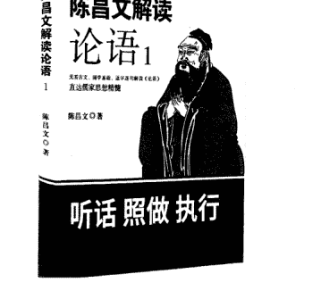
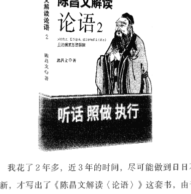
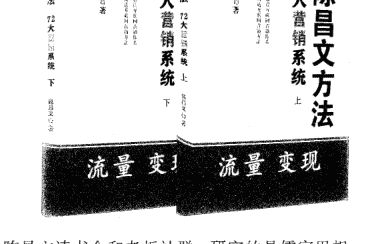
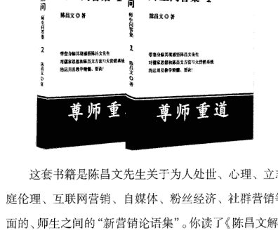
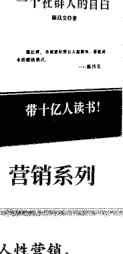
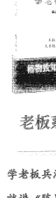
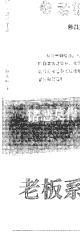
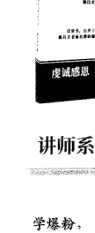
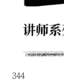

# 人性营销1：如何成为赚钱高手

友情告知：

## 如何成为赚钱高手

解放思想，就能释放人的潜力，就会解放生产力！人的贫穷完全是因为自己的思想没有解放。人能超过别人，就是因为在思想上、精神上，比别人强大。人废物，收入低，就是精神上、思想上落后于别人。

人的思想指导自己行动。改变思想，就是改变人生。人生如果过得不如意，就有必要学习新的思想，特别是先进的互联网赚钱思想。

互联网思维并没有那么神奇，我给各位点破了，也就那么回事，低成本高利润而已。

你释放的价值可以迅速传播到全国各地，市场变得足够大。
任何一个小人物都可以在互联网上发家致富，就这么简单。
懂互联网的人很少，非常多的人都认为在互联网上赚钱很

飘渺，这些人跟不上时代。中国的互联网市场是巨大的，如果你是传统行业老板，一旦改变思维，跟上互联网节奏，赚钱要比传统模式容易太多。

人是靠脑袋里的思维、观念、思想而富有的。人必须学习先进的思维、观念、思想，才能富有。这是真理，不容辩驳！

人与人之间的差距，说白了，就是思维之间的差距，就是有没有开窍。有的人明明混得一点前途都没有，还以为那些赚大钱的人跟他的脑袋一样，跟他的思维一样，还不学习，那么他终究一生贫穷。

必须学习如何创业，如何赚钱，没有其他路可走。如果你发现 99% 的人不相信我说的话，那么你应该高兴，成功的人本来就属于少数。能爬到社会上层的人，就是那 1% 而已。

一部分人学会了发财的本事，而另一部分人就只好不发财了。这个社会，机会只有那么多，就看谁逮得住机会，总是需要有人牺牲的。

不停的思考，不停的锻炼自己的大脑。大脑是世界上最强大的计算机，是世界上最富有的宝藏，只要无时无刻的开发，就会获得很多珍宝。

陈昌文
2021 年 4 月 28 日于上海浦东

## 后记

## ／
赚钱的心智模式
第一章
／

它不知现在是经济社会，经济侵略无处不在，你在经济上失败了，你的整个人生就会坍塌。

> ——陈昌文

### 1、生命的意义

如果我们要创业，那么应该不应该读大学？

学历是有用的。这个世界上的任何东西都是有用的，但关键是你看要代价。商人最精明的地方不仅仅是看到可以获利多少，还能看 Excel付出多少。

普通人就是不会算账的人，脑袋搞不清楚怎么做最划得来，一辈子都在做亏本的买卖，只能靠打工养活自己。

如果你这样想，白给你一张文凭，你要不要？那是废话，谁不要谁是傻子。问题是这张本科文凭不是白给的，要你付出4年的时间、若干金钱、精力作为代价，这里面就存在一个机会成本的问题。

给你一笔钱，10万人民币左右，加上四年的时间，让你自

已选择，你怎么选？ 你是选择去一个真空一样的社会，就是在学校里面待上 4 年，消费掉这 10 万块，获得一张文凭？ 还有所谓的知识？ 还是拿着这 10 万块，用四年最能吃苦、最有动力的时间去闯荡社会，更划得来？

当然你最好把这 10 万块钱用上七、八次，不要一次用完，这样积累的创业经验更加丰富。

我这辈子最悔的事之一就是没有在高中一毕业就创业。 如果那时侯创业 although 第一次、第二次不见得会成功，但是到第四年肯定会有一些收获。 也就是说绝对比去大学打 4 年游戏，学 4 年教授编辑的书划得来。其实我有把握第一就成功，因为那时精力最旺盛，动力最足，做什么事情都敢做。 那时候精神没有被污染，非常容易进入状态，喜欢盯着一个事情，搞到死。 这样的精神，做什么事情都能够成功。

但是大学对我来说也是一个很有意思的经历，我不想自己那么早就开始忙碌碌的生活，我想出去走一走，看一看。 不过现在想象读大学真是太奢侈了，那简直就是个养老院、度假村。 4 年时间我看到了很多，得到了很多，但是失去的更多。

读大学，就像被拉到井口看了一眼，然后又被狠狠的踢回去，踢到了井底。 天天在学校里、教室里不断的被教育，你生命的

意义不是钱，你生命的意义不是爱情，你生命的意义不是父母。我觉得他们说的有道理，我生命的意义怎么可能这么浅薄。所以大学一毕业我就迷茫了，陷入人低谷期。那几年我一直在思考着到底是为了什么，做什么才有意义？因为这些问题，所以我成了一个傻瓜。

如果你还搞不清楚，你活着是为了什么，做什么才有意义，你的价值观一定是混乱的，一定是外界灌输给你了错误的观念，你的精神被污染了，这就导致你混不好社会。

你如果不知道活着是为了什么，你又怎么能比孜孜竟是读大学重要，还是早点出来赚钱重要呢？

当我搞清楚生命的意义就是赚钱，生命的意义就是让父母过得好，让自己的欲望得到满足的时候，我一点都不迷茫了，我也不想那些没用的事情了，我非常迅速地走出了人生的低谷，收入开始迅速的增加。

关于去创业，还是去企业打工的问题，80%的企业撑不过创业的前五年，剩下的里面80%做不到我说的年赚1000万。倘若你是来求职者，你愿不愿意去这种企业里浪费时间？所以反过来来说，老板不认可是最重要，你又何必去应聘？那样你在里面辛苦努力做了几年，最后企业倒闭了，或者利润总是停留在

1000 万以下，你能得到什么钱？青春都浪费了。

96% 的老板不认为是员工在养活他，给他赚钱。这样的企业你也就不需要去应聘了。我们看任何问题，都要从代价与机会成本的角度去看，这样，很多选择就非常清晰了。

### 2、人事不需要意义

人生需要略，反正不需要各种意义与主义，不需要情怀与道义。只要不违背道德法律，一切为了吃饭，一切为了赚钱，这就是落地。

为什么很多人一辈子都落不了地？你问他，他就是论国际风云，谈些做人的道理。

有些观点、有些意义，就是为了把众多局丝搞得晕头转向，然后变成废物。

人就是动物而已，狮子与老虎它们的世界观里有什么意义

呢？我从来不喜欢谈意义。比如做一个生意，为了什么什么，将来会怎么样怎么样。

我做过很多个团队，刚开始做生意的时候，我总是有战略规划，总是在做一件很有意义的事情。然后我的资金经常消耗了很多，离赚钱还遥遥无期。后来我变得目光短浅了，看谁的生意赚钱，直接抄过来就行了，结果就赚钱了。很多知名大公司也是这样子的。

众屌丝依然怒骂，但只有这样才有用。如果你听懂了，你立刻就进入创业成功的模式了。喜欢讲意义的，如果他自己当真了，就饿肚子。

### 3、经济侵略无处不在

当今社会竞争激烈，请积极参与到竞争中来。

要么赢，要么输，没有中国的可能。要是能不上班、下班、吃饭、逛街，也是一种幸福。怪就怪这个世界变化得太快，传统中国慢悠悠慢悠闲的生活一去不复返了。

社会是推着你向前走，你要是跟不上社会的节奏，没结婚的，连讨个老婆都难；结了婚的，家庭花销、孩子的花销、父母的孝敬钱，你都拿不出来，所以当今时代必须赢。这就是为什么我一年 365 天不间断在奋力工作的原因。

人啊，什么时候想要超然物外，不以物喜，不以己悲，就会失去支撑你的动力。

突然觉得到觉得很累，无处可逃，所以我们只能拼命的追求赢，恐怖这是很多人无法理解的。就像我妈经常唠叨的，人这辈子有口稀饭吃就行了，何必这么拼呢？在他们眼中，我们去追求事业，追求金钱，是一种贪婪，是人心不足蛇吞象，最终会鸡飞蛋打，竹篮打水一场空，对人生没有啥意义。但是他们就是不明白，这个社会已经变了，变得让人无法不去奋斗。

我不奋斗，父母能舒舒服服的享受晚年吗？老婆孩子能舒舒服服的逛街，想买啥就买啥吗？能去喝那些一百元钱一杯的下午茶吗？能去稍微高档一点的餐厅吃饭吗？老一辈人无法理解，总认为我不犯人，人不犯我，只要我们安分守己，别...

不会来招惹我们，我们的日子就会过得很好。岂不知现在是经济社会，经济侵略无处不在，你在经济上失败了，你的整个人生就会崩溃。

在今天这样大的生存压力下，使得人与人之间已经没有了缓冲的空间。每个人，哪怕是保安，是乞丐，他们为了自己能生存的更好，都会不自觉的去干预别人，尽其所能的给别人施加压力，希望别人按照自己的意图行事。

有一天，我吃过饭，在万达广场外面站了一下，就有一个黑车司机问我要去哪里。看到天气这么热，他依然要要晚钱，他依然要来骚扰我，这就是经济侵略，这就是现代人的社会压力。

我刚毕业的时候觉得这一切无聊透顶，让别人来控制我，主导我的生活，我是肯定不愿意的，但是要我去征服别人，控制别人，主导事态的发展，我也觉得累，所以我就想逃到不需需要和人打交道的地方去。其实我是在躲避压力。

金庸，还是古龙说了一句话，有的地方就有天下，有人的地方就有江湖，你就是江湖。你怎么退出？无论我逃到哪里，总有些人给我施加压力，企图影响我，让我按照他们的意图行事。虽然不是明火来打劫，但即使披上了文明的外衣，那一种经济

侵略的强盗心态还是昭然若揭。

所以，现在老一辈的这种与世无争，人不犯我，我不犯人的思想很明显地过时了。他们掩盖了人与人之间的这种经济侵略、这种争斗的本质，这种争斗其实才是生存的本质。如果我有输掉，其实就失去了生存的权利。

想通这一点之后，其实明白这个社会就很简单了，是圣人们把它搞复杂了。要么赢，要么输，不过如此而已。赢了就有权利生存，输了就是食物，讲文明一点，赢了就指挥别人、输了就被人指挥。如果你不想输，不想失去生存的权利，就得想办法去赢。

无论什么事，战胜别人的关键就是先战胜自己。人这辈子就靠这一口争强好胜之气，这口气要是没了，那还说什么输赢，天天吃馒头加咸菜，也不挺快乐的吗？

### 4、被喂饱的熊是死熊

为什么现在活跃在社会上的企业家大部分都是 40、50、60、70 年代出生的人？当然我告诉大家的原因只是其中的一部分，大家可以通过这一部分原因去体会到一些有用的东西。

为什么 80 年代、90 年代出生的大牛级企业家如此稀少，甚至于 75 年后出生的大牛级企业家都少的可怜？这里我先给大家讲个故事，有个人在加拿大大山区驾车旅游，经常看到路边竖着一块牌子，上面写着，被喂饱的熊是死熊。刚看到时不太明白到底是什么意思，为什么熊被喂饱了饭就是死熊了呢？就问同车的伙伴，伙伴说，过去很多人在路边看到熊就十分好奇，从车里扔东西给熊吃，熊尝到了甜头后，就老在路边等人施舍食品，慢慢就失去了自己觅食的本领。到了冬天，没有人去喂他们食品时，有的熊就被冻死、饿死。所以加拿大政府在路边竖了很多提醒人们的牌子，告诉大家把熊喂饱了，实际上是把熊喂死了。

这件事又让我想起了科学家所做的一个试验，把一批白老鼠分成两组，一组白老鼠每天都喂得饱饱的，它们吃完了就睡，睡完了再吃。另一组白老鼠每天只喂半饱，喂半饱这组白鼠只能到处寻觅食物，东奔西跑。半年后，科学家看到的是，每天吃得饱饱的白老鼠不是得了病了，就是死掉了。而那些到处寻觅食物的白老鼠却活得很健康。

原因不言而喻，没有吃饱的白老鼠在寻觅食物的过程中既锻炼了身体，又增强了自己的适应能力，提高了免疫力，所以拥有了健康与活力。

我们80年代、90年代出生的年轻人，由于父母有了 一定的经济基础，很多人都衣食无忧，甚至大学毕业了找不到工作，家里还能接济一部分资金。这代人吃苦精神很差，自我生存能力比起40、50、60、70年代的人都差很多。而创业、做企业就非常需要吃苦精神。40到70年代的这些人，很多人在读书的时候就开始靠自己的能力养活自己了。进入社会后，家里都穷的叮当响，这个年代的人只有迫使自己去寻找一份工作生存下去，所以他们锻炼了很强的社会适应能力。

而80、90年代的人，工作的时候，一不高兴就炒了老板，不管是有钱人家的孩子，还是穷人家的孩子，都有饭吃。80、

90年代出生的人，很多都是被父母娇生惯养的。父母为80年代、90年代出生的人洗衣服、打扫房间，其实是间接削弱了80、90年代出生的人自己照顾自己的能力。连自己都照顾不好的人，怎么照顾好一个企业？

所以80、90后的人想成功，先别依靠自己的家人，先自己完全自立起来。那些父母给钱买车买房的人，实际上跟那些被喂饱的熊和被喂饱的白老鼠是一个样子的。一般情况下，这样的人是没有什么社会竞争力的。

我建议创业的人一定要自己去赚来钱创业。比如打工，比如你去做兼职赚钱，不要问父母要钱，不要问别人借钱来创业。要来的钱、借来的钱，一般情况下是没有什么感觉的，用了就用完了。而拿自己挣来的钱创业，花多了自己就会心疼，就会惜量。找到这种感觉了，事业做起来了，再去借钱，去融资，对金钱的认识就不一样了。

### 5、真正聪明的人，只思考如何改变现状

大多数人有个毛病，比如说，喜欢假设，喜欢追悔已经失去了的东西。

- 我读书的时候要是认真点，上个好大学就好了，现在就能找到好工作了。
- 我要是钱就好了。钱能解决的问题就不是问题，就能解决房子、老婆，甚至创业的问题了。
- 我要是以前不沉迷网络游戏，努力学习、工作就好了，现在我就是有钱人了。

这些假设都毫无意义，真正聪明的人，只思考如何改变现状。

比如：

- 我以前没有认真读书，没有去读好的大学，也没有好工作，那么从现在开始，我就认真读书，能学一点是一点，就算不上大学，我也要成为一个有学问、有工作能力的人，以自己的实力找到好工作。
- 我现在没钱，虽然钱能解决的问题就不是问题，可是这句话跟我无关，我要做的是从现在开始想尽一切合法的办法赚钱。比如创业、兼职、学一门技术、学投资理财，从现在就开始。
- 我以前沉迷网络游戏，浪费了好几年青春，那么现在就必须戒掉网络游戏，开始在现实生活中努力奋斗。前面几十年过得荒唐，以后不能过得再荒唐了。

这个世界上还有一种想法是非常可怕的，就是追悔后产生了忧恨，或者报复社会，或者欺骗别人的心理。

比如：一、我没有读好大学，也没有认真读书，我去买个假文凭。反正现在用假文凭的人很多，而且网上就买得到。
二、我现在没钱，我要赚钱不择手段，偷骗抢，能干一票是一票，弄到大钱了，就洗手不干了。
三、以前玩了这么多年网络游戏，我啥也不会了，继续玩下去吧，反正糟蹋就这样了。

这样的想法，不但使自己回不到正确的道路，反而会让自己越来越不利。所以，失去的东西不要追悔，踏踏实实的从现在开始！

### 6、每一个人本质上都是会推销的

大部分人都觉得社会难混，钱难赚，当总经理遥遥无期，当老板也遥遥无期。很多人甚至认为改变命运是不可能的，我只能说，这些人都是懒惰、无能，甚至是无脑的人。当然我也可以客气一点讲，但我觉得这毫无必要。每—分钟都可以用来自改变自己的命运。比如，你是否时刻在推销你的产品。

以前我们靠电话推销，做得好的业务员晚上回家还在打电话。做得差的业务员上班的时候去抽烟，中午吃饭必须吃一个小时，吃完了也不去办公室，还要在外面散步。每个月就拿公司的底薪，然后抱怨说社会难混。以前那个晚上打电话的同事，现在已经是经理了。他已经不愿意与普通业务员来往了，这就是人生。而他完成这个跨越，也就是两年时间。而这两年时间，有很多一同进公司的业务员已经离职了。

我们当老板的，大多数时候非常痛苦的一点就是没有人才可以选，被迫选一个不能胜任但是表现稍微好一点的人放到这个岗位上去。所以，大部分人说社会难混，其实完全应该从自己身上找原因。

现在在互联网时代，你是否一直在网络上推广你的产品或者服务？我相信，很少有人做得到吧。这就是富人很少的原因。但这难吗？其实一点也不难，每一个人的本质上都是会推销的，只是手法优劣与不优秀的差别而已。所有优秀的人都是从不优秀的阶段不断挣扎打起来的，但大部分人都不愿意挣扎打自己。

我从来不同情那些收入低的人，谈不上痛恨与喜欢。因为世间百态，本就如此。只是习惯性的分析分析，讲给有缘分的聪明人听听，或许能激起某些人的反思。1000万仅仅靠努力奋斗就能做到，努力干什么？努力积累专业知识，努力修炼一门技能，努力多读些书，努力推销你的产品与服务。时刻这样干，改变命运真的不需要三年，仅仅半年足矣。

### 7、改命的方法

生死有命，富贵在天，人生有一半是靠自己的努力，有一半是靠天。如果讲得更玄一点，只有极少数人可以改变自己的命运。大部分人都是自然的产物。

你的父母是农民人，没什么本事，他们自然不能给你很好的混社会的观念，他们输送了贫穷的思想进入你的脑袋里，让你以一个穷人的思想活着。比如，上学、打工、生娃。比如，能节约一分钱是一分钱。比如，读那么多书有什么用？还不如早点出来打工、赚钱。这些都是命运。

大部分人的老师其实是你的父母，他们养育了你的同时，也给了你困难艰难的人生。就算你读了大学，你的脑袋里的思想依旧是你父母的思想观念。

很多大学生只要一提创业付费，他们都会认为是传销，毫无自我辨别能力，也根本搞不清到底什么是对他好，什么是对他坏。这就是命运。一生富贵，还是贫贱，几乎在出生的时候就注定了。

人接受的信息确实能改变自己的命运。我的命运改变缘起读南怀瑾先生的《论语别裁》，从那以后，我知道了，我还可以成为一个独立的人。后来我的目标变成了成为一个业务员，再后来我的目标变成了当老板。

而读这本书却是因为我在领导的办公室，看见办公室没人，就顺手拿了那本书翻了一下，这或许就是命运。愿意去探索这个社会，就是改变命运，当然我也荒废过我的生命。

高二结束，一个班上的混混叫我跟他一起去玩游戏，从此我荒废了大量的时间在游戏里，这也是我的生命陷入低潮的阶段。交错一个朋友，你的命运就改变了。我们每天看新闻也改变着我们的命运，每天花大量的时间去研究这些东西，但这些东西并不能给我们企业带来盈利，还不如学习一些管理学，熟悉一下公司的业务，找几个员工谈谈工作。

一个聪明人总是特别在意自己的精力和时间用到哪里去了，干的事情是否能为自己创造价值。凡是不能为自己创造价值的事情就不干。如果能坚持这样做，这个人的命运就会越来越好，否则，就会随波逐流，谈这个社会上那些光怪陆离的东西吸引。

比如你又去看了一部电视剧，权力的游戏，纵然是好看，又有什么意义呢？除非你已经衣食无忧，你的子女、父母、个人的所有事情你都搞定了，你可以去娱乐，可以去浪费自己的生命，不然你的命运又一次变得更差。

每一个人都可以某种程度上左右自己，也可以放弃左右自己的命运。也许你认为你的命运已经决定了，是穷人就终身是穷人。但我希望想要改变自己命运的人立刻行动起来，你能在某种程度上改变自己的命运。你改变了自己的命运，你也改变了你家庭成员的命运，不然你就会被世界、社会无情的击碎，然后淘汰，扔到历史的长河里，变得连垃圾也不算。

人啊，很短暂就死了，总不能活得太憋屈吧，且行且珍惜。

### 8、改变别人命运的同时，也就改变了自己的命运

告诉你穷富的根本原因，其实，一个人只要不断地做好事、利他、释放价值，就会富起来，就会过上好日子。这就是赚钱的全部秘密。

一个人赚不到钱，就是因为他是坏人，他品行恶劣、懒惰、欺骗自己，也欺骗他人。品行好的人，不可能穷的，他会为了自己的父母、妻子奋斗，会为同事、公司奋斗。一个想方设法奋斗的人，是不可能贫穷的。只有品行低劣的人，才任凭自己父母、妻子过差的生活。

我有一个穷亲戚，一直当保安，他的老婆很漂亮，跟人跑了，帮一个小老板生了一个儿子。这个穷亲戚就骂这个漂亮的女人，说这个女人没道德。其实根本不是这个女人没道德，别人是一朵鲜花，是值钱的，为什么要跟你一个保安呢？当初被你甜言蜜语欺骗了过去，后来这个女人发现自己吃亏了，当然是要退货的。人生就是一连串的交易，不是跟你结了婚，就得陪你睡一辈子。你必须让别人划得来。不愿想这个漂亮女人陪了你一年，反倒说骂别人，这就是品行低劣。

很多人说生意难做，钱难赚，本质上他是一个品行低劣的人罢了。一个想方设法剥削劳力的人，是不可能赚得钱的。有些人要反驳我，他说我做了好事，并没有获得回报。本质上，你是一定会获得回报的，要么是你做的好事太少，要么是回报的时间还没有到来。

同样的道理，比如，某骗子，一直在编骗。我们是知道他的，他会倒霉吗？肯定会的，不是不报，时候未到。时候到了，连本带利都会还的。

每一个人都会各得其所。比如，作为一个员工，不工作，你在公司里天天跟女朋友聊天。我看见了，我并没有说你，但我就把你开除了。比如，某人平常不锻炼身体，我们一起去爬山，他就爬不上去，欣赏不了美景。比如，某兄弟贪污受贿，中饱私囊，以为我的财务管理混乱，查不出来他。其实我是知道的，有时候觉得是小钱，懒得说而已。你做过分了，我就叫你把你清理出局。

但行好事，莫问前程。我每天的工作，就是不断释放价值，

### 9、在一个很差劲的环境中，很难产生卓越的人

很多人都对自己的现状不满，但又不知道如何改变，很苦恼，甚至苦恼了4、5年，回头一看，仍然没有改变。

我刚大学毕业的时候，做了一个程序员，我比较技术讷，不善与人沟通，甚至我们公司的一个音响坏了，公司的人叫我找个人来修，我打电话都讲不清楚要干什么，直接导致修音响的人挂了我的电话。

很长一段时间，我都很绝望，因为技术工作的工资很低，我感觉我很没前途，我想改变。我就想啊，当老板最多的人好像是业务员，我要去做业务员，我就通过公司里的关系，找公司的领导把我调到了办事处。

到了办事处，我每天必须得出去递名片，出去介绍我们公司的产品。开始有其他业务员带着我去，后来别人不带我了，我自己硬着头皮去介绍产品，递名片。开始的时候确实很不舒服，心里也很难过。不过几周过后，我就适应了，后来做电话销售，也适应了。

我就是得出一个结论，改变自己最快的方法是换一个环境。

人本来就是环境的产物，在一个很差劲的环境中，很难产生卓越的人。人恰好也是一个能快速适应环境的产物，把你放在那个地方，你就自然会生存下去。

后来我的业务员也做得有声有色，我创业的过程很大程度得益于我做业务员的经历。

假如，你在一个云南或者贵州非常偏僻的小县城创业的话，就很难招聘到重点本科，或者是外国留学生为你工作。而你在上海、北京这样的大城市，就很容易招聘到极其优秀的人才与你共事。所以这也是为什么我一直劝众多三线城市的人，要创业就到北上广深的原因。这里有环境优势，有地域优势。

历史上李斯有一个老鼠哲学，说的就是厕所里的老鼠又瘦，见到人又怕。而粮仓里的老鼠，又肥，胆子又大，见到人都不跑，敢跟人怒目而视。李斯见到了这种情况，就辞别了老师荀子，到秦国去混了，后来果真混出了名堂。

李斯有一个前辈叫商鞅。当年在魏国，魏国国王不重用他，他就跑到秦国去给秦孝公出谋划策，成就了一番事业。

所以，如果你现在混得很不如意，改变自己最快的方法是改变你现在所处的环境。树挪死，人挪活，换个环境吧。

### 10、杜绝跟收入低的人交往

一个人的 一生，有如意 的，有不 如意 的。

其实人生 的不如 意，大多是因 为你身边 的环境造 就的，你 身边接触 的人所造 就的。简单 来说就是 自己选择 了要在这些不 如意的环境 下生存。如果你是一个聪明人，你一定会不断的反思，不断的思考，然后不断的改造自己的环境。

环境包括两个方面，一个是所处的工作环境，一个是接触到的人。如果这个工作环境没前途，那我们就换，赶紧换，越

貌魅娇。

我刚毕业的时候，在一个店里给家人做销售，混费了很长的时间。其实我一开始就知道这个工作是没有前途的，但那个时候贪玩，这种工作又相对来说轻松。于是就干了一年，可是后来我发现不对了，玩是玩的挺舒服，但还是赚钱不到钱啊，谈女朋友都不敢去谈，因为要花钱嘛。

于是我告诉我父母我想换工作，他们就劝我不要换，在他们心里，工作是一定不可以丢的，结果我就又多浪费了一段时间。后来又干了一个月吧，我心一横，说啥也不干了。现在想想我真的很后悔，那时候我自己就应该去换自己的工作环境了。

一个如果没有改变的决心，就没有突破自己收入的可能。人活在世界上，最重要的就是不断的突破自己现在的收入，其他的都是浪费时间。不要听人给你讲一些废话，什么 废话？就是不能使你收入增长的话，那都是废话。只要他们不能让你 的收入增加，你就不要去搭理他们，或者说，见面打个招呼就不错了。

一个人能够获得多少，完全是看自己心里怎么想。如果你天天都思索增加自己的日收入，你天天干的事情也是和你想的一样，增加自己的日收入，你就会发现，你会过得越来越好。

人的改变为什么特别难？这是因为人都是有习惯的，习惯了低收入人，习惯了你现在所处的这个人际圈子，人也就麻木了。你会觉得懒，都这样，这就是正常的生活。只有极少数人会反思，会打破自己的习惯。

现在的年轻人，很多人连早睡早起都做不到。这样的人，是不可能提高自己的日收入的。我送给大家一句最有用的话，就是杜绝跟收入低的人交往。你若是跟收入低的人交往，你会发现你的收入也变低了。成为一个高收入的人，首先思维必须完全相反的。所以，不是任何人都能成为富人的。

成为一个高收入的人，你的所思所想、所作所为，都会被普通人看不顺眼，普通人看不顺眼你，你就得挨骂。但这无所谓，你只要知道，你的日收入够他们忙活一年就行了。你若是能理解我讲的这些，你就有希望成为一个高收入的人，否则，你永远也没有希望。改变，打破思维才是提升收入之本。

### 11、你所处的环境决定你的收入

环境决定一个人的收入，只在富人的环境当中过日子。你如果想赚钱，你就远离穷人的环境。

人是环境的产物，一个人为什么喜欢说脏话？因为他在穷人的环境中，穷人喜欢说脏话，习惯性说脏话，你都学到了。如果与跟穷人交朋友，你也会养成低素质的习惯。

如果你生活在富人的环境里，大家都很礼貌，你自然也会很有素质。穷人控制不好自己的情绪，很容易动怒，你在这个环境中，你也很容易动怒。穷人会讲一些莫名其妙的话，让你生气，你不想生气都难。你应该离开这个环境。

千万不要讲，在坏的环境中锻炼出好脾气，我们完全没这个必要这样做。我们直接到好的环境中，养成好的脾气就行了。一方水土养一方人。凡是有这个经历的人自然明白这个道理。

环境对人的影响是非常非常大的，大到你难以想象。

有些人很颓废，不如说是因为他处的环境让成颓废了。你懂得这个道理过后，就赶紧竭尽全力给自己换一个好的环境。

不要服务那些非常差劲的人，不要做非常差劲的人的生意，不要跟非常差劲的人交朋友，也不要生活在那种环境中。如此，你的人生就会越来越美好。

社会是矛盾的，假如你生来就在很差劲的环境中，你就要竭尽全力的摆脱这个环境。

社会有上层，也有下层，永远都是这样。生命短暂，你也改变不了这个社会的宏观环境，但你能改变自己的微观环境。

### 12、人的行为会经由团体而改变

你的命运不取决于你自己，而是取决于你有什么样的朋友。

因为人是懦弱的动物，你进入一个优秀的圈子，你自然会优秀起来。你进入一个很低级的圈子，你也会变得很低级，因为你的朋友会影响你的行为模式。

我以前举过一个例子。有一个很老实的人，假如他跟另外一个老实人在一起，再加上一个老实人，等于3个老实人在一起，三个老实人在一起会变成什么样呢？大家猜猜看，会变成三个很调皮的人。这个意思就是说一个很诚实很老实的人他可能不敢作怪，两个人在一起也不敢作怪，3个人在一起就可能开始起哄了。所以我觉得人的行为会经由团体而改变。

假设今天你跟一个人一起，他很重视健康，你跟他在一起，他开始每天运动，你会发现自己不运动好像很奇怪，所以你也会开始运动。

你今天在这样一个环境之下，大家每天都开发顾客，每天都赚钱，大家每天都在拼命的做有效率的事情，只有你在那里游手好闲、玩游戏，你自己都会觉得自己很奇怪，很不自在。然后你会跟他们一起，一样的努力，一样拼命的赚钱，不然你就只有离开这个团体，离开这个圈子。

我觉得朋友对一个人的影响实在是非常非常大。当你了解了这一点之后，那么我要要求你做两件事情，第一是拿出你的纸

和爸，第二是分析一下你现在经常跟哪些人在一起，你最好的朋友是什么的。你最好的朋友对你是正面影响，还是负面影响。理解了这个过后，我们就要把那些不赚钱的、贪玩的朋友删除自己的朋友圈，然后跟赚钱的、积极向上的、做事很有效率的人在一起，那么我们就会有未来。

为什么呢？道理很简单，不赚钱的人他天天就是玩，天天就是抱怨社会不公平，抱怨社会制度不好，其实是他自己没有本事。如果你经常跟这样的人在一起，对你的影响是非常不利的。所以你必须想尽办法让自己不要陷于负面影响之中，你必须去主动参与正面积极的、有影响力的圈子、团队、组织，这样对你的成功是有帮助的。

### 13、高人是有很多混社会的秘密的

镜像神经元是什么？与我们做老板、赚钱、生存有什么关系？很多人都不懂。镜像，这两个字大概计算机系的、会装系统的人都明白，就是把操作系统复制到任意一台计算机上，然后你们就可以用这个操作系统来工作了。

神经科学家发现，人的大脑里有镜像神经元。许多科学家相信，这个发现比发现DNA更加重要。这可以解释为什么有些人很贫穷，而有些人很富有。

我们的大脑可以程序性的模仿我们看到的他人做的事情，而且是持续的、不知不觉的。

是不是很恐怖？这就是为什么我们经常会看到两个人好像很猿契，有些夫妇很像夫妻的原因，就是因为他们在一起待久了，神经系统相互模仿的结果。或者说，他们本来就来自于同一个阶层，拥有差不多的镜像。就像同一个阶层的人用同样的手机，买差不多少价钱的房子，开差不多少价钱的车。

你的思想与行为，都是别人的镜像。老板有老板的镜像，有老板的语言。员工有员工的镜像，有员工的语言。他们之间是很难以沟通的，因为镜像不一样，操作系统不一样，所以收入不一样。但值得庆幸的是，人的大脑可以复制别人的镜像。可悲哀的是，是你不由自主的在复制。

你无法抗拒这个复制的过程，但你可选择复制的对象。

比如，你有一个朋友是老板，你经常与这个老板接触，你就会复制这个老板的思想与行为，你也会想去当老板。这个老板做着互联网生意，做着电商生意，你知道了，你也想复制他的生意。这都是不由自主、持续性复制的结果。

再比如，你在一个很穷的社区工作与生活，你就会自动复制这个穷地方的人的思想与行为，最终，你就会变得跟他们一模一样。

早年的时候，我就知道这个原理，所以我就不断的把我居住的环境搞好。我居住的环境中，开豪车、做老板的人很多，我就持续性的复制他们的行为与思想，但当我不知道科学家已经发现了镜像神经元，现在我找到了科学依据。

我读大学的时候，有一个要好的同学，他有很多行为与口头禅，我们天天形影不离。有一次，我发现我的有些笑容都跟他一样，我突然间就很警觉。但不知道为什么，现在终于知道了，原来我的神经系统一直在持续不断的复制他。

大家理解了镜像神经元有什么好处？就是你想富有，你就想尽办法跟富有的人待在一起，然后你就自己会持续性的复制他的思想与行为到你的脑袋里。你如果不想贫穷，你就避免找些贫穷的人与他们待在一起，否则你就会自动持续性的复制他们的思想与行为。

有一个老板曾经私下里告诉我，只要见到一个人没本事，不积极，他跟我握手，我都不会跟他握手的，因为能量会相互传递，我会复制他的没本事与不积极。

当时我很不理解，现在我非常理解了。看来高人是有很多混社会的秘密的。

我觉得大家彻底理解了镜像神经元，你就知道如何成为富人了。有兴趣的直接百度一下，读一读镜像神经元的百科。

### 14、人是不可能成为自己讨厌的人的

想成为什么样的人，就跟什么样的人接触，就进入什么样的圈子。

人是很奇怪的，为什么屌丝逆袭很难？因为他看都没有看 到过别人是如此富贵的，看都没有看到钱是如何赚来的。他只知道穷人的活法，于是，他就不可能富有。

为什么有的屌丝逆袭了？是因为他接触到了有钱人，或者说他接触到了盈利的思想、做公司的思想。他开始用有钱人的价值观、世界观、人生观去指导自己的行为。他去开公司，他去创业了，他自然就有钱了。

大家只要明白了这个道理，那么改变命运就很容易了。**你想成为什么样的人，想过什么样的生活，你就直接去找到这样的人、这样的环境，然后跟着这样的人学习。有机会，你就待在这种环境中，千万不要去批判你想成为的那种人，千万不要去怀疑你想成为的那种人。只要你怀疑、批判，你就不可能成为那样的人。人是不可能成为自己讨厌的人的。**

对现在的自己，不要留恋，要舍得改变，要舍得抛弃自己的观念。旧的不去新的不来，人的头脑也是如此，旧观念不抛弃，新观念就进不来。要舍得换圈子，自己这个圈子太低端，就义无反顾的换。若是舍不得换，就永远没有希望升级自己的圈子。

每个人都可以轻易的改变自己的命运，只是大多数人不愿意改变而已。大多数人习惯了过着贫穷的日子。我说的，你真懂，真照着做，你就可以成为你想成为的人。

### 15、你要成为少数的人上人，你就不能认可大多数人认可的东西

人生走什么路，都是次要的，关键是看结果。老板管理公司，也要在意那些细枝末节，关键看结果。谁能为公司带来利润，我们就提拔谁，重用谁。谁不能为公司带来效益，就算他人际关系再好，我们也应该开除他。

你的选择，让你的社会地位提高了，权力增加了，金钱增加了，势力增大了，就是对的，反过来就是错的。

有些低层次的人说，我喜欢做工人，做个农民，做个小摊贩，做个普通人，这是我的人生选择，我认为我没错。对，他有权选择自己的人生，这的确没错。但等他父母进医院要钱拿不出来的时候，等他小孩子想上好学校拿不出来钱的时候，他再后悔自己的任性，就来不及了。

所以，很多 人混的不好，被欺压，受到侮辱，不能怪别人，这其实都是他自己当年的人生选择造成的。选择了蚂蚁一样的生活着，就要承受蚂蚁一样的命运。人生只有一次，不可后悔，也不可允许后悔。

社会上有许多误导我们的信息，比如，电视剧是为了收视率，所以要取得最高的收视率，必须取得最普遍的老百姓的认可。要取得老百姓的认可，必须按照老百姓的逻辑编写剧本。所以，看电视剧，就会变成大多数人，就会变成傻瓜。

你要成为人上人，成为老板，其实就是成为少数人，你就不能认可大多数人认可的东西，也不能喜欢大多数人喜欢的东西。所以，我跟一个人交往，如果我发现他喜欢看电视剧，我就不跟他交往了。

很多普通人眼里的富人都是坏蛋，很多富人眼里的普通人都是傻瓜。不同阶层的人们之间，互相很难理解，这都是正常的，就看你选择进入哪个阶层了。进入穷人阶层？还是进入富人阶层？这就等于是选择自己未来的命运。

做为一个想成为富人，成为老板的人，要毫不犹豫、果断的加入富人的行列，就算是付出再大的代价也应该这样做。但如果不想改变现状，那么就无所谓了。

### 16、富人为什么会富，穷人为什么会穷

曾经有一个热门的新闻，一个老太太和她的女儿坐电梯，买的是站票。老太太年纪大了，身体不太好。她的女儿在车上见到一个年轻的女孩，就让这个年轻的女孩让座，这个年轻的女孩买的是有座位的票。这个年轻的女孩不愿意让座，最终，其他有座位的人让了座。这位老人的女儿就讲了一些不太好听的话，然后这位年轻的女孩就哭了。

其实，这位年轻的女孩完全没有必要哭，花自己的钱，买自己的座位，自己坐，天经地义。我们这个社会上，有些人喜欢当圣母，以圣人的标准来要求别人，实际上是想侵犯别人的合法权益。街上有乞丐，也没有多少人去餐馆里花自己的钱，买来饭送给乞丐。

有的人可能会说，让座的损失很小，而买票是要花钱的。
其实这仅仅是五十步笑一百步的关系。我经常观察员工，有的员工努力的学习业务，研究业务，业务能力提升的非常快，创造的业绩非常多，当然获得的奖金也非常多。而总是有一些员工，自己不专研，看到优秀的员工专研出来成绩了，他就去依靠别人，就去让优秀的员工教自己。

人其实都是自私的，优秀的员工有时候就很不情愿教这些不能独自专研的员工。而这些普通的员工还满脸怒气，还讽毁这些优秀的员工。

优秀的人总是少数，而普通的人是多数。大多数人都对这个优秀的员工有意见，就会形成劣币驱逐良币，最后这个优秀的员工就可能离职。

这种事情见得多了，我就经常在公司里讲，别人教你是情分，不教你是合理合法的。大家自己应该去专研业务，不要什么都依靠别人，况且公司招聘员工过来，就是要员工创造效益的。公司给予大家一定的工资与奖励，员工理应把自己手上的工作完成好。

我还观察到一个现象，那些独立自主靠自己完成任务的人，总是要富有些。那些什么都想仰赖别人、觉得别人有义务照顾的人，在经济上总是要贫穷些。由此，我甚至衍生出来一套理论，那些经济困窘的人，其实就是依赖心强的人，我们尽量别招聘这样的人进公司。

富人为什么会富？富人总是靠自己往上爬。穷人为什么会穷？穷人总是企图依赖别人。

### 17、迷茫的人就是没事做的人

经常碰见一些人说自己迷茫。当然赚钱的人从来不说自己迷茫，因为时间不够用，分分秒秒都在想尽办法找客户、做推广、卖产品，分分秒秒都在想公司的战略、战术。

大家大概知道了，迷茫的人就是没事做的人，一旦有事情做了，就没人迷茫了。

比如，我当年读书的时候也迷茫，但是玩网络游戏就忙起来了，就忘记了迷茫。我也喜欢打乒乓球。也是打起来，其他的事情就忘记了，就不可能迷茫。

很多兄弟姐妹想事业有成，但经常不知道如何做，所以就迷茫。怎么解决？非常简单，你开始做计划啊。不知如何做？拿只笔出来写啊，1、2、3……一步一步的写，写完就按计划去做事。

### 只要你愿意动手，你就不会迷茫。

创业这件事，对很多人来说最难的就是营销，而最应该做的就是营销和推广，这件事是要长期做下去的，所以，更加没有时间去迷茫了。你成天去发广告，去推广，去收钱，你怎么可能有时间迷茫呢？

你找到一些客户需求，然后天天去满足这些客户的需求，你从早到晚都有事做，自然不迷茫了。很多人迷茫，说白了，就是懒，不想行动。有的本就是普通人，或许迷茫就是他的命运。而创业者，是没有时间迷茫的。

### 18、是什么导致一个人穷，一个人富

第一，你每天起床，要想想你像一个穷人一样的活着，还是像一个富人一样的活着。并不是说你的消费情况，而是说你的思想。

穷人会这样讲：我永远不会富有，我需要为一份不知道有没有前途的工作不断的工作。

能变富的人会讲：我需要为自己的事业奋斗，我一定会事业有成。

日复一日，穷人达成了穷人的愿望，富人也达成了富人的愿望。

第二，你是否有事业合作伙伴。

穷人不找事业伙伴，只有一些酒肉朋友、一些娱乐的朋友。

变富的人从来不需要酒肉朋友，也没有功夫交一些娱乐的朋友。

变富的人找的是事业合作伙伴。选择跟什么样的人交往，基本决定了你成为怎么样的人。

## 第三，获得宽敞的渠道。

穷人要做些事情，总是找一些跟他一样穷的人商量。这些穷人的建议基本都是错的，很多穷人的建议是世界上最恐怖的建议，但穷人一般都会听了照做。富人从来不找穷人给什么建议，富人甚至愿意花钱找比自己更富有的人给自己建议。这就是为什么巴菲特的午餐会卖几百万美元的原因。

穷人认为跟富人聊天没什么意义，穷人也反对为富人的建议买单。其实花钱请比自己优秀的人给自己建议是最划得来的投资。而这样的事情，只有富人能理解。穷人不重视知识、智慧这些无形的资产，他们认为富人的建议都是大道理，都是些没用的东西，甚至还不如穷人懂得多。

穷人自大且目光短浅。富人谦虚放眼未来。穷人喜欢免费获得一切，当不知，免费既浪费时间，还有很多是错误的信息，导致就误了自己的一生。

## 第四，是否接受新事物。

穷人排斥新科技、新事物，一个是他们自己买不起，二是他们觉得这些东西跟他们无关。而富人敞开心胸接受新事物、新科技，让这些新科技不断提高自己的效率，不断的认识这个社会，增加自己的竞争力。富人花钱提高自己的智力，穷人花钱满足自己的口腹之欲。

## 第五，看着你的词语。

穷人嘴里大多是负面的词语，也不喜欢谈论金钱，认为金钱是罪恶的，认为富人的钱都是脏钱的，仇富心态严重。一个有仇富心态的人怎么可能富呢？因为他恨有钱人啊，他就不会成为有钱人。

富人嘴里大多是正面的词语，也喜欢谈论金钱，认为金钱就是力量，金钱是善良的。富人从来不仇富，只希望自己变得更富有，并为此不断的努力。

穷人想着怎么偷懒，如何娱乐。富人想着如何做项目，如何提高工作效率。在穷人玩的时候，富人在工作；在穷人工作的时候，富人也在工作。穷人不喜欢动脑，只喜欢体力劳动。富人既愿意做体力劳动，也愿意做脑力劳动。

### 19、穷人变富很简单，但你不会去做

大家都希望自己成为富翁，成为一个有钱的老板，可是如何才能成为老板呢？这完全是由你脑袋里的思想决定的。

招聘网站上有年薪100W招不到人的工作，比如下招聘经理。你为什么不去应聘？因为你脑袋里没有货，故而你做不了这份工作，你就赚不了这个钱。

大家脱光了都是一具裸体，有的人一年收入几百万，有的人一年收入几万，差别就是那有什么样的思想。穷人变富，也非常简单，就是你锲锲卖铁去学习牛人的智慧与思维就行了。但你不去做，因为你习惯性的生活在穷人的思想里，你被自己的思想奴役了。

如果你习惯性的关注那些年赚1个亿、100个亿的人的思想、言论、行为，你去学，慢慢的，你就能年赚100万了。但这有点不现实，因为经济基础特别差的人，是理解不了经济基础非常好的人的言论与行为的，或者说要花太长时间去理解，去实践。你还没赚到钱，就饿死了。就比如，你是小学生，你是很理解博士生的课程的。但你是小学五年级的学生，你努力一点，其实是可以理解初中一年级的课程的。

所以我建议大家关注比自己收入高一个数量级的人的言论与行为。学过来了过后，我们再去关注更高一个级别的人的言论与行为。

底层人士与高层人士对社会的看法是完全不一样的。比如，底层人士相信我们应该更加注重感受，而不是外表这种哲学。底层人士经常被这些不实用的思想麻醉，而高层人士直接与外表好看的人交往，高层人士直接展现自己的本能。

突破自己的财务边界，首先要突破自己的思想边界。变富难就难在你要不断的否定自己的想法，如果你继续以你现在的思想看待这个世界，那么一切都不会改变。

你要用你根本没有的思想来看待这个世界，你就要去学比你富有的人的思想。不去学富人的思想，只去学富人的项目、学富人的生意，你就会发现，富人做这个生意很赚钱，你做，就不赚钱了。如果学会了富人的思想，那么就算你做自己的项目，也会比以前更加赚钱了。

### 20、不管是弹琴，还是吹牛，还是当老板，都需要在这件事上不断的重复

大部分人都是读了小学、初中、高中、大学的，而读书的时候，很少有自愿学习的，大部分人都是被强制学习的。学习就变成了为父母、为老师、为考大学而学习的，并不是为了自己而学习。所以，实际上很多人很反感学习，但又不得不学习。如此，就养成了一种抱怨心理，抱怨父母、抱怨老师、也抱怨社会。等到大家毕业了，在社会上工作了，大部分人又把这种心态带到了工作当中，认为工作是为了老板，不是为了自己。其实这些都是愚蠢的想法。

我们在工作中会学到智慧，会学到经验，会积累资历，这些都会让你赚的钱越来越多。而且，老板给你提供了工作的机会，还给你发钱，怎么算都不亏。但大部分人根本没有感恩之心，心态非常恶劣，故而一辈子都可能没有成就。

我个人经常工作到深夜，我自己是老板，没有人给我发钱，我的钱靠自己辛苦赚来的。很多人说，你工作当然努力了，因为你为了自己赚钱呗。其实，赚钱对我来说倒其次，最主要是我不断的工作、思考，当老板的能力就会越来越强，这才是我不断工作的目的。

这个世界上什么事情都需要不断的重复练习，不管是弹琴，还是吹牛，还是当老板，都需要在这件事上不断的重复。重复的次数越多，你就越能驾驭这份工作，做好了，自然有回报。每个人工作都是为了自己。工作是上天赏赐我们的礼物。

### 21、普通人为什么失败

这个世界上大多数人之所以失败，主要归结于以下六个方面。

- 一、懵懵懂懂的，不清楚自己的目的究竟是什么，或者不愿意以目的为导向，总觉得这样效率太弱。
- 二、轻高弯远，总想一步就完成几乎不可能的目标，没有耐心，不能快速达成目标，就放弃。真实的情况是很多目标不可能一步达成，要懂得先达成目标的一部分。很多目标太高，要懂得制作梯子，制作梯子的秘密在于每一级的间隔越小越好。
- 三、不明白将要付出哪种代价，或者不愿意付出代价，结果浪费了大量的时间去寻机捷径，付出了最高的代价、时间和机会。

有很多时候，花点小钱就能节约大量的时间、精力，减少自己探索的时间。普通人就是不愿意花这点小钱，结果时间白白的流逝了，自己一点进步也没有。

- 四、习惯性把失败的原因归结于别人或者客观的环境。

无论什么事情，只要失败了，就是你自己的错，你必须改变自己的看法、想法、做法，去达到目的。我们没有时间去抱怨世界不公平或者运气不好，因为为到客观原因与别人的原因毫无意义。我们改变自己是最划得来，也是最有效果的。

- 五、没有及时抓住机会迅速做出改变，迅速再来一次。

中国人很不宽容失败，造成了一种必须成功的压力。但是很多事情就是要失败若干次，所以迅速收集反馈，迅速总结原因，迅速做出改变，迅速再来。一成成功不是天才，就是撞大运了，宽容自己的人更容易成功。

- 六、浪费可耻。

从理论上说，任何人的价值和掌握的资源都是无限大的，关键在于是否善于和乐于和别人做交换。每个人都可以做很多事情。因为时间每天都有 24 小时，很多人都浪费了。

头脑可以想很多问题，很多人根本不使用头脑，又可耻的浪费了。其实只要你去创造机会，总是有很多机会的。

指导我的核心观念有 4 条。

## 第一、客观分析造成自己现状的原因。

比如不赚钱。为什么不赚钱？是因为懒惰，还是行业不好，还是企业管理有问题？是不是团队人员的素质实在太差？那么我会根据客观原因去调整，绝对不推拖拉，因为不调整就意味着赚不到钱。

## 第二，做任何事情都紧紧盯着目标。

目标就是我的指南针，不做与目标无关的事情。这其实是大部分人不注意的。特别重要的一点是，大部分人把时间、精力都用在了没用的地方

## 第三，不pw感情用事，以结果反馈为唯一衡量的标杆。

达到目的才算胜利，没有达到目的就该及时总结失败的原因。失败了绝不唉声叹气，抓紧时间创造机会再做尝试。

## 第四，不浪费任何可以调动的资源。

比如，一次跟人攀谈的机会。尽量去做营销。一分钟等电梯的时间，尽量思考公司的业务、战略，或者看书。

### 22、换思维混社会，才是人间正道

人的经济基础其实跟你的工作没什么关系。大部分人都在谋求升职、加薪，或者不如意了就换一份工作。他们企图通过换工作来寻找未来，寻找财务自由，岂不知，换汤不换药而已。

你的思想没有改变，不管你是在美国，还是在非洲，不管你是当技术工人，还是公司里的小白领，或者是副总裁，你都可怜着呢，你始终没有多少钱。为什么呢？因为你的思想有问题。思想决定一切。思想可以改变一个国家的颜色，也可以轻易让人致富。

最穷的人的思想是，我要安全感。只要有安全感，钱少一点无所谓，没有风险嘛。社会上大部分是这样的人。他们是企业里最忠实的员工。他们不想损失一分钱。他们很难为了学习付费，为了创业出钱。

稍微富一点的人是专业人士。他们相信只要他们有专业能力，他们就能赚到钱，活得有尊严。这样的 人是医术高明的医生、优秀的律师、独来独往的艺术家等等。这是城市里买房子的主力军，也算是连滚带爬的过完了这一生吧。当然有极个别成就极高的专业人士，如，爱因斯坦、村上春树……，荣华富贵一生，但是他们好累。也许他们会说他们喜欢，但是他们这种财富自由的方式，不是我喜欢的。

接下来，我要谈一种人，我称这种人为“流氓”。我喜欢这种人。这个世界是属于“流氓”的。“流氓”是什么，什么东西都要去试一试，为了成就一番事业，总是要使尽百般手段。有人干成了，有的人能力差一点，没干成。成王败寇。

刘邦拜韩信当大将军，韩信也是要了所有的军事指挥权，才跟刘邦玩，否则，估计还要来一次萧何月下追韩信。至于还有没有这么好的运气，追不追得上，又是另外一回事了。刘备为了得民心，什么事情都干出来。笼络了很多文臣武将，三顾茅庐请诸葛亮，哭哭啼啼的摔自己的儿子。最终三分天下有其一。

**“流氓” 是些什么人呢？就是他自己好像什么都不会，但他笼络了一帮牛人在自己周围。这样的人财务自由，是企业家。**
兄弟们是不是不服气？我小时候，家乡有一个流氓。这个流氓周围经常跟着几个汉子，到处收保护费，白吃白喝。他就是我们镇上的财务自由者。我不是让你们学这个流氓，这个流氓最后被其他流氓杀死了。

**我是告诉你们一个道理，财务自由的人都是让比自己厉害的人跟自己做事的人。这个思维你们一旦学会了，就会飞黄腾达。**

还有一个思维，是钱赚钱的思维。买房子、买黄金、买股票、买各种优质资产、买企业，低买高卖，开当铺、搞拍卖，都是这种思维。这种人是投机取巧的投资者，当然你也可以说玩的是巴菲特、彼得·林奇、本杰明·格雷厄姆的价值投资。反正

不管你怎么扯，这都是最高级的模式，赚钱赚钱的模式。

很多人会说，我就一穷人，根本没有钱，如何钱赚钱？我只能说，你命不好，为什么呢？因为你是个智障。我讲的是思维，一旦你搞懂了，翻云覆雨，无所不能。

当年我玩传奇，15块钱买了一个游戏装备，转手30块卖给另一个网吧里的人了。那时候，我读高中。

你若有这个实力，自己去研究这种思维吧。总之，我想告诉大家，你换工作，谋求升职加薪，很难让你飞黄腾达。换思维混社会，才是人间正道！不需要三年见效，三个月就见效。

### 23、人终究是要独立生存的，
人终究是要靠自己赚钱的

人生最大的罪过就是不能安静下来做自己的事情，总是被无关紧要的东西分散了自己宝贵的精力。我们唯一的财富就是

我们的精力。我们把我们的精力用在了工作上，用在了产生金钱的地方，我们就会越来越富裕。

我们把我们的精力用在了玩乐上，我们的精力就毫无意义，我们就会越来越贫穷。

比如，我们又浏览了很多可恶而无用的新闻，对于普通人来说，你上网浏览的新闻基本上都是浪费你的精力的。希望大家不要再花自己的精力去浏览这些无用的东西了。

比如，我们又去逛街了，毫无意义的逛；我们又去聚会了，毫无意义的聚会。聚会有什么意义呢？人终究是要独立生存的，人终究是要靠自己赚钱的。你在聚会上认识的那些人，也是没什么用的人。

必须给自己制造能安静的环境，我们要么改造那些分散我们精力的环境，改造不了就离开。我们只跟有用的人与事接触，如若发现这些事与人没什么用，我们就离开。如果离开不了，创造条件也要离开。

我观察过非常多的人，发现他们跟很多没用的事与人打了几十年交道，他们把珍贵的精力浪费了，他们一事无成，穷困潦倒。

倚靠的力量只为倚靠的目的而生。我们的能力要踏踏实实的放在有价值的事情上面，而不是投机取巧。很多人都想借鸡生蛋。

我有一个妹妹，10年前就谈论借鸡生蛋。商业故事看了多了，以为自己是那些书中的传奇商业人物，能找到鸡，别人愿意把鸡借给她，让她生蛋。然后她再把鸡还回去，然后就是赚钱的，这就是她的本钱，然后她就一路披荆斩棘，富贵荣华。

凡是这样想的，都愚蠢至极。这些故事都是童话，只能欺骗智力低下的人。10多年过去了，她还在打工。

社会的一切都是交换，你必须先付出真金白银，你若是不能付出真金白银，你以为有鸡的人傻？就你智力高？几年下来，我们一看，就知道那些想走捷径的人、不想踏踏实实干活的人、想借鸡生蛋的人，都穷困潦倒。

钱，终究还是在日日夜夜干活的人的银行卡里。

你别告诉我干体力活的人日日夜夜的干，也没有钱。在我的世界里，只会干体力活的人都很懒惰。什么样的人才是踏踏实实干活的人？就是手脑并用，日日夜夜永不停息的人。

我还要告诉你，赚钱就是体力活，赚够还不是脑力活。不过，很少有人有这个体会。当过老板，自己白手起家捞到几百万、几千万的人，应该能体会我讲的。

### 24、聪明人都在集中精力干事业

一个人必须集中精力干事业，才有机会去娱乐。但是大多数人选择了先娱乐，先爽，于是什么都没有，故而，被逼着上班，被逼着做各种各样的事情。这样的人生是无趣的，但很多人都克服不了惰性，不能强迫自己努力思考，不能强迫自己做事业，并且喜欢上做事业，故而一生都很艰难。

我当然不想做艰难的人。我小时候什么都没有，其实主要是没思想。一个人的改变是思想的改变。假如你生活在一个富贵的圈子里，这个圈子里的人就会有做事业的思想，你自然也有做事业的思想，你的一生，很大可能就是年轻有为。

假如你生活在一个非常贫寒的圈子里，你从小的时候都没有什么思想，也不可能凭空生起智慧。智慧是在大量见识的基础上升起来的。见识是要付出金钱成本的。贫寒的人付出不了

金钱成本，故而很难有什么见识。

人类社会的竞争，从来都不是一代人之间的竞争，所以很多人讲人人平等，简直是痴人说梦。别人的父亲、爷爷辈，甚至是几十年前的祖宗，都在拼命的竞争，你的祖宗没有拼命，凭什么人人平等？想让别人白白的失去竞争优势？

如果这个思想不扭转过来，这个人就很难有前途，因为他认识不到社会的真相，所以他也不会主动改变。

现代社会有互联网，你完全可以在互联网上获取你想要的一切软知识、软竞争。比如，你接触到我的课程，其实，我就是专门告诉你这些软知识的，你也可以去其他地方找这些软知识，用这些软知识赚钱就行了，用这些软知识干事业就行了。

当我们有一定的高收入，有一定的事业的时候，想怎么娱乐都可以。当我们没有事业，没有收入，就只有看着别人娱乐，自己一辈子都白白终了。所以凡是聪明的，都应该集中精力干自己的事业。

### 25、最划得来的就是沉迷在赚钱中

普通人想在这个社会上混出一点名堂，特别是你的父母没有什么本事，你也没有什么背景的时候，你只能靠你自己去提升自己的社会地位、经济地位。说白了，在这个时代，只要你没有钱，你就没有话语权。你没钱，是不可能在大城市有房子的，你要老婆也很难，养父母、养孩子就更难了。那么你唯一的出路就是赚钱。

钱到底是怎么赚来的？赚是你不断的关注赚钱，你就会赚了，这并不玄妙。就如同你每天关注韩剧，你就知道几个韩国的明星；你关注魔兽世界，你就会玩魔兽世界；你关注养生，你就会养生一样。你关注什么，你的世界里就有什么。

一个人穷，首先是他关注的东西本来就是穷的。当然你愿意穷一辈子，你就别改变。如果你想富有的话，那么你就必须只关注赚钱与商业。

人的魄力是有限的，我们不可能关注所有的事情，我们必须克制自己的欲望。每个人总会沉迷在一件事情当中。根据我这么多年的经验，最划得来的就是沉迷在赚钱中，沉迷在商业中。你的心里只要那些赚钱的理论，你只关心赚钱的人，你只关心商业、创业，做企业，你的行为就会开始去赚钱，然后你就有钱了。

在这个社会上生存，如果只让我选择一件事情，那么这件事就是赚钱。在这个社会上生存，如果给我十件事供我选择，我还是只会选择赚钱。那些有诗与远方的人都会后悔，有些事情说说可以，但你真做了，你只能感动自己，你以为你能感动得了别人吗？等到你没有钱的时候，你就明白什么是社会现实了，何况就算你感动了自己，也感动了别人，你没钱还是等于零。

别浪费自己的时间去骗自己的眼泪了，赚钱吧。做一个理智且聪明的人，只关心赚钱与商业就对了。

### 26、为什么做富人比做穷人更轻松

绝不做穷人。为什么？因为做一个富人比做一个穷人更加轻松。如果你成天无所事事，其实这种状态，心更加的累，人更加的煎熬。而如果你投入到事业中，反而会更加的轻松。

学过高中地理的人都知道，飞机基本都是飞在平流层的，为什么要飞在平流层？

因为第一能见度高，地球大气平流层水分极少，天气比较晴朗，光线比较好，能见度很高，便于高空飞行。

第二，受力稳定，以平流运动为主。飞机在其中受力比较稳定，便于飞行员操纵驾驭。

第三，噪声污染小。平流层距地面较高，飞机绝大部分时间在其中飞行，对地面的噪声污染相对较小。

第四，安全系数高。飞鸟飞行的高度一般达不到平流层，飞机在平流层中飞行就比较安全。在起飞和着陆时要设法避开飞鸟才更加安全。

第五，经济效益好。飞机的发动机经济性较高，高度的空气阻力小，高度越高就越省油。另外因为平流层的水平气流大，飞机可以借助风力节省燃料。

人在这个社会上拼搏跟平流层的道理一样，在社会底层的人，承受社会的阻力就大。比如社会底层的人，父母没有钱，你做事业也不能为你提供经济支持，而且还要经常反对你做事业。你在社会底层的亲戚朋友总是怀疑、否定、打击你，认为你不可能作出事业。如果你好不容易把社会底层的人团结起来做事业，那么他们立马会表演勾心斗角，然后拖后腿的事情在社会底层就特别多。

当你进入到社会上层，假如你通过自己的拼搏做到月收入100万，你会发现不管你做什么，你的父母都变得非常支持你了。你的社会上层的朋友也会鼓励你获得更大的成就。你有任何一个问题提出来，社会上层的朋友就算不给予金钱支持，也会帮你想办法出主意。他会思考，一来是锻炼他自己的思考力，二来也算是帮助到了朋友。对社会上层的人来说都是划得来的事情，因为他们的思考方向、思维不一样。

而社会底层的人是非常懒惰的，不愿意思考。他们只会通过打击你来掩饰他们自己的无能。

所以我给大家的经验就是绝不做穷人，因为穷人更累、更惨、更忌恶、更忌妒，而富人反而轻松，活得舒心。不要听某些成功人士说的，他们愿意做一个普通人。这些人是为了便于宣扬、并让他们的思想对想成为富人的穷人有害。

### 27、只有知道失去的时间不可挽回，人才会尽可能的去活得精彩

我们每个人都会死，很多人把死亡当敌人，惧怕与恐惧。

其实大可不必，因为每个人都不可避免，既然该来的都会来，我们何不把死亡当做朋友呢？

乔布斯就是把死亡当朋友的人，因为他被查出来有癌症，知道自己不久于世，所以每天醒来，他都会把这一天当做最后一天，让自己只集中一切精力做最重要的事情。结果，他的事业更加辉煌了。

死亡指导着乔布斯没有做废动作，反而做事更加有效率，更加成功。

钱，意味着什么？不仅仅意味着住房、教育、旅行、医疗，更意味着时间、自由和无此多的选择权。只有知道死亡的人，才会知道时间的可贵，才能好好地活着。每年一、每一月、每一天、一分、一秒也不可浪费。因为生命太短暂，所以不能捡了芝麻，丢了西瓜。

每当想起人都会死这件事，我就再也不能对父母发脾气，总是双眼湿润，感觉要好好珍惜他们。对于自己，就是必须做有意义的事情，做重要的事情。

只有知道失去的时间不可挽回，人才会尽可能的去活得精彩，才不会去结交无聊的、愚蠢的人做朋友。不会虚与委蛇，不会拍马屁，因为干这些事情，无聊，且浪费时间。

常常想到自己会死，用死亡不可避免的常识来修正很多荒谬的想法与行为，我明白了很多人生道理。比如哪些事情应该马上干，哪些事情应该停止，感觉都一清二楚了。

### 28、我们非常有必要考虑我们在社会上的投入产出比

我们可以看到，很多小学生、初中生当了老板，其实这不是个例，在老板这个圈子里，低学历的人实际上很多。为什么？因为部分低学历者没有办法找到好工作，为了自己的前途，只好自谋生路。开始是经营一个小生意，或者开一个小公司，由于自己全心全意的做，最终也就做成了气候，就可以看到招聘一些大学生来给自己打工了。

也就是说，同样是人，其实你努力去当老板，与努力去打工，获得的收益是不一样的。

比如，你做为一个饭店服务员，实际上你再怎么努力都是没有前途的。再比如，你做为一个工厂里的流水线工人，你再怎么努力也是没有意义的。你必须跳出这个工作本身，努力才有意义。

我以前见到一个女孩子，她的爸爸也就中等，她也不努力工作，但是她非常注意自己的形象，穿衣、打扮、化妆，样样在行。于是她把自己打扮成了一个气质女，追求她的人很多，她最终嫁了个有钱人。我觉得这就是非常正确的方向。

很多女孩子在公司里累死累活，自己也没见事业有什么起色，嫁的老公也差劲，也只有一个差劲的老公，然后社会阶级就基本固定了。

我的意思不是宣传好吃懒做，我也不是让女孩子把希望寄托在别人上。我是告诉大家一个社会现实，我们非常有必要考虑我们在社会上的投入产出比。

首先，一个人的颜值最重要。你去某些直播平台上就能看到，那些把自己打扮得很漂亮的人，总会获得最多的礼物，这已经非常直观的证明颜值是非常重要的。实际上，网络上靠颜值是可以养活自己的，愿意给钱的人很多。

第二，一个人的身体最重要。你的身体好，那么你的精力就旺盛，干什么事情效率都会高。精力旺盛的人，对一个事物尝试的次数越多，成功的机会就越大。

第三，才能与工作努力。比如，两个人工作同样努力，但一个人的颜值更好，身体更好，领导肯定是提拔颜值高、身体更好的人。从电影、电视剧上我们就能明显看到这个现象，很多演员、明星，其实没什么真本事，但就是颜值高，他们就成了上帝的宠儿，集万千宠爱于一身。

好消息是，只要你在意你的形象，在意你的颜值，你的形象与颜值会提升到你想都不敢想的程度。我以前公司里有一个长得普通的女员工，我经常让她出去办事，发现她每次出去都要等很久，原来原因是某些政府部门是要排队的，她必须排队等。后来我招聘了一个颜值高也非常喜欢打扮自己的女员工，让这个女员工去办事，这个女员工的办事效率就非常高。我问她为什么办事效率高？她告诉我，去了这些地方，这些地方的男员工都会主动帮她办事，都会主动跟她说话，甚至多去几次后，她就不用排队了，她已经跟那些办事员熟悉了。

其实，很多公司的老板非常有魅力，就是长得帅啊。大家向这个方向努力吧，这些地方投入1分收获10分，比你单纯的工作收获来的还大。

## ／
金钱的筛选机制
第二章
／

人越现实，越有前途。年纪轻的时候就理解了赚钱最有意义，这个人就最有前途。

> ——陈昌文

### 1、真理不是你认为的真理，而是看结果

很多人搞了几十年，也不懂得混社会。怎么看你懂不懂混社会？我的标准只有一个，就是你的职位高低，你是不是老板？你一个月赚多少钱？年赚50万的就比年赚10万的会混，年赚100万的就比年赚50万的会混。也就是凡事看结果。

那么我们人生的结果是什么呢？现实社会，就是看钱多少。这就是成绩单。比如，你去公司上班，你工作累，钱又少，你学历又高，却看不起一个没什么学历的老板，可是这个老板钱赚得比你多，就证明你没有这个老板会混社会，那么你就要多向这个老板请教，千万不要看不起他。

再比如，我们有的人，知道一个人很愚蠢，还跟这个人理论，结果导致自己受到伤害。比如，我就在报纸上看到一个白领中年男人跟一个卖西瓜的理论，结果被卖西瓜的西瓜刀弄死了，

这也是典型的不会混社会。

再比如，一个人比你有实力，比你权力大，比你聪明，你去跟他争高低，结果被打了。这也属于愚蠢的行为。

**那么如何做呢？真理不是你认为的真理，而是看结果。结果是混社会的成绩单。**也就是说你一旦判断出来一个人愚蠢了，就请你讲愚蠢的话给愚蠢的人听，让愚蠢的人让渡利益给你。你一旦判断一个人厉害、聪明了，你就讲聪明的话，顺着聪明的人跑，让聪明的人让渡利益给你。这就是最高的真理。

### 2、钱的作用

**为什么钱决定了人的一切？因为钱是从社会中提取资源的，提货单上有多少钱，就能从社会中提多少资源出来。资源的作用是维持我们的生存和发展，所以钱的作用就是维持我们的生存与发展。**

生存和发展是所有国家、所有民族、所有个人、所有生物面临的一个根本问题。解决不了这个问题，就被生存竞争淘汰了，就走向死亡。如果有人提倡没有钱也能过得很好，或者赚钱是可耻的，或者认为金钱是罪恶的，就等于说维持我们生存与发展的资源是罪恶的、是可耻的。这明显是错的。

如果有人劝你去做一件根本不能赚到钱的事情，其实就是在剥夺你的生存与发展的机会。

有些职业与事情是根本赚不到钱的，但社会需要这些人，这样不同能力、水平的人都有饭吃。这其中有一个大秘密，从事这些职业的人其实已经被社会中其他强者、明白人的竞争挤压到社会的悬崖边了，再退一步就是万丈深渊。

有些人不懂，有的职业是社会竞争失败者从事的职业，有些人对社会生存、竞争形势两眼一摸黑，完全不懂，所以就赚不到钱，所以才混到社会竞争失败者的队伍里而去，从此被边缘化、随时会被淘汰的职业。

只要你懂这个社会生存竞争的形式和规律，即使以前被社会边缘化了，也随时可以翻盘，反败为胜，成为有钱人，过上好生活。

### 3、痛苦，就是你干的事情跟赚钱无关

赚钱，则光阴似箭；不赚钱，则度日如年。如果你想日子过的非常快乐，那么，你就要养成从早到晚执行赚钱动作的习惯。你要不断的干活。

人的世界主要由人组成的，我们要从别人那里把钱赚回来，我们就要不断的搞传播，不断的搞营销，不断的搞成交。我们拿着一个产品，拿着一个概念，不断的去营销别人就行了。只要你执行这个动作，你的日收入就提升上来了，你就会非常愉快。

为什么这个世界上的人活得痛苦？就是他干的事情使他痛苦，他干的事情没有价值，浪费了他的生命，赚不到钱，故而他痛苦。痛苦，就是你干的事情跟赚钱无关。只要你把我这句话当成照镜子一样，去照耀你的人生，你就会发现，你的问题出在哪里了。然后，把这个问题改正过来，就行了。

我以前没赚钱的时候，天天玩游戏，游戏玩得很无聊了，不知道干啥了，就度日如年，感觉很难过。感觉怎么还没到中午，我想吃中午饭了。感觉天怎么还没黑，我想睡觉了。后来，我把所有的精力都用在做项目，做流量，做成交上面，我只管赚钱的时候，我的世界发生了翻天覆地的变化。

首先，我赚钱了。其次，我感觉每天时间不够用。再其次，我非常快乐，感觉阳光似锦。如果想快乐，你就只管赚钱。如果想痛苦，你就去干其他的事情。

### 4、低智力的人总是会反对对他好的人

很多人以为家庭背景什么的是最大的不公平，其实本质上智力才是最大的不公平。

一个人能在读书的时候就想明白，自己应该交往班上家庭条件最好的同学，那么这个人出社会过后自然会有关系，会混得非常好。

人为什么穷，其实就是不知道如何赚钱而已，这就是智力所限。有些网红为什么富有，就是他们知道在网络上搞网络营销非常赚钱，于是他就选择了搞网络营销赚钱，他们的收入自然也就高了。

现代社会赚钱并不难，只是很多人根本不选择赚钱的路子，非要选择不赚钱的路子，于是这个人就变得非常穷了。更加有意思的是，你是能够学到赚钱的手段的，比如，你随便把一个项目变成培训项目，在互联网上销售起来，你一年就能赚到几百万甚至几千万。但是很少有人行动，大多数人认为这个不靠谱，于是他们就继续穷。

再说一个有意思的事情，就是创业是最划得来的事情，创业可以让人学会太多，比如管理、营销等等。而且只要你持续不断的创业，你一定会成功，收入会大幅度的提高。但古怪的是很多人都不会选择这条高收入的道路，这就是低智力的体现。

一般的收入差距其实很好弥补，只是大多数人都是智力不太高的人，他们不愿意去弥补这个收入差距，还天天骂社会不公平。比如，看电视剧基本都是毫无意义浪费时间的事情，但

还是有很多人要天天浪费时间去看。

当然低智力的人是不能理解高智力的人为什么要这样讲的。低智力的人总是给别人当了炮灰，还要帮别人装弹药。低智力的人总是会反相对待他好的人，这就是最不公平的地方，可以说是一个死结。

我认为我的智力很低下，于是我每天最重要的任务就是提升自己的智力。当然我也从来不改变任何人，我完全没有必要改变任何人，都是随缘而已。

### 5、人如果少了这三样东西，就没烦恼

男人女人都是为了什么？男女都是为了钱，男人的烦恼，离不开三样东西。

- 第一，钱。
- 第二，女人。
- 第三，视力。

女人其实也离不开三样东西。
第一，也是钱。
第二，是男人。
第三，人际关系，其实也是权力的象征。

人如果少了这三种东西，就会烦恼。男人的权力就是看准说了算，谁能够当老大，谁有影响力。这三者应该首先解决什么问题呢？首先解决权力问题、影响力问题。权力增加了，钱的问题就解决了。钱的问题解决了，性的问题就解决了。

你按照这个顺序来解决问题，你的生活会比较有质量。也就是说先解决权力，然后是钱，然后是性的问题。如果你打乱这个顺序，甚至于你企图同时解决这三个问题，你的生活质量就会降低，甚至很不如意。

### 6、丈母娘要彩礼，是一个社会竞争力的筛选机制

每个人都应该注意自己的说话方式，因为你的说话方式就是你的思维方式，你的思维方式决定着你在社会上能分到多少钱。

比如，很多人都喜欢讲应该、不应该，这话就不对，反映出的思维方式不对，会害人一辈子的。什么叫应该？什么叫不应该？

比如，街上有个乞丐，他就天生该当乞丐？谁规定的？乞丐也不服气啊！所以这不是“该”或者“不该”的问题，这是现实就是如此的问题。

这个世界上，没有应该的事情，也没有不应该的事情。所以，建议大家以后不要从“该不该”的角度思考问题，要习惯性的讲现实到底是什么，否则就会害了你。

大家都在进行生存竞争，穷人就是社会竞争的失败者。丈母娘要彩礼才嫁女儿，很多穷人就认为丈母娘不应该要彩礼，要彩礼不就成了卖女儿了吗？应该讲爱情。那其实现实是什么呢？现实就是不要彩礼，就把女儿养大白送给这些人了，就是因为他们用爱情的幌子，就骗了丈母娘一个女儿。

其实要彩礼，是一个筛选机制，筛选这个男人到底有没有生存的竞争能力。掏不起彩礼的人就娶不起老婆，绝种了，就灭绝了。掏彩礼其实是优胜劣汰的法则，是对社会的资源进行优化配置。灭绝，时刻都在发生，每时每刻。

我教大家我的社会经验，我做了一件什么事情？其实我做的这件事情就是，把原来不懂的人，教会了，让他们在生存竞争中获胜，进一步把原来比较厉害的人教得更厉害。我就是干的这件事。

这件事的本质是，通过分配经验和智力资源，重新分配社会资源，重新分配社会财富。

本来你不是公司副总对手，你偶然竞争老总，但你读了我的书，听了我的课程，领悟到一些经验与智慧，你把副总干翻了，你上位当了老总，获得更大的权力和薪水，掌管更多公司的财产。

或者你不知道如何创业，你读了我的书，听了我的课罢，学会了选项目，学会了管理。你本来该失败的，结果成功了。这就是在重新分配财富。

怎么分配的？通过给你提供智力经验的支持，让你获得你原来不可能获得的权力和财富。

### 7、文化的核心就是利益

不要认为丈母娘没文化，丈母娘是掌握宇宙真理的，因为丈母娘最俗气，最懂文化。文化是什么呢？文化的核心是利益。有文化，就有利益。如果一个人说他有文化，而没有钱，利益也不属于他，那他就是没有学懂文化。

文化的科学定义就是人类的一切精神文明与物质文明的总和。也就是说，有文化，就有了精神利益与物质利益。谈的浅显易懂一点就是，文化是分配利益的工具。

所以刘景文花很... 学问很大，自己在社会上不能获得利益， 那个这个文化就是...的，这个文化就是懦...的人。

老百姓不是傻子，比如，最庸俗的老百姓的想法，他就是只认钱，什么也不认。例如丈母娘就只认钱，你给丈母娘讲大道理，是没用的。丈母娘掌握的就是宇宙真理。丈母娘只认钱，是来自丈母娘的生活实践经历，只有钱最管用，所以丈母娘掌握了宇宙真理。这就是为什么我经常在课上讲，大家要越庸俗越好，越俗不可耐越好。因为最庸俗的、最世俗的人，从实际生活中掌握了人类社会的真理，就不会吃亏了。

### 8、创业者、企业家，必定是一个现实主义者

如何孝敬父母？很多人说对父母好一点，对父母有礼貌。这些当然是孝敬，但我觉得，一个人穷，就没有什么好谈孝敬的。

父母吃不上好饭，不能安享晚年，谈什么孝敬？我不喜欢那些心有余而力不足的人。

我是一个现实主义者。创业者、企业家，必定是一个现实主义者。现实了，才能盈利，才能浪漫。商场如战场，我们盈利了，我们有钱了，我们才能浪漫，不然，我们拥有的只是贫穷，只是痛苦。

一个男人，特别是 一个普通的男人，他就应该创业，就应该不断的盈利，拒绝低收入。只有有了这个信念，然后不断的做业务，不断的出单，这样的人才算是孝心的人。一个男人，年纪过了30岁，就应该懂得什么叫责任了。妻子、父母都是需要钱的。

责任是什么？绝对不是两句好话。这没什么意思，不要自欺欺人。责任就是能拿出来真金白银。开公司，要交房租，要发工资，责任就是能出单，能盈利。社会是一个交易系统，每一个小系统都需要我们给钱。所以，我们这种人，心理时时刻刻想着的就是盈利，就是出单，就是不断的做流量，做成交。心思单纯一点、现实一点，你就知道我说的都是事实。

那么如何盈利呢？其实也很简单，就是做好广告，做好成交系统，出单了，然后做好服务就行了。

我们这样的人，从来没有什么休息，都是每天工作10几个小时，除了吃饭、睡觉、锻炼身体，就是工作。只有这样，我们才是孝心的人，才买得起浪漫。

### 9、低手想变成高手，只有一条路

很多人搞不懂为什么有本事的人不接自己的电话，也不搭理自己。他认为有本事的人没什么了不起的，他认为有本事的人高傲，不讲礼貌。我告诉你，你的想法完全错误。其实你就是“小偷”。

**因为有本事的人的精力与时间都是非常昂贵的，你消费不起，只有同等水平或者更高水平的人才消费得起。凡是有本事的人，都不愿意搭理普通人。这是真理。**

每个人都知道这个社会一个人单打独斗难度较大，都想找牛人跟自己合作，但你自身素质必须高。如果自身素质低，高素质的人是不愿意跟你联合奋斗的。为什么？就好比你赚 100 元，高素质的赚 1000 万，完了大家平分，高素质的吃亏 500 万。

你说高素质的人能愿意吗？当然不愿意了！所以，你就找不到高素质的人合作啊。

你要不平分，低素质的人他不干啊！低素质的人最喜欢讲公平，讲大锅饭。低素质的人最喜欢讲平均主义，这样他就可以占别人 500 万便宜。所以高手是不会愿意跟低手玩的。不仅不仅跟低手玩，连看都不想看到低手，也不会跟低手聊天，也不会接低手的话。

**低手不愿意付出，只愿意收获，谁愿意跟低手玩呢？**那么低手想变成高手，只有一条路，就是舍得付出，把自己锤炼成高手。聪明的人会避免自己成为索取者，不仅仅是婚姻要门当户对才幸福，与人合作、创业也要门当户对才幸福。

### 10、人这一辈子，就是看谁先明白道理，看谁先接触到真理

只有赚钱有意义。如果你是成年人了，你就能够理解我说的这句话。

只有赚钱有意义。我们的每一个动作，都应该是用来赚钱的。不要听那些莫名其妙的人忽悠，他们会告诉你这个有意义，那个有意义。他们甚至会告诉你，赚钱的意义也不是那么大。你要要是听了他们的话，你就会万劫不复。

人越现实，越有前途。年纪年轻的时候就理解了赚钱最有意义，这个人就最有前途。若是混到年纪大了还没有明白这个世界上只有赚钱有意义，那么这个人基本就是穷人。穷得很难过，被别人洗脑了。

人这一辈子，就是看谁先明白道理，看谁先接触到真理。
谁先接触到真理，谁的日子就过得更好。很明显，要想生活得好，钱就是真理。不过很多人还是反对这个真理。

不要跟那些不赚钱的人交往，不要做那些不赚钱的事情。
谁阻碍我们赚钱，我们就跟谁绝交。这个社会，钱可以解决大多数问题。那些解决不了的问题，没钱也可能解决。没钱唯一能解决的问题，就是没钱。所以，大家必须明白，你最应该做的事情，就是老老实实、认真真真的赚钱。这个思想一旦确立，我们的人生就 settled 越来越美好。

### 11、一切皆是按照自己的意愿创造出来的幻象

很多事情不是我们想象中那样的，也不是我们看到的那样的。比如，你认为你穷，是因为你父母造成的，是社会造成的，但是本质上，是你自己造成的。你可以改变的，只是你自己觉得不能改变罢了，自己给自己设定了一个框架，把自己框住了。

社会本来就没有框架, 别人也总给你设定什么框架, 你自己愿意跟着各种框架活着而已。

比如, 你不赚钱, 你破口大骂, 或者你素质很好, 你不骂人, 但你心里很难过, 却不知道是你主动选择了那个不赚钱的工作。

比如, 有一个出租车司机抱怨到, 做了几十年出租车司机, 现在一身职业病, 还没有什么钱, 这个社会太不公平。其实不是这样的, 是你自己选择了这个根本不赚钱的工作, 并且还坚持做了几十年。既然你选择了这个不赚钱的工作, 坚持做了几十年, 你就不能怪社会, 因为这是你自己的选择。每个人都是求仁得仁。

同样, 我们现在的现状, 就是我们自己选择的结果。我们的世界跟别人无关, 因为这个世界上本质上, 只有你一个人而已, 你愿意活在什么地方, 你就会活在什么地方, 没有人会拦着你, 除非你自己不愿意改变。

**一切皆是按照自己的意愿创造出来的幻象, 一切都是自己创造出来的因果。你只要相信我说这些话, 你就会获得大自在, 想干什么就可以干成什么。这就是最高的智慧, 比什么商业理论, 比什么创业赚钱更加有意思的, 就是你获得了这个最高的智慧。**

### 12、龟兔赛跑，为什么兔子会输

担心自己没钱的人，百分之百是没有志向。人若有了志向，关注点都在志向上面，他不考虑有钱没钱的事情。

> 孔子曰：“君子谋道不谋食。耕也，馁在其中矣。学也，禄在其中矣。君子忧道不忧贫。”

什么意思呢？孔子说，君子用心力于谋道，不用心力于谋食。即便你辛勤耕种，遇上天灾荒年，仍然免不了挨饿；而致力于学习，却可以得到禄位。君子只怕自己没修养，没本事，不怕自己没饭吃。也就是不怕自己没钱。

这里的“道”，指志向、修养、本事。

每个人都有谋生的问题，有赚钱的问题！但谋生、赚钱靠什么呢，是靠你一身本事。所以只怕自己没本事，不怕自己没饭吃。

人们都觉得自己没钱，而没本事是没钱的唯一原因。你觉

得别人有个富爸爸，但你若有本事，你可以成为儿子的富爸爸。

本事靠什么呢？靠学习。这就是我每天逼着大家学习的原因。学习靠什么呢？靠志向。若没有志向，你是不愿意去学习的。立志为学之本，你只有先有了志向，才能在一件事情上用心、用力、用时间。积累十年，一万小时定律，成为世界级专家，那你不太可能有吃不上饭的问题。

担心自己没钱的人，百分之百是没有志向，人若有了志向，关注点都在志向上面，他不考虑有钱没钱的事情。有钱，或者没钱，都是结果。用之则行，舍之则藏。唯一担心的，是自己学问还不够，本事还不够，修养还不够，那是要赶紧努力的。

孔子的学生里，颜回和子贡都有志向，有本事。子贡富可敌国，颜回穷居陋巷，但他能安之若素，勤学不倦，是一样的。子贡是学而稼在其中，颜回是耕而馋在其中，都是一时之际遇，不是他们关注的主要问题。

没有志向的人，因为没有志向，就一心谋食，只知道关注“什么项目赚钱”，就会为物欲所牵，被所谓的机会牵引，一会儿往东，一会儿往西。二十年下来，所有的浪潮他都赶过，每次都是就差一点点，但是一个也没赶上，到了一奔五十的年纪，在哪个领

域都没他的位置。这就是谋食的脚本。

真正的君子、聪明人，立定了志向，就勤学苦练。本章缕出来了，无论在哪个行当混，自然就有钱赚，有饭吃。

龟兔赛跑。兔子的问题不是睡大觉，是每次跑的方向都不一样。

总结一句，先立定志向，然后勤学苦练本事，自然就有了钱了。

### 13、“赢”的心理负担会导致输

我打乒乓球很投入、特别是没有任何心理负担、纯粹玩乐的时候，水平往往超常发挥。但有时便要与人比赛了，心里面就故意认真起来，得失心比较重，反而发挥不出平常的水平。

后来我发现很多事情都是这样，比如平常与人聊天，可以聊得很水平，而一旦对着很多演讲，甚至老是忘词。为什么呢？主要是平时的时候，你无所谓，容易进入状态，得失心弱。

而正式演讲的时候，休讲得好，大家喝彩，你讲的不够好，大家就嘘你。干扰因素太多，就容易失常。

所以，我就总结了，一个真正的高手，是在任何时候都游戏人间的，把其他一切人都虚拟化，自己永远是主角，其他人都是配角，这样状态就经常能超常发挥。

大部分人都有训练与比赛的意识，平常付出了很多辛苦，参加比赛就是为了赢，赢了就有名气，有奖金，有未来。输了就一无所有，还可能被人讥笑，从而造成一个人心理负担过重，经常发挥失常。

真正的强者，根本就没有比赛这回事，全部都是平常的训练，所以行事能够放得开，也够狠，够胆量，够力道。
最厉害的人，可以用游戏心态面对死亡。这样的人，反而能玩好这个游戏，活命的希望最大。

希望各位也能把自己的状态都调整到游戏人间的心态应对一切！如此，你就经常能超常发挥了。

### 14、一个人必须要快速的拒绝自己不想要的

大部分普通人特别婉转，今日留一线，他日好相见。做人要圆滑是大多数中国人的做人准则。

比如，有人来借钱。回答经常是，唉呀，我也没钱，或者我要还房贷，或者你等下个月来，我看看下个月有不。等到别人下个月来了，你又推下个月。

其实，如此的委婉，真是害人害己，浪费大家时间。给别人希望，又不给别人实际好处，表面上是不伤害人，实际上最浪费时间。真正应该做的是，不想借钱，就直接拒绝。说我的钱很紧张，我自己要用，不能借。

中国人还有一个毛病，就是要什么又不说清楚，等着别人猜。比如公司里升官，他以为他跟领导关系好，领导自然会照顾他

的，结果等到选下来了，领导把位置给了别人。他就怨恨领导，认为这个家伙不够哥们。

公司里的沟通也是一样，有矛盾了不沟通，喜欢猜测。我在公司里宣传的是，你想要什么，你就讲，能给你的就给你，不能给你的我也会说明原因。

一个人必须要快速的拒绝自己不想要的，清楚明确的表达自己想要的，才能把自己的精力集中在一处而得到最大的成就。很可惜，这种专注的文化在中国人眼里会被人耻笑。

中国人喜欢用委婉来包装自己，其实这是一种病，玩的是温水煮青蛙，于人于己都难受。希望有这种毛病的人能改正自己。

### 15、牛人只有一个想法，就是目标

很多人一辈子都想成为一个有出息的人，但是几十年了，他一直是一个普通人。为什么呢？因为他没有一个具体的方法

论让德处为一个牛人。德约思维有缺陷。

比如，普通人经常喜欢站在自己的角度发表议论。网络上很多新闻、电视剧、评论，都是专门给这种普通人看的。这些新闻、评论、电视剧毫无意义，只是站在自己的角度发表毫无意义的议论，但普通人就是喜欢这个。而牛人? 不喜欢这些，牛人只有一个想法，就是目标。比如，今天要挣多少钱? 是1万块，还是100万，这是一个非常非常具体的目标。而普通人一般是回避这个具体目标的。

普通人只喜欢似是而非的东西，他们自己也搞不清楚他们要什么。普通人喜欢谈感受，谈感想，时常怨声载道或者喜欢天喜地。你追根究底的问他，为什么怨声载道，为什么喜欢天喜地，他自己可能都不明白，他也回答不上来这个问题。而牛人呢？他会找方法、步骤，与手段。比如，要实现每天挣1万块钱，要干什么项目，要几个个人组团才能实现？自己会什么具体的技能可以换到现金？这些都是牛人的思考方法。

普通人也有理想，也有想法，但他们想完过后，就算了，睡一觉就忘了，或者过了几天或者几个月过后，又记起来了。或许，他们总是拖延，比如，他们想参加一个课程，总是不不断拖延，不去参加。他们想创业，总是不不断的拖延，说等一年吧，再等一年吧。而牛人呢？是想好了，立刻行动。注意“立刻行动”

这几个字非常重要。凡是牛人，想好了，都是立刻行动的。

### 16、控制自己的六点心法

人想要有钱，就必须控制自己，但大部分人都控制不了自己，这就是为什么很多人一辈子也没有钱的原因。我讲几点我控制自己的心法。

第一，心里只有工作，只管工作，把工作无关的朋友、亲戚都戒掉。

第二，习惯性读书，一无聊就读书。

我以前跑业务的时候，在公交车上、地铁里都读书，养成了习惯性读书的习惯，就不会瞎想，从而能够不断丰富自己的头脑。那些优秀的人的习惯也会不断的洗脑我们，让我们疯狂的工作。

#### 第三，不要继续触碰黄色文化。

人，接触了黄色文化，就很难控制自己了，天天脑袋里就会想很多无聊的东西。要摒弃掉黄色文化，就不要看黄图，不要看黄色电影。

#### 第四，强迫自己长跑，锻炼身体，这个可以增强自己的意志力，对于控制自己非常有好处。

#### 第五，养成写作习惯，特别是记录自己成功的地方。

天天不断的记录自己的成功，就idz增加自己的自信，就dz会让自己越来越成功。

#### 第六，创业或者开公司。

一旦你有了自己的事业，你心里面就只有工作了，因为你要交房租，要给员工发工资，要做业绩，就会把自己逼上健康的道路。在这个道路上你走习惯了，你也就不需要别人控制你了，你自己就把自己控制好了。

其实很多老板都是把自己逼成功的，你不逼自己，你就不知道自己有多优秀，这就是我控制自己的方法，大家也可以学过去。

### 17、四个快速提升自己的心法

一切思想行为都首先应该是为了自己，绝不为了别人做什么。正因为我很珍惜自己的精神力量与物质力量，所以我感觉混社会很容易。因为我浑身都是力量，但却是劲往一处使，只关心我自己，与我无关的事情我都不关心。

以下是小编认为对我帮助最大的四个心法，希望能帮助到你。

#### 第一，不轻易评论他人。

我几乎不评论跟我无关的人，因为我觉得那是极度浪费我生命的事情。比如什么明星新闻、丑闻，我非常怕这些没用透顶的信息装入我的脑袋里，盗取我的精力与生命。

人的注意力是极其宝贵的。我要把我所有的精力都集中到自己的工作、事业，自己的爱好上去。说了白了，跟赚钱无关的

事情我都不关心，也不会做任何评论。比如，今天有个什么人突破了世界纪录，100 米还是 110 米。

#### 第二，不受他人影响。

当然，如果第一条，不轻易评论他人，被你做到了，那么你会发现以前你关心的很多事情根本跟你没有任何关系。你的头脑一下子就清理出去了很多垃圾信息，脑袋里面只留下了对你有用的信息，计算速度会增加，人生的目标也更加清晰了。你能感受到你的竞争力瞬间增加。

#### 第三，一般情况下不去猜测别人的意图和想法。

这个其实跟不轻易评论他人，不受他人影响是一脉相承的。比如，我做语音节目，听到的人怎么想跟我没有关系，我只管做这件事就 Jedi 了。我为什么要这么干？因为我猜测别人的想法、意图对我没啥好处，纯粹是浪费精力，该做的还是要做。老是去想别人的想法，就会给自己设定一个框架，会有无形的东西束缚住自己，让自己施展不了拳脚，发挥不了自己的潜力。

#### 第四，凡是尽力而为，这也是我创业以来一直坚信的信条，可以说是我的核心思想之一。

不管事情多么糟糕，我都会从失望中尽力找到希望，然后尽力而为。

我喜欢打乒乓球，有一个感觉就是有时候碰到比我厉害的选手的时候，我就极度专注努力的去打好每一个球。这种状态直接让我干掉了很多比我优秀的对手。

我有一个同学，他很讨厌我这样的，说和我玩乒乓球根本感觉不到快感，因为我这个人只是一味的追求赢，他受不了我这种状态给他带去的心理压力。我能说什么呢？人各有各的命，我绝对顺应自然，绝对认定自己会输。在任何情况下，我都要竭尽全力的发挥自己的主观能动性，挖掘自己的潜力。

当年学哲学的时候，我记得最深刻的一句话就是，人是具有主观能动性的，这是区别于低级动物的本质。我不愿意做一个低级动物，我不抱怨这个社会，我不说事情已经这样子了，我们放弃吧。

永不放弃，永远尽力而为，死而无悔，这些我的追求。当然我并不是教大家不动脑子，我喜欢动脑子。竭尽全力的去想问题，也是尽力而为的表现。

### 18、管理自己的两套模式

当老板的，经常说员工难管理，其实这个世界上最难管理的是自己。

比如，我以前规定自己晚上10点必须睡觉，却经常做不到。

真正牛B的领导者，就是能把自己管理好的人。这种管理分两种模式，

- 其一，循规蹈矩式。
- 其二，随心所欲式。

我以前规定自己每天早上5:00起床，坚持了好几天，实在受不了了，每天都是黑眼圈。我为什么要5:00起床呢？简直是自讨苦吃。一个偶然的机会，我想通了管理自己的问题。其实我是道家、佛家思想的追随者。道家、佛家的思想应该是随心而为，随机而为，无规矩而又不逾矩。什么意思呢？就是想睡就睡，想起就起，但一切为了工作。所以，我就想工作到什么时候就工作到什么时候，睡醒了才去工作，而且还去锻炼身体。

这样一弄，我的黑眼圈也淡了，我的精神头十足了，工作效率变高了，人也精神了，收入更高了。

所以，我在这里介绍两套管理自己的方法；

第一套就是给自己列一个时间表，完全按照时间表执行，比如什么时候吃饭，什么时候睡觉，什么时候工作，坚决执行，这是李嘉诚的模式。

第二套就是跟着感觉来，但一切为了工作。就是想睡就睡，睡醒了就工作，渴了就喝，饿了就吃，从心所欲，不逾矩。这是马云、史玉柱的模式。史玉柱当年做征途，经常是通宵达旦的玩游戏或者说是工作吧。我本人就适合这样的模式。

做人，完全没有必要做个卫道士，只要能达到目标，手段、表现形式无所谓。每一個人都可以根据自己的心性选择一套模式玩起来。

经营企业、管理团队，妙就妙在边学边想边运用，现学现卖，将学习到的东西化为已有。妙不可言，其乐无穷。

### 19、花钱的正向激励

不敢花钱，所以就没有能力赚钱。很多人特别不理解这句话。节约不是美德吗？为什么你说不敢花钱，就没有赚钱能力呢？如果扯远一点讲，经济的繁荣本来就是因为大家放心大胆花钱的结果，但这涉及到太高深的知识，我就不讲了，讲点通俗易懂的。

一个人不花钱，就没有赚钱的冲动，就压抑了自己拼命想办法赚钱的潜能。比如，我们团队去泰国，我们团队中有一个高层，一口气给自己一家家人买礼物，花了很多钱。他以前会经常去玩，现在老实了，老老实实的带团队和卖货，而且工作业绩明显高了很多。我问他为什么这么努力了？他说要赚钱。

当然也存在一种人，只花钱，不去挣钱，也激不起挣钱的欲望，那么对于这种人，我还是劝你节俭些。但总的来说，一个人只要敢于消费了，他就会拼命挣钱。我自己也是这样。当你的办公室越来越高级的时候，当你住的地方越来越高级的时候，开的车越来越高档，你总会比以前更加努力的工作，同时你也会买更贵的设备来辅助工作。

我也会买豪华顶配电脑，买来了过后，就很兴奋，坐在椅子上，感觉很容易进入工作状态。以前呢，由于不花钱，挤点儿钱就够一个月的花销了，那么我就天天去玩手机游戏，反正没有任何消费嘛，还美其名曰，游戏是最低消费，是经济适用男。其实，现在想想，哪里是什么经济适用男啊，明显就是一个赚不到钱的废物嘛，非要给自己脸上贴金。赚不到钱，故而没钱花，才是本质。

没钱花养成了习惯，故而也没有赚钱的想法了，得过且过。所以，我劝大家大胆消费，然后把自己赚钱的潜力逼出来。据说某些微商界大佬是替父母还债，然后还成了亿万富翁。

高消费确实能增长人的见识，增长人的欲望，逼出来部分人的赚钱潜力。

我们学一样本领也是这样，你没花钱，其实你就可以得到各种教程，可惜，你根本不会使出吃奶的劲去学。而你花了几千、上万块钱的时候，你就开始使出吃奶的劲去学了。人性就是这样，

免费得来的不会珍惜，殊不知免费的才是最贵的。而付费经济，付出后的收获，才是实实在在的，常常会有一定收获。

### 20、若是喜欢关心别人的事情，你的人生就慢慢的枯萎了

老老实实做人，老老实实做项目。不要说废话，不要跟无关紧要的人聊天，包括电话、QQ、微信。不要参加无聊的聚会，不要跟那些毫无意义、不能给自己带来金钱的人交往。老老实实的做法自己的项目，老老实实待在自己的公司，想想自己的事业，想想自己的人生。没事，不要帮助那些毫无紧要的人。

每个人都有自己的事情，每个人都没有必要多寒暄。做好自己的工作，就是对自己最大的贡献。自己过好了，就是对社会最大的贡献，就是对国家最大的贡献。不要关注别人，人的精力是非常非常宝贵的，人的时间也很贵重。不要对那些垃圾新闻感兴趣，如果你玩电脑，那些垃圾新闻弹出来了，关掉就行了。垃圾新闻占用你的时间，占用你的头脑，并不能给你带来任何好处。

老老实实的干自己的事业，老老实实的照顾自己的小家庭，人生就会变得越来越美好。无关风月，无关你我。人生若是能如此，就是最大的幸福。若是喜欢关心别人的事情，你的人生就慢慢的枯萎了。很多人都是在关注别人的过程中，过上了自己不想过的生活，过上了没钱的生活。谁也不值得同情，都是自己的选择。

### 21、总有一天，你会感谢我的

关心管理规律的人，就能成为社会上上层人物。关心自己利益的人，就能获得利益，但这样做的人是极少数的。

大部分人，都在关心别人做的对不对，从不关心自己做的对不对。别人做得对或者不对，其实跟自己半毛钱关系也没有。

别人做对了，获得了利益，也不会分给你一点。别人做错了，你同情也好，幸灾乐祸也好，你的收入与地位也不能提高。

我 just 只关心自己做的对不对。错了立马改正，对了继续保持。所以我从打工的变成老板了。你跪下求我，我也不会去关心你做的对错。你又不是我儿子，也不是我爹，所以你混得好坏，我都不会关心。你是做好事了，还是抢银行了，关我什么事？你问到我，或者你付费给我，我就给你说两句。你不问我，我根本没那个闲心和闲工夫对你指指点点。

总有一天，你会感激我的，因为我说的是真理。听懂的话，你就能迅速飞黄腾达。听不懂，你可以去找你的同类。网络上各大论坛、各个地方，那里每天上百万愤青在那里互相叫骂，热闹的很，激情得很，也刺激得很，还很有代入感。

我年轻的时候，也幼稚过，也参与过，不过我醒悟的早，及时与这样人群划清了界限。等到他们三、四十岁的时候，等他们岁数大了，冷静下来的时候，他们会非常可悲的发现——因为他们没有关心过自己的利益，他们全都是穷鬼。

人这一辈子，就是应该关心自己的利益，追求胜利。胜利分清了是非，胜利者是不受谴责的，这是一般的公理，所以你只需要关心自己的洞察。

### 22、人必须相信，我们的唯一出路就是努力工作

人的一切都是靠自己的努力获得的。每一个人都必须明白，任何有价值的东西，我们都必须付出代价。只有傻人才奢侈不付出代价而获得一些东西。这样的 人必定是穷人的性格，也就拥有穷人的 生了。

我们钓鱼的时候，鱼钩上面有饵，鱼吃了，于是被我们捉住，于是这条鱼也就成了我们的盘中餐。做人也是这样，你如果想着白吃别人的东西，恐怕你会付出你不愿意付出的代价。

一个最靠得住的，就是靠自己的劳动去获得自己想要的东西。一个勤奋工作的人、一个愿意把工作做好的 人，必定可以在社会上换取很多财富。只是，懂得这点道理的人实在太少。他们总是宣扬勤奋工作无用。其实，他们所谓的勤奋工作，根本不算勤奋。

这个社会上非常缺乏对自己工作态度认真的人。只要你认真一点，你就立刻出类拔萃，你的挣钱机会就会增加很多，你升官发财的机会也会增加很多。因为认真的人实在太少。就算你获得了不公平的待遇，这个待遇也只是暂时的，很快你应该获得的都会迟到并带利的到来。

人必须相信，我们的唯一出路就是努力工作。人必须相信，这个世界上没有不劳而获，所有的不劳而获，只是谬误。如果 你白吃了别人的东西，最终你会连本带利的还别人。

### 23、人总是需要一些疯狂的想法

我奋斗的目的就是为了我自己。

我看到很多人很成功，我也非常极致其成功，赚几十亿不是我要的，我想要的是几百亿、几千亿，我想成为一个资本家。有了这个梦想过后，我就要去实现它，分析自己的优势，然后

找到优势当中最优的那一点，不断的放大。只做一个很小的产品，只做一个广告。把这个广告、一个产品做到极致，一直做，做一辈子。

人的精力、时间、金钱都是有限的，我们不可能全面成功。只能在一个具体的点上成功。地球上有很多，竞争是激烈的，别人一周工作 40 小时，我就得工作 70 小时。而且我还应该讲究方法与技巧，提高效率。同时招聘一些非常优秀的人与我一起工作，我还得分他们利益与权利。

利益与权利，这些东西都在我手上，他们就没有奋斗的动力。佛教的思想，一花一世界，一叶一菩提，我想做一件小事，却也发现一件小事并不简单，麻雀虽小五脏俱全。一件小事要做到极致，要懂的东西又必须很多。

比如，得懂管理、人性、营销、战略、市场、同行做得怎么样、分钱的机制等等，别以为做的少就可以偷懒，做的少，要做的深。一个要想有点成就，必须日思夜想、殚精竭虑。

我有时候就怀疑是不是有人真的是天资聪颖，或者是他们经历了好多代人的努力，才成为社会上层人士的？我去查看了一下那些成功的人，他们基本都不是一穷二白于起来的。我有些恐惧与心慌，但想了一想，心慌也没什么意义。好在历史上确实也有一些一穷二白干起来的人物。我希望我能成为他们当中的一员。

人总是需要一些疯狂的想法。人生短短几个秋，死了就死了，死了就没有什么意义了。小的时候我相信人有来生，现在我看了很多关于宇宙的科普，我不再相信人有来生了。活一秒就是少一秒，我不想白白的就死了。

人生可能是这个宇宙当中最宝贵的东西，至少，对我如此。我奋斗的目标就是为了我自己，我没有那么高大上。我只是想死的时候能瞑目，我不想活的像蚊蚁一样。我想很多人死的时候都是有怨念的，但是他们没有能力改变自己的命运，这是永恒的悲哀，我不想成为他们中的一员。

## 赚钱基本功

#### 第三章

> 什么样的人创业成功几率大一点？就是那些要成功的人，不成功绝对不要妥协的人，就是那些为了创业成功拼命的人。
——陈昌文

### 1、赚钱，就是玩游戏

赚钱其实就是玩游戏。与其说我是为了赚钱，不如说我是为了玩好赚钱这个游戏。我没日没夜的工作，就是为了玩好这个游戏。

怎么玩赚钱游戏呢？肯定不是打工，也不是去商学院学习，而是直接开始做生意，开始低买高卖的游戏。积极的投资，积极的招聘，交房租，开工资，进货，卖货，搞员工培训。

许多人认为我就是为了赚钱，实际上，我喜欢当老板，我就是喜欢当老板，我就是喜欢很多人听我讲话。我指挥他们干一个项目，能盈利，我就高兴得睡不着。就如同我玩魔兽世界一样，干掉一个怪兽，或许我并没有分到装备，装备都分给伙伴们了，但是我是会长，我是团长，我喜欢指挥大家打 boss，我开心。

解决财务问题也是这样，当我能负担得起一个月 100 W +
的开销的时候，我就开心。当我能负担起50个员工的工资的时候，我就很有成就感。每个月，我都会算一下，到底盈利了多少万，赚了多少钱，就等于我读书的时候考了多少分一样，也等同于我玩游戏的时候，打了几个好装备一样。我赚到的钱越多，就说明我越擅长于玩金钱这个游戏。

随着我年龄的增加，金钱这个游戏我一定会越玩越好。我到底是如何开始我的赚钱之路的？就是从我辞工开始创业的那一刻起。打工是不能让人致富的，至少对大部分人来说，都不能致富。

### 2、人师只需要碰对一次机会

混不好的人，与混得好的人，有什么不同？
混不好的人，首先假设所有人都是坏人、敌人，不分青红皂白，上来就是歧视、怀疑、攻击的态度，所以混不好的人，形单影只、孤掌难鸣。

混得好的人，首先假设所有人都是朋友，然后把有破坏行为的人剔除出去，所以混得好的人，最后拉帮结派，势力庞大。

混得好的人，敢于尝试，机会就越来越多。虽然在这个过程中，难免上当、受骗，难免倒霉。

我被倒霉过，我做业务员被人欺负，被人骗钱，被公司内部人员坑骗。但很好，我从一个技术人员成了业务员，我学会了太多的业务技巧，我成了一个营销人，我非常喜欢营销人这个角色，毕竟，营销是强者干的话。这非常利于以后当老板。

我在网络上给很多网络上的老师付过费，我几千、几万的付，有些朋友知道了，就说我傻。其实不是我傻，我也被网络上的人骗过。我知道有被骗的可能，但我依然会付费。我收入很低的时候，就被骗过很多钱。但我知道，我还要继续尝试，人生只需要碰对一次机会。

那么不想被骗、从而不想去尝试的人，其实是真正的傻。

人生很短暂，主要是看我们能够见识到多少事，能够见识到多少牛人。本质上，人最重要的是快速知道一个赚钱的方法。

很多高中生、中专生由于敢于尝试，在17岁的时候，就开始进入了月赚10万的模式。就是因为他们肯尝试。

为什么很多人，年纪28了，甚至30了，还是非常穷。买菜、买车的钱都拿不出来？就是因为他们太谨慎了。谨慎的人，只有失败。适者慕亮这种人，都会失败，因为他太谨慎了。

**战ols本来就是出其不意，攻其不备，只有这样才有机会胜利。你想要100%的胜算才出手的话，其结果就是你出不了手。**
李嘉诚也专门讲了这个事情，有30%的机会，就应该去尝试了。

知道你为什么单身吗？因为你尝试的次数太少。知道你为什么不去创业吗？因为你觉得会失败。而创业，本来就是在**失败中寻找成功的。等待你的，一定是失败。你不喜欢失败，就说明你也不喜欢成功。**

知道你为什么一直打工吗？因为打工，老板在帮你承担风险。很多传统老板也来找过我，但是我这里的规则就是先付费，他们就不敢来了。他们太传统了，所以他们在互联网时代被淘汰了。我们在互联网上做生意，基本上不见面，就把钱收了，就把货发了，或者把服务做了。

**人与人之间的生意规则变了。穷人怕风险，故而一辈子贫穷。**
富人无所惧，不就几千块、几万块嘛，当尝试一下了。如果对了，就更富了，所以富人越来越富。错了，其实也无所惧，因为你本来一无所有，也损失不了什么。

我希望大家勇于尝试，不要怕被骗，被骗了又如何呢？我 们都是在被骗、失败、挫折中成长的。牛人把被骗、失败、挫 折当成稀松平常的事情，甚至喜欢这些事情。傻子，觉得天都 要塌下来了，他们尽量避免被骗、失败、挫折。于是，他们也 避免了成功。祸兮福之所倚，福兮祸之所伏。不入虎穴，焉得 虎子。

### 3、逃避失败就是逃避成功

我们的生活在同一个世界，但是我们对这个社会的不同解读，导致我们的经济地位千差万别。

穷人千方百计的避免失败，不愿意冒险 一提创业，他首 先讲的是，如果失败了怎么办？想一想，如果失败了很惨，他 就不去创业了。

穷人寄希望于学走路不摔跤，但事实是学走路是一定会摔

然的，所以穷人就不学走路，就一直不会走路。

富人当然也知道创业会失败，并不是说富人创业就肯定成功。其成功机会率与穷人是一样的。富人是知道失败是成功的一部分，我们必须经历失败，才能获得成功。就如同我们知道学走路就一定会摔跤，但我们依旧要去学，最终我们就会走路了。

实际上，每一个人都可以成为企业家，只是大多数人根本不愿意面对失败。一直逃避失败，逃避失败就是逃避成功。成功的创业，必须包括失败。就算是我们已经是一个老板了，我们去做新的项目，其成功几率依然不会很高。或许做几个项目，我们才能成功一个，但是我们依然不断的做项目。因为失败了过后，我们会总结非常多的经验、智慧，下一次我们做起来就更加的轻松了。

我曾经做成功了一个项目，6个人的团队，但耗时1年，中间尝试了4个项目，直到第五个项目，才稍微软有些起色。为什么会这样呢？因为我虽然做其他项目有经验，赚了钱，但做一个新项目，我是没有经验的，我也不知道我们团队成员的水平如何。而且，新的团队成员有一个磨合期，这个磨合期都是要烧钱的。我以我自己的水平、心态来衡量这些团队成员，明显是有误差的。这些误差就决定了我必须通过失败才可以调整好。

比如，团队成员根本没有我努力，也不像我具备专研精神，而我却给了他们一个需要大量专研、需要大量动脑的项目。后来我不断降低项目难度，最终达到了我认为笨蛋也做得成的难度，他们才稍微博有一点起色。

成功都是由很多失败与损耗铺垫起来的。我喜欢读历史，特别是战争史。历史上有纸上谈兵的赵括，有诸葛亮的高徒马谞，这些人谈起打仗来，都很厉害，但是 一上战场就失败了。很多人都不 断的批评他们，我认为完全没有必要批评他们。要批评的反而是他们的主子赵王与诸葛亮。赵括与马谞就算真有才能，也不能直接让他们担 当重任，必须在小战场里不断的磨练，最后才可以担当重任。

成功必须包含很多失败，每一个伟人的成长轨迹都是这样。每一个成功的创业者都失败过很多次。不愿意经历失败的人只能做旁人。

### 4、年轻的时候就必须把生命全部献给工作

很多创业者说，我先业余的时间去创业，等到赚钱了，我再辞掉工作来创业。我称这些人都是创业的业余爱好者。

我是不跟业余爱好者合作的，业余爱好者为乐趣而做事，怕担风险，准备随时撤退，永远给自己想好了后路，而一般有这种想法的人，就很难成功。

真正的创业者，我称其为专业的创业者。这样的人是为责任而做事的。他们所做的事情就是他们的使命，就是他们工作的全部。

业余爱好者，只投入部分时间来做事。专业的创业者除了吃饭、睡觉，都在工作。

业余的爱好者是为了兴趣，为了爱好而做某件事情的。而专业的创业者，是为了钱。因为赚不到钱，企业就得倒闭，自

己就得艰产，饿肚子，所以，必须对自己的工作热情高涨，为自己的工作献出毕生的精力且毫无保留。

显然，专业的事情者或成功几率大些。

我在招聘员工的时候，最喜欢问的就是：“你觉得工作与生活怎么平衡？”凡是回答我，需要去娱乐，需要去玩要的，我统统不要。我只要跟眼里只有工作的人。

大部分人资质都很难普通，他们根本不可能轻轻松松的把工作做好。但大部分人都想轻轻松松的工作，轻轻松松的生活，这是不能可能的。只有疯狂的工作，自己的收入高一些，他家人才能过得稍微轻松一些。

如果自己不是富二代，不是官二代，年老的时候想过上有保障的生活，年轻的时候就必须把生命全部献给工作。

### 5、我们做项目的态度，就是拼命

我们做项目的态度，就是拼命。很多人跟着我做项目总是问，能不能讲讲具体的创业步骤。比如，第一步做什么，第二步做什么，第三步又做什么。你告诉我这些具体的步骤，我跟着做，就能创业成功。

我想说，你有这个想法，就证明你还是学生思维，这样的人只适合打工，不适合创业。

**创业是完全自由的，完全天马行空的，它是街头战斗，没有套路。你应该付的就是这个过程中各种各样的难题。创业最重要的本事，就是解决各种各样必须解决的、从来没有人告诉过你的问题。如果创业的步骤书上都有，每一个人都可以照猫画虎，那这个世界上就都是老板了。所以，如果你想同，1、2、3步，按照步骤来创业，你还是打工吧。**

那么，你非要问，创业到底有没有招式？我告诉你，有，我的招式就是拼命。什么叫拼命？就是我躲出去了，我必须解决这个问题，我必须创业成功，无论如何，我都要找到解决问题的办法，我都要找到盈利的方法。比如，我要组建团队，我就在QQ群里招聘，找同事，上各种招聘网站，到体育馆去招聘，发传单，反正我能想到的，能在网络上搜索到的招式，我都会用。我都会去试一试，而且拼命做到极致。

## 什么样的人创业成功几率大一点？就是那些非要成功的人，不成功绝对不罢休的人，就是那些为了创业成功拼命的人。

一个人一旦愿意为创业拼命了，很多不会的技巧，他自然就会了。一个一旦愿意拼命，他就不会给自己找借口了。一个不愿意拼命的人，总是不习惯性给自己找借口，他很难成功。

你当普通员工的时候，你可以找借口，但当你是一个创业者的时候，你找借口就没有用了。所以，你想把一个项目做好，做好一个企业，你最好拿出拼命的态度。

### 6、创业就是玩命

什么样的人才能做创业者？有强烈成功欲望，必须要出人头地。

如果对赚两万一个月就满足了，这样的人就没有办法吃苦创业。一个人一旦成功欲望极其强烈，再苦再累他都没有感觉了，可以做到早上起床就工作，一直工作到晚上睡觉。

追求小资生活的人创不了业，喜欢有周末、节假日的人也创不了业。

真正的创业者，就是十年如一日的工作。成功的创业者就算去度假，也是换个环境去工作而已。由于我常年都是这样度过的，所以我没有任何一个朋友是喜欢放假的，我们也从来不跟喜欢放假、旅游的人交朋友，因为不在一个频道上，完全无话可谈。

真正的创业者也根本不会羡慕别人去旅游，他会认为那是一件极其无聊的事情，心里只有工作，不信，你去看任正非，看宗庆后，看马化腾的工作日程，看他们会不会去旅游。

创业就是玩命，玩了命还要把钱分给别人，不然还没人照顾你。

有时候创业者就是拿着自己的钱养活别人。我就有过很长一段时间，用自己辛苦赚来的钱养活团队。你必须有受苦受累，还分钱，分很多钱出去的心胸，才可以做一个合格的创业者。

要认识到钱没有人才重要，但也绝不用钱养庸才，希望庸才变成人才是愚蠢的。也不要培养庸才，庸才是不可能变成人才的，他只会糊弄老板。

我们公司以前有一个推广员，我不断的培养他，给他机会，他还是糊弄我的工作，晚上玩游戏玩到半夜，上班趁我不注意就睡觉，业绩一塌糊涂。我开除了他，他还要求我赔偿他。
记住，钱是用来养人才的，招聘人才的。

### 7、不断工作的人就是在走向人间天堂

我为什么要不断的工作？我也曾经贪玩，喜欢游戏，非常讨厌工作。天天去玩多好？不过，这样会过上没有钱的日子。实际上，过没有钱的日子，我还能接受，慢慢的，我发现我的灵魂萎靡了。人变得更加的卑微，我会起邪念，会变得歹毒，甚至会变得没有爱，不爱周围的人、不爱同事、上级，甚至有不爱父母的邪念。这或许就是叫做堕落吧。

有的人不拼命工作，就会变得贫穷，不断的借钱，然后又还不起，就会赖账，就变成了一个下贱的人。有的人甚至变成了一个歹毒的人。而当我努力奋斗，不断释放价值，不断学习，天天都去公司，每天坚持早起的时候，我发现我的世界变了。我甚至愿意每天花时间去锻炼身体了。我的社会地位也随着我不断的工作而提高，很多人也对我尊重了，同时，我也变得越来越尊重别人了。我开始带团队，我的人际关系越来越好。

其实，赚钱倒是在其次，最重要的是我发现我的灵魂变得越来越高尚。我甚至愿意请一些人吃饭，不计金钱的给某些人钱，当然，我也会真心实意的去孝敬父母，自己的生活当然也越来越好。这些都是努力工作给我带来的。

我总结了工作给我带来的好处，所以我非常喜欢工作。就是放假、春节，我也要工作。

假如世界上有天堂的话，不断工作的人就是在走向人间天堂，而懒惰的人、逃避工作的人，就会生活在人间地狱。

### 8、一般的人都会被自己的欲望吞没

赚钱到底是怎么回事？赚钱是反人性的，这就是为什么很多人不赚钱的原因。因为大部分人慵懒舒适着，想睡觉就睡觉，想偷懒就偷懒，想玩游戏就玩游戏，想看电视剧就看电视剧。国庆节来了，就早早的准备去玩了。这样的思想与行为是永远不可能赚钱的。

赚钱到底是怎么回事呢？就是你必须严格要求自己，睡觉是为了工作。睡足了 8 小时，剩下的 16 小时应该用来工作。吃饭也是为了工作，锻炼身体也是为了工作。你若是有这个心态，你就赚钱了。

能赚钱的人，就是不偷懒，还嫌时间不够用，把一分钟当两分钟用。也从来不想去玩游戏，就算想，也能控制得了自己。绝不给自己找借口去玩游戏。

比如说，回家了放松放松，玩会儿游戏，这就是借口。比如说，现在我在吃饭，先玩会儿游戏，不影响工作的。凡是有这种思想的人，都是在向自己的欲望妥协。

我经常碰到一些员工，春节了提前请假，放国庆节了提前请假。这些人都非常幼稚，也不可能赚到钱，只能活在社会的最低层。他们顺应了他们的人性，所以他们就没钱。大部分人都好逸恶劳。

其实，人的状态是可以改变的，也就是说你自己成天到晚给自己洗脑；我就是要工作，要赚钱，我的一切都是为了工作，为了赚钱。放假与玩乐都跟我无关。我绝不对睡觉懒，我的所有有目标就是为了赚钱。

你每天以这些观念洗脑自己，你也会迅速的进入赚钱的状态，然后你就赚钱了。

一般的人都会被自己的欲望吞没。真正的牛人，能够驾驭自己的欲望，拥有正确的行为，从而走向社会上层。

### 9、想要飞黄腾达，就要持续给自己下达正面的命令

一个人嘴巴里讲什么话，他就会做什么样的事情。语言本身就是对自己的命令。

头脑里只有好的词语，嘴里只有好的语言，那么这个人就不会去干坏事，就不会去做对自己不利的事情。一个人头脑里都是肮脏的词汇，嘴里都是邪恶的语言，他也做不了什么好事。

语言这个东西，讲一次并没有用处，要不断的讲，不断的给自己的头脑下命令，给自己的潜意识下命令，自己的行为与身旁会按照自己的语言去行动。持续很重要。

为什么有人说话不算数呢？就是因为没有持续给自己下命令，只要持续给自己下命令，这个人就不可能说话不算数。
而且要每天都给自己下达好的命令，要时刻给自己下达好的命令。

如果能养成这个习惯，一个堕落的青年很快就会改邪归正，很快就会飞黄腾达。

先学会给自己下达命令，把自己管理好了，然后我们就可以开始给别人下达命令了。听你话的人多了，你就成了团队领导。
带着大家做正事，做赚钱的事情，做光明的事情，你也就成了一个了不起的企业家。

一个人下达正面的命令，你与你的跟随者都会变得越来越正面，你也可以聚集到更多正面的人。负面的人要么远离你，要么被你改造。同样地，一个人喜欢下达负面的命令，你与你周围的跟随者也会变得越来越负面，你也会聚集到很多负面的人。正面的要么远离你，要么被你改造。

一个人的语言就是一个人的命运，就是一个人的未来。

### 10、所有的胜利，都是压倒性的投入

整个世界，只有一个真理，如果你还能找出来第二个真理，那么就说明有一个真理错了。

真理总是没有什么味道，大部分人都不喜欢咀嚼，也不喜欢听。《道德经》讲：上士闻道，勤而行之；中士闻道，若存若亡；下士闻道，大笑之。不笑不足以为道！

这个世界，总是下士多，上士最少，少得可怜，所以成功的人很少，而与众之众甚多。

这个世界大部分成功学，所有的阴谋论，都是瞎扯淡。要说成功学，其实就十二个字：滴水穿石，滴水穿石，滴水穿石。用《孙子兵法》来讲，所有的胜利，都是压倒性的投入。

在人生道路上，压倒性的投入，就是投入时间，所谓一万小时定律，你在一个领域专注坚持投入一万小时，滴水穿石，就能成为世界级专家。

比如我们公司做项目的态度，我们是周末、节假日，包括春节都在疯狂的工作，我们当然成长得快些，也稍微比同行做得好些。随着我们不断的努力，就能成长成巨人。

我知道阿里巴巴在晚上12点下班，根本不叫加班。我知道360的周鸿祎办公室是有床的，累了就睡，醒了继续工作。我去过上海的腾讯办公室大楼，半夜依然灯火通明。

成功只有一条路，比别人下功夫深，比别人投入的时间多。

除了滴水穿石，教其他成功方法的，就是耍扯淡。你若相信有窍门，就是一厢情愿；你若想动手试试窍门，就等着吃败仗。有人来给你讲窍门，他就是来骗你的。不连这个社会相信窍门的人很多，所以卖窍门的也能发财。

大多数人都有两个毛病：一是贪求速胜；二是有所胜心，觉得自己比别人高明。你只给他们讲可以以少胜多，以小博大，速战速决，四两拨千斤，他才感兴趣，竖着耳朵听，你还可以收他的钱。你给他讲滴水穿石，要一万小时功夫，他就问你，还有其他方法吗？你若是讲真理：没有其他方法了，只有滴水穿石，滴水穿石，滴水穿石。他就恨死了你，还会骂你。

但最正确的成功学，就是压倒性的投入时间、精力而已。

雷军如此，迈克尔·杰克逊如此，比尔·盖茨也是如此。

只要你压倒性的在一个领域投入努力，要不了三年时间，你就会发现很多赚钱的秘密。到时候不是没机会，而是发现机会太多。

### 11、压倒性的投入，带来压倒性的胜利

如何做才能保证创业成功？只问耕耘，不问收获。常有朋友问我广告效果如何，我说，只问投入，不问效果！

我以前有个朋友也是老板，卖安全门的，我让他跟我搞电商，他说能赚钱吗，要是半年不赚钱怎么办？我笑一笑就走了，没想到很多老板也是不上道的人。

中国这个社会很多人都是稀里糊涂就赚钱了，上海那些拎袜子的老太太银行卡里有三百万、五百万，我可是见多了那些开出租车的，身价过千万的也是一大把，他们稀里糊涂就发财了。以前房子在市中心，一拆迁就分了几套房子，几百万、上千万就到手了，然后自己开出租车赚钱点饭钱，就这样混着的人非常多。

还是讲打广告，你若问效果，三个月你就撤退了。很多创业者就是这样，搞三个月就不搞了。其实三个月你就是混个脸熟，先让别人记住你，你要长期干下去，才会慢慢有生意。你若不那么急，你若问效果，30年你还在打广告，你就成功了。问效果的人永远干不过不问效果的人。

我知道我的广告有一半浪费了，我也招聘错了很多人，我也乱花了很多钱。比如，我花了6万块买了一个百度贴吧，结果这个贴吧连本钱都没有赚回来，反而是我没有投人的贴吧为我赚了不少钱，但我不会相信谁能帮我精确的收回来。我自己多投点，再多浪费点，把前面浪费的覆盖掉。这就是传说中的碾压！用投入的规模和时间坚持碾压。

这就是《孙子兵法》，压倒性的投入带来压倒性的胜利。赚钱就是求道，把你的心掏出来，你才能得到。不是说把钱用光了就不干了，是至死方休，只要有一口气在，我们就干下去，必然会见到效果。

### 12、做事业就是求道

只有有信仰的人，才能坚持到底，永不放弃，百折不挠。
我玩游戏坚持，不断的坚持，打了好几年魔兽世界，我的朋友都远离了那个世界，我已经换了好几波新老朋友了。我还在怀念他们当中的优秀者，然而，他们已经失业，已经忘记了我。我还在茫然的坚持。

注意，我用了“茫然”这个词，也就是说，对于我自己来说都觉得没有意义的事情，我也要习惯性的坚持。

我下象棋，下到残局，依然不断的坚持，对方与我再干2小时，终于忍不住，大骂我是个傻子，大骂我这样坚持下去有什么意义？然后他就认输了，或者是落荒而逃。我在残局里没有击败他，但在精神上、在人格上已经赢了她。我在象棋里有上万把的象棋经验，都在于坚持。很多高手，都是被我这种无赖式的坚持击败了的。

10 多年前我就开始混上海，当时我家里在成都是买了房子的。所有人都劝我回到成都去生活，认为那地方竞争小。家里给我介绍了很多女朋友，要我相亲，希望我早点安顿下来，把希望寄托到下一代。甚至还有一个中学校长家的少女，这个校长的老婆是我妈妈的同学。我觉得……时，差点…… 我不至圣人。但是我有坚持的惯性，我又坚持了下来。

如今回看，如果一套成都的房子就没有了我的才华与志向，那么我就算变成了骨灰或者尸体，都是耻辱的。世界很大，我要去寻找我的理想，发挥我的潜力。我靠这份坚持一路走来，我的日子与事业会越来越好，我坚信。

于我来说，坚持有三个方法论。

#### 第一，学业上的坚持。

我每天都不停的读书、演讲、搞培训、干公司，从来没有停下。这个读书，不是说你猛读几个月，读掉几十本，而是你每天翻几十页，坚持一辈子试一试。

#### 第二，道德修养上的坚持。

我认为道德修养最重要，他关乎到我们身体是否健康。比如你欺骗别人，你就会惶惶不可终日，睡觉也不安心。

道德修养上的坚持，就是不做坏事，就是改掉过错，就是只拿自己应该拿的钱，不欠别人的钱。

#### 第三，事业上的坚持。

很多人创业，干三个月就不干了，为什么？因为他说赚不到钱，再投入下去钱都打水漂了。但一件事能成功，我们就要不计一切代价的投入，哪怕我们只有一口气在，我们就要投入。这不是钱的问题，是坚持的问题，是永不放弃的问题，是求道的精神。

做事业就是求道。只有求道者才能成功。不求道的人，都是膏粱之徒，是废物，是不可用之才。借口非常多的废物，是不适合做事业、打江山的。当然废物亦有废物的用处，把废物放对位置了，就是有用之才。

真正的领导者、创业者，都有信仰的。

无信仰的人，都是行尸走肉，都是有信仰的人的工具，他们的灵魂孱弱。真正有信仰的人，都是痴道者，能接受失败，失败了依然坚持。只有这样的人，才能真正的成功。

这三个坚持，是遵循关系，坚持学习让我们天下无敌，道德修养高，事业成功就会水到渠成。我不是教你为了坚持愿意去死，我是教你水到渠成的坚持。只是很多智慧低看不懂，

欲将心事付瑶琴，知音少，弦绝有谁听？

### 13、你只是道的显现而已

我不跟骄纵身体的人做朋友。一个人体力差，精神就差，思维就差，就成不了事。跟成不了事的人在一起，我们就成不了事，就不能富贵。所以我每天坚持跳绳、引体向上、跑步、做俯卧撑。

我们不但要做经济上的强者，也要做体力上的强者。

不要和消极状态的人握手，不要与不积极的人讲话，不要看到不积极的人。因为你的双眼会吸收他身上的信息，人是模仿的产物，你会不知不觉的模仿你看到的一切。所以非礼勿视，非礼勿听，非礼勿言，非礼勿动。

能量是由高到低传递的。

你与垃圾待在一起，你就会变成垃圾。明白的人，就会去吸收别人的能量。命运的改变最快的途径，就是花钱进入高级能量场。比较穷的人不喜欢花钱，因为钱就是他的命，他更加不可能花钱进入高级能量场了。高级能量场里都是富贵的人，你进去过了后，就会自动模仿，你就自然而然的富贵了。

人是自然而然的贫穷，也是自然而然的富贵，这就叫道法自然。你只是道的显现而已。

其实我建议想富的人进入五星级酒店，进入百万级跑车的店去看，进入千万级豪宅的房子里去看，也建议想富的人到优秀的培训场地参加培训。培训真的能改变人，只是很多小白反而对培训。大凡是富人，都特别喜欢接受培训。

聪明人不是在别人的嘴巴里活着的，他一定要自己去探索。想尽办法进入高级能量场所，进入富贵的圈子，那么自己就会快速的富贵。

### 14、工作，一直工作，并且要有耐心

真正的成功者，心里只有工作，一心一意的专注于自己的事业，成功自然就水到渠成。

国外有一个著名诗人，去应聘一个非常出名的画家的助理。他为什么要去应聘这个画家的助理呢？他以为画家很浪漫，也很好玩。结果当他成了这个著名画家的助理后，他发现这个画家天天就是把自己关在一个小屋子里作画，哪儿也不去，简直枯燥至极。然后这位诗人就问这位画家，如何把一件事情做到极致。画家愣了一下，喃喃自语地说到：“工作，一直工作，并且要有耐心！”我想，这就是成功的真谛了。

是什么让一个人与众不同呢？从成龙到谢霆锋，从刘德华到雷军，从周鸿祎到毕加索。皆是如此。所以，我确定做一件小事要成功，就天天做，日日做，我认为这就是成功的真谛。

年轻人 都想一夜成名，都想一夜暴富。若是成熟的人，应该知道真正的成功靠的是日积月累。

人人就是马拉松，你前面的 1000 米跑到第几名并不是那么重要，重要的是你中年、老年，能跑到前列。甚至，你可以战略性地认输。其实创业就是牺牲现在成就未来，相当于战略性认输。

杰出的人做好一件简单的事，全身心的投入到工作中。普通人的想法是成功了就周游世界、就去娱乐、交友，而成功者只有工作。比如科比退役了，连退役的派对都没有开，就立刻进入到自己的体育商业帝国中拼杀了。

所以，只有不断的工作，而且极度有耐心，成功才能水到渠成。

### 15、人成熟真没什么难事，只要你愿意入迷就行了

凡是说自己工作很努力的人，就很难成功，因为你坚持不了多久，你一定会松懈的。

我是一个玩游戏的高手，我玩游戏的时候没日没夜的玩，把自己的饭钱用来上网，买点卡，上厕所都是跑步。我从来不觉得累。当一个boss打不过去的时候，我就没日没夜的研究攻略，看视频，然后又去打这个boss。

我还非常喜欢杀别的玩家，我杀不过的时候，就天天泡论坛，找高手请教，然后在网络上找视频学习。我天天玩游戏，不洗衣服，不洗澡，为的是节约时间玩游戏。我上学都逃课，差点拿不到毕业证，为的就是玩游戏。

从来没有人强迫我玩游戏，我玩游戏也没有人给我发工资，而且我的父母也反对我玩游戏。读高中的时候，因为玩传奇，我被开除了。但是我依然不断的玩游戏。由于我数十年如一日的玩游戏，我的游戏水平非常高，后面几年魔兽世界，都是团长、会长，都是指挥别人。

我玩游戏的时候从来不担心我的能力不够，因为我自己会去研究，我知道我一定会克服难关，我知道我一定会找到方法猎定我想要猎定的怪物。但是我从来不认为我玩游戏很努力。

后来我放弃了玩游戏，当然不是我想放弃玩游戏，而是游戏我不可能玩一辈子，我必须要挣钱，所以我就开始工作了。

我工作的时候，也是没日没夜的，从来没有节假日，没有周末。我的生活很简单，就是睡觉、吃饭、工作。我不管做什么工作，我的心态都是游戏心态，就是玩游戏而已。我在网络上有一大批粉丝，他们都说我很努力。我在现实生活中，也有一些同事、一些朋友说我很努力。

我的员工说我是个工作狂。为什么我都睡觉得了，你还在工作？为什么我还没有到办公室你已经工作了？有的员工讲：“老板，你不休息吗？你没有社交吗？”我想了想，我确实没有休息，我也不需要社交，我社交干什么呢？我根本不需要朋友，而且我认为朋友都是虚假的，只有工作最真实，工作能给我带来真真正正的金白银。而朋友只会浪费我的时间，或者他们需要我这个朋友，而我根本不需要他们。

我在想，我努力吗？我根本不努力，这就是我的基本生活态度而已。只有没什么成绩的人，才喜欢讲自己在努力工作。努力是一件很累的事情，如果你努力工作，你一定坚持不了多久。我们是入迷，除了工作，什么也没有了。这种态度，赚点小钱就轻而易举了。

人生真没什么难事，只要你愿意入迷就行了。

### 16、创业就是摸着石头过河

一匹小马要过河，可是不知道河水深浅，问老牛伯伯，牛伯伯说没问题，水才够小腿，你过去吧。小马一听，放心大胆的准备过河。松鼠大叫喊住了它，水很深，去年我一个小伙伴就在这里面淹死了。小马不敢过河了，回家问妈妈。妈妈告诉它要自己试了才知道。它小心翼翼的试了，不深不浅，刚好过

丁河。

小马过河这个故事大家都知道，为什么要讲这个故事？因为与我们创业是一模一样的。

这个故事很生动地描述了我们创业的时候所处的状况，要做一件事，这条河过不过得去？要说是有机会过得去的，前面有一大堆成功的榜样，他们不都过去了吗？但失败的例子也有一大堆，只是死者都没有留下姓名，我们不知道而已。

**所以最终的结论是看别人成功与失败都没有用，还得自己去摸索。创业过程中要过一条又一条的河，都要自己摸着石头过河，因为别人修好的大桥不是给你过桥，你得自己修一座桥。**

不过别人修得起桥，你不一定修得起。别人修不起，你不一定修不起。别人过得去，不等于你过得去。别人过不去，不等于你过不去。

**小马过河给我们的启示是，创业完全是一个探索行为，你看到的一切例子都毫无意义，你自己必须得根据自己的能力去摸着石头过河。**

### 17、一个拒绝思考的人，会用天下最累的方式做生意

创业者很多，有的人疲于奔命，养活自己都困难。有人却成为市场的领导者，赚着非常丰厚的利润。

养活自己都很困难的老板经常讲：“市场竞争太激烈了，竞争对手太多了。”甚至抱怨中国人多。其实正因为中国人多，市场才大，我们才能赚到超级多的钱。

老板活得困难的原因大概是，他们只做客户要求做的事情，甚至连客户要求做的事情都做不好。而真正想赚大钱的人，必须日日夜夜为客户着想，不仅仅做好客户要求做的事情，而且还创新，还做客户想都没想到的事情，然后不断的颠覆市场上的其他企业。

一个老板如果经常偷懒，就会养成回避思考的思维模式，

如此他们根本就想不出该干什么，所以只求客户要求自己干什么就干什么，只看竞争对手干什么他就跟着干什么。志向就变成了：能保住自己的饭碗就不错了。

如此思维进一步会导致客户的基本需求他们也干不好。人总是这样，不进则退，因为客户的需求在发展，因为你的竞争对手在前进。如果你不主动满足客户的需求，就会被快速的被其他竞争对手淘汰掉。

服务能力也是用进废退的。少数聪明的老板对于如何满足客户的需求，都勤于琢磨，思考需求的实质、意义，再根据思考的结果去满足客户，去让客户获得惊喜。有前途的老板不仅仅能够满足客户的基本需求，还经常去满足客户没有要求的需要。

比如海底捞等人美甲，带人刷鞋子。这样就让客户有了意外的收获，同时也让海底捞有了意外的收获。

回避思考的老板，你可以看到他勤勤恳恳，却一无是处。而对于思考的老板，在同样的时间里，一步一个脚印，事业越做越大，获得的发展机会越来越多，最终成为两个不同世界的老板。

一个拒绝思考的人，会用天下最累的方式做生意，还不知道自己的愚蠢。

我最怕碰到有的老板，他说他多么苦，多么累，辛辛苦苦的支撑着自己的企业。其实我心里里面就会想，这人怎么这么没用，中国市场如此之大，只要勤于思考如何满足用户的需求，我们都能过得很滋润。那些过得惨兮兮的老板，都是不喜欢思考的老板。所以只有勤于思考的人才有前途！

### 18、创业只需要一直奋斗

我读小学的时候就在认真读书了，可惜我的底子实在太薄，而我们那个地方是很穷很穷的农村，我家里也没有什么书籍，也就是说我根本没有地方去吸取更加先进、更加多的营养。我就是只有一直学习课本，虽然很窄，但是读书成绩一直名列前茅，不然我可能就成了工厂里的打工仔了。

我每天从 5 点开始工作，到晚上 12 点，我解答很多人创业的疑问，然后我又来写文章，又来讲语音，经常忘记吃饭，我的这种奋斗精神把我自己感动了，赚钱自然就是顺便的享受了。我的这种奋斗精神也感动了团队，团队成员也在废寝忘食的奋斗。

我经常碰到一些人对我说，赚钱真的是太难了。我就告诉他，小富由勤，大富由命。你如果能像我一样勤奋工作，其实你根本不需要多聪明，自然会成为你那个行业的中间上游，自然也就赚到钱了。

从当老板的那一刻起，我就没有星期天，也没有节假日，也没有下班的概念，我一直在奋斗。而且一个人一直奋斗的话，就会带动一帮人陪他奋斗，然后对自己事业的理解力会不断的深入，事业越做越好，自然就有更加优秀的人加入他的团队。

其实在我做事的过程中，我并不是眼里只有钱，我就是想燃烧自己的生命去服务别人。在做企业、做项目的过程中，我就是希望跟着我的伙伴有钱赚，有大房子，有豪车，然后实现他们自己的理想，结果我就赚钱了。

我想送给正在创业路上的朋友们一句看起来没什么营养，但真正让我得利的话，我一直在奋斗！小富由勤，大富由命。

### 19、为什么说创业是件简单的事

一个人经常买便宜的东西，就会给自己带来很多倒霉的事情、糟糕的心情、绝望的人生，没有奋斗动力，还没有人瞧得起。没有人爱买劣质的假货、过气的东西，这样的人的人生就是由便宜货组成的，当然就没有什么意思乐趣。

其实创业就是自己给自己找了份工作而已，刚开始没人发工资罢了。工作做得好了，社会就会给你回报，简单得一塌糊涂，创业根本就不难。

**创业本来就是件简单的事，只需要不停的工作、思考，解决一个问题就行了。**有工作能力的人都能够进行一个简单的创业。有些成功人士成天讲创业难，这至少导致了我晚创业好几年。

创业首先不是好强，而是要认识错，认识的人才能知道自己哪里挺行，哪里不行，从而渐渐地认识到自己的缺点与优点，以后就知道避其锋芒，击其惰弱了，也就是扬长避短。能扬长避短的人就是优秀的老板、创业人、管理人员。

观念决定人生，年轻人该做哪些行业呢？哪些行业会随着年龄的增加，经验的积累越来越好呢？答案肯定不是电焊工，肯定不是进工厂做流水线上的工人，肯定不是按摩工，肯定不是赛车手。应该是这些工作，比如金融、投资、理财、外汇、基金、教育、健康医疗，以及能够练就到做生意的技能、倒买倒卖的艺术等等行当。

年轻人就应该去搞这些行当，而不应该荒废时间，干些不能增加自己竞争力之事，年纪大了就会很尴尬。
有些人找工作的时候上了轨道，有些人稀里糊涂的过日子。

我们只干那种随着年纪的增加，经验越丰富的、自己越值钱的工作。而那些年纪大了就没啥用的工作，交给别人去干，我们也别碰。不适应这个社会，不适应市场，也就是说赚不到钱，生活窘迫的人就要被淘汰，而且应该被淘汰。物竞天择，适者生存。

想要不被淘汰，就应该学习加努力，增加自己的竞争力。

抱怨的人，其实就是在大声的告诉别人，我是个淘汰品，我不适应这个社会。

什么时候算是在用心做事了呢？就是睡觉的时候、做梦的时候也是工作，就上道了。这样，事情必然做得好，赚钱就很轻松。

我从来都认为赚钱是一件容易的事情，只要你理解了我讲的这些理念。

在我们的团队当中，赚钱最少的人就是要被开除的人。只有强者才能吸引强者，弱者只能吸引弱者。要把那些给你带来价值的人分钱，当他没有带来价值的时候，就不要分钱给他。

记住，不要相信任何人的恭维。每天都有很多人恭维我，虽然听起来很舒服，但我只相信钞票。怎么赚到钞票呢？就是一心一意把手上的事情做到极致，就能赚到钞票。如果你发现就算你把手上的事情做到极致了，也赚不到钱，那么赶快换工作，一刻也不要等。

### 20、实际上真正的发财路，就是付出不寻常的努力，把一件普通的事情干好

这个世界有很多发财的路径，我也知道很多发财的路径，
但如果我们不停的去找发财的路径，我们最终就无路可走。

每一个人 都想走一条不寻常的路，都想过着不寻常的人生，
都在找风口，都想找到一条更发财的路子。实际上真正的发财路，
就是付出不寻常的努力，把一件普通的事情干好。

老干妈就是把一瓶辣椒酱干好了。而我如果能把企业家咨询干好，我也能有老干妈那么大的成就，甚至可以成为一个圣人，
因为我搞的是思想，这非常的伟大。

这个社会很多人都焦虑，为什么焦虑？就是不知道自己应该干啥，对自己正在干的事情不重视，老是以为自己没去干的

掌情是一个机会。其实，每个人类现在的房子、车子、老婆，都是因为我们做好了现在的事情获得的。如果我们能进一步把手上的事情做得更好，我们想要的都会来。我们想要的发财机会，自然就显现了。如果我们总是到处找机会，那么我们的人生就会一无所获。

我认识一个老板，他一开始去跟别人开饭店，生意刚刚起步，听别人说美容院能赚钱，于是，又把饭店打掉卖给了别人，去开了美容院，以为美容院能帮他发财。投资了钱去开美容院，还没开起来，自己有一个亲戚是做老虎机生意的，买了好几套房子了，离婚过后，又娶了个小老婆。他很是羡慕，于是又去学着做老虎机的生意。这个生意还没做起来，又去跟人开煤矿了。结果是，害的自己家的房子被抵押，自己父母的房子也被抵押，自己的儿子被逼得连去读书的钱都没有了。

其实，开饭店也有亿万富翁，开美容院也有亿万富翁。不是行业有问题，而是你根本没有把手上的工作做到极致。没必要羡慕别人，把自己手上的工作做好，就是未来。

### 21、干好一件小事，你自然就成功了

很多人都认为成功很难，其实，成功就是建立在几件小事上，你选对一个方向，然后一直在 这个方向上干好一件小事，不停的干，10 年也不换方向，你自然就成功了。

那么失败呢？其实也就是几件小事没有控好。比如，你有一个毛病——拖延，就这个毛病就可以把你毁灭了，就算你的时间再多，也被你浪费掉了。

每个人都不可能有太多的毛病，因为你的时间、精力是有限的，你不太可能培养出很多毛病，所以，就算你这个人很失败，一定是被几个小毛病毁灭的。你只要改正这一、两个主要的小毛病，你就不会那么失败了。

同理，每个人都有一、两个小特长，你不会有太多的特长，
同样是因为你的时间、精力有限。在你的人生当中，你只能修炼一、两个小特长，但是很少有人能坚持在这
一、两个小特长上进一步修炼。如果你能够重新审视你的小特长，有计划的去培养，最终，你就能把它商业化，然后赚到可见的资金。

### 22、你是否愿意在一个领域每天思考三个小时，并且做十年笔记

你没有办法在每一个领域里变成天才，你只能在少数领域里变成天才，确切的说，你只能在你擅长的一个领域里变成天才，因为时间有限。

也就是说，你首先得把精力和时间投入到一个你擅长的领域。接下来干啥呢？就是做笔记。不管你是打乒乓球，还是踢足球，还是做销售，搞管理，当老板办企业，只要你在你那个领域不断的做笔记，不断的研究分析，每天都花 3 个小时去写啊写，开始的时候，你根本不知道写什么，甚至很多问题你都

解决不了了，没关系，你就强迫自己写点什么，这个过程会强迫你思考。

你总是会有些结论的。慢慢的，很多问题都被你解决了。如果
你能坚持这个动作三年，你就能成为这个特定领域的专家，也就是说，你可以靠这门学问在社会上混饭吃了。一定有人买单，因为你的水平已经练出来了。

假如你在
这个领域做笔记超过10年，那么你就直接变成天才了，你会有行业影响力，也就是说，只要你愿意指点点点，总是有
人愿意排着队来向你求教。只要你打算把你的思考与研究结果变成钱，你就能轻易在社会上把你这个特长变成钱。

当然，我要强调的一点是，你只能在你擅长的领域当中选一个小点来做笔记研究。干这件事情的时候，不可以换其他领域去研究。你必须专注在一个领域，才能成为天才。那些什么都想干的人，最终一事无成。而真正
在世界历史上留下名号的，几乎就只有一项伟大的成就。

所以，现在立马搞清楚自己在哪个领域稍微擅长点，看看自己是否愿意在这个领域每天思考三个小时，并且做十年笔记。只要你这样干了，你就能成为天才，光宗耀祖。

### 23、兴趣不是你做事的原因，而是结果

找到你的兴趣与做事的方法。我要谈论的东西非常烧脑，也非常容易懂。如果你懂了，你的人生马上发生飞跃。

很多人做着一份工作，然而他并不喜欢，他认为这不是他的兴趣，他认为其他的某件事，才是他的兴趣。并且他认为只要他去做他感兴趣的事情，他就一定能做好，一定能官发财，做出一番事业。等到他千辛万苦去做他以为他感兴趣的那件事情的时候，做了一些时间，也没做出什么成绩，他就会又会忽然发现，自己根本不喜欢那件事。并且又陷入了苦苦寻找兴趣的循环中。

就这样，很多人终其一生也没有找到自己的兴趣，然后默默无闻、平庸的死去，造成这种恶性循环仅仅是没有搞清楚兴趣是怎么产生的。

兴趣的产生来自于你的熟练度，所谓熟能生巧。你做一项工作，开头的阶段花费很大的功夫，不断的干。暂时到你的技能超过大多数人的时候，你才会产生兴趣。这个时候，你就会认为你擅长这门工作，而且你也愿意在别人面前表演这项技能。

等到你真正越超别人的时候，就有同行来请教你，如果你也愿意教别人的话，你就会感觉到荣誉、尊重、快乐。由此，进入了良性循环，你就会更认真的练习这门技能，然后你就会对这门技能更感兴趣。

家庭条件好的小孩在他们小的时候，就被父母在两、三年内教育出来了一项优秀的技能，这门技能超过了大多数同龄人，然后他就特别喜欢这门技能，由此就成了他的兴趣，然后他一辈子就靠这门兴趣吃饭、娶老婆、做事业。

这种情况当然要有好的父母。大部分贫穷家庭出身的孩子没有这个待遇，要靠在社会上摸爬滚打，自己有意识的去培养一项技能，然后终得超越常人，才能培养一个好兴趣，然而大部分人都没有这么幸运。但如果你按照我讲的去做，你就会变得很幸运了。

谈了兴趣，就谈做事的方法。很多平庸的人总是以为别人

是有了好的做事方法才成功的，所以他们一直在寻找做事的方法、捷径。一直没找到，然后一直找。其实，任何方法与捷径都不重要，最重要的是下工夫。

你想做一件事，你只要开始做就行了，用你知道的最平常的方法去就行了。你把平常的、你知道的方法都干好过后，事情就会做得非常完美了。

很多人以为赚钱有什么技巧可言，以为赚钱需要什么特别的捷径与方法，其实任何人都可以轻易成为千万富翁，乃至亿万富翁。方法很简单，就是一句话，动脑把你手上的工作做到极致，成为你这个行当的佼佼者。

有人会反驳我，他会说他啥也不会，没有任何工作可以做，请问如何成为千万富翁、亿万富翁？答案很简单，你把话讲好就行了。千锤百炼的去讲话，就是这一件事，练到极致，成为千万富翁只需要三年而已。

天下事，本来就是简单的事，大多数人被社会的噪音搞迷糊了。回归本源，你想要的，你本来就能轻易做到。兴趣是坚持做一项工作，当你的工作技能超越大多数人的时候自然产生的。做事业只需把你知道的方法玩得炉火纯青就行了，根本不需要找捷径。最重要的是，你是否愿意下工夫。

一則激就是期望的结果。兴奋不是你懒惰的原因，而是结果。
一个人的成就来自于他下的工夫有多深，而不是他是否找到了捷径。

### 24、只做能带来正面反馈的事情

为什么有的人越混越好，有的人越混越差？有的人混了很多年，还是要死不活的，按部就班的过日子。这里面有个非常重要的概念叫做正向反馈机制，什么叫做正向反馈机制呢？很简单，就是说如果我拼搏一个月，这个月的收入就水涨船高，这叫正向反馈。假如我拼搏三个月，我的收入没有变化，甚至是倒退了，这叫负面反馈。

负面反馈的例子很多。比如，大部分人在企业里打工，努力工作半年，依然只拿点固定工资，老板不会多给你一分钱，混日子也是那点固定工资，所以大部分人就会采取得过且过的态度。

工作状态。这导致很多人一辈子混在工作岗位上不能进步。怎么样这个社会哪些人经常享受正向的反馈呢？

举个例子，几年前我还是一个建筑材料业务员的时候，我们的经理手下有十几个业务员。由于我们的合同金额都比较大，一单 400 万、500 万都很正常，所以一个业务员一年能签单 4 个到 5 个就非常厉害了，一年也能挣 20 万的样子，但业务员过得都很难受。为什么呢？其实很多业务员受到的都是负面的反馈。因为业务员在外面跑，基本上天天跑，没有周末，一周有两三天晚上都要陪客户过夜生活，但是平均 3 个月才能成一单，这还算好的。有的人甚至跟踪一个客户 1 年，最后还被竞争对手抢去了，不能成交，因为竞争实在太激烈了。虽然很努力，但是没能做到业绩，这就叫负面反馈。

很快，我们做业务员的就会得出一个结论，努力了也没啥用。别人有关系，我们什么也没有，这活真不是人干的，没法干了。

**总之人会有很多的负面情绪，最终导致不愿意付出，不愿意拼搏，开始混日子，开始拿着底薪过日子，这其实是很多一线员工的现状。**

而作为这十几个业务员的经理，当一个业务员基本确定能签订一个合同的时候，经理才会出来去陪这个客户吃饭，玩

一玩，这两天合同也就签下来了。经理平时的任务就是督促业务员读读心，然后开开会，然后每个月他都能陪几个要出单的业务员去签约3到4个合同。每次经理出去都好像很有收获的样子，这样经理会觉得他自己非常厉害，业务手段非常高明，人也会越来越自信。业务员也都会拍经理马屁，说他真厉害，一出手就把合同给签回来了，我们跑三个四个月都不一定能签到合同，这就是正向反馈。

由于是正向反馈，经理的心理状态、工作状态都会越来越好，他会想尽一切办法努力促成下一次签单，经理的收入也会越来越高，地位也会越爬越高。而如果哪个业务员带着经理出去，这个合同没有签下来，经理还会给这个业务员脸色看。开会的时候，有意无意的说这个业务员不努力，不拼搏，造成了业绩很差。这个业务员又在内部得到一个负面反馈，最终导致业绩不好的业务员心理状态和工作状态都会越来越差，因为在外部与内部，业务员得到的都是负面反馈。

受到正向反馈的人会越混越好，受到负面反馈的人会越混越差，所以在工作中我们要避免把自己放到负面反馈的位置上去。比较自私的做法就是，一件事情是个负面反馈的可能性比较大，就推给别人做，正向反馈的事情就自己做。

这图表其实也隐藏了一个带团队的窍密。带团队就是要逐锋小目标，因为小目标容易达到。小目标达到了，团队成员就很开心，也会非常有信心，工作也会更加努力，因为这是一个正向反馈。而如果定一个大目标，或者定一个很长时间都不能完成的一个目标，大家就会慢慢失去信心，以至于不信任你。

团队成员不信任你，觉得你没有本事的时候，这个团队就会非常的不好带。所以我们创业开始的时候，尽量找那些能快速出利润的项目来做。

正向反馈会让你越来越有力，会让你越干越有劲，会让你说话也越来越有分量。如果一开始就搞一个很长时间都出不了利润的项目，可能团队在一段时间过后就会面临崩溃的危险。

### 25、不断积累小的胜利，最终变成大的胜利

历史上的那个李广名声很大，就是那个“冯唐易老，李广难封”的李广，就是那个叫飞将军的李广，就是那个被人愣辱

了还能逃回来的李广。

程不识，你一听这个人的名字，就是不认识，但你不知道，这个人是有真厉害。

其实程不识是汉代与李广同时代的名将，这个程不识大家都不认识，也没打过什么仗，为什么他还是名将呢？因为敌人不敢来打他。敌人为什么不敢来打他呢？因为他太严谨，他带部队，安营扎寨都很章法。行军的时候，前面有探路的，后面有后卫。休息的时候，一直都有警戒兵，防得跟铁桶似的。由于他带部队要求特别严格，跟著他的士兵，玩耍的不愉快，都非常艰苦。不过匈奴人看他这样，根本就不来打他，因为打他就是给自己找晦气啊，因为我找不到机会啊，甚至想起这个将军都郁闷。

而李广这个人，带兵把大家都当兄弟，行军也没有什么规矩，哪裡有水源就在哪裡安营扎寨，也没章法，人人自便，你怎么舒服怎么来。所以士兵们都愿意跟著李广，不喜欢跟著程不识，当然匈奴人也喜欢找李广交手。李广呢，不是大胜，就是大败。

李广这种做法，当然是很多人都推崇与喜欢的，毕竟是真性情嘛，但为什么李广难封呢？因为李广带的只能是兄弟伙，是团队，没正式的管理，就成不了正规部队，所以皇帝一直让

他配合别人打剿翼战，不给他机会带主力部队。

那么我们当老弱的应该学李广呢，还是应该学程不识呢？

我认为应该学程不识，时时刻刻的紧张，永不松懈，是可以不断积累小的胜利，最终变成大的胜利的。

而李广呢，其实经常打败仗，劳民伤财。有一次被俘虏了，要是俘虏他的人直接把他杀了呢？估计李广也就没有这么有名了。

### 26、真正的大英雄，就是受到冷遇也毫不在乎

苏东坡曾经说过：“范增是人杰。”但是，我却觉得过誉了。

当年刘邦攻破咸阳，把秦王子婴囚禁起来，还军垮上，军队秋毫无犯。范增知道刘邦想当皇帝，就千方百计想把刘邦弄死。于是刘邦就使用陈平的反间计，离间范增与项羽的关系。

范增这个人非常聪明，他跟着项羽的时候，项羽就经常打

胝疣，但范增这个人脸皮薄，气量狭小。因为项羽心里对他产生怀疑，被项羽气得告老还乡，最后背上长疮而死。

但凡做大事的人，当然不可能是一帆风顺的，被别人气是很正常的。同时，被宠幸、被误解也是很正常的。哪里有动不动就发怒，动不动就生气的道理呢？

春秋战国时期，赵国的藺相如被廉颇侮辱，藺相如就深知这个道理。于是后来就有了廉颇负荆请罪的故事，再后来就是将相和了，再后来就是赵国就强大了。

但是范增没有这个气量。当时如果范增不离开项羽的话，项羽就不会灭亡。如果范增能够多多的忍耐，刘邦的破绽还是很多的，项羽随时随地都可以要了刘邦的小命。然而范增却生气了，他愤怒的离开了项羽，把自己的老命、把项羽的江山一齐丢掉了。因为自己的一时痛快，而坏了项羽的大事。

但凡创业的人、干大事的人，会经常性的求人办事，委曲求全。刘备、曹操、司马懿，这些人都这样。要是他们受不得气，就算他们有几百个脑袋，也不够他们玩的。求人办事，受到冷遇是异常正常的。有的人遇到事情不顺就拂袖而去，从此不再相求。有的人甚至还怀恨在心，伺机报复。这些都是普通人，对办事毫无益处，对事业也是毫无帮助的。

真正的大卖缘，就是受到冷遇也毫不计较，可微笑的用自己的热情去融解别人的冷暧愿，最终促使别人改变态度。不管是做大事，还是做其它的事，都是因为有这个态度的人才能当经理，才能当领导，才能当成功的创业者。

我在当业务员的时候，就经常被门卫拦下来，经常被甲方推出门，但是我依然我行我素，依然不断的去拜访别人，我的业绩做得还不错，就全靠不生气，厚脸皮。

## 第四章
成为赚钱高手

> 正确的创业逻辑，不是你学了多少东西，不是你懂了多少东西，不是你拥有了多少东西，而是你成天卖了多长时间，在多少个流量平台卖，卖了多少个单子出去。
——陈昌文

#### 1、富人天天都在卖，甚至只研究卖

这个社会上很多人都是有学问，有知识，有智力的，可惜就是不会盈利，他们也是百思不得其解。我什么都懂啊，我也是大学生啊，为什么我是一个穷人啊？我告诉你答案。

比如，你喜欢看书，你以为这就是学习了，其实，看书是毫无意义的，卖书才有意义。也就是说，你应该随时随地的去卖书、卖书中的内容、卖书中的概念，让别人为你的书、为你的概念、为你的内容买单。

养成看的习惯，其实是养成了消费的习惯，消费了你的金钱，消费了你的时间与精力，你自然是穷的。而养成了卖的习惯，别人被你培养成了买的习惯，于是，你就开始盈利了。

现代社会，其实是非常适合知识青年搞营销盈利的。不像前面几十年，大家可能要跑街，要打电话，这都是很考验一个人自信心的的工作，一般人都不做出来。

现代互联网社会，你只要会写软文，或者找到同行，复制改编他们的软文，然后你到各大论坛、头条、新闻源、贴吧、音频、视频平台去发就行了。你在网络上营销的时间长了，还能学会软件的使用。你加了很多同行的微信群、QQ群，很多盈利的秘密就出来了。

总之，正确的创业逻辑，不是你学了多少东西，不是你懂了多少东西，不是你拥有了多少东西，而是你倾卖了多长时间，在多少个流量平台卖，卖了多少个单子出去。穷人与富人的区别就在于，穷人永远不知道如何卖，而富人天天都在卖，甚至只研究卖。

#### 2、创业者的六条行动纲领

一、创业者随时随地都在收集同行的信息，收集客户的信息，借鉴社会上的先进经验优化自己的项目。这个社会上什么最值

够？赚是先造财富源、理念最值钱。人的经济的确与社会地位都是由人的思想与理念决定的。创业者必须不断地寻找更 suficiente 选的经营企业的思想。

## 二、创业者必须会销售，一直在搞营销，因为赚钱是靠营销赚来的。

不做营销的创业者不是好的创业者。马云是阿里巴巴的流量入口，乔布斯是苹果手机的流量入口，比尔·盖茨是微软的流量入口。

只有老板亲自搞营销，企业才能做得特别好。

## 三、创业者必须要注意锻炼身体，身体好了，效率高；必须注意自己的睡眠时间，不能控制自己睡眠时间的创业者也不是一个好的创业者。

身体好，心态好，管理好自己的情绪，一个情绪不可控的人也是当不好老板的。如果你的情绪实在不好控制，我有一个办法，你不要直接参与管理，你选两个领导者，你就管理好这两个领导者，让他们去管理团队。你可以对这两个领导者情绪，但不能对员工情绪。

## 四、创业者必须是一个行动者，行动次数超过所有的人。

如果你是一个行动的依赖，企图把行动、执行的事情交给你的团队，那么你的团队也就会行动的依赖。

高手不仅仅是善于思考、有思想的人，而且是有执行力的人。

创业，少了思考不行，少了执行也不行，必须思考与执行合二为一。

## 五、创业者必须100%相信自己能成功，这是一种信仰。
无信仰的人当不了老大，只能当跟班。

## 六、每天永远比普通人多工作几个小时，永远把任何一件事情做得比普通人完美。高标准的要求自己，才能获得高收入。

#### 3、创业初期要注意这4点

什么样的创业者才会成功？其实我不能给你一个答案，但是我有一些做项目的经验，介绍4点给大家。

第一，你必须坚持，哪怕所有人反对你，叫你别创业了，叫你放弃，你都要坚持。

有意思的是，几乎每一个底层的创业者周围都会出现很多

反对他的人，大多数人屈服于他们周围的人的意见。他们不知道其实创业就是离开他们这个底层的圈子，创业者根本不应该听底层圈子的人的意见。

如果你生活的圈子是社会的上中层，基本上鼓励你、帮你的人就会多一些，甚至有人给你投资。但是你能不能成功，还是看你能不能坚持到最后。创业成功，不是我们有激情，有想法就行的，有计划也不行。创业成功，实际上是长期的坚持做小事，这些小事甚至是枯燥无味的。但你必须做好，做到极致，长年累月的做，三年能起步，五年小成功，十年才能有大成功。很多人刚一开始做，三个月都坚持不下去，就认为没有前途，就放弃了，这种性格根本创不了业。

## 第二，克服恐惧。

做一个项目，不断的投钱，不知道什么时候能赚钱，心里没有底，就非常恐惧，就有放弃的冲动，要克服情绪化。人都是在赚钱的时候，就非常高兴，不赚钱了，就不高兴。如果创业者控制不了自己的情绪，那么这个情绪就会传播到整个团队。不赚钱了情绪低落，那么整个团队都会情绪低落，就更加没有希望了。创业者要像没事人一样，不赚钱、赚钱，都能心平气和。计算好自己的现金流，能发得出工资，认真真的做事就就行了。

相信经过我们用心的经营，总会会有回报的。

## 第三，要有执行力，遇到事了要迅速下决定，不能拖延。

我有一个经验，你只要去执行了，你总是会有收获。一流的想法没什么了不起，一流的执行力才了不起。就算你的想法很愚蠢，但你的执行力强，在执行的过程中，你就会总结到很多有用的经验，可以及时调整。只要执行力强的人，基本都能混好。相反，有很多人不具备执行力，成天在那里做计划、吹牛，这就不可能成功。

同样的，我们碰到需要下决定的事情了，一定要迅速下决定，不要拖延。比如，你认为一个员工不合格，那么就应该及时开除他，千万不要拖，拖到最后，你发现他啥都耽误你很多事，你还是不得不开除他。

## 第四，不要去教育不优秀的人，不要企图培养普通人成为你的左膀右臂。

人在这个社会上的层次，是由他自己决定的，不是你决定的。如果你试图去把低层次的人培养成高层次的人，你会发现，你不仅浪费了公司的资金，还会浪费公司的很多机会。你只会迎来失败。找到优秀的人，然后把这个人放到合适的位置上，是最节约精力，也是最科学的做法。

这个人是当士兵的材料，就让他当士兵。这个人是当将军的材料，就让他当将军。底煞的老板都这样干。刚开始做企业的人总是有情怀，想把士兵训练成将军，等他摔打几次，赔点钱，这样的创业者就老实了。

创业者开始的时候一般不讲规矩，讲情怀，讲义气，等到讲情怀、讲义气吃了许多亏过后，就知道讲规矩、讲法律了。我其实就是这样过来的。

#### 4、最珍贵的礼物是我们自己争取来的

我们越是把注意力放在我们的疼痛上，我们就越觉得疼。
我们越是把注意力放到失败的地方，我们就越失败。
我们越是把注意力放到我们成功的地方，我们就越成功。
人真正的财富只有一个，就是自己的注意力、自己的精力。
凡是能深刻认识到这一点的人，并且能控制自己注意力放在工作上的人，发家致富都很简单。

幸福其实只是充分准备，加上努力工作的结果。很多人认为混社会难，其实不是这样的，是因为你根本没有竭尽全力的
工作，对工作也没有提前准备。

比如读书的时候，一个班级里的第一名，之所以是第一名，当然就是学习的时候竭尽全力，而且一直都在学习的人。那些
考试不及格的人会讲试题难。其实不难，是他们平常根本不努力学习，没有对考试做任何准备工作。只是读书的时候，你
成绩再差，有父母给你拿钱，你就无所谓了。而混社会的时候，是社会给你拿钱，你成绩差，社会就少拿钱给你，于是你就感
觉到不幸福了。

**一个人想要变得成功，并不是由于社会的进步，因为社会是水涨船高的，社会进步了，你在这个社会中的位置并不会发生变化。20年前非常富有的人，也很少有人用得起手机、电脑，但现在最穷的人，也能用得起电脑、手机。但最穷的人并没有什么幸福可言。**

你只有改变你自己，提高你自己的竞争力，你的社会地位提升了，你才会感觉到幸福。除此之外，别无他法。

**我们生命中最美好的事物出现，是因为我们做了我们不敢做的事情，或者明知道有好处的事情。由于自己懒散而去做，
没有勇气去做，犹豫不决，结果会让我们很难进步。我们必须**

突破自己的心理障碍，我们才会蜕变。

最珍贵的礼物是我们自己争取来的。克服了丢面子的恐惧，世界就会向我们敞开大门。大多数人，都死在了不好意思露脸的心理上。我讲的这些都是内功，内功修为好的人，混社会的能力就差不到哪里去。

#### 5、能赚钱，说明你满足了一个社会需求

每个时代，都有每个时代的方向，你必须搞清楚人心所向，必须搞清楚 90 后、00 后他们的需求，他们的喜好。年轻人的需求、喜好就是未来。

很多过时的人还以为只有干坏事才能赚到钱，岂不知很多年轻人通过开发手机游戏，或者一款社交应用，就能赚到几百万、几千万。很多年轻人做一个社交电商，能轻轻松松年人百万，而这些年轻人才 20 岁而已。

社会变了，美文拍了一部电影《让子弹飞》，刚上映的时候，我看了，看了过后也喜欢。里面讲，赚钱难，站着赚钱更难，所以很多人跪着赚钱。现在我基本不看这样的电影了，因为他的观念落伍了，过时了。跪着赚钱，有婚姻，有孩子，会玩互联网、就是站着赚钱，就是有尊严的赚钱，而且是容易的。

从全球来看，黑帮电影的票房越来越低了，甚至于武打片，武打明星，他们的风光也越来越少了。为什么呢？因为暴力越来越不值钱了，也左右不了什么了，而智力变现金的能力越来越强了。所以科幻电影，甚至搞笑、娱乐电影越来越火了，这些都是需要智力的，这才是赚钱的方向。

制做互联网游戏、手机游戏，甚至去开办一些私服，这些都非常赚钱。也可以搞些文化社群电商，绝对是非常非常快的赚钱门道。

不会玩互联网软件的也有发财的门道，就是写作，专业方向的写作、解决社会问题方面的写作，这些都是非常赚钱的。

对于刚刚创业的伙伴们，我不希望你们用创业者来激励自己，因为“创业”这两个字有可能迷惑你，你干的那件事情可能毫无价值，但你以为你在创业，所以就一直坚持，最后迎来了一

个大大的失败。

我们应该将“骡驮”这两个字铭为自己的箴言悬想。能驯驯，说则表明满足了一个社会需求，就证明你做的贡献对别人是有价值的。如此，你的事业路才不容易走偏。

#### 6、想发财选择工作的四条标准

我想是个正常人都想发财，但是却很少有人思考到底从事什么样的工 作才能发财。

我以前住的地方有一个正在建设的楼盘，我每天都能看到建筑工人在挖土。请问这些挖土的工人拼命的工作，拼命的挖土，能发财吗？那么一个文员在办公室里竭尽全力的把手上的工作做好，发财的几率是不是比挖土的建筑工人大呢？

如果你是公司的一个人事主管，你拼命的把你手上的工作做好，是不是发财的几率会更大啊？这个问题再进一步推导，如果你是一个老板，你把手上的工作拼命的干好，是不是发财

的几率就大很多？

我直接给你出答案，这个建筑工人与文员，还有这个人事主管与一般的普通老板都一样，根本没有什么区别，没有从战略思考点想明白白如何才能发财。不管你从事什么工作，在社会中是什么职位，发财的几率都很小。

## 我给出我的看法，当今社会赚钱只有一条路，把你的产品或者服务卖给尽可能多的人，所以营销能力大于其他一切能力。

## 由此我给出第一条赚钱标准，你所从事的工作必须最大限度的营销最多的人。如果不满足这一条，那请换工作。

## 第二条，你的工作能让你的头脑快速成长吗？

比如，你是一个建筑工人，或者是一个小吃店老板，请问你不断的做你的工作，能让你的头脑快速成长吗？如果一个老板自己不能快速成长，那么企业就不能快速成长，那么你的工作就需要调整，或者直接换掉。

## 第三条，你的工作能不能让你见多识广？

马云做阿里巴巴，为什么他会做阿里巴巴？他 20 多年前跑去了美国，见识到了互联网。

凡是不能让你见识越来越丰富的工作，都是不能发财的工作。

作。

## 第四条，非常重要，就是如果你猜命工作了，你的收入是否快速增加？

如果不是，那必须换，因为这是一个负面反馈，最终会让你认为努力没有什么意义，就开始混日子了。所以你必须得选择一个努力了收入就开始增加的工作。这种工作会让你直接接收到正向反馈，你就会更加主动的思考问题，主动的工作。

想发财的，好好思考下我讲的这四条。

#### 7、赚钱就是找个道具，去满足一群人的需求

老板必须有洞察别人需求的能力。不同时期、不同地区、不同人群，需求是什么？你所关注的那个人群，需求是什么？史玉柱跟老头、老太太聊天，洞察到了老头、老太太的需求，于是就把脑白金卖给了这些老头、老太太，卖给了这些老头、老太太的子女。

赚钱就是炒个道具，去满足一群人的需求，把这一群人口袋里的钞票掏出来。你衡量理解了这几句话，你就能赚钱了。所以想想你要营销哪一群人，这群人对应哪些需求？你用什么道具去把这群人的钱掏出来放到自己的口袋里？

比如你要考虑的是，这群人什么时候，会有哪些具体的需求？是一次性的？还是周期性的？一次性的就搞一次性暴力营销就行了。周期性的，可以适当让利一部分给顾客，图个长期买卖关系。这些都搞清楚了，你就好办了。

顾客的需求，好比矿产资源。你知道需求在哪里，你就知道到哪里去挖掘。人们的需求，类似矿产资源，需要探测和开采技巧。探测就是你要不断的分析你的顾客群的具体需求。开采，就是你要不断的营销这帮人，让他们掏钱出来买你的产品或者服务。

说白了，就是确认谁的口袋有钱，然后确认用什么方法可以把他的钱掏出来。这几句话搞懂了，比读个博士都有用。这几句话彻底搞懂了，你就可以直接当老板去赚钱。

#### 8、商业社会，就是持续提供有价值的服务或者产品

释放价值，是我们唯一的事业。人活着，就应该对其他人贡献价值。人是社会的动物，我们要想挣钱，要想过得好，就必须对别人有所帮助。

商业社会，就是提供服务或者产品，而这个服务对别人感具价值，别人买单了，我们才能赚钱。所以，我们所有的精力都要聚焦在价值创造上，所有的精力都用在提升服务质量上面。不断的提高我们的业务水平，降低公司的运营成本，不断的简化流程，优化组织，为客户提供最有用的服务。只要我们这样干，我们就能赚到钱。

一个人的成就，不是说他有什么样的技巧就能行，也不是看他懂什么，而是看他有没有奋斗精神，有没有干劲，是不是长期努力的释放价值。

我见过很多人，头脑也精明，说什么都头头是道，也有一定的技术，可惜干劲不足，不能持续的释放价值，这样的人，也是不可能赚钱的。

我们永远在想，我们的业务能不能持续的改进，能不能再多释放一些价值出去。我们释放的价值越多，关注我们的人就越多，买我们服务的人就越多，我们就越有钱赚。

释放价值的时候，不能想到要回报。如果你一释放价值，就要回报，这就是太心急了。要知道，什么事情都有一个过程。春天播种，秋天才收获，你不能要求，我现在干了活就必须得有收入。员工就是这样，每个月都要拿工资，故而只能一辈子打工。

创业者、企业家是懂得这个道理的，或许我们会亏几个月，甚至会亏几年，但我们只要不断的释放价值，把价值释放到极致，就一定会有收获的日子。释放价值，是每一个企业家、创业者**唯一**的事业。

#### 9、创业就是卖好一个
具体的概念、产品、服务就行了

很多人都想创业，认为创业有难度，我想说的是创业没什么难度。你在网络上找一个概念，一个值钱的，有人买单的概念，然后找批发这个概念的同行，找到他们的微信号，找到他们的公众号，找到他们收钱的软文，看看他们的流量渠道，观察一下他们的软文。然后能复制过来的就复制过来，能修改成自己的就修改成自己的。这些事情做好了，就开始做流量，做服务。聚焦一个小概念，就靠卖这个概念创业。

管好自己的嘴巴，跟自己项目无关的事情不谈，跟自己项目无关的人不见，跟自己项目无关的事情不做。然后，再管好自己的行为，一天到晚，就是做流量，做成交软文，不玩游戏，不搞其他莫名其妙的事情，你自然可以创业业。

人尚创业是非常尴尬的。大部分人创业失败，就是在意力放错了地方，或者跑到了很多地方去。只做在一个地方，就是竞争品曝光寄容...只卖一个产品，这个人就不会可能失...成功的人，总相似的。失败的人，各有各的不同，他们玩各种各样的花招，最后失败了却怪社会，怪创业难。

其实，创业就是卖好一个具体的概念、产品、服务就行了。老老实实的卖，最多也就两个月就起来了。只是，大部分人不甘于寂寞，故而他们一直失败。大部分人属于多动症，动作太多，故而失败了。所以，想要创业成功，管好自己的嘴巴，管好自己的行为，认认真真卖一个小服务、小产品，创业成功就很简单。

#### 10、赚钱的三个套路

第一，自己努力学习有价值的技术、经验、知识，然后用这个技术、经验、知识去换钱。

为什么要自己努力学习？因为别人学好了，赚到钱了，不

会给你。这个套路特别适合完全没有任何资源，一穷二白的人使用。

顺便介绍下如何学得快。

- 1、 多提问，问自己的内心有没有答案，问身边优秀的人是怎么想的，千万别问混的比你还差的人是怎么想的。
2、 多归纳总结，多对一个问题进行联想，多对一个问题进行推理，把一件事情搞透彻。
3、 多练。真正的重点是这一步。我们学会了，学懂了，明白了，其实意义都不大，只有你不断的练习，练到炉火纯青了，练到随时随地都能使用了，才算 你学到了。是融会贯通，把你学到的东西与自己手上的业务联系起来，结合起来才有用。这叫做学以致用。

学跟自己业务无关的东西意义不大，也很难以融会贯通，比如，你是一个卖衣服的老板，却天天去学习如何修汽车，这很难融会贯通。

## 第二个套路，拜师学艺。

世界上总有些人赚得出奇，以为自己能摸到赚钱的门道，不肯舍花时间，花金钱，怕丢脸，没面子，不去找师傅学习。
实际上任何一个人能成功，都是有很多良师益友的老师教的，很少

有靠自己摸索出来的。如果汕人真心实意的教你，你基本在赚钱这条道上就永远也不会进步，永远是个原始人。

人只有在好老师教的情况下，才会飞速进步。连孔子都要去拜老子当老师。如果大家去读《论语》，就会发现孔子拜了很多老师，所以孔子才有如此成就。

## 第三个套路，好风凭借力，送我上青云。你自己确实很差劲，你就找个优秀的团队，老老实实的去打杂，也有机机会。

有家公司，很早的时候有个保安老老实实在他们公司干，后来公司上市了，这个老保安也有股份，就自然成了百万富翁。

这个套路的另一个变种就是，刘备同志自己的智力不行，就找诸葛亮同志来给他当军师，这就是借诸葛亮的智力，从此以后就战无不胜了。

### 11、通过最简单的方法、最简单的项目盈利

做项目这件事，只要你不断的做，你就会找到感觉，然后就会每天出单，慢慢的你就成了富人。

写这件事也是这样，你不断的写，你就会找到代码的感觉，你就会写出来一些有味道的文章，你就会有一些读者。如果你想搞营销，就有人买单，你就有钱了。你也能过上人上人的生活。

演讲也是这样，总之我的策略就是天天讲。别人骂，我也讲；别人表扬，我也讲。不断的讲下去，不断的培养千万富翁、亿万富翁。

我们都是通过最简单的方法、最简单的项目盈利的。不外乎就是把“告发好，把话术做好，最后把服务做好。

人生就是如此简单，很多人就是太复杂了，故而一单子都不出单。要是简单点，他的世界就美好，他的人生就美好。

大家开公司必须找到最简单的产品，设计分钱模式，找到一个最简单的赢利系统，多招聘业务员，每个业务员都有绩效考核。能盈利的留下，不盈利的就要开除。

做到这几点，老板就可以天天待在家里修身养性了。有本事的老板追求的是规模化，追求的是企业运作自动化，追求的是不断的打造千万富翁、亿万富翁。成就别人，才能成就自己。

跟与自己是同一种思想的人交流，跟自己思想不一样的人，看着他默默的离开就行了。保证我们每天有钱花，保证我们自己每天都在出单就行了。

### 12、把懂的招式都练到极致，就能赚到很多钱了

我这一辈子，学的最有用的思想，就是只学一招，学完马上实践。

我学打太极拳的时候，遇到一个老师傅，老师傅告诉我，这个太极拳，你想一次把所有的东西都学会，这是不可能的。

你每次只学一个动作，把这个动作练熟悉了过后，你再学下一个动作，把下一个动作练熟悉了过后，你再学下一个动作。

我发现，用这个套路学太极，非常快我就学会了。而不会学太极的，总是一次学了很多个动作，结果难度大增，学了后面就忘记了前面，最后不了了之，放弃的人太多了。

后来我自己做互联网营销，别人教我一个动作，我马上就去实践，我从来不把一个教程完全看完，我也不喜欢多问。很多人就是一辈子养成了问的习惯，养不成实践的习惯，故而赚不到钱。

我呢，基本不问，为什么不问？因为我呀都听不懂的，我也懒得去实践了。听到一招我能懂的，就去实践，仅仅靠我能听懂的招式，就已经能够赚到钱，已经足够我忙一辈子的了。至于不懂的，把懂的招式都练到极致了，也就没时间去练习那些不懂的招式了。

社会上大部分人，花了很多精力，把什么都搞懂了，然后他就休息了，就以为万事大吉了。他就是没有养成实践的习惯，故而一事无成。我就靠学一招，马上落地地思维混社会，虽然有些缺陷，但是这个思维真的很管用。

### 13、你吸引到谁，谁就买你的单

改变命运的秘密。

首先，你释放什么信息，你就拥有什么样的朋友，拥有什么样的收入，拥有什么样的客户。你的文字、你的语言，都在不断的筛选着你的同类。

比如，你讲的是年赚百万的话，写的是年赚百万的文字，那么百万富翁就会关注你，就喜欢你。你讲的是年赚千万的话，写的是年赚千万的文字，那么年赚千万的人就会关注你。你讲的是屌丝的话，写的是屌丝的文字，那么屌丝就会关注你。

你吸引到谁，谁就买你的单。你每时每刻都在筛选这个社会，这个社会也不断的把你归类，这就是阶层。假如我们的收入很低，阶层很低，我们就要想想，是我们自己写的文字、说的话导致的。我们就要想想，如何才能吸引到千万富翁、亿万富翁。

这样，富贵的人买我们的单，我们赚的钱就多了，社会地位也就提升了。

每个人 的生活，都是由自己的思维造成的，有什么样的思维，就有什么样的行为。其实，一个人怨恨社会，也是他自己造成的，一个人喜欢这个社会也是他自己造成的。

你想成为什么样的人，你就去读什么样的人写的书，去学他的思维，去学他的行为，自然，你就会有他那样的生活与收入。这个社会没有什么秘密，所有的赚钱秘密，都摆在这个社会上面，只是很多人视而不见，听而不闻罢了。你听懂了，也就可以改变自己的命运，提升自己的收入了。

### 14、如何通过写作赚钱

写作其实蛮简单的，就是你心里想什么就写什么，想到三就写三，想到天就写天，啥也不想，就啥也不写。

人们意识流本身是不断的，这就可以让一个来源源不断的为外界倾倒信息。把这些信息梳理总结一下，归纳一下，就会形成价值极高不间断的信息。只要把这些东西写出来，发表到自己的QQ空间，发表到百度贴吧，发表到天涯论坛，发表到抖音、快手、微信，看到的人认为帮助到他了，对他的精神有提升，或者你的某个思路打开了他多年的痼疾，他就会认为你真的很优秀，从而崇拜你。你可能成为他的心灵导师，他就能交钱给你，咨询你了，你就赚钱了。

当然我们写作的过程中也会触碰到另外一些人的利益。这个世界本来就是这样，每件事情总有人反对，总有人赞成，优秀的人永远不要关注反对你的人，关注赞成你的人就行了。因为我们是靠赞成我们的人当中的一部分人养活我们的。

如果反对你的人老是找你麻烦，你也要心胸放宽一点，一笑而过，能躲就躲，尽量不要与他发生任何关系。没事的时候多去看看好书，多买自己喜欢的书籍。关起屋子就在里面读啊，读啊。与那些优秀的人的灵魂碰撞，或者说去那些优秀的人的灵魂里寻宝。

当然如果你这个人比较醒目，你也可以去那些小人写的文章里面寻宝，人各有志，人也各有各的爱好。猫头鹰喜欢死老鼠，人是不会吃死老鼠吧。但你不能说人比猫头鹰高尚。

这个世界正因为千奇百怪，才显得珍贵与可爱。这就是我的写作风格，也是我给学员讲课的风格。

我希望我的学员们能在与我的交流中获得创业、做企业、团队建设、管理、做项目等等的经验。我都是让他们随意提问，我随意回答。我觉得真正的智慧来自于碰撞。如果只有我一个人讲，大家不提问，我认为既不能提高他们，也不能提高我自己。

当老师最好玩的地方就是你自己不得不时刻提高自己的能力。所以要是谁碰到事业上的瓶颈了，可以选择在你那个行业当老师。你会发现，学员帮你解决的问题，比你帮学员解决的问题还多。

我们人的认识与现实世界的真实情况往往不大一样，很多人心胸狭窄，认为帮助别人解决问题了，别人不来帮助自己解决问题就算了。其实真正赚钱的人往往是只管帮助别人解决问题，结果自己以前的问题通通都解决了。所以佛教有言，奉献众生，众生就会奉献。从这个角度讲，你那些无心的帮助，往往会获得很大的回报。

慢慢的，我理解到了，想成大事业真不能有太多功利心。一心一意的去解决一个问题，这个问题不替是别人的，还是自己的，你都可能成为这方面的大师。

比如我们写文章，如果功利心太强，那么你的文章势必说理论太多，而说理太多的文章是大家最讨厌看的，反而你句句都讲心里话，看的人看你写的东西，就像你站在他旁边说话一样，大家没有什么隔阂，你更加容易把他说到心里去。

销售行业有一句话叫销售就是卖感觉。我想，写文章也应该是这样写的，是一种感觉。天人感应，文章本天成，妙手偶得之吧。

### 15、这个世界，最可怕的不是没钱赚，而是你赚了不应该赚的钱

如果你习惯于向别人证明自己，你就是一个无聊且自卑的人。

我们的時間寶貴，我們只有精力去讀書，我們只有精力去增長自己的智慧，我們只有精力去鍛煉自己的身體，去睡覺。我們沒有精力解釋什麼，我們也沒有精力向陌生人證明什麼。如果這個人不可能成為我們的客戶，我們也懶得去奪取這個客戶上花太多時間。毫無必要增加一個新的沒意向的客戶，去太浪費時間，因為機會成本太高，時間成本太大。

我們只干既定的事情，這個既定的事情，就是我的廣告扔出去了沒有？我們的廣告做得到位了嗎？我們的內功夠不夠強大？我們的談判技巧如何？我們的轉化率如何？我們的服務價值如何？我們自己是不是成長了？沒有客戶，我就一門心思的成長。

當你牛B得一塌糊塗，自然有人來找你合作，給你錢。我相信，不管是軟廣告，還是硬廣告，我們只要做得到位，就有人買單。我也相信，我們只要不斷的服務好現在的客戶，現在的客戶就會不斷的轉介紹我們的服務、我們的產品，我們也就有錢賺了。

我只在意自己的內功是不是夠高，我從來不在意別人對我的看法。我這套經營思維，就算有人黑我們都沒用，我們的生意只會越來越好。

社会上的钱总是赚不完的，我也不慌，我总是能够赚到钱。

那些我赚不到的钱，说明我的功夫还不够，别人在看不上我，我继续修炼，总有一个层次的人看得上我。看得上我的人不纠结，也不需要我去营销他，他就会买单。他买单了过后，我也不用向他解释什么，因为他理解我，他懂我。我们之间没有任何隔阂，也没有什么误会。我做好我们的服务，管理好我们的团队，自己做作业赚钱。

这个世界，最可怕的不是没钱赚，而是你赚了不应该赚的钱，赚了不懂你的人的钱，赚了你需要解释的钱。时间宝贵啊，宇宙当中有很多东西，我们都要花时间去品味。我们哪里有时间浪费在解释上面呢？

姜子牙的只在直中取，不在曲中求，就是我的人生哲学，就是我最喜欢的经商方式。

姜子牙傻吗？他这种钓鱼方式是不是效率最低的呢？答案不是，他这种钓鱼方式是最高效率的钓鱼方式，因为没有任何一点损耗，来的都是精准客户。

假如你明白我在说什么，你就按照我这个理念去经营你的生意就行了。你会发现，你会非常赚钱，而且不纠结，晚上睡得香。

### 16、这个时代最优的赚钱方式

大部分人宁都以为自己的赚钱方式是天下间最好的赚钱方式，这是极其愚蠢的，所謂一叶障目，不见泰山。只有认识到了社会上的赚钱方式是多种多样的，我们才能够选择最赚钱的方式去赚钱。

一个人一旦选择了低效率的赚钱方式，这一套子就很难翻身。就比如，你打算靠自己的体力走路或者游泳去美国一样，很难。假如你买火车票与轮船票去美国，就相对容易一点。再比如，你买一张飞机票去美国，就相对容易多了。这个思维懂了以后，我们就来说不同的人对赚钱方式的认识。

一个乞丐会认为最好的赚钱方式是乞讨，一个打工的认为最好的赚钱方式就是打工。一个老板认为最容易的方式就是组织建一个团队去赚钱。一个小偷当然认为最容易的赚钱方式就是

偷，一个抢劫犯认为最容易的赚钱方式就是抢劫，一个骗子认为最赚钱的方式就是欺骗。

不同的人认为最赚钱的方式是不一样的。只有你克服了本能，你才能理解其他人的赚钱方式，最终根据自己的特长选取一个自己喜欢的赚钱方式去赚钱，当然只能选择不违法的方式。

我认为最赚钱的方式就是搞互联网营销，搞软文、音频、视频营销，这是利用现代科技赚钱的方法。实际自媒体等手机端流量渠道每年都会产生很多千万富翁，甚至亿万富翁。有志于搞移动互联网营销的，可以组建一个团队，在这些媒体上去赚钱。

我觉得我给你们的这种赚钱方式是这个时代最优秀的，就是做互联网自媒体企业赚钱，搞内容创业。

### 17、做生意要取金钱势

这个世界上总是有另类，另类就是卖什么都能赚大钱的妖精或者神仙。这个世界上 Ukrainian? 有神仙的。

有的神仙做辣椒酱做成了老干妈，有的神仙做矿泉水做成了娃哈哈，有的神仙卖武侠小说说卖成了金庸。但如果你去卖辣椒酱，你就是要饭的。你去卖矿泉水，你也是要饭的。你去卖武侠小说说，你也是要饭的。这些事情只有神仙能干或者妖精能干，你是普通人，你别干。普通人干啥？

最牛的人只需依靠技术就行了，管他怎么看，学了就练，练到天下无敌、练成千古绝唱，自然就富贵了。

张国荣的演唱、李小龙的武术、老子的《道德经》，张国荣、李小龙、老子，就属于这种人。他们通过技术变成艺术，最终入了道。他们本身就是道，所以他们不用有什么选择。他们的典型代表就是老干妈、娃哈哈，飞雪连天射白鹿，笑书神俭。

稍微差一点的人就必须明道。什么叫明道呢？明道就是你知道如何干可以成功。比如刘德华的勤奋、雷军的劳模精神、周杰伦的勤奋，都让他们取得了成功。这其实就是天道酬勤，只要选择了一个领域，一辈子坚持下去，不用有多高的艺术成就，也能水滴石穿、绳锯木断。他们不是天才，但他们通过踏实这条道成功了，天道酬勤就是这个道。

后来雷军走向了势，这就是取势。雷军说，只要站在风口，猪也能飞起来，这道就是顺势了。你是猪，这个猪就是指普通人。这一句话讲明白了我们普通人成功的秘密。

北上广深就有很多这样的“猪”，这些“猪”老子有几个户口，然后“猪”儿子拆迁了，就有几套房子，就成了千万富翁，就有了豪车、房子、票子。

一般的社会趋势，普通人永远也看不到，但怎么贵怎么便宜，大家还是懂的。你们去看菜市场的菜农身上的衣服是不是很便宜？为什么农服装便宜？因为他们穿不起贵的衣服，他们赚不了什么大钱。为什么他们赚不了大钱，因为他们的生息和生意模式不值钱。

## 第四章 成为赚钱高手

你到4S店里去看那些卖宝马、奔驰的美女，他们的衣服都是名牌，动不动就几千换钱，甚至上一万换一件，卖菜的做梦也不敢买这种衣服来穿。为什么呢？因为她们能赚到钱啊。为什 么她们能赚到钱呢？因为她们卖的是宝马、奔驰，提成高。为 什 么提成高？因为宝马、奔驰动辄几十万、 上百万，也就是说 宝马、奔驰的金钱数额很大，也就是说你要跟金钱大的东西打 交道才会发财。

看你赚手上源点东西没有金钱势，你手上赚点东西没有多大的金钱势就赶快换。

看着吕不韦老爷与吕不韦的对话，就更能理解什么叫金钱势。吕不韦问，爹，种田能获利几倍？爹说十倍左右吧。吕不韦又问爹，做珠宝生意能获利几倍？爹说一百倍左右吧。吕不韦再问，爹，如果去当官从政拥立国君呢？父亲说那获利就太多，无法估量 了。

吕不韦听完他爹的答案，马 上就讲，当农民是赚不了几个钱的，做点珠宝生意只能赚点小钱，我还是去拥立国君吧，因为只有这个能赚大钱，而且还可以让我的子孙后代富贵。

吕不韦明显是取金钱势的高手，本人最佩服的商人也是吕不韦。

### 18、这十条能说明你是好的创业者，还是差的创业者

好的创业者和差的创业者之间有什么差别？

- 一、好的创业者在-BY一无所有的时候和很有钱的时候，都一如既往的迎难而上，解决问题。差的创业者总是有很多借口，资金不足、人员不足、员工无能、自己很累、应该放假了等等。
- 二、优秀的创业者从来不找借口。好的创业者习惯性的用书面形式与口头形式与大家开会交流。差的创业者是随意乱下命令跟员工沟通，经常朝令夕改。
- 三、好的创业者会很快把公司各个地方都流程化。差的创业者天天忙得不可开交，却都是机械性的劳动，干了很多并不能够产生效益的事情。
- 四、好的创业者提出解决问题的方案，让团队去解决这个问题。差的创业者自己去解决问题，团队无事可做。
- 五、好的创业者天天都在算公司的收益，天天都在服务客户。差的创业者天天都在琢磨竞争对手，琢磨公司内部的事情，不懂得金钱是全体员工服务客户的结果。
- 六、好的创业者给大 家设定的目标是大家努力过后能实现的，而差的创业者设定的目标根本无法实现，无法实现却怪团队无能。
- 七、好的创业者做非常简单的事情，把工作难度降低。差的创业者做非常难的事情，把工作难度增加。
- 八、好的创业者会把一个难的问题拆分成几个简单的问题。差的创业者会把很多简单的问题糅合成一个问题。
- 九、好的创业者认为客户与员工都是聪明人。差的创业者认为别人都是傻子，就自己是聪明人。
- 十、好的创业者每周都有工作总结。差的创业者从来不总结自己每周干了些啥。

各位自己对照对照，好的创业者，你符合几条？差的创业者，你符合几条？然后你就知道你为什么能成功，或者步履维艰了。

### 19、如何通过吹牛获得商业信息

吹牛，做互联网商业可用，做实体生意也可用。切记这招凶猛，功力不够的搬量着微仿。

我们做生意别违法，是套取无形资源，不要用这招套取别人的有形资源。切记要学会柔通，不会变通的人是做不了生意的。切记不要违法。

每个行业都有一个圈子，互联网老板圈其实也有一个圈子，这个圈子里的人几乎都相互有所耳闻。其实你也可以主动去找到这些人，互联网的存在让你很容易就能找到这个圈子里的任何人。

与测人聊天的过程当中，吹牛的功底就显得特别重要。互

躲网时常谅岛就是生产方，谜知道的多，缇就能够卖数。

社会很现实，你只有让别人觉得很薇厉害，别人才愿意帮你死。跟你玩的话，你的资源就会更加丰富，我们就能通过吹牛得到更多有用的信息。但是要注意随时掂量自己有几斤几两，千万别干吃不了兜着走这种事情。

老板必须是个鬼精鬼精的人，不能够通过吹牛跟别人发生金钱关系。实际上我们创业的人其实并不需要钱，需要的是信息，真正有用的商业信息。你了解透彻了别人的商业信息、别人的项目、引流模式、操作手法，其实你自己也就能够赚钱了。

再强调一次，记住我们不与任何人发生金钱关系，只套取信息。我们在网上做生意其实是需要结交很多很多厉害的人物，我们才能做得更好。

在现实生活当中，我也经常碰到吹牛的家伙、不上档次的人，吹牛没有目的，吹鸡毛蒜皮的事，不能带来利益的，是炫耀性质的吹牛。一般我听到别人说买了一块什么表，去哪里旅游，我摇头就走。作为一个老板，我们吹牛只吹项目，只吹能够带来利益的东西，到处获取项目，到处获取盈利模式、商业信息。

互联网技术不值钱，甚至说你做一个网站，做一个空间，它都不值钱，就模式值钱。是怎么推广的？怎么盈利的？这个

值钱。懂行的人一点就 ok 了，赚钱就轻轻松松了。

千万别在外面虚心请教别人，你越是虚心请教别人，别人就越不说真话。你是要让别人知道你很厉害，让这些做过项目的人来请教你，指导他的项目，他想盈利，就会有意黏托出。这样你略都知道了，而且因为他是来请教你，他就不可能来骗你。

当然我并不是教大家老好巨猾，我这个人做事业也是非常拼的，也是非常踏实的，非常的仔细和用心。做事业，必须得踏踏实实的花功夫去干，才会有成绩，但是我们要有灵活性，希望大家变通变通。

### 20、如何做目标管理

我从来不赞成一个人延长工作时间，就是你看到他非常努力，然后从早到晚都在那儿做事，但实际上这个人没有成果，那么就说明他的工作方式是有问题的。

我们希望一个人工作是有结果的，如果拿到社会上做事情来讲，就是这个人必须要创造效益的。对他个人来说，他是必须要赚到钱的。细分一点，就是目标有没有达成。

在管理学界有一个说法叫做目标管理，每个人都应该对自己进行目标管理，这是比较科学的做事态度。比如，我们每天早上开始做事之前，我们都需要计划一下目标。有些人擅长做一年、两年目标，有些人擅长做半年的目标，有些人擅长做一个月，有些人擅长做一周，有些人擅长做一天。

对于很多没有专业训练过自己目标管理的人，可能他做一天的目标管理都很困难。那么我建议大家从小的目标开始管理，你能不能列出半天的目标管理，甚至于是你能不能够列出接下来的两个小时的目标管理，这样就很清晰了。

你把你的目标列出来，一、二、三这样的目标，然后这些一、二、三的目标里面有两三件事，一件事在多长时间能完成，都把它标注好。

我们列出来哪些事情要做，然后就全力以赴的去选择一件你觉得最紧急的事情去做，完成后再检查有没有达到预期，进一步反思达到目标的方法是不是能进一步改进。哪些在自己预期范围内，哪些没有达到目标，原因是什么？

大家用这种科学的方法去审视自己，这种做法还会让人慢慢了解到底自己的特长。就是你的预期，哪些预期总是能完成，哪些预期总是完成不了。

每个人都应该发挥自己的长处，总是能完成的任务，说明你擅长于做这种任务，那么我们应该加大力度继续发挥自己的长处。总是完不成的任务，是否考虑自己其实不适合做这样的事情，要少做这样的目标，或者需要改进，或者让别人来做。

作为一个想要成就一点事业的人，必须随时随地的改进自己的工作方式。一个人的性格和一个人的自我是非常不容易改变的。大家要在工作的过程当中寻找真正的自我，就是每个人的真实需求，每个真实的心灵需求，这叫自我。但是我们达到目标的方法，达到目标的工作方式是可以改变的。

每天都反思，到底能不能再进一步点，才能不断的接近那个成功的自己。

### 21、提高效率的办法是退一步，而不是进一步

每个人都想提高工作效率，悲哀的是，大部分人一辈子做事都是没有效率的。有些人为了提高工作效率，给自己制定了工作计划、时间管理手册，其结果往往是不了了之，计划是计划，手册是手册，自己还是以前那个自己。

为什么会是这种结果？答案是，很多人给自己定的手册、计划是他们根本完不成的事，也就是说目标定得太高。任何机器都不可能100%有效率，人也是一个机器，是有损耗的。要想效率高，其实是要把目标定到中等偏上的位置，比如100分是满分，你要求自己做到61.8分的时候，你就会非常有效率，而且轻松愉快，有成就感。

比如，对于我们创业者，很多人都规定自己每天工作15小时，只有天赋异禀的人才能数十年如一日的这样坚持。对于一般的创业者，其实你能做到每天工作10小时，你就会超越大多数人，而且你会感觉到轻松加愉快。也就是说，提高效率，并不是靠自己100%的精确运转，而是要平和运转。

我再举一个例子，比如，你要用手搬动200斤重的大米上10楼，提高效率的办法不是一次搬上去，而是每次搬动70斤。
我们做企业、做业务也是这样，赚钱最快的速度是去赚那些自己努力点就能赚到的钱，这样，公司里所有的成员，包括老板自己也很愉快。如果你的目标是要干一票大的，这一票大的要公司里所有的人加班加点满负荷运转，后果可能就是把人累跑了，公司累垮了。

提高效率的办法是退一步，而不是进一步。提高效率的办法是搞清楚自己的优势，搞清楚自己的缺点，只干自己有优势的事情。提高效率的办法是专注于自己的工作，而不是延长工作时间。最高效率是不返工，而不是慌慌张张的做完，结果一看，做得不好，又得重来。一次搞定就是最高效率。

## 赚钱与读书、学习
#### 第五章

> 读书是一个修正自己世界观的过程，同时我们还可以看看那些牛人是怎么想问题，怎么处理问题，怎么在逆境当中生存的。
> ——陈昌文

### 1、思维不变，一辈子都不会改变

人的进步，全靠反思自己。
比如，你当保安没有赚到钱，当了一年，你还要继续当一年，你就是一个笨蛋。你知道当保安没钱赚，你就想办法改变，比如能不能当保安队长？能不能混个人事主管当当？能不能混个人事经理当当？这就是反思能力。

我们在内地三线城市不赚钱，我们能不能混到北上广深？
比如，你在内地做服务员，1000块一个月，你到上海做服务员，就是4000+一个月，还包吃包住。你为什么不改变一下呢？

很多人一辈子都没有什么前途，就是从来不改变自己，从来不反思。比如，你的思想几年来都没有什么变化，你为什么不去参加一个培训，改变一下自己的思维呢？
思维不变，一辈子都不会改变。

我犯的最多错误就是招聘的错误。我招聘错了很多人，很多人都压根就没能力做好本职工作，但我为了项目进度快，就任意招聘一些不合格的人进公司，导致公司损失非常大。没有能力的人不做事，就到处散播负面信息，影响公司里的其他人。

我并没有做到立刻开除不合格的人，这种错误我犯了很多次了，还是没有改正。所以，后来我规定，公司里的三个核心人物，只要认为谁不合格了，就可以直接找我，提出理由，我们就把不合格的人开除。

反思了过后，要找到对应的补救措施。只反思，不找补救措施，事情还是不会向好的方向发展的。我的所有反思，都是为了把工作做得更好，把团队做得更好，把企业做得更好。

### 2、一个想富贵的人，必须养成颠覆自己的习惯

能颠覆自己的人总是少数。为什么一个穷人变富是非常困难的？因为一个人要变富，要颠覆自己的思维，要颠覆自己的行为。也就是说，这个人要自己推翻自己认为正确的事情。

人最大的敌人就是自己。推翻别人，这种事情，我们经常做，做得也很顺手，但推翻自己，就特别不容易。一个聪明人，不应该去关注别人，而只应该关注自己是不是有钱。自己若是没有钱，就不断的找自己到底哪里错了。

每个人的思维都是因为他的社会环境与自己的见识综合作用的结果。假如他没有见过富贵的环境，没有见识过富人的思维，他要凭空产生富人的思维，或者仅仅靠推理获得富人的思维，然后用这个思维去指导自己的行为，让自己变富。这就特别困难，只有极少数智慧的人能做到。

一个人穷，或者说赚不到钱的人，首先要认为自己错了。到底错了多少？就是错了，没有理由。假设有这个本事，敢于掌握自己的命运，那么这人进步就非常快，不管你现在有多少钱，你想更有钱，首先就是颠覆自己的思维与行为。能做到这一点的人，万里挑一。这就是苟日新，又日新，日日新。也是每天都要反思自己的通俗解释。

一个想富贵的人，必须养成颠覆自己的习惯。

### 3、真正聪明的人，把每一刻都变成自己伟大人生的一部分

很多人都想成长成了不起的人，但只是想想，不知道如何做。我给出五个要点，大家只要跟着我的步骤去做，就会变得越来越强大。

#### 第一，不要想速成，任何想速成的人都是在违背自然规律，累积得不懈怠。

要相信积累，就是今天比昨天做得好一点，明天比今天做得好、学得多一点。甚至，你也不需要明天比今天更优秀，你只需要不断的积累数量，数量多了，自然会引起质的变化。

#### 第二，马上开始做你想做的事情。

马上开始奔向你最终想要达成的目标，不要等待，不要找借口。不管学任何东西，都是越早越好。

每一个人最应该开始的是什么呢？必须是学习经济学，必须是立刻学习财务知识，赚钱是人生第一要务，没有什么比这更重要了。凡是说谈情怀的人，我统统认为他是巨婴。衣食住行，都是钱买来的。无钱别谈爱，无钱谈爱是伤害父母，伤害女人。

#### 第三，开始存钱，开始控制自己别乱花钱，把钱都花在学习、培训，花在自己的事业上面，你就会收获更多的钱。

珍惜时间，别再去ktv、逛街、看无聊的电视剧，甚至，别赖床。你在周末、节假日，也应该工作。别找借口。人其实是不需要休息的，只要睡好觉就行了，所有的牛人都不舍专门找个时间去休息。你在网上、电视上、电影里看到那些名人都度假，实际上是忽悠你的。真正的富人一直在工作。工作是上帝赐予人类最伟大的礼物，穷人讨厌这个伟大的礼物，所以一直穷。

#### 第四，读懂顾客心理学等篇。

我本人做过业务员、销售员，电话销售、网络销售，经常给员工培训。真正能够帮助你赚钱的，其实是把控人性，把控人的心理。人与人之间，本质上就是心理游戏。心理强大的人，自然就强大了。

#### 第五，人生就应该多读书。

当今这个时代，知识是非常容易变成现金的，学习可以让人变得有智慧，学习就是捡钱。特别是在社会中学会赚钱的技能。

我只读对我工作有帮助的书，闲书早已不读。真正聪明的人把每一刻都变成自己伟大人生的一部分。每个人都可以给自己重生的机会，就看你愿不愿意开始。

### 4、如何学习

新时代的人要具备的三大学习信念。
#### 第一，人类的进化与演变是永无止境的。

世界任何东西的进化与演变都是永无止境的，因此我们的学习也必须永无止境。永远没有停止的一天，否则就要落后，落后就会被社会遗弃而无法生存。

#### 第二，凡是有志之士都应该庆幸，人类的潜能可以无限开采。

你认为不可能的事，只要你不断的去试、去做，就有很大机会变成可能的事。

比如，你身无分文，但是实在在两三年内赚到一千万，只要你去学习经商、去行动，特别是现在利用互联网去做些项目，也不是不可能。

#### 第三，这个世界永远没有完美，完美表示圆满，表示你没有办法突破与超越了。

任何事情都是对与错交织在一起，要学会接受不能改变的事情，然后发挥自己的主观能动性去改变自己能改变的事情，尽量让自己过得好一点。

有了这三个认识，我再给出学习需要注意的四个地方。

#### 第一，学的东西必须是现实社会中真实存在的东西。

不要去学那些玄幻小说中写的永远不存在的东西。除了愚弄你的精神外，我看不出有什么好处。

#### 第二，择优而学。

只学对自己有利的东西，不要去学不能产生经济效益的东西。

#### 第三，可能性。

要先预估一下你学一门东西到底可能不可能成功，比如，你七十岁了，还学编程，就是瞎搞了。

#### 第四，突破性。

你学的这个东西可不可以帮助你突破现状，进步，进步，再进步，而不是学了不给你加分。

### 5、对于创业者来说，自学能力非常重要

我们从学校里毕业后，这一辈子的成就很大程度取决于我们的自学能力。一个有自学能力的人，且坚持不懈的学下去，这一辈子都不会混得太差。而想要混到社会的上层去，特别是对于创业者来说，自学能力非常重要。

自学需要注意的几个点。

#### 第一，你应该锻炼自己的阅读理解能力。

大部分人看书是不能够理解文章中写的究竟是什么意思的，表面上看懂了，好像也运用不起来。怎么解决呢？只要你以后看到一个方法了，就问，这个方法可以在生活、工作中的什么地方运用呢？经常这样问，经常尝试着回答，你就会有融会贯通的能力。

#### 第二，学会利用搜索引擎，百度、360可以直接帮你找到想要的答案。

学会找到你那个行业的专业论坛去探讨，去看你那个行业的大神们是怎么干的。

人类是模仿能力极强的物种，你看别人怎么赚钱，你掂量下自己的实力，该模仿的就模仿。最快的致富套路是模仿，不是创新。

#### 第三，学会做学习笔记，学会写作。

做笔记与写作是可以帮助你深刻理解你所学到的知识的。你也可以分享出去你的感悟、问题，让别人来回答你的问题。这是在互联网上最重要的学习能力。或者到一些专业论坛上去请教大神，你谦虚礼貌点，还是有大神愿意带你的。

#### 第四，学习终极目的是要通过实践来创造。

一次不要学太多东西，就学一个可以实践的方法，然后立刻去实践，实践好了，又开始学下一个理论。聪明人一次只解决一个问题，笨蛋总是想一次解决很多问题。一次解决很多问题是做不到的，所以很多笨蛋就迷茫，就彷徨，就绝望。实际上千里之行始于足下，只要你开始干，就不会迷茫。

#### 第五，永远要保持开放的心态。

我们的大脑总是选择性的输入，会自动拒绝掉很多有用的信息。大多数人总是只能听到自己喜欢听的，看到自己喜欢看到的东西，但这样就很难成长了。我们要随时有空杯心态，对新事物保持好奇。

为什么很多传统行业的老板认为生意难做了，可是又不来学互联网？就是因为他们排斥新事物。实际上有很多传统企业老板转移到互联网上来，生意做得非常红火，原因就在于他们愿意接受新事物，并且自己也不缺启动资金。

实际上传统企业老板如果在互联网行业创业，是非常有优势的，因为他们对产品非常了解，又有钱。

这个社会不停的在发展，只有开放心态的人才能跟得上日新月异的社会，这个社会永远属于开放心态的人。

### 6、为什么要读书

为什么要读书呢？因为前人的经验都写在书里，以及未来的趋势也被一些研究者预言在书籍里。读书是一个自我教育的好方法，特别是对我们离开了学校的人来说，很多人很难再拿起书本来学习了，而差距就在这里产生的。

由于现代社会竞争激烈，我一般不读没用的闲书。阅读的范围大概在经济学、兵法、团队管理、经商、企业管理、历史、伟人传记、中国的国学、儒释道、《黄帝内经》。

我有一个明显的感觉，就是由于我不断的读书，对这些书籍的阅读使我的竞争力明显加强了。

读书是一个修正自己世界观的过程，同时我们还可以看看那些牛人是怎么想问题，怎么处理问题，怎么在逆境当中生存的。

我敢说李嘉诚小时候大量阅读书籍对李嘉诚有非常大的帮助。因为一个人书读多了，想问题就会非常通透，心胸也会随之开阔，就感觉没什么难度，能拿得住自己，在逆境当中他是想办法而不是唉声叹气。

因为很多好书是非常多的牛人的人生精华总结，我们花几十块钱就买来了，细细的去读，是非常划算的事情。读透了牛人的思维、做事方法、胸襟和格局，我们就有样学样，竞争力一定会比那些不喜欢读书的人强的。

我读书的习惯就是拿一支笔在手上，每每遇到心有所感的地方，就划划写写，感觉能学到很多东西。我喜欢阅读德鲁克的管理学、萨缪尔森的经济学，西方国家在经济管理方面走在中国的前面，我们理应学习西方国家的经济管理理论。

我阅读的范围还包括一些修身养性的书籍，比如《菜根谭》《围城》《道德经》《孙子兵法》。中国古代的书，没有什么废话，句句都是经典，是古人的心血写成的。很多人都觉得读书没什么用，其实拿来经商、待人处事都是非常的好用。

当然我也非常喜欢读历史，包括《史记》《战国策》这些书籍都能让人知道用哪些方法处事是要倒霉的，用哪些方法处事是可行的。

比如，项羽带团队的方法，就是打了胜仗给大家分金银珠宝和美女，结果大家都很不开心，认为这个项羽只重赏而不知人情。而刘邦带团队的方法是，跟他打天下的这个兄弟，只要把那块土地打下来了，就把那块土地分给你。刘邦实际的这个带团队的方法就是有能力你就上，地盘打下来了你就去坐，他是这样一种理念，所以跟着刘邦的人很卖命。

古今创业都是相同的，我们能从中吸取智者、能人、牛人、强者的智慧，帮助我们在现实生活当中当好老板。

### 7、牛人大多都是从书堆里钻出来的

我特别喜欢古诗词，清明时节雨纷纷，路上行人欲断魂。借问酒家何处有，牧童遥指杏花村。这首诗是杜牧写的，杜牧还写过《阿房宫赋》，“楚人一炬，可怜焦土”，相信大家都学过这篇课文。杜牧的爷爷是当宰相的，很厉害。杜牧还写过一首诗，估计知道的人很少，我的确也很喜欢“旧第并开门，长安城中央。第中无一物，万卷书堆堂。家集二百篇，上下驰皇王。”说的是什么意思呢？意思是老子的爷爷是当高官的，宰相，我们家的房子在京城最贵的地段。但是我告诉你，别以为我是不学无术的土豪，老子家里的房子除东西都没有，只有书堆满了房间，家里面比较特别的是有200篇写的是皇帝、王爷的故事。

我为什么喜欢这首诗呢？因为这首诗歌进一步印证了我的一个感悟，牛人大多数是从书堆里钻出来的。比如，我们伟大的毛主席。

读书就是追求智慧，学习思维自然改变命运。

比如孔子说，恭则不侮，什么意思呢？就是你态度恭敬，就没人来侮辱你，你态度不恭敬，就会被人侮辱了。也就是说我们混社会要放聪明点，别动不动就得罪了人，特别是做管理的。

以前我有个人事经理，对开车的司机不礼貌，结果有一天那个司机跟女朋友分手了，直接开车撞了那个人事经理。这事情发生了，虽然人事经理运气好，只受了点轻伤，但是他没脸面再呆下去了，只好走人了事。孔子讲恭则不侮。

如果你喜欢读书，并且理解透彻，是不是混社会就能少走很多弯路，躲很多灾难了？

关于读书，我始终都认为读书太划算了。几十块钱就能买到牛人的很多智慧，几十年甚至一生的智慧加思维，这生意划算。

读一本书的四个步骤，
第一个是通读。
第二个是透彻的读。
第三个是把书读的感觉很浸润了。
第四个是把书读成一句话。就是把一本书读完，你用一句话总结这本书，就算是你完成了这四个步骤。

如果一个读书人觉得书贵，就是他觉得这个书很贵，买不起，那他就根本不适合读书，理由如下，第一，读书居然没有增加他的竞争力，让他赚到更多的钱。第二，他根本不会读书，或者说读错了书，把自己读穷了。生产工具是生产力的标志，生产力是社会发展的第一推动力。所以聪明的孩子会用社会上最牛的生产工具武装自己。

现代社会最牛的生产工具明显是互联网，所以现代社会要赚钱就要研究互联网，在互联网上赚钱。很多人自己不会看时代趋势，那就不能看到马云、李彦宏、马化腾，还有京东商城等等。凡是最近几年能抗衡房地产业大佬的，几乎都来自互联网。

嗅觉互联网，嗅不到互联网的大象，能嗅到互联网的蚂蚁，也比在其他传统行业强很多。

我给年轻人的建议是不要做体力劳动，那体力劳动者的寿命一般不会太长，六七十岁而已。一个 人要想多活20年，我倡导你进入智力劳动阶层，而且必须进入智力劳动阶层。体力劳动者占美国总人口的10%，其他的体力劳动都交给不发达的国家干了。所以人要活得好，就必须转型成智力劳动者。

所有智力型劳动者必须明确一件事，就是你必须借助组织，才能利用你的智力，才能产生成果。与差的人在一起，他带给你的都是愤怒、悲伤、难过、绝望、消极的情绪。与优秀的人在一起，他带给你的是高兴、兴奋、机会、奋斗的激情。与差劲的人呆在一起是一种对自己的伤害。

我建议大家接触人的时候，尽量往门槛高的地方去，门槛越高的地方，人就越优秀。人要混得好，就是需要有一定的功利性。

每一个人都可以取得智慧，学习思维，由社会底层走向社会上层。

贫穷与编织、与接近关系不是太... 这也是大家要参悟的要方。不要告诉我你学了很多知识或者学到了什么技术，别把力用错了方向。当老板要绕开巴与思想，当员工绕身体、技术、知识。但是创业初期，老板还是要锻炼身体的，别练的太强壮了。有的人一学技术就停不下来了，练到了30多岁。你是否在工作了几年后才发现，自己根本不应该做这个工作？早点醒悟吧。

**所有赚不到大钱的工作通通都不应该干。聪明的只为自己工作，拒绝被一切其他的文化思想观念洗脑。我培养人才择金如土，不怕跟自己混的人才用了钱跑了，他喜欢跑就跑，我依旧择金如土的培养人才，总有那么几个慧眼识珠，愿意跟我长期混。打天下，也只需要两三个真英雄而已。**

我可以坦然的承认，我前面20多年实际上一点也不聪明。包括现在，虽然有人认为我很精明，但我依然不精明。我上过很多当，吃过很多亏，但我从来不恨那些让我上当吃亏的人，因为我了解这是成长的代价。

从我刚开始向上爬的那一刻，就决定了，如果再来一次，我依然选择摸着石头过河，天不怕地不怕。创业，就是试探，试探就做出来了。很多人想创业，都是不敢迈出第一步。创业实际上真的很容易，是你自己把自己吓倒了。

办事效率与效果的提升，靠的是我们精益求精的改进，时时刻刻的琢磨，慢慢的我们就能达到不加思索的办事，也能办得很漂亮，赚钱就变得容易了。

**人类能够比动物更加强大，依靠的是人类的智慧。人类之间的差距，高低贵贱之分，大部分都是来自于人的大脑，思维模式的差别。**

**我的目的就是给那些愿意超越同类的人一些启发，快速增加自己的竞争力。**

互联网赚钱就是玩网络游戏而已，天天练级打boss，练习技术PK，就是这么简单。互联网赚钱就是玩电脑，打游戏，只不过这个游戏收入的是人民币，不是金币而已。玩的游戏，是人与人之间互动的游戏罢了。

能玩好网络游戏的人，就一定能在互联网上赚到大钱。你只需要一个支付宝就可以天天收金币。玩现代生活的迷宫需要捷径，也就是说需要别人的经验，你才能更好的混社会。

### 8、投资思想，是最赚钱的模式

有用的知识带来巨大的财富，没用的知识就没有什么意思，各种各样的知识带来不同级别的财富。

赚钱的思想要得极其先进，有各种各样的方法，让你赚钱的速度极度的增加，这样单子就会变得极多，这是赚钱的方法。

投资思想，是最赚钱的模式。思维模型不一样，赚钱速度就不一样。投资思想先进，带来的收益自然就先进。人时时刻刻都在投资，看人生，看项目，看问题，理性+感性的结合，你就可以成为神。

坚持用最好的思维模式来赚钱，你就会变得极其优秀。商业模式、商业模型、运营的项目不一样，带来的收益就不一样，获取的利润就不一样。获取与付出，是个哲学问题，看你在什么地方付出，在什么地方获取。

牛人，都是读书高手、阅读高手，不断的阅读。我做陈昌文读书会的目的，是卖陈昌文读书会赚钱，同时我自己也有大量的阅读，对我有好处，对粉丝也有好处。

与谁抱团，怎么抱团能获得最大的利益，这是人类研究的永恒话题。学习的好处，就是你能知道这些道理，然后按照这些道理去做。人类的最善于抱团的，不抱团就不能获得极大的收益。老板、企业家，就是抱团的能手，也是组织抱团的能手。不会抱团的人，都是蠢人。

读书一定是可以让人进步非常快的方式，我们可以知道很多心理学、营销知识、管理知识，这些都有助于团队发展和赚钱。

我读《唐太宗李卫公问对》，进一步加强了我的一个认识，胜利者绝非等闲之辈。太宗向李靖任何问题，李靖都能引经据典，并且见解独到，深入阐述，折服太宗。不外乎李靖纵横天下三十余年，戎马一生，罕逢敌手。大人物玩的果然都是智胜，也就是说他们的智力远远超越常人。所以我劝所有的创业者时时刻刻都开动脑筋做事，多读书，增加自己的智商，增加自己的竞争力。

### 9、研究学习的方法比什么都重要

大部分人都知道学习使人进步，我也知道很多人都在拼命的学习，想要改变自己的命运，但大部分人只是那里学习，而没有研究过学习的技巧，所以终生都没有什么成就。就像同样很多人都在经商，比如卖衣服的，卖了一辈子，依然是个小衣服店。理发的，理了一辈子，依然是个小理发店。他们虽然在努力的经商，但从没有研究过经商的方法。

很多人都在做老板，做了几十年老板依然是个小老板，就是因为他从来没有研究做老板的方法。所谓磨刀不误砍柴工，要想成为超级学霸，研究学习的方法比什么都重要。

我专门研究过达芬奇的手稿，它是文字加公式，加图形的形式展现出来的。而我自己以前做笔记、演讲，跟员工讲解一个个理念、方法，经常只有文字。员工一看我的文件就头大，

非常具有催眠功能。后来我就采用了文字加公式，加图形的方式给员工、给客户解释一些东西，我发现他们一下子就听懂了，而且非常乐意接受。

这其实不是重点，重点是我发现我习惯用文字加公式，加图形笔记记、写心得的时候，我的学习能力直接变成了好几倍，我的理解能力直线上升了。大家也可以试一试，开始的时候可能不习惯，慢慢的你就会觉得挺喜欢。

然后我又去网上搜索了一下爱因斯坦的手稿，为什么搜索爱因斯坦？因为他被公认很聪明啊。不看不知道，一看吓一跳，牛人之间总有惊人的相似，爱因斯坦也是用文字加公式、加图形的方法来做笔记。然后我又找了很多牛人的手稿看，发现牛人总是相似的。比如牛顿同志的手稿，也是文字加公式、加图形的方法。

这三位天才的工作方法我吸收过来了，也希望大家能够吸收，真的很有用。

我的第二招学习方法，想学什么立马去学，不管它有没有用，只管塞到自己脑子里。由于脑袋里塞满了各种各样的知识，做事情的时候就会突然跳出来一些奇怪的想法，一些非常好玩的思路。我估计这就是培养发散思维的好方法，就是见啥学啥。

乱学一通知识放到自己的脑袋里，它们会自我发酵、自我碰撞，自然结晶成了各种奇怪的宝贝。

### 10、进入潜意识学习模式，很快你就会成为高手

我们如何在网络上学习？

第一，想学什么，直接找什么样的资料去看就行了，千万不要去看别人的评论。

大部分人都是释放负面情绪的人，他们自己没本事，就会评论别人没本事。只要在网络上能有点名气的人，就说明有两把刷子，你去学便是。态度谦虚点，总能学到东西的。如果认为别人不行，看不起别人，实际上会错过非常多的高手。

第二，不要向普通人、没什么成就的人的意见。

比如这个人是个屌丝。你问他，你得到的就是屌丝的意见。人生最恐怖的是用屌丝的意见指导自己的思维，这比被小偷偷钱还恐怖，因为这相当于你的生命损失了，还误入歧途。

第三，有些平台的会员都可以用买了，事先便宜，但是你在这里面可以搜索到你要的大部分学习资料。这笔投资，只赚不亏。

第四，习惯性的做笔记，习惯性的写分享出来。
这样能让你记得住，如果你分享出去，还能帮到别人，还可以找人探讨。探讨一个话题，能让人非常快的学会一样东西。

第五，用显意识学习没什么了不起，最厉害的是浸透在学习的气氛周围，你不想学会都难。

就是日日夜夜的利用手机、电脑播放你要学习的知识的视频、语音。睡觉的时候也听，上厕所的时候也听，吃饭的时候也看。
你的潜意识会自动吸收你要学习的东西，很快你就成为高手了。

我讲的这几点，第五点最厉害，谁要按照第五点去做，进一步会快得你自己都觉得不可思议。

### 11、如何让你的听众如痴如醉的听你聊天

你永远也不可能成为每一个领域的高手，为什么？因为你的时间有限，精力有限，所以你得选择一个你喜欢的领域。

我的做法是选择跟商业有关的领域，跟创业、管理相关的领域，同时我也非常喜欢历史，所以我一直在努力把自己打造成为这方面的聊天高手。

我是怎么做的呢？

第一，大量的阅读商业类的书籍，管理类的、创业类的书籍。

我也喜欢阅读历史，比如把刘邦、项羽、朱元璋都看成一个企业家，把他们建立一个国家当成经营一个企业来分析。

你若是看书少，你脑袋里的资料少，你聊来聊去，就那么几个话题，就会变成一个老妈子，别人就不喜欢跟你聊天了。

第二，看完就用，用能通神。

看完书后，经常与人分享，不管是吃饭，还是公司开会，还是与人喝茶，你都要聊你学到的东西。当你经常去聊，你脑袋里就会增加一些你从来没用过的词汇，这些词汇就会成为你聊天的筹码。你的词汇量越多，描述能力就越强，你的聊天能力就增加了。

第三，一旦你发现你开始用新词汇聊天过后，你就把这些新词汇记录下来，深入分析这些新词汇的意思，如此，你的描述能力会进一步增加，用词会更加精准微妙，那么愿意与你聊天的 人就更多了，你的听众就会如痴如醉的听你讲。

第四，我为什么学历史？因为把历史与管理、创业、商业联系起来讲，会让人感觉非常新奇，有一种闻所未闻、醍醐灌顶的感觉。这就是加入了好奇元素，让自己的话题变得非常新鲜奇特，也更容易吸引听众。

### 12、我拥有的一切都来自于我的学习能力

没有一个男人是生来就让人喜欢的。现代社会，男人就是应该靠自己的智慧与汗水为自己赢得江山美人。
我从来不喜欢拒绝，我也劝接触到的人别拒绝。

关于创业，我最喜欢说的一句话就是，干起来吧。
无论是打传奇的高中生活，还是上大学玩魔兽世界，还是现在做企业，我都能体现我的价值。我玩传奇的时候，要不了多久，我就成为服务器里面的名人，并且经常带着一帮小弟去欺负别人。

我玩魔兽世界的时候，刚玩就开始组建公会，开始挑起战争或者组织人去打 boss，提升自己的装备，赚取金币。
我做企业的时候，做项目的时候，开始的时候我也不懂，但我也能自给自足，还能给父母一些钱，也没有任何经济压力。

我拥有的一切都来自于强大的学习能力！他就是说实际上真正拥有的财富是什么呢？是学习能力。只要有了学习能力，不懂的东西很快就会懂了。

大学毕业之后，我做专业对口的工作只做了三年。写程序，做 ERP，玩数据库，根本就没赚到什么钱，我可能是玩游戏把脑子玩坏了，感觉头脑也不怎么灵光了。现在人喜欢说“干一行，爱一行”，我是相反的，我一直为了生存做我不喜欢做的事情。

做业务员不喜欢，电话销售不喜欢，推广不喜欢，SEO 不喜欢，给别人当主管、当经理、当营销总监也不喜欢。上大学学的专业是计算机也不喜欢，之所以读计算机是因为想玩网络游戏。

可是不喜欢归不喜欢，有两点我是考虑清楚的：

- 第一，你可以不喜欢，但是你既然做了，就一定要认真去做，要去享受。你也必须享受，生活就是这样，反抗不了就享受，所以我做项目也是如此。

卖二手电脑我不喜欢，修电脑我不喜欢。可不喜欢归不喜欢，我认真做了，总会会吸收到一些经验，以后就不会再犯错误了。

比如怎么挑选合伙人，怎么分配股权，都是在做一个又一个不太成功的项目中总结出来的经验。

人生的每个阶段都是一种积累，必须要相信这种积累对将来是有好处的。谁更认真，谁就能获得最大的好处。有什么好处呢？即使不是很清楚，也不要轻易放弃现在做的事情。

比如，乔布斯上大学的时候，退学去学美术字，学书法，后来大家用的苹果系统就是采用这种字体。乔布斯有美学功底，所以做的手机啊、电脑啊，如同艺术品。这就是积累。

生活中的每一个阶段都是在打造一颗珍珠，时间就像一根线，会把这些珍珠穿起来，你的现在就是积累的结果。

第二，你要有强烈的求知欲。创业的过程当中，当然会碰到很多问题，如果没有强烈求知欲的话，就会经常被难题卡壳。创业，其实是边学边干，边干边学。

### 13、为什么富人的钱越花越多

很多人都以为是挣钱决定你有多富有，很多人的 一生都在思考如何挣钱。穷人努力挣钱，然后用自己辛辛苦苦挣回来的钱买回来一大堆垃圾。这些垃圾是谁卖的呢？就是富人卖给穷人的。

穷人会被各种各样的广告吸引，他们的消费是冲动消费，是兴趣消费，买东西很少是理智的结果。所以要想富有，你要停下来仔细反思，你是不是经常买无价值的杂西。

其实人有钱了就会消费，而穷人与富人的消费模式完全不一样。富人会花钱去买书学习，去旅游增长见识。穷人就算买书，也是买与财务无关的书籍，就算旅游，目的也仅仅是为了消遣。

富人会花钱去参加一个理财培训,穷人会花钱去ktv,去泡吧。

富人支出钱银培养思维，愉悦精神。穷人花钱满足嘴巴，满足欲望，让身体爽，其实他的身体也根本不爽。穷人的心理有漏洞，被各种商家营销了。

这就是为什么富人越花钱越富有，穷人一花钱就没钱了的原因。

富人对买什么，不买什么，有强大的自控力。买来的东西消化过后，都能变成更多的钱。穷人买来的东西，基本就没有什么价值了。富人有一点钱了，可能用钱去创业，或者买一些创业公司的股份，或者与人合作做一个小生意，搞一个财务投资。

穷人的支出通常是纯消耗型的，钱没了就没了。而富人的支出，是购买了能下金蛋的鸡，不管这个鸡是物质的还是精神的，总之富人通过支出让自己变得更富。

各位反思一下，自己是穷人的花钱模式，还是富人的花钱模式。

### 14、富人懂得一个有用的信息是无价的

很多人都不喜欢花钱，都想免费获得一些东西。连学习智慧都想免费，不断的在网络上寻求免费的东西。免费的东西看似节约了钱，其实不然，因为释放免费信息的人，一定会在里面插人广告，希望能收费。而你就会看很多广告，于是，你就浪费了时间。

有些人说，我直接付费，能获得最好的服务吗？我的答案是不一定，但是你想免费，对不起，你就一定不能获得最好的服务。你只有不断的交学费，交的多了，你才有机会学到最好的东西。就像同我买了很多书一样，不是每一本书都很好，很满意。说实话，其实我买的书，10本里面，有1本很好，我就非常开心了。10本书里面，有1本书，我看完了，我就不亏。

就如同我去健身房消费一样。可能消费了一万块钱，办了

一个年卡，我可能只去锻炼了 2 个月，就不去了。但这亏了吗？一点也不亏，因为我的身体得到了锻炼，我就不亏。哪怕只有一次，只要我负担得起，我就应该消费。我这个观念，让我见多识广。

我认识的越多，我盈利的能力就越强。一个人在混社会，只需要比别人知道的多一点点，我们就能获得别人想不到的利益。而这一多一点点是怎么来的？就是习惯性付费来的。所以，很多人喜欢免费，喜欢节约，看似聪明，其实是非常亏的。

很多人看起来浪费了很多钱，比较笨，其实他们一点也不亏。这点道理，不知道有多少人懂，又有多少人懂了能执行。

人与人之间的差距其实并没有很多人想象的那么大，很多时候，一个年收入 1000 万 + 的与一个年收入 100 万 + 的老板，他们只差一个信息而已。而这个信息是怎么来的？就是不断的买单买来的。

只有理解了这个，你才能理解，为什么那些身价几个亿的人，已经是大老板了，甚至公司里都请了很多 MBA 了，他自己居然又花 60 万 + 读 MBA 去了。你认为他浪费钱，实际上，他是买信息去了。富人懂得一个有用的信息是无价的，而穷人认为这些信息都是免费的，这就是不可跨越的阶层。

### 15、要想混得好，必须让你的贵人有回报

你为什么缺少贵人提携？缺少贵人提携，是因为我们不懂贵人的需求，只想着自己升官发财，不管不顾贵人需要什么。贵人的资源是有价值的，贵人为什么要白白的送你资源呢？资源就是钱，你不会白白的送人钱吧？

《鸣沙石室佚书·太公家教》里有段话：弟子事师，敬同于父，习其道也，学其语言。……忠臣无境外之交，弟子有束修之好。一日为师，终身为父。

什么意思呢？学生侍奉老师，应当像对待父亲一样恭敬，要学习老师的文化知识和道德为人，还要学习老师说话的方式和技巧……忠臣不应该有境外的私交，学生应该有主动给老师束修的好意，束修就是你要送礼给老师。哪怕只当了你一天的老师，也要终身作为父亲那样尊重。

很多人以为这是封闭道德？其实不是的。教育你一日为师，终身为父，目的是让你确保老师的利益，老师才会教你，否则老师教你没利益，转眼你就不认识他了，老师干嘛教你呢？

真正有用的东西都是要付费的，不付费，除了糊弄你以外，是没有人给你好东西的，这个大家要记住。你记不住这个，这一辈子都没有贵人提携你。如果

毕竟贵人提携、互相帮助，换个角度看，就是投资和回报的问题。你需要贵人投资，贵人需要你确保回报。当你让贵人认为投资没有回报的时候，贵人就不会投资你，也不会提携你了。所以，缺乏贵人提携，本质还是我们自己不会做人导致的。

### 16、如果你喜欢免费，就证明你是个便宜货

穷人之所以一辈子贫穷，就是因为思维有问题，最害人的就是这个免费思维，什么都喜欢免费。现代社会这个“免费”概念被商家进一步的灌输到穷人的脑子里，让穷人翻身更难了。

贫穷与其说是一种物质现状，不如说是一种思维癌症。比如，你想学些好思想，你就得付费，如果你不付费，你是永远接触不到好思想的。就算你接触到了，你也不会珍惜，因为是免费的嘛。

再比如，时间是这个世界上市最宝贵的财富，时间是不可再生的。所以，我很年轻的时候、月收入很低的时候，就习惯性的打车。因为坐公交车、等公交车要花费 1 小时的时间，而打车只需要 30 分钟就搞定了。我节约出来的时间就可以用来学习或者工作。而穷人喜欢浪费最宝贵的时间去换取少量的金钱。

再比如，我认识一个老板，他早上很早就就在厂区里干活了，干体力活。问他为什么不找员工干，他说，员工要工资，我能干一点是一点。

我还认识一些做互联网的老板，自己去搞营销、策划、推广。其实老板有更重要的事情做，这些专业的事情，就应该花大价钱请员工来干。

我曾经为了节约钱，招聘了一些大学实习生来工作，结果这些实习生什么也不懂，并不能为企业创造效益。我浪费了金钱、水电费，和培训他们的精力，后来我深刻地理解了，便宜没好货，免费的就是最贵的。

这个世界上，不管干什么，都是 一分钱一分货。如果 你喜欢免费，就证明你是个便宜货。物以类聚，人以群分。不卖对的，只卖贵的，这种思想，其实才是富人的思想。我也按照这个套路去做企业了。

比如，我现在招聘，只招聘有三年工作经验的、有一定专业能力的强者，虽然我付出的薪水高于一般人 3000 块，甚至 5000 块，但这些人能做事，能赚钱，我就不亏。而那些不能做事的人，就算不要钱，他到我们公司，也是浪费我的时间而已。

所以，免费的是最贵的。当然，很多贫穷的人听说过这句话，也大概知道这个道理，但是贫穷的思维就如同癌症一样长在他们的脑子里，要想真正摆脱贫穷思维，必须逆反他们的习惯。

### 17、高手怎么学习

大部分人都不理解如何学习，大部分人的学习只是了解，只是知道这个知识点而已。

举个例子，你去买一本打太极的书，看了书上的连环画，这不叫学习。而且只看书，你也看不会。只有一招一式地比划，这才叫学习。

再比如，我们待人要礼貌，要经常说，请、谢谢、对不起。不能只是心里知道了，而是要表现出来。比如别人帮了你一个忙，你就要发个短信给别人体现出来，你就必须把“谢谢”说出来，让别人听到。只要别人听不到，你就算没礼貌。你不能说，你

心里清楚了，记得别人的恩德。你心里清楚了，别人的心里不清楚。

你见到一个老人，如果是下雨天，你就要主动上去给他打伞，主动给老板开车门。说实话，我年轻的时候知道要礼貌的对待别人，但让我给别人打伞、开车门，我做不到，好歹我也是个小老板吧。那开始就算没有把礼貌学到位。现在，我能做到给别人打伞、开车门，而且做得理所当然，做得自豪。我认为这就是我应该做的。我们去做了，才算是学会了。

学的本质是行动，所有不行动的学习都是浪费时间，不如去睡觉。

为什么这么个社会出现了很多高分低能的现象，其实就是这些人的知识永远在书上，他们不愿意在现实当中使用他们知道的东西。也那就是他们永远不行动，不行动当然是没有成绩的。当你行动了，你就会发现很多事情其实并不难。这就是学习的本质。

学习的本质是模仿，是行动，而不是看书，不是听讲，甚至不是请教别人。我看很多人都不会学习，都学偏了。

有个学员说，老师，我怎么才能像你那样博学多才？我就对他讲了，我这里讲的是赚钱，不是教你跟我学博学多才，不是让你跟我学历史，不是让你跟我学口才，我们只干一件事情，就是发广告收钱就得了。

没有目的的学习就是浪费时间，就如同没有方向的小船任它怎么游都是毫无意义的。有了方向过后，我们就只学这个方向内的知识，方向外的知识就是多余的。

人的精力是有限的，不应该啥都学，找到自己最应该学的，学透彻就行了。

每个行业都有那么几个顶尖高手，大师级的书籍或者理论，我们找到这些书籍反复学，把这些个大师的理论融透彻也就行了。读万卷杂书，不如读三卷经典。吃烂桃三箇，不如吃仙桃一个，其实做事业也是这样的，就是找一件小事、一个小业务，做到极致就行了。

程咬金学了三板斧，但这三板斧没多少人躲得过，这就是本事。就比如说，读书，真正的读书高手，家里的书并不多，就是几本人类最智慧的书籍。他天天在那里反复的读，反复的参悟，温故而知新，常读常新，内功就会迅速提升，这样才能算学习高手。

### 18、学习是应该时时刻刻都坚持的一种习惯与乐趣

一个人的成就，大部分来自于学习。
父母、社会给我们的起点已经固定了，我们要争取到的，
都必须是透过我们自己的努力，而盲目的努力很难有什么成就。
有计划、有步骤，时时刻刻不断的学习，才能给我们带来巨大的收获。

学习呢，必须学跟我们工作有关的内容。对我来讲，就是学习营销，学习做项目，学习管理，学习财务知识，学习赚钱。
对于不能让我混得更好的知识，我是不学的。比如，怎么把游戏玩得更好，我是不会去学习的，因为这毫无意义。

一个人要持续不断的进步，必须保持对新理念、新信息的吸收。10年前，我是不能接受淘宝这种交易模式的，现在想真的是愚蠢，要是我早点去学习这些知识，我的收入应该会比现

在多得多。5年前，我并不能接受用微信来赚钱这种思维。好在，我迅速的调整了这种思维，迅速的学习了用微信、QQ空间等工具来做营销、赚钱的方式方法，于是我在微信、QQ空间里也赚了一些钱，并且教会了一些人用这些新思想、新工具去赚钱。

只要你不断的学习，你总会发现这个社会上有很多发财的机会，而且只要你学习，你总是能逢上这些机会。

永远不要把学习当成一种负担，也永远不要以为学习很乏味。学习是应该时时刻刻都坚持的一种习惯与乐趣。竭尽全力的应用与培育自己的学习能力，你就会发现。赚钱会越来越容易，创业也会越来越容易。

### 19、我只学会一门本事，就是挣钱

一个饥饿的人，只要他手里有钱，他就不会挨饿。只是大部分人都忽略了这个道理，虽然大部分人都懂得这个道理，我一说，他们就清楚我说的是对的。然而呢？他们依旧会去学习玩游戏，依旧会去逛街，依旧会去做无聊的、跟赚钱无关的工作。大部分打工仔做的都是跟赚钱无关的工作，这就是为什么他们一辈子贫穷的原因。

那么到底什么是跟赚钱有关的工作呢？

很简单，就是你拿着一个实际的产品或者服务，去卖，这就是实际的赚钱的工作。也就是说，对我来说，只有一个工作有意义，就是卖东西。任何企业、任何人，本质上都是卖东西的，你不承认也不行。就算是你是一个艺术家，你也必须学会卖出去你的艺术，要是没有人买你的艺术品，你就只有破产，只有饿死，或者靠你老婆养你。如果你运气好，能找到一个愿意养你的老婆，就算你走运。

最符合一个人利益的事情，就是学习直接挣钱。所以，你们应该学什么呢？

- 第一、广告学。
- 第二、营销学。
- 第三、直接参与销售。

你必须养成习惯，关注未来的趋势。

比如，互联网出来的时候，你是不是参与到了电商、自媒体的营销当中？比如，人工智能出来了，你是不是关注到了人工智能领域，你有没有办法切入进去？当年房地产起来了，很多包工头发财了，你没有赶上，那么下一波的娱乐业、旅游行业、健康产业，你是不是能赶得上？

当年淘宝刚出来，这一波福利赶上的人都成了千万富翁。
那么微商刚出来，或者说现在，你是不是在玩微营销了？

一个人不关注挣钱，那么挣钱永远跟他无关。一个只要关注挣钱了，只要开始学习挣钱了，其实挣几百万，也就是一瞬间。在这个互联网时代，如果你本身就非常喜欢互联网，理解互联网的赚钱模式，你挣几百万是很简单的。

一个人之所以不赚钱，就是其关注的方向错了，其学习的方向错了。如果这一辈子我只能学一门学问，我绝对不会去学医学、物理、化学、英语，甚至我也不会去学管理，学心理学，学习人际交往。我只会学一门本事，就是挣钱，就是把产品或服务卖给别人，把钱收回来的本事。

### 20、社会就是新事物打败旧事物的重复

我们的命运，取决于我们知道什么。我做互联网，就是因为我了解到有朋友靠互联网发财了，我就做互联网，结果我也赚了一点钱。

如果你知道 10 个赚钱的项目，那么你就会选择一个最有前途、最赚钱的项目去做。如果你什么都不知道，那么你就只有打工了。所以，你知道的信息基本上决定了你的收入。

要想获得很多信息，你就要交一些信息灵通的朋友。交朋友不是靠嘴的，特别是很有价值的朋友，一定是靠钱才能交得住得来的。很多普通人都不理解这一点，故而他们永远也交不到上档次的朋友。你必须给钱，明确或者暗地。如果不能让有本事的人获得真金白银，那么有本事的人不会帮你一点点忙，也不会给你任何有价值的信息。

一个人之所以有本事，就是懂得做的每一个动作，都必须带着真金白银。一个人之所以没有本事，就是懂得做的很多动作，都是废动作，对自己没有利益。

交完了朋友，找到了你想要的信息，比如，什么项目最赚钱。这个时候，就要毫不怀疑的复制这个项目。从穷到富的过程最难的就是过不了怀疑关。我也有过怀疑的时候，就是微信刚出来，有人让我做微信赚钱，我拒绝了，我认为这不可能。现在想想，这是多么的愚蠢啊。

我发现有钱人，都是喜欢尝试新事物的人，而且不计代价的尝试新事物。比如很多有钱人在特斯拉还没有生产出来的时候，就预订了特斯拉，为的就是体验新事物。如果你习惯性的体验新事物，那么你一定会在未来找到发财的路子。

历史已经证明了这一点，第一批搞网站的、搞论坛的、搞淘宝的、搞搜索引擎优化的、搞竞价的、搞微商的，都赚钱。这些人都是习惯性的体验新事物的人。

希望大家少些怀疑，睁眼看世界，多体验一下新事物，你的人生将完全不一样，因为本质上，社会就是新事物打败旧事物的重复。

### 21、天下一最残忍的，就是剥夺人的梦想与希望

很多人觉得做一个企业难。我想说，这些都是骗人的。做企业并不难，只要你真正愿意开始，你什么都会。只要你愿意尝试，你就能长经验，随着你的经验越来越丰富，你就能做得越来越好。

我最不喜欢的就是那些成功者，天天忆苦思甜，天天劝别人不要创业，不要做企业，说太累太难。其实，这才会剥夺很多人的梦想与希望。

## 天下间最残忍的，就是剥夺人的梦想与希望。

你只要愿意尝试，你就会发现，别人会的，你也会。大多数事情并不难，做一个盈利的企业也不难。很多人自己吓自己，不肯迈出一步。我喜欢这句话：一切敌人都是纸老虎。真相就是如此。假如你愿意尝试，你会发现，你想要的，十有八九，你都能够得到。

有的人跟着别人学网络营销，他说他不会玩新媒体，不会玩头条，不会玩 seo，不会玩抖音，没有资金，不会做互联网。这其实都是失败者的思维。我想说，任何人只要愿意开始，你其实是知道如何开始的，你其实是可以通过互联网找到你想要找到的任何资料的。你只需要鹦鹉学舌，或者照猫画虎，你都能在互联网上盈利。你只是不愿意干。因为你讲不会，非常轻松，把一切都推给了别人，推给了不会。岂不知，这样的思维就把自己的未来给抛弃了。

我喜欢李嘉诚，因为李嘉诚还投资了很多现代高科技公司。凡是大佬，思维都是非常开放的，任正非也是一个思维非常开放的人。马云当然也是一个思维开放的人，在电脑都还没有普及的年代，就开始推广电商了。

也就是说，你只要愿意开始，不停的干，你自然什么都会。你之所以不会，就是你自己告诉自己，你不会。能不能成为一个优秀的企业家、创业者，差别就在这里吧。

### 22、什么人能让自己的财富不断增加

发财的前提是永不满足。本质上，成功都是多次尝试的结果，创业也是这样。如果失败几次，你就不干了，那么你就不可能有什么成就。

我们很多普通人，就是有一份工作就行了，工作能混得过去就行了。这样的人是不可能发财的。发财的人，必定对工作精益求精。比如，我们做网络营销。我们写好了一个文案，还要继续写下一个，不断的测试哪个效果好。比如，我们公司招聘营销策划。一个项目，其实一个合格的营销策划就足够了，这个项目组就能正常运转了。但如果你想多赚钱，就不能只招聘一个营销策划，应该找两个、三个、五个、十个，根据你的财力，不断的增加人数。让这些营销策划都出方案，然后花时间、精力、金钱去测试很多个方案的效果。谁的方案能销售更多的产品，就用谁的策划方案。

很多商人为什么生意做到一定时间后，就再也做不大了？其实就是眼界小了，心胸小了，有一点点成绩就满足了，故而没有更进一步的财富积累。

永不满足，对经商、对业务永远充满好奇心。你过去与现在获得的成就毫无意义，你以后能获得什么样的成就才是最重要的。有了这个心思，你就不会下班就去游玩了。别人下班了你在上班，别人上班的时候，你也在上班。因为你心中有目标，你才能走得更远。

很多人都在谈工匠精神。我以为，工匠精神最起码的是要做到永远都在干活。别人一周工作40小时，你就工作70小时。别人赚到1000万就满足了，你的目标就应该定到1000个亿。假设你这一辈子能做到1000亿，那么你就应该定更高的目标。

为什么上一个时代很多大企业都消失了？就是那些老板失去了进取精神。有的老板，互联网来了，不学习；移动互联网来了，也不学习，故而就日子艰难，就消失了。吃老本，财富当然不会增加。很多人为什么穷一辈子？我招聘面试过很多找工作的人，发现有的人工作了5年，居然还是8000块一个月，这就是典型的不思进取。他的技术并没有进步，他也没有让他的管理技能进步，故而，他的财富不会增加。

什么人能让自己的财富不断增加？永不满足，永不犹豫，却有不断创新的欲望，懂得刻意的就是用正确的方法将自己的产品、服务、时间变成财富。

### 23、要多读《道德经》，多读道家文化

我最佩服的商人是李嘉诚，低调，人际关系搞得很好，知道什么是破不得的，知道自己的本分。

我们在一个国家，一定要尊重这个国家的意志，国家让我们干啥，我们就干啥。而不是我们自己想干啥，我们就干啥。我们经商，能赚钱，能让自己过好，让自己的家人过好，然后再能为社会做出贡献就就行了。

要多读《道德经》，多读道家文化。我们有再大的成就、再大的本事，我们也要低调。每一个环节，我们都要把控好，要严格按照法律行事。事业越大，我们越要考虑方方面面的事情。

我们是不是走正道？是不是符合所有正人君子、强大势力的利益？我们是不是只管自己赚钱，有没有带靠山势力强的人强强联合一起玩？

我们愿意把钱分给别人，我们的实力就更加的强大，倘若我们自己吃独食，后果就是没饭吃。我做生意的原则就是这样，我可以出力、出钱，但我分钱的时候，分少点，给跟着我的人分多点。我不出头，尽量当小弟，让强大的人物来当头吧，我干活就行了。《道德经》要多读，道家文化多学习，人生或许就是另一番风景。

### 24、我所感谢的东西越来越多，我所认为理所当然的事情越来越少

随着年纪的增加，阅历的丰富，我所感谢的东西越来越多，我所认为理所当然的事情越来越少。
年轻的时候做业务，非常拼命，非常努力，业绩也非常好，赚了十几万业务提成，可是公司的业务提成是先发给经理，经理再发给我们，于是大家喜乐的事情发生了。经理只给了我5000块，就是把我当跑腿、打电话的客户了。我心里特别不爽，认为我被人坑了。

现在我想，我蛮感谢这个经理，他毕竟带我深入了解了这个社会，他毕竟带我走向了业务之路。我不怕什么部长、总经理了，也敢于跟很多大人物推杯换盏了。虽然我不喝酒已经好多年，现在我滴酒不沾了。

我个人特别喜欢看书。一本好书，可能是某些人一辈子的经验，我50块钱就买过来了。巴菲特的传记，不过50多块钱。乔布斯的传记也不过60块钱。还有一些管理大师的书籍，比如德鲁克、杰克·韦尔奇，也都是几百块以内我就能买来了。

我吸收了上面的知识，并且用他们的思想来管理企业，做企业文化。我认为我花几十块钱得到这些知识与智慧是理所当然的事情。

现在，我因为有这些想法而感到脸红。没有什么理所当然的，别人写这些书非常不容易，这些老人、大人物能总结出来这么多智慧，轻易的就教给了我，我表示感激、感恩、感谢。

我通过互联网搞电子商务，赚了一些小钱。有时候洋洋得意，认为自己很聪明，认为功劳都是自己的，钱，也认为是自己理所当然应该获得的。现在想想，脸红。互联网是人类智慧的结晶。赚钱是团队成员没日没夜的拼命干出来的。我只不过是出了点本钱而已。我只不过是动了动嘴皮子而已。我应该把大部分钱分给团队成员。

我们老是觉得父母为我们做饭、洗衣服是理所当然的，实际上，我们过了 25 岁，就是我们该回报父母的时候了。我们应该感谢他们。我们应该还债了。所以，随着年龄的增加，阅历的丰富，我所感谢的东西越来越多，我所认为理所当然的事情越来越少。

## ／
真实的
世界
／
第六章

简单来说，市场上只有赢家与输家。既然只有赢家与输家，那么强者必胜，弱者必败。所以谁的智力与财力高人一等，谁就占领了赢的先机。所以能看透人性的弱点，并给予对方狠狠一击，谁就是赢家。

> ——陈昌文

### 1、什么是真实的世界

大部分人都活在虚假的世界中。

什么是真实的世界？假如你邻居是开棺材店的，他天天烧香祈愿，希望多死点人。每当有人死了，他必然欢天喜地，并不是他心肠歹毒，只不过“利”字当头。

同样的，一个82岁的男人娶了一个28岁的才貌双全的女子，也并不是女子厚颜无耻，卑鄙下流，她只不过想缩短发财的时间。

这个世界上没有人会无缘无故的做坏事，也没有人愿意无缘无故的出卖他人。但由于利益的诱惑，每一个人都有一个价钱，很多人会为了某个价钱出卖灵魂，出卖父母，出卖兄弟，出卖好友，出卖左右邻右舍就更加容易了。如果利益诱惑非常的大，很多人连性命都不要了，更何况出卖亲情与感情。

同样，当一个人的利益或者生命受到威胁的时候，要他出卖亲友度过难关，也不是一件难事。所以在这些血淋淋的现实面前，开心的时候讲讲交情，当有冲突的时候，基本都是无情的获得胜利，因为他们更加尊重人性。

人不为己，天诛地灭，你会为了自己的利益着想，别人也一样。如果你脑袋里有道德观念，在关键的时候束缚了你，那么你基本上就会输。

每个人都想用最少的成本获取最大的利益。每个人都有一个价码，都有被出卖的危险和出卖别人的冲动。如果你不想以悲惨的结局收场，你必须想透彻这一点，并且接受这个事实；然后才能在这个社会上混得更好。

我们当老板的，应该明白市场上的运作并没有所谓的道德与不道德，只有合法与不合法。在竞争时，如果对方使用招数、手段、策略，但不犯法，他赢了你，你就是输家，你就出局。

简单来说，市场上只有赢家与输家。既然只有赢家与输家，那么强者必胜，弱者必败。所以谁的智力与财力高人一等，谁就占领了赢的先机。所以能看透人性的弱点，并给予狠狠一击，谁就是赢家。

假如你没有财力，那么你就要不断的修炼你自己，让你成为赢家。千万不要寄希望于那些满口仁义道德的人不会出卖你，别以血与泪去换取惨痛的教训。

### 2、开公司、做企业，不以商业目的为根基，必倒无疑

每个人都在争取利益，但什么是利益呢？利益就是，你认为你需要的东西。记住，是你认为的、你需要的东西，这是一个主观判断，所以，利益是一个主观的东西，并无特定的标准。
利益对每个人而言，都不一样，主要取决于每个人主观上的思想认识和看法。

理解了这个，你就知道赚钱是赚特定群体的钱了，你不可能赚到所有人的钱，因为一个特定的群体有一个特定的主观判断，每一个特定群体的主观判断都是不一样的。所以，在经商的过程中，我们突然会发现一些非常奇怪的赚钱渠道，我们认为这根本不可能赚钱，而别人却大发其财，其主要原因是我们的主观判断与别人的主观判断是不一样的。

比如，在有的人心里攫取权力的最高峰，做皇帝，是利益；有的人却认为天伦之乐是利益，为了天伦之乐可以牺牲权力。这个并不矛盾，完全取决于每个人主观上的看法。天子不要天伦之乐，是因为天子的目标是权力，而不是天伦之乐，所以他是天子。

种瓜得瓜，种豆得豆，你追求什么，才可能得到什么。一个把追求天伦之乐作为目标的人，是不可能有机会成为皇帝的。一个不追求商业效益的商人也是不可能成功的。我总是听到很多把企业做得非常大的人跑出来演讲，冠冕堂皇的讲些开公司不是为了钱，是为了什么什么，反正就是讲得非常好听。如果你听了，他就误导你了。开公司、做企业，不以商业目的为根基，必倒无疑。

### 3、如何避免成为一个穷人

只关心如何成为富人。

有的老板问我，你只关心成为富人，为啥来讲穷人的事情？
我的答案很简单，世界分阴与阳。稍想要了解阳面，最好要清楚阴面。想成为一个富人，自然是要清楚如何避免成为一个穷人。你避免成为一个穷人了，就自然富了。

每个人都知道和穷人多打交道没什么好处，但有时还是不自觉融入穷人的队伍当中。我自己也是这样的。不过现在我已经改变了很多。穷人要打翻身仗，就要脱胎换骨，甚至换血，主要是换头脑的思想与观念。人与人走近、靠近，成为朋友，很多时候因为个性相近。

富人是不会仇富的，如果你仇富，那么富人就不会跟你交朋友。比如，要是有人在我面前表现出仇富、仇官，我就会极度不安全，一定要远离他，更不会与其成为朋友。

人与人之间是相互影响的，近朱者赤，近墨者黑。和穷朋友走得远，彼此影响，穷朋友传递的赚钱信息都是垃圾信息、家长里短、人是非，浪费时间，对自己的事业、生意毫无帮助。

一个人喋喋不休、思想境界貌似很高，但口袋干瘪，他说的就是歪理邪说。不要听其废话，可以连人直接丢到垃圾筒了。

你的朋友，是你本人的真实写照。你交的朋友，反映出你是什么样的人。

其实，你开一个公司，你招聘什么样的员工，基本可以判断出你是什么样的老板，以及你的前途如何。

如果你真的觉悟了，你会发现，你身边的穷朋友越来越少，富朋友越来越多。如果你真的开悟了，你会发现，你身边朋友的社会地位越来越高。每天打开钱包看看，每天关注一下银行卡账户余额，如果停滞不前，说明你没有任何进步。

咱们的大脑就像 U 盘，里面存着什么，很重要。格式化自己，清空自己，不断换血，吸收优秀的思想观念进入大脑，自然就富了，要富口袋，先富脑袋。

### 4、如果你逆反你的天性，那么你就不会有什么成就

大部分人一辈子也没有搞清楚自己是谁，所以根本不是用自己擅长的工作方式工作的，更不用说能找到自己的特长了。每个人都是天才，都可以成就一番事业，但如果你不知道自己到底擅长什么，到底适合什么样的工 作方式，你就不可能有成绩。

本人在初中、小學的時候，成績非常非常的好。在高一的時候，成績也是好到極致。本人的英語成績基本上接近滿分，化學、數學、物理成績幾乎也是接近滿分的存在。但高二的時候，英語開始不及格了，化學成績也開始變得很差。這並不是因為我不努力，因為我高中的時候學習是很瘋狂的，別人去玩的時候，我依然在教室裏做習題。更不是因為我的智力變低下了。我當時也是百思不得其解，現在我反思為什麼高二的時候成績下滑得這麼厲害，才恍然大悟。

原来我初中的时候，是在一个镇上读的，我们的老师教学水平非常差，也从来不管我们学习得好与不好，也不管同学们上课记不记笔记。同学们爱记笔记就记，不爱记，老师也从来不管。每天早上而有45分钟的早读课，老师根本就不来，我们就自由的读书。很多学生就在教室里吹牛，而我一直努力读英语教科书，故而英语一直都是接近满分的存在。

由于老师根本不管我有没有记讲课笔记，所以我从来不记讲课笔记，一直非常专心的听老师讲的什么，数学、物理、化学老师讲的一切东西都被我听懂了。我感觉这些都是非常简单的知识，所以，我的成绩一直都是整个年级前几名。直到上了高二，我到了一个国家级重点高中读书，这里的老师教学水平奇高，老师也极度负责。

我们有一个化学老师强制要求我们每个学生记讲课笔记，我很反感，因为好多年来我都没有记讲课笔记的习惯。但是老师每周都要检查我们有没有记录讲课笔记，他认为不记录他的讲课笔记，就是对他不尊重，下课了没有笔记没办法复习。其实，高中的课程非常紧张，也很难有下课时间去看这个笔记。于是，我被迫变成了一个抄写黑板上的讲课笔记的抄手了。从此以后，我的学习成绩就下降了，感觉学习也很难力了。

在这个高中还有一件事，就是没有了早读，因为老师认为我们自己读书没有用。老师们很负责，早读也来讲话，我们的成绩才会变得更好。从此以后，我的英语成绩就下降了。我当时隐隐约约感觉到我的成绩下降，就是因为少了一节早读课，就是因为上课开始认真做笔记造成的，但也没有太在意这件事。就算是意了，我也反抗不了。

现在我终于敢肯定，就是这两件小事造成了我命运的改变。我是一个只靠听就能直接把问题搞懂的人，我根本不需要做笔记。我是一个通过读，就能记住很多人。我不是一个通过写来学习的人，这是我的天性。现在我经常给人开会，同时也有人写工作报告给我。我看工作报告是很没有耐心的，但我特别喜欢听，别人一讲，我就明白了。所以，我要求给我讲工作的员工，先用嘴讲，再给我相关的书面报告。

同时，我这个人非常喜欢诗词歌赋。每天都抽出时间读上一会，就感觉这一天特别有文化。

也就是说，每个人的天赋是不一样的，有的人通过别人讲，就能把事情搞明白。有的人要看着书面的报告，才能搞明白。有的人要通过写，才能构思出来思路，处理问题。

同时，好记性不如烂笔头，这句话也只适合部分人。有一部分人一写东西，就听不清别人讲什么，写完了，也就完全忘记写的是什么了。我就属于这种人。我的会议记录一个字也没有，但是我可以听懂所有人的讲话。就像初中的时候，一学期上课上完了，我的书是新的，上面一个字也没有，但我的成绩是全班最好的。因为我是靠听觉吃饭的人，不是靠写吃饭的人。同时我的读的系统特别发达，我喜欢读。

所以，你仔细思考一下，你是什么样的人？你是靠听觉吃饭的？还是靠写吃饭的？区别出来这一点非常重要。因为从此以后，你就可以靠你的天性工作。如果违背你的天性，那么你就不会有什么成就。由此，我们还可以推理出来其他很多天性。比如，其实有很多人适合做跟随者，而不适合做领导。由于我做过很多项目，见过一些人很有智慧，说起来头头是道，但就是下不了决定，这样的人就做跟随者、顾问、二把手最合适。

有的人自己的思考能力不那么强，鬼主意不多，但别人给他参考意见过后，他很容易就选择出最好的意见，然后立即能执行起来。这种人就适合当领导。如果你不是天生的领导性格，你又想当领导，那么对你来讲，就是一个悲剧。同样，有的人适合做小事，带领 10 个人的团队如鱼得水，指挥得当。但却有一颗做大事的心，于是不断的扩大自己的团队，招聘到 50 人，结果管理得一塌糊涂，把以前赚的钱全部都亏掉了。

这个世界上也同样存在适合管理大型团队，但管理不好小团队的人。也存在只习惯一对一谈话的人，只要让他一对多谈话，他就不在状态，不断的犯错误。再比如，我有一个下属，我叫他跟别人合作做一个网站的时候，他总是几周也搞不好。有一天，我逼急了他，让他明天就给我一个结果。结果他没有跟团队合作，连续几个晚上，自己单兵作战，完成了本来计划要 5 个人团队协作才能完成的任务。我就知道，这样的人适合单打独斗，他不适合团队作战。

我还碰到这样一些人，非常喜欢当老师，喜欢把自己知道的东西无偿地告诉别人，千方百计的讲，还怕别人听不懂，而且乐此不彼。但我也碰到一些员工，他自己特别优秀，同事去请教他，他就黑着脸说这个我不懂，或者找其他借口推掉。他总是 vise，不愿意，也没有耐心把自己的研究成果告诉别人。我们不应针对这样的人有道德上的谴责，这也是天性。有的人天性就是当老师与教练，有的人不适合这个岗位。

大家通过我上面的讲解，应该明白了，这个社会上很多人的人生是错位的，他用他根本不擅长的方式工作，他违背了自己的天性却浑然不知。这样工作，当然就一事无成。所以，大家可以回忆一下这几十年来，缅怀一下自己工作的点点滴滴，看看能不能找回自己的天性，用自己的天性工作。我想，改变命运在此一举，别一辈子都稀里糊涂的过。人生愿意窘窘的，不是你没有能力，而是你本来有能力，却从未发掘。搞清楚你天性擅长什么最重要。

### 5、一个小毛病也能杀死一个成功者的未来

大家知道猴子最丢人的事情是什么吗？它的屁股是红的，但是没关系，猴子跟猴子在一起的时候，大家的屁股都是红的，大哥说第二哥。但偏偏要命的是，有一只猴子非常有上进心，它想往上爬。它想区别于其他普通的猴子。结果有一次这一群猴子路过一个地方，这个地方有一根很高很高的竹竿竖在那里。这只想向上爬的猴子看到了机会，就赶紧往上爬，灾难就来了。它爬的越高，下面的猴子看它的红屁股就越清楚。当它爬到顶上，下面的普通猴子要看它的脸是很困难的，但看它的红屁股，一下子就看到了。所有的普通猴子就开始嘲笑这只爬到杆上去的猴子露出的红屁股。这只高高在上的猴子就赶忙用双手去捂住自己的红屁股，结果手一松，掉下来就摔死了。

大家别以为我在讲笑话，我可没这么无聊。这种事在现实生活中经常发生。高高在上的人要想得到别人的认同是不容易的，但是大家抓你的缺点确实是很容 易的，所以爬得越高的人是非常容易倒霉的。

一个人一旦成功，一不小心紧跟着的事情就是倒霉。为什么？因为大家看你的屁股看的很清楚。

- 人有两条路，第一，你想往上爬，就得处理你的屁股问题，掩盖你的缺陷或者改正你的缺点，别露着红屁股往上爬。
- 第二，你说我懒得改那些毛病，那你就做个普通人，别往上爬。

有些人觉得大家都一样，凭什么要求我？大家是普通人，你是进步的，你是成功者，你就不能跟大家一样。你要想跟大家一样，那你就别成功，别进步，把成功的机会让给别人。所以普通人在享受自己的缺点，进步的人、成功的人就要防备自己的缺点。被人抓住你的缺点，打到你的 ESP，小则事业受阻，大则生命有危险。

一个小毛病能毁掉一个普通人的骄傲，一个小毛病也能杀死一个成功者的未来。所以如果你想向上爬，你就要管好你的缺点，别跟普通人一样。普通人没进步，你进步了，你就要约束自己。如果你约束不了自己，你还想进步，就是在找死，死于成功的路上。

### 6、我们不是跌倒在自己的缺陷上

有一天，美国专门研究鳄鱼的专家格林特姆奇怪地发现，有一条鳄鱼竟被树藤活活地勒死了，是什么原因造成了鳄鱼的死亡呢？

鳄鱼可以在水中潜伏一个多小时，当它遇到体形庞大的猎物时，它就会与之进行殊死搏斗。而被鳄鱼咬住的动物，都会拼命地挣扎。这时鳄鱼就会使出它的看家本领，紧咬住对方死不松口，然后身体在水底不停地翻滚。

一般的动物都经不起鳄鱼这样的翻滚，只要鳄鱼翻上几圈，即便猎物再凶猛无比，也会精疲力竭。正因为拥有如此本领，鳄鱼才得了一个“天生猎手”的称号。

面对树藤这个“猎物”时，鳄鱼也是这样做的。它咬住树藤并在水里不停地翻滚，长长的树藤随着鳄鱼的翻滚将越缠越紧。可想而知，最后鳄鱼“作茧自缚”，直至死亡。

由此格林特姆想出了一个捕捉鳄鱼的好办法，就是用一根穿着鱼钩的丝线作为鳄鱼想象里的猎物，鳄鱼一旦咬住，就要盲目地使用其占有本领。而鳄鱼皮是由几层纤维组成的，十分结实，鱼钩如果挂在了皮上，它就很难脱身了。鳄鱼翻滚得越猛烈，丝线缠绕的就越紧密，正是鳄鱼自己的强势，把自己送上了死亡之路。

许多时候，我们不是跌倒在自己的缺陷上，而是跌倒在自己的优势上。因为缺陷常常给人以提醒，而优势却常常见我们忘乎所以。

所以，我们要警惕自己的优势，看清陷阱，在该按规则的地方，必须按照规则来。创业者，需要通过各种制度在任何时候都对自己的公司具有绝对的控制权。

### 7、过度兴奋过后，就是过度疲劳

成功的创业者不但精神力量比一般人强大，身体素质也要比一般人好，这样才能承受高强度的工 作。

锻炼身体，一定...

如果你锻炼身体，你的肌肉从来都没有酸痛过，也不疲劳，那么你这种锻炼强度就不够，你也不会变得强壮。但是，如果你感觉到关节、骨骼、肌腱、韧带有不适感或者强烈的撕裂感，那么就是坏的疼痛。一旦出现这种情况，你就应该停止锻炼，先休息几天，休息好了再继续。

如果你在这状况下强迫自己继续，后果就是你不得不休息更长的时间，甚至丧失对锻炼身体的兴趣。

不管做什么事情，坚持很重要，只有坚持锻炼身体，身体才会慢慢好起来，但坚持不等于愚蠢，不等于受伤了还继续坚持。

创业也是这样，一曝十寒是最愚蠢的。开始的时候，猛于几天，然后就坚持不下去了，就放弃了。原因可能就是开始高强度的"工作，但实际上自己还适应不了这种高强度的"工作节奏。过度兴奋过后就是过度颓废。

真正的"高手，知道完全发挥出来自己的潜力，但又不过分挖掘自己的潜力，保持好一个速度，然后长"期干下去，成功就会水到渠成。

其实不管是创业，还是锻炼身体，你最好都得有一个教练，这样你就会少走弯路。

过来人的经验与智慧是最宝贵的，不过大多数普通人不懂这个道理，不会去请教过来人，什么事情都想通过自己的脑袋猜定，故而一事无成。

### 8、只要你的精神不好，你的事业就好不了

一个人只要身体差，那么他的精神、事业，都会有问题。

昏昏欲睡，头长白发，这个人就不能赚钱了。

万恶淫为首，不是说着玩的。肾虚了，你的听力都会下降，视力也会下降，会出现精神不清、精神萎靡状况。在这种情况下，就算你有雄心万丈，也只能心有余而力不足。

事业，说白了，就是一个精力非常充沛的人从早到晚干出来的。有些人在互联网上创业，他很难做到在电脑上工作 8 小时，精力总是不能集中，这其实就是身体差、虚的表现。

一个人精力好，是能高度集中精力在电脑上干 15 小时的。

一个人精力差，他的反应速度就慢，别人 2 小时能做完的脑力劳动，他可能要 10 个小时才能完成。

好几年前，我强迫自己每天早上 5 点起床，开始读书，每 天工作到晚上10点。这期间，我发现我白天经常是昏昏欲睡，后来我调整到了7点起床，一定要自己睡足了才干活，突然效率比以前高了好几倍。

只要你的精神不好，你的事业就好不了。凡是想创业成功，想成为一个成功企业家的人，都必须锻炼身体。这要说一下意淫的问题，意淫也是非常耗散人的精力的，同样能够调动人身上激素分泌。这些激素经常胡乱分泌，会消耗掉一个人最宝贵的先天之气，慢慢的，人就会变成一个废人。别说事业了，身体不保，还要短命。

身体是革命的本钱，这句话讲的非常本质。身体是灵魂的载体，精气神是事业的基础。不良习惯会破坏一个人的财运，就算你是一个天才，你的成就也会小很多。我们中国传统文化中有很多神奇的东西，你没有上这个道，你是听不懂的。你上了这个道，或者吃过亏，已经改正过来了，你自然会心一笑。

### 9、正确认识百善孝为先，万恶淫为首的深层含义，赚钱就是顺手完成的事

万恶淫为首，代表人的思想迷糊、错误、好坏颠倒。淫乱，会害得自己身体残疾，害得自己智力下降、精神萎靡、怕见人，害得自己家庭破裂，丢失事业、工作，贫困一生。经常淫乱还会短命。

如果人破了色迷这一关，能对生育和夫妇关系正确理解，就会 protagonist 愤怒、懒惰，贪求财、名位，辱骂、诽谤、吸毒、赌博、打架等都有正确的观点及处理的办法，并且会理性对待。人破了色迷这一关，人就会聪明，有智慧，人就会避免灾难，就会从灾难中脱离，就会过一个幸福平和的生活。

百善孝为先，代表人掌握了最好的方法，用于处理事情和对待别人。人破除思想中的错误、迷惑后，就会考虑与人相处

句话的方法不会引起与人势矛盾，而会让人喜欢自己，让自己从别人那里得到好处，不得罪处，这就是孝法。

孝法就是待人如父母，如祖宗，绝不伤害。遇害不报仇，见面行礼貌，有问如实答，随顺或有令执行。不争理，不争对错，以微笑面对无理取闹和愤怒的人。勤劳勤学，把自己的本份做好。

在家裡实行孝法，就能得到父母最大的帮助与关爱；在社会上实行孝法，就能得到社会整体、他人的最大帮助与关爱，自己的身心及生活就得最少损失、得最大幸福。

正确理解百善孝为先，万恶淫为首，身体会变好，精神会变好，人际关系会变好，事业也会变好。而且变好的速度会让你感觉到惊讶。

正确认识到这种思想，比学什么技巧、懂得什么发财的项目都有效，都立竿见影，就会发现赚钱是细枝末节，也是顺手完成的事情。

### 10、赚钱与成色

成色，这个问题是非常有难度的，至少对大多数人来说是非常有难度的。就相当于我问大多数人，如何能够赚更多的钱一样，大家都没有办法。大家之所以认为这个问题难，是因为没有方法，所谓难者不会，会者不难。当你掌握了具体的方法的时候，成色这件事情，就变得非常轻松了。

这个方法就是每天都学习成色的理论，通过网络上的文章去学习，通过课程去学习。一日不可间断。

其次，要不断的学习成色的好处，这个也是一日不可间断。

再次，要不断的学习成色的案例，就是看那些没有成色的人有多倒霉，看那些成色后的兄弟有多开心，有多幸运。

这三板斧每天都要重复，重复的多了，你的脑袋就会坚定成色的信念，你也就能够做到成色了。

其实你懂了戒色，就懂了赚钱，方法是一样的。

第一，你每天都要学习赚钱的理论，在网络上 tarihinde 学习赚钱的文章、课程。

第二，不断的找到赚钱的好处，这样会不断的强化你赚钱的企图心，加大你赚钱的动力。

第三，不断的寻找赚钱的案例，比如，这个千万富翁是怎么赚钱的，那个亿万富翁是怎么赚钱的，他们的项目我可以入手吗？

你只要天天重复我这三个步骤，你自然就会赚钱了。

那么当你长时间的戒色过后，你已经戒掉色了。你可以停下来吗？答案是，绝对不可以停下来。停下来，你就可能破戒，然后就前功尽弃了。

同样的道理，当你赚钱过后，我讲的这三个赚钱步骤要停下来吗？答案是，不可以停下来。停下来过后，你也会前功尽弃。

### 11、人的进步和堕落都是一点点积累来的

聪明的人有一个志向，或者说有一个项目来做，而且坚持一直做这个项目，每天都想着修炼自己，把这个项目做得更好。日日不断的学习，日日不断的修炼自己，每天都进步一点点，就像登山一样，每天都登几步。过几年，你再看这个聪明人，你会发现他高明到你无法想象了，完全不是过去你认识的人了，原因就是他一点点的学习，一点点的进步，时时刻刻都在修行。

而愚蠢的人呢？他就一天天的混，他没有兆什么志气，也不知道找个项目做起来，浑浑噩噩，被物欲牵引，想看电视剧就看电视剧，想看电影就看电影，想玩游戏就玩游戏。或者做项目吧，一会儿觉得这个项目好，一会儿又觉得那个项目好，渐渐的，把自己的耐心消磨光了，把自己的雄心也消磨没了，变得患味不堪。过几年你看他，就发现他已经枯木不可雕也。

如果你就是这样愚蠢的人，你就要特别警醒了，马上改变。

人的进步来自于积累，来自于一点点的学习。退步也来自于积累，来自于一天天的放纵自己。最懒人的进步，也是一点点积累的；最懒人的堕落，也是一点点积累来的。明白了这个道理，比如我们在网络上做生意，有人骂我们，我们在意吗？我们是不在意的，因为我们是进步者。虽然现在有人骂我们，但几年过后，我们就会变成非常优秀的人，而那些骂我们的人、自甘堕落的人，就会变成枯木，变得毫无意义。我们根本不会在意这些愚昧的人了。

## 虑诚感恩，尊师重道

## 第七章

> 多赚钱，钱才是最安全的。
——陈昌文

### 1、直播间是否可以把书里面的内容拍了放到投屏给粉丝看

学员：
陈老师，直播间是否可以把书里面的内容拍了放投屏给粉丝看？

陈昌文：
可以。我们的目的，就是要把书籍里面的内容不断的分享给所有的粉丝看。认真真做直播、视频。

### 2、盯着一个领域，一个读书会，从早到晚不断的卖

学员：
谢谢陈老师的鼓励，我一定努力做到成绩，十年后的我肯定是一个优秀的讲师，再次感谢陈老师的教导。陈老师说过，

这个领域重复深挖十年，不怕做不出成绩。

陈昌文：
盯着一个领域、一个读书会，从早到晚不断的卖。不断的复制优秀的讲师，锁定一个老师疯狂的复制。

### 3、今天下午放老大及各位老师讲课的现场录音，效果杠杠滴

学员：
我也来报个喜，今天下午放老大及各位老师讲课的现场录音，效果杠杠滴。以此激励各位，努力加油！积极努力的去做，去执行，结果一定不会辜负我们的！

陈昌文：
认真真赚钱，认真真做事，认真真做流量，复制优秀的老师，不断的卖读书会。

### 4、卖货的本质，就是卖品牌

学员：

老师，这是我抖音的第一个客户，他在10月7日加我微信，一直观察我的朋友圈。今天一口气加了三个读书会，几乎没有废话，我深深感受到了品牌的厉害，感受到您的伟大。

您这样思维的人，我经常和朋友说，只能天上有，怎么人间会有，而且还被我遇到，祖坟冒青烟。谢谢您，幸次，我遇到一个优秀的老师，我就希望您们都能后福寿万年，如此，我就可以终身追随了。

陈昌文：

只做品牌营销，不做其他的营销。卖货的本质，就是卖品牌。

### 5、我现在粉丝有 11 万了

学员：

感恩陈老师，我会努力做到更好，我要一辈子跟着您传播儒家思想和陈昌文方法。感恩陈老师，我这样子做的最对的选择就是进了咱们的社群。很感恩您，我现在粉丝有11万了，但是直播做得不太好，不过我会坚持努力的，永不放弃，一定坚持到底！只是可能陈老师会觉得我比较菜，我一般不会打扰您的！陈老师，感恩您的大爱付出。

陈昌文：

不断的听我的课，我讲了一天出几百单的方法。不断的复制优秀老师的文案、视频、直播。

### 6、人一定要靠自己立起来

学员：
老大，不知道为什么？我每次看到您的文字或者想起您每次 yy 讲课的语气，我都会流泪。您为了让我们明白，您掏心掏肺、呕心沥血的讲给我们听，很不得弯栏了喂给我们。

陈昌义：

认真真的分析我讲给你们的赚钱逻辑，去搞粉丝，去变现，人一定要靠自己立起来，稍微有点本事的人，一年就应该养几千万纯利润。

### 7、请大家阅读3次，看看自己能吸收到什么吧

学员：

卡直播广场之前的准备工作：

- 1、 先交朋友，把自己的 5000 关注点满。
- 2、每天去关注页面里的主播那里送灯牌（关注了多少送多少）。
- 3、写好自己的专属文案，每天练习。

练习方法：每天把文案读一个百遍以上，连续几天即可

核心思想：

- ①关注没点满的不要去卡直播广场。
- ②口才没练好的不要去卡直播广场。
- ③灯牌每天不坚持送的不要去卡直播广场。
- ④不要倒货去卡直播广场。
- ⑤普通话不标准的不要去卡直播广场。

卡直播广场需要注意的细节：

- 1、红包福袋不断，红包一分钟发一个，一直叠加。福袋从100币开始，每天增加，最高2000币。
- 2、卡直播广场时间控制在35分钟左右。
- 3、滚屏自定要快，提前联系一些老铁帮忙滚屏。
- 4、前期找一些老铁占榜。
- 5、每天卡3次左右，分不同的时间卡，连续卡个10天左右。
- 6、全程喊榜，别说其他的事。
- 7、最后做榜场，稳定直播间人数。
- 8、每场卡直播广场人数低于8000都不能算成功。

陈昌文：
请大家阅读上面 3 次，看看自己能吸收到什么吧。

### 8、矩阵操作是最赚钱的模式

学员：

其实最牛的模式，10 个号，播放 10 个录像，但号权重必须有。
直播场来的人，买单少。作品条的人，成交高，但直播场的人，可以增加你的直播间权重和活跃度。假如你直播权重是 200 人，一开播，就是进 200 人，这个是直播权重高的原因。

陈昌文：

矩阵操作是最赚钱的模式，大家狠磨狠磨。

### 9、进了社群，才知道自己以前无知和愚蠢

学员：

陈老师感谢你，进了社群，才知道自己以前无知和愚蠢。我抛弃我以前的脏象，全部换掉，拼命成长实践，才是成长的开始。

陈昌文：

努力学习，搞流量、变现。我只愿意大家多赚钱，多做流量、变现，多做直播。大家能安身立命就行。我的精力，就是帮助大家做读书书会，赚钱，做直播、视频赚钱，教大家营销逆辑。我不管其他的。

我搞国学＋陈昌文方法，也就是儒家思想、《黄帝内经》《孙子兵法》《增广贤文》，以及72大营销系统，讲营销。卖读书书会，就是为了带着大家赚钱。我也只喜欢强者，跟我赚钱，我不喜欢其他任何事，我就做这个。

### 10、多读《恋爱宝典》，受不了了，就停下来继续读《论语》

学员：

陈老师您好，我有点不明白，想请问一下您。我读了《恋爱宝典》两遍，读过后我会想曾经的一些事和人，身体反应有点不舒服，有点恶心，想吐的感觉。我读了《恋爱宝典》，要读回《论语》，恶心、想吐的感觉就没那么大。这不知什么情况，请老师大指教一下。感谢陈老师。

陈昌文：

读《恋爱宝典》的时候，知道了一些真相，身体反应当然不舒服，因为以前以为是对的，结果被颠覆了。《论语》是大道，读着心里就会舒服，这很正常。所以，难受了，就多读《论语》，要了解真相，多读《恋爱宝典》，受不了了，就停下来继续读《论语》，这是正常现象，掌握好量。

### 11、想改变他们的思维是非常难的

学员：

陈老师，我曾经做实体美业，做了十几年，因为越来越不好做，所以去年转行做微商的，也做到了上百万的销量，但是我发现我的代理都是一些宝妈，没什么钱的，根本就没有思维，不付出就想赚钱。我觉得非常难带，想改变她们的思维是非常难的，因为我深知，必须她们赚钱，我才能赚钱。

刚开始我进读书会，也是奔着学习去的，但当我听了课之后，我悟懂了很多，非常认同陈老师的定位，所以我开始怀疑自己的选择。当时我的内心也非常纠结，如果我不做了，这不是对我下面的代理不负责吗？但是最终我还是想通了。

陈昌文：

只做老板生意、富人生意，其他的拉黑就行了。

### 12、智力低下，你教育他，也没什么意义

学员：

老大，跟着您，我更加自信了！有这么强大的团队，这么大的队伍。我是个怕输的人，我也不敢输。我这次一定要赢在线上，带领陈昌文读书会社会群。因为我有梦想，我想帮助更多的女性，让她们也从陈昌文读书学会到更多的方法，让自己解脱出来，不再困惑。

陈昌文：

我们只帮美女老板、富人、企业家，不帮没什么能力的人。因为智力低下，你教育他，也没什么意义。

### 13、我一直在学习研读您的《72 大营销系统》

学员：

老师，我是做美业的，我一直在学习研读您的《72 大营销

系统》，真的特别好。很多方法这旁边的时候都用到了，潜营销、故事营销、案例、聚焦、神秘、拒绝类、假设成交法，很多学员都反响非常地。感恩老师，后面她们会进一步群，学习做讲师。

陈昌文：

加油学习，不断进步，多听我最近讲的课程。

### 14、做地产生意打造个人品牌最重要的是什么

学员：

请教老师：做地产生意打造个人品牌最重要的是什么？

陈昌文：

比如，您是在美国做地产生意的，是高端，还是低端？是豪宅，还是办公室？您的客户是华人？还是美国人？打造个人品牌，要传播的是最精准的有价值的商业信息，方便准客户找您，而且终生难忘。

### 15、彻底复制直播间话术、视频话术，一句句的学

学员：

陈老师，您好，打扰您了。我做得不好，很惭愧。直播间流量很大，单出得很少。白嗨了流量。厚颜无耻的向您请教，希望能得到您的指点。开播峰间人数 1100 多，开播 3 小时内留人 900 左右，500 人下播。粉丝就是听，单出得很少。希望能够得到您的指点，感恩老师。

陈昌文：

您这个数据流量，在我们社群里的熟练工应该是每天稳定 80 个小单，3 个大单左右，也就是日收入稳定超过 5 万人民币才对。我希望您彻底复制内部优秀讲师的直播间，内部课程要死磕听，搞明白营销逻辑。

我希望您现在边直播，还要疯狂学习内部优秀讲师的直播间，彻底复制直播间话术、视频话术，一句句的学，别人是如何说话的，您就会发现奥秘。

还有我的儿堂营销逻辑课程，天天单曲循环听，这个不知道是哪几节课，晚上上课，去问讲师。您这个是属于自己不懂，还不学习，瞎搞，故而有流量，不变现。您这个人数、数据量，就是熟练工，日入5万人民币的数据量。

### 16、就用我们书籍里的内容，讲到极致，一天几百单都正常

内部讲师：

好的，老大，24小时直播，PPT+笔记投屏，矩阵起来，几百单完全可以做到。我在直播间把我在书上做的笔记投屏给粉丝看，照本宣科，直接收单，爽的很。我还都没做PPT讲呢，这也太猛了。我还觉得今天只讲三个小时，会出四、五个单子，没想到十三单。

陈昌文：

就用我们书籍里的内容，讲到极致，一天几百单都正常，只是用心的人真少。大家并不愿意真正听话。很多人喜欢自作聪明。一定有一天几百单的做法，一定可以做到日入几十万，

这是我们要专研、做到的。照本宣科，依据书籍，以及我讲的营销逻辑，就能做到。

### 17、《老板心法》威力好大啊

内部讲师：

《老板心法》威力好大啊，老大，我在直播间只讲了两页前言，一百多个人，居然出了十几单。

陈昌文：

真正赚钱的，都在我这些书籍里，可惜大家不喜欢听指挥，不喜欢照本宣科，哈哈。

### 18、今年实体不好做，心生做讲师念头

学员：

尊敬的陈老师，您好，群里的兄弟姐妹们好，我是来自河南的**，经营着一家美容会所，偶然的机会在抖音刷到我的课

路人的卖业直播，被“老师所说的卖业营销管理所吸引。

今年实体不好做，跟着“老师学了四个月卖业管理营销；每天听老师分析陈老师所写的《72 大营销系统》，结合卖业，分析来卖实体劳动，心生佩服师念头，采取付费加入陈老师社群。

非常感恩陈老师创建的平台，感恩陈老师的付出，一定努力学习、变现。

陈昌文：

我们社群的所有人，都要做直播，做视频，传播干货。

### 19、《陈昌文方法 1000 问》干货特别多

学员：

老大，我今天才知道你为什么说《陈昌文方法 1000 问》很厉害，今天在直播间读《陈昌文方法 1000 问》，我发现《陈昌文方法 1000 问》每个问答都是活生生的广告书，我准备晚上就开始做一个《陈昌文方法 1000 问》的账号。

陈昌文：

《陈昌文方法 1000 问》用来做视频、直播、爆粉、赚钱都容易，

而且账号会干货特别多。

### 20、从来看书没有这样句句画画，每一句、每个字都是精华

学员：

这些书籍是太好了，从来看书没有这样句句画画，每一句、每个字都是精华。我的传统生意慢慢交给手下人做。准备开始干了，感谢遇见陈老师。

陈昌文：

日日做视频、直播，不断的传播讲解。做几百万粉丝出来。

### 21、要一直努力下去才行，努力几天没意义的

学员：

我加入高级群20多天了，最近每天都在发视频，复制爆款文案，今天开始背诵《恋爱圣典》的目录了。

陈昌文：

要一直努力下去才行，努力几天没意义的。

### 22、反复学习《72 大营销系统》+《讲师宝典》

学员：

陈老师，你好，我是准备直接播讲《恋爱宝典》的。你的书太多了，我也一下子看不过来，我需要再看一下什么书，能衬托《恋爱宝典》这本书，有助于我讲好《恋爱宝典》呢？你给个建议，推荐一下，谢谢老师。

陈昌文：

反复学习《72大营销系统》+《讲师宝典》。背诵所有书籍目录+问答式，复制其他优秀老师的视频、直播。这样就可以讲好了。

### 23、对人好的东西，就要释放，这是基本原则

学员：

老大，我现在做PPT讲书，做序列化，这个模式会非常厉害。
但是有个问题，群里现在有很多人兄弟们用我的录音，在直播间收单子。这个我要不要开放给他们呢？

陈昌文：

对人好的东西，就要释放，这是基本原则。也就是尽可能多的惠及所有人，这就是布施。放给大家，并且教会大家赚更多的钱，这是我们的追求。

我们不断的根据抖音的规则，以及我们自己的努力让大家拥有更多的流量，更高的转化率，这也是我们社群的追求。只要是符合这个追求的，我们就干。

帮大家赚钱越多，影响力越大，您的单子自然就越多了，所有人的单子就越多了。本质上，就是一个我为人人，人人为我的过程，其他人并不会直接给您钱，但是其实又在给您钱。

整个社群更好，您就更赚钱。

### 24、多复制其他老师

学员：

老大，我今天听了你的课很受鱼。我现在做了两个号，有20多天了，还没有爆粉。我想再做一个账号，拍目录和问答内容，碎片化的拍。我些大家关心的问题，直接拍书上的内容发！
这样可以吗？我这两天拍的视频，都是拿书上能打动我的文字做的视频，这样可能涨粉比较慢，但是没关系，我只想吸引认同我们价值观的人，慢中求快，快中求稳！这是我的想法！

陈昌文：

多复制其他老师。

### 25、做金融的人，根本不玩不确定性

学员：
老大你好！我最近遇到了一个让我很纠结的事情，我老公是做金融行业的，赚点小钱，最近染上了赌博，现在开始借钱赌了。老大您有时间了，回复一下，我想到您的金句，点醒我这个梦中人。

陈昌文：
做金融的人，根本不会去赌博。您老公不是做金融的，对金融根本不理解。做金融的人，根本不玩不确定性。

### 26、抄单的形式涨粉还挺快

内部讲师：
抄单的形式涨粉还挺快。我看到有个兄弟发了几十个作品，涨了 90 多万粉丝。我做了两个这样的号还可以。我目前做的这两个账号流量叠起来的挺快。真人出镜演绎不是特别好的兄弟姐

祭，可以先用草单的形式做几个账号，粉丝起来了，有变现，就可以有信心。我另外一个老被相关的账号，我去留意了一下粉丝，大部分都是做生意的。视频文件里重复定位的关键词，带来都是精准流量。

陈昌文：

深入研究这个形式。什么事情，动手，就会简单。难的是，大多数人根本不行动，做几天，还发脾气，不想干，不能坚持。白白浪费抖音平台。什么关键词，吸引什么人，我们要吸引美女老板这个群体。

### 27、卖品牌，才有单子

内部讲师：

视频关键词我已经定位为美女老板了。书单形式的有几个几万粉丝很多，但是变现不太好，我觉得应该是他的文案里面没有加入品牌营销，以及定位不是特别精准。文案内容要适当的筛选一下，跟目标客户痛点一致的，吸引过来的粉丝更精准。

陈昌文：

锁定美女老板、高端粉丝，然后卖品牌、陈昌文读书会，才会有单子。只有流量，是没有单子的。

### 28、做人要稳，还得谦虚的做流量，做变现

学员：

看了几天的别墅，受刺激了，有钱真好啊，老大。我还差点就可以搞一套了，店铺恢复正常了就死在直播间，搞一个月应该就能拿下了。感恩老大，让我有了安身立命的本领。

陈昌文：

能买就买一套吧。努力做流量、变现。但是，千万不要飘。
做人要稳，还得谦虚的做流量，做变现。

### 29、听天由命

学员：

老大，不好意思这么晚还打扰您。我的店有人想接，昨天交的订金，因为亏钱，我想尽快让他接走，我不知道能不能问问他还是不能问？怎么问？

陈昌文：

不问，别急。他不来就算了，一问反而容易出问题。听天由命。

### 30、想投资大健康产业，请教您一下，这个行业有前景吗

学员：

陈老师，非常抱歉！耽误您的宝贵时间。我有一个事情想请教您一下啊，我家是做连锁餐饮的，今年受疫情严重影响，所以几个股东这段时间考察和极其焦虑了一下，想投资大健康行业。

因为投资有点多啊，大概十个亿左右预算，又是跨行业的，所以就决定来亲请教您一下。您经验丰富，请问您的这个行业会有前景吗？我们现在有专业的团队和技术支持，都读完了。就是有点虚啊，大家都是一副初生牛犊不怕虎的蛮干的感觉啊，都特别有自信的，就是不知道前景如何啊。

陈昌文：

主要你是熟悉吗？管理经验丰富吗？这些是你成功的原因。大健康当然是个好行业。没有熟人，没有知道的人带路，一般都会亏损，除非你们命好。有钱，当然就会觉得自己很厉害，无所不能。但是，这是一个假象。

### 31、这个东西您不懂，大概率就要打水漂

学员：

有几个熟人的啊，但是我还是虚的。我的合作股东他们都不是做过这个行业的，是其他行业的企业老板。我们合作有十年了。他们两个有信心。我表面上很镇静，其实我还是虚的。

陈昌文：

熟人也没什么用，您自己不懂，投资大，亏损的可能性大。
有钱人都很自信，我手上有点小钱，我也觉得我很牛，实际上，不是这样的。实际上，这个东西您不懂，大概率就要打水漂。
运气好，能赚钱，绝对是赌命。

### 32、感谢您让我找到了创业的心流

学员：

我这也赶插笑，半年了，终于干活了。我想跟您分享我的心情。感谢您让我找到了创业的心流。现在忙到脚拍后脑勺，我大概2小时能录制100个作品，都是您书里的文案以及抄的文案。这种自己写，自己剪，自己传的感觉真好。时眼睛闭都是这件事。可能一开始，习惯看数据，看着有的播放量到了5000多，乐的不行。涨了一个粉也开心似个孩子。
谢谢您，给我提供了这样一个学习的平台，一次再创业的机会。感恩您！

陈昌文：

要不断的学习，不断的奋斗，不断的做流量，做变现。

迅速开始，特别是现在我们有新模式，来流量非常快，不抓住，又过去了。

### 33、赚钱最忌讳的是东跑跑，西跑跑

学员：

再不浪费了。我浪费了时间，心里很痛恨自己。这回死也要死在直播间。谢谢老师，2021 定下心，全身心干，结果见证。

陈昌文：

再浪费一年时间，不得了，不能再浪费时间了。现在春节来了，流量会非常大，一定要用心。您看看，跟您一起成长的人，别人 2020 年获得了自己想要的。其实，您刚开始的基础比别人好多了，结果您断断续续的，并没有一直做，现在又要重新开始。赚钱，最忌讳的是东跑跑，西跑跑的。就死磕陈昌文读书会、陈昌文老师社群的单子，跟着优秀的老老师，就能赚到现金。预祝您 2021 年，年纯利润破千万元。可千万不要又浪费一年时间了。

### 34、钱才是最安全的

学员：

感恩您老大！遇见您之后，我学到了太多本该在原生家庭中由父母教授，却永远未能教我的道理。内心变得越发通透，比过去也更加刚强。发自肺腑地感恩您老师！

陈昌文：

努力弄流量，弄变现，赶紧多做账号，多赚first，钱才是最安全的。

### 35、凡是不赚钱的人，本质是心态上是个弱者

学员：

刚开始前两个月出了几十单，那个时候和群里的人都不认识，我觉得连直播间里的每个人都有可能进我们的读书会或者高级群，所以激情满满，也经常出单。两个月过后，直播间里

来的人都热情起来了，如道很多是黔里的老师亲加赞的，也有一些是学员，都是熟人，知道他们都买过，所以天天读书，读了一个月书。现在心态调整过来了，不管是熟人、生人，自己该做售卖，还要做售卖，一天总有几个过路的是陌生面孔，再次感谢老师！我就当现在自己刚进群，谁都不认识，继续做两个月前的自己，谢谢。

陈昌文：

凡是不赚钱的人，本质是心态上是个弱者。心态上是个弱者的人，就不可能赚到钱。心态上必须是强者，不断的干流量、变现、做账号，才能带来巨大的收入。

## 陈昌文读书会及老板社群的三大圣学思想

《陈昌文解读〈论语〉》，是儒家思想的部分传承。赚钱靠知识、靠文化、靠我讲的三大圣学思想。陈昌文读书会、老板社群就是靠三大圣学思想经营起来的。

### 陈昌文读书会及老板社群的哲学：

1. 近悦远来，内圣外王。
2. 一以贯之，一事而终生从之。
3. 日日不断，滴水穿石，迩者如斯夫，不舍昼夜。天行健，君子以自强不息！

客户真正需要的，就是三大圣学思想，以及营销逻辑、真正有价值的观点。陈昌文读书会和老板社群有了这个真正有价值的观点，才能积德行善、安身立命！

> ——陈昌文

## 📖 带十亿人阅读

读书就进陈昌文读书会，每本书都是好书！

陈昌文解读将会，掌握关键人生智慧！

学诸家尽搜，
就读《陈昌文解读《论语》》(1)(2)读书会！

《论语》这本书，翻开全部是智慧。学习《论语》，传播《论语》，就是积德行善，就是做好事，救人救自己。一个有钱的美女老板、富人、商人，想要气质，提升生命质量，必须学习《论语》。《论语》是超级大智慧，教育我们首先要做一个有学问的人。一个一辈子讲《论语》，传播《论语》，就能发大财，福德兼至。

进《陈昌文解读《论语》》(1)(2)读书会，心就安了！

——陈昌文

学盛宴恩德，
就邀《陈昌文解读《论语》》（1）（2）读书会！

### 国学系列

我花了2年多，近3年的时间，尽可能做到日日不断的更新，才写出了《陈昌文解读《论语》》这套书，由于篇幅太大，分为（1）和（2）两本书、两个读书会。陈昌文读书会、老板社群的几万人，都在学习《陈昌文解读《论语》》，还有部分人在做《论语》、国学讲师，用《陈昌文解读《论语》》作为教程。

进《陈昌文解读《论语》》（1）（2）读书会，心就安了！
——陈昌文

读书要领悟，就邀陈昌文读书会！

学员们，

就邀《陈昌文方法72大营销系统》读书会！

## 营销系列

陈昌文读书会和老板社群，研究的是儒家思想、陈昌文方法，也就是价值观+营销。儒家思想《陈昌文解读《论语》》，以及后面的国学系列，统领《陈昌文方法72大营销系统》，以及营销系列、赚钱系列、讲师系列、老板系列、恋爱系列。

儒家思想本身就是王道思想，而营销是术，这道术一结合，就自成一体，成为中国最强大的营销学。

陈昌文方法72大营销系统，是教老板做营销的，做自媒体、互联网营销，做品牌营销的。每一个系统都是教老板们如何做自动成交的。也就是教您安身立命、赚钱的本事、营销的本事、把事业做大做强的本事。

> ——陈昌文

实战陈昌文方法论学习，
就逛《陈昌文方法1000问：师生问答集》读书会！

这套书籍是陈昌文先生关于为人处世、心理、立志、家庭管理、互联网营销、自媒体、粉丝经济、社群营销等方面的、师生之间的“新营销论话集”。你读了《陈昌文解读〈论语〉》（1-2）、《陈昌文方法72大营销系统》（上、下），要进一步升华你的思想、实践到实事上,并获得事半功倍的成绩,就一定要进《陈昌文方法1000问:师生问答集》(1-2)读书会！

> ——陈昌文书籍编辑

## 陈昌文读书会又增又享好！

学微致营销，
就选《陈昌文方法之一个社群人的自白》读书会！

我本身是一个社群人，这些都是我真金白银的经验！《一个社群人的自白》主要写我是如何做社群的？我是如何看待社群人的？我是如何运用儒家思想和陈昌文方法完成一个社群经营理论体系的？有敏锐度的企业家都应该实践社群营销。社群营销是当下最凶猛的营销，没有之一。

——陈昌文

## 营销系列

学人性营销，
就进《陈昌文方法之人性营销1·如何成为赚钱高手》读书会！

这套书籍，是千年不变的人性营销、赚钱的法则！

突破自己的财务边界，首先要突破自己的思想边界。变富难就难在你要不断的否定自己的想法，如果你继续以你现在的思想看待这个世界，那么一切都不会改变。

……

如果你学会了富人的思想，那么就算你做自己的项目，也会比以前更加赚钱了。

——陈昌文

## 营销系列

## 领略陈昌文读书会！

学营销心法，
就逛《陈昌文方法之营销心法》读书会！

任何人都不知自己要干啥，要买啥。您让他干，他就干；您让他买，他就买。这就是人类社会。任何人都是机械的。觉者是少数。
一切都是条件反射。
……
人与人沟通为什么那么难？因为宇宙中任何一个点都不重复。没有一个点，可能理解另一个点。除非此人成佛，是一个全息概念，则可能理解所有点。
——陈昌文

学老板兵法，
就逛《陈昌文方法之老板兵法》读书会！

我感觉我发现了一个天大的秘密，这个秘密就是“实”。我这一生，啥都不用研究了，就是实就航行了。东西有人生产，技术有人学，我只负责卖。
……
我觉得最好的生意就是自己吃也不会，掏腾几下就赚钱的生意。很多时候，并不是我们不吃苦，不努力，而是脑子有没有开窍。做生意，纯粹是个思维问题。
——陈昌文

陈昌文方法读书会！

## 孝经示，
欢迎《陈昌文方法之...》读书会！

企业的经营使命是为了承担一个社会责任，解决一个社会问题。解决这个问题，就是战术，也是战略，就能顺手推出具体的业务组合和产品结构。

……

先抓住一个项目、一个服务、一个产品，搞清楚“我是谁”的定位过后，企业文化布局都会一一浮现，这就是战略的形成。

——陈昌文

## 老板系列

## 学做直播，
就选《陈昌文方法之讲师宝典系列》。直播时代》读书会！

这是一个移动互联网时代、视频直播时代、社群经济时代，也就是说这是一个互联网个体经济崛起的时代、人人发声的时代。每一个人都可以是平台上的一个主角、主播、经济个体，利用自己的特长去经营粉丝，获得流量，进而变现。这是一个新的安身立命的生存方式。说话，代表了一种价值观。而通过说活达到变现的目的，就需要有超强的营销思维能力，从这个角度来讲，人人都是讲师。

——陈昌文

## 讲师系列

学暴群营吗，
就进《陈昌文方法之讲师宝典系列》·品牌营销》读书会！

真正的赚钱，就是路走对了，思维对了，然后钱就来了，搞不清楚为什么来的那么快，只不过就是一个想法、一个思维问题而已。真正的营销，就是日日循环品牌营销。只有品牌营销有意义，不搞品牌营销，你相当于白干。有了品牌，微博、朋友圈、视频、直播的营销才有意义，不能让客户直接找到商品，直接有信任感。

——陈昌文

## 讲师系列

学爆粉，
就进《陈昌文方法之讲师宝典系列 · 一句话爆粉》读书会！

人混社会，靠的是时机，也靠借用，也就是复制，也靠平台，也靠自己的智慧。如何赚钱？实战爆粉＋变现就行了。如何赚钱？复制，就行了。自媒体玩的就是个爆粉游戏。

——陈昌文

## 讲师系列

## 亲测在脱爱避嫌... 文读书会！

学透爱，
就进《陈昌文方法之恋爱宝典》读书会！

人类的核心，就是生存与繁殖。生物的主要属性，就是生存，就是赚钱，就是养活自己，让自己的家人过得好。然后是繁殖后代。高智力的人懂得要么赚钱，要么繁殖。安全感，是实实在在的物质基础撑起来的。脱离物质谈安全感，这就像跟脱离法法律谈犯罪一样。
——陈昌文

## 恋爱系列

学透伽爱情三大原理，
就进《陈昌文方法之恋爱宝典2·基因战争》读书会！

混社会最厉害的招式就是听有本事的人的话。只要那个人比你有本事，你就听，不管他说什么。有本事的人、社会上的有钱人，他一般都比较聪明，他才能有钱，有本事。所以说你跟他学就行了。他怎么做，你就怎么做，不要问为什么。因为问了，你也理解不了。你能理解了，你早就就有钱了。
——陈昌文

## 恋爱系列

学入物恋爱，
就选《陈昌文方法之恋爱宝典3. 人格鸡汤》读养会！

你不能直，你性格直直来直去，你在这个社会上就会吃亏。不管是处理男女关系，还是在社会上混饭吃，你都会吃亏。直来直去，你就会倒霉。人家夸你性格直，夸你这个人没有心机，天真可爱，你当真了，你就会吃大亏。不是你天真可爱，不是你性格直，是你傻。有 的学员说，老师，我就是老实。你不是老实，是你没本事，是你的脑瓜子是个木鱼脑袋，不是你老实。

——陈昌文

恋爱系列

你想掌握人际恋爱，
就选《陈昌文方法之恋爱宝典4. 直面人性》读养会！

你只应该去找到那种最赚钱，最能给你带来权力的技能去练习。你是一个奴隶，你练的是奴隶的技能，这个技能练得再好，都是没有意义的，你再擅长也都是没有意义的。你必须去练习奴隶主的技能。不管你生长在什么环境下，不管你是什么样的一种状态，你永远应该学习奴隶主的技能。你永远应该做那个赚钱最容易的人，或者说你永远应该做那个权力最大的人。

——陈昌文

恋爱系列

## 下期书籍预告

《陈昌文方法之人性营销 2·如何打造赚钱的生意》

这套书籍，是千年不变的人性营销、赚钱的法则！

将需求对应欲望更容易理解和判断。我发现，人的需求都诞生于基本欲望，而所有的欲望都追溯到“生存和交配”上，这两个欲望衍生出了其他的一切欲望。

高级需求基本都是从生存与交配需求上延伸出来的，而且其他高级需求又反过来，进一步帮助你更好的实现生存与交配的需求。因此我们的产品必须千方百计和基本需求挂上钩才会有效前途，也就是我们打造的产品必须与生存和交配挂钩，才能直击人心。

——陈昌文
