# 仇子龙基因科学20讲

## 发刊词 | 基因有基因的计划，但我们也有计划

发刊词

祝贺你打开这篇文章，是你优秀的学习基因让我们相遇。

### 1. 我是一线的基因科学家

你好，我们先认识一下，我是仇子龙，《基因科学课》的主理人。

我想先分享一下我对基因科学这门学科的理解。

如果从研究生算起，我研究基因已经有二十多年了。而我对基因的痴迷，早在进入大学校园的时候就开始了。

DNA的四个字符ATGC，在我看来简直是美妙的乐章。我在工作时，看着无穷无尽的基因组序列，这感觉就像在仰望着浩瀚星空。

后来，我拿到了中国科学院分子生物学的博士，在美国加州大学做了六年博士后，2009年，我在中科院神经科学研究所组建了自己的研究团队，任职高级研究员，博士生导师，至今已经十年了。

我负责的课题组，是神经科学国家重点实验室的一部分，研究方向是大脑发育和神经疾病。

#### 第一，基因科学是最具颠覆性的科学。

几乎所有的自然科学，都有特性，用一句话来说，就是规律不特殊，一切都由基本的物理学规律决定。

#### 第二，基因科学是飞速发展的领域。

前段时间刷屏的引力波、黑洞照片, 估计你也看过了, 确实很吸引眼球。其实, 这些科学成就并没有理论上的突破, 只是验证了一百多年前, 爱因斯坦的天才理论而已。

但是现在，我很高兴地告诉你，我们已经可以用基因科学的方法，去研究智商、性格与基因的关系了。

#### 第三，基因科学是被误解最多的科学。

有本畅销书叫《生命3.0》, 作者是著名物理学家。他有个说法, 人类基因组的信息只有1GB, 比我们日常使用的U盘还要小。

### 2. 我的三观

#### 第一，求真不设禁区。

不要用已知的任何规则想象世界。想象世界如何运行，必须直面现象。

#### 第二，没有体验就没有理解。

#### 学习的过程，就是基因表达成蛋白质的过程。

#### 第三，基因有基因的计划，但我们也有计划。

了解了自然界的规律以后，这对我们当下的人生，会有什么影响？因为我们不能抗大自然的规律，所以无论做什么，都没有意义了吗？

比如，我们知道太阳还有50亿年的寿命，那我们就只能坐以待毙了吗？当然不是。我们现在就正在去往火星的路上，下一步就是移民到太阳系以外，成为真正的星际物种。

生命的确是被基因决定的，知道这个规律以后，我们的人生是不是就悲观了呢？

基因有基因的计划，但我们也有计划。

因为人生的意义是我们自己赋予的，不是基因赋予的。

人类是基因演化的巅峰，也是第一个可以反叛基因的物种。我们有能力与基因博弈，并且可以在这个博弈过程中，寻找我们作为人类存在的意义。

那这门基因科学课，我打算怎么来讲呢？

### 3.我这门课打算这么讲，你会得到什么？

我会分成三个部分：

第一部分，讲基因运作的基本规律，和基因演化的神奇特点。

第二部分，讲已经演化出社会和文明的人类与基因的羁绊。

第三部分，讲认识了基因和掌握了修改基因工具的人类已经做了什么，以后还会走多远。

虽然我在这里并不是给研究生上课，但我仍然保持了一个科学家的职业病，那就是对科学知识的洁癖和强迫症。

在课程里，凡是引用到科学知识和最新发现的地方，我都附上了原始科学论文的出处，作为参考文献。

言出有处，也是我们科学论文的要求。这门基因科学课，我认为应该保持这样的专业水準。

而且你可以看到，参考文献里的很多论文，都是这两年刚刚发表出来的。

基因科学的发展很快，只有了解最新科学进展，才能真正把握基因科学发展的前沿。

最后，我想跟你讲讲我曾经看过的一部电影。

电影男主角想拉着好朋友，一个宅男去探索世界，宅男不想去，说：“我和你的世界观不同。”男主角的回答是：“你连世界都没见过，哪来的世界观？”

作为基因科学家，我很喜欢这句话。

是啊，如果你连世界都没见过，哪儿来的世界观？

加入这门课，我们一起看看这个真实的世界吧。

后一篇

## 用户留言

写留言

点击加载留言

## 01 | 基因是生命舞台上的绝对主角

01 | 基因是生命舞台上的绝对主角

你好，我是仇子龙，欢迎来到我的《基因科学课》。

基因，是生命世界最底层的规律。基因的秘密已经被人类逐渐发现。

这门基因科学课的任务，就是要带你了解关于基因的一切，把握生命世界的秘密。

课程的第一讲，我们要回答一个最关键、最核心的问题，也是每个人想了解基因的人最想知道的问题。

那就是，基因对生命的作用，到底有多大？

你可能会说，我知道，基因是遗传物质，父母的特征可以通过基因传给后代，比如说荞花的种子种下去长出来还是荞花。鸡蛋孵出来的是小鸡，不会是小鸭子。

那我再问你，人类的特征有多少是基因决定的？基因会决定我们的长相、智商、性格，甚至命运吗？

人类是万物之灵，有自我意识，可以认为已经脱离了通常意义上的动物界，那么，基因对人类的影响会不会不一样？

在回答这些问题之前，我们得先搞清楚基因和DNA是什么，以及它们是干什么的。

### 1.基因是编码蛋白质的DNA片段

现在我就给你一个DNA和基因的极简定义。

所有生物都是由细胞组成，DNA就是细胞核里的一种酸性化学物质，是双螺旋结构，我们把DNA叫做“遗传物质”。

DNA是一部用4个字符写成的书。

这4个字符是ATGC，代表着DNA的四种化学成分，学名叫碱基，我们不妨就叫它们为字符。

不管DNA这本书里有多少字词、多少句子，翻译过来就是这4个字符，就像无限不循环的圆周率一样。

不过DNA不是无限的，人类的DNA总长度是30亿个。

基因，是DNA这本书中有特殊意义的一些片段。少则几百字符，多则数千字符。

有特殊意义的意思是，这些DNA片段可以编码蛋白质的信息，一个基因编码一个蛋白。

蛋白质我们很熟悉，它们是帮助我们完成生理功能的重要生物分子。

比如，肌肉里有肌原纤维蛋白，皮肤里有胶原蛋白。因为蛋白质是基因编码的，所以我们的很多性状是天生的。

举个例子。有人酒量好，喝多了脸不红，那是因为他们体内乙醛脱氢酶活性很高，这个乙醛脱氢酶就是蛋白质。

活性高与活性低的差别，就在编码乙醛脱氢酶基因的一个字符上，酒量好的人这个点是G，而酒量差的人这个点则是A。

所以，酒量是天生的，后天可练不出来。

我再重复一遍这两个极简定义：

- 1. DNA是我们遗传物质；
- 2. 基因是编码了蛋白质信息的DNA片段。

### 2.基因是生命大戏的剧本

很多人认为，基因是生命的建筑蓝图。但我觉得不准确。

没错，基因的核心是信息，而且是一维的ATGC排列组合形成的信息。这些信息会展开成为活着生的三维生命体，就像根据图纸修成的建筑一样。

但是，这还不够。

基因还会指导生命的第四个维度，也就是行为认知能力。

没有任何一个生物体会只是傻站在那里，不会对外界事物的变化作出反应。

就算是植物，也可以运用基因来对抗环境的变化。

所以基因里必定还有第四个维度的信息。

这不是物理学的四维空间概念，而是一种应对外界变化、产生认知，作出从简单到复杂的行为反应的能力。

图纸只有固定的二维或三维的结构图，没有路线图和时间表。

而基因是生物体四维信息的集合。这样看来，基因可不是一个建筑蓝图，更恰当的比喻应该是剧本。

生物体从一个受精卵开始，就按照基因事先写好的剧本上演着生命这出大戏。

剧本里一般都交代了时间、地点、人物、事件，写好了结局，也写好了演员们是通过什么过程到达结局的。

请注意，最关键的问题来了：人生这场大戏，究竟是我按照剧本演出的？还是我瞌了眼剧本，然后即兴创作的？用科学的话说，我们的人生是由基因还是环境决定的呢？

大部分人认为，小孩子吃得特别好，那就长得高一点，小时候营养不好，那就矮一点。

也就是说，人的最终身高，既有基因的作用，也有环境的作用。

用科学的语言来说，这种观点叫“基因与环境共同决定论”，认为生物体的最终结果，是基因与环境共同决定的。

但是，这其实是一个和稀泥的说法。它并没有指出真相，根本没有告诉我们，这两个的作用，谁更重要。

想象一下，给你一支毛笔，让你在宣纸上写几个字，估计你能写得很像毛笔字的韵味。但是，让你在玻璃上写呢？玻璃上的毛笔字会像钢笔字吗？不会，还是像毛笔字，只不过逊彩差了点。

这个例子里，书写材料必须存在，不过它只是辅助的角色。毛笔和纸张好像都对书法的表现有贡献，但是我认为，对书法来说，毛笔绝对是主角。

真实的世界里，基因与环境，谁是毛笔，谁是纸张？

先说结论。

我的观点是，对当今的人类来说，基因是生命的绝对主角，环境是配角。

### 3.基因是生命舞台上的绝对主角

接下来，我会从三个方面来解释，为什么基因是生命的绝对主角，而环境是配角。

#### 第一，环境对生物三维属性的影响非常有限。

生物体的三维属性，就是那些可以被准确测量的物理指标，比如身高、体重、肤色等等。

2018年有一个最新研究，科学家用人工智能方法结合基因大数据训练出了一个算法，可以用一个人的基因数据预测他的身高 （参考文献1）。

知道了这个研究之后，我特意贡献出了我的基因数据，让一位做数据分析的同事算了一下。算出来的结果，跟我的实际身高相比，误差只有1.7%，可以说是相当准确！

同事对我开玩笑说，以后你孩子出生的時候，就可以把他一辈子的衣服买好了，因为已经知道他的准确身高了。

你仔细想想这个科学发现，会觉得细思极恐。

你的基因是从受精卵开始就定下来的事，一生都不会改变。你的身高是一个终点，成年之后也很少变化。

这件事情恐怖的地方在于，科学家并没有问你，父母身高如何，家里富不富裕，喝不喝牛奶，爱不爱运动……什么都不要知道！什么都不需要知道！

换句话说，过去我们以为重要的因素，比如父母、营养、偏好、经历等等，统统都不重要！

对我来说，基因早就安排好了身高的终点，环境才造成了1.7%的误差。

就这个问题看，你还觉得生物体是基因和环境共同决定的吗？

所以，从身高这个最常见的身体指标可以看出，环境对生物三维结构的影响非常有限，起绝对主导作用的是基因。

#### 第二，环境对生物体的第四个维度，也就是行为认知能力的影响也有限。

行为认知能力就比较复杂了。

我们之前讲过，这是一种应对外界变化，作出行为反应的能力。

对在社会中的人来说，这些能力很复杂，比如说性格、与他人建立朋友或亲密关系，还有学习认知能力等等。这些能力是基因还是环境决定的呢？

接下来，我要给你讲一个发表在顶级学术期刊上的前沿发现。

2018年，美国和英国的科学家发现，只要分析基因，就能预测一个人能不能上大学（参考文献2）。

用来预测的基因是1200个ATGC字符，散落在我们30亿个字符的DNA里。我们可以把这1200个字符叫做教育基因。

科学家们发现，携带厉害版本教育基因的人，比携带较弱版本教育基因的人，上大学的可能性足足大了五倍。

这个研究说明，美国和英国中产家庭出身的孩子能不能上大学，居然跟家庭有没有钱，父母重不重视教育没多大关系，纯粹看自身能力。

而且这个自身能力的强弱，可以通过分析这1200个基因字符来比较准确地判断。

这个结论太可怕了，你可能还会觉得有些反常识：环境明明会影响一个人上大学的概率，这也是为什么有人买高价学区房，削尖脑袋把孩子送进名校的原因。难道他们都错了吗？

这里，我需要说明一个非常重要的概念。

我们说的第四个维度，是行为认知的能力。请注意，我说的是能力。

运用这些能力，你会获得很多结果，比如完成高等教育，成为一个领域的领军人物，或者写出畅销书成为拥有千万粉丝的网红等等。

现实生活中，我们往往只能看到一个人运用能力的结果，却看不到能力本身。

比如说一朵花在温室中可以开5天，但是放到野外，风吹日晒，只开了3天。这两天的差别是环境的影响么？是环境的影响，但只是环境对结果的影响，并不是对这朵花能力的影响。

上大学其实是一个复杂的结果。

能不能上大学意味着你有没有能力通过超过15年的系统化教育，拿到大学学位。

这个结果不仅包含你自身的能力，还包括家庭条件怎么样，父母是不是重视教育，学校氛围好不好，等等复杂因素。

刚刚那个实验的研究对象，是美国和英国中产阶级的孩子，他们的家境比较富足，上不上得了大学就看自己的本事了。

所以，我们可以把他们是否上大学的结果看成是自身能力的体现。

但是，研究者也发现，对美国的非洲裔群体来说，基因的预测就不那么准确了。

研究者认为，非裔美国人往往住在环境比较糟糕的社区，这会影响孩子的教育。这些社区里的孩子，就有点像荒郊野外的花朵。就算是自己有能耐，也没法尽情开放了。

所以，从这个研究你可以看出，行为认知的能力，是基因决定的，不过，环境确实会影响到最终的结果。

现在我们知道了，环境对个体的三维结构和第四维的行为认知能力影响都很小。

那么，对后代呢？环境对生物体遗传有多大影响呢？

这就更不用说了。俗话说“龙生龙，凤生凤”。上一代就是通过基因，把生命的信息遗传给下一代。所以，环境对生物体遗传的影响也非常有限。

可能你听说过，荷兰饥饿母亲的故事。在二战的荷兰，因为饥荒，怀孕的母亲生下的后代往往容易患有各种代谢疾病等等。这是由于饥荒环境改变了基因么？其实不是。

这种遗传是短暂的，环境并没有改变传给下一代的基因。

关于这点，我会在后面的课程里详细讲解其中的科学原理。总之，环境对遗传的影响也非常有限。

好，我们回到最初的问题，基因对生命的作用有多大呢？现在答案应该已经很明显了。

基因是我们生命舞台上的绝对主角。基因不仅决定了我们的身体结构，决定着我们行为认知能力，还决定着我们的后代。

基因事关我们每个人自身的命运，我们人类和基因的精彩故事也才刚刚开始。

最后，让我借用一句很喜欢的斯多葛学派的名言来结束这一讲：“给我胸怀接受我不能改变的基因，给我勇气改变我能改变的命运”。

希望我们的基因科学课能给你智慧分辨这两者的区别。

我们下一讲见。

## 02 | 决定律：决定生命展开的四个维度

仇子龙·基因科学20讲

02 | 决定律：决定生命展开的四个维度

你好，我是仇子龙。欢迎来到《基因科学课》。

上一讲，你知道了，基因是生命舞台上的绝对主角。

接下来的三讲，我要帮你完整地、全景式地理解一个大问题，那就是，基因是如何运作的。

我们可以把这个大问题拆解成三个方面。

第一，基因是怎么展开成活生生的生命的。我称之为“基因决定律”。

第二，在决定的过程中，基因是怎么工作的？我称之为“基因工作律”。

第三，从生命诞生的四十亿年前到现在，基因是怎样演化自身，迭代更新的？我称之为“基因演化律”。

了解了这三大定律，你就能全方位、近距离地看看生命这场恢弘大戏是怎么上演的。

这一讲，我们就来说说基因的决定律，看看基因是怎么形成生命的。

基因由ATGC这四个字符组成。从物理概念来看，基因上的信息是一维的。

而我认为，生命可以被拆解为3+1个维度，三维是生命的物理存在，第四维是生命的行为认知能力。

### 1.从一维基因到三维生命

首先，一维的基因是怎样变成三维的生命的？

你知道，人体就是从一个受精卵发育而来的，受精卵是由父亲的精子和母亲的卵子融合形成的一个细胞。

一个细胞居然能长成一个活生生的人，好象有点匪夷所思。

难怪几百年前，当古人刚刚开始思考这个问题的时候，甚至会认为，在最初的细胞里面是不是藏着一个很小很小的小人？然后随着营养的摄取，这个小人逐渐长大，变成了大人的样子？

后来我们知道，受精卵里面并没有藏着小人。

真实的故事是这样的。

受精卵会不停地分裂，一变二，二变四，四变八，八变十六，一直分裂出人体里的50万亿个细胞。

当受精卵分裂到八个细胞的时候，每个细胞还是惟一模一样，但是从八个细胞以后，每一个细胞的命运就发生了变化，五花八门各种各样的细胞都出现了。

不同的细胞里含有不同的蛋白质，具备了不同的功能。

有的细胞含有胶原蛋白，组成了皮肤，得时刻保持弹性，还得抵挡病菌入侵。

有的细胞含有肌原纤维蛋白，组成了心脏里的肌肉，负责让你的心脏一刻不停地搏动。

说到这儿，我需要简单说说，这些蛋白质是怎么来的。

蛋白质是基因表达的产物，每一个基因都能生产一种蛋白质。

基因“表达”的过程分两步。

- 第一步，基因在一些蛋白质的帮助下，将信息拷贝成另一种物质RNA，RNA就是基因变成蛋白质的中间人。因为它能准确地传递信息，所以我们也叫它信使RNA。
- 第二步，是信使RNA把这些信息运输到蛋白质合成工厂，生产出蛋白质。

基因就是这样表达出蛋白质来的。

但是这里有个问题。在细胞一分为二的时候，基因也被完全复制了一份，所以，体内所有细胞的基因和受精卵的基因一模一样。那么，为什么它们产生的蛋白质不一样呢？

这是因为，每个细胞只有不到一半的基因在表达蛋白质。因为基因表达的不同，所以细胞里含有的蛋白质也不同。

总的来看，生命的信息就这样不断地由基因传递出来，产生各种各样的蛋白质，形成各种各样的细胞，最终构成了我们的生命。

这个过程听上去顺理成章。不过，生命从一维到三维的过程中，其实有一个问题困扰了科学家好多年，直到最近才准确知道了答案。

这个问题就是，第一个基因是怎么表达的？也就是说，谁是基因剧本的第一个读者？

你可能会说，基因形成RNA不是需要蛋白质帮忙吗？受精卵里带几个蛋白质不就行了？

事实上不是这样的。

为了在孕育生命的过程中轻装上阵，精子和卵子里面除了DNA，其他的几乎什么都没有。没有蛋白质，DNA自己又不会读自己。谁来负责读取生命的第一个基因信息呢？

有本畅销书叫《从0到1》，认为从一到无穷大比较容易，但是从零到一这个过程最为艰难，我非常同意。

最新的研究表明，读取生命第一个基因信息的，是从母亲的卵细胞里带来过来的信使RNA。

这些RNA就像是从受精卵娘家带来的彩礼，会先自己生成蛋白质，然后去读取生命剧本的第一行字，启动生命的第一个信息流动（参考文献1）。

### 2.基因决定生命的第四维度——行为认知

现在，我们知道了基因是怎么三维展开的，但这只是第一步。

一个不会说话、不会动的生命可活不了，生命还有第四个维度，也就是行为认知能力。

那么，基因是怎么决定这第四维度的呢？

行为认知能力看起来很高级很复杂，其实背后的逻辑很简单，所有的行为都遵循一个三级反应链。

- 第一步，感受信息；
- 第二步，判断抉择；
- 第三步，作出反应。

不管是简单动物，还是复杂动物，甚至人类都是这个套路。

感受信息需要感受器，判断抉择需要处理器，作出反应需要反应器，这些器官都是由蛋白质组成，而这些蛋白质都是基因编码的。

这就是基因决定行为认知能力的基本流程。

如果基因出现了变化，我们的行为认知能力就会随之发生改变。

听起来可能比较抽象，我来举个例子。

人类眼晴视网膜里的感光蛋白质，就是基因编码的、感受颜色的感受器。

你可能知道有些人是红绿色盲，他们无法分辨红色和绿色差别。

首先看看本能行为。我拿一个最简单的生命体来举个例子。

每个人身体里都有一大肠杆菌，叫大肠杆菌。它们驻扎在我们的肠道里，可以说是和我们终生相伴。别看它形式简单，只有一个细胞。但是，它天生就会主动游向食物，逃离致害。

它是怎么做到的呢？大肠杆菌的细胞膜上有许多感受器蛋白质，来感受外界的化学物质。

如果环境里含有过多的氢离子，换句话说，有强酸，细菌的感受器马上就会被氢离子激活，发出信号：“强酸来了！”

收到信号的处理器马上决定：“赶紧跑！”

然后，细菌的反应器——鞭毛，就好像低配版的腿和脚，让细菌往强酸反方向逃跑。

从这个例子里你能看到，本能行为的三级反应比较简单。

大肠杆菌只要检测到有强酸，就会马上逃跑，处理器不需要对酸性信息作进一步的处理，不需要知道有多酸，是什么类型的酸等等。

这就是本能行为的特点，处理器不会储存信息。

### 但习得行为就需要储存、处理信息了。

我们来看看细菌跟天敌厮杀的场景。

细菌的天敌，是比自己更小的细菌病毒——噬菌体。

“噬”是“吞噬”的“噬”。顾名思义，噬菌体专门感染细菌，通过牺牲细菌来完成自身的繁殖。

噬菌体感染细菌的方法很巧妙，它能把自己的DNA像打针那样注射进细菌里，然后用细菌的蛋白质为自己工作，复制出很多噬菌体，完成繁殖。

细菌当然不会坐以待毙。

当噬菌体的DNA进入细菌的时候，细菌的感受器蛋白马上就能侦查到天敌的DNA出现了。

接着，处理器会做一个非常重要的处理，把噬菌体DNA信息给储存下来，存到自己的基因里去。就像用人脸识别系统记住罪犯的面容一样。

这样的话，如果噬菌体再来，处理器就会把这些DNA信息提取出来，然后生产出一段专门瞄准这段DNA的RNA，指挥DNA切割酶，把这个再次来犯的敌人准确地干掉。

这就是一个典型的习得行为。虽然反应器还是三级，但是处理器却大大地复杂了，包含了对信息处理、储存，以及提取。

你觉得不觉得这个细菌的保卫战很厉害？

其实，这就是大名鼎鼎的“CRISPR/Cas”系统。这个系统在2012年被人类发现，开启了基因编辑的时代，成为人类操纵生命的利器。

### 3.人类交互行为

所以，基因通过编码三级反应链中的感受器、处理器，和反应器，决定了生物的本能行为和习得行为。

### 无论是单细胞生命，还是复杂的哺乳动物，你都能发现这种感受-抉择-处理的 三级反应链。

这个原则也适用于人类么？当然。人类也遵守基因的自然法则，不过，人类的行为认知模式更复杂了。

和其他动物不同，我们出生以后不再需要躲避天敌，面对的外部世界也不再是丛林大海，而是更复杂的人类社会。

为了在社会中生存，我们得学会跟其他人相处，多少都得有待人接物能力。

为了养活自己，我们要通过多年的学习，积累知识，获得技能，并通过与其他人交换自己的技能，获得生存的资源。

这一切可比大肠杆菌面对的环境复杂多了。所以，人类行为的三级反应链也展现出了非常高级的形式。

我们的本能行为已经很少了，几乎所有的行为都是习得性的。

我们的感受器，除了动物也有视觉听觉以外，还能处理复杂的语言和文字信息。

处理器则演化成了独一无二的大脑。

反应器除了躯体运动，还有人类独有的语言文字，能委婉或者直接地表达自己的观点。

### —— 总结 ——

- 1.基因决定了生物体的三维展开。从受精卵形成一个生命体的过程中，需要从DNA到蛋白质的信息传递，而生命的第一个推手是卵细胞娘家的彩礼。
- 2.基因还决定了生命的第四个维度，行为认知能力。所有行为都是通过感受-抉择-反应这个三级反应链来进行。而感受器、处理器和反应器是由蛋白质组成，基因编码的。
- 3.人类社会虽然复杂，但也遵循三级反应链，只是表现形式更加高级。

下一讲，我们来讲基因的第二大定律，工作律。看看基因这个生命舞台上的主角，到底是怎么工作的。

## 03 | 工作律：分工协作，层级管理

仇子龙 · 基因科学20讲

03 | 工作律：分工协作，层...

你好，我是仇子龙。欢迎来到我的《基因科学课》。

上一讲，我们讲了基因决定律，知道了基因怎样从一维的信息变成四维的生命。

### 三维的身体需要蛋白质，感受信息、抉择与反应的行为过程也需要蛋白质。

那么，基因是怎么保质保量地生产出那么多蛋白质，来满足身体需要呢？

能够代表现代工业生产巅峰水平的，要数特斯拉的汽车超级工厂。

在那里你看不见几个人，只能看到几千个机器人忙碌，每周能生产出几千辆电动汽车。

但是就这样，还是很难以达到设计产能，因为总会有各种故障，影响生产效率。

### 1.基因的开关

首先，我们得知道，基因最核心的工作是什么？一句话，产生蛋白质。

### 2.基因的分工

### 所有生物的基因都可以分为三类，工人基因、管理者基因和信号兵基因。

### 管理者什么时候开始工作，什么时候按兵不动，必须由信号兵发送严格的信号。

我们身体里大概有50万亿个细胞，每个细胞平均每小时每刻，有2千至3千个基因在同时表达。

### 分子靶向药是一些小分子化合物，它们专门针对那些发生了突变的感受器和信号兵，对正常的蛋白质伤害非常小，实现了对癌变细胞的精准杀灭，是我们与癌症搏斗的重要武器。

### 3.层级管理

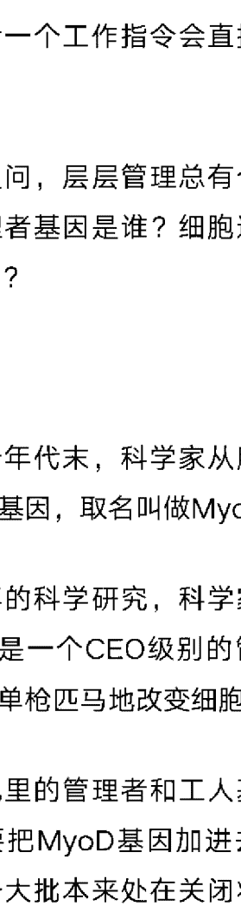

肉细胞的管理者基因，打开肌肉细胞的工人基因，最后硬是在皮肤细胞里生产出了各种肌纤维蛋白，把皮肤细胞变成了肌肉细胞。

如果你接着问，这个MyoD基因又是谁打开的呢？

回答这个问题之前，我需要介绍两个重要概念，终端分化细胞与干细胞。

### 皮肤细胞或者肌肉细胞，在生物学上被称作终端分化细胞。

意思是，它们的命运已经走到了南墙跟前，不能再改了。它们要么在岗位上工作一辈子，要么光荣退休，也就是衰老以后被分解，回收再利用。

它们走上工作岗位之前，还没有决定成为皮肤细胞还是肌肉细胞的时候，其实是另外一种细胞，生物学上叫做干细胞。

干细胞的意思是，一切皆有可能。

受精卵就是最厉害的干细胞，它能变成全身上下无数种不同命运的终端分化细胞。所以，身体生长的过程，就需要从干细胞，产生很多很多不同命运的细胞。

回到我们的问题，终端分化细胞的CEO基因是被谁打开的呢？

答案是，干细胞里的管理者基因。

MyoD基因是干细胞准备往肌肉细胞分化的过程中，被上一级管理者基因打开的。

你可能还想问，干细胞里这个管理者基因的上级又是谁呢？

回到最初的最先，这就是从0到1的问题，就是卵细胞带来的彩礼打开了第一个基因启动了这一切。

可见，从0到1，真的很重要。

既然MyoD基因能让皮肤细胞变成肌肉细胞，那有没有基因能把终端分化细胞的命运转回干细胞呢？这想法听上去有点逆天，但在2006年，竟然成功变成了现实。

一位叫山中伸弥的日本科学家，使用四个基因，成功地将小老鼠的皮肤细胞逆转为干细胞。

这个研究让他在短短的7年后就拿到了诺贝尔医学与生理学奖。

这么转来转去可不是纯粹为了好玩，而是有重要意义的。

你可能知道一种病，叫帕金森病。它的产生，是因为大脑中的负责分泌多巴胺的神经元死亡了，机体逐渐产生了运动功能障碍。

病人最需要的，是在大脑中补充死亡的多巴胺神经元。但是，如果补充其他人的细胞，很可能出现免疫排斥反应，所以最好是自己的细胞来补充。

但是，哪儿能把病人的多巴胺神经元变出来呢？

有了逆转干细胞的方法，就能变这个魔术了。

我们可以先把患者自己的皮肤细胞取出来，逆转为干细胞，然后再把干细胞分化成多巴胺神经元，注射回患者大脑。

这样依赖，不就能治疗帕金森病了吗？

在2018年11月，日本京都大学的研究者开始了这个临床试验，运用干细胞方法来治疗帕金森。

干细胞治疗的未来，让我们拭目以待。

所以，基因工作原理很重要，不管是抗癌的分子靶向药，还是干细胞疗法的研发，都需要我们搞清楚基因是怎么工作的。

### —— ◆ 总结 ◆ ——

这一讲，我们讲了基因的工作律。

- 1. 基因最核心的工作是生产蛋白质。

基因有三种角色，管理者、工人和信号兵。细胞外的信号通过信号兵传给管理者，然后打开工人基因，工人基因生产出蛋白质，完成生命的生理功能。

- 2. 基因的管理是层层分级的。

上级管理者基因打开下级管理者基因。最上级的是CEO基因。每一种细胞的命运，都是由CEO基因来决定的。

操作基因能把终端分化细胞变回干细胞，这种技术有可能治疗那些目前无药可治的疾病。

俞子龙

思考题：
你觉得，干细胞疗法除了能用来治疗帕金森，还能治疗哪些疾病呢？是药三分毒，干细胞疗法会不会有副作用？
欢迎在留言区，与我互动。

下一讲，我们讲讲基因怎样自我演化，迭代更新。

上一篇

用户留言  写留言  提交留言可与专栏作者互动

## 04 | 演化律：通过突变和重组迭代更新

仇子龙 · 基因科学20讲

04 | 演化律：通过突变和重组迭代更新。

欢迎来到《基因科学课》。你好，我是仇子龙。

俗话说，龙生龙，凤生凤，老鼠生儿会打洞。这句俗语朴素地告诉了我们遗传学最重要的原理：基因会遗传，上一代是怎样，下一代也应该是怎样。

但是从生命诞生的40亿年前到现在，不知道有过多少物种。

如果基因一直是上一代原封不动地传给下一代，怎么会有这大千世界这么多物种呢？

这背后的道理很简单，基因会演化。

“演化”这个词听着很学究，用时髦的话说，叫迭代更新。

### 1.基因突变

既然DNA是遗传物质，那么它的核心任务就是要从上一代传递到下一代。

在这个过程中，DNA需要拷贝自己，从一

基因突变甚至会带来很多意外的惊喜。

### 2.基因串珠

看来，光靠小步快跑来试错迭代，远远不够。基因的迭代肯定还有其他方法。

### 3.基因重组——迭代的秘密

所谓人类基因组计划，就是把我们的30亿个DNA的ATGC信息统统搞明白了。

析，很快发现了吉尔伯特猜想的合理性。

他们发现，基因有几个很好玩的特点。

基因的外显子，也就是白珍珠，通常不是一个基因特有的，而是在许多基因里都找得到。

有很多基因长得很像，差别只是谁多了几个白珍珠，谁少了几个白珍珠，就像人类的兄弟姐妹一样。

这说明，外显子在不同的基因里，很可能是可以跑来跑去的。对于一个基因来说，它有可能获得别人的外显子，也有可能把自己的外显子送给别人。

这就像玩扑克一样，把外显子当成扑克牌，时不时地洗一把牌。

### 外显子的洗牌，就是基因的第二个迭代更新方法，生物学把它叫做基因重组。

那些经过了重组，获得或者失去了一部分外显子的基因，叫做新基因。

基因重组一般在什么时候发生呢？它发生最频繁的场景是在生殖细胞，也就是在精子和卵子里。通过精子和卵子，基因的重组就能传递给下一代。

这里我需要强调一下，科学家在几十年前，就发现了生殖细胞里的DNA重组。

不过这个DNA重组，跟我刚刚讲的基因重组有个根本区别。

早年发现的，是大段的DNA重组。这个过程中，基因是一个整体，重组并不会改变基因本身。而最近发现的这种，以外显子为单元的基因重组，能真正地让基因迭代更新，产生新基因。

### 4.外显子洗牌产生新基因

发现了基因重组可以产生新基因，科学家们就能解释为什么仅仅40亿年，生命就能演变出几百万个物种，甚至演化出智慧的人类了。

跟基因突变相比，基因重组有两大特点，可以加速生命演化的进程。

#### 第一，对蛋白质功能的改变规模更大。

基因突变只能变一个字符。当然，有的基础因位点很重要，但是大概率不会撞到那么重要的点，绝大部分的基因突变，都不会一下子让编码蛋白质的功能发生很大的改变。

而外显子重组，就不一样了。

#### 外显子对应的是蛋白质的独立功能单元，所以通过洗牌产生的新基因，能一下子获得与老基因不一样的新功能。

举个科学家已经发现的例子。

我们每一个人体内，都有无数的抗体，这些抗体，就是我们免疫系统里，B淋巴细胞经过基因重组后产生的。

这个重组就是运用了外显子的随机洗牌原理，随机产生了数量庞大，而且结构不同的抗体基因，来应对未知自然界里的病原体。

#### 第二，基因重组的环境更自由。

你可以猜到，不管是突变还是重组，都很需要运气，需要大量地试错。

基因突变就像是工人干活的时候，不小心打了个Follow，发生了 一个小错误。机体不允许DNA复制出现太多突变，所以会有各种品质监控团队严防死守，仔细纠错。

但是基因重组不一样。可以说，到目前为止我们还没有发现任何监管团队，基因几乎可以随意重组。

如果你担心，没有规矩不成方圆，万一基因重组太分了怎么办？

别担心，基因重组时时刻刻都在面临大自然的考验。经过漫长的演化过程，只有对生物体生存繁衍更有利的基因重组才会被保留下来。

### —— ◆ 总结 ◆ ——

这一讲，我们讲了基因的第三大定律——演化律。

- 1. 我们知道了基因的迭代更新，有突变和重组两个方式。
- 2. 基因突变是指DNA复制时发生的错误。虽然它有可能导致癌症，但也正是因为突变，才能增强演化优势。
- 3. 基因重组是通过外显子洗牌而发生，能够产生新基因。这种方式可以快速获得新功能，加快了基因演化的进程。

俞子龙

思考题：

知道了基因演化的原理，你觉得我们人类的基因还在继续演化么？如果基因演化还在进行，那人类的基因会往什么方向演化？

欢迎你在课后留言，分享给我。

到现在为止，我们已经讲了基因的三大定律：决定律、工作律，和演化律。

下一讲，我们会开启一个新的章节，把视角切换到人身上。看看基因怎么演化出人类，基因又是怎么决定人的行为的。

我们下一讲见。

## 05 | 人类是基因演化的巅峰

仇子龙 · 基因科学20讲

05 | 人类是基因演化的巅峰

你好，欢迎来到《基因科学课》，我是仇子龙。

上一章，我们的关注点是基因，看到了基因对生命的决定作用，知道了基因是所有生物物理结构和行为认知能力的底层逻辑。

不过我想，你可能跟我一样，更关心的是人类自己。

人也是生物，在人的身上，基因这个底层逻辑是怎么运作的呢？

对于基因与人的关系，我们关注三大问题：

- 1. 人与其他物种，在基因层面，有无区别？
- 2. 人类的性格、行为认知能力，甚至人与人之间的关系在多大程度上被基因决定？
- 3. 环境对人的塑造起多大作用？

这一讲，我们就来回答第一个问题。

你有没有想过，人类是怎么从动物界脱颖而出的？

人类的祖先是灵长类，俗话说就是猿猴，难道是有些不安分的猴子突然有一天，从树上跑下来，拄个做饭过日子，然后就变成了人类？可能没那么简单。

我觉得，人类远远超过了其他动物的能力，其实就两个：

- 第一，语言。
- 第二，很强的学习能力。

动物也能学习和记忆，但是无法跟人类相比。

那么，对科学家来说，问题就变成了，是什么基因，导致了人类具有了语言和很强的学习能力呢？

### 1. 语言基因FOXP2

这就要提到著名的语言基因，FOXP2了。

2001年，英国有一大家子，祖孙三代都有语言障碍，科学家分析了全家的基因，发现有语言障碍的家庭成员都含有一个基因的突变，这个基因的名字叫FOXP2。

### 2. 缘故人性光辉的新基因

### 3. 人类大脑发育变慢

信使RNA出现得晚，说明这些基因的开关被特意调慢了，导致蛋白质的产生也会变慢。

说完这句话，我好像也没明白我在说什么。

现在，我们一起来整理一下思路。

之前说的人类新基因的发现，说明基因通过重组，产生的新基因可以减慢大脑的发育。而卡托维奇教授的发现说明，帮助大脑发育的基因开关，被专门放慢了。

打个比方，大脑的发育就像是在开车。人类新基因的作用好比是踩刹车，而P慢了基因的开关好比是慢慢踩油门。这双管齐下，人类大脑发育的这辆车，就被硬生生地减速了。

不过，为什么人类大脑的发育要比其他动物慢呢？这难道就是人之所以为人的原因？

### 4.更可塑的大脑

这听起来有点反常识，不过在生命的早期，减慢大脑的发育速度确实有一个很大的好处，那就是拥有一个更可塑的大脑。

对人脑来说，我们并不重视容量，而是关心可塑性。

容量，指的是能装多少知识。可塑性，指的是学习新知识的能力。

简单来说，你可以这么理解：在学习的过程中，外界信息的输入会将大脑中许多许多未固定的神经连接固定下来，将知识与技能储存下来，等着以后使用。一旦神经连接被固定了，则不容易再被改变了。

我们常说，小孩子的脑子比大人的脑子更有可塑性，这是 LIFO 思维。

比如说，成年人再想学会一门全新的外语，需要花的力气比小时候大得多。

小朋友的大脑因为还没有足够成熟，脑中的神经连接还没有被固定下来，所以具有更大的可塑性，能够接收大量知识。

所以，大脑的缓慢发育会让人类的大脑更可塑，让人类具有了从小好好学习 contratado，人类的优势就出现了。

相比之下，大自然中其他所有动物都不能奢望这些。

几乎所有的动物在出生的那一刻起，就面临着天敌的威胁。大草原上的许多动物刚生下来几个小时就学会跟着妈妈奔跑，否则就会被不远处虎视眈眈的食肉动物吃掉。

对它们来说，大脑一定得尽快成熟，让它们赶快看清楚这个世界，活下来。

人类很幸运，出生后不再需要马上躲避天敌，抢夺食物。

一个更具可塑性的大脑可以让他们在三到四年的时间里，安全地跟着父母学习开口讲话，学习待人接物，掌握生活技能，接受学校教育，成为真正的智慧人类。

总结来看，这个假说认为，是人类的新基因和基因开关拨慢导致了大脑发育变慢，让大脑在幼年期更可塑，从而产生了智慧。

说到这儿，我们还是得看看尼安德特人。他们的脑发育有没有变慢呢？

这就要提到我和卡托维奇教授的另一个发现了。

我们在 一堆人类大脑中推迟表达的基因里，发现了一个重要的基因MEF2A。

这个基因，是人脑里非常重要的管理者基因。卡托维奇教授分析了很多其他物种的MEF2A基因开关后，发现MEF2A推迟表达的历史时刻，居然发生在智人与尼安德特人分离之后。（参考文献5）

换句话说，MEF2A基因的延迟打开是智人特有的。

难道智人打败尼安德特人就是靠MEF2A基因的延迟打开？目前，这还只是一种科学假说，智人究竟是凭借基因，还是凭运气战胜了尼安德特人，我们还需要更多的科学证据来作出判断。

### —— ◆ 总结 ◆ ——

这一讲，我们讨论了人和其它物种在基因层面的差别。

- 1. FOXP2基因的意外突变让人类演化出现了语言这个技能。FOXP2基因突变是人类独有，但并不是智人独有。尼安德特人也有这个基因突变。
- 2. 人类新基因和基因开关的P慢，会推迟人脑发育，让智人拥有更可塑的大脑，从而产生智慧。目前，我们发现，这可能是智人独有的。

所以，语言，加上更可塑的大脑，就构成了人和其它物种在基因层面的本质区别。

俞子龙

思考题：
按照我们的假说，请你推测一下，在远古时代，为什么智人的大脑在演化中能够推迟发育，但是是尼安德特人的大脑却没有呢？

接下来的几讲里，我想跟你讲讲基因如何影响我们的性格、关系和学习。

我们下一讲见。

## 06 | 性格：“暴力”基因的前世今生

仇子龙 · 基因科学20讲

06 | 性格：“暴力”基因的前世今生。

你好，我是仇子龙。欢迎来到《基因科学课》。

2009年9月，意大利的法院作出了一个有重要意义的宣判。

#### 1.MAOA是“暴力基因”

暴力基因的发现，要从1993年说起。

多巴胺就是大脑里神经细胞用来传递信息的一种化学物质。它很特别，决定了我们的“冲动”。

DOPAMINE PATHWAY

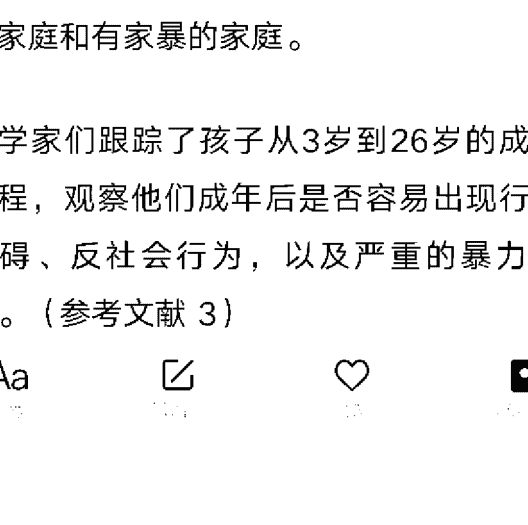

这个多巴胺逐渐减少的过程，其实就是大脑的自我保护机制。

这里我必须强调一下，在我们生物学家看来，暴力对动物而言，是一种非常自然的行为模式，是生存的必备技能。

- 1. 其他人如果有MAOA基因突变，也像这个家族里的男人们那样，终生？ 2. 只要有暴力犯罪，就会有这个MAOA基因突变吗？

#### 2.暴力基因是被冤枉的

2002年，有一篇研究MAOA基因突变与暴力行为的著名论文发表了。开头我们提到的2009年法庭判决里，研究人员引用的就是这篇论文。

罪。（参考文献 3）

1993年的 “MAOA暴力基因” 的研究发表后，这群科学家马上意识到，他们可以在这个研究基础上，测一下这群孩子有没有这个MAOA基因突变，然后看一下，如果有MAOA基因突变，长大是否也可能容易出现暴力行为。

我仔细看了论文原文，发现论文里的结论是这样写的：

> “在含有MAOA基因突变的孩子中，家暴这个因素，对长大以后是否出现行为障碍的影响非常显著。”

这句话挺绕，我来给你讲一下科学家到底想说什么。

研究者在有MAOA基因突变的孩子身上，发现了两个现象。

- 1. 如果幼年遭受了家暴，长大以后出现行为障碍，乃至严重的暴力犯罪的可能性更大。
- 2. 如果幼年没有经历家暴，这些孩子长大以后和没有MAOA基因突变的孩子表现一样，并且不会更容易产生行为障碍或者暴力犯罪。

通过这两个现象，我们可以深入解读出两个意思：

#### 第一，含有MAOA基因突变的孩子确实容易冲动。

如果幼年遭受了家暴，心理创伤本来就很大，再加上青春处在非常糟糕的家庭环境中，所以长大以后大概率会出现行为障碍，导致社会问题。轻则在酒吧打架伤人，重则违法犯罪。

#### 第二，导致这些含有基因突变的孩子长大以后发生暴力犯罪的罪魁祸首，是幼时遭受的家暴。

因为在没有家暴的情况下，即使有暴力基因突变的孩子，长大后也完全没问题。由于有正常的家庭教育，即使性格上容易冲动，也会被社会的道德准则所约束，不会成为社会问题。

对这些幼年遭受了严重家暴的孩子，从小没有得到正常的家庭环境，如果还要被歧视为携带了先天的基因突变而低人一等，就太荒谬了。

有这工夫，致力去消灭家庭暴力，难道不是更好的选择吗？

虽然基因不一定决定人的上限，但是看来环境真是决定了人的“下限”。

#### 3.暴力基因突变一定不好吗？

现在我们知道了，暴力基因会让人更冲动。

但是，暴力犯罪的罪魁祸首是幼年的家暴，而不是暴力基因。所以，有人认为，暴力基因这个名字取错了，应该叫障碍基因。

但是我觉得，叫“障碍基因”也不对。

争强好胜、容易冲动，就一定是性格障碍吗？

2011年，美国加州理工学院的科学家做了这么一个实验。

他们找来九十个男性，一部分是有暴力基因突变的，一部分是没有的。研究者设计了实验，准备看看谁更善于在压力下，对金钱投资作出更好的选择。（参考文献 4）

他们发现，有暴力基因突变的人，明显比没有基因突变的人，更能冒着风险顶住压力，作出更好的投资选择。这样看来，这个暴力基因突变还真不是一个坏突变呢。

其实，在现实社会中，尤其是激烈竞争的商界，太含蓄内敛不一定是优点。

我猜想，如果去华尔街或者世界五百强的管理高层里，测一下他们的MAOA基因，说不定会让人大吃一惊。

所以，我认为这个MAOA基因突变，应该叫做“战士基因”。

顺便说一句，因为暴力基因太有名，科学家把全世界各民族人民的MAOA基因都测序了。

> 结果却让所有人大跌眼镜。在美国和欧洲，足足有三分之一的人是含有MAOA基因突变的。

幸亏我们没认定MAOA基因和暴力犯罪有关，否则，岂不是三分之一的人要被冤枉了。

更让人吃惊的是，我们汉族人群中，含有暴力基因突变的居然达到了77%，全世界最多！汉族人难道是最好斗的吗？好像真不是那么回事。

也许啊，在人类漫长的演化过程中，我们可能产生了其他的基因变异，对冲掉了单胺氧化酶活力不够的副作用，导致我们也没有特别容易冲动。

由此可见，我们对于基因决定性格的认识，才刚刚开始。

### —— 总结 ——

- 1.MAOA基因突变，会导致性格冲动。
- 2.MAOA基因突变并不是暴力犯罪的罪魁祸首。如果幼年遭受家暴，则这种冲动性格有可能导致暴力犯罪。如果幼年的家庭正常，即使含有MAOA基因突变，也不会产生行为障碍和违法犯罪。
- 3.MAOA基因突变本身是没有好坏的，在不同的社会场景下，优劣势不同。

### 思考题：

长期以来，我们以为只要一个基因就足够影响人类行为，这才造成了我们对暴力基因的误解。这样的新闻报道现在还有很多。你有没有看到过这样的新闻呢？你觉得这些说法靠谱吗？

欢迎在留言区跟我分享。

讲完性格，下一讲，我会跟你聊聊，人与人之间的关系是否与基因有关。爱情基因是不是真的存在呢？

我们下一讲见。

上一篇

用户留言

## 07 | 关系：催产素是亲密关系的基因开关

仇子龙·基因科学20讲

07 | 关系：催产素是亲密关系。 ↓

你好，我是仇子龙，欢迎来到《基因科学课》。

上一讲，我们讲了MAOA基因与冲动性格的关系。既然性格与基因有关，那人与人之间的关系与基因有吗？

人与人的关系，可以分为两大类，

一类，是由分享基因组成的亲缘关系，比如跟父母子女的关系。

还有一类，是在社会里后天发展的关系，有纯社会学的关系，比如同事朋友，还有生物学意义上的关系，像伴侣关系这种。

这个伴侣间的亲密关系，还被我们叫做爱情。

不过我得先澄清一下，生物学家讨论的爱情，跟社会学家和文学家讨论的爱情，完全不是一码事。

在生物学家的眼里，爱情就是生物体之间的长期亲密关系。

爱情的发生，有两个生物学过程。

第一个过程，是相互吸引。比如动物之间通过嗅觉，人类之间通过视觉以及谈吐等等，然后发生两性行为，建立亲密关系。

第二个过程，是建立长期陪伴关系。一旦分开，就会死去活来，直教人生死相许。

#### 1.田鼠的爱情——催产素

所以，我可以预测，爱情是基因控制的。

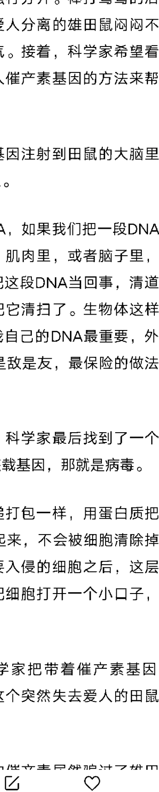

这个基因编码着一个很小的蛋白质激素——催产素。顾名思义，催产素是哺乳期，妈妈体内用来促进乳汁分泌的激素。

#### 2.爱情反应链：多巴胺—催产素—多巴胺的正反馈

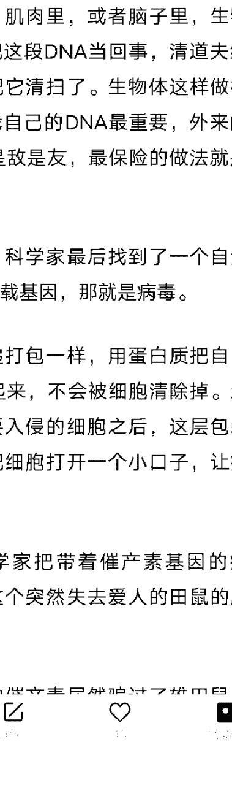

- 1. 亲密，这可以说是爱情的发生；
- 2. 长期陪伴，这是爱情的维系。

这个人工给的催产素居然骗过了雄田鼠。尽管它还是一只田鼠在笼子里，但它误以为爱人回来了，马上开心了起来！其实代替了爱人的，只不过是它脑中的催产素。

这个实验的重中之重，是科学家发现，催产素注射的地方很有讲究。

他们尝试了各种区域，最后发现只有注射到大脑中分泌多巴胺的细胞里，才能产生爱情，其他地方是没有任何用的。

又是多巴胺！上一讲里，我们就提到了它。看来多巴胺不仅仅能让人冲动冒险，还能让人相信爱情。这个实验说明，催产素带来爱情的本质，是通过促进多巴胺的释放，让我们愉悦开心。

为什么多巴胺能让我们开心呢？我来简单解释一下。它是大脑里一类被称为“神经递质”的物质，用来调节神经活性。

简单理解，就是用来让神经细胞的活性更高，更兴奋。当我们做自己热爱的工作，进行刺激的极限运动，以及两性行为的时候，大脑里都会分泌多巴胺，然后就会感觉很爽。

到现在，我们终于可以基本确定爱情的反应链了，还记得我归纳的爱情关键词吗？

亲密和长期陪伴。

首先，双方通过亲密的两性行为产生感情，因为两性行为会促进脑细胞分泌多巴胺，让我们开心愉悦。如果没有继续相处，那就是一夜情。如果继续相处，长期陪伴，大脑就会产生催产素来维持爱情。

维持爱情的关键，是催产素会让大脑不停地分泌多巴胺，让我们长期相守，你依我依，甜甜蜜蜜。

#### 3.亲子关系里的催产素

现在看来，催产素好像是维持动物之间长期亲密关系的纽带，一旦产生，就可以增强这种长相厮守的幸福感，真是太奇妙了。

那么，除了爱情，其他亲密关系和催产素有关吗？还真有。

有个最新的科学发现，雌性小鼠大脑中分泌多巴胺的神经细胞比雄性小鼠多，而且当雌性小鼠做了妈妈以后，会变得更多。不仅如此，这群细胞居然会去控制大脑中分泌催产素的神经细胞，让小鼠妈妈脑子里分泌大量的催产素。（参考文献 3）

小鼠并不是一夫一妻的动物，所以这个催产素不是为了爱情，而是专门为了让母亲更好地照顾下一代，专门为了建立亲子联盟用的。

科学家发现，做了妈妈的雌鼠大脑里的催产素，会继续刺激分泌更多的多巴胺。这个亲子反应链简直跟田鼠里的爱情反应链一模一样。

因为这些妈妈在孩子出生时有重要的哺乳任务，所以这种亲子反应链应该是一个自然选择的产品。

有这种亲子反应链的哺乳动物，才能在大自然中更好地生存。

更神奇的是，科学家发现，不仅母亲大脑中的催产素系统被激活了，幼鼠在被妈妈抚摸和舔舐的过程中，大脑里也会分泌大量的催产素。如果把幼鼠与母鼠分开，缺少了母亲爱抚的幼鼠会产生发育不良的症状。

### ——总结——

- 1.爱情是由催产素基因控制的。
- 2.爱情的完整反应链包括亲密和长期陪伴两个部分，第一部分产生多巴胺，第二部分产生催产素，之后催产素会持续激活大脑，分泌多巴胺，产生正反馈，建立牢固的亲密关系。
- 3.除了爱情，亲子关系也需要催产素。催产素能帮助雌性动物建立起对孩子无私的爱，也帮助幼年动物感受母亲的爱，健康成长。

仇子龙

思考题：
你能不能从进化的角度想一下，为什么人类是所有动物里，爱情的表现最明显物种？
欢迎在留言区与我互动。

下一讲，我们来看基因是怎么影响我们的学习能力的，科学家有没有找到聪明细因。

我们下一讲见。

## 08 | 认知：人类擅长学习 的基因原理

仇子龙·基因科学20讲

你好，我是仇子龙，欢迎来到我的《基因科学课》。

在前两讲，我们讲了基因是如何影响我们的性格，影响人与人之间的关系的。那么，基因又是怎样影响人类行为认知能力呢？

我们在讲基因的决定律时提到过，行为分为本能行为和习得行为。对人类而言，本能行为已经非常弱化了。

比如说，饿了想吃饭是一种本能。如果你正在开会，尽管肚子饿得不行，估计也会咬牙忍到会议结束再去吃饭，而不是马上满足自己的本能。

所以，对人类来说，习得行为，也就是通过学习而学会的行为，在我们的成长中扮演了非常重要的角色。

与其他动物相比，人类的学习能力是独一无二的。前面讲到现代智人之所以能战胜尼安德特人，很可能就是因为基因演化让智人的大脑更可塑，给予了智人更强大的学习能力。

#### 1.学习的基因开关

- 1. 能不能通过检测基因来发现聪明的人？
- 2. 如果能修改基因，我们能不能学会得越来越快，变得越来越聪明呢？

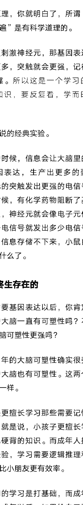

这个实验让我们知道，学习需要基因的表达！

当我们听老师的讲解，或者阅读课本时，我们的大脑可以理解、储存这些信息，而且以后需要的时候，还能把这些信息提取出来。这就是学习。

这个可塑性，是怎么实现的呢？靠的就是神经元里的基因表达。

#### 2.可塑性是终生存在的

#### 3.寻找聪明基因

聪明这个事情，在生物学上被称 为，“智力水平比较高”。人类的智力很复杂，可以被分为两个部分。

爱因斯坦，还有极少数偏低，因为各种原因智力发育出现了障碍，智商低于70。我们一般人的智商都在80～120之间，谁比谁多了几点、十几点智商真心没有什么了不起的。

也就是说，我们人与人之间的智力确实有差异，但是并没有那么大的差别。

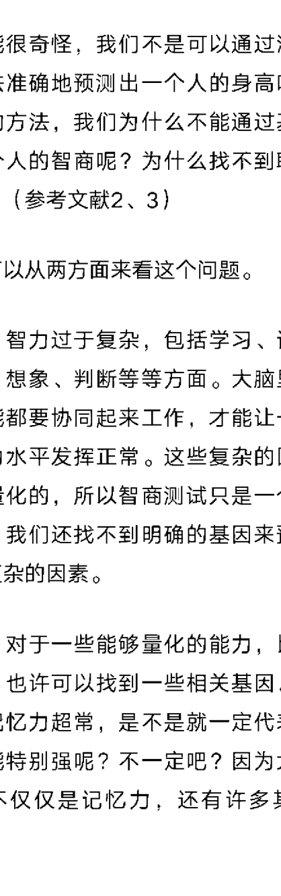

其次，聪明基因并不存在，起码至今我们还没有发现。

科学家一直在努力，在数万、数十万的人群中，根据智商的水平来寻找聪明基因，他们找到了一些线索，但是至今没有定论。

你可能很奇怪，我们不是可以通过深度学习算法准确地预测出一个人的身高吗？用类似的方法，我们为什么不能通过基因预测一个人的智商呢？为什么找不到聪明基因呢？（参考文献2、3）

我们可以从两方面来看这个问题。

第一，智力过于复杂，包括学习、记忆、推理、想象、判断等等方面。大脑里的无数功能都要协同起来工作，才能让一个人的智力水平发挥正常。这些复杂的因素是很 grow 量化的，所以智商测试只是一个估计而已，我们还找不到明确的基因来预测这么多复杂的因素。

第二，对于一些能够量化的能力，比如记忆力，也许可以找到一些相关基因。但是就算记忆力超常，是不是就一定代表大脑的功能特别强呢？不一定吧？因为大脑的智力不仅仅是记忆力，还有许多其他能力。

所以，有没有聪明基因，真是一个很烧脑的问题。

我个人的观点是，没有必要寻找聪明基因。如果真心想变聪明，还不如想办法把学习过程中的基因表达变得更有效率，那不也能让我们学得更快吗？

### —— ◆ 总结 ◆ ——

- 1. 人类的学习靠的是神经元的可塑性，而这个可塑性是通过基因的表达过程完成的。
- 2. 大脑的可塑性终生存在。如果你不利用大脑的可塑性，不持续学习，那么神经元里的基因就不会打开。
- 3. 人类智力与众多因素有关，所以很难找到所谓的聪明基因。

仇子龙

思考题：
如果我们有一天，发现高智商人群里确实有个基因和我们一般人的基因很不一样，那么如何用科学的方法知道这个基因就是聪明基因呢？
欢迎在留言区，说出你的想法。

下一讲，我们来看看生活习惯的代际传递。上一代的生活经验能不能通过基因传给后代呢？
我们下一讲见。

## 09 | 代际：除了基因，还有生活传递下一代

仇子龙·基因科学20讲

09 | 代际：除了基因，还有...

你好，我是仇子龙，欢迎来到我的《基因科学课》。

在前三讲，我们知道了，基因决定了我们的性格、亲密关系和学习能力。

严格地说，我们的基因是祖祖辈辈传下来的，经过了至少上千年的传递、混合和突变，才变成今天这个样子。所以，我们的基因里储存的信息很古老，基因演化的过程也经常需要成千上万年。

这就有个问题：如果我们的生活遇到了什么灾难，或者什么开心的事情，有没有办法马上让下一代知道呢？

当然有，我们的语言和文字，可以将上一代的生活阅历和经验马上传递给下一代。但是文字和书写系统的诞生才一千多年，语言的传递历史久一些，但是容易出错，以此类推。

你可能想不到，除了人类的语言和文字以外，基因居然也能把上一代的生活阅历传递给下一代。而且这种传递，并不是人类特有的，是经过了千千万万年的动物演化过程，遗留在人的基因里的。

这件事情的发现，源于二战时候的一个奇怪的现象。

#### 1.母亲给孩子的应急锦囊

科学家对比了同一个家庭里在饥荒冬天怀孕生下的孩子和度过饥荒后生下的孩子，看看他们的基因有哪些不同。

科学家发现，饥荒中的母亲体内会产生一些信号，对胎儿体内与能量代谢有关的基因做了一些特殊的标记。基因被标记的下一代，一出生就会主动地获取更多的食物，尽量储存更多的脂肪。（参考文献1）

这些标记叫“DNA的甲基化修饰”。基因被甲基化修饰以后，就不能被打开了，无法产生蛋白。

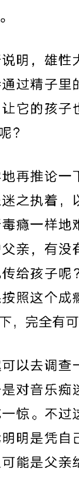

#### 2.父亲传递给孩子的“执着”

长期以来，很多人都以为，父亲对于孩子的贡献不大，只是一个小小的精子，精子里除了父亲的DNA以外空无一物。精子与卵子融合以后，作为一个成熟的细胞，其用到的大部分能量和细胞器都是卵子从娘家带来的。精子好像只是一个上门女婿。

DOPAMINE SYSTEM

#### 3.用进化退理论对吗？

鹿的脖子为什么那么长？是因为它们拼命伸着脖子吃大树上的树叶，然后下一代的脖子就越来越长。还比如，把农作物往寒冷的地区移植，这些农作物就能获得在寒冷地区生活的能力。

这些听上去颇有道理的解释，其实是十足的伪科学。科学家做了严格的科学实验，证明这个观点是完全错误的。把农作物往寒冷的地方移植，不用几代就全部死光，植物不可能在两三代的时间内就学会抵抗严寒。

既然这个理论不对，但是刚刚我们说上一代的生活经历可以传给下一代，这不就是用进废退吗？

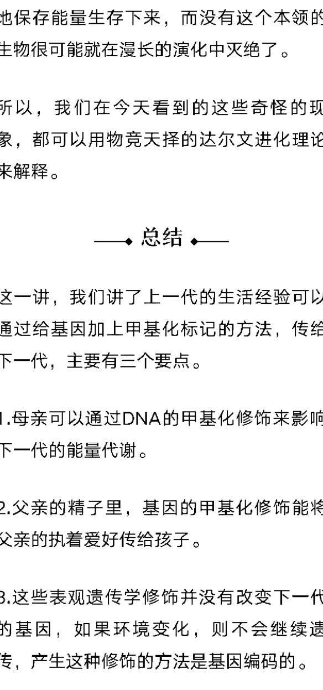

我要强调一下，这跟用进废退理论可不是一回事。它们的本质区别是，孩子基因上的甲基化标记是暂时的，而用进废退里的遗传对基因的改变是永久的。

用进废退理论认为，短暂的生活经历能立马改变DNA，而在饥饿母亲的例子中，饥荒经历并没有改变下一代的基因，而是激活了母亲基因里的古老程序，对基因进行了甲基化标记。被一代代遗传下来，是这个古老的应急程序而已。

下一代如果饮食充足，表观遗传学修饰就会停止作用，这种大吃大喝积累能量的特点不会再被遗传下去。执着父亲的孩子如果在生活中没碰到这种喜好，这个瘾头就不会继续，下一代的精子就没有甲基化标记了。

所以，真正被忠实地传递给下一代的，不是基因上暂时的化学标记，而是这种根据不同环境，在后代基因上做化学标记的本领。

这个表观遗传学修饰过程，需要一系列的DNA甲基化酶，它们是由一系列基因编码的。这些基因不是上一代刚刚获得的优势，而是经过了漫长的自然选择被留下的。

从达尔文自然选择理论很容易理解这个现象。在漫长的演化过程中，基因的变异是没有方向的，有些生物具备了在灾荒年代对下一代的基因做标记的本领，这些生物的下一代就能学会在困难的环境下尽可能地保存能量生存下来，而没有这个本领的生物很可能就在漫长的演化中灭绝了。

所以，我们在今天看到的这些奇怪的现象，都可以用物竞天择的达尔文进化理论来解释。

### ——◆ 总结 ◆——

这一讲，我们讲了上一代的生活经验可以通过给基因加上甲基化标记的方法，传给下一代，主要有三个要点。

- 1. 母亲可以通过DNA的甲基化修饰来影响下一代的能量代谢。
- 2. 父亲的精子里，基因的甲基化修饰能将父亲的执着爱好传给孩子。
- 3. 这些表观遗传学修饰并没有改变下一代的基因，如果环境变化，则不会继续遗传，产生这种修饰的方法是基因编码的。

仇子龙

思考题：

2016年，中国科学家还发现了一个生活经验遗传的现象。如果父亲肥胖，他们的孩子也容易得各种代谢疾病，比如糖尿病。科学家们发现是精子里的RNA作为管理者基因发挥了作用。你觉得，进化上为什么要保留这个程序呢？（参考文献3）

欢迎你在留言区，和我互动。

在下一讲里，我们将讨论一个重要的问题。我们反复地讲，基因是生命舞台上的绝对主角。那么，这是不是宿命论呢？基因能不能决定我们的命运呢？我们下一讲见。

上一篇

用户留言

提交留言可与专栏作者互动

## 10 | 基因并非命运

仇子龙·基因科学20讲

10 | 基因并非命运

你好，我是仇子龙，欢迎来到我的《基因科学课》。

有次参加国际会议，有一位研究了一辈子基因的哈佛大学教授作报告，专业内容我已经记不清了，但是说到基因作用的时候，他说了一句话，一下子解开了我内心很多的疑惑。

这句话是“Genes are not fate”。中文的意思是：基因并非命运。

当你知道有基因这个东西存在以后，我猜你也一定和我有一样的疑问。

我们这一生，有哪些是基因先天决定的？哪些是我们后天的努力可以改变的？基因只能继承父母的，自己不能改变，但是我能不能靠后天努力让命运越来越好呢？如果一个人的命运刚出生的時候就被基因定了，人生还有什么意义呢？

我们反复地讲，基因是生命舞台上的绝对主角。那么为什么科学家说，基因并非命运呢？

命运是什么？命运就是我们的人生经历。比如说，我是成为一个生物学家，还是成为一个诗人？还比如，我会遇到谁？跟谁在一起？在哪里定居？

人生经历就好像我们演出的一部真人秀，基因设定了我们的角色，它决定了我们的长相、身高、体重，以及行为模式，遇到事情如何反应。但是真人秀还有一个非常重要的一部分，就是规则设定。

在人生里，规则设定就是社会环境。

只有角色设定，你能预测一部真人秀的内容吗？当然不能。

1920年，在印度发现了两个从小被狼群抚养的孩子，当他们被人类发现的时候已经七八岁了，完全不会直立行走，甚至和狼一样只吃生肉，也不会说话。

回到人类社会后，经过了多年学习，他们只勉强地学会说几个简单的字词，学不会人类社会的知识和技能，终生都没有融入人类社会。

从狼孩的例子里，我们就能直观地看到，这两个具有人类基因的孩子，因为从小跟动物长大，没有人类的社会环境，然后就再也无法融入人类。

从生物学上说，狼孩绝对属于人类物种，但是从社会学上说，他们已经不再是人类社会的一员了。

我们小时候也就是穿着开裆裤乱跑，好像没学什么东西，但是人类社会里的所有一切，其实都在潜移默化地塑造着我们的大脑，尤其是人类的语言能力和超强的学习能力。如果脱离了人类社会，语言和学习能力是不会无师自通的。

既然社会环境深深地影响了我们的命运，那它到底是怎么起作用的呢？

在这一讲里，我会从感知觉、智力发育和价值观这三个方面，告诉你社会对我们的作用。

### 1.感知觉形成的关键期

社会环境对感知觉有什么影响呢？

首先，我先来跟你分享一个经典的科学实验。

半个世纪之前，1963年，两位科学家希望研究大脑的视觉是怎样形成的。他们用小猫的眼睛进行了一系列实验，研究猫的视觉细胞，这些发现让他们在十几年后拿到诺贝尔生理学或医学奖。但是我认为真正改变了世界的，却是他们的另外一个实验。

在研究视觉细胞之余，他们想，如果小猫刚出生的時候，眼睑就不能接收外界信息，会怎么样？

于是，他们做了一个听起来有点残忍的实验。他们在小猫刚出生时，用针线将眼睑缝合了起来，过了一个月再打开。然后他给小猫观察各种图案，同时在大脑皮层上记录视觉神经细胞的各种反应。

他们惊奇地发现，小猫的眼睛不再对各种图案产生有规律性的反应。换句话说，它们的 大脑不再能够分辨眼睛看到的是什么。它们可以“看见”，但是无法“看到”。

他们又做了个对比实验，将已经一个月大的小猫的眼睑缝合起来，过了一个月再打开，发现小猫的视觉是完好的。

从这个实验里，我们可以得到两个重要信息。

- 1. 如果想要形成正常的视觉，光有基因还不够，小猫必须接收外界环境的信息输入。
- 2. 刚出生的第一个月是一个关键期。这个阶段没有关键的信息输入，决定了猫长大之后的视觉究竟怎么样。

经过了数十年的科学研究，科学家发现里面的原理是这样的。

就像前面讲过的学习过程一样，我们一出生，一睁开双眼，大脑就在我们不知不觉的情况下，用眼睛去学习看到的世界了。

### 2.环境对智力发育的重要性

说完感知觉，我们再来看第二个方面——智力。社会环境对智力的发育有什么影响呢？

在美国社会里，在低收入家庭的社区，往往是非裔美国人的社区里，孩子经常不好好学习，长大以后找不到稳定的工作，甚至违法犯罪，成为社会问题。

面对这种现象，有些社会学家，甚至科学家提出了质疑，会不会是非裔美国人本身的基因不够好，才会出现智力水平不高的情况？真的是基因决定了他们的命运吗？

面对这些质疑，1970年，美国几个教育学家与心理学家，启动了一个史无前例的社会学实验，史称“卡洛莱纳初学者计划”。

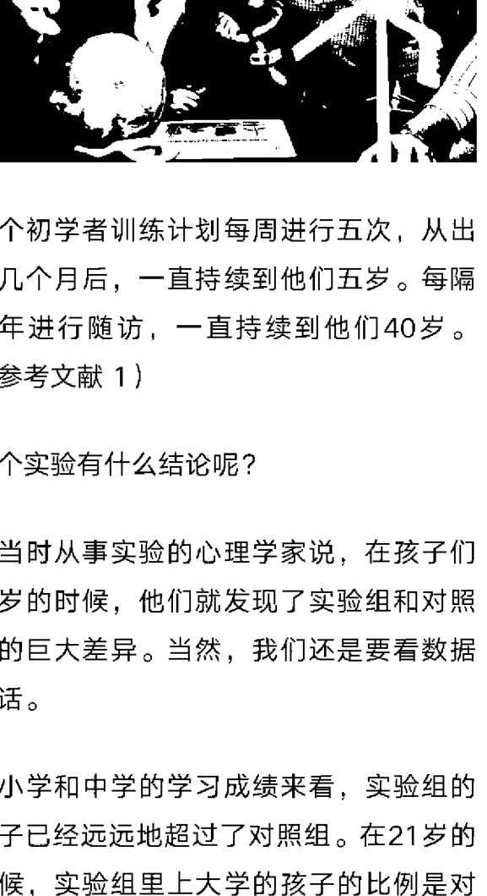

这个初学者训练计划每周进行五次，从出生几个月后，一直持续到他们五岁。每隔几年进行随访，一直持续到他们40岁。（参考文献 1）

这个实验有什么结论呢？

据当时从事实验的心理学家说，在孩子们两岁的时候，他们就发现了实验组和对照组的巨大差异。当然，我们还是要看数据说话。

从小学和中学的学习成绩来看，实验组的孩子已经远远地超过了对照组。在21岁的时候，实验组里上大学的孩子的比例是对照组的四倍。这足以说明，五岁前不同的教育环境对孩子们的智力发展影响巨大。

这个实验的发现还远远不止于此。

### 3.儿时的五年和一生的价值观

2018年，初学者计划四十年后，研究者又把实验组和对照组找了回来。当年的那群孩子，如今已是中年人。研究者设计了一系列实验，让他们作一些经济学的抉择。实验设计得很复杂，也很科学，我就不细说了。（参考文献 2）

总之，研究者就是想用严格的科学实验来检测，生命最初的五年教育是否对他们的价值观产生影响。看他们是愿意放弃自己的一些利益，尽量维持社会公平，还是不放弃个人利益，只要对我有利就好，不管对其他人公平不公平。

研究的结果又让所有人大吃一惊。

幼年接受了更好的教育资源的实验组，长大以后比对照组，更希望维持社会公平，就算是暂时放弃自己的一些利益也在所不惜。

换句话说，这些孩子尽管出身贫寒，但是幼年接受更好的教育以后，长大成人，希望社会往更公平、更平等的发展方向发展。看来，幼年的生活确实影响到了这些人的价值观。

所谓“三岁看老”可能有点绝对，但是你对一个五岁前孩子说的每一句话，对他的一生都影响巨大。

说到这儿，你应该知道，为什么说基因并非命运了。

基因给了你起跳的能力，而环境就像重力。如果把你送上月球，那你能轻松打破地球上的跳高纪录。如果把你送到重力比地球大十倍的木星上，估计你连站直都很困难。

这个横跨了四十年的伟大实验相当于把一部分孩子从木星带到地球上，让他们有了展现自己基因的机会。也让我们认识到，他们的基因和地球上孩子的基因是一样的。对于那些碰巧生活在地球上的人来说，怎么能嘲笑他们的基因不够好呢？

所以，基因决定了你的能力，但是无法决定你的命运。

尽管有的人确实能力强点，跳得高一些，但是只要努力起跳，总可以在社会里找到一席之地。

### —— 总结 ——

这一讲，我们讲了社会环境对命运的影响，主要分成三个方面。

- 1.感知觉。在出生后的关键期里，环境里信息的输入决定了感知觉的形成。
- 2.智力。5岁前的幼年教育对智力的发育非常重要。
- 3.价值观。幼年的教育会对成年后的价值观产生巨大影响。

仇子龙

思考题：

让我们做一个假想实验。假如，我们已经拥有完美的克隆人技术，为了满足人民群众日益增长的文化娱乐需求，不差钱的郭德纲老师要求科学家用克隆技术多克隆几个郭德纲，扩大德云社业务，把德云社开遍全世界！你觉得这个事情靠谱吗？

欢迎你在留言区跟我互动。

下一讲，我们会开启一个新的章节。看看人类是怎么从蒙昧状态中觉醒过来，认识基因的。我们下一讲见。

## 11 | 方法：人类基因组计划

仇子龙 · 基因科学20讲

11 | 方法：人类基因组计划

你好，我是仇子龙，欢迎来到我的《基因科学课》。

前两章，我们讲了基因是怎么工作，怎么决定人类行为的，主角是基因。接下来的两章，让我们把主角切换到人类身上。

在过去的一个世纪里，人类对基因的认知在三个维度上发生了翻天覆地的变化，我称之为“人类的觉醒”。这三个维度分别是：方法、视野，和态度。

这一讲，我们来看看人类的第一个维度，方法 的觉醒。科学家们研究基因的方法发生了什么变化呢？我们能不能从全局上认识基因了呢？

### 1.研究基因功能的两种方法

我们生物学家每天研究的事情就是，基因是怎么决定人的身体特征、性格和疾病的。这个问题非常复杂，总的来看，研究的方法分成两种流派，就好像武侠小说里华山派的剑宗和气宗。

第一种方法，讲究累砸稳打，就像是气宗。

第二种方法，就像剑宗一样，讲究四两拨千斤，从生物个体特征的蛛丝马迹里推测基因的功能。

### 2.寻找基因的传统方法：DNA测序

真的有这么难吗？还真是有。

基因组那么大，怎么找里面的基因呢？

确实，只要把DNA的这30亿个ATGC排列次序搞清楚，我们就能知道有多少基因，而且能知道每个基因的具体模样。这个过程有个生物学的名词，叫做测序。顾名思义，就是测定DNA里ATGC字符的排列次序。

### 3.寻找基因的方法革命：人类基因组计划

但是，这么一个看起来不可能完成的任务，在1990年却被一群疯狂的科学家启动了，史称“人类基因组计划”。这个计划的目标，就是要把人的30亿个DNA字符全部测序。

终于，在2000年6月26日，也就是10年之后，当时的美国总统克林顿在白宫宣布人类基因组计划基本完成。这个堪比阿波罗登月的伟大科学计划永远改变了人类社会。

是的，研究方法觉醒后，最大的成果就是对疾病的治疗。

### 4.寻找基因方法革命的成果

接下来，我就用一个例子来说明基因组计划带来的崭新能力。

## PARKINSON'S DISEASE

2017年，一篇权威的遗传学论文确定了与帕金森病有关的17个基因，这个研究收集了42.5万个人的基因组数据，是目前最大规模的帕金森病基因研究。（参考文献1）

你可能想不到，这篇研究最大的功臣，不是某位科学家，也不是某个著名大学，而是一个公司，名字叫做23andMe。为这个研究，23andMe贡献了37万人的基因数据。

它哪儿来的这么多基因数据呢？

在2006年，互联网公司巨头Google、Facebook崛起的同时，23andMe也在硅谷成立了。它承诺，只要花99美元，你就能得到自己的基因信息，个人基因组时代来了。

在2006年，基因组计划虽然已经完成了，但是对于全基因组测序来说，还是实验室里面昂贵的黑科技，想要走入平常百姓家不太现实，至少价格一般人承受不起。那23andMe怎么做的呢？

它采取的方法，是对基因组里面有重要意义的一些字符进行测序，大概几十万个字符。换句话说，它并不是完整地下载整个数据库，而只是去数据库里面查询了一小部分信息而已。

比如说，我们第一讲里提到...所以通过一个字符的检测，就可以告诉你酒量好不好。

23andMe这种基因检测服务会直接给消费者一个基因检测报告，所以被叫做消费型基因检测。这些检测报告里经常会有一些基因与疾病的相关信息。

但是，仅仅知道基因组的一部分信息，真能知道以后有可能得什么病吗？

果然，2013年，这项消费型基因检测被美国食品药品监督管理局，也就是FDA，叫停了。主要问题就是基因与疾病的对应关系，非常容易被误读。

比如说，癌症的产生通常与许多基因有关。我们每个人的基因组里都有一些有可能致癌的基因突变，是否应该告诉消费者这些信息呢？

解读基因与疾病的关系需要非常专业的生物学和医学知识，如果给一位不具有相关知识的顾客说他有可能患某种癌症，尽管可能性很低，只怕也会把人吓得不轻。所以FDA暂停了这项消费型基因检测服务。

不过故事还没完。

四年后，2017年4月，美国FDA正式批准了23andMe公司可以向消费者提供10种遗传疾病的检测服务。也就是说，FDA认为，现在的消费型基因检测已经可以从基因的角度，对十种疾病的风险作比较准确的评估。

### —— 总结 ——

这一讲，讲了研究基因方法的觉醒。

传统的基因研究方法有两种。

第一，从基因出发，研究基因与人体特征和疾病的关系。第二，从具有遗传特征的人群中寻找有关基因。

仇子龙

思考题：

万维钢老师的得到课程里曾经提到他们在美国接触到了23andMe公司的测序产品，但是家人并不想检测自己的基因，认为万一检测到有可能导致疾病的基因，自己无能为力，给心里添堵，你的观点呢？

下一讲，我们聊聊人类的第二个觉醒，视野的觉醒。我们下一讲见。

## 12 | 视野：基因组暗物质不是 “垃圾DNA”

仇子龙 · 基因科学20讲

你好，我是仇子龙，欢迎来到《基因科学课》。

2000年，克林顿在白宫宣布人类基因组计划胜利完成。科学家们预测三年后，就会知道准确的人类基因数目。

就要知道人类所有的基因数目了，大家都很激动。小老鼠才有两万多个基因，人类的基因估计没有十万，也得有七八万吧？为此，科学家们还郑重其事地打了个赌，每人压上几美元，看谁最后猜得准。

不过，到了2003年4月14日，当人类基因组计划真正完成的时候，这些科学家都傻眼了。人类居然只有两万多个基因，和小鼠的基因数目差不多！更让人意外的是，这两万多个基因只占人类的基因组总数的3%。

我们研究了一百多年的基因，原来只是30亿个DNA里的冰山一角！

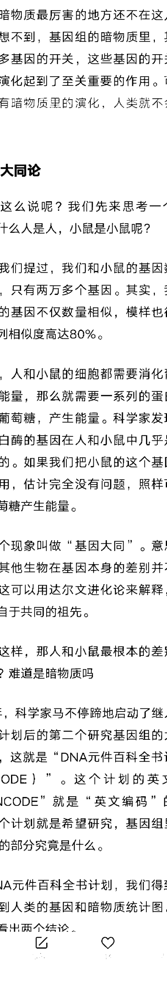

那剩下的97%的DNA到底是干吗的？它们既然不编码蛋白质，又有什么用呢？很多人认为它们一点用都没有，称它们为“基因组暗物质”，或者干脆叫它们“垃圾DNA”。

这一讲，我们来讲讲人类的第二个觉醒，视野的觉醒。让我们把视角从基因拉到基因组，看看97%的基因组暗物质到底有没有用？

### 1.演化的缓冲区

仔细想想，基因只占基因组的3%，这简直就是汪洋大海里的小岛，小得可怜。基因组干吗要有那么多不编码蛋白质的部分呢？每次细胞复制的时候，都得耗费能量来把基因组完整地复制一遍，不是很浪费吗？这么多能量如果能够省下来，干点什么都比复制这些没用的DNA要强啊。

让我们先来做一个思想实验。

假如我们的基因组没有必要那么大，在生物演化的几十亿年过程中，我敢说基因组肯定会一点点缩小。因为，如果基因组没有必要那么大，在复制过程中意外丢失了一些没有用的DNA的生物，肯定会获得更强的竞争优势。长期以往，基因组肯定会越来越小。

实际上，地球上的生物，并非越演化基因组越小，不过也没有越来越大。

所以，我们可以有两个猜测：

- 1. 基因组如果太大，确实消耗能量，所以不会无限制扩大。
- 2. 基因组必须比基因大，如果基因组只是基因连在一起，估计没法用。

这是为什么呢？

还记得我们讲的基因演化律吧。基因会通过点突变和重组来完成自己的演化。DNA复制时发生点突变的几率是多少呢？十亿分之一。

这个数字听起来好像超级保守，但是因为基因组有30亿个字符，所以从概率上讲，每一次复制都会有几个DNA字符发生突变。

你别忘了，在成人的过程中，我们要从一个受精卵分裂成50万亿个细胞，而每一次细胞分裂，都得把基因组完整复制一次。所以，按照这个几率，估计我们还没长大，基因就已经突变得不成样子了。

不过，因为基因组里有庞大的暗物质，你完全不用担心这些问题。因为暗物质的存在，点突变或者基因重组绝大部分都不会发生在基因里，这样就不容易损坏基因本身。

所以，暗物质是基因组里重要的缓冲区。它们用自身的牺牲来保障了基因的安全。

### 2.垃圾DNA是垃圾吗？

除了提供缓冲区，暗物质还有什么作用吗？

我来给你讲一个最新的科学研究成果。2019年1月，科学家发现，酵母菌基因组里的暗物质根本不是垃圾，而是帮酵母菌渡过难关的法宝。

酵母菌是一种单细胞的生物，用于食品发酵，在做面包和酿酒的时候都需要它们。实验里研究的暗物质是我们之前提过的内含子，也就是断裂的基因里不编码蛋白质的部分。

为了研究酵母菌的内含子DNA究竟有什么用，科学家把这些内含子进行了删除。

一开始，他们发现，没有了内含子，酵母菌的生存完全不受影响，垃圾DNA好像确实是垃圾呐。没想到，剧情马上反转了。他们接着发现，如果酵母菌处于营养缺乏的环境里，失去了内含子的酵母菌的生存率远远不如有内含子的酵母菌。

这是怎么回事？

让我们复习一下基因产生蛋白质的过程。基因会先转成信使RNA，再从信使RNA合成蛋白质。因为基因由外显子和内含子组成，所以在信使RNA阶段，必须把内含子统统剪掉。

这个研究发现，这些被剪切下来的内含子会以RNA的形式存在。当外界环境缺乏营养时，这些RNA会作为蛋白质工厂的临时刹车器，减慢蛋白质生产的速度，帮助酵母菌节省宝贵的能量，在困难时刻生存下来。

所以，如果把内含子删除掉，这种被改造的酵母菌在营养丰富的时候活得不错，但是在缺乏营养的时候，因为没有及时地节省能量，自然就不容易活下来了。（参考文献1、2）

自然界万象莫测，谁能保证一直风调雨顺呢？在艰难时刻，原来是所说的“垃圾DNA”帮我们渡过难关。

看来，我们真是错怪了它们。

当然，这只是酵母菌里的发现。对于更复杂的哺乳类动物以及人类细胞中，这些内含子暗物质究竟有什么作用，我们还不完全知道。但是可以想象的是，我们肯定不会把内含子称作垃圾了。

所以，从这 两个点来看，基因组暗物质是非常有价值的。

- 1. 它给复制错误和随机重组提供了缓冲区。
- 2. 内含子在细胞缺乏营养的时候可以节省能量，帮助细胞度过危机时刻。

不过，暗物质最厉害的地方还不在这里。你可能想不到，基因组的暗物质里，其实藏着许多基因的开关，这些基因的开关对生命的演化起到了至关重要的作用。可以说，没有暗物质里的演化，人类就不会出现。

### 3.基因大同论

为什么这么说呢？我们先来思考一个问题，为什么人是人，小鼠是小鼠呢？

上一讲我们提过，我们和老鼠的基因数目很相似，只有两万多个基因。其实，我们和小鼠的基因不仅数量相似，模样也很相似，序列相似度高达80%。

比如说，人和小鼠的细胞都需要消化葡萄糖产生能量，那么就需要一系列的蛋白酶来分解葡萄糖，产生能量。科学家发现，这些蛋白酶的基因在人和小鼠中几乎是一模一样的。如果我们把小鼠的这个基因换给人类来用，估计完全没有问题，照样可以消化葡萄糖产生能量。

我把这种现象叫做“基因大同”。意思是我们和其他生物在基因本身的差别并不是很大，这可以用达尔文进化论解释，我们都来源于共同的祖先。

如果是这样，那人和老鼠最根本的差别在呢儿？难道是暗物质吗

2003年，科学家马不停蹄地启动了继人类基因组计划后的第二个研究基因组的大科学计划，这就是“DNA元件百科全书计划（ ENCODE ）”。这个计划的英文缩写“ENCODE”就是“英文编码”的意思。这个计划就是希望研究，基因组另外97%的部分究竟是什么。

通过DNA元件百科全书计划，我们得到了从细菌到人类的基因和暗物质统计图。从图里能看出两个结论。

从细菌到人类的基因和暗物质统计图。从图里能看出两个结论。

第一，演化上越高等的动物，基因总数确实更多一些。比如，人类基因的总数比细菌和真菌要多。但是基因的总数从昆虫以后就达到两万多了，从昆虫，到鱼类和哺乳类，基因总数相差很小。

第二，基因组里不编码蛋白质部分所占的比例，就是基因组暗物质的占比，随着生物的演化出现了更明显的增加趋势。就是说，哺乳动物的基因总数跟鱼类和昆虫差不多，但是基因组里暗物质的比例高于昆虫和鱼类。

看来，生物在演化中的地位越高级，基因组暗物质就越多。而且，从统计图里，你也可以看到，小鼠和人类的暗物质数量其实差不多。这也难怪，它们都是哺乳动物嘛。

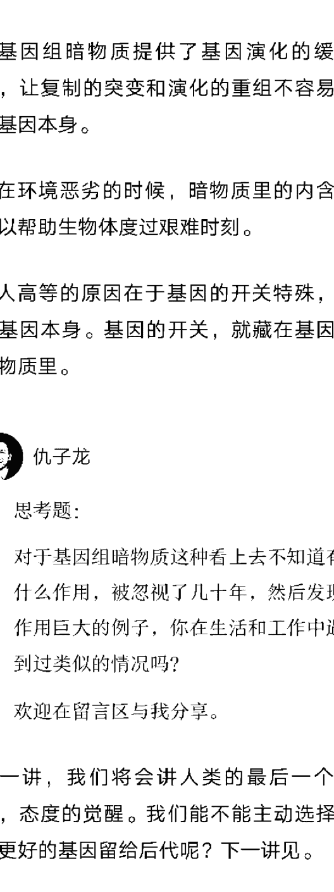

那我们继续思考，既然人和小鼠的基因数目差不多，暗物质的总数也差不多。那人跟小鼠的差别究竟出现在哪儿呢？

答案是，基因的开关。基因的开关是什么意思呢？

基因和基因的开关是两回事，基因的开关是在基因前后序列里面，这个前后序列就是暗物质的一部分。如果形象地描述一下，基因的打开姿势就像拉开拉链一样。

打开基因的管理者蛋白质就像拉开拉链的手，而基因的开关就好像拉链的头，在基因两侧。

我想强调一下，这个基因开关并不编码蛋白质，其实就是我们说的暗物质。

基因的开关有多重要呢？我给你举个例子。

之前我们提过，现代智人和尼安德特人的最重要差别，是一个叫做MEF2A的基因表达出现了差别。智人和尼安德特人的MEF2A基因本身并没有差异，唯一的区别就是智人的基因开关出现了新的演变。智人的演化把MEF2A基因的开关调慢了，推迟了基因的表达，造就了智人可塑性更强的大脑。这个更聪明的大脑让智人统治了地球。

所以，基因组暗物质里的基因开关还是物种演化的关键。

对基因组暗物质的研究极大拓展了我们认识基因的视野。基因组让我们明白，暗物质是和基因同等重要的存在。看来，我们认识基因的道路还很长啊。

### —— ◆ 总结 ◆ ——

这一讲，我们讲了视野的觉醒，揭秘了基因组里97%的暗物质到底有什么用。

- 1. 基因组暗物质提供了基因演化的缓冲区，让复制的突变和演化的重组不容易破坏基因本身。
- 2. 在环境恶劣的时候，暗物质里的内含子可以帮助生物体度过艰难时刻。
- 3. 人高等的原因在于基因的开关特殊，而非基因本身。基因的开关，就藏在基因组暗物质里。

  俞子龙

思考题：
对于基因组暗物质这种看上去不知道有什么作用，被忽视了几十年，然后发现作用巨大的例子，你在生活和工作中遇到过类似的情况吗？
欢迎在留言区与我分享。

下一讲，我们将会讲人类的最后一个觉醒，态度的觉醒。我们能不能主动选择，把更好的基因留下给后代呢？下一讲见。

上一篇

用户留言

## 13 | 态度：基因没有好坏优劣之分

仇子龙·基因科学20讲

13 | 态度：基因没有好坏优劣。

你好，我是仇子龙，欢迎来到我的《基因科学课》。

我自己的基因是什么样的？我很好奇。为了准备这门课，我特意去买了几个消费型基因检测的产品体验了一把，得到了一些标签。

其中有几个标签我挺喜欢的，比如“学习能力强，创造力强，不易衰老，基本人畜无害”等，看来我的基因还不错。不过，有几个标签让我有点不爽，比如“比较脆弱，精分倾向略高，容易焦虑”。

这是什么坏基因，会让我更脆弱，焦虑，还容易精分？我可不希望我的孩子也有这些基因，最好不要把这些基因遗传给他。

如果你遇到这种情况，是不是也会像我这么想呢？历史上就是这样的。

一百年，有一种理论叫做积极优生学，希望抛除人类基因组里的坏基因，把更好的基因传给后代。这个学说在当时被全世界推崇。提出者是谁呢？达尔文的表亲——高尔顿。

### 1.从社会学看基因的优劣

### 2.从生物学角度看，基因有无优劣之分？

### 3.基因缺陷的解决方案——科学的优生学

- 1. 不要随意修改遗传给下一代的基因。
- 2. 对肿瘤会导致严重遗传疾病的基因，出于人道主义的目的，需要人为干预，尽力避免把这些基因传给下一代。

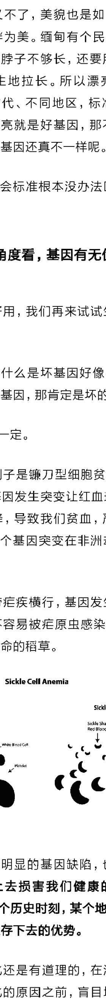

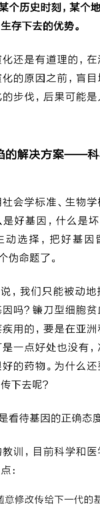

那么，哪些严重的遗传病需要做这种人为干预呢？每个国家都有不同的规定。我想举一个典型的例子，那就是唐氏综合征。

### Down Syndrome - Trisomy 21

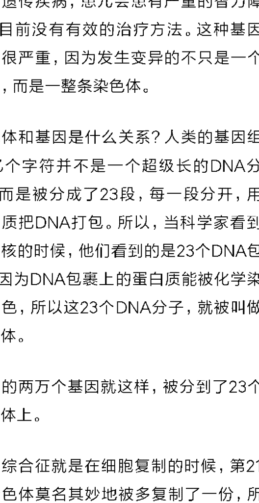

唐氏综合征是一种由于基因发生变异而产生的遗传疾病，患儿会患有严重的智力障碍，目前没有有效的治疗方法。这种基因变异很严重，因为发生变异的不只是一个基因，而是整一条染色体。

染色体和基因是什么关系？人类的基因组30亿个字符并不是一个超级长的DNA分子，而是被分成了23段，每一段分开，用蛋白质把DNA打包。所以，当科学家看到细胞核的时候，他们看到的是23个DNA包裹，因为DNA包裹上的蛋白质能被化学染料上色，所以这23个DNA分子，就被称为染色体。

人类的两万个基因就这样，被分到了23个染色体上。

唐氏综合征就是在细胞复制的时候，第21号染色体莫名其妙地被多复制了一份，所以21号染色体上面所有的基因都多了一份。这可不是什么好事。这样会导致产生的蛋白质过多，严重影响了大脑的发育，让患儿智力低下。

唐氏综合征的发病率与母亲的生育年龄非常相关，25岁的孕妇生下唐氏患儿的概率为1/1300，35岁孕妇生下唐氏患儿的概率为1/300。所以，对于我们所有人来说，机会均等。中国目前建议，每一个孕妇都要对胎儿做一个唐氏综合征产前基因检测，看看胎儿的21号染色体是否会出现异常。

怎么检测呢？

传统办法是这样做的。首先，需要羊水穿刺，也就是用一根细细的针吸取子宫里的羊水，里面会含有少量孩子的细胞，然后，从这些细胞里查看21号染色体是否正常。但是，因为这是创伤性的检测方法，会给孕妇造成风险，甚至可能流产。

有没有更安全的检测方法呢？有。

香港中文大学的卢焱明教授发明了一个新方法，原理是这样的。

我们血液里其实有许多破碎的DNA片段，是体内的细胞经历了自我更新后释放出来的基因组碎片。卢教授想，孕妇的血液里有没有宝宝的细胞释放出来的基因组碎片呢？

经历了多年的努力，也多亏了基因组时代测序技术的进步，卢教授终于发现，孕妇血液中确实有孩子的DNA。这样的话，就不用羊水穿刺，只需要收集孕妇几毫升血液，就能看看孩子的21号染色体是否正常了。

这种革命性的方法被称为无创产前基因检测（NIPT）。有了这种方法，就可以在孕期的3~6个月内，进行基因检测。如果是唐氏患儿，就会建议孕妇终止妊娠，不把患有严重疾病的孩子带到世界上来。

与前面的“积极优生学”相比，我认为这个态度是“科学的优生学”。

当然，这只是基因科技提供的一个解决方案，对人类社会来说，具体要不要实施，还要看伦理以及宗教的选择。

总之，经过历史的洗礼，人类对基因的态度已经逐渐改变。我们不再妄想通过种族优生来优化人类基因，而是更理性地认识到，我们能做的，就是出于人道主义，避免把严重影响人体健康的基因传给下一代。

### ——◆ 总结 ◆——

本章我们从三个维度上，讲了人类对基因认知的觉醒。

第一，方法的觉醒。人类基因组计划给了我们带来了全新的研究武器。

第二，视野的觉醒。我们知道了只研究基因不够，要关注整个基因组，尤其是DNA暗物质。

第三，态度的觉醒。我们从狂妄中醒来，意识到应该如何理性看待基因。

思考题：
知道了无创产前基因检测的原理，请你思考一下，检测血液里的破碎DNA片段还可能有什么用？
我给你一点提示，每个人血液里都有细胞新陈代谢产生的碎片，而在某些疯狂生长的病变组织中，产生的DNA碎片会特别多。

下一讲，我们即将进入最后一个章节，人类的反叛。我们下一讲见。

前一篇

用户留言

## 14 | 全新生产力: 蛋白质药物

仇子龙 · 基因科学20讲

14 | 全新生产力: 蛋白质药物.

你好，我是仇子龙，欢迎来到我的《基因科学课》。

从这一讲开始，我们进入最后一章，人类的反叛。

### 1.后信息时代的革命

首先，让我们回到生产力基本面，看看每个时代的人类都在反驳些什么。

从农业到工业时代，人类社会整体上缺乏能量和物质，所以能量是社会发展的限制因素。在这个阶段，人类的反驳就是用各种方法获得尽可能多的能量。

不管是用动物牲畜提供能量，还是用蒸汽与电力提供能量，底层逻辑都是为了获取更多的能量，生产更多的物质，供人类使用，直到社会巨大的物质财富，把人类社会推进到信息时代。

在信息时代，能量和物质已经不再是社会发展的限制性因素。你会发现，媒体上反复出现的名词是“产能过剩”。电子商务越来越便宜，吃饱穿暖已经是比较容易实现的目标。

对整个人类社会来说，能量和物质不再匮乏，才会出现信息科技带来的虚拟经济繁荣。吃饱穿暖的人们，愿意每天花很多时间，待在手机连接起来的虚拟空间里。这个时候，通信成了限制因素。

在信息时代，人类再一次反驳了自己的宿命，一次又一次突破通信极限，让全球化的信息自由流动。

那后信息时代呢？

我认为，这个时代最大的限制不是别的，正是我们每个人身上的基因。

地球上对人类最重要的信息库，并不是构成虚拟空间的计算机代码，而是我们的基因组。基因关系到我们人类本身的能力、性格，和最重要的健康。

当你已经丰衣足食，除了追求家庭幸福，事业成功，自己和家人的健康不就成了最重要的目标吗？

100年前，人类社会的最大威胁是传染性疾病。在找到了抗生素，发明了疫苗以后，现在，因为基因缺陷导致的疾病已经成了人类最大的威胁。

所以，我认为，后信息时代，物质丰裕以后，人类社会进一步前进的最大限制就是基因。要想突破这个限制因素，光认识基因还不够，我们还需要操纵基因，主动改造生命。

总的来看，人类对基因的反驳有两个主战场。

第一个主战场是，增强生产力。这里有两种方式：

- 一种是操纵基因，让其他生物为我们生产蛋白质药物；
- 另一种是修改动植物的基因，改变它们的性状，为人类生产更多更好的食物。

第二个主战场是，修复自身。人类大部分的疾病都是由先天或后天的基因缺陷引起的。我们操纵基因的一个重要原因，就是为了修复自身的基础缺陷，增进健康。

除了这两个主战场，我还会讲到人类刚刚获得的改造基因的利器，基因编辑。

这一讲，我就先讲讲，在第一个主战场里，人类是怎么把其他生物作为工厂，为人类生产有用的蛋白质。这个过程通常也被我们叫做基因工程。

### 2.基因工程的技术储备——重组DNA技术

基因工程，顾名思义，就是把基因作为可操作的工程元件，从一个生物体里拿出来，装到另外一个生物体里去。这个操作的目的就是生产基因编码的蛋白质。

那怎么操作基因呢？如果用Word软件，你肯定会操作，复制粘贴呗。但是，怎么复制和粘贴基因呢？

这就要讲到1960年代，科学家从细菌里找到一类专门切割DNA的蛋白酶。这种蛋白酶是细菌用来对抗天敌的。

前面我们讲过，噬菌体是细菌的天敌，噬菌体会将自己的基因注入细菌，用细菌的营养来繁殖更多的噬菌体。细菌不会坐以待毙，噬菌体的DNA一旦入侵，这些DNA切割酶就会出动，把噬菌体的DNA切碎。

后来，科学家发现，这种DNA切割酶是一把非常好用的剪刀。有了剪刀，我们就能把一段DNA剪下来，装在另外一段DNA上了。

在1973年，两个在美国旧金山的科学家完成了这个实验，成功切割、拼接了DNA，这个过程被我们叫做重组DNA技术，也是基因工程革命的技术储备。

### 3.基因工程1.0: 基因泰克公司

有了技术储备以后，这两个科学家之一的Boyer教授，就想搞个大事情。在Boyer心中，重组DNA技术显然不仅是实验室的黑科技，它是很有可能产生极大经济价值的。

当时人类的生产能力还停留在合成化学小分子上，不能生产蛋白质。因为蛋白质是一种很复杂的分子，远超过了当时的化学合成能力。有了重组DNA技术，我们就可以把基因装给一个能大量繁殖的生物，比如细菌。然后，这个能大量繁殖的细菌不就像生物工厂一样，帮我们生产蛋白质了吗？

我把这个阶段定义为基因工程1.0，就是把基因装到微生物里，让微生物作为人类生产简单蛋白质。

基因工程1.0能生产什么蛋白质呢？

Boyer教授心想，也许可以把人的胰岛素基因装到细菌里去，在细菌中生产人的胰岛素蛋白。

糖尿病病人每天都要注射胰岛素，市场巨大。原来的胰岛素需要从羊牛胰腺中提取，需要花费很复杂的工艺去除杂质，而且给人注射还容易产生过敏反应。如果能用细菌生产人的胰岛素蛋白，那就不会有过敏反应，应该会是更好的药物。

不过这些都还是可能性，并没有付诸实施，因为他只是一个科学家，从来没有关心过生物医药产业如何运作。

就在这时，1976年，苹果公司成立的当年，也在美国旧金山湾区，距离乔布斯和Woz的创业车库不远的地方，一位传奇的投资人斯泰森接通了Boyer教授的电话，两人一拍即合，成立了历史上第一个生物技术公司——基因泰克。这家公司的愿景非常明确，就是用重组DNA技术，让细菌为人类生产蛋白质药物。

基因工程1.0成功起航。

说到这里，我忍不住想讲点八卦。基因泰克公司成立后，其他的科学家与商业投资人也发现了这个商机。其中最重要的竞争者就有我们前面提到的哈佛大学的吉尔伯特教授。他是学术大牛，前瞻性地命名了基因的外源子和内含子，还参与研发DNA测序技术而获得了诺贝尔奖。

吉尔伯特教授这么聪明的人，很快就发现重组DNA技术潜力无穷。他一方面动员自己的学生丝紧开始把人类胰岛素基因重组到细菌里，生产蛋白质。一方面和商业人士一起，在1978年成立了另一家生物技术公司百健(Biogen)。

胰岛素竞技开始了。一开始基因泰克公司可谓毫无算计，吉尔伯特教授的团队无论从实力和财力上都碾压基因泰克。就在这时，万万没想到，一个学术之外的因素竟然直接左右了学术竞争。

当时美国对重组DNA技术的限制仍然非常严格。所以，如果从人体细胞中分离基因，必须在非常严格的第四级生物安全P4实验室里操作。操作人类的基因必须全副武装，就像操作埃博拉病毒那样。

无奈，吉尔伯特教授的团队在美国找不到可以做实验的地方，最后不得已跨越大西洋，租用英国军方的P4实验室做实验。没想到，用来分离人胰岛素基因的实验样本被污染了，租用实验室一个月期限很快就到了，吉尔伯特团队只能垂头丧气地回来。

就到了，吉尔伯特团队只能垂头丧气地回来。

与此同时，1978年，基因泰克公司宣布成功地将人胰岛素基因转移至大肠杆菌里，并且成功地让大肠杆菌生产出了人类的胰岛素蛋白！

他们为什么能成功？

因为基因泰克公司绕开了直接操作人类基因的苛刻规定。“既然DNA是化学物质，我直接从简单的化学原料合成还不行吗？”他们找到了一位合成DNA的高手，直接把ATGC拼接起来，合成了人类的胰岛素基因，而没有从人类细胞中分离基因。

弯道超车的基因泰克完成了人类第一个创举：通过操纵基因，在微生物中生产出了人类需要的蛋白质药物——胰岛素。

1980年10月，苹果公司上市的同一年，比苹果还早了两个月，基因泰克在纳斯达克上市了。1982年，基因泰克与大药厂礼来合作生产的人胰岛素通过了FDA审批，基因工程生产的胰岛素作为药品正式上市了。

### 4.基因工程2.0：抗体药

这个基因工程生产胰岛素的故事是不是很精彩？别急，这才刚刚开始。

基因工程1.0还不至于影响人类社会走向，基因工程2.0就更厉害了，竟然能在动物里生产人体最重要的蛋白质——抗体。这可是挽救人类于水火的蛋白质药物。

什么是抗体呢？抗体就是免疫系统用来对抗外来病原体的蛋白质。每当病毒细菌入侵人体，我们的免疫系统都会把这些入侵者记住，产生抗体。这个机制超级强大。

小时候，我们只要吃一次小儿脊髓灰质炎糖丸，这辈子都不用担心会得小儿麻痹症。因为机体产生了专门的抗体，遇到病毒入侵，就会尽责地去扫除病毒。

如果我们可以人为生产抗体，那真是获得了威力无比的武器。不过生产抗体可不简单，需要很多基因一起工作才行，基因工程1.0里，用微生物的思路肯定是不行了。

所以，在基因工程2.0时代，科学家把人体免疫系统的许多基因都装给小老鼠，把小老鼠作为生物工厂，为人类生产抗体。

抗体药能治什么病？很多很多，最有名的就是癌症。2018年，刚刚得了诺奖的肿瘤免疫疗法就是一个典型的例子。

科学家发现，癌症细胞上有一个PD-1蛋白质，专门用来欺骗人体的免疫细胞，可以让癌细胞逃脱免疫系统的追杀。

为了拆穿癌细胞的伪装，科学家用癌细胞的PD-1蛋白质作为抗原，刺激携带了人体免疫系统基因的小老鼠，让它产生针对PD-1蛋白质的抗体。这个抗体被注射给癌症病人后，就能干掉癌细胞表面的PD-1伪装。没有伪装的癌细胞，就会马上被人体免疫系统识别并消灭。

就这样，用基因工程小鼠作为生产工厂，PD-1抗体成了抗癌的神药。当然，这个神药只是抗体药的一个缩影。抗体药物的销售额逐年攀升，现在已经超过千亿美元。

抗体药毫无疑问是继化学小分子药物后的最重要的药物。有意思的是，与越来越便宜的电子产品不同，抗体药物因为需要经历复杂的基因工程技术工艺来生产，目前还非常昂贵。

### —— ◆ 总结 ◆ ——

- 1.后信息时代最大的限制是基因。人类反叛基因有两大主战场，一是增强生产力，二是修复自身。
- 2.增强生产力的战场首先是基因工程。基因工程1.0时代，运用重组DNA技术把基因装给微生物，为我们生产蛋白质，比如胰岛素。基因工程2.0时代，我们有能力把人体免疫系统的一系列基因装到小老鼠身上，让它们为我们生产人类的抗体，作为药物全面改观了人类的疾病治疗。

俞子龙

思考题：

现在我们使用抗体药是先把人的基因给小鼠，再让小鼠生产人的抗体。那为什么不直接使用小鼠的抗体，拿过来给人治病呢？

欢迎在课后留言，与我互动。

下一讲，我们来看看增强生产力的第二个方面，转基因农业怎么为人类生产更多更好的食物。我们下一讲见。

前一篇

## 15 | 增强生产力：转基因农作物

仇子龙·基因科学20讲

15 | 增强生产力：转基因农作物.

你好，我是仇子龙，欢迎来到《基因科学课》。

上一讲里我们说到增强生产力的第一个方面，基因工程可以让其他生物为人类生产蛋白质药物，甚至抗药药物对付癌症。

这一讲，我们来说说第二个方面，那就是直接修改植物的基因，改变它们的性状，为我们生产更多更好的食物。

让动植物为人类生产食物的过程就是人类经营了数千年的农业。对基因的操作完全改变了农业的版图，现在人类社会的传统农业已经不复存在，升级到了转基因农业的阶段。

转基因农业是怎样为人类生产更多更好的食物呢？我们又怎么保证送上桌的转基因食物是安全的呢？

### 1.抗除草剂的转基因大豆

我们先用一个最常见的转基因农作物——大豆作为例子，来讲讲转基因农作物的原理。

转基因大豆含有有什么转基因？抗草甘膦基因。

草甘膦是什么？一种常用的除草剂，用来在大豆田里清除杂草。因为农田里肥料丰富，所以伴随着大豆一起生长起来的，就不可避免有杂草。而且杂草的生命力还比较顽强，会跟大豆争夺养分，所以必须清除，这就得用除草剂，比如草甘膦。

除草剂的原理是什么呢？原来，草甘膦这种除草剂的作用机理是对植物中一个叫做EPSPS的蛋白酶的活性进行抑制。

但问题来了，杂草和大豆都是植物，都有这个酶。如果大面积喷洒除草剂，不仅仅杂草被杀死了，大豆也扛不住。但是不喷洒除草剂的话，杂草生长的速度很快，很快大豆因为得不到足够的营养，也长不大。这左右为难怎么办？一般来说还是得大面积喷洒除草剂，大豆的产量肯定就受影响了。

那么怎么办呢？科学家发现，一些微生物也有这个EPSPS蛋白酶，而且是另外一个版本。它有个特点，可以给植物用，但是不怕草甘膦的作用。

于是，科学家将这个不怕草甘膦的微生物EPSPS蛋白酶的基因转入到了大豆中，大豆生长继续，除草剂草甘膦再来，就不怕了，这个微生物的EPSPS蛋白酶的基因，仿佛给大豆穿上了一层不怕除草剂的防弹衣。

别小看这层防弹衣，就是因为有了这层保护，农业操作可以在农田里大面积喷洒草甘膦而不影响转基因大豆。美国的转基因大豆种植面积已经超过了94%。

运用了转基因技术，就能够实现高度机械化的种植与收割，大豆的生产成本会大大降低。

你在商店里看到的大豆食用油，如果是用非转基因大豆生产的，肯定要比转基因大豆生产的豆油贵，就是这个原因。如果让你闭着眼睛来品尝里面的味道，我敢打赌你是否分辨不出来的。转基因大豆只是多了 一个微生物EPSPS蛋白酶的基因，对于口感完全没有影响。

### 2.抗虫的转基因棉花

说完转基因大豆，我们再来看另一种转基因农作物。你可能听说，某种转基因食物含有抗虫的基因，编码能毒死虫子的毒素，那人吃下去还得了？请注意，目前中国政府允许种植的抗虫转基因农作物只有棉花。

在棉花种植的过程中，太容易受到棉铃虫的毒害，棉铃虫引起的大规模棉花减产经常给农业和农民造成毁灭性打击。

棉铃虫是一种昆虫，不能用简单的抗生素来杀灭，只能大面积喷洒对人类也有毒的农药，所以农民在种植棉花的时候，经常容易遭遇农药的威胁，危害健康。穿着纯棉衣衫享受舒适与温暖的我们可能不会知道，每年都有很多农民因为喷洒抗棉铃虫的农药而中毒。

怎么办呢？科学家给棉花转了一个细菌里的抗虫蛋白，这个蛋白质对棉铃虫确实是有毒的，棉铃虫一吃就会挂掉。但是这种抗虫蛋白对人体是无害的。而且这种抗虫蛋白在棉花里，也不会被人吃掉。

有了抗虫基因，种植棉花就不用喷洒那么多农药了，一方面不再怕棉铃虫造成减产，一方面也保护了棉农的身体健康。

### 3.监管保证产品安全

从原理和技术看上去，转基因农作物没那么神秘，而且也非常安全呐。

不过你可能还有些担心，对于转基因农作物生产的食物是否安全，好像不应该是生产厂家说了算。不错，食品和药物是否安全，当然不能由生产厂家说了算。

世界各国都有食品与药品管理局，其中最权威最严格的，可以说是美国的食品药品监督管理局，就是我们熟悉的FDA。

为什么一定要有一个非常严格的监督部门来帮我们确保食品和药品的安全呢？就是为了以防万一。

作为食品和药物的生产方，商业公司的目标当然是赚钱，而且是赚的越多越好。但是食品是否安全，药品是否安全并且有效，谁来监管呢？万一厂家够好要捞钱，那么最后坑的不是我们老百姓么？所以各国的食品和药品管理机构肯定都是国家机构，负责保护国民利益。

我来举个例子吧。上世纪五十年代，欧洲一家药厂找到一种药物，沙利度胺，发现这种药物可以减轻孕妇的妊娠反应，好像也没有什么副作用。当时欧洲的药品监管机制还很不完善，没有要求这个药厂进行完整的药毒理学试验，就批准了这个药物的上市。

所谓毒理学试验的意思，就是在动物上看药品有没有毒性。

这个药品又被命名为“反应停”，能减轻孕妇遭受的妊娠反应真是太好了，立马在欧洲风靡一时。

但是这个药品，一直到没有通过美国FDA的上市批准。为什么呢？因为美国的要求非常严格，要求药厂完成一系列在动物身上进行的毒理学试验，证明对人体无害，而药厂因为已经在欧洲赚了大钱，所以根本不想再花钱继续做试验。

短短的两三年后，出事了，欧洲数万名吃了反应停的孕妇生出了畸形儿，后来进一步的试验证明就是反应停干扰了胎儿的发育。反应停在上市的四年后被药厂撤回。

这些悲剧怪药物本身么？不是，这个害人的沙利度胺确实是救人的药物，可以用于治疗人类疟疾疾病，但是对孕妇有严重的副作用，危及胎儿的正常发育。药物本身并没有错，错在没有经过严格的监管就匆匆上市，被用在错误的人群身上。这些过程都是生物医药行业的教训。

现在，世界各国上市任何一款新药，都会经过非常严格的三期临床试验，对药品的安全性、有效性进行长达近十年的检测。而美国更是把食品和药品的监管放到一个机构负责，这就是FDA的全称“食品药品监督管理局”。

转基因农作物生产出来的食品已经有二十年了，经过了美国FDA和各国机构的严格监管，现在上销售的转基因食品绝对安全。其实，美国的人民均吃掉的转基因食品居全世界之冠。

你可能会在网上或者微信上看到一些所谓转基因食品致癌的新闻，我可以负责地说，那都是谣言，谣言止于智者。谣言不值得反驳，也无法反驳。目前没有任何一篇靠谱的科学研究证明转基因食品的安全性有过任何问题。

如果谁就是不相信现在的结论，吃了转基因食品一百年以后万一出现毒性咋办？或许我们可以做个极端的思想实验。如果这么说，我们每天吃的大米饭，也可能有毒啊，就算无数人吃了几千年，也说不定毒性几千年以后发作啊？所以，这些无谓的未知风险，是没有必要担忧的。

### 4.转基因农业与害虫进化

所以，从转基因的原理、技术和监管来说，转基因农作物生产的食品完全安全。但是现在大众对于转基因农业还有一些顾虑。其中有一个针对转基因农业的反方观点，我觉得很有意思，值得讨论一下。

这个观点是，根据演化理论，因为转基因大豆不怕除草剂，所以反复使用除草剂也没事。但如果反复使用同一种除草剂，除草剂就成了一种固定的选择压力，对于基因一直在变异的杂草来说，除草剂有可能会帮忙干掉怕除草剂的杂草，而让不怕除草剂的超级杂草脱颖而出。

同理，转基因棉花抗虫是挺好，但是棉铃虫自己也会进化，万一棉铃虫自己的演化出现了一种吃了抗虫棉也不死的超级棉铃虫。那么种满了抗虫棉的农田不就是这种超级棉铃虫的自助餐了吗？

让我们运用科学的思维来分析一下这种观点。

抗除草剂的转基因大豆大量种植会产生不怕除草剂的超级杂草，抗虫棉种植可能会筛选出不怕抗虫棉的超级害虫。这个担忧是很有道理的，因为物种确实会演化。但是我们是应该积极地寻找解决办法，还是要因噎废食呢？

科学家正在摸索对付超级杂草与超级害虫的办法，比如将转基因植株与非转基因植株相间种植等等，这样就能最大可能地减少转基因植物对自然界环境地改变。

魔高一尺，道高一丈，遇到问题，寻找解决办法，这就是我们科学家的应对方案。

### ——◆ 总结 ◆——

- 1. 这一讲，我们讲了人类为了增强生产力而采取的第二种方法，直接修改动植物的基因。通过这种方式，我们提高了农作物的产量，让生活变得更美好。
- 2. 转基因农作物经过了科学家的反复试验，以及非常严格的系统监管，安全性得到了很好的保障。

仇子龙

思考题：
当你看到一则微信新闻，题目耸人听闻，比如“某某转基因食品惊爆安全性问题”，我们如何用科学的眼光来鉴别？这个新闻究竟是真新闻还是假新闻，这些信息究竟靠谱不靠谱呢？
欢迎在课后留言，与我互动。

下一讲，我们将要进入一个新的话题，讲讲人类怎么操纵基因，修复自身。

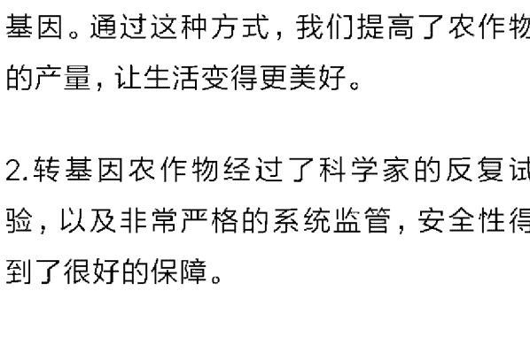

‹ 前一篇

## 用户留言

## 16 | 基因检测：发现致病基因

仇子龙・基因科学20讲

16 | 基因检测：发现致病基因。

你好，我是仇子龙，欢迎来到《基因科学课》。

你可能知道“人无完人”这个成语。我很喜欢这个词，因为我觉得，它不仅仅是说，做人要谦虚，本身也有深刻的生物学意义。

什么意义呢？几百年前，医学上就发现很多疾病是被上一代遗传到下一代的，因此叫它们遗传疾病。自从发现了基因以后，很明显，遗传疾病的病因就是基因的缺陷。

基因缺陷导致的疾病一般是天生的，跟后天生活习惯没太大关系。而且，我们每个人身上的基因都不是完美的，每一个出生的孩子都有一定几率会患有遗传疾病。这就是“人无完人”的生物学意义。

#### 1.基因突变哪儿来的？

科学研究发现，因为基因缺陷导致的疾病分为两类。一类是先天基因突变导致的遗传病，另一类是由于后天基因突变导致的疾病，比如癌症。

目前的基因检测手段，绝大部分都用来检测先天的基因突变。

#### 2.检测先天的基因突变

所以对于遗传病患者，我们必须知道他的两万个基因里面，究竟是哪个基因发生了突变。

#### 3.人类基因组计划之后的疾病基因检测

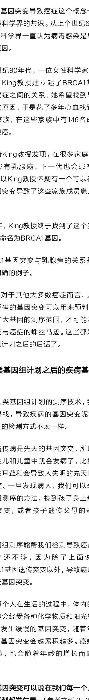

老的细胞里面的DNA就会散落到血液里。

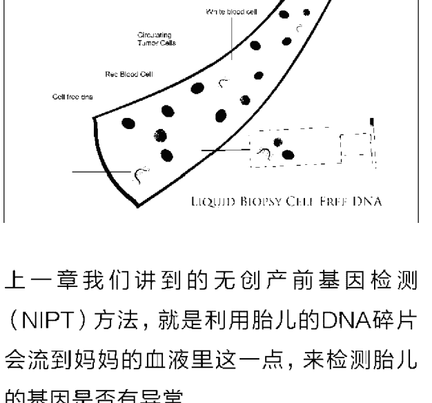

上一章我们讲到的无创产前基因检测（NIPT）方法，就是利用胎儿的DNA碎片会流到妈妈的血液里这一点，来检测胎儿的基因是否有异常。

对于癌症病人，这种检测方式更有效。因为他们的癌组织生长太野蛮了，细胞很容易破碎，所以会比正常的组织释放更多的DNA碎片。

液体活检作为医学检测方法已经完全成熟，可以为患者服务了。

我来举个例子。

有一种肺癌叫做非小细胞肺癌，目前治疗这种癌症的药物，是专门对付癌症病人身上发生的EGFR基因突变。如果想检测病人的癌症组织是不是有EGFR基因突变，通常必须用一根很细的针去做穿刺，收取癌症组织的样本，可想而知，这种方法对病人非常痛苦。

有了液体活检的方法，情况就简单了。因为血液里面肯定有癌组织的DNA碎片，所以只要给病人抽几毫升血液，就能检测到EGFR基因是不是有突变了。

### —— ◆ 总结 ◆ ——

这一讲，我们开启了人类反叛的第二个主战场，修复自身。

- 1. 基因缺陷导致的疾病分为两类，一类是先天基因突变导致的遗传病，另一类是由于后天基因突变导致的疾病，比如癌症。
- 2. 对于先天基因突变导致的遗传病，我们可以通过全基因组测序，来发现患者的遗传，或是新发基因突变。
- 3. 对于后天基因突变导致的癌症，我们需要通过最新的基因科技，来检测血液里，DNA碎片的基因突变，帮助患者用药。

仇子龙

思考题：

你可否畅想一下，未来的体检是什么样的？是不是只检查一下血糖、血脂、血压就行了？能否把检测身体里的基因突变也作为常规体检的一部分？

欢迎在课后留言，与我互动。

下一讲，我们来讲讲对付先天遗传病的基因疗法。下一讲见。

## 17 | 基因修复：从细胞到全身

仇子龙 · 基因科学20讲

17 | 基因修复：从细胞到全身.

你好，我是仇子龙。欢迎来到《基因科学课》。

上一讲我们说到怎么发现基因的缺陷。发现缺陷以后，就要修复。而修复先天和后天基因突变的方式很不一样。这一讲，我先来讲讲修复先天遗传病的基因疗法。

先天遗传病有哪些呢？主要有几种。

#### 第一，血液系统或免疫系统的疾病。包括先天性免疫缺陷、血友病、地中海贫血等 等。

这类疾病因为基因发生了突变，使血液相关的一些正常生理功能受到了影响。比如，不能产生正常的血小板而影响凝血，不能产生足够的血红蛋白而无法给机体携带足够的氧气，免疫细胞不能产生抗体而发挥保护机体的作用等。

#### 第二，大脑的疾病。比如帕金森症、脊髓性肌肉萎缩症，还有由于基因突变导致视网膜细胞病变而失明，或者耳朵里的毛细胞病变而失聪。

基因突变是小概率的随机事件，就像飞机的空难，对我们所有人机会均等。所以，身患遗传病的患者经常会想，为什么这种灾难就会发生在我身上呢？

1.第一阶段：针对细胞进行基因修复

Thalassemia

我们有两个策略。

#### 2.第二阶段：全身的基因修复

AAV可以说是劳动模范，它只会鞠躬尽瘁地把基因带入细胞，不会随便在基因组里扎根。而且AAV的个头很小，不容易引起机体免疫系统的注意，换句话说就是产生的免疫反应很小。通过将AAV不断优化，科学家创造了一个又一个基因疗法的奇迹。

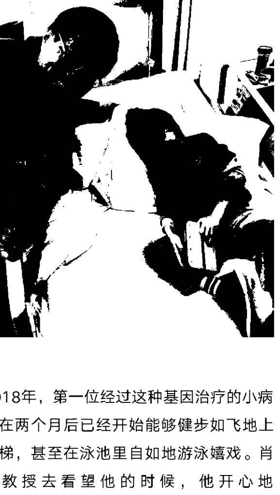

2018年，第一位经过这种基因治疗的小病人在两个月后已经开始能够健步如飞地上楼梯，甚至在泳池里自如地游泳嬉戏。肖啸教授去看望他的时候，他开心地说：“我以后一定要去中国，因为中国科学家治好了我。”

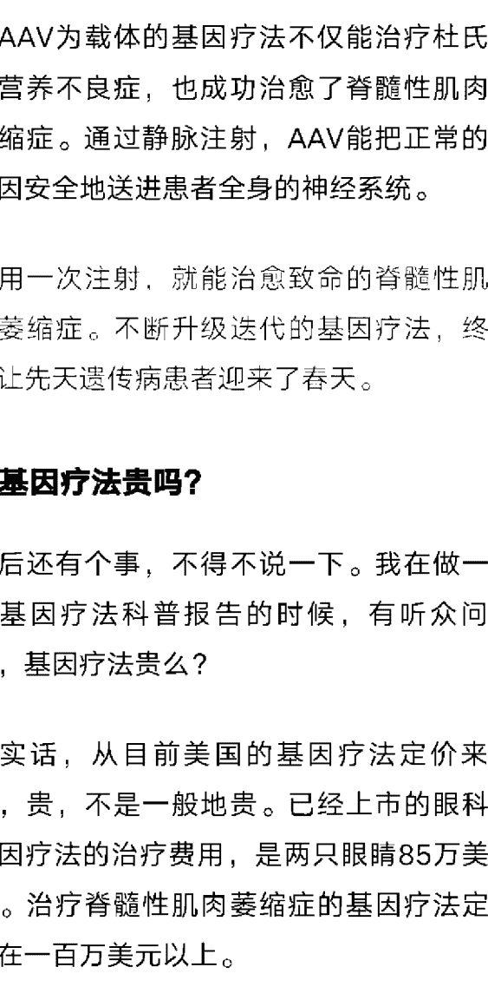

用AAV为载体的基因疗法不仅能治疗杜氏肌营养不良症，也成功治愈了脊髓性肌肉萎缩症。通过静脉注射，AAV能把正常的基因安全地送进患者全身的神经系统。

只用一次注射，就能治愈致命的脊髓性肌肉萎缩症。不断升级迭代的基因疗法，终于让先天遗传病患者迎来了春天。

#### 3.基因疗法贵吗？

最后还有个事，不得不说一下。我在一个基因疗法科普报告的时候，有听众问我，基因疗法贵么？

说实话，从目前美国的基因疗法定价来说，贵，不是一般地贵。已经上市的眼科基因疗法的治疗费用，是两只眼睛85万美 元。治疗脊髓性肌肉萎缩症的基因疗法定价在一百万美元以上。

不过，咱俩可以这么看这个问题，药品的定价，不仅跟药物研发成本、生产成本直接相关，跟各个国家的医疗保险体系也有很大关系。

前面说的抗癌明星药PD-1抗体药“柯瑞达”2018年在中國上市，定价100毫克1万8千元，还有折扣计划。这个价格，是柯瑞达在美国价格的一半。比起柯瑞达刚刚上市的五年前，价格更是一降再降。

基因疗法是一种药品，广泛地说，也是一种商品。我相信，通过改进工艺，提高产能，肯定能改变稀缺昂贵的局面。

### —— ◆ 总结 ◆ ——

这一讲，我们讲了能修复先天遗传病的基因疗法。

- 1.基因疗法的发展有两个阶段。
- 2.第一阶段，通过病毒载体将正常的基因直接递送到需要的细胞里。血液疾病和眼科疾病基因疗法已经成功上市。第二阶段，通过AAV病毒将正常的基因通过血液递送到全身，包括大脑，可以治疗更多的遗传病。
- 3.基因疗法现在还很昂贵，以后有望削减成本，惠及大众。

仇子龙

### 思考题：

基因疗法专门用于治疗基因缺陷的疾病，请思考一下你知道哪些基因缺陷导致的疾病，它们有可能用本文中提到的基因疗法进行治疗吗？

欢迎在课后留言，和我互动。

下一讲，我们要来说说，怎样对付后天基因突变导致的癌症。下一讲见。

上一篇

## 18 | 基因操纵：中断癌症发展

仇子龙·基因科学20讲

18 | 基因操纵：中断癌症发...

你好，我是仇子龙，欢迎来到《基因科学课》。

在上一讲里，我讲了如何用基因疗法治愈先天遗传病。不过，总体来说，先天遗传病还是罕见疾病，发病率一般在万分之几。

目前，人类社会面临最大的健康威胁，其实是另一种基因突变导致的疾病，众病之王——癌症。

这一讲，我就来讲讲人类对抗癌症的总体思路和三大战役，看看我们如何运用基因科学来对抗癌症。

癌症是怎么发生的呢？它的病因就是基因突变，这个基因突变有两个可能的来源。

#### 第一个来源是先天的基因突变。比如说安吉丽娜·朱莉的BRCA1基因突变。

#### 第二个来源对癌症的贡献更大，那就是随着年龄的增长，身体里随机产生的基因突变。随机的意思是，即使不吸烟，不喝酒，健康生活，甚至经常锻炼健身，也有一定的几率因为基因突变患上癌症。

既然后天的基因突变是随机的，也就说每个人突变的情况都不一样。那该怎么治疗呢？太让人纠结了吧。

如果用一词来描述目前治疗癌症的总体思路，那就是“精准医疗”。精准医疗，就是运用基因组学的方法，仔细甄别每一个癌症病人基因突变的情况，因人而异地来对症下药。

为什么精准医疗这么重要呢？我给你讲个故事。

2012年，美国纽约斯隆-凯特琳癌症中心 的医生们进行了一个化学药物的抗癌临床试验，试验对象是45位晚期膀胱癌的患者。化学药物的名字叫做依维莫司，它专门抑制癌变细胞里的一种信号传导蛋白 mTOR。mTOR是促进细胞生长的，所以，能抑制这个蛋白，就可能控制癌细胞的生长。

- 1. 化学药物之战：用化学方法设计靶向药物，阻断癌症细胞的生长链条。
- 2. 免疫之战：运用基因技术让免疫系统攻击癌细胞。
- 3. 终局之战：防患于未然，才是人类对抗癌症最好的方法。

#### 1.化学药物之战：朱莉的神药

首先，我们来看化学药物。

DNA是一种化学物质，很容易被各种物理和化学因素损伤。

#### 2.免疫之战：卡特的神药

这些化学药物，就好像人类派出的杀敌部队，深入体内杀灭癌细胞。但是我们的机体其实自己就有最厉害的杀敌部队，那就是免疫系统。

免疫系统对细菌病毒的防御让我们每个人可以平安长大，那为什么免疫系统对癌细胞没作用呢？

这就是对癌症研究的最新科学进展，癌症免疫机理。

原来癌细胞非常狡猾，它会打开一个工人基因，生产出一个叫PD-1的蛋白质，作为癌细胞表面的伪装，用来骗过人体免疫系统的攻击。

癌细胞就像一只披着羊皮的狼，骗过了免疫系统的侦查以后，在身体里慢慢长大。科学家发现了这个癌细胞欺骗免疫系统的原理以后，自然会想，如果我们把这个癌细胞的伪装干掉，是不是就能让免疫系统来识别并杀灭癌细胞呢？

思路正确，但是用一般的化学药物还真不行。这时，抗体药物就登场了。通过最新基因工程技术，科学家把人类的免疫系统基因一股脑儿地移植到小老鼠里，让小老鼠帮我们生产出专门干掉这个PD-1蛋白质的抗体。

后面的故事你可能听说过。2015年，美国前总统卡特患黑色素瘤晚期，以为很快要不久于人世，经过PD-1抗体的治疗以后，他现在体内的癌细胞完全消失，至今还健康地活着。这个癌症免疫机理的发现也获得了2018年的诺贝尔生理学或医学奖。

我想多说一句，从科学发现到药物的研发和成功上市，里面有太多艰辛的故事和因缘际会。PD-1抗体作为抗癌明星药物，从科学发现到最后上市的历程堪称一部史诗，希望以后能有机会跟你分享里面的故事。

#### 3.终局之战: 防患于未然

从化学药物之战，到免疫之战，你可能已经在感受基因科技进步的一日千里了。那么，下一步是什么呢？我们还有没有更好的抗癌方式呢？

其实，最好的方法就是，随时监控身体，尽早发现癌症前兆，防患于未然。

是啊，癌症一旦发生，人类始终处于被动防御状态。如果我们可以随时监控体内的基因突变情况，是不是就能更早地发现肿瘤呢？

对，我们前几讲里提到的“液体活检”就很有可能做到。这是基因科学的研究前沿之一。

不过事情也没那么简单，因为检测基因突变和发现肿瘤还有一定距离。

就算我们从血液里检测到了重要的基因突变，还不知道是哪个器官里的基因发生了突变。所有器官的新陈代谢都通过血液循环进行，所以血液里的DNA碎片来自全身的器官，这就好像身体的三维信息在血液里是被降维了。

如果我们想知道突变发生在那里，就必须将DNA碎片里的三维的身体信息还原出来。

怎么还原呢？

基因突变的数据明显不够，因为身体里面每一个细胞都有同样的基因，没办法知道癌基因突变从哪儿来。不过不用担心，科学家已经研制出了进阶方法。

虽然每个器官里面基因的序列都一样，但是基因上的标记是不一样的。这些标记就是我们之前讲过的表观遗传学修饰——甲基化标记。

我们可以根据不同细胞里的基因甲基化标记的不同，将血液里面读到的一维基因突变信息，还原到身体里的三维空间里去。

比如说，我们知道肝脏细胞里的DNA甲基化标记是什么样的，然后在血液里找到了一些DNA碎片带有这些特征的甲基化标记，我们就可以认为这些DNA碎片是从肝脏细胞里流出来的。我们看看这些碎片上的基因信息，我们就知道肝脏里是不是发生了基因突变了。

这些检测方法目前还在科学家的实验室里。不过我相信，几年后就能走进医院里的检验科，为我们每一个人服务了。

### ——◆ 总结 ◆——

这一讲，我们讲了人类对抗癌症的总体思路和三大战役。

- 1.总体思路：精准医疗。
- 2.三大战役，分别是：化学药物之战：我们研制出了针对不同基因突变的药物。免疫之战：最新的基因工程可以生产出抗体来消灭癌细胞的伪装，让机体的免疫系统杀灭癌细胞。终局之战：可以运用液体活检技术，帮助健康人预估基因突变风险。

仇子龙

思考题：

与众病之王癌症作战，我相信与我们每个人息息相关，有了这一讲里的抗癌思路，如果你曾经遇到亲朋好友被癌症威胁，你可以怎样鼓励或支持他与癌症抗争呢？

欢迎在留言区，与我分享。

下一讲，我来説说，人类刚刚获得的反叛基因的终极大招，基因编辑。

## 19 | 基因编辑：人类的终极大招

仇子龙 · 基因科学20讲

19 | 基因编辑：人类的终极..

你好，我是仇子龙，欢迎来到《基因科学课》。

前几讲，我们提到了基因工程方法，我们已经可以给细菌和动物它们没有的基因，让它们帮我们生产药物了。

你可能觉得这很厉害了，不过，这只是对基因的模块化操作。科学家的终极梦想，是精确地修改基因。就像复印纸的编辑那样，看到文稿中哪个字写错了，可以拿起橡皮擦拭去，然后修改一下。

在二十一世纪的第二个十年，这种精确的编辑基因的能力终于被科学家发现了。这就是CRISPR/Cas 基因编辑系统。这个基因编辑技术被发现只有短短几年，已经成为全人类的热门话题。

究竟什么是基因编辑呢？我的定义是，能够准确对基因组里的基因进行删除，修改和添加，就是基因编辑。

这个定义说基因编辑系统应该具备两个能力：

- 1. 能在浩瀚的基因组里找到需要操作的基因；
- 2. 能够对DNA进行高效而准确的编辑。

现在人类找到的这个CRISPR/Cas 基因编辑系统由两个部分组成。第一个部分是一个RNA组成的导向系统，用来在基因组里寻找到希望编辑的基因。第二个部分是一个高效率的DNA切割酶，能够对基因进行编辑。

这两个部分配合得天衣无缝，让CRISPR/Cas系统可以在目前所有生物的基因组里迅速找到任何位点，并进行编辑操作。

说来很有意思。引发基因工程革命的限制性内切酶，是细菌对抗天敌的第一套防御系统。而这个让人类无比兴奋和自豪的基因编辑系统，也不是人类的智慧发明，其实是细菌对抗天敌的第二套基因武器。所以，我没有那么兴奋有意思。细菌里面说不定还有第三套我们还没有发现的、更复杂的基因武器呢。

不管怎么样，CRISPR/Cas基因编辑系统确实在短短的六年时间就改变了人类社会。这一讲，让我们来聊聊，科学家用基因编辑已经做了什么，以后还能做什么。我们是不是能用基因编辑为所欲为？

#### 1.基因删除

基因编辑能做什么？首先，是能够准确地对基因组里的基因进行删除。

你可能觉得奇怪，基因不是对我们很重要么？我们为什么要删除基因呢？

我跟你介绍一下两只比格犬，它们分别叫大力神和天狗。这两只狗狗的浑身都是肌肉，可不是练出来的，而是天生就有的。

你想不用跑健身房吃蛋白粉，天生就有浑身的肌肉吗？只要删除一个基因就行，这个基因叫肌肉生长抑制素 (myostatin)。

大力神和天狗就是用基因编辑的方法，删除了肌肉生长抑制素基因，才长成这样的。

你可能会担心，这样会影响它们的健康吗？请放心，目前它们非常健康。肌肉比脂肪会消耗更多的能量，所以大力神和天狗会吃的比其他狗狗多一些，身体机能方面一切正常。（参考文献1）

#### 2.基因修改

当然，我们的 两万个基因基本上还有是有用的。所以，基因编辑更重要的任务，是对我们基因里的错误进行修改。

#### 3.基因修改的问题

其实，最重要的原因是，我们担心大自然的防御机制。不要忘记，CRISPR/Cas系统只是在细菌里的基因武器，我们人类的细胞里天生是没有的，大自然会不会有什么武器来反制这种非自然的基因编辑？

武器来反制这种非自然的基因编辑？

2018年6月，来自瑞典和英国的科学家各自报道发现，CRISPR系统对DNA的切割会激活一个重要的抑癌基因p53，p53基因是目前发现对癌症细胞的疯狂增殖有重要抑制功能的基因，它的专职工作就是修复DNA损伤。

#### 换句话说，人类细胞天生是不喜欢CRISPR的，突变的基因在被CRISPR修复的时候，DNA会首先被切割。

这一切割就会触发DNA损伤修复系统来阻止这个切割。所以，被CRISPR/Cas系统成功修复了基因突变的细胞，其实都是这种损伤修复机制发生缺陷的细胞，那岂不就是更有可能产生肿瘤吗？

没想到，基因突变被修复的同时，就意味着这个细胞更容易变为肿瘤细胞。大自然居然用这么残酷的方法来防御基因编辑。〔参考文献 3、4〕

当然，顽强的科学家还没有放弃。我们能不能绕开这个大自然的防御系统？现在科学家正在研究一些更巧妙的方法。比如，不去彻底切断DNA，这样就不会触发损伤修复机制了。我相信问题总有办法解决，科学和技术就是这样一点点进步的。

#### 4.基因驱动：改变生物演化的脚步

一个完美的编辑系统除了删除和修改，应该还能添加。CRISPR/Cas基因编辑系统能在基因组里添加基因吗？当然能。

我要给你说一个添加基因的极端例子。这就是现在用基因编辑能做到的最疯狂的事情，基因驱动。

#### 基因驱动是什么意思呢？就是把生物本来没有的基因加入基因组，人为驱动生物的演化。我来举个抗疟疾的例子。

尽管我们有屠呦呦先生发现的青蒿素，但是人类目前面临最大的威胁之一其实还是疟疾。每年在非洲等地区疟疾还会夺取数十万人的生命。

科学家从十年前就开始构思，想研制出一种转基因蚊子，让疟原虫不能够被传播出去。但是苦于自然繁殖的效率很低，猴年马月也不可能把这种转基因蚊子变为大自然里的优势种群。

现在有了基因编辑系统，这一切真是有可能的了。

科学家可以在蚊子的基因组里装上CRISPR/Cas系统，因为基因编辑系统可以在基因组里，高效地插入目标基因。这样一来，就能把一些我们希望它们携带的基因，比如说让疟原虫不能传播的基因，迅速扩散到整个蚊子种群里去。这种过程被称为基因驱动，英文是Gene Drive。

基因驱动的构思有了，究竟能不能成功呢？2015年，美国科学家在果蝇里进行了初步试验，证明基因驱动在昆虫的基因组中确实是可能的。但是在走向下一步对蚊子进行基因驱动试验的时候，科学家们不约而同地停了下来。

他们担心自问，我们真可以这么做么，真的可以改变基因演化的历程吗？当蚊子种群的基因被人工改变以后，它们还能在自然界生存么？没人知道。

那说得极端一点，我们人类真希望用基因武器去灭绝一个物种么？就因为它们传播人类的疾病？我们再次走到了科学与伦理的交界线。基因编辑的边界在哪儿呢？〔参考文献 5〕

### —— 总结 ——

这一章，我们讲了人类的反叛。人类通过操纵基因，开始反叛基因决定的宿命。在增强生产力和修复自身方面，已经取得了辉煌的成功，而且还获得了基因编辑这种终极大招。

思考题：

基因科学发展与人类社会的抉择，我们每个人都有发言权。在这一讲的结尾，我想问你三个问题，对于人类即将面临的基因科学伦理难题，我期待你的观点：

- 1. 我们能否运用基因编辑的方法，改变人类受精卵的基因，对导致疾病的基因突变进行修复？
- 2. 我们能否运用基因编辑方法，在影响人类健康的物种中用基因驱动来扩散基因，改变它们，或者于脆消灭它们？
- 3. 我们能否运用基因编辑方法，在受精卵或人类早期胚胎阶段修改人类的基因，改变人类的先天能力，例如身高、体能，或者智商等等？

接下来，人类社会面临重要抉择。也就是基因科学的边界在哪里？基因科学未来会往哪里去？下一讲，我们来聊聊这个话题。

## 用户留言

点击加载留言

## 20 | 从上帝手中抢回手术刀

仇子龙 · 基因科学20讲

20 | 从上帝手中抢回手术刀

你好，我是仇子龙。欢迎来到《基因科学课》。

我们的课程终于到了大结局时刻。讲了基因的来龙去脉，不知你对基因究竟是爱是恨。无论是爱是恨，人类和基因的故事，毫无疑问还将继续下去。

这一讲是课程的最后一讲。我想跟你聊聊，在不同时代，外界对基因科学的看法，以及基因科学的最前沿。

### 1. 对基因科学的低估

如果我问你，当今科学的最前沿是什么？你可能会回答，人工智能。

人工智能好像已经具备了人类根本无法具有的技能。比如说，在象征着人类顶级智慧的棋类活动中，人类最优秀的棋手已经无法打败计算机了。

很多人哀叹，人类即将被人工智能取代。有些研究者已经开始讨论，后人工智能年代人类该干什么？我认为，这些担忧完全是杞人忧天。

2011年，IBM的人工智能系统Watson第一次参加《危险边缘》的问答比赛，并战胜了人类选手，拿走了最高奖金。每个人都以为人工智能真的来了。几年来，Watson健康系统已经被应用到许多医疗场合，用于疾病的辅助诊断。

但是，就像人类历史上无数曾经被高估的技术泡沫一样，2018年5月，IBM宣布运营沃森医生系统的子公司将裁员50%~70%，原因是无法给公司带来盈利。换句话说，人工智能还不能当人使。

2014年，会下棋的人工智能又让大家开始担忧，人类是不是会成为人工智能的奴隶？我认为，现阶段讨论人工智能究竟能否取代人类毫无意义。

我的观点是，在充分理解基因之前，我们不可能设计出真正能够取代人类的人工智能。

最近有一本书叫做《生命3.0》，我很喜欢。作者麻省理工学院的泰格马克教授认为，生命就像计算机，由硬件和软件组成，自然界的生命有三个版本。

动植物是生命1.0版，人类是生命2.0版。跟只能由自然选择来进化的生命1.0不同，人类的软件，也就是我们的知识，是学习得来的。我们可以自主更新自己的软件，因此获得了建立文明的能力。

但是人类的局限是，无法真正地更新自己的硬件，就是自己的身体。所以，以后将会被能够同时自主更新硬件和软件的人工智能，也就是生命的3.0版本所取代。

> 人类的大脑神经元之间的连接结构，存储了100TB的信息，而基因组却只存储了1GB的信息，还不如一部电影的容量大。

上完了基因科学课的你，觉得以一维的方式来计算基因里的信息，科学吗？

> 从基因的桎梏中解放出来之后，人类总体的知识量以越来越快的速度增长。

很可惜，我完全不认同这句话。在课程里我讲过基因让人类诞生的结论分明告诉我们，基因并非智能演化的桎梏，而是推手。

人类确实无法修改自己的硬件，但是我们的软件，也就是行为和认知能力，是由基因决定的。

基因，是能够升级软件的硬件。是基因，让我们设计出人工智能算法，升级生命的下一个形式，如果真有的话。

所以，我们只有真正理解了基因在演化中的推动作用，才能设计出下一代智能生命。

泰格马克教授是物理学家。跟他讨论基因究竟能干什么之前，好像得先给他讲解一下基因科学。之后，估计他就不会认为人类基因组只有1GB的信息了吧。

### 2. 对基因科技的高估：重组DNA技术

外行总是误解基因。在人类历史上，我们不仅低估过基因科学的重要性，还曾经高估过基因科学的发展风险。

1975年2月，在美国加州的Asilomar会议中心，召开了一个非常重要的会议。这是一场由科学家主持，却邀请了很多媒体记者、律师与医生参加的新技术研讨会。

为什么科学家讨论新技术，会邀请其他社会力量一起呢？因为，再不共同探讨，世界各国政府就要禁止这个新技术了！

这个新技术，就是“重组DNA技术”。也就是我们说过的基因工程的第一个重要技术突破。

重组DNA技术很快被应用到药物开发里来，比如把胰岛素基因装到微生物里，为人类生产胰岛素。科学家和企业家携手成立了至今仍然屹立的生物技术公司巨头，Genentech、Biogen、Amgen公司等等。

但是在当时，科学家们的狂喜很快引发了大众的恐惧。

什么？有人要修改遗传物质，改造生命？这在当时的西方社会简直与传统宗教观点水火不容。难道科学家想扮演上帝的角色来创造生命吗？

远的不说，如果重组DNA技术让那些引起癌症的基因导入人体怎么办？或者从致病细菌中分离出的基因流进了下水道怎么办？会不会导致环境中的生物生病？不夸张地说，当时全世界对于重组DNA技术的恐惧不亚于核武器。

面对全世界的恐惧，科学家们勇敢地站了出来。

在这次Asilomar会议上，他们不讨论如何改进重组DNA技术等科学问题，专门讨论如何规范使用重组DNA技术。科学家和律师、医生、记者们一起自发地制定了一些大家需要共同遵守的准则，包括对基因操作需要遵守严格的安全规则等等。

如果Asilomar会议还可以说是一次科学家勇于担当的会议，那么在1976年美国麻省剑桥市召开的市政会议就是社会大众与科学界的激烈交锋了。

1976年夏天，美国麻省剑桥市政府听说，本地的两所著名大学——哈佛大学与麻省理工学院，要开展重组DNA实验。

包括剑桥市市长在内的许多社会活动家，都特别担忧，马上就把两个学校的科学家们叫来开会，要全面评估这个最新科学实验，对社会和环境造成的潜在风险，并表示，如果市政府不允许，你们就不能在哈佛和麻省理工开展重组DNA实验。

科学家刚刚听说这个消息的时候，完全震惊了，“什么时候科学实验能否进行居然要外行来批准了？”但是俗语说得好，“县官不如现管”。

于是这些世界一流科学家们老老实实地坐在剑桥市政厅里，回答一群政客的提问，试图把最前沿的生物技术——重组DNA解释给他们听。

不得不说，当时这些世界一流科学家面对着政客们的科普其实不太成功。

一位社会活动家的发言比较有代表性，他说：“你们说的这些基因操作究竟会不会引起人或著牲畜生病，我其实并不关心。我只认为，科学家从事什么样的科研活动，不能够只由科学家自己说了算！”这段振振有词的发言想必当时的科学家们听了很不舒服。

科学家会想，不是我们说了算，难道是你不懂科学的人说了算？要不是我们科学家发现了青霉素，发明了X光机等等先进的医疗技术，大家能这么愉快地聊天吗？现在大家健康快乐地生活着，居然想限制起我们科学探索的自由了？

我们科学探索的自由了？

1977年2月，在经历了漫长的八个月听证会后，剑桥市政厅的政客们虽然百般不情愿，但终究还是没有禁止哈佛与麻省理工学院的教授们开展重组DNA实验。其实，当时全世界都已经开始了重组DNA实验，如果真禁止会闹大笑话。原来那些细菌的DNA流进下水道可能会污染环境的担心也被证明是杞人忧天。

### 3.基因编辑的伦理边界

不过，作为一个科学家，我时常也会担心自问，科学研究真是可以没有限制，完全自由的吗？

上一讲，我们说到2017年科学家已经完美地用基因编辑技术修复了受精卵的致病基因突变，那究竟能不能把经过了基因编辑的受精卵移植回子宫里，成为我们人类社会的一员？

对于这个问题，我相信没有标准答案。不过，面对未知的未来，恐惧地后退永远不是解决之道。科学的发展总会向前，人类社会从来都是因为科学技术的发展而前进的，从来没听说废除了某个技术让人类社会更安全的。

作为科学共同体的一员，我希望把自己的努力用在让基因编辑技术变得更安全、更有效上，把基因编辑这把手术刀从上帝手中抢回来，给遗传病病人治病。

至于什么时候和什么地方可以用这么强大的武器，确实不应该只由科学家说了算。科学共同体应该与社会各界携起手来，用科学的准则与社会公认的伦理道德来画出科学的边界。

所以，我认为，科学有边界，但是科学研究本身不应该有禁区。基因科学的前沿，也是人类科学的最前沿。

### 4.十年为界，不提未来

最后，我想跟你讨论一下什么是基因科学的最前沿。我认为，如果能解决两个问题，人类就为下一步演化做好准备了。

第一，人类新基因和基因开关究竟怎么推迟了大脑发育，为人类智能打下基础？

第二，人类的意识，以及自我意识，是不是因为演化过程中出现了新的基因或者新的基因开关？

这些未解的前沿之谜啥时候能搞定，大家心里都没谱。那什么是/Application？那什么是 Application ... 我的观点是，十年为界，不提未来。

我们对未来的畅想总是非常玫瑰色的。你如果能够找到50—60年代对二十一世纪的期待，估计会让自己大吃一惊。所以，科学研究的目标，应该是理性且冷静地推进科学的进步。科学家的任务是开辟通往未来之路，而不是担心50年以后人们应该担心的问题。

那在未来的5~10年内，我们究竟能实现什么呢？

在基因科学方面，可以期待的目标至少有两个。

第一，是运用基因组数据，进行疾病的预测和诊断。在接下来的几年中，这方面会有更多的成果。

第二，基因疗法会攻克更多的遗传疾病。我认为，基因疗法是除了化学药物、抗体药物之外的第三大类武器。能够像疫苗和抗生素一样，为我们抵抗疾病，促进健康。

最后，就像第一讲里的期望那样，我希望经过基因科学课程的学习，你能拥有胸怀来拥抱自己的基因，拥有智慧和勇气来积极面对自己的命运。

到这里，我的基因科学课就结束了。

如果你有任何想法，欢迎到知识城邦和我互动分享。

再见！

前一篇

## 用户留言

写留言

点击加载留言
