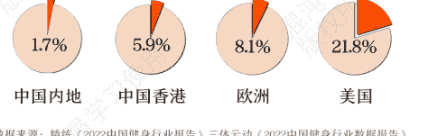
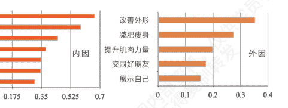
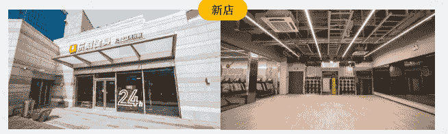
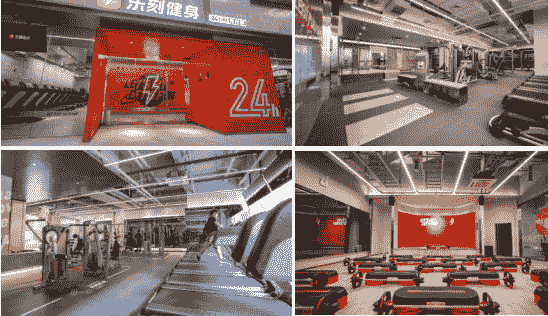
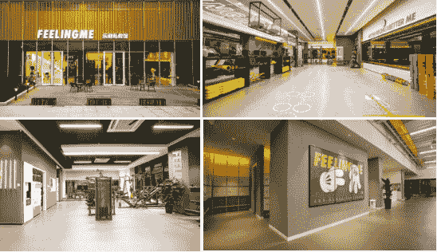
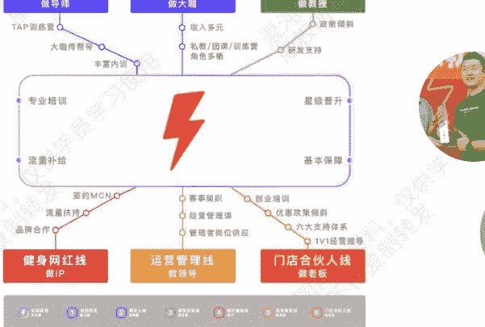
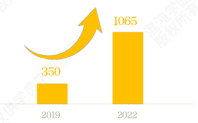

# 从服务新零售到产业互联网—夏东

## 讲者介绍

混沌学园
HUNDUN

## 夏东

- 乐刻运动联合创始人兼联席CEO
- 原中国科技产业投资管理有限公司董事总经理、投委会委员
- 历任全美最大风险投资机构NEA投资副总裁
- TCL集团空调事业部国内销售总经理
- 格力电器市场总部负责人

## 关于乐刻

乐刻运动，2015年创立于杭州。

8年来，乐刻运动以“月付制、24小时、好团课、不推销、一公里健身圈”为核心，重新定义了小型健身房，同时，持续对产业进行全链条数字化建设和改造，以优化成本、效率、用户体验，并通过发展多品牌，为不同用户需求提供不同运动场景。

发展至今，乐刻已获得众多知名投资机构的持续加持。

门店数量
1200+家

平台注册用户
近1000万

月度活跃教练数
10000+名

月度活跃用户
100万+

混沌学园
HUNDUN

## 01

### 什么是：重新定义健身行业的本质

### 创业的两个缘起

#### A 共享经济崛起

#### B 中国健身行业痛点突出

### 渗透率低/市场需求持续成长/全民健身成为国家战略

#### 中国健身人口渗透率低

中国内地健身人口渗透率仍远低于中国香港和欧美地区，市场发展潜力巨大

数据来源：精练《2022中国健身行业报告》 三体云动《2022中国健身行业数据报告》

#### 全民健身成为国家战略

国家高度重视全民健身发展，一系列指导政策出台

- 《中华人民共和国体育法（修订法案）》
- 《全民健身计划（2021-2025年）》定下五年目标，到2025年，带动全国体育产业总规模达到5万亿元
- 《“十四五”体育发展规划》
- 《关于构建更高水平的... 全民健身公共服务体系的意见》
- ……

#### 大众运动目的日趋轻松、多元

不同于过去健美、专业训练、追求极致自律的锻炼心理，更多用户开始将运动当作一种生活方式

### DAY ONE 的思考

#### 使命

让每个人平等享有运动健康的资源和权利

#### 愿景

每天响应1亿人次的运动健康需求

#### 商业原则

做90%人的生意/赚用户来的钱

追问：未来10-20年，国内健身行业最有价值的事情是什么？

大幅提升国人健身渗透率，帮更多人养成健身习惯，成为运动的受益者

### 从成本、效率、用户体验三个维度重新定义小型健身房
混沌学园 HUNDUN

对供给所有的改造和重新定位，本质都是为了以 “赚用户来的钱” 为模式的核心

5 个 改变

- 1. 300平米 1公里健身圈
- 2. 月付制 降低用户决策成本、从销售主导转为运营主导、做内容和服务
- 3. 团操主打 降低用户的运动入门门槛，形成用户粘性
- 4. 教练价值 让教练成为舞台的中心/不推销
- 5. 24小时 7%用户选择晚上11点到次日早上8点来健身

### 什么是一？

部分
传统俱乐部

成交

乐刻

帮更多人养成运动习惯

## 02 模式演进：从重新定义产品到产业互联网打造

### 乐刻第一家门店

2015年5月28日正式开业；
位于杭州城西银泰写字楼，面积221平米；
由两个操房、固定器械区、自由训练区组成；
24小时营业，月付制，每月99元，操课全部免费；

原则：
门店必须盈亏平衡
通过定价倒推成本和配置

### 乐刻本质上要做的是运动产业数智中台

- ★ 重新定义小型健身房
- ★ 一卡通用
- ★ 供给侧（教练&课程）平台化调度
- ★ 运营场景全面数字化

用户端
全过程运动工具
高质量互动导购场景

教练端
串联教练的全生命周期
规则运营和成长

商家端
赋能门店合伙人和运营者的投资、经营、管理

选址逻辑及标准

T
商圈容量与布局

P
业态投资组合

C+S
竞争与供应链情况

L
落位动线与展示

### 追问：为什么首先选择做门店？

#### 美国CLASSPASS

2015年1月，Classpass完成4000万美元B轮融资
99美元/月，Classpass的会员可以去其签约的俱乐部锻炼

国内出现一大批模仿Classpass模式的公司，定价99元/月，将用户链接到既有俱乐部去锻炼

#### 乐刻韩伟

轻链接的时代已经过去了，做轻链接是阿里、美团的事情，创业公司做轻链接没有优势

传统健身房既有模式痛点突出，将用户链接过去，无法真正解决行业痛点

所以我们选择：自己重新定义并先做供给！

### 核心业务模式：产业中台+品牌矩阵+合伙模式
混沌学园
HUNDUN

乐刻运动
流量入口

近300家自营门店验证模型
构建标准化能力

- 有用户价值的产品
- 货（课程/教练）的供应链
- 标准化经营体系
- 数字化平台系统

门店合伙人（类加盟）模式
全面平台化

- 信息流/交易流
- 平台化获客
- 课程/教练平台化统一调度
- 统一运营SOP管理
- 选址能力持续迭代，快速复制开店

数据沉淀与反馈
持续优化整体系统能力

不断孵化品牌矩阵

乐刻健身 FEELINGME FitTribe LOVEFITT

### 两个品牌已经实现规模化
混沌学园
HUNDUN

#### 乐刻健身

月付制小型综合健身房

22个城市1000+门店

#### FEELINGME

精品私教空间

9个城市150+门店

### 乐刻飞轮

好教练 / 课程

性价比

供应链规模 / 标准化

更方便

用户体验

增长

流量 / 留存

门店合伙人

门店 / 场景规模 / 矩阵

### 乐刻一战略：第一阶段单点击穿了什么？

便捷

24小时月付制健身连锁

帮更多人养成运动习惯

价值主张

运动使人受益/更多人应该从运动中受益

让每个人平等享有运动健康的资源和权利

### 乐刻—战略：下一阶段如何迭代？

好教练/课程
一公里健身圈

标准化能力

用户正反馈

帮更多人养成运动习惯

价值主张

运动使人受益/更多人应该从运动中受益
让每个人平等享有运动健康的资源和权利

### 乐刻本质上在卖什么

便捷

服务

社交

混沌学园
HUNDUN

### 标准化能力建设

选址

门店产品

运营

教练/课程

门店合伙人

品牌系统

#### 教练产品和运营标准化
混沌学园
HUNDUN

用户需求和评价

好教练的标准

课程产品标准

教练分

价值分配

文化与底线

良好沟通

匠星体系

能力成长

顶级培训师团队

乐刻研训中心

工具赋能教练

# —— 训练计划 ——

01 服务定制期内容
个体评估 个性化课程规划

02 沟通训练计划
跟进计划 一对一辅导

03 教练同步记录
每日无限次 教学反馈

04 自主生成训练报告
健康数据分析 教学成果呈现

#### 教练产品和运营标准化

##### 以手艺人交付为核心的相对标准化体系

#### 教练新十年/职业化

##### 混沌学园
HUNDUN

##### 健身教练新十年职业发展地铁图

##### 教练文化

正直、热爱、专业、负责

### 运动产业中台建设

本质

重要生产力工具，同时驱动生产关系的变化

关键路径

业务在线化/服务和运营场景的全面数字化

三端的匹配与网络协同

用户驱动的反馈迭代系统

结果呈现

用户满意提高/系统化提高产业整体商业效率

混沌学园
HUNDUN

### 用户反馈

40%+ 的用户是第一次走进健身房

7-8次/月 用户平均活跃频次

用户规模、留存 远超行业水平

20%+ 用户多店锻炼

### 用户故事

#### 7大优势

用户调研反馈，乐刻健身的七大优势：
位置近、性价比、按月付费、无推销、团课课程、营业时间、连锁门店

混沌学园 HUNDUN

### 保持快速发展

#### 持续发展

#### 囊括了一线互联网公司的企业健身房

2019年底，乐刻门店在 8 个城市拥有 350 家营业门店

2022年底，乐刻在 23 个城市拥有 1065 家营业门店

## 03 组织能力：互联网+零售的能力融合
混沌学园
HUNDUN

### 互联网+零售的能力融合

观点

乐刻真正的成功，将来自于互联网、零售和运动行业的人才真正融合并内化为公司的战略、模式和组织能力！

如何融合和构建？

- 1 核心：对商业模式的底层逻辑达成共识

平台能力

S2b2c

零售能力

### 互联网+零售的能力融合

#### 2 多元化的人才结构

流量/用户运营体系能力

产品/用户

连锁经营/品牌/
全国化管理能力

平台运营能力/
重新定义服务、服务者

#### 3 两层基础设施的组织架构

平台层+城市经营层

人-货-场-店的组织模式

人

货

场

店

#### 4 创始人基因：双基因

### 商业范式的三次浪潮
混沌学园
HUNDUN

科学管理

消费互联网

产业互联网

### 关于产业互联网

1
改造或重新定义供给,
并形成标准

2
全链条数字化建设

3
新型生产关系的探索

消费互联网重点仍然是：流量的汇集和分发，以链接和流量效率为核心；
产业互联网核心目标是：改变产业成本、效率、用户体验，形成供给的迭代和系统效率优势！

## 04
下一站：百城万店和综合运动生态

### 下一站
混沌学园
HUNDUN

#### A 百城万店

#### B 综合运动生态

## 我们相信

未来十年中国健身行业将持续快速发展

对传统产业的数字化改造将产生巨大生产力

产业互联网将是改造服务行业的最佳商业范式之一

值得我们持续的探索和奋斗！

## THANKS

向所有的创业者和奋斗者致敬！
