# 仝卿·营养科学 20 讲

> 公众号懒人找资源,懒人专属群分享

群友们好，这是小懒人给大家的《通才计划》更新的课程。

得到上 99 RMB 的课程《仝卿·营养科学 20 讲》

已整理添加到专属群《通才计划》，几十份付费课程到咱们专属群 Q 群公告自取。

通才计划目录：[`lazybook.fun/#/data/13\_course`](https://lazybook.fun/#/data/13_course)

懒人手册：[`lazybook.fun/#/`](https://lazybook.fun/#/)

懒人专属群：[`lazybook.fun/#/blog/group`](https://lazybook.fun/#/blog/group)

专属群更新记录：[`lazybook.fun/#/blog/record2`](https://lazybook.fun/#/blog/record2)

* * *

## 目录

仝卿·营养科学 20 讲  
 目录  
发刊词：为什么你应该来学营养科学？  
01 本质：成为营养素的两个必要条件  
02 框架：营养代谢的四大基本规则  
03 差异：代谢和基因的相互影响  
04 碳水化合物：提供能量的“清洁能源”  
05 蛋白质：缺乏症状很多，却难以察觉  
06 脂肪：研究结果相反，但并不矛盾  
07 膳食纤维：人体不需要，也算营养素  
08 水：确保代谢顺利的基础  
09 维生素：吃了足够多，也会营养不良  
10 矿物质：掌握“此长彼消”的摄入平衡  
11 比例：评价饮食模式最重要的标准是什么？  
12 密度：什么样的食物真的热量低？  
13 严选：优先吃什么样的食物？  
14 风险：避免吃什么样的食物？  
15 免疫：怎么吃才真能提高免疫力？  
16 治疗：营养可以对抗哪三类疾病？  
17 支持：怎样提高打败疾病的胜算？  
18 减肥：“少吃多动”没有用，怎么办？  
19 美食：怎样兼顾“享受”和“健康”？  
20 精力：怎样让大脑跟上工作和生活的要求？

* * *

# 发刊词：为什么你应该来学营养科学？

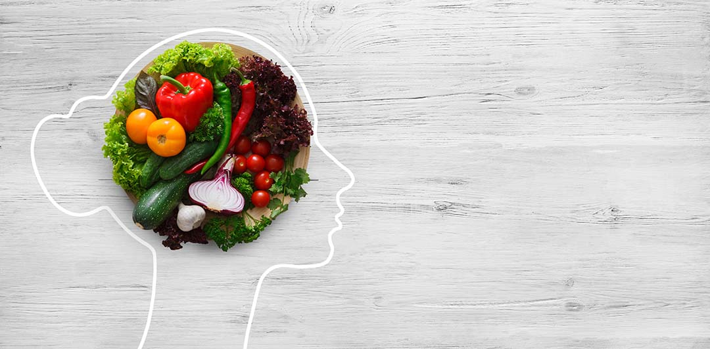

你好，我是仝卿，欢迎来到《营养科学课》。

我知道你很忙，时间很宝贵，在想要不要花时间来学营养科学。学没学过营养科学，有什么差别呢？

我的答案是，要学习。学过和没学过的差别，如果只能用一个词来说，那就是幸福感。学过营养科学，你的幸福感指数会大大提高。

为什么这么说呢？我来解释一下。幸福感当然来自很多方面，我说两个和你的生活比较相关的。

第一种幸福感来自身体状态。

很多疾病，特别是慢性疾病，都是因为我们没及时识别出身体的需求，才积累出了不良后果。但不幸的是，我们的身体识别正确的营养需求总是滞后的。比如当我们感觉到口渴的时候，身体其实已经缺了 500 毫升的水了。500 毫升，这已经是一瓶矿泉水的量了。

再来说个更影响幸福感的例子。我有位咨询者，叫老李。退休之后他经常去健身房健身，结果健身之后膝关节很疼。他去医院检查，医生确定这既不是有炎症，也不是骨质疏松。老李就来找我咨询。

我就问他，平时都喜欢吃什么？他说为了健康，自己是个素食主义者。我一听，这可能就是问题所在。

我们关节的正常活动，需要周围肌肉的支撑和保护，如果肌肉量减少，关节得到的保护减少，就会引发慢性疼痛。老李几乎不吃肉类，蛋白质摄入太少，肌肉量跟不上，膝关节就会疼。

老李的情况用营养科学的知识很好解决，吃鸡蛋，补充蛋白质就可以了。

但像“膝盖疼”这样的症状是滞后的，有些时候，你甚至很难把当下的症状和饮食联系起来。而想提升自身状态的幸福感，最好的方法其实不是补救，而是在疾病发生之前，就采取行动。营养科学的供给原则，强调摄入营养的时机，供给要在需求识别之前。

第二种幸福感来自当下的选择。你肯定知道很多食物对健康不好，但面对奶油蛋糕，炸鸡可乐，当下的选择很容易偏离正确的方向。

这也不怪你。在营养科学看来，人的健康本质是自己的理性和自己的身体之间的博弈。

如果完全听从身体的欲望，人类几十万年的进化让我们更倾向于选择高糖、高脂肪的食物，那必然会带来健康的恶果。但如果完全听从理性，不出几次，身体就会激烈反抗。最终投降的，大多都是理性。

就这样，我们在“放弃-管制-再放弃-再管制”的过程中循环，无法摆脱。

怎么破除这个循环，提升幸福感呢？

这就要说到营养科学对人体的干预原则了。一句话，就是干预要有仆人领导力。营养科学很多时候看起来像是在做仆人式的辅助工作，但其实是在领导整个进程顺利推进。

举个例子。我有个咨询者，叫老杜，他是位糖尿病患者。糖尿病患者都知道不能多吃碳水，米饭、粽子、汤圆，都不能多吃，不然血糖肯定飙升。但如果正好是端午节，老杜又特别喜欢吃粽子，那该怎么办呢？

老杜端午节早上是这么做的：起床打完胰岛素之后，他先吃了一个白煮蛋，再吃粽子。

这个顺序特别重要。提前吃白煮蛋，里面的蛋白质会减慢碳水进入血液的速度，餐后的血糖就不会陡然增加了。

你看，营养科学的干预看起来只是打了个辅助，但其实是“平稳血糖”能最终成功的领导者。老杜既不会遗憾自己没吃到，也不会因为贪嘴而后悔，幸福感当然就提升了。

这两种情况分别对应了营养科学的供给原则和干预原则，在课程里还有更多可以提高我们幸福感的营养科学原则。我会在课程里再和你详细说。

那么，我为什么可以来讲这门课呢？

我现在是一名营养师，已经服务过几千名咨询用户。和其他营养师相比，我有一段不同的职业经历。我曾经做过 6 年的肿瘤科临床医生。你可能觉得这和营养科学没什么关系，但正是这段经历让我意识到了营养科学的重要性。

很多晚期的肿瘤患者都有同一个困境：吃不下去。别小瞧这个问题，如果吃不下去，营养状况出问题，很多治疗就不得不停止。这时候，请营养科的大夫会诊就能帮上大忙。现代营养科学技术让患者有更多元的办法摄入营养，维持住生命力，获得更多的治疗机会。

有些营养师没有医学基础和临床经验，面对咨询者，很容易把人体复杂的问题简单化，用零散的营养科学知识解决咨询者个性化的问题。很多人对营养科学的印象也是这样，知识零散，有些甚至还是矛盾的。

其实这都是因为他们没有在脑中建立营养科学的知识网络，不知道营养科学和人体交互时，有些影响牵一发而动全身。

而我拥有医生和营养师的双重视角，在这门课里会帮你建立一个关于营养科学的整体框架。

那我会怎么把这个框架讲给你呢？

我把它分成了五个模块。第一个模块，认识营养。我们要先对“营养”有个整体上的认识，包括什么才是营养科学说的营养，它在宏观层面的代谢规则，以及它在微观层面和基因的关系。

第二模块，七大营养素。这是现代营养科学的经典组成。营养素和人体细胞的交互，影响了我们的身体状态。

但我们平时吃饭不是按营养素吃的，食物是一个混合体。所以第三模块，我们来说说“营养与膳食”。我会告诉你，怎么用营养师的方法论来评价食物、选择食物。

第四模块，我们从食物的视角转换到人体的视角，说说“营养与疾病”。预防疾病、治疗疾病，以及支持治疗，营养科学贯穿了这整个过程。

最后的第五模块，是营养与生活。我们来说说在健康饮食的基础上，怎么达成一些更高的目标，比如减肥、享受美食和提高精力。

这五个模块集合起来，就是这门《营养科学课》了。

拿下这门课，提升自己的幸福感吧。当然，“营养”很多时候都是一个以家庭为单位的话题，也欢迎你把课程送给家里掌勺的那位，还有你关心的家人和朋友们。

我是仝卿，我们课程里见。

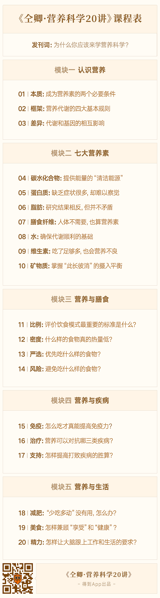  

* * *

# 01 本质：成为营养素的两个必要条件

  
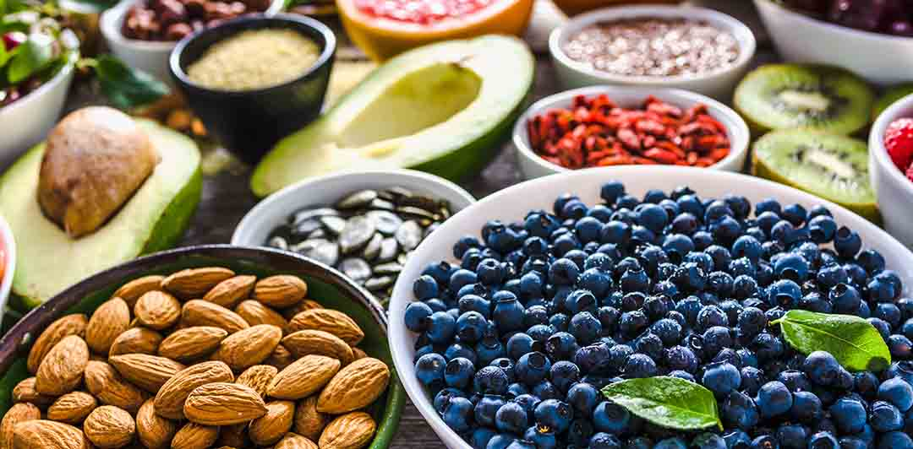

你好，欢迎来到《营养科学课》，我是仝卿。

这是我们课程的第一讲。既然是“营养科学课”，我们在最开始一定要搞清楚这个问题：在营养科学看来，什么才是营养。

我们从一个生活中的场景出发，养花。养花的人有一个秘诀，把鸡蛋壳打碎放进花盆里，这样可以让花更鲜艳。

问题来了：鸡蛋壳是营养吗？

如果你是理科生，可能会抢答，鸡蛋壳不是，里面的碳酸钙和磷酸钙才是。

没错，对花来说，真正能让它愉快生长的是磷、钙这些营养素。鸡蛋壳里的碳酸钙是营养素的现实形态。

营养素的现实形态在日常生活中很重要，因为它涉及到营养素吃下去之后的吸收问题。

你看，都叫钙，但鸡蛋壳里的钙和牛奶里的钙形态并不一样。牛奶里的乳钙在身体里基本不需要太多胃酸的作用就可以分离出钙离子，吸收效率相对高。

而鸡蛋壳里的钙，主要以碳酸钙形式存在，所以得洗干净，晒干，磨成粉，再加上胃酸的帮忙，才能分离出钙离子，吸收效率低。

但对于我们理解什么是营养来说，这个营养素的形态可以先放一边。营养素钙原先的现实形态并不影响它发挥自己的功能。

比方说，刚才讲到的，无论是鸡蛋壳里的碳酸钙，还是牛奶里的乳钙，在身体里最终分离出来的钙离子被吸收之后都可以干好自己的活儿：制造骨骼，传递神经冲动，收缩肌肉，等等。

现实形态不重要，那要理解什么是营养，重要的是什么呢？就是真正发挥作用的那些“营养素”。

对人来说，营养素是什么呢？有两个关键点。

第一个，这个物质从食物中可以摄取；第二个，这个物质在生命活动中发挥重要作用。

从食物中摄取，这个好理解，但怎么算是在生命活动中发挥重要作用呢？

我们身体里的生命活动包含千千万万的生物化学过程。在这些过程中，有的营养素提供细胞能量，比如碳水化合物；有的构成细胞结构，比如蛋白质；还有的调控化学反应，比如各种维生素。

当然，一个营养素也可以同时起多重作用。比如蛋白质既可以供能又可以作为新细胞的结构原料还可以作为中介调控的酶而存在。

不过，有一个例外，那就是“膳食纤维”。膳食纤维不直接参与人体内的新陈代谢，但也被现代营养科学看成是一类营养素。它是以一种间接的方式参与的。

间接的方式指什么呢？

我们是没办法消化吸收膳食纤维的，但是肠道里的菌群，却可以消化膳食纤维。现代科学认为，肠道菌群和人体形成了一个团队，人体中很多功能，包括一部分新陈代谢，是依赖肠道菌群来实现的。所以，喂养肠道菌群的膳食纤维，也被看成一种营养素。

到这里，稍微总结一下：在营养科学看来，营养素是从食物中摄取的、对维持人体生命活动起重要作用的物质。这些人体营养素一共有七大类，我在后面的课程里会一一跟你详细说。

好，我们现在知道了人体营养素是什么，但在生活里，我们面对的是真实的食物。面对食物，我们常说“这个有营养，那个没营养”。那在营养科学看来，哪些食物更有营养呢？

如果以营养素为单位来比较，那这个问题没什么棘手的。

咱们想要一个类似“补钙食物 top10”“维生素 C 水果之王”这样的排行榜，网上查一查就有了。这就好比奥运会里 100 米短跑排名，只要看完比赛，咱们每个人都能给运动员排出一二三名来。因为标准是固定的：谁跑得最快，谁就是第一名。

但如果我们拿食物为单位比较，想知道哪个食物更有营养，这个问题就挺棘手的。

因为“标准”在很多人眼里是模糊的。还是拿奥运会的比赛项目举例，咱们普通人看跳水，如果不看裁判的评分，你并不能确定谁跳得最棒。是看起跳的姿势？看腾空的高度？看翻腾转体的周数？裁判有专业知识加持，综合考虑才能给出评分。

而我们普通人不行，因为我们并不清楚标准是什么。我不懂跳水，看比赛的时候会更容易根据某个直观感受来评判，比如水花大还是小。

那在营养科学这里，有固定的、判断食物营养价值的“标准”吗？并没有。但是，针对每个食物类别，比如主食、肉类、蔬菜、水果、乳制品等，营养科学都有判断食物营养价值的原则。不同的国家和机构，再根据这些原则来制定自己的标准。

注意，这些原则一定是针对每个食物类别的。为什么要强调这个呢？

因为同一类型的食物，主要营养素是一致的，那解决的人体营养需求也会比较一致。这样，我们在说什么食物有营养的时候，也能比较方便地从人体一般需求的角度做出评价。

也就是说，你不能拿馒头和三文鱼来比营养价值。它们两个，一个是主食，一个是肉类，提供的主要营养素不一样，一个主要提供碳水化合物，一个主要提供蛋白质，这么比较没意义。

而拿白面馒头和杂粮米饭来比较营养价值，就比较合理，它们都属于主食，提供的主要营养素都是碳水化合物。

需要注意的是，我们这里说的“更有营养”，比的都是供给，就是食物里有什么。这里没考虑到需求，就是人需要从食物中获得什么。

人在各个阶段的需求，比如在怀孕的时候，动大手术的时候，长身体的时候，需求都不一样。这些都是供给和需求的匹配问题。

匹配问题当然重要，但是我们先要知道每一种食物里都有什么，下一步才能讨论匹配。

好，既然不同的国家和机构判断食物营养价值的标准，都是根据营养科学的大原则来制定的。那接下来我们就按照食物类别，来聊聊这个原则。

原则是什么呢？就是同一食物类别的比较，要根据这个类别的特点，结合人的一般需求来确定比较项目。

比如在主食里面，全谷物制品比精制米面更有营养。全谷物的膳食纤维、维生素和矿物质含量都更高。

而对肉类、大豆和乳制品来说，蛋白质含量越高，脂肪含量越低，营养就越好。还有一条很重要的原则，就是这个食物富含氨基酸的种类和比例，越接近人体必需氨基酸的组成，就越好。在后面讲到蛋白质的时候，我会专门来说。

再来看蔬菜和水果。对这两类食物，你可以参考营养质量指数（INQ），在网上搜搜就能搜到。

我这里说的“营养质量指数”是一个比值，分子是营养素的密度，分母是食物的能量密度。营养素密度越高，能量密度越低，也就是分子越大，分母越小，营养质量指数就越大，可以认为营养价值也就越高。

比如在蔬菜当中，叶菜的能量密度都挺低的，但深绿色的叶菜，营养素密度更高。也就是说，大家的分母差不多少，但深绿色叶菜的分子更大，所以它的营养价值相对就更高。

还有一类是加工食品，比如罐装的午餐肉之类的食品，我们更多关注在加工过程中人为添加的成分。比如添加的糖和钠含量越低，就更有营养。另外，反式脂肪含量越低，也更有营养。

说到这里，我要再澄清一个你可能有的误解。很多人认为，在营养素单项赛排行榜里垫底的食物，营养价值都不大。

会有这个误解，是因为很多人没有考虑可能的协同作用。营养素之间可以有协同，营养素现实形态之间也可以有协同。

举个例子，豆腐和大米都是普通食材，氨基酸比例各有缺点。大米中的赖氨酸比较少，蛋氨酸比较多；而大豆刚好相反，赖氨酸比较多，蛋氨酸比较少。两个普通食材搭配起来，正好互补。于是，“麻婆豆腐盖浇饭”的营养价值一下子上升了很多。

这就是“1 加 1 大于 2”的效果，在营养科学中叫“蛋白质的互补作用”。

注意，这里说的，仍然是一般人的需求和供给的匹配，不是某些特定情况的匹配，比如人怀孕的时候，匹配的原则肯定不一样。

你此时此刻的身体情况和未来计划，是你个人的需求。需求怎么和各种各样的食物进行匹配，这是营养科学的任务，是应用的问题，我会在课程后面说到。

好，总结一下这一讲的内容。

营养科学理解“营养”的关键，在于食物当中富含的营养素种类和含量。

在判断食物有没有营养时，营养科学有针对每个食物类别的原则。这些原则，都是围绕着营养素的种类和含量展开的。

此外，我们也需要考虑合适的食材搭配和自身身体状况。毕竟提出“哪些食物更有营养”这样的问题，咱们的最终目的，是为了让自己和家人更加健康。

1 营养素是从食物中摄取的，在生命活动中发挥重要作用的物质。 2  
在判断食物有没有营养时，营养科学有针对每个食物类别的原则。这些原则，都围绕营养素种类和含量展开。 3  
除了这些原则，我们也要考虑变化的身体需求以及合适的食材搭配。

知道了什么是营养，下一讲，我们来说说营养代谢的基本规则。我们下一讲见。

* * *

# 02 框架：营养代谢的四大基本规则

  
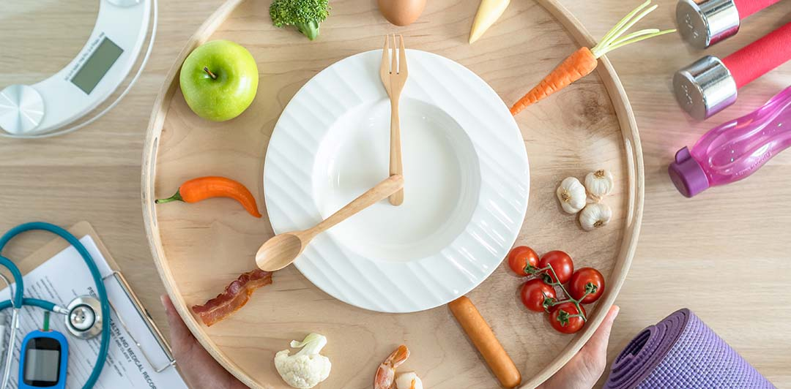

你好，欢迎来到《营养科学课》，我是仝卿。

上一讲我们说到，营养科学提到某种食物“有营养”的时候，都是围绕着食物富含的营养素种类和含量来说的。营养素，是从食物中摄取的，在生命活动中发挥重要作用的物质。

那这些营养素是怎么代谢的呢？这就是我们这一讲要回答的问题。

你可能会想，我知道吃什么食物对身体更好就行了，营养素的代谢我也管不了，为什么要知道这个？

因为只有知道了这些，生活中碰到营养科学的问题时，你才能在心里有个靠谱的预期。比如说，知道营养素“铁”是怎么代谢的，你才能知道缺铁这件事，是要积累一段时间才会发生的，而要补铁，也不是一两天就能补回来的。

这种预期非常重要，它可以帮助你提高甄别信息的能力，也让你对自己身体的各种变化更有掌控感。

营养素代谢的问题其实分为两层，一层是表象，是营养素在代谢过程中，给身体带来的变化；一层是本质，是营养素代谢的基本规则。

那我们先来说“表象”的部分，营养素在代谢的过程中，给我们身体带来什么影响呢？

最开始观察到的影响和你身体的感觉有关。

营养代谢从食物进入口腔的那一刻就开始了。米饭咀嚼久了会产生甜味，是因为淀粉在唾液的作用下分解代谢出了麦芽糖。这是味觉，直接而短暂。

还有另外一种感觉，比如很多人吃巧克力会感到快乐，节食减肥的时候容易生气。这种感觉和营养代谢有关吗？还真有些关系。

不少营养素参与生成和释放大脑里的情绪物质，像 B 族维生素，就参与合成大脑里的“快乐因子”多巴胺。

甚至，有些营养素本身就是大脑产生情绪的物质基础，像脂肪，特别是 n-3 脂肪酸，是大脑细胞的重要组成成分，也是大脑传递正确信号，维持稳定情绪所必需的。

食物里的营养素要经过消化道进入血液，再经过血液循环达到大脑。正是代谢的过程让它们在不同层面和大脑产生了联系，影响了我们身体的感觉。

对身体感觉的影响来得很快，最快当时就有反应，慢的话也就是几周。而时间再长一些，营养代谢还会让你的身体成分发生变化。

你的身材是胖是瘦？有没有腹部的“游泳圈”？这些事儿都和身体成分有关。

身体成分的变化，用营养科学的话来说，是组成你身体结构的物质比例变化了。现在市场上的检测方式有不少，能够区分并检测出来的条目大致包括体液量、肌肉量、脂肪含量和无机盐含量，等等。

营养的代谢是怎么影响身体成分的呢？

举个例子，米饭、馒头里的淀粉，会分解成葡萄糖进入血液。葡萄糖本身是给身体提供能量的物质，但如果太多，血液里的血糖就太多了。这个时候，负责降血糖的胰岛素，分泌量会跟着增加。

你可能听说过胰岛素可以降血糖，但也许不知道胰岛素还能促进脂肪的合成。于是，在胰岛素的作用下，过多的葡萄糖就被合成了脂肪，在身体里堆积起来，人就胖了。

时间线再拉长一些，我们意识到了慢慢积累的影响，就是营养代谢对器官功能的影响。

我们拿钠来举例，它是营养素当中的一种微量元素。食盐当中就含有大量的钠离子。

我们知道，如果平时习惯吃含盐量很高的食物，比如腌制食品，患高血压的风险会增加。这就是身体在代谢钠的过程里，影响了血管功能的缘故。

一般情况下，体内的钠含量可以维持在相对恒定的范围内。不过当我们吃太多盐的时候，血管细胞里面的钠离子浓度和水分变多，细胞会肿胀起来，导致血管的管腔变窄。这么撑得久了，血管的弹性下降，血管壁的功能就不正常了。有一部分的高血压，就是血管功能不正常的外在表现。

你看，营养代谢带给我们的影响太多了，从身体感觉到身体成分，再到器官功能，其实还有很多我们还在探索的领域。在这里，我并不能给你完备地描述出来。

不过，无论这些影响有多少，都是表象，它们离不开本质，也就是营养代谢遵循的特定规则。

接下来，我们就来说说表象之下的本质，也就是营养代谢的规则。具体到单个营养素的代谢规则，我在第二模块中会给你一一仔细说明，在这里，我们只看营养素总体的代谢规则。我为你总结了四条。

第一条规则是：零存整取，多退少补。

“零存”就是吃一点补一点，补进一个“储存池”，补太多就要排出体外；缺乏了，可以从“储存池”里“整取”，也可以从外部补充，整体是个“多退少补”的过程。

我们比较熟悉的铁和钙，它们两个都是营养素中的微量元素，代谢规则都符合这条。

比如说铁，肝脏就是铁的主要储存池。肝脏里的铁一般不会被动用，被动用的都是游离状态的铁。如果游离铁含量变少，肝脏就会释放替补队员上场工作，这是从池子里头“整取”的过程。

大部分铁都可以循环利用，身体既可以通过消化道把铁排出体外，也可以利用饮食中的铁来补足缺口，这就是“多退少补”的过程。

这些营养素在体内有储存池，就好像家里有存款一样，就算一个人突然失业，生活也能维持好一阵子。所以，钙和铁缺乏，都是经过了一段时间积累才显现出来的。

在补充的时候，要先保证游离的营养素足够，才会再补充进储存池。所以，如果真的缺铁、缺钙了，也不是三两天就能补回来的。

不过，并不是所有的营养素都有储存池。这就有了我们的第二条规则：按需摄入，即产即用。

比如说，维生素 C 就是这样，“按需摄入”就可以了，吃多了也留不下，会随着尿液排出体外。

那也就是说，如果平时你蔬菜水果吃得非常少，维生素 C 缺乏的症状，比如乏力、牙龈出血等，显现得会非常快，最短在几周的时间里就会出现。

反过来，一旦出现了缺乏症状，只要及时补充，症状就能消失。

而且，维生素 C 也不需要特别的消化过程，直接就可以被肠道吸收，这就是“即产即用”。

前两条规则针对的是单个的营养素，那么在营养素之间呢？其实也有代谢规则。这就是第三条规则：单向转化，各司其职。

很多人有这样的印象，营养素之间是可以互相转化的，特别是碳水化合物、脂肪和蛋白质之间。这个不够了，没事儿，其他的能补位。的确，转化在有些情况下会发生，但转化大部分是单向的。

比如说，碳水化合物可以转化成脂肪，但倒过来就不行了，脂肪是不可以转化成碳水化合物的。蛋白质呢，分解产生的部分氨基酸，可以转化为碳水化合物，但碳水化合物几乎没有办法转化为蛋白质。最后再说脂肪，人类很难利用脂肪来合成蛋白质，但蛋白质可以在一定条件下转化为脂肪。

而且请注意，这种转化只是营养代谢中很小的一部分。这三大营养素各有分工，大部分时间还是“各司其职”，特定情况下才会转化。

比如，只有当碳水化合物和脂肪代谢发生障碍时，才会由蛋白质来供能。在特殊情况下，比如极度饥饿的时候，肌肉也会分解供能，但这样的供能方式非常不划算，是以消耗自身机能作为代价的。

这三条规则都是面向健康状态说的，而我要说的最后一条，是身体在健康状态和病理状态切换时的规则。这条规则是： 稳态可调节，失衡可致病。

营养素进入我们身体之后，在身体里除了提供能量、发挥各种功能之外，还作为一种重要的“信号”来参与调节细胞。调节的目标是维持身体内部的稳定，减少改变。

举个例子，在营养摄入严重不足的情况下，身体可以感知血液中葡萄糖和氨基酸的水平，自我调节，应对资源短缺。怎么调节呢？有个方式挺奇特的，身体会自己吃掉一些没那么有用的细胞，来回收有用的组件。

这个过程被叫作“自噬”，自己吞噬自己。这就是营养代谢启动的调节方式，目的是能够减少对外界营养摄入的依赖，在摄入严重不足的情况下，尽力维持稳态。

稳态被打破的过程，就是疾病产生的过程。比如外界信号发生了剧烈的变化，稳态就会被打破。像营养不良、缺氧，这些都是我们身体比较敏感的外界信号。怎么在疾病的状态下改善营养代谢，我在后面的课程里也会为你具体讲述。

好，总结一下这一讲的内容。

营养代谢带给我们的影响太多了，从身体感觉到身体成分，再到器官功能，可以说它影响我们的方方面面。

但不管这些影响有多广泛，都离不开营养代谢的四条规则。掌握这些规则，可以帮助你提高甄别营养相关信息的能力，对自己的身体变化更有掌控感。

1 只有知道了营养素的代谢规则，生活中碰到营养科学的问题时，你才能在心里有个靠谱的预期。 2  
营养代谢带给我们的影响从身体感觉到身体成分，再到器官功能，可以说它影响我们的方方面面。 3 不管营养代谢的影响有多广泛，都离不开代谢的基本规则：  
零存整取，多退少补； 按需摄入，即产即用； 单向转化，各司其职； 稳态可调节，失衡可致病。

我们这一讲到的内容，场景都发生在身体内部，从组织器官一直到细胞水平。如果再往底层走，到基因水平，营养代谢会不会影响基因表达？怎么影响？

下一讲我们来具体说。我们下一讲见。

* * *

# 03 差异：代谢和基因的相互影响

  
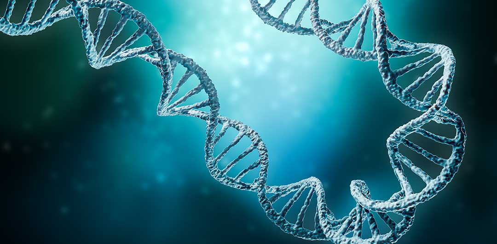

你好，欢迎来到《营养科学课》，我是仝卿。

这一讲我们要说的，是营养代谢和基因的关系。

前两讲的课程，我们从“营养是什么”开始，到“营养怎么代谢”，这一讲又到了营养代谢和基因的关系。我们从体外环境讲到体内组织，讲到细胞层面，终于讲到了分子层面。发现了吧，我们是拿着放大镜逐步认识营养科学的。

研究营养代谢和基因的关系，现在已经发展出了一个学科，叫营养基因组学。新的学科出现，一定是它解决了之前解决不了的问题。我举个例子。

你可能听说过，孕妇会吃一种补充剂，叫叶酸。叶酸是一种 B 族维生素，有预防胎儿神经管畸形的重要作用。这种维生素我们自己不能合成，完全依靠外来的供给，所以孕妇在孕期补充叶酸是常规做法，不补不行。

但是研究发现，这种营养素补多了也不行。叶酸补多了，会干扰体内另一种营养素，锌的代谢，导致胎儿发育迟缓。

也就是说，叶酸补充过少和过多都会带来风险。那算出一个不多也不少的量，严格执行行不行？你可能知道，很多国家都有《居民膳食指南》，中国也有，《指南》里有各种营养素的推荐摄入量。那严格按照推荐量来补不就行了吗？

一般人确实可以，但有些人不行。

在叶酸的代谢通路上，有几种重要的酶负责叶酸代谢，而酶的活性决定了我们对叶酸的利用能力。有些人酶的活性低，叶酸代谢效率低下，就需要比一般人补充更多的叶酸。

那现在有一位准妈妈，她想知道自己对叶酸的利用能力怎么样，该补多少叶酸合适，她该怎么办？

营养基因组学就可以满足这样的个性化需求。

营养基因组学是怎么做的呢？

我们先来拆一下“营养基因组学”这个词。“组学”的意思是，研究对象不是一个，而是“一组”，或者说”一群”。

基因组学就是研究一群基因组的信息和功能。我们经常听到基因组学领域响当当的“人类基因组计划”，它的目标是测定人类 30 亿个碱基对的基因信息。  
**而营养基因组学，是从这 30 亿个碱基对的基因信息中，筛选出和营养代谢相关的基因来进行研究。**

叶酸代谢能力的检测，就是营养基因组学的应用。这种检测看的是，代谢通路中那几个关键酶的基因型，看看它们有没有发生特定的突变。如果编码基因发生了特定突变，会导致酶的活性下降，叶酸利用能力变低，那叶酸缺乏的风险就相应增加了。

风险增加了，有解决方案吗？有。

简单来说，检测出的叶酸缺乏风险越高，补充参考剂量就会越大。我们国家的疾病预防控制中心妇幼保健中心，也会按照检测风险进行分类，提供更加细化的补充参考剂量。你需要的话，在各省市的妇幼保健院就可以检测。

不过，并不是所有的营养代谢基因异常，都像叶酸这样，有简单高效的解决方案。有些先天代谢缺陷的情况非常复杂。比如说，苯丙酮尿症就是其中的一种。

得了这种病的婴儿，如果不及时干预，智力和运动能力的发育会明显落后。患病的原因呢，同样是因为基因突变，酶的功能或者总量下降，导致一种叫“苯丙氨酸”的氨基酸在体内大量堆积，影响了神经发育。

这该怎么办呢？很遗憾，苯丙酮尿症目前还没有办法治愈。但是，正因为有了营养基因组学，我们现在有了解决的方向。

比如说，现在苯丙酮尿症筛查，是我们国家新生儿筛查的重要项目了。如果婴儿在患病早期就有了明确诊断，我们按病情的严重程度，控制患者苯丙氨酸的摄入量，就可以最大程度地避免病情发展。

你看，虽然还没有完美的解决方案，但营养基因组学的应用，让我们发现了不同人代谢基因的差异。有了对这些差异的认识，我们就能对它们带来的影响有个合理预期，有机会及时干预。

说到这里，有人可能跃跃欲试，也想去做一个营养基因组学方面的检测，看能不能给自己制定一个个性化的食谱。目前，根据这个检测结果做个性化膳食指导，确实已经有应用了。但我觉得，普通人没有必要去做。

为什么呢？因为现在的个性化指导，主要是针对特殊人群的，你用不上。比如我们刚才提到的孕期叶酸代谢能力检测，还有新生儿苯丙酮尿症的基因检测。

另外还有一些热门的营养代谢检测项目，看起来好像你用得着的，比如用来做减肥指导的项目，我也暂时不推荐你花这个钱。原因很简单，因为结论不确定。比方说，哪些基因能决定脂肪可以优先代谢呢？这样的问题目前还没有确切的答案。

对营养基因组学来说，检测技术已经不再是问题了，挑战在于我们能不能正确解读检测的结果，并且把结果和日常饮食联系起来。

好，我们刚刚讲了基因可以影响营养的代谢，本来营养基因组学说到这里就应该结束了。

谁知道，随着研究的不断深入，科学家发现，基因和营养代谢的关系并不是单向的，而是双向的。也就是说，营养代谢可以反过来影响基因。

当然，这里说的“影响”，并不是说营养代谢可以影响基因的序列，而是影响基因的表达。

接下来我会给你讲一些比较“硬核”的知识了，咱们稍微放慢一点节奏。

首先，“基因的表达”是什么意思呢？我们身上的每个细胞里，都含有编码人体所有蛋白质的基因，但不同的细胞会选择性地合成自己需要的蛋白。

比方说，胰岛素基因每个细胞都有，但只有胰腺细胞才会合成胰岛素蛋白质。当胰腺细胞合成胰岛素的时候，我们就会说胰岛素基因被“表达”了。

如果基因序列是枪膛里的子弹，基因表达就是扣动扳机的过程。光有子弹，不扣扳机，不会产生任何杀伤力。同样，基因序列摆在那里，但不表达的话，就发挥不了任何功能。

那营养代谢是怎么影响基因表达的呢？和你分享两种方式，你可以记两个关键词。

第一个关键词叫“转录因子”。咱们从一个案例开始。

有位老人觉得素食更健康，每天都吃清淡的斋饭，不吃肉。结果他有一次去体检的时候发现，自己竟然有了脂肪肝。

他觉得这不可能啊，我都不吃肉，做饭放的油也很少，怎么会突然有脂肪肝了呢？这背后的原因，就可以从“转录因子”说起。

转录因子负责和特定的基因结合，会决定在什么时间、什么细胞里表达什么基因序列。这些转录因子本身是一类功能蛋白质，自己会先被某种代谢产物激活，之后再去激活基因的表达。

在脂肪肝的案例中，有一种基因叫 S14，它负责编码肝脏脂肪的合成酶。如果这种基因被激活了，那肝脏上就非常容易堆积脂肪，导致脂肪肝。

一般来说，负责激活 S14 的转录因子，没那么活跃。但研究发现有一种营养素可以激活它，这种营养素竟然是我们非常熟悉的葡萄糖。

于是，链条形成了，老人长期高碳水饮食激活了转录因子，转录因子又去激活了脂肪合成酶基因，肝脏上的脂肪越来越多，脂肪肝就出现了。

你看，营养代谢产物，可以作为转录因子的激活物来影响基因表达。

营养代谢影响基因表达的第二个关键词，叫“表观遗传学印记”。我们还是从一个案例说起吧。

有位妈妈在怀孕期间，放开了吃，吃了很多高脂肪、高糖的食物。结果她的孩子出生之后，即使饮食健康，肥胖、高血脂和糖尿病的风险也会显著增加。

研究发现，这种母子之间的传递并不是像双眼皮、高鼻梁那样，通过基因来完成的，而是通过“表观遗传学印记”实现的。这种传递，甚至会延续三代以上。

到底什么是表观遗传学印记呢？它们是基因序列之外的原子团，不改变基因的序列，但却是基因表达的开关。

那这和营养代谢有什么关系呢？科学家证实，不少营养素，比如叶酸、维生素 B12、胆碱、n-3 脂肪酸，以及一些矿物质和必需氨基酸，都是表观遗传学印记的原材料。

我还看到了一个更有意思的研究结果。胎儿身上的表观遗传学印记，可能来自妈妈吃下去的菜。研究发现，某种植物自带的表观遗传学印记，可以进入妈妈的血液，通过胎盘转移，直接调控胎儿的基因表达。

一句话总结一下，营养代谢产物可以作为表观遗传学印记的原材料来影响基因表达。

不管是转录因子，还是表观遗传学印记，这些营养基因组学的研究结果，都在为营养科学打开新的世界，提示我们：吃的东西或许可以用一种有趣的方式和我们体内的基因产生连接。

怪不得有句话叫“人如其食”。营养基因组学告诉我们，你是一个什么样的人，这件事儿不仅由爸妈决定，也部分由食物决定。

总结一下这一讲的内容。

营养基因组学的诞生，让个体的特殊需求得以实现。我们现在已经知道，营养素代谢和基因表达是相互影响的，但具体的细节还没有完全掌握。

未来，这方面的研究结果，能帮助我们获得更加个性化的膳食指导，让我们活得更健康。

1 营养基因组学的诞生，让个性化的营养需求得以实现。 2  
对营养基因组学来说，检测技术已经不再是问题了，挑战在于我们能不能正确解读检测的结果，并且把检测结果和日常饮食联系起来。 3  
我们现在已经知道，营养素代谢和基因表达是相互影响的，但具体的细节还没有完全掌握。

我们对营养科学的整体认识到这一讲就结束了。下一讲，我们会进入第二个模块，把每一个营养素都单独拎出来说一说。

营养素是现代营养科学的基石，又和常见的饮食健康问题高度相关，我会给你一些真实挑战的解决方案。我们下一讲见。

* * *

# 04 碳水化合物：提供能量的“清洁能源”

  
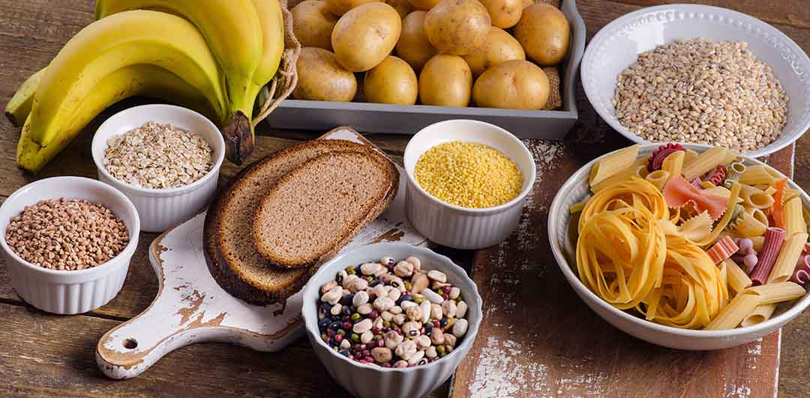

你好，欢迎来到《营养科学课》，我是仝卿。

听过前面几讲的内容，你对营养科学应该有个大致的了解了，这一讲我们进入一个新模块，我会带你认识七大营养素，让你对营养科学有个更细致的理解。这一讲我们先来说碳水化合物。

如果你问我，在所有的营养素里，哪一种现在最不招人待见、最容易被污名化？我的答案就是碳水化合物。

一直以来，碳水化合物被当作导致我们发胖、变老的罪魁祸首。健身教练说，想减脂，先要控制碳水。女明星说，想抗老，千万别碰碳水。就连体检的医生都说，要保持健康，一定要控制碳水摄入。

可是，《中国居民膳食指南》明确提出，每个人每天需要摄入谷薯类食物 250 克到 400 克。咱们就看最低的数值，250 克，那也是足足半斤的粮食。而且，《指南》里提到的食物重量都是生重。也就是说，这 250 克谷薯类食物，如果是生米的话，煮成熟饭大概是 625 克，比一斤还要多。

听到这，你肯定会问：教练让少吃碳水，但《指南》的推荐量并不少，到底听谁的？碳水到底是不是必须吃？

**我先说我的答案：碳水必须吃，但吃的时候，要选择合适自己的质和量。**

咱们先来说为什么必须吃碳水。

说碳水必须吃，是因为它的主要作用是提供能量，维持生命体运转。

如果看提供能量这个功能，在营养素当中，能提供能量的不只有碳水化合物，蛋白质和脂肪也都可以。不过，如果主要依靠脂肪和蛋白质提供能量，身体都要付出相应的代价。

让脂肪主要负责供能是什么情况呢？目前非常流行的减肥饮食模式“生酮饮食”就是这个思路。

生酮饮食大大增加了食物里脂肪的比例，只吃特别少的碳水，提供能量的任务主要交给了脂肪。很多人在实行生酮饮食一段时间后，体重确实降低了。

但是，脂肪供能的代谢产物——酮体，在身体里聚积多了之后，会提高血液的酸性，会让人浑身乏力，严重的时候甚至会引起昏迷。

从这个角度说，生酮饮食并不适合长期执行，短期执行也需要密切关注身体里的酮体含量。

让蛋白质来提供能量呢？

很多人健身的人会吃蛋白粉，就是因为蛋白质是肌肉的重要组成部分。让这些本来存在于肌肉当中的蛋白质来提供能量，那就必然会以消耗肌肉为代价，导致免疫力降低。而且，要把损失的肌肉补回来，需要很长的时间。

和脂肪、蛋白质相比，让碳水化合物提供能量，性价比太高了。

首先，碳水化合物是一种“清洁能源”。供能的时候，碳水化合物会被优先代谢成身体能直接使用的葡萄糖。葡萄糖完全燃烧之后，彻底氧化成二氧化碳和水，基本不会给身体造成代谢负担。

而且，碳水化合物的存储调用很灵活。以葡萄糖形式存在的血糖，就像一个缓冲地带：你吃的碳水太多，血糖太高了，血液中的糖就会合成糖原，储存在肌肉和肝脏中；如果你吃的碳水太少，血糖过低，身体就会动员糖原分解，重新进入血液。

你看，碳水化合物、蛋白质和脂肪，虽然都能提供能量，但在权衡之下，碳水是一种“清洁能源”，代谢产物简单，代谢负担少，用来提供能量的性价比最高。所以，要想获得能量，还是应该吃碳水化合物。

我们现在知道了为什么应该吃碳水，那吃多少合适呢？一个总的原则是：吃多少不是跟你的欲望匹配，而是跟你的需求匹配。

我们喜欢碳水，不仅因为过去重体力劳动需要高效供能，更是因为碳水的口感和味道，满足了我们对食物的享受型需求。想想松软的蛋糕，甜蜜的糖果，这都是我们特别喜欢的高碳水的食物。这两点原因，把人类牢牢锁定在了对碳水的渴望上。

现代社会改变了我们的生活方式，我们的体力活动减少，不再需要那么多的碳水来供能了。可是我们能接触到的加工食品越来越多，吃同等分量的情况下，摄入的能量就更多。这种模式上的错配，造成的结果就是高血压、糖尿病等现代病的高发。

所以我再提醒你一遍，我们需要吃自己身体需要的量，而不是渴望的量。

怎么知道自己的身体需要多少呢？还是看《指南》。

你可能注意到了，膳食指南的推荐量是一个范围：250～400 克谷薯类食物。也就是说，一天最少要吃够 250 克，最多不能超过 400 克。

为什么《指南》不直接给一个数呢？因为它是针对全体国民的，它要考虑的因素非常多。比如中国有体力劳动者，有脑力劳动者，有小个子，也有大个子，有老年人，也有未成年人，大家需要的量肯定不一样。

所以我说“根据指南的建议吃饭”，意思是理解指南的编写思路，再根据自己的情况制定个性化的饮食方案。

假如你是一个坐办公室的轻体力劳动者，一天吃 250 克主食就够了。如果你当天游泳、打球时间很长、走路超过两万步，又或者你在练马拉松、在送快递、在种地，肯定要额外加量。

反过来说，如果你平时锻炼很少，体重、血糖、血脂都还偏高，摄入量就要相对少一些。

说到这里，我还想澄清一个你可能的误解：很多人因为各种原因尝试的“低碳水饮食”其实并不“低”。

在那些“低碳水饮食”的食谱里，虽然主食很少，但依然有水果、蔬菜、乳制品，这些食物里的碳水化合物的含量也并不少。

也就是说，就算你不吃主食，但别的食物类别正常吃，那碳水供能的占比也基本达标了。

我们开头提到说，碳水必须吃，但要选择合适自己的质和量。为什么必须吃，和吃多少我们说完了，还剩下的就是“质”，什么样的碳水化合物是“好”的呢？

**直接说答案，全谷物就是“好”碳水。《指南》里就不仅规定了吃碳水的重量，还限定了种类，强调全谷物的摄入。**

全谷物说到底也是谷物，和你熟悉的大米白面比，区别在于加工方式。举个例子，谷粒从外面到里面，大致有三层：谷皮、糊粉层、胚芽和胚乳。咱们从最外层开始依次说一说。

最外层是谷皮，主要成分是不能被人体消化的糖——膳食纤维。这种物质对我们的胃肠道健康非常重要，我们在之后的课程中会单独好好说说。

然后是糊粉层，营养素特别多，有膳食纤维、植物蛋白、脂肪、维生素和矿物质。

最里面就是胚乳和胚芽了。胚芽是谷物的生命根源，是营养成分最集中的地方。而胚乳呢，碳水化合物最多。

一般在加工谷粒的时候，谷皮被去掉了，糊粉层磨没了，胚芽丢了，最终就剩下含有碳水化合物最多的胚乳了。这么加工出来的，就是我们吃的精米精面。

现在大部分中国人的碳水摄入，都以精制碳水化合物为主，像米饭、馒头、面条、稀饭都是由精细加工的大米和面粉制作而成的。

而全谷物食品，是基本保留了完整谷粒的食品。全谷物食品的各种营养素丢失少，营养价值更高，所以经常被推荐。

如果你不能保证吃足量的全谷物食物，那我还有一个帮你“避坑”的办法，就是尽量避免吃添加糖。

添加糖是指在加工食物的过程中，人为添加的糖类。

举个例子，普通牛奶里面含有乳糖，是牛奶天然自带的糖，是我们更喜欢的碳水来源。而有的牛奶里，特别是市场上各种各样的儿童牛奶和调味牛奶，都加了额外的糖，比如白砂糖或者各种糖浆，来增加甜味。配料表上能看到的带“糖”字的成分，基本都是添加糖，是我们要尽量避免的。

世界卫生组织和《中国居民膳食指南》，都建议成年人和儿童应该把添加糖的摄入量，控制在总能量摄入的 10%以下，尽量少吃。这样就可以降低超重、肥胖和蛀牙的发生危险。进一步降低到 5%以下，还会有更多健康益处。

如果你还想吃得更健康，我最后再给你一个加分的小技巧：把每天要吃的碳水量，平均分配到 5 到 6 餐中，让每天的碳水总摄入量不变，但每餐的量变少。为什么要这么做呢？

从健康的角度说，我们需要关注餐后血糖的波动。

如果把全天的碳水量集中在一顿或者两顿饭里吃掉，大量的葡萄糖一下子吸收入血，身体需要分泌胰岛素来平衡血糖，让葡萄糖进入细胞来工作。如果速度太快，身体系统会来不及保持这种平衡状态，造成餐后血糖的大波动，这是目前科学家确认的健康危险因素之一。

好，到这里，碳水化合物我就介绍得差不多了，总结一下。

碳水化合物、蛋白质和脂肪都能提供能量，但在权衡之下，碳水是一种“清洁能源”，代谢产物简单，代谢负担少，用来提供能量的性价比最高。

具体吃多少碳水，要跟自己的需求，而不是欲望匹配。在选择碳水的时候，优先选择全谷物，尽量避免添加糖。

1 碳水化合物、蛋白质和脂肪都能提供能量，但在权衡之下，碳水是一种“清洁能源”，代谢产物简单，代谢负担少，用来提供能量的性价比最高。 2  
摄入碳水的总原则：要跟自己的需求，而不是欲望匹配。 3 在选择碳水的时候，优先选择全谷物，尽量避免添加糖。

我们这一讲说，和碳水化合物相比，蛋白质不是最好的供能原料，那它更适合干什么呢？

下一讲我们详细来说。我们下一讲见。

* * *

# 05 蛋白质：缺乏症状很多，却难以察觉

  
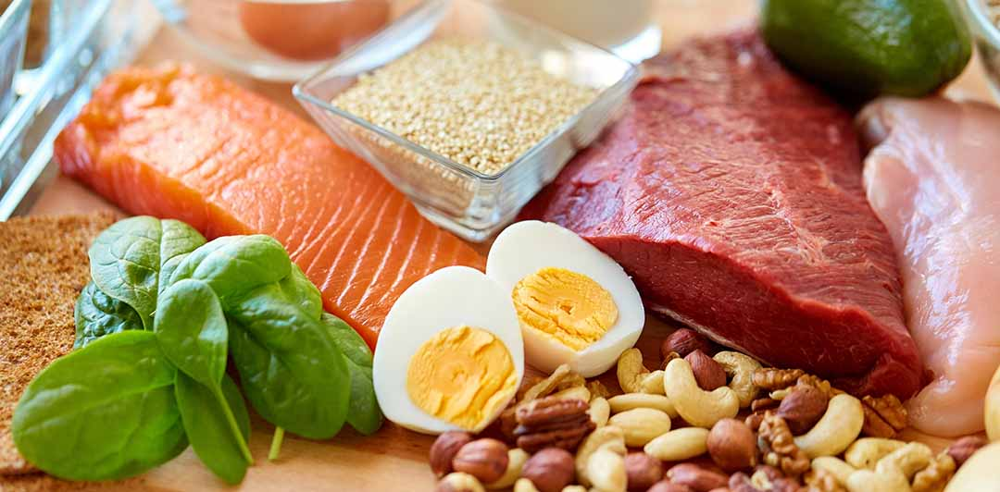

你好，欢迎来到《营养科学课》，我是仝卿。

这一讲，我们来说蛋白质。

你可能在新闻上看过一些生活在非洲食物极度匮乏地区的孩子们。他们身体消瘦，肚子却鼓鼓的。这其实是严重蛋白质缺乏的表现。实际上，蛋白质缺乏导致的营养不良，一直是世界上最严重的公共健康问题之一。

我们现在的饮食条件越来越好了，但我们这一讲还是要说说蛋白质摄入不足。因为在今天，蛋白质摄入不足的情况也并不少，只是很多时候，它在以一种我们难以察觉的形式默默发生。

我们先来看三个情况，你猜猜看它们之间有什么联系。

第一个情况。老张是个退休老爸，在女儿的支持下开始尝试每天去健身房健身。这几天他发现，健身之后膝关节很疼。他去医院检查后，医生确认这既不是有炎症，也不是骨质疏松。那到底是怎么回事呢？

第二个情况。小李是个准妈妈，在怀孕期间该补的维生素片一样都没落下，还常常煲汤补充营养。可是孕晚期检查的时候，医生告诉她胎儿发育偏小。小李想不明白，自己明明很注重营养摄入了，为什么还会这样呢？

第三个情况。小赵是个中学生，他最近很苦恼，因为上课的时候注意力总不能集中，被老师叫起来回答问题，总是反应不过来。妈妈带他去神经内科检查，也没发现有什么异常。那问题出在哪儿了呢？

你会说，这三种情况完全没关系啊，一个膝盖疼，一个胎儿发育不好，一个注意力不集中，去医院看病都是不同的科室。但从营养科学的角度看，这些情况背后的原因可能是相同的，就是蛋白质的摄入不足。

我们先来看，蛋白质摄入不足，为什么会导致膝盖疼呢？

人体关节的疼痛可能不是骨头的问题，而是肌肉的问题。关节的正常活动要依靠周围肌肉的支撑和保护，如果肌肉量减少，关节得到的保护减少、压力增加，就会逐渐引发慢性疼痛。

其实，肌肉量减少是中老年人关节疼痛的常见原因之一。减少的原因，可能是年龄增加，肌肉量自然减少，还有可能就是蛋白质的摄入太少了。人体内的大量蛋白质都集中在肌肉组织里，蛋白质摄入跟不上，肌肉量也就随着减少了。

再来说说第二个情况，很注重营养摄入的准妈妈，在检查的时候却发现胎儿发育得不好。这是怎么回事儿呢？

那位准妈妈煲汤喝汤，摄入的都是脂肪，其实没多少蛋白质的摄入。而蛋白质才是胎儿生长发育的基础材料，可以促进胎儿的发育。

按照世界卫生组织和《中国居民膳食指南》的推荐，对孕妇来说，摄入的蛋白质要比怀孕前多 50%。这位准妈妈的蛋白质摄入太少，当然就会影响宝宝的生长。

第三个情况，孩子注意力不集中，这为什么也和蛋白质摄入不足有关呢？

在医院的时候，医生询问了这个孩子的日常饮食习惯，发现他特别偏食、不爱吃肉。问题就出在这里。

大脑活动时，每一次有效的神经冲动都需要神经传导物质的帮忙。如果传导物质不足，那大脑的活动就会受到影响，表现出来就是“注意力不集中”“反应慢”。而要合成足够的传导物质，蛋白质的摄入就必须充足。

普通的鱼肉蛋奶就是蛋白质的主要来源，而那个孩子几乎不吃肉，就可能出现蛋白质摄入不足的情况，导致他的注意力不集中。

这三个例子，只是缺乏蛋白质的三种情况。参与人体生命活动的大概有 10 万种蛋白质，它的功能也涉及生命活动的方方面面。有的蛋白质组成了身体组织，完成心脏跳动、肌肉收缩这些基本生命活动；有的蛋白质作为功能分子，承担消化转运、释放信号等各种职责。所以，蛋白质摄入不足的表现可以非常多样化。

**你看，蛋白质缺乏的表现形式多种多样，还很容易让人误以为是其他的疾病，所以我才说，蛋白质缺乏的情况常常难以察觉，默默发生。**

既然蛋白质的功能涉及生命活动的方方面面，那“怎么补充蛋白质”就是很重要的问题了。

你可能在很多地方看到过一种说法，说有些蛋白质是“优质蛋白”，要多吃优质蛋白。

到底什么是“优质蛋白”呢？

要说得学术一点，那我们得看蛋白质内部的搭配。我们前面说，参与人体生命活动的有 10 万种蛋白质，但组成这些蛋白质的，只有大概 20 种氨基酸。在这 20 种氨基酸中，有近一半是人体没办法合成的，一定要从食物中获取，它们被叫作“必需氨基酸”。

如果有一种食物，它的蛋白质必需氨基酸种类齐全、数量充足，我们就叫它“优质蛋白”。

但放在我们平时吃的食物上，优质蛋白没什么特别的，普通的鱼肉蛋奶和大豆类制品，都是优质蛋白的来源。所以在我看来，要补充蛋白质，“吃什么”没那么重要，重要的是“吃足量”。

那每天摄入多少合适呢？

对于普通成年人来说，每天的蛋白质摄入量是用体重来折算的，每公斤要摄入 0.8 到 1.2 克的蛋白质。比如对一个 60 公斤重的成年人来说，每天要摄入 60g 左右的蛋白质。

但你可能想说，这数算出来没法直接用啊，怎么才能知道食物里的蛋白含量呢？

网上能查到各种食物的营养成分表，在这我就不多说了。我想分享一个简单的估算方法。你只需要记住三个数，就能搞定“食物蛋白含量估算”这件事儿。这三个数分别是 20、6 和 3。

这是什么意思呢？

100 克肉类，大概你手心那么大的一块牛排，能提供 20 克左右的蛋白质，一个鸡蛋能提供 6 克左右的蛋白质，100 毫升牛奶提供 3 克左右的蛋白质。肉、蛋、奶，这是三种我们最常见的蛋白质摄入来源，分别对应的蛋白质含量就是 20，6 和 3。这就能覆盖我们摄入蛋白质大部分的场景了。

有人可能还想问蛋白质有没有吃过量的情况。其实只要你平常吃的都是天然食物，基本上不用担心吃过量的问题。

当然，有喜欢健身的人可能会特地补充蛋白粉，我必须提醒，这个补充剂量和频次，最好和你的营养师确定。

咱们刚才说的都是健康人群，但在临床上有些患者，说自己平时很注意补充蛋白质，但还是被诊断出蛋白质摄入不足。这是为什么呢？

很简单，不管是健康人群还是临床患者，在蛋白质要吃足量的大原则下，还有两个需要注意的地方，也就是你要记住两个“搭配”。

**第一个搭配，就是要注意蛋白质和碳水化合物、脂肪的搭配。**

人体内含量和人体需求量比较多的营养素，我们叫宏量营养素，包括碳水化合物、蛋白质和脂肪。我们在前面的课程里提到过，这三大宏量营养素都能够提供能量，但是蛋白质生产能量的特性和其他两个营养素完全不同。

碳水化合物的分解高效、直接，是人体供能的主力；脂肪的能量密集，是储能的主力。而蛋白质呢，它既不是供能主力，也不是储能主力，用它来提供能量特别不划算。

什么意思呢？消化食物本身就是一种生命活动，咀嚼、吞咽、产生消化酶、胃肠道收缩等，这些环节都需要消耗能量。

消化碳水和脂肪的时候，只损耗它们不到 10%的能量就可以了。比如你吃了 100 克的碳水或者脂肪，那在消化环节会损失掉 10 克，剩下的 90 克都可以用来供能。

而蛋白质用在消化吸收环节损耗的能量，达到了它总能量的 20%到 30%，剩下的 70%才真正发挥作用。

这么看，在三大营养素中，消化蛋白质的能量成本最高，用它提供能量特别不划算。而且我们前面说了，蛋白质的功能涉及生命活动的方方面面，除了提供能量，它还有更多更重要的事情要做。

所以，只有碳水化合物和脂肪摄入充足的情况下，蛋白质才能主攻它自己的独有功能。这就是蛋白质和其他宏量营养素的搭配。

**第二个搭配，是蛋白质在自己内部的搭配。**

什么叫在自己内部搭配呢？蛋白质是由氨基酸组成的，在自己内部搭配，其实搭配的就是氨基酸。

我们前面提到，蛋白质当中必需氨基酸的种类齐全、数量充足，才是优质蛋白。虽然鱼肉蛋奶都是优质蛋白的来源，但总有一些食物，含有的蛋白不那么“优质”。比如面包、米饭里含有的谷物蛋白，猪蹄、鸡爪里的胶原蛋白，氨基酸组成和比例都有缺陷，就没那么优质了。

但这也不是说，这些东西就最好不吃，“多元组合”就是个出路。只要这些食物巧妙搭配，长短互补，一样可以组合出“优质蛋白”。

举个例子，切片面包里头的谷物蛋白，含有的赖氨酸少，但花生酱里的赖氨酸含量丰富，所以花生酱三明治这个组合就很不错。猪蹄里的胶原蛋白缺少色氨酸，但黄豆里头色氨酸充足，那黄豆炖猪蹄这搭配就挺妙的。

所以，摄入蛋白质可以吃含有“优质蛋白”的食物，也可以用多元组合的方法，凑出优质蛋白。这就是蛋白质自己内部的搭配。

总结一下这一讲的内容。

蛋白质缺乏的表现形式多种多样，很容易让人误以为是其他的疾病，所以它常常难以察觉。

摄入蛋白质，吃什么没那么重要，重要的是吃足量，日常的鱼肉蛋奶就是优质蛋白的摄入来源。

除此之外，还要注意两个搭配：第一个，和其他宏量营养素的搭配，碳水和脂肪必须吃；第二个，和其他氨基酸的搭配，多元的食物组合，可以组合出优质蛋白。

1 蛋白质缺乏的表现形式多种多样，很容易让人误以为是其他的疾病，所以它常常以难以察觉。 2  
摄入蛋白质，吃什么没那么重要，重要的是吃足量，日常的鱼肉蛋奶就是优质蛋白的摄入来源。 3  
除此之外，还要注意两个搭配：和其他宏量营养素的搭配，碳水和脂肪必须吃；和其他氨基酸的搭配，多元的食物组合，可以组合出优质蛋白。

到这里，宏量营养素里的碳水化合物和蛋白质我们就讲完了。

下一讲，我们来说最后一种宏量营养素，脂肪。我们下一讲见。

* * *

# 06 脂肪：研究结果相反，但并不矛盾

  
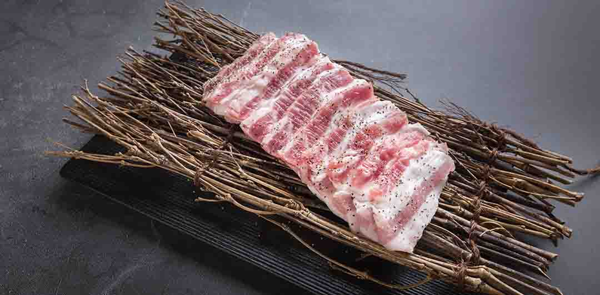

你好，欢迎来到《营养科学课》，我是仝卿。

前两讲我们说了碳水化合物和蛋白质，三大宏量营养素还剩下一个。这一讲，我们就来说最后一个宏量营养素，脂肪。

我们讲碳水化合物的时候，说它最不招人待见。轮到脂肪的时候，我完全能想到，很多人的感觉就是困惑。

比如很多人都听说过，脂肪吃得太多容易胖，所以不健康；结果营养科学有了新研究，说加了油的防弹咖啡能减肥，能帮你更健康。

再比如，前段时间听说，吃得太油容易得脂肪肝；今天又听说，吃饭清淡、不爱油腻的瘦子也会得脂肪肝。

还有，前段时间听说动物油不健康；今天又听说，原来植物油更不健康。

这些结论看起来完全相反，而且这不是新研究推翻了旧研究，这到底是怎么回事呢？

其实，这三个具体的困惑，恰好是围绕着营养科学认识脂肪的三个方面来说的，分别是脂肪的功能、代谢和构成。我们这一讲就来帮你扫清这些困惑。

听完你就会发现，恰恰是这些听起来矛盾的认识，才印证了营养科学对脂肪的认识深度。

先来说一条最容易被人们误会的困惑。发胖真的是因为吃了脂肪吗？会有这个困惑，就是因为我们对脂肪功能的认识，只停留在了“提供能量”上。我们来详细说说。

咱们最直观的感受，就是吃下去的脂肪太多，就会在身体里堆积，人就胖了。不过，随着研究的深入，我们发现吃太多脂肪而发胖，并不全是因为脂肪能量高，而是因为脂肪会让我们吃更多的东西，总能量摄入太多了。

而最近几年流行起来的防弹咖啡能帮助实现减重的关键点，也在这里。防弹咖啡，就是加了黄油、椰子油的黑咖啡。因为脂肪供能更缓慢，时间更长，早上喝完了防弹咖啡后不容易饿，摄入的总能量降低了，人才能瘦下来。

也就是说，喝防弹咖啡，是要用咖啡里的脂肪来代替传统早餐里的碳水化合物。如果喝了防弹咖啡，以往的早餐也照吃不误，那能量摄入肯定是要超标的，防弹咖啡也不能帮你变瘦。

而且在我看来，很多人听到“脂肪”就觉得会“发胖”，就不健康，真是小看脂肪了，他们只看到了脂肪“提供能量”这个功能，其实脂肪的作用远远超出了提供能量。

比如说，身体内的激素合成就需要脂肪，这条对女生来说尤其重要，因为不吃脂肪导致激素合成不足，有可能就会影响月经周期。还有些营养素，比如维生素 E，是需要有脂肪才能吸收的。脂肪摄入不足，还会导致这些营养素的缺乏。这些任务都是必须要由脂肪来完成的。

**咱们稍微总结一下，提到脂肪只能想到“胖瘦”的变化，是因为很多人对脂肪功能的认识不全面，只停留在了提供能量上，其实脂肪还有更多独特的功能。**  
对普通人来说，怕胖要控制的是总能量的摄入，不需要刻意低脂饮食。

胖瘦影响体态，我们再来看一个影响更严重一点的困惑。有脂肪肝、高血脂是因为脂肪吃太多了吗？有这个困惑，是因为我们对脂肪的代谢了解得不全面。

有些人因为害怕脂肪肝、高血脂这些疾病，大鱼大肉都不吃了，连牛奶都换成脱脂的，但还是没能改善血脂的情况。还有些人，本来就很瘦，吃得也很清淡，体检时却发现了脂肪肝。这是为什么呢？

这里头的原因就和身体里的脂类代谢有关。

我先简单说明一下，为什么这里用了“脂类”这个词。如果你看血脂报告单的话，就会发现不但测了体内脂肪，还测了胆固醇。在动植物体内，脂类是个总称，95%以上都是我们熟悉的脂肪。剩下那 5%叫“类脂”，它们的物理性质或结构类似脂肪，胆固醇、磷脂、糖脂都属于类脂。

身体里的类脂量虽然少得多，但对健康影响很大。比如有研究显示，“高胆固醇会增加冠心病的风险”。所以说到身体里头的代谢部分，我们用“脂类”更合适。

脂类的代谢通路分成了“出”和“入”两部分。

第一部分是脂类被吸收，通过血管运到肝脏，这是“摄入”的过程。第二部分是肝脏重新合成脂类，再通过血管运输到各个组织加以利用，这是“输出”的过程。两部分的交叠，是血管通道和肝脏“中间站”。

那如果脂类在血液中含量过高，就会导致高血脂；如果脂类堆积在肝脏里，就会导致脂肪肝。

**你一定发现了，想避免脂类堆积，光限制“摄入”不一定管用，还得看看“输出”有没有问题。**

谁在身体里负责脂类输出呢？你可能在体检报告单上见过各种“脂蛋白”，它们发挥的就是类似“快递员”的作用。

那咱们就用送快递来打个比方。

脂类就是快递员要送的包裹。脂蛋白，也就是快递员，分为好几种，它们的分工非常明确。比如极低密度脂蛋白和低密度脂蛋白，专门负责“派件”。它们负责把脂肪和胆固醇从肝脏派送到身体各处。而高密度脂蛋白专门负责“退货”，它们会收集胆固醇带回肝脏。

如果负责派件的快递员出问题了，包裹堆积在肝脏，脂肪肝就来了。如果负责退货的快递员少，包裹全都派出去了没人回收，血脂就高了。

总结一下，我们对脂类代谢通路的认识不够，才会有“吃多了脂肪会导致脂肪肝、高血脂”的印象。“输出”代谢通路出问题的时候，即使你在“输入”上吃得再低脂也没用，找专科医生做明确的诊断，找营养师综合调整饮食才是出路。

上面我们说的是生病的情况。那对大部分普通人来说，该怎么摄入膳食脂肪呢？这就要说到最后一个人们对脂肪的困惑了：到底是动物油更健康，还是植物油更健康呢？

咱们来详细拆解下，为什么会有“动物油不健康”和“植物油不健康”这两种说法。这就得说说我们对脂肪构成的认识了。

“动物油不健康”的说法，主要是因为动物来源的油脂里面“饱和脂肪酸”含量相对更高。

脂肪酸是组成脂肪的分子，粗略地可以分成饱和的脂肪酸和不饱和的脂肪酸。刚开始科学家研究脂肪和健康的关系时，有不少研究显示，饱和脂肪酸摄入超标，会增加冠心病和糖尿病的风险。

既然这样，就有很多人说，植物油里的饱和脂肪酸少，那就多吃植物油吧。

20 世纪 50 年代，人造黄油在欧美流行起来了，这就是一种植物油做的产品。用人造黄油代替每天餐桌上的传统动物黄油，就能减少饱和脂肪酸的摄入。

可是，这种转变并没有带来人们预期中的健康结局，经常食用人造黄油的人群，心脑血管疾病的发病率甚至更高了。

这是怎么回事呢？深入研究之后科学家才发现，植物油里的饱和脂肪酸少，但是不饱和脂肪酸多。高压、反复煎炸等加工技术和手段，会让不饱和脂肪酸发生变化，变成反式脂肪酸。

你可能听过“反式脂肪酸”的名字，和饱和脂肪酸相比，反式脂肪酸才是头号反派，对健康威胁更大，增加冠心病和肿瘤的患病风险更高。而相对来看，动物油的饱和脂肪酸在加工过程中的稳定性很强。这就是“植物油更不健康”的说法根源。

所以，你说动物油和植物油哪种更健康？其实从来源上区分，也就是这种油是来自动物，还是来自植物，这么区分并不合适，因为这两种油可能会经历不同的烹饪方式。

**那也就是说，我们在生活中进行选择的时候，挑选油的种类需要和烹饪方式相结合。**

比如，亚麻籽油富含人体必需的多不饱和脂肪酸，但是它的热稳定性不好，最好别炒菜用，可以在凉拌菜或水煮菜的时候淋上。又比如，猪油这种中餐里的传统用油，它的热稳定性好，还香，偶尔嘴馋想要油炸的时候可以用。

还有一些油，我点名推荐给你，就是稻米油、花生油和低芥酸菜籽油，它们的各类脂肪酸含量比较均衡，而且也比较稳定，很适合平时炒菜用。

你看，之所有会有动物油或者植物油不健康的说法，那是随着我们对脂肪构成和健康关系的认识而发生变化的。加工方式可能会改变脂肪的化学结构。对我们日常饮食来说，油是动物的还是植物的并不重要，重要的是给每种油匹配恰当的烹饪方式。

最后我还得补充一下。虽然我们前面说，身体里像胆固醇这样的类脂，对健康很重要，但要注意的是，身体里的胆固醇，和食物里的胆固醇是不一样的。  
**我们说，高胆固醇会增加冠心病的风险。这里的“高胆固醇”，指的并不是食物里的含量，而是血液里的含量。**

有什么区别呢？食物里的脂类吃下去之后到了身体里，会被分解，等待身体重新统筹分配。

也就是说，你血液里的胆固醇并不一定来自你吃下去的胆固醇。所以在我看来，关注食物里的类脂没那么重要，在说日常饮食的时候，我们只要关注占了更大比例的“脂肪”就行了。

好，总结一下这一讲的内容。

我们对脂肪的认识好像总在左右摇摆，其实表面上看起来的矛盾，都是没有更深度地理解。我们这一讲破解的三个困惑，其实是围绕着认识脂肪的三个方面来说的，分别是功能、代谢和构成。

摄入脂肪会发胖的背后原因，其实是食物总热量超标，控制好了总热量，吃脂肪并不会引起肥胖。

想避免脂肪肝、高血脂，光限制“摄入”不一定管用，还得看看脂类代谢的“输出”有没有问题。

如果输出有问题，需要及时寻找医生治疗。对大部分普通人来说，挑选油的种类需要和烹饪方式相结合。

1 摄入脂肪会发胖的背后原因，其实是食物总热量超标，控制好了总热量，吃脂肪本身并不会引起肥胖。 2  
想避免脂肪肝、高血脂，光限制“摄入”不一定管用，还得看看脂类代谢的“输出”有没有问题。如果输出有问题，需要及时寻找医生治疗。 3  
挑选食用油的种类需要和烹饪方式相结合。

下一讲，我们来说最后一个进入“七大营养素”排行的，膳食纤维。我们下一讲见。

* * *

# 07 膳食纤维：人体不需要，也算营养素

  
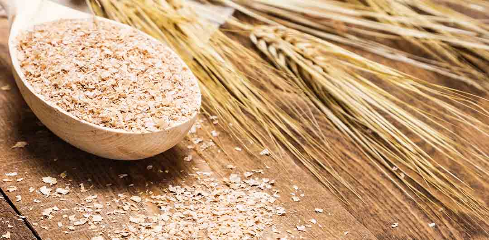

你好，欢迎来到《营养科学课》，我是仝卿。

我们继续来说营养素。我们这一讲要说的营养素比较特殊。在前面讲到碳水化合物的时候，我曾经说到，碳水化合物是人体能分解的糖，还有一部分不能被人体分解的糖，叫膳食纤维。

但是人体不能消化分解，好像人体并不需要，膳食纤维怎么提供营养呢？这也算是营养素吗？

我们对膳食纤维的认识确实有点曲折。

在营养科学中，膳食纤维是目前最后一个进入榜单的营养素。加上了它，才有了我们现在“七大营养素”一说。一开始我们忽视它，甚至想办法去除它，再到重新发现它的作用，重视它，还把它定义成了营养素。到现在，有些碳酸饮料里都加上了膳食纤维，好像这样就能算是“健康饮品”了。

其实在这中间，膳食纤维地位的一再翻转，体现的是营养科学的两个认知升级。我们这一讲就来说说这件事。

咱们先来说膳食纤维带给营养科学的第一个认知升级。

我们知道，绝大部分营养物质会在消化系统分解，再被吸收进入血液发挥作用。比如说在胃肠道，碳水化合物会变成葡萄糖，蛋白质变成氨基酸，脂肪变成脂肪酸。这些营养素进入血液，被运输到全身上下的组织细胞，支持各种生命活动。这是最开始我们对营养素的经典认识。

在这种认识下，膳食纤维被排除在营养素之外并不奇怪。因为它们是植物中不能被消化的多糖啊。在当时的人们看来，膳食纤维不能被消化吸收，是穿肠过的食物废渣，没什么用。

而且，膳食纤维这东西口感还不好。于是在很长一段时间里，人们都在努力研究如何从食物中去除膳食纤维。比如小麦、大米的壳里都含有大量的膳食纤维，人们就一直在努力把它们的壳去掉。科技的发展让富人先吃上了白面包。而穷人，继续吃着“粗糙”的食物。

我们回头看这段历史，恰恰是人们追求口感的吃法，让我们看到了不一样的健康结局。

怎么不一样了呢？

咱们先看有条件吃白面包的富人。20 世纪 60 年代，欧美社会经济快速发展，餐桌上的主角就是各种精细的加工食物。社会中营养不良的比例越来愈低，可是另外一种健康状况却开始流行起来：肥胖、糖尿病、高血压和心血管疾病会同时出现在一个人身上。

但是在同样的年代，穷人这边的情况呢？在非洲的乌干达，当地卫生和饮食条件都十分有限，人们吃的主要都是没有精细加工过的本地粮食和水果，但他们得糖尿病和高血压的情况特别少。

为什么富人和穷人有这样的差异呢？

有一位英国医生关注到了食物里膳食纤维的含量。他在去乌干达医疗援助时，看到路上都是体积特别大的人类粪便。他想可能是当地食物的膳食纤维含量大，才导致了粪便体积很大。于是这位医生有了个猜想，膳食纤维可能是一种对身体有用的物质。

我们现在已经知道了，膳食纤维的用处，发生在肠道内。它还有两种完全不一样的功能。

第一种功能是刺激肠壁蠕动，改善便秘。食物中那些吃起来口感不好的部分，比如谷类的外壳、瓜果的表皮，还有叶类蔬菜里嚼不烂的那些部分，就是“不溶性膳食纤维”。“不溶性”是指不溶于水。

为什么要强调这种特性呢？因为这种嚼不烂，也溶不了的特性，正是它发挥健康作用的关键。

食物里的膳食纤维含量高，就让人不得不多嚼一会儿，而更多的咀嚼不知不觉减慢了我们的进餐速度，可以防止你吃得太多。

等这些纤维到了肠道，又可以刺激肠壁蠕动，加速排泄。富含膳食纤维的饮食，已经被证实可以降低肠道疾病，比如结肠癌的患病风险。

膳食纤维还有一种功能，减肥的人应该很喜欢，就是增强饱腹感。

研究得更多了之后，营养科学家们发现，膳食纤维其实不只出现在食物口感不好的部分里，像燕麦、魔芋和豆类，它们也富含膳食纤维，但口感并没有很“渣”，反而可能还很软滑。这部分膳食纤维，叫“可溶性膳食纤维”，它可溶于水，溶于水的样子很像凝胶。

可溶性膳食纤维吸水后会膨大，不仅能增强饱腹感，还能延长食物在消化道里停留的时间，减慢糖分进入血液的速度，可以帮助人体平稳血糖。

你看，原来食物的成分进入身体之后，不被人体吸收也可以发挥功能。这就是膳食纤维给营养科学带来的第一个认知升级。

第一个新认知发生在营养素体内代谢的过程里，而另一个新认知，发生在代谢的主体身上。什么意思呢？

我们刚刚说了，膳食纤维不能被人体消化，所以我们总觉得它是“穿肠过”的。我们现在发现，膳食纤维确实不能被人体消化，但这并不意味着它“穿肠过”，人体内有其他的东西可以消化它。是什么呢？就是肠道菌群。

研究发现，肠道菌群非常喜欢可溶性膳食纤维。它们吃掉可溶性膳食纤维后，会代谢出一种成分，叫短链脂肪酸。短链脂肪酸是很多肠道有益菌的营养来源，同时，它还能改变肠道酸碱环境，抑制有害菌生长。

**体内消化食物的主体多了一个，那就意味着，我们吃饭的时候不能光顾自己了，还要想着肠道菌群的需求。** 吃膳食纤维，就是在满足肠道菌群的需求。

那膳食纤维一般都在哪些食物里比较多呢？很多人都觉得，像笋啊、芹菜啊，这种口感的食物里，膳食纤维会比较多。在营养科学上，其实口感并不是判断膳食纤维含量的靠谱依据。

我们刚才提到过，可溶性和不溶性膳食纤维的口感很不一样。而且，一种食物里头还可以同时含有两种不同的膳食纤维。比方说苹果，果皮里不溶性膳食纤维多，果肉里可溶性膳食纤维多。

所以总的来说，其实膳食纤维并不在某种特定的食物类别里，在蔬菜、水果、豆类里含量都很丰富。但基本上，都是植物性的食物。

如果我们顿顿只吃肉，自己吃饱了，肠道菌群还没吃，那整个肠道菌群就会失调了，有益菌变少，有害菌变多，肠道的免疫功能就没法正常发挥。而且，肠道菌群吃不到食物的话，只好吃我们的肠道黏膜。要知道，这层黏膜可是我们抵御病原体的重要屏障。屏障受损的后果很严重，病原体可能乘虚而入，感染人体。

当然，我必须坦诚地说，膳食纤维和肠道菌群的关系，营养科学目前并没有完全搞明白。这是营养科学研究里目前特别热门的一个方向。根据已有的研究结果，我们能看到这样一个三角形闭环：肠道菌群能利用膳食纤维，膳食纤维进一步优化肠道环境，肠道环境反过来供养肠道菌群。

这就是膳食纤维带给我们的第二个认知升级：原来消化食物的不只是我们自己，还有体内的肠道菌群。

既然膳食纤维对肠道菌群这么重要，那怎么吃才能喂好它们呢？

《中国居民膳食指南》给成年人的推荐量是每天 25 到 30 克。如果你新鲜的蔬菜、水果、豆类吃足了，基本不会有缺乏的风险。

可是如果你特别忙，吃不到那么多种类的新鲜蔬果该怎么办？我给你推荐一个方便的食物：红富士苹果。

一个稍微大点的红富士苹果大约 250 克，就含 5 克左右的膳食纤维，可以作为两餐之间的加餐，而且洗洗就可以吃，非常方便。你要注意苹果的种类啊，是红富士，它比别的苹果种类含膳食纤维更多。

有人可能想问，我不想吃苹果，吃膳食纤维补充剂行不行？平常也有特别多的朋友问我这个问题。

我只能说，目前我们不能确认，膳食纤维补充剂是不是和天然食物中的膳食纤维，有一样的好处。在各种研究当中，既有正面的数据，比如有研究说，膳食纤维补充剂对结肠癌和乳腺癌有预防作用，但也有负面数据，比如有研究说，膳食纤维补充剂会导致肝癌的发生率增加。

而且，吃补充剂还有一个弊端，就是容易吃过量。

成年人膳食纤维摄入的上限是每天 75 克，对大部分人来说是很难吃超标的。但是现在有了补充剂，那就大大了提高吃超标的可能性。如果你在吃，那一定要看清楚含量。

吃过量了会怎样呢？我和你分享一个案例。

有位老奶奶，六十多岁了，前不久做了胃部的手术。她听说膳食纤维有利于消化道的健康，出院后就吃了很多富含膳食纤维的豆腐渣，每餐必吃。结果一段时间后，她经常腹泻，去复诊的时候，还被诊断出了营养不良。医生问过后发现，这都是因为她吃了太多的豆腐渣。

这是怎么回事呢？我们提到了，膳食纤维很容易让人产生饱腹感，老太太吃豆腐渣吃饱了，吃别的食物就少了，营养摄入肯定减少。再加上她刚刚做了胃部的手术，对营养素的吸收程度本身就相对更低一些，时间一长，就引发了营养不良。

而且，过多的膳食纤维还会加重胃肠负担，引起功能紊乱，在她身上就表现出了腹泻的症状。

当然，这个情况大部分人碰不到。对普通人来说，你就记住，多吃植物性的食物，想补充吃红富士苹果就好了。

总结一下这一讲的内容。

膳食纤维在营养科学地位的变化，体现了营养科学的两次认知升级：在食物的代谢过程中，膳食纤维即使不被人体吸收也可以发挥功能；消化食物的不只是我们自己，还有体内的肠道菌群。

如果需要补充膳食纤维，我推荐你用红富士苹果。

1 在食物的代谢过程中，膳食纤维即使不被人体吸收，也可以发挥功能。 2 膳食纤维不被人体吸收，也不意味着它是“穿肠过”的，肠道菌群可以消化膳食纤维。 3  
如果需要补充膳食纤维，我推荐你用红富士苹果。

下一讲，我们要说一个对很多营养素来说都很重要的营养素，水，因为它承担了大部分营养素的运输工作。我们下一讲见。

* * *

# 08 水：确保代谢顺利的基础

  
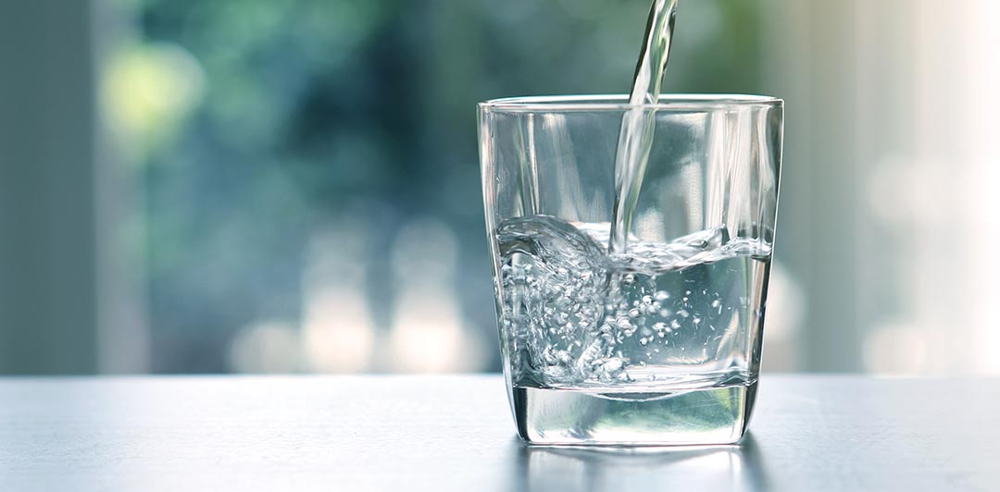

你好，欢迎来到《营养科学课》，我是仝卿。

这一讲我们要说的营养素，是水。

我们都说水是生命之源，但放在营养素里，水大概是最容易被忽视的那个了。很多人对水都有这样的印象：没有颜色，没有味道，没有能量。这怎么能算是营养素呢？

我们在第一讲就提到，在营养科学看来，营养素说的是维持人体正常新陈代谢的重要物质。我们已经介绍的每一种营养素，都在代谢的某个过程中起到了重要作用。

而水作为营养素的不同之处在于，它参与了代谢的全过程。

咱们就拿一个人体代谢旺盛的场景，马拉松长跑来举例子。整个代谢过程从摄入开始，到消化分解，再到合成身体成分，最后代谢产物排出体外。我们来看看水在整个过程中是如何工作的。

你现在站在马拉松的起点上，马上就要开始一场严酷的耐力考验。

为了储存能量，你在跑步前两个小时已经吃好了早餐。我们前面说过，产能主要是三大宏量营养素，也就是碳水、蛋白质和脂肪的功劳。不过别忘了，所有营养物质的消化，背后还有一个功臣，那就是水。因为接下来的整个消化过程，必须在液体环境中才能进行。

碳水和组成蛋白质的氨基酸都溶于水，脂肪的代谢也需要能溶于水的蛋白质包裹着，才能继续消化代谢。除了三大宏量营养素以外，水溶性的维生素和矿物质也都溶于水。你看，水是我们消化代谢的重要载体。

好，你现在开始跑步了。跑步的时候有个很重要的动作是调整呼吸，在这方面水也有帮忙。水分子会进入你的呼吸道，作为润滑剂，让呼吸道上的纤毛定向摆动，帮助你把吸入的灰尘、杂物通通排出去，保证你的呼吸是顺畅的。

为了帮你完成每一次高效的跑步动作，水还会进入到肌肉里，通过在细胞内外的移动，维持细胞内外的离子浓度平衡，离子浓度平衡了，才能保证你的肌肉能正常收缩。你跑步的时候大量出汗，补水又不够，细胞内外的离子浓度失衡，就很有可能引发腿部抽筋。

运动时补水很重要，像马拉松这样长时间的运动，补水更加重要。

长期高强度的运动会损伤关节的软骨，而水会进入关节软骨里，让每一个软骨细胞都充盈起来，起到润滑关节、减少摩擦和增加缓冲的作用。软骨细胞水量充足时，运动对关节的损伤就能降到最低。

身体的各种代谢废物也需要依托水来通过皮肤、呼吸和泌尿系统排出体外。跑步的时候，水的排出更多地会通过皮肤组织，它会形成汗液帮你散热、调节体温。

在这整个代谢过程中，人体内有一个水量调节机制。如果身体失水太多，大脑里的一个很重要的部位，叫下丘脑，会释放喝水信号；肾脏也会同时接收到信息，加强对水的回收，更多的水分会停留在身体内。这样的水量调节机制，也在帮助我们维持细胞内外离子浓度的平衡。

我们刚刚说了缺水的情况，可能会肌肉抽筋、会损伤关节等，那如果水喝多了呢？

马拉松全程有很多个补给站，你可以在补给站补充损失的水分。但我要提醒你一个情况，就是“水中毒”。短时间内大量饮水，血液里的离子浓度迅速降低，会引发细胞水肿。如果没有及时纠正，最终甚至可能导致死亡。这种情况就是“水中毒”。在马拉松比赛中，几乎每年，你都能在新闻里看到一些这样的案例。

当然，我们刚刚讲的是马拉松这样的极限运动，日常生活中，很少有人因为喝水太多导致“水中毒”。

不过，只要有身体活动，水参与代谢过程的方式都是类似的。 **水参与了新陈代谢的整个过程，是代谢顺利进行的基础。**

对普通人来说，“水中毒”的情况很少见，常见的是“慢性脱水”。说“慢性脱水”很学术，其实就是长期喝水喝不够。你别看只是每天少喝了点水，但它引发的损伤很可能是不可逆的。

2002 年，发表在《柳叶刀》医学杂志上的一项长期研究结果显示，每天液体摄入量不足 1.5 升，就会引发慢性脱水。

如果长期低于这个数值，肾脏这个“水泵”就不能正常工作。刚开始或许只是泌尿系统感染或者结石，时间长了，肾功能会受到损伤，一路发展成肾衰竭、尿毒症。不少肾病患者早期的生活习惯，都有一个共同的特点，那就是特别不爱喝水。

所以对普通人来说，最重要的事情就是喝水要喝到足够的量。

提到要喝足水，你脑子里可能马上跳出了“每天八杯水”。有的人很较真，就会问那是多大的杯子？是一定要八杯吗？有的人不太在乎细节，觉得渴了就喝啊，哪有那么多标准。

**我得先提醒你，千万不能跟着自己的感觉走。**

因为产生渴的感觉比身体缺水要滞后很多。你感觉到口渴的时候，身体大概已经缺了 500 毫升左右的体液，这可是一瓶矿泉水的量了。而且随着年龄的增长，我们对“口渴”的感受也会变得越来越不准确。

那怎么办呢？对忙碌者来说，我给你一个简单好记的办法：工作间隙每次忍不住拿起手机的时候，同时也拿起水杯喝上几口，这样就很合适。

如果一定要记一个液体摄入量数值的话，正常成年人每天大概是 2.5 升左右。这当中包括白水，还有其他含水分的食物。比如黄瓜、生菜、芹菜和西红柿，这些蔬菜的含水量都在 95%以上，和喝水差不多。

那怎么知道自己喝水喝没喝够呢？

**最直接的信号是尿液的颜色。如果是接近透明的浅黄色，那就说明饮水量很理想了。** 如果颜色过深且量少，多半是好久没喝水了。

别的身体信号一般没有那么明显，但如果你观察到了明显的缺水信号，那就要高度重视了。

比如婴儿腹泻失水过多的时候，你捏起他腹部的皮肤，可以看到皮褶的回弹速度变慢。这往往提示代谢平衡已经被打破，必须尽快寻求专业医生的帮助。

但有的人可能还有困惑，就是感觉自己喝了很多，身体还是有缺水的表现。这是为什么呢？

那我就要多问你一个问题了，你以为自己喝的“水”，是不是饮料？特别是含有酒精或者咖啡因的饮料？啤酒、咖啡、茶、可乐，这都算。如果是，那这就是问题所在了。

我们前面说了，水参与了代谢的全过程，营养代谢都需要水的帮助。饮料中除水以外的配料，在代谢的过程中当然也需要水分来帮助代谢，这自然就会损耗一部分的水分子。

如果是酒和咖啡，那损耗得就更多了。因为对大部分人来说，酒精和咖啡因是利尿剂，会促进水分通过尿液排出体外。

**所以，酒和咖啡不是不能喝，而是最好不要把它们算在你的液体摄入量里。** 我们刚才提到的 2.5 升液体摄入量，白水应该占到至少三分之二。

有人还会问，那白水也分好多种啊，我看广告说矿泉水含有矿物质，是不是喝矿泉水更好？

我的看法是，咱们喝水只有一个核心目的，就是补充身体水分。你只要确认你喝的水没有有害物质，比如重金属和致病菌群，保证饮用水安全就行了。

至于里面是不是有有益身体的矿物质成分，无所谓。因为矿泉水里的矿物质含量太少了。我们就拿钙来举例子。一升矿泉水里的钙含量在 4 毫克左右，这 4 毫克的钙，你喝一口牛奶就补回来了。

总结一下这一讲的内容。

水参与了人体新陈代谢的整个过程，是新陈代谢能顺利进行的基础。

产生渴的感觉比身体缺水要滞后很多，所以喝水千万不能跟着自己的感觉走。

判断水喝没喝足，可以看尿液的颜色。饮水量很理想时，尿液的颜色是接近透明的浅黄色。

补充水分最好喝白水，如果喝酒和咖啡，那就最好不要把它们算在你的液体摄入量里。

听完这一讲，就拿起水杯喝口水吧。从现在开始，让“喝水”成为你排在第一位的日常健康习惯。

1 水参与了人体新陈代谢的全过程，是代谢顺利进行的基础。 2 产生渴的感觉比身体缺水要滞后很多，所以喝水千万不能跟着自己的感觉走。 3  
判断水喝没喝足，可以看尿液的颜色。饮水量很理想时，尿液的颜色是接近透明的浅黄色。 4  
补充水分最好喝白水，如果喝酒和咖啡，那就最好不要把它们算在你的液体摄入量里。

喝水要注意的是“量要足”，下一个我们要说的营养素，可能你吃足了，也很容易缺乏。这就是维生素。我们下一讲见。

* * *

# 09 维生素：吃了足够多，也会营养不良

  
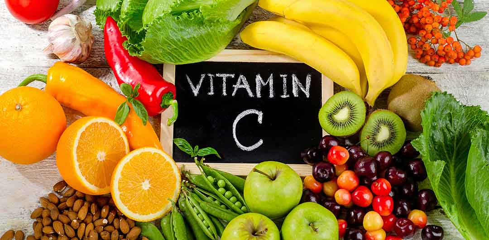

你好，欢迎来到《营养科学课》，我是仝卿。

我们继续来说营养素。我们这一讲要说的营养素，是维生素。我们营养科学上，对大部分维生素的认识，其实都是从一个最初无法理解的病症开始的。

16 世纪，葡萄牙航海家麦哲伦的船队开始了远途航行。航行开始后的 3 个月，船上的船员们陆续出现了牙龈出血的症状。随后不久，他们的牙齿开始脱落，身上布满了出血点，很快就死去了。

我们现在不知道这个病症的第一次出现，是不是在麦哲伦的船队里，但能肯定的是，这个病症曾经是大航海时代船员们的噩梦。后来，有位英国海军医师发现，喝柠檬汁就可以帮助患病的船员恢复健康。

我们现在已经知道了，船员们得的是坏血病，补充维生素 C 就可以治疗。你看，当时人们还不知道柠檬里头有维生素 C，但是他们已经开始用食物来治病了。

不只是维生素 C，其他的维生素被发现的故事也都差不多。比如有的古埃及人发现自己天一黑就完全看不到东西，他们会通过吃肝脏来缓解。后来人们从肝脏中分离出了维生素 A，治疗的是夜盲症。你看，我们发现这些维生素，都是从一些病症开始的。

这么看来，维生素是“维持生命的要素”这个说法并不夸张。从发现病症，到饮食经验改善症状，最后从饮食中提取单一成分治疗症状，维生素的研究可以说是现代营养科学的重要学科基础。

和船员们缺维生素 C 的情况相比，100 多年过去了，我们的饮食条件越来越好，提取和人工合成维生素的技术越来越强大，但是我们容易缺乏维生素的情况依然没什么改变。

前面说了很多营养素，一般都是因为我们没吃够相关的食物才会缺乏，但维生素的情况是，即使你吃了特别多相关的食物，也很容易缺乏。这是为什么呢？我们这一讲就来说说这件事。

先问你个问题，你觉得什么样的食物能给我们提供维生素呢？

很多人的回答都是，蔬菜水果嘛。不管执行什么饮食方案，比如素食、低脂饮食和低碳水饮食，只要蔬菜水果吃够，感觉维生素摄入就应该不是问题。

但是我必须得提醒你，其实这几种饮食方案，每一种都可能会出现缺乏维生素的情况。

咱们就拿纯素食来打个比方。纯素食的人身上可能发生的一些情况，比如总打不起精神，就和缺乏维生素 B12 有关。

因为维生素 B12 对维护神经细胞有重要的作用，神经细胞得不到足够的营养，传递信号不够敏捷，人就容易打不起精神。而且维生素 B12 基本只来自动物性的食物，比如动物肝脏、金枪鱼、牛肉，等等。但这些食物纯素食的人都不吃，就会出现精神差的情况。

其他的饮食模式也类似。比如有些人为了保持身材，会长期坚持低脂饮食，几乎不吃脂肪。但各种植物油里才富含维生素 E，这可是我们身体抵抗氧化损伤的重要防御力。很多坚持低脂饮食的人头发干枯分叉、脸色差，这就是因为缺乏维生素 E，人体表面细胞被氧化的表现。

还有低碳水饮食，因为各种谷物里才有大量的维生素 B1，碳水吃得少，肯定容易缺乏维生素 B1。我就不详细说了。但我们能看出来，维生素遍布了各种大类的食物，并不是吃足了蔬菜水果就能解决的。

《中国居民膳食指南》按照咱们中国人的饮食习惯，把食物分成这几类：谷薯类、蔬菜水果类、畜禽鱼蛋奶类、大豆坚果类和油脂类。维生素存在于以上所有的食物大类中。

所以，要想做到真的不缺乏维生素，我们第一步要做的，就是各大类食物都吃到，吃得均衡一些。

在饮食上吃均衡了，就能不缺乏了吗？也不是。还有两种维生素，它们的摄入途径比较特殊，基本不靠饮食摄入。这就是维生素 D 和维生素 K。

你可能对维生素 D 比较熟悉，知道补钙的同时也得补充维生素 D，不然吃了钙片可能也吸收不了。那怎么补维生素 D 呢？得靠晒太阳获得。

其实在一些深海鱼和动物肝脏里，也有维生素 D，但大部分人吃的量不多。我们身体里 80%的维生素 D，还得靠晒太阳。

而且我给你提个醒，晒太阳得去户外，隔着玻璃晒是补不了维生素 D 的。因为阳光里的紫外线分为好几种，能帮助我们补充维生素 D 的那种，很容易被挡在玻璃外。

另一种摄入途径很特殊的维生素，是维生素 K。它在人体内负责凝固血液，如果缺乏，手指割破了血液会很难凝固。

但是维生素 K 缺乏的情况，一般都发生在新生儿身上，成年人几乎不会缺乏。为什么呢？其中有个重要的原因是，维生素 K 主要不是通过吃得到的，而是靠肠道菌群合成的。

新生儿的肠道还没有建立完善的菌群，缺乏维生素 K 的可能性就大大提高了。现在在医院里，新生儿一出生就打的那一针，打的就是维生素 K。

那对成年人来说，要保证肠道菌群健康，能产生足量的维生素 K，我们可以做什么呢？我们在“膳食纤维”那一讲说了，肠道菌群喜欢吃的食物就是膳食纤维。如果忘了怎么补充膳食纤维，你可以再去听一遍那一讲。

你看，这两种维生素特殊的摄入方式，就不是光靠均衡饮食可以解决的。不注意晒太阳、不注意肠道菌群健康，也会缺乏维生素。

但是这还没结束。即便你注意到了我们上面说的所有，饮食也均衡，户外活动也多，肠道菌群也健康，还有一些生活习惯，会干扰维生素的摄入。

咱们来看个案例吧。小李是个推销员，天天在外面跑，忙起来都没时间喝水。他平时工作应酬比较多，抽烟、喝酒免不了，但在吃饭方面还挺注意的，点外卖时知道荤素搭配，蔬菜水果也吃得不少。听起来，维生素摄入应该没什么问题吧？

真不巧，小李的生活习惯，正好踩到了几个影响维生素摄入的因素。

首先就是抽烟、喝酒。这两个生活习惯都会额外增加维生素的损耗，特别是维生素 C。

为什么呢？烟和酒在身体里代谢的时候，会产生氧化剂，损伤血管组织。而保护组织、参加抗氧化防御的，正是维生素。

那也就是说，抽烟、喝酒会额外增加维生素的损耗。维生素 C 又是抗氧化的主力维生素，所以对它的损耗特别大。

接下来，就是小李吃的几乎都是外卖。

食品加工方式会严重影响食物里维生素的含量。举个例子，B 族维生素就特别“娇气”，怕热、怕碱、怕水洗。很多油炸的速食，基本上 B 族维生素早就折腾没了。外卖里的粉丝、凉皮这些都经过反复的水洗加工，B 族维生素可以溶于水，多洗几次损失就很多。

最后是饮水量。小李忙起来没时间喝水。在水的那一讲，我们说“水是营养素的载体”。这句话是特别针对那些能溶于水的维生素的。水没喝足量，你吃下去的这些维生素不能被送到指定的部位，也会影响吸收。

这些都是生活习惯对维生素摄入的影响。

你可能会说，既然维生素这么容易缺乏，那我是不是应该额外补充维生素补剂呢？毕竟维生素的补剂，市场上特别常见，有复合的维生素补剂，也有特定的单一维生素补剂。

我一般是这么建议身边的朋友的。补充维生素，还是优先选天然的食物。维生素补剂能不能吃？能，但维生素补剂只能作为天然食物的辅助。

为什么只能作为辅助呢？

我猜很多人会觉得，蔬菜里的维生素 E 和补充剂里的维生素 E 是相同的。这里我必须得敲个黑板，你一定记住，在很多情况下，它们都不是一回事儿。

比方说，维生素 E 补充剂里，一般只包含一种成分，叫α-  
生育酚。而食物中的维生素 E 是个组合，存在八种不同化学形式的成分。到现在，我们也还不知道它们之间是怎么协同工作的。

也就是说，按目前营养科学的理解，小药片并不能完全模拟和还原食物里的营养世界。这就是为什么营养师总说，天然食物永远是第一位的。

既然说到了维生素补剂，那我还得提醒你一个情况，就是不要一不小心吃过量了。如果你只吃天然食物，基本不用担心维生素吃过量的情况，但吃维生素补剂可就不一样了。

一般来说，只吃单一维生素的补剂是最容易超标的。有些代谢慢的维生素，比如维生素 A、D、E、K，摄入过量都会中毒。所以，如果你没有医生的诊断和处方，那我不建议你自己服用大剂量的维生素补剂。

对大部分普通人来说，维生素补剂是用来阶段性补营养素缺口的。比方说，你这段时间出差，吃不上蔬果，就可以考虑吃复合维生素片。你这段时间户外活动特别少，就可以考虑补充维生素 D。

总结一下这一讲的内容。

维生素并不只存在于蔬菜水果中，它遍布在各大类的食物当中。所以要补充维生素，第一步必须吃得均衡。

需要注意的是，有两种维生素基本不能经由饮食摄取：补充维生素 D 要多晒太阳；补充维生素 K 要多吃膳食纤维，维护肠道菌群健康。

除此之外，我们还要注意一些生活习惯，比如抽烟、喝酒、喝水少等，会影响维生素的摄入。

维生素补剂，只能作为天然食物的辅助。

1 维生素并不只存在于蔬菜水果中，它遍布在各种大类的食物当中。所以要补充维生素，第一步必须吃得均衡。 2  
有两种维生素基本不能经由饮食摄取：补充维生素 D 要多晒太阳；补充维生素 K 要多吃膳食纤维，维护肠道菌群健康。 3  
一些生活习惯，比如抽烟、喝酒、喝水少等，会影响维生素的摄入。 4 维生素补剂只能作为天然食物的辅助。

下一讲，是我们营养素模块的最后一讲，我们来说说矿物质这种营养素。我们下一讲见。

* * *

# 10 矿物质：掌握“此长彼消”的摄入平衡

  
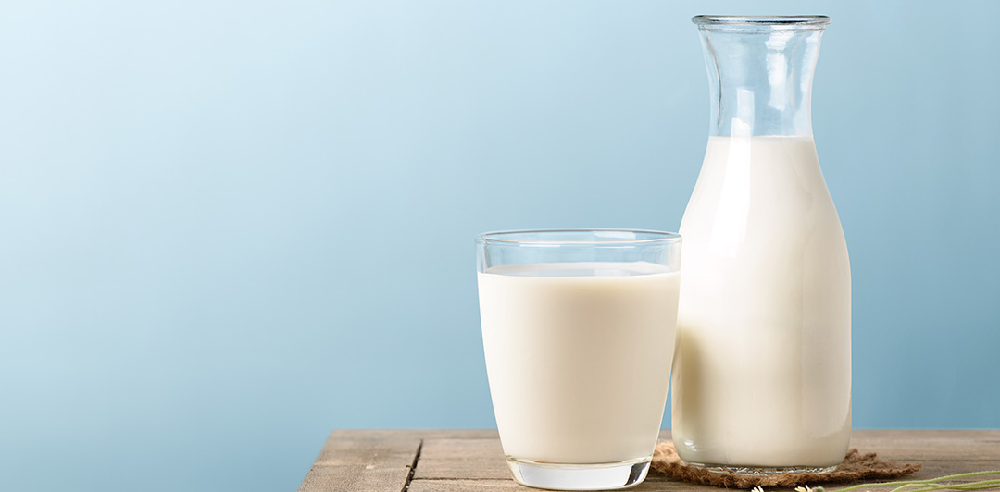

你好，欢迎来到《营养科学课》，我是仝卿。

这是我们整个营养素模块的最后一讲。这一讲，我们要说的是矿物质。

我猜有的人对矿物质最初的认识，可能来自一些矿泉水的广告。有些广告会说，我们的矿泉水是天然的泉水，里面含有几十种矿物质元素，喝了更健康。

矿物质确实是土壤和水源中天然存在的一些化学元素，但其实并不是所有的矿物质元素，都是营养科学要讨论的“营养素”。

这是什么意思呢？营养科学想讨论的是矿物质和健康状态之间的关系。而有些矿物元素的功能我们还不清楚，暂时讨论不了。还有些元素对身体明确有害，不能算作营养素。

在营养科学框架下，我们只讨论对身体有明确功能的那些元素。在《中国居民膳食营养素参考摄入量》官方文件当中，这样的元素只有十几种。

十几种，听起来也很细碎，我们该怎么认识矿物质呢？

在官方文件或者营养科学教科书中，你会看到这些元素通常都是这么分类的：

在人体内含量小于 0.01%体重的叫微量元素，包括铁、碘、锌、硒、铜、钼、铬；

大于 0.01%体重的叫常量元素，包括钠、钾、氯、钙、磷、镁。

所以营养科学一般提到“矿物质”，是按“微量元素”和“常量元素”来区分的。“微量”和“常量”，区分的就是它们在人体内的含量高低。

你看，教科书看待矿物质，先看含量的高低。这个视角做营养科学研究的时候很靠谱，但我要说的是，它对我们日常饮食的帮助不大。

因为含量高低，既不代表矿物质的重要性高低，也不能指导食用量和食用频次的大小。这一讲，我要和你说一种看待矿物质更实用的视角。

这个视角，就是看这种矿物质是和饮食更相关，还是和环境更相关。这么看矿物质的好处是，明确了和谁更相关，你迅速就能知道某种矿物质该怎么摄入了。

这是什么意思呢？

我们先来看和饮食更相关的矿物质。

在我们刚才提到的元素中，钠、钾、钙、磷、铁、锌就是典型的和饮食密切相关的矿物质。在营养科门诊，那些被诊断为“矿物质摄入不足”的孩子，他们的饮食结构大都有这样一个特点：某种食物大类特别强势，而另外一个食物大类几乎缺失。这样的饮食习惯对于矿物质摄入来说就是灾难。

我们说个例子。有位妈妈带着孩子来看病，说孩子总生病，个子矮，学习差，会不会是网上说的缺锌啊？孩子出现这些情况的原因很多，缺锌只是其中的一个可能。

所以，营养科大夫得鉴别诊断，有个必问的问题就是：平时孩子爱吃什么啊？妈妈说，她自己吃素，孩子也不爱肉，只喜欢吃白饭，豆制品吃得不少。

咱们分析一下。各种肉类是锌最常见的来源，吃素食本来锌摄入就少。再加上，孩子又吃了很多谷物和豆制品，这些食物里大量的铁，和一种叫植酸的物质，还会限制锌的吸收。这样的吃法最终就引发了锌缺乏，在孩子身上出现了非常明显的症状。

这些和饮食特别相关的矿物质，因为不同的食物富含不同的矿物质，所以只吃单一大类的食物，非常可能导致这些矿物质缺乏。  
**如果咱们只记一条饮食习惯来搞定这类矿物质的摄入，这条饮食习惯就应该叫“不偏食”。**

而另外一些矿物质，和饮食的关系相对较小，而和环境的关系更大。像硒、碘、铜、钼、铬这些元素，基本上就是这样。

这是什么情况呢？我们前面说了，矿物质是土壤和水源中天然存在的一些化学元素。食物里的矿物质直接或间接地来自土壤和水源，而我们体内的矿物质来自食物。

那也就是说，如果矿物质在环境中的分布就不均匀，有明显的地域性，那即使你饮食均衡，也可能会缺乏。

我们拿“硒”这个元素来举个例子。

80 年代以前，在黑龙江省克山县，有一些人得了很奇怪的心脏疾病。他们经常心悸，会呼吸困难，严重时还会休克。因为是在克山县最先发现的病例，人们就把这种病命名为“克山病”。流行病学的调查显示，克山这个地方，土壤、水源中的硒元素含量特别低，这可能就是克山病重要的发病因素。

**不过，如果你所在的地区并没有这类矿物质缺乏或者过量的问题，那你不用太担心这类矿物质的摄入，基本上顺其自然就没问题。**

这就是我说的，一个比较实用的看待矿物质的视角：看它是和饮食更相关，还是和环境更相关。这样的区分可以帮助我们用更简单的思路来摄入矿物质。

我们刚刚说，想要吃足那些和饮食更相关的矿物质，我们要做到“不偏食”。在这个原则之下，还有一个注意事项我们必须要记住。

这个注意事项是，要注意矿物质和矿物质之间的相互作用。

什么意思呢？前面的课程里，我们说的那些营养素，发挥功能的时候都相对独立。比如你吃了蛋白质，它不会影响碳水化合物发挥功能。但和饮食相关的这类矿物质不是这样的，它们之间存在相互作用，常常要“成对”地讨论它们的功能。

我们举个例子，钠和钾。

说到钠，你一定比较熟悉，它是盐的主要成分。现在大家都知道要少吃盐，盐吃多了容易高血压。其实，血压的变化不仅和钠摄入过多有关，同时还和另一种元素，钾的摄入过少有关。

这是怎么回事呢？我们的身体要实现的很多功能，比如心脏跳动、肌肉收缩，都靠钠离子和钾离子在细胞内外的一次次转移。  
**钠离子和钾离子的数量相对平衡，细胞才能维持健康的运转。**

不幸的是，现代饮食正朝着“高钠低钾”的趋势发展。

各种加工食品为了增加风味，会加入大量的钠。有些高钠食物尝起来不是很咸，特别是和辣味或者甜味重叠的时候，咸味会被掩盖掉，就会让我们不知不觉增加很多隐性的盐分摄入。

而这些加工食品中，钾的含量又非常低。因为钾是动植物细胞内主要的阳离子，只有那些保持着完整细胞结构的食物，比如新鲜的蔬菜水果，还有烹饪程度没那么高的肉类，钾的含量才足够高。而加工食品内部的细胞结构，往往都是被破坏了的，含钾量就很低。

那要想避免这种“高钠低钾”的饮食，方案就很明确了：多吃新鲜食物，少吃加工食品。这样既可以避免加工过程中的添加盐，又增加了钾的摄入。

还有一对矿物质，我们在日常生活里也经常碰到，就是钙和磷。

钙是骨骼健康的基础，很多人都非常重视，平时也很注重喝奶和吃钙片。但还是有很多人会出现骨密度降低的问题。这是为什么呢？除了年龄、遗传这些我们无法控制的因素，很多人忽略了饮食上磷的摄入问题。

**钙和磷是会互相影响对方吸收的。如果你吃了过多的磷，身体吸收钙的量就会降低。**

我们每天需要摄入磷的量是 720 毫克。但你知道中国居民平均每天会摄入多少磷吗？将近 1000 毫克，超标太多了。磷的主要来源就是食品添加剂。比如各种火锅料，香肠、火腿这些加工肉，还有方便面、快餐浓汤，以及很多人特别爱喝的碳酸饮料，这些加工食物里都有非常多的食品添加剂。

**你看，不管是钠和钾，还是钙和磷，它们之间的相互作用都在提醒我们要少吃加工食品，尽量选择新鲜的天然食物。**

我们刚刚说的注意事项，是针对那些和饮食紧密相关的矿物质的，那还有和环境更相关的矿物质呢？摄入它们有什么注意事项吗？

一般来说，这类矿物质的摄入不用我们来担心。特殊地区人群的矿物质摄入，会有国家层面的宏观调控。

比如前面提到的克山病，国家做了两件事儿：一件是在当地农作物的肥料中加硒，还有一件是推广“硒盐”，我们吃的是加碘的盐，他们吃的是加硒的盐。现在，克山病的发病率已经越来越低了。

既然说到了加碘的盐，我们也一起说说。

内陆地区的人缺碘是很常见的情况。在 90 年代，联合国和世界卫生组织就开始推行在食物中添加碘了。但是碘加在哪种食物中，每个国家不一样，这取决于食物的覆盖面。

我们国家把碘加在了覆盖面最广的盐当中，而美国，因为他们吃面包更多，就把碘加在了面粉中，东南亚国家呢，把碘加在了他们最常见的调味料“鱼露”里面。

虽然说这类和环境更相关的矿物质，我们一般不用担心缺乏的问题，但如果你想摄入更加多元的这类矿物质，我也可以分享给你一个方法。就是尝试不同产地的食物。同样是大米，黑龙江地域产的，和福建地域产的，矿物质的种类和含量都不一样。

总结一下这一讲的内容。

营养科学的研究更看重矿物质在体内含量的多少，我们这一讲说了一个更实用的视角，就是看矿物质是和饮食更相关，还是和环境更相关。这样的分类可以迅速帮我们确定“该怎么吃”。

要补足和饮食更相关的矿物质，就不要偏食，而且要注意矿物质和矿物质之间的相互作用。而面对那些和环境更相关的矿物质，我们一般不用担心缺乏的问题，但如果你想摄入更加多元的这类矿物质，可以尝试不同产地的食物。

1 我们可以把矿物质分成两类，一类和饮食更相关，一类和环境更相关。这样的分类可以迅速帮我们确定“该怎么吃”。 2  
要补足和饮食更相关的矿物质，就不要偏食，而且要注意矿物质和矿物质之间的相互作用。 3  
面对那些和环境更相关的矿物质，我们一般不用担心缺乏的问题，但如果你想摄入更加多元的这类矿物质，可以尝试不同产地的食物。

到这一讲为止，所有的营养素我们都讲过了。

从下一讲开始，我们会进入第三模块，用营养科学的视角来分析食物，评估饮食风险，为自己制定一个合适的饮食方式。我们下一讲见。

* * *

# 11 比例：评价饮食模式最重要的标准是什么？

  
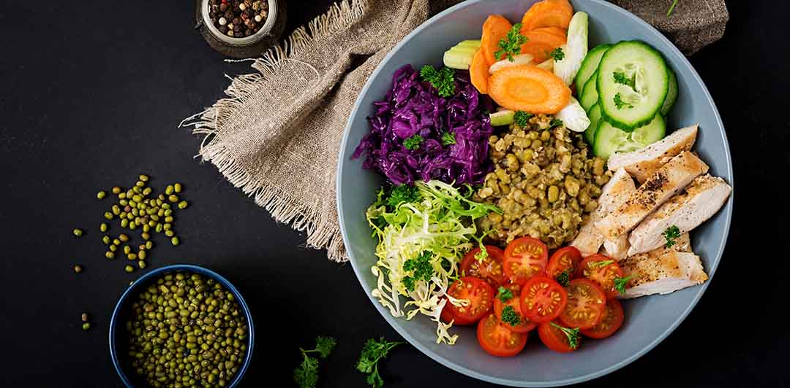

你好，欢迎来到《营养科学课》，我是仝卿。

上一个模块，我们把每种营养素都说了一遍。可是，平时我们吃饭可不是按营养素吃的，日常食物是一个混合体啊，我们每天又不能只吃一种食物，怎么知道自己吃得对不对、好不好呢？

所以在这个模块，我就想和你一起来解决这个问题。我会从不同的视角出发，跟你说说营养师的判断标准。

你可能看过很多不同的饮食模式，比如大名鼎鼎的地中海饮食模式，生酮饮食模式，等等。但哪种饮食模式才合理呢？是多吃蔬菜，还多喝牛奶？标准好像很模糊，不好判断。

我在这给你提供一个标准，看宏量营养素的比例，也就是碳水化合物、蛋白质和脂肪，这三种营养素的摄入能量占比。

为什么是这个标准呢？这不是我划定的，而是目前全世界营养学专家形成的共识。

我们现在已经知道，碳水化合物、蛋白质和脂肪这三种宏量营养素是构成食物最主要的营养素，它们在饮食结构中有基石一样的地位。但我们不能忽视的是，任何一种宏量营养素的比例，过高或者过低，都会给身体带来额外的负担。

比如我们拿碳水化合物举个例子。

《柳叶刀》杂志在 2017 年和 2018 年，分别刊登了两项研究，显示摄入碳水比例超过 67%，和低于 10%的人，都表现出了更高的死亡风险。也就是说，碳水化合物的摄入和死亡率的关联呈现出字母“U”的形态，摄入碳水过多和过少，死亡率都比较高。

当然，10%这个比例太低了，一般我们说这个下限不要低于 30%。因为如果碳水化合物能量占比低于 30%，也会连带着影响其他营养素的摄入。像 B 族维生素，还有维持肠道健康所必需的膳食纤维，摄入量都会不够。

不合适的宏量营养素摄入比例会对身体有害，那合适的比例会带来什么好处呢？

营养科学这些年的研究结果显示，合适的宏量营养素比例，是解决心脏健康和抗衰老这些现实问题的基础要素。

所以，全世界的营养学专家逐渐形成了共识，那就是：宏量营养素比例是一个相当重要的视角，它已经被写进了各个国家的《居民膳食指南》里。

但多看几个流行的饮食模式，你就会发现这里有个大问题：各个饮食模式的推荐比例不一样。

比如说，《中国居民膳食指南》推荐的摄入比例是：碳水化合物 50%到 65%，脂肪 20%到 30%。剩下的蛋白质大约 10 到 15%。我们看碳水的比例，它占到了一半以上。

但其他的饮食模式呢，比如现在很流行的，也是很多营养师推荐的地中海饮食模式，它推荐的比例是：碳水化合物占 45%，蛋白质 15%，脂肪 40%。你看，这个比例和《中国居民膳食指南》推荐的不一样了，碳水比例比一半要少了。

还有一些没有得到官方推荐，出于特殊目的而设计的饮食模式，推荐的比例更不一样。

比如在减重领域非常出名的阿金饮食模式，也叫生酮饮食模式，推荐的比例是：碳水化合物 10%，蛋白质 30%，脂肪 60%。你看，它把碳水的比例压缩到了 10%，远远低于一半。

问题来了，哪种比例更好呢？

这个问题，全世界的营养专家和研究者还没有共识。是的，营养专家现在有共识的就是，宏量营养素的比例很重要，可最佳比例是多少，不确定。

不过，如果你问我更加推荐哪种，我建议，对中国人来说，就按照咱们国家的居民膳食指南的推荐比例吃。那个比例既考虑了营养科学目前的循证支持，又考虑了咱们的饮食习惯，最适合大部分的中国人。

说到这儿，我在这里还想跟你多说两句“阿金饮食模式”，也就是生酮饮食模式。它在减重领域太出名了，很多人特别推崇，我说一下我的看法。

阿金饮食模式的最大特点，就是它大大调低了碳水化合物的占比，调高了脂肪的占比。这种调节模式我并不推荐。为什么呢？

大部分关于阿金饮食的研究结果，都集中在“减重”这件事上，说它有很好的减重效果。但我们多问一句，这个饮食模式对长期的健康有什么影响呢？

就目前的研究来说，说获益的数据几乎没有，但说有害的可是不少。比如有研究提到，高脂饮食会影响肠道菌群，诱发炎症，还可能会诱发特定的癌症，比如乳腺癌和肠癌。

也就是说，像阿金饮食模式这样的，低碳高脂的饮食模式，即使让你在短时间内体重减轻了，但长期来看，你并不会变得更加健康。

当然，过犹不及，你也不要因为这个，就把脂肪的比例调得特别低。很多人为了减少脂肪的摄入，会特地买低脂的食品，比如放弃全脂的牛奶，转而选择脱脂奶。只要你身体健康，这完全没必要。

而且，不少低脂食品为了弥补风味上的损失，会再在食物里添加大量的糖。另外，你摄入的脂肪不够，还会影响那些需要依靠脂肪的脂溶性维生素，比如维生素 A 和维生素 D，它们的传输和吸收都会受影响。

还是那句话，三大宏量营养素的比例，太高和太低都不合适，我们可以参考《中国居民膳食指南》的推荐比例搭配食物。

再补充一句，我们这里说的，是面对一般需求的健康人士，如果你有特殊的需求或处在特定的疾病状态，一定要去咨询专业营养师做更有针对性的调整。

我猜你会有个问题了：现在我知道该选择什么样的宏量营养素的摄入比例了，但是你看《中国居民膳食指南》里这些数字，比如碳水化合物，建议摄入比例是 50%到 65%，我该怎么吃才是这个比例啊？

不要担心，数字听起来很复杂，但执行起来没那么复杂。我教你一个最简单的实现方法：圆形餐盘法则。

你吃午饭或者晚饭的时候，试试看把所有要吃的东西事先放在一个圆形的餐盘上，就是平时盛炒菜的那种扁平的圆盘。我们把吃的分成三个部分：不含淀粉的蔬菜占二分之一，鱼禽肉蛋类占四分之一，主食占四分之一。

这是一个大致的体积比例，不会特别精确，但是基本可以实现我们刚才提到的宏量营养素比例。点麻辣烫或者火锅的时候，你就可以用这个思路来下单。

好，那这三个部分的食物具体怎么选呢？

先来看占比最多的蔬菜。注意一定是不含淀粉的蔬菜。像是土豆这样的食物，我们平时可能把它当成蔬菜，但它主要提供的是碳水化合物，所以在营养科学看来，土豆算是主食。

蔬菜的选择上，以绿叶深色蔬菜为主，有条件就每种颜色都来点，深绿色的菠菜、红色的西红柿、橙色的胡萝卜、紫色的甘蓝，都吃到最好。

鱼禽肉蛋类占四分之一，它们主要提供蛋白质。吃的时候还要注意下频率，鸡鸭鱼虾可以顿顿吃，而猪、牛、羊肉，少一些，每周三四次。

最后的主食，也占四分之一，可以选杂粮米饭、全麦面包、荞麦面、玉米、土豆，等等。至于为什么我会在每个类别里选这些食物，也有门道，我在后面的课程里会再和你详细说。

圆形餐盘法则是个简单好记的均衡饮食结构，这样搭配食物，基本上能够满足咱们前面说的宏量营养素比例。大致符合圆形餐盘法则的饮食模式，就是个好的饮食模式。

当然，饮食模式并不总是以健康作为目标的。人生不同的阶段各有重点，大家都不一样，没有模板。

可能下个月你要拍婚纱照，这段时间你给自己定下的目标就是减重，成就一辈子最完美的时刻。为了达成这个目标，健康的饮食方式暂时放一放，一切为快速减重服务。这没问题。只要你清楚地知道这只是阶段性的，自己还有长期的健康目标就行了。

总结一下这一讲的内容。

三大宏量营养素的摄入比例非常重要，这在营养科学中已经有了共识，但比例具体是多少，并没有共识。

对中国人来说，我建议按照《中国居民膳食指南》的推荐比例来摄入。

如果你觉得那个比例计算太麻烦，可以使用简单的“圆形餐盘法则”来搭配食物。看一个饮食模式是否合理，你也可以按照圆形餐盘法则的思路来评判。

1 三大宏量营养素的摄入比例非常重要，这在营养科学中已经有了共识，但比例具体是多少，并没有共识。 2  
对中国人来说，我推荐按照《中国居民膳食指南》的推荐比例来摄入：碳水化合物 50%-65%，脂肪 20%-30%。剩下的蛋白质大约 10-15%。 3  
怕计算比例太麻烦，你也可以用简单的“圆形餐盘法则”搭配食物：不含淀粉的蔬菜占二分之一，鱼禽肉蛋类占四分之一，主食占四分之一。

但是用圆形餐盘法则，也会碰到困难。我们的日常生活里，加工食物越来越常见了。那些外包装带着营养成分表的食品，或许已经成了你日常饮食的主角。

比如，一个巧克力蛋糕，你说应该放在圆形餐盘的哪个部分？放不进去。那从营养科学的视角看，它是不是个“好”的食物呢？

下一讲，我们要讲的第二个视角就能回答这个问题，这也是很多人关心的食物“热量”问题。食物热量也是非常重要的一项饮食评估因素。我们下一讲见。

* * *

# 12 密度：什么样的食物真的热量低？

  

你好，欢迎来到《营养科学课》，我是仝卿。

上一讲我们说到，你可以用圆形餐盘法则来给自己搭配一顿饭，四分之一的主食，四分之一的鱼禽肉蛋，二分之一不含淀粉的蔬菜。但这说的都是天然的食物，加工的食物怎么办呢？比如一个巧克力蛋糕，怎么放进圆形餐盘？放不进去。

那营养科学怎么看待像巧克力蛋糕这样的食物呢？这就说到了营养科学看食物的第二个视角，食物热量。

有人会说，这我知道，巧克力蛋糕热量高，不算是“好”的食物。在这一讲，我要给你纠个偏，选择食物的时候，我不推荐你用热量的高低当标准。

有人可能会问，为什么？我印象里营养师都爱计算热量啊。

这确实是。在工作中，营养师的确会经常计算热量，但我们大部分工作处理的，都是一些特殊情况。比如在备赛期间给举重运动员配餐，他们的短期体重变化哪怕很小，影响也非常大，大到会改变参赛的重量级别。

在这样的特殊情况里，对方对热量摄入的要求非常苛刻，营养师才会计算热量。

到了普通人的日常饮食里，计算食物热量并不是必要的。为什么我这么说呢？

**因为把食物的“热量”，转化成对我们消化系统有意义的“能量”，这是一件非常复杂的事情，在日常生活里，我们没法把这个过程完全量化。**

比如说，食物的加工方式可以影响热量的转化。

同样的一块肉，煮熟了之后在体内转化出的能量会更高。因为高温会让肉里的蛋白质结构更松散，更好被吸收。也就是说，三分熟的牛排和全熟的牛排，转化出的能量就不一样，三分熟的牛排更少。

再比如，保存食物的温度也可以影响热量的转化。

米饭煮熟之后，如果被放在冰箱里低温保存，有一种叫“抗性淀粉”的成分会变多。这种淀粉没办法像普通淀粉那样，在肠道被消化成葡萄糖供能。所以，同样是大米，便利店冷藏柜里的饭团，和刚出锅的白米饭，在体内转化出的能量是不一样的，饭团转化得更少。

还有，转化过程要依赖人的消化系统，人和人的消化能力不一样。你的消化能力强，那吃同样的食物，转化的能量就比消化能力弱的人要多。

你看，在日常生活里，这么多影响因素，我们根本没法完全量化。所以，我并不推荐你计算食物热量的高低。

那不做这个计算题，怎样才能控制好自己的热量摄入呢？

我必须要提到一个营养科学里的专业名词了，叫热量密度，说的是每克食物所含的热量。想控制好自己的热量摄入，不要看食物热量的高低，而要看食物热量密度的高低。

我猜你会问，热量低和热量密度低，有什么差别？差别在食物质量的大小。

同样热量的两种食物，比较重的那个，热量密度低。比方说，都是 100 大卡，西兰花比花生更重，西兰花的热量密度更低。

这对减肥的人来说特别重要。因为研究显示，食物量是饱腹感形成的重要因素。网络上有很多减重的文章都会告诉你说，要吃热量密度低的食物，就是这个原因。

那哪些食物的热量密度低呢？

食物的热量密度表，在网上你很容易就能搜索到。我稍微总结一下那些数据：

蔬菜和低糖的水果，大部分属于低热量密度组，像西兰花、黄瓜和草莓，都是低热量密度的；  
非油炸的主食和肉类，大部分属于中热量密度组；  
高油或者高糖的食物，大部分属于高热量密度组，纯油脂的热量密度最大。

但是，如果你一餐真的只吃热量密度低的食物，肯定会有一个问题：吃的时候饱是饱了，但是吃完了饿得特别快。拿黄瓜当饭吃，你坚持不了多久。

所以，我们并不是要顿顿都选择热量密度低的食物。 **一个好的饮食模式一定是能够伴随我们很长时间，而且还能让我们在长期执行的过程中逐渐受益的。**

怎样才能坚持得久呢？选择吃食物的“时机”很重要。咱们举两个不同生活场景的例子。

第一个是“饥饿”场景：你出差赶飞机，中午到了饭点特别饿，但也没有合适的地方吃饭。饥饿，说的是在饭点的时候胃已经排空，真的需要进食的感觉。

这个时候应该怎么吃呢？我的策略是，尽量选低密度组和中密度组的食物搭配着吃。比如买个蔬菜鸡肉卷饼，蔬菜是低密度组的，鸡肉和卷饼是中密度组的，搭配起来吃就很合适。

有人说，我吃两个巧克力蛋糕行不行？我非常不推荐。按刚才的划分，巧克力蛋糕属于高密度组的食物，并且饱腹感还弱。等你吃巧克力蛋糕止住了饥饿感，那摄入的热量早就超标了。

那巧克力蛋糕这样的高热量密度食物，就不能吃了吗？也不是。

这就到了第二个生活场景，“食欲”：你的工作脑力活动太多，下午三点多，也不饿，但特别想吃点东西。这就是只产生了食欲，但还不饿的场景。

这个时候，就应该吃高密度组的食物了。 **我敲个黑板，高密度组的食物，你要专门留给食欲单独出现的时候。**

比如说，在下午茶的时候，你就可以选择一小份巧克力蛋糕这样的甜品，或者一小把坚果，在不太饿的时候满足一下自己，而且这么吃还不容易吃过量。何况，有了下午茶的加持，到了晚饭的时候你也不会有特别饿的感觉，也就更不容易吃过量了。

到这里，我稍微总结一下，想要控制好自己的热量摄入，要关注食物的热量密度高低，在适当的时机选择不同热量密度的食物。

如果再深入一步，有人可能会问，饥饿的时候最好吃中低密度的食物，但万一我能买到的只有高密度的食物怎么办？

也有办法。我们再引入一个额外的筛选维度，叫热量释放速度。 **如果热量密度一样，那就尽量让食物热量的释放速度慢下来。**

什么意思呢？我还是拿巧克力蛋糕来举例子。

像巧克力蛋糕这样的食物，有个很形象的名字，叫“空白卡路里”，意思就是除了热量，什么都没有。用营养科学的学科化描述来说，巧克力蛋糕就是以碳水化合物为主要成分的纯能量食物。包括油条、糖果、含糖饮料、酒精饮料，都是。这类食物的热量释放速度是所有食物当中最快的。

如果热量释放的速度快，又恰巧热量在当下是供大于求的状态，这类食物中的葡萄糖就不再分解供能了，而是转化成脂肪储存起来了。所以，吃热量释放速度快的食物就容易胖。

但是一旦你选择的食物热量释放速度能慢一些，热量在一天的日常活动中持续供应，也就意味着你会饿得更慢，那在两餐之间你的饥饿感就会减少。同时，你的身体里又不会有一时用不完的大量葡萄糖急着存起来，这样也可以减少脂肪囤积。

原理是这样，那怎样才能让热量释放速度慢下来呢？就是避免摄入“空白卡路里”，尽量选择营养成分更加丰富的食物。

比如说坚果，我们刚刚说了，它是高热量密度的食物，但你要注意，它的热量是“缓释”型的，可以缓缓释放。

这是因为坚果当中的营养成分是比较多元的，既有脂肪、蛋白质和碳水化合物，又有多种维生素和矿物质。消化坚果，对身体来说是一个“多线程任务”，消化时间更长，身体就能够得到长时间稳定的营养供应。

那假如你一时找不到像坚果这样单独的食物呢？也没关系，你可以搭配一下。

比如遇上了只能单独摄入碳水化合物的情况，那更好的方案就是增加膳食纤维的摄入量。膳食纤维在胃肠道和肠道菌群作用，会延缓葡萄糖进入血液的速度，热量释放速度也会相应地降低。

落实到操作上，其实很简单，你可以把巧克力蛋糕，替换成巧克力谷物棒。因为全谷物食物的膳食纤维含量比较高，吃下去之后热量释放速度就慢一点。

我猜你听到这，感觉需要记的东西有点多了，有没有类似上一讲“圆形餐盘法则”那样的，好记住、好操作的方法呢？

还真有。上一讲的圆形餐盘法则，说的是几类食物的比例。我们这次在那个比例上，再叠加上食物热量来考虑，帮你把“到底吃多少”定下来。

这个方法也很简单，用你的双手就可以搞定。手掌有大有小怎么办？自己用自己的就可以，没关系。

一顿饭要吃的蔬菜，大概是两个手掌捧起来的量；肉类的量，要达到去掉手指的一个手掌大小；主食要达到 1 到 2 个拳头的大小，这样就比较合适了。

除了一日三餐，你可能还会选择一些加餐。坚果大概是一个掌心捧起来的量；巧克力这样的高密度食物，大概是一个手指的量。

不过，这个方法相对粗糙、不精确，可能不能承担个性化的特殊营养需求。如果你有特殊的营养需求，当然还是需要去咨询营养师。

好，总结一下这一讲的内容。

在日常生活里，我们没法完全量化吃下去的热量，所以我不推荐你关注食物的热量高低。

想要控制好自己的热量摄入，要关注的是食物的热量密度，低热量密度的食物更有饱腹感。

如果只有高热量密度的食物，那尽量让食物的营养成分更加丰富，这样食物热量的释放速度慢，更不容易饿。

1 在日常生活里，我们没法完全量化吃下去的热量，所以我不推荐你关注食物的热量高低。 2  
想要控制好自己的热量摄入，要关注的是食物的热量密度，低热量密度的食物更有饱腹感。 3  
如果只有高热量密度的食物，那尽量让食物的营养成分更加丰富，这样食物热量的释放速度慢，更不容易饿。

到这里，我们把看待食物的两个基本视角都介绍完了。

接下来，我们再看看能不能在这个基础上优中选优。我们下一讲见。

* * *

# 13 严选：优先吃什么样的食物？

  
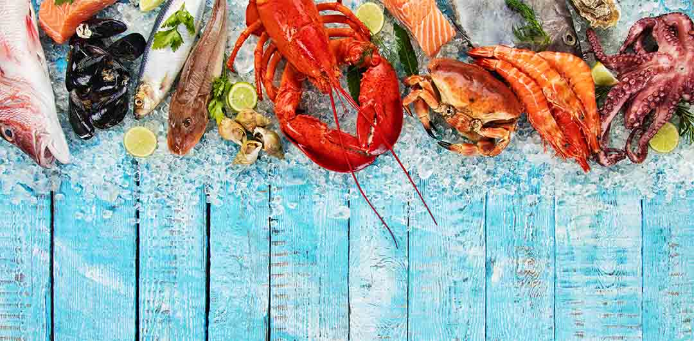

你好，欢迎来到《营养科学课》，我是仝卿。

前面两讲，我们分别聊了“宏量营养素比例”和“热量”这两个基本视角，日常健康饮食的大体样子已经出来了。但如果你问我，在这个基础上，我们选择食物还能不能优中选优呢？

当然可以。接下来这两讲的内容，就可以帮助你从千千万万的食物中，提炼出对健康有利和有弊的方面。你会知道在“吃”这件事情上，你还可以根据哪些因素来选择食物。

我们这一讲先说有利的那方面，看看什么样的食物对健康最有利。

这个问题的答案如果用一句话来概括，那就是优先选择新鲜、多样、完整的普通食材。

我会逐一拆解一下这句话，咱们先来说说“普通食材”。

很多人觉得，卖得贵的食材，营养价值肯定更高。其实从营养健康的角度考虑，还真不一定。比方说，有一种高级日料店里的网红食材，叫旗鱼，受到很多人的追捧。

不过，他们也许不知道，海里的重金属会通过食物链富集，大鱼吃小鱼，最后大鱼身体里汇集了最多的重金属。旗鱼一般个头大，生存周期长，处于海洋食物链比较顶端的位置，重金属超标的风险特别高。孕妇和小孩都应该尽量避免食用。

就算不看这一条，我们单看旗鱼的营养成分：旗鱼的蛋白质和普通鸡肉差不多，不饱和脂肪酸呢，也没有比普通的黄花鱼高。你看，贵的食材可不一定营养就高。

还有人觉得自己亲手做的一些原生态产品，比如自榨油，要比工厂批量生产的健康。其实食品生产对原材料的挑选和加工储存方式，都有很高的要求，自己做的可能反而会有更多的安全隐患。相比之下，超市里买的普通食用油，因为有国家标准和食品安全检验检疫的加持，从营养健康角度看，才是更好的选择。

所以，在“吃”这件事上，并不是“来之不易的才好”。日常健康饮食的主角，绝对是我们每天容易获取的普通食材。

对我们中国人来说，每日食材对应《中国居民膳食指南》提到的，有 5 大类：谷薯类、蔬菜水果类、畜禽鱼蛋奶类、大豆坚果类和油脂类。普通超市和菜市场的食材，完全能满足日常健康需求。

“新鲜、多样、完整的普通食材”，再说下一个关键词，完整。

完整食物，就是尽量保留原材料的样子、减少加工程度的食物。加工食物在我们生活中太常见了，比如黄豆变成的酱油，牛奶变成的奶酪，都是经过加工才得到的。即使你顿顿饭都在家做，也离不开加工食物。

不过你可能不知道，任何的食物加工，或多或少都会导致原材料的营养损失。加工程度越高，添加糖和钠盐的含量越高，微量元素和膳食纤维的损失越大，可以说，就是越不健康。

所以我们选择食物，最好优先选择加工程度低的食物。怎样识别加工程度的高低呢？

很简单，观察食物，看是不是还能猜得出食物原料。能猜出来的，加工程度就相对低。

比如一只烤鸡放在你面前，你肯定看得出来它原料就是鸡。但是，如果是一盘鸡肉丸子，你不尝一下的话，就搞不明白它用的是什么原料。甚至有的时候，吃到嘴里了，也没法肯定是用什么肉做的。和鸡肉丸子比，烤鸡的加工程度就更低一些。

如果两种食品都是那种带包装的加工食品，那还有一个办法，就是看配料表。配料表的条目更少的，通常加工程度更低。

烤红薯的配料表可以只有红薯这一项。但薯片的配料表你看过吗？马铃薯、植物油、食用盐、谷氨酸钠和核苷酸二钠，条目太多了。和薯片比，烤红薯的加工程度更低。

简单来说，就是直接啃一个大苹果比喝苹果汁好，吃一大块肉比吃加工肉丸好。营养科学看食物，在保证食品安全的前提下，简单就是美。

“新鲜、多样、完整的普通食材”，再来看关键词“多样”。

为什么吃东西要做到多样化呢？

有句话说，“没有垃圾食物，只有垃圾吃法”，意思就是，即使是营养素有缺陷的单一食材，也可以通过互相组合，让一顿饭变得更有营养。这就是“多样”的好处。

比如，咱们在第一讲中就提到过，麻婆豆腐盖浇饭的主要原材料，大豆和米饭，是两种特别普通的食材。这两样东西的蛋白质都有缺陷，但放在一起吃就可以互补。

最后的关键词是“新鲜”，我就不多说了，咱们都知道吃东西得挑新鲜的吃。

好了，说到这里，你需要记住的就是：选择食物，要选新鲜、多样、完整的普通食材。

刚刚说的，都是目前营养科学确定的结论。其实在“新鲜、多样、完整的普通食材”当中，还隐藏了一些科学界没有定论的额外红利。我也得跟你说说。

第一个额外红利是，新鲜完整的食物，抗氧化剂的含量相对比较多。

为什么说这是红利呢？

身体将食物转化为能量，我们利用能量来运动，这些过程都有氧气参与，都是氧化过程。而氧化过程会产生一类不稳定的化学物质，叫自由基。研究发现，包括癌症、心血管疾病、糖尿病、阿尔茨海默病和帕金森病，都和自由基的数量太多有关。

那怎么减少自由基的数量呢？食物当中的维生素 A、C、E、类胡萝卜素，矿物质铜、锌和硒，这些都是抗氧化剂，理论上，可以清除自由基。

注意了，我这里特地加了“理论上”这三个字。

为什么呢？几十年来的饮食研究发现，吃含有大量抗氧化剂的食物，和心脑血管疾病以及某些肿瘤的风险降低有关。不过，科学研究里，有相关关系并不代表有因果关系。要确定因果关系，需要大规模的临床试验来证明，但目前还没有这样的研究能够证明。

有人会问，吃保健品呢？有些保健品号称可以补充抗氧化物，是不是比食物的效果要更好？不好意思，吃抗氧化补充剂和降低疾病风险之间，连相关性都没有。

这也就是说，日常饮食当中的抗氧化物，可能会给我们带来额外的好处，但特意吃抗氧化补充剂就完全没必要了。

第二个额外红利来自食物里的其他化合物。

这些化合物在食物中也天然存在，但我们还没发现它是身体必需的。因为它们可能有预防或治疗疾病的作用，科学家非常热衷于研究这些天然成分。

比如在肿瘤领域，有不少研究者在试图寻找抗癌食品。研究涉及的化合物，有葱属化合物、类黄酮、皂苷类、香豆素类，这些物质名字稀奇古怪的，但载体都是我们熟悉的蔬菜瓜果，比如葱属化合物就存在于洋葱、大蒜里面。

那这些化合物在哪些食物中更多呢？目前看来，含量多的食物有绿叶的蔬菜、柑橘类和莓类水果、各种豆类和坚果，还有那些有特殊气味的植物，比如大蒜和洋葱。你看，我们前面说的健康食物，几乎能覆盖它们。

对于这些有额外红利的食物，我得严肃地提醒你一句：对我们每个人来说，没有任何一种食物或者食物成分，能保证让我们不得癌症。但话说回来，这些食物本身就在日常选择的范围之内，每天都选一些安排上就很棒，比吃一些像“葡萄籽精华”之类的保健品靠谱多了。

说完了大原则和额外红利，我来说一下特殊需求。健康饮食当然好，但我知道，你生活里总有些特殊情况，比如出差，吃不到“新鲜完整又多样化”的食物，那时候该怎么办？

一般来说，食物当然是获得营养的第一选择。不过，实在没条件，那我们就得选择膳食补充剂了。膳食补充剂可以单独补充某种营养素，比如钙片就单独补充钙，也可以同时补充好几种营养素，那就是混合制剂的补充剂。

它应该怎么用呢？记住一个原则，膳食补充剂补足的是一个缺口，就是必需营养素的推荐摄入量，和你饮食摄入量之间的缺口。我举个补钙的例子。

中国居民的钙推荐摄入量普通成年人是每天 800 到 1000 毫克，我们可以算日常饭菜给我们提供大约 500 毫克的钙质。剩下 300 到 500 毫克的钙缺口要靠奶制品来补充。

每 100 毫升牛奶里大约有 100 毫克钙，所以 300 到 500 毫克的钙缺口对应 300 到 500 毫升的奶制品。如果你不喝奶，就可以用膳食补充剂来补足这个缺口。

吃膳食补充剂的必要性和剂量，你都可以用这个逻辑初步自我判断。比如自己需不需要吃维生素片？如果某个阶段，你出差比例很高，工作很忙，吃不到新鲜的蔬菜水果，那当然可以吃了。

需要注意的是，你只需要补充营养素的缺口就行了。非营养素，比如我们刚刚说的那些可能对身体有好处的化合物，并不是身体必需的，没有官方的推荐量，当然也不存在缺口，没有“补不补”的问题。

总结一下我们这一讲说的内容。

什么样的食物有益身体健康？总结起来就一句话：新鲜、多样、完整的普通食材。

“新鲜”“多样”和“完整”最大限度地保证了食物的营养素含量充足，而在超市就能买到的普通食材，完全可以满足你的营养摄入需求。万一碰到特殊情况买不到这样的食材，你可以用营养素类的膳食补充剂补足缺口。

1 新鲜、多样、完整的普通食材，对健康最有利。 2  
“新鲜”“多样”和“完整”最大限度地保证了食物的营养素含量充足，而在超市就能买到的普通食材，完全可以满足你的营养摄入需求。 3  
万一碰到特殊情况买不到这样的食材，你可以用营养素类的膳食补充剂补足缺口。

说过了对健康有利的饮食因素，那我们肯定还得说说饮食当中的风险因素。我们下一讲见。

* * *

# 14 风险：避免吃什么样的食物？

  

你好，欢迎回到《营养科学课》，我是仝卿。

上一讲，我们提到了对健康有利的饮食因素。这一讲，我们把这件事翻过来，说说食物当中的风险因素。

我需要先提醒你一下，即使是我们上一讲提到的，对健康有利的饮食因素，也可能存在饮食风险。咱们就算不求食物能对健康有额外的贡献，只求不增加身体的负担，饮食风险因素也是我们必须搞清楚的。

好，开始之前，我先问你一个问题：你觉得最不健康的吃法是什么样的？我听过很多人的回答是：大鱼大肉，热量超标。

对于肥胖的人来说，大鱼大肉的确不合适。但我们仔细想想，对于蛋白质摄入不足的人来说，大鱼大肉就很好啊，可以纠正营养不良，摄入更多的热量可以纠正体重过轻。你看，这个回答要分人。

但是你注意，我们这一讲说的饮食风险因素，不是差异化的特点，而是从目前营养科学的认识来看，对每个人都几乎没有益处的共识。你在自己的饮食场景中，尽量避免这些东西，就可以做到不给身体添麻烦。

最先要警惕的头号风险，就是食物中毒。这个风险特别大，给身体带来的影响立竿见影，而且很多影响都可以危及生命。

你会说，有毒的食物我当然不会吃，这还用提醒吗？必须提醒。世界卫生组织就统计过一个数据，说全世界每年平均有大约 6 亿人发生食物中毒。

听我和你详细说说，你可能会发现，食物中毒比你想象得更难避免。

有些食物天然就带有毒素，比如河豚当中有河豚毒素，毒蘑菇当中有蘑菇毒素。有不少人冒着生命危险就为了尝个鲜，这太不明智了，特别是当你对食物没有判断力的时候。要知道，很多口口相传的辨别常识都是错的。

比如，“白色蘑菇能吃，鲜艳的蘑菇有毒”，这样的说法就非常不靠谱。世界上毒性最强的蘑菇之一，白毒伞，就长得白白净净的。我就不多说了，一句话：不确定，就不要吃。

避免这样的食物相对容易，但有些食物是因为被污染了才有毒，就比较难避免了。细菌、病毒、寄生虫和有害金属都是食品污染物。

你别觉得自己不会吃到这些被污染的食品，我举几个例子。

比如说，没经过烹饪的生食，就可能有污染风险，像生鸡蛋里的沙门氏菌、生肉里的各种寄生虫和病毒。

当然，生的食材也不是绝对不能吃，洗净的黄瓜、西红柿，优质的生鱼片等海产品，我们平常就是生吃的，但这对原材料的要求拔高了特别多。出门在外，如果你没有把握，还是尽量选择煮熟的食物。

再比如，吃发酵玉米面或者泡发过久的黑木耳也容易中毒。这是因为食物在自然发酵的过程里，有一种叫“椰毒假单胞菌”的病原体迅速繁殖，产生了大量的毒素，人吃了就会引发严重的胃肠道反应，有很高的致死率。

所以，对于这些有头号风险的食物，包括本身含有毒素的食物，还有被污染后有毒素的食物，我们需要小心再小心，最好完全避免。

头号风险之下的二号风险，是食物当中的一类致癌物。和刚才讲到的食物中毒不一样，一类致癌物给身体造成的麻烦一般不是急性的，但随着剂量的累积，它会提高肿瘤的发生风险。

你可能听说过，致癌物被分成了一类、二类、三类和四类。很多人认为，这个分类说的是导致癌症的风险大小，一类风险最大，四类风险最小。其实不是这样。

致癌物的分类，分的是致癌证据的确凿程度。一类致癌物就是对人体有明确致癌证据的物质。我们日常饮食中比较常见的一类致癌物，比如酒精，培根、火腿、咸肉这些加工肉类，还有一种物质叫黄曲霉素。发霉的谷物坚果和自家榨的植物油里，黄曲霉素超标的风险都特别高。

但是，就算同属于一类致癌物，危险性也不一样。比方说，加工肉类和烟草虽然都是一类致癌物，但它们的危险性却完全不是一个数量级的。有一个统计数据是，全球每年大约有三万四千个食用加工肉的病人患肿瘤死亡，而烟民中每年有高达一百万人因为肿瘤离世。

这是为什么呢？问题在频率和剂量。

烟民吸烟的频率比吃加工肉要高太多，摄入致癌物的剂量也高太多了。那也就是说，如果你一个月就吃几次加工肉类，并不需要特别担心，但如果天天吃黄曲霉素超标的油，就很麻烦了。所以对于这些食物，你可以解馋，但不要当作日常食物频繁食用。

一类致癌物里的酒精，我要单独说说。喝酒是不是对身体不好，这事儿大家都挺关心的，毕竟酒文化在全世界都很流行。

研究饮酒和健康的关系很难，因为干扰因素太多了。那怎么办呢？用大数据，干扰因素可以通过统计学方法来尽量去除。

关于酒精和健康的关系，有这样一个大型研究，横跨几大洲，包含 195 个国家，从 1990 到 2016 年一共持续了二十几年。《柳叶刀》杂志正式发表了这篇论文，里面提到：如果一定要一个饮酒安全剂量，那么这数字是 0。

这个结论引发了不少争议。你可能也听过，有研究说少量饮酒是有好处的。但是，这个“好处”因为人数样本量的限制，以及各个研究对“少量”的定义不同，科学界一直没有统一的定论。

在我看来，因为不同人分解酒精的能力不一样，所以在执行层面，你并不知道你的身体对应的“少量”那条线在哪里。如果你问我，红酒养生吗？那这问题得这么看：如果你特别爱就喝一点儿，但别指望红酒有什么“药用”价值。

二号风险之后，就是三号风险。你在很长的一段时间里都不会感觉到这类风险带来的影响，因为它带来的是慢性的疾病。三号风险就是高钠、高添加糖这样的饮食习惯。

现在研究已经发现，高钠、高添加糖，还有反式脂肪的摄入，和现代常见慢性疾病，比如高血压、糖尿病、高血脂之间，有千丝万缕的联系。

即使这些你都知道，日常饮食中还是有很多坑，让你不知不觉掉进去。比如你到商店货架上去看，含大量添加糖的饮料，都爱给自己贴“0 脂肪”的标签，而含脂肪特别多的食物呢，爱给自己贴“0 蔗糖”的标签。实际上，多余的糖也会变成脂肪，没有蔗糖也可以有别的糖。

所以，和看标签相比，还是自己看包装上的“营养成分表”更靠谱。

那“营养成分表”应该怎么看呢？有三个信息需要你特别注意。

一个是钠含量，尽量找数值更低的产品。一个是添加糖的含量，如果碳水化合物的下面写着单独的一行，叫“糖”，这个就是指加工过程中的添加糖。这个数值越接近 0 越好。还有一个就是反式脂肪的含量，反式脂肪会在脂肪下面单独成列，数值也是越接近 0 越好。

但是添加糖和反式脂肪，并不是必须标注出来的。如果你在营养成分表上没找到，可以仔细观察配料表，尤其要注意几个配料，包括白砂糖、糖浆、氢化植物油和人造奶油。这几个配料在配料表上排位越靠前，说明添加糖和反式脂肪的含量越大。

最后，到了四号风险。四号风险很常见，但不少人意识不到它的存在。这就是食物过敏和食物不耐受。

很多人都关心吃什么能增强免疫力。关于营养和免疫，咱们后面有一讲会专门来讲。在这里，我们更应该关注的是：吃什么东西会让免疫系统过度反应？很多人的问题并不是出在免疫力不够，恰恰是免疫反应过度才出了问题。

食物过敏和不耐受都和免疫系统过度反应有关，但是表现不一样。食物过敏通常会引发快速的急性反应，比如荨麻疹或者呼吸困难等症状，是急症。而食物不耐受呢，主要是由于身体没法完全分解食物才导致了消化道不适，比如腹泻，是慢性症状。

会诱发你过敏的食物，我建议你完全避免。而对于诱发你不耐受的食物，我觉得你可以通过一些方法来让它变得更加容易“耐受”。

比如，对牛奶蛋白过敏的人，在日常饮食中需要避免奶制品的摄入。而乳糖不耐受人，只是身体里的乳糖酶产量不够，才导致喝完牛奶就拉肚子。为了不给身体增加负担，你可以先试着调整喝牛奶的时间和量。比如不在空腹时喝，而选择在两餐之间喝，每次少喝一点，大概小半杯，150 毫升左右。

对牛奶不耐受比较常见，除此之外还有别的“诱发食物”。如果经常腹泻，你可以花一点时间记录自己每天吃的食物种类和腹泻的次数，找到引起腹泻的“诱发食物”。

这类诱发食物其实覆盖面特别广，包括桃子、樱桃、牛油果等各种水果，蜂蜜、玉米糖浆、小麦、大蒜、大豆以及各种糖醇甜味剂，都有可能导致不耐受。自己没找到的话，别忘了寻求营养师的帮助。

总结一下这一讲的内容。

我们这一讲一共说了四种饮食风险因素，在选择食物时，它们可以成为你做排除法的理由。

头号风险是食物中毒，需要我们小心再小心，最好完全避免。二号风险是一类致癌物，最好减少摄入频率。三号风险是高糖、高脂的饮食习惯，可能会提高我们得慢性病的概率。四号风险是过敏和不耐受，尽量避免那些会让自己过敏的食物，但对于不耐受，可以尝试着提高自己的耐受性。

1 头号风险：食物中毒。有的食物天然就带有毒素，比如河豚、毒蘑菇；有的食物因被污染而有毒素，比如泡得太久的木耳。 2  
二号风险：一类致癌物。致癌物的分类，分的是致癌证据的确凿程度。 3  
三号风险：高糖高脂的饮食习惯。学会看食品包装上的营养成分表，关注三个值：钠含量、添加糖含量和反式脂肪含量。 4  
四号风险：过敏和不耐受。尽量避免会让自己过敏的食物，但对于不耐受，可以尝试着提高自己的耐受度。

说了很多健康普通人的饮食办法，下一讲，我们要进入一个新的模块，聚焦在生病的人身上，看看营养科学能帮他们什么忙。我们下一讲见。

* * *

# 15 免疫：怎么吃才真能提高免疫力？

  

你好，欢迎回到《营养科学课》，我是仝卿。

在前面的课程里，你可能注意到了，我说过很多次，这个规则、那个方法都是对大部分健康的人说的。我猜可能有人会想，那在生病的情况下呢？营养科学怎么帮病人呢？

我们这个模块，就聚焦在“疾病营养学”这个议题下，看看营养科学都能做什么。

我们把疾病旅程做一个简单的时间划分：生病之前是疾病预防阶段，生病的时候会经历疾病诊治阶段，随后身体慢慢恢复，或者病情稳定，那是疾病康复阶段。

我们这一讲先来说疾病的预防阶段。预防阶段什么最重要？就是免疫力。疫情期间，张文宏大夫给过一个早餐建议，他说，不能光喝粥，要吃鸡蛋、喝牛奶，这样免疫系统才能更好地工作，抵抗病毒。这个建议说的就是通过营养摄入来提高免疫力。

这一讲，我们就看看有没有什么办法，可以通过营养科学来调节免疫力。

要说提高免疫力的食物，你可能会想到不少保健品，反正宣传说是能提高免疫力，你也不知道到底有没有用。所以在最开始，我们还是得先理一理，营养和免疫系统之间的关系，知道这个关系，你才能知道什么有用、什么没用。

营养和免疫系统的关系，主要基于三个事实。

第一个事实是关于免疫系统原材料的。

人体免疫系统的各种免疫细胞都由蛋白质组成。比如抗体、细胞因子、溶菌酶和 C 反应蛋白。你可能没听过它们的名字，但它们都是免疫系统的关键元件，而且，它们的本质都是蛋白质。可以说，蛋白质就是免疫系统的基石。

蛋白质对免疫系统来说这么重要，那靠什么得来呢？就靠吃饭。

世界卫生组织的数据显示，在极度缺乏食物的地区，儿童和妇女病死率排名第一的原因就是感染。因为食物缺乏，蛋白质摄入过少引发了营养不良，在面对外来的细菌、病毒、寄生虫这些病原体的时候，他们的免疫力跟不上，感染后的情况更容易恶化，进而导致死亡。

第二个事实是关于免疫反应调节过程的。

很多人觉得免疫力越强越好，其实不是这样的。免疫力太低打不死病原体，太高又容易把体内的组织当成敌人，误伤自己，所以免疫力高低合不合适就很重要。免疫调节，指的就是把免疫力调整到合适的水平。

那哪些成分可以参与调节过程呢？

不少营养素，比如 n-3 脂肪酸、维生素 A、C、D、E，以及矿物质锌、硒、铁、铜，都是我们目前知道的免疫调节剂。这当中不少营养素还会双向调节免疫，就是在不同的疾病中，或者在同一疾病的不同阶段，既可以提高免疫力，也可以降低免疫力。

第三个事实是关于免疫细胞所在部位的。

生病的时候我们会去医院抽血检查免疫细胞，这可能给你一种印象，就是免疫细胞只在血液里头。其实并不是这样的，免疫细胞大部分集中在消化系统里。

这也好理解，因为免疫细胞主要就是用来抵御一些外来物的，而身体里最常见的外来物就是食物。而且，我们常说“病从口入”，各种细菌和病毒，很可能混合在食物里进入人体。所以，我们的消化系统，特别是肠道，是营养吸收和免疫反应共同的场所。

我们总结一下这部分，营养和免疫系统的关系特别密切：营养素是免疫反应的原材料，也可以调节免疫反应的过程，营养吸收和免疫反应还有共同的场所，就是肠道。

知道了它们之间的关系，接下来我们就可以具体说，到底怎么才能通过营养来提高免疫力了。对应我们上面提到的三个关系，我总结了你可以做的三件事。

第一件事，摄入足量的蛋白质，确保免疫系统原材料管够。

免疫系统的原材料是消耗品，蛋白质补给到位，整个免疫系统才能正常运行。

比如你肯定听过很多人说，母乳是宝宝的最佳食物。这么说是有道理的。母乳一直被配方粉模仿，却从未被超越，就是因为大部分母乳中的免疫蛋白，到现在我们都没法在配方奶粉中复现。

那我们平常要靠吃东西补充蛋白质，具体吃什么呢？其实没什么特殊的，普通的鱼、肉、蛋、奶和大豆类制品就很好，不需要为了提高免疫力刻意增加蛋白质的摄入。按咱们前面课程里说的“圆形餐盘法”和用手掌来衡量吃多少的办法，完全可以满足，我在这里就不重复了。

但我猜你在市面上可能见过一些蛋白质类的产品，号称富含免疫球蛋白，吃了可以增强免疫力。有人会觉得，吃免疫球蛋白方式更直接，比吃食物更好。真是这样吗？我的回答是，用处不大。

为什么这么说呢？

在婴儿时期，肠道黏膜上有一种特殊的载体，可以帮助特定的免疫球蛋白穿过肠黏膜进入血液。但是到了成人期，这种载体就很少了，即使我们吃了免疫球蛋白，没有了运输工具的帮忙，它们很难被吸收。只有等免疫球蛋白被肠道分解成氨基酸之后，才可以被吸收。

但如果分解成氨基酸才能吸收的话，这就和吃鱼肉蛋奶没什么差别了。有研究显示，口服免疫球蛋白可能的用处，是在肠道中产生一些直接的保护作用。但对成年人来说，它对提高整体免疫力的效果是非常有限的。

有了免疫细胞和各种免疫蛋白，相当于部署好了作战部队，还得有调节剂来指挥。这就是我们可以做的第二件事，均衡饮食，让天然免疫调节剂保持免疫平衡。

在新冠疫情期间，或者以前出现过的全球流感病毒爆发期间，很多人都想要一个“抗病毒饮食方案”。那我们来看看，中国营养学会发布的“抗病毒营养膳食指导”到底长什么样。

它有四个要点：保证能量充足，多吃鱼肉蛋奶，多吃新鲜的蔬菜水果，多喝水。

你会说，听起来没什么特别的食物嘛。没错，目前并没有发现可以专门调节免疫的食物，均衡饮食就能帮助我们提升免疫力。你看，蛋白质是免疫原材料，所以要保证蛋白摄入。光吃蛋白还不行，蔬菜水果也要跟上，里面的维生素和矿物质，有很大一部分都是天然免疫调节剂。你并不需要再额外记一个特别的饮食模式。

前面两件事做好之后，作战部队就部署好了，指挥机制也就位了，免疫系统进入了工作状态。工作状态好不好，和工作环境也有关系。所以我们能做的第三件事，就是保护好消化系统，给免疫细胞们提供一个舒适的工作环境。

你可能有这样的经历，吃得不合适、拉肚子的时候，好像更容易感冒，反过来，感冒发烧的时候，有时候也会有消化道不舒服的症状。这就是因为消化道环境差的时候，免疫细胞的工作受到了影响，免疫力降低了，容易感冒。而感冒以后，免疫细胞得去呼吸道战斗，消化道就容易失守。

所以，在外出差时，一定要注意食品安全，多吃对肠胃好的、富含膳食纤维的食物，比如各种新鲜蔬果，少吃对胃肠道不怎么友好的辣火锅、烤串儿，这就是在给自己的免疫系统加油了。

刚刚我们讲的这三件事儿，主要是针对普通人在疾病预防阶段提高免疫力的营养策略，为的是尽量避免生病。我们最后来说说已经得病的情况。

已经得病了，免疫系统对患者来说当然也有特别重要的作用。但每一个患者的免疫需求是个性化的，比普通人实现起来更困难，一般需要临床营养师来帮助调整。

比如患者的消化道可能损坏了，没办法消化食物。这个时候，临床营养师会通过其他方式去给患者提供蛋白质和其他营养素，比如用口服营养补充剂代替天然食物。如果消化道受损的程度太严重，连口服营养补充剂也没法吸收，那就要用直接静脉滴注的方法来代替消化道吸收了。

这里要额外提醒你的是，如果得的病是一些免疫异常疾病，比如类风湿关节炎，这就已经超出营养科学负责的范畴了。这些免疫异常疾病很难通过营养来纠正，通常要用免疫调节药物来实现。

安排营养摄入，这是营养师的工作，而使用免疫调节药物是临床医生的工作。但它们的治疗思路，也和营养素调节免疫反应的过程有类似的地方。

比如我们刚刚说，一些维生素和矿物质对免疫的调节是双向的，它们不仅可以加强也可以降低免疫反应。而免疫抑制剂这种药物，正是通过降低免疫反应的方式来达到治疗效果的。

就拿我们刚刚说的类风湿关节炎来举例子。为什么会得类风湿关节炎呢？不少病人身体里有种叫 Th17 的免疫细胞，反应过度，去破坏了病人的关节软骨。那治疗的思路，就是使用降低 Th17 细胞活性的免疫抑制剂，来削弱病人身体里过度的免疫反应，减少对自体组织的损害。

好，总结一下这一讲的内容。

营养和免疫力之间的关系特别密切，营养素是免疫反应的原材料，也可以调节免疫反应的过程，营养吸收和免疫反应还有共同的场所。

从这三个关系出发，我们能发现，想通过营养来提高免疫力，只需要记住三点，要保证蛋白质足量，营养素均衡，还要保护好消化道。

对于“吃什么才能提高免疫力”这个问题，答案更直接，没有什么特殊的食物。对普通人来说，保证日常饮食就可以了。

1 营养和免疫力之间的关系特别密切，营养素是免疫反应的原材料，也可以调节免疫反应的过程，营养吸收和免疫反应还有共同的场所。 2  
想通过营养来提高免疫力，记住三点：保证蛋白质足量，营养素均衡，还要保护好消化道。 3  
吃什么才能提高免疫力？没有什么特殊的食物。对普通人来说，保证日常饮食就可以了。

这一讲我们聚焦的是疾病的预防阶段，下一讲，我们进行到疾病发展的下一个周期，疾病诊治。我们看看营养科学在疾病诊治的过程里，能帮上哪些忙。我们下一讲见。

* * *

# 16 治疗：营养可以对抗哪三类疾病？

  
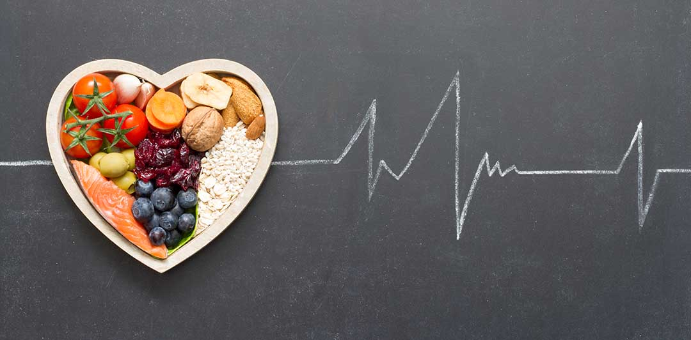

你好，欢迎来到《营养科学课》，我是仝卿。

上一讲，我们说了在疾病预防阶段，怎么通过营养增强免疫力。这一讲我们进行到疾病进程的下一个阶段，疾病治疗阶段，看看在这个阶段，营养能帮我们什么忙。

我们先来看一个你很熟悉的生活场景：感冒。感冒怎样才能好得快一些？不知道为什么，好像很多人都有一个共同的解决方案：喝鸡汤。

确实，鸡汤里大量的水分，还有部分氨基酸可以帮助调节体温、促进新陈代谢，改善食欲。而且，我们上一讲也提到，鸡肉里的蛋白质，还可以提供合成免疫细胞所需要的原材料。

但是，在面对由鼻病毒引起的感冒时，鸡汤可以抗病毒吗？不能。我们没发现鸡汤里有什么成分可以抗病毒。所以喝鸡汤，这不算营养治疗。

但生活里你总能听到类似“喝鸡汤”这样的“食疗”办法，这误导了很多人，误导方向还完全相反。一部分人认为，这些方法很有效，吃某些食物就能达到治疗的效果。还有一部分人认为，营养科学在治疗疾病这方面，完全不靠谱，一点都不要信。

在这一讲里，我想为这两种看法都纠个偏，就回答一个问题：营养科学能不能主动进攻，起到直接的“治疗”作用呢？

我先给你一个明确的答案：能，营养可以是一种治疗手段。但我要提醒你，这个治疗手段只在一些特定的疾病中有效。

听过这一讲之后，你会对营养在疾病中的作用有个清楚的认识：既不会轻视它，知道有些疾病营养科学可以帮大忙；也不会对它过度期待，在任何渠道得到了疾病营养类的信息，你都可以理性地甄别。

想分辨清营养在疾病里的作用，我们得先搞清楚为什么会有那两种完全不同的误区，才好对症下药。

两种完全不同的误区，来源是哪儿呢？主要来源于我们平时对治疗干预方式的认识。面对疾病的时候，我们一般认为的干预方式就是治病吃药，或者打针。

这其实只是干预方式的一个层面。治疗的干预方式可以分成两个层面。第一个是针对致病因素的，比如感染了葡萄球菌，要打青霉素，起到的是直接“治疗”的作用。我们平常感受到的干预方式就是这种。

但还有一个层面，就是改善身体条件，比如感冒喝鸡汤，起到的是“支持”作用，不是治疗作用。

在临床医学中，这两个层面，都是治病的过程，都是为了促进健康，很多时候并不需要做区分。

但在讲疾病营养学的时候，我们就必须要区分开了。因为对于有些病，我们还没找到针对致病因素的治疗方案，比如针对感冒鼻病毒，没有特效药，那身体支持就变成了疾病干预的主力。而这部分，恰恰是营养科学可以大展身手的地方。

疾病支持的内容，在后一讲我会专门来介绍，我们这一讲还是单独来看疾病治疗的部分。

我们前面说了，营养科学作为治疗手段，只能针对一些特定的疾病。那是哪些疾病呢？

营养科学可以直接“治疗”的疾病有不同的特点，而不同的特点，决定了营养科学会怎么达到治疗目的。

比如有一类疾病的特点是，疾病和营养素缺乏相关。那营养治疗策略很明显，就是补足缺乏的部分。

举个例子，缺铁性贫血。这是生活中最常见的一种贫血。在患者没有其他失血性疾病的情况下，补充铁来进行营养干预，就是治疗缺铁性贫血的主要方法。

不只是铁，单个营养素和疾病的关系，越来越清晰，比如维生素 C 和坏血病、碘和甲状腺肿大、维生素 A 和夜盲症，我们都发现了明确的对应关系。这些营养科学的发现，让人类可以用简单的饮食方法去防治疾病。

到现在，化学合成技术越来越强大，单纯的饮食治疗，已经被更高效的膳食补充剂替代治疗取代了。今天如果你去医院看缺铁性贫血，医生除了告诉你“多吃富含铁的红肉”这样的饮食治疗建议之外，多半还会给你开口服铁剂带回家。这就是膳食补充剂替代治疗。

除了营养素缺乏，营养科学可以直接治疗的疾病，还可能有的特点是：和消化道受损有关。那营养治疗的策略，就是修复消化道。

比如说，胃溃疡就是比较常见的一种胃肠道损伤。胃为什么会溃疡呢？正常进食的情况下，胃会分泌胃酸来消化食物，胃酸可以分解食物里的蛋白质。问题来了：胃它自己也是蛋白做的，胃酸怎么没把胃给消化了呢？

答案是，因为有胃黏膜的保护。胃黏膜附着在胃壁内层，能抵御胃酸的侵蚀和食物的物理伤害。一旦它损伤了，胃酸就会侵蚀胃壁，产生溃疡。

我们治疗胃溃疡的思路有两个方向。一个是让胃酸分泌得少一些，很多治疗胃溃疡的药物，就是抑制胃酸分泌的。另外一个方式是修复胃黏膜，而营养科学就是主攻这个方向来治疗胃溃疡的。

怎么治疗呢？就是给身体提供修复黏膜的重要原材料。比如蛋白质和维生素 A、B、C、E，这些营养素都是合成黏膜的重要材料。

除了刚才这两大类之外，营养科学可以直接治疗的疾病，还有一大类，我得着重说说，就是和代谢功能异常有关的疾病，比如说 2 型糖尿病、脂肪肝、高血脂和痛风。

有人的第一反应可能是，这不可能，这些病都是医学上很难治的疾病，营养科学光靠食物怎么可能治疗呢。

咱们就拿 2 型糖尿病来举个例子。在《中国 2 型糖尿病防治指南》里，你猜糖尿病患者确诊之后，放在第一位的治疗方案是什么？不是降糖药，也不是胰岛素，而是改变饮食习惯。

你可能不知道，在不少医院，糖尿病门诊的问诊模式已经发生了变化。患者和医生聊完之后，还要再和营养师沟通，才算完成了看病流程。

为什么营养科学能帮助 2 型糖尿病患者呢？我们一般说，患者得糖尿病，是因为体内的胰岛功能被破坏了，导致了糖代谢异常。但其实在发病的初始阶段，有些病人的胰岛功能还没被破坏，血糖高的主要原因是饮食失调。这个时候，及时调整饮食模式还有可能逆转病情。

营养师做的这件事儿，用专业术语叫“医学营养治疗”。医学营养治疗现在在疾病治疗上的地位，和药物、手术这些治疗手段是平行的，已经被写进各个国家的糖尿病诊疗指南里，有很坚实研究证据。

那医学营养治疗这么强大，究竟是怎么做的？

还拿 2 型糖尿病的问诊来举例子。

营养师会先看看患者的日常饮食和营养状况，这个步骤是评估。

再给患者制定饮食计划，决定平时病人每顿饭吃什么、吃多少、怎么吃，需不需要使用营养补充剂，等等。这个步骤是干预。

患者复诊的时候，营养师还会再根据他的身体情况来调整饮食计划。这个步骤是监测。

评估、干预和监测，就是医学营养治疗大致会分的三个步骤。而且，医学营养治疗的饮食计划里，一般没什么特殊的食材，大部分都是日常食物。

刚刚和你介绍的三类疾病，包括营养素缺乏，胃肠道损坏和代谢功能异常，都是营养科学可以直接治疗的疾病。但并不是说营养科学只能治疗这三类疾病。这三类，只是我们现在能找到确切循证证据的疾病，我相信在未来，营养科学可以治疗的疾病还会有更多。

说到这里，我还要反过来提醒。虽然说医学营养治疗可以治病，而且依靠的都是日常的食物。但类似“某种食物对治疗某种疾病有奇效”这样的说法，你一定要谨慎对待。它们绝大部分，都不靠谱。

很多人都知道，有些经典的药物成分确实来自天然植物。比如，柳树皮里有阿司匹林的有效成分，山羊豆里有能治疗 2 型糖尿病的二甲双胍成分。

但要注意，食物里即使有这些药物成分，大部分情况下纯度和剂量都达不到治疗的要求。药理学中有个概念叫“有效血药浓度”，意思是治疗成分进入血液之后，能达到治疗效果的浓度。

举个例子。抗肿瘤的明星化疗药物，紫杉醇，它是从太平洋红豆杉的树皮中提取的。制作一公斤的紫杉醇，需要 4000 棵 50 年生的红豆杉树。而一个肿瘤病人一次化疗所需的剂量，要消耗 3 棵大树的树皮。你听听这个剂量，想靠吃树皮来达到化疗效果，不太可能达到有效血药浓度的标准。

总结一下这一讲的内容。

营养科学可以治病，但不能包治百病。营养治疗针对的疾病主要和营养素摄入不足、消化系统损伤或者代谢功能异常有关。

医学营养治疗一般用的都是普通的食材，但看到类似“某种食物对治疗某种疾病有奇效”这样的说法，一定要谨慎对待。

1 营养是一种治疗手段，但只在一些特定的疾病中有效。 2 营养治疗针对的疾病，主要和营养素摄入不足、消化系统损伤或者代谢功能异常有关。 3  
医学营养治疗一般用的都是普通的食材，但看到类似“某种食物对治疗某种疾病有奇效”这样的说法，一定要谨慎对待。

这一讲我们说了营养在疾病治疗中的作用，我们刚刚说了，营养科学在更广泛的疾病治疗过程中，其实起到的是“支持”作用，在不少凶险的疾病中，营养支持甚至是决定命运的关键。我们下一讲接着来说。

* * *

# 17 支持：怎样提高打败疾病的胜算？

  

你好，欢迎来到《营养科学课》，我是仝卿。

上一讲，我们讲了营养科学怎么在疾病中主动进攻，发挥治疗作用。

不过目前，在更多的疾病中，营养科学干的是“支持”这件事情：在某些治疗方式下，帮助患者有更强的身体基础，为自己赢得足够的时间战胜疾病。在不少凶险的疾病里，营养支持甚至是决定患者命运的关键。

我们这一讲，就来说说营养科学是怎么支持医学治疗的。

我猜很多人心里会犯嘀咕，作为一种辅助治疗的手段，营养支持有那么大作用吗？

我们先拿一个很多人感觉最凶险的疾病来举例，肿瘤。

治疗肿瘤的过程是一场持久战。你可能听说过，在这场战斗中，手术、化疗、放疗这些方法，有的时候需要轮番上阵，在杀伤肿瘤细胞的同时也给身体带来了副作用，比如感染、贫血、恶心，等等。所以，患者必须有足够的身体条件，扛过一轮轮的治疗，最终才能看到积累下来的疗效。

但在现实中，不少肿瘤患者的身体条件很不好。大约有一半的病人食欲下降、体重下降的情况非常严重。你别觉得只是体重降低，没那么大影响，在临床上，我们把这种状况叫“恶液质”，它导致了五分之一的恶性肿瘤患者死亡。

营养支持就可以在这个时候派上大用场。临床营养师通过调整患者的营养摄入，让患者保持正常的体重和营养状态，不仅能预防和改善恶液质，还可以为病人赢得更多的治疗时间，争取更多的治疗机会。你看，营养支持是改变肿瘤患者命运的关键之一。

肿瘤的治疗是个长期的过程，营养支持不但在长期病程中作用重大，同样也是治疗很多急性病的重要一环。

比方说新冠肺炎。

湖北新华医院急诊科主任孙国兵，给居家隔离的病人推荐的营养餐是一天四个鸡蛋，把鸡蛋蒸成容易消化的鸡蛋羹。

听着有些耳熟是不是？在讲免疫力那一讲里，张文宏教授建议普通人的早餐也要吃鸡蛋。为什么他们都强调吃鸡蛋呢？

鸡蛋并不能杀伤病毒，但却是性价比最高的优质蛋白摄入来源。充足的蛋白摄入对患者跨越疾病障碍非常重要。机体组织修复的各种过程都少不了蛋白质这种原材料。

在这里，“吃鸡蛋”起到的就是营养“支持”的作用。在没有特效药的情况下，这种“支持”作用直接决定了患者在病程中能不能靠自己扛过去。

医生在临床上可以观察到，营养状况差的人不仅感染概率更高，感染后的病情也相对更加严重。所以，无论是在疾病预防还是治疗康复阶段，如果改善了营养状况，患者自身的免疫力会更强，治疗效果会更好，身体恢复也会更快。

不过，患者的身体状况和普通人不一样，疾病营养支持和普通人补充营养的重点也不一样。

比如说，宏量营养素，也就是碳水化合物、蛋白质和脂肪的比例，临床营养师用在患者身上的时候就会重新调整。

对肿瘤病人来说，优质蛋白量需要保证充足，脂肪供能的比例会相应提高，而碳水化合物供能比例要适当下降。这样的调整是为了匹配肿瘤患者身体的代谢变化，避免增加患者的代谢负担。

除此之外，临床营养师还会搭配相应的微量营养素，帮助抑制肿瘤患者体内的炎症反应。

但要说普通人和患者摄入营养的最大不同，还是普通人和患者要达到的目标不一样。

对普通人来说，怎样才能吃得健康均衡，是第一位的。而对患者来说，热量和蛋白质怎样才能吃足量，才是第一位。有的时候，为了达到这个目的，临床营养师会暂时跳出常规的健康饮食法则。

曾经有个病人给我留下了特别深刻的印象。

他是一位肺癌患者，当时正在化疗。第一轮疗效很好，不过他的胃肠道反应很强烈，厌食和呕吐的情况特别严重。第二轮治疗的时候怎么都吃不下妻子精心准备的饭菜，一度想要放弃化疗。

后来，是他家乡的腌制咸菜让他重新打开了食欲。正常进食带来了更好的营养状态，最终让他坚持把化疗方案执行完毕，达成了治疗目标。

你说咸菜是健康的食物吗？肯定不是。但对患者来说，他可以先挑自己喜欢的食物吃。只要能吃，就会带来希望。

营养支持的作用这么大，那它到底是怎么做的呢？

营养支持并没有统一的方式，而是根据患者病情的轻重程度，分成了对应的 5 个等级。就像我们走楼梯那样，从低到高一步步往上走，对应的病情越来越严重。这 5 个等级在营养科学中被叫作“5 级台阶”。

给患者的支持方案，从第一级台阶开始，如果患者用了这个方案，达不到能量需求目标的 60%，就往高一级台阶走，等病人情况好转之后，会回到低一级台阶的方案。

最初级的第一个台阶，就是按需搭配的饮食，通过食物来补充营养仍然是首选。吃饭听起来是一件再简单不过的事情。而对有些患者来说，比如肿瘤患者，这却是件困难重重的事。

消化道从上到下，从最开始的口腔咀嚼，到最后的直肠排泄，每一段都有挑战。咀嚼功能下降、因为化疗副作用吃不下去东西、有肿块堵塞了消化通路、胃肠消化功能下降，任何一个问题，都可能给吃饭这件事增加困难。

那这就需要第二级台阶了。就是在天然饮食的基础上，增加口服营养补充剂。

电影《天地大冲撞》里就描绘过这样一种生活场景：世界末日，什么新鲜食物都没了，大家都屯了好多罐头在家里。其实这里的“罐头”就是口服营养补充剂，是一种预先设定好营养素比例和总能量的粉剂或者液体，可以当一顿饭或者加餐吃，就像婴儿吃的奶粉一样。

不过要注意的是，口服营养补充剂和“保健品”是两个完全不同的概念。保健品是某种特定成分的补充，不能提供全面的营养代替日常饮食。而针对患者的口服营养补充剂，在配方上会根据疾病的代谢特点和营养需求来设计，是可以当一顿饭来吃的。

如果情况再严重一点，患者已经不能进食，补充剂也喝不了了，那接下来的台阶上还有肠内营养。肠内营养的意思就是通过管道，把事先配比好的营养液直接注入患者的消化道。

如果患者身体情况继续恶化的话，台阶再往上，就是肠外营养，把营养素直接注射到患者的血液里，营养的消化吸收完全脱离肠道。不过一般来说，只要患者消化道还能用，临床营养师就会尽量用肠内营养和肠外营养组合的方式，这是第 4 级台阶。

但如果实在没有办法，患者的消化道功能完全丧失，那就只能完全用肠外营养的方式了。这是最高级，也就是第 5 级台阶。

无论在哪个台阶，营养支持针对的都是患者的身体基础，不针对已经产生的原发病。原发病该怎么治，还得怎么治，营养支持不能替代治病方案。比如对于肿瘤病人来说，无论什么样的营养支持措施，都不能代替抑制肿瘤细胞生长的治疗手段。

还有一点要提醒你的是，我们的课程虽然把营养治疗和营养支持分成了两讲来说，但在医院里，患者常常既需要营养支持，也需要营养治疗。

还是拿肿瘤病人举例。

不少病人做化疗、放疗会严重影响食欲，或者消化道肿瘤阻碍了进食通道，这些情况都需要营养支持。

另外一方面，化疗、放疗在杀死癌细胞的同时，会误伤消化道的黏膜细胞，肿瘤细胞的代谢也会严重影响机体的正常代谢。我们上一讲说过，碰上消化道的损伤和身体的代谢问题，营养科学都可以用作直接的治疗手段。

总结一下。这一讲和前面两讲，我们最好合在一起看。我们聊了营养和免疫、营养和疾病治疗以及营养和疾病支持。

在疾病旅程的预防阶段，营养能保证我们的机体免疫力在线；在诊治和康复阶段，有的疾病可以通过营养手段来直接治疗；而几乎所有疾病，都可以通过营养支持来改善病人的健康结局。

在临床上，营养支持和营养治疗的作用会叠加在一起，相互影响，它们都是疾病综合治疗的重要组成部分。

1 营养支持帮助患者有更强的身体基础，为自己赢得足够的时间战胜疾病。 2 营养支持针对的主要是身体基础，不针对已经产生的原发病。原发病该怎么治，还得怎么治。  
3 在临床上，营养支持和营养治疗的作用会叠加在一起，相互影响。它们组成完整的营养干预，是疾病综合治疗的重要组成部分。

下一讲我们会进入一个新的模块，也许会是你最关心的模块。我们会来说说，营养与生活的部分，我们下一个模块见。

* * *

# 18 减肥：“少吃多动”没有用，怎么办？

  
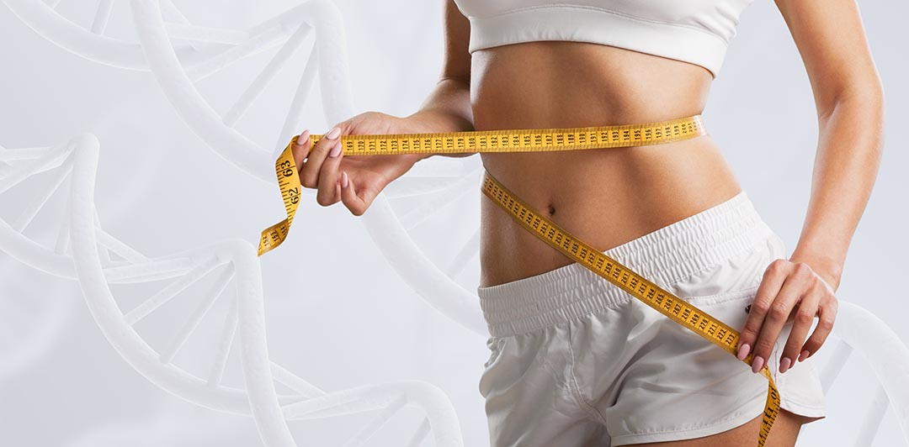

你好，欢迎来到《营养科学课》，我是仝卿。

这一讲我们进入一个新模块，营养与生活。我们先来说一个很多人都关心的减肥问题，就是“少吃多动”没有用，该怎么办？

想减肥，你肯定听过一句话，叫“管住嘴，迈开腿”。知道得多一点，你可能还知道一个热量平衡公式。公式说起来非常简单：如果能量消耗大于能量摄入，那体重就能下降；如果能量消耗小于能量摄入，那体重就增加。

能量消耗和摄入的差值，叫能量缺口。从这个热量平衡公式看，想减肥，制造能量缺口就行了。但不少人都有这样失败的经历：明明已经少吃多动了，可是肚子上的游泳圈还在。为什么热量平衡公式在你身上不管用呢？

这就是因为，你知道的那个热量平衡公式少考虑了营养科学这个维度。加上了营养科学，这个公式应该是这样的：

体型管理 = 能量缺口+营养改善

按这个公式执行，才能真正地管理好体型。我们这一讲就来说说这件事。

公式里提到了“体型管理”，“体型管理”意味着什么呢？

是管理体重的轻重吗？肯定不是。虽然在减肥的时候，很多人都特别关心体重秤上的那个数字。用学术的说法说，这叫体重基数。

可即使你不健身，也知道健身教练体重秤上的读数大，那是因为他身上的肌肉特别多，你不能说他体型不好吧？

那“体型管理”到底意味着什么呢？如果咱们只看热量平衡公式，想减肥，要制造能量缺口，那体型管理就是关注“体重变化”。

有人会说，我有时候放开吃，一上秤，就重了好几斤，这就是体重变化吧？

并不是，这叫体重的正常波动。一般成年人一顿饭的重量可以在 500 克左右，再加上喝的水，每天吃进 2 公斤左右的食物是正常量。你吃完就上秤，体重基数肯定会变。

我这里说的“体重变化”，不是指一天之内的体重波动，而是最近一段时间内体重变化的趋势。

一般来说，从营养科学的出发，观察你体重变化的时间间隔至少是一个星期，在相同的时间点，相同的生活节律下，对比前后的体重测量数值。所以你要是一两顿饭吃多了，体重突然重了一些，完全不需要焦虑，只有你发现自己的体重变化在一个时间间隔里，始终呈现出上升的趋势，才是该注意能量摄入的时候。

但只关注体重变化还不够。在营养科学看来，能够引入健康饮食习惯的体型管理方式才算是合格的。如果你的体重变化虽然呈现下降趋势，但是是通过不健康的节食得来的，那这也不是好的管理方式。

在营养科学这里，你还需要关注体型管理的另一个维度，就是“体重分布”。

体重分布是什么意思呢？

咱们体重的那个数值，分布在很多成分上，水分、肌肉、脂肪，都占重量，它们全都加在一起才是体重。就像咱们前面说的，健身教练体重很重，但这当中肌肉的含量占比特别大。相同重量的肌肉在体积上要比脂肪小，所以就有了“穿衣显瘦、脱衣有肉”的效果。这背后其实就是体重在不同成分上的分布。

还有一种体重分布是部位分布，主要说的是脂肪集中在你身上的什么部位。

一个人的脂肪主要集中在腰腹，两头小中间大，我们说是“苹果型身材”；一个人的脂肪主要集中在臀部和大腿，上面小下面大，我们说是“梨形身材”。这两个人的身材不一样，但体重基数可以完全相同。

为什么要区分体重的部位分布呢？因为胖也有不同的胖法，虽然表面上都是脂肪堆积，但“苹果胖”和“梨形胖”的情况完全不一样。

梨形身材臀部和大腿的脂肪是皮下脂肪，就是你伸手可以捏起来的那种脂肪；而苹果型身材腰腹堆积的脂肪，既有皮下脂肪又有身体里的内脏脂肪。

适量的内脏脂肪可以保护我们的脏器，但是太多就会导致器官没有办法正常工作。比如现在越来越多人都听说过的脂肪肝，就是这样的情况。另外，这些内脏脂肪还可能通过静脉把脂肪酸释放到血液中，让血脂增加。

你可能听出来了，“苹果胖”的人可能更不健康。而且，“苹果胖”这样腰腹脂肪过多的人群，即使体重没有超重，患心血管疾病、糖尿病、睡眠呼吸暂停等疾病风险，也都要比其他人更高。也就是说，腰围过大是独立于肥胖之外的健康风险因素。

**在营养科学看来，体型管理的最终目标是健康。那这个管理过程具体来说就是，以体重基数作为依据，制定合适的饮食运动计划，阶段性地观察体重变化，争取改善体重分布。**

好，我们现在知道了体型管理意味着什么了，那你现在知道为什么明明“少吃多动”，制造出了能量缺口，还是管理不好体型了吗？

因为在体重管理过程中，只考虑能量缺口，体重变化或许可以实现，而体重分布很难改善。

我们来看一个案例。

有位中年大叔，是个肉食爱好者，平时应酬也多。年底他去体检，体重超标，又查出了脂肪肝，于是他下定决心节食减肥，把脂肪肝和啤酒肚一起解决。

他认为，自己胖，主要是吃得太多，管住嘴是必须的。油腻的大鱼大肉都不吃了，每天早晚还做起了仰卧起坐。

结果呢，三个月以后，他的体重基数的确往下掉了一点，可腰围还是和原来差不多，脂肪肝的指标也没有改善。管住了嘴，也迈开了腿，但为什么没什么效果呢？

“管住嘴”的部分，咱们从营养素的角度分析一下。

总热量摄入降低，体重的确会减轻。但少吃了大鱼大肉，脂肪和蛋白的摄入会同时减少。为了弥补饥饿感，大叔吃主食的量上去了，每顿米饭、面条这些主食，都比原先吃的多。他这样吃，身体会把多余的糖分转化成内脏脂肪，这种转化的主要发生部位就在肝脏。

“迈开腿”的部分呢，虽然仰卧起坐增加了总体热量的消耗，但特定的动作是由专门的肌纤维收缩来完成的。腹部的肌肉，和腹部的内脏脂肪没什么直接关系。

也就是说，就算你锻炼了腹部的肌肉，也不代表你消耗了腹部的内脏脂肪。减肥，没法指哪儿瘦哪儿。

这就是实现了体重变化，但没改善体重分布的典型案例。所以，“体型管理=能量缺口”这样的体型管理公式，很多情况下都没法成立。

咱们来升级一下这个公式，在等式右边加上营养科学的部分，变成“体型管理=能量缺口+营养改善”。那怎么才能通过改善营养状况来进行体型管理呢？

我们还是拿这个大叔举例子。

这位大叔去咨询了临床营养师，你猜营养师给大叔下了一个什么样的诊断？营养不良。

都吃出脂肪肝了，还营养不良？是的，你没听错。我们知道，体重过轻，大多是营养不良的表现。这个很好理解。但我们容易忽略的是，营养不良也会导致体重过重，而且这个趋势在现代社会越来越普遍了。

你可能会问，胖不是吃得太多，营养过剩吗？注意，吃得太多是能量过剩，而不是营养过剩。这两个是有差别的。

大叔平时爱吃的肉食以煎炸为主，这些深度加工的食物提供了超高的能量，导致能量过剩；同时却很少能够给到足够的膳食纤维、维生素、矿物质，这就是营养不良的情况。

这会给身体带来什么后果呢？

比方说，维生素 B6 和维生素 B12 在脂肪的分解代谢中起着重要的作用，没了它们，脂肪就会在身体里堆积起来。所以在肥胖人群里，B 族维生素缺乏的情况特别常见。

除了维生素之外，高热量饮食中反式脂肪的摄入，以及膳食纤维的缺乏，都会增加内脏脂肪含量。

大叔这种典型的当代高热量饮食，导致了营养不良。营养不良导致了脂肪堆积，而脂肪堆积又会反过来改变营养代谢。恶性循环就这么出现了。

所以，在这种情况下要进行体型管理，就得从调节营养入手。改善营养状况，就能优化体重分布，改善代谢。

大叔在营养师的帮助下，纠正了营养不良的状态。

他先调整饮食结构，比如提高蛋白质的摄入量，减少碳水化合物，尤其是添加糖的摄入量，重点补充膳食纤维和 B 族维生素。

饮食之外，大叔还配合了长跑耐力训练和更多的睡眠时间。这些都是目前有循证支持的，能减少内脏脂肪的有效方式。

又过了三个月，猜猜大叔的体重分布发生了什么变化？从成分分布上看，脂肪减少，肌肉增加，啤酒肚小了。从部位分布上看，内脏脂肪减少，脂肪肝好转了。

看来，体型管理失败的原因，并不只有吃得太多、动得太少，还有营养不良没有得到纠正。从这个角度看，有些减肥方式甚至会加重营养素的失衡。比如，有些减重饮食方案中某种食物大类明显缺失。像果蔬汁减重法，几乎没有蛋白质的摄取，可能就会导致营养不良。

如果你经历过不止一次的减肥失败，不妨先试试改善自己的营养状况。你会发现，一旦营养状况改变了，能量摄入也会调整到更合理的数值，减肥成功率会更高。

总结一下这一讲的内容。

体型管理不仅要看体重基数和体重变化，还要关注体重分布。除了考虑能量缺口之外，营养状况也决定成败。从营养科学视角来评价，能够引入健康饮食习惯的体型管理方法才算是合格的方法。

1 体型管理 = 能量缺口+营养改善 2 体型管理不仅要看体重基数和体重变化，还要关注体重分布。 3  
从营养科学视角来评价，能够引入健康饮食习惯的体型管理方式才算是合格的方法。

我们课程很注重怎样吃才更健康。但是炸鸡、薯片、冰淇淋，这些美食让我们能享受生活。按营养科学的道理，是不是这些都不能吃了呢？

下一讲，我们就来说说，怎么兼顾享受美食和健康饮食。我们下一讲见。

* * *

# 19 美食：怎样兼顾“享受”和“健康”？

  
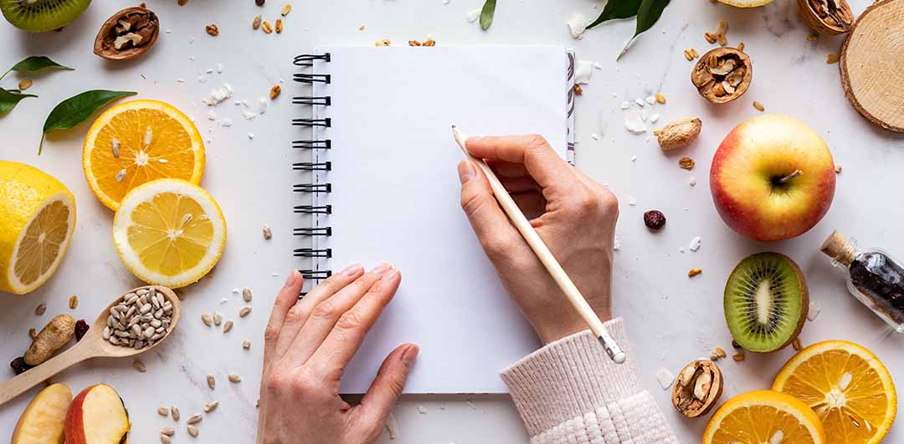

你好，欢迎来到《营养科学课》，我是仝卿。

课程听到了这里，你肯定发现了，我们课程说的都是怎么吃才健康。那炸鸡、可乐、冰淇淋，这些听起来不健康的食物就不能吃了吗？

这个问题非常合理。我特别不希望你把营养科学当成一条条冷冰冰的规则，这个能吃，那个不能吃，千万别这么划分。我希望你把营养科学当成一个帮手，是帮助你打造自己饮食策略的帮手。

炸鸡、可乐，对不少人来说，这是美食，而美食是咱们共同的追求。但既要享受美食，又要吃得健康，这两件事儿到底能不能兼顾？

一个现实的饮食计划不是对美食欲望的禁止，而是个人喜好和营养健康的平衡。

这一讲，我就综合了咱们前面课程提到的知识，总结了六条给聪明人的饮食策略。希望你在制定自己的饮食计划时，这六条策略能帮得到你。

第一条策略，给常吃的食物分档，不同的档位实施不同的食用频率。

我推荐你给自己画一个表格，日常吃的食物大类都写进去，包括主食、肉蛋奶、蔬菜、水果、零食和饮料。然后在每个类别里，把自己爱吃的食物都分成三档。

分档的依据，就是我们课程前面说的，有益健康的因素和饮食风险因素。有确切健康益处、没有饮食风险的，放在第一档；有很强饮食风险因素的，放在第三档；其余的都归在第二档。我自己也画了这个表格，附在了文稿的最后，可以给你当个参考。

这第三档的食物，就是爱吃，但是我们也知道不健康的食物。那怎么对待它们呢？举个例子，午餐肉属于加工肉，是一类致癌物，在表格里的第三档，但我很爱吃。这种情况，用“吃”和“不吃”一刀切来解决，太粗暴了，你可以区分出食用场景。

有些食物已经自带食用场景了。比如，爆米花的食用场景，大多是在电影院。我就也给午餐肉设定了一个食用场景，每次吃火锅的时候都能点，但平时做饭尽量不用。

**区分食用场景的最终目的是降低食用频次。第一档食物可以每顿饭都吃，第二档每天可以吃一次，第三档每周可以吃一次。**

第一条策略重点在频率，我们再来说说种类。第二条策略，保证食物的多样性，每天吃出“一道彩虹”。

“一道彩虹”说的是食物的颜色。《中国居民膳食指南》推荐我们每天吃 15 种以上的食物。要是你觉得食物种类太难数，那就记得吃不同颜色的食物。红色的西红柿，橙色的胡萝卜、南瓜，黄色的玉米，绿色的蔬菜，蓝色的蓝莓，紫色的甘蓝，白色的菜花，黑色的黑豆。

为什么呢？因为不同的颜色，代表着食物含有不同的微量元素和植物化合物。补足了颜色，营养摄入就更全面。

**如果吃很多种类的食物，对你来说还是很难实现的话，我还给你挑了两个优先选择的颜色，就是深绿色和橙色。**  
这两种颜色的食物，有更大概率能给你提供更多的维生素和矿物质。

频率、种类说完了，我们再来关注热量。第三个策略，每天固定时间称体重，每周复盘，统筹热量。

前面的课程里我们提到了，看体重的变化，不要看吃完一顿饭后涨了多少，要看一段时间内的变化趋势。这个“一段时间”，按一周为单位最好。

如果你在工作日应酬多，有点吃过量了，那周末可以少吃一点，平衡一下这一周的热量总量。同样，如果工作日执行了比较严格的饮食计划，周末你也可以放松一下，按照自己的饮食偏好来享受一餐。你会发现，有弹性的饮食方案适应性更强，也能坚持得更久一些。

关注体重还有一个额外的好处，就是也许能及时发现自己身体的病变。如果你的饮食、运动近期没有发生太大变化，却发现自己的体重明显增加或减少。比如近 3 个月，体重变化超过了 15%，那一定要警惕。很多疾病都可能导致你的体重发生明显变化。

比方说，甲状腺功能亢进会让身体的能量消耗显著提高，消化道疾病会让身体吸收营养的功能下降，恶性肿瘤和糖尿病会改变身体代谢，这些疾病都可以在短期内让体重降低。而各种原因导致的水肿，又可以让体重上升。

总之，不明原因的体重变化提示我们：身体可能有潜在疾病了。

统筹热量的时候还有一个需要注意的地方，就是你的不同状态，会导致营养素和热量的需求量不一样。那第四个策略，就是预估自己每周的生活状态，营养素和热量的摄入量，都要匹配需求量。

在前面的课程里，我们提到了几次摄入量和需求量匹配的问题。你的生活状态一般是什么样的？是出差跑外勤比较多，还是坐在办公室加班比较多？生活状态还是动态变化的，你可能平时都在办公室，但这周突然要出个差。这些变化不仅影响营养的摄入量，还影响需求量。

先说摄入量。跑外勤的时候，能吃上新鲜蔬菜水果的机会很可能就减少了，维生素的摄入量不够。在那一周，你可以暂时服用复合维生素片来解决营养缺口。

再说说需求量。不同的工作状态会改变需求量的一个重要参数，就是热量系数。热量系数的意思是，一个人每公斤体重所需要的热量。热量系数乘以你的体重公斤数就是你一天的营养需求量。

比方说，在办公室对应的是轻度活动，热量系数是 30；服务员工作对应中度活动，热量系数是 35；搬运工作对应重度活动，热量系数是 40。

假如你的体重是 60 公斤，在办公室工作，热量系数是 30，那 60 乘 30，你一天需要的热量就是 1800 大卡。但假如你突然出差，要在外面跑，需要的热量可就不只 1800 大卡了。

自身变化还包括生病、备孕等特殊情况，在这些特殊情况下，营养和热量的需求量都会发生变化。所以一定注意，摄入量也得及时调整才行。

除了自身的变化之外，外部环境对我们的饮食影响也非常大。第五条策略，是关注环境变化，调整饮食种类。

比如说，春天的时候，食物品类丰富起来，其中的过敏原也多了。各种热带水果会密集地上市，对菠萝、芒果过敏的人，要注意尽量避免。而且就算你之前并不对这些水果过敏，一次吃的量最好也注意不要太多。

这些策略关注的都是相对短时间内的饮食，那长期的呢？最后一条策略就是，每年定期体检，根据体检结果修正饮食模式。

体检是我们观察身体变化的有效方式。而有一些体检指标，和饮食高度相关，像血糖、血压、血脂、尿酸，等等。

比如经常吃太多的碳水化合物，你的餐后血糖很可能就会升高；经常吃特别咸的东西，你的血压很可能会升高。如果体检的时候发现，这些身体指标的变化到了有异常的程度，除了考虑应该怎么用药物治疗之外，也要想想饮食模式该如何有针对性地调整了。

有些饮食模式你是可以直接拿来就用的。大众营养界有很多卫生机构，或者营养师设计的现成饮食模式。美国的三大新闻周刊之一，《美国新闻与世界报道》，每年也会请到业内专家给饮食模式打分，排个名次。

比如对防治高血压有积极帮助的 DASH 饮食模式，还有大名鼎鼎的地中海饮食模式，好几年都在它的榜单中排名第一第二位。每年也会有全新的饮食模式入榜，感觉大众营养界也有自己的流行趋势。你感兴趣的话，可以顺手搜一下看看。

不管你看上哪个，照着吃上一个月问题都不大。 **但是，如果把执行时间延长到一年、几年甚至几十年呢？我的建议就是，按照你每年的体检结果进行调整。**

如果指标出现异常，比如确诊了高血压、糖尿病等慢性疾病，那更明智的办法，还是去找专业的临床营养师，帮你制定一个年度总体的饮食模式。

总结一下这一讲的内容。

我们这一讲说了六个不同维度的饮食策略，包括饮食的频率、种类、热量、营养素，还要关注外部环境和自己进行定期监测。如果可能的话，我希望你能把这一讲收藏起来，时不时拿出来看看，检测一下自己的饮食模式。

**在最后，我还是要提醒你，食物所带来的愉悦和满足感，在一定程度上可以超越营养素所带来的健康收益，营养规则短期内可以被打破。**

股神巴菲特早餐吃的是巧克力曲奇加冰激凌。这不健康吧？但是对他来说，就像他自己描述的那样，“我这像孩童一般的饮食习惯，可以缓解日常工作所带来的巨大压力”。

在谈营养的时候，我们经常用的一个词是“饮食”，而不是“美食”。

营养学中的“饮食”是中性词汇，强调的是科学性和功能性，但是少了关于“吃”的文化和情怀。食物带给我们的不仅仅是营养的补充，还有精神的依赖和愉悦。

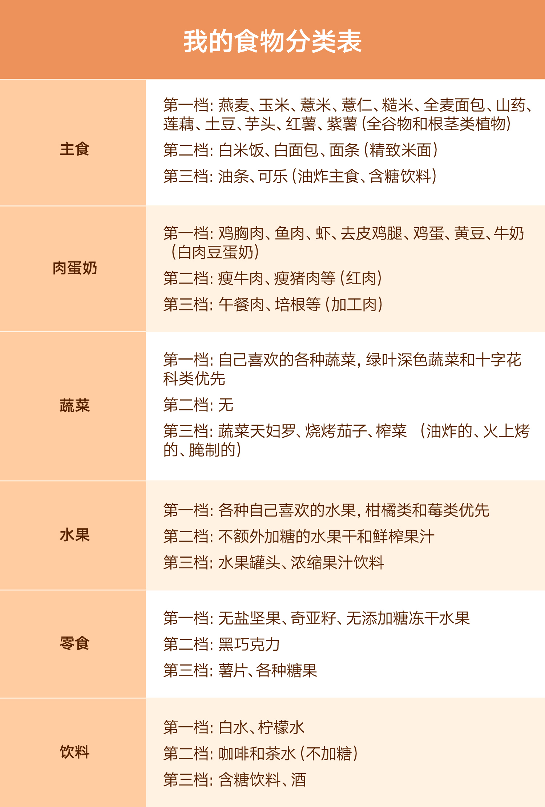

给聪明人的六条饮食策略： 1 把常吃的食物分档，不同的档位实施不同的食用频率。 2 保证食物的多样性，每天吃出“一道彩虹”。 3  
每天固定时间称体重，每周复盘，统筹热量。 4 预估自己每周的生活状态，营养素和热量的摄入量，都要匹配需求量。 5 关注环境变化，调整饮食种类。 6  
每年定期体检，根据结果修正饮食模式。

下一讲，我们来说说，如何通过营养科学提高自己的精力。我们下一讲见。

* * *

# 20 精力：怎样让大脑跟上工作和生活的要求？

  
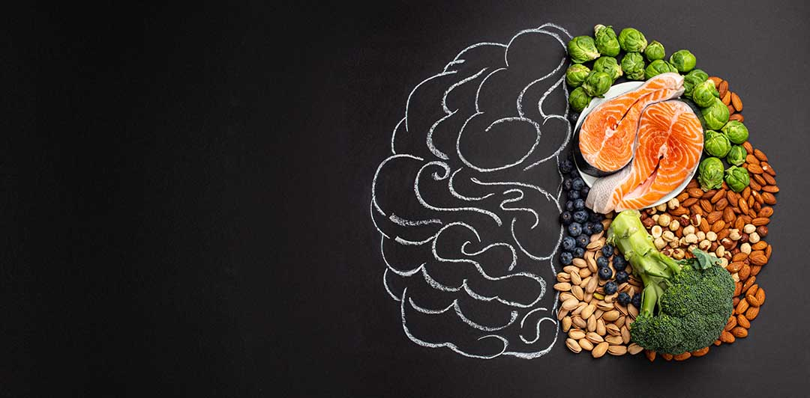

你好，欢迎来到《营养科学课》，我是仝卿。

前面的课程里，我们讲的基本都是饮食和身体健康的关系。最后一讲，我们说一个更高的目标，在身体健康的基础上，还要保证精力充沛。我们专门讲讲饮食和大脑健康的关系。

我的咨询用户，常常会因为这么两种情况来找我咨询。

第一种情况是，有些年轻人，早上工作总犯困，打不起精神，只能靠黑咖啡撑着。

第二种情况是，有些人原本工作效率很高，但随着年纪的增长，明显感觉精力不够用了。但三四十岁这个时间段，恰恰是工作的爬坡期，对精力的要求是在上升的。

这两种情况，乍一看似乎是身体问题，其实都和大脑状态不佳有关。我猜你可能也碰到过这样的问题，这一讲，我就和你说说营养科学可以帮到你什么。

我们先来看，怎样让大脑在短期内保持良好的精力值。

在营养科学看来，回答这个问题的关键，在于保持血糖的稳定。为什么呢？这要从大脑的供能方式说起。

白天工作的时候，大脑要高速运转完成各种思维决策。葡萄糖，也就是碳水最常见的形式，会随着血液循环进入大脑，主要负责给数百万个大脑细胞提供持续的能量。大脑要消耗 20%的葡萄糖总能量。而且，大脑不像肝脏和肌肉，可以把能量储备起来。想让大脑持续高效工作，只能靠血液持续提供葡萄糖。

所以，如果你早上匆忙，来不及吃早餐，大脑的能量不足，你就会犯困。

反过来，碳水吃得太多也会犯困。很多人都有这样的经历，吃饱了就想睡觉。当然这种感觉是多种原因的综合。其中有一种重要的原因是，血糖上升得太快了。

我们大脑当中有一种化学物质，叫食欲素，它可以刺激大脑，让大脑保持清醒。但大量的碳水摄入会抑制食欲素的产生，食欲素少了，人就会犯困。

看来，碳水吃太多和太少，都会导致大脑工作效率降低。那用营养科学的办法，应该怎么吃呢？

咱们举两种常见的早餐吃法。

第一种，吃便利店买的面包。这种我特别不推荐。

因为这样的糕点营养成分比较单一，还有不少添加糖，碳水化合物吸收入血的速度特别快，餐后血糖会升得特别高，随后又快速下降，就像过山车那样。咱们刚刚说了，碳水太多和太少都会让你犯困，所以这种吃法我不推荐。

第二种，吃鸡蛋蔬菜卷饼。主食卷饼里也有碳水，但是因为混合了蔬菜里的膳食纤维和鸡蛋里的蛋白质，碳水的入血速度放慢了，过山车变成了爬小坡。

这种吃法的餐后血糖更平稳，是大脑更喜欢的供能模式。

那如果偶尔想任性一把，比如端午节早上想吃粽子，怎么办？那就加个白煮蛋和凉拌蔬菜。

这些都不想加，只想吃粽子呢？那就分两次吃，8 点先吃一半，10 点再吃另外一半。

这相当于把餐后血糖高峰做了一个平分，要比一口气吃下去之后的血糖“过山车”好得多了。

**总结一下，如果你想保持白天工作时良好的精力，让大脑状态良好，那么正餐碳水必须吃，而且还要尽量减慢血糖的升糖速度。**

我们刚刚讲的是短期内饮食对脑力的影响，主要聚焦在碳水化合物和血糖水平上，这些还都是即时的反馈。那从长期来看，有没有哪些饮食因素会对我们的脑力基础值产生影响呢？

这要从大脑的构成说起。

不少营养素在大脑的构成上发挥了不可替代的作用。比方说，维生素和矿物质是大脑发育的调节剂；脂肪是大脑细胞的重要组成成分；而蛋白质是负责传递信息的神经递质和神经营养因子的原材料。

这些营养素怎么组合出对大脑健康最好的饮食模式呢？

这是目前很多营养科学家的研究方向。我想着重给你推荐一种。来自澳大利亚新南威尔士大学的卡林·安斯蒂教授，领导着她的团队，根据既往的大规模人群饮食数据分析，开发出了一种饮食模式，叫 MIND 饮食模式。就是“头脑”那个英文单词。

MIND 饮食模式可以说是目前最具有循证支持的“健脑饮食模式”了。已经有研究证实，它能显著降低阿尔茨海默症的发病风险。阿尔茨海默症，就是我们平时说的“老年痴呆症”。MIND 饮食模式能降低这种疾病的风险，意味着它有强大的大脑保护作用。

那这个饮食模式到底是什么样的呢？ **MIND 饮食模式首先定义了“健脑食物组”，主要包括绿叶蔬菜、坚果、浆果、豆类、全谷物、鱼、家禽和橄榄油。**

这些食物的共同点在于，它们都提供了构成大脑所需的必需脂肪酸、能帮助合成神经递质的氨基酸，以及抗氧化剂。这些都是目前科学界认为可以保护大脑、激发脑力的营养成分。

**和“健脑食物组”相对的，MIND 饮食模式还定义了“损脑食物组”，主要包括：黄油和人造黄油、芝士、甜点、油炸快餐和红肉。**

这些食物“损脑”的关键点是高添加糖、高饱和脂肪以及过氧化物。虽然这些食物在短期内给大脑供能不是问题，但是如果太多，会阻碍大脑合成神经递质和神经营养因子，而这些成分都是脑神经元正常工作的保障。时间长了，脑神经元的正常工作当然就会受到影响。

我要特别提醒你的是，这个饮食模式主要针对的是欧美人群，所以“损脑食物组”列举的都是西方常见食物。其实，咱们中餐里头也有这样的坑。

比方说锅包肉。猪肉本来饱和脂肪就挺多，又经过高温油炸，油脂和过氧化物都会增加，再加上外面淋的糖醋汁，添加糖也不少。你看，这些“损脑关键点”它都踩上了。偶尔过过嘴瘾确实好吃，但不适合天天做下饭菜。

如果想让大脑长期保持良好的状态，你可以对照 MIND 饮食模式，再细化一下自己的日常饮食内容。

比方说，你可以在“健脑食物组”里挑选两个自己喜欢的食物，设计两条日常可执行的饮食方案。我是这样给自己安排的：第一条，早餐和午餐中间吃上一把坚果，或者午餐和晚餐之间吃上一盒蓝莓；第二条，在食堂吃饭尽量选择鱼或者鸡肉。

你也可以试试自己设计一下，从绿叶蔬菜、坚果、浆果、豆类、全谷物、鱼、家禽和橄榄油里挑选自己的方案。

到这里，我们讲了怎样通过营养科学，在短期和长期让大脑保持良好的状态。那再多问一句，如果大脑细胞已经受损了呢？还有可能通过营养科学来改善吗？

按照目前营养科学的认知，这个问题还不能完备地解答。在整个医学领域，大脑神经修复都是一个非常具有挑战的目标。到目前为止，营养科学的尝试有直接和间接两个思路。

直接的思路就是额外补充和修复脑细胞相关的营养素，像叶酸、B 族维生素、n-3 脂肪酸，等等。不过，这些研究大多都还在动物实验阶段，具体的疗效还有待大规模人群临床试验的证实。

间接的思路，目的是要利用大部分营养素都能进入大脑局部的特性。要知道这个特性，其实是非常难得的。

我们的大脑除了有外部头骨这样的保护之外，内部还有一层叫“血脑屏障”的保护。正常情况下，这层屏障的筛选要求特别严格，为的是有效阻止病原体进入大脑，甚至连大部分的药物都不能通过这层屏障。

治疗大脑神经系统疾病的难点就在于，很多候选药物会被血脑屏障挡在门外。这样的话，药效再好，也发挥不出作用。

而营养素，难得就难得在这里，它们大部分都可以顺利通过血脑屏障，随着血液循环进入大脑。

顺着这个思路，不少新药研发就利用了营养素的这个特性。

比如，有一种修复大脑神经的新药，科学家们专门设计了它的空间结构，让它可以和 n-3 脂肪酸共用一种穿越屏障的转运蛋白。这样，药物就可以进入大脑，执行修复脑细胞的任务了。

总结一下，在营养科学领域，修复大脑神经是一个非常值得期待的方向，但目前这些研究都还没有实际的应用。不过，对于没有神经损伤的大脑来说，短期内，吃对了能让大脑精力充沛；长期来看，吃对了还能保护大脑，降低阿尔茨海默症的发病风险。

在工作和学习的要求越来越高的时候，别忘了照顾好自己的大脑。改变，可以从下一顿饭开始。

讲到这，营养科学的课程就要结束了。最后，我还想再跟你多说几句。

我有位老师，曾经问我这样一个问题：“你知道一个好的营养师，和用户交流完，最重要的是能做到哪件事情吗？”她给我的答案是：“改变行为。”

后来在工作中，我深切地体会到了这个答案的意义。认知的改变很重要，可是健康行为习惯的改变才是让身体最终获益的重要前提。我见过很多肺癌病人，抽烟很多年，早就知道抽烟不好，可是这么多年了都没有戒烟。为什么呢？

因为触发改变需要时机，改变习惯需要技巧。

或许是课程里某个相似的案例，或许是体检报告单上的一个异常箭头，请你不要放过任何一次触发改变的时机。在你想要尝试改变的当下，给自己设计一个最小行动方案。就是你听完这一讲，马上就可以做的那件事情。

比方说，放下手机的时候喝杯水；下一顿饭多加一小捧蔬菜。最小行动方案在做的，不是让你跳出舒适区，而是慢慢让你的舒适区越来越大。

希望这门课不仅能给你带来营养科学的新认知，更希望它能触发你的改变。课程虽然结束了，但是你的改变可以从现在开始。

我是仝卿，感谢你的关注和认真学习，再见。

1 想保持白天工作时良好的精力，正餐碳水必须吃，而且要尽量减慢血糖的升糖速度。 2  
MIND 饮食模式是具有循证支持的“健脑饮食模式”。已经有研究证实，它能显著降低阿尔茨海默症的发病风险。 3  
营养科学也许可以修复已损坏的脑细胞：通过直接补充营养素的方式修复；利用营养素可以穿过血脑屏障的特性，搭载药物进入大脑。

* * *