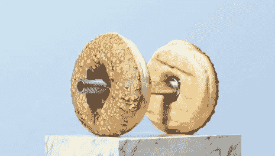

# 体重管理管略（中信）

## 一、减脂期间饮食攻略

### （一）计算每日热量差

减脂期的关键在于创造热量缺口，根据个人基础代谢率和总日能量消耗计算，通常在减脂期总热量摄入会低于日常活动消耗的热量。举例说明，如果某位同事的基础代谢率为 2,200 千卡，日常活动消耗的热量大约为 2,640 千卡，那么在减脂期，总热量摄入应大约控制在 2,140 卡路里左右。

计算每日热量差通常需要确定以下几个因素：基础代谢率（BMR），日常活动消耗的热量，以及摄入的热量。下面是一种常见的方法来计算每日热量差：

- 1. 计算基础代谢率（BMR）：基础代谢率是指身体在完全休息状态下消耗的能量。可以使用一些公式来估计 BMR，其中最常用的是 Harris-Benedict Equation:
  - 对于男性：BMR = 66.5 + (13.75 × 体重/kg) + (5.003 × 身高/cm) - (6.755 × 年龄)
  - 对于女性：BMR = 655.1 + (9.563 × 体重/kg) + (1.850 × 身高/cm) - (4.676 × 年龄)
- 2. 估算日常活动消耗的热量：除了基础代谢率之外，还需要考虑日常活动消耗的能量。这个因素因个人活动水平而异，可使用以下系数来估算：
  - 久坐（办公室工作）：BMR × 1.2
  - 轻度活动（轻度散步、休闲时自行车）：BMR × 1.375
  - 中度活动（中度运动或锻炼 3-4 天/周）：BMR × 1.55
- 3. 计算每日摄入的热量：记录每日摄入的食物和饮料，并使用营养信息标签或薄荷健康等 APP 来估算每日摄入的热量。注意要将摄入的热量转换为相同的单位，通常是卡路里。
- 4. 计算热量差：每日热量差等于日常活动消耗的热量减去摄入的热量。公式如下：热量差 = 日常活动消耗的热量 - 摄入的热量

如果热量差为正值，则表示摄入的热量少于消耗的热量，可能会导致体重减少。如果热量差为负值，则表示摄入的热量多于消耗的热量，可能会导致体重增加。需要注意的是，这种方法仅为估算，并且每个人的身体状况和代谢率都有所不同。

### （二）安排蛋白质、脂肪及碳水三大营养素比例

在饮食中，合理控制三大营养素的比例对于减脂非常重要。一般建议的蛋白质摄入量为每公斤体重 1.8 克，碳水化合物摄入量为每公斤体重 2-3 克，剩余热量则由脂肪填充。对于进行力量训练的人来说，蛋白质摄入量更应保证充足，通常建议摄入 1.8-2 克蛋白质每公斤体重。

- 蛋白质：蛋白质是构成和修复肌肉组织所必需的。在减脂期，摄入足够的蛋白质可以帮助保持肌肉质量，提高饱腹感，并促进脂肪的代谢。一般建议每日摄入总热量的 15% 至 35% 来自蛋白质。具体的摄入量可以根据个体的体重、活动水平和目标进行调整，通常在 1.2 克到 2 克蛋白质/公斤体重之间。
- 脂肪：脂肪是提供能量、维持身体机能和吸收脂溶性维生素所必需的。在减脂期，适量的脂肪摄入可以帮助提供饱腹感、维持激素平衡，并支持身体正常功能。建议每日摄入总热量的 20% 至 35% 来自脂肪。选择健康的脂肪来源，如植物油、坚果、种子、鱼类和橄榄等。
- 碳水化合物：碳水化合物是主要的能量来源，它们提供身体运动和日常活动所需的能量。在减脂期，控制碳水化合物的摄入可以帮助控制总热量摄入，并促进脂肪的代谢，一般建议每日摄入总热量的 40% 至 50% 来自碳水化合物。选择复杂的碳水化合物，如全谷物、蔬菜、水果和豆类，而避免过多的加工和高糖碳水化合物。

个人的营养需求和身体状况均有所差异，上述比例仅为一般经验。个体的性别、年龄、体重、活动水平、代谢率及健康目标等因素均会影响到最适合的营养素比例。

### （三）具体准备方法

鉴于绝大多数同事并无时间自己做饭，故在此主要做外卖食品推荐。在选择外卖时，主要考虑标准化产品，能清楚了解摄入的热量及大致营养元素。减脂期可以吃的外卖推荐如骰子牛肉、秦百味、广式烧味饭等，同时使用薄荷健康 APP 估算每顿标准化产品的 FieldSize 热量及营养元素，并以此为基础制造热量差。较少推荐外卖平台上的减脂餐，大部分减脂餐中蛋白质含量过少，主要以包菜、罗马生菜等为主，蛋白质补充不足，饱腹感亦较差。

## 二、运动类型

除了饮食控制外，运动也是重要一环。运动又能大致分成三种类型，包括有氧、重训和高强度间歇训练。

### （一）有氧运动

有氧运动指的是使用大肌肉群的活动，例如快走、慢跑、游泳、骑自行车、跳舞都属于有氧运动。只做有氧对于减脂的效果有限，因为有氧运动主要依赖有氧代谢系统，它在运动开始后的短暂时间内提供能量。一旦完成有氧运动，能量消耗也会迅速恢复到正常水平。相比之下，力量训练（重训）可在训练后的很长时间内提高基础代谢率，增加持续能量消耗。

### （二）重训

重训就是所谓的力量训练，也是减脂的核心项目。肌肉组织相比脂肪组织具有较高的代谢活性。通过进行重训，可以增加肌肉的体积和强度，提高基础代谢率，也意味着卡路里的燃烧效率提升。最理想的减脂就是饮食搭配有氧和重训，三者相辅相成下必然能达到减重的目标。

### （三）高强度间歇训练（HIIT）

高强度间歇训练（High Intense Interval Training），特色是短时间内进行高强度运动与休息交错的训练。HIIT 适用「后燃效应」原理，让身体在运动后还能够持续消耗热量。HIIT 最大的优点是在运动的过程中有锻炼肌肉的效果，而运动后还能够持续燃烧脂肪。

鉴于绝大多数同事需要频繁出差且较难有时间去健身房，故主要提供室内运动搭配（需器械）。重训及有氧都是需要两者并行的，然后合理调配两者比例。

|  | 星期一 | 星期二 | 星期三 | 星期四 | 星期五 | 星期六 | 星期日 |
|---|---|---|---|---|---|---|---|
|  | 有氧日 | 手臂重训 | 核心训练 | 下半身重训 | 有氧日 | 休息日 | 休息日 |
| 动作 | 30 分钟慢跑，使用 HIIT 训练，例如：快跑 1 mins. 快速 1 mins 交替 | 二头弯举 8-12 次 / 组；俯三头举 8-12 次 / 组；肩推 8 - 12 次 / 组 | 卷腹 8 - 12 次 / 组；侧撑 30 秒 / 组；俯卧撑 8 - 12 次 / 组；平板撑 30 秒 / 组 | 弓箭步走路 10 次起；提踵 30 秒 / 组；高抬腿 30 秒 / 组；深蹲跳 8 - 12 下 / 组 | 30 分钟爬楼梯，使用同款有氧训练，例如：快跑 1 分钟，慢跑 1 分钟交替 | DAY OFF | DAY OFF |

## 三、出差减脂技巧分享

鉴于投行工作性质，各位同事大部分时间都在外地出差。由于无法避免出差，减脂期间也会遇到这种情况，在出差期间为确保减脂计划的执行，可以从运动和饮食两个角度执行。

### （一）运动

重训：在减脂期最好能够保持重训，除了可帮助保持和增加肌肉质量，亦可提高基础代谢率。若酒店无健身设施或器材可用，亦可进行自重训练，包括俯卧撑、弹力绳等练习。

有氧训练：若酒店没有跑步机、爬楼机、游泳池等设施，可以进行一些室内有氧运动，例如跳绳、高抬腿等，这些运动都可以提高心率，促进脂肪燃烧。Keep 等健身应用通常提供室内有氧训练课程，可以在酒店里进行指导的有氧训练。如果酒店有楼梯，可以利用楼梯进行有氧训练。上下楼梯可以有效提高心率和消耗能量。在出差期间可能有需要外出应酬的情况，可在聚餐后第二天早晨进行有氧运动，以消耗多余热量。

无论是在酒店还是室外运动，始终要注意安全和适应个人能力，确保有运动条件。此外，在进行有氧运动前进行热身和拉伸，以减少受伤的风险，并在需要时咨询专业教练或医生的建议。

### （二）饮食

基本原则为尽可能调整饮食结构，较少吃加工食品，如果条件允许可以自带健康零食。少吃加工食物：一方面，加工食品通常富含高能量密度的成分，如脂肪、糖及淀粉，它们往往含有较高的卡路里，但相对较低的饱腹感，因此容易导致摄入过多能量；另一方面，减脂的核心原则为保持热量缺口，故须确保基本能估算出所摄入的食物热量。清淡蔬菜、水煮肉类、鸡蛋、米饭等碳水均为较好选择，需避免的食物包括油炸、爆炒等方式加工的食物（依据估算所摄入的食物热量）。如果简单减少食物的摄入量来减脂，反而更易产生饥饿感，且无法有效控制摄入的热量。

自带健康零食：为应对饥饿感和不健康的零食选择，可考虑自带一些健康低热量的零食，如坚果、水果、酸奶或适宜鸡胸肉等。其中，鸡胸肉具有较强的饱腹感，热量较低，可以在感到饥饿时作为补充食物。

控制饮品摄入：尽可能较少避免摄入高糖饮料和含酒精饮品，因为它们提供空热量且易导致摄入过量。尽管多数情形下，酒精饮品无可避免，但在整体行程中可尽量适当避免摄入奶茶等高糖饮料。

希望以上分享对各位同事在减脂过程中有所帮助，以上内容仅为个人经验，个体性别、年龄、体重、活动水平、代谢率和健康目标等因素都会影响到实际情况，最好咨询专业医生和教练，以获得针对个人情况的定制建议及指导。

（以下无正文）
