 **发刊词 | 用 30 年写一部中国的“未来史”** 

  
  

何帆

14 小时前

> > > > 微信 meitianxuexi365 制作  
> > > >   

| 何帆亲述 |

你好啊，欢迎来到《何帆报告》，我是何帆。

2018 年，我发了一个宏愿：我要用 30 年的时间，每年写一份报告、一本书，来记录中国从 2019 年到 2049 年发生的变化。

 **— 1 —** 

你肯定会问，为什么要做这件事？

因为从 1949 到 2049，新中国将会走完第一个 100 年。

我们能不能用 100 年的时间，留给全世界一个大国崛起的标杆？这就取决于接下来我要和你一起观察和记录的这 30 年。

如果拉长历史的视野，你会发现你所熟悉的过去三、四十年其实是极其特殊的。在这过去的三、四十年，中国的国运可不是一般的好。

比如，在 20 世纪 80 年代，我们刚开始对外开放，国际贸易的格局就发生了调整，开始出现了跨国公司主导的全球化供应链。

到了 20 世纪 90 年代，我们又赶上“苏联解体”，西方世界大松一口气，给了中国充足的生长空间。

到了 21 世纪头十年，中国的壮大已经开始引起部分西方国家的警惕，但是，没有想到的是，恐怖主义又让全世界转移了注意力。

甚至就连可能犯的错误，都有人在前面替我们蹚水填坑。比如，我们的邻国日本经历了泡沫经济的崩溃、失去的十年，这给我们提供了绝好的学习案例，提醒我们可不能犯同样的错误。

 **— 2 —** 

但是，这样的时代已经一去不复返。

我们站在未来 30 年的起点，会发现过去所熟悉的认知框架，几乎一夜之间都开始受到挑战。我们的经济、商业、就业、教育等等一系列模式都开始动摇。

往小了说，过去我们一直觉得，你要上好的小学、中学、大学，然后找到好的工作。但是当美妆博主、淘宝店主，甚至是外卖小哥都比大学毕业生的收入更高的时候，我们又该追求什么样的教育？

往大了说，过去 30 年来，全球化一直是世界经济的常态。但是在全球金融危机爆发之后，这种共识却逐渐被民粹主义打破。我们以后会不会从“全球治理”回到一个“本国优先”的框架当中呢？

我们再往更大了说，2018 年，连普通人都开始意识到，人工智能可能会是一场升级版的工业革命。过去，工业革命的历史经验告诉我们，巨大的转型带来巨大的阵痛。在光明到来之前，我们先会进入“死亡谷”。如果纺织机出现的时候，你是个裁缝；如果汽车出现的时候，你是个马车夫；你是不是会觉得，整个世界都乱了套呢？

这么多未来的不确定性，我们该怎么应对？

其实，我们从来不缺对大趋势的预测。但我们更想知道的答案是，每一个人要怎么度过每天的生活？同样是面对这些挑战，别人是怎么应对的？为什么有的人焦虑不安，有的人生活依然滋滋有味？甚至有人会潮头搏击，在逆境中都能找到自己的机会呢？

 **— 3 —** 

要回答这些问题，我们需要的是转换视角。这就是我要做的事：我们要全方位地去观察各个角落正在出现的新事物、新框架、新的生活方式。我会用田野调查的方法，去为你忠实地记录这些新出现的变量。

过去一年，我走了 20 多个省市。跟你分享一些我在 2018 年的见闻吧。

我看到本应该最传统的制造业，反而把互联网的打法用到了极致；而本来应该受贸易战冲击最大的城市，反而显示出了巨大的生命力。我也看到在农村的留守儿童，正在接受着最前卫的小班教学、素质教育；找不到工作的小镇青年，成了新疆第一批无人机飞手，等等等等。

我还有更多的发现，会在今年这份《何帆报告》音频课中跟你一一分享。

不过，你猜猜，这一年中我发现最大的变量是什么？告诉你，是时间。

时间会让一个生态系统从底层发生改变。这种改变可能很缓慢，你不看都注意不到。但是日积月累，它就会像乾坤大挪移一样，颠覆一切原来的劣势和优势。

牛粪的旁边也会长出鲜花来，这就是时间的力量。

但是，要观察时间这个底层变量，没有投机取巧的方法。我们只有一个笨方法，那就是付出同样的时间去细细地观察、仔细地揣摩。所以，我愿意在得到所有用户的见证下，做一个郑重的承诺。我要把我人生接下来的 30 年拿出来做这么一件事：

我要花上 30 年的时间，每年走访中国的各个城市、村镇。为中国的变化写一部 “未来史”。

 **— 4 —** 

你可能奇怪了，历史是写过去的啊，怎么会有“未来史”这么个自相矛盾的东西呢？

这里面说的未来史有两层意思。第一层意思是，我要写一部献给未来的历史。

我们读历史，会不会常有这种感觉啊：大势一目了然，但是有的细节，怎么找都没有，最后就落下三个字，“不可考”。

这当然是因为，在漫长的岁月中有的史料遗失了，但是更重要的是因为，历史的当事人根本没有想过把自己的生活当作历史来记录。他们想不到，自己就站在浪潮之巅，自己就是一个转折时代的见证人。

我用三十年做这件事情，就是要给我们的后来人，提前弥补这个遗憾。

我特别喜欢的一位历史作家是芭芭拉.塔奇曼。她关于第一次世界大战的作品《八月炮火》曾经获得了普利策奖。这本书里面有一段细节描述，我印象格外深刻。她写到英军登陆法国战场的那天下午，一声夏日的惊雷在半空炸响，抬头看是血色残阳。

这么生动的细节，塔奇曼是在一个英国军官的回忆录里找到的。这位军官当时就在现场，他听到了雷声，也看到了日落。

这个军官也许只是一个再普通不过的人。但是他身处在一个不平凡的时刻，因此他的所见所闻，就成了历史转折点最生动的见证。我写这部未来史也是要这样，我希望能够按照 1:1 的真实比例尺，保留历史的现场。

 **— 5 —** 

但是你想过没有，当你带着这种心态去经历自己当下的生活的时候，你已经站在 30 年后的立场上了。

从前的历史学，它只能研究过去，只能研究那些已经知道结局的故事。

所以，我想用 30 年的时间做一项没有人做过的尝试：我们假设自己站在未来的立场上，把今天的生活当历史来看。我们会放大哪些变量，忽视哪些变量？我们能不能看到这个世界更真实的一面？

这也是我写这部未来史的第二层意思，我要用 30 年后历史学的眼光，去洞察我们今天的生活。

所以你看，我既要写一部献给未来的历史，也要站在未来的立场上写今天的历史。这件事史无前例，非常困难，所以我需要和你在一起，完成这个巨大的知识工程。

你在生活中发现了什么新的变量？也许是一个新的圈子、一种新的消费方式、一个新的职业，或是一个新的商业模式？请你随时告诉我。

同时，我也需要你的监督：我会在每年的调研过程中，定期向你报告田野调查的进度。我会跟你分享我最新的发现和思考。

所以你看，不知不觉中，我们都站到了一个至关重要的历史节点上。我相信，我们会让想要改变历史的人发生改变，会为想要了解历史的人保留答案。

北岛有两句诗：“你把词语垒进历史，让河道转弯”。这就是我们现在要做的，把词语垒进历史，写一套从来没有人写过的，实况直播的“未来史”。

那就请你从今天开始：和我一起，坚持 30 年，直到我们一起见证中国 2049 的百年。

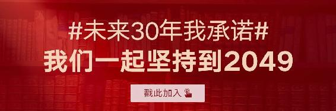

 **01 | 为什么历史是个“反转”大师？** 

  
  

何帆

14 小时前

> > > > 微信 meitianxuexi365 制作  
> > > >   

| 何帆亲述 |

你好啊，我是何帆，欢迎来到《何帆报告》。从这一刻开始，我们要一起来撰写中国 2019 到 2049 年的未来史，用鹰眼视角来记录和观察这个大国的变化。

在我们开始之前，我想请你先思考一个问题：我们现在置身于 2018 年，我们会看到中国经济遇到的各种冲击，会感到焦虑和担忧，但是，如果你是一个来自未来的历史学家，你会怎么看 2018 年呢？

那我们应该讲，生活在 2018 年的人们感到焦虑、感到担忧，并不是没有道理的。因为中美贸易战愈演愈烈，中国的经济增长速度也在放慢，股市不停地下跌，P2P 不断爆雷。你一定也听到身边有很多朋友聊起来消费降级、房价下跌。你也可能听到很多传言，比如有的传言说外资会撤出中国，还有的传言说民营企业都要“跑路”了。

所有的这种焦虑和担忧就是来自中国遇到的各种冲击。我们现在正处在一个剧烈转型的时代。旧的路标已经消失，新的秩序还没有出现。这个社会的变化太快，你我自然会感到力不从心，会感到无助。

 **1\. 历史剧情的反转** 

可是，未来的历史学家很可能不这么看。在你看来，2018 年可能是过去那个高速增长时代的结束，但在未来的历史学家看来，2018 年会是一个新的时代的开端。

为什么呢？因为这是观察历史的视野不一样。未来的历史学家更容易观察到历史剧情在出现反转。

那什么叫反转呢？

反转是电影导演、编剧们还有小说家们特别喜欢用的一个技巧。在你喜欢的电影里，经常会出现反转。本来你觉得故事中的英雄很快就要成功了，可是命运就是要跟他作对，把他一下子扔到谷底，无情地碾压。你又觉得：完了，英雄的使命肯定完不成了。别着急，我们的英雄一定会绝地反击，因为逆境会激发出他的潜能，最终战胜了对手。这就是反转。

你不要觉得只有好莱坞的编剧才会用反转这个技巧。我告诉你，历史从来都是一个反转大师。

我给你举个例子。第二次世界大战刚刚结束的时候，人们对经济前景普遍感到很悲观。因为战争结束后，战时的军工订单就没了，可是，大批退伍军人复员，一定会出现失业，失业就会带来经济衰退。第一次世界大战结束之后确实出现过这样的情况。

结果呢？在二战之后的 20 世纪 50 年代和 60 年代，反而是美国历史上经济增长速度最快的 20 年，被称为“资本主义的黄金时代”。

其实，这里的道理很简单。请你记住：盛极而衰、否极泰来。这是我们中国文明的古老智慧，这是我们中国人对历史演化的最深刻理解。

站在 2018 年，你应该这样来看：我们曾经觉得成功的模式，已经变得过时，但我们以为已经绝望的局势，在不知不觉中发生了变化，新的力量正在萌芽，峰回路转，柳暗花明。

 **2\. 五个变量** 

这就是我要告诉你的：在未来 30 年，中国将会出现一系列波澜壮阔的变化，这些变化都将挑战我们的认知能力。

2018 年，别人看到的是中国经济遇到的冲击，而我看到的是历史的反转。我会用 5 个变量告诉你，这些反转会出现在什么地方。

这 5 个变量不是我在书斋里想出来的，是我亲眼看到的。在过去一年里，我走访了中国 20 多个省市，巡游了 10 多个国家，拜访了创业者、汽车工程师、电竞选手、小学校长等等，为你沙里淘金，找到了 5 个变量。

接下来，我就为你介绍一下这 5 个变量。这 5 个变量分别是：中美博弈、新旧融合、自下而上、技术赋能和重建社群。

我们先从“中美博弈”开始。

中美之间已经形成了一种“鲸鲨生态”，鲸鱼与鲨鱼两种强大却十分不同的物种共存。很多人会觉得贸易战对中国经济有致命的打击。我要告诉你，贸易战本身并不值得过度担忧，需要警惕的是中美关系出现了转折点。

在美国有一批想要下车的人，他们不想继续搞全球化，害怕技术进步，他们的声音会持续影响美国的政策。在中国则有一批刚挤上车的人，中国民众对全球化和技术进步的态度更为积极乐观。

那反转会出现在哪里？不是打赢了贸易战，而是两个国家意识到，有一个更大的挑战，对全人类的挑战，必须由中美两个最大的经济体联手才能应对，这才能构建中美合作的新基础。

那什么才是这样的挑战呢？我的看法是，我们人类迟早会进入人工智能社会。但在这个过程中会出现很多问题，是我们不得不穿越的一个山谷，如果应对失当，我们就会进入一个“死亡之谷”。

我们再来看看中国经济。过去，中国经济发展有 3 个发动机：工业化、城市化和技术创新。我们分别来看看这 3 个变量中出现的反转。

技术创新的步伐没有停下来，2018 年的中兴事件引发了一场关于核心技术的全民大讨论。但我看到的反转是，虽然核心技术很重要，但中国的优势在于发展应用技术。

在后面我会带你看看，在新疆荒漠这样的边缘地带，无人机技术如何发动了一场“应用场景革命”。你会看到，中国庞大的市场，以及我们的工程师红利，会让我们在技术发展上蹚出一条全新的“群众路线”。

我把这个变量叫作“技术赋能”。

工业化的发动机没有熄火。面对互联网、人工智能等等新产业的冲击，中国的制造业正在经历着一次巨大的产业转型。我要告诉你的是，这里的反转在于，我们可能高估了新兴产业的颠覆性，同时，我们也低估了传统产业进行自我革新的能力。

我会带你去看互联网企业如何造车，他们本以为可以颠覆汽车行业的格局，但最后才发现，如果不虚心向传统的汽车行业学习，根本造不出优秀的新能源汽车。我也会带你去看看老牌制造业企业是如何学习互联网行业的打法，而且比互联网行业革命得更彻底的。

这个变量，我把它叫作“新旧融合”。

城市化的发动机也没有熄火，但你会发现，城市化也出现了反转：未来的城市形态可能是一个全新的物种：“多核城市”。“多核城市”就是说一个城市里有很多核心地区。这是因为，过去那种自上而下的城市化模式已经不可持续了。我要带你去看看东莞、义乌这样的城市，在那里你会发现，自下而上的力量才是城市生命力的源泉。

你还会发现，过去我们说房地产规律是：“位置、位置、位置”，现在因为互联网的传播，黄金位置已经不再是唯一的重要因素，偏僻的巷子里会涌现仰慕者众多的“网红”时尚小店。

这个变量，我把它叫作“自下而上”。

最后一个变量可能是我在 2018 年看到的，最强有力的反转。

过去，中国在经济高速发展过程中，因为竞争极其激烈，无论是商业领域还是社会生活中，都很推崇“狼性文化”。这种文化背后是个人主义的崛起。

但在 2018 年，我观察到的反转却是：人们重新回归到了合作中。我在不少社区看到人们在互相帮助、努力重建社群。再比如说，都说农村的留守儿童可能会变成社会问题，可是我在 2018 年发现的教育理念最先进的学校不在北京，也不在上海，而在一所偏僻的山区的农村小学。这个例子我会在后面更详细地为你解释。

无论在城市还是在乡村，人们都在努力重建社群，这是我们以后建成和谐社会的基石。这也将是我们进入到“丰裕社会”之后遇到的最大挑战。

所谓“丰裕社会”，也就是说，当我们摆脱了物质贫困之后，影响我们每个人幸福感的不在仅仅是个人的财富积累，而是公共生活、公共服务。这就是很多经济学家、社会学家所说的“社会资本”。这个“社会资本”以后会比“实物资本”、“人力资本”更为重要。 

这个变量，我把它叫作“重建社群”。

 **3\. 总结** 

好的，我在这一讲为你介绍了我在 2018 年看到的一个趋势，我看到在冲击中出现了历史的反转。我也为你预告了我们今年的年度报告的主要内容。

通过我的讲解，你学会了要从更宽广的视角去看历史，要从细微处观察历史剧情即将出现反转的线索。你也能了解到，在未来的历史学家的眼里，2018 年其实是一个新的起点。

好了，这一讲就先到这里，我是何帆，我们下一讲再见。

> > 

 **02 | 为什么你看不见“慢变量”？** 

  
  

何帆

14 小时前

> > > > 微信 meitianxuexi365 制作  
> > > >   

| 何帆亲述 |

你好啊，欢迎回到《何帆报告》。上一讲，我们主要讲了历史的反转。盛极而衰，否极泰来，这就是历史的反转。我也给你介绍了我在 2018 年为你找到的五个变量。

你可能会问，为什么是这五个变量？你是按什么线索去找这些变量呢？

好，我就把我的方法论告诉你。掌握了这个方法论，你也能跟我一样成为一个趋势观察家。我的方法论其实很简单，就一句话：在慢变量中寻找小趋势。这里面有两个关键的概念，一个是慢变量，一个是小趋势。这一讲，我先说说慢变量。

 **1\. 海上为什么会有波浪？** 

让我先问你一个问题：假如你站在海边，看到海上有波浪。那我问你，为什么海上会有波浪？

你可能会说，我看了天气预报，今天有风，无风不起浪嘛。所以，你会觉得天气是影响波浪的变量，对不对呢？对，但是不够全面。其实，真正引发海上波浪的是月亮和太阳，尤其是月亮的引力，这就带来潮汐现象。

所以，天气是快变量，如果你不看快变量，不看天气预报，你就不知道今天要起大风，贸然出海就有可能在海上遇险。但是，如果你不看慢变量，你就无法理解为什么会有潮汐现象，也没办法计算出潮起潮落的规律。

什么是慢变量呢？我们来举几个例子。

影响房价变化的慢变量是什么？是人口年龄结构的变化。从短期来看，首付比例、银行的按揭贷款利率、土地供应等因素都会影响到短期房价，但从长期看，中国房价的上涨在很大程度上是特殊的人口年龄结构所决定的。

独生子女一代到了要买房的时候，父母多少都会赞助一些。所以，这就不再是一对小夫妻买房，而是六个有支付能力的家庭成员一起买房。遗憾的是，当中国进入人口老龄化社会之后，这种旺盛的购买力就会消失。为了退休养老，大家都想把房子卖掉，卖房的人多，买房的人少，房价怎么可能上涨呢？

影响你一生的慢变量是什么？不是你的努力程度，也不是你的受教育程度，而是你出生在哪个时代、哪个国家。巴菲特就很有自知之明，他说如果自己不是出生在 20 世纪的美国，就不可能有这样的成功机会。

影响你的孩子未来发展的慢变量是什么？不是他们上了多么好的学校，学了什么专业，而是他们的兴趣和天赋是什么，以及这样的兴趣和天赋，是不是恰好契合了未来的社会需求。

刚刚恢复高考的时候，大学里最热门的专业是中文，对外开放之后，最热门的专业是国际贸易，如今，最热门的专业是金融。回头看看，大部分一心想赶上热门专业的人都踩错了点。因为等你发现这些专业很热门的时候，这些行业可能正好发展到了巅峰，可是当你花了四年时间学完毕业，这些行业可能已经走下坡路了。

所以，无论是看社会的未来，还是个人的命运，你都要学会关注慢变量。慢变量能够让你看穿历史的雾霾，慢变量给你提供一个观察历史的“上帝视角”。

 **2\. 一旦打开就合不上的趋势** 

慢变量之所以称之“慢”，是因为它的力量是逐渐释放的，可能要经过很长一段时间才会显现。但是，这种力量一旦打开就合不上，会形成非常持久而且强大的惯性。

接下来，我给你介绍一个观察“慢变量”的高手。他就是美国西北大学的经济学家罗伯特.戈登教授。戈登教授在《美国增长的起落》这本书里说，美国在 1870-1970 年这一百年出现了一次经济大跃进，这场经济大跃进前无古人、后无来者，而背后主要的推手就是慢变量。

戈登教授说，如果把这 100 年，拆成两个五十年，你会看到头五十年，美国出现了一大批新的技术成果：电话、电报、火车、飞机、抗生素、公共卫生系统等等。这些技术带来了我们已经习以为常的现代生活方式，也是 1870 到 1920 这前五十年的经济增长的主要动力。

后五十年，是美国历史上极为动荡的时期。从 1920 年到 1970 年，美国经历了 1929 年股灾，30 年代大萧条，第二次世界大战，二战之后的美国经济其实是管制经济，不是自由市场经济，总之经历了非常多的挫折。

但是有一件事非常让人惊奇，那就是美国这多灾多难的后 50 年，经济增长反倒比前面顺风顺水的五十年更快。

这就是慢变量的威力了。别人都把技术进步看成快变量，但戈登教授指出来，技术进步其实是一个慢变量。

慢变量的特征在于，它是有惯性的，一旦开始就不会停滞。越是重大的技术进步，影响历史的进程越是缓慢，因为它会导致包括硬件和软件在内的所有系统的重建。它也会导致我们的生产和生活方式出现重大革命，而我们是在漫长的时间内逐渐发现它的威力，并且适应这种变化的。

你看美国的汽车行业就是个很好的例子。汽车行业是 20 世纪初开始发展的。最早的汽车很简陋，没有仪表盘、没有车灯、没有挡风玻璃，更没有雨刷了。到了 20 世纪 30 年代，虽然美国经济处于大萧条，但汽车行业的技术和产品却日渐精湛。这就是慢变量的惯性。

慢变量还会消化历史进程中出现的各种冲击。比如，罗斯福总统实行的“新政”中，有一个重要的政策就是支持工人组织工会，这对企业来说，造成了工资提高、生产成本上涨。企业家转而加速了对机器设备的投资，技术进步的速度也随之加速了。

别人都像是挤在围观的人群里，去看游行花车的吃瓜群众，只有戈登教授是站在 10 层楼上的落地大玻璃窗后面，俯瞰整个街道。你看，换了观察的视角，你就能看到别人看不到的“盲区”。

 **3\. 影响中国的慢变量** 

好的，我再帮你总结一下，慢变量是一旦打开就合不上的趋势，这就是“青山遮不住，毕竟东流去”。如果你关心的是中国在未来 10 年、20 年的经济前景，而不是未来半年、一年的经济前景，那你就必须先找到慢变量。

这就需要你改变一下思路。我们现在天天讨论哪里有风口，因为据说站在风口，哪怕是一只猪，也会被刮到天上去。但是，还有一个力叫地心引力，飞得越高，摔得也越重。

那什么是继续推动中国经济前行的慢变量呢？其实很容易找到。

在过去 40 年，推动中国经济发展的主要力量是工业化、城市化和技术进步。中国原来只有第一产业，也就是农业，工业化创造了第二产业，城市化推动了第三产业，也就是服务业的发展，而技术进步则全面提升了各个产业的生产效率。未来 10 年、20 年，这三个慢变量会持续推动中国经济持续向前。

这就是我们在上一讲说过的，中国的工业化没有熄火，在新的物联网时代，制造业很可能会绝地反击；中国的城市化也没有熄火，衍生出了“多核城市”的新形态；中国的技术进步也没有熄火，在技术应用方面，中国甚至可能后来居上，反过来改变全球核心技术的演进路径。

除了影响经济发展的这三个慢变量，我们还能找到很多影响社会发展的慢变量。所有这些慢变量的特点都是：它们看起来离我们的日常生活很远，看起来没有什么变化，但就想遥远的月亮能够带来海上的潮汐现象一样，这些慢变量也是影响我们的时代、我们个人命运的强大力量，也是我们最容易低估和忽视的力量。

不过，我还要提醒你，慢变量可不是一成不变的，它们也在变化之中。我们知道，慢变量虽然重要，但它变化得很慢，那如何去观察慢变量的变化呢？好比我们要去观察一棵树。树的生长速度很慢，如何才能够观察到大树的生命力呢？你就要去看它的嫩芽。说到嫩芽，那就要引出小趋势的概念了。这就是我下一讲要说的内容。

 **4\. 总结** 

好了，我在这一讲介绍了慢变量的概念。你了解到：慢变量是那种一旦打开就无法合上的趋势，它像洋流一样浩浩荡荡。虽然慢变量是推动历史发展的更重要的力量，但我们却往往会低估和忽视这些变量，这是因为：“不识庐山真面目，只缘身在此山中”。只有找到了这些慢变量，你才能不迷失方向。

好的，这一讲就先到这里，我是何帆，我们下一讲再见。

 

何帆

> > 慢变量是那种一旦打开就无法合上的趋势，是推动历史发展的更重要的力量，但我们却往往会低估和忽视这些变量。只有找到了这些慢变量，你才能不迷失方向。 

 **03 | 为什么“小趋势”能成为主流？** 

  
  

何帆

5 小时前

> > > > 微信 meitianxuexi365 制作  
> > > >   

| 何帆亲述 |

你好啊，欢迎回到《何帆报告》。上一讲我们讲了慢变量。慢变量是指南针，能够给我们方向感。但是如果你想把握时代的脉搏，你还必须要找到小趋势。这一讲我们就来谈谈小趋势。

我先问你一个轻松的问题：2018 年最流行的歌是哪一首？

你是不是会觉得这个问题挺难回答的？即使你有自己的答案，别人也未必认同你的答案。可是，过去不是这样的。

我们年轻的时候，提到最流行的歌，所有人都能想到一块儿：最流行的歌就是所有的年轻人一起听的歌儿。我还记得上中学的时候大家都在听的歌，是齐秦的《大约在冬季》，刚上大学的时候流行的是赵传、童安格。

现在不一样了。每个人都有自己喜欢的歌，有的喜欢摇滚，有的喜欢民谣，有的喜欢嘻哈，有的喜欢二次元音乐。

在这个年代，小众成了主流。

 **1\. 什么是小趋势？** 

过去，在中国发展的初期，你只要知道大趋势就好了。比如，你知道要搞市场经济，那你如果有勇气，就敢下海经商了。你知道中国刚刚进入城市化，住房制度改革了，那就买房呗。

但是，当社会和经济发展到了一定的阶段之后，反而会出现分化。城市和城市会变得很不一样，企业和企业会变得很不一样，个人和个人会变得很不一样。这时候就出现了小趋势。

那么，什么是小趋势呢？小趋势的概念是美国未来学家马克·佩恩提出来的。按照佩恩的定义，小趋势就是占美国人口 1%的群体出现的变化。

比如，他注意到了有一些信奉新教的墨西哥裔美国人，还有一些是不在学校里上学，在家里上学的孩子等等。

虽然他们都是社会里面的“非主流”，但是他们的出现，却引起了一系列的涟漪反应。为了服务那些在家里接受教育的孩子，市场上出现了专门为他们提供课本、教材的公司。那些信奉新教的墨西哥人，成了美国 2004 年大选中，布什总统能够胜出的重要因素之一。

佩恩的这一观察视角启发了我们：有一些人群，虽然人口数量相对较少，但是却能够产生跟它人数似乎不相称的影响力。

我的研究方法和佩恩有所不同。我并不严格按照占总人口 1%这样的标准来定义小趋势。为什么呢？因为中国的人口规模太大了。我们可以宽泛地讲，在至少上百万的人群中出现的富有生命力的新变化，都可以称为小趋势。

让我们先观察一下小趋势的特点。虽然占中国总人口千分之一就有 140 万人，占百分之一会有 1400 万人，看起来人数众多。可是你要知道，在剩下 99%的人看来，这只是很小很另类的一个群体。所以，在小趋势里面的人觉得这就是一片海，在小趋势外面的人觉得，这不过是一滴水。

不过，这些群体虽然人数相对较小，但更为团结，观念更一致，更喜欢尝试一些跟别人不一样的东西。而且他们互相形成一个线上和线下的网络，这就能成倍地放大他们的力量。所以，给你总结一下，小趋势的特点是要足够小，才能显示出锋芒，但又必须足够大，才能够彰显出力量。

我在 2018 年发现的不少小趋势，举几个例子跟你分享一下。

比如，我观察到有一群从城里来到农村、想把农业变成一件很酷的事情的年轻人。这里，有为农业开发无人机的程序员，有操纵这些无人机的飞手，还有一些敢于尝试新科技、率先利用网络和大数据的“新棉农”、“新菜农”、“新果农”。他们都是小趋势。

我还观察到，有一群按照传统体育竞技的刻苦训练程度要求自己，想要在国际大赛中夺冠的电竞选手。还有一群比他们人数更多，过去被家长禁止打游戏，但其实是偷偷一路打游戏长大的年轻人，现在成了电竞赛事的忠实观众。这两群人，共同推动电竞行业从边缘走向主流，这些人也是小趋势。

我还观察到，有一群人，只挑选顺眼的人当邻居，非常热心地参加社区活动。他们不想一辈子只过朝九晚五的上班生活，而是想在闲暇时间，在和邻居们的互相交流之中，发现自我的人生价值。那他们都是一些新型社区的居民，这些人也是小趋势。

 **2\. 为什么会有小趋势？** 

那我们要问，为什么会出现这些小趋势呢？可能，在小趋势里面的人们会觉得，“这都是因为我们自己的力量”，其实并非如此。之所以会出现小趋势，是因为首先有了大趋势。

我们就拿盖房来说。盖房的时候，是一层一层起高楼，每一层的盖法都是一样的，盖出来的毛坯房也是一样的。但是等到盖完房，要装修的时候，每一家的装修风格就不一样了。有的喜欢金碧辉煌的洛可可风格，有的喜欢性冷淡风格的莫兰迪色系。所以，盖房子是大趋势，而装修是小趋势。

那我们就能够理解，比如说互联网技术在最早的时候，你要是做个网站都得专门找人来为你做。但是，随着技术的发展，比如有了微博，有了微信公号，你不用懂任何编程，直接就能发微博和微信，做自己的自媒体。所以，互联网平台才是大趋势，而自媒体就是小趋势。

所以，小趋势的出现是因为技术的赋能、平台的提升、环境的改变，和这些小趋势里面的人有创新的激情。

我们来看看，为什么农业会变成一件很酷的事情呢？因为互联网、大数据、机器人，会把农业变成有趣的高科技产业，这就会吸引越来越多的年轻人投身其中。

那为什么电竞选手会像过去的奥运冠军一样，受到年轻人的膜拜呢？因为电子竞技和传统体育竞技的精神内核是一样的，但是它的对抗性、可观赏性和科技含量又会轻松地超越传统体育竞技。

为什么我们讲到的那些在新社区里面的中年人会如此活跃呢？因为当物质积累让一部分人迈入“丰裕社会”，他们的目标自然而然地就会转向自我实现。那些有消费能力的中年人，会开始想到寻找全新的身份和角色，打造自己的“第二人生”。

 **3\. 如何利用小趋势？** 

你可能会问，找到小趋势，对我来说，能有什么用呢？

我来举个例子，你来想一想。假如你是个卖水果的，你是卖苹果好呢，还是卖榴莲好呢？你很可能会说，卖苹果。因为大部分人都能够接受苹果的味道，但是只有很少人能够接受榴莲的味道。喜欢吃榴莲的人喜欢得不得了，不喜欢吃榴莲的人讨厌死这种味道了。

其实，卖榴莲很可能会比卖苹果更值得尝试。买榴莲的人会形成彼此的认同感，买苹果的人就不会。过去，喜欢榴莲的朋友散落在各处，但互联网出现之后，有着这种奇怪爱好的人们才能聚到一起。

你知道吗？人类历史上第一个烤榴莲的品牌，居然被一个叫桥哥的小伙子做出来了。他原来卖过红糖、卖过樱桃，都没有成功。唯独换成卖榴莲之后，在两年就开了 100 多家连锁店。

从这个小小的成功案例，你一定能够悟到：如果你能找到一个小趋势，并且一心一意地服务好这个小趋势，那你想不成功都是一件很难的事情。

 **4\. 如何找到小趋势？** 

那么，你又会问，我该到哪里去找到小趋势呢？

你必须要跳出自己的圈子，去关注在别的地方发生的新鲜的事情。在互联网时代，虽然看似信息更加发达，但是我们反而更难找到小趋势。你想想，过去，我们一张《参考消息》就能了解天下大事，而且所有的人看的都是这同一张报纸。在过去，我们接受到的信息是一样的。

可是现在，互联网把我们分成了不同的“部落”。我们不了解的圈子，可能人数和影响力远远超过我们的想象。

虽然我们每年都经历了很多事情，听到了很多消息，但是，在你我的部落之外，在我们的目力到不了的地方，正在发生着一些更有意思、更有价值的事情。这些事情通过千丝万缕的联系，会直接或者间接地影响我们的生活。

所以，想要找到小趋势，你必须尽可能地跳出自己的圈子，去做一个“流浪者”。你要学会从指南针开始自己的旅行。也就是说，你要先找到慢变量，但是最终，你要到达小趋势。

慢变量好比是高速公路，你要上去了就不会迷失方向。但是你在高速公路上是看不到令人惊艳的美景的。你要不时地从高速路的出口下去，在城市的街道、乡村的小路上游荡。你要停下车，跟遇见的各色人等聊天，倾听他们的故事，同时你还得用眼睛的余光，去扫视来来回回的人群。直到蓦然回首，发现让你激动的小趋势。

 **5\. 总结** 

好的，我在这两讲介绍了我观察趋势的方法论。我的方法论就是：在慢变量中寻找小趋势。慢变量让你不会迷失方向，小趋势让你不会错过细节。掌握了这个方法论，你也能跟我一样成为一名趋势观察者。

好了，这一讲就先到这里，我是何帆，我们下一讲再见。

 

何帆

> > 如果你能找到一个小趋势，并且一心一意地服务好这个小趋势，那你想不成功都是一件很难的事情 

> > > > > > 04 | 如何培养你的“历史感”？ 

  
  

何帆

\-49 秒前

> > > > 04 | 如何培养你的“历史感”？ 

| 何帆亲述 |

你好啊，欢迎回到《何帆报告》。上两讲，我教会你如何在慢变量中寻找小趋势。按照这个方法论，你不会迷失方向，也不会遗漏细节，你一定能够更好地培养自己对历史的感知。我把这种对历史的感知称为历史感。

这一讲，我就来谈一谈，为什么要培养历史感，怎样培养历史感，有了历史感又能有什么用？

我先来问你一个看似不相干的问题：假如你看到一棵大树，你当然知道这棵大树是有生命力的，可是这棵大树看起来没有什么变化，那你怎么样才能够体察一棵大树的生命力呢？

1\. 观察历史的大树模式

我为什么要问你这个问题呢？

我在发刊词里介绍了我的写作计划：我打算用 30 年的时间，每年写一份年度报告，30 年给你 30 份报告，记录我们这个国家的光荣与梦想。

30 年长不长？说长也长，30 年就是一整代人的时间了，说短也短，在中国历史的长河中，30 年只是弹指之间。在这 30 年内，有很多事情是会变化的，但是也有很多是不变的。怎么把握这种变与不变的平衡，这是我一直在思考的问题。

所以，我们必须换一种方式去看未来的 30 年：我的体会是，你要像观察一棵树一样去观察历史。

那你想一想，怎样去观察一棵树呢？

我们过去看大树是单一视角，也就是我们过去总是用广角去看一棵树，我们看到的是它的整体的形状：我们看到的是它的树冠、树干和树根。

以后，你还要学会用显微镜去看树的变化，你还要学会用无人机航拍那样的“上帝视角”去看。

你要往天上看，去看这棵树的枝条，你也要朝地上看，去看那些落叶是怎么样护根的、种子是怎么样落地的。你要去观察天气的变化、甚至气候的变化，你要去研究整个生态系统。

所以，总结一下：当我们去观察历史的时候，我们要学会从多个不同的视角去看。

2\. 中国经济，用大树模式怎么看？

那我来给你举个例子吧。2018 年是中国改革开放四十周年纪念。在很多人看来，这四十年中国经济一直保持着高速经济增长，中间没有发生太大的变化。其实不然。

八十年代的中国经济和九十年代的中国经济大不一样，九十年代的中国经济和 2000 年以后的中国经济也大不一样。

八十年代中国有很多乡镇企业，那个时候农民“离土不离乡”，尽管乡镇企业搞活了经济，创造了很多就业，可是这些企业产权并不明晰、技术水平也非常落后，并没有真正地提升中国的经济实力。

到九十年代，中国经济出现了“双向大循环”：内地的劳动力来到沿海打工，而国外的资本来到沿海投资设厂，于是，出口拉动了中国的经济增长。到了 2000 年之后，中国经济最重要的行业已经不是外贸行业，而是房地产行业。

这就像一棵大树，每隔一段时间就会长出一根新的树枝，中国经济也是每隔大约十年就换一个样子。

你得像园丁那样时时刻刻去观察这棵大树的变化。

那我们再拿九十年代中国的对外开放来说。很多人说这就是因为邓小平同志南巡讲话，所以中国下定决心要融入世界经济。这只是故事的一半。那还有故事的另一半呢，故事的另一半是，在九十年代，国际贸易的格局出现了巨大的变化。

过去我们说“中国出口一亿条裤子换欧美的一架飞机”，但是那样的国际贸易已经过时了。过去的国际贸易叫产业间的贸易，现在的国际贸易是产业内的贸易。

也就是说，无论是飞机，还是裤子，所有的产业、所有的产品，都会至少有一些劳动力密集型的生产环节，这些生产环节就会搬到中国。所以中国参与国际分工的机会一下子增加了。

所以，你还要学会像一个生态学家那样观察一棵树，你得去看阳光和降水对大树成长的影响。

那我再来给你讲一下中国在 1997 年和 1998 年经历的东亚金融危机。庆幸的是，中国躲过了一劫。为什么呢？其实这里头有侥幸的成分。

中国原本在东亚金融危机之前就想开放金融市场，实现资本账户自由化，但是由于准备的时间过于仓促，所以没有按时实施。东亚金融危机中那些盲目开放了金融市场的东南亚国家遭受重创，中国这才醒悟过来：原来金融市场不是随随便便就对外开放的。

所以你看，你要像拿着放大镜一样，去看每一项政策背后的故事，才能够理解中国的国运。

3\. 从枝桠看母体的生命力

那我要告诉你，我讲大树模式，其实还另有一番深意。

当你观察开始发胀的果实、悄然飘落的树叶，或是叶尖露出的点点焦黄的时候，你其实关心的并不只是那一片叶子、一颗果实，你关心的是这棵树的母体。这棵大树到底现在健康不健康，它在发生什么变化？这是你关心的。

同样，当我们像观察嫩芽一样观察“新变量”的时候，我们想要了解的是中国这棵大树的母体是否依然健康。

像观察一棵树一样去观察历史，就是为了培养你的历史感。

那到底什么是历史感？这个历史感类似于一种第六感觉，有了历史感，你就能更真切地体会到，原来我们就生活在历史之中，原来我们和其他人是同呼吸、共命运的。

著名社会学家米尔斯写过一本名著，叫《社会学的想象力》。米尔斯说，普通人觉得，我这么卑微的生活能够跟宏大的历史有什么联系呢？这是错的。历史就是由我们这些普通人塑造的。普通人也很难体会到，我的生活跟别的陌生人的生活会有什么关系呢？这也是错的。

你的命运其实和很多与你素不谋面的人的生活有着千丝万缕的联系。米尔斯说人们要有“社会学的想象力”，我把它叫作“历史感”。

那我们该怎么培养历史感呢？

首先，我必须对你诚实。我得告诉你，历史感不是你听完我这个报告就能学会的，历史感也不是你读一本教科书就能够学会的。历史感是一种只可意会、不可言传的东西，你要靠知识的积累、长期的观察、不断地思考，还得有顿悟才能够达到这样的境界。

如果一定要说的话，我觉得历史感跟美感、乐感很像。我专门问过几位音乐家，他们告诉我，有乐感的人听到音乐，就会对后面的乐符有所期待。

其实，各行各业都有这种直觉。

围棋高手如果扫一眼棋盘，他就会对胜负格局了然于胸。

有经验的消防队员凭直觉能预感到脚下的地板什么时候会出现塌陷。

战场上的老兵会告诉你，他们能够从风中“嗅出”危险的信号。

还有一些观鸟的爱好者，他们有一个专门的词汇，叫“气场”。什么意思呢？也就是说，你要在鸟儿飞过的那一瞬间，通过鸟的形体、姿态、飞行速度、大小、颜色、位置和气候条件，一眼判断出来这到底是哪一种鸟。

虽然我们不能用一讲的时间就教会你什么是历史感，但我希望你从今天开始，要学会用一种不同的角度观察周围正在发生的事情。

每一件事情，你都要问一下自己，这件事情在历史中的真实尺度究竟有多大。我们是倾向于夸大了它的影响，还是会低估它的影响？这件事情又跟哪些事情是联系在一起的？我们原来的判断有没有被证伪？如果被证伪了，那能不能找出来，我们在哪里犯错了？日久天长，你就能发现自己的洞察力会大大地提高。

4\. 总结

好的，我们在这一讲说了一个重要的概念：历史感。

历史感是为了让你更好地体会自己是生活在历史之中的。为了培养这种历史感，你要学会观察。

我为你推荐的观察历史的方法就是“大树模式”。当你学会如何观察一棵树之后，你会比一般的人更懂得在复杂多变的环境中，每一株植物为了生存而适应和创新的智慧到底是什么。

好了，我是何帆，我们下一讲再见。

> > > > > > 05 | 你为什么高估了贸易战的破坏力？ 

何帆

\-44 秒前

> > > > 05 | 你为什么高估了贸易战的破坏力？ 

| 何帆亲述 |

你好啊，欢迎回到《何帆报告》。从这一讲开始，我会用四讲，为你介绍我们在 2018 年观察到的第一个变量：中美关系。

中美关系是人们在 2018 年谈论最多的话题之一。你一定也在问：为什么美国会突然发动对中国的贸易战呢？这场贸易战会对中国经济带来多大的破坏？中美关系还能回到过去的局面吗？最坏的情况会有多坏？

你可能已经听了很多专家的观点。专家的观点也不一样，有说东的，有说西的，听得越多，你越糊涂。这里面有个认知模式的问题。我们习惯于把距离我们近的事物看得太大，把更有戏剧性的事件看得更严重，即使是专家也不例外。

这一讲，我请你换一个思路来看中美关系。

1\. 台风是可以预测的吗？

我们先看看一下，2018 年中国遇到了很多台风。我要告诉你的是，贸易战和台风有很多相似的地方。

我们先看第一个相似的地方。贸易战和台风都是在意料之中，但却难以预测。

那你想一想，一年之中，哪个季节更容易出现台风呢？当然是夏季和秋季。哪一年更容易出现台风呢？在历史上，由厄尔尼诺现象转为拉尼娜现象的年份更容易出现台风。厄尔尼诺就是海洋里面的寒流温度提高了。什么是拉尼娜现象呢？是指的寒流比原来更冷了。

这两种现象是交替出现的，你来了我就走。2017 年 10 月之后，拉尼娜现象已经出现，所以 2018 年台风才会频繁地爆发，这原来就在意料之中。

可是，具体的台风动向却是难以精准预测的。虽然我们现在有了气象卫星，我们有了雷达、观测站，还有专门的“追风车”，但是气象部门到现在为止，最多只能预报三天之内的台风动向。

你再看看贸易战。中美在贸易问题上产生摩擦也是意料之中的，导致摩擦的因素一直存在。比如两国之间存在的贸易失衡，美国对华贸易逆差不仅没有减少反而在增加，而且美国的政客们最喜欢借敲打中国赢得选民的选票。

可是，2018 年中美贸易战迅速升温，却出乎人们的意料。

我们来快速回顾一下这个过程。先是在 2018 年 3 月底，特朗普突然宣布，要对从中国进口的商品征收关税，随后又爆发了中兴事件。接下来，中美双方密集地进行了 3 轮谈判，我们是真心想要谈判，但美国变卦了，所以最后贸易战还是正式爆发了。

美方的第一批征税清单在 7 月份正式生效，中国马上实施了反制的措施。随后就是不断地升温。直到 2018 年年底，在 G20（20 国集团）峰会上，双方达成了 90 天的“休战”共识，设置了为期 3 个月的谈判期。

就在我们以为有转机的时候，马上又出现了孟晚舟事件。所以，局势仍然是瞬息万变。我也在随时关注。如果出现新的动向，我会第一时间向你汇报。

2\. 贸易战会带来多大的破坏？

贸易战会带来多严重的后果？这是很多人最担忧的问题。我要告诉你的是，贸易战和台风还有一个相似的地方，就是人们常常会高估它的破坏力。

那我们就说 2018 年登陆粤港澳地区的台风“山竹”吧。在台风到来之前，人们很容易恐慌。 你可能还记得，“山竹”台风登陆之前，香港、深圳的那些超市被抢购一空。家家商铺都备好了沙袋。还有些迷信的人们在窗户上贴胶带，据说这样可以减少台风的冲击。

但实际上，虽然台风看起来来势汹汹，它持续的时间却非常短暂。“山竹”过后，人们很快就恢复了正常生活。

所以贸易战更像台风。看起来“黑云压城城欲摧”，其实没有那么可怕。我在 2018 年调研的时候发现了一个有趣的现象，当我问出口企业会如何应对，很多出口企业都非常淡定。

有的出口企业告诉我，如果美国征收 10%的关税，那好办啊，一方面可以把成本压缩 5%，自己消化一半，另一方面加价 5%，让贸易伙伴帮自己消化另一半，不就没关系了。

我们也去了义乌。义乌的出口商人告诉我们，他们出口到美国的商品都是美国家庭必须要用的商品，比如 90%的圣诞用品都是在中国生产的。除非美国人不打算过圣诞节了，不然的话，那你怕啥呢？

所以，归根到底，这是因为中美经济已经在很大程度上融为一体了。著名的畅销书作家尼尔-弗格森甚至创造出一个概念：中美国。也就是说，中国和美国似乎成了一个连体婴儿。

这是因为在过去将近 30 年的时间里，两个国家相互投资了大约 4000 亿美元，共同构建起来了一个以供应链为纽带的生产网络。这个生产网络，很像经济上的核武器。什么意思呢？核武器的威力在于，你要是打我，我就打你，大家同归于尽。

高盛有一份研究报告，如果美国想把生产手机的供应链搬回到本国，至少需要花五年的时间，而且手机的制造成本会上升 37%，零售的价格至少要上涨 15%。如果想把生产服装的供应链搬回到美国，至少需要花五到十年的时间，服装的制造成本会上升 46%，零售价格至少上涨 14%。

所以，贸易战对中国经济当然会有负面影响，但就像台风中被刮断树枝的大树一样，只要中国经济的根基不动，对贸易战的风险我们就不应该过度地高估。

这是因为建立在供应链基础上的国际贸易和过去的国际贸易已经大不一样。你要想推倒重来，再重新建一套供应链体系，就会给整个世界经济带来混乱。

3\. 中美关系出现了转折点

不过，虽然我们不能高估贸易战的破坏力，但它还和台风有第三个相似的地方，也就是它们都会暴露长期以来被掩盖的问题。

那我们先看台风。2016 年 9 月 15 号，有一个台风叫“莫兰蒂”，登陆厦门。这场台风居然让厦门损失了 35 万棵树。为什么会是这样呢？

一方面的原因是，这些年中国的城市扩张的时候，总是喜欢从乡下挖大树，移植到城里去。这些大树可惜了，在山中本来还能再活上百年、甚至上千年，到了城里能再活几十年就很不错了。另一方面，厦门在人行道两边种树的时候，恰恰选择了最不抗风的树种，也就是垂叶榕。这也是导致树木容易在台风中容易被摧折的重要的原因。

虽然我们不能高估贸易战的危险，但是我们不能低估中美关系出现逆转的风险。如果你只关注贸易战，那么你看到的只是树干，不是整个大树。中美关系才是整个大树。那么如果你看中美关系，就会发现中美关系在 2018 年出现了一个“转折点”，以后将会进入更为复杂和艰难的博弈。

过去，很多国际政治学者在说到中美关系的时候，特别喜欢说这是一种“爱恨交加”的关系，也就是说，有的时候吵架，有的时候和好，好也好不到哪里去，坏也坏不到哪里去。但是现在来看，这种判断已经不再成立了。

从 2015 年开始，美国掀起了一场持久的对华政策大辩论。当时，美国的学者还分为两派，一派主张跟中国更多地接触，另一派则主张要遏制中国。

可是，到了 2017 年年底，美国连续发布了几份重磅报告，包括《美国国家安全战略报告》、《2018 年美国国防战略报告》、特朗普国情咨文，这些报告把中国定性为“美国的战略竞争对手”。

这意味着什么？

这意味着这场长达三年的大辩论到现在已经有了“标准答案”。这意味着中美关系已经击穿了支撑线，可能进入新一轮的下跌行情，到底跌到哪里是谷底，这就很难预料。

为什么会出现这种情况呢？如果你只看中美关系本身，也是没有办法真正理解中美关系的。很多研究者都忽略了这一点。

大部分美国人其实并没把中美关系看得那么重要，大部分美国人对中国的态度都比华盛顿的那帮政客更加友好。美国对华政策的变化，不单是因为中国做了什么，更重要的是美国发生了什么。

下一讲，我就要带你去看看，美国到底发生了什么。

4\. 总结

好了，我在这一讲为你介绍了贸易战和台风的相似之处。你了解到，贸易战和台风都是在意料之中，但却难以预测。它们都看似凶险，但实际上破坏力常常会被我们高估。更重要的是，它们都能够暴露过去不曾重视的问题。你会认识到，要跳出中美关系来看中美关系。什么是重要的因素，什么是不重要的因素，在你的心中就会更有数了。

好的，这一讲先到这里，我是何帆，我们下一讲再见。

 **06 | 想下车的人：谁在支持特朗普？** 

  
  

何帆

14 小时前

> > > > 06 | 想下车的人：谁在支持特朗普？ 

| 何帆亲述 |

你好啊，欢迎回到《何帆报告》。我们在上一讲说到，我们既不能高估中美贸易战的风险，也不能低估中美关系出现转折点的风险。

说到中美关系，那就是国际政治中最重要的一组关系了。我们讲国际政治，都会说：“知己知彼”。要知己知彼，那就得好好去研究彼学和己学。好，我们就用这一讲的时间，先来更深入地讨论一下彼学，我们要去看一看，美国到底发生了什么变化。

还是先请你思考一个问题：如果美国换了个总统，不再是特朗普了，美国对华政策会有多大的变化呢？

 **1\. 特朗普是个什么样的人？** 

我要告诉你，你的观察角度决定了你能看到什么东西。当你观察特朗普的时候，你是把他当作一个人物来看呢，还是把他当作一个现象来看呢？

如果把特朗普当作一个人物来看，那你只要搞懂两件事情就可以：一个是他的性格，一个是他的经历。

你看，特朗普已经是一个 70 多岁的老人了，他的性格是不会改变的，过往的经历留下的烙印也是不可磨灭的。

曾经帮特朗普写《交易的艺术》的作家托尼·施瓦茨，他算是很了解特朗普的。这位作家曾经在 18 个月内，每天花了 8-12 个小时和特朗普在一起。

按照他的描述，特朗普的性格很像是一个多动症患者。特朗普很容易冲动，会突然情绪爆发，很难长时间专注一件事情。

那如果从经历来看，特朗普一直都是一个商人。所以你看，他对待竞选承诺的时候会一条一条兑现，这其实就是对待商业合同的思路。你还能注意到，凡是奥巴马支持的，特朗普一定都反对，那为什么是这样呢？因为特朗普把奥巴马当成了自己的对标企业。

特朗普还是一个非常特殊的商人，他是一个享受真人秀明星效应的商人。特朗普其实是一个威权型的 CEO，他的团队管理混乱，他关心的是短期 KPI 考核，只要能向观众交上漂亮的答卷就可以。

这样的一个人，我们不能低估他集中炮火打一场战斗的决心和斗志。但是也不要觉得他有长期、缜密的战略，或者是执行长期战略的能力。

所以，如果把特朗普当作一个人物来看，那其实特朗普并不重要。

 **2\. 谁在支持特朗普？** 

更值得关注的不是特朗普这个人，而是“特朗普现象”。我们需要弄清楚：是什么力量，让这样的一个人，在这个时候上台了？

那这就要说到，到底是谁投票支持了特朗普？有的人说，这些人是 2008 年金融危机的时候受到损失的那些人，也有人说他们都是低收入的白人群体。但这都是对特朗普选民错误的简化。

支持特朗普的选民平均收入水平比支持希拉里·克林顿的选民还是要高的。支持特朗普的选民里有白人，但是也有拉丁裔，甚至也有亚裔这些少数族群。支持特朗普的选民虽然年纪偏大，但是他在年轻人当中，也有不可忽视的影响力。

美国卡托研究所有一份报告，叫《五种类型的特朗普选民》。这份报告指出，事实上特朗普的支持者五花八门：有的是坚定的保守主义者，有的是激进的自由市场支持者，有的是美国价值观的保护主义者，还有的是反精英者，还有一些是感到自己被遗忘的人。

如果你一定要在这些人里寻找他们的共同点，那可能就一个：他们都反对希拉里·克林顿所代表的精英阶层。所以，我把这群人叫作“想要下车的人”。

 **3\. “想要下车的人”** 

他们想下什么车？他们想下全球化和技术进步的车。你可能会说，全球化和技术进步不是挺好的事情吗？遗憾的是，不是所有人都这么想。

全球化虽然能够从总体上带来福利的增加，但是在一个国家融入全球化的过程中，一定是有赢家和输家的。

比如，美国的跨国公司就是赢家，赚了很多的钱。但是美国的蓝领工人却可能在这个过程中失去自己原来的工作。

你要注意到，技术进步对贫富差距的扩大影响更大。其实，美国的收入分配的恶化从 20 世纪 70 年代就已经开始出现。原因很简单，能够跟得上技术进步的劳动者收入会提高，跟不上的劳动者收入就会下降。

所以越来越多的西方人，对全球化和技术进步感到不满。蓝领工人的情况恶化了，所以他们想往回走。年轻人看不到前途，所以他们要求更激进的政策。那些刚刚来的新移民和弱势群体，他们被边缘化了，所以他们想要往中间走。

这就很像克雷洛夫的一个寓言：天鹅、梭子鱼和虾一起拉车，天鹅朝天上拉车，梭子鱼朝水里拉车，虾想朝后面拉车。那你想这个车最后能开到哪里去呢？

这很像美国现在的现状——我们都知道美国是一个移民社会，但是美国的多元远远不是“移民”一个词就能够概括的。

我跟你分享一个故事。曾经担任美国财政部长的哈佛大学教授拉里·萨默斯，在 9 月份跟他太太开车横穿美国中西部，这场旅行给他带来极大的震撼。

其实也就是 2 周的时间，萨默斯夫妇从美国中部的芝加哥，一直开到西海岸，横穿北美大草原和落基山脉。但是在这个过程中，他去了很多像他这样的精英，原来很少涉足的偏远地区。

萨默斯看到在沿途，加油站之间相距 50 英里，下一个能买 iPhone 充电器的地方在 250 英里以外。他们在一路上遇到了很多荒废的咖啡馆、旅馆、加油站。路边的政治标语，绝大多数代表着美国传统宗教价值观，比如说反对堕胎的标语是最多的。

所以你看，不同地方的美国人，生活差异竟然如此之大。对于那些祖祖辈辈生活在这些地区的人来说，相对于全球化和技术进步带来的颠覆，他们更希望保留自己原来的生活方式。他们想要更传统的家庭，他们想要更虔诚的宗教、更熟悉的族群、更宁静的生活。

这些都是想要下车的人。而他们就是站在民粹主义背后的人。

一说到民粹主义，我们总是觉得这就是法西斯主义，或者是极端份子。这种人的确是有一部分，但是总体来说，民粹主义者并不反对民主，相反，他们想要能回应自己声音的民主。

由于各种政治正确的禁忌，民粹主义者觉得自己失去了平等的话语权，而由于那些对弱势群体的倾斜政策，民粹主义者又觉得自己受到了更大的歧视。

由于政治精英们都热衷于支持全球化、全球治理，民粹主义者觉得政治离自己太远，精英们的那些政治主张跟他们的日常生活几乎毫无关系。

结果，他们就会和政治日益疏离，变成现有体制的反对者。

 **4\. 美国国内政治撕裂** 

好，理解了民粹主义的背景，你才能够更好地理解中美关系。

我们中国人把中美关系当成一件大事。其实不仅是中国人，其他国家的人也把中美关系看得很重要。但是美国人真的把中美关系看得那么重要吗？

我来讲一件事情，你就能看出大家的不同理解。

在 2018 年 10 月，美国副总统彭斯发表了一个关于中国的演讲。彭斯的演讲主要是批评了中国，表达了美国对无法改变中国而感到的深深的挫败感。

英国《金融时报》的首席评论员马丁·沃尔夫说，这是 2018 年最重要的一件事情。在马丁·沃尔夫看来，这表明中美两国会交恶。你想房间里面的两头大象要是打起架来，所有人都要遭殃的。

但事实上，在美国本土，彭斯的演讲并没有激起来太大的波澜。

美国人更关注的新闻是，保守派人士卡瓦诺，当选了最高法院的终身大法官。美国人也更关注在美国匹茨堡一座犹太教堂里发生的枪击事件。

如果你要再往前追溯，让美国人记忆犹深的，是 2017 年 8 月 12 号在弗吉尼亚州发生的一场骚乱。这场骚乱源自于白人民族主义者游行示威，他们抗议政府拆除南北战争期间南方联盟的统帅罗伯特·李将军的雕像。

很多人天真地认为，美国在内战之后没有留下来任何仇恨。如今你看，这个骚乱事件就像是在宣告：美国国内政治出现了新的“内战”。

你要知道，内政决定外交。

所以只看中美关系的人，是不会真正读懂中美关系的。你一定要理解站在民粹主义背后的，这群想要下车的人，他们心里是怎么想的。

一般来说，政治家都会选择和新生的社会力量站在一起，建立自己的政治联盟。可是，特朗普却看到了这些正在失去影响力的群体，选择他们成为了战友。

好，回到我们一开始问的问题：如果美国换了总统，对华政策会有多大的改变？我们现在有了答案：只要想要下车的人依然存在，民粹主义就会存在。

你要注意，虽然全球化的步伐会放慢，但技术进步的速度是不可能放慢的。我们会看到人工智能和自动化的飞速发展，看到更迅猛的技术进步，而这些技术将会甩出更多的剩余劳动力。

 **5\. 总结** 

好的，这一讲我把你的视野进一步拉开。我们看到特朗普并不重要，但是那群想要下车的人，他们的力量是不能忽视的。

当我们观察中美关系的时候，不能只看到这是中美之间相对力量变化的结果。再往深处看，再往广处看，你就能够看到民粹主义带来的美国国内政治撕裂。民粹主义的土壤比我们想象得更为深厚。民粹主义的影响比我们想象得更为深远。

政治总是本地的，但是影响却可能会波及全球。在未来的全球政治经济格局中，民粹主义是一种谁也没有办法回避的力量。从根本上说，如何缓和由于全球化和技术进步带来的社会矛盾，这是美国不得不面对的世纪难题。

好了，这一讲先讲到这里，我是何帆，我们下一讲再见。

 **07 | 什么塑造了这一代人的国民性格？** 

  
  

何帆

5 小时前

> > > > 07 | 什么塑造了这一代人的国民性格？ 

| 何帆亲述 |

你好啊，欢迎回到《何帆报告》。

上一讲我们谈到美国国内政治出现的变化。在美国有一群想要下车的人，对全球化和技术进步表示不满，希望重新定义全球秩序，希望重新定义中美关系。

这一讲我们换一个角度看看中国到底发生了什么变化。你会看到，同样是关于全球化和科技进步，中国人的态度和美国人的态度大不一样。

在讲中国之前，我先请你思考一个关于美国的问题：一般来说，贸易保护主义都是想保护本国的弱势产业，但是你注意到没有，美国跟中国打贸易战的时候，却瞄准的是中国的高新技术产业。

美国人一口咬定，《中国制造 2025》这份报告里的信息就是，中国要用各种所谓的不公平的办法，帮助自己的高科技产业超过美国。

请你想一想，为什么美国会担心输掉自己一直占优势的产业呢？

 **1\. 坐上快车的一代** 

你只有理解了中国人的想法，才能懂得美国人的心思，回答出我问的这个问题。

我们在上一讲讲到，在美国出现了一群想要下车的人，他们对全球化和技术进步带来的变化感到非常不适应。

这对很多中国人来说是难以理解的。如果问到对全球化和技术进步的态度，绝大部分中国人，包括官员、学者、企业家，也包括普通百姓，都是非常赞成的。

这是为什么呢？这是因为，在中国出现的是一群被挤上车的人。

哈佛大学经济学家本杰明·弗里德曼有个著名的判断：经济增长会影响到国民性格。在经济高速增长时期，人们会更乐观、更自信、更积极上进、更包容开放。过去 30 年的中国就是这样的典型案例。

我们经常会讲到 60 后、70 后、80 后、90 后等等，剧烈的社会变革会影响到每 10 年一代人的性格。

但是，假如我们把历史的视角拉得更长，你会发现，从 60 后到 90 后，都经历了中国经济的持续高速增长，其实我们可以把这群人称为“坐了快车的人”。

我们能够看到，“坐上快车的人”对待全球化和技术进步的态度也更乐观。

我举几个例子来说吧。在推动技术创新方面，中国的政府更像是风险投资家，地方政府在引进高科技项目的时候，那效率高得惊人。

我随手举一个例子。2017 年，一个叫作“东山精密电子”的项目在江苏省的盐城国家高新区开工。从拿到土地出让合同，到办理施工许可证，仅仅用了 17 个工作日。60 多万平方米的厂区、70 亿的设备，不到 9 个月就建成投产了。

在投资高科技基础设施方面，你也能看到中国政府热情更高，更舍得花钱。

比如 2019 年，北京市就会允许自动驾驶的车辆在特定区域上路。到了 2022 年，智能网联汽车以及相关的产业规模，在北京这一个城市就预计突破 1000 亿元。

从我们普通人的角度来看，中国的消费者对技术创新的接受程度，显然比西方消费者更高。

普华永道有一项有意思的调研，他们发现在中国，有 52%的消费者有计划购买人工智能设备，这个比例是非常高的。那么在全球范围内，比例最低的是欧美国家。

你看，在中国已经形成了一种非常独特的技术崇拜的氛围，这就让中国在很短的时间之内，变成了全球互联网大国。

在中国聚集着全球最多的互联网用户，全球排名最靠前的互联网企业。当然了，目前中国的高科技研发还落后于美国，但是如果要说到高科技的应用，那很可能会快于美国。

 **2\. 美国的焦虑** 

理解了这一点，你就能体会到美国的焦虑。

我再给你讲一个故事。还记得上一讲提到的，开车横穿美国中西部的哈佛大学教授萨默斯吗？2018 年，在钓鱼台国宾馆的一次晚宴上，一位中国资深的女外交官问萨默斯，中美之间怎样才能重新回到友好的局面。

萨默斯“王顾左右而言他”，因为他不愿意回答这个问题。最后，被逼急了，萨默斯把手一摊，无奈地说：“你想让我怎么回答呢？夫人！”

当时，英国金融时报首席评论员马丁·沃尔夫就在旁边。沃尔夫看不过去，把话接了过来说：“这是不可能的，中国无论做什么，美国都会保持警惕，除非火星人入侵。”

虽然马丁·沃尔夫讲的只是一句笑话，但是实际上，他道出了真相。他不仅是从国际政治来看这个问题，他是站在人性的高度来看这个问题的。

因为人是一种群居动物，群居动物总是要分我们和他们的。事实上，是先有了他们，才有我们，也就是说，先有了对手，才能保持自己人的团结。

所以，你会看到，各个国家之间一定存在着竞争关系。在极端的时候，这种竞争关系会表现为战争，但不是说和平年代就没有竞争。

即使在和平年代，国家之间也在时时刻刻处处较量。哈佛大学有个非常著名的社会学家丹尼尔·贝尔曾说，经济增长就是和平时代的竞赛。

这背后的原因是什么呢？哪个国家经济增长更快，也就能证明它的体制更有优势。如果补充一下，和平年代的竞赛其实也包括技术进步。哪个国家的技术进步速度更快，也能在一定程度上显示出它的体制优势。

所以，因为中国的技术进步，美国现在真的很焦虑。

不过这不是美国第一次焦虑了。1957 年，苏联发射人类第一颗人造卫星的时候，美国举国震撼。

我还记得有一个故事，说的是著名经济学家米尔顿·弗里德曼从朋友那里听到这个消息，他一口咬定说这一定是个假新闻。理由是什么呢，理由是像苏联这样的计划体制国家，绝对不可能搞出这么先进的技术。

现在，你可以想象，很多美国人的心情和当年米尔顿·弗里德曼的心情是一模一样的。

美国人感到忧虑的不单单是中国在某一项技术上会领先，而是由于中国独特的体制优势，以后会有更多的新技术出现在中国。

 **3\. 同一辆车上的两群人** 

好，现在我们就能站在一个更为客观的立场上去看中美关系了，我们可以完整地回答我们关心的这个问题：为什么中美关系会出现转折？

答案是，美国出现了一批想要下车的人，他们环顾自己周围的小环境，感到更多的失落、焦虑、不安和抱怨。美国出现政治分裂，支持特朗普的和反对特朗普的几乎是势不两立。正是因为这种分裂，美国需要制造一个对手，于是，就选中了中国。

美国看到了中国的崛起，想要改变中国，又无从下手。可是，要去迎接一个和它不一样，但以后经济规模可能会比它更大的中国，美国又没有做好心理准备。

与此同时，中国积累了一批被挤上车的人，他们没有办法理解西方民众的感受，所以才会对来自美国的指责格外感到困惑，更易于被激怒。

真正危险的是，虽然想要下车的人和刚挤上车的人想法有所不同，但是，他们其实都在同一辆车上。如果想要下车的人和刚挤上车的人真的在车厢里发生了殴斗，这辆车可能会失控，会掉下悬崖。

就像是 2018 年发生的那起，引发了全国关注的公交车坠江事故。当时，在重庆长江大桥上，由于一位女乘客和司机发生肢体冲突，一辆载着多名乘客的公交车突然冲破大桥的围栏，坠入江中，无人生还。

 **4\. 总结** 

好了，总结一下。回顾中国在过去三四十年发生的变化，你会发现从 60 后到 90 后，其实都是习惯了高速经济增长的同一代人。

这样一群人对全球化和技术进步会更加包容，会更加大胆地接受。所以，他们看到的收益更多，而对风险的关注更少。这是一群被挤上车的人。

被挤上车的人遇到了想要下车的人，所以才引起来更多的误解、分歧，甚至是冲突。可以说，这是两种小趋势在全球范围内发生对撞出现的冲击。

你肯定会问，这看起来似乎是个死结，好像无解啊？我们到底该怎么办？

我告诉你，有一个规律，对寻找这个问题的答案特别重要。这个规律是，从中美关系的演进来看，中国的变化历来是一个更为重要的变量，也就是说，中国是自变量，而美国是因变量。

举几个重要的历史时点来说吧。

新中国的成立，影响了美国在 20 世纪 40 年代的对华政策。

后来，中国和苏联关系的恶化，影响了美国在 20 世纪 70 年代的对华政策。

中国的改革开放，又影响了美国在 20 世纪 80 年代的对华政策。

如今，中国的经济总量很快要超过美国，这又是一个影响中美关系的关键时刻。因此，中美关系的未来，在很大程度上是看中国如何理性应对。

更重要的一点认知是，中国不是美国的敌人。

我们在同一个生态系统下，未来可能会遇到共同的、更大的挑战。你可能会问，这个更大的挑战是什么，我下一讲再详细跟你讲。

好的，这一讲就先到这里。我是何帆，我们下一讲再见。

 **08 | 谁能打破大国博弈的生态平衡？** 

  
  

何帆

13 小时前

> > > > 08 | 谁能打破大国博弈的生态平衡？ 

| 何帆亲述 |

你好啊，欢迎回到《何帆报告》。

我们在前几讲层层剥笋，剖析了中美关系。如果你看到中美贸易战不过是看到了树枝，看到中美关系出现转折点，才算看到了整棵大树。

而你只有理解了想要下车的人和被挤上车的人的不同想法，你才能够真正理解影响中美两国外交政策的国内政治因素。

那这一讲，我们要展望一下中美关系的未来。

我们想回答的问题是：中美关系以后会变成什么样子呢？

 **1\. 鲸鲨猜想** 

中美之间会有更多的分歧和冲突，但是我们容易把中美之间的对抗的势头想得太严重了。

你要知道，中美并不是两个相互竞争的企业，而是两个不同的物种，它们生存的生态系统要复杂得多。

我给你讲一个鲸鱼和鲨鱼的故事吧。

在很久以前，曾经有一种巨齿鲨。这个巨齿鲨的体型，大约是大白鲨的 3 倍以上。

巨齿鲨主要以一些小型的鲸鱼为食。后来，由于小型鲸鱼的个头逐渐变大，成了须鲸，巨齿鲨难以捕捉到小型的鲸鱼。

根据有一些古生物学家的研究，很可能就是由于这个原因，食物缺乏了，使得曾经不可一世的巨齿鲨灭绝了。

那我们讲这个故事跟大国关系有什么联系呢？我觉得它至少能给我们三个启发。

第一个启发是，虽然鲸鱼和鲨鱼都是海洋中的庞然大物，但它们其实是两个完全不同的物种。

鲨鱼是一种软骨鱼，鲸鱼是一种哺乳动物。虽然它们的形态较为相似，但这只是由于它们所处的环境很相似，这在生物学中被称为“趋同进化”。

鲨鱼没办法变成鲸鱼，鲸鱼也没办法变成鲨鱼。

同样的道理，一个国家的性格是由它的历史和文化决定的。中国和美国虽然是世界上最大的两个经济体，但中国变不成美国，正如美国变不成中国是一个道理。

那我们从刚刚这个故事得到的第二个启发是，每一个物种都要根据外部环境的变化不断地演进，适者生存。

巨齿鲨的灭绝，归根到底不是由于鲸鱼长得更大，而是由于它自己没有适应环境的变化。

如果美国的相对国力出现衰落，最根本的原因出在美国自身。同样，如果中国经济没有顺利地实现崛起，最根本的原因也是出在中国自身，谁都不能让别人来背黑锅。

我们能得到的第三个启发是，在生态系统最顶端的物种是很难互相灭绝的。

如今，在海洋的生态系统中，鲸鱼和鲨鱼并存。再凶猛的鲨鱼，比如大白鲨，也没办法灭绝体型巨大的鲸鱼，哪怕这些鲸鱼是非常温顺的蓝鲸。

所以，大国之间，很可能最后不得不出现一种均势，出现一种平衡。当然，这种平衡其实是努力争取来的。

大国之间的博弈，就像《爱丽丝镜中奇遇记》中说到的那句话，为了保持在原地，你必须不停地奔跑。

 **2\. AI 之谷** 

我们还可以把刚刚这个比喻再往前推进一步。鲸鱼和鲨鱼、狮子和大象能够形成生态均势，前提条件是什么？

是它们面对共同的挑战，那就是大海里或者是草原上巨大的生存压力。

那么，什么是未来中美都必须应对的那个挑战，什么是中美都必须适应的那片汪洋大海呢？

你还能记得上一讲我们曾经说过，马丁·沃尔夫讲过一个笑话，他说，“只有当火星人入侵地球的时候，中美之间才能够改善关系。”

他的意思是说：只有当中国和美国遇到一个共同的挑战，才会有坚实的合作基础。而这个挑战必须来自人类之外，而且这个挑战必须足够大，以至于中美两国联手来应对。

你来想一想，这个挑战会来自哪里呢？

地缘政治风险很难成为共同的挑战。你可能以为这个挑战会是一个政权，或者一个恐怖组织。但是无论是在东亚、南海，还是在中东、非洲，都不可能出现这样一个对手，强大到足以让中美两个国家不得不联手。

气候变化，这个问题是包括中美两国在内，全人类共同面对的挑战。可是这个挑战看起来似乎还很遥远，争议过于激烈，没有办法凝聚共识，也很难动员足够的国内政治力量。

所以，在我看来，最有可能成为候选者的挑战应该是 AI，也就是人工智能。

在人类历史上，AI 革命和工业革命的冲击力，可能是一个量级的。那么，回顾一下工业革命的历史，能够给我们什么启示呢？

我们在历史上看到，工业革命先是带来了巨大的经济变革，随之引发了激烈的社会震荡。农田不再是原来的农田，村庄不再是原来的村庄，国外的工业品如同潮水一般冲垮了国内的手工业。

就像马克思曾经说的那样：“一切等级的和固定的东西都烟消云散了。”

但是最终，我们会走出这段“死亡谷”，进入一个新的均衡，并且会给整个社会带来财富的涌流。

不过，你不要忘记，在这段转型的时间里，曾经爆发过工人运动、经济危机、两次世界大战，一次一次洗牌，一次一次淘汰，给各国都带来了巨大的转型之痛。

同样，人工智能也会带来生产效率的极大飞跃，可是同时也会导致大批劳动者失去工作。

根据麦肯锡的一份报告，未来可能有 4 亿个工作岗位会被 AI 替代。所以，AI 会带来财富的涌流，但技术进步的利益会更多地流入少数人的钱包，大部分人并不会分享到更多的回报。

你可能会问，我们让劳动者转型可以不可以？

理论上讲可以，但问题是如何在很短的时间让工人实现转型。你总不可能要求整整一代人付出牺牲，为技术进步当垫脚石。

我们今后很可能面临的就是一个“AI 之谷”。

假如我们能够跨越“AI 之谷”，那一定能够登上另一个山巅，看到更壮丽的前景。但假如我们不能齐心协力，那这个“AI 之谷”会变成另外一个“死亡之谷”。

现在我们能够看到，美国和中国在应对 AI 挑战的时候，已经站到了同一个起跑线上，因为我们同样缺乏经验。

我们先看美国。美国的经济和政治体制已经误入歧途。它的经济体制过于追求短期利益，过于追求股东利益，人数最多的普通民众难以分享经济成果，这才带来我们在上一讲谈到的，收入差距越来越恶化。

它的政治体制过于强调精英观点，过分信仰自由主义理念，所以人数最多的普通民众也难以表达自己的声音。所有这些内在的缺陷，使得美国更难以应对 AI 社会的挑战。

那我们再来看中国。中国在未来也会遇到新技术的挑战。

我们已经讲过，这一代中国人都是被挤上车的。我们的确享受到了技术进步带来的好处，但是我们也很容易低估技术进步带来的风险。

2018 年底，被炒得沸沸扬扬的“基因编辑婴儿”事件，就给我们敲了警钟。在未来，大数据的滥用很可能会影响到个人隐私和公共安全，人工智能可能会加速中国的贫富分化，新兴产业的兴起会摧毁一批旧有的产业，资本主导的商业模式迟早也会遇到伦理道德的拷问。

假如我们不未雨绸缪解决这些问题，中国虽然会最早实现 AI 化，但这意味着中国会成为一个巨大的 AI 社会的试验场，我们每个人都要充当试验品。

所以，你喜欢也好，不喜欢也好，人类社会终将会进入一个全新的 AI 社会。这个 AI 社会是善良的，还是邪恶的呢？是人类的福音，还是人类的末日呢？这可不是科学幻想，这是很可能在我们有生之年就会遇到的挑战。

这个挑战是需要中美和其他国家齐心协力，共同应对的。哪些是前方最可能出现的风险？怎样评估这些风险？政府需要做些什么？企业又应该做些什么？哪些是我们大家都不能碰触的底线？这都是需要大家坐下来认真谈的。

你一定记得电视剧《权力的游戏》，里面有一句非常有名的台词：“寒冬将至。”

这句话，其实就说明了当前的国际形势。现在就是寒冬将至，最大的威胁来自北境长城以外，但最大的危险来自长城以内各个邦国之间的混战。

 **3\. 总结** 

好了，我们这一讲谈到，中美未来会出现一种新的平衡，“鲸鲨生态”。

鲸鱼灭不了鲨鱼，鲨鱼灭不了鲸鱼，但无论是鲸鱼还是鲨鱼，都要更关注海洋这个生态系统的可持续性。为了让中美形成一个稳定的生态平衡，必须找到两国都要面对的巨大挑战。

这个挑战很可能是即将到来的 AI 社会。工业革命在发展的过程中，经历了一个“死亡谷”。如果我们不能联手应对 AI 社会的挑战，AI 革命从起点到终点，也会经历一个“死亡谷”。

今天的中国和美国，就像十九世纪的英国和法国。那个时候，它们之间相互封锁贸易，其实只是工业革命这个大变革当中的一段小插曲。

好了，这一讲先讲到这里。我是何帆，我们下一讲再见。

 

何帆

> > 美国和中国在应对 AI 的问题上，站到了同一起跑线。美国政治和经济体制，使它应对起来更加困难。 

> > 最近几年，当我访问欧美国家，跟这些国家的精英交流的时候，我有一种越来越强烈的感受，仿佛自己是一个波斯人，来到了晚期的罗马帝国。罗马帝国的精英当然最有学问，可惜他们讨论的都是关于罗马法的学问。 

> > 作为一个异乡人，我都能看到，在罗马帝国的边境线上，已经出现了一群群正在集结的蛮族。这些蛮族很快就要跨过多瑙河，进入罗马的境内。可是，罗马的元老，罗马的公民们还在争吵不休。 

> > 你想想都觉得很可惜可叹，假如罗马帝国被蛮族灭掉了，那些关于罗马法的知识还能有什么用途呢？ 

 **09 | 应用技术为什么比核心技术更重要？** 

  
  

何帆

4 小时前

> > > > 09 | 应用技术为什么比核心技术更重要？ 

| 何帆亲述 |

你好啊，这里是《何帆报告》。

从这一讲开始，我会和你聊聊《何帆报告》中的第二个变量：技术赋能，这是在技术创新这个慢变量中我观察到的小趋势。

这一讲，我们先一起讨论一个问题：到底是核心技术重要，还是应用技术重要？

核心技术，就是技术的基础，是支撑整个产品生产的最关键的技术和工艺，比如发动机就是汽车的核心技术。

应用技术是指技术在实际场景中的应用，比如互联网可以应用于电子支付，也可以应用于线上销售。

其实核心技术和应用技术之争，也是 2018 年人们讨论得最激烈的一个话题。

 **1\. 要核心技术，还是应用技术？** 

这就要从中兴事件说起了。

2018 年 4 月，美国商务部宣布对中兴通讯实施制裁。中兴是中国最大的手机制造商之一，在全球也位列前十。

这么大一家企业，居然在美国的威胁下毫无还手之力，这突然提醒了中国人，原来自己在芯片这种核心技术上还非常落后。

一些人就说，我们要反思过去技术演进的路径，得自力更生发展自己的核心技术。于是，在很短时间内，举国上下对造自己的芯片这件事投入了巨大的热情。

我要告诉你的是，核心技术当然很重要，但应用技术可能更重要。

在理解技术创新的时候，我们不能只以技术的先进程度作为衡量标准，而是要以哪种技术更容易为最大多数的人、最大多数的企业赋能作为标准。

这个观点听起来比较另类，我还是用历史事例来说明吧。我们不妨把时钟拨到 20 世纪初。

 **2\. 为什么流水线会出现在美国？** 

20 世纪初，汽车行业登上了历史舞台。汽车最早是由欧洲人发明的，但汽车的兴起却是在美国。美国当时最重要的汽车制造企业是福特。正是由于福特，美国的汽车行业才后来居上。

请你设想一下，如果你是福特，在当时的情况下，你会选择发展什么技术？

答案似乎应该是选汽车的核心技术，也就是发动机。最早的发动机是在欧洲出现的，当时最先进的发动机也是欧洲生产的。

但不是说有了发动机，你就能够造出最好的汽车。

汽车生产是个系统工程，每一个零部件、每一个工序都需要做到精益求精。

事实上，导致美国成为“车轮上国家”的革命性创新并不是像发动机这样的“核心技术”，而是流水线这样的“应用技术”。

你想想，流水线是一种高深的先进技术吗？不是的。

流水线的雏形最早在美国的屠宰场就已经出现了。牛、羊被吊在绳子上，来回转动，然后由屠宰工人完成不同的工序。

福特汽车厂采用流水线的生产方式，其实也不是有意借鉴屠宰行业的。

一开始，工人把某一道生产工序所需要的零部件放在一起，然后人动起来，跟着零部件走。后来，他们把零部件放在一个木托盘上，托盘下面装了轮子，可以推来推去，这就是汽车行业最早的流水线。

虽然流水线看起来不是什么先进技术，但在整个工业化时代，生产过程都是按照流水线的思路设计的，提高生产效率的最主要方法也是按照流水线的思路。

我们是把生产过程拆成不同的工序，把整个生产流程化，把每个工序标准化，这样才能尽可能做到既减少生产时间，又能保证产品质量。这就是工业化的精髓，工业化的本质就是流水线。

我再来告诉你，流水线这种生产方式只能出现在美国，不会出现在欧洲。每一种技术都有它的性格，每一个市场也有它的性格。流水线的性格，只跟美国的市场投缘。

从消费者的性格来讲，美国消费者对于价格更敏感，对效率更敏感。美国的国土面积很大，公路四通八达，汽车在偏僻的农村都变成了一种必需品。

欧洲的情况就不一样，欧洲的道路更崎岖，城市和城市的距离更近，不是所有的家庭都需要买车。

而且，美国社会阶层比较扁平化，没有高低贵贱之分。欧洲社会阶层分化更严重，如果你的车是生产给普罗大众的，那么贵族肯定不买，所以欧洲的汽车都是小批量生产的。

正是由于这种市场性格的差异，美国首先出现了大批汽车订单，而且都是标准化产品。美国一上来就是批量化生产，为了完成订单，就迫使美国的汽车企业去寻找更有效率的生产方式，这才使得流水线应运而生。

 **3\. 创新者的窘境** 

那么，流水线是不是一个特例呢？不是的。回顾一下历史，我们就会发现，在很多时候，对经济发展和社会进步影响最大的技术不是所谓的核心技术，而是应用技术。

轮子对人类社会进步的影响巨大，但轮子有什么技术含量呢？集装箱导致海运成本下降了 90%还多，可是集装箱不就是造了个标准化的箱子然后把货物装进去吗？

所以，我们不是说核心技术不重要，而是说，不能因为要发展核心技术就轻视了应用技术。

我再从另一个角度解释一下，为什么集中发展核心技术看似正确，实际上可能误入歧途。

哈佛大学商学院的克里斯坦森教授写过一本书，叫《创新者的窘境》。克里斯坦森教授讲到，很多企业之所以失败，不是因为它们做得不好，而是因为它们做得太好。

为什么这么说呢？这些企业的思路都是常规的思路：我得服务好自己的客户，尤其是高端客户，努力把产品做得精益求精。可是这种思路是有误区的。

当你去问自己的顾客到底有什么需求时，很多消费者并不知道自己到底要想什么。在汽车刚刚出现的时候，如果你问一个消费者想要什么，他肯定想要一辆坐着更舒服的马车，因为汽车是个什么东西，他根本就没有想象。

此外，你服务的这部分顾客，只是市场上的一部分人，你可能会忘记了围墙外边的世界，忽略还没有进入你的视野的更广阔的人群。

也就是说，你会错过很多新兴的小趋势。

于是，你可能会眼睁睁地看着自己的竞争对手超过了自己。这些竞争对手原本是从更为低端的市场进入的。因为低端市场利润太薄，技术水平不高，所以行业内的领头企业都不屑于做。

这些从草根崛起、在残酷的竞争中生存下来的后来者，会很快拓展自己的市场，一步步提高技术水平，并把势力范围从低端转移到中间，再从中间市场试图攀登高端市场。

那些聚焦于高端客户的领跑者呢？最终被挤到了市场的右上方，也就是高端用户、高端产品这么一个小小的市场角落，广阔的市场腹地都被那些从低端起家的竞争对手抢走了。

你再想想，倘若这些后来者刚进入市场的时候，不是先找到自己的应用场景，而是直接上来就拼刺刀，跟领跑者竞争核心技术，试图抢占高端市场呢？

结果会怎么样呢？它们很可能马上就会被打得爬不起来。

 **4\. CCTV，你们的楼盖歪了** 

说到这里，可能还会有很多朋友不服气。

因为在他们看来，技术进步就像是盖楼。基础技术就是打在地下的桩子，应用技术就是地面上一层一层盖起来的楼房。你不打地基，上面的楼怎么盖得起来呢？没有核心技术，怎么能发展应用技术呢？

这是对技术演进的一种误解。技术演进从来都不是按部就班、循序渐进的。

跟盖楼不一样的是，在技术的演进过程中，应用技术会影响到核心技术的变化。随着市场需求的变化，应用技术也会随之变化。应用技术变化了，核心技术也要随之更新。

我们经常会讲到指挥权要交给能看见前线的战士，讲的就是这个道理。

我可以告诉你一个盖楼的故事。

2004 年秋天，中央电视台的新楼在北京东三环开工。刚开始不断有人打电话给政府或是电视台，“CCTV，你们的楼盖歪了！”。等到这栋楼盖完了，人们才发现，这是一种我们从来没有见过的建筑结构。

这其实就是新技术大楼的盖法。

现在，新技术革命的地基已经打好，地面的楼层刚刚冒芽。

在它刚刚开始建的时候，我们会不会也打电话过去说：“哎，你们的楼盖歪了”？

 **5\. 总结** 

好的，这一讲我们讨论了技术演进的路径。

导致美国成为工业大国的革命性技术创新并不是像发动机这样的“核心技术”，而是流水线这样的应用技术，而美国之所以出现流水线，是因为这种技术的性格恰好和美国的市场性格相匹配。

这能够给我们什么启发呢？

能够最大程度地推动中国经济崛起的很可能并不是核心技术，而是应用技术，应该寻找跟自己的市场性格最为匹配的技术。

所以我们一方面要补足短板，把我们的核心的技术好好发展起来，但另一方面也不能够妄自菲薄，其实我们的优势是发展应用技术。

好了，这一讲就到这里。我是何帆，我们下一讲再见。

 **向你通报一个好消息** 

倒计时 5 天后，我的新书《变量》即将首发。

这本书就是咱们 \[何帆报告\] 的图书版，是我们 30 年系列丛书的第一本。每年都有一个年代色，配以时间的跨度。

这套书你可以逐年珍藏：用这样一个仪式，纪念自己又一年的进步。

在《变量》这本书里，你还能看到更多生动的故事细节。在你未来每年回顾历史的时候，仍可以保有一种身临其境的场景感。

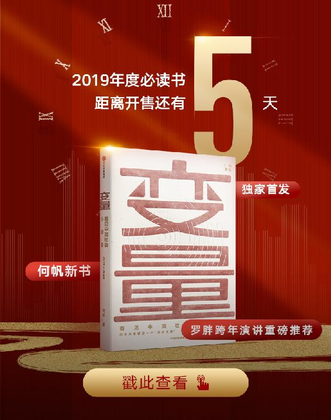

点击跳转购买页查看详细介绍，12 月 31 日晚 20:30 正式开售。

 **特别福利** 

在发刊词中，我发起了 #未来 30 年我承诺# 活动，我会在 2019 年 1 月 1 日选出 3 个最打动我的“未来 30 年承诺”留言，为留言者送上 30 年大型知识工程的首发图书《变量》。我会认真签下我的名字，还会连续送你 30 年。

 **10 | 场景革命：如何找到新技术的应用场景？** 

  
  

何帆

14 小时前

> > > > 10 | 场景革命：如何找到新技术的应用场景？ 

| 何帆亲述 |

你好啊，这里是《何帆报告》。

上一讲我们说到，要看哪一种技术能够代表未来，并不是看它有多先进，而是要看有没有一个广阔纵深的应用场景，能够匹配这种技术。

但是说来容易啊，2018 年我们都知道，互联网红利萎缩，大块的场景都已经被人占走了，找个场景哪还那么容易？

你看，区块链和比特币炒得那么热，但是大规模落地的场景到现在还没找到。

就算找到场景，你要把它做大，可能比找场景更困难。

那这种情况下，该怎么找场景呢？找到场景以后该怎么办呢？

这一讲，我就用一个产业，来带你细看这一场即将发生的场景革命。

这个产业，就是目前很火爆的机器人。

 **1\. 寻找场景** 

你想一想，假如你是一家机器人公司的创始人，你会找什么场景呢？

我们采访到了一个机器人公司，叫云迹，云彩的云，痕迹的迹。

一开始我们想选的是生产工业机器人的企业，我马上就会告诉你，为什么我们最后选中了云迹。

我先告诉你云迹找到的场景，他们找到的场景是酒店。

你可能觉得，不对啊，酒店机器人我见过啊，不就是个迎宾用的摆设吗。

没有那么简单，你听我一步步给你分解这里面的道理。

第一步，你不能瞪着机器人这个抽象名词去找场景，你首先要拆解这个产业。

其实，机器人是可以分为工业机器人和服务机器人这两个领域，它们的差别非常大，你首先要在它们俩之间做选择。

我们一个一个来看。

工业机器人的优点，是历史悠久，积累深厚，路线也明确。

世界上第一个工业机器人，20 世纪 60 年代就已经有了。在工业生产线上，有大量的机器人应用场景，而且都比较标准化，好落地。

那缺点呢？最大的缺点就是，这个领域的高端机器人基本上是被所谓“四大家族”垄断的，就是四个跨国公司，也就是瑞士的 ABB、德国的库卡、日本的发那科和安川电机一共四家企业。

我们采访的中国的工业机器人公司做得也很好，但很辛苦，拼的还是成本优势，想要杀进四大家族垄断的领地还很难。

让我们先把目光转向服务机器人。

这个领域的缺点非常明显，就是它起步晚，现在几乎是一片没有航海图的水域，广阔是广阔，但是没有航线。

不过它的优点也明显，市场规模实在太大，所有跟生活相关的场景，都可能用到服务机器人。

好，假设你决定聚焦服务机器人，那怎么继续拆解这个领域呢？

有两个维度，一个是空间，一个是时间。

空间分大小，小的是家居环境，中等的是办公室、酒店，大的是你居住小区和社区。

时间分长短，一般的工作场所是八小时制，有的地方是两班倒，比如超市，还有些地方是通宵营业，比如酒店和医院。

那你是选择小空间还是大空间，短时段还是长时段呢？

先说答案：最好选择中等空间和最长的时间。

这是为什么呢？你想，在小空间的场景里面，好多事情是机器人短时间内还干不了的。

在家里现在机器人最多扫个地，要是给你做饭、倒茶、叠被子，都还做不到。

那大空间呢？环境太复杂，比如小区里会有狗追机器人，会有人想去偷机器人。

所以，服务机器人最适合的场景就是中等空间，任务明确，环境简单。

那为什么选择长时段呢？因为工作时间越长，人越吃不消嘛，对机器人需求也就越强。

那如果从空间和时间这两个维度缩小包围圈，中等空间、长时间的场景，就剩下医院和酒店这两个主要场景了。

医院的活机器人干得了么？干是干的了，但是对机器人来说现在还太复杂了。

那就只剩下酒店了。云迹就是顺着这个逻辑，把场景锁定在了酒店。

那场景找到了，在场景里干什么呢？当然不是迎宾了。云迹发现，最好的应用是让机器人送货。

比如，你晚上航班延误了，凌晨两三点才入住，肚子很饿，可是餐厅已经关门了，怎么办呢？

这个时候，机器人就能发挥作用了。

云迹在酒店房间里放上二维码，扫一下这个二维码就能下单，然后机器人就会上楼送货，一直送到你门口。

云迹的一台机器人，一天可以提供 200 多次订单服务。

 **2\. 适应场景** 

好了，要是就到此为止，那云迹这个案例，顶多也就是一个场景找的很精准的案例，没有什么太了不起的。

但是其实没那么简单。

云迹这个案例的可贵之处，就在于它改变了我们对场景的理解。

你想，我们过去说场景，都觉得场景是固定的，产品也是固定的。匹配产品和场景，就好比在某一种土壤上种某一种农作物，能活那就种对了，死了那就不对。

但是我们忽略了一点，就是场景不是产品的终点，而是产品的起点。

产品投入场景之后，它会跟这个场景相互适应、相互改造，就好像农作物能改造土壤的品质一样。

比如说，机器人要能在酒店里送货，它是要学会对这个场景做出识别和反应的。

它要学会上楼下楼、坐电梯、敲门、取货、送货。

一般的做法是，是给机器人搭载机器学习算法，把它放到酒店里面去学。这就是产品在适应场景。

但是更高级的方案是什么呢？是为了让机器人学会做这些事情，主动改造酒店的设施。

比如机器人来到酒店之前，可以把门禁闸机、电梯、房门、购物机都变得更智能。

这样机器人就不是在一个智能荒漠里面孤军奋战了，它可以跟身边的一切进行交流，互相协同。

你坐电梯还是要按楼层按钮，但是机器人不需要，它能跟电梯直接“心灵感应”。

这就能推动整个酒店行业的设施和标准来一次大升级，让酒店更接受机器人，释放更多的红利。

那云迹这个做机器人的公司，很可能就是这波红利的领跑者啊。

这是我们场景的第二个认知层次，产品和场景要相互适应、相互改造。

 **3\. 创造场景** 

但是，这还没完，还有第三个层次最高级的打法，就是产品从一个相对简明的场景切入真实世界之后，能够打通旧场景的边界，重新界定场景，甚至给自己创造一个新场景。

还是拿云迹来说。因为云迹机器人的进驻，酒店这个场景本身会经历一次底层的颠覆。

你想，我们过去对酒店的定义，就是一个临时住宿的场所，而且是一个不怎么方便的住宿场所。

比如很多酒店是不允许外卖小哥进入客房区的，你在酒店里点外卖，外卖小哥还要电话让你下来取。

但是如果酒店里用了送货机器人，你就会发现，酒店的消费场景从隔离状态进入了一个对外全联通的状态。

以酒店为中心的一个商圈就被打通了，那想象空间就大了。

你可以在酒店里点餐、买一些水果蔬菜、租游戏机、租高尔夫球杆、订景区的门票，甚至还能够从图书馆里借书。

所以，以后酒店这个场景可能就不存在了。因为机器人的介入，以后人们再说这个场景的时候，会说酒店生态。

这个时候，云迹又做了一件特别巧妙的事。什么呢？

云迹从来不把机器人卖给酒店，它是像一个劳务中介公司一样，把机器人“雇佣”给酒店。

这是为什么呢？你想，一旦酒店生态这个新场景打开，会有成千上万的机器人穿梭在全球各个地方的酒店商圈里面。

但是机器人跟人不一样，它是能通过互联网，实时分享信息、实时相互协作的。所以，机器人这个物种从来就没有单数，它永远是一支“军队的力量”。

这个时候，机器人之间的互相协作，就能产生巨量的数据和巨大的效益。为了等待这波收益，云迹没有出卖任何一个机器人的所有权。

你看，产品创造场景，场景反过来又让产品的潜力爆发出来。这样形成的闭环，效益是难以想象的。

这还没完。云迹曾经做过一件事，它给很多展览馆发了数千份机器人的简历，让机器人去应聘解说员。

有的人力资源经理一看简历上写的是机器人，心想这不是神经病嘛。

但是也有一些人力资源经理，会愿意让机器人去试一试。

你可不要小看这个小趋势。机器人真的和人一样上岗工作，那一天很可能到来得比我们想象中的还要更早。

你看，我们一开始说这个场景的时候，好像是个特别细小的东西，其实现在一看，这个场景已经扩大到全人类的生计问题，还有我们文明未来的形态了。

所以，一个会给自己创造场景的企业，从来都不会愁自己的场景太小。

 **4\. 总结** 

好了，总结一下。我们这一讲发现的小趋势，是“场景革命”。

在一个场景越来越稀缺的时代，找到场景是技术落地的关键。

但是仅仅找到场景，并不能保证新技术的持续的发展。

产品和场景还要互相适应和改造，最后产品要为自己创造场景。这样，场景就没有大小之分了。

好的，这一讲先到这里。我是何帆，我们下一讲再见。

 **向你通报一个好消息** 

倒计时 4 天后，我的新书《变量》即将首发。

这本书就是咱们 \[何帆报告\] 的图书版，是我们 30 年系列丛书的第一本。每年都有一个年代色，配以时间的跨度。

这套书你可以逐年珍藏：用这样一个仪式，纪念自己又一年的进步。

在《变量》这本书里，你还能看到更多生动的故事细节。在你未来每年回顾历史的时候，仍可以保有一种身临其境的场景感。

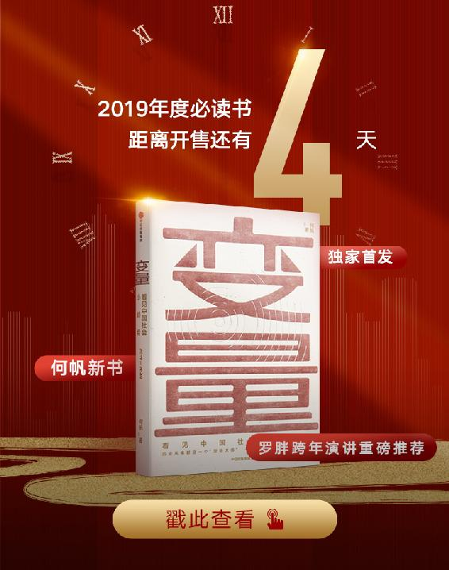

> > 点击跳转购买页查看详细介绍，12 月 31 日晚 20:30 正式开售！ 

 **11 | 技术赋能：无人机为什么要去新疆？** 

  
  

何帆

2 小时前

> > > > 11 | 技术赋能：无人机为什么要去新疆？ 

| 何帆亲述 |

你好啊，这里是《何帆报告》。这一讲我们接着讲技术创新。

上一讲我们讲的是场景革命，产品对于场景的关系，是先要去寻找，再相互适应，最后是创造。

这一讲，我们来讲一讲在中国做应用技术的第二个底层心法，这就是“赋能”的观念。

赋能这个词，得到的用户都已经很熟悉了。过去我们说赋能的经典定义，就是帮别人成功。

但是问题是，我要去帮谁成功呢？我帮他成功了，能不能反过来帮助我自己进化呢？

这一讲，我要给你介绍一家公司，做无人机的，叫极飞。

极飞找到的场景，是农业，是从做农业无人机这个角度切入，帮助了农民，也帮助了和农业有关的人共同发动一场农业革命。

而且在这个过程中，极飞自己也实现了进化。

 **1\. 寻找边缘** 

我找到极飞其实是一个偶然。

我一开始以为，高科技公司都是在深圳这样的地方，没想到极飞一下子把我带到了新疆的农田。

极飞找到农业这个场景，说起来也是个偶然。

他们有一次发现，在新疆有一个客户只采购他们的飞行控制系统，就是不买他们的飞机。

他们很好奇，就跑去新疆实地考察，这才发现这个客户买来他们的飞行控制系统后，再重新组装做了农业无人机，就是给农作物撒药的那种飞机。

极飞就想，这样还不如我自己去做呢。于是它一下子就跑到了新疆。

但是回头一看，不得了，这一番误打误撞，是闯进了一个极其具有潜力的市场。这是因为极飞在这里找到了让无人机给人赋能的机会。

你想，我们一提到无人机，最先想到的场景是什么？对，是航拍。你很可能很熟悉的大疆，就是做航拍无人机起家的。

极飞呢，最早也想做航拍。但是航拍的问题，就是没法跟用户形成赋能关系。

买一架航拍无人机很容易，但是要成为专业航拍无人机的操作员，也就是他们所说的“飞手”，那训练成本就太高了，企业是不可能大规模提供这个培训服务的。

这就导致企业跟用户的连接，只停留在购买这个环节，你的产品成了他的财产，但是他的使用行为不能成为你的资产。

经过反复试错，极飞最后意识到：无人机的舞台不在城里，而应该在农村，不在人烟稠密的东部，而应该是在地广人稀的西部，不在工业，而应该是在农业。

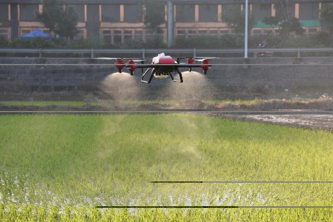

极飞无人机在作业

为什么？就是因为农业的赋能空间大。

中国是个农业大国，那么多农业人口，但是农用无人机作业的比例非常低。这是一个规模极其大、可以赋能的人口极其多，但是很落后、很粗糙的市场。

所以你看，我们上一讲，讲场景革命的时候就提过，这个时代场景越来越不好找了。

但是，这是为什么呢？这是因为，所有的人都在最热闹的地方找场景，这里用户多、用户连接密集、各种支持资源丰富。

但是，把这种策略反过来，也未尝不是一个策略。

如果你深入到无人地带，未必就找不到机会，因为无人地带虽然荒凉，但是正是因为荒凉，所以开发的空间大，人们也更渴望被开发。

我们可以把这种方法叫作“寻找边缘”。

在美剧《生活大爆炸》里面，有一位男主角、加州理工学院的科学怪才谢尔顿，他在玩拼图游戏的时候告诉我们：“你得先从边缘开始。”

这是因为，边缘的部分是直的，更容易识别出来，你把这些部分找出来，那拼图的轮廓就能大致看清楚了。

在寻找新技术应用场景的时候，可能也是一样的。

看起来距离新科技最遥远的地方，其实应用场景可能最明确。

 **2\. 技术赋能** 

那问题就来了：无人机这么新潮的技术，也不便宜，你怎么把它卖给新疆的农民呢？

最早，极飞是想把无人机直接卖给农民，但是发现很多农民不会操作。

极飞后来就自己组织专业的农用无人机飞手团队，提供用无人机喷药的外包服务，发现也不行。

因为农民过去熟悉的都是熟人社会，他怎么肯把自己的庄稼交给你们这群 90 后的毛头小伙子呢。

最后，极飞改成提供培训和服务，帮助农民自己变成飞手，帮助飞手自己组织队伍，三三两两地到田间地头作业。

这招终于灵了。

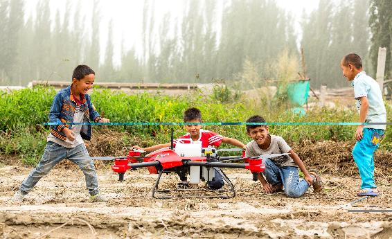

极飞无人机在新疆

为啥？因为一开始很多接受极飞培训的“飞手”，是从城里回乡的农村孩子。他们在城里上过学、当过兵、打过工，最后想回家，又担心回去被别人说这是在城里混不下去了。

但是如果他们拿着极飞的无人机回去，别人就会说，“你看，这家的孩子真有出息，现在都当飞行员了”。

没错啊，开无人机的也是飞行员啊。

极飞的无人机就这么打入了农村的熟人社会。这些农民出身的飞行员，还在抖音和快手上刷自己飞无人机的视频，一半是因为炫耀，还有一半是因为同行之间交流“攻略”。

你看，一个基于无人机和培训服务的小型发烧友社群，很快就培育出来了。

但是在这个过程里面，被改变的不光是买无人机的这些农村孩子，更重要的是，极飞本身也被改变了，进化了。

它本来就是一个卖无人机的公司，算个制造商，跟客户的联系也就是到购买为止。但它现在转型成了一个综合的服务商，既提供硬件，还提供服务，还输出农业的生产模式，帮助农民致富，甚至还孵化社群。

这个时候你就会发现，怎么把无人机卖给农民，其实是个假问题。正确的姿势应该是，所有跟我合作的人，我都让他得到更多的机会，这就是正式走上了赋能的道路。

所以自从极飞进驻之后，在新疆出现了一群不一样的农民，当地的人们管他们叫“老板”。

他们下地开的是 SUV，家门口停得是奔驰、宝马，一种就是种几千亩地，还会做期货交易呢。这些人怎么这么厉害呢？

因为，他们是极飞无人机最早的一批用户，会飞无人机，不仅会给自己的田里洒药，还帮别人的田洒药。

无人机其实是催生出了一种新型的“农业企业家”。

但是，从一家卖无人机的制造商，到一家用无人机给农民赋能的服务商，这还不是极飞的终局。

你想，农业无人机它不是一个孤立的业务，它是一个复杂网络的冰山的一角。

农业无人机的背后是整个农机和农药市场，这就是一个至少万亿级的庞大市场，但是跟农业无人机市场一样，规模庞大，人口众多，可是相对落后。

一旦极飞从农业无人机这个入口切入这个巨大的市场，就可能会倒逼整个行业提高服务水平。

那个时候无人机就不是简单的帮着农民撒药了。

如果无人机跟感应器结合起来，就会产生大数据，那么它就能够画出一张完整的“农业地图”。把什么土壤信息、作物信息、人的信息、气候信息、病虫草害的信息等等全部数据化，构建一个多层次、全方位的农业信息系统。

有了这些数据，一方面是能提高农业生产的效率，另外一个方面还能变成真实的数据链条，为农产品提供背书。

所以，未来的想象空间，中心不是无人机这个产品，而是农业这个行业。

比如未来有一个菜农，我们就管他叫老张吧。

老张可能在田里装了一个电子稻草人，这个电子稻草人会实时监测天气、光照、病虫害，同时，也能随时跟老张同步菜场上的价格行情。

老张可能也买了一架无人机，可是这个时候无人机已经变成整个农业生态里面的一个环节了。需要撒药作业的时候，老张可以用手机设定参数，那个无人机就会自己完成工作，然后自己飞回到充电桩去充电。

你在网上能看到老张的菜洒了多少剂量的农药，哪个厂家生产的药。

你还可以直接在网上下订单，扫一个二维码，称好、洗好、择好的菜就被锁进了菜篮，一路送到你家。

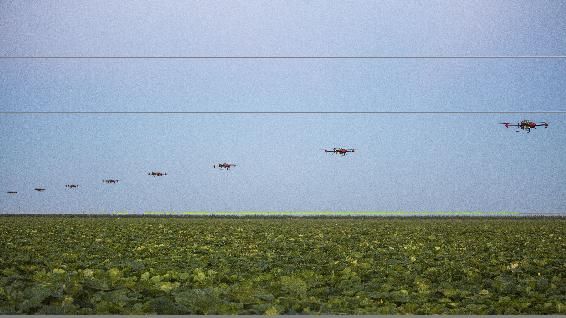

极飞无人机编组作业

所以你看，农业其实可以变成一件很酷的事情。

中国的农民其实一点也不保守，他们可能比西方的农民还相信科技，他们只是需要一个更友好的界面，他们需要科技公司要做出来赋能的姿态。

对于企业来说呢，从无人机切入农业，并不意味着要止步于无人机。它最终影响的，可能是农业全行业的链条。

那个时候你再去问极飞，你们是一家什么公司？它就不会说自己是个卖无人机的公司，它会说自己是一家农业公司。

我估计极飞在早期想做航拍的时候，怎么也想不到会有这一天。

对，企业走一条给更多的人赋能的路线，不光是改变了自己的产品和用户这么简单。这个被赋能的生态，会反过来影响整个企业的定位和战略。

 **3\. 总结** 

好了，总结一下。这一讲我们讲的是，在中国做应用技术，要有赋能的姿态。

一个有赋能机会的场景，很可能在边缘的无人地带，这个场景可能很广阔。

赋能就是帮助更多的人成功，但是，赋能并不只是会帮助用户成功，也会教会企业怎样成长，把企业带到一条更宽阔的赛道上去。

这讲就先到这里。我是何帆。我们下一讲再见。

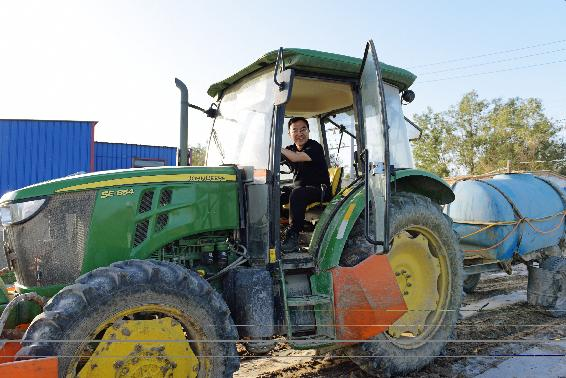

何帆老师在新疆

 **向你通报一个好消息** 

倒计时 3 天后，我的新书《变量》即将首发。

这本书就是咱们 \[何帆报告\] 的图书版，是我们 30 年系列丛书的第一本。每年都有一个年代色，配以时间的跨度。

这套书你可以逐年珍藏：用这样一个仪式，纪念自己又一年的进步。

在《变量》这本书里，你还能看到更多生动的故事细节。在你未来每年回顾历史的时候，仍可以保有一种身临其境的场景感。

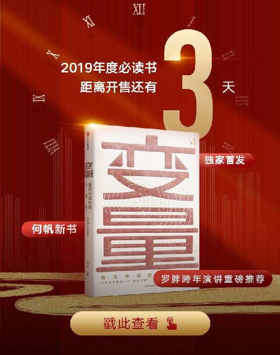

点击跳转购买页查看详细介绍，12 月 31 日晚 20:30 正式开售！

 

何帆

> > 只要你承认潮水的方向已经改变，它就会把你带进以前从来不敢想的想象空间里面去。 

 **12 | 没有了人口红利，如何挖掘市场潜力？** 

  
  

何帆

5 小时前

> > > > > > > > 微信 meitianxuexi365 制作 每天学习社 欢迎你的加入 

  
  

| 何帆亲述 |

你好啊，这里是《何帆报告》。

我们这个模块一直都在讲技术创新。我的一个基本判断是，中国的未来不在于核心技术，而在于应用技术。我们想说的是，不要让技术带着应用走，而是让应用带着技术走。

技术不是一个火车头，它拉到哪儿用户就走到哪儿。技术更像是一个孩子，这个孩子很聪明，但是没见过什么世面，你把他放到一个什么游戏里，他就能学会什么技能。

那可能还是有人不服气，如果只是技术的应用，会不会就陷到应用场景里面不可自拔呢？

比如说，前几年大家关心的不是芯片而是怎么去开发智能手机的 App。现在我们看到 App 已经过剩，但是芯片却成了短板。还有啊，互联网企业都争着发展电商，可是我们在 2018 年看到电商的增长速度已经开始放缓了。

所以，像这样只重应用的模式，还能像以前那样急速扩张吗？

 **1\. 商业世界里的稗草** 

那我们就来讨论一下这个问题，正好 2018 年有一个很好的案例，就是你很熟悉的拼多多。

拼多多 2015 年上线，2018 年 7 月在美国上市，市值逼近 300 亿美元。从上线到上市，只用了不到三年的时间。

拼多多的创始人黄峥自己是一个美国海归，但是在我看来，拼多多之所以成功，黄峥完全是靠一套本土打法，生生从互联网电商这个已经沸腾的红海领域，杀出来一条血路。

他的这个打法其实非常简单粗暴：让消费者拼团购买，然后给更多的折扣。为了拼团，你要让你的亲友帮你砍价，那你的亲友就要下载拼多多 App，关注拼多多的微信公众号，然后就会不断接到拼多多的各种促销信息。这样的模式非常有效，所以用户很快就从千万级到了亿级。

那么如果就到此为止，那拼多多这个案例没什么不好的，它反而很符合我们前面讲的东西啊。就是中国有中国的打法，在电商这样的领域，最重要的是匹配场景，迅速落地。

但是你仔细一想就会发现，这里面有点不对。拼多多其实不是一个“赋能”者，而是一个“吸能”者。为什么我这么说呢？

你想，一般的商业法则是 20/80 定律，也就是说，20%的用户能够创造出 80%的利润，这 20%的用户应该是收入最高、收入增长速度最快的那一群人。

但是，拼多多跟它正好相反。拼多多是从 80%用户的手里，榨干市场上仅剩的 20%利润。比如说拼多多的用户里中老年人居多，尤其是在四五十岁以上的用户里，拼多多的优势是非常明显的。

这些用户过去从来没有接触过电商，他们往往收入水平更低，不在乎时间，不在乎品牌，只在乎价格。但是你想，中低收入的消费者，能够持之以恒地买买买吗？

这个群体本身没有持续增长的动力。他们钱包里的钱，榨干了就是榨干了，这相当于是涸泽而渔。所以我说，这不是赋能，是吸能。

那赋能的姿势应该是什么样呢？比如说，你可以扶植更多的供货商，跳过繁琐的中间环节，直接为中低收入者提供质量可靠、价格便宜、没有品牌的同质化产品。这才是价值创造，这才能够给生产者和消费者都带来增值。

但是我们都知道，拼多多没有这么做，反而还闹了一阵制假售假的风波。这场风波过后，很多人认为拼多多要走下坡路了。

那问题来了：“赋能”这个词，过去几年在中国的商业界，谁不知道呢？拼多多为什么不这么做呢？

要回答这个问题，还是要回到中国的商业环境来看。我们前面说了，拼多多创业的电商市场是一片红海，竞争太残酷。

不光是电商，其他领域也是这样。这就使得中国的企业家迷信一个理念，那就是天下武功，唯快不破，只有速度最快的企业才能生存下来。

这让我想到了稻田里的水稻和稗草。稗草是最让人头疼的一种杂草。你说稗草和水稻，谁的生长速度快？肯定是稗草。稗草的种子能在土壤里存活几十年，只要萌发条件满足，就能破土而出。它还能分泌一种叫“丁布”的次生代谢产物，抑制水稻的生长。

同样的，一个企业的增长速度最快，反而可能意味着它是商业世界里的杂草。因为这种商业模式依仗的红利，它是一个会耗尽的存量，而且现在存得已经不多了，以后还会越来越少的。

所以，技术贴合场景，这既是中国的一个独特机会，也是中国的一个独特风险。在竞争的压力底下，一味地匹配场景，可能就会被场景驯化。

 **2\. “穷人的创新”** 

那问题就来了。面对这种可能被锁死在场景里的局面，有没有什么办法能够解锁呢？

曾鸣教授曾经提出过一个理念，说中国的企业是“穷人的创新”。我就用一句话来给你解释这个“穷人的创新”，其实说的就是怎么把成本降下来。

比如，你用全自动生产线，我就用半自动的，花的钱比你少，反应速度还比你快。

同样是生产锂电池，日本企业的一条生产线雇佣 200 名工人，但他们花费 1 亿美元；比亚迪呢，只花费 5000 万人民币投资机器设备，但是他们雇了 2000 多名工人。

过去，中国的企业最擅长的就是把成本降下来，这是在残酷的市场竞争环境中被生生逼出来的。那以后我们还能靠“穷人的创新”吗？恐怕是不行了。

劳动力成本上升、原材料价格上涨、环保越来越严，而且消费者的偏好也变了，原来的招数会不灵了，那我们该怎么办呢？

 **3\. 市场引领的劳动密集型研发** 

如果我们把视野放大，在中国的宏观经济里面，我倒是发现了两个小趋势，可能代表着中国应用创新的未来。

第一个趋势叫工程师红利。

一般我们都认为，中国的人口红利已经过去了，现在劳动力成本是越来越高，很多劳动力密集型企业都已经搬到了越南、孟加拉。但其实，我们还有一种红利，那就是工程师的人才红利。

1997 年和 1998 年，中国遭遇东亚金融危机，为了应对就业压力，中国开始了大学扩招。这在当时是有争议的，但放在今天看，这意味着中国培养了大批理工科人才，而且是被严重低估的理工科人才。

今天没有任何一个国家有我们这么多的实操工程师。多到什么程度？多到现在博士的工资已经比不上保姆的工资了。这说明在技能和教育的赛跑里面，我们的教育跑赢了技能。

第二个趋势是叫市场红利。

这里说的市场红利，不仅仅是说一个已有的模式，只有在中国才能做大。而且我们想要说，一些将来会有的东西，只有在中国才能落地。这都是因为在中国才有足够大的市场潜力。

比如当年的高铁，最早的高铁是日本的新干线，后来法国和德国也有了。但是最大的市场在中国，所以高铁只能在中国落地。

结果呢？这项技术在中国，积累了极其丰富的工程经验，比如复杂的地形怎么办、恶劣的作业条件怎么办，这都成为了我们现在的工程优势。所以中国的高铁技术很快实现了超越。

还有互联网也是如此。如果大数据是 21 世纪的石油，中国就是 21 世纪最大的产油国。再有，未来最先进的养老机器人，一定出现在中国。因为世界上没有其他国家像中国这样，以这么快的速度、这么大的规模进入人口老龄化社会。

那工程师红利和市场红利，加在一起会形成一个什么样的创新路径呢？那就是市场引领的劳动力密集型研发。

依靠市场红利，我们落地会比别人更早，我们的研发人员多，就能够快速试错、迭代赶超。这样就能够从应用技术反作用于核心技术，我们会诱使核心技术跟着我们自己一起演化。

有很多技术创新，并不是靠天才人物灵光一现想出来的，而是无数技术人员、长期试错摸索出来的。这种创新的思路，我给它起了个名字，叫“群众路线”。

这个词我们中国人都很熟悉。在技术发展上，我们要走的也是一条“群众路线”。我指的就是尽可能地发动群众、组织群众，把更多的合作伙伴用更有效率的方式组织起来。

 **3\. 总结** 

好了，总结一下。这一讲我用拼多多的例子，跟你分享了应用创新可能陷入的误区。

我发现的小趋势是工程师红利和市场红利。它们结合在一起，会突破“穷人创新”旧有的模式，创造出一条技术创新的“群众路线”。

好了，这一讲先到这里。我是何帆，我们下一讲再见。

 **向你通报一个好消息** 

倒计时 2 天后，我的新书《变量》即将首发。

这本书就是咱们 \[何帆报告\] 的图书版，是我们 30 年系列丛书的第一本。每年都有一个年代色，配以时间的跨度。

这套书你可以逐年珍藏：用这样一个仪式，纪念自己又一年的进步。

在《变量》这本书里，你还能看到更多生动的故事细节。在你未来每年回顾历史的时候，仍可以保有一种身临其境的场景感。

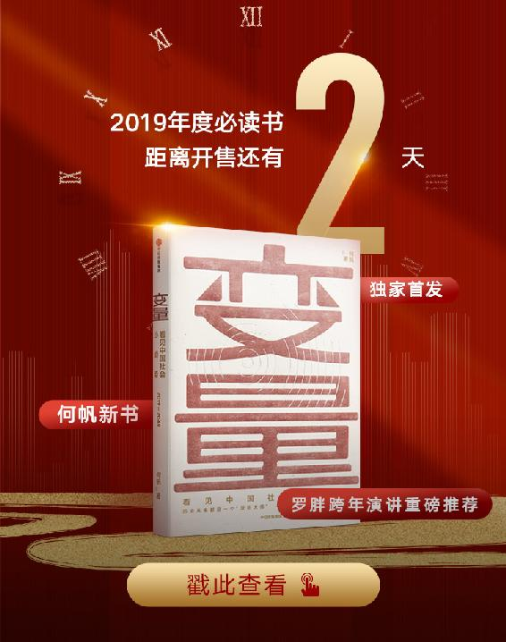

点击跳转购买页查看详细介绍，12 月 31 日晚 20:30 正式开售！

 **13 | 新造车运动的攻坚战，谁赢了？** 

  
  

何帆

14 小时前

> > > > 13 | 新造车运动的攻坚战，谁赢了？ 

| 何帆亲述 |

你好啊，这里是《何帆报告》。

从这一讲开始，我会用四讲来为你讲述我观察到的第三个变量。这个变量，说的是产业转型过程中发生的变化，我把它叫作新旧融合。

在我看来，今后不会再有什么新兴产业和传统产业，线上产业和线下产业，因为它们之间的边界不再泾渭分明。

以后最有竞争力的，肯定是那种基因杂交之后出现的全新物种。

 **1\. 新造车运动的瓶颈** 

请你先跟我想一个问题，2018 年，很多人都在说，互联网创业的黄金十年已经过去了。凭直觉看，可能真的是这样。

你想，过去的互联网那是什么样子？那就是成吉思汗的骑兵啊，来去如风，擅长“降维打击”。

你看过去，购物中心和大型商场都非常火爆，可是网购起来之后，马上萧条很多。还有出租车行业，那是一个典型的垄断行业啊，但是网约车一来，一下子就攻破了。

但是 2018 年的互联网变成了什么样了呢？过去攻无不克的互联网行业好像有点打不动了。

我给你举个例子，你就明白了。

过去几年有一个现象，就是很多互联网人都在造汽车，形成了一场“新造车运动”。

这场运动是从 2014 年特斯拉进入中国开始的，到了 2017 年几乎沸腾了，声称要颠覆传统的汽车行业，但是到了 2018 年却开始退潮。

2017 年新造车运动的旗手，是乐视的贾跃亭。现在他人还在美国，留下一个烂摊子不管了。

2018 年特别火的是蔚来汽车，它主推车型是 ES8。

可是，这款车先是迟迟不下线，下线之后又遇到一片吐槽：各种不方便，系统经常死机，车载系统半夜唱歌，更奇葩的是用燃油板车拉着充电车给用户充电。

总之，用户的期望值很高，但体验很差。

奇怪，为什么用互联网的打法造车就不行呢？你看，这些扎堆造车的，有很多都是互联网老兵啊。

蔚来汽车的李斌、小鹏汽车的何小鹏、奇点汽车的沈海寅都是资深互联网从业者，手段不可谓不高。

何况他们背后还有阿里、腾讯、百度这些互联网巨头站台，实力不可谓不强。

那为什么这些互联网天团，就是攻不下汽车这个传统得不能再传统的产业呢？

还是先说结论：因为互联网惯用的进攻型武器，在打入传统产业腹地的时候，打不过传统行业的防守型武器。

这是什么意思？我们先来看看互联网行业的进攻武器是什么。

互联网行业的武器主要是三个，一是数据，二是技术，三是资本。

这些武器，当它们攻入传统行业的腹地之后，威力就会大大下降。

 **2\. 大数据 vs 小数据** 

我们先看互联网的第一个武器：大数据。

现在我们每个人的日常生活，都会在互联网上留下来一条长长的数据轨迹，比如我们的人脸特征、购物清单、移动轨迹、还有健康状况等等。

互联网公司用这些大数据，就能够精准地给用户画像，提供定制化的服务，能够让你把口袋里的最后一分钱都心甘情愿、不知不觉地交出来。

但是，不是只有互联网才会用数据。在数据这个战场上，传统行业也有它的优势。

这是什么意思呢？还是拿造车这件事情来说。

互联网拿到的数据里面，跟汽车行业相关的，一个是我们出行行为的数据，还有一个就是地图的数据。

这些数据，在智能驾驶汽车的技术和运营上面，是非常有用的，但是在造车上是没用的。

汽车制造行业积累的数据，恰恰就是安全性能、制造工艺、制造流程这些在造车方面用的数据。

这些数据，跟互联网的大数据是不一样的，你可以管它叫“小数据”。

什么是小数据呢？小数据，就是跟某一个具体客户的深度体验、跟某一个具体生产环节的微妙变化有关的数据。

这些数据，天然就隐藏在消费者的心里和生产车间的流水线上，在制造业的手里。这些数据有个特点，就是它们下沉在物理世界的深处，你光靠互联网手段很难拿到。

而且这种小数据积累下来的优势，是不可能迅速赶超的，所以，它就让互联网最大的速度优势失效了。

就算新兴汽车行业可以把传统汽车行业最好的工程师挖过来，但是这些人能够带走的经验，不过就是汪洋中的一滴水。

比如说，腾势汽车是中国最早一批造新能源汽车的企业，是比亚迪和德国戴姆勒合资成立的。腾势在造车的时候，遇到核心设计，会找德国的设计师来做。

但是这不是因为德国的设计师个人水平高，而是只有德国设计师才有戴姆勒的数据库使用权限。戴姆勒的数据库是数十年积累，那是通过无数次的失败摸索出来的经验，你挖走多少工程师都拿不走。

你看，这是互联网的第一种武器，数据，失效了。

 **3\. 技术 vs 流程工艺** 

我们再来看第二种武器，就是技术。

互联网行业精通的是面向消费者的技术。你想，为什么很多年轻人喜欢电动车？就是因为电动车有各种新奇的应用软件，看起来非常酷。

但是，互联网也有不擅长的技术，就是关于生产流程、生产工艺的技术积累。

你可以不计成本地设计出一款性能出众的车，但是传统车企的本事在哪？

在于他们能够设计出一款车，能年产 40 万辆。这就需要在整个制造流程里面，进行功能、性能、成本、安全性等等各个指标之间的妥协。

丰田就有一个著名的研发原则，当技术和流程出现冲突的时候，宁可舍弃技术，也要保住流程。因为流程的复杂程度，远远超过互联网“入侵者”的想象。

那怎么办呢？很多新能源汽车企业就只能和传统车企合作，让传统车企为它们代工。

比如蔚来和江淮汽车合作，小鹏和海马汽车合作。但是代工好比就是把孩子寄存在别人的家里，这可不是长久之计，要说质量控制、生产计划，还是要自己来做才踏实。

可是问题来了，互联网企业擅长的都是轻资产模式，原来他们是不建工厂的。如果互联网企业一旦开始自己建工厂，它的轻资产就会变成重资产。这就好像游牧民族改行了，改成要种地，那他能比农民种得更好吗？

这样一来，互联网的优势就又没了。

 **3\. 资本扩张 vs 成本控制** 

我们再来看互联网的第三种武器，也就是资本。

过去十年，互联网的吸金能力确实很强。很多互联网创业项目，都是一开始靠融资，迅速获取大批用户，然后再开始赚钱。

新造车运动一开始也是想这么办。但是做起来发现，行不通。为什么呢？

就像蔚来汽车的李斌说的，知道汽车烧钱，不知道这么烧钱。

那传统车企是怎么做起来的？成熟的车厂，都有极其严格的成本控制手段，这个本事，互联网又没有。

那一旦成本战打不赢，这种靠资本堆出来的商业模式，它的风险就暴露出来了。

一旦早期产品市场不认可，销路打不开，就会出现经销商断网，供应商断货。这些问题反过来又会影响到融资，这对新公司来说都是致命伤。

这么一来，资本这个武器，也不管用了。

好了，我们讲了互联网的三种武器，打到汽车这一关的时候，都失灵了。

互联网有大数据，传统产业有小数据。互联网有新技术，传统企业会管理流程。互联网有资本，传统企业会控制成本。

 **4\. 进攻型武器 vs 防守型武器** 

不知道你有没有一种感觉啊，就是互联网行业原来惯用的武器，都是那种进攻型的武器。

它是借助资本，迅速增长，获取数据，形成闭环，然后一举颠覆旧行业。

但是传统产业的武器呢，都是防守型的武器，它是通过长期积累，高筑墙广积粮，让后来者没法进入。

所以要判断大势，首先要知道，什么人手里拿的是什么武器。

这就好像是一场“矛和盾的军备竞赛”。

2018 年的情况，就好比拿着矛的一方一路高歌猛进，突然撞到了一面戳不破的盾牌上，所以瞬间攻守易位。

讲到这儿你就明白了，创新本身是没有止境的，但是传统定义了创新的底线。传统教我们如何平衡、妥协和取舍，怎么保持谦卑和敬畏。

很可能在不远的将来，各种新兴产业，都要被迫学会去敬畏传统工业，才能继续创新。

原来处于攻势的一方，要学着怎么挖战壕、打阵地战，否则就只能乖乖撤退。那原来处于守势的一方呢，可能就有开城门进攻的机会了。

 **5\. 总结** 

好了，总结一下。我们这一讲讲的是，2018 年新兴产业和传统产业之间攻守易位。

虽然互联网行业擅长快速进攻，但是当它们进入传统产业的腹地之后，发现自己擅长的武器失灵了。未来，只有学会敬畏传统，才能继续创新。

好了，这一讲先到这里。我是何帆，我们下一讲再见。

 **向你通报一个好消息** 

明天，我的新书《变量》将会首发。

这本书就是咱们 \[何帆报告\] 的图书版，是我们 30 年系列丛书的第一本。每年都有一个年代色，配以时间的跨度。

这套书你可以逐年珍藏：用这样一个仪式，纪念自己又一年的进步。

在《变量》这本书里，你还能看到更多生动的故事细节。在你未来每年回顾历史的时候，仍可以保有一种身临其境的场景感。

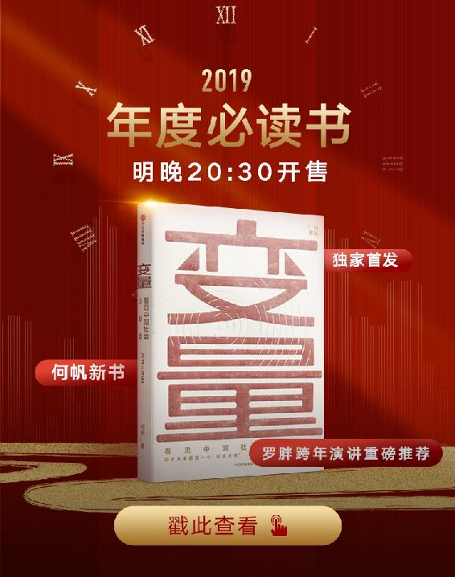

点击跳转购买页查看详细介绍，12 月 31 日晚 20:30 正式开售！

  
  

何帆

> > 互联网有大数据，传统产业有小数据；互联网有新技术，传统企业会管理流程；互联网有资本，传统企业会控制成本。今天的情况，就好比拿着矛的一方一路高歌猛进，突然撞到了一面戳不破的盾上，所以瞬间攻守易位。 

 **14 | 传统制造业如何绝地反击？** 

  
  

何帆

\-47 秒前

> > > > 14 | 传统制造业如何绝地反击？ 

| 何帆亲述 |

你好啊，欢迎回到《何帆报告》。

我们在上一讲谈到，不能高估互联网行业的力量，同时，你也不能低估传统行业的力量。这个小趋势，我管它叫“老兵不死”。

这一讲我就要跟你聊一聊，老兵是怎样穿上了新的军装，学会了新的打法，而且会从我们意想不到的地方发起反攻。

在开始讨论之前，我先问你一个问题：如果一个传统制造企业想要转型升级，你会给他们什么建议呢？

可能你会说，制造业升级，那就得先从低端的制造生产转向高端市场，你得走品牌路线啊。

你也可能会说，升级需要的是智能制造，也就是要用大数据来驱动优化生产的流程。

你还可能会说，制造业你还得结合“互联网+”的打法，开网店、搞新零售等等。

但是，这些其实都不能算是真正的升级。

我要告诉你的是，在一些最老牌的制造业企业里，正在进行着一些更为激进的升级和迭代。

海尔就是这样一个典型案例。

 **1\. 海尔的蜕变** 

假如你随机的去采访一个路人，你问他海尔是干什么的？十有八九，他们会告诉你，海尔就是造冰箱的。

但其实，海尔早已经不是原来的海尔了。

你记得我们在前面说过，大树模式。那你如果用大树模式来看海尔，你就会发现每隔七八年，海尔就会做一次自我革新。

第一个七年，把“海尔”打造成一个知名的品牌。

第二个七年，开始做多元化，从生产家电拓展到了其他的业务。

第三个和第四个七年，海尔开始搞国际化，做全球品牌。

到了最近的七年，也就是从 2012 年开始，海尔正式进入互联网时代的战略转型。

你看，这就好像一棵大树，每隔一段时间旧的叶子就全部脱落，长出了新的嫩芽。

经过这么多轮蜕变，如今的海尔集团是什么样的呢？我们已经看不见它的边界在哪里了。

不信的话我举几个例子。

喜欢打游戏的朋友可能听说过雷神笔记本，这是一款专门给电竞爱好者提供的游戏本。雷神科技现在已经在新三板上市了。这个雷神科技是谁家的呢？是海尔家的。

你可能还听说过，有个很高档的厨具和洗衣机的品牌，叫卡萨帝。这个名字据说源自意大利，产品做得非常有设计感，价格也很高。卡萨帝是谁家的？也是海尔的。

还不止如此，如果你到农村，你会发现老乡们用的电冰箱、洗衣机、抽油烟机都是一个品牌，叫统帅。这个统帅是谁家的呢？还是海尔家的。

你可能觉得，这不就是搞产品差异化嘛，也不新鲜。

那我要告诉你，看一棵树，我们还要拿显微镜去看。如果你深入到海尔的内部，你就会发现海尔的创始人张瑞敏想的可比一般人深远多了。

他正在做的事，可不是一个简单的产品差异化，而是叫做“去海尔化”。

 **2\. “去海尔化”** 

什么叫“去海尔化”呢？

张瑞敏有一次在集团的内部会议上说，大家要忘掉海尔，才能够成为生态。

这听起来很反常啊。海尔做了这么多的产品，有这么多的创新，而且本身的名气已经这么大了，为什么要忘掉海尔呢？又怎么可能会忘掉呢？

这背后的原因，都是源于张瑞敏作为一个商场的老兵，他有着极其敏锐的危机感。

早在 2000 年的时候，他就在公司内部的刊物《海尔人》上发表了一篇文章，叫《“新经济”之我见》。在这篇文章里他就说，“能充分利用网络技术的企业，会比过去跑得更快，但是要比对手跑得更快，就必须创新”。

也就是说，张瑞敏早在 20 年前，他就知道互联网这个游牧部落，总有一天会挥师南下。

那应该怎么应对呢？

首先啊，你要知道，基本上我们能够想到的制造业升级，像什么智能制造、“互联网+”，海尔都已经干了一个遍。

他们在产品上的创新很激进，以至于在我看来，不少创新看起来都有点怪异。

比如，2000 年张瑞敏就已经说过，如果用户需要三角形的冰箱，那我们海尔就生产三角形的冰箱。所以海尔很早就开始做定制化生产，让用户自己提设计需求。

海尔甚至还有一个衣橱叫“大魔镜”，这个“大魔镜”能够对你衣橱里面的衣服识别、分类，还能建议你今天如何穿衣搭配。

但是，张瑞敏厉害的地方就在于，他知道即使公司做了这些创新，它仍然是一个制造业的公司。要想长期和互联网公司对抗，就得学会互联网的打法才行。

那什么才是真正的互联网打法呢？是上一讲我们说到的技术、大数据、资本这三大武器吗？都不是。

张瑞敏就抓住了一个关键词，叫生态。

 **3\. 互联网生态** 

我们经常听到“互联网生态”这个说法。

一般来说我们理解的这种生态就是说把一个产业链上的各个环节都整合到一起，一环扣一环。

但是张瑞敏看到的生态，是一个更底层的东西，它其实是一种自我生长的方式。

你想啊，一个生态系统到底意味着什么呢？

意味着百花齐放啊，有各种各样的生命、物种，都能够在生态里面成长，最终是通过一个自然选择的机制优胜劣汰。

凯文·凯利有一句话说的非常好，他说，“所有的公司都难逃一死，所有的城市都近乎不死”。原因就是因为企业总是想着把自己变成一个商业帝国，而城市是一个开放的生命体。

张瑞敏也有这样的感悟，他早就意识到，海尔的目标不是把企业变成一个帝国，而是变成一个生生不息的生态系统。

那这要怎么做呢？就是我们前面说到的，“去海尔化”。

海尔现在不再只是一个从上到下做业务规划、层级分明的大企业，而是变成了一个孵化的平台。而且这个孵化的概念其实非常的宽泛，海尔已经实现了不仅对内，而且对外都开始进行渗透。

对内呢，海尔已经形成了一个创新平台。

他们孵化了不少“小微主”，就是“小微企业”的“小微”。这些小微主可以自由创业，由他们上面一层的平台主来提供资源支持。这些平台覆盖的领域可以说五花八门，比如说有做净水产品的、游戏的，还有家电定制的等等。

但是平台主其实对小微主没有任何任免权，所有的平台主和小微主，都是竞争上岗的。

对外呢，海尔也在发动用户和它的合作伙伴共同加入这个生态。

比如说，海尔有个电商，叫顺逛，就是顺便逛逛的那两个字。这好像是一个很普通的电商网站，别人也都有。

有很多消费者在上面吐槽产品的缺陷，海尔其实是醉翁之意不在酒，他们想用这么一个平台，来发现产品的不合理之处。

不过发现之后呢，海尔不光是自己回到厂里面去解决，它会在“顺逛”上发布一个英雄帖。

谁要是能解决了这些槽点，谁的方案就能够被吸收。一旦被采用，新产品每卖出一个，海尔就会给你一定比例的提成。

比如说，2018 年，“顺逛”上面有一款小方巾突然非常的火爆。为什么呢？因为过去很多家庭主妇总是抱怨洗碗布会“粘油”、“不吸水”、“不柔软”、 “不耐洗”。

这一款小方巾就是专门针对这些痛点，解决方案是一群“顺逛”上的微商共同提出来的。

这一次，海尔连广告推广费都省了。因为参与设计的那些微商自发地拍了一条广告视频，然后在网上出现了病毒式的传播。所以，月销量“10 万+”的“方巾神话”就这样出现了。

你看，这就是典型的互联网打法，但在海尔这样的制造业企业手里照样运用自如。

结果呢，就是我在最开始说的，海尔的边界早已经延伸到了你看不见的地方。你已经不知道，身边的哪个产品，是来自于海尔的生态系统了。

 **4\. 总结** 

那你说，以后是制造业企业更害怕互联网企业，还是互联网企业应该害怕制造业企业呢？

其实，这不是一个真问题。

海尔只是一个案例，但是通过这个案例我要告诉你一个小趋势，一些我们认为很老牌、很传统的企业，正在悄悄地进行一场彻底的自我迭代。

迭代带来的结果就是，新兴企业和传统企业的边界，早已经不像你想象中的那么清晰了。

你想想看，互联网企业原本最擅长的就是攻破别人的护城河，如今却忙着修自己的护城河，不管这个护城河是垄断的数据也好，还是巨额的资本也好。

原来互联网企业是创新的平台，可是现在却成了下一代创新企业绕不开的一道坎。相比之下，反倒是海尔这样一个传统的制造业企业，用的才是真正的互联网打法。

那为什么会出现这样的小趋势呢？

我认为归根到底，就是企业的“危机意识”。创新和迭代，往往是在强烈的危机感之下才会发生的。

像海尔这样的老兵，经历了时间的洗礼，知道战场上形势那是瞬息万变。你只有学会随时洞察局势，保持警惕，才能够在激烈的竞争中生存下来。

而现在互联网企业缺少的，恰恰是那种对外来入侵深入骨髓的警惕和焦虑。但是以后，像海尔这样的传统企业曾经经历过的困境，互联网企业迟早也会体验到的。

到那个时候，他们才会醒悟过来，人家老兵毕竟是老兵。

好的，这一讲先到这里。我是何帆，我们下一讲再见。

 **向你通报一个好消息** 

今天，我的新书《变量》在得到首发。

这本书就是咱们 \[何帆报告\] 的图书版，是我们 30 年系列丛书的第一本。每年都有一个年代色，配以时间的跨度。

这套书你可以逐年珍藏：用这样一个仪式，纪念自己又一年的进步。

在《变量》这本书里，你还能看到更多生动的故事细节。在你未来每年回顾历史的时候，仍可以保有一种身临其境的场景感。

点击跳转购买页查看详细介绍，12 月 31 日晚 20:30 正式开售！

 **15 | 电子竞技：为什么新产业在用老套路？** 

  
  

何帆

\-23 秒前

> > > > 15 | 电子竞技：为什么新产业在用老套路？ 

| 何帆亲述 |

你好啊，这里是《何帆报告》。

我们这个模块，都是在讲新兴产业和传统产业的关系。上一讲我们讲的是传统产业面临着互联网的竞争，怎么主动上升，学习互联网的打法，还能发挥自己的优势。

这一讲，我们再往前走一步，看看不管是传统产业还是新兴产业，有没有什么是连续不变的东西。

这一讲我要带你看的这个产业，是电子竞技。

 **1\. 电子竞技是新兴产业吗？** 

电子竞技是 2018 年的一个大热词。

你可能知道，在 2018 年的 5 月份，电子竞技第一次作为一项体育运动上了亚运会。

11 月在韩国仁川举行的英雄联盟 S8 全球总决赛上，中国的 IG 队以 3:0 的战绩击败了欧洲战队，获得全球冠军，那可真是引发了刷屏级的盛况。

但是有一个问题你想过没有，电子竞技到底是一个新兴产业呢，还是一个传统产业呢？

你说它是新兴产业，好像很有道理。

你想，游戏这个产业天然有着互联网的基因。它会像互联网一样快速迭代，会运用很多新技术，做出各种新奇的体验。

但是你仔细一想又觉得，没那么简单。因为电子竞技里面的很多元素，其实跟传统体育竞技是很相似的。

比如我在准备这场报告的时候，采访过一位电竞选手，叫李晓峰，也就是著名的 Sky。他是中国电竞业混沌期第一个真正意义上的职业选手，也是第一位电竞明星。

李晓峰是《魔兽争霸 3》这个项目，2005 年、2006 年连续两届世界电子竞技大赛（WCG）的总冠军。这就相当于电竞界的奥运会金牌啊。

跟他聊天的时候我就发现，电竞运动员的生活和传统的运动员的生活，其实是非常相似的。

比如，他们也要进行自虐般的刻苦训练。

就拿李晓峰来说，在长达十多年的时间里，他每天至少要训练 10 个小时，有时候一天会练 18 个小时。

有时会练到拿起鼠标眼睛是模糊的，大脑是没有意识的，而且还要再坚持练很多盘。这是说单个运动员。

对于一个团队来说，电竞职业选手也跟我们熟悉的运动员一样，队员住在一起集中训练。

队里有教练，有专门做饭的，还有俱乐部特地请了中国女篮的心理辅导团队。打得不好，教练也要带着复盘的。

这种训练和生活方式，能达到什么结果呢？我举两个例子。

一个是电竞选手有一个关键数据，叫 APM。什么意思呢？就是每分钟点击鼠标和敲击键盘的次数，行业内又叫“手速”。李晓峰巅峰的时期 APM 纪录是多少呢？有 310 以上，平均每秒 5 次还多。

再有，就是电子竞技的职业选手能跟民间高手形成明显的区别，就是职业选手有输出稳定成绩的能力。

民间高手偶尔可能还能赢职业选手一盘，但是民间高手不可能保持稳定的成绩。这就是有专业训练和没有专业训练的区别。

不光是运动员的培养，电竞赛事的运营，也几乎是复制了传统体育赛事的模式。

比如拿 KPL（King Pro League），也就是王者荣耀职业联赛来说，它是目前电竞行业最成熟，规则最为复杂的赛事之一。

从这项赛事的每一个细节里，你都能够看得出来它其实是在模仿 NBA。

比如 KPL 像 NBA 一样，分成东西两个赛区、春秋两个赛季，还分常规赛、季后赛、总决赛三个模式。先是在东西区各自比出一个冠军，然后两支队伍再进行总决赛，决出季度冠军。

电竞赛事直播的技术和流程，比如我们常见的即时慢镜头回放，也是来自传统体育直播。

所以你看，电子竞技和传统体育比，可能比的东西不一样、形式不一样、技术不一样，但是它的内核是不变的。

这个内核，就是我们所说的体育精神。

你想，体育本质上是什么呢？

它是在一代人乃至几代人的时间跨度里面，通过制造一场又一场充满戏剧色彩的比赛，一个又一个史诗一般的传奇人物，塑造出来一系列的精神图腾，然后再用它们去征服数亿量级的，跨越文化、年龄、性别的这些人。

只要能做到这些事情，那就是体育的一种啊。

所以，体育其实是人类所有活动当中，用来经营仪式感、参与感还有公共形象的一个固定的成分，这个成分从古希腊就有了。

你要是从这个视角来看电子竞技，就能看懂它的走向了。

对，今天的电子竞技，不过是人类体育传统这棵老树干上，发出来的一个新芽而已。

 **2\. 传统内核与代际更替** 

那问题来了，你想，现代体育是一个延续了快一百年的传统，很多项目的历史甚至比这个更长。

为什么偏偏在 2018 年这个时候，它要长出来电子竞技这个新芽呢？一个很重要的变量，就是体育竞技的观众变了。

比如我给你说一组数字。

NBA 观众的平均年龄，现在已经在 40 岁以上，足球世界杯观众的年龄也在变老。

但是相比之下，电竞观众的群体还都是新鲜血液。

2017 年全球电竞观众当中，超过 70%的观众年龄都在 24 岁以下。

你再对比另外一个数字。

我们前面说了，2018 年电子竞技上了亚运会。在亚运会期间，微博上有关亚运会的阅读量是 10.8 亿。但是，关于电子竞技亚运会的阅读量有多少呢？高达 16 亿，你看，远远高于亚运会本身。

所以，不是电子竞技需要亚运会，是亚运会需要用电子竞技来吸引年轻的观众。

在传统体育的观众不断老去的时候，新一代的电子竞技观众正在成长起来。

我们这一代人，很可能是踢足球、看足球长大的。

但是你别忘了，下一代人，就是从前躲着父母打游戏的那一代孩子，他们也是要长大的。他们是要掌握话语权，重塑社会分工，创造新的传统的。

我们还是拿电竞选手 Sky 李晓峰来说。

他小的时候并不是学校里的优等生，总是沉迷于网络游戏。但是长大了发现，电子竞技竟然成了一种正当的、高收入的职业，而且它可能还是一条快速的上升通道，是改变命运的一个出路。

这就跟美国的黑人去打 NBA，阿根廷贫民窟的孩子靠踢足球出人头地，是一模一样的。

那既然电子竞技是一种正当的体育运动，就是一种合理的消遣方式。

那你说哪一种消遣方式更体面、更高雅呢？就很难说了。

那你再想，王健林曾经想要支持足球俱乐部，他儿子王思聪却一心一意支持电子竞技，爷俩谁干得对呢？答案你自己思考。

你要是带着这个视角去看电子竞技，对它的观感就会很不一样。

对，电子竞技这一类创新，它不是颠覆性创新。

它是在一个延续的精神内核的基础上，进行的代际更替。它是一代人有一代人的英雄、一代人有一代人的传统，是在一个稳定的生态位上，换了一波又一波物种。

其实不止电子竞技，还有很多新生事物，都可以看作是这种传统内核上的代际更替。

比如影视行业。我们知道，这几年网剧大热。那网剧是谁制作的呢？

我们采访了爱奇艺。爱奇艺网剧的高管大约是 50 岁左右，制片人大致在 30-40 岁之间，导演在 20-30 岁之间。

你看，负责创意的是年轻一代人，没有他们，网剧就没有流量。

那为什么还要有年长的制片人去把控流程、监督品质呢？因为他们代表的就是这个延续的传统。只有老手知道，这个固有的生态位上什么套路是不能变的。

所以你看，人类的任何一项传统，都好像是一个开源社区。在这个社区里，每一代人都有权利去开发自己喜欢的代码，新的代码会覆盖旧的代码，你拦都拦不住。

所以，如果你觉得过去 NBA 明星很伟大，那你就应该承认，电竞明星也很伟大，因为这就是这一代人选择的社会分工形式。

但是，这一项传统之所以还能保持生命力，是因为这个开源社区有监督者，有它的底层规则。这些东西决定了什么新物种可以存活和生长，什么物种不能。

任何一个想要进入这个领域的人，要做的第一件事情，就是向这些传统致敬。

 **3\. 总结** 

好了，总结一下。这一讲我发现的小趋势，是传统内核上的代际更替。

有一群年轻的电竞选手在像运动员一样锻炼自己，在国际大赛上为国争光。而且，还有一个已经上亿数量级的观众群体，是他们的坚实土壤。

这两个群体共同推动电子游戏从边缘走向主流。

但是，电竞之所以能变成一个新的传统，又是因为电子竞技和传统体育有共同的精神内核，那就是体育精神。

好的，这一讲先到这里。我是何帆，我们下一讲再见。

 **思考题** 

王健林曾经想要支持足球俱乐部，他儿子王思聪却一心一意支持电子竞技。你觉得，爷俩谁干得对呢？

 

何帆

> > 人类的任何一项传统，都好像是一个开源社区。在这个社区里，每一代人都有权利去开发自己喜欢的代码，新的代码会覆盖旧的代码，你拦都拦不住。 

 **16 | 如何用“灰度思维”突破产业边界？** 

  
  

何帆

\-5 秒前

> > > > 16 | 如何用“灰度思维”突破产业边界？ 

| 何帆亲述 |

你好啊，欢迎回到《何帆报告》。

我们在这个模块，一直讲的是新旧产业的融合。通过前面三讲，讲到的小趋势，我其实想告诉你的是一种看待新旧事物的思维方式。

过去，我们总是把新旧事物视为两种对立的东西，非黑即白，这是一种过于简单的思维模式。这一讲我要告诉你的就是另外一种思维方式，叫 “灰度思维”。

那么，什么是“灰度思维”呢？

我先告诉你结论，这是两条关于技术创新的规律：第一， 大部分新生事物都是从旧事物中诞生的。第二， 大部分新生事物都是一种“混搭”的组合。

接下来我就一一给你讲讲。

 **1\. 电动车是新技术吗？** 

我们还是回到前面讲的一个话题吧，“新造车运动”。

你知道，在这场新造车运动中，那些公司主打的都是电动车产品。那么我问你，电动车是不是一种新技术呢？

不是的，电动汽车并不是什么新生事物。

在 1837 年，有位化学家叫罗伯特·戴维森就已经发明了第一台电动汽车。

当时，电动汽车和内燃发动机汽车都是刚刚出现的，是两种互相竞争的技术。而且在当时，和内燃发动机汽车相比电动车似乎还更胜一筹。

因为电动车的噪音更小、污染更少，不需要复杂的换挡，也没有那么复杂的手动点火操作。

那个时候，在伦敦、纽约都有很多电动出租汽车。在 19 世纪末和 20 世纪初那段时间，世界上大约有 3 万台电动汽车。

可是，大约 10 多年之后，电动汽车就衰落了，一直到最后销声匿迹。

电动汽车衰落的原因很多，有些原因也有很大的偶然性。

比如说，一个原因是伦敦的马车夫起来抗议，其实就像今天很多出租车司机抗议网约车是一个道理。

这些马车夫指责电动汽车，说电动汽车经常出故障，开着开着就抛锚了。电动汽车在当时，当然并非完美的，但是也不像它的竞争对手诋毁得那么不堪。

另外一个原因其实更关键，就是当时由于油田大量开采，油价急剧下降，所以烧汽油的内燃发动机汽车就更划算。比如，福特生产出来的汽车只有电动汽车价格的一半。

于是，烧汽油的内燃发动机汽车就开始一统天下了。

那你可能会问，是不是我们熟悉的“钢铁侠”马斯克重新发明了电动车呢？其实也不是的，是传统的车企首先推出了电动汽车。

在 1996 年，通用汽车就推出了第一款量产的电动汽车，这款车叫 EV1。

当时，通用汽车对这款车寄予厚望，他们开展了声势浩大的宣传活动。遗憾的是，这个项目失败了。这款车只生产了 2000 多辆，怎么卖也卖不动，所以通用汽车只好在 2002 年宣布放弃这个项目。

那为什么马斯克能够让电动汽车卷土重来呢？这要归功于马斯克解决了传统电动汽车的一个致命的弱点，就是续航能力不行。

你一定知道，以前的电动汽车充一次电只能跑几十公里。

一开始的时候城市的规模不大，汽车主要是在市区里面跑的，城市外面的公路系统不发达，所以跑长途的机会不是很多。可是，等到城市不断扩大，公路系统越来越发达，那电动汽车就跟不上了。

通用汽车开发的 EV1 二代车型，理论上来说，单次充电续航的里程能达到 120-208 公里。但是在现实中，充满了电能开 70 公里就已经很不错了。

特斯拉实现的一个重要的技术突破，就是他们电池技术。

这个电池技术是不是真正的创新呢？其实也不是。

特斯拉最初解决这个问题的方法，是用锂电池替换掉原来用的铝酸电池。锂电池可不是什么新技术啊。你知道吗？特斯拉最初的实验是用了几千块笔记本电脑上的锂电池来作为汽车的动力，结果，汽车的行驶里程一下子超过了 480 公里。

现在，特斯拉电动车的电池可不再是借用笔记本电脑里面的锂电池了。

后来特斯拉经过不断地改进研制出了全新的锂电池，还开发了一套世界领先的电池控制系统，个别电池损坏也不会影响其它的电池。

所以，即使是最前沿的硅谷创新公司，也是从一套旧方法出发，才突破了一个棘手的技术挑战。

那我现在要把“灰度思维”再进一步地推而广之，你再来看一看，历史发展的规律常常也遵循同样的规律。

所谓的改革往往就是把过去的经验重新拿出来用的。

在中国改革开放初期，最有名、最立竿见影的改革就是农村土地承包责任制。

在 20 世纪 70 年代末的时候，有很多地方粮食欠收，几乎又要发生饿死人的事件。但是实行了农村土地承包责任制之后，短短几年，中国居然出现了粮食生产过剩。

这个农村土地承包责任制是什么新鲜的东西呢？其实根本不是，这是在 60 年代初我们就曾经尝试过的老经验。

所以你看，所有这些案例都告诉我们：旧的思想不一定是错的，其中可能包含着创新的基因。

过去我们总是会觉得，不管是社会还是知识都是不断进步的。没错，总体来说是这样的。好比过去是漆黑一片，随着进步慢慢就有了光亮。

但是我们也不能说，已经亮了的地方就会一直亮下去。

打一个更恰当的比方，人类历史的发展更像是一个举着火把的夜行人，火把能够照亮眼前的路，但是身后的道路又可能会陷入了黑暗。

所以历史经验可不是一个废弃的荒山，而是深埋的宝藏，就看你识货不识货、会不会用了。

所以你要习惯的就是“灰度思维”，抛弃过去那种看待新旧事物非黑即白的简单思维方式。

 **2\. 创新源自“混搭”** 

好，那接下来就有这么一个问题了，我们怎么样才能够从旧的事物中发现闪光点，并且在它的基础之上创新呢？

这就是我要告诉你的第二条规律，大部分的创新源自于“混搭”。

什么是混搭呢？

你看，现在时尚界推崇的风格就是混搭。原来我们穿西装都是一身正装，衣服的颜色不能超过两种，袜子都得是黑色的长袜。

但是现在的时尚人士，就会上面穿便西装下面穿牛仔裤，脚上蹬运动鞋，更精神、帅气。

这种混搭，其实就是把早已经存在的事物，用人们没有想到的方式重新组合起来。

纵观人类的历史啊，你会发现有非常多的技术创新，其实都是混搭出来的。

太阳底下本来就没有完全新鲜的事情。

比如汽车，汽车就是内燃机加上马车的车厢，再加上轮子这么混搭出来的。内燃机是在 19 世纪中期的时候就有了雏形，马车已经有 4000 年历史，轮子的历史更悠久，已经有 7000 年历史了。

我们再看无人机。无人机是另外一个混搭的例子。无人机无非就是飞行器系统、地面保障系统、通信系统和载荷系统，这么四个大系统的重新组合。

你看，从这个角度来看，这像不像孩子们玩搭积木、拼插式的乐高玩具是一样的？

这说明什么呢？这说明如果你知道如何把一项新技术拆解，然后再把它组装起来，你不仅仅能够看懂那些看起来极其复杂的技术问题，而且还有可能出现突破式的创新。

不过，仅仅是学会“混搭”，那还是不够的。可不是所有的“混搭”都是时尚，也不是所有的“混搭”都有创新。

我们还举穿西装的例子。如果你穿西装，戴一条金黄色的领带，脚上穿老北京的懒汉鞋，还露出一双红袜子，我估计没有人会觉得你“混搭”得很好。

“混搭”追求的是变化，但是指导“混搭”的是不变的东西。是什么呢？是人们的审美观。审美观是一种长期内不变的东西，这其实就是“传统”。

为什么我们会有传统这种东西呢？这就是源自于人性。技术创新可能变化很快，但是人性是不变的。

亚马逊的创始人贝索斯就曾经说过，在零售行业里客户总是喜欢性价比更高的商品，没有顾客会说“我希望价格更高一些”，或者是说“我希望你们慢一点交货”。

所以，亚马逊未来 20 年的战略都是非常清晰的。

不管技术如何变化，不管客户的需求如何变化，亚马逊要做的就是为用户提供无限的选择、顶级的购物体验和最低的价格。

这就是为什么贝索斯会说，与其去猜测未来十年会出现什么变化，那你不如去问问未来十年有什么是不会发生变化的。

所以，抓住了传统，你就会发现，“万变不离其宗”。

 **3\. 总结** 

好了，总结一下。我在这一讲跟你分享了一种思维模式。

那就是你要学会用“灰度思维”去看新事物和旧事物之间的关系，这是因为创新很可能就隐藏在过去的经验里。

同时，你还要大胆地把新旧 “混搭”起来。因为新的事物很可能就来源于旧事物的组合。

在这个重新组合的过程中，你可以尽情地创新，但是请记住不要离开一条主线，那就是尊重人性中的传统。

好的，这一讲先到这里。我是何帆，我们下一讲再见。

 **17 | 城市怎么才能精明地收缩？** 

  
  

何帆

\-33 秒前

> > > > 17 | 城市怎么才能精明地收缩？ 

| 何帆亲述 |

你好啊，欢迎回到《何帆报告》。

从这一讲开始，我会用四讲为你介绍我在 2018 年看到的第三个变量：城市化中出现的自下而上的趋势。

过去，我们一说到城市化，总是自然而然地会想到，城市化就意味着城市的规模会越来越大。但是，在 2018 年我观察到的一个现象却是，中国的城市化已经开始进入一个重要的转折点，有越来越多的城市开始收缩了。

在这一讲，我想用义乌这样一个案例来给你讲讲，如果城市收缩是不可避免的，那我们能不能找到一种“精明收缩”的模式。什么意思呢？也就是像健身一样，瘦了之后反而会更健康。

 **1.为什么城市会收缩？** 

一说到收缩啊，你脑子里可能马上会想到房价下跌、经济下滑、民生凋敝，甚至你可能想到是那些空置的“鬼城”。但是我所说的收缩，不仅仅是出现在那些经济发展遇到了明显挑战的城市。

我看到的收缩城市，不仅有山西吕梁、甘肃定西、内蒙古乌兰察布这样的内陆城市，还包括像东莞、义乌这样的沿海发达城市。而且在东北地区、长三角、珠三角，这种现象已经成片出现。

你是不是还记得从 2017 年下半年开始，在很多城市之间都已经爆发了“抢人大战”。像西安、武汉、成都、南京，他们都推出了各式各样吸引人才的优惠政策，比如帮高校毕业生落户等等。

西安甚至在 2018 年推出了一个“无门槛”落户政策，也就是说，你不需要任何条件，只要是个大活人，就能在西安落户了。

这么一场声势浩大的抢人大战，其实背后的一个重要原因，就是这些城市已经开始意识到，未来可能要面对的收缩压力了。

我要告诉你的是，收缩并不是一个新的现象。在经济学里，我们会用城市的人口密度来衡量一个城市的规模。

城市扩张的标志就是人口密度快速上升，但是从 2000 年到 2010 年，中国就有 180 个城市人口密度都在下降。

当然啦，这其中一部分原因，是因为这 10 年期间很多城市都在进行行政区划的调整。但是即使剔除这些城市，从 2007 年到 2016 年，也还是有 84 个城市出现了人口下滑。

这些不是我自己的统计，而是清华大学建筑学院的龙瀛教授，还有首经贸大学的吴康教授他们做的研究，这个现象叫做“收缩城市”。

你肯定会问，是什么原因造成的收缩呢？

其实，在城市化过程中收缩是一个必然的趋势。如果有的城市在扩张，一定就会别的城市在收缩。比如，北京在扩张，旁边的廊坊就会收缩，因为北京肯定会有更多的工作机会。

而且有很多研究也都在显示，城市里人们的生育率会经历下降，因为城市的生活成本实在是太高了。

另外一个常见的原因，就是经济结构出现了重大变化，这种收缩的冲击比较大了。

比如说，辽宁的阜新曾经拥有亚洲最大的煤矿和亚洲最大的发电厂，但是早在 2001 年，国务院就已经正式认定阜新是全国第一个资源枯竭型的城市了。

在国外，比如说，美国、日本、韩国、俄罗斯这些国家，也都经历过城市的收缩。

比如美国东北部的五大湖曾经是以钢铁业和制造业著称的，底特律、扬斯敦、匹兹堡等等这些城市都曾经显赫一时，后来的故事其实你也都知道了。

 **2.如何正确应对城市收缩？** 

在过去，我们关注的总是怎么样才能够让城市长得更快、更大。但是我想带你一起思考的问题是，假如一个城市必然会面临收缩，那怎么样才能让它们避免经历像是阜新、底特律那样的震荡呢？

你可能马上会想到，那就一定要找到让这些城市继续增长、再繁荣起来的方式。比如说用各种方法增加投资，吸引更多的人才。这也是很多城市的规划者首先会想到的应对方案。但是，这种思路的结果往往并不理想。

比如说美国的底特律在上个世纪八九十年代就曾经这么干过。底特律当时想的是，我要盖更多的楼、修更多的路，企图吸引人口增长。当时，底特律市政府决定在市中心修建一套全新的公交系统，结果乘客太少，一直入不敷出。2013 年，这座城市最终宣布破产。

那和这些想要逆转收缩的城市相比呢，我发现美国俄亥俄州的扬斯顿就采取了另外一种思路。

扬斯顿曾经是美国四大钢铁城市之一，可是到了 2010 年，人口已经下降到了 1960 年鼎盛时期的一半了。人口不是少了么，扬斯敦干脆就把很多不可能再有人居住的住宅直接拆掉了。他们把这些空间改造成公园和绿地，让城市变得非常宜居、非常舒适。

而且，扬斯顿也干脆放弃了发展工业，改为吸引高科技产业了。这就是用“量”的收缩，换来了“质”的提高。

你看，这样的应对方式就非常聪明，扬斯顿老老实实地承认，我们的城市在收缩。不过没关系，我们的目标改了，我们想要一个更好、更美的小城市。这种思路，我管它叫“精明收缩”。

 **3.义乌的“精明收缩”** 

那我们中国有没有精明收缩的例子呢？还真有，就是我在最开头提到的义乌。

2018 年，受到冲击最大的城市，那肯定是像义乌这样的出口城市。掰着指头数一数：劳动力成本在上升，原材料价格也在上涨，汇率在波动，东南亚的竞争对手多了，而且突然出来了一只互联网电商大军，再加上 2018 年的中美贸易战，简直是内忧外患。

但是 2018 年调研的时候，我却发现我们认为是义乌劣势的这些特点，却恰恰成了他们抵御收缩的优势。这些特点，我用一个词来概括就是“开放性”。

你会发现，义乌在贸易上的开放，让他们和全球的贸易伙伴形成了一个四通八达的神经网络。

比如，义乌商人比国际政治学者更准确地预测出了特朗普能当选美国总统。为什么呢？因为他们拿到的支持特朗普的旗子订单是支持希拉里旗子订单的十倍。

2018 年，当我们还在看世界杯决赛的时候，人家义乌的商人就已经在做法国的冠军纪念币了。这种贸易网络带来的讯息通达，就能让义乌能随时对市场变化做出迅速的反应。

这种开放性，其实也给义乌人更强的风险意识。义乌的贸易伙伴是无数个小企业，而不是几个大客户。

在义乌，有一家生产吸管的企业叫双童日用品有限公司，这家企业平均每天要生产将近 2 亿根吸管。全中国四分之三的吸管都是这家企业生产的，每年光靠卖吸管就能赚 2 个亿。

但是，这家企业的一个特点是，基本不接麦当劳、肯德基这些大企业的订单，而只是专心服务于小企业，比如小超市、咖啡馆，或者是奶茶连锁店。

也就是说，哪怕你是最财大气粗的主顾，我也不会让自己受制于你。这就是典型的义乌商人的风格。

当然啦，最近你在义乌也能看到一些萧条的场景，比如说前几年一个几平米的商铺就能够卖 1000 多万，现在价格大概下降了一半。以前只做批发的商家，现在也开始做零售。当地人也能感受到，这些年义乌的人流量大概减少了三分之一左右。

但是，义乌最著名的国际贸易商品城里仍然是人满为患。义乌本地还有一条著名的商业街，叫三挺路。这里如果有了空出来的店铺，只要再过一两天，马上就会有人租。这和我们在一些其他城市里看到的那些凋敝的工业园区、空荡荡的商场形成了非常鲜明的对比。

所以你看，义乌的精明收缩，和我们刚刚讲到的扬斯顿还不一样。扬斯顿是一种自上而下，经过城市规划者精明决策之后的收缩。而义乌是一种自下而上形成的城市产业格局。

这种格局天然就具有巨大的弹性和抗击压力的能力。这让义乌在面临产业冲击的时候，能够不依赖于政府的调控，主动地实现“精明收缩”。

如果再往前一步的话，我们还可以看到义乌给了我们另外一个关于城市化的启示：

过去我们关注城市化，我们看的是人口规模和城市支柱产业、核心产业的发展。但是义乌却给了我们一种新的思路，那就是你可以把城市的人口边界、产业边界完全打开来，让一个城市变成一个网络生态里面的节点。

在社会学里有一个理论叫做“结构洞”，说的是你应该努力成为社会关系网里面的节点，因为节点才是整个网络里真正的价值所在。

 **4.总结** 

好的，总结一下，在这一讲我们介绍了“收缩城市”这个概念。中国大概已经有 100 多个城市出现了人口规模的下降。这可能是坏事，也可能是好事，但一定是必然要发生的事。

我们从义乌这个案例看到了一个“精明收缩”的标本，也就是说让城市通过成为网络节点，获得了弹性收缩的能力。

这种收缩来自于城市自下而上的结构，这种自下而上的力量，在中国城市化的进程中会扮演越来越重要的角色。在这一模块的之后三讲，我会带你继续探索。

好了，这一讲先到这里。我是何帆，我们下一讲再见。

 **18 | 城市可以没有市中心吗？** 

  
  

何帆

\-17 秒前

> > > > 18 | 城市可以没有市中心吗？ 

| 何帆亲述 |

你好啊，欢迎回到《何帆报告》。

上一讲我告诉你，过去说人们说城市化的时候，都是在说城市在扩张，但 2018 年我发现的一个现象是，越来越多的城市在收缩。

但这其实也并不可怕，如果我们能实现“精明收缩”，未来就会出现很多“小而美”的城市。那怎么样才能够精明收缩呢？条件之一就是保持城市的开放和多元。

那么，开放和多元还能带来什么新的城市现象呢？这一讲我们来看一个新的现象，那就是“多核城市”。这个概念等下我再解释，还是先来提一个思考题：你认为城市可以没有市中心吗？

 **1.单核城市 vs 多核城市** 

在我们的习惯里，城市当然都会有市中心（CBD）。CBD 就代表着一个城市的繁华程度和现代化程度，你住的地方和 CBD 的距离，是衡量你生活水平的一把刻度尺，每个刻度都是明码标价。

我可以用一个概念来描述这种城市，叫“单核城市”。它的特点就是有一个明显的中心城区，其它区域像众星拱月一样围绕着中心城区。

不过，2018 年，我观察到了相反的现象，城市正在“去中心化”。

比如我们经常说起的粤港澳大湾区。粤港澳大湾区的中心城市是哪一个？香港？广州？还是深圳呢？都是，又都不是。这个粤港澳大湾区的未来形态，更像是一个超级的组合城市。

对应着“单核城市”，就是我在一开始提出来的新概念，叫“多核城市”。

一个没有中心城市的都市圈，听起来好像匪夷所思，这是因为我们习惯了生活在“单核城市”里。但是“单核城市”发展到现在也已经开始出现了明显的弊端。

这是为什么呢？因为“单核城市”主要的功能都集中在中心区域，只能从中心区域向外扩张。你可以想象，这样的扩张是有限度的，城市的规模一旦过大，就会导致效率的下降。

那怎么办呢？流行的思路是在大城市的周围建卫星城，但这又会让城市内部的交易效率下降。

打个比方来说，原本一群人挤在一个会议室里，领导觉得太拥挤了。但是如果把手下都打发到其它楼层的办公室，他们还是要来回跑，因为他们还是要过来跟领导汇报工作，结果是更费事、效率更低。

所以问题出在哪里呢？问题不是出在办公室的布局，而是公司内部的决策机制和组织结构需要调整。过度中心化了就要去中心化。

未来的城市新物种应该是“多核城市”。“多核城市”的特点是很难分辨出哪里是中心城区，不同的区域有不同的特色，而且自成一体，都很宜居。

 **2.城市新物种：东莞** 

我在哪里找到了“多核城市”呢？是在东莞。你可能会觉得有点失望，怎么会是东莞呢？

东莞并不是中国最现代、最发达的城市，东莞既不像北京那样雄伟，也不像上海那样时尚，东莞不像杭州那么妩媚，也不像成都那样休闲。在很多人的眼里，东莞看起来有点旧、有点乱、还有点俗。

但是，我要告诉你的是，东莞是一个没有中心的城市。

东莞是不设县的，东莞是一个只有市和镇两级建制的特殊的地级市。像这样的城市，全中国只有 5 个。东莞是市的下面就是镇，各个镇自成一体，每个镇都有一个中心区。

到过东莞的朋友都能感受到，如果你从东莞的一个镇走到另一个镇，那个感觉就好像从一个绿洲走到另一个绿洲。

东莞的 33 个镇各有各的特色：虎门是搞服装的、厚街和大岭山是搞家具的、大朗擅长毛纺织品、长安是做五金模具的，以中堂镇为中心兴起了牛仔服洗水印染产业。

这跟东莞的来源有很大的关系——大概在 20 世纪 80 年代，就开始有当年“逃港”，就是逃到香港的那些偷渡客回乡来办厂，最早的工厂往往是在各个村的“祠堂、会堂、饭堂”出现的，这就是著名的“三堂”。到了 90 年代，开始由各个镇规划工业园区。这就形成了东莞的独特格局。

所以，东莞是一个没有中心的城市。这是一个自下而上生长出来的城市，是每个镇、每个村自己搞起来的。

所以东莞流行的一个说法是，市里没有镇里有钱，镇里没有村里有钱。我曾经问过东莞的朋友：你们的市中心到底在哪里？他们面面相觑。有个朋友开玩笑说：东莞的市中心是在深圳的福田区。

有的时候，没有中心反而可能是一个优势。有一个现象，不知道你有没有观察到：不少省会城市其实不如非省会城市更有多样性和活力。

不信，你比较一下广州和深圳、南京和苏州、济南和青岛、沈阳和大连，你就能够发现，中心城市好像中了一个“魔咒”。因为有了中心，就能确定边界，只要有了边界，就会受到边界的束缚。

但在，现在遇到转型压力的时候，没有中心的东莞，就能看出多样化的优势了。现在的东莞外有贸易战，内有产业升级，这个时候，各个镇或沉或浮，主要看谁的水性更好了。比如，依靠外贸和房地产的镇转型起来就更困难，而那些产业链比较完备的镇，仍然能够中流击水。

假如东莞是靠规划发展起来的，就不可能有这么强的抗风险能力了。

 **3.格莱泽悖论** 

也许东莞人自己都没意识到，这个没有中心的城市，才是未来城市的新物种。

那我们再来思考一个问题，如果城市一体化的程度提高之后，居住在一个城市，然后去另一个城市上班的人是会更多呢，还是会更少？

很多人以为，随着飞机、高铁、城际铁路的流行，很可能会有更多的人居住在一个城市，然后到另一个城市上班。

比如，有很多人家住在燕郊、廊坊，然后坐车到北京上班。我也有很多次经历，坐早班的飞机去另一个城市，开完会、办完事，晚上再坐飞机飞回来。这样看来，我们在城市里的生活半径会越来越扩大。

其实，这是一种误解。哈佛大学经济学家格莱泽（Edward Glaeser）提出了一个现代都市的悖论，这个悖论说的就是，随着长距离运输成本的下降，接近性（proximity）的价值反而会上升。

也就是说，城市一体化程度提高之后，城市和城市之间的人流和物流当然会越来越畅通。但作为一个普通的市民来讲，随着城市一体化的程度提高，你的生活半径很可能不仅不会扩大，反而会更缩小。

如果两个城市之间的通勤很多，那恰恰说明这两个城市之间差距太大，在这个都市圈里还是存在着中心城区。比如在廊坊和固安找不到更好的工作机会，人们才会到北京上班。北京的房价太贵，人们才会住到廊坊或者是固安。

所以，请你一定不要小看东莞代表的城市新物种。看起来有点杂乱无章的东莞，和看起来整齐雄伟的很多大城、新城，他们之间的差异就好比哺乳动物和恐龙的差异。

你想想，假如你回到白垩纪时代，你会看到地球上的霸主是恐龙。恐龙的个头更大、跑得更快、更加健壮、更加凶猛。

不过，如果你再仔细去寻找，你会在阴暗潮湿的山洞里面找到一种像老鼠一样大小、又胆小又丑陋的新物种。这个像老鼠一样的新物种就是包括我们人类在内，所有哺乳动物的共同祖先。

那你回头再来看，哪一个物种在演化的过程中更有竞争力呢？

 **4.总结** 

好，这一讲，我为你介绍了一组概念：“单核城市”和“多核城市”。

你观察城市的角度又多了一个维度，你不会再仅仅关注一个城市到底是一线城市还是二三线城市，你会去看它是否真的宜居，是否真的有生命力。多样性能够带来稳定性，多样性也能让我们的城市生活变得更加丰富多彩。

好的，这一讲先到这里。我是何帆，我们下一讲再见。

 **向你通报一个好消息** 

今天，我的新书《变量》在得到首发。

这本书就是咱们 \[何帆报告\] 的图书版，是我们 30 年系列丛书的第一本。每年都有一个年代色，配以时间的跨度。

这套书你可以逐年珍藏：用这样一个仪式，纪念自己又一年的进步。

在《变量》这本书里，你还能看到更多生动的故事细节。在你未来每年回顾历史的时候，仍可以保有一种身临其境的场景感。

点击跳转购买页查看详细介绍，12 月 31 日晚 20:30 正式开售！    

 **19 | “位置”还是房地产的黄金法则吗？** 

  
  

何帆

\-1 秒前

> > > > 19 | “位置”还是房地产的黄金法则吗？ 

| 何帆亲述 |

你好啊，欢迎回到《何帆报告》。

上一讲，我们介绍了“多核城市”这个新的城市物种，那以后没有市中心的城市会越来越多。

那你自然会想到，没了市中心，我们原来房地产里“位置”这个黄金法则，在未来还会继续生效吗？

这一讲，我们就来说说这个问题。

 **1.从“碳基城市”到“硅基城市”** 

我们熟悉的城市，原本都有着严格的空间秩序，中心区是中心区，外围区是外围区。沿街都是旺地，内街和小巷是死角。

所以才会有了，“位置、位置、位置”（location, location, location），这个所谓的房地产的“黄金法则”。

但是，2018 年我观察到，这个传统的空间秩序已经被打乱了。

在核心区装修豪华的沿街铺面可能无人问津，但是犄角旮旯的那些内街小巷，可能会冒出来一个生意爆棚的网红小店。有的是咖啡店，有的是酒吧，还有放电影的，甚至很有文艺气质的书店都慢慢复活了。

为什么会出现这个现象呢？因为互联网的出现。

清华大学建筑学院周榕教授有一个非常大胆的预测。他说，城市正在从碳基城市转变成硅基城市。什么意思呢？

过去的城市主要跟人所在的实体物理空间有关的，所以叫“碳基城市”。未来的城市是跟互联网的虚拟世界有关的，所以叫“硅基城市”。

“硅基城市”到底是什么样子呢？我们可能会自然想到“智慧城市”。

比如，以后你到酒店入住不需要再刷身份证，直接刷脸就行。所有的车辆都将实现自动驾驶，城市的每一个角落以后都会有各种各样的传感器、摄像头，以后的城市管理将完全基于数字化和智能化。

但是这样的智慧城市真的能实现吗？我是非常怀疑的。

我们可能只看到了信息搜集给我们带来的便利，但是却没有重视由此可能会带来的数据管理、隐私保护等问题。

你要想想，如果城市的每个角落里都有个摄像头监视着你，这个场景想起来会有点瘆人。智慧城市项目虽然雄心勃勃，但是它不一定给我们带来更多的幸福感。

那互联网的意义在于什么呢？

我要告诉你，互联网的意义不在于能够更好地“管理”城市，而在于为普通的人们“赋能”，激发出各种小而美的创新活动。我们刚才讲的那些重新兴起的小店，对传统空间概念的颠覆，这才是互联网真正的价值。

在互联网时代，每一个人、每一家店都有成为网红的同等的机会，我管这种转变叫“颜值革命”。

 **2.什么是“颜值革命”？** 

你想想是不是，现在的年轻人其实都不愿意逛街了，他们要是买日常用品，都是到楼下的超市，或是在网上直接下单。

那他们什么时候、又是为了什么要出门呢？他们出门的时候更像一个“探索者”，也就是说，他不会为了买一斤青菜多跑哪怕一百米路，但是会为了喝一杯没有见过的咖啡穿越整个城市。

从表面上看，“颜值革命”就是说，你得能提供新奇而美好的东西，满足人民群众对美好生活的向往。

那你可能会问了，不同的人群有不同的审美观，我们不能用一种统一的标准定义什么叫颜值。有人喜欢阴柔之美，有人喜欢阳刚之气。这怎么办呢？

就像我们之前讲过的“小趋势”，小众才是主流。重要的是，不管你去寻找哪一种小众，其实都能遵循一条清晰的主线：

越是在自下而上的力量得到尊重、得到赋能的地方，对颜值的追求更强烈，美好的东西更容易受到追捧，在混乱中更易于涌现出来秩序。

那么，沿着这条主线去寻找，什么样的城市、还有哪些区域，更容易在这场“颜值革命”中获益呢？这你可要认真琢磨。

比如，如今的年轻人很青睐奶茶店。有家奶茶店叫“一点点”，在上海、杭州等地非常火爆，在上海光分店就开了 300 家，但在北京就是做不起来，只开了 5 家分店。

这是为什么呢？因为上海的街道更加狭窄，走在街道这边，可以清楚地看到对面的商铺，因此，上海的店铺是能服务于街道双向的行人的。北京呢？过一条主马路比登山还难。

有一次我跟高和资本的董事长苏鑫聊天，他是专门做城市改造项目的。他打开自己手机上的百度地图给我看，我看到，在上海一个很小的区域内，密密麻麻地标出来了 100 多个“点”。这都是他和客户或者同事，相约一块谈事情的地方。

可是北京这样的选择很少，你要去星巴克、Costa 这些连锁咖啡店，太吵不适宜交谈。而那些个性化、比较安静的咖啡馆呢，在北京又往往找不到合适的地方“落脚”。

所以说，一个城市中的老城、旧城和城中村，反而更可能在这场“颜值革命”中获益。

这就需要你往深处看，互联网减少了那些老城在硬件上的劣势，通过技术为这些生活气息本来更加浓郁的地方赋能。

在“颜值革命”的背后，是城市秩序正在重建。

 **3.混乱背后的秩序** 

过去啊，我们总觉得，城市越发展，它应该更整齐有序。但是，你有没有这样的体会呢？你在一个装修非常高档的购物中心逛了半天，走累了，却找不到一个能坐下来休息的地方？

相比之下，有一些看起来没有秩序的地方，反而会给人们的生活带来更大的便利。

2018 年，我在北京坐出租车，出租车司机跟我聊天，他先是抱怨外地人不好。停了一会儿，他又接着抱怨：“最近菜市场也不知道都搬哪儿去了，我都没地方买菜了。”

北京现在有没有菜市场了呢？有，但的确不好找，尤其是 CBD 地区。我一直跑到五环以外，在北京东南角的亦庄，找到了一个不大的菜市场。

那里地面高低不平，有些地方还铺着碎石子。这个市场非常小，但货品十分丰富，卖菜的、卖肉的、卖日常用品的。

来买东西的大多是老人家。一个卖下水道疏通剂的摊主绘声绘色地给前来围观的老人讲解产品的优点和用法。还有一个卖电动剃须刀的摊主则热情地给一个老人家刮了胡子，并且询问他，好不好用，舒服不舒服？

隔着一条马路，就是一个超市，但超市里就萧条很多了。

因为在超市买东西很不方便。不管你是买一把鸡毛菜还是几根葱，你都得和买了一堆日用品的那些人一起在结账处排队、等候。

这个超市存在的最大价值是，旁边那个菜市场的商贩和顾客们一旦有急，都来超市一楼的厕所方便。

所以你看，一个简陋、乱糟糟的菜市场，就能给周围的居民每天带来便利。

我们讲到的一点点奶茶，上海的小巷子，其实都和菜市场一样，它们表面上混乱，但是当你深入进去，你就会发现，它们有一种自发的秩序。

这种秩序不是城市规划师设计出来的，而是普通的居民带着内心对生活的那份期许和渴望，在日常生活中创造出来的。

所以，回到我们最开始的问题：位置的“黄金法则”失效了吗？

从地理上看，已经不像过去那么好使了。2018 年我发现的一个小趋势就是，互联网让位置的“黄金法则”失效，而让另外一个法则开始浮现出来。

这个法则就是：对一个城市来说，如果想要获得更旺盛的生命力，或许它看起来应该更像菜市场，而不是那个超市。谁能占据人们生活需求的黄金位置，谁就有可能获得生长的空间。

对一个城市来说，如果想要获得更旺盛的生命力，或许它看起来应该更像菜市场，而不是那个超市。

 **4.总结** 

好的，我们在这一讲介绍了城市中正在爆发的“颜值革命”。引发这场“颜值革命”的首先是互联网，互联网能够为普通的民众赋能，然后激发出更多小而美的创新。

在这场“颜值革命”的背后，你也能看到是更为深刻的社会变革。自下而上的力量正在得到更多尊重，那些充满生活气息的老城、旧城，看似混乱，但是更容易涌现出来城市的秩序，这是人们对美好生活的追求所决定的。

好了，这一讲先到这里。我是何帆，我们下一讲再见。

 **向你通报一个好消息** 

今天，我的新书《变量》在得到首发。

这本书就是咱们 \[何帆报告\] 的图书版，是我们 30 年系列丛书的第一本。每年都有一个年代色，配以时间的跨度。

这套书你可以逐年珍藏：用这样一个仪式，纪念自己又一年的进步。

在《变量》这本书里，你还能看到更多生动的故事细节。在你未来每年回顾历史的时候，仍可以保有一种身临其境的场景感。

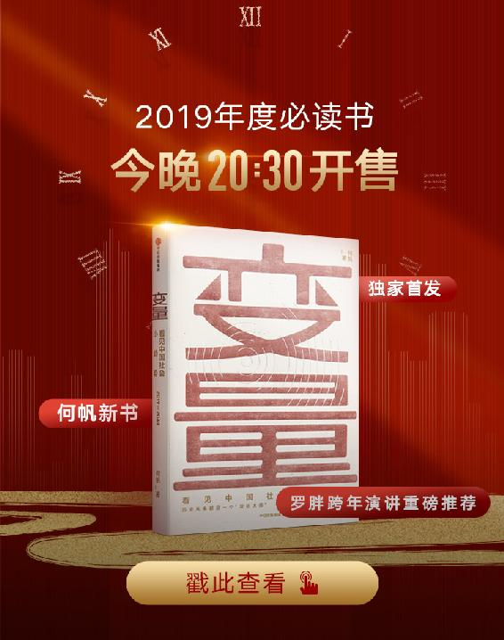

点击跳转购买页查看详细介绍，12 月 31 日晚 20:30 正式开售！    

 **20 | 谁能破解中国城市化的困境？** 

  
  

何帆

\-44 秒前

> > > > 20 | 谁能破解中国城市化的困境？ 

| 何帆亲述 |

你好啊，欢迎回到《何帆报告》。

这个模块，我们一直在讲城市化中出现的新变化。

我们已经介绍了“收缩城市”，也谈到了“多核城市”，还介绍了城市中正在爆发的“颜值革命”。如果用一条主线把这些变化串起来，那就是“自下而上”。

什么是“自下而上”呢？

“自下而上”就是一种来自城市居民的自发力量。这种自发力量需要得到更多的释放空间，而一旦释放出来，就能够破解中国的城市化在当前遇到的很多困境，让人们看到中国的城市化，还有更广阔的发展空间。

 **1\. 中国古代的城市化：自下而上** 

其实，自下而上并不是一种新趋势。城市化自古以来就是由自下而上的力量推动的，你过去熟悉的那种自上而下的城市化才是一种非常特殊的模式。

为什么这么说呢？你可能会认为，中国的城市化是在过去二三十年才出现的，其实不是的，中国曾经是城市化程度最高的国家。

在战国时期，中国的城市化率就达到了 15%，这算非常高的比例了。

到了唐朝天宝年间，长安有 60 万人，是当时世界上最大的城市。宋朝比唐朝更发达，南宋时候临安的人口更是达到 250 万，这个规模比 1000 年前的罗马城大了有一倍左右。

那个时候可没有什么房地产商，也没有地方政府的土地招标，那你觉得在中国古代，城市化是由什么力量推进的呢？其实一个很重要的力量就是集市。

有很多城市，它们最开始都是人们做生意的地方，比如交换个农产品、水产品。交易的地方逐渐固定下来以后，吸引了越来越多的人到附近，于是就出现了“市”，后来才有了“城”。

那你可以想象，这种从集市发展起来的“市”，完全是一个自下而上的过程，是人们自发地聚集在一个地方，然后逐渐发展出来各种功能区的。

你有没有注意到，古代的城市都是沿着河流出现的，比如黄河边上有汴京，长江边上有南京，这就是因为最早的贸易大多是靠水路。等到铁路出现了之后，就有了像河南、郑州这样的交通枢纽。

而最现代化的城市呢大多是在沿海，这是因为全球贸易主要是靠海上运输。所以你看，哪里有更发达的贸易，哪里就有更繁华的城市。

 **2\. 中国现代的城市化：上层主导** 

从这个角度来看，我们中国在过去二三十年里的城市化发展，那可是非常特殊的。这种城市化是一种土地财政驱动的、政府主导的模式。

我们可以把这个模式简单概括成这么一个过程：

首先，政府把农业用地出售出去，或者把土地在银行做抵押贷款，获得了财政收入。

然后，这笔收入就被投入到大规模的基础设施建设，比如修路、机场、地铁，以及房地产开发、造新城。房地产公司拿到了地以后，就开始大规模地投入住宅和商业地产的开发。

你看，短短二三十年的时间，这个过程已经成了中国城市化的惯例，我们会觉得似乎城市化天生就应该如此。

这种自上而下的模式，当然有速度上的优势，但是你肯定也看到了它的问题。我在 2018 年就注意到一个现象，很多房地产公司都开始改名字了。

像万科、保利、龙湖、万达等等，都悄悄地拿掉了他们公司名字里“房地产”三个字。我们知道万科一向号称是房地产界的“先知”，它在 2018 年提出来的最高目标，竟然就三个字：“活下去”。

这就是因为，到了 2018 年，其实能够出售的土地存量已经很少了。政府在经过一段时期狂飙突进式的基础设施投资支后，现在也是债台高筑了。同时，房价居高不下，给城市里的居民带来了不少生活压力，对企业来说也提高了运营成本。

我们之所以能注意到像我们之前讲到的“多核城市”、“精明收缩”这样的现象，正是因为城市的大规模扩张已经开始放缓了。

 **3\. 观察自下而上的力量** 

但是，塞翁失马，焉知非福。

其实，有一种“自下而上”的力量，反倒有可能成为在未来城市化的主要驱动力。这种力量其实一直都存在，只不过之前被压制着。

那你肯定会很好奇，我是怎么注意到这种力量的呢？这是我跟城市规划师学的。

在 2018 年，我采访到了一位城市规划师，他叫何志森。何志森不把自己叫做“城市规划师”，他自称是“城市盯梢者”。

什么意思呢？何志森说，所谓的“盯梢”，其实就是连续地观察，是为了去理解背后的动机、逻辑和秩序。

比如说，有一个国际机构曾经到非洲去搞“扶贫”。他们注意到农村妇女每天都要花很长时间到水井去打水，所以他们就想到要给村里铺上自来水。

结果，最反对这个项目的反而是这些农村妇女。你猜这是为什么？

这是因为这些非洲农村妇女在家里、村里的社会地位都非常的低，在水井边打水是她们难得的逃出牢笼，可以满足社交需求的这一段时间。

因为她们可以在水井边聊聊天、发发牢骚，你铺了自来水，她们就连这个“放风”的机会都没有了。

所以，何志森告诉我，你要学会停下来、慢下来、甚至趴下来观察，你就能看到以前看不到的细微之处。他真的曾经趴下来过，他观察过城市里面流浪猫、流浪狗的行走路线。

如果你也想学会观察自下而上的力量，你就得学会何志森的这种观察方式。

因为城市的秩序，不是靠城市设计师规划出来的，而是普通的居民在日常生活中创造出来的。这就是我们上一讲所说的，混乱背后的秩序。

 **4\. 拉开城市化第二季的序幕** 

理解了这种自下而上的力量，你就会和我一样，看到中国城市化的思路发生了改变。

过去你可能会觉得，城市化就是让城市现代化，平地起高楼、拆迁扩马路，现在新城建的差不多了，老城也拆不动了，城市化已经到头了。

但是，如果换了自下而上的视角，你就能看到中国的城市化才刚刚拉开第二季的序幕。

新的城市化用的是城市更新的思路，这种思路的关键是怎么样让我们现在的城市更加人性化，让大家过上更好的生活。

我还是来举个例子。在佛山有一个奇槎村，规划里有一条主干道要经过这个村。如果按照过去的做法，就是把这个村拆掉。这些村民一开始的想法也是要拆迁，他们是想拿拆迁补偿的。

可是现在拆迁成本实在是太高了，那拆迁之后，老居民看起来可以多分一些钱，其实很多人拿到钱之后很快就花完了，结果是坐吃山空，自断生路。拆迁户失去了原来的生活空间，也切断了一切联系，永远离开了他们原本居住的地方。

所以地方政府就换了一个思路，让规划师和村民一起商量这个事。那么，你猜规划师是怎么说服村民的呢？

其实，他们只是问了一很简单的问题：你们想不想让这里变成一个孩子可以走路上学、不用家长送的小区呢？他们问的是一个小问题，但是转变的是一个大思路。

神奇的事情就发生了。最后不仅路修好了，村民还决定，把一块很宝贵的商业用地拿出来建祠堂，而且他们还保留了村头的一棵老树，等等等等。

你看，其实真正自下而上的城市化就是这样的，让村民参与进来，帮他们更好地在这个地方生活，让他们的孩子们能够更方便地去上学。

当村民充分参与进来之后，不仅在村民和政府之间打通了相互体谅的环节，甚至开发的思路也发生了改变。

 **4.总结** 

好了，总结一下，这一讲我们谈到，我们过去二三十年经历的那种上层主导的城市化，其实是非常特殊的。

那么一直以来，城市都有一种自下而上、自然生长的方式。未来的城市如果想要持续地焕发出来强大的生命力，也要学会尊重这种自下而上的力量，尊重城市居民自发地为自己创造美好生活的能力。

好的，这一讲先到这里。我是何帆，我们下一讲再见。

 **21 | 择邻而居为什么变得很重要？** 

  
  

何帆

\-31 秒前

> > > > 21 | 择邻而居为什么变得很重要？ 

| 何帆亲述 |

你好啊，欢迎回到《何帆报告》。

从这一讲开始我们进入了一个新的模块，重建社群。

我认为啊，在未来的中国社会，社群可能会成为一个越来越普遍的现象，这个也是我在 2018 年发现的最重要的变量。

首先还是先问你一个问题：你觉得社群运营是一个靠谱的商业模式吗？

一说到社群，一般我们第一个想到的就是移动互联网上的社群，比如说微信团购、电商运营的社群，或者是一些线上的内容社区。

互联网公司会用社群来吸引流量，维持用户的活跃度。这种做法特别常见，以至于有一种说法是“社群运营”成了互联网最重要的法宝之一。

但是，社群运营并不限于互联网公司。

2018 年，我注意到的一个很有意思的商业模式，就是用社群的思路来运营房地产项目。怎么做到的呢？

我来带你看一个案例，这个案例是在北戴河海滨的一个小区，叫阿那亚。

 **1\. 世外桃源阿那亚** 

阿那亚这个楼盘，在房地产界其实赫赫有名，它被称为“中国四大神盘”之一。

“神盘”，“神”在哪里呢？

我 2018 年跑去阿那亚实地调研，发现这个小区啊，跟我们平时见到的居民社区那可差距太大了。

你知道，一般的住宅区都只有居住功能，但是在阿那亚，你能找到非常多的方式来消磨时光。

小区里不光有住宅楼，还有酒吧、咖啡厅、图书馆。

你可以在酒吧里点一杯啤酒，舒舒服服地蜷在椅子上听乐队演出。

或者你可以去咖啡厅，不仅能喝一个下午茶，还能够看看阿那亚业主自己办的摄影展、画展。

如果你想自己一个人静静，那他们的海边图书馆可是号称“最孤独的图书馆”，你完全可以去坐上一个下午。

过上这样的生活，是不是听起来非常有意思呢？

不过阿那亚的与众不同，可不止于此。这个地方之所以叫“神盘”，我觉得不是“神”在设施上，而是“神”在阿那亚的邻里关系上。

你知道，在现在大多数的居住区里，邻里关系早已经不像以前那么亲密了。同一个小区甚至是同一个单元的人，彼此间都很有距离，可能你连邻居家的名字都叫不上来。

但是在阿那亚，业主之间的关系却是出奇地紧密。

比如说咖啡厅的老板娘其实就是小区的业主，邻居有事出门，就会把孩子留下来给老板娘照看。平常没事的时候，很多业主会主动到咖啡厅去，帮老板娘刷盘子洗碗，做咖啡招呼客人。

在小区里啊，还有好多个兴趣小组，像是什么话剧社、诗社，业主在这里面都非常活跃，过年的时候还会给邻居们汇报演出。

这样的一个社区，你说它“神”不“神”呢？

 **2\. 房地产业的社群运营** 

不过啊，这个社区虽然听起来很高大上，其实它最早就是一个烂尾楼，被一个叫马寅的开发商接盘了。

因为是烂尾楼，房子的质量差，刚开始的时候根本就卖不出去。那怎么办呢？没办法啊，只能在其他的方面找亮点。

马寅本人也是一个有点理想主义情怀的人，他一直想把居住区打造成一个非常有人文关怀的地方。

所以他从一开始就提出来，一定要重视业主服务，让业主能在这个社区里找到一种归属感。

所以阿那亚的运营团队，跟其他的房地产都不一样。

在马寅的运营团队里，有一个专门的职能叫“梦想组织者”。这些人平常的主要工作就是为业主组织各种各样的小组活动。

在阿那亚，你要去参加任何的社区活动，不管是戏剧社、风筝冲浪、马术表演，都会有人专门带着你去做这些事情。

而且啊，随着这种模式的发展，在阿那亚的业主里还出现了一些 “名人”。

这些人是 KOL 一样的核心人物。这些人愿意付出额外的精力，跟马寅的团队一起为业主提供服务。

比如说业主微信群的群主“孟姐姐”、摄影师“船长大人”，还有一位诗社社长等等，这些都是社区里的名人。

你看，这样的运营思路，其实不就是社群嘛。

所谓运营社群，绝对不是简单地让人们加入一个群体，而是要激活这个群体里的社会关系，让人们能通过寻找某些共同的兴趣和目标，进入一种共同体。

 **3\. 风雨社会里的择邻而居** 

那你肯定会很好奇，这种社群模式，会不会跟移动互联网的社群一样，经过一段时间的热乎劲儿之后就遭遇瓶颈呢？

我们都知道，互联网上的社群运营，往往很难长期维持社群的活跃。

很多社群缺乏清晰的目标。刚开始热闹，但是并没有找到能把所有的人紧紧捆绑在一起的共同目的。所以很多人刚加入社群的时候觉得新鲜，过了一段时间新鲜劲儿过去了，这个社群就变成了“僵尸群”。

这也是为什么社群的概念三四年前那么火热，但是后来这个概念逐渐又冷下来的原因。

那要看到这个问题的答案啊，我们就需要知道到底是什么样的人住在阿那亚呢？他们参与到社区活动的目的是什么呢？是不是只是一时兴起呢？

我去调研的时候，发现 90%以上的业主其实都是来自于北京。平时他们在北京工作，到了周末或者假期才会来到阿那亚。

不过有意思的是，他们来阿那亚并不是为了休闲度假。很多业主都把阿那亚的生活，看作自己的“第二份工作”。

比如说有一个业主平时在北京的出入境管理大厅工作，他到阿那亚是来做民宿的。

还有小区的微信群群主“孟姐姐”，是在电视台工作，但她大部分业余时间都花在阿那亚上。

这就好像过起了“双面人生”一样，在北京一个人生，在阿那亚有另外一个人生。

你会看到，如果要说这些业主有什么共同特点的话，那可以说有两个。

第一，他们的经济条件普遍比较优越，毕竟住在北京，还能在阿那亚买一套度假房，那肯定是有经济实力的，起码是中产。

第二，他们都希望在阿那亚有自己的 “第二人生”，能够找到自我实现的方式。

而且，不仅仅是阿那亚的业主有这些特点。我还走访了一些其他跟阿那亚类似的，有非常活跃社群活动的小区，也看到了类似的情况。

比如说，我去了福建泉州的聚龙小镇。

在那儿的业主，主要是一些已经步入退休年龄的人，所以文化风格不太一样。比如说阿那亚的业主都反对跳广场舞，在聚龙小镇广场舞是他们的主要活动。

但是相同的是，聚龙小镇的业主也都不安分，他们也希望在自己步入退休之后，能够通过聚龙小镇这个社区，找到新的“第二人生”。

我认为呢，之所以会出现这样的业主群体，以及这种社群生活，其实是因为我们已经进入了“丰裕社会”了。

丰裕社会其实就是说我们现在都物质丰收了，生活也已经富裕了。我们需要意识到，在丰裕社会里面人们的需求，已经和之前产生了巨大的不同。

你一定知道马斯洛的五层需求金字塔。在这个金字塔里，最底层的需求是物质和生存的需求。这些需求被满足之后，人们就开始有社会需求，比如和别人建立情感联系、获得社会对自己的尊重。

在金字塔的最顶层，是自我实现的需求。

过去我们总觉得，当我们达到了那个层次之后，人就会变得越来越自我。但真的是这样吗？

你要是这么想，那就读错了。

当马斯洛说到自我实现的需求时，他可不是说你有了名，有了利。马斯洛特别讲到，人们越是接近自我实现，越是会有社会需求。而且他说，“社会的层次和个人需求的层次是相对应的”。

也就是说，到了一定的发展阶段，人们就会追求更高的需求，而整个社会，会变得更加智慧、更加和谐。

这么一分析你就明白了，所谓“自我”其实只是一种表象。

随着物质需求被满足，人们在内心深处会越来越追求价值观的共同体。而且，如果身边这种共同体还不存在，人们就会通过搬家或者网上社交等等各种方式为自己创造出来这样的一个共同体。

这就是社群的本质。

 **4\. 总结** 

所以，我给你总结一下，我们在这一讲说到阿那亚的案例。

阿那亚之所以能发展出社群运营的模式，也是因为它顺应了一个小趋势。这个小趋势就是，那些已经进入丰裕社会的人会渴望重建社群，这是他们实现自我的重要手段。

一开始，这样的新社群可能数量还不算太多，就像一个一个小岛。但是未来，这些小岛一定会成片成片的出现。

现在我们看到，房地产商是通过小区里的社群服务于这种小趋势，未来还有什么其他方式呢？这个问题我留给你做思考题。

好的，这一讲先到这里。我是何帆，我们下一讲再见。

 **思考题** 

现在我们看到，房地产商是通过小区里的社群服务于这种小趋势，未来还有什么其他方式呢？

 **22 | 在今天还要坚持个人主义吗？** 

  
  

何帆

\-18 秒前

  
  

| 何帆亲述 |

你好啊，欢迎回到《何帆报告》。

上一讲我们去了阿那亚，看到了那里的社群生活。它现在还只是一个小趋势，但它的背后却是一个大的变量，这个变量大到足以影响中国社会未来的良性发展。

这一讲我就来跟你聊一聊这个变量背后的逻辑。

 **1\. 反思个人主义** 

2018 年发生了很多令人郁闷的事情，让人觉得这个社会到底是怎么了。

你一定记得在北京闹市区的西单大悦城发生的砍人事件。在陕西米脂，一个普普通通的县城，也发生了一起类似的恶性杀人事件，凶手一路砍杀放学的孩子。而且你的身边可能也会遇到像高铁霸座男这样的不讲公德、不讲道理的事情。

好多人会感慨：世风日下啊。那么，你是怎么看这些现象的？

我来提供一个个人的观察：如果你把它们看成孤立的事件，那每一个事件的背后都会有很多孤立的原因。

但是如果你把它们看成系统性的问题，那么有一个因素我觉得是不可忽视的，那就是个人主义的泛滥。

在过去二三十年，是经济高速增长的时代，人们首先追求的是物质财富的增加。物质财富的增加又提高了个人的自由度，这是一种进步和解放。

但是，过犹不及。不要忘了，人是一种群居动物，人是生活在社会之中的。怎样处理人与人之间的关系，怎样构建一个更为和谐的社会，是我们无法逃避的问题。

那你可能会问了，无论在哪个时代、哪个社会，都需要学会与人好好相处啊，为什么你到了 2018 年才关注这个问题呢？

 **2\. 社会思潮的钟摆** 

其实不是的。你先想想看，在 20 世纪 80 年代的时候，我们中国人最关心什么呢？

你可能会觉得，那个时候中国已经开始市场化改革了，人们最关心的当然是赚钱。

但事实不是的。80 年代人们最关心的都是一些非常宏大的社会问题，比如中国的体制改革，中国向何处去。那个时候，关心赚钱的其实只有一小群人，这群人叫“倒爷”。

那么，到了 20 世纪 90 年代，我们中国人最关心什么呢？

这次你猜对了，90 年代以来，我们最关心的是赚钱，很少有人再去关心那些宏大的公共问题了。

这背后有什么玄机呢？

有一位著名经济学家叫赫希曼，赫希曼观察历史的角度非常独到。

他说，一个社会每隔十年、二十年，就会出现重大的社会思潮转变，其实就是在两个钟摆之间摆动。有的时候人们更关心个人的财富，有的时候人们更关心公共的福利。

按照这个规律，现在社会思潮的钟摆很可能就要摆回来了，公共问题会再度引起人们的关注。

这种规律的背后又是什么逻辑呢？我们来从个人的角度分析一下。

你想想看，我们过去的发展经历了什么样的过程呢？一开始的时候，人们更关注的是基本的需求满足，而且在这个过程中，我们会看到一个很独特的现象，也就是说，人们会随着富裕程度的提高，越来越多地把自己和社会隔离起来。

一开始是大家一起住在筒子楼、大杂院里，后来搬进了自己的公寓，而且尽可能地要挤进那些所谓的高尚小区。什么是高尚小区呢？就是见不到其他社会阶层的小区啊。

我还记得有一位写实主义艺术家，在北京的一个小区的公共草坪上放置了一些社会底层民众的雕像，这些雕像刻画的是一个贫困村庄村民的群像。结果，小区业主纷纷抗议，说你这些雕像影响了我们小区的审美和品位。

好，我们接着问，要是他们更有钱呢？那他们就会去买联排别墅，最后呢，他们就会去买独院。

那么，然后呢？然后啊，人们就会觉得没意思了。如果你真的能自己一个人在独院里面过一辈子，那什么公共生活不公共生活的，对你没有什么意义。

但人的需求规律不是这样的，社会的发展规律也不是这样的。2018 年，我已经看到了钟摆开始朝回摆了。

 **3\. 托克维尔定律：公共生活的能力** 

法国的一位思想家托克维尔，他年轻的时候游历美国，然后写了一本名著，叫《论美国的民主》。

托克维尔有一个发现，他发现美国人特别喜欢一起做事。不管是想要拯救世界的大事，还是像打猎喝酒这样的小事，美国人都会组织一个社团或者是俱乐部。

美国人其实不关心抽象的政治理念，但是他们更热衷于小社区里面的公共活动。而托克维尔认为，正是由于这样的实践，使得美国人更容易超越狭隘的个人私利。

他说：“如果让公民们多管小事、少管大事，他们反而会更关心公益，并且感到必须不断地互相合作去实现公共利益。”

我把这个思路叫做“托克维尔定律”。

这个观点很有意思。为什么多管小事、少管大事，人们反而更关心公共利益呢？不是应该反过来吗？如果我们每个都关心天下大事，那不是才能更好地参与公共事务吗？

其实不是的。你会在网络上看到很多人天天议论天下大事，但是这和建立一种社群生活一点关系都没有。建立社群生活的唯一方法，是你要开始跟别人一起做事，边做边学。

这件事情看起来简单，但是你可要注意，一旦你做起来，就会发现魔鬼都在细节里头。

我给你讲一个案例吧。2003 年，有一批企业家到了内蒙古的阿拉善。本来这只是一次休闲度假活动，但是有几位房地产界的大佬深受刺激，他们看到了阿拉善的贫困和荒凉，也听说这里是北京的沙尘暴的发源地，所以，他们就想做一个公益项目。

到了 2004 年，一共有 60 多个企业家一起来到了阿拉善。这 60 多个企业家一共掌管着大约两万亿元的总资产。每个人都是成功人士，要能力有能力，要人脉资源有人脉资源。

所以，你可能会想，他们想做一件事情，那还不是易如反掌吗？

等到他们真的聚到一起，商量怎么齐心协力做这个公益活动的时候，这些商界精英才发现，在怎么开会、怎么定规章制度、怎么达成共识、怎么分工合作方面，他们连最基本的训练都没有。

一开始把大家召集在一起的是一位大型国有房地产企业的掌门人。他习惯了在单位里面做主，所以在听汇报的时候，他习惯性地一边听一边下指示。下面坐的可都是大佬啊，那些大佬就不乐意了。

你看，饶是一群商界精英，也会犯很多“低级错误”的。要想把公共理想转化为公共组织，然后再形成公共能力，是一件比我们想象的复杂得很多的事情。

 **4\. 小社区里的公共生活** 

那么，是不是只有在做公益活动的时候才用得着参与公共生活的能力呢？其实也不是的。

我再举个身边的例子。有很多城市的小区都可能会遇到业主维权的事件，原因可能多种多样：比如，交房的时候发现房屋的质量不好，或者是由于开发商更改了原来的容积率，等等。

遇到这样的事情，业主们当然很气愤，所以一开始会有一些冲动，大家想的都是“打倒奸商”。过了一段时间，理智的业主会反应过来，“打倒奸商”其实是不能解决问题的，对业主也没什么好处。开放商和业主之间尽管有矛盾，但是也是共生的，也有共同的利益。关键在于怎么通过协商解决问题。

这话说起来容易做起来难。谁来出面？怎么谈判？业主代表和开发商要协调，业主的内部也要协调。在这个过程中，很多人会发现，原来我们在达成集体行动这件事情上是完全没有经验的。

那么，如果你再观察一下业主维权，就会发现，在经历了这种锻炼之后，在这些社区里业余生活也会更加丰富多彩，人际关系会更加融洽。

你再想想看，如果把这种参与公共生活的能力移植到其它的领域，比如怎么跟你的同事相处，怎么跟你的导师搞好关系，那简直就是“降维打击”啊。

 **5\. 总结** 

好，总结一下，怎样过公共生活，是一个从实践中才能学会的技能，而不是从书本上读到的理论。

这可不单单两个人见面互相礼貌地打个招呼，也不是几个人凑到一起打几圈麻将，甚至不是一群人相约去跳广场舞。

你要意识到，社群是稳定的、是要长期合作的，但在社群中又会有各种不同的利益、不同的表达方式、不同的道德偏好，那就一定既有合作的需求、又有冲突的可能性。

我给你的建议是，我们每个人都需要去锻炼自己参与公共生活的能力。这正是我们现代中国人最缺乏的一种能力。

好了，这一讲先到这里。我是何帆，我们下一讲再见。

 **23 | 山村小学如何实现了逆袭？** 

  
  

何帆

\-4 秒前

> > > > 23 | 山村小学如何实现了逆袭？ 

| 何帆亲述 |

你好啊，欢迎回到《何帆报告》。

我们在前面两讲谈到了城里面的社群重建，也讲了“托克维尔定律”。那么这一讲，我们来讲一讲孩子们的社群重建。因为社群重建，也要从娃娃抓起。

 **1\. 大山深处的范家小学** 

2018 年，我拜访了不少小学，非常意外地找到了一所我见过的中国教育理念最先进的小学。这个小学的名字叫范家小学。

我们在范家小学看到孩子们和老师的关系非常融洽，老师们会情不自禁地拍拍孩子的脸蛋，孩子们会直接冲到老师的怀里去。

为什么我说这所小学教育理念是先进的呢？

首先，范家小学都是小班教学。现在一个班最多也就七八个人。教室的前面是液晶黑板，学生会用平板电脑做数学题，墙上挂的都是孩子们的美术作品。

其次，范家小学采用的是项目制的教学。这就是我们都很推崇的芬兰的教育方式。在范家小学，一个工作坊会有不同年级的孩子共同参与。

而且，范家小学的学生们不会整天都坐在教室里上课，老师会常常带着同学们去做实地调研。比如学校会带着孩子们去看水电站是怎么发电的，去研究一个社区的历史等等，让孩子们接触到大自然。

我在范家小学的布告栏里看到，他们对孩子们有哪些要求呢？

学生要有阅读的爱好，要能写一手漂亮的字，能流利地朗读，当众表达自己的想法。要保持积极向上的态度，养成爱清洁的卫生习惯，至少要有两项体育爱好、一项艺术爱好。最后才是课业发展良好。

说了这么多，我想让你猜一猜这个学校在哪呢？在北京还是在上海？是一个昂贵的国际学校吗？

都不是，它是一所山村寄宿小学。

在哪呢？就在四川省广元市宝轮镇，而且还要一小时车程才能到的大山深处。

我还了解到，范家小学很多学生的父母都离婚了，也有母亲患病的，比如抑郁症、精神疾病，都有。有的孩子自身存在缺陷，比如有聋哑儿童，也有智力障碍的孩子。即使是家庭比较完整，大部分父母因为外出打工，也没有陪在孩子的身边。

所以，这些学生，无一例外都是留守儿童。

 **2\. 留守儿童** 

你心目中的留守儿童是什么样子呢？

很多人会认为，留守儿童缺乏父母的陪伴、良好的教育，长大之后肯定会有各种心理缺陷，甚至可能会成为社会问题，会报复社会。

可是，我在范家小学看到的孩子都是非常阳光自信的。

我在这里看到，没有一个孩子戴眼镜，没有霸凌事件，没有孩子之间的攀比。

有几个孩子陪我去村里转，一路上跟我讲他们自己的故事。

比如有一个女孩叫李竹，她家里很穷，也是住得离学校最远的孩子。从她的家里到学校要翻过一座山，走两个小时。但是李竹并没有跟我抱怨家里生活条件差，她跟我讲的反而是怎样心疼自己的妈妈。

这些孩子面对生活的不幸，早已懂得既不抱怨，也不抗拒，比我们很多成年人活得还通透豁达。

为什么范家小学可以教出乐观自信的孩子呢？

很多人觉得留守儿童会变成社会问题，理由就是这些孩子的父母没有陪伴他们。

那我们想一下，像我们这一代小的时候，其实父母也没有怎么管教。那个时候我们的父母都是双职工，在单位里面忙得不可开交。我们放学的时候，都是脖子上挂着钥匙自己回家的。

那为什么没有人说，我们这一代会变成社会问题呢？

那我们再想一下，如果这些孩子的父母在家里陪伴他们，一方面，这些家庭的收入肯定是要减少的，生活水平是会下降的，另外一个方面，他们的父母会教他们什么呢？很可能是教他们玩抖音，打吃鸡游戏。

所以，有的时候，我们之所以得出错误的结论，就是因为我们观察事物的角度错了。

事实上，对孩子的成长影响最大的环境不是家庭，而是同龄人的社群。

我推荐你读一本关于儿童教育的经典著作，就是著名心理学家哈里斯写的《教养的迷思》。在这本书里哈里斯告诉我们，孩子的成长有一个社会化的过程，他们更重视的是跟自己同龄人之间的互动。

换言之，我们现在的教育理念过度强调了父母对子女教育的重要性，而忽视了孩子社群的重要性。

虽然范家小学的孩子大多来自残破的家庭，但是学校给了他们最重要的东西，一个平等、包容、自信、乐观的社群。

 **3\. 重建社群** 

非洲有一句谚语，“教育一个孩子，需要一个村庄”。

范家小学就是这样的村庄，那么范家小学的社群是怎样建立起来的呢？当然离不开校长和老师的引导。

比如有个聋哑孩子，叫范俊。他的父母不知道该怎么教育他，校长和老师却会花很多时间去思考这个孩子有什么天分。

后来，他们发现这个孩子特别喜欢画画，他的画也非常与众不同。所以他们就培养范俊画画。当学校办画展的时候，专门有一个范俊的画展，他的父母看了这个画展非常激动。

也是因为这个画展，他的父母下定决心专门给范俊请了美术老师，开始认真地培养孩子。

我在范家小学看到了范俊同学的画，这孩子画画已经画出了自己的独特风格了。我非常喜欢他的画，忍不住买了他的画，这可是我第一次买艺术品啊。

除了老师的引导，孩子之间的交往也非常重要。

比如刚才我说的那个孩子李竹。她的班上有一个转学来的孩子和另外的一个孩子一直在闹别扭。老师还没有发话，李竹看不过去了。她花了很多时间，帮助这两个孩子沟通，结果呢？这俩孩子变成了好朋友。

你看，这种处理人际关系的能力，城里的孩子是很难有机会去学习的。

你可能不同意，城市里的孩子不也是去学校，在学校里不是也能建立孩子之间的交往吗？这是不一样的，在城里的学校，都是大人管着让小孩玩，不是小孩子自己和小孩子玩。

而范家小学呢，他们的交往完全是孩子自发的。

再说一点，在范家小学，这些孩子很多是来自同一个村，甚至同一个大家族，所以更容易互相相处。比如李竹和她的妹妹都在一个学校里。还有我看到幼儿园有两个同龄的孩子，一个是另外一个的亲舅舅。

乡村里面原本的邻里亲戚关系，给学校的这个小社群提供了土壤，滋养着让它更好的生长。

这些孩子的社会背景差别不大，所以就不会互相攀比，也不存在歧视和排斥。虽然孩子之间肯定会有矛盾，但是完全不生分。

这是我在 2018 年观察到的最好的教育创新。

你看，最弱的环境反而出现了突破口，对学习成绩不再有太多执念，反而卸下了包袱，让教育回归了它的本来面目。

正是由于很多条件发生了变化，范家小学反而得天独厚，具有了独特的优势，让我们看到了历史在山村小学出现了一个反转。

 **4\. 未来的教育** 

你可能认为范家小学只是一个个例。其实，我看到这样的教育创新不只这一家。在河南的兰考、商丘、湖南的湘西、甘肃的平凉，还有很多地方都有类似的学校。

曾经担任过北大附中校长的康健老师告诉我：“未来十年二十年，中国最好的学校一定是在农村，是小规模学校。”

我还希望你看到的是，这些乡村小学在培养的是孩子们公共生活的能力。如果学校不重视孩子们的互动，不能构建出孩子们的共同体，那就很容易会出现包括霸凌在内的各种问题。

范家小学之所以能够把孩子们教得阳光自信，没有想象中那些留守儿童的问题，就是因为成功地培养了孩子们的公共生活能力。

孩子们去调研村里的历史，去和大人们做访谈，这些都直接锻炼了孩子们公共生活的能力。

 **5\. 总结** 

好，这一讲我们谈到范家小学和农村教育的反转。

我们说，历史是一个反转大师。绝路会变成生路，劣势会变成优势。

社群的力量，正在农村学校这个被我们忽视的角落发挥作用，留守儿童反而培养出来了更强的公共生活能力。

范家小学就像一面镜子，也照出了我们现有教育体制的缺陷，甚至我们个人奋斗模式中的缺陷。

你可能会问，这些缺陷是什么呢？我会在下一讲为你更详细地解答。

好的，这一讲就先到这里。我是何帆，我们下一讲再见。

 **24 | N 型曲线：未来谁的收入更高？** 

  
  

何帆

\-49 秒前

> > > > 24 | N 型曲线：未来谁的收入更高？ 

| 何帆亲述 |

你好啊，欢迎回到《何帆报告》。

我们在这个模块一直在讲社群的重建。经历了高速经济增长的这一代人突然发现，只有回到公共生活才能够更好地发现自我。曾经被人们视为社会问题的留守儿童，也在自己的社群里找到了温暖的怀抱，变得乐观自信。

可是你一定还想知道，社群重建跟我的个人奋斗有什么关系呢？ 

我们这一代人都是相信，知识改变命运。我要上最好的小学、考上最好的中学、最好的大学，学最热门的专业，最后找最热门的行业。我也要让我的孩子这样做。

我们相信个人奋斗，只要努力，就一定能出人头地。但是我要告诉你，事实上这些想法，都是在经济高速增长时期才会出现的、特有的乐观想法。

我在这一讲要告诉你一件事情：你不能再沉迷于过去的个人奋斗模式了，要想真的比别人跑得快，站得高，你就要重新布局孩子的教育，学会找到自己的“部落”。

 **1\. N 型曲线** 

那我们先说说为什么过去的个人奋斗不管用了。

因为时代变了，收入分配也会改变。请你记住一条 N 型的波浪曲线。

在未来，仅仅靠出卖自己劳动力的脏活累活会挣的钱越来越多。具有专业训练的熟练劳动力收入会更高，这是第一个小的波峰。

随后，收入水平会急剧下降。那些刚刚毕业的大学生很可能收入水平是最低的，这是一个波谷。

那再到最后，那些最具有创造力的天才人物收入水平一定是最高的，这是最高的波峰。

为什么会这样呢？这是由于劳动力市场上的供给和需求变化决定的。

你想，随着劳动力数量的减少，人们收入水平的提高，脏活和累活谁都不想干啊，那自然要给干这些活的人开更高的工资。

2018 年来自美国旧金山有一条新闻，由于旧金山市区流浪汉太多，可是公共厕所太少，所以街道上留下了很多粪便。旧金山市政府不得不请人专门清理粪便。这些工人的工资比硅谷资深程序员的工资还高！

在中国也出现了同样的趋势。你要是不信，可以找一个工人帮你换个灯泡，或者是换一个门把手，那你就会知道所谓的“低端劳动力”，现在都已经是“高端价格”了。

有专业训练的熟练劳动力，收入水平会更高。这些靠技能吃饭的职业发展空间比我们想象得可要大多了。

举个例子来说，你如果是真心喜欢厨艺，就不会只是满足于做一个厨师。你肯定会不断地提升自己的手艺，先当上大厨，甚至你可能会赢得国际奖项，最后开一家自己的米其林餐厅。

我们可以想象出来很多职业，比如健身教练、民谣歌手、电竞选手——你说吧，哪一个职业不比坐办公室更酷？哪一个职业又是学校里能够教出来的呢？

未来收入水平最低、就业最困难的，恰恰是刚刚毕业的大学生。

这些孩子有很多都是学霸，他们原本很自信，以为自己拿到了通行证。但是我要告诉你，未来的大学文凭不能给你做任何保证。

因为他们最缺乏工作经验。他们在大学里学到的知识一出校门就可能会过时。

你一定在新闻里面看到了，无论是律师、会计师、金融分析师，还是翻译、记者，他们的工作会越来越多的被人工智能替代。

当然，最后总能有人出人头地的。这些佼佼者的共同特点，不是上过名校，学过热门专业，而是虽然经历了枯燥的教育体制折磨，却依然能够保存自己的兴趣、没有让创造的火焰熄灭。

有一些引领潮流的大企业，比如苹果、谷歌、IBM，甚至美国银行、希尔顿集团，都已经表示不再设置学历的门槛，愿意接受那些没有上过大学的求职者。我相信，以后像阿里巴巴、腾讯、华为这样的中国企业，很快也会效仿的。

 **2\. 范家小学 vs 城市教育** 

说到这里，回到我们上一讲说到的范家小学。这些孩子在范家小学学到的知识，可能不如城里的孩子多，但是他们和同龄人相处的本领，他们对社会的熟悉程度要远远高于一般城里的孩子。

如果范家小学在这些孩子幼小心田里面种下的种子没有受到摧残，如果他们依然能够保持孩童时代的通透和达观，那你可以想象，无论他们以后走什么样的道路，都一定会收获一份非常充实快乐的人生。

那你再看看我们城里的这些孩子呢？

如果你曾经面试过学生，你就会发现，现在的学生个个都一样。你就说北大清华的学生吧，不可谓不优秀，但是他们优秀的是一模一样的。他们都拿过数学竞赛和英语竞赛的冠军，都会弹钢琴，都当过什么学生会主席，都热爱公益活动。

看来看去，你就是看不出来他们真正感兴趣的到底是啥。

所以，你是想让自己的孩子成为千篇一律的“优秀者”呢，还是想让他们成为卓然不群的弄潮儿和领导者？

 **3\. 部落到底是什么？** 

如果你想让自己的孩子在未来胜出，那就要格外关注现在的孩子最缺乏的一种能力，这种能力就是与人合作的能力，学会参与“部落”、甚至自己建立一个“部落”的能力。

好，说到这里，那我就要谈一谈为什么要重视“部落”。

我先告诉你，我说的 “部落”不是你的老乡圈、朋友圈，也不是你生意场上的利益圈。

我说的“部落”，是一批原本和你非常陌生，本来是来自五湖四海，但是却能够和你分享共同的价值观，能够平等而且合作地跟你一起参与公共生活的那群人。

为什么这些人对你很重要呢？

因为我们正在进入一个风险社会。在此去的道路上，你一定会遇到更多的困难，更多的挑战，那谁能跟你始终肩并肩、手牵手呢？

当然，你可以说“我有家人”。但是，只有家人是不够的。很多风险如果落在一个家庭的头上就是灾难，被众人分担之后就能够化险为夷。

即使没有遇到风险，你的人生也只有融化在一个比你更大的社群里面，才能变得更加精彩。你所在的“部落”，是你的坚定支持，也是你遇到危机之后的，所谓的“最终贷款人”。

可是，这个“部落”不是别人建好了，你填一个申请表就能够加入的。

这个“最终贷款人”能够有多少资源用来支持它的每一个成员，那是由每一个成员都往里面存了多少钱决定的。你做出的贡献越大，你的这个“部落”的力量也就越强大。

甚至，这个“部落”的壮大不单单取决于你投入的资源，比如时间、金钱，还取决于你的技能——这就是公共生活的能力。请你回想一下我们曾经讲过的克雷洛夫的寓言，天鹅、梭子鱼和大虾朝不同的方向拉车。那我说的“公共生活的能力”就是怎样让天鹅、梭子鱼和大虾高高兴兴地朝一个方向拉车。

你说，这个能力重要不重要？

 **4\. 总结** 

好了，这一讲，我们谈到，你未来的人生会发生很多变化，你的子女那一代经历的变化会更多。所以你最好现在就重新反思一下自己原来的人生规划。

原来看起来是金光大道，以后可能走不通。原来看起来是一条荆棘路，以后反而可能是捷径。

好的，这一讲先到这里。我是何帆，我们下一讲再见。

 

何帆

> > 以后的收入分配一定是一条 N 型波浪曲线，想不掉进谷底的话，你必须有胆量坚持自己的梦想，也有勇气去跟别人合作。此去的道路，冰霜满地，风波迭起，谁是能够跟你同舟共济的人呢？ 

 **25 | 致 30 年后的你** 

  
  

何帆

\-38 秒前

> > > > 25 | 致 30 年后的你 

| 何帆亲述 |

你好啊，欢迎回到《何帆报告》。

之前的二十五讲，我已经为你介绍了第一份《何帆报告》的主要内容。或许你已经悟出了我这一年，年度报告的主线：

当别人看到冲击的时候，我看到的是反转。

1.  > > 别人觉得中美之间的冲突是不可避免的。我却告诉你，这取决于中国如何理性应对，以及中美两国能否携手应对一个共同的挑战。 
    
2.  > > 当别人觉得中国的核心技术太落后的时候，我看到的却是在中国会出现高新技术的应用场景革命，而这场应用场景革命很可能反过来会影响到核心技术的演进路径。 
    
3.  > > 当别人觉得传统产业已经落伍的时候，我却发现传统产业很可能会像老兵一样训练有素、反应敏锐。他们穿上了新的军装，学会了新的打法，会从我们没有注意到的地方发起绝地反击。 
    
4.  > > 还有，当别人觉得城市化已经快走到头的时候，我却发现自下而上的城市化力量才刚刚开始萌芽。未来的城市化会更多样化、更开放，也会有更多小而美的创新。 
    
5.  > > 当别人觉得中国的社会风气太差的时候，我却看到一种重建社群的力量正在崛起，并会慢慢地影响中国社会未来的良性发展。 
    

那好，现在我就再为你总结一下，这些反转是怎样出现的。

 **1\. 来自于母体的反转** 

我先来帮“反转”下一个定义。反转是一种力量，这是一种在困难的时候沉潜下去，一旦有了机会就迅猛生长的力量。你看它很弱小，但其实它生命力顽强；你看它好像孤立无助，其实它是生长在母体之上的。

说到这里，你就明白了这些反转力量背后的支撑，那就是中国这棵大树。

在希腊神话里有个巨人叫安泰，他只要接触到大地母亲，就会获得源源不断的力量。

我们看到的这些小趋势也是一样的。中国这棵大树在过去 3000 年经历了多少磨难，但是它的生命力从来没有消失。当你找到这种力量的源泉，你就会有更多的信心了。

在 30 年代大萧条的时候，美国总统罗斯福说过一句名言，他说 “唯一需要恐惧的就是恐惧本身”。

他说了一句大实话。

你去看看大萧条的历史，在罗斯福“新政”推出之前，所有的人都非常恐慌。但是，罗斯福总统一出手，恐慌就突然消失得无影无踪了。

可是，我告诉你一个真相吧，罗斯福总统最开始采取的那些救市政策，是在胡佛总统时期就已经制定好的。也就是说，人们原来的恐慌情绪真的是自己吓自己的。

在 2018 年，我们的很多担忧、恐慌很可能也是被夸大的。

真正的风险可能还没有来呢。但是即使真的来了，只要你从容应对，也一样会化危为机。请你找到那种坚实的历史感，然后再去看身边的变化，你就会更加心中有数了。

好的，这一年的年度报告，我就帮你介绍完了。不过，这只是 30 年迈出的第一步。从今天开始，我已经收拾好了行囊，开始要踏上新的旅程了。

 **2\. 向你汇报未来的计划** 

在接下来的一年，我会去看什么变化呢？请让我先为你做一些预告。

> > 你看，中美贸易战还没有结束，我会随时为你更新。中国的企业又是怎样应对贸易战的风险呢？我也为你带回来来自一线的报告。我不仅会去美国，还会到东南亚、印度、非洲等等这些地方，帮你去做实地调研。 

> > 教育问题是我非常关心的问题之一。我很可能还去看更多的学校，也会去看在传统的学校体制之外生长出来的各种学习模式。因为未来的教育，很可能会和我们想象的大不一样。 

> > 我也非常关心年轻人的想法。不管我们喜欢也好，还是不喜欢也好，未来的剧本肯定是由年轻人写的。他们现在可能还在打草稿，他们可能现在刚刚勾勒出来一个轮廓，我希望能够带你先睹为快。 

我还有很多很多想法和计划。

> > 比如，我想跟一个卡车司机，一路跑一趟长途，看看从飞机上看不到的大地上的故事。 

> > 我还想去听一听顶级的科学家到底是怎么预测未来的技术变革的。 

> > 我还想要去拜访一下中国的工匠高手。 

> > 我想要去看看沙漠的变迁、河流的治理、风暴的起源······ 

所有这些，我都会和你随时分享。

我会每隔一段时间推出《何帆例会》，为你报告我的调研进展。

我会在 2019 年 1 月份举行第一次例会，这次例会就是我的“开题报告”。

就像学校里的研究生在写论文之前，要先在各位老师面前做一次开题报告的陈述，那我也一样。我会把你当作我的老师，报告一下我的调研工作计划，征求你的意见，请你为我出主意。我没有想到的，请你来补充。

这个宏大的知识工程，不是我自己一个人的，是我和你一起完成的。

请你和我一起，坚持 30 年。30 年啊，这条漫漫长路既然踏上了，就任重而道远。

 **3\. 给你的未来 30 年寄语** 

不过，你有没有想过，如果 30 年后，我们共同走完了这段旅程，30 年后的你在做什么呢，又是什么样子的？

我希望，每一年当你跟我一起回顾《何帆报告》的时候，你不单单是在听我讲，我希望这能成为你自己的一个小仪式。

我希望，你能够受到我的感染，也开始观察身边的变化，也开始学习用大树模式去观察嫩芽，关心母体。

你不再觉得自己是个置身局外的人物，你会对自己做的工作有了一种异样的情感，对家庭和民族的责任感有了更真切的体会。

我希望你能够算体会到巴菲特的感悟。巴菲特说，我之所以能够这么富有，是因为我出生在美国，而且是 20 世纪的美国。

我们每个人也是一样。我们之所以还能有些成就，不仅是因为我们自己的努力，更多的是靠中国这个母体的力量。

我希望，你能够养成了一个新的习惯。每年你也会写自己的年度报告。当你写下自己的感受的时候，你会在心里想：嗯，我写的比何帆老师写的还好呢。

我希望，你最终能够意识到，你的经历也是历史的一部分。你能把自己这 30 年做的事情，经历的事情一一记录下来。

我希望，你可以告诉自己的后代，“孩子，当我记录这 30 年历史的时候，我想到的是你”。虽然你还没有出生，但我已经感受到了对你的情感。你会郑重地告诉他们，“孩子，我记录的这 30 年的历史，不仅是给你的，也是给你的下一代的”。

所以，我希望你和我一起，来记录这个时代，你也能把自己的 30 年记录下来。那么，我们的后代就会知道，中国的复兴是从哪里开始的，又经历了哪些挑战和磨难。

当你和我一样，变成了这个时代的记录者，你会比身边的人更敏锐，更能感受到周遭的变化，并且也会帮助你梳理思路，做出更好、更理性的决策。

当然了，我希望你不仅做一个记录者，而且做一个实践者；不仅做一个实践者，而且能够成为我的故事的主人公。

在我的故事里的主人公大多都是小趋势的代表。

我希望，你和他们一样，都是这样的一群人。当我走进你的房间时候，你正在专心致志、兴致勃勃地做着手边的工作，丝毫没有注意到我的到来。你有自己的勇敢、冒险、积极参与和激情投入。

你和我们故事里的主人公是一样的，都幸运地住在时代的枢纽地带。你也和他们一样忘我地工作，结果能够创作出来比自己更宏大的事物。

好了，我在这里正式向你发出邀请。

我邀请你和我一起展望未来，也希望你也能把自己的历史记录下来。

我也希望你能够预知潜在的风险，避开隐藏的暗礁，引领未来的小趋势，成为我的故事里的主人公。

好，先聊到这里。我是何帆，我还会随时向你汇报我的工作进展，我们很快又会再见。

 **邀请你加入《何帆报告》的创作** 

我希望邀请 3 位终身学习者成为我的研究助理，与我一起共同完成《何帆报告》这项 30 年的大型知识工程。

如果你是一位终身学习者并且符合以下条件，那么我诚挚地邀请你加入《何帆报告》的团队：

> > 如果你有新闻从业的经验，或是研究社会科学、有田野调查的经验。 

> > 你对记录中国的变化有强烈的兴趣，有好奇心与责任心，有很好的团队精神和合作意识。 

> > 你能够全职在北京、上海或深圳工作。 

如果你有意向全职加入，请你将你的简历发送到我的邮箱：hefan30years@163.com . 

我期待和你一起，记录中国 2019-2049 的 30 年未来史，见证新中国百年的冲刺跑。

> > 

 **Table of Contents** 

发刊词 | 用 30 年写一部中国的“未来史”

01 | 为什么历史是个“反转”大师？

02 | 为什么你看不见“慢变量”？

03 | 为什么“小趋势”能成为主流？

04 | 如何培养你的“历史感”？

05 | 你为什么高估了贸易战的破坏力？

06 | 想下车的人：谁在支持特朗普？

07 | 什么塑造了这一代人的国民性格？

08 | 谁能打破大国博弈的生态平衡？

09 | 应用技术为什么比核心技术更重要？

10 | 场景革命：如何找到新技术的应用场景？

11 | 技术赋能：无人机为什么要去新疆？

12 | 没有了人口红利，如何挖掘市场潜力？

13 | 新造车运动的攻坚战，谁赢了？

14 | 传统制造业如何绝地反击？

15 | 电子竞技：为什么新产业在用老套路？

16 | 如何用“灰度思维”突破产业边界？

17 | 城市怎么才能精明地收缩？

18 | 城市可以没有市中心吗？

19 | “位置”还是房地产的黄金法则吗？

20 | 谁能破解中国城市化的困境？

21 | 择邻而居为什么变得很重要？

22 | 在今天还要坚持个人主义吗

23 | 山村小学如何实现了逆袭？

24 | N 型曲线：未来谁的收入更高？

25 | 致 30 年后的你

邀请你加入《何帆报告》的创作

 **Table of Contents** 

发刊词 | 用 30 年写一部中国的“未来史”

01 | 为什么历史是个“反转”大师？

02 | 为什么你看不见“慢变量”？

03 | 为什么“小趋势”能成为主流？

04 | 如何培养你的“历史感”？

05 | 你为什么高估了贸易战的破坏力？

06 | 想下车的人：谁在支持特朗普？

07 | 什么塑造了这一代人的国民性格？

08 | 谁能打破大国博弈的生态平衡？

09 | 应用技术为什么比核心技术更重要？

10 | 场景革命：如何找到新技术的应用场景？

11 | 技术赋能：无人机为什么要去新疆？

12 | 没有了人口红利，如何挖掘市场潜力？

13 | 新造车运动的攻坚战，谁赢了？

14 | 传统制造业如何绝地反击？

15 | 电子竞技：为什么新产业在用老套路？

16 | 如何用“灰度思维”突破产业边界？

17 | 城市怎么才能精明地收缩？

18 | 城市可以没有市中心吗？

19 | “位置”还是房地产的黄金法则吗？

20 | 谁能破解中国城市化的困境？

21 | 择邻而居为什么变得很重要？

22 | 在今天还要坚持个人主义吗

23 | 山村小学如何实现了逆袭？

24 | N 型曲线：未来谁的收入更高？

25 | 致 30 年后的你

邀请你加入《何帆报告》的创作