# 余剑锋-行为经济学

懒人专属群的群友们好，我是你们的小懒人啦。

今天小懒要给大家自费分享一份得到上的付费课程：**《行为经济学》**

一共 22 讲，原价 149，每一篇都是小懒手动复制粘贴过来，整理成册的。

希望大家可以有收获。

这份课程同样也会添加到咱们的*专属群通才计划*里。

通才计划的介绍和目录：

[`lazybook.fun/#/data/13\_course`](https://lazybook.fun/#/data/13_course)

和上面的课程一样，小懒也会备份 pdf 和 epub 到咱们的专属群 q 群公告。

epub 导入微信读书，体验满分，还能听书。可以通过书签选择目录跳转哈。

## 目录

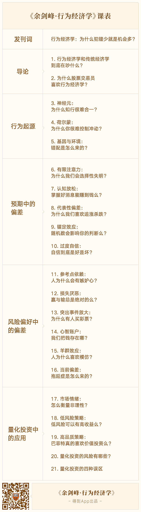

# **发刊词：为什么说犯错少就是机会多**

你好，我是余剑峰。欢迎从今天起加入清华五道口《行为经济学》课堂。

清华大学五道口金融学院号称 “金融界的黄埔军校”。30 多年来，从这里走出的校友，形成了一个对中国现代金融发展起到重要作用的群体。可以说，它在金融学术界的影响独一无二。

自从来到五道口，我一直在讲授行为经济学，目前是学院的讲席教授。我的学生有金融硕士、博士，也有 MBA、EMBA 的学生，还有企业的高管、CEO。这门学科帮助他们在市场交易中制定策略，或者提高公司的管理水平。

而今天，我把这门课带给你。即便你永远不会接触专业的金融交易，也对管理企业员工没有兴趣，我也很自信它会对你有价值。为什么？

## 1\. 比不了解市场更糟的是不了解自己

金融在人类发展史上扮演了重要的角色。它让国家可以集中力量办大事，让勇敢者不用独担风险，也让技术创新不断涌现。但不要忘了，它也会让财富转移。

我的很大一部分研究是关注二级市场，或者说股票市场。这里是一个信息、认知不对等的地方。你很可能会犯投资上的错误。

我想说的是，有时候一个人犯错误，并不完全是因为他不了解市场，而更加可能是因为他不了解自己。这怎么说呢？给你讲一个我和几个合作者正在做的研究，它还没有走完发表流程，但我决定抢先讲给得到的你。

我们知道，大部分公司在上市的第一天，收益率通常很高。而不论是机构还是散户，都可以在交易所申请购买即将上市的股票。至于你能不能买到，是抽签决定的。你可能知道，这叫 “打新股”，或者叫 IPO 抽奖。

这个过程很像买彩票。我的研究发现，当一个人很幸运地中签后，他的交易行为会发生变化。他会更喜欢彩票型股票。什么是彩票型股票呢？说白了就是那些你认为可能翻倍赚大钱的股票。比如说低价股票，随便一涨就翻倍了。

以后在课程中我会告诉你，彩票型股票的长期收益率很低，因为它的价值被高估了。所以一个人 “打新股” 中签，进而喜欢上彩票型股票以后，他的长期收益率反而降低了。

那这是为什么？理智的人应该清楚，彩票中奖和彩票型股票是两码事啊。

其实是因为它俩都和彩票这个概念有关。当你幸运地中彩票后，彩票这个概念在你大脑中就更容易被想起来，它拥有了更大的权重。你更喜欢这个概念了。任何和彩票有关的东西，都会启动你对这个概念的喜爱，所以你会不知不觉地喜欢上彩票型股票。

换句话说，哪怕是体育彩票中奖，也可能影响到你的投资策略。在这个案例里，之所以你会决策失误，并不完全是因为你不了解市场，可能更加是因为你不了解自己的行为规律。

那这是个例么？当然不是。我的课会告诉你，即便是一个受过高等教育的人，也没法做到完全理性。**一闪念的画面、幼儿时期的经历、交易的日期，甚至新月满月，或者你的名字、姓氏，都在不知不觉影响你的决定，甚至影响你的财富水平。**

我在五道口教课时，听众中很多人是量化基金经理。当我讲有效市场假说时，他们根本不会认真听。但当我讲到如何挖掘市场的非理性，进而提高自己的投资策略时，他们一下就打起精神了。

之所以我要在得到开这门课，就是想让包括你在内的更多人，看清楚里面的门道。

## 2\. 行为经济学是实用的经济学

但是，行为经济学的用处远不止这些。你可能会问：行为经济学和行为金融学有什么差异？其实刚才我说的，还是行为金融的范畴。如果你暗暗发誓，我这辈子都不碰股票，那这门课我是不是就用不上了呢？

当然不是。我给你讲个故事。

威尔 · 史密斯主演过一部电影，叫《焦点》，这是一个讲骗子行骗的电影。看过的朋友一定记得里面那个最经典的桥段。

威尔 · 史密斯和女友在橄榄球赛场遇到一个主动找上门来的赌神。这个人三下两下就赢了两口子所有的钱。就在女友拉着史密斯赶紧走的时候，史密斯说，我们再赌最后一局。球场上有大约 100 个人。史密斯让赌神随便写下一个球衣号码，然后让女友来猜，猜中就把钱赢回来。这个概率大约只有 1%。

女友觉得史密斯疯了。该选几号呢？她发现，55 号球员是史密斯的朋友，就选 55 吧。结果呢？赌神写下的数字，正是 55，史密斯他们赢了。这是怎么回事？

其实，从头到尾都是史密斯布的一个局。他的人马早就布置在了赌神下榻酒店的周围。赌神在电梯间、在大堂里、在马路上、在球场外，反反复复看到的都是写着 55 的日历、路牌、广告、球衣等等。正是这种潜意识植入，导致赌神最终选择了 55。而先输后赢，事先不和女友商量，都是设计好的。

故事讲完了。你可能会有疑问，余老师，这毕竟是虚构的电影，不能作数啊。我不是随意给你举例子的。你有没有发现，它和刚才说的彩票型股票其实是一回事。55 这个数字不断在脑子中出现，这个概念的权重就被放大了。在课程中你会学到，这叫做 “有限注意力偏差” 与“启动效应”。

**虽然你不一定在股票市场做投资，但作为社会中的一分子，你和各种经济活动是分不开的。**

现在很多人买盲盒，甚至还催生了二手市场。盲盒最大的特点就是设计了隐藏款，买到了就是中奖。一个人中奖一次，往往会买更多，这和 “打新股” 后，购买彩票型股票没什么两样。我身边有人花了两万块钱在这上面。上年纪的人都明白，这就是变相的赌石、赌核桃。

传统的经济学假设人是理性的，追求自我效用的最大化，具备完备的市场信息，而且偏好稳定。这种情况下，一个人只要具备理性和必要的知识，就可以作出正确的决定。

但就像电影中的赌神，或者盲盒玩家一样。**你并不掌握所有信息，你的偏好也会发生波动，你并没有那么理性。**

那是不是说，我们的经济行为就是随机的、不可预测、不可管理的呢？不是的。有一群经济学家引入了心理学、脑科学、基因遗传学等分析人类行为的理论，去弥补传统经济学的漏洞和错误。他们创建的学科，就叫行为经济学。

在股票市场中，在与人交往中，在商场购物中，在公司管理中，只要你参与社会经济活动，你的决策与行为，就会和理性有偏差。帮你意识到偏差，纠正偏差，就是行为经济学的任务。

所以在我看来，行为经济学是最实用的经济学。它不仅指导你的行动，还让你反思自己的决策，省察自己的轨迹。即便脱离开我的课，我也认为，行为经济学是你的人生必修课。

## 3\. 为什么由我来讲

好，那最后说一说为什么是我来讲这门课？

在来到清华大学五道口金融学院之前，我在美国明尼苏达大学卡尔森管理学院开设行为经济学。那个时候，这门学科就已经在美国火了起来。最近十年，诺贝尔经济学奖两次颁给了行为经济学家。大家都明白，这是个风向标。我还记得第一次开这门课，两天就被学生报满了，这非常罕见。

但是我心里一直隐隐有一个感觉，就是中国学生更需要行为经济学，为什么呢？因为中国的投资者更加不理性。这不是我在贬低同胞，而是事实。数据表明，中国投资市场上的追涨杀跌、处置效应，也就是越输越不愿意卖掉，还有换手率等等，都比美国高。中国的散户也更多。离开股票市场，中国的商业环境也催生出很多基于行为规律的创新策略，这都给我的研究提供了很好的材料。

这些因素促使我回来，加入了中国最优秀的金融院校，清华大学五道口金融学院。我目前任清华大学金融科技研究院副院长。在这之前，我在美国明尼苏达大学卡尔森管理学院任讲席教授。而且因为研究成果突出，我提前三年破格被评为终身教授。再往前，我是宾夕法尼亚大学沃顿商学院的金融学博士，一直从事行为金融的研究。从 2011 年起，我还担任美国联邦储备银行研究顾问。

可以说正是这些经历，让我今天有自信坐在这里，把最正宗的行为经济学带给你。

**虽然是行为经济学，但我的课也会涉及很多投资策略，很多实战案例。**如果你去听就会发现，背后的逻辑是有一些复杂的。所以为了能让你学习起来不吃力，我和得到的同事把这门课做成了视频课，而且给你准备了 PPT 和图表。我相信，只要你愿意训练自己的逻辑思维，就一定能跟得上，并且有大收获。

另外我的课会包含很多最新的研究案例，其中很多还处在学术界的争议阶段。也希望你能够从这种争议之中，享受学术的魅力。

那从现在开始，就请你一起和我走进清华五道口《行为经济学》的课堂，骄傲地成为这里的学生，一起探索人类经济活动的底层知识。

我是余剑峰，咱们课程里见。

# **第 1 讲 | 行为经济学和传统经济学在吵什么？**

[懒人专属群的群友](https://lazybook.fun/#/blog/group)，你好，欢迎来到清华五道口《行为经济学》的课堂，我是余剑峰。

今天是我们的第一讲。如果你是得到的资深用户，估计你对行为经济学应该有了解。如果你是一个比较爱看热闹的人，那估计对行为经济学还会非常熟悉。为什么这么说呢？主要是因为，2017 年理查德 · 泰勒拿了诺贝尔经济学奖。他就是研究行为经济学的，之后微博、微信关于行为经济学有各种报道、例子。很多人认为行为经济学可能就是经济学的未来。

随后，理性经济学就反击了，说你们的很多例子都是雕虫小技，一来二去导致很多争论。说实话，争吵是好事，这样让学科能发展壮大起来。

但其实很多人对争吵的问题是一知半解，不知道确切在争吵什么。所以这门课我们要把这些问题都完全展现清楚。所谓外行看热闹，内行看门道，既然你来到我的课堂，说明你想做个内行。我的任务就是把你变成一个真的内行。

我可以告诉你，你选这个课是非常对的，因为我们有很多实用的价值，比如说在投资理财、营销等方面都有很多应用。最开始我会用两讲作为导论，引进行为经济学的基本概念和元素。这一讲我会引入三个问题：

1.  行为经济学的来源？
    
2.  行为经济学和理性经济学到底在争论什么？
    
3.  为什么要由我来讲这门行为经济学？
    

## 1\. 行为经济学是怎么来的？

好，我们先讲第一个问题，就是行为经济学的由来。你可能听说过丹尼尔 · 卡尼曼，他 2002 年拿了诺贝尔经济学奖，而且他是一个没有受过经济学训练的心理学家；2013 年，罗伯特 · 希勒又拿了诺贝尔经济学奖，他是做行为金融学的；然后最近的 2017 年，理查德 · 泰勒也拿了诺贝尔经济学奖，他做的是纯粹的行为经济学。

可能因为最近的这些诺贝尔奖获得者都是做行为经济学的，你会觉得行为经济学是一个比较新的课题，但这是一个误区，**其实行为经济学并不是一个新的学科，我们首先要破解这个误区。**

现代经济学之父叫亚当 · 斯密，他在写他的《国富论》的 17 年前就写过一本书，叫《道德情操论》，里面就引进了很多行为的概念。当然，还有凯恩斯，他也是宏观经济学之父了，他有很多关于行为经济学的概念，比如说他提出过动物精神、选美，说股票就像选美一样。**所以早期的这些经济学的大佬，其实都是非常承认人是有感情的，不是完全理性的。**

但是后来在 70 年代初，芝加哥大学的罗伯特 · 卢卡斯和一些其他的人，比如说爱德华 · 普雷斯科特和托马斯 · 萨金特，这些人都拿诺贝尔奖了。他们在 70 年代引进了理性人的概念，叫做 rational expectation。而且这些模型是非常优美的。我当年转学金融其实就是被这些模型吸引。我本来是学概率统计的博士，因为学了这门课发现太优美了，所以说这些模型立马就受到很多的关注。

在这些模型里面，有几个最重要的假设：**第一个就是假设人都是理性的，不光是假设每个人都是理性的，还假设我知道你是理性的，还知道你也知道我是理性的，所以说它是非常多层的理性的概念。**

**第二个假设就是这些人都能够做优化，能够最大化他们的效用函数。**这些模型当时提出来之后，确实是能解决当时的一些问题。所以基本上到 70 年代、90 年代，垄断了整个经济学，这样使得行为经济学当时比较难生存。

比如说我自己的一个亲身例子。2006 年我把我和一个合作人的论文提交到一个杂志上，结果杂志的回稿是：这个论文我闻一下就不对。这是非常侮辱学术界人的事情。

但是后来发生了一些事情，比如说 2008 年的金融危机，更早期的还有 2000 年的互联网泡沫。像金融危机、互联网泡沫这些东西基本上都是违反有效市场假说的一些极端例子，使大家意识到市场不是你想象中的那么有效，人也不是你想象中的那么理性。所以说这也是后面导致大家重新重视理查德 · 泰勒、罗伯特 · 希勒那些人早期的工作，这也是他们拿诺贝尔奖的一个重要原因。

其实我是这么理解理性经济学和非理性经济学，也就是行为经济学的关系。**我觉得理性经济学就像咱们中学学的物理模型，那里面没有空气阻力，一切都很理想。**所以说我们能看见早期的物理模型，确实能解释现实中的很多现象，比如说两个铁球从上面扔下来，它们到达地面的时间其实是差不多的，因为空气阻力可以忽略不计。但是，在很多其他情况下，空气阻力是极其重要的，像飞机如果没有空气阻力从后面推它，都飞不起来。行为经济学也是类似的，就像飞机起飞一样。

所以你看，其实行为经济学一直都在，如果你看一下曼昆经典的《经济学原理》这本书，会发现几十章里面其实只有一小节是讲行为经济学。那个时候大家没有重视。最近由于很多人拿了诺贝尔经济学奖，和金融危机这些事件，导致大家对行为经济学更加重视。

但是行为经济学并不是要颠覆传统的经济学原理，你可以把它看成一个扩展补充，更结合实际，而且我们这个课会引进很多行为经济学的元素，这些元素可以给你带来一个全新的视角，去理解我们生活中发生的事情或者是金融市场中发生的事情。

## 2\. 行为经济学和理性经济学的区别

好，光梳理了历史还是不够的，我们还需理解一下行为经济学和传统经济学到底在争论什么，很多人可能对 “非理性” 这个词也理解得不够深刻。这里面我会通过两个博弈论中的例子，去让你更加深刻地理解理性到底意味着什么，非理性到底意味着什么。

我们先讲第一个例子，叫做最后通牒游戏，一个非常有名的游戏。在这个游戏中，两个人 A 和 B，给他们 100 块钱。A 是提出分钱方案的人，B 决定同不同意 A 提出的分钱方案。比如 A 说 A 拿 90 块，B 拿 10 块，B 如果不同意，大家一分钱都没有。B 如果同意，B 就拿 10 块，A 就拿 90 块，所以它叫做最后通牒游戏。那你觉得如果大家都是理性的，应该怎么分这个钱？

你想一想，如果 B 是理性的，而且 A 知道 B 是理性的，那 A 就给 B 一块钱，A 自己拿 99 块钱就行了。如果他拒绝这个分钱方案，他一分钱都拿不到，所以他肯定会接受这个分钱方案。

现实中大家是怎么分钱的呢？如果让你去提出分钱方案，你会怎么分？我觉得你可能就会 50:50 这么分，很多人也都会这么分。后来有个做研究的人把最后通牒游戏用在商学院的教授身上，很多教授参加了这个实验。谁分的钱最多或者谁分的钱最少？结果是经济学、金融学、会计学这些教授们分的钱最少，那些市场营销的教授反而表现很好。为什么会这样呢？因为经济学、会计学、金融学的这些教授，他们假设人都是理性的，他们提出的方案可能就是他们拿 99 块，别人拿 1 块钱，那别人肯定把他们拒绝了，因为别人觉得不公平，公平是非常重要的一个概念，回头我们会细讲。

同一个实验也在学生中去做。结果发现考试拿 A 的学生就像经济学、会计学、金融学的教授一样，表现很差；那些考试拿 C 的学生反而直接上来说五五分吧，所以他们反而分的钱最多。这个结果告诉了我们，不能像理性模型里面一样假设别人是理性的，而且假设别人知道你知道别人是理性的。

当然上面讲的这个博弈是两个人之间的博弈，你不能假设对方是理性的。其实在现实生活中可能是很多人之间的博弈，像股票市场就是很多参与者互相博弈。

下面讲一个例子，就是理查德 · 泰勒很早的时候在《金融时报》上，让大家做一个猜数游戏，《金融时报》的读者选一个数字，0 到 100 的整数，选这个数字的目的是要赢这个游戏。谁能赢这个游戏呢？就是谁的数字离所有人的平均数的 2/3 最近。

这有点抽象，我讲一下理性均衡是怎么回事。你想要离所有人平均数的 2/3 最近，如果你假设大家都是乱来的，0 到 100 随便选，均值就是 50，那你应该选多少？你应该选 33。但是如果你假设别人会觉得其他的人都是乱选的，所以别人都会选 33，那你就应该选 22，所以选 22 是第二层理性。但是，你可能又会继续往前想，万一别人知道，别人会选 22，你应该选多少？所以说你一直往下走，最后真的均衡只有 0 或者是 1，就是说你一直得往小的数字走。所以，0 或者 1 才是真的均衡，这是理性均衡。

现实中《金融时报》的那些读者，选的数字是多少呢？有一个奇怪的分布。很多人选 99 和 100，这就是瞎搞了。选 99、100 是不可能赢这个游戏的，因为哪怕大家都选 100，平均数的 2/3 也是 66，但是就是有很多调皮捣蛋的人。更多的人选 33，确实这些人是第一层理性的人，他们假设大家都是乱选的，均值是 50，所以他们选了 33。但是更多的人选 22，也就是第二层理性的人更多，可能是他们没有很多时间去思考，觉得大家会选 33，所以他们选 22。然后还有一拨人选 0 和 1，选 0 和 1 的人就是那些理性经济学学得特别好的人，可能是太好了。

那真的赢了这个游戏的人是选了多少呢？是 13，因为均值是 18.91。这个游戏给的奖金还挺多的，是两张纽约到伦敦商务舱的往返机票，所以大家还是很认真地去思考这个问题，最后选 13 的赢了。

所以这里面一个重要的思想就是，0 和 1 虽然是理性的，但是你不能假设别人是理性的。市场上也是这样的。你不能假设别人是理性的，你得去猜别人不理性的程度，这是非常难的。像这个例子里面赢的人是选 13，但选 13 肯定是有运气的成分，因为这个游戏非常难赢，你要猜别人非理性的程度，这是非常难猜到的。但是你至少要意识到这个市场上存在一些调皮捣蛋的，选 99、100 的人，然后你去猜大家非理性的程度大约是什么样。

其实我经常在班上跟很多学生玩这个游戏。经过多次玩这个游戏之后，我发现时间越长大家越理性，时间越短的话就越不理性，越不理性的话，你猜的数字大一点，就能赢。

你可能会说刚刚这两个例子都是实验室里面的例子，离现实生活太远，下面我给你讲一个生活中的例子。人也会有一些偏差。假设你现在去沃尔玛买鞋，这双鞋是 200 块钱，但是你在买之前突然发现，隔壁家乐福只要 100 块钱，你这个时候会不会不买这双 200 块钱的鞋，而去家乐福买 100 块钱的鞋？比如说你去家乐福要 10 分钟的时间。我觉得大多数人都会选择去家乐福买这双 100 块钱的鞋，省下 100 块钱。

下面再看第二个例子，同样你在沃尔玛买一台电脑，这台电脑是 20500 块钱，就在你要付钱的时候，你突然知道隔壁的家乐福只要 2 万块钱，少了 500 块钱，这个时候你会不会花 10 多分钟的时间去隔壁家乐福买这台电脑？很多人这个时候会选择算了，就 500 块钱。为什么会这样呢？这个时候 500 块钱相对于 2 万显得特别少，但是第一个例子虽然只省下 100 块钱，但是显得特别多，省了 50%。

现实生活中很多东西都是相对的，但是在传统的理性经济学里面研究的都是绝对的，没有研究相对的东西，相对的东西对你的影响比绝对的东西会更大，回头我们会细讲。

所以现实生活中行为偏差会有很大的影响。在接下来的二十讲中，我会把行为偏差引进到各种应用场景中去，比如说销售、商品定价、股票定价中。

好，通过上面几个例子，你估计已经完全理解了理性经济学与非理性经济学之间的争论，我下面给你总结出它们争论的三个主要问题：

1.  人是不是有系统的行为偏差？
    
2.  哪怕他们有系统的行为偏差，这些偏差会不会对商品定价、股票价格有很大的影响？
    
3.  这些行为偏差会不会对各种政策的有效性产生影响？
    

你可以把它们都贯穿到这三个问题里面去思考，这是一个思考问题的框架。

## 3\. 我的课程会怎么讲？

现在你基本上了解了行为经济学的框架，那最后我问你一个问题，市面上有一些类似的课程，为什么你要来上我的《行为经济学》？

大概快十年前，当时我在美国明尼苏达大学卡尔森管理学院，要开一门新的课叫行为经济学。因为那门课在卡尔森从来没有上过，主要原因是因为明尼苏达学术圈有非常理性的经济学气氛，他们非常不相信行为经济学这个东西，但是因为我研究的是行为经济学，所以说我当时想开这门课。

这门课基本上是一开就特别受欢迎，立马就报满，说明学生们是喜欢这门课的，只不过老师的研究一般不是行为经济学就没开。因为这是一门新课，当时我还是有点压力的，所以我向其他各个学校开过这门课的老师要了一些材料。我发现有个共同的特征，就是这些材料都很像。**最后我才发现，这些材料基本上都是直接或者间接地从安德鲁 · 施莱弗那边拿过来的。**关于安德鲁 · 施莱弗，回头我会讲他很多的研究，他是行为经济学的一个大牛。

基本上那些课程的框架都是下面这种标准的框架，先讲一些理性经济学、有效市场假说的历史背景；然后再讲一些泡沫，这当然是违反有效市场假说的一些极端的假设；然后再引进一些行为偏差，发现大家的交易有很多偏差，在股票市场中也有些应用；再讲一下理性经济学的那些人，怎么去克服这些偏差，大概就是这样的。当然也会讲一些在公司金融中的应用。

这个标准的框架是符合我们做研究的历史进程的，就是历史上发现什么他们就依照顺序讲。**但是这个框架其实也有一些弱点。我觉得一个最重要的弱点就是他们直接假设人就是非理性的，然后就开始用应用。**很多理性经济学家不喜欢非理性这个假设，为什么不喜欢呢？因为他们觉得人很聪明。我们这么聪明的动物肯定能够学习，不可能一直不停地犯错，一直有这种偏差。所以说我们应该首先解决这个问题。

我的课主要会从两个维度上去改善一下原来标准的框架：第一个维度，我想告诉你，人不是你想象中的那么笨，所以我会讲人的行为偏差的起源。不是因为他们笨，他们非常聪明。我会从微观的角度，大脑神经元的反应，和宏观的角度，进化论的反应，去讲解人的行为偏差的起源。这是第一个维度。

第二个维度是从应用层面。**传统的行为经济学的大多数应用其实都是在股票市场上，我会讲很多其他的应用，比如市场营销、商品定价、谈判等各种方向的应用。**我还会讲到最近很多的学术论文。因为很多学术论文其实讲得很深，这些发现都是一个一个的点。我这门课要把这些点串起来。

串这些点的思想基本上就是我们下面要讲的一个重要的概念，人的思维的错配，跟现代社会的错配。

可以说错配是我们这门课的一个特色，错配是指我们人的心理、想法、偏好都是几百万年前进化过来的，是符合过去环境的，但是现在的环境跟过去不一样，变化得很快，所以就会产生错配。

举一个例子。我问一下你，你觉得减肥难不难？我觉得大多数人都会觉得减肥很难，包括我自己，虽然我现在很瘦。减肥为什么会这么难，你想过没有？减肥难最重要的一个原因就是因为我们特别喜欢吃东西。你喜欢吃什么东西？问不同人可能有不同的回答。有人喜欢吃甜的蛋糕，有人喜欢吃油炸的东西。但是，所有你喜欢吃的东西基本上有个共同的特征，就是它们的热量高。

为什么你会喜欢高热量食物，你有没有想过这个问题？我们人这么聪明，统治了地球。为什么我们会有这么不健康的偏好？它导致我们极度肥胖，又有心血管病，这不符合我们人这么聪明的性格。所以说只要你看到这种东西你就应该想一想，一定是有历史原因的。

我们回到 200 万年前。假设我们在草原上，那个时候有些人喜欢的可能是我们现在认为很健康的食物，在水里面洗一洗，洗干净就吃；那还有一些人喜欢我们说的不健康的、高热量的东西。你想在那个时候，只有喜欢吃高热量东西的人，才能够存活下来，因为那个时候食物稀缺。那些喜欢吃健康食品的人，不是我们的祖先，他们已经被淘汰掉了。剩下的这些人自然就是喜欢吃高热量的人。

但是现在，社会发展太快，食物一下子充足了，你看到这些高热量的食物，你想吃你就可以买，这样就导致我们吃得太多。这就是一个非常大的错配。过去帮助我们生存和繁衍后代的机制，到了现代社会导致我们极度地肥胖。

我们人的很多心理偏差都是这种类似的错配导致的。**尤其是股票市场、商品定价里面的很多心理偏差，都是由于错配的原因。**在以前帮助我们生存和繁衍后代，现在不行了，环境完全不一样，以前又没有股票市场。所以说它才会出现各种问题。

刚刚讲的是生活中的错配，其实股票市场中很多行为也是错配。我估计你肯定听过损失厌恶，损失厌恶基本上就是你输了钱会特别地不爽。其实在古代，损失厌恶也是帮助我们生存和繁衍后代的一个机制。具体是什么原因，回头我会细讲，这里我就留给你一个课后作业。你可以去网上查一查，为什么损失厌恶也是一个错配？

之所以你要跟我学行为经济学，主要是因为我这门课给你建立了一个新的思维体系，就是用错配的视角去看这个世界上发生的很多事情。无论是商品定价，还是生活中、股票市场中，你都可以用这个角度去看问题，给你一个看问题的金钥匙。

\\1. 行为经济学并不是一个新鲜的事物，它也不是要颠覆传统的经济学，而是在传统经济学框架上的一个完善，引进更多合理的假设。 2。行为经济学跟传统经济学主要有以下三点不同：行为经济学觉得人会有系统性偏差；这些系统性偏差会在股票市场上、商品价格上产生很大的影响；这些行为偏差在政策层面上也会有很大的应用。 3. 我们人的各种行为偏差，其实都是在远古时候帮助我们生存和繁衍后代的，只不过跟现代环境产生了错配。

余剑峰

下节课还是导论课，这节课我们从学科的视角讨论一些有意思的问题。下节课我们从应用层面讨论一些问题。我会讲学习行为经济学会给你的投资带来什么切实的好处。

我给你留个小作业，在你的印象中，还有哪些看起来非理性的行为，你觉得是远古和现代错配导致的结果？可以举几个例子。

好，我是余剑峰，咱们下节课再见。

# **第 2 讲 | 为什么股票交易员喜欢行为经济学？**

[懒人专属群的群友](https://lazybook.fun/#/blog/group)，你好，欢迎来到清华五道口《行为经济学》的课堂，我是余剑峰。

上一节，我们从学科的角度介绍了行为经济学和传统经济学的区别，以及行为经济学的一些基本概念。那你可能还会有个疑问，为什么我要学行为经济学？这一节，我们主要从实用的角度去介绍行为经济学的用途。

如果你学过很多传统的经济学或者金融学，你可能会觉得投资是聪明人的游戏。在传统经济学里面有个重要的假定，就是如果市场有任何定价错误，那些聪明的人就能够把这些定价错误给纠正过来，利用这些定价错误，然后从中挣钱。

## 1\. 聪明人不一定能赚到钱

那聪明的人一定能挣钱吗？不一定。为了说明这个问题，我下面讲一个非常有名的案例，历史上一笔在泡沫中非常有名的投资。我先讲一下历史背景。

英国南海公司在 1711 年创立，是一家专营英国与南美洲等地贸易的特许公司。1719 年，英国政府把一部分年金投在南海公司里面，然后这些年金转成了南海公司的股票。这个公司其实基本面是非常清晰的，能算出来。根据当时的基本面，这个公司的价值大概应该是每股 100 英镑左右。但是在 1720 年初，南海公司炒作它在西班牙南美洲的殖民地贩卖奴隶的垄断权，以此来抬高股价。

但其实当时西班牙政府是不允许贩卖奴隶的，而且西班牙正好跟英国在打仗，所以客观来讲这个权益其实没有太多价值，不能够产生很高的现金流。但是，当时南海公司做了很多广告，通过各种炒作，比如说当时很多社会名流都持有了南海公司的股票，很多媒体都在报道这个公司，使它一下股价狂涨。

当时牛顿同学也持有了这个公司的股票。牛顿当然是当时非常有名的科学家了，基本上是最聪明的人。他进场的时候股价大约是 100 英镑左右，这个价格基本上是接近基本面的，涨到三四百英镑的时候，牛顿一看这个基本面明显没那么高，股价太疯狂了，所以牛顿全部清仓了，挣了挺多钱。以现在的面值来讲，应该是 100 多万英镑左右。牛顿清仓之后，股价并没有跌，不像他想象中的那样。虽然股价已经很高了，但反而直线继续往上涨，涨到快 1000 英镑。这个时候牛顿就坐不住了，因为他看见身边的朋友都挣了很多钱。身边朋友当然都比他笨。

后面我们会讲到，**当你看到身边比你笨的朋友挣了很多钱的时候，你是很难淡定的。**如果是你的敌人挣了很多钱，说不定你反而可以淡定。这个时候，牛顿基本上是用尽他一生的积蓄重新买入南海公司的股票。结果他进入的时候正好是顶峰，然后股价就狂跌，这也导致牛顿同学基本上亏得倾家荡产，按现在的钱来算大约应该是 500 多万英镑。后来牛顿说了一句非常有名的话，就是 “我可以计算星球运动的轨迹，但是不能够预测人的疯狂程度”。人的疯狂程度就是非理性的程度，是非常非常难预测的。

## 2\. 专业选手不一定能赚到钱

好，听完牛顿的例子，你可能会觉得牛顿虽然很聪明，但是他并没有学过经济学，他是一个非专业选手。是不是学过经济学的专业选手就可以避免这些错误呢？其实这也是很难的，哪怕你受过很多正规的训练。下面我再从另外一个历史上有名的泡沫中看看学过经济学的专业选手是怎么表现的。

在 80 年代末、90 年代初，日本的房地产经历了一个大的泡沫。90 年代初的时候，有个非常有名的例子，就是日本东京皇宫下面那点地，基本上也就是两平方公里左右，你沿着它跑一圈也就半个小时就跑完了。这一点地当时值多少钱呢？可以买下整个加拿大的地。这对加拿大人实在是一个很大的侮辱，不光是买下整个加拿大，还可以买下整个美国加州的地，所以这也是非常大的泡沫。

当时日本有个著名的经济学家，为了尊重他，我就不提他的名字了。他当时在媒体一直说，80 年代末的时候泡沫已经很大了，但大家都不听他的。他越说，房价越涨，地价也越涨。最后在 90 年代初他自己也憋不住了，然后在东京买了一套房。当这个著名的经济学家买了一套房之后，大家都知道，东京的房价就开始大跌了。据说这个顶级的经济学家后来还在日本的央行里面占有很重要的位置。所以说，专业的、非常顶级的经济学家也在泡沫顶峰进去了，跟牛顿一样。

那为啥这些顶级的经济学家和最聪明的牛顿都是在泡沫顶端进去呢？这其实是有一定规律可循的，而且这个规律也可以用来预测将来泡沫会破裂的概率。

你想想在泡沫中，一般人都是非常疯狂、非常乐观的，但是也存在一些稍微理智的人。这时候，理智的人相对是悲观的。那乐观的人先进去了，当最悲观理智的人都进入了市场，基本上就没有其他人再能够进入市场了，这个时候基本上就是泡沫的顶峰了。所以说当最理智的牛顿、著名的经济学家都进去之后，泡沫破裂的概率还是比较大的。将来我们会讲到用一些类似的信息，预测一下股票的收益率，股票大跌的概率，这些东西都是有用的信息。

## 3\. 一群专业交易员也不一定能赚到钱

好，听完前面两个例子，你可能觉得还是不太过瘾。你会觉得经济学家虽然受过经济学的训练，但是他们没有受过交易上的训练；牛顿虽然很聪明，也没有受过交易上的训练。是不是一群特别聪明的交易员放在一起，他们就能够在泡沫中，或者说在资产定价错误中去挣钱呢？其实这也是非常难的，这也充分地说明了套利的局限性。就算你看见定价错误，也是很难纠正的，哪怕你是很聪明的人。

你要不信，我就给你讲一下孪生股票的案例，这个案例在历史上是比较有名的，无论是在学界还是业界。当时有两个公司，其实是同一个公司，叫做孪生股票，一个叫皇家荷兰，一个叫壳牌。由于历史并购原因，导致其实是同一个公司的两个品牌在不同的地方交易。皇家荷兰主要是在荷兰和美国交易，壳牌主要是在英国交易。皇家荷兰基本上持有这个公司现金流的 60%，壳牌持有这个公司现金流的 40%。根据基本的溢价定律，这两个公司市值比应该就是 6:4，也就是 3:2。

但是，如果我们观察股价的话，发现基本上不会是这样的，它们经常会有偏离。但是在 1997 年末和 1998 年初，皇家荷兰和壳牌，它们的市价比并不是 1.5:1，而是偏离了大约 10% 左右。当时在美国交易的皇家荷兰被高估了 10%，也就是说它们的市值比是 1.65 左右。为什么皇家荷兰相对会被高估呢？当时也是有历史背景的，因为当时在美国有互联网泡沫，大家对美国的股票都比较兴奋，所以在美国交易的皇家荷兰相对来讲被高估了一点。

被高估 10% 左右的话，如果你是一个专业的投资人，这个时候你应该作什么样的策略从中去挣钱呢？其实一个非常直观的做法就是买入相对来讲被低估的壳牌，卖空相对被高估的皇家荷兰。不管石油行业发生什么事情，你买入一个、卖空一个，这两个东西完全对冲，所以基本面风险全都没有了。那你这么做会有风险吗？你可能觉得这没有太多风险，因为 1.65 可能最后会收敛到 1.5，你就能挣其中的 10%。但其实这也是有风险的，下面我就讲一个当时特别有名的对冲基金，就在这上面做了一笔交易。

当时有一个对冲基金叫做 LTCM，就是长期资本管理公司。长期资本管理公司基本上是历史上最有名的对冲基金了，因为它里面的团队全是明星，有诺贝尔经济学奖的获得者，比如说罗伯特 · 默顿，还有舒尔斯，布莱克 - 舒尔斯公式的那个舒尔斯，这都是大家听到过的明星。这是学界的。业界的有约翰 · 麦利威瑟，当时是在所罗门兄弟的印钱机，基本上就是最顶级的交易员。团队里面还有谁呢？还有一些以前在美联储的前高官，所以说它什么都有，属于最顶级的对冲基金。这个基金是 1994 年左右成立的，1994—1997 年基本上不亏钱，一直在挣钱，非常稳定，没什么回撤。

这个时候，在 1997 年末、1998 年初，它传统的挣钱机会基本上有点枯竭。这个时候它就看到皇家荷兰和壳牌价格的偏离，就进入了交易，大概 1998 年初的时候开始进场。进场就是刚刚说的那种交易，买入相对被低估的壳牌，卖空相对被高估的皇家荷兰。前前后后大概放了多少钱进去呢？放了 21 亿美金左右去做这个交易。

最后发生了什么事情呢？大概在 1998 年中期的时候，它被迫清仓了。它在清仓的时候，皇家荷兰不是收敛到壳牌基本面的价值，而是继续被高估了 20%。所以说你看它卖空相对被高估的皇家荷兰，开始只是相对被高估 10%，现在相对被高估 20%，这个时候它在这一笔交易上就亏了大概 1.4 亿美金。

这个时候你可能就有疑问了。它开始在皇家荷兰被高估 10% 的时候进场，现在皇家荷兰被高估 20%，为什么要清仓呢？它应该加仓才对，可以挣更多的钱。但其实这里面有几个投资人普遍面对的问题。一般来讲，投资人首先是管别人的钱，其次是用很高的杠杆。你想如果你用杠杆，这个股价再偏离 10%，你可能就亏了更多，这样的话你可能就会被迫清仓；第二个原因，你管的是别人的钱，你输钱了别人就觉得你能力不行，觉得你能力不行就会把钱拿走。这个时候别人撤资了，你也会被迫清仓。当时 LTCM 确实就面临这种情况。它的杠杆是 33% 左右，而且在其他的地方，比如俄国的国债上亏了很多钱，导致它被迫清仓。当它被迫清仓之后，皇家荷兰就开始跌了，回归到基本面了。

刚刚那个例子充分显示了套利是有局限性的。套利到底是什么东西呢？套利在我们这个课上基本就是指，那些专业的人利用定价错误去从中获利。其实就在长期资本管理公司被迫清仓之前，学术界发表了一篇论文叫做《套利的局限性》。发表论文的两个作者一个叫安德烈 · 施莱弗，一个叫做罗伯特 · 维什尼。安德烈 · 施莱弗是哈佛的经济学教授。长期资本管理公司有一个非常有名的合伙人，叫做罗伯特 · 默顿，他同时是哈佛经济系的教授，也是诺贝尔经济学奖的得主。

其实在 1997 年这个论文发表之前，安德烈 · 施莱弗已经在哈佛讲过这篇论文，因为在论文发表之前一般先要在系里面讲一讲。讲的时候罗伯特 • 默顿其实在下面听这篇论文，当时安德烈 · 施莱弗在论文里面讲了一个例子，就是孪生股票，而且就是以皇家荷兰和壳牌为例子，讲了套利的局限性。

当你看见一个股票，比如说皇家荷兰相对来讲被高估，你去卖空它，壳牌相对被低估，你去买进它。你去做这个交易，有可能还是会亏钱，因为相对被高估的皇家荷兰有可能继续被高估，那你就亏钱了。这是他在论文里讲的一个理论的可能性。他写了一个模型，当时默顿在下面一听，觉得这个东西不合理，如果我砸很多钱进去，说不定它就会收敛了。这也真的是长期资本管理公司后来做的事。

所以说最后你看见论文 1997 年发表之后，果然到 1998 年，长期资本管理公司在皇家荷兰和壳牌这笔交易上真的就爆仓了，然后亏了 1.4 亿美金，非常配合安德烈 · 施莱弗的这个理论。所以说我觉得安德烈 · 施莱弗应该经常请罗伯特 · 默顿吃饭，你想他为了配合，砸了 1.4 亿美金。

## 4\. 非理性与运气无关

前面讲的是一个顶级的团队在一两个股票上做交易，亏了很多钱。你可能还会觉得这是运气不好，因为它就买了一两个股票。一两个股票总是会有运气不好的时候。下面再讲一个例子，也是顶级的团队，在风险非常分散的情况下，它可能还是会爆仓，也是因为它低估了或者是错估了人的疯狂的程度。

在 1999 年春季，当时有个比较有名的问卷调查，问的是那些专业的基金经理，觉得互联网公司现在被高估的程度是什么样？得到的答案是，绝大多数对冲基金经理都觉得互联网公司被高估了至少 100%。如果大家都觉得互联网公司被高估 100%，你觉得你应该怎么做？可能你的第一反应是我要清仓，我可能要卖空这些互联网公司、高科技公司的股票。但是其实你发现对冲基金并没有这么做，基本上在 1999 年的 9 月份，对冲基金大大加仓，买了这些高科技公司。它们不但没有清仓，反而加了特别多，有些公司 60% 左右的钱买的是互联网股票。

那为什么会这样呢？其实一个重要的原因就是，**我不在乎这个股价现在到底有没有被高估，我在乎的是它将来会不会继续涨。**只要我觉得将来它还会继续涨，我就可以买它，只要它将来会继续跌，我就卖它。有没有高估和低估，对对冲基金来讲是没有那么在意的。所以说很多基金就做了这件事情。

最后发生了什么事呢？其中两个有名的对冲基金：一个是索罗斯的量子基金，这个你肯定听说过；另外一个是朱利安 · 罗伯逊的老虎基金，这个你可能不是那么熟悉，在当时也是最顶级的对冲基金之一，管了好几十亿美金。

朱利安 · 罗伯逊是一个相对来讲可能偏理性的人，他在 1997、1998 年就一直在媒体上说，互联网公司被高估了，他不光这么说，他在 1999 年初就已经开始清仓高科技股票，不再持仓。

但是，索罗斯的公司做的完全是相反的，在 1999 年的 9 月份大大增持高科技股票。1999 年的 6 月份，它只持有 15% 左右，到 1999 年的 9 月份就持有将近 60% 的高科技公司。最后发生了什么事呢？股票继续涨，一直涨到 2000 年的 3 月份，涨了非常多。这个时候索罗斯因为持仓特别多，所以挣了很多钱，导致在 1999 年末、2000 年初，很多资金流进了索罗斯的基金。

但同时朱利安 · 罗伯逊的基金就很惨，它在 1999 年初就开始清仓了，基本上不持有高科技公司了。虽然它并没有亏很多钱，因为它买了其他股票，其他股票其实也没有跌，但是它的表现就不如其他持有很多高科技公司的基金，导致当时它的很多客户撤资了。所以在 1999 年、2000 年初，每个季度撤资 5%、10%、15%，很多钱都跑掉了，这样最后导致了老虎基金的清仓。

这个时候你很难说朱利安 · 罗伯逊做错了什么。因为其实大家都知道这个股票被高估了 100%，后来可能被高估得更多，所以他提前清仓也没什么错。但是他有点低估了人的疯狂程度，因为虽然它很高，但它可能会更高。所以他过早地清仓了，导致最后他自己的公司被清仓了。

但索罗斯大大地增持了高科技公司股票，是不是他就挣钱了呢？虽然他在 2000 年初风光无限，因为他持有特别多的高科技股票，很多钱也流入了他的公司，感觉他挣钱了。但是 2000 年 3 月份，互联网泡沫就开始破裂了。索罗斯没有来得及跑，最后在 2000 年 3 月份顶峰的时候，他还持有至少 50% 的高科技公司。所以说索罗斯虽然前面风光无限，后面也是亏得很惨。但是因为索罗斯名气很大，后面虽然有很多人撤资，但是他的基金还是保存下来了。

## 5\. 行为经济学如何应用

从这些例子中你可能发现，泡沫实在太危险了，最聪明的牛顿、最聪明的经济学家、顶级的索罗斯都会在泡沫中亏钱。如果你是一个基金经理，看到这种大泡沫，你应该怎么应对呢？我觉得有一个应对方法。

**如果你是一个非常有名的基金经理，你非常有名肯定是因为过去运气比较好，千万不要高估自己的能力，你要珍惜自己的运气。**所以这个时候你就不要做太偏离市场的事情，比如说你不要加仓特别多，也不要完全清仓，你就跟市场差不多就完了。这个时候不管涨很多还是跌很多，都不会看起来太难看，但是由于你名声比较好，所以你的基金能够存活下来。如果你这个时候像索罗斯或者朱利安 · 罗伯逊这样，万一低估了人的疯狂程度，或者是没算准，会导致你亏损很多，这样很难看，因为你过去已经很牛了。

但如果你是个刚刚上手的基金经理，也没什么名气。这个时候可能你要做一个比较勇敢的事情，比如说重仓泡沫股、高科技股，或者是一点都不持有。万一你踩点踩对了，回头你就变成了股神，其实很多时候股神都是运气。

听到这里，估计你已经崩溃了，感觉人的非理性是无法预测的，那学这个行为经济学还有啥用？其实这是一个错觉，它有两个用途：

第一，我觉得你理解了人的非理性是非常难预测的，至少可以让你在泡沫中少犯一些错误；

第二，前面讲的都是预测一个股票或者是一个市场的趋势，这是特别难的，但是行为经济学讲的很多东西并不是预测一个股票的走向。相对来讲，虽然我们不知道 A 和 B 会不会涨或者跌，但是我们基本上可以预测，相对股票 B 来讲，股票 A 可能会涨得多一点或者跌得少一点，这个时候如果你买入 A，同时卖空 B，你就可以有一个对冲的策略。这种策略还是会有很多的，从行为经济学的角度我们可以开发很多这种策略，回头我们会一一细讲。

下面我就先给大家讲一个非常有意思、简单的例子。这是一个最新的研究了，是两个华人做的，发表在金融学最顶级的杂志上面。

它讲的是罗素 1000 跟罗素 2000 两个指数的转换。罗素 1000 是美国 1000 个市值最大的股票，相当于我们的沪深 300。罗素 2000 是美国排名第 1001 到排名 3000 的股票，相当于中国的中证 500。但是这个排序经常会变，有的公司过去排名第 1000，现在可能排名第 1001，因为市值经常会变。所以这个指数也是每年 6 月份依据 5 月底的市值来重新排序，重新把这个指数组合一下。

这就会产生一些有意思的现象。因为有很多指数基金会跟踪这些指数，比如说有很多指数基金跟踪大盘股，就是罗素 1000。也有很多指数基金跟踪小盘股，罗素 2000。但你想，在罗素 1000 里面有 1000 只股票。排名第一的，我举个例子，也许是苹果，苹果的市值可能就占 3.5% 左右，Google 可能占 2.5% 左右。下面的那些股票很快就没什么权重了，排名 700 以后的股票的权重是极其小的，基本上可以忽略不计。

那你想如果你是指数基金，有 100 万，你要去跟踪罗素 1000。你怎么做？基本上就是你 3.5 万投苹果，2.5 万投 Google，下面那些小公司就投得少一点，最后那几百个公司可能基本上就不投钱了。因为你要投这些公司，你本来也就投一点点，但是还有交易成本，所以导致最后基本上很多指数基金都不怎么投那些公司。所以虽然在罗素 1000 里面，但是如果你是排名第 990～1000 的公司，基本上很少有钱去跟踪你，这是一个现象。但是你再考虑罗素 2000 类似的现象。排名第 1001 的，有很多钱去跟踪它，但是排名第 3000 的很少有钱去跟踪它。

下面考虑一下一个变换。如果在某一年 5 月 31 号，排名第 999 的和排名第 1000 的股票，由于它们的市值跌了一点点，变成了排名第一千零几，这样的话它们就变成了罗素 2000 前面的股票。开始它们是罗素 1000 的尾巴，现在变成罗素 2000 的头。那么，就会有很多钱去跟踪它们。但当它们在罗素 1000 的尾巴上，就没有钱去跟踪它们。这样会导致在 6 月份、7 月份这些股票狂涨，因为有指数基金的钱必须要买这些股票，所以这些股票一般来讲一个月会平均涨 5%。

相反有另外一些股票，它们原来在罗素 2000 的头上，比如说是排名第 1001、1002、1003 的股票，由于它们过去运气稍微好一点点，市值提高了，现在提高到 990 名、995 名之类的，这样的话它们就变成了罗素 1000 的尾巴。那就没有钱去跟踪它们了。

所以说那些股票在 6 月份又会跌很多，因为钱不跟踪它们了。这里面其实没有任何基本面的信息，只是因为股价随机的波动，导致这些股票反而从罗素 1000 的尾巴转到罗素 2000 的头，这些股票平均会涨 5%。罗素 2000 的头变成罗素 1000 的尾巴，平均会跌 5%。那作一个策略的话，就可以一个月大概挣 10%，这是非常有效的一个策略。

中国的基金经理其实就特别喜欢做上面这种类似的策略，从中获利。有个有意思的现象，在美国那些共同基金经理，其实他们的总收益还不如市场，但在中国是不一样的。中国的基金经理把市场风险给剔除掉之后，是能够产生一定的收益率的，大概每年在 6%～7% 左右，在历史上，这是非常大的一个数字。

你觉得这是什么原因呢？是不是中国的基金经理更加聪明，智商特别高？其实也不完全是，当然他们确实是非常聪明，很多都是从最顶级的大学毕业做基金经理的，很多都是状元，像王亚伟。但是我觉得其实有个更重要的原因**，就是这些基金经理从来没有假设市场是有效的。**

我记得我在五道口教书的时候，每次讲行为金融，我都先要讲一下有效市场假说，学生基本上就是睡觉，觉得这个老师怎么会讲这种完全不靠谱的东西，所以搞得后来我基本上不太讲有效市场。一旦我讲到行为经济学，讲到人的各种偏差，他们立马就能够把这些东西联系到股票市场上去，非常兴奋，也有很多讨论。所以说这些人确实是对市场理解得非常透彻，尤其对非理性的这些元素。

好，今天讲得比较感性，讲了很多人的各种故事，其实目的只有一个，希望你能够跟着我把这 21 讲给听下来，我相信听完之后对你的投资决定一定会有些帮助的。

我给你留个小作业，你可以去查一查巴菲特、索罗斯等股神，他们在投资中是否采用了一些有共性的投资策略？这个问题的答案我会在课程最后的一个模块揭晓。

好，从下一讲开始我们会进入到具体的内容。我是余剑峰，我们下一讲再见。

# **第 3 讲 | 神经元：为什么知行很难合一？**

[懒人专属群的群友](https://lazybook.fun/#/blog/group)，你好，欢迎来到清华五道口《行为经济学》的课堂，我是余剑峰。

上一个模块我们讲了为什么要学习行为经济学，其中一个重要原因就是人会有很多非理性的行为。这个模块我们要讲，这些非理性行为的根源在哪儿。这个模块我们会用三个小节来讲人类行为的起源。这里面的行为包括了理性和非理性行为。这里面会涉及到很多脑科学神经元的问题，所以有点偏生物。

我有个学习顺序的建议。如果你是行为经济学的新手，以前没有太接触过行为经济学，我觉得你可以先学习下一个模块。下一个模块是直接假设人有很多非理性的行为。我们直接看它在各种生活中、市场营销中，还有股票市场中的应用。

下一个模块比较感性。当然你学习完下一个模块之后，可以回过头来再去学我们现在这个模块，理解人类行为偏差在生物、神经学这些微观的根源。当然，如果你已经学过一些行为经济学，我觉得你可以从这个模块开始。因为这个模块的东西相对来讲是不标准的东西。其他的行为经济学课堂里一般不会太花时间讲人类行为的根源，尤其是人类行为偏差的根源。

我们这个模块会讲三个东西影响人类行为的根源：第一个是大脑神经元；第二个是荷尔蒙；第三个是我们的基因和文化。影响人的行为的因素非常非常多。为什么我们只讲这三个呢？因为这三个是对我们人的金融和经济决策最重要的因素，所以我们先讲这三个。这一节我们先讲大脑神经元对我们人的行为的影响。

## 1\. 系统 1 与系统 2

如果你学过传统经济学，你应该知道传统经济学里面一个最重要的假设，就是人追求利益最大化。但它其实还有一个比较隐性的假设，就是人是知行合一的，他想干什么就会去干什么，至少在经济模型里面是这样的。但下面我要告诉你，其实人很难做到知行合一。

很多时候学行为经济学的人也会有类似的误解，他们认为人的非理性是因为他们无法理性思考。这里面我要告诉你，哪怕他能够理性思考，他也不一定能做到，不一定能够行动起来。当然，传统的行为经济学假设人不能理性思考，这样就会引起理性经济学的反击。他们会说，你不能理性思考，那我告诉你怎么理性思考，用贝叶斯公式思考。这样就导致他们这两拨人不停地争吵，喋喋不休。**所以这一节的一个重点就是思考和行动是两回事，人们不一定能做到知行合一。**

我举一个例子，假设在几百万年前，你在非洲草原上饿了好几天。你突然看到树上有个果子，应该会很想去摘它。但是我告诉你，如果你的大脑某个地方受了损伤，阻止了一些神经递质的投影。这样的话哪怕你想去摘，你也不会去行动，这就是知行不合一。再比如说，同样你很饿。你看到一只鹿在你前面跑，这个时候你觉得你应该会拿个标枪去追它，但是一样，如果那些神经递质不分泌的话，你可能就不会去追它，哪怕你很饿。

那再说现在，比如说你现在有很多钱，你应该分散你的投资，一些钱投资在国内的股票上，一些钱投资在国外的股票上，而且由于国外的股票收益率有时候可能还挺高的，相关性跟我们国内的股票又比较低，这样就能达到很高的分散风险的目的。**所以我们其实应该投很多钱到国外的股票上去。但是你可能就不会这么做，你放弃了分散风险带来的各种好处。**哪怕你知道这有好处，但是你还是不会这么做，为什么会这样？

智人捕猎和现代金融投资看起来风马牛不相及，时间跨度好几百万年，但是其实它们背后的根源是一样的，你很难做到知行合一，你知道要这么弄，懂得其中的道理，但是你可能就是不会这么做，这里面的原理都是下面要讲的。

那好，我们先看一下大脑的知出现了什么问题，出现这些问题的根源是什么。前面讲过有个著名的心理学家，也是拿诺贝尔经济学奖的，丹尼尔 · 卡尼曼。他写过一本非常有名的书叫做《思考，快与慢》。在里面他提到一个概念，思考有两个系统，系统 1 和系统 2。系统 1 相对来讲不怎么费劲，非常地快，用直觉去思考；系统 2 更加偏理性，用逻辑思维，比较费劲地去思考问题。

人在很多时候，其实应该说是大多数时候，都是用系统 1 去思考问题，不会去用系统 2，因为系统 2 非常费能量，如果你天天用系统 2 思考问题，你这个人就非常累，估计都已经不能存活了。

当然你可能读过卡尼曼的《思考，快与慢》，知道系统 1、系统 2，而且一般的行为经济学课堂里面可能也会提到系统 1、系统 2。这里面我想强调一下，就是大多数标准的课堂里面都没有讲我们为什么会有系统 1、系统 2。大脑的根源是在哪儿，是哪些大脑部位负责我们的系统 1、系统 2？**这里面主要涉及到两个部位，当然它们不是可以完全分开的，因为大脑各个神经元的运行都是很复杂的。**

## 2\. 什么在影响我们的 “知”

**第一个是我们大脑的杏仁体。**大脑杏仁体基本上是控制我们情感的部位，反应也比较快。比如说，如果我在你面前晃一张照片，尤其是一张很愤怒的照片，在你面前晃个 0.01 秒、0.05 秒。这个时候你都没有意识到，你看过这张照片，但是你的杏仁体的反应已经很大了，尤其是对愤怒的照片。这就说明我们的系统 1 可能跟杏仁体有关。

**第二个部位跟系统 2 更加相关，是我们的大脑前额叶皮层，这是相对较晚进化出来的东西。**这个地方是负责我们的理性逻辑思维的。但用这个地方思考就比较费劲，比较费你的能量。基本上我们发现越群居的动物，前额叶皮层越大。这个地方要是受到损伤，就很难做长远的计划，就容易失去动力，容易满足当前的快乐。

前额叶皮层为什么对群居生活这么重要呢？前额叶皮层经常可以让你避免犯一些基本的社交错误。比如说过了国庆节一回来，你看见同事长胖了。这个时候你可能用直觉就想说，哇，你怎么又长胖了？但是话刚要说出口的时候，可能你的前额叶皮层就会控制一下。你会说，你是不是最近去韩国了，红光满面的。说这样的话当然适合同事之间交流、适合群居生活。

下面我们讲一个例子。在美国，其实种族歧视是非常严重的，尤其是黑人跟白人之间。前段时间有个报道，就是说有个白人警察对着一个手无寸铁的黑人连续开枪，把他给杀死了，引起很大的社会轰动。到底是什么原因呢？是不是因为这个白人警察真的种族歧视，很痛恨这个黑人？当时这个警察在法庭上是这么辩护的。他说他在黑暗之中看见这个黑人的手掏枪，所以就把他给杀了。但其实这个黑人掏的是一部手机。为什么这个白人会把黑人掏手机这个动作当成掏枪？这是我们下面要细细分析的。

因为杏仁体反应特别快，而且它能够绕过我们的前额叶皮层的行政许可，直接把手机看成枪。同时，杏仁体又会绕过我们的前额叶皮层，直接把刚刚看到的那个信息传递到我们的运动神经元，这个时候你的运动神经元直接就让你掏出手枪，开枪了。

当然这个例子中，这个白人因为下意识地要保护自己，导致他犯了严重的错误，引起了人命。这里面出现问题的原因，是因为他错误地使用了系统 1 和系统 2。我们思考维度上出现问题的一个最重要原因，就是因为大脑杏仁体和前额叶皮层反应速度不一样。

那你可能会问，为什么我们能犯这么多错误，进化没有把这些错误给纠正吗？这里面就要再次引进前面讲过的错配的概念。杏仁体反应快，不太准，有时候会犯错，但是不费能量；前额叶皮层的反应相对来讲比较慢，又非常费能量。在以前远古时期环境比较简单，可能很多时候用杏仁体反应快，它不会导致你犯太多的错误，犯错误引起的成本也不高。

举个具体的例子。假设你上个星期在非洲草原上走路，有很多草丛。突然你看见草丛一动，然后发现就有狮子过来追着你。你很幸运，逃掉了。再过一个星期，你又去其他的地方，同样看见草从一动。这个时候你的杏仁体的第一反应就是应该恐惧害怕，拔腿就跑，根本就不会用理性思维去考虑这个问题。有可能，这个时候只是风吹了一下，你犯错了。没有关系，你犯错就是多跑了几步，锻炼一下身体。但是你想，如果你这个时候还用理性思考，这次换了一个地方，所以可能是风吹的原因，用贝叶斯公式推断一下，用你的前额叶皮层去仔细思考一下，这个时间会很久。如果真的有狮子出现，你可能就被吃了。

所以说这个时候用杏仁体反应直接让你行动，是帮助你生存的一个机制。由于杏仁体反应过快，导致白人警察直接用枪杀了一个黑人，这就是一个错配的问题。

**当然这种错配在投资抉择中其实有更多的体现，因为投资抉择是我们祖先从来没有遇到过的问题。**

比如最近一些研究就发现，脑残的人其实收益率反而比正常人高，当然这里面 “脑残” 不是指他真的脑残，只是那些控制他大脑情感的部位有残疾。比如说一个人的杏仁体受了一些损伤，但控制他大脑逻辑思维、理性推理的前额叶皮层并没有受到损伤，所以这些人的智商其实是没有问题的，只是控制他情绪的那一部分大脑受到一点损伤，这些人其实将来的投资收益率反而会更高。

再比如上节课我们讲过一个比较有意思的最后通牒游戏，做实验的人给了我和你 100 块钱，决定我们两个人之间怎么分，我是提出分钱方案的人，你是决定同不同意的人。比如我说我拿 90 块，你拿 10 块。你说同意，我就拿 90 块，你拿 10 块。你说不同意，我们俩一分钱都没有。

如果我真的提出一个我拿 90 块，你拿 10 块的方案，你是个正常人的话，可能你的杏仁体反应立马就很激烈，觉得非常不公平，心跳也加快，说不定直接把我这个方案给拒绝掉，导致我一分钱也没有，你也一分钱没有。但是如果你的杏仁体受到损伤，你反而能控制你冲动的情绪，因为你的杏仁体不会反应。这个时候就是负责理性的前额叶皮层来反应，如果你拒绝了一分钱都没有，还不如接受。这样反而让你在这种游戏中能够挣到更多的钱。

这个实验还有下面更有意思的东西，就是把这个实验分成人跟人做实验和人跟机器做实验。比如说，如果我提出一个 90 块和 10 块的分钱方案，我拿 90 块，你拿 10 块，因为我是一个人，你这个时候反应会非常激烈，你拒绝我的概率是非常高的，你有 70% 的概率拒绝我。但如果我把这个方式换一下，让机器来随机地决定分钱，然后跟你来做一个分钱游戏。结果如果机器提出 90 块和 10 块的分钱方案，这样的话，你的杏仁体反应就没有那么激烈，你接受这种分钱的概率其实是非常高的，是 60%。

当然你可能会说这个最后通牒游戏只是个很简单的游戏。但是在现实生活中也是有类似的结果。比如说前面讲过的，研究人员发现大脑杏仁体受到损伤的人，投资收益率反而高。高出多少呢？跟正常人去比，基本上要高出 13% 左右。这也证实了巴菲特说过的一句话：“投资不是一个智商 160 就能够战胜智商 140 的游戏。一旦你智商正常，你最需要的是能够控制让你冲动的情绪，因为这些让你冲动的情绪会导致你在投资中犯错。”

## 3\. 什么在影响我们的 “行”

好，刚刚讲的是大脑在知的这个维度上出现的一些问题、错误。下面我们要讲行上出现的一些问题。前面我们讲知行不合一，就算你特别饿的时候看见一个猎物在你前面，你知道要去打猎，但是当你的大脑里面有一种物质不分泌，或者没有被投影出来，你可能也不会去打猎。这个物质是什么呢？就是我们下面要讲的多巴胺。

很多人对多巴胺有些误解，觉得这是给我们带来快乐的源泉。其实多巴胺的一个更重要的作用，是让我们努力工作的动力。

在 1953 年，加拿大有两个心理学家 James 和 Peter，当时他们在老鼠身上做了一个非常有名的实验。先把老鼠关在笼子里面，饿它一段时间，等它非常饿时，在笼子两端都放了些食物，先把老鼠放在中间。这个时候老鼠自然就会往两边跑，然后去吃食物。但就快要跑到食物跟前，你在老鼠头上电击一下。这个时候老鼠就不去吃东西了，停在那边，继续等待被电击。

之后很多科学家就在人身上做类似的实验。在老鼠大脑相对应的人的大脑部位种上电极，然后你发现人可以去按开关，去电击自己。实验发现这些人特别喜欢电击自己，控制不住，哪怕整个人都已经完全没力气，还会不停地电击自己。如果你把电源给关了，他会很焦虑。所以这个时候科学家就把这个特殊的部位叫做 “奖赏中心”。人去按这个电源电击自己，觉得会受到奖励。

奖赏中心起作用的机制是什么呢？原来那个地方会分泌一种物质，叫多巴胺。多巴胺不会直接导致快乐，而是让你对奖赏有一种预期。我不知道你有没有这种体会，如果你要计划去夏威夷旅游。你在计划这个旅游的时候，在网上看各种照片，你确实会很开心、很快乐。你真的去的话，也会开心。但是其实有时候没有你在计划的时候那么开心，一个重要的原因就是你在计划的时候已经对奖励有个预期。这个时候你的大脑已经分泌多巴胺，给你带来一些快乐的感觉。

那多巴胺起什么作用呢？**它在进化过程中起了极其重要的作用。它是我们努力工作的动力源泉。**有一些科学家在猩猩身上做了一些类似的实验，我讲一下这个实验的一些细节。

大概是这样的，如果灯一亮，这个时候猩猩就要去工作，拉十下杠杆，然后就会出现一个葡萄干，猩猩就可以去吃。后来发现灯一亮，猩猩就会分泌很多多巴胺，工作的过程中反而没有什么多巴胺的分泌，吃东西的时候会分泌一点点，它也会贪心。但是分泌多巴胺最多的时候是灯一亮的时候，然后它就去工作了。

下面有一个实验，是把猩猩大脑的伏隔核那个部位弄损伤了。弄伤之后多巴胺就投影不过来。灯一亮，它就不分泌多巴胺了。这个时候发现猩猩就不去努力工作，它就没有葡萄干吃了。当然这个时候如果做实验的人把一个葡萄干给猩猩吃，猩猩还是很喜欢，嘴角会露出微笑。所以这个实验告诉了我们，多巴胺确实是我们努力工作、克服困难的一个动力。

下面回到我们前面讲过的知行不合一的例子。比如说智人摘果子或者是去打猎，哪怕你很饿的时候，你知道要去打猎，知道要去摘果子。**但是如果你的大脑里面受了一些损伤，导致你不分泌多巴胺，或者多巴胺投影不到适当的位置。你这个时候哪怕知道要去做，也不会去做。**

好，理解了多巴胺的功能，我们再回到前面讲的金融投资的那个例子中去。我们这个课既然是行为经济学，所以最后肯定要用在经济行为中去。我们不会做到完全分散风险的投资，很多时候我们的投资风险太集中了，为什么会这样呢？这跟多巴胺其实是有关的，跟我们的杏仁体也是有关的。

从刚刚的老鼠和猩猩的实验中，我们基本发现，多巴胺分泌越多，你就越开心，你对将来奖赏的预期就越高；反过来如果一个投资机会让你分泌的多巴胺越多，你就会越喜欢它，你就越容易去投资它。像国外的股票投资，它相对来讲，让你分泌的多巴胺会少一点，这样你可能就不太愿意投资，你可能都没意识到你分泌的多巴胺会少，但是现实中就是这样的。

你还记得前面我讲过，我们不愿意去分散风险，不愿意去买国外的股票。那这是为什么呢？请想象一下下面一个场景。比如说有个盒子 A，里面有 10 张红牌、10 张黑牌。如果你随机抽了一张红牌，就会得到 1 万块钱的奖励。这个时候你知道你有 50% 的概率，有 1 万块钱的奖励。那盒子 B 里面有 20 张牌，其中有些是红的，有些是黑的，但是你并不知道有多少张红的，有多少张黑的。如果你从中抽了一张红牌，一样也会有 1 万块钱奖励，这个时候你想你会从盒子 A 里面抽，还是盒子 B 里面抽？我觉得大多数人都会从盒子 A 里面抽，因为 A 里面，你是知道有 50% 的概率会有 1 万块钱的奖励，B 的话你不知道这个概率。其实平均来讲也是 50%，但是你还是不喜欢盒子 B。

这里面最重要的区别就是，盒子 A 是给你带来确定的风险，盒子 B 是给你带来不确定的风险，我们叫做模糊风险。一般的人都会对模糊风险有一种厌恶，这也是有进化论的原因的。因为模糊的东西都是一些比较陌生的、新的东西。如果在以前，一个新的东西、新的事物过来，你都会比较警惕，因为陌生人可能会直接抢你的东西，或者是给你带来一些疾病。因为是陌生的东西，给你带来疾病你还没有抵抗力。所以说正常人在长久进化过程中，相对来讲都是对模糊的东西比较厌恶、比较警惕的。那用在投资中的话，虽然没有任何原因表明，选盒子 A 一定要比选盒子 B 好。但是，由于对模糊这种东西的厌恶，导致你会选择 A。

大脑有个部位叫做腹侧纹状体，这个地方是接受多巴胺的地方。基本上很多多巴胺是在大脑的一个叫做伏隔区里面去合成，合成之后投影到腹侧纹状体上，所以说如果你的腹侧纹状体接受的多巴胺越多，基本上表示你对将来的预期越高。

当你看到盒子 A 和盒子 B 这种投资机会的时候，你会发现盒子 A 这个投资机会给你分泌的多巴胺会更多，你的腹侧纹状体反应会更大，就相当于相对盒子 B，你对奖赏的预期是更高的。但如果是盒子 B 的话，你的腹侧纹状体接受的多巴胺就低了，相对来讲你感觉到给你带来的奖励没那么多，所以你就不投资它。

如果我们把刚刚在盒子里面抽牌的例子，换成现实生活中股票中的投资，那我们就回到最前面的这个例子。就是说国外的股票相对我们国内的股票来讲，风险更加模糊，没有那么熟悉。

哪怕是专业人，比如说金融学教授，可能他也不能够避免对模糊风险的厌恶而导致他犯一些错误。我讲一个例子，我自己身边的朋友，一位金融学教授。他自己做的研究是数字货币、区块链这些东西。他的研究成果还不错。但是我发现，他把他的大多数工资都用来买数字货币，因为他对数字货币这个行业比较熟悉，对其他的行业可能就没那么熟悉。所以他对其他的行业可能有点模糊风险厌恶。

但这样的话，我觉得他是完全没有达到分散风险的目的。最简单的一个例子，如果将来数字货币不行了，区块链技术没有你想象中那么好，他的那些论文其实发表起来就很难，影响力也会差，对他来讲事业上就有很大的打击。同时，他在数字货币上的投资可能会亏很多钱，这样的话就带来双重的打击，因为没有分散风险。所以你看，很多时候人对模糊风险的厌恶，是一个人性的东西、本源的东西，不是说你受过很多训练就能够克服的。当然我们意识到这个东西之后，可以尽量去克服。比如说我们可以用一些智能投顾、程序化交易，说不定可以让我们尽量去纠正一些错误。

如果要理解人犯错的根源，我们一定要把知和行给分开。从知这个维度上来讲，我们主要是有系统 1 和系统 2，可以说是杏仁体和前额叶皮层这两个东西的交互作用，一个反应慢、一个反应快，导致你可能在知上会犯错误。 从行的角度上来讲主要是因为多巴胺的原因。由于多巴胺的出现，可能会导致我们知道要怎么做，但是不会去做，知行不合一。

杏仁体、前额叶皮层、多巴胺远不是导致我们大脑犯错的全部原因，还有很多其他的原因。下节课我们就会讲，多巴胺导致我们的各种理性和非理性的行为。

我给你留个小作业，你在日常生活中有哪些行为是知行不合一的，你能举出例子吗？欢迎分享给大家。

好，我是余剑峰，咱们下节课再见。

# **第 4 讲 | 荷尔蒙：为什么很难控制冲动？**

您好，欢迎来到清华五道口《行为经济学》的课堂，我是余剑峰。

上节课我们讲了神经元，这是影响人类行为的一个重要原因之一。我们这堂课一共会讲三个跟金融行为有关的起源，这节课我们讲第二个，荷尔蒙。

## 1\. 荷尔蒙是什么？

听到这三个字，你可能一下就很兴奋，觉得余老师是不是要讲和性有关的激素呢？确实就是这个东西，你看见帅哥美女会分泌的荷尔蒙。很多人都知道荷尔蒙，可能觉得它会让你冲动，让你犯错误。但是荷尔蒙的作用远远超过你的想象，比如说从你的长相到你的性格，荷尔蒙都会起作用；而且在很多重要的金融投资中，荷尔蒙的作用都非常大，甚至你可能根本都没意识到。这一讲，我们就把它讲透。

首先我们先说荷尔蒙是什么。**其实荷尔蒙非常简单，就是我们经常说的激素。**激素有很多很多种，我们只讲两种和我们的行为最相关的激素，一个就是睾酮素，一个就是催产素。

睾酮素是我们平常说的雄性荷尔蒙，就是你觉得和性相关的那个荷尔蒙，是我们最常见的。你可能觉得这个荷尔蒙会让你增加暴力倾向，但是我告诉你，这个理解是不完全的，而且有时候是错的。其实这个荷尔蒙更加重要的作用，是让你放大已经有的行为。

我讲一个很经典的，在狒狒身上做的实验，你就明白我刚刚说的雄性荷尔蒙是把已知的、已有的行为放得更大。这个实验里面有五只狒狒，按它们的强壮程度排名，一、二、三、四、五。现在你给排名第三的狒狒打点雄性荷尔蒙，它的雄性荷尔蒙就很多了。排名第三的狒狒会不会觉得，现在自己特别强壮，要去挑战第一、第二呢？其实它不会，它对排名第一和第二的狒狒还是很尊敬、很温和的。但是这个时候，它会对排名第四和排名第五的狒狒更加有暴力倾向，更加愿意扁它们。

雄性荷尔蒙不光会把你打架的行为放大，它还会放大我们很多其他地方的行为。比如说前面我们讲过，我们的杏仁体对愤怒的表现会反应很快、很大。但是你的雄性荷尔蒙水平高的时候，你的杏仁体的反应会更大。但是你的杏仁体对中性表情的反应，不会被雄性荷尔蒙放大。所以它也是选择性地放大。

当然雄性荷尔蒙的影响远远不只是在我们生活中的那些行为，它对我们的投资也有很大的影响，**尤其是它让很多有冒险行为的人，会更加冒险，**下面我们会详细讲解这些东西。

讲完了雄性荷尔蒙，下面我们要讲另外一个对我们人的行为影响巨大的激素，叫做催产素。很多人可能认为，只有孕妇才会分泌这种激素，其实每个人都会分泌这种激素，只是多少的问题。

比如说有研究发现，如果你的催产素越多，这个时候你会越想去抱一个你很熟悉的异性，而不是一个不熟悉的异性；但是你的催产素很少的话，你可能就会更加想去抱一个不熟悉的异性，所以说它是一种让你关系更加长久的激素。

催产素的增加不光会使人和人之间的关系变得更加和谐稳定，比如说兄弟、父子、夫妻的关系，**同时它可能会把人和动物之间的关系变得更加和谐**，这是非常有意思的东西。比如说当一只你自己养的狗在看着你，你自己就会分泌催产素。这个时候你的狗也会分泌催产素，而且看得越久，它分泌得越多。但如果一只狗看一个陌生人，其实它不怎么会分泌催产素。所以它是一个非常有意思的人和动物之间的纽带。

刚刚讲的都是早期的一些证据，表明催产素会使得人们之间的关系变得更加和谐、稳定、亲社会。但是后来研究发现，它不光是这样的。比如说现在我的催产素特别多，我对和我同国的人、同族的人、同村的人可能会更加友善，但是对一个外来的人，我会更加地不友善。所以说刚刚讲的早期的这些证据，其实已经不是完全正确了。它确实是亲社会，但是是对我们自己同类人会更加亲近，而对外面的人，其实你会更加地不亲近。

## 2\. 荷尔蒙对投资收入的影响

前面讲的都是荷尔蒙在你生活中、人际关系中的各种影响，下面我要讲荷尔蒙在你的投资收入中的影响。很多人觉得荷尔蒙会让你冲动，尤其是短期让你冲动。就像巴菲特说过，投资不是智商 160 就能够战胜智商 140 的游戏，最需要的是控制让你冲动的那些情绪。

但是我告诉你，结果是相反的。**研究发现，荷尔蒙越高，在短期作决定的投资里面，它的收益率其实是越高的，而且高出很多。**下面这个研究非常有名，是剑桥大学两个教授做的一个研究。他们跟踪了 17 个伦敦的交易员。这 17 个交易员正好都是男的，因为很少有女的做交易员。这个实验是很贵的，因为他们每天上午 11 点和下午 4 点都会去测量这些交易员的荷尔蒙水平。

结果研究发现什么呢？当交易员当天上午 11 点的荷尔蒙水平高于自己平均水平的时候，他这天产生的交易的收益率，是平时的八倍，记住是八倍。所以这个效果是极大的。

这个研究出来之后，很多华尔街的人想提高自己的交易水平，就去吃很多雄性荷尔蒙。但是其实这个研究并没有告诉你，吃很多雄性荷尔蒙不一定能够使你做交易更加成功。首先前面讲的这个荷尔蒙水平是人自然分泌的荷尔蒙水平，你并不知道吃人工的荷尔蒙能不能提高收益率。

第二，**荷尔蒙跟你的交易收益的关系，其实非常依赖于你交易的性质。**刚刚的那个结果，那些交易员做的都是日内交易，就是比较快的，希望你很快作出果断的决定。所以说这个荷尔蒙水平的提高，可能不是像巴菲特说的让你冲动。所以在这种快速决定的交易中，是能够提高你的收益水平。但其他的不一定，回头我们也会讲到。

刚刚讲的荷尔蒙对投资行为的影响，主要是讲你后天的荷尔蒙水平对投资的影响。那是不是你在娘胎里面雄性荷尔蒙的暴露水平，也会对你几十年之后的交易行为产生影响呢？你可能没想过这个问题，但是我可以告诉你，这个影响是极大的，是超出你想象的大，而且比任何教育背景都要大。

这是我以前在明尼苏达大学的一个同事，跟前面那两个剑桥大学的教授一块儿做的一个非常有意思的研究，发表在《美国科学院院刊》上。他们跟踪了 42 个伦敦的男性交易员，刚才讲的那 17 个交易员也在这 42 个人之中，然后去衡量这 42 个交易员先天时期的雄性荷尔蒙在娘胎里面的暴露水平。

那怎么去测量这个东西呢？这是生物学里面发现的一个非常有意思的结果。就是看你无名指和食指长度的比例。无名指和食指长度的比例越高，也就是说无名指相对食指越长的那些人，相对来讲他们在胚胎时期雄性荷尔蒙的暴露水平就越高。基本上你能看见，平均来讲男同学们这个比例是偏高的，女同学们的比例是偏低的。

比如说有名的运动员，尤其是篮球、橄榄球这种有身体碰撞的运动，基本上你能发现，他们的无名指相对食指来说都会长很多。所以说好的运动员可能是天生的，天赋是极其重要的一个原因。

但是我们看交易员。按照他们无名指对食指的比例，把这 42 个交易员分成三组，无名指对食指比例越高的那些人，就是说胚胎时期雄性荷尔蒙暴露水平高的那一组 14 个人，他们平均年收入是 68 万英镑。这还是好多年前的研究，68 万英镑，这已经是很多钱了。

但是另外一组胚胎时期雄性荷尔蒙暴露水平少的那些交易员，他们的收入只有 61000 英镑左右，差了十多倍。所以胚胎时期雄性荷尔蒙的暴露水平，极其影响这些人在后天作为一个快速决定的交易员的交易水平，基本上我能看见的所有的其他变量，比如说你的教育水平、你的家庭背景、你的 IQ，这些东西对你交易水平的影响，远远小于刚刚讲的无名指和食指的比例的影响，也就是你胚胎时期雄性荷尔蒙暴露水平的影响。

当然这个先天时期的荷尔蒙不光对你的交易有影响，还对很多其他的东西有影响，这是一些题外的研究了。比如说有的研究发现，无名指跟食指比例越高的，也就是胚胎时期雄性荷尔蒙越多的那些人，基本上有下面这些特征。

他们基本上是智商偏高，左撇子的概率更高；一般来讲，这些人的脸看起来更加有男性气质；还有，这些男士对女生特别体贴。但是据说有些研究发现，这些男士也有一些不好的地方，相对来讲比较容易出轨，当然不是绝对的，这是一个统计的结果。

女性也有类似的研究。女性的无名指跟食指的比例，相对来讲更短一点，不像男性一样，因为她们胚胎时期雄性荷尔蒙暴露得比较少。但是女性也有变化，有高有低。然后研究发现，胚胎时期雄性荷尔蒙暴露越低的女性，其实更加有可能成为一个女同性恋。

当然讲这两个案例，不是想提倡科学算命、科学看相，**最重要的是想强调荷尔蒙是分先天和后天的。手指长短的比例是衡量人的先天荷尔蒙暴露水平的一个表现。**当然荷尔蒙对人的各种行为的影响远远不局限于在你的投资，它在人的管理风格上面也是有很大的影响，下面讲的一些例子可能会超出你的想象。

既然要讲管理风格受荷尔蒙的影响，那我们就要先衡量 CEO 们的荷尔蒙水平，这里面讲的荷尔蒙都是雄性荷尔蒙。怎么去衡量呢？当然如果我们要看先天的荷尔蒙水平，就要看他们的手指。但是你很难看到这些人的手指，基本上我们都能够在网上找到这些 CEO 的照片，CEO 的照片一般都是公开的。你可以看到他们脸的宽高比，宽就是两边耳朵的距离；高就是眼睛下面到嘴唇的距离。

**宽高比基本上是衡量人的雄性荷尔蒙水平的一个代理变量**，当然有人还可以用其他的变量，比如说掉头发。但很多人都用宽高比，因为这是一个比较稳定的变量。

美国人的脸的宽高比平均来讲，是 1.78～1.8 左右。但是你会发现，那些 CEO 的脸的宽高比相对来讲是比较高的，在 1.9～1.96 左右，不同的研究会发现不同的样本。美国宽高比最高的是哪些人群呢？是那些总统。美国总统的宽高比，基本上是 1.99。

所以你能看到，脸宽高比越高的，就代表雄性荷尔蒙偏高的那些人，相对来讲这些人是世俗意义上比较成功的人群。可能是因为这些人相对来讲能够承受风险，喜欢冒点险，加上运气比较好，所以说他们出现在成功的人群里面。而那些最失败的人群有可能也是脸的宽高比比较高，但是我们看不见，因为我们很难统计到那些人的数据。

那我们看看那些 CEO 的脸的宽高比，对他们的各种管理风格的影响。你发现，脸的宽高比越高的，也就是雄性荷尔蒙越高的那些 CEO，相对来讲不太愿意持有现金。也就是说比较喜欢冒险，更加愿意加大他的公司的杠杆，投资行为也是比较激进的。所以雄性荷尔蒙对公司的管理风格也是有巨大的影响。

## 3\. 荷尔蒙与公司业绩

那下面我们从荷尔蒙对公司管理风格的影响，回归到对投资中的影响上来。前面我们讲了伦敦的 42 个交易员的行为，但是你可能会觉得，前面讲的那些行为都没有太多代表性，因为才 42 个，或者 17 个交易员，而且都是做比较快的交易，并不是一个很有普遍性的结论。

下面我讲最新的一个研究，这个论文还没有发表。它研究的是几千个对冲基金经理，从 1994 年到 2015 年这 22 年的表现，而不是像前面的研究，只有几天、几个星期的表现。

那这些基金经理，我们也找了他们的照片。照片中你很难看到他们的手指，所以只能看他们脸的宽高比。所以说你就能知道他们的雄性荷尔蒙水平是什么样，我们同样把这些人按他们脸的宽高比去排序，就相当于按他们的雄性荷尔蒙水平去排序。

研究发现什么呢？比如说我们找出宽高比最高的那 4% 的对冲基金经理。你发现这些人平均宽高比是 2.1，比美国总统还高，你觉得他们交易的收益率会怎么样？那 22 年，他们基本上只赚了一倍，也就是每一块钱挣到了两块钱。

你再找那些宽高比最小的，就是最窄的瓜子脸，雄性荷尔蒙稍微少的那些人。你发现这些人，他们脸的宽高比平均只有 1.57，非常非常小。你想，1.57 到 2.1，这是非常大的差别，你去韩国要很多趟才行。研究发现，他们的收益率反而更高，每一块钱挣了六块钱。

所以说，这个结果跟前面讲的那些伦敦交易员的结果是相反的。在前面的实验里，不管是胚胎时期还是后天，荷尔蒙都是越高越好。但是在这个研究里面，当你把这个结论用到所有的对冲基金经理上，通过 22 年的数据发现，宽高比越高的人，收益率反而越低，跟前面的结果是相反的。

那我们先分析脸特别宽的这些对冲基金经理。他们买的什么股票。我们发现他们喜欢买长得像彩票的股票，后面我们会讲到，长得像彩票的股票平均收益率是很低的。第二，这些交易员更加喜欢不停地交易，换手率会很高，后面我们也会讲到，换手率越高的这些人，交易成本越高，自信也将导致他们将来的收益率越低。

他们还有一个偏差。这些脸越宽的人，越喜欢有处置效应。处置效应是指他们特别喜欢卖掉过去赢钱的股票，继续持有他们输钱的股票。后面我们也会讲到，这种行为也会导致你输很多钱。所以基本上这些人的行为偏差越高，换手率越高，导致他们输钱也越多。

那你可能会问，为什么前面那些伦敦的交易员没有这种行为呢？这里面有个重要区别，就是前面那些交易员一般都是日内的交易。

然而这项 22 年的研究，大多数人的交易不是日内交易，都是稍微长期一点的，所以说这就是为什么有这个区别，荷尔蒙对人的交易行为的影响，跟你交易的性质、交易的环境很有关系。在这种短期要作出决定的情况下，可能是雄性荷尔蒙越高，越会提高你的交易水平；但是稍微长期一点，就是你有时间思考作决定、做买卖的这种交易，可能是荷尔蒙水平越低，反而越能让你平静下来，让你少犯错。这可能就是巴菲特说的，要控制让你冲动的情绪。

刚才我们讲了荷尔蒙对你生活、投资的影响，对 CEO 管理风格的影响，我可以告诉你，**由于荷尔蒙这个东西的存在，它可以把生活中的东西和管理风格、股票收益全都连起来。**下边是一个特别有意思的数据分析的结果，我不知道你有没有听说过一个网站，叫做 Ashley Madison，如果你知道这个网站，说明你这个人不本分。

这个网站的宣传语就是 “生命很短暂，马上搞婚外恋吧”，是一个专门搞婚外恋的网站。正常来讲，你去注册一个账号，我估计你肯定不会用你的个人信息，但是也有很多人用个人信息。

这个网站的后台数据被他们公司内部的一个人弄出来了，把它放在网上，所以我们做研究的人就觉得很有意思，可以把这个数据给下载下来，然后分析这些数据。你发现很多人用自己公司的邮箱去注册这个账号，比如说有人给 IBM 工作，就是 jianfeng@IBM.com。那我们把这些公司，按照这些账号的数量简单分成两组。一组是没有任何出轨账号的数据；另外一组就是有比较多的出轨账号的数据，比如说多于九个账号。

那你会发现那些有很多出轨账号的公司，它们的员工确实不够诚实，所以导致这些公司也不够诚实。这些公司更容易作假，还发现这些公司更加容易被审计出问题，这是一方面。

但是它们也有好处，这些公司的人可能比较喜欢寻找新的刺激，导致这些公司更加容易创新。就是同样花一百万在创新、研发上面，这一百万它们能够产生的研发专利会多很多。不但研发的专利多，而且研发专利的质量也会高，因为研发专利的引用率会高很多。

这些公司研发能力强，但是这些信息其实市场是没有太注意到的，这就导致什么呢？导致这些员工喜欢出轨的公司，其实相对来讲被低估了。因为它们的研发效率高，但是市场不知道，所以有可能这些公司将来的收益率会很高。在数据里面确实是这样的。那些有很多出轨账号的公司，相对于没有出轨账号的公司，将来的收益率每年大概要高出 4.35% 左右，这是一个很大的数字。

\\1. 我们讲了荷尔蒙的基本概念，比如说睾酮素、催产素。 2. 首先要看是先天荷尔蒙还是后天荷尔蒙，它们是不一样的；其次，荷尔蒙对人的短期、快速的决定，和长期、慢慢思考的决定的影响，也是不一样的。 3. 我们讲了荷尔蒙对人的长期性格、管理风格、投资风格都是有巨大的影响，而且它们之间会有交互效应。

那么你可能会问，既然荷尔蒙这么重要，对我们的生活、投资、管理的行为都有很大的影响，那我们怎么才能够改变我们的荷尔蒙？其实我想说，第一，大多数时候，荷尔蒙对你的影响，你可能根本就没意识到；第二，要改变这个东西很难，你不能说我希望我对我的同伴好一点，我就让自己多分泌一点催产素，这个你是很难控制的。

虽然很难控制，但是下面我告诉你一个非常有名的研究，它会给你一个小的技巧。有时候你可能需要改变你的荷尔蒙的水平，希望自己自信一点，比如说你要去面试、要做一个大的讲座，面对很多人，你希望自己能冷静下来，自信。这个时候你怎么才能够提高自己的自信水平呢？一个简单的方法，就是让自己的雄性荷尔蒙水平稍微偏高一点。那怎么提高呢？这是下面这个研究非常奇怪的一个结果。

这个研究基本上只让你做一个动作，两分钟就够了，你的荷尔蒙水平就可以提高 20% 多。**你要做一个自信的肢体语言的动作。比如说你躺下，把手张开，把脚张开，就是非常自信的一个表现。**实验发现，你只要在去面试之前做两分钟，你的雄性荷尔蒙水平会提高 20%，这是非常大的一个效果。而且去面试的话，别人看到你确实更加自信，然后你面试的分数会变得更高，这是一个简单的方法。

**当然如果有时候你想要自己变得不自信、变得谦虚一点，也同样是可以的。你就做两分钟相反的动作。**抱着自己，非常紧，就是让自己变得很小。这个动作做两分钟，会让你的雄性荷尔蒙水平下降，这样的话你说不定会变得更加谦虚，这也是一个简单的办法。

余剑峰

好，这一讲就讲到这里，下一讲我们讲影响人类行为起源因素的第三个。这第三个因素可能也是最重要的，它会告诉你前面为什么会有影响，就是人的基因与环境对人的行为的影响。

我给你留个小作业，今天我主要讲了两种荷尔蒙，催产素、还有睾酮素，但其实荷尔蒙有很多种，有一本书叫做《荷尔蒙战争》，你可以去查一查还有哪些重要的荷尔蒙，把它的影响分享给大家。

我是余剑峰，咱们下次再见。

# **第 5 讲 | 基因与环境：错配是怎么来的？**

[懒人专属群的群友](https://lazybook.fun/#/blog/group)，你好，欢迎来到清华五道口《行为经济学》的课堂，我是余剑峰。

前两节课我们讲了影响人类行为的两个重要因素，一个是神经元，一个是荷尔蒙。这节课我们讲影响人类行为的第三个重要因素，叫做基因与环境。

一上来你可能就会有个疑惑，基因和环境，这不是两个因素吗？为什么我把它们当成一个因素呢？有些人认为我们的一些行为会受基因的影响，另外一些行为会受环境的影响。

但如果我问，哪些是由基因影响的，哪些是由环境影响的，你可能就答不出来。这节课的核心思想是告诉你，基因和环境基本上不会单独作战，绝大多数情况下都是基因和环境交互作用影响我们的行为，这也是我们这节课把基因与环境，放在一起的原因。

## 智商是怎么被影响的

为了更好地说明这个问题，请你想象一个场景。如果一个小孩，在出生的时候就被领养了，那他长大之后去做交易员，你觉得他的交易风格是跟他的生父生母像呢，还是跟他的养父养母像呢？这个问题其实很难回答，因为这个数据很难弄，回头我们会有些对细节的研究。其实这个小孩长大以后，他的交易行为跟生父生母和养父养母都会有些相像的地方。

我们先讨论一下，有些东西看起来应该是由基因决定的，但其实也受环境的影响，比如你的 IQ。

智商在一般人的印象中，肯定是由基因决定的，对吧？但是我可以告诉你，最新的研究发现根本不是这样的。这个研究发现：

*   在社会地位、经济地位比较高的家庭，而且是相对比较稳定的家庭中，你的智商 70% 是由基因决定的；
    
*   但是在社会地位、经济地位比较低的，或者是环境比较不稳定的家庭中，你的智商只有 10% 是由你的基因决定的，大多数都是由环境决定的。
    

当然前面讲的只是概率统计上的证据，我们下面讲一个更加微观的证据，看看环境是怎么影响我们的智商的。我们知道，智商肯定跟我们的记忆力有关，记忆力越好的人，平均来讲他的智商会越高。大脑里面分管我们记忆力的那一部分叫做海马体。

这个研究发现，在伦敦有很多出租车司机，他们在考出租车证之前，要背伦敦的地图。那些通过出租车证考试的人，相比考试之前，他们的海马体都变大了很多。那这就代表了，他们后来的记忆力都提高了很多，他们的智商也会有所提高。

我再举一个可能会颠覆你的认知的案例。很多人可能会认为，在数学方面，男生应该比女生强，也就是说男生比女生的智商要高一点。当然也许有人认为是相反的结果，女生的智商会比男生高。但总之，很多人认为性别跟智商是有关系的。性别当然是由基因决定的，也就是说基因决定智商。

比如在 1983 年美国的 SAT 数学考试中，如果我们只看那最好的 1% 的人群，会发现每有一个女生就有十一个男生。这说明男生的数学能力明显比女生要强。

后来就有很多人提出各种解释。其中有人就说，一个重要原因是因为睾酮素这个荷尔蒙，它使得大脑里面分管数学这一部分思维的区域发育得更好，导致男生数学思维更强。那就是基因的原因，基因影响人的数学能力。

而后面还有一些研究发现，给成年人注射一些睾酮素，发现他的数学认知水平确实提高了。我不知道高考之前是不是大家要注射一点睾酮素。

但后来 2008 年一篇非常有名的学术论文发现，这个关系不完全是由你的睾酮素决定的。这篇论文研究了四十多个国家，人们的数学能力和这个国家的收入不平等的关系，发现北欧这些国家收入就相对平等，美国在中间，土耳其这种国家收入就非常不平等。

研究发现，**在越不平等的国家，男生的数学能力就越要比女生强**，像土耳其，男生就要比女生的数学能力强很多；但是在北欧这些国家就没有这种现象，男女之间的数学能力基本上差不多，有时候女生的数学能力比男生还要好。所以这里面你基本上能看见环境、社会的不平等的因素，会影响人的数学认知能力，也就是影响你的 IQ。

讲到这里，你可能会说智商只是很多案例中的一个，人还有很多其他的特征，比如说身高、体重。那这些东西是怎么受环境的影响的？讲到这里，我们就换一个角度来思考问题。我们要讲基因的本质。

你可能会说，基因不就是 DNA 吗？我可以告诉你，这个理解是比较片面的，其实 DNA 上只有大约 5% 是基因的密码，其他 95% 基本上可以说是和基因不太相关，但是你可以把它们粗略地理解成基因的开关，这些开关非常受外面环境的影响。这个环境可以是细胞里面的一个小环境，可以是外面的大环境，也可以是几千年前的环境。

比如当母亲闻到自己小孩的气味的时候，带有小孩气味的分子就会传到这个母亲鼻子上的接收器。这些分子又会通过下丘脑，再加上很多步，传递到我们基因的开关上。那传递到基因的开关上，就会导致我们的催产素合成和分泌，催产素合成和分泌之后，就会导致乳液的合成和分泌。

你想，如果小孩的气味就能影响到基因的运作的话，那我们很多基因的运作都会受到环境的影响，基因肯定不是决定一切。我们基本上可以把基因看成一个菜谱，然后把外面的环境看成厨师，由外面的环境决定怎么做这个菜。所以虽然是同一个菜谱，但是不同的环境，做出来的菜是非常不一样的。

我们还是拿智商来举个例子，看看环境的作用。你觉得人成年之后，智商还能大幅度高吗？你可能觉得这很难。但我告诉你，可以提高，而且方法非常简单。怎么做呢？就是打屁股，而且要狠狠地打，打到你痛。这是滑铁卢大学的一个研究，这个研究请了 150 个大学生志愿者参加这个打屁股的活动，要打一个学期，而且打得比较重。

打了一个学期屁股之后，发现这 150 个大学生，他们的记忆力提高了 38%，而且 GPA 也提高了很多。为什么会这样呢？这里面其实涉及到大脑里面的各种化学反应。你可以这么想，打屁股打得重的话，你会分泌一种物质，这种物质叫做内啡肽，打麻药其实就是打内啡肽，打得痛就会分泌内啡肽。

另外，如果打你的屁股打得久的话，你会有压力。有压力的话，人也会分泌各种激素，比如说肾上腺激素。把肾上腺激素和内啡肽结合在一起，就会使大脑神经中很多神经元末梢连接得更紧。这样的话，你的记忆力就会提高，你的海马体可能就会变大一点点。你的记忆力提高，然后你的 GPA 也会提高。所以，你就能明白打屁股是怎么提高你的记忆力和 IQ 的，这就是环境，起到了开关的作用。

好，讲到这里，我讲一个关于智商的小插曲，这是利用芬兰的数据做的一个研究。因为芬兰的很多人基本上要参军，所以 19、20 岁参军的时候，会测试一下他们的智商。我们可以把这些人按照智商分成五组。智商最高的那 20% 的人，如果他们今天买了股票，跟踪这些股票 63 天，会发现这些股票平均来讲比市场要多涨 0.8%；但是智商最低的那 20% 的人群，他们买了股票之后，跟踪 63 天，这些股票平均比市场收益率还要低，这个收益率要小于 0。

所以你能看到，**智商高的人投资股票的收益率比智商低的人的收益率要高。但是最前面 20%，或者最前面 40%，收益率都差不多。**就是说你的智商只要是最前面的 40% 就行了，不用是最前面的 1%。当然这也证实了巴菲特说过的话，做交易不是智商 160 就能战胜智商 140 的游戏，只要你的智商正常，是前面的 40% 就行了，这样的话，你最需要的是控制让你冲动的情绪。

好，我们从这个插曲回来。前面我们讲过环境有时候是个开关，会影响基因的各种作用。那是不是基因其实没有作用，基本上全是环境起的作用呢？确实有很多人这么认为，觉得完全是环境起的作用。我可以告诉你，其实你要区分到底是环境还是基因的作用，非常非常难，为什么会非常难呢？

它难的最重要的原因，是因为你很难把环境和基因完全撇开。比如说两个人，他们的基因相同，他们生存的环境也会比较相同，那这样就很难保证到底是基因还是环境的作用。所以说要做这个研究，其实是非常难的。但是下面这个研究就特别聪明，用了一个特别有意思的数据，这个结果告诉你，撇开环境，基因确实是有很多影响的。

这个数据用了 15000 多对双胞胎，这些双胞胎里面有同卵双胞胎和异卵双胞胎。这就非常聪明，因为双胞胎在家里的环境，基本上都是一样的。那同卵双胞胎跟异卵双胞胎不同的就是基因的相关程度不一样。同卵双胞胎的基因是完全一样的，异卵双胞胎只有 50% 是一样的。那你看看，50% 一样的双胞胎和 100% 一样的双胞胎，他们的交易行为、交易的相关性是不是一样的？

这个研究发现，同卵双胞胎，这些兄弟或者姐妹，他们的交易相关系数确实更高。比如说你的同卵双胞胎特别喜欢不停地交易，那么你也更加喜欢不停地交易，你们两个人交易频率的相关系数大概有 35% 左右；但是如果是异卵双胞胎，两人交易频率的相关系数只有 10% 左右。所以你能看到，在交易频率、换手率这些行为上面，同卵双胞胎的相关系数是更高的。基因确实是会影响你的交易行为，这是非常清楚的一个展现。

不光是换手率，还有很多其他的行为偏差也是类似的，这个还没讲到。比如说表现追踪偏差。如果你的同卵双胞胎特别喜欢买过去涨的股票，那么你也特别喜欢买过去涨的股票；但是异卵双胞胎就没有这个行为，相关系数就会低很多。还有本地偏差，如果你的同卵双胞胎特别喜欢买本地的股票，你也就特别喜欢买本地的股票。

这个研究清楚地展现了基因确实会影响人的投资偏差、投资风格，当然也就会影响到人的投资收益。

顺着这个思路我们可以反过来看，是不是基因决定我们的一切行为？确实有很多人以前是认为基因决定我们的一切行为，而环境不太影响我们的行为。其实要确定环境会影响我们的行为，也不是特别容易，因为两个人所处的环境一样，很可能他们的基因也会一样；如果环境不同，可能他们的基因也不同。这样你很难确定是环境对人的行为有影响，尤其是对投资行为。

那这就回到我们前面的问题。我们的投资行为到底是受我们生父生母的影响大，还是养父养母的影响大？也就是到底是受基因的影响大，还是受环境的影响大？

下面这个研究还是前面那个同卵、异卵双胞胎研究的两个作者做的。他们现在收集了一些其他有意思的数据，就是一些小孩被收养的数据。他们研究被收养的小孩长大之后，他的交易行为跟哪些人比较像。

研究发现，收养的小孩后天的交易行为，比如说买股票，跟他的生父生母是很像的，确实是显著地相关；但是你把他的养父养母放过来研究，也是有关的。所以你能看到他既受环境的影响，也受基因的影响。

而且你把生父生母和养父养母这些因素全都放在一起，你会发现小孩的交易行为和养父养母的交易行为会更加地像，养父养母的交易行为更加影响这些小孩的交易行为。那基本上可以说明，环境的作用可能还会比基因大一点。至少在股票交易和存款这两个行为上面，它的影响更大。

讲到这里，你应该充分地了解，基因和环境都会影响我们的行为，而且基本上它们不是单独作战。很多时候它们都是交互作用。当然基因和环境也不是唯一影响我们行为的因素。前面我们讲过，我们的荷尔蒙、神经元，都会影响我们人类的行为。所以在行为经济学里面，我们基本上从来不会问基因怎么影响我们的行为。我们只会问，在什么样的环境下，基因是怎么影响我们的行为？这是区分内行和外行的一个重要标准。

## 为什么会出现错配

一般的行为经济学课里面，讲到基因和环境对人类行为的影响，基本上就结束了。但我这个课还会往前再推一步。首先你想一想，我们以前的环境，决定什么样的基因被选择存活下来。这是非常重要的一点。就像我们前面讲过，由于过去环境比较恶劣，选择出来的现在存活的人，他们的基因都是喜欢吃高热量食物的，这是环境选择什么样的基因存在。

那你想想，以前的环境跟现在的环境不一样。那现在存活的基因可能不适合现在的环境。这就导出了一个重要的概念——错配，这些我们前面讲过了。那下面我要通过两个例子，去细细让你感觉到错配是怎么产生的。

这是现实中的一个例子。二战末期荷兰经历过一次大饥荒。当时德国封锁了食物来源。二战末期出生了很多小孩，那时候的小孩就是父母很饥饿的时候出生的。我们发现那些小孩出生之后，过了几十年，各种疾病都出来了，比如极度肥胖、糖尿病、心脏病。

为什么会有这种相反的结果？其实这个结果是非常聪明的一个机制。你想，那些小孩在大饥荒时候出生，母亲胚胎的环境是非常恶劣的，因为母亲只能吃到一点点食物。这时候小孩出生之后，他们就觉得将来的环境会很恶劣，所以导致这些小孩的新陈代谢特别谨慎。你给他们吃点东西，他们就吸收得特别好。

这些小孩和前几个月、后几个月出生的小孩，将来的生活环境都还挺好的。他们在上小学、中学吃的东西都差不多，但他们的吸收功能特别强。所以他们就会容易肥胖。比如说你跟朋友去聚会，你和别人吃的东西一样多，但是每一次你都吸收得特别好。这就导致时间长了你容易极度肥胖，极度肥胖当然就会导致心血管病了。

不光是大饥荒时期出生的小孩，还有这些小孩的小孩，将来也容易会有这些病。因为如果你是大饥荒时期出生的小孩，你的吸收能力就特别强。将来你变成孕妇之后，吃正常的食物，自己就会吸收很多，而你的小孩就吸收得比较少，因为你自己的新陈代谢能力特别强，所以你的小孩会感觉环境比较恶劣。那这些小孩出生之后，新陈代谢能力也比较强，然后导致他们将来吃正常的食物会变得极度肥胖。

那为什么会产生这种错配呢？**因为在远古时期，当你还在胚胎时，你的生存环境比较恶劣，你出生之后，环境还是比较恶劣。环境不会这么快就改变。**但是现在社会是不一样的。有些怀孕的母亲还在减肥，小孩在胚胎里面的环境就会比较恶劣，但其实出生之后环境非常好，然后就导致不好的结果。

还有另外一个结果，就是如果新出生的小孩跟同样高度的小孩相比特别瘦，可能跟其他小孩比，有八倍的可能更容易得心脏病、肥胖、高血压这些病。所以说孕妇千万不要轻易去减肥，因为这样对你的小孩有很大的冲击。

## 错配的思维方式

刚刚讲的是一代人之间的错配，就是说你在胚胎时期的环境和出生之后的环境不同，导致你的新陈代谢过分谨慎，是一个错配。现实生活中我们人的很多心理，不是几年前形成的，而是受几百万年前的环境影响的。比如说我们大脑的思维方式，几百万年前的环境跟现在的环境肯定会非常不一样，所以我们现在的思维方式可能不一定适合我们现在这个环境。

那下面我要讲一个思维方式的错配，导致我们会犯非常严重的错误。这个例子是我自己亲身的体会。好多年前，我当时还在深圳龙岗，就相当于北京的怀柔、顺义这种地方。当时有一天晚上，由于某种原因头特别痛。然后早上起来我就去看医生，医生一见到我就说，哇，你看我的手指，往上、往左、往右看，你可能中风了。把我吓了一跳，觉得天妒英才，我立马就去扫描大脑。

扫描大脑之后，出现一个非常恐怖的东西，叫做多发性硬化待排，把我吓傻了，我都不知道这是什么病。我就专门去研究了这个病。这个病非常恐怖，恐怖的东西我就不讲了，中国人得这个病的概率其实是很低的，比如说一万个中国人中可能也就一个，最多十个人有这种病，非常稀有。在美国，白人得病稍微多一点。然后我去做检查。其实这个结果也不是很准，因为要扫描你的大脑，你也看不见大脑，是机器扫描。

下面我出一个题目给你，看看你能不能算出我得这个病的概率。比如说你随便抓一万个人过来，可能只有十个人有多发性硬化，就是平均一个人得这个多发性硬化的概率只是千分之一，也就是百分之零点一。如果一个人真的有这个多发性硬化，他去医院检查。这个检查结果告诉他，90% 的概率他是有多发性硬化的，10% 的概率他没有多发性硬化，因为这个检查结果不可能完全准。那另外还有一些人，没有多发性硬化，他去医院检查身体，有 10% 的概率他有病，90% 的概率他没有病，就说明这个检查结果 90% 是正确的。

那现在问你一个问题，给定检查结果告诉我有病，那我真的有多发性硬化的概率是多少？你觉得是多少？我随便让你猜几个可能性。A，90%；B，50%；C，20%；D，1%。你觉得哪个最接近？我觉得你如果是个正常人，第一反应可能是 A，90%，因为这个检查结果 90% 是正确的，我个人当时就觉得是 90%，所以说才把我吓傻了。

但是我可以告诉你我的学历背景，我自己本科是念概率统计的，我还到美国念概率统计的博士，虽然没念完，但是我是有过统计学的训练的，是绝对高于 99.9% 的正常人。就像我这样受这么多年严格的统计学训练，我的直觉还是直接告诉我是 90%，把我吓傻了，立马就买了张机票去美国检查我的大脑去了。

但是我可以告诉你，这个答案不是 90%，虽然这个检查结果 90% 是正确的，答案是还不到 1%。当时龙岗那个医生跟我说，我有这个病的概率很大。他们医学里面，评论一个人有病的可能性有三个档次，一个是 possibly，一个是 probably，还有一个是 likely，学过英文的都知道。他说我的是 likely，基本上就表示我 90% 会有这个病。

这是医生天天面临的问题，就是一个检查结果出来后去判断这个人真有病的概率是多少，他觉得我有 90%，我自己受过严格的统计学训练，觉得自己也是 90%，但是真实的概率还不到 1%。那为什么还不到 1% 呢？你肯定非常好奇，这里面其实你可以用一个贝叶斯公式。学过概率统计的人都知道，给定一个信息，你要估计一个事件发生的概率，这是后验分布，概率公式叫贝叶斯公式。

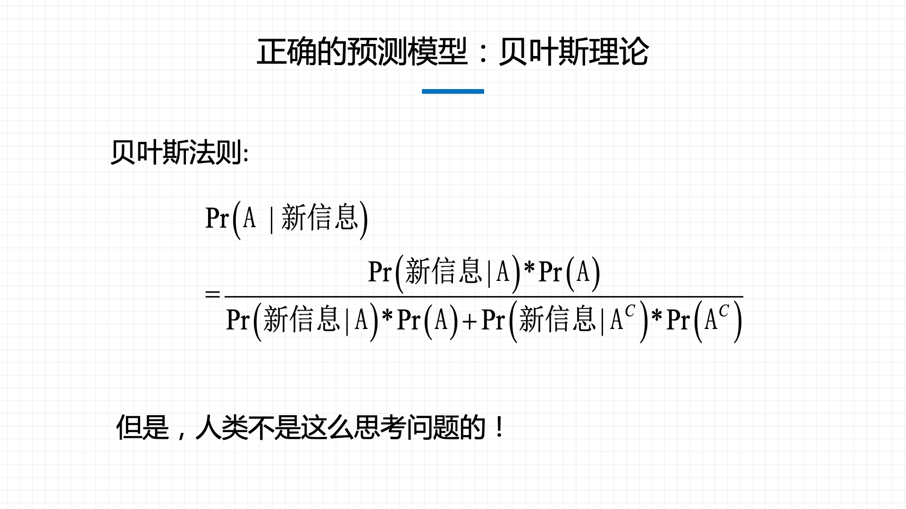

我是学过概率统计的，如果把这个题目当成一个数学题出给我做，我估计一两分钟就可以做出来，并知道这个答案小于 1%。但是在生活中，我不会去用贝叶斯公式，因为生活中谁用贝叶斯公式啊？然后直觉就告诉我是 90%。

那下面我告诉你，如果我把这个问题重新问一遍，用我们祖先熟悉的思维方式去问这个问题，你可能就知道正确答案了，当然你用贝叶斯公式也能得到这个答案，但是我不建议你用贝叶斯公式，因为正常人的大脑是不会用贝叶斯公式去思考问题的。

下面我把这个问题翻译成我们祖先熟悉的思维方式去问这个问题。我们祖先是怎么思考问题的？他们肯定不知道条件概率，什么给定你有病，你去检查，你有 90% 的概率有病。我们的祖先不是这样的，他们是数数，过去我在这条河里面打鱼，打了 20 天，只有 5 天打到了鱼；或者一个村、一个部落里面，有 200 个人，100 个男的、100 个女的，是这么算的，都是数数。

那现在不用概率去问，我用数数去问同样一个问题。比如说平均一个人有病的概率是千分之一，我现在假设有一万个人，一万个人里面有多少个人有多发性硬化呢？十个人，因为是千分之一，那 9990 个人没有多发性硬化。

那现在这十个有多发性硬化的人去检查，检查出来的结果是什么样的呢？九个人有多发性硬化；那这 9990 个人也去检查，有多少人被检查出有多发性硬化呢？由于 10% 会被检查错了，所以有 999 个人被检查出有多发性硬化，看见没有？所以一共是有 9+999 个人被检查出有多发性硬化，也就是 1008 个人。

现在给定你被检查出有多发性硬化，也就是给定你是这 1008 个人中的一个，你真的有多发性硬化的概率是多少？因为这 1008 个被检查出有多发性硬化的人中，只有九个人是真的有多发性硬化，所以这个概率是 9/1008，小于 1%，看见没有？

这里我们没有用贝叶斯公式，只是用我们祖先熟悉的思维方式重新问这个问题，当我把这个问题这么问的时候，稍微受过一点统计训练的人都能把它做对。但是如果我用前面那种条件概率去问，绝大多数人都会做错。

后来我发现类似的问题在哈佛医学院也被问过，当然它不是问多发性硬化，它问的是乳腺癌。当时在哈佛医学院，也是这四个答案，随机选对的概率都有 25%，他们答对的概率还不到 25%。

你要知道，哈佛医学院的医生和博士生都是受过严格的统计训练，结果他们答对的概率还不到 25%。那说明现代社会的思维方式会引起很多的偏差，这些偏差回头我们会讲到，对医学也会有很多影响，因为医学有很多判断错误，因为你高估了你有病的概率。

## 总结

好，这一讲就讲到这里，我们讲了基因和环境的关系。

*   基因和环境基本上从来都不是单独作战的，它们对人类行为的影响是交互作用的。
    
*   而且环境基本上是基因的一个开关。
    
*   基因和环境的交互作用会导致我们的各种错配，那具体是什么错配，这就是下面两个模块我们要讲的内容。
    

那么下一讲开始，我们进入一个新的模块，我们要讲人类预期中的偏差，有很多你意想不到的效果，会影响我们对一些事件发生概率的误判。

作业：你觉得好人有好报这个说法有进化论的依据吗？你可以去查一查，我可以提示一下，《自私的基因》（The Selfish Gene）这本书里面应该有。

好，我是余剑峰，我们下一节课再见。

\\1. 基因和环境基本上不会单独作战，它们绝大多数情况下都是交互影响我们的行为。 2. 存活的基因不适合现在新的环境，就会导致错配。 3. 错配同样会导致我们的思维方式出现错误。

# **第 6 讲 | 有限注意力：为什么我们会选择性失明？**

[懒人专属群的群友](https://lazybook.fun/#/blog/group)，你好，欢迎来到清华五道口《行为经济学》的课堂，我是余剑峰。

上一个模块我们讲了人类行为的起源，尤其是各种行为偏差的起源。我们强调了人的行为偏差很多时候都是通过进化而来的。由于过去的环境跟现在的环境不一样导致错配，所以说我们会犯错。

从这个模块开始，我们会讲人的预期中的偏差。什么叫做预期中的偏差？我稍微简单说一下。我们的世界不停地在变化，不停地有信息进来。我们要更新对将来一个事件发生概率的估计。

这个估计如果从理性经济学来讲，它是有公式的，叫做贝叶斯公式。学过概率统计的人应该知道这个公式。上个模块我们也讲了，它是正确的，但是我们不会去用，所以这会导致我们的很多偏差。所以这个模块讲的都是预期中的偏差，对将来一个事件发生概率的估计会出错。这一讲和下一讲，我们会讲一个非常重要的偏差，叫做有限注意力。

## 大脑判断取决于什么

我们先从一个案例入手。在 1997 年，有个能量饼干的品牌叫 Mars，它有个中文名叫做玛氏，是一个非常大的、历史很久的公司，主要卖各种巧克力。在 1997 年，这个饼干的销量大增，什么原因呢？销售团队也非常迷惑，因为他们自己也没感觉到有什么销售策略上的变化。

但他们一定要搞清楚原因，因为如果能搞清楚原因，就可以让销量持续增长，说不定可以翻很多倍。所以说这是一个非常重要的问题。那到底是什么原因？你觉得会是什么原因？

你想一下 1997 年发生了什么事？很多人猜可能是 1997 年金融危机来了，亚洲金融危机导致美国人很同情我们，然后吃很多高热量的食物；也可能是互联网泡沫，大家都去打游戏，然后晚上要吃这个东西。最后其实发现都不是。

为什么呢？因为如果是那些原因，那其他品牌的饼干销量也应该大增。但是最后发现只有 Mars 的饼干销量很大，德芙、HERSHEY'S、M&M's 的销量并没有大增。那是什么原因呢？

最后发现是 1997 年美国国家航空航天局（NASA）有一个叫 “探路者”（Pathfinder）的探测器登陆火星，导致当时各种新闻媒体天天在报道 Mars、Mars，因为火星就是 Mars。最近埃隆 · 马斯克也说要登陆火星，不知道会不会导致这个品牌销量继续大增，但是当时应该就是这个原因。

为什么这个原因可靠呢？有些研究人员后来还做了些其他的研究，比如说不光是 Mars 能量饼干销量大增，还有其他的 Mars 品牌，比如说 Marshero，就是儿童玩具汽车的销量也大增，基本上跟 Mars 相关的东西销量都会有些影响。

这个偏差我们叫做**有限注意力偏差，就是说我们不可能一直关注一件事情，因为我们的注意力是非常费能量、非常稀缺的资源。**尤其是在我们祖先进化的过程中，我们的生活条件非常艰苦，能量也比较有限，经常处于饥饿的状态。

如果你一直用，注意力特别集中，这个时候费的能量非常多，估计你很难存活。所以我们人会选择在某些情况下，节省能量，不那么集中注意力。尤其是在你觉得比较安全的情况下，你的注意力会没那么集中，在其他比较危险的情况下，环境在变的时候，你可能注意力会稍微集中一点。

举个例子，我问你一个问题，在所有涉及车祸的男女司机中，你觉得男女司机的比例大概有多少？想一秒钟。你可能会回答 1:2 或者是 2:1，大概这样。我告诉你，这个问题我问过很多我的学生，做过很多次问卷调查，基本上答案就是 2:1。

因为很多人意识到男司机比女司机要多，所以会觉得男司机应该是 2，女司机是 1。但是现实生活中的数字远远比这个大，有一组数据显示是 4.6:1，男司机是 4.6 个，女司机是 1 个。为什么会这样呢？其实一个重要原因就是因为我们媒体的各种报道。

我们媒体特别喜欢报道女司机出车祸，然后就导致女司机出车祸这个事情在你脑子里面比较容易想起来。报道的比例是什么样的呢？每报道 1 个男司机出车祸，大概会报道 3.8 个女司机出车祸。虽然男司机出车祸的人数远远比女司机多，但报道的比例完全是反过来的。

你看因为我们的注意力有限，所以我们对一个事件发生的概率，是基于这个事件在脑子里面被想起的程度来决定的。一个事件如果经常发生，但是在你脑子里面不怎么被想起来，就像男司机出车祸，你就会低估它的概率。另外一个事件，哪怕它不怎么发生，但是由于这个事件比较突出，所以容易在你脑子里面被想起来，那你会高估这个事件发生的概率。

好，现在你了解到了注意力偏差，那你可能会问，这个偏差什么时候会影响到我们的判断呢？基本上可以分成几类：

**首先，最近发生的事情可能会影响我们的判断，**因为最近发生的事情容易在你脑子里面被想起来。在你作决定的时候权重比较大，它可能会对你的决定有过多的影响；

**第二，媒体的报道会对你有影响，**因为媒体一般都喜欢报道一些突出事件、有意思的事件、吸引眼球的事件，这些东西都会影响你的判断。媒体的报道老是在你脑子里面出现，它比较容易被想起。在你脑子里面，容易高估这个事件发生的概率。

**还有媒体其他类似的报道，就是突出事件，**比如说中彩票。尤其是在国外，国外买彩票经常有这种情况。比如你中了个彩票，摄像头会一直跟着一辆大的柠檬汽车，然后扛着个大支票到你门口敲门。这样就特别突出，你的印象就特别深刻，觉得我下次也能中彩票。大家会高估自己能够中彩票的概率，这样导致大家可能更加喜欢买彩票。

那现实生活中有限注意力是怎么让我们犯错的呢？正是因为有限注意力，所以说很多时候它让你犯错，你都没有意识到。

我举几个例子，比如说红酒，这也是有人做过实验的。在国外的 Wine & Spirit，就是专门卖酒的地方，有各个国家的酒，法国葡萄酒、德国葡萄酒、智利葡萄酒、澳大利亚葡萄酒。可能这个星期它在店里放的是法国音乐，那么法国酒的销量就比平时的销量要高；如果下个星期放的是德国音乐，那德国酒的销量就比平时要高。但是很多时候你去买酒，你都没有意识到是受这个音乐的影响，所以这也是有限注意力的一个体现。

你可能会讲，买个巧克力、买个红酒，这是生活中很小的决定，那是不是大的决定，我们就不会受这些东西的影响，就会想得特别细腻？其实也不完全是，当然大的决定我们肯定会想得更仔细，但还是会受有限注意力的影响。下面给你讲一个人生中非常大的决定，它可能也受有限注意力的影响。

这是一个非常有意思的例子。有三个人的名字，一个叫 Jerry，一个叫 Dennis，还有一个叫 Walter。为什么把这三个人放到一起呢？是因为这三个人的名字在国外，比如美国受欢迎的程度是差不多的，一个是排名第 39 受欢迎，一个是排名第 40，一个排名第 41。Jerry 是最受欢迎的，然后 Dennis 是第二，Walter 是第三。

我们去研究这些人的职业，也不是每个职业我们都能查到所有的数据，但是有一个职业我们知道它的数据。比如说美国牙医协会，它有所有注册牙医的人的名字，我们就看看这些人中到底有多少人是去做牙医。

先看 Walter。我们查了一下数据库，发现有 257 个 Walter 是牙医。那你觉得有多少个 Jerry 是牙医？Jerry 比 Walter 更加受欢迎一点，人数稍微多一点，所以 Jerry 作为牙医的人数应该稍微多一点点，在数据里面确实也是，它是 270 个。那你觉得 Dennis 应该有多少个？如果名字跟这个职业没有关系的话，正常来讲你也不觉得应该有关系，那应该是两个名字中间的平均数，263 个左右。

但现实生活中，有 482 个 Dennis 是牙医，远远超过平均数，统计上也是非常显著的。为什么会这样呢？最可能的解释就是，Dennis 听起来更加像 dentist。Dentist 就是 “牙医” 的英文，这两个名词比较像，所以说你如果叫 Dennis，你就更加可能成为 dentist。

这也是有限注意力的原因，导致你人生中最大的决定也会受影响，因为你叫 Dennis，老是提示你 dentist、dentist，然后就容易选择这个职业。我非常好奇的是 Walter，是不是他的职业更加可能成为水管工人？因为 Walter 听起来像水，我们没有水管工人的数据，但是如果你有这种数据可以去研究一下，也值得讨论一下。

通过前面几个例子，我们基本上知道有限注意力偏差的出现主要是由于下面几点原因：

*   第一，由于我们的注意力有限，我们会选择容易处理的信息；
    
*   第二，我们经常会用直觉去处理信息，因为这样可以节省能量；
    
*   第三，因为我们用直觉去处理信息，这样会导致我们经常犯错。就像我们以前说的，这个犯错成本在以前很小，但现在可能会很大。
    

## 公司做业绩，有时不如改名字

前面讲的那些案例都是生活中的一些例子，那它在股票市场中会不会有影响呢？会不会有作用？有的人可能觉得没有太多作用，因为股票市场中有很多专业的人天天盯着股市，那这个有限注意力可能作用就不大。但我可以告诉你，它的作用还是很大，下面先讲几个简单的、个体的例子。

比如说我们中国股民其实就很有想象力。早年奥巴马竞选赢了，结果澳柯玛涨了；后来川普竞选赢了，导致川大智胜也涨了。这些东西都是不相关的东西。工业大麻比较火，结果导致了麻花、芝麻、麻绳的价格都涨了，这些东西都是股票市场上，大家注意力有限的一个体现。

你可能会觉得刚刚那些例子都是在中国股票市场上，因为中国的散户比较多，所以说可能大家注意力比较有限，会出现一些稀奇古怪的例子。但是我可以告诉你，在欧美的这种成熟市场也会有类似的例子。比如说，美国市场非常成熟，也比较有效，在这种市场中也有类似的事情出现。

在 2013 年 9 月 12 号，Twitter 公司，就是川普经常用的这个 Twitter，宣布 10 亿美金的 IPO。当时这个公司还没有在股票市场上交易，只是宣布要 IPO，11 月份才开始交易。但是，这个消息宣布之后，另外一个公司 Tweeter 接下来三天涨了 13 倍，这个公司是一个在场外交易的、破产的公司，它的代码也是 TWTR，后面加了一个 Q。但是 Q 是代表破产的意思。你想一个代表破产的公司，结果由于 Twitter 要上市涨了 13 倍，这是在美国这个比较成熟的市场中发生的事情。所以说，你就能看到这个有限注意力的效果。

前面讲的都是单个公司的案例，你可能会觉得这些案例偶然才出现一下，我也很难从中获益。下面讲几个系统的案例，可能你可以用系统的方法从中获益。

第一个例子，在 1998、1999 年，美国互联网非常火，所以很多公司的股票就狂涨。当时有些公司就想利用互联网概念，去炒作一下。比如说有的公司可能是个运输公司。它跟互联网根本没有关系，但是它可以在名字后面加个 “.com”，可能公司股票就涨了。

有个研究发现，在 1998、1999 年，当时有 95 家公司在名字后面加了个 “.com”。加了“.com” 之后大家就觉得它可能是个互联网公司，结果这些公司的股票平均涨了 74%。74% 是非常大的涨幅。你要想做业务，达到 74% 的涨幅是非常难的，这都是有限注意力的体现。

如果你是公司高管，你可以利用大家的有限注意力，在公司名字后面加个 “.com”。当然这不是一个长久的挣钱方法，但至少短期内可以为股东创造很多收益。

刚刚我讲的那些研究基本上是 2001 年、2002 年的论文。你想象一下，2015 年我们又发生了一些事情，当时中国特别火的概念是 P2P。确实有个公司就利用人的有限注意力，利用大家会追热点，把公司的名字，由多伦股份，改成 “匹凸匹”，布匹的 “匹”，凹凸的 “凸”，非常有创意。结果公司连续好多个涨停。

2017 年也有类似的事情。2017 年最火的概念是啥？是区块链。当时美国有个公司，它叫做 Long Island Ice Tea，长岛冰茶。我不知道你有没有喝过长岛冰茶。长岛冰茶基本上是所有鸡尾酒里面最烈的酒，像我这种小酒量喝个三杯，基本上就没有记忆了，所以说如果你是女生，有人请你喝长岛冰茶，一定要小心，当然男生也要小心。

当时长岛冰茶把名字改成什么呢？改成 Long Blockchain，叫做 “长的区块链”，结果股票涨了 500% 多，翻了 5 倍多。连美国这么成熟的市场，把“长岛冰茶” 改成 “长的区块链” 都涨这么多。而冰茶跟区块链没有什么特别的关系。

不光是在股票的名字上会有这种现象，其实基金也是类似的。如果你是做基金的，比如说过去成长型股票表现很好，你可以把你的基金名字改成 “剑锋成长基金”，很多散户根本不知道你这个剑锋成长基金有没有买成长型股票，但是过去成长型股票表现得好，吸引到了他们的注意力，他们就会买成长型股票。如果过去很多人输钱了，你可以弄个基金名字叫做 “剑锋稳健基金”、“剑锋保守基金”，这样的话他们觉得你这个基金比较保守、比较稳健，大家更加愿意买你的。

前面讲的很多都是 2001 年左右美国的一些学术研究了。如果我们早知道这些研究，是不是可以把这些东西用在我们中国的一些股票上面来？这就让我想到 2007 年的 8 月份。当时中国股市有一个大泡沫，已经涨到 6000 点。有很多中国股票也在美国上市，叫做中概股。当时因为中国股票特别火，所以很多美国人对中概股特别热情。

当时在美国上市的中概股，基本上你可以把它们分成两类：一类就是从名字上，你就能看出来它是个中国公司，比如说 “中国什么什么”，大家一看有个“China” 在那里面，就知道是中国的。但还有一些公司，会起一个很洋气的名字，或者起一个数字名字，大家就不知道了。比如说“360.com”、“360 什么”。大家不知道它是个中国公司。你要点进去花个几秒钟时间，才知道它是个中国公司。但是很多人都不会花那几秒钟时间去研究它是不是中国的。

你研究一下这两类股票的收益率。从 2006 年 9 月份到 2007 年 9 月份，你会发现，那些名字里面没有 “中国” 的中概股，基本上只涨了 50% 左右，但是名字里面有 “中国” 的中概股，涨了 200% 多。

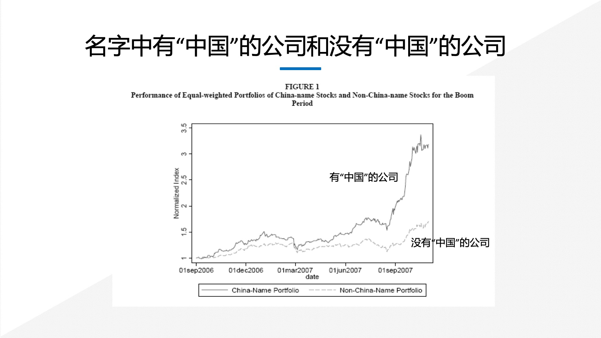

其实没有什么其他的区别，最大的区别就是名字里面有没有 “中国”。这是美国人有限注意力的一个极端体现。你想如果你是中概股上市公司的董事长，你知道了 2001 年左右的那些研究，你知道这个时候大家喜欢中概股的概念，你就应该让大家知道你是个中国的公司，你可以在你的公司名字里面加个“China”、“中国”，比如说“360China”，这样的话可能就能割到很多国外的“韭菜” 了。

## 教你一招：利用有限注意力提高收益

前面讲了这么多例子。假设你是个普通的投资人，你不是公司 CEO，你不能改公司的名字，那你怎么才能够利用到人的有限注意力，或者克服自己的有限注意力？这是我们这节课的重点。我们下面要讲最重要的一点，就是从有限注意力导出一个二级市场上的投资策略。你不用是 CEO，你也可以利用人的有限注意力，作一个系统的投资策略出来。现实生活中很多策略其实都是由有限注意力引起的。

下面讲一个研究，为什么讲这个研究呢？因为这个研究是我以前在沃顿念书的博士生同学李冬梅，和行为经济学的大牛 David Shleifer，还有我的一个朋友许博旋，他们三个人做的一个论文。这可能是我的有限注意力偏差引起的，所以我就记起了他们的论文。因为是我朋友的论文，所以讲一下这个研究结果。

他们的思路是这样的。因为大家注意力有限，你不能注意到所有的信息，有些信息可能是非常重要的信息，但是你忽略了。那这个信息就没有被反映到股票价格里面去。比如说最简单的一个信息，就是公司的研发效率。每个季度，公司都有财报出来，但是有多少人关注公司的研发效率？哪怕你关注到公司的研发效率，你怎么去衡量公司的研发效率？每个公司花多少钱，产生多大的成果？研发成果是很慢的。

他们就用一些方法去衡量这个研发效率，比如说公司 A 每花 100 万美元的研发费用，它能产生十个专利，公司 B 花 100 万美元的研发费用，它只能产生一个专利，那公司 A 的研发效率就比 B 的研发效率高。但这个信息，你不仔细看报表，你是看不到的。所以大多数人都没有看到这个信息。但这个信息是很管用的，A 的研发效率很高，它将来的收益率、盈利都会比较高。但是如果你忽略这个信息，你就觉得它没有你想象中那么高。这样的话导致股票 A 相对来讲被低估，股票 B 相对来讲被高估。

所以说一个非常简单的策略，就是你去买入研发效率相对来讲比较高的股票，卖空研发效率比较低的股票。你每年都要重新这么作策略，这个策略是动态调整的。

比如说今年 7 月 1 号，你把所有股票按它们的研发效率排序，买入那些研发效率最高的股票，卖空研发效率最低的股票。因为研发效率不同，公司也会不停地变，所以你重新排序，重新买股票，重新卖股票。因为它是个对冲策略，采用这个策略的话，平均来讲每年的超额收益率大概是 5% 左右。你可能感觉不是特别高，才 5%。但是你想，首先这是超额收益率，它是个对冲策略，因为你买入一个股票，卖空一个股票，没有什么市场风险，你可以买入整个市场指数，同时加上这个策略就变成了一个指数增强的策略，每年增加 5%，那就很多了。

第二，这个策略还有一个特别好的好处，就是它在整个市场表现差的时候，收益率依然是挺高的。比如说 2008 年美国金融危机，整个股市跌了将近 20%，但是这个策略反而挣了百分之十几，这就是非常好的一点，可以跟整个市场对冲。

为什么会这样呢？其实原因很简单，在市场经济特别差的时候，那些研发效率低的股票，就会更加难过，它可能立马就会被投资者注意到，它这个公司不太行了，这个股票的收益率就会很低。那研发效率高的公司，它可以抵抗这个冲击。它的收益率有可能在金融危机中也会下降，但是它跌的幅度远远比研发效率低的要小，这样的话一个对冲策略导致你反而有高的收益率。所以说研发效率这个信号是能够产生很大的超额收益率的。

其实这里面还有一些细节，就是怎么去衡量研发效率。刚刚讲了一个简单的方法，就是每用 100 万美金能产生多少专利。但是不光是看产生专利的数量，你还得看专利的重要性。比如说我一年可能只写一篇论文，有的人可能一年写十篇论文。但这并不代表我的研发效率就没有写十篇论文的人高。

有可能我这一篇论文的质量很高。所以说你不能光看论文或者是专利的数量，你得看专利的质量。那你怎么衡量专利的质量？你可以看专利的引用率，专利被谁引用。被引用得越多的专利，那这个专利分量越大。所以说，每 100 万美金的研发成本产生多少专利的引用，这可能是一个更好的研发效率指标，用这个指标去投资可能效果会更好。

还有更细的指标，你不光要看有多少引用率，你还可以看引用你的论文是什么样的水平，如果引用你的论文或者引用你的专利是特别牛的专利，那代表你这个专利更重要；如果引用你的论文是个垃圾论文，那这个引用其实没有那么大的分量。

你还可以用这些细节、信息去衡量研发效率，这样衡量得更准，你就可以有更好的信号预测将来股票的收益率。你看这里面很重要的一点，我们没有去预测股票 A 将来是涨还是跌，我们看的是股票 A 是不是会比股票 B 将来涨得更多一点或者跌得更少一点，这是在一个对冲的横截面上的策略。

我刚刚讲了这么多种衡量研发效率的方法，其实就是想告诉你一个信息，这个东西非常难测量。所以哪怕你注意力比较集中，你也很难把握住这个东西。所以说有限注意力一定会体现在资产定价、资产价格上面的。

## 总结

那我稍微总结一下这节课讲的东西。我们讲了有限注意力的进化论的根源，同时讲了有限注意力在生活中、市场营销中的应用，也讲了在公司市值管理、二级市场投资策略中的应用。

下一讲我会讲跟有限注意力非常相关的一个概念，叫认知放松。我们不可能一直认知警惕，这会引起很多有意思的现象，比如说你的名字和你的长相都会影响公司市值，下一节课再讲。

作业：在我们的课中，我们主要是指大家注意力有限，所以导致一些消息反应不足，那是不是也存在大家会反应过度呢？比如说很热门的电影，《战狼 2》上映了，它的制作公司的股价会不会涨得过多？如果涨得过多之后，它会不会又跌回来？欢迎你留言。

好，这节课就讲到这里，我是余剑峰，下次再见。

\\1. 我们的注意力是非常耗能量稀缺的资源，因此我们不可能一直集中注意力，所以导致出现有限注意力偏差。 2. 我们评估一个事件发生的概率，取决于事件在脑子里面被想起的程度。 3. 容易引发有限注意力偏差的三种情况：最近发生的事情，媒体的报道，突出事件。

# **第 7 讲 | 认知放松：掌握好消息能赚到钱么？**

[懒人专属群的群友](https://lazybook.fun/#/blog/group)，你好，欢迎来到清华五道口《行为经济学》的课堂，我是余剑峰。

上一节课主要是讲人的注意力平均来讲是比较有限的，这一节课我们强调注意力的变化。

有的时候你的注意力跟其他时候比会更加集中，这是时间序列上的变化；还有你对某些事物的注意力比对一些其他事物的注意力更强一点，也就是对不同个体之间的注意力也会有变化。那这些变化会有什么效果？

## 为什么 CEO 颜值会影响市值

先讲一个比较有意思的案例。你觉得 CEO 的颜值，会不会影响公司的市值？比如说，一个公司要换 CEO 了。把一个颜值比较低的 CEO，现在换成一个颜值比较高的 CEO。如果其他情况都一样，没什么特别的原因，只是因为这个颜值的变化，你觉得公司的市值会涨吗？如果会涨，涨多少？

我可以告诉你一个研究结果，这是威斯康星大学几个华人教授做的一个研究。他们研究了当时 682 个标普 500 公司的 CEO 的照片，因为这些都是大公司。按道理来讲，这些大公司的市值不应该受 CEO 颜值的影响。

他们找到 682 个 CEO 的照片，在一个叫做 Anaface.com 的网站上去测量每一个 CEO 的颜值。测量颜值是有科学方法的，因为颜值基本上就是说哪个地方对称，有黄金分割。这样的话你就能测量出这些人的颜值。研究发现当一个公司换 CEO，其他情况都一样的情况下，这个 CEO 如果颜值提高 10%，公司的市值会提高 1.17%。刚刚讲过，这是标普 500 的公司，市值提高 1.17% 可能就是几千万、上亿美金，所以说这是非常非常大的效果。

而且我可以告诉你，这真的是颜值影响市值，不是说可能是因为这个公司文化比较好，非常有品位，它找了一个颜值高的 CEO 来。或者因为这个公司本来就牛，所以公司涨了很多。为什么不是这样的呢？

因为公司换 CEO 的时候它会发布新闻，有的时候新闻里面有一张 CEO 高颜值的照片，有的时候新闻里面没有这个照片。颜值影响市值只有在发布新闻、有照片的时候才有影响，如果发布的新闻没有照片，CEO 颜值再高或者再低，都不会影响这个公司的市值，基本上就可以说明真的是颜值影响市值。

那为什么 CEO 的颜值会影响市值呢？这有很多原因，我觉得其中一个简单的原因就是 **CEO 颜值越高，你就越容易注意到他，你就记得住他。**这样的话前面讲的有限注意力就用上了，你注意到他，可能公司市值就会偏高一点，这是一个原因。

第二个可能是更重要的原因，就是**由于他颜值高，他会让你心情放松，你没那么警惕，**导致你的认知放松一点。

## 为什么会有认知放松

这一讲，我们用一个词来描述这种放松的状态，叫做认知放松。那认知放松了又会怎么样呢？有很多研究表明，人一旦认知放松，就特别容易轻信别人，容易上当受骗。当然它有好处，认知放松首先可以节省能量，其次让你特别有创造力。这也是为什么有些艺术家、诗人偶尔要喝点小酒，让自己认知放松一点，这样会增加他的创造力。

那对于 CEO 的应用就是，当你看到颜值高的 CEO，你会认知放松，他说公司的计划，这个公司将来要怎么怎么样，你可能就更加信他，觉得他能够做到。这样的话，公司的市值当然就会被推高。这也是为什么 CEO 颜值高会把市值提高的一个机制。

那你可能会问，为什么我们人要认知放松，还有什么时候我们会认知放松？其实因为我们人在进化过程中，一直都处于一个比较饥饿的状态，能量没有那么高。如果你一直认知警惕，注意力一直非常集中的话，这是非常消耗能量的。这样的人基本上比较难生存下来，一定要选择在某些时间段认知放松一点，节省能量。

哪些时间段你要节省能量，去认知放松呢？你想象一下，基本上应该是你感觉比较安全、比较舒适的情况下，会认知放松一点。这个时候认知放松给你带来的代价可能是比较小的，因为也不太会有狮子出现什么的。在不安全的情况下，你肯定还是要认知警惕，所以基本上是在安全熟悉的情况下，你会认知放松。

那什么时候你会觉得安全呢？有下面三种情况：

*   第一种，就是重复的经历。如果一个事情，你反复地经历，那应该是个安全的信号；
    
*   第二种，清楚地展现。如果你一眼就能看到特别远、特别清晰，这样的话相对来讲也是个安全的；
    
*   第三种，就是好的心情。好的心情你肯定会觉得安全，如果是不安全的状态你不会觉得心情好。所以说前面讲的 CEO 导致你心情好，你可能会认知放松一点。
    

其实认知放松在生活中是非常常见的，有时候你可能都没有意识到，下面讲几个例子，我估计你肯定不知道。

第一个例子是跟我自己有关系的，因为我的名字叫做余剑峰，我的姓是余。在国外很多时候你发表论文，尤其是经济学、金融学的论文，它是按字母顺序排的。如果我跟别人一块写论文，我的 Y 都是排在后面，A 就排在前面。而且别人引用论文的时候，如果是超过三个人写的论文，一般都是引用前面第一个人和其他人，就不会把我的名字列上来。

所以有研究发现，如果你的姓氏拼音很靠后，你拿终身教授的时间比别人要长一点，这是什么原因呢？这可能是因为你的名字没有经常被别人看见，别人就感觉对你不熟悉、不真实，不会觉得你特别牛。

还有生活中的其他应用，也是颜值方面的。有研究发现颜值高的罪犯受的量刑就会小一点，也是一样的道理，颜值高导致陪审团心情好，陪审团一听这个颜值高的人说话很有道理，然后就相信他说的话，判的刑自然就低一点。当然还有，颜值高的人借钱也相对来讲容易一点，这是 P2P 里面的一些证据。

那好，如果你是一个公司的 CEO，你怎么才能够利用人的认知放松呢？

**当然前面讲过一个简单的方法，就是你去整个容啥的，提高一下你的颜值**，就是市值管理，为了股东的利益。

**第二，其实更简单，你不用去整容，就是你把你公司的名字起得通畅一点，就会很管用。**

**第三，名字的通畅性还会影响这个公司的交易成本、市场冲击成本。**这里面有个测量方法，就是说一个股票，如果你在一分钟之内买它一万股，它可能会涨一分钱，另外一些股票可能会涨两分钱。那涨两分钱的股票带来的交易成本就很高，尤其是对大的机构投资者来讲，因为要买卖很多。

研究发现名字通畅的公司，它的市场冲击成本相对来讲要比名字不通畅的低 35%，这是一个非常大的交易成本。如果你是上市公司的 CEO，你肯定希望你自己公司的流通性比较高，交易成本比较低，这也是名字通畅起的各种作用。

**最重要的是第四点，名字通畅的公司跟名字不通畅的公司去比，如果其他的维度都一样，它的市净率要高出 10% 左右。**市净率就是公司的市值和净值之间的比，如果市净率要高出 10% 左右，那就是一个非常大的数字。

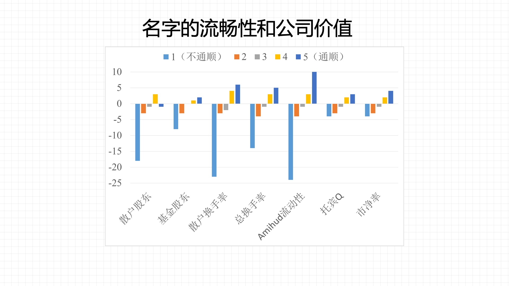

对一个一般大小的上市公司来讲，你把名字从不通畅的改成通畅的，你可以把市值提高 8000 万美金。历史上也有很多公司改过名字，基本上改名字之后，大多数公司的市值都会提高，因为很多公司改名字都是把那些不通畅的名字改成通畅的。

当然也有些人不知道这些研究，他会把一个本来很通畅的名字改成一个他觉得很有意义的名字，但是其实名字变得不通畅了，大家不熟悉，然后就不投资它了。

为什么别人会觉得名字通畅？肯定是因为他以前见过这个名字，应该是个重复的经历，一个比较熟悉的东西，这个时候就让人认知放松，看着这个公司就感觉真实、可靠，那当然它的市值就会提高。所以说如果你是公司的 CEO，你可以在名字上做一些文章，让它的市值提高一点。

这是英文上的一个研究了，在中文里也是有类似的东西，但中文就不是你怎么去衡量一个名字的通畅性。它不像英文，英文的一个单词有很多音节，中文都是说一下就完了。起中文名字应该容易记，让人感觉熟悉，是重复的经历。

最好不是我拿个《诗经》过来，找里面其中一个词，我不认识，但是觉得特别酷，一般起这种名字反而不好，因为大家并不知道这个意思。别人就记不住，记不住也不会产生注意力，不知道又感觉不熟悉、然后不相信，所以最后效果都不会很好。

## 为什么说 “相由心生”

了解了认知放松，那下面我们来看看它在金融市场中有什么应用。我们先看一个在金融大数据风控中的应用，这里面涉及到一个古人经常说的概念，叫做相由心生。我不知道你信不信，我们古人也说过知人知面不知心。我觉得相由心生其实是可信的，我马上要给你看一个非常严谨的科学证据，但是讲这个之前，我先讲一下相由心生跟我们的认知放松有什么关系。

我们人会有很多内心的想法，我们的表情一般来讲又不能完全体现出我们内心的想法，很多时候你要隐藏你的想法。什么时候你能够隐藏你的想法？一般来讲你要精神比较集中，要控制你的表情。但是很多时候你又会认知放松，因为我们大多数时候其实都是认知放松的，要不然特别消耗能量。所以说很多时候，表情可能就会体现出我们内心的想法。

这可能是相由心生的一个理论依据，那有没有实证的结果呢？我们从下面一个结果里面看一下。这是一个比较新的学术论文，是美国华盛顿大学的一个老师跟他的合作者做的，用的是美国一个 P2P 借贷网站上的数据，里面有几万借款人的数据，每个人都会有一张照片，你可以找很多人给每个借款人的照片打个分，看他是不是长得可靠。

当然这个打分有可能不准，因为有的长得特别可靠的人，他其实不一定可靠。但是这没有关系。打完分之后，再把这些人分成两组：一组就是平均长得可靠的一组，另外一组就是长得不可靠的一组，我们看这些人将来还款的概率是多少。

这里面涉及到一个还款意愿的问题，这跟传统的大数据风控有一点不一样。传统的大数据风控一般来讲是去考虑这个人还债务的能力，比如看你平时用什么手机，用苹果还是用安卓的，平时上什么网站，是不是买很贵的东西，你的朋友圈是什么样的。

总之，如果大数据看着你很有钱，偿还债务能力很高，它就借钱给你，这是大数据风控一个重要的维度。但是根据我跟很多公司的接触，我发现大多数公司并没有考虑刚刚讲的偿还债务的意愿，偿还债务的意愿如果是相由心生的话，就应该由你长得可不可靠体现出来。

这样的话，根据刚刚讲的长得可靠、不可靠分成的两组，我们看看他们偿还债务的概率，跟踪他们三年，因为他们的借款一般是三年。

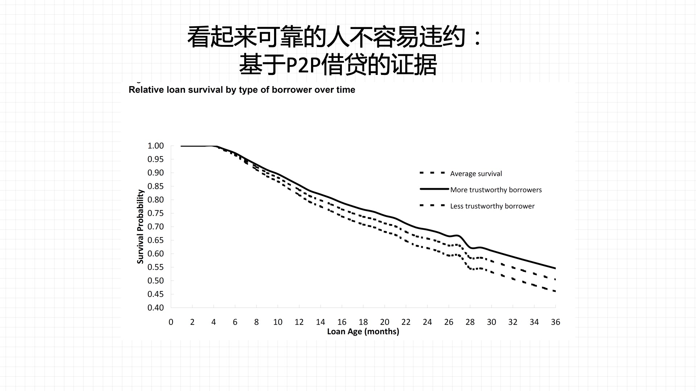

研究发现，在控制了各种因素，你的教育水平、有没有结婚、有几个小孩，还有你的信用分数、偿还债务的能力等各种维度之外，你发现长得可靠的一组跟另一组长得不可靠的人去比，偿还债务的概率基本上要多 10%，这是非常大的一个数字。因为这里面已经控制了所有其他很重要的因素，所以说这是一个非常重要的结果。

当然你用这个研究结果，看别人长得可不可靠，来提高公司的风控水平、收益率。但是，同时它也证明了相由心生这一个概念。你看因为我们会经常认知放松，会导致我们相由心生，进一步导致了我们可以利用我们的相貌去做大数据风控。

刚才我们不是说了相由心生吗？第二个重点就是，我们的名字都会附带一个性格，比如说我的名字叫剑峰。“剑峰” 这个名字听起来比较江湖，那我身边的人可能会期望我这个性格稍微豪爽一点，如果我哥们儿要敬我一杯酒，我就不能磨磨叽叽老不喝这一杯酒，这不符合我的性格，因为我的名字里面有这个性格。

对正常人来讲，他都会想去做一些事情，满足身边人对自己的期望，所以说如果我做了几十年这种事情，那我的性格可能就相对来讲，比较豪爽一点，我的长相可能就不会那么奸诈。这可能就是你的名字影响到你性格的一部分。再加上相由心生，又体现出你的性格，所以名字会影响你的长相。

## 教你一招：利用认知放松提高收益

好，刚刚讲的那些都是一些比较好玩的东西。下面我们回归到一些更加严肃的应用，还是在二级市场上的投资策略，这个可能也是你非常关心的问题。其实上一节课，我们已经用了有限注意力去做投资策略，我们的注意力比较有限，所以你只要找到大家会忽略的信号，就管用，你可以根据这个信号作出一个策略来。

下面我要讲的是一个已知的投资策略，因为它已经很有名了，所以大家都在用，它现在可能不太有效，但是我们去发掘这个已知投资策略背后的根源。如果是有限注意力，我们怎么去提高它，重新把这个已知的投资策略化腐朽为神奇。

这个投资策略叫做盈余公告后的价格漂移，这是 80 年代末几个会计学教授发现的投资策略。他们当时就想到一个简单的事情。每个季度，上市公司都会发布盈余公告，发布盈余公告的话有些公司就有好消息，比如说公司盈利比分析师预期的高；有些公司有坏消息，盈利比分析师的预期低。他们的研究发现什么呢？

如果每个季度你把所有股票按照盈余公告消息的好坏排个序，你买入那些消息最好的股票，卖空那些消息最差的股票，这个策略是可以挣钱的。为什么可以挣钱呢？

因为那些消息最好的股票当天会涨，那个钱你挣不太到。但最重要的是，消息最好的股票将来 60 天平均还会涨 2% 左右，消息最坏的那些股票将来 60 天平均还会再跌 2% 左右。这里面涨跌都是相对的，有可能整个市场都在跌，那些有好消息的股票可能跌得就没有坏消息的股票多。

所以说，这叫做盈余公告后的价格漂移，就是有好消息的股票当时会涨一点，但是更重要的是将来会继续涨，有坏消息的股票当天会跌一点，大概跌 2% 左右，但是将来 60 天会继续跌 2% 左右。那一个简单的策略就是，你就买有好消息的股票，卖有坏消息的股票，这样的话你就可以挣到价格漂移，将来 60 天大概挣 4% 左右。

由于一年大概有 250 个交易日，大概能挣 20%。在 1974 年到 1986 年用这个策略，每个季度基本上都能挣钱，那十几年基本上就是偶尔一两个季度亏一点点，每个季度平均挣 5% 左右。所以这是一个非常好的策略。而且容量很大，因为这是一个基本面的策略，你可以不用经常换手，换手率不是特别高。

这么好的策略，当然很快大家就知道了。然后很多对冲基金、共同基金都会去用这个策略。那这个策略的有效性可能就不行了。比如说一个股票有好消息来，很多基金知道它将来会涨，所以它们现在就买了，很快第二天价格可能就涨上去了，这样的话将来价格漂移就没那么多。所以，从 80 年代末或者从 90 年代初到现在，这个策略在美国其实就没有那么挣钱了，超额收益率估计每年也就是 5% 左右。

那现在我们怎么才能够把这个历史上这么牛的策略再变得有效？如果你只知道盈余公告后的价格漂移，那你跟其他的基金是一样的，因为其他做量化、做对冲的这些人都知道这个策略，那你怎么才能比别人做得好？要比别人做得好，你一定要知道这个策略能挣钱的根源。当然，我们也不知道真正的根源，我们可以猜测其中一个很简单的根源，是大家注意力有限。

由于大家注意力有限，一个公司来了好消息，当时只有一部分人注意到，价格当时会反应一部分，但将来还会继续反应。同样，一个公司有坏消息来了，不是所有人都注意到了，它当时跌个 2%，将来还会继续跌，那就导致盈余公告后有价格漂移，这是我们猜的一个原因。

如果真的是这个原因，那我们怎么改进？我们要做的就是要猜在哪个时候大家注意力更加有限。你想一下，如果有一天没有人关注股市，这个时候有个公司宣布好消息，这个公司的盈利比分析师的预期高很多。这个公司的股票就不会涨，因为没有人注意到它，过几天大家慢慢注意到了，所以公司的价格在慢慢涨。那个时候如果没有人注意到，而你注意到了，你去买，那你当然就能挣很多了。

那你想一下，星期一到星期五哪一天大家对股票市场的关注度最低？我们一定要找关注度最低的那些天，因为关注度最低的那些天将来的漂移才会多。稍微想一下应该能猜到，星期五大家对股票市场的关注度相对更低，因为在星期五你可能想的是其他的东西。比如周末怎么搞个 party。所以说确实有这种证据，如果你把策略改进一下，关注只在星期五发布盈余公告的那些公司，如果是好消息你就去买，坏消息你就卖空，你的策略的收益可以提高 70%，这是非常大的。

还有另外一种方法，还是同样找注意力有限的那些天。有两种情况：有一天只有两个公司发布盈余公告，另外一天有 50 个公司发布盈余公告。那两个公司发布盈余公告，肯定大家对它们的关注度就高。50 个公司发布盈余公告，大家可能只对其中一两个公司关注度高，其中剩下的 48 个公司，大家的关注度会小很多。

这样的话如果一个公司和其他很多公司同时发布盈余公告，大家的关注度就低，那将来的价格漂移会比较多，所以如果我们只考虑同时和其他公司一起发布盈余公告的某个公司，然后去做这个策略，那我们策略的收益可以提高 170%，就是说从 5% 可以提高到 13.5%。这里面，我们利用大家注意力有限的变动，可以改进策略，把我们的策略重新化腐朽为神奇。

说了这么多，我稍微总结一下这个策略提高收益的方法。

**首先，你要搞清楚这个策略的根源，像这里面我们猜想其中一个根源，就是由于大家注意力有限引起的盈余公告后的价格漂移；**

**其次，如果是这个根源，你要找到原因最严重的那些天，或者在哪些股票里面去做这个策略。**就像刚刚讲的注意力有限，星期五注意力最有限，那你在星期五做这个策略，你可以把这个策略的收益提高很多。

当然我想稍微补充一下。有些对中国股市比较熟的人，会发现中国的有些股票来了好消息之后，它将来反而跌，这是中国跟美国有点不一样的地方。其次，在中国你要定义好消息，看你怎么定义。如果你用当天的股票收益率来定义，这个策略还是有效的；如果你用股票的盈余跟分析师的预期去比，可能不一定有效。但是你用别的指标去定义这个消息的好坏，它一样是有效的。

## 总结

好，给你总结一下这节课的全部内容：

*   第一，我们这节课引进了有限注意力一个非常重要的维度，就是它会变化，我们不能一直警惕，我们有时会放松，这就是认知放松；
    
*   第二，我们什么时候会认知放松，一般来讲由于进化论的结果，我们一般会选择在比较安全、比较舒服的时候放松，基本上就是在重复的经历、事情被清楚地展现、好的心情下，会认知放松；
    
*   第三，我们讲了认知放松在金融领域的各种应用，比如说大数据征信，比如说在二级市场中投资策略的改善。
    

好，下一讲我们会讲一个更难的偏差，叫做代表性偏差。

认知放松下，这节课就不留作业了。

我是余剑峰，咱们下节课再见。

\\1. 我们的注意力会随着时间，针对不同事情而变化，不可能始终注意力集中，会出现认知放松。 2. 容易产生认知放松的三种情况：重复的经历，清楚地展现，好的心情。 3. 可以利用认知放松改进投资策略：找到大家认知放松最严重的那些天，那些股票去用新策略。

# **第 8 讲 | 代表性偏差：为什么我们喜欢追涨杀跌？**

[懒人专属群的群友](https://lazybook.fun/#/blog/group)，你好，欢迎来到清华五道口《行为经济学》的课堂，我是余剑峰。

这个模块我们要讲的基本上都是对人预期中的偏差，下一个模块我们会讲一些其他的偏差，它会影响我们的偏好，尤其是风险偏好。这里面我们要区分，你的预期中的偏差和风险偏好的偏差，是两个非常不一样的东西，这个模块我们看的是预期中的偏差。

那除了有限注意力，还有什么会影响我们预期中的偏差呢？这节课我们要讲的就是另外一个重要的偏差，叫做代表性偏差。

## 什么是代表性偏差

我先问你一个问题，仔细听着，这个信息非常重要。有个哥们儿叫老王，他非常害羞，喜欢自己待着；他总是帮助别人，对社交和社会现实也不太感兴趣；他整洁、温顺，喜欢秩序与结构，对细节也极其关注。那我问你，老王最可能是下面哪个职业？

*   A 是农民，
    
*   B 是销售员，
    
*   C 是图书馆管理员，
    
*   D 是内科医生，
    
*   E 是飞行员。
    

想一秒钟，我觉得大多数人都会猜，他最可能是图书馆管理员，对吧？你一定不会猜他最可能是农民。但是我告诉你，这里面正确答案就是他最可能是农民。

先讲为什么你会觉得他最可能是图书馆管理员。可以这么说，如果你要招一个图书管理员，这个工作基本上就是要求这个人整洁、温顺，喜欢秩序与结构，喜欢帮助他人。基本上刚刚那段描述，就是一个图书馆管理员典型的代表性特征，所以当你看到这个典型的代表性特征的时候，你觉得这个人一定是图书馆管理员。其实他更加可能是农民。

那为什么他更加可能是农民呢？一个最重要的原因就是农民的基数比图书馆管理员的基数要大很多，符合这种描述的农民总的个数比所有的图书馆管理员可能还要多。那这样的话，当然他就更加可能是一个农民了。

那为什么会产生这种偏差？**这里面一个重要原因是我们忽略了基数，我们忽略了农民的基数比图书馆管理员要多很多。**这就跟我们前面讲过的有限注意力非常相关了，因为你忽略了这个信息。但是这跟前面讲的有限注意力又不一样，只有当刚刚那段描述特别符合图书馆管理员的代表性特征的时候，我们才会忽略图书馆管理员的总人数远远不如农民的总人数。

比如说这个人是男的，你就不会忽略农民的基数比图书馆管理员的基数要大很多，只有当这个描述特别有代表性的时候，你才会忽略这个基数。

那下面我问你，你觉得运气的代表性特征是什么？比如说扔硬币这种碰运气的事情，你连续扔六次，它应该是什么样的结果？很多人都会觉得运气的代表性特征就是不规则的、比较随机的、比较不规整。

那有一个非常有意思的实验，这是斯坦福大学一个叫 David Donoho 的教授，他让他的学生做的一个实验。他把学生分成两组，让第一组的人扔六次硬币，记住它们的正反面，写下来。正、反、反、正、反。然后有很多人，因为你扔了六次，你会有很多正、正、正、正、正，或者连续反、反、反、反、反。那另一组人，不让他们扔硬币，让他们想象一下扔了六次硬币，然后记下来他们想象的扔六次硬币的结果。

比较两组人记录下来的结果，基本上那些想象的人不会写连续六次正的，或者连续六次反的，都是非常乱，比如正、反、反、正、正、反。但是那些真的扔了六次硬币的人，他们会出现很多连续五个正的、一个反的，或者连续四个正的、两个反的。

这就是人的代表性偏差的一个体现，因为那些想象的人就觉得，乱是一个代表性特征，然后就写下了很多这种乱的、不规则的序列。但是有代表性的事件不一定更加可能发生，就像刚刚说的，连续出现六个正面，跟正、反、正、反、反、正，这个概率是一模一样的，都是二分之一的六次方，六十四分之一。但是由于正、反、正、反、反、正更加有代表性特征，很多人会高估这个事件发生的概率。

## 什么是赌徒谬误

好，现在你对这个代表性偏差的概念应该有一个基本的了解，了解这个概念之后，你会发现我们现实生活中很多看起来合理的、很普通的事件，其实就没有那么合理了。下面讲两个生活中的例子。

第一个例子叫做赌徒谬误，我不知道你有没有赌过钱，比如说你到澳门或者到拉斯维加斯小赌一下，小赌怡情嘛。我不知道你赌过大小没有，我一般是不赌大小的，因为那个没有技术含量。但是如果你赌过大小，你有没有过这种感觉，如果前面连续都是大的，下面一个你觉得一定是小的？这其实是代表性偏差的一个体现。

其实下面大小的概率是一样的，但是你觉得下面是小的概率更高，为什么呢？因为如果前面连续都是大的，再来一个大的，它就显得太规整了，太规整就没有代表性。如果前面都是大的，下面来一个小的，就显得比较乱了，乱的话就显得更加有代表性，因为你知道扔骰子是随机的，所以说这个时候小更加有代表性，你就觉得下面更应该是小的。代表性的东西不一定更加可能发生，但是你觉得它会更加可能发生，这就是赌徒谬误，是一个错误。

除了刚刚说的赌赌小钱这个问题，它在生活中也有很多应用。这是研究美国移民局的数据，有很多人来美国移民局申请避难，那申请避难的话，移民官就会不停地看，这个人有多惨，是不是应该给他一个避难通过。

结果申请避难的平均通过率是 29%，但是给定前面两个人真的很惨，移民官通过了，下面一个人来，如果他的条件和前面都一样的情况下，通过的概率要降低 19%。这就是典型的赌徒谬误的一个体现，你觉得前面都是大，下面就应该是个小的；你觉得这些比较惨的、符合条件的人应该是随机出现，不应该连续出现，所以说如果前面两个都通过了，你会觉得下一个就不应该让他通过。

这对那个申请避难的人是一个极其大的事件，但是仅仅因为移民官的一个赌徒谬误的体现，就使得人家没有通过。

在现实生活中还有很多投资中的体现，比如说你是一个做私募的，你天天看项目，一天看五六个项目。你上午看了三个项目特别好，觉得想投；下午看了几个项目，其实本来也很好，但是因为上午的三个项目很好，哪怕你有钱，你投下面的项目就会更加谨慎一点。因为你觉得不可能这么多好的项目会同时来，其实很多好的项目同时来，或者很多坏的项目同时来，或者它们断断续续来，概率都是一样的。但是由于赌徒谬误的体现，这个时候由于上午的项目好，你可能下午就会特别谨慎。

## 真的有热手现象吗

第二个例子就是篮球中的热手现象，这跟我们的赌徒谬误其实是相关的，下面我会讲到细节。这个热手现象就是说，当一个人过去连续进球了，你会觉得他来状态了，他下面进球的概率你觉得还会更高。

但是心理学家收集了很多球员比赛的数据，发现什么结果呢？给定一个球员，他前面三次都进球了，他下次进球的概率其实反而要小于前面三次都没有进球下次进球的概率。不光在比赛期间是这样，他在罚球的时候，站在那没有人防守，也是这样，那基本上就说明，篮球中没有热手现象。

当然我告诉你这个结果，你不会相信，你还是觉得篮球中会有热手现象，这也是我们下面要讲的过分自信的一个体现。

那讲到这里你可能会想，这个篮球中的热手现象，好像跟赌徒谬误有点相反。赌徒谬误是前面都是大，下面一个你觉得会是小。但是篮球中的热手现象是，前面都进球了，你觉得下面他还会进球。为什么它们都是代表性偏差？

这里面一个重要的区别是什么呢？在赌徒谬误里面，扔骰子的结果是完全随机的，没有人控制。但是在篮球中的热手现象，不光是完全随机的，这个球进了，是由球员的能力和运气决定的。

那热手现象为什么也符合代表性偏差呢？这里面的一些细节，你要仔细听。因为现实生活中，大多数现象、大多数结果，都跟篮球中的热手现象比较像，因为大多数结果都是运气加能力的结果。比如说一个基金经理的收益率是他的能力加运气的结果，一个公司的盈利能力也是能力加运气的结果，很少有东西真的完全是随机的。所以篮球中的热手现象在现实生活中可能影响更大。

那我把这个例子换到基金经理里面来，可能会更加具体一点。假设有一个基金经理，他过去六个季度的表现都很好，表现好我用 1 来表示，表现不好用 0 来表示，如果六个季度表现都是 1，非常出色。这个很好的原因，可能是这个基金经理能力很强，也可能是因为这个基金经理过去六个季度运气都很好，运气也由 0 和 1 来表示，就相当于扔硬币。

我假设 0 和 1 的概率都是 50%。你想，六个季度都是 1，收益率很高，那存在一定的概率，完全是因为他运气好，而他的能力是 0。这个概率是多少呢？是大概二分之一的六次方，跟扔六次硬币全是正面的概率一样，是 1/64。但是连续六次都运气好太没有代表性了，你知道存在一定的概率，但是你不会觉得概率是 1/64，你可能觉得是千分之一，相当于你会低估由于纯粹运气好带来的连续收益率高这个事件。

那这样的话，你低估了运气的重要性，你就高估了他的能力，因为他的结果特别好，你就觉得他的能力特别强。你觉得他能力特别强，当然就会觉得他下一个季度收益率也会很高。如果换成球员的话，你会觉得他下一次进球的概率也会很高，这就导致热手现象。热手现象的原因可能是因为你低估了运气的重要性，低估了运气重要性的原因是因为连续的好运气没有代表性，也是由于代表性偏差的一个体现，看见没有？

好，总结一下。代表性偏差就是我们会低估了运气的重要性，从而高估了能力，导致了这个热手现象。

## 为什么会追涨杀跌

前面讲的这些代表性偏差都是生活中的例子，其实它在金融市场、股票投资中也有很多应用，其中一个重要的东西就叫做追涨杀跌，我觉得你肯定犯过这种错误。为什么追涨杀跌是代表性偏差的一个体现呢？因为与热手现象类似，一个人连续进球了，你觉得他将来还会进球，而一个股票过去连续涨了，你觉得它将来还会涨，所以导致你追涨杀跌，这就是热手现象代表性偏差的一个体现。

那这样的话会导致什么呢？导致大家买基金就有一个现象，**老是去买那些过去表现特别好的基金，但是其实过去表现好的基金，它将来的收益率并不一定高；过去表现最好的基金跟过去表现最差的基金，将来的表现其实是差不多的，所以追涨杀跌并没有给你带来额外的收益率。**当然追涨杀跌在基金上的表现也没有让你亏太多钱。

但是股票市场上的追涨杀跌其实就会导致你输钱。很多人看到一个股票涨了，或者整个股市涨了，他就会追涨；然后将来股票跌了，就把钱撤了，这个行为其实会导致他输钱。下面会给你看各种证据。那更具体一点，最近一个 RSS 上的研究，做了很多问卷调查，发现一个非常有意思的结果。

先看美国的数据，当美国股市标普 500 过去一年涨了很多的时候，大多数散户都认为将来一年也会涨很多。过去涨很多，你就觉得将来会涨很多，这不就是热手现象的一个体现吗？当过去表现好的时候，你觉得将来表现也好，同时你会放很多钱进入股市，你真的就这么做了。

对另外一些专业的机构，比如说大的公司的 CFO，也有类似的结果。当过去一年整个股市表现好，他们也认为将来一年会表现好，虽然没有散户那么强烈的反应，但是也是非常正向的。

但现实中是什么样的呢？现实中基本上发现是这样的结果，当股市过去表现好，那些散户就认为将来也会表现好。当你认为将来比平时要高 1% 的收益率，其实将来实际的收益率反而比平时要低出将近 2% 左右。

CFO 们的结果就更加有意思，他们认为将来表现好的时候，将来的表现反而要差一点点，但是差得不多，表示 CFO 的预期基本上完全是噪音。但是散户的预期是非常有意思的，当散户认为将来表现好，但将来的表现反而差，这是可以用来做市场择时的一个信号。

那我们看具体一点的交易数据。

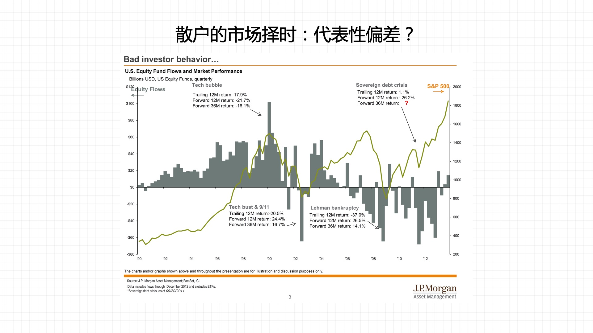

在 2000 年初，互联网泡沫到顶了，那个时候过去一年股票的收益率很高，从前面的结果我们能看到，散户认为将来一年股票收益率会很高，同时他们会投很多钱进去。

确实，2000 年初很多钱流入了股票市场，大概多少呢？大概一千亿美金，但是将来一年，股票收益率反而非常低，跌了将近 20%。

不光是这几年，你再看 “9·11” 之后的 2002 年。2002 年中期的时候，由于 “9·11” 这个事件，导致美国股市跌了很多。你想，过去跌了很多，这个时候散户就认为将来一年股票收益率应该会很低，也是代表性偏差的一个体现。2002 年的时候很多钱从股市撤了，大概一个季度撤掉了六七百亿美金。但是从 2002 年往后看，股票在下一年的收益率又是很高的。

在 2008 年金融危机来的时候，也是类似的结果，2009 年很多钱都跑掉了，但是之后股票收益率反而很高。所以你能看到，这些散户由于代表性偏差，导致他们追涨杀跌，输了很多钱。

那不光是美国的散户有这种追涨杀跌的行为导致输钱，有一个研究，研究了 1984 年到 2004 年这 21 年 19 个国家的数据。发现在这 19 个国家里面，这些散户基本上都有追涨杀跌的行为。这个研究算的是什么数据呢？算的是散户的收益率减去市场指数的收益率，这个之差就是由于散户做市场择时引起的结果。

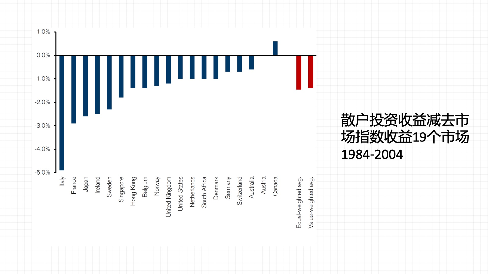

结果发现，在这 19 个国家里面，除了加拿大，散户的表现比指数表现要好，其他 18 个国家散户的表现都比指数要差，那就说明他们追涨杀跌，择时全都错了。有人说是因为 1997 年香港回归之后，很多专业的投资者从中国香港移民到加拿大去了，虽然他们在加拿大看成是散户，但是他们是专业的，这是其中一个解释。

但是其他 18 个国家散户的表现都不如市场，尤其是意大利，意大利的表现是远远不如市场的，每年散户的平均收益率要比市场低出 5%，这是非常大的一个数字。回头我们会讲到巴菲特的收益率，他选的那些股票，比如说高盛、摩根士丹利、可口可乐，平均收益率比整个市场的收益率每年也就高出 5.7%。但是你看，意大利那些散户，由于他们择时错误，导致他们的收益率每年比市场要少 5%，这是输了一个巴菲特，这是非常大的一个偏差。

## 教你一招：利用代表性偏差提高收益

前面讲了这么多散户的追涨杀跌、代表性偏差，那我们能不能够从这些代表性偏差引出一个投资策略来？其实刚刚已经讲了一个投资策略，是市场择时的策略，就是你跟散户反着干。但是这个市场择时的策略虽然平均来讲会挣钱，但输钱的概率也会很大，所以我们不太建议你用这种策略。

下面我要讲另外一个横截面的策略，就像前面我们讲过，预测一个股票涨跌是非常难的，但是预测一个股票 A 比一个股票 B 涨得多或者跌得少，这个相对来讲要容易一点。所以我们现在想利用一下人的代表性偏差，去做一个横截面上的策略。

那下面先问你一个问题，考虑两个公司，A 和 B。A 这个公司是分析师长期看好的，他觉得这个公司的长期盈利增长率会比较高；B 是分析师不太看好的，觉得这个公司的长期盈利增长率会比较低。首先问你，你觉得你应该买哪个股票？

很多人的第一反应可能觉得我应该买公司 A，公司 A 是分析师长期看好的，觉得它将来盈利能力会很高。但是我可以告诉你，在数据里面结果是完全相反的。

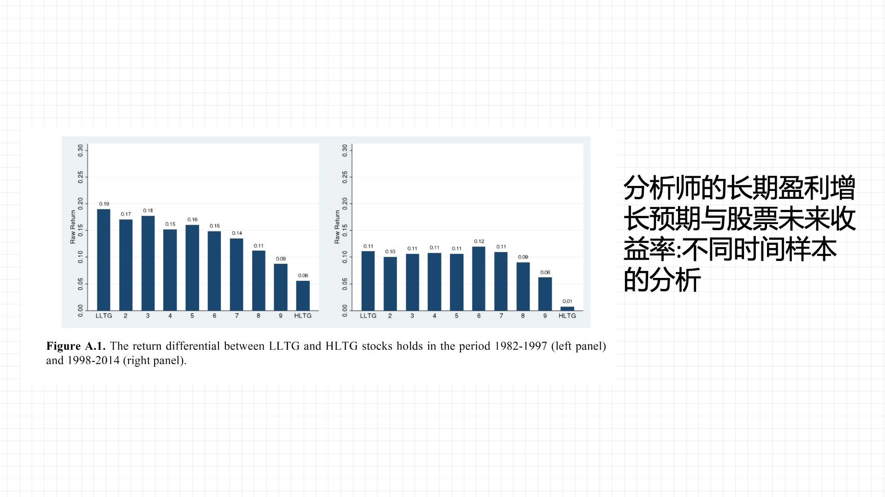

分析师长期看好的股票，也就是分析师觉得长期盈利增长率比较高的股票，它将来的收益率，反而没有分析师觉得长期盈利增长率比较低的股票高。

为什么会有这种现象呢？这可能是分析师的一个代表性偏差的体现，因为分析师也是人，他也会有代表性偏差。那下面我们看看他的代表性偏差是怎么体现的？先看看他的预期是怎么形成的。我先假设两个例子，这当然是我创造出来的例子。

假设 A 这个公司过去连续五年，盈利增长率都是 20%，非常高。由于代表性偏差，这些分析师大多数都会觉得 A 公司将来的盈利增长率还会很高，可能没有 20% 那么高，但是可能也有 15%。所以分析师觉得 A 公司的长期盈利增长率是 15%。

我们现在再看公司 B，可能是因为它过去盈利增长率都很低，比如说只有 1%，由于代表性偏差，分析师觉得它将来的盈利增长率也会很低。但是可能没有它过去那么低，过去那么低可能也有一部分原因是运气，所以分析师就觉得它将来的盈利增长率可能是 5%。

那你看将来会发生什么事？由于没有太多热手现象，所以平均来讲，可能 A 公司的盈利增长率没有 15%，只有 10%，没有你想象中那么高。

对公司 B 来讲，它的盈利增长率可能不是 5%，而是 8%，8% 没有 10% 高，但是它也没有你想象中的那么低。明白了吗？由于代表性偏差，对 A 的预期过高，对 B 的预期过低，那将来下一个季度、再下一个季度，不停地会有盈利公告出现，盈利公告一出来你发现，A 没有你想象中的那么好，B 没有你想象中的那么差。

虽然平均来讲，A 的盈利增长率确实比 B 高，但是没有你想象中那么高，就会导致 A 的盈利公告一出来是个坏消息，B 的盈利公告一出来是个好消息。所以盈利公告出来之后，公司 A 平均来讲会跌，B 的话反而会涨。分析师并没有完全错，因为分析师预期长期盈利增长率高的公司，确实是更高的，一个是 10%，一个是 8%。

但是在股票收益上，因为股票是对将来预期的反应，那些分析师预期增长率特别高的公司，现在股价已经太高了，所以它将来的收益率反而会偏低；那些分析师不看好的公司，它现在的股价太低了，它将来的收益率反而会偏高。

所以说**这就导致一个简单的策略，你买入那些分析师长期不看好的公司，卖空分析师长期看好的公司。**这是 1997 年的一篇学术论文的研究，在早期基本上每年大概能产生 20% 的收益率。在发表之后，从 1998 年到现在，这个策略基本上每年挣的钱也就大约 10%，有时候还不到。这是很正常的，因为这个论文很有名，这个策略一出来，很多人在用，那么这个策略就没有那么容易挣钱了。

那现在的问题就是说，怎么才能利用我们学的东西，把这个策略进一步改进，化腐朽为神奇？这就跟前面讲过的盈利公告后价格漂移有点像。

如果这个策略能挣钱的原因是由于分析师的代表性偏差引起的，那我们要做什么呢？我们要找到分析师代表性偏差最强的时候，那这个时候你的策略就应该最管用，因为这个原因最强，结果就应该最强了，对吧？

每个公司都有很多分析师跟踪它，但分析师是不同的人群，不同的公司有不同的分析师，不同分析师的代表性偏差是不一样的。因为代表性偏差是人的一个特征，不是所有人都有一样的偏差。那我们可以去找出一拨公司，它们的分析师的代表性偏差特别强；再找出另外一拨公司，这拨公司的分析师的代表性偏差特别弱。

那怎么去找出这些分析师的代表性偏差呢？这里面就涉及到数学上很多复杂的回归分析，我就不讲了，我就把这个直觉讲给你们听。如果一个公司过去表现好，分析师立马就觉得它将来表现好，那就说明他非常有代表性偏差。如果这个公司过去表现好，分析师觉得将来表现不一定会那么好，那他的代表性偏差就弱一点。基本上就是这个思路，你可以用回归分析的方法，把这个系数给估计出来。对每个公司，你都可以估计出这个分析师的代表性偏差有多大。

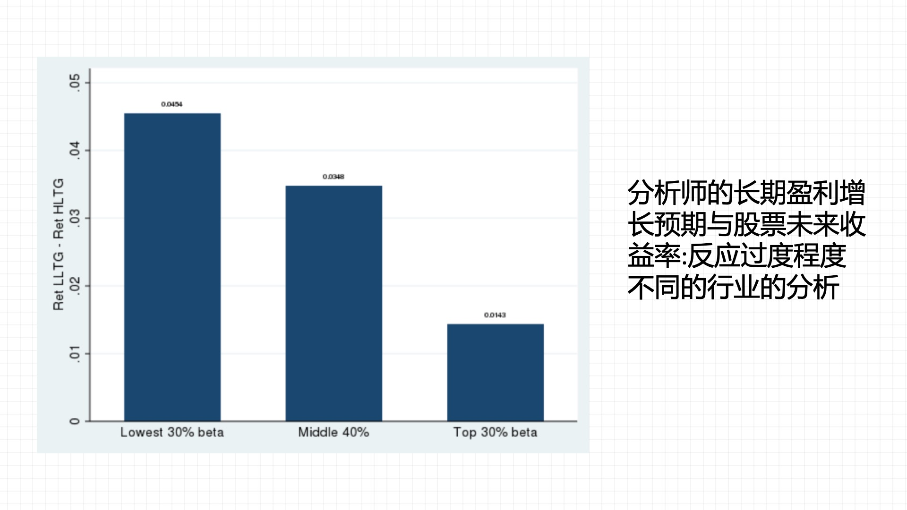

那估计完之后，我们可以找出一拨公司，或者一拨行业，这拨行业里面的分析师的代表性偏差特别强，另外一拨行业分析师的代表性偏差比较弱。那我们能发现什么结果呢？你在分析师代表性偏差弱的那拨公司里面去做刚刚那个反转策略，买入分析师最不看好的股票，卖空分析师最看好的股票，你这个时候收益率会比较低。

但是如果你在分析师代表性偏差最强的那些公司里面去做同样的事情，买入分析师最不看好的股票，卖空分析师最看好的股票，这个时候你的收益率会翻三倍。所以说，由于分析师代表性偏差比较强，这个效果就更加大，然后导致这个策略的收益率更高，翻了三倍。

所以，我们理解了这个策略能挣钱的根源，我们才能去改进这个投资策略。一般没有学过这么系统的行为经济学的人，是很难去改进这个投资策略的。

## 总结

好，总结一下这节课讲的内容。

*   首先，我给你讲了代表性偏差的定义。
    
*   第二，给你介绍了生活中两个非常有名的现象，其实就是代表性偏差引起的，这两个现象就是赌徒谬误和热手现象。从热手现象我们会发现，大多数时候我们低估了运气的重要性，从而高估了能力。
    
*   第三，我们介绍了代表性偏差引起的在股票交易行为的一个现象，就是追涨杀跌。从追涨杀跌中，我们可以推出两种交易策略，一个是择时的策略，择时基本上就是跟散户反着干，当散户都进来的时候你就要出去，当散户都出来的时候你要进去，这跟巴菲特说的话很像，这是择时。
    

还有一个是选股的策略，选股的策略基本上就是跟分析师反着干，分析师长期看好的股票你反而不要买，要卖空；分析师最不看好的股票你要买进，这个策略可以产生一定的收益率。同时我们也讲了怎么去改进这个投资策略。

下一讲我会讲你可能听过的一个概念，叫锚定效应，但是我会破解你对锚定效应的很多误解。

作业：我们身边还有哪些热手现象？它是真的还是假的？欢迎举例子。

我是余剑峰，咱们下节课再见。

\\1. 我们总是默认某些事有特别的特征，但事实并不是这样，这就会产生代表性偏差。 2. 过去表现特别好的基金，它将来的收益率并不一定高，追涨杀跌并不会给你带来额外的收益率。 3. 一个选股策略：基本上可以跟分析师反着干，分析师长期看好的股票你反而不要买，要卖空；分析师最不看好的股票你要买进。

# **第 9 讲 | 锚定效应：随机数会影响你的判断么？**

[懒人专属群的群友](https://lazybook.fun/#/blog/group)，你好，欢迎来到清华五道口《行为经济学》的课堂，我是余剑峰。

前面我们介绍了两个导致人的预期偏差的因素，一个是有限注意力，一个是代表性偏差。今天我们要介绍第三个因素，叫做锚定效应。

锚定效应估计你多少也听说过一点，因为很多通俗读物都对这个锚定效应有点介绍。一个最常见的应用其实就是在商场里面的衣服打折，有时候很多衣服原价是 999 元，现在降价降到 666 元。这个 999 元就是一个锚定点，相比这个锚定点，衣服降价了三分之一，那你会觉得这件衣服原本的质量很高，现在便宜了很多，然后你就很容易去买这件衣服。

这当然没错了，但是如果你只知道这个，那你可能把锚定效应的效果看得太小了，锚定效应的效果可能超出你的很多想象，千万不要以为只有像 999 元这样有信息的参照点，才能作为一个锚定点。我回头会讲很多随机的、完全没有信息的参照物，它也可以成为你的一个很重要的锚定点，而且对你预期的判断影响会非常地大。所以这一节，我们要把锚定效应彻底地讲明白。

## 锚定效应怎么产生影响

下面这个实验是我经常在班上做的。 比如说我的班上有 60 个学生，我让每个学生拿出一张白纸，写下他的电话号码的后面三位数字，然后再加上 700，等于一个总数。如果你的电话号码后面三位数字是 100，那它的总数就是 800；如果你的电话号码后面三位数是 900，那你得到的总数就是 1600。当然你的答案不要给别人看。

然后，我再问他们一个问题，你觉得宋徽宗和宋钦宗被金国抓去的那个年份，要比刚刚那个总数大还是小？如果你的电话号码后三位的数字是 100，你知道宋徽宗和宋钦宗被抓去的年份肯定应该比 800 要大，对吧？因为这是宋朝的事嘛。

但是如果你的电话号码后面三位数是 900 的话，那你应该也知道，宋徽宗和宋钦宗被抓去的年份应该比 1600 要小，因为 1600 都快到明朝、清朝了，这肯定是不对的。你写下大还是小的答案，统计完这个答案，然后我再问下一个问题，你觉得宋徽宗和宋钦宗是哪一年被金国抓去的？每个人写下自己的答案，然后我再统计他们的结果。

我把这 60 个人按照他们的电话号码排个序，分成电话号码大的一组和电话号码小的一组，比如说小于 500 的就是小的一组，大于 500 的就是大的一组，平均每组 30 个人。然后再统计电话号码小的那一组，得到宋徽宗和宋钦宗被抓去的年份平均是多少；电话号码大的那一组，得到的年份平均是多少，你猜结果会怎么样？

基本上电话号码大的那一组，猜的宋徽宗和宋钦宗被抓去的年份要偏大；电话号码小的那一组，会偏小。这个差别每次大概在 100 左右。这是一个挺大的数字，你想，就是因为那一组电话号码大，他们猜的宋徽宗和宋钦宗被抓去的年份就会大 100。我们大概知道宋徽宗和宋钦宗被抓去的年份，但是哪怕你大概知道，你还会受你的电话号码的影响。

这个锚定效应就比刚刚在商场里面看见衣服打折的效果感觉要奇怪很多，为什么奇怪呢？因为在这个实验里，你的电话号码后面三位数字是没有任何信息的，它跟宋徽宗和宋钦宗被抓去的年份其实是完全不相关的。但是你看，你对宋徽宗和宋钦宗被抓去的年份的估计，受到一个完全不相关的数字的影响。

但是前面的例子是不一样的，999 元真的是反映了这个衣服的质量和品质的特征，它是有信息的，你受到一个有信息的东西的锚定点的影响，这是比较合理的。但是在我的这个例子中是没有信息的，你都会受到很大的影响，所以这是一个非常奇怪的效果。

请注意，我再重复一下，即使刚刚那个信息是没有任何用的，哪怕是个随机数，它也会影响到你对一些事物的判断和估计，而且你可能自己都没意识到受这些不相关信息的影响。比如说刚刚那些人，我让他们去估计宋徽宗和宋钦宗被抓去的年份，绝大多数学生都没有意识到，自己的判断受到了前面电话号码的影响。

我稍微讲一下形成锚定效应的过程，先问一下你的电话号码的后三位是多少，加上 700 的总数等于多少。然后一定要问，你觉得宋徽宗和宋钦宗被抓的年份是比这个数字大还是小？**只要问了这个问题，刚刚那个总数就变成一个锚定点，下面你再去估计出宋徽宗和宋钦宗被抓的年份，就会从这个锚定点开始，然后这个锚定点就会对你的判断产生影响。**

比如说如果我让你去估计一下沪深 300 一年之后会是多少点，你会从哪儿开始下手？绝大多数人都会先看一下，今天沪深 300 是多少点。这个数字就是你的初始点，是锚定点，这当然是有信息的，跟我们的电话号码不一样，这个有信息的点是你的锚定点。

然后你会判断一下，一年之后这个形势会怎么样，这个贸易战打得怎么样，我们中国的经济形势会怎么样。如果你比较乐观的话，就会往上调一点；如果你非常悲观的话，就会往下调一点，但是这个初始点是一个锚定点，非常重要。

下面我要讲一个丹 · 艾瑞里常有名的实验，也非常惊奇，当时他还在麻省理工做教授，现在他在杜克大学。当时他在麻省理工雇用了很多本科生、硕士生来他的实验室做实验，因为这些本科生、硕士生都有社会安全号码，就像我们的身份证号一样。

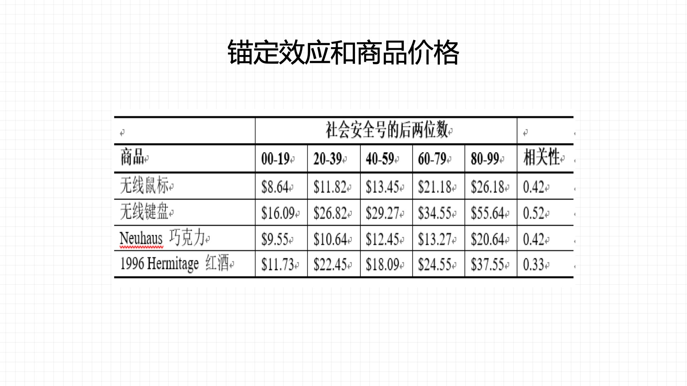

他先让每个学生写下他们的社会安全号码后面两位数字，有的很小，比如说 01；有的很大，比如说 99。那再问他们，愿不愿意付你的社会安全号码后面两位数字这个价钱，去买下面这些商品，比如说一个无线鼠标、无线键盘、红酒和巧克力。当然如果你是 99，你就不会愿意付 99 块钱去买这个无线鼠标；但是如果你是 01，你可能就会愿意付这 1 块钱，去买这个无线鼠标。这是第一个问题。

第二个问题就是，你愿意付多少钱去买这些商品？然后你再把这些人按照社会安全号码的大小分成五组，第一组是 00 到 19，第二组到 20 到 39，最后一组是 80 到 99。最后你发现什么结果呢？

**基本上社会安全号码最小的那一组，他们买无线鼠标、无线键盘、巧克力、红酒愿意付的钱远远要小于社会安全号码最大的那一组，有的小两倍，有的小三倍，有的甚至小四倍。**

你看看，这个社会安全号码对你愿意付多少钱去买商品的影响是极大的，差了三四倍。比如说在无线鼠标这个商品上，社会安全号码最小的只愿意付 8.64 元，社会安全号码最大的愿意付 26 块多钱，这样差了三倍。

到这里你可能会有疑问，是不是社会安全号码大的人，或者电话号码大的人，他们每次去买东西都愿意付更多的钱？这岂不是很惨，对他们很不公平？其实不完全是这样，有两个原因。

**第一，如果你去超市买东西，价格都是固定的。**哪怕你去菜市场，比如说买条鱼，它基本上也是没有太多效果的，除非卖鱼的大爷每次问你，剑峰，你的电话号码最后两位数是多少？我说是 99。他说，那你愿不愿意付 99 块钱买这条鱼？我说不愿意。那他再问，你到底愿意付多少钱买这条鱼？

**第二，如果他每次都问这个问题，那我可能真的会愿意付更多的钱买这条鱼，但是没有人会问这个问题。**

在实验室里面，你的社会安全号码会对你有影响，但是并不代表这个锚定效应没有很多具体的应用。

我记得跟你讲过，有些证据证明是没有热手现象的。但是哪怕你看到这个证据，你还是相信会有热手现象，这其实是锚定效应的一个体现。因为你开始就有一个观点，就是有热手现象。我拿来一个新的证据给你看，你还是锚定在以前的观点上面，还是觉得会有热手现象。

人都是这样的，自己先有一个观点，来了新的信息，一般来讲你还是不愿意去改变之前的观点，。那这样的话，就会导致你初始的观点就像一个锚一样，把你死死地锚在那里，然后你的观点很难改变。即使最开始那个锚有可能都是随机的，就像前面你的社会安全号码，都会对你的观点有重大的影响。

我再说下面一个实验，这个实验是香港中文大学（深圳）王健教授当时在他的班上设计的，后来我也在一些班上用过。这个实验基本上是理查德 · 泰勒早期的一个经典实验的改进，早期理查德 · 泰勒只是问一个问题，我们把它改成两个问题，你看一下。

理查德 · 泰勒这个经典问题的答案你估计也知道了。因为理查德 · 泰勒拿诺贝尔奖之后，他的很多问题都已经在网上出现了。答案就是大多数人都会过度自信，高估自己的 IQ。正常来讲你问所有的人，应该有一半人认为自己比平均水平差，一半人认为比平均水平高，对吧？但是答案是大多数人都会认为自己比平均水平高。

但这不是重点，我们把这个问题放在两个班上面。

A 班和 B 班。有 5 个选项，A 是远低于平均水平，B 是低于平均水平，C 是平均水平，D 是高于平均水平，E 是远高于平均水平。问两个班的问题是一样的，答案是一样的，选项也是一样的，唯一的区别就是把答案的选项倒一下，你会看到第一个答案可能就变成一个锚定点。

那答案的分布大概是什么样的？

*   A 班先看的是 E 选项，远高于平均水平。
    
*   B 先看的是远低于平均水平。
    

在 A 班，90% 的人选的是远高于平均水平和高于平均水平，只有两个人选的是平均水平，基本上没有人选择远低于平均水平和低于平均水平。

但是在 B 班，就完全不一样。绝大多数人选的是平均水平，因为 B 班先看的是远低于平均水平。当然还是有挺多人选的是远高于平均水平和高于平均水平，但是也有一部分人选低于平均水平和远低于平均水平。哪怕给 B 班先看的是这样的选项，他们还是稍微过度自信一点，但是过度自信的程度远远小于 A 班。把答案调换一下，这就会有很大的应用。

下面是发生在我自己身上的事情。我自己当时是先到美国念了概率统计的硕士，后来在沃顿商学院念了金融博士。博士毕业之后，我就去美国明尼苏达大学卡尔森管理学院做教授，我中间不停地搬家，后来又回国，来到清华五道口，还回过广东、深圳，回国也是不停地搬家。

但是每次我不管搬到哪儿，沃顿商学院的校友会总是能找到我，连我妈都不知道我搬到哪儿去。那这些校友会的人找我干什么？当然不是问我最近是不是很健康，学术论文发得怎么样。他们其实最关心的问题是，看看我能不能给沃顿捐点钱。但是我是个老师，又比较穷，所以他们也没有期望我捐太多。

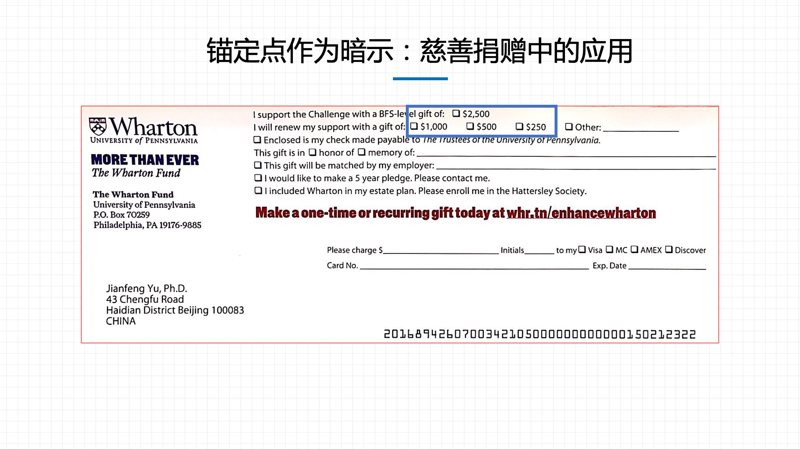

但是在他们给我寄的一个捐款的单子上面，我发现一个非常奇怪的现象。一般来讲，捐钱的顺序是从小到大的。他们给我的顺序是，第一个选项是 2500 元，第二个选项是 1000 元，第三个选项是 500 元，第四个选项是 250 元，第五个选项是其他。你可以自己选，填个数字。他们把顺序变了，我觉得这是非常聪明的做法。

当你先看到第一个数字是 2500 元，这个时候你再想捐 1000 块钱，可能就觉得不太好意思，是不是钱太少了？2500 元变成一个锚定点，这个锚定点很大，很重要。后来我发现，不光是沃顿这么做，很多慈善机构都这么做。

把这个顺序调换一下，锚定效应的作用会使得你捐钱的数量可能就完全不是一个档次。

## 买房中的锚定效应

前面讲的这些生活中的锚定效应，你会想，都是小的决定，所以影响会有点大；但是是不是重大的决定，它的影响也会大呢？或者说你是一个专业的人，也会受影响？

下面讲一个例子，如果是在你人生中特别大的决定，而且你是专业的人，可能也会受影响。这个例子是很早以前在一个偏僻的农村里面做的一个实验，做实验的人假装去卖房子。对来买房子的人来说，这是一个很重大的决定，这可能就是他们人生中最大的一笔投资。关于房子所有的信息都有，旁边的学校、警察、这个房子是什么时候建的、用什么材料建的、什么时候维修过，什么信息都有，厚厚的一叠。

然后他特别告诉来买房子的人，我这个房子信息都在这边，但是我还要给你一个房子的标价。正常来讲，卖房子的人给个标价就完了，但是因为这是做实验，所以这个做实验的人就故意说，这个标价其实没有太多意义，你应该看一看这个房子的相关信息，然后你自己出一个价钱来买这个房子。

那这个时候，就把业余的人分成四组，专业的人分成两组，因为专业的房地产经纪人没有那么多。

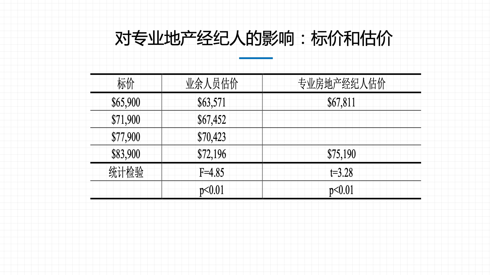

业余的第一组看到的标价最小，最后一组看到的标价最大。看到标价最小的那组业余的人，愿意付的钱就更少。那锚定效应导致这个价格差别是多少呢？差别基本上是 10%～15% 之间，非常大的一个数字。比如说如果标价是 6.59 万的话，业余人员给的估价是 63571 元；但是如果标价是 8.39 万的话，业余人员给的估价是 72196 元，相差非常大。

那对专业人员也有类似的效果，如果专业人员看到标价是 6.59 万的话，专业人员给的估价是 67811 元；但是专业人员看见的标价是 8.39 万的话，给的估价是 75190 元，专业人员受的影响稍微小那么一点点，但是总的来讲影响也很大。

但这里面千万不要想错了，不是说你给的标价越高，大家就愿意付更多的钱，你的标价要在一个合理的范围内。如果你直接标价一百万，那可能很多人就非常生气，觉得不公平走掉了。但是如果你的标价在合理的范围内，很多人就会受这个标价很大的影响。

这个问卷调查最后还有一个非常有意思的问题，问他们最后给这个房子的估价，有没有受到这个标价的影响。基本上所有这些业余的人都会在后面勾一下，表示自己的估价其实受到这个标价的影响；但是基本上没有一个专业的人会在后面勾一下，专业的人都认为自己给的估价就是根据房子的信息作出的，没有受到标价的影响。他们是明显过度自信，或者是不愿意承认自己受到标价这个锚定效应的影响。

## 为什么会有锚定效应

好，到这里我相信你对锚定效应已经有一个非常清楚的了解，一般来讲，在一般的行为经济学的课里面讲到这里也就差不多了。但是下面我还要更进一步，为什么我们会受这种随机数的影响？

这其实不是一个简单的问题，当时在 1974 年左右，卡尼曼和特沃斯基发现了这个锚定效应，这个论文发表在《科学》杂志上。但是他们只是看到这个现象，并不知道根源，过了很多年之后，有几个德国心理学家才得出了一个结论，觉得是下面这个根源。

这几个德国心理学家提出一个概念，叫做 Priming Effect，我把它翻译成 “启动效应”，什么叫做启动效应呢？从他们做的实验里面就能体现出来。问的问题基本上是一样的，也是把人分成两组，问德国全国全年的平均温度是多少。

有一组看到一个很低的温度，比如说 0 度；然后另外一组看到一个很高的温度，比如说 30 度。然后同样问，你觉得德国全国全年的平均温度比你看到的温度要高还是低呢？那看到低温度的一组肯定说要比这个低的温度高，看到高温度的一组说要比这个高的温度低。

那再问，你觉得德国全国全年的平均温度是多少？他们每个人给出了一个数字，看到高温度的那一组给的估计偏高，看到低温度的那一组给的温度偏低。这跟以前都一样。

为什么会这样？他们猜是因为启动效应，是因为那些看到高温度的人，脑子里面想到的场景可能就是德国夏天的场景；看到低温度的人，想到的场景可能就是德国冬天的场景。

那你怎么才能证实我的脑子里面想什么，这是最难的。这也是他们这个实验里面最精髓的一个部分。他们怎么做这个实验呢？他们让所有人都看电脑的屏幕，这个屏幕上有密密麻麻的单词，每个人看的屏幕都是一样的。然后在你眼前晃两秒钟，让你写一下你刚刚看到的五个单词。

看到低温度的那些人，就很容易写下比如 “下雪”、“溜冰” 这些单词；但是看到高温度的那些人，他们就很容易写 “出汗”、“游泳” 这些单词。所以说你看，虽然这些人看到的屏幕是一模一样的，但是他们写下来的东西是完全不一样的。

这也间接地证明了他们脑子里面想的东西是不一样的，因为他们的注意力可能就已经放在夏天或者冬天的场景里，这样才容易想到夏天或冬天场景里的这些东西。所以导致前面说的，看到温度就形成了一个启动效应，让你想到不同的场景，然后直接导致你对德国全国全年的温度有不同的判断。

## 教你一招：利用锚定效应提高收益

接下来要讲这节课最重要的，锚定效应在股票投资中的应用。

还记得前面我们讲过一个现象，就是公司不停地发布盈利公告，有好消息的公司，比如说盈利能力强的公司，它将来 60 天的收益率还会很高；盈利能力比较弱的，有坏消息的公司，它将来的收益率还是会很低。我们还讲了一个改进它的策略，比如说你在星期五做这个策略，很多公司同时发布盈利公告。这个策略能挣钱的原因是由于大家的有限注意力。

下面我告诉你，这个策略能挣钱的另外一个原因，可能是由于大家的锚定效应。为什么是锚定效应？这里面细讲一下，前面讲的是一个消息出来了，有些人没注意到，所以说好的消息将来会继续好。但是哪怕所有人都注意到了，如果他们还锚定在过去的盈利上，那么对将来的盈利能力的估计可能就会错了。

比如说一个公司，大家本来觉得它的盈利能力是 5 块钱一股，但是这个季度一个好消息出来，它的盈利能力是 10 块钱一股。如果有人没注意到，它现在就只能涨一点点，但将来还会继续涨，这是一个原因。

另外一个原因是，大家都注意到了，但是他们对公司将来盈利能力的估计还停留在过去的水平上，因为可能过去平均就是每个季度 5 块钱一股。但是现在这个季度涨了，不光是现在这个季度涨，可能将来每个季度都会涨一点。

由于锚定效应的效果，你觉得将来可能大概会涨一点点，比如说 5.5 元一股，但是可能将来平均是 6 块钱一股、7 块钱一股，但你还锚定在过去的平均盈利能力上，你锚定在 5 块钱上，只往上调了一点点，调到 5.5 元。那这样的话，你调得不够多，这样导致将来它还是会有好消息，将来的收益率还会高。

所以锚定效应可能也会导致有好消息的股票将来会继续涨，有坏消息的股票将来会继续跌。哪怕所有人都注意到这个消息，不存在有限注意力，它还会存在这种结果。

那我们怎么才能利用这个结果，去改进我们的投资策略？你想，如果刚刚那个策略能挣钱的一个原因，是由于大家有锚定效应，那一样，我们可以把公司分类，有的公司的分析师的锚定效应比较强，另外一些公司的分析师的锚定效应比较弱，因为不是每个公司分析师的锚定效应都是一样的。

那我们假设有三千个公司，我们先选出一千个，它们的分析师锚定效应比较弱，再选出另外一千个，它们的分析师锚定效应特别强。**如果我们在锚定效应特别强的那一千个公司里面去做这个策略，就是我买进有好消息的股票，卖空有坏消息的股票，那这个时候你的策略的收益率可以高出很多。**

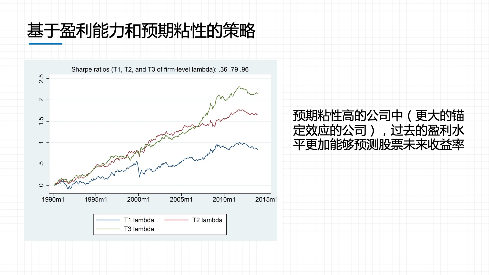

如果我们看 1990 年到 2015 年的数据，在锚定效应最小的那些公司里面去做刚刚说的这个策略，买进有好消息的股票，同时卖空有坏消息的股票，在这 26 年中，收益率只有 80%。但是在分析师锚定效应最强的那一组公司里面，去做刚刚一样的策略，收益率是 220%，你能看到这个效果是差很多的，因为这个策略的容量是很大的，换手率比较低。

所以这里面主要的一个思想就是，我们先找一个策略能挣钱的原因，可能是有限注意力，可能是锚定效应，这里面我们猜锚定效应是其中一个原因。然后再根据这个原因，我们找原因最强的那一组去做这个策略，刚刚讲的这个研究结果是在美国金融协会会刊《金融学杂志》上发表的一篇最新的论文的结果。

## 总结

好，今天的内容就讲到这里，我再稍微总结一下。我们讲了锚定效应的定义。

*   首先，我们的观点特别容易锚定在过去帮助我们形成观点的那个信息上，哪怕新的信息来了，你也不太愿意改进。
    
*   第二，很多时候这个锚定效应你都没有意识到，你会受一些无关紧要的信息影响，你自己完全不知道。
    
*   第三，我们讲了锚定效应的根源，一个最重要的根源就是启动效应。
    
*   最后，我们讲了锚定效应的各种应用，尤其是在二级市场中的应用，可以改进投资策略，把投资策略的收益率从 80% 提高到 220%。
    

作业：今天我们讲了锚定效应的根源之一可能是启动效应，其实启动效应比锚定效应更容易被广泛应用，你动动手，查一查它有哪些更有意思的应用。

下一讲，我会讲一个更加普遍的现象，就是人们会高估自己的能力。

我是余剑峰，咱们下节课再见。

\\1. 因为锚定效应，因此我们会受到无关，甚至是随机的数字影响，导致我们的判处出现偏差。 2. 导致锚定效应的根源是启动效应。 3. 一个策略：如果在锚定效应特别强的公司里面，买进有好消息的股票，卖空有坏消息的股票，有可能提高你的收益率。

# **第 10 讲 | 过度自信：自信到底是好是坏？**

[懒人专属群的群友](https://lazybook.fun/#/blog/group)，你好，欢迎来到清华五道口《行为经济学》的课堂，我是余剑峰。

前面几节课我们讲了几个偏差，比如说有限注意力、代表性偏差和锚定效应，在这些课之前，可能你们都没有听说过这些偏差。

这节课我们要讲一个偏差，估计大多数人都犯过这种错误，就是我们会高估自己的能力，也就是说过度自信。但是今天我讲的内容可能跟你想象中的不一样，我们要强调过度自信虽然会让你犯错误，但可能更多的时候是给你带来各种好处，它带来的好处甚至会比带来的坏处要多一点点。

这一讲我会先讲过度自信产生的原因，以及它正反两面的效果，我会讲在哪些情况下它的效果是正面的，哪些情况下效果是负面的。最后我会讲过度自信在你投资中的影响，给你的投资带来损失还是带来收益。

## 为什么会过度自信

过度自信的例子太多了，大多数人都高估自己的各种能力，比如说你的开车能力，你的 IQ，尤其是男同学对自己的 IQ 更加过度自信，女同学当然对自己的颜值更加过度自信。那为什么我们会产生这些过度自信？过度自信的根源是什么？产生过度自信的原因非常多，这里面我只讲几个重点。

**首先大家有一个偏差，叫做自我归因偏差，**就是说有一个好的结果出现了，你觉得是自己的能力比较牛；如果坏的结果出现了，你就觉得是自己运气不好。比如说你炒股，一旦挣钱了你就觉得自己是股神，但是一旦亏钱了，你就觉得运气不好。

如果是反过来，比如说有好的结果总是觉得自己走了狗屎运，有坏的结果觉得是自己能力太差，这种人肯定是一种非常悲观的人，估计已经被淘汰掉了。所以我们很多人都会有自我归因偏差，自我归因偏差也是导致过度自信的原因之一。

**第二个原因，其实人有一种证实偏差，**与前面讲的锚定效应类似，就是说你一旦有一个观点，你可能会主动去寻找或者只记得那些跟你观点一致的证据。比如说我们看微信上的很多帖子，那你会选择看哪些帖子呢？一般来讲，你会看那些跟你观点一致的帖子，那里面会提供更多的证据去支持你的观点，这样的话你对你的观点会更加深信不疑，就会过度自信。

但是同时，有些帖子跟你的观点是反的，你可能就不看了，因为你的精力有限，这样长久以来，就会导致你更加过度自信。

**还有一个更加有意思的原因，叫做控制幻觉，**就是本来有些东西你根本没有控制力，你控制不了，但是你觉得你能控制。如果你觉得你控制不了的东西你都有控制力，那你当然会对自己的能力更加过度自信了。

下面讲一个很有意思的实验，它证明了很多人确实是有控制幻觉的。这个实验非常简单，就是打赌扔硬币，正面是你赢，反面是我赢，但是赌资的多少由你决定。

现在把做实验的人分成两组来打赌，第一组的人，比如说就像我这种，看起来就很聪明，过来跟你赌。然后你一看就被吓到了，这哥们儿很聪明，我跟你赌小一点，可能只赌五块钱一次。那现在我再换另外一拨人过来，比如说他行动缓慢，你一看这个哥们儿智商就比较低。那你想，这个人智商比较低，我要跟他赌大一点。

其实都是扔硬币，你根本没有控制硬币的能力，但是你觉得你有控制的能力，这是控制幻觉的一个体现。

好，刚刚讲了过度自信的三个原因，第一个叫做自我归因偏差，第二个叫做证实偏差，第三个叫做控制幻觉。

除了这三个原因之外，**我觉得有一个更重要的原因，导致大家过度自信，可能是因为人本性就特别喜欢作因果关系的推断，**你看到一个统计规律，就觉得这是一个因果关系。因为只有因果关系，你才觉得这个东西有道理，前后一致，那你自然会对这个东西更加地过度自信。

比如说在当年，萨达姆被抓的当天，你看彭博社的头条写的是什么？

头条上写着 “美国国债上涨，萨达姆被抓不能阻止恐怖活动”。这个很正常，你想如果萨达姆被抓不能阻止恐怖活动，大家就更加危险。更加危险的话，大家就要找避险资金。找避险资金的话，国债最安全，所以导致国债上涨。

但是半个小时之后，特别奇怪的事情发生了，这个时候你看头条是怎么变的。

“美国国债下跌，萨达姆被抓，增强了对高风险资产的需求。” 这个完全打脸了，开始是上涨，后来又下跌，都是由于萨达姆，开始是萨达姆导致大家觉得不能阻止恐怖活动，现在又导致大家更加喜欢高风险的资产，这不是自相矛盾吗？半个小时就全变了。

为什么会这样？因为萨达姆被抓，就是当天最大的新闻、最大的事情，那股票市场上或者债券市场上，不管是涨还是跌，一定是由于这个事件引起的，所有人都会这么认为。所以说这个事情一定是原因，大家就喜欢作这种因果关系推断，看见没有？

当你看见这种现象，不管什么民族、什么文化都有过度自信的时候，你一定要想它深层次的原因，不光是刚刚那四个表面的原因。

**深层次的原因基本上我们的想法就是进化论的原因，**一定是因为以前的过度自信，帮助过我们生存和繁衍后代，才导致我们现在普遍都过度自信。那为什么在进化的过程中，过度自信能够帮助我们生存和繁衍后代呢？

其实在严格的数学模型中，爱丁堡大学的多米尼克 · 约翰逊教授早期有个论文，就证明了在资源有限的这种情况下，过度自信是能够帮助我们生存和繁衍后代的。当然那是数学模型，我就不给你看证明过程了，我直接给你讲一个生活中的例子，你可能就更加明白了。

如果你是一个女生，现在找配偶选男生，你是喜欢那些特别悲观的、天天抱怨生活的男生，还是喜欢相对特别自信的、特别乐观向上的男生？哪怕他有时过度自信。我觉得大多数女生还是会喜欢那些乐观，甚至有时候过度自信的男生。

同样，男生对女生的选择也是类似的，你不喜欢天天抱怨生活的女生，所以说这都是双向选择。基本上来讲，过度自信可能会使得基因传下来的概率稍微高一点。

其实过度自信帮助我们生存，帮助我们繁衍后代，也有一些生理原因。还记得我们前面讲过的多巴胺吗？多巴胺是什么？你们回忆一下，多巴胺就是我们对将来奖赏预期的一种反应，如果你觉得将来会有很多奖励，会有很多收益，你现在就会分泌很多多巴胺。当你分泌很多多巴胺的时候，你会有很大的动力去努力工作。

比如说在远古时期，我们在路上走，看见一只鹿在你眼前跑，鹿跑得很快，可能你真正能追到这只鹿的概率是 1%，很低。那你预期的奖赏其实就很低。但是假设由于你过度自信，你觉得你能追到它的概率是 50%，这个时候你对奖赏的预期就很高了，你分泌的多巴胺可能就会更多，你会有更多的动力去努力追这只鹿。由于这个结果，所以导致你最后真的追到这只鹿的概率，可能就提高了。那这样在资源有限的情况下，你生存的概率当然会更高了。

当然，过度自信可以帮助我们，不光是在远古时期追这只鹿，在现实生活中也有很多其他例子。比如说我们创业，其实创业成功的概率很低，假设是千分之一，但是每个创业团队可能都认为自己创业成功的概率很高，就像打了鸡血一样。为什么？因为他们觉得创业成功的概率很高，就会分泌很多多巴胺，对将来奖赏的预期很高，就会给他们很大的工作动力。

如果你去跟投资人说，我创业的这个项目成功的概率也就千分之一，其实也没有那么能挣钱，这样你肯定拿不到钱了。但是如果你自己觉得成功的概率真的是很高，你可能会感染投资人，感染你的员工，你自己会更加努力工作，那成功的概率当然就会更高。所以说很多时候过度自信，尤其是当你的过度自信改变你的行动，行动改变你的结果的时候，过度自信是好的。

下面我讲一下杜根定律，杜根定律是说自信是怎么改变你最后的结果的，自信决定你的成功，你越自信，成功的概率就越大。你可能觉得，余老师在给我灌鸡汤，我觉得不是这样的，我是有科学依据的，不像网上的很多鸡汤。网上那些鸡汤千万不要乱看，有很多研究表明，老在朋友圈发鸡汤的这些人容易上当受骗，智商还有点偏低。

但是我现在讲的是科学的鸡汤，这个过程大概是这样的。在两千多年前，古希腊那个时候有很多人跑步，当时人类就有一个追求，希望四分钟能跑完一英里，但是怎么跑也做不到。最后古希腊人想尽各种办法，比如说在这个运动员后面放一只狼追着他跑，结果还是做不到。

做不到之后，就有很多专家、科学家出来了，在理论上证明人的骨骼、结构这些东西使得人永远做不到这一点。所以说两千多年来大家都认为人类的极限就是做不到这一点，因为我们的科学家都已经证明了我们的骨骼结构不行。

但是有一年，有一个人，我也忘了他的名字了，他说他做到了四分钟跑完一英里。有意思的事情发生了，接下来的一年中，据说有好几百个人做到了四分钟跑完一英里。看见没有？相信就能做到。

那为什么相信就能做到，就能提高你的跑步水平？一个最重要的原因是预期改变你身体的荷尔蒙的分泌、激素的分泌、多巴胺的分泌。你也知道，运动员是不能吃激素的，吃激素是违法的，因为吃激素能让运动员跑得更快。但是你现在不用吃激素，如果你相信你的身体分泌的东西不一样，就相当于你吃了一点激素，那这样的话导致你跑得更快。

## 过度自信也会带来灾难

讲了这么多过度自信的好处，千万不要以为过度自信只会带来好处，过度自信也会带来很多灾难性的东西。比如说在股票市场交易中，你是改变不了结果的，什么叫做改变不了结果？比如说你非常过度自信，听了一个专家说阿里会涨，那你就买了很多阿里的股票，比如说买了一百万元。

但是阿里的股票价格、将来的盈利不会因为你买了这一百万元而有任何的改变。它不像创业，你天天努力工作，可能真的能改变结果。那这样的话，你可能就犯错了，因为你改变不了这个结果，可能就会导致你输钱。

我们看一些具体的数据分析，下面讲的很多证据都是来自早期特伦斯 · 奥丁，现在在伯克利做的一些研究，他用了很多个人交易的数据。那发现什么规律呢？

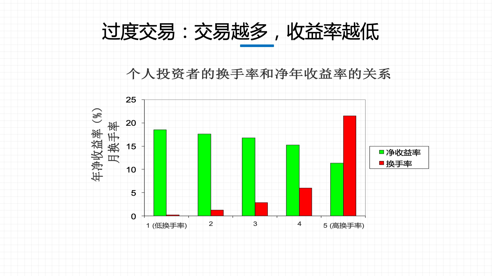

交易量越高的那些人，基本上他们的收益率是越低的，就是说越过度自信的人，他们的收益率越低。过度自信导致你过度交易，过度交易导致你收益率低，是带来坏处的。

不光是散户有这种结果，在共同基金里面也有类似的结果。你把共同基金按照换手率分成五组。研究发现什么呢？换手率最高的那一组相对换手率最低的那一组，平均每年的收益率要低出 1.6% 左右。

大多数共同基金的表现跟标普 500 都非常像，如果每年收益率差 1.6%，那是非常大的一个数字。别忘了，前面我讲过巴菲特的投资表现，巴菲特选的二级市场的股票的收益率相对标普 500 来比，也就是每年高出 5.7%。

你可能觉得换手率不一定是真的能够测量一个人的过度自信，它可能是测量其他的东西，那下面我给你提供额外的证据。我问你一个问题，比如说在股票交易中，你觉得男生更加自信还是女生更加自信？绝大多数人应该都会觉得，应该是男同学们更加自信。

那早期特伦斯 · 奥丁的研究发现， 确实是男生的换手率比女生要高出很多，尤其是单身男生。单身女生的换手率是最低的。当然这里面也间接证明了换手率是过度自信的一个代理变量。

那下面我们看他们的表现，确实发现，男同学们炒股的能力远远不如女同学，尤其是单身的男生，比市场的收益率要低很多很多。所以管钱的话，现在你知道要交给谁管了，肯定不能给单身男生管，应该给单身女生管，单身女生的换手率最低，收益率最高。

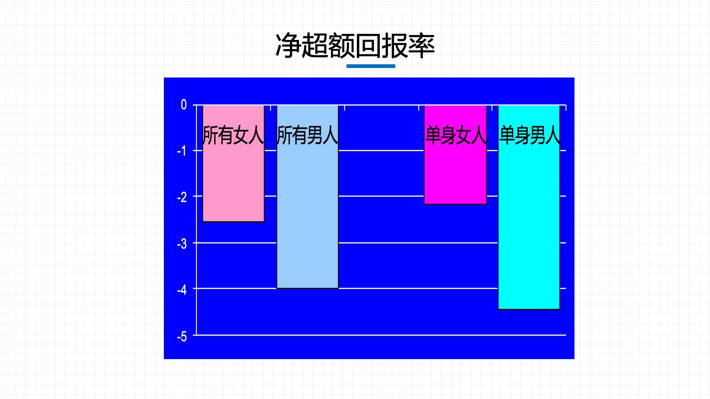

为什么单身男生会更加过度自信？这其实是有道理的，因为单身的男生还要找配偶，要发出各种信号，告诉别人自己很牛。那你要发出信号当然是有成本的信号，你不能随便说我特别牛，那没有说服力，你一定要做一些有成本的事情，才是一个有效的信号。他们喜欢去做一些冒险的事情，表示自己很牛。

但是女生的交易量最少，这个原因有可能也跟前面一样，因为女生要给大家发出信号，表示我是一个比较顾家的人，我不会去乱投资，不会去不停地交易。那现在假设你有很多钱，你要投一些基金，你会选哪些基金经理呢？我觉得如果是单身的男性基金经理，你要稍微小心一点。

我稍微总结一下，大多数人都会过度自信，导致他们过度交易，不管你是散户还是基金经理，而过度交易导致他们输更多的钱。

最重要的原因是因为你的这些交易不能够改变股票盈利的结果。但是当你能改变结果的时候，过度自信可能是好的，生活中的很多情况都是你能改变结果的，不像股票市场。

## 为什么不能听股评专家

那接下来我给你作一个重要提示，既然这么多人会犯错，那是不是我们听专家的就可以了？因为专家毕竟有多年的专业知识。我可以告诉你，我们尤其不能听股评专家的，为什么呢？有几个原因。

*   第一，专家也是人，他可能也会过度自信，也会犯各种错误。
    
*   第二，专家会有内驱力变得更加过度自信，因为不过度自信的专家容易被淘汰掉。
    

一个电视台请一个专家过来评一下股票，他不能说我觉得将来会波动，有可能涨也有可能跌。这肯定是不行的，这种专家肯定会被电视台淘汰掉，所以说选出来的专家一定是观点极端、过度自信的专家。

那我现在给你看一些证据。根据专业的追踪调查的公司 Cox 对 6000 多个股评专家预测的分析，发现这些股评专家的预测准确性有多高呢？只是预测涨和跌，准确率只有 47.4%，小于 50%。我就一直预测明年股票会涨，我的准确率都会高很多，因为美国历史上涨的概率肯定是比跌的概率大。

第二个证据是来自宾夕法尼亚大学菲利普 · 泰洛克，跟踪了 284 个专家几十年，八万多个预测的数据。这些专家不光是股评专家，也有时事政治专家。结果发现这些专家预测的准确性还不如我们随机扔硬币、随机扔飞镖准确。

这节课的最后我带你见识一下过度自信可能会引起的最严重的后果，这就是美国大萧条之后最大的金融危机。2008 年的金融危机你可能都听说过了，也知道各种原因导致了这次金融危机。但是我可以告诉你，过度自信是其中一个非常重要的原因。为什么呢？我们先看一个简单的数据。

在美国历史上，房价基本上就是房租的 20 倍左右。但是从 2002 年到 2007 年，房价涨得特别多，偏离了这个 20 倍。那问题就来了，在 2006 年、2007 年，房价已经非常高了，为什么还有这么多人愿意去买房子？

这里面我觉得涉及到两个自信，一个是买房人的过度自信。当你去买房的时候，你担心的是房价大跌，由于证实偏差你就会去看，房价过去大跌过没有。美国的房价确实没有大跌过。那这为什么是过度自信呢？

因为美国房价虽然没有大跌过，但以前从来也没有大涨过，没有大涨过当然不会大跌了。历史上，只要是房价大涨过的国家，基本上都会大跌，而且都会伴随着金融危机，所以这是买房人的过度自信。

那为什么这些评级机构去评这些产品的时候，会过度自信呢？主要是因为这些评级机构以前评的产品可能就是单一公司的债券，非常简单，相对来讲在历史上评得也非常准确，所以说它们就非常自信自己评这些债券的能力。

那现在 CDS、CDO 这些产品，是非常复杂的，就非常难评。这里面最重要的一个参数，就是这些房屋抵押贷款违约的相关系数，当迈阿密的房子在违约，纽约的房子也违约的概率有多大？也就是，它们的相关性有多大？这个相关系数在历史上是非常低的，当纽约有人违约的时候，迈阿密可能没有人违约。

那为什么历史上这个违约的相关系数比较低呢？一个最重要的原因就是历史上美国的房价没有大面积下降过。美国的房价没有大面积下降过，是因为美国的房价没有大面积上升过，导致违约的相关系数在历史上是很低的。

所以说当历史上违约相关系数很低的时候，你把房屋抵押贷款打包放在一起，就会觉得很安全，所以它们的评级都特别高。但是其实大家都知道，2008 年金融危机发生之后，大家都同时违约，导致很多银行都持有这些其实是级别很低的债券，但是它们觉得级别很高。

## 总结

好，现在我给你总结一下这节课的主要内容。

**第一，我们讲了过度自信这个概念，很多人都是过度自信的，而且大多数人没有意识到自己是过度自信的。**

**第二，我们讲了过度自信的四个表面原因，比如说自我归因偏差、证实偏差、控制幻觉和喜欢作因果关系推断。**当然我们也讲了过度自信更深层次的原因，那就是进化论的原因，过度自信曾经在远古时期的环境下，帮助我们生存和繁衍后代。

**第三，那我们怎么判断过度自信是好的还是坏的？我觉得一个最重要的标准就是，你的过度自信能不能够改变最后的结果？**当你不能改变结果的时候，比如说炒股，那过度自信可能就是不好的。但是在很多其他时候，你能改变结果，很可能过度自信就是好的。

**第四，最后想提醒一下大家，在交易中我们特别容易过度自信。**但是我们不能过度自信，不能过度交易，因为这会导致我们输钱。尤其是我们还不能听专家的观点，因为专家自己也会过度自信，而且他们有动力变得过度自信。

作业：看一看能不能找到一些克服你过度自信的方法，可以跟大家分享一下。

好，到现在为止，我们把预期中的偏差就讲完了。从下一个模块开始，我们会讲偏好中的偏差，尤其是风险偏好，我们看看偏好中的偏差是怎么影响我们的选择的。

我是余剑峰，咱们下节课再见。

\\1. 造成过度自信有四个原因：自我归因偏差，证实偏差，控制幻觉，因果推论。更深层次是有进化的原因。 2. 过度自信是面双刃剑：一方面能促进我们成功，一方面能让我们遭受损失。 3. 判断过度自信好坏的标准：你的过度自信是否能改变结果。

# **第 11 讲 | 参考点依赖：人为什么会有嫉妒心？**

[懒人专属群的群友](https://lazybook.fun/#/blog/group)，你好，欢迎来到清华五道口《行为经济学》的课堂，我是余剑峰。

上一个模块我们讲了人类很多预期中的偏差，比如说过度自信、有限注意力、锚定效应、代表性偏差。这节课我们要讲人在偏好中的很多偏差，尤其是风险偏好中的很多 “偏差”。

这里的 “偏差” 其实要打上一个引号，有人说应该是偏好。比如说我特别喜欢吃高热量食物，这个偏好以前是帮助我们生存和繁衍后代的，现在变成了一个偏差，因为它让我们发胖，给我们带来很多不健康的东西，你说这就是我们的偏好，没有办法。所以说不管是偏差还是偏好，这里没关系。

这节课我们要讲的是，我们的很多偏好或者偏差都受很多其他东西的影响，这可能是你没有意识到的。今天是这个模块的第一讲，讲参考点依赖。**“参考点依赖” 这个词可能听起来有点晦涩，很难懂。但是如果我讲嫉妒心你肯定听过，而且人多多少少都会有一点，**我们这节课的前一半就讲嫉妒心。

## 为什么会心生嫉妒

我们中国人经常说一句话，你的幸福指数不光依赖于你绝对的收入水平，更依赖于谁呢？更依赖于你老婆的妹妹的老公的收入水平，如果你老婆的妹妹的老公收入水平比你高很多，估计你每次参加家庭聚会都会很尴尬、很难受，你的幸福指数会直线下降。

当然现在我们中国很多是独生子女，所以说最影响你幸福指数的是谁呢？是你老婆的闺蜜的老公，如果你老婆的闺蜜的老公收入很高，你也会很惨。所以说如果现在你老婆的闺蜜在谈一个男朋友，而这个男朋友特别 “矬”，你一定要全力支持他们，这可能是你将来幸福的源泉。

当然那是开玩笑了，现在我们说回正题。有的人可能会说，我这个人特别慷慨，我没什么嫉妒心，我的幸福指数不会受别人的影响。但是我可以告诉你，绝大多数人都是有的，而且有大脑里面科学的证据。

下面我就给你讲一下。这是从大脑腹侧纹状体里面提出的证据，你还记得前面讲模糊风险厌恶里面我就提到过大脑的腹侧纹状体。

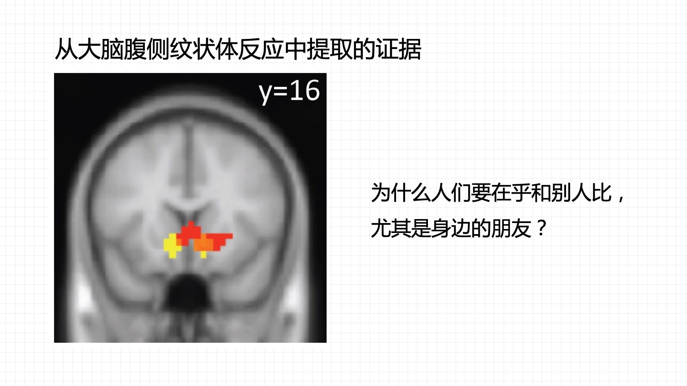

大脑腹侧纹状体主要是接受多巴胺的地方，就是在别的地方多巴胺被合成了，之后投影到你的大脑腹侧纹状体上，那我们就观测大脑腹侧纹状体的反应。在这个实验里面，做研究的人先雇用了很多 MBA 的学生，因为是在商学院里面做的实验。

给他们一些钱，比如说 200 块钱，让他们在电脑上做投资游戏，同时在他们的大脑上扫描，看扫描结果。比如说你在电脑上做投资游戏，交易完之后就告诉你，开始赢了 200 块钱，现在你又挣了 200 块钱，你会很开心，所以你的腹侧纹状体上就会有反应。这很正常，一些多巴胺分泌出来了，因为你受到了奖励。那如果告诉你，开始你赢了 200 块钱，现在你输了，只剩 100 块钱，那你会很不爽，这里面的反应就是负的，往反的方向反应。这一切都是正常的。

下面再出现另一种情况，告诉你，虽然你赢了 200 块钱，输了 100 块钱，现在只剩 100 块钱，但是你对面那个同学的 200 块钱输得只剩 20 块钱，这个时候你会是什么反应？当然你不好意思笑出来，因为那是你的同学。你可能会很镇定地说，哎呀，真是不好意思，他输的比我还多。其实这个时候你大脑的腹侧纹状体里面会冲一下，就相当于你挣了钱一样，这个时候你控制不住，爽了一下。

那为什么我们会有这种嫉妒心？前面讲的只是一些微观的证据，真正的深层次的原因是什么？**这就回到我们这个课的精髓——错配，**因为跟前面过度自信一样，当你发现绝大多数人都会有嫉妒心这种心理的话，那一定是有原因的。

这个原因应该是过去曾经帮助过我们生存和繁衍后代的，要不然我们怎么会生存在现在的社会上？所以我们要去发掘这个原因。那下面我就给你一步一步分析，进化论是怎么导致人会有嫉妒心的，也就是说嫉妒心是怎么帮助我们生存和繁衍后代的，我们就要回到远古时期的非洲草原上。

在那个时候，你可以想象一下有两个部落：一个部落有 100 个人，50 个男的，50 个女的；100 公里之外的部落也有 100 个人，50 个男的，50 个女的。因为这是讲进化论，自然要讲人的偏好。那个时候女性选择配偶的偏好是什么样的呢？

我们根本不知道，我们可以作假定，那个时候女性的偏好非常地复杂，什么都有。有的女的喜欢那种打猎技术特别好，社会地位比较高，资源比较丰富的男性；有的女的可能喜欢特别体贴、特别健康，天天躺在洞里面睡觉，偶尔出去打个猎也能养活自己的男的。但是你想象一下，哪种女性的基因会留下来更多？应该是那些喜欢打猎技术好、资源稍微丰富一点的男性的这类女性的基因会传下来更多。

刚刚讲的是女性的偏好，下面看看男性自己有什么偏好？如果有一个男性 A 的打猎技术特别好，B 的打猎技术一般，但是也能养活自己。如果 B 没有嫉妒心的话，那你想想会发生什么情况？大多数好的女性基因都找 A 了，B 的话就没有那些好的基因，他最后传下来的基因会比较少。B 虽然打猎技术差一点，但是他会有嫉妒心，和很强的上进心，他一定要把 A 给干掉，让自己的打猎技术比他好，然后这些女性就会把基因让他传下去。

这些有嫉妒心的男的，相对来讲基因传下来的概率是更高的。所以这样选择的话，那些没有嫉妒心的男的，基因留下来的概率会小一点，经过很多代的进化，这些人可能就被淘汰掉了，剩下来的人基本上都是有嫉妒心的。当然女生之间也有嫉妒心，这里面我就不细讲了，你们看一下《甄嬛传》就应该知道了。

而且我告诉你，嫉妒心一定是跟朋友之间的嫉妒心。那下面再举另外一个例子，上一个例子里 100 公里之外不是还有个部落吗？如果这个 100 公里之外的部落里面有个 A，那个 A 的打猎技术比刚刚这个 B 的打猎技术要好很多，但是 B 不用去嫉妒那个 A，为什么不用嫉妒呢？他打猎技术再好，也不会跟 B 抢资源，就没有必要去嫉妒他。所以自然选择就是你只会对自己身边的朋友嫉妒，对远方的反而不会嫉妒。

那你听到这是不是觉得，哇，我的嫉妒心就是天生的，所以说下次我对我的朋友嫉妒，我也不用内疚？不是这样的。虽然这个嫉妒心是天生的，但是我告诉你这是个错配，就像我们喜欢吃高热量食物一样。你想想以前人们生活的环境都是几十个人、100 个人这种很小的部落。但现在很多人都生活在大城市，比如说在北京市可能有 2000 万人。如果你的朋友特别成功，他不会抢掉你的资源，反而会给你带来更多的资源，跟以前是不一样的。

所以说这个嫉妒心在以前那种环境下可能是帮助我们把基因传下来的一个机制，但是现在嫉妒心其实是非常不好的。你嫉妒你的成功的朋友，你成功的朋友就会把你抛弃掉，不给你带来资源，还伤害你们之间的感情。理解了嫉妒心的来源和错配的问题，可能能够帮助你克服嫉妒心这个心态。

好，现在你应该彻底理解了嫉妒心是怎么回事，我告诉你嫉妒心就是参考点依赖。参考点依赖指的就是你的幸福指数、你的效用函数依赖于一个参考点，这个参考点可以是别人的收入，可以是你自己过去的收入，也可以是你对未来预期的收入，或者预期的回报。

## 什么是诱饵效应

接下来的时间，我就讲参考点依赖在投资、销售和公共政策中的应用，我们先讲在简单的投资中的应用。

比如说你过去一年买了两只股票 A 和 B，都是一股 100 块钱买的。现在股票 A 由 100 块钱涨到了 150 块，股票 B 由 100 块钱跌到了 80 块。现在你的小孩要上学，你一定要卖一些股票，套一些现金出来，你会卖哪只股票？

基本上大多数人这个时候都会选择卖 A 股票，因为它涨到了 150 块，而 B 股票是输钱的，很多人不愿意卖掉。但是你觉得这样对吗？其实你决定卖哪只股票不应该看过去发生什么事，你应该看将来，投资都应该看将来。

如果你认为 A 股票将来的收益率会比 B 要高的话，那你就应该把 A 留着，把 B 给卖掉，但是如果你觉得 B 将来的收益率要高的话，你应该把 A 股票给卖掉，不应该受过去的影响。但是大多数人都会选择去卖掉 A 股票，也就是卖掉那个赢钱的股票，为什么会这样呢？

其中一个重要的原因就是我们刚刚说的参考点依赖。**有证据表明当你在赢钱的时候，由于风险厌恶，你想锁定你的盈利，但是在你亏损的时候，也就是低于这个参考点的时候，你可能会更加愿意去冒险**，这到底会让你犯多大的错呢？下一节我会讲一些确切的细节，告诉你这会导致你每年平均输多少钱。

下面我讲一个销售中的应用，我不知道你有没有注意到，有些公司会生产一些产品。这些产品你会觉得很奇怪，因为你觉得这些产品肯定没有人买，它为什么还会生产？是不是厂家很笨，花这么多钱去生产这些产品。基本上当你看到这种情况，我觉得你应该意识到这是厂家最聪明的决定，给你看一个例子。

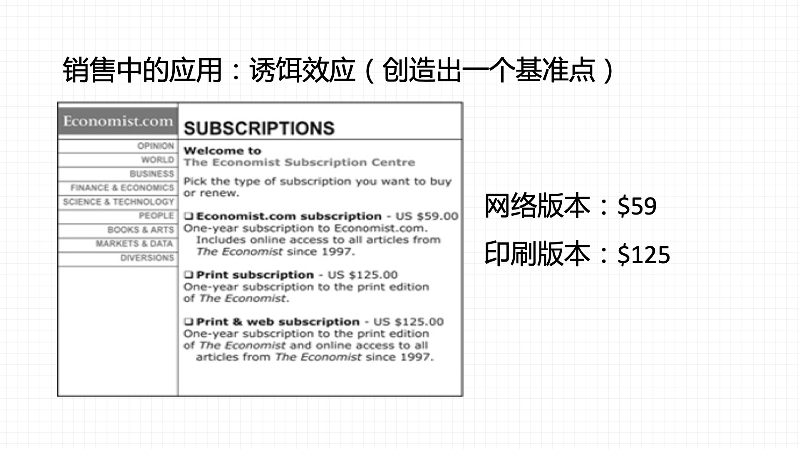

《经济学人》当年在网站上做广告，让别人订阅它，每个星期发行一本，有两个版本：一个是网络版本，59 美元一年；还有一个是印刷版本，125 美元一年。你会选择哪个？这其实没有正确答案。当时有个叫丹 · 艾瑞里的心理学家做过一个问卷调查。

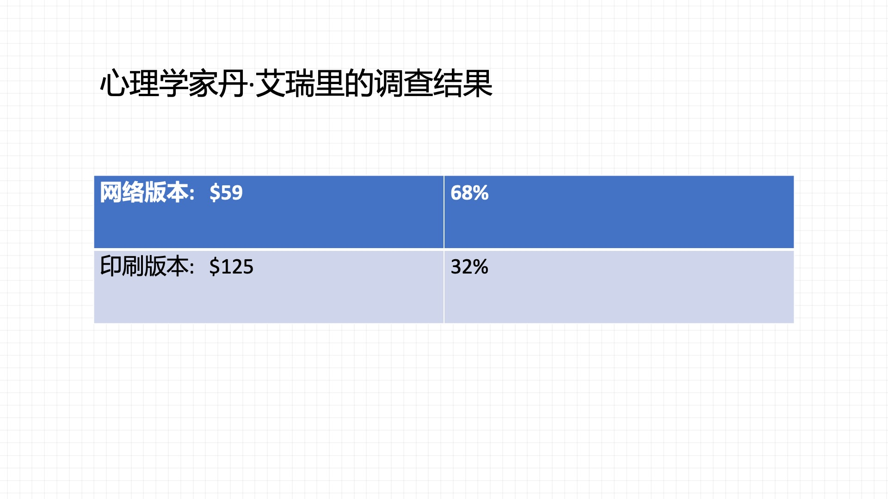

基本上发现 68% 的人会选择那个便宜的网络版本，32% 的人会选择贵的印刷版本。但是没过多久，这个《经济学人》做了一件非常奇怪的事情。

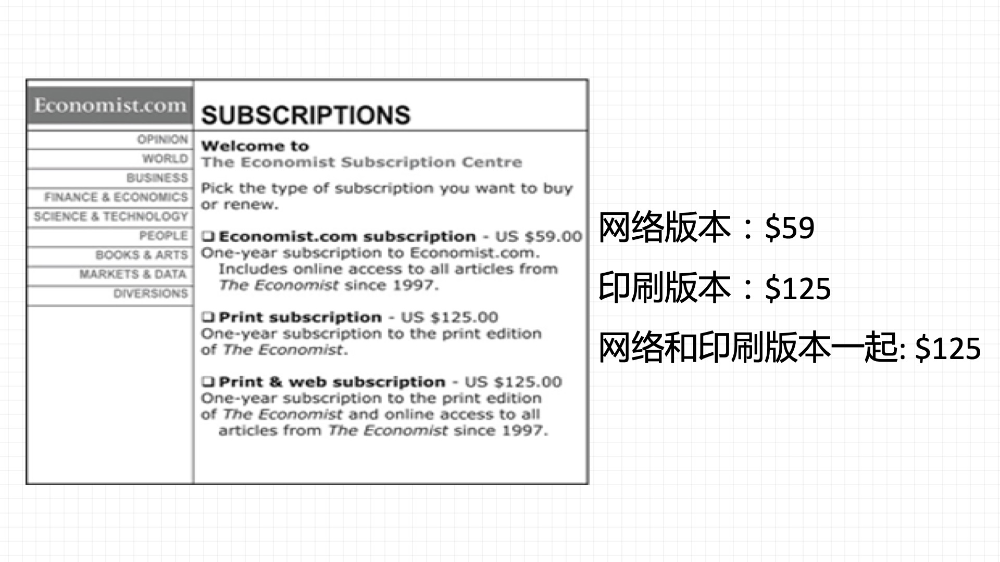

它把两个选项变成三个：第一个选项还是网络版本，59 美元一年；第二个选项还是印刷版本，125 美元一年；第三个选项是网络版本加印刷版本一起，价格也是 125 美元一年。你觉得这个时候还有人会选择第二个选项吗？是不是《经济学人》在搞笑，以为人会这么笨，当然没有人会选择第二个选项。但是这是它极其聪明的做法。

第一个和第二个比较是很不好比的，印刷版本对很多人来讲更好，但是更贵。第一个跟第三个也不好比，第三个明显更好，但明显更贵。但是第二个跟第三个比呢？就非常好比，因为第三个明显比第二个好，但是价钱是一样的。这样的话人们一下子就会选择第三个，结果真的是这样的。

这个时候再去做问卷调查，发现第二个选项确实没有任何人选，但是这个时候有 84% 的人选择第三个，只有 16% 的人选择第一个。

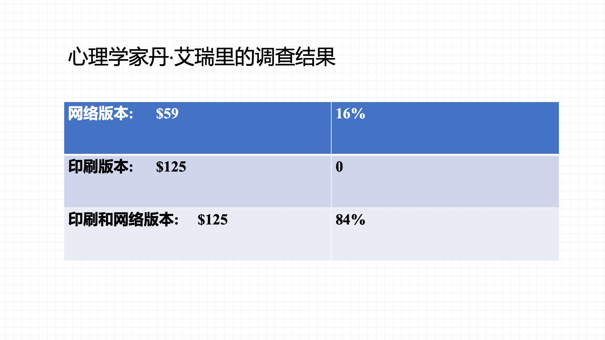

你知道，网络版本哪怕只有一个人选，它的成本也是一样的。现在关键是要让更多人选择更贵的印刷版本。这样一来，开始只有 32% 的人选择印刷版本，现在一下提高到 84%，提高了非常多。

第二个选项，就叫做 decoy，是一个参考点。有个专业的名词叫做 decoy effect，诱饵效应。其实这个诱饵效应可以用在很多其他销售的案例之中。

比如说很多公司生产一个产品根本不是为了卖这个产品，它的主要目的是为了让大家很容易作选择，这个时候它的其他产品就更加容易卖出去。因为当你很难比较的时候，就很难作决定，可能就买其他牌子的产品了。

比如说现在你是一个电视厂商，你可以生产 60 英寸的电视，卖 6000 块钱，70 英寸的电视卖 7000 块钱，你可以再生产一个 72 英寸的电视卖 8000 块钱。这个时候，72 英寸的电视就没有人买，它是个诱饵。但是立马就能体现出 70 英寸的电视很好，很多人就很容易作决定，在 60 英寸和 70 英寸之间去作选择，然后买这个 70 英寸的电视。

讲到这里，你现在心里可能有个疑问，这里面讲了参考点依赖，是不是跟这个锚定效应特别像，感觉是同一个东西，为什么要分开讲？其实它们是不一样的，我给你讲一下。

**锚定效应主要是我们预期中的偏差，**就是说由于你的锚定效应，你对一个公司盈利能力的估计可能错了，因为你锚定在公司过去的盈利水平上面，所以你对公司将来盈利水平的估计会出现偏差，比如说盈利水平高于 10 块钱的概率有多少。

**但是参考点依赖没有这个预期中的偏差，**比如选择订阅《经济学人》，它根本不用形成任何预期，由于这个诱饵的存在，它就会使得人们去买第三个产品，**它只是提供一个参考点，让你更容易选择。这是选择中风险偏好中的偏差。**

好，那我们现在再回到参考点依赖，给你讲一个在生活中应用的例子。先问你一个问题，你做过伴郎或者伴娘吗？如果你做过，你做过几次？我可以告诉你，我做过七次。我当时特别骄傲，因为我的很多哥们儿都请我做伴郎，我觉得我跟我那些哥们儿的关系都特别近。

但是现在你仔细想想，伴郎的角色是什么？伴郎或者伴娘最重要的角色是诱饵，也就是说伴郎不能太帅，伴娘也不能太漂亮，颜值不能太高，要不然把新郎和新娘的光芒给遮挡下来了。所以如果你做过很多次伴郎或者伴娘，你应该重新评估一下你跟新郎或新娘之间的关系，他（她）到底是真的把你当成哥们儿、姐妹儿，还是把你当成个诱饵？

## 竞争对市场是好，还是坏？

好，刚刚讲了这么多有意思的例子，但是跟下面要讲的东西比起来，这些例子就显得很渺小，下面要讲的就是如果把参考点用在公共政策上，有什么应用。

那我先问你一个问题，你觉得竞争对市场是好的，还是坏的？你可能会觉得这个问题太初级了，竞争肯定是好的，我们以前在学经济学原理时都学过，没有竞争的话很多定价都不是有效的，垄断导致市场不是有效的。但是我可以告诉你，由于参考点的存在，很多时候你会过度竞争，过度竞争可能会带来很多意想不到的坏处。

我先给你讲一个动物界的例子。有一种鹿叫做麋鹿，麋鹿其实挺好看的，因为它的角特别好看，尤其是公的麋鹿。那公麋鹿的角主要是干吗用的呢？其实主要是用来打架的，如果麋鹿的角越大，越可能把其它的公麋鹿给打倒，这样的话它就有跟其它母鹿的交配权，这样它的基因就能传下来了。你想，经过很多代的进化，最后剩下的公麋鹿的角都很优美、很大。

但是，特别大的角是非常费能量的，这样的话它生存下来的概率会很低，同时更加容易被吃掉，这样可能会导致整个种族都灭绝了。这个时候如果存在一个中央政府，它可以做一件什么事呢？把所有公麋鹿的这个角变成原来的 50%，你觉得它们开心吗？

所有的麋鹿应该都会很开心，因为它们能更加节省能量。但是同时不改变它们的排列顺序，也就是那些角大的麋鹿还是很大。现在你把麋鹿想成企业，这个时候就是过度竞争，比如说过度的广告竞争、过度的军备竞争，都是不好的，如果存在参考点依赖，可能有政府的干预、监管就会比较好。

那我们现在从动物世界回到我们人类的世界。我们人类的很多行为也是受参考点的影响，导致我们做出一些过分竞争的事情。我不知道你有没有体会，我们中国的小孩是不是学习过度用功？一到周末就去学奥数、学钢琴，其实奥数到底能不能够提高我们的智商，这是非常有疑问的，但是很多人都会去学，这就是参考点依赖一个体现。

如果大家都不去学，而你去学，那你的成绩就会显得很好，你就很容易上北大清华。但是，你去学导致其他人也会去学，所以最后的均衡就是大家都去学，你考北大清华还是很难，没有达到任何的效果，最后累倒的是家长、小孩。如果这个时候政府能监管一下，比如说奥数不加分或者是周末不准大家去上奥数，如果上奥数就做一些惩罚什么的。那可能大家都会很开心，小孩也可以过一些天真无邪的生活。

正因为这个原因，其实很多美国的学校都已经取消了 valediction，也就是告别演说，取消这个就是取消优秀毕业生。为什么取消这个东西？就是担心学生们过度竞争，都去争这个位置，导致大家过度地学习，然后就没有时间去想一些更重要的问题。

当然我刚刚讲这些例子并不是说大家真的不应该学奥数，不应该学钢琴，我只是想提示一下，当我们制定公共政策的时候，应该考虑到大家可能会有参考点依赖，要把这个因素给考虑进来。

下面我引用一下康奈尔大学一位著名经济学家罗伯特 · 弗兰克的一个观点，他觉得给富人征税是好事，不光对整个社会好，对富人自己也是好的，富人都应该开心。你觉得有道理吗？下面我讲一下罗伯特 · 弗兰克的论证。

首先，给富人加税的话，穷人肯定是开心的。不用想，因为他们会有更多的钱。给富人加税，富人也不一定那么不开心，可能富人会有一点不开心，是因为钱少了，但是钱少了他们的购买力并没有变得更小。

因为对富人是按比例加税，那些最富有的人还是最富有的人，第二富有的人还是第二富有的人，他们还可以去买海边的别墅。海边别墅的价钱一般会被抬得特别高，其实一个重要原因就是因为那些富人把价钱给抬高了，还有其他的奢侈品也一样。现在富人的购买力稍微变低了一点，这些奢侈品的价格也就变低了，那这样的话，还是他们买这些奢侈品，还是他们买这些海边别墅。这是第一点。

下面讲第二点，富人被征税之后，它会给富人自己带来什么好处？现在政府会有更多的钱了，这些钱可以用来干吗？可以把公园变得更好，可以把公共设施变得更好，这个时候可能整个社会会变得更加安全，其他人也会变得更加开心。虽然你是富人，你也希望你身边穷一点的人开心，因为如果富人身边的穷人不开心，可能会发生一些暴力事件。所以说把整个公共条件变得更好的话，这其实也能提高富人自己的幸福指数。

## 总结

好，我给你总结一下这节课的主要内容。

*   第一，我给你讲了嫉妒心的进化论的根源，嫉妒心过去曾经帮助过我们生存和繁衍后代，嫉妒心就是参考点依赖。
    
*   第二，参考点依赖是我们选择中的 “偏差”，这里面“偏差” 打了个引号，它和锚定效应是不一样的，锚定效应是预期中的偏差。
    
*   第三，参考点依赖广泛应用于生活和销售的场景中，我们一般把它叫成诱饵效应。
    
*   第四，我要跟你强调一下，在制定公共政策的时候，为了避免过度竞争，我们其实应该把参考点依赖这个重要因素给考虑进来。
    

作业：你觉得罗伯特 · 弗兰克刚刚说的那些证据有没有道理？你可以自己去想一下。

下一讲我会详细讲一个你可能听过的概念，叫做损失厌恶。

我是余剑峰，咱们下节课再见。

\\1. 嫉妒心，曾经帮助我们生存和繁衍，但现在却会阻碍我们成功。 2. 参考点依赖与锚定效应的区别：前者只是在选择中设计一个参考点，后者是预期中的偏差。 3. 参考点依赖可能会导致过度竞争，在制定公共政策时，应将这个因素考虑进去。

# **第 12 讲 | 损失厌恶：赢与输总是绝对的么？**

[懒人专属群的群友](https://lazybook.fun/#/blog/group)，你好，欢迎来到清华五道口《行为经济学》的课堂，我是余剑峰。

上一节课我们研究了什么会影响人的偏好，我们引进了一个非常重要的概念，就是参考点依赖，这节课我们会引进一个更加重要的概念，叫做损失厌恶。

我觉得你一定听过 “损失厌恶” 这个概念，很多成功学的书、畅销书都引进了这个概念，我甚至听说过高中老师在教他的学生 “损失厌恶” 这个概念。

让大家了解损失厌恶当然是个好事，但是我不能肯定你是否非常深刻地理解了损失厌恶。为什么呢？因为大多数人都会告诉你损失厌恶是一种非理性行为，让我们犯错误，而且我们经常觉察不到它，所以我们要避免犯这个错误。

可真的是这样吗？如果损失厌恶真的只给我们带来各种错误和损失的话，为什么这么多人普遍都有损失厌恶这种行为偏好？每当看见这种结果的时候，我们就应该想一想，是不是在进化的过程中损失厌恶曾经帮助过我们，所以这里面我们一定要引进错配的概念。

只有引进错配的概念，我们才能够更加深刻地理解损失厌恶。只有我们深刻理解损失厌恶之后，我们才可以避免甚至利用损失厌恶去获得更大的利益。

## 为什么会有损失厌恶

对大多数人来讲，100 块钱的损失所带来不爽的程度远远要高于 100 块钱的盈利带来的快乐程度，这就是损失厌恶，它是不对称的。由于有损失厌恶，导致大家会不想实现损失，尤其在你处于损失状态的时候，你可能会去冒你平时不愿意去冒的险让你回本。

比如说在打高尔夫的过程中，如果你第一杆打得比较差，这个时候在第二杆、第三杆时就愿意去冒险，哪怕专业的高尔夫球员都会有这种倾向，但是冒险反而使得他后面打得更不好。损失厌恶可不是人独有的一个偏好，甚至连猴子都有。

下面我就要讲一个猴子的实验，这是 Keith Chan 的一个华裔当时在耶鲁做助理教授的时候，用校医院里面的猴子做的实验，当然他现在是优步的首席经济学家。

这个实验是好多年前做的，当时你要想训练猴子去用硬币其实也不是很难的事情，你要不停地用香蕉去交换，猴子学了很久之后，知道硬币可以换香蕉。训练好猴子用硬币之后，你就可以跟猴子做交易，现在把做实验的人分成两组。

第一组人跟猴子做交易，猴子在笼子里面，猴子给人一个硬币，人给猴子一根香蕉。这个时候拿到硬币之后人扔一下硬币，如果是正面就再给猴子一根香蕉。经过多次交易之后，猴子大概知道如果跟这一组人做交易，平均一个硬币可以换 1.5 根香蕉。

下面第二组做实验的人跟猴子去做交易，这个时候如果猴子给人一个硬币，人给猴子两根香蕉，但是人再扔一下硬币，如果是正面，人会拿回一根香蕉，经过很多次交易之后，猴子知道一个硬币也能换到 1.5 根香蕉。

但有意思的是后面，我们再让所有做实验的人，A 组和 B 组都站在一排，然后让猴子自由过来交易，看看猴子会愿意跟哪组人做交易，最后发现基本上所有的猴子只会愿意跟第一组的人去做交易。

其实这两组是没有任何区别的，唯一的区别就是在第一种情况下，这个猴子感觉它在处于盈利的框架下，扔一下硬币还有可能多拿 50%。第二种情况是在一个损失的框架下，虽然平均获得的香蕉是一模一样的。看见没有？损失厌恶是在猴子里都会有的一个行为。

你想，如果连猴子都有损失厌恶，基本上说明损失厌恶是由于进化过来的，那就说明损失厌恶在过去曾经帮助过我们生存和繁衍后代。

那我们就回到几百万年前，你想那个时候我们的祖先都是处于饥饿线和生存线的边缘。假设那个时候每一个人平均一个星期要吃一只鹿，也就是每个星期打猎要打到一只鹿，这样他才能生存。这一只鹿就是参考点，多一只鹿就是处于盈利的状态，少一只鹿就是处于亏损的状态。

如果这个星期你很幸运打到两只鹿，你当然很开心了，但是那个时候可能没有什么储存机制，打了两只鹿你也得把它们吃了，吃多一点撑着了，最后你多长一点点肉，可以让你存活的概率增加一点。但是，如果这个星期都到了星期五你还一只鹿都没打到，那这个时候你可能就会非常地不爽，因为你可能就面临生和死的区别了。

由于损失厌恶，给你极大的动力去外面打猎、捕鱼，这样能让你生存下来的概率更高，或者你好不容易到星期五打到一只鹿，然后另外一个人把你这只鹿给抢了，这个时候你也会极其地不爽，你会有很大的动力去把这只鹿抢回来。这样的话由于别人知道你有极大的动力去做这件事情，他一开始可能也不敢去抢你的，因为他知道这样会把你激怒，带来的后果会很严重。所以你看，损失厌恶其实在那种环境下，应该是达到帮助我们生存和繁衍后代的一个机制。

刚刚讲的是损失厌恶给我们更大的动力出去捕猎，或者更大的动力去把别人抢我们的东西给抢回来，但是不光是动力，其实到星期五如果你没打到猎的话，你知道如果再有两天打不到猎你可能就死了。这个时候你可能更加愿意去冒平时不愿冒的险，这也会导致我们像打高尔夫一样，输了球之后你会更加愿意去冒平时不愿意冒的险。所以你看，损失厌恶让我们更加有动力去努力工作，同时也给我们更多的动力去冒各种险。

刚刚讲的都是进化论的一些假设，有没有科学的证据呢？也是有的，我们前面第一模块讲了一些神经元的东西，我们就可以从神经元里面提出一些证据。比如说扫描大脑发现，我们的杏仁体和心跳对恐惧、害怕、愤怒这种照片，反应是非常快而且激烈的。比如说在你眼前晃一下恐惧的照片，你可能根本就不知道你看到过这张照片，但是你的心跳已经加快了，你的杏仁体也已经反应很大了。但是如果在你眼前晃一张特别开心的照片，这个时候你的杏仁体、心跳都没有反应，而且你可能都没有意识到你看见过它。

所以这是不对称的，当然不对称也是由于我们进化过来的结果。当人特别害怕的时候可能旁边有危险，当对方特别愤怒的时候你要反应特别快，因为他愤怒的时候可能就会扁你。所以说人对有可能带来损失的东西一般都反应特别快，但是对快乐的东西的反应就没有那么快。这里面我要强调我们的大脑对盈利和损失的反应是不对称的。

其实我们现实生活中也有很多不对称的例子，比如说哥们儿之间的关系，你和几十年的哥们儿喝过 100 次酒，经历过很多事情，但是如果你的哥们儿只做了一两次对不起你的事情，或者是做得不够地道的事情，你和你哥们儿之间的友谊小船可能就翻了。

好，真正理解了损失厌恶的根源，这个时候一些稀奇古怪的现象你可能就能看得懂了。我们下面讲几个应用，一些是在公司管理中的应用，一些是在宏观经济中的应用。

先讲一个在公司管理中的应用，最简单的一个东西就是工资的 “下行粘性”。假设你是公司老板，你现在有 100 个员工，每个员工的工资是 100 万每年，现在经济形势比较差了，你的盈利没那么多了。你有两个选择：一个是裁员两个人，一个是每个人的工资降低两万，你会选择哪一个？有经验的老板应该都会选择裁员，虽然听起来很残酷，但是可能这是对公司来讲最好的一个行为。

你想如果你不裁员，每个人的工资降两万，这个时候由于员工都有损失厌恶，过去工资是 100 万，现在变成 98 万，他们的心情会非常地不爽，工作的积极性会很不高，这样的话其实是很不好的，导致大家的效率很低。

但是，如果你这个时候裁员两个人，效果就不一样了，剩下的人的工资还是 100 万，并没有降低，他们就没有损失厌恶。而且没有被裁的人还会挺感激你的，自己不是那两个中的一个，他们就更加有动力去努力工作。所以说这对公司来讲是很好的行为。

如果你裁了这两个人的话，会导致这两个人很惨，因为本来经济形势就不好，他们丢了工作，再找工作其实是更难的。如果每个人都降低两万工资，其实对这 100 个人的生活都没有太多影响，但是由于有损失厌恶，为了公司的利益，提高公司的效率，很多老板还是会选择去裁员。

我们就把前面这个现象叫做工资的下行粘性。工资的下行粘性还有什么其他的应用呢？其实它在宏观经济里面也有应用，这跟通货膨胀有关。比如说津巴布韦的钱还不如厕所的纸贵，因为极高的通胀导致整个经济形势都不稳定。但是其实适当的通胀是有好处的，其中一个重要原因就是大家有损失厌恶，导致工资的下行粘性。

大家考虑下面两种情况：

*   国家 A 的通胀是 6%，这一年工资上涨 3%，实际工资其实下降了 3%。
    
*   国家 B 的通胀是 0，今年的工资下降 2%。
    

你想哪个国家的公民会觉得更加开心呢？其实应该是国家 A 的人更加开心，因为他们对自己的工资特别敏感，工资上涨了他们开心，而对通胀一般是没有那么敏感的，可能感觉不到，尤其是适当的通胀。但是国家 B 的公民感觉到自己的工资下降了，那会极度痛苦。所以说虽然第一种情况按购买力来讲下降得更多，但是它的公民会感觉生活条件更好了，自己会更加开心。

当然我相信在听课的你一定是各行各业的精英，工资上那种小把戏可能还影响不到你，但是我告诉你，刚刚那个例子背后的逻辑其实有更广泛的应用，它叫做框架效应。

**什么是框架效应呢？就是同一个东西在一种框架下，可以显示出它是处于盈利的状态，但是你放在另外一个框架下，显示出它是个损失的状态。**

比如说刚刚的例子中由于有通货膨胀的存在，导致本来工资是下降的，但是它其实显示工资是在上升。框架效应的影响非常大，也特别广，它已经被很多商家使用。

下面给你讲一个例子，这是好多年前信用卡刚刚兴起的时候。当时信用卡公司跟很多零售商有一些官司，因为信用卡有 3% 的手续费，所以很多零售商家不开心。如果你用信用卡买东西，他们会把价钱提高 3%，这样的话信用卡公司肯定也不开心，因为这样大家可能就不用信用卡了，所以最后导致信用卡公司跟零售商家，尤其是加油站打了挺久的官司。

信用卡公司发现自己基本赢不了了，所以它跟商家，尤其是加油站提出了下面一个建议，说我不跟你们再打了，但是你们要满足我一个要求。你们用信用卡收的钱一定要叫做常规价格，用现金付的钱叫做打折价，而不能说用现金付的钱叫做常规价格，用信用卡付的钱叫做额外收费。

其实都是一样的，商家可以收不同的价钱，用现金便宜一点，用信用卡贵一点，但是名字一定要叫好。你看在信用卡公司建议的框架下，你用现金付钱只会省一点点钱。但是如果是后面这种叫法的话，那你每次用信用卡付钱都会额外损失 3%，你会特别不爽，这样的话大家可能就不用信用卡了。最后大家都知道了，虽然信用卡公司输了官司，但是其实它还是赢得了客户，主要是因为它设计了一个非常聪明的框架效应。

## 什么是处置效应

好，刚刚我讲了损失厌恶的根源，以及损失厌恶引起的框架效应和框架效应的各种应用。下面我要讲损失厌恶的一个最重要的应用，就是在股票市场中的应用，我们首先要引进一个概念，叫做处置效应。

还记得上节课我们讲的一个例子吗？就是说你买了两个股票，股票 A 是 100 块钱买的，现在涨到 150 块，股票 B 是 100 块钱买的，现在跌到 80 块，问你会卖哪个股票？大多数人都会卖第一个股票，也就是涨了的那个股票。为什么会这样呢？其实有两个原因，这是学术界还在争论的一个东西。

第一个原因就是前面已经有研究发现，当大家处于账面盈利的状态，就想锁定自己的盈利，这是人的一个本性；当账面亏损的时候，会有更加冒险的一个倾向。所以说当你盈利的话当然就会卖掉那个赢钱的股票，这是一个正常行为。

但是损失厌恶也告诉我们，人不喜欢损失，喜欢回本，所以说你会厌恶去实现你的损失，那输了钱的股票，当然就不会卖了。

**人会卖掉赢钱的股票，而继续持有输钱的股票，这种倾向叫做处置效应。**基本上处置效应可以认为是由于大家的参考点依赖和损失厌恶引起的一种交易行为，这种交易行为是不是个偏差我们并不知道，因为我们并不知道这种交易行为会不会导致投资者输钱。

下面是早期特伦斯 · 奥丁用一些个人账户里面的数据做的研究。他发现那些投资者卖掉的他们过去赢钱的股票，将来每年的收益率反而比正常股票要高出大概 2.35% 左右；被投资者继续持有的输钱的股票，平均每年的收益率比正常股票要低出 1.06% 左右，基本上加起来就导致他们损失 3.5% 左右。

你想，就是由于人的参考点依赖和损失厌恶这个偏差，导致他们有处置效应，处置效应就导致他们每年的收益率平均要损失大概 3.5% 左右。

## 教你一招：利用损失厌恶提高收益

那是不是我们可以利用处置效应来导出一个投资策略？

思路是这样的，由于大家有这种交易行为，会导致一些股票被高估或者被低估，那我们是不是可以去买那些被低估的股票，去卖空那些被高估的股票？

哪些股票会被高估和低估呢？你想，前面的处置效应讲的是什么？如果在一个股票上很多人都赢钱了，大家会想把它给卖掉，在一个股票上输钱了，大家会继续持有它。

如果股票 A 过去六个月平均收益率是很高的，股票 B 过去六个月平均收益率是很低的。你觉得股票 A 和股票 B 哪个股票会被高估，哪个股票会被低估呢？

先看股票 A，股票 A 过去六个月收益率很高，收益率很高一定是不停地有好消息。如果很多人都是在六个月前买的股票，那当时很多股票持有人就处于盈利的状态，那么他们就会想去实现盈利，卖掉它。虽然有好消息不停地来，但是在这个过程中间有人在卖，所以在很多时候这些好消息并没有完全反映出来，你可以想一想，过去六个月收益率高的股票其实可能由于处置效应反而被低估了。

再看过去六个月收益率低的股票，它的收益率低可能是由于有坏消息。但是如果很多人是六个月前买的股票，那很多人就处于亏损的状态。亏损的状态有坏消息来了他们还不卖的话，那么很多坏消息就没有完全被反映出来。所以说，这六个月收益率低的股票可能平均来讲反而被高估了。

一个简单的策略是什么呢？

**就是买入那些相对来讲被低估的，也就是过去六个月收益率比较高的股票，同时卖空那些相对来讲被高估的，也就是过去六个月收益率比较低的股票。**这个策略平均来讲在美国历史上是非常挣钱的，不光在美国股市上，在欧洲股市上都是非常挣钱的一个策略，平均每个月大概有 1% 左右的超额收益率。

这是我们找策略的一个基本思路，先从偏差中引起了交易上的行为，从交易上的行为去做策略。

所以刚刚你看到由于处置效应，你要买入过去六个月收益率高的股票，同时卖空过去六个月收益率低的股票，这个策略叫做动量投资策略（momentum）。

刚刚讲的是美国人的处置效应，那中国人是不是也有处置效应？因为刚刚讲过损失厌恶是人类的一个普遍现象，所以中国人应该也会有处置效应。

美国休斯顿大学的吴国俊和马克，用中国的数据做了一个研究，用的是上海一个大券商里面几万人的数据，大概发现了中国人的处置效应其实比美国人更强。

如果中国人盈利了 7%~8%，跟亏损 2%~3% 去比，你盈利 7%~8% 卖掉这个股票的概率大概是亏损 2%~3% 卖掉它的概率的 3~4 倍，所以中国人的处置效应是非常强的。而美国人一般只会高出 50% 左右。而且他们的研究发现，因为每个人的处置效应是不一样的，那些处置效应越强的人，其实输的钱是越多的。

那是不是处置效应在中国也会导致动量投资策略？刚刚讲过的那个策略，过去六个月收益率高的股票将来收益率也会高，过去六个月收益率低的股票将来收益率也会低。我可以告诉你，在中国是没有这种现象的。

为什么呢？回头我们会细讲，这是中国跟美国不一样的地方，虽然这个偏差是一样的，但是最后导出来的策略是不一样的。所以很多时候美国人可以用的策略在中国不一定适用，具体的根源我们最后一节课再讲。

刚刚我们主要是讲了，损失厌恶引起的一个交易行为叫做处置效应，再从处置效应导出了一个投资策略叫做动量投资策略。下面我们用处置效应，去改进一下已知的策略。

下面讲的是耶鲁大学的一个博士生做的一篇博士论文，他就因为这篇博士论文找了一个挺好的教职，在波士顿大学做助理教授。当时他在念博士，念了五年，他的一个主要研究成果其实就是下面要讲的东西。

历史上**有一个比较有名的策略叫做内幕交易策略，这里面讲的内幕交易策略当然不是指违法的那个内幕交易策略，而是指内幕人员做的一些策略。**比如说如果你要想去买一个股票，正常来讲应该怎么做？你应该去不停地研究这个股票，研究它所有的财务报表、历史、它的竞争者。最后你发现这个股票可能被低估了，就要去买它。同样，如果你想卖掉这个股票，也是要不停地研究，如果发现它可能会跌，你就去卖掉它，你可以做很细的研究。但是我可以说，无论你做多少研究，可能你对这个股票的理解都没有这个股票的 CEO、大股东懂得多，理解得深，这应该是可以被人们接受的。

所以说一个非常简单的策略是什么呢？

跟着那些大股东、CEO、高管去做买卖，这些大股东和高管叫做内幕人员，所以这个交易叫做内幕交易，因为这些内幕人员的任何买卖，都要报备证监会、报备 SEC。所以说这个策略是可行的，他们说要买，你就跟着他们买，他们说要卖，你就跟着他们卖。

这个策略在历史上早期确实是挺挣钱的，但现在我可以告诉你，从 80 年代到现在，这个策略每年只能挣 5%。原因很简单，因为很多人知道这个内幕交易策略，就都会跟着内幕人员去做买卖，那这个策略自然就没有那么有效了，所以导致现在它每年只有 5% 左右的超额收益率。

下面我们看看怎么用刚刚讲过的处置效应去改进这个投资策略。这是一个极其聪明的改进方法。

我假设内幕人员买了两个股票，A 和 B，两个股票的高管以前都是 100 块钱买的。股票 A 跟前面例子一样，从 100 块钱涨到 150 块，现在内幕人员把它卖掉了；股票 B 是从 100 块钱跌到 80 块，现在内幕人员也把它卖掉了。你觉得内幕人员卖出的哪只股票含有的信息量大？

你想，股票 A 从 100 块钱涨到 150 块，把它卖掉，是不是符合人性的行为？正常人都想锁定盈利，所以它可能不一定含有什么坏的信息，只是想把它卖掉。B 是从 100 块钱跌到 80 块，这个时候内幕人员在卖，是违反人性的行为，我们中国人把这个东西叫做 “割肉”。

你想这些内幕人员都在 “割肉”，一定是含有更多的信息量，可能是内幕人员觉得这个股票将来真的不行了，所以要忍痛割肉了。

所以说，你要跟着那些内幕人员去做买卖的话，如果是正常的处置效应，股票涨了他们把它卖了，不一定是含有坏的信息，你不用跟着他们去卖。但是如果股票真的跌了你跟着他们去卖的话，这个时候确实是更有用的，因为它可能真的含有更多的信息量。

如果我们把这个策略稍微改进一下，内幕人员在买，你就跟着他买，内幕人员在卖，尤其是在实现损失的时候你跟着他卖，他在实现盈利的时候你不用跟着他卖，你可以把你的策略的收益率从每年 5% 提高到 13%。你看见没有，同样只是把处置效应跟这个内幕交易策略结合起来，你就可以把你的策略的收益率提高 100% 多。

## 总结

好，到现在我们应该把损失厌恶彻底讲明白了，下面我总结一下这节课讲的主要内容：

*   第一，损失厌恶是符合错配原理的，在进化的过程中，损失厌恶是帮助我们生存和繁衍后代的，让我们在损失的状态下更加有动力去冒险、去努力工作。
    
*   第二，我们讲了框架效应，框架效应指的是什么呢？就是指同一个东西你可以放在一个框架下，它会显示盈利的状态，但是你把它放在另外一个框架下，显示的是损失的状态。
    
*   第三，我们讲了由于大家的参考点依赖和损失厌恶，导致大家在交易的过程中有处置效应。处置效应指的是人们有卖掉自己过去盈利股票，继续持有自己输钱股票的倾向。
    

最后，我们讲了如何利用人的行为偏差去导出一些投资策略。一般来讲分三步：

*   第一步，首先我们要找出人进化过程中产生的一些偏好中的偏差，比如损失厌恶；
    
*   其次，再从这些偏差中找出一些交易行为上的偏差，比如说处置效应；
    
*   最后，再从这个交易行为上的偏差导出一个投资策略，比如说动量投资策略。
    

作业：你应该学过沉没成本这个概念，就是要懂得止损，过去的成本应该把它给忽略掉，我们应该向前看。但是这节课我们讲了我们会有损失厌恶，我们不想止损，那你能不能说出在生活中或者工作中你遇到的一些大家不能够忽略沉没成本的例子？

好，下一讲内容更有思辨性，我们会讲人为什么会作一些自我矛盾的选择。

我是余剑峰，咱们下一讲再见。

\\1. 损失厌恶：对大多数人来讲，损失所带来不爽的程度远远要高于同等盈利带来的快乐程度。 2. 损失厌恶导致的行为：大家不想实现损失，在处于损失状态的时候，可能会去冒险。 3. 框架效应：就是同一个东西在一种框架下，是处于盈利的状态，但是放在另外一个框架下，显示出它是个损失的状态。 4. 处置效应：人们倾向于卖掉挣钱的股票，留下亏钱的股票。

# **第 13 讲 | 突出事件放大：为什么有人买彩票？**

[懒人专属群的群友](https://lazybook.fun/#/blog/group)，你好，欢迎来到清华五道口《行为经济学》的课堂，我是余剑峰。

前两节我们讲了人类选择偏好中的两个偏差：一个是参考点依赖，一个是损失厌恶，这一节课我们要讲另外一个偏差，但我先不告诉你是什么。

先问大家一个问题，在现实生活中，我不知道你有没有见过一些人同时买彩票和保险。假设你买的是汽车保险，其实我们知道你中彩票的概率和发生汽车车祸的概率都是很低的，也就是说大家买彩票和买汽车保险基本都是亏钱的，为什么会这样呢？

今天这一讲，首先我要讲清楚这种看起来似乎自我矛盾的行为背后的原因，其次我再讲这个原因背后可以导出一些股票市场中的投资策略，不但可以导出新的投资策略，还可以改进已知的投资策略。

## 为什么会同时买彩票和保险

好，首先我们来看一下，为什么我们会同时买彩票和保险。

对一些经常发生的事情，比如说上班会不会堵车、飞机会不会晚点，其实我们是有一个比较准确的估计。但是对一些不怎么发生的事情，比较突出的小概率事件，要么这些事情根本就不在你脑子里面出现，完全忽略了，要么就是一旦发生，在你脑子里面的权重会很大，高估它发生的概率。

这也是为什么如果在佛罗里达地震了，导致加州的人去买地震保险的人会多出很多，因为开始他可能在脑子里面忽略了，但是一旦出现了，这个事情会被放大。

下面讲一个实验室里面的例子。问大家一个问题，比如说 NBA 球队只剩下最后八个球队，这八个球队要争夺总冠军。你估计第一个球队最后赢得冠军的概率是多少？你给出一个概率，比如说 18%；然后又问你，第二个球队赢得总冠军的概率是多少？你可能会说 20%。这八个球队依次问完了，你把这八个概率加起来应该等于多少？应该等于 100%，因为最后总是有一个会赢得总冠军。

但是如果你真的把刚刚那八个概率加起来，你会发现是 240%，远远高于 100%。那代表什么呢？代表你高估了每个球队最后赢得总冠军的概率。这是什么原因呢？可能是因为最后剩下的八个球队，其实都挺牛的，你觉得每一个球队最后赢得总冠军都是挺合理的。其实每个球队赢得总冠军的概率是很低的，但是因为你听起来很合理，所以说你容易高估每个球队的概率。

当然刚刚讲的是你把小概率事件给高估了，所以说你的估计出现了错误，相当于是预期中的偏差，跟我们前面讲的预期中的偏差其实是一致的，但是现在我们要讲的不光是预期中的偏差，还有偏好中的偏差。

其实在很多时候，比如说彩票，我们知道中奖的概率很低，但是你还是会去买彩票，这就不是一个预期中的偏差，那你为什么还买呢？主要原因是因为中彩票这个事件在你脑子里面非常突出，就像前面我们讲过，一旦中彩票就会有个大的柠檬车跟在你后面，有人拿着大的摄像机，扛着大支票到你门口，你想到了别人中彩票的场景，特别突出。

对这种突出的事件，其实在你作决定、作选择的时候权重就比较大，哪怕你知道你中奖的概率是很低的，但是你决择的权重会比较大。这就是风险偏好中偏差的一个体现。

刚刚讲的这种现象，我们统称为给突出事件一个放大的权重，当然突出事件一般都是小概率事件，所以我们也称为给小概率事件一个较大的权重。

给定我们有这种偏差，自然我们就能够理解为什么我们中彩票和买保险出车祸是个小概率事件，又比较突出，你把这个权重给放大了，你当然就觉得为了安全要买保险。彩票也是一样的，你想到中彩票这种突出事件，然后你给它加大权重，就觉得自己应该去买彩票。

好，理解了我们会把小概率突出事件放大这一点，那我们就可以理解现实生活中很多投资中的例子了。

比如说 IPO。IPO 股票在中国、在美国都一样，第一天一般都会涨很多。但长期来讲，未来 1 年、3 年、5 年，IPO 股票的平均收益率比市场正常股票是要低很多的，为什么会有这么奇怪的现象？一个最重要的原因可能就是大家对彩票的偏好。因为 IPO 股票给大家很多想象空间，看起来更像彩票，第一天就相当于大家在买彩票。

于是大家就把 IPO 股票的价钱推得特别高，但之后它就会跌，因为第一天已经被推得过高了，将来长期收益率就会很低。所以你真的要买 IPO 股票的话，正常来讲你就第一天去打新，买了之后在可以卖的时候就应该把它给卖掉，然后你可以去买别的股票，因为平均来讲它将来的收益率会很低。但是还是有很多人会去长期持有一些 IPO 股票，一个最重要的原因是大家老是觉得这可能是下一个 Google、下一个阿里。

除了 IPO 股票，还有一些其他的例子。比如说特别接近破产的公司，可能价格已经从 20 块跌到 1 块钱，但还是有很多人愿意买它。但其实这也是一个不太理智的行为，因为刚刚说了这类公司在历史上平均来讲，收益率是很低的，而且它的风险很高。它很可能真的要破产了，就一分钱都没有了。为什么我们还会买它呢？这是高风险低收益行为。

还有一个最重要的原因，其实也是大家对彩票型股票的偏好，你觉得它像彩票。这个股票以前是 20 块钱，现在才 1 块钱，很多人会觉得它很可能会回到 20 块钱，一旦回去了就相当于中彩票一样。

讲到这里，估计你心中还是有个疑问，余老师，这跟我们前面讲过的有限注意力偏差有啥区别呀？在讲有限注意力偏差时，我已经说过我们会把这种突出事件放大，它容易在你脑子里面想起来，被注意到，所以中彩票的概率就会被高估。

那我告诉你，它们其实是不一样的。

*   我们喜欢彩票的一个原因，就是你刚刚说的那个原因，因为中彩票这个事件比较突出，这个概率被估计错了，本来只有百万分之一，你估计成万分之一，这是原因之一。
    
*   还有一个更重要的原因，可能很多人也理解他中彩票的概率只有百万分之一，但是因为这个事件非常突出，在他作决定的时候，决定这个权重被放大了，导致他去买彩票。
    

当然现实生活中买彩票可能是两个原因中和的结果了。

好，我们现在回到人会把突出事件的权重放大，看看它有什么其他的应用，它在管理中、市场营销中都会有些应用。

比如说如果现在你要吸引一些新的客户，你让他下载你的 App，然后做一些事情。你可以怎么吸引他呢？给每个下载 App 的人 10 块钱，这是一种方法。这样平均成本是 10 块钱。另外一个方法就是不用给每个人 10 块钱，而是说随机找一些人，他可以有个抽奖机会，抽到了奖说不定就有 1000 块钱或者是 5000 块钱。

每个人中奖的概率其实是很低的，但是由于每个人可能会把自己中奖这件事情的权重给放大，所以他们可能更喜欢后面一种。虽然后面这种激励机制的成本更低，但是它达到的效果可能会更好。

我再给你讲个例子，这是关于很多病人去戒酒、戒毒的例子。这个实验坚持了 12 个星期，中间会给大家抽血，看看病人有没有通过血液检验。然后你可以把这些病人分成两组，A 组和 B 组。

A 组有机会去抽奖，其实大多数是一张写的 “继续努力工作” 的白纸，有少数人会中 1 块钱或者中 20 块钱，但是 B 组就没有机会去抽奖。最后发现能坚持 12 周下来去戒毒、戒酒的人，第一组是 83%，第二组只有 20%。

你也可以给病人固定的钱，如果病人通过了血液检验的话。但这个效果很差，远远不如有抽奖机会，虽然你给固定的钱可能比抽奖花的钱还多，但是它的效果没有抽奖好。

而且后来还有一些研究跟踪这些人发现，那 83% 坚持了 12 周去戒酒、戒毒的人，将来重新吸毒或者是喝酒的概率其实比较低，所以它有很长的效果。这是什么原因呢？

一个重要的原因就是，当你看到有抽奖机会的话，你大脑的多巴胺会分泌得比较多，而挣几块钱你分泌的多巴胺就会少一点。中奖这种小的概率被你放大了，你立马会分泌很多多巴胺，会导致你坚持去戒酒、戒毒。

## 怎么在股票市场卖彩票

刚刚讲了这么多，主要是给你一些感性的认识，当然你对突出事件的权重放大也有一定理解了。下面我们要讲这节课的重头戏，既然大家会把小概率突出事件给放大，导致大家喜欢买彩票和买保险，那我们能不能够利用大家的这种偏好，在股票市场中创造出一些有意思的投资策略？

其实原理非常简单，大家喜欢什么我们就卖什么，不就完了嘛？大家既然喜欢彩票，我们就卖彩票给他，这就是一个好的投资策略。但是如果我们真的要卖彩票的话是比较难的，因为这需要牌照，但我们又没有牌照，而且牌照要很多钱。

既然没有牌照，我们能不能够在股票市场中去卖彩票？你看谁都可以进入股票市场，如果你能在股票市场中去卖彩票，那其实就利用了大家喜欢彩票，从而产生一定的超额收益率。

那怎么在股票市场中去卖彩票呢？

市场上有很多股票，每个股票不一样，有些股票很无聊，我就不举例子了，但有的股票听起来很让人兴奋，就给了你想象空间，觉得它可能就会成为下一个 Google、下一个腾讯。

那类股票就像彩票，大家都会感到很兴奋，见到它就会分泌更多的多巴胺，就更加喜欢它。大家就愿意付更多的钱买它，其实它将来的收益率并没有你想象中那么高，因为它就像彩票一样，但我们买彩票的收益率很低。

那你可能会问，哪些股票更加像彩票呢？我们应该避开它或者是应该卖空它。美国有名的公募基金 Fidelity 的一个基金经理说过一句话，“4 块钱的股票涨到 8 块钱，比 40 块钱的股票涨到 80 块钱更容易一点”。你觉得是不是这样的？很多人可能会同意他，觉得低价股翻一倍很容易，高价股再翻一倍那要涨很多才行。

只要很多人都这么认为的话，那其实低价股对他们来讲就是彩票型股票，因为它有想象的空间，容易翻倍，翻一倍、翻两倍、翻三倍，这个概率比较高。不管现实中它翻一倍的概率是否真的更高，这不重要，只要大家都觉得它翻倍的概率比高价股要高，那么这些低价股的股票对他们来讲就是彩票。

对每个人来讲，衡量一个股票像不像彩票有不同的指标，这是其中一个。还有一些人认为股票的波动性可以衡量一个股票像不像彩票，因为股票往上涨可以无穷多，跌最多跌 100%，全亏了。波动性越大的股票，就越有想象的空间，波动性越小，就没什么想象空间，这种波动性也被很多人用来作为这个股票像不像彩票的标准。当然还有些其他指标，这里面我就不细讲了。

好，现在你理解了大概怎么去衡量一个股票像不像彩票，下面我就可以讲一个基于彩票型股票的投资策略。

这个投资策略是我和几个合作人在一篇最新的论文里面做的一个研究结果。这篇论文在 2018 年暑假被一个杂志接受了，应该在 2019 年末才能够被正式发表出来，所以我现在讲的东西基本上都是最新的、还没有发表的成果。

在我们那篇论文里面，我们找了五个在文献里面大家已经用过的，来衡量一个股票像不像彩票的五个指标。假设有 3000 只股票，我们基本上是每个月的月初把所有股票，按照各个指标排序，比如说按照第一个彩票型股票的指标排个序，最小的是最像彩票的，最大的是最不像彩票的。

然后我们怎么做呢？我们去买入那些指标最大的，也就是最不像彩票、最无聊的那 10% 的股票，同时卖空最像彩票的那 10% 的股票，每个月都这么做。

因为那些指标会变，所以下个月排序会变，可能上个月一个股票最像彩票，下个月它不一定最像彩票。所以下个月你重新排序后，买入那些最不像彩票的 10% 的股票，持有一个月，卖空最像彩票的那 10% 的股票，也是卖空一个月。

然后下个月再做同样的事情，你不停地这么动态地更新你的投资组合。这个策略里，每个指标产生的超额收益率是不一样的。第一个指标大概产生的超额收益率是每年 6% 左右，第二、第三个指标基本上是每年 12% 左右，第四、第五个也差不多，稍微小一点点。

这个时候你可能会说，余老师，这个策略在我们中国可能不太好用。在中国确实没有那么好用。首先在中国，有的股票你根本就不能卖空，其次就算你能卖空股票，这个卖空的成本也比较高，每年 8.6%。

但是在中国你可以做一件事是什么呢？你可以避免去买那些彩票型股票，就相当于避免在股票市场上去买彩票，同时你可以在股票市场上尽量去买那些长得不像彩票的股票，那些股票平均来讲会比整个股市要涨得多一点或者跌得少一点。

但这不是我们论文最重要的贡献，最重要的贡献是什么呢？是下面要讲的，如何去改进刚刚说的那个投资策略。

好多年前，我自己当时还在沃顿商学院念博士，是个学生。那个时候比较穷，我就经常去拉斯维加斯打打德州扑克。打德州扑克你经常会有最后一张牌叫做 River（河牌）。如果你是 3、4、5、6、7，少一张 5，你要等一张 5，这个概率是很低的，你等到就相当于中了彩票，别人可能也不觉得你会等，你中了彩票可以赢挺多钱，但是大概率是等不到的。

我当时自己有个心得，我发现我如果赢了钱，一般不会花很多钱去等最后一张河牌，相当于我不会去花很多钱买这张彩票。但是如果我在账面上输钱了，我在赌的过程中还没有离开这个桌子，我就特别喜欢去等最后一张牌，也就是去买这张彩票。但是最后导致的结果是什么呢？我输的钱会更多。

这跟我刚刚讲的彩票型股票投资策略有什么关系呢？其实很有关系，这说明人对彩票的喜好程度是会变的。有的时候你会更加喜欢它，就像你刚刚账面输钱，你会更加喜欢等一张河牌，赌一把，让你自己回本。但当你已经挣了一些钱的时候，你可能更加想锁定你的盈利，你不想花很多钱去买彩票。

现在就简单了，我们把前面说过的这 3000 只股票分类，找出其中 1000 只来。比如说平均来讲它的投资者可能是 100 块钱买了现在跌到 80，现在持有这些股票的人平均来讲是输钱了，属于账面亏损的状态。

前面讲过，我打扑克的心得是，在账面输钱的情况下，会更加喜欢彩票，所以这些人如果手上有彩票型股票，又输钱了，他们就不愿意去卖它，其实就相当于大家更加愿意持有它，那这些股票相对来讲被高估了。

**所以说如果你在投资者输钱的这些股票里面去卖空彩票型股票，买入正常的股票，那你的投资收益率应该会更高，因为在这些股票里面大家更加喜欢彩票，彩票型股票更加被高估。**

同样，在另外 1000 个投资者赢钱的股票里面，大家没有特别喜欢彩票，那些彩票型股票就不一定会被高估，所以在这里如果你做刚刚我们说的那个策略，买入正常的股票，卖空彩票型股票，不一定能挣多少钱。

所以我们在现实生活中就把股票这么分类，既在投资者输钱最多的那些股票里面去做这个策略，也在投资者赢钱的这些股票里面去做这个策略。我们发现在投资者赢钱的那些股票里面，做卖空彩票型股票的这个策略是不挣钱的，不但不挣钱，可能还要输一点点钱。那现在反过来，在投资者输钱的那些股票里面，我们做这个策略的平均收益率是正常的两倍，翻了一倍。

如果你直接就用第一个指标去卖空彩票型股票，买入正常的股票，平均年化收益率大概是 6% 左右。但是如果你只在投资者输钱的那些股票里面去做，平均年化收益率会到 18% 左右，提高了两倍多。

刚刚那个例子里面你看到，由于我们对彩票型股票的偏好是随着自己的状态变的，导致我们改进了投资策略。

刚刚的改进是指在一个子集里面去改进，比如说有 3000 个股票，我们只在那 1000 个投资者输钱的股票里面去作改进。

其实还有另外的方向，你不用去找一个子集的股票，你看不同的时间段，可能有的时间段这个策略更挣钱，有的时间段没有这么挣钱，这基本上是策略择时的改进。

那怎么择时呢？我问你一个问题，你可能立马就理解了。比如说大家对彩票的喜好程度是不是也会随时间变动呢？如果在有段时间内大家特别喜欢彩票，这段时间内彩票应该会更加被高估，那将来彩票的收益率会更低，同时在那段时间内彩票的收益率反而会更高。

那在中国，是不是有一段时间大家会更加喜欢彩票，更加喜欢赌一赌？我觉得就是春节之后那一个月，可能大家对赌的容忍程度会更高。我记得我小时候，如果我平时要去赌一把钱，那肯定会被痛扁一顿，但是如果是春节拿着压岁钱去稍微赌一把，这是我们中华文化的优良传统——热闹。所以那个时候彩票型股票可能会被推高，将来的收益率会很低。

现在我们再把它用到彩票型股票上，你会发现在 1 月份彩票型股票，就是那些价格比较低的股票，或者是波动性比较高的股票，平均收益率比其他股票的收益率是要高很多的。所以你能看到，虽然那些低价股平均收益率低，但是在春节那一个月它的收益率反而高，所以这也是策略的一个改进。

如果我们要卖空彩票型股票，应该在其他月份去卖空，在春节之后的那一个月不要去卖空，因为在那一个月中大家会更加喜欢彩票型股票，会把彩票型股票的价格推得更高，如果你卖空它的话岂不是亏钱了。你等它的价格推到最高的时候再去卖空，所以在 1 月底的时候可以去卖空。

我总结一下，彩票型股票这个策略可以被改进。

有两个维度：

*   第一个维度就是细分股票，在一个子集里面去做这个策略。
    
*   另外一个就是细分时间，在某些时间段去做这个策略，在其他时间段你可能要反向操作。
    

## 怎么在股票市场卖保险

前面讲过我们喜欢同时买彩票和买保险，刚刚讲了由于大家喜欢彩票，我们导出了卖空彩票型股票的投资策略。是不是我们也可以在股票市场上去卖保险呢？

因为大家喜欢保险，如果卖保险给大家，我们肯定是可以挣钱的，但是我们又不能卖正常的保险，因为保险公司的牌照是很贵的。那如果我们能在股票市场上去卖保险的话，那岂不是肯定能挣钱？

其实这也是可以做到的，下面要讲一个很有名的策略，叫做**风险套利策略，其实它的精髓跟卖保险是相关的。**这个策略很多人都用过，其中一个比较有名的人叫做 John Paulson。回头我们会讲，他是《大空头》里面的那个大佬。他之前的主要策略就是风险套利策略，跟卖保险有点类似，给你讲一下这个细节。

比如说一个公司 A 打算收购另外一个公司 B，公司 B 现在的股价是 10 块钱左右，因为 A 要收购它，收购的价格可能是 20 块。很多人买了公司 B 的股票，可能是 8 块钱买的，现在是 10 块钱，挣了两块钱。A 要收购它，它的股价立马会跳到接近 20 块。虽然公司 A 宣布要收购它，收购成功的概率很高，但是存在一个小概率它不成功，所以说这个时候股票价格可能只到 19 块。

这个时候持有股票 B 的那些投资者会怎么办？他们是 8 块钱买的，先涨到 10 块钱，现在立马涨到 19 块了，但存在一个很小的概率，这 19 块钱又会跌回 10 块钱，所以说这个小概率事件对他们来讲就是灾难性的东西。

如果这个时候 B 公司的投资者把这个股票以 19 块钱卖给你，你 19 块钱买进来，相当于什么呢？相当于你给公司 B 的投资者提供一个保险。为什么呢？因为如果你这个时候把 B 的股票接过来，对你来讲存在一个很小的概率，你会亏很多。

但是大概率这个股票会从 19 块钱涨到 20 块钱。而你卖保险不能只卖这一个保险，只要有这种风险套利的例子你就不停地做，这样你才能用到大数定理，像保险公司一样卖很多保险，才能挣钱。要不然你只卖一个保险给别人，最后那个灾难真的发生了，并购没有通过，你会输很多钱的。所以说卖保险一定要小心，一定要能够大面积地去卖，这样才行。

## 总结

好，我总结一下今天讲的主要内容。

*   第一，我们发现了人在作选择的时候，突出事件的权重会过大，这会导致我们同时买彩票和保险。
    
*   第二，我们利用大家对小概率突出事件权重放大的这种偏好，去导出一些投资策略。比如说我们的策略应该是卖空长得像彩票的股票，同时买入一些比较无聊的股票。
    
*   第三，我们讲了怎么去改进卖空彩票型股票的投资策略。有两种改进方法：第一种是从时间的维度；第二种是从空间的维度。
    

这一讲在逻辑上有些挑战性，不知道你有没有跟上，如果你跟上了，我们下一讲讲一些在逻辑上也很有挑战性的概念。

作业：请你和大家分享一下自己曾经踩过的坑，你踩坑的原因是不是你对那些小概率事件、突出事件过分地乐观或者是权重过大？

我是余剑峰，咱们下节课再见。

\\1. 买彩票和买保险的根源是一致的：你会将一旦发生就比较突出的小概率事件的权重放得很大。 2. 判断彩票型股票的标准：低价股，波动较大的股票等。 3. 有两种改进投资策略的方法：一种是时间维度，一种是空间维度。 4. 在股票市场做风险套利，相当于卖保险，但是要大量去做，否则会亏钱。

# **第 14 讲 | 心智账户：我们把钱存在哪？**

[懒人专属群的群友](https://lazybook.fun/#/blog/group)，你好，欢迎来到清华五道口《行为经济学》的课堂，我是余剑峰。

今天我们继续讲解一下风险偏好中的 “偏差”，这里面“偏差” 我继续打上引号，今天讲的是心智账户。

## 1\. 心智账户的基本概念

自从理查德 · 塞勒在 2017 年拿了诺贝尔经济学奖之后，心智账户这个概念在网上变得很火，你可能对心智账户有一定了解。心智账户是理查德 · 塞勒在 80 年代初引进的一个概念，这是他拿诺贝尔奖的主要贡献之一。

心智账户本身比较难用在金融交易怎么去影响股票市场的波动，但是把心智账户和其它的偏差结合起来，比如说损失厌恶，会产生一些比较有意思的现象，尤其是在股票市场中。所以这节课我们就要讲一些在教科书上或者是在网上你看不到的关于心智账户的知识。我们先来复习一下什么是心智账户。

其实在传统、理性的经济学里面，钱就是钱，都在同一个账户里面，不管你这 1 万块钱是努力工作挣来的，还是在路上捡来的，你将来花它都应该是一样的方式。但在现实生活中肯定不是这样的，我们人经常在脑子里面把钱分成不同的账户，你可能会说这 1000 块钱是用来乘交通工具的，这 2000 块钱是用来吃饭的，这 3000 块钱是用来干别的事情的。所以说钱的用途是不同的。如果你这个月用来吃饭的钱超支了，你下个月吃饭就会节省一点，吃便宜的东西了。

有研究发现，在 2008 年金融危机的时候油价大跌，跌了大概 50%，这其实相当于很多家庭的收入涨了好几百块钱，比如说每个家庭涨了 300 块钱，因为平均要花 600 块钱来买油。正常来讲如果你多了 300 块钱，可能会提高一下你的消费，加更好的油或者买有机蔬菜、吃顿大餐。

但是如果是由于油价下跌导致你的实际收入上涨了 300 块，你会有更大的可能性去加更好的油。如果你只是由于工作的原因，收入增加 300 块，你只有很小的概率去升级成更好的油。但是如果由于油价下跌，你升级油品的概率会高 14 倍，这是非常大的一个提高。

那为什么会这样呢？其实原因很简单，在很多人的大脑里面，是把钱分账户处理的。比如说很多人觉得每个月应该花 600 块钱来加油，现在由于油价下跌只花了 300 块，很自然就觉得一下子省了这么多，我应该多花钱，所以会升级成更好的油。很多人做投资的时候也是一样的，你投资买不同的股票，在不同的地方投资。按道理来讲，你的投资其实是分散了风险，但是在你脑子里面，风险可能并没有分散。

因为你觉得如果有个股票亏了，有个股票赚了，那个亏的股票你还是想等它回本，其实你放在一起是赚了，但是你的脑子里面很可能会把它们分开处理，没有达到分散风险的目的。

前面的例子，你应该看到人是有心智账户的，会在脑子里面分不同的账户，但心智账户其实比较难应用在现实生活中，**一个重要原因就是不同的人有不同的心智账户。**不像损失厌恶，大多数人都有损失厌恶，连猴子都有损失厌恶，但心智账户是非常不一样的，**每个人的算法在大脑里面是不一样的。**给大家举下面一个例子，这个例子其实是根据早期理查德 · 塞勒的一个例子改进的。

假设 15 年前，你花了 1000 块钱买了一瓶茅台，现在这瓶茅台值 10000 块钱，如果你现在把这瓶茅台喝了，你觉得对你来讲成本是多少？下面我给五个选项：A，一分钱不花，0 块；B，1000 块钱，就是以前的成本；C，1000 块钱 + 利息，因为 1000 块钱是 15 年前的；D，10000 块钱，因为现在它值 10000 块钱；E，-9000 块，也就是赚了 9000 块，你觉得你会选哪个？其实并没有一个标准答案，就像我刚刚说的，不同的人给的答案是不一样的。

这个问题调查的结果基本上如下。

30% 的人，也是最多的人群，认为一分钱都不花；18% 的人认为其实就是 15 年前的成本价 1000 块钱；还有 7% 的人认为是 1000 块钱加上利息，这 7% 的人就是学了一点经济学，但是没学好；20% 的人认为这个成本是机会成本，就是现在的 10000 块钱。这是经济学的标准答案。但是如果你的经济学学得很好，知道这个标准答案是 10000 块，那你喝这个酒会非常地不爽，因为太贵了。这里面也有 25% 的人选择 E，认为赚了 9000 块，这 25% 的人喝这个酒可能就感觉更爽了，因为每喝一杯酒可能就觉得赚了 500 块钱。

你也看见了，不同的人真的是有不同的心智账户，对很多人来讲，他会觉得最初的投资都是以前的成本，现在消费就不算钱了。这样当然会导致大家过度消费了，因为你买东西的时候在投资，但你消费的时候还觉得没花钱。

但是我现在再问你一个问题，假设你现在摔了这瓶茅台，你觉得对你来讲损失了多少钱？这个时候就非常奇怪，绝大多数人都会觉得特别痛苦，虽然你喝它觉得一分钱不花，或者成本只是 1000 块，但是你摔了它，绝大多数人都觉得损失了 10000 块。

现实生活中经常会有这种情况，一瓶很贵的酒，如果它是在很多年前低价买来的，很多人很容易把它喝掉，但是不愿意花高价现在去买这瓶酒来喝。虽然在传统的经济学里面，你喝这瓶酒的成本就是它的机会成本，也就是 10000 块钱，但是这 10000 块钱的机会成本是很抽象的，跟自己从口袋里面掏出 10000 块钱去买这瓶酒的感觉是不一样的。

## 2\. 状态依赖偏差

好，刚刚心智账户这个概念讲完了，就像我们前面说的，光知道心智账户是比较难把它应用到各种场景下的。一般来讲，**我们要把心智账户和其他一些偏差结合起来**，下面我们就把心智账户和损失厌恶结合起来，会导出其他有意思的偏差出来。

比如说你现在在一个单位上班，你想换工作，一般来讲，换一个工作很难各方面都变得更好。你换一个工作可能一年工资涨了 20 万，但是你的假期可能少了 10 天。这个时候你会想，涨了 20 万是你的收益，让你很爽，但是少了 10 天的假期是你的损失，由于损失厌恶导致你不愿意换工作。这就导致我们会有状态依赖偏差，就是说我们会比较愿意保持在以前的那个状态下。

损失厌恶和心智账户结合起来导致了状态依赖偏差，还可以解释为什么社会变革会比较慢。如果要改革，总是会触动一些人的利益，然后让大部分人受益。对受益的人，这当然是好的，但是他们感觉获得的利益没有那么大。但是那些受损失的人，会非常地不爽。而且更加重要的一点是，受损失的人可能是一些集中的人，而受益的人可能比较分散。那些受损失的人本来就特别不爽，加上他们比较集中，可能就会组织在一起去阻碍这个改革，这也导致社会变革会比较难。

刚刚讲的谈判、社会变革，可能你觉得离你生活太远了，那下面我讲个比较有意思的生活中的应用。

这是理查德 · 塞勒把他的心智账户用在现实生活中。在美国，有一个重要的社会问题，就是大家存钱太少了，我们中国现在的年轻人存钱也太少了，怎么才能提高他们养老金的存款？当时理查德 · 塞勒和与他合作的人的设计就是，当你刚刚有工作的时候，单位就直接把你工资的一部分，比如说 5%、10%，存到你的养老账户里面去。这 5% 或者 10% 是默认的，而不是说你自己主动要去选 5%、10%。只要默认是这样的，很多人就不会去改，他们在未来很多年按照 5%、10% 的比例去存。这个是理查德 · 塞勒设计的提高大家储蓄率的一个方法，是个非常简单有效的方法。

那由心智账户和损失厌恶引起的状态依赖偏差，除了在生活中的应用，还能不能导出一些有意思的投资策略？其实是有的，但是特别难想到。

给你看一个图：

格林斯潘面带笑容，戴着红色领带，穿着西服，左手挎着一个皮包，皮包里面装了一些文件，然后还有一个镜头对着他。这是一张格林斯潘去参加联邦公开市场委员会会议的照片，你从这张照片中怎么去找一个投资策略，想过没有？我回头告诉你，这是一个极其聪明的投资策略。

首先你觉得你要关注哪儿？是看他红色的领带，看他面带微笑，还是看他的包，或者其他地方？其实你要看他的包，为什么要看他的包呢？你想，格林斯潘是干吗的？是美联储的前主席，他去开这个会要决定的是什么呢？决定美联储的利息，如果你知道美国的利息会怎么变，你可以在国债期货上加很大的杠杆，挣很多的钱，所以这是一个极其重要的信息。

其实一般来讲，他去开这个会就是决定一个事情，美联储的利息变还是不变，变的话基本上你都会知道变的方向，如果经济形势好，你觉得它会加息，经济形势不好，你觉得它会减息，所以变的方向基本上是没有悬念的。有悬念的是什么呢？它变还是不变。

那从这张图你怎么能看出它变还是不变？刚刚讲过，状态依赖偏差就是不变，所以说如果利息要变的话，基本上要准备很多文件，比如说失业率怎么样，通胀怎么样，经济很好或者很坏，要给出各种理由。如果利息不变，就简单了，放几张纸，就说经济形势也不差，利息就不用动了，然后大家都默认通过了。

当然这个东西后来变得比较公开化了，每次格林斯潘去开会，都会有个摄像头一直对着他，他每次扛着一个很大的包来，很累，但是最早大家能想到这个投资策略是极其聪明的。

其实现在国内也有些投资人想到类似的策略。**他们观察，央行最近有没有在加班。如果大家都在加班，说明在准备各种文件，可能要调一下政策**；如果大家都很早地回去休息了，估计是没有调整政策。所以可以通过看央行灯亮的数量、亮多久来判断。

## 3\. 心智账户与多次选择

前面讲的那些例子都是心智账户在一次性投资、一次性选择中引起的偏差。下面我会讲其实在多次选择中，心智账户可能更容易引起偏差。先讲一个非常有名的赌钱的例子，保罗 · 萨缪尔森你肯定听说过了，这是美国历史上最有名的经济学家之一，他当时在麻省理工学院做经济学教授。这哥们儿经常去戏弄他的同事，凯利 · 布朗。

他说，凯利同学，我今天早上看了报纸。报纸上对胆小鬼有个定义，怎么定义的呢？就是赌钱扔硬币，正面的话赢 200 块，反面是输 100 块，如果这你都不敢赌的话那就是胆小鬼。

凯利同学，为了证明你是胆小鬼，我决定跟你赌一把，你赌不赌？凯利说我不赌。这个时候萨缪尔森很开心地说，你看我说你是胆小鬼吧。但是凯利反击了一句，说我不跟你赌一次，我跟你赌 100 次。这个时候萨缪尔森一下就蒙了，这么聪明的人当然知道赌 100 次，自己输的概率是 99.96%，这肯定是输钱的。

萨缪尔森非常不爽，他本来是想戏弄一下凯利，没想到被他的同事凯利反戏弄了。所以萨缪尔森决定反击他，说凯利，我觉得你可能不是胆小鬼，但是你是非理性的。而且最后萨缪尔森发表了一篇学术论文，证明了他的同事是非理性的。萨缪尔森的证明非常严格，没有问题。我给你讲一下他是怎么证明的，其实就是反推法。

假设现在你接受 100 次赌博，你要扔 100 次硬币，扔到 99 次的时候只剩下一次，这时如果你有选择的话你应该拒绝这次赌博。那现在你拒绝了，所以说第 99 次就是最后一次赌博了。那你扔 99 次硬币，扔到第 98 次的时候你知道第 99 次就是最后一次，你也不应该赌，那第 98 次就是最后一次。一直反推过来，就是说如果你要拒绝最后一次赌博，你就应该拒绝这 100 次赌博，所以就从学术上证明了他的同事凯利是一个非理性的人。

萨缪尔森当然有偷换概念的嫌疑了，因为前面凯利可能是把这 100 次赌博综合在一起考虑了，但是萨缪尔森把它们分成一次一次考虑。也就是，一个人的心智账户是把这 100 次赌博放在一块综合起来考虑，还是把它们分开考虑，每个人是不一样的。萨缪尔森的这种赌博不光是一个好玩的例子，在现实生活中我们也经常会面对的。

下面讲另外一个例子，你就能体会到了。这是理查德 · 塞勒当时在芝加哥大学教书的时候给一个公司的高管做培训，来了 23 个部门经理，还来了一个 CEO。当时他就出了一道题，问这 23 个部门经理和 CEO，假设现在每个人都有下面一个投资机会：有 50% 的概率成功，会挣 200 万美金，有 50% 的概率失败，会输 100 万美金，这种投资项目你愿不愿意投？假设这个投资成本现在是 0，你愿不愿意接受这种投资项目？

这个时候 23 个部门经理之中，只有三个人愿意接受这种投资，原因就很多了。正常人我觉得都不应该去接受这种投资。因为你是部门经理，首先会有损失厌恶，损失厌恶带来的痛苦程度比 200 万美元收益带来的快乐程度更大。其次，还有动力的问题，因为你有 50% 的概率挣 200 万美元，但你可能只能分到 20 万的奖金，但是如果你损失了 100 万美元，你可能就会被开掉了。所以说对大多数部门经理来讲，都不会去投资这个项目。

但是，对 CEO 来讲，他的回答是我应该把 23 个项目全投了，看见没有？CEO 的心智账户跟部门经理的心智账户是不一样的，部门经理是看这一个投资，但是 CEO 是看总的投资。如果你把 23 个投资机会全放在一起，就分散了风险，基本上亏钱的概率是很小的，而且赢钱的概率是非常大的，所以这是极其好的投资机会。

这个例子就说明了，由于 CEO 和部门经理不同的心智账户，导致他们的投资抉择可能会相反。那怎么才能避免这种问题？

这种问题是非常难避免的，因为这是一个本性的东西，我看到有可能亏损就会产生损失厌恶，我的心智账户就是这样的。这个时候如果你是 CEO，看见这种好的机会，你可以尽量去跟你的部门经理讲，我知道可能有 50% 的概率会亏，但是对整个公司的战略投资来讲，我们会分散这个风险，其实总的来讲是没有太多关系的。如果真的失败了，你也没有那么大责任。但是这还是很难，因为万一真的失败了，回头你会想，可能还是这个部门经理的能力不行，然后你还会怪他。但是从公司的角度来讲，至少存在一种可能性，你可以尽量去做这种好的投资。

## 4\. 心智账户与多次投资

下面我会把心智账户和多次投资机会结合起来，看看会不会产生一些投资策略。其实这里面最重要的思想就是，由于大家的心智账户不同，导致大家对账面亏损和实际亏损，会有不同的对待。虽然在理性经济、理性金融里面，账面亏损和真的实现了亏损，是一样的东西。

研究发现，**如果前面一个投资在账面上挣钱了，那么现在你就想锁定你的盈利，你会更加厌恶风险。如果前面是账面亏损，也就是你还没有实现你的亏损，这个时候你会更加愿意承受风险，尽量去回本。**所以，账面亏损跟账面盈利，你的风险偏好是不一样的。

下面再讲实现亏损跟实现盈利。同样的，如果你刚刚做了一个投资，输了很多钱，而且这个投资已经结束了，就是说已经实现了损失。这个时候你会更加地厌恶风险，就相当于你在拉斯维加斯打扑克牌，输了几千美金，你就算出来逛街，可能都会更加小心一点，但是如果你还在桌上的话，你可能会更加愿意冒险。看见没有？实现损失跟账面损失导致你的风险偏好是非常不一样的，虽然在经济学里面这两个东西是一样的。

那实现盈利跟账面盈利也会有不一样的表现。刚刚讲了账面盈利，你会锁定你的盈利，更加厌恶风险。但是很多时候你在赌场里面赌钱，赢了很多钱，比如说玩老虎机赢了 2000 美元，你这个时候再去玩 21 点，会更加地愿意冒险，因为你觉得这些钱都是赌场的钱，这个叫做 House Money Effect，“赌场盈利效应”。

我稍微总结一下：

**账面赢钱，大家一般会厌恶风险，但是实现了赢钱，相对来讲大家更加能够承受风险。账面损失大家更愿意去冒险、去回本，但是实现了损失之后，大家会更加规避风险、更加小心。**

前几节课我们用人的各种参考点依赖、损失厌恶、对彩票型股票的偏好导出一些有意思的投资策略。现在我们是不是也可以用大家的风险偏好的变动，导出一些有意思的投资策略？

我先总结一下，这节课我讲了人们交易行为的一些特征。首先，大家在账面输钱之后，不愿意去卖这些股票，所以这些股票相对来讲是被高估了。但是如果实现了损失之后，大家就不愿意再买这些股票，而且每一只股票关注它的人是有限的，这些股票相对来讲应该是被低估了，这个你听懂了吗？

所以，如果一个股票有很多账面损失，这只股票相对来讲被高估了，但是如果同一只股票有很多实现的损失，它又容易被低估，这两个东西是矛盾的。所以我们要找信号，要把一个股票的账面损失和实现损失都找出来，把这两个指标放在一起才能创造一个更好的投资策略。那这个策略到底怎么做呢？这比较复杂，跟你的数据有关系。

假设现在，你从交易所拿到了所有人的交易数据。你知道现在每一只股票的持有人过去花了多少钱，现在的股票价格是多少，你就能算出来这些人现在的账面盈利、账面亏损是多少，这是一个信号。

同时，由于你有所有人过去的交易记录，每一只股票你都知道过去一年、两年的那些交易产生、实现了多少损失或者盈利。所以每一只股票你可以算出它的账面盈利或者损失，以及实现了的盈利或损失。当然，如果你没有我刚刚说的那些数据，这是很正常的，你也可以算一个近似值。这就比较复杂了，我没有时间细讲，但是如果你感兴趣，可以看我的一些学术论文。

现在，有了这两个变量之后，比如说第一个变量是未实现损失，第二个变量是实现损失，然后怎么去做策略呢？正常来讲你要买哪些股票呢？你要买那些未实现损失特别小，也就是未实现盈利的那些股票，同时要卖空未实现损失很大的股票，这跟前面讲的策略其实是类似的。但是，同时你要买实现损失很大的股票，卖空实现损失很小的股票。

我稍微总结一下，你要买哪些股票呢？**买那些未实现损失很小，也就是说未实现盈利比较大的股票，同时最好这只股票又有很多实现的损失。**这两个信号当然是正相关的，所以说一旦你买了这种股票，将来它平均的收益率会高很多。如果我们只用一个信号，只用未实现损失或者未实现盈利去做这个投资策略的话，每年的平均收益率就要看不同的时间段了，大概也就是每年 6% 左右。但是如果把我刚刚说的那两个信号放在一起，你的收益率基本上可以翻倍。

\\1. 心智账户不像你想象中那么简单，你要看它的主要应用，要和其他的心理偏差结合起来，比如说损失厌恶。 2. 如果真的和损失厌恶结合起来，它会导致一些其他的偏差，比如我们讲的状态依赖偏差，可以由此导出一些投资策略。 3. 由于心智账户的存在，导致我们在多重投资里面，对待账面损失和实际损失会有不一样的态度，我们之后的风险偏好也会不一样，这些不一样的风险偏好也会导致我们不同的投资策略。

余剑峰

今天我要留给你一个需要动手的作业，请你去查一查禀赋效应这个概念，看看它有哪些应用，然后看看禀赋效应和我们讲的心智账户、损失厌恶有哪些关系？

我是余剑峰，咱们下节课再见。

# **第 15 讲 | 羊群效应：人为什么喜欢模仿？**

在讲这节课之前我先问你一个问题。

1980 年，菲利普斯（Phillips ）是加州大学圣迭戈分校（UCSD）的社会学家。他当时发现一个现象，就是当电视里出现自杀新闻报道之后，未来几天车祸死亡的人数会高很多，为什么呢？

你可能会觉得有人自杀可能是因为经济形势不好，经济形势不好大家就很郁闷，开车的话也会受影响，所以导致车祸更多，这可能是一个原因。第二个原因可能是因为，当你看到这种自杀报道之后心情比较郁闷，因为这个新闻非常地让人难受，导致走神，就出现了车祸。

当然这都有可能是原因，但是菲利普斯发现一个有意思的现象，就是很多车祸的性质变了，比如说以前致命的车祸，很多时候是车撞车，好几个人都在这个车祸里面。但现在发现很多致命的车祸都是单个人造成的，更容易撞到树上，或者是同一类车祸死亡的概率会高出 4 倍，这听起来就有点奇怪。

菲利普斯还发现，如果新闻报道的是一个 20 岁的大学生自杀了，你会发现出车祸死亡的也是二十几岁的大学生；如果新闻报道的车祸是一个 60 岁的妇女，你会发现车祸里面更加容易出车祸的也是 60 岁的妇女。

最后菲利普斯觉得最可能的原因，就是他说的维特效应。什么叫做维特效应呢？大家肯定听过一本非常有名的书叫做《少年维特的烦恼》，这本书的主人公叫维特，他最后自杀了。这本书当时在欧洲非常受欢迎，看了这本书之后很多人都很郁闷，自杀率提高了很多，最后导致在欧洲一些国家这本书变成了禁书，这就叫做维特效应。

也就是说，菲利普斯怀疑看见别人自杀这种报道之后，那些车祸其实是自杀。自杀会给家庭带来不好的影响，尤其是有宗教的原因，而且自杀也没有保险。如果是一起车祸的话，由于有保险，还会给家里带来一些收入。

其实菲利普斯也研究了一些自杀的数据，发现平均每个自杀报道会导致未来两个月自杀的人数增加 58 个人，也就是说一个自杀报道本身可能导致更多的死亡人数。所以你看，人们连自杀都会模仿，这就是这节课我们要讲的羊群效应。

## 理性怎么导致羊群效应

你可能会对羊群效应有质疑，余老师，我也经常会有羊群效应，但是我是有意识地去做这种羊群效应，因为羊群效应给我带来了一些方便，也就是说我这个羊群效应是理性的。我可以告诉你，羊群效应确实有一部分原因是理性的。

那下面我讲几个由于理性学习导致的羊群效应，这里面没有任何偏差，全是理性的。但是我想强调一下，由于理性学习对初始值非常敏感，哪怕是理性的学习，可能也会导致一些非理性的结果。

比如说选择去哪个餐馆吃饭，现在有 A 和 B 两个餐馆， A 餐馆更好的概率是 51%，B 餐馆更好的概率是 49%，在没有任何信息的情况下，A 要好一点点。下面假定每个人有自己的私有的信号，有 100 个人，99 个人私有的信号其实都是 B 餐馆更好，只有第 100 个人觉得 A 餐馆更好。那下面该怎么去选择餐馆？

假设第一个去选择餐馆的是第 100 个人，他觉得 A 更好，其他 99 个人觉得 B 更好。如果你把所有人的信息加在一起肯定是 B 更好，因为大多数人都有私有信息觉得 B 更好，虽然平均来讲 B 差一点点。但是，现在第 100 个人先去选，他并不知道其他人会选什么，平均来讲 A 更好，他自己私有的信息也是 A 更好，第 100 个人自然就会选餐馆 A。

那下面再假定第 99 个人去选，第 99 个人的私有信息是 B 更好，但是他一看餐馆 A 平均是更好的，而且餐馆 A 里面还有个人，虽然他的私有信息是 B 更好，但他可能会去选餐馆 A。你再想，第 98 个人来选，他一看餐馆 A 里面已经有两个人了，虽然他的私有信息是餐馆 B 更好，但是他还会选餐馆 A。这样不停地来，最后导致所有人都选了餐馆 A。

刚刚我讲的这个例子，所有的学习全是理性的，没有非理性的成分，只不过初始值是由于第 100 个人先选，导致最后这个行为是非理性的。但是如果是另外一个人先选，可能结果就不一样了，所以说羊群效应中理性的学习，对初始值是非常敏感的。

那下面我再讲一个例子，比如说媒体经常报道城市的人特别冷漠，有人摔倒了都不去扶。其实有时候不去扶是个羊群效应。

比如说我在过马路，突然间有个人摔倒了，而我过马路可能没有看见他摔倒，就走了。第二个人看见我没有去扶他，可能觉得这个人摔倒也没有那么严重，就也不去扶他。那第三个人看见前面两个人过马路都没有去扶他，应该不是什么严重的事情，所以大家就都这么直接过马路。其实这并不是我们冷漠，只是一个羊群效应的理性推理。

你知道吗？有人还利用人的羊群效应发家致富了。

这个人叫 Goldman，他当时拥有很多购物超市。他发现，大家提着一个购物篮子，稍微买点东西购物篮子就满了，又特别累，那大家就不买东西了。

所以他发明了一个车，就是现在我们用的购物车，当然它的形状有点不一样，是用铁丝做的，当时没什么人用，因为女性觉得这个购物车看起来就像很劣质的婴儿车，男性觉得这个东西太女性化，很娘娘腔，大家就都不用。

最后他就请了一些模特，推着购物车在他的超市里面走来走去，导致很多人都跟着去用这个购物车，买了很多东西，而且这是他的专利，让他在很早的时候就挣了两亿美金。

## 为什么会有羊群效应？

前面讲的这些例子中的羊群效应都是由于人们的理性学习而做出的行为，没有任何非理性的现象。但是我们**这个课的重点主要是想强调，产生羊群效应的一个非常重要的原因并不是理性学习，而是人有盲目跟从的冲动，**他们可能根本就没有形成任何预期，看见别人做什么自己就想做什么，这也是符合进化论的一个概念。

那为什么我们会有羊群效应？为什么在进化的过程中这种羊群效应曾经帮助过我们生存和繁衍后代呢？

举个例子，以前欧洲是没有玉米的，它是从美洲引进过来的，后来玉米在欧洲非常流行，尤其是穷人会吃很多玉米，因为玉米容易生长。穷人很多时候 90% 的食物都是从玉米来的。但是玉米里面缺少一种维生素，叫维生素 B3。如果你长期只吃玉米的话，可能就会由于缺少维生素 B3 导致一种糙皮病，当时欧洲就有很多人得了糙皮病，上百万人死了。

那为什么美洲人没事呢？在美洲，那些原住民是怎么做玉米的？他们在做玉米之前，会加一些树皮的灰烬或者是贝壳类的灰烬，然后再去做玉米。加了这些奇怪的东西之后，会产生一些化学反应，就会产生维生素 B3，这个时候再去吃这些玉米就不会导致糙皮病。

但是后来有些科学家去问那些原住民，为什么你们做这么奇怪的事情？那些原住民就说，这是我们的传统，没有人知道是由于维生素 B3 的原因。如果当时一些特别有批判精神的原住民说这些东西完全是封建迷信，我就不用这些东西，那可能他就会被淘汰掉。

所以很多时候，尤其在远古时期环境简单，你跟着你的祖先、长辈盲从去做一些事情的时候，可能就是最适合生存的。但是现在不一样，现在环境复杂了，你如果盲从有可能会犯错，这就是错配，但是当时犯错的成本相对比较低，你特别有批判性反而不好。

那你可能会说，我不盲从，我把这些知识记载下来，一代一代往下传不就完了？其实这在远古时期是很难做到的，因为那个时候语言没有现在这么发达，记载就更不行了。所以说那个时候盲从就是一个最好的机制，你的祖先、长辈做什么你就直接跟着做什么。

而且那个时候环境简单，就像前面说的，犯了错带来的成本没有这么高。所以你能想象，那个时候没有盲从心理的人反而不容易存活下来，这也导致了为什么现在很多人还是有盲从的冲动。

前面讲的都是一些进化论的假设，其实很难完全验证，但是它们是相符合的，是能自圆其说的。下面我要给大家提供一些大脑里面微观的证据，我引进一个比较有意思的概念，叫做镜像神经元。

镜像神经元是零零散散分布在我们大脑的各个部位，它主要的，或者说唯一的作用其实就是记载或者感受其他人的经历、体会和所作所为。比如说现在你和我都在厨房里面，我现在伸手去拿一把刀，你的镜像神经元立马也会作出反应，感觉也是你的手去拿这把刀，这个时候你就能体会到我拿这把刀到底是要砍你还是去切菜。如果我拿这把刀是切菜，但是我突然不小心切到自己的手，这个时候你可能会往后缩一下，感觉像切了你自己的手一样，体会非常深刻，这就是镜像神经元的反应。

那你可能会问，为什么我们会有镜像神经元？镜像神经元的作用是什么呢？镜像神经元最重要的作用可能是让我们有同情心，我能体会到你的感受，比如说你切菜切到手，看到你出血我不会笑出来，我自己也会很难受，这就是同情心，这样更适合大家交流。

同样，它更适合群体之间去学习，因为你做一个动作，我的镜像神经元也有这种反应，我也容易做这个动作，所以适合我们群居的生活。你看，由于这个镜像神经元的存在，对朋友、家人消费、饮酒的习惯都会有巨大的影响。我觉得我自己偶尔喝点小酒就是被我朋友影响的。

2010 年有一篇论文，它跟踪了美国空军学院的 3487 个学员四年，观察他们身体的匀称性。结果发现一个非常有意思的现象，因为这些学员进入空军学校之后就会形成一个一个的小分队，最影响这些人四年之后身体匀称性的不是他们自己现在身体的匀称性，而是这个小分队里面身体匀称性最差的那个人。所以，找朋友是极其重要的，因为我们的镜像神经元的作用，我们很容易受朋友的习惯的影响，导致我们也会有各种习惯。

## 为什么偷盗和欺骗也会传染

刚刚我讲清楚了，什么是羊群效应以及羊群效应的一些根源，下面我要讲羊群效应在各个领域中的应用，我先讲在公共政策中的应用。

这是一些心理学家在美国亚利桑那州的化石森林国家公园里面做的实验，因为这个国家公园里面有很多稀有的木头化石，但是老是被人偷，所以当时他们就想怎么才能防止别人偷。

*   第一个方法就是立个牌子，上面写着 “我们这里面的稀有石头已经不多了，被偷了很多，为了保护这个公园的生态，请你不要再偷了”。
    
*   第二个方法就没有说不让别人偷，只是写 “为了保护公园的生态，请不要去取这些稀有的木头化石”。
    

那研究结果发现什么呢？第一个牌子反而导致偷化石的人提高了两倍多，这是什么原因呢？最重要原因就是人有羊群效应，我知道别人都在偷了，那我也跟着偷，我才不管公园生态呢，所以说立第一个牌子反而导致很差的效果。第二个牌子的效果就不错，只是说 “为了保护公园的生态，请不要去偷这些稀有的木头化石”，这样使得偷稀有木头化石的人数下降了 40%。所以，偷这种行为也是有羊群效应的。

下面讲一个羊群效应在公司管理中的应用。由于很多金融公司经常涉及到一些欺诈行为，像最近很多 P2P 公司跑路就是欺诈行为。欺诈行为是不是会有传染性？如果新闻报道了很多欺诈行为，是不是会导致公司更多的欺诈行为？

很多公司会有并购，由于并购的原因，我这个部门跟另外一个公司的部门可能就会合并起来，之后我会引进一些新的人，那些新的人以前可能有欺诈行为，他有欺诈行为的话会不会导致我本来的员工也有欺诈行为？研究发现，如果你新引进的人原来有欺诈行为，会增加部门原来的人的欺诈行为，这个概率要增加 37%，非常大。所以，欺诈行为也是有传染性的。

在公司里面，这种欺诈的传染性其实是一个毒瘤，非常严重，因为有些研究发现：比如你把工作的人分成两组：一组是有欺诈行为的，一组是没有欺诈行为的。

结果发现，有欺诈行为的这一组，工作效率平均要下降 20%，什么原因呢？这可能是由于这个组的各种欺诈行为，员工觉得道德上受到谴责，会导致他们工作有压力，工作效率会降低。所以如果你引进一个有欺诈行为的人，导致其他员工也会有欺诈行为，这样的话整个组的工作效率会下降很多。

第二，有欺诈行为的这一组可能会导致很多人换工作。而对公司来讲，换工作的成本是很高的，你要重新雇一个人过来，还要训练他，所以你希望降低换工作的这种概率。但是如果一个组有很多欺诈行为，会导致更多的人愿意去换工作，在实验里面换工作的人数会高出百分之好几十。

而且更加要命的是什么呢？在欺诈的这组里面会有更多的人换工作，是哪些人离开呢？是那些很诚实的人选择离开，剩下的都是那些有欺诈倾向的人。而在诚实的那一组里面，相对来讲大多数诚实的人愿意留下来，只有那些有欺诈倾向的人才愿意离开。

所以你能看到，如果你引进一个有欺诈行为的人，导致这个组里面最后剩下的都是有欺诈倾向的人，那整个公司的环境最后可能就会被损坏了。

## 教你一招：利用羊群效应提高收益

刚刚讲了这么多羊群效应在公共政策、公司管理中的应用，下面讲这节课一个重头的应用，就是在股票市场投资中的应用，羊群效应是不是能够产生一些有意思的投资策略。

我要讲的是基于一位华裔博士的论文，这个人叫做大卫 · 杨（David Yang），以前在哈佛的商学院念金融学的博士。他博士毕业之后去了加州大学欧文分校（UC Irvine）做教授，他主要就是用他的这一篇工作论文找到的教职。那下面我就讲一下他这篇论文主要的思想。

如果过去一个股票涨了，是不是很多人就会买了？如果人有盲目的羊群效应，其他人也会跟着来买，这样就会导致股价过高。那么，我用一个变量就能够预测将来股票的收益率，这个变量是什么呢？就是居民投资到股票市场上的资产比例。如果投资在股票市场的资产比例越高，这个时候整个股市就越被高估，那将来的收益率就会越低。

由于大家盲从导致股票反应过度，如果是好消息就把股价推得太高，如果是坏消息就把股价推得过低。这是一个猜想，那我们看数据里面是不是真有这个结果。

他是这么做的，他把美国家庭投资在股票上的资产比例这个变量算出来，是个时间序列。把时间段分成四段：第一段是家庭投资在股票市场的资产比例最低的一段，第四段是家庭投资在股票上的资产比例最高的一段。如果这个时间段有 40 年，就是每一段有 10 年。

然后再去跟踪，给定今天是处于美国家庭投资在股票的资产比例最低的那 10 年，将来 5 年美国股票每年的平均收益率是 16% 左右。但是如果是处于另外 10 年，也就是美国家庭投资在股票市场的资产比例最高的那 10 年，未来 5 年每年平均收益率是 - 4% 左右。差别大约是 20%。

什么时候你应该买股票呢？你应该在当别人都没有太多钱投在股票市场的时候去买，而且应该长期持有，平均持有 5 年，收益率才会比较高。如果你短期持有的话，风险还是比较大的。所以基本上这是一个市场择时策略。

## 总结

好，下面我总结一下这节课的主要内容：

*   第一，我们讲了羊群效应的定义，我们有去模仿他人的倾向。
    
*   第二，这种倾向可能有理性的原因，也存在非理性原因，也就是盲从的原因。
    
*   第三，在远古时期，盲从可能给我们的进化带来优势，其实镜像神经元的存在证明了这种羊群效应的优势。
    
*   第四，我们讲了羊群效应在公共政策、公司管理中的应用，尤其还讲了在投资策略中的应用，这里面讲的是市场择时的一个策略，而且我要再强调一下，它是一个长期的择时，不是短期动来动去的择时。
    

下一讲，我们来讲我们这个模块里面最后一个选择中的偏差，当前偏差。

作业：你觉得羊群效应在公司管理上还有哪些正面的应用？请你分享给大家。

我是余剑峰，咱们下节课再见。

\\1. 理性也会导致羊群效应，但更多的是盲从导致的羊群效应。 2. 偷盗，欺诈这些行为也会因为羊群效应而发生传染。 3. 一个投资策略：你应该在当别人都没有太多钱投在股票市场的时候去买股票，而且应该长期持有。

# **第 16 讲 | 当前偏差：拖延症是怎么来的？**

[懒人专属群的群友](https://lazybook.fun/#/blog/group)，你好，欢迎来到清华五道口《行为经济学》的课堂，我是余剑峰。

今天我们要讲选择偏差这个模块里面的最后一个偏差，叫做当前偏差。如果前面我们讲的那些偏差，你觉得离你的生活比较远的话，那今天我讲的，你绝对会感同身受。

我先问你一个问题，你觉得你的自控力怎么样？

我不知道你怎么回答这个问题，反正我觉得我自己在某些方面的自控力是很差的。比如说戒酒，我经常在黑板上写着戒酒，最后发现自己戒不了，变成戒大酒。最后还是戒不了，还搞各种戒酒仪式，也是戒不了。我那些戒烟的同学也是类似的，像马克 · 吐温说过，戒烟太容易了，我已经戒过一千次了。所以这是很多人都共有的问题。

那我再灵魂拷问你一下，让你放下书本、放下工作，去选择打游戏、喝酒的时候，你是不是很鄙视那个自己？你有没有觉得当前的你和那个心存远大抱负的自己，是非常不一样的？但是你还是控制不住自己，还是会去做那些事情，哪怕你第二天起来后悔。

你可能会说，余老师，你真的说中了，我真的在诱惑面前会分裂出一个另外的自己，那是不是我注定就不能做大事了？或者说我如何能够提高我自己的自控力，变成一个更好的自己，这有什么科学的方法吗？这是我们这节课主要的内容，我给你讲一些科学的依据和应对方法。

## 拖延症是怎么来的

我们先从一个测试开始，这是哈佛大学 David Lewis 教授在 2007 年和他的一些合作者做的研究，当时他忽悠很多哈佛的本科生，告诉他们第二天要做研究，要求做研究之前不喝水。所以这些学生很长时间都没有喝水，特别口渴。

做实验的时候，他就给这些特别口渴的学生两个选择。

*   第一个选择是现在就喝一小杯果汁，
    
*   第二个选择是五分钟之后喝两小杯果汁，你猜这些哈佛的学生有多少人会选择第一种？
    

超过了 60%，大多数人都会选择第一种。也就是说大多数哈佛的学生，前五分钟的折现率超过了 50%，这个比例是非常大的。

他们接着做一个相关的实验，还是这些特别口渴的学生，不是让他们现在作选择，而是说 20 分钟之后可以喝一杯果汁，或者 25 分钟之后喝两杯果汁。这个时候再让这些学生选，他们会选择什么呢？这个时候你发现，大多数人都会选择第二个，只有 30% 的学生选择第一个。

也就是说在第一种情况下，当你立马就有果汁喝的时候，大多数人会选择立马喝这一杯果汁，不会等 5 分钟。但是在第二种情况下，反正要等 20 分钟，那很多人就会干脆等 25 分钟，选择喝两杯果汁。说明当前 5 分钟的折现率是远远大于 25 分钟之后的折现率，所以折现率是随时间变动的。

刚才讲的这个现象叫做**当前偏差，也就是说你当前的折现率远远要高于远期的折现率，当人有当前偏差的时候，那就会出现自控力的问题，因为当前对你的诱惑力会特别大，远期的诱惑力没有那么大。**比如说你当时可能就会去打游戏，跟朋友去喝酒，放弃工作，你就放弃了远期的计划，这样会使你前后不一致，然后你会后悔，导致你的拖延症。

导致人出现自控力问题的原因之一，是人其实有两个自己，一个是现在的自己，一个是将来的自己。将来的自己总是特别完美，经常会锻炼身体，吃的也是健康的食物，你有没有觉得是这样的？其实这里有从大脑神经里面提出来的科学证据。

当我们让那些参加实验的人描述自己现在的一些特征，和想象描述自己将来的一些特征的时候，大脑反应的区域是不一样的。而让你想象描述自己将来的特征，跟让你描述别人的特征，大脑反应的区域是非常像的。

人有两个自己，有时候也可以在生活中应用起来。比如说你现在特别有钱，你的母校找你来捐钱，如果现在直接让你捐一亿的话，你可能会觉得我也就有两三亿，我不太愿意捐一亿。但是母校的人可以说，你现在不用捐，你将来去捐，比如说五年之后慢慢开始捐。

那你会想将来的自己好像也不是我自己，是别人，那捐吧，就同意了。然后这个学校立马就会宣布，谁谁谁已经同意了，五年之后要开始捐钱，发表在新闻上，你将来就不好意思不捐。

当然你可以用在存款上面，比如说你的孩子刚刚工作，乱花钱，也不存钱。你直接说，我把你工作收入的 50% 收走，孩子肯定不干，这是自己的钱，不行。

但是你可以跟你的孩子说，我帮你把两年之后你工资的 30% 存起来。你的孩子一想，这是两年之后，我肯定会很有钱。反正两年之后的钱也是别人的钱，那我就让你存起来。这样的话，你就可以帮助你的孩子存钱。

所以人都有两个自己，一个是现在的自己，一个是将来的自己。但是有的人，现在的自己跟将来的自己比较相近，有的人现在的自己跟将来的自己比较远，那我们怎么才知道将来的自己离现在的自己有多远呢？

MIU 有一个著名的心理学家，发明了用圈圈去表达现在的自己和将来的自己到底离得多远。他画两个圈，一个圈代表现在的自己，一个圈代表将来的自己，然后让你描述一下哪个圈圈更像你。

比如说有的是两个圈圈基本上不相交，就表示现在的自己跟将来的自己特别远；还有的是两个圈圈交叉比较多，那就代表现在的自己跟将来的自己比较近。然后他发现，那些认为现在的自己和将来的自己特别远，就是两个圈圈基本上不太相交的人，自控力会差很多，存钱也会存得少。

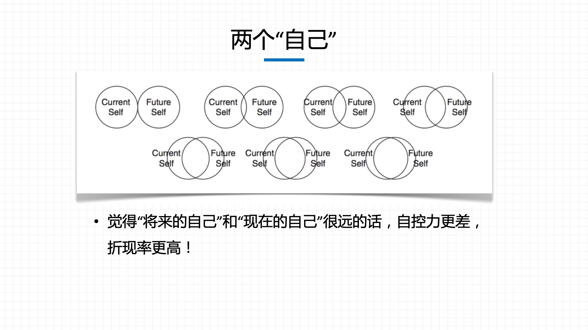

MIU 这个心理学家还设计了一种非常聪明，也非常有趣的方法去提高你的储蓄率，这里面还涉及到一些高科技。他用电脑给每个人做出一个 20 年之后的自己，也就是 20 年之后的虚拟化身，然后坐在你的对面，你跟他交流。交流十几分钟之后，再给你一千块钱，让你决定这一千块钱怎么花。你是现在去买一件衣服呢，还是搞个 party 呢，还是说留点钱给将来的自己？

结果发现，当你跟你将来的虚拟化身交流过十几分钟之后，大家更愿意把钱存下来留给将来的自己。差别是多少呢？一个是 172，一个是 80。

## 为什么会有当前偏差

既然这么多人都会有自控力问题，也就是当前偏差，这就引出我们这门课一直在问的一个问题，为什么我们一直能够存活到现在，是不是在远古时期当前偏差曾经帮助过我们生存和繁衍后代？

在远古时期，那个时候资源稀缺，不但资源稀缺，还有一个重要因素就是环境很不确定，你吃了这一顿可能就没有下一顿。

这个时候，长远的计划不一定能够帮你生存下来，活在当前是更加重要的，比如说当你已经特别饿的时候，你不会太礼貌、不好意思去抢最后一块肉。所以，满足当前需求是最重要的，这一点和我们前面讲过的损失厌恶是有点像的。

那在现代社会中，我们应该怎么去克服我们的当前偏差？这就说到我们前面讲过的，比较晚进化出来的前额叶皮层。前额叶皮层让我们去做困难的、长期来讲对我们比较有利的事情，而不是容易的事情，但是真正让我们克服困难的动力是什么呢？是多巴胺，前面我们讲过。

以前当人在草原上看到一只鹿在跑，他大脑里面就会分泌多巴胺，这样的话他就会去追它。但是当他大脑受到损伤，不分泌多巴胺的时候，就不会去追它，这就说明多巴胺是让我们行动的动力。

但是很多人可能不知道，在当年让我们有动力克服困难的多巴胺，到现在可能是导致我们有当前偏差的一个主要原因。为什么会这么讲呢？

你想，在远古时期，你一看到食物，就会分泌多巴胺，然后努力工作，去得到这个食物，这样才适合你的生存。因为在那个时候食物稀缺。

但是现在不一样，你随可以看到很多看起来特别诱人的食物，这个时候你会分泌很多多巴胺，多巴胺分泌得越多，你越会控制不住去吃它。不但食物会导致你分泌多巴胺，你看到很好看的衣服，打游戏，都会导致你分泌多巴胺。这样的话，就导致你上瘾了。

所以刚刚你也看到了，多巴胺这个东西是让我们克服困难的动力、源泉，同时也是让我们上瘾、失去自控力的原因。那我们怎么才能好好地利用这个东西，使得我们更加努力地工作，有长远的计划，而不是完全失去自控力，对一些东西上瘾。

我不知道你身边有没有一些人，这些人的自控力特别强，我身边就有。我发现这些人特别强，经常像打了鸡血一样，天天在那儿特别卖命地工作。

我觉得他们有一个共同的特点，什么特点呢？他们的工作中有很多不确定性。创业有很大的不确定性；写文章的话，虽然写好了，但是能不能发表出来也有很大的不确定性。那是不是不确定性，反而会带动我们更加努力地工作呢？

那为什么会这样呢？还记得前面我们讲过一个关于猴子的实验吗？灯一亮，猴子去工作，拉十下杠杆，就会有一个葡萄干，猴子就可以去吃。因为灯一亮，猴子就会分泌很多多巴胺。这是剑桥大学一个教授做的实验。

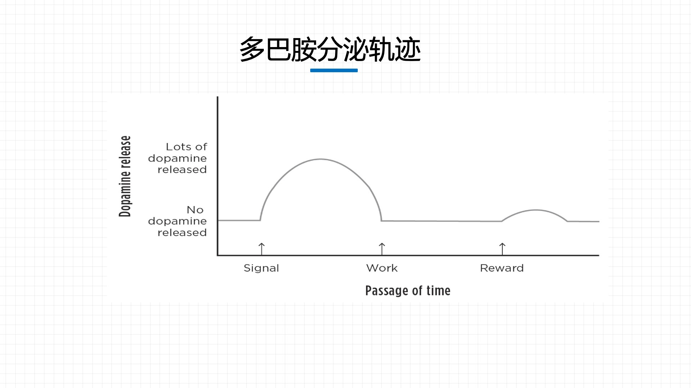

他后来把这个实验变动了一点，前面是你拉十下杠杆，就肯定会有一个葡萄干给猴子吃。这个过程是，灯一亮，猴子就会分泌很多多巴胺，然后它就去工作，在工作的过程中、工作结束之后、等待的过程中，不会分泌多巴胺，猴子吃葡萄干的时候会分泌一点点。

他现在改成，不是百分之百会有这个葡萄干，灯一亮拉十下杠杆，拉完之后只有 50% 的概率会有葡萄干。这样发现了有意思的结果，灯一亮猴子还是会分泌很多多巴胺，跟前面差不多。但是猴子在拉杠杆的过程中，还有在等待葡萄干出来的过程中，会分泌更多的多巴胺。

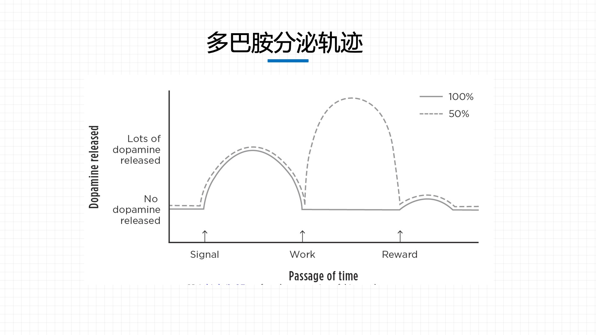

所以你看到，当有更多的不确定性的时候，我们分泌的多巴胺会更多，我们可能会更加努力地工作。

哈佛大学有一个著名的笑话，这个研究结果出来之后，哈佛大学就制定了一个政策，这些教授们努力工作九年、十年，天天没日没夜地工作，最后他们有 50% 的概率能留下来，并拿到终身教授，这也是为了他们的快乐，因为你的工作过程中会有更多的快乐。

我稍微小结一下，我们讲了，当前偏差是有进化论的依据的，而且也提供了一些微观的依据，因为多巴胺这个东西的存在。而且我们还讲了如何利用多巴胺，使得我们有长远的计划努力工作，一个重要原因就是不确定性。当然公司管理上也可以引进一些不确定性，增加员工工作的动力。

## 当前偏差怎么被商用

那刚才讲了当前偏差的原因，是不是当前偏差在生活中普遍存在呢？非常遗憾，它真的是这样的，有时候你可能都没意识到。下面我要讲一个研究，这是加州大学伯克利分校的一对夫妇教授在健身房里做的一个研究。喜欢健身的人可能知道，健身房有好几种收费规则，一般来讲你可以每次去付钱，或者是办一个年卡、月卡。

如果办年卡，每个月大概是 75 美元的费用。然后你发现这些办了年卡的人，平均每月去健身房的次数差不多也就四次左右，也就是说每次要花差不多 19 美元；但是如果你每次去付钱的话，其实也就是 10 美元一次。也就是说不用办年卡，每一次去付钱，可以省下大约 50% 的钱。

为什么会出现这种现象呢？当你办卡的时候，你会觉得将来的自己经常会去锻炼身体，那在现实生活中，你总是会决定，今天晚上我是去锻炼呢，还是去看个电影呢？很可能你就看电影去了，由于当前偏差的原因，导致你去健身房的次数很少，所以最后你其实花了很多钱。

那既然大多数人都会有当前偏差，那是不是公司可以设计一些很聪明的合约，帮助员工去克服当前偏差和自控力的问题？确实是可以设计一些很聪明的合约，下面我举个例子，就是以做鞋为例子。假设你有一个做鞋的工厂，你的员工给你不停地做鞋，平均一个月做 100 双鞋。

那现在你给你的员工两个合约，第一个合约是员工做一双鞋，就给他 100 块钱，如果这一个月做了 100 双鞋，就有一万块钱，做了 120 双鞋就有一万二千块钱，做了 80 双鞋就有八千块钱。

但第二个合约是没有第一个合约好的。如果你做的鞋少于 100 双，那每双鞋就是 80 块钱，所以如果你做了 99 双鞋，你只有 99×80 这么多的钱。但是一旦你做的鞋高于或者等于 100 双，那每一双鞋就是 100 块钱，包括前面那 99 双鞋。比如说你做了 100 双鞋，你就有一万块钱；做了 120 双鞋，会有一万二千块钱，跟前面一样。

现实生活中你会发现，你给员工第二个合约，生产效率会高出 13%，而且他们做的鞋基本上都会超过 100 双。因为中间有个断点，导致大多数人会特别难受，而这帮助他们克服困难，努力工作，超过 100 双鞋。

所以你能看到，有时候这些限制自我选择的产品或者是合约，对厂家、对商家、对消费者、对工人，可能都是有益的。像刚刚那个例子，工作效率提高了 13%，那当然是厂家和员工都开心了。

## 为什么语言也能影响储蓄率

好，上面还是一些小例子，下面要讲的例子可能超出你的想象。你知道吗？你的自控力跟你讲话的语言还是很有关系的，尤其是语言的时态。

下面这个研究还是 Keith chen 的，他自己是华裔。他知道汉语跟英文是非常不一样的，其中一个最大的区别就是汉语没有时态，但英文是有时态的。

比如说就以 “下雨” 为例子，汉语就是 “昨天下雨”、“现在下雨”、“明天下雨”。但是英文就完全不一样了，“昨天下雨” 怎么说？It rained yesterday，要加个 “ed”；“今天下雨” 或者是 “现在下雨” 怎么说呢？It's raining now，要加个“ing”；那“明天下雨”，It will rain tomorrow，一定要强调“will”。

所以，如果你每次都讲英文的话，你会每次都强调将来的事情是 will happen、will do something。那如果你几十年一直这么讲，一直强调将来，那你觉得将来是更远还是更近？应该是觉得更远，对吧？因为你每一次中间都隔了一个 will，如果没有那个 will，就像我们汉语，那可能觉得将来离现在稍微近一点。

这样的话，会不会导致这些人的自控力不一样？因为他们每次都觉得将来特别远，是不是在讲英文的那些人看来，将来的自己跟现在的自己也会离得比较远？那我们讲汉语是不是觉得将来的自己跟现在的自己离得比较近？

下面我就讲一个 Keith chen 一个比较惊人的发现，他研究的自控力的维度是大家的储蓄率。

他研究了 35 个国家的储蓄率，最后发现什么呢？那些讲话有将来时的国家，就像讲英文的国家的储蓄率，跟讲话没有将来时的国家去比，每年要差 GDP 的 5%，20 年就差一个 GDP，这是非常大的一个差距。

比如在卢森堡、挪威、瑞士和日本，这些讲话没有将来时的国家，它们的储蓄率是非常高的，大约是每年 GDP 的 30% 左右。这里面还没有把中国加进去，把中国加进去说不定这个效果更大。

但是讲话有将来时的这些国家，比如说美国、英国和希腊，这些国家的储蓄率也就是 GDP 的 15% 左右，相差了 15%。而且在储蓄率排名最靠后的那 16 个国家里面，有 14 个国家都是讲话有将来时的，只有两个国家讲话没有将来时，那就是德国和冰岛。

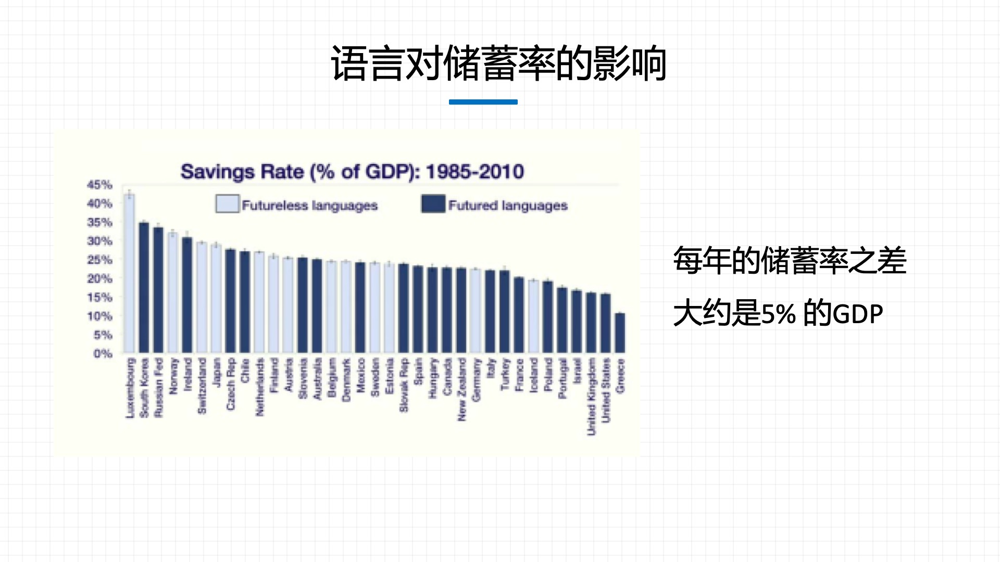

当然你可能会说，余老师，这可能是一个统计上的假象，对吧？因为你看亚洲文化，像日本也受我们中国文化的影响，在我们的价值观里面，储蓄就是很重要的，这些国家储蓄率高，正好讲话又没有将来时。所以它可能跟讲话有没有将来时没有关系，只是文化价值观的体现。

当然也有可能是因为养老制度，比如说在欧美一些国家，养老系统比较好，所以大家存的钱不多。但在我们中国，相对来讲养老金比较少，所以大家储蓄得相对多一点，我觉得这些都可能是原因。

但是 Keith chen 做了一些更细致的分析，这里面就涉及到一些比较复杂的统计工具，我就不细讲了，大概就是做一些回归分析，把刚刚说的那些因素全都加进去，比如说价值观的问题。

在一些国家的价值观里面，教小孩储蓄是很重要的，那这些国家的储蓄率确实会高一些。但是你把这些因素全都控制住，你会发现讲话有没有将来时，影响储蓄率的效果基本上是一样的。

Keith chen 不光做了储蓄率的研究，因为自控力还有在其他维度的体现，所以他也做了一些其他维度的研究。比如说他发现在讲话有将来时的这些国家里面，20%～30% 的人更加容易变得极度肥胖，更加可能吸烟，而且更加可能不使用避孕套。

在 Keith chen 这个研究之后，其他的研究人员也在研究，语言时态是不是也会影响公司的现金持有比例？因为现金持有越多，越是谨慎的一个表现。

研究确实发现有类似的效果，讲话有将来时的那些国家或者地区，公司持有现金的比例是少很多的；而讲话没有将来时的国家和地区，公司持有现金的比例是高很多的。

比如说在中国还有新加坡、日本这些国家和地区，公司持有现金的比例大约是 16% 左右。而在讲话有将来时的那些国家，比如说葡萄牙和泰国，公司持有现金的比例只有大约 7%，相差 9%。

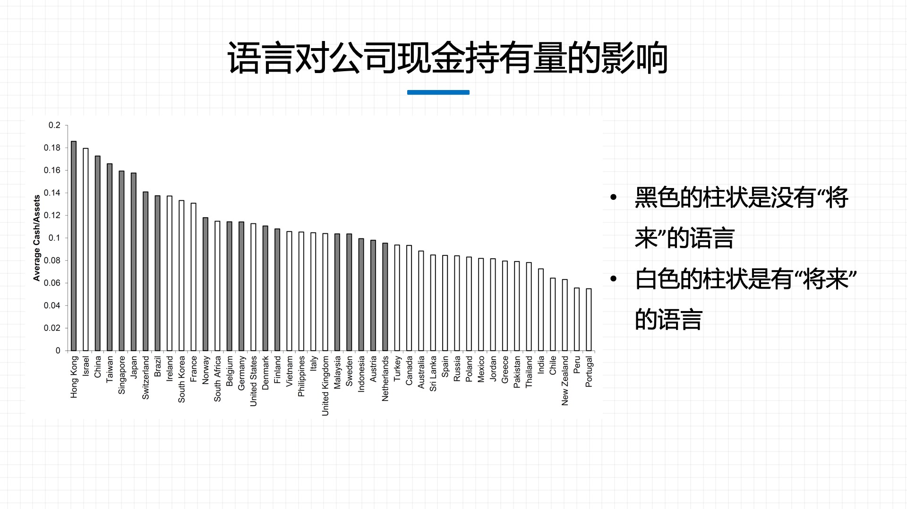

好，听完上面这个例子，是不是你还有点庆幸？感谢我们的老祖宗，我们的中文里面没有这个时态，导致我们的自控力至少比美国人还是要高一些的。而且我们发现，提高美国人的储蓄率一个非常有效的办法是什么呢？让他们多学中文就行了。

## 怎么提高自控力

但是你是不是又有点绝望？为什么呢？你想，我们的自控力原来受这种微妙因素的影响，很多时候你根本就控制不住，而且你都没有意识到。其实也不完全是这样的，我们还是有些办法去提高我们的自控力，但是讲到提高我们自控力的时候，我们先要理解自控力是会变动的。

**首先，自控力是非常费能量的，**因为你要克制自己，这个时候需要用你大脑的前额叶皮层去做长远的计划。但是前面讲过，前额叶皮层会让你仔细思考，所以它是非常费能量的。

一旦你感到特别疲惫的时候，你的自控力又会变得很差，所以说这也是导致自控力很难的一个原因。你要自控会很费能量，费了能量之后你疲惫了又不能自控，这不就是一个死循环了吗？

研究发现，当你的血糖水平下降之后，就是说你特别疲惫之后，你的自控力确实会变得更差。你这个时候会更加喜欢冒险，哪怕在投资上面也会更加喜欢冒险。

所以你要提高你的自控力，首先不能让你自己太疲惫，当你特别疲惫，前一晚没有睡好的时候，这样的话你的细胞就很饥饿。你的细胞很饥饿的时候，会觉得环境比较恶劣，这个时候你的自控力会下降。

所以一个最简单的稍微提高你的自控力的方法就是，当你特别疲惫的时候，你真的要休息一下，出去散步五分钟，这个时候反而能提高你的效率。

我再讲两个简单的可以提高你的自控力的方法。

**第一个就是每天静坐冥想五分钟，静坐冥想的时候你只关注自己的呼和吸。**有研究发现，你每天只要坚持五分钟的冥想，可以增加你的前额叶皮层的一些灰物质，而且大脑中和自我认知相关的那部分区域也会变得更大。更多的血液冲到你的大脑前额叶皮层，就相当于我们在卧推的时候，更多的血液会到你的肌肉里，这样的话你的肌肉会变得更加发达，自控力就像肌肉一样，是可以锻炼的。

**第二个非常简单有效的方法，是训练你的呼吸，你要做深呼吸、慢呼吸，做到大概每分钟只呼吸四到六次。**研究发现，当你做慢呼吸的时候，你的心跳频率的波动性会变大，有时候会比较快，有时候会比较慢。有很多科学研究发现，心跳的波动性变大，是能够提高你的自控力的。同时，深呼吸可以减压，你的压力会感觉更小，这也是为什么人们有压力的时候，会深呼吸一下。

## 教你一招：利用当前偏差提高收益

前面讲了几个简单的方法去提高我们的自控力，克服当前偏差。那下面我们再回到前面讲的自控力，它会随时间而变动，那是不是我们能够从自控力在时间的变动上导出一些有意思的投资策略？

比如说在穆斯林国家，它们有斋月，是在八月份，一个月从早到晚都不吃东西，很难受，那是需要自控的。这个时候，如果全民都在自控，是不是就像我前面讲过的，大家更愿意去做一些冒险的事情，比如说在股票市场上做一些交易，把股票市场的价格给推上去？

这就涉及到最近在《银行业与金融杂志》（journal of banking and finance）上发表的一篇学术论文，这篇学术论文研究了十四个穆斯林国家，发现这些国家所产生的股票收益率基本上全都发生在斋月那一个月。

比如说土耳其和阿曼，在斋月那一个月，它们的股票年化收益率超过百分之百，但是在其他的月份基本上就是零。这是一个很好的交易策略，因为资金是有成本的，如果你要投资那些国家，基本上你只投资那一个月就够了，其他十一个月你可以把钱拿出来，投资在别的资产上面，这可以降低你的资金成本。

不光是土耳其和阿曼，在其他穆斯林国家也是类似的结果，只不过没有土耳其这么强而已，但是基本上这个结果是存在的。

在斋月时期，不光是这些穆斯林国家的股票市场收益率更高，而且我自己正在做的一些研究发现，在那一个月长得像彩票的股票，收益率会更加高；长得不像彩票的股票，收益率也会变高，但是没有像彩票型股票变得那么高。这也说明那一个月大家更加喜欢冒险，买彩票一样的股票。

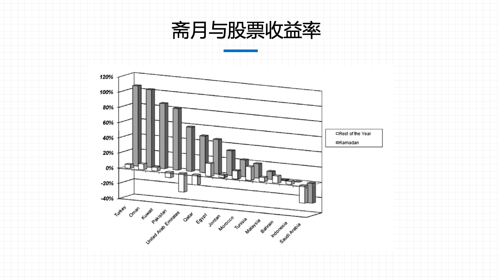

当然《银行业与金融杂志》那篇论文，它的观点不是这样的。虽然它发现了这个结果，但是它觉得在斋月，穆斯林是一个团体，更加团结，更加有集体感，所以大家的心情变得更好。心情变得更好，当然股票市场上的收益率会更高了，这是下节课我们要讲的东西，这可能也是其中的一个原因。但是我觉得这个结果也是我刚刚说的，由于大家自控力变差的原因。

## 总结

好，讲到这里，我给你总结一下这节课的主要内容。

*   第一，我们给出了当前偏差的定义，当前偏差的学术定义是指，当前 5 分钟的折现率是要高于 20 分钟之后的折现率，我们更在乎当前的快乐，抵挡不住当前的诱惑，这样会导致我们失去自控力，有拖延症，将来还会后悔。
    
*   第二，我们讲了当前偏差产生的原因，而且当前偏差跟进化论是一致的，在远古时期环境比较恶劣，有很多不确定性，只在乎当前可能更适合我们长期生存和繁衍后代。
    
*   第三，我们讲了当前偏差可能跟我们的语言的时态有关系。
    
*   第四，我们讲了当前偏差是会随着时间变动的，这也让我们找出一些克服当前偏差的方法。
    
*   最后，我们从当前偏差会变动，导出了一些股票市场上投资的策略，可以是择时，也可以是选股。
    

好，到现在为止，我们已经讲完了所有的偏差，预期中的偏差和风险偏好中的偏差。我们也讲了一些应用，比如说在二级市场中的应用，但是我们讲的应用大多数都比较简单，也就是一个偏差导致出一个策略，或者一个策略的改进。

从下一个模块开始，我们会讲在股票市场上更复杂的应用，比如说我们把两三个偏差结合在一起，或者把偏差和交易制度结合在一起，这样会导出一些非常有意思的交易策略。当然这也更加专业一点。

作业：非常简单，就是你有什么提高自控力的好方法吗？给大家分享一下。

我是余剑峰，咱们下节课再见。

\\1. 拖延症的根源：我们内心有一个未来的自己，一个现在的自己，但当前偏差，会让我们屈服于现在的自己。 2. 不确定性会刺激多巴胺分泌，从而导致上瘾。 3. 提高自控力的方法：首先认识到自控力耗能巨大，需要注意休息；其次可以练习冥想和呼吸。

# **第 17 讲 | 市场情绪：怎么衡量非理性？**

[懒人专属群的群友](https://lazybook.fun/#/blog/group)，你好，欢迎来到清华五道口《行为经济学》的课堂，我是余剑峰。

我们这个课先从人类行为的起源开始，然后再讲人的各种偏差，预期中的偏差和风险偏好中的偏差，现在我们终于讲到最后一个模块，要讲各种投资中的应用。

前面我们也从单个偏差中导出了一些投资中的应用，但是现在这个模块，会更复杂一点，我们会把好几个行为偏差结合在一起，或者把行为偏差和那些交易制度上的限制结合在一起，看看能推出哪些比较有意义的、有意思的、有实用价值的交易策略。

前面讲的交易策略的思路大概是这样的，由于人的某种偏差导致我们对一些股票将来的盈利能力过分高估；或者是由于我们的某种偏差，对某些股票的需求过分地高估，从而导致这些股票的价格太高，将来的收益率会比较低。

但是要知道现实生活中，这些偏差基本上不会单独出现的，虽然我们写文章或者推测都是一个一个看，现实生活中大多数偏差都是结合在一起的。那你可能会问，存在不存在一个指标，它能综合所有的这些偏差，导致一些股票被过分高估，或者过分低估？

我告诉你，还真有这样一个指标，这就是我们这节课讲的一个重点，投资者情绪。投资者情绪可以是单个股票上的投资者情绪，也可以是整个股票市场上的投资者情绪。

## 什么是投资者情绪

投资者情绪没有一个确切的定义，而且对不同的人，它的定义都是不一样的。所以在我们这个课里面，我先给出一个确切的定义，这样将来比较好交流。比如一个股票的投资者情绪高，是指投资者对它有过分的需求，或者投资者对它的期望过分地高。

这里面的 “过高” 其实是很抽象的，过高首先在理论的模型里面其实是很容易定义的，你可以说跟一个理性的模型去比，如果你现在的需求更高，那就是过高；现在你对于这个公司的预期跟理性的模型比过高了，那也是过高。

但在现实生活中，我们可能也不知道理性的模型是什么样的，所以这里过高基本上就是说，**由于某种心理偏差，而不是基于基本面的原因，导致你对一些股票有过高的需求。或者是，也不是由于基本面信息上的原因，导致你对一些股票的预期，或者是对它盈利的能力的估计错了，这也是过高。**

对单个股票是这样的，对整个股票市场，如果你有过高的预期、过高的需求，那整个市场的情绪也是比较高的。相反，如果你对整个市场的预期比较低，或者是对整个市场没有什么需求，不想买，那就是说非理性的情绪比较低。

那你想，这个过分是怎么来的呢？前面我们讲的各种偏差都是原因，但是市场情绪高还可能有其他各种偏差，我们一共才讲了大概十个偏差，还有很多没讲过的偏差，可能也会导致我们对一些股票有过分的需求、过分的预期，这是其中一个原因。

还有可能是我们根本不知道的偏差，也会让我们对股票的需求过高，导致这个股票的市场情绪过高。现在我们要讲的是一些其他的原因，或者是一个总的定义。

你可以把市场情绪理解为各种偏差的一个集合。已知的、未知的，已经讲过的、没有讲过的，甚至有时候都不是由于心理偏差，有可能是文化上的偏差，导致你对一个股票过分喜欢或者过分不喜欢，都会导致这个股票的市场情绪过分地高，或者过分地低。

## 心情怎么影响收益率

那我们现在先讲一个概念，它影响人们对股票的需求，或者是预期，就是人的心情。

一般来讲，如果你这个时期心情好，同时期股票的收益率会比较高；但是因为你现在心情过分地好，将来收益率还会慢慢回来。

所以，我们先看看同期是不是有这种影响，当你这段时间心情比较好的时候，股票收益率会不会高。如果我们能猜到在某一段时间内大家的心情相对来讲更好，那在这段时间内，股票收益率就会比较高，我们在大家心情变好之前就可以去买那个股票，等大家心情开始不好，你就可以把股票卖了，这是一个简单的思路。

什么会影响心情呢？只要影响心情，我们就有理由相信它会影响到股票的收益率。影响心情的因素实在是太多了，随便举几个例子，比如说研究发现，如果赢了重大比赛，当天股票的收益率要比正常高出 0.5%。

还有其他的因素也会影响心情，阴天大家可能心情就没那么好，相对来讲比较忧郁。只要曼哈顿岛上那一点点地方是阴天，整个股票市场的收益率会偏低，你不用看全美国的天气，因为更多的交易员尤其是早期，都在曼哈顿，所以说这也会影响股票的收益率。

那我再问你，星期一到星期五，你觉得大家哪天心情会更好？大家都会觉得应该是星期五比星期一好，因为过了星期五就是周末；而在星期一，还有一个星期的时间要工作，可能心情就没那么好。

研究发现结果也是这样的，星期五收盘相对来讲会偏高一点，星期一开盘会偏低一点。所以，平均来讲整个周末的收益率是个负数，因为星期一大家心情没那么好。

有的时候，你的心情被影响到了，你可能自己都没有意识到，但是股票市场上已经体现出来了。早期我们中国也有夏令时、冬令时，但是在美国和欧洲，一直是有夏令时、冬令时，4 月份、10 月份的时候会把时间往前、往后调一下，这样的话就能节省能量。

一般是在星期天凌晨两点钟调一下时间，全国人民都被影响了睡眠一个小时，那这样的话可能每个人的睡眠就打乱了，他们的心情也会受到影响。你可能都没意识到，但是是不是股票市场上能体现？

我们在股票市场上看不同的指数，道琼斯指数、标普 500 指数，都是有影响的，平均来讲那个周末整个股票市场的收益率比正常周末要低出 0.5% 左右，不同指数的效果是不太一样的，但是差不多平均是 0.5%。你看，这也是一个挺大的影响，因为调一下时间，导致大家心情变了。不光是在美国，英国、德国也有这种效果。

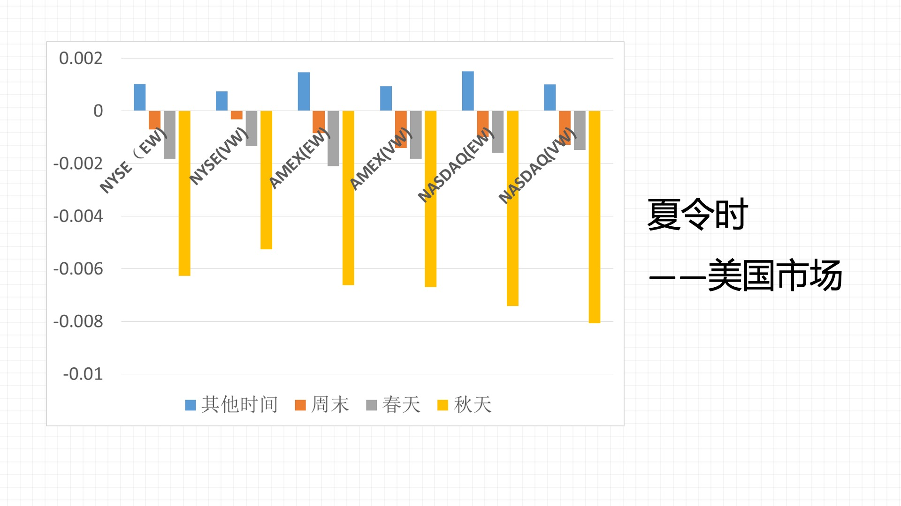

## 月亮也能影响收益率么

最后再讲一个影响人心情的因素，你可能根本没有意识到它，而且哪怕你意识到了，你可能也觉得结果是反的。

那我问你，你觉得月亮会影响人的心情吗？是满月的时候你的心情好，还是新月的时候你的心情好？正常来讲，很多人可能会觉得满月这么亮，应该心情更好。

但是我告诉你，人不是这样的，尤其是在古代。我们中国很多的诗词都跟月亮有关，满月的时候大家其实偏忧郁一点，“举头望明月，低头思故乡”，“明月何时照我还”，“海上生明月，天涯共此时”，还有跟酒有关的，“举杯邀明月，对影成三人”，这都是明月导致人的心情偏忧郁。

其实月亮影响人的心情，不光在东方的文化里面体现，在西方的文化里面也体现了。莎士比亚的著作《奥赛罗》里面提过，“都是月亮的错，当它更接近地球的时候，使人们变得更加疯狂”。而且英文有个单词叫做 lunatics，疯子的意思。luna 就是月亮，月亮跟疯子都联系起来了，所以月亮和人的心情应该是有关系的。

我们先看美国的数据，发现什么呢？在满月的时候收益率是很低的，每年只有 5% 左右的年化收益率。在新月的时候，就是月亮比较小的时候，大概是 14% 的年化收益率，相差 9%，这是极其大的一个数字。

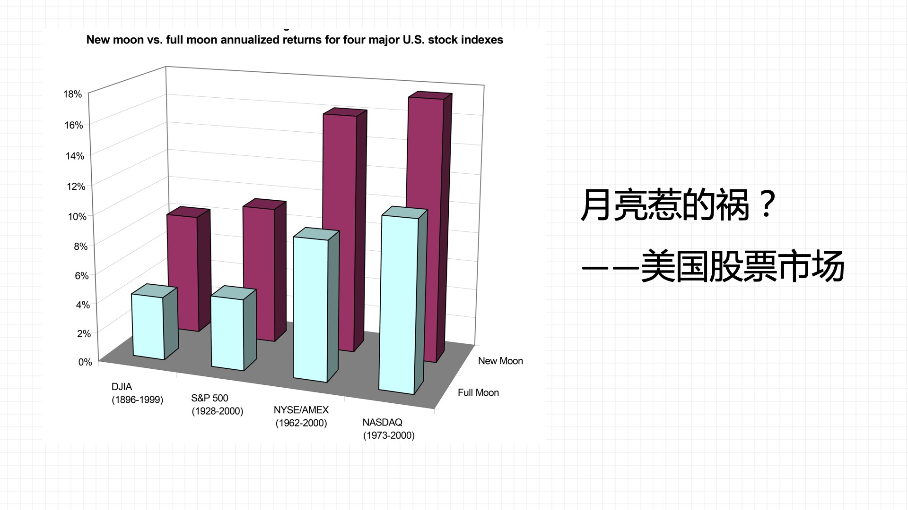

我们再看其他的六个发达国家，英国、加拿大、法国、德国、意大利和日本，基本上结果全是一样的。

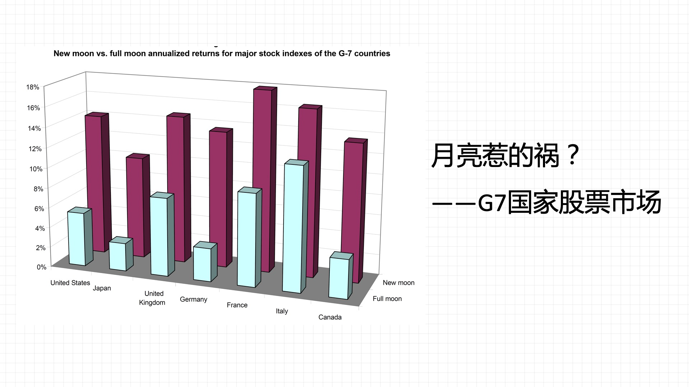

不光是在这些大的发达国家的股票市场，在很多小一点的股票市场上，这个结论也是成立的。比如说在我们中国台湾、香港和新加坡。尤其是在新加坡，新月的时候平均年化收益率是 15%，但是满月的时候基本上就是 0。

我再强调一下，这是非常强的结果，因为我们前面讲过的大多数投资策略，不会在所有的国家都成立，比如说动量投资策略，它在亚洲基本上就没什么效果。什么原因呢？回头我们会细讲。

但是月亮影响投资，可能更加全球性，因为我们在进化过程中，看的都是同一个月亮，大家都会受这个月亮影响，导致在不同的国家，这个影响效果都很大。

我稍微总结一下，前面讲了心情会让大家对一些股票产生过分的需求，导致同时期股票的收益率比较高。当然这里面的心情，可能会受一些你没想到的因素的影响，比如说月亮。

同时我们可以根据这个东西去改进你的投资策略，比如说你要买一些股票，你在新月的时候去买，满月的时候可以把这些钱拿出来，投资在别的地方，产生额外的收益率。

## 为什么罪恶股票反而收益高

前面讲的都是投资者的心情怎么影响整个股票市场上同期的收益率，下面我们要看单个股票的投资者情绪，然后用单个股票的投资者情绪去预测将来的收益率。

那我们下面考虑两种投资机会，一种是投资社会责任股票，一种是投资那些听起来不太好听的罪恶股票上。

什么叫罪恶股票？就是那些跟枪支、军火、烟酒有关的行业；社会责任股票可能是跟新能源、环保行业有关的。如果它们将来的预期收益率是一样的，风险也是一样的，你会选择投资哪个项目？

我觉得当什么都一样的情况下，大多数人都会选择社会责任投资，首先你可以跟你的朋友吹吹牛，表示自己很有社会责任心，自己很高大上，很有成就感。如果你投资罪恶股票，尤其是那些宗教信仰比较强的人，是很难受的，因为还要跟上帝解释为什么要投资这种股票。

如果什么都一样的情况下，大家都会选择社会责任投资，那些股票的价格就会上去，将来的收益率会比较低，因为它现在的价格过高。从我们刚刚讲的推论来说，由于大家对罪恶股票和社会责任股票的投资者情绪不一样，导致它们将来的收益率是不一样的。

先锋集团有一个指数，叫做社会责任投资指数，它从 2003 年就有了，我们先看 2003 年到 2015 年的数据。如果你 2003 年在社会责任股票投资一块钱，到 2015 年就变成了两块七毛钱。但是同期的罪恶投资，从一块钱变成了三块五毛钱，收益率要高出很多。

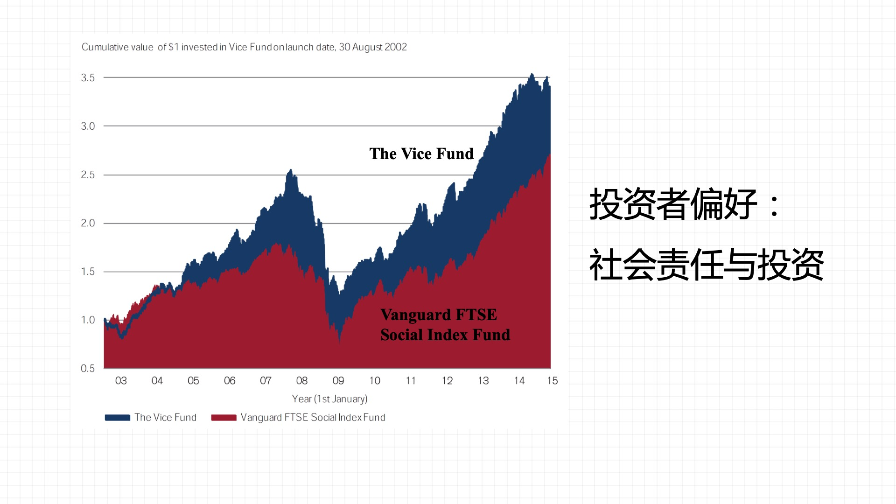

那下面给你看一个更长的数据。我们就看烟草行业，和整个股票市场去比，从 1900 年开始，如果你投一块钱，到现在大约会变成三四万块钱。但是如果你在 1900 年投资烟草行业，现在在英国和美国就变成了六七百万，差了很多。所以说时间越长，罪恶股票带来的收益率越高，因为这里面有复利的作用。

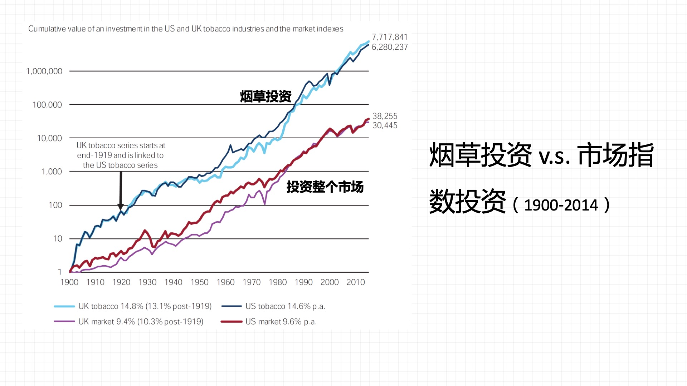

前面讲的都是一两个国家，或者一个行业的数据，发现罪恶股票的平均收益率要更高。下面我们来看一看来自 21 个国家的市场，38 年横截面的数据，看看是不是在这些国家里面也有这样的效果？我们发现，基本上所有的国家，罪恶股票的收益率都要比正常股票高。而且有一个有意思的规律，就是宗教信仰越强的那些国家，罪恶股票的收益率越高。

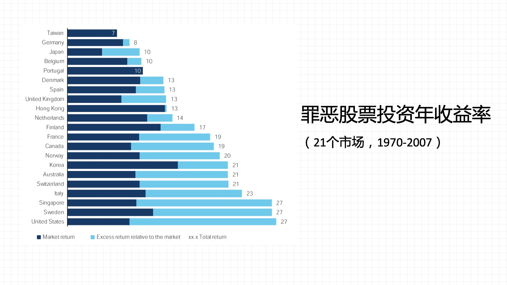

比如说在美国，你感觉它比较开放，但是美国是一个宗教非常保守的国家。在美国，从 1970 年到 2007 年这 38 年中，罪恶股票的平均收益率远远要比标普 500 指数高很多。

但是在一些其他的国家和地区，比如说我们中国的台湾和香港，罪恶股票和正常股票收益率基本上是一样的。为什么会这样呢？一个重要原因就是，在台湾和香港，人们去买烟酒的股票，会觉得罪恶吗？我觉得很多人不会觉得罪恶，也没有心理负担。

但是在美国的话，因为他们宗教信仰、文化的原因，导致他们买烟酒的股票会非常地难受，大家都不想买这些股票，最后导致罪恶股票的平均收益率要更高。

所以，你就能想到一个简单的投资策略。在美国，罪恶股票比正常股票的收益率要高很多，为什么会这样呢？是因为美国宗教信仰强的原因。那我们中国人并没有觉得买那些股票有罪恶感，对我们来讲，我们就可以做一个文化、宗教上的套利，去买美国的罪恶股票。

你看，到现在为止，你应该基本上掌握了做策略的一些规律，就是你要去买那些别人不喜欢的股票。他们不喜欢的原因不是因为基本面上信息的原因，而是由于某种心理偏差、某种宗教信仰、文化上的原因，它们的基本面并没有很差，那这样的话就可以产生一些超额收益率。

## 怎么测量市场情绪

到现在为止，我们讲了各种影响单个股票或者整个市场情绪的因素，比如说你的心情、月亮，或者是宗教信仰、文化原因。那如果我们想要利用这些市场情绪指标，去预测股票的收益率，首先我们要去测量这些指标。

那我们怎么去测量这些指标呢？这是一个非常难的问题，每个人都有自己的测量方法，我随便讲几个最典型的。有的人用问卷调查，没事经常问投资人，你觉得将来股票市场会怎么样，但是问卷调查有一个不好的地方，就是成本太高了，你不停地要去问别人，可能数据也没那么多。

还有些指标，就是我看这些人在干什么。比如说贝克 · 沃格拉 2006 年在《金融学杂志》上面提出了一个指标，我不去问你们觉得市场情绪怎么样，我直接看你们在做什么。

如果整个市场都非常高涨，那是不是 IPO 数量就会比较多？在美国，如果市场情绪高，很多 CEO 就会想把他们的公司给卖出去上市，因为美国的上市是注册制的，所以 IPO 的数量可以反映出市场情绪的高低。不光是 IPO 数量，如果整个市场情绪高，那 IPO 第一天的收益率就会很高。

在中国，IPO 的数量肯定是不能用了，因为我们不是注册制，但是 IPO 第一天的收益率是可以用的，但是我们要变一变，因为中国有涨停板的限制，而且我们中国的股票 IPO 第一天基本都涨停了。所以说在中国我们要衡量的不是 IPO 第一天的收益率，应该是很多天，直到没有涨停限制的那一天，这个指标也是市场情绪的一个指标。

当然还有其他的指标，比如说换手率，市场情绪越高，大家越喜欢换手，不停地做交易。那这样的话，我们直接看交易，也能反推出来市场情绪。

刚刚讲的那些指标，很多都是有美国特色，在中国把它们改一下也有用，那下面要讲一个可能跟中国股票市场特色更加相关的市场情绪指标的衡量方法。

我们中国股票市场基本上就是来一个大泡沫，然后停个几年，又来一个大泡沫，你看 2007 年、2015 年。在 2007 年顶峰的时候，那一个月基本上会有好几百万的新开账户；而且在 2015 年就更明显了，基本上每个星期都会有两百万个新开账户，而且很多是信用账户。

所以你能看到一个共同特征，就是在泡沫期间会有很多新开账户，那就是市场情绪很高了。当新开账户特别多的时候，可能很快就到顶了，那将来收益率就会偏低。所以说当新开账户特别多的时候，你得小心，相当于大家都进市场了，它也是市场情绪的一个指标。

## 教你一招：利用市场情绪提高收益

讲到这儿，我相信你已经充分地了解了什么是市场情绪，它的定义，以及怎么测量它。那它有什么用呢？这是这节课的精髓，下面讲它的各种应用。

一个最简单直观的应用，你用市场情绪来做市场择时，因为市场情绪高，表示整个股市被高估了；市场情绪低，整个股市就被低估了。所以，市场情绪高的时候，你要撤离市场，因为被高估了；市场情绪低的时候，你应该进入市场，因为市场被低估了，这样的话，你应该能够产生一些超额收益率，对吧？

但是我告诉你，虽然我们用尽各种方法去衡量市场情绪的指标，哪怕用尽我们最好的、最复杂的统计方法，但你发现用市场情绪这个指标来预测整个股票市场的效果很差，因为它非常不准。

但是这并不代表市场情绪这个指标没有用，只要你把它用好会很有用。下面就讲怎么能够用市场情绪跟别的东西结合起来，才能够化腐朽为神奇。

前面讲了，用市场情绪预测整个股票市场是比较难的，但是说不定它可以预测单个股票，因为每个股票受市场情绪的影响是不一样的，有些股票特别受市场情绪影响，比如说年轻的、比较小的股票。

但有些股票就不太受整个市场情绪影响，比如说比较大的、年纪比较久的股票。美国的 IBM 有上百年历史，它所在的行业也比较稳定，不太会受市场情绪影响。

所以说我们可以利用这些特征，用市场情绪去预测一些横截面的股票的收益率，不同行业、单个股票的收益率是不一样的。那下面我给你讲一个例子，年轻的股票怎么受市场情绪的影响。

我可以告诉你在美国，上市时间一百年的股票，跟刚刚上市的股票，它们的收益率是没什么关系的，所以公司的年龄根本不是一个信号，不能用来预测股票横截面的收益率。但是它跟市场情绪结合起来，你看看它的效果。

先假设现在我们处于市场情绪特别高的时候，很多股票都被高估了，哪些股票更加被高估呢？肯定是那些年轻一点的，因为它们更加受市场情绪的影响。

那你往前看，现在市场情绪高，将来那些年轻的股票的收益率应该很低，那些年纪大的股票将来的收益率相对来讲应该比较高，因为它们前面被高估的程度是不一样的。

刚刚讲的是给定市场情绪高，下面我们再看，给定市场情绪低会怎么样？

那么很多股票相对来讲可能被低估了。哪些股票会更加被低估？还是一样的，年轻的股票更加受市场情绪影响，它可能更加被低估；年纪大的股票可能只被低估一点点。那你再往前看，年轻的股票将来的收益率相对年纪大的股票更高。所以你看见没有，反过来了。

那我们怎么做策略呢？因为刚刚讲过，年纪不是个信号，你不能用来做策略，但是现在我们可以做了。

*   当市场情绪高的时候，我们应该买入那些年纪大的股票，卖空年纪小的股票，因为年纪小的股票相对来讲被高估了。
    
*   但是相反，当市场情绪低的时候，我们应该买入年纪轻的股票，卖空年纪大的股票，这样是能产生超额收益率的。
    

那这个策略有多大的收益率呢？当市场情绪高的时候，平均每个月能产生的超额收益率是 0.85%；当市场情绪低的时候，平均每个月的超额收益率是 0.54%。

你看，市场情绪可以把年龄这个信号化腐朽为神奇。不光是年龄，还有很多其他的变量，比如说公司市值的大小，公司股价的波动性，也会有类似的规律，都可以用来改进投资策略。尤其是在中国市场，最重要的一个因子，就是市值因子，平均来讲小股票的收益率比大股票要大。

但是它经常会反转，比如说在 2014 年末的时候，大股票的收益率比小股票要大很多。那怎么才能去预测这种反转呢？这种市值因子上的反转，其实一个重要的信号就是我们刚刚讲的投资者情绪。

市场情绪这个指标不光可以把公司的年龄这个指标化腐朽为神奇，它也可以用来改进已知的交易策略。

下面讲的是我自己的一篇论文，这篇论文是被引用次数最高的、我自己比较骄傲的一篇论文，当时我还在明尼苏达，两个小时做好的，而且写起来特别容易，因为结果特别强。整个论文的结果有点复杂，但是由于时间原因，我只把主要的思路讲给你听，看看怎么做策略择时。

因为市场情绪会变动，有时高有时低，当市场情绪高的时候，大多数人都过分乐观，那理性的人会怎么样呢？是偏悲观的。正常来讲，偏悲观会卖空这个市场，但是很显然各个市场都会有卖空限制，所以理性的人就不在市场里面。

但是市场情绪低的时候会怎么样呢？市场情绪比较低的时候，理性的人偏乐观，偏乐观的人在市场里面，所以说理性的人更加在市场里面。

所以**有一个结论，市场情绪偏高，更多的非理性的人在市场里面；市场情绪偏低，更多理性的人在市场里面。**

那你想，如果市场情绪低，大多数市场参与者都是偏理性的，那这个市场就没有太多定价错误，你的投资策略就没那么有效。

相反，在市场情绪高的时候，市场的参与者更多的是非理性的人，那就存在定价错误的可能性。那如果你有很多以前能够挣钱的策略，这个时候就更加能挣钱，这就是我们的一个思路。

我那篇论文只选出十一个当时最显著、最能挣钱的交易策略。我们去看这十一个交易策略，在不同的市场情绪的表现是什么样的。

当市场情绪低的时候，这十一个交易策略下一个月的平均超额收益率只有 0.31%。但是如果上一个月市场情绪比较高，这个时候有很多定价错误，下一个月这些策略的平均收益率要高出很多，是每个月 1.21%，变成原来的四倍。

而且还有一个有意思的规律，这些策略虽然能产生很多的超额收益率，但是大多数超额收益率都是从卖空的那边来的。

因为我的策略都是对冲的，买入一些股票，同时卖空一些股票，这个超额收益，78% 都是从卖空那边来的。这也是合理的，因为在市场情绪高的时候，很多非理性的人都比较乐观，所以很多股票被错误定价了，所以你卖空它，才能产生超额收益率。

## 总结

好，我现在总结一下这节课的主要内容。

*   第一，我们给出了市场情绪的一个确切的定义，告诉你市场情绪会受很多因素的影响。
    
*   第二，我们讲了怎么去衡量这个市场情绪，尤其是在中国市场上，有一些中国特色的指标，比如说开户的账户数是多少。
    
*   第三，我们可以用市场情绪这个指标，去改进我们的投资策略。比如把公司的年龄这个没有用的信号，变得很有用。
    

我们用市场情绪这个指标去做策略择时，有的策略不是每个时刻都能赚钱，在市场情绪高的时候，这些策略更能挣钱；在市场情绪低的时候，就不怎么能挣钱，它是一个策略择时的指标。

那下一讲我会讲一个更奇怪的现象，就是低风险的股票的收益率反而高，你不觉得奇怪吗？

作业：今天我们讲的是投资者情绪，它是个综合性指标，测量起来比较难，而且每个人的测量方法都不一样，我们只讲了几个简单的指标去测量它。我想让你给大家分享一下，你觉得还有哪些重要的指标也反映了投资者的情绪？

好，我是余剑峰，咱们下节课再见。

\\1. 投资者情绪，是综合各种偏差，反应市场情况的一个综合指标。很多因素都可以影响到投资者情绪，比如天气，时间，甚至是月亮。 2. 测量投资者情绪的指标也很多，包括调查问卷，IPO 数量，股票开户数等。 3. 一个结论： 市场情绪偏高，更多的非理性的人在市场里面；市场情绪偏低，更多理性的人在市场里面。

# **第 18 讲 | 低风险策略：低风险可以有高收益么？**

[懒人专属群的群友](https://lazybook.fun/#/blog/group)，你好，欢迎来到清华五道口《行为经济学》的课堂，我是余剑峰。

上节课我们讲了市场情绪是怎么影响股票市场的，而且是影响横截面的股票收益率，我们也讲了各种投资策略。虽然有各种横截面的策略，但是如果我们去做策略，你最关心的问题是什么呢？

我觉得不外乎两个东西：

*   第一，它将来的平均收益率是多高；
    
*   第二，它的风险怎么样。
    

那存不存在一种策略，它的风险特别低，但是收益率特别高呢？

## 真的有低风险高收益策略么

正常来讲，如果你学过理性金融或者理性经济学，你肯定会觉得这肯定不存在，怎么会有这种事呢？因为理性金融、理性经济里面最基本的一个原则就是风险和收益的关系是成正比的。如果你要获得更高的收益率，一定要承受更多的风险才行，要不然大家都喜欢这种低风险的东西，那么它现在的价格就被抬高了，将来的收益率就会比较低。

但是我可以告诉你，现实生活中不是这样的。

其实在很早以前，60 年代末、70 年代初，有个叫 Robert Haugen 的教授和他当年自己的导师发现了低风险的股票反而收益率高。但是当时这篇论文很难在学术期刊上发表，那个时候是有效市场假说最顶峰的时候，这个研究发现市场不是有效的。不光市场不是有效的，基本上跟所有的经济学、金融学模型都是相反的，因为经济学、金融学模型的基本原则就是高风险高收益，低风险低收益。

经过很多年的波折，这篇论文终于发表出来了，发表在现在排名第四的金融学术杂志上。这意味着什么呢？就是没有太多人会去看，如果你是 Robert Haugen，你会很郁闷，这么好的论文大家不欣赏。那他怎么办呢？他自己成立了一个公司，这个公司的主要任务是干吗呢？就是提供低风险的投资策略。

我告诉你，他的公司真的盈利了。2006 年，《金融杂志》上刊登了一篇论文，是由 Andrew Ang，Robert J. Hodrick，辛宇航和张晓燕四个老师共同合作的。他们做了更加细致的分析，发现低风险的股票确实有更高的收益率。当然他们用不同的指标来衡量股票的风险，但是基本上是差不多的，相关性非常高。

那下面我们来看看低风险策略的具体表现，下面的结果主要是从 Baker、Bradley 和 Wurgler 的论文里面引用过来的。这个策略具体怎么做呢？

你可以在每年的 7 月 1 号把所有股票按照它们的风险排序，风险怎么测量呢？这里面用最简单的测量指标，就是过去一年股票的波动性。你的策略有两个，一个是低风险策略，一个是高风险策略。

低风险策略就是每年 7 月 1 号买入过去波动性最低的那 10% 的股票，持有它们一年，第二年 7 月 1 号做同样的事情，重新把这些股票按照它们的波动性风险去排序，然后买入波动性最低的 10% 的股票，再持有一年，一直连续这么做，做 40 多年。

高风险策略就是相反的，每年的 7 月 1 号把所有股票按照波动性排序，买入波动性最高的 10% 的股票，明年再重新排序，还买入波动性最高的 10% 的股票。

那这两个策略的表现怎么样呢？

先看看高风险策略，因为你承受了最高的风险，如果按照理性金融的理论，你的收益率应该很高才对。但是你会发现，如果 1968 年投一块钱，到 2008 年，因为这个数据当时只到 2008 年，会只变成 58 分钱，跌了 42%。

如果考虑通胀的话，还不到一毛钱，就是说跌了 90% 多。低风险策略的表现怎么样呢？一样，1968 年如果你投一块钱，到 2008 年的时候，它会变成 59 块 5 毛 5，涨了非常多，当然扣除了通胀之后变成 10 块 1 毛 2，也涨了 9 倍多。

所以你看到了，低风险股票不但收益率高，而且回撤、波动性也特别小。我们以前找的策略虽然能产生高收益率，但是风险也是高的。而现在低风险高收益的这两个维度都特别好，这基本上就是我们理想中最好的策略了。

所以你看，这么好的投资策略，一旦让大家知道之后，它肯定会很流行。确实是这样，后来很多大的基金都专门开发了低风险投资基金的产品，专门让大家买这些基金。低风险股票相对来讲都是容量大一点的股票，这样的话这个策略立马就变得很流行了。

*   第一，如果很多人都在用同一个策略，这个策略就会有很多风险。
    
*   第二，如果很多人都在用这个策略，这个策略的有效性就会变小。
    

那现在怎么办呢？你怎么能够提高你的策略的有效性？

## 怎么提高策略有效性

下面我就讲一个改进这个策略的方法，这是基于一篇我和王卉君和严靖华做的论文。这个论文的思想其实非常简单，跟你讲一下你就明白了。我们前面讲过前景理论，就是那三个因素，参考点依赖、损失厌恶和对小概率突出事件的放大。

当你在账面盈利的状态下是风险规避的，当你在账面亏损的时候，是更加喜欢风险的，至少在这个模型里面是这样的。不管你在输钱的状态下是不是真的喜欢风险，但是至少当你在参考点之上和之下，你对风险的偏好是不一样的。

你想如果大家都在参考点之上，都赚钱了，这个时候大家就想锁定盈利，就不喜欢风险。不喜欢风险的话，那这些高风险股票的收益率应该会高一点，因为尽管大家都不喜欢风险，但又要持有它，持有它的原因一定是收益率高。

所以说如果大家都在参考点之上的话，高风险应该会有高收益，但是如果大家在参考点之下，处于账面亏损的状态，这个时候大家更愿意赌一把，或者这个时候大家就不怎么讨厌高风险，说不定还更加喜欢它，它就不一定会有更高的收益率。

下面我就讲我们这篇论文的一个精髓，就是 Double sorting，双重的排序。

我们先把股票按照投资者属于账面亏损还是账面盈利去排序，每个股票我们先要计算出它的平均投资者是处于账面亏损还是处于账面盈利。这个指标比较难算，细节我就不讲了，如果你有全面的数据，可以算得特别准，否则就算得不准。算得不准没有关系，你可以用一个近似值。

下面给定我们算出了每个股票的 CGO，就是账面盈利和账面亏损。假设每个月的月初我们把 2500 个股票根据它们的账面盈利、账面亏损分成五组，第一组是账面盈利最多的那 500 个股票，第五组是账面亏损最多的那 500 个股票。

然后在账面盈利最多的那 500 个股票里面再去细分，根据股票过去的波动率，就是收益率的方差，分出波动率最高的 100 个股票和波动率最低的 100 个股票，然后你去做这个策略。那同样，在账面亏损最多的那 500 个股票里面，你也可以继续细分，根据股票过去的波动性，分出风险最低的 100 个股票，和风险最高的 100 个股票。

那我们发现什么结果呢？当我们只看投资人处于账面盈利的 500 个股票，会发现那些波动率越高的股票，平均来讲收益率越高，跟我们前面说的是相反的。

为什么会这样呢？因为前面讲过，在前景理论中，在大家处于账面盈利的状态下，是厌恶风险的，高风险就应该有高收益，我们发现这一类股票真的是高风险高收益。

但是，在投资人处于账面亏损的 500 个股票里面，你会发现低风险股票的收益率远远要比高风险股票的收益率高，高多少呢？平均每个月要高到 1.58%，这是非常大的一个数字。

为什么说 1.58% 是很大的数字呢？因为如果我们只是直接买入低风险股票，卖空高风险股票，每个月平均产生的超额收益率是 0.33% 左右。但是如果你在这 500 个股票里面去做这个策略，平均产生的超额收益率是每个月 1.58%，提高了四五倍。

这里我们是用总的波动率去衡量股票的风险，你可以用其他的指标去衡量。比如说用股票的特质性波动率，就是把系统风险给剔除掉，然后再看看它的波动率，也可以看股票的系统风险，比如说跟市场的相关性。

你发现用其他的指标去衡量股票的风险，也有类似的结果，就是说在投资者赢钱的这些股票里面，是高风险高收益；在投资者输钱的那些股票里面去做，是高风险低收益，而且非常地低。

## 为什么会有高收益低风险

下面我再讲一个更酷的结果，因为前面虽然能改进这个投资策略，但是并没有解释为什么平均来讲低风险会有高收益。

我觉得低风险高收益，对任何学过经济学的人来说，都是一个很奇怪的东西，因为它跟经济学、金融学的基本原理是相反的。你不用去告诉大家这个问题很重要，大家都会觉得这个东西是个谜，所以关键是你能不能够提出一个合理的解释。

下面这个解释，你看看合不合理。这是我和 Robert Stambaugh、袁宇合作的一篇论文，发表在 2017 年《金融杂志》（Journal of Finance）上。

我觉得我们这篇论文不但解释了为什么平均来讲低风险的股票会有高收益，同时能大大地改进低风险投资策略的收益率。

我们的解释需要两个元素：

*   第一个元素就是波动性越高的股票，你去做套利会越难，比如说一个股票的波动性特别高，甚至它被低估了，你要去买它，就面临很大的风险，你就不能够把股票的价格往上推太多。
    
*   第二个元素是什么？就是套利的不对称性，就是说如果一个股票被高估了，你要卖空它相对来讲是比较难的，而一个股票被低估了你要买进也比较难。你要纠正一个被低估的股票相对比较容易，但你要纠正一个被高估的股票相对比较难。难的原因是因为你要卖空，卖空总是有各种限制、风险。
    

那下面看一下这两个元素是怎么产生结果的。股票有被高估的、有被低估的，我们现在先看两个被高估的股票 A 和 B。假设这两个股票的基本面都是一样的，A 的波动性比 B 的波动性要大。两个股票都被高估了，这个时候做套利的人应该怎么办呢？如果他们持有 A 和 B 的话，应该把它们卖掉，如果没持有，应该去卖空它们。

所以，做套利的人就会把 A 和 B 的价格给压下来一点，但是哪个会被压下来更多呢？A 的波动性比 B 的波动性要高。那对做套利的人来讲，波动性越高，他的风险就越高，所以他套利的力量就越有限。B 的波动性低，他套利的力量就大一点，所以相对来讲他会把 B 的价格压得更接近基本面。

所以 A 和 B 虽然开始都是有一样的非理性的需求，但是跟套利的力量结合在一起，你会发现 A 由于波动性大，更加被高估，B 由于波动性小，相对来讲被高估的程度小一点。

因为 A 更加被高估，那 A 未来的收益率就更低，B 相对来讲被高估的程度小一点，所以未来的收益率高一点。你看这里面已经产生了低风险高收益的结论，但是我告诉你这远远没有结束，没有这么容易。

我们现在反过来看，比如说另外两个股票也是 A 和 B，现在假设它们都被低估了。A 和 B 都是第一基本面，现在做套利的人看见 A 和 B 都被低估了，就会去买它们，把价格给抬上去。

同样，A 的波动性更高，所以 A 套利的局限性更大，B 的话波动性低，套利的局限性更小。虽然 A 和 B 的价格都会往上抬，但是 B 会被抬到更加接近基本面，甚至它还是被低估了。而 A 被低估得更多，那它将来的收益率比 B 要高。这样就得出，A 的波动性高，未来的收益率也要高这种正相关的关系。

你可能会说，余老师，你这相当于什么都没说嘛，你看在被高估的股票里面是高风险低收益，但是在被低估的股票里面是高风险高收益，平均起来那就是风险跟收益没有关系，这还是解释不了为什么高风险会有低收益。

但是我们的第二个元素就起作用了，套利是有不对称性的。相对来讲，一个股票被高估，要把它卖空是难一点的，一个股票被低估，买入是容易一点的。

这样的话，前面被高估的股票里面，是高风险低收益，是负的关系。但是在被低估的股票里面是高风险高收益，是正的关系。但是因为卖空更难，那个负的关系会更陡，上面比较平，平均来讲就是高风险低收益。

好，我估计你现在有一点点蒙，我稍微总结一下。

**在被高估的股票里面，高风险是有低收益的，但是在被低估的股票里面，高风险是有高收益的。但是这个关系是不一样的。高风险高收益的关系比较弱，但是高风险低收益的关系比较强，是因为卖空比较难。**这样的话平均起来，就解释了为什么高风险会有低收益。

好，刚刚把我们模型理论上的逻辑给你讲清楚了，下面我们得看看实证，因为理论不一定对，这也是我们论文一个主要的结果。

假设有 2500 个股票，我们对 2500 个股票也是一样进行分类，先根据什么分类呢？根据它们的定价错误分类。被低估的股票跟被高估的股票，风险和收益率的关系是不一样的，所以我们先找出 500 个最被高估的股票，再找出 500 个最被低估的股票。那怎么找出呢？我这里面就不讲了，因为这里面有很多细节，你们有兴趣可以去读我们的那篇论文。

在 500 个最被高估的股票里面，我们再细分选出 100 个风险最低的股票和 100 个风险最高的股票，在 500 个最被低估的股票里面也做一样的事情。现在我们看这个关系，前面的理论是说，在被低估的这 500 个股票里面，风险越高，收益率应该越高，确实如此，这跟我们的理论非常一致。

在这 500 个最被高估的股票里面，我们发现风险最高的那 100 个股票比风险最低的那 100 个股票的收益率要低很多，就是说高风险低收益，而且这个关系非常陡峭，跟我们的理论也是一样的。

所以刚刚那个实证的结果确实支持了我们前面提出的那个理论，而且它还有实际的应用价值。因为以前讲的策略就是直接去买入低风险股票，卖空高风险股票，现在我们告诉你：

*   在被低估的股票里面其实你应该买入高风险股票，卖空低风险股票。
    
*   但是在被高估的股票里面，你应该是买入低风险股票，卖空高风险股票，是反过来的。
    

如果你这么去做交易策略，你的收益率可以在原有的策略之上至少提高将近 100%。

## 总结

刚刚讲的确实有点烧脑，那稍微总结一下：

**首先，低风险的股票有更高的收益率，这跟我们经济学、金融学所有的基本原理都是相反的，所以这是一个极其重要的结果。**

**第二，因为这个结果太有用了，所以在业界已经引起广泛的反响，而且很多公司真的在用这个策略，那么未来这个策略会变得没有那么有效。**

我们就讲了去改进这个策略的两个方法：

*   第一个是利用人的参考点依赖去改进，但是并没有解释为什么是低风险高收益；
    
*   第二个方法不但改进了这个策略，而且解释了为什么平均来讲低风险的股票会有高收益。这里面有两个重要的原因：第一，风险会使套利者面临风险，而且卖空比买进要难。
    

其实今天讲的低风险只是一个叫高品质股票的维度之一，一个股票的品质高不光是它的波动性低，可能还有其他的维度。比如说盈利比较高，而且盈利非常稳定地增长。

一个公司如果分红，也是高品质的一个体现，所以说其实更广泛的一个策略叫做高品质策略。很多研究发现高品质的股票平均来讲收益率是更高的。那下一讲我就会讲跟高品质有关的一些策略。

作业：这一讲有点专业，所以我就不留作业了，希望你好好看看文稿，消化一下。

我是余剑峰，咱们下节课再见。

\\1. 与传统经济学理论相反，市场是存在高收益低风险的策略的。 2. 一个改进策略：在被低估的股票里面，应该买入高风险股票，卖空低风险股票。但是在被高估的股票里面，应该买入低风险股票，卖空高风险股票。

# **第 19 讲 | 高品质策略：巴菲特真的喜欢价值投资么？**

[懒人专属群的群友](https://lazybook.fun/#/blog/group)，你好，欢迎来到清华五道口《行为经济学》的课堂，我是余剑峰。

前面我们讲的很多策略都比较抽象，比如说买入低风险，卖空高风险，买入被低估的，卖空被高估的。但是现实生活中有没有哪些投资大佬真的用了我们前面讲的这些策略？

可以告诉你，现实生活中，你听过的那些大佬确实也用了这些策略。

这节课我们就主要讲三个人的策略：

*   约翰 · 保尔森
    
*   索罗斯
    
*   巴菲特
    

我们来看看他们是怎么挣钱的，他们人生中比较有名的那些交易是怎么做出来的。

## 保尔森卖空美国次级债是怎么回事

那我们先看约翰 · 保尔森一个最有名的策略，如果你看过《大空头》应该知道这个人。他在 2007 年之前是华尔街上一个默默无闻的小辈，但是后来变得极其有名，是哪一个具体策略、交易使得约翰 · 保尔森变成了华尔街上的风云人物呢？其实就是在 2007 年的时候他做了一个大空头，卖空美国次级债券。

他是怎么做的呢？在 2007 年的时候，当时美国的很多次级债券被打包分成各个层次去卖，有的是比较安全的 AAA；有的是 BBB，就是没有那么安全的。当时 BBB 的债券预期的收益率只比国债高出 1%，如果国债的收益率是 5%，BBB 债券预期的平均收益率只有 6%。

为什么只会高 1% 呢？一个重要原因是美国很多机构只能买 BBB 以上的债券，因为 BBB 以下的就是垃圾债。很多机构不想买养老金，因为大家都喜欢高收益，高收益就要冒更多的风险，但是又不能买垃圾债，只能买垃圾债上面的 BBB 的债权。所以说当时对 BBB 的债券需求比较高，导致它们的价格比较高。

约翰 · 保尔森和他的团队就仔细研究了这些 BBB 的债券，尤其是研究底层的资产，也就是那些次级债券。因为次级债券相对来讲都比较不安全，打包在一起相对来讲会安全一点。他们发现了什么呢？

只要有 6% 的损失，基本上 BBB 的债券就一分钱都不值了。12% 的次级债券违约好像概率挺大的，他们觉得很多都是垃圾债券，所以他们就决定要卖空 BBB 的次级债券。

约翰 · 保尔森的公司先开始卖空 1 亿美元 BBB 的次级债券。你想一下，1 亿美元一年最多损失多少钱呢？因为 BBB 债券的利率比无风险债券利率高出 1%，这样的话你的成本就是每年 1%，一年最多亏损 100 万美元。

当时他们公司的管理规模大约是 60 亿美元，对 60 亿美元的管理规模来讲，一年亏 100 万美元是毛毛雨的小事情。所以他们就把仓位加大，1 亿变成 5 亿、10 亿、20 亿，最后变成了 250 亿美元，比他们公司的管理规模大了好几倍，250 亿美元看似风险非常大，但是其实并没有那么大。

你想，250 亿美元一年最多亏多少？亏 1% 也就是 2.5 亿美元，两年亏 5 亿美元，对一个 60 亿美元管理规模的基金来讲，这确实是有风险。如果你连续两年亏了将近 10% 的资本，可能最后很多人会撤资，你的基金就会被踩踏。

但是总的来讲，风险也不是那么大，最多一年亏 2.5 亿，但是挣的话能挣多少？只要有大约 12% 的次级债券有危机就能产生 6% 的损失，这样 BBB 的债券一分钱都不值，就可以挣 250 亿美元。

最后发生什么事情大家都知道了，慢慢开始有人违约了，BBB 的次级债券就开始下跌，比如说从接近 100 美元跌到 90 美元，然后跌到 80 美元、70 美元。这个时候约翰 · 保尔森就挣了很多钱，但是他一直坚持到最后 BBB 的债券一分钱都不值，直接挣了 250 亿美元，这是非常难的事情。

当 BBB 的次级债券跌到 50 美元的时候，他已经挣了将近 125 亿美金，一般人这个时候会想我应该收手，因为万一它又涨上去的话，这个钱就挣不到了，很多时候由于处置效应你会想锁定它的盈利。但是约翰 · 保尔森这个时候完全没有处置效应，一直坚持到最后，直到挣了 250 亿美元。

约翰 · 保尔森的这个策略现在回过头来看当然非常好了，因为风险跟收益非常不对称，输最多输 1%，赢可能赢 100%，是 1 对 100 的这种比例，是极好的投资。

但是在当时这种条件下，大家都觉得房地产是一直在往上涨，不会跌，不会跌就不会有违约，那 BBB 的次级债券当然就不会跌了。所以说当时虽然约翰 · 保尔森的这个策略看起来很牛，但是绝大多数人并没有去卖空次级债券。

约翰 · 保尔森为什么能把他的仓位搞这么大，虽然他的管理规模只有 60 亿美元左右，但是他的仓位是 250 亿美元。其实后来约翰 · 保尔森接受采访的时候，承认他自己做这么大的仓位是受到索罗斯的启发。

他刚刚入行的时候读了一本索罗斯写的书，叫《Soros on Soros》，索罗斯写了关于自己的一些投资经历，里面描述了索罗斯的一个交易过程。

当时索罗斯跟他的分析师在讨论卖空英镑，他们得出一个结论，英镑应该是被高估了，所以他们决定要卖空。当时他的分析师建议了一个仓位，比如说卖空多少，索罗斯说不行，一定要把它搞大。

索罗斯当时说了一句话，如果你输也就是输 2%，赢的话可能会赢 20%，看到这么好的不对称的投资机会，不要管你的仓位有多大，总之一定要搞得特别大，因为虽然你的仓位大，但是你的风险其实并不大。

约翰 · 保尔森应该是受了他的启发，所以把他的仓位搞得特别大，让他一战成名。你看这里面约翰 · 保尔森用的一个策略，其实跟我们前面讲的低风险高收益是有点相关的，因为他的策略的风险确实很低，将来产生的收益率是比较高的。

## 索罗斯卖空英镑是怎么回事

下面我们讲第二个交易，就是大名鼎鼎的索罗斯 1992 年卖空英镑。前面我们也提到过，那具体细节是什么样的呢？

当时欧洲有一个汇率机制，比如说英镑、马克都加入了这个汇率机制，这是欧元的前身。各国的汇率只能在 2% 的区间波动，不能有太大的波动。但是当时英镑加入这个欧洲汇率机制的时候，其实相对来讲已经被高估了，1 英镑 = 2.95 马克。

这可能跟英国人这种骄傲的性格有关，一定要让它的货币很值钱。英镑不但有点被高估，而且当时德国的通胀是比英国低很多的，这样过了一段时间，你会发现英镑更加被高估了，因为它有通胀。

由于东德和西德的合并，导致在东德有很多投资，德国担心经济过热，所以就提高了利率。提高利率，马克会变得更加值钱，因为货币的利率高，通胀又低，这样的话英镑就相对来讲更加被高估了。怎么办呢？

英国当然也可以提高利率，但是英国很难提高利率，因为英国的经济当时不行。我们都知道，当经济形势不行的时候应该放水，降低利率，如果提高利率会伤害实体经济，所以英国是很难去提高利率的。

索罗斯这个时候赌英镑会跌，就卖空英镑，卖空很大的仓位。他也考虑到了他的损失，英镑在欧洲汇率机制里面最多就是 2% 的波动空间，如果英国不大幅提高利息的话，损失的话最多损失 2%。但是英镑要贬值的话肯定就不是贬值 2%，可能是 20%。

索罗斯当时看见这么好的投资机会，而且不会是经常有的，所以一定把仓位搞得特别大才行。

我们现在回过头来看，索罗斯的这个交易其实还是没有约翰 · 保尔森的交易吸引人，一个是 2% 对 20%，一个是 1% 对 100%，后面这个交易是更好的机会。

后来索罗斯在 2007、2008 年也看见这个机会了，卖空了次级债券。但是索罗斯并没有卖空特别大的仓位，他卖空的目的主要是为了对冲他已有的仓位，这样的话他就不会输钱。所以索罗斯也是非常敏感的，只不过可能因为有点要退休的状态，就没有搞得特别大。

## 什么才是巴菲特真正的 “价值投资”

好，现在讲完了索罗斯和约翰 · 保尔森的投资，下面给你讲一个你最熟悉的巴菲特的投资。巴菲特最有名的投资当然是价值投资，我可以告诉你，他的投资其实不是传统意义上的价值投资，而是高品质投资。

什么意思呢？其实巴菲特在价值投资上面的暴露只有 10%。什么是暴露呢？这有个英文词叫做 expose，是个比较专业的术语，我用比较通俗的话给你解释一下。

比如说他对价值投资这个风格有 10% 的暴露，是指当价值投资这个策略的收益率比平时要高出 10% 的时候，巴菲特的投资收益率只比平时高出 1%。换句话说，价值投资策略在巴菲特的投资策略里面的权重只占 10%。

那我们下面看看巴菲特投资的各种细节。

首先看他在二级市场选的那些股票和他自己的伯克希尔 · 哈撒韦这个股票有多好，他的二级市场股票的夏普比率是 0.69，伯克希尔 · 哈撒韦的夏普比率是 0.76。那你可能会问，什么是夏普比率？

**夏普比率就是指，股票的超额收益率 / 股票的波动性，基本上就是单位风险带来的超额收益率，这个比当然是越高越好了，越高的话表示股票的波动性越低，但是你的收益率比较高，这不就是低风险高收益嘛。**

给你讲一个直观的夏普比率的例子，假设收益率的分布是正态分布，如果股票的夏普比率是 1.96 的话，那你的投资策略的收益率在一年之内比无风险利率还要低的概率，是 2.5%，也就是说 97.5% 的概率你的投资策略的收益率要比无风险利率高。

刚刚讲过，巴菲特选的二级市场股票的投资组合的夏普比率是 0.69，但伯克希尔 · 哈撒韦这个公司的夏普比率是 0.76，远小于 1.96，那这两个数字大不大呢？这两个数字是极其大的。先把伯克希尔 · 哈撒韦这个 0.76 的夏普比率跟所有的共同基金去比，你会发现它的排名是 88。你会说 88 这个排名并不是很高，有 87 个都比巴菲特牛。

但是我告诉你不是这样的，如果你跟一个从 1976 年就存在的基金去比，你发现伯克希尔 · 哈撒韦是排名第一的。因为如果有的基金只存在两三年，它可能是运气好，但如果长期来讲，一个基金的夏普比率有 0.76，就是排名第一了。

同样，你把伯克希尔 · 哈撒韦跟所有的股票去比，会发现有 1000 多个股票的夏普比率都要比它高。但是同样，如果你跟 1976 年就存在的股票去比，伯克希尔 · 哈撒韦的夏普比率也是排名第一。所以你看，巴菲特的投资水平不是浪得虚名的。

那我们看看巴菲特是怎么做到这么好的投资收益率。

首先我们看看他的资产负债表，他的杠杆只有 1.6 倍，比很多公司都低。但是最重要的是他的杠杆成本是什么。他的杠杆里面有 850 亿美金是保险浮存金。保险浮存金的成本是非常非常低的，巴菲特的保险浮存金的成本比美国长期国债的成本每年平均要低大约 5% 左右，你想他比美国政府借钱的成本还要低 5%，这是极其牛的。

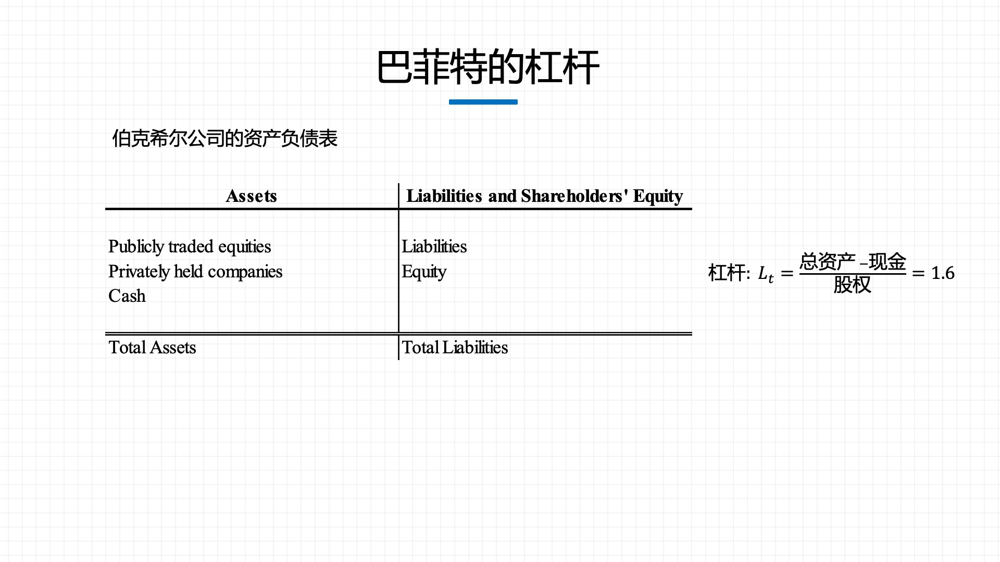

正因为保险浮存金的资金成本比较低，现在中国很多私募基金大佬也在学习巴菲特的投资理念，收购一些保险公司，因为这样可能带来比较稳定的、低成本的资金。

下面我给大家讲一个例子，看看保险浮存金是怎么能够产生很高的收益率的。在这个例子中，我们假设用 100 元的资本购买了一个保险公司，净资产就是 100 元。假设你做 200 元业务的保费，承保利润为 5%，这个假设是很重要的，不是所有的公司都能够做到 5% 的承保利润，有的公司可能是 0，有的公司甚至都是负的，但是巴菲特的公司差不多能做到这一点。

这个时候 200 块钱保费就能挣 10 块钱。可用于投资的资金就是 100 块钱的资本金加上保险浮存金的大约 50% 左右，这样一共就有 200 块钱。

如果投资的收益率是 5%，这样的话投资带来的收益又会有 10 块钱。所以 100 块钱的资本，利润每年就是 20 元，那给股东产生的收益就是 20%。所以你能看到，用保险浮存金加杠杆能产生一些超额收益率。如果你做 300 元的业务，你的收益率会更高，大约是 27.5%。

讲了巴菲特的高收益率，那我们看一看，他在二级市场的选股，比如说他买了高盛、摩根士丹利、可口可乐，这些股票的平均收益率比标普 500，整个市场大约会高多少呢？

在我们研究的样本里，整个市场的收益率比无风险利率要高出 6.1%，他选的那些股票的收益率比无风险利率高出 11.8%。作为一个股神，他选的股票的收益率比市场每年平均高出 5.7%，但是他能够连续好几十年做到这一点，这是极其难的一个事情。

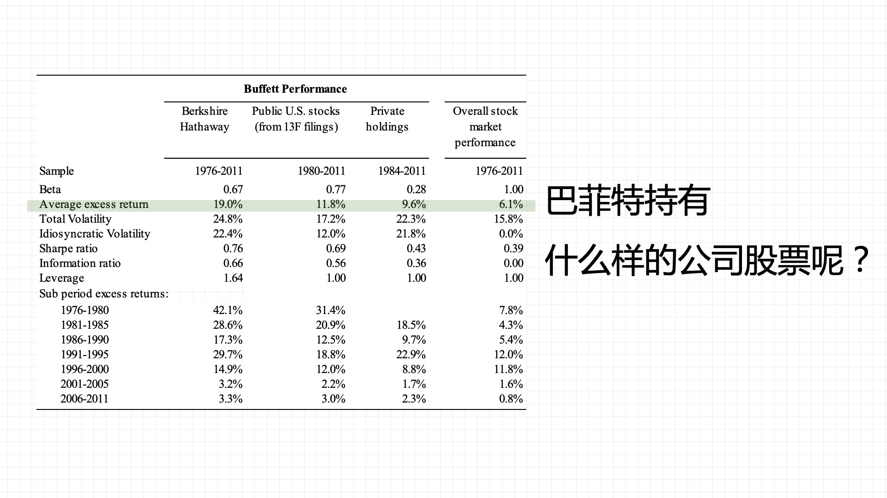

下面我们就来做关于巴菲特投资策略最重要的一个分析——归因分析。

客观严格地来讲，归因分析要用很多统计中回归分析的东西，回归到各种因子上面，来看各种暴露。但我估计这比较难懂，我就用不太严格的语言把这个背后的逻辑讲清楚，我们的思路就是看哪种投资风格在巴菲特投资的组合里面占的权重最高，然后我们再控制住各种投资风格，看看巴菲特的超额收益率有多少。

你看在第一组分析里面，他对价值投资的暴露是 30%，也就是说价值投资在他的投资组合里面的权重占 30%，但是你把这 30% 的权重给去掉后，巴菲特的投资组合还有 5.5% 的超额收益率，我们要去研究他这 5.5% 的超额收益率到底是从哪儿来的。

下面我们就把一个非常重要的投资风格加进来，叫做高品质投资。高品质投资是买那些品质比较高的股票，比如说波动率比较低，盈利比较高，盈利趋势往上升，盈利的波动性很小，而且又分红的股票。我们看看他对这种投资风格的暴露是多少。

在这个分析里面我们发现，把这个因子放进来之后，他对价值投资的暴露只有 10%，也就是说价值投资在巴菲特投资组合里面的权重只有 10%。但是他对高品质投资的暴露是 150%，是 15 倍。

而且这个时候你再看巴菲特的超额收益率，这个α每年只有 0.1%，极其地低，接近 0。也就是说，当我们把高品质投资这个投资组合从巴菲特的投资组合里面剔除出来之后，巴菲特就没有任何的超额收益率，巴菲特每年产生的那 5.5% 的超额收益率，基本上都是由于他在高品质投资上权重的原因。

这个时候你可能会问，是不是巴菲特在忽悠我们，我们都知道他是价值投资的代表，为什么他买的是高品质股票？其实巴菲特并没有忽悠我们，他经常在他的年报里面说这样的事情。

比如他在 1989 年的年报里面就说过：“我觉得你们应该有个大致的了解，以合理的价格买进一家很棒的公司，远胜于以很低的价格买进一家平平的公司。”

你看，很棒的公司就是高品质的公司。低价格买进一家平平的公司，那就是价值投资，他更看重高品质投资，而不是传统意义上说的价值投资。

在 2008 年的年报里面他也说过类似更通俗的话，他说：“无论是袜子还是股票，我都喜欢买减价的、高品质的商品。”

稍微总结一下，他的投资思路是什么呢？

**巴菲特基本上是用便宜的保险浮存金加杠杆，同时买入那些高品质的股票，这样能产生比较大的超额收益率，而且基本上夏普比率是排名第一的。**

尽管巴菲特的投资表现基本上是第一的，但是他也有输钱的时候，给你举个例子。在 1998 年 6 月 30 号到 2000 年 3 月 30 号的时候，巴菲特的公司伯克希尔 · 哈撒韦跌了 44%，但是同时期整个股票市场涨了大约 32%，也就是说他的股票比整个市场要低出 76% 的收益率。

这对一般的基金公司来讲，这个公司就肯定没了，钱都被撤走了，但是由于巴菲特的名声特别好，导致他的公司还能够存活下来。但是我要给你传递一个信息，哪怕巴菲特这么牛，他也有亏 76% 的时候，所以投资的风险还是极其大的。

## 总结

好，我总结一下这节课的主要内容，我们讲了三个大佬的投资策略：索罗斯、约翰 · 保尔森和巴菲特。

索罗斯和约翰 · 保尔森的投资策略基本上都是低风险高收益，就是说风险跟收益的关系不成正比，风险很低，但是潜在的收益会很高。

巴菲特的投资策略，并不是传统意义上我们理解的价值投资策略，更多的是高品质投资，而且他还有个重要的元素，就是他用了保险浮存金作为杠杆，使得他最后的平均收益率变得很高。

最后，我想说，巴菲特的高品质投资策略在中国市场上也是有用的，而且我们说了巴菲特投资主要是靠高品质投资，并不代表巴菲特的投资不牛，我们也是几十年之后才理解到巴菲特是用高品质投资挣的钱，所以丝毫没有降低巴菲特股神的地位。

好，下一讲我会讲量化投资各种潜在的风险，前面讲了这么多好的投资策略，那它们有哪些风险？我们在哪些地方应该注意？

作业：这一讲我们讲了低风险投资，也讲了高品质投资，衡量一个股票高品质的几个特征，比如说盈利能力、盈利的增长率、盈利是不是稳定、有没有分红，你觉得还有哪些指标也是衡量一个股票是否是高品质？

我是余剑峰，咱们下一堂课再见。

\\1. 索罗斯和约翰 · 保尔森的投资策略启示：当你发现收益与风险非常不对称时，这是难得一见的投资机会，这时就要把仓位搞大。 2. 巴菲特并没用我们认为的”价值投资 “，而是” 高品质投资“。 3. 高品质股票的特点：波动率比较低，盈利比较高，盈利趋势往上升，盈利的波动性很小，而且又分红。

# **第 20 讲 | 量化投资的风险有哪些？**

[懒人专属群的群友](https://lazybook.fun/#/blog/group)，你好，欢迎来到清华五道口《行为经济学》的课堂，我是余剑峰。

这一堂课我们主要来讲一讲量化投资的各种风险，为什么我们要讲量化投资的风险呢？因为除了索罗斯、巴菲特的这些策略，我们前面讲的大多数都是量化投资策略。

## 量化投资有哪些优势

什么叫做量化投资策略？大概思路就是，你把几千个股票的量价、基本面、财务报表，或者是网上你能搜到的任何数据全都拿过来，用电脑程序作分析，最后你买入前面 10% 的股票，可能是一两百个股票，同时卖空一两百个股票，达到分散风险的目的，这是量化投资策略的一个基本思路。

我们讲了这么多策略的好处，但必须提高警惕，就是它们有很大的风险，有哪些潜在的风险呢？我们这一节课会讲三个潜在的风险。讲量化投资策略这三个风险之前，我先稍微总结一下前面我们讲的那些量化投资策略的好处。

**首先，量化投资策略一般涵盖面比较广，基本可以覆盖所有有数据的公司，这跟主观选股是不一样的。**主观选股你要去公司调研，但你不可能调研几千个公司，你的时间、精力是有限的。

**第二，量化投资策略非常及时，**比如说你用电脑程序在网上爬虫，爬各种信息，如果你的电脑程序很快，立马就可以分析出来一些结果、信号，可能就是几毫秒的时间。这个时候你的大脑都没有反应过来，但是你的新的策略已经出来了，所以说它更加及时。

**第三，量化投资策略可以减少人员方面的损失。**比如说一个人编了很多程序，有很多策略都在电脑里面，这个人走了，那些策略还在。它不像主观选股，主观选股人员跟公司的各种关系，对行业的理解，是非常软的信息，不可以被描述出来，所以人员损失问题很大。

**第四，量化投资策略还可以克服很多人性的偏差。**比如说我们有损失厌恶，我们的交易会有处置效应，但是如果你用量化投资策略去做的话，你根本就不会感觉到这些东西，因为电脑直接就执行了那些买卖。这也是巴菲特说的，你投资成功的一个重要因素是要比较淡漠，不要有情绪，电脑去做交易就没有这么多情绪化的东西。

**最后一点，量化投资可以做各种回撤，**因为你有各种数据，所以说你可以看看历史上在各种情况下它的投资收益率大概是什么样的。虽然做回撤有时候也会有过度拟合的问题，但是它至少可以做比较科学的回撤、风控，把各种因子上的暴露都给控制掉。

## 什么是失效风险

好，讲完了量化投资的各种优势，下面我讲它面临的三个主要的投资风险，当然它还有其他的风险，这里我讲三个我认为最重要的。

我们先讲**第一个，量化投资策略有时候会失效，但关键是我们不知道它什么时候会失效，而且它有时候失效，导致的损失会非常大，**我给你举一个具体的例子。

前面讲过由于大家会有处置效应导致动量投资策略，就是说过去 6 个月收益率高的股票相对过去 6 个月收益率低的股票，未来 6 个月收益率也会很高。

动量投资策略在量化投资的地位其实是很高的，因为很多公司都会用。比如说当时非常有名的高盛的 Global Alpha、还有 AQR，这些公司都会多少用一点动量投资策略。动量投资策略有时候会失灵，而且失灵特别严重，它有时候会让你一个月输掉 40%，接下来另外一个月还会继续让你输掉 40%，这样的话如果你用动量投资策略，可能一两个月就爆仓了。

刚刚我说的这种亏损不是瞎编出来的，下面看一篇学术论文，是 Daniel 和 Moskowitz 最新的一篇 JFE 上的论文，我们看看动量投资策略到底是怎么亏钱的，哪几个月亏钱最多。

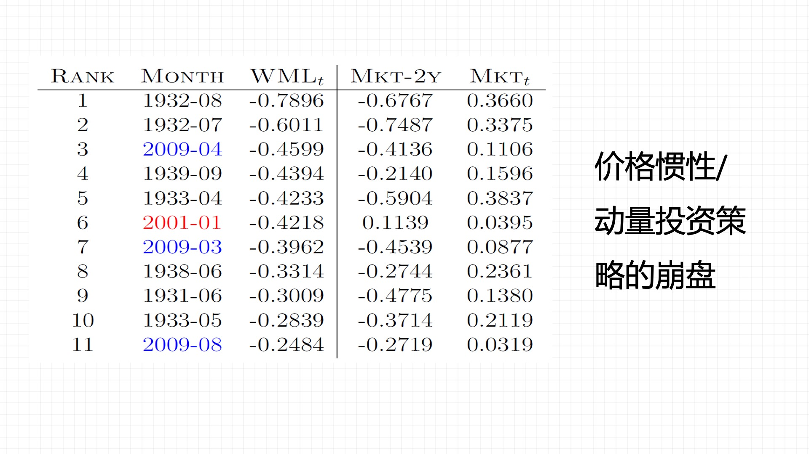

比如说它在 1932 年 8 月份一个月就亏掉 78.96%，上一年 7 月份亏了 60%。你可能会说，这都是很早以前大萧条时候的事情。那我再给你看最近的一些数据，比如说在 2009 年 3 月份一下就亏了 39.62%，2009 年 8 月份又亏了 24.84%，2009 年 4 月份也亏了 45.99%。

所以如果你在 2009 年用了这个策略，那基本上公司就会倒闭了。所以你已经明确看到，这个非常流行的量化交易策略，风险是极大的，有时候会失灵。

我们看看它亏钱的这些月份有什么特征？我们观察发现，亏钱最多的这一个月的前两年，比如说 2009 年 4 月份亏钱了，那么 2007 年 4 月份到 2009 年 3 月份，整个市场的收益率是非常低的，这是一个特征。

同时 2009 年 4 月份这一个月市场在反弹，看见没有？如果你在 2009 年用动量投资策略，你买的是哪些股票？卖的是哪些股票？动量投资策略买的是那些过去收益率最高的股票，卖空的是过去收益率最低的股票。

2009 年用动量投资策略，那就是卖 2008 年收益率最低的股票。2008 年哪些股票收益率最低？那些银行股。2009 年那些银行股反弹了，然后你卖空了这些银行股，你就会产生巨大的损失。

所以，虽然我们发现了动量投资策略有很大的风险，但是当我们发现这个风险是可以预测的时候，这是一个极好的事情，我们可以改进我们的投资策略。

我们可以做一个策略择时，就是说你不要直接就用动量投资策略，你应该控制一下，当前面整个市场收益率比较低的时候，你应该降低仓位，当前面整个市场的波动率很高的时候，你也应该降低你的仓位。

这样你可以把动量投资策略的夏普比率从每年 0.59 提高到 1.19，基本上是翻倍的，这是一个很大的提高。如果你用了刚刚那个改进，你可以避免大多数动量投资策略的大额亏损。

也就是说，很多时候本来是一个坏的东西，你只要理解其中背后的经济学根源，你反而可以把它变得更好。

## 什么是流通性风险

好，我们刚刚讲了第一个大的风险，你的策略有时候会失效，而且导致巨额损失。下面我们讲**第二个大的风险，叫做流通性风险。**这里面我们讲的流通性风险其实主要是指市场融资风险，不是指传统意义上的流通性风险。

你想我们前面讲了这么多心理偏差，讲了各种投资策略，其实很多人，尤其是那些量化投资基金经理，他们都知道这些投资策略。那就说明一个问题，很多量化投资基金的策略会很像，就会导致有流通性风险的问题。

举个例子，好多基金都用类似的策略，买入过去赢钱的股票，卖空过去输钱的股票，买入价值股，卖空成长股。现在有一个大的对冲基金，它由于某种原因必须要清仓，它要卖掉过去赢钱的股票，卖掉价值股，因为其他基金持有过去赢钱的股票，持有价值股，那其他的基金就会输钱。如果你的杠杆比较高，可能就要被迫平仓了，这就是融资风险了。

不光是杠杆高，有时候因为你亏钱了很多人会撤资，这是第二个原因，而且有时候你的保证金也会增加，因为你的仓位老是在那波动，所以会增加你的保证金。

总之各种原因都会导致你被平仓，那你会继续卖掉哪些股票？卖掉那些过去赢钱的股票和价值型股票，同时要买入成长型股票和过去输钱的股票，因为你要平仓。这样会导致那些价值型股票和过去 6 个月收益率高的股票，价格会进一步下降，其他的那些杠杆稍微低一点的公司也会被迫清仓，最后导致连锁的融资风险，你会输很多钱。

刚刚讲的是一个理论，其实是从一篇学术论文里面摘出来的，它是 Lasse Pedersen 和他的合作者 Markus Brunnermier 在 2005 年写的，2009 年才发表。那个学术论文里面就讲了刚刚这个框架。

2007 年有个大的投行 Bear Stearns，它当时在次级债券上亏了很多钱，导致它的对冲基金必须清仓。它的对冲基金管了好几百亿美金。Bear Stearns 的这个交易策略，也是量化交易策略，跟我们讲的很多策略是比较像的。

比如说它也是动量投资策略，也是价值投资，它买入过去 6 个月收益率比较高的股票和价值型的股票，那就要清仓，把这些股票卖了。最后导致这些股票继续在跌，但同时它又必须买入过去 6 个月收益率低的股票和成长型股票，所以过去 6 个月收益率低的股票和成长型股票的价格在往上涨。

但是其他对冲基金也是用这种类似的策略，由于 Bear Stearns 的清仓导致其他对冲基金亏钱了，然后导致一个什么现象呢？在 2007 年 8 月份第一个星期，如果你用了动量投资和价值投资策略，你的整个投资策略的收益率会跌 25% 左右，而且当时华尔街所有量化对冲基金确实都在不停地亏钱。

但如果你买的是指数基金的话，你可能没有任何感觉，因为整个指数没有怎么动，而且还涨了一点点。为什么会这样呢？因为价值型股票往下跌，但是成长型股票往上涨了，所以平均起来指数并没有什么反应。所以说如果你是指数投资者，你根本就没感觉到任何涨跌。

那我们现在回到刚刚讲的那篇论文的作者之一 Lasse Pedersen， 2007 年 7 月份他就被 AQR 邀请去做量化策略的全职雇员。AQR 是当时最顶级的量化投资策略基金，现在也是最顶级的。他 2007 年 7 月份刚去，一个月就定下来了，8 月份第一个星期他就发现公司每十分钟会输 100 多万美金，是非常稳定地在输。

他发现这跟他的论文的理论一模一样。当有流通性风险的时候，你的所有资产的相关系数都会增加，就会不停地输钱，所以说这跟有效市场假设完全是反的。在有效市场假说里，基本上来讲股票价格是比较随机波动的，随机波动就不会稳定地输钱。当看到稳定输钱的时候，他立马反应到这肯定是流通性的问题。

所以我觉得是由于 Lasse Pedersen 在 AQR 的存在，使 AQR 比其他公司更早一点意识到这是流通性的问题。那应该怎么应对？这其实不简单，大概的应对方法我觉得是这样的。

*   如果你的杠杆比较高的话，你知道是流通性问题，你应该提前清仓，因为到时候你也会被迫清仓，这样的话成本更高。
    
*   但是如果你没有什么杠杆，你可以等一等观望一下，因为流通性问题不会长久，最后价格都会回来的。
    

但是如果你有点杠杆怎么办？这个东西就不好说了，因为你也不知道它的价格确切什么时候回来，所以说起来容易但做起来很难。AQR 开始确实亏了挺多钱，但当股票又反转的时候，它加了一些仓位，最后还挣了一点钱。

但是其他一些公司可能就没有这么幸运，包括当时最顶级的高盛的 Global Alpha，它在那一个星期亏了 22.5%，这也说明了 Global Alpha 对价值和动量投资的暴露是极大的。这也没什么稀奇的，因为 Global Alpha 的创始人是 Cliff Asness，他也是 AQR 的创始人。他的毕业论文其实就是关于动量和价值投资的。

2007 年 8 月份这一个星期的 22.5% 的亏损，直接导致 Global Alpha 这么牛的明星基金在 2011 年直接被关掉了。尽管这个基金在 2008、2009 年没有怎么输钱，尤其是 2009 年它避开了动量投资策略的巨额亏损。因为 Global Alpha 里面有很多做学术的人，估计这些人也知道 2001 年那篇学术论文，所以让他们在 2009 年避免了使用动量投资策略。但是尽管如此，由于前面短期亏了太多钱，导致大家失去信心，这个基金最后还是被关掉了。

从上面这个例子里面我们也看到了，一定要有策略上的创新，如果你的策略跟别人很像，你特别容易被别人输钱而传染到。所以说这也间接地看出了策略的创新很重要，这也是为什么我们要学习行为经济学，因为行为经济学可以告诉你很多策略的根源，有根源之后你才能改进，改进之后你才能跟别人的策略不一样。

前面我们讲了两个重要风险：一个就是策略有时候会失效，不但会失效，而且会导致你每个月亏得特别多；第二个风险我们讲了融资风险，有时候也叫流通性风险，是指由于你的策略跟别人很像，会导致你被迫清仓，给你带来很大的损失。

## 什么是模型风险

下面我们要讲量化投资中**最后一个我认为非常重要的风险，就是模型风险，模型有各种参数，但这些参数又很难估计。**

虽然我们会做各种回撤，但做回撤的话有时候也会过度拟合，做回撤你也需要很多参数，这些参数怎么估计呢？有时候是特别难的。当你估计不准的时候可能会带来巨大的损失。我就讲两个具体的例子，由于模型里面的参数弄错了，导致各种估计错误，造成巨大的风险。

前面我们讲过 LTCM（长期资本管理公司）在皇家荷兰和壳牌这个孪生股票上亏了很多钱的例子。当时 LTCM 持有很多仓位，风险非常分散。它的模型告诉他们，由于风险非常分散，估计每天最多也就会亏损 3500 万美金。

但是在 1998 年 8 月 21 号，它一天就亏了 5.53 亿美金，是 3500 万美金的好多倍。为什么会这样呢？因为模型里面有些假设，就是这些资产的相关性，这是特别难估计的。

正常来讲，历史上资产的相关性都比较小，但是一旦危机来了，导致很多资产的相关性都变得很高了。比如说当时亚洲金融危机，引起了俄国的各种危机。尽管 LTCM 买各种资产去分散风险，但是由于一下大家都开始跌了，这样导致它一天就亏损得特别多。

那为什么 LTCM 会被迫清仓呢？

一个重要原因是因为专业的基金基本上都要加杠杆，加杠杆当然就容易被迫清仓。但是这里面更重要的因素就是，当你低估了它们的相关性，你就低估了一天亏钱的数量，这样你会觉得自己输很多钱的概率是很低的，你就会把杠杆加得很高，但是你的估计又错了，就会被迫清仓。

就像长期资本管理公司一天亏了 5.53 亿美金，最后导致它很多其他地方被迫清仓，就像孪生股票那个交易，本来是可以挣钱的，最后却被迫清仓，导致它输钱了。

这个相关系数是极其重要的，我再给你讲一个例子，也是由于对相关系数低估的原因，导致很多大银行都产生巨额的亏损。

你想象一下，金融危机的时候，很多银行都买了很多打包的债券。打包债券的目的是获得标普给它们评级，很多评级都很高，一个重要原因就是因为它们觉得底下那些资产的相关性是比较低的。

那些房屋抵押贷款违约的概率是不太相关的。它们是这么假设的，因为历史上不太相关。其实，这个相关系数是极其影响打包之后这些产品的风险系数。

给你举一个具体的例子，这个例子比较简化了，但是你能看到这个相关系数到底有多重要。

我们先假定有 5 个房屋抵押贷款，5 个放在一起然后打包，打包之后我们分成 5 层，ABCDE。最顶上那层 A 是最安全的，就是说除非 5 个全都违约，要不然最顶上那层不会输钱，因为只要还钱，就先还给它。

最下面那层是最不安全的，只要有一个房屋抵押贷款违约，它就会输钱。最顶上那层最安全，当然利率就低了，最下面那层最不安全，利率就会高一点，这都是常识。

下面看看如果你把风险系数给估计错了会产生什么样的结果。我们假设每个房屋抵押贷款将来一年违约的概率是 5%。在第一种情况下，违约的相关系数是 0，就是说 ABCDE 违约是独立的。

你想在这种情况下，它们同时违约的概率是多少？也就是说最上面那一层 A 会输钱的概率有多少？它要输钱一定要 5 个房屋抵押贷款同时违约，同时违约的概率是 0.055，这是非常小的一个数字。

但是在另外一种极端的情况下，因为经济很萧条，它们都高度相关，很多时候违约概率就算没有 1，但是也是很高的。如果在这种极端的情况下，违约的相关系数是 1 的话，你想想那个最安全的顶层，它输钱的概率是多少？因为只要有一个违约，其他都会违约，那它就输钱了，所以说就是 5%。

当底层的五个房屋抵押贷款违约事件是独立的情况下，顶层 A 的资产，输钱的概率只有 0.055。但是当五个底层的房屋抵押贷款违约的概率是完全相关的情况下，上面这一层输钱的概率是 5%，相差多少倍呢？相差 16 万倍，就是说在这种极端的情况下，风险系数被低估了 16 万倍。

刚刚的 16 万倍当然是最顶层那个池子，如果是第二层 B 的话，风险系数被低估了 1684 倍，也是非常大的一个数字。所以，有些参数特别难估计，历史上它们很少同时违约，这是模型所面临的一个风险。

就像在经济危机的时候把风险估计错了，很多本来应该是比较危险的债券结果被评定为 AAA，导致很多银行像花旗银行、UBS 都持有它们，最后亏了很多钱。

为什么说这些相关系数或者一些其他参数估计不准，在量化策略中的风险尤其大呢？主要原因是因为量化策略基本上都是买卖很多股票、资产，你把这些东西放在一起打个包，你觉得风险非常分散，但是由于你对一些参数估计得不准，就像刚刚讲的长期资本管理公司的那个例子，你觉得风险分散了很多，但是其实没有那么多，然后你加了很大的杠杆，最后导致你亏了很多钱。

## 总结

好，我总结一下这节课讲的主要内容。首先，我们前面讲的大多数策略都是由于人的心理偏差引起的策略，都是基于量化的投资策略。我们这节课讲了量化投资策略面临的三个主要风险：

*   第一，这个策略可能会失效。失效的原因是因为策略本来就不可能一直有效，但是有时候失效会给你造成巨大的损失。失效的另外一些原因是过度拟合了。
    
*   第二，量化投资面临的第二个风险就是融资风险，有时也叫流通性风险，一个重要原因是因为很多时候量化投资策略比较相像，因为大家用的数据都差不多。如果有一个公司亏钱了，必须清仓，它就会传染到你，会导致你亏很多钱。这里面讲了 2007 年 8 月份 Bear Stearns 的量化策略危机。
    
*   第三，就是模型中的风险，因为你做量化投资策略有各种模型，模型里面有各种假设，各种输入的元素，那些输入元素的很多参数是很难估计的。当你估计不准的时候，有时候你自认为你的风险都分散了，但是没有你想象中的那么分散，你加的杠杆又过高了，这样容易被迫清仓，导致你输很多钱。
    

好，下一讲是最后一讲，我会给你提一些简单的投资建议和注意事项。

作业：关于量化交易，你知道还有哪些坑，大家应该小心避免，请你分享给大家。

我是余剑峰，咱们下节课再见。

\\1. 量化交易的 5 个优势：涵盖面广，非常及时，减少因人员的损失，克服人性偏差，可以做回撤。 2. 量化交易的三大主要风险：有时会失效，并且带来巨大损失；会产生流通性风险；以及模型风险。

# **第 21 讲 | 量化投资的误区有哪些？**

[懒人专属群的群友](https://lazybook.fun/#/blog/group)，你好，欢迎来到清华五道口《行为经济学》的课堂，我是余剑峰。

时间过得真快，这已经是最后一节课了。最后一节课我会讲两个投资中典型的误区，还会讲一些我被经常问到的问题，我相信这些问题在你脑子里面也浮现过，所以这是我们今天要讲的主要内容。

为什么我们要讲这些投资误区呢？因为前面我们讲了各种行为偏差，这些行为偏差会导出各种投资策略以及投资策略的改进，基本上都是一些专业的基金经理才能够去利用这些行为偏差，创造出一些有用的投资策略。但是对散户是非常难做到的，那我们作为散户应该怎么办呢？

一般来讲作为散户是很难去利用别人的行为偏差，去创造出有意思的策略，但是至少我们可以去避免一些典型的投资中的陷阱。

今天我就讲几个典型的投资中的陷阱，最后我也会梳理一下整个课的内容，给你一个整体的框架。

## 基本面好，收益率就高么

你是不是经常听说，尤其是一些专家在电视里面，预测哪个国家将来 GDP 会增长很快，这个国家的股票也会很好，那是不是可以去买这些国家的股票？这听起来非常有道理，一个国家的基本面很好，GDP 增长快，正常来讲它的股票收益率应该会很高。

但是我告诉你，你用几十个国家的数据去作这种分析，就会发现一个有意思的结果了，一个国家 GDP 增长越快，其实它的股票收益率反而越低，这只是横截面的数据，不是纵向时间序列的数据。一个国家 A 在过去 20 年比国家 B 的 GDP 增长更快，但是国家 A 的股票收益率反而比国家 B 要低一点。

在数据中它们的相关系数是 - 0.29，而且统计上也是比较显著的。比如说南非 GDP 的增长率其实只有 1.1%，但是它的股票收益率是 7.4%，非常高的年化收益率。但是你看爱尔兰，它的 GDP 每年的增长率是 2.8%，但是它的股票收益率只有 4.1%，比南非要低很多。

所以说有些听起来特别有道理，逻辑性也比较合理的东西，其实在股票市场投资中不一定是对的，所以我们不能盲从这些专家的意见。

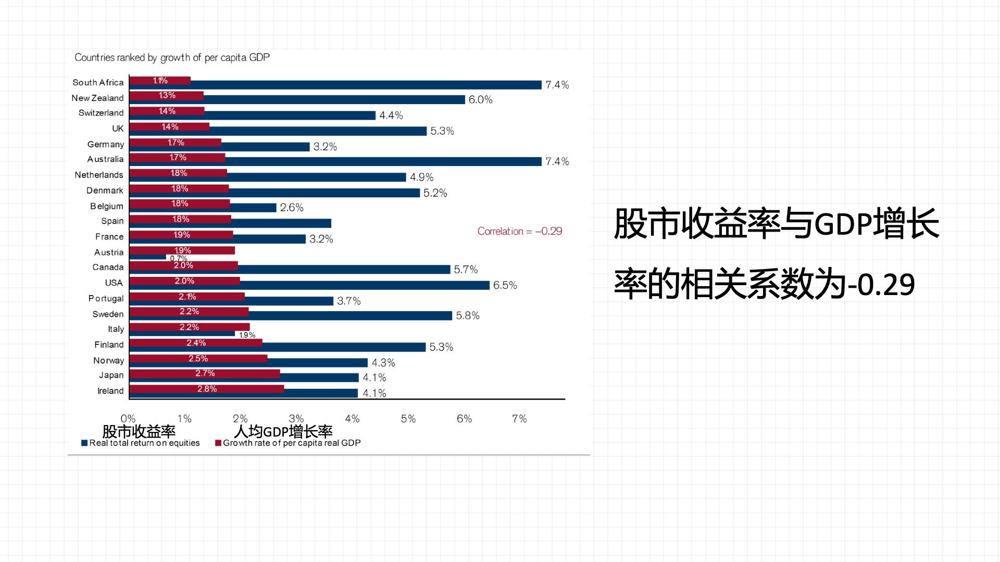

其实不光是 GDP 和股票收益率有相反的关系，GDP 增长越快，股票收益率反而越低，行业也是类似的。你可能也会觉得，你特别看好一个行业，觉得这个行业将来会快速增长，那这个行业的股票收益率应该很高，听起来也很有道理。但是我可以告诉你，这也不成立。

给你举一个例子，比如说在 1900 年美国铁路这个行业，当时占整个股市市值的比例高达 60% 多，现在占的比例还不到 1%。100 多年之后反过来看，如果你 100 多年前买了铁路的股票，现在肯定是收益率很惨，正常人都会这么认为。

我们是 100 多年后知道它不行了，从 60% 多的占比到现在还不到 1%。但是哪怕是这样，整个铁路行业的收益率其实比整个标普 500 的收益率还是要高的。我们还可以比较一个新兴的行业和一个衰落的行业，看看它们股票市场的收益率是怎么样的。

比如说你在 1900 年投一块钱在各个行业和标普 500 上，你看看它 100 多年之后大概变成多少钱。我可以告诉你，投在标普 500 的话，1 块钱会变成 39134 块；如果投在铁路这个衰落的行业，反而是 1 块钱变成了 62716 块；但是如果你把 1 块钱投资在冉冉升起的航空行业，1 块钱只变成了 7090 块。所以一个升起的行业并不一定会给你带来很高的收益率。

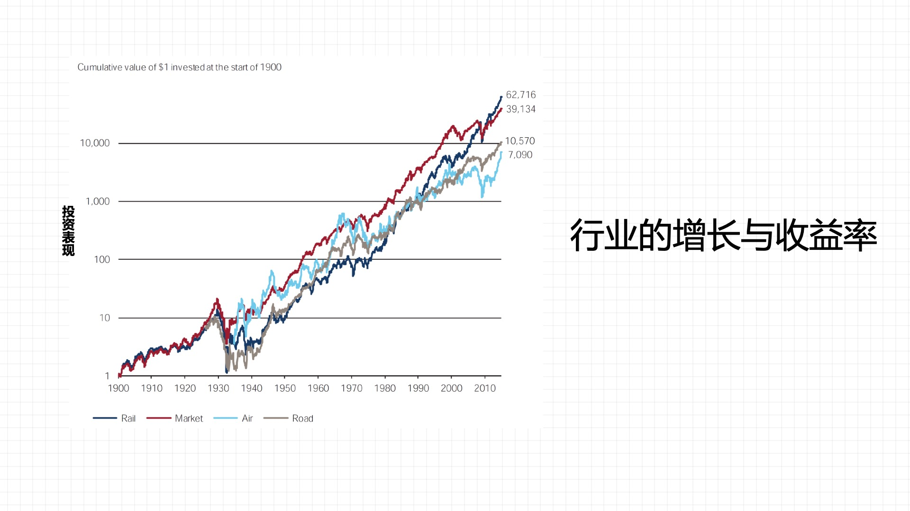

那为什么会这样呢？其实这些新的行业、新的科技的发展，比如说航空行业，确实给一般的理性投资者带来很多的好处，也给很多早期的投资者带来好处。比如说一个公司上市前，那些 VC、PE，确实挣了挺多钱。但是等它上市的时候，在二级市场上股票价钱已经很高了，所以说作为一个二级市场投资者，你去买新兴行业的股票，其实你已经付出很高的价钱了。

## AI 真的很厉害么

接下来讲第二个误区，这也是我经常被问到的一个问题。我在班上上课的时候，很多学生问我，现在人工智能算法这么牛，华尔街里面高盛的很多交易员都被解雇了，那是不是将来 AI 就会控制我们的整个投资行业？

或者说这些行为偏差、各种投资组合都没什么用？其实将来电脑把数据一收集，自动就给了我们一些投资组合，你就去买那些股票就完了，以后也不会有什么偏差了，是不是这么简单？

至少在现在这个阶段，AI 的算法我觉得是不能够取代人类的，当然存在个别 AI 算法能够比我们的投资策略好，这都是特例，没有什么普遍性的意义。

为什么它现在不一定能行呢？一个最重要的原因是因为，如果你用人工智能，它很容易过度拟合。

你看一般用这些 AI 算法是怎么做的呢？它找一堆数据，很多数据有很多变量，它用这些变量去预测股票将来的收益率，它都是先在一个样本里面去做。因为数据量特别多，这些算法也比较复杂，容易过度拟合，这是什么意思呢？

是指找到统计上的一些假象，这个训练本来 X 和 Y 的收益率是没有关系的，只不过是碰运气碰上关系了，然后你再用这个东西去做策略，当然你真的在实操的时候可能这个变量就没有用了。因为过度拟合这个问题，所以说 AI 不一定能战胜人类。

你看，我们前面找的策略的背后都是有很多经济学原理和心理学原理。知道这些原理之后，你才能改进策略，才能知道这个策略将来也会成立。

下面我给你看一个案例，这是美国最早的一个用人工智能选股的基金 AIEQ，当时它自己是这么做广告的。我们来看看它现在的表现怎么样，现在已经有一年多的历史了。

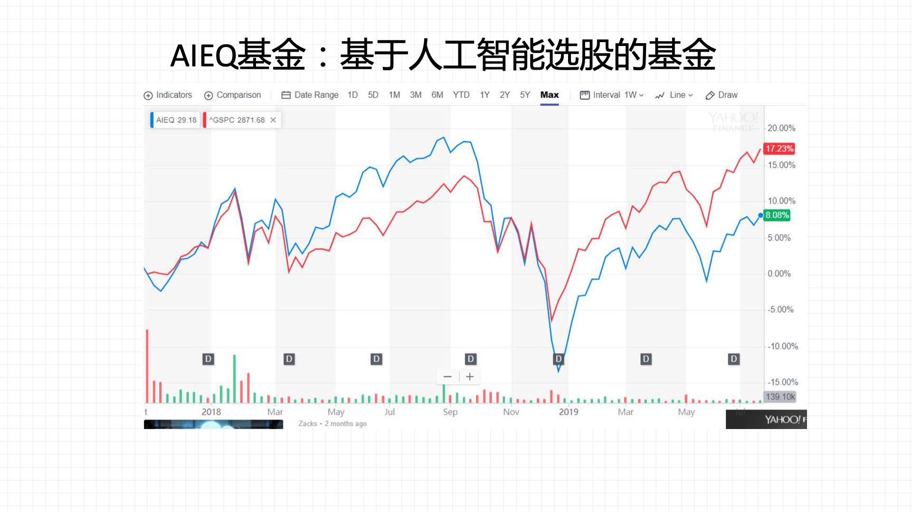

它过去一年多基本上跟标普 500 非常像，标普 500 涨，它也涨。标普 500 跌，它也跌，但是有个重要的区别是什么？在这一年多你看标普 500 涨了多少？涨了 17.23%，但是这个基金用人工智能选的股票只涨了 8.08%。

所以在当时号称最早用人工智能算法去选股的这个基金，并没有战胜大盘，这不是特例。有研究表明，很多号称用人工智能算法选股的基金，平均表现还不如大盘。

但是这当然不意味着 AI 是没有用的，至少 AI 用的是比较高级的回归分析方法，它肯定比正常的线性回归会有用，只要你用得好。比如说你有 100 个信号，每个信号的频率是不一样的，你怎么把这 100 个信号组合起来？

其实这个时候 AI 的一些算法比我们平时用标准的线性回归方法可以组合得更好，它确实会有用，只不过没有你想象中的那么有用。

比如说那 100 个信号还是先从最基础的心理学、经济学原理选出来的，选出来之后再用这些 AI 的算法去做可能会更好一点，但是你直接用 AI 去选信号，是容易产生前面讲的过度拟合的问题。

所以总结起来就一句话，**千万不要认为一些基金的名字里面加个 “AI”、加个 “人工智能”，你就觉得它特别牛，然后你就去买这个基金。**刚刚你也看见了，它不一定真的很牛。

和人工智能非常相关的一个概念就是智能投顾，最近在国内也特别火，在国外也很火了。智能投顾是不是真的能够消除我们的各种偏差，提高我们的收益率？我们来看一个最新的研究，这是波士顿大学、约翰 · 霍普金斯大学和马里兰大学三个教授做的一篇最新的论文。他们发现：

智能投顾确实能够提高人的分散风险的程度，尤其是对那些当时只买了一两只股票的人，它能够让他们买更多的股票，还能够提高他们的收益率，所以对这些人群来讲智能投顾确实是有点用的。

但是对于那些风险已经比较分散的人，比如说他持有的股票数量已经超过 10 只，这些人再用智能投顾，并不能够帮助他们达到更高的风险分散，也不能够帮助他们提高收益，他们反而要付更多的手续费，降低了他们的收益率。

但是，智能投顾这个软件确实可以降低人的各种行为偏差，只是不能消除。比如说可以降低他们的处置效应，可以降低他们的表现追踪（追涨杀跌），也可以降低这些人对表现突出的股票过分地偏好。

所以稍微总结一下，智能投顾这个东西确实是对有些人，尤其是开始只持有一两只股票的人有点用，但是对其他一些投资技术已经比较好的人，是没有太多用的。总的来讲，它还是稍微能够降低人的一些行为偏差，但并不能够消除人的行为偏差。

## 美国的策略在中国适用么

前面我们讲了三个投资中的误区，下面我们讲第四个，其实应该说是第四类。为什么这么说呢？

我们前面讲了很多基于我们行为偏差的投资策略。大多数投资策略都是基于美国和欧洲的数据做的，一个重要原因是早期这些原始的研究都是用美国的数据做的。

为什么用美国数据做呢？是因为美国的数据时间比较长，很多数据从 1926 年开始就有，甚至 100 多年前的数据都有，所以说用来做研究是比较好的。

用美国的数据做出来的这些策略确实有一些可以用在中国，比如说我们前面讲过的高品质投资、低风险投资，这些策略在中国确实也都是管用的，至少过去这几十年是管用的。

但是有很多其他的策略在中国是完全不管用的，所以说我们得特别小心，不能直接就在中国股票市场上套用课堂上讲过的那些策略，否则就会亏钱。但这并不代表这些适用于美国的策略不成立，只是说它在中国这个股票市场的环境下不成立。

我在这里面给你讲一个例子，比如说我们前面讲过非常有名的策略，叫做动量投资策略，就是一个股票过去 6 个月收益率比别的股票要高，它将来 6 个月的收益率也会比别的股票高。这个策略在美国、欧洲都挺挣钱的，但是在中国、日本基本上是没有效的。

为什么会这样呢？其实你要了解这其中的根源的话，说不定你还能创造出一些有意思的投资策略，所以有时候我们做学术的会尽量去理解其中的根源，有几个解释：

第一个解释，就是在学术里面让大家比较接受的一个解释，动量投资策略是由于大家过度自信而产生的，如果原因是由于过度自信，是不是欧美的人整体比中国人更加过度自信？大家都会承认，应该是这样的。所以说在欧洲和美国，动量投资策略的收益率比较高，因为他们过度自信的偏差更强，但是在中国就不太成立，因为中国人没有那么过度自信。

当然我觉得还有一个更重要的原因，下面我给你细讲。前面我们推出动量投资策略，是由于大家有参考点依赖、损失厌恶，导致大家有处置效应，最后导致了动量投资策略能挣钱，这是我们前面提出的一个原因，还记得吧？

前面我们又讲了中国人的处置效应比美国人还强，那中国人的动量投资策略应该更强，但是却没有，这不是很奇怪吗？为什么会这样？

我觉得一个重要原因是因为中国人的交易换手率比美国人高很多，美国人可能平均一年换一次，中国人一年换个四五次。这样，美国人一年的时间，在中国人这里可能就不是传统意义上的一年，有可能已经是五六年了。

刚刚我讲的那个时间转换，一年对应四五年，你可能没有明白我的意思，下面我给你讲一个详细的例子。

前面我们讲过在美国过去 6 个月收益率高的股票，平均来讲它被低估了，由于处置效应的原因，中间它不停地被卖空，。为什么被卖空了呢？给你讲个细节，你看一个股票过去 6 个月收益率特别高，那是因为过去 6 个月连续有好消息，但在美国大多数人是 6 个月前买的股票，他们的换手率是一年左右，所以说很多人是 6 个月前买的股票。中间不停地有好消息，所以很多人就挣钱了。

由于处置效应，他们把这些股票卖了，所以虽然有好消息，但是股票不停地被卖空，导致这些股票被低估了，所以说将来这些股票的收益率会很高，这就会导致过去 6 个月收益率高的股票将来 6 个月收益率也会高，这是动量投资策略，在美国是这样的。

为什么在中国，过去 6 个月收益率高的股票，将来 6 个月收益率不一定高？一个最重要的原因是因为中国人的换手率比美国人高很多。

假设中国人两个月换一次手，很多人很可能是前一两个月买的股票，虽然过去 6 个月收益率高，但是最近一两个月收益率不一定高，这样就会导致什么现象？导致这些人并没有处置效应，因为他们并没有处于盈利的状态，所以说这些股票虽然有好消息来了，但并没有不停地被卖掉，因为那些人并没有挣到钱。这样的话在中国，过去 6 个月收益率高的股票并不一定会被低估，所以它将来的收益率并不一定高。

这个时候你可能会问，在中国就不要用 6 个月或者一年，就用一个月就行了。但是在中国用一个月也不行，因为在全球范围内在一个月的时间内会有反转效应，为什么会反转呢？

因为在时间特别短的时候都有流通性的原因，一个股票过去一个月收益率特别高，很可能是因为流通性的原因，很多人突然要买它，它的价格就上去了，将来它会反转。

由于我们的处置效应，可能过去一两个月收益率高的股票将来收益率还会高，但是同时一两个月的时间还有反转效应，你把两个效应放在一起，关系就很乱，得看反转效应更强还是处置效应更强。总之在数据里面，我们是没有看见有什么关系的。

所以刚刚这个例子是告诉你，你看一个策略，比如说动量投资策略，哪怕它是由于处置效应引起的，而中国人的处置效应更强，并不意味着在中国这个动量投资策略就会更强。一个最重要的原因是因为中国人的换手率不一样，整个交易环境不一样，所以一样的策略不能直接用过来，这是一个教训。

第二个教训就是，既然中国人有更强的处置效应，是不是在中国我们可以直接导出一个策略，不一定要用动量投资策略？

在中国，确实是可以用中国人的处置效应导出一个策略，前面我们也提过，就是吴国俊教授和 Mark S. Seasholes 两个人早期用中国数据合作了一篇论文。在他那个样本里面，中国确实是没有动量投资策略，但是他可以利用中国人的处置效应组建出一个投资策略，这个投资策略每年的超额收益率大概是 7%。

他是怎么做的呢？由于中国人有处置效应，可以算出现在的持有人过去平均花多少钱买了这个股票。比如说现在这个股票有一万个持有人，他们一定是在一段时间前买了这个股票。

假设这一万个人平均花了 150 块钱买了这个股票，现在这个股票是 200 块钱，每个人平均挣了 50 块，收益率是 30%。这样的话很多人都处于盈利的状态，前面说过处于盈利的状态这些股票就容易被低估，所以这些股票未来的收益率就应该高。

这个简单的投资策略就是我们不用看股票过去 6 个月或者过去一个月的收益率，我们直接看每个股票现在的持有人平均的持仓成本是多少。平均持仓成本跟现在股票价格去比，如果大多数人都处于账面盈利状态，这些股票就容易被低估，将来收益率高，我们应该买入这些股票。

同样，如果一些人过去平均持仓成本比较高，现在股票价格比较低，大家都处于账面亏损的状态，这些股票可能容易被高估，将来收益率应该比较低。

所以从这篇论文里面你也能看到，虽然动量投资策略在中国不成立，但是中国人的处置效应也一样可以导出一个投资策略来。

下面要讲的是最近在全球范围内特别火的一种投资理念，就是指数被动的投资理念。这个东西在中国是不是也特别适用？

我先从历史讲，其实影响最大的应该是早期的一篇论文，1968 年有一篇论文，是 Michael C.Jensen 做的一篇学术论文，当时他在罗切斯特，现在在哈佛。当时他研究了美国 115 个主动型管理基金的表现，那个时候美国只有主动型管理基金，没有被动型管理基金。

他发现这 115 个主动型管理基金的平均表现还不如大盘，有 79 个都跑不过指数。在收取一些费用之后，它的表现还比指数要差很多，这基本上说明了一个问题。

市场是相对来讲比较有效的。因为如果市场不是很有效，这些专业的基金经理天天在那想着找定价错误的股票，就应该能挣到钱，但是发现挣不到钱。为什么这个结果意味着市场相对来讲是比较有效的呢？

在当时有一个普遍的观点，如果市场不有效，就会有很多定价错误，如果有很多定价错误，那些专业的基金经理就应该能挣钱，现在你看到专业的基金经理都不能够挣钱，那市场相对来讲比较有效，投资相对就比较简单了。

刚刚讲的是在学术上影响非常大的一篇论文的重大发现，主动型管理基金还不如指数的表现。下面讲一个业界中的重大事件，这里面涉及到一个人叫做 Jack Bogle，这是先锋基金的创始人。

他在 1949 年末、1950 年初，是普林斯顿的本科生，他做了一篇本科毕业论文。当时据说他上 Samuelson 的课拿的都是 C，表现也不太好。如果想成为一个优秀毕业生，那就得写一篇好的论文，所以他花了很多时间去写这篇本科毕业论文。

他的本科毕业论文的发现就跟后面 1968 年 Michael C.Jensen 发现的东西是类似的，他也发现了主动型管理基金经理还不如指数的表现。

然后 Jack Bogle 就出去工作了，过了十多年突然想起来，我这篇本科毕业论文其实有很大的意义。那个时候那么多主动型管理基金经理的表现还不如指数，他们每年还收 1%~2% 的管理费，甚至比 2% 还要高，这不对呀。所以他在 1973 年就成立了 Vanguard，这是第一个指数基金。指数基金投资就特别简单，你也不用给基金经理付特别多的钱，因为跟踪指数就行了。

其他一些基金基本上要收 2% 的管理费，结果表现还不如指数，它刚开始不收什么费用，现在也就千分之一左右的费用，表现还比主动型管理基金要好，当然来讲这是非常有效的一种投资方法了。

所以自从 Vanguard 启动了第一个指数基金之后，指数投资这个想法慢慢被大家接受，现在光 Vanguard 自己的指数基金就管着好几万亿美金，每年给投资人省下了好几百亿美金的钱。

那这个投资理念是不是在中国也成立呢？我们看一下中国主动型基金的表现。

下面我要讲一个研究，是上海高级金融学院的教授迟业光发现的一个结果。他研究了中国所有的主动型管理基金，发现中国的主动型管理基金剔除系统风险之外，每年大概还有 4.75%~8% 的超额收益率，就是看不同的基金类型、不同的样本时间段，你可以理解成百分之四点多到百分之八点多的超额收益率。

所以说我想传递一个概念就是，在中国，指数投资不一定是最好的，因为在中国这些主动型投资基金经理确实能够产生超额收益率，这在美国是没有的。当然超额收益率可能会随着时间段越来越变小，但是至少在现阶段它还是有的。

## 总结

好，刚刚给你分享了投资者的四个误区：

*   第一，一个国家 GDP 增长快或者是一个行业你特别看好，并不代表这个国家或者这个行业股票的收益率会很高。
    
*   第二，AI、智能投顾并不能够解决所有问题，比如克服我们所有的行为偏差。
    
*   第三，很多在欧美赚钱的策略在中国不能直接拿过来用，因为中国的投资环境、投资人的特征都不一样。
    
*   第四，被动的指数投资理念在美国是非常好的，因为它的成本比较低，但是在中国现在这个阶段，其实我们的主动型管理基金经理还是能够产生超额收益率的，所以说我们配置资金的时候可以配一些主动型管理基金，也可以配一些被动型低成本的基金。
    

到此为止，我们所有的知识点都讲完了，现在我给你梳理一下整个课的知识点。

**首先在第一个模块中，我们花了三节课，讲了影响人类行为偏差的三个重要因素：**

*   一个是神经元，
    
*   一个是荷尔蒙，
    
*   一个是基因和环境。
    

这里面导出了一个重要概念就是错配，指的是我们的很多偏好都是在远古时期这种环境形成的，现在我们的环境变了，导致那个时候的偏好在现在已经不适用了，所以导致我们会有很多行为偏差。

**第二个模块中我们讲了预期中的偏差，你要估计一个事件发生的概率，正常来讲你要用贝叶斯公式，但是我们人类的大脑思维习惯肯定不是用贝叶斯公式，从而导致我们会犯很多错。**我们讲了四个重要偏差：

*   有限注意力、
    
*   代表性偏差、
    
*   锚定效应，
    
*   还有过度自信和过度乐观。
    

我们讲了各种偏差在生活、市场营销和管理中的应用，最重要的是在投资中的应用。我们从每个偏差基本上都可以导出一些投资策略。

**第三个模块，我们讲了风险偏好中的偏差，我们尤其强调了我们会有：**

*   参考点依赖，
    
*   会有损失厌恶，
    
*   对小概率突出事件放大或者高估，
    
*   当然我们还会有心智账户，心智账户一般要跟其他东西结合起来，会导出很多应用。
    
*   当然我们也讲了羊群效应和当前偏差。
    

基本上我们把这些风险偏好中的偏差也导出了一些有意思的投资策略。

**最后一个模块，我们讲的是行为偏差在投资中的应用，**它稍微有点复杂，因为它要求很多逻辑性的思维，我们把好几个行为偏差结合起来，最后会导出一些有意思的投资策略，同时也可以改进投资策略，而且还解释了一些看起来很让人迷惑的现象。

最后我想说，行为经济学不是雕虫小技，不是我们茶余饭后的谈资，它确实是能够影响公共政策，影响投资，影响公司管理的重要因素。

好，我是余剑峰，感谢你的收看，咱们以后再见。

\\1. 投资者的四个重要误区：国家或基本面好，就误认为股票收益高；AI 和智能投顾，听起来厉害，就误认为收益高；在欧美很赚钱的策略，误认为在中国也很适用；被动指数投资理念在美国收益高，误认为也适用中国。 2. 行为经济学，不是雕虫小技和谈资，它确实能在现实中发挥重要的影响。

# 特别放送：行为经济学期末考试

（不要问小懒要答案，小懒也没有哈。不过你可以全文搜索关键词，直接在上面的课程里找答案。答案不重要，思考的过程才重要~）

你好，我是余剑峰，欢迎参加《行为经济学》期末大考，看看这门课，你究竟学得怎么样？

试卷部分

## 1.第一部分 填空题 （共 10 题，每题 3 分，共 30 分）

\\1. **\_**反应快，但有时候会犯错，不耗费能量；前额叶皮层的反应相对慢，而且非常耗费能量。

\\2. 研究发现，荷尔蒙水平越高，在短期投资里，他的收益率越**\_**（高或低）。

\\3. 我们对一件事情发生的概率，基于这个事情在脑子里被想起来的程度，这叫做**\_**偏差。

\\4. 热手现象属于一种**\_**偏差。

\\5. 人会倾向卖掉赢钱的股票，继续持有输钱的股票，这叫做**\_**效应。

\\6. 低价、波动性强、拥有很大想象空间的股票，在我们的课程里叫做**\_**型股票。

\\7. 人有盲目跟从的冲动，这叫做**\_**效应。

\\8. 人总是倾向认为，当前的折现率要远远高于未来的折现率，这叫做**\_**偏差。

\\9. 巴菲特的投资策略，除了传统意义上我们理解的价值投资策略外，更多的是策略。

\\10. **\_**相当于基因的开关。

## 2.第二部分 单选题 （只有一个正确答案，共 6 题，每题 5 分，共 30 分）

**1\. 在皇家荷兰和壳牌的孪生股票案例中，皇家荷兰持有公司现金流的 60%，壳牌持有 40%，按照基本的溢价定律，两个公司的市值应该是 3:2。但在现实中，两家公司的市值比发生了偏离，这是什么导致的？**

A. 基本风险（由社会原因而非个人因素引发的风险）

B. 噪音者风险（市场上有大量缺乏真正信息的散户，这些交易者对于资产价格的估值会产生影响）

C. 大额卖空成本/限制

**2.从分散风险的角度出发，我们应该把钱分别投到国内和国外的股票上去，但我们都不愿意这么做，可能是因为：**

A. 模糊风险厌恶

B. 心理账户

C. 损失厌恶

D. 处置效应

**3.不同国家的语言，因为语法差异，可能会造成使用者产生不同程度的“当前偏差”，进而影响社会整体的储蓄率。这种说法正确么？**

A. 正确

B. 错误

**4\. 有人发现在酒类专卖店里，如果放法国背景音乐，红酒的销量就会增加；如果放德国音乐，德国黑啤的销量就会增加。这种现象可能与人的哪种行为偏差有关？**

A. 过度自信

B. 有限注意力

C. 锚定效应

D. 代表性偏差

**5\. 柏林的平均温度是多少？如果你猜的比平均数高，那你可能在脑子里想象了一副柏林夏天的画面；相反，你可能想象了一副冬天的画面。这种现象可能与哪种效应有关？**

A. 锚定效应

B. 羊群效应

C. 处置效应

D. 启动效应

**6\. 现有股票 A 和股票 B。股票 A 是彩票型股票，股票 B 是正常股票。股票 A 在下个月实现高于 1000％的回报可能性很小。；股票 B 下个月的最大损益在 5％以内。 其他一切都是一样的。那么哪只股票倾向于被高估？**

A. 股票 A

B. 股票 B

## 第三部分 多选题 （有多个正确选项，共 4 题，每题 10 分，共 40 分）

**1\. 当一只股票被标准普尔 500 指数收录的时候，尽管过程不包含任何基本信息的变动，但股价往往会上涨约 3％。出现这种情况和下列哪些选项有关？**

A. 基本风险（由社会原因而非个人因素引发的风险）

B. 噪音者风险（市场上有大量缺乏真正信息的散户，这些交易者对于资产价格的估值会产生影响）

C. 大额卖空成本/限制

**2\. 下列哪些策略有可能提高收益率：**

A.假设有三千家公司，我们找出分析师锚定效应比较弱的一千个，再选出分析师锚定效应比较强的一千个。在后者里做一个策略：买入有好消息的股票，卖空有坏消息的股票

B. 在被低估的股票里买入高风险股票，卖空低风险股票

C. 在被高估的股票里买入低风险股票，卖空高风险股票

**3.下面哪些是量化投资策略的主要风险：**

A. 容易出现过度拟合

B. 量化投资策略无法做到及时，导致风险

C. 模型中很多参数在现实中难以评估，导致模型存在风险

D. 面临流通性风险

**4\. 以下哪些是关于量化投资的理解误区：**

A. 一个国家的 GDP 增长快，基本面好，行业股票的收益率就一定高

B. AI、智能投顾可以剔除掉量化投资的系统性风险

C. 在欧美市场上的策略也完全适合中国市场

D. 在欧美市场，被动的指数基金一般来说长期收益率高于主动型管理基金

## 第四部分 论述题 （共 1 题，50 分）

描述生活中的一个有趣现象，这个现象和经典的理性经济学理论或者有效市场假说理论不一致。

可分为三部分描述这个现象：

\\1. 描述一个有趣的现实现象；

\\2. 讲解一下理性理论的预测结果；

\\3. 讲解一下为什么会有这个和理性理论不一致的现象。是哪种或哪几种行为偏差导致的？这个现象会不会有投资机会？如果有，怎么去实现这个策略？

提示：不一定必须是股票市场里的现象，任何有趣的现象都可以。

# 课程结束

以上就是小懒给大家整理的课程了。

希望有收获啦，虽然大部分人都很难坚持看完~

