# 做对五个实战步骤你就是赚钱高手

每次進場買股票都包含5個步驟，對每個步驟都做好細微規劃，並嚴格正確的動作，在股市中賺錢就變得很容易。

## 高家來做

316

總要大該、單靠技術分析無法達到。做起來小事務變成必然，而最終會讓整個變，房屋累累，苦於家累，才能成為既市贏家。

+   - 第1章 順勢而為 ................. 318
- 第2章 說完後動 ................. 319
- 第3章 剩別多空 ................. 322

緣

寫樹音由心 ................. 326

## 1 技術分析 + 嚴守紀律 = 散戶致勝法寶

「散戶」一般定義為「小額投資人」，在股票市場上，散戶永遠是弱勢族群，資金不多、資訊最少，想要戰勝大盤，的確不易。

## 散戶致勝之道：掌握分析術

作者也是散戶，從一開始進入股市，經歷20餘年的賠錢生活，總是想在股海浮沉中，抓到一塊能獨以求生的浮木，可惜我只是從軍中退休的小老百姓，既不認識上市公司大老闆（應該說他們不認識我），也沒有主力大戶的朋友，更沒有什麼優勢的家世背景，所以；想要做股票賺錢，實在不得其門而入。

但是，從2006年開始學習技術分析之後，我才體悟到別股市場中沒有專家，只有輸家和贏家。許多人終其一生在求名師指導，其實股市真正的老師只有一個，那就是股市「大盤市場」，所有想戰勝大盤的技巧，都必須通過市場的考驗。透過對技術分析

析的鑽研，我終於找到一條屬於「散戶」的賺錢道路。

> 稱信靠的那分新：鎖定關鍵區間

在股市市場，很多人「看它慢慢起，看它慢慢掉」，台股在1990年2月12日，指數從歷史高點12682，下跌到4450點，多少人

畢身即波，從此退出股市。

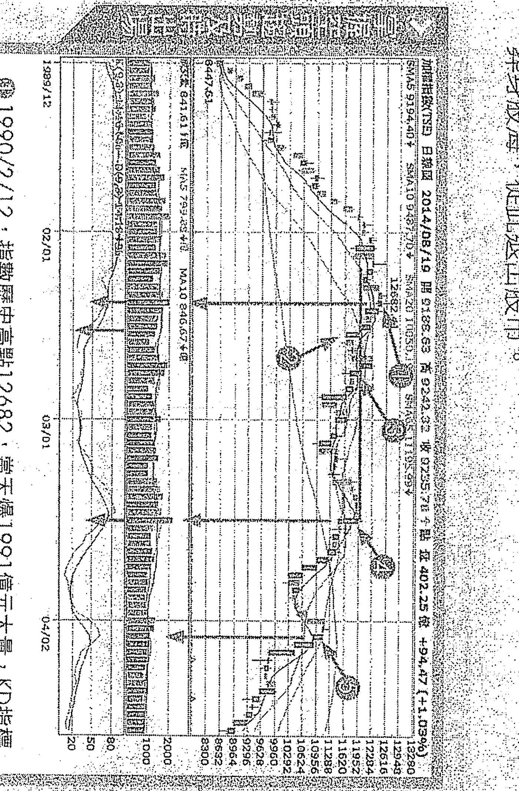

① 1990/2/12，指數歷史高點12682，當天爆1991億元大量，KD指標高檔背離。

② 1990/2/16，長黑K線跌破前波低點，跌破MA20均線，KD指標向下，方向出現改變，進入盤整。

③ 1990/2/22，黑K線跌破前一日低點，跌破MA5、MA10、MA20均線，且MA20月線下彎，空頭架構完成，當天收盤指數11749點。此時按傳統分析已經形成空頭架構，如桌相信趨勢已經轉變，多單及同時出場，當然不會慘賠到4450點。

④、⑤ 都是空頭反彈後的繼續下跌，開始做空，一路下跌大賺。

資料來源：富邦eO電子交易系統

宏達電（2498）由2011年4月29日的高檔1300元，之後一路下跌到2014年8月8日的最低點118元，多少散戶一路被套牢，真是情何以堪。其實我們回頭檢視一遍，如果你相信技術分析，又能夠絕對守紀律操作的的話，并非不會傾家蕩產，還會賺大錢！看下面的圖例說明，就可以以一目了然。

① 2011/5/3，前一日股價創歷史高價1300元，當天向下跳空跌，爆大量出現長黑K線，收盤跌破前一天的K線低點，既破MA20均線，KD呈現死亡交叉，空頭排列向下，與在還2011/4/20長紅K線對應，形成高檔夜壺轉折向下組合，是高檔回檔的強烈訊號。
② 2011/5/16，股價向下跳空下跌，大量黑K線，收盤跌破前面低點，確認完成「頭頭低、底底低」的空頭架構，且3條均線同時空頭排列向下，此時多頭髮結束，趨勢轉空。
③ 2011/6/10，反彈無法突破1300元的歷史高點，當天大量黑K線跌停板，收盤股價跌破季線，開始做空。此後股價一路下跌，做空大賺。

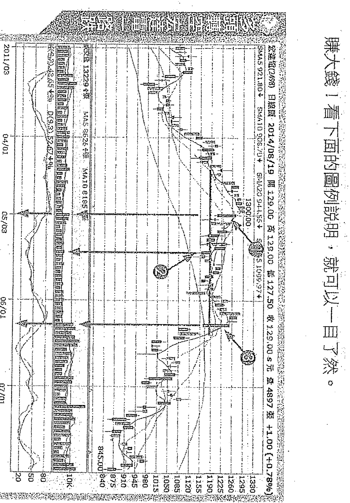

下圖是宏達電由高點1300元轉空頭之後的走勢圖，下方是融資資的增減，我們很清楚看到，在空頭下跌時，融資大增，弱資是一般的散戶在買，結果股價卻一直下跌，散戶一路被套牢，如果這些散戶投資人能夠遵守技術分析的紀律操作，空頭不做多，只做空，怎麼會做多套牢？至2014年8月20日，股價才130元，不但大賠，而且也

## 技術分析＋嚴守紀律 ＝散戶致勝法寶

2011/5/16股價向下跳空下跌，出現大量黑K線，收盤跌破前低點，確認完成「頭頭低、底底低」的空頭架構，3條均線同時空排列下彎，此時多頭結束，趨勢轉空。 股價呈現一路空頭下跌的趨勢。 每次出現黑K線、股價下跌，融資就大增，這表示散戶認為股價跌低了就去接。

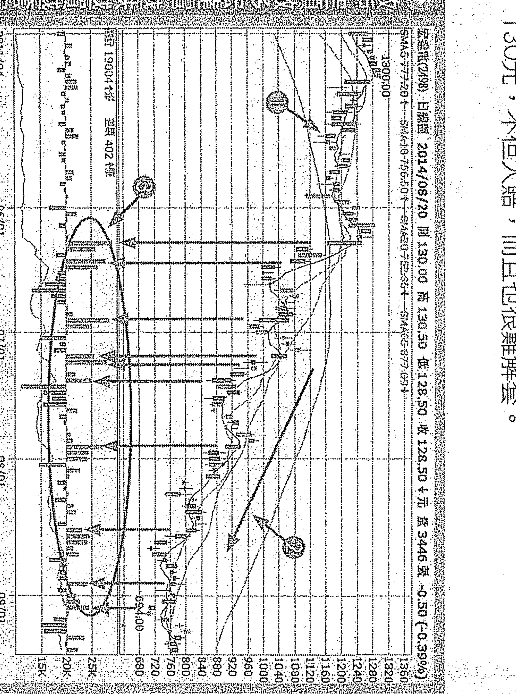

## 追蹤操作紀錄 議題關注大賽

資料來源：富邦e01電子交易系統

◎ 2011/11/25，宏達電空頭連續急殺下跌，當天融資又大增，散戶認賠為股價由1300元跌到489.5元已經很低，所以瘋狂買進，結果又被套牢，後面2週，股價更跌到403元，這都是置技術分析走勢於不顧，是逆勢買進的結果。

2014年7月28日，台股發生「基亞事件」，當天股市開盤就碰停板，往後一連下跌20支跌停板，造成散戶、大戶、金主嚴重套牢虧損。這個事件的

原因是基亞 (3176) 開發的新藥送美檢驗，第一關便未通過。

2014年3月，基亞股價從200元開始飆漲時，市場就在炒作這個題材的「本夢比」，因為基亞在第一季的每股收益是賠1.11元，一家賠錢公司的股價高達200元，這就已經脫離正常

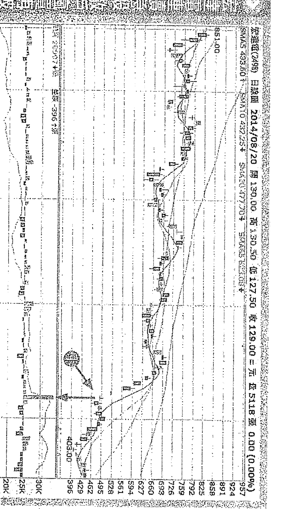

技術分析＋嚴守紀律 ＝敢戶致勝法寶

本質了，這檔股票的纏繞漲，絕對要用技術分析、嚴守紀律來操作，在多頭上漲的階段做好多，當空頭形成時立刻出場，不符合短線進場基本條件（見Part2《短線選股條件》），就不要進場，進場後，則要守紀律及時出場，自然就能避開風險。下圖是某些的股價走勢圖說明：

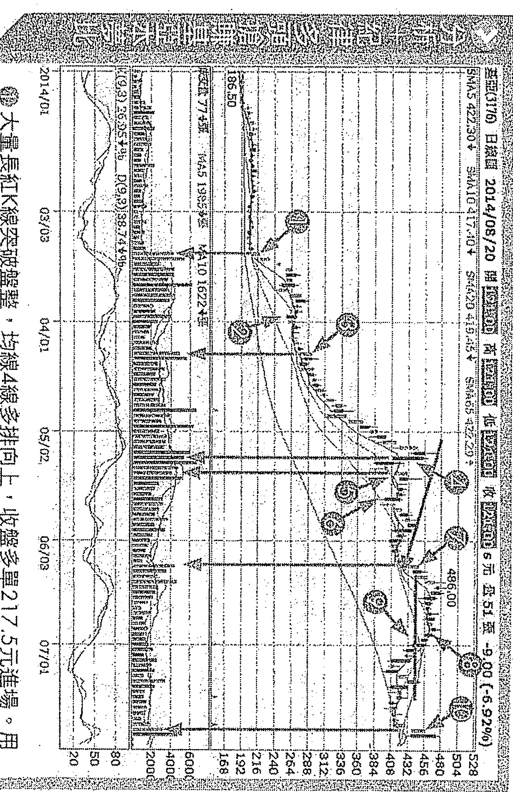

①大量長紅K線突破盤堅，均線4線多排列向上，收盤多量217.5元進場。用「波浪型態＋雙均線（MA10、MA20）＋乖離」方法操作。 ②長黑K跌破MA10，收盤256.5元出場，獲利17.9%。 ③回檔止跌後，出現大量長紅K線突破，均線4線多排列上，收盤多單292元進場。 ④高檔大量長黑K線下跌，與月線乖離＞15%，獲利超過20%，按紀律減破MA5出場，收盤410.5元出場，獲利40.5%。回檔止跌後長紅K線跳空上漲，均線4線多排列上，收盤多單430元進場。 資料來源：富邦OIS豐子交易系統

+   ①出現大量長黑K線，收盤跌破進場紅K線最低點，停損398.5元出場，獲利7.3%。走勢進入整理，待盤整結束再做。
②出現大量長紅K線突破盤整上頸線，收盤多單447元進場。
③黑K線收盤跌破MA10，MA10下彎，波浪型態出現頭頭低，按紀律收盤456元出場，獲利2%。
④放量出現長黑K線收盤跌破前面低點，空頭趨勢確認，停止做多操作。
⑤後續的下跌沒有損失。
⑥這根大量長紅K線跳空上漲，均線MA20方向向下，不符合做多基本條件，不進場。

股票走勢圖是所有參與交易的投資人共同創造出來的，尤其
是控股主力造成勢形成的。此外，外資或政府也有力量主導大盤
走勢方向，所以，敵 further 一定要具備看懂走勢圖的能力，看出圖
形透露的訊號，適時調整自己的操作策略，採取不同的方法，
按照紀律操作，自然能夠應付股市的千變萬化。
其實， 相信技術分析就是相信趨勢，順從趨勢，每個贏家不
都是這麽說、這麽做的嗎？

## 使用4大金剛 擊敗交易少分歧

股市場中的投資人有法人、外資、公司、主力、大戶、中實戶，以及其後，每個人都希望賺錢，所以競爭激烈。散戶是其中最弱勢的投資人，擁有的資金最少，沒有第一手資訊，更不可能有研究團隊。在這麼差的條件下，要在股市賺錢，必須有一套完整的訓練計畫，包括學習專業知識，透徹了解操作流程，掌握策略方法，建立正確觀念，在對的時間做對的動作，才能戰勝股市，成為股市贏家。

學會接續新的「4大金剛」

工具善其事，必先利其器。技術分析是股市操作的工具，不但要學習、要熟練，更要爐火純青。說實在的，在股票市場上，散戶可以相信或依賴的東西實在不多，技術分析雖然百分百不會出錯（包括市場本身也一樣會出錯），但它的確是最值得信任的股市投資工具。

## 熟悉技術分析 善用4大金剛

基本的技术分析要學會「波浪型態」、「K線」、「均線」和「成交量」，這4項我稱為技術分析的「4大金剛」，每個皆有特定的用途，以下用圖例簡單說明，更詳細的內容可參考我另一本著作《抓住飄股整飄賺》。 

### 金剛1 波浪型態

操作股票首先要看對趨勢方向，做錯方向怎麼可能賺錢？方向的判斷，當然不能用猜的，依據「道氏理論」（Dow Theory），多頭、空頭或盤整都有一定的走勢型態，若學會了，就已具備能夠看出股票走勢的能力。

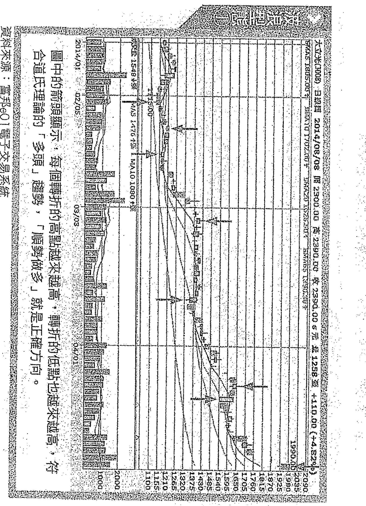

## Part 1 ▶ 進階操作

圖中的箭頭顯示，轉折的高點和低點出現高高低低的情況，這就是「盤整」，此時「不宜操作」。
資料來源：富邦e01電子交易系統

圖中的箭頭顯示，每個轉折的高點越來越低，轉折的低點也越來越低，符合道氏理論的「空頭」趨勢，「順勢做空」就是正確方向。
資料來源：富邦e01電子交易系統

## 熟悉技術分析 善用4大金剛

### 全剛2 K線變化

K線看的是每天買賣雙方的交易意願強弱，也就是說，K線可呈現當天看多及看空的投資人力量，這些力量的改變，可以研判走勢的延續，或者走勢將出現轉折的情況。

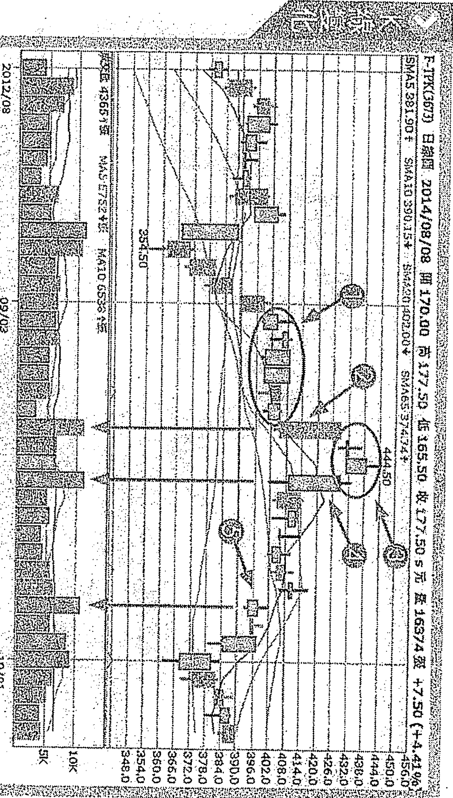

觀察每天的K線變化，可以在高檔時掌握反轉的訊號。

+   ① 股價連續上漲後，K線在上方橫跨5天，多空雙方對峙。
② 出現大量長紅線，股價上漲，多方勝出。
③ 連續2天出現黑K變盤線，多方上攻力道減弱，應注意可能向下轉折。
④ 當天開低盤，顯示股價上攻的企圖不強，收盤出現大量長黑，顯示空方力道極強，連續4天K線形成「夜星轉折」的向下訊號。
⑤ 股價於低檔盤整6天，出現大量向下跳空的黑K，反轉成空頭趨勢。

## Part 1 ▶ 什麼價格

### 金剛3 均線

葛蘭畢（Joseph Granville）發明的均線，以不同期間的收盤平均值繪成曲線，是一種收盤平均成本的概念。觀察股價在均線之上或之下，可以看出股價的強弱走勢變化。

觀察5日、10日及20日均線的變化，可以掌握股價方向。

+   ① 3條均線相互宮格交叉，行情上下振盪。
② 3條均線分別整齊，同時向上，行情上漲。
③ 3條均線又相互穿線交叉，行情上下振盪。
④ 3條均線排列整齊，同時向下，行情下跌。

資料來源：富邦O B I電子交易系統

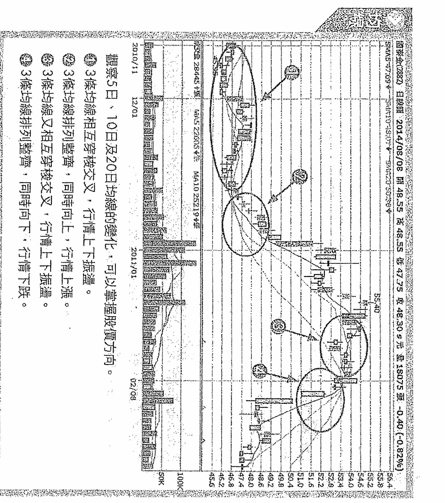

# 第一章 熟悉技術分析善用4大金剛

### 金剛4 成交量

觀察成交量與股價變化的關係，再看所在的位置，就能研判是誰在買、誰在賣。

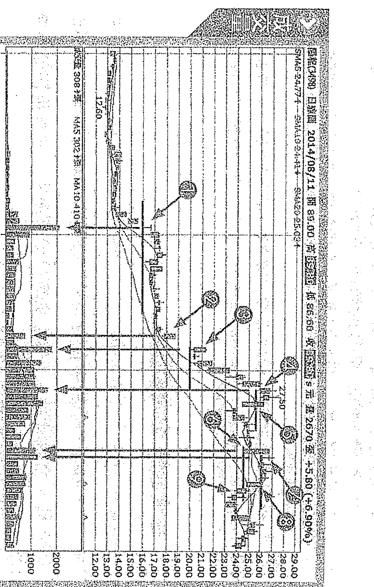

①股價橫向盤整後上攻，出現大量，後續股價沒有跌破這根大量K線的低點，這是攻擊的進貨量。
②股價高檔盤整之後，再出現大量上攻，次日股價漲停板，這是攻擊的進貨量。
③股價繼續上漲出現黑K大量，後續沒有跌破這根大量黑K線的低點，這是續攻的接手量。
④股價連續上漲9天的最高檔；再出現紅K線大量，要密切觀察後續股價是否跌破這根大量紅K線的低點，決定買賣量或換手量。
⑤長黑K線破了大量紅K線的低點，前面的大量是漲多的出貨量。

## Part 1 看盤備戰

①高檔回檔後，再出現大量長紅K線上攻，要密切觀察後續股價走勢，以及股價是否跌破這根大量長紅K線的低點，決定是出貨量或進貨量。
②當天出現更大的變盤十字線，反應昨日大量上漲，今日盤中多空勢均力敵，有變盤的味道，要特別注意次日的股價走勢。
③次日長黑K線下跌，跌破大量的變盤十字線的低點，同時出現「頭弱低」的多量出檔。高檔出現M頭，而且雙頭部出現大量，是主力明顯出貨的現像！
④再出現長黑K線下跌，跌破前面長紅K線低點，跟部大量為主力出貨量。

資料來源：富邦OI電子交易系統

## 金剛合體 實戰隱憂

技術分析的「波浪型態」、「K線」、「均線」、「成交量」4大金剛，雖然各有其功能，但是在實戰應用時，必須金剛合體、面面俱到，再加上熟練的分析應用，才能真正發揮技術分析的神奇力量。

技術分析4大金剛可提供散戶投資人以下6項實戰應用：

+   實戰1：選出高勝率及高獲利率的股票。
實戰2：判斷最佳進場位置。
實戰3：在走勢圖上設定停損，控制可能的风险。
實戰4：看出趨勢方向的改變，即時調整多空操作策略。
實戰5：買進股票後要用什麼方法操作獲利。
實戰6：賣到相對的高價，賺取最高的停利。

這6大實戰應該用正是本書的主要宗旨，將分別在後續篇章中詳細說明。

# 第七章 熟悉技术分析 善用4大金刚

## 用进退检验 如虎添翼

市场上还有许多指标，以市场数值经验，设定固定参数，反应该下市场的状况。其中有些是经过相当繁复的数学计算而来，一般敌后没有必要去搞懂，只要了解指标的特性即可。善用指标，配合趋势走向，就可提高进出场的成功机率。最常用的是加MACD、RSI、KD等，只要精通1～2个指标，就足够搭配运用，就能掌握股价变化，在投资上具有加分的效果。

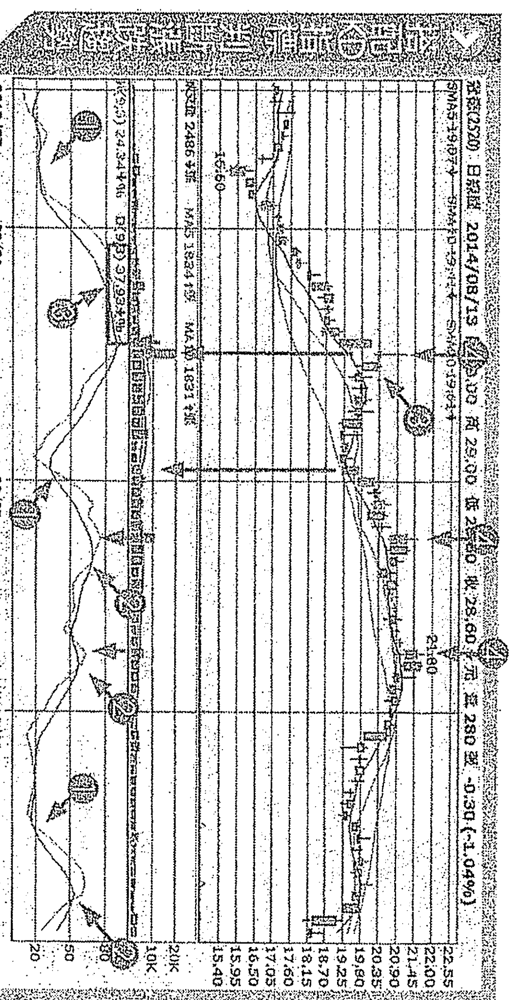

① KD指标在低档黄金交叉向上，对应下面走势图，股价开始上涨。
② KD指标在高档死亡交叉向下，对应下面走势图，股价开始下跌。
③ 股价逢低上涨，KD指标在80之上，显示短卖过度热，售上面股价出现下跌黑K线棒，开始回档修正。
④ 上面走势图的高点越采越高，是对底下面的KD指标则是高点越采越高（红线拐折高点），这是指标出现高档背离现象，走势容易做头，后续走势将为空头。

## 看重致勝要素 再投入股市

《孫子兵法》第1篇〈始計篇〉說：「夫未戰而廝算勝者，得算多也；未戰而廝算不勝者，得算少也。多少算勝，少算不勝，而況於無算乎？」
這句話是在說明，用兵之道，必須「詳而後戰」，戰前要先算計自己的取勝條件，取勝的條件夠多，然後再出兵，才有獲勝的可能；反之則容易失敗。僅憑匹夫之勇，毫無算計謀略就出兵，必遭失敗。
同樣的，在商場上，企業的成功建立在縝密的資訊蒐集分析、目標設定，以及達成策略，如果沒有遠見、沒有計畫，盲目投資，必然遭到重大的損失。在爾虞我詐、勿不見血的股市市場上，戰況之慘烈不亞於戰爭或商場的競爭，更要有充足的致勝準備及算計，再投入金錢，否則必定賠得血本無歸，投資人不可不慎。
台股投資的致勝條件之一，就是要了解影響台股的因素。這

## 影響台灣股市的3個外在因素

這些因素分為外在及內在兩類，分別介紹說明如下。

外在因素指的是國外股市的走勢，會對台灣造成不同程度的影響。

### 外在因素1 美國股市4大指數

+   1. 道瓊指數（DJ）
道瓊工業平均指數，反映美國30種主要製造業的股票行情。

+   2. S&P 500指數
標準普爾500股價指數，從紐約股票交易所選出美國前500大上市股票而編製的股價加權平均指數，涵蓋範圍較廣，能精確反映美國市場狀況。

+   3. 那斯達克指數（NAS）
屬於美國的櫃台買賣中心，專門提供高科技股票的交易所市場，較容易影響台灣電子股的走勢。

+   4. 費城半導體指數
由美國費城證券交易所編製，取樣30檔半導體上游重量級公司組成，為半導體類股的重要指標。

美國是世界經濟的龍頭，美股的漲跌，自然牽動國際股市，在平常，美股的漲跌與台股的連動性並不高，但是若遇到下面2種情況，對台股的當天走勢就會造成影響：

## Part 1 逢極備戰

### 關鍵1 美股收盤大漲1.5%以上，台股當天容易開高走低。

例如：
2012/08/06：美股+1.7% 台股開盤7278、收盤7223
2012/09/07：美股+1.9% 台股開盤7471、收盤7404
2012/11/20：美股+1.7% 台股開盤7174、收盤7132
2013/10/11：美股+2.2% 台股開盤8407、收盤8349

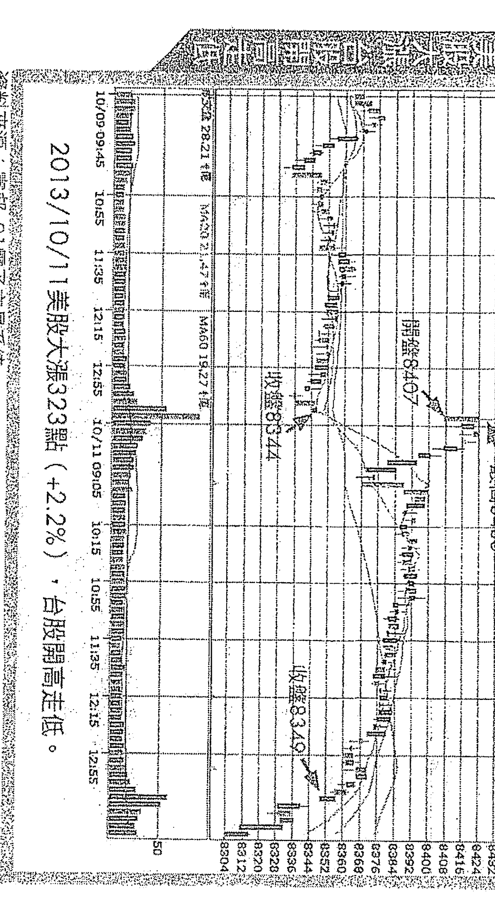

### 關鍵2 美股收盤大跌1.5%以上，台股當天容易開低走高。

因此，遇到美股大漲，台股會開高，但是不能在開盤去追買股票，因為很容易當天就被套牢。

例如：
2012/10/22：美股-1.5% 台股開盤7300、收盤7360
2012/10/24：美股-1.9% 台股開盤7230、收盤7347

2012/11/08：美股-2.4% 台股開盤7158、收盤7220
2013/08/16：美股-1.5% 台股開盤7854、收盤7925
2014/08/01：美股-1.8% 台股開盤9223、收盤9266

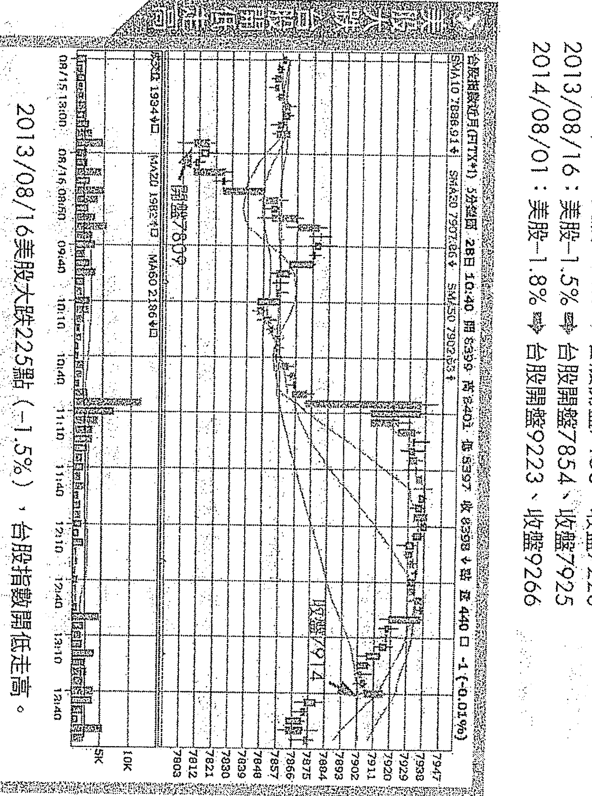

資料來源：富邦e01電子交易系統 2013/08/16美股大跌時225點（-1.5%），台股指數開低走高。

因此，遇到美股大跌，台股會開低，但是不能在開盤去賣股，因為容易賣在當天最低價。

### 外在因素2 歐洲股市

歐洲股市原本與台股連動性不高，但在發生歐債危機之後，影響世界經濟考慮，雖然歐洲股市與台股連動很小，我們每天仍然要關注其走勢。歐股主要以「德國DAX」、「倫敦金融FTSE」、「法國CAC」3者為重要指標觀察即可。

## Part 1 ► 慎極備戰

### 外在因素3 ► 亞洲股市

#### 1. 日經指數

根據日本股市中具代表的225種股價指數編製。上午8點開盤，與台股連動性不高，觀察即可。

#### 2. 韓國綜合指數

由於韓國近年來成為我國重要的競爭對手，因此與台股連動關係密切，大致觀察重點如下：

+   重點1：影響台股開盤位置；韓國上午8點開盤，接近8:45，韓國上漲0.5%，我們期貨指數開盤，大多也會隨同上漲0.5%，連動約有8成左右。例如：2013/9/17美股上漲119點（+0.8%），韓股8:40跌11點（-0.5%），台期開盤跌30點（-0.4%），不隨美股上漲，而是隨韓股下跌。

+   重點2：台股盤中走勢也會受到韓股盤中大漲大跌的影響。

+   重點3：整體大盤走勢方向與韓股走勢方向大致一致。

+   重點4：當天台指期開盤若比韓股弱，今日台股將會走弱。

+   重點5：當天台指期開盤若比韓股強，今日台股將會走強。

例如右頁圖中，2013/10/30（摩台結算）美股上漲111點（+0.7%），韓股8:40跌7點（-0.4%），台指期開盤漲16點（+0.2%），與韓股不同步，比韓股強，當天台股上漲44點，同時再創新高。台股走勢的轉折位置，與韓股走勢的轉折位置

# 第二章 看懂致勝數據 再踏入股市

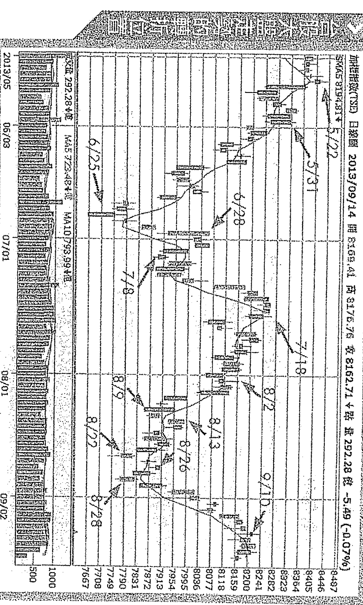

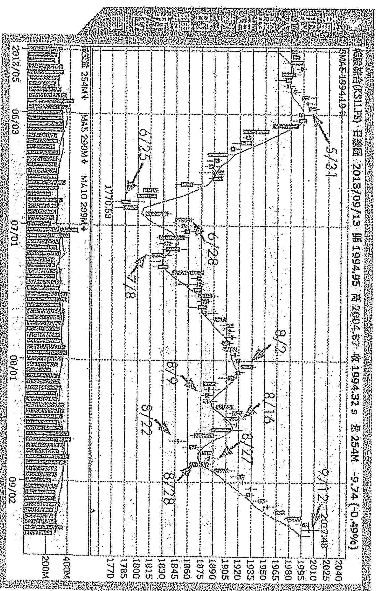

#### 3. 大陸指標數

影響中概股走勢及傳產水泥、鋼鐵、航運等類股。主要：

上證A股指數：上午9:30開盤
深圳A股指數：上午9:30開盤

#### 4. 香港恒生指數

香港恒生指數於上午10點開盤，與台股連動性不高。

## 影響台股走勢的4個因素

## 內在因素1 法人買賣超

投資人通常會藉由3大法人的買賣超，看法人對多空的看法，其中自營商、投信視為內資，外資及陸資視為國外資金。其影響台股的研判方式：

### 研判1：連續買超看多，連續賣超看空（連續3天以上買或賣）

+   研判2：連續買超轉賣超，看多轉弱。
研判3：連續賣超轉買超，看空轉強。
研判4：3大法人一致買超，同比看多。
研判5：3大法人一致賣超，同比看空。
研判6：內資與外資不同步，容易盤整震盪。
研判7：外資買賣超，主導台股方向比較明顯。

幾乎相同。

## 第2章
看懂致勝數據 再踏入股市

從下圖可以看到，當外資連續買超時；大盤上漲；當外資連續賣超時，大盤下跌；而投信持續買超，大盤有漲有跌。

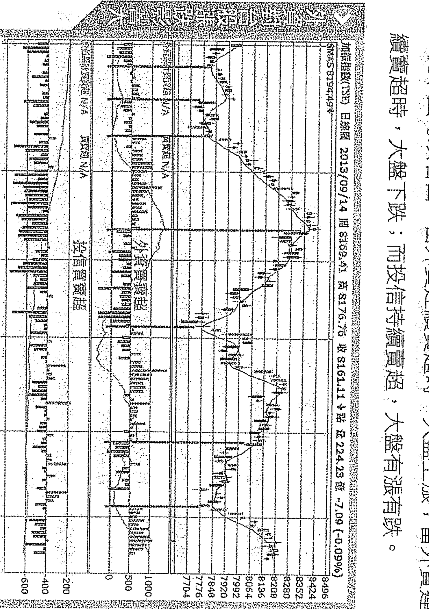

## 內在圖表2 融資融券

對融資融券的基本認知有下列4點：

+   - 認知1：融資大部分代表散戶，為看多的買盤，是潛在賣壓。
- 認知2：融券大部分代表大戶或法人，為看空的賣盤，是潛在買盤。
- 在的支持。
- 認知3：價漲代表主力大戶看好或看漲，價跌代表主力大戶看不好或看跌。

## Part 1 信賴倚與

認知4：資券增減與股票趨勢、股價位置、股價漲跌關係密切，要一起研判。
另外，對放資券變化有以下7個分析重點：

重點1：低檔起漲階段，放資餘額增加，代表更多投資人看好股市，對多頭有利。

重點2：上漲一段，融資餘額偏高，代表已有許多人手上握有股票，這時想買的人減少，想賣的人增加，上檔賣壓變重，隨時會有人大量殺出，對多頭不利。

重點3：高檔融資餘額增加，代表許多少投資人認為股價會跌，所以借股票來賣，對多頭不利。

重點4：下跌一段，融資餘額偏高，代表有更多人早晚要融資回補，所以反而會造成股價上漲，對多頭有利。

重點5：一般而言，融資者多是散戶，所以由融資增減與股價變化，常能研判大戶動向及股價走勢：
①融資增加、股價上漲：大戶與散戶都看好後市。
②融資減少、股價下跌：大戶與散戶都看壞後市。
③融資增加、股價下跌：散戶看好後市，大戶看壞後市，這也表示大戶有可能趁機出脫持股。
④融資減少、股價上漲：散戶看壞後市，大戶看好後市。

## 第2章 看懂致勝數據 再踏入股市

## 重點6：3大法人的買賣與融資關係：

+   ① 融資增加，法人買進股價看漲。
② 融資減少，法人買進股價看漲。
③ 融資增加，法人賣出股價看跌。
④ 融資減少，法人賣出股價看跌。

## 重點7：我們不能只憑資金變化就判定多空，利用配合才是重點

的位置、成交量的變化、股本的大小等，進行整體判斷。

## 內涵圖表3 法人期指留倉

期指留倉主要有3個觀察對象：

+   對象1：3大法人——外資及陸資、投信、證券自營商。
對象2：前5大交易人、前10大交易人。
對象3：前5大特定法人、前10大特定法人。

期指留倉則有下列8個觀察重點：

+   重點1：所有留倉的對象都持多單，一致看多。
重點2：所有留倉的對象都持空單，一致看空。
重點3：所有留倉的對象持有多有空，看法分歧，盤面容易震盪。
重點4：外資留單在1.5萬口以上（多單或空單），大盤比較容易走外資留單的方向。

## Part 1 ▶ 慎極倒勢

重點5：往結算日靠近時的多單或空單持續增加，也可看出方向。

重點6：內資（以自營商為主）與外資多空單方向相反達5000口以上，容易對做，盤中容易上下振盪，振幅會擴大。

重點7：全市場期貨未平倉大於8萬口以上，盤中就容易有急漲急跌情形出現。

重點8：期指結算前3天（含結算日），期貨多空單仍大時，可做特定方向。

## 內在因素4 台股的結構變化

變化1：台股有電子、金融、非金三大組合，其中電子股影響大盤指數最大，擔當大盤指數上漲的攻擊部隊，金融股擔當大盤指數防守的部隊，非金電類股是護盤的角色。所以觀察這3大類股走勢的強弱，可以掌握大盤的強弱。

變化2：台指期貨量、價、線的走勢及電子期、金融期、非金電期的走勢為現貨的領先反應。

以右頁圖為例，2014/8/6（三）當天內資投信與自營商合計多單13024口，外資空單17406口，全市場總留倉達80108口，當天盤中出現殺低拉高的拉鋸盤走勢。

## 第2章 看懂致勝數據 再踏入股市

變化3：
摩台指的量、價、線反映國外交易人對台股未來走勢的看法，值得重視。

變化4：
大盤上漲家數與下跌家數的相對比例，以及漲停家數與跌停家數的數量，可以看出多空強弱的氣勢。

變化5：
檔重點標股的走勢，影響大盤指數漲跌甚巨，例如台積電上漲1%，約大盤上漲8點。

資料來源：昌邦ONE電子交易系統

+   ① 開低盤急拉
② 拉高急殺
③ 殺低急拉
④ 拉高再殺到低點
⑤ 低點再拉到高點

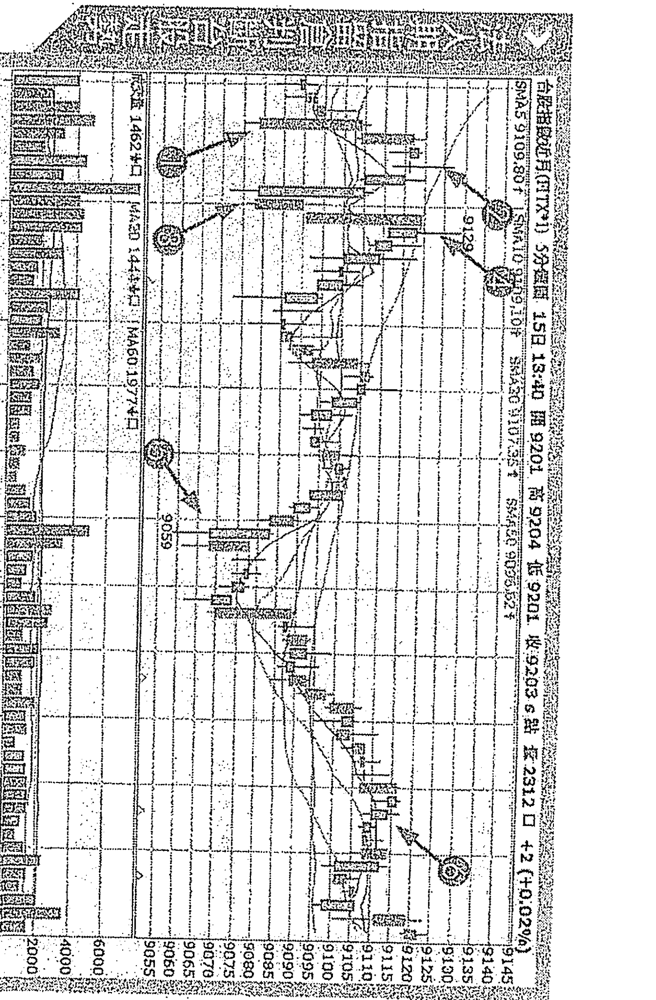

## 內在因素5 政府政策的影響

政府政策造成的影響有以下2個狀況：

+   - 狀況1：政府政策做多或基金護盤，大盤易漲難跌。
- 狀況2：政府政策做空或認為股市過熱，大盤易跌難漲。

電子股指標：2330 台積電 2317 鴻海 3673 F-TPK 2498 宏達電 3008 大立光 2454 聯發科

金屬股指標：2882 國泰金 2881 富邦金 2886 兆豐金

傳產股指標：1301 台塑 6505 台塑化 1303 南亞 1326 台化 2412 中華電 2002 中鋼

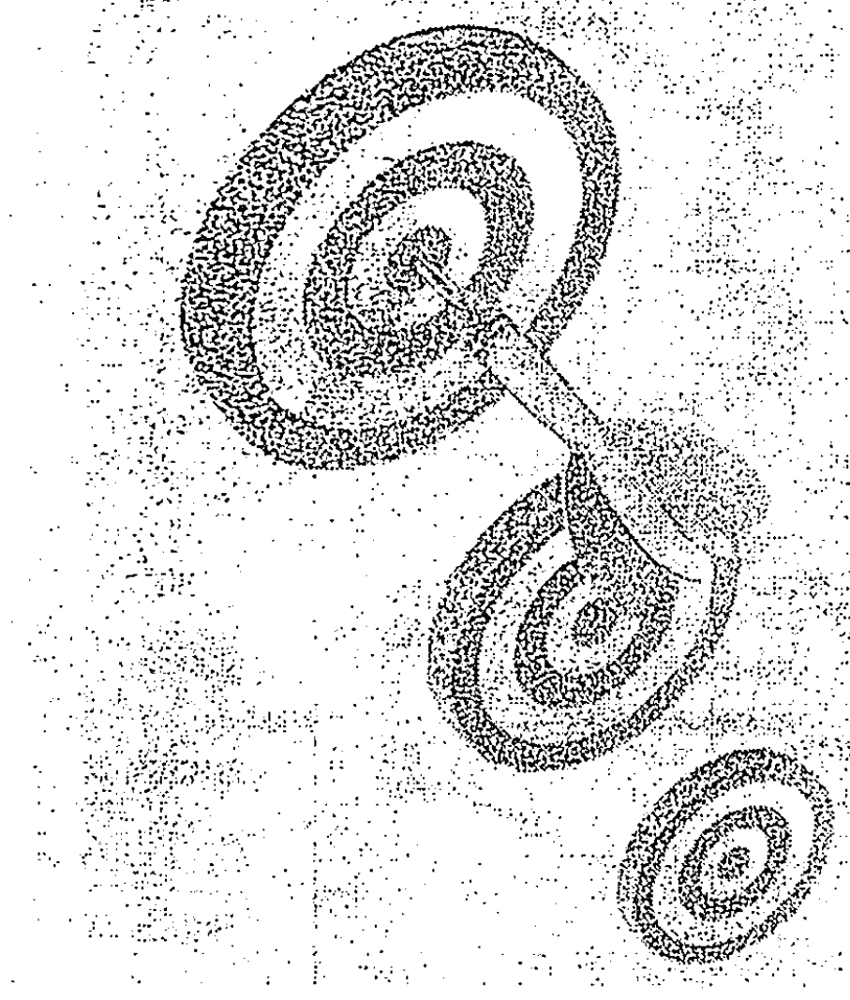

## 篩選好股票 建立賺錢資料庫

好的開始是成功的一半。如果能夠投資到好股票，成功獲利不易但容易，而且也很輕鬆。不過，天下沒有白吃的午餐，想要選到強勢股，要有方法，然後加上不斷練習，選股功力就會日漸增強。選股是進場前的準備工作，也是每天要做的工作，這個步驟做得越好，進場賺錢的機會越大。我講授投資理財課程這幾年，經常有學生問：「台股有1千多檔，到底要怎樣才能選到會漲的股票？」其實，這也是一級高手常常遇到的問題，因為每個時期都會出現不同的好股票，所以，選股是投資人的日常功課。投資人平常就應該蒐集具有上漲或下跌潛力的好股票單，當機會來了，自然就可以從容進場，正所謂：機會是留給準備好的人。我們可由下面幾個方向，逐步選出好的股票。

### ② 觀察資金流向與股價 篩選潛力好股

每日收盤後，投資人可透過券商的交易軟體，列出當天漲幅最大或跌幅最大的前100檔股票，只要持續追蹤，每天觀察（當然也需要有技術分析的能力），很容易就能發現主流類股、近期強勢股、弱勢股、走勢很好的績效股、短期績強或績弱的個股，以及日後的黑馬潛力股。

篩選好股有以下7個方式：

## 篩選1：整理強勢和弱勢股

每天收盤後，把當日上漲3.5%以上強勢股票，以及下跌3.5%以上的弱勢股票，全部看一遍（至少前50檔）。

## 篩選2：去除擾亂股

利用技術分析，去除線形不好、看不出方向、成交量太小（無法多買，買到之後不易賣出），以及價格太低（容易遇到地雷股）的股票。

## 篩選3：做多潛力股

+   1. 大盤在月線之上多頭，個股呈現多頭架構，股價在月線之上，月線上昇。
2. 類股必須多頭，且比大盤強，如下頁3張綜圖。
3. 在強勢類股中，找出1～3檔龍頭股或走勢較強勢的個股。
4. 提前尋找未來將會發酵的題材，如4G、光纖、節能、智慧電視、物聯網、電動車、機器人……

## 本日高温特... 新高点

加权股价指数(TSE) 日线图 2014/07/16 mendalam 9570.33 最高 9574.13 收 9484.79 3点跌 1152.53 低：-84.74 (-0.88%) SMA5 9527.03↑ SMA10 9271.12↑ SMA20 9476.33↓  9535.66 9690 9633 9576 9519 9405 9348 9234 9177 9123 9063 9006 8949 8893 8835 8778 8721 8664

2014/4/28~7/16 這段期間，大盤處於多頭上漲趨勢。

資料來源：富邦e01電子交易系統

## 與大盤走勢比較

電子(TSEJ) 日線圖 2014/07/16 開 382.09 高 382.28 低 377.01 收 377.91 6點跌 786.58 低：-4.48 (-1.16%) SMA5 381.41↑ SMA10 382.45↓ SMA20 379.76↑ 386.42 389.61 392.94 382.95 386.52 370.52 376.56 372.96 369.63 366.30 362.67 359.64 356.51 352.98 349.52 346.23 342.99 339.66 336.33 333.00 329.67

同時期的電子類股走勢與大盤一樣，是多頭向上的趨勢，此時做多電子股，就很容易賺錢。

資料來源：富邦e01電子交易系統

## Part 1▶慎備備戰

## 篩選4：做空潛力股

+   1. 大盤在月線之下空頭，個股空頭架構，股價在月線之下，月線下彎。
2. 選股要空頭，比大盤弱，如以下線圖。
3. 在弱勢類股中，找出1～3檔領先下跌的股票或走勢最弱的個股。
4. 漲多領先下跌的個股，或是沒有基本面、因為炒作超漲後下跌的股票。

觀察同一時期的金霸股票走勢，在2014/5/23才走出多頭趨勢往上，此時配合大盤多頭，做多金霸股，就能輕鬆獲利。

資料來源：富邦e01電子交易系統

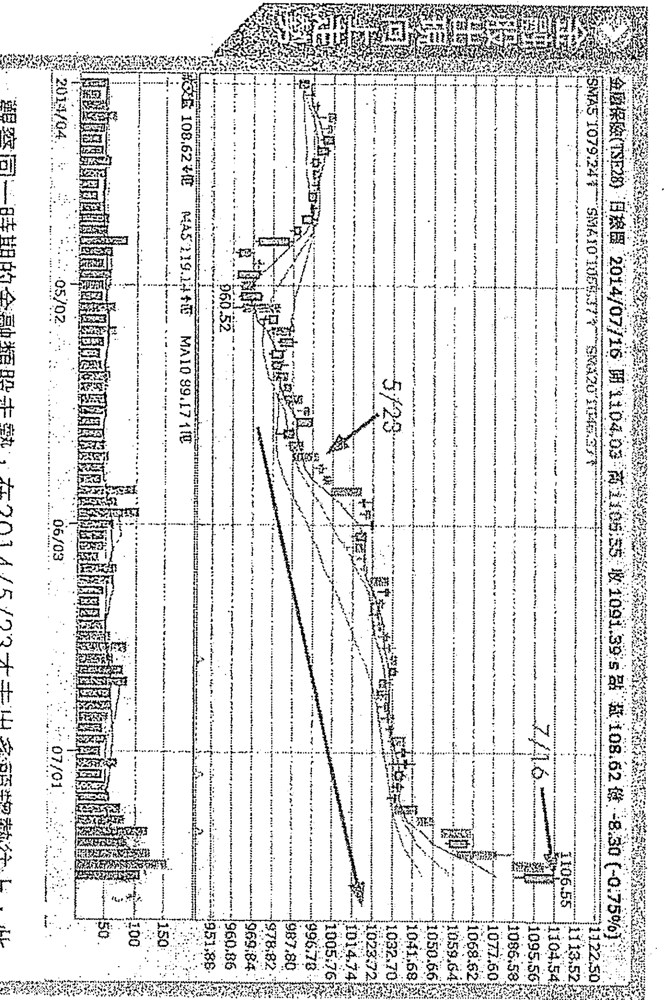

## 篩選：看當日強勢股

+   1. 觀察今天強勢股的個股走勢圖波浪型態，先看是否符合多頭的趨勢，如果是多頭股票，今天大漲是否為多頭起攻的位置？是上漲行進中的繼續大漲，還是打底或盤整中的準備做多。
2. 觀察今天強勢股的個股走勢圖波浪型態，先看是否符合空頭的趨勢，如果是空頭股票，今天大漲是否為空頭的反

日大漲？如果是乙檔多頭的好股票，就可以挑出來續抱，準備做多。

承P.039的「大盤呈現上漲趨勢」續圖，同一時期約適當製造類股走勢是空頭趨勢向下，此時操作營造股，應做空。

資料來源：富邦e01電子交易系統

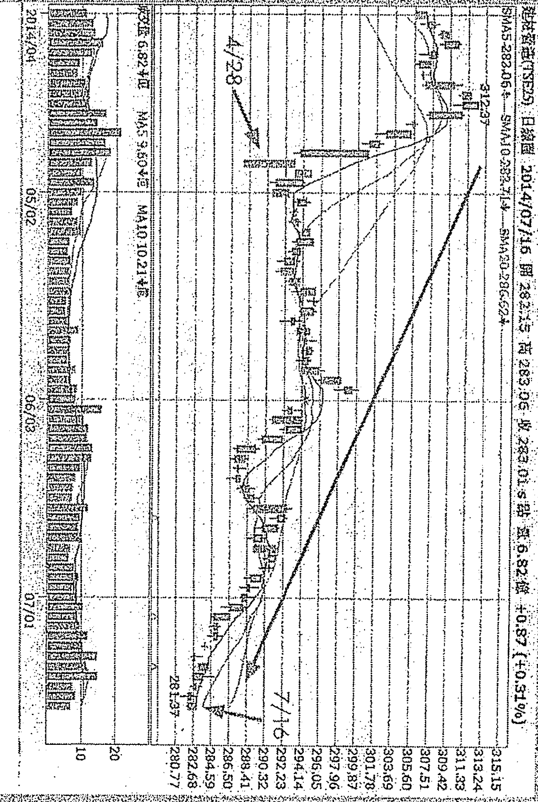

## Part 1 ▶ 穩懋準備

彈？或是盤整中的一日大漲？如果是一檔空頭的好股票，便可以挑出來鎖股，準備反彈結束再做空，或者盤整跌破時再做空。

## 篩選6：看當日弱勢股

1. 觀察今天弱勢股的個股走勢圖波浪型態，先看是否符合空頭的趨勢，如果是空頭股票；今天的大跌是否為空頭起跌的位置？是下跌行進中的繼續大跌？還是做頭或盤整中的一日大跌？如果是一檔空頭的弱勢股票，就可以挑出來鎖股，準備做空。

2. 觀察今天弱勢股的個股走勢圖波浪型態，先看是否符合多頭的趨勢，如果是多頭股票，今天大跌是否為多頭的回檔，或是盤整中的一日大跌？如果是一檔多頭的好股票，就 सकती挑出來鎖股，準備回檔結束再做多，或者盤整突破時再做多。

## 篩選7：其他觀察重點

+   1. 觀察今天強勢股中，是否有某個特定類股今天都很強。例如突然看到今天有許多太陽能的股票漲停，就要注意觀察太陽能類股是否開始轉強。
2. 連續幾天都看到某些題材股在發爛，這個題材股就有可能成為主流類股。
3. 前些日子都是強勢上漲的多頭股票，今天突然在弱勢股中看到它跌停板，有可能是這支股票要回檔，或者這個類股

## 篩選好股票 建立賺錢資料庫 第3章

## ③ 精選好股 建立觀摩

+   4. 多頭看價量的配合，籌碼變化看3大法人買量超過、融資融券增減，是否經過洗盤再漲的狀況。
5. 看個別股週線走勢方向如何，觀察有沒有長線的機會。
6. 觀察日線及週線的MACD、KD指標，是否在高檔向下或低檔向上。
7. 觀察近3～5日K線的變化，是否有短線轉折的機會。
8. 多頭時，看該股是否屬於主流股、題材股、應景股、轉機股、車空股。
9. 觀察均線的排列及位置，是否呈現多頭排列向上或空頭排列向下。
10. 預估機會獲利空間及風險範圍。
11. 看是否有明天可以進場的標的（挑選最佳的3～5檔）。

要轉弱了。

投資人若能依照上述方法，每天觀察強勢股和弱勢股，就能從中挑出許多潛力的多頭及空頭股票，再用這些股票建立一個資料庫（也有人稱為「水庫」），以便於鎖股應用。

基本上，鎖股可分為鎖做多與鎖做空兩部分，再依據摜類股的強弱順序排列，每天檢視變化，把最強勢、近期有機會發動的股票，優先排列在前5檔，這樣就能在盤中快速度掌握最佳的進場機會。

## 不要支配資產結構 別被機購買

在一次退休同事聚餐上，我遇到一位昔日長官的夫人，她聽說我對股票略有研究，便問我，若是投資股票被套牢了，該怎麼辦？

原來，長官於2007年退休時，領了一筆退休金，想說放在銀行利息很少，而去買股票，認為配股配息的獲利率較高，於是挑選了台灣資產最大、經營穩健的金融股國泰金（2882），並於2007年7月，國泰金股價由高點92元下跌到86元時買進；然而，國泰金卻從此一路往下，去年初聚餐時，股價已剩37.4元。一檔股票抱了6年，投入的資金就賠了56.5%，即使配了幾年的股利，也不足以彌補虧損的本錢。

大多數散戶進入股市都有一個盲點，認為買股票是「投資」，但是真的買進股票之後，確是抱著「投機」的心態，總希望自己買的股票能夠快速上昇，如股價不漲或下跌，就賣掉；要不然，就是想投機買進，希望能夠快速賺錢，結果股價

## 第四章 要投資穩穩賺 別投機賺價差

下跌，又捨不得停損賠錢賣出，甚至覺得公司本質還不錯，所以以改成長期投資，想分享股息股利，結果造成長期下跌套牢，本金損失慘重。其實，這些做法都不能算是投資。

上面這些做法是投資與投機不分，操作腳步紊亂，當然不可能操作出好績效。所以，在準備一筆資金投入股市之前，應該要先搞清楚，是要「投資」一檔股票，領取股息股利，還是「投機」一檔股票，賺取差價；這兩者的條件和操作方法、策略大大不同。接著，就把投資與投機的差異分別敘述如下：

## 投資關鍵點

## 買股票的目的

+   1. 打算長期持有。
2. 以獲取穩定分配股息、股利為目的。
3. 當股價大幅上漲時，也可賣出股票賺取價差，賺取獲利。

## 選股的標的

要投資好的股票，盡量在台灣100、台灣50、富櫃100中，挑選基本面好的標的。

## 選股的方法

+   1. 以基本面為主
公司財務及營業狀況，包括公司股本、公司資產、營業項目

# Part 1 慎選而為

目、董事事、現金流量、營業額年增率及月增率、毛利率、淨利率、淨值比、近5年以上配股配息狀況及政策、財務結構、本益比、公司股東報酬率，並且考慮公司產業的穩定性及產業未來的發展。

2. 以價值型投資為主 研究公司基本面，評估應有的合理價值，例如中華電（2412），公司股本775億元，淨值為48元，近5年配息平均達5元，為國內電信業的龍頭，未來發展4G業務，公司經營穩健，評估合理的投資價值應在50～60元間。

判斷股票現行價位是否合理，並研究未來經營發展空間，做長期的投資，賺取長期的報酬，股票在合理價位之下即可承接。例如上述的中華電，當價格回到60元之下，就可考慮長期投資。近3年中華電股價都在90元之上，其實是不適合做長期投資的。

2014年7月，中華電股價在95元上下波動，自然不適合用投資方式買進股票。就技術面而言，下頁圖中這兩根月線突破前高點的紅K線，股價雖然在68元及70元，卻是投資買進的好機會，後來股價分別漲到83.2及111元，分別獲利22.4%及58.5%，獲利遠遠超過配股配息。

# 第四章 要投資穩穩賺 別投機賺價差

# 中華電 (2412) 歷年配股配息

| 年份 | 現金股利(元) | ... | ... | ... | ... |
| 2013 | 4.53 | 0 | 0 | 0 | 4.53 |
| 2012 | 5.35 | 0 | 0 | 0 | 5.35 |
| 2011 | 5.46 | 0 | 0 | 0 | 5.46 |
| 2010 | 5.52 | 0 | 0 | 0 | 5.52 |
| 2009 | 4.06 | 0 | 0 | 0 | 4.06 |
| 2008 | 3.85 | 0 | 1 | 1 | 4.83 |
| 2007 | 4.26 | 0.1 | 2 | 2.1 | 6.36 |
| 2006 | 3.58 | 0 | 1 | 1 | 4.58 |
| 2005 | 4.3 | 0.2 | 0 | 0.2 | 4.5 |
| 2004 | 4.7 | 0 | 0 | 0 | 4.7 |

股利如果以5元計,合理本益比10倍,計算值得長期投資的價位應該是50元,如果股價來到50元以下,是投資的好價位。

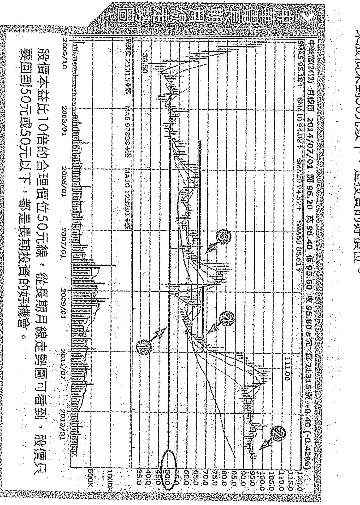

股價本益比10倍的合理價位50元線,從長期月線走勢圖可看到,股價只要回到50元或50元以下,都是長期投資的好機會。

# 中華電系統和圖表

# ⑦ 掌握面面接觸面意總結

綜合前面所說的重要點，可歸納出下面3個重點：

重點1：「基本分析」以公司本身具有的價值，衡量現在股價高低，是否值得長期投資。「技術分析」則是透過圖形量化指標，推測股價的變動，看是否可能上漲或下跌的機會，進而操作買賣獲利。

重點2：透過「基本分析」，可以了解所要購買的股票的本質。透過「技術分析」，則可把握具體的買賣時機。

重點3：成功的投資人是把兩種分析結合運用，用「基本分析」評估較長期趨勢，用「技術分析」判斷短期走勢及進出時機。

只要充分了解股票投資與投機的不同之處，我們就可以根據自己買賣股票的定位，在進場前做好準備，買好買進的股票。這樣一來，買進股票之後，就很清楚自己在做什麼、以及要做什麼了。

# 武藝自己 續身股市贏家

散人如果想成為股市贏家，必須奉行「投資之道，趨勢為師，順勢而為，堅守紀律」的贏家最高圭臬。

投資之道：想走股市投資這條路，就要找到正確的方向，用正確的方法，做正確的事，才能到達成功的彼岸，見到股市如來。

趨勢為師：大盤的趨勢方向，就是引領我們前進的明燈，大盤的變化就是教導我們的導師，天大地大，趨勢最大，投資時，要謙卑恭謹地跟隨趨勢。

順勢而為：借力使力，順水推舟，事半功倍。順天應勢，得道者富，賺錢如反手折花。

堅守紀律：股市詭詐，千變萬化，迷惑股海眾生，人心善變，恐懼貪婪，無法自持，唯有堅守，以不變之法，照股市眾坑，定方法依法，去雜亂之源，歸專念於一，此定心法！

# 贏上贏家的要點素養

請記住，「機會永遠留給準備好的人」。只要你準備好，股市場合永遠都有機會。

# 準備1 下定決心完成目標

- 目標：達到致富、悠閒、愉快的人生。
- 執行：學習專業知識、經營事業態度、尋找賺錢方法、累積操作經驗、擬訂資金計畫、訓練穩健獲利。
- 堅持：堅持目標決不放棄、堅持每日做功課研究圖形、堅持守紀律操作能夠賺錢的方法、堅持每日進步。

# 準備2 安排學習課程

- 技術分析初階班（1.5個月～3個月）
- 技術分析中高階班（1.5個月～3個月）
- 型態＋心法班（1.5個月）
- 練功班（3個月～6個月）
- 四大金剛專修班（視個人需要加強）
- 實戰操作經驗累積（1～2年）

# 準備3 修練穩定心法

- 按部就班學習及練習。
- 定法定心，等好機會才進場，做到股不動我不動，股一動我即動。
- 股票賺錢是「等」來的，機會錯過，等下次機會。
- 股票賺錢是「忍」來的，停損要忍痛出場，停利未到要忍住繼續抱，趨勢不明要忍住不要進場。
- 股票賺錢是「穩」來的，勝率高的股票才操作，有獲利空間的股票才操作，穩健獲利，累積財富。

除了遵守「贏家基準」，投資人還必須做好上述幾項準備，武裝自己，才能成為股市贏家。

# Part 1 ► 慎選備戰

# Part 7

# 產品設計軟體

我們把每次進場操作，當做一次交易，每次交易流程包含下面5個步驟，如果對每個步驟都能夠做好細節規劃，並採取正確的動作，在股市中競爭優勢變得很容易。能自如熟行這些步驟，才是成功的關鍵。

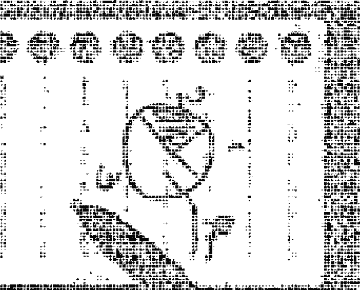

# Part 2 ▶ 5大買點操作
操作流程5大步驟

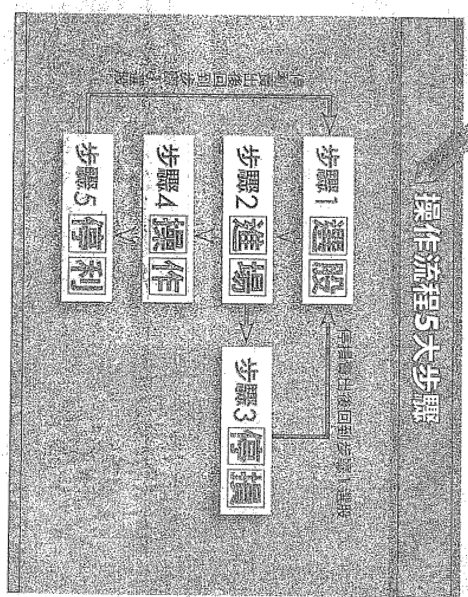

# 步驟1 選股

- 從基本面、題材面、主流類股、強勢股選股。
- 從技術面選股。
- 建立資料庫鎖股。

# 步驟2 進場

- 做好資金分配，規畫進場數量，採取一次或分批進場。
- 技術面符合條件，決定做多或做空，做長線波段，還是短線價差套利。
- 在多空最有利的進場位置，於日線進場。

# 短線做多

# 選股SOP：

短線操作股票，當股價的日線完成下列幾項條件時，可以短線做多：

1. 趨勢條件
日線波浪型態（趨勢）符合「頭頭高、底底高」的多頭架構。

2. 均線條件
日線的均線3線（MA5、MA10、MA20）多頭排列，均線向上（注意：季線如果還在股價上方，而且是下彎走勢，當股價上漲靠近時，會有壓力產生）。

3. 股價位置
股價收盤在3線（MA5、MA10、MA20）之上，同時看股價在整個上漲趨勢中，是位於初升、主升或末升階段。

4. 成交量
底部打底時有大成交量（代表有人在買），發動攻擊上漲的K線有攻擊量（當天成交量比前一日成交量增加1.2倍以上，如有2倍以上，攻擊力道更強)。

5. 指標參考
日線KD指標黃金交叉向上，MACD指標多頭排列向上，OSC綠柱轉紅柱。

6. 可能的獲利目標

- 上面季線、半年線、年線的壓力。
- 往上（由右向左看）轉折的低點（底部）和高點（頭部）的壓力。
- 往上盤整區的壓力。
- 往上大量向下跳空形成缺口的壓力。
- 往上出大量的K線被跌破後，造成後來上漲的壓力。
- 下跌趨勢形成的下降均線壓力。
- 如是型態突破後上漲，型態的目標價滿足點會形成壓力。

7. 等待進場位置

- 多頭回檔後再上漲的大量中長紅實體K線。
- 多頭突破盤整上漲的大量中長紅實體K線。

# 多頭趨勢參數提示

1. 多頭向上會遇到上面很多的壓力，短線操作先以靠近股價最近的壓力，當作短期初步的獲利目標。
2. 多頭趨勢的特性為「見壓不見壓」，上漲到預定壓力時，要觀察K線多空力量的變化，出現的K線是否轉折的訊號，並且配合個人的操作紀律（例如做短線守5日均線）再決定是否出場，也可以根據到達壓力時的獲利率，以及與月線的乖離是否太大，決定是否要出場。（詳見〈步驟5：停利〉）
3. 日線短線合乎條件進場，獲利出場後，只要多頭走勢沒有改變，可以繼續做多，上漲一段之後，走勢合乎中長期條件時，可以改為中長期操作。
4. 在任何完美的條件進場，都有一定的失敗機率，所以每次操作都要控制好風險，依據個人資金分配，考慮買進的數量和個人所能承擔的賠錢風險；設定第一失敗停損的位置。（詳見〈步驟3：停損〉）

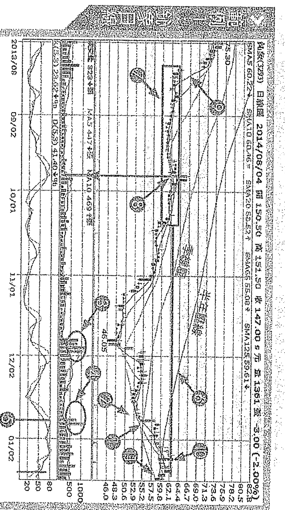

股象（3293）2013/12/25，當天出現大量紅K線，以下是符合短線做多的條件：

資料來源：富邦e01電子交易系統

# Part 2 ▶ 5大賣點分析

① 長紅K線實體棒，收盤突破前面高點，波浪型態完成「頭頭高、底底高」的多頭趨勢。
② 均線3線向上排列，股價在3線之上，並且突破季線。
③ 第一隻腳，46.05落底反彈，這續4天爆大量；多方強力反彈往上，同時K線3天出現2個向上跳空缺口的長紅。
④ 多頭確認上攻連續2天爆大量。
⑤ KD指標多排列上。
符合條件做多的條件之後，再看往上會遇到哪些壓力，這些壓力就是可能的獲利目標。
⑥ 半年線向下的壓力。
⑦ 盤整區的壓力。
⑧ 大量長紅K線的壓力。
⑨ 向下跳空缺口的壓力。
在上面區域的獲利目標來預估，上漲獲利都不高，只能短線操作獲利，後面走勢結果如下：
⑩ 遇到跌破4區壓力，出現大量賣壓長黑K的下跌，表示賣壓很重，容易出現回檔。
⑪ 再一次出現長黑跌破5日均線及10日均線，KD指標空頭排列，同時也出現向下「頭頭低」的趨勢改變；短線操作要稍微做多。

# 選股SOP：短線做多

# 範例

冠杰(6243) 2010/11/26，量天出短大量長紅K線，以下是符合短線做多的條件：
①向上跳空長紅K線當日縮量收，收盤強於前一日高點，波段型態形成「頭頭高、底底高」的多頭趨勢。
②均線3線向上多頭排列，股價在3線之上。
③第一隻腳38.08落底反彈，當天大量，多方後續反彈往上到月線，再下
股打第二隻腳。
④多頭確認上攻連續2天爆大量。
⑤KD指標黃金交叉多排向上。
符合短線做多的條件之後，再看往上會遇到那些壓力，這些壓力就是可能
的獲利目標。
⑥季線向下的壓力。
⑦前日高點的壓力。
⑧向下跳空缺口的壓力。
由上面區的僅利目標來預估，上漲獲利都不是高，只能做短線操作獲利，
後面走勢結果如下：

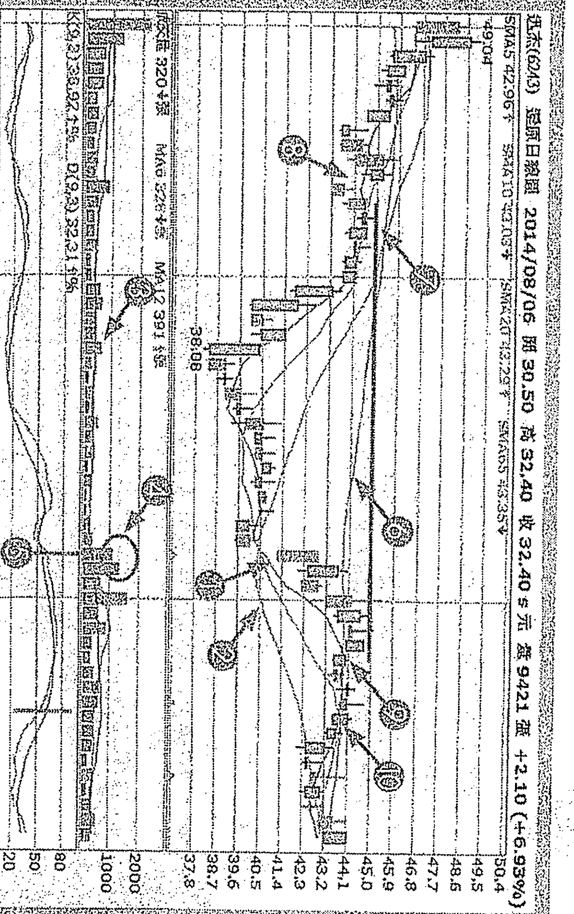

# Part 2 ▶ 5大實戰操作要點

① 遇到前高及缺口的壓力，出現黑K的下跌，跌破5日均線，表示遇壓要回檔。
② 再一次出現長黑跌破5日均線、10日均線及65日季線，KD指標死亡交叉空頭排列向下，同時也出現向下「頭頭低」的趨勢改變，短線操作要結束做多。

資料來源：臺灣50電子交易系統

# 宏泰2012/1/30，當天出現向上跳空大量長紅K線，以下是符合短線做多的條件：

① 向上跳空長紅K線實體棒，收盤突破頭肩底啟整高點，型態確認，同時「頭頭高、底底高」的多頭趨勢也確認。

② 均線3線向上多頭排列，股價實在3線之上。
③ 第一跌腳，12.8落底反彈，當天大空，多方後續反彈往上突破月線到前面高點，為多方強力反彈，然後高檔盤整，形成頭肩底型態。

④ 型態完成，多頭確認上攻連續攻擊大量。
⑤ KD指標黃金交叉多頭向上。

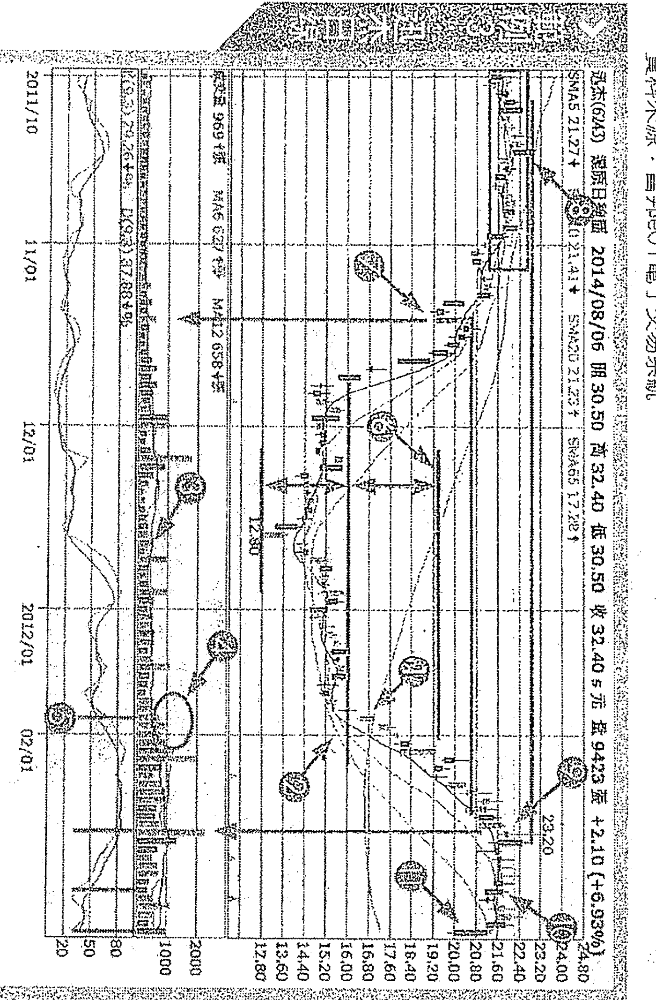

符合短線做多的條件之後，再往上會遇到哪些壓力；這些壓力都是可能的避開目標。
①頭肩底型態確認上漲的目標價的壓力。
②前面大量長紅K線及前面高點的壓力。
③盤整區的壓力。
由上面區域的壓力到目標來預估，上漲賣判空間，可以做短線操作獲利；
橫面量縮暴出：
④遇到前面盤整區的壓力，出現爆大量，長上影線的變盤線，要密切注意後面幾天的走勢。
⑤黑K線收盤股價整8天的K線，跌破5日、10日均線，遇區要回檔。
⑥再一次出現長黑跌破5日均線、10日均線及20日月線，KD指標死亡交叉空頭排列向下，結束短線做多操作。

# Part 2 ▶ 5大實戰操作秘訣

# 護盤SOP：

# 短線做空

均線操作股票，當股票的日線完成下列幾項條件時，可以短線做空：

# 1. 趨勢條件

日線波浪型態（趨勢）符合「頭頭低、底底低」的空頭架構。

# 2. 均線條件

日線的均線3線（MA5、MA10、MA20）空頭排列，均線向下（注意：季線如果還在股價下方，而且是上揚走勢，當股價下跌靠近時，會有支撐力量）。

# 3. 股價位置

股價收盤在3線（MA5、MA10、MA20）之下，同時看股價在整個下跌趨勢中，是位居初跌、主跌或末跌階段。

# 4. 成交量

頭部做頭時有大成交量（代表主力出貨），發動下跌向下的黑K線，出現中長黑K的實體棒，或向下跌空黑K的實體棒，有大量配合（當天成交量比前一日成交量增加1.2倍以上），下跌力道更強，沒有放量，仍然會下跌（空頭下跌，在起跌時因散戶還沒有警覺或抱著等上漲少賠再賣，量沒有放太大，但後續如再下跌，就容易出現恐慌性大量賣出）。

# 5. 指標參考

日線KD指標死叉向下，MACD指標空頭排列向下，OSC紅柱轉綠柱。

# 6. 可能的進利目標

- 下面季線、半年線、年線的支撐。
- 往下（由右向左看）轉折的高點（頭部）和低點（底部）的支撐。
- 往下盤整區支撐。
- 往下大量向上跳空形成缺口的支撐。
- 往下出大量的K線破壞後，再下跌時下面出大量的K線造成的支撐。
- 上漲趨勢形成的上升切線支撐。
- 如果是型態跌破後的下跌，型態的目標價滿足點也會形成支撐。

# 7. 等待進場位置

- 空頭反彈後再下跌的中長黑實體K線。
- 空頭跌破盤整下跳的中長黑實體K線。

# 穩穩做空區間最後

1. 空頭向下會遇到下面很多的支撐，短線操作先以靠近平價最迫的支撐，當作短期初步的獲利目標。
2. 空頭趨勢的特性為「見撐不是撐」，所以下跌到預定支撐時，要觀察K線的多空力量的變化，出現的K線是否有轉折的訊號，並且配合個人的操作紀律（例如做短線守5日均線）再決定是否回補，也可根據到達支撐時的獲利率，以及月線的乖離是否太大，決定是否要回補。（詳見〈步驟5：停利〉）
3. 日線短線合乎條件進場，獲利回補後，只要空頭走勢沒有改變，可以繼續做空，下跌一段之後，走勢合乎中長期條件時，可以改為中長期操作。
4. 在任何完美的條件進場，都有一定失敗機率，所以每次操作都要控制好風險，依據個人資金分配，考慮放空的數量和個人所能承擔的賠錢風險，設定萬一失敗停損的位置。（詳見〈步驟3：停損〉）

# 短線做空實戰範例

# 第2章 SOP：短線做空

智易（3596）2011/11/10，當天出現同向下跳空大量長黑K線，以下是符合短線做空的條件：①向下跌空長黑K線實體棒，收盤跌破前面低點，空頭的「頭頭低、底部低」的趨勢也確認。②均線3線向下空頭排列，股價在3線之下。③第一個頭：41.6創高，當天大量後回檔。④高檔放大大量長紅K線，在前高41.6之前放出大量，為關前大量，要密切注意，後續如果不能突破高點拉回，容易形成「頭頭低」的頸部。⑤KD指標空排列向下。⑥符合短線做空的條件之後，再往下會遇到剛剛支撐，這些支撐就是可能的洩離目標。⑦季線向上的支撐。⑧大量向上跳空缺口長紅K線的支撐。⑨雙腳打底的支撐。

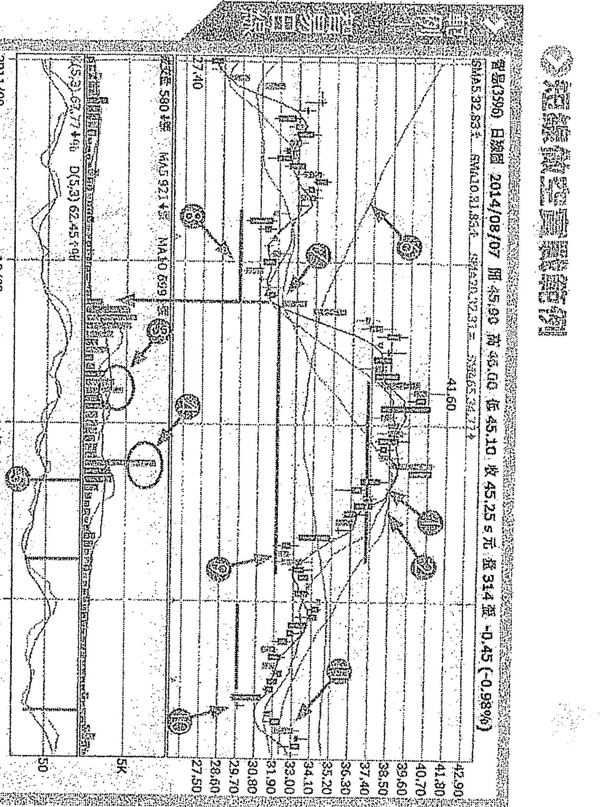

# Part 2 ▶ 5大買賣操作關鍵

由上面支撐的種類且標來預估，下面有著類似空間，可以做短線操作獲利，從面走勢結構累如下：
① 下跌遇到大量向上跳空墜長紅線的支撐，出現實體長紅K的反彈，表示買盤很強，同時KD指標黃金交叉向上，容易反強。
② 下跌遇到雙腳打底的支撐，出現止跌變盤線，次日開高跳空強力反彈，突破5日均線及10日均線，KD指標黃金交叉多頭排列。
③ 大量長紅下跌，收盤突破前一天高點，也突破月線，波段型態趨勢改變，停止操作。

資料來源：富邦e01 麗子交易系統

# 台積電 (2330) 2011/2/8，當空頭預期向下大量長黑K線，以下條件符合

① 向下長黑K線實體樁，收盤跌破前面低點，空頭的「頭頭低、底底低」的趨勢確認。
② 均線3線向下空頭排列，股價在3線之下。
③ 第一個頭，78.3劍高後，次2日大量向下跳空回檔。

# 短線做空的條件：

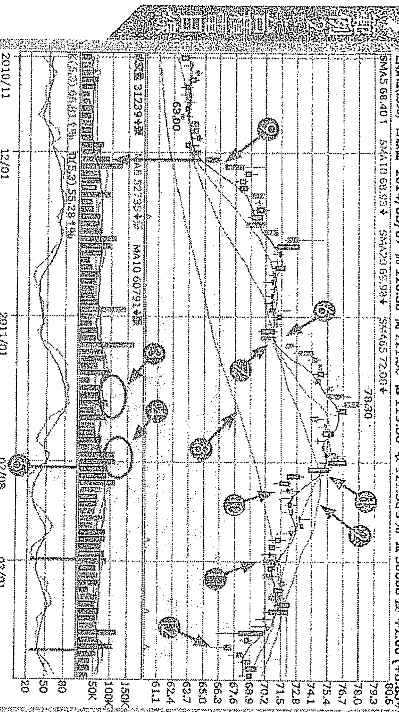

① 高檔道續2日放大量，股價不漲反跌，大量長黑K線向下，形成空頭的跟部。
② KD指標空排列下。
符合短線做空的條件之後，常常會遇到哪些支撐，這些支撐就是可能的獲利目標。
③ 大量向上跳空缺口支撐。
④ 轉折向上的低點支撐。
⑤ 零極向上的支撐。
⑥ 大量向上跳空缺口支撐。
由上面支撐的強烈且穩來預估，下跌有獲利空間，可以做短線操作獲利，從面走勢總果如下：
⑩ 下跌遇到大量向上跳空缺口長紅線的支撐，出現止跌反彈的變盤線，容易反彈。
⑪ 下跌遇到轉折向上的低點支撐，出現長紅吞噬反彈訊號，KD指標黃金交叉。
⑫ 下跌遇到大量向上跳空缺口長紅線的支撐，出現大量長下影線止跌反彈的變盤線；次日開高跳空向上反

# 靜鎢科（2454）2011/11/13，量天地板後三大量黑K線重疊而成一日紅K低點，以下是符合短線做空的條件：

① 向下大大量長黑K線覆體棒，量竄前一日紅K低點；收盤既破前面低點，空頭的「頭頭低、底底低」的趨勢確認。

② 均線3線向下空頭排列，股價在3線之下。

③ 第一個頭，348大量創高後，次2日長黑K線向下跳空回檔。

④ 高檔再放大大量，股價後續沒有再創348高點，形成價量背離，要密切注意當盤頭下跌跡的可能性能很高。

⑤ KD指標空掛向下。

符合短線做空的條件之後，哥往下看會遇到哪些支撐，這些支撐就是可能的獲利目標。

⑥ 季線向上的支撐。
⑦ 轉折向上的低點支撐。
⑧ 大量向上跳空缺口支撐。
⑨ 轉折向上的低點支撐。

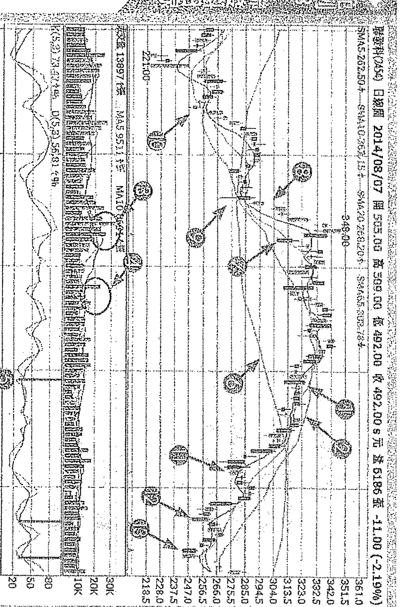

⑩ 轉折向上的低點支撐。
在上面支撐的震盪且熊市震盪往下，出現著...
⑪ 下跌遇到轉折向上的低點支撐，出現母子線抱止跌反彈的變盤訊號，容易反彈。
⑫ 下跌遇到轉折向上的低點支撐，出現長紅止跌反彈訊號，KD指標黃金交叉。
⑬ 下跌遇到轉折向上的低點支撐，出現長紅K線止跌反彈的訊號，次日開高映空向上反彈。
資料來源：富邦OI電子交易系統

# Part 2 ▷ 5大實戰妙訣

# 震盪突破SOP：
中線做多

中線操作股票，當股票的週線完成下列幾項條件時，可以中線做多：

+   1. 趨勢條件
週線波浪呈現（趨勢）符合「頭頭高、底底高」的多頭架構。
2. 均線條件
週線的均線3線（MA5、MA10、MA20）多頭排列，均線方向向上（注意：MA60如果還在股價上方，而且是下彎走勢，當股價上漲靠近時，會有壓力產生）。
3. 股價位置
股價收盤在週線的均線3線（MA5、MA10、MA20）之上，同時看股價在整個上漲趨勢中，是位居初升、主升或是末升階段。
4. 成交量
週線底部打底時有大成交量（代表有人在買），發動攻擊向向上漲的K線有攻擊量（當週成交量比前一週成交量增加1.2倍以上，如果有2倍以上的量，攻擊力道更強）。

# 5. 指標參考

週線KD 指標黃金交叉向上；MACD指標多頭排列向上，OSC綠柱轉紅柱。

# 6. 可能的爆利目標

+   • 上面MA60、MA125均線的壓力。
• 前面（由右向左看）轉折的低點（底部）和高點（頭部）的壓力。
• 前面盤整區壓力。
• 前面大量向下跳空，形成缺口的壓力。
• 前面出大量K線被跌破之後，再上漲時前面的出大量K線造成的壓力。
• 下跌趨勢形成的下跌切線壓力。
• 如果是型態突破後的上漲，型態的目標價滿足點也會形成壓力。

# 7. 準備進場位置

+   • 週線多頭回檔後再上漲的紅K，在日線進場。
• 週線多頭盤整突破上漲的紅K，在日線進場。（詳見〈步驟2：進場〉）

# 申線做多買點觀察

+   1. 多頭向上會遇到上面很多的壓力，中線操作先以靠近股價最近的壓力，當作短期初步的獲利目標。

+   2. 多頭趨勢的特性為「見壓不是壓」，所以上漲到預定壓力時，要觀察週K線多空力量的變化，出現的K線是否有轉折的訊號，並且配合個人操作紀律（例如做中短線守週MA5均線）再決定是否出場，也可以根據到達壓力時的獲利率，以及MA20均線的乖離是否太大，決定是否要出場。（詳見〈步驟5：停利〉）

+   3. 週線合乎條件進場，獲利出場後，只要多頭走勢沒有改變，可以繼續做多。

+   4. 週線底部合乎中期操作條件完成後，要回到日線，先依照短線操作方法進場操作，當獲利拉開成本區時，再用中長線方法操作。

+   5. 在任何完美的條件進場，都有一定失敗機率，所以每次操作都要控制好風險，依據個人資金分配，考慮買進的數量和個人所能承擔的賠償風險，設定萬一失敗停損的位置。（詳見〈步驟3：停損〉）

# ③ 中線做多 賣點驗證例

# 晶豪科（3006）2013/2/25，當週出現大量長紅K線，以下是符合中線做多的條件：

+   ① 長紅K線實體棒，收盤突破前面高點，波浪型態完成「頭頭高、底部高」的多頭趨勢。
② 均線3線向上多頭排列，股價在3線之上，並且也突破MA60。
③ 某一次見腳；18.5落底反彈，多方強力反彈到MA60才過壓拉回打第二隻腳，多頭確認上攻連續2天爆大量。
④ KD指標蓋全交叉向上。

符合中線做多條件之後，在這個線往上，會遇到哪些壓力，這些壓力就是中期走勢可能續判且觀察。

+   ⑤ 前面轉折高點的壓力。
⑥ 再往上前面轉折高點的壓力。
⑦ 上面盤整區的壓力。
⑧ 上面大量長紅K線的壓力。

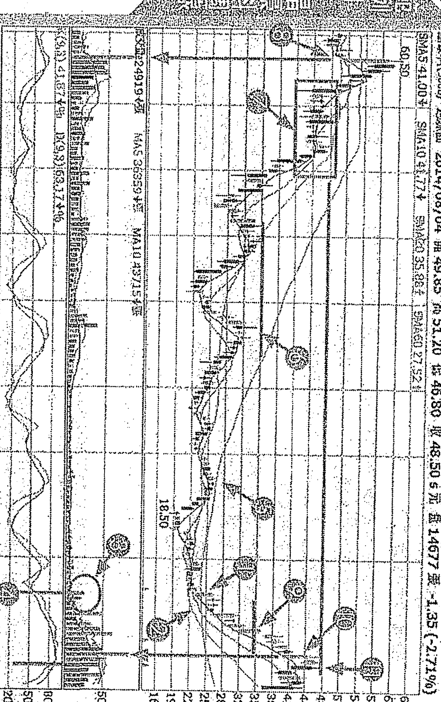

# Part 2 ▶5 大量當沖突破

在上面區域力的獲利且準備弱估，上漲有獲利空間，可以做中網操作獲利，後面走勢遵循如下：

+   ① 遇到前面兩個轉折高點的壓力，當週出現大量，長紅實體K線突破壓力，多頭強勢繼續上漲，且仍然繼續做多。
② 週線這幾週上漲13週，遇到整整區壓力，並且爆大量，要密切注意盤整
③ 週線高檔出現長黑K線，收盤跌破前一週的K線低點，既破MA5均線，顯示遇盤整區壓力要回檔。同時KD指標死叉又是空頭排列向下，後續長黑K跌破MA10，波浪型態出現「頭頭低、底底低」空頭趨勢，結果中線做多操作。
附註：這次上漲15週，將近4個月的多頭，可以稱為中期走勢。

資料來源：富邦e01電子交易系統

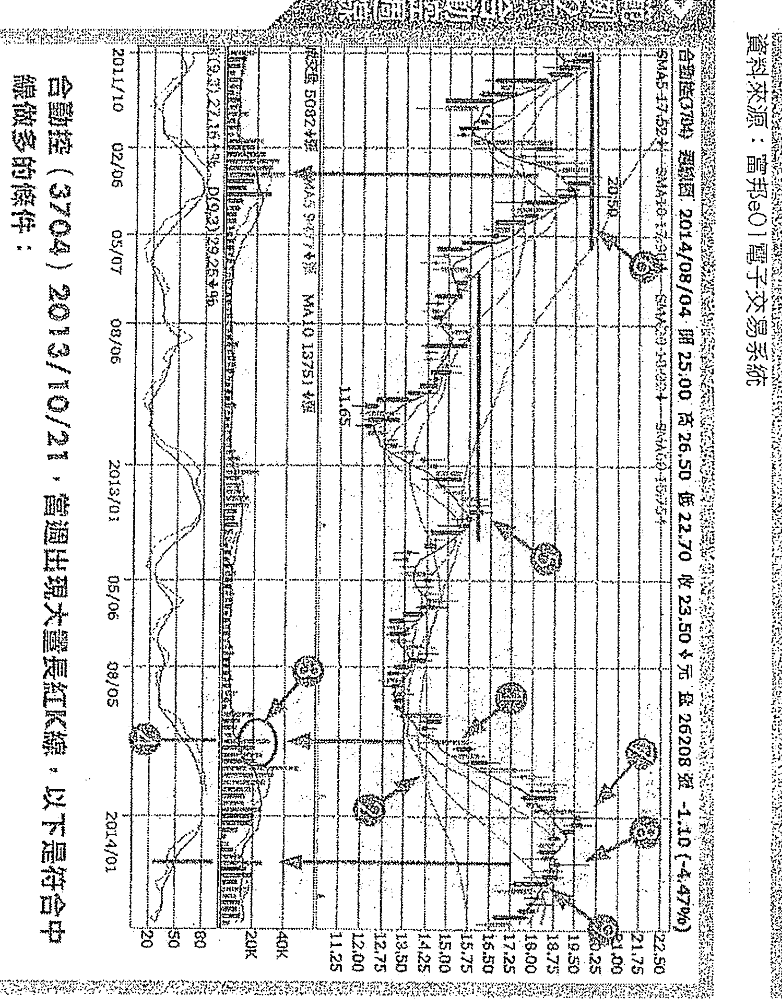

# 實戰案例

台動證（3704）2013/10/21，當週出現大量長紅K線，以下來是符合中價做多的條件：

① 長紅K線實體撐，收盤突破前面高點，波浪型態完成「頭頭高、底底高」的多頭趨勢。
② 均線3線向上多頭排列，股價在3線之上，並且也突破MA60。
③ 第一隻腳，11.65落底反彈，多方強力反彈到前面高點才遇壓拉回，打底整理，底部放大量上漲。
④ KD指標黃金交叉向上
符合中線做多的條件之後，有週線性上，機會遇到剛剛這些壓力，這些壓力都是中線走勢可能性的獲利目標。
⑤ 前面兩個轉折高點的壓力
⑥ 再往上前面大量轉折高點的壓力。
由上面區位的極利目標觀察預估，上漲有獲利空間，可以做中期操作獲利，後面差距結果如下：
⑦ 週線連續上升12週，遇到前面大量轉折高點的壓力，曾週出現十字黑K變盤線，同時有價量背離，要注意高檔遇壓的回檔修正。
⑧ 再次出現爆大量量的長上影線的變盤線，而且沒有h過上次變盤線的高點，同時KD指標空排向下，要密切注意股價不可再向下跌破。
⑨ 週線高檔出現搪簽黑k線，收盤既破前一週的K線低點，或破MA5、MA10、MA20均線，波浪型態出現「頭頭低、底底低」空頭趨勢，結束中線做多操作。
附註：這次上升浪12週，將近3個月的多頭，可以稱為中期走勢。

# 第3章 選股SOP：中線做多

① 週線回補後再連續上漲27週，高檔出現極大的長紅K線，遇到前面頭部壓力的壓力區，要密切注意股價不可往下。
② 週線高檔出現長黑K線，收盤站破前一週十字變盤K線的低點，也跌破MA5均線，週K區容易回檔。
附註：這次整個月上漲27週，超過半年的多頭，為中期案例。
參考來源：富邦601富邦文創案例

# 中線做空

# 波段SOP

線操作股票，當股票的週線完成下列幾項條件時，可以中線做空：

+   1. 趨勢條件
週線波浪型態（趨勢）符合「頭頭低、底底低」的空頭架構。

+   2. 均線條件
週線的均線3線（MA5、MA10、MA20）空頭排列，均線方向向下（注意：MA60如果還在股價下方，而且是上揚走勢，當股價下跌跌靠近平時，會有支撐作用）。

+   3. 股價位置
股價收盤在週線的均線3線（MA5、MA10、MA20）之下，同時看股價在整個下跌趨勢中，位居初跌、主跌或末跌階段。

+   4. 成交量
週線頭部盤頭時有大成交量（代表有人在賣），發動下跌向下的K線有放量（當週成交量比前一週成交量增加1.2倍以上，如果有2倍以上的量，下跌的力量更強），沒有放量也同樣會下跌。

# 5. 指標參考

週線KD指標死亡交叉向下，MACD指標要空頭排列向下，OSC紅柱轉綠柱。

# 6. 可能的進列目標

+   - 下面MA60、MA125均線的支撐。
- 前面（由右向左看）轉折的高點（頭部）和低點（底部）的支撐。
- 前面整區間支撐。
- 前面大量向上跳空，形成缺口的支撐。
- 前面出大量的K線被突破之後，再下跌時前面出大量的K線形成的支撐。
- 上漲趨勢形成的上升切線支撐。
- 如果是型態跌破後的下跌，型態的目標價滿足點也會形成支撐。

# 7. 等待進場位置

+   - 週線空頭反彈後再下跌的黑K，在日線進場。
- 週線在頭盤整跌破下呦的黑K，在日線進場。（詳見〈參考2：進場〉）

# 中線做空買點確認

+   1. 空頭向下會遇到下面很多的支撐，中線操作先以靠近日股價最近的支撐，當作短期初步的獲利目標。
2. 空頭趨勢的特性為「見撐不是撐」，所以下跌到預定支撐時，要觀察週K線的空力量變化，出現的K線是否轉折的訊號，並且配合個人的操作紀律（例如做中短線守週MA5均線）再決定是否出場，也可依據到達壓力時的獲利率，以及MA20均線的乖離是否太大，決定是否要出場。（詳見〈步驟5：停利〉）
3. 週線合乎條件進場，獲利出場後，只要空頭走勢沒有改變，可以繼續做空。
4. 過線頭部合乎中期操作條件完成後，要回到日線，先依循短線操作方法進場操作，當獲利已經拉開成本區間時，再用中長線方法操作。
5. 在任何完美的條件進場，都有一定的失敗機率，所以每次操作部都要控制好風險，依據個人資金分配，考慮買進的數量和個人所能承擔的賠錢風險，設定頹一失敗停損的位置。（詳見〈步驟3：停損〉）

# 中線做空賣點範例

# 台聚(1304) 1997/4/28，當週出現長黑K線，以下是符合中線做空的條件：

①長黑K線噴出檔，收盤跌破前5週的低點，頭部放大量，波浪型態完成成「頭頂低、底低低」的空頭趨勢。②均線3線向下空頭排列，股價在3線之下。③頭部反轉，空方連續下跌，空頭確認且連續高檔爆大量。④KD指標死亡交叉向下。符合中線做空的條件之後，在週線向下，會遇到哪些支撐，這些支撐是中長期走勢可能的強弱關鍵。⑤週MA60站破線向上的支撐。⑥再往下轉折高點的支撐。⑦再往下轉折高點的支撐。⑧再往下轉折低點的支撐。

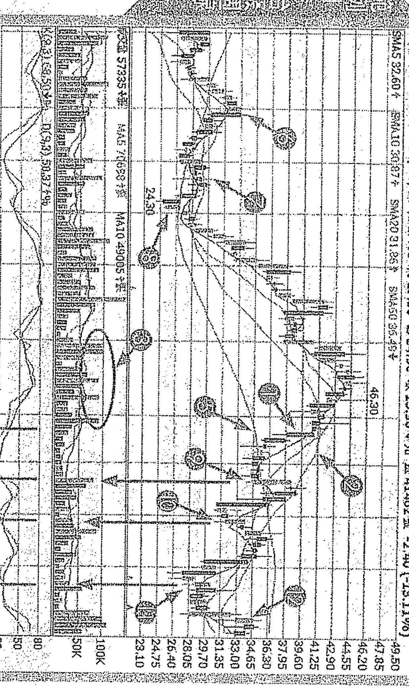

# 由上面突破的獲利目標來預估，下跌有獲利賣點，可以做中期操作獲利，後面走勢結果如下：

+   ① 週線由最高點連續下跌5週，遇到週MA60均線向上的支撐，反前轉折高點的支撐，當週出現大量長紅K線反彈。
② 週線反彈後再連續下跌3週，遇到前轉折高點的支撐，出現大量紅K線反彈。
③ 週線反彈後再連續下跌6週，遇到前面轉折低點的支撐，出現大量紅K線反彈。

週線低檔出現大量長紅K線，同時打開底部向上突破前面高點，完成「底部高、頭頂高」多頭趨勢，結束空頭操作。
附註：這次空頭趨勢下跌超過半年，為中期空頭走勢。

資料來源：雷科技01電子交易系統

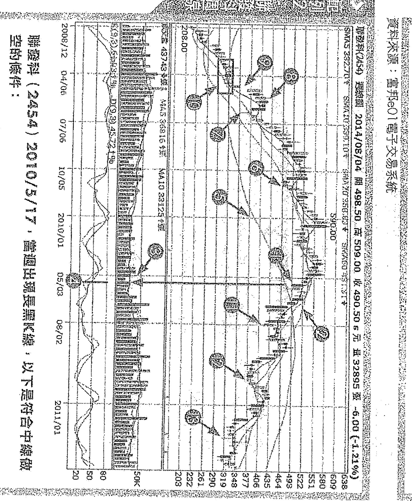

① 大量長黑K線實體棒，收盤跌破前面低點，波浪型態完成「頭頭低、底低」的空頭趨勢。 ② 均線3線向下空頭排列，股價在3線之下。 ③ 頭部盤長期長時期價量背離，長黑K線下跌放大量。 ④ KD指標死亡交叉向下。 符合中線做空的條件之後，在週線往下，會會遇到哪些支撐，這些支撐就是中期走勢可能的減價且標。 ⑤ 週MA60均線向上的支撐。 ⑥ 再往下轉折低點的支撐。 ⑦ 再往下轉折低點的支撐。 ⑧ 再往下轉折高點的支撐。 ⑨ 再往下大盤跳空缺口的支撐。 ⑩ 再往下5週盤整的支撐。 由上面支撐的跌勢且標來預估，下跌常獲利空間，可以做中弱操作獲利， 從面走勢結果如下： ① 週線反彈後再連續下跌3週，前面轉折高點的支撐，出現盤整。 ② 週線反彈後再連續下跌9週，遇到前面轉折低點及跳空缺口的支撐，出現大量紅K線反彈。 ③ 週線反彈後再連續下跌9週，遇到前面盤整的支撐，出現止跌的橫盤。 週線空頭趨勢尚末結束，後續仍繼續空頭操作。 附註：這次空頭趨勢下跌超過半年，為中期空頭走勢。

# Part 2 ▶ 5大實戰法則

# 實戰技巧

台塑電(2330) 2003/10/20，當週出現長黑K線，以下是符合中線做空的條件：
① 大量長黑K線賣壓轉，收盤跌破前面低點，波浪型態完成「頭頭低、底底低」的空頭趨勢，KD指標死亡交叉向下，但是股價仍在MA20均線上方，不符合中線做空，只可以回到日線做短空。
② 大量長黑K線賣壓轉，收盤跌破前面低點，均線3線向下空頭排列，股價在3線之下，符合中線做空的條件，可以做中期空頭操作。
③ KD指標死亡交叉向下。

符合中線做空的條件之後，在週線下，會會遇到哪些支撐，這些支撐是中領走勢可能的發展利且標。
④ 往下盤整區的支撐。
⑤ 週MA60均線向上的支撐。
⑥ 再往下大量長紅K線的支撐。
⑦ 再往下轉折低點的支撐。

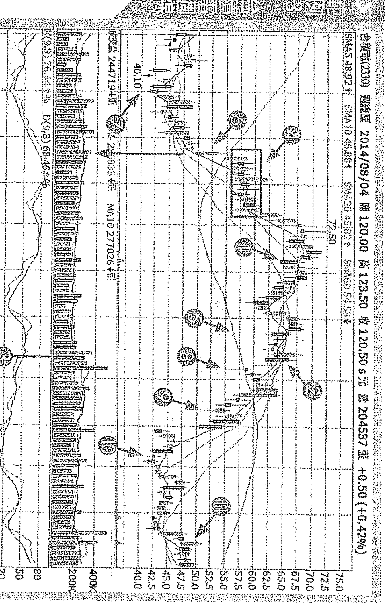

由上面支撐的壓力判斷且標來預估，下跌有適別空間，可以做中線買賣作為避利，後面走勢預測如下：
⑬ 週線下跌趨勢到MA60均線及前面盤整區的支持，出現反彈。
⑭ 週線反彈後再下跌4週，遇到大量長紅K線的支持，出現反彈。
⑮ 週線反彈後再下跌，遇到轉折低點的支持，出現止跌打底。
⑯ 週線大量長紅K線上漲，完成長「頭頭高、底底高」多頭趨勢，空頭趨勢結束，停止空頭操作。
附註：避免週趨勢下跌跌破半年，為中期空頭走勢。
資料來源：富邦01電子交易系統

# Part 2▶5大買賣點總複

# 績效SOP：
長線做多

長線操作股票，當股票的月線完成下列幾項條件時，可以長線做多：

# 1. 趨勢條件

月線價量要有下列條件之一：

+   ◎ 月線底部出現長紅K線實體棒，同時要放大量，突破下降切線（此時週線要符合中線做多條件）。

+   ◎ 月線底部打底盤整，出現底部高長紅K線實體棒，同時要放大量（此時週線要符合中線做多條件）。

+   ◎ 月線底部完成「頭頭高、底底高」多頭趨勢，同時底部要放大量。

# 2. 均線條件

月線的均線至少要2線（MA5、MA10）多頭排列，均線方向向上（注意：MA20、MA60如果還在股價上方，而且是下

彎走勢，當股價上漲靠近時，會有壓力產生。
3. 股價位置
股價收盤要在月線的均線2線（MA5、MA10）之上，同時要看股價在整個上漲趨勢中，是位居初升、主升或末升階段。
4. 成交量
月線底部打底時要有大成交量（代表有人在買），發動攻擊向上上漲的K線要有攻擊量（當月成交量比前一月成交量增加1.5倍以上，如果有2倍以上的量，攻擊力道更強）。
5. 指標參考
月KD指標黃金交叉向上，MACD指標多頭排列向上，OSC線柱轉紅柱。
6. 目標設定
MA20、MA60均線壓力、前面頭部壓力、前面盤整區壓力、前面大量K線壓力、前面大量缺口壓力、型態目標價。
7. 等待進場位置
週線多頭回檔後再上漲的大量中長紅K。
週線多頭盤整突破上漲的大量中長紅K。（詳見〈步驟2：進場〉）
⑦ 黑線微量震盪策略
1. 多頭向上會遇到上面很多的壓力，長線操作先以靠近股價最的壓力，當作短期初步的獲利目標。

# Part 2 ▶ 5大買賣訣竅

2. 多頭趨勢的特性為「見壓不是壓」，所以上漲到預定壓力時，要觀察週K線多空力量的變化，出現的K線是否轉折的訊號，並且配合個人的操作紀律（例如做長線守週MA20均線）再決定是否出場，也可以根據到達壓力時的獲利率，以及MA20均線的乖離是否太大，決定是否要出場。（詳見〈步驟5：停利〉）

3. 週線合乎條件進場，獲利出場後，只要多頭走勢沒有改變，可以繼續做多。

4. 月線底部合乎做長期操作條件完成後，要回到週線，先依照中線操作方法進場操作，當獲利已經拉開成本區時，再用長線方法操作。

5. 任何完美的條件進場，都有一定失敗機率，所以每次操作都要控制好風險，依據個人資金分配，考慮買進的數量和個人所能承擔的賠償風險，設定萬一失敗停損的位置。（詳見〈步驟3：停損〉）

# 長線做多實戰範例

四組(354) 月線 2014/06/03 開 114.00 高 141.50 收 141.00 5元 量 14039 張 +25.50 (+22.08%) SMA5 32.36 SMA10 32.43 SMA20 21.34 SMA60 32.62

PXE 6145 檔 MA5 2197.72 MA10 1617.98

◎ 西柏（3541）2013/11，月K線長紅，底部「頭頭高、底底高」，多頭確認。

◎ MA5、MA10、MA20均線；3線多頭排列向上。

◎ 成交量放大6倍，出現底部攻擊量。

◎ 長紅K線突破2年9個月新高。

◎ MACD指標零軸之上黃金交叉向上。

◎ KD指標黃金交叉向上。

月線島成成長波段條件，回到趨勢線操作，長波段的中線操作可用5週均線操作，長波段的長線操作可用20週均線操作。

資料來源：富邦e01電子交易系統

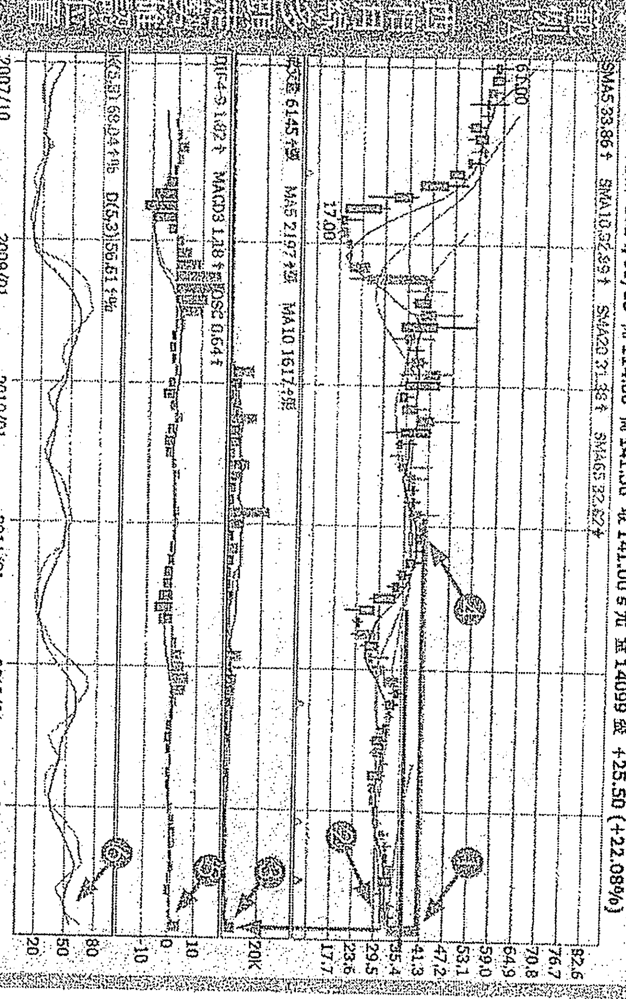

# Part 2 ► 5、大買點判斷

# 買點判斷關鍵

西柏(341) 週線圖 2014/06/16 週 119.00 前 141.50 價 119.00 收 141.00 5元 委 8213 張 +23.00 (+19.49%) SMA5 36.34… SMA10 24.37… SMA20 23.02… SMA60 31.31…

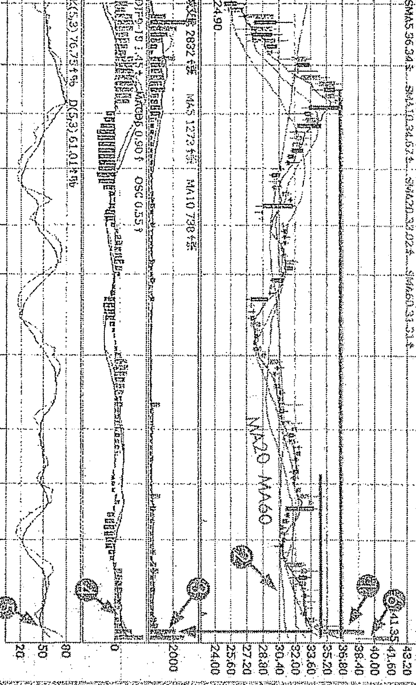

① 西柏2013/11/18，週K線長紅，底部出現「頭頭高、底底高」，多頭確認。

+   ② MA5、MA10、MA20、MA60均線，4線多頭排列向上。
③ 成交量放大4倍，出現底部攻擊量。
④ MACD指標零軸之上黃金交叉向上。
⑤ KD指標黃金交叉向上。
⑥ 2013/11/25，週線大量上漲，月線多頭確認，週線收盤41.35買進，停損守MA5均線36.34（中線操作守MA5週均線操作）。

資料來源：富邦eO1電子交易系統

# 選股SOP：長線做多

西柏(3541) 週線 2014/09/16 開 119.00 高 141.50 低 119.00 收 141.00 & 元 量 8213 量 +23.00 (+19.49%)
5MA5:327-80+/-5MA10:108.62+/-5MA20:129.9? %?+/-5MA60:50.20
成交 8213 檔  MA5 5720? 挺  MA10 4646? 挺
K(5,2) 80.01?%, D(6,3) 77.42%?
③ 西柏2013/11/25~29，週K線大<|message|> 上漲，月線多頭確認，週線收盤 41.35買進，停損守MA5均線36.34。
② 2014/1/13，黑K收盤跌破MA5，收盤47.9賣出。獲利47.9-41.35=6.55，獲利率15.8%
① 2014/2/5，大量長紅上漲，週線收盤57買進，停損守MA5均線 49.99。
② 2014/4/28，收盤跌破MA5；收盤93.9賣出。獲利93.9-57=36.9，獲利率64.7%
③ 2014/5/5，紅K上漲，突破MA5均線，週線收盤99.4買進，停損守MA5均線95。

資料來源：寶菲501電子交易系統

# Part 2 5大買點操作要訣

# 買點操作要訣

台塑（8076）2013/4，月K線長紅，底部「頭頭高、底底高」，多頭確認。
① MA5、MA10、MA20均線，3線多頭排列向上。
② 成交量放大3倍，出現底部攻擊量。
③ MACD指標0軸之上黃金交叉向上。
④ KD指標向上。
⑤ 2013/8，大量長紅K線突破26個月新高。
月線完成長波段條件，回到底部操作，長波段中線操作可用5週均線操作，長波段反彈線操作可用20週均線操作。

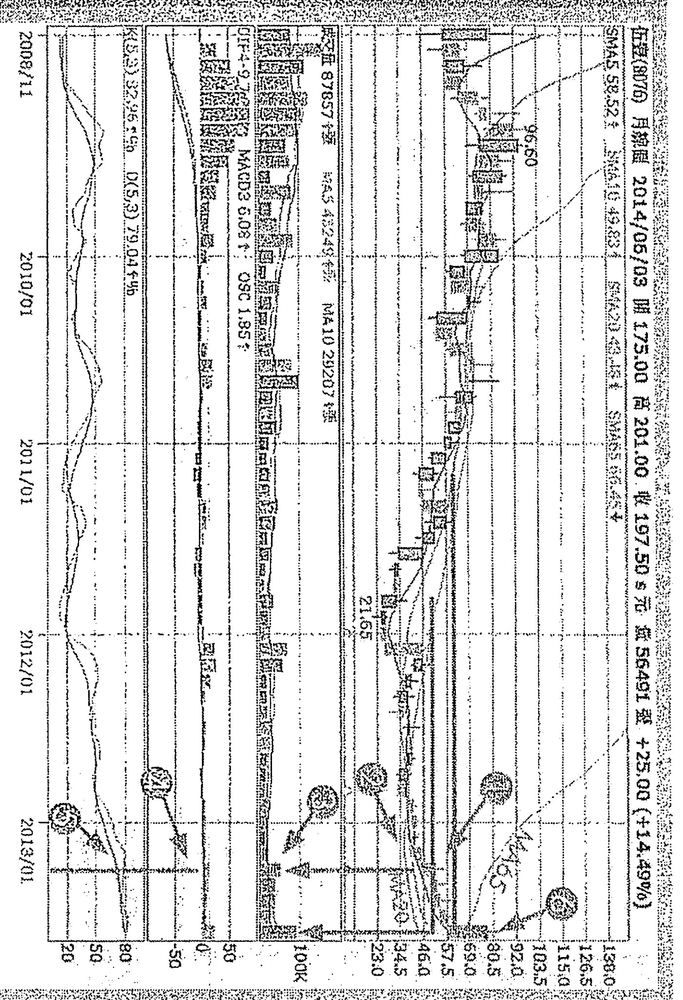

# 第5章 選股SOP：長線做多

資料來源：富邦e投電子交易系統

任豐2013/3/25，週K線大量長紅，突破底部盤整高點，多頭確認。MA5、MA10、MA20、MA60均線，4線多頭排列向上，週線均可以開始做多。

2013/4/29，月線多頭確認，週線高檔積疊，做長波段週線進場要等多頭再改的位置。

2013/6/3，週K線大量長紅，突破5週盤整高點，可以做為長波段的進場點。

2013/7/22，週線回檔後大量上漲，長多趨勢，接近MA20均線，可做為加碼點。

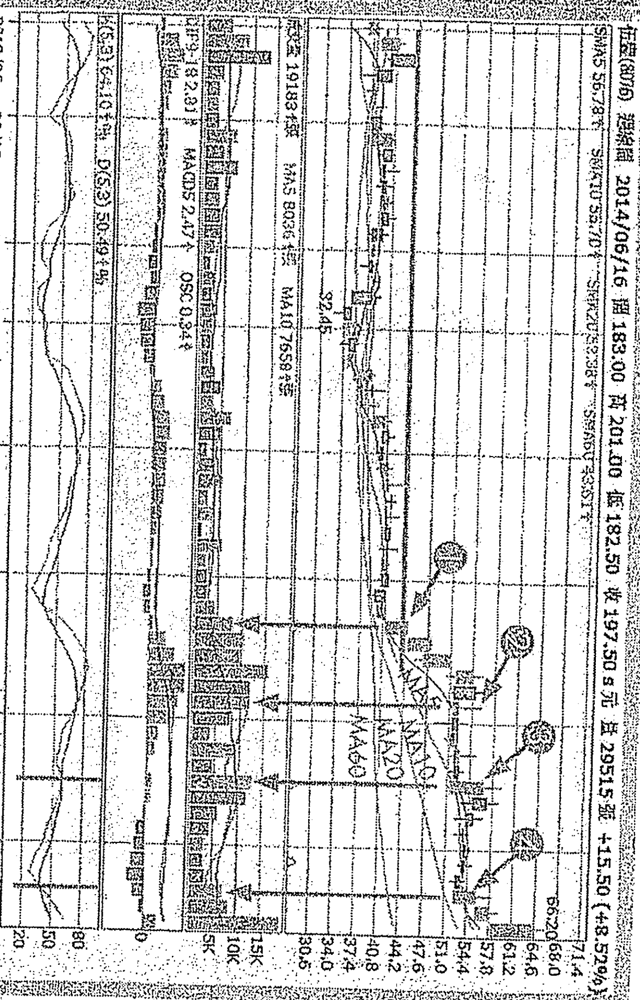

# Part 2 ▶ 5大實戰操作策略

# 實戰案例觀察筆記

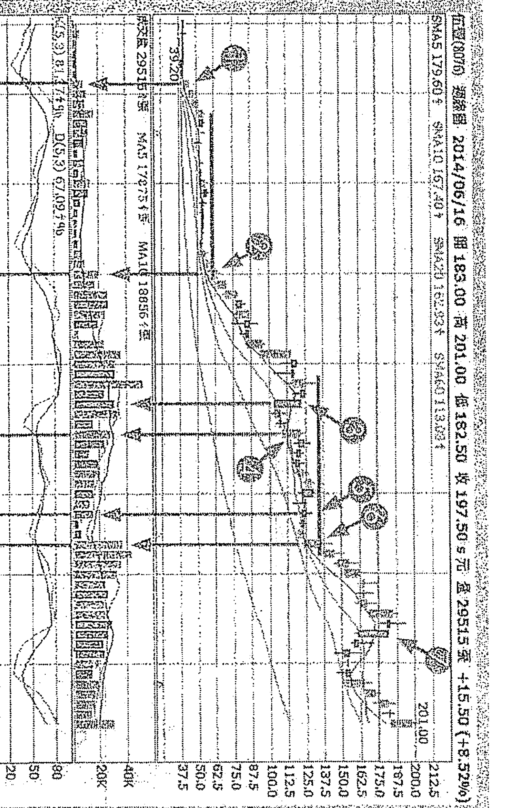

① 在區 2013/3/25~29，週K線大量長紅，突破底部盤整暨高點，多頭確立。 MA5、MA10、MA20、MA60均線，4線多頭排列向上，KD指標黃金交叉向上，週線可以開始做中多；收盤44.45買進，停損MA5均線 41.32。

② 2013/6/3，週K線大量長紅，突破盤整，可做長波段的進場點。如果在這位置進場做長波段，守MA20週均線操作；做中波段可以加碼。

③ 2013/11/4，週K線大量長黑，跌破MA5、MA10均線，收盤103.5賣出。獲利103.5－44.45＝59.05，獲利率132.8%。

④ 2013/11/25，週線回檔後大量上漲，長多續勢，收盤121.5買進，停損MA5均線112.5。

⑤ 2014/1/20，週K線大量黑K，跌破MA5均線，收盤122.5賣出。獲利122.5－121.5＝1，獲利率0.8%。

⑥ 2014/2/10，大量長紅突破盤整，站上MA5，收盤136買進，停損MA5均線125.4。

⑦ 2014/4/14，週K線大量長黑，跌破MA5、MA10均線，收盤161賣出。獲利161－136＝25，獲利率18.3%。

資料來源：富邦e01電子交易系統

# 富晶通（3623）2013/5，月K線長紅，底部「頭頭高、底底高」，多頭確立。

+   ① MA5、MA10均線，2線多頭排列向上。
② 成交量放大4.7倍，出現底部攻擊量。
③ MACD指標在0軸之上，多排列向上。
④ KD指標向上
⑤ 2013/11，紅K線收盤突破長期21個月底部高點。
⑥ MA5、MA10、MA20均線，3線完成多頭排列向上。
⑦ 成交量放大2倍，出現多頭上升攻擊量。
⑧ MACD指標在0軸之上，多排列向上。
⑨ KD指標向上。

且偏多反彈探低條件，回測週線操作，震盪段中檔操作可再用5週均線檔操作，長波段長線操作可用20週均線操作。

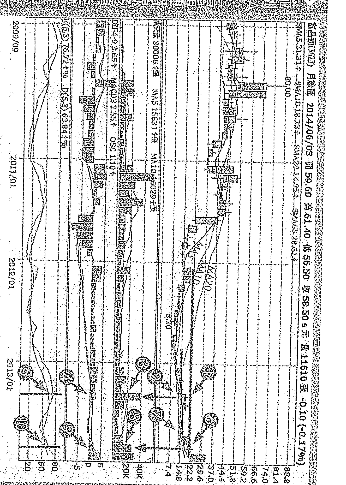

# 選擇SOP：長線做空

長線操作股票，當股票的月線完成下列幾項條件時，可以長線做空：

# 1. 轉折條件：

月線價量要有下列條件之一：
● 月線頭部出現長黑K線實體棒，同時放大量，跌破上升切線（此時週線要符合中線做空條件）。

● 月線頭部做弱盤整，出現頭頭低長黑K線實體棒，同時放大量（此時週線要符合中線做空條件）。

● 月線頭部完成「頭頭低、底底低」空頭趨勢，同時頭部放大量。
2. 均線條件
月線的均線至少有2線（MA5、MA10）至頭排列，均線向下跌（注意：MA20、MA60如果還在股價下方，而且是上揚走

# Part 2 ▶ 大買點判斷

勢，當股價下跌靠近時，會有支撐產生。

# 3. 股價位置

股價收盤在月線的均線2線（MA5、MA10）之下，同時看股價在整個下跌趨勢中，是位居初跌、主跌或末跌階段。

# 4. 成交量

月線頭部做頭時有大成交量（代表有人在賣），發動攻擊向下下跌的K線不一定有大量。

# 5. 指標參考

月KD指標死亡交叉向下，MACD指標空頭排列向下，OSC紅柱轉綠柱。

# 6. 目標設定

MA20、MA60均線支撐、前面頭部支撐、前面盤整區支撐、前面大量K線支撐、前面大量缺口支撐、型態目標價。

# 7. 等待進場位置

◎ 週線空頭反彈後再下跌的中長黑K。
◎ 週線空頭盤整跌破下跌的大量中長黑K。（詳見〈步驟2：進場〉）

# ◎ 破線做空買點觀察

+   1. 空頭向下會遇到下面很多的支撐，長線操作先以靠近股價最短的支撐，當作短期初步的獲利目標。
2. 空頭趨勢的特性為「見撐不見撐」，所以下跌到預定支撐

時，要觀察週K線的多空力量的變化，出現的K線是否有轉折的訊號，並且配合個人的操作紀律（例如做長線守週MA20均線）再決定是否出場，也可以根據達到支撐時的獲利率，以及MA20均線的乖離是否太大，決定是否要出場。（詳見〈步驟5：停利〉）3. 迴補合乎條件進場，獲利出場後，只要空頭走勢沒有改變，可以繼續做空。4. 月線頭部合乎長期操作條件完成後，要回到週線，先依照中線操作方法進場操作，當獲利已經拉開成本區時，再用長線方法操作。5. 在任何完美的條件進場，都有一定的失敗機率，所以每次操作都要控制好風險，依據個人資金分配，考慮買進的數量和個入所能承擔的賠錢風險，設定專一失敗停損的位置。（詳見〈步驟3：停損〉）

# Part 2 ▶ 5 大實戰操作要訣

# ①長線領空實戰範例

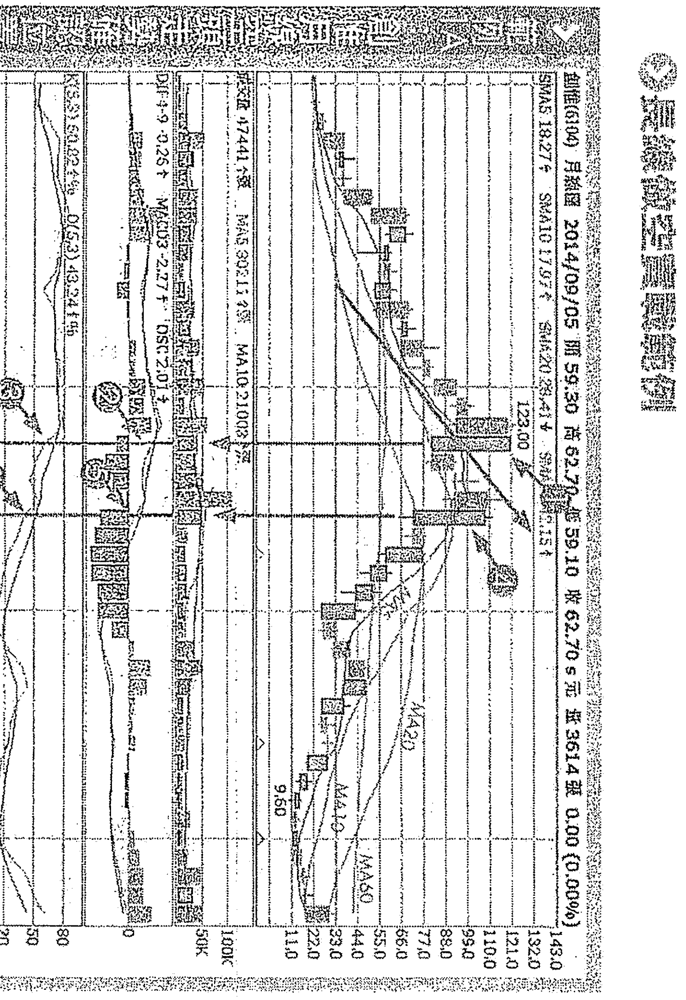

創惟（6104）2007/4，月K線長黑吞噬，跌破連續上漲7個月的上升切線。

+   ① MACD指標在0軸之上，死亡交叉向下。
② KD指標80死亡交叉向下，月線回檔訊號，可看週線條件做中空。
③ 2007/8，月K線長黑吞噬，頭部「頭頭低、底底低」，空頭確認。
④ MACD指標在0軸之上，空頭排列向下。
⑤ KD指標空頭排列向下。

另線完成長波段條件，回到週線操作，長波段中線操作可用5週均線操作
作，長波段長線操作可用20週均線操作。

資料來源：富邦e01電子交易系統

# 選股SOP：長線做空

# 創業板指數

資料來源：富邦F01電子交易系統

① 創佳2007/7/30，週K線大重量長黑吞噬，出現高檔「頭肩頂」，即將倒
線，且另線下彎。

② MACD指標在接近0軸，即將死生交叉。

③ KD指標死亡交叉向下，週線進入盤頭。

④ 2007/8/13，週線大重量長黑，跌破回檔低點，空頭確立。同時週線出
現一星二陰K線組合，續勢下跌，日線可以做空。

⑤ 2007/8/27，月線大重量長黑K線亞頂確認，但是週線是空頭的盤整，要
等週線盤整跌破時才能進場做長空。

⑥ 2007/10/22，週線盤整跌破，空頭續勢。MA5、MA10、MA20、MA60均線，4線空頭排列向下。MACD指標線在0軸之邊，空頭排列向下。KD指標向下。週線可以開始做長空。

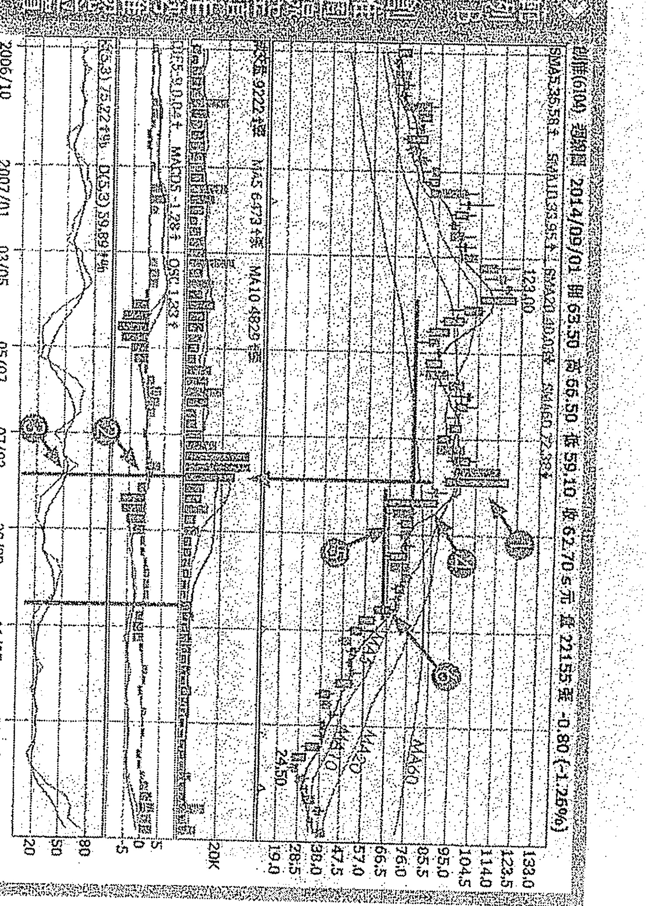

# 找出潜力强势股
留意顶部：

面几章所列的短中长线选股条件，是做多或做空的基本条件。基本条件不足的股票，最好要忍住，不要太早进场，否则失败的机率很高。

除此之外，经由底部或头部形成的型态或多空的力道表现，也可以推测未来走势确认之后的强弱。我们在锁股观察时可以注意下面几个型态或反转的现象，藉以发觉未来的潜力股。

# 留意底部翻多型态的强弱座

# 留意底部期间，出现大量的买盘，底部多头确认时，放大量突破，为强势上涨潜力股（出现过连续走高）。

底部转折前有2个月以上的均线纠结型态，当均线纠结底部出现大量突破，为强势上涨潜力股（出现在过线的均线纠结更好）。

# 第7章 選股秘訣：找出潛力強勢股

資料來源：富邦OI電子交易系統

力旺（3529），週線底部盤整期間出現大量。
① 大量長紅突破盤整往上漲，一路強勢上漲到396元。

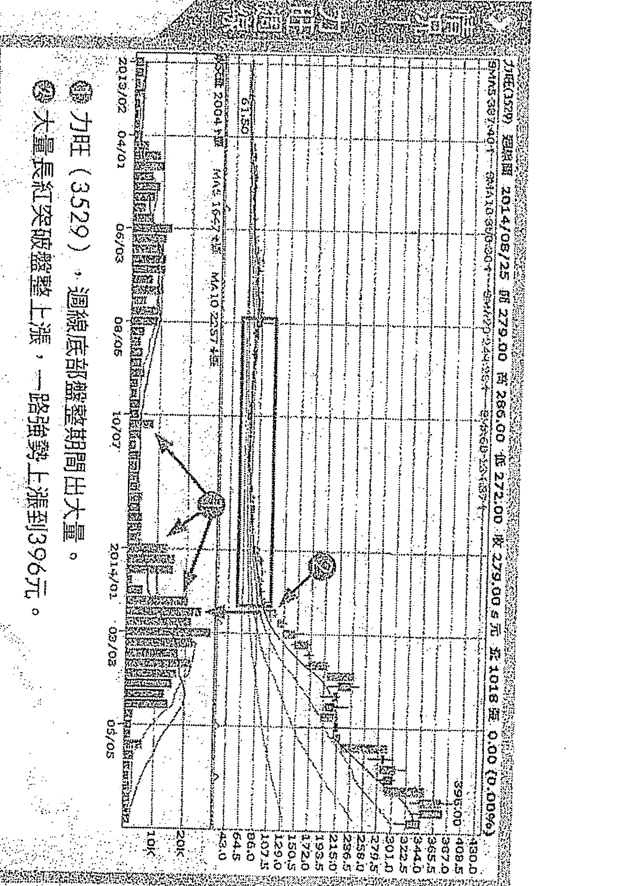

資料來源：富邦OI電子交易系統

F-永晝（1589），週線底部盤整9個月的均線糾結，盤整期間出一些章
① 盤大量。
② 連續3天大量長紅突破盤整往上漲，一路強勢上漲到166.5元。

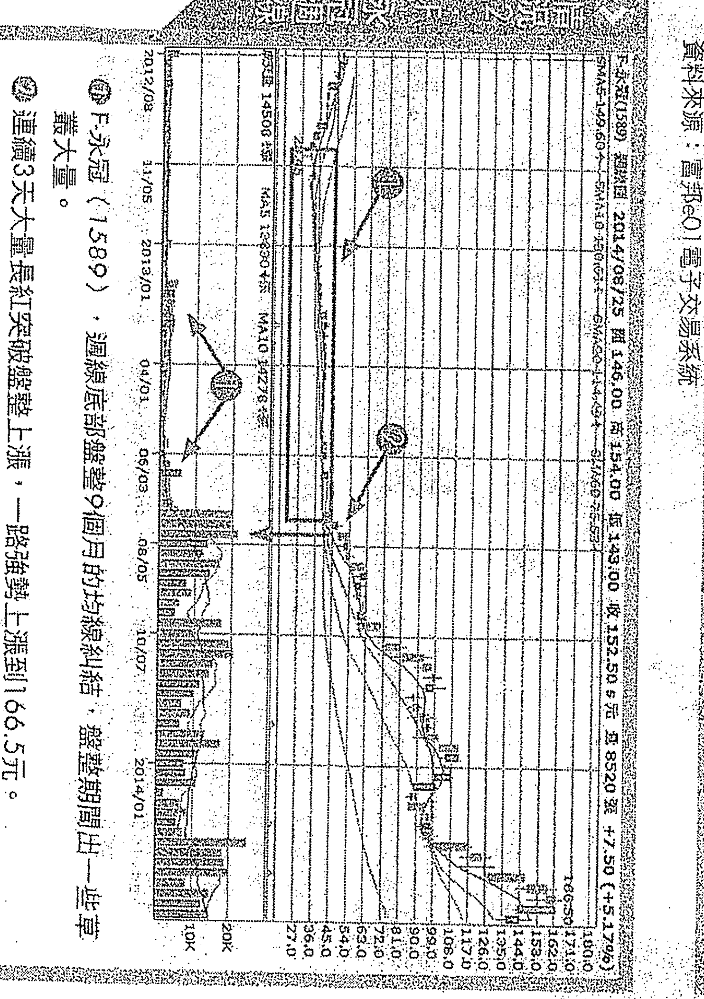

107

# Part 2 ▶ 5大實戰操作

# 操作重點

底部轉折低點出現大量連三紅，或是上漲3天出現2次跳空缺口快速上漲，後續完成多頭底部，為強勢上漲的潛力股。

# 圖形解說

強力反彈後回檔不到反彈幅度的三分之一，就轉折上漲完成「頭頭高、底底高」的多頭確認，為強勢上漲的潛力股。

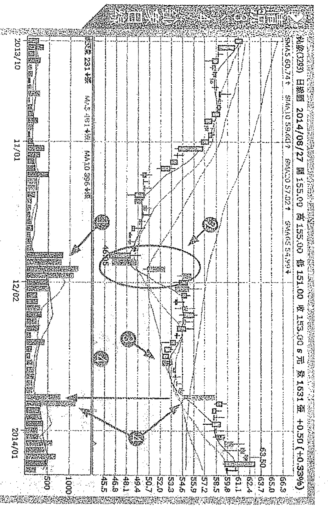

鴻海 (3293)，日線最低點大量反彈。

+   ① 反彈連續3天大量長紅跳空上漲，落底第一隻腳。
② 回檔幅度約三分之一就出現止跌的紅K線，後續上漲出現底底高的打底
③ 第一隻腳。
④ 打底時再出現大量長紅K線，突破盤整高點，多頭「底底高、頭頭高」確認，為強勢多頭底部，突破時股價收盤58.3元，後來一路漲到175.5元。

資料來源：臺邦e01電子交易系統

# 第七章 選股秘笈：找出潛力強強勢股

資料來源：富邦e01電子交易系統

# 旭富(4119)；日線圖 2014/08/28 周收65.50 昨收68.50 今收67.60 盤中67.70 ±元 委252張 -0.90(-0.44%) SMA5 65.34 * SMA10 67.27 * SMA20 65.16 * SMA65 65.08 * 成交 535 塊 MA5 050均 MA10 115均 2007/12 02/01 03/03 04/01 05/02 1000 2000 40.3 43.4 46.5 19.6 52.7 55.8 58.9 62.0 65.1 68.2 71.3 74.4 77.5 80.6 83.7 86.8 89.9 93.0 96.1 92.50

◎ 旭富（4119）：日線量最低點大Ted反彈，3日K線為一星二陽向上的轉折 副號。

① 遵循反彈5天，大量長紅跳空上漲，落底第一套腳。

② 回檔幅度約三分之一就出現止跌的紅K線，後續上漲出現底底高的打底 第二套腳。

③ 打底時再出現大量跳空上漲K線，突破回檔ABC修正的下降切線。

④ 大量上漲紅K線，突破前面高點，多頭「底底高、頭頭高」確認，為強勢多頭底部，股價最低42.1元反彈回升，後來一路上升到92.5元。

# Part 2 ▶ 5大買點突破

# 圖9.3 底部為頭肩底、復式頭肩底、圓弧底、三重底、下降楔型等型態，大量突破完成或確認的底部，為強勢上漲的潛力股。

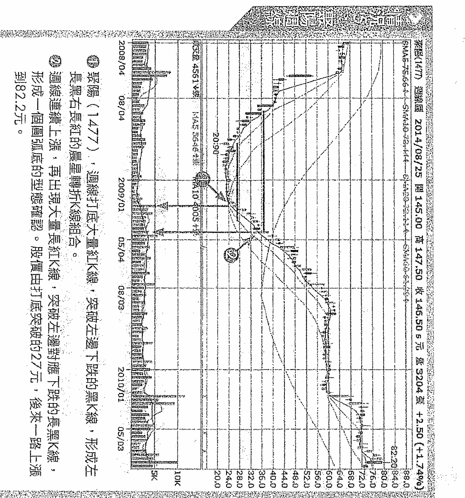

資料來源：富邦e0 集中交易系統

① 究陽（1477），週線打底大量紅K線，突破在左邊下跌的黑K線，形成左長黑右長紅的雙重轉折K線組合。 ② 週線繼續上漲，再出現大量長紅K線，突破在左邊對應下跌的長黑K線，形成一個圓弧底的型態確認。股價由打底突破的27元，後來一路上漲到82.2元。

# 第七章 選股秘笈：找出潛力強勢股

底部出現2次以上大量轉折向上的K線組合型態，例如：長紅吞噬、孤島轉折、晨星轉折、內因三紅、跳缺回補、上升三法、一星二陽等的組合，為強勢上漲的潛力股（上紋轉折向上的K線組合，參見《抓住K線獲利無限》）。

◎圓檔（2505），週線最低點大量反彈，3日K線為內因三紅K線組合的向上轉折訊號，落底第一隻腳。 ◎回檔1天就出現長紅吞噬K線，再形成晨星轉折K線組合的向上轉折訊號，出現底部高於第二支腳。 ◎再出現大量長紅K線上漲，突破前面高點，多頭「底部底高、頭頭高」確認，為強勢多頭底部，股價最低12.65元反彈回升，後來一路上漲到33.45元。

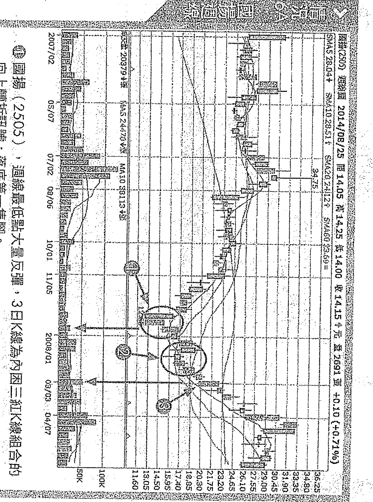

資料來源：富邦eT當子交易系統

# 第七章 選股祕笈：找出潛力強勢股

# ⑦ 多頭結束當空頭的開始：頭部雙重頭

確認原則 盤頭期間，出現大量的出貨賣壓，頭部空頭確認，為弱勢下跌潛力股（出現在週線更好）。

⑥ 日勝生（2547），週線頭部盤整期間，每個高點都出大量。

⑦ 長黑K線跌破頭部盤整底部，一路弱勢下跌到9.75元。長黑K線下跌時，沒有爆大量也一樣會下跌，因為：

+   ○ 空頭趨弱確認，趨勢就是力量。
○ 頭部盤整期間的大量委縮，後來都被跌破，這些大量成為下跌的壓力。
○ 頭部大量下跌，這些大量為主力的出貨量，主力手中的股票賣出之後，股價自然會跌。有時空頭剛開始時，或仍還不自覺或短線追買，漲的希望而沒賣出，所以不一定會出大量。

資料來源：雷尹e01電子交易系統

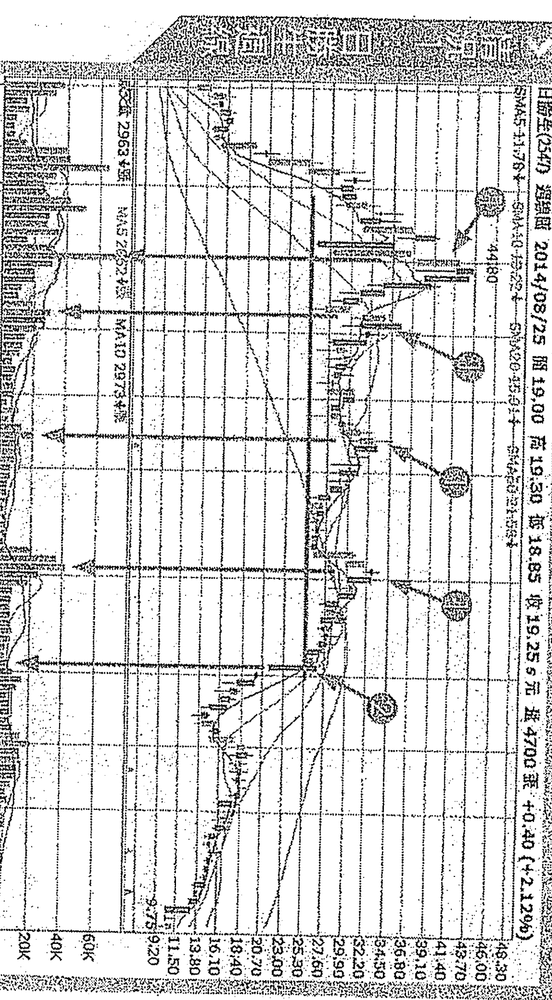

# Part 2 ▶ 大資金外燬

# 實戰2

頭部有2個月以上的均線糾結型態，當大量中長黑K跌破均線糾結，頭部確認，為弱勢下跌滯力股。

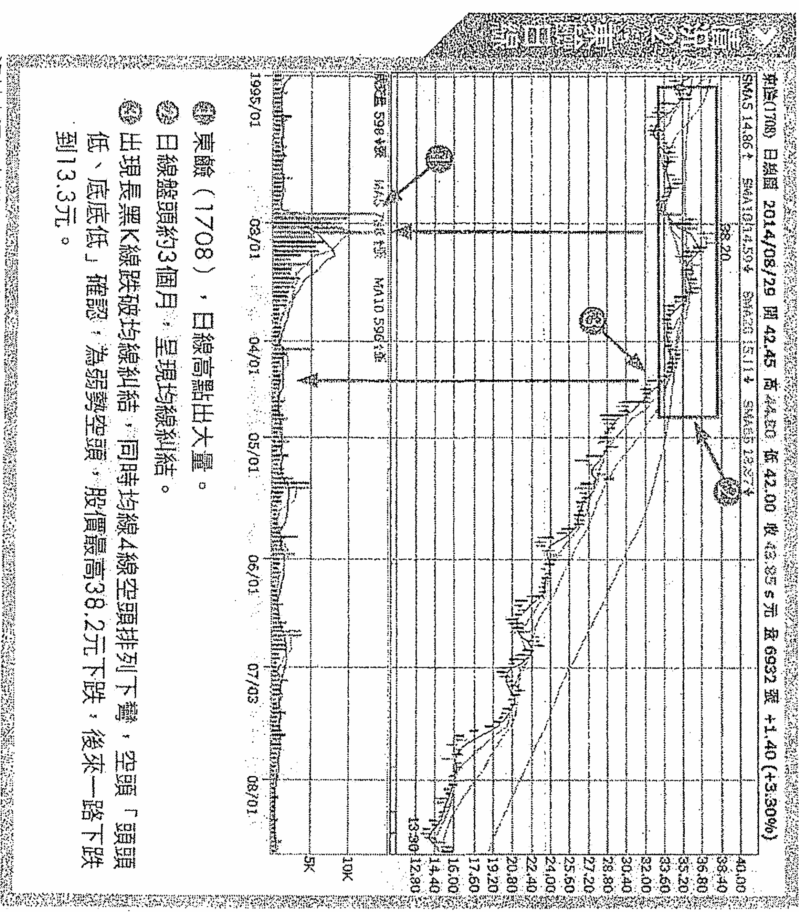

+   ① 東鮑（1708），日線高點出大量。
② 日線盤整約3個月，呈現均線糾結。
③ 出現長黑K線跌破均線糾結，同時均線4線空頭排列下彎，空頭「頭頭低、低、底低低」確認，為弱勢空頭，股價最高38.2元下跌，後來一路下滑到13.3元。

資料來源：富邦O|電子交易系統

# 實例研究

國精化（4722），週線盤整高點出大量。
盤頭約12個月之久，呈現均線4線糾結。
出現大量長黑K線跌破盤整及均線糾結，同時均線4線空頭排列下彎，空頭「頭頭低、底底低」確認，為弱勢空頭，股價緩續下跌，後來一路下段到8.37元。

資料來源：寶邦eOI電子交易系統

# Part 2 ▶ C 高點轉折

# 關鍵觀點

頭部轉折高點出現大量連三黑，或下跌3天出現2次跳空缺口快速下跌，當後續完成空頭頭部，為弱勢下跌的潛力股。

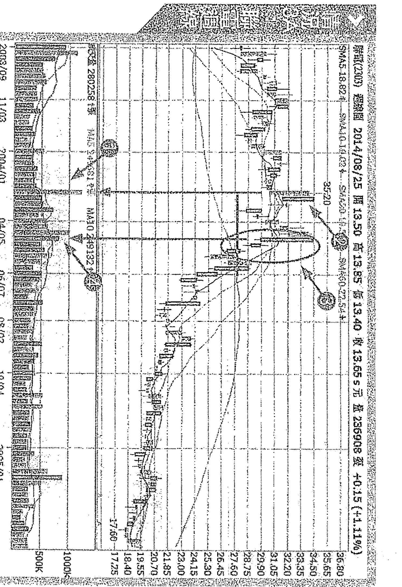

① 聯電（2303），週線高檔出現大量長紅K線。
② 次週出現長黑K線覆蓋的轉折向下訊號。
③ 出現大量長黑K線是否 an 轉折向下的「頭頭低」，後續2週連三黑K線下跌跌，均線3線空頭排列下彎，跌破前面轉折低點，空頭「頭頭低、底底低」確認，為弱勢空頭。
④ 高檔第二個也出現類似大量，股價繼續下跌，後來一路跌到17.6元。

資料來源：富邦e01電子交易系統

# 選股祕笈：找出潛力強勢股 第7章

資料來源：富邦Q1電子交易系統

+   ① 聯雲日線高檔出現大量長紅K線。
② 次日持續3日黑K下跌回檔。
③ 反彈不過16.7高點，再出現連3黑K線的「頭頭低」下跌，後續跌破前面低點、空頭「頭頭低、底底低」確認，為弱勢空頭。
④ 空頭反彈，股價繼續連3黑K線下跌，後來一路下跌到13元。

底部(230日) 日線 2014/08/29 開 13.50 高 13.85 低 13.55 收 13.65 檔元 底 44255 張 0.00 (0.00%) SMA5 13.19 SMA10 13.70 SMA20 13.67 SMA60 15.04 5 23384張 MA5 312553張 MA10 47025張 17.00 16.75 16.50 16.25 16.00 15.75 15.50 15.25 15.00 14.75 14.50 14.25 14.00 13.75 13.50 13.25 13.00 12.75 2014/05 06/03 07/01 10/01 100K 200K

# Part 2 ▶ 5大實戰操作

實戰破解 急跌回檔後，再上漲不到回檔幅度的三分之一，就轉折下跌，完成「頭頭低、底底低」的空頭確認，為弱勢下跌的潛力股。

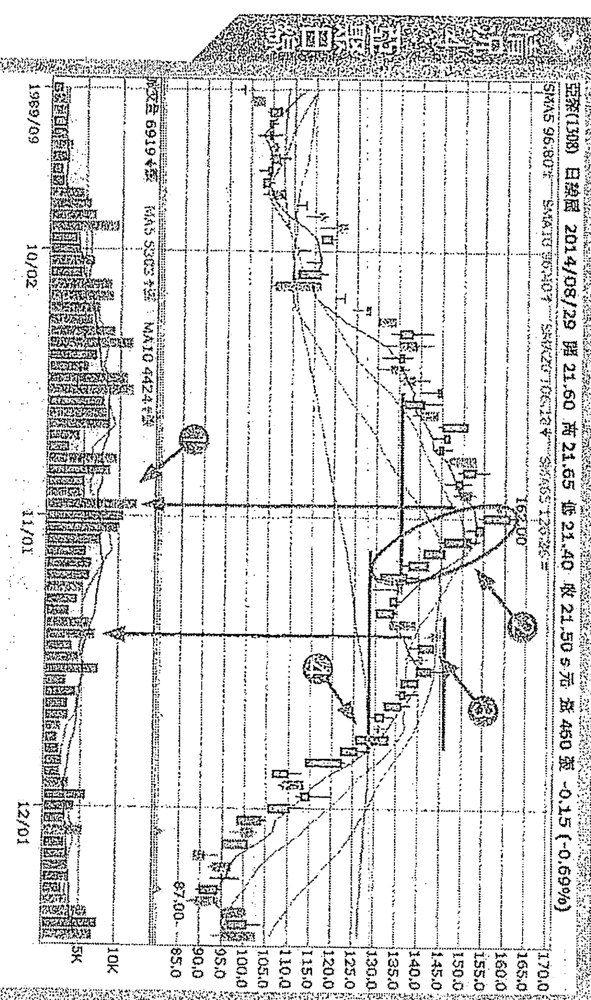

亞聚（1308），日線高檔出現大量十字變盤線；要注意股價回檔。

出現連續6日黑K下跌回檔，同時跌破前面低點。

反彈約回檔幅度三分之一，再出現大量十字K線的變盤線，後續黑K線下跌，空頭「頭頭低、底底低」確認，為弱勢空頭。

連續出現黑K線下跌，再跌破前面低點，股價續續下跌，後來一路下跌到37元。

資料來源：富邦e01電子交易系統

# 選股秘笈：找出潛力強勢股 第7章

買賣進退

① 中化（1701），週線高檔出現爆大量。

② 週線出現長黑K線蓋穿??的轉折向下節下?? 上漲約回檔幅度的三分之一，再出現大量黑K線下跌，同時出現「頭頭低」。

③ 黑K線下跌，再跌破前面低點，形成空頭「頭頭低、底底低」確認，為弱勢空頭。股價繼續下跌，後來一路下跌到27.5元。

資料來源：富邦e0電子交易系統

# Part 2 大實體抄底

# 圖解5 頭部為頭肩頂、復式頭肩頂、三重頂、上升楔型等型態，大量跌破，完成確認的頭部，為弱勢下跌的潛力股。

① 奧斯特（8080），日線高檔時出現爆大量，黑K線否轉折向下回檔下跌。

② 再出現大量長黑K線下跌，同時出現「一星二陰」繼續下跌。

③ 弱勢反彈後大量長黑K線下跌，再跌破前面低點，出現「頭肩頂」的型態確認，同時形成空頭「頭頭低、底部低」確認，後續連三黑下跌，為弱勢空頭，反彈不過高再下跌，可繼續做空。

④ 「頭肩頂」的型態確認後下跌的目標價位量。

資料來源：富邦e0i 富子交易系統

# 第7章 選股秘笈：找出潛力強勢股 1 實戰範例

飛宏（2457），週線高檔連續上漲時出現爆大量。

高檔大量長紅K線後，出現大量長黑K線覆蓋下跌。

長黑K線覆蓋下跌，出現「一星二陰」繼續下跌。

弱勢反彈後長黑K線下跌，跌破上升切線，出現「頭肩頂」的型態確認，後續下跌形成空「頭頭低、底底低」確認，為弱勢空頭。

資料來源：書邦e01電子交易系統

## Part 2 大量賣出停損

## 實例6 頭部出現2次以上大量轉折向下走的K線組合型態，例如：

長黑吞噬、孤島轉折、夜星轉折、閃因三黑、跳缺回補、下降三法、一星二陰等的組合，為弱勢下跌的潛力股（上述轉折向下的K線組合，參見《抓住K線獲利無限》）。

佐克（6131），週線高檔上漲時出現爆大量。 ①高檔價量背離，出現長黑K線吞噬回檔。 ②下跌「連三黑」繼續回檔。 ③弱勢反彈後大量長黑吞K線，出現「三線反黑」，同時形成空頭「頭頭低、底底低」確認，後續為弱勢空頭。股價由高點56.5元，一直跌倒11.05元。

資料來源：富邦e01電子交易系統

## Part 2 ▶ 5大實戰操作範例

① 友訊（2332），週線高檔上漲時出現疊大量。

② 高檔連續長紅上漲創新高價，出現價量背離現象。

③ 高檔黑K「母子懶拋」轉折訊號。

④ 長黑K線，出現「內因三黑」轉折確認。

⑤ 長黑K線下跌，跌破9週盤整低點，同時形成空頭「頭頭低、底底低」確認，後續為弱勢空頭。股價由高點146.5元，一直到跌到27.1元。

資料來源：富邦B01電子交易系統

# 關於進場位置

價格生在一買就跌、一賣就漲的情形，一定要選對進場位置。 分析最佳進場位置之前，應先建立下面幾項正確觀念。

## 關於進場位置與觀念

## 觀念1

進場前對要做的股票，一定要先做好準備工作，同時預估可能承受的風險及可能獲利空間。

## 觀念2

只問進場位置對不對，不要求計較價格高低，不要因為想買低一檔的價位，而錯失一次進場機會。

## 觀念3

確認後再買，成功機率比較高，例如多頭回檔，要等到再上漲確認才買，而非出現支撐就買。一般投資人不可能買到最低

## Part 2 ▶ 5 大買賣條件

點，即使買到最低點，失敗停損的機率也比較高。

## 觀念4

設定好進場條件，當條件都符合時，該買時就買，同時要規劃好資金分配，決定買進的數量，如果資金不多，採取一次買進，資金充足則可分2或3次買進。

## 觀念5

再好的進場位置，都沒有百分之百的成功率，因此，任何位置進場都要設定停損點，一旦跌破停損，要按照紀律停損出場。（詳見〈步驟3：停損〉）

## 觀念6 股票賺錢是「等」來的，所謂的「等」，就是「等」進場位置的K線訊號。簡單說，短線操作的投資人，要「等」日線進場位置的K線訊號；中長線操作的投資人，則要「等」週線進場位置的K線訊號。

對於多頭走勢的股票，要在多頭買進；空頭走勢的股票，則要在空頭放空。如在盤整區操作，因著獲利不高，居則上下不穩，該進場買賣次數。

## ⑥ 股票賺錢獲利時的外性因素

每個人買股票都希望，做多買進能馬上漲，做空的股票則能

馬上下跌，但股票漲跌的原因素很多，除了股票本身基本面、技術面的好壞之外，還有許多外在因素必須考慮進去，然後再擬定整體的操作策略，這樣才能掌握賺錢機會。
股票是一個投資操作商品，其實每檔股票都不是單獨存在，
「個別股票」的上層是「類股族群」，再往上是「台股大盤」和「國際盤」。股票上層的每個環境，都會影響股票本身的漲跌和強弱。
由上而下來看，「國際盤」不好會影響「台股大盤」，「台股大盤」不好會影響「類股族群」，「類股族群」不好會影響「個股」。
因此，當大盤好、類股好，在這個類股中的強勢股做多，最容易賺錢。反之，當大盤不好、類股不好，即使做多這個類股的強勢上漲股，也不容易賺錢。
例如2014年10月17，台股大盤空頭下跌120點（見次頁圖1），電子類股也是空頭下跌（見次頁圖2），股王大立光（3008）在前一天公布第3季超賺，單季EPS為39.4元，創台股新紀錄，前3季累積EPS為89.51元，可是2014年10月17當天，大立光卻是下跌停鎖死（見次頁圖3），這就是受到類股及台股大盤的空頭趨勢影響。

資料來源：富邦e01電子交易系統

資料來源：富邦e01電子交易系統

## Part 2 ► 5大買賣技術原則

## 股票怎麼做多 9個進出場位置

在 本章所述的6個位置，投資人可以進場做多。從所舉的範例中，可以學習如何正確判斷做多位置。

## ⑥買進機會位置1

盤整末端的向上突破紅K線

## 續：圖解 盤整的突破

+   1. K線如果符合「價漲、量增、線實」訊號，買進上漲的機率很高。

價漲：收盤價上漲，收盤價突破盤整的上緣線。

量增：成交量大於昨日成交量的1.3倍以上。

線實：K線收中長紅K的實體棒（上漲2.5%以上）。

+   2. 日線進場的K線訊號是操作短線的買進位置。
週線進場的K線訊號是操作中長線的買進位置。

## 第2章 股票做多6個進場位置

+   3. 成交量越大，紅K線實體棒越長，上漲力道越強。
4. 跳空上漲的缺口越大，上漲力道越強。
5. 進場後要設定停損，並且嚴格執行停損。

睿智 (5478) 2014/2/20，當天出現大量長紅K線，符合短線做多進場的位置：

+   ① 多頭走勢上漲一段後盤整區，等待盤整的突破K線再進場。
② 當天放量約為前一天的3.5倍大量。
③ 當天上漲3.5%，中紅K線實體棒，收盤突破盤整上頌線及前面5天高點。當天放量前確認，符合進場位置，市價買進。

資料來源：股票OI電子交易系統

## Part 2 ▶ 2 買進技巧

134 | 做對15個買賣點步步勝 你就是賺錢高手

+   1. 當一檔股票跌到相對的低檔位置，開始進入橫向盤整（也稱為打底），就可以開始鎖股追跌觀寥，等到大量長紅K線突破時進場。 2. 當一檔股票多頭開始上漲一段（初升段），開始進入盤整

穩健操作

資料來源：富邦RoI電子交易系統

佳世達（2325）2013/12/20，量天尺擴大重長紅K線，符合短線做多進場的位置：

+   ① 底部盤整1.5個月的盤整區，等待盤整的突破K線再進場。 ② 底部當天放量約為前一天的8倍大量。 ③ 長紅K線實體棒，收盤突破盤整上頸線及前面高點，波浪型態也完成「頭頭高、底底高」的多頭趨勢。當天收盤前確認，符合進場位置：市價買進。

年度成交（2325）日週 2014/09/24 開 14.80 高 15.10 底 14.85 收 14.85 5元 委 8968張 0.00 (0.00%)

## 第2章 股票做多6個進場位置

和旺（5505）2010/1/8，已當週出現大量長紅K線，符合中期做多進場的位置：
①多頭走勢上漲一段後築整理，等待盤整的突破或跌破再進場。
②當週放量約為前一週的3.8倍大量。
③當週上漲16.5%，中紅K線實體棒，收盤突破盤整上頸線及前面6個月高點。當週收盤前確認，符合中波段操作進場買進位置。

資料來源：富邦e01電子交易系統

時，這時可以鎖股追蹤觀察，等到大量長紅K線突破時買進，做主力一段的上漲。
3. 當一檔股票多頭已經上漲過2波段，到相對的高檔位置，開始進入盤整時，這時可以鎖股追蹤觀察，等到大量長紅K線突破時進場買進，但是要特別注意，3天之內不可以出現下

## Part 2 ▶ 5.實戰案例

跌回到盤整區內，這容易是「假突破、真下跌」。
4. 盤整末端出現「假突破、真下跌」，如果是出這樣跌的中長黑K（有量或沒量皆可），往下跌破盤整區會大跌，可以反手做空（這個盤整區稱為頭部）。

東緯（1708）1997/4/14，當天出現大大量長紅K線，符合短線做多進場的位置：

+   ① 高檔盤整1個月的盤整區，等待盤整的突破K線再造場。
② 突破當天放量約為前一天的2.4倍大。
③ 長紅K線帶實體棒，收盤突破盤整上緣線，繼續盤上漲。
④ 次日再爆更大量，出現十字變盤線，要特別注意隔天不能出現下跌黑K的回檔。
⑤ 紅K上漲第3天，股價下跌跌到盤整區，向上紅K的突破是假突破。
⑥ 當天中黑K收盤確認跌破盤整區，雖然量縮，仍符合造場放空位。

資料來源：皇邦OBI電子交易系統

## 多頭回檔止跌，沒有跌破前面低點，出現兩上漲的中長紅K線。

## 實戰回顧 回後買上漲

+   1. K線如符合「價漲、量增、線實」的訊號，買進上漲的機會很高。

+   價漲：收盤價上漲，收盤價突破前一天止跌K線的最高點。
量增：成交量大於昨日成交量的1.3倍以上。
線實：K線收中長紅K的實體棒（上漲2.5%以上）。

+   2. 日線進場的K線訊號是操作短線的買進位置。
週線進場的K線訊號是操作中長線的買進位置。

+   3. 回檔幅度越小就止跌上漲的股票越強勢，越要把握機會進場做多。

+   4. 當天如果是跳空上漲的中長紅K線，上攻力道越強，更要把握機會進場做多。

+   5. 進場後要設定停損，並且嚴格執行停損。

## 第二章 股票做多6個進場位置

## Part 2 ▶ 5 大實體K線 盤勢

美時（1795）2013/11/28，當天出現大量長紅K線，放量約為前一天的3.8倍，收盤較收盤前面高點，‘頭高高，底底高’多頭確認。

② 2013/12/4，當天多頭回檔，泛有跌破前低點，出現長紅K線實體棒，放量約為前一天的1.8倍，收盤突破昨日高點，多頭繼續上漲，是多頭買進位置。

③ 2013/12/24，當天多頭回檔，沒有跌破前面低點，出現長紅K線實體棒，放量約為前一天的1.3倍，收盤突破昨日高點，多頭繼續上漲，是多頭買進位置。

④ 2014/1/14，當天多頭回檔，沒有跌破前面低點，出現長紅K線實體棒，放量約為前一天的3倍，收盤突破昨日高點，多頭繼續上漲，是多頭買進位置。

資料來源：贏家理財電子交易系統

## 第 2 章 股票做多 6 個進場位置

多頭繼續買位置 3
多頭中長紅K線上漲後，股價維持在K線上方僵盤，當再出現大量中長紅K線，突破僵盤最高點時，是進場的位置。

資料來源：昌鴻e01電子交易系統
① 任盛（8076）2005/9/9，當週出現大量長紅K線，放量約為前一週的4倍，收盤突破前一週高點，多頭繼續上漲，是多頭中長期買進位置。
② 2005/11/18，當週出現大量長紅K線，放量約為前一週的2.3倍，收盤突破前一週高點，多頭繼續上漲，是多頭中長期買進位置。
③ 2006/2/27，當週出現大量長紅K線，放量約為前一週的2倍，收盤突破前一週高點，多頭繼續上漲，是多頭中長期買進位置。

中信(2019) 期貨 2014/09/29 開 148.00 高 150.50 低 145.00 收 149.50 1元 買 8750 量 +2.50 (+1.70%)
RMA5 380.50 4
MAX 2506.4棒
MA5 1275.6棒
MA10 1425.5棒

## Part 2 ▶ 5大買點辨識

## 實戰案例 K線慣盤的突破

1. K線如符合「價漲、量增、線實」的訊號，買進上漲的機率很高。

+   價漲：收盤價上漲，突破盤整的上上頸線。
量增：成交量大於昨日成交量的1.3倍以上。
線實：K線收中長紅K的實體燭（上漲2.5%以上）。

① 奧斯特(8080) 2013/12/4，當天出現大長紅K線，放量約為前一天的2倍，收盤突破盤整高點，是多頭買進位置。
② 大量長紅K線之後，在長紅K線上方橫盤10天，橫盤時量縮。
③ 2013/12/19，當天出現開盤向下跳空，突破10天K線橫盤，同時放量約為前一天的2.2倍，多頭繼續上漲，是多頭買進位置。

資料來源：富邦e01電子交易系統

## 第2章 股票做多的6個進場位置

## 2. 日線進場的K線訊號是操作短線的買進位置。

週線進場的K線訊號是操作中長線的買進位置。

3. 突破當天如果是跳空上漲的的K線，股累越強，更要把握機會進場做多。

4. 進場後要設定停損，並且嚴格執行停損。

大旺（3529）2014/3/13，當天出現大量長紅K線，放量約為前一天的2倍，收盤突破回檔4天K線高點，是多頭買進位置。

大量長紅K線之後，在長紅K線上方滿盤8天，橫盤時量縮。

2014/3/26，當天出現倒盤向上跳空，收盤突破8天K線檔，同時放量約為前一天的1.5倍，多頭繼續上漲，是多頭買進位置。

資料來源：富邦eOI電子交易系統

## 電梯圖

云辰(2390) 周線圖 2014/09/29 開 36.00 高 37.15 低 35.50 收 35.90 元 量 10953 張 +0.20 (+0.56%) SMA5 27.96+

① 云辰（2390）2012/12/3，週線當週出現大量長紅K線，放量約為前一週的3倍，收盤突破回檔5週不續降點，且多頭中期買進位置。
② 大量長紅K線之後，在長紅K線上方橫盤4週，盤整期量縮。
③ 2013/1/7，當週出現大量長紅K線，收盤突破4週K線橫盤，同時放量約為前一週的3倍，中期多頭權續上漲，是中期做多買進位置。

資料來源：富邦e01電子交易系統

## 第 2 章 股量傾多的 9 個進場位置

## 參觀進場位置 4

多頭向上跳空長紅K線，股價維持在缺口上方整理，當出現整理理末端的大量長紅K線上漲時，是進場的位置。

## 進場時機 破口之上等買點

+   1. 上漲紅K線如符合「價漲、量增、線實」的訊號，買進上漲的機率很高。

價漲：收盤價上漲，收盤價突破整理的上緄線。
量增：成交量大於昨日成交量的 1.3 倍以上。
線實：K線收中長紅K的實體椎（上漲 2.5% 以上）。

2. 日線進場的K線訊號是操作短線的買進位置。
週線進場的K線訊號是操作中長線的買進位置。

3. 當天上漲紅K線如果出現跳空上漲的水線，是主力強勢上攻，更要把握機會進場做多。

4. 進場後要設定停損，並且嚴格執行停損。

## Part 2 ▶ 5大實戰分析範例

① 陽程（3498）2012/8/31，當天出現大量跳空漲停板，放量約為前一天的3倍。
② 之後連續15日都維持在大量跳空漲停板的缺口之上，缺口沒有被回補，盤整區量縮，等待發動攻擊時做多。
③ 2012/9/24，當天出現弱盤向下跳空，收盤突破15天盤整，同時放量約為前一天的3倍，多頭繼續上漲，是多頭買進位置。
資料來源：富邦eOI電子交易系統

資料來源：富邦e01電子交易系統

① 雲科（6207）2009/8/12，當天出現大量跳空漲停板，放量約為前一天的3倍。
② 之後連續13日都維持在大量跳空漲停板的核心口之上，放口沒有被回補，盤整區量縮；等待發動攻擊時機多。
③ 2009/9/1，當天出現大量長紅K線，收盤突破13天盤整，同時放量約為前一天的1.5倍，多頭繼續上漲，是多頭買進位置。

## 實戰案例

① 迎實（6117）2014/2/17，暫時出現大量跳空上漲紅K線，放量約為前一週的5.2倍。

② 之後連續12週都維持在大量跳空缺口之上，缺口沒有被回補，盤整時期量縮，等待發動攻勢時做多。

③ 2014/5/19，當週出現大量長紅K線；收盤突破12週高點；同時放量約為前一天的49倍，中期多頭繼續上漲，是中期做多買進位置。

資料來源：富邦e01電子交易系統

## 多頭底部型態 5

多頭髮底部型態，出現大量中長紅K線向上突破，型態確認時，是進場的位置。

## 請問重點 型態突破的買點

+   1. 上漲紅K線如符合「價漲、量增、線實」的訊號，買進上漲的機率很高。
2. 曰線進場的K線訊號是操作短線的買進位置。
3. 型態突破確認之後，可以參考型態上漲的目標價，預估獲利空間及操作的目標。不同型態，達到目標價機率不同。
4. 當天型態突破確認上漲的紅K線，如果是跳空上漲的K線，上漲力道越強，更加把握機會進場做多。
5. 進場後要設定停損，並且嚴格執行停損。
6. 多頭底部反轉成功率高的幾個型態：頭肩底、複式頭肩底、N字底、三重底、圓弧底、一字底。（有關型態的詳細說明參見《抓住ționale股整套賺》304頁附錄〈學會辨認型態股市無往不利〉）

價漲：收盤價上漲，收盤價確認突破型態上頸線。
量增：成交量大於昨日成交量的1.3倍以上。
線實：K線收中長紅K的實體棒（上漲2.5%以上）。

週線進場的K線訊號是操作中長線的買進位置。

國產(2504) 日線圖 2014/10/03 開10.75 高10.80 低10.70 收10.55 元 成1038張 +0.05 (+0.47%)
EMAS 14.67 4
股價 4469股
MA5 8820股
MA10 10528股

國產(2504) 至頭下跌到低檔，大量長紅反彈到前面的高點，回檔2天
① 2011/4/7，當天出現大量長紅線，收盤突破頭肩底型態上頸線，同時放量約為前一日的2倍，型態確認，底部多頭形成。
② 2011/4/20，當天最高點到14.95，收盤14.7。
型態目標價位13.2+ (13.2-11.65) =14.75。

資料來源：富邦e01電子交易系統

五彩（1308）空頭下跌跌到低檔，量縮量長紅吞噬，反彈到前面的高點，回檔盤右肩後開始上漲，形成複式頭肩底型態，兩高點連接成型態上頸線。

① 1991/2/5，當天出現大量跳空長紅K線，收盤突破複式頭肩底型態上頸線，同時放量約為前一天的1.5倍，型態確認，底部多頭完成。

型態目標價位置32.6＋（32.6－22.9）＝42.3。

② 1991/2/21，當天收盤42.9。

資料來源：富邦e01電子交易系統

## 第二章 股票做多的個進場所位置

## 華森（2329）空頭下跌跌到低檔，長達2.5個月底部盤整形成三重底型態

① 2012/2/1，當天出現大量長紅K線，收盤突破三重底型態上頸線，同時放量約為前一天的1.3倍，型態確認，底部多頭完成。

② 2012/2/4，當天收盤5.00。

型態目標價位為4.45 +（4.45 - 3.95）= 4.95。

懸，兩個點連接成型態上頸線。

資料來源：富邦e01電子交易系統

## Part 2 ▶ 5入實戰案例

## 第2章 股票做多6個進場位置

## 系統訊號

啟富（6285）空頭下跌跌到低檔後，出現大量長下影線黑K，然後強力反彈突破前高，最高點到74.6，回檔幅度不到反彈幅度的二分之一，出現止跌。

② 2014/6/30，當天出現大量長紅K線上漲，收盤突破前5天K線高點；出現晨星轉折的回後上漲，出現N字型態上漲。當天放量約為前一天的2倍，型態確認，當天進場。

① 2014/7/14，當天高點80.4，收盤79.7。型態目標價位70+（74.6—64.5）=80.1。

資料來源：富邦e01電子交易系統

## Point 2 ▶5大買點秒殺

高雄銀（2836）空頭下探到低檔，4個月打造圓弧底部型態。
② 2000/1/25，當天出現最大量長紅K線上漲，收盤突破圖弧底左邊高點13.0，當天放量約為前一天的2倍；型態確認，當天收盤進場。
③ 2000/2/9，當天高點15.6，收盤15.5。
資料來源：富邦101電子交易系統

## 第2章 股票做多6個進場位置

## 跳空震盪

新亞(2510) 場開 2014/09/29 開 8.25 高 8.32 低 8.04 收 8.26 元 成 1,711 張 -0.02 (-0.24%) SMA5 15.021

新建(2516) 至頭到低檔，6個月下跌打底，由於長時間打底，週線逐漸形成圓弧底型態。

2010/8/30，週週出現大臺長紅K線上漲，收盤突破圓弧底左邊高點 7.95，當天放量約為前一週的6.5倍，型態確認，當週收盤進場。

型態目標價位7.95+(7.95-5.55)=10.35。

2010/10/4，當天高點10.7，收盤10.0。

資料來源：富邦e01電子交易系統

## Part 2 ▸ 5大實戰案例

## 圖例 回顧

陞恬(3498) 日線圖 2014/10/03 開 82.00 高 85.50 低 82.00 收 $3.50 元 佳 1948 成 +1.80 (+20%) SMY5 69.94 1

陞恬（3498）空頭到底低檔，3個月橫向打底，由於長時間在狹窄區間整理，逐漸形成一字底型態，打底期間偶爾看到突破出大量。

◎ 2013/3/1，當天出現大黑長紅K線上漲，收盤突破一字底盤整高點，當天放量約為前一天的3倍，一字型態突破確認，當天收盤32.6進場。

一字型態底部，突破後經常成為強勢飆股，要把握進場做多，按照紀律守MA5均線操作，會有驚人獲利。

◎ 2013/3/25，當天高檔連續出現大量，次兩日2013/3/27日，黑K盤跌破MA5均線，收盤68.2出場。

單獨獲利（68.2-32.6）÷32.6=109%，獲利驚人。

資料來源：富邦e01電子交易系統

## 第2章 股票做多6個進場位置

在圖(8076) 亞洲 2014/09/29 開 148.00 高 158.00 低 145.00 收 157.00 上漲 5 元 最高 158.31 量 +10.00 (+6.80%) SMA5 118.20 4

① 伍豐(8076) 空頭到底低檔，3個月橫向打底，由於長時間在狹窄區間整，逐漸形成一字底部型態，打底期間偶爾會到突破大量。
② 2013/3/25，當週出現大量長紅K線上漲，收盤突破一字底部整高點，當週放量約為前一週的2倍，一字型態突破確認，當週可以進場。
型態底部，突破後經常成為強勢飆股，要把握進場做多，按照紀律守MA5週均線操作，都會有不錯獲利。
③ 上漲4週後，再出現4個月橫向整理，由於長時間在狹幅區間整理，再形成一字底部型態。
④ 2013/8/5，當週出現大量長紅K線上漲，收盤突破一字型態整高點，當週可以進場。
當週放量約為前一週的2.3倍，一字型態突破確認，後續按照紀律守MA5週均線操作，上漲幅度驚人。

資料來源：富邦e01電子交易系統

## Part 2 ▶ 5大實戰妙訣

## 多頭塞緩位置6

多頭下面的圖型，可以在當天收盤或次日開盤進場，做隔日沖或當日沖，賺取上漲價差。

- 1. 抓住次日開盤或當天收盤的機會進場，賺取上漲價差。
- 2. 以日線K線轉折或續漲的訊號，做為買進的位置，與基本面無關。
- 3. 次日或當天走勢強勁，可以看趨勢、價量配合及位置再留單一天。
- 4. 次日或當天走勢不理想，沒有價差就出場，因此沒有大賠的風險。
- 5. 屬於超短線操作，獲利不大，要以量取勝。

## 操作紀律：

- 1. 選擇符合條件的強勢多頭股票做多，或空頭急跌的股票搶反彈做多。
- 2. 盤中可以永久5分K走勢圖操作。
- 3. 此法獲利小，要以量取勝，資金要集中在1～2檔，不宜同時做太多檔股票，以免分散中無法照顧。
- 4. 操作必須看盤，並且嚴守停損及停利紀律。

## 第二章 股票做多6個進場位置

## 操作要點

多頭回檔到重要支撐，出現止跌的變盤線，隔日跳空開高盤進場做多。重要支撐：月線、季線、大量缺口、大量長紅K線、盤整突破的上頸線。

① 威剛(3260) 2005/12/16，當天出現大量跳空上漲紅K線，放量約為前一天的4倍。收盤突破前高，當天多頭確認，是多頭進場位置。多頭回檔到月線重要支撐，當天出現十字線盤線，必須注意次日是否出現開高。

② 次日2005/1/2，跳空開盤，開盤買進做多當沖。收盤放量漲停板，可以降一留一日操作。

資料來源：富邦e01電子交易系統

## Part 2 ▶ 5大買賣訊號

① 浩鼎（4174）連續大漲到高檔，2014/7/28 當天出現大量跳空下跌K線，既做前一天長紅K線低點，放置約為前一天的1.7倍，呈現急漲後的急跌。

② 急跌回檔到前面低點位置，出現支撐十字變盤線。次日2014/8/8，為開低盤，不宜進場。

③ 2014/8/18，回檔到前面兩個低點位置，出現支撐十字變盤線。觀察次日是否有機會開高反彈。次日2014/8/19，跳空開盤，隔盤買進做多當沖。

④ 2014/9/9，當天出現大量長紅K線，收盤突破前面高點，放置約為前一天的5倍，多頭確認，收盤做多的次日上漲。

資料來源：富邦e01量子交易系統

## 第2章 股票做多6個進場位置

多頭向上跳空過壓力，或向上跳空突破盤整，當天跳空開盤做多。

① 台航(2617) 2013/8/29，當天出現大量紅K線，上漲遇到「K線撐盤區」壓力，出現上影線，收盤突破前高，放量約為前一天的3倍，收盤確認「弱頭高、底底高」多頭完成。② 回檔後上漲2天，接近「K線橫盤區」壓力。2013/9/5開盤跳空突破「K線橫盤區」壓力，當天開盤買進，做多首沖。當天多頭趨勢，收盤突破「K線橫盤區」壓力，也可以收盤買進做多；設好停損，沿日均線操作。③ 2013/9/16，當天出現黑K線，收盤跌破5日均線，收盤出場。

資料來源：富邦e01電子交易系統

## 圖解案例 大量過高長紅，當天收盤買進，做次日上漲價差。

Part 2 ▶ 5人富時間? 圖

資料來源：富邦e01電子交易系統

⑪ 高檔（6234）2011/2/5，當天出現開盤跳空突破盤整的前高，當天開盤買進，做多嘗沖。收盤也突破底部跡盤整，確認「頭肩高、底部高」多頭完成，也可以收盤買進破多，設好停損，沿5日均線操作。

⑫ 2011/3/2，多頭回檔，當天大量長紅線，收盤超過前5日高點，收盤買進，做隔日沖。

## 股本做多6個進場位置 第2章

停損買賣圖 空頭急跌當天出現大量長紅K線的止跌反彈，收盤過高。收盤買進，做隔日沖（次日上漲價差）。

◎中磊（5388）空頭出現連續跌停的急跌。 ◎2011/8/9，當天出現大量長紅K線，放量約為前一天的1.9倍。收盤突破前一天高點，收盤買進做隔日沖。當天收盤也符合急跌的SITE反彈4個條件（參見《抓住線獲利無限》316頁），設好停損，做搶反彈波段。 ◎2011/8/18，黑K收盤跌破3日K線低點，也跌破5日均，按照搶反彈出場紀律，收盤出場。

資料來源：群益eT電子交易系統

## Part 2 ▶ 5大買賣時機篇

## 圖解戰略 空頭急跌當天出現大量K線止跌訊號，次日開盤向上跳空，開盤時買進，做當天反彈上漲價差。

榮化（1704）空頭長期下跌，出現急跌。
① 2012/1/11，當天出現大量長下影線黑K鎚子雙盤線，放量約為前一天的3倍，是止跌的訊號，觀察次日是否開高反彈。
② 2012/1/12，跳空開高，隔日盤進場做當沖。

資料來源：富邦e01電子交易系統

## 力旺(3529) 日線圖 2014/10/06 開 362.00 元 收 350.00 元 昨 362.00 元 量 3,100.0 千張 最高 2865 量 +19.00 (+5.28%) 2014/10/3

力旺（3529）空頭長期下跌，出現連續跌停板急跌。 ① 2014/8/11，當天出現大量長紅線， displaying 為前一天的2倍，是止跌反彈的訊號，當天收盤做隔日沖。當天收盤也符合急跌擋反彈4個條件，收盤價造，設好停損，也可以做搶反彈波段。 ② 2014/8/21，黑K收盤跌破2日K線低點，也跌破5日均線，按照擋反彈出場紀律，收盤出場。 ③、④ 2014/9/9日與10/3，多頭回檔到月線支撐，前一天出現止跌變盤線，當天跳空開高進場，做當沖（情況1的條件）。

資料來源：富邦eT電子交易系統

## 股票做空 6個放空位置

在 本章所述的6個位置，投資人可以進場做空。從所舉的範例中，可以學會如何正確判斷放空位置。

盤整末端的向下跌破下疑線黑K線

盤整的跌破

- 1. 黑K線如符合「價跌、線實」的訊號，放空成功下跌的機率很高。
價跌：收盤價下跌，收盤價跌破盤整的下緣線。
線實：K線收中長黑K的實體棒（下跌2.5%以上）。
成交量：大量或小量都可以。

- 2. 日線進場的K線訊號是操作短線的放空位置。
週線進場的K線訊號是操作中長線的放空位置。

## 當頭部型態 6個常見例子

- 3. 黑K線實體棒越長，下跌力度越強。
- 4. 跳空下跌的缺口越大，下跌力度越強。
- 5. 進場後要設定停損，並且嚴格執行停損。

創惟（6104）2012/3/6，大量長黑K線跌破前面低點，空頭「頭頭低、底底低」確認，反彈不超過高點等做空。

空頭走勢下跌一段後盤整，等待盤整的跌破K線再進場做空。

2012/3/29，當天放量約為前一天的1.9倍大量。

當天長黑K線實體棒：收盤破盤整下頸線。收盤前確認，符合進場位置，進場做空。

資訊來源：雲邦e01電子交易系統

## Part 2 ▶ 5 大實戰操作案例

牧羚(3037) 日線圖 2014/10/09 開 23.50 高 23.7G 低 23.35 收 23.35 元 金 3086 張 -0.05 (-0.21%) RHAS 21.18

資料來源：富邦601電子交易系統

牧羚（3037），空頭遭受下跌一段後盤整，等待盤整的跌破K線再進場做空。

2008/9/10，曹天放量約為前一天的2倍大體。

曹天向下跳空長黑K線實體確認，收盤跌破盤整下頸線。收盤前確認，符合進場位置，進場放空。

## 盤整操作

- 1. 當一檔股票漲到相對的高檔位置，開始進入橫向盤整（也稱為做頭），就可以開始鎖股追蹤蔭，等到大量長黑K線跌破時放空。
- 2. 當一檔股票空頭下跌一段（初跌段），開始進入盤整時，這時可以鎖股追蹤觀察，等到長黑K線跌破時放空，做主跌段的下跌（有量或無量下跌均可）。

## 第3章 股票做空6個放空位置

資料來源：富邦eO! 富邦交易系統

① 欣興（3037），週線空頭走勢下跌一段後盤整，等ln盤整的跌破K線再進場做空。

② 2001/5/7，營週量縮約為前一天的二分之一量。空頭進場位置有量或無量都可以進場，設好停損即可。

③ 當週向下跌空長黑K線實體搭，收盤跌破盤整下緣線。收破前低點，估合進場位置；進場做空做中期空頭。

## 3. 當一檔股票空頭已經下跌過2波段，到相對的低檔位置，開始進入盤整時，這時可以鎖股追蹤觀察，等到大長黑K線跌破時進場放空，但是要特別注意3天之內不可以出現反彈回到盤整區內，這容 易是「假跌破、真上漲」。盤整末端出現「假跌破、真上漲」，如果出現大量上漲的中長紅K，往上突破盤整區，後續要大漲，可以反手做多（這個盤整區稱為底部）。

- 4. 盤整末端出現「假跌破、真上漲」，如果出現大量上漲的中長紅K，往上突破盤整區，後續要大漲，可以反手做多（這個盤整區稱為底部）。

## Part 2 ► 5大實戰手法範例

南亞(1303)，空頭走勢下跌到低檔後盤整，等待盤整的跌破K線再進場做空。
① 2009/3/2，當天放量約為前一天的4倍大量。
② 當天向下長黑K線實體棒，收盤跌破盤整下頸線。收盤前確認，符合進場位置，進場放空做中期空頭。
③ 連續反彈5天，2009/3/9紅K收盤突破現有長黑K線實體棒高點，同時也突破盤整上頸線，空單停損，反手做多，日後連續大漲。2009/3/2長黑K線為假跌破，2009/3/9紅K為真上漲。
資料來源：富邦e01電子交易系統

## ⑥ 空頭成空位置2
空頭反彈沒有過前面高點，再下跌的中長黑K線。

## 關鍵訊號 單後下跌

- 1. 黑K線如符合「價跌、線實」的訊號，放空成功下跌的機率高。假高。
- 2. 日線進場的K線訊號是操作短線的放空位置。週線進場的K線訊號是操作中長線的放空位置。
- 3. 反彈幅度越小就止漲下跌的股黑越弱，越是要把握機會進場做空。
- 4. 當天如果是跳空下跌的中長黑K線，下跌力道越強，更要把握機會進場做空。
- 5. 放空後要設定停損，並且嚴格執行停損。

價跌：收盤價下跌，收盤價跌破前一天K線的最低點。
線實：K線收中長黑的實體棒（下跌2.5%以上）。
成交量：大量或小量都可以。

玉晶光(3406) 日線圖 2014/10/09 開 102.00 高 103.50 低 100.?? 收 100.?? 5MA 204.?? 7.50 (-6.98%) 3856萬股
王晶光(3406) 2012/3/20，大量長黑K線跌破前低點，空頭「頭」
① 頭低、底底低」確認。
② 2012/3/27，空頭反彈不過前高，大量長黑K線跌破前低點，是進場做空的位置。
③ 2012/4/17，空頭反彈不過前高，大量長黑K線跌破前低點，是進場做空的位置。
資料來源：富邦e01電子交易系統

## 股票做空6個放空位置

## 第3章

台積電(2330) 週線籌圖 2014/10/06 開 125.00 高 126.00 收 125.00 元 量 147535 張 +0.50 (+0.40%) SMA5 25.52 Z4# 54.59

① 台積電（2330）2000/7/17，當週大量長黑K線跌破前一面頭部盤整低點，中期空頭「頭假低、底底低」確認。

② 2000/8/28，週線空頭反彈不過前高，大量長黑K線，收盤跌破前一週K線低點，是中期做空造場的位置。

③ 2000/11/13，週線空頭反彈不過前高，量縮長黑K線，收盤跌破前一週K線低點，是中期做空進場的位置。

資料來源：富邦e01電子交易系統

## Part 2 ▶ 5大實戰步驟

## ⑦ 空頭放空位置 3

空頭中長黑K線下跌後，股價維持在K線下方價窗，當每出量中長黑線，收盤跌破檔區最低點，是放空的位置。

## 讀進圖案 K線檔盤的跌破

- 1. 黑K線如符合「價跌、線實」的訊號，放空成功下跌的機率很高。

價跌：收盤價下跌，收盤價跌破K線檔盤的最低點。
線實：K線收中長黑K的實體棒（下跌2.5%以上）。
成交量：大量或小量都可以。

- 2. 日線進場的K線訊號是操作短線的放空位置。

超過進場的K線訊號是操作中長線的放空位置。

- 3. 跌破當天如果aderas空下跌的黑K線，代表股票越弱，更要把握機會會放空做空。

- 4. 放空後要設定停損，並且嚴格執行停損。

# 晶電 (2448) 2011/6/20，當天出現大量長黑K線，放量約為前一天的1.5倍，收盤跌破前底部整理低點，空頭「頭頭低，底底低」確認，是空頭放空位置。

大量長黑K線之後，在長黑K線下方擠壓13天，橫盤時量縮。

2011/7/8，當天出現大量長黑K線，收盤跌破13天K線橫盤，同時放量約為前一天的2倍，空頭穩穩下跌，是空頭放空位置。

空頭下跌中，在缺口之下K線橫盤13天，橫盤時量縮。

2011/8/3，當天出現向下跳空的大量長黑K線，收盤跌破13天K線橫盤，同時放量約為前一天的3倍，空頭繼續下跌，是空頭放空位置。

資料來源：奇豐eOn電子交易系統

真爽（2499）2010/1/7，當天出現大量長黑K線，放量約為前一天的1.3倍，收盤跌破前低點，空頭「跌破低、底底低」確認，是空頭放空位置。

大量長黑K線之後，在長黑K線下方橫盤7天，橫盤時量縮。

2010/1/19，當天出現大量長黑K線，收盤跌破7天K線橫盤，同時放量約為前一天的1.7倍，空頭持續下跌，是空頭放空位置。

資料來源：富邦e01電子交易系統

## 第3章 股票做空6個放空位置

資料來源：富邦e0電子交易系統

① 撼訊（3061）2011/3/28，當週出現大雲長黑K線，放量約為前一周的1.8倍，收盤跌破前面低點，週線空頭「頭頭低、底底低」確認，是中期空頭放空位置。

② 持續下跌4週後，週K線橫盤7週，橫盤時量縮。

③ 2011/6/20，當天出現放量長黑K線，收盤跌破7週K線橫盤，同時放量約為前一天的1.1倍，空頭繼續下跌，是中期空頭放空位置。

## Part 2 ► 5大買點與外觀

## 空頭破空位置

空頭向下跳空長黑K線，股價維持在缺口下方整理，當出現整理區末端的集中長黑K線下跌時，是放空的位置。

## 擒空圖1 缺口之下等空點

- 1. 黑K線如符合「價跌、線實」的訊號，放空成功下跌的機率很高。
價跌：收盤價下跌，收盤價跌破K線整理的最低點。
線實：K線收中長黑K的實體棒（下跌2.5%以上）。
成交量：大量或小量都可以。

- 2. 日線進場的K線訊號是操作短線的放空位置。
週線進場的K線訊號是操作長線的放空位置。

- 3. 曾日下跌黑K線如果更是再出現跳空下跌的K線，是主力強勢下殺，更要把握機會進場做空。

- 4. 放空後要設定停損，並且嚴格執行停損。

## 第3章 股票做空6個放空位置

台聚(1304) 1995/4/15，長黑下跌後橫盤6天，當天出現大量長黑K下跌，放量約為前一天的1.1倍，是空頭確認下跌，可以做空。

1995/5/5，下跌走勢中出現向下跳空缺口的放量長黑線。

缺口之下橫向盤整15天，構築時量縮。

1995/5/24，當天收盤跌破15天橫盤低點，同時放量約為前一天的1.2倍，空頭繼續下跌，是空頭放空位置。

資料來源：雪豹01鴛子交易系統

亞聚（1308）1992/5/11，下跌走勢中出現向下跳空缺口的大量長黑 K線下跌。
缺口之下股票盤整了35天，橫盤末端量縮。
1992/6/24，當天向下跳空跌破35天盤整區，同時量縮，空頭持續下跌，是空頭放空位置。
資料來源：富邦e01電子交易系統

## 第3章 服景做空6個放空位置

昌邑(2448) 2011/5/3，當週K線下跌出現向下跳空缺口的長黑K線下跌。
① 股價之下跳空並整了3週，價格時量壅縮。
② 2011/7/4，當週K線下跌，股價跌破9週橫盤，同時量平，空頭持續下跌，是空頭放空位置。
資料來源：富邦e01電子交易系統

## ⑦ 空頭破空暨空位5

空頭頭部型態，出現大量中長黑K線向下確認型態破時，是放空的位置。

## 確認型態破的空點

- 1. 黑K線如符合「價跌、線實」的訊號，放空成功下跌的機率很高。
價跌：收盤價下跌，收盤價跌破K線整理的最底點。
線實：K線收中長黑K的實體棒（下跌2.5%以上）。
成交量：大量或小量都可以。
- 2. 日線進場的K線訊號是操作短線的放空位置。
週線進場的K線訊號是操作中長線的放空位置。
- 3. 型態跌破確認之後，可以參考型態下跌的目標價，預估獲利空間及操作的目標。不同型態，達到目標價機率不同。
- 4. 當天型態跌破確認下跌的黑K線，如果是跳空下跌的K線，下跌力度越強，更要把握機會進場做空。
- 5. 放空後要設定停損，並且嚴格執行停損。
- 6. 空頭頭部反轉成功率高的幾個型態：頭肩頂、復式頭肩頂，倒N字底、三重頂、一字頭（型態詳情見《抓住趨勢輕鬆賺》304頁附錄〈學會辨識型態股市無往不利〉）

## 第3章 股票做空6個成功空位實

股票技術分析 形態判斷與操作實務

鑫興特(8080) 多頭上漲到高檔，大量長黑回檔到前面的低點，反彈2天開始下跌，形成頭肩頂型態，兩低點連接成型態下頸線。

① 2014/2/27，當天出現大量長黑K線，收盤跌破頭肩頂型態下頸線，同時放量約為前一天的1.37倍，型態確認，頭部空頭完成。

型態目標價位33.25-(42.65-33.25)=23.85。

② 2014/4/28，當天最高點到24，收盤23.55，達到目標價。

資料來源：臺邦OI電子交易系統

茂發(8080) 日線圖 2014/10/09 開 19.00 高 19.30 低 18.80 收 18.85 元 7 206 張 -0.05 (-0.26%)

DMA5 24.62 ±

2013/12 02/05 03/03 04/01

2014/4/28 目標價23.85

23.05 23.05

33.25

2014/2/27

左肩 右肩

42.65 強

181

## 亞股（1308），多頭上漲到高檔，大量長黑回檔到前面的低點，反轉？

週開始下跌，形成頭肩頂型態，兩低點連接成型態下頸線。

2000/4/24，當週出現大量長黑K線，收盤跌破頭肩頂型態下頸線，同時量縮，型態確認，頸部至頭頂完成。

2000/12/11，當天最低點9.3，未達到目標價。

型態目標價位30.8 -（59 - 30.8）= 2.6。

資料來源：富邦eIPO電子交易系統

## 第3章 股票做空6個放空位置

資料來源：實邦e01電子交易系統

聯電（2303）多頭上漲到高檔，大量長黑回檔到前面的低點附近，反彈後形成型態下頸線。接成型態下頸線後2個高點的右肩開始下跌，形成雙式頭肩頂型態，兩低點連

① 1998/4/9，當天出現大量長黑K線，收盤跌破模式式頭肩頂型態下頸線，型態確認；頭部至頭完成。

型態目標價位置76－（95－73.45）＝51.9。

② 1998/6/2，當天最高點到55，收盤52，達到目標價。

## Part 2 5大實戰案例

① 台塑(3221) 多頭上昇到高檔，大量長黑回檔到下面的低點，反轉為5週開4866線，形成復式頭肩頂型態，兩低點連接成型態下頸線。
② 2010/8/30，當週出現雙重縮長黑K線，收盤跌破複式頭肩頂型態下頸線，型態確認，頭部空頭完成。
③ 型態目標價位置24.1－(39.25－24.1)=8.95。
2011/12/5，當天最低點9.5，收盤9.99，達目標價。
資料來源：富邦O1電子交易系統

## 亞聚（1308）多頭上漲到高檔，纏繞大量十字變盤線，次日長黑回檔到前面的低點，再反彈到下跳跌幅的三分之一處，出現大索十字變盤線，高點146元。

② 1989/11/15，當天出現量縮長黑K線下跌，以收盤跌破大索十字變盤線的最低點，形成倒N字型態，當天可以試空。
型態目標價位置146-(162-128)=112。

③ 1989/11/28，當天黑K下跌，達到目標價。

資料來源：富邦01電子交易系統

## Part 2 ▶ 5大實戰分析範例

## 新股龍頭 (股票N型)

振曜 (6143) 多頭上漲到高檔，大量長紅K線，次週2007/8/6出現大長黑K線，高點到84.9，低點，再反彈強不過到下跌幅度的一分之一處，出現大量黑K線。 2007/10/8，當週出現量縮長黑K線下跌，收盤跌破前一週大量黑K線的最低點，形成倒N字型態，當週可以試空單。 2007/11/5，當週黑K下跌，達到目標價108.5-(139-84.9)=54.4。

資料來源：富邦e01電子交易系統

## 股票做空6個放空位置 第3章

中華（2204）多頭上源到高檔，橫盤1個月後，出現三個高點的三重頂型態。 ①2004/10/15，當天出現大量長黑K線下跌，收盤跌破三重頂的下頸線，當天做空。 ②2004/10/26，當天黑K下跌，達到目標價。 資料來源：豐邦e01電子交易系統

## 案例三 (雙重頂部型態)

昌宏 (3042) 多頭上升波到高檔，情況10回日，陸續出現不錯高點的三重頂型態。
① 2011/6/13，當週出現大量長黑K線下跌，收盤跌破三重頂的下頸線，當週做空。
② 2011/8/1，當週黑K下跌，達到目標價。

資料來源：富邦e01電子交易系統

大洋(1321) 多頭上漲到高檔，橫盤2個多月，跌幅震盪形成一字頂的型態。
和鴨。
② 2008/6/12，當天出現大量長黑K線下跌，收盤跌破一字頂型態的下頸線，當天做空。一字頂的跌破，往往會形成跌幅很大的空頭走勢，要把握做空的機會。
資料來源：富邦e01電子交易系統

## 成功的買賣戰略

佳元資（6197）多頭上漲到高檔，橫盤1個月，收幅震盪形成一字頂的型態。

- ① 2010/10/21，當天出現大量長黑K線下跌，收盤跌破一字頂型態的下頸線，當天做空。一字頂的跌破，往往會形成跌幅很大的空頭走勢，要把握做空的機會。
② 2010/11/5，當天出現大量長紅吞噬的K線，是止跌反彈的訊號，空單要回補。

資料來源：富邦e01電子交易系統

## 股票做空6個放空位置 第3章

## 放空頭放空位量6

空頭下面的圖型，可以在當天收盤或次日開盤放空。做隔日沖或當日沖，賺取下跌的價差。

- 1. 抓住次日開盤或當天收盤的機會放空，賺取下跌的價差。 2. 以日線K線轉折或是續跌的訊號，做為放空的位置，與基本面無關。 3. 次日或當天走勢很弱，可以看趨勢、價量配合及位置再保留單一天。 4. 次日或當天走勢不理想，沒有價差就回補，因此沒有大的風險。 5. 屬於超短線操作，獲利不大，要以量取勝。

## 操作紀律：

- 1. 選擇符合條件的強勢空頭股票做空，或多頭急漲的股票搶回檔做空。 2. 盤中可以用5分K走勢圖操作。 3. 此法獲利小，要以量取勝，資金要集中在1～2檔。不宜同時做太多檔股票，以免盤中無法照顧。 4. 操作必須有紀律，並且嚴守停損及停利紀律。

## 空頭反彈到重要壓力，出現止漲的變盤線，隔日跳空開低盤進場做空。重要壓力：月線、季線、大量缺口、大量長黑K線、盤整跌破的下頸線。

① 華通（2313）2008/9/3，多頭上漲到高檔，長黑K線跌破前面低點，空頭「頭頭低、底部低」架構完成。
② 2008/9/8，空頭反彈到MA20月線壓力，出現長下影線的變盤線，把握次日開盤做空的機會。
③ 2008/9/9，當天向下開低低盤，開盤做空當沖。
資料來源：昌邦901電子交易系統

安成(2721) 日線圖 2014/10/06 開 3.48 高 3.48 低 3.23 收 3.44 元 買 34 張 +0.04 (+1.18%)
SMA5 1.4654
-20.10-

2002/02
10/01
11/01
12/02

RSI 9744張
MA5 2031.45張
MA10 2255.45張
13.55

頭頂
頭區
2002/11/27
2002/12/11
13.05 13.50 13.95 14.40 14.85 15.30 15.75 16.20 16.65 17.10 17.55 18.00 18.45 18.90 19.25 19.80 20.25 20.70
9K 10K

① 東訊（2321）2002/11/27，長黑K線跌破前面低點，空頭「頭頭低、底底低」架構完成。
② 2002/12/11，空頭反彈到頭部高點壓力，出現長上影線的十字變盤線，把握次日開盤做空的機會。
③ 次日向下開低破盤，開盤做空當沖。

資料來源：羚羊Re01電子交易系統

## 圖解操作

空頭向下跳空跌破支撐，或向下跌空跌破盤整，當天開盤跳空做空。

合晶(6182) 日線圖 2014/10/09 開 13.43 高 13.45 低 12.90 收 12.90 元 減少 907 張 -0.30 (-2.27%)
GOMAC 10.04?
23.55
24.60
24.00
23.40
22.80
22.20
21.60
21.00
20.40
19.80
19.20
18.60
18.00
17.40
16.80
16.20
15.60
15.00
14.40
13.80
2005年  
MA5 14.32 均線  
MA10 11.50 均線
2012/05
06/01
07/02
08/01
6000
4000
2000
底堆一底堆
2012/7/12
2012/7/13
2012/7/23
14.10

合晶(6182) 2012/7/12：長黑K線跌破前面低點，空頭「頭頭低、底底低」架構完成。當天長黑K線也剛好遇到前面2個底部支撐，是含有支撐，著次日的開盤。

- ① 2012/7/13，當天開低，開盤做空，做當日下跌。
② 2012/7/23，當天長黑K線跌破4日K線的黃盤低點，收盤做空，做次日的下跌。

資料來源：寶邦01電子交易系統

## 晶豪科（3006）空頭下跌進入整整區，整整時量縮。

@2013/7/4，空大開始低放做量能委縮的下緣線，開始時放空，收量回低下跌的偏差。

資料來源：富邦e01電子交易系統

晶豪科(3006) 日線圖 2014/10/09 開 48.80 高 49.03 低 46.65 收 47.00 元 委 5731 張 -1.20 (-2.46%) SMA5 32.90 =

## 原來如此 大量破低長黑，當天收盤放空，做次日下跌價差。

①宏達電（2498）2006/9/28，向下大量跳空長黑K線下跌，形成烏鴉狀反轉，後續K線摸盤5天。

②2006/10/11，當天朗低，開盤做空，做當日下跌。

③2006/11/16、2006/12/8、2007/1/10 這3天都是大量破低長黑K線，收盤放空，依次日的下跌價差。

資料來源：贏邦e01電子交易系統

## 第3章 股票做空6個放空位置

## 實例解析

多頭高檔大量長紅K上漲，次日出現大量長黑K線，收盤跌破昨日大量長紅K低點（長黑吞噬），大量長黑K線收盤放空，做隔日沖（做次日下跌價差）。

宏晶通(3623) 高檔K線橫盤11天。

2012/2/24，當天大量長紅K上漲。

2012/2/29，當天出現大量縮長黑K線，收盤跌破昨日大量長紅K低點（長黑吞噬），大量長黑K線收盤放空，做次日下跌價差。

資料來源：贏家RTG電子交易系統

## Part 2 ▶ 大量紅K線 勢

多頭急漲，大量紅K線之後出現止漲變盤線訊號，次日向下跳空開盤，開盤時放空，做當日回檔下跌價差。

◎ 國泰金（2882）2006/12/8、2007/1/4、2007/1/25，多頭急漲，出現大量長紅K線之後的止漲變盤線訊號，觀察次日開盤走勢。

◎ 次日向下跳空開盤，開盤時放空。做當日回檔下跌價差。

資料來源：富邦e01電子交易系統

[content]<!-- no content -->[/content]

## 為什麼要停損？

## 即

即使股神巴菲特，在上次全球金融風暴中，他的波克夏公司仍虧損了17億美元。因此，散戶投資股市前要有認知，股市是高風險的投資市場，通常成為長期贏家，一定要先學會停損賠錢的功效。換句話說，執行停損，是股市操作必須的能力。

散戶賠大錢的最重要原因就是不肯賠小錢，做多進場後，如果走勢下跌，往往都抱著期望，希望股價能夠止跌回升。這樣期望不切實際，經常事與願違，結果最後多被套牢，或者大賠出場。

◎ 債權超過大股東

股市操作不可能百分之百成功，我們看2011年的股王宏達電（2498），即使買在最高點1300元，如果嚴守1275元的停損紀律，於第2天的大跌收盤1210元停損出場，只損失90元，賠了6.9%。

如果抱牢期望回本再解套，後來一路下跌，最低到2014年的118元，下跌91%，損失可謂慘重。

## 實戰圖解

① 宏達電（2498）2011/4/29，當天多頭持續沿5日均線上漲，收盤在1300元最高點，即使當日追高收盤1300元進場，停損設在當天K線最低點1275元。② 2011/5/3，當天跳空下跌，大量長黑K線，收盤1210元，跌破上漲8天的K線，執行停損賣出。損失90元，賺6.9%。

資料來源：臺邦e01電子交易系統

我們再看2014年10月爆發黑心油事件的味全（1201），在2014/7/21當天，多頭回檔後放量上漲的紅K線，收盤突破前3天K線高點，是做多的買進位置。

如果收盤48.95元買進，停損設在當天K線最低點48.10元，次日跌破馬上停損出場。日後已走成空頭趨勢，自然不可能去做多這支股票。

現在回頭去看，如果當初沒有停損，事件發生後一直跌到21.95元才止跌反彈，損失將會相當慘重。

味全（1201）2014/7/21，當天多頭回檔再上漲，收盤48.95元進場，停損設在當天K線最低點48.10元。

◎ 2014/7/22，當天收盤47.6元，停損賣出，損失2.7%。

## 設置嚴格的停損，是避免風險

如果嚴格執行停損，正常情況下，虧損大約7%，能將風險控制在這個範圍，我們可保有93%的本金，等待好機會，選擇趨勢的好股票（不是原來賠錢的那檔），只要能獲利7.5%以上，就可反敗為勝。

反之，如果不停損，像宏達電、味全那樣造成巨大損失，之後就很難回本了。因此我說「該賠就賠、賠就是賺」——停損是該賠的，停損後避開的大跌，就是賺。停損後保留資金，才有反敗為勝的機會，懂一想，是不是很有道理？

## 設定停損的認知

留在買進股票後設定停損的方法之前，投資人要先有下面幾項認知：

### 重要 須認知：

買進一檔股票之後，立刻想好離場出場的價位，即是設定「停損點」。股票變化快速，而且變化快速，如果買進當天沒有設停損，很可能第二天就會出現反轉，這樣就會影響到你執行停損的決心。

### 認知1

設定好停損價位後不得更改；否則等於沒有設停損。散戶經常設了停損，可是跌破停損時；總是找理由不執行，或者更改停損價位，例如設跌破5日均線要停損，可是在跌破後，捨不得賠錢賣，心想等真的跌破10日均線再出場好了。這種心態往往

### 認知2

## Part 2 ▶ 5 大實戰操作

會造成賺破10日均線時，因為已賠更多，而更捨不得賠錢賣，因此就被套牢。

### 認識3

「嚴格要求自己」：當天收盤價如果做多跌破（或放空突破）停損價位，要立即出場；必須絕對遵守，有壯士斷腕的決心及執行力。

### 認識4

為了減少停損次數，以順勢交易為主要操作方向，也就是多頭時做多，不做空；空頭時做空，不做多。遵循本書〈步驟1：選股〉的條件及〈步驟2：進場〉的位置，更能提高勝率，減少停損機會。

### 認識5

在下面的情形，即使沒有到達停損，也要出場，否則容易多賠或產生重大賠損：順勢操作時，無論做多或做空，如進場沒多久就發生趨勢改變，要立刻出場，否則等到停損時會賠的比較多（見右頁「陽烙日線圖」）。逆勢交易時，只要走勢不對，就必須立刻出場，不可抱著在停損價位，否則套牢無法解套，會損失慘重，切記！切記！（見P.208「力旺日線圖」）

### 認識6

停損最多10%，一檔股票，如果進場前，充分研判，符合進

## 第2章 設定停損的認知

場條件進場才買進，結果走勢卻發生背道而馳，基本已已經不能去奢望它會大漲，所以要停損出場，同時不能超過10%的傷害，否則損失過大，日後難以反敗為勝。更不可向下攤平，造成越攤損越大，不可收拾的後果。

陽程（3498）2014/3/11，當天多頭回檔，大量長紅K線再上漲，是多頭進場位置，進場後停損設在當天K線最低點135元。
2014/3/17，當天放量下跌黑K線，收盤跌破前3日K線，跌破5日及10日均線，出現M頭（頭頭低）的轉折，多頭趨勢改變，當天收盤138元，雖然沒有跌破135元的停損價，要提早出場。
次日2014/3/18，跌破停損時收盤130元，只是多賠。

資料來源：富邦e01電子交易系統

## 力旺 (3529) 2012/4/6、2012/5/2、2012/5/29 至頭反轉

量長紅K線再上漲，是搶反彈進場位置，進場後停損設在當天K線最低點。但還是逆勢操作，只要出現不漲下跌的轉折黑K線，就要立刻出場，不可等跌破停損。

◎ 2012/4/16、2012/5/9、2012/6/1下跌黑K線，收盤跌破前一日K線，雖然沒有跌破進場的停損價，要提早出場。因為還是空頭趨勢，股價會一直破新低。

資料來源：富邦e71電子交易系統

## 設定停損4方法

## 第3章 設定停損4方法

設定停損有4種方法：進場K線高低點、趨勢轉折高低點、均線停損法、固定停損比例法，以下將搭配範例詳細說明。

### 方法1：進場K線高低點

以進場K線高低點設定停損，可分為進場做多停損和進場做空停損。

進場做多停損：守進場紅K線的最低點（含下影線）

1. 進場紅K線若小於2.5%，停損可以由紅K線的最低點再向下放寬2碼，否則停損太小，容易被主力洗盤而賣出。例如停損低點是105元，向下放寬2碼是104元。
紅K線的最低點是62元，向下放寬2碼是61.8元。紅K線的最低點是105元，向下放寬2碼是104元。
2. 進場位置在走勢波段高檔，出現放大量的長紅K線（漲幅大於4.5%），停損可以改在長紅K線的二分之一位置（長紅K線的（最高點－最低點）÷2）。高檔大量長紅K線，主力容易出貨，風險比較高，所以停損要嚴，同時，大量長紅K線的二分之一位置被跌破，表示多頭轉弱，空方力道轉強。

## Part 2 ▶ 5大買賣時點判斷

| 股價區間 | 到最小價差值 |
|---|---|
| 1 ~ 10元 | 0.01元 |
| 11 ~ 50元 | 0.05元 |
| 51 ~ 100元 | 0.1元 |
| 101 ~ 500元 | 0.2元 |
| 501 ~ 1000元 | 1.0元 |
| 1001元以上 | 5.0元 |

的（最高點－最低點）÷2）。高檔大量長紅K線，主力容易出貨，風險比較高，所以停損要嚴，同時，大量長紅K線的二分之一位置被跌破，表示多頭轉弱，空方力道轉強。

3. 進場位置在先勢波段高檔的高點，出現放大量大的長紅K線（漲幅大於4.5%）突破，停損也要放在長紅K線的三分之一位置。高檔大量長紅K線突破盤整，要預防假突破的情形。

## 第3章 設定停損方法

資料來源：雪球01電子交易系統
大立光(3008) 日線圖 2014/10/22 開 2200.00 高 2215.00 低 2050.00 收 2086 漲 -180.00 (-4.65%)
SMAS 1889.00 SMA10 1705.00 SMA20 1675.75
成交 1017.8萬
MAV5 1378.8股
MA10 1090.8萬

① 大立光(3008) 2014/2/21，當天大盤紅K線，突破盤整，是多頭買進位置，收盤1245元買進，停損設在紅K線最低點1210元。次兩日下跌，沒有收破進場的停損價，持續抱單守停損。
② 2014/3/26，當天大盤紅K線，是多頭回檔後再上漲的買進位置，收盤1420元買進，停損設在紅K線最低點1375元。
③ 2014/4/22，當天大盤紅K線，是多頭回檔後再上漲的買進位置，收盤1715元買進，停損設在紅K線最低點1620元。

## 案例解析

宏達電（2498）2007/5/2，當天大量長紅K線，突破盤整，是多頭買進位置，收盤523元買進，停損點在紅K線最低點約505元。

② 2007/5/18，當天大量K線，是多頭回檔後再上漲的買進位置，收盤556元買進，停損設在紅K線最低點544元。

③ 2007/6/22，當天大量長紅K線，是多頭回檔後再上漲的買進位置，收盤656元買進，由於逢場位置在高檔，同時當天出現近日來的最大量，停損設在長紅K線的二分之一位置639.5元，這個位置被跌破，表示多空力量改變。

資料來源：電腦e0電子交易系統

## 第3章 設定停損4方法 實戰案例

③ 寶成科(4916) 2013/12/24，當天大量長紅K線，突破盤整，是多頭買進位置，買進位置，收盤48.1元買進，停損設在紅K線最低點46.2元。後續6天都沒有跌破停損，持續持有。 ① 2014/3/3，當天大量長紅K線，突破盤整，是多頭買進位置，收盤66.5元買進，由於進場位置在高檔，同時當天出現近日來最大的量，停損設在長紅K線的二分之一位置63.75元，這個位置被跌破，表示多空力道改變。 ② 2014/3/7，當天大量長黑K線，跌破停損價，多單出場，避免了後來反轉成空頭的下跌風險。
資料來源：富邦e01電子交易系統

進場做空條件；守進場黑K線的最高點（含上影線）。
1. 進場黑K線若下跌小於2.5%，停損可以由黑K線的最高點，再向上放寬2碼，否則停損太小，容易被反彈而出場。例如停損黑K線的最高點是62元，向上放寬2碼是62.2元。黑K線的最高點是105元，向上放寬2碼是106元。
2. 進場位置在走勢波段低檔，出現放大量的長黑K線（跌幅大於4.5%），停損可以改在長黑K線的二分之一位置（長黑K線的（最高點－最低點）÷2）。出現低檔大量黑K線，容易反彈打底，風險比較高，所以停損要嚴，同時，大量長黑K線的二分之一位置被上漲紅K線突破，表示多方力量轉強。
3. 進場位置在走勢波段低檔的盤整跌破，出現放大量的長黑K線（跌幅大於4.5%），停損也改在長黑K線的二分之一位置。低檔大量長黑K線跌破盤整，要預防假跌破的情形。

## 設定停損4方法

冠德（2520）2013/12/24，當天大量長黑K線，跌破前面低點，空頭「頭頭低、底部低低」確pu，當天是空頭放空位置：收盤31.25元放空，停損設在黑K線最高點32.8元。
① 2011/1/24，當天黑K線，跌破反彈時前一日K線最低點，是空頭放空位置，收盤28.8元放空；由於當天跌幅只有1%，停損設在當天K線高點大少，這時停損可以往上移到反彈的高點29.5元。
② 2011/2/22，當天黑K線，跌破反彈時前一日K線最低點，是空頭放空位置，收盤26.7元放空，停損設在黑K線最高點27.3元。

資料來源：富邦e01電子交易系統

## Part 2 ▶ 5大買賣戰術

## 章節重點

### ⑥方法2：趨勢轉折新高價點

當趨勢在行進的時候，每次出現轉折的高點或低點，都是後續走勢的重要壓力與支撐，為趨勢是否改變的重要依據，因此，趨勢出現轉折高點或低點，可做為停損的依據。

資料來源：富邦e01電子交易系統

⑦亞光（3019）2006/1/11，當天大量長黑K線，跌破前面低點，空頭「頭肩底、底部底部」確認，暫大主空頭放空位置，收盤214元放空，停損設在黑線最高點220元。 ⑧2006/1/9，當天黑K線，跌破反轉前一日K線最低點，是空頭放空位置，收盤201.5元放空，停損設在黑K線最高點209.8元。 ⑨2006/3/10，當天大量黑K線，跌破盤整K線最低點，是空頭放空位置，收盤136.5元放至，由於空頭下跌到低檔，出現大量長黑K線，停損設在長黑K線二分之一位置139.5元。

## 多頭趨勢轉折低點停損

1. 多頭出現轉折線上漲之後，這個轉折低點不可被跌破，如果被跌破，走勢就會產生「底底低」的狀況，並破壞多頭的「頭頭高、底底高」架構，這樣自然不適合再做多，進場的多單要出局，因此可在轉折低點設停損。進場紅K線收盤價與停損點超過7%，信託設7%即可。

多頭轉折低點被跌破，產生「底底低」的狀況，改變多頭「底底高」的架構，此時多單要出局。

2. 進場紅K線收盤突破整盤，停損設在突破盤整紅K線的最低點（含下影線），跌破停損多單停損，如果繼續跌破盤整區下緩線，即為「假突破下跌」，此時反手做空。

+   A：收盤突破盤整做多，停損設在紅K線的最低點。
B：跌破停損多單停損。
C：跌破盤整區反手做空。

## 實戰技巧 * 練習題

## 和成(2420) 日線圖 2014/10/24 開 33.10 最高 34.20 低 33.70 收 32.70 5 元 量 1450 張 -0.20 (-0.61%)

和新(2420) 2006/12/8，當天大量長紅K線，多頭回檔後，突破前2日K線高點，是多頭進場位置，停損設在轉折K線最低點。

+   ① 2007/1/5，當天大量長紅K線，多頭回檔後，突破前5日K線高點，是多頭進場位置，停損設在轉折K線最低點。
② 2007/1/17，當天大量長紅K線，多頭回檔後，突破前3日K線高點，是多頭進場位置，停損設在轉折K線最低點。
③ 2007/1/29，當天大量長紅K線，多頭回檔後，突破前1日K線高點，是多頭進場位置，停損設在轉折K線最低點。

資料來源：富邦601電子交易系統

## 第3章 設定停損4方法

資料來源：富邦OIT電子交易系統

①國喬（1312）2000/6/26，當天大量向上跳空紅K線，突破盤整上頸線
是多頭進場位置，停損設在進場紅燭最低點。
②2000/6/27，當天長黑K線，跌破停損，多單停損出場。
③2000/6/29，當天量縮長黑K線，跌破盤整下頸線，是做空位置，空頭放空，出現「假突破真下跌」。

## 空頭趨勢轉折高點停損

1. 空頭出現轉折下跌之後，這個轉折高點不可被突破，如果被突破，走勢就產生「頭頭高」的狀況，而破壞空頭的「頭頭低、底底低」架構，這樣自然不適合再做空，進場的空單要回補，因此可在轉折高點設置停損。放空空頭K線收斂區價錢停損點超過7%，停損設7%即可。

2. 進場黑K線收盤跌破盤整，停損設在跌破盤整黑K線的最高點（含上影線），突破停損單回補，如果繼續突破盤整區上頌線，即為「假跌破真上漲」，此時反手做多。

## 圖表實例解析

國賓 (1312) 1996/10/4，當天下跌反彈後，大量長黑K線，跌破前2日K線低點，是空頭放空位置，停損設在轉折K線最高點。
①1996/10/15，當天下跌反彈後，大量長黑K線，跌破前2日K線低點，是空頭放空位置，停損設在轉折K線最高點。
②1996/11/15，當天下跌反彈後，大量長黑K線，跌破前2日K線低點，是空頭放空位置，停損設在轉折K線最高點。
資料來源：富邦e01電子交易系統

## 第3章 設定停損4方法

## Part 2 ▼ 5大實戰牛戰

## 實戰範例

日勝生(2547) 日線圖 2014/10/27 開 17.55 高 17.23 低 17.00 收 17.00 外資 598 張 -0.25 (-1.45%) SMA5 38.21... MA10 10.37... SMA... 2006/07 08/01 09/01 10/02 10K 20K 22.50 23.75 25.00 26.25 27.50 28.75 30.00 31.25 32.50 33.75 35.00 36.25 37.50 38.75 40.00 41.25 42.50 40.15

① 日勝生(2547) 2008/9/15，當天大重向下跌破紅K線，跌破整數下頸線，是空頭放空位置，停損設在進場K線最高點。 ② 2006/9/18，當天紅K線，收盤突破停損；空單停損出場。 ③ 2006/9/27，當天大量長紅K線；收盤突破整上頸線，是做多位置，進場多單，出現「假設破真上漲」。 資料來源：富邦e01電子交易系統

## 方法3：持續停損法

利用均線當進出依據時，進場之後也可以均線設定停損。

## 多頭趨勢做多用均線停損

例如以10日均線操作：多頭趨勢不變，回檔止跌回升沒有跌破

破前面低點，上漲大量中長紅K線收盤突破10日均線，均線上揚時多單買進，停損守進場當日的10日均線。

## 第3章 設定停損4方法

宏大(8932)，多頭回檔黑K線，收盤跌破MA10；當天多單出場。均線。 ①多頭回檔黑K線，收盤破MA10，當天多單出場。 ②多頭長紅K線，收盤站上MA10，當天做多進場。停損守MA10均線。 ③多頭回檔紅K線，收盤跌破MA10，當天多單出場。 ④多頭大量長紅K線，收盤站上MA10，當天做多進場，停損破MA10均線。 ⑤多頭回檔黑K線，收盤跌破MA10及前一日K線低點，出現「頭頭低」，多頭趨勢改變，當天多單出場。

資料來源：富邦投信子交易系統

## Part 2 ▶ 5大實戰操作

## 空頭趨勢做空用均線停損

例如以10日均線操作：空頭趨勢不變，反彈結束沒有突破前面高點，再下跌的中長黑K線收盤跌破10日均線，均線下彎時進場放空，停損守進場當日的10日均線。

台橡（2103），大量長黑K線，收盤跌破盤整頭部，空頭趨勢確認。

+   ① 空頭反彈後大量長黑K線，收盤跌破MA10，當天做空進場，停損守MA10均線。
② 空頭反彈後下跌黑K線，收盤跌破MA10，當天做空進場，停損守MA10均線。
③ 空頭反彈後下跌黑K線，收盤跌破MA10，當天做空進場，停損守MA10均線。

資料來源：富邦e01電子交易系統

# 方法一：固定信號止損法

按照多空紀律進場後，依據風險容忍度，設定固定比例停損，不失為簡單的方法。只是如果設太少，容易在次一、二目被洗出場；停損如果超過10%，一次的賠損太大，容易因不願賠，反而不停損，以致被套牢。固定比例停損的原則如下：

# 原則1

以進場當天收盤價的2%～10%設定停損。

# 原則2

在底部盤整區突破或第一次回測再上升的位置，或頭部跌破及第一次反彈再下跌的位置，停損設10%，由於股價在相對低檔打底初漲時或頭部初跌時，主力經常會洗盤消化量壓，或容易出貨，震盪幅度比較大。切記，在守10%停損時，趨勢不可改變，趨勢如果改變就要出場，否則只是多賠而已。

# 原則3

在一般多頭上漲或空頭下跌，固定停損設5%～7%即可。

# 原則4

在多頭高檔末升段或空頭下跌末跌段時，遇到大量長紅K線或大量長黑K線進場時，停損設2%～3.5%。

# 原則5

趨勢擔反彈做多或逆勢擔回檔做空，停損設2%。

# 破壞後的停損

當走勢明顯出現與操作相反的方向時，無論如何都要出場的位置，稱為絕對停損點。遇到以下的情况，務必絕對停損。

# 情況1

做多進場，走勢變成空頭確認的位置，要「絕對停損」賣出多單，結束做多。

# 情況2

做空進場，走勢變成多頭確認的位置，要「絕對停損」回補空單，結束做空。

# 情況3

盤整向上突破做多，走勢變成盤整跌破，要「絕對停損」賣出多單，結束做多。

# 絕對停損的時機

# 第四章

台灣(1310) 日線圖 2014/10/27 開 12.50 高 12.45 低 12.00 收 12.00 6 元 委 1986 張 -0.20 (-1.64%)
SMA12 12.67* SMA10 13.344 8/42.50 15.93*
17.65
股價 1079.4點 MA5 2963.1點 MA10 2817.4點

① 台苯（1310），多頭回檔，大量長紅K線，收盤突破了天天K線，是多頭進補位置，停損設在進補後紅K線最低點。

② 下跌長黑K線，收盤跌破前一日K線低點，出現「頭頭低」，多頭趨勢改變，多單第一個出場位置。

③ 下跌長黑K線，收盤跌破造浪長紅K線低點停損點，多單第二個停損出場位置。

④ 下跌長黑線，收盤跌破前面轉折低點，空頭趨勢確認，此位置為多單「絕對停損點」，多單一定要出場，否則趨勢已經空轉，再下跌會被套牢，而造成大賠。

資料來源：富邦e01電子交易系統

# Part 2 ▶ 5大實戰操作關鍵

# 情況4

盤整向下跌破做空，走勢變成盤整突破，要「絕對停損」回補空單，結束做空。

# 情況5

逆勢做多，收盤跌破做多的上漲紅K線，要「絕對停損」賣出多單，結束做多。

# 情況6

逆勢做空，收盤突破做空的下跌黑K線，要「絕對停損」回補空單，結束做空。

# 盤口操作 盤勢解析

股票(003) 日周 2014/10/22 周五 07:00 開 67.30  低 67.00 收 52.05 元 最高 11.28 萬 -4.60 (-5.91%) SMA5 102.00 SMA10 109.29 SMA20 103.34

價跌 (36.53)，空頭大量長黑K線下跌，收盤突破6天K線橋當，是做空位置，停損設在進場長黑紅K線最高點。 ⑧脫空大量紅K線，收盤突破進場長黑K線的高點停損點，空單停損回補位置。 ⑨紅K線，收盤突破前一天K線點；空頭趨勢改變，此位置為空量趨勢改變回補位置。 ⑩大量長紅K線，突破底部盤整高點，多頭趨勢確認，此處為「絕對停損點」，空單一定要出場，否則趨勢已結束太多，再上漲空單被套牢，就會造成軋空大賠。 資料來源：富邦eCIO電子交易系統

# 做長線 VS 做短線

再好的股票，不會操作，一樣賺不到錢。操作方法大可區分
為做長線及做短線兩種，至於做長線好，還是做短線好，那
就因人而異了，因為每個人有不同的資金、不同的工作環境、不同
的個性，採取適合自己的做法，就是好方法。

# 標示當日當纜價

選股、進場之後，就要開始操作，操作的目的為為了賺錢。
達到下列基本條件後，開始考慮停利出場：

+   1. 規畫資金分配、購買張數，依據進場條件及位置進場。
2. 進場後設好停損，並嚴格執行停損。
3. 未達停損及獲利未滿 5%，繼續持有操作。
4. 獲利超過 5% 之後，依據個人做長線或做短線戰法，停利出場。
5. 操作短線，獲利超過 15% 以上，出現 K 線轉折訊號反轉

時，不可貪心，一定要按照紀律停利出場，違利入袋，避免獲利回吐。

# 長線操作優點

+   1. 長時間操作一檔股票，不需要頻繁進出，適合無法看盤的投資人。
2. 波段長線操作，獲利率高。
3. 紀律操作，輕鬆抱股。

# 長線操作風險

1. 長時間操作一檔股票，不需要頻繁進出，適合無法看盤的投資人。
2. 波段長線操作，獲利率高。
3. 紀律操作，輕鬆抱股。

# 長線操作缺點

+   1. 操作機會比較少，鎖股票等待時間比較長。
2. 要考慮基本面、產業面、題材面。
3. 整體大環境對股累能否維持長期趨勢影響很大，當大盤走波段方向時，個股長波段才容易維持長線走勢。
4. 長期持股需要忍耐回檔、反彈、盤整的過程，對操盤EQ是考驗。
5. 有系統性的風險。

# 短線操作優點

+   1. 操作機會會比較多。

+   2. 隨個股趨勢變化，可以多空靈活操作。
3. 以技術面操作，操作紀律明確，容易遵守。
4. 操作效率高，小資金可以快速累積財富。
5. 風險比較小。

# 短線操作缺點

+   1. 頻繁進出，交易成本增加。
2. 需要看盤，做當沖更要盯盤。
3. 短線操作，每趟進出的獲利空間不大。
4. 要精熟技術分析，嚴守停損停利，紀律操作。

# 股價風險籌碼公式

無論做長線或短線，都沒有百分之百的成功率，操作好壞，能否賺到錢，是以下公式中的因素所造成的結果：

勝賠＝勝率×獲利率－敗率×傷損率

這4「率」的組合，決定了投資人在股市是贏家或輸家，以下說明這4「率」與賺賠的關係：

+   1. 勝率：操作成功的比例。例如操作10次，其中有6次賺錢，4次賠錢賣出，勝率為6成。
2. 獲利率：操作成功而賺錢的比例。例如買進一張100元的股票，賣出計算後賺10元，獲利率為10%。

# Part 2 ▶ 5大買賣策略

3. 敗率：操作失敗的比例。例如操作10次，其中有6次賺錢，4次賠錢賣出，那麼敗率為4成。

4. 停損率：操作失敗賠錢的比例。例如買進一張100元的股票，賣出结算後賠6元，停損率為6%。

# (5) 微農纖微飽的關鍵：осси囤何

操作多頭長線，要在底部多頭趨勢確認時開始，因此機會比較少，即使底部多頭趨勢確認，也沒有辦法保證一定會走出大波段，所以，由上面公式來看，長線波段操作賺大錢的關鍵在高獲利率。

例如選了10檔股票，都是在底部多頭趨勢確認開始操作，後來只有3檔維持長波段趨勢發展，獲利率平均到50%，另外7檔，有的一走一個短波段就結束，有的停損出場，平均停損率為5%，10檔中有3檔成功，勝率為30%，敗率為70%，套入公式的結果為：賺賠＝3×50%－7×5%＝150%－35%＝115%。長波段的操作可能長達3個月到1年，但高達115%的獲利十分篩人。

# (6) 微農纖微飽的關鍵；關鍵都操作績效

操作多頭短線，在多頭趨勢的起漲轉折位置都可以做，因此機會比較多，但同樣無法保證一定成功。由於短線的獲利有 限，由上面公式來看，短線操作賺大錢的關鍵在高勝率及多次

操作。
例如選了10檔股票，都是多頭進行中，在起漲確認買進，後來有6檔成功上昇，獲利率平均只有10%，另外4檔失敗下跌，停損5%出場。10檔中有6檔成功，勝率為60%，敗率為40%，套入公式結果：賺賠＝6×10%−4×5%＝60%−20%＝40%。

資料來源：富邦e01電子交易系統

# 做長線vs做短線

操作。
例如選了10檔股票，都是多頭進行中，在起漲確認買進，後來有6檔成功上昇，獲利率平均只有10%，另外4檔失敗下跌，停損5%出場。10檔中有6檔成功，勝率為60%，敗率為40%，套入公式結果：賺賠＝6×10%−4×5%＝60%−20%＝40%。

資料來源：富邦e01電子交易系統

# 老師說說

這是一波大段操作成功的案例，拖股操作將近11個月，獲利達34.7元，獲利率高達172.6%。

① 富晶通（3623）2013/10/28，本週大量長紅K線上漲，突破回檔5個月的橫盤整理，均線為4線多頭排列向上，長線多頭上昇確認，週線收盤20.1元買進，用大波段長線操作。② 2014/9/15，本週大量向下跳空十字線，低點，至現趨勢確認「收盤54.8元，長線多量賣出。 長線多量賣出。收盤跌破頭部盤整11週的最高點，至現趨勢確認

# Part 2 ▶ 5大買賣原則

短線操作的次數同樣是10次，獲利卻不如長線，可是短線機會多，在一年中，長線操作10次，短線可以操作30次，這樣一來，獲利也可以達到120%，同樣十分驚人。

# ①參觀，掌握頭部雙重趨勢

無論做長線或做短線，都要知道什麼是「趨勢」。股價的走勢方向維持有走多頭、走空頭或橫向盤整，這3個方向稱為「趨勢」。

+   1. 多頭趨勢：股票上漲時，維持「頭頭高、底底高」的圖形走勢。
2. 空頭趨勢：股票下跌時，維持「頭頭低、底底低」的圖形走勢。
3. 盤整趨勢：股票行進時，既非多頭的圖形，也非空頭的圖形走勢。

趨勢的詳細說明，參見《抓狂獅股聖靈操盤》第1篇。

# ②多頭，空頭觸點翻轉

除了趨勢之外，無論做長線或做短線，都要了解什麼是「轉折」。股價在走趨勢的時候，漲漲跌跌，每次的上升轉向下跌，或者下跌轉向上漲，稱為「轉折點」。
1. 多頭轉折：股票上漲一波到高點，轉向回檔的下跌；股價回檔結束後轉向的上昇。
2. 空頭轉折：股票下跌一波到低點，轉向反彈的上昇；股價反彈結束後轉向的下跌。
3. 盤整轉折：股票在盤整區的上緣線轉向下跌及下緣線轉向上上昇。

轉折的關鍵在K線的變化，K線的轉折應用，參見《抓住K線獲利無限》第3～4篇。

# Part 2

# 何謂「要錢保護短線」？

在股票市場，我們常聽人說「長線保護短線」，指的是：

+   1. 長線「趨勢」保護短線的「轉折」
   • 在日線走勢圖中是多頭趨勢，可以保護做日線短線多頭的「轉折」方向。
   • 在週線走勢圖中是多頭趨勢，可以保護做週線短線多頭的「轉折」方向。
2. 長線「趨勢」保護短線的「趨勢」
   • 在週線走勢圖中是多頭趨勢，可以保護做日線短線多頭的「趨勢」方向。
   • 在月線走勢圖中是多頭趨勢，可以保護做週線短線多頭的「趨勢」方向。

# 鎖住的風險區就是「關鍵」

進出股市，無論做長線或短線，終極目標都是要「賺錢」。任何投資人或投資單位、外資，甚至國家基金，投入股市都是想賺錢。

2014年9月1日起，台股由9532點一路跌到10月17日8501點，下跌1031點，公營行庫配合政府護盤買進。當行情打底回升之後，在多頭放量上漲的10月31日，看到當初配合政府進場的公營行庫出現賣超，即使是下跌護短的救市值金，也會設法在賺錢時賣出。

我要特別強調的是，敢后要有一個觀念，把自己辛苦存的錢投入股市，目的是要「賺錢」，不是「賠錢」，保持資金才是你最重要的工作，股票只是用來賺錢的操作商品，不要奢念賺錢的股票。聰明的投資人絕對不是死多頭或死空頭，當行情不好，股票走勢不妙，短線操作部份很難賺錢，這時應該休息觀望，等待行情轉好，股票走勢變好，再順勢操作，這時就是很好賺錢的時候，才應該積極投入。掌握股市趨勢，根據行情好壞做多或做空，並採用做長線或短線的操作策略，才能夠成為股市的長期贏家。

# 長線做趨勢持案作法

作方法大致可區分為做長線及做短線兩種，至於長線多長，短線多短，則沒有一定的標準，做幾天就出局或只是做當沖，都可叫做短線，守月線或守季線，都可叫做長線。

操作長線是用「趨勢」的概念，只做多頭趨勢的上漲及空頭趨勢的下跌，不做逆勢。趨勢沒改變之前，持股續抱，直到趨勢改變才出場。

+   1. 長線做多：從多頭趨勢的確認開始，一直做到空頭趨勢的確認。
2. 長線做空：從空頭趨勢的確認開始，一直做到多頭趨勢的確認。

# 長線趨勢操作

# 長線趨勢操作與短線趨勢

趨勢本身可以分為長期趨勢和短期趨勢：

+   1. 看「盤中分時圖」的走勢圖做「趨勢操作」，是依據當天盤中的趨勢變化操作。
2. 看「日線圖」的走勢圖做「趨勢操作」，是依據每天的趨勢變化操作。
3. 看「週線圖」的走勢圖做「趨勢操作」，是依據每週的趨勢變化操作（P. 235的「富昌通週線圖」就是週線圖的趨勢長線操作）。
4. 看「月線圖」的走勢圖做「趨勢操作」，是依據每月的趨勢變化操作。

因此，用時間越長的趨勢圖做趨勢操作，操作的時程也就會越久。

# 長線日線趨勢操作

用「日線圖」的走勢圖做「趨勢操作」時，當日線符合多頭趨勢確定時進場，當日線趨勢變成空頭時出場。「週線圖」的走勢圖當時可能脫離當定主起的反覆，所以，只能在日線上做趨勢操作。

操作。

# Part 2 ▶ 5 大實體破壞續

玉晶光（3406）2011/12/21，多頭確認，股價在月線之上（收盤頭頂高、底底高，多單買進。多頭架構完成）。在日線「趨勢操作」長線，收盤頭頂高、底底高，多單買進。

2012/1/17，多頭上源一段後（初升段），大量長紅K線突破盤整；多頭趨勢沒有改變：長線多單仍然續抱。

2012/3/1，多頭再上一段後（主升段），大量長紅K線突破盤整；多頭趨勢沒有改變，長線多單仍然續抱。

2012/3/20，多頭再上一段後（末升段），大量長黑K線下跌，跌破前面低點，空頭確認，股價在月線之下（收盤盤頭頂低、底底低，空頭架構完成）。在日線「趨勢操作」長線趨勢改變，收盤299元多單賣出。

口訣「趨勢操作」長線，進出1次，時間3個月。

獲利299元－164.5元＝134.5元，獲利率81.7%。
下買點是可時期性的週線走勢圖，可以清籌賣出，日線多頭趨勢確認時，週線只是空頭反彈，可是在日線「趨勢操作」的長線操作下，可有大波段的獲利到81.7%。

資料來源：雷邦01電子交易系統

# 第2章 長線趨勢操作方法

◎ 玉晶光2011/12/19～23，週K長紅上漲，低檔箱內圖3紅，轉折向上，為至頭反彈，但是當週的日線已經完成多頭趨勢。
◎ 2012/3/5～9，週K連續強勢反彈到上回頸線部位的壓力，出現價量背離，週線高檔連3黑K線下跌，日線已經轉成空頭趨勢。
資料來源：富邦e01電子交易系統

# 實戰案例分析

① 玉晶光2013/9/11，空頭確認（收盤頭頭低、底部低，空頭架構完 成），股價跌破月均線，平均3線空頭排列，在日線「趨勢操作」，收盤162.5元，空單放空。

② 2014/1/17底部盤整，大量長紅K線突破底部盤整高點，趨勢轉為多頭 確認，在日線「趨勢操作」中趨勢改變，收盤93.5元，空單回補。

# 操作重點

+   ① 日線「趨勢操作」長線，進出1次，時程4個月。
② 進利益162.5元－93.5元＝69元，獲利率42.5%。
③ 下圖是同期的週線結構圖，可以看出，日線空頭趨勢確認時，週線只是空頭反彈支撐下不跌，在日線「趨勢操作」的長線操作下，是週線長線操作空頭趨勢中的末跌段。

# 第2章 長線趨勢操作法

玉晶光(2409) 超短線 2014/11/03 開 85.20 高 90.40 低 84.30 收 84.30 上元 漲15266 張 -0.50 (-0.59%) SMA5 92.62 SMA10 90.12 MA20 88.42 MA60 82.25

① 玉晶光2013/9/9~13，週線空頭反彈結束，長黑K線下跌，均線持續 3線空頭排列，週線空頭趨勢不變，股價繼續下跌。

② 2014/1/13~17，週線底部盤整8週，本週放量紅K線反彈，但在日線中趨勢改變。

MA5 42.7萬張 MA5 9.54% MA10 10.58 1萬張

# Part 2 ▶ 5大實戰心法

# ○長線趨勢線操作

用「週線圖」的走勢圖做「趨勢操作」時，當週線符合多頭趨勢確認時進場，當「週線圖」的走勢圖變成空頭趨勢時就要出場。

創惟（6104）2013/11/4~8，週線大量長紅K線上漲突破圖弧底部高點，均線3線多頭排列，週線多頭趨勢確認，當週收盤22.5元進場，用

2014/10/6~10：週線長黑K線下跌破13週K線底點，出場「減碼低、底底低」空頭趨勢，當週收盤51.8元多單賣出。

操作重點
長線週線「趨勢」操作，操作11個月，獲利率130%。

# 第2章 長線趨勢操作法

① F-TPK(3673) 2013/6/17~21，週線大量長黑K線下跌，既破前面低點，出現「頭肩底，底部低」，均線3線空頭排列，週線空頭趨勢確實。當週收盤525元進場放空，用週線趨勢操作。
② 2014/4/14~18，週線大疊長紅K線上昇，突破前高，底部多頭趨勢確認，當週收盤222.5元空單回補。

團隊建議
⑥ 長線週線「趨勢」操作，操作10個月，遭利率57.6%。

F-TPK(3673) 周線 2014/11/07 開 176.00 高 183.00 低 175.50 收 183.00 s元 量 8931 0.00 (0.00%)
9M5 219.101 SMA 2 193.57 3M? 0.00?

# 1 短線做多轉折操作法

作短線是用「轉折」的概念，可以做多頭趨勢上漲的一段、至頭趨勢下跌的一段，也可以做急跌的反彈和急漲的回補逆勢。在趨勢行進時，由其中一個轉折的確認點，做到底出現相反方向的轉折確認點時出場。

- 1. 短線做多：從多頭轉折上漲的確認點進場做多，一直做到上漲一段，出現轉折下跌確認時出場。

# 長線新和短線新

轉折本身可以分為長轉折和短轉折：

- 1. 看「盤中分時圖」的走勢圖做「轉折操作」，可說是依據當天盤中的轉折變化進出。
2. 看「日線圖」的走勢圖做「轉折操作」，可說是依據每天的轉折變化進出。
3. 看「週線圖」的走勢圖做「轉折操作」，可說是依據每週的轉折變化進出。
4. 看「月線圖」的走勢圖做「轉折操作」，可說是依據每月的轉折變化進出。

因此，用時間越長的趨勢圖做轉折操作，操作的時程就會比較長。

2. 短線做空：從空頭轉折下跌的確認點進場放空，一直做到下跌一波段，出現轉折上漲確認點時回補。

晶豪科（3006）2007/1/5，日線大量長紅K線上漲，突破前面高點，多頭趨勢「頭頭高、底底高」確認，均線3線多頭排列，當日收盤37.95元進場短線做多，用日線「頸折」操作。
① 2007/1/16，跌破前3日K線最低點，跌破MA5，收盤43.1元多單賣出。短線單次獲利5.15元，獲利率13.5%。
② 2007/1/18，日線回檔後長紅K線上漲，突破前一日K線高點，當日收盤47.1元進場短線做多，用日線「轉折」操作。
③ 2007/1/30，跌破前2日K線最低點，跌破MA5，收盤51.8元多單賣出。短線單次獲利4.7元，獲利率9.9%。
④ 2007/2/6，日線回檔後放量長紅K線上漲，突破前一日K線高點，當日收盤50.5元進場短線做多，用日線「轉折」操作。
⑤ 2007/3/5，長黑K線夜星轉折向下，跌破前1日最低點，跌破MA5，收盤63.6元多單賣出。短線單次獲利13.1元，獲利率25.9%。
⑥ 2007/3/7，日線放量長紅K線上漲，突破前一日K線高點，當日收盤67.9元進場短線做多，用日線「轉折」操作。
⑦ 2007/3/16，長黑K線轉折向下，跌破前3日最低點，跌破MA5，收盤77元多單賣出。短線單次獲利9.1元，獲利率13.4%。
⑧ 2007/4/2，長黑K線下跌，跌破前面低點，跌破MA5、MA10、MA20，趨勢轉為「頭頭低、底底低」空頭確認，結束做多操作。

# 第3章 短線轉折操作法

# 實戰案例

①日線「轉折操作」短線，一共進出4次，時間2.5個月。

②絕獲利5.15元+4.7元+13.1元+9.1元=32.05元，獲利率32.05÷37.95=84.4％。

# 實戰案例

伍豐（8076）2012/3/20，日線大套長黑K線下跌，短破前面低點，至頭趨勢「頭頭低、低底低」確認，均線3線空頭排列，當日收低45.1元進場短線做空，用日線「轉折」操作。

- ① 2012/4/6，長紅K線突破前1日K線最高點，突破MA5，收盤39.8元空單回補。短線單次獲利5.3元，獲利率11.7％。
- ② 2012/4/17，空頭反彈到MA20月線，日線長黑K線下跌，既破前面5日K線低點，均線3線空頭排列，當日收盤39.45元進場短線做空，用日線「轉折」操作。
- ③ 2012/4/25，向上跳空長紅K線，突破前1日K線最高點，突破MA5，收盤37.2元空單回補。短線單次獲利2.25元，獲利率5.7％。
- ④ 2012/5/9，至頭反彈到MA20月線，日線向下跳空長黑K線下跌，

# Part 2 ▶ 5大實戰步驟

股破前面2日K線低點，跌破MA20均線，當日收盤37.8元逢場短線做空，用日線「轉折」操作。 ① 2012/5/29，向上昇空長紅線，突破前3日K線最高點，突破MA5、MA10均線，收盤34.25元空單回補。短線單次獲利3.55元，獲利率9.3%。 ② 2012/6/1，空頭反彈後，日線長黑K線下跌，跌破前面3日K線低點，當日收盤31.55元逢場短線做空，用日線「轉折」操作。 ③ 2012/6/6，向上昇長紅K線，突破前2日K線最高點，突破MA5均線，收盤31.8元空單回補。短線單次獲利-0.25元，獲利率為-0.7%。 ④ 2012/6/20，日線大量長紅K線上漲，突破底部頭肩底上頸線，均線3線多頭排列向上，多頭趨勢確認，結束做多日線「轉折」操作。

# 問題整理

◎日線做空「轉折操作」短線，共進出4次，時間2.5個月。 ◎總獲利5.3元+2.25元+3.55元-0.25元=10.85元，獲利率10.85÷45.1=24%。

⑥ 住世達(2352) 2011/2/8，週線大量長黑K線下跌，跌破前面低點，空頭趨勢「頭頭低、底部低」確證，均線3線空頭排列，當週收盤17.9

元進場短線做空，用週線「轉折」操作。
① 2011/3/28，週線紅K線，突破前1週K線最高點，收盤17.4元空單回補。短線單次獲利0.5元，獲利率2.7%。
② 2011/4/25，週線大量長黑K線下跌，跌破前4週K線低點，均線3線空頭排列，當週收盤16.3元進場短線做空，用週線「轉折」操作。
③ 2011/8/29，週線大量紅K線，突破前2週K線最高點，收盤8.4元空單回補。短線單次獲利7.9元，獲利率48.4%。
獲利回顧
④ 週線「轉折操作」做空短線，共進出2次，耗時6.5個月。
每總獲利10.5元+7.9元=8.4元，獲利率8.4÷17.9=46.9%。

① 宏捷科（8086）2014/1/6，週線大量長紅K線上漲，突破前面高點，多頭趨勢「頭頭高、底底高」確認，均線3線多頭排列，當週收盤15.5元進場短線做多，用週線「轉折」操作。
② 2014/3/3，週線黑K線，跌破前1週K線最低點，跌破MA5均線，收盤16.85元多單賣出。短線單次獲利1.35元，獲利率8.7%。

# Part 2►5人買賣技巧

◎ 2014/3/24，週線多頭回檔後大量長紅K線上漲，突破前面2週高點，均線3週呈現多頭排列，當週收盤18元進場短線做多，用週線「轉折」操作。
◎ 2014/5/12，週線黑K線，既破前1週K線最低點，既破MA5週均線，收盤20.3元多單賣出。短線單次獲利2.3元，獲利率12.7%。
◎ 2014/5/19，週線多頭回檔後長紅K線上漲，突破前1週高點，均線3週多頭排列，當週收盤21.7元進場短線做多，用週線「轉折」操作。
◎ 2014/6/23，週線黑K線，跌破前1週K線最低點，既破MA5週均線，收盤26.1元多單賣出。短線單次獲利4.4元，獲利率20.2%。

績效損益
◎ 週線「轉折操作」短線，一共進出3次，時間5.5個月。
◎ 總獲利1.35元+2.3元+4.4元=8.05元，獲利率8.05÷15.5=51.9%。

# 長線均線操作法

均線操作法的原則是，符合趨勢進場後，設定均線為操作依據，而又可區分為日均線和週均線做多兩種操作方式。

# 日線波浪型態 + MA20日均線操作信號

- 1. 波浪型態多頭完成。
2. 股價突破MA20日均線，均線上揚。
3. 進場停損守多頭轉折低點。
4. 跌破MA20日均線出場。
5. 多頭趨勢改變（日線趨勢出現頭頭低），停止操作。

# Part 2 7) 實戰案例

# 週線波浪型態 + MA10週均線操作範例

- 1. 週線波浪型態多頭完成。
2. 股價在MA10週均線之上，均線上揚，多頭進場位置進場。
3. 進場<|message|>損守多頭轉折低點。

# 週線波浪型態 + MA20日均線操作範例

◎ 憶亞(4130) 2014/6/11，日線大量長紅K線上漲，突破底部整整，多頭趨勢「頭頭高、底底高」確認，當日收盤38.9元進場長線做多，用日線MA20均線操作。

◎ 2014/7/28，跌破MA20，收盤65元多量賣出。短線毋須獲利26.1元，獲利率67%。

◎ 2014/7/29，日線大量長紅K線上漲，突破MA20，多頭回檔再上漲確認，曾日收盤69.5元進場長線做多，用日線MA20均線操作。

◎ 2014/8/1，跌破MA20，收盤68.6元多單賣出。短線毋須獲利—0.9元，獲利率—1.2%。

> 操作重點
日線「波浪型態 + MA20日均線操作」長線，一共進出2次，耗時2個月。
@總獲利26.1元—0.9元=25.2元，獲利率25.2÷38.9=64.7%。

# 第4章 長線均線操作方法

4. 跌破MA10週均線出場。
5. 多頭趨勢改變（週線趨勢出現頭頭低），停止操作。

# 跌破MA10週均線出場

① 鶴華（5392）2009/2/23，當週大量長紅K線上漲，突破前面高點，多頭趨勢「頭頭高、底底高」確認，當週收盤89.2元進場長線做多，用週線MA10均線操作。

② 2009/6/8，黑K線下跌，跌破MA10，收盤17.5元多單當賣出。短線單次獲利28.3元，獲利率31.7%。

③ 2009/6/29，週線头部量長紅K線上升，突破MA10，多頭回檔再上升確認，當日收盤132.5元進場長線做多，用週線MA10均線操作。

④ 2009/9/28，長黑K線下跌，跌破MA10，收盤186元多單賣出。短線單次獲利53.5元，獲利率40.3%。

獲利效果
● 週線「波段型+MA10週均線操作」，長線，共進出2次，時程7個月。
● 總獲利28.3元+53.5元=81.8元，獲利率81.8÷89.2=91.7%。

# 短線K線交易之結構與操作法

# 短

線轉折操作方法可以區分為K線操作法和均線操作方法，其中又可細分為日線和週線操作，總計有10種操作方法。

# K線操作法

以K線最高點被突破轉強、K線最低點被跌破轉弱做為操作的依據。

# 1. 日線操作

- • 做多，每日收盤守前一日K線最低點。
• 做空，每日收盤守前一日K線最高點。

# 2. 週線操作

- • 做多，每週收盤守前一週K線最低點。
• 做空，每週收盤守前一週K線最高點。

# 均線操作法

符合趨勢進場後，設定均線做為操作依據。

# 1. 日線操作

- ◎ 波浪型態 + MA5日均線操作。
◎ 波浪型態 + MA10日均線操作。

# 2. 週線操作

◎ 波浪型態 + MA5週均線操作。
進勢操作屬於短線操作，適合用K線操作方法或者MA3均線操作法。

> ◎ 若達1：日線參觀「長線操作法1」觀念

- 1. 波浪型態多頭成立。
2. 股價符合多頭進場位置進場。
3. 進場停損守進場紅K線最低點。
4. 收盤跌破前一日K線最低點出局。
5. 多頭趨勢改變（日線趨勢出現頭肩底），停止操作。
6. 進勢做多也可用此方法短線操作。

美時（1795）2013/5/13，日線大量長紅K線上漲，突破前面高點，多頭趨勢形成「頭部區、底部區」確認，當日收盤41.5元進場短線做多，用日線「K線操作法」操作。
2013/5/24，黑K線收盤跌破前一日K線最低點，收盤48元多單賣出。短線買次獲利6.5元，獲利率15.6%。
2013/5/30，日線大量長紅K線上漲，收盤突破前一日的最高點，多頭回檔再上漲，當日收盤50.3元進場短線做多，用日線「K線操作法」操作。
2013/6/11，黑K線收盤跌破前一日K線最低點，收盤54.3元多單賣出。短線買次獲利4元，獲利率7.9%。
2013/6/17，日線大量長紅K線上漲，收盤突破前一日的最高點，多頭回檔再上漲，當日收盤54.7元進場短線做多，用日線「K線操作法」操作。
2013/6/19，黑K線收盤跌破前一日K線最低點，出現「頭頭低」轉折，收盤52.3元多單賣出。短線買次獲利一2.4元，獲利率一4.3%。
操作結果
日線「K線操作法」操作短線，一共造出3次，跨距1個月。
總獲利6.5元+4元-2.4元=8.1元，獲利率8.1÷41.5=19.5%。

# 第5章 短線K線及均線操作法

# ③方波2：「區線靈異」「K線靈作法」個案

- 1. 波浪型態空頭完成。
2. 股價符合空頭進場位置進場。
3. 進場停損守進場黑K線最高點。
4. 收盤突破前一日K線最高點回補。
5. 空頭趨勢改變（日線趨勢出現底部高），停止操作。
6. 逆勢做空也可用此方法短線操作。

①東鹽（1708）2014/4/22，日線大量長黑K線下跌，跌破前面低點，空頭趨勢「頭頂低、底底低」確認，當日收盤40.3元進場短線做空，用日線空頭「K線操作法」操作。

②2014/9/30，紅K線收盤突破前一日K線最高點，收盤38.8元空單回補。短線單次獲利1.5元，獲利率3.7%。

③2014/10/7，日線大量長黑K線下跌，收盤跌破前一日最低點，空頭

反彈再下趟，當日收盤37.15元進場短線做空，用日線空頭「K線操作法」操作。 ⑧ 2014/10/22，紅K線收盤突破前一日K線最高點，收盤34.25元空單回補。短線單次獲利2.9元，獲利率7.8%。 實戰紀錄 ※日線空頭「K線操作法」操作短線，共進出2次，時間1個月。 ※總獲利1.5元+2.9元=4.4元；獲利率4.4÷40.3=10.9%。

# ⑥ 方法3：：週線雙「K線標準波」觀念

- 1. 週線波浪型態多頭完成。
2. 股價符合多頭進場位置進場。
3. 準揚情境守當週進場紅K線最低點。
4. 收盤跌破前一週K線最低點出場。
5. 多頭趨勢改變（週線趨勢出現頭頭低），停止操作。

# 第五章 短線K線及均線操作方法

鴻海（2317）2009/3/2，週線大魯長紅線上昇，突破前面高點，多頭趨勢「頭頭高、底底高」確認，當週收盤75.4元進場短線做多，用週線「K線操作法」操作。
◎2009/6/1，黑K線收盤跌破前一週K線最低點，既破MA5週均線，收盤111.5元多單賣出。短線單次獲利36.1元，獲利率47.8%。
◎2009/7/6，週線急大量長紅線上昇，收盤突破前3週的最高點，多頭回檔再上昇，當週收盤109.5元進場短線做多，利用週線「K線操作法」操作。
◎2010/1/18，黑K線收盤跌破前3週K線最低點，既破MA5週均線，收盤138元多單賣出。短線單次獲利28.5元，獲利率26%。
◎週線「K線操作法」操作短線，一共進出2次，時程10.5個月。
◎獲利36.1元＋28.5元＝64.6元，獲利率64.6÷75.4＝85.6%。

# Part 2 ▶ 5大實戰操作型態

# ⑥右蓋4、週線雙頭「K線操作法」饅頭

- 1. 週線波浪型態空頭完成。
2. 股價符合空頭進場位置進場。
3. 進場停損守前週進場黑K線最高點。
4. 收盤穿越前一週K線最高點出現。
5. 空頭趨勢改變（週線趨勢出現底底高），停止操作。

① F-TPK（3673）2013/6/17，週線大黑長黑K線下跌，設破頭部底部整低點，空頭趨勢「頭頭低、底部低」確認，當週收盤525元進場短線做空，用週線「K線操作法」操作。

② 2013/9/2，紅K線收盤突破前一週K線最高點，突破MA5週均線，收盤331元多單賣出。短線單次獲利194元，獲利率36.9%。

③ 2013/9/9，週線大量長黑K線下跌，收盤跌破前3週最低點，空頭反彈

# 第五章 短線K線及均線操作法

再下跌，當週收盤284元港場短線做空；用週線「K線操作法」操作。
③ 2013/12/30，紅K線收盤突破前3週K線最高點，突破MA5週均線，收盤183.5元多單賣出。短線單次獲利100.5元，獲利率35.3%。
操作要點
◎週線「K線操作法」操作短線，一共進出2次，時間6.5個月。
總獲利194元+100.5元=294.5元，複利率294.5÷525=56%。

# ⑤ 參考5：日線參考「MA5均線操作法」做空

- 1. 波浪型態多頭完成。
2. 股價符合多頭進場位置進場。
3. 進場停損守進場紅K線最低點。
4. 收盤跌破MA5均線出場。
5. 多頭趨勢改變（日線趨勢出現頭頭低），停止操作。
6. 逆勢做多也可用此方法短線操作。

# Part 2 ▶ 5) 大買點操作

① 美時（1795）2013/5/13，日線大量長紅K線上漲，突破前<|message|>面高點，多頭趨勢著「頭超高、底底高」確認，當日收盤41.5元進場短線做多，用日線「K線操作法」操作。 ② 2013/5/24，黑K線收盤跌破前三日K線最低點，收盤48元多單賣出。短線單次獲利6.5元，獲利率等15.6%。 ③ 2013/5/30，日線大量長紅K線上漲，收盤突破前一日的最高點，多頭回檔再上漲，當日收盤50.3元進場短線做多，用日線「K線操作法」操作。 ④ 2013/6/11，黑K線收盤跌破MA5均線，收盤54.3元多單賣出。短線單次獲利4元，獲利率7.9%。 ⑤ 2013/6/17，日線大量長紅K線上漲，收盤突破前一日最高點，多頭回檔再上漲，當日收盤54.7元進場短線做多，用日線「MA5均線操作法」操作。 ⑥ 2013/6/19，黑K線收盤跌破MA5均線，出現「頭頭低」轉折，收盤52.3元多單賣出。短線單次獲利-2.4元，獲利率-4.3%。

觀戰重點
◎ 日線「K線操作法」操作短線，一共進出3次，時間1個月，
◎ 總獲利6.5元+4元-2.4元=8.1元，獲利率8.1÷41.5=19.5%。

# ⑥方法6：日線雲蹟「MA5均線操作法」個案

+   1. 波浪型態空頭完成。
2. 股價符合空頭進場位置進場。
3. 進場停損守進場黑K線最高點。
4. 收盤突破MA5均線出場。
5. 空頭趨勢改變（日線趨勢出現底部抬高），停止操作。
6. 逆勢做空也可用此方法短線操作。

③ 霖酸（1708）2014/9/22，日線大量長黑K線下跌，跌破前面低點，空頭趨勢「頭頂低、底部低」確認，當日收盤40.3元進場短線做空，用日線空頭「MA5均線操作法」操作。

④ 2014/9/30，大盤紅K線收盤突破MA5均線，收盤38.8元空單回補。短線單次獲利1.5元，獲利率3.7%。

# 短線K線及均線操作方法

# Part 2 ▶ 5大實戰案例

◎2014/10/7，日線大量黑K線下跌，收盤跌破前一日最低點，至頂反彈再下跌，當日收盤37.15元進場短線做空，用日線空頭「MA5均線操作法」操作。
◎2014/10/22，紅K線收盤突破MA5均線，收盤34.25元空單回補。短線單次獲利2.9元，獲利率7.8%。

關鍵點提醒
◎日線至頂「MA5均線操作法」操作短線，一共進出2次，歷經1個月。
參考獲利：1.5元+2.9元=4.4元，獲利率4.4÷40.3=10.9%。

# ◎寄語7：◎關鍵點「MA10均線操作法」觀參

+   1. 波浪型態多頭完成。
2. 股價符合多頭髮進場位置進場。
3. 進場停損守進場紅K線最低點。
4. 收盤跌破MA10均線出場。
5. 多頭髮趨勢改變（日線趨勢出現頭頭頂低），停止操作。

# 第5章 短線K線及均線操作法

# 操作要點

旺穎(5230) 日線圖 2014/11/14 開 95.50 高 97.40 低 95.70 收 96.50 元 漲 976 張 +0.80 (+0.84%)

◎龍盛(5530) 2010/8/25，日線大量長紅線跳空上漲，突破前高。
點，多頭趨勢「頭頭高、底底高」確認，當日收盤45.1元進場短線做多，用日線「MA10均線操作法」操作。
◎2010/10/4，黑K線收盤跌破MA10均線，收盤75元多單賣出。短線賺取短利29.9元，獲利率66.2%。趨勢出現「頭頭低、底底低」空頭走勢，停止做多操作。

# Part 2 ▶ 5大實戰案例

# ◎方法⑥：回檔空頭「MA10均線操作法」做空

+   1. 波浪型態空頭完成。
2. 股價符合空頭進場位置進場。
3. 進場停損守進場黑K線最高點。
4. 收盤跌破MA10均線結束出場。
5. 空頭趨勢改變（日線趨勢出現底部抬高），停止操作。

振暘（6143）2010/12/24，日線長黑K線下跌，跌破頭部最低點，空頭趨勢「頭頭低、底部低」確認，當日收盤81元進場短線做空，用日線空頭「MA10均線操作」操作。

2011/1/20，大量紅K線收盤突破MA10均線，收盤70.4元空單回補。
短線單次獲利10.6元，獲利率13%。

2011/1/24，日線大量長黑K線下跌，收盤跌破前一日最低點，空頭反彈再下跌，當日收盤67.5元進場短線做空，用日線空頭「MA10均線操作」操作。

# 方法9：週線參頭「MA5均線操作法」做參

+   1. 週線波浪型態多頭完成。
2. 股價符合多頭進場位置進場。
3. 進場停損守進場K線最低點。
4. 收盤跌破MA5週均線出場。
5. 多頭趨勢改變（週線趨勢出現頭頭低），停止操作。

操作法」操作。
① 2011/3/10，紅K線收盤突破MA10均線，收盤58.7元空單回補。短線單次獲利8.8元，獲利率12.9%。
② 2011/3/14，日線大量長黑K線下跌，收盤跌破前一日最低點，空頭反彈再下跌；當日收盤54.2元進場短線做空，用日線空頭「MA10均線操作」操作。
③ 2011/3/22，大量紅K線收盤突破MA10均線，收盤49元空單回補。短線單次獲利5.2元，獲利率9.5%。
④ 2011/3/25，日線5黑K線下跌，收盤跌破前一日最低點，空頭反彈再下跌，當日收盤47元進場短線做空，用日線空頭「MA10均線操作法」操作。
⑤ 2011/3/31，大量長紅K線收盤突破MA10均線，收盤49.5元空單回補。短線單次獲利-2.5元，獲利率-5.3%。出現底部抬高多頭走勢，做空停止操作。

操作說明
日線空頭「MA10均線操作法」操作短線，一共進出4次；時期4個月。
總獲利10.5元+8.8元+5.2元-2.5元=22.1元，獲利率22.1÷81=27.2%。

鑫創（3259）2009/1/5，週線大量長紅K線上漲，突破前面高點，多頭趨勢「頭頭高、底底高」確認，當週收盤18.7元進場短線做多，用週線「MA5均線操作法」操作。

⑥ 2009/6/8，黑K線收盤跌破MA5週均線，收盤28.2元多單賣出。短線單次獲利9.5元，獲利率50.8%。

⑦ 2009/7/6，週線大量長紅K線上漲，收盤突破前4週最高點，多頭回檔再上漲，當週收盤30.6元進場短線做多，用週線「MA5均線操作法」操作。

⑧ 2009/8/10，黑K線收盤跌破MA5週均線，收盤31.15元多單賣出。短線單次獲利0.55元，獲利率1.7%。

⑨ 2009/9/28，週線大量長紅K線上漲，收盤突破前2週最高點，多頭回檔再上漲，當週收盤34.1元進場短線做多，用週線「MA5均線操作法」操作。

⑩ 2009/10/26，黑K線收盤跌破MA5週均線，收盤34.05元多單賣出。短線單次獲利0.05元，獲利率0.1%。出現頭低，做多停止操作。

獲利證明
週線「MA5均線操作法」操作績效，一共進出3次，存檔10個月。
總獲利9.5元+0.55元+0.05元=10.1元，獲利率10.1÷18.7=54%。

# 方法10：週線雙關「MA5均線操作法」做空

+   1. 週線波浪型態空頭完成。
2. 股價符合空頭進場位置進場。
3. 進場停損守進場黑K線最高點。
4. 收盤突破MA5週均線出場。
5. 空頭趨勢改變（週線趨勢出現底部抬高），停止操作。

益登（3048）2005/10/17：週線大量長黑K線下跌，股破空頭部盤整低點，空頭趨勢「頭頭低、底底低」確認，當週收盤22.7元進場短線做空，用週線「MA5均線操作法」操作。
2005/12/19，大量長紅K線收盤跌破前4週最低點，收盤23.25元多單賣出。短線當次獲利－0.55元，獲利率－2.4%。
2006/1/6，週線大量長黑K線下跌，收盤跌破前3週的最低點，空頭反彈再下跌，當週收盤20元進場短線做空，用週線「MA5均線操作法」操作。

2006/3/27，大盤長紅K線收盤突破MA5週均線，收盤19.45元多單買出。短線單次獲利0.55元，獲利率2.7%。
2006/5/2，週線長黑K線下跌，收盤跌破前4週的最低點，空頭反彈再下跌，當週收盤19.1元進場短線做空，操作。
2006/9/18，長紅K線收盤突破MA5週均線，收盤11.6元多單賣出。短線單次獲利7.5元，獲利率39.2%。

操作紀錄
週線「MA5均線操作法」操作短線，一共進出3次，時間11個點。
總獲利−0.55元+0.55元+7.5元=7.5元，獲利率7.5÷22.7=33%。

# 長短線結合操作法：

# 趨勢+均線+乖離

# 長短線結合操作法

影響股票走勢的因素很多，即使一檔股票的基本面很好，技術面的月、週、日線都合乎多頭上漲的條件，仍不能保證一定會大波段上漲，可能上漲中波段或小波段，就結束多頭趨勢。

為了解決上述的困擾，可以考慮採用以下的操作策略：

# 策略1 長線趨勢操作

長線趨勢操作，必須在底部多頭趨勢確認位置，或頭部空頭趨勢確認位置開始操作，如果位置在高檔的末升段或在低檔的末跌段，就不適合用長線趨勢操作。

# 策略2 從短線開始操作

剛進場操作時先從短線做起，當走勢持續時再做長線，例如日線底部或多頭趨勢剛確認時，先做短線，當日線持續上漲一段，週線走勢圖也完成底部多頭趨勢確認後，再改做長線，這樣有週線多頭趨勢的保護，在日線做長線「趨勢操作」，成功的機會就很高。

# Part 2 ▶ 5大買賣和大賣

# 章節3 長短線綜合操作方法

用長短線兼顧的「趨勢＋均線＋乖離」綜合戰法，在日線操作採取下列做法：

# 1. 用趨勢進場

多頭趨勢做多，空頭趨勢做空，整理趨勢退出操作。

+   • 多頭趨勢做多，用多頭做的2個位置進場，多頭「回檔買漲上」、「盤整的突破」（參見〈步驟2：進場〉第2章），停損用趨勢進場的轉折低點。
+   • 空頭趨勢做空，用空頭做空的2個位置進場，空頭「彈後空下跌」、「盤整的跌破」（參見〈步驟2：進場〉第3章），停損用趨勢進場的轉折高點。

# 2. 用MA10均線出場

+   • 多頭用MA10、MA20兩條均線，收盤跌破MA10均線停利賣出，MA20均線的上揚角度，作為方向及多頭強弱變化的參考。
+   • 空頭用MA10、MA20兩條均線，收盤突破MA10均線停利回補，MA20均線的下彎角度，作為方向及空頭強弱變化的參考。

# 3. 乖離過大改用MA3、MA5均線停利

多頭走勢，當股價出現急漲，股價與MA20均線乖離超過＋15％以上；或空頭走勢，當股價出現急跌，股價收盤與MA20均線乖離超過－15％以上，改用MA3或MA5兩條均線

# 長短線綜合操作法：趨勢＋均線＋乖離

停利。短線急漲或急跌，可以快速拉高獲利，要掌握獲利先入線，避免因急漲後容易急跌或急跌後容易急漲，使得原先的獲利出現大量回吐。

4. 趨勢如沒改變，停利後繼續操作原來的趨勢方向。

佳世達（2352）2013/12/20，日線大量長紅K線上漲，突破前面高點，多頭趨勢「頭頭高、底底高」確認，股價突破MA20；MA20在上，當日收盤6.89元進場做多，用日線「長短線綜合操作方法」操作。

① 2014/1/24，黑K線收盤跌破MA10均線，收盤8.05元多單賣出。短線做多。
② 2014/2/5，日線大量長紅K線上漲，收盤突破前一日最高點，多頭回檔再上漲，當日收盤8.16元進場短線做多，用日線「長短線綜合操作法」操作。
③ 2014/3/3，黑K線收盤跌破MA10均線，收盤10.1元多單賣出。短線單次獲利1.94元，獲利率23.7%。
④ 2014/3/4，日線大量長紅K線上漲，收盤突破前一日最高點，多頭回

檔再上升，當日收盤10.45元逢場短線做多，用日線「長短線綜合操作法」操作。
2014/3/6，黑K線收盤跌破MA10均線，同時出現「頭頭低」轉折，趨勢改變，收盤10.25元多單賣出。短線單次獲利−0.2元，獲利率−1.9%。
操作回顧
* 日線「長短線綜合操作法」操作，一共進出3次，耗時2.5個月。
* 總獲利1.16元+1.94元−0.2元=2.9元，獲利率2.9÷6.89=42%。

# 和旺（5505）2013/11/28，日線大量紅K線上漲，突破前面高點，多頭趨勢「頭頭高、底底高」確認，股價突破MA20，均線3線呈多頭排列向上，當日收盤18.95元逢場做多，用日線「長短線綜合操作法」操作。

2013/12/24，股價持續上升到高檔，當日出現十字變盤線，收盤26.45元，與MA20均線值20.93元，乖離=（26.45−20.93）÷20.93=26.3%>15%，停止操作改為跌破MA5均線出場。
2013/12/26，黑K線收盤跌破MA5均線，收盤25.5元多單賣出。短線單次獲利6.55元，獲利率34.5%。

# 第六章 長短線綜合操作法：趨勢＋均線＋乖離

致富訣竅 長短線綜合操作 經營觀念

股票(2402) 日報表 2010/4/11/17 開 32.80 高 35.15 low 32.35 收 33.10 元 委 5355 張 +0.35 (+1.07%) EMA10 34.814 SMA20 16.834

2009/12 2010/01 02/01 03/01
MA5 27.67張 MA10 18.51張

2010/1/21 2010/1/24 2010/3/5 2010/2/27 2010/3/5

毅嘉(2402) 2010/1/21，日線長黑K線下跌，跌破前面低點，至頭趨勢「頭頭低、底底低」確認，股價跌破MA20，均線3線空頭排列向下，當日收盤16.6元進場做空，用日線「長短線綜合操作法」操作。
2010/2/24，日線長紅K線突破MA10，收盤17.05元回補。短線單次獲利2.55元，獲利率13%。
2010/2/25，日線長黑K線跌破前一日K線最低點，當日收盤16.55元進場做空，用日線「長短線綜合操作法」操作。
2010/3/5，日線紅K線突破MA10；收盤16.95元回補。短線單次獲利-0.4元，獲利率-2.4%。
操作紀錄
日線「長短線綜合操作法」操作，一共進出2次，時間1.5個月。
總獲利2.55元-0.4元=2.15元，獲利率2.15÷19.6=10.9%。

# 掌握短線各類K線型態

① 數量 2012/10/8，日線大量長黑K線下跌，跌破前面低點，空頭趨勢「頭頭低、底底低」確認，股價跌破MA20，均線3線空頭排列向下，當日收盤15.1元進場做空，用日線「長短線綜合操作法」操作。
② 2012/11/1，股價連續急速下跌跌到低檔，當日出現十字轉折線，收盤11.15元，與MA20日均線值13.75元，差距=（11.15−13.75）÷13.75=−18.9%>−15%，停止操作改為突破MA5均線出場。
③ 2012/11/2，大量長紅K線收盤突破MA5均線，收盤11.9元空單回補。短線單次獲利3.2元，獲利率21.1%。

# 如何回檔操作勝率？

# 在

多頭走勢中，按照進場位置去做多（順勢操作），交易10次，有8次都能夠成功上漲賺錢，這樣的「勝率」高達80%。同樣一支股票，在多頭走勢中去做空（逆勢操作），交易10次，只有1次能夠成功上漲賺錢，這樣的「勝率」只有10%。

# 順勢操作才會贏麻

例如宏達電（2498），在多頭趨勢的向上長紅K線買進，都能夠成功，但是在空頭下跌中的長紅線買進，卻都失敗，因為在多頭向上的時候買進做多，「勝率」會遠高於在空頭下跌中做多，這就是順勢操作的道理。因此，在空頭下跌時，當天即使大漲上漲，去搶做多，10次大概只有1次會成功。

# ◎ 震盪後能繼續築大底

股市市場變化很快，風險很大，執行停損是唯一避開風險的方法，也是避免大賠的唯一方法，該賠就賠，賠就是賺，俗話說：「不怕一萬，只怕萬一。」只要遇到一次因沒有執行停損而慘賠，多年的努力恐怕都會付諸流水。

① 多頭上漲的轉折紅K做多4次，3次成功，只有最後一次上漲沒有過前高，且出高，莊出，頭頭低。

② 至頭下段的轉折紅K做多4次，4次都失敗。

# 第七章 如何提高操作勝率？

# ③漲幅達到5%即可賣出

大家都知道，做大波段的獲利很高，期望買進股票就一直上漲，可是大多數的股票不會如此。散戶做到一檔上漲的股票，往往因為貪心，該賣的時候沒有賣，而少賺很多，甚至倒賠。股票市場沒有一夜致富的童話故事，按部就班，遵守紀律操

旭品(3325) 2014/10/8日線大量長紅K線上升，突破前面6天K線的頸線高點，多頭趨勢繼續上升，當日收盤34.7元進場做多，停損設當天長紅K線的最低點33.7元。 ① 2014/10/20，股價連續急速下跌，當日出現大量長黑K線，收盤32.45元，跌破停損出場。短線停損 -2.25元，賠率 -6.5%。 ② 如果沒有執行停損，後續繼續下跌，2014/10/29日最低價到20.75元，短線賠 -13.95元，賠率 -40.2%，無法解套，損失慘重。

作，該賠就賠，該賺多少就賺多少，長時間下來，才能累積致富。其實，不要小看短線的績效，短線有以下4個優點：

+   1. 短線的風險比較低。
2. 短線的累積績效比較高（可提高資金週轉效率）。
3. 短線的實單經驗比較多（如選股、進出場、操作）。
4. 短線的賺錢機會比較多（在下跌趨勢仍有賺錢機會）。

以下我們用30萬元資金，每半年短線操作10次，每次獲利率平均只有5%，週轉複利模式運作，累積到第5年的上半年，財富就能累積上千萬元！

|  | 上半年 | 下半年 | 10 | 5% | 15 | 45 |
| 1 | 上半年 | 30 | 10 | 5% | 15 | 45 |
| | 下半年 | 45 | 10 | 5% | 22.5 | 67.5 |
| 2 | 上半年 | 67.5 | 10 | 5% | 33.7 | 101.2 |
| | 下半年 | 101.2 | 10 | 5% | 50.6 | 151.8 |
| 3 | 上半年 | 151.8 | 10 | 5% | 75.9 | 227.7 |
| | 下半年 | 227.7 | 10 | 5% | 113.8 | 341.5 |
| 4 | 上半年 | 341.5 | 10 | 5% | 170.7 | 512.2 |
| | 下半年 | 512.2 | 10 | 5% | 256.1 | 768.3 |
| 5 | 上半年 | 768.3 | 10 | 2% | 384.1 | 1152.4 |
| | 下半年 | 1152.4 | 10 | 5% | 576.2 | 1728.6 |

# Part 2 ▶ 5人買賣績效

# 第7章 如何提高操作勝率？

+   短線操作時，要注意以下幾項重點：
1. 每次年操作10次，平均11個月操作不到2次，一定可找到短線機會。
2. 按照技術面順勢紀律操作，有時獲利超過5%，有時要停損，平均獲利為5%。
3. 獲利操作，資金逐年增加，經驗也逐年增加，保持技術面順勢紀律操作，仍然可以穩定獲利。
4. 以趨勢方向盤為主要操作策略：
   ○ 多頭順勢買進做多。
   ○ 空頭順勢賣出做空。
5. 不疾不徐，不貪不懶，忍而堅持，看好才出手。
6. 積沙成塔，自然能夠創造財富。

# 停利的基本觀念

俗話說：「會買股票是其次，會賣股票才是師傅。」經過學習，一個人會曉得如何挑選股票，但通常沒有停利的規畫。換句話說，懂得買進，而不懂得賣出，只會看著股價上漲又下跌，或者抓到一支會漲的股票，但是漲一點點就賣掉，該賺的錢沒賺到。股票賣出換成現金，結算有獲利，才是真正賺錢。沒有賣出前，股價隨時都在上下，如何拿捏該賣出的價格，的確不易，賣得太早只能賺到一點小錢，設賣沒賣，股價又可能快速回跌，反而賠錢。如何賣出股票是獲利的關鍵，停利是每次交易的最後一個動作，如何劃下完美的句點，雖然付出有代價，是操作必須停利要有以下的正確觀念，否則永遠會賺不到錢，造成該賣沒賣，不該賣卻賣的情況：

# Part 2 ▶ 5大買賣祕笈

# 觀念1

股價漲多會拉回，有獲利賣壓、解套賣壓、大戶調節賣壓、洗盤賣壓，因此，除非是續漲，否則即使是在上漲多頭，也是漲一段、回跌一段或盤整一段。

# 觀念2

切記！股票操作過程中，停利與該股的基本面無關，賣出的決策取決於價格走勢及成交量變化（見右頁的「大立光日線圖」）。

# 觀念3

操作股票時，好的進場點是成功的一半，好的停利賣出是成功的另一半。

# 觀念4

股價的起漲與起跌，不是個人能夠掌控，永遠不要想買在最低點，賣在最高點。想賣出時，往往因為覺得還能有高點，而錯失相對最佳高點，反而下跌到低點。

在操作中，達到自己設定的目標價，或者是出現賣出訊號，都應該斷然賣出。賣出後如果股價繼續上漲，不要覺得可惜，因為「十鳥在林，不如一鳥在手。」買賣股票的目的就是獲利，如不能掌握賣出獲利的契機，結果只是自己陶醉，空歡喜一場而已！

# 第1章 停利的基本觀念

觀念5

一般正常走勢，多頭股價上漲利潤達15%，就會引來短線獲利賣壓，如果此時又接近壓力區，更容易引來解套的賣壓，因此，獲利達到15%以上時，要注意隨時出現的賣壓訊號，掌握機會賣在相對高點。

大立光（3008）2014/6/19，日線多頭盤中後大量長紅K線上漲，突破盤整區，收盤2190元進場做多。 ◎ 2014/7/25，大量長黑K線，跌破前面轉折最低點，跌破MA5、MA10、MA20均線，同時出現「頭頭低、底底低」空頭趨勢確認，收盤2300元多單賣出。後來股價下跌到1985元，但大立光的獲利仍然持續創新高，因此；停利與基本面無關。

資料來源：富邦e01電子交易系統

大立光(3008) 日線圖 2014/11/28 開 2355.00 高 2410.00 收 2385.00 元 委 744 張 +10.00 (+0.42%) SMA5 2338.00+ SMA10 2337.00+ SMA20 2419.50+ SMA5? 2182.22+

# Part 2 ▶ 5大買賣原則

# 觀念6

多頭股票累積強勢上漲，獲利達20%～25%時，要注意容易回檔做較長時間的整理。

# 觀念7

高檔區，K線出現帶大量的長黑、長上影線、十字線等變盤線訊號，次日轉折下跌的機率很高，準備隨時出場。

# 觀念8

飆股漲勢凌厲，必須盯住走勢，當出現爆大量股價轉弱下跌時，要立刻獲利出場，出場後如果再出現繼續強勢上漲時，再介入操作。

# 觀念9

空頭下跌跌達15%幅度，低接或回補比較不明顯；獲利回補位置以K線止跌回升訊號為主。

# 觀念10

長期均線（月線或季線）在股價的上向下彎，會帶來較重的壓力，當股價靠近平均線時，要注意反壓的賣出訊號。

# 觀念11

分清停利點與加碼點，看清是有獲利幅度的高點，還是盤整後的起漲點，有些人在盤整區買進後抱了好多天，結果開始

# 《觀念12》

破的第一天就趕緊賣掉，實在可惜。

整體而言，停利點應該屬於操作架構的一環，當符合停利的條件出現時，就應該依照紀律停利；如此才能把握每次的獲利入袋。

◎ 華晶科 (3059) 2014/1/14，突破下跌3個月的大底，是多頭加碼點，不是賣出點。

# 依據操作紀律停利

停利的方式有許多種，主要可區分為3大類：依據操作紀律停利、預設獲利目標停利、依據特定條件停利，在接下來的3章，將分別詳細敘述。

依據操作紀律停利的方式如下：

# 方式1

用長線「趨勢操作」，當趨勢改變時停利出場。

# 方式2

用短線「K線轉折操作」，當K線收盤出現遠離轉折時停利出場。

# 方式3

用短線「均線轉折操作」，當K線收盤跌破操作的均線時停利出場。

# Part 2 ► 5大大量換手態勢

華晶科2005/6/2，日線大量長紅線上漲，突破前面高點，「頭頭底底高」，多頭趨勢確認，均線為3線多頭排列向上，當天收盤34.55元逢場，短線「K線轉折操作」做多，當K線轉折時，停利出場。

2005/6/22，黑K線跌破前一天最低點，轉折確認，收盤47.7元多單賣出。單次轉折操作，獲利13.15元，獲利率38%。

2005/7/4，日線大量長紅線上漲，突破前一天高點，轉折確認，當天收盤50.5元逢場，短線「K線轉折操作」做多，當K線轉折時，停利出場。

2005/8/1，長黑K線，跌破前一天最低點，轉折確認同時出現賣出。單次轉折操作，獲利6.1元，獲利率12%。

2005/8/4，日線大量長紅線上漲，突破前一天高點，轉折確認，當天收盤57.5元逢場，短線「K線轉折操作」做多，當K線轉折時，停利出場。

2005/8/10，大量長黑K線，跌破前一天最低點，轉折確認同時出現「頭頭低」的趨勢改變，收盤56.2元多單賣出。單次轉折停利操作，獲利-1.3元，賠利率-2.2%。

短線操作：

短線操作共3次，獲利17.95元，獲利率51.9%。K線轉折停利獲利較高。與前例相同股票相比，用趨勢停利的獲利率是48.1%。

資料來源：雷邦e01電子交易系統

# 華晶科(3059) 日線圖 2014/11/28 周 28.20 成 50.50 振 37.60 收 39.40 5 日均 11087 麥 41.50 (+3.00%)

① 華晶科2005/6/2，日線大量長紅K線上漲，突破前面高點，「頭頭 高、底底高」，多頭趨勢確認，均線3線多頭排列向上；當天收盤34.53 元進場，短線「MA5均線轉折操作」做多，跌破MA5停利。 ② 2005/6/23，黑K收盤跌破MA5均線，轉折確認，收盤46.55元多單賣出。單次MA5均線轉折停利操作，獲利12元；獲利率34.7%。 ③ 2005/7/4，日線大量長紅K線上漲，突破前一天高點，轉折確認，當 天收盤50.5元進場，短線「MA5均線轉折操作」做多，當跌破MA5均 線時，停利出場。 ④ 2005/8/1，長黑K線，收盤跌破MA5均線，轉折確認，收盤56.6元多 單賣出。單次MA5均線轉折停利操作，獲利6.1元，獲利率12%。 ⑤ 2005/8/4，日線大量長紅K線上漲，突破前一天高點，轉折確認，當 天收盤57.5元進場，短線「MA5均線轉折操作」做多，當跌破MA5均 線時，停利出場。 ⑥ 2005/8/10，大量長黑K線，收盤跌破MA5均線，轉折確認同時出現 「頭頭低」的趨勢改變，收盤56.2元多單賣出。單次MA5均線轉折停 利操作，獲利-1.3元，賠利率-2.2%。

操作紀錄 ③ 用MA5均線轉折停利操作，一共3次，獲利16.8元，獲利率48.6%。 ④ 前例相同時段買用趨勢停利獲利率是48.6%，獲利相對。 資料來源：富邦OI電子交易系統

# 當沖操作實戰解析

晶豪(3454) 2011/8/1，日線大黑K線下跌，跌破前低低點，「頭頭低、底底低」空頭趨勢確認，均線3線空頭排列向下，當天收盤79元進場長線「趨勢操作」做空，當趨勢轉成多頭趨勢時，停利出場。

◎ 2011/10/17，大量跳空長紅K線，突破前高點，多頭趨勢確認，收盤60.9元空單回補。單次趨勢停利操作，獲利18.1元，獲利率22.9%。

資料來源：富邦e01電子交易系統

根據操作紀律停利 2 章 

統一 2011/8/1，日線大量黑K線下跌，跌破前面低點，「頭頂低、底空、短線」K線轉折操作」做空，當K線觸底時，停利回補。

晶豪 2011/8/1，日線大量黑K線下跌，跌破前面低點，「頭頂低、底空、短線」K線轉折操作」做空，當K線觸底時，停利回補。

2011/8/10，大量紅K線，突破前一天最高點，轉折確認，空單回補。單次轉折停利操作，獲利3.7元，獲利率4.6%。收盤75.3元空單回補。

2011/8/18，日線黑K線下跌，跌破前一天低點，轉折確認，當天收盤71.4元逢場做空，短線「K線轉折操作」做空，當K線轉折時，停利回補。

2011/9/16，大量紅K線，突破前一天最高點，轉折確認，收盤62.5元空單回補。單次轉折停利操作，獲利18.9元，獲利率12.4%。

2011/9/22，日線黑K線下跌，跌破前一天的低點，轉折確認，當天收盤61元逢場做空，短線「K線轉折操作」做空，當K線出現轉折時，停利回補。

2011/10/11，大量長紅K線，既空突破前一天最高點，轉折確認，收盤55.2元空單回補。單次轉折停利操作，獲利5.8元，獲利率9.5%。

操作總結：用轉折停利操作，一共3次，獲利184元，獲利率23.2%。用前例相同限巖相比，用趨勢停利獲利率是22.9%，K線轉折停利獲利略高。

資料來源：智邦01電子交易系統

# Part 2 ▶ 5大實戰技巧

# 實戰個股實例

①晶睿2011/8/1，日線大量黑K線下跌，跌破前面低點，「頭頭低、底低」，空頭趨勢確認，均線為3線空頭排列向下，當天收盤79元進場做空，短線「MA5均線轉折操作」做空，當K線突破MA5轉折時，停利回補。

②2011/8/10，大量紅K線，收盤突破MA5，轉折確認，收盤75.3元空單回補。單次轉折停利操作，獲利3.7元，獲利率4.6%。

③2011/8/16，黑K線下跌，跌破前一天低點；轉折確認。當天收盤74.7元進場做空，短線「MA5均線轉折操作」做空，當K線突破MA5轉折時，停利回補。

④2011/8/24，黑K線，當K線突破MA5轉折時，轉折確認，收盤67.7元空單回補。單次轉折停利操作，獲利7元，獲利率9.3%。

⑤2011/9/2，日線黑K線下跌，跌破前一天低點，轉折確認，短線「MA5均線轉折操作」做空，當K線突破MA5轉折時，停利回補。

⑥2011/9/9，紅K線十字線，當K線突破MA5轉折時，轉折確認，收盤62.5元空單回補。單次轉折停利操作，獲利3.7元，獲利率5.6%。

⑦2011/9/13，日線黑K線下跌，跌破前一天低點，轉折確認，當天收盤60.5元進場做空，短線「MA5均線轉折操作」做空，當K線突破MA5轉折時，停利回補。

298 | 做對5個實戰步驟 係就是賺錢高手

◎ 2011/9/16，長紅K線，當K線突破MA5觸拐時，聽阹確認，收盤62.5元空單回補。單次單停利操作，獲利一2元，獲利盪-3.3%。
◎ 2011/9/23，日線黑K線下跌，跌破前一天低點，轉折確認，當天收盤58元進場做空，短線「MA5均線觸拐操作」做空，當K線突破MA5觸時，停利回補。
◎ 2011/10/7，紅K線十字線，當K線突破MA5觸拐時，聽阹確認，收盤52.9元空單回補。單次單停利操作，獲利5.1元，獲利率8.7%。

交易重點
◎ 用MA5均線觸拐操作，一共5次，進到17.5元，獲利率22.11%。
◎ 與前均線同時震相對比，用K線觸停利逐利率是23.2%。K線觸停利逐利略高。

資料來源：富邦e01電子交易系統

# 減倉但獲利只鎖停利

學習完上一章的「依據操作紀律停利」之後，接下來要探討的重點是「預設獲利且標停利」：當達到預設獲利，出現K線轉折訊號時停利。

+ 1. 每次進場股價收盤達到獲利10%，出現股價不漲或下跌時，停利出場。 2. 短線股價與月線乖離大於15%，股價不漲或下跌時，停利出場。 3. 到達型態且標價、V轉反彈且標價、波段預測且標價，股價不漲或反轉時，停利出場。

# 多頭獲利 10% 停利停利 5 重點 預設獲利目標停利

鴻海(2354) 日線圖 2014/12/01 開 95.50 高 100.50 低 95.50 收 100.50 ± 0.5% 量 784,3K +0.60 (+0.60%)

晶睿 (3454) 2012/1/4，大量長紅K線，突破前面高點，「頭頭高、多頭底高」多頭確認，收盤77元買進，獲利10%的目標為77×1.1=84.7元。

2012/1/9，最高價86.7，獲利超過10%，收盤黑K，股價下跌，收盤82.7元停利賣出。單次操作，獲利5.7元，獲利率7.4%。

2012/1/18，大量長紅K線，突破前一日高點，多頭續勢，收盤83.3元買進，獲利10%的目標為83.3×1.1=91.63元。

2012/2/2，最高價97.1，獲利超過10%，收盤黑K，股價下跌，收盤94.2元停利賣出。單次操作，獲利10.9元，獲利率13%。

2012/2/15，大量長紅K線，突破前一日高點，多頭續勢，收盤93.5元買進，獲利10%的目標為93.5×1.1=102.85元。

2012/2/23，最高價107，獲利超過10%，收盤長上影線十字黑K，收盤103元停利賣出。單次操作，獲利9.5元，獲利率10.1%。

2012/3/1，大量長紅K線，突破前一日高點，多頭續勢，收盤106元買進，獲利10%的目標為106×1.1=116.6元。

2012/3/8，最高價121，獲利超過10%，收盤長上影線黑K下跌，收盤114元停利賣出。單次操作，獲利8元，獲利率7.5%。

# 總結操作 用10%且標等利做多操作，一共4次，獲利17.5元，獲利率44.2%。

# Part 2 5大實戰操作範例

晶睿 2011/8/1，大量黑K線，跌破前日低點，「頭頭低、底底低」空頭確認，收盤79元放空，獲利10%的目標為79×0.9=71.1元。 2011/8/9，最低價65.9，獲利超過10%，收盤紅K，股價上漲，收盤70.4元停利回補。單次操作，獲利8.6元，獲利率10.8%。 2011/8/17，黑K線，跌破前日低點，空頭續勢，收盤73.6元放空，獲利10%的目標為73.6×0.9=66.24元。 2011/8/23，最低價63，獲利超過10%，收盤紅K上漲，收盤66.6元停利回補。單次操作，獲利7元，獲利率9.5%。 2011/9/2，黑K線，跌破前日低點，空頭續勢，收盤65.9元放空，獲利10%的目標為65.9×0.9=59.31元。 2011/9/7，最低價58，獲利超過10%，收盤黑K十字變盤線，次日紅K上漲，收盤61.5元停利回補。單次操作，獲利4.4元，獲利率6.6%。 2011/9/22，黑K線，跌破前日低點，空頭續勢，收盤61元放空，獲利10%的目標為61×0.9=54.9元。 2011/10/4，最低價49.8，獲利超過10%，收盤紅K上漲變盤線，收盤52元停利回補。單次操作，獲利9元，獲利率14.7%。

操作績效 用10%目標停利做空操作，一共4次，獲利29元，獲利率36.7%。

# 多頭回檔到月線買進

力旺（3329）2014/6/16，多頭回檔到月線（MA20）有支撐，紅K 線多頭續勢上漲。收盤300元買進。
⑩ 2014/6/26，股價高點到396元，當天MA20均線值318.85元，距離 =（396-318.85）÷318.85=24.1%，超過15%，次日股價黑K下跌，收盤376元出場。單次操作，獲利76元，獲利率25.3%。
策略重點
⑪ 遇續上漲，股價乖離過大時，當回檔下跌時，必易急速下跌，短線急漲的獲利要先停利入袋。

資料來源：富邦e01電子交易系統

力旺3329 日K線 2014/12/01 開 345.00 高 360.00 低 342.00 收 359.00 6元 量 1786張 +8.00 (+2.28%)

# 力旺2014/7/17，空頭反彈到月線（MA20），長黑K線再下 跌，續勢下跌。收盤329元放空。

2014/8/8，股價跌停板，低點到195.5元，當天MA20均線值281.58元，差距＝（195.5－281.58）÷281.58＝－30.5％，超過15％，次日股價紅K上昇，收盤209元回補。單次操作，獲利120元；獲利率36.4％。

操作要點
連續下跌，股價乖離過大時，當反彈上昇時，容易急速反彈，短線急跌的獲利要先停利入袋。

資料來源：富邦e01電子交易系統

啟源(4111) 日線圖: 2012/12/01 開 29.80 高 31.00 低 29.80 收 31.00 元, 及 18.5 %+0.60 (+1.57%)
2012/02/16
最高點25.15
收盤23.55

鈺濟生(4111) 2012/2/4, 大量長紅K線, 股價突破18.6元高點, 底部
大頭肩底型態完成, 型態目標價 = (18.6 - 12.5) + 18.6 = 24.7元
2012/2/16, 當天高點25.15元, 收盤23.55元, 到達目標價, 股價熄火
大量下跌, 信心削出。

# Part 2 ▶ 5 (大實體分離)

宏達（2536）1996/8/15，大量長紅K線，股價突破39.3元高點，底部弧底型態完成，型態目標價＝（39.3－32.4）＋39.3＝46.2元
1996/9/18，當天高點46.2元，收盤45元，到達目標價股價爆大量下跌，跌，停利出場。

# 依據特定條件停利

除了「依據操作紀律停利」和「預設獲利目標停利」之外，還可根據6個特定條件停利，以下分別以範例探討。

## 條件1：價漲到達區為停利

到達重大壓力，如週線壓力、雙重或多重壓力、密集盤整區、超大量長黑下跌K線等位置，股價爆大量止漲回跌時，多單停利。（見P.308「玉晶光線圖」）

## 條件2：價跌到達支撐停利

到達重大支撐，如週線支撐、雙重或多重支撐、密集盤整區、超大量長紅上漲K線等位置，股價爆大量止跌反彈時，停利回補。（見P.309「美時線圖」）

# Part 2 ▶ 5 大量長紅K線 瞬間

## 條件3：做多高檔停利

在做多高檔（連續3根以上的長紅上漲K線、趨勢未升段的急漲），爆大量和K線轉折訊號向下時，停利出場。

認，均線3線多頭排列向上，收盤14.6元做多買進。

① 股價上漲到高檔，連續5天長紅上漲K線，出大量，K線出現轉折訊號時要準備停利。

② 2012/10/8，股價開始走低，大量長黑K下跌，收盤24.45元停利出場。增利9.85元，獲利率67.4%。後續在高檔盤頭。

資料來源：富邦F501電子交易系統

# 操作型個股

聚陽(1477) 日線圖 2014/12/05 開 156.00 最高 157.50 低 156.00 收 156.00 ±0 元 量 608 張 0.00 (0.00%)

聚陽(1477) 底部打底完成，突破前面高點，多頭確立，平均線4線多頭排列向上，呈現中期多頭趨勢。

+ ① 股價經過3波段上漲到高檔，連續5天長紅上漲K線，出大量，K線出現轉折訊號時要準備停利。
② 股價開低走低，大盤長黑K下跌，停利出場。後續開始高檔盤頭下跌。

資料來源：富邦e01電子交易系統

# Part 2 ▶ 5大實戰技巧

## 條件4：做空低檔停利

在做空低檔（連續3根以上的長黑下跌K線、趨勢未跌段的急跌），爆大量和K線轉折訊號向上時，停利回補。

① 伍豐（8076）2014/9/16，大量長黑K線，跌破前面低點，空頭確認，均線4線空頭排列向下，收盤166元做空。

② 股價下跌到低檔，連續4天長黑K線下跌。

③ 2014/10/28，股價開低走高，大量長紅K線上漲，出現紅K線吞噬轉折訊號，收盤94.6元停利出場。獲利71.4元，獲利率43%。後續強力反彈打底，轉成多頭。

資料來源：富邦e01電子交易系統

## 條件5：上漲觸碰回跌停利

上漲觸碰股每日漲停，當天大量打開漲停，向下回跌超過半根停板時，停利出場。

百微(6259) 2012/9/30，大量跳空長紅K線，突破前面高點，多頭確認，均線3線多頭排列向上；盤中打開漲停板價時12.7元買進做多。

⑥ 2014/10/8，開盤漲停板，盤中爆大量打開漲停板，下跌到只剩下3.5%、股價18.25元獲利出場。獲利5.55元，獲利率43.7%。

⑦ 2014/10/14，多頭回檔後，跳空長紅K線上漲，收盤19.15元做多買進。後續沒有顯著，一般多頭股異操作。

⑧ 2014/10/24，上漲連續4根紅K上漲，成交量也同步放大，出現長黑K線的下段，要注意反轉跡象，準備停利。

⑨ 2014/10/27，長黑K線的下段，出現現K線轉折，收盤20.85元停利出場。獲利1.7元，獲利率8.8%。

做多操作2次，獲利7.25元，獲利率57%。

資料來源：富邦e01電子交易系統

# Part 2 ▶ 5大實戰技巧

## 條件6：下跌觸底反彈操作

下跌觸底跌停，當天大量打開跌停，向上反彈超過半根停板時，獲利回補。

云創（2390）2014/7/25，大量長黑K線吞噬，未突破前面2高點，高檔壓三重頂，在此可試空單，收盤56.5放空。

① 股價連續跌9支跌停板下跌到低檔，隨時準備獲利回補。2014/8/7，開盤跌停板，當中爆大量打開跌停板，反彈到只剩下跌3.5%，股價30.7元獲利回補。獲利25.8元，獲利率45.6%。

② 2014/8/12，至頭反彈後，大量長黑吞噬K線下跌，收盤30.45元繼續做空。後續沒有顯跌，按一般空頭股原操作。

③ 2014/8/21，大量長黑K線上漲，出現K線轉折訊號，收盤27.4元獲利回補。獲利3.05元，獲利率10%。

獲利回補

做空操作2次，獲利28.85元，獲利率51%。

資料來源：富邦e01電子交易系統

# Note

# 順勢而為當

策略是等待(觀望)並觀察 那時的變化的變化決定時機進場 何謂順勢而為也。

兵取勝的關鍵，除了要有正確的策略，因勢利導更讓事半功倍。因此，作戰是一種藝術，要隨時根據對自己最有利的條件，靈活機動，採取相應的權宜措施。

股票市場變化快速，任何策略都必須順勢而為，永遠要在對自己有利的條件下去投資，同時要面對市場的變化隨機應變，千萬不能固守原則，當市場方向（趨勢）改變，即使當初有再多看好的理由，都必須接受當下的方向，採取對自己最有利的行動。

# 隨勢論變 順勢操作

資金的控管絕非一成不變，勢強時可加碼，放大資金投入的成數，勢弱時則要審時度勢，減碼因應，如此在強勢上漲時可以大賺，轉弱時可以少賠。觀察波浪型態，只要相信它的走勢，調整策略去順應它，自然能夠趨吉避凶，大賺小賠。

# 謀定後動

作戰要預知能夠勝利的情況，要先分析敵我條件，確認可以戰或不可以戰，如果條件不足，戰勝機率不高，不可妄戰，否則萬一居於劣勢，不但難以戰勝，反而易失敗折損。在商場上，面對對手競爭，必須先衡量可戰或不可戰，否則未獲其利先遭其害，國際大企業同行之間競爭更是如此。操作股票，更要小心謹慎，進場前必須充分研判可買或不可買，成功的勝率如何？如果不符合進場條件、趨勢不明，必須戮力用忍。

識完而後動
用兵之道，必須「謀而後戰」，戰前要算計自己的取勝條件，取勝的條件多，然後再出兵，才有獲勝的可能；反之容易失敗，僅憑匹夫之勇，毫無算計謀略就出兵，必遭戰敗。股市市場，更勝兵家爭戰，爾虞我詐，刀不見血，慘烈狀況

# Part 3 ▶ 獲家策略

不亞於市場上的競爭，因此沒有戰勝的準備及算計，絕對不要輕易把自己辛苦賺來的金錢投入，否則必然賠錢，不可不慎！

# 選擇哪裡要判斷什麼？

要無準確情況之下，無可避免賠錢的可能，進場前要研判以下4點：

## 研判2 這檔股票的「勝率」大不大？

操作股票沒有百分之百的賺錢方式，但有賺錢的勝率。贏面不大的戰爭，當然不要白白去犧牲（去賠錢）。就短線做多而言，日線多頭架構完成（頭頭高、底部高）趨勢確認，加上均線3線（MA5、MA10、MA20）多頭排列向上，這時順勢做多，成功賺錢的「勝率」大，賠錢停損的機率小。換句話說，不符合這樣條件的股票去做多，結果會剛好相反。

## 研判2 ▶ 這檔股票的「獲利率」高不高？

買進的股票有多少可能的獲利空間，也要預估好，投資人可能買進所有「勝率」大的股票，所以要選擇獲利空間較大的股票。獲利空間的大小，可以在日線看短線的壓力，在週線看中長線的壓力。

# 第2章 課完後動

## 研判3 預先估算資金分配

準備進場買股票，要用多少資金操作？如果停損會賠多少資金？能否承擔這些風險？

## 研判4 專注基本面或技術面

如果投入一檔要長期操作的股票，當然要看基本面，如果只是在做短線的價差，那要專注技術面就可以了。

鴻準 (2354) 2003/6/5，「頭頭高、底底高」多頭架構完成，多頭趨勢確立，同時均線4線多排列向上，大量長紅K線上漲，進場「勝率」卻高，「獲利率」也很高。

# 判別多空

戰時不想被敵人戰勝，防守要固若金湯；想戰勝敵人，進攻作要勢不可擋。善於防守者，如同隱蔽兵力於地下，深藏不露；善於進攻者，發動進攻如同神龍九霄而下。正所謂防守能保衛自己，攻能一舉奪勝。

在商場上，公司經營必須隨著市場的景氣變化調整，景氣不 好時要能守成，不被打敗；景氣好時，要能開疆拓土，擴展業績。操作股票，要審時度勢，國際經濟衰退、國內景氣下滑、大盤趨勢不佳時，要保守應對，投入資金要減少；當大壞境變 好，趨勢成大好時，要抓住機會，全力做多。

# 買賣沒有絕竅 只有參考

再好的股票，在趨勢轉空頭時也會有下跌，再差的股票，在趨勢多頭時也會上昇。以大立光（3008）為例，獲利創新高，可是趨勢轉空頭，股價照樣下殺。

# Part 3 高享受報酬

大立光在2014/7/17～10/27的3個月，股價由2640元跌到1950元，下跌26%。同時期的營業績效，第3季累計每股賺108.66元，持續成長70.6%，獲利創新高。
至於玉晶光（3406），雖然營業賺錢創新新高，可是趨勢轉多頭，股價照樣續漲（見下圖）。
玉晶光在2014/9/9～9/23的2週期間，股價由84.9元漲到123.5元，上漲45.6%。同時期的營業績效，第3季累計每股賺一7.98元，持續虧損。

① 玉晶光（3406）2014/9/6多頭確認，均線3線多頭排列，收盤84.9元做多。
② 黑K轉折下跌，收盤110元賣出，獲利25.1元，獲利率29.5%。
③ 空頭確認，均線3線空頭排列，收盤100元做空。
④ 紅K轉折上漲，收盤82.6元回補，獲利17.4元，獲利率17.4%。
⑤ 多頭確認，均線3線多頭排列，收盤94.4元做多。
⑥ K線轉折下跌，收盤114元賣出，獲利19.6元，獲利率20.7%。

# 1 掌握股市由心

由 地獄到天堂的分野線是人世間，這一關叫「心關」，萬股皆由心，通過「心關」的考驗，才能到達彼岸。股市是修煉人性的道場，任何一個能夠縱橫股市的投資人，都是歷經千錘百鍊，絕對沒有一步登天的神蹟。

「技術分析」只是進入股市的基本知識，也是操盤的工具，僅有工具，並不足以自行，在具備技術分析的基礎之後，必須要在實戰中培養下面的5項能力，才能站穩腳步，成為股市長期贏家：

# 能力1

技術分析選好股的能力。

# 能力2

等待進場，守株待兔免的能力。

# 能力3

徹底執行停止損的能力

# 能力4

紀律操作，獲利入袋的能力。

# 能力5

不貪不擅穩穩獲利的能力

以上5項能力的訓練，需要自我要求，堅持修煉，等到時機成熟，自然水到渠成。

自從2011年5月我的第一本書出版之後，非常感謝這些年來讀者對我的幫助及支持，雖然我把對股市所知道的一些淺學心得；盡心盡力分享給一般投資人（敲戶大眾），但因個人才疏學淺，總有未全之處，尚祈讀者專家不吝指教。

# 做對5個買賣點升職

# 做對業績高手

作者：朱家泓

總編輯：魏盟政
美術設計：楊雅竹
封面攝影：張家禎

董事長：李岳舜
執行長：謝明宏
社長：李美虹

發行：金屬股份有限公司
地址：新北市板橋區文化路一段268號20樓之2
電話：02-2258-5388
傳真：02-2258-5366
讀者信箱：service@berich.net.tw
網址：www.moneynet.com.tw

製版印刷：科樂印刷事業股份有限公司
總經銷：聯合發行股份有限公司

初版1刷：2015年5月
二版13刷：2020年6月
定價：320元
版權所有 翻印必究
Printed in Taiwan

國家圖書館出版品預行編目資料
做對5個買賣步驟：你就是績效高手／朱家泓著．新北市：金觀，2017.08
328面；17×23公分
ISBN 978-986-94047-1-6（平裝）
1. 股票投資 2. 投資技術 3. 投資分析
106002480
563.53

# Money?

Money
