# 文档介绍

本文档由 *公众号懒人找资源* 整理分享，仅供懒人群群友阅读学习。

请于下载后 24 小时内删除。

请到*看理想*app 里付费支持正版。

若有侵权,请告知删除。

# 邱晨：詹青云是著名的“知识大富豪”

（公众号懒人找资源，懒人专属群分享。）

我和阿詹是在香港中文大学认识的，我那个时候是中文大学国语辩论队的教练，她是队员，所以从辈分关系上面来讲，我是她的师傅。我还记得我骂过她，就是因为她在比赛前一天的晚上要看球不肯睡觉，我担心她第二天的比赛发挥。不过，我也就担心一下她的发挥而已，其他的事儿我对她从来不担心。

不是有一个词叫"隐形富豪"吗？对于我来说，阿詹过去就是隐形的"知识大富豪"。现在她当然不隐形了，她是著名的知识大富豪詹青云，所以，我觉得她最大的优点就是、知识储备非常惊人的丰富。

第二个优点就是可迁移能力，也就是触类旁通的能力非常强，所以我觉得她一定能够讲好《像律师一样思考》这门课。

为什么我们每一个人都应该来听一听这门课，我觉得咱们这个社会是由各种显性的成文的法律条文和隐性的不成文的道德规则所构成的，所以我们如果能够学会像法律工作者一样去思考的话，相当于就具备了可以看清这个世界运行规则的洞察能力。

所以欢迎大家都来收听一下詹青云的《像律师一样思考》。

# 詹青云：法律是黑白分明的吗？

（公众号懒人找资源，懒人专属群分享）

我们这个节目想要讲"怎样像律师一样思考"，但我很想先问问，反过来，我们又怎样思考律师、怎样思考法律呢？

我们这个社会里对律师这份职业似乎有两种非常不同的理解：

一种是还没有读过法律的我，曾经秉持着一种理想主义的看法，认为法律代表着正义，法治社会代表着公正和文明；而律师，是助力于公正和文明实现的人。

我真正做了律师以后，发现社会上对律师似乎有一种截然相反的看法，恰恰觉得律师是一群没有立场、不讲原则、不问是非的人。这群人为了钱，为了所谓当事人的利益，无所不用、无所不说，甚至可以颠倒黑白。

#### 法律没那么神圣，律师也没有那么不堪

我自己是一个读了政治跟经济，又半路出家，去哈佛学法律的人，也刚刚开始在尝试着在不同国家，不同司法体系里做律师，还在继续不断学习法律的人。

人一生对于一个概念的理解，可能总是会经过见山是山，见山不是山、见山还是山的三个阶段。

因为当我学过了法律，跟许多站在了行业顶端、或战斗在行业一线的法律人结识、聊天，以及自己做了律师，看过和经过具体案例过后，我会觉得，今天我可以客观的说：法律没有那么神圣，但律师也没有那么不堪。

首先，我们想想看，当我们说一个律师颠倒黑白的时候，其实预设了一个前提是，法律是有黑白的，而这黑白是应当分明的，法律还应该是有一个标准答案来代表正义的。

可是，法律真的是黑白分明的吗？

#### 法律是一套约定俗成的规则

从法律的现实意义来说，法律是我们这个社会约定俗成的一套一起生活的规则，它无所不在，很多时候是习惯成自然，我们甚至意识不到它的存在。

比如小时候我妈跟我约定每唱一遍字母歌就可以打一次小霸王游戏机里的坦克大战，我那时候不知道这个双方的约定里，已经包含了合同的基本要素。

#### 法律提供稳定的预期

其实，在大部分的时候，它在生活里发挥的作用是提供一种确定性，也就是让自己或别人的行为变得可以预测。

比如我们有交通规则，所有的车都要靠右行，看到红灯要停下来，你说这个右里面有没有什么是非、对错、黑白？有没有什么价值、正义的取舍？

其实没有的。它的价值就在于所有人都遵守这个规则，这样我们所有人在行车的时候都有一种确定性可以依赖。

#### 法律是冲突的裁判者

当然了，法律还有另外一种角色，当不同的利益发生了冲突的时候，法律会成为一个裁决者，它会成为冲突的解决手段，这个时候是要有原则、讲是非的。

可是我们又想想看，除非这整个法律体系都是腐败的，是恶的，大部分黑白分明的事情是不会成为法律争端的。

律师真正要出场的时候，往往就是对于这个是非，法律给出的回答不太分明的时候，大原则我们这个社会都可以达成共识；但一个案件里，引起争议的是那些的细节。

#### 例外：情理法矛盾、正当防卫

比如说，我们都知道杀人是错的，或者中国人有一种朴素的理解，认为杀人应该偿命。可是引发社会激烈讨论的，是如最近热议的为母复仇案。

如果一个孩子在他十几岁的年纪，亲眼目睹自己的母亲被人殴打致死，而且在十几年过去后，这个孩子觉得法律从来没有有给他或者他的家人一个公正的评判。他在长大以后选择了复仇，这个时候他杀人，法律是否应该对他的行为网开一面？

往抽象的说，这个是法律是否应该在量刑的时候考虑中国人传统的孝道观念：法律是否应该把情感的因素、把一个孩子受过的创伤、把一个人的过往经历都纳入它的考量？

又比如，我们知道杀人是不可以的，但是正当防卫就可以，因为保护自己的生命是最重要的。可是问题在于，什么算作正当防卫呢？

哪怕我们这个社会都可以同意正当防卫的一个基本的原则是：如果你的生命有真实且迫在眉睫的危险，你可以动用武力去保护自己。

可是，什么叫做"真实又迫在眉睫的危险"？

对于一个盲人按摩师来说，有一个歹徒破门而入，这个时候他的生命有没有被置于迫在眉睫的危险之中？如果这个人手里拿着刀呢？如果这个人喊出了威胁的话语呢？还是，是不是要等到这个人挥动的刀砍向了他，甚至砍到了他，他才可以对自己的生命做正当的防卫呢？

#### 法律不是黑白分明的，而是利益博弈和斗争的结果

我觉得有可能，我们用黑白这两个字去描述法律的时候，本身就会带着一些小小的偏见跟误导。

因为，法律没有那么单纯，没有那么分明。很多时候法律不是一套确定无疑的标准答案，它是许许多多的利益博弈和斗争的结果。

比方说，我们这个社会最近在热议 996，大家被拼死拼活的工作，又没有加班工资这个现象的讨论，《劳动法》、资本家和工人站在两边不停的争议，劳动人民为自己争取的权利的过程，贯穿整个资本主义社会的历史。

#### 案例：《面包工人法案》

在 1895 年的时候，当时的纽约州政府曾经针对过这种超长的加班时间立过一部法律，它叫做《面包工人法案》，它非常狭窄地只针对于面包工人，因为那个时代的面包工人他们的工作非常的辛苦，有一些面包工人每天要工作 14 到 15 个小时。而且当时的研究发现，在他们工作的环境里，空气当中飘满了大量的面粉，这些面包工人吸入这些面粉，对自己的身体会造成很大的损害。

所以，这个时候纽约州政府出台一个《面包工人法案》，规定他们每天的劳动时间不可以超过 10 个小时，每周不可以超过 60 个小时。

于是，有一位面包店的店主就被纽约州政府处以了罚款，那当然就是因为他不遵守这个法律，继续让自己的工人每天超长时间的劳动。

于是，这位面包店主就把纽约州政府告上了法庭。他告的是纽约州政府侵犯了他以及他的那些面包工人自由签订合同的权利，这个案子一直被告到了美国的最高法院。  
一个看上去是很小的关于面包工人的案子，但是它是美国在 19 世纪初一个非常重要的判例。

我们之后在这门课里会聊到美国的最高法院，作为三权分立的一权，它不仅因为对联邦法律有最终解释权而决定着这个国家法律的走向，也因为有判别一个法律是否违宪，而左右了这个国家和社会政策的走向。

法院被认为应当是中立的仲裁者，但事实上，我们会看到美国最高法院从来不在政治之外，它随着时代的意识形态的改变，在左派和右派、经济和社会政策、在自由跟保守之间不停的摇摆。

在 19 世纪初的时候，这个国家的意识形态是非常自由主义的，认为政府不应该干涉任何的经济行为。

最后，美国的最高法院这个案子判给了这位面包店的店主，它给出的这份判词是很抽象的，它是这么写的：每个人都有签订合同的自由权利，而纽约州的州政府并没有什么实在的理由，去证明超长时间的工作损害了公众利益，而只要这些面包工人他们都是自愿签订合同的，法官看不出有什么理由，政府应该加以干涉。

我们今天回头去看这个案子，大家凭直觉应该能够感觉到，它不像这份判词写的那么简单，它不是单纯的在探讨自由跟公众利益这两个抽象概念，它的背后很明显的站着两个不同的阶级：一面站着资本家的面包店主，另一面是这些普通的面包工人，  
这是这个案子的一部分。

可是，当我们真的再走进去看，你会发现这个案子比阶级斗争还要更为复杂。事实上，为什么纽约州在那个年代，会提出这样一个很抗拒时代的自由主义潮流的法律？

其实，这跟中国劳工有很大的关系。

那个时候是一个移民的年代，有大量的移民，特别是中国移民涌入纽约。众所周知，中国人是非常勤劳的，他们为了在面包烘培这个行业里站稳脚跟，非常辛劳的工作，这个案子里所提到的那些每天情愿工作 14、15 个小时的人，有大部分都是中国劳工。

这样的中国劳工的辛勤工作，触动了谁的利益呢？就是那些传统居住在此地的白人面包工人他们的利益。他们不愿意投入这样的辛苦的工作，于是，于是，他们影响了纽约州的立法者，用法律的手段，用强制的最长工时，把大家拉回同样的起跑线，就是不允许你用超长时间工作这种玩命工作的方法来和我竞争。

所以，我们今天站在 996 的这个社会氛围里去看，可能会觉得这部《面包工人法》规定的每天和每周最长工作时间，是法律为了保护工人的健康、保护他们的利益，可是放在那个时代的背景里，这部法律其实是带有相当浓重的种族歧视或者是反移民的色彩，因为主要针对的就是自愿每天工作 15、6 个小时的中国劳工。

而最高法院的判决，以自由为名，也在相当程度上是一种反歧视。一个看上去和资本家为伍的判决，事实上保障了中国劳工自愿加班的权利和公平竞争的机会。

是非、对错没有那么容易分辨，法律是在每一个时代，在具体的情境里，看到不同的利益派系的博弈。

#### 法律不是永恒不变的规则，而是人的选择

同样的法律并不是一套天生的永恒不变的规则，不是上天赐于我们的最终答案，法律是人的选择，它很多时候包含着我们这个社会对不同价值的判断、衡量和比较，它包含着我们这个社会做出的很多重要的选择。

我们还是以一些很古老的案例为例，大家知道美国这个社会是一个移民社会，当初有很多的人他们坐着船，最早坐着五月花号渡海而来到美国，除了有宗教战争的原因，一个很重要的吸引力是，美国广袤的、没有人的土地。所以，美国这个社会最早构建起它的司法系统，全都是关于产权的法律，就是关于每一个人的私有财产应该怎样被保护，后来其他一系列的法律，合同法也好，刑法也好，都是在产权法的基础上发展起来的。

所以直到今天我们进入法学院去学习，第一年的必修课程之一就是产权法。但是我真是没有想到，我们生活在一个如此复杂的商业社会，这个社会里非常复杂的产权关系的今天，我们在产权法里学习的第一课，是一个无比简单的案子，是一个关于一只狐狸的纠纷。

#### 案例：狐狸案

这个案子比《面包工人法》更加古老，它发生在 1805 年。

案情非常的简单，那还是一个打猎的年代。有一个人带着他的猎犬想打狐狸，猎犬找到了狐狸的踪迹，一人一狗开始了漫长的追逐，而狐狸一路逃跑，这个人就放着他的狗开始追，树大林密，一直没有追到。

等到这个人追了半天，终于看到它这个狐狸的时候，发现有一个人把他狐狸截胡了。就是有一个人从半路上杀出来，捡到了这只奄奄一息垂死跑不动的狐狸。接着，这两个人就拿着这个狐狸走进了法庭。

这同样是一个纽约州的案子，这个案子直到今天还是整个产权法里一个非常基础性的案子。为什么呢？

这看上去是一只狐狸之争，其实它背后包含的是我们这个社会怎么样理解产权，又决定要用什么样的方法来分配产权，用什么样的方法来决定谁该拥有什么。

我们从直觉或者同理心上可能会偏向于追狐狸的人，因为他为追这只狐狸付出了巨大的劳动，而第二个人就是不劳而获的典型。

如果我们这个社会把这只狐狸判给追狐狸的人，那么，它肯认的是勤劳的价值。 而且，判断一个东西应该归谁所有？是不是应该归那个为它付出了最多努力的人所有？

这个结论好像看上去比较接近于正义。

可是，事实上法庭把那只狐狸判给了半路跳出来截胡的捡到狐狸的人。法庭给出的理由是：因为在决定产权的归属问题上，最重要的是确定性。

对，这就是我们刚才说的，法律一个重要的社会价值是为社会提供确定性。

而谁为了追这只狐狸付出了最多的劳动，这是一个相当不确定的问题。在这个案子里似乎是确定的，可是下一只狐狸呢，万一有三个人、五个人，十几个人同时在追这只狐狸呢？这个社会怎么样去判断谁付出了最多的劳动呢？谁开了那致命的一枪呢？很难判断对不对?

可是谁捡到了这只狐狸，谁手里拿着这只狐狸，这个问题是非常确定的。而这个确定性是有关产权的法律中，我们选择的价值。在那个社会，法官在直觉上的正义，和社会想要实现的利益之间，选择了后者。因此，我们说，法律是人的选择。

#### 判例法 vs 成文法

那以上讲的这两个例子都是美国的，也许有朋友会问，为什么我们这个节目是以美国的司法体系作为主要的例子吗？是，但不只是因为这是我认真学过，拿到了学历跟证书，有勇气跟大家讲的一部分。

也并不是因美国的法制是完美的，或者是应该照搬或者效法的。

当然，美国在人类文明里是一个号称或者事实上是以法律建国的特例，它也标榜自己是一个以法律精神为基石的社会。

大家知道美国是以判例为主要裁决标准的海洋法系，和中国以成文法为主体的大陆法系不同，大部分时候，从前的法官怎么判就是法律。从前的法官对于法律的解读，也会成为法律的一部分。

我们在法学院里读的书，叫做 casebook，大家知道，在英语里，"教材"这个词叫 textbook；只有法学院的学生的一本本很厚的书，叫 casebook，case 就是"判例"，casebook 就是把很多很多的 case（判例），装订成册，而不是 textbook，它有 text（文本）。判例里的道理，判例里的法律精神，要自己去找。

所以在案例法系里理解诉讼，本身就是一场思辨之旅，是在做类比分析，找相似、找不同：对你有帮助、有利的案子，从背景，从原则，从目的，从情感，从所有可能的角度找相似；而那些对自己不利的案例，那就找不同。

成文法，一切按法条办事，但实际上法律条文无法涵盖世间万象，现在的法庭越来越注重从过往案例里寻找具体经验和操作方法。比如我在同为成文法系的日本执业，给客户的法律分析里，除了列举法律条文之外，一定会引用判例。因为这些判例，才有力地说明，在现实里，日本法官会如何解读、如何应用法律。

我们国家是一个成文法和习惯法并存的法律体系，没有判例法，但事实上，我们国家的最高法院也越来越地发布《指导案例》，基层和中层的人民法院虽然在理论上不用跟随最高院之前的判决，但是事实上，一般会参考，因为从一个最现实的角度说，如果基层或中级人民法院的判决被高院驳回的话，是要影响法官的绩效的。

而用案例判决的英美法系，可以说更有确定性，因为从前的法官怎么判，现在的就得怎么判；但也可以说，它更有更多的不确定性，因为世事变化，每个人的故事都有不同，有很多问题之前的法官从来没有回答过。

也许正是因为法律不能永远给出确定无疑的回答，我们才需要不断辩论，而不只是照本宣科，我们要常常不断回答法律的本质、法律功能和意义，甚至，回到一些更抽象的概念，比如正义。  
什么样的情况，不妨从权，什么的原则，却不可改变？

案例法系源于英国，至今主要为英联邦国家，或者说英国的前殖民地国家所采用。美国历史虽短，但今天的美国法庭依然可能参考英国在十七十八世纪留下的判例。美国人非常喜欢大事小事，用法律手段解决问题，所以它积累了大量的案例素材和资料库，我们可以从这些过往的案例里去找一些有趣的故事，分析出背后的逻辑跟原则，这里有大量的经验可以借鉴，但同时有很多的问题值得反思。

#### 为什么学习法律？我写了：正义

在我开始学习法律之前，我没有想过这样的法律的复杂性，我对它的理解非常的单纯。

我们当时申请去美国读法学院的时候，每个人都要写一篇个人陈述，谈一谈我为什么想要学法律。我当时想了很久，最后虽然觉得很俗、很天真，但还是写了这样的一个主题：正义。

我对法律的兴趣是源于我小的时候看到西德尼\*谢尔顿的一本小说，叫做  
《天使的愤怒》。一个叫詹尼弗的女律师，她出生非常平凡，一生经过艰难的奋斗，经历过堕落，卷入了仇杀、黑帮与政治，最后她回归一个平凡的律师。

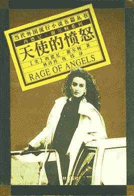

那个书的最后写道：她又向前走，去继续去寻找那看不见摸不着的正义。

那个时候我对法律的理解，是觉得它一件很浪漫的事情，对于律师这个职业觉得既刺激又很酷炫。

哈佛是一个很白左的地方，它聚集了大批理想主义的人。我后来到了学校里跟大家聊天，发现我的那些美国同学，大家也或多或少都在他们的个人陈述里写了正义。

但是法学院很快就摧毁了我们心中的理想主义，我们很快能够发现法律没有那么单纯，它也未必永远实现的正义，法律是一套非常复杂的规则，它不断的被改写，被解读，甚至被利用。

#### 法律是一套复杂的规则，律师的工作很像打扑克，也像一场辩论赛

我们教民法程序的教授鲁宾斯坦，他是美国最权威的民法学者之一，他曾经把律师的工作比喻为打扑克。他跟我们说，整个诉讼的过程，就像每个人手里都抓着一副牌，每一个律师手里都有一副有各种组合的牌。

当然，这副牌里当然不只有正义，不只有事实，还包含复杂的诉讼程序、法律，也包含法官的偏好，包含那个时候的社会舆论。

比如你的陪审团的组成，他们的性别、他们的种族、他们的宗教信仰、他们的情绪。甚至还包含很多很表面功夫的东西，比如你的证人是不是看上去老实可靠？你的当事人是不是看上去惹人同情？所有的这一切都是一个律师手里的牌，他都要学会怎么样去打。

我们在律政剧里看惯了那种很精彩的法庭辩论，带着主角光环的律师最后会用慷慨激昂的结案陈词决定个体的生死。但是事实上那种情况是很少发生的，90%以上的案子根本不会进入庭审程序。一个案子从它立案到结案，中间有几个月甚至几年的漫长时光，双方会经过很漫长的斗争，最后到了结案陈词的时候，已经没有什么惊喜可言。

很多案子最终的结果，不是由大家一眼看上去的对错、是非、有罪与否决定的，它就是由很多琐碎的小细节决定的。法庭上的辩论也没有那么的精彩，不是大家永远在谈正义跟公平，很多时候是在谈某一个词语的定义，某一个小的程序是否合法，是一套非常琐碎的过程。

法律很像一场辩论赛，它是一场关于论证的比赛，但它的结果也并不象看上去那样清晰可辨、确定无疑、有一个标准答案。

#### 由旁观的第三者来判断大陆法系和海洋法系的区别

大家可能都知道美国是一个海洋法系的国家，它是以案例作为法律的依据；中国，还有大部分的欧洲国家是大陆法系，我们是有成文法的。

对应这两种不同的法系，有两种不同的法官：海洋法系里的法官，我们把它叫做"对抗体系里的法官"，这些法官是袖手旁观的裁决者，他们不参与法庭的取证调查，他们不参与去研究一个案子里的是非对错，他们就是任由双方把所有的证据摆到他们的面前，作出裁决。

大陆法系里的法官叫做"调查型的法官"，他们更接近于中国人对于"青天大老爷"的理解，他们会参与到这个案子的调查，但是时代的潮流是向着对抗形式的法庭在发展。

大家可能不认同这样的一种形式能够实现正义。它背后的依据就是每一个人都得到充分地表达自我的机会，再由一个完全独立的第三方去看，到底谁该承担多大的责任。

无论是这个原则，还是它在实践当中的可操作性，我们都可以去讨论和质疑，但是我们没有办法否认，这就是这个时代的事实。我们不再生活在一个有"青天"的时代，我们没有办法再等待最后有一个公正的裁决者，帮我们辨明一切的是非、还我们以公道。

#### 像律师一样思考：打好手里的每一张牌

但我们在现实当中会不停的面对各种问题、面对各种各样的规则，这时候就需要我们用自己手里不同的牌，去为自己争取利益，所以这样的一种斗争跟思考，它不只属于法庭，法庭当然是充满斗争、充满争取的地方，可是这种斗争跟思考其实也是我们生活的一部分。

所谓律师的思维方式，就是一个律师在思考怎么为自己/为当事人争取利益，怎么处理一个案子的时候，要思考怎么打每一张牌，他要尝试所有可能的路径、去为自己争取所有可能的利益。

比如我该在什么地方打这场官司，这个地方的人情、意识形态，这个地方的种族构成，这个地方的经济状况对我是不是有利？这个地方的人是支持川普还是奥巴马，他们会更偏向于我的当事人吗？

我该在什么时候打这场官司？我该怎么样根据一个法官的断案风格来改变自己的辩护策略？所有的这些看上去很小的选择，最终在决定着你的成败。而这些选择又会彼此的牵制、彼此的影响。

#### 律师思维方式之一：要务实

所以一个律师的思维方式首先是务实的。与其在构思宏大的论述，先要去看程序上有没有什么低成本的捷径可走。在尝试证明自己之前，先去看看对方的逻辑链上有什么缺失的环节可以攻击。

#### 律师思维方式之二：要有新的角度

但它同样是需要创意的。特别是在案例法的国家里，有很多从未出现过的状况，有很多之前的法官从未判决过的事实，也有很多需要你改变法律，为自己争取利益的时刻。

比如说，之前我们知道有美国在裁定同性恋婚姻是否合法化的历程当中，有一个蛋糕案，就是一个蛋糕店的店主拒绝为一对同性恋的伴侣制作结婚蛋糕，它表面上看可能是一个比较接近于买卖合同，也就是合同法里的案子，但是这个辩方律师提出的其中一个角度是，这是蛋糕店店主有言论自由的权利。

又比如今天美国有它所谓的《平权法》，黑人或者是少数族裔的学生，会得到一些各种各样的社会政策上的优待，所以很多人质疑这是一种逆向的歧视。而支持平权法案的律师或法官会要求你，会告诉你，我们换一个角度，不是从比较黑人和白人学生的待遇上，而是从整体上去看，这就不是区别对待、而是多元了。

类似这样的故事会有很多，因为法律是一套规则，它是在规则之下关于论证的比赛，正义的标准原本就模糊不清，它随着时代而变化，它在不同的场景里被解读和应用。

但是，我不知道大家是不是会因此动摇对法律的信心，就像我见山不是山，最初学习法律的时候经历过的很多困惑一样。

#### 法律是现实的，也许有时候不择手段，但请不要忘了当初为什么选择

我之前提到的那位鲁宾斯坦教授，在他最后一节课的时候，跟我们聊起他为什么要学法律。他说他小的时候，他的爸妈就像我们很多人的爸妈一样，为了鼓励他、警醒他好好学习，把他带到了当时的重工业城市匹兹堡，去看那里的产业工人如何辛勤地劳作，然后告诉他，如果你不好好读书，将来你也需要这样辛苦工作，出卖自己的劳力。

他后来考上哈佛，成为一个非常成功的律师，结果却发现人生并没有什么不同，他没有出卖劳力给资本，但却出卖了脑力。他觉得这甚至更可怕，它就说我们就像是把自己的脑袋拿出来摆在那里，给出价高的人拿去用。

这仿佛也就是很多人对律师有微词、有偏见、有不满的人对于律师这份职业的理解，某种程度上这也就是我们的职业道德。但他说，我也希望你们永远会回想起自己在申请法学院的个人陈述里曾经写过的话，不要忘了你是为什么选择法律，也记住有一些东西终究是不能拿来卖的。

像律师一样思考，注定是很现实的，注定有它很现实的一面。法官不是青天，他们有真实的人性，律师有的时候可能不够君子，他们不得不选择那些不择手段的创意。所以这些思维方式，一方面可能可以提供给大家分析解决现实生活的问题、一些启发。

因此我们这门课的切入点是一个律师面对疑难案件真实的思维过程，如何面对整套诉讼程序，如何在每个步骤上尽力争取，从选择起诉地点和时间，到如何收集和保护证据，借由复杂程序找捷径，也借由程序正义搞拖延，到挑选证人和陪审团，用看上去没有明显联系的过往判例为自己的立场辩护，或是从庞大的案例库，自相矛盾的判例中，找出原则跟道理。

我们当然会介绍那些有改变历史般影响力的划时代案件，但不是为了重温历史，是为了看这些案子里那些律师跟法官精彩的表演，他们的脑洞，他们的思维方式，以及他们的八卦，他们作为人的偏见和远见。

当然，法律和案例都是不是万能的，社会不停变化，许多案例渐渐不合于时代，许多问题从来没有被法律回答，这些时候我们做何选择？

我们不得不回到那些宏大概念，比如公平正义，回到法律的目的，合同法应该让人放心合作，产权法应该让人放心赚钱，刑法呢，应该放下报复，走向惩戒跟预防，宪法问题呢，我们到底想要生活在一个怎样的社会？那就让我们一同探讨。

# 1\. 法律是什么？

（公众号懒人找资源，懒人专属群分享。）

在我们正式地一步一步去聊律师是怎样处理、分析一个案子，去聊律师的思维方式以前，我们先用几期节目，跟大家泛泛地谈一谈我们这个节目当中会涉及的一些根本的概念，比如：法律、律师、诉讼程序、司法制度。

#### 法律是什么？

先说法律。法律跟这个社会的关系是什么样的？我们为什么都得服从于法律，法律的目的又是什么呢？

其实开篇词讲完以后，我自己有反思，我们这是一个讲法律的节目，结果一上来就先把法律推下了神坛，可能已经有很多人不认同了，我对法律的描述似乎太过现实。

我是说法律不代表正义，它未必就是对的，它遵守跟反映一些根本的原则，但它同时是很多利益相互博弈，然后又妥协的结果，它是历史跟时代的产物。

这确实是我个人的看法，但是我也认同，我也完全接受在"法律是什么，法律应该是什么"这个问题上，是没有标准答案。很多人不这样看。

#### 恶法非法 or 恶法亦法

关于法律的辩论，有一个古老的、经典的辩题，大家可能都听过这样一句话，叫做"恶法非法"，恶的法律不是法。

反过来，站在它对立面的，特别现实的那一半，会说"恶法亦法"。不管这个法律恶不恶，只要是这个社会当中，颁行天下的、立法机关制定的，会被执行的法律那当然都是法。

善与恶如何区分，什么叫作"恶"？是一个伦理学的问题，从一个法律人的角度，我们要回答的是：我们怎么去看，什么样的法律，在这个社会当中成为法律，我们是不是只去很现实地看，这个国家的立法机关，这个国家的政治体制，看这个社会当中实际在执行什么样的法律？

还是我们也会去问：这些法律，有没有、要不要遵循一些起码的底线跟原则？

认为"恶法非法"的一方会说，如果这个法律是恶的，它是非善的，它是不正义的，它就不配叫做法律，而这个社会当中的公民，也没有义务去遵守这样的法律。

那我们这个节目讲的是，现实当中律师的思维模式，不是学者的哲学探讨，所以我们尽量不去做很多很抽象的哲学讨论。

可是又如上一讲所说，法律真正让人感兴趣的地方，不是那些普世的、大家都认同的、一般的规则，而是那些规则当中很难解决的意外，是那些疑难问题，是那些仿佛往哪一边走都有理可依的、有情可循的、悬而未决的问题。

#### 法实证主义与自然法传统

所以在回答这些问题的时候，我们不得不回到一些更深刻的思考，包括法律的目的、法律的原则。

法学当中有一个我个人其实非常感兴趣的分支，叫做法哲学，或者叫法理学。

它和所有的法律的分支都不一样，它不是去看现实当中的法律是怎么样，比如签订合同一共分几步，WTO 会怎么裁决各国之间的贸易纠纷，它不是具体地去看法律是怎样的，而是去问：法律应该是怎样的？它研究的是法律背后的道理。

哲学思辨的世界，我们看理想有很多哲学节目，大家可能感受过，哲学家走到一起的时候，是很难达成什么共识的，它分成很多很多的分支跟派系，有很多细微的、一眼看上去都看不出来的差别。

但是我们泛泛而谈，法哲学有两个最重要的流派，就是法实证主义和自然法传统。

法实证主义，一听这个名字就非常现实，实证就是实践当中去验证这个社会认可什么样的法律。

自然法传统，自然法这几个字听上去可能就复杂一些。"自然"两个字，不是"道法自然"的这种自然。

事实上， 在历史上占着主导的地位的是自然法传统，它有很深的神学背景。比如说西方伊斯兰世界，它的司法体系都跟它的宗教体系密不可分，自然法的历史也是如此。

#### 自然法传统中的宗教色彩

自然法历史上最重要的法理学家托马斯\*阿奎纳斯，这是位中世纪的学者，他本人的身份其实是一位神学家。

又比如说我们都知道的英国的哲学家洛克，这个在高中的课本上有他的画像，学启蒙哲学的时候，一定会讲到这个人，讲天赋人权、讲社会契约论的人。

我们之前提到产权法，是整个英美的司法体系里像基石一样的存在，洛克就是产权法历史上不可以迈过的一个人物。

我们今天回头去读洛克的书，大家如果有兴趣去读他的原文，你会发现满篇频率最高的仿佛就是"上帝"这个词。

他本人是一个有虔诚的宗教信仰的基督徒，当他去论证"产权"这个概念的合理性的时候，他几乎就要说出来"为什么要有产权，因为这是上帝的意志"。

反过来，如果是违背上帝意志的法律，哪怕它是被世俗政权所认定的、颁布的，哪怕它有国家暴力的背书，那也不是真的法律，这是自然法的传统。

所以，它有一个神学背书的时候，它就有非常理直气壮地去说"恶法非法"，因为"法"的正当性和合理性来自于上帝的意志所认定的"善"的定义。

#### 中国法律传统中的伦理学色彩

中国人的法律传统里面，可能没有什么宗教的色彩，但是我们有挺深的伦理学的色彩，也就是中国的儒家传统文化的影响。

比如我们今天回头去看《大清律》，《大清律》里面一开头它会写十大不赦之罪，就是皇帝大赦天下的时候，有一些罪被认为是罪大恶极、罪不可赦。

这个"十大不赦之罪"，很有意思，它之所以会成为"不赦之罪"，不是看这个罪行的残暴程度，或者是它造成的伤害来确定的。它是看这个罪行有没有违背清朝那个社会最重要的两个伦理道德，就是"忠"和"孝"。

比如说有一个不赦之罪叫"大不敬"，这个在清宫剧里经常能听到。在我们今天看来，"大不敬"有什么的呢，它什么都没有造成什么真实意义上的伤害，可它是对封建秩序的一种不尊重、一种挑战。可是在那个时代，在伦理跟法律紧密结合的时代，它就是在法律里面被确认为不赦之罪。

这个其实也可以被认为是自然法传统的一种体现，如果一个法律，它违背了忠孝之道，那个时代，接受了中国古代这种伦理学所捆绑的法律的人，那他一定会认为"大不敬"是大有问题的。

#### 从自然法学派到实证法学派的转向

我们自己在今天也生活在法律的环境里，其实也都能感受到，无论是整个司法体系，还是自然法传统，这个学说本身，它在发展的过程当中，都是不停地和宗教剥离。

今天的自然法，已经很少谈上帝了，它一般就是谈人的理性，"理性"也是天赋的一部分，也是自然的一部分，一定要讲的话，理性也是上帝赐给人的东西。

包括今天的中国，我们虽然还被认为是成文法和习俗法并存的社会，但是我们在成文法的体系里是逐渐地剥离传统的伦理道德的影响。

所以，法律本身越来越以法实证主义为潮流，它不仅剥离宗教，它也剥离某一个社会、某一个文化、某一个族群，他们特有的一些价值判断。

这个事情的是好是坏，大家可以讨论，但是它就是一个现实当中发生的过程。

#### 案例：狐狸案

比如说我们上一讲当中讲到一个狐狸案，真的听上去是一个很小的案子，两个人抢一只狐狸而已，一只狐狸引发的官司。但是这个案子在当年是要上微博热搜的，如果有微博的话。

它引起很大的舆论的关注。一个原因是其中这个案子当中追狐狸的那个人，首先发现狐狸，带着他的狗开始追狐狸的这个人，是一个很有名的猎手。

那个时代美国刚刚建国，大部分从英国来的移民，他们保留英国上流社会的这种绅士风度、文化习俗，在那个社会的人情世故里面，有一个不成文的礼貌：

如果你是一个猎人，你发现一个野兽，然后你能明显地判断，这个野兽正在被别的什么人追，你都看到狐狸没命地跑了，看到有个狗在追它，你就很明白，这是别人正在追的猎物。一个绅士、一个君子，一个上流社会的文明人，是不会去半路插队，去抢别人的猎物的。

所以那个案子，最后把这只狐狸判给我们上一讲提到的半路上冲出来一枪，把狐狸打死的第二个猎人的时候，舆论哗然。

这是一个对传统习俗的、传统社会礼节的一种挑战，我们最后看到的是效率，而不是习俗、人情，或者说绅士风度成为了法律。

法律服务了一些我刚才所说的更普世的原则，其中包括效率，包括确定性。

#### 我们为什么要遵守法律？

可是我们回头问问：我们为什么要遵守法律？政治哲学里面会常常讲"社会契约论"，会讲我们这个社会中，最初有一批人，走到一起构建社会，大家是自愿的，让渡出某一部分的权利，换取更多的权利，这是一个人群自发的、共同的选择。

可是如果一个社会法律的发展，逐渐的抛弃了风俗习惯、伦理道德，抛弃了人们对正义的朴素理解，其实是为现实做出了让步跟妥协，如果这样的法律，不再拥有这种天然的、由习俗赋予的正当性的时候，我们为什么又要服从于法律呢？

当初那批人自愿地走到一起，自愿地制定出一些规则，它们有一些对正义的理解，如果一个社会的法律的发展，逐渐背离了这些朴素正义观的话，我们为什么还要继续遵守法律呢？

#### 法律为我们的生活提供确定性

这个问题从一个法实证主义，从一个特别现实的人的角度是很容易回答的，因为法律就在那里，你喜欢或者不喜欢，你认同或者不认同，国家机器就在那里，你不得不服。

不得不服，不只是对暴力的一种屈服，而是服从法律有现实的好处。就像我们上一讲所提到的，法律在很多时候，是一种大家共同制定的社会规则，服从规则是有现实好处的。

比如说，我们社会的规则是大家开车要靠右行，我之所以服从这个规则，不是一上高速就开始逆行，根本原因并不是我害怕逆行会被抓到扣掉 12 分，根本原因是，我知道逆行很容易被撞死。

又比如说，社会有法律提供了很多范式，你做一件事情，你必须符合法律的条条框框，这个事情才能做成。

#### 如何立一份有效的遗嘱？

比如你立一个遗嘱，我们推荐你现在找一个律师去立，由这个律师帮你去确认，你的遗嘱在法律上是可行的、是会被执行的，是有法律效力的。而不是你自己悄悄地写一个遗嘱，然后把它藏在正大光明匾的后面。

之所以服从这些条条框框的根本原因并不是对法律的屈服，而是这样做的话，你能够放心，在你过世之后，你生前的意志  
这份遗嘱，会得到社会的执行，这个社会会有一套机制，帮助你实现它。

换言之，我们遵从这些规则，是为了实现一种确定性，我对我自己的行为后果，有确定性，对于别人的行为后果，有可预测性。

#### 淘宝网为何使得网购风靡？

这种可预测性，对于一个社会的发展，是非常重要的。

就好像有人讨论说，淘宝一个中间服务商，它为什么那么成功？

为什么在淘宝出现以前，其实网上购物它的技术上，是很早以前就可以实现的事情，但是在淘宝以前，为什么网上购物从来就没有成为一个流行的选项？

一个很重要的原因，就是因为网上购物这件事情，里含有巨大的不可预测性，或者不确定性。我作为一个买家，我把钱打过去了，我不确定会不会收到货物；我作为一个卖家，我把我的货寄出去了，我不确定我能不能收到钱。

而淘宝做的事情是什么？它就是作为一个平台，来帮助双方提供确定性。它的手段是我这个买方，先把钱打给平台，它能够向你保证等你收到货了我这个钱才付出去。

他又向卖方保证，我这个平台已经从买方那里收到了钱，只要你把货交过去，我就能把这个钱打给你。这就是确定性带来的巨大好处。

我们到今天已经没有办法想象没有网购的生活了，可是它不是一个自然而然的事情，它依赖于有人聪明地设置了消除不确定性的机制。

法律在很多时候，在规则以内的时候，其实就是帮助我们这个社会消除不确定性，它让这个社会的合作成为一种可能。

#### 法律是冲突的裁判者，也是终极权威

我们也提到，规则之外是有例外的。法律同时还扮演着一个仲裁者的角色，当人们出现争执、出现冲突的时候，法律提供了一个裁判。

但是很有趣的是，法律的这种仲裁的权威，它是一种提供确定性的权威。大家想想看，我们这个社会当中的权威其实是很多的，各种各样的专家教授。

公说公有理，婆说婆有理，有没有哪个权威可以站出来拍板说：在这个问题上，我是终极权威？很少的，几乎没有。但是法律有，法律就可以说，在打官司、审案子这件事上，法律就是终极权威。

为什么有的上诉法庭他最后的宣判书上可以说"本庭的以上裁决为本案终审判决"？

终审判决是什么意思？终了。这个事情到此为止了，我这个法院，之前给了你上诉的权利，不服可以上诉，可是上诉是有尽头的，这个争端是有尽头的。哪怕这个终审判决，当事人双方未必心服口服、心悦诚服，可是这个社会要提供一套机制，让这个争端有尽头，它需要有一个权威站出来说，好，到此为止。

冤冤相报是可以了的，而且必须得了。当法庭作为终审判决的唯一的仲裁者、唯一的权威，作出了判决之后，你是不可以再挑战的，再挑战的话，就是挑战这个社会的秩序。

比如说在狐狸案里，第一个追狐狸的猎人，他得到整个舆论的支持，他有习俗的保护，他心中可能有自认为正义的主张。可是法院已经把狐狸判给了对方，他不可以说"我不服你这个权威，我觉得你不行，我另外找一个权威，让他来评评理，然后，我把这个狐狸再抢过来"，那就不是再找权威的问题了，那就构成抢劫了，那就是另外一个案子。

所以，法律的权威，是一种带来可预测的权威，它是一种为社会奠定确定性的权威，它不同于一般的权威。

#### 法律具有强制性

为什么这个最终权威这么厉害，你不得不服？

因为法律除了帮人分东西，他还可以从你身上拿走东西，它有国家暴力的背书。

你去抢了别人的狐狸，这个法院不仅可以把狐狸判给了别人，当你不服这个判决，再把这只狐狸抢过来的时候，这个法院可以从你身上再拿走东西，可以让你交罚款，可以拿走你的财产，甚至你的自由、你的生命。

关于为什么一个人违反了法律会被限制自由，有两种非常有趣、价值观很不一样的解释。

一种是说，因为自由是一个人很珍贵的财富，如果你的行为给别人造成了伤害，你要为之付出代价，你付出的代价就是你的自由。

另一种是反过来说的，这个社会把你投进监狱，恰恰就是尊重你的自由意志，因为你作为一个自由的人，自由地选择了违反法律，那么为了尊重你的选择，我们就让你付出相应的代价。

第二种话可能说得很好听，但是这两种解释回归到一点，就是在一个规则已经形成的社会，在一个已经拥有了法律的社会里，人是不再拥有绝对的自由的，这个自由，至少受到法律原则的束缚。

所谓"人生而自由，却又无往不在枷锁之中"，这句话最初被卢梭说出来的时候，他不是在说法律本身，但他是在说我们很熟悉的产权。

#### 遵守法律是社会成员的义务

当然即便是最现实的、最法实证主义的学者、法学家，也不会说一个人遵守法律仅仅是一种利弊的衡量，利大于弊的时候，我就遵守；弊大于利的时候，那就算了。

我们不会说遵守法律是一个人的选择，我们通常会说遵守法律是一种义务，或者人有遵守法律的义务。

义务这个词，是上升到道德层面的一个词。除了现实的好坏，一个人遵守法律，会被在道德层面上认为是一件好事；就是一个遵守法律的人，我们会觉得他是一个好人，或者这是你应该做的事。

这样的讨论当中，就超越了个人在遵守法律所权衡的利弊，它上升到了遵守法律会给这个社会、整体、公益带来的好处。

#### 例证：张扣扣为母杀人案 vs 唐代为父报仇案

我来举一个例子，在我准备这个课的这段时间，我一直在关注，其实是全民都在关注一个"血亲复仇"的案件张扣扣为母报仇杀人案。

这个叫张扣扣的青年，他在自己十几岁时，目睹自己的母亲，被别人殴打致死，根据他的律师的说法，他在成长的 20 年中，从来没有觉得自己得到法律公正的对待，于是他选择了亲自动手，去为母亲杀人报仇。

我蛮震惊的是，我与此同时读到唐代的历史，就是在 1300 年前的唐玄宗时代，社会舆论曾经在一段时间内社会舆论也像这样非常热烈地讨论过一个非常相似的案子。

这个案子当中的主角之一，是我们很熟悉的唐代的大诗人张九龄，就是写"海上生明月，天涯共此时"的张九龄。他除了是一个诗人，还是一个政治家，他官至唐朝的中书令，相当于宰相。

但他这个宰相，做的时间很短，两三年就下台。他下台的原因之一，就是在一个案子上，跟唐玄宗产生了分歧。这个案子跟"张扣扣为母报仇案"很像。

这个案子非常简单，有两个人谋杀了一位检察官员，他们对自己杀人的事实供认不讳，但他们认为自己这样做是对的，他们认为这位检察官员，应该为自己父亲的冤死负责，杀父之仇，不共戴天，所以他们选择了报仇。

这个案子和张扣扣案的相似之处是，他在民间赢得了巨大的支持。特别是在那个时代，帝国以孝治天下，孝是天下的传统，当然传承至今，不过在那个时候，他是被统治阶级抬到一个非常高的地位。

张九龄对这两位杀人犯非常同情，他认为法律应该网开一面，在法律当中含入人情的考量，但是唐玄宗，以及后来取代张九龄的奸相李林甫，站在他的对立面。最后唐玄宗亲自决定将这两个人杖杀。

这个结果也是当时引致舆论哗然，民间有很多人出钱，将这两个人杀人犯、孝子集资安葬，而且有很多的人为他们写下诗文，歌颂这两位孝子的"义"行。

我挺感慨的是，开元年间发生的事情，到今天差不多正好 1300 年过去了，但是我们的社会，依然在讨论情与法之间的取舍。

#### 法律对暴力的垄断

中国，或者说人类社会拥有法治，特别是拥有刑法、拥有刑治，已经有非常漫长的历史，从汉谟拉比法典到今天 3700 年，侠客、复仇，这样的故事总是为法治社会所不能容许，但它又永远在民间拥有很大的市场，拥有众多的支持。

但是当我们去讲，为什么人要服从法律这件事的时候，无论我们对孝子、对复仇、对法外正义有多少尊敬，对侠客有多少向往，对张扣扣，或者对 1300 年前那个案子当中的两个孝子，有多少同情，当我们接受法治这个概念，接受人服从法律是一种义务，服从法律是一件好事的时候，就是要接受它对暴力的垄断，甚至接受这种垄断是一件好事。

唐玄宗在当年那个案子里发布了一道敕书，说：国家制定法律，原本就是为了防止谋杀，如果每个人都可以私下复仇，天底下又有谁不是孝子？如此恶性循环，又何时是个尽头？

这段话，也跟我们今天回头去看"血亲复仇"案的讨论里，那些理性派的声音非常的相似。

当然我承认，每个案子都有它的特别之处，说张扣扣这个案子有其他的讨论空间，包括他母亲当年被打死，那个案子有没有得到法律公正的处理？

每一个案子都有其特殊性，但是我们只讨论"血亲复仇"概念的时候，我们明白，复仇的故事，在民间是容易赢得支持。从人心出发，我们是很容易同情跟原谅这样的事情，可是从法治这个概念出发，它却不容许任何的例外，不允许私相复仇这种行为存在。

更何况，法律不止关乎刑法，"法治"这个概念是大于"刑治"，所以我们说，中国古代诸子百家里的法家学说是一个"刑治"的学说，它不是真正的法治社会。

它不只是把暴力收归公权力所有，它是把所有的权威、把所有的仲裁，把所有法律可以管的事情的最终决定权，都收归公权力所有，否则的话，这个社会有时是法律管、有时是舆论管，那这个社会就不可以被称作法治。

没有一个法治系统，没有一套法治的制度，可以是完美的。

可能它一定会在某一些具体的案子里犯错，它一定会在某一些具体的案子里，跟社会的舆论，跟大家心中所向往的正义有出入。

可是这一套对暴力的垄断、对权威的垄断，却是这个社会拥有可预测性、拥有确定性的基础，这种确定性所带来的巨大好处，是没有办法替代的。

我们可以不停地去思考跟改良法律，可是要实现法治所带来的好处的一个前提，是我们接受它拥有最终裁判权，一切争议都必须得有一个尽头，因为必须要接受终审判决，因为只有这种终审判决，才拥有确定性这个的巨大优势。

# 2\. 刑罚的目的是什么？| 为什么是检察机关提起刑事诉讼（上）

（公众号懒人找资源，懒人专属群分享。）

上一集我们说到，在我们正式地一步一步去聊律师是怎样处理、分析一个案子，去聊律师的思维方式以前，我们先用几期节目，跟大家泛泛地谈一谈我们这个节目当中会涉及的一些根本的概念，比如：法律、律师、诉讼程序、司法制度。

上一集我们主要讲了法律和社会的关系是什么，为什么我们要遵守法律，以及法律的强制性。

我们再进一步地去看，法律把权威和暴力都收归公权力所有，不只是为了冤冤相报有时了，不只是为了为了让大家都能用和平的手段去解决争端。

法律不只是不允许人以暴制暴的私下里解决问题，当然是要所有人大家都到法庭上去解决问题。可是即便到了法庭上，人也不是为所欲为的，人的行为还会受到种种程序上的限制，这些程序上的限制也关乎一个法律体系的正当性，关乎一个人为什么要接受法律的惩罚，法律惩罚人的权力和正当性来自哪里？

#### 刑事诉讼：由检察机关提起公诉

我们从一些最一般的问题说起，不知道大家平时在看一些社会热点案件的时候，会不会有好奇，关注到一些案情以外的问题。比如说，我们听到一些重大的刑事案件的报道，例如杀人放火、强奸、抢劫，我们都会听到新闻里面说："公安机关侦查"、"检察机关提起公诉"  
。

可是在我们平时的生活里，通常会遇到的那些法律问题，比如租房子被赶出来了，别人欠钱不还啦，通常就是一些民事案件，在这些案子里面，是没有一个检察机关会出来帮我们提起公诉的，这些民事案件，都得自己找律师，自己去告；自己不告，这事情就过了，这事就算了。

反过来，为什么杀人、强奸这些刑事案发生的时候，无论被害者是谁，被害者家属是谁，一般没有听说过有哪个被害者是自己去告这些杀人犯、抢劫犯的？

我们用一个具体的例子来说我们举这个例子，只是为了说明一种程序上的原则，不是有任何偏向  
比如大家都知道刘强东，他在美国被人起诉性侵犯了一位女大学生。

这个案子，最初因为涉及强奸，涉及有可能的刑事犯罪，所以最初是以刑事案立案的，当地明尼苏达州的地方检察官，是明尼苏达的公诉部门，在处理这个案子。

但是后来，地方检察官觉得证据不足以提起刑事诉讼，所以这个刑诉就没有再继续下去。这个案子的刑事部分就到此为止。

但我们知道，这个当事人，这位女大学生，今年她自己发起了一个民事诉讼，针对的是同样的一件事，但是她只能提起民事诉讼。

她在起诉书里，所提要求的也都是经济上的、名誉上的补偿，她是不能要求刘强东被刑法定罪，把他投进监狱的。

当然了，这个案子的是非黑白，我们应该留给法律去判断。但大家会不会觉得有点疑惑，让我们假设一个人，真的被性侵犯了、真的被对方刑事伤害了，我作为一个当事人，当地的地方检察机关觉得证据不足，他们放弃了起诉，可是，我不服这个放弃起诉的决定，我这个时候为什么不可以捍卫自己的权利？我自己去提起刑事诉讼呢？

#### 大部分国家，个人不能提起刑事诉讼

我当然是可以提起民事诉讼，可是如果我真的是被伤害了，我可能觉得民事诉讼是远远不够的，我觉得经济补偿是不够的，我要的是  
伤害我的那个人付出应得的代价，我要的就是他得到刑事上的惩罚，为什么我不可以自己去争取呢？

在中文里面"起诉"这个词，我们同时用在民事案例和刑事案例里面，但是英语里面其实是有分别的，民事案例，我们通常说一个人会 sue 另一个人，但是在刑事案里面，我们通常会说，地方检察机关 prosecute 一个人，提起公诉，而提起公诉的这个机关通常被叫作 prosecutor（公诉人）。

所以它是有分别的，大部分的国家里，一个人，一个公民，一个个体，是不可以自己去提起刑事诉讼的。

#### 例外："自诉人"制度

当然有一种例外，就是"自诉人"这个概念。比如在我们国家里有一些例外情况，是允许公民个人去提起刑诉的。

比如说刑事犯罪非常的轻微，或者说刑事犯罪证据确凿、证据明显，它不再需要经过一个侦查的环节，以及有一部分刑事案出于对当事人、被害人利益着想，可能被害人自己不愿意提起刑诉。

比如说有一些案子涉及到一个人的隐私，涉及到他的名誉，如果检察机关不顾他的意愿去提起公诉，可能会造成二次伤害。在这些非常狭窄的限缩的情况里，我们国家的《刑法》允许个人去提起刑诉。

美国会更复杂一些，因为我们知道美国是一个联邦制的国家，它的每一个州都有自己的司法体系，它都保留着自己的法律。特别是刑法通常是留给每个州自己去裁决的，有一些州还允许个人去刑诉另一个人。

美国的联邦法院，作为一个整体的联邦法律是非常明确的，不允许。为什么会这样？这件事情看上去理所当然，我们都习惯了检察机关提起公诉。可是有没有想为什么？一旦问为什么的时候，是不是答案其实没有那么明显？

#### 律师的思维方式：保持高度敏感和好奇心

美国最高法院在 1973 年的一个案子里，第一次正面地、明确地回答了这个问题，我们就借由对这个案子的详细的讨论，思考一下这个问题。

我来跑个题，我刚才说到，"美国的最高法院在 1973 年回答这个问题"的时候，会不会有人觉得很好奇：唉，这么一件重要的事情，这个是诉讼程序里面的一个很根本的问题。美国这个国家，不是从建国开始就号称是法治社会吗？为什么要等到 1973 年才回答这个问题呢？虽然它的历史很短，但毕竟也过去了两百年。

为了证明不是我自己思维跳脱，我给大家一个小的 tips，因为这个节目讲的是律师的思维方式，不遵循一定的套路，律师的思维方式当中有一个很重要的元素，是要保持很高的敏感度，要保持很强烈的好奇心。

就是你在阅读一个卷宗，分析一些材料的时候，有任何让你轻微地感觉到不适，你觉得这个是不是有哪里不太对劲的东西，都应该去抓住，因为这些小小的细节，很有可能就是影响整个案子成败的关键。所以我们会时不时的插入一些小 tips。

#### 美国最高法院的自我设限

为什么美国的最高法院，一直到 1973 年才回答这个问题。这个问题背后，就是美国的司法制度了，这个是美国最高法院的一个特色，我们都学过，美国是一个三权分立的国家，他的司法体系看上去是一个很权威的机构。

因为过去几年间，一些社会热点的案件，把美国的最高法院推上风口浪尖，好像美国一些很重要的事情，都是由那九位大法官来决定的，比如说布什和戈尔，到底谁赢得了总统大选？几十万张选票的差距该怎么考量？不是由选民决定，而是由这九个人决定。比如说同性恋婚姻是不是应该合法化，明明社会还非常的撕裂；又比如说在 50 年代的布朗案里面，当年的最高法院几乎是凭一己之力，对抗整个社会潮流，结束了美国南方长达半个多世纪的种族隔离。

美国最高法院看上去是很有权力的，但是另一方面，美国最高法院很喜欢给自己自我设限，其中一个自我设限，就是最高法院它只处理摆到他面前的案子、摆到它面前的纠纷，它只处理具体的争端，在这个争端以外，它不多说一句话。

就是一个案子还没有打到最高法院的时候，谁来问最高法院的意见，法官们是不说话的。

#### 例证：特朗普的"限穆令"

比如说我们都知道美国总统特朗普，他在刚上台的时候就颁布了一个"禁穆令"，限制几个穆斯林国家的美国签证。

这个行政命令是引起巨大的社会争议的，很多人拥护，很多人反对，但很快就变成了好几个官司，在好几个不同的州开始打，有好几个法院就禁止了这个"禁穆令"。

当时从一开始，大家都能够预感到，这个案子是一定会打到最高法院的，因为不同的州，因为他们的意识形态的不同，他们判决的结果也不一样。当州的法院产生了分歧的时候，通常会由最高法院来解决他们的分歧，那既然最后都是要由最高法院来决定的，为什么最高法院不能替社会省省心，它就直接站出来说：好，那我们来聊一下这个话题，禁穆令到底是不是符合宪法？

它不说，它等着，这个案子要从地区法院开始打，在好几个州的地区打，上诉到不同的巡回法庭，再上诉到最高法院，一打好几年就过去了。

为什么是这样呢？因为这个最高法院，从它创立不久之后，就有一个自我设限是，不为任何的政府机关，包括总统和国会，提供任何建议型的意见。

这个其实是蛮特别的一个自我限制，因为在欧洲有很多国家，他们的最高法院或者是他们一个特别的宪法法庭，是会针对一些争议性的问题发表看法的，当他们被国会或总统咨询的时候，他们是可以给出回答的。

这个故事就有一个我觉得还蛮有趣的渊源，我们再来讲一下这个渊源的故事，这个故事也体现了成文法和案例法的一些特色。

#### 例证：华盛顿总统就是否参战向最高法院的询问

这个故事要说回到 1793 年，我们知道美国的宪法制定的是 1787 年，叫作"1787 年宪法"，确立三权分立的体制，1793 年也就是这个国家刚刚才建立不久，这个时候美国的总统还是第一位总统，华盛顿。

跟美国独立纠葛很多的两个国家，英国和法国，这个时候爆发了战争，华盛顿就不想再掺和欧洲的事，他就不想在这个战争当中偏袒任何一方，所以他就想宣布一个第三方中立的和平声明。

但是他就遇上了一个困境，这是成文法系当中常有的困境。因为这个宪法是 1787 年刚刚才立定，它还是一个很新的宪法，而且我们今天去翻这个宪法，这个宪法当然非常的有名，可是它其实就是一本小册子，它的语言可以说非常精炼，但其实是非常模糊，非常泛泛的、概括性的。

成文法的一个重要的局限是，在制定法律的时候，立法者无法预测未来，他们无法方方面面地预测到将来这个国家、社会会遇上哪些具体的问题，所以它就有一些照顾不到的地方。

华盛顿在这个时候遇到一个什么问题呢？就是这个宪法里面很明确地写了：国会有权力宣战，就是宣布参战的权力属于国会，可是它没有写谁有权力宣布和平；它写了谁有权力宣布"美国参战"，但它没有写，谁有权力宣布"美国不参战"。

于是，华盛顿他也不想做一个一上台就被指责滥用权力的总统，他谨慎地就把这个问题抛给了最高法院。他以一个询问的形式，要求最高法院给他出具一个法律上的建议：在这个宪法底下，总统有没有权力宣布不参战呢？

成文法的问题又来了，成文法里面同样没有写清楚：当总统询问最高法院关于宪法问题的时候，最高法院可不可以回答总统呢？

这个时候相当于美国的最高法院，自己又是裁判，又是运动员，它要自己替自己来划定自己的权力，最高法院的选择是，不，我们没有，我们没有这个权利，《宪法》里没说，我们自己也不给自己。

这样一下子，我们就转到了案例法，因为美国归根结底是一个案例法的国家。案例法什么意思？《宪法》所留下的诸多的空白，要在接下来 200 年的时间里，由它的一层层的法院去逐渐地填补。

最高法院在 1793 年做出的这个决定，它作为一个"判例"，就成为了法律的一部分，直到今天都还是有法律约束力，直到今天美国的最高法院，它都只管告到它面前的案子，此外不多说一句话，不给任何的建议。

当时做出这个决定的大法官是美历史上的第一位最高法院大法官，约翰\*杰伊，他是一位很有名的联邦党人，美国的建国之父之一。

那个年代的最高法院，它自己还处于一个保守的年代，不愿意多掺和事。"三权分立"虽然在一开始就说是"三权并存/并立、互相牵制"，但其实法院却被设置为一个比较虚弱的机构。随着时代更迭，最高法院会在一个个案子中扩张自己的权力。

如果这个问题迟几年，被问到后来的一些权力扩张型的时代的最高法院，它的回答可能就完全不同。所以案例法里面，法律的走向，有一些历史偶然性。就是这个问题正好撞到了这位法官，他的判例就成为了法律。

#### 美国最高法院对个体提出刑事诉讼的限制

我们不多说这个渊源、这个案子。  
虽然个人有没有权利提起刑诉，看上去是一个很根本的问题，但是直到 1793 年，最高法院才终于直面了一个关于这个问题的案子，它才终于有一个机会去通过解决纠纷的方法，正面回答这个问题。因为我们之前说过了，如果没有相关的案子告上来，它是不可以主动地去发布对任何问题的看法的。

#### 案例：非婚生子女抚养费案

可是终于等到的这个案子，乍一看上去，跟我们讨论的这个纠纷是完全无关的，这个案子看上去是一个更平凡的案子，这案子讲了什么呢？就是两个人恋爱，没有结婚，就生了一个孩子，然后这个当爹的，就拒绝给这个孩子付抚养费。

这个案子发生在德克萨斯州，当时在德州的法律里面，这是一个刑事案，一个父亲拒绝给他的孩子抚养费，这是一个刑事上的犯罪。

可是，我们要不停地回来，这是在案例法的美国。之前德州的法院对于这个法律做出过司法解释，就是之前的法庭在应用这个案子的时候，出台的司法解释是说，这个法律并不适用于非婚生的子女。

一个法院是怎么用这个法律、是怎么解释这个法律，这个解释本身在案例法体系里就构成法律的一部分。所以根据这个司法解释，当地的地区检察官就没有提起公诉，没有去告这个拒绝付抚养费的父亲。

这个母亲，就把这个地区检察官告上了法庭。她告的理由是，地区检察官在应用法律的过程当中，或者是这个法律在被应用的过程当中，构成了对非婚生子女的歧视。

我们来理一下：就是一个案子从事实上看上去是抚养费的问题，但是当这个妈妈去告的时候，她告的理论依据是歧视的问题，可这个案子最后判出来的结果，它决定的是：个人有没有权利提起刑诉？

我们一层层地来看。"歧视"这个词我们常常听到，美国这个国家是对歧视问题非常敏感的一个地方，因为它有漫长的种族隔离的历史。

但是不是所有看上去不一样的，看上去不太公平的差别对待，都是一种歧视。要证明歧视的存在，简单地说，有一个句型很好用，就是"only  
because，then"，"仅仅因为什么，就怎么样了"  
仅仅因为一个人是黑人，这个餐厅就拒绝服务他，这就是歧视。因为所有其他的条件一样，只是因为他身上有黑人这个特征，只是因为他的种族、肤色，就得到区别对待，这是歧视。

但两个事情同时发生，不代表一定有这种"仅仅因为，就"的因果关系，比如说我被解雇了，我同时是一个女生，我说我被歧视了，不一定，因为有可能同时还有三位男同事被解雇，那解雇和"我是女性"之间就没有因果关系。

在这个案子里，因果关系看上去还蛮明显的，因为所有条件一样，如果这对夫妇是已婚，在婚内生下了这个孩子，根据法律，当地的地区检察官应该会提起公诉，可是就是因为他是一个非婚生的孩子，检察官就拒绝提起公诉。看上去它就符合"仅仅因为，就"这个句型。

这个案子一直告到了美国的最高法院，最高法院的判决是 dismiss，驳回上诉，dismiss 最直接的翻译就是，就这案子被解散了，它都没有进入到庭审和宣判那个环节，最高法院就说，这个案子就不用再打下去了，因为这个母亲没有 standing，没有起诉资格。

这是什么意思？我们去看一个案子，很有可能有的时候很快速地浏览、一些简单的报道：谁输了，谁赢了。一眼看上去，这个妈妈在这个案子里输了，因为法官说，你的上诉被驳回了，你没有起诉资格。

可是输和赢这是一个很泛泛的概括，它其实没有为我们描述，输的和赢的到底是什么。

法官说这个妈妈没有起诉资格的，是什么意思？是说她没有起诉资格去为自己的孩子争取抚养费吗？是说她没有起诉资格去挑战这个法律的歧视、不公正吗？都不是。

因为我们要看的是，她去告的是什么，才知道法官驳回的是什么。

这位妈妈告的事是什么？她不是告这个爹不给抚养费，她不是告这条法律，她告的是那位地区检察官为什么不提起公诉？所以法院驳回的是，你没有起诉资格去要求一个地区检察官根据你的立场、你的要求去提起公诉。

就像我们刚才提到，美国的最高法院，包括它整个联邦法院的体系，都是很喜欢自我设限的，第一条是说，我们只管告到我们面前的案子，这个案子无论多大，我们都可以说话。

它的第二自我设限是，不是所有人把一个案子告到最高法院，最高法院都会回答他、都得会给他一个庭审的机会的。事实上，最高法院是一个有选择权的法院，每年上诉到最高法院的案子，到今天每年有七、八千件，大家知道，最高法院的法官差不多都八、九十岁，他们是不可能每天 996 地审案子的。

事实上，每年允许进入庭审的，每年不足 100 个案子，其中有一个筛选的条件就是，一个人必须是这个案子的当事人，必须是这个案子的持份者，他的个人利益被必须被这个案子的判决结果所影响，我们才说一个人有起诉资格。

路见不平，拔刀相助，是不可以的。我在路上看到一个人被人欺负了，我看到有一个人，别人欠了他的钱不还，这个人胆子太小，他不敢去告，我说，我帮你去告。你到了法庭上，法官说你为什么要告呢？我说因为我被正义召唤，这是不可以的。

因为这个案子的判决结果对于你本人没有什么直接影响，你必须是有个人利益牵涉在其中，才可以去提出一个案子。当然，什么叫作个人利益牵涉其中，这又是一个有很多争议的问题。

在这个案子里，美国的最高法院说，这个妈妈她的个人利益，和地区检察官是否对那个爹提起公诉这个政府行为之间是没有因果关系的、没有牵扯。

大家可能会觉得不认同，你怎么能说这个妈妈没有个人利益牵涉其中？因为这个爹是拒绝给她的孩子抚养费，这很明显地影响了她的经济利益，或者很明显地在伤害她孩子的利益。

对，这一点最高法院同意，可是最高法院说，可是你没有证明的是，我这个政府，这个地区检察官是否提起公诉这件事情，跟这个妈妈在抚养费经济问题之间有什么因果关联。

也就是说，你不能从经济问题直接跳到公诉问题，你不能一步跳跃到，这个妈妈就是得看到这个不负责任的爸爸被投进监狱，这个中间的有因果关系没有被论证，因为这个妈妈的直接利益诉求是"要到钱"，但是她现在在这个案子里，要求的是，这个爸爸被关起来。这两件事之间没有因果关系，没有被论证。

所以说因为这个案子是一个刑事案，它不是一个民事赔偿案，她告的就是地区检察官不履行责任的问题。法院的意思是说，这个爹进不进监狱，对于这个原告妈妈的利益是没有直接影响。

大家可能还是不认同，你说，好，就算他对我经济利益没有直接影响，这个爹这么不负责任，伤害我孩子，那我看着他进了监狱，我心里爽，我心里开心，正义得到了彰显，这不是一种个人利益吗？

问题的关键就在这里了，这就是我们一直想要讨论的，法律在被解释的过程中，它怎么面对它的根本目的，刑罚的根本目的。

那么关于这个问题，还有这个故事的结局，我们留到下一集再来继续讨论。

# 3\. 刑罚的目的是什么？| 为了公众的利益，而不是报复的快感（下）

（公众号懒人找资源，懒人专属群分享。）

上一集我们主要讲到了民事诉讼和刑事诉讼的区别，以及由这个区别引发的一个很重要的思考刑罚的根本目的。

上一集故事里那个未婚妈妈，被最高法院拒绝了刑诉的请求，原因是这个爹进不进监狱，对于这个原告妈妈的利益是没有直接影响。

换句话说，法院的意思就是，是的，这不是你的个人利益，公诉机关是否对他人提起刑事诉讼，他人是否受到刑事处罚不是个人利益，报复的快感不再是一种正当的、法律认可的利益。这个判决的背后，其实是刑罚目的改变。

#### 刑罚的目的：为了公众的利益，不是为了报复的快感

刑罚只能是为了社会的公众利益，而一个私人、个体、公民，不能看到别人受到刑事处罚的时候，说自己有个人利益牵涉其中的，就是你不能说，那个人被绳之以法、被刑罚、付出自由的代价，你不能说，这是我的个人利益，这种报复的快感，不再被法律认同了。

法律不仅不允许一个人以暴制暴，私下里报复，它的目的也不再是帮一个人去报复。刑罚的目的只能是社会的公众利益，因为刑罚的正当性正来自于它维护公众利益。

如果这个案子停在这里，我知道大家可能对它都有很多话想说，它的裁决结果是有限的，我们还可以说：好，那我认了。

那我能说，这个妈妈，或者说这个妈妈的律师，他的策略不够高明，他没有去论证，如果是有一个更好的律师，比如说我上去论证说，那么这个爹他在面对刑法的威胁，他面被提起公诉的风险的时候，他很有可能就愿意给钱了。

所以说政府行为跟个人利益之间还是有关联的，只是在这个案子里没能说清楚而已，这还是一个个案。

可是最高法院的判决书到这个时候话锋一转，就直接讨论起了有没有个人利益牵涉在他人的公诉之中这个问题。

#### 个人有没有资格去挑战公诉机关的决定？

最高法院不请自说，开始聊说：好，那我们现在更泛泛地聊一下，一个个人有没有起诉资格去挑战公诉机关的决定呢？

这个最高法院最后是这样说的，如果一位公民，他本人没有被提起公诉，或者是他没有被威胁将要被公诉，他就没有资格去挑战公诉机关的政策。

美国最高法院历史上大部分的案子，法官们是可以达成一致意见的，就是 unanimous  
opinion，那这种案子要挑战起来就会非常困难。但这个案子，是一个争议案件，它最后的结果是 5:4，就是有五位法官驳回了这位母亲的上诉，但是有四个人并不同意。

最高法院的规矩是这样子，我们刚才提到有九个人当中有一个首席大法官，Chief  
justice，首席大法官其实也没有什么特权，大家都是一人一票，少数服从多数。这个首席大法官比较像一个办公室主任，他主持开会，今天咱们来讨论一下这个很奇怪的抚养费的问题，阿詹法官你先说一下，你说完了；梁文道法官，你来说一下…大家都说的差不多了，我们来投票，投完票以后 5:4，驳回了。

如果这个首席大法官自己也是多数派，他会指定一位法官来写法庭的意见；如果他不是多数的话，剩下的多数派的法官，他们就自己商议一下，选出一个代表来写法庭的意见。

美国最初遵循英国的传统，每一位法官都会写一个意见，它发展到 1973 年这个时候，已经改革成，只需要法庭出具一个意见，这个意见就是这个法庭的裁决，它会成为法律的一部分。

可是其他的法官也有发表观点的自由，有的法官觉得这个代表法官的意见，写的不是很好，写的不是很合我的心，哪怕我们俩最后的判决是一样的，但是他可以写一个补充意见说，好，我认同这个结果，但是我的原因不太一样，或者说他来解释清楚一下到底为什么？

很容易想象，更有动力去写自己的意见，发表观点的通常是少数派的法官，因为他们不认同这个法庭的判决，他要把这个不认同给表达出来。

这个案子是一个争议案件，四位大法官都不认同这个判法，他们中的两位都写了反对意见。

我之前跟大家提到，最高法院的大法官，就是美国法律人的终极梦想，他们就是精英当中的精英，被选出来非常的不容易。

虽然，我们最近两年看到川普任命新的最高法院法官，有很多闹剧似的争端，但是历史上被选进最高法院的法官，一定都是在业界受到认可的，他们的逻辑思维能力、写作能力应该是非常强的。

所以最高法院的这些判词，大家如果对练习英语阅读理解有兴趣，可以去读一读，通常会有逻辑非常清楚的分析跟论证，当然也会是很冗长的对于法律条文的讨论。

比这些判决词更有趣的一个文学题材，就是这些反对意见。

写反对意见的时候，法官们可以比较随性跟自由，因为他这个反对意见不是法庭的裁决，它不是法律的一部分。在这个反对意见里，大家可以更自由地彰显个性，发泄情绪，我们能看到很多大法官，也尤其是当他们不认同的时候，嘲讽腔大开，各种冷嘲热讽、阴阳怪气，或者就是义愤难当、直抒胸臆的放口大骂，各种各样的风格。

这个案子里布莱克本大法官他就写了一个反对意见，我把它归为阴阳怪气的那一类。

因为它是用一种跟法庭商量的口气说：我们来讨论一下，我们这个法院一向有一个传统，就是我们只解决争端，之前我们聊过，我们只解决那些摆到我们面前的具体的案子，根据具体的事实去做一个判断。

我们没有说不请自问，就要对一些原则性的问题发表看法。

这个案子它是有非常具体的事实，有这个母亲所处具体的情况，她的律师提出的抗辩理由，包括律师没有能够解释清楚，从经济利益到刑法、政府行为之间的因果关系，这是这个具体案子里的问题。

可是我们为什么就可以一步到位开始讨论一个原则性的问题？开始讨论每一位公民、每一个个人有没有权利去提起公诉问题？这是法院在不请自说。

其实，最高法院发展到这个年代，关于它应该多放纵自己的权力，有很多的讨论。有很多人认为为了整个司法体系的效率着想，最高法院就不应该就事论事，你就不应该只讨论一个具体的小问题，你就应该借由某一些问题的讨论，给出原则性的意见，这样我们能够节约很多的司法资源，有很多类似的案子就不必再打了。

可是这个事情一直是学派观点，它永远不是一个被法庭正式认可下来的制度，我们会看到很多的摇摆跟争论。

聊回案子，最后判决结果，大家能看出来很有争议。

但是布莱克文法官所表达的不同意见，又说明了案例法世界里的一个很重要的事情。就是我们刚才说，回头去看这个案子，从一开始，它看上去是一个关于抚养费的案子，它为什么最后会变成一个关乎个人有没有权利提起公诉的决定？

当一个律师去面对一个案子的时候，一定要有这样的预期，很多案子最后判决出来的结果，它所裁决的问题，跟这个案子乍看上去、一眼看上去的问题是可以很不一样的。

#### 律师的策略：将案件扩大或缩小

有的时候这恰恰是一种辩论策略。比如我这个律师看到一个很小的问题，我为了实现法律理想也好，为了实现自己的野心也好，为了把这个事情闹大，有机会打进最高法院也好，我故意要把这个问题扩大化，把它变成一个原则问题。

又或者说，我面对的这个问题其实是一个很大的问题，它真的会影响之后许许多多的判罚。可是为了不要给这个法庭负担，法庭不想在这个时候解决这么大的一个问题，我故意把它缩小，聚焦在很具体的问题上，这是律师的选择。

法庭也是有选择的。我这个案子一个案子告上去，我这个法官完全可能话锋一转，它就不再是一个个案了，他就直接决定了一个类型的案子。

像这个案子里，马歇尔法庭不仅拒绝了这一个妈妈要求公诉的权利，他其实拒绝了所有的个体，他从此决定了所有的个体，拒绝了所有的个体、所有的公民提起公诉的权利。

这就是为什么我们在一些律政剧里去看，很多最后告到最高法院的案子。其实不是一个人凭一己之力告上去的，很多那些影响社会政策，影响深远的案子，有的时候会变成代理人案。

#### 代理人案

代理人案什么意思？我们举一个例子，前段时间，阿拉巴马州它令人非常震惊的，在这个时代竟然通过了一个不允许女性堕胎的法案，包括强奸跟乱伦造成的怀孕都不可以堕胎。

这个案子舆论哗然，不仅是因为我们难以想象在今天 2019 年还会发生这样的事情，也是因为它是公然的挑战了美国最高法院在 1973 年已经明确作出了决定，

在 1973 年有一个很重要的判例叫(Roe v.Wade)罗诉韦德案，在那个案子里，美国最高法院是很明确的说了，女性有堕胎的权利。

那个案子就是一个很有名的、很典型的代理人案，这个案子里的原告 Roe，Roe 首先是一个化名，当年出于对这个女孩子的保护，给她起了一个假名。  
她的真名是生 Norma  
McCorvey，这个案子它的代理人性质非常的清楚，就是因为 Roe 很多年以后为自己被代理这件事情感到很后悔，她后来成为一个反堕胎主义者，非常有趣。

这个案子里 Roe 她本身作为一个没有什么权势的小女孩，她是很难以一己之力去打这个官司，但是当时就有一个利益团体，一群律师找到她，他们帮 Roe 去打这个官司，后来她本人在这个官司不停继续的过程当中，其实她本人的参与已经很少了，她只是提供了一个案例背景，提供了一个事实，提供了一个例子而已。

我们也很容易想明白，就是堕胎问题这种官司，对于她本人的利益来说，这个事情是很紧迫的，你堕胎的这个机会一共也只有那么两三个月，对吧？再往下拖，堕胎本身就很危险了。这个案子打到美国最高法院，其实是打了好几年。

对于 Roe 本人来说也不允许堕胎，这个时候已经不是一个问题了。

可是这个对于她来说问题已经不存在了，可是不代表对于千千万万像她一样的意外受孕，或者不愿意把孩子生下来的女性来说，这不是一个问题。代理人案的一个重要的侧面，就是它影响很多相似的利益，它影响很多人的未来的命运。

你不能说这种代理人案是一个假的官司，Roe 这个人虽然用了一个假名，她是确实存在的，她确实面对过想要堕胎却不能的这个问题，她确实是当事人，可是她不是唯一的当事人，她实际上不是唯一的当事人，她的背后有一个很大的人群，很多的利益团体。

这些利益团体，他们会挑选一个案子去做代理人案。 不是说每一个案子出来的时候，我都去打，也不可能。他一定是集中力量办大事，找一个典型，把这个官司打赢。

所以，他们去挑什么样的案子去当典型的时候，会非常的小心。当然他们会挑一个很好的原告，这个原告一个很好的故事，这个故事能够很充分的说明为什么这个法律不合理。

这个原告最好是一个看上去诚实、善良，很容易得到陪审团的同情，很容易得到舆论支持的原告。因为这一个案子会决定所有跟它相似的案子，甚至是整个类型的案子的命运。

如果这个原告没能挑好，她不被舆论所喜欢，她不被陪审团所同情，这一个案子输了，不是这一个人输了，是这一类案子都输了，是这整个社会议题就会被决定。

当然了，社会议题被决定以后，我们现在看到了阿拉巴马州还是通过了一个新的法律，重启对这个社会议题的讨论，但是中间毕竟有相隔 50 年的时间。

所以这个案子其实提醒我们去看一个案子的时候，要去理解这个律师的策略，他是把这个案子扩大了还是缩小了？我们去读一个法官的判决的时候，我们要小心的去问，他是在就事论事，还是在借题发挥？

#### 我们为什么需要法律？

那我们来总结一下，我们和法律的关系是什么？为什么我们这个社会有法律，为什么我们作为纳税人，心甘情愿地出钱，要让这个社会去构建一个司法体系？

有三个主要的原因。

第一是，为这个社会创造一套规则，让彼此的行为变得可预测，让彼此的合作成为可能。

第二个原因是，当我们彼此不再合作，而是出现争端的时候，我们有一个公平以及有尽头的机制去解决问题。

但是解决问题的意义，不止于解决这个问题本身，这是第三点。事实上法律体系，想要实现的是，正是通过一个问题的解决，去规避未来的很多问题，这是一种预防性的解决。

我惩罚一个杀人犯，是为了让将来所有的人，在杀人之前，都好好想想要不要；我解决一个合同的判决，我解决一个条款应该怎么解释，是为了让将来所有想要合作的人在签订合同的时候，都明白他们这么写将来的法律后果是什么？

什么样的规则，什么样的司法体系，什么样的法律，有助于实现以上的目标呢？可能至少有两个原则。

第一，这个司法体系得是公平的，所以它才能服众。

第二，这个司法体系得是高效的，所以它才真的对现实生活产生影响。

有的国家那个司法之拖沓，印度很有名的一个案例，有个案子告了 50 年才终于告下来，也不能说这样的案子没有意义，但是可想而知，这样的案子对于这个社会所起到的警示或者规范作用，可见就是很有限的。

所以一个公正、高效，这样的司法体系，这样的法律在实现着法律的目的，为我们这个社会提供着确定性。

# 番外 | 章莹颖案：这些坏人该死，可我们不该让民主和法治一起陪葬

（公众号懒人找资源，懒人专属群分享。）

我受徐老师的启发，也来跟大家分享一点我对章莹颖案所折射出的美国司法体系的问题的一些看法。

我要强调我不是为了跟徐老师抬杠，这个话题实在是太过沉重，当时章莹颖案报道出来，我们还在美国学习法律，同为留学生，每天都很关注美国的警方跟前方有没有能够找到更有力的证据，来把这个案子证成。

我们也常常讨论它背后所折射的美国司法体系的缺陷跟问题，所以，情感上我跟徐老师一样的沉重，我只想参与讨论一些具体的法律制度的问题，我有一点不同的看法。

#### 美国刑法定罪标准：排除合理怀疑

第一，证据链。

美国刑法的定罪标准是排除合理怀疑，也就是说一个理性人面对着所有摆在他面前的证据，他有没有可能怀疑还有其他可能性？他可不可能合理的怀疑还有其他可能性？如果没有，就算是罪成。

所以，之前也有过杀人以后找不到尸体的案子，但是，通过间接的证据，比如证物和证词，能够排除合理怀疑，不需要找到尸体也是可以定罪的。

比如有的人杀人以后把尸体抛尸大海，如果检方能够找到可信的证人证词，见证这个抛尸大海的过程，证明这个抛尸大海的过程，那么没有尸体也是可以定罪的。

#### 陪审员的选择，没有那么随机

第二，陪审团问题。

我同意徐老师的看法，说陪审团是一个有一些随机性的组合，因为这 12 个人来自不同的背景、阶层，他们可能有不同的三观跟宗教信仰。

但是，他们没有那么随机，不是说被告方的律师用某个奇怪的东西打动了这 12 个人当中的一两个人，这个嫌疑犯就会从此逍遥法外了。

如果真的 12 个人没有办法达成一致的意见，有一两个人就是不肯为他定罪，那这个审判也只是被宣布为一个 mistrial，一个无效的审判。

美国芝加哥的检方是可以要求法庭重新召集一个新的陪审团，再次重新开始庭审的。除非是这 12 个人一致判断这个嫌疑犯无罪，这种情况下不可以重审，12 个人不能够达成一致的意见，  
这个案子并没有到此为止。

第二， 这 12 个人最初产生的过程确实是随机抽选的，但是他们最后能够成为这个案子的陪审员，没有那么随机。

比如大家可能会考虑一种情况，如果有一个人的宗教信仰告诉他，我们就是不能够杀人，上帝说了不能杀人，无论我面前的这个人有多么邪恶，我就是不可以杀他。

如果这样的人成为了其中一个陪审员，他就永远不会判死刑。可是这样的人是不会成为死刑案的陪审员的。

就是当检方提出了死刑的要求的时候，当检方要求了死刑以后，所有的陪审员会经过一个"死刑案陪审员的测试"，无论是坚定反对死刑的人和热烈拥护死刑的人，都不会成为死刑案的陪审员。

第三，具体谁会成为本案的陪审员，双方的律师会殚精竭虑，经过漫长的斗争，像这样的死刑案，双方的律师，每个人都有 20 个无理由拒绝的名额，也就是说我拒绝一个人成为本案的陪审员，不需要给任何理由，可能就是我的第六感告诉我，这个人没有可能公正地面对这个案子。

如果我能够给理由，我可以拒绝无限多个人。比如说我觉得我作为章颖莹的律师，我觉得有一个人其他方面都很好，可是他之前发表过对外国人的仇视言论，他对中国人可能有偏见，如果他的言行举止证明了这种偏见，我就可以要求法庭不让这个人做这个案子的陪审员。

双方的律师会非常认真的做这件事情，因为陪审员实在是太重要了。至少最后这选出来的 12 个人，是让双方的律师都感到满意，能够公正地衡量这个案子的人。

我不是说这个筛选的过程是完美的，可是他也没有那么随意。

复杂的漫长的筛选过程，可能也使得徐老师建议的我们扩充陪审团的规模，比如把它扩充到 50 个人，这种操作在理论上且不说在现实里是很难很难实现的，因为现在要确定 12 个人已经非常困难。这种挑选陪审团的斗争可能要持续几天，有的持续好几个月，更何况是 50 个人。

而我们可以想象，当你扩大一个陪审团的规模的时候，越扩大这个规模，就越难保证它的质量，也就越难保证这 50 个人当中每个人都没有具体的偏见，都能够比较客观地面对当时的双方。

#### 全体一致原则 vs 少数服从多数原则

第三，徐老师建议扩充陪审团，是为了说我们可不可以放弃，要所有的人一致认为他有罪，他才有罪，这种全体一致的原则，我把它改成少数服从多数的原则。

其实这个讨论在美国常常有，讨论了很久。大家知道美国是一个联邦制的国家，它的每个州都相对都保留了相对独立的司法体系。 有一些州就是允许少数服从多数就可以定罪。

比如俄勒冈州和路易斯安那州为例，这个州的刑事判决里面 12 个陪审员，如果有 9 个人觉得这个人是有罪的，就足以定罪了。

可是事情没有那么简单，路易斯安那州之所以保持少数服从多数的原则，而历史的潮流是大部分的州都改成了（特别是在死刑问题上），都逐渐朝着必须全体一致这个方向发展。

路易斯安那州之所以保留这个传统，不是因为这个州特别的坚持正义，特别的想要让坏人认罪伏法，而是因为这个州在历史上有比较黑暗的种族之间歧视跟对立的历史。

这个原则是为了在南北战争以后，当有一些黑人成为陪审员以后，为了剥夺他们的话语权，用少数服从多数的原则，剥夺这些少数族裔、少数派的话语权。

也就是说我这个陪审员当中，虽然有两三个黑人，这个社会这个法庭依然不需要在意他们的意见，因为有 9 个人就可以把逃跑的奴隶定罪了。

随着时代的发展，这段历史逐渐的成为往事。确实有人开始重新讨论，我们是不是依然在这个时代需要全体一致的原则？特别是现在有很多的法学院的教授，他们用大数据的方法来分析。什么样的原则是更有利的？

这个从逻辑上很容易想象，就是当我们把全体一致原则改成少数服从多数原则以后，所有案子里面的定罪率，就是判断这个人有没有罪，认为他有罪的概率会大幅度的提高。

可是大家注意，定罪率的提高不代表正确率的提高。

因为我们今天站在章莹颖案的面前，当然觉得定罪就是正义，可是并不永远是这样。我们每个人都没有上帝视角，法庭不是一个寻找真相的地方，法庭是找不到真相的，真相淹没在时间里。

法庭是一个审视证据的地方，如果我们今天面前的案子不是章莹颖案，是像电影《十二怒汉》里那个案子一样，12 个人当中有 11 个人都觉得这个孩子就是杀害了他爹，要判他有罪，但是有一个人就是坚持觉得这个孩子是无辜的，然后他尝试和这 11 个人聊天，发觉到每个人心里的偏见跟阴暗，最后事实证明了这个青少年是无辜的，是被诬告的。

如果我们面前摆的一个事件是社会舆论，我们大家内心都相信一个人可能是被诬告的，我们一定会反过来热烈的坚持跟拥护这个定罪的标准要越严越好，就是我们现在因为迫切的希望那个嫌疑犯，那个杀人恶魔得到法律的制裁，所以我们希望他的定罪标准越宽松越好。

可是，当我们觉得这个被告是被冤枉的，我们一定希望这个定罪的标准越严格越好，12 个人一致同意才行，甚至 15 个人一致同意才行。

这就落到最后一点，就是徐教授说他觉得由 12 个人去决定这一个案子，是不够有代表性的，他们也应该受到舆论的一些影响，这一点我确实不能够认同。  
事实上陪审团制度的不停发展，各种各样的改良，都是为了让陪审团不要受到舆论的影响。

美国的刑事案件里面，大部分的时候陪审团只做事实判定的工作，大家都听说过，他们只是认定这个人有没有犯这个罪。

至于量刑这个技术活通常是交给一个单独的量刑法庭由法官去做的，而唯有在死刑判罚上，一个被告有宪法权利要求陪审团来做裁决，就是因为这个社会认为，当社会拿走一个人的生命的时候，它应该格外的谨慎。

我知道大家心中一定在说，像克里斯滕森那样的嫌疑犯，他就不配做一个人。可是还是那句话，法庭作为一个制度要运行，它不是只针对这一个案子而运行，而这些陪审团不是为了宽恕人，不是要利用他们的柔软跟善良跟同情，要尽可能的放走坏人而存在的。这些陪审团被要求像普通人、理性人、社会人一样的去审视这个被告他的一切，这个被告可以提出各种各样的理由来试图打动他们。

但是，与此同时这些陪审团也被要求以普通人的眼光去审视原告受到的伤害，包括原告的家庭受到的伤害。他们被要求以普通人的眼光去做裁判，可是这不等同于我们是邀请舆论来做裁判。

还是那句话，我们在这个案子里，因为我们觉得自己作为舆论这一方占着正义，我们迫切的希望我们的看法、我们的愤怒可以影响到那 12 个人，可是舆论不是永远都是正确的。

#### 舆论是否该影响司法判决？

如果我们这个社会，这个司法制度允许舆论可以去影响陪审团的观点，历史上有太多，比如我们刚才提到的，美国在种族对立最严重的时期，有很多冤假错案，那些原告的律师不是靠提供有力的证据，而是靠影响社会舆论，散布谣言，激起民愤。那些最有能力去影响社会舆论的人，就会在司法当中占据极大的优势。

而反过来，陪审团的制度，它的一切设计都是为了隔绝陪审团和舆论。比如一个陪审员在成为陪审员之前，他要发誓，他要对着法庭发誓，这是一个非常严肃的发誓，因为他是可以被起诉的，如果他发了假誓的话。他要发誓自己只考虑被呈交到法庭上的证据，他在做陪审员的期间，不可以和任何人，包括他最亲密的人讨论一个案子。

他们在陪审团作出决议的时候要和其他人隔离、要和外界隔离。这一切都是为了这些陪审员，不轻易的受某个特别有话语权的人影响，不受社会风气的影响，不受社会当中存在的偏见的影响，能够公正地看待所有的证据。

我知道我们现在站在舆论正义这一方，热切的盼望他们能够听到我们的声音。

可是无论我们对这个案子有多少关注，我们一定没有像真正在身处这个案子当中的那些陪审员一样看到所有的证据。

我们也看到了一些他们不被允许看到的证据，一些不允许被提交上法庭的证据。

这一次我相信我们站在正义这一边，可是社会大众不是永远这样。舆论是可以被引导的，是可以被左右的，而法治不可以如此。

没有一个制度是完美的，我们在这当中一定会做一些价值上的取舍。你到底是宁愿放过一千个坏人，不冤枉一个好人，还是反过来。

可是无论这个制度有多么的不完美，在我们没有找到更好的制度去替代它，去规避更大的风险之前，我们都不应该允许自己用一时的情感，用一个案子的判断，就去考虑要放弃制度，而让情感，让舆论，让人人心中的正义介入司法。

这就像《我们与恶的距离》里说过的的一句话， 这些坏人应该死，可是我们不应该让民主和法治一起陪葬。

# 4\. 我们为什么要遵守法律？| 社会契约论只是个理想实验（上）

（公众号懒人找资源，懒人专属群分享。）

讲到这里，突然回头想一想，我们讲了那么多，有没有回答最起初的那个问题呢？我们最初的问题是：人为什么要遵守法律？

除了不得不服的利弊考量，人有没有道德义务要去遵守法律？

好像讲了那么多，我那么努力，你看讲了法律的功能跟目的，讲了法律为社会带来的确定性，这样的好处，讲了法治改革的方向，讲了我们理想当中的法律，应该是公平跟高效的，所有的这一切，好像都不足以回答"义务"这个问题。

因为，比较有批判精神的人一定会继续追问说：那又怎样？

法律服务于公众的目的那又怎样？这跟我有道德义务有什么关系呢？我为什么要服呢？都是为了大家好？这样的理据，实在是太容易让人有反驳欲了，太容易让人起疑了。

因为这个世界上有多少不讲道理的权威？从我妈到我的老板，在他们剥夺我们的自由意志的时候，都是跟我们说：我是为了你好。法律是不是也这样？

也许解释法律的功能跟目的是不够的，不足以让我们去探讨"道德义务"这样的话题。我们又不得不回到我们之前非常快速地掠过的社会契约论。

#### 理论一：社会契约论

社会契约论这个理论非常的神奇：一直被模仿，从未被超越；或者说一直被批判，从未被舍弃。

每当我们想要去探讨公权力的来源，公权力的合法性跟正当性，我们就不得不又重新回到 200 多年的古老理论。

虽然在这 200 多年之间，它已经开枝散叶、子孙满堂，有好多好多的人一代又一代的批判它，有好多好多人一代一代地应对这种批判、发展它。

社会契约论呢，当然是政治哲学里一个最重要的概念之一。

我们这门课是法律课，本来不应该越俎代庖，突然跟大家讲一节政治哲学，但是当我们聊法律的本源、法律它所牵涉的道德义务，这种很根本的问题的时候，这两个概念其实已经很难区分了。

大家看"社会契约"这个词，它本身就很有法治精神，社会契约，social contract。

contract 这个词，我们今天翻译成合同，一下子就很接地气。当它去聊公权力的来源的时候，它不是去聊君权神授，它不是说这是祖宗家法，或者是这是圣贤的教导，它说这是合同。

在洛克的社会契约里，它就是一个自然状态下平等的个体，大家走到一起，一起来签订的这样一份合同而已。

洛克甚至直接说，法治的出现，其实就是政治社会诞生的标志。为什么这么说呢？

我们不得不来走进看看洛克理论。

社会契约论这个理论，我觉得它的厉害之处，在于它是一个有二象性的理论，这种波粒二象性，它是有两种性质的。这两种性质让它在辩论当中占很多便宜。

它是一个解释性的理论，explanatory，它也是一个辩护式的理论，justificatory。什么意思？

#### 社会契约论的波粒二象性：既是解释性理论，又是辩护式理论

它不止尝试去解释为什么当年，为什么我们的祖先，为什么在自然社会当中的人，他们愿意放弃、割舍、让渡一部分他们在自然状态之下的自由跟权利，而缔结一个社会、遵守法律、签订合同。

它也为这样的一种选择辩护：它向我们今天对着我们说这个选择是对的，这个选择有道理，你也应该这么选。什么意思？

解释性的理论跟辩护式的理论听上去很像，他们为什么这么做，为什么你也应该这么做，这两个理论是有非常大的差别的，我们尝试用一个例子来辨别一下。

比如说前段时间有一个很有名的、引起热议的杀母案。

#### 案例：吴谢宇杀母案

一个优秀的大学生，一个在同学眼中很完美的乖孩子，竟然把他的母亲杀掉肢解。

我们在听到这个故事的时候，首先会想去寻找一种解释性的理论，因为我们对他为什么这么做感到非常的迷惑跟好奇，我们想要解释他这么做的动机。

然后我们看到很多的解释：因为他从小就生活在他妈妈的高压管教之下，被束缚了他的天性，他从小就生活得非常的压抑，有巨大的压力，他可能需要释放，或者他的生活出现了一些变化，他选择了一些她妈妈一定不会认同的东西。

所有的这些都是解释性的理论，它在向我们解释吴谢宇这个人为什么会做那样一件事。

可是它不是一个辩护式的理论，我们在解释他这些动机的时候并没有尝试替他的行为做辩护，我们没有说因此我觉得他应该这么做，我也应该这么做。这有点夸张了，我们只是在解释，并没有在辩护。

反过来，社会契约论是一个既解释又辩护的理论，它既解释当年的人为什么做出这样的选择，它也替他们的选择辩护。

我觉得，如果这个理论比较单一，它可能早就完蛋了。

首先它是一个解释的理论，但是解释的这个层面比较容易被反驳，当然它本来也从没有号称它在描述历史，它是一个思想实验。

如果它描述的是历史，它真的是想解释政治社会是从哪里来，从一个人类学、考古学的角度去解释，它早就已经被反驳掉了。

因为社会契约论是一个很理想化的人类发展的模板，它是说，最起初我们都是独立而自由的个体，是到了某一个时间点上，人们突然意识到，或者人们逐渐意识到了结成一个共同体，制定一套共同的规则，组成一个强有力的公权力在一起生活，比每个人运用自然法则、以暴制暴去行使惩罚他人的权利要来得更好。

所以在某一个时间点上，我们走到一起，进入了一份社会契约，进入了一份合同。

这个理论是站不住脚的，因为人类学家很早以前就证明了，不是，从一开始人就是群居的动物，并没有哪一个时间点人突然一下子觉醒了说，来，咱们签合同，并没有这样的一个时刻。

可是它没有能够真实完整地解释历史，不代表这个解释就是没有价值的。

首先，它确实解释了人类历史上的某一些合作的模型。

比如说中世纪的农民，他们跟领主之间事实上形成一种契约关系，这些农民给城堡里的领主交纳赋税，在外敌入侵的时候，他们可以跑到领主的城堡里得到一定的庇护，领主养一些骑士来把这些外敌打跑。

这是一种社会契约，人们发现了我们共同生活在一起会更好，虽然不是我们想要聊的洛克这个版本的比较民主的社会契约的模型，但是它会解释一些人类历史上的现象。

第二，更重要的是它解释的是一种道理。

思想实验是什么意思？我们来想想，我们来幻想一下。

它幻想的自然状态是说，如果这个世界上没有法律，如果这个世界上没有政治社会、没有公权力，这个世界是什么样子？

它不是一个全然的混乱状态，因为在那个状态里我们都有自然法。

#### 自然状态下的人类社会：以牙还牙、以眼还眼、不确定性、力量悬殊导致的不平等

自然法是人的理性，你打我，我打你，你要耕作，想要活得好，我也想活得好。

但是在这个自然法则之下，人的生活充满了巨大的不确定性，我们已经一再聊过了。

因为每一个人的力量是不均等的，每一个人的标准是不同的，每一个人对自然法的理解都是不一样的，每一个人想要的东西是不一样的。没有一个人在这个社会里是安全的。

有一天人们会意识到，哪怕是强壮的那个人都会意识到，其实在这样的社会里他是弱小的，他是危险的。因为他总有年老力衰的时候，因为他总是无法防备什么时候有人会偷袭他，因为总是有别人会结成一个群体来攻击他。

这个时候人们选择了放弃自然法，放弃自己对自然法的理解，而想要找人来主持公道。

什么时候我们会想要让人主持公道？就是被欺负的时候、感觉弱小的时候。

在自然状态下，所有的人都感觉到了自己的弱小，所以人们走到一起签订了这个合同，我们一起决定从此以后，我们把社会的权威、裁判的权力、仲裁的权力、刑罚的权力，都交给法律这个公权力。

一切的私人判决都被废止，社会形成一个仲裁机构，社会成为一个仲裁者，法律成为一个仲裁者，用一套法规来平等对待每一个人。

这个思想实验至少第一次听上去是蛮合乎道理的，它可能让我们一下子就明白到，这确实体现了法律、法治社会的好处。

所以我觉得这个理论可能它的核心价值就是在这个解释道理的过程当中，它实现了一个辩护式的理论，它在 justify 法治这个机构（为法治辩护）。

#### 庄子心中的"自然状态"

用一个幻想当中的自然状态来论证自己的学说，中国的哲学家也做。

大家想，庄子，他天天讲自然状态，世间"世有伯乐，而后有千里马"，什么意思？

一开始，自然状态里的马是快乐奔跑的，有一天突然有一个人叫伯乐，他出现了，他对这个马说你是千里马，然后给这个马钉上马掌，装上马鞍，训练它齐步走，令行禁止，庄子说，这个马基本上就死完了。

人也是一样，庄子说一开始我们都是很开心、很自由地活在人世间，然后圣人出现了。圣人用仁义来教化我们，圣人用礼乐来约束我们，然后人的性命，人的本性，人的天性就丧失殆尽。

大家看庄子所描绘的自然状态跟洛克截然相反，他们所追求的方向也截然相反。但是很有趣的事情我觉得是，庄子在讲自然状态结束的时候，他讲的是伯乐，他讲的是圣人。

可是洛克讲的是所有人，我们共同做出了一个选择，我们共同进入了一份合同。这个说法很了不起，因为它彻底颠覆了我们对于权力这件事情的理解。

权力变成了一种选择，法律变成了一种自由的选择。

好，我们能不能够从这样的一个理论出发，接下来去问：我们为什么要接受法律的规管？为什么要有道德义务遵守法律辩护呢？

我来为大家列举几种从《社会契约论》发展而来的理论，就是这是法哲学的领域了，我们不再纯粹的讲政治哲学了。

大家可以自己来品评一下，你们比较同意哪一种说法。

#### 理论二：认同理论

那最接近这个《社会契约论》元初版本的理论，当然就是 consent（认同）这个理论。

洛克在他的《政治论》的下篇，  
要把这个理论进入辩护式理论的时候，他一开始讲自然状态过渡到法治社会，就是在解释人为什么这么选，但是他进一步的去讲，那为什么人有义务去遵守这个法律的时候，他是在讲人们这是一个自由选择。

当你进入这份合同的时候，你就给出了你的 consent，给出了你的认同，而一个人要被他的认同所束缚，这是他的理论，但更宏观的讲，他的所有的这一切理论都服务于我们要更好的保护自己的财产。这里不多说。

在讲这些为遵守法律的道德义务辩护理论之前，我们先很简单的介绍一个概念，大家听了哲学的讲座，应该都知道有一种论证方法叫三段论。

我现在要论证，为什么我们有道德义务遵守法律，我要依赖三段论这个论证工具，什么意思？就是大前提、小前提，推导出结论。

大前提是，所有学法律的人都戴眼镜，小前提是，詹青云阿詹学法律，结论是阿詹戴眼镜，当然这个大前提比较有问题，大家能听出来。这是一个推导，但是这个推导方式叫做三段论。

好，我们以 consent，就是认同这个理论做一个例子。认同的理论具体来说是怎么讲的呢？

#### "认同理论"的三段论推导过程及质疑

它说大前提，当我们自愿地认同，我们服从于他人的约束规范之中之后，相当于我们也就给出了一种需要遵守他们的规范和约束的道德义务。如果是我们自愿认同的，我们就有道德义务遵守下去。

如果是你自愿娶了你的太太，然后你跟她发誓说我这辈子都要对你好，你就有一个道德义务，这辈子信守你的承诺，不要到处出轨。

好，它的小前提是说，某种程度上我们认同了法律对我们的约束。

结论，因此我们有遵守法律的道德义务。

我知道大家心里都在想什么，批判总是比建立一个理论要容易的，刚一听上去马上就想到好多反驳点。

怎么说呢？ 它这个大前提跟小前提都经受了很多的质疑，我们举几个比较重要的。

大前提说如果我们自愿地认同于他人对我们的约束，我们就有一种道德义务遵守这种约束。

有几个挑战：

第一，不是所有的约束我们都可以认同。如果一个人本来就没有伤害他的身体或者结束他的生命的权利，我们又怎么把这种权利让渡出去？

第二，不是所有的约束一个人在道德上都可以认同，如果这是一个恶法呢？你如何认同？

第三，一个人很多时候看上去是自由的认同，自由的接受的束缚，其实是并不自由的。

在这个现实社会当中人是受到各种各样的束缚的：一个人说我服了，他是自己说出来的，一定代表他是自由地说出来的吗？不一定，他可能是被打服的。

这个社会有的时候不是靠暴力，可能是靠冷暴力，他可能是太穷了，他可能是智识上不平等，他没有得到充分的资讯，他没有得到充分的教育，他没有学会批判性的思考，然后他误以为他服了。

社会的现实状况所带来的种种条件上的约束，使得自由地给出认同变成一件不可能的事情，这是对大前提的挑战。

比较容易想到的，当然是对小前提的挑战，就是我们什么时候认同了法律呢？

洛克和他的后来者举过几个例子，第一种最明显的应该是直接说出来的认同，这些认同在某一些时刻我们能够感受到。

比如说一个国家，我们中国因为历史太过漫长，历史太过复杂了，很难讲这件事。

美国人比较容易，因为他们是一个靠立法，靠独立战争，然后他选出来的民选代表去立法建立起来的国家。这个"立宪"的时刻，是不是比较明显的确实是不同的人走到一起，签订了一张社会契约，这部契约就是美国宪法。

在这个立宪的时刻，我们决定了要遵守法律的约束，这好像说得通。

可是，美国这个国家历史再短也有 200 多年了，你怎么去解释今天的美国人依然要被他们的那些祖先、甚至有那么多的美国人是后来移民去的，他们为什么要被一群陌不相识的人的认同所束缚？

有另一种情况，你说这些移民他们自己接受了，因为你宣誓加入美国国籍的时候，你是要宣誓的，你说我自愿（我也不知道具体怎么宣誓），但是他是要说我忠于美国宪法的。可是这样的人又毕竟在这个社会当中是少数。

第二种理论是说，有一种默默的认同、潜在的认同、不出声的认同。

你享受了这个社会的公共服务吧？凭什么你享受的时候，要讲权利的时候你就认同，讲义务的时候你就不认同呢？就你这个人不一致，不行。

你参与了这个社会的公共事务吧？你觉得你是这个社会的主人翁吧？那你当然对它有义务呀。你这个人没有移民？我们的网友最喜欢说，这一招真的是无敌了！你在网上想要批评这个社会的某一些政策，网友马上跳出来说，你有本事在这里批评你怎么不移民呢？你不移民，就代表你接受了。这就是网友的逻辑，这个逻辑我觉得大家应该是很难接受的吧。

不知道大家有没有被这个三段论绕得有点累呢，还有几种"我们为什么在遵守法律"的理论，我们下集继续。感谢收听。

# 5\. 我们为什么要遵守法律？| 无政府主义者怎么说（下）

（公众号懒人找资源，懒人专属群分享。）

在上一集我们讲了社会契约论和认同理论，但好像还是没有能说清楚，我们为什么要遵守法律，那今天我们再说两个，看有没有能碰巧戳中你的。

好，还有第三种，比较有意思，它是一个思想实验室的认同，思想实验套一个思想实验，社会契约论本来就是一个思想实验。

#### 理论三：理性人实验

它这样假想的，比如说法律里处理过这样的案子，一个人得了急性阑尾炎，他在路上昏倒被送到医院，医生给他做了手术。

按理说一个人在接受手术之前，医生需要得到他的认同，才能在他的身上动刀，因为身体这是人最重要的权利。

可是，这个人可不可以以医生没有得到他的同意，就在他的身体上动刀去告这个医生呢？

法律认为是不可以的，这是一个思想实验，这是一个理性人实验，因为不排除这个社会上有一些人得了阑尾炎，坚决不肯动手术。

但是我们从一个理性人的一般标准出发，我们假想如果这个人当时没有昏迷，他可以选择的话，他应该是会选择要接受手术的。

所以在思想实验里，虽然这个人没有得到过真正选择的机会，可是我们认为从他的理性出发，他会选择接受。

同样的道理，虽然我们在历史上并没有一个时刻选择要不要接受法律，但是根据我们的思想实验，根据我们刚才描述的自然状态里那么糟糕的状态，理性人应该都会接受吧？

大家有没有觉得这个论证有一点问题？就是它把社会契约论的整个理论又重复了一遍，没有解释任何事情，所以它依然不是一个让人信服的解释。

#### 理论四：服务型理论

那我们再来试一点别的， 比较近现代的法理学家约瑟夫\*拉兹，他提出了一套理论，叫做 Service View，服务型的理论。

这套理论的大意基本上就是说，法律能替你做更好的决定，所以你应该遵守它。

具体的说，大前提是，我们每个人都应该尽可能地依据理性而生活，而有的时候遵守他人的权威，比遵守你自己的判断，比遵从你自己的判断，更能帮助你遵从理性而生活。

小前提是，法律正是这样一个可以帮助我们更好地依据理性而生活的权威。

结论，因此我们应该在道德义务上遵守法律。

特别复杂是不是？这个英文原文长达可能七、八行都没有句号。

简单用一个例子解释一下：你为什么要听医生的话？为什么在决定治疗方案的时候，你把自由意志让渡给了你的医生？因为他是一个能够帮你做出更理性的、对你更有利的抉择的更好的权威。

为什么两个人起了纠纷要找一个中立的第三方去裁决，要找一个仲裁机构？

因为当局者迷，两个人都不可能客观的判断他们的争端，而一个仲裁机构，第一是客观的，第二懂法律，第三有经验，能够更好地为双方解决纠纷。

这些时候就体现了我们应该把做决策的权力，让渡给一个更好的权威。

这个理论让人天然有一些不舒服，因为它有一种家长式的意味，它当然也受到了很多的反驳。

首先，这个理论从整体上就有一点问题。因为是不是很像我们一开始提到的，我都是为你好这个理论？这个理论说来说去，说的是因为这样做比较好。

可是这没有回答我内心深处那个最深的疑问：我没同意呀，我没有认同。

你从它的大前提来说，这个大前提说的是，有的权威能够做出比你自己更好的决定，对不对？可问题是，为什么做出更好的决定比做出我自己的决定要来得更重要？

它的小前提说，法律能帮你做出更好的决定，这就更不对了，这就更有问题了。

因为不是所有的法律都这样，法律并不是大家一开始中世纪神学家所想那样，是上帝的意志，是上帝的安排。法律是人制定的，法律会犯错，世界上有恶法。

比如说中国的古代，你看像元朝，它实行一个非常刻板的户籍制度，匠户的儿子还是匠户，军户的儿子还是军户。我爸爸是木匠，我就得继续做木匠。但是万一我这个人手脚笨拙，你怎么说法律的权威帮助我更理性的生活？完全感受不到。这个理论看上去也很有问题，我们再来试点别的。

接下来这个理论也非常的近现代，它可能更接近我们中国人的想法，大家听一下。

它的大前提是说，世界上有一些非常珍贵的人与人之间的连接，比如说友情，比如说家庭。而在这样的连接之中，我们自然而然的对于彼此有义务、有道德上的义务。

而一个政治共同体恰恰是这样的一种人类连接，而我们遵守这样人类连接的义务方式，就是遵守这样的政治共同体法律。

比较容易接受，可能已经有朋友开始在心里反驳了，我觉得它比较容易接受，是它比较接近我们传统的儒家思想。儒家思想的一个重要的核心是"推己及人"这个概念。

我没有办法感受到我对我同胞的爱，但是我先可以感受一下我对父母的爱，从亲亲之爱，从自己出发，去推己及人。

可是它就会遭受和儒家思想一样的，甚至更多的批评。

第一，它的大前提怎么说的？它说世界上有一些珍贵的人类共同体，人类的情感连接，我们自然而然的会感受到一种道德上的义务。

可是，有道德义务这种感受，有这种感受和有义务，论证是完全不一样的，这两个概念是完全不一样的。

第二，它说政治共同体就是一个扩大的人类连接。这个太有问题了，简直就是自由派都要跳起来了。

我们现在有人甚至觉得一个国家是一个想象的共同体，它都不是一个真实的共同体。你怎么跟我说，它是放大的家庭？

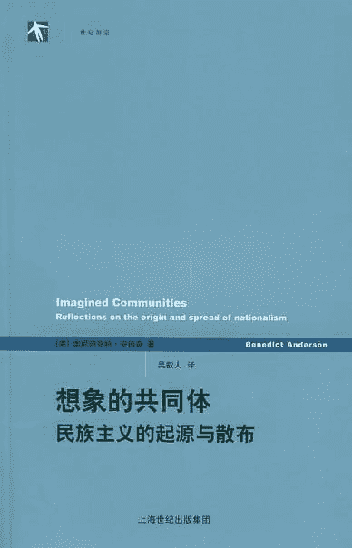

当然同样有中国人讲，"家是最小国"，还是跟我们的传统思想有它的相似之处，也可能有人觉得这个反而比较容易接受。

但是第三，它的小前提接着说。因此在这样的一个共同体里面，我们去履行对于彼此道德义务的方式，就是靠遵守它的法律。

这个就听上去很牵强了。为什么我遵守对于彼此的道德义务，要靠遵守一套共同的规则来实现呢？我非常的爱我妈，我在家庭的共同体里面生活很开心。我可不可以靠对她的尊重，对她的不伤害，对她的友爱来实现我对她的义务呢？我为什么要靠服从于家法呢？这个东西是没有论证的。

#### 理论五：公平交易理论

好，再是最后一个，比较自由派一点的学说，这个学说叫做 Fair Play，公平交易或者是公平市场。

它说每一个参与到一个相对公平互惠互利的这样一个共同体当中的人，都有义务去承担维护这个共同体的一份责任。

好，听上去 OK。承担共同体的责任的方式就是靠遵守共同体的法律，共同体叫 political community，政治共同体。

而它的小前提是说，我们现在身处的政治共同体，就是这样一个可以互惠互利相对公平的平台，因此结论是生活在这个共同体当中，我们都有义务去维护这个平台，维护的方法就是遵守它的法律。

老规矩，反驳比立论容易。

第一，这个理论它的核心问题在于，它是一个先斩后奏的理论。

大家注意到吗？它没有先去说，为什么我们要进入这个共同体？它先说，你已经进入这个共同体了，你就有责任去为它承担一份义务。可是你没有解释，我是不是自愿地加入这个共同体的？

第二，它说，一个人怎么样承担它在这个共同体当中的责任呢？就是靠遵守它的法律。

还是跟刚才那个理论一样的问题：我又没有什么别的方法遵守我的责任呢？我可不可以就是你人不犯我，我不犯人，我也不惹你，你也不惹我？我觉得这个共同体也发展的挺好的，我为什么非得遵守一套它的规矩呢？为什么非得按它的方法去生活？

第三，最核心的问题还是一个小前提。

小前提说，我们现在生活的政治共同体正是这样一个公正互惠的平台。

很简单的反驳，不一定。有的社会可能实现了，有的社会没有，人类历史上可能大部分的社会都没有。

这样的理论就有一个硬伤，它是一个不确定的理论，它的理论只在某些情况下实现，它取决于一些具体的现实情况才能实现，因此它作为一个抽象的理论是不成立的。

它得靠某一些条件，机缘巧合说，在这个社会，咱们这个理论成立了，在大部分的社会，不行，再想想别的。

好，我知道我已经讲了四种理论，不知道有没有哪一种说服了大家，还是这些反驳说服了大家。

所有的这些反驳都比不上另一派理论更加直击根本的反驳，都没有另一种反驳来得更爽。

我们回头去看，我们所有的论证都是靠三段论实现的，就是有大前提、小前提，然后有一个结论。

那这个大前提，虽然每一个理论都有它的不同的说法，但是它基本上的理论都是说，大前提是，如果某一些条件成立，我们就有遵守法律的道德义务，对吧？如果我们自己认同了，如果这样做对我们有好处，如果这是一个人类共同体，一个值得我们守护的共同体，如果这是一个公平公正的值得守护的平台，如果这些条件满足，我们就应该有道德义务遵守法律，这是他们共同的这些大前提的一个共同的形式。

它的小前提都是一些具体的话题，就是我真的有认同，服从法律的权威真的对我比较好。

我们这个政治共同体真的是一个美好的人类的连接，我们这个政治共同体真的是一个公平公正又互惠的平台。

这些是这些小前提的共同特点，就是法律确实满足了这些条件，或这些条件确实得到了满足。

然后它的结论才是，因此我们都有遵守法律的道德义务嘛。

#### 重磅反驳：无政府主义者怎么说？

好，下面推出一个重磅炸弹，一个重要的反驳者，就是我们大家都听说过的无政府主义者，无政府主义者是不屑于进入每一个理论去跟大家辩护的。

他们是自成一派，他们比较直接的攻击这两种模式本身。

无政府主义的这个流派分成两个主要的类型，就是先验的和后验的，这些都是比较哲学的概念，我们我们交给哲学课的老师去具体的解释。

比较简单的理解，就是先验是什么意思？先于经验，就是它是一个逻辑推导上的必然，它不依赖于任何的前提条件，或者是生活经验生活中的观察。

后验的那就是它是一个具体观察之后的结果。

所以大家是不是能够猜想到，这样对应一下，刚才我们讲到两个大前提小前提，所有为遵守法律的道德义务辩护的大前提都在讲某一种理论，而所有的小前提都在讲某一种实现。

先验的无政府主义者攻击大前提，它就是特别酷，就是你不要跟我说了，你不要再说了，你不要再说什么条件满足了，就是没有用，不重要。

无论你这个理论是什么，当你说出一个人有道德义务去遵守法律的时候，你就是在伤害这个人的自由意志，你就是在伤害他作为一个 free  
agency，一个自我的、独立的、个体的自由。所以你用任何东西都打动不了我。

那后验的无政府主义者还比较容易对付一些，但他们比较接近我们生活中对无政府主义者的一种刻板的印象，就比较悲观的。

他还跟你说，他攻击小前提，好，你说，那我们就是对法律有认同。无政府主义者说，没有啊。那我们这个社会就是一个公平公正的平台，无政府主义者说，不是啊。

所以，这里没有办法展开去说，我说无政府主义是一个非常酷的、很有趣的理论，我们交给大家在哲学的世界里继续去探讨。

我只是不得不结束在这里，我发现我绕了一大圈，就是给自己挖了一个很大的坑，然后也没有填上。

我拼命的在讲一些想要回答我自己问题的理论，然后拼命的在反驳他们。

当然我不知道有没有哪一种理论比较触动大家，让大家觉得比较有道理，还是其实倒没有。

还是那句话，就是反驳比立论容易，要挑一个理论的毛病是容易的，要为一件事情证明是很难的。

因此不是说批评的人就一定更厉害，创造理论的人更加厉害，但是要守住这个理论很难。

但是我自己很容易找到一个化解这个问题的方法，就是我是一个现实主义者，我看待法律的眼光是非常现实的。

我觉得也许就是法律本来就不是神圣之物，它本来就不是上帝的意志，它本来就不是先贤的教导，它是人创造的，人会犯错，法律会犯错，法律会反映利益集团的诉求，它也许本来就没有办法，我们这个小前提就很难为我们去证明，所有依赖于具体的法律性质的小前提，我们就很难去证明这样一个为道德义务辩护的三段论，也许这就是一件无奈的事情。

# 番外 | 操场埋尸案：迟到的正义，还是不是正义？（詹青云与庞颖的小型辩论赛）

詹青云：（公众号懒人找资源，懒人专属群分享）

#### 辩题：迟到的正义还是不是正义

令人震惊的操场埋尸 16 年的案件也激发了大家关于"迟到的正义，还是不是正义"的讨论，我也请来了我的好朋友庞颖，我们两个人三观不合，意见相左，所以准备真刀真枪的辩论一场。

#### 持方：詹青云：迟到的正义就不是正义；庞颖：迟到的正义还是正义

我认为迟到的正义就不是正义，阿庞认为迟到的正义还是正义。我们先请阿庞先发言。

等一下，还没介绍规则。我们的辩论比较随意，没有明确的时间限制，双方交替发言，实在忍不住了还可以打断。同时可以要求要盘问对方，对方必须得回答问题，最后也没有明确的结束和时间，到双方都没有话讲，或者是任何一方被说服了为止。

好的，那就请阿庞先发言。

#### 庞：正义是扬善除恶，迟到并没有改变正义的本质

庞颖：大家好，感谢青云邀请我来做这个辩论。

最近这个社会事件的发生导致很多人都在说，反复说这样一句话，叫做迟到的正义不是正义。

我认为我们看这个问题主要要看"正义"究竟是什么意思，正义用我们最容易理解的语言来讲，它就是一个惩恶扬善的过程。什么是恶，恶归恶？什么是善，善归善？我们让真相大白，让历史给人一个公正的评价，这个叫做正义。

我们当然希望正义越早彰显越好，但是在某些特殊的情况下，当正义来得晚一些，我们认为时间没有改变它的本质，它仍然是让善恶不分的东西变成了善归善，恶归恶，这样惩恶扬善的行为，我们必须在定性上仍然承认它是正义的。

#### 詹：时效性本身就是正义定义的一部分

詹青云：那是因为你不认为时间时效性本身就是正义定义的一部分。

我同意我们今天讨论的是关于社会如何惩治恶行的报偿正义。可是什么叫善归善，恶归恶，善恶有报，这种口号我们几千年来都有，可是每一个时代解读这个口号的方式是不同的，我们对于什么叫做正当的善恶、善报、恶报是有不同的解读的。

我们从前认为以牙还牙，以眼还眼，这就叫恶有恶报，这就是那个时代的正义，我们今天已经不再这样认为了，我们今天的司法体系的发展定义出了更加复杂的、严谨的正义，更加严格要求的正义观，这个正义不仅要求一个人在犯下罪行以后，这个社会给他一场公正的审判，同时这场审判被要求是不能有不必要的拖延。

换言之，现代司法体系是把时效性变成正义定义的一部分，不是任何对于恶行的惩罚都可以被叫做正义，对恶行的惩罚应当是公正的审判的结果，应当是适度的量刑，它同时应该是时效性的惩罚，而不能说只要善恶有报就是正义，所以正义迟到多久没有关系。

阿庞，你觉不觉得正义的定义当中应该考量时效性这个因素？

#### 庞：时效性是一个在司法中容易产生负面效应的词，容易导致冤假错案、开历史的倒车

庞颖：我觉得时效性这个词是一个特别容易产生负面效果的词。

我们说最开始为什么这句，"迟到的正义不是正义"这句话会被提出来？是因为在西方世界他们有一些案子一审就好几年，所以很多人觉得这个过程太慢了，可能有很多繁文缛节，可能有很多复杂的程序，所以大家提出了这句话是想让整个审理过程快一点。

但是，我们历史上不是没有过那些我们非常注重审理要快的这些时期，命案必破、期限破案，对吧？在限期内破案，这些东西都是我们切实经历过的。

而这些东西恰恰是冤假错案的来源，所以强调时效性，我不是说你这个时效性这个词一定是错的，但是我们把时效性、把迟到就不叫正义，把这些词拿出来说是很有可能会产生负面的效果，特别是在我们有一定的历史背景的情况之下，这个特别容易开历史的倒车。

而且现在是我们明知道这个社会舆论对我们司法体系，对我们整个国家的这些公安，对这些司法他怎么做事，有很大的难以避免、难以抵抗的影响。

所以在这种时候我们还总把这个词强调挂在嘴边是很危险的，我们没有必要通过喊这句话来让早日真相大白，我觉得真相大白既越早越好，这个价值是没有任何人可以否认的，所以不要这样说这句话，这会产生负面效果。

#### 詹：完全不顾时效性也是走极端，法治是找平衡点

詹青云：你看你自己也说，极端的提倡时效性，把时效性看得高于一切，命案必破，限期破案，这种操作是不好的，这是一种走极端。

与此同时我们不能够走另外一个极端，完全不在意时效性对于正义的影响。我同意法治不是完美的，它没有办法立刻马上的实现正义，它都是在不同的原则当中，从公平、正义、效率这些原则当中去选取一个平衡点。

可是你不能今天在我们提倡时效性的时候，你就说时效性高于一切，你就把它简单地等同于那些我们为了追求时效性而罔顾其它原则的历史时期。

事实上，任何的审理都是有一个过程的，任何的审判如果它是公正的，是追寻程序正义的，它都是有一个过程的，可是我们不会在任何时刻都觉得正义迟到了。

我同意正义不应该是随意的，可是正义不能随意不等同于正义可以迟到。你不能说为了避免我们随意去追求正义的那种情况，我们就不再去积极的追求有时效性的正义。

任何的审理都是要经过一个过程的，有长有短，可是在正常的审判过程当中，我们这个社会我们不会去讨论这个时候正义迟到了，我们在这些时候不觉得正义是迟到的。

我们什么时候讨论迟到的正义是不是正义这个问题？是我们一开始说的出现了 16 年都没有解决的命案，是出现了有人刻意、恶意的隐瞒事实，有人犯下了罪行却 16 年间从未得到正义审判的这种情况，这个是我们讨论迟到的语境，你不能说因为拼命的追求快速是不好的，所以我们可以放任迟到。

#### 庞：在正义已经迟到的情况下，我们不能不给"迟到的正义"一个公正的评价

庞颖：我承认我觉得我们双方是有共识的，我们的时效和我们程序的完整，这两件事情应该是追求一个平衡，我们在这件事情上是有共识，不用争这个。

我只是说当我们把这句话在现在的这个社会背景下、社会舆论下，我们不是拿出单个案子去说这件事情是不是正义，那件事情是不是正义，我们今天是用一个时间一刀切，叫了这样一句话作为一个原则，我觉得这样是会造成负面的影响。所以有可能会在现代的舆论压力下产生那种开历史倒车的一个风险，仅此而已。

我们接着说，正义可不可以迟到，正义应不应该迟到跟迟到的正义是不是正义，这两句话正着说，反着说是不一样的。

我当然认为正义不应该迟到，我甚至认为正义不可以迟到，但是在正义已经迟到了的既定事实下，我们能够让真相大白，能够让历史给人一个公正的评价，这是不是还维护着正义它的本质？我觉得是有的。

所以说我们让正义迟到了 16 年的事情是不正义的，但我们今天能够打破那些不正义，让正义得以彰显，那这个是正义之事做出来的正义之举。

詹青云：如你所说，在不义已经发生的情况之下，我们应不应该积极的去追求制止不义的继续发生，跟我们能不能够把制止不义的继续发生，简单地称作正义，这两句话是不一样的。

我们当然觉得这个社会面前只给我们一个选择，不义已经发生了，那我们要不要去沉冤得雪，要不要让这个不义继续下去，这个面前是有一个正确的选择的。可是这不等同于放任正义迟到这么多年，最后给了一个善恶有报，这就叫做正义了吧？

庞颖：怎么说呢？这个世界有时候是很复杂的，就很多时候我们说究竟是什么让正义迟到 16 年，这当中是一环扣一环，牵一发动全身，我们不一定是有人放任了 16 年，可能是在努力的人努力了 16 年也说不定，不一定在这个案子，但是在很多其它的案子中，有的时候我们社会的改变没有那么的容易，我承认我们绝对没有到达终点，我们离终点还有很远。

但是我们看待这些人做的这些工作，我们能不能给他一个正义的评价，这个是我们今天要讨论的。

#### 庞：阿詹像一个空想家，我是一个实干家：正义如何生根、落地、实现

对方詹青云像一个空想家，认为正义是什么？正义是一套比如说完美的法律体系，正义是一套完美无瑕的口号，行事准则。

但实干家我庞颖想的是什么呢？实干家想的是我就算是这样一个完美的计划，我扔在这个社会里，它能不能扎根，能不能落地，能不能实现？是不行的。

我们有多少专家，我们有多少其它地方的参考，我们想要一个完美的制度，我们有很多人都提得出来。但问题是这个东西怎么落地，怎么生根，怎么实现，这个是难以做到的。

我认为这恰恰，这不但是正义的一部分，这甚至是让正义彰显的更重要的一部分。

它就像我们要搭一个房子，我们不是说我们有很多建筑师可以画出美丽的图纸，但现在这块地它就是一块沼泽地，它里面有一些又脏又臭的垃圾需要人去清，是建了这个房子的必经之路，我们要把它看作是正义的一部分，我们才会能够加强人们对这件事情的重视性，我们才能让年轻人看的不只是空中楼阁，我们能够让他们立志去解决那些十分难以解决，十分盘根错节，十分复杂的历史遗留问题。

我们应该给这些东西定一个正义的性，我们才能够让人们对这样的工作重视起来，这个才是我们能够实现社会最终正义的一个必经之路。

#### 詹：须首先界定正义的概念

詹青云：第一，我听上去像一个空想家，而你听上去比较现实，那是因为我们今天在讨论的本来就是一个概念问题，我们在讨论什么叫做正义，我们不是在讨论邓世平的这个案子当中，他儿子应该怎么办，现在的基层民警应该怎么办，我们不是在讨论现实指导性的可操作手段。

第二，你说是不是有一个正义的口号，有一个正义的理想在前方可以指导人们积极的去追求，是，可是这个世界上值得去追求的东西不是只有正义，我们可以继续鼓励那些去为邓世平沉冤昭雪的人，他们付出的努力他们付出的努力是伟大的，是有价值的，是因为他们让不义不再继续发生。

我们没有必要非得把他们的行为说成是正义的，仿佛才能鼓励所有人，不是，这个世界上除了正义还有其它值得追求的价值，可是我们今天不能为了非要用正义去鼓励人，就模糊正义这个词本身的定义。

第三，你说这个世界本身有一些糟糕的历史遗留问题，你现在是把垃圾清掉，把淤泥清掉，这些事情该不该做？该。可是不代表着每一步都是在实践正义，不是你先把一个人推到坑里了，让他蒙受了不白之冤，让他的正义没有实现，你说这个社会每向上爬的每一步全都叫做正义。

#### 案例：聂树斌案

好，那个叫聂树斌的人，他已经被执行死刑了，这个时候正义的审判、公正的审判告诉他他不是杀人犯，这个时候是不是惩恶扬善？是不是沉冤昭雪？是不是历史给了他公正的评价？我们能说我们为他实现了正义吗？我们能说他就得到了正义吗？

庞颖：我觉得在面对这件事情上，我的痛苦，我的伤心跟我的高兴是同时存在的。

我认为它不应该这样，我绝对不应该到今天这个局面。但你说这一个名字，这一个真相大白，这个给他公正的评价，我们有多少家属，我们在一个人可能被判了之后，我想知道的是什么？我就是想知道真相，甚至有的时候人都已经死了，家属说的是什么？是要讨一个说法，就代表这一个定性在我们人看来是非常重要的，所以这两种情绪是同时存在的，这没有办法。

我问你一个问题，你刚才一直说我们不能说把从坑里往外爬的每一步都叫做正义，为什么不能叫？

#### 詹：迟到的正义也算正义，那正义太廉价了

詹青云：因为这样的正义太廉价了，往外爬的每一步只是在让不义不再继续发生，这是这个社会的分内之事，分内之事。

#### 庞：解决问题，比喊口号更不廉价

庞颖：好，我给大家总结一下对方说了哪些原因，第一个，她认为这个很廉价；第二个，认为这是分内之事。

第一，就像我刚才说的，这件事情绝对不廉价，我们要一个完美的法律体系，我们要人写出来这个事情完美的结局应该是什么样子，完美的形式过程是什么样子，这个东西一点都不难。

难的是什么？难的是我们每个地区有自己复杂的状况，有自己的历史遗留问题，有盘根错节的势力，有牵一发动全身，有这些东西内在是相连的，你根本都不知道从哪入手。真正能解决这个问题，是比画出一个空中楼阁更难更不廉价，这是我明确反对廉价这个词。

第二，份内事，坦白讲，你嘴里说的那些，比如说我们按时我以最快的速度给一个人公正地评价，这难道不是分内事吗？这也是分内事，所以你嘴中的正义也是分内事，你嘴中的不义也是分内事，是否是分内事这件事情不能区分是正义与否。

所以，你看你虽然喊口号说我怎么能够把从坑里爬的每一步都叫做正义，但实际上你根本没有一些合理的理由在背后支撑，你也只是在喊一个口号而已。

詹青云：好，我承认，OK。我们今天不是在评价哪些行为更伟大，我们不是在给人实践操作手段，我们不是在评价某一个具体的案子，如你所说，我们是在定义一个概念，儒家讲正明，这个社会需要对一些概念有清晰的认知，我们才能找到追求它们的方法。

#### 詹：不能因为追求正义很难，就把正义这个词降格

如你所说这个现实是很难的，要想追求正义是很难的，可是你不能因为追求正义很难就把正义这个词降格了。

就说我们知道忠诚是很难的，所以我今天把它降格为每个月精神出轨一次仍然属于忠诚的范围，我不能因为在这个社会当中追求正义很难，你说我们勉强一点，我们接受迟到的正义，我们不能接受，我要一个说法，不代表着这个社会替他实现了正义，我鼓励那些勇敢地继续为他去追求沉冤昭雪的人，也不代表着他们就实现了正义，因为有了伤害是无法弥补的。

#### 詹：因为有的伤害无法弥补

你不能说善恶终有报，当善恶终有报的那一天，伤害已经造成了，这个社会站在一旁冷眼旁观的时候是觉得好，终究是一件好事，终究他沉冤昭雪了，终究历史看待他的眼光是公正的，对他有什么意义呢？

你作为唯一的当事人的时候，正义与否就是零和一，有些伤害是永远无法弥补的，我们这句口号如你所说是为了指导未来的行动，它指导我们的行动是为了告诉我们正义的实效性真的很重要。这些悲惨的案子，惨痛的案子，复杂的心情摆在我们的面前，是为了告诉我们这时效性真的很重要，因为他的伤害无法弥补，不能用一句还是正义来弥补。

#### 庞：不能脱离人性去空谈概念

庞颖：我觉得对方说了这么半天，说了可能一个意思，这个意思就是说到了今天这个局面，我们很不愿意看到，我们无论说什么都没办法弥补了，伤害已经造成了，伤害不可逆了。

我都同意，就没有问题，我也不希望看到 16 年后是这样了。今天无论做什么都已经是不义了，如果无论做什么都已经是不义了，那为什么要去做？对方老是说空谈概念、空谈概念、空谈概念，我们不能脱离人性去空谈概念。

比如说我们在某些文化里面冤假错案特别难翻案，为什么？不是因为概念不对，是因为我们在那个文化里面就是特别怕丢面子，所以难以纠正，不愿意承认错误。

我们如果今天终于有人站起来肯承认错误，我们却像过街老鼠一样打他，说这个叫做迟到的正义不是正义。当你这个概念跟在人性交互的这个过程中会产生好的结果和坏的结果，这件事情是我们担心的，是我们在意的，我们当然不想让 16 年这样的事情再发生，你我都有共识。

但是在现在这个社会情况之下，我们应该怎么对待那些已经发生的坏事，我们如何面对那些已经发生的冤假错案？我们应该给人以力量，给人以希望，给人以鼓励，让他们在这条艰难的路上走下去，这个是我们说这句话的目的。

詹青云：你所描述的这种情况，这些积极的去追求为他们平反的人反而要被当作过街老鼠，这种情况不是我们对正义要求过高造成的，是像你这样认为这个世界非黑即白，不是正义就是不义造成的，我今天拒绝把迟到的正义评价为正义，不等同于我把追求迟到的正义这个过程评价为不义。

#### 詹：应该用正义的概念去指导行为

我已经反复的说过了，这个世界上除了正义还有其它很多值得追求的价值。这个世界上不是只有追求正义才是唯一值得做的事情，这些人制止不义继续发生，这些行为值得鼓励，他们在做对的事。

可是，与此同时，正义这个词应该有一个清晰明白的定义，这个定义应该给人们的行为以指导性，而不是让我们是用一个概念去指导行为，我们是明明知道现实不够美好，所以提出一个理想去指导未来的行为，而不是用现在的理想，而不是用现在的现实去让这个概念将就这个现实，不是你说的人性很复杂，所以我们要用这些概念将就现实。

否则这个世界上很多美好的词语它们都不配存在，它们都不应该拥有过于美好的定义，因为人性实现不了这些理想，错。

每一个词语在这个世界上发挥一种功能，这个世界上除了正义还有别的很多词，可是正义这个词的存在就是为了告诉我们有一些东西值得去追求，这个值得被追求的东西，不只是善恶有报，还是正要能及时的到来。

庞颖：我觉得对于很多人来说，对正义这个词最简单直白，能够指引行为的一个理解就是什么是正确的事情，应该做什么，这个是我们一般人对于正义的一个解读，所以如果我们把应该做的事情叫做正义，我觉得这件事情是对我们有好处的。

#### 庞：空喊无用，社会是人组成的，正义是靠人实现的

下面一个问题，我还想说的是，有的时候人们老说这个社会怎么了？这个社会怎么了？我们今天之所以出现 16 年的冤假错案，这个社会上还有正义吗？这个社会上还有公正吗？但是坦白讲，社会，你呼喊社会，社会是不会给你回答的。

社会是由人组成的，是由不同的人组成的，我们今天说一句话，我们希望有一个现实的效果，我们这句话不是隔空喊的，我们这句话是对一些对象喊的。那这些对象是什么？

我们是要鼓励那些有志之士能够做一些正义之举，能够让我们这个社会上最难解决以及最需要解决的事情，我们需要有人投入精力去解决它，仅此而已。我们这句话再强调一下，我们是有对象的，我们不是隔空喊给社会的，社会没有一个主体。

詹青云：所以不同的话应该喊给不同的对象，喊给不同的主体，我喊给那些当不义已经发生的时候，我喊给那些想要去平反，想要为被无辜受害的人沉冤昭雪的人的话，就是你应该做正确的事，这不就可以了吗？

我们为什么要模糊正义这个词的定义，以为了能够对他们喊一句话呢？我正义这句话还要喊给别人，还要喊给法律工作者，还要告诉他们，你不能无限期的拖延一个案子，因为那些被蒙冤受害的人，他们在等待着正义及时地实现，这句话，这个词应该留给他们。

#### 关于桑德尔的《公正》一书的不同理解

庞颖：我以一个最简单的事情结尾，刚才对方也说了，他认为我们应该给那些有志之士喊一句话是什么是正确的事情，是要做什么是正确的事情。那我们平常人见过的最多的算是一个伦理学或者道德普及性的读物，桑德尔写的这本著作《公正》，如果你承认我们应该对他们喊的话是这是正确的事情，应该做它，我觉得给他叫予正义的名字，这一点都不过分，仅此而已。

詹青云：好，我觉得桑德尔的那本书不是为了告诉我们正义只是要善恶有报，他恰恰是在告诉我们，善意是复杂的、精密的、严谨的、困难的，它值得一个更明确的定义，它值得被作为一个更高的理想去追求。

谢谢大家，欢迎你们把你们的看法回复在评论区，跟我们继续辩论。

# 6\. 法治之脆弱 | 我们须相信法律的权威，就像要相信圣诞老人（上）

你好， 我是詹青云。

今天的这期节目原本并不在我们的计划之中，但是在讲过了前两期节目以后，我自己一直在担心，我们以社会契约论这样的一个思想实验去解释法治社会的出现，会不会给大家留下一种印象？觉得法治社会的出现是一件自然的事情。

就像洛克说的那样，大家会自愿的选择加入法治社会，这是一件自然的事，这是一个理性的选择。

事实上回看历史，我们拥有法律的历史，人类文明拥有法律的历史是非常漫长的，拥有成文法的历史超过 4000 年。

可是我们拥有法治的历史是很短暂的。法治，rule of  
law，这个词在历史上第一次出现，要迟至十六、十七世纪的英国，而英国成为第一个现代意义上的法治国家，我们都知道要等到英国光荣革命和它的一系列司法改革之后，也就是我们拥有法治国家的历史不过 300 年。

这是 300 年之间，既便是英国自己也在人治和法治之间来回的动摇过，很多时候法治的原则被违背，特别是在战争期间。

而在这 300 年之中，有许多的国家只是间歇性地拥有过法治，或者从未拥有过法治。

法治是很难得的，是很脆弱的。

#### 法治 vs 法制

我们都知道有两个常常被混淆的词，都叫做法治，一个是制度的制，一个是治理的治。不出意外，我们这个节目里所聊到的法治都是治理的治。

第一个法制，制度的制，这样的法治是以法制人。法律是一种统治的工具，它在本质上仍然是一种人治。

而第二个治，治理的治，以法为治。它的核心其实并不是要普通人遵守法律，而是要以法律去束缚和控制权力。

这种法治是以民意授权为前提和基础去立法，以法律来管制国家，以制约权力为核心的一种社会制度。

#### 法治：以制约权力为核心

我们的历史上拥有过很多制度的制的法制，就是法律是社会的一个元素。可是我们很少真正拥有法治，治理的治，我们很少真正拥有法律对权力的束缚。

有法治思想，治理的治，有法治这种思想。法治这种思想出现的年代非常的早。

我们都知道的，比如柏拉图和亚里士多德，在他们的著作里就讨论过这个问题。之后的古罗马也好，中国的先秦也好，很多思想家也讨论过这个问题。

柏拉图有一个对政体形式的很经典的划分，就是以统治人数的多少，把政体化成三种。

一个人的，这叫 rule of king；一个小集体的，就是寡头政治；以民众掌握权力的，叫做民主。

柏拉图同时以政体中的权力所有者，无论是一个人、一群人、所有人，以权力所有者是否受到法律的束缚，又进而把它的三个政体划分成了六个（君主政体、贵族政体、平民政体、僭主政体、寡头政体、暴民政体）。

我们知道柏拉图最喜欢的政治是"哲人王"之治，但是他也说，在没有哲人王的时代，他宁愿政府权力是受到法律的束缚的。

可惜的是，像我们刚才说到，把这种思想变成现实有一条漫长的路要走，大部分的时候在历史上我们都只拥有制度的制的法制，法律只是统治者用于统治的一种工具而已。

要到 1618 年英国的首席大法官爱德华\*柯克爵士，我们至少今天看到的文本才知道，在那个时候他才说出了那句著名的话，"国王应该位于且仅位于上帝和法律之下，没有人在法律之上"，这是法治的精神，法治的精神是权力被法律所束缚。

#### 我们必须要相信法律的权威，就像一定要相信这个世界上有圣诞老人一样

我刚刚开始学法律的时候，一直觉得很奇怪，为什么大家都说 judicial  
legitimacy，司法的合法性，就是大家都得听法院的话，这件事是一个神奇的事，有人说他就像圣诞老人一样，它是一种思想观念，必须得大家都相信他才成真。

我觉得为什么呢？作为一个普通人，作为在这个社会当中没有什么权力的普通人，服从法律的管制是一件自然而然的事情。

我没有办法，我不敢去想我不服法是什么样子？我觉得是不是要我们幻想，我们去想象，为什么那些手握权力的人，那些站在这个社会的金字塔顶的人，他们一样要接受法律的约束，他们一样得接受司法的合法性，他们想做的事情，法律不让他们做，他们就不能做的时候，我们才能理解，法治的出现真的不是一件自然的事，权力为什么愿意让自己受法律所约束？权力为什么愿意把自己置于法律之下，这件事情是很神奇的。

我不知道聊到这个问题的时候，大家是不是也都像我一样想到一个例子，就是美国总统 Trump，你看 trump 这个词，它是一个姓，trump 它是一个英文单词，小写的时候 trump 这个词，它本身就有王牌、王炸、法宝、制胜这种意思，我在口语表达里说 I  
am trump you，是一个很有气势的表达，就和 Trump 这个人一样，推倒一切不走寻常路，不按常理出牌的，为所欲为的一个人。

但是你发现即便是 Trump 这样的人 ，川普这样的人，他也得接受司法的合法性。

#### 例证：川普的"禁穆令"被法院叫停

比如他刚刚上台的时候，我们好多次提过这个例子，他是带着对好几个不同群体的这种攻击的言论上台的，让他上台以后就挨个的攻击了这些群体，从墨西哥的墙，到今天对中国。

他一上台的时候，首先攻击的是穆斯林这个群体， 在他的演讲里很明确的说过，他要把所有的穆斯林拒之门外。

他上台以后颁布了一个旅行禁令，这个大家都知道了，就是不发放给有几个以穆斯林为主体的国家，不发放签证。当然他们的官方解释是说这个是针对恐怖主义，但是这些国家都是穆斯林主体国家，结合 Trump 之前说过的那些仇视穆斯林的话，就让人怀疑他这个禁令有强烈的宗教动机。

所以他的这个禁令一出来，那就在美国国内引起了巨大的反对的声浪。

非常巧，我到现在还记得就是 Trump 颁布他这个禁令的那天，我刚好从国内过完年，好像是 2017 年 2 月，刚好从国内过完年然后飞回美国，我当时在飞机上，因为 Trump 这个人做事情就是突然之间嘛，突然之间就把他的行政命令发到了美国的所有的海关。我还在飞机上，不知道这个消息，等到我落地的时候发现你机场全是人。

当时因为这个命令发布得非常的仓促，它整个行政部门都没有做好准备，机场里有大量的被滞留了、不知道该怎么处理的人。有很多来看热闹的围观群众，有很多来找这些被拒绝入境人的律师，有很多声援他们的团体，也有来支持川普决定的团体。

而且因为我这个人特别的不靠谱，经常误机。我本来是要飞回波士顿的，但是我就被滞留在了达拉斯。

达拉斯大家知道，是德克萨斯州的一个城市，那里的人是非常非常友好的，比起冷漠的纽约人真的是特别好的人。他们是在路上，你把一个大拇指翘起来，他就真的会停下车来问你，要去哪里的人。

但与此同时，他们是坚定的保守者，他们是川普的支持者。

我当时在达拉斯的时候，跟我的司机，就本地人聊天，他就说，他非常支持这个决定，他说本来就应该这样，就不应该让那些人到美国来，他们都是恐怖分子。

我当时听到这个言论，我觉得一股凉意，挺震惊的。

美国是一个对歧视问题非常敏感的国家，我们之前也提到了，因为它有非常漫长的种族歧视的历史，所以它连带的对各种各样的歧视都相当的敏感，宗教问题是一样的。

你会发现说，政治正确这个面纱是可以突然之间被撕下来的。

当一个国家选出来的总统是一个把面具完全撕下来的人，他的这些民众支持他，拥护他的人，也就会纷纷效仿。可能这种真实的想法藏在人心里很久了，只是没有这么直接的表达过。

我是真的感受到了一种唇亡齿寒。

如果说这个国家的总统发布行政命令的时候，完全可以不顾法律原本的约束，直接针对一个宗教群体。当然最后川普的解释是跟宗教无关，这是后话。这种原则可以被弃置不顾的时候，谁又知道下一个被针对的团体是谁呢？

我就问那个司机说，那会不会有一天川普就说，所有的中国人不能入境，我就被赶走。他说不会，你们跟他们不一样。

谁知道呢？ 这把剑落到谁的头上，谁知道呢？今天不就落到我们的头上。

在那个时候，所有人唯一能够望向的地方就是法律。

我就知道，很快我的那些同学们，我知道的那些美国的自由派的利益团体，一定会纷纷的涌向法庭去起诉川普违宪。

当我从达拉斯飞到波士顿的时候，发现我的同学们已经群情激昂地在做这件事情。

川普的旅行禁令很快，就几天之间就被美国的好几个法院颁布了一个叫停，就是 injunction，颁布了一个命令，法院让审判结果出现之前，旅行禁令不可以再执行下去。

川普当时是非常的生气的，他上台以后的第一个大手笔，这么一个政策迅速就被叫停了。他也知道这个官司打到最高法院的时候，很可能它这些禁令本身也已经过期了。

他非常的不高兴，他在他的推特里对这些禁掉他的禁令的法官，言辞非常的不客气，甚至上升到人身攻击，他说 so-called  
judge，就是"所谓的法官"，他就说，"我们的法庭，我们的法院系统，我们的司法体系，又腐败（又政治），完全没有办法保护我们的国家"，用非常激烈的言辞批评。

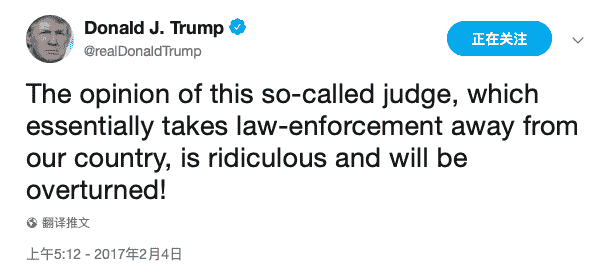

但是没有办法，他再批评，他也只得接受这个结果，他也只能等待要到一年多以后，最高法院对这个事情做出宣判，这就是司法合法性的一种体现。

虽然在这个年代，因为我们都知道美国的最高法院越来越两极分化，它选进去的法官越来越带有鲜明的意识形态或者党派的色彩，它的合法性本身甚至都开始遭到了质疑，这件事情我觉得是挺可怕的。就有一天法律不再带有它的权威了。这就像圣诞老人，突然之间大家就不再相信了。

#### 案例：钢铁厂征收案

但川普的计划受挫的时候，大家总会想起美国历史上一个常常被用来说法院对于权力束缚的一个案子，就是总统被打脸的案子，这个案子叫做 Youngstown Sheet  
& Tube Co. v. Sawyer, 它有一个别称叫做钢铁厂征收案，大家一听就大概知道发生了什么事情。

这个案子发生在 1952 年，当时美国总统是杜鲁门。1952 年大家马上就能想到，这个时候正是朝鲜战争的年代。

我们对朝鲜战争当然有我们自己的看法，有我们自己的情绪，我们先把这个东西放在一边。

从美国总统的角度出发，从杜鲁门的角度出发，当时的美国是在战争状态之中，他作为三军总司令，他作为战时状态的总统，是有这种紧急情况赋予他的额外权力的。

在战争年代，钢铁厂的重要性不言而喻，因为你需要大量的钢铁去生产武器、生产军需，可是偏偏在这个时候，美国的钢铁工会正在和大的钢铁厂进行一个旷日持久的谈判，这些钢铁厂的工人要求增加工资，也是因为战时政策的影响，钢铁厂当时不可以提高他们的价格，所以钢铁厂不愿意给工人提高工资。这个谈判陷入了僵局，当时的钢铁工人联合会就宣布要罢工。

那这件事情对于那个时候的美国可以说是很紧急的、很危险的一个状态，因为你正在打仗，你所有的钢铁工人宣布罢工了。

于是，杜鲁门就在 1952 年的 4 月发表了一个电视讲话，他在这个电视讲话上斩钉截铁的说，现在正是我们国家的危急存亡之秋，这是一个非常紧急的状态。所以为了国家利益，为了国家安全，我决定要让我的商业部长接管这些大钢铁厂。

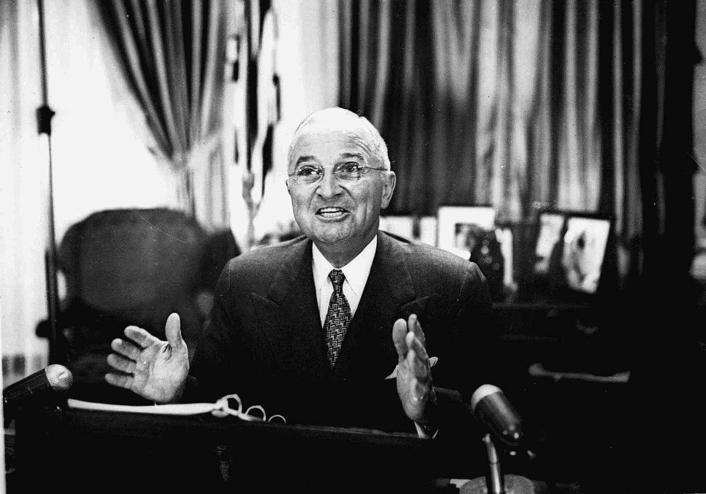

那美国的这些大钢铁厂，他们是有非常强大的律师团队的，消息很灵通的，准备速度很快的。

杜鲁门的电视讲话发表不过一个小时，最大的两家钢铁厂，就包括这个案子叫做 Youngstown，就是当时一个最大的钢铁厂之一，他们的律师就向法院提起诉讼，就说总统这么做是违宪的。

我们都知道美国的最高法院有一个非常重要的权力，它的权力的核心来源就是它可以审查一个法律或者总统的行政命令，总统的做法是否违背了宪法。

通常情况下，最高法院去决定要不要听一个官司，作出一个判决是很漫长的一件事情，总要拖那么一两年的。

可是当时可能真的是战时状态，最高法院飞快地就决定要听这个案子，他们在 6 月就宣判了，在美国历史上几乎是绝无仅有的高效。

所以在 4 月的时候，杜鲁门刚刚在电视讲话上向他的全国观众信誓旦旦的表示，我们会接管这些钢铁厂，结果到了 6 月，最高法院就冷冷地回复说，不，你不能。

这就是啪啪啪就把总统的脸给打了，你不能这么做。

按理说杜鲁门他在决定要做这件事情的时候，他也应该想想，这些钢铁厂是一定会提起诉讼的嘛，一定会向法院去申请说这是违宪的。

但是有资料显示，杜鲁门当时应该是挺自信的，原因是当时最高法院的九位大法官全都是他本人或者是他的前任罗斯福总统任命的，他们都是民主党的总统，也就是说这个时候最高法院历史上非常难得的，是一个意识形态上相当统一的民主党的最高法院。

按理说这些人都应该在党派利益上跟他站在同一边，而且这当中有好几位大法官是杜鲁门私交很好的朋友。

这么奢侈的事情，后来的美国总统很少拥有这么好的局面，所有的大法官都是我们民主党提名的，很少见，杜鲁门拥有这么好的局面，他当然想到，特别是在战时状态之下，这些人应该支持自己，结果没有想到这些人就打了他的脸。

道格拉斯大法官特别喜欢写日记，据他回忆说，当时执笔写最高法院的判决意见的布莱克大法官是杜鲁门的好朋友，他也比较担心杜鲁门被最高法院这么伤了面子，他会不会生气。

所以在判决结果宣布之后，布莱克大法官在他家里举行了一个家庭聚会，邀请了杜鲁门和其他的几位大法官。

据道格拉斯大法官说，杜鲁门几杯酒下肚，开始有点意气风发，醉眼惺忪地看着布莱克大法官，他叫做雨果\*布莱克，说，雨果，我不是很关心你的法律，但你家的 whiskey 真不错。

这件事情被引为笑谈，就是成为杜鲁门总统的非常尴尬的一段经历，但是他在司法史上被传为美谈，它是一个最高法院用自己的权力限制让总统不可以为所欲为的一个经典的案例。

这个案例也开启了现代意义上的对于总统权力的边界，总统和国会之间权力划分，重启了对三权分立问题的讨论。

为什么这些在党派利益上或者意识形态上，原本应该跟杜鲁门站在同一边的大法官告诉杜鲁门，你不可以做这件事呢？大法官们的回答非常简单：因为宪法上没说，宪法上没说你可以这么做，你不能自己给自己创造这个权利。

# 7\. 法治之脆弱 | 法律的权威需要被小心翼翼地维护（下）

（公众号懒人找资源，懒人专属群分享。）

上次的节目我们讲了杜鲁门总统信心满满想要在战时征收钢铁厂，结果被大法官啪啪打脸的案子，其实这个案子还有更重要的意义。

这个案例也开启了现代意义上的对于总统权力的边界，总统和国会之间权力划分，重启了对三权分立问题的讨论。

#### 总统权力的边界？

基本的原则是，总统的权力只有两个来源，一个就是美国《宪法》的第二条，总统是这个国家的行政首脑，他有义务让这个国家的所有的法律都得到好的执行，要么就是国会赋予他的权利，国会把自己的权力代理给总统，让总统代理行使的情况。

执笔来写最高法院的意见的杜鲁门总统的好朋友布莱克大法官，被认为是一个形式主义者。

好，在这里布莱克法官就说，所以我们分析总统有没有权力做一件事情，就是要看这件事情到底是在执行一个法律，还是在自己立法  
就是它的本质是一个立法行为，还是一个行政行为？

他说很明显这是一个立法行为，总统是没有这样的权力的，所以你就歇着吧。

这个意见受到一些批评，就是你事实上是很难去区别立法跟执行这两件事情的。

在这个案子里最有名的一个判决意见并不是布莱克法官执笔的这个法庭的官方意见，而是杰克森大法官写的一个复核意见，就是 concurring  
opinion(协同意见书)，我们之前讲过，一个最高法院的几个大法官，虽然他们的立场是一致的，  
一个大法官看到另一个人写的法庭意见以后，可能觉得你写得不够好，你写得不够清楚，有一些重要的问题没有解释，那他可以写一个补充意见。

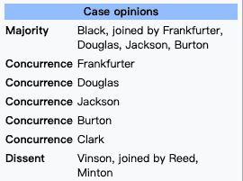

在这个补充意见里，杰克森大法官提出了一个检验总统是否有权力做某件事的一个基本原则，这个原则被奉行至今，听上去会非常的简单。

首先这原则就是把总统的做的事情分成三个类型。

如果这件事情是国会明确同意的，或者是国会通过他的行为暗示的，implied，可以从国会的行为当中推导出来的，那我们倾向于就觉得总统可以做；

如果这件事情是被国会明确反对过，或者推断出来国会应该会反对的，那怎么都不会让你做的，那我们应该就不会让你做了；

还有一种情况是空白，不知道国会的态度是什么，是认同呢？还是不认同呢？

这种情况杰克森大法官说，我们也不知道，这个叫 case by case，逐个地分析。

这个原则到后来被最高法院发展成了一个光谱理论，总统的行为都可以被落在一个光谱上，这个光谱的一端是国会明确反对的，直接说出来了反对的，还有一种就是国会说出来了认同的，然后最高法院去判断一个总统有没有权力做某件事的时候，主要就是看这件事情落在了光谱的什么地方。

整个判决体现了一种思路是总统的权力受到国会的制约，而最高法院作为一个最终裁决者，它来做这个判断，总统有没有权力做某件事。

这是 judicial legitimacy，司法合法性的一种体现。

具体在这个案子里，杰克森大法官承认说，这属于比较难以判断的中间情况，因为国会没有说过同意总统可以征收钢铁厂，也没有说过不同意。《宪法》上当然也没有说，怎么办呢？

他说我们来推测一下，怎么推测的？他发现说国会隐含了，没有明说地表达了自己的不同意，原因是国会之前通过了两个另外的法律。

第一个法律说，如果关乎国家利益，有罢工的情况出现，总统有一个冷静权，就是总统可以要求这些工人推迟 60 天罢工。

那杰克森大法官说了，就隐含的意思不就是你没有权力征收别人的工厂吗？如果说国会觉得总统可以直接征收工厂的话，为什么还要给你这个权力让这些工人冷静，不就是考虑到你没有什么别的办法，我才给你这么一个冷静权吗？

第二个不久之前通过的法律是说，如果政府跟一个供应商之间签有合同，而这个供应商违背了合同，在紧急情况下，政府可以征收供应商的厂房。

杰克森大法官说这个很明显，国会是非常明确地约定了，在什么情况下政府可以征收别人的工厂的。这就意味着国会并不认为总统可以在任何情况下征收任何人的工厂，否则的话，它为什么要这么明确地给这个限制？

这两个推导在后来都受到了很多的批评，因为有人说这个是不是小题大做，完全就是在揣测、在臆测，国会没有对一件事情发表看法，不代表国会就反对，因为国会要通过一个法律，它要走的程序是很复杂的，参议院和众议院都得通过，呈交给总统，总统还得签字。

国会保持沉默，有可能是国会压根就还没来得及考虑这件事情，有可能是它考虑过了，而且大家都同意，只是还没有来得及通过法律。

所以杰克森大法官在他的意见里面，为了继续证明，为他的意见添砖加瓦，寻找合法性，他聊起了宪法精神本身。

这在杰克森大法官写这种判决意见的历史上是很少见的，他不是这样的一个爱去回头看建国之父们到底在想什么的人，有很多美国的大法官是这样的，特别喜欢研究建国之父们到底当时是怎么想的，把人家的日记、书信集全部找出来看，说麦迪逊一定是这么想的。

但是在这个案子里，杰克森大法官说，建国之父们他们之所以要制定《宪法》，之所以要三权分立，就是为了防止总统成为下一个专制的暴君。所以在国会没有明确表态的情况下，总统给自己添加一种权力，并且执行这种权力，这种倾向是非常危险的，它就是暴君的一种倾向。

这种说法也受到了后来的很多批评，因为有人说就算我们回头去看建国之父们是怎么想的，事实上美国在写 1787 年《宪法》之前，它有一个《宪法》的前身，就是《联邦法案》。在这个法案里，建国之父们真正担心的问题恰恰是没有一个强有力的行政机构可以把国家联合起来。

让这个国家处于松散的、混乱的、各种各样的不高效的状态。所以一定要去看立法建国之父们的意见的话，说不定他们非常希望在战争时代，有一位总统可以力排众议，保护这个国家。

第二，这种推测方法体现了双重标准。

因为根据《宪法》，战争必须是由国会发动的，但是朝鲜战争是由杜鲁门总统本人宣布参战的，但是他的国会还没有来得及发表意见。但是这件事情并没有被人质疑，杜鲁门总统自己宣布参战这件事情，并没有被人质疑，为什么一到在国外的问题上，我们就放任总统这么去做，但是到国内的问题上，就要给他加以种种的限制？

第三点，也就是大家集中批评的一点，包括文森大法官写了一个言辞激烈的反对意见，他说你们这些人搞这种形式主义，就是完全不在乎在这个国家处于战争的紧急状态之下，这个国家的存亡。

杰克逊大法官是很明确的反对总统以紧急状态之名给自己添加权力的，但是事实上在美国的历史上，尤其是在战争状态之下，有很多的总统都这么做了，而他们的所作所为不仅没有被人批评，还受到后世的称赞。

比如说林肯在美国内战期间自主地发布了《解放奴隶宣言》，这是一个行政决定，也包括其实罗斯福，就是杜鲁门的前任，不久之前才刚刚在二战期间做了一件很相似的事情，就是罗斯福当时面对的状况是一个生产军用飞机的工厂工人想要罢工，罗斯福飞快地签了一个行政命令，接管了这个工厂，但是并没有引起人们的反弹声浪。

我们的教授当时在讲到这个案子的时候，就特别无奈地说，可见虽然美国人以 Youngstown 这个案子挺骄傲的，就觉得这个是司法对权力的束缚成功了，因为杜鲁门总统虽然生气、虽然恼火、虽然是他的朋友们背叛了他，他也不得不接受这个结果，也没有尝试用什么其他的办法去绕过这个结果。

但是事实上在美国的历史上，有很多的总统，他们是绕过了法院去做事的。如果说这个战争和这个总统本人都更加的受民众欢迎，因为朝鲜战争到那个时候已经在美国国内广受质疑了，所以一个总统以这场战争为名去做事情，就会激起民意的反弹。

他说但是你想象一下，如果这件事情是罗斯福在二战期间做的，我们真的会用法律去束缚他，或者法律真的束缚得了他吗？

#### 法治、人治与政治

其实法治这件事情，尤其是法律对权力的束缚这件事情，最后真正制约他的东西是政治。

就像美国的法律号称是依法治国，是法治，但是它这个法律里面包含了很多非常人治的元素，就像我们都知道美国的总统有一个特权叫做赦免权，他可以赦免任何人任何的刑事和民事指控，除了弹劾这件事情不可以被他自己赦免，他可以赦免任何人。

无论这个人已经被起诉，已经被判刑了，还是面临潜在的法律风险。这样的一种设置就非常明显的留着英国的国王在英国的法律上所留下的历史印记，它被保留到了美国。

美国的总统可以赦免联邦法律之下的指控，各个州的州长可以赦免州法之下的指控。

那在 Trump 川普成为了总统以后，很多的教授开始担心 Trump 会怎么使用这个赦免权。因为建国之父们大概从来没有幻想过一个像川普这样用 twitter 治理的治国的人的出现，他们没有对这个赦免权做任何形式上或者内容上的限制。

当时川普他的那些幕僚们被他的司法部门调查的时候，很多人就在说他会不会赦免这些人，过几天他开始说他会不会赦免他自己。

虽然美国的历史上还没有哪个总统尝试过赦免自己，可是从法理上来说他真的可以这么做，而且他完全可能就是用推特就把他自己赦免了。

哪天 Trump 早上醒过来，他都是在每天早上 6 点集中发十条推特，其中就夹这一条说 I at 他自己@realDonaldTrump，I hereby  
赦免我自己所有的指控。

他如果真的这么干了，法律其实是拿他没有什么办法的。唯一能够制约他的东西，其实是政治，是民意。如果一个总统这么做了，他的政治生命也就结束了，他就永远在历史上留下一个非常糟糕的印记。

可是就像我们刚才提到的，在二战期间的罗斯福，他不仅征收了美国的飞机场，他还做过更加糟糕的事情，就是美国政府当时把所有的日裔美国人送到内地集中安置，相当于一个集中营。

在当时他们拥有民意的巨大支持，法治的原则是可以被权力轻易绕过的。

#### 法治太脆弱，需要我们小心翼翼去维护

很多年以后，在 911 的时代，当布什政府开始全民监听，以防备恐怖主义为由，政府开始肆意的监听普通民众谈话的时候，布什政府为自己辩论的语言甚至都已经改变了。

当年杜鲁门做这件事情的时候，他是说他知道如果国会不同意，他不可以这么做，但他认为国会并没有不同意他这么做。但是布什政府已经说的是，即便国会不同意，出于对国家安全的保护，我们只能这么做，连这个话语都改变了。

你看这些法治的原则其实是何其的脆弱，当一个权威无所顾忌的时候，无论因为他是一个威权政体当中的权威，他本来就无所顾忌，还是他是一个民主政体当中的权威，可是他得到了民意的巨大支持。

当权威无所顾忌的时候， 法治就像圣诞老人一样，大家都不信它了，它也就不存在了，当这种观念不再被坚持了，它也就不存在了。

那些被恐惧、被厌恶，被仇恨所支配的时代，其实民众是放任权威去这么做的。

无论是日裔美国人的集中营，无论是麦卡锡主义，那个时代的拥护、支持或者稍稍表达没有那么坚定的反对社会主义和共产主义的人轻易地因言获罪，又或者是今天川普的穆斯林禁令，或者是 911 之后的美国政府的监听计划，大家都放任自己的情绪，容许权力绕过了法治。

权威可以绕过，大众的力量同样可以绕过。我们这个时代的网络暴力，举报风潮，又何尝不是权力的狂欢，权力的胜利，是人们容许自己的偏见，自己的欲望，自己对权力实现的欲望，自己的好恶，去左右规则，这个时候我们的眼中没有规则，而只有自己的偏好的实现。

法治是一件脆弱的事情，它需要所有的人，权威或者是普罗大众，对于权力跟情绪极大的克制，才可能实现，才可能被保护。它很多时候是我们对抗他人的偏见，他人的权力欲望的最后防线。

如果我们自己不守护这样的防线，而任由权力的箭落向他人，终有一天这箭也可能落到我们自己头上。

# 8\. 法治之滥用 | 法律与资本的捆绑，及弱势群体最后的救济

（公众号懒人找资源，懒人专属群分享。）

我们在之前的几期节目里，用了挺长的时间跟大家讨论法律概念，我们为什么要服从法律，法律跟我们的关系，法律想要在社会中实现的目的。

我们又特别强调，就算每一个法律体系可能都并不完美，很多的法条可能有待改进，也随着时代不断调整，  
不是所有的判决都让所有人觉得信服，不是所有的规则都让所有人觉得这是社会的最优解，可是法律它作为一套规则，它作为社会的最终裁判者所提供的确定性，这份好处却是无法替代的。

可是，这个讨论依然是不完整的，我们节目以美国的各级法院做的各种各样的判例，为一个主要的材料库。我们去讲美国的法治史就不可能不提到他们的历史上的那些经典的对确定性的打破，或者是挑战。

#### 法律确定性也会被打破

最著名的案子可能是上个世纪 60 年代的民权运动，这场运动就以我们之前提到过的一个概念，叫做"恶法非法"为它的口号，它挑战的就是那个时代种族隔离的确定性。

所以有时候我们也要承认， 有的时候社会正义，或者说社会的公益，是在打破跟挑战确定性的过程中实现的，没有什么事情可以一概而论。

包括今天我们都觉得我们今天应该都接受、认同法治这种观念，觉得法治社会是一件好事情，甚至是我们新中国建设的时代目标之一。我们都希望大家能够用法律的手段，合乎规则的、和平的手段去解决冲突，而不要冤冤相报、以暴制暴。

可是法治的社会有没有它自己的问题，当然是有的。

一个社会没有法治固然不行，可如果太过法治了呢？什么叫太过法治的社会？很多美国人就觉得，今天的美国已经是一个过度法治化的社会，也就是打官司这件事情已经被过度的使用，甚至是滥用。

美国人是很喜欢打官司的，动不动就说 see you in court，他们很喜欢把各种各样的问题拿到法庭上去解决的。

我这里就分享两个我自己是不会拿到法庭上去解决，但是挺有趣的官司，看看大家有什么看法。

#### 案例：斯黛拉案

1992 年的时候，有一个叫斯黛拉\*里贝克的老太太，有一天她开着车去麦当劳买东西。大家如果去美国旅游，特别是自驾游的时候，经过加油站，有的时候赶时间，大家知道有一种快餐店叫做 drive  
through，现在中国也开始有了，在美国会非常的普遍，麦当劳很多都是这样。

就是我开着车在这边对着那个话筒点餐，我排着队，排到那头的时候，吃的基本上就准备好了，拿着吃的我就可以继续开车走。

这个老太太当天，就在麦当劳的这种开车经过的窗口点了一杯咖啡，大家可以想象那个画面，她就很自然地把咖啡放到她两个腿中间，把盖子打开，往里面加糖加奶，结果她不小心就把咖啡弄洒了。这一弄洒造成的结果蛮严重的，医院说她身上有 6%的皮肤有三级烧伤，这位老太太紧接着就把麦当劳告上了法庭。

大家会不会觉得有点不明白？这个咖啡并不是麦当劳的员工在递给这个老太太的时候撒在她身上的，是这个老太太已经买好了咖啡，她自己把咖啡弄洒了。那她为什么还可以告麦当劳呢？难道不是买定离手的吗？

她告这个麦当劳咖啡太烫了。她说，这个麦当劳的咖啡根据她律师的说法有 82 到 88 摄氏度，这是麦当劳的行业标准，它给所有的连锁店都要求把他们的咖啡保持在这个温度。

可是这个温度的热水、热咖啡、热饮料是可以对人造成三级烧伤的。

麦当劳作为一个商家，这就已经构成了 Negligence，有一个侵权法里面的一个条目就叫做 Negligence，直译过来，就是粗心大意的意思，我们可能把它翻译成疏忽、过失。

麦当劳没有能够想到它的咖啡会这么烫，是很容易烫伤人的，这就构成了他的疏忽。

当时的陪审团判这个老太太胜诉，而且判给她 286 万美元的赔偿，这个数额最后被减少到 64 万，但仍然是相当的令人震惊。大家想想看，怎么会有这样的事情？我在咖啡店里买了一杯咖啡，洒了把自己烫到了，然后被赔了 400 万人民币。

这个案子当然是一个典型了，它是后来甚至所有那种听上去很夸张的民事赔偿，都被戏称为"斯黛拉赔偿"。因为这个赔偿最初是赔给这个斯黛拉老太太的。

#### 案例：干洗店案

另外一个案子我自己就觉得更让人生气。

在 2005 年的时候，有一个叫皮尔森的法官，他是一个行政法官，行政法官是独立于司法体系以外的这个行政机构的一部分，但不管怎么说，他也是一个法官、精英人士、政府官员。

这位法官把一家干洗店告上了法庭，原因是他的一条裤子没有能够在当天给他送回来。他这条裤子被这个干洗店错误地送到了另外一家分店，以至于他当天去取的时候，他没能取到这条裤子，过了五天，这裤子才给他送回来。

当这裤子送回来的时候，这个法官就拒绝接受，他说，这已经不是我送进去那条裤子了。他要求这个干洗店赔他一千多美元，干洗店不愿意，他就把干洗店告上了法庭。

这位法官在他的起诉书当中说，这个干洗店的行为给他造成了巨大的不便利、不舒服以及精神上的损失，包括律师费用加起来一共要赔 6700 万美元。他以什么理由要求干洗店因为一条裤子赔这么多钱呢？

他说，你看你这个干洗店的广告招牌上写的是当天的干洗服务，以及保证满意的干洗服务。他说很明显，你当天没有把我的裤子退回来，我也一点也不满意，这个广告就是一个虚假广告，这是一种诈骗行为。

这个案子最终的结局跟斯黛拉案不太一样，因为法院没有理睬这位法官，判了这位法官提起了一个 frivolous  
lawsuit，恶意诉讼。反而要他赔了 12000 美元的罚款。frivolous 这个词在英语里面就是轻薄、浮华、无聊的意思，我觉得是非常贴切地描述了这种行为  
没事找事，没事在家闲着搞一个案子出来。

我们中国的司法体系里没有一个跟这个概念明确对标的概念，我们的司法体系里当然有虚假诉讼，有恶意诉讼的罪名。

但是，没有那么准确地对上。我偶尔翻到，我们国家在宋朝的时候有一个概念叫做"妄诉"，我觉得是比"恶意诉讼"更加贴切地描述了这种人的行为，妄就是虚妄狂妄，妄想的妄，妄诉。宋人把它解释为，"凭伪饰虚，以无为有"，真的是非常贴切，就是没事找事，无中生有。

那这样的诉讼被提起来，你当然就赢不了官司，法庭不会理睬你，你不会把这个官司打下去，然后对方可以反过来告你，提起妄诉，反而可能会赔钱。

这是因为法院是一种公共资源，没事去挑事，事实上是给社会造成巨大的浪费。

可是这个案子虽然这位法官败诉了，不代表它是没有影响的。它跟之前斯黛拉案有什么不一样？我们想想看，虽然麦当劳在那个案子里输了，可是麦当劳是一个多大的企业，它有多么强大的法律团队，有大律所帮它服务，虽然它赔了六十几万，最后的和解金额可能还不到六十几万，对麦当劳来说伤害不到它。

可是这个干洗店是一个韩国移民所开的小干洗店，它受到的损失实际上是有更大影响的。这个案子在当时报道出来以后就引起了公愤，很多的韩国移民，韩国人的社区纷纷捐款去帮助这家干洗店来应付这场诉讼。

可是长时间的诉讼过程的消耗以及法律费用不停的叠加，最终还是拖垮了这家干洗店，或者可能这家人就是怕了，没有想到一条裤子没有送回来，就要被索赔 6700 万美元，最后他们关掉了这个干洗店。

所以很多人在控诉美国过度法治化或者官司被滥用的时候，更喜欢引用这个故事。因为它体现了这种无事生非的案子对于小企业主的伤害。

麦当劳吃亏认栽，当然也不应该，但是没有办法。这些对小企业主他们的伤害可能是永久性的，他需要关门。如果这些小企业常年疲于应付，被这些无事生非的案子所困扰，他们受到的伤害可能会更加深重，对这个社会来说影响更大。

有人估算，美国每一年新提起的诉讼大概有 4000 万个，很多的诉讼都是针对企业、针对商家的。很多的小企业不像干洗店这么幸运，有舆论支持，有社区支持，最后拿到了一个合理的判决结果。

有很多的这种小的商家，他们不想把这个官司拖下去，不想冒更大的风险，他们通常会选择庭外和解，有人算过，平均要花 10 万美元去和解各种各样的案子。

而且除了这些没事找事的个体，这些年以来，特别是高科技的初创公司、小企业，它们更难面对的挑战是大公司们发起的知识产权或者其他的侵权诉讼。

#### 法律与资本的捆绑，是否会造成不公正？

这些其实很多也都是 frivolous  
lawsuit，都是妄诉，因为这些大公司有钱、有团队，有很丰富的经验，有庞大的专利和产权库，它们有的时候也没有什么实锤的证据，但它就告。

它们的目标并不在于赢得这些官司，而只要是靠官司拖垮竞争对手，靠这些官司把投资人吓跑，就已经达到了目的。

这些案子都从各个侧面反映出法治被滥用的后果。我觉得它也反映出为什么这些企业愿意花很多的钱，请律师花在它的法律事务上。

像美国这样一个过渡法律化，很多人认为到了 abuse，滥用法律的社会里，如果一个公司不在法律问题上谨小慎微，多花钱找好律师，付出的代价可能是很惨重的。

就像麦当劳，突然被一个人告了，法院就判你赔 64 万。更不用说这几年我们在新闻里，比如看到谷歌，它在欧盟连续的被开了好几个反垄断的罚单，欧盟说它垄断市场，利用自己的优势地位影响公平竞争，动辄就要罚 20 几个亿的美元。

包括我们现在看到高通和苹果，也在美国自己的地盘上面临反垄断的诉讼，这些诉讼可能最终都要以亿为单位去解决。

相比之下，中国的行政处罚力度似乎没有那么强，通常不会开出那么大笔的罚单，所以中国公司在法律上的投入好像也没有那么意愿强烈。

美国的律所分成几个类型，其差别主要就是规模的差别，做的好的律所当然就是慢慢做大。通常律所按照规模会被分成小的精品所、中型律所和大律所。

大律师，所谓 Big Law，就是法学院的毕业生都想找的工作，Big  
Law 的工作。它们都是跨国的大律所，在海外会有很多的办公室，全球范围内的办公室可能超过 100 个，会有上千名的律师。

这些大律所很现实的说，通常都是为大公司服务的，因为大公司就是他们的经济支柱、最重要的客户。

原因也很简单，只有大公司愿意花这么多钱，可能也只有大公司或者是一些跨国组织，它们的事务扩展到世界各地，它需要很多在地的、世界范围内的法律服务。我的生意做到了海外，我通常会需要跟我自己文化背景相似，但是同时又需要一些了解当地法律情况的律师来帮助我。

好像华为去美国告美国政府，它聘请的也是两家美国公司来处理这个案子。

这些大律所提供的法律服务价格是非常高昂的。因为它不是一口价说，好，我打这个官司，我一共收多少钱，它是要按小时收费的。律所里的每一个人、每一个律师有一个不同的小时费率。

比如像我这样刚刚入职没有很久的年轻律师，我每个小时，不好意思，都要收好几百美元。我们律所里的合伙人，他们的费率可能会超过一千美元，一个小时就要收上万的人民币。

而且小时费率，小时是包括我这个律所里所有的律师花在你这个案子上的时间。

无论我们是在查资料、读合同，我们在打电话跟对方谈判，我们在去谈判的路上，还是我们在出庭的路上，所有我用在你的案子上，我因为你的案子而花的时间全都要按小时收费。所以这就像一个无底洞一样，没有办法估算，很难准确的估算最后会花多少钱，只有这些大公司它不怕往里面砸。

所以，法律行业被认为是一个很赚钱的行业，就像我当律师，我们这个节目很开心是在讲律师的思维方式，但是其实听说我当了律师，我身边很少有人问我，你们思维方式是怎样？通常大家都是问你工资多少？

法律这个行业跟资本之间的这种捆绑，已经到了很多人开始质疑法律的公正性地步。

因为大公司他们财力雄厚，他们和大律所有常年的合作，所以他们能够有最多的资源、最好的律师团队去帮他们解决问题，这是不是会造成不公平？我觉得这个问题是值得探讨的。

我们课里常常会讲到一些官司里面一个微妙的瞬间和一些重要的决策、重要的选择、一些意外跟偶然，或者是一些很聪明的策略，这些东西会左右一个案子的结果。

我们也会在下一集更具体地聊一聊，为什么打官司这么贵？为什么请律师这么贵？

但是既然说到这里，资本、金钱、大公司的影响力作用于法律，当然不止花钱请好律师这一种方法。

#### 资本与法律的捆绑，及弱势群体最后的救济

斯黛拉案有一些很有趣的后续，斯黛拉案发生在 1992 年，到 2011 年的时候，HBO 推出了一个纪录片，这个纪录片的主题是美国的侵权法的改革，斯黛拉案是一个侵权法，就是对她的人身造成了伤害，但是没有上升到刑事犯罪的侵权。

当时的美国正在讨论是否要改革它的侵权法。HBO 的纪录片起名叫做《热咖啡》，很明显就是以斯黛拉案为它的一个核心的素材，去讨论那个年代的大公司们怎么样用左右舆论影响媒体，他们花数百万上千万的美元，去改变社会大众对这个案子以及对于侵权法的态度，来实现他们改革侵权法的目的。

《纽约时报》在 2013 年的时候也发布了一个短片，它非常聚焦的只讲一个问题，就是它讲斯黛拉案（或者里贝克）诉麦当劳案，它是怎么在传播的过程当中，它的文本在传播的过程当中怎么样发生了改变。

《纽约时报》就发现，关于这个案子的报道当时非常的热闹，传播到很远的地方。可是在传播的过程当中，关于这个案子的描述就越来越短，字数越来越少。

也就是一个一开始其实是有的探讨、有的打的挺复杂的官司，最后被简单粗暴就简约为一条快讯，这个快讯就是"有一个老太太烫伤了自己，结果向麦当劳索赔，陪审团判给他 200 多万美元"。

其实当时最初这位斯黛拉\*里贝克老太太，她是想和麦当劳和解的。而且她一开始提出的和解数额并不是狮子大开口，她一开始要 2 万美元。这 2 万美元是建基于她当时已经花掉的医疗费用和将来可能花掉的，加上她女儿有一段时间要请假照顾她，她实际上的损失有 1.8 万美元，所以她问麦当劳要 2 万，可以说是一个合理的要价，麦当劳说不可以，麦当劳粗暴拒绝，说我们最多给 800 块钱。所以才会有了她的律师把麦当劳告上法庭。

而且这个案子被告上法庭，原告不是随口就要钱的，他也给了很多有趣的证据。比方说他们采样了同一个小镇上的其他咖啡店的咖啡，发现都要比麦当劳的咖啡温度低 11℃左右。

更重要的是斯黛拉的律师发现，这个案子不是一个个例，因为在 1982 年到 1992 年这 10 年的时间之内，麦当劳其实收到了 700 份关于它的顾客被咖啡烫伤的报告，可是麦当劳却无所作为。

麦当劳当然有自己的辩解，它是说我们提供的热的食品饮品有很多，所有 54℃以上的食品都可能造成各种各样的烫伤。我们这个公司 700 份报告不是我们的优先级。

麦当劳的态度被认为是激怒了陪审团，陪审团之所以开出了 200 多万美元的天价罚单，主要不是为了补偿斯黛拉老太太一个人。

因为在 200 多万的构成里，其实只有 20 万是作为补偿性的赔偿，剩下的 200 多万都是惩罚性的赔偿，是陪审团想要惩罚麦当劳在过去 10 年里的不作为。这个数字是怎么得出来的？

斯黛拉的律师建议说，麦当劳在咖啡上每一天就可以赚 135 万美元，按它两天的收入，它应该受到一点点的惩罚跟警戒。

很遗憾的，所有的这些庭审上发生的细节跟证据在后来的报道中就不再出现了。

最初当地的媒体报道这个案子的时候，用了 697 个字，报道被美联社转载以后，迅速的扩散，到最后，只用几十上百个字就写完了整个故事。

从一个人被麦当劳的咖啡烫伤，她是受害者的故事，最后被写成了麦当劳特别委屈，是受害者被人诬告、被人讹的故事。

这个故事有没有对现实造成什么改变？后来的媒体从头去探访这个案子的时候，发现首先它没有左右其他案子的判决。

在接下来，很多人纷纷效仿去告星巴克，去告麦当劳其他的分店，去告 Chick-fil-A，没有什么后续，都没有人再次赢得天价的判决。

其次，咖啡的温度似乎也没有发生改变，当年麦当劳的连锁店被要求提供 82 到 88 摄氏度的咖啡，今天的麦当劳依然要求它的连锁店端出去的热咖啡都有 80 到 90 摄氏度，这个波动区间反而变得更大了。

当年斯黛拉的律师有一项证据，他的一个专家证人提供的证据说，88℃的咖啡只要在 3 秒之内，就会对人造成三级烧伤。如果一个咖啡的温度被降低到 71℃，那就需要 20 秒才可能造成同等程度的烧伤。他说那十几秒的时间是非常珍贵的，就是一个人可以反应然后保护自己的时间。

可惜这一切都在这个案子天价赔偿的故事广为流传以后，慢慢的被忘记了。今天的咖啡依然是高温的咖啡，之前有人去采样星巴克的咖啡，发现只有比麦当劳的更烫。

唯一有一个什么现实的改变呢？首先，我们今天去喝咖啡的时候，你发现盖咖啡盖的塑料变得更硬了，所以它更不容易洒出来，盖得更紧。其次就是麦当劳的咖啡杯上，现在用很大的、很明显的字体写上小心烫伤，就是一个甩锅而已。

整个案子真正对法治史造成的深刻的影响，大概就是我们之前聊到的侵权法改革，这个侵权法改革的核心，就是降低侵权法的案子赔偿的门槛，但是也降低惩罚的额度。

换而言之，改革者们希望有更多的人有机会受到一定的补偿，但是他不希望再有人收到天价补偿。

有人统计过，这个做法是为大公司省下了大笔的钱，从此以后，像麦当劳这样的大公司，再也不需要担心天价赔偿案的出现，

它也就解释了，为什么当年很多麦当劳的竞争对手都站在麦当劳的背后，跟他一起为这个案子的报道、舆论，对于整个司法改革推波助澜，因为他们才是利益一致的群体。

话说回来，我们这些节目仿佛是在想讲这个法律怎么被滥用，但是我们事实上又看到金钱跟资本对于法律的巨大作用，有的时候所谓的滥用可能也是弱势群体一种无奈的选择。

# 9\. 律师费为什么这么贵？

（公众号懒人找资源，懒人专属群分享。）

我们在上一期节目的最后，聊到了律师们不得不思考的一个很俗、很现实的问题，那就是钱。

打官司是一件挺贵的事情，尤其是你要请知名的律师，或者是大律所的律师帮你打官司是可以很贵的。

为什么法律这样一个在社会生活当中非常基本层面的东西，最后会变成一个高代价的奢侈品的？

所有的价格都有供给和需求，需求的层面我们在上一期节目里讲到了，如果不花大价钱请律师，如果不多花钱、事无巨细地、预备性地做法务的话，这些公司可能付出的代价会更大。

大家知道，在商业世界里，很多的这种专业服务，都是用来甩锅的，包括投行、会计师事务所、保险公司，甚至包括律所，都是甩锅链上的一个环节，大家共同的来分担一些过大的责任。

我一个合同当中出现了失误，可能会推到别人的头上去承担，每一次都是做一个担保的过程。

事实上，大的律所每年会花很大的价钱买保险，买渎职保险，防备我们的客户将来告我们渎职。因为我们的工作失误给他们造成巨额的损失。所以这些大律所在赚大钱的同时，也承担着很大的风险跟责任。

比如说我们生活里，你去跟一个美国人聊，说为什么你们这里律师那么贵？为什么打官司那么贵？大家是会回到每个个体的层面，会回到生活的层面说，那当然了，他们美国人就会说，你想想法学院多贵，这是一个循环。

不管这个循环是良性的，可能对于社会来说是个糟糕的循环，对个人来说是个还不错的循环。

#### 读法学院很贵

因为读法学院做律师，这是一个自我投资，它是一条比较清晰可回本的职业发展道路。美国的法律教育本身就是一个职业化的教育，甚至是一个产业化的教育。

美国的本科里是没有法律这个专业的，如果你想要学习法律，一定是要去读法学院，本科毕业以后才可以去读法学院，法学院是很贵的。在法学院里读一个法律博士的学位，三年，每一年大概要花将近十万美元。

准备法学院的考试，准备法学院的申请，也是挺耗时间、耗精力、耗金钱的过程。从法学院毕业以后，大家还要参加不同的州的司法考试，不是每个人都可以通过司法考试当上律师。

所以说一个人决定去读法律的就是一笔很大的投资，而且是有风险的投资，万一没有能够申请到好的法学院，万一找不到工作，万一没有通过职业资格考试，那就白瞎了。

所以要去冒这么一个风险，当然是期望从将来收到一个更大的回报，这个就是一种循环。

这就好像美国人觉得医生很贵，主要有两个原因，第一个是奥巴马，Obama Care，他的整个医疗制度非常的庞大和效率极低。

另一个原因，大家都觉得医生的回报丰厚，这个是应该的，因为读医学院很贵，一个人要成为一个医生，通过层层的选拔，通过漫长的培养，并不是一件容易的事情。

我自己觉得更阴谋论一点的原因，或者说可能也更真实一点的原因，可能是律师是一群挺精明的人。

#### 律师行业的精英壁垒

在距离我们的时代更遥远一点的，律师这个行业刚刚形成的社会。它就是一个被精英垄断的行业，它这个行业自始至终，都非常聪明和默契的保持着这个行业的壁垒。

很少看见大律所之间会去打价格战，大家当然要竞争了，推销自己的服务，很多项目是需要去招投标的。可是大律所之间，其实也都相当熟悉，不是合作伙伴，就是竞争对手。大家会相当默契，竞争的时候会克制。

我一定要保住，我们这个行业共同的一个底线。不能为了抢到一个大客户，这个案子不赚钱，这种事情很少发生。因为大家都知道，我们需要默契来保持这个行业的壁垒。否则陷入价格战的话，对所有人都不会有好处。

我有的时候会想，也许有一天打破这个壁垒的人，将会是中国公司。因为中国的公司，不太愿意在法律上花那么多钱。

中国公司很少接受按小时付费的这种计费方式。因为这其实是一个无底洞，就是你在一个合同刚刚开始的时候，很难预测你的律所、你的律师会往里面砸多少个小时？中国的公司通常都需要提前计划，需要律所给一个一口价。

除此之外，当然有别的原因。比如说打官司很贵，可是并不只是律师从这个过程里赚了钱。整个法律，这个产业其实都挺贵的。

#### 整个法律产业链条都很贵

你看大部分的大律所，它们都得在一个城市的很中心的地方去租办公室。就像银行一样，需要在一个很中心的地方租挺漂亮的办公室，显出这种派头、这种范儿。它是你的形象，对你的客户，对你的认知非常的重要。

而在打官司的整个过程当中，其实还有很多其他的利益团体，其他的人分到了这杯羹。

我举一个很小的例子，大家可能轻易不太熟悉，不会想到。我们还是以美国为例，我们聊到过的，美国是一个判例法的国家。所以它的法律，是要从过往的许许多多的判例当中去寻找的，很多东西是不能直接从法条上去决定的。我这个案子会有什么样的结果，我是需要去看以前的法院是怎么判的。

可是大家可以想象，判例库有多少的卷宗在里面，这是一个浩如烟海的存在。美国过去 200 多年之间，各个阶层的法院，各个州的法院，有多少的判例。而且它还从英国继承了一大批的更古老的判例。

我怎么样从那么多的卷宗，也所有的上诉法庭当然都被要求要公布它们的决定，因为这都是法律的一部分，它们是肯定存在的。可是我要怎么样从这么多的卷宗里去寻找，我想要的那个判例。

何况一个问题，一定不是只有一个法院判，是很多的法院都判过。这些法院之间的权力关系不一样，有的是上级压下级，有的是互相参考的关系。有的是互相支持，有的是互相抵消，或者是直接的把对方否认掉。他们的面对具体的事实，可能有些微的差别，他们的措辞也有些许的不同。

所以我不只是需要找到跟我的案子有关的那些判例，我还需要去寻找这些判例和判例之间的关系，以最后确定到底什么才是现行的法律？这对于一个个人来说几乎是无法完成的工作，所以当然就会有专业提供这种判例搜寻服务的网站，它把所有的卷宗都帮你电子化了，并且为你提供非常好的检索工具。

大家想想看，一个法官在判一个案子的时候，他是不会只讨论一个问题的，一个判例里一定不是只讨论一个问题。

举一个杀母案的例子，吴谢宇杀母案，他被指控的罪名有好几项。他有故意杀人，他有侮辱尸体，他有冒用他母亲的名义去借钱，涉嫌诈骗，然后他换了一个身份证后逃逸。所有的这些都会在同一份判例里宣判，所以一份很长的卷宗，跟我的案子真正相关的可能就只有一段。

一个检索服务，单单列出跟我想要的这个话题相关的判例还是不够的。首先整理这些判例的人可能需要阅读整个判例，把它到底讨论哪些问题先清理出来，然后把一些关键词抽象出来，当我检索的时候，我只需要输入一个关键词，就能找到各种各样与它相关的判例，甚至高亮出来真正跟我有关的那个部分，而不需要我为了寻找那一段去读一个几十页的判决。

所以这种服务其实是很难的，它一般都是由学习非常好的法学院的同学毕业了以后去做的。它会帮你整理判例和判例之间的关系，它不能直接帮你回答问题，但它会帮助你判断什么到今天依然是有约束力的法律？什么判例已经被它之后的某一个案子推翻掉？这种服务对于律师来说是非常珍贵的，这个服务也是非常贵的。

每一个律所都会跟这些网站签约，订一个套餐。我这律所比如是一个纽约的当地的小律所，大部分的时候我就只需要纽约州本地的法律，所以我买的时候不会买所有的判例库，就买纽约州的判例库。它可能根据你这个律所有多少律师，聊每个月给多少钱，每一个律师一个月的费用可能是好几百美元。

而在套餐以外的那些检索，跟我这个案子有关的检索，在这个套餐以外所有的检索是要按分钟收费的。律师本身是按小时计费的，之前讲过，可是我们在网上做检索、做搜索这件事情的时候是按分钟收费的。

提供这样的好的优质服务的检索网站其实是很少的，一共就两三家，是一个相当寡头的市场，而律所没有什么议价权。

这些网站在我们当时读法学院的时候很喜欢往学校跑，我们当时作为法学院的学生，可以免费的使用这些网站的服务，他们还跑到学校来给我们提供免费的午餐，办一些讲座，告诉我们怎么样高效地做检索。

其实就是为了让我们对他们的服务产生依赖性，毕竟还是有两三家竞争的。等到我们成为律师以后就不得不使用他们的服务。按分钟收费是一种什么概念？

我举一个例子，我自己依赖上的检索服务网站叫做 westlaw。在这个网站上，如果你想要搜索法律期刊，我以下说的这些通常都不是包含在套餐里的东西，套餐是很基础的，比如说它只包含这个州的上诉法院法庭作出的判决。比如说我想搜索法律期刊、法律文件，每分钟我要给 33 美元；我搜索行政处罚决定和指导，每分钟要给 42 美元；搜索那些原告提交给上诉法庭的起诉书，每分钟要给 55 美元。

大家想象一下，你在做检索的时候，整个人是一种什么状态？一分钟一分钟的时间过去了，你就感觉到钱在哗哗的流走。

这是律师工作的一种很大很大的压力，你必须非常的高效，你的每分钟都是你的客户在为你付钱，而你每分钟可能自己也在大把的撒钱。

所以我们刚刚进律所的时候要经过一个培训，很长的培训，保证你是一个非常高效的检索者。否则这个律所不用赚钱了，一个小案子，你在去检索网站上，一不小心就搜了好几个小时，过了两天几千刀的账单就寄过来了。

所以这个法律这整个产业都挺贵。你想想看，检索一分钟就要那么多钱，而打官司是一个很漫长的过程，平均来说在美国打一个民事的官司，如果要打到庭审这个环节，在 2017 年的统计是平均要打 25 个月，两年多的时间，花钱的机会实在是太多了。

这一部分是成本，是供给侧，除了这些代价大、成本高、有壁垒，这些方面的成本因素，硬币的另一面当然好的法律服务是可以帮助公司赚大钱的。

#### 好的法律服务可以帮公司赚大钱

减少损失，我们之前讲到的减少损失，也是一种盈利，避免在法律上吃更大的亏，接更大的罚单，接受更高昂的判决结果，我多花一点钱去请法律服务，它可以变成一种正面的因素。

比如说很善于运用法律武器为自己谋福利的迪士尼公司，他之前发布的财报，说他在 2018 年的第四个季度，一个季度之内，在授权出版游戏业务上就营收了 30 亿美元。迪斯尼公司在业内是很有名的，它非常懂得利用自己的版权去创收，不止体现在把自己的版权这些动画人物版权都保护得很好，它甚至会未雨绸缪，很积极的去影响法律本身的变化。

比如美国有一个着作权年限延长法案，这个法案被戏称为米老鼠保护法案，因为迪斯尼公司就是这个延长法案得以通过的最重要的幕后推手之一。

当年你看这迪斯尼公司，当然他创作了米奇就米老鼠艺术形象。它对它是拥有版权的。

你在生活当中，  
你就看到这个长的像米老鼠这样子的老鼠，你就知道它是米老鼠吗？你不能说我给这个米老鼠重新起了一个名字，叫做聪明的老鼠阿詹，你用它拍一个动画片，这是不可以的，给它换了衣服也不可以，因为艺术品的衍生品，版权的衍生品也是版权的一部分。

但是版权的保护并不是永恒的，每个国家不太一样，但通常就是在作者在世期间，以及在他去世之后的一段时间之内，这个版权得到法律的保护。

之前美国在它的 1976 年著作权法案之下，它的著作权会持续作者一生，而作者死了之后再持续 50 年。

如果这个艺术形象，不只是艺术形象了，音乐、文学这个创作是由集体创作的，是由一个公司创作的，它的这个版权会在出版发布之后持续 75 年的时间。

可是在迪斯尼的推动之下，在很多用版权谋福利的人的共同推动之下，美国国会在 1998 年修改了这个法案，把这个著作权的保护年限从作者去世后 50 年延长到了 70 年。它把团体作者的著作权年限，就像迪斯尼这种公司拥有版权的情况，从形象发布之后 75 年延长到了 95 年。

这个规则具体会更复杂，就计算方法会更复杂一些，但是基本上就是迪斯尼公司又多有了 20 年的专有版权，想想看 20 年迪斯尼公司又可以用米老鼠赚多少钱？这种通过法案去谋的福利影响是集体巨大的。

那迪斯尼公司是很注重，迪斯尼公司有一个非常庞大的法务团队，每天琢磨这些事情，包括它做很多的收购，它是一个很复杂的、庞杂的公司，它在美国现在据说有将近 200 人的法律团队，准备扩充到 350 人，它给这个法律团队很高的报酬，它的总法务世界上最赚钱的总法务之一，他在 2016 年的时候的年薪是将近 1200 万美元，相当于 7500 万人民币。

所以你看这种大公司，它就是用一大笔钱养着一个很精英的团队，除了它自己的团队以外，它当然还雇佣很多的大律所在各个方面为它提供服务，通过法律的手段为自己谋福利。

那你说难道所有好的律师，优秀的青年学者们，法学院的毕业生们都去当被告律师，为大公司服务了吗？并不是这样。

关于这个问题，我们留待下一集继续。感谢收听。

# 10\. 集体诉讼 | 一门司法生意，还是一种监督手段？

（公众号懒人找资源，懒人专属群分享。）

上一集我们讲了，律师费为什么这么贵，以及为大公司的法务薪资都高的吓人，那大家可能会问，难道所有好的律师，优秀的青年学者们，法学院的毕业生们都去当被告律师，为大公司服务了吗？并不是这样。

跟我们之前讲了大公司的律师都被叫做被告律师，因为他们都是等着别人来告他们。那与被告律所相对应的，就有原告律所，有的律所是专门去当原告，告这些大公司的。

你说这样的律所的听上去不错，他们是不是比较坚持正义跟理想，总是会为弱小的团体发声呢？也并不是。

每一个行业都有它的鄙视链，只有身在这个行业当中的人才真的清楚。法律是一样的，事实上比如在美国的法律行业的鄙视链里，被告律所的这些律师们通常会不大喜欢所谓的原告律师 plaintiff  
lawyer。有时候这些原告律师比被告律所更加能体现美国法律的产业化特色，为什么呢？

#### 集体诉讼：把司法变成了一门生意？

不知道大家知不知道，美国有一个很特色的法律制度，叫做集体诉讼，class-  
action，这个诉讼这个制度在欧洲是没有的，在中国理论上是有的，但事实上应该是没有被真的应用过。

集体诉讼，顾名思义就是我们是作为一个集体去一起告一个案子。比如说假设说我骨折了，我到了医院，医生给我做了一个手术，把一个钢钉放进我的身体来帮助我支撑我的骨头。

过一段时间我越来越难受，我就在医院一检查，发现我的天，太黑了，这个钢钉竟然是质量有问题的。  
顺藤摸瓜，其实很容易查出来说，不是我这一个钢钉有问题，怎么会偏偏就这钢钉有问题呢？是这一批次的钢钉都有问题。所以说被它的质量问题影响的并不仅仅是我一个人，是一群人，是一个集体。

现在我作为一个个体，我当然是可以告医疗器械的生产厂家侵权，伤害了我的利益。但是，更可怕的是在集体诉讼的制度之下，我不止可以代表我一个人去告这个公司，去告这个厂家，我是可以作为代表，代表我们这个集体一同去告这个厂家的。

集体诉讼的意思并不是说我们在广场上集合 500 个人，一起跑到法院里去告，并不是。我只要能够从理论上推断这个集体的存在，我自己就可以去告，我是在代表一个理论上存在的集体，而并不是现实中，我真的找到并且认识了这些人。

这样一告这整个案子还是我自己在告，可是这个案子的影响和价值就会跟从前个人的案子有天壤之别。集体诉讼是一个常常被用到的法律武器，令这些大公司非常头疼。

我之前在美国生活的时候，隔上几个月就会收到一封邮件。

这个邮件就会说好，以下是根据某个地区法院的规定，我们寄出这个通知，告诉你有一个集体诉讼的案子已经立案了，比如说这个案子告的是沃尔玛，说它的标签有问题，它根据你在沃尔玛的消费记录、信用卡信息，或者是我在沃尔玛有会员卡，他就说，我们觉得你应该是这个集体诉讼的集体当中的一员，你现在可以有权利选择是否要加入这个集体。

通常你什么都不干，你也没看见这封邮件，它默认你加入这个集体，有的人会选择从这个集体跳出去，他说沃尔玛竟然欺负我，我要自己告他们，我不跟这些人一起。

但是如果你默认，将来这个案子有一天官司打赢了，如果你不退出这个集体，这个官司打输了，你自己也不能再去告沃尔玛了，可是如果这个官司打赢了，你就可以跟着分钱，这就属于天上掉馅饼。当然它是以我之前的利益可能受到损害为代价的，现在捡回来的一份钱。

听上去是挺好的事情，可是大家想想看，天上掉下来的馅饼最大的那一块掉到了谁的嘴里呢？如果是医疗器械的官司，对于每个人其实是有很实在的，可以有很大的影响，这种我们单独讨论。

但是大部分集体诉讼的案子真的就是告沃尔玛、告谷歌、告麦当劳，说麦当劳的汉堡的牛肉是合成肉，说它炸薯条的时候没有真的炸满一分钟，它最后赔给每一个消费者的钱其实是很有限的。

到最后过了几个月这个官司打赢了，收到邮件说恭喜，我们胜利了，我们每个人可以分到 50 美元或 20 美元。每个人分到的钱是很小的，可是这个集体的基数可能是很大的，有的时候有上亿人，或者一般也有几十万人、几百万人。

这是一个非常经典的经济学里面集体行动的悖论：我这百万人当中的每一个人，都是没有足够的动力去告的，因为打一场官司要花很多钱，要花很多时间和精力。我最后就赔 50 美元，不值，除了那些一定要把道理讲清楚的人。

所以说作为一个集体，那些大公司面临的风险跟威胁是很大的，可是这个集体里的每一个人其实都没有足够的动力去发起这个诉讼。什么样的人有这个动力呢？

就是原告律师，因为原告律师代表的是整个集体。这些原告律师通常会在一些政府调查报告出来，一些新闻、丑闻被报道出来，或者他们的朋友告诉给他们一件新鲜事，他们自己观察到一些现象。

比如说前两年大众汽车陷入一个丑闻，它尾气当中的某一些有害成分的实际排放量，要远远高于它提交的报告，或者它对外的宣传，这是一个广告丑闻。好，我是一个原告律师，我看到这个丑闻了，我看到美国司法部在针对要求大众汽车接受调查。

我就会想，如果这个事情是真的，或者有的时候已经被证明是真的了，大众汽车在美国卖的车可不是一辆、两辆，相当于所有购买大众汽车的消费者都受到了损害，这是一个集体。

又或者说某一天仅仅是我的朋友来跟我抱怨说，他说有的游戏真的很黑，这个骗小孩子的钱，我儿子拿着我的信用卡刷、刷、刷，在这个游戏里面不停的充钱，一天之间充了好几百美元。

我作为一个原告律师，我就想，这个游戏既然能骗到你儿子的钱，他这个游戏机制的设置肯定很有问题，他可能骗了成百上千上万个小朋友的钱，这是一个集体诉讼。

当一个原告律师或者律所发现了一个集体诉讼的机会的时候，他们就会去寻找原告。因为我是律师，我们之前讲过了，如果我自己没有个人利益牵涉其中，我是没有资格去提起起诉的，我必须还是得找到潜在的受害人。

真的原告，让他作为一个代表去发起一个集体诉讼。与此同时这些原告律所通常会使用到美国司法当中所允许的另一个特色，叫做 contigence fee，胜诉费。

我是一个原告律所的律师，我找到了一个原告代表，我就跟你谈，我说我知道，你在这个案子里实际受的损失其实也不大，而我们的收费是挺高的，对你来说可能不划算，但是没关系，我们帮你打这个官司不收钱，我们自己要花的钱我们先垫着，如果这个官司打输了，你一分钱都不用给我们。但如果这个官司打赢了，你也分到钱，我们也分到钱，皆大欢喜。

对这个代表原告来说，也是一个天上掉馅饼的好事。当然了有一些案子里面，它需要这个原告提供很多的提供证据，像医疗器械很明显，或者是去配合他的律师出席法庭上的听证，出席一些取证，但总的来说他不需要出律师费用。

这些律师因为是他们自己垫钱打的这个官司，当他们最后赢这个官司的时候，他们分到的赔偿是相当可观的，通常他们会分到总赔偿的 1/3。

大家想想看，哪怕我每一个人最后只分到了 50 美元，但是我们这个集体有 1000 万，每个人 50 美元，最后就有 5 亿美元，律所分 1/3，1.7 个亿就这样赚到了。

而且这个故事，而且整个设置非常合理，除了这个被告的大公司非常反对这种制度以外，这些原告们是没有谁有理由反对的。

我作为原告，我本来什么都不指望，我 50 美元都拿不到。这个时候突然有一个人站出来，代表着 1000 万个人的利益，告了这么一个大公司，我白白捡了 50 美元，无论我是这个代表原告，还是我是一个普通的被代表的原告，我都没有什么理由去反对的。

所以，这些律所们分到这么一大笔钱，大家也觉得 OK，因为他们是付出劳动的人吗？如果没有他们付出劳动，我们根本什么也得不到，所以他们分走就分走吧。

有大量的原告律所在做这样的事，特别是有的大新闻大案子出现的时候，是很多的原告律所去争的，他们各自都找到了自己的代表，要闹到法庭上，由法官去决定哪一个原告律师看上去忠厚老实，看上去最有能力，最适合代理这个案子。

从表面上看,以及从现实结果来说，这些原告律师确实都是在为弱者发声，但与此同时他们也赚到相当丰厚的回报。

这些律所不是说进不了大律所的人才去做，这样的律师，不是，有很多非常优秀，我们法学院里学习最好的同学，他们愿意去做这样的律师，因为这样比较刺激。

你在大律所、被告所干活的时候，你是按小时收费的，只要把这个小时的活干完了，我就有钱。可是你作为一个原告律师，如果这官司打输了，是一分钱没有了。在里面倒贴了不少钱，所以精神压力很大，也更刺激。对于胜负的结果，可能更加在意。

很多人会批评这样的制度。就像我刚才说的，有人觉得这是法律的一种产业化，把司法制度变成了一门生意。有人觉得这个是对整个司法体系的一种羞辱。就是很可笑，很荒谬的一件事。但我觉得这个制度，是有它存在的价值的。因为它成为了监督部门以外的一种监督力量。

#### 集体诉讼，也是一种社会监督力量

美国的这些大公司，在美国国内做起事情来很紧张。因为它一不小心被抓到了，不只是监管部门会罚的。他知道有很多眼睛里盯着钱的原告律所，很厉害，很敏感，很敏锐的原告律所，天天盯着他，就在等着他们犯错误，等着一个大案子。

比如我们平时上网买东西，或者是下载一个游戏，下载一个软件，都会有一个服务条款弹出来，对吧？我要同意以上服务条款，我才能继续下载。大部分人在点同意的时候，是不会真的去阅读服务条款的。我自己也一样，哪有那个功夫啊。马上就点同意了。

可是有人，会非常认真的读这个服务条款，就是这些原告律师，因为他一旦从这个服务条款里读出了什么问题，他就知道，这可不是在骗一个人，是在骗所有下载了这个软件的消费者，这就是一个大官司。

所以你一个大公司在写这些服务条款的时候，不太敢犯明显的错误，不太敢，太故意的去侵犯消费者的利益。因为你知道会有人盯着你，监管部门监管不过来的时候，有这些"唯利是图"的原告律所在盯着你。这种监管的力量，其实是很有效的。

而且不可否认，有很多投身于原告律所的律师，他们不只是想赚钱，他们确实是有改变社会的理想。他们确实是看不惯很多东西，要和这些大公司搏斗。

#### 也有律师怀抱着改变世界的理想

我就是看不惯你垄断市场，看不惯你欺压普通劳工，所以我要代表一个庞大的基层人群，去告你。他们确实利用了法律，把法律变得好像一门生意一样。可是他们也实现了公益的目的，就是又公益又赚钱。  
最后一定要简单的澄清一下，也不是所有的律师，都唯利是图，眼里只有钱。

除了这种集体诉讼，或者是专门做集体诉讼的原告所。有很多愿意为普通人的利益去代言的原告律师。

比如在法律上，有很多法律救济的途径。包括有的律所，他们是私人律所，一样以盈利为目的，可是他们被叫做 Public interest law firm  
，公众利益律所。他们会把自己的盈利，控制在一个比较低的范围之内，服务于公益的目的。

这样的律所，通常都是想要影响社会政策，或者是保护基本人权。人生价值的实现方式，真的不是只有钱，有的时候作为一个法律工作者，你看到法律重要的改变，那种成就感，也是难以言说的。

那这样的律所，他们通常会关注那些，有比较大面积的社会影响的法律。比如有影响，但是又不太赚钱的领域。

比如说为死刑犯辩护，比如说就业当中存在的歧视、言论自由、其他基本人权的被伤害，或者是环境法，这种会伤害到大面积的公众利益，但是很少有人，作为个体愿意去提起诉讼的案子。

这样的律所它为了生存，它当然也去做一些集体诉讼，它也去做医疗器械这种一赔就是以亿为标的的案子。

但是他们与此同时把自己赚到了很多钱，用来支撑一些并不赚钱的案子，他们通常收费的时候是根据原告的支付能力来收费，或者完全就是不收费，或者是按照我们刚才说的胜诉费的方法，如果这官司输了，我也不需要原告承担任何的代价，但官司赢了，我可以让原告获得一些赔偿。

去做这样的公益律所是有现实代价的，这个现实代价就是你的工资没有那么高。

我刚才说到美国的大律所是有强烈的壁垒意识，它体现在所有法学院的应届毕业生，在他们进入大律所的时候，只要你能进一个大律所，可能全球前一百的这种大律所，大家给出的起薪都是一模一样的，所有的人涨薪都保持同样的步调，所以不存在这个层面上的竞争。

一个大律所一年级的律师，他每年的年薪可以有 18 到 19 万美元，  
是相当高的一个收入，可是如果你去做了这个公益律所的律师，每年的收入就是和美国的政府机关持平，和你去选择做一个检察官的收入水平持平，大概只有 5 万美元，这是一个非常现实的损失。

我觉得我身边的那些同学，他们投身于这样的律所，真的是一些挺高尚的人，因为他们不是因为找不到好的工作，找不到更赚钱的工作去做这种事，很多人真的是出于理想去做这样的事。

有的这种公益律所甚至拿不到这样的薪水，他们可能只能和其他的非营利机构的薪水持平，每年大概 3 万美元，都不到美国的平均工资。

还有一些律师，他们可能选择去做 public defender，公诉辩护人，大家可能知道在美国的《宪法》之下，每个人都有被律师代表被提供法律服务的这种权利。

当一个人面临的是刑罚的起诉，而不是民事的起诉的时候，而他又没有钱自己请律师的时候，法院一定要为他指派一位辩护律师，这是我们之前讲过的公诉和私诉之间的区别，只有公诉的情况下，你才有权利要求法院为你指派律师。你面临的是刑事惩罚的时候。

当然，还有大量的各种类型的 NGO 非政府组织提供大量法律援助。

而像我们这些唯利是图的大律所，其实每年也要求要做 Pro  
bono，就是公益的案子，像我工作的这个律所，我们是一个被告所，没有错。但是我们常年跟 UNICEF 联合国儿童基金会合作，他们是我们最大的客户之一，我们每年全球范围内的律师要为它投入数百数千个小时的法律服务，而且完全是免费的。

我之前也在原告所工作过，特别的刺激，可是原告所当然他做很多挺赚钱的案子，就盯着那些丑闻，比如说之前我们经历了金融危机，那个时候的这些银行，他们的操作当中存在欺诈，存在不规范，真的是一告一个准，都是以亿为标的去赔偿，做很多很赚钱的事情。

但是同时这里的人也出于对社会责任感，出于心中的理想，做一些不赚钱的事情。比如我那个律所都是民主党，都是自由派，就看不惯特朗普，就告特朗普，寻找不同的角度，比如说特朗普当时削减他的环保部门的财政支出，我们就联合好几个同时在做环保法的其他律所也好，非营利组织也好，一起告美国政府，

那同时律所对每一个律师每年参与公益案子有一些底线要求，包括我是拿到纽约州的职业资格，在这个职业资格里面，他会他也会期望你每年至少每年也至少做 50 个小时的公益。

律所去做这些事情，有的时候可能是很自私的，目的就是为了提升形象，我们为这些联合国的组织、为一些人权组织提供服务，但是哪怕是出于一些自私的目的，它最终实现的也是挺好的结果，它也实现了为经济水平有限的人提供法律服务。

以哈佛的毕业生为例，60%的人最后都会进入私立的律所里去工作，但同时也有 10-15%的人他们会进入公益机构。

像奥巴马总统当年他毕业以后，他也拒绝了高薪的律所，去了做社区服务。这样的同学其实挺多的，不能说他们是主流，但还是大量的存在。

可能有的人是家庭条件比较好，他确实没有经济上的压力，要赶紧的去挣钱，但也有很多人这就是他们的理想他的追求。

学校也提供很多的机制鼓励大家去做这样的服务，比如刚才说到读法学院是很贵的，所以你不去大律所是很难还的起这笔钱的。可是有一个例外，以哈佛为例，学校就说，如果你去做一个公益律师，你像哈佛提供证明你确实是在一个公益机构做律师，你的收入很有限，这个学校会豁免你的助学贷款。

当然豁免也有它的局限，比如说如果我想回到中国的公益机构做法律援助，在美国可能就认证不了。

但是尽管有这么多的救济途径，还是不得不承认，大部分的时候，经济能力有限的人是挺难找到好律师的，挺难找到好的律师出于他们的利益代言的。

我们也看到大公司与之相反，每年砸很多的钱，请大律所雇佣大量的他们自己的法务团队，为这个公司保驾护航。

这个问题要怎么解决呢？可能需要这个社会去更多的承认那些愿意提供公益援助的律师他们的价值，我们这个社会不再是以一个人的工资衡量一个人的成败。当然同时能够为他们提供好一点的工资，为他们保障更好一点的生活，以及希望有更多的人愿意做这样的选择吧。

# 11\. 起诉书怎么写？| 诉讼程序之起诉

（公众号懒人找资源，懒人专属群分享。）

我们在之前的两期节目里跟大家是八卦了一下律师这个职业，结果没想到说来说去都是在说钱。本来是想做两期比较轻松的节目，聊一聊亲戚朋友们都会比较关心的话题，想不到结论这么的沉重，就是没有钱更难，或者真的很难请到好的律师。

那我们回归主题。从这一期的节目开始，我们会进入到具体的诉讼环节里去思考法律，这是一个漫长的过程，希望不会太枯燥。

我们之前讲过打官司有如打扑克，什么意思呢？律师手里的扑克牌其实就是诉讼过程的每一个环节。

看上去是一个案子，但其实真正的战场、真正双方要发生交锋的地方是这每一个环节，你的每一手牌打的怎么样？每一个环节它的要求、它的本质当然都不同，所以它的考量的因素和策略也会不同。

#### 诉讼过程一览

大家都知道，诉讼的过程大概就分成：起诉、立案、送传票、对方应答。法庭等双方都到了，主持一个会议，制定一下我们大概的时间表，双方开始调查取证，然后进入庭审、判决、上诉等等。

我们会再一步步的去看每个环节到底是什么意思、有什么意义、有什么诀窍跟法门、有什么有趣之处、有什么制度设计的巧妙或者是值得商榷的问题之前，我们飞快的走一个过场、走一遍流程，带着大家草览一番，一个律师手上到底有哪些牌？

这就好像老师说读一本学术书之前，在开始读每一个字之前先看看目录，看一篇论文先看看提纲，卷子发下来了先看看题型，然后再开始去做。

如果有任何的环节，大家觉得还不够清楚。没有关系，因为每一个环节，我们之后还会更具体的去讲，用不同的案例去看它不同的侧面。现在只是为了让大家留下一个框架、一个印象，打官司到底是怎么样的一件事。

我们平时看律政剧的时候，整个剧的高潮、整个剧核心的部分，大部分的篇幅会着重的部分就是审判，在庭前双方的对峙、辩论、盘问，庭审的过程，有的时候是非常精彩的盘问对方的证人，把一个狡猾的、讨厌的、就是不肯说真话的证人问到蒙圈，自相矛盾，然后问出了关键性的证据，或者是彻底的让陪审团不再相信这个人。

又或者是一个律师，最后慷慨激昂的结案陈词，触动了那些戴着假发面无表情的法官内心深处的正义感，改变了案子的结果。

不知道大家平时看什么律政剧，如果是我的话，会推荐《傲骨贤妻》和它的续集，The Good Wife 和 The Good Fight《傲骨之战》。

我在看到这样的律政剧之前，第一次读到令人钦佩的盘问跟结案陈词，非常精彩的庭审过程是在陀思妥耶夫斯基的长篇巨著《卡拉马佐夫兄弟》，这本书要读完真的需要巨大的毅力。

但是他的庭审写得非常的精彩。这本书非常的复杂，它有一个稍微清晰一点的主线，是一桩弑父案，不知道是兄弟当中哪一个，其实最后也没有一个明确的结论，到底是兄弟当中的哪一个杀掉了他们的父亲，可能是文学史上最有名的疑案、错案之一。

其中的一章大篇幅的，具体的描写了这个大哥他的辩护律师面对陪审团的陈词。

当然这本书的文学价值和探讨的话题，都超越一场谋杀和一场庭审、一篇陈词，甚至那场审判的核心问题，可能也是在探讨当时沙俄刚刚起步的陪审团制度。

可是在很难理解那些深刻主题的时候，我记得我读这个书真的印象非常强烈的，就是那位出场的时候高高在上、令人反感，最终也没有能够说服陪审团的律师的陈词。

这是第一次看到法庭上律师的语言的力量，对于检方提供的证据有逻辑强大的辨析，有关于人性黑暗真相的洞见，有理、有情、有冷静、有激情，希望我们以后做一个番外来单独讨论一下这本书。

可惜番外就是番外，真实的生活、真实的司法世界里，这样的情况是很少发生的。很少有律师真的有这样的机会去这样慷慨陈词，原因是大部分的案子根本就不会走到庭审的一步。

#### 大部分的案子不会进入庭审环节

在起诉和审判之间其实有好几个月，有的时候长达好几年的漫长的过程，中间有很多的环节，在这个时间里很多的案子已经撤诉，被法院驳回。民事案选择了庭外和解，刑事案达成了认罪协定。

所以他们都没有走到庭审，没有进入审判就已经结束了。

我这里有一个数据，这个是美国联邦地区法院，也就是联邦法院当中最基层一级的法院的一个统计。

这里简单介绍一下，我们之前讲过，美国是一个联邦制的国家，不像我们国家的法院体系是一个整体，分成基层、中级、高级和最高人民法院。

因为美国是联邦的体系，每一个州都还依然保留它自己的法律跟司法制度，所以每个州有它好几个层级的法院，还叫不同的名字，非常的混乱。

在这些州之外有一个联邦的法院体系，就分成地区法院、巡回法院和最高法院。

地区法院负责审判，巡回法院是上诉法庭，最高法院当然就是我们都知道，最终的裁决者。

听上去就是有很多幺蛾子，这里都没有办法细讲。

事实上这种两条轨道的设计，也确实给有心的律师留下了更多利用制度设计去为自己的当事人谋福利的空间。

每个州的统计就更加混乱，没有一个特别官方的数字，但我们用这个美国联邦地区法院的统计。

在 2017 年的时候，美国联邦的所有地区法院，它的民事跟刑事加起来一共有 327000 多件新的起诉。可是在 2017 年的这一整年之中，完成的审判一共只有 11000 多件。

一眼看上去这两个数据就是在说只有 3.4%的案子完成了审判，听上去非常让人绝望，就好像法院都不干事的。

可是这个数据并不是为了证明美国的司法体系有多么的拖拉，它当然是挺拖拉的。

可是这个比例如此之低的核心原因是大部分的案子不会进入庭审，90%的案子不会进入庭审，90%以上的案子不会走到审判的那个环节。他们这些案子何去何从了呢？

首先，大家可能要明确一件事，一个当事人没有能够等到审判的那一天，并不是司法体系待他不公，不给他这样的权利。

事实上绝大多数的当事人，本身也并不希望走到庭审，因为庭审特别是有陪审团参与的庭审是一个很花时间的过程，很花时间就意味着很贵，对不对？因为律师是按时间收费的，而且它会充斥着巨大的不确定性，这是一个其实挺有趣的话题，大家想想看，因为一个案子只有在进入庭审的时候，才真的是把双方该如何处理争议的这个问题、真正把决定的权力让给了别人，不是让给了法官，就是让给了陪审团。

法律起作用很多时候是事前起作用，它是作为一种威慑力存在的，很多时候名人递律师函，他们甚至起诉都不是为了真的追讨赔偿，而是为了威慑。

很多时候提起诉讼，也是帮助双方达成和解的一种压力，就是我这一方很明确的表明了我的态度，这件事情要给我一个说法，我提起了诉讼，这个时候对方可能有更大的意愿去跟我这一方达成和解。

可是如果真的走到了庭审这一步，结局就不在双方手中了，双方都面临着巨大的不确定性，一个案子要打到法院上，就证明很难那么清楚的辨别是非对错，所以法官到底会怎么判？特别是陪审团到底会怎么判？双方其实都没有百分之百的确定性，

就像我们之前聊过的麦当劳案，不知道大家还记不记得，一个老太太她在接到了麦当劳的咖啡以后把自己烫伤了，当时这个老太太其实和麦当劳之间有一个很长的互相协商的一个过程。

这老太太最多只要到 2 万美元，要到 18000 美元。麦当劳说不行，800 不能更多了，更多我们不给。然后这个老太太把这案子告到法院，让陪审团转头一判就是 200 多万美元。

所以庭审是有巨大的不确定性的，当时双方可能都更有意愿，在进入庭审之前，我们就有一个双方都能够接受的方案，把这些事情到此为止，它是由什么样的一些方法来解决掉的呢？来，我们一步步来看。

#### 第一步：起诉

开始一个案子的第一步是起诉。

我作为原告在法庭递交上一份起诉书。起诉书没有那么神秘，它其实只需要你简单的说明你起诉的缘由、适用的法律和你的诉求。

它不需要是一份完美的证明，一切的起诉书，它甚至都不要求你同时提交证据。因为取证是下一个阶段的事情。

我猜这段时间大家阅读率最高的，最有希望被大家读过的一份起诉书，可能就是刘强东案中这个女生（原告）起诉刘强东性侵犯的这份民事起诉书。因为它当时很快就在国内有翻译的版本，而且在网络上大量的流传。

#### 起诉书的写法

我猜想可能有一部分的朋友看过这个起诉书。我再强调一遍，我们不是想评论这个案子，这个案子正在进行当中，只是借由这个起诉书我们来粗略的浏览一下，就知道一个起诉书大概的基本格式是什么样的。

这份起诉书大概一开头是这样：

1 本诉状事关一起性侵害案件，申请赔偿金额（不包括诉讼成本及利息）超过 5 万美元，因此在本法院司法管辖范围内。

2 原告 Jingyao Liu（刘静瑶）（以下称原告）为明尼苏达州居民…。

3 在本案所涉全部时间范围内，被告刘强东，又名 Richard  
Liu（以下称被告刘强东），以成年中国公民身份，在美国就读明尼苏达大学工商管理博士（中国）项目。

4 在本案所涉全部时间范围内，被告 JD.com,Inc…最后 5、6、7。

8 根据明尼苏达州法典 2018 年修订版第 542 条第 9 款和第 543 条第 19 款，明尼苏达州亨内平郡法院是本案恰当的管辖和审理地点。

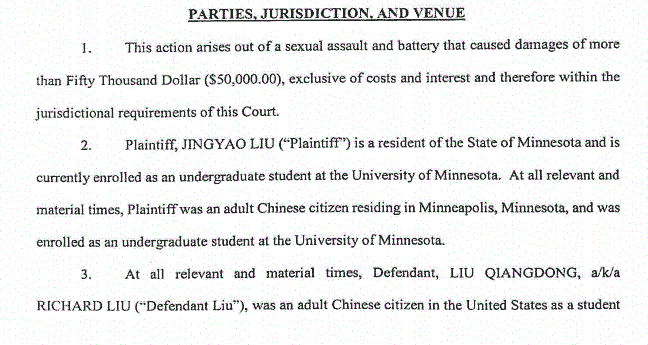

希望大家还没有睡着，听上去就是挺索然无味的，没有办法，这是法律文书的核心特质。

这样粗略的看下来，大家没有发现起诉书的几个比较明显的特征。

首先你看很容易找特征的，你看这起诉书首先它是一段一段写的，它 12345678，它有编号，每一段有长有短，可是基本上每一段都只陈述一两个核心事实。

原因是这个起诉书是要留给你的对手，也就是被告去应答的。

这样的一种写作的方法，被告就可以就每一段所讲的这个简单事实本身去做应答。

比如说，我在接下来的段落描述案情的时候，我的第一段，我只写：我跟被告素不相识，从来不认识。

然后被告就可以在下面说：对，确实是这样，他就可以承认这个事实。或者他说不，我们已经认识了五年。

第二段我接着写，说，昨天我走到大街上，他突然就冲出来打我。

被告就可以在底下回应说，他可以承认第一段说，我跟他素不相识，这个是对的，可是第二段就不对了，我昨天一直在家里听阿詹的法律节目，没有上街打过人。

所以这种一段一段的每一段讲一个基本事实、基本论点的陈述方法，可以给出你的被告去回应，这样双方很快就能够明白，哪些是互相都能够确认的事实，哪些是存在争议的，或者哪些论点对方可以接受，哪些论点双方要拿到法庭上去辩论。

大家再看一下这份起诉书，为什么我读起来大家觉得比较枯燥无味？前面整整八段，看上去都非常形式主义。

它都是在介绍原告跟被告是哪里人，平时住在哪里，案发期间内他们住在哪里，在哪里有商业地址，所有的这些非常基本的信息。

然后，它得出的结论是：综上因此，明尼苏达州亨内平郡法院是本案恰当的管辖和审理地点。

这一听就是典型的令人厌恶的法律术语。

它其实就是想说一件事，所有这八段都是想说一件事，这个官司就该在你这里打，就该在这个法院打，你这个法院应该管起来。

这个是我们在任何法院去打一个官司，首先要考量的一件事。你首先考量的并不是起诉书怎么写，怎么描述案情，怎么去具体的写我的诉求到底是什么。

#### 司法制度对管辖权的限制

首先要考量的一件事，是我在什么地方打官司？

法律的管辖权是什么意思呢？其实就是法律的管辖是有限制的，一个法院没有权力管所有的事情，它也没有权力管所有的人。

所以大家要去讨论管辖权范围的限制到底在哪里，它有没有把被告，有没有把我告被告的这件事情管在里面？

就好像很多人在微博上跟我抱怨，抱怨很多的法律难题。比如他说我在国内一个中级人民法院去告一个人，这个法院就把你打回来说，这事不归我们管，大家可能有一些疑惑。

当然具体的问题要具体的分析。可是这是有可能的，法院确实它的管辖权是有范围的。

就好像我们刚才提到的那本书《卡拉马佐夫兄弟》，这本书写在 1880 年，就 19 世纪末的时候，那个时候在一八六几年的时候，沙皇俄国刚刚完成了它们的司法改革，确立了陪审制度。

可是那个陪审制度依然带有鲜明的帝国或者阶级特色。

它的地方的司法机关的治安法官是可以管地方事务的，它的管辖权是比如说某几个县份的地方事务都归治安法官来管，可是涉及僧侣、贵族和其他名誉公民的案件，他们没有管辖权。

大家就看到这就是一个司法制度里对管辖权的限制。我这个管辖权首先在地域上有一个划分，我可能对你能管什么样的人有划分，像沙俄这样的一种管辖权，以阶级作为划分的管辖权，当然就是非常明显的它沙俄帝国时代的一个印记。

#### 例外：异地审理原则

很多时候划分管辖权其实是为了保障司法的公平。比如说我们国家在宋代开始就有异地审理，相信大家都听说过这个原则。

比如今天的中国一样的，例如说行政法的官司，就是民告官，一个地方的中国公民，可能对当地政府的某一些做法有一些争议、有一些不满，或者双方有一些经济上的纠纷，正常情况下，管辖权应该是属地的。

行政法的官司它当然要去中级人民法院打，一个地方的中级人民法院，它就该管本县、本市的案子。

可是行政法这个问题，因为它涉及当地的人民政府，所以我们国家有异地审理的原则，他可能是到相邻的县份上去审判。

这就是一个对管辖权的非常明确的制度设计。

就是我这个地方的人民法院反而没有权利审理本地的行政法案子，相邻县份就被制度赋予了一个不太符合，一般设计的这种特殊的管辖权，我可以管某一个跟我相邻的县份上的行政法的案子。

所以管辖权是一个法律里面非常重要的问题，我们之后会详细的讲到。不是说我在任何地方蒙受了任何的冤屈，我有任何的诉求，我就可以随便找一个法院告，不可以。你要找对的法院告。

以美国为例，这个问题在美国又会更加的复杂。因为除了这种异地审理这种原则，我们一听就会明白，但是美国这个问题会更加的复杂。

#### 美国联邦法院与州法院的管辖权

因为美国是一个联邦制的国家，我们刚才讲到了，它的每个州有自己的司法体系，除了这些州的司法体系，还有一个联邦的司法体系。

我们之前也跟大家分享过，美国这个国家在刚刚建立的时候，因为它刚刚从英国的殖民统治当中脱离出来，它对强大的中央政府是怀有厌恶和恐惧的。

所以联邦法院在最初建立的时候，美国人关于要不要建立一个集权的中央政府都尚且有争议，这个联邦法院一开始非常的克制自己，它把自己的管辖权划到非常之小，可是这些管辖权它所拥有的这些管辖权，几乎可以说不得不设置的管辖权。

比如说两个州的居民，原告跟被告来自不同的州，他们有了矛盾，一个加州人在纽约州跟人打了一架，他在纽约州的法院里去告对方。

这个时候纽约州的这些陪审团法官也好，可能就会觉得你一个南方的乡下佬凭什么来我们这里打人、还敢告人，他们可能会偏向本州人，或者可能事实上他们没有偏心，但是很难让人相信这里的法院真的能够做到绝对的公平公正。

所以为了避免这种情况的出现，他们就需要一个联邦法院看上去是一个比较客观中立的第三方来解决这种纠纷。

还有一种更严重的情况，美国建国之初常常遇到的就是两个州之间有矛盾，比如说税收问题有很多的争议，两个州的政府互相去告，很显然就没有办法在任何一个州的法院里去解决这个纠纷，就需要有一个联邦法院来出面解决了。

关于美国联邦和州法院的法律和管辖权的问题，非常复杂，在民法的考试里一定是一道大题，我们留待下一集继续。

# 12\. 司法管辖权的归属 | 诉讼程序之起诉

（公众号懒人找资源，懒人专属群分享。）

我们从上期节目开始呢，进入了一个可能会让大家质疑法律，到底想不想要为我伸张正义的头痛的话题，在我勇敢地用法律武器去为自己伸张正义之前，我不得不先搞清楚我应该在哪个法庭去为自己伸张正义。

每一个法庭都有自己有限的司法管辖权。

那司法管辖权这个问题从常识出发，其实是很容易的属地原则。在什么地方发生的事情，通常就到什么地方的法院去告。

可是比原则更有趣的就是例外，包括我们之前提到的中国自古至今都实施的一种异地审理的原则。

那为了向大家详细地分析这个问题的复杂性，我们引入了美国联邦和州法院的讨论。

#### 美国联邦与州的双轨司法体系

美国为什么会有这样一个双轨制的司法体系，一切要从头说起。

我们提到过很多次美国是一个联邦制的国家，在连美国最初赢得独立战争从英国独立出来的时候，美国人对强大的中央政府心怀恐惧，那个时候他们并没有急着制定今天的美国宪法。

那个时候的美国宪法，我们今天把它叫做 Articles of Confederation《联邦条例》。

这个《联邦条例》虽然名义上是当时独立国家的宪法，我们今天去看会发现它其实更像独立国家之间的一个条约、《联合国公约》这样的一种公约，因为他把大量的自主权利都保留给每个州。

那个时候的世界比较的单纯，并没有所谓的联邦法院这样的一个体系。

每个州保留自己的法律，也保留自己的司法体系，也就没有我们今天所要讨论的这么复杂的，到底该去哪种法院打官司的司法管辖权的问题。

可是这个单一单纯的世界也有它的问题，就是联邦法律，每个州不太愿意去管。

比如说美国在结束了独立战争之后，其实它和英国还持续在一个战争的状态，直到 1783 年美国和英国签订了《巴黎条约》，彻底的结束了两国之间的战争。

在这个条约当中，为了换取英国的承认，美国做出了一些重要的承诺。

在独立战争期间，有一部分美国人他们是坚定的拥护英皇的统治，叫做保皇党人。美国人强制的征收了保皇党人的很多土地。

那在这份《巴黎条约》里面，美国国会答应返还保皇党人的土地。

那这是一个国会签订的条约，国会所认可的法律。

可是这个条约拿回国之后，却在执行上遇到了重重的困难，因为没有一个联邦法院去司法、去执行，关于这个条约所引起的纷争，就只能到每个州的法院里面去具体的解决。

可是每个州大家知道是是忠实于自己的选民的，在那个年代尤其如此。所以有很多地州公开的表示反对这个条约，很多的州拒不执行这个条约。这些州的法院也常常是追随他们的州的选择。

于是美国人后来痛定思痛，他们建立 1787 年宪法的一个重要改革，就是建立了一个独立于每个州的司法体系  
联邦司法体系，也就是建立了从地区法院、到上诉法院、到最高法院的一个完整的联邦法院的体系。

所有联邦的法律从此以后就不再下放给每个州去自己审理了，联邦法律的问题，我们到联邦法庭里去解决。

这里可以看出美国的政治的重要特色，我们知道是美国是一个分权的国家，它的分权不仅是三权分立，行政、司法、立法的分权。

#### 联邦与州司法管辖权的交叉

它也包括上下层之间的分权，就是有一些权力保留给每个州，每个州的议会自己去立法。但是有一些权力就提交到国会这个层面去全国性的立法。

那这两种分权也彼此之间有交点。

比如说联邦的立法权，也就会带来联邦的司法权，因为联邦所制定的联邦法律要到联邦法庭里面去解释。

联邦的法律不能够交给不同的州去解释，那纽约州和加州他们的解释不一样的时候，怎么办呢？当然是由联邦的法院去最终拍板。

同样的道理，每个州自己制定的法律，由每个州的法院去解释。

比如说我们之前提到亚拉巴马州这个极端保守州，它通过了一个禁止堕胎的法令。那如果你是一个反堕胎主义者，你想要起诉一个实施了人流手术的医生，你到什么地方去起诉他？

那当然是在亚拉巴马州的地区法院，对吧？这个州法院，因为这是一个州法律。

那如果你是这个医生一审败诉了，你要到什么地方去上诉，你不能去联邦法院，你还是得到亚拉巴马州的上诉法院。因为这是一个亚拉巴马州法律的问题。

那如果双方始终都不服，最后这个案子要上诉到什么地方？不是美国（联邦）最高法院，而是亚拉巴马州的最高法院。每一个州法律的最终解释权是在每个州的最高法院，而不是在美国联邦最高法院。

大家觉得这里不太对吧？难道亚拉巴马州的这个法律没有人可以管他吗？

为什么我们都知道有之前讲过的一个案子，1973 年的罗诉韦德案。在那个案子里美国最高法院也就是联邦的最高法院，非常明白的给了每个女性堕胎的权利，如果说这是一个每个州自己的问题的话，为什么（联邦）最高法院可以出来说话？

回头有机会讲到罗斯维德案，具体讲的时候，大家会看到，罗诉韦德案里，最高法院之所以认可女性堕胎的权利，是基于女性的隐私权，而隐私权是一项宪法权利。什么宪法？美国联邦宪法。

所以说，有很多本来是州的问题，之所以能够一步一步的上诉到美国联邦的最高法院，是因为不同的律师找到了宪法的角度去诠释这些问题。当你把这个问题从一个地方法律问题上升到一个宪法问题的时候，这个问题的司法管辖权也就发生了改变，它就会变成一个联邦法院的司法管辖权。

所以在这个案子里，我们看到的是联邦法律的体系和这个州法院的体系，这两个双轨制之间，它们的管辖权其实有重叠。

因为同样的一个案子，你永远可以用不同的角度去诠释它。联邦所制定的法律跟州的法律之间有重合，也可能有冲突。

#### 联邦与州司法管辖权的空白地带

那还有一种有更有趣的情况，是这个双轨制联邦法院和州法院各有各的管辖权，它们的管辖权中间可能有真空和空白地带。

一个经典的例子是美国的反垄断法。

反垄断法这些年变得非常的热门。我们中国制定反垄断法大概是在 2003 年，但是开始执行反垄断法只是过去十年间的事情。我们一提到反垄断法，谁在垄断如今的世界？谁在垄断市场呢？

大家可能会首先想起那些科技巨头，在中国是 BAT，在国际市场上可能是谷歌、Facebook、亚马逊。

我们最近听说反垄断法，也是因为听说谷歌在在欧洲因为反垄断的问题，被罚了几十个亿的欧元，听说苹果现在在美国正在面临反垄断的起诉，对吧？

可是在这些科技巨头出生以前，垄断这种商业行为早就已经存在了。反垄断法是一个很古老的法律。反垄断法在中国被叫做《反不正当竞争法》，它在世界的大部分地方也都叫这个名字。反垄断这个词本身就有一定的历史特色。

反垄断 antitrust。trust 这个单词我们都知道，当它作为一个中性的词的时候，是信托的意思，我把我的财产交给另外一个人代为打理，这个叫信托。可是它还有一个更有名的翻译叫做托拉斯。

我记得我们在高中历史课本里学习过这一组概念，托拉斯、卡特尔。

我们当时学习历史的时候，是在从马克思的理论转移到列宁，因为列宁提出了对资本主义新的解读，他说资本主义世界已经进入了帝国主义的时代。帝国主义的时代一个重要的特色，就是诸如卡特尔、托拉斯这样的庞大的商业帝国的出现。

同一个行业的大公司，彼此通过公司和公司之间的信托，也通过并购和收购等等的方法，实现对某一个行业的垄断，这个叫托拉斯。

托拉斯问题在 19 世纪末变得非常的严重，对美国这样的发达的资本主义经济体里面变得很严重。

一个著名的例子，就是我们知道的标准石油公司洛克菲勒和他的石油帝国，在那个年代通过对竞争对手的恐吓、打压，通过跟这个铁路公司的密切合作，几乎完全垄断了美国的石油市场。

在那个时候美国联邦并没有联邦的反垄断法，因为不正当的商业行为是保留给每个州自己去规范的。有一些州有反垄断的法律，可是没有一个联邦的反垄断法。

于是就出现了司法管辖权的一个真空。一方面联邦的法院觉得他们没有办法去管这件事情，因为无法可依。另一方面每个州的法院也不愿意去管这些商业帝国，为什么会这样呢？

还是要回到我们刚才提到的那段历史。美国人之所以痛定思痛地去制定出 1787 年宪法，是因为 1787 年宪法的前身，这个联邦条例非常的不靠谱，有很多的漏洞。

其中一个有趣的很漏洞，我不知道该不该用有趣这个词，跟那个年代的贸易战有关，美国人真的是不懂"己所不欲，勿施于人"的道理。

美国在刚刚独立的时候，英国对它发起了贸易战，主要是英国切断了美国和英属西印度群岛之间的贸易，对美国造成了很大的打击。我们今天身处在贸易战之中，能够更直观地理解这件事.

所以美国当时作为一个新兴的国家在面临这个贸易战的时候，合理的举措应该就是打回去，采取一些报复性的手段，逼迫英国重新回到谈判桌前。

可是因为那个时候的美国是一个松散的邦联国家，那它的州和州之间壁垒非常的分明、阵营很分明，每个州有巨大的自主权和自己的利益在考量。

所以他很难凝结成一个统一的力量去应对贸易战。我们把它放在一个中国的语境里，非常容易理解。

这是一个比喻，比如说今天中国跟美国贸易战了，然后我们都知道稀土是一个重要的战略物资，假设说中国有五个省都出产稀土。那我们作为一个单一制的国家，当然是一致对外，五个省都一起不对美国出口稀土，这样会给美国造成很大的压力，对吧？

可是我们设想在当年的那个美国，州和州之间有的时候还有矛盾和摩擦，并没有那么统一。

这个时候假设美国的国会非常努力的想要说服大家，一起去把贸易战打回去，争取最大的利益，说服这五个州都一致不对外出口稀土。可是在这种情况下，我们就遇到了一个经济学或者博弈论里面的经典难题，叫做囚徒困境。

就是理性的分析我们都知道，如果我们一致行动的话，带来的集体利益是最大的。可是从每一个个体出发，如果我违背这个集体的契约、承诺跟一致行动的方向，悄悄的去和英国做贸易。我会发现你们四个都不卖稀土给英国了，我一个人去卖，我能够抬价。

这个时候我从我个体的利益出发，去违背整个集体行动，对我自己的利益是最大化的。

当年的美国就遇到了这样的情况，这个表现糟糕的不讲道义的州，通常是纽约州。因为纽约有纽约市，有最好的港口，跟英国有最频繁的海上贸易往来。

所以每当美国国会想要推行这个贸易战里面打击报复政策的时候，常常会遇到这个不靠谱的，像纽约州这样的州釜底抽薪，整个事情就做不成了。

所以美国在后来他决定进入 1787 年宪法的时候，一个重要的举措就是把某一些重要的决策上升到国会，就是我们刚才说的立法权的分权。其中就包括对于贸易的管理。

所以美国的国会，而不是每个州，可以去制定美国的对外贸易政策，以及规范跟约束州与州之间的贸易，这是美国国会的权力的一个非常重要的来源。

最起初受到种种限制的只有一些特定权力的国会，在之后的岁月里，每当想要扩充自己的权力，常常就会拿起这个州际贸易的这个口袋，什么都能往里装，然后不停地扩充自己的权力。

那当然在那个年代看来，这项权力还是非常的重要的。

同样在那个年代，州的法院跟这个联邦法院之间还比较泾渭分明，大家都比较恪守自己的准则，不去越界。

那因为州际贸易这个问题是被国会来约束的，每个州的法院或者每一个州的公诉机关都觉得自己不应该去伸手插手干预州际贸易。

今天情况会发生很大的不同，那个年代还是这样。

那托拉斯这样的商业帝国的存在非常明显。它之所以叫托拉斯，就不是在一个周之内很在小地方做生意的。通就是两个州的同类型行业，它们之间的并购，它们之间的信托，最后能够结成一个托拉斯这样的商业集团，它就是统合了整个美国市场。

所以在美国的联邦反垄断法出台之前，就出现了一个管辖权的真空，就是联邦法院没有法律去管，而州法院又出于这种分权不愿意去管。直到 1890 年美国国会终于制定了第一个联邦反垄断法，叫做《谢尔曼法令》。

这个法令非常的简单，一共只有两句话，但是这两句话非常的有力。

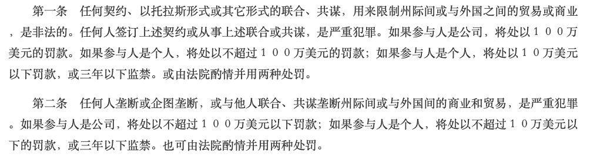

包括我们刚才所提到的标准石油公司就死在这个法令之下。

在 1911 年的时候，美国联邦最高法院通过裁决，要求把这个不可一世的标准石油公司拆分成了好几十个分公司，要他们彼此竞争，比如说美孚和埃克森。

当然我们今天知道美孚和埃克森，后来又合并了，叫做埃克森美孚。

但是联邦反垄断法的出台在那个年代非常重要，因为这个州法院他们的管辖权所限，没有办法去管理垄断问题，所以反垄断法在历史的长河里都是一个联邦法律问题，通常都是在联邦法院里去解决的。

当然今天时代又发生了很多的变化，我们有机会再聊。

可是讲这么多，主要是为了向大家展示，美国的联邦法院在有联邦反垄断法之前，受到巨大的束缚，有很多的跨境贸易的问题在发生，但是没有办法去管，这一切都源于美国联邦法院管辖权的限制。

因为它是一个无奈之举，不是大家从一开始想要的，是美国人发现没有联邦法院不行了，才勉为其难创造出了一个联邦法院的体系，从它诞生之日起，它的管辖权就是受到严格的束缚的，只去管我们上一级所提到的州与州之间的纠纷，或者是像我们今天所提到的，如果它是一个联邦法律的问题，那就由联邦法院去解决。

# 番外 | 为什么章莹颖案的凶手没有被判死刑？

本期关键词：死刑的存废、无期徒刑、假释、陪审员制度、社会契约论

（公众号懒人找资源，懒人专属群分享。）

这段时间有两个我们关注了很久的案子尘埃落定，章莹颖案和张扣扣案。

我这段时间收到了很多的评论、微博私信、还有采访的邀约，要我谈对这两个案子的看法，我一直是比较抗拒的。因为非常的沉重，而我作为一个法律人的客观的分析，跟我作为一个普通人的情感诉求中间是有差距的。

不过后来看到了一些我觉得不是很理性的对这两个案子的讨论，我觉得，当一切尘埃落定，失去的生命和伤害都不发挽回，我们唯一能做的，也许也只是通过对这两个关注了很久的案子，透过它们去认识跟反思我们的司法体系。

在章颖案的量刑审判之前，曾经有报纸邀约我去做一个预测，认为这个嫌疑犯最终是会被判死刑还是无期徒刑。我觉得这个预测是没有办法做的。

这就是我们在之前的节目里跟大家提到的审判、庭审这个过程充斥着巨大的不确定性，无论对于控方还是对于被告来说，都难以把握。所以 90%以上的案子不会进入庭审的环节。

以刑事案为例，大部分的案子也都结束在认罪协定，plea  
bargain，这个嫌疑犯跟控方之间所达成的协定，特别是像死刑，需要有 12 位陪审员作出一致的决定，才会宣判死刑的案子，真的是很难预测，或者内心深处那个不愿意承认的预测，判一个人死刑是很难的。

我看到有人评论说，这 12 个陪审员泯灭人性、不负责任，对于不是发生在自己身上的事情，冷漠视之。

我不知道这 12 个陪审员他们是谁，他们基于什么样的考量做了这个决定。但是我认识做过死刑案陪审员的朋友。当我们作为一个旁观者，站在一个比较远的地方去评价一个事情的时候，有很多东西是理所当然的，就觉得判处死刑是一个理所当然的决定，说出这句话并不难。

#### 12 个陪审员不负责任、冷漠视之？

#### 1\. 陪审员对于死刑投票的心理压力

可是我的朋友说，当你真的坐在那个陪审员的位置上，你知道你投出的这一票是真的可能杀死一个人，这个人就站在你的面前，他看上去就像一个普通人，这个时候一个人要承担的心理压力，想要迈过死刑的这道坎，这个压力是巨大的。

所以，陪审团的制度是一个社会的一个选择，它必然会带来一些后果，包括量刑的困难。

有人支持陪审团这个制度的人，他们的其中一个论点就是，每个人在做陪审团的过程当中，在为他人定罪和量刑过程当中，我们都在学习成为这个社会的一个公民，都学会去理解司法制度。在死刑这一刻，可能对于很多人来说太难了。

#### 因为章是中国人，所以美国司法体系对她不公?

#### 2\. 美国检方花了很多心思，让案子的管辖权归属于联邦法院，就是为了能够争取判死刑

我也看到一些评论说，因为章莹颖是一个中国人，所以美国的司法体系对她不公平，或者是没有认真的对待她这个案子。

我觉得如果大家做这个判断，仅仅是基于最后这个嫌疑犯没有被判死刑，基于这样的一个结果，这个论述可能是过于粗率的。

每一个人心中对于正义的结果应该是什么样的？对于一个人的罪应该受到什么样的惩罚，会有不同的判断。

司法没有办法满足每个人心中对于正义结果的判断。一个司法体系是否公正，只能看它的过程、程序是否正义。还是那句话，要在今天的美国判处死刑，本身就是一件极其困难的事情，这里面有好几个元素，我们正好在之前的节目里提到过。

第一个元素，一直对这个案子保持关注的朋友们应该都知道了，美国的大多数州其实已经废除了死刑。

比如说这个案子所发生的伊利诺伊州，就在 2011 年的时候废除了死刑。如果这个案子是在伊利诺伊州法院去打的，根本就不会有死刑的讨论。它之所以我们还可以讨论死刑，是因为这个案子是在联邦法院去打的。

这里就有一个问题，也就是我们在上一期的节目里所讲到的管辖权问题。

联邦法院我们之前提到的，它是一个无奈的创造，一开始美国人民并不想要它，之所以创造出这样一个体系，是因为大家发现如果没有联邦法院，这个国家很难运作。

所以这个联邦法院只被赋予有限的权力，不得不让他管的时候才让他管。在这个案子我们之前也提到了，在一个案子正式进入庭审之前，其实有一个漫长的调查、争议的过程，这个案子已经持续了两年。

在去年的 12 月的时候，克里斯滕森的律师其实就提出这个案子的管辖权错了，他不应该在联邦法院进行，应该转移到州法院。

他说，这个联邦检察官之所以要把这个案子带到联邦法院，主要就是为了寻求死刑。

最后法官是拒绝了这项动议。如果这个案子真的被移到州法院，对于克里斯滕森的一方来说，当然就是一个重大的利好，因为州的法律没有死刑这个选项。

我们在上一期节目里提到，当美国人创造出联邦法院这个体系的时候，他们虽然不愿意给这个联邦法院的体系很多的权力，但是他们知道有一些权力，最好是给联邦法院，而且不得不给联邦法院。其中一项很重要的内容就是归管贸易的权力，特别是归管对外贸易和跨州贸易洲际贸易的权力。

**这个案子法官以什么理据把他留在了联邦法院？**

**就是这个州际贸易。**

所以从联邦法院体系建设之初，在他发展的过程当中，这个联邦法院的权力或者是整个议会的权力，联邦的立法机关和整个司法机关的权力的一个重要来源，联邦法院可以管所有跨州贸易用到的工具，instrument  
of interstate commerce。

在控方的申辩下，法官最后同意，在这个案子当中所用到的克里斯滕森所开的那辆绑架了章莹颖的他的那辆黑色的汽车，不是在伊利诺伊州生产的，它是一个跨州贸易的工具，以及他所使用的电话（手机），都是跨州贸易的工具。

这个辩方律师就说，问题是这个车在整个案子发生的过程当中，根本就没有开出过伊利诺伊，那个电话（手机），根本就没有被用在这个案子的过程当中。

但是，因为联邦法院对于跨州贸易的工具这个元素的解读一向是非常宽泛的，它把很多的东西都借由（其实抛开所有的背景去看）蛮牵强的一个解读。他把很多的东西都置于联邦法院的管辖之下，这是联邦法院为自己争取权力的一种方式。

所以这个法官最后认为，这两个东西很明显是跨州贸易的工具，至于他们有没有被用在这个案子当中，这个问题我们交给陪审团去解决。所以这样才过了第一关。

大部分的时候，在美国一州之内所发生的刑事案件，通常是由这个州的州检察官去调查、去起诉，然后在州的司法体系内解决的。

联邦的司法体系并不常常积极的介入一州之内的刑事案件。所以在美国国内有一些评论认为联邦的检察机关之所以那么的积极，FBI 一早就介入调查，它最后在一个联邦法院里去审判，其中的一个原因，是这个案子的被害人是一个中国人，那这个案子在中国国内引起了高度的关注，它成为一个有国际影响的案件。

美国的法官有的时候，他们在判案的时候是会考量国际影响的，他们会直言不讳的写出来，我们之后可能会聊到。可不管怎么说，当这个案子即便它进入了联邦的司法体系，寻求死刑成为一种可能，要判一个人死刑仍然是极其困难的。

美国的联邦法院是在 1988 年以后，在 90 年代经历了一系列的改革，才把很多的重罪纳入了联邦死刑的范围。在那以前死刑是大部分的像谋杀案这样的重罪的死刑是交由每个州去处理的。

#### 3.在美国，被判处死刑、执行死刑都非常难

就是联邦的死刑只适用于那些州的法律里不包含的罪行，比如说叛国罪。

那在有一段时间里联邦的法院又决定说，如果这个州已经废除了死刑，那么这个州之内的联邦法院也不要去判处死刑，所以它经过了一些往返的、有反复的改革。

1988 年以后，实际上在三百零一名死刑犯的审判当中，美国司法部寻求的死刑，只有 36%的人真正被判处死刑，也是有一百多个人被判处了死刑。

可是这些判决大多数发生的年代比较久远，它主要集中在 90 年代，就是一个严厉打击毒品犯罪和其他重型犯罪的年代。

可是在 2000 年以后，其实这个舆论又是往人权的那一边在倒的。

在 2015 年以后，一共只有三个人在联邦的法院里被判处了死刑，他们都是一些什么样的人？

一个人是在波士顿马拉松爆炸案当中的恐怖分子；一个是 2017 年的一个白人种族主义者，他在教堂里无差别杀人，杀死了九个人；还有一个人，他是之前已经被判过一次死刑，然后被减刑了，结果又犯罪，又被判了一个死刑。所以是这样的三个人被判了死刑。

而被判处死刑之后，到死刑真正被执行之间，其实还有很长的路要走，有那么多人被判处死刑，但是到今天还有六十多个人在等待死刑。真正被执行了死刑的一共只有三个人。

这三个人又是一些什么样的人呢？一个人是叫蒂莫西\*麦克维，他在俄克拉荷马州的一个著名的，不能用著名来形容，极其恶劣的政府大楼爆炸案当中炸死了八名政府官员。

另外一个人是一个著名的毒枭，他涉及毒品走私的犯罪，他直接或者间接的导致了九个人的死亡，而且这些能确定证据的死亡。

还有一个叫琼斯的人，这个案例其实蛮有借鉴参考的价值。这个案子其实跟章莹颖有一些相似之处，它也是一起极其凶残、恶劣的绑架强奸谋杀案。

这个叫琼斯美国士官，他被执行死刑是在 2003 年，这个是在联邦体系里最后一个被执行死刑的案例，但他犯罪其实是在 1996 年。可见这个中间的死刑复核，死刑上诉有一条很长的路要走。他在 1996 年的时候，他去某一个军事基地去找他的当时的妻子。可是在路上，但是到了这个军事基地，不知道为什么，他就突然绑架了一个当时在这个军事基地里接受培训的年轻女孩。然后他开车把这个女孩带走，对她进行了强奸，然后把她杀害。

这个案子跟章莹颖案相比有一些更清楚的地方，有一些对于控方来说更容易的部分，就是他供出了埋藏尸体的地点，而且警察找到了尸体，而且这个尸体保存的状态比较好，所以证据链更加的清晰。

那这个案子的恶劣还有一个加重他的元素是，他是在美国的军事基地干的这个绑架的事情。

但这个人相比起章莹颖案的嫌犯，他也有一个看上去比较有利的减罪因素，我们都知道在量刑审判的时候，控方和辩方可以提出使罪行加重的因素，也可以提出各种各样的减罪因素，就是双方都可以提。

使得罪行加重的因素，比如说犯罪的手段极其残忍、预谋已久、包括他对受害者的家庭造成的伤害。

可是另一方面法律也允许这个辩方去提出各种各样的因素来为自己开脱，跟减罪，而且这个法律不限制什么样的减罪因素应该被纳入考量，他是的允许辩方律师去找各种各样的理由。

#### 3.1 陪审员可能被任何一种不确定的因素打动

所以我们看到在章莹颖案当中，这个辩方律师找了 50 多项元素。因为你没有办法确定哪一个陪审员可能被哪一个因素所打动，所以辩方律师一定都是很积极的去找，这个制度的是非、它的利弊，我觉得我们也可以讨论。

万一这个人他所找到的某一个，比如这个人觉得自己生活不顺利、精神有障碍、酗酒、觉得自己在社会上没有价值，说不定有什么东西就正好戳中了某一位陪审员。

那在琼斯案当中，这个琼斯其实有一个他一直坚持到最后的理论，就是他说他有战争后遗症，他是一个美军士兵，他参加过海湾战争。然后他的律师辩称说，当他从这个海湾回来以后，他整个人就性情大变，他是受到了战争的创伤。

这个理据其实打动了很多人，虽然最后他一直上诉到美国最高法院都没有能够得到减刑，包括他去向当时的美国总统寻求总统能不能够，当时的美国总统小布什，总统有最后一个宽恕的权利，而布什也没有使用这个权力来宽恕他。

可是有很多人站出来为他说话，包括前段时间去世的美国的著名的富豪佩罗特，就是那个史上最成功的以独立第三方的身份竞选美国总统的人。

这些人都非常的被他参加过战争这件事情打动。因为当时这些士兵们所经历的战争创伤，对他们的心智和生活的影响开始逐渐的被这个社会重视。

废除死刑当中有一个很重要的观点，就是我们都不是无辜的，你看上去是这个杀人恶魔，一个人犯下的错，其实整个社会都在他走向杀人恶魔的过程当中扮演了角色，我们没有什么资格去指责他一个人。那在美军士兵的这个问题上，这个论点会显得尤其的有利，因为战争并不是他所选择的。

这个案子虽然最后琼斯还是被执行了死刑，可是在美国国内引起了民意的巨大反弹，有很多很多的讨论，我不知道在章莹颖案当中的这些陪审员，他们有没有被这个案子的讨论影响过？

总之就是当这些讨论过后，坚定的去判一个人死刑，让执行死刑变得很难，总是有什么东西可以打动人天性中的仁慈的。

#### 3.2 无期徒刑，也许比死刑是一种更痛苦的惩罚

有一种说法认为，既然在美国执行死刑这么的困难，要经历那么多的上诉，也许反而会对这些家庭造成再一次的伤害，而让一个人直接的去面对无期徒刑，也许是一种更痛苦的更适当的惩罚。

美国的死刑犯被赋予一次一次的，直到向最高法院申诉他们的死刑的权利，而且有不少申诉成功的案例。

我之前认识的一个法学的教授，他本人成为了一个成功的律师之后，他就开始致力于做一件事情，他就给自己设定了一个目标，每年去尝试解救一个死刑犯。

我知道大家当我们面对章莹颖案的时候，我觉得这样的人简直就是白左。

可是试想一下，如果他想要去解救这个死刑犯是张扣扣，每一个罪犯的背后都有他不同的故事，每个人走上犯罪这条道路都可能是不同的原因。

当然，当这个社会不停地去把所有的这些因素纳入考量，你看向章莹颖案当中把这个杀人犯，他说他在社会上感受不到自己存在的价值，把他喝酒、把他的精神问题都纳入考量的时候，要去为一个人定罪，其实就变得很难了。这又是一个社会的取舍，我觉得它没有一个标准答案。

那从法理上说，从法律的规则上说，要判处一个人死刑为什么这么难？非常明显的一点，是因为在联邦法院里要判他死刑，是要求十二个陪审员作出一致的决定的，这件事情是非常难的，我们之前讨论过。

十二个陪审员每个人都那么的不同，每个人的背景经历不同，打动他们东西也不同。这里有一个很明显的例子，可以显示出这个要求十二个陪审员作出一致决定是怎样的使得判处死刑这件事情变得很难？

美国有三十个州的保留死刑，其中有二十八个州要求陪审员来来做死刑的裁决。其中二十七个州要求所有的陪审员作出一致的裁决，才可以判处死刑。

在 2016 年以前其实有两个州，就是佛罗里达州和我们一再提到的亚拉巴马州，佛罗里达州和亚拉巴马州都是允许，绝大多数陪审员认为死刑就可以了。

可是在 2016 年的时候佛罗里达有一个死刑犯，把自己的官司打到了美国最高法院，认为佛罗里达的法律侵犯了他的宪法权利，而美国的最高法院是站在了这个死刑犯的这一边，佛罗里达州被迫修改了它的法律，变成也是要求必须十二个人一致同意。

在佛罗里达州修改它的法律以前，它有 90%的死刑的判决都是在陪审员未能达成一致的情况下做出的，因为在那之前不需要所有人达成一致，所以 90%绝大多数的死刑判决，其实陪审员都没有能够达成一致。

换言之，如果佛罗里达州的规则从一开始就跟大家是一样的，它的绝大多数的死刑判决都不会做。佛罗里达州在它改革以前，它的整个县份的数量只占到美国的 2%，可是它却判出了美国 50%的死刑。

可见，当你不要求所有的陪审员给出一致决定的时候，其实死刑的判决会容易很多。佛罗里达州它的法律刚刚修改，从 2016 年之后，其实他的陪审员就在新的规则之下，审视了好几个死刑的案件，那在绝大多数的案子里都是因为陪审员没有办法达成一致，没有给出死刑的判决。

所以我们发现我们今天的法律变成一套极其复杂的规则，它不再是那个简单的朴素正义的年代，杀人偿命、约法三章、杀人者死，那样的年代。

#### 4\. 朴素正义（杀人偿命）的时代已成过去

真正决定一个案子的结局或者一个人命运的，不是那些大原则，而是一些法律的细节。就是像这样到底是十一个人决定死刑就可以，还是十二个人必须一致决定。

还有的州规定说，当这十二个人没有办法达成一致意见的时候，可以由法官来做这个决定。比如说密苏里州，它在过去十年间，陪审团已经再也没有作出过任何死刑判罚。可是密苏里州允许当陪审团无法达成一致的时候，法官来决定，它反而在过去两三年间，由法官判出了两例死刑。

还有一些州，比如说加州，它虽然要求陪审团达成一致的意见，可是这个陪审团没有办法达成一致的时候，法院可以召集一个新的陪审团来重新量刑。

是所有的这些，每个州看上去都不一样，各有各的考量的这些更细节的规则，在决定着一个案子的最终结局。可是我们今天的这个案子，它是在联邦法院里去审的，这个是我们能够争取到的最好的结果。

在联邦法院里审这个案子，是经过了控方的争取的。我们想这是对于被害者的正义得到伸张，是一个有利因素。可是即便如此，它种种的法律的限制，依然使得死刑的判决变得很困难或者不可能。

当然了，就像我们刚才说到的，当一切成为定局之后，回过头来想，有很多人觉得，让一个人终身监禁比直接把他杀掉，对他的惩罚可能是更有力的。

这件事情，有一个有各种各样彼此矛盾的研究，所以它没有一个权威的答案。

包括说，有人认为，比如说在东亚国家，其实日本、韩国、中国，我们这个社会都是相当一致支持保留死刑的。一个重要的原因是，我们认为除了东方文化里的朴素的正义观，还有我们认为只有死刑才能够给罪犯足够的震慑。

这个问题也是一个没有定论的社会科学研究，就是到底是无期徒刑给人的震慑力更大，还是死刑的威慑作用更强，其实是没有准确答案的。

死刑至少还有一个很明确的好处，就是预防犯罪。因为这个死刑犯被执行了死刑之后，他其实就再也不能够犯罪了。可是这一点的好处，其实也被无期徒刑替代了。

#### 5\. 不得假释+不得减刑的无期徒刑的效果＞死刑

而且我们注意到在章莹颖案当中，克里斯滕森这个嫌疑犯他最终收到的刑罚是不得减刑跟假释的无期徒刑。这个条件是非常重要的。

因为，在美国的司法体系里，假释是一个很普遍、很重要的概念，我们之前提到刑罚的目的的时候，西方的观点认为，监狱的首要目的并不是惩罚，而是改造一个人，让他变成重新能够适应社会生活的社会人。

所以，比如我们去美国看一个人的量刑，你看他最后被判多少年，这个数字可能是没有那么有意义的，比较有意义的数字是，这个法官给他的假释年限是什么。

就是这个法官说，多少年之后这个嫌疑犯可以申请假释。

比如一个人被判了无期徒刑，看上去很严重，可是他的假释年限，法官说十年以后你就可以申请假释。

假释这个概念，就是一个法官去考量这个人在监狱里待了这么久以后，他有没有准备好重新回到社会。所以在假释的审判过程当中，法官首要考量的，应该不再是他当年犯罪的残暴程度，他犯了什么样的罪。而是他有没有在监狱里表现良好，遵守纪律，他有没有习得一些可以帮助他回归社会的技能，他的家人有没有到场支持。种种的这些条件，是否支撑说当他回到社会以后他可以奉公守法，过平凡人的生活。

所以，这个理念以及这个制度被普遍地使用。在克里斯滕森的判决，死刑犯的判决当中，他是不可以假释，不可以减刑的，所以他在事实上，也起到了永久隔离这个人的效果。

这个是死刑存废问题的一个重要的争议。就是死刑的效果到底是可不可以被替代的，它的恐吓性的效果、它的预防下一次犯罪的效果，仿佛是可以被替代的。

可是我们没有办法接受这个结果，可能更是因为，它没有办法去适应我们内心认为杀人应该偿命，这是一个朴素的正义观。

当然主张废除死刑的人会认为，其实我们今天早就已经放弃了同态复仇这种观点。

一个人去偷东西，我们社会对他的惩罚并不是把他也偷回来，而是让他失去自由；一个人把另一个人砍伤了，社会对他的惩罚，也把他在监狱里放几年，而不是把他的手也砍下来。

所以，同态复仇这个观念在事实上，以及在理念上，早就已经被放弃了。为什么我们还要求杀人偿命？更何况杀人偿命可能是一个没有办法实现的概念，因为逝去的生命是没有办法补偿的。

也许对于被害人的家人来说，一个更好的补偿是，我们想听到一句道歉，想要让这个人明白他的所作所为毁坏了一个多么美好的生命，造成了多么残忍的伤害。这句道歉，我们没有能够从克里斯滕森那里得到。这是让我们愤慨的一个很重要的原因，当然也许，所以有人说，让他在漫长的牢狱里渡过一生，也许会给他这个机会，去真正的明白和悔改自己做错的事。

#### 6\. 死刑存废问题的争论：回归社会契约论

在死刑的存废问题上，还有一个重要的争执，正好联系到我们在之前的节目里讲过的社会契约论。

我们从一开始想要去讨论，为什么法律有权力、有资格去约束他人，这个论证好像没有找到一个很完美的解释，所以只能回归最古老的社会契约论，因为我们和他人签订了契约，让渡出一部分的权利，进入这个社会，服从它的规管，实现更大的价值。

可是有人说当我们让渡部分权利的时候，我们并没有让渡自己的生命。

在我们今天的司法体系里，生命依然是一个不可以让渡的东西，我不可以把枪，不可以把菜刀交到你的手上去，把我砍死，我不可以这样做。甚至在绝大部分的地方，人没有安乐死的权力，在某些地方自杀依然是一种犯罪。

如果我们都没有把生命权让渡给他人的权利，我们又怎么可以把生命让渡给社会让渡给政府？既然我们没有让渡，为什么这个社会和政府可以夺走他人的生命？

这是一个很重要的死刑存废问题里的争执。那当然有趣的是，社会契约论的开山鼻祖们，包括洛克跟卢梭，其实都认为社会是有资格拿走一个人的生命的，至少他们提到过这个观点。

当然了，我并不是想要为废除死刑辩护，我觉得对于所有的这些观念，都有不同的理解，它跟社会文化、社会所处的阶段，都有密切的关系。

中国社会里，之前的调查认为，依然有超过 90%的人支持保留死刑。我们真正讨论过这个问题，可能是在前几年的复旦投毒案里，当时复旦大学的很多学生，联名上书想要废除死刑。

可是，人类社会对于死刑的态度本身也一直不停地摇摆，我们历史上出现废除死刑的讨论，非常古老，到中世纪。

比较严肃的讨论，可能是在法国大革命之后，当法国社会经历了恐怖统治、轻率的杀人之后，社会转向人权。包括在二次世界大战之后，经历了那么残酷的一段历史，开始更审慎的看待，这个社会夺走他人生命的权力。

所有的这些讨论，一定都还会继续下去，我们可以不停地探讨法律，可是我们不知道我们这个社会有什么方法可以补偿，可以真的补偿章莹颖她的父母、她的男朋友、她的家人。也不知道这个社会是否真的能够寻找到一种方法，去让这样的事情不再发生，那才是法治的终极目的。

# 13\. 简易判决 | 诉讼程序之调查取证

（公众号懒人找资源，懒人专属群分享。）

那你说如果去联邦法院打官司那么辛苦，还要研究那么多问题，我为什么非得去联邦法院呢？

联邦法院和地区法院和州法院，在美国人的眼里是非常不一样的。

联邦法院被认为更加的精英化，这是观感。重要的是联邦法院和州法院他们使用的法律不一样，他们的程序不一样，更重要的是他们法官的产生过程不一样。

一个州的法官很多是由州长任命，或者是由当地选举产生的。大家可以想象了，这个没有办法了。

如果当地这个州的法官，不论我们有多么的相信他们会秉公执法，他们都不得不有一些理智上或者情感上的偏向，偏向本州的居民，因为是这些居民选他做法官的。

如果我作为一个外州人，我作为一个外地人去打官司，我肯定会更加信任、更加相信联邦法院。

或者是我作为一个律师，我会去分析联邦法院这种程序上的跟州法院的差别会，是不是对我有帮助？这些区别，很小的差别可能会影响整个案子的走向。

之前这个问题，我们讨论的是联邦法院爱给自己设限，他们只管某一类的案子，他们不是什么案子都管。

还有一个问题我研究清楚了，我的这个案子联邦法院可以管。

可是你还得研究，你的被告，这个联邦法院管的着吗？或你的被告，这个州法院管得着吗？这一级法院、这个地方的法院管得着吗？

#### 每个法院的管辖权都有限

每个法院它的管辖权是有限的，同样还体现在不是所有法院都有资格管某一个人。

比如说我举一个例子，假设我是一个佛罗里达人，本来我每天阳光沙滩，开开心心的，结果偏偏跑到纽约去度假。然后纽约的城市混乱无比，那里的车横冲直撞，一不小心把我撞倒了。

这个时候我当然要提起诉讼，索要赔偿。我应该首先想什么问题？不是怎么写起诉书，怎么控诉要求赔偿多少钱的问题，而是我应该在什么地方告的问题。

你说，那在纽约发生的车祸不是很明显应该在纽约告吗？是，这是一种考量。

可能我研究了一下，发现我的这个开车撞伤我的肇事司机是一个纽约人。那我们之间的纠纷就属于两个州的居民的纠纷了，那纽约州的联邦法院也可以管，纽约州的州法院也可以管。因为这个事情发生在纽约，那纽约州的联邦法院和州法院都可以管。

可是还没完，我又一想，这个开车撞伤我的人是一个正在穷游的学生，他本来也没有多少钱，我就算打赢了这个官司，我也没有办法得到什么合理的补偿。

哎，这个很现实，很现实的一种考量。

我的律师帮我做了一些研究调查发现，嗯？这个肇事司机他开的车不是他自己的，他这车也不是纽约的，他是本来在加州读书，然后他在那个地方租了一辆车，一路开回来的。

我一想，我除了告这个司机（告这个学生），我还可以告这个租车行呀。

果然我的律师研究了一下，发现这个加州的租车行非常的不靠谱，因为他们在一个车回收过来以后，也不仔细地检查这个车是不是有任何的零部件出了问题，就直接把车又租了出来。

我一想这个租车行肯定很有钱，我就去告这个租车行吧。

可是问题是这个租车行是一个加州的租车行，我就要考虑我如果在纽约州提起诉讼，纽约州的传票能不能够送到加州去。

物理意义上当然是可以送过去的。

但是这个纽约州的租车行是可以辩论说，他们这个纽约州的法院对于他们没有管辖权。他可以说我们是本本分分在加州做生意的，我们都没有出过加州，我们在其他任何州都没有办公室，我们的员工、经理从来就没有去过纽约，这车也根本不是我们开过去的，我们就没想到我们的车能被开那么远，开到纽约去了。

总之它可以提起一系列的理由去向法院证明说，要求一个租车行只因为在加州本地租了一辆车，就要千里迢迢跑到纽约的法院来应诉，这是不合理的，或者是不合适的。

有可能法院会支持这个决定，这是一种考量。

那，另一种情况可能是，我是一个佛罗里达人嘛，我对纽约人生地不熟，而且我在那里出了车祸以后，我整个人心里都很有阴影，我再也不想在纽约待了，我就想回佛罗里达去休养。

然后我就想我在佛罗里达提起诉讼行不行呢？

同样的道理，这个肇事司机可以辩论说，不合适，因为所有的案子，所有的事故都是在纽约发生的。

我到底有没有闯红灯？我到底有没有违章驾驶？这些问题是根据纽约州的法律来决定的，而所有关于这些问题的证据都在纽约，所以佛罗里达并不是一个合适提起诉讼的地点。

所以，总结来说，作为原告，我去想我要在什么地方去告的时候，我要可能考虑的问题有很多，包括我能不能告这个人？在这里告，是不是给双方都带来巨大的负担？以及我挑选一个什么样的法院对我自己是最有利的？

而作为被告，在应诉的时候，收到一份法院的传票，收到一份起诉书，在惊慌之前，我首先问一个问题，这法院真能管我吗？

如果这法院根本就对我没有管辖权，或者对这一类的案子没有管辖权的话，我根本就不用理睬，我就直接可以向法院申请驳回这份起诉。

在讨论完管辖权这个问题之后呢，接下来你的被告发现，oh sad，这个法院的确有权力管我，又有权力管这个案子，我不得不认真地去看看这个起诉书到底写了点什么。

#### **请求法院根据诉状做裁决**

但是有一种可能呢，就是你的被告看完起诉书之后就觉得，好，我只要叫我的律师写一份这个驳回的申请，要求法院驳回就可以了。

这种动议叫做，请求法院根据诉状做裁决。

也就是我和我的律师看过了对方的起诉书以后，哈哈大笑，觉得这太可笑了，我都不需要提供任何的证据，提供任何的反驳。

就是，哪怕我假设对方的起诉书上写的所有事实性的陈述都是真的，它也不构成一个诉因，它也不构成一个 cause of action。

什么意思呢？通常情况下有哪些情况呢？

比如说，对方指控的这个事情根本就不是一个违法的行为，比如对方是非常一个神经敏感的人，他说，我跟被告在大街上遇到，这个被告本来神情自若，一看到我突然就捂着嘴偷偷地笑，他就是在嘲笑我，对我造成了巨大的精神伤害。

嘲笑这个行为它不是一个违法行为嘛。

又比如说这个原告说，啊，我的车坏在路边了，然后我等了一个小时，就被告的车一个车开过去了，他明明可以停下来帮我，结果他放任不管，以至于我在寒风当中生病了，或者是受到了野兽的袭击，受了重伤。

这个事情也没有办法构成一个诉因，因为你的被告他就没有义务要去帮助你。所以他的行为也不构成对他义务的违背，不构成侵权。

在这些情况下，这个事情就很简单，我作为被告，我就直接让我的律师写一份反驳，写一个动议交给法院，说请求法院就赶紧把这个可笑的起诉驳回，不要再浪费大家的时间了。

所以，在收到一份起诉可能没有必要那么惊慌，有很多种程序上的可能，

你可以看，说法院有没有资格管我呢？对方的起诉是不是真的很吓人？在这个案子继续深入之前，有很多程序上的空间，你可以很快的把起诉的程序，把这个案子的程序就结束掉。

当然如果对方这个原告又顺利地过了这一关，他写的清晰、明确，他很清楚的交代了事实，交代了他所依据的法律提出了诉求，而这个诉求看上去是一个合理的，他所陈述的事实看上去确实是，如果是真的的话，是一个违法行为，而且他的诉求合理、清晰。

如果他在这些基本问题上，包括我们之前讲到的，他要论证这个法院有管辖权是一个合适的地点，他要论证法院的手可以够到被告，他把所有的这些关都顺利地过去之后，那我这个被告没有什么捷径可以走了，我不能很简单的跟法院说，你不能管我，或者是这事情，还有必要继续吗？

#### 收集证据阶段

我们这个案子可能就要进入收集证据的阶段。

收集证据就是双方这个时候都来到了法官的面前，法官说好，接下来我们几个月的时间彼此配合一下，我们开始收集证据。

但是通常彼此是不会配合的，收集证据的阶段通常是非常非常的漫长。可能是整个诉讼过程里两边缠斗最久的一个阶段。

因为，比如说关于什么样的证据可以被呈上法庭？什么样的证据对方必须得拿给我？我什么样的证据必须得交给对方？

这每一个小的问题上，双方都会斗争，然后就要闹到法官的面前去。

比如我知道对方手上有一封重要的邮件，他们在这个邮件里直接聊了他们的欺诈行为，但是对方故意把它删掉了，我现在要求他们找他们的技术人员，找他们的服务商，用技术手段把这个邮件给找回来。

对方可以说我这个邮件根本就不重要，根本就没有聊你说的那些事情，而且要把它找回来呢，是非常困难的，有不合比例的成本。

面对这种问题，双方都有一些理据，在法官的面前去解决。

又比如说有一些证据呢，是在特殊的法条的保护之下，比如说配偶之间的谈话，它是受到法律的保护，这个配偶不必要出庭作证，不必要作为证人被对方取证。

所以，每一条证据、每一个关键的邮件、每一个通话记录、每一条简讯呢，双方都不会配合，都没有那么轻轻松松地交出来，都可能要经过到法官面前的斗争。原因是第一这些证据可能非常的重要，它真的会影响案子的走向。

也因为双方作为斗争的双方，本来就不是来和谈的，是在斗争的，我就是为了给对方造成麻烦，为了给对方凭添一些困难，为了提高他们的律师费，让他们疲于奔命，累得不行，然后就放弃索要所有的证据，或者是就更愿意跟我们和解。

有的时候对方可能没有什么理由去拒绝交出某个证据，但是比如说我就是要对方的一份文件，可是对方不会把那份文件单独找出来，爽快地寄给我，他可能寄给我一卡车的文件。我们之前是真的有遇到过这种情况，他寄给你几百万份文件，你就自己去把它挑出来吧。

所以这个过程可能会非常的漫长、非常的痛苦。这个过程有一个比较轻松的、快速的解决方法，就是任何一方在调查取证的过程里发现了关键性的证据。

#### 关键性证据

可能这个被告就发现说，在这个证据之下，你这个指控可以被证明是完全不合理、不符合事实的。

那我们也可以告诉法院，again，我们不需要走接下来的程序了。

比如说有人告我说，阿詹在昨天下午 3 点在看理想的编辑部，把我打了一顿，然后造成了我二级伤残，我现在要告他，赔我钱。

然后我在这个调查取证的过程里，我可能发现了几种情况，第一种是我发现他的这个在医院二级伤残的证明是伪造的，他其实挺好的。

又或者是我找了这个看理想的所有的编辑，向他们取证，每一位证人都表示昨天下午 3 点风平浪静，没有谁来打架，所有的人都在喝茶、看报纸。

那在这种情况下，我就可以再向法院提起一个动议说，基于我们目前已经掌握的证据， 这个事情应该到此为止，就不要再闹下去了。

如果法院觉得事实非常的清楚，我们到此为止吧。他就可能驳回对方的起诉，我们这个案子也就结束了。

这种操作在美国被叫做 summary judgment，简易判决。

#### 简易判决

如其名，它是一个简易判决，也就是法官发现基于现有的证据，已经发现的证据，审判已经没有必要了，因为审判是一个检证证据，审判是一个基于证据做事实判断的过程。

如果事实已经非常清楚了，没有必要再去做这样的判断。

可是呢，做简易判决的要求是非常严格的。因为，首先它只应用于民事案件，刑事案件里是不可以做简易判决的，因为刑事案件里的被告人，由陪审团来审判的宪法权利，宪法权利永远是不可以违背的。

所以无论事实多么清楚，被告都可以要求我们走到庭审上去，我们走到法庭上去，由陪审团来做决定，不是法官来做决定。

简易判决的要求是非常可严格的，以联邦法院为例，联邦法条的程序法里面直接写到什么情况下，一个法官可以做一个简易判决呢，他的第一条要求是说，我给大家念一下这段英文:

There exists no disputed genuine issue of material fact between the paties  
requiring a trial to resolve.

就是，双方之间不存在需要庭审去解决的关于重要事实的争议。

这是典型的法条了，法条里的每一个词都很重要，斗争的双方会根据法条里的每一个词去做斗争。

这里面至少有三个关键词，no disputed（没有争议的）， genuine issue（真正的争议点）， material fact（重要的事实）。

我们刚才说到简易判决是什么意思？法官觉得事实已经很清楚了，事实很清楚，什么意思？就是，双方没有争议。

没有争议，日常生活里很好理解了。在法庭术语里，它在这个法条里表达的意思是，双方没有提出相抗的这种证据或者是双方没有相左的意见。

而且他需要是一个 genuine issue（真正的争议点），一个事实的发现者叫 fact  
finder，陪审团常常扮演的那个角色，他不可能把这个事情判给某一方。如果一个事情是摇摆的，不同的人可能判给不同的一方。这个是需要一个理性人、需要陪审团去做判断的，陪审团可能信原告，也可能信被告，这就叫做有一个 genuine  
issue。

双方又提出了不同的意见，而且陪审团又确实可能采信其中一方的意见，而且呢，这种争议呢，必须是关于一个重要的事实，material fact，material  
这个词也需要被解读，也需要被双方去争。

如果我们双方最后剩下的争议只是关于一些无关紧要的事情，那个告我打他的人说阿詹昨天打我的时候穿的是红衬衫，然后我说才怪，我昨天明明穿的是黄衣服，就是这种对于判决结果不会造成任何影响的无聊的事实上的相左的意见，法院不会考虑。

但是如果，这个事实是可能影响到判决结果的，比如这个事实是昨天下午 3 点阿詹到底在干什么？我说我在家里喝茶。然后对方说不，他在打我。

这种可能影响到判决结果的事实，只要存在争议、存在我们刚才说的可能判给任何一方的争议，法院，法官就不可以用简易程序中止这个案件，这个案件就必须拿到法庭上双方再去争，再去由事实判断者  
可能是陪审团、可能是法官自己去做抉择。

比如我们进入了一个案子，如果我的对方要求法院做一个简易判决，我该怎么办呢？对方要求做简易判决，当然是做对他有利的判决了。

因为简易判决的标准非常严格，我其实只要证明有争议存在，这个法院就不能做这样的简易判决。

而我要证明有争议存在，这件事情没有那么困难，因为我不是要证明在争议之中我比较可信、或者我是对的，我只要证明"有争议"就可以了。

比如说，我们还是用回刚才的那个看理想编辑部打人事件的例子。比如说我们的争议现在是昨天下午 3 点，在看理想的编辑部到底有没有发生打人事件，然后我是阿詹，我是被告。

我说，我让我的律师取证了看理想的所有的编辑，比如十个编辑，然后十个编辑都站在我这一边，说从来没有见过阿詹来，她也没有打过人，这其中包括道长本人，德高望重的人，全部都站在我这一边。

但是对方只需要提出说我的朋友跟我一块去的，他看见我被打了，看上去这个证据是非常不平衡的嘛，所有的证据都在我这一边，对方只是有一个朋友的证词，那算什么呢？

可是我们刚才说过，法官不可以用他的主观判断去说谁更可信，法官只能去做一个非常刻板的判断说有没有争议存在，他对比了双方提交上来的证据，发现有争议，因为这边有十个证人说没有打。这边有一个证人说打了，这就叫"有争议"，我们就不能用简易判决简单草率的结束这个事情。

简易判决听上去很难，但其实还挺常被用到的。

还是一个美国联邦法院的统计，发现在 17%的联邦法院的案子里面，都有一方提出了简易判决。而在提出了简易判决的案子里，有 64%的情况法官是选择了全盘的或者至少是部分的支持这个简易判决。

简易判决不需要是对整个案子的，它可以只针对其中的某一个论点或者是某一个事实。就是我们把一些已经不需要再去争的东西先排除，然后我们可能留下一些争议，继续带到庭审上去。

那简易判决这个捷径的存在，很明显是为了不要浪费法庭不必要的时间，不要浪费法院这种其实很稀缺的社会资源。

我们去稍微走近一点看这个简易判决，它要求的不同标准。这是一个题外话。我们之前在讲人有没有遵守法律的道德义务的时候发现，立论总是很困难的，反驳总是很容易的。

在法庭的论证当中，其实也可以展现这一点，这个简易判决呢，大家设想一下，其实它有不同的情况，就是它可以是一个立论式的要求简易判决，就是我这个原告我说我已经向法院证明了阿詹昨天在看理想编辑部打我这件事，我觉得我的这套论述有证据支撑，已经非常清楚了，需要做一个简易判决。

在这种我需要证明我自己的观点的时候，我这个简易判决是需要证明我这个观点里的每一个元素的，我是要证明每一个步骤上都没有争议的。

而反过来，我可以要求这个法院做一个简易判决去反驳对方的某一个说法，比如我是被告，我是阿詹，我就说，他说我昨天打他这件事情完全不成立。这个时候我要求简易判决，就是说对方的论述不成立的时候，我只需要证明他的论述当中的一个关键点上出错就可以了。

我只需要证明我在《看理想》编辑部，但是我没有动手打人就可以了。而对方是需要证明整套论述当中的每一个环节都是对的。

这是标准的不一样，所以那么高的成功率，可能主要是体现在挑战的成功率。这就是变相的证明，为什么反驳比立论容易。

但是，总的来说，这个简易程序的要求还是很严格的。更多的案子在调查取证的过程当中，结束的方式是和解。

#### 在庭审之前达成和解

如果是民事的案子，双方选择庭外和解，如果是刑事的案子，这个公诉方检方和被告嫌疑人可能选择了达成某一个认罪协定。

这个我们一开始就提到，双方其实都挺害怕庭审的，因为庭审耗时耗力耗钱，而且又不确定，双方都有意愿达成和解。

那，在进入采集证据的阶段里，为什么更容易达成和解呢？

这个也容易想到，本来我是很心高气傲的，觉得没有必要和对方和解，但是收集了一段时间的证据发现，还是有挺多对我不利的证据的，或者是我的对方发现我从对方那里拿到的证据还对我挺有利的，那我多要一点钱。

就是双方都会对自己的情况有一个更加明确清晰的评估，然后也就更容易达成一个双方都能够接受的和解方案。

当然了，和解呢也可以在庭审开始之后才发生。就比如说我们在打人事件这个案子里，我是被告阿詹，我一开始是很坚定的、非常的自信，我觉得怎么可能呢？我根本就没有打他。

结果我到了法庭上发现陪审团好像挺信他那一套，陪审团对他很同情，说不定会认定我真的打了他。那在这种情况下，我可能就会改变我一开始那种拒绝和解、拒绝谈判的态度，我就愿意试探性的去跟对方达成一个和解方案。

所以，这个案子越往后走，不同的环节过去之后，双方的谈判的筹码就会不停的改变。

# 番外 | 如果张扣扣案发生在美国，他会被判处死刑吗？

（公众号懒人找资源，懒人专属群分享。）

在上一周的番外里跟大家分享了我对章莹颖案的一些反思，就有人问，为什么不也聊一聊张扣扣案？一来徐老师已经聊过了，二来我确实觉得张扣扣案又更加难聊。

我们对于张扣扣案有很长时间的关注跟很多的讨论，但是很多讨论是基于不完全的证据、不完整的事实。我们都不知道 22 年前到底确切发生了什么，或者是基于大家心中对于正义，对于复仇的不同的态度。

从法律上来说，我觉得我们普遍可以达成的共识是：他的所作所为，法无可恕，情有可原。一方面我们都知道在中国现有的法律之下，在中国现有的死刑制度之下，他的被判死刑的结果是可以想象，可以预见的。

但是另一方面我们都没有办法回答，如果把我们自己置于张扣扣的人生经历之中，我们能怎么办？

有人提议说，张扣扣不应该选择私刑报复，他应该积极的学习法律，然后成为一名律师，为他的母亲翻案。

当然这个提议没有错，我看到在微博上是一个高赞回答，提议是没有错，我们当然应该尝试用法律途径去解决问题，可是这个提议总让人觉得很悲凉。

正义本来是每个人应得的东西，公正的审判是每个人应得的东西，它不应该是一个只有律师才能拿得到的奢侈品。

如果一个社会预设说，你想要翻案，想要寻求公正的审判，要靠积极努力奋斗，成为律师、成为法官的话，可能律师、法官其实也做不了什么。当然了，我们不应该去偏信任何一方给出的单方面的说辞，我们只能接受法院对这个事情最后的认定是，22 年前的审判没有问题：一个未成年人在斗殴之中，过失致人死亡。当时双方都对审判结果没有异议。

即便如此，目睹母亲的死亡，在少年心中留下的阴影，从来没有人试图去理解他，去抚慰他，去解决他。这个社会我们能做的事情，当然还有很多。

有人问说，张扣扣案如果发生在美国，他会被判处死刑吗？

我原本觉得，这个问题不能作为一个严谨的法律问题去回答，因为每一个国家的法律都建基于它的文化跟社会阶段，所以我们很难直接的把张扣扣案搬到美国去讨论。

可是我也觉得，这不失为一个我们去再一次探讨"死刑"这个制度的机会。

我们最近在更多的探讨程序、程序对于结果的影响，之前的讨论，关于死刑的讨论，都是审判程序的讨论。

那我们在这里再介绍一下美国的死刑法律，包括有人问说，判例法的国家到底是怎么运作的？陪审团到底发挥什么样的功能？在法律里发挥什么样的功能？我借这个机会一并回答。

我个人的判断，真的就是一个不严谨的个人判断，我认为张扣扣案发生在美国，他很大可能不会被判处死刑。

可是这个对比，不是为了显示两个国家法律制度的优劣，它就是两个客观存在。

我们只是借由这种对比，或者是借由对美国的死刑制度的一些介绍，来重新再次的思考，死刑对于这个社会的意义。

#### 死刑制度在中美两国的相同和不同

中国和美国，大家当然知道，我们是截然不同的司法体系，表现在各种各样的侧面，不只是死刑制度。在死刑这个问题上，虽然两个国家可能是当今世界唯一仅有的保有死刑的大国，可是我们对待死刑的态度仍然是非常不同的。

首先，两个国家适用死刑的罪名就很不同，适用死刑的罪名不是说一旦你犯了这个罪，你就会被判死刑，而是犯了这个罪，可能会被判死刑，就是这种罪上不封顶。

我们国家判死刑的罪名在世界范围内可能是相对宽泛的。直到今天，我们依然保留着 9 条 46 项死刑罪名。

当然了，中国和美国有一个相似之处是，这些年我们都在不停地减少死刑罪名。

中国一次又一次的刑法修正案，不停的在减少适用死刑的罪名。比如说在 2015 年的时候，我们把集资诈骗罪、走私武器弹药罪、伪造货币罪等等 9 项罪名的最高徒刑都从死刑减为了无期徒刑。在 2011 年的时候，走私文物罪、走私珍贵动物罪这些罪名也不再是死刑罪名。

美国最高法院在做相似的事情。但直到今天，我们依然保有 9 条 46 项死刑罪名。包括危害国家安全罪、危害公共安全罪、破坏社会主义市场经济秩序罪、侵犯公民人身权利罪等等。

其中在侵犯公民人身权利罪当中，不仅有故意杀人罪，还有故意伤害罪、强奸罪、绑架罪、拐卖妇女儿童罪，这些在美国并不是死刑罪名。

我们知道美国有双轨制，有联邦法律，也有每个州的法律，每一个州的死刑罪名，联邦的死刑罪名，这都是不一样的。可是它们都受制于美国宪法。

所以美国最高法院做出了一些普适性的裁决，限缩了死刑的使用范围，所有的州都必须遵守。美国宪法的约束力是普遍的。

比如说美国最高法院在 2008 年的一个充满争议的裁决当中决定：在侵犯他人的人身权利这个类型的罪名之中，只有致人死亡的犯罪才适用死刑。换言之，它当时是为了说，哪怕是强奸、性侵儿童都不再适用死刑。这个判决在当时是一个 5:4 的争议判决，包括当时的总统候选人、两党的候选人、奥巴马和麦凯恩都表示了反对，但这就是今天的美国法律。

所以，在我们国家，强奸、绑架、拐卖、经营儿童、拐卖儿童，这仍然是可适用死刑的罪名，但是在美国已经不是了。

#### 在美国，只有加重的一级谋杀才可判死刑

其实，事实上在美国死刑罪就是这一类的，侵犯他人的人身权利的这一类罪行当中，只有一级谋杀是可以判死刑的。

而且最高法院在 1980 年的一个判决里也也明确的表示，不是所有的一级谋杀都会自动判死刑。这个我们在讲章莹颖案的时候提到过。

一级谋杀罪，它的预设是无期徒刑，检方必须要证明，有一个至少有一项加重因素，它才可以适用死刑。

什么样的因素构成加重因素，每一个州有不同的规定。但是通常都会包括说，比如这个嫌疑犯有前科，他以前就因为暴力犯罪被定过罪，或者是这个嫌疑犯的所作所为，会对很多人的生命安全造成威胁，或者是更抽象的说，犯罪手段极其得残忍，这些都是加重因素。

所以总结来说，只有加重了的一级谋杀，才可以适用死刑。

美国最高法院当然还做过很多很有名的划线的事情，比如它在 2002 年的一个判决里表示，对精神上有残疾的人处以死刑是违宪的。2005 年它又表示，所有 18 岁以下的未成年人不得判死刑。

这些判决其实也都是有争议的，特别是未成年人一律不适用死刑。当时美国发生过非常令人发指的青少年犯罪，以极其残忍的手段杀害很多人。可是最高法院最后很沉重的宣布，这个社会的未成年人保护法，既然把线划在了 18 岁，我们就只得遵守这条线。哪怕他其实很接近 18 岁，哪怕不同的人是在不同的年龄真正心智成熟的，这就是法律的确定性，它必须有这样一条线。

说回来，当然美国的间谍罪、叛国罪、大型的毒品走私犯罪，它也依然适用死刑。可是在杀人里面，我们刚才提到了，只有加重的一级谋杀才适用死刑。

什么叫做一谋杀？美国的谋杀就是致人死亡，我们知道是分成好几个不同的类型的，不是所有的致人死亡都叫谋杀，谋杀里有这个"谋"字。

通常来说，美国混乱的州法院和联邦法院的体制，在刑法上又展露无遗。

它的每一个州，通常致人死亡的犯罪可以划分成四个大类，一级谋杀 first-degree murder，二级谋杀 second-degree  
murder，误杀 manslaughter，以及疏忽致人死亡、过失致人死亡 negligence  
killing，但是其实每个州对于什么叫一级谋杀，二级谋杀，它的定义又会有些许的不同。

我们当然讲过，美国是一个判例法的国家，它的法律是有判例决定的，判例法的国家也有成文法，也有条例。在刑法这个领域，这个门类，条文法发挥非常重要的作用。

因为如果说是民事案件，是两个人或者两个团体之间的冲突，那这个法官是一个居中裁决的角色，这个法官有很大的自由裁量权。

可是刑法不一样，刑法是一个社会为代表，去惩罚一个人，去为一个人定罪。这个定罪，什么样的行为可以构成某一项罪名，这些元素每一个罪行它的元素要去被证明的，这些元素是通常由条文法去规定的。

比如说入室抢劫罪和抢劫罪看上去都是抢劫，可是有没有"入室"这个元素，就会把它们划到两个截然不同的罪名里面去，然后它适用不一样的定罪标准，它适用不一样的量刑标准。

所以每个州的条文法，联邦的条文法，会去规定每一个刑法的罪名，它有哪一些元素需要满足。

同样我们刚才提到的一级谋杀、二级谋杀、过失杀人有哪些元素？每一个州的法律会有自己的规定。这些规定有的时候是不一致的，就是同样的一个罪名，同样的一个行为，同样的一些元素，在这个州可能被定义成二级谋杀，在另一个州只是过失杀人。所以这个就造成了非常严重的法律不确定的状况。大家很迷惑，这几个罪刑之间的区别到底是什么？

#### 美国《模范刑法典》

所以美国法律学会多年来一直致力于一个统一整合美国刑法的项目，他们制定了一个《模范刑法典》。

在《模范刑法典》当中，美国法律学会建议我们不要再使用这些模糊不清的定义和概念，不要再使用一级谋杀，二级谋杀什么的。

我们只去看两件事情，第一，行为，是不是有杀人这个行为，第二，我们去看这个罪犯当时的犯罪心理状态，或者他的犯罪意图，他的精神状态 mens  
rea，这个概念相信大家可以理解，或者其实经常接触到犯罪意图。

前段时间有一个奔驰女司机穿着拖鞋，误把油门当刹车，撞死了 5 个人，结果被判了 6 年的一个微博上的讨论。很多人纷纷质疑这个判决结果，说有钱真好，杀死 5 个人，怎么才判 6 年？太不合理了。

我相信大家可以理解，看理想的听众们可以理解。社会去为一个人定罪的时候，不是只看他的行为跟他的行为结果，我们要看他的犯罪意图，看他有没有恶意、刻意、大意。

比如说像这个奔驰女车主，如果她真的只是因为一时的紧张，踩错了油门，这是一个过失杀人。就像美国法律协会在它们的《模范刑法典》里面提到的，一个人的犯罪意图通常要分成四个等级，最严重的一个等级是 intentionally 杀人。

intentional 就是意图，有主观意愿、有预谋地去杀人。次于 intention 的一个等级是 knowingly 杀人，knowing 就是知道，知道我这么做会把这个人杀掉，然后我还是这么做了。

我们以开车为一个例子，比如说我预谋要杀掉一个人，然后我尾随他、跟踪他，跟踪了一个月，确定了他的下班路线。我知道他在几点几分会通过某一个路口，我就开着车停在那个路口等着他，他一出现我就一脚油门把他撞死。这是预谋杀人，是 intentionally 杀人，故意地想要他死。

第二种情况是 knowingly 杀人，就是我没有想要预谋杀掉谁，我可能在大街上遇到一个路人，然后跟他吵了两句，我心情不好，我明明知道这一脚油门下去会把这个人撞死，我还是把油门踩下去了，然后把他撞死了。这个是在已知的情况下去杀人。

比已知更次一级的叫做 reckless  
killing，就是鲁莽的、不顾一切的，reckless 这个词，但这个翻译也不足以显示这种行为的严重性，它通常是指对于别人的生命安全不屑一顾，非常草率、粗暴鲁莽的去做事情。

比如说在城里开车严重超速，就是我这个人是知道严重超速的话，是很有可能撞到别人的，我确实没有预谋要撞谁，也不是明明看到眼前有一个人，我还是把他撞了，我确实没看到他，因为我把车开得太快了。可是当你把车开这么快的时候，你就知道你可能会威胁到他人的生命安全，所以这是危险驾驶。

它和更次一级的过失致人死亡又不一样，就像这个奔驰车主一样，她如果真的只是因为慌张踩错了油门，她既没有预谋要杀谁，当她踩下这个油门的那一瞬间，她并不知道自己会把别人撞倒，她也没有危险驾驶，没有不顾他人生命的去疯狂地开车。所以这就是一个失误，这个社会只能接受有这样的失误发生。

每一种犯罪意图之下，量刑是完全不同的。

这个《模范刑法典》被联邦法院和很多的州法院采纳，或者至少是参考。其实我们去判断一个杀人案到底是一级谋杀、二级谋杀，还是只是误杀的时候，通常也就是参考这几项犯罪意图。

#### 一级谋杀和二级谋杀

比如说一级谋杀和二级谋杀之间的区别是什么？就是 intentionally 的杀人就叫一级谋杀。knowingly 和 reckless 的杀人通常就是二级谋杀。每一个州，刚才提到过，有些许的不同，比如说有一种 knowingly 的杀人，展现的是一个人对于生命赤裸裸的漠视。

比如之前美国有一个案子，两个小孩，玩俄罗斯轮盘赌，就是玩左轮手枪，他在 6 个轮里面只放 1 颗子弹，互相拿着对对方的头开枪，就是《上海滩》里面许文强最后和冯程程的爹两个人赌命的时候用的那个方法，那他没有预谋，就两个小孩玩一个游戏，每一枪打出去的时候，其实都无法确切地知道这一枪是否会把别人打死。可是这么做，展现的是对生命赤裸裸的漠视。

有的州会把这种漠视生命的、冷漠的杀人也归为一级谋杀，这是些许的不同。但通常来说，有预谋的杀人就是一级谋杀，没有预谋的，只是粗鲁鲁莽的杀人，造成别人的死亡，鲁莽行事或者冷漠行事造成别人的死亡就是二级谋杀。而过失致人死亡当然就是误杀。

好，那我们刚才讲到在美国的法条里面，用成文法的形式规定了只有一级谋杀是适用死刑的。

在这个时候判例法发挥的作用是什么呢？判例法是会在细节上根据很多案子的具体事实，累积的经验去帮助你判断到底一级谋杀和二级谋杀之间的区别是什么。

从理论上讲，这个条文是很明显的。就是，一级谋杀是有预谋的，二级谋杀没有。

可是什么叫做"预谋"，才是现实中办案会遇到的问题。比如说我们举一个例子，两个人吵架了，另一方越想越气，拿枪把对方杀了，这个叫有预谋。你说他有没有变态杀人犯通常我们所想象的预谋，写一本日记、制定一个详细的杀人计划，没有。他在吵架之前根本就没有想过要杀掉对方。可是吵架吵完了，过两分钟，越想越生气，拿枪把对方杀了，这叫不叫做有预谋？

有这样的案子发生过，两夫妻吵架，丈夫吵完以后意难平，到房间里拿了一把枪，把太太杀死了。这个时候法官认为，两个月的预谋是预谋，两分钟的预谋也是预谋。只要这个丈夫有足够的时间去冷静下来，并且衡量了、反思了自己的杀人意图，就叫做有预谋，一级谋杀罪成。

法律给出的理由是，这个社会不应该允许人们在情绪激动的状况下就可以不顾一切，就可以号称自己失去了控制自己的能力。这是一个发生在宾夕法尼亚的案子。

有一个很相似的案子，发生在西弗吉尼亚州，很相似。几个在一起工作的人，几个同事之间吵架，几个同事一起笑话另外一个同事。然后这个同事一时怒从心头起，一刀把一个同事给捅死了。

西弗吉尼亚法院的判决却是一级谋杀和二级谋杀之间应该有所区别。如果所有的愤怒之下只要是形成了我想要杀人这个意识都叫做预谋的话，这两种杀人之间，这两种罪名之间，其实就没有区别了。

所以西弗吉尼亚的法官认为，当一个人形成了杀人这个念头以后，他至少应该得到一个机会去反思，去判断、衡量他是不是真的要执行这个念头。他们认为在这个案子里，这个人没有得到过这个机会，或者初审法院没有能够很好的考虑两者之间的区别。

所以，我们看到的是，条文规定大原则、成文法规定大原则。可是这些大原则在现实之中怎么去运用，是由判例法来决定。

在张扣扣这个案子里，我觉得应该没有争议他是预谋的，他有这个计划，这是他想做的事，他准备好决定了要去做的事。准备好了作案工具，他准备好了作案的时间和方法。无论用哪一种标准来看，这个预谋的时间都够长了。

可是有人会说，张扣扣之所以预谋去杀人，并不是他主动去预谋的。他是因为无法放下当年母亲被人打死的仇恨，无法放下他的母亲当年没有得到公正审判的这种冤屈。

#### 误杀

那我们刚才提到的，在两种谋杀之下，比谋杀更低一级的罪行叫做 manslaughter 误杀。这种罪行和谋杀之间的差别是什么呢，是看这个人有没有受到足够的刺激。

传统上，美国的法律会认可一个人会短暂的失去他的理智，在以下的一些情况里一个人会短暂的失去理智，我们会理解一个人做出过激的行为，包括杀人。

比如说打架被人打了，被人侵害了，或者说两个人就是在打架，或者说对自己的亲人造成了严重的伤害。又或者是夫妻当中的一方突然发现对方通奸，比如说捉奸在床，那个时候一个人强烈的情绪会淹没他的理智，他会做出一些过激的事。

法院对这样的行为表示理解，这种激情杀人，激情犯罪，我们把它归为误杀，而不是谋杀。

张扣扣很明显，他受到过母亲被人杀死的刺激，问题是这种刺激是有时效性的。

你不能说，我今天发现了我太太跟人通奸了，然后我决心要杀死奸夫淫妇，预谋了一个月再去杀人，这个时候你已经有足够的时间冷静下来，你再去做这个就是预谋了，就不是激情了。

这种刺激用什么样的标准去判断一个人是不是受到了刺激做出的事情，还是这个人太粗暴了。

美国的法律里有两个标准，分别是主观标准和客观标准，这个时候就是陪审团要出场的时候了。

#### 由陪审团决定的主观测试和客观测试

来，我们再看一遍，成文法规定的是大原则：成文法规定说杀人分成谋杀和误杀。谋杀和误杀之间有没有受到足够的挑拨，有没有受到足够的刺激。如果是因为刺激杀人，就不是谋杀。

案例法却规定说我们用什么样的方法去判定一个人有没有受到刺激，我们看主观测试和客观测试两种测试，谁来做这个测试？陪审团来做。

陪审团来做一个事实判断说这个人是不是真的主观上受到了刺激，他是真的因为受到刺激而去杀人呢，还是他一直想去杀人只是找了个借口而已。

客观测试是说陪审团不再看这个人是什么样的，他以一个普通人的标准去想，我们这个社会上的平常人是不是都会被这种事情刺激。就是主观判断是张扣扣想杀王家的人是因为他为母亲报仇受到刺激吗，还是就是看王家人不顺眼？每一个陪审员自己来做这个判断。

客观判断是说我们作为社会当中的普通人，如果面对母亲被当街打死，会不会受到强烈的刺激想要去动手杀人。这是两步判断。

在这两步判断之下，我觉得作为普通的陪审团很有可能会站到张扣扣一边。可是张扣扣真正的问题在于，这个刺激已经是 22 年前的事情了，他有足够的时间冷静下来。激情杀人就真的是激情杀人，它不可以是一个经过 20 年的冷静后的、决定好的预谋犯罪。

但是呢，某一些州的法律允许这个刺激被重新挑起，就是我受到的伤害可能是很多年以前，可是我突然之间又被你重新勾起了伤害，重新被挑起了这份伤害。法律可以认为我是在激情的状态下杀人，我是被刺激的状态下杀人。

比如说十年前我被人打了一顿，你打了我，或者是你用别的方法伤害了我。本来这件事情已经过去了十年，但是我今天在大街上遇到你，你又笑话我，你又揭我当年的伤疤，这个时候我忍无可忍，愤怒之下把对方杀掉了，这个算作误杀。

所以张扣扣案例，假设他其实没有想要杀王家的兄弟，22 年了，伤疤已经抚平了。可是他在大街上看到王家兄弟的时候，王家兄弟不仅在过去 22 年间从未感到过抱歉，还用语言进一步的挑拨他，勾起了他心中对于母亲的死所感到的愤怒跟冤屈，这种情况下可能会被判定为他是因为刺激而动手的。

还有一种跟这个刺激很相似，也是看一个人心理状态的法律上减罪的条件是说，一个人受到 extreme emotional  
disturbance.他受到了 extreme 极端的，emotional 情绪上的，disturbance 干扰，就是他处在一个情绪上被严重损害的、被严重干扰的状态。这种情绪上的干扰为他的行为能够提供一个合理解释的时候，法律可以认同这种情况。

这种情况（我们还是假想张扣扣在美国）就是它比刺激可能对张扣扣更有利一些，因为刺激是一个瞬时的事情，就是我一受刺激，然后一时之间控制不住自己去杀人，这是一个非常短暂的瞬时的过程。之前有不同的判例，还是这个丈夫捉奸在床，然后他和朋友喝了一杯酒，抱怨这件事情，或者一个人听到别人在谈论他的妻子跟别的男人发生了关系，然后他愤怒之下走了几分钟的路，去到这个奸夫正在理发的一个地方，想要去杀死他。

#### 关于"极端情绪干扰"的两步测试

这个时候他有没有足够的冷静下来，就是他讨论的是一个几分钟之间人的心理状态的变化，它是一个瞬时的动作。可是这个 EED 呢？就是情绪干扰，它可以是一个长时间的，长时间存在的情绪上的问题状态。而且对于 EED 的判断，很多的州都采用了《模范刑法典》的一个测试，它也是一个两步测试。一个州有没有采用这个测试，通常是由它的判例法来决定的。但是谁来实践中去用这个测试检验某一个案子当中的事实？是由陪审团去做的。

这个两步测试，第一就是主观上这个陪审团去判定这个人是不是是在这种问题情绪状态之下，做了杀人这个动作。

第二种是一个非常主观的测试，就是它要求这些陪审员把自己带入被告所处的心境、经历之中，去设想自己的反应。而且它要求陪审员去把被告相信的东西当做是事实，它不是要求你作为一个客观的第三者去看这个人应该对这种东西如何反应、这个人真实面对的状况是什么样的。它是要求每个人，我们主观带入、设身处地的去接受他所相信的东西。

比如说张扣扣案，他的母亲当年是不是冤死的，我们从法院的认定来说不是，那不是一个冤案，就是一个正常的过失杀人案。可是这个减罪条件当中，我们是允许陪审员把自己带入到张扣扣的心境  
张扣扣他认为他的母亲是被冤死的，从来没有得到过正义公平的对待。这个时候，这些陪审员是可以做这样的主观判断，认为他的情绪受到极端的干扰的。

那比如说这种案例不是很多，因为要证明这个情绪干扰强烈到要让一个人去杀人，其实是比较困难的。

之前美国有过一个案子，就是一个男生表白失败了，然后他处在一种情绪非常糟糕的状态之下，他就冲到这个女生的家里，他当时没有想好自己要做什么，但是他隐约觉得他如果不杀了对方就要杀了自己，然后最后把对方给杀了。当时他的律师就提出了这个极端情绪干扰，就是他被表白被拒了的这种无法自持的情绪状态，作为他的一个减罪因素，认为他这不是一个谋杀。他应该被归类为过失杀人、误杀。

但是陪审团最后的决定是说，哪怕我带入你的主观心理状态去考虑你的情绪状态，我们也没有办法接受，因为这个情绪状态，太 personal 了。

就是不是每一个正常人在表白被拒了以后，都想要杀人的，这种情绪状态的干扰，是只有你那么强烈而已。我们作为这个社会当中的普通人，并不感受到这种强烈的情绪干扰，哪怕我带入我是你。

这是一个很微妙的平衡，就是一方面你要接受这个人，你要带入这个人去设想他所处的处境。但是另一方面你要保留一个社会普通人的判断，你不能说因为他是疯狂的，我也要疯狂，不是这样子。

可是在张扣扣案当中，可能张扣扣案的这种情绪干扰，更容易为陪审员所接受。就是没有陪审员会觉得一个人表白被拒了，就足够去杀人。可是，如果这个人经历的是母亲被人打死，而且从他的认知里，他认为他的母亲没有得到公正的审判，那这个情绪干扰足以让人做出过激的反应，相信很多陪审员是可以接受的。

如刚才所说，虽然 EED 相比 provocation 相比于"刺激"这种瞬时性的情绪状态，法庭是允许它是持续一段时间的心理状态。可是你要说它持续了 22 年之久，这个论述仍然是非常困难的。而且考虑到检方可以证明说，张扣扣的杀人计划是有详细的部署、是有仔细的思考、是有长时间的准备的。他是看上去是非常冷静和理性的在行事的。你说他是处在一种心里，受了刺激的这种状态当中，去做这件事的论证，可能也很难成立。

#### 陪审团的考量：加罪因素和减罪因素

当然了，即便被定罪为一级谋杀，要判处死刑，需要我们刚才讲到的加重因素，同时法庭会考虑减最因素，就像我们在张一案中所提到的那样，这个时候谁来考虑这些加罪因素和减罪因素呢？就还是陪审团。

所以陪审团在整个刑法的审判和量刑过程当中所发挥的作用是非常关键的。他们会决定这个案子被定性成什么样，以及最后定量成什么样。

定量仅仅指死刑而言了，我们之前讲过，如果是一般的刑事犯罪的判罪，当这个罪名成立以后，判刑有一个区间，这些成文法决定的，通常是由一个量刑法官来决定最终是多少年，只不过死刑必须由陪审团来裁定而已。

当陪审团来考虑实行这个元素的时候，复仇这个元素是可能被考虑的。这一点还是因陪审团的不同，而有案子和案子之间有很大的差异性。

比如说之前在一个佛罗里达的案子里面，那这个报纸，把它形容为"寡妇复仇案"。

一个失去了丈夫的太太，一个寡妇，她的丈夫，被怀疑是一个毒品走私集团的一员。有一天她这个丈夫正在门前的草地上，跟他们当时 20 个月大的儿子玩耍的时候，突然有两个不明身份的黑衣人出现，把她的丈夫给打死了。这个太太怀疑，或者是她自己非常确信，是这个丈夫的生意伙伴，在幕后操作了这件事情，或者就是亲自打死了她丈夫。可是这个案子是一个没有破的悬案，但她觉得是当地的警方或者当地的检方没有积极的去为她寻求正义，没有积极的去破案或者提起诉讼，所以她最后决定自己动手。她把丈夫的前生意伙伴引诱到自己家里，然后开了五枪把他打死了。

那这个案子除了复仇这个元素，当时的一个核心争议是我们也常常会聊到的正当防卫。这个太太声称对方想要侵犯她，她只是正当防卫把他打死了。但是检方一个非常有力的证据是五发子弹都是从背后射入的，很明显，对方在在逃跑，她在追击，甚至在对方已经受了致命伤的情况下，依然开了枪，就是又补了两枪，显示出这种冷血的想要杀人的状态。

复仇这个元素在这个案子里似乎没有得到什么同情，佛罗里达这个时候是在他的司法改革之前，我们上一讲有讲过，最高法院最后说死刑必须是由陪审团来量刑，那这个案子是一级谋杀罪成，但是是由法官来量刑的。

因为它没有任何的加罪因素，就是我们刚才聊到的佛罗里达需要的那些给很多人造成生命危害啊，有前科啊，杀的是政府官员或者法官啊，或者是手段非常残忍啊，她没有这些加最因素的情况下，被判了无期徒刑。

这个法官在法庭上非常严厉地表明了态度，法官说复仇无论被包装成什么样子，都是一级谋杀。

可是在别的案子里，复仇这个元素又似乎得到了很大的体量。

#### 张扣扣案 Vs. 一个父亲的复仇

在张扣扣案刚出来的时候，一个常常被引用来对比的案子，是"父亲的愤怒"，非常著名的美国的一个 80 年代的枪杀案。当时是 1984 年，一个路易斯安那州的父母送了他们的儿子

十岁的小男孩去学空手道，结果这个空手道的教练是一个非常恶劣的炼童癖。据怀疑他在长达一年的时间内，多次的对这个小男孩进行了性侵或者性骚扰。之后，他绑架了这个小男孩，把他带到了一个旅馆里去进行侵犯。他后来是被 FBI 给抓到，然后把他押送回了路易斯安那州。这个父亲在听说了嫌疑犯被押回来，据说是一个记者透露给他了这个嫌疑犯的行踪，他就赶到了机场。然后，在这个嫌疑犯被两个警员押着从他的面前经过的时候，他迅速的掏出了枪，一枪打中了这个人头，把他给杀掉了。这个人在 24 小时之内就死了。

这个父亲最初是以二级谋杀被指控，最后仅仅被判了误杀。而且他根本就没有在监狱里服刑，他被判了七年的缓刑，300 个小时的社区服务。因为当时的路易斯安那州的法官认为，把这个父亲放到监狱里，对大家都没有什么意义。

这个案子其实以我们刚才所讨论的刑法的标准来说是挺有问题的。因为它如果不考虑这个复仇这个元素，很明显的是有预谋。他在电话里告诉了他的朋友，他打算做点什么。可是这个判罚结果在美国得到了普遍的支持，就是大家都觉得作为一个父亲，当得知自己的孩子受到了那么可怕的伤害的时候，他是没有办法控制自己的情绪的。

这个案子一开始也只是以二级谋杀被起诉，最后检方跟父亲达成了不抗辩的、误杀的、认罪协议。这是一个小小的程序上的问题，检方会提出他们想要寻求的罪名，那通常为了以防万一，他可能提好几个罪名，这个没有成，还有别的。一开始检方说我要提二级谋杀，然后他们中间可能有一个商量的过程，这个在美国的刑法当中是非常常见的，然后这个父亲就说你起诉我误杀，我就不抗辩了，我就接受误杀这个罪名，然后由法官去量刑。

法官最后认为这个父亲很明显只是在实现一个父亲的复仇，他对社会当中的其他大众是没有威胁性的。他并不是随便的，怀着仇恨想要去杀谁，他只是去为他的儿子实现正义而已。把他放到监狱里，并不实现刑法的任何目的。我们之前讲了，威吓、惩戒，法官认为这些目的都跟这个父亲的行为无关，因为他看不出来他有任何倾向，还会去伤害别人。好像社会大众对于这个案子的接受程度都挺高。当然除了这个被害者的家人，他们认为正义并没有得到实现。

#### 美国司法体系：成文法、判例法、陪审团三者发挥作用

所以我觉得在美国的司法体系当中，成文法，判例法，跟陪审团三者都发挥自己的作用，成文法去确定这个社会的罪行的原则，跟我们国家是相似的。但是这个判例法的作用在于它从每一个具体的事实里，而不是一些抽象的原则中去确认。我们具体把线画在什么地方，具体用什么样的方法，去判断一个人有没有受到足够的刺激。可是真的到每一个案子里做判断的人是陪审团，他们来判断这些元素有没有被证成，这个罪名有没有被证成？有没有合理的减罪因素？他们都是带着普通人的眼光去看待所有的这些因素的。

张扣扣作为社会当中的普通人，当我们以普通人的眼光去看待他身上发生的一切，他的不幸的遭遇，作为跟他一样的平凡人的反思，可能就会反映在刑罚的结果之中。这当然不只是在一个案子当中的差异，它是两个国家的司法体系对于死刑的态度，对于谁该来做决定，这些重要的问题的，制度性的差异。

# 14\. 诉讼程序之庭审 | 草览篇

（公众号懒人找资源，懒人专属群分享。）

上一集我们聊了诉讼程序中收集证据的阶段。

那如果到了证据都已经采集完的这个阶段，双方还是不能够达成和解的话，我们在律政剧里常常看到的更加精彩的庭审的环节就要到来了。

#### 在庭审前决定案子的审判权

但是在进入庭审之前，还有一个问题要争一争，就是谁来审这个案子，首先双方要决定是由法官来审 Bench Trial，还是由陪审团来审 Jury Trial。

陪审团这个制度是案例法的国家（Common  
Law 的国家）所特有的一种制度，它在美国以外现在基本只用于刑事审判，但是在美国民事诉讼当中，陪审团仍然被大量的使用。

我们刚才讲到在刑法当中刑事诉讼当中的被告是有要求陪审团来审判的宪法权利的，这是由美国宪法的第六修正案所保证的。

可是在最高法院的解读里面，也并不是所有的刑事案都由陪审团来审、你都有这个宪法权利，因为挑选陪审团、由陪审团来做审判，是一个很花钱的过程，花的是国家的钱，花的是这些陪审员他们的时间、他们的精力，如果这个案子很小的话通常就不会由陪审员来审判。

所以，美国最高法院的解读就是，哪怕这是一个宪法权利，它也只适用于有严重犯罪情节的这种刑事案件。通常被定义为，如果你受到的指控可能让你入狱超过六个月的话，你可以要求陪审团来审判。

那么，在民事案当中，什么样的情况，双方，被告或者原告可以要求陪审团来审判呢？就更加的复杂一些。

这个是美国的法律里一些很古老的元素，我们都知道美国它是从英国照搬了案例法的体系，所以它一开始的那些卷宗是英国的卷宗。这里要稍微讲一点历史，不好意思。

英国最初在它的这个案例法的司法体系创立之初，不只有法院，它还有一个系统叫做衡平法院。

也就是，在十三、十四世纪的英国，有很多人觉得法院能够给予他们的补偿是有限的，或者他们觉得没有受到法院公正的对待，这是一个专制时代的历史遗留问题。有很多人去向国王请愿。

比如说，普通法的法院，对于任何的问题都只能用钱解决，或者是有救济措施，就是它的救济措施非常的有限。

所以，有的人会向国王去申诉，或者是法院非常的形式化，它只看一些正规的合同和文件，它不承认一些更近于习俗和传统的东西。就有一些人选择向国王申诉，而国王就会把这些案件转给他的大臣，单独任命一个人叫做大法官 Lord  
Chancellor，于是呢，就在法院的体系之外，形成了衡平法院，叫做 court of equity，这种体系。

它一开始就是作为法院体系的一种补充，受理一些普通法院没有办法解决的问题。  
它可能不那么在乎形式、不那么要求用一套的法律去解决问题、它可能会更考虑每一个具体案件的具体情况。

可是到今天的英国这两个体系已经合二为一了，都是由法官来担任，没有这种向国王请愿的形式存在了。可是在美国，它仍然保留了这个体系所遗留下来的一些情况，就是普通法的法院在那个年代处理的问题，美国的宪法或者是它对宪法的解读认为，这种问题是可以由陪审团去审判的。

可是衡平法院从一开始它是一个非常精英化的设置，它是一个国王单列出来的，对于法院体系的补充，这种问题就只能交给法官去审。

究竟什么样的案子叫做普通法院可以解决？什么样的案子叫做要交给当年的大法官、现在的法官去审理？

有很复杂的很多案例的讨论，但我们基本上可以理解为，如果我这个原告的诉求只是要赔钱钱的问题可以交给陪审团来决定。

但如果我的诉求当中有一些 equity 的部分  
我看重的不是钱，我看重的是对方履行他的义务，我要求法院让他做某一些事情，那这种问题呢，就是要交给法官去审判。

比如说，我跟看理想签了一个合同，在看理想的平台上讲课，然后有一天我突然决定，我不想讲了，因为好多人骂我，我不想讲了，然后看理想去告我违约，看理想说，你爱讲不讲吧，但是你要赔钱。

如果这是一个纯粹的钱的问题，我们双方都有权利去要求陪审团来做审判。

但如果看理想真的很理想主义，他们说我们不在乎钱，我要求你公开道歉，或者是我要求你把课讲完你必须把它讲完。

就是要求我去做一些我不愿意做的事情，这种问题在君主时代的英国，或者在今天的美国，它就被视为是 equity 的问题，是衡平法院要解决的问题，这种问题可能就由法官来判断。

好的，讲了那么多，所以这个原告和被告双方就会去考虑，摆在我们面前的争议，我们有没有权利去要求陪审团来审判？如果我们有，那陪审团是不是一个好的选择？不一定陪审团对我有利。

#### 陪审团审判和法官审判的区别

陪审团跟法官之间，大家可以想象，会有非常明显的区别，法官是受过法律专业训练的，他们通常被认为是这个社会当中的精英阶层，他们可能不太了解民间疾苦，他们对于法律的态度可能更加的理性、比较冷冰冰，不会被那些诉诸情感或者人情世故的东西所打动。

而陪审团呢，他们是普通人，他们可能来自社会的各个阶层，他们对于一些普通人遇上的问题可能更加的感同身受。就像我们之前聊到的，天价赔偿，陪审团常常给出一些超出双方想象的天价赔偿，陪审团更加的不可琢磨。

通常情况下可以想象，如果原告，我这个劳工，状告大公司，是一个劳工维权的问题，我可能就更愿意让陪审团来审；那，我是一个大公司，我当然是更愿意让冷冰冰的、跟我比较像在同一个阶级的大法官来审。

所以，双方会针对有没有陪审团的权利，和要不要提请陪审团来审判的请求，继续的做一个策略上的考量。

就算双方同意了，由陪审团来审。陪审团是一种权利，如果这个权利存在，任何一方都可以要求。

那接下来，决定了由陪审团来审之后，双方还要挑选陪审团的成员。

#### 在庭审之前挑选法官

这件事情啊，其实我们一开始的时候没有把它提出来讲，双方是要挑选法官的。

我们一开始讲的是，不是所有的法院，都有都有管辖权管所有的案子，不是所有的法院，都是审判某一个案子合适的地点，对吧。

其实可能比这个地点本身更重要的、比哪一个法院更重要的，是选哪一个法官？

美国的法官我们知道以它的最高法院为例，有很鲜明的意识形态的分歧。除了最高法院以外的更基层的法官，这种意识形态的分歧也存在的。

我一个靠谱的律师，是要去仔细的研究每一个法官他过往的判例，他对于我这个类型的案子的态度是抵制、厌恶还是同情？

这里面，可能有一些不是那么很拿的上台面的小的诀窍，比如说，我是不能够直接挑选我想要这个案子被哪个法官审的，对吧？我只能挑选说，我去纽约东区的地方法院起诉，可是它排给我哪个法官，是根据这些法官的排班来决定的。

但是，有一些律所，有一些律师，他们可能一开始这个起诉书交上去，发现法院排给他们的法官，是他们不喜欢的，他们可能选择撤诉，然后再申请一次，直到排到他们喜欢的那个法官为止。

这个是原告的一项很重要的、不能叫做权利吧，叫做现实当中的窍门。

#### 在庭审之前挑选陪审团成员

对于陪审团的挑选，双方的权利会更均衡一些。

说回刚才那个话题要补充一句，这就是为什么被告要那么积极的去讨论管辖权和地点的问题。

因为原告是在挑选地点、挑选法庭，甚至挑选了法官，我这个被告可能很不喜欢这个地方、主要是很不喜欢这个法官。我就积极的去说，不行，这个法院没有管辖权，我们把它挪到一个别的地方去，那双方的挑选陪审团的过程也是一个非常重要的过程。

我们之前在番外讨论章莹颖案的时候，其实有讲过，挑选陪审团是一个拉锯战，不同的案件对陪审团的要求可能还不同，比如说死刑案，我们讲到一个人（陪审员）不能够是死刑的坚定反对者，或者热烈拥护者。

挑选陪审团的过程，我看到过很多很好的文章有介绍。简单的说就是，首先大范围的挑选，是一个随机的过程。就是，不同的地方，可能有的地方用选民的登记名册、用驾照的号码、用申请驾照的列表，或者是身份证的列表，从这些 pool 里面、很长的名单里面，随机挑选出一些人，组成一个陪审团库，这些人都必须在固定的时间、固定的地点向某个法庭报到，这是一项公民义务。

每个人如果被征召了的话，是不可以不去的，我身边经常有一些美国同学、同事他们被挑去做陪审员了。

有的人是非常开心，觉得这是很有趣的经历，有的人是怨声载道，因为他可能那天真的有很重要的事情，但是你都得取消，你都得去向法庭报到。

到了法院以后，大家会分批次地被叫进法庭，双方的律师、包括法官，会问这些候选陪审员一些问题，来检验他们是不是坚定的反对死刑？他们是不是有种族歧视的倾向？他们有没有能力在这个案子里保持公平公正？

那我们之前也讲到过，双方的律师都有一些机会去挑战某一些陪审员，可以是完全不讲理由的挑战，就是直觉觉得这个人不靠谱、直觉觉得这个人也很讨厌我，我们就把他踢走。

这些名额每个州不一样，可能民事的案子里你只能有三个这样的名额，但刑事的案子里你可以有六个、十二个，像死刑案子里可以有二十个。

与此同时，你还可以给出理由把人踢走，只要法官觉得这个理由是合情合理的，你有无限的名额去做这件事。或者一开始你尝试给一个理由，跟法官说，比如说我们这是一个家暴的案子，我问了这个陪审员，他说他以前有被家暴的经历，那我觉得他在这个案子里是不可能真的保持公正客观的。

那法官如果觉得这个理由合适，你就把这人踢走了。如果法官觉得这个理由有点过了，他的经历没有那么糟糕、他也说了他可以秉公执法。那我还有这个无理由踢走人的权利，我就说，好，那我用一个无理由的名额把他踢走。

我提出的理由，对方的律师是可以拒绝的，对方觉得你有偏见，你种族歧视诸如此类。

所以，又要经过一个相当漫长和复杂的，在针对每一个陪审员挑选过程里的斗争之后，双方终于挑出了都觉得感觉对我有好感，或感觉至少是公平公正的十二个陪审员。

刑事案件里面是要求有十二个陪审员，民事案里呢至少要有六个。还是那句话，每个州有不同的情况。回答美国的法律问题，最简单的方法就是说依州的情况而定。

等到我们把所有的陪审员都选出来了，那最后终于来到了激动人心的庭审。

#### 进入庭审--基于法律的判决

双方都有各自陈词，发表开篇陈词和结案陈词的机会，双方也可以召唤自己的证人，也可以交叉检证对方的证人，和我们在律政剧里看到的是相似的。

庭审的过程当中仍然有一个走捷径的机会，就是不把判决交给陪审团的机会。是什么时候呢？

就是这种机会叫做 judgement as a matter of  
law，JMOL。它叫做基于法律的判决，是说，好，比如我是被告，我已经看到原告把他该讲的话都讲完了，证人也都召完了，盘问也都做完了，陈词也都陈完了。

在这个时候，一个很短时间的机会之内，我这个被告律师可以说，法官，我们觉得你听完了对方的所有的陈述，对方已经讲完了他的案子， 你是否同意  
没有一个理性的陪审员会判给对方？

我就会要求法官自己来做这个判决。就是，如果在庭审的过程当中，胜负表现得非常明显，事实非常的清楚，  
这个法官就可以决定说，我们就不需要陪审团去退席商议，得出一个一致的结论了，我们就现在就把他判了。

那同样的道理，就当被告的所有的环节完成之后，原告可以要求法官做一个基于法律的判决。它的标准呢跟刚才的不同，就是，它的标准是，有没有任何一个理性的陪审员可以判给对方？

任何的理性人在看完了整场庭审之后，都应该判给我这一方，我觉得法院就可以代劳了，就不需要再麻烦陪审员了。  
我们刚才说了这种动议 motion（要求法院做什么事情叫做动议）。这种动议呢，只可以在对方已经完成了他所有的陈述，而陪申团还没有拿出他们的判决之前去做，就是它是一个时间窗口，你必须在这窗口之内把这件事情做了。

可是呢还有一种动议是陪审团回来了，然后陪审团给出了他们的判决。

这个时候我觉得输掉的这一方， 陪审团支持了对方，我仍然有一个动议的机会，要求法官去推翻陪审团。

#### 更新动议

我们刚才说的刚才的那种动议叫基于法律的判决，JMOL 这个时候我可以再向法庭申请一个动议，叫做 renewed，更新了的，基于法律的判决。他为什么叫 renewed 的呢？

我这个律师必须在陪审团判决之前已经向法院申请过一次，而法院没有同意，这个时候我可以更新我的申请。

就是，我一开始就觉得我这方赢定了，然后法院说不行让陪审团判吧。结果陪审团判出来竟然是对方赢了，我说我要更新我的申请。

就是说法官你看看吧，你一开始不愿意支持我，现在这个结果多么的荒谬，你应该支持我。

我们刚才说到，这种基于法律的判决，基于法律因为陪审团他们是做事实判定，基于法律的判决的意思就是事实是非常清楚的，我只需要基于法律做一个判决。

它的标准是没有一个理性的陪审员会支持对方，对吧。这个时候当陪审团的判决结果已经出来了，就是支持了对方，而我的法官要同意我这个 renewed 基于法律的判决的申请，就相当于我这个法官当面告诉那些陪审员，你们都不是理性的陪审员，就是没有一个理性的人会做出来的事情，你们既然做了，这个是很伤面子的事情，它发生的概率也比较小。

可是呢，作为一种斗争策略，这两项动议是非常重要的。第一项动议我们刚才提到了，你要 renew 这个动议，你要在陪审团把结果做出来之后去为自己争取，你一开始就必须得提过这个动议。

所以就算你没有那么有信心，你可能从策略上考虑，也应该提一个这个动议。当然是你真的就是觉得我在庭审上停占优势这种情况，也不是瞎提。

那，陪审团都已经把决定做出来了，我为什么还要去提这样一个动议呢？

因为这个动议会影响到上诉的标准，有很大的概率就是我这个动议提出来了，法官还是会拒绝，就法官说我也不能当面打陪审团的脸，我可能偏向你，但是没有那么偏向。然后法官说，不行，拒绝了。

可是我在上诉的时候，我去挑战一个法官的决定和我挑战陪审团的决定，成本是很不一样的，陪审团他们是事实的判定者，他们得到司法体系很大程度的尊重，他们作出的事实判定上级的法院也不愿意挑战。

#### 上诉

上诉这个概念，最后解释一点点，上述这个概念不是把整个案子重新审一遍，不是基层法院审过的案子，我到上诉法庭再审一遍，不是。

上诉法院不做庭审，他们不是重新去收集证据，重新召集一批陪审员，到了上诉法院就是没有陪审员的了。

它就是三个法官，一般来说三个法官组成的一个 panel，就是组成一个合议庭，然后他们只会调阅初审的时候的那些卷宗，收集的证据的卷宗，陪审团的决定，所有的这一切都是以档案的形式摆在他们的面前，以文件的形式。然后他们会翻阅作出一个判决。你双方的律师当然还有重新申辩的机会。

上级法院去审视审判庭或者说地区法院的法官做出来的决定，他是比较有自主性的，就是他可以看这个法官有没有犯什么错误。可是我要去在上诉法院里去挑战陪审团的决定是非常困难的，因为上级法院的标准仍然是  
陪审团是不是理性的陪审团，理性的陪审团能不能够做出这样的一种判断？

他们不会代替陪审团去做判断，他们不会把自己的理性标准凌驾于陪审团之上，因为陪审团是接触了第一手证据的人。这个上诉法庭的法官只是在审阅卷宗。那所以上诉法庭的法官一般情况下都会尊重陪审团的判决，除非他们觉得这个判决真的是很荒谬，没有理性的人能做出来，或者有什么明显的证据表明陪审团根本就没有理睬这些证据。

要去挑战陪审团的决定是比较困难的，所以很多的时候，上诉不是把整个案子都诉一遍，但我可以抓住这个案子当中的一些环节去上诉。

比如我可以去挑战说这个审判是无效的，因为法官把一些不该呈上法庭的证据把它呈上法庭了。

这个时候我不是在挑战陪审团的决定本身，我是在挑战法官的某一些决定，这种挑战就比较容易成功，这种挑战也同样的可以让初审的结果无效。所以这是一种策略。

再三的说一个案子是分成很多的环节，它也分成很多的侧面，所以我不是迎难而上，一定要去说你们都不是理性的人，一般来说律师会去挑战一些更小的，但是同样有效的侧面。

#### 重新审判

那还有一种情况就是不要上诉，而是要求重新审判。这是在这个陪审团看上去真的很有问题的情况。

一种是当庭要求重新审判，或者是要求一个新的审判，什么意思呢？不同的法官，不同的司法体系里，陪审团做的事情是不一样的。我们好像尝试解释过陪审团做的事情是事实的判断者，  
他们不是法律的专业人才，他们只是判断说这个被告有没有做这件事，或者被告这个谋杀罪是否成立。

有的时候法庭不是让陪审团直接的去回答他的罪行是否成立这个问题，这个问题可能太难了。

或者是法庭为了帮助陪审团更好的理清思路，会要求陪审团回答几个更具体的事实性的问题。

好，比如说摆在陪审团面前的是一起谋杀案的指控，但是被告的律师提出的辩论就是这个不是蓄意谋杀，这是激情杀人，因为当时我的被告他的心情非常的激动。

然后这个法官他可能在问陪审团的问题里，就是说你们要讨论回答一下以下这些问题，第一他有没有杀人？对吧？第二，他当时是否情绪失控，是否情绪激动？第三，他有没有蓄意？

那有的时候是由法官根据陪审团对这些问题的回答来做判决，由法官来应用法律。有的时候是法官向陪审团说明了法律对蓄意谋杀的要求是什么？对过失杀人，对激情杀人的要求是什么？两者的区别是什么？然后你们来判断。

那有的时候呢，这个陪审团遇上了他们不太靠谱的时候，陪审团交回来的对这些问题的回答，可能和他最后的总的对罪名的判决是有矛盾的。

那你比如被告律师发现他在上面明明回答法官问题问的是，这个人他有没有在杀人的时候处于过度激动的状态，以至于满足了激情杀人的标准。

然后陪审团回答说，是，但是最后还是判了他蓄意谋杀。

律师在这种时候发现了他的陪审团最后给出的回答，这种明显的自相矛盾是可以要求法官宣布这个审判无效的。

他可以要求法官重新来一个审判。这个法官可能也觉得陪审团不靠谱，他就宣布解散这个陪审团，再来一个新的。或者是法官要求陪审团，注意，你们犯了这个错误，你们是不是没有聊清楚，回去再聊一聊。

所以又有这种程序上其它小的漏洞可以捕捉，或者是我这个庭审就结束了，我的律师当场没有发现什么问题，但是他他事后发现某一些陪审员可能在议论的过程当中影响了他人，或者是发表了一些明显的影响他的公正判决能力的说辞，那他可以挑战当年已经尘埃落定的审判，它的正当性，他可以要求一个新的审判。

当然了，这些是下一步，在陪审员离席，开始商议之前，法官会向陪审员讲解法律。因为陪审员他们是事实的发现者，他们不懂法律。

法官对陪审员讲解法律，也是一个双方的主战场。就是，他的措辞会极大的影响陪审团对很多事情的看法。

我们作为普通人去做陪审员的时候，我可能完全不了解蓄意谋杀和过失杀人之间的那个线到底划在哪里，这个线画在哪里，就需要法官来讲解。

一般来说，原告和被告都可以向法官提交一个他们想要的法官如何讲解法律的版本，法官可以拒绝或者接受，法官自己有一个版本，最后他向陪审团念了一段话，讲解法律。

法官对陪审员讲解法律的过程，也可以成为上诉或者挑战这次判决结果的一个很重要的窗口，就是我这个律师发现，我很难挑战陪审团的决定，但是我可以挑战法官是怎么向陪审团讲解法律的。如果法官在讲解法律的时候犯了错误，很明显，这个审判就没有正确的运用法律。

那讲了这么久，因为没有办法，真的有这么多的环节，每一个环节有一些复杂性需要澄清。  
从草览的过程大家也可以看出，所谓律师的思维嘛，是抓住每一个可以改变结果的机会，在漫长的审判过程的每一个环节上去努力。

我手上的这铺牌有挑选法院、挑选法官，有管辖权，有合适的地点，有举证责任，有收集证据的时候。什么样的证据必须被呈交法庭的这种标准，也有我们刚才提到的一些快速解决纠纷的捷径，比如说根据起诉书去做判决，  
在发现证据的过程当中的简易判决，以及在庭审已经开始之后，对方完成陈词之后的基于法律去判决，或者是在陪审团已经宣判之后的再次 renew，更新的基于法律去判决的动议。

所有的这些动议的权利、拒绝的权利、要求的权利，都是一个律师手上的牌。

整个漫长的庭审过程，我们之前提到过一个民事案的诉讼，平均长达 25 个月。在这个过程当中的每一个步骤上，双方的律师都有很多话讲，有很多的机会去为自己的当事人争取，他们的斗争策略、思维方式就会展现在每一个环节之上。希望我们在快速浏览的过程当中已经稍微有一些体会，我们会在接下来的节目里逐一的一步步的去看。

# 15\. 南海仲裁案之一：为什么是仲裁？

（公众号懒人找资源，懒人专属群分享。）

我们之前向大家承诺，在进入诉讼程序的具体步骤以前，先飞快地浏览一遍整个诉讼程序有哪些步骤？有哪些考量？以便大家在我们讲到具体的案子和具体的细节的时候，心中有一个大局、有一个脉络去把握它。结果没有想到这一飞快就讲了五期节目，希望它体现的是诉讼程序的复杂更有趣，而不只是我的罗嗦。

那事到如今，只想问大家一个问题，你还记得一开始我们讲的是什么吗？

当你今天决定要拿起法律的武器去维护自己的权益，或者你是一个律师，收到了委托人的委托，要帮他提起一个诉讼的时候，首先我们应该考虑什么问题？不是诉状该怎样写，不是法条该怎样解读，不是诉求该怎么提，而是：去哪告呢？去什么法院告这个案子？我们首先要想的是，这个法院有没有权力管这类案子？这个法院有没有权利管我想要告的那个人呢？

#### 在合适的法院提起诉讼

如果没有想清楚，结果已经写了慷慨激昂，令人热血沸腾或者潸然泪下的诉状，这个法院冷冷的回绝说，这事我们不能管，或者是这个人我们管不着，您回去吧。

不仅是一个尴尬的问题，事实上每一个法院，特别是我们不停提到像美国那样的联邦体系之下的每一个法院，它都有不同的诉讼程序的规则，也有不同的写作起诉书的格式要求，所以你一定是根据每一个法院的具体要求去做起诉的，更不用说有的时候是根据不同的法律体系，这个州和那个州的法院的的法律不一样，这个州之内的州法院跟联邦法院的法律又不一样。

事实上律师在准备诉状的时候，不仅要考虑法院，还会考虑是哪个法官在审这个案子。可想而知，每一个法官都有他的个人偏好。

在美国它判决书的这个文案，都需要公开发布，这个资料库比较齐全的情况下，这个法官的过往判决你都可以找到。

每一个律师，一定会去仔细的研究这个法官所主审过的类似案件，去寻找这个法官比较容易被哪一类的论证方法所说服，他的个人偏好是怎样？他的意识形态是怎样？这是一些非常现实的考虑。律师一定是会投其所好，因为这样更能为你的委托人争取到利益，没有什么可回避的。

所以一定是先弄清楚去哪里告，然后搞清楚了是谁来审所有这些问题之后，我们才进一步的去做其他的事情。但是在现实中呢，这个思考方式可能是反过来的。比如说我发现有好几个法院其实都可以满足这些诉求，都可以满足这些条件，他们都有权利管这个案子。然后我去选哪个法院对我更有利，或者说反过来现实当中的思考方式，其实是，我首先去想，我在什么地方告这个案子对我更有利。然后我在法律允许的范围内尽力的去想，我有什么方法可以证明，或者说可以说服这个法庭相信它是有权利管这个案子的。

还是很现实的一件事，就是，管辖权，我们讲到的法法院有没有权利管这个案子叫做管辖权嘛。管辖权是一个法律术语，它在法律上有非常严格的要求，可是不代表着他是那个线有那么分明到完全没有争辩的空间，不是。双方的律师有很多的时候在就管辖权的问题展开争论，很多时候甚至管辖权的问题的输赢就会决定到整个案子的成败。

因为有的时候两个州的法律不一样，那我真赢了，在哪个洲打这个官司，可能会决定我这个案子的结果。或者是我争赢了，能不能在联邦法院来打这个官司，也可能决定我最后的成败。

所以争管辖权这件事情是非常重要的。而管辖权呢，我们一直跟大家聊，它分成两个层面，第一是这个法院能不能管这类事情，有一个交通法庭或者是一个家庭法庭。美国有这种专门管离婚一类家庭纷争的这种法庭，或者是管专门管这个酒驾、超速问题的交通法庭，那你把一个刑法的案子拿到这种法庭去，当然它就不能管。这些是很明显的这一类事情我能不能管的问题。但是真正引起争论的是更加复杂的管辖权问题，就更具体到这一个案子，我这个法庭能不能管？同样是刑法的案子，我这个联邦法庭能不能管？这种管辖权是针对所管辖的事项，我们把它叫做  
Subject Matter Jurisdiction，事务管辖权或者是标的物管辖权。

那还有一种管辖权是说我能不能管到这个人呢，我们这段时间不是在聊引渡的问题嘛，一个香港人在台湾犯了罪，他逃回了香港，因为台湾和香港之间之前没有引渡条例，所以台湾法院的手够不到这个已经逃回香港的香港人。

这种管辖权指的这个法院能不能够发传票给一个被告，要求他某年某月某日几时几分几秒到法院来报到，它有没有这样的权利？就是关于人的管辖权，我们把它叫做 Personal  
Jurisdiction，个人管辖权。

那我们先从标的物管辖权开始聊，我知道这六个字非常的绕口，它是一个法律术语，但是啊，在过往的几年里，大家关心社会新闻，关心国家大事，一定都聊过这个话题，一定都讨论过，甚至思考过这个话题，你可能没有用这几个字的术语，但是，这个概念一定曾经浮现在你的脑海中。这时候是因为我们在前几年共同经历过的一个事件，就是菲律宾所提起的南海仲裁案。

#### 南海仲裁案

南海仲裁案这曾经是社会热点头条很长时间，大家一定都还记得，在 2013 年菲律宾共和国照会中国，它已经在根据《联合国海洋法公约》附件七之下所设的常设仲裁庭厅起仲裁请求，针对的是中国基于九段线，我们都知道的我们在南海上的九段线领海主权的，基于九段线所主张的海洋权利，以及中国在九段线之内的南海海域之内展开的开发、执法行为。

而从始至终，我们只关心中国的立场非常的鲜明，就是，中国不参加这项仲裁。而中国不参加南海仲裁的理由正是没有司法管辖权。

而这里我们讨论的司法管辖权指的就是标的物管辖权，是指这个常设仲裁庭没有权利管这件事，因为在中国的立场里，南海问题是一个主权问题，常设仲裁庭是没有权利就主权问题去做什么仲裁的。当然南海仲裁庭和菲律宾持不同的看法，我们等一下再聊。

所以这不是一个个人管辖权的问题，当然我们是联合国海洋法公约的成员国，我们是签字国，我们是承认联合国海洋法公约对中国的行为有约束力的，这个仲裁庭是依据联合国海洋法公约设置，所以我们是承认它对中国有约束力的，我们只是不承认它在南海问题，在南海仲裁这个具体的案子上可以管这件事。

所以我们一定都思考过南海仲裁案这个问题吧，我知道南海仲裁案它不是一个单纯的法律问题，它甚至主要不是一个法律问题，背后有复杂的政治经济的考量。

但是呢，我们我们把这些争议，包括这个争议里所包含的每一个人有自己的看法，甚至很多人在聊起这件事情的时候，有强烈的民族主义情绪。我们把这些东西先放在一边，我们只从法律的角度去借由这个机会思考一下，究竟我们所主张的，我们不参与，因为没有司法管辖权这个主张的依据何在？它的法律依据何在？而南海仲裁庭又基于什么理由拒绝了我们的主张？因为南海仲裁厅大家知道，它宣布它有管辖权，并且就接着把这个案子给管了。

我们去看一看双方的主张，借由这个机会能够理清，当我们讨论标的物管辖权这个司法概念的时候，我们其实在讨论一些什么样的问题？

我知道南海仲裁案在长时间，你从它 2013 年提起仲裁，到 2016 年宣判，这漫长的时间里，很多次的成为社会热点，但是大家可能没有走到细节里去看，我们谈论南海仲裁案的管辖权的时候，到底在谈论什么？我们比较详尽的去了解一下它背后的这些争议。

那既然要从头聊起，我们回到在好久以前的节目里，跟大家提到过的律师的思维方式之一是保持一种好奇，对所有的见到的东西，觉得有什么地方不对劲的东西都去问一下为什么？

当你听到南海仲裁案这几个字的时候，大家心里会首先问，菲律宾凭什么？菲律宾在想什么？不只是这个问题，从一个法律的角度我会想，为什么是仲裁案呢？如果菲律宾如他所说想要用法律的武器来，按菲律宾的说法是尽量的去缩小双方争执的范围，就是把一些问题先搞清楚，其他的问题后面再聊。

如果他是要用法律的方法来解决争端或者是缩小争端的话，为什么菲律宾没有在这个国际法庭，去提起一个诉讼，而是选择了一个很奇怪的，之前我们都没有听过的常设仲裁庭，去提起一项仲裁呢？

#### 仲裁

仲裁是什么意思？菲律宾选择仲裁它一定是有它的深思熟虑吧，为什么做这样的选择？仲裁和审判和诉讼之间有什么样的区别？我们先从这里聊起。

仲裁，Arbitration，它其实是一个古已有之，而且我们在生活里都常常会用到的解决纠纷的方法。

仲裁嘛，简而言之就是我们两个人有了矛盾，有了纠纷，我们俩谈判也不行，打架也分不出胜负，实在不行了我们都共同约定。我们来找一个两个人都信得过的第三方，也朋友也好，老师也好，家长也好，去帮我们做一个裁判。来解决，划分清楚，到底谁该赔多少钱，谁该打谁回办，谁打了谁应该道歉。

比如说我跟看理想的小编有了纠纷，然后他提议说，那我们找道长评评理，我说可以，因为我觉得道长是一个德高望重，应该会秉公执法的人。就是生活里我们都会用到仲裁。

那我们都知道在中国古代民间的很多纠纷是靠地方自治的机制去解决的。正式的法律程序要到县里面去告县太爷，但是一般来说村里面有了纠纷，我们找村里面的族长，找乡绅，找耆老。用仲裁的方法，或者是调解的方法，这种更有灵活性，更加非正式的方法去解决，真的闹得不行了，才会往上去告。

比如在明朝的时候，它被发展成一种其实很官方的制度。就是那个时候明朝把民间分成里，所谓里老人制，就是一个理之内的两户人家，如果有了什么纠纷，必须先要求先请里老人，就是里里面德高望重的老人，由他来做一个仲裁。你是不可以直接到县太爷那里去告状，去走法律程序的，那是要被打板子的。

所以我们对仲裁很熟悉，它在中国古代相当于是最基层的法制体系。当然今天，民间有了纠纷我们会想到基层人民法院。仲裁的机制仍然存在，仲裁机构仍然存在，或者这种解决问题的方法，我们仍然常常用到，但是仿佛它作为一个正式的机制已经没有那么重要了。

其实不是，仲裁在这几年变得很火，而且越来越火。比如说我们法学院里从前这些学法律的人是不学这些仲裁调解这一类，我们把它叫做 Alternative  
Dispute  
Resolution，就是解决纠纷的替代方案。就是法庭以外你有一些替代方案两个人可以解决纠纷，我们是不学这些东西的。但是，最近几年因为仲裁调解变得越来越流行，法学院里面会开设课程，会有兴趣小组或者是实践学习活动，去学习参与仲裁调解的这些基本技能。

为什么呢？仲裁和庭审有什么区别？大家想想看。

我举一个例子，在我们这个国际化的时代，我们有很多很多的双边贸易，双边合作。比如说一个中国的公司，它到日本来投资，在日本有一个合作伙伴，那依照常识，传统意义上我到了日本来做生意，我当然是得要遵守日本的法律。如果我们双方有了纠纷，我们当然是得到东京地区法院去解决，依照日本的法律去解决。

但是中国的公司会有它的顾虑，是吧，你这个东京的法院说的都是日语，法官都是日本人，你这个法律也全都是用日语写的。特别是刚刚进入这个市场的企业，我们作为外来者，作为外国人，感到非常的陌生，因此会不信任。更加不用说我怀疑谁知道呢，你这个法官，你这些法院体系跟你这些大企业，当地的日本企业之间有没有什么人情世故，千丝万缕的联系？

同样的道理，一个日本的企业到中国去做生意，它当然得遵守中国的法律，可是它也会对将来产生了纠纷，得在中国的司法体系内解决，可能会产生一些怀疑，怀疑自己有没有可能吃亏。

就是由陌生产生的怀疑，彼此都对于对方的司法体系把握不了。那这个时候有一种解决方法，替代方案，就是双方在合同里面写明一个仲裁条款。

就是我们双方同意，如果双方因为合同产生了任何的纠纷，我们既不在日本解决，也不回中国解决，我们都到一个第三方国家。比如说我到新加坡的国际仲裁中心，用仲裁的方法来解决。这个仲裁会给予双方很大的自主权，我们知道你要去法院打一个官司是非常累的，因为你得遵守法院的条条框框，你得按法官大人的时间来办事，法官说我们下一次庭审定在哪号，你虽然可以申请，我那天真的有事，但是还得法官批准才行，一般来说你都得遵照法庭的程序去做事情。

可是仲裁呢，更像是一种服务，它是一个纠纷解决服务，所以它给予双方极大的自主权，对于比如说我虽然是遵照这个新加坡国际仲裁中心的仲裁程序来仲裁，但是我们因为两边都挺累的，飞过去挺远的，我们就约定说我们既然在日本就在东京来做吧。然后双方可以要求的自定义什么时候开庭，什么时候去做这个仲裁？什么时候大家聚在一起，争辩也好，解决也好。双方可以决定什么时候来做这个仲裁，双方甚至可以决定依照什么法律来做仲裁。

比如说我们对于彼此的法律都不是很熟悉，也不太信任，我们可以共同约定说那我们用第三方的法律，我们用纽约州的法律，我们请求或者要求这个仲裁员们依照纽约州的法律来为我们之间的这个纠纷做仲裁。

那我们双方，第一至少比较公平，要不懂大家都不懂。第二我们可以选一个像纽约州的法律这样子，在全世界范围内它都更加的流行，或者英语对大家都很公平，都不是我们的母语，但是我们都应该会，可以看懂英文的法律条款，你用这个方式双方都更有底气，自己能够得到一场公平的仲裁。

那除了双方的信任问题，还有一个很重要的原因。大家想想看，就是哪怕我接受了，我到了日本做生意以后，那我在日本来做这个仲裁，或者是日本的在日本本地的公司和中国的公司在日本的法院打了官司，那这个官司拿到中国去，中国认不认呢？

比如说举一个例子，一群各个国家的人，中日韩都有，然后跑到拉斯维加斯去赌博，结果输了很多钱。然后这个拉斯维加斯的赌场把这几个人告上了法庭，法庭说没有问题，连本带利赔一大笔钱。但是这些人都分别逃回了不同的国家。然后这个拉斯维加斯的赌场就得拿着拉斯维加斯也是内华达州给出的判决，然后它分别到这几个国家去找这些人赔钱，当地的法院认不认？当地的法院会帮助拉斯维加斯的赌场执行一个外国的判决结果吗？这个问题的实际操作是非常复杂的，有一些国际条约，有很多的双边条约，就是我们两个国家彼此之间约定，承认对方的法庭判决结果，或者是每一个国家有自己的法律体系，用法律规定我们怎么对待外国法院的判决结果。比如说英国它的规则是英联邦国家的法院作出的判决，那只需要登记就可以了，我都承认，大家都是一个体系。可是英联邦国家以外的国家作出的判决，英国的法院要重新审理。我们国家的这个规则也是尊重其他国家的判决，可是外国的法院给出的判决不可以违背我们的核心利益不可以违背中国的法律原则。

所以一个主体，当他拿到了某一个国家的某一个法院作出的判决结果，他到其他国家去想要执行这个结果的时候，可能会遇到很多的麻烦跟困难。可是如果他手里拿的是一个仲裁结果，其实会容易很多。

有一个国际公约叫做《纽约公约》，我们这个公约到现在已经有超过 150 个签字国，这个公约的内容，就是每个国家所有的签字国都承认在任何成员国作出的仲裁结果。所以拿着仲裁结果到其他国家去执行是很容易的，相对来说是容易很多的，当地的法院一般来说都会认可并且执行。为什么会有这个区别？其实大家可以想象，我一个主权国家的法院承认另外一个国家的法院做出来的判决结果，这是一种对它司法体系的认可，这里面有很多的因素跟考量了。

可是仲裁嘛，其实是两个主体自愿的行为，就是主要是他们两个之间的事情。那我这个法院只是代为执行而已。去接受，去承认，并且执行一个仲裁结果所背负的压力没有那么大，要容易很多。

还有一个机制跟为什么仲裁变得很流行有很大的关系，这个主要是针对美国而言。

我们在之前的节目里跟大家提到过，美国有一个让这些大公司非常头疼的司法制度，叫做集体诉讼。我今天去沃尔玛逛，然后发现了它的这个标签有严重的问题，欺瞒顾客。这个沃尔玛本来只需要向我赔礼道歉，赔我 300 美元，我就走了。可是，有了集体诉讼以后，不一样了。我说这个骗的不是我一个人，那是成千上万，其实是上千万个在沃尔玛购物的人。所以我做一个集体诉讼，这个沃尔玛必须向一千万个人每人赔五美元。

这个对于大公司来说是非常沉重的一个负担，每天都活得很惶恐。

而现在呢，有了仲裁，其实是为这些公司提供了一条出路。大家如果到美国去玩，你生活在美国，比如你去下载一个 APP，或者你去租车行租一辆车，他都会发给你一个合约，对吧。然后你就会点我同意。一般来说我们大家都不会看那个合约具体有什么内容的，大公司也正是利用了这一点，通常他们就有很多的这些合约里被加入了一个仲裁条款，也就是说双方决定，任何基于本合约产生的纠纷跟矛盾，我们都用仲裁的方法，而不是到法院里去解决。

这个条款的主要动机，至少是主要动机之一吧，其实就是回避集体诉讼。

因为仲裁是两方之间的事情，它的灵活性，也就意味着它只服务于这两方，它是根据两方的偏好去做这个仲裁的。

有集体诉讼，可是没有集体仲裁，因为我不能够代表其他的人去做仲裁。

所以我们之前提到过有一类律师，他们叫做原告律师，他们发家致富的主要手段就是集体诉讼。那因为这个仲裁条款的泛滥呢，原告律师是非常头疼的，因为能做的生意就变得少了很多，所以他们不停的在跟这些大公司继续的战斗，就是他们在各个地方去向法院申请这个仲裁条款不合理，或者是刻意的。这是另外的话题了。所以基于以上这些原因，大家可以看出，仲裁相对于到法院里面去走诉讼程序来说，它是一个很有灵活性的解决纠纷的手段。这一点是不是能够启发我们，为什么菲律宾选择了仲裁，而不是去法院诉讼？

# 16\. 南海仲裁案之二：《联合国海洋法公约》的司法管辖权

（公众号懒人找资源，懒人专属群分享。）

那我们就走进去看一下菲律宾到底是在什么地方提起了仲裁申请，他又如何的利用了。不好意思，用了一个很主观的词，利用了仲裁的灵活性去为自己最大程度的争取利益。

在南海仲裁刚刚提出的时候，出现了一个很有趣的现象，就是很多的国际组织纷纷跳出来表示自己跟南海仲裁无关。因为一些媒体的报道的时候不太负责，没有能够说清楚，产生了很多的误解。比如说，国际法庭先跳出来说，这个不是我们判的，我们是一个法庭不做仲裁。就连联合国也跳出来说，跟我没有关系。

因为这个仲裁是在荷兰海牙进行的，所以很多人误认为，是海牙的常设仲裁庭做了这个判决，其实不是。

海牙的常设仲裁庭很快就跳出来说，我们只是为这个仲裁提供了场地和秘书服务，实际做出这个仲裁的是一个很长的名字  
依据《联合国海洋法公约》附件七所设立的常设仲裁厅。听上去好像有点山寨，我来尝试为大家解释一下，这是一个什么性质的存在。

我们之前的节目里曾经尝试去讲，法律的权威性和人为什么有遵守法律的义务，好像不是很成功。

#### 《国际法》

那面对《国际法》，肯定会有更多的人嗤之以鼻，甚至有人都觉得国际法不是真正意义上的法律。因为他对于这些国家呢，其实是没有约束力的，它的约束都是靠权力说话的，国际间，很多很多时候不是用规则，而是按权力说话的。

所以《国际法》是一个挺尴尬但是也挺有趣的存在。

《国际法》有两个最重要的来源，一个是习俗，一个就是各种公约。习俗听上去觉得很好笑啊，什么习俗算作习俗，各个国家习俗不同，那谁的习俗算习俗呢？

比如一个很尴尬的例子，如何开发国际空间站，如何探索宇宙，在这个问题上没有什么公约。在没有公约的时候，大家是用习俗法，可是什么习俗？最初探索过宇宙的国家，做过载人航天的国家就只有美国和苏联，所以他们最初探索宇宙的方式作为习俗成为了国际法，就显得很可笑。很多大国在国际法当中的主导地位是从这么来的。

那公约呢，听上去要合理一些，而且公约这个概念似乎也符合我们用社会契约论所解释的理想化的法律产生的方法。它是一个自愿加入的机制，没有任何的公约可以天然的对于某一个国家有约束力，你必须是这个国家自愿加入了这个公约，签署了这个公约，并且依据这个国家国内法律的规定，这个公约生效以后才对这个国家产生约束力。

当然了，这些国际公约又是谁来制定，谁更有话语权，所有的加入就真的都是自愿的吗，这就是另外一个话题。

所有的这些国际公约都会自带一个纠纷解决机制。就像所有的合同里都会带一个纠纷解决机制一样，这是一个合同必不可少的一部分。公约其实就是一种合同。比如说联合国宪章，它就自带了国际法庭，国际法庭是依据联合国宪章设立的。

而我们刚才提到的另外一位背锅侠这个位于荷兰海牙的常设仲裁法院，它是依据《和平解决国际争端公约》，它是在 1899 年的海牙和平会议上所签署的这个公约来设立的。那么同样的道理，《联合国海洋法公约》之下也设置了仲裁庭。

#### 《联合国海洋法公约》

《联合国海洋法公约》其实设置了好几种纠纷解决机制，包括可以用国际法庭去解决，也可以用它自带的国际海洋法庭去解决，以及用仲裁庭去仲裁。

一个很有趣的事情，是这个每一个公约所选择的纠纷解决机制，其实都跟这个公约本身的性质，它想要服务的目的有很密切的关系。

比如说这个《和平解决国际争端公约》，它是签署在 1899 年，所谓海牙和会，那个时候大家知道是欧洲的这些帝国们，他们开始彼此竞争，开始进入一些紧张的状态。

这个会议是由当时的俄国沙皇尼古拉二世，也就是后来被十月革命的革命者推翻，并且处死的那位沙皇牵头开的一个会。他原本的目的是为欧洲创造和平，或者是为俄国的沙俄的发展争取时间，所以整个公约都带着一种非常浓厚的这种，想要去调解纠纷的政治握拳的性质。

这个公约今天读起来非常的有趣有点好笑，首先它的前言里面当时写的还是德意志皇帝、普鲁士国王陛下、奥地利皇帝、波西米亚国，包括中国皇帝陛下。就是久远的年代感扑面而来，这其中的这些我读到的皇帝和国王陛下，他们都已经不存在了。所以这个带着非常强烈的政治斡旋性质的公约，那它附属的是一个仲裁条约，其实也就不足为奇。因为它的整个公约里面还提出了好多种解决两国纠纷的方法，包括要求一个第三国来充当调解人。仲裁呢就是一脉相承，它作为一种很有灵活性的解决纠纷的机制被采用。

那我们说回《联合国海洋法公约》。《联合国海洋法公约》是一个很尴尬，很难描述它的地位，它是一个非常非常重要的公约。因为在这个全球化的时代里，对于海洋权益的争夺跟约束，对于整个世界的有序的运行都非常的重要。但是与此同时这个《海洋法公约》似乎从来没有被认真的对待过，因为很多国家在具体行事的时候，都再三的违反这个公约。

这个公约作出了很多的决定，包括它的仲裁庭作出的很多决定，以前都没有得到过认真的执行。

首先设置这个海洋法公约的过程一波三折。自从西方强权开始扩张进入大航海时代，世界各国都意识到制定一个约束彼此的公海自由航行的原则，去划分大家的海上权益，对于各国来说都很重要。最早最早的那个公海自由航行的原则，它是由荷兰海军舰炮的射程来决定的。可是随着这个国际贸易的不停的发展，各国权益的扩张，大家就发现那种最古老的习俗这种几海里之外算作公海，大家可以自由航行，这些习俗化的国际法的原则已经不复使用了。

所以从 1958 年开始，联合国就召开了海洋法会议，想要达成一套海洋法公约，达成了一些共识，但是不是一套完整的公约。一直要到 1973 年，联合国又再次召开海洋法公约，然后经过了漫长的会谈，1973 年开始召开会议在 1982 年才整合出一本《海洋法公约》。

我有一个朋友是一个欧洲人，他之前在联合国工作，就是联合国的这个起草委员会的成员。一开始我听说的时候非常的羡慕，我说，哇，那就是去起草这种各种公约的人，然后他就特别痛苦的喝了一口酒说，真的很难，就是觉得自己在伺候人。因为太难满足所有人，一会儿这个稿子发出去，然后法国大使提几个意见，法国大使的修改，丹麦大使不能同意，丹麦大使再改回去，每天都在做这种拖延的事情。

那这个公约又一直要到 1982 年终于写好了，可是要到 1993 年才正式生效。为什么呢？什么时候《国际法》是有意义的，就是大家都遵守的时候，对吧？我一个《海洋法公约》，如果只有两个国家进入了这个公约。我们两个国家说，好的，这个领海范围只用 12 海里来。但是如果其他国家都不是这么算的，我们自己默默地遵守，其实没有什么意义。

一个公约要成为一个真正有约束力的国际间的法律，一定是有相当数量的国家都认同了之后，他才有效力。所以呢，很多很多的国际公约，它都有一个很巧妙的设置，就是它的生效日期是有条件的。

比如说中国人大制定一个法律，它的生效日期通常是一个具体的日期，本法律自 2020 年 1 月 1 日起实行，是一个具体的日期，

但是国际公约不是，它通常是比如说这个《国际海洋法公约》，它就是说当第 60 个国家签署本公约的时候，本公约就生效了。60 个国家嘛，有相当数量的国家都签署了认同了这个公约，那么它就开始发挥效力了。

那菲律宾和中国都分别在 1980 年代和 90 年代加入了《联合国海洋法公约》，所以都受到它的束缚。

而依据这个公约的附件七所设置的这个常设仲裁庭，它的司法管辖权范围到底有多宽？到底能不能管南海仲裁案？其实是取决于这个公约本身的条约。

#### 公约下常设仲裁庭的司法管辖权

大家可能首先会质疑一件事，就是，中国宣布了不参与，中国很明确的表达了自己的立场不接受。我们是缺席的，缺席审判。中国都没有派出代表和律师到海牙去接受这个审判，凭什么要接受它的司法管辖权呢？

缺席这件事情确实不足以去取消掉一个法庭对你的司法管辖权，否则的话一个人在任何地方成为被告，他只要拒绝出席，看上去法院就没有办法管他。但其实不是的，你拒绝出行伤害的是自己的权利。

而且海洋法公约的附件七的第九条很明确的说，任何一方的出席或者拒绝辩护在这种情况之下，另一方的律师可以申请仲裁庭继续仲裁程序，并且仲裁结果对于缺席的一方依然有效，这一点其实是无可争议的。这就比较糟糕了，如果我们都没有出席，那是不是任由菲律宾信口雌黄？都没有人站在它的对面去反对它。

没有那么糟糕，因为法庭上的辩论其实不像辩论赛有正反双方、正方立论，让反方去反对它，如果反方不反对的话，评委就只好接受正方，其实不是这样的。

审判法庭，我们之前的节目里面主要在讲的这个审判法庭，包括诉讼程序里主要讲的审判法庭，可能更接近辩论一些，因为你有交叉检证嘛。提出一个证据，对方的律师可以反对，提出了你的一段陈词，我作为对方律师可以针对性的反驳。可是到了上诉法院的时候，情况已经变了。我们之前的节目里讲过，上诉法院并不是把之前的审判程序重新走一遍，它只是调阅卷宗。

上诉法院的审判形式会变成有三个法官坐在你的面前。通常情况下，三个法官坐在你的面前，然后双方的律师都会得到一段时间的发言机会，通常是 15 分钟，有的地方是 20 分钟。然后这几个法官不会默默的坐在那里听，他们会非常积极的盘问你、质疑你。

我准备好了一段陈词，通常我这段陈词的演讲稿只准备八九分钟，因为大部分的时候我要去应对法官的提问。所以他是一个面对法官的辩护，他不是对着对方辩护。

所以在司法管辖权这个问题上，我们刚才提到的第九条，它的规定是一方缺席，但是这个程序依然可以继续下去，但是仲裁庭本身有义务去确认它确实有司法管辖权。

所以这个辩论的过程就会变成什么？就会变成仲裁厅要去质疑菲律宾的一方的律师，他们是去参加了仲裁的，然后仲裁庭要不停地要求菲律宾的律师去论证，我们这个仲裁庭是有权力、是有司法管辖权管这件事的。

菲律宾的律师会开始说，本仲裁庭基于以下理由，有司法管辖权，然后仲裁员就会不停的问他说，真的有吗？真的有吗？

当然我们都没有去参与这个仲裁，所以不知道究竟发生了什么。我后来在美国有遇到南海仲裁案当中代表菲律宾一方的律师，是一个美国的律所代表菲律宾，并不是菲律宾自己派好几个人去。

其实这种现象很常见，包括中国之前在 WTO 提起诉讼，我们也是聘请了一个美国的律所，律所提供的是专业的服务，它只效忠于它的委托人。然后这个美国律师就说，其实也挺难的、挺尴尬的，一个人没有对手，但是要面对着法官的很多的质询，不停的去回答。这里面可能大家又会觉得有一点质疑的是，为什么是国际仲裁庭自己去决定自己有没有权利管这件事？这不就是非常典型的又当裁判又当运动员吗？

没有办法，其实所有的法律体系里面都是这样。包括我们之前讲一个国内的审判庭，它也是自己有责任，必须确认自己有司法管辖权。可是一个国内的法院，它的好处是它有上诉法庭。

比如说一个审判法庭觉得自己是有管辖权的，但实际上没有，然后上诉法庭可以把它驳回。而且这是一种很严重的错误，上诉法庭会很严肃的驳回，用词会非常苛刻。

但是国际仲裁庭，仲裁是一个终审判决，一般情况下不会再次仲裁。所以仲裁庭没有错，它做出的决定是没有办法去挑战跟质疑的，这是它的一个内在的问题。就是他所有的国际的仲裁庭、仲裁机构都是这样行事的。

你说这些仲裁员真的会很严肃认真的面对这个责任吗？他们真的会去质疑菲律宾的律师提出的论证吗？我觉得有一个比较好的方法去检视这件事情。国际仲裁庭最后作出的裁决结果，虽然我们不承认它，它是一个公开的文件，大家在网上可以找到这份裁决书，它是很长很长的一份裁决书，有 500 页长，而且最终的裁决结果是在 2016 年的 7 月作出的。

但其实在 2015 年的 10 月，仲裁庭就发布了一份仲裁结果，仲裁结果只针对这个仲裁庭到底有没有管辖权管这件事？

透露的讯息其实是在国际法的争议当中，管辖权是非常非常重要的一件事。

如果我们之前参加国际法庭的比赛，一个队里的 4 个人分成正反两方，正方和反方的 2 个人，有一个人负责去查阅所有实质性的法律问题，另一个人就只管管辖权问题。因为管辖权是一个非常重要的争议，尤其在《国际法》当中。

2015 年 10 月常设仲裁庭，我们把它简称为常设仲裁庭。大家知道它是国际《海洋法公约》之下的常设仲裁庭，它所做的关于它自己有没有管辖权的这份判决，也有 100 多页那么长。它列举了菲律宾的立场跟中国的立场，以及它作出的仲裁以及作出仲裁的理由，所以它是要承担被公众监督的责任，它不得不去，至少尝试去分析出每一个决定之后的理由的，认不认同另说。

为什么中国没有参与国际仲裁，但还有中国立场呢？中国的外交部在 2014 年的 12 月发布了关于菲律宾所提出的南海仲裁的管辖权问题的立场说明书，因为我们拒绝参加南海仲裁的理由就是认为它没有管辖权，没有管辖权则万事皆休，剩下的话都不用谈了，这事都不该你管，我就没有必要去跟你争其它实质性的问题了。

所以我们只发表了对管辖权问题的立场，后来这个立场是以中国大使致由荷兰转交给这仲裁庭的信的方式，传递到他们的手中。

国际仲裁庭在这份关于它们有没有管辖权去管南海仲裁案在这份裁决里面，它是接受了中国外交部的立场说明书可以作为一个法庭上的论证，所以至少他声称自己，并且他在仲裁当中确实列举了，而且逐一地反驳了中国外交部的立场。因为我们大家都知道最后南海仲裁案的在管辖权上的问题，仲裁庭是认为自己是有管辖权。

我们来逐一的看一下，到底有哪一些问题成为了管辖权的争议。具体的问题大家可能不太清楚，但是大家一定都知道，中国政府，中国方面的立场最坚硬的一条，最坚定的、最重要的一条是南海问题，是一个主权问题。而国际海洋法公约并不是一个关于主权，关于国界线应该划在哪里的公约。这个问题其实也成为双方争议的一个核心，100 多页的关于管辖权问题的裁决书里面用了好几十页的时间来讨论这个问题。

对于这件事情的原则，其实双方是没有争议的，就是菲律宾也承认，国际仲裁庭自己也说，对于主权问题本仲裁庭是没有权利去做决定的。可是原则我们之前说过了，原则大家都是能认同的，关键是双方的话怎么说。

# 17\. 南海仲裁案之三：基于九段线的中国南海主权

（公众号懒人找资源，懒人专属群分享。）

前面提到中国外交部在 2014 年 12 月提出了一份中国关于南海仲裁管辖权问题的立场说明书。

我们有的时候会在某一些微博会调侃中国外交部说的话都是一些套话，都是严厉谴责什么之类的。

这是外交词，不多作评论。可是外交部在 2014 年 12 月份提交的这份立场书里面，绝对不是一篇套话，是非常有坚定立场的，但是他同时有很详实的论证，有很多引述法律的论证。

不愿透露姓名的我在美国结识的那位菲律宾方的代表律师也坦然承认，觉得中国关于这些问题的论证是非常精彩的。

我们的外交部立场书认为，首先我们总结菲律宾在整个南海仲裁里提出的主张，就是三类。

第一是关于九段线，菲律宾认为中国基于九段线所提出的各种各样的海洋权利，其实就是水域、岛礁、南沙群岛、南海诸岛的权利都是与公约的规定所不符的。

第二，中国依据南海若干岛礁低潮高地提出的 200 海里甚至更多的权利主张与公约不符。就是我们在九段线之内是宣称对南海诸岛都拥有领土主权的，那么大家知道，领海的权利是依据于领土的权利的。如果你拥有一个岛，那这个岛周边 12 海里就是这个国家的领海，它的 200 公里有一个专属经济区，如果他只是一个礁，他就没有领海的权利，他只有专属经济区的权利。如果他被认定成一个低潮高地的话，所有这些权利都没有。

菲律宾认为中国基于对于这些岛的占有，所宣称的这些主权的占有，其他的海洋性权利都是不符合的，他是要求仲裁庭去判断一些，他单独列出来了好几个中国所认定的岛屿或者礁石。然后要求仲裁庭去判断某一个岛到底是不是一个真的岛，或者他只是一个礁，一个礁并不是一个礁，他只是一个低潮高地。

最后，菲律宾一系列诉求认为中国在南海主张和行使的权利干涉了菲律宾，他自己基于公约所享有的主权。

中国外交部的立场书是认为所有的这些诉求，加起来有十几项诉求，但是都可以归为这三类之中。所有的这些诉求其实本质上都是主权问题，对吧。什么叫基于九段线所提出来的海洋权利，九段线是我们的国境线。

如何判断岛和礁这种问题，不就是由领土引发的领海问题吗，那最后中国的主张侵犯了菲律宾的主权，那么更是主权问题。

更简单的说，中国一方的主张是只有我们先判断了领土的归属才有必要讨论接下来这些问题，或者是讨论这些问题的前提是判断领土的归属。

就是只有当一个岛是一个领土的时候，他才有相应的领海权利。所以你去基于一个抽象的原则判断某一个岛到底是不是一个岛，这是没有意义的。因为他到底是不是一个岛影响着他是否带有 12 公里领海权利的判断。可是领海权利是基于领土权利才有的，没有一个国家可以到太平洋中间圈出一片海说这片海是属于我的。海的权利是基于领土的权利，所以你去判断这些领海的问题，其实都是对中国的领土主权问题的一种挑衅。而双方都承认领土主权问题不在海洋法公约的判断范围之内。

海洋法公约是一个一系列的抽象原则，他不为这个世界划线说这片海属于谁，这片海里的矿属于谁，他是抽象的去判断。我们去划分海洋的时候应该基于什么样的原则。

这个仲裁庭呢，因为我们已经知道结果了，仲裁庭站在了菲律宾那一边，仲裁庭给出了几种解释。第一、他说菲律宾的诉求里面从来没有直接向我们提起要我们去决定主权问题，相反菲律宾一直向我们强调，千万不要碰主权问题。（中国）外交部的立场属于呵呵冷笑，因为在立场书里面已经说的非常明白，这些实际上是主权问题的问题都被包装成了一些其他的形式。什么历史性主张，海洋权利，抽象原则，他的本质都不改变是主权问题。

关于这一点，这个仲裁庭给出的解释是这样的，他认为，如何划分领海是一个很复杂的问题，他基于很多的考量。而海洋权利只是其中一种，也就是说，我们这个仲裁庭只是去仲裁，据菲律宾的要求，中国对于某一些岛礁到底是否拥有他所主张的海洋权利。可是海洋权利只是考量海洋划界的其中一个因素。很多的界限在划定的时候，是超过一个国家对于某一片海有海洋权利的。比如说两个国家相距很近，这个海峡根据 12 海里的领海规则彼此都可以拥有，在这种情况下，仲裁庭说我们像菲律宾所说的那样，我们只是尽量的减少双方的争端，我们先解决海洋权利这个问题，等到解决完海洋权利这个问题之后，你们双方再去讨论领土问题。

中国政府觉得这完全就是本末倒置，因为中国已经对这个地方有领土主权的情况之下，根本没有必要去讨论海洋权利。这个判断我交由大家去做。

接下来呢，这整套讨论，是争夺管辖权里面的非常重要的讨论，就是所管的这些事到底是什么性质，这是第一类争议。

我一个交通法的法庭，我是管交通类的案子，那么我们双方要争的其实就是我们眼前的这个案子，他到底可不可以被定性为一个交通案。

一个民事的法庭，我不能管刑事的案子，所以同样是打人，我既可以用民事去告，也可以用刑事去告。

在南海仲裁案的这一系列讨论里，仲裁庭最后的决策是这样的。根据菲律宾所提的一种建议，他说，就算假设中国真的拥有对他所主张的所有海岛的主权，基于这个假设，我们依然可以去判断不同的海洋权利。

所以本质上我们只是在判断海洋权利，我们只是在判断这个岛到底是不是一个岛，他是不是给与他的所有者 12 海里的领海权利呢，或者他是不是给与这个领海者经济特权去开采、去开发呢？

中国政府的回应方式是如果他已经是我的主权范围内的问题，如果九段线已经是我的主权范围内，那所有这一系列的讨论就没有必要了。所以本质上你就是在干涉我的主权了，对吧。你号称你在讨论一个截然不同的东西，但是对这个东西的讨论本身已经侵犯了我的主权。所以我觉得本质上你就在决策一个主权的问题，然后仲裁庭说不不不，我没有决策主权问题，我没说呀，我说了我不决策主权问题，双方是在对究竟在决策什么，究竟这个官司的性质是什么做一个争论。这是讨论管辖权的非常核心的一个争议。

那仲裁庭还讨论了以下几点争议。

第一，中国的外交部在立场书里面也提到，南海问题不只是中国跟菲律宾之间的问题，如果真的有争端，我们认为是没有争议的，这就是中国确定无疑的主权范围，所谓有争议，那也不只是跟菲律宾的争议，还有跟马来西亚，跟越南。

法律里面，有一个概念叫做不可或缺的第三方。

比如说，我有一个驾车肇事的案子。比如说我今天被一辆车撞了，然后这个司机说我之所以会撞到你，真不好意思，但主要不是我的问题，是这个刹车失灵了，所以是这个汽车生产商的问题。

那我把这个司机告到法院，这个时候的汽车生产商，他就是一个不可或缺的第三方，因为很有可能整个事件的主要肇事的原因，主要要承担责任的，是这个汽车生产商。

而我的这个陪审团，是需要去划分谁该承担多少责任的。那在这种情况下，我们就应该给这个汽车生产商一个英语里面叫做被法庭听到的权利。他应该有权利去为自己辩护。

如果一个官司里面，缺少了一个不可或缺的第三方，人家都叫不可或缺了嘛，这个审判可能是无效的。

那同样的道理，在南海仲裁案里，在菲律宾单方面提起了对中国的仲裁，可是他没有把越南、马来西亚涵盖进来。

仲裁庭对这个问题的解释是越南、马来西亚、包括日本、美国都对仲裁庭去行使他的仲裁权表示了支持，他们如果想要介入是可以介入，可是他们都选择了做观察员列席参加。Again，这个是政治上的考量，还是法律上的考量，我们不做判断。但是这是一个提醒，就是在你打官司的时候有的时候让官司无效的是你没有把所有该纳入进来的人考虑进来。

第三个问题，这个仲裁的权利并不是可以随便使用的，在这个联合国海洋法公约里面，他很明确的提到，如果双方已经有其他的约定说我们要用别的方式来解决纠纷了，那么这个仲裁就不可以再提起仲裁，这其实是一种违约行为，对吧。

如果你已经中国和菲律宾单独签了一个合同说，我们这个官司要在香港去打，然后你现在突然提起仲裁，这就是另一种违约行为。

而且双方应该对即将发生的仲裁有充分有效的交流，不能无端端的就把另一方拿去仲裁，因为这是一种强制仲裁的形式。

中国外交部在他的立场书里面其实列举了很多中国和菲律宾之间，包括中国和南海诸国之间所达成的双边或者多边共识，就是我们这个南海问题要用友好协商和谈判的方式去解决。

换言之，中国的立场是我们既然都已经约定了要用谈判的方式去解决，我们也就是明白说了不能够用仲裁的方法去解决，所以你这个时候去提起仲裁，是对仲裁程序的一种滥用。

在所有的这些双方或者多方的约定里面，其实最重要的是在 2002 年签署的南海各方行为宣言，这个大家可能都听说过，在此之后签订的双边协约呢，其实都是不停在确认南海各方行动宣言。

对于这个问题，仲裁庭最后的解释是这样的，他有三点理由。

第一，他说南海各方行为宣言虽然规定了双方将以友好谈判和磋商的方式解决南海问题，可是南海各方行为宣言并不是一份法律文件，他是一份带有企盼性的政治文件。

他给出的理由主要是有一些很零散的碎片化的理由，比如说他说 1992 年的 12 月，中国的起草者称，这份草案反映了守则应该成为一份原则政治文件的共识。又比如说在 2000 年的时候，中国外交部的发言人表示，行为守则将作为促进睦邻关系和地区稳定的一项政治文件，而不是一项解决具体争端的法律文件。

那他当然，最后给出的这些证据好像都是在这个行为宣言签署之前，行为宣言本身，当然并没有说这是一份政治文件。

仲裁庭又接着说，接下来在这份宣言签署之后，双方还在不停的协商、谈判，然后签署新的宣言去确认这份宣言，所有这一切都在向仲裁庭证明，整份文件只是政治性的，它不是法律性的，否则法律性的文件应该一劳永逸，非常清楚明白，这个问题还是交给大家判断。

第二，仲裁庭说，南海各方行为宣言当中，并没有提出另一项机制去取代仲裁机制。这一点他们是基于联合国海洋法公约的本身的规定，是要求这个双方提出的机制要带有强制的性质，可是友好协商很明显，不是一个强制性的程序，就是《联合国海洋法公约》说双方可以用别的解决争端的形式来替代仲裁，可是这个解决争端的形式应该带有强制的性质，所以它才有用，可是友好协商谈判好像不是有强制的性质。

第三，仲裁庭说，而且这份宣言里并没有排斥这个要用仲裁的方法解决问题，也就是说你写的不够全面，你没有说我们双方决定要友好协商解决问题，与此同时双方决定千万不能用这个仲裁的方法解决问题，但是你没说我就当你默认了。

这个问题到底该怎么判断，我们这里不下结论，但处于中国的立场，当然是不接受这一系列的说法。

可是这一点我们讲这个案子主要是为了向大家提醒，这又是对程序的某种滥用，这个是在国际法里面一个常常会遇到的问题，因为国际法最害怕越俎代庖地去替某一些主权国家管这个主权国家的法庭应该管的东西。

就是很多时候他会要求一个来向国际社会寻求帮助的人，一个向国际法庭提起诉讼的人证明他已经穷尽了他在国内能够采取的各种各样的法律手段，实在没有办法。

这个在国内的法律体系里面好像不太常遇到，但肯定是你不能还没有经过初审法院就直接跳到上诉法庭，或者直接去向最高法院提起诉讼，这个是对诉讼程序的一种遵守。

中国的外交部立场书里面最后还有一个论点是说，就算之前所有的这一切你们都不听，你们觉得依据公约本身这个仲裁庭就是对整件事情有管辖权的。

可是在 2006 年的时候，中国根据公约向联合国秘书长提交了一份声明，这份声明里明确的说了，关于公约第 298 条第一款 abc 所述的任何争端，中华人民共和国政府不接受公约第十五部分第二节规定的任何程序。

我翻译一下，公约我们之前提到了，它是没有强制力的，所有的国家都可以自愿的加入和自愿的退出，一旦一个国家自愿的退出了，这个公约对他就没有约束力。

一个国家在加入一份公约的时候是可以有所保留的，就是我的确挺想加入你这份公约的，但是我对其中某一条或者某几款有一些不同的看法，它违背了我们国家的一些根本利益或者法治原则。

我们在一份国际公约上会看到签署国，也会看到这个签署国背后都有一些脚注。这些脚注就是在说大家去看联合国的网站，去搜索公约的时候，你可以找到一份签署国的名单，这些名单背后通常会加一些脚注，他们就会在这个名单的后面附上每个国家在加入公约的时候所做的一些保留。或者在已经签署了公约之后，一个国家还可以发出声明说，从某一天起，这份公约当中的某几条我们不再接受，不再适用于我。

中国的这份声明就是一个例子，也就是中国是在 1993 年加入《联合国海洋法公约》，但是在 2006 年的时候，我们激活了这个公约本身预留给各国的一个条款，就是这个公约本身预留了说以下有一些特殊例外情况，这个国家可以要求不受公约的纠纷解决机制的管辖。

这个纠纷解决机制，当然包括仲裁，它包括如果一个纠纷是关于领海边界的划线，是关于历史上的海湾和历史上的权利以及是执法问题或者是军事行为。

中国是激活了这些项目，就是以后有关这些问题的争端，中国不再受到强制仲裁，或者是国际海洋法庭的约束。

那这个仲裁庭呢，也讨论了这个话题，而且仲裁庭承认了，他说通常来说一个国际机构，一个国际法庭也好，一个仲裁庭也好，对于某一个事情有没有管辖权，这个叫做初步问题。

就是在我去具体的看这个案子到底关于什么的时候之前我就得先搞清楚这些初步问题，先搞清楚我这个仲裁庭有没有管辖权这个问题，他是基于一些原则作出的判断。

就是一般来说我在做我有没有管辖权的判断的时候，我不去看双方具体的争议是什么，我不去看这个具体的争议涉及哪些证据，涉及哪些具体的双方的陈述或者意见。

可是仲裁庭在以下这几个点上就承认说，如果，我们所讨论的问题真的涉及海洋划界，真的涉及历史权益，真的有中国的执法行为或者军事行为，而中国毕竟在声明里面已经说了，所有的这些行为不受制于强制仲裁的程序，那我们承认我们对此没有司法管辖权，所以他说我们要把这些问题的管辖权留到具体讨论这些问题的时候再去看。

这件事情比较的特别，就在于中国没有参加这次仲裁，我们所提交的所有的文件都是关于管辖权的问题，这是我们认为唯一的问题。

所以我们没有在具体的问题上去提交任何的证据做任何的陈述，或者是去针对性的反驳菲律宾提出的观点。所以当这个管辖权的问题要基于具体的实质问题，在解决的时候，相当于中国是处于一个不利的境地的。

因为我们没有去提出自己的具体的主张跟证据，这个仲裁庭在他后面的这份判决书里面也很明确的说了，因为我们没有从中国的一方收到比较清晰的陈述，这个仲裁庭只能用自己的判断去检视这些问题。

我举一个例子，仲裁庭思考了，到底这里面有没有历史权益？九段线到底是不是一个历史权利？仲裁庭所要做的事情是去看中国发表过哪些关于他对九段线拥有历史权利，或者对于南海群岛，南海诸岛拥有历史权利的声明，他是怎么样证明他的这个历史权利的。但是因为中国没有参加这个仲裁，所以他只能接受菲律宾提交给他的文件。

那最后发现，仲裁庭首先去分析的是，海洋公约的条款里面，对于这个所谓历史性的权力要有什么样的要求？

然后他最后的结论是必须要证明到有历史所有权，这是主权。可是根据菲律宾提交给这个仲裁庭的文件，中国在他之前的声明里面都只是说，我们对于南海诸岛和九段线以内的南海海域拥有历史性权利。这份英文的判决书里面甚至直接列出了这个中文的这几个汉字。他认为历史性权利是  
Historical Right 和 Historical Title  
历史性所有权是有区别的。因此在这个问题上不认为中国有历史性所有权，所以他还是继续认为仲裁庭有针对这个问题的司法管辖权。

说了这么多，我们单纯的只是想讨论司法管辖权这个问题，它会牵扯哪一些的争议？我们看刚才中国外交部的声明跟仲裁庭，包括菲律宾提出的意见，这种隔空的辩论里面至少讨论了以下几个问题：

就是当我们去讨论一个法院有没有管辖权的时候，我们是问事件的性质，它的本质到底是什么？我们要问是不是所有应该被包括的群体都被包括进来了？那我们也要问这个法院或者是这个仲裁机构，它本身的程序有没有被滥用，大家有没有逐级的上访，逐级的去提起诉讼，以及最后根据这个合约本身，双方有没有在合同里做出什么特别的约定，以至于我们这个法院或者这个仲裁机构会失去它原本应该有的管辖权。

那如果刚才所陈述的，仲裁庭最后在几乎所有的这些管辖权的问题上都支持了菲律宾的意见，或者是他都支持了自己拥有管辖权这个意见。

这是在 2015 年他针对管辖权问题所作出的裁决，他在 2016 年最后的裁决当中，也再次引用了他自己已经作出的管辖权的裁决。就是因为你在最后的裁决当中，首先还是要讨论这些所谓的初步问题，还是要首先讨论有没有管辖权这个问题。

话说回来，我们一开始就提到过，整个南海仲裁未必是一个法律问题，他背后有很多的政治问题。

比如说在南海仲裁被提起的那段时间里，很多人诟病的是这个仲裁庭的组成。刚才我们一开始提到为什么要用仲裁这种程序？因为仲裁是给予双方去指派仲裁员的，这个巨大的灵活性的。

而《国际海洋法公约》之下有一些特别的规定，也就是，第一，这个仲裁员一共是五个，他们是怎么产生的呢？

首先，这个《海洋法公约》的成员国都有向这个仲裁庭派遣仲裁员的名额，每个国家可以派四个，其实中国也派了。那当一个仲裁真正发生的时候，我们双方可以挑选仲裁员，每一方可以先挑选一个，然后双方再去协商挑选剩下的三个。如果双方不能够达成一致，那双方各自挑选的这一个仲裁员可以是本国人，我是中国是这个仲裁的一方，我可以要求仲裁员是一个中国人。

就是国际法里面完全承认每一个国家都是以自己的利益为最重要的考量的。那双方挑选完这一个仲裁员之后，双方要协商去挑选剩下的三个仲裁员。其实这也是所有的仲裁机构常用的一种挑选仲裁员的方式。有的时候是双方各挑出一个人，然后这两个被挑出来的仲裁员他们去协商那第三个人。

可是在《国际海洋法公约》之下有一个特别的约定，就是他说当双方不能够达成一致意见的时候，这个《联合国海洋法公约》所设的国际海洋法庭的庭长（它是一个轮值的职位），这个庭长可以指派剩下的仲裁员。

有很多的评论文章认为菲律宾之所以在那个时期提出这个仲裁，是因为当时的轮值庭长是一位日本的右翼政客流井俊二（音译），这个是评论观点，我只是引用。

那因为中国没有参加这个仲裁，菲律宾首先指派了自己的一名仲裁员，但是因为中国没有参加仲裁，所以中国没有指派自己的仲裁员，最后是这个国际海洋法庭的轮值庭长，就是这个叫流井俊二的人。他指派了剩余的四个仲裁员，所有的这五个仲裁员其实都不是菲律宾，可是这就会让人怀疑整个仲裁法庭的合法性，或者是这些仲裁员的被挑选，有没有什么个人的偏好在里面。

可是没有办法，这个其实就是按程序办事，就是我们坚定的反对不参加整个仲裁程序的一种后果，是好是坏，是好是坏我们这里不去评价。

但是这个可能也体现出整个国际法的尴尬之处，就是他没有什么权威感。

每一个国家都要为自己的利益到国际舞台上去奋斗，去利用规则。可是到最后利用规则做出来的事情依然不具有权威性，这个仲裁丝毫没有改变中国的主权主张，也似乎没有改变南海的局面，但是他为我们对于管辖权问题的讨论提供了一个很好的例子。

# 18\. 纽伦堡大审判之一：窃钩者诛，窃国者诸侯？

（公众号懒人找资源，懒人专属群分享。）

我们花了挺长的时间去梳理南海仲裁案当中的管辖权问题，试图中立的去看了中国和菲律宾双方所提出的对抗性的意见，也去看了南海仲裁庭本身是怎么样的解释，它为什么拥有管辖权？甚至是极力的在为自己的管辖权辩护。

我不知道大家是否会留下这样的困惑，就是，管辖权这个问题既然那么的重要，可是如果每一个法院是自己作为裁判去裁定自己有没有管辖权管某件事，它真的能够做到中立客观吗？

#### 国际法中的管辖权：自己为自己的管辖权划定边界？

如果是一个国家之内的基层法院、初审法院，或者美国的地区法院，当然它们也会自己去决定它们有没有管辖权管某件事，可是他们的决定至少会受到上一级法院的审视和监督。如果他们对自己的管辖权所作出的判决不服，你可以选择上诉去挑战这个裁决。

可是像《国际法》当中的很多法院，它们的裁决就是终审裁决，它们是初审法院，它们也是终审法院，它们就是一次过法院。

没有更高一层的机构去检视它们的裁决，包括仲裁这种制度，仲裁制度很多时候就是终审裁决制。没有办法去挑战他们的管辖权，只能接受，这不就是很明显的每一个法庭自己有权利去为自己的权力划定边界吗？

如果我这个人是有无限的权力去为我自己的权力划定边界的话，我现在能够做到客观、公正的，小心翼翼的依据法律约束自己吗？

就算我们不做任何主观动机上的揣测，我们都相信大法官们是坚守法律理想，或者他们的操守，他们是宣誓要忠于法律的人。

可是这样的裁决如何使当事人，当事国家信服？

很多这样的裁决最后就会危及整个审判本身的公信力，本身的合法性。

南海仲裁也是这样的一个例子。它甚至危及大家对于整个法庭的看法，或者是对法治的看法，对《国际法》的看法。

《国际法》在当代社会被很多学者的眼中依然不叫做真正的法律，有它很多的问题，比如说它没有一个好的执行机构、执行机制，它在很多时候依然被认为是大国用来统治世界的武器跟方法。

#### 国际法中管辖权的混乱：交集与空白

还有一个问题可能包括它对于管辖权这个问题上的混乱，每一个条约之下所设置的法庭，各种不同的国际机构，都为自己的管辖权划定边界，最后有很多管辖权的重叠跟混乱，没有一个真正有权威的机构或者一套有权威的规则来澄清。

这种混乱之中其实衍生了另外一种问题，我们现在看到的是好像管辖权这样子下去会无限的膨胀，有更多的交集，有很多的事情，有好几个不同的机构，都号称自己有权利管。

可是这种混乱还带来另外一种问题，就是，每一个法庭他的管辖权是一个集合，这些集合之间有交集，而这些集合之外有空白。有一些事情是所有人都不想管，或者是所有人想管却都没有权利管的。

#### 窃钩者诛，窃国者诸侯

我们来举一个例子，比如说我们都听过庄子有一句我觉得当时听到的时候振聋发聩的话，说"窃钩者诛，窃国者诸侯"。第一个诛是诛、诛灭的诛，第二个诸侯大家都知道。

你在这个国家，你这个人小偷小摸很快就被抓到了，绳之以法。可是如果你是江洋巨盗，窃国大盗，成王败寇，不仅不会受到法律的惩罚，反而会成为诸侯王者。

我们庄子的这句话，他当然本身不是用来讨论司法管辖权问题的，他是讨论儒家所发明的仁义道德，本来是是送给王侯们去管理国家。

但是当窃国大盗出现把这个国家据为己有的时候，他们一样的把这一套仁义道德的统治工具拿来为己用。

可是这句话在法律的世界里是有一定的真实性的，窃钩者诛，窃国者诸侯，一般意义上的犯罪行为，通常都会得到法律的惩罚跟制裁。可是有很多更加严重的、更加凶残的、破坏性极大的违法行为，却始终没有得到过法律的制裁。

#### 为什么要有"引渡条约"？

我们从一些比较直观的例子开始，比如说大家想想看，为什么国家和国家之间要有引渡条约？最近香港所发生的一系列的暴力事件，它的整个社会讨论的开端是香港讨论对于它的《逃犯条例》当中的引渡条款的修订。

关注新闻的朋友们都应该知道这个故事，在去年 2 月的时候，一对香港情侣同游台湾，这个男士在台湾的旅游的过程当中，把他的女朋友，前女友给杀掉了。然后他把这个女孩子抛尸台北，自己一个人大摇大摆回到了香港。

当台北检察署对这个叫陈同佳的香港男士提起诉讼的时候，陈同佳人已经在香港了。而香港跟整个中国大陆，中国澳门，中国台湾之间都是没有引渡条例的。

所以台北的法院、台北的检察署对逃回了香港的陈同佳鞭长莫及。而反过来呢，香港的法律是属地管理原则，发生在什么地方的事情归什么地方的法院管。

所以哪怕陈同佳他是一个香港永久居民，香港法院管不了他在别处犯下的谋杀案。最后香港的法院仅仅是以洗钱罪对他提起了诉讼，而且判了他 29 个月的有期徒刑，完全没有碰触他承认自己犯下的谋杀罪。

所以就出现了一个非常尴尬的情况，变成我们都知道恶魔就在人前，就在我们中间，可是竟然两个地方的法律都对这个人束手无策。管得了这个人的地方，管不了他做的事，管得了他做的事的地方，却又管不到这个人。

最后为什么香港要修订《逃犯条例》？就是这个事件之后，在这个凶杀案当中，受害者的母亲，她站出来在记者会上呼吁香港社会改变修订它的《逃犯条例》，有香港的立法会的议员支持她。

所以我们可以从这个例子当中去想象，这一个例子，因为它引发了后来的一系列的事件，受到了广泛的社会关注。我们都知道，可是同样的类似的情况，其实可以在任何地方发生，任何两个没有引渡条例的国家之间都可能发生这种双方的法律都管不了一个坏人的情况。

有的法律体系理论上创造了填补这种空白的可能，比如说我们国家的刑法就是属人管理原则，一个中国公民在海外犯下了刑事罪行，如果他也是中国的刑法之中的刑事罪行，他的所作所为依然适用《刑法》。就是当比如他跑到美国去那里进行了暴力犯罪，他回到了中国，中国的刑法依然对他适用。

因为我们国家是属人管理原则，中华人民共和国的《刑法》第七条规定，中华人民共和国公民在中华人民共和国领域外犯本法规规定之罪的，适用本法。

可是理论上，一个中国公民是不能用逃回国的方法，躲避法律的制裁的，因为中国的《刑法》也可以制裁他。

问题是在很多的刑事案件当中，在实践上这都是非常困难的，因为你在海外犯的案子，你在海外做出的事情，所有的证据都在海外，所有的证人证词都在海外，所有的侦查工作都是由海外的机构去做的。

那你回到中国的法庭来受审，就完全可能因为证据不足，证据链无法构建起来，而没有办法有效地为一个人定罪。所以他在实践上，一个人依然可以用到处逃跑的方法去逃避法律的制裁。

那这个问题呢，在刑法上会比较的明显，因为刑法我们知道它的审判对象，他的问责的主体只能是个人，不像民法你可以起诉个人，你也可以起诉公司，团体，政党，任何的有法律上有行为能力的主体都可以被起诉，它都可以是被追责的对象。

比如你一个公司到中国来做生意，你当然要遵守中国的法律，你这公司的董事可以跑回去可以逃跑，你这个公司本身要想逃跑比较困难一些。你可能有资产，还在中国，你还有产业链在中国。

加上民法当中去实施制裁的手段可以比较丰富多样，虽然它通常都是以经济上的手段为主。比如说你像美国，它要制裁中国的企业，它可以罚款，它也可以要求美国的企业对中国的企业断供，对吧？这个合不合理另说，总之它比较容易让问责对象受到一定的惩罚。

可是刑法它的惩罚方式是剥夺个人的权利。

这个人的财产权、自由权、生命权，特别是比较严重的刑事犯罪，我们需要这个人付出的代价是他的自由跟生命的时候，真的就是跑了就是跑。

你没有办法把这个人，你没有办法去让这个人本身付出代价的时候，其实就没有办法行使刑法上的惩罚。

可是这个问题很难解决，因为主权这个概念的一个重要的组成部分，就是一个主权国家，对于它领土范围之内的人，他是有权利的。一个主权国家没有义务向国际组织向国际社会，或者向任何一个其他国家交出某个人，哪怕对方把这个人认定为罪犯，对吧？这是主权。所以，就是为什么有这么多的引渡条约？

可是引渡条约是一种双向条约。那中国和泰国我们签一个引渡条约，这只限于我们之间。它不像其他的很多的国际条约是一个整体性的条约，比如联合国宪章签署了以后，不同的国家可以选择加入，加入以后所有人对所有人负责。

双向条约只适用于这两个国家之间，所以它有大量的空白地带。依靠这些双向条约很难覆盖到所有的这种双向关系，对吧？

那一个人在选择逃跑的目的地的时候，他当然会选择引渡条约覆盖不到的地方。

又或者是有一些国家，比如非洲南美洲的很多国家，这些国家常年处于军事政变社会动荡的状态，他们的国家主体他们的司法机构可能没有能力，也或者是没有意愿去行使他的权利，去追责那些应该受到刑事审判的人。

所以这个问题就成为了法律当中的一个非常尴尬的空白跟漏洞。国际社会法律界一直很试图用各种方法去弥补，包括鼓励大家多签引渡条约。与此同时国际社会在讨论什么样的行为构成犯罪是每一个国家的主权，是每个国家的刑法。国际社会有一些很底线的公约去束缚国家的行为，当然这是一个自愿加入的东西。

#### 反人类罪、战争罪的管辖权归属

可是有没有一些犯罪行为它是如此的严重，如此的反人类，如此明显的跟人类社会的一些基本的价值相违背？比如说战争、侵略、屠杀这样的罪行，他们可不可能成为一些比较普世的刑事罪行。

然后有一些犯下这些罪行的极恶之人，无论他们逃到哪里，人类社会都确保自己有方法，让这些人付出相应的代价，让这些人受到法律的审判。

这个回到我们一开始讲到的窃钩者诛窃国者诸侯的例子，一个非常尴尬或者可怕的状态是很多犯下一般的刑事罪行的人，那通常是会被当地的司法机关绳之以法的。

可是有很多人他们犯下了极其残暴的罪行，造成的是数万数十万数百万人的伤亡。可是这样的人通常是那些窃国者诸侯的人，他们位高权重，他们是位高权重的独裁者，他们是军事团体的领袖。中国人第一个想到的例子可能是日本的裕仁天皇。裕仁天皇对日本对于中国的侵略，在二战当中的罪行难辞其咎，可是到最后他没有付出任何的法律上的代价，他躲过了东京审判。

美国承诺不再追究他在战争当中的责任。类似这样的例子其实有很多，越是这样的人，他们可能越有资源越有条件，比如说去躲过法律的制裁，这些独裁者可能就在独裁的权力的巅峰上寿终正寝，有一些神秘的消失，就有一些人逃跑到其他的地方，又积累下了巨额财富，安度晚年。这个是对法治的一种冷冰冰的嘲讽。

我们后来会讲到的国际刑事法庭在建立以前有很多的联合国的官员或者是法律界的人士，在为一个国际刑事法庭的建立奔走呼喊的时候，就有人说到，我们现在面对的现实状况就是杀害了 10 万人的人，要面对审判的机会，还不如杀害了一个人的人。

这不就是窃钩者诛窃国者诸侯嘛。

#### 东京审判与纽伦堡大审判

所以在这种状况之下，我们发现在管辖权的一个一个的集合之外，有大量空白存在的情况之下，唯一的解决之道就是一个概念叫做普世管辖权。这是一种人人得而诛之的管辖权，就是面对一些极致的罪行，穷凶极恶之人，所有的人类社会，无论他逃到哪里，一个跟他犯下罪行的地方，没有关系的，国家也可以提起诉讼，要这些人付出法律的代价。

这个概念它被提出是很古老的事情，是在可以追溯到一战以后，1919 年战胜国在巴黎召开了和会签订了《凡尔赛条约》。

就是我们知道在中国触发了五四运动的《凡尔赛条约》。

这个《凡尔赛条约》其实其中规定了，发动战争的德皇威廉二世应该为他的行为受到法律的审判，他应该受到某一国际法庭的审判。可是威廉二世在一战之后流亡荷兰，而荷兰始终拒绝交出这个威廉二世，所以这个审判其实也不了了之。

人类社会真正用法治的方法去让穷凶急恶之徒受到法律的审判，或者是实践普世管辖权这个概念，其实是在我们非常熟悉的二战之后的纽伦堡审判和东京审判之中。

对于东京审判中国人有强烈的民族情感，对于我们来说它当然是一个正义的审判。他得以让中国人把我们在战争当中所受到的伤害，把日本人犯下的罪行公之于众。

所以我觉得要讨论是非常的困难，但是我们今天用客观的法理学角度来说，东京审判所依据的法律跟规则，都沿袭了在它之前所进行的纽伦堡审判，我们以纽伦堡审判来做一个例子。

其实自纽伦堡审判发生的那一天起，对于它的评价就非常的两极分化。一方面人们认为这是一场伟大的正义的审判，它真正的给了人类社会一个机会，去检视法西斯思想，去解释第三帝国所犯下的罪行。另一方面有很多人诟病，纽伦堡审判是一个不合法的审判，他在法理上充满了各种各样的问题。我们来回头去看一下，为什么会这样？

# 19\. 纽伦堡大审判之二：反人类罪第一次清晰地被定义

（公众号懒人找资源，懒人专属群分享。）

纽伦堡审判我们都知道是在 1945 年的 11 月到 1946 年的 10 月之间，长达一年的时间里，我们在德国的纽伦堡对 24 名第三帝国最重要的政治军事领导人，当时还没有自杀的那些人所进行的一场审判，指控他们犯有密谋罪、破坏和平罪、战争罪、种族屠杀罪以及反人类罪。

希特勒是在 1945 年的 4 月 30 号自杀的，纳粹德国是在同年的 5 月投降的，而在同年的 8 月 8 号，美、苏、英、法四个国家在伦敦签订了所谓《关于控诉和惩罚欧洲轴心国主要战犯的协议》，就是所谓《伦敦协议》，决定用国际军事法庭的方法来对他们进行审判，对主要的战犯进行审判。与此同时他们通过了《欧洲国际军事法庭宪章》，也就是纽伦堡法庭的宪章，为这场审判提供了法律依据。

换句话说，法庭的组成、法理依据的这个宪章的通过，都是在二战结束之后，在将要面临审判的这些纳粹德国的主要领导人，他们的罪行发生之后才通过的。

#### 对纽伦堡大审判的诟病：更像是战胜国对战败国的惩罚？

所以这整个审判呢，被很多人诟病跟指责，比如说这个审判首先完全是由英、苏、美、法四个大国主导的，它不是国际社会更加中立客观的去衡量纳粹德国的战争暴行，或者是衡量整个二战，而更像是美、苏、英、法四个国家，或者是战胜国对战败国的一种惩罚。比如说这个审判的四名主审法官是美、苏、英、法各出一人，四名首席检察官，也是这四个大国各出一人。

这样做当然有一些原因，那除了政治的原因，当然比如说这四个国家掌握比较多的证据。可是与此同时，留给批评者一口实，比如美国的最高法院的大法官道格拉斯就说，就是同盟国在纽伦堡以大国代替法理。

这个审判当中的某一些侧面呢，似乎也显示出，与其说这是一场公正的审判，这更像，它至少是战胜国对于战败国的一种审判，比如说这审判当中有很多双重标准，在所有的这些指控当中，有一项指控是指控这个凯特尔（纳粹德国陆军最高统帅）和约德尔（纳粹德国最高统帅部作战厅厅长），他们共谋实施了 1939 年侵略波兰。

那我们在历史课本里都学过，在二战初期，1939 年苏德签订了《互不侵犯条约》秘密协定瓜分波兰，而且它们也确实在 1939 年瓜分了波兰。

可是当纳粹德国的领导人为他们的这个行为被审判的时候，苏联的领导人并没有因为参与这个瓜分波兰的行动而被审判。

又比如说特别是在后来的研究者里，人们逐渐地发现有一些证据被隐藏了，就是同盟国其实在战争期间做出了一些本质上和纳粹德国，或者说和轴心国相似的事件。

当然在我们的认定里，在我们的认知里，二战是一场是非分明的，有正义跟邪恶双方的战争。可是抽象的来看，双方在战争期间很多行为，本质上是相似的，或者说是一致的。比如说苏联在战争后期，在德国的占领区，曾经强制德国的平民劳动，造成饥荒，以及包括建立集中营，造成了大量的人死亡。

两德统一以后，在苏联的萨克森豪森集中营里，挖出 1 万多具尸体，这些尸体当中有许多是儿童和老人。这些行为都没有在法庭上作为证据被检视，苏联从一开始就提出了排除请求，让苏联的领导层免于作为战犯出席庭审，而纽伦堡的法庭管理层是批准了这一请求。

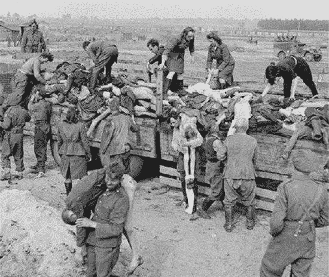

这些侧面都反映出这个审判比，很明显的是一个战胜国对战败国的审判。可是从法理上说的，纽伦堡审判有一个更加严重的问题，就是它违背了法律当中的两项很基本的原则，也就是禁止追溯的原则和罪刑法定的原则。

#### 纽伦堡审判违背法律的原则：禁止追溯、罪刑法定

禁止追溯，这个我们应该都知道法不溯既往，法律是为这个社会提供确定性的，你只有先把一个行为（确定为）不合法，先把一个行为用法律禁止，从此以后有人再这么做，你才能用法律去惩罚他，对吧？你不能等一个人事情已经做完了，然后你事后定一个法律，说，哎你这么做犯法。

举个例子，比如说国际反兴奋剂组织，它有一批禁药，以下这些药是不能吃的，某一个药并没有列在禁药的名单当中，而一个运动员服食了这种药物。之后，国际反兴奋剂组织突然把这个药物列入了禁药名单，然后你不能够因此依据这个新的禁药名单去指责这位运动员服食了禁药，对吧？

因为在他吃下这个禁药的时候，你这个法律还没有定出来，这是一种事后追溯，如果这种事后追溯可以成为法律的话，法律想要无端端的惩罚一个人实在是太容易了，就先看你干了什么事，然后我再制定法律，专门针对什么事情。

那另一个重要的原则是罪刑法定的原则，也就是没有法律就没有犯罪，法不禁止即自由。在任何的行为，只要它不是被法律所禁止的，它现在就不是犯罪，这个跟刚才的那个原则其实相辅相成的，就是你不能够通过事后追溯的方法，把一个原先合法的行为突然不合法化。

那我们刚才提到了，《伦敦协定》也好，《欧洲国际军事法庭宪章》也好，都是在 1945 年的 8 月才通过的。这个时候纳粹德国已经投降。而这些暴行，这些被审判者的暴行，都是在那之前做出的。

#### 反人类罪：在战后才第一次被清晰地定义

比如说纽伦堡审判当中的这些战犯们被起诉的罪行之一是反人类罪，而反人类罪这个罪行本身就是在《伦敦宪章》当中才第一次被清晰地定义。在此之前它被不同的公约不同程度的提到，可是，是《伦敦协议》才给予这个罪行一个清楚的定义，看上去就非常像是事后定义出来的一种罪行，来适用于之前发生的行为。

当然很多人也为《伦敦宪章》辩护，虽然《伦敦宪章》是在 1945 年的 8 月才签订的，但是它追溯了很多，它不是一个全新的法律。它追溯了很多在二战之前就已经生效，并且德国还是签字国的国际公约，比如说《非战公约》《国际联盟公约》《海牙公约》，这些公约都使得侵略战争或者某一些战争中的行为非法。可是再往下仔细看下去，又会有很多的问题，比如说《海牙公约》是非常重要的，整个审判的一个法理依据。

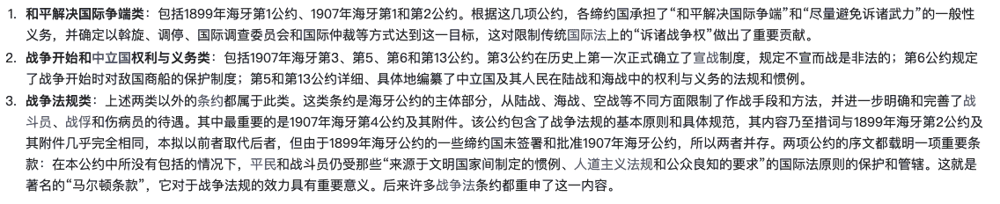

《海牙公约》我们之前提到过，是在 1907 年的时候签订的，德国是《海牙公约》的签字国，可是这个海牙公约当中有一条说，"本公约旨在所有交战国都是缔约国时方能适用"。

可是，二战并不是所有的交战国都是《海牙公约》的签字国，所以从这个文字上的解读来说，海牙公约是不适用的。

当然《伦敦协议》对这个问题有解释，它说《海牙公约》已经为所有的文明国家所承认，并且它已经存在了足够长的时间，所以它应该被解释为对所有的国家都具有约束力，而不止是签署该文件的原始国家。

我们之前的节目里提到过国际法的两个主要的来源，一个就是国际公约，国际公约是每个国家可以自愿选择加入，并且被它约束。

另一个来源是习惯法，习惯法是对所有的人，对所有的国家适用，有约束力。

这个地方的这种论述叫做"扩展习惯法"。就是，有一种观点，请注意它只是一种观点，认为当一个国际公约为大多数的国家所认同，并且它已经在国际社会通行了相当长的时间之后，它就应该被认为是一种习惯法。

法律讲的是确定性，可是我刚才的这个陈述里的一切关键词都是不确定的。什么叫"所有文明国家认同"？什么叫"足够长的时间"？当然这是国际法的一个内伤，你都很难界定到底什么样的东西是国际法？

所有的这些问题都使得纽伦堡审判多年来，从它进行的日子，在它之前，在它进行的时刻，在它之后这么多年的时间里，它一直受到各种各样的质疑。

一开始就提到，当然有很多人认为纽伦堡审判是一个伟大的审判，支持者认为它体现了一种进步。

至少，战胜国在惩罚战败国的战俘之前，要求出示确凿的犯罪证据，并且战败国的这些战犯们有机会请律师为自己辩护，法庭给了他们公平的机会。

但另一方面，就是我们刚才提到的所有的这些追溯既往、事后法等等的诟病，使得很多人指责纽伦堡审判分明是一个战胜国对战败国的惩罚，却披着法律的外衣，这是对法治尊严本身的一种挑战。你要处罚就处罚，非要假装很公平，但是其实没有那么公平。我觉得这个问题像我一开始说过的，纽伦堡审判有非常巨大的争议，而且双方的观点尖锐、对立且极端。

当然，这个二战的战犯们，他们应该为自己的行为付出代价，而用法律的形式去审视他们的罪行，不止是一种惩罚方式，它是一个公平的检证证据的机会，它是一个人们去反思二战罪行、法西斯罪行的一个机会，可是这和它是不是一个公平的审判？纽伦堡法院，纽伦堡法庭到底有没有管辖权去管辖这些战犯？并不是一个完全一致的问题。

我觉得挺受震动的是我读到纽伦堡审判的其中一位法官，杰克逊法官，在他审理开始的时候所发表的一段声明，他说：

"我必须提醒你们，在此之前的法治历程中，从未有过这样的尝试，将一个单一的诉讼案件扩展到十年的范围内来审理，涵盖整个大陆涉及无数的国家、个人、事件，尽管任务艰巨，但是也需要我们立即采取行动，尽管可能代价高昂，但这个需要必须得到满足。"

他接着说，"被告人或许会被催逼甚急，但他们没有受到不公正的对待，如果说他们是第一批被以法律的名义起诉的战败国战争领导人，那么他们也是第一批以法律的名义被给予免除死刑的申辩机会的人"。

不管我们今天回头怎么样去看待纽伦堡审判的合法性，我们都要承认纽伦堡审判是国际法历史上的一次伟大的尝试，它是一个开端。

它和它之后的东京审判是人类法治历史上，第一次尝试用一个国际法庭的形式去审判犯下战争和反人类罪行的人，就是国际刑法的一种理念的诞生。

#### 纽伦堡审判催生了"国际刑法"理念的诞生

在二战之后的漫长的岁月里，其实国际社会再也没有过这样的尝试，建立一个国际刑事法庭的呼吁，一再的被提出，可是始终都没有能够真正的成功。

#### 前南斯拉夫问题国际法庭规约

一直要到上个世纪 90 年代，我们都知道南斯拉夫在它解体的过程当中爆发了大规模的武装冲突，出现了很多非常可怕的反人类的罪行，种族和种族之间的屠杀和灭绝，伴随着酷刑、强奸种种的反人道罪行，这一切的事件震惊了国际社会。

所以联合国安理会根据《联合国宪章》通过了《前南斯拉夫国际法庭规约》，以此规约为法律基础，设定了前南斯拉夫刑事法庭。

这是一个特别法庭，它和纽伦堡审判的相似之处就是它们都是针对某一系列事件、某一个事件而特别的、设立的临时性的法庭，它的本质是一个国际刑事法庭，就是它用国际法庭的形式来审理那些个人因其在战争当中的行为，所应该付出的法律上的代价。

#### 卢旺达国际刑事法庭

在此之后，还有一个特别法庭被设立，就是卢旺达的特别法庭，我们都知道卢旺达发生了非常可怕的种族屠杀案件，也是联合国安理会又设置了一个"卢旺达刑事法庭"。

这两个特别法庭虽然和纽伦堡法庭有相似之处，可是它们更加的为法学界或者是为国际社会所认同，第一，这两个法庭是由联合国安理会设置的，它是国际社会共同的一个行为；第二，在二战之后的整个国际社会构建联合国的努力当中，国际法的发展当中，我们之前所提到的纽伦堡审判当中已经拿出来审判的那些罪行，都有了更加坚实的法理基础，而不再是一种像是追溯式的事后法。

所以，不管我们今天回头怎么样去看待纽伦堡审判的合法性，我们都要承认纽伦堡审判是国际法历史上的一次伟大的尝试，它是一个开端。

# 20\. 纽伦堡大审判之三：普世司法管辖权 vs 国家主权？

（公众号懒人找资源，懒人专属群分享。）

#### 个人，作为国际犯罪的主体

我们前面提到纽伦堡审判和东京审判，是人类历史上伟大的司法实践，因为他们其实是第一次让个人为战争罪、反人道这样的罪行，付出了代价，用法律的形式，对个人的罪行作出了审判。

而在这两次纽伦堡审判和东京审判之后，很多的国际刑法的国际条约，还有其他的国际文件也都开始规定，以个人作为国际犯罪的主体。

国际法这个体系是以主权国家为主体的。大部分的时候，比如说中国，我们是一个主权国家的身份，加入各种各样的国际条约的。

可是，要到纽伦堡审判和东京审判之后，人们才开始意识到不只是主权国家、而且是主权国家当中的个人，也应该为他们的所作所为承担个人的刑事责任，而国际法当中开始把这种理念，这种原则应用到各种各样的国际公约当中。

比如说 1948 年，我们通过了《防止和惩治灭绝种族公约》。它其中就规定犯有种族灭绝行为的个人，无论他是依法行事，无论他是依宪法的统治者或者是公务人员，或者是他是私人，都应该受到惩罚。

等到这个前南斯拉夫国际刑事法庭（1994）去审判，在前南斯拉夫的解体过程当中，犯下种族灭绝罪的个人的时候，他们当然就拥有了之前的《日内瓦公约（1949）》，以及这一份 1948 年所签署的《防止和惩治灭绝种族公约》，作为他们的法理依据。

又比如说我们刚才提到《欧洲国际军事法庭宪章（1945）》，第一次把反人类罪列为一项应当受到惩罚的国际法罪行。

1954 年的时候，联合国终于制定了《危害人类和平与安全治罪法草案》，为到底什么叫做"危害人类罪"提供了比较清晰的解释。

又比如说战争罪，它同样是在这个《伦敦宪章》当中，对于战争罪有了初步的定义。而在 1949 年的《日内瓦条约》里，国际社会再次明确了这些定义。

#### "普世司法管辖权"理念的滥觞

换而言之，纽伦堡审判和东京审判有他们的不完美之处，但是他们打开了一扇整个国际法，国际刑法向前发展的浪潮，它们使得人们第一次开始严肃地考虑，用法律的形式让个人的战争罪、反人类罪，这些极其恶劣的行为受到整个国际社会的处罚。

国际社会可以作为一个整体，而不是依赖于他们所属的国家（属人原则），或者说他们犯下罪行的地方（属地原则），去对他们进行处罚。

而此后所通过的很多的国际公约当中，已经明确的提出了普世司法管辖权这样的理念，比较著名的是《国际反酷刑公约》，而也有也有国家真的利用这个《国际反酷刑公约》当中的"普世司法管辖权"的理念，去要求在本国审判那些并没有在本国犯下罪行的人，那些流亡海外的曾经的独裁领袖。

这其中最为著名的案子当然是 1999 年，西班牙要求引渡并起诉前智利独裁者皮诺切特。

皮诺切特当然是一个非常有争议的人物。很多人认为他是一个英雄，有人认为他是一个彻头彻尾的暴君和屠夫。

皮诺切特，有着非常传奇的人生，他在 1973 年的时候通过流血政变，推翻了之前提拔过他的苏联支持的民选左翼总统阿连德，建立了智利的右翼军政府。

作为一个军事独裁者，其实他在经济上取得的成就是得到世人的肯认的。因为他实行了新自由主义的经济政策，使得智利获得了 20 年的快速发展。

但是与此同时，他又用所谓的"打击恐怖活动"为借口，被怀疑"残酷的镇压和打击了智利国内的共产主义分子或者是左翼分子"，包括比较粗暴的打击国内的毒贩等等的破坏分子。

所以有很多人认为他在推行一种国家恐怖主义政策，所以他作为智利总统的期间，智利军政府据称对左翼政治活动的打压导致了至少 3000 人的被杀或者是失踪，有 27000 人曾经遭到监禁或者是拷打，很多人被迫流亡国外。

后来呢，皮诺切特在他年纪比较大了以后，他在 1998 年的时候卸任了智利陆军总司令，前往英国就医。而就在他前往英国就医期间，西班牙依据《国际反酷刑公约》当中的普世司法原则，要求从英国引渡皮诺切特到西班牙受审。

西班牙介入这件事情的一个原因是，西班牙人认为，当年皮诺切特残害的左翼分子当中，有很多的西班牙公民。当然，与此同时西班牙是一个非常热情的，积极主动的利用普世司法权、普世管辖权这个原则，去对很多的国家领导人提起诉讼。在这方面是一个活跃分子。

比如它（西班牙）甚至要求起诉美国前总统小布什甚至还有切尼（美国前副总统迪克\*切尼），但是最后都是不予理睬，没有被特别严肃的对待。

皮诺切特后来被英国的法院判处是"不受国家豁免权的保护，而可以被引渡到西班牙去受审"，但他最后其实是因为健康的原因被引渡回了智利。

最后，智利的法庭其实裁定，他有能力接受审判，就是他当时因为健康的原因，一度被认为没有办法接受审判。可是在他真的接受任何有实质意义的审判或者宣判之前，他就因为身体的原因死于 2006 年。

像西班牙这样的国家，还在积极不断地利用这个"普世司法权"这个原则，去试图起诉很多国家的元首、起诉国家的前领导人。

"普世司法管辖权"这个概念曾经是一个人类社会的空白，而导致了很多荒谬的事情发生；当这个概念一旦被提出被法律原则确定下来以后，它又变成了像西班牙这样的国家，不停的去挑事儿的一个法理依据，也带来很多的争议。

#### 国际刑事法院 ICC 的设立

那到了 2002 年的时候，国际社会终于是通过了《罗马国际刑事法院规约》，而设立了第一个国际刑事法院  
ICC，在海牙。我们之前提到的那些国际刑事法院都是临时性的法院，针对二战的纽伦堡国际军事法庭、远东国际军事法庭，然后是针对前南斯拉夫和卢旺达问题的国际法庭。

这个 ICC 是一个永久性的法庭，它是一个拥有普世司法管辖权的永久性法庭。

它的管辖权不受这个罪行的地域限制，但是他受这个罪行的类型限制，因为它只管四种类型的案子  
种族灭绝、战争罪、反人类罪和侵略罪。并且它只追究个人的刑事责任。

像我们刚才提到的干预别国内政的问题，这个《罗马规约》当中是说，只有当各个国家所属的法院不能自主的审理的情况之下，国际刑事法庭才会介入。

那当然这个其实是一个争议性的条款，因为什么情况下"本国的法院已经没有能力审理"，其实是由国际刑事法庭去判断的。所以，它还是在为自己划定司法管辖权的边界。

那时间上，它也划了界限。我们刚才提到了，纽伦堡审判，因为制定法律在事实发生之后受到了很多的批判和指责，成为了反对派反对它的一个口实。《罗马规约》是规定 ICC 只审判 2002 年 7 月 1 号以后犯下的罪行，此前的，都法不溯既往。

国际刑事法院，试图填补一个重要的空白，可是它本身也依然带来很多很多的争议，包括美国、中国、俄罗斯在内的，很多国家其实都并没有加入《罗马规约》。

一个比较敏感的问题、或者是一个比较有争议的问题是：到底是谁有权利提起诉讼？

主权国家，当然是有权利把本国的案子移交给国际刑事法庭去解决，而且有国家这么做过，刚果、乌干达、中非共和国。

联合国安理会可以要求国际刑事法庭去展开调查，有确切证据，有合适的有足够的法律依据的时候，提起诉讼。包括之前对非洲的很多国家的这种种族之间冲突的情况进行调查，对刚果、乌干达、苏丹达尔富尔地区，包括之前对菲律宾总统杜特尔特的调查。

比较有争议的一个问题是，除了主权国家、主权国家的公民、联合国安理会以外，国际刑事法庭的检察官他自己，有没有权利去主动的介入调查、提起诉讼？

国际刑事法庭，跟纽伦堡法庭不一样，它不是只有几个大国主导的，它试图去展现它对国际社会的一个代表性，所以他有 18 位轮值法官，是由选举产生的，并且任何两位法官都不可以来自同一个国家。

与此同时它有一个检察官的设置，就像我们国家，检察机关是负责提起诉讼的机关，法院负责审理。这个国际刑事法庭是自带检察机关的。

检察官是由选举产生的一个机构，比较激进的派别认为检察官应该有权利去主动的调查、并且提起诉讼在他国之内发生的人权案件，符合我们刚才所说的四种类型的案件。

#### 普世司法管辖权 vs 国家主权

可是这种做法当然就会引起无数的争议，包括比较明显的是一种干涉主权的行为。

所以说管辖权的争议到今天并没有一个明确的结果：空白的地方依旧空白，冲突的地方依旧冲突。它归根结底是由国际法的法律体系的混乱，和它的不确定的边界所造成的。

但是我们，看到从纽伦堡审判开始，到 ICC 的设置，经过了各种各样的争议。人类社会是在不停的去探索弥补管辖权所造成的空白、弥补管辖权所造成的冲突，这样的问题去寻求一个解决的办法，这种努力跟尝试我觉得是值得我们肯定的。

可是不可避免的在国际法跟主权国家的主权之间，这个边界到底应该如何的划分，如何的去在减少空白的同时，不去创造更多的冲突跟争议，这些问题得要留待这个世界的政治智慧跟法律智慧，去继续不停地解决。

# 21\. 有关同性恋婚姻和代孕合同的管辖权问题（一）：法院，还是立法机关？

# 21\. 有关同性恋婚姻和代孕合同的管辖权问题（一）：法院，还是立法机关？

（公众号懒人找资源，懒人专属群分享。）

我们聊了那么久的管辖权问题，一直是在聊某一个具体的法院或者是仲裁庭它有没有权力、它有没有司法管辖权去管理某一个具体的案件、某一类案件或者是去管辖某一个人，

又或者是某一类法院，比如说一个国家之外的法院，无论是国际法庭还是其他国家的法庭，有没有管辖权去管理在一国之内发生的案件。比如说一国之内发生的种族屠杀，国际法庭有没有权力去管？我们都是在聊一些具体法院遇到的具体问题。

如果更抽象的或更宏观的来看管辖权这个问题，其实我们可以更泛泛地去问：某一些案件是否应该由法律来管？某一些事情、某一些事项、某一类案件是否应该由法律来管？某一些人是否应该被置于文明社会法律，无论是哪一国法律的管辖范围之内。

这个问题我们之前很抽象的哲理化的去讨论人为什么有遵守法律的义务，或者人是否有遵守法律的义务的时候已经触及过。

但更有趣的可能是在很多具体的案例之中，我们会再次回到这个问题，在具体的案例之中，人们会去反思这个案子、这一类案子、这种事情真的应该由法律来管吗？

#### 布朗案：第一次宣布种族隔离违宪

我举一些具体的例子大家就会比较清楚。比如说有一些案子，有一些判例被认为是划时代的判例，之所以它们划时代，就是因为这些判例当中给出的意见，作出的决定可能是超越自己的时代的，它可能超越那个时代的习俗、那个时代人们的实践，或者是那个时代的名义。

比如说美国平权的历史上有一个最重要的划时代的案件，被认为是开启了民权运动布朗案。

布朗案发生在 1950 年代，也就是美国的南方还普遍实行种族隔离制度，民权运动还没有开始的时候，布朗案的最高法院的大法官们就宣布，种族隔离是违宪的。

这个案子引起了后世很多的讨论跟争议，一般来说后世对它的评价都是积极正面的。这是一个政治非常正确的案子，它极大地推动了美国这个社会的进步，打破了那个社会之前所固有的种族隔离的平衡，而逼迫它在之后的 20 年的时间内，用各种方式去逐渐的实现了种族之间更大程度的平等，我们到今天也没有办法完全说它实现了种族平等。

但是，另一方面这个超越了时代本身的判决，也让这个社会付出了巨大的代价，美国社会之后要陷入 20 年的撕裂、纷争，许许多多的流血冲突，它的总统爱森豪威尔甚至要派军队来保护几名黑人孩子，去一个打破了种族隔离的、以白人为主的学校上课。

这个社会经历了更加漫长的斗争，才真正实现了大法官们在布朗案的判决当中所写下的愿景。

所以，一个领先于时代的判例，虽然它通常是在后世被歌颂，但也有更多人开始反思：法院毕竟是一个没有民意授权的、小部分的、精英把持的这样的一个主体。它有没有资格、它有没有权力，去为这个社会做出一些重要的决定？它有没有权力去把自己的决定至于民意之上？

通常情况下，法官们是一群社会当中的精英，这个是一个统计学的概念，不是说每一个人都是这样。通常来说精英的人群都会比较的自由主义，他们在政治光谱上会比较偏右，这样的一个人群又是否是最合适的做决定的主体。

#### 台湾同性恋婚姻合法化

类似的例子有很多，比如说我们之前很关注的中国台湾地区的同性婚姻合法化。

台湾的同性婚姻合法化的起点是在 2017 年，台湾司法院公布了法律解释，释字第 748 号解释文，宣布当时的民法，因为没有能够保障同性两人的婚姻自由以及平等的权利，违背了宪法。因此它要求台湾的立法机关，在两年之内改正这个问题。

但事实上在 2018 年所举行的台湾的全民公投当中，过半数的台湾人，是不愿意用修改民法的方式赋予同性者平等的婚姻权利的。

虽然这个公投本身受到很多的质疑跟争议。至少不能够单纯简单的从这个公投就判断说，大部分的台湾人不认可同性婚姻的合法化，因为不是所有的人都参与了公投，或者是公投的这个议题的设置，会影响大家的投票结果。可是，至少证明台湾社会对于同性婚姻是否应该合法化这个问题是存在巨大分歧的。

在这样的情况之下，台湾司法院的司法解释依然被立法院付诸实践。

在 2019 年，虽然立法院没有修改民法，但是另立法律，确保了同性恋者有婚姻的权利。

那这同样是一个看上去，司法解释或者是法院的决定，超越了时代，不能说违背，但是和主流民意并不一致的情况。

#### 美国同性恋婚姻合法化

类似的，我们今天去看美国的同性婚姻的合法化。

美国这个国家虽然因为最高法院的一纸判决，它在全境之内实现了同性婚姻的合法化，因为各个州的那些不允许同性恋缔结婚姻的法律，是对美国宪法的违背。

可是这并不代表着美国这个社会在民意上、在习俗上、在观念和文化上就真的接受了同性婚姻。美国的很多南方的大城市，或者一些比较保守的州的北方城市，在对同性恋的友好程度这个问题上，远远落后于大部分的欧洲城市，甚至落后于一些同性婚姻没有合法化的地方。

而且，大家今天回头去聊，当年美国的最高法院判处同性婚姻合法化的这个判例，也觉得什么地方没有那么让人信服：因为不仅是九位最高法院的大法官，替整个国家的 3 亿人做出了决定，替一个悬而未决的社会议题做出了决定。

而且，当时的九位法官在宣判之前，其实媒体已经大概知道他们会怎么投票了，我们知道美国的最高法院大法官们是被重点研究的对象，大部分的大法官，都有相当清晰的意识形态的偏好。

当时做出这个决定（媒体预测）的时候，美国最高法院的九位大法官正好是一个 4.5：4.5 的平衡。也就是有四位大法官是众所周知的保守派，他们一定会投反对票，而有四位大法官是众所周知的民主党所提名的这个自由派，他们一定会投认同票。

保守派和自由派，也就是我们通常所说的"左"和"右"，有一个比较粗暴的划分。给大家一个很简单的这种判断方法。

"左派"的意思在美国的语境下，通常是指民主党，它是偏左的党派，通常在经济问题上、社会福利上，它会倾向于对弱势群体和少数主义的保护，也就是在经济问题上偏保守，但是在社会议题上它会偏自由。比如说它更坚定地支持女性有堕胎的权利，很多这个偏左的州，让吸食大麻合法化。

反过来，保守派就是"右派"，他们通常在经济政策上偏自由。比如说 Trump，他是一个共和党提名的右派的总统，它会给这个大公司减税，刺激经济政策，再给这个大公司更加多的自由的权利，而不是提倡对劳工的保护。而在社会政策上，右派的法官会偏保守，比如说他们会对这个平权法案有很多的质疑。

那在同性婚姻这个问题上，左和右的分别是非常的分明的。左派的法官都是赞成同性婚姻的合法化，而右派的法官，文化观念上偏保守一派的法官当然是不赞成。

所以这个判法在它产生之前很久，大家就已经知道了，九个人当中的八个人会如何投票，最后大家只是看肯尼迪大法官，也就是所谓的"骑墙派法官"，他怎么来做决定，他手中那一票就会创造一个多数。

我们知道最后是肯尼迪大法官执笔写了这个宣布同性恋婚姻合法化案子的法庭意见，他投给了赞成同性婚姻合法化的这一方。

换言之，这样一个没有社会共识、引起社会撕裂或者至少引起社会争议的重大的政策问题，事实上就是由肯尼迪法大法官一个人决定的，就是他的一念之间偏左偏右，就决定了这么重要的问题。

所以很多人质疑说，这样的问题真的应该交由法院来做判断吗？

#### 法律的滞后性

还有很多的时候，法律的发展其实是滞后于社会的发展，这个社会当中出现了很多的新的现象、新的经济活动、新的生活方式、新的观念，而法律并没有及时的跟上，这些事情是很常见的。

我们国家是这几年才开始立法规范电商，对吧？但是，电商早就已经成为了我们生活里非常非常重要的一部分。那通常这些问题，这些新的生活方式、新的社会现象产生之后，所引发的法律纠纷，通常是由法院来先面对的，法院比立法者先要面对这些纠纷，先要面对这些新产生的社会问题，而他们不得不做出一些决定。

在案例法的国家里，一个法院所作出的决定，可能就会影响一个州或者是整个国家，在某一类问题上的方向和看法。越是到这种时候，整个社会法律界的人士，或者有一些更有影响力的案子，会引发整个社会去思考，说这些重要的决定真的应该交给法院来做吗？

#### 案例：代孕第一案 Baby M

我们举一个具体的案例。八十年代，当代孕刚刚成为可操作的现实，成为一个逐渐兴起的热潮的时候，所谓的"代孕第一案"。

当时在新泽西州有一个很著名的案例，叫做 In Re Baby M，baby M 是这个代孕案例当中这个孩子他的一个化名。

那这个案子的故事情节大家都能猜到嘛，是一个代孕的案子。一个叫玛丽∙贝思∙怀特黑德的女子，她当时已经是两个孩子的母亲。她的丈夫是一名卡车司机，怀特黑德和她的丈夫当时的生活状况并不是特别好，他们被卷入了一场交通事故，所以在财政上面临一些困难。

这个时候她看到了一个代孕广告，一对医生夫妇就是斯特恩夫妇，他们在报纸上征集能够提供代孕服务的女子。斯特恩夫妇并不是不孕不育，但是斯特恩太太患有遗传性的疾病，他们担心自己的孩子将来会受到这些遗传问题的影响，所以，他们想征集一个代孕妈妈。

那个年代的代孕，不像后来我们今天的代孕，通常是卵子并不是由代孕母亲提供，代孕母亲真的就是提供代孕这个服务而已。

那个年代更盛行的，我们今天叫做传统代孕，就是斯特恩先生的精子跟代孕母亲怀特黑德太太她的卵子相结合，然后由怀特黑德太太孕育，并生了一个婴儿 baby M。

那他们签订了一份商业代孕合同。在这个合同当中双方约定，这个斯特恩夫妇将会支付怀特黑德所有的医疗产生的费用，并且给她一万美元作为报酬。那在八十年代，这个数目还是相当的可观。与此同时，怀特黑德则承诺，把孩子生了以后，就承诺放弃她作为母亲的权利。

怀特黑德当时是自愿的签署了这份合同，可是她在真正把这个孩子生出来以后，她才突然间明白了，一个母亲和孩子之间的这种情感上的连接是没有办法这么简单粗暴地割舍的。

她生了这个孩子以后，就是生了这个 baby  
M 以后，她当然是把他给勒斯坦夫妇，可是三天之内她就后悔了，她就受不了，她去到斯特夫妇家中，想要回这个孩子，不惜以自杀相威胁。

那斯特夫妇盼这个孩子盼了很多年，当然是不肯把这个孩子还回去。

后来，这个怀特黑德和她的丈夫甚至绑架了这个小孩，然后两个人逃离了新泽西州，以至于斯特恩的律师，需要向法庭申请逮捕令，把他们给追回来。

这个案子在新泽西州的基层法院开始审，最后审到了新泽西州的最高法院。

合同法里，有一些比较困难的问题。比如说我们之前一直都在讲刑法，刑法是一个社会的立法，就是一个人犯罪，它是违背了这个社会所一起制定的一些共同生活的准则。所以，司法机关惩罚这样的人，大家都觉得是正当的、是应该的。

可是，合同法作为民法，合同通常是双方之间的事情，是你情我愿的事情，我们俩签订一个什么样的合同，本来不应该由社会，来介入来插手。

法院去看一个合同法的案例的时候，它首先要问这两人之间是否真的有合同，可是即便确认了两人之间真的有合同之后，这个法院还要进一步的去问，那么这个合同是否应该被法律去执行？也就是说法律并不承认所有的合同，并不是所有的合同，当一方违约的时候，你都可以要求法院去执行。

比如，有的合同是违背法律的，你不可以给钱让另一个人把你给杀了，这个我们之前讲过，人没有办法让渡自己生命的权利。

比如，说这种案例通常出现在格斗。两个人用合同约定要决斗（要格斗），最后造成了很严重的伤害，这种合同是否应该被法律去执行。

还有一种情况更加处于灰色地带，就是一个合同在法律上没有问题，可是它似乎有违背社会公德，或者是违背我们中国人的话叫"公序良俗"，违背这个社会的公众利益。

比如，在代孕这个案子当中，在那个年代法律是空白的，直到今天美国都没有一部联邦法律去确定代孕到底是合法还是不合法，每个州有自己的规定，有很多州在这个问题上仍然是空白。

世界上大部分的国家在代孕问题上，在立法上都是空白，比如我们中国和欧洲的很多国家是立法禁止商业代孕。像这个俄罗斯、中亚国家，它是立法允许商业代孕。可是，在那个年代的美国，商业代孕到底是合法还是不合法，是法律空白。法不禁止即自由，至少没有任何法律上的理由去说这份合同是不能够执行的。

可是，它又会牵涉到人性当中的一些很复杂的问题，就是人的母性，孕育一个孩子的过程，是否可以被当作一项服务来提供，当做一个商品来交易，来为写进商业的合同呢？

所以，法庭在这个案子里它实现了"无法可依"，就是它没有办法用法律来判断这个合同是否应该得到执行，是否应该强制要求这个怀特黑德女士放弃她做母亲的权利，因为她在合同里白纸黑字写了她要放弃做母亲的权利。法庭只能从公序良俗、从社会道德、从这个合同会给这个社会带来的改变，去考虑这个问题。

从法理上的分析，这个案子没有直接的法律去借鉴，它只能从其他的一些法律当中去推断，这个问题在法律上是否是可行的？这个是一种解释法律的方式，我们之后会讲到。

不是所有人都觉得法律是铁板一块，是一个有逻辑的有机体，但是还是有相当的一部分人坚持。不同的案件我们应该去寻找法律的内在逻辑，用这个内在逻辑，来帮助我们解释和解决一些没有明确条文规定、没有明确的法律可依的问题。

比如，法律里面虽然没有明文规定代孕是否合法，但是，法律里显然说了，孩子是不可以用作金钱交易的。

那在这个案例里，至少它的底层逻辑都是金钱交易了一个孩子。又比如说当法律要剥夺一个人做父母的权利之前，是需要考虑很多重要的证据的，要求剥夺他人父母权利的这一方通常是公诉方，是需要证明对方不适合做孩子的父母的。

比如他是暴力犯罪、他有家暴倾向、他常年吸食毒品，所有这些严重地会影响他履行做父母的职责的这种问题，才会 justify、才会让这个法院确定说，好，那么我不得不剥夺这个人做父母的权利。

可见，一个人做父母的权利是非常重要的，它不是法律可以轻易剥夺的，那么，它显然也不应该被一纸商业合同来轻易地剥夺。

又比如，在这个争孩子的抚养权的官司当中，有一个中国也通行、美国也通行的原则，世界通行的原则是"一切都要以孩子的最大利益出发"，对吧？

那在一个商业代孕的案子当中，是否也应该从孩子的最大利益出发，而不是说这一对夫妇如何约定、就如何做决定？

还有一个问题可能更抽象一点，比如说法律里面会保护一个人的自主的权利。那怀特黑德女士作为生物学意义上，基因意义上的这个母亲，她的自主权利是否会因为这个合同受到侵犯？

那当然有人说这个合同是她自愿签的，可是在合同法里面有一个很重要的底线或者原则是，并不是所有自愿的事情都是合法的。或者抽象一点说，就是并不是所有自愿的时候，真的都是自愿的。

比如有人拿着枪抵着你的脑袋，要你签一个合同，你是自由意识签了这个合同，你是自己拿笔签了这个合同，不代表你是自愿的。

又比如说，在有的情况下，在有的案子里面，一个人是被蒙蔽的、被骗去签一个合同。又或者说一个人再签一个合同之前没有得到足够的法律的咨询，比如没有充分的阅读合同条款、不识字，然后就签了。又或者说有的人是迫于财政上的压力去签了一个合同，法律都会考虑这些诸多的情况，去衡量一个人是不是真的自愿。

那在这个案子里面，这个叫怀特黑德的女士，当她怀上这个孩子之前，当她签这个合同的时候，她似乎是自愿的，没有人强迫他，是她自己发现了一个广告。

可是法院会认为说，当她签下这个合同的时候，其实她没有办法意识到，她作为一个母亲跟自己的孩子之间的情感连接会如此的强烈，以至于她没有办法说放弃。

这就像一个人被骗了去签一个合同，因为当她去签这个合同的时候，她不知道这个合同的结果会是如此的糟糕。类似的道理（我不能说同样的道理，因为不太一样），当这个怀特黑德女士签下这个合同的时候，她有一点被骗的感觉，因为她没有办法想象执行这个合同的结果，就是强迫她和她自己的孩子分离，结果会如此的糟糕。

所以法院最后用非常诗意的说法说，在一个文明的社会里，不是所有的东西都可以用钱买到。

# 22\. 有关同性恋婚姻和代孕合同的管辖权问题（二）：商业代孕合法化历程

（公众号懒人找资源，懒人专属群分享。）

什么样的合同会得到法律的承认和执行，当然有一些基本的规则跟元素。

比如说一个合同必须是有对价的，是有 consideration 的。如果说我单方面的给你一个礼物，这个不叫做一个合同，这个礼物可以随时收回。

也有挺多跟这些元素有关的，有趣的故事，我们以后再讲。可是呢，合同法的执行力相对来说留下了巨大的空白地带，给法官和法庭的自由裁量，因为有很多东西是在文本以外需要考虑的。

#### 合同法执行的空白地带

关于什么样的合同应该被执行这个问题，法学界里分成很多不同的派别。比如说有的派别比较看重合同双方的自由意志，就是法律应该去做双方原本想要做的事情，他去仔细地揣测和分析，双方到底同意了什么？

他们有没有心灵交通的瞬间，真的有实现什么同意。当他们心灵交通的瞬间，其实双方对于彼此的期待到底是什么样的？

比较俗的、比较普遍的、比较经典的一种思维方式是偏功利主义的。当我们去问一个合同是否应该被执行的时候，主要是去看执行或者不执行或者怎样执行这个合同可以使双方以及社会利益最大化。当执行某些合同是符合这个合同的文本意思，但却会造成巨大的社会资源浪费的时候，法庭是会三思而后行的。

换句话说呢，在合同法这个问题上，法庭的很多处理是非常灵活的，它不会抠字眼，它不会就是死死的被文本束缚，它不太允许合同当中的任何一方得理不饶人。

经典的故事我们很小就听过，比如说莎士比亚的戏剧，威尼斯商人当中，放高利贷的一方坚持要求说我们在合同里写了，我就是要割他一磅肉，然后后来法官怎么劝他都不听，生气了，说你不能让他流血。就是遇上得理不饶人的情况，用得理不饶人的方法来处理。

这种得理不饶人的情况，在现代社会还有很多这样的人。比如说之前有一个啼笑皆非的案子是说一个人呢，他请了一个包工头，就是这种建筑工人的团队来帮它建一个房子，建一个别墅。

然后他在这个合同里事无巨细的约定了很多的细则，包括这个房子里所有的管道要用哪一个牌子的管道，水管啊什么的。最后包工头就不太仔细，他就没有用这个牌子的管道。于是这个房主房东就把包工头告上法庭，然后说这个房子不符合我们在合同当中约定的房子，因为他的管道没有用这个牌子的管道，所以他不是我这个合同想要的房子，这个房子应该拆掉重建。

然后法官最后给他的回答是，太扯了，这是一种巨大的浪费。所以一个比较合理的执行这个合同的方式是，对，包工头也需要承认说他没有严格的完整的准确的履行这个合同当中他的义务，那么他应该给出一定的赔偿。

但是并不因为小的瑕疵就导致整个合同没有得到执行，这个合同本身依然有效。是包工头建这个房子依然算作是对合同的履行。那不能够去以这么一种抠字眼的方法去推导一个房子重建，就为了换一点管道。最后的结果是房子就是这样了，但是包工头可以给房主适当的补偿。

#### 理解代孕案中的合同关系

我们套用这个挺功利的眼光来分析代孕问题。

有人就说，那我们就来看一下这个合同，这份代孕合同有没有创造社会价值，还是造成了浪费呢。它很显然是创造了社会价值的。因为他创造了这个世界上最有价值的一样东西，那个东西就是生命。

生命是无价的。 如果不是因为有这份代孕合同，这个孩子显然就永远不会诞生在这个世界上。所以一份合同创造了一个生命，这个合同是非常有价值的。

但是另一方的人就会质问说，问题在于你今天是把生命商品化了。生命的价值在于它不应该被商品化，当你去把生命商品化的时候，你就是在伤害生命的价值本身。那换一个角度去分析说，这样一个合同是不是给双方都带来了效益呢，是不是一个互惠互利的双方都有所得的合同呢？

答案似乎也是，是的。当他们签订合同的时候，斯特恩夫妇愿意进入这场交换，因为在他们的眼中得到一个孩子的利益，远远超过他们所要付出的那 1 万美金，对吧？而怀特黑德太太之所以愿意签这个合同，很显然也是以她当时比较窘迫的经济状况，这 1 万美金对她来说很重要，她愿意用怀胎 10 月的辛苦去换取这 1 万美金，互惠互利的事情。法律的世界、商业法的世界都是鼓励的。

可是问题在于呢，在这个合同当中出现了一个变量，出现了一个第三方，它的利益也受到了影响，这个第三方就是孩子。

#### "正外部性"与"负外部性"

经济学的概念里面有一个词叫做外部性。就是我们去衡量两个人进行交换，签一个合同的时候，除了衡量这个合同给彼此双方带来的好处和坏处，我们也要衡量它有没有给第三方带来好处或者坏处。有的外部性是正外部性，这种有带来正外部性的合同，社会会鼓励、法庭会鼓励、法律会鼓励。

比如说我去私家诊所接种疫苗，这个是一个合同，它可以被理解为一个合同，对吧？可是这个合同是有正外部性的，因为一个社会当中接种疫苗的人越多，传染病、流行病爆发的可能性就越小，那些没有接种疫苗的人，某种意义上受惠于很多人接种疫苗事实，受惠于这些接种疫苗的合同，他们的利益得到了提升，这是一种正外部性。

当然还有大量的负外部性，比如说有很多的小工厂代加工生产一些销售方需要的产品，可是他们造成了环境的污染，环境污染的代价是需要周围的居民，甚至整个社会去承担的。这些外部性叫做负外部性。

两个互惠互利的合同，对于双方来说，一个对于双方来说互惠互利的合同，可能因为负外部性而被这个社会禁止，而被法律去禁止。那在这个案例当中，除了彼此双方的效益很明显，也要考虑这个孩子它的效应，（对）它是正外部性还是负外部性。

#### "Baby M"的结局

这个案子呢，最后的结局是这样的，就是法庭以代孕合同违背公序良俗，违背社会利益，社会公益为由，认为它不是一个有效的合同，拒绝了商业代孕。

新泽西的最高法院把这个案子发回了当地的家庭法法庭去重审。就是，除了我们一般意义上理解的基层法院、终审法院、地区法院、上诉法院以外，有一些特殊法庭，它专门特处理某一个类型的案子，比如说有交通法庭，有家庭法庭。

家庭法庭通常是很忙的，因为有很多人在离婚，有很多人在争孩子的抚养权。

商业代孕的合同不合法了，所以斯特恩夫妇不能够直接得到这个孩子。可是这个斯特恩先生他在生物学意义上仍然是孩子的父亲，因为他捐献了精子，他依然有做父亲父亲的权利。所以这个案子就变成了一个争夺抚养权的案子，就变成斯特恩先生作为爸爸和怀特黑德女士作为妈妈，两边来争这个孩子由谁来抚养。

最后，新泽西当地的家庭法庭是把孩子的抚养权判给了斯特恩。所以 Baby  
M 最后是跟斯特恩一家长大的，但是怀特黑德女士拥有探视权，就是她拥有一个基本的作为母亲的权利。

很多年以后，当 Baby  
M 长大，满了 18 岁，拥有了法律意义上的行为能力以后，她选择了中断她和怀特黑德的母女关系，而选择被斯特恩太太领养。就是从法律意义上确认了她和斯特恩太太之间的母女关系。

Baby  
M 后来在接受采访的时候表示，她非常感恩她的父母，也就是斯特恩夫妇用这个方式把她带到世界上。他们一家人相处非常的愉快，她应该是成长为一个挺开心的孩子。

当然现在又是很多年过去了，我们不太清楚最后是怎样，但是似乎看起来，是这个故事有了一个挺美好的结局。

在外部性意义上，这个孩子似乎也是合同的受益者。

#### 新泽西州商业代孕的合法化

可是每一个案子都是不同的，而代孕作为一种现象，作为一个时代逐渐兴起的热潮，显然不是一个一次性的问题。

当时有很多人就纷纷的质疑，为什么这种新出现的社会现象，这种正在成为现象的现象，每一天都有更多的案例发生的现象要交给法庭去决定。

这个很显然会在之后的很长时间内一再出现的问题，有人认为我们应该把它交给更有民意授权的机构，也就是立法机构去解决问题。新泽西州一直到 2018 年，终于在他的民主党的州长上台以后，才签署了商业代孕法案，加入了美国的另外 11 个州，将商业代孕合法化。

也就是说在"Baby M"这个案子，它是在 1988 年终审判决的，在期间长达 30 年的时间里，"Baby  
M"都奠定了商业代孕这个问题，在新泽西州的法律地位。之后，虽然又有好几个案子试图挑战"Baby M"但是"Baby M"的基本原则依然被沿用。

之后因为"Baby  
M"这个案子我们之前提过，它是一个传统意义上的代孕，它是用了怀特黑德，也就是代孕妈妈她的卵子来孕育了这个婴儿。那之后科技逐渐的更加发达以后，大部分的代孕案例都是，这个卵子是由第三方的女性，无论是收养方的妈妈，还是第三方捐赠的卵子。

也就是说代孕母亲在之后的案例里，通常都和孩子不再有生物学上的联系，或者是基因上的联系。可是"Baby M"所确立的原则依然被应用到了这些新的案例当中。

一般意义上商业代孕在立法以前，在新泽西州都是不合法的。可是我们之前也提到了，这个问题，就会被转移到另外一个战场，对吧？它会被转移到家庭法，争夺抚养权这个战场，而提供代孕服务一方似乎并不占优势，通常都是想要通过代孕合同方法得到一个孩子的夫妇，他们通常都在争夺抚养权的案子当中最后胜出。所以其实并没有很大意义上改变事实上的结局。

可是到了 2018 年呢，新泽西州终于是以立法的形式明确了商业代孕的很多基本原则。比方说它规定了代孕的母亲必须年满 21 岁，她必须经过一些健康的项目的筛查，她必须得到充分的法律咨询。而另一方呢，必须是一对已婚夫妇。这个在每个州的规定不一样，有的州允许同性恋夫妇，有的州甚至允许未婚人士去选择代孕。

那我们之前很多次的比较过案例法跟成文法，有利有弊。

案例法的好处是它提供很多的细节，让他通过不同的案例当中法院的具体的操作，让你知道法律应该怎样被解读，有比较大的确定性说当它应用到我的具体案例的时候，法庭会做什么反应。

因为法律通常是法律语言写成的嘛，很多成文法摆在你的面前，你也很难判断说，当我们真的运用成文法去打官司的时候，结局会是怎样？

可是在代孕问题这样的新出现的问题面前，案例法就显示出了它巨大的局限性。因为案例法是由一个一个的案例累积成的法律，每一个案例只处理这个案例本身所带来的问题，就像我们刚才提到的，当后来有新的案例发生的时候，有很多关键性的因素有改变，那法庭其实需要重新的去思考，这个案子该怎么判，它其实依然没有指导性的原则。

比如说后来的案例当中有出现说，代孕妈妈和想要找人代孕的爸爸之间是有亲属关系的，这种情况下商业代孕依然不合法吗？

又比如说我们刚才提到，从传统代孕逐渐迈向纯粹的这种代孕，就是科技手段发达之后的不需要由代孕母亲提供卵子的代孕，这样的一种形式上，法理意义上完全不同的代孕形式，是否依然被之前的案例所束缚。

当这些新问题出现的时候，其实社会就会陷入一轮又一轮新的讨论。新的我们刚才提过的那些非法律的讨论，可能是哲学的讨论，可能是社会学伦理问题的讨论。而法律始终没有办法给出一个清晰的回答，因为他总是落后于新的社会现象的产生。

而当一个立法者用立法的形式去解决问题的时候，我们看到，比如说新泽西州的立法，他就把一些边界很明确的圈定了。

比如说多大年纪的代孕母亲可以进入这样的合同，对吧？如果一个一个案例的试，第一次说 18 岁不行，第二次来了一个 20 岁的女孩说行不行？现在法律用成文法的形式，规定说 21 岁以后才行。

又比如说代孕的夫妇可不可以支付给代孕母亲费用，可不可以要求她接受去哪个医院生孩子，接受什么样的胎教？这些问题如果用具体的案例一个一个的去回答的话，每一次有新的案例出现，我们都会遇到新的问题，而用成文法的形式去确定的时候，整个社会就会明确的知道我们的规则是怎样的。

那在这个问题里呢，除了成文法面对新问题可以一次性地回答边界问题，这个好处以外，在这个案子里，其实大家更愿意由立法者来回答这个问题的根本原因是，我们一开始提到的，为什么要由几个法官，而不是人民代表去回答问题。

一个社会从来都没有面临过的选择，我们不应该把它交给某几个精英的法官去做选择，至少应该把它交给人民代表，把它交给这些需要迎合民意去赢得选举，需要倾听民众的意见的人，由他们来做选择。

这样的选择未必是对这个社会最好的，可是这样的选择比较容易有合法性让大家接受。

不过呢，似乎每一次有类似这样的新问题出现的时候，社会都要质疑一次，这些问题为什么要交给法院来回答？可是在现实当中，这些新问题还是不停的被抛向法院，去由法院来做第一个判断者和裁决者。

与此同时，我觉得还有另一类可能更加有趣的问题是，有的时候人们甚至会质疑，某一些人是否应该被置于法律的约束范围之下。是不是有一些人生活在现代社会的法制体系之外，他们应不应该得到法律的区别对待和网开一面？

这些问题我们留到下一集再来讨论。

# 23\. 公海食人案（与洞穴奇案）之一：法律对文明之外新社会契约的管辖权探讨

（公众号懒人找资源，懒人专属群分享。）

我们这个节目呢，很多次提到社会契约这个概念。

当人们走到一起，签订社会契约，制定共同生活的准则，我们就进入了现代意义上的法律社会、法治社会。在那之前我们生活在自然状态之中，所遵循的只有自然法。

自然法这个概念，不同的派别对它的解释截然不同，但是它并不是指我们通常所理解的自然法则，就是弱肉强食，适者生存这样的自然法则。自然法指的是人用自己的理性所推导出来的一些基本的原则。

在我们今天已经普遍进入法治社会的世界上，还有没有人，生活在自然状态之中，受自然法的约束，而不应该受到文明社会的法律的约束？

有人认为在特殊的情况下是有的。

不知道大家还记不记得前几年李安的一部电影叫"少年派的奇幻漂流"。在这个电影里，少年派，一个印度少年和他的家人，他们在乘船前往加拿大的旅途之中遇上了海难，少年派被丢上了一艘载满动物的救生艇，因为他们家本来就是开动物园的，把很多的动物都运到加拿大去。

于是这个少年派就和斑马、猎狗、红毛猩猩以及一只叫理查\*帕克的孟加拉老虎，一起被抛到这个救生艇上。经过了漫长的奇幻的漂流，最终获救。

当日本海运公司的人来到了派的病床前，了解发生了什么时候，派说出了这个故事的动物版本，他说猎狗杀掉了斑马和猩猩，而孟加拉虎杀掉了猎狗，从此他少年派就和孟加拉虎一起漂流。

直到上岸的那一刻，这只老虎、他最好的朋友，头也不回地离他而去。

海运公司的人并不相信这个故事，而一再要求他说出真实的版本，于是少年派说了这个故事的人类版本。

所谓的斑马和猎狗，其实是厨师跟水手，厨师杀掉了水手又杀掉了派的母亲，于是派杀掉了厨师。猎狗是厨师，斑马是水手，猩猩代表母亲，而老虎，这个所谓跟他一起漂流的孟加拉虎，其实是少年派本身，他的一个投射，他身上的兽性，本能的一种投射。

当然无论是前来采访他的作家，还是海运公司，最终都接受了用动物的版本去申报，而没有接受残酷的人杀人的版本。

当然我觉得，这是我很喜欢的一个电影，关于这个老虎到底象征着什么？有很多的讨论，一般会认为这是老虎象征着人身上的兽性本能。

当少年派漂流到岸得救之后，这只老虎就离他而去，他又重新回到文明世界的怀抱。

而对老虎的离去他感到伤心，或者是他眼望着老虎离去，他哭得非常的伤心。他发现了他自己身上的这种兽性本能，这种兽性的本能在他生命中最艰难的时刻帮助他活了下来。

我不知道大家有没有好奇过这只老虎为什么有一个特别的名字叫做理查\*帕克？

可能有人知道理查*帕克是历史上的一个真实人物的名字，他是一个著名的海难杀人吃人事件，或者案件的主角，就是那个不幸被吃掉的少年-- --理查*帕克。

**案例：女王诉杜德利案**

这个案子叫做女王诉杜德利案，它发生在 1884 年。

在那一年有一位澳大利亚的律师他从英国购买了一艘游艇，然后雇佣了一个团队帮他把游艇一路开到澳大利亚去。于是在 1884 年的 5 月，四位水手，船长叫杜德利，大副斯蒂芬，水手布鲁克斯和一个服务员  
\--年轻的小孩理查\*帕克，四个人乘着这艘游艇从英格兰的南安普敦开往悉尼。

经过两个月的航行，在那一年的 7 月，他们不幸在南大西洋遇到了海难，于是他们四个人登上了一艘救生艇。他们带上救生艇的只有几个罐头。

他们在海上连续的漂流了大概一周的时间，已经吃完了所有的罐头，在此期间他们打到了一只海龟吃海龟的肉，勉强又生存了几天，但是海龟的血无法饮用，因为已经被海水污染。

后来他们开始饮用自己的尿液，到了 7 月 16 号，也就是他们在海上已经漂流了十余天的时候，四个人开始讨论，他们是不是要做出某一些牺牲，也就是牺牲掉其中的一个人，其他的人吃掉这个人，能够保证其他的三个人能够活下来。

但是对于如何产生这个不幸的牺牲者，四个人并没有达成意见。又过了几天之后，理查\*帕克这个男孩，因为他忍不住饮用了海水，就是在海上的一个非常不明智的一个举动。

他开始生病，陷入昏迷，其他的几个人身体状况也越来越糟糕。于是在这个时候杜德利，开始向另外两个人建议，他们必须做出某一种选择，也就是牺牲掉一个人，换取其他三个人生存。而他认为最好的方法就是杀掉理查\*帕克这个小孩，食用他，这个词真的很难说出口。

因为有几个考量，第一是，理查\*帕克这个时候已经陷入了昏迷，想要救活他比较的困难。

第二是，他们三个人都已经结婚，有家室，有孩子要养，而理查帕克是一个孤儿，他是孤零零的在这个世界上。

三个人当中，布鲁克斯这个水手表示拒绝这个方案，但是杜德利和斯蒂芬两个人却达成了某种共识。于是他们在 7 月 24 号，也就是他们在海上漂流了 20 天的时候，两个人一起，斯蒂芬摁住理查・帕克的双腿，然后杜德利用随身携带的小刀杀掉了帕克。

几天之后他们被一只德国的船只救起，送回了英格兰。

这个案子三个人杀掉第四个人，然后通过食人的方法获救的案子，迅速的成为了报章的头条，引起了很大的关注。

我不知道大家会怎么想象英国各界会对这个案子的反映，在那个年代大海上遇上海难的时候，吃人其实是一个不成文的习俗。

在此之前其实已经有好几个案子里发生过类似这样的事情。而在之前的案子里，通常吃人者都并没有受到法律的处罚，或者至少没有受到任何严厉的处罚，以很短的监禁或者是很小数额的罚款告终。

当这三个人回到英国的时候，他们其实受到的是英雄般的欢呼，他们的故事被添油加醋地传播，成为了在海上生存的一个奇迹故事。

而这个理查\*帕克的兄弟甚至和这几个人握手，更加使得所有的民众都认为他们不应该受到法律的处罚。

这个案子呢，很多年之后有很多的阴谋论传说，比如说有人认为当时的英国当局想要借由这个案子规范公海上的犯罪行为。当时因为民意非常坚定的站在这三个人的这一边，英国当局决定用各种各样的方法为这三个人定罪，为他们杀人，然后吃人的行为定罪。

这个案子处理起来有几个困难之处。

首先，三个人是这个事件唯一的亲历者，这个事件找不到任何其他的证人。就是，这三个人忍住不说的话，其实没有人知道发生了什么。而在法律里面，我们都知道有一条可以保持沉默的原则，一个人没有必要开口去给自己找麻烦。

所以这三个人出于保护自身利益的考量，他们可以拒绝在法庭上作证。

于是当局的选择是非常狡猾的赦免了第三个水手，就是叫那个叫布鲁克斯的，拒绝参与这场谋杀的水手。然后用他来作为证人和用他以及在这三个人刚上岸的时候，给其他人讲，他们在海上故事最初听到这个故事的那批人作为证人，来起诉另外两个人，也就是杜德利和斯蒂芬。

但其实布鲁克斯虽然没有参与杀人，他是参与了吃人的。他也是靠食用理查*帕克，活到了他们被救起的那一天。他们之所以要杀掉理查*帕克，而不是等待他自然死亡，是因为在他活着的时候把他杀掉，然后饮用他的血肉，是，比较有助于他们活下来。

另一个问题就是英国当局，我们刚才提到，因为民意都站在这三个人那一边，那么我们之前已经很多次讲过英美法系当中的陪审团制度。

英国当局很明白，如果由陪审团来作出裁决的话呢，陪审团是极有可能判处那两个人无罪的。所以法官采取了特别裁决这种方法，就是要求陪审团认定事实，但是由法官来为他们定罪。这个做法其实也引起了相当的争议。

那好，根据我们这么多期节目讲下来，大概大家应该能够猜到一个案子里有两件事情需要去争，第一是管辖权，第二才是案件本身。

在这个案子里，它的管辖权问题出在哪里？并不出在英国的法院有没有资格审理这几个人，因为他们都是英国人，问题出在这个案子并不是发生在英国的土地上，它发生在南大西洋公海之上，距离最近的文明国家，距离南非好望角还有一两千英里的距离。

这是一个大家可能会一下子感觉到，我们之前讲了那么多管辖权的属地原则，就是每一个国家对于自己的国境之内所发生的案件有司法管辖权。

可是茫茫的那么大的公海之上发生的案件怎么办呢？公海之上通常不同的国家会用自己的刑法，这也是国际法当中的习俗的约定。哪一个国家有司法管辖权，管辖在公海上发生的案件，取决于这个案件所发生的这个船只，或者是其它的这种载体属于哪个国家？

英国也有相应的管理公海上刑罚的法律。可问题是呢，这个法律把管辖权的范围限定在 British ships，就是所以发生在 British  
ships 上的案件，英国的法院都有管辖权。可是 ship 这个单词，在 Merchant Shipping Act  
商业航行法案里被定义为不是用桨划的船，一个不需要靠桨来划的这种运输工具。

也就是说这个案子非常诡异的是，它没有发生在游艇上。如果是游艇，它是一个注册在英国的船只、英国建造的船只，以及它是一个比较大的很明显不是人工用桨划的构筑，他就受英国法律的管辖。

可是这个案子是发生在救生艇上，然后救生艇的来源就比较不明不白，因为游艇是注册在英国的一艘船，可是他没有注册，自己船载的救生艇。当时这个案子的辩护法官就说，我们不知道这艘救生艇来自何方，它可能是一艘中国救生艇。（不知道他为什么要这么说。）

当然一个非常抠字眼的问题，并没有得到法庭足够的重视，陪审团是认为这个里面有一些程序上的、后来很诡异的争议，就是不知道谁在整个初审阶段事实认定的过程当中，把这个是一艘英国船这句话添加进了档案之中，成谜。可是就连辩方律师自己呢，似乎也没有太准备要去深究这个话题，因为这个话题真正引人关注的部分是公海上，一个人或者一群人，当他们自身的生命安全受到威胁的时候，他们可不可以用杀掉另一个人的方式来自救？

法律当中有一个紧急避险原则，或者叫必要性原则。Necessity Knows No  
Law。中文翻译成，情出无奈，罪可赦免，也就是当你的某一些违法行为，它是为了保护更重要的更大的利益的时候，法律不会追究一个人的责任。

比如说，我们社会鼓励见义勇为的行为。你看到一个车里面有一个小孩子快要闷死了，然后又没有办法找到车主打开车，然后奋力的把车窗砸开救了一个孩子。这个法律不应该追究砸车行为的责任。或者是一个人见义勇为跟歹徒搏斗，然后把歹徒给打了，不应该追究他伤人的责任，否则这个社会很可怕。

紧急避险的原则同样可以适用于保护自己，比如说，假设在泰坦尼克号沉船以后，杰克和露丝都奋勇的游向了一块木头，他们两个没有相爱，或者是在生死的面前，爱情不值一提，杰克为了自己活命，奋力的抢到了那块木头，导致露丝在寒冷的大海里被冻死了。

法律不会追究杰克的责任，这是一种紧急避险的做法。

法律鼓励每个人积极的自救，因为我们把生命视作是一种极高的价值，为了保护生命这种价值，人可以做出一些违法的，造成其他伤害的事情。

**案例：江歌案**

这里大家可能会联想到我们之前社会热议过的案子，就是江歌案。很多人对刘星躲在门后不开门，任由她的，室友和好朋友--  
江歌，在门外被人残忍杀害的这件事表示极大的愤慨和道德上的谴责。

当然我们对这个事情感到愤慨跟谴责，还因为刘星的其他一些表现，或者是其他的一些报道吧，至少。

但纯粹考虑她躲在门后不敢开门这个行为，如果不考虑这个故事的其他版本，什么她递刀，她预谋，她和陈世峰密谋协商之类的，所有的这些未经法律确定的版本，单单讨论她躲在门后不敢开门，而任由她的朋友在门外被杀死这件事情。道德上也许我们可以会谴责她的冷漠，可是在法律上没有办法追究她的责任，这就是一种紧急避险的行为，或者它符合紧急避险的原则。因为在那种情况之下，她作为一个弱女子，如果她开门出去，很有可能造成的结果不是救人，而是两个人都被杀害。

所以很无奈。但是紧急避险这个原则对于社会来说还是非常的重要。

那在杜德利这个案子里面，辩方律师很理所当然得使用了紧急避险这个原则，来为吃人的三个人辩护或者被起诉的两个人辩护。因为根据当时的情况，他们已经在海上漂流了 20 天，没有看到任何船只经过。

如果他们不得到新鲜的水和食物，在这个案子里当然就是得到一个人的尸体，他的血。四个人可能会一起饿死。所以为了自救，他们选择了杀人，在这种情况下，法律应该以紧急避险的原则，或者是必要性得考量而赦免他们的罪行。

像我们刚才提过的，虽然陪审团以及陪审团背后的民意大众，很有可能会同情这三个人的所作所为。但是当时的英国检方、或者英国司法体系，是下定了决心要清理公海上的案件，所以最后法官判处了两个人死刑。

这个死刑的判决最后是非常乌龙的，就是因为民意实在是太汹涌了，大家对这个判决实在是太不满意了，最后英国皇室动用了他们的特赦权，把死刑赦免为了六个月的有期徒刑。

但是这个问题的讨论仍然非常有趣，就是法庭需要直面，紧急避险的原则可否成为蓄意谋杀的借口。法院认为：不可以。蓄意谋杀，只有一种合理的辩护，就是正当防卫。

可是在这个案子里，很明显，这个叫理查*帕克的男孩，他本身并没有给其他的三个人造成任何的威胁。你可以说，虽然逻辑上说这个理查*帕克不死，其他三个人的生命就受到了威胁，但是这不符合正当防卫这个原则的要素。

这个案子的法官，对案子的核心讨论是，法律跟道德能不能够分家，我们能不能够允许人在迫于无奈的情况之下，就违背做人的这条底线，用残害同类吃同类的肉这样的方法来自己活命。

法律认为是不可以的。

（法官）给出的解释是，如果我们任由紧急避险这种原则，它的外围不断的扩大，就是在看似必要的情况之下，我们甚至任由一个人可以随意地杀掉自己的同类，也就是任由而不是用道德去对紧急避险的原则加以一定的约束和限制的话，也就是我们任由法律和道德完全的分离的话，给人类社会造成的后果将会是相当可怕的。

法院也认为呢，尽管在这个案子里，社会大众也好，甚至法官本身也好，可能都对三个人所作所为有同情。可是法律是确定规则的过程，如果我们确定了一套规则是，当一个人认为必要之时，他甚至可以夺走他人的生命，那这条原则可能会被有心人利用，它创造一个看似必要的情况，来掩盖自己犯罪的企图。

以及，必要性这件事情是很难判断的。就是，如果我们承认了这条原则，我们势必要把判断必要性的主动权交到当事人的手中。就是，一个当事人，他明白说，如果我知道现在我杀死一个人符合紧急避险得原则，我只有杀死他才能保住我自己的生命，这个必然是他的一个主观判断，因为他要依从他的主观判断来确定下一步的行动。

换言之，我们是把判断什么是必要性的主动权交给了一个会从他的判断当中受益的人。这就是简单的一个人又做裁判又做运动员的情况。

就是这个杜德利，他想要活下去，那他会明白，他如果面临的是一个必要的情况，是不得不杀人的情况，他就能杀人，然后活下去，他是有主观的动机去把自己的情况想象的更加糟糕，或者是判断得相当必要的。这是一种很可怕的危险的倾向。

对于这样的一个判决呢，当然我们刚才提到了，民意汹汹啊，人们纷纷地表达了不满，以至于皇室最后要做出让步。

法理上，很多人也质疑这个判决。

第一种质疑是说，人可不可以有自救的权利？

当我们四个人漂流在大海之上，知道如果我们无禁止的这样漂流下去，不做出改变的话，四个人都得死，我们这个时候可不可以像这四个人在这个案子当中所做的那样，通过抽签的方法决定某一个人死。

然后我们就遵从大家的约定，把一个人杀掉，然后三个人活下来。这是不是一种正当防卫？这是不是一种自己保护自己的方法？

当时的杜德利案的法庭是不予置评，不在乎他们用什么方法决定一个人死，而是说，只要你是事实上蓄意谋杀，那就还是蓄意谋杀。

还有一种辩护其实是一种诉诸人的同理心的辩护。

就是，你想象一下，如果你是杜德利，你是在大海上漂流了 20 天，相当绝望濒临死亡的情况，你会比杜德利做的更好吗？你会为了恪守自己心中的道德跟原则，而坚持自己饿死，而不去伤害你的同伴吗？

我们，坐在温暖的家里，吹着空调，很难想象在大海上漂流的这四个人的绝望。可是，尝试去幻想一下，在求生的本能面前，我们会不会、能不能比这三个人做的更好呢？

同样的，我知道很多人其实我们在讨论江哥案的时候，很多人做出了这种设身处地的猜想，很多人纷纷表示，如果我是刘星，我是没有办法做到躲在门后的，但是也有很多人承认说，我是没有勇气打开那扇门的。

所以，法律能不能够要求一个人去做他做不到的事情？

在杜德利案当中，法官认为，是的，法律不得不这么要求。有的时候我们社会制定规则就是为了去，设立一些不努力就做不到的事情，我们不能够拼凭自己的本能、情绪和冲动，去做事而逃脱法律的惩罚。

如果你听凭自己的情绪跟本能去做事，你就要承担相应的法律代价。那在这个时候我们当然又会想起张扣扣案，从同理心出发，我们会对他的选择充满同情，可是套用杜德利案的逻辑，当他带着报复的本能，或者是这种情绪跟欲望，也可能是他经过深思熟虑的一个选择，当他选择这样去做的时候，他就要承担法律的代价，我们法律不能够因为同情，设身处地的感受到那种报复得犯罪的欲望，就不再用法律去约束人的行为。

因为这样做的后果可能是很可怕的，它就是在放任人们用情绪、用激情、用欲望去包装他的犯罪动机，或者是就听凭自己带着情绪跟本能去犯罪。

这个说法呢，有很多人是不认同的，我们接下来要讲到的一位很重要的自然法学派的法理学家，富勒，他给法律提过八个形式上的要求。

#### 自然法原则对法律的要求

就是好的法律、符合自然法原则的法律，要做到一些基本的要素，这包括我们一直在讲的：

（1）确定性。也包括，

（2）法律要有一般性，不是特殊的人有特殊的法。

（3）法律应该是公开的，它是公布于众的，而不是藏着掖着。突然你犯罪了把你抓起来，才告诉你有这样一个法条。

（4）它应该是适用于将来，而并不溯及既往的。 这个我们在纽伦堡审判里面讲过，纽伦堡审判受到诟病，就是因为它追溯既往，它是先犯罪再立法。还有一点是，

（5）避免法律的内在矛盾。比如说一个很严重的罪行，一两年就出来了，随便说两句话要判个五、六年。这是一种内在矛盾，这是一种很容易想到的行责不一的情况，当然内在矛盾可能更复杂的是一个法理分析。

（6）法律还需要做到稳定性。以及，

（7）官方行动与法律的一致性。第八个准则，福勒认为，

（8）法律不应该要求不可能实现的事情，法律不应该要求人去做，他们做不到的事情。

如果一个法律是在要求人去做根本不可能的事情，这个法律就形同虚设，它就变成了伪善，它就会动摇法律的公信力本身。

我觉得比较容易理解的情况大概是法不责众。如果一个社会现象是普遍存在的，但是法律却放在那里，这其实会造成的是，法律本身的公信力受到质疑，以及法律的明确性也受到了怀疑。

在富勒看来，这个案子很明显的就是违背了他对法律的理解跟要求。那更加有趣的是我们刚才聊到的自救的原则，当我们四个人孤独的处在大海之上，我们可不可以制定出一套新的社会原则？

这就是我们从一开始想要讲的。人什么时候回到了自然状态之下？

当这四个人孤单的在大海上漂流，他们身边没有任何船只经过他们不得不自救的时候，他们其实可以被认为是回到了自然状态之中。

为了能够更好的活下去，四个人可以坐下来，制定一套新的社会契约，这套社会契约可能就是通过抽签的方法让一个人去死，其他三个人靠吃他的肉活下去。所以，在事实上孤独的被抛弃在公海当中的这四个救生艇上的人，他们已经回到了自然状态，回到了自然法之下，他们甚至都不在应该受到英国法律的约束，英国法律在这个时候对他们来说是没有意义的。

为什么他们在一个英国法律帮不到他们，完全孤立于英国社会之外的大海之上所做出的事情，最终需要受到英国法律的审判跟惩罚。很多人觉得这是一个不公平的惩罚。

这是整个案子的最有趣之处。

那后来的刑法在引用杜德利案的时候有不同的解读方法。我们之前讲过一个案子可以被解读的非常宽泛，也可以被解读得很狭窄。

很多时候，法庭为了避免或者是在讨论它的时候，我们为了避免那些更复杂的刚才所聊到的哲理问题，会从一个比较小的、狭窄的角度去解读杜德利案。

因为在杜德利案当中，必要性这件事情其实是没有证明的。

就是，杜德利他们这几个人，第一，他们没有办法证明：他们没有其它方法获救。因为可能在他们杀掉帕克的第二天，就一个船经过把他们救起来。

他们也没有方法证明：他们吃掉了帕克就一定能得救。他们可能把帕克的尸体都吃完了，又过了十几、二十天还是没有船救他们。

也没有任何证据可以清晰的证明帕克认同：牺牲掉一个人的原则。因为有证据表明他们四个人经过了商议，但是没有达成共识。

**洞穴奇案**

所以呢，为了把思想实验推到极致，我们刚才提到的这位自然法学派的法学家富勒，他写了一本书，创造了一个著名的法理学，历史上的思想实验叫做"洞穴奇案"。

这个"洞穴奇案"就是用一个人为设想的虚拟案件的方法，去规避掉我们刚才所说的杜德利案当中的这些不确定性的情况。因为杜德利案可以是一个很简单的判决，它就说，因为你都不确定，这是必要的，所以我们也不用讨论必要性这个原则是不是真的可以用来为谋杀做辩护了，我们只需要证明在这个案子里，它不必要，必要性原则不适用就可以了。

而在洞穴奇案里，所有的不确定性都被排除了。

今天我们就先讲到这里，感谢收听，下集再见！

# 24\. 洞穴奇案之二：五位不同派别法官的发言

（公众号懒人找资源，懒人专属群分享。）

《洞穴奇案》是一本挺短的小册子，我诚意推荐对法律感到有兴趣的朋友们。

当然听了这个节目，假想大家都是对法律有兴趣、对法理学有兴趣的朋友们去读一读这本书，有中文的译本，但更好的可能是读英文的原文，有很多的词，它的表意会更清晰。

这个思想实验，它很简单地描述了案情之后，它有几个法官之间的来回讨论跟辩护，这些讨论跟辩护基本上就涵盖了当代的法理学界的几种经典的解读法律的方法。整本书，很精彩，非常烧脑，但是非常的有趣。

我们这里简单的来介绍一下。

洞穴奇案。简言之，就是有五个人他们去洞穴里探险，然后这个时候发生了山体滑坡，把洞口给堵住了，于是这五个人就被隔绝在了山洞之中，自然状态要出现了。

但是跟杜德利案的茫茫大海上都真正的孤立无援，不同的是，因为他们的家人发现了这几个人失踪，立刻报警，于是展开了营救活动。

富勒为这个故事创造了一些复杂性，就是他讲到在营救的过程当中，有十个营救人员因为遇到了二次山地滑坡而死去，就是为营救付出了代价。

在这几位探险队员被困的第 20 天，营救人员与他们取得了无线电的联络，好，这是为了创造确定性。无线电联络告诉了这些被困者这五个探险队员，至少还有十天，他们才能打通洞口，至少还有十天，他们才能够得救。

就不像杜德利安有一个不确定性，是他们是不是真的需要杀掉帕克，因为他们可能马上就会得救嘛。好，这个案子里很清楚了，至少还有十天。

而专家医学又跟他们互相之间有个对话，就是讲了我们有多少吃的，这个时候吃的已经吃完了。

医学专家告诉他们，在没有食物的情况之下，你们再活十天是不可能的。所以必要性真的存在。

于是这几个人经过了短暂的讨论之后，又问了医学专家说，如果五个人杀掉一个人，剩下的四个人吃这个被杀掉的人，他们是不是能够活到被救？医学专家表示是。这又是另一重确定性，就相当于杜德利被告知杀掉理查・帕克，他们一定能活下去。

于是这五个探险队员很确定的知道，他们以抽签的方式决定谁来做被牺牲者。最初这几个人都同意了抽签，其中有一个人是最先提出抽签这个方法的，但是过了一阵子他又后悔了，决定要退出抽签，但其他人没有理睬他，继续进行了抽签仪式，他也参加了。

其实不是抽签，在这个洞穴奇案里是掷骰子的方法。结果骰子掷出来，就是最先提出用抽签的方法决定谁来牺牲的人，他被抽中了。

于是剩下四个人把他杀掉，并且靠着吃人、靠着他的尸体活到了被救出这个洞。

那跟这个杜德利案一样，富勒设置的场景是陪审团认定了以上所有的事实，认定了必要性的存在，这个时候有五位法官来作出裁决。

因为这是一个思想实验，富勒其实是想借由他来讨论不同的解读法律的方法，不同的解读法律的派别到今天依然存在，就是不同的法官有不同的风格，他们用什么方法来看待法律？

就是我们之前讲的，律师再打一个官司之前，要花很多的时间研究每个法庭，研究每个地方的法院，研究每位法官他们的裁判风格，因为这些风格会很大程度地左右一个案件的结果。

在牵涉自然状态的讨论之中，不同风格的典型的区别表现为他们怎么考虑法律和道德之间的关系。

洞穴奇案，它后来有一个扩充的版本，扩充成十几个法官来继续更加复杂的讨论。那么我们是讨论他的第一版，就是由五位法官参加了讨论，五位法官旗帜鲜明地代表了五种风格。

#### 墨守成规派

第一位法官叫做特鲁派尼，它叫做墨守成规派，或者是墨守原文派，Textualism。Textualism，听上去非常的古老，但它其实在今天的法律体系当中还被很多的法官所遵循。就是我们一切都不谈，什么别的幺蛾子都不谈。法律的意义、价值升华、情感渲染、同理心啊，不考虑。我们只考虑法律本身说的是什么。

法律里说"故意剥夺他人生命就是谋杀，谋杀就应该判死刑"。而法律条文里并没有允许任何自救、抽签、合同法这一类的例外，没有。所以在特鲁派尼法官看来，法官就应该忠实地执行法律，所以在墨守原文这种判别方式面前，我们就判这几个人死刑，就跟杜德利案是一样的。

但是特鲁派尼法官他又认为，虽然他墨守原文，可是法律应该考虑到的，就是他很同情这几个人的作为。所以他给出的建议是判这些人有罪，但是我们邀请行政长官来特赦。

就很像杜德利案最后发生的事情，最后是女王特赦他们。

#### 自然法学派

好。第二位法官叫做福斯特法官，这位法官是一个自然法学派的法官。自然法学派，我们刚才讲到自然法是一个在社会契约签订之前的自然状态当中执行的法律。可是自然法学派认为，后世制定法律的时候，依然需要遵循自然法的特征。

比如说富勒他就讲了，一个法律体系，一个良善的法律体系，正当法律体系，至少要满足他所提出的八点要求，就是我们刚才之前介绍过的稳定性、公开于众、法不溯既往、确定性，这些要求。

所以在自然法学派里呢，认为法律跟道德是纠结在一起的，所以他们认为恶法非法嘛，法律必须要考虑到的。所以法律不应该是一个墨守成文的，就是法律它有一个内在逻辑，它有内在目的，内在逻辑必须满足自然法的要求，满足正义的要求。

法官应该做的事情是去实践法律的目的，而不是墨守原文。

他认为很明显，惩治谋杀的刑法的存在，是为了阻止人们犯案。而法律当我们执行法律解读这个法律的时候，应该体现这个原则跟目的，也就是允许人们用合理的方法去保护他们的生命，生命是最高的价值。

但是自然法学派的法官在这里有一个很有趣的讨论，就是我们之前提到的，福斯特甚至认为他讲了这么多，只是为了反驳上一位而已，他真正的意见是认为，在这个案子里，成文法根本就不适用，或者文明社会的法律根本就不适用，因为这个案子发生在自然状态之中：

山体滑坡的那一刻，洞穴里的人与世隔绝，他们重新结成了一个新的小社会，他们生活在自然法之下，而这个新的小社会当中的人有权利去为他们小社会制定新的社会契约。

这个社会契约就是用抽签、掷骰子的方法决定一个人去死。

自然法学派对这点这件事情的理解是很明确的。因为根据自然法的理论，社会契约本来就是一个群体共同制定的一套规则而已，所以当小群体跟外面的大群体与世隔绝的时候，他们当然可以制定自己新的规则。

那其他的法官纷纷就是反驳了福斯特法官。

#### 理论和道德互相冲突的唐丁法官

下一位法官就是唐丁法官，他就说，这个论述是非常奇怪的，你如何去判断一群人突然之间就进入了自然状态？

他说，那如果有人在这个洞穴里度过的生日，那么他是在生日那天，还是在他被救重新和社会结成一体的那一天，他才真正在法律意义上过了生日呢？明明就是文明社会当中的人，他们是带着文明社会的记忆，他们是作为文明社会中的个体进入到被隔绝的状态之中的。

你不能说当很多的石头堆在洞口，在物理意义上把他们和文明社会隔绝开来的时候，他们就真的从法律意义上也和文明社会断绝了联系，这个是不存在的。

更何况他又说，那你是文明社会里的法官，就算这些人他们进入了洞穴，进入了自然法的状态，你并没有进入自然法状态，你是在执行文明社会的法律，你有什么资格去作为一个自然法状态的法官衡量法律呢，对吧？

请问亲爱的福斯特法官，您之所以能够作为一个法官去裁决这些人的命运，是因为你是在文明社会里被我们这个社会的法律体系任命的法官，如果他们退回到了自然法，他们应该受自然法本身的审判，你是没有资格审判这些人的。

这位唐丁法官又说了，更何况，他又继续回应福斯特法官的第一个论点。（福斯特说，我们的制定刑法的目的是为了保护生命，是为了预防犯罪。）

他说不一定，不是以最终的结果来判断法律的目的，法律有很多目的，其中一个很简单的目的是它是有威慑作用的。它应该阻止人们去犯罪。如果说一个洞穴当中的人，当他们洞口被封上的那一刻，这个洞穴当中的人就知道说，好，我们进入自然状态了，文明社会的法律管不了我们，他们就会很轻率地决定去杀人。

所以这是法律在确定规则的时候，不得不考虑这个规则对于人们的行为会带来什么样的指导和影响。那如果洞穴里的人知道他们仍然受到法律的约束，如果他们杀人的话，仍然是谋杀罪，他们就会更加的谨慎，他们就会在真正到必不得已的情况下才去犯罪，而不是轻率地就决定说，好，我们现在已经被困在洞里了，我们开始杀人。

他进一步地论述说，这种保护自己的欲望，这种想活下去的求生的本能，并不是一个人犯罪的借口。否则的话，一个饥饿的人可以随意地去偷面包。

可是现实当中当我们去裁定盗窃罪的时候，并不因为一个人很饿，就认为他没有犯盗窃罪。

可是这位唐丁法官呢，他又接下来想，不要忘了，我们这个案子里有一个前情提要，是说，有十个救援人员在尝试救这些人过程当中遗憾地牺牲了。

于是唐丁法官就说，唉，如果这个社会付出了十条生命的代价去救了这四个人，可是今天法律把他们救出来之后，却又要判他们死刑，这一切是非常荒谬的。所以这位唐丁法官在纠结来纠结去之后，他得出的结论是，他没有办法作出判决，他的选择是退出判决。

因为从理性思考所得出的结论和他心中的道德感是发生冲突的。在这种情况之下，法律和道德发生冲突的情况没有办法做出判决。

#### 法实证主义者

接下来的第四位法官叫做基恩法官，他是法实证主义者。我们之前聊到过，法实证主义和自然法学派是法理学当中的两大主流。

法实证主义就是啪、啪、啪得打自然法，就是显得非常的冷漠，冷酷地站在自然法学派的面前，冷冷地对他们说，你们想多了。

这位基恩法官也是这样，他整个行文风格就都非常的冷漠。

他对之前的每一位法官说的都是，你想多了。首先告诉第一位特鲁派尼法官。特鲁派尼法官是认为法律本身没有给他任何操作的空间，但是他希望行政长官可以特赦这几个人。

这个基恩法官说你想多了，我们是法官，行政长官想要做什么跟我们没有关系，我们也没有办法要求行政法官去做特赦，我们只能做自己的事情。

他主要是反驳福斯特法官，基恩法官说，我们何德何能可以揣测立法者的意图啊。我们之前聊到过，很多的法官很喜欢做这件事情，拼命地去想。对于美国人来说，就是他们拼命地去想他们的建国先贤，当时在立法的时候到底是怎么想的？

法实证主义非常鄙薄这种做法，就是你怎么知道他们是怎么想的？

福斯特法官说他们是为了预防犯罪，尊重生命。你怎么知道的？也有可能祖先们就是认为，杀人错了，所以我们要惩罚杀人的人，他们就没想这么多。

或者是他们就是想着暴力应该被禁止，这样大家活得比较好。也有可能是古代就是人吃人是一种习俗，为了断绝这种习俗，祖先们立法说从此以后不许人吃人。

祖先们立这个法律是可能出于各种各样的目的，你作为一个后人，我们今天作为法官手上所有的材料就是法律本身而已，所以我们应该对法律做公正客观的、不给自己加戏的解读。

以及接下来他又反驳这位，上一位特别纠结的唐丁法官。唐丁法官说，我一方面觉得真的是理性思考，他们都犯罪了，但是从道德感出发又不能够判他们有罪。

这位基恩法官说，道德问题呢，是每一个人的道德观念。道德观念人人不同，你一个法官怎么可以用自己的道德观念介入判决之中，我们的岗位是解释法律，而不是用自己的道德来规范他人的行为。

所以能够听出来法实证主义是非常冷漠、冷冰冰地说，法律和道德就是相互独立的两件事。

道德不应该介入法实证主义吗？就是这个社会明确确定了什么规则，我们就执行什么规则。

#### 法现实主义者

最后一位法官叫做汉迪法官，这个是一个法现实主义者，法实证主义和现实主义非常的不一样。

法现实主义者是一个现代兴起，然后越来越流行的这么的一个流派，就是他们特别现实。他们去看现实当中的人是怎么想的，现实当中的人是怎么做的。

法现实主义的学者们去研究法官们的行为的时候，会把法官想象成更加平凡的人。不是努力得想要解释法官大人这么做一定有他们的深意，而是认为他们就是平凡人，他们做很多决定的时候，没有那么高尚，没有那么神圣，没有那么公正客观，他们其实也受到自己情绪和偏见的影响，甚至他们那一天心情如何都会影响他们的判罚。

法现实主义认为法律就是道德，两者是密不可分的。两者不仅是密不可分，就是同一件事。

他说，虽然前面这些法官都是认为法官应该尊重自己的职业操守，不应该受民意的影响，可是他说如果这个案子我们交给陪审团去判的话，很有可能陪审团就是会认为他们是无罪的。

就像杜德利案一样。这几个人回到英国的时候受到了英雄般的欢迎，所有的民众舆论都站在他们那一边。杜德利案的辩护律师甚至是公众筹款来为他们请的。

汉迪法官说，如果 90%以上的大众都认为被告是无罪的，陪审团来裁定的话，会判他们无罪。

我们不要把法律、政治、社会契约这些事情想象得太神圣。社会就是由人组成的，政府是由人选出来的，政府要照顾民意，各种各样的裁决当中都会带着人个人的情感因素，无论是特赦，还是陪审团的判决。一个社会不是用那些抽象的理论跟原则、条条框框来统治，这个社会是被人来统治的，所以法官应该尊重这样的民意。法官应该和人民的情感保持一致，所以他会判这些人无罪。

在这个故事里呢，结局是因为上诉法院的法官意见不一，初审判决被维持，这些人还是被判有罪。比较贴合杜德利案最后的结局。

可是整个分析希望大家觉得它是有趣的，它已经为我们呈现了不同的派别，解读法律的非常不一样的风格，这些派别我们之后再讲。很多案子的时候都会不停的提起。

真的就是大家能够看到，你遇上一个什么派别的法官，会极大程度地左右你这个案子最终的结局。

被分析的最多的法官，当然在美国的话是它最高法院的这些大法官，最高法院的大法官，每一个人的判决风格都被很多的论文在研究，他们的风格是非常确定的。

有的法官真的是墨守原文，这个法律是怎么说的，就是怎么说的，

然后有一批人特别热衷于研究建国先贤们，他们美国的建国之父们当年是怎么想的。

也有一批法官会把自己的一些对于良法、善法、好的法律的意见，或者是他所总结分析理解的法律的内在逻辑带入他们的判决之中。

我们讲思想实验，当然一方面是为了介绍司法管辖权理论的一个终极漏洞。就是比任何的其他之前的讨论都更终极的漏洞是，有的人当他们处在事实上的与世隔绝的状态的时候，当现实中的法律无法左右影响他们的行为的时候，他们事实上就进入了一个自然状态，他们要重新为自己立法。

所以所有文明社会的法律其实都管不到他们。

当然我们讲思想实验也是为了引入刚才所讲到的几种解读法律的方法，以及我们会不停的遇到的法律和道德之间的关系。

# 25\. 洞穴奇案之三：刑罚的目的是什么？

（公众号懒人找资源，懒人专属群分享。）

那我们这段时间讨论了那么多的案例，我觉得可以总结一下，刑罚的目的到底是什么？

杜德利案，给人一个最大的启示，洞穴奇案是杜德利案的一种延伸讨论，就这个案子激发了后来的很多讨论，就是去问我们惩罚的目的到底是什么？

这个社会惩罚杜德利、斯蒂芬，这样的人是不是真的有意义？

他们的所作所为是在一个特定的时空之下发生的。他们并不是真的想要暴力犯罪，伤害他人，吃人恶魔，他们不是这样的人。一旦他们回到文明社会，他们就会恢复文明社会人的状态，很难想象他们在文明社会当中还会这样去做。

就像少年派，当他飘到智利的海岸得救之后，他是看到那只老虎头也不回地离他而去。

在特殊状态之下被激发的兽性也就从此收敛了。

社会是不是仍然值得去惩罚他们的所作所为？我们这个时候又会想起张扣扣，对吧？

他确实是杀了三个人，可是他的所作所为是有特定的目的的。他并没有杀掉王家的老人和小孩，他是杀掉了三个跟当年致死他母亲的这个案子有关联的人。所以这是一种特定的情况之下被激发出来的这种杀人的欲望。

社会惩罚这样的人是不是真的有价值？我们要回答这个问题，当然是要问刑法的目的到底是什么？我们之前已经零零星星的谈过，我们今天来做一个总结。

#### 功利主义

关于惩罚的理论分成两个大的派别，第一个派别就是功利主义。功利主义，大家应该很熟悉了，它被不止被用在法律，它主要被用来用在经济学里，用在政治学，用在社会学里。功利主义认为，所有的政策，它的终极目的就是最大化一个社会当中的幸福。Happiness，为最大人数制造最大可能的幸福。

功利主义的代表人物杰利米\*边沁，英国的一位理论家，他也借由他的功利主义来论述法律的基本原则，就是法律的目的，基本上就是最大化社会当中的幸福。

所以惩罚并不是一件好事，惩罚是一件带来痛苦的事情，可是如果惩罚能够通过用小的恶去遏制更大的恶，这个刑罚就是值得的。

边沁同样认为，每一个个体在他思考要不要去犯罪的时候，他也是用功利主义的方法来思考犯罪的。就是他会衡量犯罪给他带来的好处，给他带来的快感也好，给他带来的经济利益也好，他同时会衡量他被逮到的可能性和他被逮到之后所要付出的代价。所以一个社会，在制定法律的时候，应该使得每一个人及时收手，都经过一番衡量以后发现，不太划算，面对的惩罚要远远高于他可能得到的好处，这样就能够有效的遏制犯罪。

从功利主义出发呢，刑罚基本上有三个主要的目的，第一个目的，是我们一直在说的威吓力，预防犯罪。

预防犯罪有两个层面。第一种是一般性的预防，就是社会杀鸡给猴看，这是一个不好的说法。就是一个社会通过惩罚一个犯罪分子，告诉其它的潜在犯罪分子，你们最好不要这样做。

还有一种是特定的惩罚，就是特别性的恐吓，针对性恐吓。我惩罚你本身就是为了告诉你，你以后不要这么干了，你是要付出代价的。

从功利主义去思考问题，会带来一些困扰。

比如说在恐吓这个问题上，如果一个社会治乱世用重典，极大得加强各个层面上的惩罚的力度，其实它是有可能会有效的威吓犯罪的。如果一个人今天随便偷了五块钱就要被判十年，这个社会当中的人可以想象是会比较小心谨慎的。

但是这样的社会真的就好吗？它真的就能带来社会更大的幸福吗？

由功利主义出发，也没有办法解决一些理论上的问题。比如说一些真的很严重的犯罪，其实是没有相应的、足够严重的惩罚来遏制他们的。

比如说恐怖分子，无差别地杀人，他们不在乎自己的生命。从功利这个角度来说，没有什么惩罚的代价可以威吓住他犯罪的欲望。

又比如说在功利主义的逻辑之下，我这个社会惩罚一些无辜的人，是有可能会最大化社会的利益的。

比方说一个经典的案例是营救式刑囚，一个恐怖分子发了一个 twitter 说，我在某个地方埋了一个炸弹，会炸死几百万的人，但是我不说这个炸弹在什么地方，然后警察把这个人抓到了，现在要逼他说出埋藏炸弹的地点。

能不能够用虐待的方法，用酷刑折磨的方法，逼他说出炸弹的地点。进一步的，如果他还是不说，我们社会应不应该去惩罚无辜的人，比如惩罚他的母亲，惩罚他的家人，让这些人受苦，让他受不了，来说出炸弹埋藏的地点，从最大化一个社会当中的总幸福量来说，这个方法是可行的。

就是我牺牲掉一个无辜的人的幸福，但是我换来的是几百万人的生命。从算术这个角度来说是可行的。可是一个社会是否应该允许自己去做这样的事，去惩罚无辜者，伤害无辜者，这变成一个道德考量。

所以，问题是功利主义这个理论内在的问题，它不是功利主义被应用到法律之上以后才产生的问题，是功利主义本身就很难解释的问题，包括如何衡量什么叫做幸福，最大化幸福，有没有一些底线原则去约束它等等。

从功利主义出发，还有另一个理论，就是除了恐吓、威吓、吓阻犯罪之外，还有一个改造人的这种理论，就是从社会功利的角度出发，我们真正想要的社会是不是单纯的为了惩罚他/她，为了让他/她害怕。我们主要还是希望这个社会能够在教育这个人，把他/她又培养成一个社会合格的社会公民，重新融入社会，这样为社会创造的价值是更大的。

这里面也会有很多现实上的两难问题，比如说一个暴力犯罪者，他的身上是永远带着重型罪犯的标签的。他去申请某些工作的时候会被拒绝，他居住在每个小区里可能有脚镣监视，或者是他需要特别的登记，他的身上永远贴着耻辱的红字。

一方面，人们觉得这些预防措施是很必要的，因为我们已经看到了太多惯犯。一个强奸犯放出来以后，竟然又重新去当了小学老师，伤害了孩子。

一方面，我们又需要社会对这些人保持警惕，另一方面我们又想要他们重新回到社会，这其实是一个很两难的选择。

功利主义也好，作为一个理论，它没有办法在现实里回答和解决很多问题，它没有办法去衡量一个人是不是已经被改造好了，以至于我们可以放心大胆的尽量得鼓励他们完美的、完整地融入社会。

用惩罚的方式去改造一个人，是一个逐渐获得政治正确的，逐渐流行起来的理论，就是监狱要承担更多的再教育的功能，而不仅仅是惩罚的功能。

但是这个理论其实也遭到很多的挑战。比如说为什么我们这个社会要付出那么大的代价，去改造一些自己犯了错的人、一些有罪的人，就是社会当中的资源是极其有限的。

你把资源拿去给监狱里的犯人上再教育的课，说美国的很多监狱让给他们开设很多的补习班、电脑班、健身班，很多。这些好的资源为什么不拿去帮助那些无辜的，但是同样有需求的人，就是穷人家的孩子，为什么不去帮助流浪汉、贫困人口？

以及，没有错，社会应该改造一些人，我们都希望这个社会变得更好，可是与此同时，这些犯了罪的人，他们在道德上就是有瑕疵的，他们就是应该受到谴责的。

这个社会如果只关心能不能够把他们改造好，一心一意的想要帮他们，是不是对那些受害者不公平，是不是没有让他们得到应该有的惩罚，而忘了我们是需要惩罚他们，这件事情呢？

包括很多的，大家会觉得相当之白左的人权律师、人权组织他们去挑战，以美国为例，监狱的状况非常的糟糕。美国的监狱普遍存在极其拥挤，然后监狱里面常常有暴力犯罪发生，特别是性侵犯的发生。

有人去对比美国的监狱和北欧国家，那些福利极好的国家，监狱像住旅馆一样的国家。监狱的有效性，就是监狱的状况有的时候比判刑时间的长短更能够决定它的阻吓力。就是如果你的监狱很舒服的话，它的阻吓力可想而知是很有限的，哪怕你要关上很长的时间，对吧。比如像美国的很多州的非常之糟糕的监狱，虽然你关的时间很短，但是已经足以吓退很多人了。

可是，一方面，这种糟糕的监狱、侵犯人权的状况，包括违背美国宪法的第八修正案，就是人道待遇，是不是可取的？就是在功利的面前，这些原则都值得被牺牲吗？

以及从另一个角度来说，这种糟糕的监狱的状况又成为滋生犯罪的温床，就是很多人进了监狱以后，反而习得了、沾染上了一些更加糟糕的习惯，他们出狱以后，犯更加严重的罪行，就是有一些人他们是以很轻的罪进监狱，出来以后成为了重刑罪犯、暴力犯罪。

这一些又似乎与功利主义背道而驰。

那这个功利主义还有第三个推论讲，惩罚的目的，是说就是把他/她关起来，让他/她没有办法在犯罪。

有很多的研究，去研究说，到底应该给一个人判多长的刑？社会把一个人关起来其实挺贵，要付出挺大的代价。你维护监狱、管理这个监狱，包括给他/她上补习班要花挺多钱。

另一方面把这个人放出来，这个人可能再犯罪，就是不把他/她关起来，这个人可能在社会当中造成更大的损失。

所以现在一个挺时兴的研究，更细节的去研究，该把什么样的人关起来，关多久这个问题，包括不同类型的犯罪。关起来一个人和把这个人放在外面，会带来的不同的社会损失，到底哪一个损失更多？不同年纪的人应该怎么处理？

有的研究呢，认为就是把一个人关起来，虽然很贵，但是不把这个人关起来，通常这些人会再度犯罪，给这个社会带来的损失是把他/她关起来的两倍。

所以，有一些做这种研究的学者，他们特别坚定的认为应该延长刑期，甚至有一种说法叫做，把人关起来是有红利的，它可以带来长远意义上的好处。因为一些小的轻微的犯罪进监狱的人，后来他们放出来以后成为暴力罪犯，给社会造成的代价是非常严重的。

有的研究认为呢，基本上只有在那些初次犯罪的毒品问题上的罪犯，他们的改造是真的有效的。不要把这些人关起来，可能是对这个社会更好的。对于其它的类型的犯罪来说，都应该限制他们的人身自由，这样对这个社会是有最大的益处。

所以，这些种种的研究跟不同的理论之间，其实既有理念上的矛盾，就是你到底是限制这个人的自由，还是改造他/她，到底是就是让他/她在里面待着就算了，还是希望他/她能够再次融入社会？

有这种理念上的冲突，也有实践上的冲突，就是其实各种各样的研究还没有搞清楚，到底什么样的刑期是合适的，什么样的监狱状况对这个社会更有功利上的好处，哪怕我们别的人权都不谈，就谈这个功利，你是把监狱搞的更吓人呢，还是把监狱搞得更舒服，更能让人学知识，我觉得都是很有趣的问题。

#### 报偿正义

另外一个派别，就是跟功利主义截然不同了，它不考虑功利主义下面的这几个细分的惩罚的目的。就是，认为惩罚的目的是报偿正义。就像我们之前提过，其实更符合中国人，恶有恶报的这种朴素的正义观。

那它认为一个人犯罪，那他/她就在道德上有瑕疵，这个社会是有责任要去惩罚这样的人。持这种态度的人，其实不太在乎，惩罚有没有威吓，惩罚有没有改造？他/她就是觉得一个人做错了事情，那么他/她就应该付出代价。

跟报偿主义、报偿观念很相近的另一个派别，认为这个社会惩罚罪犯，其实是为了维护这个社会的一致性，维护这个社会的团结，把社会凝聚成一个有机体不得不做的事情。

因为每当一个社会去审判跟惩罚一个罪犯的时候，它就是再次向社会大众去宣布，我们坚定的拥护共同生活的这些原则，违背了这些原则的人就要受到惩罚。它是再次重申一个社会共同生活在一起的一些道德核心的价值跟道德理念。

所以，惩罚这个罪犯，它的目的是在更广泛的凝聚这个社会维护这个社会的秩序之上，把这个社会继续凝结为一个统一体。

所有的这些呢，是对于惩罚的目的的不同的理解，他们在今天仍然交战不休，但是功利主义，特别是功利主义当中，威吓和改造这个理念，是逐渐的在发展的过程当中占上风。

我们每去思考一个案子，去思考一些有争议的案件，一个罪犯是否应该被处以刑罚的时候，可能都可以尝试用这个方法，就是罗列惩罚到底有什么目的？用这个方法来去帮助我们分析一个人应不应该受到惩罚，比如说我们回头去看张扣扣案的时候，我们很难用报偿正义，朴素得这种更偏向于情感上的道德上的理念去指责他。因为这就很像杜德利案。

没有办法，就是我们设身处地，处在他的位置之上，也很难确定我们就能比他做得更好。

但从从功利主义的角度去看，功利主义，需不需要改造这个人？ 需不需要限制他的行为自由？ 让他不要去伤害别人。

这个是，有很多的现实证据会站在张扣扣这一边的。比如说他其实没有无差别的去伤害人，他不是一个天然有暴力倾向的人，他之前没有任何犯罪的记录，他犯罪以后主动的投案自首。这些情节都可以让我们认为他其实不对社会构成新的威胁，不太需要通过让他失去行动自由，死刑就是让他彻底的失去行动自由嘛。

不太需要用这种方式来限制他，因为大家其实不把他当做一个危险人物，他的犯罪有非常明确的动机和目的，他已经完成了这个目的。

另一方面就是阻吓、威吓、预防。

就是同样的逻辑，我们刚才讲到，威吓、预防犯罪有两个层面。一个是针对其他人的，一个是针对罪犯自己的。针对这个罪犯自己，我们可能可以说他不再需要威吓了，他想要做的事情他已经做完了。

可是对于社会其他人，威吓作用是存在的。就是它又再一次的向社会宣布，再一次的重申，一个基本的原则是你不可以以暴制暴，你不可以私刑报复。

他用惩罚这一个案子的方法，去向其他可能怀有跟他相似的动机的人，会有相似的欲望的人，相似的想法和计划的人，去告诉他们，这样做是要付出代价的。这是，社会重申原则也好，是一种吓阻作用也好，维护法律的稳定性和确定性也好，我们是能够看到，惩罚的目的的实现的。

比如说为什么这个杜德利案，当年引起如此之大的争议，他们已经退回了自然状态，不应该受到文明世界法律的约束，这个司法管辖权的问题去替他们辩护，也是因为大家看不到惩罚这些人的意义。

就是，你需要阻吓这些人吗？你需要让他们失去行动的自由，防止他们再去伤害别人吗？需要改造他们吗？似乎都不必要，因为这些人并不是有暴力倾向，并不是蓄谋杀人，并不是想要杀人，他们是被逼无奈，紧急避险，必要性原则。

在他们的身上。同样的道理就是另外两条，这个惩罚的目的就是报偿正义，同样也很难说。你很难说他们有道德的瑕疵，因为我们每一个人处在他们的位置之上，都未必比他们做得更好。

甚至在杜德利案这样的案子当中，一般意义上的吓阻。就是，通过惩罚这个当事人、这个罪犯去吓阻其他人，其实也是不存在的，这种情况很难说成立。就是因为这种情况太难得了，太特别了。

以暴制暴的这种欲望，私刑报复的欲望。可以说在这个社会当中可能有其他的情况，有其他的人同样有这样的动机跟欲望。

可是你说几个人被抛在大海上，连续几天跟文明世界完全隔绝，这种情况太稀有了。所以大家看不到惩罚这样的人到底能够带来什么样的功利、什么样的好处。

所以我们，可能简单地宣布说，他们退回了自然状态，我们的法庭跟法律对他们没有司法管辖权。所以我觉得，这是为了告诉大家，证明了司法管辖权这个武器在法律里面巨大的威力，可以用来解决这样的困难案件当中的辩护。

可能是因为杜德利案所引发的，对于刑罚的目的也好，对于为什么法律可以管辖人的所有的这些思考，它所激发的这些讨论，使得杜德利案成为了一个经典案例。虽然它看上去如此的特别，几乎难以想象在现代社会中，还会有什么情况遇到这样的案子，可是它成为了刑法当中的必修课。因为它在让我们思考，什么时候法律可以约束人。

但是回到现实当中，真正在司法管辖权的问题上，律师所要处理的是一些更加细节的问题，它可能更像我们一开始聊到的，究竟"船"的定义是什么？法律里说英国的法律可以管英国的船上的事情，但是救生艇算不算船呢？

可能是这些更加细节的问题，成为我们生活的主题，大部分案件的主题。

不过更抽象的哲学讨论应该依然是有它的价值的。

司法管辖权的终极困惑，可能就像我们之前聊过的法律的终极困惑是，它到底凭什么能管我？

# 26\. 文学作品中的“罪与罚”：正义女神是不是偶尔也应该拿下布条、睁开眼？

（公众号懒人找资源，懒人专属群分享。）

我们终于讲完了，杜德利案和由杜德利案发展出来的洞穴奇案这个思想实验不知大家作何感想。

杜德利案是我在法学院里学到的第一个案例，有一千页那么厚的刑法教材的第一个案子就是他。可能是因为他在探讨一些刑罚的根本的问题，比如刑法的目的。我当时觉得编写教材的人一定是担心我们觉得法律太过枯燥无聊，所以一上来就要放一个那么惊悚的，人吃人的案子把我们给叫醒。

不过后来着学着发现惊悚的案子还有很多，可能情节没有那么离奇，但是可能反而更深地展示出，人性的很多黑暗面或者社会的很多黑暗面。

律师这个职业有一个特色，大概就是经常会接触社会的黑暗面。

我本人并不是刑辩律师，但是因为我是律师，很多人知道，所以有人会给我发私信，讲他们生活中遇到的法律问题。有很多只是生活里的小烦恼，可是也有很多是非常沉重的问题。

有的时候没有办法回复他们，不是因为我太忙或者不愿意，甚至是因为，就是没有勇气，觉得太沉重了，我可能还需要更多的历练吧。

罪和罚这样的问题，在这些见证黑暗的过程里，人不得不去思考一些挺沉重的话题，人性的恶，社会的问题。又或者是像杜德利案这样的案子，因为他把人置于一种极端的状态之下，去检验每个人的人性。特别像很多反乌托邦小说的这种设置，可能是因为这样的原因，有很多的文学巨著，经典著作，都是用罪和罚这个主题来做一些其他的探讨，探讨人，探讨社会，探讨不同的阶级，探讨一个时代，探讨某种国民性格。

#### 文学作品中的"罪与罚"

比如说有一本小说就叫《罪与罚》，大家可能都知道，是陀思妥耶夫斯基的代表作之一，他写一个大学生，杀掉一个放高利贷的老太婆的故事。然后讲了他漫长的跟自己和解，跟自己救赎的过程。

陀思妥耶夫斯基还有一本长篇巨著，我们之前提到过叫做《卡拉马佐夫兄弟》。那本书也是从一桩弑父案开始，去用三兄弟的不同的性格，不同的信仰，不同的人生经历，去探讨时代啊，人性啊。当然那本书有大量的宗教描写，宗教讨论，所以有已经有人跟我抱怨了，并不好看。

有一本跟《罪与罚》很像的大部头叫做《复活》，大家也可能都知道，就是托尔斯泰来写他的贵族，不是罪犯，就会是陪审员。怎么在陪审的过程当中被自己的昔日伤害过的女孩子触动，然后实现一个自我救赎的过程，也是"罪与罚"。

所有的这一类的大部头里，我最喜欢的是《悲惨世界》，挺俗的一个选择。悲惨世界大家应该也都看过。也是关于一个人自我救赎的故事，但是它是从这个人的故事，还有很多跟他人生有交集的人的故事，写了很多种不同的性格，不同的人性，写了一个时代。

#### 侦探小说里的正义与私刑

除了这些经典作品，还有很多的侦探小说，可能比较轻松愉快的阅读，其实有超越那种复杂的脑洞，思维方法，逻辑推理，有超越那些侦探小说特色的，别的探讨，其他的探讨，更深刻的探讨。

比如说阿加莎*克里斯蒂有一本很有名的小说叫做《东方快车谋杀案》。我小的时候是阿加莎*克里斯蒂迷，我读过她的好几十本小说，但是我读东方快车谋杀案的时候是非常不满意的，是非常失望的。我觉得这本书盛名之下其实难符，一点也不精彩。她一开始就是写了一个死循环，一个死结，然后最后用一个很特别的方法把死结给解开了，感觉像一个脑筋急转弯，不像其他的侦探小说那种有情节的起伏跟推动，有转折。

很多年以后，我们在法学院里上课的时候，竟然重新看了东方快车谋杀案的电影片段。当然我们当时是为了讨论像东方快车谋杀案这种一人一刀把人扎死的情况，到底谁应该被定罪？但是我们也回头去看了这本书，给人得很多思考，东方快车谋杀案的这场谋杀，本质上是一场私刑。

所以法律永远要面对这个问题，当法律没有办法帮助人实现正义的时候，人可以怎么做？法律有没有资格？有没有权利，或者应不应该惩罚这样选择了自己去实现正义的人。

当然这本书里的选择首先是这些人非常的聪明，他们创造了一个解不开的局，其次是侦探把局解开了，但依然不愿意把他们的罪行公布出去。这是他的选择。

这个选择，还不停的被人讨论。

#### 日本侦探小说：人性的讨论

还有很多的日本的侦探小说我很喜欢，而且他们相比起其他的侦探小说，可能情节上没有那么丰富跟精彩，但是它有很多很有趣的关于心理的讨论，跟关于性格人性的讨论。

比如有一个侦探小说，就叫《人性的证明》，听这个名字就是在讨论人性。

它整个侦探小说的谋杀案是非常简单的一个线索，一个事件，当然后来有后续的谋杀。但是他大量的笔墨是用来借由分析杀人犯，心路历程，去分析战后被美国占领的时代的日本人。

所以这些有趣的书有很多，我都推荐给大家，可以在闲暇的阅读里继续思考法律问题。但是可能比这些小说，比这些文学创作更精彩的是现实里的故事。

#### 德国律师书写的真实"罪行"故事

我这里跟大家推荐一本书叫做《罪行》。这本书的作者席拉赫是一位德国的律师。至少他自己在书中声明，因为我没有办法检证，他声明他书中所写的所有的故事，都是他作为代理律师亲身经历过、亲手经办过的案子，都是真实的。

他得到了这些当事人的同意之后，把这些故事写下来，但是在读这本书的过程当中会不停地问，是真的吗？这真的是真实的吗？第一是他的书文采很好。很多地方这种惊喜、悬疑、转折完全不输给精彩的小说。另一方面还是因为现实太让人感慨唏嘘，让人难以置信，这些故事是真的。

席拉赫他除了《罪行》这本书以外，出版了"罪行三部曲"，还有《罪咎》和"罪责"（口误，实为《惩罚》），都收录了很多的案子，这些案子跨越社会的各个阶层，各个年龄，各种职业。

从那种深不可测的富豪居士，到街头的小混混到妓女，到普通的工薪阶层，他们人生所遇上的意外、困境、问题、麻烦、转折。读起来是，每一个案子都让人要感慨一阵子才能读下去。

我这里跟大家分享其中一个案子，我觉得跟我们之前的讨论很接近，可以帮助我们延伸之前的讨论，但也是因为这个案子相比书中的其他故事非常的温暖，所以，让我们就讨论一些温暖的事情吧。

#### 《埃塞俄比亚人》

这个故事的名字叫《埃塞俄比亚人》。

但是这个故事的主角呢，是出生在德国的。

他从一出生就被遗弃了，所以他作为一个孤儿被放在一个桶里，被一位牧师发现，但是牧师也没有能够找到他的生身父母，

同理没有留下任何的字据，以便他以后相认。他被一对德国夫妇收养了，农民夫妇性格刻板而严肃，  
跟他没有什么亲近之情，也不太懂教育孩子的方法。他从小就块头很大，长得比较丑，在学校里比较暴躁易怒多动，所以老师和同学都不喜欢他。

后来终于有一位语文老师跟他关系不错，对他很亲切，发现他有做木工的天赋，总是把他叫到家里去帮自己修修补补。老师送了他一把小刻刀，他用来做了一个木头风车送给老师。

后来老师嫁人了，暑假就离开了村庄，走之前并没有告诉这个小男孩。等他到老师住的地方去看的时候，发现自己的风车被丢弃在垃圾箱里。他读到初中以后就没有再继续读书了，这个时候他已经身高 1 米 97，没有人敢和他打架了。他去服了兵役，退伍以后坐着长途大巴到了汉堡，认为那是一个充满梦想和激情的地方。

他很快就凭借自己的手工天赋，在一个木材加工厂找到了工作，干活麻利，得到了众人的赞赏。但不久之后厂里有人丢了钱，因为他是最后一个被雇佣的人，而他来之前从来没有人丢过钱，他就被当作理所当然的怀疑对象给开除了。虽然后来警察找到了真正的小偷，但已于事无补，他在一个战友的介绍下去一个妓院做了保安。

在这里他和妓女和社会当中的很多底层的人群结识厮混，染上了一些不好的习惯，比如酗酒和赌博。后来欠的钱越来越多，没法还上，被人打了一顿，最后还是被警察给救了。

他觉得自己的人生灰暗无望，已经看不到任何前途，所以决定到国外去碰碰运气。于是他仿照电影情节，向一个认识的妓女借了一只长筒袜套在头上，拿着一把玩具手枪去抢劫了银行，真的抢到了 12000 马克。

当时警察大张旗鼓封锁了整个高速公路，但是却被他莫名其妙地逃走，坐上了开往机场的大巴。他到了机场以后，随意的买了一张飞往斯亚贝巴这个地方的机票，原因是他认为这里是亚洲的某个城市，他只是想离德国越远越好，结果他一不小心飞到的是埃塞俄比亚首都。

来到埃塞俄比亚以后，这个叫米歇尔卡的男孩，这个时候已经是年轻男子了，他才发现跟埃塞俄比亚相比，自己在汉堡受过的罪，见识过的底层生活根本不算什么。这里大街上住着残疾人、儿童、老人、乞丐、妓女，卫生条件极差，治安混乱。

他很快染上了伤寒症，每天腹泻不止，高烧不退，他觉得人生真的是彻底无望了。

逃到了这里以后，发现自己的人生又一次进入了一个完全的垃圾场，没有朋友，没有前途，没有任何怀念挂念的人，他已经觉得自己可以死了。但是因为不愿意死在垃圾堆旁边，他揣着身上最后的 5000 马克，开始了长途跋涉，坐着长途巴士，坐火车，在高原上徒步行走，有的时候住小旅馆，有的时候躺倒在地，终于走到一片咖啡种植园的时候，他晕倒了。

当他醒过来的时候，发现自己躺在了一个床上，周围有医生，有一群黑人围着他，他试图努力了几次，也睁不开眼睛。再一次醒来的时候看见有人在试图给他治病。

虽然在非洲染上疟疾是可怕的，但这里的人长期跟这种疾病作斗争，已经很了解，也并且知道如何治疗这种疾病。他在这些人善意的关怀下逐渐的康复了。收留他的是一个漂亮的女主人，她在两年前车祸中失去了丈夫，一群小孩子总是跑过来跟他玩，他发现这些小孩子只是想摸他的红头发，就开心的让他们摸。

他终于一点一点的恢复了力气，去检查自己的背包的时候，发现人们对他的钱分文未取，他决定要报答这些善良的人。

当地人是常年以种植咖啡豆为生的，可是那里的生产方式仍然极其的原始落后，他发现那些前来收购咖啡豆的人比辛辛苦苦种咖啡豆的人赚得多得多。原因是整个村庄里没有人会开车，也没有车，所以他们没有办法自己把咖啡豆运出去。于是他用了一千多马克，买了一辆卡车开回来，开始当起了村里的运输工。他很快又教会了村里的另外一个年轻人开卡车。很快村里赚的钱就翻了翻。

他又发挥了自己的木工天赋，在村里搭起了木制的运输桶，这样不用人力把沉重的咖啡豆从很远的田地里搬出来。

他又进一步地开辟了水泥场地，帮大家晾晒咖啡豆，搭起了塑料雨棚，防止咖啡豆受雨潮湿。后来甚至在村里搞起了小发电机，用咖啡豆拨壳以后精装出手，赚的钱比以前又翻了三倍。

他成为了村里有名的能干的人，成为了村里极受人尊敬的人，医生教给他一些医学的常识，他四处帮人看病，甚至帮人接生。村里人们有了什么纷争，都会来找他做仲裁，大家信任他也尊敬他，他的人生终于觉得活出了目的。

他和最初收留它的女主人阿雅娜相爱了，他们很快有了一个女儿，一切都是那么的幸福美好。

这个时候距离他逃离德国，来到埃塞俄比亚已经六年过去了。他当时是在埃塞俄比亚的机场买了一个六个月的签证，这个时候当局已经注意到了，他的签证早已过期。他被要求到首都去解释清楚到底怎么回事。

虽然他极力的安慰家人，大家跟他洒泪作别以后，他果然被移交到了首都以后，他被移交给德国大使馆，很快收到了一张逮捕令。

原因是人们核对了他的指纹，发现他当年在抢劫银行的时候留下的指纹对上了，他之前因为打架斗殴进警察局的时候留下的指纹。德国当局一直在找他，他被遣送回德国，在那里接受了审判，被判五年徒刑。

在整个过程当中，他都没有办法联系村里的人和他的家人，因为村里没有电话，他也不知道地址，没有办法写信，大使馆的人并不愿意帮忙，回到德国以后他更是一无所有。

他被关进监狱，在监狱里又待了三年之后才第一次被获准离开监狱，但是他的刑期还没有结束。他满脑子只有一个念头，就是回到埃塞俄比亚去，回到他的妻子和女儿身边。可是他在城里奔波了三天，发现一筹莫展，虽然他找到了卖黑证的人，但是没有钱也是徒劳无功。

他在城里奔波这三天滴水未进，整个人感到深深的绝望跟疲惫，他在不知不觉的迷茫之中又一次走起了老路，买了一把玩具手枪，去抢了银行。

当时他去抢银行的时候，用枪指着店员非常沉重的说，对不起，我真的没有办法。店员把钱交给了他，他离开银行之后，整个人彻底的崩溃了，蹲在银行门前的草地上等着警察来抓捕他。因为这是他的第二次在刑期服刑期间抢劫，就比他第一次时隔多年以前的抢劫犯罪情节要严重得多。本书的作者席拉赫作为他的律师，就是在这个时候跟他相识的。本来这只是一桩非常明显不过的抢劫银行案，可是作者总是觉得这个人的身上藏着某些秘密，他用了很长的时间尝试去让米歇尔卡敞开心扉，米歇尔卡终于断断续续地告诉了他，自己在埃塞俄比亚拥有的一切。

当时，虽然这个辩护律师（就是本书的作者），尝试去讲这个故事，相信的人并不多，检察官坚持要寻求九年的最低刑法，因为这是银行抢劫，抢劫这个罪名的最低刑罚。检察官对于整个故事根本不屑一顾，也完全不相信。

辩护律师找了心理医生给米歇尔卡做鉴定，心理医生认为，当时米歇尔卡奔走了三天，滴水未进，整个脑子处于很糊涂的模糊的状态，他没有办法弄清楚自己正在做什么，所以建议法庭考虑精神疾病的问题。

可是这个鉴定是辩方律师自己去做的，所以它并没有什么很强的说服力。

一切的转折都出现在了辩方律师最后的总结陈词里。他在一向严肃和缺乏惊喜的法庭上创造了一个惊喜，就是辩方律师通过自己在非洲的朋友，竟然辗转找到了最初医治米歇尔卡的那位省城的医生。医生带来了村里人的录像，当时一直对审判持冷漠无所谓，听天由命态度的米歇尔卡，在见到他的医生朋友的时候，终于崩溃的大哭，把这医生高高的举起。

然后村里的人录像里，她的妻子女儿都向他纷纷的打招呼，叫他回家。据作者说，当时助理法官的眼中也噙满了泪水，米歇尔卡最终只被判了两年的徒刑。这个故事有一个非常童话的结尾，就是米歇尔卡最终只服刑了一年，就被提前释放了。助理法官据说是决定掏钱帮他买机票，回到了埃塞俄比亚，他和他的妻子又生了两个孩子，从此幸福地生活在一起。

一口气讲完了以后，觉得真的是一个温暖人心的可能太过于美好的故事。

如果说我们在讨论杜德利案，或者更早以前，比如我们讨论张扣扣案的时候，我们心中的，对于刑法的犹疑，来自于我们不确定，当我们自己是他们的时候，我们能不能比他们做得更好？当我们自己被抛弃在茫茫大海上，每天过去都离死亡更进一步的时候，我们能不能恪守在文明社会里的原则？

我们质疑的是，法律真的有资格惩罚他们吗？

在这个故事里，我自己的第一反应是何必呢？我们何必还要让法律来惩罚他？

没有错，一个人应该为自己的罪行付出代价，他在埃塞俄比亚经历过九死一生的生活，这仿佛也是一种代价，更重要的是他已经完成了自我的救赎，这不就是法律最终的目的吗？最终我们想要把一个罪犯改造成一个更好的人，让他融入社会。

我们最终是为了让社会中的每一个人彼此相处的更好，整个社会变得更好。在这个故事里生活本身改造了他，机缘巧合改造了他。

他从一个可能会给自己添麻烦，也给别人添麻烦，伤害别人的人，变成了一个带给他人幸福的人。他确实做到了，给埃塞俄比亚村庄中的朋友，他的家人带来幸福。

那法律这个时候何必又要把他千里迢迢引渡回德国，用三年的刑囚，又把他改造成一个坏人？

可是当我们心中的这种同情被唤醒的时候，当我们会去质疑在这样的故事里刑罚的必要性的时候，我们其实已经做了某一种选择。

我们上一期节目讲，解读法律的不同方式，讲法律和道德之间的关系，每一个法官怎么样看待自己作为一个法官的定位。

法官是忠实的、客观的、中立的去解释法律，还是可以带入自己关于刑法的目的的道德判断？

当我们去同情这个叫米歇尔卡的人的时候，我们其实已经做了选择。

又比如说我们之前讲刑罚的种种目的。刑罚是为了让善恶有报，确认这个社会的基本规则，让每个人为自己的行为付出代价？还是刑罚最终是为了恐吓其他的犯罪，是为了把人变成更好的人？我们已经做了这样的选择。

罪行三部曲的书里面有很多的读书笔记，我读到过一些，我觉得写得很好的读书笔记，我很喜欢的读书笔记。

比如说有人让大家借由这些故事去回想正义女神的形象。正义女神是一个古罗马的神，的叫朱斯提提亚。她的经典造型，大家现在在欧洲美国的法院的门檐上的雕塑和香港高等法院的门口，都可以看到正义女神的造型。她一手拿着天平，一手拿着宝剑，象征着公正的衡量和无情的惩罚。但是正义女神还有一个很重要的标志，就是她通常都紧闭着双眼，或者她的双眼都要被一块布蒙上，象征着法律面前是没有人情，是没有亲疏远近，是没有同情的，法律是理性的，是公正的，是客观的，是中立的。

可是这些读书笔记里就提到，当我们读到这些故事的时候，不禁要想，我们是不是有的时候也应该允许正义女神把她眼前的布拿下，她应该以凡人的眼光去看看这些人间疾苦，去看看发生在每个人身上的故事，而不是冷漠的机械地应用法律。

当然了，如果从另一个方面讲，如果我们允许正义女神的形象，不需要紧闭双眼，不需要蒙上双眼，我们允许法官把自己的道德判断介入每一场审判，它可能造成的问题是更大的。

法律可能会失去它确定性的原则，我们用什么样的办法才能保证法官们真的能够公正，出于内心深处的正义感，出于人性中的善良，而不是出于其它的什么不好的动机，而把自己对于惩罚的目的，对于道德，对于正义的判断介入刑罚当中，这注定不会是一个容易的选择。

这永远是法律当中所争议的两难，我们之后呢，会在很多的案例当中都再一次面对这样的选择，这个问题，我们注定会一聊再聊。

# 27\. 从《美国工厂》看美国工会发展史之一：像反垄断一样反工会？

（公众号懒人找资源，懒人专属群分享。）

最近一部叫做《美国工厂》的纪录片成为了话题热点，它打着奥巴马的第一部纪录片的旗号风靡了朋友圈。但仔细看过以后发现好像跟奥巴马也没有什么太大关系，但虽然有虚假广告的嫌疑，并不妨碍我诚恳地向大家推荐这部纪录片，真的是挺有意思。

我已经看到道长，还有其他很多的很多人，都写了对这部纪录片的观后感，聊了对它的看法。我也计划请我的朋友庞颖再来做一次辩论，跟大家聊一聊我们对这部纪录片的看法。

那今天呢，作为一个前情提要，为了紧扣法律的主题，先跟大家介绍一些跟纪录片有关的，大家可能会看过之后感到好奇的法律知识。

#### 纪录片《美国工厂》

不知道多少朋友已经看过了，已经看过，显然不需要我再赘述。没有看过的朋友，我也不想剧透太多细节，但简单的来说，这部纪录片讲的是中国讲的是中国的企业福耀集团，曹德旺先生的福耀玻璃，在 2015 年到美国的俄亥俄州去建厂的故事。

俄亥俄州位处美国著名的铁锈地带，Rust  
Belt，铁锈地带东起宾夕法尼亚州，穿过俄亥俄州、印第安纳州，一直到密歇根州、伊利诺伊州，在五大湖地区，它就是当年美国的重工业重地，后来随着美国制造业的衰落，整个铁锈地带就锈掉了，也衰落了。

所以这个纪录片一开始用的镜头，就是另一个纪录片里，通用汽车(GM)，关掉了在当地所设的工厂，所以有数千的产业工人失业，直到福耀玻璃入驻。那在这几年的时间里，纪录片里有提到他们，因为美国人的储蓄率比较低，所以他们可能要卖房卖车，有的人要住在她姐姐的地下室里，一度失去生活的意义。

福耀所建设的美国工厂，最初入驻这个地方的时候，当地的这些产业工人是非常欢迎的，大家也很高兴。  
他们和背井离乡被派驻到美国工厂的中国的工人，中国的管理人员，很多人成为朋友，中国人到美国人家里去打枪，然后美国人学习认识这些新的中国朋友，一开始大家是一个双赢、其乐融融的状态。

但是随着时间的推移，文化的差异，两种工人的差异，中国工人和美国工人的差异很快就表现出来。工厂始终没有能够盈利。中方的管理人员认为，是因为美国工人态度不对，做事情拖沓、爱聊天、效率低。

美国工人呢，就抱怨中国的管理者、资本家或者是中国管理者所雇佣的当地的美国的管理者，觉得他们不尊重工人的劳动，工资比他们之前在 GE 拿到的工资低，休息的时间少，安全措施有很多地方成问题。

所以这个片子的整个高潮呢，是其中的一部分美国工人开始建设一个工会的努力，通过工会来为他们集体谈判，去向这个中方的管理层争取更大的福利。

中方的管理层对工会当然是非常的提防，可能不是中国的管理层的问题，是所有的大的工厂都并不希望公会的入驻，所以两边斗智斗勇，争取工人。

在美国呢，成立工会是一个比较模式化的很简单的事情，只需要几个步骤。这个纪录片里为什么讲到投票？因为是否成立工会是由一个工厂里的工人投票决定的。

就是如果你作为一个工人，想要在你的工厂成立公会的话，那第一步你是成立一个委员会，成立一个领导机构，然后你们委员会可能要出台一个你们重要的议题，为什么要成立工会？通过工会去争取什么？

然后你需要拉拢大概 30%的你的同事们去签署一个成员卡，就在这个成员卡上，他们都要去赞成这个地方工会化，Unionization。那拿到了大家的签字之后，这个委员会就可以向美国的劳工关系局，NLRB，去申请劳工关系局来工厂里组织一场投票。只要拿到超过 50%的赞成票，这个地方就可以工会化。

所以这个纪录片到了后半程就是在拉选票的一个过程。

中方的管理层的雇佣一些游说公司也好，它通过自己的改善工人的生活条件也好，甚至是威胁也好，有各种各样的操作方法来让这些工人，不要去给工会投票。另一部分，那些坚定的工会分子坚定支持要成立工会的人，他们当然就要往那一边拉票。

关于这个纪录片到底想要讲什么主题，不同的人有不同的看法。中国资本家遇上美国工人有文化间的差异，有阶级间的矛盾，也有人认为这是美国民主党的一个宣传片，他就是为了提醒大家工会的重要性。

#### 美国的工会影响力现状

美国的工会在过去的几十年间经历了持续的下跌，它的影响力，它的参与人数都在不停的下降。在 2013 年的一个统计里，美国在它的公共部门还有 35.9%的工人参与工会，但是在私企就只有 6.6%的人参与工会，全国平均大概是 12%。这是一个低于 OECD（Organization  
for Economic Co-operation and Development，简称经合组织）国家的平均值，低于大部分发达国家的一个数据。

比如说美国旁边的加拿大，它在同一时间，它的全国平均的工会参与率还有 29%。一些北欧的高福利国家，如芬兰、丹麦，他们的工会参与率都超过 60%，冰岛的工会参与率有 80%，OECD 国家、发达国家的平均有 17%。所以美国的数据是表现比较糟糕的，所以他们的工会民主党也是比较着急。

美国人在 1954 年的时候，他的工会参与率是达到了历史峰值，那个时候有 34.8%的美国工人，也就是拿工资的人，不一定是制造业工人，所有拿工资的人里面有 34.8%的人参与工会。可是在 50 年代之后，特别是在七八十年代之后，参与工会的人就显著的下降。

究竟是什么原因？民主党也一直在反思，包括像美国工厂纪录片所表现的全球化，也包括有很多人反过来质疑工会的权力太大了。

在这个纪录片里，当《美国工厂》里的工人们觉得他们没有办法形成一个一致的力量去向中国的管理者争取更大的福利的时候，他们又重新地想起了工会。

#### 工会简介

刚才我们提到组织工会，五个步骤非常的简单，一个工厂里的工人可以选择自己成立一个独立的工会，也可以选择加入一个更大的工会。从争夺话语权这个角度讲，大部分的人都会选择抱大腿  
挂靠一个更大的工会。

就像纪录片里面，工人们所举的牌子写的是 UAW，就是全美汽车产业联合会，这是一个很大的工会。

这个全美汽车产业联合会,又是一个更大的工会组织的一部分,(可能大家听过)叫 AFL-CIO，"美国劳工联合会-产业工会联合会"。

AFL-CAO 是美国最大的一个工会，其实是工会的联合会。

它据称代表着超过 1200 万的工人。这个 UAW，就是汽车产业联合会，是大的全国总联合会下面的一个分支，它主要是在汽车产业  
如其名所述，但也包括其他的一些制造行业里的领导工会。

这个工会呢，现在还有 39 万工人是它的会员，但是它退休工人里，倒是有 58 万是它的会员，光从这个数据我们就可以看出来，怎么退休的会员比现在的会员还要多？就可以看出来它的一个衰落的趋势。

UAW 在福耀工厂进驻美国、开始打福耀的这场战争之前，它刚刚输掉了大众汽车厂的战争，就是大众汽车在美国设的工厂的工人投票决定他们不要加入这个公会。当时也引起了很广泛的讨论，就是大家在讨论为什么工会衰落了。

事实上工会在美国得到合法地位的确认，他开始发挥影响力，经历了一系列复杂的斗争。这就是为什么在纪录片里面，一个号召大家去为工会投票的人，他发表演讲的时候，很动情地说，我们在 80 年前已经打赢了这场战争。

这句话当然也是这个片子一个很有趣的注脚，因为很多人觉得它代表了资本主义不同发展阶段，就是美国人在 80 年前争取的这些福利。

那，他所说的 80 年前打赢的这场战争，具体指的是什么？就是一系列的法庭上的官司和一系列的立法的过程。

集会的自由，工会现在被认为是集会的自由的一种，它是受到美国的宪法第一修正案保护的，我们在讲言论自由的时候提到过的，所以它是一个宪法问题。关于这个问题的上诉最高可以去到美国的最高法院，可是虽然这是一个宪法保障的权利，并不代表着它从始至终都在那里。

事实上在美国，英国人、法国人到美国去开辟殖民地的早年，英国的普通法本身，以及当时的法庭对工会、对集体行动、对罢工，都是比较有敌意的。十七世纪、十八世纪的这些马车司机、木工、各个产业这种鞋匠，都曾经因为组织罢工，或者是想要集体谈判而被罚款，甚至是被起诉。

一直到 1806 年的时候，当时在费城的一个案子里，鞋厂的工人们想要联合起来提高他们的工资，还被当时的法庭判决为有罪，guilty，不可以这样做。

到美国独立战争之后，美国的法庭逐渐开始偏离他们从英国继承过来的普通法，开始给劳工更多的集体行动的权利。到 1842 年马萨诸塞州的法庭。大家知道美国这个地方有很大的地域差异，就是关于左和右政治意识形态，包括司法改革历程上的先来者、落后者，有很大的地域差异，马萨诸塞州地区，就是应美国东部的新英格兰地区，一向都是走在各种各样改革前面，它是一个非常白左的地区。

马萨诸塞州也早在 1842 年的一个案子里，Commonwealth V. Hunt,  
马萨诸塞州诉亨特案。在这个案子里，当时的法官就认为，工人们罢工想要提高工资是合情合法的，他们有权这样做。

马萨诸塞州的最高法院的大法官肖，历史上一个很有名的法官，就说人们可以自由地选择想要为谁而工作，他们可以自由地选择去工作。同样的道理，他们也可以选择不去工作。并且他们可以结成协议，一起去共同地行使他们原本就拥有的权利，也就是不去工作的权利，他们当然可以大家一起同意，一起去行使这个权利  
这就是罢工嘛。

可是，哪怕有了这样的判例之后，就在美国独立战争过去很多年之后，还是有很多地方的法庭，很多地方的公诉机关对于罢工，对于工会充满敌意。我们之前讲到美国在 1890 年通过了《谢尔曼法令》，这是一个反垄断法，它当时通过这个法令，看上去事实上后来也确实是用来打压当时逐渐联合起来的这种大的工业集团，托拉斯集团，反垄断法。

可是大家可能没有想到，我最初也听到的时候也没有想到，这个《谢尔曼法令》最初被广泛的应用，正是用来打击工会行为。

如果我们换一个角度，我们把劳动视作是一种商品的话，工会组织大家一起罢工，组织大家共同去抬价，提升劳动力的价格、也就是提升工资，确实可以被视作是一种垄断市场的行为，对吧？

所以，早年的，包括美国的最高法院都在很多的判例里面用反垄断法去禁止一些工厂的工人罢工，要求他们回去工作，甚至判处他们需要赔偿罚金。

这个状况要到什么时候才改变？首先是美国的国会作出了改变，在 1914 年的时候，美国的国会通过了《克莱顿法案》。

在这个法案当中，美国的国会明确的表示，劳动不是一种商品，它不应该被当做一种商品，而被置于反垄断法之下。所以这个法案用一种法案的形式明确地表示了《谢尔曼法令》也好，其他所有的反垄断法都不再适用于工会。这个是我们之前讲过，美国虽然是一个判例法的国家，但是它的立法机关当然是可以用立法的方式去推翻之前法官的判决。

反垄断法，用反垄断的方法来反垄断法的方法来打压工会，是那二十年间的一个重要的潮流，被普遍的使用来打压工会的行为，包括他有一个著名的案子里是当时的美国的铁路协会的工人在他们的领导人德布斯的带领下罢工，然后罢工被法庭宣判为违反了反垄断法，违反了《谢尔曼法令》，而要求他们停下来，并且把德布斯抛进了监狱。

德布斯后来成为了美国的社会主义党的领导人，他作为社会主义党的党魁，五次参与过美国总统竞选，当然都没有成功。他是美国左派，特别是激进左派、很白左的那一派，积极地想要增强社会福利、增强劳工福利，多交税多补贴的，这一派人的心目当中的英雄。

我不知道大家有多关注美国现在的总统大选，民主派的一个代表性候选人，伯尼\*桑德斯，他的偶像就是德布司。他年轻的时候 70 年代的时候，甚至自己写剧本，自己拍过德布斯的纪录片，而且还亲自为德布斯配音。

所以伯尼\*桑德斯是一个社会主义者，他也可能代表了美国政治光谱里面最左的那一极。但他在，比如说在哈佛这样的地方有很多的拥趸，他的政治对手就会以他竟然支持德布斯这样恐怖的人物来攻击他，但是他也不改其衷，非常有趣。

可是这个克莱顿法案呢，仅仅是说反垄断法不是用于工会组织，可是对并没有给明确的给予工会组织，组织的权利。

这一切要到什么时候才会真正的改变呢？

今天我们就先讲到这里，感谢收听，下集再见。

# 28\. 从《美国工厂》看美国工会发展史之二：资本家、工会与劳工权益的拉锯战

（公众号懒人找资源，懒人专属群分享。）

1914 年的克莱顿法案是被称作"美国工人的大宪章"，大家知道就是英国历史上的著名的大宪章，它是用来约束王权的。

这个克莱顿法案被称作大宪章，当然是它重要的历史地位。不然因为在此之前用反垄断法来打压工会行为的情况实在是普遍的存在。

可是克莱顿法案本身的通过呢，只是限制了法庭不可以用反垄断法来限制罢工，来限制工会的集体行动，可是他仍然没有办法阻止对劳工集体行动充满敌意的地方政府或者地方法院，用其他的方法来打压限制工会的行为。

比如说到 1908 年的时候，美国的最高法院还在 Coppage V.  
Kansas，这个案子里面说，宪法赋予了雇主跟雇员签订合同，要求雇员不许加入工会的权利。这是一个宪法权利，对吧？我们之前说今天这个社会的共识是，言论自由的宪法权利，保障的是每一个人加入工会的权利。那个年代的最高法院，反过来说，同样的，雇主也有言论自由啊，他可以言论自由的要求你跟我签一个合同，你保证不加入工会，然后我再继续雇你。

这一切要到什么时候才会真正的改变呢？大概是要到社会出了问题，社会运行不下去了，所有的人都明白，体系化的改革不可避免的时候了，那也就是要到美国 1930 年代的经济大萧条，和与此同时诞生的罗斯福新政。

#### 罗斯福新政

罗斯福政权在 1930 年代推出了一系列维护保障劳工权利，改善劳工待遇和福利的行政，包括限制最低工资，推翻了美国政府在很长一段时间以内所坚持的这种小政府不干预的政策。它的罗斯福新政的这个组合里面，同样包括工人们有参与工会，工会有代表工人们去进行集体谈判，有组织罢工，采取集体行动，互相支持，互相保护的一系列权利。

也就是说它用立法的形式把这些权利明确下来了。比如说之前的法律，克莱顿法案，它是反过来说你法庭不能够用反垄断法去打压工会的行为，但是他并没有正面的去说，那工会到底有些什么样的权利受到法律的保护呢？要到法律里面才明确的列举出来。

这个案例里面我们也可以看到，美国虽然是一个案例法的国家，它的法官，它的法院，它的法庭主导着社会的法律的走向。可是这个社会的立法者，当他们想要这样做的时候，他们随时可以通过立法的形式，推翻之前的法官的判决，重新为社会设定一个起点，一系列的基本的原则，然后在这个基础之上，法官们再去继续发挥。

1935 年的劳动关系法案，因为它不只规定了劳工作为个人所享有的权利，他也规定了劳工组织，也就是工会，作为组织所享有的权利。

在此之后，美国的工会就迅速的发展起来。

30 年代到 50 年代是它的一个飞速成长的年代，工会很快也成为了一个庞大的利益体。就像我们刚才说的，通常大家虽然可以在本工厂之内组织一个小圈子工会，但是大家通常都会选择抱大腿，工会结成工会联合会，越来越壮大，最后工会本身成为一个巨大的利益体，然后工会和资本家大公司之间不停的在法庭上作战，拉锯战去限定彼此权利的范围。

比如说工会争取说每个人都有加入工会的权利，资本家说我有权利让他不加入，工会说，你不行。  
然后资本家说反过来一样的，你也不能够强迫我所有的工人都必须加入你这个工会。因为公会开始变得有很大的权利，他可以惩罚一些不愿意加入工会的工人。

所以很长的历史时间之内，就是看到法律上终于出现了两个势均力敌的对手，在法庭上去彼此的争斗。

工人们之前他们是没有足够的资源在法律上去为自己去跟资本家作抗衡的，但是工会是可以的。同样呢，我们也可以看到法庭的态度，随着时代又在不停的变化，我们刚才说到的 1930 年代，它作为一个劳工福利的年代，社会积极的改革去改善不同人的生活。

但那个年代无论是政府组织还是法院，都对劳工的权利比较的偏向，比较的友好，可是这个并不是一成不变的。

1935 年的法案虽然是赋予工人结成工会的权利，可是它也提供了一些例外。它并没有包含所有的工人，比如说政府雇员，铁路和航空公司雇员，农业产业的雇员都是被排除在外的。同样被排除在外的还有独立承包商，因为独立承包商是自己给自己打工，不存在和雇主去争福利的情况。可是这些例外情况的存在，就给后世的法院在解读法律的时候预留了很多的空间。

比如说，就是什么样的工人，不享有法律之下所提供的结成工会的权利，这个是明确的有法律形式确定的。可是什么叫做独立承包商？这个就是后世的法院去解读的了。

比如说在 2009 年一个关乎联邦快递的案子里面，华盛顿特区的法院就裁定说，所有的负责做快递的卡车司机，他们如果套用到中国的情境里是快递小哥，他们都变成了独立承包商，所以他们并不在法律的保护范围之内。

提出这套理论的是当时代表联邦快递的律师泰德・克鲁兹，后来他也是上一届美国总统大选的候选人之一。（这个理论）是一个让人觉得真的吗？就是不好说，竟然可以这样的这么一个理论，看到的是这个时代工会权力的下降，工会的影响力的下降，法庭对工会的态度的改变。

类似这样的改变，其实也随着时代的发展有很多。

首先呢，第一步是随着工会在不停的壮大，它开始成为一个强大的庞大的利益体。很多工人对于工会的抗议、抗拒，其实同样来自于公会变得过于强大。所以很多的工人觉得他/她是夹在两个剥削者之间，他/她夹在资本家和工会之间受到双重的剥削，所以很多人开始以退出工会，或者是把他们的小的工会从大的工会联合会当中分裂出来的方法来表达自己的抗议。

这个时候法庭或者是立法者出台了一系列的规定，是用来约束工会的行为，它不能让公会成为市场当中的独裁者。

比如说法律规定，所有的工人都要有工会的投票权，所有的人都要有权利去参与工会的会议，并且在这些会议上说话。五年就要进行一次选举，地方的工会的地方工作人员每三年就要被选举一次。

所以法律首先是出台了一系列的规定去约束工会的行为。

但接下来法律也更加直接的去约束工会的权利。

比如说历史上工会在它最初兴起和它最兴盛的时间，社会的惯常操作是，工会会和雇主签订一个合同，达成一个共识，所有的新加入工厂的人都必须自动的成为工会的会员。  
这个工厂一旦决定它要工会化，加入一个工会，所有的人都要加入，否则的话，雇主就可以采取分化瓦解的方式，把你去动摇工会的基础。

可是这件事情并没有一成不变，后来劳动关系法被修改过。它首先是允许每一个州自行的去通过，一个法案反而叫做 Right to  
work，工作权利。就是这个工会的存在，有的时候反而伤害了某些人工作的权利。

就是有些人不愿意加入公会，那公会之前的操作是所有新加入的人都必须加入工会，那你现在就要选。你是要加入工厂也得加入公会，还是你就都不要了？

首先国家的法案，全国性的法案，经过改革，说允许每一个州去决定，你们要不要订立法案说每一个工人可以有更大的自主选择权，这个工会不可以要求所有的工人都自动的成为工会的会员，或者是自动的向所有的人收费。

有的工会就说我不在乎你成不成为会员，但是我这个代表所有的工人去做集体谈判，所有的人都享受我这个集体谈判的好处，所以我自动地要向每个人收费。

也开始允许每个州去自行决定，是不是可以允许工会这么做。到了 1961 年的时候，美国的最高法院终于就是通过判例的形式把这件事情确定下来。

最高法院再一次地引用了第一修正案，非常有用。这次最高法院用第一修正案，言论自由，说，每一位雇员都有言论自由，这个时候他们的言论自由表现在什么地方呢？就是如果他不愿意的话，你不可以强迫他加入一个公会，很明显就是为了针对我们之前聊到的当时社会的一个惯常操作，所有的新加入者都必须自动成为工会会员的这么的一种操作方式。

这个做法当然就是明显的衰弱了工会的利益。之后呢，工会的利益又连遭打击，在过去这十几年的时间里，最高法院是一个叫做反劳工利益的大多数，有五位大法官都是比较明确的反对工会不断的扩大自己的利益的。到 2018 年的时候也是去年最高法院 5:4 通过了一个决定，在去年引起了很多讨论的，它规定说，服务于政府部门工作人员的工会，不可以向政府部门的会员强制的征收服务费。

这是我刚才跟大家提过的。很多的工会之所以在很多人退出拒绝加入的情况下生存下来，就是因为他有强制收费的权利，他还是可以说你虽然不是我的会员，但是你享受了我的劳动成果，你就要收费。

这个判例一出，这个工会就真的很难了。因为很多人已经退出了，很多人不愿意加入，而工会现在第一不可以强制所有人加入，第二，不加入的人不可以强制收费了。所以它就会真正的在很多依然保有工会的地方都失去影响力。

还有一些改变随着时代在发生，比如说当年罗斯福新政，它维护劳工的权利，不只是靠推出一系列的立法，它还有一些执行机构在跟上。

#### 国家劳动关系局

比如说当时伴随着劳动关系法案，罗斯福政府还设置了一个机构叫做国家劳动关系局，NLRB，这个劳动关系局当时在罗斯福新政的年代，被赋予很大的权利去调查，哪些公司违背了新出台的劳动关系法案，调查市场上有哪一些不公平竞争的行为、剥削劳工的行为。

然后这个机构是有执法权的，它可以作出行政处罚的。可是这个机构也是随着国家的重心的转移，政治重心，政策重心的转移，随着工会势力的衰落，劳动关系局也逐渐的失去它的权力。

比较夸张的是在小布什当总统的 2007 年以后，因为劳动关系局必须是由五位主要成员，这五位成员是需要由总统和参议院配合来任命，就总统提名，参议院要审核通过。可是在布什政府也是美国的共和党控制它的参议院的时代，就是当小布什当总统的年代，总统和参议院要么（不）配合，要么彼此不能达成共识，始终没有为劳动关系局补足人。

有的人退休了，有的人辞职了，它就没有补足人，它就本来是五个人在局领导工作，到 2007 年以后，就有两个空位始终没有被补上。然后最高法院还插一刀，说你只有三个人的时候，劳动关系局做出来的决定就是无效的，这相当于是让劳动关系局无法运作。

虽然到了 2013 年以后，到奥巴马政府以后，又重新的任命了劳动关系局的工作人员。可是因为这个奥巴马的年代，参议院被共和党控制，所以它参议院还在继续的阻挠任命。

所以从政治上让劳动关系局变得无法运作，它当然也就不能够积极的去执法调查。

还有一些很让人蛮感慨的改变在发生。

当年罗斯福新政推出的时候，它是非常急迫的在那个时代的压力之下，要去推行全国范围内的改革。所以劳动关系法也好，罗斯福新政时代的一系列维护劳工权利的法也好，它都有一个条款，preemption  
条款，preemption，抢占条款优先条款。这个也是我们反复讲到的美国法律的特色决定的，因为它有联邦的法律体系，也有每个州的法律。

但是联邦法律可以在立法的过程当中去说，这个范围我们联邦立法者接管了，那每个州不可以再在这个范围内立法，或者是立跟联邦法律相冲突的法律。

那在劳工福利这个范围，就是这样的一个联邦主导的领域。所以劳动关系法还有劳动关系局，他们就完全的主导劳工福利问题。

但这件事情本来是作为一个推行全国范围内的改革的手段，或者是之后的一些年里面，它作为一个充分保障劳工福利的手段来运用的。因为有一些州、有一些地方可能对劳工不是很友好，有一些法院可能对劳工组织不是很友好，那我现在用全国一盘棋，用全国范围内推广的一套一致的法律去保证所有的地方劳工福利都可以得到保障和执行。

可是随着时代的改变，有一些州，当他们尝试要去给劳工更多福利，比这个联邦法律规定的更好的福利的时候，这个规定就成为了一个约束。

它变成是，你这些州不可以自主的去给予你的劳工更多的福利了，因为这个领域已经被联邦法律抢占了嘛。

特别是有一些美国最著名的对劳工非常友好的州，就是比如加州最典型的，因为它大量地这种初创企业的律师，积极的为他的劳工争取福利，加州的劳动法是最复杂对劳工友好的。可是加州的劳动法也会受到联邦法律抢占条款的约束。

之前洛杉矶政府在某一个案子里面，它想要在工会对某一个公司提起起诉，在争议解决之前，拒绝发给牌照的案子里面，Golden State Transit  
Corporation，就是金州运输公司诉洛杉矶政府案。

金州运输公司正在对它的工会对运输公司提起了一个施压，当时双方正在一个纠纷解决的过程当中。洛杉矶政府就决定说你们这个纠纷没有解决，我们就先不给你发牌照。然后联邦的法院，最后是最高法院，就说你洛杉矶政府是没有权利这么做的，因为这个领域是我们管的，是联邦法律管的。

所以我觉得很感慨，就是在纪录片里面的美国工人在演讲当中说，我们经过漫长的奋斗，在 80 年前打赢了这场战役，想不到事到如今要重新去打这场战役。

其实法律并不是一劳永逸的。

我们看到法律，随着时代它又被改写，法庭的态度会被改写，所以这个战役一定是持续不断要打下去的。

没有说我 80 年前已经打赢了这个说法。

就好像美国的工人们今天在全球化的时代要重新面对，重新的去改变自己面对这个世界的态度，要面对来自全球的挑战。这些战役，现实生活中的战役，法庭上的战役，都还会绵绵不绝的继续下去。

未来世界来自 AI 的战争，可能又会把我们推向新的战场。

# 番外丨《美国工厂》是福报，还是剥削？（詹青云与庞颖的小型辩论）

詹青云：（公众号懒人找资源，懒人专属群分享。）

庞颖：你好，我是庞颖。

詹青云：大家看到我又请来了我的好朋友庞颖，就知道我们又要辩论了。从上一期节目开始跟大家聊了《美国工厂》这部纪录片，但我们之前是法律课，从法律的角度在看这部纪录片，是介绍了从纪录片出发的一些相关的法律知识。

我们看到工会它在美国的历史地位，随着时代的重点的改变，以及不同的人群来回的斗争，也在不停的改变。

我觉得这部纪录片其实还有很多值得聊下去的地方，所以我们也许不止着重于法律，更纯粹的从制度，从纪录片本身出发，跟大家聊一聊我们受到的启发跟感想。

这部纪录片非常的有话题性，我已经看到了很多关于他的很有趣的讨论跟评论。有什么特别的东西是我们可以提供的，我想我们两个人又再一次的用辩论这种方式来聊这部纪录片。我们是一起看的纪录片，当时就就纪录片的主题中心和看法有很大的分歧。所以我们俩设计了一个辩题，就是美国工厂是福报，还是剥削？我站的立场是"福报"。

庞颖：我站的立场是"剥削"。

詹青云：当然我的福报这两个字是要答引号的，因为这两个字本身听上去有一点谄媚。

庞颖：我的剥削是不用打引号的，好。

#### 正方：有工作，就是一种"福报"

詹青云：我觉得我们可以从这里开始聊，就是你的剥削到底是什么意思？剥削这两个词是有很多种定义方法的，如果用马克思的定义榨取盛工人的剩余价值就是剥削的话，其实资本主义无时无刻不在剥削。

庞颖：我当然不会这么霸道，不会说任何榨取剩余价值的行为都是剥削的，那样的话，任何商业行为几乎都是剥削。我所说的剥削就是，有点过分了，你知道吧？有一些突破底线了一些，不应该做一些应该被杜绝，或者应该被减少、应该被反对的这样的东西，我称之它为剥削。

詹青云：那很好，我的福报其实就是说这是一件好事，我承认它是不完美的，它有很多问题，它甚至不如过去。但是对于美国工厂所雇佣的那些美国工人来说，这仍然是一件好事。

非常简单的道理就是你从前的时代时光一去不复返了。在片中美国工人们自己也承认，他们当年在通用汽车的工厂做工人，一小时挣 24 美元的日子一去不复返，我现在只能挣 12 美元，可是有工作就有收入，有工作就能感到一个人存在的价值，这是一个人实现自我价值的方法，终究是一件好事，不是吗？

#### 反方：血汗工厂里的工作，也算是一种"福报"吗？

庞颖：我觉得对方辩友在这里面其实偷偷的干了好几件坏事。第一件事情她是说她把福报还是剥削，仅限在就是福耀开工厂，这个地区的美国工人，首先把无产阶级切割成不同的部分，让他们彼此之间的利益是分割的。这就是资本家的一个巨大的一个招数，就让他们只看到自身而不把整个阶级看到一起，这是第一个问题。

第二个问题是什么？第二个问题是，你的逻辑说只要我们更好的对待这些工人，他们现在得到的是什么样的这种待遇？我们不说 24 美元降到 12 美元，坦白讲我不觉得这个是很大的问题，很更大的问题是什么？更大的问题是他们少了安全的保障。

以前在 GM（GE 为口误）工作的时候，可能工作了十几年，从来没有受过工伤，到福耀很快就受了。这个不是偶然，是因为里面比如一个叉车，它的额载重量可能只有一箱子东西，但是 Line  
Manager 他可能就会让叉车工人去叉两箱，认为这样也不一定倒嘛，这样你效率提高了。

你比如说他们甚至想跟这些人说，在中国的福耀工厂，我们可以强制人，不可以休假，我们可以强制人一年只回一趟家之类的这样的事情。

所以我觉得这样的一种待遇本身是一种剥削。如果你现在说的话总比没有工作好，你其实背后是有一个假设的是我们只要待这些工人好了，他们就会没有工作。

所以特别是你这两点融在一起的时候，因为你说只要待遇好了就没有工作，那工作是被谁替代了？是被中国被东南亚的血汗工厂替代了，因为血汗工厂的人不需要花钱去保证他们基本的人身安全。

所以如果我们全世界，我们没有了血汗工厂，我们全世界的无产阶级，我们全世界的工人都得到一些最基本的人道的待遇，所以哪怕是美国人也得到这样的待遇，他们也不会失去工作。

所以第一你把全世界的无产阶级切割成不同的地区来看，第二个，你又说只要给他们人道的待遇，他们就会没有工作。 所以这两个东西融合在一起，这就是你的地方所在。

#### 正方：这个世界，无时无刻不在效率和安全间取舍

詹青云：我们讨论的是美国工厂，而不是血汗工厂。不是我要切割任何的人群，就是不同的工厂在世界各地不同的表现，本来就应该分门别类的去讨论。

你不能说资本家都是一个整体，全世界的无产阶级联合起来，所以今天我们在讨论美国工厂的时候，你就把血汗工厂发生的事情用来指责资本家，这完全不公平。我们只 focus，就是我们只关注在这部纪录片，我们只关注在美国俄亥俄州的福耀工厂所发生的事情。

你是在说我方，我从来没有说只比没有好就叫做福报。但是你的那一方的剥削的标准其实是非常模糊的，我只听到了很多的控诉，我没有听到任何的标准，你的意思是说，他们安全上没有得到足够的保证，他们尊严没有得到足够的体现，可是这些东西都是非常模糊的。

这个世界无时不刻的都在效率和人的安全之间做着取舍跟平衡，这是没有完美的一种保护。这就好像有人说，如果我们这个世界上所有的高速公路限速都限在 15 公里每个小时，就不会有车祸发生了。可是你现在限一百公里每个小时，每天就要以多少人的人命为代价。

这个社会本来就要在效率和你说的一系列人的价值、人的福祉之间做取舍。我们讨论的是取舍的线，该画在什么地方的问题。

好，你说这条线画得太低了，你虽然不承认，你之所以认为这条线画得太低，还是在用今天福耀工厂给那些美国工人的待遇，对比从前 GM（GE 为口误）给他们的待遇，觉得他们的水准下降了，安全措施没有以前做得好，收入没有以前那么高，休息的时间没有那么长。可是这就是问题所在。

这就是我觉得片中的美国工人，他们思考问题的局限所在，你不能够站在你的立场上去问这个世界为什么没有始终给我一样的好待遇，你要不停的去面对这个世界的改变。这世界的改变就是你说的血汗工厂出现了，全球化开始了。这个世界上有很多的工人，他们更吃苦耐劳，他们愿意接受更糟糕的工作环境，这是美国工人必须把自己放在全球化的潮流里去面对现实状况。然后我们是问说在这样的现实状况底下，取舍的线该如何画？你的标准是什么？认为这条线画的太低，以至于可以被叫做剥削。

#### 反方：追求效率，不应该牺牲人的安全

庞颖：OK，好，这里面有几个问题，第一血汗工厂和美国工厂这两个概念是切割不开来的。

我不是说美国工厂本身是血汗工厂，但是任何在说美国工厂的这些人待遇还不错的时候，或者说效率非常重要、成本非常重要，一旦你成本提高，你这个工厂开不下去，一旦你效率降低，你这个工厂开不下去，你说这些话的前提是什么？前提是背后有血汗工厂在那等着呢，如果我们的效率已经，比如说我们的供应链已经最优化了，比如说我们的效率已经最提高了，我们整个生产流程的一个规划等等已经最科学了，我们从这个地方拿来的工作效率它是好的，我们应该追求这样的效率，它是不以牺牲人的福祉，不以牺牲人的安全为基础的提高效率，降低成本没问题。

但如果现在的提高效率降低成本，它的来源是去压榨人的健康，去压榨人的对安全的保障，那这个就有问题了。你问我说他压榨的标准哪里来，不好意思，我不是对比说过去的 GM 他是什么样的标准，说美国工厂现在是一个压榨的环境，或者他对工人的保障不够。这真的是以我们心中有一条，我们应该怎样对待人的标准来衡量。我知道这条线每个人心里是不一样的，但是现在一些最基本的，连生命安全这基本上已经是底线问题了。所以连这样的东西如果我们都不能够共识，如果我们不在乎人的生命安全，这个是对人的一种剥削，如果连这个共识都不能达成，这非常的可怕。

我承认有一些地方可能我们太穷了，我们东南亚血汗工厂，我们去血汗工厂工作，虽然我可能会有生命健康的风险，但是我不去工作的话，我可能连饭都吃不起，我迫不得已，我不得不做出选择。可以。

但如果你把这种不得不，这种非常痛苦，这种拿生命去换生存的这样的一种状况，歌颂为吃苦耐劳，歌颂为全世界人民都应该向他们学习，歌颂为他们的好生活，国家的发展，世界的进步就来源于这些可以把脑袋拴在裤腰带上的人，可以不顾叉车的载种，不顾高速公路的设计标准，如果我们是这样来歌颂的，那这个世界是非常有问题的，而这些事情就恰恰是资本家正在做的。

为什么这条本来应该非常明确的，我们应该如何对待人的一条基本的底线，在生命安全这个地方应该是有共识的一件事情，为什么它现在被打的模糊了，就是资本家的宣传，就是你这种，总有比你活得差的人宣传，"你不愿意做这个活，总有人愿意做这样的活"的这样的宣传。就是这样的一种宣传和洗脑，这就是剥削的一种软性的方式。

#### 正方：全球化的历程，意味着全球工人的竞争

詹青云：指责太沉重了，我一再的强调。我们不是站在这里评价资本主义这种生产方式。我们是在评价美国工厂单独的事件。

你可以去说全球化的历程，工业化的历程，从英国的圈地运动开始说起，你就说资本的手上都是沾着血的，原始积累，就是用血积累出来的，然后讲血汗工厂的故事，然后你批判资本主义制度，可以，这是完全是另外一个话题。

我们现在讲的这个话题是中国的企业家到美国去开工厂，美国的工人要面临一些他们之前没有面临过的选择，他们 80 年前经过的抗争要重新去面临一遍，我们再讨论这个问题，我们不是在评价资本主义那一套洗脑的方法，整个工业化的过程所带来的伤害，对吧？

我们讨论美国工厂只能说公平的说，我去看美国工厂的所有者，也就是福耀玻璃的老板曹德旺先生。他作为一个资本家，在这个单一事件里面，美国工厂的开设单一事件到底带来了什么？

我们不是去说整个体制有没有问题，整个体制我们只能把它接受为一个客观事实。

庞颖：一个有问题的客观事实。

詹青云：他这个客观事实有没有问题，等一下再讨论。在这个客观事实之下是什么？是全球化的过程当中，你就是要把一个处在不同发展阶段的资本主义拿到同一个平台上去比较。

OK，你美国它早就已经经历了工业化的过程，他经历了工人、工会和资本家之间的斗争，它有相当好的福利的保障，它有相当好的法制的保障。可是美国国家当它走向全球化的竞争的时候，你这些产业工人就不得不和其他国家那些处在资本主义更早期的发展阶段的产业工人去做竞争。

你今天的美国工人要不要面对竞争？你美国国家的 GDP 本质上已经不依赖制造业了，可是你这些制造业的工人要不要面对这个竞争？你面对这个竞争的时候，你靠抱怨有没有用？你靠不停地去指责有没有用？

#### 反方：恶性竞争是可以避免的，比如提高效率

庞颖：任何竞争都是合理的吗？这个世界上有没有恶性竞争？就是说我今天以我光脚的不怕穿鞋的，我反正是饿死，我不怕在生产事故中死掉。我死了，家里还有一笔抚恤金呢。所以如果这样的竞争，我们所有的竞争都是合理的竞争，都是应该有的竞争吗？

詹青云：你就是，这个是夸大描述事实了，你不能用，太糟糕的事实，你不能用资本家真的是在吃人那种事实来比。我们今天比的是美国工厂的工人，他们要结成工会，他们要的是什么？要的是更高的报酬，更短的工作时间，更长的休息时间，对吧？

这些问题我们现在效率问题上讨论，你不能上来就给资本家说，资本家就是吃人的，完全不在乎工人死活的，你先把这个先入为主的主观印象抛掉。我们只讨论，中国的工厂要求用各种方式提高这些美国工人的生产效率，这件事情本身合不合理？如果他放弃，如果这些美国工人放弃，就是不愿意接受全球化之下的竞争，那他怎么办？

庞颖：这个问题我刚才回答过了，提升效率、降低成本有不同的方式，如果你今天通过更好的生产方式，更科学的规划，你比如说你把你的工厂移到美国去，所以交通成本降低了等等，你通过这样的方式去降低成本，提高效率是没有问题的，但是如果你现在拿走的是对人安全的保障，这不是我给资本家扣帽子，在一切都是效率至上的时候，你不顾，人他的自己的想法，他自己的安全，他自己的生活，那你就是把人异化成了一种生产工具而已，只是为你提高最大效率的生产工具而已，这不是我给你扣的帽子，这是你自己说的一切就是效率至上，效率至上的时候就会出现的这样的问题。

为什么这么多年来我们的生产效率一直在提高，我们社会上前 1%，他们的财富占有率飙升？那为什么中产阶级他们的是薪水提高的非常之少，甚至加上通货膨胀，可能实际购买力没有什么差别，为什么生产效率的提高并没有让这个世界上的每一个人获利？为什么先富带后富并没有发生，而是先富越来越富呢？

#### 正方：效率和安全之间，不是零和游戏

詹青云：你又在聊非常大的问题了，我回答两件事情。第一安全这个问题，我一开始就解释过了，你要的是对安全完美的保障，你如果认为任何对安全的牺牲，就是资本家不把人当人的话，这个社会每天都在不把人当人。我们永远是在牺牲一部分对安全的完美的保障，而去追求效率的。第二点，你是一个先入为主的印象，把资本家和工人放在对立面去讨论问题，然后你认为资本家只在乎效率，工人最重要的是他们的福祉、是他们的安全，然后你认为这是一个零和游戏。我现在说的就是这不是一个零和游戏，追求效率是对美国工厂里的工人也是好事情，因为他不去追求效率，工厂就开不下去，他们就会失去工作。

#### 反方：安全系数是一定要限定在某个的范围内的

庞颖：你看你最后的结尾又落到了，如果他不追求效率，他就开不下去，他就失去工作，为什么会开不下去？因为有中国东南亚的人在那比着，对吧？所以他还是什么，是血汗工厂的人能够比你生产效率更高，能够比你生产成本更低，所以你不这么干，有人这么干，就还是这个逻辑啊。

所以我再说，说回刚才的安全问题，我自己是土木工程系出身，土木工程系是什么，搞建筑的嘛，搞建筑对生产安全我们是非常了解的。你在设计中去把这些安全问题解决，你就算理论上完全确保它的安全，在现实生活中也有可能 1‰的概率可能会出现问题。对，我们没有办法完全去保证，我不能我的 safety  
factor，我的安全系数，我给你乘以个一点、一点三，我不能给你乘以个十倍对不对？

我这一个，比如说一个抗震级别，我这个地方 100 年就发生过 3 级的地震，我不能说建一个 20 级的地震的房子成本是划不来的。但如果这个地方我应该建一个抗震级别十级的房子，但你偏偏为了省钱就建八级的、七级的，这个是问题，这个是现在我们美国工厂遇到的问题。一个叉车它能承载多少的重量，它是有一个设计的，你如果说在设计之内还会出现安全问题，那个是我们没有办法去确保的，我不能说你设计一百公斤我只能让你拿成 50 公斤，因为我们要特别安全，没有这个要求。

但是设计一百公斤你就不能装 200 公斤，如果设计一百公斤装 200 公斤这个是草菅人命，这个是我的意思，你那个玻璃会扎手，你现在徒手抓玻璃这就是问题。不是说我让你碰都不敢碰玻璃，我过分要求，不是这样，而是你一些基本的东西都没有做到。

#### 正方：重要的也许是美国工人的态度和工作状态

詹青云：OK，对人的健康和安全要有起码的保障，这一点我完全同意。然后如果你说在这个片子当中体现出了对人的完全的不在意，这个我不能同意，我不觉得这个工厂是为了曝光出中国的工厂，中国的资本家对人民和安全完全不在意，这个不是一个符合资本家利益的事情。

出了工业事故对他来说不是好事情，有基本的劳动法保障，有基本的侵权法保障。但是我觉得这个片子的主旨不是在讨论这些基本的设施，这个片子的主旨是在讨论一种态度，就是你这个美国工厂的工人用什么样的态度来面对这个工厂。比如说从生产的效率方面，其实更多的时候大家讨论的是什么？是工人在工作当中的状态。大家是不是聊天喝茶，大家是不是专注，大家有多快？是吧？为什么这些美国工厂的工人要到中国去参观中国的福耀的工厂？

福州的工厂，不是因为福州的工厂的安全设施做得更差，然后吓唬他们说，你看你们有现在这样已经不错了，这个不是这个片子的主题，这个片子的主题是你们用什么态度来面对生产，你们有没有珍惜这份工作？他们去看的是中国的产业工人在生产过程当中的态度跟专注，跟对工作的珍惜，这个是这些美国人要面对的问题。

你刚才说提高效率，有很多种其它的方式，可是现实就证明，好，我认为福耀去美国开工厂，一定是考虑了你刚才所说的那些区位优势，对吧？他考虑了厂房原本的设施也好，他考虑当地的能源基础也好，他考虑了美国在美国市场的重要性也好，这些它和其他的工厂，他的整个产业链的位置，各个方面的区位优势，他一定是考虑了他才去美国设厂的。

而真正导致他工厂始终无法盈利的原因是那些美国工人，他们没有办法高效率的生产。所以我觉得问题在于这些美国工人，当他们面对这样的指责，当他们的生产效率不如中国的工人的时候，他们用什么态度去面对？他们是去抱怨说我就是这样，然后你对我不好。还是他们明白，他们今天在产业链当中，他们处于产业制造业工人这个位置上，就决定了他们要面对全球化的竞争，他们要和那些更专注更有效率的人竞争，然后去面对。

你说的那些问题我都可以接受。那是一个国家的法律应该归管的问题。如果你这个工厂违法作业，完全置工人的健康和安全于不顾，那是法律应该规定的底线。可是在底线之上提高效率的东西，是态度、是专业精神。这些东西是主观能动性可以改变的东西，这是工人的主观能动性可以改变的东西，而它的原始动力来自于他们有没有准备好面对全球化的挑战。

#### 反方：中国工人的工作状态，是一种没有选择的选择

庞颖：OK，我觉得这里面有两件事情非常有意思，第一个是说我们詹老师试图用中国方愿意让这个片子播出来，以这个为理由来证明，其实他们没有特别差嘛，如果真的特别罔顾人命特别过分，他们怎么会愿意让这个片子播出来？这恰恰是一点非常有意思的地方。你比如说在那个片子里面有一些像我刚才举过的例子，徒手抓玻璃。比如说这件事当时拍到了几个美国人，然后到了中国参观的时候，看到有些人在碎玻璃山上面用手不戴手套去抓玻璃，他们俩当时，就看着那个人抓玻璃，然后互相看那个眼神，就跟看到了外星人似的。

但是为什么中方愿意把这个东西播出去？这是双方对于什么是基本安全的理解，根本就是不一样的。中方根本就不觉得这是有问题。

就像我们有的时候，有时候你比如说我们中国有一些通讯软件等等东西其实特别好用，但是外国人老对我们有一些偏见，老认为这些聊天软件里面的内容会被政府，政府的法律规定，他们是有权利可以看到这些信息的。但是为什么这外国人听了这个事情之后特别害怕，就这件事情会阻止他们去用特别好用的一个通信软件。

但对于中国人来说，就，这习以为常啊，就是双方的价值观的本质区别，我们没有认为徒手抓玻璃有问题，美国人认为有问题，这是一个社会发展，资本主义发展几十年，甚至是工会这么多年来努力的一个结果。它是在底线这种事其实有的时候是一个情感，是一个主观理解，我们怎么对待人，什么样的待遇叫把人当人，这件事情是可以是可以画不同的线的，甚至我们也都同意要把人当人，但什么样的人真的算人，这个标准都是可以争的，都是靠斗争而来的，都是这么多年来无论是什么各种各样的斗士也好，他们来争取来的。

所以你不能直接用说中国人或者是中国资本家，或者是在这个片子里的某些人认为这个标准没有问题，来论证这个标准就没问题，这是第一啊。

第二说效率专注问题。  
我同意。你们看这个片子里面有一个事情非常有意思，就是这里面的中国工人有很多，他们是见不到家人，他们是一年到头见不到家人的。他们美国人到中国工厂参观，发现他们在办联欢会，他们把彼此当家人，好像一种集体主义，一种也挺温馨的事吧？对，但他们实际上，他们自己的老人留在乡村里面，他们自己的孩子留在乡村里面彼此照顾，没有特别好的这种教育，没有家里的青壮年这样的去照顾，没有有文化的父母去引导等等，有很多的问题，但是他们为什么是现在的这样一种生活状态？

因为公司想要他们专注，就是专注的这个词。有什么样的东西带来专注是可以的，有什么样的东西带来专注，其实是有问题的，或者是我们不希望看到的。这同样的是一个标准问题。

我同意，穷嘛，没办法，没有办法。但是我们是以一种非常悲悯的，认为我们现在没有办法，但是这不对，还是说我们认为他们没有更好的办法，所以这就是对，这就是好。我觉得这可能是一个差别吧。

#### 总结：面对全球化和机器人的竞争，工人该如何选择？

詹青云：我这个立场太难了。我不是要替资本和资本家辩护，我是为资本打工的人而已。

我觉得我们讨论的是美国工人他们用什么样的态度去面对美国工厂的问题，这是我觉得可以被讨论的话题，而你说的其他的那些更沉重的话题，我是很难站在这一方去辩论的。

我觉得这个片子之所以给我们这么多的启发跟讨论，是因为它跨越中美之间，它不是在单纯地讲工人在工厂里的现状，他在对比中国工人和美国工人的状态，我觉得这是对于看片子的中国人和美国人来说都是很好的启发，而它对于片中的人来说，更应该是很好的启发。

中国人看到美国人的那种生存状态，我们是觉得瞧不起他们，鄙视他们那么慢，那么罗嗦，那么爱聊天，那么爱争取一些虚无缥缈的权益，还是我们从他们身上也得到某种启发，觉得也许我们也应该为自己争取点什么。

反过来那些美国工人，你不觉得吗？就是美国工人在讨论要不要工会的问题上，我没有见到他们努力的去争取中国工人，他们还是把国别放在阶级之前的，就是美国人圈内发生的事情，觉得中国人理解不了我们在争取的东西，就是他们 80 年前就已经胜利的战争，觉得中国人可能还没有资格跟他们一起去打。我觉得这种态度首先是很傲慢的。然后这种态度背后，我们这个辩题是说你是把它当作一种福报还是剥削，你把它当做剥削，就是把中国的资本家当作一个外来者，然后觉得他们抢走了本来应该属于我的东西。

可是我一直想说的就是这些美国工人必须得明白，我们已经进入了一个全球化的时代，中国的资本家分分钟可以把你美国的工厂又搬回中国去，甚至搬到更便宜的东南亚去。他们必须得明白，他们处在产业链当中，面对的是来自全球的竞争。他们如果想要改善自己的待遇，重新赢回他们 80 年前打过的战争，他们就得团结更多的人。他们就不能再带着一种很傲慢的态度，觉得我是美国工人你就不能这样对待我，因为我是美国工人，他必须把自己放回工人这个角色，继续面对来自他人的竞争，也去想象一个大家都能够意识到自己的权利所在，意识到自己的福祉跟安全跟尊严，跟家人团聚这些事情的重要性，他们才有可能，我们才有可能改变这个世界。

而你带着一种消极对抗的，把它当作是剥削的态度去面对，那结局就像片中的结局一样，他们不仅输掉了自己内部自己的投票，没有去通过工会，而且他们将来还面临更多的不仅是来自发展中国家的竞争，还有来自机器人的竞争。

态度必须随着时代转变，这是我的立场。

庞颖：好的，我没什么可说了。

詹青云：好的，谢谢。这个片子我们热情的推荐给大家，如果大家有其他的认同，或者不认同我们俩的看法，欢迎在评论中讨论，谢谢。

# 番外 | 想和你聊聊这档节目的理念和计划

（公众号懒人找资源，懒人专属群分享。）

我最近在听看理想的其他节目的过程当中，发现有一种，主讲人和大家互动的方式，是专门的用一期节目去回应大家，对大家的某一些批评跟疑问。但不是针对某一个具体的知识点或者话题，而是针对这整个节目的理念跟内容。

我在评论当中看到这样的一种评论是我觉得有必要在这个节目刚过去 1/4 的时候，来跟大家很坦诚的聊一聊，就是我看到一种评论说为什么一个主讲人跟听众都是中国人的节目，要大篇幅的都在讲美国的法律。

我觉得我很有必要跟大家分享我对这个问题的真实的想法跟计划，否则我再接下去，去录这个节目的过程中，都会始终被这种压力所束缚。

我在最初接到道长的邀请来看理想上做这个节目的时候，心情是非常矛盾的。一方面很骄傲，因为道长是我的偶像。我从小看着他的节目长大，另一方面很犹豫，因为我的看法跟提出这些评论的朋友们的看法是完全一样的，就是我觉得这个是看理想上的第一个法律节目，它应该服务于对中国法制的探讨，而不是任何其他的法治。而我并不觉得我自己是最适合来讲这个节目的人。

我并没有在中国系统地学习过中国法律。我在香港读书的时候，我的专业是经济学，我后来读政治学的博士，我当时研究的课题是中国政治，是中国的土地政策。在研究中国土地政策的过程中，当然会开始研究相关的法律，但最后发现有很多看上去是法律问题的问题，最后，其实都没有办法用法律去解决。有的时候是我们社会变动太快，改革开放，让经济发展，社会变革的速度太快，以至于我们的法律并没有及时的更新换代，跟上这个时代发展的速度。

所以在法律当中遗留了大量的空白地带。我觉得我们这个社会在建设法治的道路上是还在不停的摸索跟探索的。

我当时去面试美国的法学院，那个面试官有问说，你为什么选择来美国学习法律？我想这是每一个留学生可能都会问过的问题。我不知道其他人是怎么回答的，但是我当时真的很诚恳的说，他山之石可以攻玉，我是带着很大的好奇去学习美国的法律的。我是很想知道，像美国这样一个以标榜自己以法律建国，经过了几百年（也就是 200 年），法治的探索的社会，可以给我们所提供的成功的或者失败的经验。

可能在我去之前，对美国的法治的比较美好的想象是成功的经验比较多。在我去之后可能发现失败的经验也很多，但都是以一种参照的角度去学习美国的法律的。每个人的认知都会被他/她的经历所决定影响。

我的经历所赋予我的是一个在中国长大，在中国学习，在尝试以一个学术的角度去研究中国法治的人，在学习一个截然不同的西方的法律体系的过程当中所产生的思考跟启发，这也是我想要在这个节目里分享给大家的东西。

我最后用什么东西战胜了我自己的犹豫，觉得这个节目依然可以是有价值的，是因为我想明白了这个节目想讲什么和不想讲什么。

实话说就是《奇葩说》之后有很多的平台约我去做法律节目，然后他们的期待都是讲法律小常识，生活中会用到的法律小常识。写合同的时候，租房子的时候，在合同里一定要写什么？被老板 996 压榨的时候，用什么方法来保护自己？

如果是那样的一个主题的节目，我不觉得我是最合适的讲者，那需要大量的丰富的第一手的实践经验。市面上其实有很多各个门类，各个领域的专业的律师，他们基于自己的经验提供的一些法律小常识的指导。

包括有很多人在微博上问我，他们在生活当中所遇到的具体的法律问题，因为我觉得我自己不可能是每一个领域的专家，所以我请了一些志愿者，包括我自己的朋友，去为大家提供一些知识上的帮助。

因为法律看上去是一套规则，可是，事实上它落实在每个人的现实生活当中是一个一个的案子，每一个案子发生在什么地方？具体的细节的差异，牵涉的人的差异，会决定这个案子的结果。

我都不觉得用这种面对大家的节目的方式去介绍法律的一些基本规则真的那么有用。因为在具体问题上需要的是，一个人和你坐下来具体的去分析那些细节，然后看在法律的框架下我们该怎么办。

这并不是这个节目尝试想要提供给大家的东西。

法律是什么样子，仅仅是一个素材。这个节目是想要问法律人思考问题的方式，是去看这个社会用法律去治理，就所谓"法治社会"，它的优点跟缺点。是去问这些规则背后的逻辑是什么，目的是什么？不只是问法律是什么，而且是问法律应该是什么？

而我觉得这套思维方式，是跨越具体规则具体门类的法律的差异，它也跨越某一个法系的差异，它可以是一种一致的东西。而相比之下，我们着重于讲哪个地方的法律仅仅是一个材料库而已。

因为英美它是普通法系，案例法的国家，所以他们的法官做出的每一份判决都在某种程度上重写了或者改写了法律。所以他们的法官在写判决意见的时候会非常的谨慎，他会很仔细的去描述每一个案子的具体细节，因为细节会决定成败，细节会决定法律的走向。或者说一个又一个案子的累加，就是不停的在细节问题上去确认法律的过程。

他会写细节，他会写自己的整个思维过程，他会去解释他这么判决的非常具体的原因，有的人甚至要回溯整个司法史，或者是要很系统地介绍自己的一套理念。而他在 200 年的这种案例法的累积的过程当中，留下了很多这样的公开的案例资料，供我们去当做素材来使用。

相比之下，我们国家是成文法系的国家。虽然说这几年有法律裁判文书上网的工程，就是很多的、大部分的判决结果在网上现在是可以找到的，我觉得这些都是很重要的法制的道路上的进步。

可是一来我们成文法系的这种体系的差别，二来我们没有这种很具体的详尽地写裁判书的这种习惯。所以大部分能够公开找到的裁判文书，通常是很简略的，事实介绍也比较简略，他主要是为了写明依据成文法当中的哪一条，作出了以下判决，然后判决结果是什么？他没有给我们去理解法官的整个思维过程的足够的材料。

那虽然我们有漫长的文明史，但是当代中国建立一个当代的现代的法治社会的历史，其实是相对挺短暂的。而且在新中国成立之后，大家也知道我们走过一些弯路，社会一直处在剧烈的变革当中。

很多时候法律的实践随着时代，随着政策的变化，包括中国国内很明显的地域差异，有比较强烈的变动。所以相对来说更难从这些变动当中去提取出，它背后的逻辑。

反过来去看美国社会，它的社会，我也不是说从它建国 200 多年前一开始，它整个法律体系就已经是完美的，铁板一块，当然不是。而且我们之前那么多的节目其实一直在问或者在暗示，法律随着时代，它受到时代的政治文化的影响是非常明显的。可是至少冷眼旁观去评价美国的法律体系，去评价它的法律，随着时代的变革可能可以更理性、更中立一些。

我觉得我们在这里的尝试是，基于我们自己在中国的生活经验，然后去对照参考。美国这个司法体系，它的法制社会在这个时代里走过的，在他的 200 多年的历程里所走过的直路跟弯路。用这样的一套体系来对照我们的法律体系，作为一种参考。

那为什么这个节目没有讲成一个比较法的节目？想象一下其实可能蛮有趣的，既然说我们要做参照系，要用不同的东西来参考，为什么不是说，讲同样的一个类似的案子，然后看看不同的法律会怎么判？会怎么想呢？

这里面可能是我对学习这件事情本身有一种执念，我觉得只有当一个人已经构建起一套体系，它至少有一套思维方法和工具的情况下，比较才是有意义的。

只有当我们相对比较详尽的介绍了某一个司法体系，它整个的运作模式，它的运作逻辑，它的基本的步骤和过程之后，再去讲比较才是有意义的。

我希望这个节目到最后提供给大家的，是一些概念和一些工具，就是当我们去看社会当中发生的各种各样的法律的问题，案件争议的时候，我们是在一个思维体系里面去看问题的，你知道我们看到的每一个事实的侧面，它都是这个体系当中的一个部分，它会影响整个体系的运作。

他的不同的法律之间的这种差异，如果只是在某一个点上，在某一个类型、某一个案子上去看它的差异的话，就像这只是一个拼图，而不是一个拼接画一样。我觉得那样的拼接画是有趣的，可是只有当它被放在一个体系里面去被思考的时候，它的有趣才能够被真正地看到。

所以，这个节目可能只是一个起点，对我自己来说是，对看理想这个平台是，对于大家肯定也是，它只是尝试把法律的一些基本的过程思维模式，一些核心的争议跟探索放在大家的面前，而还没有走向每一个国家，每一个社会，所有的那些具体的问题。

也许这整套理念并不符合某一些朋友最初在进入这个节目的时候的期待吧。怎么办呢？我也只能诚恳的希望大家可以愿意尝试，用这一套方法来作为大家去接触、了解法律的一种途径。

它肯定不是唯一的途径，但是它也许可以是一种有趣的尝试。

没有想到我这么啰嗦。这个分享都能讲这么久，希望这样能回答部分朋友心中的困惑或者是不开心。

我们继续尝试吧。

# 29\. 《纽约时报》诉沙利文案之一：谁有司法管辖权？

（公众号懒人找资源，懒人专属群分享。）

我们在过去这一两个月的时间里，花了很长的时间，一直在聊司法管辖权这个概念，我也没有想到会聊这么久，而且一开始把司法管辖权当做第一个题目的时候，其实还蛮紧张的。因为司法管辖权这五个字听上去就是那种很典型的，比较枯燥的法律术语。但是司法管辖权这个概念实在是太重要了，它没有办法被跳过，它是法律程序的第一部，是法庭上的这场博弈开始的第一道试题。

而且我们似乎发现从司法管辖权这个概念发散开来去聊一些有趣的经典的案例的时候，会发现司法管辖权这个概念是和法律当中一些很重要的根本的问题联系在一起的。

比如我们在国际法的层面上去聊司法管辖权的时候，我们其实是在讲国家的主权，国家之间让渡一部分主权，换取的国际间合作。这个线画在哪里？

又比如我们去聊杜德利案和洞穴奇案的时候，我们是在聊，当有人漂流在公海上，或者是被隔绝在被困在洞穴里，当他们在事实上远离了文明社会，进入了一种自然状态的时候，他们的所作所为是否仍然应该受到文明社会所制定的法律的惩罚？

更根本的说，我们在聊这个问题的时候，我们是在问文明社会当中的法律究竟凭什么可以惩罚人？法律惩罚人的权力，法律约束人的权力来自于哪里？

我自己也觉得聊这些话题是比较有趣，比较开心的。可是我不得不用今天这期节目提醒大家，这并不是法律、法庭上的常态，律师们会常常的在法庭上争论争辩司法管辖权的问题，但是通常不会聊到自然法这么远。

在大部分的时候，关于司法管辖权的争论是非常技术流的，是非常着重于细节的，是一些很琐碎的，但仍然很重要的讨论。

杜德利案是一个经典案例，可是它是一个遥远的经典案例。它出现在刑法课本的第一课，因为它关涉到刑法，整个法律的合法性本身的根本问题，可是杜德利案很少在现实世界里重复的。

#### 关于司法管辖权的讨论是现实的课题

一些关于司法管辖权的很琐碎的讨论，这才是律师在现实生活里要做的事情。

我们会发现呢，司法管辖权是一个工具，它是在整个案子进入实质性的审理之前，律师们可以用的一种工具，他就直接把一个案子从一个法庭拿走，这是非常有利的武器，而律师们绝不会放过这种武器。

现实世界里千差万别的操作实在是太多了，我们这里举几个例子，大家感受一下。

我看到评论当中有很多人很欢迎我为大家推荐一些有趣的法律书籍，我这里再给大家推荐一本书，这本书，我在很多不同的场合都推荐过，很多之前我们见过的朋友肯定都知道，叫做《批评官员的尺度》，是北京大学出版社出版的。

#### 纽约时报诉警察局长沙利文案

这本书用了一整本书写了一个案子，就是写纽约时报诉警察局长沙利文案。这个案子是一个非常经典的案子，它是美国司法史上关于言论自由这个概念的界定的划时代或者里程碑式的一个案子。

这本书非常的优秀，它不仅是很细节的去描写了这个案子当中的双方的策略，辩护策略，法官们的挣扎，介绍了案子台前幕后的故事。那它也从这个案子出发，梳理了美国司法史上对于言论自由这个概念的讨论，以此才能够写出这个案子本身的重要性。

那我呢计划在这个节目的最后的部分讨论一些专题，比如说正当防卫、言论自由，这些我们常常会说起的概念，可是总是在定义上又模糊不清的概念，我们最后会讨论。有兴趣的朋友可以先把这本书看起来，到时候我们还会重新聊到这本书。

可是我今天给大家引用这本书，除了介绍这本书，主要是只是为了引用它其中一个非常小的侧面，就是司法管辖权是怎么被当作一个工具或者武器被律师利用的。

但不得不介绍一下这个案子的一些基本的背景，这个案子叫做纽约时报诉警察局长沙利文案，但事实上这个案子当中的原告是警察局长沙利文。

为什么它是反过来写的？是因为在初审当中纽约时报败诉了，所以纽约时报提起了上诉，相当于在上诉的过程当中，纽约时报成为了原告。

一般的案子都会按照他最后的上诉的原告和被告关系来写双方的位置，可是事实上最早搞事情的人是警察局长，那警察局长沙利文为什么要把一个报纸告上法庭呢？

之前讲到了，关于言论自由。这个案子发生在上个世纪的 60 年代，我们都知道，60 年代的美国正在经历如火如荼的平权运动。在上个世纪 60 年代之前，100 年以前，就是 19 世纪的 60 年代，美国已经经历了南北战争，通过了解放奴隶宣言，对吧，通过了权利法案，通过了宪法修正案，十三、十四、十五，赋予了黑人平等的权利，可是事实上种族之间并没有实现平等，尤其在美国南方的种族歧视是普遍存在的。

这个时候，种族隔离，是社会的常态。在此前 100 年的时间当中，黑人和白人主要是靠着种族隔离，大体上维持了种族之间的和平。可是到了 60 年代，和平已经撑不下去了，这个时候社会发生了很多的改变，特别是两次世界大战，很多的黑人士兵上前线为美国打仗，他们的权利意识开始觉醒，又包括这个时候的最高法院作出的一系列的裁决，尤其是我们之前提到过的 1954 年最高法院在"布朗案"中判处南方的种族隔离学校违宪，所有的这一切激发了南方的平权运动。

虽然南方的平权运动，至少在运动的早期，在马丁路德金的领导下，是坚持和平克制的。可是平权运动激发了南方的种族主义者，主要是南方种族主义者，但北方也有，激发了他们的疯狂地镇压和反扑，所以有很多的暴力事件的发生。

刚才也提到了平权运动的核心领导人，我们都很熟悉的就是马丁・路德・金博士，我们都学过他的"我有一个梦想"。

这个沙利文局长是亚拉巴马州蒙哥马利市的局长，呵，又是亚拉巴马州，我们就是和亚拉巴马州很过不去。

马丁・路德・金，在亚拉巴马州在 1960 年的时候，他以伪证罪被大陪审团起诉，然后投进了监狱。很多人都认为（特别是他的支持者），当然都认为这个是无是无中生有的一个案子。就是亚拉巴马州的政府罗织罪名，故意要把他投进监狱。于是在美国的纽约就成立了一个"声援马丁・路德金和在南方真自由"委员会，名字很长。工会领袖、牧师、演艺明星，各种各样的人都加入了这个委员会。

于是在 1960 年的 3 月，这个委员会准备在纽约时报上刊登一版广告，来号召大家为委员会捐款。纽约时报，大家知道，报纸嘛，你只要给钱就是可以打广告的，纽约时报有一个很有趣的广告业务，叫做"社论式广告"。

比如据这个书中说，朝鲜领导人金日成当时每年都会在纽约时报买下两个版面，宣扬自己不断革命的理念。于是呢，委员会就派了一个叫约翰・莫里的人来到了纽约时报，在纽约的总部买下了一个版面，他们刊登了一则叫做"关注他们的呐喊"的广告。当然就是引用了一些社论，恳请大家关注在南方发生的平权运动，以及南方的种族主义者对平权运动者的伤害。

于此，以及在这个广告当中还描述了一些发生在南方的种族主义行为，比如说，其中说到，在阿拉巴马州蒙哥马利市的州议会厅前，当学生唱完"我的国家，也是你的"这首歌后，学生领袖随即被校方开除。而且一大批荷枪实弹携带催泪弹的武装警察严阵以待，并包围了阿拉巴马州立学院。当所有学生以罢课方式抗议政府滥用公权时，警察封锁了学校食堂，试图用饥饿迫使他们就范。

这个广告中并没有指名道姓的批评任何人，而把所有的这些坏人都统称为"南方违宪者"。这个广告上列了 64 位联合署名者的名单，又在下面列了一份 20 人名单，主要是南方的黑人牧师，可能是广告委员会的核心领导成员。好了，这个广告本身在北方收到了很不错的效果，就是大家都纷纷地慷慨解囊，为委员会捐款。

可是当时签发广告的纽约时报的编辑以及来登这则广告的委员会的这位工作人员，都没有能够想到这份广告在南方引起的轩然大波，以及由这份广告所引发的，纽约时报诉沙利文案，最终成为了"言论自由"这个概念的一个里程碑式的案件。

其实那个年代像《纽约时报》这样的非常白左的北方报纸，在南方的发行量是很小的。大家都知道，我们现在都可以接受，每一个媒体都有它的事实上的客观中立是很难得的，这些报纸都有一定的意识形态，《纽约时报》并不例外。

这个时候的美国南北双方是处于一种政治意识形态上非常对立的状态，因为南方的种族主义者，他们在输掉南北战争以后，并没有放弃种族间的隔离嘛，北方是把他们当做违宪者看待的。

纽约时报当时每天发行 65 万份，但其中只有 300 多份会被送到亚拉巴马州。可是呢，送到亚拉巴马州，就引起了亚拉巴马州的很多报纸编辑以及警察局长沙利文的严重不满。

当然首先南方的这些政府媒体或者普通民众，其实都对北方的报纸抱持着相当之大的敌意。因为这些北方报纸当然就是专门挑南方的这些很糟糕的事情，在报道，故意比较侧重于报道种族主义者对平权运动的参与者的伤害。南方的这些人就说他们双重标准，因为在美国的北方同样存在着大量的种族歧视案件，然后这些报纸选择视而不见，偏偏跑到南方来挑我们的刺。他们本来就很讨厌像《纽约时报》这样的报纸。

而偏偏呢，这一则刊登在纽约时报上的广告，又被人发现犯了一些事实性的错误。

比如说广告当中说，刚才念过了，亚拉巴马州立学院的黑人学生领袖，在州议会厅前唱完"我的国家也是你的"，之后就被校方开除。可事实上他们是因为领导静坐抗议被开除的，这个是根据亚拉巴马州当地报纸的报道解释说这是一个事实错误。广告中还说，当所有学生以罢课方式抗议州政府滥用公权时，警察封锁了学校食堂，这个学校说，并没有这样的事情，我们从来就没有封锁过学校食堂。

所以这个报纸的确是犯了一些事实细节上的错误。

于是呢，沙利文局长就把报纸一气之下告上了法庭。

大家说关沙利文什么事情呢？因为这个报纸当中并没有点名道姓的提到沙利文局长、沙利文先生、任何沙利文。但是它的确有指责说蒙哥马利市警方处置不当，玩忽职守。沙利文局长在之后在庭审的过程当中，他就一直声称说这是对他本人名誉权的一种侵犯，因为既然你批评蒙哥马利市的警察局不就是在批评我本人吗，所有人都知道他是警察局长。

在那个年代可能是真的，因为他是一个臭名昭著的警察局长。蒙哥马利之前和之后都发生过很多针对平权运动参与者的暴力行为，当时的警察局长是被推上风口浪尖的人物。

当然这个案子的后续我们留到之后再说。这里只聊司法管辖权，为什么会聊到司法管辖权？在这个案子当中，沙利文局长发现了纽约时报的广告，有侵犯到他的名誉权之后，他选择了把纽约时报以及四名阿拉巴马州的黑人牧师告上了法庭。这四名黑人牧师的名字都被列在这份广告的 20 人名单上。

这四个人都居住在亚拉巴马州。虽然后来这几个牧师都表示，他们在接到法庭的传票之前，根本就没有听说过那则广告，是被别人把他们名字写上去的。

那为什么这个沙利文觉得，OK，纽约时报的报道侵犯了他的名誉权，他告纽约时报就可以了。再不然的话，他应该告刊登报道的委员会，对吧？他为什么要告这四个黑人牧师呢？如果他要告每一个具体的名单中的人的话，他为什么没有把 20 人名单中 20 个人或者是 64 个联储的人全部告上法庭，而单单挑了四名居住在亚拉巴马州的牧师呢？

因为司法管辖权。

这里我们再来复习一些比较枯燥的事情，我们之前聊到过美国这个国家因为它复杂的建国历史，它创立了一种双轨制的制度，就是它除了每个州有自己的法院之外，它还有一个联邦法院的系统。联邦法院的法官是由总统来任命的。每个州的法官大概有的是由州长任命的，有的是选举产生的。

去联邦法院打官司，还是在州法院打官司，有的时候是小事情，但是在某一些特殊议题上和在某些时期，它可能是一件大事情，比如说在 1960 年代，民权运动的年代，因为我们都知道美国这个时候南北双方是处于对峙的状态。

美国南方的精英们，包括他的法官，他的政府，他的立法者，甚至他的大部分的普通白人民众，都是支持种族隔离制度的，他们可能都对纽约时报这样北方报纸是深恶痛绝的。

所以这个案子如果是在亚拉巴马州的法院去打，你想想看，当地选出来的陪审团，当地的法官，无论法官本人是种族主义者，还是迫于当地的民意，或者他的政府的压力，他都很有可能去偏向于南方的种族主义者，偏向于沙利文局长去做判决。

我们不得不接受的事实是，法庭并不永远是客观公正的。事实上在那个年代的美国南方有很多的案子，后来被大家认为是冤假错案，就是因为它受到民意的裹胁。

现在的美国很多白左的媒体，我听 NPR 做了一系列的节目，都在回溯一些非常糟糕的判决，重新去清理那个时代的历史。

那如果这个案子是在联邦法院去打的，他这个法官，可能就容易客观和中立。他就不一定是本地选举出来的法官，也不一定是本地的法官。他的联邦法院的法官，他是要并经参议院批准权是由总统去任命的，他就不受到这种当地民意那么强烈的压力。所以对于沙利文局长来说，一个非常重要的事情，就是要把这个案子留在亚拉巴马州的当地法院去打。

那我们之前讲过，美国人从一开始是非常抗拒一个全国性质的联邦政府的，他们也顺带很抗拒联邦法院这个系统。是随着时间的推移，人们发现如果没有一套联邦法律体系，没有联邦法院的话，很多事情办不了，所以才被逼无奈的给予让渡，从这个州权当中分出一部分权利，让联邦法院去使用，去予以赋予联邦法院。联邦法院它的审理范围，司法管辖权的范围是非常有限的，主要体现在它的主体管辖权  
Subject Matter  
Juristiction。就是它能够管理的类型的案子是非常有限的，其中最重要的一个类型就是多样性案件。就是当原告和被告双方来自两个不同的州的时候，大家会觉得联邦法院才可能给出公正的判决，对吧。

那这个案子正常情况下就是沙利文去告《纽约时报》，《纽约时报》是纽约的报纸，沙利文局长是亚拉巴马州的局长，这很明显的就是一个多样性案件，他就应该在联邦法院里面去答。可是多样性案件这条原则，这是刻板的法律原则，它是有其他限制的。多样性原则必须实现纯粹的完全的多样性的时候，才适用，什么意思呢？

不是所有的案子都只有一个原告一个被告，对吧？有可能是两个原告，告三个被告，或者五个原告，告六个被告。这个原告和被告本身，他们内部就可能来自不同的地方。如果说原告和被告分成两边没有重合的情况，他们完全来自不同的州，比如说原告来自纽约州、伊利诺伊州、马萨诸塞州，被告的几个人分别来自加州，新墨西哥州，很复杂，但是你一听就是两边没有重合，两边就是两拨来自完全不同的地方的人，这个时候就属于多样性，是用联邦的法院就可以接管这样的案子。

可是如果原告和被告当中有人来自同一个州，比如说有十个原告，九个人都来自加州，有一个人来自纽约州，然后有十个被告，有九个人都来自亚拉巴马州，但也有一个人来自加州，这个时候就出现了重合，这种案子在原则上就会继续留在州法院去审理。非常明显，这个沙利文局长为什么单单挑出了四名亚拉巴马州的牧师把他们告上法庭，就是为了让原告和被告当中都出现亚拉巴马州居民这样的案子，在原则上就会留在亚拉巴马州的州法院去审理。

所以我一直跟大家说，法律是一套规则，熟练运用这套规则来为自己争取最大的利益，这是律师做的事情。

这个操作让人看上去就是挺小人的，因为它的原意根本就不是去告这几个牧师，他的原意是告比较有钱赔给他的纽约时报，可是为了钻这个规则上的漏洞，他选择了把这四个黑人牧师也告上法庭。

这就是现实当中司法管辖权在法庭上真正被使用的大部分真实案例的情况，他们都是在细节上下功夫，用这个工具，利用这个规则去为客户谋福利。

# 30\. 《纽约时报》诉沙利文案之二：律师对司法管辖权的争夺战

（公众号懒人找资源，懒人专属群分享。）

从前两期节目开始，我们又终于从思想实验和一些引人深思的故事的世界，回到了现实的律师世界。是看在一个案子当中，律师是怎么绞尽脑汁地通过一些看上去没有那么光明正大的手段为他的客户谋福利的。

就像在沙利文去起诉纽约时报的时候，他加塞进几个黑人的牧师，是为了破坏这个案子原本的多样性，就是原告和被告来自不同的州，然后把几个本州的牧师牵扯进来，这样就可以让这个案子留在亚拉巴马州去打。

大家可能会觉得这未免太容易了吧，如果这个操作可以成功的话，那任何时候我和一个隔壁州的人发生了什么矛盾，但是我又不想去联邦法院里打这个官司，我就想在本州的法院打，那我只要随便在本州的居民当中挑选一个人，和这个事情能牵扯上一些联系，把他们俩一块告了，不就成了吗？法庭当然也没有这么傻。

法庭会去分辨，一个案子当中，究竟谁才是真正的原告和被告，谁被牵扯进来，仅仅是为了让这个案子显得有多样性，或者是显得没有多样性。有的时候原告是愿意到联邦法院里去打官司的，那他可能会故意的去创造多样性。

但是当法庭要去具体的判断说，被告被牵扯进来，究竟是不是因为原告真的想告他，还是只是为了创造或者破坏多样性，来挑选法庭。这就变成了一个相当的主观的，就是每一个法院每一个法庭具体去做的判断，做这个判断的依据是一些具体的事实细节。

所以就像我之前跟大家说的，法律看上去是一套套的规则，可是应用在每一个案子里，其实只讲规则本身，并不能够告诉我们答案。法官会依据规则，但是也依据具体的事实细节去作出判断。

在纽约时报的案子里呢，当然纽约时报的律师是挣扎过，要求对这几个黑人牧师撤诉，因为他们看上去跟这个案子其实没有很强烈的联系，他们都不知道自己的名字被放到了广告里面。这一点是被纽约时报，还有登报人约翰・莫里承认了的。可是这个提议并没有能够成功，所以在纽约时报里真正有争议的话题是，我们等一下要讲到的属人管辖权。

#### 关于居住地的事实细节的判断

之前有人在评论里问，说，好，我现在知道了，规则是不同州的居民之间的官司就要到联邦法院去打，或者说一个人到底是来自什么州，什么地方的居民，会很大程度地影响司法管辖权的范围。可是我怎么去判断一个人是哪个州的居民呢。这是一个问得很好的问题，因为这个问题成天在法庭上被争执，就是大家去吵，说这个人到底是哪个州的人。

看上去是一个很明显的问题，就是看你这个人住在哪里。可是现实的生活中大家知道背井离乡各种各样的情况，所以这也是一个非常事实细节的判断。

但一般来说，这个原则是看一个人他的房子在哪里，居住在哪里，他常住在哪里，以及他的意愿是想要长期生活在哪里。判断一个人的居住地是很有趣的，因为在比较古老的时代里，比如一个妻子，她的居住地完全就是用她的丈夫的居住地来决定的。但是当代的法庭会把妻子和丈夫当作两个独立的个体去看待。可是呢，在家庭牵扯进来的情况下，比如之前有案例，丈夫跟妻子，他们是在某一个地方有家，可是这个妻子作为一个学生，她长期是在另一个地方读书的。

法庭就认定说，这个妻子虽然常常待在另一个城市，在那个案子里是洛杉矶，可是她并没有长期停留在那里的打算，从她的主观意愿看，她还是留在她之前的居住地。所以在判断居住地这个问题上，其实也有很多可以争的空间。法庭也会根据事实细节去做判断。

比如说一个人他本来在纽约州工作，然后他在加州找到了一份工作，他就开开心心的开着车，路上经过了德州德克萨斯的时候发生了车祸，把人撞了，然后当地的人要告他。这个时候他的居住地或者他的公民身份，应该属于他之前一直在住的纽约州，还是他将要搬去的加州，这其实又是一个双方可以争的问题。

想要让他是一个纽约居民的那一方，就会极力地证明说，他虽然在加州找到工作，但是他从来没有打算要到加州去待很长的时间，他只是想要去加州看看，体验一下那里的天气到底怎么样，然后才要做决定。你看他在纽约还有房子，他的朋友们都还住在纽约，他女朋友也还在纽约，诸如此类。

那想要说服法庭，他其实应该被看作是一个加州居民的这一方，就会极力地说，他已经对纽约没有感情了，工作已经辞了，没有任何回去的可能，房子已经卖了之类的。

所以法庭上充斥的大量的是这种事实细节之争。那除了我们刚才讲的纽约时报案例里这种操作手法，其实现实当中还会有更多更复杂的操作手法。

比如说，好几个原告跟被告，那么他们之间可能不是只有一个摩擦。

这个原告对被告可以提出好几个指控，一个原告可以对被告 A 提出 A 指控，对被告 B 提出 B 指控。这个时候双方会争说，那这个案子是不是要在同一个案子里审呢，还是分成好几个审呢，然后比如说我对 A 又有 A 指控，又有 B 指控，这所有的指控是不是都要满足司法管辖权的条件呢，还是其他的可以被加塞进来呢。我对我的被告 A 和 B 都已经有司法管辖权了，对被告 C 有没有必要再证明它的司法管辖权呢。就是会有一系列这种非常繁琐的程序上的争执，这才是律师世界的真实。

律师世界的真实是绝不放过每一个机会，在每一个细节上去做文章，挑对方的毛病。

那还有一些操作，比如说我一开始我先告好几个人，然后我悄悄的，先把司法管辖权确定下来，然后我再去和其中的某些人达成和解，让他们退出这场诉讼。这个时候法庭是不是要回头去审视司法管辖权的问题，还是说一开始确定了的事情，我们不管后面发生什么变数，在人员上，在被告双方上发生什么变数，我们这个法律就继续走下去。

这些问题是一直随着不同的案子在不停地摇摆的，法庭会不停的有一些划时代的案子就会更新这样的标准。当法庭意识到原告方或者被告方已经悄悄地利用了这些规则当中的漏洞为自己谋福利，而这成为了一个严重的问题的时候，法庭可能就会考虑修改规则来填补上这些漏洞。

基本上现实的状况是你再想要用这种简单的，人家一看就知道你是恶意操作的手法，来骗取你想要的那种司法管辖权，已经行不通了。

那我们之前提到过管辖权呢，至少有两种类型值得讨论，第一种是 Subject Matter  
Juristiction，就是事项管辖权，就是看我审理的这个案子的类型是什么。但是还有一种更常引起纠纷的是，属人的管辖权。就是我这个地方的法庭有没有资格管你嘛，对吧。我们之前聊了很多南海仲裁，国际法庭，包括杜德利案，都是在聊这个话题。

#### 属人管辖权在纽约时报案的体现

在纽约时报的这个案子里，其实一开始纽约时报的律师积极争取的就是要向法庭证明说，亚拉巴马州的法院对于纽约时报是没有属人的管辖权的。因为纽约时报我们之前提过，它每天可以卖六十几万份报纸，但是只有三百来份会被卖到亚拉巴马州，就基本上报纸跟亚拉巴马州之间是没有什么业务往来的，没有什么关系。为什么我就可以平白无故的就在一个很遥远的地方被告了，对于很多被告来说，可能是很不公平的。

属人的管辖权很有意思。就是，有一些很明显的事实，比如说你是本州的居民，那你当然是在本州是可能被告的，又比如说你在这个州犯了事情，然后被人当场抓住了，那这个时候对你是有毫无疑问的司法管辖权的。

又比如说，你在这个州有一些纠纷，但是呢你明明知道法庭的人在等你，你在这个地方被告了，人家只是苦于没有办法向你送达传票，然后你偏偏跑到这个州去旅游，就是送上门去，当然别人就当面把这个传票递给你，你就得接受在那个地方被审判的结果。

又有一种情况是默认的这个属人司法管辖权，就像我们之前提过，两个公司在写合同的时候，就会在这个合同里面约定，我们双方如果有任何关于合同内容的摩擦纠纷，那么我们所有的官司都，比如说到北京朝阳区的法院去打。

这是一个挺重要的事情，但大家可能会常常忽略，这是一个小知识吧。选择什么地方的法院会体现协商双方的不对等的权力关系。

比如说你去跟用人单位签合同，你在网上买一个游戏的时候，签订它的服务条款，我们通常就是一个接受或走开的这样的两难选择，或者大部分人根本就不会去认真的读服务细则，这些公司都会选择一种对他们最有利的解决纠纷的方法。我们之前提过，有的公司会喜欢用仲裁的方法去解决，它会写在它的合同条款里，其他的公司当然会写在它的本部所在地的法院去解决，那你可能来自一个完全不同的地方，对于当地法院一个人也不认识，不知道那边的办事程序是怎么样，所有的这些在真正有纠纷发生的时候，都会成为决定这个官司在什么地方打的那一方，一个非常重要的武器。因为这体现的就是很权利的不对等，或者是某一方的权话语霸权。

那还有一种法律法庭上常常被争议的关于属人的司法管辖权的问题，其实是针对大公司。因为大公司大家想想看，一个公司，还是以纽约时报为例，它是一个在本部在纽约的公司，如果它是一个人的话，它的居住地是非常明确的，这住在纽约嘛。可是它是一个报纸，那就不一样了，这个报纸可以被卖到世界各地。现在到了网上，它可以被世界各地的人都看到。

一个大的企业，我们说"美国工厂"，福耀玻璃，它不仅到了美国去设厂，它到美国去设厂的行为，好像很明显的是说，那它是不是在美国在俄亥俄州，他就有可能被俄亥俄当地的法律约束，这个好像很明显。那问题是福耀玻璃，他在俄亥俄州被生产出来以后，它可能卖到美国的所有州，50 个州全部卖过去了。

它是不是可以在 50 个州的法院，每个地方，佛罗里达的法院把福耀玻璃告了，因为佛罗里达的有一辆汽车装了福耀玻璃的玻璃呢，这样可以吗。这些大公司这个事情是非常头痛的，他们就要请每一个州的律师，懂每一个州的当地法律的律师焦头烂额的面对这些诉讼。就像当年纽约时报案里面尤其的痛苦。因为纽约时报它在南方是很不受待见的，整个南方都对他们充满了敌意，所以当时纽约时报在亚拉巴马州被告的时候，它甚至很难找到一个亚拉巴马州当地的律师，愿意代理它的官司。

为什么这个在什么地方被告这个问题那么的重要。第一，从纽约飞过去，亚拉巴马州打官司也挺贵的，要住酒店、要买机票，但这不是重点，重点是每一个州的法律不一样。所以对吧，你福耀玻璃到美国去做生意，就需要我们这样在美国学习过法律的人给他们做法务。那对于纽约时报那个年代来说，他就需要一个懂亚拉巴马州的法律、熟悉亚拉巴马州的法庭办事流程的当地律师为他服务，可是他就找不到。

#### 最小程度的接触的标准

关于一个大公司在什么地方的法院可以被起诉，这个问题呢，在纽约时报的案子发生以前已经有过很多争论，而且已经有了一个基本上适用至今的基本的结论。

就是之前有一个国际鞋业公司 International Shoes  
Company，一个造鞋的公司。这个公司的总部在密苏里州，但它没有任何的办公室、工厂，在华盛顿州，但它在华盛顿州被告了，理由是它的鞋子呢，通过在当地的销售员被卖到了华盛顿州。但他其实在华盛顿州就只有 11 到 13 名销售员，但这些销售员确实是住在并且在这个州里面工作，然后卖密苏里生产的鞋子。

于是法院制定了一条非常复杂的规则，一条非常复杂的规则的原因是：每一个单词大家都能看懂，然后但是每一个单词都是形容词，充满了争议。这条规则完整的说呢：一个公司如果在每一个州有 minimum  
contacts，最小程度的接触，而且它是主动的把自己置于这个州的法律的保护之下，以及对这个州行使司法管辖权，满足传统意义上的公平正义的原则，我们就可以认为，这个州对于这个公司是有司法管辖权的。

我觉得大家已经懂了法律的套路，就会明白，这一句话看上去是很严密的讲了一整套判断标准，可是这套标准处处都是漏洞，处处都争议。什么叫做最小程度的接触？

本身法院一个又一个的案子就是不停的在划定边界，说什么程度的接触，叫做最小程度的接触。这个案子里，比如说 11 到 13 个销售员，他们长期的生活和住在华盛顿州，法院认为说好，这是最小程度的接触。那如果只有八个销售员怎么办？如果有 15 个销售员，但这 15 个销售员平时都回加州去住，这又怎么算？

所以法庭每天都在争论这些很细节的问题，它能提供的是一些基础原则。这是案例法的好处，是它有事实细节，所以我们去通过比对事实细节的时候，大概可以明白法庭这条线会划在什么地方。否则的话，如果这只是一条法律条文，法庭说，对吧，你看我们要符合公平正义的原则。我就根本不知道这公平正义的原则，在现实里会怎么作用。

那纽约时报的案子里也讨论了这个问题，就是纽约时报的代表律师就会认为，纽约时报跟亚拉巴马州没有最小程度的接触。因为卖过去的报纸非常的少，但是又一次地就变成了一个法官主观上要去判断的问题，所以双方都是摆事实。

纽约时报的律师就说，我们考虑这个纽约时报在本州的发行量。但那边就会说，但是你在亚拉巴马中有特约记者，以及你接受本周客户所委托的广告，纽约时报这边就会说，你看特约记者发稿的数量，他的薪水以及我们接受客户委托的广告数量非常之低。就会变成在这些细节上，双方都是尽可能的为自己去辩护，但是最终是由法官去做出一个很微小差异的很微妙的裁决。

在纽约时报诉沙利文局长案里面，当时的亚拉巴马州的法官是认为你有足够的接触，你符合了最小接触的标准，我们亚拉巴马州的法院对你实行管辖，也符合了公平正义的原则。

这本书的作者，包括纽约时报那一方，以及后来的很多评论者都会认为，那是因为亚拉巴马州的这个法官本身就是一个对民权运动充满敌意的法官，所以他这么做呢，在法律上有一定的依据，对吧，因为一个模糊的标准总是可以当做一定的依据，但是也有它非常主观的一个偏向性。

那案例法的好处，就像我们刚才说的，在于它可以通过后世的一次又一次的判例去精确化它这一套标准。到底在什么情况下算作有最小程度的接触？什么情况下一个公司算作说把自己主动地置于一个州的法律保护之下？

比如说，比较典型重要的之后发生的案子，那是在纽约时报已经结束之后了。

#### 纽约时报案之后

1980 年的时候，大众汽车比较莫名其妙的卷进了一个案子，就是有一家人开着车搬家，结果经过俄克拉荷马州（真的就是美国中部的一个，我对那里的理解，只有赌场的州），就他们这一家在经过俄克拉荷马州的时候发生了车祸，于是这家人就在俄克拉荷马这个地方把大众汽车给告了，因为觉得是你们汽车的质量是不是有什么问题。

那大众汽车当然就是说，挑战了俄克拉荷马州法院的属人管辖权，因为大众汽车没有在俄克拉荷马有任何工厂，没有派任何的销售员过去，没有主动的把汽车卖到俄克拉荷马去，拼命的在俄克拉荷马打广告，都没有。然后原告这一方的理论是，可是你生产的是汽车，对吧？你知道汽车，第一，它是一个商品，商品是有流通性的；第二，汽车是一个到处跑的商品，你大众汽车的制造商，你就应该预见到，你的车是有可能被开到各个州去的，是很有可能被开到克拉荷马州去的，然后在那个地方是可能发生问题的，所以你作为一个制造商汽车的制造商，你就应该做好准备到不同的州的法院去接受挑战。

但是法庭最后给出的裁决是，不可以。就是一个制造商预见到自己的商品可能被卖到世界各地，预见性本身并不能够构成它积极主动地把自己的商品，把自己置于每某个州的法律保护之下的元素。这个判例应该是让所有的汽车制造商都松了一口气，对吧。否则的话谁知道我的车会被开到什么地方，然后就在那个地方被告了。

但是在之后的另一个案子里，1985 年 Burger  
King 汉堡王有一个官司，汉堡王大家知道是一个佛罗里达的公司，它的总部在佛罗里达。然后就有一个密西根州的人，他和汉堡王签订了一个加盟合约，他就在密西根州开汉堡王的分店。他在密西根州开的店好像经营的不是太好，然后一直拖欠按照合同中约定的钱给汉堡王付款。于是汉堡王就在佛罗里达州把这个人告了，就像我刚才说的每一个大公司，它当然是希望在自己最熟悉的它的地盘上去打这个官司。它在佛罗里达告了这个人，这个人就不愿意在佛罗里达打官司，他就说我跟佛罗里达没有任何关系，我都没去过佛罗里达，我没有往这个佛罗里达卖汉堡，我是在我密歇根州卖的汉堡，但是法庭说不可以，因为你跟一个佛罗里达的公司签订商业合同，那你就是主动的、积极的把自己置于了佛罗里达法律的管辖之下。

因为你为什么有勇气去签这样的一个商业合同？是因为你相信佛罗里达州的法律会保护你适当的权力。那么你既然受到了佛罗里达州的法律的保护，相应的你就有对这个州的法庭的义务，那就是你要接受在这个州，去接受这个州的法律的监管、规管的结局。

所以你说所有的这些讨论里面有没有牵涉到我们之前所聊的一些抽象的讨论，其实是有的，因为你看它不停的法庭去修正它的标准的时候，它要强调一个很模糊的原则，是说符合我们传统意义上对于公平正义的理解。

那它常常给出的解释是说，你要自己主动地把自己置于某个州的法律监管之下，或者说你跟某个州有最小程度的接触，而且是主动的接触。那你跟这个州有积极主动的最小程度地接触，你就有在这个州被审判，被告的可能，它为什么是符合公平正义原则的？就像我们在讲为什么一个人可能被法律惩罚约束的时候，会讲传统上我们会讲权利跟义务的对等，因为你被置于法律的保护之下，这是我们所有人共同签订的社会契约，对吧？

你是心甘情愿的自愿地加入了这一份社会契约，这个法律所建造出来的一个法制的社会的系统，你是享受了这一套法制体系所带给你的好处的。那相应的你就要承担对这套体系的义务，也就是被审判的义务。但，我知道这些讨论，就是抽象原则的讨论有，有具体标准的讨论有。可是大家已经看出来了，在现实生活当中，在每一个具体的案例当中，法院做最终去作出裁决，它靠的是很多的事实细节。

而双方的律师为什么准备一场官司，要花那么长的时间？我们在干什么？  
我们在查案子，我们在不停的去追溯之前的判例，去比对之前的判例跟我自己手上的官司的相似跟不相似之处。然后是通过这样的类比，尽量的去为我这一方的客户争取我们想要的一个结果。

#### 司法管辖权之争是律师非常重要的战场

所以规则是在那里的，法律看上去是刻板的条文，可是它中间的可操作的空间是非常之大的，这就是律师争夺的战场。而司法管辖权是一个非常重要的战场，我们一直在说它是整个官司的起点，如果我打赢了司法管辖权的这场战争，我可能都不需要整个官司，或者我这个官司会变得容易很多。

所以战略上司法管辖权是一个大的原则，可是在战术上真正去赢得司法管辖权的战争的是靠无数的小的细节，然后你怎么把这些小的细节结合到我们之前所讨论的那些抽象原则的讨论之中，这就是一个律师要做的事情。

我们已经花了太长的时间，在司法管辖权这个问题上，我本来这两期节目就是为他做一个简单的收尾，我本来只是想给大家一个小的提醒说，现实世界里处理司法管辖权的问题并不是那么有趣、那么抽象、那么哲理、那么玄，而是非常的技术细节，结果一不小心又讲了很多。

没有关系的，只要大家还听下去，我会在很啰嗦的情况下，把我计划要在这个节目里讲的内容都讲完的，不是凑足集数就够了。

我原本的计划是做完这一期以后，我们开始进入到下一个部分，就是庭审的下一个过程。当司法管辖权这个问题清楚了以后，律师们又要开始准备一些什么样的问题，那就是庭审程序当中的一些重要的步骤，比如说取证，比如说怎么确定双方的论证标准，怎么去为这个案子定性？怎么去寻找对自己有利的证据？怎么去向法庭证明说这些证据是用合法的途径取得的，所以可以在法庭上呈现等等。

可是我又想了一下，我们在聊司法管辖权这个问题的时候，有一些什么东西是没有能够聊到的。就是，我们在聊司法管辖权的时候，我们直接在聊它的范围。我们是预设了法庭有管辖权，只是这个管辖权受到一定程度的限制，它在国际法上受到主权的限制，它在美国复杂的案例里，受到它的联邦体系的限制。

可是权力并不是无中生有的，它是在社会演进的过程当中，甚至是在复杂的权力斗争当中取得的。美国我们都知道它是一个三权分立的体制，可是这个三权分立的体制并不是从它诞生的那一天起，就是它现在的面貌。

国会、总统和最高法院永远都处在，不好听的说就是争权夺利，好听的说是保持平衡，不停的处在这样的一种变动的状态当中。而最高法院在历史上积极地为自己争取过权利，构造了今天美国的三权分立的格局，这一段历史我觉得是很有趣的，所以我可能把它作为一个番外，跟大家讲一讲。

美国的最高法院拥有它今天在三权分立当中所拥有的地位。其实我们都知道它的核心权力来源于违宪审查。最高法院可以宣布总统或者国会的做所作所为不合宪、违宪，它有这样的一种否决权。

可是这个否决权，这个确立美国的法院体系，司法体系，在它的整个政治体系当中的地位的这样的一项权利，并不是写在它的宪法当中的，它的宪法当中对这一点只字未提。这件事情说来有趣是美国的最高法院在案子里通过案例法的形式，自己赋予自己的权利，我觉得它作为一个历史的缩影吧，我们可以去看，也许可以从缩影当中看到法庭、司法系统在历史演变的过程当中，怎么样确立司法体系，怎么样得到权力本身，下一步的问题，其实才是司法管辖权的范围如何限制。

这一段挺有趣的早期历史作为一个番外送给对历史有兴趣的朋友，它牵扯到一个非常重要的案例叫做马布里诉麦迪逊案。这个案例呢，不仅会被写在美国的法律教科书里，他在美国政治历史的教科书里也可以作为一整章来写，它奠定了这个国家的权力格局，政治格局，影响了美国整个国家演进的过程。

所以我们可能还会在这个话题上再停留一下。

# 31\. 马布里诉麦迪逊案之一：三权分立的起源

（公众号懒人找资源，懒人专属群分享。）

兜兜转转，我们还在讲司法管辖权，但是从这个概念出发，我们聊了很多原本在计划外的内容。那从上两期节目开始，我又发现，之前讲司法管辖权有一点太过大尺度，都是站在一些很宏观的视角上，比较偏法哲学的，很抽象的在聊这个问题。但就像上两期节目当中向大家介绍的那样，在真实的生活里，在每一天的法庭上，律师们竭尽所能，去利用司法管辖权极其复杂的概念，去为他们的当事人争权夺利。他们真的是在每一个技术细节当中在决定着很多很多案子的走向。

#### 法庭的权力边界在哪里？

这些很真实的现实当中的法庭上的战争，它对应的是我们之前讨论的一些宏观层面的大问题，就是，法庭有没有权力约束某一个具体的人，某一套法律有没有权力约束某一个人？比如事后制定的法律，他国的法律，国际法当中的法律，文明社会里的法律有没有权力去约束一个人？

那在法庭之上，除了律师，还有另外一个主体，就是法庭本身，就是司法机关本身，司法机关法庭其实也会利用对于司法管辖权这个概念的不停的定义和解释，去为自己争取更大的权力。

这一点会对应我们之前聊到的另外一组比较抽象的问题，就是，法庭的权力边界应该在哪里？当社会之中出现争议，面临选择的时候，法官们，这些被挑选出来的精英阶层，他们有没有资格去替整个社会做决定、做选择？

法庭的权力边界在哪里？看上去应该是一个确定无疑的问题。法律如果连自己的法庭的权力边界都没有办法约束的话，也太模糊了。或者说我们从小学习一个国家当中不同的政府机构，不同的权力主体，权力机关，它就是有不同的定位和职能，也就是有不同的权力的。

那在比较典型的标榜自己，以三权分立立国的国家，比如说美国，那三个权力，每一个权力的具体内容是什么？从原则到法律都应该是很清晰的。

可是事实上，三权分立它就是一个很模糊的大原则。在现实的执行过程当中，三个权力之间所谓的 checks and  
balances 他们之间的制衡，他们除了各行其是以外，他们还有彼此之间的制约。这些权力的真实边界在什么地方？从来就不是靠一套原则，或者是依靠一本薄薄的小册子、一本宪法来约束的。

在现实当中，不同的权力之间，它们的彼此之间的边界在不停的变动。

有的时候是最初的法律设计的结果，但更多的时候是人的结果，就是不同时代的不同机关之间的人一些具体的选择和争斗，一些具体的解读和操作的结果。

就像我上一期节目里预告的那样，我们以美国建国初期，司法复核  
这一个今天美国最高法院或者是它整个联邦法院体系最重要的权力来源的起源说起，我们去看在真实的现实当中，法庭的权力到底是从哪里来的？它不是天上掉下来的，它也是法官们自己争取来的。

就像我之前跟大家坦诚地解释过的那样，这个问题对于对美国历史感兴趣的朋友，它是一个很重要的历史问题，没有兴趣也没有关系，这些都是我们用于讨论的素材。

而且我觉得这些故事可供讨论的话题，其实是超越这个节目的野心的，超越这个节目，超越法律这个话题本身的界限的。我今天尝试一下超越这个讨论。

我之前读过两年的政治学博士，当然没有坚持下去。在头两年读博士的生活里，我们其实就做一件事就是读书，读政治学里面那些最经典的作品。政治学这个学科，问一些很大的问题，当然每一个博士到最后写论文的时候写的都是极小极小的问题，但是一开始开始学习这个学科的时候，我们问一些非常大的问题，比如说一个国家的政治制度是被什么力量塑造的？

更简单的问是，国家的政治形态、政治制度社会结构、社会文化发展到今天这个样子，是历史的必然还是偶然？那我们作为受马克思主义哲学熏陶训练长大的一代人，是天然就整个思维模式会更容易接受历史是必然的这样的一套理论。因为包括我自己在想问题的时候，非常先入为主，非常鲜明的就会从"经济基础决定上层建筑"开始想起。

但是到大学以后开始读马克思主义以外的政治学哲学的作品，你会发现其实有很多也很有趣的想法。

#### 从《枪炮、细菌与钢铁》理解历史必然

历史的发展是必然的结局。大家可能都听说过一本非常经典的着作，叫做《枪炮、细菌与钢铁》。这本书是一本很学术的书，但是它红出了学术圈，它变成了一本流行读物。我记得我们当时在读政治学博士的第一年，需要读一本政治学的经典，然后写很长很长的书评。

这本书并不在我们导师所列的经典着作的列表里面，但是因为它非常的火，我自己已经提前读过了，而且我特别喜欢，我就问我的教授，我可不可以写这本书的书评？然后我的老教授是一个非常认真负责的老爷爷，他自己把这本书读了一遍，然后说他觉得挺好的，可以写。

这本书推荐给大家，因为它是一本学术书，但是在学术书当中做到了难能可贵的非常有趣。因为它倒不是故事写得多么精彩，而是整套理论真的很迷人。它写当不同的文明，跋山涉水，很多年的封闭、独自生长之后，在相遇的时候，那种激烈的反差跟碰撞，比如它写大航海时代，西方的殖民者最初去到南美洲的土地上，真的就是几十个人带几十条枪，就能把土地上原生文明，数十万的军队，弄得束手无策。这种强烈的反差背后，然后它开始追本溯源，一直追溯到大陆板块的形成，追溯到原始的地质条件、气候条件、地理环境，一套很有趣的偏决定论的这种思想。

#### 无数个偶然的瞬间构成了历史

但还有一套同样也很迷人的理论，就认为历史是由无数个偶然的瞬间构成的。某一位英雄人物或者某一位小人物，他在不经意间的所作所为会让整个历史转向，就是历史可能有路径依赖，但是它这个路径会转折，然后从此踏上一条截然不同的路，继续往前走。

我最初读到这种理论都不是从学术书刊，而是从我小的时候看大部头的文学作品，《战争与和平》，确实是在一个过于小的年纪看那本书，所以很多东西都看不懂，但是那种印象非常强烈和深刻的永远的印在了脑海里。

《战争与和平》大家都读过的话，肯定都知道，它主要的一个历史脉络是写拿破仑入侵俄国，这本书本来是一个小说，所以它刻画了很多非常鲜明让人印象深刻的人物，可是它在中间有很长的一个篇幅，大概有一整章的篇幅，突然文风大变，就开始突然开始写历史论文了。它就开始解释拿破仑为什么失败了，那这个问题是被很多的历史学家、政治学家不停地尝试去回答的。

然后托尔斯泰就在他的小说里用很戏谑的方式写了出来，可能就是某一个士兵投弹的时候手抖了一下，某一个士兵打炮的时候偏了那么一点点，然后这些没有被历史记住的小人物，他们人生里他自己都意识不到有多重要的一个小细节，永远地改变了他们自己的命运，改变了他身边他身后的诸如拿破仑，或者俄国沙皇亚历山大，他们这样的大人物的命运，也改变了这两个国家的命运，改变了所有文明的走向，可能不经意间就改变了我们的命运。

这套理论是因为它非常的有趣，但是它也是很迷人的。我觉得今天我们所讲的这个故事，美国建国初期的这个故事，其实就会给我们一个机会去思考，究竟一切是历史的必然呢？还是被某一位某几位某一些英雄人物，或者是某一些小的事件所决定的历史的偶然。

#### 司法复核权

这个故事的主题呢，讲的是司法体系里面一个非常重要的权力来源，叫做司法复核权，Judicial  
review，它也被翻译成司法审查。它指的就是司法机关，也就是法院，对于行政机关、对于政府、对立法机关、国会、人民代表大会，以及所有的公共机构，它们的行为的合法性和合宪性的审查。

我们之前已经讲过很多经典的故事，比如说在韩战（朝鲜战争）期间，当时的杜鲁门总统想要把钢铁厂收归国营，美国的最高法院的大法官就宣布他的行为不合宪，所以总统也不得不闭嘴，臣服在大法官之下。

这是一个非常重要的权力来源，这个权力依靠的就是所谓的司法复核权。

那听上去呢，它没有跳脱解释法律的权力这个被定义出来的权力，对吧。司法机关嘛，它的权利就是解释法律。那宪法如果被认证为一个国家的至高无上的法律，它就可以利用说你的行为不合宪，违背了宪法，而宣布总统或者国会制定的法律不合法，而宣布总统作出的决定，总统的行为，总统签署的行政命令，或者甚至是国会立出来的法律不合宪，因此就不能够执行。

这套权力有多大，大家可以想象，因为根据我们之前已经了解到的对宪法的一些了解，宪法是一套根本大法，因此决定了它一定是相对比较抽象，比较概括性，也就是比较模糊的法律。所以一旦司法复核权这个传统被制定和继承下来，当一个国家的最高法院可以解释宪法，去宣布其他的权力机关，他们的行为不合宪，因此不能继续做下去的时候，这个权力其实是相当可观的。

因为宪法说的不那么明白，而解释它的人就被赋予了权力，去依据自己对于宪法的理解，我们都不说是不是依据个人的利益，某一些偏好政治意识形态而对宪法作出解读，从而改变这个国家的政策跟法律的走向。

可就像我们上一期节目里已经聊到的那样，美国一个号称三权分立的国家，它一开始的确有三权分立，但是一开始法院是一个不太重要、不太起眼的存在，当时的建国之父们永远也不会想到，有一天美国的最高法院，因为它牢牢的掌握了司法复核、违宪审查这项权力，把自己挤进了历史，拥有了在这个权力世界里的一席之地。

司法复核这个概念当然不是独属于美国的，几乎所有的现代法治国家都会有这个概念，但并不是所有的国家都真的会去执行，司法复核。

不同的国家呢，司法复核的权力是由不同的机关来执行的，比如说我们国家司法复核的权力掌握在立法机关，也就是全国人民代表大会手中。那因为全国人民代表大会是我们国家的最高权力机关，所以它可以去决定地方行政法规，次级的法律是不是和违宪。

像英美法系呢，这样的案例法的国家，它赋予法庭相对更独立更大的权威，都是由法庭去做司法复核的。但是美国的独特之处在于它的最高法院是去做违宪性审查。有很多的欧洲国家，他们的最高法院只是扮演终审的角色，就是案子一直上诉，上诉到最高法院就结束了。它会单独另外设置一个行政法的专门的审查机关去审查政府和总统、政府机关、公共权力机关，他们的行为是否符合宪法。可是这样重要的一个权力，并没有最初并没有被写进美国的宪法。

这个故事里再次印证了，虽然在所有的政治体制当中，不同的权力机关之间的权力边界，一定都是随着时代在不停的改变的，可是在美国这样的一个案例法的国家当中，这些戏剧性表现的尤其的明显。因为案例法的国家，每一个判例可能就决定了整个国家未来法律的走向。所以它真实的在一些具体的案例当中，彻底的改变了国家整个法治体制的走向。其中这样的一个划时代的案件，就是我们今天要跟大家聊的"马布里诉麦迪逊案"。

#### 马布里诉麦迪逊案

麦迪逊，对历史、西方历史有兴趣的朋友一定都知道这个人，詹姆斯・麦迪逊是美国建国之父当中最重要的成员之一，他被认为是美国宪法最主要的主笔的作者，包括他在美国宪法非常艰难的那段岁月里积极的鼓吹，宣传这段宪法，他写了大量非常漂亮的文章，我们今天把它们叫做联邦党人文集。这个是一个美国的历史学生，政治学的学生一定都会读的一套文献。

他留下了很多影响力超越美国的非常重要的论述，包括对民主制度的讨论，很多很多到今天依然是非常有见地的观点。

麦迪逊在 1803 年被告上法庭，就是在马布里诉麦迪逊案当中，他为什么会被告上法庭呢？

在 1803 年的时候，麦迪逊是美国的国务卿，他搭档的总统是托马斯・杰斐逊。那托马斯・杰斐逊，大家也知道他是《独立宣言》的主笔，也是在西方的历史，在人类文明史上，一个响当当的人物，都是一时风云人物。

那这个马布里是谁呢？马布里是一个比较平凡的人物，他是那个年代的一个庄园主。

整个案子的起因呢，看上去是一桩小事情，就是马布里被上一届的政府任命为了太平绅士，就是 Judge of  
Peace。太平绅士，这是一个社会当中的荣誉头衔，到今天比如说香港很多著名的这种社会名流，他们就是太平绅士。大概在中国古代这种在乡里面有一定的社会威望，可以在法庭照管不到的地方，为大家主持主持开会啊，讨论社会事务，协助法官进行治理的这么一群人。

他收到了太平绅士的委任状，但是上一届政府因为疏忽，没有把委任状发给他。而等到麦迪逊和杰斐逊，随着杰斐逊总统大选获胜，在 1800 年上台以后，作为他的国务卿的麦迪逊就拒绝给马布里，或者有地方翻译成马伯利 Marbury，拒绝给他发这个委任状。于是这个庄园主马伯利，就依据在 1789 年美国国会通过的《司法法》，Judiciary  
Act 直接在最高法院提起了诉讼，这个《司法法》非常的诡异，总而言之它把这一类的诉讼让最高法院拥有初审管辖权。

OK，管辖权这个概念，我们要引入一些更复杂的讨论。管辖权我们之前聊过了，是指一个法院有没有权力管某一个人或者某一件事，对吧？那大家都知道，法院审判当中是分成不同的诉讼阶段的，一开始你第一次去告，叫做初审，然后你再去告，就叫上诉。那美国最高法院呢，通常是一个上诉法庭，都是这个地方判了不服，在往上告不服，判判判才判到最高法院去。可是这个司法法呢，把一些比如说行政法相关的问题，它直接赋予的是最高法院初审的管辖权，就是最高法院它可以作为初审法庭直接去审这个案子。

看上去也还好，就是这个最高法院这个时候做一件什么事情呢，就是有一个庄园主把你的国务卿告了，对吧？然后你就去告诉这个国务卿，你到底应不应该给人家发委任状，还是说国务卿可以决定说既然上一任政府没发，而我又不想发给你，我就不发了。看上去是一件很小的事情，可是这些事情呢，都是要联系到历史背景，要联系到它后来怎么样利用法条去做判决来看，就会格外的有趣。

在 1803 年的时候呢，美国政治当中已经出现了最初的党争。党派今天完全是主导着美国历史，美国历史已经变成了党派的历史，主导了美国的政治，我们已经很难想象，一个总统大选里不是民主党和共和党去争天下这样的一个美国了。可是在美国建国初期，美国的这些建国之父们对于党派是非常痛恨的。

我们之前提到过，每一代人他们都受到自己的历史环境的影响，美国的建国之父们，他们所处的时代是法国大革命的时代，他们见过了太多的党同伐异，党派之间的暴力和更迭，对于党派这个概念是深恶痛绝，他们当然之前英国有这种党派之间复杂斗争的历史，也会在这一代人他们的思想当中体现。

党派这个概念是完全没有被写进美国宪法的，而最初的美国的建国之父们对于党派这个概念深恶痛绝，是非常的极力的排斥国家之中会出现政党。可是呢，党派又是一个非常合乎人性的东西，同样在政治世界当中，不同的人总是会形成不同的思想观念，对于不同事物的一套比较固定的看法。所以党派就自然而然的形成了。

这个时候最初的党派是这样的两拨人，一派就是以杰斐逊为主的这一批人，他们直接在历史上被叫做"杰斐逊党人"。杰斐逊这个人非常有趣，他发表过独立宣言，做过很多国家的大使，是一个很精英的人物，但其实他身上有很浓重的乡土情怀，他对于美国这个社会最向往的一种生活方式就是小农经济的生活方式。他觉得农民的身上有最朴素、最美好的品质，而他对那个时代正在兴起的一切，包括资本主义工业生产，城市商人，都是持一种比较不喜欢的态度。

那杰斐逊党人这一拨人，他们也反对一个大政府，他们向往的是非常自制的田园牧歌式的生活，每一个小的地方形成自己的社区，去自治每一个州，有相对的独立的文化体系去自治。那他们对面的那一群人就是汉密尔顿。当时美国的财政部长所代表的一批相当之精英的人群，他们鼓吹大政府，他们鼓励工商业的发展，当时汉密尔顿一个引起了各方争议的决定是要建一个强有力的中央银行。

前两年有一部百老汇非常之火的歌剧，真的是火到一票难求的地步的歌剧就叫做《汉密尔顿》。它是用 rap 的形式来重新的去讲述汉密尔顿这个人的历史。就是非常有趣，在川普上台，整个美国开始陷入这种社会分裂的时代，突然之间汉密尔顿这样的一个开国元勋又被重新发现了，然后大家非常热烈地在谈着他的故事，我觉得这个话题好像有点进入文艺批评的理论，超越我们这个节目的范畴，但我觉得是一个很有趣的文化现象。

我们今天就先讲到这里，感谢收听，下集再见！

# 32\. 马布里诉麦迪逊案之二：党争意外成就法院的司法审查权

（公众号懒人找资源，懒人专属群分享。）

#### 联邦党人汉密尔顿

汉密尔顿是某种意义上代表了美国梦的一个人。他出生在一个贫困的孤儿家庭，他是一个非婚生子女，然后作为孤儿长大，后来参与军队，在军队当中崭露头角，而得到华盛顿，就是美国国父华盛顿的信任，成为美国的第一位财政部长。

他是我们提到的《联邦党人文集》，就是在美国宪法将通过未通过大家还很犹豫的时代，一套非常漂亮的文选，去帮助大家理解一个强有力的中央政府，帮助大家去推动政府的建设。

他写过很多非常漂亮的文字，就是一个天才型的人物，在很低的社会出身，你通过个人的奋斗，你在历史上留下了非常重要的痕迹。

而这个人最后是和担任过美国副总统的人决斗而死，一生都活得非常的传奇。

汉密尔顿和麦迪逊都是《联邦党人文集》最重要的作者，他们曾经在推动宪法通过的过程当中做过亲密的战友，但到这个时候他们已经分裂成两拨人。汉密尔顿这一拨人被叫做联邦党人，联邦主义者 Federalist，他们比较相信一个强有力的中央政府，一个不止是邦联的国家，至少是一个联邦，而且是要有强有力中央政府的联邦。

这个时候呢，正是联邦党人从历史上悄悄落幕的一个时代，因为他们掌握美国政权很长的时间。汉密尔顿在 1804 年的 7 月跟之前担任过副总统的博尔决斗，然后就死掉了。

#### 党争的开始

然后在此之前呢，Federalist，就是联邦党人这一拨人掌握美国的政权很长的时间。但是在 1800 年的时候，麦迪逊、杰菲逊赢得了总统大选，麦迪逊成为了美国国务卿，麦迪逊、杰斐逊党人，赢得了美国国会的大多数席位，所以他们在三权分立的三权之中掌握了两权。这个时候真正还掌握在联邦党人手中的权力就是最高法院。

因为最高法院没有那么快洗牌嘛，而且在上一届美国国会这些联邦党人觉得自己马上就要失去权力的时候，他们非常不厚道地作出了一系列的这种规定，去稳固他们在最高法院当中的地位，包括他们迅速的创建了 16 个巡回法院的这种法官的职务，迅速的任命了一批自己人去做巡回法院的法官。然后他们把最高法院的席位从六个减少到五个，主要是为了防止杰斐逊把自己人送到最高法院里来。

可见有很多的这种听上去很神圣的制度设计，真的就是政治斗争的产物。然后呢，他们包括通过立法的形式扩充联邦法庭的司法管辖权。因为法庭是在他们的控制之下的，而国会和总统的另外两权已经失去了控制，所以他们迅速的扩张自己的司法管辖权，就是扩张自己这个党派的利益。全都是政治斗争。

所以在这个时候，当时的最高法院的大法官是马歇尔大法官，他面对的是一个比较复杂的情况，就是，他成为了全村的希望。他要去和杰斐逊和麦迪逊斗智斗勇。

而这个时候被送到马歇尔大法官手上的这个案子就是马伯利去起诉当时的国务卿麦迪逊。这个案子本身是可以跟司法复核权完全无关的。

#### 马歇尔大法官的巧妙回击

我们再回想一下这个案子，只是说马伯利上一届政府给了他一张委任状，但是没有收到，于是他向现任国务卿去索取这张委任状。

这里面其实是有几个很重要的权力斗争，第一是总统的权力，总统可不可以说，我现在把委任状收回了，上届政府给你的，我不给了。这是我总统的权利，我总统对于不同的这种委任权和撤销委任是有一定的权利的。

这个时候这个案子被拿到法庭上去争，相当于是要逼司法机关和行政机关之间去做一个 PK。这个时候法庭要自己做决定，说法庭有没有权利去要求国务卿把委任状给人家，或者说法庭就承认说好这是你行政机关的权力，我不来干涉，我就认怂，你想怎么样就怎么样，或者说我法庭不同意，我就是要逼着你国务卿去把委任状给别人，那就显得是我法庭非常强势的在要求行政机关去做他不愿意做的事情。

本来是一个权力之间对碰的问题。那这个问题对于马歇尔来说是一个两难的选择。

一方面他知道这个时候联邦党人已经失势，杰斐逊在 1800 年的总统大选当中是以绝对的优势获胜，杰斐逊和杰斐逊党人在国会选举当中优势也非常的明显，所以这个时候他们拥有民意的加持，是可以不理睬，你这个从成立以来就没有什么人理睬的最高法院的。因为我们很多次讲到，美国人一开始非常的厌恶一个大政府，他们也不愿意看到一个逐渐强大起来的联邦法院体系。他们比较偏爱自己州的法律体系。

那马歇尔这个时候如果去硬碰硬，硬要麦迪逊去把委任状发给别人，麦迪逊可以对他置之不理。就像，我们之后可能有机会会讲到，之前我们是讲到杜鲁门在法院的强势之下认怂了，主要是因为他当时没有什么民意支持，他不是一个那么强势的总统。同样的事情，富兰克林・罗斯福就无视了法院的判决。在那个年代，麦迪逊和杰斐逊可能也会无视你最高法院的判决，然后你最高法院不就是自讨没趣吗？从此以后更加被人瞧不起了，更加没有人在乎你的决定了。

这就是我们从很早很早以前说的司法的这种司法复核的权力，司法至高无上的权力，法律至高无上的权力，就像圣诞老人一样，要那些真的有权力的人相信，形成一种政治和文化传统，它才会真的有力量。否则的话，你说我这个判决做出去，别人就是不执行，总统你能拿他怎么办呢？

马歇尔当然有另外一个选择，就是因为司法管辖权的问题，它可以自己进行一些解读嘛，本来司法法所赋予的是赋予最高法院一个初审的管辖权也很奇怪。他就可以借口说我没有这个管辖权，然后把这件事情混过去，那他就会在敌对方的行政力量之下就会显得很弱势，显得放弃了这块阵地，因此在以后的三权分立的三权的斗争当中，更加没有最高法院的一席之地。

所以他面临一个非常困难的两难选择。而这个时候，马歇尔这位法官不知道是有意还是无意的引入司法复核这个概念，不仅巧妙的帮自己避开了两难的选择，而且因为他不经意间引入了司法复核的概念，从此改变了整个三权分立的权力格局。

怎么做的呢？其实非常简单，我们之前讨论了那么久的司法管辖权，为什么要先讨论司法管辖权？因为它是在任何案子当中第一步要做的事情，对吧？

如果一个法庭都发现我没有司法管辖权了，我这个案子就不需要审下去了，我根本就不需要去触碰这个案子当中实质性的部分，我就说好，停，咱们就停在这里，我没有权利管这件事，至于这件事是什么，我根本就没有兴趣听。

在这个案子当中，最后最后马歇尔的判决是  
我法庭是没有司法管辖权的。可是他不一开始就去判这个问题。他一开始是让双方好好的去讨论，你这个委任状到底有没有办法，你这个国务卿是不是应该把委任状寄给人家，他先去讨论实质性的法律问题。然后得出的结论是麦迪逊应该把委任状发给马布里，而且他作为法院发出了一个法庭的命令，去要求麦迪逊，这个国家的国务卿去把委任状给别人。

一种权力上的宣示，就是我法庭在这里至高无上。我有权要求你去做某件事。可是他有没有接着真的去要求麦迪逊把这张委任状发出去呢，没有。原因是虽然根据本法庭的判决，你是应该把委任状给别人的，但是本法庭没有司法管辖权。

所以就变成这个案子我已经判了，我觉得我是有权利管你的，而且我判了你是错的，这就宣示了我是强势的那一方，但是我又不会真的逼着你去把这个委任状给别人，就是怕你无视我，我赶紧接着说，可是呢，对于这个问题呢，我是没有司法管辖权的，所以就这样吧。

这个时候就把杰斐逊和麦迪逊弄得非常的难受。

因为他想反驳，他也无从反驳，因为这个法庭又没有真的要求他们去做什么，他都没有办法去上诉、去申辩，或者是通过用无视法庭命令的方法去宣示我才是强势的一方。

这个法庭很怂的打过来一拳，很软绵绵的，你都无从还击。更妙的是，马歇尔大法官，他为什么说我没有司法管辖权呢？因为他说之前国会通过的那一部《司法法》是违宪的。《司法法》很快的介绍下，就是上一届国会所通过的一个很奇怪的法律。那这个《司法法》的确是赋予了最高法院初审管辖权去管这种很小的事情的嘛。

可是马歇尔说，但是违宪了，你司法法违宪，因此司法法不成立，因此管辖权不存在。所以我这个案子虽然判了，可是我并不要求你去实际的执行。

这就是，很简单的用了一个调换顺序的方法，然后让自己把好处占尽。

#### 法庭的司法复核权从此登上历史舞台

他就在不经意之间宣誓了两个非常重要的权力。

这两个权力就是，第一，这个法庭是有权力对一个国家的国务卿发出命令的，但更重要的影响更深远的权力是，法庭是可以宣布某一部由国会制定的法律违宪，因而拒绝执行的。

马歇尔大法官在这个事件里的所作所为，在今天看来没什么。因为美国的最高法院时不时的就在宣布国会的制定出来的某一部法律是违宪的，它和国会之间的战争是时不时就要打一打的。

可是在那个时代，这是一个令人非常震惊的抉择，因为在那个时代，司法复核并不是国家的政治常态，它不是这个法庭的传统，与之相反，法庭一个不成文的传统或者道统，是，在解读法律的时候，尽量避免它和宪法相冲突。

因为我们已经讲过，法律本身是一套套的条文，它究竟在现实当中发挥什么样的作用，是要依靠解读的。而这些法官们，非常善于玩弄文字的法官们是可以很巧妙地解读法律，避免它和宪法相冲突的。

在这个案件当中，马歇尔大法官是故意违背这个原则，其实司法法有没有违宪，这是一个比较复杂的问题，我们不展开讨论。这个界限是很模糊的，宪法的确没有赋予某一些初审管辖的司法管辖的范围，司法法这套国会制定出来的法律，额外的赋予了最高法院一些管辖权的范围。看上去是他在做宪法没有做的事情，可是他这样做是不是真的就违背宪法，其实他是有很大的空间去解读说，比如说宪法当中有例外条款，比如他可以说宪法只是制定了最低标准，而不是规定了上限，这些技巧他后世的法官会不停的使用，巧妙的避开法律和宪法的冲突，进一步的扩展自己的权力。

可是马歇尔没有那么做，他的选择是，故意把宪法解读的比较死板，然后故意把宪法解读得比较呆板，然后认为它规定了一个上限，宪法没有规定的事情你就不能做，故意让司法法和宪法产生冲突，然后用宪法去否定掉这个司法法，从而解读出了法庭这种司法复核的权力。

这个事情之所以划时代，是因为在那个时候很少法院，包括州的法院和联邦法院，很少有法院真的去行使司法复核权，或者当他们行使司法复核权的时候，只是在极端的情况下，当某一个比如说州的议会制定出来的法律，真的很明显的违背了宪法的情况下，他们才会那么做。

因为我们知道，美国的整个司法体系是继承制，英国的司法传统里面是没有司法复核的。所以这是一个在那个年代开始有一些司法复核的操作，但是并不是一个传统，并不是一个大家习以为常的事情，而马歇尔这么做了。

马歇尔大法官和当时的美国总统杰斐逊，两个人据说是远房的表亲戚，但是他们两个人拉起了一张时代的大幕，就是党争的大幕，他们俩之间这种州权和联邦的权力，联邦党人和杰斐逊党人之间的争夺，是美国历史上最初的最有名的党争。

从历史的走向来看，马歇尔最终一步步的取得了胜利，特别是整个美国在 1812 年战争之后，因为这种战争所形成的民族的凝聚力和对一个比较强大的国家的向往，让这种联邦的力量一时占了上风。杰斐逊总统，当时的国务卿，也就是这个案子里被告的麦迪逊，他最重要的伙伴，在他后来人生的后半段，包括他成为了美国总统之后，他也开始逐渐走向一个提倡联邦权力的人。这一切是杰斐逊和马歇尔都始料未及。

#### 来自后世的挑战

回到当时那个状态，马歇尔对他的这个判断给出了一些解释，但是也一直都在被后世挑战。马歇尔首先说，"为什么最高法院有司法复核的权力"，这是一个逻辑问题，因为如果如果一个法院不能够以某一个具体的国会新制定的法条违背了宪法，而宣布这个法条作废的话，我们何必要拥有宪法，我们何必要假惺惺的说，宪法是土地上至高无上的法律呢。

当然很多人反驳他说，有很多地方就是没有司法复核权，但是也有宪法，就算法庭不能够用宪法去限制国会新制定的法律，首先它作为一种道德力量永远存在。而且有很多地方就是指望这个立法机关自己去审查，是立法机关自己背负着一个非常重要的责任，就是他们的所作所为不可以违宪。有包括这个公众的意见，永远都是一种制约的力量，以至于立法机关不敢走得太远。这件事情不一定需要法庭来做。

又比如说，马歇尔说，如果法官们没有全心全意的拥护宪法，并用宪法去推翻其他法律的这种权力的话，为什么法官们要发誓？他们遵守宪法，维护宪法呢。你让他们发这个誓，就没有意义了。

但当然很多人反驳他说，发誓要遵守宪法的人有很多，并不是所有人都拥有这样的权力，以及在你的这套体制之下，这个事情就是非常吊诡，你一方面说，我要全心全意的拥护宪法，但事实上你们这批法官就是去决定什么东西违背了宪法的人，对吧？你不是真的就是在做一个执行者，说全心全意的拥护宪法，你是在替所有人决定什么才是宪法规定的事情。所以你不能说我只是在忠于职守，因为你本身就在判断你的职守到底是什么。

马歇尔又说了，这个也是为大家好，就是 policy 这个是符合社会政策，符合公众利益的一种操作。因为我们不能够让立法机关自己去决定他们权力的边界有多大，必须有一个人制衡嘛，三权分立的制衡嘛。就是必须有另外一批人，另外有一个机关站出来，去替立法机关决定，他们的权利是有边界的。否则立法机关自己是法律的制定者，他们就可以无限地扩充自己的权力。

大家说你这话有问题啊，现在照你这么搞的话，你这个法庭你去解读别人权力的边界在哪里？你不也就是在解读你自己权力的边界在哪里吗？那谁又来约束你呢？

马歇尔的回应这个时候可能比较无力，因为他说，首先司法机关相对另外两个机关没有什么实际的权力，因为他都要等到案子摆在他的面前。在那个时代也非常明显的，司法机关相对于另外两权来说，是一个比较弱小的存在。而且既然是司法，它就永远受到法本身的制约，你不可以解读得太夸张了。以及这个宪法本身是怎么说的？就是宪法说最高法院的司法管辖权在哪里，就是在宪法之下产生的法律问题。

一个法条违背了宪法，难道不是宪法之下产生的法律问题吗？这么明显，这就是宪法本身赋予我的权力。

当然具体的反驳就非常多了，这就有大量的法律，都有类似赋予法庭去裁决争端的权力。那么多的法条都赋予了法庭去裁决争端的权力，可是并没有因此去赋予法庭进行司法复核的权力。总而言之，司法复核不是一个写在条文里的东西。

你有这么多的为自己找的论点也好，为自己做的辩护也好，最重要的都是他迈出了这一步，把司法复核通过判例法的形式写进了法律，它从此成为法律的一部分。虽然司法复核权这项权力真正的大规模使用，是很多年以后的事情，可是这项权力之重要，随着时间它不停的在彰显。

除了以上几种，我们刚才讲了解读法律的这种方式，逻辑，法律条文本身，公共政策。还有一种就是非常有美国特色的，他去追溯立法者的意图，追溯就非常的有趣。因为最重要的立法者就是麦迪逊本人，这个宪法的起草者当时还健在，而不像今天的律师，他要去打一个宪法的关子，他要去翻麦迪逊的日记，去翻麦迪逊写的文章去揣测他到底是什么意图。当时那一批立法者他们都还在，可是就已经有了这种回溯历史，回到当时的情境，去解读法律到底是什么意思，这样的一种习惯。

比如说马歇尔认为，麦迪逊从一开始就提出过，他想要一个复核委员会，比较接近今天欧洲很多国家的做法，它有一个专门的机构去审查法律是否违宪。麦迪逊本人坐在被告席上，这是他自己想要的。被引用最多的是汉密尔顿当年写下的很多文章，汉密尔顿这个时候也还健在。他当时的《联邦党人文集》其中有一个很著名的一篇叫《联邦党人文集》第 78 篇，就非常明确地拥抱了司法复核这个制度。

当然了今天汉密尔顿的文章在美国的司法体系里面是举足轻重的，他是一个重要的开国元勋，他是重要的建国之父，他的观点被很多人认为可以代表那一代人的思想，可以代表立法者的意图。

可是事实上，在那个年代，汉密尔顿本身是一个非常边缘的人物，因为他的思想非常的极端，和大部分去开这个费城会议的人的想法都不一样，汉密尔顿甚至是一个主张君主制的人，他是华盛顿的忠实拥护者，他真正幻想的制度不只是一个强大的中央集权，甚至可以比一个强大的联邦政府走得要远得多。所以很多人觉得你用汉密尔顿的文章和观点出来说话，恰恰证明的是这个观点并不是主流。

所以回到最初就是这么多的论证，看上去其实都蛮牵强的。

真正促成了司法复核权被那个时代接受下来的，可能是一些法律以外的元素。比如说非常奇怪的是，这个案子虽然让杰斐逊非常的生气，但是在那个年代司法复核也没有成为主流，可是当时处于斗争双方的联邦党人和杰斐逊党人都莫名其妙的对司法复核的权力有一些好感，主要的原因是他们对于司法复核的权力可以用来做什么事情，是有不一样的想象的。那个时候杰斐逊党人他们极力斗争的对象是汉密尔顿。汉密尔顿当时想要做什么事情，就是建设一个强大的中央银行。

这个中央银行最后是建成了，而且被认为是汉密尔顿伟大的历史功绩。他对于美国形成一个强大的国家，都非常的重要。可是在那个年代，杰斐逊党人他们最头痛的就是中央银行，他们极力的想各种各样的方法，想要去把中央银行搞掉。

而司法复核在他们当时看来，是一个有可能可以用以去打压中央银行推翻中央银行的决定的这么的一个存在，这主要是因为之前有几个类似司法复核的案子，好像是在往那个方向走，给了他们这样的误判。而另一边马歇尔这一边的联邦党人，他们是支持司法复核的。

因为那个时候的最高法院在联邦党人的控制之下，而联邦党人是支持强大的联邦政府的。所以历史的机缘巧合导致在那个时代，司法复核不是一个传统，没有成为主流，没有任何真实可靠的法律依据。可是他偏偏在政治斗争当中被政治斗争的双方都觉得可以为我所用，而加上有马歇尔这样一个很有创意的历史人物的出现，它就成为了现实。

#### 美国历史上最有影响力的大法官

马歇尔大法官被认为是美国历史上最有影响力的大法官，他和他的远方表亲杰斐逊总统斗了一辈子。

杰斐逊是一个更出名的人，我们大家都听过他的名字，知道他起草独立宣言，做过美国总统，知道他是美国的建国之父。但可能很少人听说过（也不能叫很少人太小看大家了），但大家可能不太了解马歇尔大法官。可是在历史真实的走向，杰斐逊他这种非常有一点过时的田园牧歌的梦想，小农经济的梦想很快就烟消云散了，淹没在资本主义的大潮之中。

他所领导的杰斐逊党也叫做民主共和党，后来改名叫民主党，完全变成了另外一个政党，不再是他当年期盼过的样子。他所提倡的政策，比如说州的权力的独立，自治的权利，在历史的演进过程当中，其实都是马歇尔节节胜利了。

马歇尔作为华盛顿坚实的拥护者和追随者，一生都是一个坚定的支持联邦权力的人。所以相比杰斐逊来说，他没有那么站在历史的台前，但是他们对于历史的影响力究竟谁更深远，其实没有那么好分辨。

更有趣的是，马歇尔不是一个顺应历史潮流，站在那个地方，然后被历史的必然性推着往前走的人，他是一个很有意识的故意要逆天改命的人。他是在一个非常困难的时刻，接手当时还非常弱小的美国最高法院的。

一个没有违宪审查权力的最高法院能有什么，对吧，就是一个最终的上诉法庭而已。可是在他离开人世，1835 年离开的时候，最高法院经过 30 年的改变，已经完全不是它最初的样子了。马歇尔大法官非常刻意的要去守住这一块阵地，因为总统已经换人了，换成了政敌，国会也被政敌的政党所把持，他所剩下的只有这一块阵地，然后他非常努力的把它守住了。

而且他不仅通过马布里案，他还通过一系列其他的案子去不停地悄悄地扩张，最高法院的司法管辖权以及它的影响力。他有很多很具体细节的手法。

比如说整个最高法院早年是一种英国传统，就是那种贵族气质非常浓，每一个法官都是比较悠然闲散的，然后每个人都对这个案子发表一点看见，哪怕彼此之间其实自相矛盾也无所谓，总是有人支持，有的人反对。在马歇尔强有力的领导下，这种局面渐渐的消失了。他所领导的美国最高法院尽量出一致的意见，就所有人都同意都签名。

而马歇尔在他早年领导最高法院的时候，他甚至不把写判决书的权力让给其他任何人，他自己写所有的判决书，就是为了显得这个法庭团结一致，而且非常坚定。与之相反，大家看今天的美国最高法院，我们之前聊到过，对吧，因为它意识形态的分化实在是太明显了，左和右太明显了。它很多的案子投出来都是 5:4，大家都不用等这个结果就能猜到这个结局，就知道你们就会按照你们的意识形态投票。所以包括现在的美国最高法院的首席大法官罗伯茨之前接受采访，他就觉得这样确实会影响法院的权威。

而马歇尔当年是对抗这种自由散漫，按照自己的意见去给意见的这种风气的人。在马歇尔之后，联邦政府一步步的做大，汉密尔顿的银行成功了，联邦政府权力不停的扩张，侵蚀了州的权力，杰斐逊的政党演变成了截然不同的政党，而后在 19 世纪中叶出现了新的政党，就是林肯所领导的共和党，从此以后党争就永远是国家政治的主旋律。

然后这两个党开始在逐渐强大起来的最高法院当中，去再用法律的武器去争斗他们当时最重要的争斗的主题，再后来上百年的历史里唯一的主题、最重要的主题就是废奴，努力治种族问题。

而最高法院在之后的年代里所做出来的一些重要的决定，也被认为影响了时事的走向，比如他其实没有多久之后就要做的斯科特案的决定，被认为是美国内战的导火索。所有的这一切都是在 1803 年马布里案的年代所不可以想象的事情。

所以很多的人，包括我当时在学校里读书，我们的教授都认为，如果历史上不曾有过马歇尔大法官这样一号人物，我们今天所看到的美国可能不是这个样子，它的最高它的法院没有那么炙手可热。美国人不会把"法庭上见"，当作一句口头禅，他的三权分立的格局和今天会大大的不同。

当然了，我们也不知道，如果没有马歇尔会有一个别的什么人出现，或者是，最高法院，它作为一个有一定权力，但是又处处受压迫、被挤压的这样的一个权力机关，它这个机构本身会不会有某种生命力，也会极力的去为自己争取扩展权力。

一个小的线索可能是其实马伯利案年代非常的久远，它在 1803 年，可是在整个 19 世纪，它的几乎没有被引用过，司法复核权被建立，可是并没有被大规模的使用，成为法庭真正强有力的武器。它真正被大规模的引用，要等到 20 世纪之后，就是新时代到来之后，开始有大量的这种专攻宪法的律师，开始利用司法复核权去为他们的新时代的资本阶级新的主体，时代主人去争取权利的时候，它才真的被大规模的使用。

这一些又是否是历史的必然性，这个又非常明显的像是经济基础所决定的上层建筑。历史上好像闪烁了马歇尔这样的一个天才的存在，但是它的整个走向还是在依据必然性的那个走向。

所有的这一切都不是这个节目可以回答的问题，但是我觉得他们都是很有趣的思考。知道大家以后在读历史故事的时候，会不会带入这样的一种，我觉得是一种历史的大问题，然后把他们带入读历史的过程当中，也许是一件很有趣的事。

当然把他们带入我们之后，接下来去读法律的过程也会是一件有趣的事。

# 33\. 起诉资格（一）：消费者是否可起诉苹果公司垄断？

（公众号懒人找资源，懒人专属群分享。）

关于律师的工作，我们在整个节目的一开始就想向大家澄清一个事实，就是我们受律政剧的影响，可能会认为律师的工作的重心就是庭审出庭辩护律师的工作大概就分成三个步骤，准备出庭、出庭和出庭以后庆祝。

但在真实的法律世界里，绝大多数的案子，也就是 90%以上的案子，根本就走不到庭审这个环节。

那么他们走到了什么地方去，他们被卡在了什么地方呢？就是我们在之前的第一部分开始向大家介绍的法律，一个律师所要处理一个案子的时候，所要思考的不同的侧面。

第一个问题叫做司法管辖权，我们已经花了很长的时间聊这个概念。

它的整个理念是说，在一个律师帮助自己的当事人到庭审里面，到法庭上去检证、去讨论去辩护具体的事实跟细节之前，他首先要为自己的当事人赢得把这个案子送上法庭的权利。当然被告一方的律师就要竭力的去否认原告方有这样的权利，因为不是每一个法庭都可以管所有事情。那在这个步骤里面，司法管辖权其实只是其中的一个侧面。

还有另一种情况，就是，这个法院的确有司法管辖权，的确有权力管某个人，法院也有权力管某一件事，可是你不一定有资格去告。

#### 不是所有人都可以告有人

就是，这个问题是存在的，法院可能是应该管的，可是你不是最适合的原告。不是所有人都可以告有人。

这个问题像司法管辖权一样，是一个门槛性质的问题，就是你要进入庭审，你要让法庭认真的去考虑你的诉求，你先要把这些门槛一个一个都跨过。

比如说我们在这个节目很早期的一个阶段，在一开始去讨论刑罚的目的的时候，曾经向大家介绍过一个发生在 1973 年的案子，叫做琳达・R・S 诉理查德・D 案。不知道大家是不是还有印象，它讲的是一位母亲，她针对的人是她的男朋友，她跟男朋友养生了一个孩子，然后因为他们没有结婚，男朋友拒绝付给孩子付抚养费。

然后当地的地方检察官因为认定这是一个非婚生子女，所以拒绝提起公诉。于是这位母亲把这个地方检察官告上了法庭。

最高法院其实并没有走进这个案子的事实细节去讨论男朋友的行为是否合适，他是否应该向这位单身母亲支付抚养费。这个案子停在了之前的一个步骤，就是法院认为这个母亲是没有资格，没有起诉资格提起这项诉讼的。

因为刑罚的目的已经改变，这个母亲不可以去要求一个公诉机关，对某一个人提起公诉。也就是这种报复的快感，看着讨厌的人被投进监狱的这种报复的快感，不再被认为是刑罚的一种合理的目的。这个母亲不再被认为有个人利益牵涉其中。

那这个故事其实告诉我们的是，一个大家都能够想明白的道理，常识可以告诉我们的道理，就是，不是所有人都可以管所有事情。

你为什么可以作为原告去提起某项诉讼？是你有个人利益牵涉其中。我们不可以路见不平，拔刀相助。看在大街上有一个人被另一个人打了，然后发现这个人忍气吞声很生气，非要代替他去告施暴者，是不可以这样做的。因为法庭有一个非常现实的考虑，比如美国的最高法院很明白地写在他们的很多判例里面，就是法庭的工作时间是有限的，我们要让司法系统有效的运行，就不能够允许这种跟一个案子其实没有实际联系的第三方去任意的对任何事情提起诉讼。

到底一个人跟一个案子之间有多大的关联，常常成为很多争议的一个主体。

比如说啊，一个小朋友被车撞了，这个小朋友自己是被伤害的，他当然是有权利去提起诉讼。如果比如说他的妈妈牵着小朋友在街上，小朋友被车撞了，这个妈妈可不可以提起诉讼？

有两种方法，当然她作为监护人代替小朋友，因为这个小朋友年纪太小了，可能没有能力提起诉讼，她是可以代表小朋友去提起诉讼的。而与此同时，她本人亲眼看着自己的孩子被车撞，受到很严重的伤害，精神受到极大的恐吓，也有可能在实质上她的健康状况受到很大的影响，这个巨大的刺激可能对她造成实际的伤害。这种伤害，母亲可不可以向肇事司机提起诉讼？

这种案子其实有很多很多，就有很多类似这样的案子。有一个人到另一个公司去参观，然后公司正在装修，然后工人突然从脚手架上，脚手架搭的不稳，摔下来，然后死掉了。去公司参观的人受到了巨大的精神刺激，他可不可以起诉这个公司？看上去是一个很简单的问题，就是，这是谁的事情谁就去告，谁的个人利益受到了伤害谁就去告。

但其实在法律的实际运行当中，每一个案子的具体细节的不同，常常会成为争议的核心，就是我到底可不可以认为我本人受到了伤害，我到底跟这个事情有没有实在的联系？

美国不同的州是采取很不一样的态度去面对这件事的，但是基本上法庭会考虑接近原则，就是在时间上是不是接近。

比如说一个母亲是当场看到自己的小孩子被车撞了，还是她不在当地，然后有一个人打电话告诉她说，你快来，你孩子被车撞了，然后她事后看到这个场景。或者是关系上的亲近，就是是这个妈妈看到自己的孩子受到伤害，她所受到的刺激跟一个朋友受到的刺激，我跟我的好朋友两个人逛街，然后她被车撞了，我觉得我受到了巨大的伤害，这个关系的亲密程度是很不一样的。然后还有地点。我是隔着很远看见，还是我在当场看见。

所以看上去是一个非常简单的原则性问题，它事实上在真实的法律运作的过程当中都是细节，然后都是双方的律师会不停的去争辩、去争吵，然后最后法官去做判断的时候，很有可能是一个相当主观的判断。他当然有之前的判例必须要依据，必须要遵守，他有很多的原则可以去帮助他做判断，但落实到每一个案子里，这些事实细节都会改变，这些结果都会改变这些案子的结果。

而这些门槛的判断是非常重要的。我们很现实的来看这些问题，就是大部分的案子没有走到庭审，是因为他们达成了和解。

这个肇事司机决定说好，你不要继续告了，我赔你一点钱。那么这些和解是建立在什么样的基础之上？肇事司机究竟愿意赔多少钱，赔 5 万还是 20 万？是肇事司机要判断说我这个案子真的进入法庭之后，我可能有多大的胜算，我可能会赔多少钱？他是要预估这个案子进入庭审之后的风险吗？

而这些门槛每迈过一次，就相当于这个案子更接近陪审团。那这个司机被告所面临的风险就会又增大一点。

所以每一次在门槛问题上的争议，它对这个案子的影响是两个层面的。第一，是它会影响这个案子还能不能走下去，作为被告方，他当然是要竭尽所能的在门槛上就把这个案子停下来，因为这个案子一旦进入庭审，他就面临很大的风险，无论如何可能是要赔点钱的。

而另一个方面，在这些门槛问题上有多大的胜算，或者是已经走了多远的路，会影响双方对于最终结果的心理预估，也就是说也就会影响当双方在达成和解的过程当中，手上的筹码，或者是去达成和解的意愿。

#### 苹果公司面临的反垄断官司

我们举一个例子，前段时间，5 月份的时候有一个新闻说苹果公司在美国最高法院输掉了反垄断的官司，当时是引起了很大的热议的。可是这个是有很多的报道都是有标题党的误导的。所谓的苹果公司在最高法院输掉了反垄断的官司，其实这个官司根本就还没有进入，关于苹果到底有没有违反反垄断法的这些事实的实质问题的讨论。之前已经好几年了，官司都还在讨论起诉资格的问题。

这个官司是一些苹果商店的用户，就是我们这些用户，对苹果公司提起了诉讼，原因是苹果在苹果的应用商店里所出售的所有 APP，苹果都是要抽取 30%的提成的。

原告方就认为苹果所抽取的提成就被这些应用商店的开发者，这些 APP 的开发者转嫁给了消费者，所以它伤害了消费者的权益。

可是这个案子最初告到一个地方法院的时候，地方法院是直接以这些消费者并没有起诉资格为由，就把那个案子给停下来了，宣布就驳回了起诉。然后这些消费者不满意，又上诉到美国第九巡回法庭，然后巡回法庭是认为消费者是有起诉资格去告苹果的。

然后这个案子起诉资格问题先打到了最高法院，这个案子本身还留在最初拒绝它的地区法院。而起诉资格这个问题已经被告到了最高法院，最高法院在 5 月份作出了一个 5:4 很大争议的判决，是说，好的，消费者们是有权利告这件事的。

所以最高法院这个判决它起到的作用并不是直接判苹果输了，而是要求地区法院把这个官司进行下去，允许这个官司继续在法庭里走。你这个官司本身的审理甚至都还没有开始，它将来这个官司自己是不是会打到最高法院也是一个未知数。

可是这个判例有非常重要的影响，就是很多的评论家都认为苹果有很大的可能在这个重要的问题上输了以后，他就有很大的意愿去跟消费者们达成和解，赔一笔钱就把这个事情过去了。所以这个门槛式的问题，这个起诉资格的问题的争议和法院的裁决是非常重要的。

为什么我们作为苹果的消费者会被质疑，甚至一开始被地区法院驳回，说没有权利去提起诉讼？为什么我们作为消费者去起诉一个公司，这样的起诉资格本身会成为一种争议，甚至是最初这个地区法院就是以消费者没有这样的起诉资格为由，驳回了这个案子。

很多的美国的法院，包括它的最高法院在判例里面其实是直言不讳地解释过这个问题。就是他们坦诚说我们社会当中的司法资源是非常有限的，是挺贵的，法官的人数是有限的，法庭是有限的，开庭的日子是有限的，能够审理的案子是有限的。所以为了让司法体系更有效率的服务这个社会，我们必须对人的起诉资格作出一定的限制，不能够允许任何人都可以去告任何事情。

这个道理大家当然都明白。可是真正引起争议的，真正重要的，或者一个律师想要考虑的东西是，那么这条线到底画在什么地方呢？

以我们刚才聊过的那些案例，比如说一个妈妈当场看见自己的孩子被车撞到，她可以提起精神补偿的这种诉讼，如果是二姨，可不可以？如果这样妈妈隔着一条马路看见，可不可以？如果她隔了几分钟才到达现场可不可以？这些事实细节才是我们在真实的法律生活里会关心的问题。所以像判例法的国家的法院，通过判例去制定规则的过程，其实就是在划界的过程。

在苹果的案子只是一个反垄断法的案子，在反垄断法的案子里，美国的最高法院画过一条非常清晰的界限，就是在 1977 年的一个案子，这个案子名字很奇怪，叫伊利诺伊砖公司诉伊利诺伊州案。

#### 伊利诺伊砖原则

这是我们之前解释过的，是上诉的时候是伊利诺伊砖公司，就是一个生产砖、生产混凝土块的公司，去上诉的时候充当原告。但事实上，这个案子一开始是一个反垄断法的案子，是伊利诺伊州对这个公司提起诉讼，因为伊利诺伊州政府是最后的砖的消费者。可是在那个案子里呢，美国的最高法院驳回了诉讼，原因就是认为伊利诺伊州政府没有起诉资格。因为砖公司，是这个生产商，他生产砖，可是他是把砖又卖给其它的分销商经销商，然后由这些零售商又卖给伊利诺伊州政府。

所以伊利诺伊砖公司和伊利诺伊州政府之间并没有直接的商业合同，并没有直接的这种销售的关系。那这个案子确定了一个叫做伊利诺伊砖原则，这个原则非常的重要，到今天他还适用，就是在反垄断法的案子里面，消费者只能去告他直接的这个合同的直接的另一方，只能去告直接的销售者。

比如说一个砖生产出来，它可能经过很多次的分销，一道一道的转手，在整个销售链上可能有七八个公司，消费者是不可以任意的去告某一个公司，他可能挑钱多的去告，这个是不可以的。你只能去告你的上游就是谁卖给你的你就去告谁，你不能追本溯源地去告生产商本身。

所以苹果拿到这个案子，苹果一开始被起诉之后，他非常快的就想到这个伊利诺伊砖原则，因为苹果的这一方的论点就是消费者买的是苹果应用商店里面的那些 APP。它这个案子不是关于我买苹果的手机，你这些 APP 的实际的销售者是那些 APP 的供应商，是那些开发这些 APP 的人。而这些 APP 的价格是由这些 APP 的开发者他们来制定，跟我苹果其实没有任何关系，所以因为我不是你直接的合同的对象，苹果和消费者之间没有这样的合同，而不是直接的销售者，所以你没有起诉资格。那这个论点一开始是被地区法院认同的。

#### 最高法院的选择

但是后来巡回法院上诉法庭又驳回，到最后今年 5 月的时候，最高法院去讨论了这个案子，然后觉得，不，这些消费者是有起诉资格的。

这个案子为什么很有趣？它牵涉到我们之前讲到过的好几个知识点。第一个知识点是我选择什么样的法庭去提起诉讼。

伊利诺伊砖公司诉伊利诺伊州案，是一个在美国的联邦法院里打过的官司，所以伊利诺伊砖原则是联邦法律里的一条原则。不同的州都有自己的反垄断法，而很多州的反垄断法里面是没有这一项限制的。

所以，很多人去提起反垄断的诉讼的时候，会选择对消费者更友好的州，比如说加州，它的反垄断法里面没有这样的限制，我是可以去告生产商的，我不被限制于只能去告，直接把这个东西卖给我的人，我可以去告他的间接跟我有这种商务关系的生产商，或者是一层分销商。这个是选择法庭的问题。

第二个问题是我们之前也讨论过，当社会上出现一些新兴事物，也出现一些新型的争议的时候，法庭，是不是那个最合适的,去决定这些新兴事物的发展方向、一些新的规则的制定者，它适不适合这个角色？

为什么这个案子引起很大的关注度？它不止被苹果关注，和苹果很像的，其他的这些平台，比如说亚马逊，Facebook 他们也在很密切的关注这个案子，因为这是一个新问题。之前的伊利诺伊砖公司这个案子，它的判例判在 1977 年，那个时候还没有出现今天的这样像苹果这样的平台。

苹果不像传统意义上的商店，它不是说，伊利诺伊砖公司那个年代的逻辑是，我这个商店摆着卖这些东西，你真实接触的就是这个商店。今天的苹果它是一个抽象的平台，它提供了一个平台，然后平台上有 APP 的供应商和开发者，他们在上面卖东西，到底消费者和平台之间有没有形成直接的商务关系？这个是一个全新的问题，而这个问题现在就被最高法院来回答。

那这里有一个小的知识点，是为什么这个案子本身还停留在地区法院，但是最高法院可以先来解决起诉的起诉资格的问题，这个就是我们整个的这套逻辑。你在这个法院去处理具体的事实问题之前，有很多的门槛要先迈过，而这些门槛能不能够迈过，关系到这个案子还能不能够继续下去，是一些根本性的问题，这些问题没有办法等到整个案子已经审理完成之后，再去上诉，他必须现在就提起上诉，上诉法院可以对这些程序上的，有重要影响的问题先作出判决。

所以最高法院他做出这个判决给出的指示就是让地区法院继续去审理这个案子而已。

还有一个我们之前也讨论的问题，在这个案子里面也有体现，就是判决最后是怎么写的。

我们之前聊到过，法院在一个案子里面做判决的时候，他所使用的语言其实会造成很大的不同。在判例法的国家，这种问题尤其的明显，因为判例本身就构成法律，所以法官在写他的这个判例的时候，会非常的小心，他到底要为社会制定什么样的法律。

有的时候法官们会借题发挥，把一个很小的问题扩充到一个全新的原则，最明显的案例可能是我们上几集节目里讲的这个马布里案。在马布里这么一个小小的委任状，一个荣誉证书的小问题上，确定的是法庭拥有司法复核权这么一个非常重要的原则。

也有很多的案子是法院会故意的限缩自己判决的范围，他会把他的语言用得非常的狭窄、精确、就事论事。目的就是不要去颠覆一个更普遍的更大的原则，不要去震动整个法律体系。

那在这个案子里其实最高法院是很谨慎的，最高法院并没有准备好要去挑战，1977 年沿用至今的伊利诺依砖原则。他并没有在判决里说，从现在开始，消费者们可以直接去告生产商了，消费者们可以跨过所谓的直接商务关系的限制，去告上游的各个分销商和生产商了，他并没有这么说。

法院并没有决定要改变这个原则，这个原则依然适用。法院在这里作出的判决仅仅适用于这个案子，法院说我们就事论事的就是看这个案子的事实里面，苹果公司和这些消费者之间到底有没有直接的商务关系，就是在既有的原则之下，最高法院认为苹果和消费者是有直接的商务关系的。

原因，主要的原因是你去买苹果的应用商，APP 只能在苹果应用商店里面买，所以构成了直接的商务关系。这是我们会看到这个案子，最高法院可以判苹果输，就是在具体的起诉资格问题上，最高法院判苹果输，可是他判苹果输有很多种不同的方法，它可以通过改变整个法律规则去推翻伊利诺伊砖原则的方法去判苹果输，他也可以很小心谨慎的在维护既有的法律规则的前提下去，只看我这个事实细节，从这个事实细节里挑出一点什么东西来判苹果输。

苹果有苦难言，他不得不在地区法院去继续的面对反垄断的官司，给苹果造成的影响是很大的，因为欧盟与此同时也在考虑苹果的反垄断的问题。

这个官司是给所有的类似苹果这样的平台敲响了警钟。

我们这个时代，平台在我们的生活作用，像苹果，像亚马逊，比如像淘宝这样的平台，在我们的生活中发挥的作用不言而喻。所以这样的判例是会有深远的历史影响的。可是也许法庭就是考虑到这种深远的历史影响，他故意不打算，现在就把所有的问题说清楚，将来苹果的律师，亚马逊的律师，他们还是可以从这些细节里面去做文章。

而伊利诺伊砖原则依然保持不变。

# 34\. 起诉资格（二）：是否能以纳税人/公民的身份提起诉讼？

（公众号懒人找资源，懒人专属群分享。）

讲苹果的这个故事呢，主要是给大家一个例子。就是证明起诉资格这个问题，它也是像司法管辖权一样是一个门槛性质的问题，它必须首先被迈过，我们才能去讨论这个官司本身。

当然反垄断法是一个非常特别的法律的门类，很多的律所他们就专业的做反垄断法，很多的律师他们就只做反垄断法，因为这是一个很特别它需要专业化的法律的门类和体系。

我们有机会的时候可以大概的讲一讲这个领域，挺有趣的。可是我们在讨论起诉资格的时候，我们其实会关心一些更一般化的问题，就到底什么人可以对什么事情发表意见，可以去挑战。

#### 我是公民

我记得我上初中的时候，我们当时有一个语文老师，是一个非常有趣的老爷爷。就是我们小的时候不理解这样的人，觉得他这个人特别的爱多管闲事。他有一个经典的故事，就是我们当时在贵阳上学，在上高中的时候，然后有一段时间，这个贵阳市政府大概在修某一个广场，他的相应的措施做得不是很好，然后造成了对周围的居民的生活比较大的影响，就主要是噪音、粉尘。

然后有一天我们语文老师就去质问正在施工的包工头还是什么，他说你们为什么不能注意一下，给大家发口罩，做一些围栏，把粉尘挡在一定的区域之内啊，或者是不要在大家休息的时间施工，以免扰民，就提了一大堆意见。

然后包工头就问他说，你是谁啊？然后我们老师说，我是公民。

当时我们听到这个故事的时候，就在班上传讲这个故事，大家都是把它当做一个笑话，就是"我是公民"这句话听上去就很好笑。

可是后来学习法律，包括学习政治，我觉得这句话是很有趣很有力量的一句话，就是这个社会的很多我们觉得有问题的现象，一个公民可不可以仅仅以他/她公民的身份就去在法院里面去寻求解决，去提起诉讼？

这个问题事实上是起诉资格这个问题，如果你在法律法学院的课堂上讲起诉资格的时候，大家首先反应出来的就是这一类问题。

我作为一个纳税人，我可不可以以纳税人这个身份去提起诉讼？比如说政府的某一项政策，政府要颁行某一个新的法律，它可能会提高我的税的负担。我本人对于整个政策其实是没有任何个人利益牵涉其中的，可是我作为一个纳税人，我要交的税变多了，我可不可以仅仅以我这个纳税人的身份就去对这个问题提起质疑？

这个问题呢，比如在美国的司法史上经过了很多次的讨论，有很多的案子讨论这个问题，而且我们能看到随着时代的改变，包括每一个时代的最高法院，它的组成，它的意识形态，都会影响这个问题的尺度，就是它的边界是在不停变动的。尺度，有时松有时紧，跟大环境是有很密切的联系的。

好。我们都知道起诉资格从原则上来说，用法律的语言比较复杂的说，就是看一个争议的结果是否会对个人的利益造成影响，以及一个争议的结果是否会影响不同的群体，有不同的法律利益的群体，他们之间的法律关系。总之就是这个事情跟你们有没有关系，这个原则大家都知道，可是还是那句话，真的这个原则的边界划定在什么地方呢？

我举几个例子，美国历史上有好几个就是纳税人去告政府的政策，然后法庭去画这条边界的案例。

#### 马塞诸塞州诉梅伦案

美国的最高法院最初开始讨论纳税人的起诉资格，这个问题是在 1923 年的一系列的叫马塞诸塞州诉梅伦案的好几个案子之中。就是，有一些公民提起诉讼，说，联邦政府他们对他们挑战和质疑联邦政府的财政制度，联邦政府收太多的税、管太多的事情，他们认为联邦政府的某一些财政政策违背了第十修正案，就是违背了州的权利。他们要求法院宣布政府这么做是违宪的。

第十修正案：宪法未授予合众国、也未禁止各州行使的权力，由各州各自保留，或由人民保留。

最高法院接了这个案子，然后发表了一段非常重要的声明，就这个案子本身可能没有那么有趣，但是最高法院从这个案子开始的一个划界的行为非常的有趣。

美国最高法院就说，你不可以就是泛泛的要求我们去做司法审查，去做司法复核，你不可以要求我们去宣布，有事没事就叫我去看一看，你看看政府的这条法律有没有违宪呐，我们不会这么做的。

最高法院说，你要提起这个官司，作为原告去提起这项诉讼，必须得证明你有个人利益牵涉其中。你必须是本人直接的受到了伤害，或者是被威胁受到了伤害。你不能够仅仅辩论称，你认为这条法律是违宪的，而必须要证明你本人，因为这条法律的实施，被置于可能受到伤害的当下的威胁之中，而且这种伤害呢，必须是能够区分于他人的你个人受到的伤害，而不是泛泛的说所有的人民都受到了类似一致的伤害，是对所有人的伤害，这样的论点不再被接受。

"我们本身无权以违宪为由审查和废除国会法案。仅当以这种行为为理由而提出遭受或威胁发生某些直接伤害的理由，并提出可辩护的问题时，才可以考虑该问题。...援引该政权的一方不仅必须证明该法规无效，而且还必须证明其因执行而遭受了直接伤害或立即面临遭受直接伤害的危险，而不仅仅是表明他遭受了通常与人有一些不确定的方式。"

这个案子被认为是，法院开始认真的衡量裁决，起诉资格这个问题的开始。在那以前呢，因为没有讨论过这个问题，大家一般性的认知都是所有人都可以以自己的公共权力受到伤害为由去提起诉讼。

可是从这个案子开始，你就必须得证明你个人因此受到了什么具体的伤害，或者是受到什么样的威胁。

可是这条标准我们一开始提到它在它随着时代的变化，其实也会不停地收紧或放松，也可以体现出不同法庭的风格。在 1968 年的时候，这个标准受到了一次严重的挑战，或者是一次很明显的更改，甚至是颠覆 1968 年的一个案子叫弗拉斯特诉科恩案。

#### 弗拉斯特诉科恩案

弗拉斯特就是一位公民，这个科恩呢，是当时美国的健康教育和福利部的部长。那这个弗拉斯特为什么起诉他呢？因为他认为美国政府向宗教学校提供资助。他认为，那这个结果就是有两件事情，第一是他作为一个纳税人，他的权利受到了影响，因为他得交更多的税。而政府向宗教学校提供资助，这件事情是违反美国宪法的第一修正案的。美国宪法的第一修正案是说这个国家不可以，支持某一个具体的宗教嘛，他就是政教分离的一个国家。

美国宪法第一修正案：禁止美国国会制订任何法律以确立国教；妨碍宗教自由；剥夺言论自由；侵犯新闻自由与集会自由；干扰或禁止向政府请愿的权利。

所以在历史的演进里面，第一修正案它的原话可能只是说政府不可以禁止某一项宗教，那反过来，它在法律演进的过程里面也被解读为政府也不可以公开的只支持某一个宗教，以至于造成对其他宗教的一种打压。

所以他认为像宗教学校捐款这个行为，就是政府对于某一个宗教的一种支持，因此它是违反第一修正案的言论自由的。

当时 1968 年的那个年代，是我们之前提到过的沃伦法庭，就是一个相当自由派的法庭，这个法庭作出了很多影响非常深远的自由派特这种裁决。那包括在民权运动的时代的很多有利于种族之间的融合的裁决，都是由沃伦法庭去做出的。所以当时的沃伦法庭是认为，弗拉斯特作为一个公民，作为一个纳税人，他是有资格提起起诉的。

最高法院就像我们聊到的苹果案一样，它并没有具体的去讨论，政府是不是应该给宗教学校捐钱，他没有讨论这个问题，他把这个问题还是交给地区法院去解决，但是它讨论的问题是，这个公民有没有资格去对这种事情提出质疑？

而沃伦法庭提出了一个新的规则，就是分成两个步骤去判断一个纳税人有没有资格提出起诉。有两部讨论就是要满足两个条件，第一个条件其实就是你是一个纳税人，你挑战的是这个国会在宪法里面的税收条款之下行使的权利。其实就是你挑战的是不是国会加税的行为，他是不是政府的某一项法律，或者是某一个行为，是不是影响了你作为一个纳税人的税收负担。第二个条件呢，是你除此之外，你还必须得证明，政府这么做是在事实上这个条款违反了宪法的。

也就是说当你去提出这个挑战的时候，你作为一个纳税人是一个必要条件，但是它不是一个充分条件，你不能只说因为我的税变多了，所以我看这个法律不爽，我就去挑战它。你必须有一个另外的不一样的论证去说，法律不仅加重了我的复纳税负担，而且它确实违反了宪法，从一个别的角度不一样的角度去挑战这个法律，这个事情就能成，你就能够有资格去提起这个诉讼。

但是沃伦法庭在这个案子当中所树立的这项原则，在之后其实又受到了挑战，这有一些迂回的发展，又有一些往后退的迹象。

#### 美国诉理查德森案

就是之后在 70 年代的有一个案子叫做美国诉理查德森案。这个案子是关于在 1949 年的时候，美国国会通过了一项法律，法律就规定 CIA 美国的中央情报局它的每年的经费的去向，从此以后不需要向社会公布，因为这个是国家机密，搞不清楚 CIA 在做什么事情。

1949，美国国会通过《中央情报局法》：中央情报局的资金免于财务披露。

有一位公民，这公民叫理查德森，他是一个保险（从业人员），就是帮别人评估在一个保险公司需要理赔的问题，理赔范围，理赔价值的这么一个人。他就跳出来去挑战这项法律。

他提出的论据是 CIA 的经费，很明显会影响到我作为一个纳税人的纳税负担，而与此同时你 CIA 的经费不公布去向是违背宪法的。因为宪法里面的第一条第九款里面这样写道说，所有的公共支出都必须有法律依据，而所有的公共支出的钱的去向都必须有，常规的关于钱的去向的声明或者是记录要向公众发布。所以他认为，好，我两个条件都满足了，我作为一个纳税人，我的利益被影响了，我的纳税负担被影响，这是一个税的问题。第二，我也确实提出了一项论证说，这个法律是违背了宪法的。

可是他的诉求，虽然最高法院听了他的案子，没有驳回他的这个案子。最高法院这个时候的大法官已经变成了伯格大法官，他亲自写了最高法院的判决，他是不认为理查德森在这个案子当中有起诉资格。

原因是，这个法律对于他的影响和对所有的社会大众的影响没有分别。不过继续写道说，我们这个社会在日益的变得更加复杂，我们的社会当中的成员过人过的生活都变得更加的多种多样，所以我们的资源其实就变成更加的稀缺。我们的社会当中的公民总是不断的要求法律去在更多的问题上去干预社会的、国家的发展。如果我们这个法庭不顾一切的去接受所有的这些新的类型的法律问题，就是一些之前不由法院去解决的问题，现在我们通通接收为这都是法院可以解决的问题。那法院是没有能力这样去做的。

他说，尽管我们面临社会的变化和公民们提出的各种各样的要求，有一项古老的原则始终没有改变，就是，如果你想要动用一个社会的司法资源去解决问题的话，你必须得向法庭证明你在这个问题里面有个人利益牵涉其中，而不只是大家都受到的影响，大家都受到的伤害，你必须证明你有区别于他人的这个诉求在其中。

虽然说伯格大法官在他的判决意见里面是很清晰的讨论了弗拉斯特诉科恩案，就是我们之前讲到的 1968 年的案子，但是这个案子的判决结果依然受到很大的争议，可能大家也能感觉出来，就是感觉不到这个案子和之前的那个说违反言论自由，因此违宪的挑战有什么本质上的区别啊，那两个条件不是都符合了吗？为什么在这里就不行呢？

今天我们就先讲到这里，感谢收听，下集再见！

# 35\. 起诉资格（三）：飘忽不定的起诉资格和引人深思的杰利蝾螈

（公众号懒人找资源，懒人专属群分享。）

美国诉理查德森案，和之前的那个弗拉斯特诉科恩案，这两个案子是不是存在逻辑上的前后不一致，是不是存在法律里面的内在混乱和矛盾的情况呢。不同的评论家是有不同的看法的。

竭力的去想要论证法律是讲逻辑的，法律是有清晰的标准可循的人，会努力的去寻找这两个案子之间的不同之处。那比较犬儒主义、比较世俗、比较现实的人可能就是会接受：没错，不同时代的法庭，他们的标准就是不一样的，它这个宽和严就是会随着时代变动的。而这很多的具体的规则之间可能没有逻辑，就是没有逻辑可讲的，就是不理性的，它就是一条条的规则而已。

关于一个公民，有没有资格去起诉政府、给予宗教团体好处，因此违背言论自由，这个问题呢，其实还在好几个其他的案子里面被讨论过。我们发现这个标准真的是很飘忽不定。

比如说，之前有比如联邦政府，它不是给宗教团体钱，它是给宗教团体税收上的优惠。好，也有公民去挑战，你这个是违反言论自由，而且你加重了我的纳税负担。但是法庭是觉得在这样的案子里面，这些公民并没有起诉资格。

又比如说有人去挑战过联邦政府，说它虽然不是给宗教学校钱，但却给宗教性质的学校划拨土地，或者是提供其它的财产。而法庭也认为在这样的案子里面，公民同样没有起诉资格。

所以到最后，似乎现实的法律原则就变成  
在起诉资格这个问题上，你不可以仅仅以一个纳税人的身份去提起诉讼，你还是得证明你有个人利益牵涉其中。但是这个问题有一个例外，就是联邦政府给宗教团体钱了，就是给钱，给其他的优惠好像都不算。大家还在摸索到底法律的边界在哪里，就是没有一个清晰的回答的。

所以我们之前向大家提醒过，就是，法律看上去是一条条的原则，可是作为一个律师，你是不可以依靠几条原则就去打官司的。

你最终所依靠的真正决定一个官司成败的是这些非常细微的案子的具体的细节和它们之间的差异。

包括个人所受到的伤害这个问题，一般性的伤害作为纳税人所承担的纳税负担，能不能够构成起诉资格，其实也只是起诉资格这个讨论当中的一个侧面而已。法庭去衡量一个人有没有起诉资格，它还要考虑其他很多的东西。

#### 影响起诉资格的因素

比如说，你要去法院提起诉讼，你就得证明你受到了伤害，而这个伤害必须是已经受到的，或者是这个法律一旦实行，就很有可能就会把你至于受到伤害的巨大危险、迫在眉睫的危险之下的。你是不可以根据一些比较飘渺的、潜在的、未来的、不确定的、有可能的伤害去提起诉讼的。

比如说美国它之前通过这个《爱国者法案》，在特定的条件下，在法庭批准的情况下，每一个公民他的日常通讯可能被监听。

美国《爱国者法案》：...以防止恐怖主义的目的，警察机关有权搜索电话、电子邮件通讯、医疗、财务和其他种类的记录；减少对于美国本土外国情报单位的限制...

对于这个法案呢，你作为一个公民是不可以有是没有起诉资格去提起诉讼的。因为你没有办法证明你个人的利益被这个法案伤害到了，你不能以我将来有一天可能会被监听，我们当中，会有一些人将来可能被监听，这种未来的、潜在的、不确定的，也绝对没有办法落实到个人的风险去提起诉讼。

又比如说在起诉资格这个问题上，你去挑战的法律和你受到的伤害之间必须有明确的因果关系。

你不能，比如说，我生活不如意，然后我莫名其妙的去挑战一个环保的法案，然后如果你让法庭觉得说，哪怕法庭作出了有利于你的判决，也不能够解决你的问题，在这种情况下，法庭就会觉得你来我这里起诉就是一种浪费，它就不会替你去解决这个问题。

又比如说，一个人呢，是不能够代替第三方去提起诉讼的，是不能够路见不平、拔刀相助的，如果这个案子存在一个更合适的起诉者，一个更合适的原告，那么他自己就得过来提起诉讼。

这个问题其实很有意思，我发现不同的国家真的是有不同的处理手法，一个比较有趣的案例是印度这个国家。

印度因为它的整体的国民收入比较低，受教育程度不高，他的社会大众有当中有很大一部分人是没有能力，或者是没有意识去为自己提起诉讼的，去为自己的利益代言的。

所以印度它允许这种 NGO 非政府组织或者是其他的一些公益组织去代替，第三方的民众提起诉讼。这个是一个服务于他的这种国情的一个解决方法，可是在大部分的国家都是不可以的，每个人必须自己去为自己的法律利益代言。

除了个人利益有没有受到一个法律问题的影响，除了这个层面，法庭还考虑一些其他的因素。比如说他考虑法庭介入的时机合不合适。比如说政府国会通过了一项法律，然后授权给某一个政府部门，去用具体的行政法规的形式确定一些规定的细则。

在这种情况下，法庭可能就会觉得时机未到，你不能够以政府已经通过了法律，然后就去提起诉讼，说他可能对我的利益造成影响。因为在这个时候，我们谁都不知道政府某一个行政部门，它制定出来的具体的实施细则会是什么样的。法庭和你都没有办法确定的知道你的个人利益是不是真的会受到影响，以及会受到什么样的影响。这种情况下的法庭保留意见说，也许将来当具体的实施细则制定出来以后，你可以挑战这个实施细则，但是现在还不是一个合适的挑战的时机。

那在这种情况下，法庭也会认为这个人是没有起诉资格的。

这种情况叫做时机未到，还有一种情况叫做时机已过。

如果一个人已经提起了一个诉讼，但是之后发生的事情已经停止了对他的伤害，他受到的伤害已经自动的被停止了。比如你发起了一个反垄断的诉讼，你说某一个公司垄断市场，然后这个公司自动分解成三个公司，这事情已经结束了，那么法庭就会觉得我们没有必要把这个官司继续下去，他的起诉资格就不再存在了。就是，我法庭继续把这个案子审下去，哪怕有一个有利于原告的结果，对于原告的利益也不再有任何影响情况下，这个案子就没有必要继续下去了。

有一些例外的情况。比如说，有一些伤害，它本身就有时效性，它就是一个一段时间的短时间之内的伤害，而这种伤害是可以重复的。比如说有的州禁止堕胎，一个女士她怀孕了，然后她去挑战这项禁止堕胎的法律，可能在诉讼进行的过程当中，她的孩子已经生下来了，她已经没有了相应的诉求了。可是这个时候法庭可以会认为，这个女士她可能再次怀孕，会被再次置于这种伤害之中，所以她仍然有起诉资格去挑战这项她认为不合理的法律。

又比如说有的人自动停止了某一些伤害，但是这个人是随时可以恢复伤害的。比如说某一个上司对他的员工性骚扰，然后在这个员工提起了一个诉讼，然后这个上司就不再继续了。可是他是随时可以继续这么做的。他这个行为停了下来，但他可以继续这么做，这也属于仍在进行当中的争议。

这些情况法庭都会考虑。

#### 一个古老的原则：法庭不介入政治问题

还有一项比较有趣的原则，就是我们之前讲到最高法院呢，它在不同的历史时间段，对于自己的克制程度不一样，一开始最高法院是绝不肯介入任何的政治纷争，但是在马歇尔大法官的领导下，他在马伯里案当中是很明显的在为自己争取政治权力。

可是即便到今天，美国的司法系统或者它的最高法院仍然坚持着一个很古老的原则，就是法庭不介入政治问题，但凡是政治问题，就不要用司法途径解决。

这里面有一些比较典型的例子，比如总统的外交政策，很多人是很不满意的，很不高兴的，要是要提起诉讼的，但是最高法院就一直坚持，这类事情属于政治问题，咱们不介入。

比如说，卡特总统，当年 1970 年代他宣布与台湾断交的时候，美国国内是有很多人反对的。最高法院说，这个是一个政治问题。

又比如说美国在 70 年代进行的越南战争，国内是一浪又一浪的反对，很多人去向法院提起诉讼，就觉得总统国会宣布去进行越南战争，这个行为是非常不妥当的。可是这个也属于外交政策，不触碰政治问题。

又比如说，弹劾总统，它是一个司法过程，是由它的参议院和众议院一个充当起诉者， 一个充当陪审团去做出的决定。所以这一类问题法院也把他们定义为政治问题不触碰。

#### 杰利蝾螈

还有一些问题是党派之间的政治争斗。比如说大家可能了解在民主体制的国家里有一个非常恶劣的行径，  
打破这种民主的理想的行径，叫做"操纵选区的划分"。有一个很诡异的词叫做 Gerrymandering，这里这个词中文直译为"杰利蝾螈"。它就是描述选区划分的时候，可以把选区划分得多么的扭曲。

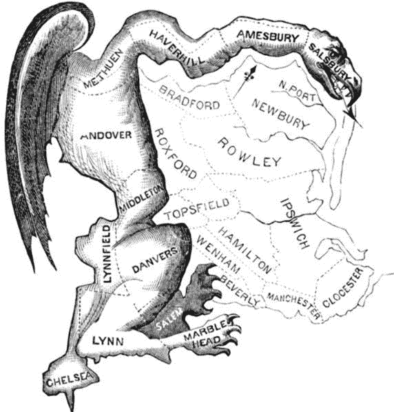

因为大家知道民主选举嘛，一人一票选举出来国会、选举总统，可是它不是全国作为一个大票仓，然后去比谁谁的票数多的，每一个地方的选举制度不一样，但大概都有一些基本的操作。比如说要划分选区。

比如说，就是举例子，我们贵州省要选举人大代表。并不是贵州是一个大的选区，然后所有人去投票，最后得票最多的一百个多个人当选，他是把贵州划分成很多个小的选区，然后每一个选区有一定的名额，对吧。

民主国家是一样的，就美国选举国会，它是每个州有配额，每个州又划分成具体的不同的选区，然后每一个选区大概选出一个两个参议员。每个选区再去选它的众议员，选它的参议员。而这个选区划分，通常是由执政党，这个州现在是共和党的州长执政，他就有一个选举委员会去划分选区。而执政党是有巨大的动力，有巨大的权力去划分，去把去决定选区怎么样划分的。

而人心难测，就是为了自己党派的政治利益，为了让更多自己党派的候选人当选，执政党派在划分选区的时候会绞尽脑汁。这个问题是一个我很想给大家用白板描述的时刻，但大家去搜一搜这种非常有趣的划分选区、扭曲的案例，就会发现有很多很有神操作。

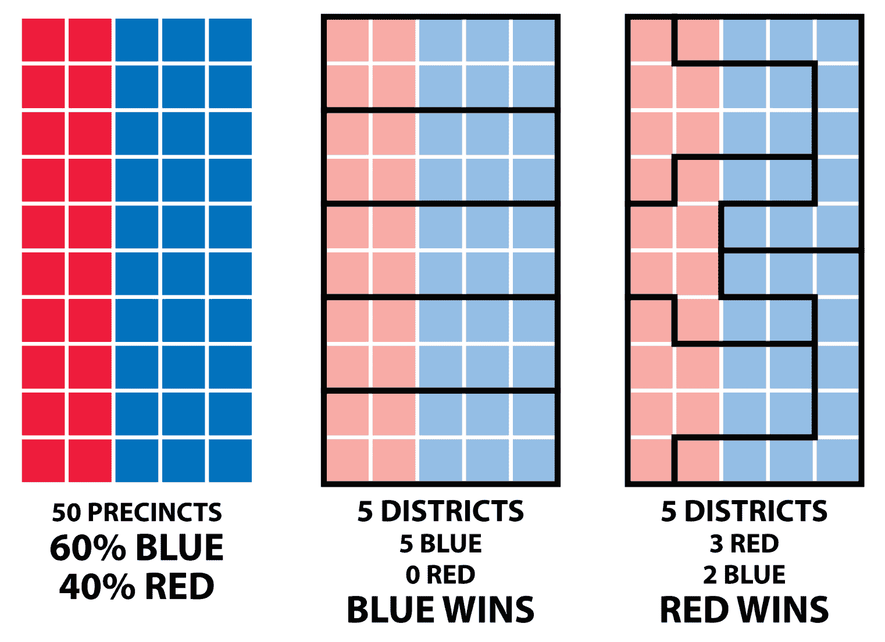

比如说美国的黑人，一般来说是支持民主党的，白人是支持共和党的，这个是一个很粗暴的划分，有的州它的黑人是少数，但这些黑人大概率都会支持民主党，所以我共和党的执政党在划分选区的时候，我就故意把黑人用一个扭曲的曲线，把他们聚集在一个选区。

这样我就保证我在其他选区都胜利，然后你们这个选区最后民主党哪怕就是以 99%赢，也只是一张选票而已。但是如果我把这些黑人的选民分散到好几个选不同的选区，可能在好几个选区当中，民主党都能以 51%的概率赢，他就会无形之间损失很多票，所以我在划分的时候，我就把这些不会投票给我的人都集中到一起。

那另一种可能性就是我偏偏把这些不会投票给我的人都分散到不同的地方去，让他们在每一个选区都不能够成功，都不能够选出民主党的候选人。

这个问题是非常恶劣的。在美国的学术界，包括一般的民众都知道这个问题的存在，而且大家都会觉得这种行径是严重的影响了民主社会的理想的。因为表面上还是投票，但其实选区的划分就会操纵民主选举的结果。

可是在很长的历史时间里，美国的司法系统，它的法院都是对这类事情敬而远之的，党派之间的利益争斗，都是被当作政治问题去看待的。直到去年开始，美国的某一些地区巡回上诉法院开始去着手讨论选区划分问题，真正的去正面触碰选区划分问题，所以大家怀抱着很大的期待。

可是在今年春天的最高法院的裁决里面，最高法院最终还是以 5:4，很有争议的微弱优势的裁决，认为这个问题仍然属于政治问题。美国现在最高法院的首席大法官罗伯茨，他亲自写了这篇判决，就认为我们还是坚持这个原则，政治问题，司法体系不去触碰。

所以在可见的未来，这种杰利蝾螈，这样的一个操作方法还会继续下去。

#### 起诉资格是一个律师和一个司法体系都要考虑的问题

那还是那句话，不同的人会对这个问题有不同的看法。关于一个国家的司法体系应不应该介入政治问题？比如说在选区划分这么糟糕的一种操作面前，法庭偏偏要置身事外，洁身自好，说政治问题我们不参与，其实他是在放任一些已经严重损害到这个社会的民主，一个社会的有序运作，是真正伤害到很多人的政治利益的情况下，法院依然是一种逃避和推卸的态度，使很多人不满意。

反过来，也有很多人认为和支持，法院确实不应该介入政治问题，它就不应该成为一个政治斗争当中的另一个参与者。一个社会还是需要有一个司法体系，他们是活在政治之外的。而去对更一般性的问题，法律本身能够回答的问题做回答，而不要去挑战、讨论、改变政策。

那当然了，法院从来就不在政治之外，我们以后讲很多的案例的时候，很明显的能够感受到这一点，大家对于现实当中法院运作的了解，也知道，他不可能是一个置身事外的机构。

但这个问题就更复杂了，我们今天想要讨论的是起诉资格。就是你会发现有很多问题，我觉得法庭应该管，可是我偏偏不能去告。这是律师们的另外一个战场。就是关于到底谁是一个合适的原告，谁有资格成为原告？它也是在进入庭审之前的另一道门槛。

每一道门槛就会是一道战场，它都是一个律师和一个司法体系要考虑的问题，而这个门槛到底定的有多高多低，有的时候是时代，有的时候是政治，有的时候是法律的原则。究竟该怎么样解决这个问题呢？

其实随着时代的演进，它还在不同的争辩和变动之中。也可以想见，它将永远在这样的争议和变动之中。

# 36\. 青少年入刑年龄（一）：未成年人犯罪应不该得到“特殊照顾”？

（公众号懒人找资源，懒人专属群分享。）

这段时间发生了很多令人心情很沉重的案件，比如在英国的一个货箱里发现了 39 具尸体。在同一天在大连有一个 11 岁的女孩被害，而嫌疑人呢，被怀疑是一个 13 岁的男孩。

在我录下这篇音频的时候，这两个案件都还并没有最终的调查结果和官方通告。所以在事实真相未清晰以前去讨论他们，当然是不合适的。可是这两个案件的发生，也激起了大家对于很多相关的法律问题的讨论。

比如说在这个 11 岁的大连女孩遇害的案件当中，让人感到很难以接受的是，如果这个 13 岁男孩最终被确定为杀人犯，因为他案发时未年满 14 周岁，在我国现有的刑法之下呢，他是不需要负任何的刑事责任的。

这个结果让很多人觉得无法接受，因为被害人，同样是未成年人，她的权益仿佛被法律忽视了。

其实在过去几年中，每当有低龄犯罪，特别是低龄重型犯罪、恶性犯罪、暴力犯罪出现的时候，社会都会重新讨论刑责年龄的制定是否是一个合适的标准，是否应该有这样的一条线，以及这条线应该划在什么年龄才合适。

法律对于很多的群体是有特别的规则的，我们通常会讨论会引起社会讨论广泛的社会讨论的特别的群体，主要就是未成年人，以及精神有障碍的群体。有的国家对于老年人也有特殊的法律。

那这些例外情况呢，我本来计划在这个节目最后的部分做一个总结。那既然遇上了这个讨论，我觉得这是一个合适的机会，我们来一起讨论一下，法律对于未成年人的所谓保护和特别的处罚措施，它背后的故事、历史、原理和以后应该怎么办，这样的问题。

#### **我国现阶段对于刑事责任年龄的划分**

大家都知道，我们国家现阶段对于刑事责任年龄的划分是，14 周岁以下完全无刑事责任。14 岁到 16 岁之间相对负刑事责任，16 岁之后就是完全负刑事责任。

很多人质疑呢，这个阶段的划分是在 1970 年代作出的，50 年过去了，社会现实、青少年的成长、他们的环境、他们的心理成熟的速度和状况，都已经发生了很大的变化，所以 14 岁不再是一个合适的划分。

确实呢，14 岁的责任年龄的划分是在很久以前作出的，而且我们今天回头去看新中国刑法修改的历史，会发现，我们在过去的几十年间，其实是不断的调高刑事责任年龄的。

在 1951 年的时候，中央人民政府法制委员会第一次提出了未满 12 岁者行为不予处罚。之后在 1954 年制定的《中华人民共和国劳动改造条例》里规定，少管所管教的是 13 周岁以上未满 18 周岁的少年犯。也就是说我们当时是以 13 岁作为起刑的年龄。那这个 13 岁的规定划分，在 1957 年的时候被纳入了刑法草案，但是在 1963 年的新的刑法草案草稿当中，又将 13 岁改成了 14 岁。这个 14 岁被设置为刑事责任的年龄起点，经过 1979 年刑法的正式确立，到 1997 年的刑法，再次就保持不变，沿用至今。

所以从 50 年代到 70 年代的修改的过程当中，其实我们是不断的调高了刑事责任的年龄，到今天几十年又过去了，我们现在今天在恶性犯罪面前讨论的是，我们是不是应该降低刑事责任的年龄。

这是一个纵向的比较，如果我们横向的去比较世界各国对于刑事年龄的划分呢，我找到了一个最直观清晰的资料，是《经济学人》杂志在 2017 年绘制的一张图表。这个图表里对全世界的各个国家的起刑年龄都做了一个统计。

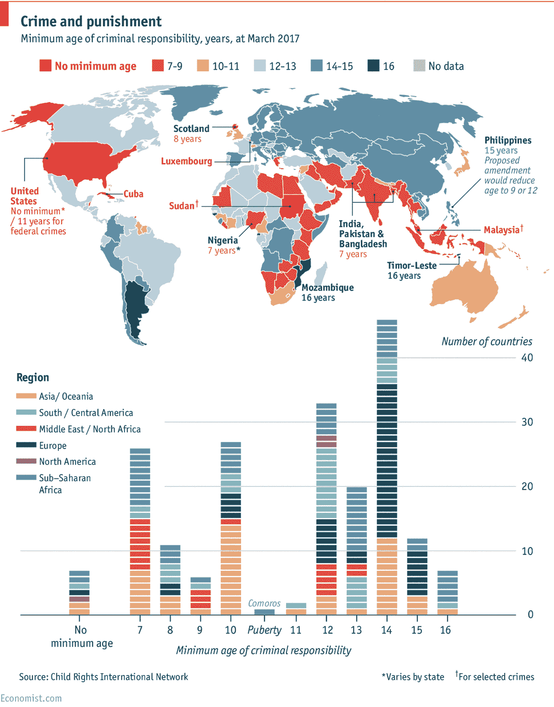

#### **世界各国对于刑事年龄的划分**

大家如果找到这份图表，就是发表在 2017 年的 3 月 15 号。当时之所以会有这个讨论，是因为菲律宾在他的现总统杜特尔特的领导之下，就有一个所谓的毒品战争，所以严厉的打击毒品相关的和其他的暴力犯罪。在此之前，菲律宾是被认为是一个菲律宾的入刑年龄是 15 岁，就是比我们国家的 14 岁还要高，属于整个国际社会当中都是偏高的一个设定。杜特尔特当时有一个计划，是要把入刑年龄降到九岁，甚至更低，引发了国际社会的一个很强烈的讨论。

然后《经济学人》就不无反讽地指出，当大家去争去盯着菲律宾看它修改它的入刑年龄的时候，请不要忘记在美国的 35 个州是完全没有入刑年龄的限制的，就是任何年龄的儿童小孩子都可能被判刑和定罪。

那美国和菲律宾呢，其实都是在整张图表里相当例外的情况，有大概 45 个国家跟我们国家一样，是把 14 岁作为入刑的年龄，绝大部分的国家都对入刑年龄有限制，美国是整个图表里一个非常鲜明的例外，美国在这个问题上跟它一直针对的讨厌的几个国家站到了一起。

除了美国之外，世界上仅有的对于入刑年龄没有限制的国家只有古巴、伊朗、苏丹、马来西亚，而且都是对特定的几个犯罪没有入刑年龄的限制。

如刚才所说，大部分，有超过 40 个国家都是把入刑年龄定在 14 岁，把入刑年龄定在 12 岁到 13 岁的有将近一百个国家，也就是说世界上绝大部分的国家都是把青少年入刑年龄定在 12 岁到 14 岁之间。那当然也有超过 20 个国家把它定在 7 岁，也有超过 20 个国家把它定在 10 岁。

所以我们的这个划分呢，在整个国际社会里其实是属于偏高的那一侧的，定在 15 岁和 16 岁的加起来不到 20 个国家，但仍然是国际社会的一个惯常的做法，一个通行的做法，就是中等偏上的一个水平。

对于年幼的孩子在法律上应该有特别的照顾，特别在刑法上有不一样的处理，在我们国家是有非常古老的传统的。

#### **历史上针对未成年人犯罪的 "特殊照顾"**

在 2000 多年前的西周《礼记》当中就记载，80 以上的老人和 7 岁以下的孩童，"虽有罪，不加刑焉"。周礼又规定，没有换牙的小孩犯了罪也不会被罚为奴。大概就是男孩 8 岁，女孩 7 岁，在此年龄之下，犯罪不入刑不被罚为奴，那在此之上就要承担刑事责任。

之后的历朝历代从战国到汉律到唐律，南北朝的刑罚志，以及明朝的刑法，都对违法犯罪的青少年呢，有特别的处理。比如通常 7 岁、8 岁以下是"不加刑焉"，就是虽有死罪也不加刑，就是不需要承担刑事责任。大概在 15 岁以下，虽然犯罪是从轻处罚，在每个朝代有不同的规定，但是都有类似这样的例外情况。

我们国家到了清朝末年，开始受到当时的西方的刑法改革运动的影响，在大在清末所制定的大清新刑律里，就规定"凡未满十六岁之行为不为罪，但因其情节得命以感化教育"，这个是一个紧跟时代潮流的选择，我们等一下会介绍世界的潮流。也就是 16 岁以下是没有刑事责任的，但是可能以收容教养的方式对青少年进行感化教育。

之后的中华民国同样是规定"未满 14 岁之人之行为不罚，14 岁以上未满 18 岁人之行为得减轻其刑"。所以对于在这个未成年人和成年人之间做出一条界线的划分，在界线以下，或不承担刑事责任，或减轻刑事处罚呢，是一个有古老的历史，而且一直延续下来的传统。

在西方世界，或者在整个世界人类社会里都是有类似的传统。

比如说西方法律里的一个很重要的时代，古罗马法典在他的《十二铜表法》，那是在公元前 400 多年制定的《十二铜表法》里面就规定，比如说，成年人在夜间在田地上践踏，或者收割庄稼要处以死刑，但犯有同样罪行的未成年人，则根据最高审判官的处理，或给以鞭打或判处加倍赔偿的的方法进行处理。

当然这个法律本身实在是非常的可怕，践踏或者收割别人的庄稼，就要被处以死刑。

但这个法律里面很清晰地描述了同样的罪行的成年人和未成年人受到的处罚是完全不同的。那之后的《查士丁尼法典》里面第一次提出了儿童不可能预谋犯罪的古典理论，比较大概相相当于一个人性本善的理论，或者是否定人性本恶的理论。他认为不存在天生的坏儿童、不存在天生的坏孩子，任何的坏孩子都是可以挽救的。这个原则呢，其实被我们沿用至今，都是成为整个少年法，未成年人保护法，或者刑法当中针对未成年人的特别条款的一个整个的立法原则。

《查士丁尼法典》制定于公元 534 年，它非常现代的，还强调了对于儿童应该加强管教，而且将刑事责任年龄规定为男 14 岁，女 12 岁。呵，就那个年代就有男孩和女孩发育年龄不同的，怎么说，歧视？还是（区别对待？）。

近代社会当中呢，重新开始讨论刑法是不是应该对于未成年人有不一样的处理的呢，真正的理论的兴起，要到 19 世纪。19 世纪的整个社会学界都发生了很多重要的变化。比如说达尔文主义的流行，是在这个时候。法学理论的一个很重要的变化，就是我们之前很多次跟大家提到过的刑罚的目的，对于刑罚目的的考量发生了改变。

#### **19 世纪刑法改革运动**

我们早期的刑罚是非常简单的报应主义，就是恶有恶报、以牙还牙以眼还眼的刑罚理论。而到 19 世纪的时候，提出了所谓的社会防卫主义，也就是刑罚的作用不再强调是对于犯罪行为的报应，而强调刑罚是为了预防犯罪。

与此同时呢，实证犯罪学派兴起，或者叫所谓的犯罪人类学派，比如说在 19 世纪的后半页，因为自然科学的发达，因为达尔文进化论的流行，有所谓的犯罪人类学派，他们用自然科学的实证主义的分析方法去讨论犯罪的原因，要从心理学、生理学、社会学的各个角度去讨论究竟是什么促使人们去犯下罪行。他们通过这些社会学的研究，不断地提出很多治理青少年犯罪问题的新方法，很多的国家也在制度上进行了改良和尝试。

比如说，这个学派的一个很重要的结论是认为犯罪者呢，并不是人性本恶，他们之所以会犯罪，是受到环境及身心缺陷的影响，特别是青少年的犯罪呢，对于外在世界和现实社会表现出了非常大的依存关系，就是他们更容易受到现实社会环境对他们造成的影响，从而走上犯罪的道路。所以他们主张我们应该改变报应的这种惩罚的理念，而应该在刑罚之外寻求更有效的对策。因为我们最终的目的并不仅仅是报复，而是能够生活在一个更美好的社会。

同时呢，他们对于青少年的心智的研究，包括他们认为青少年和成年人犯罪通常是出于非常不同的原因，所以他们提出对于青少年犯罪的处理方法也应该和成年人相分别，也应该根据一个青少年犯罪的具体原因而采取不同的方法。所有的这一切理论的改革，社会学的进步、自然科学的进步、研究方法的进步、新的学派跟理念的出现。都促使了最终汇集成了，19 世纪的所谓"刑法改革运动"。

这个刑法改革运动的几个显着的表现，就包括对于刑事责任年龄，在法律里面予以非常明确的划分。

比如说 1810 年法国的刑法典，最早对于未成年人的刑事责任年龄做了规定，如果重罪的被告人未满 15 岁，他应该免除刑罚，而交由亲属管教或者移交管教场所，而对于有辨别是非能力的未成年人犯罪应该判刑，但是应该比成年人减轻刑罚。这个做法很快就推广到了西欧的各个国家，德国，也到也推广到了当时全面欧化的日本。它在 19 世纪末 20 世纪初的时候，又推广到了西方的殖民地国家，包括南亚的印度，还有东南亚的很多国家，亚洲各国也逐渐的跟上。

与此同时呢在 19 世纪的时候，西方各国就在它原本的监狱刑罚体系之外，出现了一些专门收容和矫正少年儿童的机构。那这种收容和矫正少年儿童的机构，其实是服务于两个在当时很重要的社会功能。一个是一种庇护的功能，对于那些无家可归贫穷的少年儿童，给他们提供帮助，让她们去上学，学习必要的技能，避免预防他们走向犯罪道路。对于那些已经有了犯罪行为的少年儿童，就是所谓"收养管教"。

英国在这个时候发展出了所谓的"波尔斯坦感化院"，波尔斯坦制度，在少年法的发展史上被认为是一个重要的里程碑，他很快被很多的国家效仿。这个波尔斯坦感化院呢，除了对于青少年犯罪，也就是 15 岁以上 21 岁以下的这些青少年，根据他们的罪行、恶习、犯罪倾向，认为他们需要被监禁，但是不应该同这些成年罪犯关在一起，免得他们真的沾染更多的恶习进入所谓的犯罪圈。

他们会被送到波尔斯坦感化院，在严格的纪律之下，对他们进行工业生产的教育，就是劳动教养，其实就是我们所知道的劳动教养制度  
学习生产技能，同时是一个针对于青少年的监禁机构。所以它的目的是让他们在一个单纯的有严格约束的环境里，把他们和他们在生活当中，或者他们在监狱里可能接触到那些成年罪犯隔离开来。与此同时呢，他们又学习日后的就业能力和正当生活的能力。

实践证明，波尔斯坦感化院是非常成功的，它对于那个时代的英国社会有非常大的帮助，而这个制度很快就被欧洲以及被亚洲的各个国家学习跟效仿。

那另外一个非常重要的发明，在 19 世纪的刑法改革运动当中，一个重要的改变呢，是美国的伊利诺伊州在 1899 年的时候制定了世界上的第一部《少年法庭法》，同时在芝加哥市建立了世界上的第一个少年法庭。那少年法庭法呢，顾名思义就是有一个特殊的审判庭，对于未成年人进行审判，而这个特殊的审判庭呢，依据的是针对未成年人的特点，并对未成年人进行一定程度保护的，比较特别的法典，就是《少年法庭法》。

# 37\. 青少年入刑年龄（二）：日本神户连续杀童案 “酒鬼蔷薇圣斗事件”

（公众号懒人找资源，懒人专属群分享。）

芝加哥为什么会成为世界上第一个制定出《少年法庭法》、第一个建立少年法庭的城市，这跟它当时的历史进程有很大的关系。

#### 芝加哥的困境

19 世纪末是美国的北方工业发展极其迅速的一个时代，大量的移民涌入美国，投身于工业生产的热潮当中。

大量人口就是涌入像伊利诺伊这样的工业城市，也给这个城市的发展带来很多的困难。因为一个城市它没有准备好，住房、教育、医疗，包括就业，它没有办法应付这样大量涌入的人口，这些新移民虽然为城市的发展提供了非常重要的动力和劳动力，同时也带来了很多的社会问题，其中一个重要的社会问题就是少年犯罪。

据说当时，芝加哥市每年被逮捕、判刑的少年人数，能够占到这个地方的少年总数的 1/5。那大量的逮捕犯罪和逮捕所造成的结果就是监狱不够用，监禁场所变得非常拥挤，这些大量的少年犯他们和其他的成年的犯人被监禁在一起，他们根本没有机会得到少年人的这种所谓的改造和教育，反而是彻底地融入、混入犯罪圈越陷越深。本来可能只是轻微情节的犯罪，在混杂的监狱环境里面越陷越深，最后真的走上重型犯罪的道路。

所以在那个时代去建立一个跟有别于成年犯罪的司法系统和监狱系统，是一个不得不面对的非常严重的社会问题。

那与此同时，在工业迅速发展的年代，工人运动也在迅速的发展。我们今天所知道五一劳动节的来源就是缘起于 1886 年的芝加哥工人大罢工。以及我们今天庆祝的另一个节日三八妇女节，也是相隔不久的芝加哥市的女工，她们的罢工斗争。芝加哥这个地方就发生很多事情。

所以那是一个社会非常蓬勃发展、大量的新问题出现，与此同时社会改良运动、社会运动也蓬勃出现的时代跟地方。在这个年代，就有改革者叫做杰克・索尼，他提出了拯救儿童运动，混入这个工人运动、妇女运动大潮之中。几个运动的人们联合在一起，他们的主张是改善少年儿童的环境，给他们提供有利的条件，让他们去接受教育，得到成长。对于少年犯罪问题，主张从宽处理，通过社会救济和帮助他们培养职业技能的方法，引导他们走向正道，而不是单纯的进行处罚。

#### 世界上第一部《少年法庭法》和少年法庭

所以，拯救儿童运动呢，得到了其他运动工人阶级和其他的社会改良主义者的支持。所以它终于在伊利诺伊州结成了成果，就是我们刚才提到的 1899 年所制定的世界上第一部《少年法庭法》和少年法庭。

《少年法庭法》管辖的是 16 岁以下的违法犯罪的少年，它同时也管辖和保护被遗弃、无人抚养、无家可归的儿童。所以它这个教养所就像我们之前说过的，它是服务于两种目的，既是教育跟保护也是惩罚跟监禁。

以及少年法庭法，除了创造出一个特色的少年法庭来处理少年犯罪问题，也创造了特别的少年的监狱，让青少年罪犯能够和成年罪犯分隔开来。它同时创建了一个所谓的监督员制度，就是这个监督员在一个少年犯被送上法庭之前，要跟他/她进行充分的沟通，了解他/她的情况、家庭背景、他/她的需要。在审判之后还要负责继续对少年进行监督。

#### 国际社会的潮流

19 世纪末的伊利诺伊州的创造很快在 20 世纪初被欧洲以及其他世界各国所采用，1908 年德国建立了第一个少年法院。

1912 年，法国（等）欧洲国家也都逐渐的跟上。

我们国家在这个问题上起步要比较晚一些，那是因为我们在 20 世纪初年经历了很多的动荡跟战乱。所以我们要到 1984 年（口误）上海长宁区法院，在中国第一个建立了专门审理未成年人犯罪案件的少年法庭，当时被叫做少年刑事案件合议庭。到了 1988 年开始独立的建制，那么到今天这个制度已经被推广到全国各地，被确定下来，成为我们司法系统的一个重要的部分。

那我们说回国际社会的一个潮流。二次世界大战以前，国际社会受拯救儿童运动的波及的影响，整个国际社会开始有很多的会议，有很多的公约，讨论我们应该怎样保护青少年罪犯他们的利益。

比如说，当时召开的国际监狱会议，就认为，少年法庭的法官应该有相应的社会学和心理学的知识，审理案件的时候态度要和气，要用一种教育而不是惩罚的心态。对于少年犯呢，不应该和成年犯混在一起。与此同时的很多其他的决议讨论的是一些我们今天已经很熟悉，但看上去跟少年犯没有关系的事情。比如说，第一次国际社会当中开始讨论，是不是应该对电影进行审查，进行分级，以免给儿童带来不好的影响。

这一切的一个理论根源，大概是十二、十三世纪英国所发展出来的衡平法，就是我们之前提到的普通法法律体系之外的一套法律原理。它其中的一条原则是说，国家对于少年儿童不是惩罚的官吏，而是最高监护人。

这个跟英国传统上国王是臣民的监护人，应该以慈父般的态度去面对犯了错误的臣民。这个古老的态度沿袭下来，到了 20 世纪，它被更科学的社会学、自然科学的研究，犯罪心理学的研究所取代。在这场社会运动当中，但它们合一变成对于青少年要有更多的关怀，要以教育出发，把他们引导向正确的方向，而不是单纯的用惩罚的方法，试图用惩罚就可以禁止他们未来的犯罪。

所以这个少年法庭有很多的特殊的设置，都是为了保护青少年，而且希望他们能够从审判的过程当中得到教育，而不是单纯的惩罚。

比如说那个时代开始到我们今天，我们国家的少年法庭，依然采用的一些重要的措施，就是，除了有案件相关的人士以外，其他人不可以旁听或者出席。任何的有关少年法庭以及其相关案件的报道，不能够提及有关的儿童或少年的姓名、地址、就读学校，不可以透露任何足以导致他们的身份被识别的资料，不可以发表他们的图片。

但其实我今天在微博上我都看到很多关于大连的女孩被杀案的，它的犯罪嫌疑人，他的照片和他的一些资料，但是真假难辨。少年法庭被责成有义务以浅白的语言去向这些受审的少年们解释控罪内容，以及控罪的性质。同时他们可以让被告的父母或者监护人出席，并向证人提问。作出判决之前，法庭必须要研究青少年的行为、家庭环境、学校记录、病历资料，还有一条重要的原则就是未满 14 岁的儿童不可以被判处监禁。十六岁以下的少年，如果有其他适当的处罚方法，也不应该被判处监禁。如果他们必须被判处监禁，监禁的时候，也不应该和其他的成年囚犯交往。

所有的这些原则，从那个时代就确立沿用至今，都是为了强调青少年他们仍然有改过自新的可能。这个社会不应该任由他们在犯罪的陷阱里越陷越深。

#### 二次世界大战之后的分歧

那个时代到了二次世界大战以后呢，国际社会对于少年法庭的讨论，开始有了两个新的发展方向，就是一左一右的两个发展方向。

一边是，那个时代的英国立法者，他们就认为我们的少年法庭本质上就应该做成一个福利机构，去为这些少年儿童这些误入歧途这些可能因为环境的原因，不得不走上这样的道路的青少年提供福利。这个时候，除了法庭有社工的介入，有其他的社会人士的介入，它是把整个少年法庭往一个福利机构的方向去引导。

而在那个时代的美国呢，少年犯罪开始变成了一个非常严重的问题。所以一方面有很多人开始抱怨少年法庭的存在，认为这些少年法庭对于这些犯罪的少年过于宽容，纵容了少年犯，使得他们在犯罪当中有恃无恐。而另一个方面，又有人认为少年法庭相比于整个司法体系显得更加的不透明，这些少年犯他们的权益并没有像其他的普通犯罪的权益那样得到法律的很明确的保护。

而因为少年法庭它强调它私密的性质，法官有一种教育者的身份存在，所以给了这些法官很大的自由裁量权。

所以那个时代的运动方向反而是要求这些青少年罪犯嫌疑人，他们在法庭的审理过程当中，能够得到像成年人一样的权利，比如他们有请律师的权利，有调查机关向他宣布，米兰达敕令就是，"你有权保持沉默，但是你说的每一句话都可能变成呈堂证供"之类的权利。

大家可以看到，就是从 19 世纪末的拯救儿童运动开始，一直到二次世界大战以后，一直到六七十年代，整个国际社会发展的潮流，都是大家逐渐的意识到，我们对待青少年的犯罪跟成年人的犯罪应该是两种不同的态度跟处理方法。因为他们犯罪的原因不同，他们改造的可能不同。他们的心理成熟程度，他们的恶劣程度不同。

所以无论是少年法庭的设立、区别规则的设立，还是福利机构的设立，一些其他方面的区别对待儿童和成年人的手段和措施的施行，都是为了区别对待青少年犯罪和成年人犯罪。整个国际社会的潮流是越来越多的国家区分青少年犯罪和成年人犯罪，而且他们不断的提高青少年的入刑年龄，包括我们国家在讨论降低刑责年龄问题上的时候，都会提到的，我们国家是《联合国儿童权利公约》的签署国，我们是在 1992 年就加入了这份公约。

这个公约的建议就是很明确的，有很多关于区别对待青少年犯罪问题和成年人犯罪问题的建议，包括他鼓励所有的国家都设置一个最低的入刑年龄，他的建议是入刑年龄应该是 14 岁、15 岁，以及青少年绝对不可以适用死刑，等等的建议。这个是一个国际社会之前遵守的规则和一个不断变化的潮流。

但是这个潮流其实在今天都受到了各个国家的挑战，不只是中国社会，不只是我们的社交媒体，我们的社会舆论里在讨论是否应该降低刑责年龄的问题是很多国家都在讨论。

也就是说在近些年来呢，在持续了几十年的，不断提高入刑年龄的国际潮流之下，也有很多国家开始反过来思考，是不是应该降低入刑年龄。

有很多的降低刑责年龄的这种改变，都是缘起于社会当中引起广泛关注和讨论的恶性的低龄犯罪案件。

#### 酒鬼蔷薇圣斗事件

一个很著名的例子，可能大家都听说过，是发生在 1997 年的日本，酒鬼蔷薇圣斗事件，日本人把它叫做神户连续儿童杀伤事件。它为什么被叫做酒鬼蔷薇圣斗事件呢？这个案件里面的少年犯，他被叫做少年 A，少年 A 用"酒鬼蔷薇圣斗"来作为自己的自称。

抱歉，因为要讲述这个故事，之后的描述里面可能有一些会引起人不适的描述。

这是一个袭击儿童的连续杀人案。在 1997 年的 2 月第一个案件里，有两个上小学的女学生被少年 A 从后面用锤子攻击，其中一人重伤。当时这两个小女孩是看着嫌疑人，击打她们的人，用着学生用的书包，穿着学生的西装外套，所以被害者的父亲当时就向少年 A 就读的国中要求提供学生的照片，让他的女儿去指认犯人。但是学校拒绝了这项要求，为了所谓保护学生隐私。

这个事件在后来因为有连续的案件发生，学校的做法开始引起社会的质疑。

这个案件因为在 2 月发生，索要照片未果，当时就不了了之。到了 3 月的时候，少年 A 向一个小学的女孩子，山下彩花询问厕所在什么地方。山下带他到了厕所附近的时候，少年 A 就对这个女孩说，把脸转过来，我要谢谢你。然后他用铁锤攻击了这个女孩。其后这个叫做山下的女孩被送到医院，但因为大脑受伤而死去。那同时，在当天，少年 A 在逃离案发现场的时候，被另一个国小的女童看到了，他随即用小刀刺伤了这个女孩，但这女孩很万幸，并没有死去。那这个案子也没有能够破案。

到了 5 月的时候，一个少年 B 叫做土师淳，他在前往祖父家的途中，与他认识的少年 A 偶然相遇，当时少年 A 正在寻找犯案目标，于是呢，少年 A 就把少年 B 诱拐到了附近的高台上，用绳子把他勒死，然后把他的遗体隐藏起来以后离开。他之后再次回到案发现场，将少年 B 的头割下，放进事先准备好的塑料袋带走，去隐藏。

后来，少年 A 将少年 B 的头部带到了中学门口，然后又返回住所，以至于少年 B 的头被管理员发现。这个头上还有两张纸片，是少年 A 留下的一封挑衅意味十足的信。

他说，酒鬼蔷薇圣斗的游戏要开始了，愚钝的警察诸君试着来阻止我吧，关于杀人，我感到非常的愉快，好想看到人的死亡，用死亡来制裁肮脏的蔬菜吧，用流血来制裁我经年累月的怨恨吧。

在后来审判的过程当中，因为他把这些被他杀掉的小孩子都叫做蔬菜。当时他的辩护人以他的精神有障碍为由提起抗辩，他没有办法把人当做人，他只是把所有人当成蔬菜。因为他自称酒鬼蔷薇圣斗，所以他这个案件被称为酒鬼蔷薇圣斗案件。后来神户新闻社收到了由酒鬼蔷薇圣斗寄出的犯罪声明文，其中包含了他对整个犯案事件的描述跟自白。

这个案子经历了挺长的时间才被破获，在侦查期间，少年 A 很多次的被查问，有部分的调查员对他感到怀疑，包括他跟 2 月和 3 月的凶案都能够联系起来。

终于他就读的学校向受过袭击的女童，两个女童之一提供了他的照片，这个女童认出了少年 A。综合所有的因素，他终于在当年的 6 月 28 号被捕，并且在他的住所发现了部分的凶器。

他被捕以后，他很快承认了他袭击了 3 名女童，杀掉了 1 个女童，杀掉了少年 B。

除了留下那几张纸条，酒鬼蔷薇圣斗少年 A 还给神户的新闻社寄过关于案情的信件，包括一开始当地的日本媒体在报道这个事件的时候，把凶手的名称误报为鬼蔷薇，而不是酒鬼蔷薇圣斗，凶手非常的生气。

这个少年 A 在他的信中说，从现在开始，如果你们再念错我的名字，或者做使我愤怒的事，我将会在一个星期内弄烂 3 颗蔬菜。这是另一个关于他把人都当作蔬菜的证据。

这个案件发生在 1997 年，当时日本刑法下的刑责，入刑年龄是 16 周岁，而酒鬼蔷薇圣斗少年他当时只有 14 岁，所以是没有办法对他进行刑事上的处罚。于是对他的处理方法仅仅是判他到感化院进行诊断，他被送到了关东医疗少年院，然后又转移到东北中等少年院。到了 2004 年的时候，已经成年的少年 A 从少年院出院，重新回到了社会。日本的法务审也向受害者的家人传达了少年 A 被假释出院的消息。

在 2015 年的时候，这位凶手以前少年 A 的名义出版了《绝歌》，他在书中自我剖析了犯案前的冲动和精神状况，并在书的最后向死者的家属致意。但这本书的出版当然也引起了巨大的争议，因为很多人觉得这是在消费受害者。

但不管怎么说，整个事件的结果就是他如此凶残的杀人、分尸、写威胁警方的信，威胁要杀死更多的人。所有这一切坏事做尽以后，他只是被送进教化院，经过了 7 年的教化，又重新的回到了社会，并且还可以出书。所有的这些事件都在日本社会引起相当之大的震动，于是在这个事件之后的 2000 年，日本国会将犯罪刑责的最低适用年龄从 16 岁降低到了 14 岁。

所以这个是一个很著名的案例，因为某一件引起广泛的社会关注和社会争议的恶性低龄犯罪案件，使得社会降低国家的入刑，青少年犯罪入刑标准。可是呢，很快日本社会就面临了一个问题，就是这个标准是不是当新的案件出生发生的时候还要一降再降。

因为到了 2004 年的时候，2004 年也就是少年 A 从感化院出院的那一年，又有一个少女 A，她当时只有 11 岁，她杀死了同班同学一个 12 岁的女生。这个时候刑责年龄已经降低到了 14 岁，但是仍然没有办法对 11 岁的少女，少女 A 量刑。于是日本神户又不得不再度的讨论，是不是我们还要把刑责年龄再降低到 11 岁、12 岁甚至 10 岁，到底什么时候是个头呢？是不是每一次遇上这样的恶性案件，社会就要重新审视它的刑责年龄呢？

虽然少女 A 的案件也得到了社会非常热烈的关注，可是日本国会最终没有再次的修改刑法，日本到今天，它的量刑、入刑年龄仍然是 14 周岁，但是这种讨论，这种呼吁，这种激烈的争辩到现在还是依然存在。

# 38\. 青少年入刑年龄（三）：“恶意”是否可补足入刑年龄？

（公众号懒人找资源，懒人专属群分享。）

如果在具体的案件和事件发生之后，不停地调低刑责、入刑年龄，并不是一个看上去合理的做法，有效的做法。很多人建议我们可以参考的是英美，这个普通法系当中的一条古老的原则，叫做，恶意补足年龄。

#### 恶意补足年龄

也就是说，虽然我们通常意义上认为，某一些罪行只有一定程度的成熟程度、智力水平、心理年龄，一定年龄的人才可能做的出来。但是如果在一个具体的案件当中，这个嫌疑人，他/她在案件的作案手法上，他/她在案件的策划实施的过程当中，所展现出来的智力水平，或者是相当充分的恶意，他/她的邪恶程度能够补足他/她在年龄上的缺失。就是，一个很小的孩子，那么冷静，或者是那么坏。在这样的案子当中，我们可以在这个具体的案子里放松对年龄的限制。

这个原则出现在普通法系当中，其中一个原因当然就是我们很多次提到的普通法系，因为是每一个案子，法官有相当大的自由裁量的权力，他/她有通过每一个案子的事实细节，去作出判决的衡量和判决的权利。不像大陆法系当中，这个刑责年龄，更有这种一刀切的，它是一条基本线的这种现象。

美国呢，我们之前提到，从 1899 年伊利诺伊州芝加哥的法院第一次引入了少年法庭这个形式之后，少年法庭现在它是美国司法体系的一个重要的部分。通常情况下，18 岁或者 17 岁以下的少年，是在少年法庭当中接受审判的。美国的情况我们之前也很多次介绍了，它是刑法，主要是每个州的事务，联邦只在很少的、特别的案例当中才介入。

所以从美国各州来说，它有 35 个州对于入刑年龄没有任何的限制，理论上零到零岁起都可以。它的这个联邦刑法里面对于最低入刑年龄的限制是 11 岁。可是当然一个 11 岁以下的小孩，虽然他/她不会在联邦法庭里面被起诉，他/她完全有可能在州法厅里面被起诉。

它的少年法庭的整个体系，也是每一个州有非常不一样的法律。比如说这个少年法庭有一个上限，到了某一个年龄以后，这个少年就不应该再是由少年法庭来审判，而是到成人的正常的刑事法庭去审判了，这个每个州就不一样，有很多州是 18 岁，也有的州是 16 岁、17 岁。比如说，北卡罗来纳州，它甚至低到 15 岁，15 岁以上的人完全把你当做一个成年人，到这个成年人的刑事法庭里去审判了。

那同时呢，不同的州对于多少岁开始，可以在少年法庭里的审判的要求，也是不同的。绝大多数的州没有制定任何最低年龄，就理论上无论多小的孩子，都可能被放上少年法庭去审判。某一些州制定了，比如说北卡，它的最低年龄是 6 岁，6 岁以上的孩子就可能在少年刑事法庭里面去审判。那比如说加利福尼亚州，它的最低刑责年龄是 12 岁，看上去比较高。但是对于某一些类型的重罪，比如说强奸罪、谋杀罪，就是没有任何最低年龄的限制的。

#### 少年法庭的好处

特别为青少年设置的少年法庭的好处，我们之前提到过，那它有一些程序上对于青少年的保护，比如说审判通常是不公开的，青少年的名字是不可以任何方式被泄露给大众的，以及它的整个审判程序，在形式上没有那么的严肃跟正式。你看它的很多州的最低审判年龄是 6 岁，为了让这个小孩子能够明白自己在经历什么，它可能允许监护人出席，它可能要用浅白的语言，或者是用比较这种简单的程序去操作。

少年法庭呢，有很多跟成年人的刑事法庭有很多不一样之处。比如说，在少年法庭里，它给这个少年更大的机会去改过自新。如果这个犯罪情节不是特别严重，然后这个孩子真的挺小的，以及他/她过去并没有任何犯罪的经验，以及这个孩子的父母看上去有充分的意愿跟能力去引导他/她、去过一个正常孩子的生活。那这个法庭可以不在他们的人身记录上留下犯罪记录、审判记录。这些是被写进法律的规定。

还有一些被很多评论者认为是更加重要的事情。非正式的因素，比如说这个孩子的态度是不是显得彬彬有礼。是不是显得对自己做的事情感到很害怕、很难过。以及他/她是不是穿戴整齐，给人的印象是一个乖孩子。以及他/她的这个父母是不是看上去是那种体面的、教养的，能够给他/她好的生活环境的父母，以及包括这个孩子是不是能够负担一个律师？这些条件都会影响法庭的裁决。

那少年法庭呢，跟成年人的刑事法庭最核心的区别，还是你在少年法庭经过审判之后，最终会得到什么。就是你在少年法庭当中经过的审判，通常有三种处罚形式，一种是非正式的监护，大概就是这个法庭会任命一个你的监护官员，或者直接就是责成这个家庭去好好的监护，然后定期的向法庭做汇报。还有一种是正式的监护，那会有一个青少年的假释官，他/她定期的会和这个家庭，会和这个孩子见面约谈，看他/她现在的精神状况，整改的情况，他/她自己进行悔改，学习和生活的情况。

那比较严重的罪行是会被判处监禁的，但是这个监禁呢，是在青少年的管教所，青少年的监禁机构里面，而不是把他/她投进正常的联邦或者州的监狱。这种区别对待呢，我们之后会提到，它对于青少年的改造会有非常不一样的后果。那总的来说呢，刑事法庭和青少年法庭，它的整个理念跟目标就是不一样的。

我们之前很多次讲过刑罚的目的，刑罚的目的从应报，变成了预防。但是对于成年人的刑事法庭来说，它虽然是今天我们以预防这种理念去经营和监管，但它的核心措施仍然是惩罚，是通过惩罚的方式去威吓、预防未来的犯罪。那对于青少年的法庭，它的整个理念是改造、重塑这个孩子，是通过监禁也好，约束他/她的行为自由也好，通过他/她不定期的和这种假释官员的会面，或提供汇报，向法庭做汇报也好。都是为了看他/她能否重新适应社会，去好好地成长成一个守法公民。

在普通的成年人的刑法法庭上，犯罪的严重程度和他/她过去的犯罪经历，是影响它的审判结果的最重要的因素。但是在青少年法庭上，最重要的因素是这个孩子的，他/她的这种心理状态，他/她的心理因素，包括他/她的成长环境，他/她受过的伤害，他/她现在的环境，他/她有没有得到充分的教育、关怀。这些心理上的因素、社会学里的因素是会影响他/她的判决结果最重要的一些考量。

所以它归根结底体现的是社会对于青少年的犯罪跟成年人的犯罪两种很不一样的态度。对于青少年，我们归根结底是觉得，他们还不成熟，他们还小，他们还不能够理解自己做下的罪行，犯下的错误，造成的伤害的严重程度，他们还有机会学习、教育、改造，成为守法公民。

可是呢，就像我们之前提到过的，时代的潮流一度是，大家清楚地意识到，未成年人需要得到特殊的照顾跟保护。但是在过去这几十年的时间里，特别是二三十年的时间，在最后的那个 60 年代的改革潮流过去之后，是会有一个反转的态度，越来越觉得青少年犯罪问题非常严重，而这种从宽处理的少年法庭的特别制度，是不是纵容了，甚至鼓励了青少年的犯罪。

#### 最低惩罚的元素

所以呢，到了 1970 年代的时候，在美国就有一股立法的潮流，在青少年法庭的体系当中加入了一个元素，就是最低惩罚的元素，这个是美国《刑法》里的，当然我们中国的《刑法》里也是一样的。

就是，我们的《刑法》里会规定一个惩罚的范围，一级谋杀罪它可以是终身监禁，也可以是死刑。具体情况，具体分析，但是它有一个最低量刑。如果你是一级谋杀罪成，你最低量刑也是终身监禁，最高量刑可能是在保留死刑的州是死刑。所以在 1970 年代的这一股立法的潮流当中，就给这个少年法庭也加入了最低量刑的这样一个底线上的要求，免得很多人抱怨法官太大的自由裁量权，最终对这些青少年犯罪相当的宽容。

到了 1980 年和 1990 年代的时候，青少年犯下的重罪，越来越得到广泛的报道，引起社会的关注。又有一个新的立法潮流。

我们之前提到的恶意补足年龄，这个是一个普通法当中的原则，所以具体情况具体分析的这种自由裁量的权力是一直存在的。就是，通常来说少年法庭他们可以管到，比如说 12 岁到 18 岁的孩子。但如果一个 16 岁的少年，他犯下的罪行实在是非常的严重，他是可以被法官转移到成年人的刑事法庭去接受审判的。

但这种情况就比较少见，或者说检察官他也可以觉得这个犯罪情节实在是过于恶劣，这个青少年已经有了足够的心智去经历一个正常的刑事法庭的审判，他是可以选择在刑事法庭去起诉的，这个决定权在法官。

可是在 80 年代和 90 年代立法的潮流里面，是很多州通过立法的形式规定，某一些类型的犯罪，不得在少年法庭里面去做审判，而一定要到成年人的，正常的刑事法庭里去做审判。或者是某个州规定，降低可以做所谓司法转移的最低年龄。

比如说以前规定是偷窃罪，13 岁以上的孩子，如果这个法官觉得情节恶劣，可以把他/她转移到成年人的刑事法庭去审判。现在最低年龄可能降到 10 岁，11 岁的小孩也可以被转移到，刑事法庭里去做审判。

以及他们增加了那些可以被转移的罪名。比如说之前可能只有谋杀罪和强奸罪是可以被转移到成年人的刑事法庭，去用正常的刑法程序做审判的。现在可能把抢劫罪、入室盗窃，纵火，这些也非常恶劣的罪行也都列为可以转移的罪行。当然最重要的一项立法，还是那种自动转移、必须转移的情况，就是某一些罪行不再能够被放在少年法庭里去审判了，而一定要到刑事法庭上去审判。

有一个数据统计是美国每年会从少年法庭向刑事法庭转移 13000 个青少年。大概就是，种种的原因，他们不再适合在少年法庭审判，而要到成年人的刑事法庭上去受审判。那在他/她被转移的原因里，最重要的一个占 60%以上的原因就是，这个州在八九十年代的立法，某一些指控、某一些罪行必须在刑事法庭里去审判，通常会包括谋杀和强奸。其它的转移就像我们刚才说的是检察官的自由裁量，或者是法官的自由裁量。

那还有一些州呢，有一个比较特别的原则，叫做，一日为成人，永远是成人。如果你在 14 岁的时候，犯下了比较严重的罪行，被法官转移到了成年人的刑事法庭去接受审判，那你将来，你还是没有成年，但是你再犯下什么错误，也都一直需要在成年人的刑事法庭去接受审判。

今天我们就讲到这里，感谢收听，下集再见！

# 39\. 青少年入刑年龄（四）：少年法庭与少年监管机构

（公众号懒人找资源，懒人专属群分享。）

我不知道大家会怎样看待，美国的司法体系，对于青少年犯罪这种相当之严厉的态度。虽然他们是最早创造出少年法庭的国家。但今天看来，这个严重的罪行，首先就不会在少年法庭里去做审判，而在少年法庭里审判的最低的年龄可以非常之低。

反过来呢，很多美国的左派的团体，一直是很热烈的批评美国的这样一种司法体系，觉得他们对于儿童太过的苛刻，做出了很多很荒唐的事情。就是把很小的孩子，让他/她去经历非常严肃的成年人的审判。哪怕是少年法庭里的指控，对于这个孩子是严重的伤害和不负责任。

在去年发生的一起案件，再次把美国的整个体系推上了风口浪尖。跟我们面临的问题非常的不一样。我们今天在讨论，14 岁这个入刑年龄是不是太高了？应该降低一些。反过来，美国的很多地方在讨论他们的入刑年龄是不是太低了，有的地方干脆就没有，所以就会有很多挺荒唐的事情发生。

比如说我们刚才提到每一个州，有相当大的自主权利，去决定什么样的罪行，多少年龄的孩子应该在什么样的法庭里接受审判。其中一个比较特别的州，就是这个威斯康星州。威斯康星州是规定，任何的谋杀罪行，或者是试图、意图谋杀，只要这个嫌疑人有 10 岁或者超过 10 岁，这个案子就必须在成年人的、正式的、普通的刑事法庭上去审理。

而去年呢，就真的发生了一个 10 岁的小女孩被指控谋杀的案件。

这个小女孩当天呢，在一个托儿所里面，就这种白天照顾孩子的机构里。这个托儿所里，有几个 4 岁、6 岁，还有她是 10 岁的比较大的孩子，也有一个只有六个月大的小宝宝，这种是很私家的这种托儿所。就是一两个人私家经营，所以它一共就只管四五个孩子，可能有各个年龄段的孩子。

然后这个小宝宝被放在床上睡觉，这个小女孩呢，据她说（或者综合其它证据），据目前的报道是说，她去把这个六个月大的小宝宝给抱了起来，也不知道是故意的，还是按照她的辩护律师的说法，不小心，把这个小宝宝摔到了地上。这个小宝宝就开始嚎啕大哭，就哭了起来，因为被摔到了。然后这个小女孩呢，就用连续踩踏的这个方式，造成了这个小宝宝的死亡。

那很快，这个托儿所的阿姨发现了这个小宝宝脸上在流血，赶紧报警，但是送到医院的时候已经太晚了，这个小宝宝就死了。那根据威斯康星州的法律，这个小女孩是要被手铐抓起来带走，到成年人的刑事法庭上去接受审判的。

这个事件在美国是符合威斯康星州的法律。

我们如果幻想这个事件发生在中国，她是一个 10 岁的女孩，她踩死了一个小宝宝，杀死了一个人。如果她是 10 岁，在中国，她就不需要承担任何的刑事责任。我们也会觉得很可怕，就是，怎么会有人去对一个小婴儿下手，这个太可怕。

那但是你反过来在美国的这种情况下，让一个 10 岁的小女孩，让她到这个刑事法庭上去接受审判，也让很多人，美国的民间，或者是美国的这些社会组织，觉得非常的荒谬。特别是听了这个小女孩的辩护之后，她说她当时觉得非常的害怕，她不知道该怎么办，她为了不让这个小宝宝哭下去，她只能这么做。当然，一定不是所有人都可以接受这样的解释，包括我自己。就是你很害怕，难道就要用这么血腥的方式，去让它停止哭泣，那也很可怕。

可是也有很多人认为，一个 10 岁的孩子，你就是没有办法指望她能够完全的明白自己在做什么，完全的明白自己对他人造成的伤害，特别是对一个小宝宝造成的伤害。可是在现在的美国的司法体系，她就要到成年人的法庭上去接受审判。

美国另外一个问题就是州与州之间这个巨大的分歧，因为在某一些其它的州，10 岁甚至不是一个量刑的年龄，甚至不能到这个青少年法庭上去接受审判，可是在威斯康星，甚至她不能留在少年法庭追究审判，而一定要到成年法庭去接受审判。

这样的问题呢，听上去应该是很极端，但其实是存在的，而且是需要这个社会去面对的。

有数据统计，美国从 2007 年到 2016 年的 10 年之间，一共有 44 个孩子，10 岁或者 10 岁以下的孩子，被认为是应当对谋杀案负责的。那，因为他们犯下案子的州不同，生活的州不同，他们的命运是很不一样的。像这个威斯康星州的小女孩，她面临的是审判，可能是非常漫长的监禁，而有一些州的孩子却可以逃过刑罚，或者是他/她可能被送进青少年特别的管教机构去接受监禁。

比如说，在 2003 年的时候，有两个 12 岁的男孩，杀掉了一个 13 岁的男孩，他们都在法庭上认罪，然后被分别判处了 20 年和 14 年的徒刑。就是这种案件和判决是真实存在的，虽然你只有 12 岁，但是就面临着 20 年在监狱里度过的命运。

比如同样是在威斯康辛州，在 2004 年的时候有两个 12 岁的女孩，她们刺伤了她们的一个同学，丢下她不管，放任她死掉，这个同学其实后来被救活了。但她们被指控意图谋杀。那同样是，她们的辩护律师想要把她们留在少年法庭里审判，但根据威斯康辛州的法律，她们是被交到了成年人的刑事法庭里去审判。

因为她们在这个辩护的过程当中说，她们是想要模仿科幻小说当中的场景，所以以心智上的问题，被判到这种心理健康机构。一个被判了 40 年，另一个被判了 25 年。40 年就要待在一个心理健康机构里。

所以这些案件是普遍存在的，然后这些看上去真的还是小孩子的孩子，他们是在美国是要面临很漫长的真实的监禁的。

如我们刚才所说呢，美国的这一套做法在它的国内，以及国际上（美国总是对别人指手画脚），他们国内这个问题也被很多不同的国际机构或者是人权组织批评，对待青少年犯罪的问题太过严厉，然后会适得其反。

最近这些年的脑科学研究，其实是在支撑一个相对比较高的最低入刑年龄的。

比如说，最新的脑科学，可能觉得一个人真正能够大脑完全完成发育，可能要迟至将近 30 岁，完全具有控制自己情绪的能力，要到 24 岁到 26 岁之间。

在美国还有一些是，针对青少年的犯罪，能不能够到成年人的法庭上去接受审判的这种研究。就发现 13 岁或 13 岁以下的少年或者儿童，他们没有办法像年纪更大的青少年这样去应付一个法庭的审判，他/她没有办法去理解法庭审判的程序，没有办法理解自己拥有的权利，也没有办法理解所谓的辩护律师是跟自己站在同一方的，所以他们很难很难对辩护律师敞开心扉，解释他/她为什么这么做，到底做了什么。也没有这种和律师进行良好沟通的能力。

另外一个调查就发现，15 岁或者 15 岁以下的孩子或者少年，都没有办法像一个成年人或者比他们更大的青年人那样，在法庭上能够控制好自己的表现，去争取一个更好的机会。所以有人认为，把他们放在一个成年人的法庭上去接受审判是不公平的。

那当然还有一些更加古老的关于脑科学心智发展程度的研究和意见。比如说，有人觉得 11 岁到 13 岁的孩子中间，有 1/3，14 岁到 15 岁的孩子之间大概有 1/5，他们在面对这种法庭审判程序的时候，他们的理解力或者他们能够表现控制自己的能力，是和精神上有问题、智力有障碍的成年人是一样的。

通常情况下，一个精神上有疾病或者智力上有障碍的成年人，法庭会以他们没有办法理解审判，他们 can not stand for  
trial，没有能力去经历审判的过程为由，可能会有特别的处理，而不去做这个审判。但是反而在美国的司法体系之下，一个很小的孩子，反而可能被放到被告席上去，进了一场真正的审判。

从另一个侧面，又有很多人说，为什么我们还是应该坚持对于青少年的犯罪要有特别的处理方法，而不是看到恶性犯罪就把他们和成年人一样的对待？主要是看这个结果。

比如说，之前有一个美国的研究发现，那些被关押在成年人的监狱，你如果到成年人的法庭上去接受审判，是会被投放进真正的成年人的，普通的监狱里面去的。那些被关押在成年人监狱里的青少年，他们被性侵犯的可能，是那些被关押在少年监管机构的青少年的 5 倍。他们会被狱卒、监狱管理人员打的几率是 2 倍，他们自杀的几率相较于整个同样年纪的人群，自杀的概率是 4.6 倍，相较于那些被关押在少年监管机构的人群，自杀的概率是 7.7 倍。数据表明，被关押在成年人的监狱里，是真的可能对他们造成伤害的。

从长期后果来说呢，被关押在成年人的刑事法庭里接受审判，并且被关押在成年人的监狱里的人，他们是有更高的概率会再次犯罪。这个是一个很古典的理论了。包括今天我们在讨论大连，大连的 11 岁女孩被害案件的时候，很多的专家也就提醒，一味的降低入刑年龄，让这些青少年踏入所谓的犯罪圈，去和成年人罪犯被关押在一起，他们见识更多的暴力、受到不良的影响，再次犯罪的概率是极大的。

当然，另外一边的意见就是，那你是在纵容他们在年龄没够的时候就去犯罪，他们犯罪之后，没有受到应有的惩罚，他们将来也可能再次去犯罪。

那以美国的数据为例呢，至少美国的数据显示，如果你在青少年的少年法庭上接受审判，被关押在少年法庭的监管机构里，再犯的概率是会低 32%。同样的一个罪行，如果你放在成年人的法庭里，去让他接受审判，并且被把他/她投进成年人的监狱，这个人再犯的概率要比，让他/她在少年法庭上受审判高 32%。

所以从这些数据看上去对于青少年做区别对待，好像对于他们的教育，改造他们，让他们重新融入社会是有好处的。

当然在我们所有的这些讨论里呢，数据就是数据，我们没有敢去触碰那些非常恶性的案件，特别是今天引起我们讨论的是像杀人、骚扰、试图强奸这些很恶性的案件。

来为这些恶性案件划定一条底线的，是美国的最高法院。

我们今天就先讲到这里，感谢收听，下集再见！

# 40\. 青少年入刑年龄（五）：18 岁，死刑的界限？

（公众号懒人找资源，懒人专属群分享。）

我们之前提到过，美国恢复死刑就是 1976 年的事情。在 1976 年恢复死刑这个制度以后呢，有 22 个人，因为他们在未成年时期犯下的罪行，被判处了死刑。那到了 2005 年的时候，美国的最高法院呢，在一个案子里，叫做，罗珀诉西蒙斯。在这个案子里宣布，判处未成年人死刑是违宪的。

#### 罗珀诉西蒙斯案

这个案子引发了非常之大的争议，而且有很多的原因。第一是，美国当时的这个青少年犯罪的问题也是非常的严重，而且有很糟糕的恶性事件的报道。那美国的大部分的州都是没有这样的规定的，你如果被判了死刑，那就是死刑，不是因为你是未成年人就可以免死。

包括美国最高法院自己，在之前的一个判例，叫史丹佛诉肯塔基州这个案子里，它是说 16 岁以下的少年不可以被判死刑，但它变相地承认了 16 岁到 18 岁之间的未成年人是可以被判处死刑的。

但是到了这个罗珀诉西蒙斯案，这个最高法院的决定是 18 岁以下的未成年人，哪怕他离 18 岁只差一天都不可以判死刑。

那这个案子本身也在当年引起很大的关注。

在 1993 年的时候，一个 17 岁的少年西蒙斯和他的两个比他小一些的朋友，三个人密谋，要去谋杀一个克鲁克太太，他们的计划是抢劫和谋杀。他们那一天在半夜碰头，其中一个人决定放弃，那他当然就成为了一个关键的证人。西蒙斯和本杰明两个人闯进了这个克鲁克太太的家里，把她手绑起来，挡住她的眼睛，然后开着车把她拉到了一个州立公园，把她从一个桥上面扔了下去，就把她摔死了。

这个案子证据是非常清晰的，这个西蒙斯被捕以后很快就承认了，他实施了谋杀。他在这个犯罪现场做了一次录像重演，就完全复制了他整个犯罪的过程，以及的那个中途退出的同伙，完全招供了他们密谋的过程。所以这个就不是一个临时起意的意外杀人，过失杀人，它是一个经过密谋的谋杀。

所以这个陪审团呢，很快就认定他一级谋杀有罪，以及陪审团建议死刑，他的这个初审法庭同意了死刑。审判过后，西蒙斯和他的律师团队经过了很多次的上诉，上诉法庭都维持了死刑的原判。

但是时移世异呢，这个时候司法体系里发生了一些其他的变化，也就是在 2002 年的时候，美国最高法院在阿特金斯诉弗吉尼亚州案当中，判定，对精神有疾病的人、在智力上有缺陷的人，判处死刑是违宪的。所以，西蒙斯在这个案子里面找到了他的一线生机，于是他把这个案子诉到了美国的最高法院。

2004 年的时候，美国的最高法院作出了判决，认为判处一个 18 岁以下的未成年人死刑，违背了《美国宪法的第八修正案》。

《美国宪法的第八修正案》就是禁止任何残酷的和不寻常的惩罚，这是一个形容词组成的宪法条款。所以它有巨大的解读空间。什么叫做残酷的惩罚？判处一个 16 岁的少年是残酷，18 岁的少年是残酷，19 岁就不是残酷？这个变成了一个人为划定的界限。

写下西蒙斯案的法庭意见的大法官是我们之前提到过的那位著名的骑墙派大法官  
肯尼迪大法官，就是在很多这种 5:4 的案子里，最终决定案子结果的大法官。他同时也是阿特金斯案，也就是智力上有缺陷的人，不可以被判处死刑，那个重要决定的主笔。他对于自己的立场辩护也是饱受争议。

#### 肯尼迪大法官的立场

肯尼迪大法官提出了三个主要的论点。一个是，引用了大量的社会科学的研究，那这个是老生常谈了，主要就是说青少年他们心智上不够成熟、责任感不强，所以青少年，在数据上显示他们就是这个社会当中不理性行为的主体。

那我们这个社会呢，用 18 岁来作为一条非常重要的界限。18 岁以下的人不可以做陪审员，他们不可以结婚，不可以投票。那这个社会既然剥夺了 18 岁以下的人如此之多的权利，就是认定他们没有足够成熟的心智和责任感去行使这些重要的公民权利。那与此同时呢，这个社会也应该，以此对他们进行其他的特殊的保护，

反过来这个社会就不能够说，你已经足够成熟去为自己的行为负责，所以你可能面临死刑了，它认为这中间是有一个矛盾的。类似很多的这个社会科学研究，当然还包括一个，青少年更容易被他/她的环境影响，更容易被社会上的一些不良的因素影响，而不是自我的、审慎的选择去做出犯罪的事情。

肯尼迪大法官的第二个论点是说，我们在这个问题上其实已经形成了一个全国性的共识。就是，这个法庭发现呢，在过去的几十年间，对青少年执行死刑的频率，不断的在下降。在这个判决作出的时候，也就是 2005 年的时候，还有二十个州保留了对于青少年的死刑。但其实在 1989 年以后呢，就只有六个州曾经执行过对青少年的死刑。1994 年以后，也只有三个州这样做过。更多的州呢，是修改他们的法律，不对 18 岁以下的青少年判处死刑。

再往下呢，这个肯尼迪大法官又说了，在国际上，这个也是一个跟上文明步伐的操作。在 1990 年之后，世界上，除美国之外，只有七个国家曾经对青少年判处死刑，并且执行过死刑。他们是伊朗、巴基斯坦、沙特阿拉伯、也门、尼日利亚、刚果，还有中国。这其中包含很多和美国处在不友好的敌对关系当中的国家，肯尼迪大法官就在暗示说，我们被落后在文明社会之外，没有跟上文明的潮流，还像这些国家一样保留着死刑。

那事实上，美国在 2005 年作出这个决定之后，当然在美国对青少年执行死刑就变得违宪了嘛，就不会再有了。2005 年以后还对青少年的罪犯执行过死刑的国家，其实只有沙特、伊朗、巴基斯坦和也门。到了 2018 年，伊朗还对三个青少年的少年罪犯执行过死刑。

肯尼迪大法官同时又提到，世界上的只有美国和索马里两个国家没有签署同意生效《联合国儿童权利公约》当中的第 37 条。第 37 条是明确的反对，对于青少年罪犯执行死刑的。

所以他的整个论述就是，你们看看，这世界上还有什么样的国家还在对青少年罪犯执行死刑？美国竟然还是其中之一。

这整个论述，大家看，他的结论是说，对青少年罪犯执行死刑违反了第八修正案。第八修正案说的是，第八修正案防止否定的是残酷和不寻常的刑罚。怎么样证明说对 18 岁以下的青少年执行死刑是残酷和不寻常的刑罚呢？

第一个论点，因为青少年被剥夺了很多权利，他们心智还不成熟，他们易受社会的影响，是一个非常泛泛而谈的理论。那接下来他说的是，我们整个国家的共识和趋势都是不再对 18 岁以下的青少年罪犯执行死刑。接着就是说整个国际社会上已经只剩下几个国家，还在对青少年罪犯执行死刑。

被很多批评家认为是法庭先选定了立场，然后再试图去找一些对自己有利的证据。

#### 斯卡利亚大法官的反对意见

比如说，斯卡利亚大法官就写了一份反对意见。这份反对意见是由其他的四位保守派的大法官加入的。

这个斯卡利亚大法官的反对意见当中就说，有没有全国的共识呢？这个是很扯的，因为全国其实只有三十八个州还保留着死刑。而在这三十八个州当中，只有十八个州是废除了对青少年罪犯的死刑的，也就是说不到半数。所以你说有一个全国性的共识，我没有看到。

更重要的是，斯卡利亚大法官说，有没有这个全国性的共识，完全不重要。

因为我们是司法者，我们只在意法律说什么，而不是看全国的共识是怎样的。斯卡利亚大法官是美国的大法官当中，整个司法历史上一个非常著名的原点派。他就是那个，你既然是解释宪法，你就要去问，那些写宪法的人当年是怎么想的，这么一个人。他就是那个要去翻找麦迪逊的日记，看麦迪逊当年在起草宪法的时候，脑子里在想什么的那种人。他说，首先呢，肯尼迪大法官引用外国在做一些什么，跟我们的宪法是一点关系都没有的。

又说呢，肯尼迪大法官最后得出这个结论是说，为什么这个最高法院可以推翻自己之前的判决，是说我们这个社会当中仁慈的标准是在不停改变的。斯卡利亚大法官说，仁慈的标准是怎么改变的？为什么是由法庭说了算？他说，我们是法律的执行者，我们应该只在意法律说什么，而不是法律应该说什么。法律应该说什么，是由民选的立法者去决定的。

这个又回到了我们之前讨论过的一个问题，就是重大的社会决策到底该由谁来做？是不是应该由这九个大法官来做的问题。

斯卡利亚大法官就觉得，不是，这样做是不民主的，以你个人去揣度我们这个社会仁慈的标准已经演变到了什么样的地步。这是非常反民主的做法。而且，很明显的就是，你所有的这些论述都没有精确到为什么 18 岁，应该成为那条界线？这完全是法庭、大法官们任意划定的一条界限，然后用一些无法支撑这条线的泛泛的理论，跟所谓的共识来支撑它。

他对这整个法庭辩护的过程以及最终作出的判决都是非常不满意的，他觉得律师们到最后已经不是在讨论法律，而是在讨论一个社会里的道德问题了。而最后法官们竟然接受了这些道德问题的讨论，然后用一些抽象的、泛泛的道德标准来决定了法律应该是什么样子，而不是我们的法律，本来是什么样子。

# 41\. 青少年入刑年龄（六）：社会、家庭、每一片雪花的责任与刑罚目的再思考

（公众号懒人找资源，懒人专属群分享。）

尽管西蒙斯案引起了巨大的争议，美国的最高法院并没有停止他们，去通过用宪法去划线的方式，保护青少年罪犯的权益的努力。

之后在 2010 年的时候，美国的最高法院裁定，判处一个没有犯下谋杀罪行的青少年的罪犯，没有保释机会的终身监禁，是违宪的。到了 2012 年的米勒诉阿拉巴马案里面呢，最高法院进一步的裁定，即便是一个青少年犯下了谋杀的罪行，也不可以对他/她判处，没有保释机会的终身监禁。

#### Kagan 大法官的判决意见

写下这个案子多数意见判决的是 Kagan 大法官。然后她给出的理由，依然和肯尼迪大法官在西蒙斯案当中给出的理由很像。就是比较说理性的社会科学研究、社会环境对青少年的影响啊。

她说，完全不给青少年保释的机会，是没有考虑到一个青少年他们的心理年龄和这个心理年龄的一些重要的特征。包括不成熟、不能够理解风险跟后果，我们也没有能够理解，同时也没有考虑这些青少年他们的家庭环境和社会环境。他们常常没有办法去为自己选择成长环境。不管这个环境是多么的糟糕和残酷，但是他们没有办法改变。

所以，把所有的这些问题都推到青少年的头上是不负责任的，法律应该给他们一个选择的机会。那这个机会就包括，你不能让他/她终身监禁没有假释的机会。你必须给他/她在监狱里改造自己，然后有一天可以重新回到社会的机会。

Parole，假释这种制度我们之前讨论过。它跟给钱保释不一样，它是在监狱里待了一段时间，然后会有一个听证的环节，然后法官会根据你在监狱里的表现，你出监狱以后的计划，你的家人、你的社区是否支持你，来决定，你是否可以提前结束刑期，回到社会上。这个意见呢，再次遭到了保守派的大法官们的一致反对。

#### 首席大法官罗伯茨的反对意见

比如说，首席大法官罗伯茨就写了一封反对意见。他认为，犯下谋杀罪行的青少年该接受什么样的惩罚呢，对于整个社会来说都是非常困难的挑战。可是呢，我们作为法官并不需要去回答这个困难的问题，我们的任务只不过是去解释和应用法律。那如果绝大部分的州和历史传统、法律传统都是可以对于犯下谋杀罪行的青少年判处终身监禁，我们没有什么理由在这个时候改变的。

而另一位保守派的大法官阿利托，写下了一封言辞更加尖锐的反对意见。他说，那现在一个十七岁半的少年可以在人群当中，在一个拥挤的商场里丢下一个炸弹，或者是开枪打死数十个学生和老师。然后呢，他们还要被给予一个机会，去说服法官，请让我重新回到社会吧。他说，宪法里没有任何东西，支撑这样对于立法权威的冒犯。更让这些反对派的法官们感到难以接受的是，在 2016 年的一个案子当中，最高法院裁定米勒案的裁决呢，是溯及既往的。

#### 溯及既往的米勒案裁决

我们之前聊过法律里面有一个非常重要的原则，叫做法不溯既往。它主要是指，你在十年前做下的一个错事，如果在今天才被宣布为违法的，法律不可以回头去说你违法了。

可是某一些判决结果是可以被裁定为溯及既往的。比如说，在这个米勒案判决以前，那有很多的青少年他们犯下案之后，被判处了没有假释机会的终身监禁嘛。他们现在还待在监狱里，得不到任何机会。而这个案子的判决，当它被裁定为溯及既往的时候，相当于给了这些人机会。

就是，今天法律认定，一个 18 岁以下的人是不可以被判终身监禁的了。我已经被判了终身监禁，我可以再次向法庭提出上诉，以当年我犯案的时候还没有满 18 岁为由去要求一个新的审判。

这个事情呢，引起的争议，可能比这个判决本身更大，因为据估计在美国有 2300 个案子会受到影响。可见这个青少年犯罪其实是一个相当严重的问题，有 2300 个人被判处了终身监禁。

所以，今天的美国人面临的跟我们是非常不一样的问题。我们的问题是，刑法上一刀切，刑责年龄制定在 14 岁，在很多低龄化的暴力犯罪面前显得非常的无力。就是我们感到非常的愤怒，替被害者尤其感到愤怒。就是，13 岁的少年，他可能很快就要 14 岁，就因为还没有到，这一点点差别，那么就可以不受到任何刑法的惩罚。

美国这样的社会，因为它没有最低刑责年龄的划分，它面临的其实是相当不一样的问题。就是它的这些青少年犯罪都可能放到法庭上接受惩罚。

在最高法院做出我们刚才介绍的这几个争议判决以前，这些青少年的罪犯，很多被判处了终身监禁，甚至是死刑。它所面临的问题是，社会反过来批判我们是不是对这些孩子太过残忍，没有给他们机会。

就像这个 Kagan 法官在米勒案里写的一样，如果人的行为是被环境塑造的，那么一个青少年跟成年人最大的区别是，他没有办法选择自己成长的环境，更加不用说，他也没有足够的心智成熟、经历、经验去帮他辨别和挑选这样的环境。

所有的这一切都会回归到我们在这个节目的一开始讲过的刑罚的目的，刑罚的原则问题。

#### 刑罚的目的的再思考

当一个人，做出可怕的罪行的时候，究竟谁应该付出代价？

是他/她本身的邪恶造成的，还是这个社会环境，我们这个社会当中的每一个人，每一片雪花都不是无辜的。对于这个问题的回答跟思考呢，是犯罪心理学、社会学、犯罪社会学的重要的研究内容，它也一直在影响着我们对于刑罚目的的判断，甚至我们对于刑罚本身的选择跟判断。

我觉得在此时此刻，就是当我们面临大连的这个 11 岁的女孩子被人残忍的杀害这样的案子，特别是这个案子被曝光之后，又有很多人总结跟整理了在过去十几年、二十年间发生的很多非常之恶劣的低龄犯罪，低龄重型犯罪的这些事例以后，我们是很难去接受美国最高法院给出的这些论述，不管怎样这个社会需要一条界限，不管怎样，我们要承认青少年罪犯跟成年人罪犯他们之间的区别。是很难从理性上去选择接受的，其实是很难心平气和的接受这样的讨论。

朴素的正义总是更有力量的，因为没有人去替那些被害者伸冤。

以及除了这个朴素的正义原则，还有很现实的考量。比如说，在这个大连 11 岁的女孩的案件当中，网络上有一些资料显示，这个 13 岁的男孩是清楚的知道自己还没有满 14 岁，然后他的很多微信聊天记录显示说他是以此显得对于犯下罪行蛮不在乎，因为他知道自己还是一个孩子。那反过来，反过来就是之前我们一开始聊到的，如果让太小的孩子太早的接受刑法的制裁，那我们可能会扩大这个犯罪圈，会造成所谓的泛罪化，泛是广泛，泛滥的泛。

所以从这么多很漫长的讨论，这个人类社会各个国家对于青少年犯罪问题，左右之间的摇摆，从划定最低刑责年龄，有的时候升高，后来又慢慢的降低。我们是可以一直看到这些不同的理论在两边的拉扯，以及当恶性事件发生的时候，朴素的正义观的力量，社会舆论的力量也会在改变着法律。

站在不同的立场，站在不同的时间点上，我们可能对这些问题有不同的回答。在此时此刻面对这些恶性问题的时候，我们想要的只是被害人的正义，当我们从这个情绪里面平复下来，又冷静下来去理性的面对社会现实的时候，我们又会想到不能让犯罪圈扩大。也会想到有很多的青少年犯罪者，他们是施暴者，他们是加害者，他们也许也是这个环境的受害者。

但，不管怎么说，这个特殊情况具体问题具体分析，特别的案件应该得到特殊的处理，而不是简单的一刀切这样的一种思维方式，这个方法，我觉得是值得考虑的。

我在读很多的法律的材料的时候，我发现上诉法庭，通常喜欢讲原则，讲道理。特别是美国最高法院，我们看它这几个案子当中，法庭最后的宣判意见都是在聊，社会科学研究的成果、犯罪心理学。都是在聊青少年的心智不成熟。在聊社会必须要划定一条成年人和未成年人之间的界限，都是在聊社会的潮流。他们在聊这些比较抽象的原则。

但是那些初审法庭、一线的法官，那些真正接触到真实的犯罪现实，那些血淋淋的证据，受害者受到的伤害，他的家人受到了伤害的一线法官，容易在他们的宣判当中，好像会显得更加的严厉。因为有好多的有罪的判决，最后都是被上诉法庭以这些原则驳回的。

当然这点我没有做过统计了，但是至少从他们的这个字里行间，他们这个判决书的字里行间，我可以感受到他们，有更强烈的鲜明的愤怒，而不是退后去讨论那些原则问题。

比如说，在有一个叫做 Page V.  
State，在一个 18 岁的青年他的审判过程当中，这个法官，他直接对着这个嫌疑人说：像其他人一样，我会把您形容为暴力的野蛮人，你是无情的和不可救药的、不人道的人，你是残忍的、不人道和完全无可救药的人，我非常的确信，即便在你这个年纪，你也不可能被改造了。社会必须受到保护，远离像你这样的人。

就是一个法官用这样严厉的言辞去指责被告是不常见的。但是我们在这种通常读的法律意见，这个上诉书里面，很少会看到这样严厉的言辞，我们通常看到的就是我们这个社会感到非常的遗憾，为被害者受到的伤害感到痛苦。

可是，也许这种上诉法庭，因为它不直接面对这个血淋淋的真相，它会比较容易抽身之外，然后理性的、很冷静的去看待我们这个社会到底需要一些什么样的原则，对于青少年什么样的保护。

而这个一线的审判过程当中，这个法官可能有一种更真实的、情感的投射。就是当他/她真实地看到这些人做出的暴行之后，他们有一种，一个人的天然的反应，也许就像我们这些普通人，看到这些可怕的事情发生的时候的反应一样。

也许一个社会要良好的运行，它就是需要这两种东西同时存在的。有一个人朴素的正义，有那种真实的情感跟愤怒或者是恐惧，跟愤愤不平，觉得不公平。但是也有人抽离出这个现场，去讨论，从功利主义，从结果的角度，也从原则的角度，去讨论法律应该往哪个方向走。

当然就像罗茨说的，这个问题一天比一天显得更加严峻的摆在这个社会的面前，也许法官并不是最适合回答它的人，可是，这个社会终究需要面对和回答这些问题。

# 42\. 豁免（一）：什么人拥有法律之上的“特权”？

（公众号懒人找资源，懒人专属群分享。）

在结束了对青少年犯罪这个相当沉重的话题的讨论之后呢，我们也没有轻松的话题可以讨论。我们只能回到这个节目原本的思路上，去继续探寻司法过程当中的不同的步骤。

#### 司法中的特权

那我们已经花了很长的时间引入这个概念，就是在，决定怎么样去打一个官司之前，我们首先要确定能不能打这场官司。首先要确定一个问题，是不是可以通过法律手段去解决，它适不适合用法律手段解决，或者虽然是法律问题，但可能更应该通过立法程序去解决。

那接下来我们要考虑某一个法院是否具有管辖权来管辖这个问题，那即便法院对于这个问题以及你想要针对的被告都有管辖权，我们自己也未必有起诉资格去做原告。

不是所有人都有起诉资格去告所有事。

那即便所有这些条件都满足之后呢，我们也要理解，虽然在法律面前人人平等，所有的动物一律平等，但某些动物比其他动物更加平等。法律当中是充满很多各种各样的特权的。

当我们说"特权"这个词的时候它不一定是一个贬义词。它不一定是基于腐败混乱的制度设计或者是不公平的制度。很多特权的出现，其实是基于合理的政策考量或者是合理的制度设计，这是我们想要讨论的话题。

那我们现在在讨论的是，在正式地进入这个司法程序之前各种各样的门槛，什么样的特权最能彰显它是一个门槛的特质呢？就是豁免权。

#### 什么是豁免权？

**所谓豁免权就是一个人，不受法律制裁，不需要承担法律责任，不需要面对司法程序的特权。**

说到这种豁免权呢，大家应该首先会想到我们很熟悉的外交豁免权。

外交豁免权这段时间，再次在英文媒体上成为一个头条和热点，原因是一位美国的外交官，他的妻子在英国逆行驾车，引发的交通事故里导致了一名 19 岁的英国青年哈里\*邓恩的死亡。那这名外交官的妻子呢，最初是表示愿意配合警方的调查，但她随后藉由外交豁免权，因为外交豁免权不仅是适用于外交官，也适用于他们的家属，她利用这个外交豁免权回到了美国，逃回了美国，没有去面对英国的司法程序。

那这件事情引发了这两个国家之间轩然大波，一边是英国的首相鲍尔斯坚定地表示，她一定得回到英国接受审判，另一边是特朗普云淡风清地表示她一定不会回英国接受审判。

前段时间，就是上个月中旬的时候，这个青年邓恩，他的父母去到了美国，去到了白宫，见到了特朗普，双方有一次会谈。

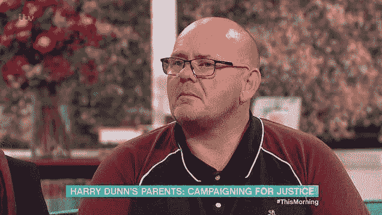

邓恩的父亲

虽然特朗普表示非常理解他们承受的痛苦，但他也极力的为这个外交官的妻子辩护说，英国和美国的驾车方向就是不一样，所以她可能小心大意了。而且他最后也很坚定的维护说，外交豁免权不会被撤销。那这个事件呢，是再次引发了法律界或者整个社会对于外交豁免权是否被滥用的讨论。

之前在很多类似这样，某一个外交官或者他的家属在他国造成问题，违反法律，结果又逃跑之后，外交豁免权是不是过于宽泛，这个问题，会一次次的被提上讨论的日程。

上一次这个问题被热烈的讨论，大概是金正南在马来西亚遇刺，嫌疑犯始终躲在朝鲜驻马来西亚大使馆里，以外交豁免权的身份躲避调查的那个时候。可是每一次讨论过后呢，都并没有什么实质的进展。

外交豁免权是一项非常古老的权利。我们中国古代就有"两国交战，不斩来使"嘛。这个传统是由来以久。

那提到外交豁免权，外国人在本国的土地上可以不受本国法律制裁呢，我们又会想起 19 世纪的中国和西方列强所签订的一系列不平等条约里面，有所谓"领事裁判权"约定。比如英国和中国的领事裁判权的约定就是，所有的英国人在中国土地上违反中国的法律，都不接受中国的司法审判。

那这些不平等条约当然都已经废除了，我们今天的所谓外交豁免权呢，基本上是建立在互惠平等的国际条约之上。

#### 现代外交豁免权

现代外交豁免权的概念发端于 17 世纪的欧洲，它最后以国际条约的形式被确定下来是在 1960 年代生效的《维也纳外交关系公约》，它规定外交官在从事外交任务的过程当中不受迫害和不受法律制裁。如果一个外交官在他/她所派驻的国家里的确犯法的话，他/她会因为豁免权的存在而不需要面对当地的刑法，但通常他/她会被驱逐。

如果这个母国取消了豁免权，他/她就可以在本地被制裁。那就是为什么德恩的父母要去到美国要求特朗普取消，这位叫萨库拉斯的外交官太太的豁免权，这样她才能够回到英国接受正常法律程序的制裁。

中国是在 1979 年加入了《维也纳外交关系公约》。

美国特朗普最近搞了太多事情，其中他搞的一个事情，就包括他想要退出《维也纳外交关系公约》的关于强制解决争端的认责议定书。原因是，之前大家关注国际新闻的话，可能会听说一个，至少在美国或者西方世界挺重磅的新闻，就是美国把它驻以色列的大使馆从特拉维夫移到了耶路撒冷。

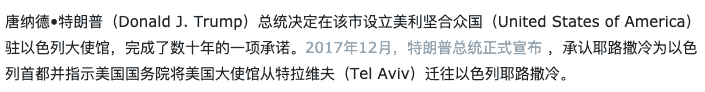

为什么这件事情如此之重大？因为耶路撒冷的归属权并没有明确的结论，这是巴勒斯坦和以色列相持不下的问题。在之前的漫长的时光里，美国都巧妙地回避着这个问题，把它的大使馆设在特拉维夫，就是无争议的以色列的国土之上。

那特朗普通突然把美国的大使馆要挪到耶路撒冷，引发了巴勒斯坦强烈的不满，所以巴勒斯坦以美国违背了《维也纳外交关系公约》为由把美国告上了国际法庭。结果特朗普是非常的不高兴，以至于要退出这个使得美国受国际法庭制裁的议定书。

这是我们之前提到过的，很多的国际公约呢，你光有约定是没有用的。最重要的是你约定当有人违反这个公约的时候会有什么后果。所以这个公约当中，会有所谓的争端解决条款去规定，当有人违反或者是当有人质疑的时候，不同的主体之间的争端该由什么方法去解决。那这个《维也纳外交关系公约》关于强制解决争端任责议定书就是规定了某一些条款，导致的争端是要由国际法庭去解决，它就是赋予国际法庭管辖权。

那特朗普呢，就是很不喜欢这个国际法庭可以管美国的管辖权，他所以甚至要求他的团队去看到底美国还受制于哪些国际公约，真的是一个难以琢磨的人。这是题外话。

外交豁免权呢，除了外交官可以不受在本国接受法律的制裁，可以免予受刑，也免予受民事责任的强制执行等等。它还包括其他一系列的外交特权，比如说外交官一般被允许携带任何文件通过边境而不受搜查，外交邮袋不受海关或边防的检查。

但是，大家听这些字眼，外交邮袋什么的，显得非常的古老，它是一个很古老的传统。但是今天通讯的方式极大的改变，包括侦查窃听手段的改变。比如，如果一切真的像斯诺登说的那样，那这些传统意义上的君子原则，似乎就不够有用了。因为我当然可以不检查你的邮袋，因为我早就已经通过了别的方法窃听到了所有的该有的机密。所以这个问题是一个正在讨论还没有答案的问题。

#### 外交庇护

外交豁免权呢，不只适用于国家派出的任何代表，包括常驻的代表，临时的代表，也包括某一部分眷属，包括配偶、子女，但是要未成年子女以及成年但未有婚姻的女儿。就是这些都是有时代痕迹的一些规定。

除了外交官，他们的人身，包括他/她的家属的人身安全，人身财产，人身不受侵犯，不受任何方式的逮捕或拘禁，这个大使馆的馆舍，包括它这个建筑物以及附属的土地，都被认为是派出国的领土，它是有领土主权的。

这就是为什么我们经常看到很多的新闻说，有的人进入某一个国家的大使馆寻求政治庇护，当这个大使馆给予他政治庇护的时候，它这个大使馆的所在国是不可以去搜索、逮捕、征用或者其他任何方式的强制执行的。

这些年来最有名的外交庇护的寻求者，可能是维基解密的创始人朱利安\*阿桑奇。

当年 2010 年的时候，这个阿桑奇创建维基解密，他因为涉嫌强奸受到了瑞典检方的调查。但是阿桑奇当时身在英国，很快被英国警方逮捕，那他在保释期间进入了厄瓜多尔驻英国大使馆寻求政治庇护。

他在厄瓜多尔大使馆一待就是七年的时间，等到厄瓜多尔换了一个总统。为什么厄瓜多尔改变了他们对阿桑奇的态度成谜，但时间线上来说，是因为新总统上台之后取消了对阿桑奇的政治庇护。他随后就以违反保释期间的行为准则为由，被英国再次逮捕。那这背后就有很多的阴谋论了，包括英国要过了几天才表示他们受到了美国的引渡请求等等。

#### 为什么有豁免？

为什么会有所谓的外交豁免权？

那这个背后是一个很简单的概念，就是国家之间的主权平等，无论是大国还是小国，强国还是弱国，主权意义上所有的国家都是平等的，所以没有任何一个国家可以去管制任何一个国家。而外交官呢，是一个国家的代表，所以没有任何国家应该可以管制任何其他国家的外交代表。

外交豁免的法律依据呢，还真的和我们刚才聊的领事裁判权有关系，或者更准确的说它叫做"治外法权"。这个概念我们在高中历史课本上也都学过。

为什么那个时代，外国人在中国境内犯法无需受到大清政府的处罚？是因为外交人员被认为是母国的领土延伸。

治外法权。治外法权嘛，这个词的翻译可能会导致一些误解，它这个原英文单词是 extraterritoriality，就是领土的延伸，额外的领土。所以说，这个外交官本人被视作是领土的一部分，被视作是领土的一种延伸，那么既然一个国家没有办法对其他国家的领土去实行司法权，那当然，当这个外交官本身被视作是领土的时候，那他当然不受到他所在的地方的法律的管辖。

那这个概念听上去就是矛盾重重，因为它是一个领土叠加在另一个领土之上，就非常的诡异，所以它基本上已经被抛弃了。

那现代外交的这个外交豁免权，除了它是一种根深蒂固的习惯，主要是基于非常实用的原则。就是大家认为，如果没有这样的外交豁免权的话，外交官可能没有办法充分有效地、无所畏惧地去行使他的职能，所以《维也纳领事关系公约》直接说的是，确认此等特权与豁免的目的不在于给予个人利益，而在于确保国家之使馆的有效执行职务。

那这样的一种理念呢，也是我们理解所有其他各种各样的特权的一个关键，它都是在今天是一个非常实用主义的价值。

除了外交豁免权之外，其实不同的司法体系当中，还存在着很多其他的豁免权。比较常见的包括司法豁免权，这个是很通用的，欧洲也有，北美也有，我们国家也有。除了司法豁免权呢，比如美国和欧洲国家，还有检察官的豁免权，那还有我们很熟悉的议会豁免权，那某个国家有国家元首的豁免权，美国有总统豁免权。除此之外，还有各种各样更范围更狭窄的，更特别的，比如说记者的某一些特别的豁免权，证人的豁免权，配偶的豁免权等等，我们之后可能简单的聊到。

我们以这个司法豁免权为例，去理解为什么它是一个非常实用主义的规则。

司法豁免权这个概念，它最初的起源是一个非常封建的概念，就是英国的传统里面认为，国王是不可能犯错的。那这个当时的法庭，是所谓的皇家法庭，Queen's  
Bench，它也是代表国王或者女王在执行审判。那既然国王是不可能犯错的，他的法庭也不应该犯错，所以他的这个法官，在历史演进的过程当中被赋予了一种豁免权。

但是在今天呢，之所以还有司法豁免权这个概念，也就不是在坚持这个传统了，它肯定是受这个传统的影响，但是它不可以再用这种传统简单地为自己辩护了，它不能再说，因为国王不可能犯任何错了。

现在的说法是，给予法官豁免权，才可以让法官公正地、毫无顾忌地、无私地、无所畏惧地去处理公共事务。因为一个潜在的现实的考量，就是误判的风险是永远存在的。

如果一个法官在执行履行他的司法职责的过程当中，出现了一些判断的失误，而将来要被追责，他/她所面对的风险是巨大的，几乎是无限的。

所以支持司法豁免权的人会认为，法官背负着这种把无辜的人投进监狱，或者让无辜的人承受法律责任的巨大的风险的代价，这种责任会压垮法官，会严重的影响、毁灭他们履行自己职责的热情。那当然也有很多的人，今天在挑战所谓的司法豁免权，觉得这种豁免权太过宽泛，因此显得毫无道理。

比如说有人认为法官当然可以个人免责，就是不追究他/她作为一个个人的责任，但是他/她作为一个公职人员的责任依然是值得追究的，或者至少一个法官，应该为他/她的一些错误的判断付出某种代价。

但在今天现有的法律体系之下，一个法官是否为他/她的行为付出代价，不取决于这个行为有多么糟糕，而完全取决于当他/她做这件事情的时候，他/她是不是在履行他/她作为一个法官的本职工作。

今天我们就先讲到这里，感谢收听，下集再见！

# 43\. 豁免（二）：法官、议员、人大代表、公职人员的豁免权

（公众号懒人找资源，懒人专属群分享。）

之前有很多的案例里，我们可以看到，法官也是人，他也有控制不住自己情绪、也有做出错误判断的时候。

#### 特权的适用情况

比如说，之前在西弗吉尼亚有一个法官，在庭审的过程当中，因为那个被告不停地讽刺他，非常的讨厌、非常的狂妄自大，然后这个法官生气地把法袍脱了下来，然后当面给了那个人一拳。那他的这个所作所为在联邦法律之下是可能被处以很严重的刑罚的，但是这位法官被宣告无罪，他最后只接受了州法律的惩罚，在监狱里面待了五天就被保释出狱。法官这个身份本身呢，并不是一种特权，就好像外交官这个身份也不是，外交官必须是当你在执行公务，你是以外交官的身份来到他国领土之上的时候，才会有这种特权。

包括我们国家之前逮捕前加拿大外交官，外交部给出的解释也是，他在被逮捕期间是以私人身份，拿着私人护照进入中国的。

包括之前国际货币基金组织的前总裁卡恩，被控性骚扰。他也没有享受作为一个国际组织的总裁的外交豁免权，因为他当时已经卸任。诸如此类。

那同样的道理，法官这个身份本身并不是一个屏障，说，你就再也不用承担任何的法律责任。法官是否需要为自己的行为付出代价呢？是需要的。那这个豁免权呢，仅仅适用于当一个法官，做他作为一个法官的分内之事的时候，当他行使一个法官的职权的时候。

比如说，之前有一个听上去很糟糕的案子，1971 年的案子里，Stump v.  
Sparkman。在这个官司里面，一个母亲向法庭请求给她的女儿做绝育手术，那是 70 年代有非常奇怪的一些规定（禁止堕胎）。那当时这个法官是接受了这个母亲的说法，觉得她这个女儿，有智力上的问题，所以为她做了绝育手术，批准了这个绝育手术。但是这个女儿并不知情，当时她这个女儿已经 15 岁了，但是她并没有被告知这是一个绝育手术，当她发现这件事情的时候，她把这个法官告上了法庭。

这个案子最后打到了美国最高法院，而最高法院认为，这个法官是不能够因为这件事情而面临审判的，因为当他去批准这个母亲的请求的时候，他做的是一个法官的分内之事。所以，司法豁免权只关乎这个法官做的决定是否是一个法官的决定，而没有办法去考量这个决定本身是不是违背法律，或者在道德上应该被谴责。

所以，豁免权就是豁免权，它不是看你这个人做这件事情到底有多糟糕、做这些事情有多过分。豁免权就是豁免权，一个法官只要是他在执行法官的职责，他就不需要为此承担代价。否则的话，法官会面临无穷无尽的诉讼，就是所有的人都可以觉得这个法官判的不好，判的不对。

那在另一个案子里面，这个法官做的事情和让一个 15 岁的女孩就去做绝育手术相比，显得不算什么。

就是有一个法官呢，他看样子是非常的讨厌一个黑人警察，所以他就在本地，他在这个报章杂志上发表对这个黑人警察非常不友好的评论，然后给这个当地城市还有县里面的这种高层官员都写威胁信，去控诉这个警察，以及他举办邀请这种高层官员参加的聚会，然后试图要把这个黑人警察开除出警察的队伍。

那这个黑人警察呢，就把这个法官告上了法庭，而最后陪审团就认为这个法官不可以享受司法豁免权的保护，因为他做的这些事情并不是一个法官通常做的事情。写报纸杂志上的文章去骂别人，这显然不是一个法官的分内事。就算这些事情看上去其实没有那么糟糕，但是这只要不是法官该做的事，这不是法官通常做的事，他就不受到司法豁免权的保护。

只是证明司法豁免权这种特权，仅仅不是为了保护某一群人，而是为了维护这个体系能够正常的运作。我们国家呢，在这个《宪法》和在《法官法》当中，是有法官豁免权制度的。那当然有很多的文章在讨论，我们仅仅在宪法和法官法里面，以比较抽象的原则提出法官豁免权的制度也许是不够的，因为并没有明确的细则和标准去确定，到底什么样的行为是属于这个豁免权承认和保护的范围。

我们刚才所聊的那些美国的案例，又一次体现了（因为美国是一个案例法的国家）从前的这些案例可以给法官行为上的指导。

那我们国家是一个成文法的国家，如果它没有落实成可执行可操作的细则呢，它在现实当中能发挥的作用就会受到限制。

与此同时呢，还有其他很多的讨论，包括欧洲的很多国家有成熟的检察官豁免权，但是我们国家在这个方面还是空白。所以这些都是法律可以向前探索的方向。

#### 议会豁免权

除了这个司法体系的豁免权，还有一个大家都很熟悉的豁免，叫做议会豁免权。

在美国它表现为宪法当中的演讲和辩论条款。一个议员在议会当中所发表的所有的言论都是免责的。这个是基于一个非常容易理解的政治正确的考量。那一个民主国家要能够充分的运作，它需要它的议会能够真正意义上的畅所欲言。所以一个议员无论发表多么糟糕的言论，他在这个语言环境下是受到绝对的保护的。

我们国家的人大代表呢，其实受到相似的保护。《代表法》里面规定，人大代表是由刑事豁免权，非经特别许可不受限制人身自由逮捕和审判，在各种会议上的发言和表决不受法律的追究。现行犯被逮捕或者拘留的话，拘留机关应该马上向人民代表大会的主席团或者常务委员会做报告，在这个方面有相似的法律规定。

那从英国的这个传统，就是国王不会犯错，the Monarch can do no  
wrong，这个非常封建父权的、非常奇怪的固执里面，还发展出来其他很多的豁免权。

#### 主权豁免权

比如说有一项叫做主权豁免权，Sovereign  
immunity，基本上就是说这个国家这个主体是不能被告的。那它被传到美国以后，也就是你不能去告美国，你不能直接状告美国，除非是得到了国会的批准。所以在美国早年的历史当中，那些跟美国政府联邦政府做生意签合同受了损失，或者因为其他的原因被侵犯了个人权利的人，他们想要得到补偿的话呢，需要向美国的国会去申请国会通过特别法案来专门处理他们的问题，那可以是一个非常漫长而绝望的过程。

那随着历史的演进，这个联邦政府也逐渐大概意识到自己这样做是很不讲道理的。就是你这个国家明明那么积极地参与到社会生活的各个方面，结果还完全免责，别人不能够通过司法途径来挑战你，那造成了很多的困难。所以联邦政府后来通过了一系列的法案，去让渡出自己的主权豁免权。也就是说，我本来是受到这个主权豁免权的保护的，就是你不能来告我。但是我自己立法，废掉某一部分的主权豁免权，允许大家来告。

那最早被废掉的这部分当然就是合同法，之后还有各色各样的侵权法以及税法，那除了各色法案的建立呢，也有各色特别法庭的设立，比如说特别的税法，法庭就是专门允许大家来挑战联邦政府定制的税率。那这中间有一个一直没有被处理的问题，是，如果大家可以去状告这个政府主体的话，可不可以要求政府当中的公职人员  
这个政府的雇员，这个政府的行政长官，去为他们个人做出的个人的行为付代价？

#### 公职人员是否要对行为承担责任？

直到 1946 年以前呢，这个问题还是充满争议，没有一个明确的答案，但是普遍的原则是，联邦政府的雇员，或者是所所谓一个社会当中的公职人员，当然是可以因为侵权问题个人承担责任的。但是只要他们是在执行公务，他们在做自己是一个公职人员的分内事，他们就受到主权豁免权的保护，他们就不用面对法律的制裁。那到了 1946 年的时候，美国国会通过了侵权法案，它认定这个政府的雇员也是，哪怕他们在执行公务，当他们的不当行为给他人造成了侵害，侵害他人权利的时候，他们也需要面对法律的制裁。

但这个法案故意留出了一些非常重要的例外情形，就是那些大家可以想象，可以告这个政府雇员了，最容易被告的一些事项，比如说非法拘禁、非法逮捕、恶意起诉、滥用程序，就是它还是预留了很多的例外情况面，免得这些联邦的雇员可能会被淹没在诉讼的大海之中。

#### 谁可以告州政府？

所谓的主权豁免呢，在美国，有一个特殊的形式，我们之前很多次讲到了，就是它这个联邦制的国家造成的。在美国，提到主权豁免的时候，我们通常其实在说，你是不能够到联邦法院里面去告一个州政府的，就是，一个州的居民是不可以去告另一个州的。那之后这个判例被扩展到本州的居民也不可以去告另一个州。

就是这个原则的兴起和它最终的消亡，其实都是历史过程历史上的事件的产物。

1793(口误)年的美国，也就是在经历了独立战争之后。在独立战争期间呢，这个国家的运行方式是非常混乱的。很多的州政府没收某一些土地征为国用，特别是对于那些保皇党人，就是对于英国忠心耿耿的那一批人，他们的权利受到了比较明显的侵犯。那后来在战争结束之后呢，有很多人在法庭当中提起诉讼，就是控诉这些州政府，在战争期间非常随意的，侵犯个人产权的做法。

那么在 1793（口误）年的时候，美国最高法院允许了一位北卡罗来纳州的居民去告佐治亚州，那这个事件引发了整个立法阶层的极大的恐慌。那个时代的立法阶层就是有产阶级，以及他们担心这个会动摇国本，就是因为战争当中很多事情如果全部都要清算起来的话，会有很多很多的问题的出现和发生。  
所以他们迅速地应对，通过了美国宪法的第十一修正案。

这个第十一修正案，就是明文规定，每一个州呢，得到了一项应对他州居民起诉的豁免权，也就是别的州的居民，或者是外国的居民，都不可以跑到美国的联邦法庭里去起诉某个州。那联邦法庭呢，依然是允许州和州之间互相打架，一个州去告另一个州是可以的，但是我这个六跑出来一个人去告另一个州，这就不可以。

如刚才所说这个这个规则后来被扩展到说本州的居民去告州政府也是不可以的。

那这个事情被彻底的颠覆呢，要等到另一场战争，也就是 100 年以后的美国南北战争。

#### 《正当程序和平等保护》

南北战争之后，我们都知道南北战争是一个关于废奴运动的战争。那为了迅速的向南方的黑人推广权利，实现他们的平权，在南北战争之后，这个南方第一是实现了军管，接着是通过了三项非常重要的修正案，也是第十三、十四、十五修正案。这个第 14 修正案我们很熟悉，叫做《正当程序和平等保护》的修正案。

第十四修正案 第一款  
所有在合众国出生或归化合众国并受其管辖的人，都是合众国的和他们居住州的公民。任何一州，都不得制定或实施限制合众国公民的特权或豁免权的法律；不经正当法律程序，不得剥夺任何人的生命、自由或财产；在州管辖范围内，也不得拒绝给予任何人以平等法律保护。

这个修正案在在法制历史上是威力无穷的。听上去非常的假大空，就什么叫正当程序平等保护，听上去就是一些冠冕堂皇的概念，然后没有什么实际的用处。但是在一个判例法的国家呢，这些冠冕堂皇的概念，它就可以成为一个筐，什么都可以往里装。所以当之后的这个美国的联邦法院不停的去扩展联邦的权力、针对性的打击南方的州政府的种种作为的时候，第十四修正案就成为了一个无所不能的修正案。

它就首先是把整个宪法所有的修正案都应用到了州的头上，而不是只限制联邦政府的权力。那它还有一个重要的威力，就是为了要执行这个正当程序和平等保护的修正案呢，国会可以绕过州的主权豁免权。因为这个理据是，如果我们不允许个人去挑战州政府，那这个平等保护和正当程序就没有办法真正的实行和推广。

所以之后，美国国会通过它的这个权利法案的时候，现代意义上的权利法案，就是它在战争之后所通过的平权保护的一系列法案的时候，它用于在南方推广这些法案的方法，就是用第十四修正案去赋予普通人权利，挑战州政府的作为。因为南方的州政府这个时候，它做很多挺过分的事情，包括用各种方法去阻挠取消黑人的选举权，黑人做陪审团的权利，那它后来比较夸张的彻底全面实行种族隔离等等。这是一段漫长的斗争历史的开启。

再经过 100 年的实践之后，就是当这个平权运动的一步一步的发展，当美国的最高法院意识到，这个对南方州的，对各州的州，主权豁免权的侵蚀已经到了非常夸张的程度，就是开始变得有名无实，名存实亡的时候，这个最高法院又来做一个转向和刹车。

它在 1996 年的一个案例当中又表示，不是所有国会通过的法案都可以被用来绕过州的主权豁免权，这个州的主权豁免权还是应该被作为一个既定的规则存在，而那些可以绕过州的主权豁免权的法案应当是作为例外存在的。那这些例外要存在，这个国会必须在立法的时候就非常明确地表示，我们希望这部法案是可以绕过州的主权豁免权的，是可以赋予人们依据这部法案起诉州政府的权利的。

所以这个所谓的豁免权，也是在历史不停的不同的时代，不同的利益博弈之下来回的激荡。

今天我们就先讲到这里，感谢收听，下集再见！

# 44\. 豁免（三）：总统豁免权，特朗普这么做真的合法吗？

（公众号懒人找资源，懒人专属群分享。）

那这个所谓的豁免权的争议呢，又会从国内转移到国际，在我们这个时代又开始引发新的争议。

就是主权豁免权或者国家豁免权这个概念，在国际法上它就会变成一个国家的政府，是不用受另一个国家的司法管辖。那这个概念是非常清楚的，对吧？因为国家之间的主权是平等的嘛，那当然一个国家的法律不可以用来管另一个国家政府。

可是它在实际操作当中呢，就会有新的问题出现。

#### 关于国家豁免权的争议

一个在这些年让美国人很头痛的问题，就是他们该怎么样对待中国的国有企业。

之前，我们国家是一个比较特别的经济体制，我们有很多的大的国企，它们参与国际竞争，参与国际商贸，在美国做生意，在美国有很多投资。当这些国企卷入当地纠纷的时候，这些中国的国企可不可以用所谓外交豁免权，或者是国家主权豁免权，来辩护说我不需要在美国接受你美国的法律制裁或者是司法过程呢。

之前呢，就有中国的大的国企做了这样的尝试。比如说中国航空集团，当它在密西根州跟当地的一个公司 GTI，产生了纠纷的时候，本来这个密西根州的地区法院是拒绝了中国航空集团的申诉，就是说我们是受到主权豁免权保护的。那这个官司打到美国这个上诉法庭的时候，上诉法庭第六巡回法庭是支持了中国航空集团的这个说法，就是要求密歇根州的地区法院，认真的重新考量中国航空集团所提出的这项主权豁免权的这个论点。

所以这个是变成了一个悬而未决的问题，让很多的美国法律界有很多的文章在讨论，就是我们该怎么处理跟中国大的国企，包括它大的国企背后，它的母公司有很多时候是中国的国资委，或者是别的政府部门。那该怎么处理这些国企，它们是不是适用于主权豁免权等等。

所以大家能够看到，在豁免权这个问题上，有一些原则是清楚的、明确的、目标明确坚定的。

比如说司法豁免权，它就是为了保障你这个法官在执行做法官的工作的时候可以无所顾忌，所以它只针对法官做法官的分内事，他/她就可以被豁免。那有一些是原则并不清晰的，比如说美国的州的豁免权，它豁免到什么程度，当它违背了美国宪法修正案的时候，个人可不可以挑战它。这两种州的权力和个人受到正当程序保护的权利，两种利益之间怎么取舍。它变成一个时代的产物，在不同的时代，不同的变化。

又或者是国际法当中的国家主权豁免权。  
抽象的看这个概念好像是非常清晰的，但是它一应用到实际的时候，你就会出现各种各样的问题，我们举的只是其中一个例子。就是你没有办法定义，你怎么去定义什么叫做主权，什么叫做国家？一个政府出现在这个法庭面前，当然是非常好定义，那可是一个国有企业算不算呢？

所有的这些豁免权的讨论呢，现在都不是热点，这个可能是一个比较轻松的话题吧。

#### 特朗普引发的法律学习热潮

美国人现在只关心一件事，就是弹劾他们的总统。我本来还每天坚持听美国的其中一个媒体，就是 NPR 的新闻，因为他们之前视角还比较广阔，讨论一下贸易战，就是听一听他们的看法。最近我发现已经没有必要再听了，因为所有的 NPR 整天报道的就是弹劾特朗普这个案子，又发生了什么新的进展，又有什么人推翻了自己的证词，这个证词有什么样的影响，谁也可能被卷入调查，全都是在报道这个问题。

特朗普真的是一个戏非常多的人。我记得他刚刚上任的时候，他强烈地激发了我们法学院里的人学习的热情。之前有一些法律是大家最厌恶的，包括宪法，包括行政法，就是非常枯燥无聊的。可是这个特朗普一上台，所有人，就是美国人，他们就特别的热情地学习这些法律，因为就是很想知道，总统真的能这么干吗？总统这么干难道真的是合法的吗？当他们发现很难回答这些问题的时候，我的这些同学们就开始了狂热地学习。

最近特朗普呢，他被弹劾也好，他之前卷进一系列的官司也好，又再次引发了大家对于一个很重要的豁免权  
总统豁免权的讨论。因为政治制度的不同，我们国家是没有对于国家元首的豁免权的。可是美国是有这项豁免权，而且古已有之。

#### 总统豁免权

什么叫做总统豁免权？

那顾名思义就是一个总统，他在总统的任上，分内之事，所做的事情，作为一个总统执行国家的工作，执行总统的职责所做的事情，可以不受到法律的制裁。

那这个概念更难解释，是因为总统做的事情实在是太多了，就是，到底什么算作一个总统的分内事？这个是引发争议的焦点。

包括之前，特朗普也是面对很多非常奇怪的起诉。包括，他上任以后，他的旗下的这个 Trump  
Hotel，这个川普大酒店，他的各种各样房地产生意变好。就有很多人说这是一个腐败问题。因为他的生意之所以变好了，只是因为他成为了总统，那么这就属于未经国会同意接受外国财务，这是违反宪法的。

然后川普的律师就很淡定的说，但你要特朗普怎么办呢？他做总统，本身就是做总统的分内之事，如果你说这一切的原因，只是因为他成为了总统，那你总不能要求一个总统不要做总统。  
类似的，还有人把这个川普的川普国际酒店这个酒店告上法庭。原因是，这个酒店坐落于一个联邦的土地，就是隶属于联邦政府所拥有的土地上，那在这个土地的租赁合同上写着，这个土地不能由政府官员所有。

那 Trump 是整个政府的首脑，他都不是一个政府官员，所以你就违背了这个租赁合同。然后这个川普的律师还是站出来说，所以你要总统怎么办呢？他之所以违背这个租赁合同，就是因为他成为了总统，那这是总统的豁免权，你不能不能借用官司这种手段去要求一个总统不做总统该做的事情。就是做总统就是总统该做的事情啊。诸如此类的讨论有非常多。

我们回到这个案例法本身，就是总统的豁免权到底是什么意思，通过两个故事大家就可以很清楚的看出来。

#### 休利贝利诉肯尼迪总统

1960 年的时候，民主党的召开大会，然后有一个叫休利贝利的参议员，他的外号叫做"骑着驴的参议员"。

原因是他之前在选举当中许诺说，如果他当上了参议员，他就要骑着驴走好几百公里的路，然后他真的走了。

这个参议员开完民主党的大会之后，找不到从大会回旅馆的车，他要回到旅馆。  
那当时参与这个民主党大会的呢，有另外一位参议员，就是 J*F*Kennedy，约翰*肯尼迪，大家可能都知道，著名的肯尼迪总统，他们要回到这个旅馆，就是几年以后肯尼迪的弟弟罗伯特*肯尼迪被刺杀的那个旅馆，当时一切都还没有发生。

肯尼迪非常好人的借给了这位休利贝利参议员一辆车和他自己的司机，结果这个车就出了车祸。  
到了 1962 年的时候，就休利贝利大概终于恢复好了，就把肯尼迪告上了法庭，索赔，因为这是肯尼迪的车。他的理由是不仅给他造成了巨大的身体和心灵上的创伤，而且他因为这次事故再也不能骑驴了，所以他也丢掉了他非常重要的外号，就是"骑着驴的参议员"。

到了 1962 年的时候，肯尼迪已经不只是一个参议员了，他已经成为了美国总统。肯尼迪的律师，当然就是说，这是我们有总统豁免权，总统可以免受起诉。但是法庭拒绝了这个论点。因为法庭认为所谓总统豁免权只是为了保护一个总统在总统的任期之内，行使总统的职权所做的事，至于你在还没有选上总统的时候卷进去的这些可笑的事情，法律并不能够给予你任何特权。

所以这个肯尼迪总统好心给自己惹了一大场麻烦，结果通过庭外和解的方法赔了这位骑驴参议员一大笔钱。

几年以后，1968 年，这个时候，肯尼迪总统和他的弟弟都已经不在人世，这个时候的总统变成了尼克松。尼克松呢，也卷进了一场官司。

#### 菲茨杰拉德诉尼克松总统

有一位叫做菲茨杰拉德的美国空军成本管理专家，他在国会委员面前作证的时候，他说某军用飞机的项目严重低效，且开支巨大，成为了这个尼克松任上的一个重要丑闻。当然大家知道这个跟他之后卷进去的丑闻相比，其实不算什么。

那后来呢，据说在这个尼克松本人的亲自干预之下，这位专家就被解雇了。他是一个联邦雇员，就被解雇了。

到了 1973 年的时候，这个菲茨杰拉德就把好多人、一大群人，就是跟他的被解雇有关系的人，全部告上了法庭，其中也包括尼克松总统。他有证据表明尼克松总统当年亲口说，"把那个婊子养的给赶走。"

可是，最高法院在这个问题里支持了尼克松，它认为不管尼克松说了什么侮辱人格的话，非常粗率的，非常草率的凭借自己的好恶，解雇一位重要的联邦雇员，仅仅因为他说了实话，所有的这一些呢，法庭都不考虑，  
法庭只考虑尼克松去解雇参与决策、解雇一个联邦雇员，这就是总统要做的事情，这本身就是总统的职权范围。所以，在这个问题上总统受到豁免权的保护，没有人可以借由这个事情去要求总统赔偿。

法庭的理论也非常清晰。就是，如果总统所做的每一件事情，都会让他被置于可能被起诉的风险之中的话，这个总统每天除了应付官司，基本上不用做其他事情了，  
所以这个国家为了高效的运作，就必须给予总统这一层保护，所以他能够放手去做，以及他能够抽身在法庭之外，专注于更重要的事。

# 45\. 豁免（四）：对总统豁免权的制衡——弹劾

（公众号懒人找资源，懒人专属群分享。）

那后来呢，最高法院支持了尼克松的这个理论呢，一直被沿用下来。它一个最著名的应用以及很被打脸的应用，是在 1991 年的时候。

#### 克林顿总统遭遇的风波

一个叫琼斯的女孩子，她在一个大会里负责注册。这个会议的其中一个演讲嘉宾是当时的阿肯萨州的州长，克林顿。克林顿要人约琼斯去做一个会面。据琼斯说，克林顿之所以要约见她，是为了做色情交易。几年以后呢，这个琼斯出现了，她说出了这段往事，并且要求克林顿对自己道歉。

那个时候的克林顿也已经不是阿肯萨州的州长，而是总统。那这个最高法院觉得这个事情总统麻烦还是去应付一下吧。虽然要占用总统宝贵的时间去取证，去出席庭审，去走这个法律的各种各样的程序。但是这毕竟是一个私人的事务，它不是总统任期之内，或者是总统职权范围之内的事情。所以最高法院是一致认为，总统的免责权利不应该包括总统在行政职责以外，或者是总统任期之前发生的事情。

那克林顿最终为了避免和琼斯对簿公堂， 给了 85 万美元的所谓封口费。

写这个决定的最高法院的法官是史蒂文斯大法官，他就是来写这个决定说，他们觉得总统在这件事情上没有豁免权。他也简单地讲一讲自己的理由，主要是觉得在历史长河，直到现在，因为这种事前的私人事务，在总统任期以前发生的事情，把总统告上法庭的案子，其实一共也只有三个，其中一个还是那个骑着驴的参议员告 J*F*Kennedy。所以这种事情应该不会让总统太忙的，就是它是一个例外情况，那总统分身去参与一下，也是不会造成太大影响。

斯蒂文斯的这一篇法律意见，被认为是史上最糟糕的预言，永远的记录在案。正是因为克林顿参与了这个官司的取证的过程，他在取证的过程当中否认自己和白宫秘书莱温斯基有染，之后他因为作假证被经历了弹劾，就把自己卷入了无穷无尽的风波。

但是，之后并没有什么新的案例，来让大法官们重新思考这个问题。

这个原则还是保留至今，跟所有其他的豁免权一样，某一些人拥有特权，可是他们拥有的特权并不是为了保护这些人本身，而是为了保护他们能够充分有效地行使自己的职权。

总统豁免权的存在，以及其他各色各样豁免权的存在，特别是总统豁免权，因为它表现得非常明显，让很多人质疑，这岂不是有人被置于法律之上吗？那这是不是在挑战法律这个概念本身呢？因为法制这个概念，它的原意就是没有人在法律之上，所有的人都在法律面前一律平等嘛。

在当年写尼克松案的判词大法官看来，就是觉得尼克松总统的所作所为虽然听上去很糟糕，但确实受到总统豁免权保护。大法官们认为，因为一个政治体制当中，除了司法体系，还有其他的制衡机构，可以去限制总统的权力。这些制衡包括媒体的监督和报道，包括国会和总统之间权力的制衡，还包括弹劾，也就是特朗普现在正在面对的事情。

#### 另一种制衡：弹劾

这个也是一个非常可笑的预言了，因为尼克松在不久之后就卷入了"水门事件"的丑闻，他虽然最终没有被弹劾，也是几乎要被弹劾。但是在弹劾开始之前，也就是众议院投票之前，他迅速地辞职了，因为他大概非常的清楚，如果众议院投票的话，他应该是躲不过这场弹劾。

弹劾是一个很特别的机制，它在形式上其实几乎相当于一场审判，只不过在这场审判当中，以美国为例，是由众议院扮演检察官，由参议院扮演陪审团。

所谓弹劾就是首先由众议院决定是否要起诉，是否要开始这个弹劾的程序，那如果众议院有简单多数超过 50%的议员觉得应该开启弹劾程序，那这就是一个总统正在被弹劾。  
那接着就是由参议院来扮演陪审团，对总统进行审判了。

弹劾的过程通常是由首席大法官来主持的。那当然弹劾不止限于对总统，包括对所有的联邦法院的法官也可以实行弹劾的程序，政府里面的高官。它也可以由副总统来主持，就是在弹劾除了总统之外的其他的政府官员、公职人员的时候，就是由副总统来主持。  
那接着呢，众议院会派出代表来说服参议员为什么应该弹劾这位总统，但最后参议院需要有 2/3 的参议员通过，才可以说完成了这个弹劾。

克林顿的案子就是众议院已超过简单多数，认为他，指控他对大陪审团作伪证罪，妨碍司法公正，但是参议院最后是否决了。就是妨碍司法公正罪是 50 票对 50 票，伪证罪是 45 票对 55 票，都没有达到 2/3，所以他被判无罪。  
但这个说法也确实，是对的。就是当这个总统豁免权保护一个总统免受司法程序的审判的时候，弹劾作为一个备选项目就会登场。

#### 最初的总统弹劾

最初的总统弹劾，最早的案例要追溯到战争之后的约翰逊总统，这位总统也是非常之倒霉。他在历史上被大部分人评选为美国历史上最糟糕的一位总统，他是一个被时代推上这个位置的人，真的是被时代推上这个位置。他本人来自田纳西州，就是一个南方的深蓝的，非常保守的州。

那他是在林肯的时代成为林肯的副总统，他之所以成为林肯的副总统呢，是因为那个时代美国的南方闹独立，南方的各个州宣布成立南部邦联，就直接宣布脱离了美国。他呢，虽然是一个来自南方的参议员，但他坚持的留在了他这个参议员的位置上，是那个时代唯一的一个来自独立州，但是还留在参议员位置上的人。

所以，林肯发动南北战争，是为了宣示维护整个美国的统一的决心，所以在他 1864 年再次竞选总统的时候，他就选择了这个约翰逊，给他做副手。结果，林肯成为总统几个星期之后就被刺杀了，所以根据法律，这个副总统就递补成为了总统。  
所以约翰逊就这样，他在一个美国北方主导的对南方进行战争的年代，在战争胜利之后，对南方实行军事化管理的年代，作为一个坚定的南方人，成为了整个国家的总统。他要面对的是一个完全被林肯所领导的共和党所占据的国会。

所以约翰逊虽然留在了他参议员的位置上，并且接受了林肯的邀请，成为了副总统，他在骨子里本质上他依然是一个南方的民主党人。

所以他开始了和他的这个共和党的国会斗智斗勇的过程。就是共和党想要在南方通过一系列的激进改革的法律，然后约翰逊就是从中各种阻挠，就是不愿意那么快地实现种族之间的平权，这是他为什么被那么多人骂的原因。那当然，放在他的眼光里，他是一个根深蒂固的南方民主党人，要他一时之间接受这些理念，估计也是非常困难。

那很好笑的就是，所有的人都在针对他。

在约翰逊成为总统之后呢，告他的并不是他的这个共和党的国会，而是他的南方的密西西比州。

在南北战争过后，这个美国国会通过了所谓的《重建法案》。这个《重建法案》呢，其实就是把美国的南方各州化为了许多个军事管理区，然后由联邦军队接管。

《重建法案》第一条将十个邦联州纳入军事管制，分为五个军管区：

第一军区：维吉尼亚，指挥官约翰*史考菲将军（John Schofield）。第二军区：南北卡罗莱纳，指挥官丹尼尔*席寇斯将军（Daniel  
Sickles）。第三军区：乔治亚、阿拉巴马和佛罗里达，指挥官约翰*波普将军（John  
Pope）。第四军区：阿肯色和密西西比，指挥官爱德华*奥德将军（Edward  
Ord）。第五军区：德克萨斯和路易西安那，指挥官菲利普*谢里登和温菲尔德*汉考克将军。

南方对于这个重建法案当然是抗拒非常之强烈，它继续在战争之后的很长的时间里，保持着美国这个南北对峙，还有很多地方有暴力的情形。  
密西西比州是最南边的州，是非常痛恨这个重建法案的。但是它没有什么办法去抗拒这个重建法案，所以密西西比州想到的办法它都要用一遍，  
它最后想到的办法是把约翰逊总统告上法庭。

因为约翰逊作为整个行政机关的首脑，行政机关是负责执行法律的。它告约翰逊的意思就是，要求这个行政机关不能够执行这样一个不正义的法律。

美国的联邦法庭是不予支持，给出的理由呢，不是北方胜利了，南方必须接受这样的命运。它给出的理由是，总统有豁免权。所以你是一个州也好，你是一个人也好，也不可以用这种提起诉讼的方式去要求一个总统不做他该做的事情，因为执行法律本身就是一个总统该做的事情。

所以密西西比就没有办法，通过这种方式把《重建法案》停下来。

接下来约翰逊要面对的就是来自共和党人的挑战，就是他的国会的挑战。

在他整个任期之内，他和各种各样的人，包括领导了美国南北战争北方军队的格兰特将军和其他的林肯内阁的成员，都有很多斗智斗勇的过程。

共和党领导的国会呢，很快就通过了一个《任期法案》。就是为了防着约翰逊替换掉林肯的内阁，任命自己的人。当然约翰逊之后，在跟格兰特闹翻之后， 他还是这么做了。

于是呢，国会所控制的众议院就开启了弹劾程序，弹劾这个约翰逊，而且是以简单多数通过了弹劾的程序，所以他就要面对来自参议院的审判。

那这个时候，约翰逊也是求生欲非常旺盛的开始了他的游说的过程，他向不同的参议员许诺不同的东西，包括他许诺他不再干预国会的重建的努力。国会你们要在南方去推行这种《平权法案》，去推行十三、十四、十五修正案，你们就去吧，我就不插手了。他包括甚至扮演了一个桥梁，出卖南方各州的利益，去博取这些共和党的参议员的支持，以至于最后的投票结果，是 35 个人认为有罪，19 个人认为他无罪，以一票之差，就是只要再多一个人，投票不弃权，而是选择投票的话，他就会成为历史上第一个也是唯一的一个被弹劾成功的总统。

但他最后是保住了这个位置。

多年以后他甚至，当然再次选举总统没有选上，但是他后来甚至重新以参议员的身份又回到了国会。

他的人生真的就是跌宕起伏的一场戏。

当然历史的偶然性在整个故事里也发挥了作用，后来共和党的参议员觉得约翰逊还是勉强可以接受的其中一个原因是，如果真的把约翰逊赶下台之后，他的替代者很有可能是俄亥俄州的参议员韦德。是那个时代的一个著名的激进主义者，就是他在给予黑人投票权的同时，还要求给予所有的妇女普世的选举权。

所以这个共和党人虽然他们是打着解放独立的旗号登上历史舞台的，但是也并没有想要走么远，那么激进，所以他们最终和约翰逊达成了和解。

#### 总统豁免 VS 弹劾

看上去就是，总统豁免权帮助总统躲开了司法程序，但是确实躲不开弹劾这样的政治程序。

当然了，也有很多人反过来质疑说，为什么要有政客去做这么一个政治程序，去做这个审判？就是它，表面上采取的又是一种审判的形式，又是一个司法程序的形式，也有取证，也有调查，也有辩护，然后最后这个参议院就好像这个陪审团一样去投票。

但如果是这样的话，我们为什么又要给总统豁免权，然后又要让他去接受政客们的审判，政客们的审判到最后你就会发现，它就不是一个司法审判，它就是一个政治审判，约翰逊就可以靠逐个击破，去拉拢这些政客的方式，或者是这些政客们都有其他的政治因素的考量，而作出自己的判断。

所以它看上去不像是在总统豁免权之外的又一层保护，而是像是总统豁免权和这个弹劾配合在一起，把一个本来该交给司法的问题，交给了政治问题。

一方面世界各国都普遍的存在着赋予国家元首的豁免权，那与此同时也都存在着弹劾这种制度。

我们最熟悉的可能是两年前韩国总统朴槿惠被弹劾，包括再之前巴西总统罗塞夫，我还记得他在奥运会开幕式上讲话的罗塞夫，被弹劾。  
所以这种制度设计当然一定有它的原因。就是分开来看，豁免权是就像所有的判例里反复强调的，我们如果想要让总统专注于做自己的事情，就不能让他陷于无穷无尽的官司之中，不能抽身。

那当然特朗普是一个鲜明的例外，他在之前面对关于川普大学的一系列官司的时候，特朗普本人说，"As president，I have to focus on  
our country." 就有一点你们能不能放过我，让我，就是干总统的事情。但是法院也并没有放过他，因为这是他在成为总统之前卷进去的官司，他得要面对。

那另一方面，弹劾这种权利呢，它成为三权分立的一个组成部分，成为一种最后的制裁。基本上，我觉得起到的是一种筛选的功效，就是它不允许每一个普通人带着自己的诉求，去把总统置于司法程序当中。与此同时呢，它保留给这个国家的另一个权力机关足够的力量，去在总统犯下真正严重的问题的时候，起到一个制衡的作用。

总而言之，说了这么多，是想要告诉大家，法律里面存在着大量的特权，所以在开始法律程序之前，不得不考虑，你的被告是否受到特权的保护。

这些特权有的时候是直接不需要面对法律程序的特权，有的时候是更狭窄的特权，比如说不用作证的特权，不用交代事实的特权，不用承担某一类型的责任的特权，比如说，记者的言论自由的特权。

所有的这些呢，也都是门槛问题的一个部分，只有当把这些基本的门槛都跨过，我们才开始进入真正的法律程序，真正的进入司法问题的核心。

可是还没有到头，法律还会给人各种各样的限制，它给另一边的人各种各样的机会，去推迟最后的审判的开始，我们会在之后的节目里给大家介绍。

# 46\. 诉讼时效（一）：为什么需要诉讼时效？难道是为了保护被告？

（公众号懒人找资源，懒人专属群分享。）

我们从司法管辖权这个概念出发，已经聊了法律的种种限制条件。包括法律自己对自己的限制，不是所有的类型都可以用法律的途径解决。法律对人的限制，谁可以起诉谁？都有限制，以及地域上的限制，不是每一个地方的法院都可以管，所有地方发生的事情。大家肯定也能想到，也会想到，除了空间上的限制，还有时间上的限制。

#### 诉讼时效

不知道大家有没有听过一个概念，叫做诉讼时效。诉讼是有时效的。那么法庭、法院不会等你等太久的时间，当一个侵害、一个伤害、一个违约、一个侵权，任何类型的案件发生之后，作为当事人，作为原告，或者作为代理人，都必须在一定的时间之内提起诉讼。如果这个诉讼时效过期了，要么一个法院就不会再受理这个案件，不会再接受起诉。要么哪怕法院受理了这个案件，但只要被告能够用充分的条件证明诉讼时效已经过期，法院就必须无条件地驳回起诉。

另一种理解诉讼时效的方法就是当诉讼时效过去之后，法院对这个具体的案件就不再具有司法管辖权。又回到了司法管辖权。

不同类型的案子呢，诉讼时效是不一样的，这个很容易想象。比较小额的侵权，它可能诉讼时效可能一年两年。比较恶性的刑事犯罪，比如杀人、强奸，这一类的重大恶性犯罪，它的诉讼时效在不同的国家有 15 年、20 年、25 年，甚至在某个国家，这一类型的犯罪永远没有诉讼时效。

所以不同类型的犯罪的区分方式，它不仅体现在惩罚手段上，恶性的犯罪面临的惩罚会严重很多。一个国家、一个社会去区分不同性质的犯罪呢，诉讼时效也是一种区分手段。性质越恶劣的犯罪，它留给被害人去追溯自己法律权利的时间就越长。

诉讼时效呢，会是一个很重要的考量。我们用一个故事来让大家理解诉讼时效可能带来的戏剧性。这里介绍一本小说叫做《天使的愤怒》，这是一本非常古老的小说，《Rage  
of Angels》。

#### 从《天使的愤怒》看诉讼时效

它的作者西德尼・谢尔顿是上个世纪美国非常著名的惊险悬疑小说大师，他当然也是拿过奥斯卡奖的剧作家。这是我爸爸年轻的时候很喜欢的一本小说，然后被我很小的时候在书架上翻出来读。这本书是我生命中第一次对律师职业有了解，并且产生向往。

这本书讲的是一个叫詹妮弗，因为也姓詹，我觉得很亲切。一个叫詹尼弗的法学院毕业生，在她上班的第一天就莫名其妙的卷入地方检察官和黑手党的纷争之中，然后几度地遭到打压，但是凭借自身的努力，成为整个纽约地区最牛的刑辩律师的过程。这中间有情爱有仇杀，但是也有大量的关于一个律师怎么准备案件、怎么在法庭、庭审的过程当中去影响陪审团的看法，有很多很精彩的描写。

我小的时候觉得这本书特别特别的好看，而且感觉特别的真实，好像一切就发生在眼前。后来我自己上了法学院做了律师以后，回头去看这本书呢，觉得有很多的描写是好像不太真实，是有问题的。但是这不妨碍这本书是一本很精彩的小说，这个书当中会提到很多很真实的法律概念，大家在听过这个节目之后，如果有兴趣读这本小说，你就会借由书中的情节，帮助你回想我们讲过的一些可能有一些枯燥无味的概念。

这本书当中的其中一个案子，就是完全是一个关于诉讼时效的故事。

在这个故事当中呢，当时这个叫做詹妮弗的女律师刚刚开始自己的律所，因为她被地区检察官辞退了，开始办自己的律所。她有一个很好的朋友是一名神父，经常给她介绍一些比较穷、遇到麻烦的社区里的人遇到的案子，请詹妮弗给他们帮忙。

这个时候詹妮弗已经是一个崭露头角的年轻刑辩律师了。其中神父请詹妮弗去看望的，有一个叫做康尼的女孩，是一个 20 多岁的姑娘，在三年前的一场车祸当中，因为她的脊柱受到影响，最终医院给她截肢，她成为一个失去四肢的人。

所以，詹妮弗在看到她之后非常的痛苦，她很想帮助这个女孩，但当年车祸发生之后，这个女孩她的律师已经帮助她提起了诉讼，但他们在诉讼中失败，上诉也还是失败了。这个案子已经有了终审判决。

詹妮弗不停地折磨这个女孩的当年的代理律师，一开始都能想到去告汽车公司，但是发现汽车公司好像也没有什么问题。然后想到去告司机，结果发现司机也是一个驾驶记录良好的公交司机。

车祸发生当天，天降大雪，地上非常滑，这个司机是按照规范的合理规定，司机踩了刹车但没有能够及时停下来，车打了一个转，撞到了康尼。然后詹妮弗又想要去告市政厅，因为路面结冰非常滑，可以推想市政厅是不是没有能够做好他们的工作，才会导致车祸的发生。

但是，结果发现市政厅其实也非常的努力，在那一年是遇上了非常罕见的雪灾，而市政厅动用了所有的工具去铲雪、保持路面的畅通。

最后，詹妮弗凌晨又想到说，是不是可以去告那个医生？但其实当年的律师已经查过了所有的医疗记录，找不到医院做的决策有任何的问题，虽然截去她的四肢看上去非常的残酷，但都是为了保全女孩的生命，不得已而做的事情。

到这里，詹妮弗整个人就非常的痛苦，她心中暗暗地恨神父为什么要给这个女孩燃起虚幻的希望，但结果发现其实当年该做的一切都做了，但当年没有能够打动陪审团，她今天也同样无能为力。

于是，在詹妮弗拜访这个女孩的过程过去几个月之后，她自己有一天在纽约的大街上突然差一点被一辆公交车撞倒，她就发现了，其实当地面没有结冰的时候，当公交车快速行驶的时候，踩下刹车也会惯性地打转。她就隐约地从她自己差点被撞到这个瞬间想到了，是不是他们在调查的过程当中都错过了什么？于是，她派出了自己的调查员去调查全国汽车公司的行驶记录，结果发现在过去 5 年之间，的确出现了 15 起因为汽车惯性打转而造成的交通事故。

而这一点呢，当年在康尼的庭审过程当中，全国汽车公司隐瞒了这个事实、隐瞒了它的交通记录、事故记录的事实。好。所以詹尼弗觉得是有官司可以打的。

这个小说在这个地方，借由这几个书中的人物讨论了几个其实很学术性的法律概念。

第一个人，詹妮弗的助手说有 Res  
judicata，这是一个拉丁文的词语。它的意思是，在民事案件当中，一个人不得无故重新上诉。就是你已经基于一个事由上诉了，法院给了你裁决了、给出了终审判决了，你不能以同样的理由再次提起上诉。但是无故不得重新上诉，讲的是"无故"嘛，它有很多的例外情况。其中一种是"发现原则"。

"发现"的过程（发现 discovery，这是一个直译），就是双方调查取证的过程（我们之后会更详细的讲到）。

调查取证的过程，基本上是一个要求双方没有保留的过程，为了保证一个审判是公平正当的，当事人双方当对方要求你提供某一项什么材料的时候，你必须完整地提供这个材料，如果你有一个刻意隐瞒的行为，那就妨碍了司法公正。

那基于"发现原则"被违背，原告方就可以再次要求法庭基于新发现的、当年被隐瞒的事实去重新审理。于是，詹妮弗就拿着全国汽车公司的惯性打转这个问题的事故报告，去找到了全国汽车公司的律师。

小说里很明显就能看出，詹妮弗是一个白手起家自己干的小律师，全国汽车公司雇佣的都是豪华的大律所。詹妮弗找到了对方律师叫做马格雷，然后向马格雷出示了她手中的这份材料之后，马格雷也是很快就意识到确实有问题。首先，马格雷律师提出了一个和解方案，就是全国汽车公司可以给这个康尼 10 万美元。詹妮弗说一个二十出头的姑娘四肢完全没有了，她的人生是整个的毁掉了，10 万美元是不够的，她要求对方赔偿 200 万美元。

结果，马格雷就说好，我们可以考虑、可以安排。然后他说但是我要去伦敦出差一周，等我回来我们就来谈一谈数额的事情。

詹妮弗这个时候呢，其实是有所警觉的，因为她觉得整个事情未免太过顺利了，可是只是等一个星期而已，她就等了。等到一个星期过后，双方约定的时间到了，他给马格雷的律师给马威律师打电话，结果对方的秘书说航班延误还是有一些马格雷律师今天非常地忙，她说到了明天什么都好谈。

到这个时候呢，詹妮弗终于觉得一定是有什么问题不太对了，整个谈判那么轻松，结果偏偏等了一个星期音讯全无，今天又继续拖延是为什么呢？于是她终于想到了起诉时效这个问题。她叫她的助理去查了康妮事故发生的日期，发现那一天正好就是起诉时效的最后一天，也就是说，如果她们不能够在这一天之内提起上诉，这整个事情的起诉时效就过去了。

然后，小说当中有非常戏剧化的处理，詹妮弗非常生气地给马格雷打了电话，然后马格雷就哈哈大笑。詹妮弗一开始想诈马格雷，就说，我们也仔细的想过了，200 万呢，只是我们的一个期望，我们是可以降低这个期望的。结果对方哈哈大笑说，你不要装了，今天是诉讼时效的最后一天，明天咱们这个事情就一拍两散，再也没有别的事了。

詹妮弗就愤怒地骂了他，然后她就越想越觉得难过，她就不停的想起康妮没有四肢，但还是坚强地微笑着的样子。

但她这个时候又突然想到了一个解决方法，也就是，时差。

因为她们在纽约东 8 区，比美国的其他地方时间都要快，当时她想到诉讼时效问题的时候已经是下午 4:00 了，法院接收起诉书的最晚时间是每天下午的 5:00，而准备一份起诉书是不可能在一个小时之内完成的，她需要 3-4 个小时的时间。她这个时候想到这个时候的加州才是下午 1:00，可是所有的材料都在纽约，也没有那么快。然后她又想到，那我们找一个时间最晚的地方，想到了夏威夷，夏威夷在那个时候还是早上 11 点。

于是，她首先调查的是，她有没有办法向一个夏威夷的法庭提起诉讼，这就是我们之前一直在讲的管辖权的问题。

要是这个公司跟夏威夷根本就一点关系都没有，你也不能莫名其妙的把一个在纽约发生的事故拿到夏威夷的法庭去打官司，对吧。结果他们就真的发现，全国汽车公司所有的巴士的传动轴都是在夏威夷的某一个岛上生产的，这个就联系起来了，中间的细节没有交代。然后她们就找到了这个夏威夷的一家律所，终于赶在夏威夷时间的下午 5 点之前把起诉书交了上去。

最后这个案子是有一个皆大欢喜的结局，就是陪审团对于全国汽车公司这种恶意的隐瞒感到非常的愤怒，最后给了康妮六百万的补偿。

我小的时候看这个故事觉得特别的精彩，觉得她好聪明啊，竟然能够想到夏威夷这么远的地方。可是我回头去看这个故事，就觉得有一些失真。

#### 真实世界的现实

因为诉讼时效这么重要的问题，根据小说当中的描写，这个时候的詹妮弗已经是有经验，而且一直在赢官司，已经成为了整个律政界一颗冉冉升起的新星了，她不可能去处理一个 3 年前的案子的时候，不首先想到诉讼时效。诉讼时效是一个我们不停的说的，门槛性质的问题。一个优秀的刑辩律师怎么可能是要等到对方拖延了一整个星期，然后你才突然想到诉讼时效，而且你的律所的助手这么多的人，就没有一个人想到诉讼时效的问题。而且呢，这个案子她们是从纽约挪到夏威夷去打的，我们刚才提到，不同的地方，对于不同类型的案子是有不同的诉讼时效的规定的，每一个地方会有自己的时效法规，statute  
of limitations。

那作为一个熟悉程序法的律师，她首先应该想到的是，夏威夷的诉讼时效的规定，跟纽约州是一样的吗？她首先要考虑的是，比如夏威夷这个地方的法庭，它有它自己的程序法，里面会规定说，当我们这个法庭接到一个发生在纽约的，初审在纽约的案子的时候，我们是沿用纽约州的诉讼时效法规，还是用我们本地的时效法规？如果用的是本地的时效法规，它应该去查夏威夷这个地方的时效法规对于这个类型的案子是怎么规定的？

那小说中好像默认了全国各地都是用同一套时效法规，这个也是不真实的。

所以真实的世界可能没有小说当中那么精彩，因为这个小说最后弄得非常的惊险，但真实的世界里，律师应该首先考虑这些很繁琐的程序问题，不要把你的当事人至于惊险之中。

那这个案子呢，至少在我小的时候的心中，对于诉讼时效这个概念是产生了很强烈的怀疑，就觉得为什么要有这么一个规定？那像全国汽车公司这样的大公司，在书中被写得很坏的大律所的律师，他就可以用拖延的方法把诉讼时效拖过去，然后难道诉讼时效拖过去之后，法律就不再为人主持正义了吗？这些受到伤害的人，就因为他没有能够及时的提起诉讼，他的权利就不再被保障了吗？

#### 古已有之的诉讼时效

可是呢，诉讼时效是一个非常之古老的概念，甚至在古希腊雅典城邦，就已经有这样的概念。当时雅典就已经制定了一个 5 年的诉讼期限，对于大部分（可能除了谋杀案和其它恶劣性质的犯罪之外），所有的案子的诉讼时效是 5 年。雅典著名的政治家德摩斯梯尼曾经写过，为什么我们城邦需要诉讼时效呢，就是去打压那些讼棍。我们今天想不到古希腊时代也有这样的概念，就是那种专门去挑事、打官司的讼棍律师。

所以诉讼时效这个概念是沿用已久，而且它本身的合理性其实从来没有被质疑过，它背后的理念很简单，就是所有的官司都应该在一个合理的期限之内去解决。

那当然就像我们刚才说的，什么叫做合理的期限？其实也是一个非常人为的标准。就像我们之前聊为什么 18 岁、16 岁成为那个量刑尺度的界限一样。为什么像《天使的愤怒》当中，这个案子它的期限就是 3 年，其他的犯罪可能是 15 年、20 年，这个标准就会随着不同的地方，美国的每一个州或者每一个国家、每一个类型的案子而有所不同。

诉讼时效这个概念的存在有几个公认的、合理的原因，一个原因是说你作为一个原告，如果你非常清楚地知道你手上有一个诉求，比如你受到了伤害也好，对方侵害你的权利也好，那你应该尽到一个原告的本分，就是 reasonable  
diligence（合理的注意义务），尽责地在合理的时间之内提起诉讼，而不是一直拖着。

那更重要的，是对于被告的保护。就是一个案子如果拖了太长的时间，原告才去提取诉讼的话，关键性的证据可能已经没有了，因为被告手上可能原本有一些重要的证据、可以证明自己的清白的，到这个时候可能已经被销毁了，他就不再拥有了。

诉讼时效除了可以保护被告，也可以进一步说它是为了保护审判的公正性。只有当审判是在合理的期限之内提出的，这个时候的证人能够比较清晰地回忆、重要的证据还没有被改变、还来得及去做合理的调查。

像在《天使的愤怒》当中，一开始这个全国汽车公司的律师，非常嚣张地觉得你们是没有官司可以打的，因为 3 年过去了，这辆巴士本身又经过了好几次的检修，你要证明这个巴士是有问题的，我都想不到你要怎么证明。

那当然，后来詹妮弗采取的手段是说，你们恶意的隐瞒重要的设计缺陷、故障报告。所以，整个理念是说，还有一种说法是，一个尘埃落定已久、大家都渐渐淡忘的争端再被重新提起，可能它带来的伤害、带来的二次伤害、带来的纷争会比它实现的正义还要大。那这背后就关乎我们对于正义是怎么样理解的问题了。

而且大家也很容易想到，就是这个诉讼时效的长短，其实社会当中不同利益群体他们的看法、偏好是不一样的。

这个非常像一个产品的保质期，作为消费者，当然希望保质期越长越好，作为商家，当然希望它越短越好。可是当它是一个商业行为的时候，商家要考虑说我要吸引消费者，但同时又不能给自己卷进去太多麻烦，这还是一个个人的决策。

诉讼时效呢，是一个社会的决策，但是它作为一个社会决策，同样地，社会当中不同的利益群体，对它的偏好是不一样的。还是用制造商和消费者的例子。比如，我们以不合格的产品所带来的侵权案件的诉讼时效为例，大家知道，比如说有很多的游说集团，想要去影响立法者，在他们制定诉讼时效的时候，这个制造商这一方就会说，如果诉讼时效非常的长，就会鼓励大家粗暴的对待他们的商品，不小心地使用他们的商品，反正他们觉得我们一直都是可以得到法律保护的。反过来，消费者这一方就会认为，如果诉讼时效很短的话，商家就不会努力地去制造能够长时间被安全使用的产品。

所以，诉讼时效的划分在现实当中，它是一个很人为的、很抽象的标准，它最后不得不用这种一刀切的方式去，为一个诉讼做一个了结。可是一刀切具体应该切在什么地方？其实又是不同利益博弈，不同的利益和权利取舍和平衡的结果。

# 47\. 诉讼时效（二）：《杀人回忆》中的真凶找到了，正义却无法出席

（公众号懒人找资源，懒人专属群分享。）

除了不同的地方对于不同的案件它的诉讼时效有多长，有不同的规定之外呢，还有一些补充性的规定也是因案件而异、因地而异的。

#### 因情况而异的诉讼时效

比如说，这个诉讼时效在某些情况下可能会被中止。假设，一个未成年人，他继承了他父亲的财产，那继承了一座庄园。那这个时候，他年纪还小，他的管家在帮他打理一切。如果这个时候有人偷他们家的东西、非法侵占他们家的土地，因为这时候他还是一个未成年人，他没有办法行使自己的法律权利，那这个时候呢，法律会有特殊的规定说，我们的诉讼时效的计算就会在这个地方中止，它可能中止到这个未成年人成年的那一天起。

本来我的这个诉讼时效是三年，但这个孩子才只有 7 岁，那法律就会为他再等 11 年，等到他 18 岁的那一天，我们再开始计算三年的诉讼时效，法律就是默认说你成年了，该拿起法律武器去保护自己的权益了，那么这个时候法律就不会再等你太久。

其它的有很多很多类似这样的案例。比如说，一个人他的权利受到了伤害，但这个时候他可能患上了精神性的疾病，他在这个时候被法律认定为是没有刑事责任的能力去保护自己权益的，那诉讼时效的计算会为他中止，直到他被医院诊断说他又恢复了理智，他又达到了一个理性人的标准，一个正常的标准为止。

这中间呢，就会有无穷无尽的争议。比如有的案子，它的诉讼时效错过了，这个时候他的律师想要挽回和弥补错过的诉讼时效，他可能去证明说，我的这个当事人在过去的几年之间患上了某一些疾病，他没有办法理智的思考。那另一方就会争说，你根本没有。双方就会就"这个人是不是失去了行使法律权利的能力"开始争。这个时候的标准其实就会变成：诉讼时效应该在什么地方中止？应该在什么情况下中止？

所以，还是我们一直在讲的这个概念：抽象的道理、大的原则，大家都认同，可是，具体到执行层面上，它就会在案例和案例之中体现极小的细节。就是你要用"我患上了精神疾病"为由去证明

诉讼时效的计算应该为我中断，那你要证明到什么程度？你要用什么样的证据？一个人在什么情况下被认为失去了法律的行事能力，所有这些具体的标准，才是律师们每一个案子当中去争夺的东西。

#### 真凶找到了，但正义无法出席

我们这段时间可能大家关注新闻的话，也会不停的看到诉讼时效这个概念被讨论。主要就是因为上个月（10 月份的时候），韩国的警方公布了一个很让人震惊的消息，就是韩国的这个电影《杀人回忆》当中的原型嫌犯终于被找到了，可是当这个嫌犯被找到的时候呢，诉讼时效已经过去了。因此，正义迟到了很多年以后，好像正义终于可以被实现了，可是呢，大家发现法律已经没有办法惩罚这个人了。

这个故事大家可能都在新闻报道当中读过了，我们这里简要的做一个回顾。

时间要回到 1986 年，在 1986 年到 1991 年的几年时间之内，发生了令人恐惧和震惊的华城连环杀人案。有十名女子先后受害，最后只有一人幸存。这个案子的当年，韩国警方据说是投入了数百万的警力、调查了数万个嫌疑犯，居住在周围的人全都受到了调查，但是依然没有能够破案。

在那个年代，韩国的刑法的诉讼时效是只有十五年，所以这个连环杀人案的最后一个案件发生在 1991 年，到了 2006 年的时候，它的诉讼时效就过去了。所以从 2006 年以后，就算韩国警方、检方找到了这个杀人犯，也没有办法再对他提起诉讼了。

韩国的法律不知道是不是受这个案子的影响，杀人犯罪最初的诉讼时效是十五年，在 2000 年的时候他被改成了二十五年。在 2015 年的时候，韩国将诉讼时效废除，杀人犯罪的诉讼时效废除，就是杀人犯罪他的诉讼时效会变成永远，他永远都可以被追溯，直到破案为止。

可是呢，这里联想到我们之前介绍过的一个概念，叫做法不溯既往，法律的修改是在 2000 年作出的，可是这个连环杀人案发生在 1986 年到 1991 年之间，法律不可以回溯过去，去把 2000 年之前发生的案子的诉讼时效延长，它只能规定 2000 年以后发生案子的诉讼时效。

所以呢，无论这个案子有多么的可怕，给社会带来多大的震动，它在 2006 年的时候，就是诉讼时效终止的时候。

可是，根据韩国媒体的报道，韩国的警方始终没有放弃对这个案子的侦查，而且是因为在 1991 年之后，韩国逐渐引入的 DNA 数据库，对 DNA 在侦办案件过程当中的使用，最后竟然真的在今年发现当年这个华城连环杀人案的嫌疑犯李春才，其实在另一个地方服刑。

根据他后来的招供，他在 1986 年到 1991 年之间，不仅伤害了十个女子之后，他其实在此之前还尝试强奸未遂过大概三十名女性。在那几年之间他还伤害过其他四名女性，他都全部招供。他当时其实是被传唤过、做过调查、也被怀疑过，可是因为血型和当时怀疑的嫌犯的血型不合而被轻松地放过。而那个年代还没有引入 DNA 数据库的帮助。在那之后他很快就结婚，而且有了一个 3 岁的儿子，据说他经常对他的太太家暴，甚至虐待自己的儿子。到了 1994 年的时候，他终于被发现，杀掉了自己太太的妹妹。

他因为这一起 1994 年的杀人案，当时被判处死刑，但是，后来韩国最高法院认为这不是蓄意谋杀，是强奸之后的杀人，而改判了无期徒刑。结果这个改判反而就是偏偏为后来大家找到华城连环杀人案的真凶提供了可能。于是他已经在监狱里服刑了这么多年过后，也就是当 2019 年，他被发现是华城连环杀人案的凶手的时候，他已经因为另一起命案在距离华城 300 多公里之外的釜山监狱服刑了 25 年。

而他在监狱里面被认为是一个模范犯人，沉默、老实，在服刑期间从来没有受过任何惩罚。所有人都难以接受，这就是韩国历史上一个穷凶极恶的连环杀手，就作为一个沉默、老实的犯人，在监狱里面已经度过了 25 年的时间。

可是就像刚才提到的，因为法律的追溯时间已经过了，就算今天的韩国警方通过 DNA 的鉴定，通过对他的犯罪心理学的攻克，他自己直言不讳地承认他自己所交待的精确的犯罪细节，就算韩国警方今天拥有了所有这一切，能够符合法律标准的证明他就是华城连环杀人案的凶手。掌握了这一切证据之后，法律没有办法惩罚他了。

#### 《杀人回忆》案件引发的反思

这个案子引起讨论呢，大概也是因为它再一次地挑战了诉讼时效这个概念，我们刚才提到为什么法律当中要有诉讼时效这个概念，是为了保证庭审结果的准确、公正。因为我们相信证据很难被长久的保存，越是距离案发时间近，就越有希望保存让在法庭上呈现精确的证据。无论是证人的回忆、当事人的回忆都更加的准确，有助于作出公正的裁决。

可是在这个案子里面体现出来的结果是恰恰相反的。因为在 1991 年的时候，科技没有那么发达，当时的韩国警方自己还不具备 DNA 侦查技术，他们要把 DNA 化验的结果拿到日本去检验。在那个年代就是距离案发时间非常近的时候，反而是没有办法去精确的发现和保存证据的。那这个案子的特别之处，因为它是一个引起了巨大的轰动和反响的案件，所以韩国警方选择了保存当年采集的 DNA 证据，所以它才能够在 25 年之后帮助他们去找到真凶。

这个时候它就是证明了两件事情。第一是，不是距离案发时间越近，我们就越有希望找到真凶的。有时候，当科技的发展相对落后的时代，就是没有那么容易找到真凶，反而是把这些证据保存起来，等到很多年以后，科技的力量可以战胜时间的力量，去帮助警方和检方更准确的定位凶手。那它又证明了，这个 DNA 的信息是可以被长时间的保存的，这就推翻诉讼时效这个概念的另一个概念，就是没有办法长期保存，所以我们要尽快，让一切有了结。

很多人在讨论说，所以科技的发展是不是会改变我们对法律的问题很多看法？诉讼时效，这个概念是不是也应该做出修正？那这是一个值得去讨论的问题，但我们也确实看到，包括韩国在内的很多国家，修改法律，更明确的区分出不同性质的犯罪。比如说，像杀人、人身伤害、强奸这一类型的犯罪，很多国家包括美国的很多州都取消了诉讼时效的限制。那这种极其严重的对他人的权利的侵害、对他人的伤害，也许我们应该给法律更长的时间去找到真凶，去让真凶为自己做出的残暴的罪行付出代价。

这些讨论呢，都是关于诉讼时效，这个概念该不该存在，该在哪些类型的案子里存在，它到底应该有多长？都是在讨论长度，对吧。关于诉讼时效的讨论，其实有另外一个也很有趣的角度，就是这个诉讼时效应该从什么时候开始计算？

比如说，我们之前提到为诉讼时效这个概念辩护的有一个概念是说，你作为原告应该尽责、你不能总是拖延。

比如说在《杀人回忆》华城连环杀人案这个案子里，韩国的检方、公诉机关没有尽责吗？并不是。他们那个时候找不到真凶，他没有办法尽责。我们所谓的尽责，诉讼时效这个概念，到底是应该从案件发生的那一刻就开始计算，还是说等到确定了真凶，找到了真凶再开始计算呢？如果这个是关乎原告，原告在这个公诉的案子里面就是公诉机关，他是否尽责的话，是不是至少应该等到这个公诉机关有机会去尽责、等他有机会把收集证据提起对某一个人的诉讼之后，再开始计算呢？

那在刑法里面，这一类的讨论不太多，因为刑法当中比较普遍的就以伤害发生的日期作为诉讼时效开始计算的日期。但是在民事的，更加丰富的各种各样的纠纷当中，诉讼时效的起始日期从什么时候开始算这个问题呢，就变得格外的重要了。

今天我们就先讲到这里，感谢收听，下集再见！

# 48\. 诉讼时效（三）：连续耕种一块土地 15 年，它就属于我？

（公众号懒人找资源，懒人专属群分享。）

普通法当中有一个我觉得很有趣的概念，跟诉讼时效有很密切的联系，这个概念叫做逆权侵占，英语叫 Adverse Possession。

#### 逆权侵占的概念

我第一次学到这个概念的时候真的蛮震惊的，它基本上是一个理想的说法，就是耕者有其田。比较糟糕的现实的说法，就是你圈地为王，占一块地。它比较典型的体现是在土地问题上。

比如说，一个地主他有一块广阔的土地，这个地主过了几年搬到城里面去了，也没有心思来打理他的土地。这个时候有一个路人经过这片土地，看到土地都荒芜了，于是他把这个土地给自己修了一个围墙，开始在上面耕种，搭起了房子，在路边上竖了一块牌子，（比如说这个路人是阿詹）阿詹的家。写了这么一块牌子。然后她在这个土地上，也就是阿詹在这个土地上默默地耕种了 15 年，然后法律就可以认定这块土地是阿詹的。

还是那句话，每一个州对于阿詹需要在这个土地上耕种多少年，是有不同的要求的。但一般来说 15 年、20 年，这土地就是我的了。

我一开始觉得这个概念很让人震惊，因为我们之前聊过很多次，普通法法系，特别是美国这个国家的法律，根深蒂固的他的一切的缘起是产权，是土地。  
可是他竟然法律当中有这么一个概念，允许你用圈地为王的方法，用占有的方法、侵占的方法，明显逆权侵占，所谓"逆权侵占"就是以违背、伤害他人的权利为代价的方法去占有一块土地。

这个概念的提出，据说是为了鼓励耕种，这就像我们国家的封建王朝，经过王朝之间的战乱洗礼之后，当这个国家的人口锐减、荒芜的土地很多，社会要重新进行一次分配，通常会允许所谓"耕者有其田"，鼓励大家去垦荒、去耕种。同样的，比如说美国在建国初期的那些大的庄园主、地主、贵族，无论是他们选择了去城市的生活，还是他们家家业凋零、没有人耕种，还是他们就是游手好闲、不打理土地。那他鼓励一些更勤劳的人去占有土地。

另一个方面是我们一直在讲的，法律有一个很重要的、很现实的目的叫做确定性。

有的时候的占有并不是恶意的，有的时候的占有是我误认为这块地真的是我的，然后我就在上面默默地耕种了 10 年，这个时候法律需要某一种确定性去决定一块土地的所有权，这个跟诉讼时效就联系了起来。

就是我对于我的土地的产权，对于所有来侵害我的土地权利的人，我是有权利去控诉他们，去用法律手段维护我自己的权利的。可是这个权利如果被搁置了太长时间不去使用，就过了它的诉讼时效了。

那你说，这个规定是不是给产业原本的所有者带来了很多不必要的负担？就是我是不是得定期还得去我的土地上去巡视一圈，看看有没有人占我的地呢？反过来，这个逆权侵占想要成立，它要满足一些重要的法律条件。

首先，这个占有必须是公开的、必须是明显的、必须是排他的，而且是带着敌意的。就是，从一开始我对这块土地的理解，就是它真的属于我，而不是我是在这个土地上，我不是租客，我不是一边应付着我这个房东说我会给钱的，一边拖着不给，这样不行。我一开始就是明确地要占有这块土地，我的占有是公开的，是有明确的边界的。

就像我一开始描述的那样。阿詹看到一块广阔的土地，她要修一圈围墙，把自己想占的地给围起来，她要在门口挂一块牌子去向所有人宣告说，这是我的土地。她不可以说大家都可以在土地上种，咱们都一样，她必须说这是我的土地，我既然占了，阿庞就不可以来占，就是阿詹的土地。

所以这个中间呢，又是每一个人的权利和每一个人的职责之间的平衡，就是法律说，如果一个逆权侵占者，他满足了以上所有这些条件，他这个侵占是非常明显的。

你作为土地的原本的所有者，不可以经过你的土地的时候，看着我阿詹挂了那么大一块牌子，上面写着阿詹的家，你都不去问一问，然后默默地过去了 15 年，你都根本不管不顾，法律就会认为这个逆权侵占成立了。

#### 什么条件满足逆权侵占

逆权侵占是一个在普通法的地区都适用的规则，不只是在美国。但是不同的地方对于什么样的逆权侵占可以成立是有不同的规定的。比如说有的地方，就很有意思，他要求这个逆权侵占的是有敌意的，明显就是针对原来的所有者，但不可以是恶意的，就是你不可以悄悄地、等着所有者来巡游的时候，你就悄悄地把牌子藏起来，或者是悄悄地骗对方，或者是把人家打走，你不可以带着恶意。这个"敌意"在这个时候是一个中性的词汇，它指的就是我很明确地想要占有这块土地，而排除其他所有人。

而有的地方会进一步地要求占有者，除了有敌意还必须有善意，就是我是真诚地相信这块土地是无主的土地，然后我占有它。比如说我一直为这个土地缴税、缴付土地税，就是我是光明正大地在占有这块土地，我都为它缴税，不害怕别人知道。

有的地方的要求是一个主观性质的要求。就是，他要求这个人真诚地相信这块土地我是有权利的，这个就开始变得很玄了，你怎么去证明一个人真诚地相信？那大概也只能是通过一些证据去推断。比如说，这个人 5 年前明明给他的朋友聊天说我知道这个是梁文道的土地，但是我不在乎，那他就不是真诚地相信我有这个土地。

所以这些要求更进一步有善意的地方，可能更容易让我们理解。

如果它是，比如说两个人的地其实是挨着的，这个边界没有划分清楚，我不太清楚边界在哪里，我出于真诚地相信，我相信我拥有的土地比我实际拥有的土地要更大，然后我一直在勤勤恳恳地打理它、耕种它，默默的过去了 20 年，这个时候隔壁邻居的不孝子不能突然从城市回来说，其实你一直在种的是我的地、上面都是我的东西。

这个规定看上去是在奖励朴实、善良、真诚的好人。

可是也有很多的地方并不要求这种善意的存在，而且它完全允许，我明明知道这是别人的土地，但是我看着他不管，我就在上面住着，如果我运气好，我等了 15 年真的没有人来管，这块地就是我的了。

为这个逆权占有辩护的人呢，会辩称说，特别是要考虑到逆权占有通常适用于土地，但它其实也可以适用于其他任何形式的财产，我们等一下会讲到。因为土地这个概念是非常永恒的，而土地的流转在历史上发生的故事是数不清的。如果没有诉讼时效的限制，就是我对一块土地的拥有权，我要去捍卫这个拥有权，我必须在 15 年之内去捍卫。如果没有诉讼时效的限制，也就是没有所谓逆权侵占的概念。一个土地的拥有者是永远不会安心的，它永远无法确切地知道自己是不是真的拥有这块土地。

因为这块土地在 500 年前，可能传给了另一个人，300 年前又传给另一个人，每个人可能拿出很古老的地契的证据，去向法院申请说这块地有我的一份，或者这块地上现在的居住者其实是非法占有。

在这样的论证之下，大家就可以理解说，逆权侵占看上去是在破坏他人的私有产权，其实它是在维护私有产权的确定性。因为一个私有产权如果没有确定性，那它就不是真正的私有产权。如果它是一个随时可能被他人挑战、被别人拿走的权利的话，它就说不上是私有的。所以呢，反而是在像美国这样一个对土地的私有产权非常重视的法律体系里，它鼓励和允许逆权侵占的存在。

#### 逆权侵占在国际法中的应用

逆权侵占这个概念，大家也就能联想到它同样地适用于国际法。比如说，国家和国家之间的国界线到底是依据什么去划分的？

那在历史上这个国界线是不停地在变动的，我们去追溯我们对于某一块领土拥有主权，是要追溯到什么时候？以什么时候的判定标准为准呢？这个其实是一个无穷无尽的问题。

当然我们不停地强调《国际法》不是严格意义上的法治，国际社会本质上还是权力跟利益博弈的地方。但是《国际法》当中同样有诉讼时效的限制，一个国家的土地确信你的土地被别的国家占有了，就是一个国家是有责任去提出正式抗议的。哪怕说，你现在没有能力去把这个土地拿回来，你应该先提出抗议，你不能永远地沉默等待，这个土地可能就随着这样的国际惯例，随着逆权侵占这样的一种法律概念而真的被别人占有了。

当然这个里面所涉及的问题就复杂得太多了。我们律所有的时候受雇于一些企业，因为有一些跨国企业它要在不同的地方做生意，这个国际性的问题是非常敏感的。你这个企业的地图该怎么画，一不小心就是一个大事件。但是，尤其是在处理欧洲的一些敏感的争议地区，中东的一些敏感争议地区的时候，这是一个我们律所都非常谨慎地要去考虑的问题。

就是，这种纷繁复杂的实际占有和声称占有之间的冲突，不同的国际机构给出的不同的解读，不同国家所提出的各式各样的抗议和声明。这个原则是在的，但是在实际操作的过程当中，有太多的时候，最终决定一切的还是力量、是权力、是国际地位、是国际上的话语权。

今天我们就先讲到这里，感谢收听，下集再见！

# 49\. 诉讼时效（四）：祖传花瓶被偷走转卖 5 年后，还可以追回吗？

（公众号懒人找资源，懒人专属群分享。）

逆权侵占这个概念呢，并不只适用于国土的纷争，也不只适于土地。它实际上在美国它适用于所有的私人财产。我的包、我的鞋、我的笔墨纸砚，都可以逆权侵占。这个听上去是很让人震惊的，所以它有很多各种各样的争议嘛。

#### 对于私有财产的逆权侵占

那这个逆权侵占，当它涉及到的是一些可移动的私有财产的时候，那就不像土地了，它的诉讼时效就会更短，不是 20 年的，可能几年。但是它的要求是一样的，就是你这个侵占仍然是敌意的侵占，你很明显是不想跟任何人共享这个东西的。他的占有是明显的占有，不是藏起来的。他这个占有是排他性的占有，以及是持续性的占有。

所以这里面一个真正有趣的问题是，如果它是一个私有财产的逆权侵占，它怎么去做到公开、明显？

那，这个就和偷窃是不一样，我偷了一个东西，我应该是首先想要把它藏起来。可是逆权侵占的意思，就是我光明正大的说这个东西是我的。

它实际上常常用到的情况是这样的，就是，我有一个东西，比如说我有一个祖传的花瓶，被人偷了。这个偷了的人他是不敢把这个花瓶展示出来的，否则我是可以告他偷我的东西的。对吧，可是他把这个花瓶卖给了别人，买了这个花瓶的人是光明正大的买的，他可能根本不知道这个花瓶是偷来的，买的这个人可能是一个收藏家，他就把这个花瓶放在自家的家里展示，或者是放在博物馆去展示。比如我们以博物馆为例，我放在博物馆里去展示了，我的这个占有就很明显是公开、透明、很明显的。在这种情况之下，逆权侵占可能就适用了。

所以大家看到就是，对于私有财产的逆权侵占，其实是挺难实现的。我偷了一个东西放在家里，不构成一个公开的明显的占有。但是，有一些价值很高的私有财产，像在我们刚才所讲述的这种例子当中，它是可以实现逆权侵占这件事的。

#### 诉讼时效在逆权侵占里的应用

问题的关键就在于你要有诉讼时效。好，为什么在这种案子里要诉讼时效呢？大家也应该可以理解了，因为这个买家很有可能是无辜的，他很有可能是花了大价钱，诚心诚意的去搞收藏的。这个买家比如说他花了一个亿买了我家祖传的花瓶，展览了 5 年了。我能不能突然跳出来说，你这个花瓶是有人偷我的，它就不是你的，那这个买家其实也挺委屈的。

所以这个时候的逆权侵占，或者这个时候的诉讼时效呢，又是在这个原来的所有者，和这个无辜的第三方买家之间，在他们的利益之间做了一个平衡和取舍。这里面取舍的重点是什么呢？是我这个逆权侵占开始计算的日期，或者是我的诉讼时效开始计算的日期。是从什么地方开始？

如果说，它是从，我这个东西一被偷，这个诉讼时效就开始计算了，那对于原来的所有者来说，是非常非常困难的。它就对这个所有者非常的不友好，因为这个小偷，比如他偷了我的花瓶，他可能先把这个花瓶藏着，藏 5 年，然后他再卖给一个博物馆。那这个时候 5 年已经过去了。比如我这个诉讼时效一共就 6 年，我就得在接下来的一年当中，迅速的去世界上那么多的博物馆里把我这花瓶找出来。

另外一种对，于原来的所有者非常友好的计算方法，就是从原所有者发现了，我这个东西，现在被谁持有那一天开始计算，这小偷把我家的花瓶藏了 5 年，卖给了一个博物馆。然后从这个博物馆开始展览这个花瓶那一天，诉讼时效才开始计算，我就还有 6 年的时间把这个花瓶找到，向法院提起诉讼，证明说那个东西原来是我的。

还有一种比较流行的折中的方法，就是，我们取两者中的一个中间值，我们不是看你，实际哪一天发现这个花瓶，而是我们以理性人的标准去推测，你应该在哪一天发现了这个花瓶。这个是我们一直向大家介绍的，法律当中有一个很理想化的地方，就是它有一个理性人标准。这个理性人其实真的不是普通人，他是一个理性人，就是永远在保持理性的人。他问的是说，如果你是一个具备理性的人，如果你尽到了自己的调查职责，你就应该在那一天发现你这个花瓶丢了，而且被什么博物馆展出了。

比如说我，阿詹，我们家有一个花瓶，漂洋过海被拿到美国去展出了。那我可能过了 10 年，我才真正到那个博物馆，发现了我家的花瓶。可是呢，我作为一个理性人，再结合我这个人的一般人的素养，比如说这个花瓶在美国的展览引起了轰动，有铺天盖地的报道，包括有中文的报道。这个时候法庭就可能推测说你作为一个理性人，到这个时候你看到这些报道，你就应该知道，你的花瓶被谁拿走了。那我们这个诉讼时效就应该从这一天开始计算。

这个规则听上去对于两边来说都不算太过分，但它其实是一个对原来的所有者没有那么友好的规则，因为它其实是把责任放在了原所有者这一边。我作为一个原来的所有者，我就应该时刻保持警惕，留意各种各样的新闻，去尽我的职责去调查、去行动、去努力地发现。否则的话，如果我特别懒，我就没有去做这些调查和发现，但是法院说，一个理性人应该比你提前三年就已经发现了，我就相当于白白的浪费了这三年的时间。

有的地方的这个规则呢，对原来的所有者会特别的友好。以纽约州为例，纽约州的规则独树一帜，叫做"纽约规则"。它是这样的。它说诉讼时效的计算要到什么时候才开始？就是这个原所有者发现了我的这个花瓶在谁那里被谁保有，然后，我提出了让他归还我这个花瓶的要求，而对方明确拒绝那一刻，这个诉讼时效才开始，就是我已经找到、发现、提出诉求、被拒绝，然后诉讼时效才给我一段充分的时间，去向法庭追讨我的合理的利益。

那这个呢，他就把责任放到了收藏家的这一边。因为你这个收藏家就知道，我永远要面临这个原主找上门的风险，因为法律会始终保护他的权利，直到我拒绝他那一刻，我拒绝他之后，他仍然有充分的时间去提起诉讼。所以我作为一个收藏者，我作为一个购买者，我就有义务去搞清楚，我买的东西是从什么地方来的，它有没有可能是一个偷来的东西，抢来的东西，我这个卖家是不是需要向我提供合理的资质的证明，或者是他这个东西合理的来源，然后我才敢买。

所以我们会看到，就像我们之前介绍说，这个生产商和消费者对于诉讼时效的需求，和利益、和偏好就是不一样的嘛。所以法律在制定这些规则的时候，它确实在不同的人群之中去取舍他们的利益，而且更重要的是分配不同的人的责任。你是把这个责任放在所有者的肩上，还是把责任放在收藏者的肩上？就会带来完全不一样的法律结果。

还真的有很多著名的案例是，法院在不停地讨论到底该适用哪一套规则的。

可能一个最有名的例子是在 1980 年的乔治亚*欧姬芙，把一个画廊告上了法庭。乔治亚*欧姬芙是美国在 19 世纪末 20 世纪上半叶的一个很有名的艺术家，她自己有一幅画被偷了，她在很多年以后在一个画廊里发现这幅画在被卖，然后她去问的时候，这个画廊的主人就非常淡定地说，我们这幅画是通过合理合法的渠道买来的。然后这个欧姬芙呢，就把画廊告上了法庭。最后法院讨论的核心问题其实就是诉讼时效到底有没有过期？诉讼时效有没有过期的核心就取决于这个诉讼时效是从什么时候开始算的。

比如说，你这个画其实已经被偷了 30 年，然后诉讼时效只有 5 年，如果从偷的那一天开始算，早就已经过期了。如果从乔治亚欧姬芙发现这幅画被挂在这个画廊里才开始算，那么它还有 5 年。但是法院最后采取的就是折中的方法，我也不需要等到你真的发现这幅画，我需要的是以理性人的标准推测，你应该在什么时候发现这幅画，然后我们就用这个标准来算。

大家会看到这里是两个概念，对吧？一个叫逆权侵占，一个叫诉讼时效。我们一开始提到了，逆权侵占这个概念，最重要的一点是，它是一个公开的、明显的、明目张胆的侵占。所以这里讨论的问题呢，其实就是什么样的侵占算是公开的、明显的、明目张胆的？这个画廊把这幅画挂上去的那一天起算不算？法律认为呢，还不算。

这里的标准其实是，一个理性的原所有者有机会发现这幅画被挂在这个画廊，那才叫做这幅画被公开的占有了。所以它是这中间就是很多细小的标准再去探讨，我们这条线该划在哪个地方，这两方看上去都是无辜的受害者，他们的权益的取舍，那个中间点应该定在什么地方？

大家就会发现这些所谓的法律原则的探讨呢，其实本质上是利益的博弈。又或者说是，你对一个人，他/她应该对自己负责到什么程度，到底是一个原所有者应该积极地去寻找更重要，还是一个购买者应该积极地去搞清楚真伪更重要。这是一种观点和意见的不同。

#### 我国关于诉讼时效的规定

那跟大家介绍一点我们国家的这个诉讼时效的规定，因为我们是一个成文法的国家，这个诉讼时效的规定呢，很明确地写在法律里。一般来说我们国家的民事诉讼的诉讼时效都是 3 年，所以不要拖太久。那有一些呢，叫做短期时效。有一些特殊类型的案件，法律给你的时间就更少。比如说身体受到伤害，要求赔偿。延期或者是拒付租金，寄存财物被丢失或损坏，在这些案件当中，因为它的证据保存的时间可能更短，或者是它能够保持公正审判，需要更加接近这个事件发生的时间，它的这些诉讼期限是只有一年，你必须很快的、尽快的去诉讼。那也有一些类型的案件呢，它会有一个相对长时间的计算，它会有一个长时间的时效。因为我们是成文法的国家，除了规定某一个类型的案件它的起诉时效之外，这个法律当中还会很明确地写出它从什么时候开始计算。

比如说我们的《产品质量法》规定，因产品存在缺陷造成损害，要求赔偿的诉讼时效为 2 年。自当事人知道或者应当知道，其权益受到损害时起计算。那这个跟我们刚才所聊的理性人的规则其实是有相似之处的。当我做一个消费者知道我的权益受到损害，这是一个很明确的时间点。可是法律还进了一步说，你应当知道，那个时间点也算上。这就跟理性人的标准一样，变成一个很抽象的规则。就什么时候叫做，我应当知道。就像美国的法律里，总是问一个理性的人到底要有多理性呢？

那很多其它的法律的规定是相似的，比如说《环境保护法》。提起环境损害赔偿诉讼的时效是 3 年，从当事人知道或者应当知道其受到损害时开始计算。那当然还有一些有一个明确的起始点。比如说，有关船舶发生油污损害的请求权时效是 3 年，自损害发生之日起计算。这个就不是什么时候发现的问题了。

我们国家的《民法总则》里面的这个起诉时效的计算起始日期呢，就是知道或者应当知道权利受到损害。但是呢，我们有一个在这个规则之上的底线的规则，就是自权利受到损害之日起，超过 20 年的法院不保护。

也就是说，比如说，今天某个产品质量，对我造成了一些伤害。这个事情发生是发生在 2000 年，那我这个人比较迟钝，我过了 15 年，我才发现，我受到了损害。那这个时候，假设说我是一个理性人，我真的就是这个东西伤害太隐蔽了，所以我发现不了。那我这个 15 年之后，我还是有 2 年的时间去提起诉讼。但是我这个人不能太迟钝，我迟钝到就是过了 20 年之后，我才发现自己受到伤害，这个时候法律就不再保护了。就是它有一个计算标准，但是它也有一个总的时长的约定。

那刑法呢，会稍微不一样一些。刑法基本上是根据你的案件的性质的恶劣程度有不同的起诉时效。

比如最高刑不满 5 年有期徒刑的，它的追诉时效就是 5 年，如果它的最高刑罚是 5 到 10 年，追诉时效就是 10 年，10 年以上的，那比如说死刑，它的法定最高刑是无期徒刑和死刑的，它的追诉期就可以有 20 年。那我们国家的刑法也有一个例外情况的约定，就是如果犯罪情节特别的恶劣，罪恶特别重大，就算已经过了 20 年，仍然可以报请最高人民检察院核准，然后追究刑事责任。

就像我们一直在讲的这个 10 年、20 年这些标准具体该怎么制定，可能是非常技术性的、细节性的考量，它可以被不停地讨论。但整个事情背后呢，也有我们关于所谓公平正义的讨论。就是，如果一个罪大恶极的罪犯，像华城连环杀人案当中的李春才，仅仅因为，警察花了超过 20 年的时间才找到他，法律就无法制裁他，会让我们质疑法律真的是公正的吗？那些受害人他们的权力，他们受到的伤害不应该被重视吗？

那与此同时呢，所有的国家又都保留着起诉时效的这个约定，这样的一个限制。因为，法庭需要高效地运转，它不能够去花太长的时间追诉一些古老的案件。那法庭要保证公正的审判，它要保证它能够取到合理的，不是拖延太久而损害到其精确性的证据，那这个也是在保证公正的审判。是不是，其实没有完美的正义，我们永远都是在不同的正义，或者是在不同的利益、不同的诉求，不同的考量之间做选择而已。

又或者说，我们最终所找到的一个真正合理的标准，就不是一刀切的标准，而是像比如我们国家的刑法这样，他约定一个例外情况，通常是 20 年，可是当情节特别重大的时候，它可以被延长。这个就很像我们之前在讲青少年犯罪问题的时候，我们说到，青少年，因为他们和成人之间需要有一条界限，法律可以去划这条界线，但我们是不是与此同时，还应该允许一个更加灵活的恶意补足年龄的规则存在，去应对那些刻板地套用法条，会让人感觉到不正义发声的例外的特别情况。允许这些例外特别情况的存在，是不是又给予了法庭过大的权力呢？

那我们讲法制是指以法律去约束所有人，包括法庭的行为。如果说，虽然制定了普世性的标准，但现实操作当中都是以法庭的特别考量去不停地改变这个标准，那又是不是真的在维持公平和正义呢？

# 50\. 土地（一）：臭名昭著的约翰逊诉麦金托什案

（公众号懒人找资源，懒人专属群分享。）

最近冬天快要到了，天气转凉，我也病倒了，大家可能听我的声音是很低沉很小声。不好意思。大家注意多喝热水。我们上一期节目当中讲到了，普通法当中有所谓逆权侵占，Adverse  
Possession 这个概念，它比较赤裸裸的揭示法律务实的那一面。

就是法律原本是保护每一个人的私有产权  
你去侵占别人的土地呢，按理说应该受到法律的制裁；可是如果你侵占的时间足够久，而原主人又没有回来找你麻烦，法律就反过来宣布你成为这片土地新的主人。于是，一个侵权、侵犯他人权益的举动，就反过来成为了一个为自己争取权益的举动。怎么听都像一个成王败寇的故事。

因为讲到逆权侵占，我就觉得一定要跟大家分享一个美国早年的关于产权的很著名的案例。因为我之前跟大家提过，产权是整个美国法律体系的基石。我们进法学院的第一个学期的必修课之一就是产权法，而这个案子跟之前提到的狐狸案，都是一开始就要学习的内容。这个案子呢，也成功地从我进法学院的第一个月就毁灭了我心中对于法律是匡扶正义这样的幻想。

如果说，逆权侵占指的是个人怎么样通过侵占的方式为自己争取到产权，其实我们很容易想到，相比起个人，国家侵占土地、国家获得土地、国家划定国界线的过程，其实是很相似的。

我们作为一个生活在同一片土地上的古老的民族，除了像"南海仲裁"这样国界线的问题成为争议的中心的时候，其实很少去想国界是怎么来的？一想国界是怎么来的问题，觉得是古已有之、自古以来就应该是这样。所以，我小的时候去到国界线上玩耍，看到有界碑的时候，去跟界碑拍照，心里面都是带着一种很自豪的历史感。

像美国这样的年轻的移民国家，它是在很近代的历史上用征服的方式打下的国土。而它作为一个从一开始就标榜自己以法治建国的国家，它就要在法律的框架内，还要在它的最高法院里去回答：它的国界线是怎么来的？它的土地是怎么来的？为什么美国人、这些移民、这些征服者，有权利拥有这些土地的产权？

所以，一个原本所有人都可以心照不宣的历史问题（我们都知道国界线上溯到历史，肯定伴随着征服，战争，军队，当然也伴随着开垦），可是美国人却要在他们自己的法庭上去回答这个问题。

美国的历史上有一些很很著名的黑历史，让我的法学院里的白左同学们每次提起来就非常的沮丧。比如说它的奴隶的历史。

#### 约翰逊诉麦金托什案

我接下来跟大家提到的案例，当然是大家可以猜想到，是跟白人殖民者驱逐印第安人（美洲大陆上的原住民印第安人）的历史过程有关。这个案子呢，是我们的一位老熟人

马歇尔大法官，在 19 世纪初（1823 年）代表最高法院写的一个判决。这个案子和美国历史上其他的几个臭名昭着著的案例，最有名的是南北战争的序曲，即"斯科特案"的判决中说，逃到北方的奴隶要被送回南方去，和这些案子一起，成为美国的法学院的学生们最讨厌、最厌恶的案例，这是法治史上非常不光彩的记录。虽然它的主笔是大家通常很崇拜和敬仰的马歇尔大法官。

可是这个案子虽然遭人厌恶，却在过去 200 年的时间里始终没有被推翻过，它直到今天依然是美国的法律。美国各种各样的州法院或者联邦法院在处理州政府、或者是当地的地方政府跟印第安部落之间的关系的时候，都还会引用到这个案子。这个案子叫做 Johnson  
v. M'Intosh，约翰逊诉麦金托什案。

对不起，我说话真的会很柔弱，因为我这个确实在病中。

托马斯・约翰逊（他也曾经是美国最高法院的大法官之一），他在 1773 年和 1775 年间，从当地的一个印第安部落（这个案子发生在伊利诺伊州），他从伊利诺伊州当地的一个叫做 Piankeshaw 的一个印第安的部落里，买到了一片土地。当然，这个案子中的原告不是他本人了，而是他的后代（从他的手上继承了他的土地的后代）把土地租给了另外一些人，是这片土地上的租客、老老实实付了租金的租客（作为原告），他们起诉的这个人叫麦金托什（被告）。

这个叫麦金托什的人，在约翰逊大法官（前大法官，任职时间 1791-1793 年）已经从当地印第安部落手里买下了土地、然后他的后代继承了土地、又把它租出去以后，这个叫麦金托什的人，才从美国政府的手里拿到了这片土地的所有权。相当于一片土地就弄出了两个所有人，而两个所有人呢，看上去都是正当的，一个是从政府的手里拿地，另一个是从原住民的印第安部落手上买地。

于是，约翰逊的土地的租客，这些租客们就把麦金托什告上了法庭，要把麦金托什从土地上驱逐出去，然后让法庭来替他们决断：这片土地的所有者要明确下来，就是归约翰逊所有。后来揭露的很多资料显示，其实这两拨人所真正拥有的两块土地并没有交集，并不是同一块土地，而是两个人各有一块土地，然后可能挨得比较近。而且这两拨人其实内心深处也知道，他们其实也知道这两块土地并不是同一块，可是他们还是把这个案子推到了最高法院。

大概他们是需要最高法院回答一下，这个可能很多人都面临的问题，因为早年在美国的殖民者（当然这个时候不是所谓西进运动），在他们不停的扩张土地的过程当中，其实还发生过很多向当地的印第安部落私人购买土地的情况，但也有很多人是从联邦政府的手里拿到土地。

这个所带来的争议，需要有一个最高法院的决断来明确这个规则，到底这片土地该属于谁？那这个案子最初呢，当然是在伊利诺伊州当地的法庭去打，而伊利诺伊州的地方法院是驳回了租客们的上诉。

因为他们认为这个约翰逊是没有土地的所有权的，原因是约翰逊是从印第安部落的手里买到了这片土地，可是这些印第安部落呢，是没有权利出售这片土地的。

那这个案子打到美国的最高法院，我们刚才说了是在 1823 年，我们的老熟人马歇尔大法官这个时候正在主持最高法院。我们之前提到过，在马布里诉麦迪逊案里面，可能本来没有官司好打、本来没有案子、马歇尔大法官都是迎难而上，在本来没有案子的情况下创造一个案子，然后决定了美国未来历史的一个走向。

那在这个官司当中他再次做到了这一点。双方本来都不是在争同一片土地，但是马歇尔大法官（当然他代表的是一个一致认同判决的最高法院），支持了伊利诺伊州的地区法院作出的裁决，而且马歇尔大法官由于再次的发挥了他的文学特长，长篇大论地写下了一篇非常经典的判词。也就是今天会让我的这些对印第安的原住民充满同情的美国同学们愤怒、沮丧、羞愧不已的（可能这个说法有点过了），就是让大家痛加批判的一篇判词。

这里要为大家引入一个概念，就是美国的这些大法官们，有很多人是非常喜欢长篇大论的写东西的。那我们又知道美国是一个案例法的国家，所有的普通法系的地方，法官的判词都会成为法律的一部分。那这就有一个问题，有很多的判词里面包含了很多跟主题，甚至无关的内容。比如说他，顺便讨论的一些案子当中没有提到的问题，又或者是他为了佐证自己的观点，引用了很多完全跟主题无关的内容，我们之后读到的一些判词里面会长篇大论的引用歌词、引用电影台词，比如说蝙蝠侠的那句，"能力越大，责任越大"。

难道是所有的这些东西都会成为法律的一部分吗？当然不是这样。一篇判词呢，分成两个核心，一个叫做 holdings，就是真正的判决，还有一个部分叫做 dicta。这是一个拉丁文的单词，它的意思就是顺便聊一聊的这种东西、辅助论证的东西。所以我们最初在读这些美国法官们写的长篇大论的判词的时候，一个基本的训练就是，你要找出什么是这个案子、这篇判词当中真正的 holdings？什么是这个案子的判决？什么是会成为法律的一部分的判决？

比如在约翰逊诉麦金托什案里面，真正成为法律一部分的判决，就一句，"印第安人的土地是不可以出售的"，它叫做 inalienable，不仅是不可以出售的、也不可以送人、也不可以转让，你也不可以去把他们赶走，然后自己住。就是这个土地是印第安人的，就是他们的，然后他们可以自己住在上面，但是你不能去把他的土地买过来，然后号称自己拥有产权。所以印第安人对他们的土地拥有的其实只是居住权，而不是所有权。因为所有权当中的一个重要的部分就是转让它的权利。

可是呢，马歇尔大法官并没有只讨论这个问题，他在这篇判词里面一上来，先长篇大论的讨论了欧洲人发现美洲大陆的历史。原因是呢，这个案子看上去只是两拨人对一块土地的争执，但是它已经触及到了美国整个法律体系的一个根基。我们之前一再的提到，整个美国的普通法系，它的根基、它核心要服务的最开始就是产权。这个案子表面上是约翰逊和麦金托什的产权的争执，它的内核是印第安人原住民的产权跟美国政府的产权，这两种类型的产权的争执

就是如果你认同约翰逊这一波人的这个诉求，就是认同了原住的印第安人，对于他们所居住的土地是拥有产权的。

那么如果承认了原住印第安人对土地拥有产权，又怎么样去合法化的解释：美国作为一个国家，它的联邦政府所拥有的产权？怎么样解释美国的联邦政府它颁行土地所有证也好、它奖励大家土地也好，或者就像在这个案子当中和后来漫长的历史里，它鼓励耕者有其田、它决定什么样的人在什么情况下可以成为土地所有者、制定你所有的土地政策？这一切的核心、一切的根基，都是美国作为一个国家对这些土地是有所有权的。

美国政府作为国家的管理者，是有权力决定跟这些土地相关的法律的。

所以马歇尔要回答的是，美国这个国家它的所有权从哪里来的问题。

今天我们就先讲到这里，感谢收听，下集再见！

# 51\. 土地（二）：对美国政府权力的追根溯源

（公众号懒人找资源，懒人专属群分享。）

那回答美国这个国家，它的所有权从哪里来的问题，有几个部分。

首先，虽然美国人发动一场革命，推翻了大英帝国的统治，可是在这个案子里呢，马歇尔说，我们从原殖民者，从大英帝国的手中继承了这份权利。大英帝国的当时的这些殖民者，建立最早的 13 块殖民地的人，他们对土地的权利又从哪里来呢？马歇尔给出的回答是，国际法。

仔细想想，这就必须是一个国际法的问题，国界嘛，一个国家的国界，一定不是一个内政问题，它一定涉及到不同的国家。

#### 古老的发现原则

所以马歇尔说，在国际法当中，当时所有的欧洲国家都共同认可了一个原则，我们今天把它叫做 discovery  
doctrine，就是发现原则。所有的这些欧洲国家们都认可，first in time rule，就是"第一个原则"谁第一个发现的谁就是所有者。

这个当然在我们听来非常的荒谬可笑，可是，我们之前解释过，国际法有两个最重要的来源，第一个是条约，第二个就是习俗。而且今天的国际法当中保留了很多古老的欧洲中心主义、西方人大航海统治世界时代的这种表述，包括一个原则、一个习俗是怎么成为国际法的习俗，要看它有没有被所有的文明国家所共同认可。

那什么是文明国家？那就是当年的这些，所谓发现了新大陆的殖民者。当时被所有的欧洲国家所共同认可或者默许的原则，其实在这个意义上它就是当时的国际法。

这个实在是槽点非常多，我知道大家想吐。

愚者不论嘛，就算那个时候其他的国家确实在国际上没有任何的话语权，你们这些行动派制定了所谓当时的国际法的习俗。可是我们今天都知道，大航海的时代只是欧洲人第一次发现了新大陆，可是这其实并不叫做"发现"。因为早已经有比他们更早的印第安原住民，他们已经"发现"了这块土地，那你再用 first  
in time，你是第一个发现的，就没有任何意义了。第一个发现这片土地的印第安原住民，他们为什么不是土地的所有者？

这个时候马歇尔又提出了第二个让人觉得非常荒谬的解释。他说呢，印第安的原住民是不可以被视为这个土地原来的占有者的。原因是他们是游牧民族，他们不事农业生产，所以他们在，这个土地上是没有永久性的居住的。

游牧民族，我们都知道逐水草而居嘛，所以他们从来就没有 settle  
down 过，他们从来就没有在一个地方定居下来过。因此他们不被认为是土地的所有者。这个当然是非常可笑的，因为如果你的原则只是"第一个发现"的原则的话，无论谁第一个发现了，他就已经拥有产权了，对不对？那你怎么去规定第一个发现了这片土地的人在上面干什么呢？如果第一个发现了南美洲的西班牙航海家，在南美洲的土地上并没有农业耕种呢，一样放起了草泥马呢，他们的发现的权利是不是也要被剥夺呢？

当然我们不能忘记的是，这篇判词写在 1823 年，距离我们的时代非常非常的遥远。1823 年是什么时代呢？那就是鸦片战争还没有爆发的时代，我们那个时候还处在道光皇帝的统治之下，所以它有这些非常过时的、古老的观念，是那个时代的产物。

唯一的问题呢，就是美国人作为一个以法治建国的国家，他们在 200 年前就要用法律的方法、是以最高法院大法官的判词的方法，把这些非常糟糕过时的观念记录下来，流传至今。

当然所有的这些讨论，是我刚才跟大家介绍的，他们都叫做 dicta，并不是对后世有约束力的判决本身。可是这些讨论呢，其实是非常重要的，因为大家心照不宣地接受了这篇判词，（如果不是这样的话）因为这篇判词，其实是去为整个体系的基石辩护。马歇尔在这篇判词当中，他自己写着写着，其实他也自己提示说，并不觉得这样做是符合正义的原则的。可是他又说，从实际的角度出发，这样做是必须的。他有一句我当时看了以后非常震惊的话，金句，他说，"我们作为征服者的法庭，不可以否认征服的权利"。

是 "As court of conquer can not deny the right of conquest."

#### 法律的基石是什么

整个体系建立在这种征服的权利之上，所以我们必须在法理上说清楚，这种权力从何而来，才可能在此的基础之上去构建整个法治的体系。

那这句话呢，确实是让人觉得正义理想非常的幻灭。也就是说也就是说我们学习的整套法律体系，它的基石竟然是征服的权利，是征服者为自己的权利所做的辩护。其实这个讨论是一个很无力的讨论，因为木已成舟了，事实就是这样，你不可能要今天的美国去重新检视这个基石，然后推翻这个基石、去重新承认说，我们的整套体系是建筑在对他人权利的侵害之上的。

但是这个问题呢，其实就一定会引申到对一些更本质的问题的回答。就是，好，如果今天我们讨论的是两拨人，就印第安的原住民和西方的殖民者，他们手中谁对土地有产权？那我就接受了，说政府就有产权、成王败寇，历史的规律永远如此，不只是美国，其实所有的国家上溯历史，可能都会得出这样的回答。

可是更深一层的问题是，为什么人会对土地私有产权？印第安人，如果他们第一次来到了北美这片土地，为什么这些部落可以占据一块土地，然后修起围墙，说，这是我们的土地。很多的理论家都用对这些更深层次的问题的回答，来为美国人的做法、为这篇判词辩护。

我们之前提到，法哲学，这个问题已经变成了一个法哲学问题。法哲学有两个基础的流派，一个是自然法的流派，一个是法实证主义。

自然法哲学的传统发展到后来和发展到今天呢，它已经其实不是在讲自然这两个词，它在讲人的理性，法律必须符合理性原则、理性原则推导出来的一系列的基本原则。

那在马歇尔的时代，自然法流派其实还带有相当之强烈的宗教色彩。这个我们之前也提过，自然法流派的一个早期非常重要的人物就是英国的哲学家约翰・洛克。

洛克说，人为什么要拥有土地呢？（这是我简化的版本，他当然不是这么粗略的论证的）大概的意思就是上帝创造人，上帝让人在人世间生活，是希望人能够在人间的土地上获得幸福。所以，一个制度如果能够让人生活得更好、能够更好的实现上帝造人的意志、更好的去服务上帝创造人之后的目的，那这个政策就是合乎自然法原则的。因为，上帝造人一定是有它的目的，它造人出来不是为了让人饿死，不是为了让人在人间受苦，是为了让人能够幸福地最大程度的利用资源更好的活着。

而土地的私有产权呢，是有助于人耕种的积极性，那这个我们都知道了，对吧。有私有产权是能够最大的激发人去劳动的动机。洛克就觉得这就是很符合自然的一套原则，所以它是鼓励勤劳，它反对浪费。

所以，用洛克的理论其实就很好理解"逆权侵占"这个概念。洛克是反对一块土地，你明明占有它、但你去浪费、你去让它荒废，不让其他更有劳动意愿的人来占有它，这就是一个非常糟糕的、违背上帝意志的行为。

后来的理论家就发展洛克这套观念说，印第安人他们虽然占据某一块土地，可是他们的这种占据，是无法符合我们理想当中的"占有"这个概念的。

用洛克的话说，这就叫做浪费。因为印第安人在美国人到达美洲之前是没有发展出农耕文明的，他们当然其实在 1823 年已经开始学习农耕，可是在殖民者的眼中看来，他们虽然占据某块土地 occupy 了某块土地，却没有 possess 这个土地。因为他们没有充分的去利用土地。

反过来呢，法哲学的另外一个传统是法实证主义。法实证主义，就是没有那么多虚的东西，它就觉得法律是一套规则、是权力制定的一套规则。比如以当年很另外一位著名的英国哲学家杰雷米・边沁的话说，产权法是法律的创造。

洛克眼中的"产权"这个概念是一个自然的概念，是一个符合上帝意志的概念，就是产权是人与生俱来、上帝赋予人的。可是边沁却说，如果世界上没有法律，世界上也就没有所谓产权。人有某一项权利，所谓的一个人拥有某项权利，一定是因为法律保护他的这项权利。否则的话，你可以宣称，你拥有各种各样的权利，但如果法律不支持和保护你的这项权利，你所有的这些宣称，你所有的这些相信都是毫无意义的。因为别人可以轻易的把你的东西拿走，那产权是非常重要的，法律的创造，那这套法律的原则怎么写，它本身就是一个人为的产物。

就像布莱克・斯通，后来总结的，他说这个国家的产权法早就已经形成了一套精妙的人工的体系，到处都是我们看不见的联系。所以，它本来就是一个空中楼阁，我们没有必要为这件事情感到失望，说原来我们学习的这整套体系是建立在那么不正义的理念之上的、一套虚无缥缈的东西。虽然我们每一天去研究这套体系的时候，都抬出正义的旗帜来为它辩护，或者是用正义的原则去尝试理解它。可是结果我们追根溯源、溯到它的根的时候，却发现它自己就没有根，它自己就是一套人为的造物。可是这一批理论家会觉得没有问题，法律本来就该是这样的。

当然后续有很多的理论家，激烈的反对马歇尔的这套观点。

比如说后来有一位理论家叫做 Victoria，她批判西方对于整个新世界的产权、新大陆的一切的产权她都批判。首先她说原住民是土地真正的所有者，发现的权利根本就不适用，因为这些西方的航海家和殖民者从来就没有发现过什么，而当年得很多这种，特别是西班牙、葡萄牙在南美洲的殖民，他们的很多权力都号称是来自于教皇的词语。

她说可是教皇对于不信教的人是没有任何权力的，也不能够以教皇的权力、教皇的命令去剥夺非信徒的所有权。以及从来就没有对于国王，无论是西班牙的国王，还是英国的国王的自愿的接受，一切都是暴力的结果。

今天我们就先讲到这里，感谢收听，下集再见！

# 52\. 土地（三）：从切诺基诉佐治亚州案看法律的真相

（公众号懒人找资源，懒人专属群分享。）

我们上一期节目当中讲到了，这样的一个法律呢，还是被沿用至今。我觉得它的内核就是说印第安人可以居住在土地上，可是他们没有权利售卖自己的土地，他们唯一能够售卖土地的对象就是美国的联邦政府。

我看到后续对这个判决，最有趣的一个批评是说这个做法违背了经济学的原理，或者说它违背了反垄断法。因为它只允许美国政府买印第安人的土地嘛，所以美国政府成为了唯一的买家。这是一个垄断市场的行为，以及呢，它不是一个最划算的行为。因为只有美国政府能买，它就没有允许可能在某些时候更灵活、更经济划算的私人购买行为。

比如说约翰逊，比如他认识某一个部落的首领，他可能以他个人的名义就能够从这个部落手里用更便宜的价钱买到这个土地，这些都是后话了。今天大家去美国，特别是，我们要聊到西进运动，在这个东边可能没有什么印第安部落了，他们大量的聚集在西南部的那些州。比如俄克拉荷马这些州，如果大家去那些地方旅游，反正我问当地的朋友都对印第安部落充满了羡慕，我问当地的美国朋友。他们收到美国政府一系列的优惠政策的对待。这些印第安部落是某种意义上的国中国，他们可以施行自己的法律，不受美国的联邦法律和当地州法律的约束，在很多层面不受这些约束。比如说他们可以自由的开设赌场，所以我当时去俄克拉荷马这个地方玩的时候，这个州真的是一无所有，大家说，唯一的娱乐就是到当地的印第安部落里面去赌钱。

那当然，今天的这些一句句玩笑，或者一个个所谓印第安部落，国中国的建立，在 200 年以前是一段我们所熟知的印第安人被迫西迁的血泪历史。那很多这个西迁历史当中发生的事情呢，也同样是被搬到法庭上去争执和讨论过的。

既然讲到印第安人的血泪史，我们再分享几个马歇尔任上，不能怪马歇尔，他正好赶上那个时代。马歇尔任上，另外几个很有名的关于印第安人印第安部落的案例。

#### Cherokee 部落诉佐治亚州案

另一个常常被提起的案例是 1831 年的 Cherokee Nation v.  
Georgia，是一个叫做 Cherokee 的印第安部落和佐治亚州，佐治亚州就是《乱世佳人》那个电影发生的地方，就美国南方的一个州。是这两个主体之间的争执。

美国独立以前，这些英国殖民者到达北美洲的时候，他们和当地的这些印第安部落之间很像那种战国的关系。比如 Cherokee 这个部落，他们在很多年的时间里，事实上大概在之前 200 年的时间里，和殖民者之间都是紧密合作的关系。殖民者几乎是拉拢了这个部落，然后和其他的一些反抗精神更强烈的部落去打仗。包括这个殖民者，通过给他们提供枪炮的方式，换取他们在这个战争当中对于殖民者的支持。经过几百年的合作呢，到了 19 世纪初，也就是 1800 年代，Cherokee 这个部落其实已经相当程度的接受了欧洲的文化，然后他们开始了农耕的文明。可是这个殖民者是不会就此停下来的，我们都知道那个时代美国南方的棉花种植业的兴起，他们迫切的渴望土地。佐治亚州作为南方的州，迫切的需要把这个当地的这些印第安部落都赶走，来扩充自己的种植园的土地。

在此之前多年的合作里呢，无论是美国联邦政府，还是佐治亚州，都和这个部落签订了很多的条约。到 19 世纪初的时候，这个部落依然非常的强大，他们占据了达到 14 万平方公里的土地。他们地跨田纳西州、北卡罗来纳州、佐治亚州和阿拉巴马州。

这个年代在这个当时的托马斯・杰斐逊总统的支持下，美国的各个州都开始摩拳擦掌的要把印第安人赶走。

杰斐逊当然它的历史形象是非常光鲜的，可是我们之前也聊过了，他整个人的小农思想也好，党争也好，包括他支持西进运动。在杰斐逊的任上，当时的美国国会是通过了法案去驱逐印第安人的，可是之后上台的总统詹姆斯・门罗是激烈的反对这种大规模的驱逐活动，所以处在一个焦灼的状态。那在这个时候呢，美国还在继续的和 Cherokee 这个部落合作，这个 Cherokee 呢，大部分时候是出于经济上的利益，它不停的割让自己的土地，用割让这个词，大概就是允许或者叫出售自己的土地。以及在很多的条约签订之后，比如说它允许美国政府在自己的土地上铺设铁路啊，允许外面的殖民者进去从事一些活动。

到了 1817 年的时候，美国就和这个部落签订了一个土地换土地的条约，就是许诺他们密西西比河以西的土地来换这个当地的土地，其实就是把别人赶走，赶到密西西比河以西，那土地也没有人要，就把他们赶过去。

Cherokee 这个部落的人当然也是有一些抵抗，比如说他们内部通过了法律不再允许他内部一些手里握着权利的人，或者私人再把部落的土地割让蚕食，不再允许这个外面的人来蚕食部落的土地。

所以到了 1823 年的时候，佐治亚州就受不了了，因为之前都是美国联邦政府在和这个部落交涉。这个佐治亚州之前是得到了联邦政府的许诺，要帮助他们清出更多的土地，包括国会之前拨了款，来帮助佐治亚州拿到更多的 Cherokee 的土地。当时美国联邦政府派出了一个代表团去和 Cherokee 谈判，在土地换土地这种计划进行的不是很顺利的时候，代表团的成员甚至尝试去向这个部落的领导们行贿。但所有的这些努力都推进得非常的缓慢。

所以到了 1828 年的时候，佐治亚州自己按耐不住的通过了一个法律，它通过这个法律呢，是要剥夺在佐治亚境内的所有 Cherokee 部落的印第安人，他们的一些基本权利，用这种方法来迫使这个部落离开这个州，可以说是，非常恶劣的一种小人行径。

这个年代上台的美国总统，是我们之前提到的非常槽糕的一个恶评的总统就是杰克逊。

杰克逊总统本人是西进运动的一个忠心的支持者，所以他领导之下，是不停的推进国会去通过印第安人的相关的法案，去把他们赶到密西西比河以西。

那这个 Cherokee 呢，当然也做了一些反抗，他们就是受到了佐治亚州如此简单粗暴的小人行径的对待呢，他们的这个酋长叫 Ross，罗斯，他就到美国的首都去理论。他知道杰克逊总统是不会站在自己这一边，但他还是在国会当中争取了相当的支持，可是抵挡不了这种巨大利益之下的历史潮流。

在 1830 年的时候，美国的国会批准了臭名昭著的印第安人迁移法案。授权美国总统用密西西比河以西的土地来交换印第安人，这些部落在密西西比河以东本来住的好好的拥有的土地。

在向总统和国会的这种投诉都失败了以后呢，这个叫罗斯的酋长不得不走了最后一条路，也就是寻求在联邦法院，来解决这个问题。真的是对法院还是有相当的信任，在这样的一种时势之下，还想去搞。

那其实呢，在美国的国会，他的高层内部是有很多的分歧的，我们刚才提到比如说詹姆斯・门罗上一任总统，就是一个坚定的反对这种印第安人迁徙法案的人。那他们门罗时代的司法部长，Attorney  
General，就站出来帮助罗斯，帮助 Cherokee 部落把这个官司打到了最高法院。

那在最高法院里，真正争执的问题是什么呢？美国的最高法院是去判佐治亚州通过这个法律糟糕吗？其实根本就没有走到这一步。这个最高法院是去讨论佐治亚州有没有权利通过这样的法律，去剥夺这个印第安人的权利吗？没有走到那一步，因为这个法院的争执卡在了一个我们很熟悉的问题上，就是司法管辖权。

我们一再的聊到美国的联邦法院，包括它的最高法院的司法管辖权，是有严格的限制的。因为州政府是有某种程度上的豁免权的，所以联邦政府只能去管一个州政府，州与州之间的官司，或者是一个其他州的居民告另外一个州州政府，又或者是一个外国国家政府，或者是外国的居民告某一个州政府。

所以在最高法院里讨论的问题呢，最后就变成了怎么样去定义一个印第安部落，在美国的司法体系当中的地位？一个印第安部落可不可以被当作一个外国的政府来告某一个美国的州政府，它可不可以以外国政府或者是一个外国国家这样的身份来在这个美国的联邦法院当中为自己争取到司法管辖权。

这个意见的两方，当然就是一方认为 Cherokee 部落不是一个国家，它不是一个外国。他们提出的这个争执，还是在攻击别人比较落后的政治体系上，他们没有宪法，他们没有一个中央政府。而另外一边就是门罗派这边，就说，他们作为一个外国，可能没有我们这样的政治建制，但是呢，他们在我们的宪法和法律体系之下，他们就是被当作一个外国的，所以他们不应该受制于佐治亚州的法律。

#### 充满争议的最终判决

这个案子当时的主笔判词的人还是马歇尔大法官，他说法庭经过了慎重的考虑，可是依然认为 Cherokee 这个部落并不被我们视作一个外国政府，他们是美国国内的附属国。给了印第安部落一个非常奇怪的定位，就是他也不说你是另一个州，他也不说你是一个外国，你是一个内部附属国。因此呢，你就没有权利在美国的法院里面去告另外的一个州政府。我觉得这个操作也是很迷人。

所以在那个时代，当然，美国人对于印第安部落有一种天然的优越感，他们会认为这些印第安部落是被置于美国的保护之下，他们是整个国家的附属品。那当然很容易理解，因为这些人是很讨厌的，浪费和占据着土地的人，这个时候整个美国人的愿望是把他们从自己的土地上赶走，好让他们能够肆意的去发展他的种植园经济。

那当然马歇尔的法庭里也有提出反对意见的法官，比如说这个法官叫做史密斯・汤姆森，他和另外一个约瑟夫・斯多利法官，这个人是哈佛我们法学院的图书馆正中间的那个塑像。他们就觉得 Cherokee 很明显是一个外国，因为比如说 Cherokee 有自己的自治的体系，而且在过去那么几百年的时间里，别说他们今天已经发展成了相当成熟的社会，就是在 200 年前，殖民者刚刚来到这个土地的时候，就和 Cherokee 之间签订了许多的条约。如果这个国家不是把它们当作外国，一个国家去看待，为什么可以和它缔结那么多的条约呢？

所以他们就认为佐治亚州发布的这条法律，完全的违背了之前和 Cherokee 之间签订的那么多的条约，也违背了之前自己所通过的各种各样的法律。而它对 Cherokee 的民众所造成的伤害，会它作为一个外国所造成的伤害，已经足以让联邦法院拥有司法管辖权，去把这一切停下来了。可惜，可惜，他们是这个法院里的少数派。

但其实美国最高法院很快就改变了自己的立场，他们在一年以后，另外一个部落和佐治亚州的争执当中，就认为印第安部落是一个主权主体。

#### 无法阻挡的历史洪流

可是法院的这些变化也好，这些演示纠结也好，都没有阻挡住暴力的历史潮流。杰克逊总统，他可能看到下一次，一年以后的判决之后，不再理睬法庭对这个问题怎么说，而是直接用美国军队用暴力的手段，把整个 Cherokee 这个部落，从佐治亚州赶走，据说在 15000 被迫迁移的人当中，有 4000 人死于这场迁移。就是我们所知道的血一类的故事，而这个部落最后就被迁移到了，刚才跟大家提到的俄克拉荷马。也许他们的后人今天就在自己的一块小小的地盘里过着还比较平静的生活，可是他们回头望去的历史是极其惨重的一段历史。

我觉得这个案例就是，很沉重的让人看到了法庭的很多真相。他们是征服者的法庭，他们是那个时代，整个国家要和印第安人为敌，服从于这个历史潮流的法庭。当然在那个时代里，有坚持写反对意见的法官，有后来在另一个案子当中的改判和坚持，但是他们最终都没有能够阻挡这个种植园主阶级对于土地的渴望，政治权力，对于这种渴望的应可。所以它可能最终暴露的是一个法律体系的无奈，一个法律体系的屈从，也像我们之前讲，另一个约翰逊诉麦金托什案里面，可能会更可怕一点，他直接暴露的是整个体系的虚幻。

但这些就是法律的真相，它不像我们想象的那样，它是非常现实的，它是带着征服、战争、军队的历史，它是带着血和泪的历史，它是一个真实的人间的法律，最后就是要回到边沁的那句话，所有的权利都是法律的创造，法律赋予的那些人就拥有，而法律没有赋予印第安人这样的权利，法律也没有保护他们这样的权利。这些历史上的 200 年前的判例，一年一年在法学院被提起，一年一年被批判，可是它们一年一年，还是法律的一部分，也许最终我们这些心里怀着美好的理想，学习了法律的人，还是不得不接受法律真实的样子。

我找不到什么方法安慰我自己，因为我确实病得更厉害了，我只能先去休息了。

# 53\. 家暴（一）：PUA、身体暴力与人身安全保护令

（公众号懒人找资源，懒人专属群分享。）

我的咳嗽终于好了，然后我发现我也错过了，这段时间热议的许多法律问题。当我终于能够有一个正常的嗓音跟大家聊一聊前段时间引起热议的反家暴问题的时候，发现我的朋友们都在聊新的民法典草案，特别是当中跟婚姻法有关的部分。

但与此同时呢，也发现，最初婚姻法的修改草案当中的一些重要的细节被报道出来的时候，引发了一阵很强烈的质疑和反对的热议。可是接下来呢，有很多人用基层法律，执行法律过程当中的具体的案例和问题，包括修改法律的原意提出来，逐渐从一方面一边倒的舆论又变成双方面的辩论。

所以我觉得热点问题可能也不能追得太紧，我们还是应该让子弹飞一会儿，有更多的讨论，加入进来之后再回头去看。

所以我们现在回头去聊一聊，从一个月前开始引发大家热烈的关注跟讨论的家暴问题。

#### 家庭暴力的表现形式

上个月，11 月 25 号是第 20 个国际消除对妇女暴力日。在那一天，知名的仿妆博主宇芽在微博上公开了一段，想很多人看到之后，包括我自己看到之后都会感觉到很恐怖，瑟瑟发抖的监控视频。视频当中她的前男友，网名叫坨坨的风魔教的这个人强行的把她拉拽出电梯，她也配发了长图文，讲述自己遭遇亲密关系当中的暴力的经历。

有两名自称是坨坨的风魔教的前妻的女性也出面指认遭受过其暴力。

这是我们更熟悉的一种家庭暴力的形式，就是身体上的暴力。

但接下来又发生了北大法学院的女生在跟他的男友相处的过程当中，受到对方长时间的精神上的控制、侮辱，心理上的伤害，最终不堪忍受，而选择自杀的事件。也促使大家开始去关注亲密关系当中不同的暴力形式。

按照世界卫生组织的定义，亲密关系当中的暴力其实还包括经济暴力，经济上的伤害，社交上的孤立，然后包括刚才提到的身体和心理上的暴力，精神上的暴力以及性暴力。

所以亲密关系当中的暴力是有很多种表现方式的。

我们先来看第一种，就是身体上的暴力。当宇芽的，她的视频被公布出来之后，大家重新去认真的看待亲密关系当中的暴力，会发现，当我们去看那些数据的时候，尤其会发现亲密关系当中的这种身体上的暴力，在这个社会当中是普遍的存在的。全国妇联的数据说，中国每 7.4 秒就有一位女性遭受家暴，而这些女性要平均遭受 35 次家暴之后才会选择报警。

世界卫生组织在 2017 年的数据中显示，全球 1/3 的女性曾经遭受过身体或性暴力，而仅有不到 10%的女性报过警。所以亲密关系当中的暴力普遍的存在，而勇敢的说出自己遭受过暴力，寻求警察或者社会帮助的人其实非常的少。所以当宇芽把这件事情勇敢的说出来的时候，我看到她得到很多网友的鼓励。而因为舆情非常的热烈，公安部也迅速的介入，最后呢，她的这位前男友是被处以 20 天的拘留。

这个处罚结果遭到很多人的质疑，觉得相比起这个人所犯下的暴行，处罚结果实在是非常的轻微。

可是大家也会看到一些法律博主的解释，因为第一，她选择报警的时间可能相对的比较晚，所以所有很多重要的证据已经遗失，没有在一个最合适的时间去揭露对方的暴行，没有办法证明更重要的一些伤害和暴力。

那其二呢，因为她受到的伤害，虽然我们在视频里去看会觉得非常恐怖，但这些伤害在法律上的定义里面仅仅属于轻微伤，没有构成轻伤的就不适用于刑法。也就是说致人轻微伤触犯的是中华人民共和国治安管理处罚法。而根据治安管理处罚法第 16 条，20 天的拘留，其实是在治安管理处罚法之下，致人轻微伤的情况之下，法律的权限范围之内，一个人能够受到的最严厉的处罚，因为第 16 条说的就是行政拘留、处罚合并执行最长不超过 20 日。

相对应的一个概念是如果致人轻伤，但他触犯的就是中华人民共和国刑法，他可能构成故意伤害罪，他的整个立案、办案审理的流程和它可以被处以的最高的刑法就完全不一样了。这个问题其实我们在之前很多社会热点事件发生的时候都有讨论过轻伤和轻微伤这两个词听起来是小事，视频中的很多这种画面给人的冲击力极其的强烈，会让我们以为他对人造成的伤害是超越这两个概念给人的感觉的。但其实轻伤和轻微伤在法律里是有严格界定的一个有量化性标准的概念。

之前我们在很多热点问题发生的时候也讨论过，要被打成轻伤是很不容易的。但这是一个很无奈的玩笑性质的说法。大家去查一查，人体损伤程度鉴定标准，就能够了解轻伤，它的一级轻伤，二级轻伤和轻微伤之间有一个量化的线。比如说，头皮创口长度累计 8 厘米以上叫做二级轻伤，那以下就只是轻微伤。比如说，牙齿脱落或者牙折两枚以上叫做轻伤，打掉两枚牙齿就只是轻微伤。这个是一个法律里面的执行标准，就像我们之前讲的，它法律很多时候为了保证这种确定性和公平性，它只能用一些比较刻板的标准去衡量。

当然也有很多人质疑，用这种方式是不是能够公正的处理社会当中的暴力行为，这又是另一个问题。

那这个事件呢，除了当时的涉事的男主被除以 20 日的拘留之外，我们在后续的报道中看到宇芽也通过律师向法庭申请了人身安全保护令，那这带出了对于 2016 年开始正式实施的反家庭暴力法的讨论。这部法律是让我们看到反家暴这个问题上立法的一些很重要的进步的。

#### 我国在反家暴问题上的进步

反家庭暴力法规定的是家庭成员之间以殴打、捆绑、残害、限制人身自由，以及经常性谩骂、恐吓等方式实施的身体、精神等侵害行为，均属家庭暴力。

这个定义之中有一些很重要的进步之处。比如说它规定的是家庭成员之间，家庭成员扩大了男女双方，没有刻板的性别的界限，以及它扩大了家庭暴力的定义，不只限于夫妻之间。其实近些年所发生的很多很恶劣的案件，包括父母对子女的殴打、成年人对老人的殴打。以及它纳入了身体精神侵害等行为，把它作为家庭暴力的一部分。这个之后我们再讨论，以北大法学院的女生化名包丽的女生所受到的精神侵害的时候，我们会聊到他在法律上虽然我们已经认识到了精神侵害也是一种暴力的形式，它在现实执行的过程当中是更加困难，难以认定的。就是夫妻之间的这种口角，长时间的一方对一方念叨，一些我们很常见的东西，你很难去界定。

包括法院，因为它刚刚要去接纳新的概念的时候，它很难去界定到底什么样的语言，精神上的折磨，可以被认为是一种精神暴力。这个需要司法实践，可能需要更长的时间的摸索。

反家庭暴力法，它的家庭成员，它对家庭暴力的定义是纳入了同居关系之间发生的暴力，我觉得这也是一个重要的进步。那同时呢，人身安全保护令之前的法律里面也有，可是它在现实当中要申请是非常困难的，而反家庭暴力法对人身安全保护令作出了一系列更加细节的规定。我之前看到很多报道，它在现实当中也有很多申请成功的案例，这应该也被视作一个进步的方向。

人身安全保护令是一个跟一般意义上的法律的这种事后惩戒和追诉的执行方法不太一样的一种操作，因为它是事前为了预防危险的发生而限制这个可能施暴方的行为。

比如，在最高法院发布的涉及家庭暴力婚姻案件审理指南当中，人身安全保护令可以禁止被申请人殴打、威胁申请人或申请人的亲友，它也可以禁止被申请人骚扰、跟踪申请人，一方不得擅自处理夫妻共同财产。比如说，甚至禁止被申请人在某些场所 200 米之内活动。

所以它是一个跟随国际潮流的一个相当宽泛的人身安全保护令的设计。

#### 人身安全保护令的局限性

那当然，很多人也都提到，法律所谓的保护令，不是一个真正意义上的保镖，它不像，比如我小时候看西游记。这个孙悟空可以他在准备走到什么地方的时候，给唐僧周围画一个圈，然后只要唐僧不走出那个圈，别的人都进不去，就不能伤害他。

非常遗憾，法律没有这样的魔法，它也不是真的给当事人、申请人派一个保镖，24 小时无死角的保护她/他。人身安全保护令是可以被被申请人违反的，违反之后，法律也只能进一步的在事后对它施加拘留或者罚款的处罚。所以它能够起到保护的作用，本质上依靠的依然是法律的威慑力，它依然需要像宇芽这样更多的人勇敢的站出来，揭发自己受到暴力伤害的经历，然后去利用法律在事后追溯的一个惩罚的措施，能够让威慑力真正的在社会当中建立起来。

那当然说这些话呢，本身是站着说话不腰疼的一些话，真正处在亲密关系当中的暴力的人，他们是有很多的困难跟苦衷的。

这个问题，其实被发现已经很久了，不只是中国，这是一个全球性的问题。我们刚才提到，世界卫生组织的观察，1/3 的女性遭受过身体或性暴力，但只有不到 10%选择了报警。

比如说，以美国为例，它很多的州呢，都已经意识到，很多的家庭暴力，比如说美国在我们看来是一个更加开放的文化，不像中国人可能更选择隐忍，选择家丑不外扬。但是其实在美国，也同样的存在大量的家庭暴力，不愿意选择报警。他们面临的是非常现实的困境，就是选择报警之后，警察走了之后，暂时性的处罚之后，他们可能被更加强烈的暴力去报复。有更多的暴力会随之而来。

那同样的在美国也有，特别是女性，她常常在经济上要依附于男性，而她选择了报警之后，如果这个男性因此受到了经济上的处罚或者限制行为自由，其实也是对女性的变相的伤害。所以反而有很多家暴的受害人要求法庭的宽大处理，这些是一些极其现实的问题。

所以美国可能它的法律改革发生的时间更久。一些州呢，首先是出台了一些强制性的法律，就像我们国家在基层的民警他去解决这种家务事的时候，他也有中国所谓的清官难断家务事的这种困扰。他尽量的去调解，而不是去惩罚。

美国的一些州首先通过了强制的报告的法律。比如说邻居，当他们听到有家暴发生的时候，必须选择去报警。

有一些州通过了强制的逮捕的法律，就是当严重的家庭暴力伤害发生的时候，警察必须立刻逮捕施暴者。

可是这些法律呢，都依然没有办法去解决我们刚才所提到的这些妇女所真正担心的二次报复和他们长久的生活来源，他们的经济依靠的问题。所以整个国际上的司法的潮流，想要去真正解决家暴问题，都是在讨论我们怎样给受害者提供长期的保护，比如说提供能够供他在一段时间内放心安心居住的救助站，能够为她提供一段时间的经济上的支援，甚至是就业的培训。

这些在这些在我们的反家庭暴力法的各种讨论当中，其实也有很多的提及跟讨论，可是要在现实当中去改变。这种脱离家庭去向社会求助的，去赋予妇女们脱离家庭去向社会求助的勇气去改变这种传统的家丑不能外扬的文化观念和真正意义上的建立起一个能够让妇女安心的脱离它原有的家庭环境，去寻求帮助的救助站和经济上的支持，这些法制的环境、文化的环境的改变，显然是有非常漫长的道路要走。

不是所有人都可以像宇芽这样，利用自己在网络上的影响力获得舆论的支持，也通过舆论的支持在现实当中得到保护。

即便如她，就像我们刚才说的人身安全保护令不是一个现实意义上的保护令，它是一个法律威慑意义上的保护令。她也一样，还要面对现实当中的危险跟困境。

今天我们就先讲到这里，感谢收听，下集再见！

# 54\. 家暴（二）：报复式和预防式的“正当防卫”？

（公众号懒人找资源，懒人专属群分享。）

跟家暴问题总是被放到一起讨论的呢，其实法庭上很多时候处理的是另外一个更加，可能更沉痛的问题。就是家暴当中的受害者，当他们选择反击的时候，我们应该用什么样的法律的标准来衡量他们的行为。

#### 日本高官杀子案

前段时间呢，还有一个就还蛮令人震惊的案件，因为我这段时间在日本工作，日本的媒体，还有我身边的这些日本的同事，大家都在讨论的案件，是日本的前高官，日本前农林水产省事务官雄则因召，杀死了同居的 44 岁的长子熊泽一郎。

父亲杀子的案件发生在今年的 6 月，然后他在 12 月的时候有了一审宣判，父亲被判 6 年的有期徒刑。

这个案子最初在报道出来的时候，因为我也不看日本的新闻报道，我的同事跟我讲这个故事，大家觉得这是一个预防式的杀人。听上去非常的诡异，就是父亲认为他的儿子有反社会的人格倾向，他认为如果自己不杀死儿子的话，儿子会无差别杀人，杀掉更多的人。然后他选择了，先把他儿子给杀掉。

有很多人在舆论当中是相当同情这位父亲的这种做法的，觉得这是一个很英勇的行为，那当然它在法治上是存在巨大的问题的，这相当于是一种私刑，而且是有罪推定嘛。

可是当时，包括我和我的律师的同事，大家有很多很无奈的讨论，如果你这个父亲真的发现你的儿子是有这种反社会的人格，可是法律本身不能够在这个时候介入，先把他的行为控制起来，先把他人身自由限制。而父亲有这种坚定的信念，他这么做的时候，社会该怎么审视这样的一种行为。

随着这个案子进入审理的阶段，有更多的细节曝光，发现它其实是一个跟家暴有很大关系的案子。

他的这个儿子，被称作是日本所谓的茧居族，就是永远待在家里，不和社会有任何沟通跟交流的一群人。

他的这个父亲当然非常得优秀，做到了日本政府的高官，从小给儿子提供非常优渥的生活，儿子从小就被诊断出有精神上的问题，可是他们家呢选择，让他继续尽量的让他过平常人的生活。可是当然他们也坚持给他提供治疗。

然后在几十年的时间里，儿子上到初中以后，就发现他就瞧不起他做家庭主妇的母亲，也很讨厌他的妹妹，然后对这两个家里的女士进行家暴。只有他的父亲，他比较尊敬，能够稍微的控制他。那到后来高官父亲自己也 70 多岁了，年老体衰，然后这个儿也对他的父亲施加暴力。

他的女儿是因为有非常奇怪的宅居哥哥的的介入跟骚扰，其实就是他女儿订婚的时候，然后他儿子不知道出于什么样的心理啊。有的很多的报道是她看不惯她妹妹得到幸福，所以打电话到男方那边去威胁跟骚扰，让男方退婚，然后在这种绝望的心情之下，他的妹妹选择了自杀。然后在这妹妹自杀以后，妈妈也陷入了抑郁之中，自杀未遂。然后父亲选择了把他的儿子安排到一个另一栋别墅当中去独立的居住，但他这儿子没有办法跟他的邻居相处，又接回来。

然后在接回来之后，有一天就是今年的 6 月 1 号，这一天，儿子听到隔壁的小学在开运动会，非常的吵闹，脾气变得非常的暴躁，说自己要杀人。然后他的父亲选择了把他给杀掉。

最后日本社会呢，对这个案子有相当激烈的讨论，就是舆论非常一致的站在对这个父亲的同情这一边，我不知道是不是因为茧居族的问题。据说有几十万的茧居族。有很多的日本人能够感同身受父亲的这种困扰，以及日本文化其实可能跟我们有很多的相似之处，以及比我们更加的保守。他坚定的相信家丑不能外扬，大家都在想为什么这个父亲和这个妈妈在他的儿子已经有精神问题，然后对父母拳打脚踢的情况下，不选择把他送到精神病院去进行更严格的治疗。

在之前很漫长的时间里，这个家庭的选择都是要保守他父亲作为社会高层人士的家庭的荣光而选择隐忍跟沉默，这个社会文化里能够对这样的一种选择表示理解。最后忍无可忍的父亲拿起了刀，他捅了三十几刀，把他在电脑之前玩游戏的儿子给杀掉。

而日本的法院在审理这个案子的时候，陷入一个巨大的困境，就是我们能不能够以正当防卫这个概念去减轻这个父亲的罪责。如果不考虑这背后漫长的几十年间发生的故事的话，这是一个非常清晰的谋杀，对吧，因为它有很清晰的杀人意图，有很清晰的杀人动作，然后有人死亡的事实，就符合我们之前讲谋杀的时候，你要满足这个动机、行为、结果的这些要素它全都满足了。

那这个时候唯一能够为他辩护的，就是，有没有什么理由？一个从反面抵消他的罪责的理由。很多人会想起正当防卫。

#### 正当防卫是理由吗？

可是当我们觉得要为这个父亲辩护，要为他说点什么，拿出正当防卫这个理由的时候，我们自己内心也会觉得不安。

因为它不符合正当防卫的非常重要的要件，就是，危险是迫在眉睫的，危险是正在发生的。

就像这个案件当中的法官所说的那样，当父亲拿起刀去杀他的儿子的时候，他的儿子，虽然在之前的生活当中，曾经对他的年迈的父母施以暴力。可是当这个父亲去拿刀捅向他的时候，这个儿子并没有处在施以暴力的过程当中。如果这种事后的惩罚，也可以被叫做正当防卫的话，正当防卫跟私刑报复的区别到底在哪里呢？

我之前打过一个辩论赛，叫以暴制暴是不是正义？我们在比赛当中，要同时既要打施正义的正方，也要打不是正义的反方。其实我们大家内心都非常清楚，以暴制暴是不是正义，完全取决于你那个制字怎么定义？如果你的以暴制暴是制止，那它当然很正义，就是让暴力停下来，大家得到一个和平的结局。如果这个暴字被定义为制裁，那就很有问题了。就像我们一直一直在说的，法律的动机、法律的理念，随着时代的演变，一直一直地想要走出以牙还牙、以眼还眼，这种用暴力去报复暴力的循环。

如果正当防卫的边界被扩展到这么宽的话，也未免太容易了。就是正当防卫这件事情，好像我们之前用以为它辩护的那些理由就不再成立了。

可是呢，也有很多的讨论，注意到在家庭暴力这个特殊的类型之下，我们去看待正当防卫这几个字的时候，也要加以一些特别的考量。

比如说我们回到家庭暴力更普遍的一个形式，家庭暴力的 85%的受害者是女性，她们长期在家庭的性别差异，力量的对比当中处于弱势的一方，这就决定了她们很难在暴力发生、正在进行或者迫在眉睫的时候，就及时地采取行动去所谓制止暴力。

所以很多家庭暴力当中的家庭暴力所引发的更深层的悲剧，报复式的伦理悲剧当中，长期被施暴的一方通常都是当暴力停歇，中国有很多，我给大家讲几个非常沉重的案例。

#### 发生在中国的报复式伦理悲剧

比如说，一对夫妻，妻子长期受到丈夫的殴打，甚至被丈夫拿着斧头追砍。然后两天以后，妻子在给丈夫做饭的时候，把老鼠药掺在他的面里，导致丈夫中毒身亡。

然后比如说另一个可能是更常见的一种形态，也是妻子长期遭受丈夫的毒打，然后在持续了好几个月的这种很暴力的生存环境之后，这个妻子趁她的丈夫在熟睡的时候，拿着铁锤和擀面杖朝他的头部多次击打，用毛巾勒他的颈部，导致其窒息死亡。

也就是说在家庭暴力当中，我们看到很多类似日本高官杀他的儿子这样的案件，家庭暴力当中的反抗是当长期施暴者的暴行暂时停止。在施暴者处于休息、处于不防备，当然就是处于不再进行暴力的这个过程当中所发生的报复。它是很明显的不符合一般意义上的正当防卫的定义。通常我们说的正当防卫，比如说一个人拿刀砍你，然后这个人已经不砍了，回去了，然后你冲上去打他，这个就不叫正当防卫。

可是在家庭暴力当中，就像我们刚才说的，因为一方在力量上长期属于弱势，她没有可能去制止暴力，她只能是事后有这种制裁暴力的感觉。

#### 如何衡量这样事后的防卫因素

比如之前最高法、最高人民检察院、公安部、司法部联合发布的关于《依法办理家庭暴力犯罪案件的意见》当中就提出，对于长期遭受家庭暴力后，在激愤恐惧状态下，为了防止再次遭受家庭暴力，或者为了摆脱家庭暴力而故意杀害伤害施暴人，被告人的行为具有防卫因素。

就是我们不能够直接把它当作一种正当防卫，可是我们不得不考虑她们身上的这种防卫因素。

所以包括在正当防卫当中，我们通常强调的是正在发生的危险。中国《刑法》的定义里面，正当防卫指的是针对正在进行的暴力行为，就是侵害正在进行的这个关键词。那它通常指的是，就是着手或者是迫在眉睫，相当临近这种暴力，被我们认为是侵害正在进行。

那还有一种模式是有着重复性规律性的暴力。比如你非常清晰地知道他在某一个时候会进行暴力，那也可以被认为是伤害正在进行。

那当然，当这个概念被扩宽的时候，它又带来很多现实当中的法官去解读法律所留下的很大的空间。

就像日本高官杀掉他儿子之后，它最终日本法院的一审判决只判处了他 6 年的有期徒刑。也有人开始唱反调说，如此之轻的一个量刑，那是否就把这些茧居族，这些被其他人认为不正常的人，这些被认为有可能伤害社会的人，把他们置于一种过高的危险之中。

如果正当防卫的界限被定得非常的狭窄，就变成人很难有权利去保护自己。可是当正当防卫的界限被定得过于宽泛，那么那些施暴者就处于跟他们的施暴行为可能不匹配的危险之中。

虽然啃老的儿子、伤害她妹妹幸福的儿子，殴打父母的儿子，让人非常的讨厌，在舆论当中有很多人骂他死的活该，可是他是否，就是在道理上、在法理上应该遭受他父亲的死刑，接受被捅死这样的命运。这个是完全不同的问题。

我完全明白我们在讨论某一个道理的时候，好像能够比较客观冷静的去想，比如说防卫因素，它应该被怎么样界定？比如说我们要去考虑中国大陆法系和英美法系当中的一些显著的区别。比如说，英美法系当中有一个概念，叫做受害妇女综合症 Battered  
Woman  
Syndrome。它更倾向于去接受一个长期接受家庭暴力的妇女，她在情绪上处于长时间的恐惧和愤怒的情绪之中，法律更容易认定，当她们采取过激的行为去保护自己的时候，要去肯认她的行为当中的防卫因素。可是这里面呢，有一个重要的考量，就是英美法系当中，一个人对于自己面临的威胁，对于正在进行的侵害，这样的认定它是一个主观上的认定。

可是我们国家的大陆法系当中，对于正在发生的侵害的认定，是一个偏向客观的认定。所以这里面一些法律的更本质问题的判定上的区别，决定了有一些理念不能够轻易地从一个法系挪用到另一个法系。

可是就是我们在讨论这些理论的时候是可以做到客观冷静的。但是真的去看一些具体的现实的案例的时候，又能够理解身处在家暴环境之下的这些女人，她们的绝望，她没有可能像我们所讨论的这样。你用什么去苛责她、去要求她采取恰如其分的暴力去保护自己。

今天我们就先讲到这里，感谢收听，下集再见！

# 55\. 家暴（三）：亲密关系与“受虐待妇女综合征”

（公众号懒人找资源，懒人专属群分享。）

我之前跟大家推荐过一个系列的书，叫做《罪行》、《罪咎》、《罪责》三部曲，是一个德国的律师写他亲手经办的一些案子。

我们之前专门讲过其中的一个挺感人的案子，然后讲到家暴这个问题的时候，我就立刻想起应该是在《罪咎》这本书里面有一个让我印象非常深刻的家暴案。又一次打了这本书的广告。

因为它是一个小说，有非常精彩的、很细节的描写，但是它又是在真实案件的基础上做的文学化描写，所以我们讨论起来可能更容易一些。

#### 男性权威意识与家庭暴力行为

借用这个案子来感受一下当事人的那种心理状态，因为它是这个律师跟当事人有很长时间的相处之后所做的一个描写。

这个案子在《罪咎》这本书里面的名字叫作《补偿》。

这个故事当中的女主人公，可能她面临很多在家暴中受到伤害的，被害这一方，很多情况下是妇女，但是也不一定。

她们面临一个很相似的故事情节，就是她最初嫁给他这个丈夫的时候，是不知道他有这样严重的暴力倾向的。最初的婚姻生活、恋爱到结婚整个过程是非常美满的。

这个男士虽然非常强壮，比她高两个头，练过拳击，但是一直是很温柔地跟她相处，两个人很恩爱。

直到有一天丈夫喝了酒，然后打了她。

第二天早上，这个丈夫哭泣，流泪说都是酒的错，他再也不会这么做了。然后这个妻子选择了相信这是一个偶然事件，继续把日子过下去。他们生育了一个女儿，女儿出生之后，这个丈夫开始拒绝跟妻子同床。这个妻子跟她的朋友们聊天，发现很多丈夫都是这样，她也接受了这样的命运。

她的丈夫是一个汽车销售员，开始经历整个汽车行业的萧条，陷入了脾气的暴躁、焦虑，彻夜不归，常常需要借助酒精入睡。

这一切逐渐地发生之后，她的丈夫开始越来越多地对她施以暴力。

我在读这个故事的时候，跟我朋友庞颖讨论。她之前上一个性别心理学的课，我们刚才聊到法律在很多问题上能够做的事情其实是有限的，这个社会需要通过更多的方法来解决一些严重的问题。

比如说性别心理学上对家暴这个问题的研究是，家暴行为通常发生在什么时候呢？就是这个家庭当中的男性这一方感受到他的所谓男性雄风，这个 Masculinity，这种男性权威被动摇、被削弱的时候。

比如说当这个男性的收入下降，他在事业上不如意，女性的收入超过他，他在智识上被怀疑，他感觉他在家庭地位当中没有得到足够的权威。当这一系列的事情发生的时候，这个男性为了维护他的男性雄风，有的时候就会诉诸于暴力。所有的这些研究对于我们刚才说的，从一个长期问题的方法上来解决这个问题，可能是有很重要的好处的。

就像这个故事里，很明显，她这个丈夫，随着他的事业的一落千丈，好像很符合这个规律。他开始越来越多地陷入这种焦虑当中，然后需要诉诸暴力来发泄他的情绪。

他第一次打了女主之后，这个女主其实是一个出身家庭都非常好的女孩子，她父母在乡下有很大的农场，她们家的经济条件非常好，然后她就想带着她这个女儿回到她娘家去。

然后她这个丈夫就一声不响地把他们拿到车里的行李又拿了回来，对她说，"你哪也别想去，我都会找到你"。

这个又提醒我们想起北大法学院的女生的故事，就是分手分不掉。有这种永远生活在这个阴影当中，没有办法逃离的困境。

然后她就容忍了他丈夫从她女儿 5 岁到 10 岁，这 5 年，持续不停的暴力。为了让她的女儿能够继续在一个健康的环境当中成长，她绝大部分时候都选择了隐忍。中间有一些非常可怕的描写，包括性暴力。她丈夫因为是一个拳击手，都能打到一些看不出伤，但其实伤害非常严重的地方，一拳打到她呕吐，然后继续让她收拾干净房间，睡在地板上。

她慢慢地在这种生活当中接受了暴力，就是她生命当中必须去容忍接受的一个元素。

之后她认识了一个比她年轻的男子，这个男子发现了她在长期地忍受她丈夫的暴力之后，不停地鼓励她去报警。

她终于忍无可忍是什么时候呢？就是他们要去接他们在乡下度假的女儿，她的丈夫对她说，这个女儿已经 10 岁了，足够成熟了，我要好好享用她。然后她问你这话是什么意思？然后她的丈夫说这说的还不够明白吗？我要向对你一样对她。

非常恶心，我没有办法重复那个话。

这个女主就真的是崩溃地要和她丈夫殊死搏斗，但是因为在体力上有差异，就被再一次地打倒。

然后这个故事就切换到这个律师去见这个女主，他就成为了这个女主的辩护律师，因为这个丈夫被发现在夜里死于家中，被人用雕塑砸他的头部。

检察官就认为这是一个非常明显的谋杀。因为所有的证据都表明这个丈夫当时是在熟睡的状态之下，被这个雕塑砸死的。而"熟睡的状态之下"就是说，侵害并不是正在进行当中。

这个故事当中，这个案子的结局是，这个女主叫做亚丽丝\*桑德拉，被判了无罪释放。

审判长说她的行为是出于正当防卫，而审判长也特意强调说这个判决是个案，是特例，它仅适用于本案。亚丽\*桑德拉不用等到她的丈夫睡醒，因为她想要保护她的女儿，她可以这么做，因为她不得不为自己的性命安危而担忧。

这个故事甚至有一个让大家浮想联翩的结局，就是这个律师自己在想，以亚丽\*桑德拉的体力和她当时被殴打的虚弱的状态，她有没有力气拿起那个雕塑，让人怀疑是她叫来了她当时认识的这个男子作为她的帮手，然后打死了她的丈夫。

当然审判长选择了用正当防卫这种方式去为她开脱也好，去接受了她在五年的时间里长期忍受的这种暴力，找不到任何出路，而且明白，她一觉醒来，他们第二天就要去接她的女儿，而她的女儿就会经受非常可怕的折磨。

用这种方式去界定了侵害正在进行，或者是她能够确切地知道侵害将会发生。

#### 法律如何界定家暴侵害

那这里面有我们提到的一个，我们国家的《刑法》当中对于侵害是一个客观界定的这个问题。当然现在国内很多的法律的讨论也是倾向于不要对正当防卫这个概念作过死的限定，特别是在家暴问题当中。只要它符合正当防卫的一些基本的原则，比如说防卫手段是对等的，它确实仍然要符合迫在眉睫或者正在进行的标准。

但是我们应该给予司法更大的自由裁量的空间，去面对每一个非常沉重的，又各自不同的故事。

这就又回到我们一直在讨论的一个问题：法律该把它的边界划得有多么的明晰？如果这个边界过于明晰的话，它就不会像这个《罪咎》当中提到的案子一样，去考虑这一个母亲，不仅是作为一个妻子，而且是作为一个母亲，她所面临的那种很绝望的困境。

可是这个边界如果被划得太模糊的话，它又让法律失去了它的确定性，然后把我们刚才说的这些施暴者，虽然这些人让我们愤怒和痛恨，可是他们也有自己相应的权利，把这些施暴者置于过度的危险之中。

我们还是像之前一样，通过一些具体的案例当中的判法去尝试寻找这个法律的边界。

刚才提到亲密关系当中的暴力是一个世界性的问题，不只是中国的问题。

比如说在美国，它有一些看到的时候真的是触目惊心的数据统计，它说每一分钟就有 20 个人成为亲密关系当中暴力的受害者。

每一天，有三个或以上的女人，被她们的男朋友或者丈夫谋杀。

每一个月，美国全国的家暴热线，平均会接到 23,500 个电话。

每一年，这个数据比较老，是 2004 年，亲密关系当中的暴力会导致 1500 人死亡，其中 75%的被害人是女人。

我们之前说打到法庭上的官司其实是很少的。比如在康涅狄格州，三分之一的刑事法庭上的官司，涉及家庭当中的暴力。

家庭亲密关系当中的暴力，我们一直在聊它，但是你去看这些数据的时候，发现它可能比我们想象的更加可怕。很多很多恐怖的刑事案件，它的根源其实就是亲密关系当中的暴力。

#### 家暴案件中的经典判例

所以我们刚才聊的那么多，该怎么样去界定这个亲密关系的暴力导致的刑事问题，它的边界，有很多的判例尝试去做过这样的探讨跟划界。

这是一个新泽西州的案例，被告叫凯丽，她和她丈夫结婚之后，在很多年的时间里，她丈夫用各种方法打她，虐待她。

有一天，她丈夫甚至是在公共场合打了她。

然后，在某一个瞬间，她丈夫气势汹汹地朝她跑过来，举起手，感觉又是要打人。

当时凯丽辩称不知道她丈夫是不是有其他武器，她从钱包里拿出了一把剪刀，然后捅向了她丈夫，把她丈夫给杀死了。

凯丽这个被告被控以谋杀，然后她选择了为自己辩护，说她是正当防卫。

这个案子非常的有趣，就是这个案子核心审理的元素是什么呢？是说专家证人的证词是否应当被当作证据被法庭采纳？

这是我们之后其实会聊到的一个很重要的环节。大家看美剧有这个庭上辩护的环节，就是一个证人他在那里说话，有一个比如说辩方的律师在问他问题，然后另一方的律师非常紧张地在旁边听，有的时候就会说，objection，反对，就是引导性的提问，或者是跟本案无关。

就是让你的陪审团听到，记住，对什么样的证据有印象，这个是影响一个案子判决成败的非常重要的组成部分。

不是所有的证据都是到了法庭上才去被双方的律师辩论和检证的。之前讲过，其实所有的证据，法庭在庭审的过程当中是少有惊喜可言的。大部分的证据是要先交由法官作为一个看门人来过这道关的。不同的州有不同的证据法，一般来说，证据能不能够被接纳成为法庭上呈现的证据，就是要看它是否可信，以及它是否跟案件相关。

这个案件当中的一个核心的改变，影响案子的判决结果的因素是什么呢？是我们刚才提到的，当时的美国，在过去几十年的时间里，有一个新被认证的精神性的疾病，叫做 Battered  
Woman Syndrome，受虐待妇女综合症。

它就是指向这种可能不只是在家庭暴力当中，但通常是在家庭暴力、亲密关系当中，长时间地受到虐待的妇女。她们长时间生活在一个高压的、紧张的、恐惧的状态之中，这会影响她们对很多事情的判断。

我们刚才提到，英美法系当中对于迫在眉睫的危险的判断是主观判断，也就是说我们之前不停地提到的一个概念叫 Reasonable Person，一个理性人。

就是平常人当中的有理性，能够有理性判断的人，当她/他处在这个被告人当时所处的环境之中的时候，她/他会不会觉得自己受到了迫在眉睫的、严重的、危及生命的危险？这个决定了她/他能不能够用危及他人生命的方法去进行正当防卫。

这个案子是一个比较早年的案子，它的这个核心争议的元素就是有一位专家证人提出被告人凯丽她是受受虐妇女综合症的影响，因此她的判断跟一个一般理性人的判断是有差别的。

一般理性人看到一个男人张牙舞爪朝自己冲过来的时候，不至于认为这个男人可能危及自己的生命。可是一个受虐的妇女，长期跟这个男人生活在一起，受到他虐打的妇女，她的这个主观判断可能跟一个一般理性人是不同的。

这个专家证人的证据如果被法庭采纳，它就会极大地影响陪审团对于被告人的处境的判断。

很重要的法律审理的过程当中，我们是要求陪审团去看，去做事实判定，我们是否觉得这个被告人符合正当防卫的要求。当把我们自己置于这个被告人所处的位置上之后，当她判断她自己的生命受到威胁，这是否是一个理性人的判断？

那有没有这个专家证人的证词就变得很重要了。

当没有这个专家证人的证词的时候，陪审团可能是被要求以自己的标准、理性的标准去审视这个被告所做出的选择。

可是有了这个专家证人的证词之后，他们就会被影响，就会被强加一种观念，说，我们要以受害妇女综合征的受害者的这个维度，这个思维方式去理解当时的情景。

就像我们刚才说的，一个证据是否应该被法庭接纳，看的是这个证据是否可信，以及它是否跟案子有关。

这个词大家看美剧一定会听到，Relevance，就是我反对的时候说 Relevance，告诉法官，他这些话跟本次审判无关，就不要叫他说了。Relevance，就是相关性的意思。

那新泽西州的证据法，这个专家证人的证词是否可信，是交给陪审团去才裁决的，那是一个主观上的裁决。可是是否跟本案有关，是法官去裁决的。

这个案子最后的结果是：上诉法庭认为，在一审的过程当中，在初审的过程当中，这个法庭是拒绝了这个专家证人的证词，所以他上诉的时候就专门上诉这一个问题，就是法庭不应该拒绝这个专家证人的证词。

它的相关性是说，新泽西州的法律去判断一个人是否是正当防卫的时候，考虑的是他所使用的暴力是否是 immediately  
necessary，就是即刻、必要的。就是在当下的情况之下，必须即时、立刻使用这个层次的暴力，它是必要的。

而在新泽西州的法律之下，一个所谓完美的正当防卫是客观意义上存在着迫在眉睫的危及生命的危险。可是一个人在主观上判定自己受到迫在眉睫的威胁，可以被认为是不完美的正当防卫，但它也是正当防卫的一种。

所以这个上诉法庭认为，陪审团是否应该考虑她是一个受虐妇女综合征的受害者，这个维度，这个专家证词会影响到她的主观判断，她是否真的相信自己受到了生命威胁。所以这是一个跟本案相关的证词，它应该被法庭接纳，就要发回重审。

补充的一个知识点：不同的法律对于什么样的专家证词应该被作为可采信的证据，它的要求是不同的。

有的法庭是一个比较客观的标准，就是看你这个所谓的专家要有专家的资质，然后你采取的方法，要是学界广泛认同的方法，它经过公开的论文，有同行审查的论文的检证，有社会当中或者学界当中一个普遍的认知，那它是一个用于本案的合理的陈述方式或者理论。

也有其他很多非常古怪的认证方法。当然也有很多的法庭把这个专家证人的证词是否可信这个问题交给陪审团去判断。

今天我们就先讲到这里。感谢收听，下集再见！

# 56\. 家暴（四）：“绝望的妇女”如何自救？

（公众号懒人找资源，懒人专属群分享。）

如果说我们之前聊到的凯利这个案子是法庭认为接受，受虐妇女综合征，这样一种主观心理上的问题应该被纳入陪审团的考量，因为整个标准是我们从一个人的主观的理性判断之下，她是否受到死亡的威胁。

那接下来的很多案子是在更加细节的去尝试定义受虐妇女综合症，这种主观判断的边界应该被划在什么地方？

在之后的一个案子里，这个叫做诺曼的妻子，她是家暴当中的受害者，但是她又是接下来的谋杀案当中的被告。

#### 诺曼杀夫案

在她 25 年的婚姻当中，她一直持续的受到她丈夫的虐待，她的丈夫甚至逼迫她去卖淫，在公共的场合羞辱她，很多次的威胁要杀掉她。有一天她被她丈夫打得非常厉害，她叫了警察，可是这是一个年代稍微比较久的案子，当时的警察是拒绝逮捕她的丈夫。他们要求诺曼去提起一个正式的要求逮捕的诉讼，否则他们就没有办法逮捕她的丈夫。

但是诺曼不敢去做这件事。她接下来呢，尝试了自杀，可是当急救人员到达的时候，她的丈夫就不允许这些急救人员去救她，让她去死。

她之后又曾经尝试过在一个心理咨询中心和社区服务的办公室，去尝试得到他们的帮助。

然后有一次她的丈夫是把她从咨询的访谈当中给拖了出来，把她带回家，然后又继续打她。

在所有的这些尝试都试过了之后，诺曼就设法拿到了一把手枪，然后在她丈夫睡觉的时候射了三发子弹，用三发子弹打进了她丈夫的头。

她接下来就被以一级谋杀起诉，因为就像我们刚才聊到的各种各样的家暴当中的反抗情形一样，她丈夫在睡眠当中，伤害很明显，是没有正在进行或者是迫在眉睫的。她杀人的意图非常的明显。

根据陪审员的审判，她被判的是过失杀人，然后仅仅被判了 6 年的徒刑。然后她选择了上诉。

上诉的理由，我们之前提过，陪审团是事实的发现者，陪审团所认定的事实通常意义上是不会被拿来上诉的，除非有重大的过失。那真正能够在上诉当中去寻找的突破口是什么呢？就比如说我们刚才提到的，这个法官作为看门人，没有让一个关键性的证据被陪审团看到，这个东西可以拿来上诉。

在这个案子当中，她上诉的是法官对陪审团的指示当中没有提到，她是可以以完美的正当防卫为自己辩护，争取无罪的，就是法官没有提到无罪可以是一个选项，因此陪审团可能选择了不同的刑罚当中的比较轻的一种，但是因为他们不知道有无罪这个选项，而没有做这个选择。

你不能指责陪审团错了，只能说法官做的不对。上诉法庭是支持了诺曼的上诉的，这个案子又继续往上打。

所以这个时候的州最高法院就要去回答，我们到底允许受虐妇女综合症，一个人主观上的判断，一个长期受到家暴侵害的妇女她的主观上的恐惧，我们到底允许这种主观上的判断把这个正当防卫的边界扩展到什么地方？

这里呢，这个州最高法院其实是为她划界，就是往回退了一步。

#### 考量受虐妇女综合症

就是受虐妇女综合症，这个困境本身自己不能够成为一个完美的正当防卫的辩护，她不能够以受虐妇女综合症所感受到的长期的压抑和恐惧，去取代正当防卫当中对于时效性的要求。

换言之，法庭最终的裁决是，受虐妇女综合症当然可以作为一个陪审团考量的因素，可是陪审团依然要在这个因素之下去考虑，在受到这个心理问题影响的人，他们在当时的处境之下，有没有合理的理由认为他们受到迫在眉睫的危及生命或者会造成严重伤害的危险？

那法庭是认为，诺曼当时她没有任何证据表明，她理性的认为自己是被置于迫在眉睫的死亡或者严重身体伤害的危险之中的。因为，她的丈夫一直在熟睡，其实她在那段时间里，比如她还选择了把他们的孙子送到别的地方去，不要让他经历这个杀人的场面，她其实是在当时有充足的时间逃跑和选择别的方法来解决这个问题的。

诺曼当然也请了专家证人，就像上一个案子当中一样。她的专家证人，这个医生就说呢，诺曼，她的这个病人认为自己被困在了一个非常糟糕的充满了虐待和折磨的生活之中，而且这个生活只能会变得更加的糟糕，而死亡是不可避免的。

回想一下，她刚才讲到了她丈夫持续不停的打她，威胁要杀掉她。所以她的医生说，她认为死亡是一个不可避免的结局。而法庭就认为呢，哪怕我相信，就是法庭在采信这一类证据的时候，以相信被告人所说的一切，在这个前提之下，我们去审视她所面临的困境。法庭认为她的这个主观上认为死亡是一个不可避免的生活的结局，并不能够证明死亡是一个迫在眉睫的危险。

也就是说，这个专家证人、医生的证词，只能说划定的是一个非常长的时间线依据，包括她自己的证词，就是她认为她的丈夫在将来可能对她做出什么可怕的事情，都不能够用以取代正当防卫当中对于死亡威胁必须迫在眉睫的这个要求。

所以，所有的这些证据都没有能够提供一个符合完美的正当防卫的充分的论证。所以法庭并不支持诺曼可以要求法官在当时就提出她有被判无罪这个选项，只有完美的正当防卫可以支撑一个无罪的判决。

这个案子呢，不像刚才的案子，这个案子是引发了很多争议的，这个法庭有其他的法官提出反对的意见，他们认为诺曼这个案子并没有动摇正当防卫这个概念的根基，因为诺曼并没有直接的去向法庭要求得到一个正当防卫的判决，她并没有尝试去扩宽正当防卫的边界。她所要求的仅仅是法庭允许陪审团去考虑正当防卫这样的一个选项，而她到底是否满足正当防卫的条件，这个问题本身应该交给陪审团去判断。

写反对意见的法官又继续发挥说，对于一个长期受到家暴伤害的妇女，一个妻子来说，她在生活当中是没有所谓的逃跑的。

比如说这个诺曼，我们在之前的故事里发现，她其实尝试了很多种方法自救，她有报警过，她有尝试去找心理咨询和社区服务。可是她的丈夫，因为所有的这些尝试都是失败的，换来的都是更加残酷的虐待。

因为法律没有能够给她提供一个长时间的真正有效的保护，她没有办法躲避她丈夫，这个生活当中永恒的阴影。而这样的妇女，因为她们生活在永恒的这种恐惧之中，她不知道是不是下一次她丈夫对她的虐待和攻击就会是致命的。所以她们是有充足的理由相信，死亡的威胁永远迫在眉睫。包括她的丈夫很多次威胁要杀掉她，包括她的丈夫对她的暴力在不停的升级，所有的这些已经足够支撑一个死亡迫在眉睫这样的判断。

之后的很多案子呢，继续显示出，不同的州的法庭之间的分歧。

#### 不同的法庭不同的判决

比如说在一个弗吉尼亚的案子当中，这个妻子也是常年被丈夫虐待。这个案子的特别之处是它有一个证人，这个妻子在被她丈夫殴打之后，打电话向她的嫂子寻求帮助。她嫂子来了以后，她告诉她的嫂子，丈夫会杀掉他。就是她的嫂子能够为她作证，说在当时的情境之下，这个妻子是真诚的相信她的丈夫会杀她的。

然后这个妻子找到了枪，她的丈夫躺在床上看电视，这个妻子拿枪把她的丈夫给杀掉了。

可是即便有这样的证词，就是即便法庭认同说这个妻子当时是合理的，而且是真诚的相信自己处于巨大的身体伤害的危险之中。这个相信本身，也并不能够帮助她拿到一个完美的正当防卫的判决。

但是之后有另一个案子叫 Robinson，它就认为，如果在家暴当中的一个妇女受到的虐待是不间断的、持续不停的，而逃跑是不可能的，在事实上是不可能的，我们就会认为这是一个正当防卫。对吧。你处在一个长期被施暴的困境之中，这个施暴者不停的施暴，长时间的施暴，没有任何中断的迹象，然后又不可能逃跑，这就是一个带着强烈的、重复性的暴力行为、暴力模式，这种暴力也可以被视为是正在进行。

我们又回到最初的起点，就是，当所有的这些案子过后，社会当中一定又要引发一轮又一轮的争议。

比如说就像我们之前提到的诺曼的案子当中，反对派的法官非常言辞激烈的抗议法庭没有考虑这些妇女真实的处境。她们其实是走投无路的，她们看上去有充足的时间再去寻求其他的帮助，可是她们尝试过了其他的帮助，并没有办法从这种糟糕的生活当中解脱出来。就是看上去有时间，并不代表他们真的能够逃跑。

而因为她们长时间的生活在这种暴力的侵袭之下，第一，她的主观判断会受到影响。第二，她永远不知道，下一次她受到的打击是否就是致命的。

所以有很多的人建议，既然法庭已经考虑了受害妇女综合征这样的一种心理问题，既然我们已经决定了要以被害人的观点去看待她的处境，那么我们为什么不能在这种长时间重复性家暴的案件当中，去放宽正当防卫的标准呢？

那另一派的观点，其实我们也很多次提到了，就是正当防卫当中，我们一旦拿走了正当防卫当中的时效性，就是 immediate，这个关键词的话，这些家暴的丈夫，他们的生命就处于巨大的危险之中了。虽然这些人让人痛恨、让人气、让人不齿、让人愤怒，可是法律同样没有任何理由，当他们的行为不足以造成他人的死亡的时候，把他们至于死亡的威胁之下。

我当然知道，大家在情感上，一定会强烈的觉得，这个丈夫把他们的妻子是置于一种生不如死的困境之中。包括之前诺曼的案子当中，她尝试自杀，都被她的丈夫冷漠的处置。

这些问题背后呢，就是受虐妇女综合症这种主观性的判断，本身就已经牵扯不清了。

#### 未来，法律将给家暴问题什么样的解答？

那当然比如说我们之前提到，我们国家的刑法，对于正当防卫当中的威胁的定义是一个客观的标准，我们可能避免了这部分的问题，但是我们有自己的问题，就法律与司法当中现实的问题要处理。

那同时又有很多人提出，在这个类型的案子当中，我们找到了受虐妇女综合症，这样至少我们找到了一种，根源性的、普遍性的问题去描述她们的特殊状况。那在其他类似的环境之中，是不是也有我们还没有发现的普遍问题的存在呢？我们是不是在其他的情境之中，也不应该单纯的以一个理性人的标准，而以一种特殊的身份的标准去看待每一个人的处境呢？那又比如说，除了女性，这些受虐待妇女已经成为了一个大家，包括法庭能够接受的心理问题的总称，可是其实，每年可能还有数 10 万的男士，他们也在经受家庭暴力。有没有一个受虐的丈夫综合症值得法庭去考虑呢？这个概念一经提出，是否会让女权主义者们感到愤怒和不开心呢？

就是我们发现了某一类型的特殊问题，这个也许是法治的一个进步，可是这个问题的边界到底该划在哪里？受虐妇女综合症这样一个症状，所能够带给妇女们在法律上的某种意义上的特权，它的边界应该在哪里？这样的一种特殊人群的认知，是否应该扩展到法律的其他的方面？

所有的这些问题，其实法律都还没有给出一个明确的答案，我们都还是在每一个具体的案件当中，又去要求法官们、陪审团们、上诉法庭们，一次又一次的考虑这些具体的事件，这些具体的，每一个妇女的绝望的处境。可是他们也要考虑，我们为了这一个特例改变法律的时候，会对整个法制环境，对于法律的一些根本的概念，对于这个概念尝试去保护的其他的人群有什么样的影响？

而我们聊了这么多，法律上有太多这些绝望当中的反抗所带来的问题，那么我们有没有什么更好的办法回到源头，去解决家暴的问题本身？而不至于要让这些妇女，包括可能有一些男士去走上绝路，去选择用这种绝望的方式找一条活路呢？

那又回到了我们最初的一些讨论，解决这个问题，除了有今天的反家暴法，我们看到了法律的进步、法律的规范、法律提出的一些非常好的倡议，法律给予妇女的一些新的保护。

但是我们也看到了在现实执行当中，执行的困难、认定的困难、提供真正有效的长期保护的困难。

那么我们也聊到，这个问题可能不是一个法律本身可以解决的问题。它当中，比如说我们之前聊到的性别心理学的问题，是整个社会对于男生的某一些期待、看法。男性雄风不是某一个男士的问题，它是一个社会现象。

那当然，还有很多这个问题背后我们没有聊到的侧面。那我们接下来再聊精神伤害的时候，可能会更加发现法律在这些问题上的无助，而需要寻求一些更多的、更丰富的手段和整个社会的参与，才可能解决这样的问题。

# 57\. 家暴（五）：法律的原则与例外

（公众号懒人找资源，懒人专属群分享。）

2020 年到了，祝大家新年快乐，给大家拜个晚年。

不好意思，在新年到来的时候，我们还在讨论家庭暴力这么沉重的话题哈。当然法律里好像也没有什么特别轻松愉快的话题，我觉得我们把之前提到的反家暴法的出台一些法庭的真实判例里，对于人身保护令的使用，更勇敢的更积极的使用，把这些法治进程里的进步当做是一份安慰跟鼓励吧。

我们之前其实，已经不是在聊家暴这个问题本身，只是在聊正当防卫当中，当家庭暴力当中的受害者成为正当防卫当中的施予暴力的一方，当家庭暴力作为一个全新的类型，进入正当防卫这个古老的、充满争议的概念的讨论。

#### 家庭暴力与正当防卫的考量

我们从这些讨论当中，其实是反过来看到，法庭对于家庭暴力，对于家庭暴力当中长期处于受害地位的一方，他们得真实的生活处境、他们的困境、他们的出路的理解跟讨论，不停的改变，不停的在向一个更加接近现实的地方前行。

这些讨论其实也带来我自己很多的思考，我就想起我小的时候，看约法三章，这个故事非常的困惑。大家都知道约法三章讲的是刘邦入军关中以后，跟秦地的父老们约定，从此以后废除秦朝的严刑峻法、苛刑峻法，而只保留三条很简单的法律，就是杀人者死、伤人及盗抵罪。然后秦朝的百姓纷纷称赞圣明，非常的感动、非常的开心。

我小的时候读到这里是非常困惑的，我觉得如果法律是一个这么简单的事情，就只要约法三章就好了，我们为什么一天一天把法律变得那么的复杂？

这显然是一个违背法治的基本发展历史的一个故事，他当然是历史的一个意外，它是对于那个特殊的历史时代的秦朝百姓，在法家这种不讲求逻辑，不讲求为人民服务的精神，不讲求为普通人的生活带来保障跟便利，而是为维护统治阶级、为君主的权威服务的这么一套法律、刑法的高压之下的一种释放。

可是法律真实发展的历程一定不是走向简单化，否则我们回头去看约法三章，就会觉得太有问题了。我们都知道杀人同样是杀人，有很多很多种不同类型的杀人。有邪恶残忍的杀人，有意识基于没有控制的情绪的杀人，有正当的去英勇维护他人的生命的杀人，他们是不可能一概而论的。

所以法治进步的方向恰恰是废除这些一概而论的简单的条约，而走向人性和社会现实的复杂。就像我们之前聊正当防卫当中的这些家暴问题，家暴类型的正当防卫。我们都知道，如果以正当防卫古老的原则，就是迫在眉睫的危险，去衡量所有这些家暴案件当中选择反抗的一方施行的暴力，他们一定不符合正当防卫的标准，有许多的妇女选择杀死，  
我们之前提到她杀掉正在看电视的丈夫，他选择杀掉熟睡中的丈夫。或者是在我们更早之前聊的中国的现实案例当中，有妇女经受家暴之后，在做饭的时候给丈夫下毒。

所有的这些案例，如果用正当防卫的原始的那一套标准来衡量，他们一定都不符合正当防卫的标准。可是法制的进步在于它看到每一个个体独特的现实的这种处境，知道他们虽然在那一刻并没有被置于威胁之下，并没有被处在暴力之中，可是他们长期的生活在一个没有出路的这种暴力环境里。

而法律给予他们的帮助，给予他们的理解，虽然用这个词显得不是很合适，但我觉得其实就是这个意思。

#### 民法典草案引发的热议

同样的就是，比如说我们前两天在热议民法典草案的出台，有一些被热议的法条。比如说，冒用他人身份证结婚，不再被一律视为无效的婚姻。然后有很多很多批判的声音，觉得这不是鼓励，有人捡到我的身份证就去把我登记结婚吗？或者是犯罪诈骗团伙的滋生吗。

那在批判的浪潮过后，其实有很多人站出来辟谣说，不是这样的，法律的目的并不是这样，因为现在你要结婚，没有那么容易冒用身份证结婚了。

这条一刀切原则的废除，它考量的是一些中国乡村真实的困境，就是那些在村里面经村里年长长辈介绍的婚姻，然后因为年龄还不够，只好借用他人的身份证去做的登记。结果很多年的相处，然后想要离婚，分家的时候发现婚姻根本就不被法律保护。它其实是为了保护这些婚姻当中的弱势群体。

当然我不是这个问题的权威，我觉得它反映一些很有趣的现象。

比如说立法者一个本意是很好的法律的改变，如果它真的像这些解释所描绘的这样，而且我本人以我有限的生命体验，我蛮能接受这个论点。

但是因为没有一个充分良好的沟通，让大家都误解了法律的原意，这是一个沟通问题。

那另一方面，我们去理解一个抽象的法律的时候，每个人都只能是从自己的生命体验出发，去幻想法条对生活带来的改变。

我看到的大部分微博上的讨论，可能大家不太经历我之前提到的这种出来为法条辩解的乡村的现实情况。但是我们确实听说过这种友人的身份证被冒用来结婚，以至于给生活带来巨大的困扰的案例。所以我们都是带入自己熟悉的案例去理解法律的，这是一个成文法的世界里的问题。

这个法律到底适用于什么样的情况，其实没有那么的明白。

那按例法反过来，因为他是用案例来普及法律，所以会他有一个具体的情境呈现在大家的面前，但他的问题是你反过来要从具体的案例、这个情境里面去抽象出法律，这也会造成很大的理解上的困难。

这个里面还有一个问题，就是，我觉得从原则上来说，我们把一个一刀切的法律，把这种一刀切的性质废除掉，他说不再一律被认为是无效的婚姻，而赋予法律权利，去根据具体的情况做具体的分析。这个在原则上来说，其实是法治的一种进步，对一刀切的这种抗拒。哪怕这种我们之前提到的乡村里的案例，其实不是社会的主流，但是他哪怕他不是社会的主流，哪怕他保护的只是很小的一部分人，保护依然是有意义的。

问题在于当我们把这种一刀切的法律改变之后，法律的明确性也就丧失了。关键的问题在于把这些问题都交给具体问题具体分析，交给法官的自由裁量，那这个社会是否对法官的自由裁量有那么充足的信心，其实才是大家的不安，这种疑虑的来源。

这个问题我们已经反复聊了很多次，就是法律它的明确性、清晰的界限到底该画在什么地方？

当它画得过于清晰，就像约法三章那样的时候，它失去的是对具体的人、具体的事的考量跟保护。

但是当它被划分得过于细碎，没有任何普遍性的原则，而只有具体情况具体分析的时候，带来的却是大家对于法律的确定性的质疑，或者是，这到底还是不是法治的质疑。

这条线是非常难画的，我觉得。也许至少在这个历史时期，我们能够考虑的是废除这条一刀切的原则，但与此同时补足一些基本的更为细节的原则，而不是把它简单的交给自由裁量。

今天我们就讲到这里，感谢收听，下集再见！

# 58\. 家暴（六）：PUA、言语侮辱与精神暴力

（公众号懒人找资源，懒人专属群分享。）

话说回来，我们之前聊到的家庭暴力是肢体上的暴力，它还是相对来说是一种比较容易辨认、比较明确的暴力形式。

那我们接下来聊这种精神暴力，从北大法学院的女学生在男友的精神暴力下选择自杀的故事。好，当然因为这个故事还没有定论，我们也不能随意的评价它。

#### 精神上的家庭暴力

所谓精神暴力的范畴就变得更加的模糊，难以确定。关于它是否应该由法律介入来进行规范，就有更多的争议和更多值得去考量的问题。我们还是从之前提到的正当防卫开始。

我们发现受虐待的妇女综合症这种概念的提出，这种长期生活在家暴阴影下的受害者的形象被法律证实之后，会改变法律对于正当防卫这个概念的解释。它在一些案例里面有新的应用。

那同样呢，正当防卫的案例里还讨论一种情况，就是一方受到的不是肢体上的暴力，而仅仅是言语上的侮辱。

这里面又要提到我之前给大家推荐的那本叫做《罪行》的书，这本书的第一个故事叫做"费内尔"，就是一个非常典型的故事。

#### 费内尔的故事

一个老头，所有的邻居、家人都觉得他是最慈眉善目、脾气好的老爷爷。有一天用斧头把他的妻子，相伴走过几十年人生的妻子砍死在地下室。真实的原因就是他的妻子在过去几十年的时间里，不停的对他施以语言上疯狂的折磨，一个是不停的对他进行辱骂，这种贬损，非常像我们今天所常常被聊起的 PUA 这个概念。

当然那个故事有它极其神奇的刻板的地方。就是这个老头为什么没有选择逃离这桩婚姻？竟然是因为他在年轻的时候许下了照顾这个老太太一辈子的诺言，而他觉得诺言是一个不能被违背的东西。我觉得这可能是作者的一种解读，有没有别的解读，就包括他是不是这种精神暴力之下没有办法解脱，但他又选择了把这个老太太给杀掉，就又不太符合这种精神控制的案例。

Anyway，在那个故事里面，这个老头虽然被非常明确的指控，一切的证据都很鲜明，但是他其实没有在监狱里待很长时间，没有人把他以简单的谋杀去论处。

我只能说作为一个在美国学法律的学生，看到这个故事的时候还蛮震惊的，因为它不大符合我所学习的大部分的这种案例。可能反过来在美国的司法界，对于这种言语上的暴力，所谓精神上的伤害，采取的态度好像更谨慎一些。

#### 吉鲁拉德诉联邦政府案

那比如之前有一个案子叫做，吉鲁拉德 V.State，Girouard  
v.State。这个被告，一个丈夫，斯蒂文，他也把他的妻子给杀掉了，原因是他的妻子就是不停的在言语上折磨他，不停的辱骂他、羞辱他。可是法官最后的判决是，语言本身并不能够构成一种适用于正当防卫的挑拨。这个案子在讨论的是，言语上的侮辱跟挑拨跟刺激，能不能够把这样一桩谋杀案降档为，减低罪行为，过失杀人。

法律给出的原则永远是非常抽象的，这是一个案例法的特征。它给出的法官的判决，就是说，跟所有的其他案例一样，我们在这个地方要考虑的是，从一个理性人的立场出发，这些言语上的挑拨有没有剥夺，使一个人在那个情况之下丧失他的理性，变成一个被情绪支配的人，被 passion 支配的人。

可是这么抽象的问题怎么去衡量呢？就还是靠法官在每一个案子里面去衡量。但是法官表面上他给出的判决是说，这是理性还是 passion，这是理性还是情绪？

可是他真实做这个判决，他们还是有一个列表，大家都知道它存在的列表上有某一类型的某一些挑逗，是某一类型的挑逗，是被法律接受为，可以视作正当防卫的。但是言语上的挑逗还没有被法律认可为一种可以让你动用暴力去杀死别人的挑逗。

#### 行凶挑逗的清单

这个挑逗的清单，带着浓厚的封建色彩，它是在漫长的历史里逐渐累积的。比如捉奸在床。这种挑逗在传统的文化一直到今天的文化里都被我们认为是一个人，他就会觉得这是奇耻大辱，特别是大部分这样的案例，其实都是男性，自己的太太跟人捉奸在床，然后选择了杀人。那法律会觉得我们每一个人把自己置于这样的境况之下，我们自己是理性人，可是当我们看到，当我们自己捉奸在床的时候，没有一个理性人可以仍然充分的调动他的理性，他一定会被愤怒和羞耻的情绪所支配。

与之相类的，当然还包括虐待跟你很亲近的家人，包括这个打架斗殴那是很明显的了。

所以，法律最终做出的裁决在这个案子当中，这个丈夫不被认为是情绪支配了他的理性，他真实作出的裁决是言语上的挑逗，仍然不被当作是一种充分的挑逗。因为法官在接下来的解释里面，他会不停的强调说，我们其实还是要看言语上的挑逗是不是造成了生命的威胁。考虑到当时两个人相处的这个情况，考虑到这个丈夫比这个妻子身材高大很多，孔武有力很多，这种身体上的威胁，肢体上的威胁是不存在的。所以归根结底在这个时候法律考虑的仍然是这种言语上的伤害是不是造成了肢体上的伤害，造成了肢体伤害的威胁。

那从这个角度出发，言语上的挑逗在正当防卫的案子里被接受，其实是很多的。通常就是威胁、恐吓。比如说我手里拿着枪，然后我说我把你干掉，我要干掉你，这就属于非常明显的威胁跟恐吓。那我找到一个机会把你反过来干掉了，法律是接受这种正当防卫的。

#### 言语的侮辱是否能被认证为伤害

法律没有办法接受的，其实是这种亲密关系当中，言语的侮辱，持续不停的侮辱所造成的精神伤害本身，是不是一种伤害。当一个精神伤害没有跟肢体伤害相结合，或者没有跟肢体伤害的危险相结合的时候，这种伤害本身，至少在这个案例里，或者在很多这个类型的案例里还没有被法庭所接受。所以对于精神伤害法律条文里面，其实在很多时候已经意识到认证了这种伤害跟肢体上身体上的伤害，对人是带有同等的严重的后果的。

比如反家庭暴力法我们之前提到了，精神暴力是被列举为家庭暴力的一种形式的，家庭暴力指的是家庭成员之间以殴打、捆绑、残害、限制人身自由以及经常性谩骂、恐吓等方式实施的身体、精神等侵害行为，这个法律是认可精神侵害，也是一种很可怕的侵害的。其实我们国家的其他的相关法条，比如治安管理处罚法，写恐吓信或者以其他方法威胁他人人身安全的，公然侮辱他人或者捏造事实诽谤他人的，诸如此类也是会受到治安管理处罚法的惩罚的。

#### 精神侵害的认定现实

又或者说精神侵害的受害者，他们的权利在婚姻法、继承法等等很多跟家务事相关的法律当中，其实都有承认。亲密关系当中的精神损害，看上去是被法律认可的。可是在实践操作之中，至少在我们国家还没有纯粹以精神侵害起诉，得到法院支持的案例。就是，法律上已经明确的写了精神侵害是一种侵害，可是在现实当中要认证什么样的精神侵害，构成精神侵害是一件非常困难的事情。

所以哪怕在出了这么恶劣的这个北大女学生，就以我们目前掌握的信息来说，她被精神暴力以至于要选择自杀，这么恶劣的糟糕的案例出现之后，大家在讨论精神侵害是否应该被纳入刑法的时候，还是有所保留的。因为我们知道从民法到刑法是一个很重要的跨越，它是国家公权力的介入，而不是人和人之间的纠纷。

那刑法它之所以成为刑法，是因为它可以剥夺人的人身自由，甚至剥夺人的生命。所以在这个问题上，什么样的行为应该被纳入刑法的处罚，是整个社会都是非常慎重的。

# 59\. 家暴（七）：精神暴力致人死亡，是否是过失杀人？

（公众号懒人找资源，懒人专属群分享。）

#### 精神暴力入刑之难

而反过来与此同时，我们所面临的问题就是精神侵害的严重后果，不停地在很多类型的案例里面浮现。

除了引起整个社会广泛热议的北大女生的事件，还有很多类型案件，比如说校园霸凌，很多时候是以这种精神上的侮辱的形式强加的，不一定上升到肢体的暴力。

比如说家长对孩子的虐待，对孩子的精神的折磨，又比如说很多地方对于老人的虐待，特别是这些老生病的老人，他的家人、孩子选择不积极地治疗，甚至对他进行精神上的侮辱、折磨，然后以至于这些老人在生病以后很快地死去。

这些非常沉重跟糟糕的社会现象、社会议题背后都让我们看到精神侵害的严重的威胁。

所以，不停地有精神侵害，应该得到法律更大力度的惩罚，甚至把它纳入刑法的讨论。

有很多的国家是已经把精神侵害纳入刑法的，也就是将所谓精神暴力犯罪化。比如说，欧洲的国家在这个问题上走得很前。

法国刑法典规定，重复以言语或行为骚扰配偶、民事伴侣或同居伴侣，最高处以 5 年监禁及 75,000 欧元的罚金。该条也适用于前配偶或者前民事伴侣或前同居关系。

英国在 15 年的时候，也将亲密关系或家庭中的控制或强制行为规定为犯罪。它在 2012 年所通过的保护自由法，也设立了 Stalking，就是纠缠骚扰罪，也包括跟踪、监视、联络和不停地企图联络他人、监控他人、上网、监控他人的邮件和通讯等等。

可是即便是在家庭暴力，在亲密关系当中的精神侵害问题上走得比较前的欧洲国家，我们也看到，他们通过这些法律，其实也是近几年才发生的事情。而他们迅速地就在实践当中遇到了巨大的困难，包括警方和检察官收集取证的困难，以及衡量同样的行为对不同的人所造成的伤害的严重性的困难。

比如说，法国的法案里面，它的精神暴力定义是非常地宽广的。他把伴侣之间的粗鲁的抨击、讽刺、挖苦、无理指责、暴力威胁等，都划归情感暴力的范畴。

这个问题的困境有很多，第一重在于你怎么定义什么叫作情感暴力？我们所有的人看到网上流传的北大女生事件当中的那些短信的时候，我们都会觉得这毫无疑问是一种暴力，真是太可怕了，看到那些东西。

可是你怎么用法律的形式去定义，怎么样准确地去描述那些令人发指的语言？一旦把这些语言描述得过于细节，它就很容易被绕开，一旦把这些语言定义得过于宽泛，它就可能归管到生活当中许多很正常的人和人之间的争吵、争议，它就可能被滥用。

比如说，英国的家庭法里面对于家庭情感暴力是有更明确的、更实际的、也更常用的这种反制的措施的。家庭法当中，它规定、它确立了所谓禁止骚扰令和驱逐令的制度。

如果你是一个家庭情感暴力的受害者，觉得自己受到了骚扰，是可以要求法庭发布禁止骚扰令或者叫禁止侵扰令的。而违反了禁止侵扰令，对方继续骚扰你，它就被视为是一种刑事犯罪行为。另一个是驱逐令，就是可以把施暴的一方从家里面赶出去。

一方面看这种切切实实的法律的权利，法律的的保护、法庭给的保护是非常有效的。特别是驱逐令，我觉得太棒了。那些家暴的案件里面，我们要是有这个东西就好了。可是另一方面它也很容易被滥用。

我之前自己的生活里还经历过好几次，就是男女朋友之间吵架了，然后动用到警方，动用到检方，动用到法庭。

这个东西的难评价不仅在于具体的情感暴力的行为难以被评价，而每一对情侣之间不同的相处模式，让人更难判断什么程度的这种情感暴力，在这里真的会对其中一方造成伤害。

加上每一个人在情感这个问题上的承受能力确实有很大的不同，对比于这种伤害会很明显地留下印记、明显更易于评估的、身体上的暴力，情感上的伤害是更难以评估的，是更难以准确地用一条标准去评估的。

所以它不得不走向这种"具体问题具体分析" 我们在前面节目里聊过的，一种既是进步又带来困扰的这种方向。

#### 精神侵害入刑的判决案例

会在什么时候能够相对地对这个问题达成共识，就是在真的很可怕的情形发生的时候。

大家可能因为北大事件对于整个概念有一些了解的话，知道，比如说美国，它现在有一个新的词叫做"texting  
suicide"，就是已经有了好几起案件里面，这种（在那边不是微信了，发短信或者发 Messenger 的）言语上不停地侵扰、侮辱、谩骂、指责，然后去鼓励另一方选择自杀，然后真的有另一方自杀的事件发生。

当时就有人提到在今年的 5 月份发生在波士顿，有一个非常令人难过的案件，就是一个波士顿学院马上就要毕业的一个男毕业生，他在毕业之前，今年的 5 月，选择了跳楼自杀。

然后，追根溯源，就是他的女友在过去，在他们这一段长达 18 个月的关系里，不停地对他进行这种所谓精神暴力，其实就是不停地给他发消息，至少我们能够看到的证据是不停地有这种信息上的交换。

然后他的女友不停地，除了侮辱他，然后不停地告诉他，如果你选择死的话，你干嘛不去死，然后不停地告诉他你应该去死，或者是告诉他，如果你死了的话对我、对你的家人都会更好，对这个世界都会更好。然后他最后真的选择了死亡。

这个女友是一个韩裔留学生，之后逃回了韩国。她在过去，就是在男生自杀前的两个月的时间里，给他发了 47,000 条信息，其中包含着大量的侮辱性的语言以及鼓动自杀的语言。

最后这个女生确实是以过失杀人被定罪，然后但她现在还留在韩国，好像还没有被引渡回美国。

这个案子又很快让人们回想起另一个同样发生在波士顿的，在之前 2017 年最初引发美国这个社会对于精神暴力的热烈讨论的一个非常相似的案子，那个案子当中的女主角叫做米切尔\*卡特。

她就是不停地鼓动她的男朋友，一个同样生活在马萨诸塞州的年轻男子，最终她男朋友在 18 岁的时候选择了自杀。

然后大家检阅两个人之间交换的消息，发现他们首先是一段异地恋，本身就是一个远距离的恋爱，然后在远距离的恋爱的交互里面，这个女生有很多次对这个男生说，这个不像是辱骂，而更像是一种洗脑，她的信息的风格跟上一个波士顿学院的男孩亚历山大的案例就不一样。

她的说话风格是，"我知道你想这么做，现在是对的时间，而你已经准备好了，你只需要去做，你不可能再这样活下去。她就是不停地鼓励她的男朋友去想他的自杀方案。

然后鼓动他一步一步地走向这个自杀方案。

当年这个案子如前所说，也引发了社会很大面积的讨论，最后其实当时还只有 17 岁的女孩是被判了 15 个月的徒刑，也是以过失杀人的罪名。

当这个波士顿学院的案件出来之后，就有很多人把这两个案子放到一起去比较，就发现似乎波士顿学院这个案件看上去会更加的恶劣，大家更清晰地看到精神暴力呈现的形式。

因为这个叫做，我看一下，Inyoung  
You 的韩裔女友，她是持续不断地用这种信息的轰炸，劝这个男生，叫这个男生不如去死，语言更符合我们对暴力这个词的看法。以及这个男生在最后跳楼的时候，她其实就在现场。

而在 2017 年的卡特案里面，这个叫做米切尔\*卡特的女孩，她所使用的那些话术和暴力这个词好像更有一些距离，她使用的是非常有催眠性质的话术，以及在这个男孩死的时候她并不在现场。所以有的人开始觉得说，如果波士顿学院这个案件才算是典型的精神暴力的话，之前的这个案件就很难描述。

因为这个女孩被诊断她自己也有抑郁症，她和这个男孩交流的方式是她自我排解，自己去战胜她的抑郁的一种方式，就会有更强烈的模糊性。

当然大家对这个问题会有自己的看法，可能跟每个人自己的经历也有关系。

# 60\. 家暴（八）：精神暴力侵害之量刑困境

（公众号懒人找资源，懒人专属群分享。）

#### 量刑困境

精神暴力它最典型的呈现形式，它最可怕的呈现形式，到底是一种更近似于暴力的形式，还是更近似于温情脉脉的催眠的形式，这个也是对精神暴力这种罪名入刑的困境之一。

我应该跟大家提过，不是所有对人体造成的侵害都是刑法的范畴，有大量的侵害是民法的范畴。

在美国的法律体系里，他们叫做"tort"，就是侵权案。侵权案最典型的用在什么地方？就比如说你买了一个假冒伪劣的产品，对自己的身体造成了伤害。比如说点之前的案例里面，可乐瓶加气过足，打开可乐瓶的时候伤到了眼睛；又比如说市政府在地上挖了一个巨坑，没有放任何的标识，有人摔下去了；或者比如说告医院误诊，诸如此类的我们把它叫做侵权案，它是民事自诉案件。

侵权案当中本来就有一个让很多的法庭很头疼的范畴，叫做"IIED"，Intentional Infliction Emotional  
Distressing，intentional 就是故意的，infliction，emotional  
distressing，精神上的痛苦，精神上的损害，所以这个词连起来就是故意的挑拨，造成他人精神上的损害。比如说有一些经典的案例，我去骗一个性格比较敏感的女生说你们家出大事，这女生，真实的案例是有一个人去骗这个太太，说她的丈夫被车撞死了，这个太太当时就昏了过去，比如说头磕在地上，造成了身体上的损伤。

她在追偿的时候，不仅追偿她身体上的损伤，她也追偿她精神上受到的损伤，就是我们通常所说的精神损失费。可是这个类型的案件不同于身体损伤的同时再追偿一些精神上的损失，他就是以造成的精神伤害，故意挑拨造成他人的精神伤害作为伤害类型本身。

作为侵权，所侵的权本身，这个类型的案子通常都会引起巨大的争议。

因为很难去界定什么样的伤害就对精神造成伤害了，除非你这个伤害是相当之明显的，造成了他人的抑郁，他就会转化为一种身体伤害，当他一旦可以被确诊为身体上有了明显的反应之后，他其实就是身体伤害了。那什么叫做精神上的伤害？我们怎么样去定义精神上的伤害？这个问题本身始终没有被解决。

当民事当中的精神侵害都已经很难被界定的情况下，现在很多地方引入把精神暴力入刑，这个词本来是"IIED"，就被改成"CIED" Criminal  
Infliction of Emotional Distressing，引起他人精神伤害的犯罪，它的性质就会变得更加的沉重。

但这确实是一个时代潮流，美国有 30 个州都已经通过了类似的法案，把精神侵害纳入刑法，有很多人为"CIED"这种新的罪名的引入辩护支持。

它可以追溯到我们已经聊过的很多理论，比如说我们为什么要惩罚一个人，一个简单的报偿正义的观念是他做了错的事情，他在道德上是有亏欠的。

一个人故意地去对他人的情感、精神造成损伤，去侵害他人的精神跟情感，跟去侵害他人的肉体一样，都是很恶劣的事情，都体现了这个人在道德上的亏欠，所以惩罚他是应该的。我们还聊过为什么法律要惩罚一个人其他的很多种理论，比如说是为了以儆效尤，是为了预防犯罪，是为了让一个人改造，那归根结底的原因是因为伤害他人会减损社会利益，会对他人造成伤害吗？

那一旦社会从心理学也好，从社会学的研究也好，承认了精神伤害确实是一种伤害，哪怕它不转化为疾病，不转化为可测量的身体上的伤害，它也是一种伤害的时候，所有这些理论也就自动成立了。

我们怎么为侵害身体的侵权辩护，我们就同样应该为这种侵害精神的侵权（辩护），去支持处罚这种侵权行为的法案。

#### 历史上的判决案例

之前，因为很多的州已经通过了这个法案，就有很多各式各样的案例判决出来。比如说之前在佛罗里达有两个中学的女孩，她们是被判了我们刚才聊到的纠缠骚扰罪，严重的纠缠骚扰罪，"Aggravated  
stalking"，这是一个重罪，原因是她们不停地向一个同学发送 Facebook 的脸书的信息，不停地对他进行贬损和侮辱，最后这个同学也是选择了自杀，然后入刑。

在另外一个州有一个叫罗曼\*麦卡锡的男子，他给他的前妻寄了两封信，这个前妻甚至都没有打开这两封信，但是因为收到这两封信心里有巨大的恐惧，就造成了严重的情绪上的抑郁。这个男子就因为寄出了这两封信，受到了五年的徒刑。

另外在路易斯安那州有一个叫帝摩西莱恩的人，他不停地在另一个女孩，一个叫怀特家的房子前面开着车，开过来开过去，在一整天的时间里不停地在她家的面前开车开过来开过去。

这个房子里的怀特太太因为一个人在家就感到巨大的恐惧，造成了精神上的损失和抑郁，这个叫帝摩西的男子也是被判纠缠、骚扰罪。但这些判例出来以后，大家又开始觉得是不是有一点问题，就比如说那两个女孩给她的同学发 Facebook 消息，以至于导致那个女孩的自杀，大家觉得所以说我们引入这样的一种新的罪名是合理的，这是校园霸凌，其他的法律是没有办法规管这种行为的。

可是到这个故事推演到路易斯安那州这种情况，开着车在别人家门口转过来转过去，就要因此付出刑事上的代价。有人就开始觉得，不管这个案例本身是否合理，这种判决方式都让人觉得有一些恐怖。

我怎么知道，我怎么能确定我作为我作为受害者，我当然觉得这是法律给我的多一重保护。可是我们在生活当中也不停的有可能成为犯罪者，我如何能够确定我开着车在另一家的门口开过来开过去，就会造成她的抑郁呢？法律在这个时候是不是又再一次的失去了它的确定性？

#### 应该如何量刑

那有人又辩解说，其实法律一直在惩罚对他人情感或精神造成的伤害，只是法律一直都没有明说。

比如说我们去看不同刑法上的犯罪量刑，为什么强奸罪的量刑通常是很高的？如果我们只考虑它对身体造成的伤害，强奸罪的量刑是相当严厉的，比对其他对身体造成同等程度伤害的罪行要严厉的多。

那这个背后其实就是，我们能够认知到，一个强奸罪的受害者，她不仅受到身体上的损伤，更重要的是她受到非常之强烈的精神上的伤害。这背后当然有社会文化也好，人和人看待他人的眼光也好，一个人的尊严，一个人他的整个情感、态度。

那这个背后的文化原因，可能不同的人有不同的意见，但是毫无疑问，为什么社会对于强奸罪有如此严厉的惩罚？就是考虑到一个受害者，她不仅会受到身体上的伤害，她与此同时受到精神上的伤害。

当我们为不同的罪行量刑的时候，我们其实是把精神上的伤害纳入考量的。那现在这个新的法案所做的事情，只不过是把从前法律藏着没有说的话说出来了，就是这个司法体系惩罚伤害他人精神的行为。

反过来就像刚才说的，如果这个法律是明确了，法律其实一直以来为受害者的精神伤害所提供追偿和保护，那它反过来却会赋予每一个潜在的犯罪者，每一个潜在的被告巨大的不确定性和压力。

因为它毕竟不同于那些伴随着身体伤害的精神侵害，比如说强奸，你非常明白地知道你在伤害他人，这种"明白地知道"主要是靠伤害他人的肉体所体现的，虽然法律会考虑你这个行为，同时会对他人的精神造成巨大的损害。

可是我本人知道法律的边界在哪里的确定性主要来源于我知道对他人的肉体伤害一定是错的，是一定是被法律所不允许的。

可是纯粹的精神伤害的边界就非常的模糊不清，除了法律本身有没有能力去定义什么叫做精神伤害，什么样的行为可能对他人精神构成伤害以外，整个司法体系、警察、公诉方、检察官、法官，他们有没有能力做出准确的判断？他们有没有办法控制住，不让这个罪行被过度广泛地使用，也就是被滥用？

很多人是在质疑这个问题，这是第一个最主流的反对意见。

那我们都知道大家应该很熟悉了，在美国讨论这种问题一定会聊到言论自由的。很多人就质疑说，当我们没有办法准确地定义什么样的言语会对他人造成精神损害的情况之下，我们去打压，广泛地定义一些所谓精神暴力，然后对这些语言进行打压，那就会造成一种寒蝉效应，然后打压言论自由本身。

因为这一系列的这种法案，它都不是在有良好的社会共识的基础下形成的，就是社会没有共识说什么样的言语是过界的，常常是这个法案自己去定义，或者这些法案本身都没有给出明确的定义，而交给法官去定义。那所以很多人认为我们的司法体系还没有准备好，更进一步，有很多人认为这种模糊化的暴力行为，就是暴力行为首先没有办法被定义，然后它造成的伤害也很难被界定。

在这种情况下，就会加深人们对某一些事情的刻板印象跟偏见。

比如说在我们之前所聊的所有的这些案例里面，我们都看到的是有很多人都指出，它的背后隐藏的是对女性的柔弱，或者是某一个社区所赋予人的不安全感，或者是某一个肤色的人对另一个肤色的人所带来的不安全感，是对这些刻板印象的加深。

就好像在莱恩这个案例里面，他只是开着车在另一家的房子前面晃来晃去，然后就被判以骚扰纠缠罪。而且这个法官本人在写这个判词的时候，他是非常主观地说，他觉得感受到了受害者所受到的精神上的伤害，我觉得我能够理解这种可疑的行为在这个社区当中是造成了相当程度的精神损害，特别是对妇女。

那这样的一种评论很明显就会引发美国这个在很多地方非常敏感的整个社会的一种反弹，就是这些模糊不清的话语，配上这些本身就带着刻板印象，就带着封建保守观念的警察、检察官、法官组合起来，就是他们会正义地使用这个法案赋予他们的权利，去进一步地加深自己的刻板印象。

而所有的这一切都并不是把我们这个社会对人的看法推向一个更往前走的这种时代潮流，它其实达成的是一个反结果。

所以恰恰是在这些对于传统刑法的革新的讨论之中，人们回头去看我们从前的刑法。就像我刚才跟大家聊的，我们从前的刑法，其实也在惩罚着对人的精神造成的侵害，但从来不明说。

以前这种方式被人批判，因为人们觉得为什么你这个法律要藏着掖着，而不肯把这种真实说出来？为什么这个社会不肯正视这种精神损害的力量？可是到今天当我们把这些话都说明了，然后制造出了新的法律，专门针对这些问题来应对的时候，人们好像回过头去又发现了那种传统的刑法的好处，那种克制着不说只做的好处，它似乎确实巧妙地规避了很多的问题。

那当然规避问题不是万能的，因为它也并没有完美地解决问题。真实的问题是我们确实得看到很多人的所作所为突破人的道德底线，以至于我们不得不想到要动用法律的手段去约束某一些传统的刑法照顾不到的、覆盖不到，但是同样造成巨大的伤害、造成巨大的社会损失，以及真的是令人发指的这些恶劣的行为。

而它一定伴随着新的问题和争议，就像我们好久以前聊这个新的民法草案，废除这种一刀切的规管理办法，也许是法治本身的进步，而真实的问题是我们的整个司法体系是否准备好了迎接这个进步。

# 番外丨来自阿詹的新年祝福

看理想的朋友们大家好，我是詹青云，是《像律师一样思考》节目的主讲人。

新年就要到了，在这里给大家拜个早年，祝大家新年快乐。

本周没有节目的更新，希望我们都一起暂时把那些沉重或有趣的话题先暂时忘记，专注地享受一年到头这难得的、真正的假期。因为新春春节大概是所有的客户们也都在放假，而不会加班的日子，希望我们能拥有纯粹的享受。

除了那些在春节期间还不得不继续工作的朋友们，对你们致以深深的敬意。

2020 年对我看上去是挺重要的一年，因为我就要 30 岁了。

我对它的期待就是  
我希望"30 岁"这个概念不要改变我，我希望自己不要因为"三十而立"的束缚而不停地劝自己，或者潜意识里劝自己，我应该活成什么不一样的样子。

过去的 2019 年对我来说是特别充实、也特别疲惫的。不仅在一边很努力地学习、适应作为一个新手律师的繁忙的生活，也了解而且加入了看理想，从此生活在看理想小编们日益继日的催逼之中，非常的沉重。

而且在年尾的时候我又参加了"奇葩说"，我这段日子过得非常累。

我对 2020 年的期待就是能活得从容一些，能够在繁忙的生活以外有更多的时间属于自己。

# 番外丨阿詹的新年愿望

前两天看理想的小编跟我说，新年期间不用更新的时候，我真的如释重负。我就在想，我可能在之前的节目里有提过，我很喜欢曾国藩说，人生有几大乐事，其中一件乐事是"勤劳而后憩息"。

我觉得一个人如果不停地处于忙碌的状态，或者整天处于无所事事的闲暇的状态，都不是快乐。

最快乐的状态，大概都是经过了一段时间的盲目投入、专注，然后觉得自己真的很努力过了，这个时候能够拥有一些真正的休息，就那一刻喝一杯小酒，或者是终于开始读一本摆在书架上很久的书，瞬间的放松，我觉得是最美妙的。

疲惫的、忙碌的一年过去了，希望春节有这么一点点的放松，也希望 2020 年有更多这样属于自己的时刻。

看理想的小编们给我们提了几个问题，20 年前你对 2020 年有过什么期待吗？如今实现了吗？

20 年前我才只有九岁，我那个时候上小学四年级，我还是一个学习很差、整天被老师骂的小孩。我的老师当时劝告我妈不要攒钱给我读高中，直接去上技校，还能找到工作。

我那个时候人生的视野是非常狭小的，我对未来的期待也局限在自己的小世界里，我就期待自己能够长成一个比较快乐的、更优秀的、让人喜欢的小孩。

20 年以后这个愿望早就已经实现了，关键是好像没有那么重要了。

命运给我的东西超出了我最初，或者是我 20 年前，对自己的期待。

我今天觉得，活成一个让别人很喜欢的人，可能没有那么重要，活成一个让自己喜欢的人会更重要一些。

也许也是因为我那个时候对人生的期待非常之低，我觉得这些年我都过得挺快乐的。不知道大家 20 年前对自己有什么样的期待，如今实现了吗？这怎么说得这么伤感？

我还看到一些别的问题，对 2020 年或者未来有什么看法或期待？这种科技方面的预测我就不做了，免得要被人打假的，免得要被我那些程序员朋友或者看理想节目其他的主讲人嘲笑的。

我前两天遇到一个懂五行八卦的朋友，他跟我们讨论了一下 2020 年的天干地支，觉得 2020 年的关键词是"暗流涌动"。

这个不是封建迷信，只是闲话杂谈。我非常期待在 2020 年结束的时候再见到这个朋友，看他能不能够总结 2020 年，圆回来他给出的"暗流涌动"这样的预言。因为这四个字极端的模糊，感觉不是很难。

2020 年的开头显得挺沉重的，远方的世界里有大火、有导弹、有被击中的客机，希望还是不要暗流涌动，还是大火能扑灭、和平能继续。

希望我们能过平凡的、快乐的生活，然后我们能够很安静地再去继续讨论法律当中那些有趣的问题。但现在只希望大家好好地享受你们的新年假期！

# 61\. 庭审与诉讼（一）：体制塑造文化

大家好，大家新春快乐，我是詹青云。

不知道此时此刻当大家听到这期节目的时候，你们的新春假期是不是已经结束了？可能有很多人还没有。

我的春节假期已经结束了，我现在已经在写合同了，希望这个能带给大家一些安慰，或者是建筑在别人的痛苦之上的快乐。

但是当我录下这期节目的此时此刻，我的春节假期还没有开始，我明天会回贵阳去过年。

然后这两天也是一直在盯着全国各地通报的新型肺炎的案例，心情也是蛮忐忑的。我不知道当这期节目播出的时候，我们所面对的会是一个什么样的境况。

希望随着春运的过去，随着天气回暖，我们能够更快地找到方法去战胜它吧，战胜这种病毒。

我也不知道我的听众当中是不是有医生朋友，甚至是战斗在一线的医生。我觉得你们是真正的勇士，希望你们都平安。

希望这个社会当中的普通人能够给医护人员更多的尊重、理解、善意和敬仰。祝福大家有一个平安快乐的新年。

#### 回顾家暴问题与法律边界

我发现年前的那几期节目确实都很短，不好意思。之前度过比较忙的一段时间，我希望接下来的节目可以恢复成比较唠唠叨叨地跟大家多聊一会的这种状况。我来回顾一下，我们在年前有一个挺漫长的专题是在讲家暴问题，当时有几起相当之恶劣的家暴事件，引发了整个社会对这个问题的讨论。

家暴问题不只是一个专题，我们在讨论它的时候，其实也还是在试图回答法律当中那些始终缠绕着我们的疑问。比如说法律的边界在哪里？

我觉得我们这个时代应该没有人会觉得清官难断家务事，所谓"家庭当中发生的暴力就不是暴力"。亲密关系当中的暴力当然是暴力，而且它可能是比一般性质的暴力伤害更加严重的暴力。

法律应该管，可是法律这条边界该管在哪里，是非常困难的。

夫妻之间的口角算不算是人身暴力？夫妻之间长时间的、经常性的、持续不断的口角，算不算？这个划分的巨大的难度还在影响着我们对于法律边界的判断。那就比如说边界更加明确的这种身体上的、行为动作的、物理上的暴力的，它会带来一些别的问题。

比如说我们在讨论家暴问题的时候，会牵涉到另一个专题的讨论，就是家暴问题当中所伴随的正当防卫问题。

因为家庭暴力走到法庭上的很多场合，其实是一直承受家暴的一方可能选择了相当激进的方式自卫。

那这个时候他们的正当防卫的权利是不是应该得到承认，得到法律的鼓励跟认可？他们所面对的暴力形态，和我们通常讨论的正当防卫当中"正当防卫"这个概念要成立所要求的暴力标准，是不是应该不同，或者应该有多么不同？

那这背后又是我们关于普适性的标准、法律的确定性，和我们对于特别性的要求、对于法律灵活性的要求，这之间很难把握度的判断。

没有关系，这些问题也许本来就是很难有答案，而需要不停地在现实当中，在每一个具体的案件里去摸索的。在开始家暴这个主题之前，我们整个节目的主线还在一直讲一个案子在进入庭审之前所要迈过的那些关卡，比如说一个问题是不是法律应该管的？是不是这个法庭由管辖权去管的？我是不是有作为原告提起诉讼的权利？对方作为被告有没有一些可以被豁免的特权？又比如说这个案子是不是年长月久已经过了它的诉讼时限？

所有这些限制，它们看起来最终的结果都是限制一个案子、一个事件、一个争议被拿到法庭上去解决，但是他们限制的原因是非常不一样的。

有一些原因可能会更哲学、更抽象，更关系法律在这个社会当中的定位的根本。而另一些问题可能是法律在现实当中所要面临的一些现实的挑战。

比如说一个美国的外交官的妻子在英国车祸撞死的人，他是否应该接受引渡，回到英国去接受审判？这背后是政治，是国际关系。

我们这个节目的题目叫做正义与现实，这是我自己也很想一直思考跟探讨的两个主题。

可是我觉得有一个很重要的事情是，争议与现实不是作为对立的关系出现的，至少它们不是永远作为对立的双方出现的。

不是为了现实，我们牺牲了正义，有的时候根本的问题在于"正义"这个词本身就非常的难以定义。

比如说诉讼为什么要有实效？有一个朴素的正义观难道不是君子报仇十年不晚吗？不是一个人做了错事，无论多少年过去，我们应该找到他，让他面临法律的审判，付出他应有的代价吗？当然这里面有迟到的正义是不是正义的问题。可是我们之前也聊过诉讼时效这个问题，它不仅是一个现实的考量。

年长月久的案子很难追溯，证据很难被找到，法律资源是有限的，这些是现实考量。

那它也有正义的考量，因为证据难以被复原，当时的情景感难以被复原，很多的证据遗失难以找到，所以再去向一个人定罪的时候，可能会对他带来不公正。

那这里面其实的核心争议已经不是"正义是不是在向现实妥协了"。在某种意义上，我们这么做、设定这些期限，也是为了保护一些人应有的权利。

大部分情况下保护这个被告应有的权利。

那反过来，这个原告的权利，那些当年被他伤害了的人，他们的正义是不是就被遗忘了？

我觉得这里面的核心争议其实是我们怎么样定义正义，我们怎么在人的权利，不同的权利之间，去找到一条相对公平合理的界限，去相对充分地保障每个人的权利。而当然人和人的权利有的时候就是彼此会有侵害的，这些都是一直伴随着我们的问题。

#### 法庭之上诉讼与法系

好，开始进入下一个主题。

当一个案子、一个争议，它经过了前面的这重重关卡，法庭终于经过了审慎的判断，觉得它有管辖权审理这件事，当原告和被告终于来到了法庭之上，接下来我们要做什么呢？原告和被告的关系到底是怎样？诉讼到底是什么样的一件事。

那看上去是非常简单的，原告跟被告他们还能有什么关系？当然就是对抗的关系。对吧？

这个问题没有那么简单。

我们之前聊到这个大陆法系跟海洋法系或者是成文法系跟案例法系，我们在讲这两种不同法系的时候所关注的，它们的核心区别是，什么是法律对吧？

大陆法系或者成文法系，那从这个名字上判断非常容易判断：大陆法系是有成文法的，法条是一条又一条写下来的；而案例法系的地方，它是以案例作为法律的，案例本身作为法律的。前面的人怎么判？后面的人也要跟着怎么判就可以了。

可是大陆法系跟海洋法系的区别远远不仅在于此，这两个法系真的是截然不同的法系来的。其中一个区别就体现在原告跟被告的关系，或者体现在法官在一个审判当中所扮演的角色，或者说诉讼这件事情到底该怎么样进行。

具体来说，英美法系或者是案例法系的地方，他们的诉讼体系被叫做对抗 Adversary System（对抗的），这个词的意思就是对抗的。

而与他们相对的大陆法系的国家，比较普遍流行于欧洲大陆。其实除了英美法系以外的，基本上所有其他地方，他们的这个体系被我们叫做纠问制  
Inquisitorial System（纠问制），纠是纠察的纠，问是询问的问题。

这两个名字本身有一定的误导性。为什么一个叫对抗制？当然所有的诉讼都是对抗的，如果原告跟被告不是对抗关系，他们就不会变成原告跟被告。可是这两个名字还是反映了一些这两种诉讼体系的特质。对抗制当中的法官是一个中立的第三方。所有的法官都是中立的第三方，但是对抗制当中的法官是一个比较安静的、置身事外的第三方，他所做的工作真的就只是审判而已。

对抗制当中，他把更多的主导权交给当事双方，由当事双方去立论，去反驳，去找证据，去建立起自己的案子，或者去拆毁对方的案子。

而纠问制顾名思义，这个纠问的主体是法庭，是法官。在大陆法系的体制当中，法官在诉讼当中扮演一个更加主动积极参与这个案子的角色。

比如大陆法系里面的法官，他可以去主动地询问证人，他甚至可以主动地去召唤证人，他可以主动地去审视呈上法庭的证据，他可以去盘问这个证人。

我们看的律政剧大部分是英美的律政剧了，特别是美国的律政局，法官坐在庭上的时候有一个交互质询的环节。比如说我是原告，对面的律师这个时候盘问我，另一方的律师就不停地说 Opposition 反对，法官说的话好像就是同意你的反对，或者是驳回你的反对，他是一个相对来说置身事外的角色。

但是在大陆法的体系当中，法官是会积极地参与，他本人可以去参与对于证人的盘问的。

德付林在《法官》这本书当中做了一个比方，可以帮助大家去理解这两种体制。

假设所有的事实是一片荒野，对抗制，就是两个有偏见的人从这边荒野的两端出发，到中间去碰撞，在这个荒野上去寻找事实、寻找论点。

而纠问制的体制是一个客观中立的第三方，从这个荒点的中间出发，自己去寻找证据。

哪一种体质更能够在这片荒野上寻找正义呢？这个问题就相当的见仁见智。

我觉得这两种法治体系，它不只是两种法治体系，它背后可能反映的甚至是两种不同的治理思维。

英美非常典型的这种两党制，欧洲大陆更为典型的总统制或者议会制，更为典型的议会制，他背后是一种治理文化的体现。你比如说在我们中国，我们传统意义上对于正义的期待，通常不是来自于某一个写诉状的师爷，师爷都是一个万恶的角色，我们对于正义的期待都来自于法官，也在中国古代就是县官，包青天这样的角色。

我们期待的就是一个包青天这样全知全能的，我们所期待的法官他就要像包拯一样。

包拯不是一个坐在庭上听双方论据，作出公正裁决的人。他在很多时候，《包公奇案》、《包龙图案》，这些传奇小说里面，他是像一个侦探一样存在的角色，他是一个会主动去发现真相跟事实的角色。

顺着这个说，欧美有一些侦探小说，这个侦探小说的侦探和主角是律师来的，可是中国的所谓侦探小说，我们传统的那些侦探小说，它的主角就是县官，要么就捕快。在我们今天的社会里法官这样的存在来的。这一点我很小的时候就感到非常的疑惑，因为我小的时候看过一套非常好的，给小朋友看的侦探故事的丛书。它有 4 个侦探，什么英国的红胡子、美国的蓝胡子、日本的黄胡子，还有中国的黑胡子。

其他的三个胡子，外国的那些胡子，全都是私家侦探，他们都是代表某一个当事人去寻找正义。都是一个被委屈了、被冤枉的当事人，雇一个私家侦探去帮他寻找正义。

而中国的黑胡子，我忘了，他应该是一个捕快。他是在两方的这种陈述放到他面前以后，他主动地作为一个法官去寻找真相。

我觉得这个背后有非常不一样的这种政治文化，我们更能够理解一个纠问制之下的法官，这背后有漫长的中国历史，对父母官这个角色的期待的不同。

这两种不同的诉讼体制，也在塑造着不同的诉讼文化。

各自的体制当中都有很多的批判者和拥护者，我们跳出这种传统文化去看待这两种体制，我们去讨论哪种体制看上去理论上更能找到真相，大家可以自己想象一下这个问题。两个有偏见的人，他们在荒野之中去寻找和一个完全没有偏见的人，要靠自己从中间出发去寻找，或者更能够穷尽真相。

相对来说，纠问制这种体制有更加古老的历史，它起源于罗马帝国晚期，逐渐的被整个欧洲大陆所采用，纠问制体制作为一个比较传统的这种体制，对于另一方，对抗制或者是当事人主导的这种体制，或者是诉讼中的所谓当事人主，有很多的批评。

这两种体质有一些特别具体的差别。我举一个例子，比如说我们在看英美律政剧的时候，都知道有一种系统叫作认罪协定，检察官去跟罪犯商量说，本来你是一级谋杀，如果起诉你可能被判无期徒刑，我现在跟你商量，咱们俩就不要斗了，你就签一个二级谋杀的认罪协定，坐三十年牢这样。

双方拉扯拉扯，可能对方就答应了，整个案子就不再走法律程序。

这种认罪协定在美国是非常普遍的使用，而且它符合对抗制的特色，因为对抗制是把所有的问题主导权交给当事人的吗？你这个当事人的双方就是原告要把你这个案子建立起来，被告要不停的去拆，去为自己无罪辩解。

如果你这个被告放弃了辩解，认了对方搭起来的这个房子，不再努力地去推倒他。法官作为一个闲散的、中立的、不积极参与的第三方，他就只能接受你的认罪。

可是认罪协定这件事情在纠问制的体制当中是不存在的。纠问制当中哪怕被告承认了自己的罪行，这个承认也并不是整个案子的结束。

它可能是一个法官要考量的因素，但是它不会代表着整个案子就此结束了，因为法官是真相和事实的寻找者。

他会考量认罪，他会考量认罪的原因，他会把它当作其中的一个元素，去帮助他寻找他在这个荒野当中独自去寻找的正义。

所以纠问制的一方对于对抗制的批评，很多时候就是用认罪协定来做例子，因为认罪协定这个制度在现实操作当中，反映出来很多的问题。

# 62\. 庭审与诉讼（二）：纠问制与对抗制

（公众号懒人找资源，懒人专属群分享。）

#### 两种体制纠问制与对抗制

这些问题我们在看律政剧的时候，其实已经有很多反映了，因为整个认罪法律被变成了一场交易。

这个体制，因为它是一个当事人主导的体制，它是一个更容易被金钱所左右的体制。

在这个体制里面，法官扮演的作用要比纠问制的体制小很多。

而相应的，律师扮演的角色就比纠问制要重要很多，因为律师是帮我这一方去寻找真相，然后把我这房子搭起来，或者是去拆对方的房子的人。

现实当中，如果你有一个很好的律师，跟那些穷人，他们请不起好律师，很多的暴力罪犯，大部分是经济条件比较窘迫的人，他们没有办法请好的律师为自己辩护的时候，他们很容易轻易地被检方恐吓，或者是因为不了解自己的案子到底处在一个什么样的位置，而轻易地答应很多可能不公平的认罪协定。

整个体系就更容易为当权、为检方，或者是为强势的一方、有钱的那一方所操纵。与其相反，纠问制体制下的法官，他是一个中立的角色，他是一个政府官员，他被赋予的是像青天这样的期待。

律师被赋予的并不是寻找正义的期待，律师被赋予的是充分地维护你的当事人的期待。

所以就像我们那个比喻说的，从一开始律师就不是一个中立客观的律师，他是一个有偏见的律师。我们从一开始就站在荒野的两边。

而在这种对抗的体制之下，也形成了一些行为模式。比如检方他通常会提起一个可能远远高于罪行控诉本身所值得的刑法，这就有点像漫天要价坐地还钱了。我一开始要一个非常高的价，然后我就能够在讨价还价的过程当中处于一个更有利的地位。

总的来说，纠问制的体系当中的这些法律人会认为，审判不是一场战争，它是一个寻找真相的过程，所以他更应该交给中立的法官去做。

反过来对抗制体制的人也不会承认，我们这就是一场对抗。反过来对抗体制的人会认为，对抗的体制更有助于我们去寻找真相。

你一个人站在一片荒野当中，寻找能力是有限的，而我们这些有偏见的人，有巨大的利益驱动着我们去努力地为自己的立场服务。因为有双方彼此的制衡，我们都各自带着各自的偏见去碰撞的时候，反而更有利于碰撞出最后的真相。

对抗制的这一方也对纠问制的那一方，有很多现实操作上的批评。

比如纠问制整个体制，非常依赖于法官的素质。对抗制里的人就会认为，这个体制相对来说其实是更容易腐化的，因为法官有相当之大的权力。

法官在很多时候，比如他代表着国家，他就是和检方站在一起的。而在这种体制当中的被告，其实就更加无力去对抗整个体制。

而对抗制又认为纠问制是一个更加精英化的体制，是一个更加官僚化的体制。因为官僚、法官、政府官员，他们在决定着一个案子的走向。

它就不像对抗制，它把真实的权力下放给当事人、交给律师。由律师作为一个更容易沟通，更为你的利益着想的角色，去拼命地跟你沟通，去尝试发掘案子的一切可能。而不是等待着非常精英的法官，由他坐在高高在上的位置上去寻找所谓的真相。两种体制何者更狠，更能帮助我们找到真相，这个问题永远是一场没有结局的口水战。因为我们没有任何的社会现实条件去做一个对照组别的实验，所以双方很多的争论其实都还是停留在理论上。

因为我们节目当中所要用到的案例，大部分是英美法系当中的案例，所以我们把对抗制作为一种更常见的标准在讨论。

对抗制的体制之下，所谓的诉讼是什么意思呢？其实刚才已经反复提到了。

我不知道大家有多少人了解辩论，辩论当中有很多不同的类型，其实它的裁决规则可能会不一样，或者不同的评委心中的裁决规则可能会不一样。

有一种辩论的类型叫做"奥瑞冈"，它起源于奥瑞冈州奥瑞冈大学，它就是把法庭辩论的形式引入了辩论。

我们当年去打这种辩论赛的时候就觉得非常有趣，因为它有一个很硬的规则，就是关于裁决的。

它这个规则就是你这个正方是立论的一方，其实在现实当中就是原告的一方，必须把你的这个论立起来。

如果你这个正方，你的那个论评委觉得不成立，无论反方说得多糟糕，或者反方上去一句话也不说，也是正方输。

这个比较接近于对抗制这种体制，正方得有一个 case，你得先把它建立起来。反方做的事情就是去拆 case。

反方拆 case 的方法有很多，我们之前介绍的很多很多门槛式的方法。包括去拆，你是有这个 case，但是我这个法庭不能审，或者诉讼时效已经过了，这些都是方法。

在具体的争议当中，当这些门槛迈过之后，我们一个法庭去看这个 case、这个诉讼到底是谁赢了，无非就是看正方有没有把 case 建立起来，而反方有没有成功地把 case 给拆掉。

里面的核心其实是什么呢？正方什么情况下，以什么标准来判断他算是把 case 建立起来了？这个东西就是法律。

我们觉得法律好像是约法三章，好像是杀人偿命的。其实法律真正要讨论的问题，是他这个人的所作所为是不是在杀人。

杀人可能这个事实是明确的，他是不是构成刑法当中所定义的一级谋杀呢？还是他构成刑法当中所定义的过失杀人呢？检方如果对这个人提起的起诉的罪名，是过失杀人，过失杀人罪名有几个要素，你就得逐一地证明。

这就是案子的标准，就是你这个正方搭建起整个案子的标准，而我这个反方就是来拆这个标准。各种各样的不同类型的法律当中，这个标准到底是什么？该如何制定？合不合理？当然就是我们接下来的很多期节目会讨论的内容。但是在这个具体的标准之外，又有一些可能更一般性的问题。

#### 论证责任之争

还是一样的，如果大家接触过辩论，或者是看过辩论赛的话，对于理解法律当中很多问题是非常有帮助的。比如法律不止在争标准是什么。

一场辩论赛，双方可能要争标准是什么。有了标准之后，我们双方才有各自的论据，然后我们才去说我的论据有没有支撑。我在这个标准之下，我的几个论点服务了我这个标准，我有一些论据来支撑我这个论点。

其实跟法庭、法律之中证明我这个案子、我这个原告 case 的方法是很相似的。

如果大家看辩论赛的话，有的时候会发现专业的辩手我们会讨论一个概念叫做论证责任，大家会去抢这是谁的论证责任。比如当其他条件不变，当标准不变，当证据不变的时候，论证责任分配的不同，是可能改变结果的。

根据我们刚才聊到的普遍的原则，在对抗制的体系当中是先要由原告去证明自己的 case，大部分情况下论证责任是原告，就是我们通常所说的谁主张、谁举证这样简单的道理。比如我提出了一个主张是，不说我。看理想的小编提出了一个主张，说詹青云是个傻子。他就得证明，詹青云傻在哪。

然后他说詹青云傻子，首先傻子的标准是 1、2、3，然后詹青云的某一些所作所为证明了她符合 1、2、3，因此得出结论詹青云是个傻子。

我作为事件里面的被告，或者我作为反对他的一方，我有很多条路可以走。我可以去质疑法律本身，也就是质疑在这场辩论当中傻子的标准。

或者我可以认同傻子的标准，但是我去挑战看理想的小编所举出的论据，认为他是编造的，或者认为是不充分的，这些都是我挑战的方法。

可是和辩论当中，和法律当中其实还真有一件事，就是论证责任的分配。

如果一个体系当中，当看理想的小编指控我，说詹青云是个傻子，或者说他真的在法庭上指控我说詹青云是个骗子，正常情况下这是小编的论证责任，他需要去证明詹青云是骗子。

可是在有的案例当中，作为法律的一部分论证责任是落在被告的，看理想的小编只要去法庭主张詹青云是个骗子就可以了。

而我需要去证明，我没有骗看理想的小编，我不是个骗子。

我们先不想这种规定是否荒谬，我们先想当法律辨证责任的划分是法律的一部分，这是法律规定的事实之一。一切条件都不变，论证责任改变的时候，有没有可能改变整个判决定，改变整个判决的结果？

好，假设看理想的小编他到法庭去告我说，阿詹昨天下午 3:30 在编辑部把我给打了。如果这个时候的法律规定，论证责任落在原告，也就是看理想的小编他既然告我，他就得证明我真的把他打了。

可能看理想的小编思来想去，他可能提出几种不同的论据，比如说他去医院验伤，证明他真的被打了。

又比如说他找到了一个证人，就是小编乙作证说，对，昨天下午我正好在编辑部，我亲眼看见阿詹把小编甲给打了。

又或者说这个特别厉害的看理想编辑部里面安装了摄像头，把我打他的全过程都录了下来。

好，如果他有这些论据等等，他就把这个房子给建起来了，对吧？而且看上去，建的还蛮牢固的。这个时候我作为被告，我要去拆他的房子，我可以怎么做呢？我可以去向法庭证明，小编乙这个关键性的证人他在撒谎，因为小编乙昨天还在老家过年，他根本就没有出现在看理想编辑部，我有 10 个人证明他在他老家过年。我就接着去拆穿他向法庭提供的录像带，发现这个里面的人物并不是詹青云，而是庞颖，通过身材可以判断。我就把他这个房子给推倒了。

可是这个时候，法律的规定是论证责任不在原告，而在被告，论证责任在我。

也就是说看理想的小编，只要去向法庭举证说，我被阿詹打了，法庭就默认他所说的是真的。而这个时候责任突然就落向了我，要我去证明我并没有打他。这个时候我所需要提供的证据是什么样的？我去说小编乙昨天在家过年，这个时候就没有用了。我必须得证明说，我本人昨天还在我老家过年，所以我不可能跑到看理想的编剧部去把小编甲给打了。

又比如说我得提供另一套录像资料去证明，我去指出小编甲呈现给法庭的那套录像资料里的那个人不是我，就没有用了。因为论证责任在我，我就得提供一套录像资料去证明说，小编甲不是被我打的，是被小编丁打的。

也就是大家看到的，所谓论证责任的分配，它看上去是一个分配问题，就是谁先说的问题。你说，然后换你说，还是这个原告先说清楚了，再让被告说。可是它会完全改变双方所承担的论证责任的大小。就是这件事情，当所有的条件，当双方掌握的证据都不变的情况下，它就可能左右整场比赛的结果，它会左右这个案子的结果。

因为双方所面临的，所肩负的义务，所要证明完成自己论证的困难，会变得非常的不一样。

我刚才所描述的，看理想的小编去告我，说我把他给打了，论证责任竟然落在我这一方，听上去非常荒谬，论证责任在被告。

但其实论证责任在被告这种法律在历史上有很多，论证责任独立于我们之前所讲的那些门槛性的问题，也独立于我们之后会讲的具体的标准，该如何制定的问题。

而本身成为很多经典案件的核心争议，就是去争论证责任该如何分配，谁应该先说，谁应该先证明自己的案子。这里就要回到我们已经跟大家推荐过许多次，我之前推荐给大家先读，所以我们这里可以很快的聊的这本书，叫做《批评官员的尺度》。它用了整本书去写《纽约时报》诉警察局长沙利文案。

如果大家还记得的话，我们在很久以前聊过，这是一个在美国法制言论自由概念发展的历史上划时代的案件。

它起因是一个叫做声援马丁路德金和在南方真自由委员会 1960 年在《纽约时报》上刊登的一则广告，这一则广告描述了南方这种种族主义他们的种种种族主义的暴行。

而这个描述当中有一些不准确的部分，所以它成为一个言论自由的案件。

这个案子之所以被认为是一个在言论自由的法治史上划时代的案件，并不是它重新定义了什么叫言论自由，而是它重新划分了，当警察局局长这样的公众人物去起诉自己的名誉权受到伤害、诽谤、侮辱的时候，论证责任应该落向谁？剧透地说，从论证责任落向被告，《纽约时报》在这个案子里需要去表明它所刊登的广告是准确的，它把论证责任划向了原告，就是原告要去表明它究竟什么地方被侮辱跟诽谤。

当然它具体言论自由的原则，这个案子也有很多的讨论，但是它最核心划时代的改变在这里，论证责任的分配。它是一个在我们进入标准的具体探讨之前，会需要去关注的问题。

我们接下来的时间就会比较详细地来聊一聊这个案子，也是聊一聊言论自由的标尺在历史上不停摇摆的过程。

# 番外 | 同性婚姻合法化（一）：立法途径 or 司法途径？

（公众号懒人找资源，懒人专属群分享。）

今天是一个比较特别的番外，是为了补充回答这周六我为"阿詹线上的互动"的活动里，没有能够来得及回答的一些我觉得很有意思的问题。

首先谢谢大家的提问，除了个别说我就是来看看阿詹打字有多慢这种朋友，我看到很多很用心，也很有意义的提问。

我其实还挺喜欢这样的环节的，可能之后可以继续把它做成一个专栏，番外专栏。好像单独录一期节目，就是请看理想的小编帮我整理一下大家的问题，然后单独录这样一期节目，都比在线上特别费劲地打字打半天，还要卡半天（不好意思又吐槽一下看理想 APP），好像都要更容易。

所以我觉得是可以用这个方法来做，我也可以邀请庞老师回答一些问题。

有很多问题我都感兴趣，但是有很多问题好像都跟法律节目的主题不是很相关。

回答一个非常相关的主题吧，我没有想到点进去一看最高赞的提问是同性婚姻的合法化问题，底下还有好几个问题，也是跟这个问题很相关的。

看到这些提问我其实是很开心的，我觉得大家能够关注到这样的问题，关注到法律对于少数群体的权益的保护。同性婚姻在中国大陆的合法化，大家也都知道还有很长的路要走，可能在目前还是一个比较敏感的话题。我们在这个节目里只能以学术的角度、以法律问题的角度来讨论这个问题。

我跟大家分享两个国家法律的这个实践的经验，我了解到的实践经验就是美国跟日本，两个非常不一样的国家。

那，一个在这个问题上已经成功了，一个还相距非常遥远。两个非常不一样的文化，两个非常不一样的法律体系，两个很不一样的社会。

#### 同性婚姻合法化的两条道路

其实提问的朋友也提到，在世界其他国家的同性婚姻合法化大概就是两条道路，一条比如说之前澳大利亚那样，它以民选的议会投票的方式，用立法这条路径确认同性合法化、同性婚姻的权利。

那另一种就像美国，他是以最高法院的司法解释，以最高法院的一纸判决，以司法的途径来实现同性婚姻的合法化，这是两条非常不一样的路径。

那议会的路径或者是立法的路径，可能更能够反映的是社会的意识，大家的观念和文化的一个变迁，因为这是一个民选议会的投票。

当然选举跟投票并不是直接民意的反应，它不是公投，在很多时候不是公投。

整个政治制度的设计、政治文化、选票的设计、选举制度的设计、选区的划分方式，所有这些因素都会影响一个国家、一个地区，在什么时候以投票的方式实现同性婚姻的合法化。但相对于司法的路径，这是一个大众化的路径。

司法的路径更容易引起社会的反弹，在很多时候它仿佛是在整个社会还没有准备好的时候，抢先由法官这一群相对来说非常精英的群体，决定了这个社会整体的选择。

比如说之前我们聊到过中国台湾地区，他是以最高法院司法检大法官释字的方式，要求台湾当局的必须以必须立法保障同性、伴侣同等的婚姻权利。

但是之后举行的公投里面，其实这个公投的结果是，参与公投的民众并不同意在这个民法当中直接去掉"婚姻是属于一男一女"的这个限制，它被当作是一个司法走到了大众认知之前的证据。

当然公投也不一定是直接民意的反应，对吧？不是所有的人都参与了公投，公投还被其他的很多元素所左右，包括不同的利益团体的动员能力。

那美国我们知道是一个很相似的情况。

虽然在我们眼中，美国是一个很自由派、很开放的社会，但其实美国最高法院在 2015 年以 5:4 一个很微弱的优势，在奥贝格菲尔案当中认为美国的宪法予以同性伴侣平等权利的保护，必须赋予了同性拥有婚姻、缔结婚姻的权利。

这个判决做出来的时候，并不是一边倒地叫好的，并不是众望所归的一个判决。

这个判决在出来之前，其实当时我很多很关注这个事情的朋友是非常紧张的，因为直到最后的一刻，大家都不知道最高法院会偏向哪一边。

其实事实上，这个判决是一个非常典型的按照意识形态作出的判决。四位保守派的大法官都投给了否定的一方，四位自由派的这个民主党推举的大法官都投给了同意的一方。

最后是由肯尼迪大法官，就是整个美国司法界最有权力的人，因为他是骑墙派，他最后投出了决定性的一票，而且是由他主笔来写了判决意见，特别有趣。因为这个案子是 2015 年的一个热点，我们当时进入法学院所有的人都在聊这个案子，但其实肯尼迪大法官的这篇判词写得非常的晦涩难懂，不知道他到底在聊什么。后来我们上宪法学的课，然后我们这个宪法学的教授是克拉曼教授，可能是美国宪法学界的一个泰斗级的人物，他一上来就说他不知道肯尼迪大法官在写什么，他说你很难准确地把握他到底是以什么原则认可了同性婚姻的权利。

我们当时就觉得松了一口气，就是连教授也觉得看不懂。

我觉得这个晦涩的判词，包括这个 5:4 的很接近的、很悬的一个结果和当时这个判决出来之后，美国很多地方的抗议，其实都体现了，不是说美国社会就水到渠成，这个事情就成功了，它是一个非常偶然的。

首先它是这九个大法官很个人化的选择，然后他们这九个人的组合出现在一个恰当的历史的瞬间，其实有很多的偶然在里面。

如果这个案子是五年以后的今天被送到美国最高法院，结果可能是不一样。

非常的奇怪，对吧？五年过后，这个社会不是一直线性地朝着更自由的方向发展。今天的这个美国最高法院的组成更偏向于保守派。

所以这个案子出来之后，就像我们之前跟大家聊过的，很多人又开始质疑说为什么一些关乎整个社会的重要的决定，我们要交给一个如此之精英，而又如此的毫不遮掩地表现出自己个人化的意识形态的组合来做。

这个是法律司法权该在这个社会当中扮演什么样的角色的一个更大的问题。

#### 美国法庭上的同性婚姻发展史

借这个机会跟大家简单的介绍一下同性伴侣为自己争取婚姻的合法权利。在美国的法庭上通过司法这条路径进行争取的一个简单的历程。

就像我们一开始提到的，这是一个学术的讨论。因为我原本的计划是把这个作为一个专题，在整个节目的最后的阶段去做一个讨论，因为它涵盖到一些很重要的法律概念，既然大家问到，就在这里先讲了。

即便不是因为我们关注这个议题本身，它作为一个法律问题的专题，也是非常值得探讨的。

因为很多人觉得，我们去观察同性婚姻在美国法庭当中受到的对待，它演变的历史，就能够看到一个国家的宪法在这个国家怎么样被时代不停地重新解读。

怎么样被时代不停的重新解读，它本身就是一个学术的专题。

它从 1970 年代，这个问题第一次被拿上法庭，当时遭到大部分人的嘲讽，觉得非常的荒谬，竟然把这样的问题拿到法庭上去说。

然后到 90 年代或者是到本世纪初，人们开始发现说，它真的有可能在法庭上获得成功，然后有一些州真的开始用法律的形式认同这种权利。

直到 2015 年美国最高法院以联邦宪法赋予这项权利，它走过了一个从被嘲讽到有可能到真的胜利的历程。

有很多宪法学的学者就认为，这很清晰地表现了宪法里面其实是没有什么原则的，它只是有很多很多不同时代人们的选择。我记得我们在讲洞穴奇案的时候，我们讨论过"法律到底应该是什么"这个问题。有所谓的原点学派的这些学者，他们认为法律就应该是制定法律的人在制定法律时候的意志。所以在解读美国宪法的时候，有很多人要翻美国的建国之父杰斐逊那些人写的日记。

但是有很多人就嘲讽他们说，我们来看一看同性婚姻在这个宪法问题上走过的历史，你就知道随着时代社会、文化观念、个人意识形态的变迁，宪法被解读的方式有了天翻地覆、截然不同的变化，你怎么告诉我这些都是建国之父们的意志。

同性婚姻争取合法权利的两种路径，如果它走这个立法的路径，更明显的是一个人们的选择，人们选择去改变。

它走司法这条路径的时候，当然它也是要改变法律，它改变婚姻法，来改变跟婚姻相关的权利有关的各种各样的法律。

但是它通常是诉诸宪法当中那些已经存在的概念，就是诉诸法律本身，认为它是一个本身就应该被法律保护的概念。

它好像是在诉诸一个已经存在，但是人们还没有发现的东西，这个就是很微妙的事情了。

平等这个原则，比如说当人们去法庭当中争取同性婚姻的合法权利的时候，通常会诉诸宪法当中对人权的保护、对平等的保护。

诉诸平等这样的原则，它是在宪法当中已经存在的。可是平等这样的口号，它很有可能就是只停留在一句口号。

所有文明社会、所有的文明国家的宪法里面，大概都会有平等这个词，它代表的是一个社会对这个原则上的认同。可是平等这个词在宪法当中出现，并没有由此决定这个原则在现实的法律生活当中会怎么样被解读。

平等这个概念自始至终都被写在宪法里，可是这个社会怎么样应用这个概念，是不停地随着时代变化的。

而法律的意义、司法的意义，是不停地解释这个词在现实当中应该做什么样的妥协合作，什么样的坚持。

因为这是一些很空泛的、很大的概念，它随着时代的变迁被做出的解读会非常的不同。所以就很多人诟病说，表面上我们是在依法办事，其实还是在以每一个时代的选择办事。

#### 革新观念与反对歧视

好，那刚才提到，在美国来说，在州的法庭里面去挑战传统婚姻的定义，"婚姻是属于一男一女的婚姻关系"，这些挑战在 1970 年代就已经开始了。

但是在那个年代，它可能并没有被人们、被社会，或者是被法庭很严肃地对待。有的判词里面当然全部都是否定，而且有的判词里面甚至引用《旧约圣经》。

在那个年代，同性权益这个运动其实也才刚刚起步，甚至在那个年代的同性评选组织，他们内部或者是这个运动的内部，人们会去争论同性恋者是否应该为自己争取婚姻的权利，因为传统的一个派别的自由派或者平权派认为婚姻本身就是传统的、刻板的性别观念和性别之间不平等关系的一种体现，它是一种父权社会的建制。

所以比较激进的同性平权运动的派别，会认为我们根本就不应该接受婚姻这种体制，我们就是应该拥抱一个全新的社会。

在 1980 年代的时候，当时出现了比较严重的艾滋病泛滥的问题，也有很多年轻的同性伴侣，他们在很年轻的年纪死去。

然后这个时候，整个运动的重心，或者是同性婚姻权利的重心，讨论的并不是一个抽象的平等问题，而是一些非常现实的问题。

比如说孩子的过继的权利，比如说我们现在还会常常提到的，你在医院手术前面签字，继承遗产这些权利，它就开始变成了一个非常现实的法律考量。到了 1990 年代，从夏威夷，一个自由浪漫的地方开始，同性的合法的婚姻权利开始成为了一种可能。

当时夏威夷的最高法院在一个案子里面，有很多的法律评论家认为，夏威夷的最高法院几乎就要做出认同同性婚姻合法化的判决了，那是在 1990 年代。

美国的法律里面对于平等这件事有一些很详细的原则，什么叫做平等，人和人，或者是人不应该因为他的某一个特定的身份受到歧视，这个泛泛而谈是很容易的。

它落实到现实当中，有不同的标准的原则，会去规范法庭怎么样解读平等这个问题。

我们都知道人生而平等，这个是法律的基本原则，可是事实上，区别对待在社会当中是普遍存在的，比如说男和女有各种各样的分工和区别性质的对待。

美国是一个经历了漫长的种族隔离、种族之间的歧视，到今天依然有种族歧视问题的社会，所以他对于歧视这个问题，对于根据一个人的肤色、种族，或者是其他的身份特征而做出的分类是非常敏感的。

一般来说在美国的法律里面，区别对待不是一刀切地不能够被接受。不同的区别对待，会用不同的标准来处理。

比如说最让法庭，或者是最让法律觉得要审慎面对的，是基于一个人的种族、一个人的国籍、一个人的宗教信仰，基于这些东西所作出的区别对待。

这个在美国的法律里面叫做可疑分类，它本身就是被法律视为是一个可疑的"你为什么要这样做分类？"，然后它的审核标准是最为严格的 Strict  
Scrutiny。

如果一个政府想要向法庭证明它这样的区别对待是合理的，那它这个证明的难度会非常之高。它需要向法庭证明这样的区别对待有巨大的公共利益，以及没有任何其他的非区别对待的手段可以达成同样的利益。

说是这样说了，但基本上如果一个法庭认为你是在基于种族国别，你从什么地方出生，或者是宗教信仰而做出区别对待，你基本上这个官司就没有什么可能赢了。

那次一级的，比如说基于性别做区别对待，它是一个准可疑分类，Quasi Suspicious  
Classification，它适用的标准是中等的标准，那你要给出合理的解释。

那基于其他的因素做出的分类，可能就是你需要做合理的解释就可以了。

在同性婚姻合法化这个问题最初被拿到法庭的时候，就是基于人的性取向而做出的分类，还没有成为一个法律上的新的分类。

那个时候法庭讨论这个问题是说，是把它当做一个基于性别而做出的分类，就是 Sex Classification 来去讨论的。

在夏威夷州的法律里面，基于性别去做的分类，同样是一个可疑分类，它是用最严格的审查标准。

我们提到美国有双轨的体系，它的每个州的法律可以和联邦的法律不同，夏威夷基于性别做的分类会更严格。

所以当这个夏威夷的最高法院把剥夺同性婚姻合法化的权力当作是一个基于性别而做出的分类之后，它就有很大的可能会判这样的分类是不合理的，是不能够被法律所允许的，所以这个事情成为了美国当时的一个热议的话题。

# 番外丨同性婚姻合法化（二）：因为《圣经》反对同性恋？

（公众号懒人找资源，懒人专属群分享。）

#### 法庭内外的协商与争议

这个时候美国国会就被认为是应激，迫于对于夏威夷的法庭可能做出的这个裁决的担心，他们出台了一部法律，这个法律就被简称叫做 DOMA。

这个法律做了什么事情呢？它允许每一个州拒绝承认在其他州合法的同性婚姻。

这可以想象.比如说夏威夷州同性婚姻合法化了，那美国的法律里面有一个很简单的原则，就是对于其他州的法律，对于其他州的法院作出的判决要尊重和服从，full  
faith and credit。

那如果说夏威夷州率先通过了这个法律，而其他的州出于之前的这个尊重和服从的原则，不得不认同在夏威夷州合法缔结的婚姻的话，它就几乎相当于整个美国的同性婚姻都合法化了，对吧？

大家只要跑到夏威夷去结婚，然后你拿着在夏威夷合法的这个结婚证明，在美国其他的州就是想干嘛就干嘛。

所以这个国会挺阴险狡诈的，通过了 DOMA 这个法律，它把它当做是一个 full faith and  
credit 的例外情况，是基于公共政策而做的一项例外，因为每一个州可以自己去定义婚姻应该是什么样子的。

所以这是它的第一步。第二步是提供了一个联邦法律关于婚姻的定义，就是一男一女。

这个法律是在克林顿当政的时候被通过，然后被克林顿签署成为法律的，这是克林顿的一个被很多民主党派的人诟病的问题，因为他本人是一个民主党的总统，他本来是一个自由（派）。

那他签署这个法律的时候，因为当年是一个选举年，大概有很多人说他只是一个自保的策略，不想让这个事情成为一个最重要的政治话题，影响选情。

那这个法律被通过之后，那其他的州也就找到了合适的理由说，我们可以拒绝承认某一些特别激进、特别自由的州所通过的同性婚姻合法化的这个法律。

有很多的州就纷纷出台了或者修改、明确了他们自己的法律，是说定义了他们自己的本州的对于婚姻的这个概念，仍然属于一男一女。

即便是夏威夷的最高法院，几乎要做出一个同性婚姻合法化的判决的年代，在 1998 年夏威夷的公投里面，以 7:3 的一个比例，大部分的夏威夷人仍然同意夏威夷的立法机构，去继续把婚姻定义为一男一女之间的结合。

所以这还是一个司法走在了社会面前的例子。即便是在夏威夷这样一个我们觉得所有的人都特别开心自由地过日子的地方，在那个年代，在 1998 年，人们仍然没有办法接受同性婚姻的合法化。

#### 改变与转折

但是很快，改变就开始在其他的地方发生了。

真正率先认同同性婚姻的合法权利的州，并不是夏威夷或者是加州这些我们印象当中特别自由的地方，而是新英格兰地区。

有一种莫名的骄傲。因为我之前是在新英格兰地区学习，就是这个美国的东北右上方那个角落的那几个州，最早的殖民地。

新英格兰地区是整个美国特别左派的地方，这是民主党坚定的票仓。他们很多的社会政策都非常的左派。

比如说，这个麻省，它最早通过了医疗改革的方案，就是后来的奥巴马医疗改革。这个方案其实在麻省运行得还挺成功的，因为麻省比较富裕，但是推广到整个美国就困难重重。

它是一个在政治意识形态上很自由派的地方，所以在 1999 年的时候，维蒙特的最高法院就第一次认同了说同性的伴侣应该得到和婚姻同样的保护跟权利，但是我们没有必要一定要把它叫做婚姻。

这是跟民意之间做了一个妥协，这个也是很多的当时研究这个案子的法律界的学者非常赞同的一种策略，我们把它叫做 Judicial  
Minimalism，就是法律做实事，但是最小化地去不要惊动这个社会。

2003 年的时候，麻省在古德里奇这个案子当中第一次说，在麻省的宪法之下，婚姻必须对同性伴侣开放。

麻省的这个判决是美国的先锋，那它比较怂的一个地方是这个判决是基于麻省的法律、麻省的宪法作的判决，所以它仅适用于本州。

它没有把它当做一个联邦法律的问题去解读，它没有把它当做一个宪法的问题去挑战。因为当时的马萨诸塞州的法院知道这个问题如果被当做联邦宪法之下的一个问题去判的话，它被上诉到联邦最高法院的时候，很有可能会被驳回。

所以从这个时代开始，不同的州有越来越多的案子被送到州法庭之上去讨论，那不同的州是用不同的标准给出不同的判决结果，就进入了一个激烈讨论的年代。

#### 激烈讨论的年代

那到这个时候，同性婚姻的合法化问题被总结成了好几种不同的问题。

第一种就是我们之前聊到夏威夷的法庭所适用的，只把它当做一个基于性别去做的分类，原因是你的权利取决于你本人和你的伴侣的性别。

有很多人认为这不是一种歧视，或者是它不构成不平等，因为你是一个男生，你找一个女生，你还是可以平等地去结婚，没有人剥夺你这项权利，你只是不能和另一个男生结婚而已。

那当时的一些反驳的声音就非常像最初美国禁止跨种族的婚姻，有人说这没有违背平等的原则，黑人还是可以和黑人结婚，白人可以和白人结婚，大家是一样的，唯一就是不能白人和黑人结婚。

那夏威夷的法庭最初点名了这个问题，它说这种区别对待的平等，种族内部的平等，依然是一种不平等，因为它的本质是一种歧视。

在那个年代，有很多关于同性婚姻的讨论是说社会对于同性婚姻的这种厌恶的态度、敌对的态度，有很多源自于传统的性别观念，或者是传统的对于性别的刻板印象，对于一男一女在婚姻当中的分工。

那随着时间的演进，越来越多的法庭在讨论同性婚姻的合法化问题的时候，就不再把它当做一个性别问题去对待，而是把它当做基于性取向去做的分类。

基于性取向所作的分类是否应该被这个法律认为是一个可疑分类呢？还是准可疑分类呢？还是一般分类呢？它应该用什么样的标准去审查呢？不同的州的法院给出了不同的回答。

这个时候所冒出的第三种论述就不再是以平等这个问题去讨论了，而是说婚姻是一个人的基本权利。

这里引入的是第十四修正案当中的另外一个重要的元素，就是我们常常听到的一个词，叫做正当程序，Due Process。

简单介绍一下美国的宪法，我们知道 1787 年，它一个很简单的但是内涵很丰富的草案出来，那很快就是大家发现有很多的问题，很多州不愿意签这个宪法。

因为那个年代的美国人害怕一个强大的中央政府会危及人民的基本权利、个体的权利，所以它引入了权利法案，就是前十条修正案，去补充一些人民所享有的基本权利，而政府是不能够加以干涉的。

就我们很熟悉的第一修正案是言论自由，第二修正案是持枪的权利，这些都成为后来无数争议的起点。

那美国宪法的第十三、十四、十五修正案一个系列，它们都是在美国南北战争之后。紧急通过的这三个修正案都跟那个年代激进地想要迅速地解决种族之间的这个隔阂、种族之间的不平等而推出的。

十三修正案是废奴，第十四修正案是正当程序和平等，第十五修正案是选举权。其中真正改变了整个美国司法的是第十四修正案。

那我们通常被历史所提起的是第十三修正案，因为它是废除奴隶制的修正案。那这个第十三修正案的影响力当然很大，可是它的影响力基本上局限于它本身，大家明白我的意思吗？就是它局限于废奴这件事情本身。

可是第十四修正案就不一样了，因为这条修正案写得非常的模糊。越模糊的东西，越抽象的东西，它的影响力越可能是无穷的。

这个修正案的关键词有两个，一个是平等 Equality Class，一个是 due process，这两条都在后世引来很多很多的争议。

那第十四修正案它的厉害之处在哪里呢？就在于那个年代，我们刚才提到前面的权利法案出来的时候，它主要是各个州信不过联邦政府，所以它这些修正案，大家法律里面一个默许、默认，大家的共识都是它是用来限制联邦政府的。

可是第十三、十四、十五修正案是南北战争之后，北方主导的政府施加于南方政府的限制，所以它的主体变成了州政府。包括这条非常抽象的第十四修正案，它的主体也是州政府。

而后来美国的最高法院非常巧妙地在解读法律的过程当中，引用第十四修正案，把其他的修正案也都强加到了州政府的头上，所以州政府受到的限制就越来越多。

那我们看到，在 2015 年联邦法院去做这个决定之前，其实有很多的州已经基于对于本州宪法的解释，通过了同性婚姻的合法化，可是有很多的州不承认。

所以在这个时候，人们就是要在整个美国去讨论，每个州是不是可以限制人结婚的权利，限制婚姻只属于一男一女。其实就是一定会回归到关于第十四修正案该怎么样解读，这个平等和正当程序这两条有没有保护同性之间结婚的权利这件事了。

那这两条都被很多很多的州法院来回地讨论。有的地方偏重于平等条款的讨论，有的地方偏重正当程序的讨论，就是不经正当程序不可以剥夺一个人的基本权利。

那婚姻到底是不是一个人的根本权利？这又是一个新的讨论。

#### 奥贝格菲尔案与常见论述驳斥

这两条路径最终都被体现在了 2015 年奥贝格费尔的这个判决里面。

无论走哪一条路呢，就像我们刚才提的这个法庭，不同的法庭用了不同的标准，但是基本上你这个政府都是要给出合理的解释。

无论是你把人区别对待，还是你限制人的某一些基本权利，无论你是走平等，还是正当程序的这条路，你这个政府都得要说明白，你这么做是为了什么。

如果你有充分正当的公共利益，有的时候法律是可以接受某一些限制的。

政府通常的几个理由，无非就是同性的伴侣没有办法生育。这个理由、这个论点，在逻辑上就是不值一驳。

那你为什么允许年老的人结婚呢？他们也不能生育对不对？你为什么不能顺便允许同性夫妇领养孩子呢？他们也可以让孩子在一个稳定的关系当中长大。

第二条论述，有一些社会研究证明，一男一女的婚姻关系抚养孩子，对于孩子的成长会更好。

在当年本世纪初的各个州法庭的各种各样的争论、不同的案件当中，双方都给出了大量的社会科学研究的证据，就是双方的证据都有。最后因为双方的证据都有，反对派就可以非常理所当然的说，当证据不明确的情况之下，我们不应该改变现状。这里面有一个很有趣的策略问题。

有人认为，同性婚姻的反对派为什么那么坚定地反对赋予同性伴侣任何的权利？当你不愿意把他／她们叫做婚姻的时候，为什么不允许他／她们共同领养孩子？

有人就说因为反对派知道，一旦同性伴侣被允许领养孩子，你就很难说那我们为什么不能让这个孩子在一个婚姻关系里长大呢？为什么不能让领养了他／她的两个爸爸或者两个妈妈结婚呢？所以这个口子是不能开的。第三种论点就是认为一旦同性婚姻合法化了，会伤及传统婚姻。有很多自由派对这个论点觉得莫名其妙，就是请问别人结婚有影响到你结婚吗？

所以包括肯尼迪大法官，在最后的奥贝格菲尔案里面，2015 年的判例里面，也是说他认为同性婚姻没有任何外溢的、对第三方的损害，所以他没有什么理由去反对它。

因为我的教授，就是克拉曼教授，他本人是一个左派，可是他觉得其实感觉是有影响的。因为当这些变革逐渐地发生之后，慢慢地，整个社会对于婚姻这个概念的理解，在婚姻当中双方的关系，或者所扮演的角色的理解，其实都会发生改变。

但是你很难说这些改变是好的改变，还是不好的改变。

当然还有就是违背传统，违背习俗，这个也是不值一驳。

真正有趣的观点，说句实在话，大家说其实我们都知道，真正反对是因为《圣经》反对。真正人们内心深处反对它，是因为《圣经》反对它。

可是《圣经》的论点，在这个年代你又不好意思，你又很难把它拿到法庭上去说，因为这就会牵涉言论自由问题，因为第一修正案的言论自由条款同时也保障人的宗教自由。

他们叙述宗教自由的时候，是说政府不可以限制或者资助某一个宗教，不能把某一个宗教立为国教。所以如果我们大家拿着《新约圣经》、《旧约圣经》到法庭上去辩论，然后法庭采信的话，就显得是法律在为某一个宗教背属。

所以这就是为什么在法庭上宗教这个理由很难被拿出来说，以至于在法律上很多时候很多案子，就朝着自由派的方向去发展了。可是你回头一看大家去公投的时候，还是会反对。

当你去公投的时候，你是不需要给出理由的。因为《圣经》影响了人的信仰、人的偏好、传统习俗，所有这些东西就会影响人的选择，可是这些东西都很难拿到法庭上去作为论点、论据。

#### 社会变化对法庭的影响

法庭的变化最终跟社会的变化是保持同步的。

社会学的研究发现，在上个世纪初，古德里西安之后的这些年间，社会大众对于同性婚姻的支持，每年都以 1.5%--2%的速度增长。

有一些州，有更多的州的最高法院以司法的这条路径，确立了同性婚姻的合法权利。

在 2008 年到 2009 年之间，比如说加州、艾奥瓦州，有一些我们刚才提到的新英格兰地区，在意识形态上真的很自由派的这些州，它们就以立法的路径确立了同性婚姻的合法化，比如说佛蒙特州、缅因州、New  
Hampshire 新汉布什尔州。

2008 年，奥巴马当选总统。他在 2012 年的时候，正式地公开了自己对于同性婚姻合法化的支持。

所有的这些到了 2012 年的时候，在某一些州进行的投票里，首次出现了公投当中，同性婚姻合法化取胜的状况。

大家看到其实要到 2012 年才出现，一般还是集中在东北部地区的这些州，缅因州、马里兰州、华盛顿州。

到了 2012 年的时候，就有了第一个美国的联邦法庭，之前所有的这些争议，基本上都是在州法院上进行的。在 2012 年的时候，第二巡回法庭第一次把同性婚姻的合法化问题，定义为一个基于性取向所做出的分类问题。

而且他把基于性取向所做的分类，视为一个准可疑分类，就 Quasi Suspicious  
Classification。而且他讨论了什么样的分类，应该被叫作一个准可疑分类，或者是为什么基于性取向作出的分类，应该被叫作一个准可疑的分类。

这个法庭说，我们考虑的是以上的几个元素，第一是这种分类被歧视的历史；第二是这个分类所分出来的这个群体，他们是不是有某一项特征，通常被认为是关系到他们贡献社会的能力；一个群体是不是展现出明显的、不能改变的、很鲜明的能够定义他们的特点；以及一个群体是不是少数，以及在政治上缺乏力量的、缺少权力的一个群体。

综合考虑这些元素之后，联邦法院第一次承认了基于性取向所作的分类，是一个准可疑分类，这个问题就一步步地被推向了最高法院。

# 番外丨同性婚姻合法化（三）：三权分立不就是为了限制多数人暴政？

（公众号懒人找资源，懒人专属群分享。）

#### 法律的更迭

理解肯尼迪大法官这篇判词的核心的难点在于，你不知道他是基于哪个法条，比较难分辨他到底是基于什么样的分析框架、法律原则，去做出他的最后的这个判断。

整篇判词显示出他这个骑墙派的特点。

我们刚才提到的，通常去为同性婚姻争取合法的权利，会用到第十四修正案所提出的两个抽象但非常重要的概念，就是平等保护和正当程序。

肯尼迪看上去这篇判词主要是在谈正当程序的问题，因为他花了很大的篇幅去讲婚姻的重要性，以及婚姻的核心到底是什么。但他仍然把平等保护作为一个补充条款写了进去。其实这两个条款在发展的过程当中，他们形成了一个组合，他组了一个 CP，Fundamental  
Rights Equal Protection，根本权利的平等保护，把这两个东西结合在一起了。

有一些权利是如此的重要，以至于政府在分配它们的时候不能够不平等。

平等这个条款主要是在讲你不能够基于人的身份特征去歧视某一个人、某一群人。正当程序这个条款是在讲一个人的一些根本权利是不能够被轻易拿走的，人的一些根本权利是不能够不平等地分配的。

但是肯尼迪好像又没有走这条路，所以大法官罗伯茨在写他的反对意见的时候，毫不留情地说，根本不明白肯尼迪在用什么路径、什么分析框架分析这个问题。

大家应该都了解了，最高法院的大法官们，当他们不同意多数的投票的时候，虽然这是少数服从多数，多数人的意见成为法律，但是他不同意的时候，他是可以写自己的反对意见的。很多很精彩的反对意见，其实在后来对法律的影响会非常的大，甚至超过多数派的意见本身。

比如说在这个案子里面，因为这是一个非常重要的案子，所以四位投了反对票的大法官都写了反对意见，有一些还写得非常的精彩。比如说罗伯茨特别认真地逐条反驳了肯尼迪。

对于肯尼迪来说，这个判子是很难写的，他自己不是一个坚定的自由派，他不像其他，比如金斯伯格写这个意见的时候，可以洋洋洒洒地写，他是比较纠结地在写。他作为主笔人，他又不得不处理很多很棘手的法律问题，因为在漫长的时光里，婚姻都是被定义为一男一女的，今天你这个法律为什么要改？你是得找出一个理由去推翻之前的判决的，因为这是一个案例法系的地方。

案例法系的意思是之前法官的判决就是法律的一部分，你相当于今天要推翻法律，你总得找合适的理由。还好，肯尼迪大法官这个人他不是一个圆点牌，他不觉得法律的意义是一成不变的。他本人就是认为宪法是一个活着的宪法，是随着时代本身也在不停演进的法律，这个给他很大的空间去发挥。

他在这篇判词里面除了像其他人一样，讲那个两个条款之外，他还聊了很多很抽象的东西，比如说聊尊严，当然也不太明白，尊严跟一定要用宪法的方式保护权利有什么必然的联系。

他的核心的论点是聊婚姻。他认为婚姻是一个人的根本权利，可是真正的问题在于婚姻很重要，这件事情大家即便承认那在传统意义上，法律所定义的婚姻是一男一女的结合，那为什么，这个元素在这个时代就不重要了。

当你说我们赋予同性的伴侣婚姻的权利的时候，你不能只说因为婚姻是一个重要的权利，你还得说婚姻里面什么东西是重要的，以至于我们要舍弃掉一男一女这个传统的定义，而给予同性的伴侣同样的婚姻权利。当他们拥有婚姻这个权利的时候，他们到底在拥有一些什么样的权利？

如果说我们坚持婚姻的定义就是一男一女的，我们又说婚姻非常重要，完全可以成为对面的立场。

罗伯茨大法官就无情地批判说，肯尼迪就是在挑选他喜欢的婚姻当中那些重要的东西。

比如尼迪大法官认为婚姻里面重要的东西是什么？你有做自己喜欢的选择的权利。第二是两个人的结合，对于个体是非常重要的。还是刚才的那些问题，为什么它重要到要用宪法来保护？包括他继续聊，可以给这个孩子提供一个稳定的成长环境，婚姻的稳定是对于社会秩序非常重要的一个基石。

反对者的意见，你就不停地说，你挑出婚姻的这些侧面来说，你为什么回避了，为什么传统上的婚姻，历史上的婚姻始终都是一男一女，这一点为什么不是婚姻的一部分。

罗伯茨大法官，最高法院的首席大法官，就在他的反对意见当中说，事实上我们就知道历史上的传统的婚姻最重要的一个特色，它是一男一女的结合。

当然我我们也可以反过来反驳罗伯茨，历史上的东西，不一定就是核心的东西，比如说在美国这个社会，同一个种族之间的婚姻，曾经是婚姻这个制度一个非常重要的核心。另一位坚定的反对派是我们之前提过的很有趣的斯卡利亚大法官，他已经不幸地去世了。斯卡利亚大法官就更加严厉地上纲上线说，肯尼迪这么做，在把一些根本的权力从民主的手中抢到了法庭上。

他认为这些问题呢，我们都应该交给选民去决定，也就是交给立法的路径去决定。肯尼迪对于斯卡利亚是有回应的，他说法庭本身就在保护弱势和保护少数群体这件事情上发挥一个很重要的作用。

事实上三权分立不就是为了限制多数人的暴政，不要把民主当成一切的解决方案吗？有一些根本的权利是需要法庭去保护的。

我们看到这些判词之间，有这种对话的感觉，其实并不奇怪，因为法官们他们要闭门会议，开很多次会，中间有各种各样的辩论，包括法官们来回写信。

有的时候我给你个小抄，"这段话怎么写？"，有的是你有本事反驳我，"我先写一段给你看"。

所以他们最后这个判词全部发布出来之后，有一种对话的感觉，其实是非常有趣的一个学习辩论的素材。

讲了太长的时间。同性婚姻的合法化的问题，在美国演变的历史是给人很多的希望的。

一个其实宗教的力量非常强大的社会，以及有那么多的判例摆在眼前，它最终是可以被改变的。

它从 70 年代走到 2015 年，在法庭上的遭遇、待遇、解读，这一系列的改变验证了，随着时代的更迭，法律本身也在适应时代的更迭，做出变化的一个过程。

#### 日本同性婚姻合法化的历程

关于美国的同性婚姻合法化历程的一个学术讨论，提供一些借鉴跟思考。

我分享一些，因为我现在在日本工作，我的同事是非常热心地在参与日本的同性婚姻合法化的运动，不叫运动，组织。我从他那里了解到很多现代当下的日本社会在往同性婚姻合法化的道路上所做出的努力。

日本相对于美国来说，他的司法体系跟我们更接近，我们都是成文法的国家。

它的传统文化，因为日本大量地借鉴学习了儒家文化，跟我们也更接近。它在我们的眼中也是一个相当之传统保守的社会，它在性别平等方面是非常糟糕的。但是日本社会在做一些改变跟努力。

有几种方法，一种当然也是诉讼，走司法这条路。去年，就是 2019 年，有 10 对同性的伴侣在日本的好几个不同的地方法庭同时提出上诉，挑战婚姻只被限于一男一女，违背了宪法当中的平等保护的原则。

这个官司很多人预计会一直打到日本的最高法院，所以大概会要花掉 4 年到 5 年的时间。

我好像都忘了介绍 Obergefell，奥贝格费尔，这个案子的当事人好像没有特别的显著，因为他在美国当时也是有好几个不同的洲，同时提出了这项诉讼，不同的巡回法院给出了不同的解释，所以这个问题一定是要拿到最高法院去回答。其实也是同性恋评选组织在那个时候判断时机已到，可以把这个问题推向最高法院了，所以奥贝格费尔他的故事好像不像之前我们讲过的很多案例那样有鲜明的个人色彩，因为它本身就是好几个同时提起上诉的案子的合并。

一开始他们在各自不同的州，像奥贝格费尔这个案子是在俄亥俄提出的诉讼，还有其他来自不同的州的诉讼，大家合并到一起。他一开始告他的州长，找一个代表去告，后来告卫生部门的官员。

所以这个案子比较典型地不是一个以事实主导的案子，它就是一个抽象概念的论证。在日本的情况是相似的，10 个案子同时打，包括在东京、在名古屋、在扎幌。很多人预测这个案子的结局不会像奥贝格费尔案一样，直接促成日本同性婚姻的合法化，很多人预测这个官司应该会输掉，并且很多人觉得这个官司的意义并不在于赢，而在于把这件事情推到社会大众的面前，引起社会大众的讨论。

除了司法的路径，立法的路径日本也在往前走，非常缓慢。

它前几年开始有公开出柜的议员当选，包括去年他们 2019 年的选举，是第一个公开出柜的参议员。

日本的政治体制一向被诟病是世家财阀垄断的，自民党一直垄断，所以保守的力量还是很稳固地占据着他的国会。但是也看到一些年轻的议员，包括像这样的出柜的议员，一些带着不同的理念的议员开始进入国会。

其实日本这个社会即便是这么的保守，我这个朋友他们的组织之前做的统计，日本 30 岁以下的年轻人，对于同性婚姻的支持程度其实高达 90%，所以年轻的一代对于这个理念是非常接受的。

但是这条路就是一个世代之间的战争，世代之间的争论。

除了司法跟立法，很传统的路径，其实还有一些其他的路径，比如说我这个同事他们的这个组织是一个什么样的组织呢？全名叫做"同性婚姻权利友好律师协会"，最初是由一群律师组成的一个组织，他们当然从法律的角度尽可能地想要往平权的方向去推动。他们联合其他的组织发表宣言，找这些大的律所。

一开始是大的律所，后来包括投行、会计师事务所、大的跨国公司和日本本地的企业去背书。

最后现在这个背书已经有很多的企业加入，其中包括日本的一些最大企业松下，这些大的跨国的企业高盛，大的律所都有参加。

我一开始其实还蛮震惊的，我觉得这些企业怎么敢干涉别国内政呢？后来我读了一下他们这个宣言，措辞还是比较切实的符合他们提出建议的身份。

因为这些企业是说，他们认为推行同性婚姻的合法化，有助于为日本营造一个更好的营商环境，有助于日本吸收更好的人才来到日本工作，这是会影响这些企业本身在日本的利益的。

这是他们的这种组织，这是商界的力量。民间也有很多的力量。我在日本知道有很多的民间团体，民间团体可能在政治上的话语权会小一些，可是他们提供的是更贴近每一个人需要的一些服务，比如说提供心理辅导。

因为日本这个社会在文化上其实还相当的保守，之前还有一个法学院的学生，因为他的同学泄露了他们的聊天记录，让他出柜，而选择自杀的。

所以这种心理问题，个体所面临的困境其实蛮严重的。

有很多提供心理疏导的组织，其他的力量还有很多挺有趣的，包括日本当然是中央集权的国家了，可是他的地方政府有一定程度的自治权，很有趣。我暂时生活在东京的涉谷区，我这个区的区议会、区政府真的就是很小的一个地方，他自己推出了一个同性伴侣 Civil  
Union，类似这样的一个登记的制度。在这个涉谷区辖区范围之内，如果你是同性的伴侣，你们可以登记成为同性伴侣，他会赋予你某一些适用于涉谷区之内的法律权利，比如说在手术书上签字这样的权利。

当然因为它是一个区所制定的地方的行政规则，适用范围是非常之小的，比如说我不想在涉谷区的医院看病，我到了隔壁新宿，新宿是不是涉谷区？我到了千代田区我就不能用了，所以就是有一种萌感。但是这个地方很小的地方政府，他所做出的改变还是有示范效应的。

比如说扎幌市，他一个市就是一个大得多的辖区，他也推出了类似的制度。东京的其他的一些区也有效仿，大阪的一些区有效仿，它是很慢的一个推进，是从区为单位开始的。

又包括一些专业的协会，比如说日本的律师公会、律师联合会。

之前的一个宪法评估组发表了一个意见，他们认为日本的宪法赋予同性伴侣之间平等的婚姻的权利。专业协会因为它是行业资质的，相当于所有的日本的律师都是登记在册的协会成员。这种行业协会也是另一种民间组织，它不是有任何的政治实体的话语权，没有任何的政治实权，但是因为它是律师的协会，所有的律师认同的观点，作为专业人士提出的意见，也对这个社会有相当之大的影响力。

所以我看到的是日本的社会不同的组织、不同的人、不同的团体，在用各种各样的方式参与推动这项事业。

我相信在中国其实有很多类似的力量，但我们在每一条路径上可能也都还有很长的路要走。

也有很多其他的，日本的经验也好，美国的经验也好，能够给我们提供某一些借鉴，但是肯定不是可以照搬的，因为我们的国情不同，社会文化不同。比如说在美国和在日本，在美国更明显，主要的争议是不同的利益团体之间的争议，主要的同性平权最大的障碍是宗教团体，就像我们已经聊过的。

宗教团体可能人数巨大，非常热情和积极地参与政治法律事务，以及他们很有资源。

包括在日本虽然看上去不明显，但其实日本的天主教、新教也是相当强大的实力。除了宗教的力量以外，在日本当然要面对传统的、保守的文化观念的力量。

在中国可能我们主要面对的问题不是类似这样的利益团体之间的争议，而是跟传统之间的，或者是跟政治实权，跟传统之间的碰撞。所以我很难，大家懂，很难直接回答这个问题，我提供这一些经验跟历史作为一个参考。

这个问题，竟然答了这么长的时间，看来这个番外还是慎重地考虑一下。

# 63\. 言论自由（一）：自由的边界在哪里

（公众号懒人找资源，懒人专属群分享。）

#### 美国法律如何界定言论自由

我们从这一期的节目开始，会跟大家分享《纽约时报》诉警察局长沙利文案。

也跟大家分享这本我一直跟大家推荐的书，叫做《批评官员的尺度》。

这不是一个刻意的安排，它是正好讲到这里了。但我觉得在这段日子里，去重新回看这个案件，会有它特别的意义。因为这段日子里，我们所有人都在为一位勇敢说出真相的普通人，一位医生的离去而感到非常沉重的悲伤。

我想当我们纪念他的时候，我们不只是在纪念这一个事件，我们是在思考未来，我们共同的未来。

李文亮医生的这个事例里，我们最终等到了真相，我们用这个真相，尤其地为他的遭遇感到愤懑不平。可是我们是不是在所有的这些未来的案例里，都要等到事后的真相出现，我们才敢去肯认一个人有说出来的权利？这本书这个案子就是在讨论这个问题，它在讨论言论自由的边界。

几乎所有的文明国家里，都会有对言论自由的宪法保护，可是我们也都知道，"言论自由"这四个字听上去很有力量，但它可能完全没有力量。

因为我们虽然都知道言论自由是一个文明社会当中公民的基本权利，可是我们也都知道自由不是绝对的，自由有边界。

自由是一个社会当中重要的价值，可是它一定不是唯一的价值，我们一直要为自由划定边界，一直要在不同的价值当中去做出取舍跟衡量。

美国标榜自己是一个自由的国度，它是以自由女神的形象作为这个国家的最显着的标识之一的。可是其实它在言论自由这条路上，也走过起起伏伏、大起大落的一条路。一代一代的大法官，随着时代的流转，他们也在不停地重新划定言论自由的边界，他们也在尝试为这个社会衡量不同价值。

应该做什么样的取舍？我觉得我们今天在思考取舍、平衡的日子里，去回看它这一系列的发展，许许多多的讨论为我们提供的参考,是非常有价值的。

我现在拿着这本书，《批评官员的尺度》，看它的封面，看到它的封面上有几句非常有趣的话，非常好的话。

一句是大家都已经很熟悉的，"若批评不自由则赞美无意义"。另一段是它这个书的腰封，这是北京大学出版社的腰封上的一段话.

通常我都会把我新买的书的腰封给扔掉，因为非常讨厌这种广告，可是这段话真的写得很好。

它说，"没有什么能比这起案件更有利于促进整个国家的思想交流  
官员读，虚心面对民众批评，莫倚公权压民；媒体读，客观报道新闻事件，不凭想象为真相；百姓读，理性开展公共讨论，勿因激愤酿暴力"。在这些日子里，真的是一种很重要的提醒。

这本书当然大家都知道，它讨论的是，美国联邦法律之下所保障的，言论自由的权利的边界到底在哪里。

对言论自由的保护，来自美国的《宪法》第一修正案。有一点奇怪，就是它虽然是第一修正案，显得非常的重要，可是它毕竟出现在修正案里，而没有出现在美国《宪法》本身。

美国《宪法》大家都知道，它断断续续经过很多的修修补补，有 27 条修正案，可是它的前 10 条修正案是一个组合，就是第一到第十修正案，我们通常把它叫做权利法案。它是在宪法通过之时，就伴随宪法一起通过的一个非常重要的补充。这段故事我已经给大家分享过很多次，美国人在赢得了独立战争之后，没有立刻选择缔结宪法，建立一个联邦国家或者建立一个联邦政府，原因是他们刚刚从英国的殖民统治，英国皇权的统治之下独立出来，他们非常害怕一个强有力的中央政府会剥夺公民自治的权利。

以麦迪逊为重要代表的联邦党人，经过很长时间一篇一篇写文章地说服，最终拉拢到了大多数参与这个制宪议会的代表，来为新的宪法投票。

这个时候为什么会有这个制宪议会？是因为这个国家再不弄一个联邦宪法，再不弄一个比较靠谱的比较稳定的《宪法》出来，它这个国家就没有办法运行了，它之前只有一个非常松散的联邦条约。但是经过了很多的拉拢、开会、挣扎、谈判，这个《宪法》的通过仍然不是一件确定的事情，支持的这一方没有办法确定自己会拿到多数的票数。

这个时候出台前 10 个修正案或者出台这一套权利法案，是一个重要的诱惑，就是诱惑那些尚在中间摇摆不定的议员们，为新的宪法投票。

那这 10 个修正案里面，包含了一些我们今天非常熟悉的，对于普通人的权利的一些重要的保护，包括言论自由、出版自由、宗教信仰的自由，在美国包括持枪的权利，也包括陪审团的权利，人不需要自证其罪的权利。

它是对个人权利的一些基本权利的保护。

为什么这一套基本权利的保护，竟然一开始并没有出现在美国的《宪法》之中呢？其实这个联邦党人或者是起草宪法的这一群人，主要就是麦迪逊这群人，是有自己的考量的。

因为他们非常害怕单列出来一些需要法律需要宪法去特殊保护的权利，是在传递一种信号，即是  
只有这些权利是需要得到法律保护的。就是一个社会如果它要保护一个人的基本权利，它是列出来 12345，那没有列出来的那些权利，是否就意味着不受到法律的保护呢？是否就意味着法律假设那些权利没有那么重要？

他们觉得这种假设、这种推论，是非常可怕的。基本上，在那个年代的联邦党人的心中，一个人的权利应该是完整的，政府的权力是非常小，非常受到限制的。

但后来的历史、后来的漫长的事实都向我们证明，这套权利法案有它重要的价值。它被法官们不停地解读的过程当中，用来涵盖了很多当年的制宪的那一代人所想象不到的新的情境。

与此同时，那个年代这些参与制宪的代表或者是美国的普通民众，比较担心的事情是联邦政府会过于强大、集权，拿走州的权利。联邦的权力和州的权力到底应该怎么样划分，也是美国的法律一个非常重要的主题。所以联邦党人们认为，既然很多的州或者几乎每个州都有他自己对于言论自由的保护，那我们就不太需要用一套联邦的宪法来确定对个人基本权利的保护了，对于个人基本权利的保护，应该是每个州自己去做的事情。

后来的历史也证明了，有一个联邦宪法去保护每个州的每个人的基本权利是非常非常重要的。

就像我们接下来会在《批评官员的尺度》这本书里，在《纽约时报》诉警察局长莎利文案当中看到的，当很多的州形成一种带有偏见的地域文化，和对于个人的权利没有做到充分保护的时候，正是因为有这个联邦宪法的保护，有很多很多的案子才得以到达美国联邦最高法院，它才得以形成能够施行于整个美国的判例，成为这个国家的法律的一部分。我之前在跟大家分享美国的同性恋婚姻合法化的历程当中也提到过，这前 10 个权利法案当时被制定出来的时候，完全是为了限制联邦政府的权力。

比如说言论自由这个条款，它不是说美国每位公民享有这个言论自由，而是美国联邦政府不得立法限制言论自由，它其实是对联邦政府的权力的一种限制。

可是后来我们知道有了第 13、14、15 修正案，他们都是在美国南北战争之后，在废除奴隶运动的过程当中制定的。

其中的第 14 修正案针对的是每一个州，它要求每一个州不能不经 Due  
Process，不经正当程序就剥夺人的基本权利。当时主要是针对南方那些剥夺奴隶的基本人权的州。

这条修正案非常的重要，因为后来美国联邦的最高法院用第 14 修正案来解读了其他的很多修正案。让其他的这些修正案也都能够应用到州的头上。也就是现在联邦法律也规定，每个州不能立法禁止限制人的言论自由，这件事情的重大意义就可以在《纽约时报》这个案子当中体现出来。

#### 种族矛盾与《纽约时报》案中的管辖权问题

我们之前在讲司法管辖权的时候，其实已经跟大家简单地分享过这个故事。

美国在经历了南北战争，刚才提到南北战争之后，它通过第 13 修正案废除了奴隶制度；它通过第 14 修正案，要求每个州不能无端限制人的基本权利；通过第 15 修正案给予了黑人投票权。

可是这个国家的种族问题并没有因此解决。

19 世纪最后 10 年，20 世纪初，是美国的种族问题最为严重的一段时期。

我们今天回头去看《乱世佳人》这部电影或者《飘》这部小说。小的时候因为有这种主角光环的影响，一直觉得斯嘉丽她们代表了正义，然后北方人不懂黑人，就一直接受这套论述。

长大以后，我再一次读这本小说，我才发现 Ashley 他当年去冒死参加的组织就是 3K 党。

美国的南方在输掉战争，但是又不肯臣服于北方的军事统治的时候，有很多的私刑报复。然后它逐渐地发展出一套社会传统，或者逐渐甚至发展出一套种族隔离的法律。

那这个种族隔离的问题就一直要等到差不多 100 年以后，也就是 20 世纪的 60 年代，通过漫长的平权运动才真正得以解决。

这个故事发生在上个世纪的 60 年代，它就是这场漫长的平权运动的一部分。

《纽约时报》顾名思义是一个来自美国北方的报纸。这个故事在 1960 年，《纽约时报》发表了一个版的广告，一个叫做"声援马丁路德金和在南方真自由委员会"想要发布的广告。这是一个成立于纽约的北方的支持平权运动的组织。他们在 1960 年的 3 月 29 号登出的广告用语，大字标题说，"关注他们的呐喊"，"Hear  
Their Risen Voices"。

这个广告说，今天全世界都知道了，美国南方数以千计的黑人学生正发起一次和平示威游行，宣布黑人同样受美国宪法和权利法案的保护，并享有人格尊严与生存权力。他们遭遇了前所未有的粗暴对待，施暴者正是那些蔑视并践踏宪法的人。

广告描述了在南方，具体的在亚拉巴马州蒙哥马利时，发生的一些很糟糕的所谓种族主义的行为。

比如说在这个州议会厅前，当学生唱完《我的国家也是你的》这首歌后，学生领袖随即被校方开除，而且一大批荷枪实弹携带催泪弹的武装警察严阵以待，并包围了亚拉巴马州立学院。当所有学生以罢课方式抗议州政府滥用公权时，警察封锁了学校食堂，并试图用饥饿迫使他们就范。

这则广告并没有点名批评任何人，而是一概把这些，他们所批判的南方的相关人员称为南方违宪者。

这则广告的一个核心的问题，或者对我们今天很有启发的一个关键点是  
这则广告不只是一个观点的表达，它有很多对事实的描述，而它对于事实的描述并不是完全准确的。

比如说这个广告里，我们刚才念到，它说亚拉巴马州州立学院的黑人学生领袖唱完"我的国家也是你的"之后，就被校方开除，但事实上这些学生是因为领导静坐抗议才被开除的。

然后它又说，学生以罢课方式抗议州政府滥用公权时，警察封锁了学校食堂，试图用饥饿迫使他们就范，但其实校方认为学校食堂是从来没有被封锁过的。

所以这则广告或者这则被纽约时报刊登出来的报道，对于事实有一些偏差之处。之后以警察局长沙利文为代表的南方人是反击这则广告，控告《纽约时报》的时候一个非常重要的论点  
他们认为这是造谣，或者这是诽谤。

当时《纽约时报》是一个非常北方的报纸，它在美国的南方完全没有市场，可是这个报纸却被蒙哥马利市的一家当地的报纸读到，然后转述了这篇报道，并且对它进行了批判，还指出了它的这个广告当中有一些事实不符合真相。

蒙哥马利市的警察局长沙利文看到了这则转述的报道之后，非常的不高兴，他觉得这则报道当中虽然没有提到他的名字，可是却批评了蒙哥马利市的警方处置不当、玩忽职守、严重失职，所以他认为这是对他本人的诽谤。

于是他要求这个《纽约时报》发布声明撤回这篇报道，然后将《纽约时报》在蒙哥马利市的巡回法院，也就是亚拉巴马州的一个法院提起诉讼。

我们之前讲过这个管辖权的问题，就是你怎么样利用管辖权之争去为自己争取一个更同情你的法院。

因为在那个年代，非常明显地，亚拉巴马州的法官，他们是这个州选出来的精英人士，他们同样跟这个州的大部分的白人精英一样，秉持非常强烈的种族观念，对于这些北方跑到南方来搅浑水，或者是批评南方的所作所为的报纸，感到切齿痛恨、深恶痛绝。

如果这个案子在亚拉巴马州的州立法院去打的话，对于这个警察局长沙利文就非常地有优势，可是这个案子如果被弄到联邦法院去打，就没有那么确定。

那是我们之前提到过的这个管辖权的问题。

# 64\. 言论自由（二）：纽约时报案与防治煽动法

（公众号懒人找资源，懒人专属群分享。）

#### "纽约时报案"中的论证责任与举证责任

我们这段时间开始进入庭审的阶段，我们在讲论证责任、举证责任。

法律包含很多个侧面，其中一个侧面是制定标准，就是有一个程序上的过程。

我之前有很多浅显的例子，跟大家解释过这个问题，希望大家还记得。

A 原告和被告走到法庭里，原告控诉被告把自己给打了，那么通常逻辑上我们会觉得是原告需要证明被告真的把他打了。

这个时候法律除了规定打人是不对的，打人需要付出一些代价以外，其实法律还得判定原告需要提供什么样的证据，我们可以认定被告确实把原告给打了。

那反过来被告需要提出什么样的证据可以推翻这个推定？这些标准是法律当中非常重要的部分。

在一般的侵权案件当中，原告都需要证明被告是有过错的那一方。

比如说，高速路上出现了一个追尾的事故，前面的小车把后面的小车告了，他就得证明不是因为他自己突然变道，而是因为这个被告在打瞌睡、在打电话或者是速度太快了，是因为被告的错误或者被告的过失才导致了这个事故。

可是在英国的传统之中，和那个年代的美国大多数州的诽谤案件当中，原告需要证明的东西非常之少，他只需要证明自己被不实言论侵害了。即使被告并不知道相关的信息是不真实的，他不知道这是谣言。他也没有主观、刻意、恶意去传播任何谣言，他只是无心之失，在这种情况之下，被告也会被判处赔偿。

论证责任完全地落在被告的身上，即被告需要反过来证明自己说的每一句话都是准确无误的都是真实、都是客观、都是事实。

那在我们提到的这个《纽约时报》的这个案子里面，《纽约时报》是犯了一些事实上的错误的它在刊登广告之前，没有能够确认每一个事实都精确无误。

那在这种情况之下，沙利文局长在亚拉巴马州的法律之下，他要控告《纽约时报》诽谤了自己，他只需要证明：

第一，被告有出版行为。那它是一个报纸，它当然有。

第二，被告有诽谤陈述。

第三，原告是诽谤对象。

诽谤陈述就是有不实报道，有批评，这些批评有不真实、不客观的部分。

在整个亚拉巴马州，在州法院初审、二审的过程当中，其实核心的问题都只是沙利文局长本人是不是诽谤的对象，因为他本人并没有在广告当中被指名道姓地批评，这个广告只是把他们统一叫做"南方违宪者"。

然后在法庭上有一些非常可笑的这种盘问环节。

《纽约时报》的律师问沙利文说，"沙利文先生，你认为你的警员们是南方违宪者吗"？沙利文说当然不是。

"那么沙利文先生作为警察局长，你认为自己是南方违宪者吗"？我认为自己根本没有危险。

不管在南方还是其它什么地方，就是他明显地已经说了我不是南方违宪者，那你为什么又觉得这个批评南方违宪者的广告在批评你呢？

原告需要证明这是一个诽谤行为，沙利文说，因为这个广告侮辱了自己的能力和正直，他感受到这个广告中伤了他以及他的整个警队。

可是这个律师就问他，你说这是一个诽谤，这个诽谤到底对你有没有造成任何真实的损害呢？

其实在整个庭审过程当中，沙利文也并没有证明他受到了任何的损害，包括这个律师问他，你被人嘲笑了吗？他还说没有人因为那则广告当面对我进行侮辱。

你曾在公共场合、朋友或餐厅里，刻意避开任何人吗？沙利文说，印象中没有啊。

当然，这个沙利文局长他们这一方找了一些证人，所谓的证人其实就他的几个朋友，然后这些证人纷纷表示这个广告都让他们联想到了沙利文局长，而且如果广告所陈述的是事实的话，会伤及他的形象。

于是这个亚拉巴马州的地方法官、州法院，非常快地就判处了纽约时报的行为构成了对沙利文局长诽谤。

做事实判定的是陪审团，它这个州法院的陪审团也都是当地的南方的居民。亚拉巴马州的州法院的法官琼斯法官，他在指示陪审团如何裁判的时候，告诉他的陪审团，无需考虑不实陈述的认定问题。

因为按照亚拉巴马州法律，只要直接诽谤成立，相关言论即可推定为不实陈述，除非被告能够举证证明自己所言属实，这个就完全是一个论证责任的问题了。换句话说，这个原告并不需要证明被告刻意歪曲某一些事实，刻意散布某一种谣言，刻意罔顾事实来中伤和诽谤他，如果能够认定这些言论造成了对警察局长的诽谤、侮辱，就可以被推定为不实言论。

而反过来是这个被告需要去证明，他说的话句句都是真的。

就比如说我和小编吵架，然后我就骂了他，骂了 500 多个字，小编就说我诽谤他。因为我骂了他，所以我骂他的这些就直接被推定为不实陈述，现在是我必须证明我这 500 多个字句句属实。

那比如说在我们所理解的一个正常的法律过程里，你要控告一个人造谣，你要控告一个人用了不实陈述诽谤，你先得证明他是在用不实陈述恶意中伤。

在那个年代的诽谤法之下，所有的论证责任、举证责任、证明自己说的是真的的责任，都是落在被告的头上的。

诽谤法和侵权法，几乎所有的侵权法，本质上都是一个州法律问题。法庭倾向于这个问题在本州之内解决，而一个州的最高法院对本州的法律是有最终解释权的。

所以如果这个问题永远只是一个诽谤的问题，它永远就只会在亚拉巴马州的州立法院当中去解决。

以我们了解的当时的这种南北对立的状况，南方非常强烈的种族主义的文化，这个案子如果一直留在南方，在南方惹人讨厌的《纽约时报》试图去报道南方的种族隔离的真相，揭露种族隔离过程当中的一些惨案的报纸  
它就永远也没有可能在那个地方获得胜利。

《纽约时报》唯一的出路是这个案子打到美国联邦最高法院，它能够期待得到一个相对公平公正的判罚。

因为诽谤法本质上是一个州的法律问题，这个案子要想打到联邦法院，唯一的出路就是去证明这个案子伤及了美国联邦宪法当中的一些核心价值。在这种情况之下，联邦最高法院是可以介入的。所以为什么这个诽谤法的问题最终被上纲上线，上到了一个言论自由问题，因为他们需要这个论点来把这个案子拖入美国联邦最高法院。

所以从这个案子出发，这本书回顾了言论自由这个概念在美国被讨论的过程。

#### "言论自由"在美国历史上的起起落落

美国沿袭英国的传统，它是一个判例法的社会。所以霍姆斯大法官说，在美利坚社会，法律的生命并非逻辑，而是经验。

言论自由的问题，最起初是一个经验问题。

虽然出版自由在第一修正案当中得到非常明确的保护，出版和言论自由两者都有提到，在经验里面，那个年代的人们最起初理解什么叫做出版自由的时候，他们脑海中的假想敌是英国历史上一个臭名昭着的制度，就是出版许可制。

1538 年英王亨利八世下令，任何出版物复印之前都必须获得皇家审查官的许可。这个是一个经济上的垄断，也是一个言论上的控制的途径。所以言论自由这个概念最初被提出来后，最初被写进权利法案的时候，大家反对的其实是出版审查制度。

1859 年英国的哲学家约翰斯图亚特密尔出版了一本经典的政治哲学论述，叫做《论自由》，《On  
Liberty》。这本书是"言论自由"这个概念的价值，最早，也是最经典的论述之一。

这本书中也引述了《论自由》当中的一个经典段落："那些被迫禁声者言说的可能是真理，否认这一点，意味着我们假设自己永远正确。其次，就算那些禁声之语存在错谬，但也可能而且通常是包含部分真理，任何普遍意见又或主流观点都不可能囊括全部真理，只有让各种观点彼此辩驳印证，真理才会越辩越明"。

这一段论述，后来很多次地出现在美国的大法官们的判决文书当中。

#### 美国国耻《防治煽动法》

在美国，言论自由，我们说它走过落落起起，很坎坷的一段日子。在后来的为《纽约时报》进行辩护的律师，他向美国的最高法院提起的申诉当中，他引述了一段非常古老的往事：1798 年的时候，美国国会通过了一部在美国的历史上臭名昭著，美国人一提起来就觉得非常羞耻的法律，叫做《防治煽动法》。

这个法律有它的时代背景，一个是那个年代的法国大革命，让美国人非常的恐惧。法国大革命所造成的社会动乱、长时间的暴力，让美国社会非常恐惧类似的事情会在美国社会里发生。

它同时是一个党争的产物，这个就是美国的两党政治在它最初形成的日子里，带着非常多强烈的私人恩怨，政党政治最初的一些丑陋的面貌。

当时的它形成了共和党和联邦党人的两个最初的集团。我们之前也提到过，联邦党人的代表就是杰斐逊，他当时是美国的副总统。

《防治煽动法》规定，撰写、印刷、发表或出版任何针对联邦政府、国会或总统的不实诽谤和污蔑之词，意图损害政府、国会、总统声誉，煽动良民仇视、对抗政府者，最高将被判处两年徒刑。

这个法律非常的小人，"不可以发表对总统的不实、污蔑、诽谤之辞"，但他就没有说副总统，他是刻意地把这个副总统杰斐逊排除在外。

那个年代这个法律本身就非常糟糕了，因为它惩罚以不实、诽谤和污蔑之词批评政府的人，但其实当时联邦党人的法官在审理案件的时候，要求被告必须举证，证明自己发表的言论属实。这个跟我们后来在阿拉巴马州的地方法院里所看到的对于诽谤的要求是一样的：你只要是发表侮辱中伤政府的言论，政府告你不需要证明你的言论确实是诽谤、造谣、不实之词，而是你反过来需要证明你发表的言论句句属实。

这个看上去没有那么大的差别，政府去证明，原告去证明你说的话是假的，和反过来我作为被告，我要去证明我说的每一句话都是对的，它有那么大的差别吗？

首先我作为一个被告，要想要去证明我的每句话都是真的，难度是很大的，意味着我要在说话之前就查清楚每一个事实细节。

反过来原告去证明，我说了假话，我造谣了，我故意散布不真实的信息这个是一个在逻辑上更合理的过程。因为你首先是看到我确实说了假话，散布了不实的消息，你才去告我。

可是把举证责任全部都放到被告的头上之后，就给被告形成了一种巨大的压力。任何人在这个"防治煽动法"之下，他想要批评政府，或者是在阿拉巴马州的"诽谤法"之下，他想要去批评某个个人，一个人就必须变得非常的谨慎，因为他就知道他有责任去举证自己说的每一句话都是真实的，基本上人就很难说话。

如果一个人在说话之前，我写一个 500 次的批评，我就得想一想"我说的这 500 字完全挑不出毛病吗"，"我有没有办法证明我说的这些批评全都是事实真相的"，它形成的，一来是一种论证责任的分配，看在审判的过程当中，谁的负担更大；但它更重要的影响是形成一种个人的压力，它可能变成一种自我审查。这个《防治煽动法》有一段非常波澜诡谲的历史。

因为这个杰斐逊和麦迪逊眼看着《防治煽动法》通过，他们在联邦这个层面上处处掣肘之时，他们煽动了两个州发表抗命，公然反对联邦通过的法律。

这个做法似乎有违法治精神，在历史上受到的评价，比较两极化的。

后来杰斐逊成为了美国的下一任总统，他赦免了所有因为《防治煽动法》而入狱的人，《防治煽动法》很快就被埋在了历史之中，很多人不再提起。

直到纽约时报案，再一次帮助人们重温这一段很耻辱的历史。

# 65\. 言论自由（三）：我们理应拥有思想市场竞争的自由

（公众号懒人找资源，懒人专属群分享。）

#### 《防治间谍法》的诞生与争议

过了 100 年以后，美国加入第一次世界大战的时候，美国国会又通过了一部法律，叫做《防治间谍法》。

它规定在美国处于战时状态之时，诱使或试图诱使海陆官兵抗命不忠的、蓄意妨碍政府征兵的行为，都将被视为犯罪。

于是有一本发表这个反战言论的杂志就被告上了法庭，它攻击了政府的参战决定。

这个案子最初被打到联邦地区法院的时候，它的主审法官是汉德，Hand，就手法官。

这是一个后来成为最高法院大法官的人物，也是美国的法治历史上非常重要的一位法官。那他当时还只是一个地区法院的法官，也就是初审法院的法官。

他在初审之中站在了杂志的这一边，因为他是一个最初把言论自由的边界解释得非常宽广的人。

他在他的判词当中，第一次阐释了言论自由和出版自由的意义。

他反对"言论只要有不良倾向即可治罪"的传统立场，认为只有言论直接引发违法行为时，才应予以制裁。

你不能够因为这个言论说出去好像会有不良的影响，会让读到这篇文章的某一些人不愿意参与政府的征兵，因此有妨碍政府征兵的这种不良影响，就说这个言论是应该被治罪的。

你必须证明这个言论直接导致了某些人不参军，某些人从军队退出的事实，或者是直接引发违法行为。

在那个年代，如果服兵役是一个法律义务，原告要证明某一些人因为读了这个杂志上的言论而拒绝服兵役，要证明到这一步。

这是两个非常不同的论证责任，大家发现吗？它的法律还是在规定论证责任。而更多的人认为汉德法官在判例当中更重要的贡献，是将有敌意的批评也列入言论自由的范畴，并将之视为民主社会中权力最终根源。

这个转变非常地带有根本性，是因为起初法律虽然保护言论自由，但是言论自由是个人的一种权利，可是这种个人权利需要为其它的很多社会利益做出让步和牺牲。可是在这个案子，在这篇判例当中，这位非常年轻的初审法官在一般来说没有人会读到的初审法院作出的判决当中，却把言论自由本身当作社会利益。

一个社会能够拥有言论自由，本身就是一种社会利益的表现，而不仅仅是每个人的个人权利。因为这些言论能够自由地发表，有的时候会改变社会之中许多人的命运。

汉德法官非常不幸，因为他那个时候位卑言轻，他的判例很快地就被上诉法庭驳回，所以他的判例并没有成为法律，被驳回了。可是他说出的这些话，和他本人秉持着这些观念在做法官，做上诉法院法官，然后做到最高法院大法官，不停往前的过程当中，不知不觉地带来着改变。《防治间谍法》相关的案例，过了一两年之后，慢慢地上诉到了美国的最高法院。汉德法官很遗憾，这个时候只是一个地区法院的法官，是美国的最高法院，在那个年代要去决定彼时言论自由的边界在哪里。

当时最高法院的法官霍姆斯，他也是美国的法治史上非常重要的大法官。

霍姆斯法官，我们在这本书里面会很多次地提到，我们会看到他本人的观念随着时代也在变化。

他逐渐地成为了法庭当中的，一开始是主流的力量，到后来是变成一个挑战者，然后慢慢地又赢回主流。

他本人领先于这个法庭做出改变，然后最后见证了这个法庭本身的改变。

在这个年代，1919 年的时候，霍姆斯的观点还是判断言论自由有没有过界，一个言论是否构成违法行为，它的关键在于当事人的言辞是否在特定情形下有可能带来一种明显而即刻的危险。

这个时候他用的两个词是 clear，明显的和即刻的，present，现在，danger。"clear and present  
danger"，有没有带来一种明显的和当下的危险？

霍姆斯法官在那个年代，他的思想、他所提出的标准，是一个影响深远的标准，后来各种各样的讨论都是从他提出的这两个单词开始，"clear and present  
danger"开始，然后不停地换词，就完成了这个标准的改变。但他提出了一种看待事物的方式，就是他认为一个言论是否应该受到法律的禁止，不是一刀切地说某种类型的言论不行，而应该把它放在客观的环境里去看，这个言论会造成什么样的客观影响。

他说即使我们对言论自由施以最周严的保护，也不保护一个在剧院内谎称火警并引起恐慌的人。

所有的人都在看戏，然后有一个人假装说失火了，所有人都往外跑，可能造成踩踏事件，这就叫引起了明显而即刻的危险，这种言论他认为言论自由是不保护的。

霍姆斯法官，大家不要忘了，他发表这些观点，是在审理《防治间谍法》相关的判例之中。

当时就有人批评《防治间谍法》惩治的言论自由，禁止的某一些言论，通常是我们所说的政治言论，就是那些比如说反战的言论，反对政府的某一些具体做法的言论，统称为政治言论。

有人说，用政治言论，用剧场失火这样的例子去让人们意识到，法律并不保护所有的言论自由，用它来限制政治言论是一个不恰当的类比。

因为在这个标准之下，其实是事实的寻找者，就是陪审团，他们要来认定一个言论有没有造成明显和即刻的危险，他们要来判断一个政治言论，是不是就像一个在剧院里面谎称有火警的人一样，应该受到限制？可是政治言论的判断不像一个人在剧场里面谎报火警，这种明显的会带来危险的谎言。政治言论的判断是受一个时代的这种情绪、氛围、文化，各种各样的因素所影响的。

所以有很多人说在这种标准之下，把裁判权交给陪审团，是不可能保护言论自由的。

#### 思想市场的竞争

如果一种言论是否合法完全取决于陪审团对动机、倾向、可能影响的随机臆测，言论自由只会是随时可能被收回的礼物。

这段话是恩斯特弗罗因德教授最初在一本叫做《新共和》的杂志上发表的文章，他的这段话也常常被引述。

很多人用来挑战陪审团这种制度。陪审团的组成是普通人，那么他们的优点也是普通人，他们的缺点也是普通人。

如果一个法律的标准定得过于模糊，要求陪审团去就事实作出判断，可是这个事实判断的本身就是一种有时带情绪的言论，而你要求生活在这个时代的这种情绪之下的人去做这种判断，它的结果几乎是无法预测的。我一个人在发表某一些观点知识，我应该怎么样确定我自己有没有违法，我没有办法确定。

因为确定我有没有违法的，是陪审团对我的言论可能造成的影响的推测，而这种推测是带有巨大的随机性和随时可能被舆论环境所左右跟影响的。这是那个年代的人，对于霍姆斯法官最初提出的这一套标准的抗议。

不久之后呢，霍姆斯法官就有了对他的这个标准的第一次的修改。

在 1919 年，这个最高法院又审理了一起著名的艾布拉姆斯案。这个案件里的被告不是反对美国参加一战的美国公民了，也不是反对征兵的美国公民了，是几个沙俄难民，他们是社会主义者或者是无政府主义者。

他们印发了一些匿名的传单，谴责威尔逊武装干涉俄国的十月革命。

我们都知道 1918 年爆发十月革命，后来美国出兵干涉十月革命，这些人是沙俄的难民，他们就印发传单去谴责这种干涉。

然后他们以"违背《防治间谍法》"被告上了法庭。

这个案子打到最高法院之后，当时的最高法院判处他们有罪，因为他们认为印发传单的这个行为已经干扰了对德作战，所以它完全地符合《防治间谍法》。

这个时候的霍姆斯大法官发表了一份异议意见，而他在这份异议意见当中非常巧妙地改写了几个词。

我们记得他之前用的词是，一个言论是否会引发明显而即刻的危害，是"clear and persent  
danger"。在这里，他改的词变成了明显而迫在眉睫的危险"clear"这个词没有变，把"persent"改成了"imminent"  
就是马上就会发生的，而不是当下的。

这个法律当中的一个词是会改变很多很多人的命运。并且他还说，导致或意图导致明显而迫在眉睫的危险，并可能引发刻不容缓的实质危害，他又加了一个词叫"forthwith"刻不容缓，感觉是"imminent"这个词的同义重复，但是一层一层地加，就显示出他在重新地审视自己的这个标准。

霍姆斯法官这篇异议意见，它不是法律本身，因为法律是多数人的意见就成为法律，异议意见通常只是这个法官的不满情绪、不同看法，或自由意见的一种表达。

可是霍姆斯大法官的这篇反对意见，由于写得太好了，反而超越了它的价值，超越了这个案件当中的主流意见的那篇判决，而成为了一篇经典。

他在这篇反对意见当中非常无情冷漠地嘲讽了这个无政府主义者。

他说，"这些信仰无知浅陋，但他们却对之坚定不移"。这其实他想说，尽管这些信仰是无知浅陋的，但我找不到质疑它们的理由，我没有办法质疑他们的信仰。

他在这篇异议意见当中继续说，他虽然无情地嘲讽，觉得这些人相信的东西是非常可笑的，那他是资本主义的法官，他说达至心中至善的最好方式是不同思想的自由交流。

也就是说，如果我们想确定一种思想是否是真理，就应当让他在思想市场的竞争中接受检验。

金句就出现了"思想市场的竞争"，这个成为一个言论自由在后来的发展历史当中一个非常非常重要的概念。

真理是越辩越明的，就像我们一开始念的约翰米尔的那段话，然后霍姆斯用了一种更加生动形象的方式把它表达出来。

思想碰撞是一个市场，大家都在这个市场当中竞争，有的思想最终会被人们追捧，会被人们买走。在这些竞争之中，我们找到了真相，找到了真理。这是这篇异议意见被认为是美国最高法院承认言论自由是美国宪法的基础价值的开始，它第一次把约翰密尔对于言论自由价值的哲学论述转化成了一种法律原则。

此后，霍姆斯法官就开始变了，他和最高法院当中的另外一位大法官 Blandise 布兰代斯大法官是美国历史上的第一位犹太人的大法官，两个人开始联手推进言论自由。

# 66\. 言论自由（四）：异见与谬误也不应阻碍言论自由

（公众号懒人找资源，懒人专属群分享。）

#### 令我们深恶痛绝的思想亦享有自由

霍姆斯大法官和布兰代斯大法官的所谓联手，两个人都在最高法院里，他们俩抱团。

因为他们作为那个年代的少数派，提倡在言论自由的边界上继续往前走的少数派，他们其实也做不了什么，他们俩手中唯一的武器就是他们手中的笔。

在接下来很多年的时间里，他们写了一篇又一篇非常优美和掷地有声的反对意见，因为他们始终没有成为主流。

可是这些反对意见当中，提出了一些很有名的金句，这些金句启发了更多人的思考，慢慢地可能改变了整个法律学界的思考。

后来，更多的自由派的法官加入最高法院之后，他们可能才最终拥有变革的力量。包括霍姆斯法官在吉特洛案当中，这个人因为协助共产党人印发声明而被指控，说他煽动民众建立无产阶级专政。

霍姆斯大法官说，据说这个声明不仅宣扬某种理论，更是一种煽动行为，其实任何思想都有煽动性，总想得到他人的认同。

又比如说在惠特尼诉加州案当中，布兰代斯大法官第一次在他的反对意见当中，问了霍姆斯大法官提出的那些标准到底是什么意思。

这个问题，他说其实最高法院提了这么一个标准，无论是明显而即刻的，还是明显而迫在眉睫的，最高法院都并没有定义过，有多明显才是明显，有多即刻才是即刻。他说如果想就这些问题得出一个合乎情理的结论，我们就必须慎重思考。

为什么一个国家在通常情况下无权禁止传播多数国民认为不实有害的社会经济政治学说，他说是因为建国先贤们相信公众讨论当中蕴含的理性力量。

这个跟霍姆斯法官在之前的判例当中说的那一句，"思想市场的自由竞争"，其实是一脉相承的。

你其实是在相信这个市场，我们相信市场有一种理性的力量，不至于让价格失控。我们也相信思想市场不至于在讨论当中只会阐发出极端的不实的谣言、极端煽动性的思想。

我们相信讨论当中蕴含着理性的力量，只要开放人们去自由地讨论，就会得出合乎理性的讨论结果。

他说，"如果有足够的时间，应当让人们借助讨论揭示谬误，通过教育去除邪念，靠更多言论矫正意义，而非强制他人噤声沉默。只有在特别紧急的情形下才可对言论施以限制"。接下来霍姆斯法官又在美国诉士卫默案的反对意见当中写，"思想自由不仅属于那些我们所赞同的思想，也包括我们深恶痛绝的思想的自由"。

基本上就是"我坚决反对你的观点，但是我誓死捍卫你说话的权利"，有了很多很多种非常优美的表述。

布兰代斯大法官和霍姆斯大法官所有的这些争取，一直要到 17 年后，美国最高法院才终于推翻士卫默案的判决。他们所写下的这些异议意见也要等到 10 多年后才真正成为法律的一部分。

可是经典永流传，他们虽然是少数派，他们观点的发表虽然完全没有办法改变现实，但是他们选择了发表自己的反对意见，这仿佛也是一种对于言论自由的坚持。而他们的这些意见最终被更多的人认可，被整个法律学界所认可，被更多的法官认可，而成为了法律的一部分。

在 1931 年美国最高法院开庭审理尼尔案的时候，原告方的律师还引述了霍姆斯大法官在 1907 年，也就是 20 多年前的判决意见。

他说霍姆斯大法官在那起案件当中声称，第一修正案只禁止对出版的事前限制，结果这个时候就扛不住霍姆斯大法官已经 90 岁了，还坐在法官席上，当面打脸。

霍姆斯大法官说，"写那些话时我还很年轻，马卡姆先生，现在我已经不这么想了"。我是对这个律师表示非常的迷惑，你又不是没看这个霍姆斯大法官最近这十几年在写什么东西，竟然还引述他 1907 年的看法，就被当面打脸也是很惨。

为什么直到这个时候，原告的律师还会再提言论自由只是反对出版审查制度？其实那个时候的学界还在讨论，事前限制和事后惩罚，哪一个对出版自由的危害更大。到底是审查机构事前发给你一个禁令，说以下题目不能报道，报道就压根没有发出来，它的危害更大；还是事前没有任何通知，你把报道发出来了，结果被赔了 100 万。

这两种打击哪一种对于对于出版自由是更严重的限制？

其实有很多人主观上会觉得是第二种，你又没提前说，你事后来罚我，我不罚惨了。可是理论学界最后的结论还是觉得是第一种。因为从现实来说，第一种事前的判断通常是法官去做的，事后的判断通常是陪审团去做的。相对来说，法官一个人的意见很容易就会带着他的主观判断去限制别人的自由。

另一个理论上来说，如果一个法官要在事前去判断一个东西能不能出版，他其实是在揣测这个出版可能造成的影响，而事后的追讨其实是去看这个出版事实上造成了什么样的影响。

在揣测的过程当中，这个法官可能会夸大影响，而放到现实当中去检验，能够比较客观地去得出结论说它到底有没有产生影响。

一直要到 1940 年的布里斯起案才对这个问题有一个比较明确的回答，比较明确地写在布莱克大法官的手稿之中。

根据当时大法官们的讨论，认真地去探究宪法和权利法案的历史，我们可以发现制定它们的目的就是为赋予人民被英国统治期间更多的自由。

你不能够以英国政府、英国的判例的传统是说，所谓的言论自由，只是免于受到事前出版限制的自由、事前审查的自由，他就说我们美国制定权利法案，或者甚至是上纲上线到独立战争、制定自己的宪法、建立自己的国家，就是为了更大的自由。你不能够以"英国的传统言论自由的边界只到这里"，就去限制接下来的言论自由的发展。

#### 诽谤罪不能成为阻碍言论自由的万能绊脚石

这个判例给了 1960 年代的我们这本书里面想要讨论的沙利文案的律师很大的信心，因为法庭明确地说出了权利法案或者宪法在追寻比它的传统更大的自由。

一个叫韦克斯勒的年轻律师接手了纽约时报的案子，他很快地发现了，不只是阿拉巴马州的诽谤法，其实几乎是各个州关于诽谤诉讼的法律，以及英国普通法、英国的传统当中的诽谤法，被告的言论事先就会被推定为不实之词，而被告必须证明自己所言句句属实，还是论证责任。

基本上韦克斯勒说，当我看到这件事情的时候，我的反应是我惊呆了，法律竟然是这样的。

当时的纽约时报管理层，他们案子打到这个地步已经是比较恐慌了，因为他们在初审当中被判要赔很多的钱，基本上能把这么一家今天非常强大的在当时还挺弱小的报纸告到破产地步的赔偿，所以打到最高法院几乎是他们最后的希望了。

当时的纽约时报管理层希望走一条比较稳妥的路线，他们想要坚持说我们没有诽谤，因为我们刊登的都是事实，偶尔犯一下错，这是很正常的，犯的那些错又不是什么大错，难免人总会犯错。

能不能够从这条路去打这个官司？韦克斯勒最终走了一条更加更加宽广的路，他把它上升到了言论自由本身。

让美国的联邦最高法院参与到州法院已经解决了的诽谤问题的唯一方法，在韦克斯勒看来，就是要求把明显而即刻的危险，这个判断言论自由边界的原则使用到诽谤法当中。

那他同时批评了普通法当中现行的举证规则或者论证责任的划分，也就是被告的诽谤言论被推定为不实之词，而被告必须去论证自己句句属实。

在这样的一种原则之下，一个人基本上没有办法安全地说话，他在说话之前要经过他几乎不可能独自完成的自我审查。

韦克斯勒在他的诉状之中提出了一个提议，这是非常大胆的建议，基本上就是提议法律应该怎么写的提议, 一个最终被法庭确认的提议。

他说，兼顾言论自由和官员名誉，应该把论证责任重新放在原告的头上，原告的官员必须证明被告确有恶意，并且罔顾真相.

"确有恶意，actual",你必须是事实上有的，而不是说我觉得他有、他感觉上有、他可能有、他有动机，都不是，你必须证明他这个恶意是真实的.

以及"罔顾真相，known to be  
unfounded",就是不仅是他说出来的这些话是不真实的，是跟事实有出入的，而且是他知道这是跟事实有出入的。也就是，一个人所谓散布谣言也是一个故意的行为，是他知道这个是谣言而故意要去散布这样的谣言，他有动机，而不是说一个人在不知情的情况下散布了一些跟事实有出入的东西。

只有这两条论证责任被放在原告的头上，被告也就是大部分的人，普通人、新闻人、媒体人他们才敢说话，他们才能够安全地说话。

因为他们只要知道自己并不是故意在带着恶意去诽谤，也不是故意罔顾真相，他们就敢安全地说话。

因为这场官司其实不只关系到《纽约时报》，它也不只关系到《纽约时报》的这一篇报道。其实它如果只关系到这一篇报道，这个事情就远远没有那么重要，它关系到的是一个时代，或者是一个时代的媒体，所要面临的问题。

当时南方的这个种族主义情况非常的恶劣。

民权运动为什么能够取得它在六十年代初期，就是它整个运动走向暴力之前的，极大的成功，其实是因为它唤醒了北方人的普遍同情，是因为有大量的现场报道，把南方的种族主义者的种种令人发指的行为报道到了北方，引起了北方民众的强烈的愤慨。

马丁路德金非常厉害之处在于他提倡这种不抵抗和平，坚持和平。

所以相比黑人的示威抗议者的不抵抗，南方的警察，南方的那些手持棒球棍的白人种族主义者的所作所为，就尤其地令人发指。

这个运动能够获得它的影响力，除了那些走上街头的人，其实也有很大程度上依赖于那些把他们的遭遇报道到北方的人，包括像《纽约时报》这样的北方报纸。

如果《纽约时报》在这个案子当中输了，不只是《纽约时报》要在这个案子当中赔钱的问题，也是《纽约时报》从此以后可能就不敢到南方去做报道。

因为它这个报纸就知道  
我报道的任何事情，除非我确定无疑地知道我的每句话都是事实，我最好就不要报道，因为我就得自证清白，否则就可能是诽谤中伤，然后这个南方的州法院什么的就不会放过我。

它也不是《纽约时报》这一家报纸的问题，它是所有其他这些报纸的问题，所有的媒体新闻界面临的问题。

那在我们这个自媒体的时代，可能就变成是每个普通人面临的问题。

那继续往大了说，它是一个时代的问题。

它关系到平权运动这场运动的命运，那它也是每个时代的问题，就是一个媒体能不能够行使自己的监督权的问题。

所以除了《纽约时报》之外，有很多其他的报纸都纷纷地给《纽约时报》谏言献策。我之前提到过，美国的法庭允许不相关的第三方给法庭提供法庭之友意见书，就是你可以自己或者是请人写一些意见给法庭，希望法庭能够参考。

# 67\. 言论自由（五）：以史为鉴，警惕倒车

（公众号懒人找资源，懒人专属群分享。）

#### 论证责任的变化

这里有一个非常有趣的插曲，就是《华盛顿邮报》写了一份意见书，说"有的时候往往是那些合理却又无法证明的怀疑，又或未经确认的内部消息，暴露出官员的无能、过失或者恶性"。

大家知道在 10 年之后，报道水门事件的正是《华盛顿邮报》，而《华盛顿邮报》所依赖的正是无法确认的信息源、未经确认的内部消息、合理却又无法证明的怀疑，暴露出官员的无能、过失或者恶性。

它真的是为自己铺了非常好的路。

这个案子发生在 1960 年代，它的一个幸运之处，是因为这个年代的法庭的 9 位大法官相对来说是一个偏自由派的组合，这些法官当中有很多是罗斯福在任期间所任命的民主派的自由派的法官。

他们在五六十年代的很多很多的判例里，确定了美国的现代法制的一些新的基石，包括在 1954 年"布朗案"当中宣布种族隔离为限，所以它面对的是一个比较友好的最高法院。

那这个书当中提到一些很有趣的细节，包括它原文摘抄了一段布莱克大法官和这个律师韦克斯勒之间的对话。

之前跟大家聊过，美国的上诉法院的审判，最高法院审判，9 个大法官是同时坐在你的面前，首席大法官坐在中间，然后按资排辈，其他的 8 个人分坐两边。

所以是一个非常有压力的环节。就是你这个律师是站在 9 个特别厉害的老爷爷老奶奶的面前，要陈述你的观点。

那这些法官有些是友好的，就是他／她跟你是站在一边的。

这个是事实，就是很多法官是有自己的政治立场和倾向的，可能你去法庭辩护之前，你是首先交了一份你的上诉书，那你的核心的观点和新的证据，你核心想要引用的之前的法律，其实都已经在这个里面了。你的这个在法庭上去辩护的过程，其实更像是一个查缺补漏的过程。

你在那里发表一段陈述，这 9 个法官可以轮番地、挨个地，或者是一直不停地问问题，然后这个律师就要准备好接受这些提问。

这些法官当中有的是跟你站在一边的，但已经决定要把他／她的票投给你，然后他／她就问一些诱导性的，能够说出好的观点的问题。

有一些是怀着敌意的就是跟你站在对立面的，然后就不停地挑战你，挑你的问题，逼迫你去论证。

这些事情我觉得应该没有谁会无聊到想去看这个庭审。

美国最高法院的网站上它会放出来很多录音，就是 9 个法官怎么盘问这些律师，是一个学习英语非常好的途径。

唯一的问题就是 9 个大法官其实年纪都比较大了，他们说话比较不清楚，但是是非常有趣的，就是这些人里面有的人特别犀利。我的偶像金斯伯格大法官就特别的犀利，经常问得这些律师哑口无言，特别尴尬。但这个书里面提到的有一个对这个韦克斯勒，也是对纽约时报这一方友善的法官，就是布莱克大法官，他问了很多诱导性的问题。

因为《纽约时报》这一方很想说，就从一开始他们就说"我们根本就没有诽谤这个沙利文局长，不知道他在这里闹个什么劲，就我们说的是南方违宪者，从来也没有谁指名道姓的说沙利文局长怎么样"。

所以在这个上诉到最高法院之后，韦克斯勒还是说其实没有诽谤，那我有好多好多个论点并行不悖，包括没有诽谤了，包括论证责任划分不合理了，包括你这个法律让人没法说话了。

但是这个布莱克大法官就不停地引导这个韦克斯勒说，"我们确实就是针对沙利文局长，我就明说了，我没有针对别人，我就是针对你"。后来这个书里面分析，就是这个布莱克大法官有意要把这个案子继续搞大，就搞成哪怕我指名道姓地批评某个官员，这个言论自由依然保护我。

后来写这篇法律判决的布伦南大法官，他确实把这个问题上升到了"对于官员的批评是对公共事务的辩论，对公共事务的辩论是一种特殊的言论，它应该受到特殊的保护，它应该不受抑制、充满活力，并广泛公开"。

然后在这篇判决当中，很多的大法官，在他们这个事前判决之前的争议当中，有的人走得更远。

有人觉得如果是批评官员，如果是讨论公共事务，那么人应该享有绝对的豁免权，就说什么都行。

可是布伦南大法官最终，也可能是为了争取多数票，也可能是他本人确实是这样相信的，他最终走了一条折中的道路。

也就是，他用了这个维克斯勒之前提出的那两条标准，不再是被告需要去证明自己所说的一切都是真相，而是原告必须得证明被告在制造虚假陈述的时候确有恶意，即被告明知陈述虚假故意为之或玩忽放任、罔顾真相。这两条标准跟我们刚才提的这个韦克斯勒说的标准又略有一些不同。

韦克斯勒强调的是有确实的恶意，以及 known to be unfounded，就是我明知道它是假的。

布伦南大法官的这个标准也提到了"确有恶意"，但是他的这个"恶意"基本上跟那个"明知是假还要说"比较接近。

他说，"第一，明知道是假的，但还是要说，而且是故意要说，是这个故意当中体现了恶意"。

他的第二条标准是"玩忽放任，罔顾真相"。

这个就比那个"知道它是假的还要说"其实往后退了一点。就是如果你说一段非常毛骨悚然的话，然后你没有作为一个审慎的理性人，至少说我是不是应该去查证一下。

假设说有一个媒体，它发表一段话，一听上去就特别地像谣言，然后这媒体说，但是我发表的时候我不知道这是谣言，我也不是把它当做谣言故意要蛊惑人心。

布伦南大法官最终采用的这个标准叫做"沙利文标准"，其实是往后退了一点。

你这个媒体你不能说你不知道这是谣言就够了，你还是得进一步的，你不能玩忽放任、罔顾真相。

就是你不能把一个东西随便就丢出去了，或者是只要你稍微努力一点，你就能够知道这是谣言，你就能够知道真相是什么。

其实是给了这个媒体一定程度的责任。

它的论证责任的划分确实是改变了，但是它也不是帮助这个被告推卸掉所有的责任。你这个被告除了不能故意去坏以外，其实还有一定的检证真相的责任。

#### 法律判定的标准与尺度

布伦南大法官在他的这篇判决当中还鞭打了、鞭尸了这个早就已经没有被用的《防治煽动法》，就是那个 1789 年通过的法律。

因为《防治煽动法》本质上跟亚拉巴马州的《诽谤法》的逻辑是非常相似的。

就是它都是 "你要是诽谤，你要是批评、中商、恶意侮辱，我就先假定你说的都是假的，说的都是不实之词，都是谣言"。

但是，"我这个法律还是给予你这个被告为自己辩白的权利，就是你还是可以自证清白，你只要能够证明你说的都是事实，那也行，你就没事"。

这两个法律都是用这种方法来替自己辩护的。

但是布伦南大法官却在他的这篇判决意见当中同时宣布，这两种法律都是违宪的。他说一些人即使陈述不实，却并不知道错误的存在。

他就引用自己在之前的一个有关出版物的案子当中的判决书，"如果书商不知道书刊的内容也要负刑事责任，那么书商就只会销售那些经过他自我审查的书籍"。

这个就很像我们之前提到的维克斯勒的辩护也好，还是我们自己的分析也好，把所有的这个举证责任都压到被告的那一方。

他的最重要的影响，还不是在庭审过程当中巨大的这种压力，而是在一个人说话之前、出版之前，就已经背负的自我审查的巨大压力。

所以他宣布这个《防治煽动法》也是违宪的。

《防治煽动法》终于违宪了。

当年是用这个杰斐逊的特色解决的问题，终于最高法院明确了这部法律它的历史地位。

就像我们之前就提过的这个案子，它的最伟大的意义在于它不只是一个案子，它不只是在这一个具体的广告里认定《纽约时报》拥有这份权利，更重要的是它永远地改变了判断诽谤案的论证责任的标准，也就是，从被告必须自证清白到原告必须证明被告确有恶意。

它的很多讨论也融汇进了关于言论自由这个概念的讨论之中，包括确立了对于公共事务的讨论是一种特殊类型的讨论，它应该是广泛公开的、充满活力的。

人们回头去看《防治煽动法》，也就去追根溯源地看，为什么会有这种《诽谤法》？

在英国传统里面这种非常不符合逻辑的举证责任的划分之后，大家找到的源头是说，因为这是 18 世纪为维护皇室成员权威而制定的法律。

所以你侮辱诽谤皇室成员，首先这个法律就推定你是在造谣，再给你一个机会说你也可以自证清白。

这个判决当中，除了这条论证标准的划分，其实它还制定了一些其他同样很重要的论证标准，就是原告用什么方法证明被告确有恶意呢？

按照布伦南大法官的说法，他是超越了民事诉讼当中的优势证据标准，就是我们之前讲的跷跷板，这边比那边稍微重一点就可以了。

他在这个判例当中所提出的论证的标准叫做"清晰无误、令人信服"，英文叫作"convincing  
clarity"，不只是 clarity，不只是清晰的，而且是令人信服那样的清晰，要做到令人信服的清晰。

就是这个跷跷板是谁重一些是非常明显的，而且是所有人都能清楚地看出来谁更重一点，那样的明显，都让人心服口服的明显。

所以在这个案子里面他就认为原告这个沙利文局长并没有拿出令人信服的、清晰的证据去证明原告是确有恶意的。

包括他在这个案子当中确立了最高法院在对于这一类型的案子，要进行全案的复查，也就是他要重新打开卷宗，去寻找那些证据，去寻找具体的事实。

这个考虑被认为是考虑到关于言论自由，关于公共事务的讨论的言论，尤其会受到时代的舆论氛围的影响。

所以如果大法官们不去看具体的事实，而只看卷宗，不去看具体的证据的话，可能会轻易地接受陪审团对于事实的判断，而这个事实的判断可能是受时代情绪的裹挟的。

进一步地，布伦南大法官也承认，广告当中是有一部分不实之处，可是他说即便媒体陈述与事实有出入，也只能在相关陈述足以损害沙利文的名誉时才构成宪法问题。

也就是说，一个诽谤的案件，比如说他写了 500 个字，然后他其实只有其中 20 个字是在真的骂人，他其它这个 500 字他还写一些这个环境描写、背景介绍。

他在这些描写当中很有可能就包含一些信息是不准确的、不真实的、与事实有出入的。

你不能去挑他这篇报道一个人说的某一段话当中的某一些信息与事实有出入，然后你就说他用不实信息来诽谤。不是。

你是要看这个不实信息是否就是那些构成了诽谤的信息，那些不实信息是否就是谣言的主体，那些不实信息是否就是引发社会恐慌、寻衅滋事的主体。

他说，"无关紧要或者微不足道的错误，在诽谤诉讼当中可以忽略不计，否则那我没法说话了，我难以保证我说的每句话都是真实的"。

在这个案子当中，其实让我们比较有疑惑的是"玩忽放任、罔顾真相"的这样一条标准，因为它是往后退了一步。

这条标准具体是什么意思呢？其实在这个案子当中没有特别清晰的界定。

这条标准要到几年以后，在 1968 年的一个案件当中，联邦的最高法院又解释了"玩忽放任、罔顾真相"这个词，它又往前走了一步。

怀特大法官在那起判决当中，扩大了《纽约时报》诉沙利文案的适用范围。

他说，即使文章的编辑和作者疏于查证报道真伪就刊出了文章，也不能证明他们玩忽放任、罔顾真相，除非他们在文章发表前已知可能存在事实错误，却仍一意孤行。

这中间的这些差别其实是非常细微但是又非常重要的。

你看维克斯律师提出的标准是"明明知道是假的，但还是故意发表了"，沙利文标准在布伦南法官的笔下是"玩忽放任、罔顾真相"，那之前的很多的解读都是说，你这个媒体在发表文章之前，你得先去查证一下它是不是真的。

可是到怀特法官这里又退成了一个主观标准，就是他们已知可能存在事实错误，却仍一意孤行。

这是一个两者之间特别微妙的平衡，就是他也不是说我已经知道这是假的，他也不是说我必须得去查一查他是不是假的，他是说如果你已经知道他可能是假的，但还是发表了，你已经知道他可能是假的，但都没有去查一查，这才有问题。

你看，第一种标准是一种纯粹的主观标准，就是我是明知故犯，比较偏保守的标准。

就是，玩忽职守标准是一个比较客观的标准。报纸的编辑在发表文章之前是不是应该查证一下真相？这是一个比较统一的要求。

可是到这个时候又退回了一个主观标准，就是只有那些知道可能这个不是事实的编辑，他们才有义务去查证一下真相。

60 年代在这本书当中被描述为一个乐观主义盛行的年代，有很多其他的标准也在悄悄地发生改变。

#### 历史总是往复循环

比如说我们在之前提到的霍姆斯法官，在很多很多年以前所订下的关于鼓吹暴力的言论的审核，它所不停变换的词句，"明显而即刻的危险"，"明显而迫在眉睫的危险"，到了 1966 年的时候，最高法院终于采信了当年年轻的汉德法官的标准。所谓鼓吹暴力、倡导不法的言论，除非煽动行为直接激发或导致违法之举，它才是违法的，不再以它的倾向做判断。

之后当然还有很多后续的讨论，因为沙利文案并不是终结，沙利文案也带来一些新的问题。

比如说沙利文案它的这个言论自由的价值，强调这是对公共事务的讨论。可是什么叫做公共事务，又成为一个新的问题。

在这本书的最后，作者有一些心怀忧虑的地方。他发现经过了那个 60 年代的狂欢的日子，自由派大行其道的日子，其实后来的最高法院又走了一些回头路。特别是 2001 年的"911"之后，美国联邦政府以国家安全之名通过了一系列限制人的言论自由，侵犯人的隐私权的法律。

可是这些法律在对于恐怖主义的巨大的恐惧面前，都得到了普罗大众的接受。

最高法院这两年尤其了，任命了很多保守派的大法官，他们会在这条路上走向何方，其实都没有定论。

我觉得言论自由走过的这些历史，再一次地印证一些很简单的事情，就是法律是人的选择。

你看霍姆斯法官在最高法院里待了好几十年。他最初作为一个认为言论自由只不过是要求取消事前审查到一个为言论自由的边界不停地往前扩展、不停地写下那些著名的反对意见、异议意见的人。

包括最高法院自己，或者是这个国家，从一个《防治煽动法》把它以党派之争特别小人地限制人的言论自由，到后来它能够在沙利文案这样的案子当中守住那个时代的一个底线，而不是让南方种族主义者能够肆意地通过诽谤法的方式去攻击北方的报纸，或者是报道真相的报纸。

有很多很多的选择，可能是一些重要的个人在一些时间节点上做出的选择，包括声援马丁路德金委员会，他们选择了登这个广告。

《纽约时报》的当天的编辑他也没有想要做英雄，他只是选择接受了这个广告，那也是收了钱的。

而这个律师当时把这个案子打到最高法院去，也并没有想到一定能成功，也并没有想到他真的能够改变法律的规则。

这一系列的改变跟成功是某一些具体的个人，他们所做的具体的选择。

可是这些选择是可以走回头路的，这些选择的背后可能是时代精神的改变，是社会氛围、文化传统的改变。那随着这些东西的改变，我们完全可能又走之前的路，回到对于自由的让渡，让渡给国家安全，让渡给社会利益，让渡给集体，让渡给公共事业。

关于自由的这一系列的价值的讨论，可能再次地被遗忘。

就像在 1789 年《防治煽动法》直接飞速上台以后，大家对于《防治煽动法》冷嘲热讽、嗤之以鼻，可是 100 多年里它可能被遗忘。

美国在《防治间谍法》，或者是后来在二战之后的白色恐怖里面，他又一次又一次地走回那条路。

所以经历过的战斗都不是一劳永逸的，经历过的战斗可能会再经历一次。社会有的时候有一些力量推动着这些边界往前移动，也一定会有反过来的力量推动它向后。每一个时代的人都必须保持着一个时代的思考。我们都是结合这个时代的真实，去一次又一次地思考自由的边界、不同的价值、它们的排序、它们的取舍。

以美国这个国家来说，前人的经验会成为法律的一部分，而后面的人想要推翻法律本身就带着困难。

在更多的地方，可能前人的经验只是给我们的提醒，就像我们很多次聊过的这个话题，法律最后的边界和底线是政治。

有的时代氛围可以裹挟法律，最后只有民意，只有文化，是守住法治的那条最后的底线。

我觉得是这段时间给我们的反思，也可能是读这个案子给我们的一些启发。

# 番外 | 孙杨案（一）：关于翻译和仲裁员的选择，困惑得让人头痛

（公众号懒人找资源，懒人专属群分享。）

#### 针对孙杨仲裁案的几点困惑

这期节目其实已经被剧透了，要跟大家聊一聊 2 月 28 号宣布的国际法律仲裁庭对孙杨的仲裁案作出的仲裁结果。

最近实在是太忙了，我本来是非常急切地想尽快地去跟大家分享我的看法，但是因为疫情，疫情虽然阻碍了很多的经济活动，但是衍生了很多的法律活动，有各种各样的纠纷和法律问题，所以我们律所最近特别的忙，到现在终于找到一个时间跟大家好好的聊一聊。

其实这段时间我已经看到了很多我觉得写得非常好的文章，对于这个事情的整个脉络做了很好的分析，我只能在这里跟大家像老朋友一样，我们再以一贯的啰里啰嗦的风格，尽量地去谈一谈整个事件给我们的启发。

我觉得这个拖延可能是一个好事在于，最初大家在听到这个结果的时候，各种各样的讨论都是情绪化的表达，包括我自己。

因为我们最初听到这个结果，无论是支持还是不太支持孙杨的人，第一结果都还蛮震惊的。

当然也有一部分人说他们早就料到了这个结果，可能他们确实一直比较关注，或者他们就是在吹牛。

我确实是没有料到，因为一直以来接受的讯息都是大家对于结果非常的有信心。

在最初的激烈的情绪化的表达，互相之间不同立场的人非常激烈的来回的对骂之后，最近看到的舆论趋向于冷静了。

几天的时间过去了，有越来越多的就事论事，分析这个听证本身的文章，就是看到底是孙杨被指控违背了什么规则？为什么会导致这样的一个看上去非常严重的 8 年禁赛的惩罚？

这也是我们这个节目想做和唯一能做的事情。我们不去谈这到底是不是国际反兴奋剂组织的圈套，到底是不是西方霸权对我们的顶尖运动员的打压，这个听证会是不是西方英语霸权的一种体现，亦或是有一部分人认为这是孙杨为他情绪化的性格所付出的一个合理的代价。

还有一部分人更加极端的揣测，这里就不说了，我们也不讨论这些主观意见。

因为这是像律师一样思考，律师怎么思考呢？就是这个结果出来之后，我发现我所有的微信群，我的那些同行的微信群，大家都在讨论怎么回事？为什么会这样？

不是从情绪上去讨论"为什么会这样抱怨、控诉"，而是从分析这个案子本身，带着一种律师的那种职业的兴奋或者是习惯，就开始去看说他到底违反了哪一条规则，为什么？

基于什么样的证人证词，基于什么样的证据，基于什么样的对规则的解读，导致了这个结果？当然大家在说为什么会这样的时候，其实有一些疑惑和震惊的这种反应，为什么这个结果会如此的糟糕？

很快在网络上其实有很多对孙杨的律师的质疑，包括我自己发表了一个评论说我觉得他的团队准备不充分。

但是在我第一次回家说我要亲自看看这个听证会到底发生了什么之后，对整个听证会感到非常的绝望和焦虑，我就是隔着屏幕的焦虑。

后来包括孙杨的妈妈据说发了一条朋友圈，指责他之前的律师，包括他现任的律师发了律师声明，指责之前的律师。

如果说之前的结果的宣判是整个社交网络的正当，这些对于原律师的质疑，就是法律圈的一个正当，因为很少发生这样的事情，这个圈子其实很小。

这些对于人的判断，我们这里也不去多聊。我觉得可以质疑的是，作为一个第三者、旁观者可以质疑的是两个选择。

第一是他对翻译的选择，我想这个问题已经有太多的人聊过了，就是那个翻译糟糕到什么地步呢？我觉得他既不会说英语，又不会说中文，他既听不懂英语，又听不懂中文。

我也旁听过一些需要翻译的庭审的过程，就是没有见过那么糟糕的翻译。

关于为什么会请这样的一个翻译，这个问题对我来说是一个未解之谜，我尝试找了很多的资料，但是我都没有找到这个人到底是从哪里来，为什么会被请到这个仲裁庭去做孙杨的翻译。

我唯一找到的是因为有很多人在互相地指责，说到底这个翻译的问题应该归咎于谁。

首先孙杨的团队在那天的听证会的过程当中，他们中途更换了一名翻译，但是也不是特别完美。

孙杨在做总结陈词之前，他曾经要求再换一名他自己新找到的翻译，这个请求没有被仲裁庭允许，所以有很多人就质疑说，这个是仲裁庭不给孙杨机会。

当然这个可以稍微澄清一下，因为反对这件事情的不只是仲裁庭或者对方的律师，就连孙杨自己的律师也觉得这样做是不妥当的。

因为当时据说在听证会的过程当中，都有人举手说"我可以来做这个翻译"，我觉得如果我旁听了那个听证会的话，我也会举手的，我真的觉得我比他翻译得好太多了。

好吧，有一点自恋。

但是这是不可以的，因为你这个翻译找到之后是需要由这个仲裁庭去做一个背景审查，而不是临时可以说换就换的。

我觉得它反过来的问题是，既然这个翻译必须是提前一段时间找好，所以有足够的时间给他做背景审查，那为什么孙杨的团队会不知道这个翻译存在如此之明显的问题？

我觉得他的问题明显到你但凡做了一两次测试，让他尝试翻译一段话，就能够看出来这个问题。我找不到什么理由，他们竟然没有提前注意到这个问题。CAS 迅速地有甩锅。也不是迅速，就是关于这个翻译到底是谁找的，有一些人说是仲裁庭指派了几个人，然后孙杨的团队只能在那几个人当中选。

其他我看到的英文报道都是说这个人很明显是孙杨的团队自己选择，所以他们在上诉的时候很难以翻译糟糕作为一个抗辩理由。

他的证据主要来自于国际体育仲裁庭它的规则。

它的规则里面说仲裁庭的官方语言是法语和英语，仲裁庭的庭长有权在事前决定这个仲裁过程，听证会的过程用这两种语言当中的哪一种去进行。

而双方都可以申请使用不同于这两种语言的任意语言，前提是申请的这一方必须自己提前找好翻译，然后付给翻译费用。

我觉得这个规则主要是为了讲谁负责给钱这个问题。但是它既然那么明确地说，你这一方不仅要去找，还要给钱，自己去谈价钱，这个规则给人的感觉是团队自己去找的。

然后在这个听证会结束之后，其实翻译的问题就迅速遭到了质疑。但是当时听证会给了双方一个机会，去用书面再次翻译的过程去澄清整件事。

但是在听证会这个仲裁庭当时所发布的声明里面它也有强调说，这个翻译是孙杨的团队自己找的。

这一切真的是让我非常地困惑。

然后关于仲裁员的选择，也是大家第一反应之下的困惑，因为这些是比接下来我们去深究那些规则本身更容易让人觉得有问题的地方。

国际仲裁这种制度，我们在之前的节目里，我希望是我已经很详细地跟大家介绍过。

它是一个非常古老，但是在这几年逐渐兴起的一个制度；它是一种相较于传统的法庭更加灵活的纠纷解决机制。

它的灵活性的一个重要的体现，就是它的仲裁过程、仲裁规则，还有仲裁人员更加充分的反映参与仲裁的双方的意愿，其中一个体现就是双方都可以任命自己这一方的仲裁员。比如说国际仲裁通常都是三个人组成一个组，双方是各任命一名仲裁员。

有的地方是这两名仲裁员协商去邀请第三名仲裁员作为主席，有的地方比如说国际体育仲裁庭的上诉法庭、上诉庭，它就是由上诉庭的主席再任命一个这个小组的第三名仲裁员。

我很快就看到了，有人质疑说孙杨这一方所任命的仲裁员是英国的法学教授菲利普\*桑德斯。

他当然是一个很知名的法学教授，也在国际仲裁方面有很多的经验，无论是作为律师还是仲裁员。

问题是这个桑德斯教授，有人说他是我们正好在这个节目里曾经讲过的南海仲裁的菲律宾一方的代理律师。

我去求证了一下，确实是同一个人。

当然律师在所有的案子里都只忠诚于自己的客户，有大量的跨国代理。

可是选择在一个争议极大的纠纷当中代表菲律宾一方的律师，去做自己这个案子的仲裁员，这个选择确实是让我有一点困惑。我还在想，如果大家聊了那么久，翻译是这个听证过程当中的一个巨大的问题。

为什么孙杨的团队没有考虑找一个会说中文的仲裁员？

我就在这个 CAS 的，CAS 就是国际体育仲裁庭，在 CAS 的官网上搜了一下，搜仲裁员，我是按能够接受的仲裁语言、可以使用的语言进行检索，中文搜出来十一个人，其中有十个是中国人，有一个是新加坡人。

我确实就是比较困惑，他为什么没有做这样的选择？

因为如果是一个会说中文的仲裁员，首先他能够很充分的理解孙杨和他的证人们的表达和描述、一些精确的细节。

而且他应该能够很快注意到翻译所出现的问题，他能够尝试向另外两位仲裁员去解释。

仲裁员被要求是客观的、中立的，但是通常哪一方任命的仲裁员是对于你这一方怀着善意的，他会尽力地去向另外两位仲裁员澄清你们这一方的立场。我觉得一个说中文的仲裁员是可以做到这件事的。特别是整个听证会让人绝望。那种无效的沟通不止体现在翻译、语言没有能够得到精确的传递这个问题上，还有双方所体现出的思维方式，还有看问题的方法。

这种东西的思维方式，或者是一个没有太多法庭经验的人和一个律师，对于这个庭审过程的期待之间的思维方式的巨大的差异，有一些我觉得是一个在中文的环境里成长的人可以帮忙去澄清，帮忙去解释和沟通的。

比如说举一个例子，孙杨在作证的过程当中，一直强调他在质疑血检官和尿检官的资质之后，第一时间请示了领导，他请示了游泳队和浙江体育局的领导，这个解释在西方的思维里面就是很莫名其妙的一个解释。

那一边就会说，你在这个时候请示领导是什么意思呢？请示队医尤其地还让人更加怀疑，而不是帮你洗脱嫌疑，因为一个队医理论上他对你的身体状况会更了解。这个时候西方的思维方式底下的期待是你一定会打电话给你的律师。

像孙杨这样的明星、公众人物，他一定有自己的律师。所有的人，一个像他这个级别的人物在遇到可能出现的麻烦的时候，一定是问清楚律师该怎么做，然后才行动，没有听说过问领导的。

但是我觉得一个在中国长大的人，反正我是能理解。

我们的思维习惯，遇上这样比较为难的处境，我觉得请示领导是一个很自然而然的反应。

就算他有顾虑，说请中文的仲裁员，一个中国的仲裁员可能会有一些争议，为什么不请那个新加坡的仲裁员？至少是可以用中文进行沟通。

所以所有的这些看上去非常之明显的问题，就会让人对整件事情产生很深的疑惑，我到这里真的是疑惑。

那当然了，整个过程还没有结束，孙杨依然可以向瑞士联邦最高法院提起上诉。

但是相信大家也看了很多的分析文章，这个上诉是极其困难的。

因为他之所以能够向瑞士的法院提起上诉，只不过是因为这个仲裁庭是设置在瑞士的法律之下的。

可是法院对于仲裁的这个系统是极少会推翻仲裁的决定的，不只是瑞士联邦法院不会推翻国际体育仲裁庭的决定，绝大多数的主权国家的法庭都极少极少推翻本国的，就是把仲裁地设于本国仲裁庭的决定，因为这是完全不同的体系。

而且选择了走仲裁这条路以后，这个法庭是不会去帮你再仲裁一次的，它不会去考虑任何的技术、细节、事实判断、规则解读，它只会在程序上做一个审查。

但是审查的一个重要内容，比如说我们这个节目里花了很长时间去聊的管辖权问题，但是管辖权在这里应该不是一个问题，因为 CAS 的仲裁权是很明确地写在世界反兴奋剂条例里面的。

那它还有基于一些非常基本的原则的这个审查，比如说它是不是违反程序正义，Due Process 正当程序，或者是 Public Policy，公共政策。

那这些是一些非常抽象的表达了，它通常只适用于一个非常糟糕的仲裁过程。

当然我觉得这个听证过程的确有一些糟糕体现在翻译水平上。

如前所述，这个翻译如果是孙杨团队自己选择的，而且他们没有在仲裁结束的时候第一时间表明他们对整个过程有争议，这个上诉是非常困难的。

但有趣的是，我看到孙杨的中国律师，张起淮律师，在他的微博里，在他的声明里提到，他们还要追究许多人的责任，包括组织滥用权力的责任，个人做伪证的责任。所以我们在聊说，瑞士联邦法院可能不是整个事件的终点。

如果这个事件的主体范围扩大到其他人，而不只是孙杨和世界反兴奋剂组织，他的下一个上诉的地点可能是欧洲人权法庭。

甚至有更多的的主体被牵涉进来以后，它的最终最终的终点可能是国际法庭。

当然这些都是理论上的猜想，这些理论上的猜想可能性极其微小。

所有的这些上诉的尝试，能够真正改变孙杨所要面对的八年禁赛的命运的可能性，也极其的微小。

所以这就是为什么看那个听证会的时候会感到非常的绝望和焦虑，因为这个听证会事实上是那么的重要。

因为仲裁就是终审制，它基本上没有什么上诉的空间。

而一切让人感觉那么地迷惑。所有的选择，整个过程让人感觉非常的迷惑。

# 番外 | 孙杨案（二）：如果我是孙杨的律师，我能为他做点什么？

（公众号懒人找资源，懒人专属群分享。）

#### 听证的意义

我们接下来的讨论当然是一个马后炮的讨论，就是放下这些情绪，就是震惊也好，遗憾也好，焦虑也好，愤怒也好，我们回到一个律师的思维方式。

我一直在想，如果我是孙杨的律师，我能为他做点什么？

假设我们回到这个听证会以前，作为孙杨的律师，我们要考虑些什么？会怎么去解决这个问题？

我们去考虑已经发生的事实，他确实就是没有打电话给他的律师，我们去考虑那些没有争议的事实和有争议的事实的部分，我们去考虑双方各自有什么样的证据。

我们考虑将要面临的仲裁，需要面对的规则和可能面对的严重后果，基于这一切我们去想我们该怎么做。

所有所有的起点就是你得重视这个规则，我觉得孙杨可能真诚地相信，他跟这几个主监官关也好，尿检官也好，都没有发生任何的冲突，所以暴力这两个字是无从谈起的。

双方在经过漫长的拉锯之后，还拍了一个比较轻松的视频，整件事情在他看来可能是没有那么的严重。

可是他的律师不能这么想，他的律师一定要知道，这个事情的严重性体现在这是唯一的一次机会，它是一个终身的判决。

在这套规则之下，他可能面临八年的禁赛，这是一个非常可怕的结局。

不管它的可能性，就算它的可能性是小的，考虑到它的严重后果，你也得重视这整件事。

然后我们也得接受现有的程序跟规则，你得接受我们要跑到瑞士洛桑去做这个仲裁，这个仲裁只能以英语进行。

无论是不是有很多人所说的，这体现的是西方的话语霸权，我们都只能接受这个规则，接受这套程序之下去解决问题，避免最坏的后果。整个听证会让人愤怒，就是连这个重视都没有让人感觉到。至少在很多个侧面上都让人感觉到他的团队没有对这个仲裁的过程有足够的重视和足够充分的准备。

我们回到刚才所聊到的翻译问题，作为一个例子。有人说因为双方最后都提交了书面的翻译，那个是经过审核的翻译，所以一开始的翻译不准确的问题就被解决了。这个问题是没有被解决的，大家想想看，仲裁的过程是这个仲裁立案以后，双方都会提交一份书面的陈述，然后提交证人的证词。

在这个听证的过程当中有提到，孙杨提交了八份证人的证词，然后双方有一个听证的过程，接受双方律师的交互检证。

如果说翻译的问题真的可以用书面报告的方式去解决的话，其实听证有什么必要呢？

如果双方的立场、依据、证据都已经通过书面的方式提交了，那这个听证的作用是什么呢？

听证的作用是沟通，听证的作用是给一个机会，让这个仲裁员能够对证人的证词，能够对双方的当事人形成他的主观判断，能够通过一个彼此沟通的过程去澄清那些有争议的问题，或者是至少听到双方对于有争议的问题的各自版本的澄清。

这个沟通的过程在和你自己的律师沟通和对方律师沟通的时候，所起到的效果可能是非常不一样的。

因为大家知道，一个证人上去，首先是你这一方的律师会对你进行盘问，Examination，然后对方的律师会做 Cross-examination，交叉检质。

你这一方的律师为什么还要盘问自己的证人，就是他需要把一些关键性的事实用证人亲口说出来的方法呈现出来  
更有说服力的、更清晰的、更能够面对仲裁员的一个呈现方法。那这件事情在孙杨的律师盘问他的时候，是盘问他们这一方的证人的时候，因为这个翻译的糟糕，是完全没有实现的。

他的律师尝试想要去呈现那天晚上的一些重要的分歧，或者是一些重要的细节，包括到底是谁拿出了那个瓶子交给另一方去把外包装和血样分离。

然后因为翻译导致双方一直没有办法有效地沟通，所以他的律师，我觉得他最后是放弃了去澄清这个很复杂的细节。

那当另一方的律师去盘问这个证人的时候，他当然就不是去帮助你回忆，帮助你讲清楚问题，他一定是想方设法让你没法讲清楚。

他一定是挑那些最重要的难点，抛给你一个两难的困境，给你挖坑，给你设置圈套和陷阱，尽力地展示一个证人不可信的那一面，自相矛盾的那一面，无法解释清楚问题的那一面。

然后这一些问题因为翻译的糟糕，被极大地放大了，而且孙杨也错过了借由这个交叉检质的机会去澄清自己的论点，去澄清对方一些重要的指控的机会。

这些机会是永远地错过的，而不能够通过书面翻译的方式去弥补的，因为这就是听证这个事情形式的意义所在。

#### 庭上交锋

我给大家还原孙杨作为第一个证人接受对方的律师的盘问，大概前十分钟，前四个重点问题，大家就能够感受到这个翻译的糟糕，这个听证会没有能够有效地沟通，造成了什么样的损失。

好，对方的律师上来问的第一组问题，他最关心的事情，你通过他问什么？

因为每一个律师只有 15 分钟的时间，通过他问什么就知道，对方特别急于想证明的东西是什么。

对方问说，"那天晚上根据你的书面陈述，主检官并没有告诉你，如果拒绝交出血样，拒绝让他带走血样，你会面临严重的法律后果，他没有告诉你吗"？

看上去是一个事实的澄清，因为这个是一个关键的事实的争议，因为对方不停地在强调说，主检官那天晚上反复多次地警告孙杨，如果干扰采样的过程，会有严重的后果，他会涉嫌违反反兴奋剂条例。

然后，孙杨这一方是说他没有收到这样的提醒，他之后也不停地重复这个论点。

一开始因为翻译的问题，这个问题没有被回答，对方的律师就半放弃地跳到了下一个问题。对方律师直接问，说就算你说他没有告诉你，你作为一个这么多年的运动员，你运动生涯当中经历过大概 200 次的抽血兴奋剂检测。

他说，"Are you tell me today, Are you telling us today 你不知道不让检测官带走血样是会有严重的法律后果的吗"？

大家看，这个时候他这个问题的重心已经变了。

他的第一组问题是一个事实上的判断，说"那天晚上主检官有没有告诉你法律后果"？

但是到问这个问题的时候，已经变成了"就算那个主检官没有提醒你有法律后果"。

首先这个是保留争议，就算我方退一步，他没有告诉你，你难道不知道是会有严重的法律后果的吗？

这个问题就蛮诛心了，对吧？它就变成了一个对你的主观知识、意图的判断了。

其实他问这些问题核心的原因是，他想要证明孙杨违反了反兴奋剂条例的 2.5 条，干扰检测过程。这一条是要求有主观故意的，所以它一定是要证明孙杨是明知故犯，而不是无心之失。这个问题就是一个非常核心的问题，因为你要证明。

我们都知道，在法律里面认定你违反某一条法条，其实它不是看你这个人的行为跟这个法条的相似度有多高，它的逻辑不是这样。

它的逻辑是，这个法条里面有一些关键性的元素，你有没有违背？

不知道我有没有跟大家讲过这个概念，比如说比较古老的刑法里面有一个刑法的罪名，叫做入室抢劫。

假设一个小偷入室了，但是他没有抢劫，入室盗窃他就只满足了入室这个元素，而没有满足抢劫这个元素。

假设在某些法律之下，入室被定义成"break into with  
violence，用暴力破坏别人的门然后进去"，如果那天是你忘记锁门了，在这个法律之下，入室抢劫这个罪名就可能不成立。

因为法律是很精确地要求我这个罪名有一些关键性的元素，这些元素必须被满足，这个违法才成立，一个人的行为才被视作是对这个法条的违反。在孙杨被指控的国际泳联的反兴奋剂条例的 2.5 条之下，它的一个核心元素就是"主观故意"，这个运动员是故意的违反。

所以对方的律师从一开始就很明确地想要验证孙杨是明知故犯，他是知道这样做的后果的，他知道自己在做什么，但是他还是这么做了。

这是一个非常重要的问题，是一定要想办法去回答的。

结果发生的是什么呢？

首先大家都看了一些吐槽，都知道这个翻译首先是把"200 次经历"翻译成了"200 毫升的血液"。

那一轮过去，接下来在他翻译的过程当中，这一次对方的律师已经没有再问那天晚上那个主检官跟你说什么了，但是他在翻译的过程当中还把之前那个问题又带进来，以至于孙杨最后回答的是"没有，他那天晚上没有告诉我"。

就是完全没有在回答问题。第一，他留下的观感是非常差劲的。

观感就是，我要是仲裁员坐在那里，我听不懂中文，我接收到的就是明明这边在问你，"你作为知名运动员，难道不知道这样做的后果吗"，那边回答的是，"他那天晚上没告诉我"。

这就是完全没有在回答问题。

这个问题被重复了好多次，最后孙杨说，"但是他没有资质"，他就回到这个点上，不停地在重复说他没有资质。

他还举例子说，"试问"，我觉得中文里面"试问"是说"For example"，被翻译成了"I have a question"  
,"我有一个问题"，这显得非常的奇怪。

他说，"试问，如果一个警察没有证件，听不到孙杨说什么"，就被翻译得非常奇怪的一个现状描述，跟问题毫无关系。

以至于对方的律师可以好几次地说，"你没有回答我的问题"，这是一个留下糟糕观感的方法。我那天都不是在想，我去帮孙杨做律师，我就在想我去帮他做翻译，能不能好一点？

比如说，你看大家看的，一个律师在他提问的时候，他是字斟句酌地问那些问题的。他一定是把你设到某一个套里面，他会用他的语气也好，用他的选词造句也好，传递出很多信息。

比如这个律师说"Are you telling me today"，这一个词组在翻译过程当中是完全流失掉的。

"你今天难道要告诉我"这句话这像是一个语气词，对不对？在翻译的过程当中被流失掉可能也是正常的，因为它没有什么实质含义。我不知道在书面的证词当中，它怎么样被翻译，也应该有被翻译。可是这个语气词是有它的意义的，"Are  
you tell me today "？"你难道要告诉我"？这种状态，它会传递给那几个仲裁员。

可是孙杨是没有接收到这些讯息的。当他回答这个问题的时候，翻译是没有把这个词组翻译给他的，所以他没有对对方的问题引起足够的重视和谨慎。

我真的觉得如果是他的翻译，我就要用语调、语气的变化去提醒孙杨，这个问题很重要，请好好回答，请不要上他的当。

我说，"难道！你今天要告诉我～你竟然！"这可能不准确了，但是要强调这个问题。我和阿庞我们在聊这一组问答的时候，我们都觉得这个跟打辩论很相似。

我不知道这个是不是孙杨的律师团队给孙杨的建议，或者只是他的一个本能的反应，他不停地去强调这个主检官没有资质。

这个在打辩论的过程当中就会被叫做逃问题，我不去直面对方的问题，而抛出我这一方更有利的论点，去模糊掉这个重点。

即便是在辩论场上，逃问题这种策略可能在一个回合的交锋当中显得很机智，显得很巧妙，可是它也不是一个能够贯穿整场去使用的策略。

你要真正地去推动那个辩题，你就得去直面对方所提出的最核心的质疑。

当然，这件事情是很难的，我也经常做不到，何况这是法庭。

一个证人其实只有很短的时间去呈现自己的观点，仲裁员们的时间也是有限的，有一些东西强调是好的，可是反复的强调不一定能起到效果。我觉得如果孙杨的团队对他做充分的准备，他们一定会料到，主观动机是一个非常重要的问题而应该事前有应对的策略。

孙杨是一个游泳运动员，他的本职工作不在这里，但是他的律师团队应该想到。

这就是说我们律所要出庭了，这个证人你是要事先练习很多次的。

就像你参加辩论赛之前，你要模拟辩论很多次，你是得考虑到对方很有可能问的那些核心问题，准备好一套应对的方法。

在这个地方，对方问这个问题，"难道你不知道会有严重的法律后果吗"？

它是很坏的一个两难选择，对不对。如果你说，我当然知道了，那你不就是明知故犯吗？

他接下来就说，"你明明已经知道，你还 intentionally"，他就把那个词带出来了。

如果孙杨说"我不知道"，特别是在对方的这种语气强调之下，就会显得有一点不合理，对不对？你作为一个知名运动员，竟然不知道你是需要配合兴奋剂检查的？所以这是一个两难困境。我觉得如果我是他的律师，给他的建议是，你尽快从两难困境当中跳出来，而不是让对方一再地追问。

比如你可以说"这并不是重点，我一直知道兴奋剂检测的重要性，我也在这么多年的时间里一直配合兴奋剂检查，但是我没有义务去配合一个没有资质的检察官的检察"，这是一种。

又比如说，"我知道如果我不让他带走血样，会面临严重的结果，我今天就在承担这个后果。可是同样的，你们没有为每一个运动员考虑，我如果让一个没有资质的检察官带走我的血样，我又承担多大的风险"。

又或者他可以说，"我本人是知道兴奋剂检测的重要性的，但是我当时服从了领导的安排"，或者是"我并没有试图阻止，是别的人把血样给砸了，把那个外包装给砸了"。大家看，我讲的这三种回答方法，不止是三种回答方法，它的背后其实是你应对这个困难的整套的理论。

这套理论可以是"没有资质的检测人没有义务配合"，这是孙杨的团队强调的。但是他在证明资质不合格这个方面吃了很大的亏，等一下我们讲。

他还可以准备的方法是，"你假想一下面临的其他后果"，又或者是"我没有参与到这个决策的过程"。

后面这两种方法，其实都是在推卸人的主观动机，一种是让仲裁员能够意识到对方违背规则可能带来的伤害。

这个是有很多人建议的，孙杨的团队没有往下走的一条路  
你去想，为什么要把运动员至于如此不公平的境地？这个对所有运动员的伤害是不公平的。另一条路也是有很多人建议的  
孙杨可以把责任，他可以从这个事情里面抽身出来去说，"我本人并没有任何动机去破坏这个检测，但是我听从了其他人的建议"，或者是"由其他人做了决定，并且执行了决定"。

这个背后是不同的可以走的路。

不管你最后走哪一条路，都是要经过充分的准备跟练习，能够迅速地把这个问题回避掉。

对方把你至于一个两难的问题当中最，有力的回击就是告诉所有人，这个问题问得多么的愚蠢，这个问题根本就不是重点，这个问题就算被证明了，也不证明什么，也不应该影响整件事情最后的结果。

然后接下来孙杨其实是有一些回应的，但是再一次地迷失在了糟糕的翻译之中。

有一些大家就不太聊的是很小的错误，但是在法庭上这些很小的细节的用词的差异，仍然是有影响的。

比如说对方的律师接下来问说，他就描述了一段事实，然后说"直到你接受抽血，你都一直在配合整个过程"，他其实还是在证明他的主观意图的问题。

他这个问题证明好几件事情。

他这个问题如果问下去的话，因为他是要问孙杨说"一开始这几个人进门，开始做采样的时候，你并没有质疑他们的资质，你还配合，你还抽血，这证明什么呢？证明一你知道配合的重要性，你是主观上清醒的"。

"二，你没有从一开始就质疑别人的资质，所以你突然发难质疑资质，是一个很奇怪的需要合理解释的行为"。

或者是，"三，如果从逻辑上推断，你检测别人的资质应该是一进门你就检测了，而一开始你并没有提出质疑，证明的是你一开始是认同对方所拿出的资质的"。

这个问题藏了很多后手，它隐含很多信息，如果你回答不好的话，就会被扣上很多帽子。然后孙杨我觉得他只说是，"我一开始有尝试在配合"，然后对方说，"That's  
what rules required you to do"，这个是规则要求你去做的对吗？

首先规则这个词，那个翻译就不懂。

然后这个时候我觉得孙杨是有一个他的临场反应的回答的，他说"规则是双方遵守，不好意思，规则是双方遵守的，你不能..."，然后后面就听不到了。

我觉得"规则是双方遵守的"这句话，对于一个我们这样在中文的语境里交流的人来说，我能理解他这句话想要传递的意思，其实是规则应当是由双方遵守，应当双方都遵守。

所以你把它翻译成英文的时候，其实它更准确的语义的传达是"rules should be respected by both parties"。

你不能只要求我这一方特别努力地服从，然后你那一方随便怎么样都行，对吧？这个是一个合理的回答，这是符合我们刚才所讲的那些反问的任何一条路径的一个反击。

但是这句话被翻译成了"rules has been respected by both parties"。首先有语法错误，我真的是无力吐槽。

这句话如果你真的是同声传译，你直译你也应该翻译成"规则被双方遵守"现在时态，但是你把它翻译成现在完成时态。

在说英文的人那里，它隐含的含义就是双方一直都有遵守规则，那你在指责什么呢？我们双方都一直在遵守规则，有什么理由去指责对方资质不合格？

所有的这些小的问题，真的是翻译错误的问题，它可能可以在后面的书面回答当中被解决，可是那个沟通的机会是被错过的，那一瞬间这种没有前后连贯、没有逻辑、没有论点、没有直面问题的回答，所留下的糟糕印象，是没有办法被书面回答去解决的。包括再接下来，对方的律师就问说，他又重复了一遍这个问题，因为他觉得他没有听到孙杨的回答。

对方律师就问说，"你是不是直到去抽血的那一刻，你都没有质疑对方的资质，你都一直在配合"？

然后孙杨说，"在我的队医和专家到达之前"。

然后他说了一些话。我觉得这个时候他要传达的意思也是很明确的，发现对方资格有问题的是他的队医和专家，他一开始确实没有发现血检官的资质有问题。

这个回答是很重要的。第一，对方逻辑上可以推测，你为什么没有一开始提出质疑，对不对？

孙杨这一边可以从逻辑上很好地回应说，一开始我确实没有质疑，是我的队医和专家意识到，他的资质有问题。

第二，我本人确实主观上、客观上都在配合，但是我之后听从了我的队医和专家的建议，不能允许这个没有资质的检查进行下去。但是被翻译的时候，就翻译成"according  
to my doctor and expert"，"根据我的队医和专家"，他就把"之前"这两个字完全地省略了。

这看上去是细小的错误，可是它是可以影响到整套论述的很重要的细节。而整个听证的过程里，充满了这样的错失和错误。在之后翻译孙杨的妈妈作证的时候可能更加糟糕。没有形成真正精确的沟通，真正能够点对点回应到对方问题的沟通，完全都没有形成，我觉得这是一件非常遗憾的事情。

有一些人最初的评论说，孙杨在听证会上表现得非常没有风度，这是一个失分项。其实我坦白说，如果我遇上那么糟糕的翻译，然后一直处在一种不知道该怎么和别人沟通的、很蒙圈的状态的话，我也没有办法做到更好了。

我觉得孙杨其实是很努力地在表现出，他哪怕是完全听不懂这个翻译在说什么，然后他也说"翻译老师不好意思，能不能让我听懂"？这是很真诚的发问。

好，吐槽差不多到这里，大家可以能够感觉到，就算我们抛开接下来要讲的真正去分析，这个听证本身是一个彻底的灾难。

但是我们还是回头重新去看看这个仲裁，我们把它放在一个理想状态下去检验，假设没有这些沟通上的困难，假设双方都呈现了自己的证据，然后我们去看看规则，到底是怎么说的。

# 番外 | 孙杨案（三）：不要将运动员的职业生涯放在这样的赌博之上

（公众号懒人找资源，懒人专属群分享。）

#### 仲裁制度：相对灵活的裁决机制

仲裁这种制度，我们之前的节目里已经介绍过了。国际体育仲裁厅是一个很好的代表，用于解决国际间的纠纷。

主要原因是，不同国家的主体，都对对方的法律体系不是完全的信任，所以，我们成立国际间的、更灵活的仲裁机制。

它也被大量地用在行业之中，这个现象蛮普遍的。比如说你有建筑问题上的纠纷，通常是会被交给建筑行业仲裁委员会去仲裁。

因为双方的工程师们去打官司，首先就得把那一套复杂的图纸解释给你的律师，然后解释给法官听，这得花很多钱。

如果你的仲裁主体是其他的工程师，是这个行业当中的人，大家能够很快地聚焦到真正的矛盾和纠纷是什么？其实我觉得在某种意义上能够保证一个更公平的仲裁结果。

还有的应用其实就是在私人的商业主体之间。因为仲裁的结果可以保密，法庭审判大家都会知道，私人之间更灵活。

法庭是你要排期，排到什么时候你就得去，然后你想要挑自己喜欢的法官是非常困难的，除非你一看这个法官不行就撤诉，然后再重新起诉一次。

但是，仲裁是一个相当灵活的机制，它允许双方去寻找自己的仲裁员。

但是，国际体育仲裁庭相比于私人之间临时找的仲裁庭，它肯定会无论在程序、规则各方面都会更严格一些，这也体现在国际体育仲裁庭的证据原则是  
介于民法的证据（可能性更大）和刑法的证据（排除合理怀疑）之间。

我们之前有讲过，假想一个跷跷板，一边稍微重一点，是民法的证据标准；而刑法的证据标准非常明显地比这一方重。

体育仲裁庭的规则是介于两者之间。

一方面，它是一个国际机构，当年由奥委会组建的一个组织，它有一些机构所遗传的不灵活性。但是作为一个仲裁机构，它又有仲裁这种形式本身所带来的灵活性。它是介于两者之间。

私人的仲裁甚至连依照什么规则进行仲裁都可以协商，但是体育仲裁庭很明显在这方面是非常严格的，它其实是由国际组织去立法、然后去执行。当然这个能看出来、能感觉到是有问题的。

根据已有的事实，就只根据"血样瓶被砸坏了、血液的采样过程没有能够完成"这一个事实，它就基本上符合了《国际泳联反兴奋剂条例》2.5 条对行为的要求（干扰或企图干扰兴奋剂检测中的任何环节）。

因为"干扰"其实是一个在行为上相当容易证明的词，对不对？

大家想一想，什么叫"干扰"？

老师上课的时候，我在底下说话，你就"干扰"老师的教学，无论我随便说一句话，我怎么说一句话，它都可以是"干扰"。

如果换一个词，比如说，我的班规是"颠覆课堂秩序"，那可以想见，你要做的事情得是相当的糟糕才能叫"颠覆"。

但我说班规是"不允许干扰课堂秩序"，那基本上等于"你什么都不能干"：你说一句话也是干扰课堂秩序，你不好回答老师的问题、你睡觉、玩手机，全部都可以被认为是干扰课堂秩序。

这个词在客观上实在是太容易证明了。

那我们有什么方法去避免那个最糟糕的结果？

一个正常的思路，第一种方法是，如果我要证明他没有违反第 2.5 条，那就证明违反 2.5 条所需要的那些"元素"，并没有能够都满足。

第二是，我承认他违反了第 2.5 条，但是情有可原。

第一种叫做 defense，第二种叫做 excuse。

这就像比如我被指控杀人了，第一种辩护方法是：我没有杀人、我没有杀人这个动作，他是自己倒下死掉的。

第二种是，我的确用刀捅了他、刺了他，可是我没有故意想要杀他，我当时在梦游，至少不是"故意杀人"。

另外一种辩护策略是：我承认我杀掉了他，但我是为了正当防卫，我有一个合理的借口去杀人。

这是两种不同的思路。

而根据仲裁庭的仲裁摘要，这两条路都没有走通，因为它最后得出的结论是：违反了第 2.5 条，且没有一个合理的理由违反 2.5 条。

也就是说，你既满足了 2.5 条的所有元素，又没有能够找到一个合理的借口。

大家可以讨论，用什么方法可以证明他没有违反第 2.5 条？

#### 孙杨团队的辩护路径

孙杨的团队采取的辩护路径非常奇怪。我们刚才介绍过，他说，"因为我身边坐着的和我一起当被告的 FINA（国际泳联），和它雇佣的这个公司 IDTM（兴奋剂检查公司）没有遵守你们的检测条款 ISTI。

这件事大部分的文章已经分析得很好了，ISTI（《国际检测与调查标准》）已经说了，你该怎么样去采样、该怎么样去送检，一整套的兴奋剂检测程序所要遵守的程序。

孙杨团队的问题在什么地方？我觉得有几个问题。

第一，是我们刚才提到，国际法是一个零零散散拼凑在一起的法律体系。

如果孙杨被指控违反条例的行为和受到的惩罚，其实都是在 FINA DC（国际泳联反兴奋剂条例）之下的，那这个检测条例 ISTI（《国际检测与调查标准》）跟 FINA  
DC 之间的关系是什么呢？

大家注意，（如果）我要证明孙杨违反了 FINA DC，我只需要在"这条条例"之下去证明他违反了 2.5 条的所有元素。而在 FINA  
DC 里，并没有讨论 ISTI 在 FINA DC 扮演什么样的角色。

2.5 条的整句话是"干扰兴奋剂检测过程的任何环节"，而"兴奋剂检测过程"这个词，并没有被定义为"按照 ISTI 的标准去进行的兴奋剂检测"。

在 FINA DC 的定义里，就是兴奋剂检测从头到尾的所有环节，它并没有强调这个环节必须是遵照 ISTI 的标准去进行的。

你当然可以说，ISTI 的标准当然应该被 FINA DC 遵守，因为这是一个和兴奋剂检测相关的国际条约。这没有问题。

可是，在 FINA DC 没有引述 ISTI 的情况之下，我可不可以借由 ISTI 去为自己辩书，我觉得是一个悬而未决的问题。

除非 FINA  
DC(国际泳联反兴奋剂条约)把 2.5 条之下的"兴奋剂检测"这个词,定义为"按照 ISTI 的标准进行的兴奋剂检测"，那么，在 ISTI 的标准被违反的情况之下，它就不再成为 FINA  
DC 所定义的"兴奋剂检测"了。

那么，你就不能够以我"干扰了兴奋剂检测的环节"起诉我了，对不对？大家能够理解这一整套吧？

这是两套同时适用的规则，可是它们之间的关系：谁比谁更重要？谁必须遵守谁？这个关系是没有被明说的。

律师都是特别谨慎的人，哪怕我明确地知道，这些人的资质是不符合 ISTI 的，我也不敢确定地告诉我的当事人，"这意味着你可以随意地不遵守 FINA DC"。

因为我不知道，当他（检查官）违背了这个资质的时候，我获得的豁免、我获得的权利、我获得的借口是什么。

这是一个悬而未决的问题，那就是一个巨大的风险。

我们很多很多的文章一再在强调，你不应该把一个最优秀的运动员的职业生涯放在这样的赌博上面。

更何况，最后整个庭审，对方的证人用英语很顺利的、挺让人信服地证明了这几个检测员是符合 ISTI 的标准，就是"客观上 ISTI 的标准"。

它使用的词叫做 Sample Collection  
Personnel（样本收集人员/兴奋剂检测人员），ISTI 的 5.3.3 条，就是孙杨的团队挑战的这一条，它说"兴奋剂的检测人员应当有官方的证明，去证明他们有权利去从运动员那里收集样本"。

（PS：5.3.3  
样本收集人员应持有由样本收集机构提供的官方文件，例如检查机构的授权书，以证明他们有权从运动员那里收集样本。DCO 还应携带补充身份证明（例如样本收集机构的身份证明、驾驶执照、健康证、护照或类似的有效身份证件），身份证明应包括姓名、照片和身份证件的有效期限）。

条文中"兴奋剂检测人员"这个词，人员这个词用的是 Personnel，这个英文比较模糊，我怎么知道 Personnel 的意思是"一群人有一张证就够了"，还是"每个人都得有一张证"呢？

你可以仔细读这个条约，它对 Sample Collection Personnel 这个词组，本身就是有定义的，然后它就说了，这是一个 collective  
term。

通常，法律都会有一个板块叫"定义"，大家读法律都会看到。

Sample Collection Personnel 这个词组在 ISTI 里是一个被定义的词组，这个定义就叫做 a collective  
term，collective 这个词的意思就是 people acting as a group，作为群体形式的人。

所以，客观地说，我觉得这个英语表达的意思是非常明白的，"这群人作为一个群体，他们有资格证书"。

当然，我们也都知道孙杨那边提出了这个 ISTI 还发布过一个《行动指南》（《血样收集指南》），但是 WADA（世界反兴奋剂组织）这边做了相当充分的准备，他们请了规则制定委员会来解说这个规则。

第一，《行动指南》是一个推荐的最佳实践指南，它不是一个必须执行的法律，它不是一个必须执行的 mandatory、它不是一个必须的规定。

他们又说了，我们写这条这个词的意思本身就是"一群人能够证明"就可以了。

第二，是从逻辑上来说，这个血检官需要是一个会抽血的人，那有护士证挺能说明这个问题的。

尿检官所要做的工作，只不过是看着一个同性尿尿，所以，他只需要身份证上写明他是男性也就可以了。

以及，也有很多讨论说，在过去孙杨所接受的 60 次飞行检查里，所出示的文件都是一样的。因为孙杨的团队还挑战"你的这个文件里面没有写孙杨的名字"。

然后，对方的辩解是：第一，过去那么多次你都接受了，也觉得没什么问题；

第二，你进门的时候，应该也看过了，你也没有提出质疑；

第三，飞行检查的特征就是临时性，如果都要提前在上面写好名字的话，这个检查的特性就没有了，它会造成一个非常糟糕的效应。这些问题都没有得到很好的解答。

# 番外 | 孙杨案（四）：从法律条文的角度，如何为孙杨做辩护？

（公众号懒人找资源，懒人专属群分享。）

回到一切的起点。

#### 作为律师，我们首先应该想到的是什么？

第一，判定基本事实。

是确认基本的事实。事实包括两种，一种是双方没有争议的、共同确认的事实，包括那天晚上主检官带着血检官、尿检官，还有另外一个人，去了和孙杨约定的会所。

主检官出示了他的授权书（国际泳联授权给他们进行检测的授权书），但是这个授权书上并没有孙杨的名字。

然后，血检官出示了护士证，尿检官出示了身份证。尿检官最后被证明是一名建筑工人。这些是无争议的事实。

有争议的事实是，孙杨强调这个建筑工人一直不停地对他进行骚扰，号称是他的粉丝，还对他拍照，非常不专业。

到底谁不配合、谁引发了冲突，这中间有一段模糊地带。

但是，确定的事实是，孙杨始终拒绝了在这个尿检官的陪同下去采尿样。这个尿检官事实上很快就被赶到屋外了。

孙杨虽然配合了血检官抽血，但他的队医质疑了血检官的资质，以至于血样也没有被带走。

最后，保安砸坏了这个血样的试剂盒，这些是无争议的事实。

有争议的事实是：主检官有没有提示孙杨他可能面临的法律后果？是谁先让步？这位血检官有是否同意因她没有资质，因此可以不把血样带走？是谁先把这个盒子拿出来、要求对盒子的外包装和血样进行分离？

这些属于有争议的事实。

在有争议事实存在的情况下，就要看双方掌握的证据。

孙杨这一方的证据包括：对方给他写下的一段陈述、他在微博上公布的录像视频。

可是，接下来你就要判断，基于这些证据，或者是甚至先不考虑这些证据，基于以上那些无争议的事实，是不是就已经违背了某一些规则？

第二，寻找适用规则。

我们要去分析规则。在去寻找规则的时候，就有一些迷惑之处。

因为国际法是一个松散的法律，它不是一个成体系的、一以贯之的法律体系，是很多的条约的拼凑和习俗的拼凑。

在做国际仲裁的时候，遇到的困境是：不知道哪一个法律是应该被用来解决这个纠纷的。双方会就哪个法律在这个问题上更有说服力、更适用，展开一番辩论。

在孙杨的仲裁中，这个问题好像不存在，因为我们现在都知道他最终被判禁赛是因为他违反了 FINA DC，就是 FINA Doping  
Code《国际泳联反兴奋剂条例》的 2.5 条。

我觉得有趣的地方在于，这整个事件里面有四个主体：一个是世界反兴奋剂组织 WADA，一个是 FINA 国际泳联，一个是 FINA 所外包的这个瑞典公司 IDTM，然后是孙杨。

国际泳联，是负责游泳运动员的兴奋剂检测的，WADA 是一个监督者，监督国际泳联有没有做好检测工作。

然后，国际泳联把它的工作外包给了这个叫 IDTM 的公司，这个公司对孙杨进行了采样。最后，WADA 同时起诉孙杨和国际泳联，因为国际泳联在它内部的纪律委员会最终结论是，孙杨并没有违反这一条。

WADA 是起诉的这一方（原告），它的被告席上坐着孙杨和国际泳联。国际泳联是检测孙杨兴奋剂的一方。

WADA 的起诉是基于孙杨对国际泳联所制定的《国际泳联反兴奋剂条例》的违反，也就是说，原告起诉被告一违反了被告二所制定和执行监督的《反兴奋剂条例》。孙杨这一方用于辩护策略是，被告二或者是下属的外包公司 IDTM，没有满足 WADA（也就是原告）所制定的检测条例。

那个叫 ISTI，International Standard for Testing and  
Investigations，《国际检测调查条例》，说 IDTM 没有符合那一套程序。

大家感觉到了吗？这个其中的吊诡之处。

原告说，被告一违反了被告二制定的规则，没有和被告二下属的公司好好的配合。

被告一说，但被告二没有遵守你（原告）制定的规则，所以我没有必要配合他。

全部被绕进去了。

不管怎么说，现在我们都知道整个问题的起点是 FINA DC，就是《国际泳联反兴奋剂条例》。

我在读这个条例的时候，结合我刚才总结的这些无争议实事和有争议事实，我们这一方所能掌握的证据，我觉得有两条是让人感觉到危险的。

#### 从法律条文角度出发，如何为孙杨做辩护？

第一条是这个《反兴奋剂条例》的 2.3 条，叫做逃避、拒绝和未能接受采样。

（PS：DC 2.3 Evading, Refusing or Failing to Submit to Sample Collection）.

孙杨没有接受尿检，但目前根据判决摘要，好像 2.3 条并不是禁赛的理由。摘要讲的是，孙杨违反了另一条，就是《反兴奋剂条例》的第 2.5 条。

（PS：DC 2.5 Tampering or Attempted Tampering with any part of Doping Control ）

大家觉得这句话有点话语霸权，我也觉得的确有一点。因为它的官方语言就是英语，我们就得去揣摩这些英语单词的意思。

这句话被翻译成中文，简单地说就是"干扰兴奋剂检测的任何环节"，"兴奋剂检测的任何环节"这个词组，或者是"兴奋剂检测"这个词，包括"什么环节"，在这个《反兴奋剂条例》里是有定义的。

基本上这个定义就是包山包海、什么都包括从做计划如何进行兴奋剂检测、做计划列表。

比如"运动员 A 要今天被检测，B 明天被检测"这个计划，一直到最后检测出结果，所有环节都包括。

所以你在这个环节当中做了任何事情，都可能涉嫌对这一条的违反。

问题在于这句话是什么意思呢？

什么样的行为才构成"干扰"？不能是我主观臆测说，你骂了检测官、干扰了采样，算吗？

推了检测官一把、迟到了 20 分钟，算不算干扰？

接下来，我们就要仔细读这个条例，以及理解这个条例当中的每一字词。

DC 2.5 Tampering or Attempted Tampering with any part of Doping Control

比如说，这里的 tamper 这个词，为什么没有用 interfere 这个词？"干扰"这个词更常见的英文单词是 interfere。

很难说，这个条例的起草者在选用这些词的时候，有时候他们可能是无意的，有的时候可能是刻意的。

tamper 这个词，它的词典解释是：干扰、以造成损失或进行未经授权的修改为目的的干扰。

基本上它隐含的意思是"在造假"，它有这个隐含意，但并不一定表达这个意思。

这是我对这一条例的解读，大家看这个条例往下写，它有详细的内容。

它说 Conduct which subverts the Doping Control process…  
，破坏检测程序的行为，它这个地方用的词是 subvert，也不是 damage，或是 cause  
damage，也不是 interfere，为什么要用 subvert 这个词？

subvert 这个词的词典解释是：损害 power 和 authority，损害权力和权威，而且括号是"损害一个组织或者一个体系的权力和权威"，所以它含有一种挑战的意味。

这个《反兴奋剂条例》的写作方法是这样的，除了这个标题本身就是你违反的内容，下面还有这句话的解释，就是一些举例。

Tampering shall include, without limitation, intentionally interfering or  
attempting to interfere with a Doping Control official, providing fraudulent  
information to an Anti-Doping Organisation, or intimidating or attempting to  
intimidate a potential witness.

说 tampering 应当包括、但不限于故意地去干扰，或者尝试去干扰一位检测官、主检官，向反兴奋剂组织提供虚假的信息，或者是恐吓或尝试恐吓一位潜在的证人。

我在这些例子当中读到的都有一种弄虚作假的含义，就是我们刚才说 tamper 这个词本身含有"造假"的含义，所以，"砸坏血样瓶"好像不包含在它原本写法条的时候所预想的那些问题。

\Comment to DC 2.5: For example, this article would prohibit altering  
identification numbers on a Doping Control form during Testing, breaking the B  
bottle at the time of B Sample analysis, or altering a Sample by the addition  
of a foreign substance.

接下来，这个法条里面有一个 comment，有一个评论、就是会举一些例子。

它举的例子包括：在检测过程当中修改身份号码，或者是在血样分析的过程当中，打坏血样品，或者是在一个样本当中加入异物。这都有一种在"造假"的感觉。

这其实跟"暴力抗检"是没有关系的，"暴力"这个词我都不知道是从哪里来的，这整条就是"干扰"的意思，tamper 这个词有"造假"的感觉，用 subvert 这个词有"挑战"的感觉。

整个就是比较模糊，但从"对兴奋剂控制过程"的这种包山包海的定义来说，砸坏血样品这个行为，好像说成是"干扰"也没有问题。

但是，我们刚才分析的这些词并不是毫无意义的，这些词会给人启发，就在于在这些词（弄虚造假）的背后，都有一种当事人"主观刻意隐瞒"的意向在里面，对吧？

而且，在条文中列举禁止行为的时候，它明确的用了 intentionally 这个词，这就表明，这个条例它禁止的是那些"主观刻意"的行为。

这就是为什么我们之前强调对方的律师要不停地去证明孙杨是"明知故犯"，他要证明这个 intentionally，这个意思也可以在条例中的其他部分得到印证。

因为所有的法条都不是单独拿出来断章取义地读的，它一定是和其他的部分结合在一起读的。

比如，我们从这个条例里至少还要读另外一件事，就是违反了 2.5 条，它的后果是什么？它的后果是写在第 10 条里的第 10.3.1 条：违反 2.5 条的惩罚是四年的禁赛。

DC 10.3.1 For violations of DC 2.3 or DC 2.5, the Ineligibility period shall  
be four years unless, in the case of failing to submit to Sample collection  
the Athlete can establish that the commission of the anti-doping rule  
violation was not intentional (as defined in DC 10.2.3), in which case the  
period of Ineligibility shall be two years.

那根据 10.7.1 条，一个第二次违背反兴奋剂条例的运动员，他受到的惩罚是双倍的。大家应该也都看到了很多解释，为什么一个八年这么沉重的判罚，在形式上是没有问题的。

DC 10.7.1 For an Athlete or other Person's second anti-doping rule violation,  
the period

of Ineligibility shall be the greater of:

(c) two times the period of Ineligibility otherwise applicable to the second  
anti-doping

因为孙杨在 2014 年的时候，当时接受了反兴奋剂的禁赛惩罚的。

当然，他事后又澄清，那是由于一个用于治疗他的心脏病的药物，没有及时被更新。这个药物是后来在 2014 年的 1 月才被列入禁药列表，而他一直没有收到这个更新的讯息，所以他到那一年还在继续使用这个药物。

当然有不同的人对这件事情就有非常不同的看法，我们这里不深究、不做揣测。

但基于他之前受到的这个禁赛的处罚，和基于惩罚翻倍的 10.7.1 条，他四年的惩罚就会变成八年。

这个 DC《反兴奋剂条例》里，还规定了一些可以减轻惩罚的情况。

我先判断，这个行为如果被证明的话，它是不是违反了这个条例中的禁止的行为，如果是，惩罚是什么？如果惩罚已知，那有没有可以减轻惩罚的情况？

这个条例的第 10.5.2 条，约定了一些可以减轻惩罚的情况，包括根据具体的运动员或个人犯的错误的程度，酌情减少或是减少成两年。

DC 10.5.2 may be applied to any anti-doping rule violation except those rules  
where intent is an element of the anti-doping rule violation (e.g., DC 2.5,  
2.7, 2.8 or 2.9) …

可它明确地说，这个减轻惩罚的措施并不适用于那些 intent（故意、意图）违反条例的一个元素的那些条款，其中包括第 2.5 条。

这句话说得好绕，因为我在同声传译这个非常复杂的条例。

总的来说，就是条款中约定了根据一个人的犯错程度酌情减轻处罚的条款，但减轻条款不适用于某些条款的违背。

不适用于哪些条款呢？

比如有一些条款，你是"主观故意"违反这个条款的"元素"。

比如，"入室抢劫"有两个元素，你要"入室"，和你要"抢劫"。

你要是在大街上抢，我可以告你抢劫，但我不能告你入室抢劫。

你要是到人家家里去偷，我可以告你入室盗窃，但是我不可以告你入室抢劫，对吧？这是一个很容易理解的情况。

所有的犯罪、violation、对法律的违反，都有很多的元素，什么构成对法律的违背？

在这个条例之下，根据 2.5 条的这句话，并没有明确的知道 intent 是一个构成违反的元素，我们只是从那些词中去推测 intent（意图）是一个元素。

但是根据 10.5.2 条，这条是明确关于怎么减轻惩罚的，它就明说了有一些条款，intent 是一个元素，包括 2.5 条。

也就是说，我要证明孙杨违背了第 2.5 条，我就必须得证明他砸坏血样 with intent，你不能只证明他的那个"行为"，你还得证明他的"意图"。

这件事是非常重要的，因为在刑法里，如果你去做一个刑辩律师，你说我的当事人没有违反这个法律，你要去证明他有没有这个"行为"，他只是有这个"意图"，是非常困难的。

可是反过来，检方如果要证明一个人有"意图"相对来说是挺困难的。

这就是为什么"你知不知道这件事情有严重的后果"这个问题，会被当做是对方发问的第一轮问题而被不停地重复，就是因为他需要证明这个 intent。

那当我们知道这件事情以后，我们就会在辩护策略上想到，如果血样被破坏了，这个事实是无可争议的，那我们是不是可以从 intent、从他的意图上、主观动机上去下一些功夫？

# 番外 | 孙杨案（五）：《兴奋剂检测规则》的模糊和空白，是否需要填补？

（公众号懒人找资源，懒人专属群分享。）

我猜想，这些问题没有得到特别好的解答，根本原因是没有特别好的解答方案，就是孙杨这一方很难找到特别有力的证据去反驳。

#### "中国思维"如何硬刚"规则制定者"？

可以想象的好的证据，第一种是专家证人，就是对方找了一个编撰委员会的专家证人，我们也找一个编撰委员会的。

但问题就在于，我们自己辩护的这套规则是 WADA 制定的规则，你的原告就是规则的制定者，这太难了。

第二种，比如说，找其他愿意出庭作证的检查官，来说说通常实践/检测是如何操作的？或者找其他的运动员，去证明一般的实践/检测是什么样的？

孙杨一方找了非常熟悉中国法律的律师，然后说，在中国的法律之下，是三个人都必须有证明。

这个作证我认为是有意义的，可它的意义不在于解释 WADA 的条例。因为 WADA 的条例和中国的条例不一样，这是很正常的。

所以，对方（检查官）只需要做到 WADA 的条例标准就可以，他可以达不到中国的标准，这没有问题。

我觉得这个作证起到的效果是，孙杨作为一个大部分时间在中国的环境里接受检测的人，他主观上会判断，我们需要依照中国的标准去行使，但这是完全不同的一条辩护的路径。

比如说，对方问，你为什么那么多次你都不质疑，偏偏这一次质疑？这个问题至少应该有一些回应吧。

这个问题是很难回答，可如果孙杨说的是真的的话，那这个回应可以包括：我们一向选择相信主检官，问题是第一，这位主检官他之前跟我有过矛盾，我还投诉过他，也没有任何的回音。

第二，真正使孙杨产生质疑的原因是，尿检官在工作的过程当中表现的非常的不专业，不停地给他拍照，还说自己是他的粉丝。

但是，走这条路，就是一条非常艰难的路。

第一，你在规则的解释上，怎么去和规则的制定者去争辩这条规则到底是什么意思？

唯一可能的路径是，虽然制定者可以说，我们这条规则是这个意思，但你可以反驳，"你的表达太糟糕了，以至于一个正常人都读不出这个意思"。

问题是，这条规则的表达没有那么糟糕，因为有 collective 这个词，而孙杨那一方所依赖的那本指南《血样收集指南》，对方的官网上很明确的说了，这不是一个必要条件、不是一个必须被遵守的规则，这是一个指南、一个推荐。

孙杨团队在这个规则的解释上就会非常被动。

第二，就是能够找到的证据上，如果对方能够找到的证据是，"大部分的时候我们检查都是这么做的"。

孙杨这一方没有一个相抗的证据，去解释他的质疑来自哪里。这就在客观上和主观上都非常的被动。

#### "观感"影响下的仲裁

当你没有办法回答这些问题的时候，还会影响整个观感。"观感"这件事情我不停的在强调，因为观感真的很重要，特别是仲裁，哪怕是法庭上，都有很多的社会科学的研究：

如果一个证人衣着整洁、谈吐优雅，这对陪审团是有影响的。

这些影响不只是这些表面的东西，也包括，你是不是能够坚定有力地、敏锐地回答对方提出的问题，从而显得很清晰、很明确、很在理、很坚定，这个观感是重要的。

那么，孙杨团队在解读规则不占便宜的情况之下，更何况，就像我一开始提到的，这两套规则之间的关系，没有一个特别明确的标准。

就算对方退而求其次，承认了这个规则的表述有不明确的地方，那他最多承认到这一步了，是不是？

就是我们双方都认同了，personnel 这个词到底是什么意思？这个主检官的操作有不合理的地方、有待改进的地方，他也就是最多承认到这一步了，那又怎样呢？

就是，没有一个明确的标准来告诉我们这一方，我可以很坦荡地说，"当你违背你的资质证明到这个程度的时候，我也可以相应的不再遵守这个 FINA  
DC"，我是没有这样的底气的。

当时，如果孙杨在那个两难的状况之下打一个电话给他的律师，我觉得律师会负责任地说，我们不能够确定他们是不是符合资质，我们也不能够确定，哪怕他们不符合资质，我们是不是就可以拒绝继续接受检查？

这个问题，可能只有 CAS 的判例回答了这个问题。

CAS 的仲裁基本上是一个大陆法系的仲裁，但它会考虑之前的判例。判例的重要性就体现在，有很多问题是法条本身没有回答的，而根据之前的判例，基本上所有投诉主检官资质不合格而拒绝检查的运动员，都败诉了。

那如何用这套理论去拿孙杨的职业生涯去赌博呢？我觉得这条路就是很难走。如果要走的话，得找别的证据来走。

我觉得更有希望走的路，一个是我刚才一直在说的，孙杨可以证明他没有 intent。

接着，我观察到这些规则之间有一些细微的差异，比如 FINA DC 除了定义了"运动员"这个词以外，它还定义了 support  
staff，就是"运动员的支持团队"，有一些规则的禁止行为，是同时提到运动员和他的团队的，比如说携带违禁品。

但是，它的另一些规则比如 2.5 条，"干扰检测过程"，它其实是没有提到他的团队，我不是这方面的专家，所以我的阅读不一定是最准确的。

我觉得它至少留下了一些模糊的空间，可以让人去说"如果这个决定不是孙杨本人做的，那你至少不能说在这一条之下，这个运动员 intentionally 干扰了检测的过程"。

我觉得孙杨为他"没有意图要去干扰检测过程"辩护，是有一些话可以说的吧。

因为他这么多年都在配合，他那天晚上也没有逃避检查，也没有一进门就质疑别人，还是配合了检查。

然后，他一直在试图想办法，但拖到了半夜两点，想等一个有资质的检查官来。他是在他的团队到达之后、请示领导之后，遵照领导的指示，做出了不让对方带走检测瓶的这样的决定。

很多很多的人认为最后把这个瓶子砸了，其实基本上就没得可辩，我觉得至少有一些争取的空间，如果是以没有 intent 去为孙杨争取，那至少违反 2.5  
条的一个元素是缺失的。

当然，走这条路可能有一个很大的问题，就是得有另外一个人承担这些责任。

另一种方法可能是，因为感觉到对方完全不专业，无法相信这是一次正常的检测，所以，没有把它当做一个兴奋剂检测，DOPING  
CONTROL，这个词是在《反兴奋剂条例》里定义的词。

孙杨没有把它当成一个被定义的合格的"兴奋剂检测"去对待，所以才会违反它，所以，孙杨也不是故意要违反兴奋剂检测的环节。

我觉得这些路都是可以尝试的，至少。

#### 兴奋剂检测：要求运动员无条件配合？

大部分人都认同，要完全地去证明"没有违背这一条"其实是非常困难的，因为就像我们刚才讲的，这一条对行为的要求是如此之低。

某种意义上，显示出整个兴奋剂检测的过程的不容侵犯性，它基本上是要求运动员无条件的配合，因为你微小的不服从，都可以被解读为一种干扰。

而主观意图这件事情，如果你是"弄虚作假"，那这个主观意图已经不需要证明了，你一定是故意想要干扰它的结果，才会做这件事。

砸掉血样瓶这件事，他的主观意图要被推测出来，当然，对方可以推测，如果你没有干扰的主观意图，你怎么可能去砸它？这个主观意图也未必太明显了？

这样一来，整个问题就会变成一个经典的辩论，就是"故意"这个词到底是怎么理解？是不是任何有意识的行为都是故意？

当然，这里的"故意"是要"故意地干扰检测结果"，才叫做故意。故意砸掉瓶子当然是故意砸的，而不是失手砸的。

就像我们刚才说的那样，孙杨至少尝试去为自己辩护说，主观上，这个规则表述不清晰，根据中国的经验是一定要有三个人都有资质，根据领导和队医的建议，他有充分的理由怀疑这些人没有资质，所以这是一场不合规的检查。

而为什么之前有类似的资格证书摆在他面前都没有引起这样的怀疑？主要是因为那位尿检官，那天晚上表现得尤其不专业，直言自己是粉丝，这是触发他合理怀疑的合理动机。

接下来第二步，是孙杨即便有这些合理怀疑，他都没有选择完全的拒绝，他一开始选择了配合抽血，他一直坐在那里，想要等待一个符合资格的检查官到来，以及最后拿起锤子砸坏血样品的毕竟不是他本人。

说这些东西的意义在于，在规则上去硬刚"那些人到底合不合格"是很困难的。

可是，从主观出发去证明，那些人合不合格是一件模糊的事情，而孙杨有合理的动机去怀疑他们不合格。

因此他没有主观的意图要去干扰检测，他只是拒绝一个不合理的检测，他只是想要让这个检测用合理的方式进行。

就算他的质疑没有什么力量，他说，他愿意等待一个合格检查官到来，这件事情还是非常有力量的。

这就可以被解读为"他并不是想要干扰检测，他恰恰是想要保证这个检测用合理的方式进行"。

#### 兴奋剂检测规则的模糊和空白，是不是到了需要填补的时候？

当然还有一条路。

规则的解读当然是 WADA 的霸权，但解读真的就合理吗？

如果规则本身的表述并不明确，而我们任由规则的制定者不断降低对自己的要求、提高对运动员的要求，从而对规则作出解读，运动员只有无条件的服从，这件事情就可以上升到公平和正义、上升到体育事业的发展、上升到之所以制定《反兴奋剂条例》和 ISTI 的目的。

在所有这些条例前言的部分，一定都会说,"我们制定条例是为了实践以下的价值…"，这些话并不是毫无用处的，它们不是实体的法律，可是它们是有价值的、有用处的。

特别是在法律规则不清晰，到底过失属于哪一方不明确的情况之下，这些价值是会被重申的。

我们之前在讲很多判例的时候，其实也提到，一个法官在做一个决定的时候，他会明白，他不是在替这一个人做决定，他的判例会影响之后所有的判例，还包括所有被这一类的判例牵涉其中的人。

很明显地，我看到很多的分析文章发现，WADA 对于规则所作出的解读，就是近乎无理地要求所有的运动员无条件的服从。

那这里做一个滑坡论证，可以吧？

如果你这一方定出来的规则是，你有合理质疑可以，但你还是必须得服从，那几乎就是你永远得服从。

今天的检查官是一个穿着短裤的粉丝，那至少孙杨的态度是好的，他是想要配合完成过程。明天我可能遇到一个比这个糟糕的多的检查官，可能伤害运动员的权益，可是你的规则并没有划定一条底线。

你可以说，上限并不要求所有的人都做到，可你总得画一条底线吧？你底线在哪里？你如果说没有底线，那就是什么荒谬的事情都可以发生，运动员的权利完全得不到保障？

如果对方要尝试画出一条底线，那我们我们才可以有机会去争议说，你这条底线是不是合理的？我这个运动员是不是有资格怀疑他是过了这条底线的？

这些讨论，即便不能改变判罚本身，因为这些讨论就像我们刚才说的，它并不是规则的一部分，它既不是现在的规则（现在的规则不要求检测人员做到那么多），也不是可以用来酌情考虑降低惩罚的规则（FINA  
DC 里也没有任何一条说，当运动员合理怀疑的时候，他的违背情况会被酌情考虑），没有这样的规则。

但是，这样的讨论至少有意义，至少在一个价值的层面、公关的层面、运动发展的层面，有一些价值。

假设我作为一个仲裁员，假设我觉得 WADA 对规则的解读，确实是对运动员不利的，我没有找到一个明确的条款，能给予我一个权力去减轻处罚。

但我觉得仲裁员的权威，是允许他们对条例进行一些有创造性地解读的，包括如果我们能够证明 ISTI 规则的解读，或者是规则本身就是很荒谬的，那它确实可以动摇到"兴奋剂检测"这个词的定义本身。

然后，以这条路出发，来证明其实并没有违反。

总的来说，我的观点是，有巨大的遗憾。

FINA DC 是明确地说，运动员有义务去了解条例之下所规定的种种违禁行为，所以，我不明白它的严重后果，是没有办法为自己辩护的。

我只能说，在事情发生以前，对于规则不肯做更保守的、审慎的解读，是会把自己置于巨大的危险之中的。

而在事情发生之后，如果说我们面前的路径有客观行为和主观动机、有规则本身和规则背后的隐含价值，目前走的是客观行为和规则本身这条路，而这两条路都被证明是非常的难走。

基于已经发生的事实和已有的规则以及规则掌握在对方的手中这样的事实，而那些更柔和的、更有创造性的、更有伸缩空间的路也很难走。

但我觉得这一切都是为我们提供一个思维锻炼的机会，也许有一些更好的角度是我没有想到的，是我在读规则的时候没有留意到的。

当然，把这个事情当做一个案例来学习是非常残酷的，因为它的现实代价是要由中国游泳史上最优秀的运动员去承担的，我们没有办法很冷漠地说，这个事情给我们很大的教训。

教训的代价实在是太大了，我们本不应该用这样的事情来学习一个教训。

规则也许永远有空白，需要被填补，但我期待，这个分享是帮助大家去理解一个律师思维的过程，去尽力为自己争取最好的可能、最大的保护，不至于那么残酷的结果的过程。

我觉得它也给人很多的启发，就是法律无论用词多么的精准，它永远有形式主义的一面，它有那些客观的元素，它有你违反了就要承担代价的这样的规则。

可是如果法律隐含的意义、照规则执行的结果，是让一部分人有漏洞可钻，另一部分人永远找不到自我救济的途径，那可见这个规则需要被重新的考量。

体育的世界可能是整个国际社会里国际规则最被遵守和接受的地方了，可是它依然有很多很多的空等着后来的人去填补。

# 68\. 证据（一）：毫无惊喜的庭审？“证据开示”原则

（公众号懒人找资源，懒人专属群分享。）

我们刚刚讲完了情绪比较激动的几期番外，特别是看完整个听证会的录像之后，很难保持平静的心情。

在我录下几期番外的时候，CAS（国际体育仲裁庭）还没有发布最后的裁决文书，没有发布它的完整版，当时只有一个摘要。所以有一些被仲裁庭考虑采信及纳入它最后判决的考量的细节是没有包括在番外之内的，比如：仲裁庭认为有威胁证人的情况。

但我想要传递给大家的想法，已经传递了。大家可以根据自己的时间和关注程度，回头去看这个裁判文书、去看整个听证会，从中得出自己的思考跟反思。

我会对这个事件保持关注，我的期望是我们现在能够真的冷静下来，就事论事地去看待这整件事，而不是从一开始那种排山倒海的、带着强烈情绪质疑这个仲裁结果是否公平，变成到现在我看到在逐渐增多的对孙杨本人的质疑、对他妈妈的质疑、对他的团队的质疑，甚至是侮辱、谩骂和嘲讽。

前阵子绝大部分的精力都在关注这件事，其实前段时间还发生了很多跟法律相关的热点事件，这个节目都错过了，不好意思。但也许会在后面去讲到一些重要的问题的时候，时不时的把它们提起。

#### 南医大奸杀案：迟到的正义是不是正义？

比如前段时间还有一个，引发大家强烈关注跟讨论的热点事件是，时隔 28 年之后，发生在 1992 年的南医大奸杀案终于告破，是用了现代的高科技的 DNA 的匹配技术。

这个事件当然引发很多的讨论，包括这个节目里曾经辩论过的"迟到的正义是不是正义"这个问题，这个辩题是永远经典的、可以不断辩论下去的问题。

#### 刑事案件的追诉时效问题

也有很多人的讨论（除了情感上感慨正义终于到来、感慨它的迟到、感慨很多人不懈的努力），是法理角度的讨论，非常有趣。

首先，大家关注的是这件事情已经过去了 28 年，它是不是已经过了追诉期？刑事案件里所有的法律问题都有追诉时效的问题。

追诉时效是我们不久之前才刚刚讨论过的，它的利与弊，我想也都跟大家讨论过。

具体到这个问题里面，它的这个追诉时效是相当复杂的一个考量，涉及到 1997 年《刑法》的修改。我看到网上有很多的辩论，包括我自己也在群里面跟我的同学、朋友们辩论。大家有兴趣可以自己细致地去查一查法条，看看你会得出什么样的结论，然后去比对一下其他人的说法。

但是我想这个基本的方法是已经跟大家要讨论过的，在具体的问题里，它是一个非常技术细节的问题，你要去读 1997 年修改以前当年适用的《刑法》、修改之后的《刑法》对追诉时效的规定、最高法院在针对《刑法》的修改和追诉时效的问题所做出的几篇司法解释，是一个有趣的脑力的锻炼的过程。

#### 关于"程序正义"的讨论

我还看到一个（当然在一个比较沉重的事件里，不该用这个词），令我感到欣慰的是看到一些有关"程序正义"的讨论，说起来也是有一些尴尬，之所以会有"程序正义"这个讨论，最初竟然是源于一则谣言，现在已经被证实是谣言、当时传的沸沸扬扬的一个传说。

有人说为什么这个案子能够在 28 年之后，在茫茫人海之中，把这个犯罪嫌疑人 DNA 找出来？是来自于一则谣言（再三强调是谣言，不信谣，不传谣）。

当年奸杀案的被害人，她是一个医学生。谣言说，因为她的师兄师姐、她的同学们多年来始终没有放弃寻找真凶的努力。28 年之后，她的这些同学们都已经成为各大医院的骨干力量，他们有一个微信群，一直在搜集自己病人的 DNA，然后去做匹配。

这个故事我看到是感动了很多人的，也有很多人觉得非常苦。但是也有一些声音说：这难道不是对程序正义的一种违背吗？你搜集证据的这个过程，如果本身是一种违法行为，涉及到侵害他人的隐私、非法采集来的证据，难道可以被当做证据去为另一个人定罪吗？这是一个非常经典的程序正义的问题。

我们接下来会讲到例如"毒树之果"这样的概念。我觉得让人欣慰的是这是一种非常有法治思维的一种讨论，在朴素的正义观之下，我们看到"天网恢恢，疏而不漏"的这种振奋之下，还愿意去思考这个让人振奋的过程，在程序上是否有瑕疵？有瑕疵的过程，即便它的结果是清晰更明确的，是不是应该影响到法律本身的裁决？

#### 证据是什么？

所以我们从这里会引入一个非常重要的话题，就是 Evidence 的证据。

证据这件事情挺有意思，大家听上去证据好像只是整个法律环节过程当中的一个元素，就像原告被告、证据、法官、陪审团。"证据"这个词听上去是一个元素。可是呢，它是一个非常重要的元素，它也是一个非常复杂的元素。

我们在法学院里面有一些课，大家是可以想象的，一定会学《民法》、《刑法》、《合同法》、《公司法》、《宪法》，这是按法律的门类分门别类地去学习法律，  
但是还会有一门课叫作《证据》，就是学证据的规则。

![《证据》 Larry Sultan;Mike Mandel 不是所有的证据都可以被法庭采信，都可以被当作呈交给法庭的证据，这件事情是非常重要的，而它的这个技术细节是极其复杂的。同样的一个案子、同样的基础事实、同样的人、同样的法官跟陪审团，呈交到法庭上的证据不同，可能会带来非常不一样的结果。#### 小说《天使的愤怒》之康妮案我再次引用我之前跟大家提到过的一本小说，恰恰是我们在讲追诉时效这个问题的时候提到过的一本小说，叫做《天使的愤怒》。因为小说它的这个情节描写比较夸张，特别能够体现、来描述：不同的证据会带来什么样不同的结果？《天使的愤怒》之前跟大家介绍过是一本关于女律师的成长史的小说。这个小说里面有非常让人称道的、很贴近于真实的部分，当然也有一些不太真实的部分，这个要辩证的看。我们在讲追诉时效的时候，曾经讲过这本小说当中写到的其中一个案例。这个案例当中的女主角叫作康妮，她在某一次过马路的时候被一个打滑的公交车撞倒，然后她做了四肢的截肢手术，成为一个残疾人。她在书的女主角詹妮弗的帮助之下，想要去向公交公司索赔。这个案子的第一个高潮就是关于追诉时效，因为这个公交公司的律师是一个典型的反派，他采取的策略是拖延，拖到追诉时效过期，让另外一边束手无策。我们这个书中的女主角非常机智地利用了时差，打败了这个坏人。接下来这个故事就会进入到庭审的部分庭审部分的描写也非常的戏剧化。即便是到了法庭之上，最初这个反派，就是公交公司的律师也是不以为意的。他清楚地知道这个叫做康妮的女孩，当年已经经历过一轮又一轮司法程序的折磨，她因为被截去了四肢，变成一个完全生活不能自理的人，是不愿意再面对法庭、再面对公众的，她是绝对不愿意出庭为自己作证的。这个案子因为它涉及到定赔偿金额，所以是由陪审团去决定的案子，由陪审团去决定赔偿金额的案子。这个公交公司的律师知道，陪审团是由普通人组成的群体，他们是很容易被自己眼前的景象、具体成交到法庭上的证据所动摇立场的。他知道，如果这个叫做康妮的女孩愿意出庭，当你看到一个年轻漂亮的姑娘，明明有着美好的生活，却因为一次意外失去了四肢，这样残忍的情景，这些陪审团们会忍受不了。可是一旦这个叫做康尼的女孩不愿意出庭作证，那些真实的绝望就不会在法庭上出现。哪怕你把她的照片放到这个陪审团的面前，所带来的冲击力也会有限很多。所以这个叫詹妮弗的律师，本书的女主角也的确向双方和法官确认，康妮本人不会出庭作证，然后对方就表现出一种有恃无恐的状态。但是，詹妮弗在最后一刻拿出了一个令人震惊的证据  她拍了一套视频，她在这个视频里面讲述了康妮的一天，包括她跟照顾她的婶婶一起生活、怎样早上被人背起来、吃饭、洗澡？她不能够靠她自己的力量做任何一件事。然后这个视频的效果是如此的惊人，以至于陪审团最后给出的赔偿金额，甚至高于她们所要的赔偿金额。我讲这个故事，大家能够感受一下证据是一个多么有力的武器。但我接下来跟大家介绍，关于证据的法律规则的时候，大家就能够判断这个故事好像不是很贴近于真实。#### 证据的规则当我们在讲到证据这个词，关于证据的规则的时候，至少应该分成两个阶段去看这个概念。我们在整个节目开始的时候，曾经向大家很快地介绍过一个司法程序大概是什么样子？我们在过去的 60 多期节目，也就是这个节目的三分之二的时间里，还在走非常初期的过程。一开始你要选择在什么地方告？你选择告谁？然后双方有一些书面上的来回、书面上的起诉书，然后对方有反驳，会有关于一些很基本问题的来回的争议，比如说：有没有管辖权？是不是在合适的地方起诉？包括诉讼时效有没有过期？这些争议。当这些最初的争议过去之后，双方就会进入司法程序当中另一个很重要的阶段（至少在英美的普通法系中很重要的阶段），叫做 discovery，它有的时候被翻译成"证据开示"，有的时候被翻译成"审前披露"。我觉得用 discovery 这个词，大家可能更能够理解到双方在干什么？这是一个发现的过程。也就是在这个过程当中，根据案情的复杂程度不同，这个过程可能是几周，也可能是几个月，可能是整个司法程序当中最漫长的一个过程。#### 英美法系（普通法系）与大陆法系的形式区别双方会去检视对方的证据，要求对方提供给己方关键性的证据。这个过程是特别能够体现普通法系的特色，因为这个过程是英美法系里面特有的。我们之前讲到过英美法系，普通法系跟大陆法系有一个形式上的根本的不同。就是普通法系是由双方原告和被告主导的，基本上是两个孩子自己到这个旷野中间去打架，去寻找那个中间的真相的过程，法官只是做适当性的辅导。而大陆法系当中的法官会有一个更加积极主动的角色，包括这个大陆法系的法官会在，什么样的证据应该被提交给法庭？什么样的证据可以当庭陈述？这个问题上拥有更重要的裁量权。可是在英美法系当中，发现的过程、审前批示的过程是由一个双方自己主导去搞清楚，到底他们在争什么的这个过程。在这个过程当中，双方都享有重要的权利去要求对方提交给自己，将会被用于审判的重要的证据，也可以要求对方回答一些关键性的问题，可以要求去取证对方的证人、盘问对方的证人。#### 英美法系的"证据开示"原则在英美法系的理念里面，庭审应当是一个没有惊喜的过程，真正的审判应该是没有惊喜的。因为在审判之前的这个发现的过程当中、公示开示的过程当中，双方已经完全清楚对方手里有什么牌了，我们都是亮着牌打的，把所有的牌都摆在了桌子上，然后拿到法官、陪审团面前去打的。整个法治理念对于这个过程的期待是：经历过这个开示的过程之后，双方就会清楚，对方的立场有多强？对方的证据有多强？自己的胜算有几何？也会清楚，有什么事情现在已经是确定无疑的，对方可能有非常重要的关键性的证据；有什么事情不必再争了，而有什么事情是依然值得去争的。可能双方都没有一锤定音的证据，也可能是事实虽然清楚，法律问题却还并不清楚。所以这个过程一般性的期待就是，大家能自己解决的问题，就不要在法官面前去解决了。比较像是现在某些国家就说，轻症患者都能够自愈呢，就不要到医院去了，因为医疗资源比较的紧张。在美国这个概念基本上是公开的，司法资源是非常紧张的。所以双方能自己协商解决的问题，就不要闹到法庭上了。所以他是期待你通过这个证据开示的过程，基本上搞清楚你们到底在争什么？自己还剩下多少胜算？要不双方就考量考量？我们这个事情基本上是一个六四开，我们按照六四的比例和解和解就算了？这就能够解释为什么在美国绝大部分的案子，是在什么时候结束的呢？就是在 discovery 的过程当中结束的。之前的一些问题大家分毫必争、据理力争，然后在 discovery 的过程里面，发现原来对方的立场是很难被推翻的，那就算了。这就是为什么最后真正走到审判的案子，占所有案子不到 10%，绝大部分的案子都用各种各样的方法，在走到审判的过程之前就已经解决掉了。#### 证据开示是重要义务，也是对等权利但证据的开示并不是一个双方友好协商的过程。并不是"双方特别友好地协商，说要不然咱们看看到底怎么回事"这样的一个过程。因为双方都不会愿意把自己的关键性的证据、特别是对己方不利的证据展现给对方，所以在另一种意义上，证据开示是一种重要的义务，也是一种重要的权利。在《民法》当中，双方所要有义务提供给对方的证据，基本上是非常之广泛的，对方要什么你就得给什么，只要是相关的证据而又不受特权的保护，你就一定得提交。在《刑法》当中，这个规则可能稍微更严格一些。在《刑法》当中具体的规则是检察官的这一方，就是公诉的这一方，如果手上有任何对自己不利的证据，是可以让对方脱罪的证据，是必须不需对方问就主动提交给对方的。比如说这个检察官起诉"阿詹打人"，但是检察官在自己调查的过程当中，帮我找到了我不在现场的证据，我自己还没有找到，他是有义务把这个证据交给我的。其他的证据呢？如果我方（被告方）要，基本上他也得给我，这个范围是非常广泛的，它可能包括你这个公诉方打算用什么证人？这个证人的基本情况、证人的陈述;你准备请什么样的专家？这个专家的资质、这个专家提交的报告。然后，我可以要求去检查公诉方打算在法庭上展现的那 些具体的证据，这个权利的范围是非常的广泛的。而公诉的这一方，他也有一个相匹配的权利。就是我作为被告的这一方，如果我要公诉方告诉我，你要请的专家证人是谁？把他们的报告都拿给我看一看。公诉方反过来也可以要求我做为被告，去告诉他我想请的专家证人是谁？双方要做到一个权利的对等，但是主动权是在被告这一方。大家可以想象，因为被告被认为是处于弱势的一方。我知道这些讨论呢，因为所有的证据规则的讨论，其实都是一些技术细节的讨论。# 69\. 证据（二）：作为“证据守门员”的法官，什么证据不用披露？（公众号懒人找资源，懒人专属群分享。）所有的证据规则的讨论，其实都是一些技术细节的讨论，相对来说它是一个比较枯燥的讨论。我不想去给大家特别具体地分析什么样的证据是必须交给对方的，什么样的证据是可以拿上法庭的。但我觉得这些证据规则就像我们讨论所有的法律规则一样，都可以借此去想，为什么法律要这样规定？它到底有什么好处？有什么坏处？它服务于哪些人的利益？它是不是你支持的规则？比如说我们举另一个例子，回到这个孙杨的视频，有很多人都觉得非常的失望，只觉得孙杨和他的证人团队的这几个证人好像很明显地，没有掌握在法庭上回答问题的技巧，或者很多时候没有认真地回答对方提出的问题，这个是很减分的。有很多人质疑说，为什么他的律师不给他事先做培训？就像我们看美剧比较多，美剧里面的律师就会对他的证人反复地教他怎么回答一些关键性的问题，当然有很多人把这个事情拿出来讨论。并不是所有的法律体系都允许律师对你的证人进行这样的准备，这个词就叫做"准备证人"，帮你的证人做好准备去应对接下来的庭审。美国这是一个完全自由的事情，而且所有的人都会这么做，所有的好律师都会拼命地准备他的证人，越是重要的案子越会拼命地准备。但是欧洲，包括英国，虽然美国的司法体系继承自英国，但是欧洲对于"准备证人"这件事情有极大的限制。如果说英联邦国家还允许律师一定程度地接触证人的权利的话，其他的欧洲大陆的国家，像比利时、法国、德国这些大陆法系的国家，基本上是完全不允许律师和证人讨论案子，在这个庭审之前有任何接触的。所以不同的法律体系，对于你这个律师有多少权利去准备你的证人是有非常不同的要求的，有的是一刀切，就是完全不允许接触。有的是你可以帮助他熟悉庭审的过程，但是你们不能聊他要作证的内容本身。像美国这种，就是你们可以随便地聊你要做什么证，然后你的律师会帮你准备好话术，去怎么讲你将要作证的内容。这两种体系就是完全不同的规则，你说这个谁的规则就一定对吗？大家可能会有很不同的看法。比如说欧洲的这一套规则，它背后的理念是证人应该是原生态的，他们就应该带着他对于这个事情的本人的理解、原始的理解出现在法庭上接受双方的询问。如果你是被律师准备过的，用准备这个词，我觉得还蛮传神的，prepare 过的，他就知道，哪怕他不是撒谎，他说问题的方法，他强调的重点，或者他选择揭示的信息，就会完全不一样，就会误导他人，这不是一个发现真相的过程。可是反过来支持准备证人的这一方，其实也有很多理由。一个完全未经准备的证人，他出现在法庭上的时候，你的这些律师也不是什么好人。我们这个法庭是一个争斗的地方，它不是一个大家其乐融融坐在一起，想要把真相找出来的地方，谁都会帮助这个证人去找到真相，并不是的。双方的律师在询问这个证人的时候，一定还是从他的当事人的利益出发，会诱导这个证人，会误导这个证人，会用种种的话术说出一些可能不是这个证人本意的话，然后从而影响陪审团和法官的判断。所以这是两种不同的规则，他们服务于不同的目的，很难分清楚对错。其实很多很多的具体的证据规则是一样的。比如说我们刚才讲到 discovery 审前披露这个过程，他的 discovery，他的这个发现的范围是非常之广泛的，基本上只要你能证明这是一个相关的证据，你就有权要求对方提供。在那些比较大的官司里面，对方提供的证据是以吨为单位的海量的证据。之前经历过的案子里面，对方有的时候是特别老实地就把所有相关的东西都交出来的，有的时候是故意让你这方的律师，让对手的律师不堪重负。他就拿一卡车文件全部寄过来，他就说我们判断这些全部都是你要求的东西，其实有很多是不相关的，他全部寄给你，你有本事你就到浩如烟海的成堆的文件里面去翻吧。当然现在因为绝大部分的交流是电子的方式进行的，有很多的这个软件，它服务于帮你从浩如烟海的电子邮件里面去搜寻你想要的，这是另一个话题。但是庭前开示这个过程的证据范围是非常非常广泛的，审前披露这个过程的证据范围是几乎不受限制的，这个和我们之后会聊到的呈交到法庭上的证据的范围是非常不一样的。之后我们会聊到，你呈交到法庭上的证据，就会受到很多的特别具体的技术细节的限制，有很多很多的话就不让讲了。因为到了法庭之上做决定的通常是陪审团，而陪审团是普通人，他们是很容易被证据左右和动摇的。所以在有陪审团的法律体系里面，法官的一个重要的角色叫做守门员，他是守住什么样的证据可以被交到陪审团的面前。而这套理念、这整套制度设计之下的假设，就是法官是一个没有感情的机器，他是内行，他是不会轻易地被你这些证据的这种小伎俩所左右的。所以你什么都可以拿到法官那里去给他看，然后由法官去决定，这是不是可以交到陪审团的面前，给陪审团们看。这两个阶段所讨论的证据规则是非常不一样的证据规则。可是即便在审前披露这个过程当中，也有一些证据是受特权保护的，叫 privilege。什么是一种特权？大家最熟悉的可能是律师和客户之间，他们的沟通是受这个特权保护的。所以大家可以分析，它的利和弊是什么？它的好处当然就是我这个客户在我的律师面前是开诚布公的，是可以做到绝对诚实的，是可以毫不避讳地把所有的事情和盘托出的，这样他才能够确保收到最好的法律服务，这个律师才能够真的从他的最大利益去考虑。它的弊处当然就是那这个律师就不会有义务把所有得真相放在法庭的面前。以美国来说，它还有一些文化背景下的特权，比如一个牧师和他的信徒之间的对话，这个信徒向牧师做出的忏悔是受到特权保护的。这个律师不可以被法庭要求去把这些忏悔的内容作证说出来。在揭示证据的过程当中，审前披露的过程当中，我这一方不可以要求对方的牧师来作证来取证，然后询问他关于他们之间的宗教性质的对话。这个很明显的是一个有文化背景的特权。其他的，比如说医生和病人之间的对话。我自己当年学到这里的时候，觉得还蛮浪漫的是有婚姻关系的伴侣之间，那他们之间的私密的对话是受到特权保护的。我们的这个法律课本上还特别浪漫地写了一句，说这样能够证明在这个世界上有一个人你是可以对他掏心掏肺的，你们之间说的话不会被当做证据用到法庭上去害你。其他的一个重要的特权叫做 Work Product Privilege。比如有一个人被人暴打了，请了一个律师，我们就开始收集证据。在我收集证据的这个过程当中，我所搜集的这些证据，他们是以为准备即将到来的审判收集的证据。我这些证据，我可以生成所有的这一些都是我的 Work Product，就是我的律师的 Work Product，都是我的律师付出了心血跟汗水收集出来的东西  采访的证人、拍的照片，他和我之间的深入的讨论。可是不是所有的 Work Product 都受到这个特权的保护。比如有一些很明显的事实性的客观存在的证据，你不能说因为我先发现的你就不能看了。我是因为想要告人，所以我先去找了当初的监控录像，可是不代表这个监控录像就是我的 Work Product。一般来说，Work Product 这个工作成果，它是要体现这是一个工作成果，它通常是一些主观的东西，比如说我这个律师一边收集证据，一边在他的小本子上写下了一些想法，写下了他的一些印象、结论、观点，他与此同时所想到的法律理论，这些东西是受到法律保护的。这里面大家已经能够感受到这些规则是非常的磨人，就是还要分联邦的法律，不同州的法律。你先要分我这个小本本里面记的东西到底是什么，到底是证人的证词呢，我拍摄的照片呢，还是我这个律师本人的想法？律师本人的这些主观的想法，可能是受到完全的保护，但是其他的东西是不是要被迫交出来，就要看这些东西到底有多重要，以及这些东西是不是对方完全不能够凭自己的努力去拿到。#### 法庭如何处理证据还是举一个案例吧，这是 1992 年纽约州的一个案例。一个叫迪米切尔的工人，他是给一个铁路公司工作。他在工作的过程当中受了伤，所以他就把这个铁路公司告上了法庭。在 discovery，就是在审前披露的过程当中，原告他就听说这个被告，就是这个铁路公司手上有一盘非常重要的录像带。因为这个铁路公司会对它所有的员工在工作过程当中去录像，这个录像带据说会对他非常的不利，这是他的辗转听说，录像带里面的他在受伤之后活蹦乱跳，就证明他其实没有受工伤。于是这个原告就要求被告把这盘录像带交出来，给他看一看。被告就拒绝把录像带交出来，原因是这个被告说，我们为什么要给我们的员工拍摄录像呢？就是为了预备将来可能有的争议、诉讼。因为时不时地就有员工把铁路公司给告上法庭，所以为了避免这种未来的诉讼风险，他们拍了这些录像。所以这就是属于他们工作成果的主要的界定方式，不是说这是我努力得来的，而是我是为了预备跟你之间在将来的纠纷和诉讼，而准备的东西。于是原告就闹到法庭，闹到法官那里，要求法官逼被告把这个录像带给交出来。我们刚才讲到这个审前披露的过程，基本上英美法系，普通法系里的法官是甩手不管的，就是麻烦你们俩先不要来烦我，先自己去把自己的问题在哪里给搞清楚。所以法官在这个过程当中，几乎是不参与的。他只在什么时候参与呢？就是双方在什么东西该披露，什么东西不该披露的问题上有矛盾的时候。双方有争议，说这个东西到底该不该交给对方的时候，他们会闹到法官那里，法官要做一个裁决。在初审法庭里面，法庭觉得对，你这个被告应该把这个东西交出来给原告，然后被告就上诉了。大家注意，我们讲上诉，好像都是在讲你这个案子先要在初审的法庭上宣判了，你才能上诉到上一级的法院里面去看他判的对不对。其实不是，一个案子不是要等到它完全完结了，它才能够被上诉。如果在审判的过程当中，一些关键性的程序问题，影响到这个案子接下来整个走向的问题，或者是一些悬而未决的法律问题，双方都是可以选择即刻就这个具体的问题上诉的。整个案子还是由初审法庭接着去判，但是这个问题先交给上诉法庭去裁决。上诉法庭最后给出的裁决，是一个非常经典的判决，影响到后来整个规则的制定。上诉法庭觉得没错，这个录像带感觉确实是被告为了准备诉讼而准备的，所以它属于 Work  Product 工作成果的范畴。可是他说这个特权有一个例外情况，就是当我们刚才提到的，如果这个工作成果非常的重要，就是它有 Substantial  Need，另一方（原告）能够证明这个东西非常的重要，对于审判的公正，对于他的利益非常重要的话，以及另一方（原告）能够证明他自己是有 Undue  Hardship，有难以估量的困难，这一方虽然有特权的保护，还是得把这个东西给交出来。上诉法庭就说，你看录像带这种东西是非常微妙的，一方面它对个人的判断是会产生很大的影响。就像我们在节目的一开始讲到的《天使的愤怒》里面，康妮的录像会对整个陪审团的心态产生非常重要的影响。但是另一方面，视频这个东西是很容易被扭曲的  你从什么角度拍，你怎么样剪辑，是可以讲出完全不同的故事的。都不说你伪造了，你怎么剪辑，你留给大家的印象就是非常不同的。所以原告这一方是有足够的理由去说，我对这个东西有 Substantial  Need，因为它可能完全改变审判的结果，而我需要大量的时间去分析这个录像带，以确保它的准确跟真实。如果我们把这个问题交到法庭上再去决定，那第一陪审团已经看到了这个录像带，他们的判断已经受到了影响，即便这个录像带最后被证明是不准确的，这个影响已经造成了。而如果在法庭上我们再去讨论这个问题，原告可能申请休庭，休很长的时间去找专家来分析这盘录像带。而另一方面，Undue Hardship 不是很好证明的，这个录像带只有铁路公司有，原告也不可能随时随地雇一个人把自己拍下来，他也没有这个权利。所以最后上诉法庭作出的这个裁决，其实是一个蛮折中的决定，而且甚至在这个具体的案件里面说，虽然这个被告是要把录像带交出来的，可是他们允许被告先对原告进行取证，就是被告先采访原告，"你来说一说到底是怎么回事，你不能等到原告看过录像带以后，再修改自己的证词"。所以它是用这个方法来平衡双方的利益。所以在庭前，就是审判进入庭审之前的这个阶段，法官所做的各种各样的决定，还可以说是平衡各方利益之后做出的理性判断，他一定都是在不同各方的利益和不同的原则所保护它的利和弊之间，去做出的选择。当整个故事发展到庭审过程当中的时候，就会变得非常的不一样。如果在庭前这个阶段法官是袖手旁观的，"你们有事了才来找我"的这种态度，在庭审上的争议就是法官随时随地要作出决定，这个证据被拿到法庭上是不是可以的。这就是我们在律政剧里面会看到的，在庭审过程当中，一方的律师盘问对方的证人，这方的律师会不停地说 Objection，反对。他同时会飞快地给出一个理由，他们通常会说"irrelevant"，不相关，"leading"，这是一个诱导性的提问。这些词具体是什么意思，为什么它们可以被作为反对 Objection 的理由，我们之后会聊到。而法官需要在那个热烈争吵的过程当中，迅速地做出裁决说这个 Objection 有效或者是无效。就是因为我们刚才提到的，在法庭之上，当这些证据会影响到陪审团，陪审团很容易被证据影响的时候，整套规则就会变得完全不一样，整套筛选规则的方法也会变得完全不一样。也许这些规则之间的差异，也可以让我们同时去反思，由法官去做判断的审判和由陪审团去做判断的审判，它们之间的利弊跟取舍。# 70\. 辛普森案（一）：程序正义 vs 实质正义（公众号懒人找资源，懒人专属群分享。）#### 案例：辛普森杀妻案如果我突然采访大家，你觉得在美国司法史上最著名的一个案子，或者你一下子就能想起来的一个案子是哪一个？可能很多人会觉得是（非常老的）发生在 1995 年的辛普森杀妻案。这个答案不是那些某种意义上可能更重要或者是更划时代的大的案子，而是这个带着明星光环的案子。虽然它发生在 1995 年，但是这么多年之后关于它的纪实描写、关于它的小说还在不停地出版，还在不停地被拍成新的电影、新的美剧，或者是被融梗、改头换面融到其它的剧里。包括我自己，我在念法学院之前，第一个完整读过的整个庭审过程的案子，追踪过的案子，可能就是这一个。我当时在美国做交换生，就是我第一次到美国去读书，是带着想要多了解一点美国文化的愿望。我当时很喜欢读一个旅美作家林达（夫妇）的散文，写的是关于两人在美国生活的一系列的散文，其中有一本叫《历史深处的忧虑》（散文嘛，都是一本书里面有很多的生活场景，讲很多的故事，很多的感悟，各种各样，丰富多彩）。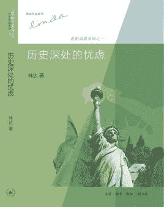

《历史深处的忧虑》 林达

这一本书几乎整本就只讲了辛普森案，作者就是从头到尾特别认真、特别细节地讲他怎么看这个审判？这个审判双方是怎么表现的？他又怎么和其他的人聊天？然后一本书就写完了。

我当时觉得这个作家也太幸运了，如果赶上这么的一场审判，就可以直接写一本书。但是又不得不承认它非常的好看，而且可能是比他其他的散文集更好看，因为它带着强烈的悬疑和非常烧脑的很刺激的快感，会迫使人一直不停地读下去。

这个案子它之所以经久不衰，除了它本身是一个明星光环，它还有一个很刺激的主题：一个超级巨星被怀疑杀掉他的前妻，然后又被宣判无罪。

但是它真正吸引人之处是那些大量的、具体的、不断反转的细节，就是当这个公诉方（这个检方）觉得自己手里拿着一个非常容易的、铁证如山的案子，然后满怀信心地走上法庭，结果遇到的是辛普森用重金聘请的一个王牌的律师团队，然后这个律师团队不停地利用证据规则去挑战每一个看上去都足以证明辛普森就是杀人犯的证据，直到硬生生地把整个案子给黄掉。

所以包括其中一个陪审员，后来在接受采访的时候说："我觉得就是辛普森干的。"但是是检方把这个案子给搞砸了，他们在收集证据、处理证据以及出庭作证的时候，种种糟糕的表现，让人没有办法为检方投下一票  
检方做到了他们该做的事情，就是排除了合理的怀疑他们没有做到。

这个评论本身就挺能让人玩味的、挺吊诡的，如果这个陪审员他真的是这么想的，他真的觉得这就是辛普森干的，非常明显，但是检方没有做好他们该做的事情，以至于我要判辛普森无罪。

你说他是在认真地履行法律赋予他的职责吗？某种意义上说是的，因为他作为一个陪审员，他要做的事情、他的分内之事，就是去看双方呈在法庭上的证据有没有充分地论证他们的立场？有没有满足他们所需要达到的证据标准，他的结论是没有。

#### 程序正义 VS 实质正义

可是另一个方面，如果他内心已经很明确地相信辛普森就是杀人犯，那我们是不是在为了这个程序正义牺牲掉了实质正义？

这个案子反复地被拿出来讨论，一般来说有两个主题，一个主题是种族之间的矛盾，是一个政治正确的问题。因为这个案子后来的民调显示，绝大多数 80%左右的白人都认为辛普森是有罪的，将近 80%的黑人都认为他是无罪的，而分别有将近 50%的白人和黑人都觉得如果这个陪审团不是以黑人为主的话，如果是一半白人一半黑人，这个结果判决会被改变。

除了这个政治正确主题、种族的话题之外，它的另一个不断地被大家聊起的主题就是实质正义和程序正义之间该做什么样的取舍？

程序正义当然是非常重要的，可是当我们对于程序正义近乎苛刻的追求，伤害到了实质正义的实现的时候，这些追求是否仍是值得的？

我看到的许多的讨论，可能大部分特别是在中文这种法律文化之下的讨论，对于这个案子一般是持比较负面的态度，但这是我的观感，我不知道大家是怎么看。

有一个小的佐证，除了林达的这本书，因为他是一个旁观者，以一个记录者的身份在旁观这个审判（他写得是非常的精彩、非常的通俗易懂，也很有知识性）。但如果大家想读更专业一些的解读，可以去读当年的检方、律师团队很多人写的回忆。因为这个案子实在是太火了，所以基本上每一个跟他有关的人，后来都写了书，包括辛普森本人，他写了一本书叫《If  
I Did It》（《如果是我干的》），然后很多人认为他这就是在承认就是他干的。

他的律师团队当中其中有一个人叫德肖维茨，这个人是哈佛法学院的一个很有名的教授，是非常顶尖的刑法学和宪法学的教授。德肖维茨后来也写了一本关于这个案子的书，就是尽量客观地记录了整个案子和他的团队。他作为这个团队的策略顾问，对整个案子思考和部署，这本书的英文名字《Reasonable  
Doubts: The Criminal Justice System and the O.J.Simpson  
case》（《合理的怀疑：刑事司法制度和辛普森案》）听上去是一个很中立的标题。

可是当它被翻译成中文的时候，有不同的译本，比较流行的译本的翻译是《合理的怀疑：从辛普森案批判美国司法制度》，好像天然有一种立场，就是对这个案子带着一种批判的精神。

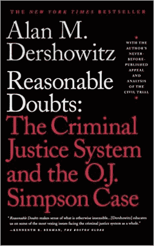

《Reasonable Doubts:The Criminal Justice System and the O.J.Simpson case》 Alan  
M.Dershowitz

无论是有钱人能请得起的天价的律师团队、玩弄规则于鼓掌之中，让律师帮一个明显有罪的人脱罪，还是对于程序正义的无休止的苛刻追求，妨碍了真正意义上的司法公正和实质正义的实现，它都是永远充满了话题。每个人心中都有这到底是不是他干的一份好像蛮坚定的相信，其实我自己也有。但是这个案子的结果又那么明白的摆在大家的眼前。

辛普森案并不是法学院里的必修科目，从法律规则的发展的角度来说，它不是一个特别重要的案子。它没有带来法律的改变、规则的改变，它没有很深刻的触及法律本身的很多问题的探讨。

但是它又如此的出名。它的本质是他的这个律师团队对于证据规则的挖掘和利用，或者很多时候是很简单的、很基础的规则，但是他们极致地挖掘了关于证据本身的事实细节，很巧妙地找角度来推翻检方本来认为他们（检方）已经赢定了的官司。

#### 证据规则制定的原因是什么？

所以我们今天来回头聊一下这个案子，依然可能会是一件有趣的事情，否则证据规则实在是很无聊的。我们聊证据规则，其实是让大家自己去想一想，这些规则所制定的原因是什么？任何一个规则其实都不是完美解决问题的规则。

它不引入这条规则，这个漏洞本身可能被人滥用；它引入了这条规则，这条规则本身又可能被人滥用。最后一定是在不停地修修补补，在各种滥用之间去寻找，尽可能保障整个制度公正不被滥用的那条路径，但是有很多时候就未必能找到。

其实在辛普森案当中，他的律师对于证据的挑战，遵从的都是一些非常基本的证据规则。当我们讲证据规则的时候，其实是在讲几个不同的事情，一个事情是说证据要充分到什么程度，它能够在这个类型的案子里，证明你的立场、证明你的 claim。

#### 民法与刑法的证据标准

那我们之前有聊过，比如刑法跟民法的标准是不一样的，民法的标准叫做 Preponderance of  
Evidence（证据优势），就是"跷跷板"，两个人坐上去看谁的跷跷板高一些。

可是刑法的证据规则会严格很多，或者证成的标准要严格很多，叫做 Beyond Reasonable Doubts  
（排除合理怀疑），这就是为什么刚才提到的德肖维茨的那本书叫做《合理的怀疑》，因为双方就是不停地在争，检方提供的证据到底有没有做到排除合理的怀疑？它有没有做到说确定无疑地证明，这真的就是辛普森做的？我有没有什么理由去怀疑他可能是冤枉的？

这是一个很容易被挑刺、很容易被挑战，不停拉锯的标准，正如我们在辛普森案当中看到的这样，可是因为刑法是要剥夺人的自由、甚至剥夺人的生命的。在辛普森案当中，它最坏的结果就是死刑。

当时的加利福利亚州是有死刑的，所以这样一个严苛的证据规则，它有的时候让人觉得是不是太严苛了？给想要挑刺的那一方很多的机会；可是另一方面又让人觉得如果不这么严苛，我们真的可能冤枉好人。

除了你的证据是否充分地证成了你的观点，是否完成了证明标准之外，我们讲证据规则的时候，还有在前一段的节目里面讲到的，什么样的证据可以被呈上法庭这样的规则？什么样的证据是可以被摆在陪审员面前，去向他们证明你的立场的？

#### "毒树之果"理论里的证据规则

我们介绍一个大家应该都用常识可以推断，或者是在看律政剧的时候都已经了解过的证据规则，叫做"毒树之果"。有人说"排除合理怀疑"这个证据标准的背后是有神学基础的，就像我们之前讲自然法它背后就是有神学基础。

"毒树之果"这个理论，有毒的树长不出好的果子，"如果一棵树是被污染的，它的果子也是被污染的"这个理论，也被认为有基督教的影子，因为这句话本身源自《圣经》。《圣经》当中有一句话说，"好树结好果子，坏树结坏果子"。

"毒树之果"是什么意思呢？从字面理解，那当然就是，如果一个证据的源头是被污染的，这个证据本身就不应该被采信。它其实是对另一个更加基础的规则的一种衍生，就是证据排除法则  
(Exclusionary Rule)。

什么叫证据排除法则？就是如果一个证据是经由不正当的程序取得的，这个证据不应该成为呈堂证供。

最基本的一些例子，如果警方、检方是刑讯逼供的，用不正当的手段拿到了他们想要的证词，这些证词不应该被法庭采信（这个是非常明显了）。如果警方未经同意，就冲到一个人的家里进行搜查，搜出来了一些不合法的东西，那这些证据是不应该用来定这个人的罪的。

"毒树之果"是对这条证据的一个延伸和补充，因为有的时候"不正当的程序"是发生在很早的一个阶段（采集证据是一个漫长的过程，它通常都不是那么单线的，冲到这个人家里就把证据给找出来了），它是一个漫长的不停寻找线索的过程，最后可能找到了能够足以定罪的证据。

那"毒树之果"的理论就认为只要你在采集证据的这条链条上的任何一个环节里，是用不正当的手法采集了证据，这棵树不管它长得有多高，你这棵树的"本身"是被污染的，它结出的所有的果实也都是被污染的。

#### "毒树之果"第一层：证据排除法

举个例子，比如说"阿詹用我家的平板锅把看理想的小编给打了"。警察就要找这个平板锅（因为不知道为什么医生就说，这看理想的小编很明显就是被平板锅打的），如果能够找到这平板锅，我们就能证明到底谁是打的人。

警察未经阿詹的同意，没有向法庭申请许可，没有拿到搜查证，就冲到了阿詹的家里，发现了一个带血的平板锅  
(好吓人)。这就是基础的第一层，叫证据排除，因为它是用不合法的手段直接拿到了这个证据。

但是如果警察未经我的同意，在没有拿到搜查证的情况下搜查我家，并没有直接搜查到平板锅，而是搜查到了我的日记，在我的日记本里，我写了今天我把平板锅藏到了阿庞家，警察根据这个证据，他们就去搜查了阿庞的家，发现了平板锅。

比如他去搜查阿庞家的时候，他是拿到了法庭的许可的，可是尽管他拿到证据的步骤手段上是合法的，但他之所以能够走到那一步，所得到的线索都是经由他第一次的非法搜查拿到的，所以他整个采证的过程是被污染的，这是从毒树上结出来的果子，所以从阿庞家搜出来的平板锅，依然不可以被拿到法庭上去作为对阿詹定罪的证据，这就是"毒树之果"。

"毒树之果"这个理论在辛普森案当中有很充分地利用，这是辛普森的律师团挑战检方两条基本的证据的时候所依赖的基本的武器。

#### 修正"毒树之果"理论

那"毒树之果"这个理论，可能大家听着又会觉得这个好像程序正义过头了，是不是可以追究到无穷远？如果这是一个超级复杂的案子，警察付出了巨大的努力，才终于最后找到了证据。

如果他们在收集证据的过程当中，哪一天不小心犯了一个小的环节上的错误、程序上的错误、手段上的错误，就要推翻他们全部的努力吗？那一个坏人他想要脱罪的话是不是太容易了一点？他就是要去雇佣一个天价的律师团，就去漫长的采集证据的链条当中去找到那一个小的错误。

那"毒树之果"这个理论呢？后来经过了很多的修正，也是有越来越多的人利用这条理论去为自己脱罪。

那在接下来的几个不同的案子里面，最高法院做了几个排除事项，就是即便是有污点的证据，在某些情况下是可以被允许的。

第一，独立来源。虽然阿庞家的平板锅是因为他们偷看了我的日记本找到的线索，那也有可能警方接到了另一位"线人"、一个旁观者，或者是阿庞自己亲自去向警察举报了我，说我把锅藏在了她的家里，警察依据举报，合理合法地拿到了法官发给他们的搜查证，就去把锅给找出来了。

那在这种情况下，即便他们没有偷看我日记的这个动作，他们也可以独立的发现那个证据，就是"独立来源"。就是这棵树上虽然长出了有毒的果子，但是这颗果子不一定要在这棵树上长出来，在这种情况下，如果检方、公诉的一方能够证明这个证据的独立来源的话，那这个证据可以被采信。

第二种，叫做必然发现、inevitable、无法避免的、一定会被发现的，怎么都要查到你那去的，虽然他偷看我的日记加快了这个进程，但是本质上无论他有没有做偷看日记这件事，他最终都会发现那个锅。在这种情况下，这个锅依然可以被采信。

还有一个叫做稀释原则，就是这个树实在是长得太高了，这个证据链条实在是太长了，以至于非法的行动和被污染的证据之间，已经没有明确的因果链条，在这种情况下，就不能以挑刺的方法去为自己脱罪。

那还有一种叫做善意的例外，就是警方有的时候他们的程序不完全符合规章条款，可是他不是故意要这么做的，他不是为了故意要去找证据坑你，而是不小心遗漏、没有完全地符合规则的要求。

比如这个善意的例外被提出的那个案例里面，有一个人被警察搜查他的车，发现了违禁药物，这个人说警察是没有搜查令的，他们手中的搜查令已经过期了。之所以警察还搜查了他的原因是警察的内部的系统没有及时的更新，所以让警察们误以为自己还有合法的搜查令。

最高法院最后觉得这只是一个善意的例外，警察们也是没有办法，他们遇到一个这么糟糕的电子系统。

#### "毒树之果"理论是证据排除的极大延伸，但也限制被滥用

所以这个"毒树之果"的理论，它的确是对于之前的证据排除法则一个极大的延伸，但是它同时也受到了一些限制，这就是我们说的在两种糟糕的情况之间摇摆，力图找到一个中间点，不至于被任何一方滥用得厉害。

因为如果完全没有这个规则的话，这个公诉方可以滥用，他只要在他的非法行动和最后的证据之间找到一个中间环节；可是如果这个规则被无限利用的话，他就可能被被告这一方滥用，被告这一方只需要在漫长的因果的链条上找到一个遥远的环节就可以为自己脱罪。

# 71\. 辛普森案（二）：“毒树之果”的证据理论困境

（公众号懒人找资源，懒人专属群分享。）

在辛普森案当中，警方是从整个故事的一开始就陷入了"毒树之果"理论的困境。在 1994 年的 6 月 12 号，那天晚上在美国洛杉矶 LA 的蒙塔娜大街，有位叫施瓦布的居民外出散步的时候，找到了一只秋田犬。

他把这条狗带回家以后交给他的一个邻居，他的邻居就带着这条狗去找这个狗的主人。

于是在狗的牵引之下，他们来到了辛普森的前妻妮可*布朗所住的南邦迪大街 875 号，在那里发现了横躺在地上的女尸，这就是辛普森的前妻妮可*布朗，于是他们选择了报警。

警察很快又在房间内发现了另一具尸体，是一个餐厅的男服务生，叫作罗纳德\*高曼。

其实两个人都死于利器的刺伤，就是有匕首的刺伤，还有击打。

辛普森和他的前妻所养的两个孩子这个时候在楼上的房间熟睡，并没有看到整场悲剧，凶案是如何发生的？

辛普森和他的前妻是在两年前离婚的。据接到报警的警官们后来在法庭上说，他们当时首先去找辛普森，只是为了通知他这件事。

然后，他们就来到了几分钟的车程之外的辛普森的住所，没有能够找到辛普森，他们在房间的门前看到了辛普森的汽车，发现汽车的门把手上有血迹。

所以，警察们在敲门不应之后，他们怀疑还有房间里的其他人也受到了伤害，所以他们闯入了辛普森的住宅进行了搜查。因为辛普森的律师后来会说，这个搜查是一个非法的搜查。在这个搜查的过程当中，他们就发现了后来在法庭上成为重要证物和戏剧化场景道具的那一只黑手套。这只黑手套上后来检出了辛普森本人的 DNA，有本人的血迹，还有两位受害者的 DNA，所以是一个铁证。上面还发现了金色的毛发跟妮克的也是一致的。

可是在这里就有一个毒树之果的问题，对不对？因为他第一次的搜查可以被认为是一个非法的闯入。

但是公诉方就辩称说，当警方发现合理的怀疑，住宅之内有人受到严重的伤害的时候，他们是可以冲进去的。

总之，这成为了第一个争议，但是它似乎还不是推翻、使得这个证据受到合理怀疑的关键性的因素。

审判这场大戏在开演之前，首先是上演了一场警方追车的戏。

他们当时没有找到辛普森，辛普森在凶杀案发生的当天晚上，飞到了芝加哥去参加他的一个代言的活动。

后来，律师说服了警方，同意在 6 月 17 号的上午自首。可是当几千名的记者和警察共同在辛普森家等着辛普森出来自首的时候，他并没有按时地出现，而是辛普森的好友兼他当时的辩护律师罗伯特\*卡戴珊向媒体宣读了一封亲笔信。

辛普森在信中说，首先大家要知道我与妮克被谋杀毫无牵连，不要为我难过，我过得很好。很多人听起来这就像是遗书，所以数千名的记者和警方一起投入了寻找辛普森的这场浩大的行列当中。

警方追踪到了辛普森的汽车上的电话，有目击证人也表示，在某一个路的入口，看到了辛普森的好友名下的白色福特野马汽车。

警察试图靠近这个车的时候，驾驶车的司机，辛普森的朋友考林斯说，辛普森正持枪对着他的脑袋。

于是警察开始用很慢的速度开始了一场低速跟随，以每小时 35 英里的速度缓慢地跟随着这辆车。这个缓慢地，并不惊险刺激，并不像电影的镜头里那种特别疯狂的追车的戏码，却比任何的电影都更加的火爆。

当时美国的电视台甚至暂停了当时的 NBA，就全国广播公司它正在播 NBA 的总决赛，甚至把那个总决赛都给停掉，来直播这场追逐。故事没有什么特别戏剧化的结尾，这个追逐一直追到了辛普森回到了他在另一个地方的家，过了一段时间之后答应了出来自首，就像是非常诡异的一场预热一样，为接下来要开始的审判吊足了大家的胃口。

但是审判经过了很漫长的时间准备，就像我们之前跟大家聊过的，Discover 的一个过程，它有一个很漫长的采集证据、分析证据，双方就一些程序的问题进行辩护，包括挑选陪审团，所有的这些程序上的环节要完成。

这个凶杀案本身发生在 1994 年的 6 月，但是审判一直到 1995 年才开始。这场审判本身也是一场极其漫长的审判，这场审判最终长达 134 天。这场审判的另一个经典之处，它最终在法庭上进行反复争辩的，都是在当时还非常新颖的 DNA 证据。

这个案子最终没有能够找到凶器，所以也没有一些原始、传统的证据，比如指纹。虽然有一个餐具行的老板，或者有收据证明辛普森在凶杀案发生几周之前曾经买了一把匕首，匕首同验尸官所描述的造成了两个人死亡的刀伤很像，可是由于这个商店的雇员把他们的故事卖给了一家报纸，所以检方也觉得这个好像有点不太靠谱，就没有把这个证据交到法庭上。

以及还有另外一个目击证人，看到辛普森的朋友所开的那辆白色福特野马汽车，曾经快速地从被害人所住的地方驶离，但是把这个故事给卖了出去，就是靠上直播的方法，上了一家电视节目，所以警方也没有让他出庭作证。这里我们会聊到，当我们讲证据规则的时候，我们仿佛只是单纯地在讲什么样的证据可以被拿到法庭上，对不对？

但是大家想想看，一个证据拿到法庭上之后这是不够的，你还需要证明你这个证据是真实的。

有一些东西看上去是最容易真实的，比如图片、视频、收据，可是这些东西也是极其容易被伪造的。

你怎么让这些东西来替自己说话，它是真实的证据呢？它没有办法说这样的话。所以我们通常还需要一位证人去为它的真实性作担保。

这个证人其实也是引入的另一种证据，而这些证据是可以被挑战的。

证据规则还包含另外一套规则，你可以用什么样的证据来挑战这些证据？这个和什么样的证据可以被介绍到法庭上作为定罪的证据，又是不一样的一套规则。

通常来说，引入一个嫌疑人本人的特征受到的限制是比较多的。包括你找人来评价他的人品，你找人来证明他之前做事情的行为习惯，或者是过往有相似的经历，这些证据是被严格控制的。因为法庭特别害怕人们用"渲染某一个人的形象"这种方法来误导陪审团的印象。

但是，这一类的证据是可以被引入来挑战证人的可信程度的。当我们引入证据去挑战一个证人的可信程度的时候，其实无非就是挑战他的记忆力怎么样。你多问他几个问题，发现他记忆错乱了，他的证词就不可信。第二是他的知觉能力。比如一个人说，我看到红色的汽车飞快地逃跑了，你发现他是一个色盲，肯定可以证明他的证据不可信。

但是因为这两种情况是比较少发生的，一般大家上法庭都是经过精心地准备，不会犯这种太低级的错误，所以大部分时候你要挑战这个证人的证词，通常是要引入证据来证明他的可信程度。

如果一个证人说了一大堆话，把这个对话卖出去了，他的可信程度我们是有充分的理由怀疑：他到底有没有看到这辆汽车，还是他只是想 5000 美元被邀请上电视去做一个直播？这其实是一种证据的引用。当这些证据被排除之后，在法庭上被检证的证据其实都是跟血有关的，也就是都跟 DNA 有关。

总结来说，有血脚印、血袜子、血手套和其他零星的血迹。

血脚印是在布朗家，在凶案的现场所发现的血脚印，血迹跟辛普森的血迹是吻合的。

也有证据表明，辛普森拥有一款同样尺码的鞋子，这个鞋脚印的尺码本身和他自己鞋的尺码是吻合的。

第二是血手套，除了在辛普森家，当刑警们第一次上门的时候就已经找到的血手套，上面有两个受害人的 DNA。还包括在现场又发现了另外一只血手套，上面有辛普森的 DNA。然后是血袜子，在辛普森的家里，后来搜查发现了一双上面沾有血珠的袜子。

还有一些血迹是零星的，在凶案现场、在门把手上，还有辛普森的车把手上，还有从布朗家到辛普森家这条路上所采集的血迹，都验证出了辛普森的 DNA。

这些证据合在一起，让你觉得确实是铁证如山了。比如根据当时的 DNA 检测，在凶杀案发生的现场所采集的血液证据，血液来自辛普森之外的人的可能性是 1/170000000，可见可能性是多么的小。

所以有这样多的 DNA 证据，当时的检方很自信，也是丝毫不奇怪的。可是所有的这些证据都被辛普森的团队给挑战了。

#### 具体的证据分析

首先问题比较明显的是那双血袜子。这双袜子，第一，它不是一开始就被发现了，它是几周以后才被发现的。

第二，辛普森的团队里还有我们很熟悉的华人神探李昌钰，他分析了现场警方拍过的一个采证的视频和拍过的照片，发现视频当中和照片当中袜子的位置是不一致的，证明这个证据被移动过。

第三，他还发现这个所谓的血袜子是什么样的血呢（我怎么晚上讲这个故事，讲到自己有点害怕）？

其中一个袜子左侧的踝关节部位有一些血珠，但是这些血珠还渗透过了这个袜子，你把它脱下来以后它就合到一起，这个血珠就从左侧渗透到了右侧。

李昌珏博士就表示，这是非常不可信的，因为血珠的数量非常的少，如果他是真的穿在人的脚上，有血溅上去，这个血珠应该他从犯罪现场回到他自己的住所的时候就完全凝固了。

什么情况下血珠才会从袜子的一侧渗透到另一侧？那就是这个袜子本身没有穿在人的脚上，它是平放在那里，你把血故意滴上去，它就会渗透到另一侧，对不对？显得很像是人伪造了这样的一双袜子，丢在辛普森的家里，把它发现。

更何况检方送去的检验中心没有办法解释，为什么采集的辛普森的血液少了 1.5 毫升，辩方就指责或者是暗示血液就是被用来伪造这样的证据了。

接下来采集现场的那些血迹，听上去是挺明显的一个证据，但是辩方挑了很多刺。他第一说派去采集的检验员是一个新手，采集血液的冯警官，他在采集部分证据的时候，没有按照规范带上胶手套。

他在采集过了证据之后，没有立刻把血液送到检验中心，而是把它揣在兜里（真的是很诡异），揣在兜里揣了一天，才送到了检验中心。

这些都至少让人怀疑，因为所有的一切都是为了排除合理怀疑。我这一边不停地丢出很多的怀疑，这一切让人怀疑这个血液被污染过。

而且辩方还找出了证据，找到了陈年往事，说参与检测的其中一家实验室，在 1988 年和 1989 年发生过两次严重的失误，两次失误都出现在质量被严格控制的检测过程当中。比如在 1988 年的那次检测当中，恰恰就是因为警方的技术人员在转交血样时候的失职，使得 DNA 的结果的精确性不再可靠。

本来可能最有力的证据，这个时候有点让人怀疑了，因为他们以前就犯过这样的错误，也导致了证据被污染，结果现在好像没有吸取教训，又犯了这样的错误，至少他们自己就承认了很多不专业的地方。

接下来还有那一双血手套，是整个故事戏剧化的一个顶点。

在法庭上，辩方的律师用激将法挑衅检察官说，你如果认为这双血手套就是辛普森的，那你就让他戴上。

虽然检方后来有文件，他们自己回忆披露说，他们内部其实是不赞同让辛普森去戴那个手套的，因为这个手套经过了很多事情，它被血浸泡过，又做过检测，又解冻过，说不定已经缩水了。

他们都认为最好不要让辛普森戴，万一戴不上，那就很尴尬了。

但是其中的一位检察官，就是达登，他在受了激将法之后，他觉得万一正好合适，结果他就让辛普森把这手套给戴上。

结果事实是戴不上，戴进去的时候非常的困难。这个就一下子被辩方的律师抓住说，如果他戴不上，If it doesn't fit, you should  
cquit，你就应该放了他，成为了他的结辩当中的一句金句，后来被很多的报纸标题所引用。

最后对整件事情有一个致命一击的挑战，是来自于这些关键性的证据，血手套、血袜子，还有现场的很多血迹，都是由一位叫福尔曼的警官发现的，他立了很多的功劳，可是他也最终成为了检方在整个案子当中的一个很糟糕的证人。

我们刚才提到过，你的这些证物本身不会说话，他们的真实性还得要由证人去担保，因为只有证人可以在法庭上被要求宣誓  
我说的话都是真的，否则我就可以被以伪证罪起诉。

非常可笑的是福尔曼警官后来真的以伪证罪被起诉了。福尔曼警官作为这些关键性证据的发现者，他的责任是非常重大的，可他偏偏在法庭上被各种各样的证据、让人合理地怀疑他是一个种族主义者。

包括他之前告诉过他的医生，他曾经痛打嫌犯，有的时候会失去理智；他因为乱穿马路就拦下了一个年轻的黑人，差点把对方给掐死，整件事情众人皆知，让他损失了一天的薪水。

他在作证的时候，说自己在过去的十年之间，从来没有使用过"黑鬼"这个词，但是辩方找到了录音资料显示，他曾经在一个访谈中反复的使用了这个词，总共说了 41 次。

所以当这些证据被逐渐地拿出来之后，福尔曼这个人的形象就会整段垮掉，由他作为支撑的这些证据的可信性也受到了怀疑。

最后在结案陈词的时候，辩方的律师已经毫不留情地大打种族主义的牌，认为这就是白人的洛杉矶警方在构陷一位伟大的黑人明星。

这些证据的引入和话术的改变，让整个审判在后期导向一个关于种族问题的辩论。

这件事情在后世引起很多的争议，有很多人觉得这是一个很卑劣的手段，也有人觉得这是辩方律师正当的手段，只不过检方应该做出更好的回应。

很多人都觉得检方犯下了一些非常蠢的错误，包括在采集证据的时候这些失误，被对方抓住了把柄，包括福尔曼本人是一个那么糟糕的证人，也包括他们的很多策略选择。

# 72\. 辛普森案（三）：什么样的证据可以拿到法庭上作为呈堂证供？

（公众号懒人找资源，懒人专属群分享。）

很多人都觉得辛普森案的检方犯下了一些非常蠢的错误，包括在采集证据的时候的这些失误，被对方抓住了把柄，也包括他们很多的策略选择。

一个人的性格特色，他的名声、他的声誉、他的过往做过的某一些事情，这些东西一般来说是不允许被介绍到法庭上的，因为法律只讲你这一次做了什么，而不是裁决你这个人一直以来是一个什么样的人，它只判断你这一次究竟有没有做这件事。

但是陪审团是很容易被声誉、经历这些事情因素所影响的，所以法官对这个事情有比较严格的控制。

有一条例外的情况，当被告这一方首先引入了这些性格特征的证据的时候，检方是可以同等地引入类似的证据的。比如说，看理想的小编把阿詹给告了，说阿詹用平底锅暴打了她，现在开始了审判。

一般来说，代替看理想的小编公诉的一方，是不可以引入证据说，"阿庞说我证明詹青云是一个性格很暴躁的人，她经常打人"，他（公诉方）也不可以再找一个人来作证说"詹青云以前就打过别人"，他不能够引入这样的证据。

如果阿詹的这一方自己积极主动地引入证据，找了道长来作证说"我和阿詹认识了两年，她一直是谦逊有礼，谦谦君子，非常可爱。"如果我这一方首先引入了这样的证据，我的对手可以同等地引入性格特色的证据。

但是，当为辛普森辩护的这一方积极地打种族牌，不停地去渲染辛普森的个人魅力、他在黑人社区的影响力、他的伟大成就、他对推动种族平等作出的贡献的时候，洛杉矶的检方却没有做出相应的回应，他们（检方）没有指出辛普森其实是一个比较自私的人，他并没有为他的社区做什么事情。

还有人觉得他们（检方）的失误是选择在洛杉矶审这个案子，因为洛杉矶有大量的少数族裔、有色人群聚集。而且在选择陪审团的这个问题上，是后来最让人觉得检方很蠢的一件事。

#### 陪审团成员的选择考量

之前在讲章莹颖案的时候，已经讲过选择陪审团是一个较复杂的过程，双方的律师都可以去挑战对方，有一个陪审员的"池"，一拨人进来，双方的律师都有一些名额，一些理由去挑战  
这个人不适合做陪审员。

做这个选择其实是一个很复杂很细致的过程（你需要观察），有一些基本的元素是要考虑的，包括这个人的种族。在美国，他（陪审员）的种族、他的性别、他的职业，包括他的性格特色、他对某些问题的看法，都会影响双方的选择。

在辛普森案当中一个很明显的，它的核心要素就是种族，因为他（辛普森）是一个黑人明星，他的前妻是一个白人，两个被杀害的人都是白人，在这种情况下，种族就是一个非常重要的考量因素。因为美国是一个漫长的、有种族的历史问题的国家，所以他对种族这个问题是极其敏感的。

律师的确是有权利去挑战陪审团的人选，可是在这个挑选的过程当中，你不可以歧视，你不可以"因为这个人是黑人，我不想让他做陪审员"，你是不可以提出这样的理由的，你总得找点别的理由。其实检方也比较担心，如果他们组成一个以白人居多的陪审团，整个（庭审）会受到质疑和诟病。

双方最后很莫名其妙地达成了一个一致的看法（但是是基于不同的原因），都倾向于去选黑人女性。不管检方的初衷是什么（事到如今我们也没法揣测），但是他们很难拒绝以黑人为主的陪审团，因为他们一旦拒绝，辩方就会不停地控诉对方这是很明显地在表现种族主义了。

这个检方（公诉方）退而求其次，他们在做选择的时候倾向于选择女性，原因是辛普森之前就被报导过有家暴的历史，他杀掉自己的前妻这件事情非常残忍，也跟家暴有联系，包括他的前妻妮可，据说曾经向她的友人投诉过，说辛普森威胁要杀掉自己等等。

公诉这一方，挑选陪审团的公诉员认为，女性对于家暴当中受害的女性更容易产生同理心，更容易激发她们对于眼前的这个男性的愤恨；反过来辛普森的这一方，他的律师团队也倾向于选女性，原因是女性更加不容易作出有罪的裁决，特别是死刑裁决，她们更不愿意把人推向死刑台。当然，辛普森案的检方最后没有寻求死刑，他们只是想要辛普森无期监禁。

所以陪审团最终的组成是十女二男，是十位女性、 两位男性，其中有九名黑人。

而事后的分析认为，公诉这一方完全搞错了，因为这个案子不是一般的家暴案，在一般的家暴案中，也许女性会对女性的受害者更容易产生同理性，可是在这个案子当中，是一个男性的黑人明星，被怀疑杀掉了他的白人前妻，而有调查认为黑人女性对这样的组合当中的白人女性并不会抱持同情心，再加上她们本来就更倾向于作无罪的判决，所以这个选择又是给检方的诉讼雪上加霜。

最后经过了 134 天的审判，在 1995 年的 10 月，陪审团最终在非常短的时间之内，4 个小时之内就做出了裁决，认为辛普森无罪。

#### 法庭的审判到底在宣判什么？

《历史深处的忧虑》这本书里面描写的这一段：大家都在等这个结果、所有的人都在盯着电视等这个结果，但是所有人心中仿佛都已经知道了答案，他们都认为辛普森会被判无罪。

大家的共识仿佛也体现了一种对法律文化的共识，就是虽然很多人都相信辛普森是有罪的，但是也都看到了检方并没有做好他们应该做的事情，所以大家都觉得没有办法形成一个有罪的裁决。

在这里可能很多人又会再次地想起这个问题，法庭的审判到底在宣判什么？它好像不是在裁决辛普森到底有没有杀这两个人，而是在裁决检方有没有做好自己的工作，以提供足够的证据去证明、他们（检方）可以排除合理怀疑地证明，是辛普森杀掉了这两个人。这两个问题的答案可以是不一样的。

首先真实世界里的答案，其实我们都不知道；人心中的答案，关于第一个问题到底是不是辛普森干的这个答案，和第二个问题检方有没有排除合理怀疑的答案，竟然可以是不一样的。这是对法律意义的又一次思考，或者是对它的信心的又一次动摇。

#### 程序正义与实质正义的"平衡"与"冲突"

这个案子的刑事审判的部分就停在这里（因为刑事审判和民事审判，我们之前跟大家聊过，刑事的诉讼是要由公诉方提起的、这里的检方提起的），但是两位受害人他们的家属还可以提起民事诉讼，要辛普森赔偿。

后来辛普森在民事诉讼当中败诉，他向妮可和高曼的家人赔偿了巨额的赔偿金，某种意义上实现了一种很诡异的"平衡"，两位受害人的家人也得到了一定意义上的物质补偿，总是要好过什么都没有。

可是如果真实的世界，我们只有一个真实的结果，他要么就是杀人犯，他就应该受到刑法本身的惩罚；他如果不是杀人犯，他也不应该白白地赔好几千万，这种平衡是无法让人信服的一个平衡。

在 2007 年的时候，辛普森因为抢劫在拉斯维加斯被逮捕、被送进了监狱，当时被判了 33 年的有期徒刑。

但是美国的有期徒刑的政策（我之前也跟大家介绍过），它是有一个 Parole 的机制、假释的机制，他的这个判决是 33 年有期徒刑和 9 年之间不得假释，所以他真正一定会待在监狱里的时间，其实只有 9 年，9 年过后他就可以申请假释。

辛普森在 2017 年申请并获得了假释，从此以后淡出了公众的视野。这个故事的最终结局就是辛普森赔了一大笔钱、在监狱里待了 10 年，他多年来一直号称或者他一直宣称自己有积极在寻找真正的凶手，可是到现在也还没有找到。

越来越多的人或许相信就是辛普森干的，但是这个相信的人群之间依然有鲜明的白人和黑人的阵营的划分。所以这个故事一定会伴随着关于政治正确、种族政治、种族主义代入刑法审判这样的争议，和我们一直聊的程序正义和实质正义之间的这些冲突，导致这个讨论还会不停地继续下去。

#### 什么样的证据可以被拿到法庭上去作呈堂证供？

我们来总结或者是补充一些在这个案子里看到的一些证据规则。什么样的证据可以被拿到法庭上去做呈堂证供？

我们聊证据的时候，聊了两个阶段，一个是互相之间去发掘证据的阶段，那个时候证据的原则是尽可能的多、尽可能的广、尽可能的不受限制；但是拿到法庭上的证据却受到很多很多地限制，它具体地限制  
当证据服务于不同的目的、当证据是在刑事或民事的案件之中出现、还有这个证据是在什么环节被拿出来？都是有不同的规定的。

证据在什么环节被拿出来？之前在聊孙杨仲裁案的时候聊过，一个证人他出现在法庭上，他会被（直接）质询和交叉质询。直接地质询 Direct，就是你自己的律师会问你一些问题，接下来对方的律师会交叉检证，问你一些问题，在这两个环节当中的证据标准也是不一样的。

所以这就是为什么证据规则是一大堆复杂的、形式的、技术细节的规则。

那它有一些基本的原则，它的核心原则当然是跟这个案子有关的东西就会被称为证据，原则上所有有关的证据是可以被拿到法庭上的，但是有一些抽象地限制，比如你这个证据不能太消耗大家的时间，不能故意地引导陪审团或者使他们感到迷惑，不能因为一个非常小的细节，用一大堆证据、用疲劳战的方法拖垮你的对手。这些判断，其实都是法官做一个相当之主观地判断。

在不同环节或不同目的之下，引入证据的不同的规则，其实就给了"有手段"的律师利用规则的机会。如果想把一个证据拿给陪审团知道，但是这个证据在被用以证明某些目的的时候是不被允许的，用于证明某些别的目的的时候却又是被允许的，那可以假称用它是来证明那个被允许的目的，但是实质的意图就是想让陪审团知道这个证据而已。

举个例子，比如阿詹是一个很毛手毛脚的司机（当然我不是，假如），有一天把看理想的办公室给撞了，看理想就把阿詹给告了，看理想就想引入一个证据"詹青云是一个非常糟糕的司机"，它就想让陪审团知道"詹青云在过去一年的时间内撞过 4 个不同的编辑部（除了把看理想给撞了以外，把其他好几个竞争对手的办公室也都撞了）。"

但是在证据规则底下，这种证据是不可以被引入来证明"阿詹是一个不小心的人，或者阿詹就是有撞编辑部这样倾向性的"。你过去做了什么不代表你今天一定是一个什么样的人，法律只在意你这一次做了什么，所以不能够暗暗地把这种证据拿上法庭，让陪审团觉得她就是这样的人、一定是她撞的、一定不是看理想的责任。

但是，这些证据是可以被引用来证明相似地造成了这个撞击的原因，比如当双方对于这个撞击的事实细节和实质造成的伤害有不同看法的时候，看理想可以用"阿詹撞过其它办公室"留下的一些证据，来证明这个伤害的程度，或者这个伤害确实是阿詹的车造成的，或者这个程度的撞击就是有这样的伤害，它可以用来证明那样的技术细节，它可以用来证明之所以造成了这样的纠纷的起因，它唯独不能被用来证明詹青云的性格。

看理想非常狡猾地把这个证据拿上法庭，它说以前的这些证据证明用车撞大门是可以把大门撞坏的，但是它实质上并不需要引入这种很常识的东西，它想要把这个证据引入进来的真正目的，就是要告诉大家"她是一个不小心的人"，所以你们等一下多罚她一点钱。这是一种手段，就是把原本没有办法引入的证据变成可以引入的证据。

#### 证据的排除规则

证据还有一些排除规则，原本是相关的、合理的、可以用来证明一些关键信息的证据，出于公共政策的考量，我们把它排除在外。什么意思呢？什么样的证据是这样的证据？例如看理想的办公室，有一个地板坏了，走过去的人摔倒了，受了伤，看理想就要赔他钱。

有一天阿詹去参观看理想的办公室的时候摔倒了，然后看理想赔了阿詹医药费。这次事件过后，看理想对它的办公室进行了修缮，把地板重新给铺了一遍。这时候阿詹和看理想打了官司，看理想说不是我们的问题，是"詹青云是一个很笨的人，她自己滑倒了，把腿摔折了"。詹青云说"不是的，是他们的地板破了一个洞，所以我才摔倒的。"

我拿出的证据就是"不然的话他们为什么要在事后一个星期就找了装修公司上门去修地板？"这个证据是不可以被拿上法庭的，原因是法庭鼓励看理想修地板，法庭鼓励大家在事后采取补救措施、去服务更多的人、避免更多地伤害。

如果这个事后补救、亡羊补牢的行为，可以被当作针对自己的证据，看理想就没有动力去修地板。它如果想到"今天去修地板，明天詹青云告我的时候，她就可以把修地板这件事情拿去当证据，说我这里确实有问题"，那就先忍着不修，等把这个官司打完了再说。在这个过程当中就可能有更多的人去看理想玩的时候，他们也会摔伤，得不偿失，因为法律最终是要鼓励大家都过得更好。

类似的这种公共政策的原因排除的证据其实还有很多，同样的一个例子，阿詹在看理想的办公室摔倒了，看理想把阿詹送去了医院，提出要付医药费，这个时候阿詹  
把看理想告上了法庭，说"看理想很清楚是他们的责任，否则的话他们为什么要帮我付医药费呢？"

这个证据是不可以用来被证明"这是看理想的责任"，因为法庭鼓励看理想这样的行为，他们鼓励这种"善良"的行为帮别人付医药费先采取治疗措施的行为。

所以法律鼓励的行为，它会用种种的方法去鼓励，包括证据规则，法律鼓励大家不要搞审判、直接和解。法律鼓励人和检方之间可以签订认罪协定，所以这些和解的内容、认罪协定的内容都不可以被当作有罪的证据，直接地使用。

又比如法律鼓励大家在事前买保险，买保险这个证据不可以被介绍到法庭上，因为阿詹到法庭上说，"陪审团请你们多给我判一点赔偿费，没有关系的，看理想买了一大份保险，反正是保险公司会赔钱的，我是非常穷，我真得很可怜。"你不可以把这个证据拿上去，因为之前有很多的案例里面，陪审团因为想到对方有保险公司，大公司不缺钱，就把赔偿的数额搞得很高。

这个做法首先不太公平，不能因为有保险公司兜底就不按照事实去衡量这个数额，又因为这种数额倾向于很高，最终就是水涨船高。保险公司就会提高它的标的，因为它觉得要承担相当之大的风险，它就会提高保费，那可能有的公司就不买保险了（这对所有人都是坏事），或者是买很贵的保险，把这个费用又转嫁到其他人头上。

最终这是一个多方都输的游戏，这样的游戏法律不鼓励，我们再一次的通过证据规则表达这种不鼓励。

# 73\. 辛普森案（四）：如何挑战证人？

（公众号懒人找资源，懒人专属群分享。）

#### （一）特殊证据

另外一种特殊的证据类型，我们在聊辛普森案的时候，强调很多次，就是人的性格特色这一类的证据。

这种证据是双方其实不经意间都很想透露给陪审员的，但是法律又是积极地要反对。

它的例外情况，就是当被告这一方自己打开了"闸门"，邀请了亲朋好友来证明"我是一个好人"的时候，这个时候的公诉方可以挑战这些证人是不是真诚的、可信的、可靠的。

然后他们可以引入他们自己的证人来挑战我这些证人的证词。

当我作为被告，引入我的亲朋好友、我的证人，来证明我这个人的性格特色的时候，这些证词本身的方向也是受到限制的。

这些证词只能是这个证人以他自己的立场出发，去评价我这个人的名声，和他对我的人品的看法。

他不能够提一些具体的案例，他不能说"阿詹怎么会打人呢？她经常扶老奶奶过马路，她昨天还扶了老奶奶过马路"，他不可以提这个。

他提的我的性格特色必须是跟我们正在聊的这个起诉案子本身是相关的，比如我被"看理想"的小编告说暴力地殴打他，那我可以请一个证人，我请了道长说"阿詹是一个最温和的人，阿詹是一个最和平讲礼貌、从来不会跟人生气的人"，他可以讲这个。

但是他不能讲一些有的没的，他不能说"阿詹是一个非常聪明的人，非常幽默的人"，就是跟我们聊的主题完全没有关系，去渲染我的某一些其他的形象，试图影响陪审团这些东西，就不可以。过往的、具体的经历，包括过往的犯罪记录，通常是不可以被介绍来证明一个人的倾向性的。所有倾向性的证明，法庭都是非常地谨慎。

比如我之前撞过别的楼，不代表我这一次还会撞这个楼；我以前和别人打过架，不代表这一次就是我主动打"看理想"的小编。

对于倾向性这件事情，法律是非常谨慎的，因为它总是每次都把你当做一个新的人来看待。

这句话其实也不完全对，因为有一些法律里面，再犯的惩罚力度会更强（那个我们额外讨论），但是过往的一些犯罪的记录是可以被引入来证明案子当中的特别的元素。

比如还是同一个案子，还是我和看理想小编的这个打她的案子。这个看理想的小编试图引入阿詹之前的犯罪记录，看理想的小编说三年前这个阿詹还打过别人，说明她这个人有暴力倾向。

他要证明暴力倾向，这样的证据就不可以，可是他可以引入我的暴力过往的这些证据来证明别的东西。

比如他可以说"三天前阿詹就在半路上蹲守，然后打了我"，这证明这一次我打他不是一个意外。

这个故事听上去不是很合逻辑，通常这个故事应该是这样的：（比如一个我就不用自己讲了）比如一个丈夫一枪打死他的妻子，杀妻案，然后这个丈夫对自己的辩护是说这个枪走火了，我只是不小心杀死了她。

这个时候公诉方可以引入证据说，三天前这个丈夫曾经往他妻子那里拍砖，那这个证据是不可以被引入来证明她的丈夫有暴力倾向的，但是可以被用来证明它不是一个意外。

大家有一点感觉到吗？

再举一个例子，有一个人被警察拦下来搜身，发现他身上藏着毒品。然后他说"我虽然藏着有毒品，但是我并没有要卖这些毒品，你只能说我非法持有违禁物品，但是你不能说我非法交易违禁物品"，这是两个非常不同的罪名。

这个时候警察发现他过往的犯罪记录里面就有售卖毒品，卖过 5 次，非常多次。这些证据是不可以被引入来证明这个人就是有搞毒品交易的倾向性，但是这些证据却可以用来证明他藏有这些毒品是有意图要卖掉这些毒品。我知道这些东西听上去有一点困惑，区别到底在哪里？区别好像就是一个技巧问题？就是你同样都是把这些证据拿出来了，你只不过是要小心地避免倾向性这样的用词，然后用它去证明一些特别的小的细节，具体的问题。

最后这一套规则好像就是给有技巧的人，最大程度地利用这个规则给的空间。

比如再举一个例子，有一个人去抢劫，抢了一家便利店，然后他为自己辩护的方法是说"我那天有不在现场的证明，你没有办法证明这个抢劫的人就是我"。

这个时候公诉方想要引入这个人过去 5 次抢劫便利店的证据，这个证据大家已经知道了，它是不能够被引用来证明这个人就是有抢劫的暴力倾向的，倾向性不可以使用。

但是假设说这一次被抢劫的便利店店主，他清晰地记得这个人的衣着非常的有特点他戴着彩虹色的帽子、彩虹色的眼镜，穿着彩虹色的夹克和彩虹色的皮鞋。

然后检方根据他们之前的犯罪记录，发现这个人在过去 5 次抢劫的时候，也都戴着彩虹色的帽子、彩虹色的眼镜，穿着彩虹色的夹克和皮鞋，他至少可以用这个证据来佐证这个人的身份。

它不是被用来证明暴力倾向，但是这个证据被引入的时候，陪审团是能够感受到这个人是有暴力倾向的。

其他类型的证据，就包括我们刚才提到的照片、视频。可是这些证据因为很容易被篡改、P 图，所以他需要采集这个照片的人，或者是因为他的身份和他的工作性质，有能力担保这个照片的真实性的人，去做出一个担保说这个照片是真实准确地描述了当时的境况，一个物体或者一个人。

#### （二）挑战证人

证人当然是一个非常重要的环节，我们刚才也聊到了，证人可以被引入，然后证人也可以被引入新的证据来挑战。

同样是针对人的挑战，在挑战证人的时候，挑战证人这个词叫 impeachment，就和弹劾的词是一样的。

挑战证人的时候，方法就很多了，被介绍来挑战证人的证据就相当有多样性了。

因为他们只是证人，他们本身在这场审判当中并不受法律可能的制裁，不像我们对嫌疑犯那样是非常小心谨慎地保护，不要让陪审团对他们留下任何可能影响这个裁决的印象。

可是对于证人，这个标准就要宽松很多，我们主要的目的只是为了证明他们是不是能够公正地作证，所以我们，包括在律政剧里面，能够大量地看到让证人出丑的种种尴尬的场景。

比如在《辛普森案》里的福尔曼警官，他之所以被彻底搞臭糊掉，就是因为他前后不一，他在这个证词上作伪证，他说我从来没有用过 nigger 这个词，但被发现用了 40 多次。前后不一致的陈述、以及所能够被证明的偏见、有利益牵涉其中、以及有动机撒谎，都是很常见的去挑战证人的手段。

那我们在《辛普森案》里面也看到，福尔曼除了他前后不一，他后来承认说他用过这个词，他被证明了他频繁地用这个词，以及他之前对于黑人的暴力，证明了他可能是一个有偏见的人。

那另外的两个被排除的证据，就是看到了辛普森朋友的汽车的那个目击证人，和说卖过匕首给辛普森的人。

他们的证据被排除，是因为他们把自己的证词卖掉了，那他们可能被认为有利益牵涉其中，或者是有动机去撒谎，就是为了把他们的东西卖一个更好的价钱。

证人可以被引入来证明嫌疑犯的名声，那证人本人的名声也可以引入其他证人再来证明。

比如，"阿詹打看理想的小编"，阿詹请了道长来给她作证明，道长说"阿詹真的是个好人"，然后看理想的小编请了其他 5 个小编来作证明说，"道长永远都这么说，就算这个人不是好人，他也不会说实话。"

总而言之，你可以用各种各样的方法来挑战对方的证人，挑战成功的典型案例就是辛普森案。  
证据规则的复杂性还体现在挑战证人的不同方法当中，在选择使用不同的方法挑战你的证人的时候，你可以引入的证据又是不一样的。

比如你挑战你的证人，可以用证明他是一个有偏见、有利益牵涉其中、有动机撒谎的人，当用这种方法去挑战的时候，你是可以引入外在证据的。

比如在挑战福尔曼警官的时候，辩方的律师就引入了他之前一个录音的片段，就是他发表对黑人不尊敬的言论的片段，这是可以引入外来证据去证明的。

可是如果你是要用这个证人之前的不良行为，来挑战他的可信程度的时候，就不能够引入外来证据去证明。

比如我同样是要挑战这个来帮我作证的证人，我可以引入证据去证明他有偏见，但是我还知道这个证人之前弄虚作假，他明明就不是一个贫困户，但是他申请了贫困户的补助，那我就问他说，"你以前是不是申请过贫困户补助？"

我可以问他这个问题，但是我不能够引入别的证据，无论是他被查出来是假的证据，还是别的证人来证明他做过的这件事。这里面对于进一步深究一个证人过往的不良行为的限制，可能除了这个不良行为，我觉得它背后的考量可能是一个利弊的衡量。

这个证人之前的不良行为，虽然说验证了他性格当中的某些部分，比如他假冒贫困户或者是弄虚作假，那他这个人可能倾向于说谎，但是也并不能够直接地证明他在作证的这件事情上会说谎。

这就不像他是一个对这个事情、对这个主题本身有偏见的人，那他更有动机去说谎。  
第二是引入这样的证据会有很高的成本，那可能他会吓跑一些证人，有的人会想到我过往这些不光彩的经历，如果都要在法庭上被抖出来，还有证据被拿出来的话，可能更加不愿意出庭作证。

出庭作证是一个我们鼓励的行为，法律还是用各种各样的方式去鼓励我们觉得是好的行为。

# 74\. 辛普森案（五）：传闻证据的排除原则与例外

（公众号懒人找资源，懒人专属群分享。）

#### 传闻证据的排除规则

在辛普森案当中，除了与 DNA 相关的证据，还有一类证据，很多人觉得很遗憾，没有被引入法庭，就是一家妇女庇护所曾经在凶杀案发生前四天，接到辛普森的前妻妮可\*布朗的电话。

布朗在当中表示"对自己的前夫辛普森感到恐惧，她认为辛普森正在跟踪自己"，这个证据没有被引入。还有很多妮可的朋友和家庭成员都表示，妮可\*布朗经常说辛普森在跟踪她，也曾经说自己无论走到哪都会注意辛普森就在那监视她。

她的另外两个朋友具名地表示"布朗很害怕辛普森，因为辛普森曾经对她说，如果他发现布朗和其他男人在一起就要杀了她"。这一类的恐吓性的证据没有被引入法庭，是不是会觉得为什么呢？这听上去非常有说服力，如果辛普森曾经威胁过她，是不是能够表明辛普森的作案动机呢？

检方之所以没有尝试引入这些证据，是因为他们认为主审法官（也是一位有故事的法官），伊藤法官，一个日裔的法官，会以这些证据是 hearsay，道听途说，而排除这样的证据。

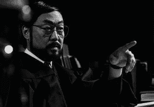

伊藤法官 \[美籍日裔\]

最后介绍一个在律政剧里经常出现的词，我之所以对这个词非常得有兴趣，是因为我当年看律政剧的时候，其他的词很多都能理解，但这个词一直不理解。一个律师，在盘问对方的证人的时候，另一方的律师可以说 Objection、我反对，他反对的理由可能是 leading，这种诱导性地提问是不可以的。

诱导性地提问，就是诱导别人给出一个我想要的回答。在孙杨的听证会里面，对方律师盘问他说，"难道你不知道不交出这个样本，是有很严重的后果的吗？"这是一个很有诱导性地提问。但所有的这些边界都是模糊的，都是法官临时地去作出裁决。

包括他说 Objection， Relevance（相关性），就是这个问题跟这个审判有关系吗？没有关系就不要问。

但有时候 Objection 的理由是 hearsay（hearsay 拆开来看都认识，合在一起就不认识了，hear 就是听,say 就是说，听然后说）。

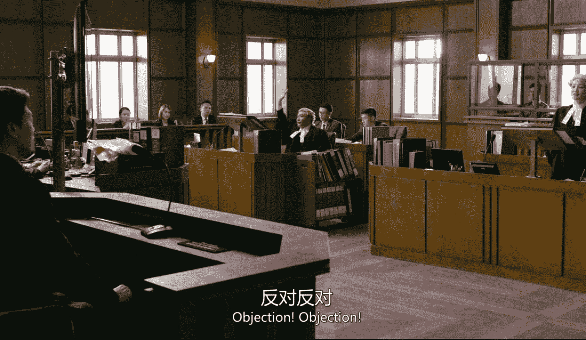

电影《保持沉默》

像上一个例子，妇女研究所说，"妮可打电话告诉我，她很恐惧，辛普森一直在跟踪她。"这个就是 hearsay，因为是她听到妮可对她说"辛普森一直在攻击我"，然后她到法庭上去说，这个就是在法律上会被排除的 hearsay 一类的证据。我当年是觉得非常的困惑，就是这一类的证据为什么要排除？因为它听上去很有道理，而且妮可如果不通过这种方式，她也没有其他的方式告诉法庭了。

这一类型的证据的核心特质就是由一个人（注意，它必须得是一个人），如果我到法庭上去作证时说，"我看到这个牌子上写了 balabala"，这个证据是完全可以的，但是我不能说"我听到这个人跟我说了什么"。

一个人在法庭外作了一个陈述，由另外一个人到法庭上去证实这个陈述，这是不可以的，原因是法庭认为对方，永远没有机会去检证。那对于作出陈述的第一个人，没有办法像去挑战其他普通证人那样，去检证他的记忆力、检证他的知觉功能、检证他的可靠性，所有这些问题都没有办法检证的情况下，把这样的证据带入法庭，对于对手是不公平的。

#### 传闻证据规则的例外

事实上，我们在律政剧里、法庭的审判文书里，还是会看到有大量的证人把其他人说过的话带入了法庭。那什么时候这样的证据会被当作 hearsay 而排除呢？只有一种情况，就是带入法庭的那句话，是被带入来证明那句话所陈述的事情本身。（我举一个例子，大家就会明白。）

比如我是妮可的朋友，我到法庭上去作证说，"那天的晚上 10:30，我接到了妮可打来的电话，妮可说辛普森来了"（我的妈怎么这么可怕），如果我到法庭上去重复这句话，我想要证明的是辛普森去了，妮可的那句话是辛普森来了，这就是同一件事。被引述的那句话，用来证明了想要证明的同一件事，这种情况就叫 hearsay，听、然后说。

可是，如果我引入这句话是为了证明"在 10:30 的时候，妮可对我说了这句话，证明妮可在那个时候还活着，所以凶杀案一定发生在 10:30 之后"，这个证据是可以的。

因为我引入的证据，并不是为了证明妮可说的那句话本身，而是用它来佐证其他的事实，是由这句话确实能够证明的事实。在后一种情况之下，为这件事情、为这个证明负责的人，就变成了我，我是证人，我是在法庭上说，"我确实是记得是 10:30 打的电话，她确实对我说话了"，是我要负责。而在第一种情况下要为那句话、为那个判断负责的人是妮可，可是妮可此时此刻并不在这个法庭上。

当然所有的规则都是有例外的，hearsay 也一样。其实 hearsay 有很多，规则的复杂就在于它有很多很多的例外。

比如说一个人在临死之前最后说的话，是关于他的死因，他没有办法在法庭上作陈述了，他当时如果相信死亡正在靠近，在一个谋杀案的案子里，这样的证据就是可以被引入法庭的。

我首先想到的例子是《甄嬛传》里面的安陵容（虽然这不是一个好的例子），假设这是一个法庭的场景，安陵容快要死了，这个时候在她的面前只有甄嬛，安陵容相信她自己快要死了，她知道自己为什么而死。然后她说了这样一句话"我是中毒"，后来比如她昏迷了、或者她真的死了，她没有办法亲自到法庭上去作证，她的这个证据可以被带到法庭。

虽然它依然有我们刚才提到的 hearsay 的种种弊端，但是它是为"一些只有本人才清楚到底发生了什么"这种特殊情况下网开一面，来帮助大家有希望了解到事实的真相。

还有很多没有这么阴森恐怖的例外情况，例如在一个激烈的情绪之下脱口而出的话，没有经过深思熟虑、没有可能编造的这种情况下，这些话是可以 hearsay 的。

比如昨天我和看理想的小编，10:30 正在打电话，打着打着看理想的小编说，"我的妈呀，一只大蜘蛛"，他就是脱口而出的话，描绘的是他当时的情绪状态，这种是无法编造的东西、是人的本能反应的东西，就会被允许带入法庭作为例子。

又比如说一个证人他失忆了，他当年能够记住的东西现在不记得了，但是在他记忆还非常清晰的时候，就把这个东西写在了他的日记本里，那这个日记是可以念给陪审员听的，这也是某种意义上的 hearsay，是可以被接受的。

#### 所有证据规则都服从于《宪法》的原则之下

这一套规则还可能变得更加复杂，特别是在刑事案件里面，就算你满足了 hearsay 的例外情况，通常这种证据可以被引入，它又受制于另一些条款地约束，就是在某种情况之下，它又不可以被引入了。

所有的这些规则都服务于《宪法》，美国《宪法》的第六修正案，保障一个人受到公平审判的权利。

在刑事审判当中，一个被告可以引用第六修正案，来修正某一些特别的证据规则，包括 hearsay 的情况。他一定要为自己争取到，哪怕是符合之前所讲的例外情况的条件，如果这个被告没有机会去交叉质询，或者有过机会去交叉质询最开始说话的那个人的时候，这些例外情况通通都不适用。因为这种适用会被认为是，妨碍了被告的第六修正案所保障的宪法权利的实现（这又是另外的问题了）。

#### 证据规则的特权

之前在讲证据开示的过程、庭审前准备的过程、Discovery 的时候，讲到过证据法则服从于某一些特权。这个特权，比如律师可以不提交他和他的客户之间受到保密协议约束的对话、不可以要求一个医生交出他和病人之间的谈话、不可以要求一个牧师交出他的信徒对他进行的忏悔、也包括夫妻之间保留这样的权利。

在庭审的时候，同样有这些特权地存在，这些特权依然受到法律地保护。

比如我之前觉得最温馨有趣的就是伴侣之间的这种特权，在庭审过程当中有两个不一样类型的特权，一个是如果你们现在正处于婚姻状态当中的夫妻，那其中一方是不可以被要求到法庭上去作证指控你的伴侣，哪怕是你知道他有没有做一些事情、哪怕这些事情发生在结婚以前，只要此时此刻你们是婚姻的状态，你就可以选择沉默来保护你的伴侣。

但是你也可以选择开口伤害他，因为这是伴侣的特权，伴侣也可以选择不要这个特权，这个特权属于作证的这位伴侣。

而另外一种特权属于被告，属于在审判席上的伴侣，就是在婚姻中的私密交流的、Confidential 的、机密交流的这种特权。

如果一段对话发生在婚姻关系期间，而且有明确地提出这是一段私密地对话，那哪怕之后两个人离婚了，这个伴侣当中作证的这一方，也不可以到法庭上把这些话说出来的。

这是挺有意思的两种不同的思路，一种就是我们不能够强迫一个正在婚姻关系当中的人，去指证他的伴侣；那反过来，如果在婚姻关系当中的一段对话，当时就说好是机密的，那它永远都受到这个机密性地保护。两者据说都是为了保持婚姻关系的和谐，但是它们是从不同的思路上来保证这种和谐。

#### 为什么证据特权那么重要？

为什么特权那么的重要？因为特权是一个不能绕过的东西。

在审判之前有一个漫长的 Discovery  
的、庭前开示的环节，在进入法庭审判之前，法官已经做了很多的决定，法官通常是那个决定一个证人有没有资格上庭作证的人，他也决定一个证据可不可以被拿到法庭上。

在审判开始之前一个法官去做这些决定，而不是在审判的过程当中双方去争。审判开始之前法官是自主地做这些决定，他不受我们刚才聊到的所有规则地束缚，他自己去做决定：这个证人行不行？这个证物可不可以拿到法庭上？

哪怕拿到了法庭上，对方还是可以挑战它；一个证人到法庭上去作证了，对方还是可以挑战他的可信度。但是法官是做第一层筛选的人，他在做这个筛选的过程当中，不受任何证据规则地限制，他唯一受到地限制就是特权，那些特权他也不能挑战，哪怕他是法官。

#### 证据服务的对象是由普通人构成的陪审团

所以，证据规则归根结底服务的对象是陪审团，因为陪审团是由普通人组成的团体，他们作为普通人可能是第一次参与庭审的过程，就要去决定一些很重要的事情。

制定法律和制定证据规则的人，大概是担心陪审团会轻易地被一些非理性的证据误导。比如不可以用任何过往的证据去证明一个人的倾向性，因为倾向性不代表这一次就是他。有很多著名的例子，冤枉好人，就是因为太习惯于用倾向性去判断一个人，用一个人过去怎么样、现在还是这样，来判断一个人。

虽然不允许用过往的经历或者一个人的名声、过去的事情来证明倾向性，可是这些东西又可能提供一些非常重要的讯息。比如说解释在这一次的事故当中，事情真实的起因；比如说用来解释一个人是不是擦枪走火，还是他确有企图？

所以这些过往的经历和事件是可以提供很多的有效讯息，这些有效的讯息又不想排除在审判之外，所以引入了一些例外，来让双方的律师把这些讯息引入。

但这些例外的"门"打开之后，就可能会出现滥用的情况。比如我号称是用它来服务一些特殊的目的，把这些证据引用进来，但它本质上还是为了利用倾向性、利用人性当中对倾向性的相信。

又比如说，为什么对 hearsay 这种证据那么谨慎？是因为想要给审判当中的双方都去充分地检证另一方证据的机会。而如果这是一个 hearsay 的话，本质上是没有机会去检证那个最初说出这句话的那个人，没有办法问清楚他到底为什么说这句话？他有什么证据？他是不是真的能够记得清楚？他是不是真的有能力做这样的观察？他是不是有动机撒谎？

可是 hearsay 的信息又可能是非常重要的信息：如果不依赖于这样的信息，就没有办法知道真实发生的情况。比如他的记忆力衰退了；比如一个人在这个时候有种种的原因没有办法出庭作证了，可能陷入了昏迷、可能已经去世了、可能正在另一个监狱服刑。

所以这个时候就打开了一些例外，这些例外允许把"道听途说的证据"介绍到法庭，可是它又和刚才提到的，人的根本的权利相冲突。

#### 证据的规则将不停地被创造

于是在刑法的案件当中，又做了一个取舍：一个人的根本权利、公正审判的权利，还是要求他必须得有一个质询的机会、检证的机会。

如果没有这样的机会，那关于 hearsay 的这些例外也通通不要，宁愿不要这些证据，也不能够让一个人被没有经他检视过的证据所影响，甚至决定命运。

所以这些证据规则很难说都是完美的，它每走一个改革的方向、每打开一个例外的开口，一定都是尝试解决某些问题，但又会带来新的问题。

可能法律的规则本身就是在不停地修修补补，我不相信有一套完美的规则是从一开始就摆在那里等着我们去发现的，人永远比规则更有创造性，所以规则也不得不不停地创造自己来服务于人的创造性。

# 75\. 米兰达警告：你有权保持沉默，否则...

（公众号懒人找资源，懒人专属群分享。）

我们花了很长的时间，去介绍一些很具体的与证据相关的规则，可能一不小心讲了太多，希望大家不至于感到太无聊。

我去学习法律的时候，我的很多朋友、还有我们家的亲戚，都觉得学法律就是去背书的，整天就是背法条，全部背下来了考试就能过关。我一开始还特别努力地向他们解释"我们真的不背书"，但我在讲到证据规则的时候，意识到一个律师确实是需要掌握这些很细节的规则，然后熟练地运用它们，但是这个记忆的过程更像是在上班以后，熟能生巧的过程里学会的。

在学法律的时候，不是去背具体的规则，而是整天去辩论这些规则为何如此，有人支持、有人反对。

#### 证据规则从何而来？

当了解了这些规则之后，不妨回头想想，它们为何如此？这些规则从什么地方来呢？有很多复杂的规则发展到今天是一个历史不断累积的结果。

有的东西基于一些非常基本的原则，比如说我们始终在强调一个词叫做倾向性，你不可以用一个人过去曾经做过类似的坏事，就证明他这一次也做了同样的坏事。

一个人过去做过类似的坏事，这件事情在这个人被量刑的时候、在法院决定他的惩罚的时候，是可能被考虑的，因为它反映出这个人过去的犯罪经历、他对社会的危险性更大、改过自新的可能性更小，或者说想要改变他，社会需要投入的努力会更多，这是决定惩罚的时候的逻辑。

可是不能够用一个人过去做过坏事，就来证明他这一次也做了坏事，不能把这个逻辑应用于证据规则当中。现在讲的是证据，证据就是说"用什么来证明这个人这次做了什么，只能看这一次有什么证据，而不能看他的过去"，是一个基本的原则、也是法律的一个准绳。

但是法律也随着时代的变化，不停地更新和调整以适应它的要求。比如说 P 图技术不断地发展，现在视频都可以"假冒"了（我在网上看到很多做得特别真的我的视频，但是说的都不是我说的话，我觉得很可怕），所以对于这一类证据法律会越来越谨慎。

这些纷繁复杂的规则在普通法系的国家，它是通过一次又一次的案例逐渐累积起来的。最初的证据规则，它的起源可能追溯到  
宪法所保障的人的基本权利。比如我们之前讨论的规则"毒树之果"（好树结好果子，坏树结坏果子，如果一棵树它的根是坏的，最终结出来的果子也一定是坏的）。

如果采集证据的过程当中有哪一步是不合法的，那最终收集到的证据，无论多么得有利，也不可以作为呈堂证供。"毒树之果"当然是作为证据排除法则的一个补充，就是"以不正当的手段得到的证据是不可以用的"。

采集证据的背后，有的时候会追溯到美国宪法的第四修正案，就是一个人无故不能被搜身和搜查。可是第四修正案，这整条修正案其实一共就是四行英文、中文是三行，它是非常简短的。

The right of the people to be secure in their persons, houses, papers, and  
effects, against unreasonable searches and seizures, shall not be violated.

人民的人身、住宅、文件和财产不受无理搜查和扣押的权利，不得侵犯。

美国宪法第四修正案（节选）

它演化出非常具体的规则，一个警察在什么情况下可以合理地怀疑，一个人携带了毒品、或者是携带了危险品、或者是对公共安全造成威胁，可以立刻搜查他。警察在什么情况下可以向法庭去索要搜查令，搜查一个房子？什么情况下可以绕过这个搜查令，迅速的第一时间展开搜查？

这些非常具体的规则是简单的法律条文所不能涵盖的，它需要法官们在具体的案例里一次又一次地作判断，然后最终累积出来的所有的过往的案例，共同构成了法律的一个"素材库"。未来的律师们，就要从"素材库"里去寻找对自己有利的那些判决。

又比如说在讲到证据规则、什么样的证据可以采信的时候，可能第一时间都会想到香港警匪片、或者是美国的警匪片，里面会出现的一段对白，就是一个人被逮捕了，警察会对他说，"你有权保持沉默，但你所说的每一句话都可以在法庭上作为呈堂证供，或者是作为指控你的不利证据。"这段话叫做米兰达警告（大家可能都知道）。

#### 案例：米兰达案

1963 年，一个叫米兰达的人涉嫌对一位年轻的女性抢劫、绑架和强奸，而被当地的警察逮捕。他在警察局接受了两个小时的讯问，那个时候还没有所谓的米兰达警告，所以警察并没有告知他可以保持沉默，或者是告知他的讯问、他的笔录会被作为呈堂证供而指控他，警察没有告知他这一切。后来他在自白书上签名，在一个非常简单的审判之后，法庭就根据他自己的这份自白，或者他的供词而判了他有罪。

之后美国公民自由联盟 ACLU(American Civil Liberties  
Union)，这个是美国很多大案件的"背后操手"，它是一个自由主义的公益团体。他们帮助穷困的、或者社会弱势群体发起大量的起诉，我们在很多的划时代的案子里都会看到他们的身影，包括川普上台的时候迅速颁布了一个禁穆令（大家可能有印象）：禁止 7 个以穆斯林为主要人口的国家的公民入境美国。当时 ACLU 就第一时间跳出来起诉了川普。

ACLU 叫做美国公民自由联盟，是一个非常强大的联盟。因为米兰达是一个比较穷困的人，他没有什么经济能力自己提起上诉，ACLU 就代替他做了这个上诉，然后这个案子被一直打到了美国最高法院。

ACLU 声称米兰达在接受讯问时，他的供述、这份自白书本身是一个受到胁迫的结果，他在问讯之前并不知道自己有不被强迫自证其罪的特权，警察并没有告知他属于他的宪法权利。

于是 1966 年的美国最高法院以 5:4（其实是一个相当有争议的结果），作出了判决，确认了米兰达、也就是确认了"所有刑事案的被告，在接受讯问之前，都有权知道宪法第五修正案给予的权利"。

这个判决在当时是争议性判决，因为 4 位投反对票的大法官写了措辞严厉的反对意见，但是 5:4 赢了就是赢了。

宪法的第五修正案虽然一共也只有 6 行，但其实包含了很多内容。与米兰达警告有关的内容，其实就是一句"任何人都不得在任何刑事案件中被迫自证其罪"，对于这句话它最初的含义，立刻能够想到的就是"人不能被刑讯逼供，不能被诈骗诱惑作伪证，然后自白"。

Nor shall be compelled in any criminal case to be a witness against himself.

不得在任何刑事案件中被迫自证其罪。

美国宪法第五修正案（节选）

但是在最高法院对米兰达案的解读当中，这句话就被解读出了米兰达警告，所有的美国警察和检察官在逮捕罪犯的时候，都必须告知嫌疑人，他享有沉默的权利，他可以回答执法人员的提问、拒绝向执法人员提供任何的信息。也就是经常听到的"你有权保持沉默，但你所说的每一句话都可以作为法庭上指控你的不利证据。"

审问之前你有权和律师谈话，审问过程中也有权让律师在场，如果你无法负担一名律师，法庭可以为你指定，这个是最高法院基于宪法修正案的第六条，所确立的一个人的基本权利。

所以这些证据规则最终可以追溯到宪法，可是宪法本身提供的东西是很有限的，它又是在时代的累进的过程当中所发展出来的。以米兰达警告为例，它可能超越了宪法本来想要给人的权利，宪法说"一个人不能够被迫自证其罪"，但是它也没说"警察、检察官必须要提醒他们"，可是根据米兰达案的判决就是这样。

米兰达案有一个挺无法评价、挺唏嘘的结局，美国最高法院在 1966 年作出裁决"他没有被告知宪法第五修正案的权利，以至于他的自白书是一个不合法的证据"之后，这个案子被发回重审。于是地方法院只能重新召集一批陪审员，因为之前的陪审员已经看过了这份不合法的证据，新的陪审团要依据新的证据作出裁决。

虽然米兰达的自白书不能够再被作为呈堂证供，但他的女友出席作为证人，提供了对他不利的证词，所以他还是被判有罪，然后入狱 11 年。米兰达虽然入狱了，但是米兰达警告却"火"了，从此以后警察、检察官们都不得不对每一位被逮捕的嫌疑人重复着同样的一段话。

1972 年，米兰达被假释出狱后，他做起了一项副业，其实就是他的"主业"，他卖印着米兰达警告的小卡片，上面写着"你有权保持沉默"，然后他在上面签名米兰达，把这个卡片当作一个纪念品卖掉。

但没过几年，他在一场酒吧的斗殴当中，被人刺杀身亡，警方当时逮捕了一位刺杀米兰达的嫌疑人，也对着这个嫌疑人念了米兰达警告"你有权保持沉默……"，然后这个嫌疑人的确保持了沉默，警方由于没有其他可靠证据而不得不释放了这个犯罪嫌疑人。

在米兰达这一生中，很难说米兰达警告有没有改变他的人生，虽然没有改变他被判入狱的结局，但仿佛改变了他后来的人生轨迹。米兰达在 1976 年离开了人世，这个人也成为了历史，但是米兰达警告却一直延续到今天。

#### 米兰达警告的延续与发展

在 1966 年，最高法院这项裁决之后，其它的法庭还不停地再次去解读米兰达警告，因为最高法院在作出这个裁决时，并没有提供一份米兰达警告的模板，也并没有告诉所有的警察和检察官们，到底要说什么话，只是说必须告诉嫌疑人，他拥有以下的第五修正案和第六修正案所保障的权利。

后来美国这么多的检察官、这么多的警察、不同地方的警察，就创造出了不同的米兰达警告的版本，这些版本有的时候会被挑战到法庭，看他有没有遵循米兰达案所制定的标准。

地方性的法庭又不停地制定一些细则，包括米兰达警告，它必须以 Plain  
English 大白话、以这个嫌疑人受教育的程度可以理解的英语，去向嫌疑人讲述他的权利。而不能直接把第五修正案念给他听，是因为第五修正案作为一个法律语言，实在写得太绕了，比如"任何人不得自证其罪"，会听不太明白，所以得用"你有权保持沉默"这样的语言来告知他。

如果这个嫌疑人是一个外国人，听不懂英语，就需要提供翻译，用这个人的母语确保他能够听懂而告诉他；或者这个嫌疑人是未成年人，有的地方规定他需要在父母的陪同下去听米兰达警告。那这个警告到什么程度？不同的州最后也发展出不同的法律。

比如有的州是警察念完这段话就可以了；有的州是警察必须得问，"你理解了我刚才向你讲述的权利吗？"这个人得说是，否则他就得再念一遍……。警察在确定这件事之后，还要确认说，"那么你可以向我坦白吗？那么我可以开始提问吗？"有的州规定这个嫌疑人必须说 yes、可以，然后检方或者警方才可以开始讯问；有的州规定这个警察只要念完了这段话，就可以开始提问，这个人只要回答了就视作他放弃了保持沉默的权利。

从宪法修正案当中的一句话，解读出一大篇天天都在上演的米兰达警告，而从这个警告中又发展出各个地方不同的具体细则。

米兰达警告这个案子当时做出裁决时，引起了挺大的争议，有很多人都觉得这是超越了宪法所赋予的权利范围，宪法里的确说一个人不得被迫自证其罪，但是完全没有提：警察有提醒的义务、他（嫌疑人）有被告知的权利等等。

#### 自由主义宪政革命的领导者：厄尔\*沃伦

作出这个裁决的是 1966 年的沃伦法庭，首席大法官是厄尔\*沃伦，这个人也是之前讲关于言论自由时，《纽约时报》诉沙利文案的主审首席大法官，沃伦法庭除了《纽约时报》诉沙利文案和米兰达案之外，还做了一系列非常重要的划时代的判决。

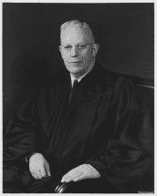

厄尔\*沃伦 美国著名政治家、法学家，第 14 任美国首席大法官

我的很多同学是白左，在偏向自由派的民主党人的心中，沃伦所领导的法庭，1953 年到 1969 年的美国最高法院，是一个非常光辉的时代。他彻底地颠覆了美国施行已久的政策、颠覆了很多传统的价值观念，几乎重塑了整个社会对于很多问题的看法。他被认为掀起了一场自由主义宪政革命、被认为是一代法官能够引领这个时代变化的一个非常典型的例子。

关于沃伦，喜欢历史的同学可能听说过这个名字，因为沃伦在就任美国最高法院大法官期间有肯尼迪总统遇刺案，所以他当时领导了调查肯尼迪遇刺案的沃伦委员会。

他本人的人生经历也挺有趣的，他是美国历史上最后一个曾经在政府中担任要职的最高法院的首席大法官，后来在美国《大西洋月刊》所评选的"100 位最有影响力的历史人物"当中排名第二十九位，在所有法官的排名当中，仅次于约翰\*马歇尔大法官，他的影响力在法官当中是非常少有的。

今天的美国，当然是鼓吹他的自由民主的价值，很多美国人以此为傲，可是如果时间上溯几十年（不过是几十年之前），我们回到五六十年代的美国，可能会非常地震惊这个社会、这个国家的意识形态价值观之保守和落后，沃伦的法庭在很多层面上重塑了这一切。

非常有趣的是，沃伦本人是一个共和党人，大家想想看，川普是共和党、希拉里是民主党、桑德斯这个社会主义者是民主党。现在的美国比较明显的是，共和党偏向于保守的一派，而民主党偏向于进步或者是自由的一派，结果阴差阳错的，一个共和党的首席大法官竟然成为了所谓自由主义宪政的领导者，这件事情让很多共和党人大跌眼镜，尤其感到懊悔万分的是提名他做最高法院首席大法官的共和党总统艾森豪威尔。

艾森豪威尔据说后来感慨过，提名沃伦做首席大法官是他一生中所犯的最愚蠢的错误，因为作为一个共和党提名的法官，完全没有把判例、法律往共和党所期待的那一方引领，反而是一次又一次地挑战共和党的一些最重要的社会政策。

沃伦作为军人参加过第一次世界大战，他做过加州的州长，也做过加州的检察总长，他在当加州的检察总长期间，做过一件可能是他的人生污点的事情。

1941 年日本发动了珍珠港袭击，美国宣布参加第二次世界大战，那时候美国军方提出了一个政策，美国政府也签字了这个政策，就是他们认为"所有在美国的土地上生活的日本人、日裔的移民都可能是日本的间谍"，因为他们当时对日本有强烈的仇视和恐慌的情绪。

所以在美国做了一个相当于集中营的集中隔离，把所有的日本人、或者是日裔移民集中隔离在一起。这件事情在今天的美国人心中，是历史上一个巨大的耻辱。"号称为反法西斯而战的美国，在自己的土地上把自己的人民仅仅因为他们是日裔，就把他们集中隔离到一起，无端地怀疑和诬陷这些人可能从事间谍活动"，这是一段他们都不愿意面对的历史。

而当时的日裔移民集中在加州，沃伦是加州的检察总长，他当时公开地支持了美国军方最初提出的隔离日本人和日裔移民的方案，他在 1942 年公开表态说，日本人在加州就好像整个美国民间防线的"阿喀琉斯之踵"，就是整个美国的弱点。

虽然最后是军方提出、罗斯福签字的决定，但是沃伦公开地表态被认为是隔离措施的一个重要的推动力。

沃伦对这件事情感到非常的痛苦和懊悔，他在晚年的回忆录中写道，"我对那项隔离命令和我自己的证词感到非常懊悔，因为这不符合我们对于自由和公民人权的定义。每当我想起那些无辜的孩童被强制从家里、学校和自己熟悉的环境中带走，我的良心备受谴责。"

其实在 1944 年他就已经对此表示了懊悔，有很多人认为，这件事恰恰是他后来作为一个共和党的法官却偏向于自由主义的价值的原因，就是他在作为最高法院的首席大法官，当他手中握有一定程度的相应权柄的时候，都在弥补他当年犯下的这个错误，而把整个社会的价值或者法律所反映出来的价值，往自由主义的方向进行推动。

沃伦在 1952 年曾经是共和党竞选总统的热门候选人之一。他之前已经参加过了一次总统选举，是作为副总统的候选人，但是他最后输给了杜鲁门。但在 1952 年，艾森豪威尔刚从二战载誉归来的五星上将提出他要参选，于是沃伦答应了退出。

作为一个交换条件（好像有一些肮脏的政治交换），艾森豪威尔向沃伦许诺，会提名他出任最高法院的大法官。艾森豪威尔上任不久，1953 年文森大法官突然心脏病逝世了，于是艾森豪威尔也就把沃伦任命为首席大法官，那后来就发生了我们都知道的艾森豪威尔痛苦万状，非常后悔自己做了这个决定，当然这个是传言。

那沃伦到底在他任间做了哪些事情，以至于让艾森豪威尔如此的后悔呢？

# 76\. 证据规则与权利平衡：不停自我修正的法律

（公众号懒人找资源，懒人专属群分享。）

那沃伦到底在他任间做了哪些事情，以至于让艾森豪威尔如此的后悔呢？

#### 厄尔\*沃伦裁定案例

【1954 年  
埃尔南德斯诉德克萨斯州案】包括 1954 年的埃尔南德斯诉德克萨斯州案，他裁定了"墨西哥裔的美国人有权参加陪审团"。从这些决定里，可以倒推出 1954 年之前的美国，或者沃伦时代之前的美国是有多么得糟糕  
墨西哥裔的美国人甚至没有权利参加陪审团（当然那个年代的黑人是没有权利的）。

【1954 年 布朗诉托皮卡教育局案（布朗案）】然后是 1954 年著名的（我们之后也会讲到的）布朗案，他裁定"公立学校的种族隔离违反宪法"。

【1956 年  
耶茨诉美国案】1956 年的耶茨诉美国案（如果有机会我们也会讲到），在二战结束之后，美国在冷战期间，曾经兴盛过一段时间的白色恐怖麦卡锡主义，他（麦卡锡主义者）打压共产党人，愈演愈烈之后，甚至把共产主义作为一个打击排除异己的手段，动辄上纲上线，给人扣上共产党人的帽子，然后用法律去打压不同的言论。耶茨案推翻了麦卡锡主义者为镇压共产党人制定的法律，这是向麦卡锡主义宣战的一个重要的案件。

【1962 年 恩格尔诉维塔莱案】之后 1962 年的恩格尔诉维塔莱案，是一个非常重要的关于美国政教分离的案件，宗教和政治分离这是第一修正案规定的内容。

【1963 年  
吉迪恩诉温赖特案】接着是 1963 年的吉迪恩诉温赖特案当中，他确立了"每一个无法负担律师的公民，法庭必须为他指派一位律师"。在接下来一系列的关于选举区域划分的案件当中，才第一次确立了美国一人一票的原则，美国并不是一个直接民主，一人一票选总统的国家，它是一个代理人制度的选举。但在之前，选区的划分，就是选区的人投票是由代理人去投票，在这个的过程当中，选区的划分甚至不是按人口的总数来划分选票的，连这种间接的一人一票都没有实现，直到案子之后才逐渐靠近一人一票。

【1964 年 《纽约时报》诉沙利文案】1964 年（这是我们花了很长时间讲的）《纽约时报》诉沙利文案，这是对言论自由的一个非常重要的案子。

【1964 年  
亚特兰大之心汽车旅馆诉美利坚合众国案】1964 年还有亚特兰大之心汽车旅馆诉美国案，这是再一次确立了"公共机构和公共场所不允许种族隔离"，这是对布朗案的一个加强和发展。

【1965 年  
格里斯沃尔德诉康涅狄格州案】在之后的格里斯沃尔德诉康涅狄格州案，裁定"康涅狄格州禁止公民节育是违宪的"，可见在此之前一个州竟然可以禁止它的公民节育、禁止它的本州的公民采取避孕措施，这是基督教极端保守的州做出来的事情。那这个判决除了对康涅狄格州的年轻的人们是一个非常重要的案子之外，之后在罗诉韦德案，就是关于妇女堕胎的权利的案子当中是一个重要的法律依据的来源。不然罗诉韦德案是不可能凭空创造出新的法律，它依据这个案子所确立的"人有控制他的身体的基本权利"，发展成"人有堕胎的权利"。这是为美国的保守派最为痛恨的东西。

【1966 年 米兰达诉亚利桑那案（米兰达警告）】

【1967 年  
洛文（夫妇）诉弗吉尼亚州案】1966 年就是米兰达警告，以及 1967 年的洛文诉弗吉尼亚州案，是裁定"弗吉尼亚州和其他的 16 州禁止不同族裔通婚违宪"。在那之前，特别是美国南方的许多州，甚至不允许不同的族裔通婚，白人和黑人不能够结合，一直到这个时候，这种规定才被裁定为违宪。

#### 厄尔\*沃伦领导自由主义宪政革命

我每次读这些案子，由衷感受到的都不是沃伦有多么厉害，而是沃伦之前的美国是有多落后，但这就是历史的真实。异族通婚的规定不只影响到黑人和白人，也影响到黄种人，还影响到早期的中国移民，是一段非常沉重的历史。

不知道大家从这一系列的沃伦的故事里读出了什么？我最初读到的时候，觉得读到了很大的正能量，厄尔\*沃伦是在自己过往糟糕的决定之中，醒悟过来的一个共和党的大法官，以一己之力在十几年的时间里，颠覆了如此之多的美国的保守派所最为看重的价值，把美国往自由主义的道路上推这么远，包括节育、政教分离、种族隔离、言论自由、米兰达警告。所有的这一切都在这十几年的时间之内，由他所领导的法庭改变了，也证明了法律人是可以改变社会的（当然要做到沃伦这个实在是太难了）。

当然这不是他一个人的努力，但这是一个时代的缩影。像米兰达警告这样的，看似超越宪法本身赋予的证据规则，并不是宪法本身的产物，它是时代的产物。

比如说宪法确实赋予了基本的权利，可是这些基本权利的措辞是相当之模糊的，这些基本权利到底怎么样被应用到现实的生活当中？一个人不能够被迫自证其罪、或者一个人不得无故被搜身，怎么样运用到具体的生活场景当中？一个警察具体要怎么执法？这些具体的法律规则并不是宪法本身能够告诉后人的，它是由法官在做具体解读时去决定的。

法律有没有一套特别根本的原则需要遵守，可能是有的，但是法律具体表现是什么形式，是由每一个时代决定的、是由每一个时代的某一群人决定的。像是米兰达案的投票结果是 5:4，就是最后一个投票的人决定的，（法律的原则）接下来是由许许多多的地方法院，在具体的每个案子当中所做出选择和决定的。

#### 证据规则困难且重要的应用领域：性侵犯

案件那除了像沃伦这样的时代的大背景，这些解读还因为案件的具体类型而又不同。证据规则一个非常困难，但也非常重要的应用领域是性侵犯的案件。

前段时间曝光了令人震惊、恶心、痛苦和愤怒的韩国 N 号房事件，26 万人在网上付费观看性侵犯，这个事件可以聊的法律问题有很多，其实已经过去了这么久，我也看到了很多很好的讨论。

大家最关心的问题可能是，这些付费观看的人有没有可能付出法律的代价？也有很多学者提出，理论上依据协同犯罪的原则是应该付出代价的，但是实践操作当中怎么针对 26 万人逐一地去判断他们的责任，这个是一个实践难题，我也不知道事情会怎么样发展。

这个事件当中有一些让人感觉非常痛苦的事情，就是有一部分女性（当然未成年的就更可怕），成年的女性、女艺人她们是遭受胁迫，不得不去做这些很屈辱的事情。

性犯罪问题有一个很根本的问题，就是报案率很低，很多人不愿意采用法律的手段去维护自己的权利、弥补自己的损失、遏制犯罪的继续进行。这与证据规则是有关的，因为很多人害怕把自己这种耻辱的遭遇公之于众，特别是拿到法庭上去接受法官、大众陪审团的审视。

性侵犯案类型的相关证据规则也一直在调整和修改，很多时候就是为了直面案子的具体困境而做出的调整。

以美国为例，它早年有一些是会阻遏女性的受害人（男性也可能成为性侵犯的受害人），就是"阻遏受害人去拿起法律武器保护自己的一些程序上的要求"，但在司法的实践当中逐渐地被废除。

比如早年的性侵犯案，受害人本人必须找到一位支持她证词的证人，而这种证人是很难找到的，以及证据要求本身就是对受害人可信程度的怀疑，如果不是因为怀疑本人的可信程度，为什么会要求再找一个协同的作证人呢？所以这个规则被废除了。

早年的程序规则当中有一条是"法官需要告诉陪审员说，大家要保持审慎，因为这一类的案件是很容易提起控诉，而被告是很难自证清白的"，这一条也被删除了，因为法官的这句话或者是由被告律师所提出的这段话，可能过度影响陪审团的判断。

又比如早年的刑法规则是"性侵害的案件必须在三个月、或者是不同地方的法律具体规定的一段时间内就提起控告"，这个规则也被废除了，这个规则有很多人还是支持的。就像之前讲过诉讼时效这件事，在有的时候会觉得正义无法实现，又确实年长越久的案子可能对被告是不公平的，因为很多重要的证据都已经找不到了，但这个规则的废除是为了鼓励更多的受害人站出来，只有这样才能够去防止新的犯罪发生。

在聊到性侵犯的时候，有一个很重要的议题，叫做受害者谴责，这个讨论在过去几年里有很多很多，就是不停地提醒大家，千万不要做受害者谴责：一个女性被侵犯了，大家就去指责说，谁叫你穿的这么暴露？谁叫你去勾引别人？诸如此类的。

受害者谴责是一个在法庭上常用的武器，特别是在陪审团的审判当中，因为普通人虽然在理性上可以告诉自己说，"我不能用这种受害者谴责的方法去看问题"，但在实际上，受害者谴责一类的证据会在不知不觉间，对普通人的判断产生很大的影响。

律师介绍一些证据，她（受害人）当天的衣着、她的名声、她过往和其他人性交的历史，诸如此类的证据会很大程度地影响陪审团的判断，陪审团通常会对这样的受害者没有那么同情，会降低对她的好感度、会降低她的信任程度、会不知不觉间在内心深处或者是有的人甚至表现出来受害者谴责。

所以在后来 1970 年引进了一系列的立法，禁止这一类的证据被当作呈堂证供引入法庭，这就是特殊门类的证据规则，任何只在于伤害受害者可信度的证据、伤害受害者名声的证据、以及她过往性交经历的证据，都不可以被引入法庭。

之所以引入这类法律的原因，第一是刚才聊到的，它在不知不觉间对人产生的影响，心理学上是难以准确测量的，就是实际造成的影响可能比看上去的影响还要大，因为它会在不知不觉间改变对于受害者本身和对这件事情的判断，而不仅仅是这一个因素而已。

另外一个重要的原因，是引入这一类的证据会阻碍这些受害者挺身而出、寻求法律手段保护自己，因为在遭受这样的伤害之后，走上法庭是需要极大的勇气的。如果在法庭之上，她们（受害者）可能面对羞辱性质的证据、伤害到名声的证据被提出，那就会有更多的人选择沉默，甚至是选择接受继续被伤害的命运，也不愿意去面对这一切。

这是法律的证据规则，一个看上去很细节的东西，可以为改变这种现实所做出的一点点努力。

#### 法庭之上双方权利的"平衡"

但是这种规则的提出，也受到其他方面的质疑。法律的很多修改，永远是在矫枉过正的过程当中不停地偏移，有的时候你想解决这一个问题，所以引入了这一套规则，但是与此同时造成了新的问题。

很多人觉得把这种规则限制得很紧的情况下，任何伤害名声的证据都不可以被引入的话，这个是不是违背了被告人的正当权利呢？受害者、原告的基本权利是要保护的，被告也同样有为自己辩护的基本权利、去追寻事实的基本权利。

在这两者之间所做出来的平衡，在过往的案例当中所做出来的一种平衡方式，其实在之前泛泛地聊政治规则的时候讲到过的。比如在一个案子当中，被告想要引入原告跟其他人性交的历史，有的地方是不允许，有的地方是你不能够把这个证据引入来作倾向性的证明。

不能引入这个证据向大家展示  
"这就是一个水性杨花的人，这就是一个对性很开放、很随意的人。"但是它可以被引用来证明这个受害者有撒谎的动机，就是之前聊过的，它不可以被引入来证明倾向性，但是它可以被引入来证明：人的动机、伤害到底是什么原因造成的？以及其他更具体的问题，就是在人和人的权利冲突当中所做出的一种平衡。

我觉得法律的左右摇摆、不停地矫枉过正，又自我修正和改变的过程，也是一个应该不停地去追问"法律应该实现什么样的价值"的过程。

米兰达警告在那个时代被认为是一个进步的判例，它当然为自由派的人士所拥护，它对抗的是那个时代比较混乱和随意的警察执法的情况，还有大量像米兰达这样的年轻人没有足够的教育和财富，请律师保护自己的权益，因而不能够在司法过程当中充分地为自己辩护的人。

但是这个规则逐渐复杂化之后，又会不会有很多的人利用米兰达警告及其所延伸出来的一系列的规则漏洞，而逃脱法律的制裁呢？很多的刑事案件的重点，就好像辛普森，我觉得辛普森杀妻案的重点已经不再是"到底发生了什么"，而是"检方有没有提供一个完美无瑕的取证过程"。

像米兰达本人死后，他的犯罪嫌疑人不能够被定罪，这是不是在不同人群的正当权益与基本权利之间做出了最恰当的取舍？

比如性侵犯类案件的证据规则，在调整的过程当中，看到了法律很多的进步，被告方的律师不能够再向陪审团宣称，"大家一定要审慎地做决定"，因为这种案子是很容易提起指控，但却很难自证清白的。它保护了受害者这一方，一个相对弱势的社会群体，他们在法律面前的平等权利，它对抗的是长期形成的社会偏见和这种受害者谴责的一种传统、文化、或者是心理。

但是有没有可能法律的规则制定太过绝对？它反过来就会伤害到被告这一方想要为自己合理辩护的权益呢？

#### 法律 = 找到真相？

我亲身经历过我的一个朋友被提起类似的指控，发生了一系列戏剧化的事件，虽然我知道他的真实发生了什么，可是我在那一刻曾经对法律感到非常的无助，我知道他有很多东西没有办法拿到法庭上去说，或者是在不同的文化背景之下，有一些东西很难为陪审团所理解，他可能因此没有办法充分地为自己辩护，法庭最终作出的裁决完全可能是一个不公正的裁决，就是因为这些复杂的程序还有证据规则。

我那时候第一次很怀疑，法律是不是一个能够帮大家找到真相的地方？那么多被我们认同的赞赏的判决，真的都主持了正义吗？我不知道这些追问有没有答案。

在寻找一个最好的规则的道路之上，我们怎么样去对抗具体的人、具体的戏剧化的事件？这些例外情况。

我们是不是能够找到法律真正该追求的价值？又是不是能够在这个价值之下找到最好的取舍？如果这个证据规则不只关乎法庭之上的双方该怎么样去为自己争取，也关乎这个规则对那些潜在的原告和被告他们积极性的影响，当所有的这些价值被考虑进来的时候，一个社会能够找到那个最好的平衡吗？

# 番外 | 瑞幸咖啡涉嫌财务造假（一）：即将到来的集体诉讼

（公众号懒人找资源，懒人专属群分享。）

#### 法律不能脱离与超越它所依赖的社会环境

我们之前在聊到米兰达警告的时候，顺便聊了几句沃伦大法官和他所领导的美国上个世纪五六十年代的沃伦法庭（发表了比较多理想主义者的感慨）。

沃伦法庭的那十几年，是左派法律人士心目中一个非常光辉的时代，就像我们提到的美国最高法院在那十几年里，通过一系列的判决，几乎颠覆了当时美国社会各个领域的很多非常重要的制度、习俗和法律。

如果没有沃伦法庭的那十几年的变革和颠覆，今天的美国会是一个完全不同的模样。（我后来冷静下来想一想，我是不是抒发了太多理想主义者的感慨？认为法院会引领一个时代、会引领社会的变革，这个想法可能太过自以为是。）

我们总是在辩论"时势造英雄"，还是"英雄造时势"？同样的，很多人在辩论"到底是那些重要的、颠覆性的法律的决定真地改变了一个制度"，还是说"制度改变的一切条件都已经成熟，才会有那样的决定"？

法律是不可能脱离它的社会环境、文化习俗而存在的，它不可能只依附于一些抽象的理想和理念而存在。非常惨痛的例子，恰恰就是沃伦时代，它最典型的一个判决，就是（我们很多次提到的）1954 年的布朗案，石破天惊的一个决定  
第一次宣布美国的种族隔离制度，也就是南北战争之后盛行于整个南方的种族隔离制度违宪。

这个判决虽然在历史的回忆里是非常光辉的，但是在当时，它带来的现实效果却并不尽如人意。并不是说这个宣布一旦做出，所有南方的种族主义者们，就会纷纷的尊重法院的决定，然后开始推行种族的融合，当然不是那样。

恰恰相反，这个决定激怒了南方的种族主义者，反而引发了大规模的暴力和更加严苛的隔离，以至于当时的美国总统艾森豪威尔（也就是那位据说非常后悔把沃伦推上首席大法官的艾森豪威尔），不得不出动军队护送一些黑人的学生去上学，去一个废除了种族隔离的学校上学。

它留给我们的历史、留给我们的教训，可能恰恰是法律不能够脱离、也不能够超越它所依赖的社会环境。如果它走得太远的话，它可能起到的是恰恰相反的效果。

#### 法律依赖运行良好的公权力的体系

法律当然不是万能的，这件事情，我跟大家分享一个小故事，我什么时候特别切实的感受到这件事呢？

我之前在《奇葩说》的某一期节目里提到过"我在美国被抢劫过"，这是一个真实的故事。

我当时住在奥克兰（加州的奥克兰），是美国枪击案、枪杀案发生率最高的城市（因为我太穷了，只好住在那里，大家以后千万不要去那个地方旅游，当然那个地方也没有任何值得可以去的），我被抢劫了，然后就报警了，但是我从警察的冷漠的反应和例行公事的态度，就能感觉到我的手机是不可能被要回来的。

有一点讽刺的是我当时在旧金山实习，在加州的州检察官办公室（也就相当于我们的检察院实习），因为我在律所实习过，我就想了解他们的公诉机关是怎么样运作的。这个所谓州检察办公室当然不只是一个办公室，它是整个加州的司法系统，我们是分成很多个组的，我是在反垄断组，我们告的都是大公司。

我有一个好朋友，他就在刑法组，他们每天起诉那些抢劫、杀人、开枪的人，我们都在一栋楼里面工作。我当时被抢劫了，我就非常地生气，中午我就跟这个朋友抱怨（那个时候是真的很害怕），我就说"等到警察把这个人抓到，请你亲手帮我起诉他。"

但是我们都知道这是一句玩笑，因为根本就不可能抓到，这样的抢劫案每天太多了。破案率我怀疑是极其低的，因为那个警察没有试图了解更多关于我的手机的讯息、也没有试图用任何高科技的手段、他甚至没有试图留下我的一个真正可用的联系方式，但问了我的住址，他表示如果找到的话会寄一封信给我（这可见是多么的不能指望）。

我当时觉得我们这样学法律、懂法律，甚至本身就在司法系统实习，或者是他在司法系统工作的人，当我们自己被暴力伤害的时候，其实也真的没有什么方法去利用法律的手段保护自己。我们作为这整个司法环节当中的一个环节，当其他的环节不给力的时候，当警察没有帮你破案、帮你抓人的时候，其实我们是无能为力的。

所以这整个法律的运作，它是不是能够惩罚那些犯错的人？它是不是能够保护每一个人免受伤害？并不是法律独立完成的，它依赖的是一个运行良好的公权力的体系。而反过来，另一些行为，人们对它的是非对错地判断可能更加的多元，无法达成统一，但是却更加明确地、明显地会受到法律的制裁。

#### 事件：瑞幸咖啡涉嫌财务造假

最近所有人都在聊瑞幸咖啡被曝出虚报盈利的事件，我最初看到时，真的是把它当成一个时不时都会看到的上市公司造假的案件。但是我没有想到它会引发舆论当中非常两极的分化，有的人把它叫做"民族之光"什么的，有很多人说"对于资本是不能够谈道德的"。

一部《美国联邦证券法》，它一次又一次被修改的历史，几乎就是一个监管者和资本之间不停博弈的历史，资本会想尽办法的去利用规则的漏洞为自己谋利，而监管者则疲于应付一次又一次从这些教训当中去填补漏洞。所以《美国联邦证券法》不是一个一开始便自成体系的法律，它是一个不断被填补的法律。

我见过对于法律最酷的研究是 MIT 有一个数学系的教授，他把《美国联邦证券法》当作一个大的方程去解（反正我看不太懂的那种研究了），他的结论是因为这个法律修修补补太多了，所以最后它整个系统无法自洽。

这个事情（瑞幸咖啡涉嫌财务造假）的是是非非，我们现在可能难以评价。因为都没有任何更进一步的消息被公布，虽然已经有肉眼可见的很多严重的后果，包括它的股票连续的有大幅度地下跌，以及最近宣布停牌。

不管我们对这个事件的道德评价是如何，大家所站的立场出发点不同、思考问题的角度不同，可能会有很不一样的评价，我也见识了很多。但是一个明确地违反现有法律的行为，它一定得要面对可能的法律风险，还要付出相应的代价。

#### 原告律师发起集体诉讼

所谓的法律代价有几个不同的类型，大家如果最近关注相应的新闻，应该都有了一些了解，最先冲出来的一批人不是别人，正是律师，是 Plaintiff  
lawyer，就是专门做集体诉讼的这些原告律师。

他们背后是庞大的利益受到严重损害的股东群体，他们可能会发起民事的集体诉讼，向瑞幸及其高管、以及其它的牵连在其中的机构发起集体诉讼。他们的目的非常简单，就是要钱，所以瑞幸不知道还有多少资产可以应付这样的集体诉讼。

被告的人，包括瑞幸的高管，不只是在它的内部调查报告当中被认为承担主要责任，（也有很多阴谋论，说是背锅的）这个 COO，也包括它的 CEO、  
CFO、它的董事、在招股书上签过字的人、它的承销商、帮它写招股书的这些投行、帮它做审计的安永、它的保险公司，所有的这些人就会进入一场复杂的多对多的战争中。

我们有没有可能真的了解背后到底发生了什么？一切是怎么回事呢？有可能。我们之前的几期节目一直在聊的证据，在聊美国的司法体系有一个很特别的环节，叫做证据开示，Discovery，在这个环节当中，双方被鼓励尽可能地去收集更多的证据，自己把事情搞清楚。

如果这个官司真地走到那一步，在这个证据开始相当开放的规则之下，有大量的内部的通话、内部的联络讨论、各种各样的资料和记录可能会被迫公布出来，有可能让大家真的去了解背后到底发生了什么？但是大部分的集体诉讼是不会走到那一步的。就像我们以前聊过很多次，绝大部分的打官司就是为了和解，就是为了达到一个双方认同的赔偿数额。

除了集体诉讼之外，美国的证监会 SEC（美国证券交易监督委员会，U.S. Securities and Exchange  
Commission）对一个如此大的新闻一定也会有所反应。

SEC 有两条路可以去找瑞幸的麻烦，一个是它内部的行政程序。SEC 自己作为整个股票市场的监管委员会，它可以走内部的程序，有一个 Administrative  
judge，行政法官，去决定对于瑞幸的行政的处罚。通常这种内部程序的处罚 SEC 自己就可以决定，它不需要得到法院的认同。这些程序通常适用于比较轻微的违反规则的行为，就是可以"救一救"的那种行为。

它的这种惩罚性不及它想要修正这些行为的努力，作为一个监管者，它要尽到一个监管的职责。它的惩罚措施虽然也包括罚款、停牌整顿，但是它会有更多的积极性的措施。

比如它帮你任命一个内部监管者，就是去盯着你，看你合不合规；它甚至可以帮一个运行得比较糟糕的公司任命它的多数董事，直接去介入内部的管理。这些内部性的措施有一个比较低的上限，比如"个人的罚款大概是 17 万美元"，点到为止，大概是这样。

所以 SEC 面对比较严重的违法违规行为的时候，它可能会自己去提起一个民事诉讼，由法院去裁定最终的惩罚性的措施。

除了这些民事的一大堆官司之外，因为个人有涉嫌欺诈的行为涉及其中，美国的司法部门，就是 DOJ（美国司法部，Department of  
justice），可能会介入提起刑事诉讼。这就是所谓的公诉了，这些作为股东也好、作为监管机构也好，它都只能提起民事的诉讼，只有公诉机关，就是检察部门，也就是我当年工作过的检察官办公室，可以提起刑事起诉。

这么复杂的证券类的纠纷，它的诉讼周期通常是挺长的，一般都有两三年的时间。更何况现在因为美国的疫情非常得严重（我前几天跟我在美国做律师的朋友聊天，他说法院都已经关门了，所有的审判都推迟了。）不知道会拖延到什么时候，也许过两三年我们做一个遥远的番外，再回头看看到底一路上发生了什么？

大家对瑞幸这个公司无论是怀着喜爱，还是因为它的造假事件深深地失望，对整个故事有兴趣，我觉得可以关注它的后续发展，这是一个非常难得的，让我们能够从头到尾去了解一场集体诉讼的机会。

我们再回头借由这个机会来聊一聊集体诉讼这件事。之前介绍集体诉讼，是为了介绍 Plaintiff  
lawyer（原告律师），就是这一类专门到处去找官司打的律师，这种小律所是很厉害、很多的。我今天录这个节目的时候，看到的新闻是，至少已经有 5 个这样的律所对瑞幸提起了集体诉讼。

我记得当时就有讨论过，大家会怎么样从道德上去评价这些 Plaintiff  
lawyer，原告律师？驱动他们的力量，也许从来就不是公平和正义，当然也不排除有这样的人。就像我之前工作过的一个律所的老板，他就是非常地恨特朗普，所以他赔钱也要去拼命地告特朗普，但是最后也没有什么结局。

绝大部分这样的公司以生存为首要目的，他们追逐的就是钱（没有错），但是客观上他们追逐的过程，去不停地挑战这些大公司的过程，是不是也帮助了平凡的消费者？在这样的案子里它可能帮助普通的股东呢？

就好像我们该怎么去评价在"瑞幸事件"当中，起到致命性的影响作用的做空机构，或者是做空机构它背后还有一些资本的力量。浑水（浑水调研公司，Muddy  
Waters  
Research）公布它的调查报告，驱动它的力量想必也不是实现正义，但是这样的做空机构是不是在某种意义上，恰恰是因为他们受到利益的巨大驱动，它有特别强的动力去挑所有的上市公司的毛病，客观上形成的一种监管的力量呢？真的很难评价。

浑水调研公司（Muddy Waters Research） 一家专门调查在资本市场里"浑水摸鱼"的公司

#### 集体诉讼的第一个环节：招募首席原告

据说事实上在瑞幸公布它的内部调查之前，就已经有 Plaintiff  
lawyer、原告律所提起集体诉讼了。那个时候一切还不是特别得清晰，直到现在这个集体诉讼还在走它的第一个环节，就是招募首席原告。

我随手一搜就可以搜到很多这样的公告，一个叫布龙斯坦恩，格维茨和格罗斯曼的律所（Bronstein, Gewirtz & Grossman,  
LLC），他在他的网页上发布了一个公告，他告诉所有的购买了瑞幸股票的股东，可以向他申请成为首席原告，一切非常的方便，在他的网页上读完了他整个介绍之后，点 take  
action ，填一个他已经基本上帮你写好了的表格，只要说明我愿意，我证明，就可以申请成为一位首席原告。

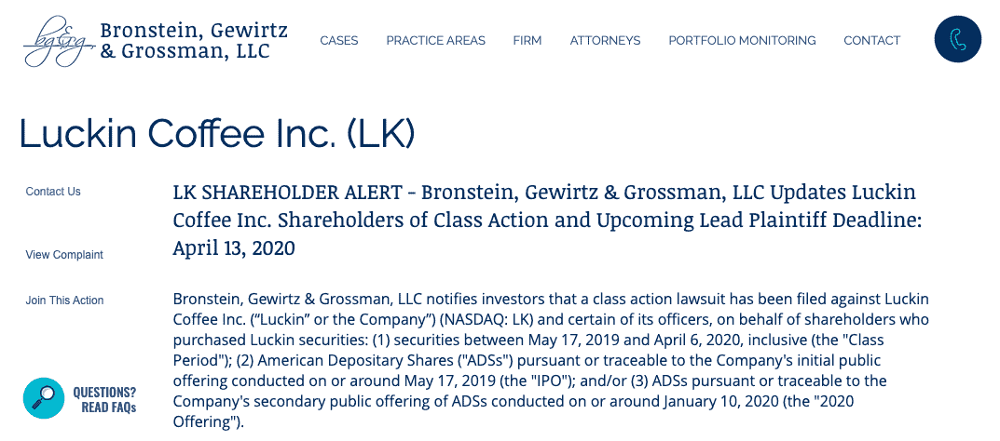

Bronstein, Gewirtz & Grossman, LLC 律所公告

为什么要有首席原告？（这就是我们之前跟大家聊过的）所谓的集体诉讼并不是一个大集体去当原告，100 多个原告一起到法庭去打官司。集体诉讼制度其实很像代议制的民主，它不是真的古希腊的民主，一人一票，大家坐在一起开会讨论事情，它是选出一些代表，由这些代表去替我们做决定，一个集体要选出一个或者几个首席原告，帮助大家去管理整个诉讼的过程。

所谓的集体诉讼就是官司的结果会影响到集体的利益，为什么会有人愿意去当首席原告呢？如果到最后一个判决出来，瑞幸要赔给每一个股东，根据他所购买的股票的数量相应地赔偿。那在家坐着和辛辛苦苦的去打两三年的官司，得到的结果不是一样的吗？

首先法院在宣布判决的时候，通常会给首席原告一定数额的补偿，就是鼓励人们去当首席原告，否则集体诉讼就进行不下去了。有的律所会选择给首席原告一定程度的补偿，还有一些人可能单纯也没有什么别的事情好做，或者是对于被告的所作所为感到非常的愤怒，一定要亲自去把他们送上正义的审判。

像 Bronstein，布龙斯坦恩这样的律所，他们首先会招募首席原告，也会做一个选择，挑选什么样的人更有代表性？什么样的人更有说服力？什么样的人更好合作？有五个律所同时提出了集体诉讼，他们不可以同时存在，最后必须合为一股力量，由法院去作出谁更适合当首席原告。法院在挑首席原告的同时，也一直在挑它的律师，谁去做支持首席原告的律师？由法院去做这个决定。

#### 集体诉讼是美国司法体系中特别的存在

集体诉讼是美国的整个司法体系当中一个非常特别的存在。学法律的时候，就知道期末考试一定会考集体诉讼，因为它违背了整个司法理念当中的一些很重要的原则。

比如我们之前提到的美国的司法体系，法官是袖手旁观的，就是双方自己去斗、去找这个证据开始、去弄清楚在斗什么？但是集体诉讼不一样，因为集体诉讼当中绝大部分的原告是根本不出现在法庭上的，他们也不参与案子的整个流程，所以法官就有更大的责任去保护每一个普通人的利益，包括这个法官要去替大家挑选首席原告，看这个人能否胜任、这个人是不是很典型、很有代表性？

当这个首席原告作为代表，他的律师和被告达成和解的协议的时候，这个协议需要法官认同，它不像在其他的普通的纠纷当中，"双方爱怎么样就怎么样，只要都开心就可以了"。这里的法官最后要去审核这个和解是不是合理？（万一被告给原告塞一个红包，就说我们差不多得了，那就很可怕了。）

我们整个节目的前半程都在讲庭审之前发生的事情，到现在都还没有讲到庭审，除了讲到证据可能涉及到一点点。

绝大多数的案子会在庭审之前结束，集体诉讼尤其如此。之前讲到的对于大部分普通的案子来说，有一些关键性的问题会影响双方谈判的筹码，比如你的管辖权、诉讼时效、以及证据开示的过程。

集体诉讼的特别之处在于：决定这个官司是不是有大的概率去要到一个好的谈判结果？最重要的步骤是：法庭是否认证这个集体存在或者成立？

这个听上去有一点奇怪，我们自己决定做一个集体不可以吗？为什么还要法院去决定集体是否存在？因为集体诉讼这个概念听上去就很可怕，它是很有可能被滥用的，这个集体可以是一个非常边界模糊的、极其庞大的集体。事实上，因为所有受苦受难的人们，害怕集体诉讼这种威力很大、杀伤力十足的制度被滥用，所以法律对于"什么样的官司可以打成集体诉讼？"有相当严格地限制。

#### 如何构成一个"集体"？

不是所有人自己觉得我们是一个集体，就能是一个集体。大家想想看，什么时候法院会希望你作为一个集体去打这个官司？无非就是两个原因。

第一个原因是只有作为一个集体，这件事情才能够进行下去（就是我们之前聊过的）。每一个个体受到的损失都是有限的、去应付一场旷日持久的官司的能力也是有限的。

比如以股票市场上的欺诈为例，假设我是一个普通的股东，我买的这个公司虚报了盈利，消息披露的第二天股价跌了 80%。我作为一个散户，我拿了 2 万块钱去买这个股票，我觉得我买的股票真的差不多亏了 80%，也就是亏了 16,000，对我来说是很大的一个损失。

可是 16,000 够打什么官司呢？按之前的介绍，一个顶尖的能够打证券官司的合伙人，一个小时的收费可能就要 1000 美元，我这 16,000 也就够我和他聊三个小时。所以我作为一个散户，我自己是不可能支撑这个官司的，但是成千上万的股东们集合起来，就能够去跟这样的大公司对抗。

还有一个原因就是这样会更有效率。比如说一个超市卖了假货，所有的人吃了这个假货都拉肚子。一个一个地去告，假设有 1 万个人买了假货，法庭就要审理 1 万个官司，它不如说你们遭遇的情况都是一样的、你们的诉求也都是一样的，我们就用一个官司把所有的问题都解决。

所以这里的核心问题是"你们这群人能不能够称为一个集体？"不是看你们这群人是不是一群相似的人，而是看你们是否有一个一致的、可以通过一次性的纠纷解决的核心问题。

举一个例子，我和正在听这个节目的大家，我们都是看理想的付费用户。从这个意义上说，我们是一群有相似利益的人，我们看上去可以集合成一个集体。

有一天，我们在大街上相遇，我说"你们要去告看理想吗？"（我为什么对看理想这么狠？）你说"我也要去告看理想"，我们一群人自己认为自己是一个集体，浩浩荡荡地来到了法院，准备告看理想。这个时候法官就问说，"你们有什么诉求呢？"有人就说，"看理想的节目太精彩了，以至于我每天废寝忘食的听，无法入眠，给我造成了严重的脱发问题。"

另一个人说，"我恰恰相反，看理想节目太无聊了，我一听就会睡着，太催眠了，以至于我每天有 20 个小时都是困的，给我带来严重的经济损失。"

这样就不能做一个集体，因为你们的诉求、想要向法庭证明的事实是截然相反的事实。法庭裁决了 A 的问题，对于裁决 B 的问题丝毫没有帮助，在这种情况下，你们就不可能结合成为一个集体。

法院是否能认证一个集体成立以及这个集体的范围有多大，对于谈判桌上的双方有致命的影响。

假设说看理想的付费用户，大家一开始推选了我阿詹作为大家的律师，推选了另一位付费用户阿庞作为首席原告。一开始我们在看理想的谈判，桌前对面是看理想的小编，我狮子大张口，说"我们背后是 100 万付费用户，你看着办吧。"结果到了法庭一聊，发现我们不是一个集体，最后法庭认证的一个集体，就是"脱发"这个集体，最后只有 20 个人，看理想就不会理我们了，集体诉讼的这一方就没有任何的筹码。

所以在真实的世界里（因为这个故事实在是有点扯），一般来说一个大的公司它也会很害怕进入一个旷日持久的拖延战，几年的诉讼历程，它最后可能有一个极高的赔付风险。

如果你面对的是一个庞大的集体诉讼的群体，这些大公司会有强烈的意愿达成和解。像刚才聊的，甚至它也不愿意走进证据开示的环节，以免有更多的内部信息会被曝光，会给他带来更多的纠纷和无穷无尽的纷扰。

一旦这个集体被认证了，这些官司有很大的概率就会和解。所以对于做集体诉讼的律师来说，最重要的那个坎，就是迈过这个集体能够成型的这个坎，class  
certification 就是我一旦 certify the class ，基本上你就可以先开香槟庆祝了。

# 番外 | 瑞幸咖啡涉嫌财务造假（二）：《证券交易法》中的“反欺诈”规定

（公众号懒人找资源，懒人专属群分享。）

#### 怎样的集体能被认证？

简单地聊一下，什么样的集体可以会被认证为一个集体？集体诉讼要想认证为集体，被法院认可，需要满足两类条件。

第一类条件，是硬性的规定、是所有的集体都必须满足的。

首先，这个集体要人数足够多，是一个足够庞大的集体（否则，你们自个去就完了），通常这个数字被认为是有 40 个人以上。

第二，是这些人都有一个共同的法律问题，或者是有一个共同的事实争议。比如大家都是亚拉巴马州的黑人，大家共同的法律问题是"亚拉巴马州学校的种族隔离制度是否违宪？"它可能是一个事实问题，比如所有的人都是某一次空难，飞机失事的受害人家属，大家共同认证上的问题是"飞机的制造商或者是航空公司是否对这次空难负有责任？"这是一个共同的问题。

第三，是首席原告所提出的诉求，应当是所有的集体成员当中的一个典型。所以说选择首席原告是一个非常重要的过程，因为它可能会影响到你这个集体是否能够被法庭接纳、接受，以及最后首席原告和他的律师要能够公平地、充分有力地代表集体的利益。

最后，（当然法庭就像我们说的）法庭会挑选合适的人选、它会挑选一个合适的律师。其实更大程度上是在挑选律师，他会看律师的准备工作是否充分、是否最早发现了关键性的诉求、他们（原告律师）的经验和资源，所以在这一行口碑逐渐累积的过程是非常重要的，它可能关系到律师能不能够拿到一个重要的官司。

很多做集体诉讼的 Plaintiff lawyer，他们是专业做这件事的。就像已经起诉了瑞幸的 Bronstein  
律所，我点进它的首页去看，发现它大大的广告，就是专做消费者权益保护和《证券交易法》集体诉讼，它就是专门做这个的。

Bronstein, Gewirtz & Grossman, LLC 首页广告：

SECURITIES & CONSUMER CLASS ACTIONS

（证券与消费者集体诉讼）

WE FIGHT FOR INVESTOR & CONSUMER RIGHTS!

（我们为投资者和消费者的权益而战！）

它曾经挑战过的公司都是一些大品牌，包括惠普、包括 Six Flags（美国的一个连锁的游乐场），所以瑞幸面对的这种司法压力可想而知。这是第一类的诉求。

接下来，所有的集体诉讼必须是以下三个类型当中的一种，就是得符合某一类。

第一种，我们把它通俗的叫做 Limited funds case，就是分蛋糕，这个蛋糕是有限的。

假设你的桌上只有一个蛋糕，有 10 个人要分这个蛋糕，如果你允许大家分门别类地去分，大家各自去分。比如说有的人速度比较快，他的诉状写得特别快，一年就把这个问题解决了，他就冲上去分了一大块，而有的人拖延了好几年才去分，这个分配的过程就可能不公平。

不如这 10 个人组成一个集体，大家一起坐到桌前去分这个蛋糕。这种事件通常发生在这个公司，比如它破产保护了，它只有那么一笔钱拿来给大家；或者是一个公司，它很明显地违背了某个法律，它要吐出它的不法所得，然后这个不法所得交给所有受到伤害的人去分。这一类的官司，因为这个条件很难满足，就是你怎么证明"这个蛋糕是有限的？"所以并不常用。

第二种，不是图钱，而是不图分什么，是求一个名分、求正义、求法院的一个判断。

比如布朗案，它求的不是某一块蛋糕，它求的是法院认证，用判决的形式确认：种族隔离的学校在这个国家是违宪的、是不合法的。所有生活在这些有种族隔离法的南方各州的黑人，他们都会自动地成为这个集体的一员，原因是这个判决无论如何都会影响到整个集体中每一个人的利益。

事实上，绝大多数的时候，我们常用的集体诉讼，是 Common Question Class  
Actions，就是共同问题。就像刚才讲的，瑞幸咖啡的虚报盈利，它要是申请做集体的认证，它就会走这条路。它不是为了求一个法院的名分、一个法律的声明、法律的某一个裁决，它的蛋糕也不是一定的。

它是为了什么？它就是为了钱。好听地说，是为了这群人的正当权益；赤裸裸地说，就是为了钱。法院、法官也对这些人的所求心知肚明，所以这一类的认证是比较困难的，通常需要证明这些人真的是面临一个共通的问题，就是对于所有人来说，这都是一个最重要的、Predominant 的问题。

第三种，是允许这些人以集体的形式提起诉讼，比要求他们各自提起诉讼要更有效率。

这一种集体诉讼和前两种有一个程序上的明显分别，对于前两种来说，如果你是一个集体的一员，你是不可以选择退出的。

对于第一种诉讼来说，它的逻辑就是所有人要一起坐到桌前，去分这个蛋糕，才能保障每个人分得的都是公平的，不能说"现在不想分，过一阵子再说"，不能够选择退出这个集体。对于第二类来说，也没有什么可能退出，如果你是一个生活在 1953 年的黑人，你的利益一定会被布朗案影响，没有这种选项说"我无所谓，我不接受布朗案。"

但是对于第三类来说，有一个非常重要的环节。大家如果继续看瑞幸整个案子的走向（我们之后会聊到或者看到），现在律所它发布的告示是说，大家都来报名做我的首席原告；再过一段时间，首席原告选出来了，集体成立了；再下一步，首席原告和他的律师就需要再发一则声明，通知所有的人：是否选择退出这个集体？有可能我的利益也受到了影响，但是我不信任首席原告，或者是我不喜欢这种解决问题的方式，我觉得我自己可以做得更好，我现在可以选择退出这个集体，我将来自己去提起诉讼，这个是一个非常重要的程序上的环节。如果这个程序上的环节没有充分的满足，它将来也可能成为对方的一个把柄。

#### 案例：沃尔玛性别歧视案

聊了这么多的条件，整个概念可能还是比较模糊，我们用一个例子来分析一下。所谓形成一个集体不是那么容易满足的，不是抽象的、泛泛地说，我们大家面临的问题都是一样的，这样是不够的。

2011 年有一个非常出名的集体诉讼，它出名是因为（人数）真的很庞大，是美国历史上人数最多的一个集体诉讼。沃尔玛所有的女性员工把沃尔玛给告了，是从某一个时间点之后，在沃尔玛工作的、或工作过的女性员工，一起把沃尔玛给告了，告的当然就是性别歧视。

沃尔玛大概总共有 150 万女性员工组成了一个非常庞大的集体，这个案子一直打到美国的最高法院，它自始至终都没有真的去纠结"有没有性别歧视"的问题，它一直在纠结的问题就是"这 150 万女性员工能否被认证为一个集体？"那么多的人要被认证为一个集体，困难是可想而知的，就是你怎么证明这些人面临的都是同样的法律，或者现实问题的？

所谓的性别歧视，沃尔玛不可能在它公司的规章政策里面写"女性不能担任某一些职位"之类的，这些性别歧视其实都是在不经意的过程中，在每一个具体的用人、升迁、加薪的决定过程当中（也不叫不经意，就是一次次的这么隐性的决定当中做出的），它最后构成了对整个群体的歧视。

原告的律师其实也是明白自己的挑战是非常困难的，他用了很多办法，包括我们刚才聊到，想要证明这个是一个集体，就需要证明：第一，是要满足一些硬性的条件；第二，要证明它符合三类集体诉讼当中的其中一类。

这个律师就两类他都占了，他既说了"我符合布朗案这一类，就是要求不是要赔钱，而是要一个法律公正的裁决、一个声明。"以及第三类，就是我们大家面临的是一个共同的问题。

这个就很像"文科生答高考题"，反正是看点给分，会写的全部写上去，就等着你的阅卷老师从当中去挑一些正确答案，反正一开始我也不知道法官会看上哪一个，最终的结果就是法院两个都没有看上。

最高法院最后是做出了一个一致的裁决："首先，你不能够用布朗案这一类的集体诉讼，因为你明明就是要钱，你也太坏了，你又要钱，你又说不是，我是要一个名分，我们这些人寻求的是正义。根本不是，你明明就是要沃尔玛的金钱补偿。"

第二个问题，会更难回答一些。可不可以认为所有的女性员工都面临同一个问题  
性别歧视，抽象的看好像是的，但是得具体看。最后判决的斯卡利亚大法官，他是一个著名保守派的大法官，但也是一个非常有趣的人，之后有机会可以读一读他写的判决词，真的非常有趣。

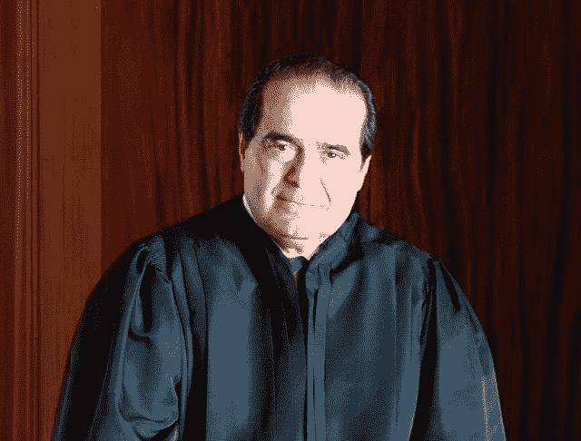

安东宁*格雷戈里*斯卡利亚 （Antonin Gregory Scalia）（1936-2016）

他就说，"所谓的要去证明到底有没有性别歧视存在，是要去证明一个又一个具体的用人决定，是否是把性别作为最重要的考量因素的？两个条件完全一样的人，是否仅仅因为性别，公司的某一个经理就选择了升迁男性，而不是女性？男性就被送去了管培班，女性就被送去了没有那么有机会学习更多的技能。能够更快升迁的职位，是所有的这些管理层当中各种各样的人，他们所做出的数百万个决定影响着这 150 万女性员工的福祉。"所以这个案子就是非常的夸张，这个集体诉讼相当于要用一个诉讼去挑战数百万个决定，而法院觉得这是不可行的。

原告工人没有提供具有说服力的证据，来表明在整个公司层面存在歧视性的薪酬和提升政策。

\--美国最高法院裁定沃尔玛胜诉性别歧视案斯卡利亚大法官判决词（节选）

#### 集体的范畴是什么？

聊了这么多之后，回到一开始的瑞幸的问题。相比之下，正确类的诉讼在"构成集体"这件事情上是更容易一些的（非常明显）。为什么能够形成一个集体很明显？是因为我们都是股东，都是因为依赖了这个公司的一些不实的陈述。

像瑞幸这个案例里面，它自己的内部调查披露了它有不实的财报，造成了损失，真正的挑战在于"哪一些股东应该被纳进集体的范畴？"我们最起初是泛泛地聊集体诉讼，有监管部门、SEC，都可以通过《证券交易法》对瑞幸的高管，对这个公司，对他的承销商，对各种各样的团体提起诉讼。

《证券交易法》是非常复杂的，它可以依照最常见的第 10（b）这一条去说，它是一个欺诈行为。要证明这个欺诈行为，只要证明这个公司、或者它的高管，有故意的隐瞒行为或者是有严重的失职，导致它没有了解这个虚假的信息。

任何人利用任何州际商业手段或设施、邮件、或利用任何全国性证券交易设施所实施的、与任何证券买进或卖出有关的下列行为均为非法：

\[1\]使用任何计划、技巧和策略进行欺诈的；

\[2\]进行不真实的陈述或遗漏实质性的事实，这一实质性的事实在当时的情况下对确保陈述不具有误导性是必要的；

\[3\]从事任何构成或可能构成欺诈他人的行为、或商业活动的。

\--1934 年《证券交易法》第 10 条（b）项所制定的 10b--5 规则

也有可能律师团会选择一个比较容易的路径，就去证明招股书是有虚假信息的，这相对来说，更容易证明，因为招股书清楚明白地写在那里。而走这条路的好处，一个在于它不太需要证明 CEO 的主观动机，还有 CFO、所有的公司董事，他们在这个招股书上签字了，就表明了他们承担了这份责任。而如果这个招股书上的信息被证明是虚假的，他们就得承担责任。

但是如果用这条路径去打这个官司，哪些股东就可以被认为是受到了影响的？不是所有的人都是依照这个招股书去买的股票，其实在二级市场里，大家都没有直接依赖招股书去买股票（这个就会变得更复杂）。

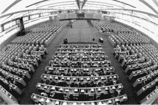

证券交易市场（二级市场） 是指已发行的有价证券买卖流通的场所，是有价证券所有权转让的市场。

所以对于证券类的诉讼来说，一个很重要的问题是，怎么界定 Class  
Period，这个集体时期。在我刚才给大家念的，在这个 Bronstein 律所的网页上，它就跟大家说，根据这个公司的定义，从瑞幸 IPO（Initial  
Public Offering 首次公开募股）的那天起，到丑闻被曝出的那天为止，在整个区间都是 Class Period 的。

所有在这个区间之内仍然持有股票的，或者是所有在这个区间之内购买瑞幸股票的股东，都是这个"集体"的一部分。但是这个定义可能会被调整的，法院可能认为不是所有的股东、不是所有买了股票的人，都真的因为任何的不实陈述造成了损失，这些就会变得非常的细节化。

到底哪一些人是因为听信了不实的陈述而买了股票，他们到底有没有因为这个丑闻被爆出来而遭受损失？这个时间点的划分就变得非常得重要，因为这个时间点，股票的价格如此地瞬息万变。这个时间点就会影响到，最后去衡量我们每个人到底承受了多少损失，而这些损失分门别类，应该由哪些人去承担？

#### 集体诉讼被鼓励、也被克制

最后这个证券诉讼是很复杂、很具体化的一个"游戏"，它没有辛普森案这样的案子那么有趣，可能正好借助我们对这个公司本身的关注，正好有这个机会去关注整个流程，也借机了解一下证券法的诉讼。

这里更重要想讲的是，了解一下集体诉讼这种有趣的诉讼形式，它很鲜明地体现了集合众人的力量，去挑战每一个个体可能都无法撼动的庞大的存在（这样一种好像挺浪漫的理念）。

就像我们所说的，绝大多数的集体诉讼，背后驱动它的力量都是利益，可是这不代表它不能够给社会带来很多正向的改变。

我当时在哈佛法学院学民法，我们大家都知道集体诉讼是一个必考的科目，因为我们的民法学的教授，他本人就是一个做集体诉讼起家，而且非常有名的集体诉讼的律师。他在 70 年代的时候，是最早的为同性平权而起诉美国军方的律师，那个案子让他声名鹊起，他在性少数群体当中就是一个偶像般的存在。

所以集体的力量是可以非常强大的，他们改变了很多可能原本改变不了的东西，当然集体的力量也可以被滥用，它可以被逐利的律师所滥用、被逐利的首席原告们滥用，最后变成一个无所不摧的力量。而法律如何在鼓励和克制它之间寻找平衡？可能才是更重要的问题。

# 番外 | 美国是否可就新冠肺炎向中国提起诉讼？

（公众号懒人找资源，懒人专属群分享）

我发现我去年刚开始录这个节目的时候，是比较紧张的、很正经的，正襟危坐，恨不得换上正装。而我现在有一种，每次录这个节目就像跟大家唠嗑的感觉。

这期是一个番外，交代一个小的问题。因为我最近看了一些评论，要提醒一下，这个节目"非常不幸"是一个更新频率很低的节目，每周只更新两集，虽然之前有尝试说，要就一些热点的话题帮大家提供一些参考。

可是没有办法完美地做到一直追热点的，包括我自己看到新闻，注意到新闻，深入地了解新闻，到录制节目，到剪辑、配乐、上线，包括有的时候要配合把之前的一个系列播完之后才播番外，它的时效性是会大打折扣的。很多时候，上线对某一个话题的讨论，其实这个热点已经过去了，又或者是没有想对任何的热点话题作出讨论，但（节目上线）又正好撞上了新的热点。

比如说前两期在讲证据规则的时候，我最后举了一个类型的案子  
性侵犯案。性侵案件作为一个类型，只是为了向大家介绍证据规则适用在不同类型的案子当中，它可能会因为这个案子特殊的一些困境，包括原告和被告的困境去做出调整。

在录制那一期节目的时候，鲍毓明性侵案还没有被曝光（我还不知道这件事），所以那些评论和这个案子本身无关，它不是针对这个案子作出的评论。所以听上去的时候会有一些奇怪和偏差，大家可能在一个强烈的情绪之下，正好听到那些节目就会不自觉地把两者联系到一起。

我觉得虽然这个热点已经过去了，可能这个人在那两天是大家心中的一股怒火，而这两天已经被别的新闻取代了，可是仍然有一种责任去把它当作一期番外再聊一下，与性侵有关的法律问题，这会是我的下一个番外，因为我觉得是不是要更紧跟时事（不吐不快），聊一些问题。

#### "案例"：新冠肺炎集体诉讼

比如这两天最"火"的问题，我收到了很多的提问，都是关于"美国的律师，在美国起诉中国政府，要求中国就新冠肺炎造成的损失作出赔偿，包括新冠肺炎在美国扩散造成巨大的人员上的损失和经济上的损失"。

一开始是有两个集体诉讼，也是前阵子才刚聊过的概念，结果集体诉讼这个"集体"的范围之广阔，基本上（就是恨不得）包括所有的美国人，所有因为新冠肺炎受到影响和损失的人（那就是恨不得定义全世界所有人）。集体诉讼之后，美国的议员也表示要控告中国，要求中国就新冠造成的损失作赔偿，包括他们提出要修改法律等。

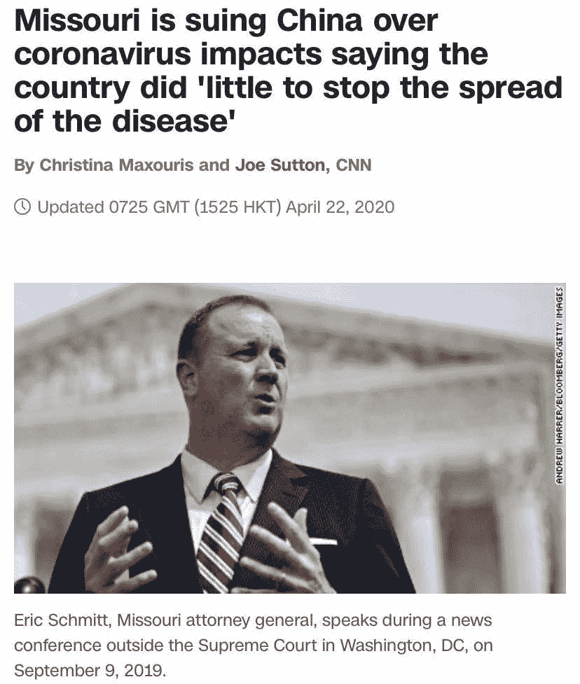

密苏里州起诉中国，称中国"没有阻止冠状病毒传播"

有很多人问我对这个问题的看法，当然我相信有很多是善意的提问，就是想问看法，还有一些是不善意的提问，那这个就不聊了。这两个集体诉讼大概是一个月以前的事情，当时我们都没有聊这个话题，因为觉得实在是太扯了，就是我觉得这很明显是一个炒作，它不可能是一个严肃的起诉。结果愈演愈烈，还在不停的有这样的新闻曝出来，所以实在是忍不住，虽然很多人劝我不要再在微博上讨论时事的话题，但这是我真实的看法我还是要表达出来，那我们来聊一聊。

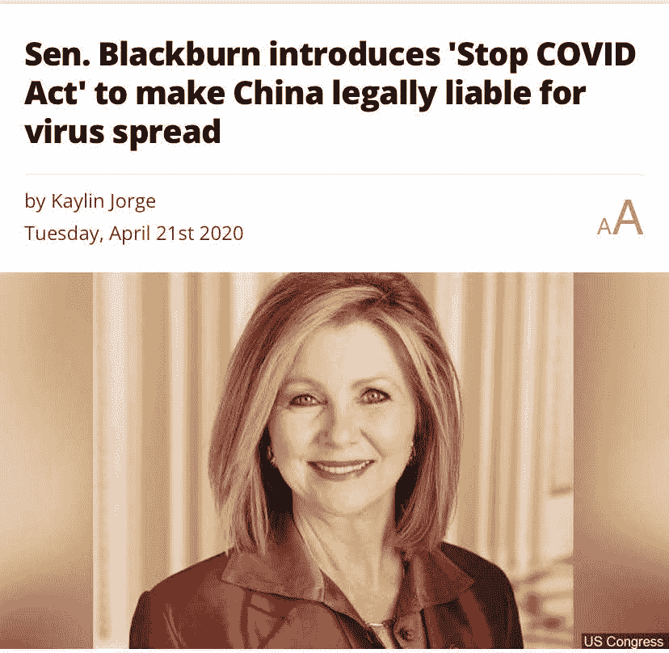

美国某议员意图立法使中国为此次疫情负责

我非常欣慰的是，在我的那条微博底下看到有很多朋友，很明显都是这个节目的听众朋友，纷纷地表示，"听过阿詹的节目之后，第一时间就想到了管辖权"（太对了！就是当然了），当看到这么不靠谱的起诉，大家首先就应该想到这个法庭真的有权力裁决这样的案子吗？它真的有权力管吗？它没有。

#### 管辖权之豁免原则

因为这个节目整个前半程（可能因为本人实在是太啰嗦了），讲管辖权这个概念讲了很久，我希望它是深入人心的，因为它真的很重要，大家从这一系列的案例里面就可以感觉到。

首先，不管是美国政府、它的民间组织集体诉讼，还是它甚至以官方的身份去提起诉讼，它无非就是两条路可以走。

一是在美国国内的法院提起诉讼，那这就是集体诉讼，所有学法律的人就会第一时间想到一个词，叫做 State  
Immunity、主权豁免。在之前的节目里讲到过一个概念叫做外交豁免，当时是为了举例来向大家说明某一些人在法律的面前是有特权的，有的动物比其他动物更平等。

那个时候主要讲外交官在这个国家犯了法，他可以不受这个国家的法律、司法体系的审判，这个外交豁免权跟这里要提到的 State  
Immunity 是不一样的概念。它们的相似之处是，都源自于一些非常古老的政治理念，一个外交官被认为是这个国家的主权的一个象征，所以外交官脚踩的土地就应该是这个外交官的母国的领土。

State  
Immunity，针对于国家政府的豁免权，它同样根源于古老的概念，一个国家的主权包含了一种权利，就是这个国家的政府，没有必要去面对他国的司法审判。所以这个是一个国际法的概念，它是国际法中习惯法的一部分，就是 International  
Customary Law。

国际法有两个最重要的来源，一个是各国之间所签订的各种各样的条约，另一个就是传统、习俗、文化、礼节，过去怎么办事，现在还怎么办。听上去非常得抽象和不靠谱，但是事实上，甚至可以说更多传统意义上的国际法，是从习俗来的，这个习俗在世界各国是得到普遍的遵守。

美国的司法体系里外国主权豁免也是一个很古老的概念，主要是在它源远流长的案例法当中一直尊重这个规则。它的特别之处是除了是判例法，它还被变成了成文法，也就是美国的国会在 1976 年的时候制定了一个法案，就叫做《外国主权豁免法》，Foreign  
Sovereign Immunities Act(FSIA)。

第一千六百零二条 查明事实和宣布宗旨

国会认为，美国法院就外国要求从该法院取得管辖豁免权一事所作的决定应有利于公平正义并保护外国和在美国法院诉讼的当事人的权益。

美国《外国主权豁免法》（节选）

这个法案是把传统的外国主权豁免的原则，一条条比较清晰地列出来。这个原则很明确，就是所有的外国政府，包括它的国家政府，它的各级政府、地方政府，它的各级国家机关，或者是由这个国家控制的机关，别国的法庭对他们都没有司法管辖权，比较有趣的地方永远是在例外，就是豁免权是有一些例外的。

#### 事件：佛罗里达州某律所欲"起诉"中国

以佛罗里达的这份起诉为例，它组织了一个从定义来说，基本上包括了美国所有人的集体诉讼，它起诉了谁呢？它起诉了中国政府、国家政府，它起诉了 CDC（中国疾病预防控制中心  
Chinese Center for Disease Control and Prevention），起诉了武汉政府。

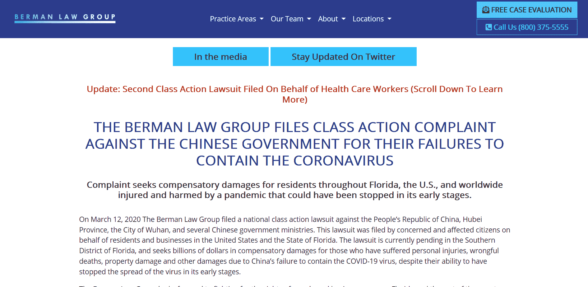

佛罗里达州某律所起诉公告

所有的这些主体，在这个法案之下都非常明确的是享有豁免权的主体，可是这个法案提供了一些例外，有两个重要的例外，这份起诉书当中提到了，可这两个重要的例外也是最常见的例外。

什么情况下一个国家的政府可以在另一国面对官司？这里讲的是民事案件，可以出庭作为被告参与刑事案件。第一是这个国家政府自己 waive、放弃了这个特权；第二种是这个政府，它是以一个商业主体，从事商业活动的主体的身份介入这场纠纷的。

第一千六百零五条 对于外国享有管辖豁免权的一般例外

如有下列任何一项情况，外国不能免于联邦法院或各州法院的管辖: .

（1）该外国已明确地或默示地放弃其豁免权。关于此项弃权，除根据弃权的条件予以撤回者外，该外国可能声称的任何撤回均属无效;

（2）该诉讼是基于该外国在美国进行的商业活动而提出的；或者基于与该外国在别处的商业活动有关而在美国完成的行为提出的；或者基于与该外国在别处的商业活动有关，而且在美国领土以外进行但在美国引起直接影响的行为提出的。

美国《外国主权豁免法》（节选）

这是一个比较明显的趋势，因为在全球化的年代里，有很多的国家政府，他们可能是一个政府的名义，或者是地方政府的名义，与其他国家或者与其他国家的公司签合同，它（政府）是作为合同的一个签署方，被卷入了一场商业上的纠纷，在这种情况下外交豁免权不适用或者是它的特例适用。

在这个起诉书里面描述的情况，是非常可笑的，中国怎么样抗议？制定什么政策？中国政府在中国国内出现疫情的时候采取什么行为？这个与商业有什么关系呢？美国的这部成文法，它的这个商业特例还有一个要求，除了是商业行为以外，这个商业活动得跟美国有联系，不然日本的政府和韩国的公司做生意，关美国什么事呢？

在这里就是这两条都没有符合，又没有商业行为、又看不出跟美国有什么联系，如果它是商业行为的话，也看不出跟美国有什么联系。第二个特例叫做 Territory  
Tort、领土范围内发生的侵权。侵权是 Tort 这个概念（我们可能没有认真的介绍过），这就是民事上对他人造成了伤害。

这份起诉书里怎样论证这是一个侵权呢？它主要说中国政府的所作所为，甚至违反了中国自己的法律（应该讲的是传染病防治法，就是这些都不重要），因为这个词有一个起码的要求，叫做 Territory，是在美国的领土范围之内发生的侵权，才成为外交豁免权的一个例外。那所有它控告的事情都是在中国的领土上发生的，就是跟美国的领土根本就没有关系，所以它举出这两个例外，我都不知道这个律师是怎么想的（可以这样睁眼说瞎话）。

#### 法不溯既往，原则的挑战

这个案子的漏洞是如此地明显（应该是所有的人都能看出来），所以最近它的共和党的参议员做出了一些反应。Tom  
cotton 领头，还有另外的共和党的参议员有一份立法提案，说要修改《外国主权豁免法》、修改 FSIA。

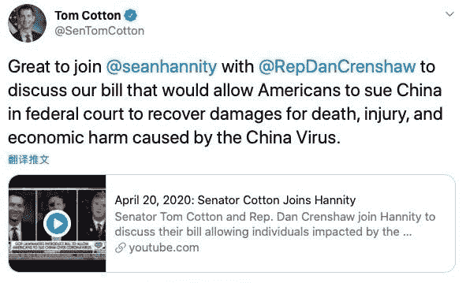

参议员 Tom Cotton 领头讨论修改法案

他之所以修改，就是要增加一个新的例外，是除了这些例外以外，还有一种情况外国主权豁免权也不适用。他就令人发指地、明目张胆地，要增加的那个意外是"中国政府在新冠肺炎爆发当中承担的责任，这件事情不受豁免权的保护"，这是一种多么无聊地、赤裸裸地对于法不溯既往的立法原则的挑战，是在事情发生之后，针对某一个具体的事件回头修改法律。

我也不知道他们怎么能选出这样的立法者？就像一开始提到的，外国主权豁免权这个问题，不只是它的成文法所保障的一种权利，它同样是美国的普通法的一部分、是它的判例的一部分，它多重的身份就会带来一些不确定性。

比如我们在看佛罗里达这个案子的时候，一切是非常明确的，他所起诉的那些对象：各级政府、国家政府、地方政府、中国疾控中心，它们都是享有豁免权的主体。可是这个并没有回答我们的问题"它享有豁免权的主体的范围到底有多大？"它是不是延伸到一个具体的政府官员呢？这其实就成为了一个很重要的争议。

美国的最高法院在 2001 年的一个判例当中回答了这个问题，答案是"不"。FSIA 的豁免权只适用于 foreign  
government、外国政府，而这个法案当中对于"政府"这个词有比较详细的定义，这些定义当中并不包含个人、individual、不包含官员。

所以哪怕一个官员是在履行他作为一个政府官员的职责，且他是代表他的国家形象，也不在 FSIA 之下的豁免权的保护之下。可是这是不是就意味着那这些集体诉讼的律师们、Plaintiff  
Lawyer 们可以肆无忌惮地去告各国的官员了呢？不告政府了，他一个一个去告这些官员呢？答案也不是这么简单，因为还有《普通法》。

最高法院当时在回答 FSIA 的适用范围的问题的时候，它故意留了一个"口子"，说"在判例法之下，豁免权的适用范围是否延伸到个人？这个问题我们留给各级联邦法院去回答。"

在这个案子之前，大部分的联邦法院是认为豁免权延伸到官员个人的；在此之后，有一些争议出现。一般来说一个联邦法院不会自动地认为一个官员也享有这种豁免权（不是因为你是一个官员，我就觉得那我管不了你），它会去看这个官员的所作所为到底是什么性质？是出于个人目的的个人行为？还是一种国家行为、国家意志的体现？所以这个问题也没有那么简单。

#### 主权豁免原则包含政治因素

而且也有很多人"提醒"我或者"批评"我，这个问题在法律上看，好像是一个有清楚明白的答案的问题，但它显然不只是一个法律问题，它一定有背后的各种各样的政治动机（我当然明白这件事）。

事实上，外国主权豁免权这整个概念，它就是一个有非常明显的政治内涵的概念，它一定是和外交、国与国之间的争议纠纷，和所有的政治问题分不开的。所以在实践当中，这个问题真的不只是被当做一个法律问题在处理的，哪怕是当一个法院觉得它对某国的官员有司法管辖权，它决定审这个案子的时候，它可能受到行政力量的干涉。

美国的司法部在过去几十年的时间里，仅有的那么几次，美国的法院准备去审理涉及外国政府官员的案件当中，他们会做出一个建议，叫做 Suggestion of  
Immunity、豁免建议。建议法院不要审这个案子，考虑这件事情的外交影响，而几乎所有的法院也都接受了这个建议，驳回了起诉。

美国司法部甚至认为他们的这个建议说得"很好听"，叫做建议、suggestion，其实是有法律上的强制力的。那大家可能会觉得"美国不是号称司法独立吗？为什么又搞这些事情？"

这个背后其实有更深的问题地讨论："它的三权分立到底要怎么分？"

表面上看是一个司法问题，是牵涉了一个外国政府，或者牵涉了外国官员的一个案子、一个纠纷，但是它一定有政治的影响、有外交的影响，那它可能会被变成一个外交事件。

在美国的三权分立里，外交事务是非常明确地被分给了行政权。行政权觉得"这种有外交影响力的，有可能酿成外交后果的事情，当然有权利插一脚。"而且有一些学者就认为，根据严格的三权分立的概念，法院不应该有权利自己决定"他们有没有管辖权？"这件事。这个决定就应该交给美国司法部，它的行政机关、它的政府来做。

其实这个概念挺有意思的，它的背后有很多学理上的争议，哪怕从纯粹的学术的角度去看这个问题也是复杂的、也是超越法律问题的，它一定是一个政治问题。更何况在今天这个疫情之下、很复杂的国际局势之下，很现实的去看这些所谓起诉、这些炒作、这些控告，当然是有它复杂的政治动机（那我们的愿望也是很简单的）。

有人在我的微博底下提醒我，哪里有这种莫名其妙要搞事情的律师，哪里都有这种议员，他们不应该代表整个美国，然后我们还在这里煽动包括我自己，还要在这里煽动两国之间的仇恨情绪（这当然不是我的本意）。

我觉得这些人做这些事非常的无聊，因为在病毒的面前，所有的人、所有的国家团结起来，尚且未必战胜这个病毒，尚且不知道何年何月才能真地战胜病毒，何况用改法律这种罔顾法律的挑战，去挑拨仇恨，去制造对立与矛盾？这实在是无聊的举动。

#### 国际法庭是否有管辖权？

这件事情如果被上升到更可怕的国家之间的对立，那美国还有一个选择，就是到国际法庭去起诉中国，那当然没有任何的证据表明它真的要这么做（有一些这样的猜测，那就真的是更让人在理智上，难以理解的选择了）。

我们都知道在法律的世界里，一个国家之内的司法体系，它的主体是人。在国际法之下，国际法的参与者是国家，所以如果这个事情被告到国际法庭去，那就是美国这个国家起诉中国这个国家，它就变成国家和国家之间的对抗。

国际法庭特别之处还是在它的管辖权，就是国际法庭的管辖权不是自动的，是需要国家的 consent。如果中国拒绝给出这份 consent、同意、这个认同，那国际法庭对于这个争议就没有管辖权。

一种情况是之前聊到过，有一些管辖权是附着在条约当中的，比如我们两个国家之间签订一个仲裁条约，然后说"如果一旦有什么问题，我们就选择到香港的仲裁庭去仲裁"，那它就赋予了仲裁庭管辖权。

WHO 下辖的的这个 IHR（International Health Regulation），叫做国际卫生条例，它有提到 ICJ（International  
Court of  
Justice）、国际法庭，但是它提到国际法庭的时候很明确的说，国际法庭的职能是解释这个条例的适用范围。以及它不是第一选择，是必须得经过 WHO 提供的调停纠纷的流程之后，在比较理性地、和平地解决纠纷的方案之后，才可以把这个问题上诉到 ICJ、国际法庭。

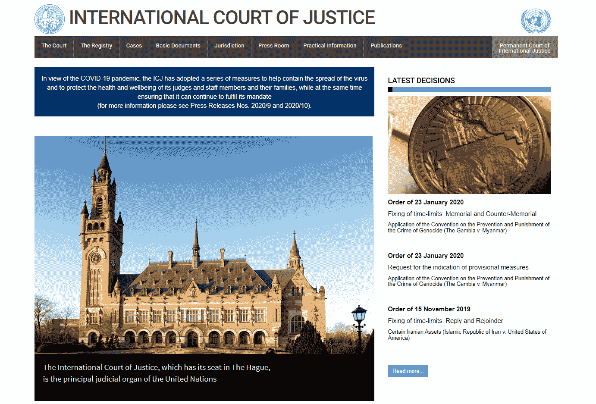

ICJ 位于海牙的国际法院

是联合国六大主要机构之一和最主要的司法机关，是主权国家政府间的民事司法裁判机构

以及健康卫生相关的争议，它提出了一系列解决争议的方法，这些方法当中不包含国际法庭的。所以相对来说，在国际法庭有没有管辖权管的问题上，包括中国是不是承认了它的管辖权？包括这个管辖权是不是能够真的覆盖到新冠肺炎的问题？这是更复杂的实质性的争论。

它的回答，美国的法院一定是没有司法管辖权，管我们的政府的主权行为，商业行为是可以的（我们刚才聊过），主权行为是不可以的。

但是这些讨论的可能性就很小了，因为就像刚才聊的，如果总有那么几个要搞事情的律师、总有一些莫名其妙就觉得中国应该承担所有责任的原告，有一些议员那还可以理解，如果它是要到 ICJ 去告这个案子，就变成了一个国家行为了，那事情的性质就会严重很多。

关于"在《国际法》当中外国主权豁免权"的问题其实是有很多争议的，什么样的行为是被豁免的？什么样的行为应该成为例外？但是它最重要的争议从来就不是传染病，之前也没有谁说一个国家哪怕这个传染病是首先在这个国家被发现的，首先在这个国家被上报的，这个国家就应该被告上国际法庭承担民事赔偿的责任，从来没有过这样的事情，这种指控是非常荒谬的，我们是大自然面前的命运共同体，真正引起争议的话题是比如一个国家的政府被认为侵犯人权，那国际社会有没有什么方法绕过这个主权豁免权，让这样的政府付出代价，当然这同样是一个很敏感的话题。

#### 传闻证据原则：方方日记为什么不能被用作证据？

聊到最后，当然也知道，所有聊到的这些话题，一定都不只是单纯的法律问题，它们的背后一定有复杂的政治动机和政治博弈。法律的这些知识点也好，这些思维方法也好，也许只能提供给我们一些基本的工具和武器拿在手上，但去参与这场讨论的时候，不至于太容易失去方向。

我看到很多有价值的讨论，也有一些没有什么价值的阴谋论（就觉得太荒谬了）。比如最近，有武汉作家方方她的日记在海外出版，虽然现在还没有出版，但是已经开始预售了。然后很多的人批评她，其中一个批评的理由是："这个日记在美国出版以后，就会被当做呈堂证供，变成证据，让美国在法庭上告我们。"

我希望大家听过这个节目，特别是我们前一阵子花了好长的时间讲证据规则的朋友，大家一定都能够看出这件事情的荒谬。我觉得当然可以批评、当然可以质疑，但是这些批评要靠谱的，不能是没有什么价值的批评、不能是没有什么实际可能性的批评。有很多人批评方方的日记，主要说她"道听途说"，她都说"我听说"，或者是"我的一位朋友告诉我"。既然都批评她道听途说，那怎么又能批评它（日记）会被拿到法庭上去，当作控告我们的证据呢？

道听途说、hearsay（你们一定都对这个词印象很深，因为我看到好多人在评论里面吐槽我的发音），这个题目都不会被拿去考试，因为它的答案是如此地明显。如果我的政治课老师，要考大家 hearsay、道听途说这个概念，他一定是设计一个陷阱，一眼看上去，看不出来这是一个 hearsay，仔细一分析才能分析出来。这都告诉你了，她都说了她是"听说的"，它怎么可能被当作呈堂证供？我们不再说方方，因为这个话题确实也比较敏感，我个人有更复杂的感想，只是仅仅作为一个法律知识点来说。

一个人他写了一个日记（看理想的小编，算了，看理想的小编也肯定做不出这样的事情）。"一个坏人他写了一个日记"，都不说他出版这个日记了，他就是亲自来到美国的法庭上，亲自作证说"我作证这个日记是我写的，我确实听说了"。

当他说出"我确实听说了"这句话的时候，他所说的一切，接下来的那段话就不可能被当做证据，这就是典型的 hearsay。用一段在法庭之外听到的话，去佐证在法庭之上陈述的一件事情的真实性，没有更明显的 hearsay 了。亲自去作证都不可以，更何况只是把它写在日记里。

至于这个日记是不是出版？是不是被翻译成很多种语言？是不是被什么报纸杂志推荐？都不能够作为这个日记真实性的证明，这是毫无关系的事情。为什么？哪怕有文字的记录，我们会要求一个人到法庭上亲自去作证。

在法庭上作证的时候是要向法庭宣誓的，是在被置于伪证，这样严重的刑事罪行指控的风险之下，所以在这种风险的对比之下，我们倾向于认为一个人在这种情况下会说真话。可是当他每天自己写东西的时候，他是不被置于这样的风险之下的，他也不承担任何相关的法律后果。

一个人的文字记录，哪怕是亲历第一现场的本人，而不是听来的（听来的就已经把这些东西排除了）。哪怕是我亲自看见有人被打了，把它记在日记里，我的这本日记可不可以成为呈堂证供呢？是可以的，但是只在非常特别的情形之下。也就是事隔多年，我亲眼看到的这件事情，是发生在很多年前的事情，很多年以后，它才被拿到法庭上去审判，而我已经记不清楚细节了，我就向法庭申请说"我把我这个日记当做证据"，摆到法庭的面前，这是可以的。

但是我作为事件的亲历者，我作为记载这件事情的人，我需要向法庭作证，作证这个日记的真实性，是我写的，而且是我在当年写的、是我在事件发生之后立刻写下的、是我真实客观地记录那个事件的结果，而不是我随便写点感想。我本人依然被置于伪证罪的危险之下，要去向法庭承诺所有这一切，以证明我这个记录是可以被法庭采信的一个关于事实真相的描述。所以它不符合证据规则的事情实在是太多了，这个问题实在是太明显。

还是那句话，这个问题的讨论当然是复杂的，它不是一个法律问题在被讨论，它是舆论场中的一个问题在被讨论。它可以被讨论的侧面很多，大家可以有不一样的观点，有激烈的支持、有激烈的批评。

这些基本的知识点就是能够帮助我们在讨论的时候，不要偏失方向，排除掉那些无聊的、不可信的、没有意义的阴谋论，排除掉那些没有太多价值的纷争，才能让我们的讨论聚焦到更有价值的问题上、真正产生分歧的问题上、真正值得辩论的问题上，我觉得这是一个意义。

另一个意义是我们也借由这些时事，复习了一些知识点。我希望大家再看到美国又有某某人号称要起诉中国的时候，首先想质问他们有没有管辖权？又说"中国发生的什么事情、某一篇报道谁说的一句话，成为了一把刀子被递给外媒"这个可能被递给外媒的时候，特别是当他说"这个可以被当作法庭上的证据用来起诉我们、控告我们，要求我们赔偿"的时候，大家能首先想到：在证据规则之下，这一切是不是可信的？如果想到了，我觉得很开心，这是我们节目的价值。希望大家在想到这一切的时候，也为自己感到开心。

# 番外 | 鲍某涉嫌性侵案（一）：《刑法》与《民法》中的严格责任原则

（公众号懒人找资源，懒人专属群分享。）

#### 事件：鲍某涉嫌性侵案

我们今天继续来讲一个番外，用这个番外的时间来聊一聊，前段时间引起全社会所有人的愤怒和痛苦，但是两个星期过去后，好像大家又渐渐把它忘了的一个社会热点议题，就是鲍某涉嫌性侵案。

关于性侵和强奸这个话题，我发现我自己内心深处好像一直在隐约地抗拒，因为这个话题实在是非常得沉重。特别是当我想到我自己的好朋友，人生里经历过这样的痛苦，而无论我们有多么的同情，其实都没有办法真地理解她/他们遭受的痛苦。

像在鲍某涉嫌性侵案当中，有一些人指出的一样，虽然媒体把这件事情曝光在公众的面前，是在舆论上推动了这个案子的发展，这是他们的贡献。可是媒体如果不遵守一些很严格的规则去报道，媒体所使用的措辞和话语报道的内容，就可能轻易对受害者造成二次伤害，不止是这个案子当中的受害者，而是所有其他有相似经历的受害者。

我们今天在这里聊这个话题，也同样可能对这样的人对她/他们造成新的伤害，我只能尽力避免，如果你听到本期所讲的内容感到不适的话，可能要及时地停下来，我感到抱歉。

我也知道这个节目有一些未成年的小朋友的听众，你可能要问一问你的爸妈，去听一个关于强奸案的讨论，是不是合适？

李星星（化名），鲍某涉嫌性侵案的这个事件所给我们的提示之一，就是性教育要从小做起，小朋友要从小就懂得保护自己，当然家长和监护人们更加应该懂得怎么样去帮助和保护她/他们。

一个法律节目，当然它没有可能是从头到尾就开开心心的，它一定会需要去面对这个社会当中，依然存在的一些阴暗的侧面。我们知道这个世界上有一些邪恶之人，他们会做邪恶之事，被他们所伤害，这并不是你的错，而你也应该用法律的武器去保护自己。

鲍某涉嫌性侵案这个事件被曝光也过去了一段时间，关于他的各种各样的讨论，非常得多。有很多是关于法律的讨论，包括很多人怀疑这个鲍某是不是利用了自己作为一个律师的法律知识，故意逃脱或者把自己引向去罪化？由此引发了关于具体的法条的讨论。

比如"14 岁"是性同意的年龄的设置是不是合理？以及在 14 岁以上所发生的性关系如何构成强奸案，它所需要的证据标准是不是合理？等。但是它之所以引起如此之大的社会愤怒，还在于它揭示了很多法律之外的问题。

李星星（化名）所受到的伤害有很多，到现在都不是法律本身（能解决的），有很多的伤害是在她寻求法律保护的过程当中受到的。比如没有监护人的陪同、没有律师的介入、没有心理医生的帮助、没有妇女儿童权益保护组织的陪同、没有一个女警察在场，男警察在询问事件经过的时候，非常粗暴的态度，都给她造成了很严重的二次伤害。

现在我知道，因为我的朋友是志愿者，一直在帮助她，但是在过去很长地、一次又一次地、报案地尝试当中，她受到了很多的伤害，这些都跟法律有别，但是也有关。

#### 特殊的责任划定

我们还是从法律本身聊起，大家都关注，在讨论这个案子的法律问题的时候，所有人都会讨论"14 岁"这个标准，为什么有这个标准的差别？想必大家都知道了。因为根据我们国家的《刑法》：如果和 14 岁以下的幼女发生性关系，无论是否违背幼女的意志，他都构成强奸罪；而所有 14 岁以上的妇女在强奸罪的定罪标准这个问题上是被一视同仁的，除了两高（中华人民共和国最高人民法院、最高人民检察院）的意见（我们之后会聊到）。

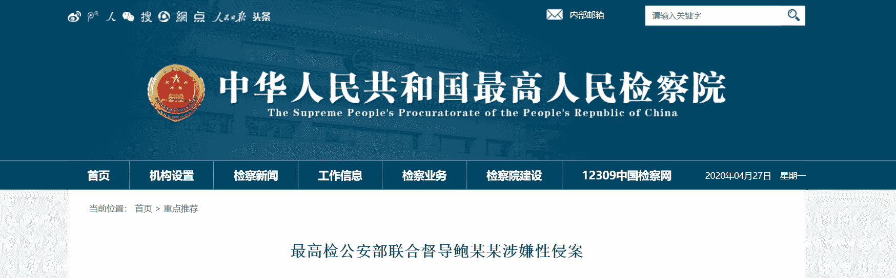

最高检关于性侵案公告

从法律本身来说，14 岁以上关于强奸的认定是一视同仁的，就是以暴力、威胁或其它手段，违背其意志发生的性关系。首先有这样的一个区分，有一个"一刀切"的标准，这个标准之上是性同意，可能有性自愿但在这个标准之下是一律构成强奸，这个区分是几乎所有的法律体系里面都存在，各国的区别和大家讨论的重点，也在于："14 岁"这个设定本身是不是合理？它的背后"14 岁"作为这个法律标准是法条。

这个法条的背后可能有反映一些更基本的原则，比如自由和权力的关系，有这样的一条"一刀切"的标准，它当然限制的是 14 岁以下的幼女她们的性自由，但是它同时是对她们的一种保护。

就 14 岁以下幼女的情况而言，不问这个 14 岁以下的女孩是不是口头表达了、行动表达了"她同意"；也不问和她发生性关系的对方，是不是故意要强迫她，还是无意的；甚至不知道她是没到 14 岁的，所有这些具体情况都不问，而一律以强奸罪论处，这个是法律当中一个特殊的责任划定的类型。

#### 什么是严格责任？

这是背后有一个更加普适的原则，叫做 strict liability、严格责任，有的地方还有 absolute  
liability、绝对责任。虽然不是所有的法律体系都会直接使用这个词，但是它具体在法条里面会体现这个原则的应用。

什么叫做 strict  
liability、严格责任呢？就是一个人，大部分情况下我们要一个人为他的行为付出代价，证明他做错了。可是严格责任之下，一个人要为自己的行为付出代价，对他的行为所造成的一切后果付出代价，而无论他是否有做错，或者他是否有犯罪的意图，这个概念是同时应用在《民法》和《刑法》当中的。

《民法》当中我们通常讲的是侵权法，就是不构成刑事犯罪，但是对他人的人身和财产造成了侵犯。侵权法当中，曾经和大家介绍过一个概念，叫 negligence、疏忽、过失、不小心。整个侵权法发展的历程，是把很多的从前归为 strict  
liability 的责任慢慢向 negligence 偏移转变，有越来越多的行为，法律开始觉得，要在疏忽的情况下、要在确实本身有错的情况下才需要承担责任。

但是，某一些类型的侵权行为，它们仍然被置于严格责任之下。举一个例子，有一句法律当中的俗语，是英美法系当中的俗语，叫做"Every dog has a  
free bite.每一只狗都可以免费地咬一口"(我经常对我家狗开这个玩笑)。

什么叫每一只狗都可以免费咬一口？法律它是一个文化的产物，比如在美国的文化之下，狗是一个伴侣动物，今天我们也在推行、农业部也在推行这个标准，狗是伴侣动物。我们对狗有一万年的驯化史，它可能是人类最早驯化的动物。

所以在我们社会的普遍文化里，会认为狗是和人亲近的、狗是不伤害人的、狗是可以和人做朋友的。那在 negligence、疏忽的标准之下，要求一个人做理性人该做的事情，就是一个理性的人，她/他有适当的判断力、决策力，她/他有适当的提前预防的程度、提前预防的措施就可以了。

比如我是一个养狗的主人，我们家养了一只狗（很多人知道，叫墨兜，是一个泰迪）。这个狗非常得"讨厌"，但是它对人还是很好的，所有来家里玩的人，它都是很亲近地去跟别人玩。那我作为这个狗的主人，我是不知道这个狗有攻击性的，而且在我们的文化里，也不认为狗这个物种有攻击性。

所以比如一个小朋友来我家玩，我是允许这个小朋友摸"墨兜"，怎么都可以。但是如果下一次有一个小朋友来我家玩的时候，"墨兜"咬了他一口，从此以后我这个主人就应该明白：我家这只狗是一个有攻击性的狗。

那我作为一个理性人，我就应该把它拴起来，再有人来我家玩的时候，我就应该把它关在笼子里，我就应该采取适当的预防措施。所以这叫 Every dog has a  
free bite.

我作为一个理性人，法律对我的要求是：如果你家的狗一直挺正常的，那么大家都开开心心地过就可以了；但是如果你已经意识到你家的狗可能会攻击人，你就得采取相应的措施。

如果"墨兜"第一次咬人，我之前不知道它会咬人，这个时候，我是不需要为此负侵权责任的，因为我不知道"狗竟然是会咬人的"。当这个狗咬过一次人，我还是放任不管的时候，它再去咬人，我就要承担责任了，这个时候我就没有做到一个理性人该做的事情，这是 negligence 的标准，这是侵权法普遍适用的标准。

strict  
liability 是什么意思呢？比如我家养的不是狗，我家养了一只狗熊（我家养了一头熊，我天），在你养了一头熊的时候，你家的熊把人家给咬了，你就不能在法庭上为自己辩护说，"我不知道这个熊竟然会咬人"（实际上，你当然知道了，它是熊，你养的不是一个正常的宠物，你养的是一个野生动物）。

这个时候你就被置于 strict  
liability 之下。哪怕你没有故意地要让它去咬人、唆使它去咬人、打开门把它放出去，甚至采取了加强的措施，防止这个熊跑出去（把你家围墙都修高了一米），但是这个熊跑出去了，咬人了，你就得承担这个行为所造成的所有后果，就是你养熊这个行为所造成的所有后果。它咬了十个人，你就得为十个人负责。

这个时候不可以去向法庭辩护说"我没做错什么"，因为法律里认为某一些行为在本质上它就是危险的，或者它就是高风险的。如果我们只是以疏忽这个标准来衡量这些人的责任，那法律所起到的这种预防、deterrence 的效果是不足够的，它的威慑力是不足够的。大家可能还抱着侥幸心理拼命地去养熊，然后就会有很多人受伤，这是不行的。

#### 《民法》中严格责任的侵权类型

类似这样的 strict liability 的侵权类型越来越少，但仍然有几个很重要的类型。

一个是刚才提到的野生动物，就是你家养了一个野生动物，那么这个豹子、这个狮子，无论做出什么事情来，无论你自己有多努力，你都得为它的一切行为后果负责。

第二种，是天然带有危险性的动作。比如你在你们家的后院子里研究炸药（当然这个在我国就是违法行为），假设你做爆炸，你没有想要去伤害别人、去从事什么违法活动，你就是想把你家这个地炸开（为什么要这样呢？看看底下有没有埋钱）。

虽然这么一炸不要紧，只是想炸你家的地，但是有一颗火星，飘到了邻居家的窗户上，把邻居家给点着了。这个时候你可不可以向法庭去辩护说"但是我没有想要点着，而且我炸的时候我已经非常小心了，我把周围都用了防火材料隔起来，没有想到买到假的防火材料，我想不到会有这样的事情，我这是我预想不到的后果"，这是没有用的。

因为你从事的是一个本质上有高风险的危险的活动，所以你的活动所造成的一切后果你都必须承担，这个叫严格责任，这个责任是很严格的。它烧了一家，你要赔这一家；它烧了一个小区，你要赔一个小区。这就是法律在告诉你，你在做这些高风险的事情之前，要三思。

还有一种适用范围更广的严格责任的类型，是产品质量问题，product  
liability。一个生产厂家，它把一个东西造出来，它没有故意地想要去害这些消费者，但是它在客观上造成了伤害消费者的后果，甚至它的整个生产的流程、工序、监管都是合格合规的，可是它依然造成了严重的伤害，那么它就要承担这个 strict  
liability。

strict liability 是一个偏向原告的法律原则，就像集体诉讼一样，集体诉讼是因为每一个原告单独站出来，都很难去撼动这个强大的被告。strict  
liability 是一样的，它通常被用在原告很难提供充分的证据去证明对方有过失，或者是这种证据链本来就难以完成。

法律采取了一个比较简单粗暴的方法去向原告们赋权，所以 strict  
liability 的这种侵权，特别是产品质量问题侵权的案子，常常是和集体诉讼相结合的。比如煤矿企业的工人，他在挖矿的过程当中，受到了有害化学物质的伤害。

在当时大家挖矿的时候，这个矿企也不是想要害大家，它就是想赚钱而已，它可能也没有想到会有这样的后果，预见不到有害物质对人体的伤害是如此之大的，而且可能会伴随这些工人一生的。在这个时候，难以证明对方过失的情况下，法律赋予这些工人，同时让他们用集体诉讼和严格责任的方法去向这些大公司索赔，这是一种赋权。严格责任这个概念，同样适用于《刑法》。

#### 《刑法》中严格责任的类型

我是不是有点讲得太远了？还是跟以前一样，虽然这个热点已经过了，但是并不是为了评论这个热点本身，是和大家聊一些跟它有关的话题。刑法里面有两种最典型的 strict  
liability、严格责任，一种是重罪谋杀、felony murder doctrine，另一种是法定强奸、statutory rape。

重罪谋杀比较容易理解，刑法我一直和大家强调，你要去为一个人定罪，或者说检察机关要决定用什么样的罪名去起诉一个人，它必须要证明构成这个犯罪的要件。这些要件笼统地说分成两个核心的部分，一个是他的行为，一个是他当时的意图。

比如你要证明一个人谋杀，或者证明一个人过失杀人，他们的行为是一样的，就是把一个人杀了。但是他们的意图是不一样的，有一个人是预谋地要去杀人，另一个人可能只是一时冲动，他们当时的心理状态是不一样的。

所以要为一个人定罪，必须找到一个适合的罪名，就是他的行为和他的心理状态都适合的匹配的罪名。但是重罪谋杀，它作为一个 strict  
liability 原则之下的罪名是可以不遵守这个原则的。

所谓重罪谋杀就是在犯下重罪的过程当中所造成的谋杀。比如有一个人去抢银行，他拿着一把枪冲到银行柜台的面前，用枪指着柜台的工作人员说"给我拿 100 万"，非常不幸，这个工作人员正好有心脏病，他受到了这样的恐吓，心脏病发作，去世了。这个时候，应该用什么样的罪名来起诉这个抢劫犯？

从这个抢劫犯出发，他并没有想杀人，他只是想抢钱。如果我们以抢劫罪去起诉，是对死去的这个受害者非常得不公平，因为别人活得好好的，虽然有心脏病，没有可能就这样意外地死去；那我们如果以谋杀罪来起诉，又好像对这个罪犯不太公平，因为他没有想要杀人，他没有那么坏。

在这两难的选择之下，法律选择站在受害者的这一方。法律就是在告诉这些罪犯，当你决定要去抢劫的时候，当你做了这个决定去犯下这样的重罪的时候，你就应该想到"你可能造成一些你没有想要造成的后果"，你要为此负责。这个跟当你决定要去养一头狗熊的时候，就应该想到这个狗熊之后所干的所有的事情，你都是有严格责任的。它的逻辑是一样的，它都是强调这种罪名的威慑力。

另一个重要的严格责任的刑法罪名就是 statutory  
rape、法定强奸。这个词本身很少会被写到法条当中，或是被写到判例法的判例当中，但是这个原则是很多地方都有的。

以我们之前聊到的中国刑法的例子，和 14 岁以下的幼女发生性关系，无论是否违背该幼女的意志，都构成强奸罪，这个就是 statutory  
rape。它只看你的行为，你的行为是跟一个 14 岁以下的幼女发生了性关系，它不问在这个行为发生的时候，你是不是有意想要去犯罪、有意要做一件错事、有意去违背法律？

它也不问在这种 statutory  
rape、法定强奸的原则之下，或者是在严格责任的原则之下，你不可以用"她/他其实是同意了的，我们双方的状态是自愿的心理状态"去为自己辩护。

你也不可以用"我不知道她/他没有到 14 岁"去为你辩护，就是你的 mental 的、你的脑海里的东西，这个时候不重要了。因为严格责任的标准之下，只看你的行为和你的行为所造成的后果，而所有的后果你都要为它负责。

这就是为什么"14 岁"这个概念如此重要的原因，它的定罪标准和 14 岁以上的，通常意义上的强奸案的定罪标准是完全不同的。因为我们都知道在刑法犯罪当中，定罪的最大的困难，常常就是去衡量：这个罪犯做出这个行为的时候，他的心理状态到底是什么样的？各种各样地辩护，律师们的交锋也集中在那个侧面，而在严格责任这个标准之下，那些东西就不重要了。

今天的鲍某涉嫌性侵案它的种种的困境，就在于这个女孩她经历了这一切，特别是这一切对她造成了严重的心理创伤之后，她要准确地去证明当时的心理状态，这是极困难的事情。可是发生性关系这个行为好像是比较容易证明的，而且双方也没有争议的。

这是"14 岁"这个标准它背后的原则，但是我们接下来的讨论就在于，如果我们都认可这个标准，它在一定程度上限制了自由，但是它同时也是一种保护，我们认可这个标准的存在。那么这个标准应该被划定在什么地方呢？

# 番外 | 鲍某涉嫌性侵案（二）：性同意年龄是否应该上调？

（公众号懒人找资源，懒人专属群分享。）

"14 岁"这个标准，它在一定程度上限制了自由，但是它同时也是一种保护，我们认可这个标准的存在。那么这个标准应该被划定在什么地方呢？

#### 性同意年龄是否应该上调？

我看到网络上对于我们国家"14 岁"的这个标准，有各种各样的讨论，好像普遍的意见是认为"它太低了"，也有一些认为"面对现实刚合适"。有调查表明，过半数的中学生在 15 岁的时候都有过性经历了，以世界的标准来衡量，其实是很难衡量的。

我们这个（14 岁）标准不是很突出，比较突出的是北欧的一些国家，那些在立法、在各个层面上来说都很自由的国家。比如荷兰、丹麦这些国家，它们的性同意的年龄是 12 岁。

很多的学者、老师对标的是美国，美国通常在我们眼里，在"性"这个问题上，是比较开放的一个国家，但是美国的性同意年龄都比我们高（大家应该也都了解了）。

美国的《刑法》是以州主导的法律，所以它的法律协会推出《模范刑法典》，但是实际上发挥作用的都是每一个州自己的规定，绝大部分的州好像同意的年龄是 16 岁，但是这个年龄分成很多种其他的情况讨论，它没有那么"一刀切"（大家也一定听到了一些讨论）。

比如说美国有所谓"罗密欧与朱丽叶法"，这个法律是引入一个概念。比如有一些未成年人，他们虽然是在 16 岁以前就发生了性关系，可是他们是和自己的同龄人，真的是恋爱关系，两个都是小孩发生了性关系。当两个人之间的年龄差距不超过三岁，有的州是三岁、四岁、五岁，还是因州而异，他们把这叫做"罗密欧与朱丽叶"。在这种情况下，这个性同意的年龄可以适当的降低，一般来说大部分的州把这个年龄降到 13 岁。

也就是如果一个 15 岁的少女，她跟一个 40 岁的男人发生性关系，在这个法律之下，他就是 statutory rape、法定强奸，就是 strict  
liability 受限于严格责任。

但是如果 15 岁的女孩和一个 17 岁的男孩谈恋爱，他们发生了性关系，它就不构成 statutory  
rape。法庭还要考虑其他的条件，比如一方是否自愿？对方是否使用了暴力、威胁等的手段？等。

它背后的逻辑也非常得简单，我们之所以要设定一条线，就是认为某一个年龄以下的幼女或者幼童，没有办法理性地评估"性行为给自己带来的后果"。特别是当一个未成年人和一个成年人，他们在智识、社会经济地位、过往经验上，有种种不对等的情况下，这是对未成年人、对年龄小的这一方的一种保护；而当双方的年龄比较接近的时候，这种不对等也就不存在了。

所以一方利用自己在年龄、体力、智识、财力、经济等各方面的优势，去伤害另一方的情况，也就没有那么容易出现。这个是适当降低性同意年龄的情况。

还有一种情况是会升高性同意的年龄，这个几乎在所有的州都有类似的规定。当强奸案、性侵案的被告，利用双方特殊的关系发生性行为的时候，这个同意的年龄是会被提升的，或者当双方之间存在特殊关系。

有的州的法律会把这个特殊关系列举出来，包括家人的关系、监护人与被监护人的关系、特别是老师和学生的关系；有的州会比较笼统的说，当他们之间存在依附关系，一方滥用这种关系、或者利用这种关系，去与对方、年龄小的那一方发生性行为的时候，这个性同意的年龄会被提高，通常会被提高到 18 岁。

所以大家看到不同的人说，到底是 13、还是 16、还是 18？它是有不同限制条件的，而它的"一刀切"的原则依然存在，但是受限于一些更特别的条件。

这里最典型的一种保护是师生恋。关于师生恋，有很多州的法律，如果发生性关系的双方是师生，这个被指控的被告，他是中学老师，就是 k12、高三或者高三以下的老师，这个同意的年龄被提高到 19 岁，它背后的逻辑也很容易想到。

在这种特殊的依附关系当中，更难有真正意义上的自愿。如果当双方的年龄差距过大，这种自愿可能是诱骗的结果，可见在双方之间存在特殊的依附关系、师生关系、监护关系的时候，这种诱骗而来的，或者威逼而来的资源，更容易出现。表面上看上去是自愿的性行为，其实都不是真正地自愿。

这整个 statutory  
rape、法定强奸的概念，它的背后的另一个核心的逻辑，就在于"强奸案是很难被证明的、强奸案是难以被定罪的、强奸案的取证是困难的，强奸案要证明在发生性行为的时候，真的有所谓强迫"，这件事情是难以证明。

这个社会认为针对未成年人所发生的强奸案，它是极其恶劣的，对于社会造成的伤害是更严重的。所以在一定程度上，用严格责任这种办法，降低它的起诉门槛，让这种罪行更容易被证明和成立。

用这个逻辑，如果双方在年龄、智力、体力上有严重的不对等，要证明强奸这个罪行是更加困难的。当双方有一定程度的依附关系的时候，要证明这件事是尤其困难的，它的影响是尤其恶劣的，被逼迫的，但是看上去是自愿的可能性是更高的。所以随着这些可能性，服务于这个法律背后的目的，它的同意年龄会根据不同的情况作出调整。

类似地在讨论鲍某涉嫌性侵案的时候，有很多的学者提到，我们国家的两高，发布过《关于依法惩治性侵害未成年人犯罪的意见》的第 21 条规定，对已满 14 周岁的未成年女性，负有特殊职责的人员，利用其优势地位，或者被害人孤立无援的境地，迫使未成年被害人就范，而与其发生性关系的，以强奸罪定罪处罚。

我们也都知道，在这个案子里让人感到很愤怒或者无力的是，鲍某和他所谓养女之间的收养关系，依法是不能够存在的。那在这种情况下，我们是不是能够根据这个意见去把它认定为强奸？

强奸这个罪名是要求被告使用了暴力、威胁或其他手段，那这个案子当中，他们之间的依附关系，这个鲍某对于李星星（化名）的精神上的控制，或者他的非法拘禁，这些有待于进一步的证据去查清的细节，是否在这条意见的指导下构成了法律所规定的"其他手段"？成为这个案子最大的难点。

#### 事件：美国总统候选人被指控性侵犯

录着插播一个新闻。因为我现在是半夜在录节目，录累了看了一下新闻，发现 Joe Biden，拜登，就是美国的民主党的总统候选人，Breaking  
News、突发新闻说他因为被指控性侵犯正在接受调查（不知道又有什么瓜？今天已经吃了一天的瓜了）。我不说大家也知道我是在什么时候录的这个节目了。

包括今天发生的事情，其实与我们聊的话题有遥远的联系。我也想起在 4 年前特朗普他竞选总统的时候（我不知道大家对这种选举的事情有多关注，我当时因为在美国，所以还蛮关注当时的新闻），其实在特朗普竞选期间，有很多和性骚扰、性侵犯有关的事件和新闻被曝出，有几个女性站出来指控他"早年对她们有过性骚扰、性侵犯的行为"，但证据都是非常久远了，最后都是以和解的方式告终。

不同的人对这些"故事"的真实性有截然不同的理解，完全是一个用来测试，你是共和党还是民主党？你政治意识形态是什么样的？一个罗生门了。比较实锤的是当时爆出了一段他的后台录音，他和两个主持人的聊天，他在那段录音当中用侮辱性的语言去聊，他对别人的这种侵犯性的行为（整个录音非常的恶心）。

但是特朗普这个人真的是绝了，他的感觉是"只要我本人道德底线非常得低，你就很难指责我"，所以最后这个事情就这么过去了。很难想象，如果奥巴马被曝出这么一个录音，那他的整个人设崩塌了，但是特朗普好像就过去了，他自己非常大言不惭的说"如果大家还是选我，这就是大家对这件事情的回答。"

我觉得挺悲哀的，看到这样的新闻，这个和我们今天所聊的话题有一定的相关性，强奸相关的法律当中有一些特殊的设计。比如对幼女的定义，有的地方是 14 岁、有的地方是 16 岁、有的地方是 18 岁，"和幼女发生性关系，无论你是否使用了暴力、是否违背对方的意志、是否有强奸的意图，只要发生性关系，都一律被视作强奸"的这种"一刀切"的所谓法定强奸。

以及在这个年龄之上的性行为，如果双方的年龄差距过大，或者是双方有明显的特殊关系，特别是依附关系，把年龄小的一方性同意的年龄往上提高。所有的这些某种意义上的特别地设置，都能够感受到它是对于弱势一方、对于原告方的一种保护。

#### 女权主义的兴起

它的背后其实有两个根本的原则。我们在讲整个 strict  
liability、严格责任这个概念的时候，它背后的第一个原则是，对于社会造成非常严重的伤害的行为，我们要尽可能地扩大法律的威慑力，尽量地阻止这样的行为发生。

它另一个背后的原则，是在降低诉讼的门槛，就是在降低证据标准、降低证成这种罪行的难度。那为什么要降低这个难度？其实它某种意义上也反映了，要想证明强奸这个罪行是比较困难的。

强奸这个罪行和其他的重罪相比有一些很显著的特征，比如杀人、放火这些重罪，它的危害性是非常明显的，它被人类社会所痛恨、所鄙视，是非常明确的，这个标准可能自古以来就是如此。

但是我们对于什么构成强奸？强奸应该被视作何等程度的罪行？强奸犯应该受到什么样的惩罚？对于所有这个概念的理解，它是深受"罪行背后的社会文化，还有很多重要的意识形态的改变"而影响的。

关于强奸这个概念的理解，特别是在过去几十年的时间里，随着女权主义的兴起，对于女权主义重新带着我们去看待两性之间的不平等关系，去看待所谓的性自由、性同意，去看待一个女人，当然强奸的受害者完全可能是男性，但是它在论述当中更多地会侧重于女权主义当中的探讨：一个女人对于她的身体的完整性的控制，对她的身体不受侵犯的自由的坚持。

我觉得这些概念的演变和发展都深刻地影响了法律。比如还在不久之前，婚内的强奸是不被认为是强奸的。婚内强奸变成一个罪行，其实它的背后是被这些兴起的权利的概念所支撑的。

所以强奸这种类型的案子，它可能有一些不同于其它重罪的很显著的特征，那这些特征在每个地方不一样，又跟它背后的社会背景相联系。强奸的一个重要的特征是：它的报案率非常得低，特别是熟人之间的性侵报案率非常之低。

它背后是在社会中、在漫长的历史上把强奸、把失去清白、把受到性侵犯当做是一种耻辱，用耻感的文化去看待性行为，特别是看待强奸案的受害者，就造成了很严重的低报案率的情况（我们在聊的这个问题是一个普世的问题）。

它除了是一个根深蒂固的文化问题，它也非常明显地在鲍某涉嫌性侵案当中，体现出它是一个现实操作的问题。

我很难设想一个十几岁的小女孩，像李星星（化名）这样的小女孩，她终于鼓起勇气去报案的时候，她要经历的这一切是多么的可怕。包括报案之后仍然得不到恰当地保护；包括在报案的过程当中、在陈述案情的过程当中还要经历二次伤害。

这个故事被写出来，我觉得是有很可怕地影响，它可能进一步地劝退了很多好不容易鼓起了勇气想要去报案的女孩，或者是挣扎在是不是要反抗的边缘的女孩。我们无比地期待这种状况会得到改变。

为什么强奸案难以定罪？我们进一步地聊强奸法律本身。为什么强奸案难以定罪？它的证据标准虽然看上去不高，但是在现实当中要证明非常得难。

强奸有两个核心的元素，它在事实上往往是模糊不清的。第一个元素是这个"强"字，意为是不是使用了暴力？我们该怎么界定"暴力"这个词？另一个元素是违背了原告方、受害方的意志，什么叫做"违背"他的意志？如何来判断受害的这一方是同意还是不同意？

这两件事情说起来都非常得容易，但怎么界定强奸这个罪行？怎么证明强奸案发生了？一方使用暴力，违背另一方的意志和他发生性关系？听上去非常得容易，这个标准也很容易说出来，可是这个标准在判断、在证明的时候就变得非常得困难。

我们先来聊"暴力"这个概念，在英文里面就是 force。force 这个词更加得难以理解它到底是什么意思？强奸案的法律标准，在发展的历程当中，有一个非常重要的变化，是关于什么叫做使用了暴力的界定？在过去漫长的历史的长河里，所谓的 force 指的是"性插入"这个行为以外的暴力。

比如把这个人压制住，让她/他无法反抗；比如用暴力伤害她/他，让她/他不敢反抗；或者是让她/他陷入昏迷；或者是让这个受害人没有力气反抗、失去反抗的能力等。

#### 权利理念的转变

在裁定"一个性行为是否构成强奸"的时候，法官要去寻找在性行为本身以外，被告方还使用了额外的暴力。而女权运动一个重要的发展，可能不只是女权运动，现代的权力观念的一个重要的发展，它背后推动着 force、暴力这个理念的改变。

一个非常重要的改变是后来这类案子，在过去 20 年、30 年之间，越来越多的法律、越来越多的判例转变为"'性插入'这个动作本身就是一种暴力"。

传统的强奸案，它谴责的是"在发生性行为的过程当中，额外对受害的一方所造成的身体上的伤害"；现代的法律理念里，会认为它首要的伤害是"违背对方的意志，而强迫她/他进行性行为"这件事情本身。那这件事情的伤害不仅是身体上的、也是心理上的、人格尊严意义上的。

一个人身体的完整性是 body  
integrity，受到了伤害，这就足以构成暴力了。这个界定是非常重要的，它的重要性不只体现在"它的背后是一种全新不同的权利理念，它的背后是一种我的'人'的完整性，我的尊严不受任何侵犯和践踏的理念"，它也体现在法庭上要用什么样的证据去证明有"暴力"？

如何证明"暴力"？在过去的这种要求之下，所谓的"暴力"指的是性行为以外的额外暴力，这个原告方、受害方、被侵害的一方想要证明对方使用了"暴力"  
之所以会发生性行为，是因为对方使用了"暴力"，也就是额外的暴力，这个原告方通常需要证明"我反抗了"。

逻辑上如果"性交"这个行为本身就是一种暴力，我只要证明有"性交"这个行为发生，那"暴力"这个元素就已经被证明了。可是如果"暴力"这个概念是一个二分的概念：它既包括性交，又包括使用额外的暴力。

如果这个原告方没有任何的证据证明"她/他反抗过"的话，她/他怎么证明"对方是以额外的暴力迫使她/他就范的才可能性交"呢？

一些典型的例子，比如有的案例里，一方是在熟睡的过程当中被性侵的，那在整个过程当中，没有发生额外的暴力，所有的行为动作就是"性交"本身。

又比如说有的人是因为大量饮酒，或者是被人下药，陷入一个昏迷的状态，然后被性侵犯的。那在这个过程当中，同样可以解读为"没有使用额外的暴力"。

更典型的情况，以及在之前的判例当中更难处理的情况是"被侵犯的一方因为害怕、恐惧，或者是面对这种突如其来的伤害的时候，失去反应的能力，而不知道该怎么反抗"。

之前有一个判例，一个女士被侵犯了，她并没有尝试逃跑，也没有反抗。原因是她那个时候感到非常得恐惧，她就问这个被告方说"如果我按你说的去做，你能不杀我吗？"

这个案子交到法庭上的时候，被告一方就说"这个不是一个强奸，因为没有'暴力'这个元素"。在这个案子当中的这个男方没有必要使用暴力，因为这个女方根本没有反抗，她只是因为恐惧，然后顺从了。

这个案子的最终结果是"当受害者的一方是出于恐惧而没有办法反抗的时候，'暴力'这个元素可以被证明"，但我们只需要证明这种恐惧是 reasonable、合理的。至于"在这种状态下的恐惧是不是合理的？"是交给作为事实的裁定者的陪审团去裁定。

#### "理性人"的标准是否真的理性？

可是也有大量类似的案子，在过往的法律之下，因为它要求额外的"暴力"元素，而没有办法被定性为强奸。它的隐含的意义其实就是"在绝大部分的强奸案当中，女性的受害者，要求她们反抗。"

所以有很多人不无讽刺地说"在这种法律概念之下，如果一个被侵犯的女方需要用反抗，才能证明对方真的有使用暴力的话，这是在要求一个女人在这个时候做一个真正的男子汉。"

从这一点出发，有很多法律理论家很深刻地指出（其实这个概念大家一定也在很多的文献里面读到过，很多的文章里读到过）：这种两性文化，或者是传统的性别观念传统，我们对"性"这个问题的看法，它对法律的影响是潜移默化的，它是深埋在大家的潜意识之中的。

明面上的法律是可以随着时代相对容易地改变，当我们的法律认同了"性交这个行为本身即构成一种暴力"这件事情，这种改变是较为容易实现的；而真正难以实现的是大家脑海深处对于这些问题的判断。

有很多人说"我们的法律文化里，真正缺失的是'从女性的视角去看待性关系'这件事"。在那么漫长的历史里，在大多数的文学作品里、影视作品里，甚至在法律本身里、在过往的判例里，我们都是"从男性的视角去看待性关系"这件事的。

在大家通常的社会认知里，或者传统的文化里，我们都认为"在性关系当中男性有一定的攻击性，男性占有主导地位，女性适当地反抗其实是一种顺从"。所有的这些概念都深埋在我们的文化里，它会在不经意之间影响法官的判断、陪审团的判断、律师的判断，甚至影响受害人自己。

这种东西是更难以改变的，我们真正需要的法律文化是"从一个女性的视角出发，去理解一个女性在那种情况之下，她所感受到的真实的恐惧，她因为这种突如其来的伤害，陷入无法思考、无法反抗的状态的时候，法律该怎么样去保护她们的权利？"

就像刚才提到的，法律认同"如果这个时候受害人是因为感到恐惧而没有办法反抗，那只要证明这种恐惧是合理的"就可以了，这就是法律当中所通行的所谓"理性人"的标准。只要证明"一个理性的人处在相同的状况之下，她/他真的会感到恐惧"就可以了。

问题就在于这里的"理性人"是理性的男人，还是理性的女人呢？如果我们传统意义上的法律都是以理性男人的视角，大部分的法律工作者、大部分的法官、大部分的律师，他们都是男人，大部分的警察和检察官也都是男性，他们以男性的视角出发，所衡量的"理性人"的标准，又是不是一个女孩子身处那样的状态之下的"理性人"的标准？

我们在这个时候应不应该把个人的过往的经历、性格特征，也都纳入到理性的衡量的范畴里呢？这才是更现实的问题。

#### 在性侵中，一定要反抗！

也有很多人说"法律应该保护人，但是法律不能过度地保护"。一方面我们不应该因为一个女孩子她没有反抗，或者一个受害者她/他没有反抗，就认为"暴力"不存在。但与此同时，确实应该鼓励反抗，这个是有社会科学的研究作为支撑的。

有一个研究表明，在遭遇"意图强奸"的这种侵犯的时候，选择反抗的女性 80%成功地避免了最后的强奸；而如果不反抗，只有 33%能够避免。也就是说反抗真的有用，所以一定要反抗。虽然看上去可能很困难，但是一定要尽量地去反抗，它真的可能有用。

而另外一个研究证明，选择了反抗的人，哪怕她/他最后真的受到了伤害，她/他真的被侵犯了，在当时的过程当中选择了反抗的人，能够相对地保持心理的健康，而避免出现抑郁的状况。

这个背后的原因我确实不太了解，但好像是选择了反抗的人，能够有更强大的理由来支撑自己，等她/他想起这件事情的时候，能够更好地、充分地安慰自己，并且意识到"这不是自己的错"。

所以无论是从能否避免伤害，以及能否避免伤害真的发生的时候，对自己心理问题的困扰、打击和痛苦来说，反抗都是值得鼓励的。

而如果一个法律它是对人过度保护的，这是一种法律理论（我强调一下，可能有的人听到这里已经很不开心了）。但是确实有法律理论认为：如果这个法律对于人是过度保护的，它就是在鼓励那些不作为的人，它可能就会降低反抗的积极性。因为"你知道我哪怕不反抗，我也是可以证明这个强奸案发生了的"，她/他就更没有动力去反抗。

而我们的社会科学研究又证明，反抗真的是一个很重要的事情，它能够真正地保护你的利益。所以这里似乎有体现出法律的这种两难的困境：一边是你对这个弱势群体充分地考虑保护，对她/他们的人格尊严充分的尊重；而另一边是非常现实的，当这个法律更"刻薄"的时候，它好像能鼓励人变得更坚强、更勇敢，而这个坚强和勇敢，其实比法律的事后保护更服务于个人的利益，这是一个困境。

# 番外 | 鲍某涉嫌性侵案（三）：女性说 no means yes？

（公众号懒人找资源，懒人专属群分享。）

#### 何为性侵中的"同意"？

是不是在法律司法的过程当中，或者在法律的理念当中，引入女性的视角，和强奸案当中，在现实里难以衡量的元素也有很密切的关系？就是"法院怎么确定这件事情的发生，是违背了其中一方的自由意志的？"

有很多现实当中的案子，它的所谓辩护方式，就是"我不知道这是违背她/他的自由意志的"。它的这个辩护有好几个层次。

第一种，是说"我们双方都是自愿的，有种种的证据可以证明对方是自愿的，甚至她/他是主动勾引的"。

第二种，是当对方有比较充分的证据表示她/他确实不同意，那这一方说"可是我错误地认为她/他是同意的，那至少这个里面没有我的 intention，我不是有意而为之，我是错了，我犯了一个错误，但是，这不是我故意要违背他/他的意愿去跟他/他发生性关系"。

这一点和我们所讲的"暴力这个元素要怎么界定？"是有很充分的联系的。特别是在更传统地对于暴力的理解里，就是"受害的一方，要反抗才能证明对方是用暴力才迫使你就范的"。

不同的州的法律，以美国为例，它是一个很大的试验田。因为美国的刑法是以州为主体，美国不同的州之间，它的意识形态，站在光谱的各个地方，有的走到非常极端的地方，它没有一种所谓的美国人的意识形态，新英格兰地区的那种自由主义"遥远的以隔海相望的阿姆斯特丹为它的灯塔"。

美国的南方，甚至还不允许女性堕胎的这些州，这种意识形态上的差异，对于强奸案的界定，理解法律也是有很大的差异。一个重要的差异就表现在这个法律要求反抗到什么地步？

最严格的要求，  
是"要有口头地明确表达，再加上有行为、有动作"；有的地方的法律里可能允许"你只要在口头上表达我不愿意"，就可以了；有的地方更进一步，把"沉默"当做一种抗议。这就是我们说的那些情况，她/他在熟睡，她/他在酒后失去了知觉，她/他因为恐惧、僵硬而没有办法表达反抗，她/他这个时候的沉默是不是足以构成一种反抗？

而最激进的地方，就是这种权利意识最 progressive 的地方，我想表达的其实不是"进步"这个词，因为大家可以对这个问题有不同的看法。在这个问题上，最激进的那些法律体系里，它会说"yes  
means yes."，就是你必须得说"我同意"。

否则，只要没有得到一个自由意志下给出的明确的同意，受害的这一方就算作是在反抗，而对方就算是在违背她/他的意志。所以从这一点回头来看，如何确定对方有没有同意呢？这是不是她/他的自愿行为呢？

这两个联系非常紧密的问题，体现的是我们一再讲到的刑法当中的两个元素。第一个元素，是行为，是具体做了什么？有没有使用暴力？暴力该怎么界定？第二个元素，是你的意图、你的心理状态。

当我们去衡量一个人是否犯下了强奸这个罪行的时候，我们要求他的知识、他的意图，他的 mindset，他的心理状态是怎样？我们之前提到过不同的心理状态，它会决定你的所作所为构成一个什么样的罪行。

#### 不同州的不同犯罪构成

每一个法律体系之下，具体的措辞、具体的分级不太一样，但是一般来说有四种基本的状态。

最可怕的一种是有预谋的、故意为之、intention、故意杀人。

第二种，是 reckless、鲁莽的。就像你开着车漫无目的地在马路上走（我们之前举过这个例子），如果你有意要去撞死一个人，就是 intention；如果你只是开着车疯狂的在路上危险驾驶，根本不在乎别人的死活，你并没有想要特意的撞死谁，但是你是不把别人的生死放在心上，这个叫 reckless。

第三种，叫 knowledge，是知道我这么做会造成对别人的伤害，但是我还是做了。

第四种，叫做 negligence、疏忽这个概念。它不是故意的、不是明确的，而是在某种意义上是可以预想到的后果，是你没有能够更努力地去防止的后果。

在强奸这个问题上，还是以美国试验田为例，它的不同的州所要求的状态是不一样的。一些比较保守的州，主要阿拉斯加，它要求的状态是 reckless，粗鲁的、鲁莽的（其实是一个相当高的要求了），它要求被告一方处于一种"完全不在意他人的感受，完全不在意自己的危险行为可能造成的后果"的这种状态。

绝大部分州要求的是 knowledge，什么意思呢？为什么这件事情那么重要呢？它在现实意义上来说，如果"你没有 knowledge，你不知道她/他是不同意的"，这就可以构成一个为自己开脱的理由，这就是你的一个反驳、一个 defense。

如果我犯了一个错误，对方控诉的这一方说"这是违背我的意志所进行的性行为"，但是被告的这一方说"我不知道这是违背你的意志的"，我犯了这个错误，那在这些要求 knowledge 作为一个定罪元素的地方，错误就可以成为为自己辩护的理由。

#### 关于性侵犯，什么样的辩护理由是"合理的"？

在美国绝大多数的州，错误可以成为一个辩护的理由，但要求是这个错误是合理的，我们永远要回到这个问题，什么是合理的？

当我们说合理的时候，我们是在用理性人的标准来要求一个人，可是这里的理性人，是理性的男人还是理性的女人？它的背后有一个非常深的文化的原因  
两性有一些根深蒂固的交流方式的区别。

男性和女性之间，在自我表达的时候，传递给对方的意思可以被理解成完全不同的意思。这种交流方式的差别，特别是两性之间的这种显著的差异，它背后又有文化的这个因素。

比如，在一个抢劫案当中，这个女性很明确地说了"no"，然后这个男性就是说"no means  
yes"，这是一种性文化当中的交流方式，让他误认为另一方可能觉得这是一种正常的交流方式。

有一些比较激进的州，就是那些自由主义的州，麻省（马萨诸塞州），特别典型的一个激进的州，宾夕法尼亚州，在这些州的法律体系里，错误不能够成为一个借口、错误不能够成为一个为自己辩护的理由。这个选择它是一个很激进地迈步，是有很多人是不认同这种激进的定罪方式。

假设这个被告他是真心觉得他跟对方是两情相悦，他真心就是那么理解对方的话语，他真的觉得他们当时所做的一切是理所当然的，特别是表现在年轻的情侣之间的性行为的时候，有很多的被告是让人同情的。

绝大部分的，几乎除了这些地方的强奸案之外的所有的重罪，它几乎都要求知识、knowledge 以上的心理状态，就是没有任何一个重罪是可以把 negligence 当成一个元素的。

因为 negligence 的情况，我们通常就会认为这不是他有意的，不是他控制范围之内的过失。如果只能证明 negligence 这个元素，只能证明这是一个疏忽，那他基本上就不会构成重罪。

可是在这些州的这种法律之下，如果一个人的错误，mistaken  
belief，错误的这种认知，也就是错误的支持，不能够成为一个辩护的理由的话，它相当于就是这些人只有 negligence、疏忽的问题，但仍然要付出被定义重罪的代价。

在这些州，强奸犯首先他是一个一级重罪，他面临的是可能十年以上的监禁，而且他们一生都会带着性犯罪的记录，他们之后的人生都会受到很大的影响，所以有很多人是很同情这些被告的。

这个背后可能涉及到一个我们今天来不及聊的讨论，就是"我们在量刑的时候，究竟在考虑什么？"它考虑的仅仅是一个行为对社会危害有多大吗？它造成的社会恐慌有多大吗？一个行为所体现的这个人的恶意有多强烈吗？

在这个问题上有人认为，从道德上来说，如果你这个人作为一个被告，你用自我欺骗的方式认为对方是同意和你发生性行为的，这个比一般意义上的 criminal  
negligence、犯罪疏忽，要在道德上更为可鄙。

因为这样的一种自我欺骗，它不像就是你自己在你家里玩炸药，然后把邻居家给炸了，这种自我欺骗是把自我的意识强加在他人的自由意志之上的一种欺骗。所以在理论家看来，它在道德上是更为严重的一种错误。

#### 不同标准的论证责任

我们所聊的这些法律标准、规则的差异，是关于强奸罪这个罪，它的定罪的要素的具体的差异、标准的差异，其实可以从很多不同的角度去理解。

像我们之前有一段时间聊过一个话题，叫做论证责任，就是我这个原告我要满足什么样的论证责任，才算是把我这边的这个案子给搭起来了？然后被告想要推翻我这边搭好的"房子"，他需要提供什么样的证据？他有什么样的方式来把它推翻？就是她的论证责任。

在标准不同的情况之下，论证责任当然也是不同的。比如两个要素，第一个要素是行为。有的地方要求除了有性交这个行为本身之外，还得有其它的暴力；有的地方不要求额外行使的暴力，这是非常明显的论证责任的差异。

很现实地说，在现在的医疗手段之下，只要报案比较及时，要证明有性交发生，这个是容易做到的。可是要证明在性交的过程当中，伴随着其它形式的暴力，有的时候这种暴力是可能表现得非常明显的：在人的身体上留下了明显的伤痕，或者有比较清晰的证据的记录，有人证、有录像带或者有证词。

但是也有很多的情况，这些什么样的力、到什么程度的力，构成"暴力"？其实这个问题并不明确。有很多一定程度的"暴力"，是足以使受害的这一方放弃或者没有能力反抗的暴力，它可能并不会留下清晰的证据；也有很多时候这种"暴力"是隐性的，它是威胁、它是精神上的恐吓或者精神上的控制，它是在漫长的共同相处当中，所形成的一种威慑力。

这些东西更难以用证据证明，所以不同的论证责任，它就会提供不同的报案的门槛，或者证成一个罪名的门槛。

如果一个法律体系之下，它要求有性交行为以外的额外暴力，那么它通常是要求受害的这一方证明自己"有过反抗"，这就是一个额外的论证责任。她/他要证明"我反抗过"。

有的地方是说你可以不反抗，就是反抗在有的地方是一个"一刀切"的标准  
如果你没有反抗，那么法律就默认你是同意的；有的地方则认同说，你有的时候不反抗，并不是因为不想反抗，而是因为没有能力反抗。

在这个时候，法律可能给你一个机会，这个时候的论证责任，并不是一种额外的义务，而是一个机会，就是你只要证明"你没有反抗的原因是合理的原因"，通常情况下是因为恐惧，而没有办法反抗，如果这个恐惧是合理的，那么"没有反抗"就不再成为一个定罪的阻碍。

更明显的论证责任的划分的不同，体现在"什么情况下我们可以认为，这个性行为的发生是违背了原告一方的意志？"有的法律体系要求要明确的说出"同意"，就是"yes  
means yes"。假设这个是男女之间，当女方说"yes"的时候，才叫做"她同意了"。

这时论证责任就是这个案子当中的男方，他需要证明说"她确实有同意"。如果法律体系要求的是"如果你不同意，你得说 no， no means  
no"，如果你沉默的话，那这个法律体系默认你是同意的。那这时论证责任就落到原告这一方，她得去证明说"我确实表达过我的不同意"。

所以大家能看出来，这个法律体系标准的设置，它给双方带来的难度是不一样的，它背后潜藏着的是法律默认的一些情况，它一定带有对有性行为和性行为当中的一些双方的交流。

这个文化当中的默认、文化当中的偏见、文化当中的常态。那在是否违背意志这个问题上，它当然也可以像很多州大部分的法律体系里做的那样，给这个被告一个额外的论证机会，它说"你可以犯错"，但是你只要向大家证明"你这个错误是合理的"，那么我们可以接受，你并没有恶意，你只是犯了错，至少这个罪行不再被叫做强奸。

那些（在法律里）不允许人犯错的州呢？像麻省这样的州，哪怕你的错误是合理的，那也不接受作为一个辩护的理由。它实际上是什么呢？是 strict  
liability、严格责任，就是法律不在乎你是不是很努力？不在乎你当时心里想的是怎样？你预想到的后果是怎样？你心里面真正相信的是怎样？我养了一头熊的时候，我心里真正相信的是这个熊一定不会伤害别人的，法律不在乎这些。

用一个不太准确的这种概括来说，就是在这些 strict  
liability 的州，"错了就是错了"。只要你确实错了，对方明明是不同意的，但是你认为她同意了，然后你们发生了性行为，只要你确实错了，法律就觉得这件事情到此为止，不用再辩解，这就是强奸。

在大部分的州，允许人犯合理的错误的地方，人要构成强奸这个罪行，这个人必须知道他错了，他必须得知道对方是不同意的，而他继续实施强奸这个行为。

#### 鲍某涉嫌性侵案中的论证责任

套用这些不同的标准在我们从一开始讨论的理性心态的遭遇，和鲍某涉嫌性侵案当中。现在具体的事实还没有很清楚，但是我们已经了解到了一些重要的事实，基于这些事实，能不能够认为鲍和李之间的性行为，是在违背李的自由意志的情况下发生的呢？不同的信奉不同标准的人，其实就会给出不同的回答。

更激进的一派，比较偏向地靠近 strict  
liability 的一派，觉得以我们目前所掌握的事实，我们就足以认定这些性行为，是在违背她意志的情况下发生的，他们之间很多的性行为，是在违背她的自由意志的情况下发生的，理由就是她一次又一次的报案了。

她一次又一次的报案，这件事情足以证明"她不愿意"，这不是她想做的、这不是她同意了的事情、这不是她同意了的行为，这就够了。

但是，也有很多的人不认同，这样的一种认定的方法，更多的人可能认为我们要退回到事情真正发生的那个时刻，而不是站在当下说"我不认同"，你要退回当时她真实的心理状态。

那还有一部分更偏向保护被告方的利益的人，可能觉得我们不仅要了解当时的受害者，她的心理状态，也要了解这个案子当中的被告，就是这个鲍律师，他的心理状态是怎么样？他所接收到的信息是怎么样？他基于他们的共同生活、他们之间的相处模式，他们的背后不知道有没有什么金钱的交易、或者当时的具体的场景和反应，他所接收到的信息、他当时的心理状态和意图是什么样的？

虽然我觉得这些辩护是比较苍白的，因为李星星（化名）报案，他（鲍某）知情，他自己也被带走问话过，他应该非常得清楚"李星星（化名）表达过她的不同意"。那他之后做了什么？不清楚，但你要说他只是犯了一个错误，他只是基于它合理的错误的相信，这个是难以让人信服的。

#### 如何界定《刑法》当中的"其他手段"？

我们国家的《刑法》，在这些强奸案的犯罪要件上的规定是比较折中的一种处理。大家应该也都知道了，我们国家的强奸罪，客观上的手段要求是使用暴力、胁迫或其他手段，使妇女处于不能反抗、不敢反抗、不知反抗状态，或利用妇女处于不知无法反抗的状态，而趁机实施奸淫的行为。

这里的"暴力"它指代的，应该是我们刚才聊到过的那种性交以外的暴力手段，它在实践当中是殴打、捆绑、胁迫，也就是我们通常所理解的威胁恐吓，精神上的恐吓，使得这个妇女不敢反抗的胁迫手段。

在鲍某涉嫌性侵这个案子出来以后，大家争议很多的是《刑法》当中的所谓"其他手段"，到底包括什么样的手段？通常我们在讲"其他手段"的时候讲的是把这个女方灌醉，给她吃麻药，使对方处于没有知觉或者昏迷的状态，或者是利用对方在熟睡的时候进行强奸。

它是不是包含一些更难以用这种清晰的方式去界定的，就像李星星（化名）案当中，她和鲍某之间存在的这种依附的关系，精神上和身体上双重被强制控制的状态？是一个需要法律去回答的问题。

我们国家对于"什么构成违背妇女的意志？"这个问题的回答，法律本身也是比较模糊的，法律是开放可以说"不同的人可能有不同的应对方法、有不同的反应的形式"，究竟是不是构成违背妇女的意志，要在具体的案情当中去具体地分析。

# 番外 | 鲍某涉嫌性侵案（四）：无论结果如何，请都不要忘记李星星

（公众号懒人找资源，懒人专属群分享。）

#### 行为的"不确定性"

在我们之前所聊的这么多的标准和例子里，其实最清晰的状况就是那些有严格责任的地方。如果受害的一方，如果这个女孩在 14 岁以下是一个幼女，那整个的论证就会变得非常的简单"只要有性行为发生了，它就已经构成强奸罪"。

哪怕在性同意的年龄之上，在有的地方，它在某些情况下适用严格责任，就像我们提到的麻省，它的严格责任体现在"不管你的脑海中真实相信的是什么？只要你犯了错，只要这是一个违背对方的意志所发生的性行为，那它就是强奸"。

还有一些具体的例子、具体的法律规则，它也是严格责任的一种体现。比如在我们国家的《刑法》里，如果女方有精神性的疾病，她有智力的缺陷，被认定为是不可能给出性同意的，是不可能表达出自己在性问题上的自由意志的，那也是"一刀切"，也直接可以认定为"只要有性行为发生，也可以被认定为是违背对方意志的性行为"。

在这些被切割出去的具体情况严格责任之外，在大部分的领域之内、在大部分的例子里，我们面对的是大量的不确定性，这种不确定性在不同的法律体系里有不同的表达方式。在欧美的法律体系里，它可能表达为理性人这个标准，理性人会怎么做呢？理性人会做什么样的判断呢？这个理性人到底是怎么想的？是一个争执不休的问题。

在我们国家法律的措辞里，它可能表现为"要视具体情况而定"。那一旦引入这样的标准，它就有不确定性，这种不确定性有它的价值，也带来它的困难。

在强奸罪的定性问题上，我们聊了两个方面的不确定性，一种是对行为判断的不确定性，什么样的行为构成所谓暴力？受害的这一方什么样的行为能够称其为反抗？小声的沉默可不可以？小声地说"不"可不可以？大声地说"不"，持续不停地说"不"可不可以？还是一定要动手才可以？

叠加在对行为判断的不确定之上的，是当事的双方对于这个行为的判断，完全有可能在很多的例子里，特别是两性之间的沟通，或者是思维模式的差异。

如果是一个男性强奸一个女性，有很多这样的例子里，这个男性觉得"他没有使用暴力，他们只是'正常'的一个性行为"，本来在性行为当中男性是占主导地位，而且带有一定的攻击性，是这个"正常"的性行为的一部分，甚至是使他更刺激的一种方式，可是这个女性已经感受到了，她在暴力的强迫之下。

这个行为可能是明确的，可是双方对于这个行为的认知是不一样的。那更多的例子里，对于"什么叫做反抗认知？"是不一样的，这个女性可能觉得她的沉默本身就是一种反抗，可是另一方觉得他没有接收到这种反抗，他就还认为对方是同意的，这不就是一个合理的错误吗？这个错误"合理"吗？

这就是不确定性叠加着不确定性，它有双方对于这个行为的理解的不确定性，这些是法律用什么样的标准来认定和判断当事双方的行为和这个行为的性质，这是标准的不确定性，这是标准的模糊。

可是在现实的一个案子的侦办过程当中，最大的阻碍和问题，还不是在判断问题上的不确定性，而是事实本身就不清楚。

#### 鲍某是否利用了"不确定性"？

像在鲍某涉嫌性侵案当中感受到的那样，一开始记者是从李星星（化名）这一方出发，写出报道的时候，大家的认知是比较统一的。可是当这个鲍某的一方放出他的采访、他的解释，包括他放出一些录音，大家的判断就已经开始不一样了，已经开始有人选择相信自己更相信的东西。

当双方各执一词的时候，我们从法律的角度很难确定事实的真相。我们所讨论的这些过往的案例，看上去都只需要讨论法律的标准，是因为我们讨论的案例绝大多数是上诉法庭的案例。一个案子到上诉法庭的时候，它的基本事实是认定清楚的，法律只是在法律问题上做决定，只是就法律的标准和原则做决定。

可是在现实当中，巨大的阻碍在于事实的认定本身是非常困难的。以我们国家的《刑法》为例，当"是否违背意志"这个问题不清楚，双方各执一词，或者有的用词叫做"半推半就"之类的情况，当这个受害一方，（在我们国家的刑法体系下，强奸案的受害方一定是女方了，因为我们的强奸案的定义，就是它的犯罪主体只能是男性，它的受害的主体只能是女性），当这个女方的心理状态不明确的时候，我们是会做一个综合考虑，会考虑很多的因素：包括两人之间的关系，两人之间交往的历史，性侵的行为，发生的时间、地点，当时的状况，包括当事双方在事后的反应，特别是第一时间的反应。

在李星星（化名）案当中，我们能够强烈地感受到综合考虑的复杂性，因为这不是一个"一次"的性侵事件，这些性侵事件是发生在一段连续的时间，甚至是一段连续的关系之中。那在她的这个问题上，在这几年他们相处的这个关系之中，性侵的事件是一再发生的。

首先我们是很难退回每一个时间节点，去确定当时的各种各样的因素，而我们除了对具体的事件做判断，还得对他们的关系做判断，而这个对关系的判断，也就会反过来影响大家对每一个事件的判断。

有很多人认为鲍某这一方非常"狡猾"，我们很不喜欢这个词，但是大家都要用"带节奏"这个词，把他们的关系从之前"他利用养父的特殊地位伤害一个无辜的女孩"，把这个故事渐渐地影像"他们之间是有爱情的"，或者"他们之间是情侣关系"，这是非常狡猾的一个方法。

因为通常情况下在各国的法律体系当中，恋爱关系之中的强奸，两人的恋爱关系，或者他们有性交的历史，都是会被作为一个对被告有利的因素去考虑的。还是以美国为例，麻省这样的地方它就不考虑，但是大部分的地方还是考虑。

有一个词叫 date  
rape，就是两个人是有恋爱或者交往的关系，这个因素会被考虑，我们国家也会有这样的考虑。比较典型的例子是我们国家的《刑法》里没有"婚内强奸"这个概念，是两个人处于婚姻关系之中，如果丈夫违背了妻子的自由意志，没有得到她的性同意而发生的性行为，通常来说在实践里是不会被认定为强奸的，也没有婚内强奸这个罪名。

情节比较严重的情况，通常会以虐待罪、故意伤害罪进行惩处，但是它不会被认定为婚内强奸。它也反映了一种文化，它也反映了一种法律思维。

所以可能是鲍某故意的，也可能确实是事实上他们的关系所带来的这种模糊、这种不确定性，所带来的对于他们关系和他们之间的互动的性质的判断，就会给整个事件的判断叠加新的不确定性。

而还有一个很现实的、糟糕的问题是李星星（化名）案当中的受害者，特别是这种连续的性侵的受害者，她们所受到的伤害绝不仅仅是身体上的伤害，可能更重要的伤害是对她/他自由意志的摧残，是心灵上的伤害，是精神上的控制所带来的伤害。

这些伤害会影响鲍某涉嫌性侵案当中的李星星（化名）这个女孩，也会影响许许多多其他类似案件当中的受害者，她/他们作为一个原告、作为一个证人的能力。

因为我认识给李星星（化名）做公益律师的朋友，他觉得这个问题非常得严重，这可能是她许多次的报案而始终没有被立案的一个原因之一。就是她在受到了这么多年的伤害之后，她受到非常严重的抑郁症和创伤性后遗症的困扰，所以她的情绪变得很不稳定，她很难稳定的和别人合作，她很难相信、信赖别人。

所以她在提供证词的过程当中，她可能会出现情绪崩溃，她的证词可能会前后不一致，让人产生困惑。她不是那种我们所期待的"一个拿起法律武器捍卫自己权利的，很冷静的可以为自己的利益而战的战士的形象"，她就不是。她自己是这一系列事件的受害者，而她受害的后果却会反过来影响她作为一个证人的能力，这本身是一件很悲哀的事情。

#### 明确的标准是否存在？是否需要？

在我们的整个讨论里，无论是就这个事件、这个案子本身，还是关于强奸罪，这整个类型的案件的讨论里，有一些问题，特别是法律规则本身的问题，看上去是更明确的，有一些明确的可以奋斗的方向。

比如我们的《刑法》里是不是该引入"婚内强奸"？我们的《刑法》里在定义强奸罪的时候，是不是要考虑女性对男性的强奸？要考虑同性之间的强奸？把这些法律可能还没有追上时代变化的明确的问题先弥补上。

有一些问题的讨论答案是更加模糊的。比如，我们的文化里要不要接受"人可以犯'合理'的错误？"大家可以有不同的立场，但是不得不承认，这个立场的任何一边都有相应的利弊。

如果我们接受一个人可以犯"合理"的错误，他可以错误地认为"对方是自愿发生性关系的"。这种合理的辩护，它本身的不确定性的辩护可能成为很多人脱罪的理由。可是如果我们不接受一个人可以犯"合理"的错误，也有可能有很多人他们罪不至此，却要一辈子背负上强奸犯这样的恶名。

又比如，我们应该怎么样去衡量反抗这件事情的标准？我们是不是应该画出一条清晰的"界"？只要一个女性说"NO、不"的时候，对方就必须得停下来；或者是更激进一点，她必须得先同意这件事情才能开始；又或者是我们依然坚持沿用现在的这种操作方法，把指导性的因素、可以考虑的因素列举出来，但是"具体的每一个案子怎么去判断？"交给每一个法官去做。

这两种操作手法也都有它的利弊，有一个明确的标准。可能在定罪的时候会更容易，原告的论证责任会更清晰，它可能有更强的威慑力，不会让施暴的这一方抱有侥幸的心理。但是与此同时，这种明确的标准到底应该以什么为标准？

这种标准是不是真的适应于，当下多元的文化、不同人的不同的相处模式？当标准和文化本身相冲突，超越它，或者是脱离它的时候，它带来的是不是实践当中的无法操作和混乱？

而我们保留法官自主裁量的权力，是不是给予法官真正保护那些弱势的机会？那些很难在现实生活当中为自己争取权利的人，那些真正的弱势群体，是不是给了一个法官去考虑他们的苦衷的机会？这些不同的标准，大家可以讨论，可能不一定有最好的答案，但是我们至少知道自己在讨论什么。

#### 法律体系找寻"确定性"，我们找寻"不伤害"

可是强奸这种类型的犯罪，它具有的模糊性的问题，可能是更深的。因为强奸这种罪行本身，它发生在私密空间里，因此对这样的行为取证有天然的困难；又因为对这种类型的犯罪，它的严重程度，深受双方的主观判断或者主观意图的影响，而天然地具有模糊性和不确定性。

站在不同立场上的人，从不同的人的立场出发的人，他们对这个行为的性质地判断可能截然不同，他们对于双方的意图的判断可以有各种各样地揣测，他们对于整件事情的性质地界定，可能因为根深蒂固的文化观念、可能因为对于不同的人的信任程度不同，而采取截然不同的立场。

所有这些问题，并不是通过简单地改变法律规则本身，就可以解决的。如果我们在理性经验当中，看到的是"她/他要想报案、想要立案，想要证明对方罪成是如此的困难"，我们会给予同情、愤怒，而想要质疑现有的证据规则是否合理？

可是这些天然的不确定性的问题，并不是一味地降低论证的门槛，降低论证责任，就可以改变的。一味降低，如果强调"一味"这两个字，它带来的一定是对另一方的不公平。

我们之前在聊证据规则的时候曾经聊过，在改革以前的法律体系里，当时的律师是可以在陪审团做裁决之前，向陪审团做一个小的提醒，被告方的律师可以告诉陪审员"在这种案子里，被指控的一方是难以自证清白的，而这种罪行对于人的影响是贯穿一生的"。

定罪，这样的罪名，这种罪名的耻辱，对一个人的影响是贯穿一生的。当然今天我们的法律体系里已经不允许这样所谓的提醒了，因为它带有太过明显的偏向和倾向性，以及它根深蒂固的是对报案一方的大多数情况下的女性，受害者的不公平，对她/他们可信程度的质疑，对她/他们人格的质疑。

可是这个提醒，一定程度上是真实的，反过来是一样的。今天有很多的女性站出来，揭露她们人生当中遭遇性骚扰、性侵犯的经历，这需要莫大的勇气。她们很难或者她们没有办法去证明，她们所依赖的是"法律、他人、社会大众，对她们的信任和善意"而已。

在这些不确定性的面前，在这些都很难的两难面前，我们这个社会要做什么样的选择呢？法律体系一定要做出某一种选择，这是法律所要求的确定性。法律体系作为一个整体，它可以在不同的规则上去权衡不同选择的利弊，它可以在倾向性上考虑时代的特点。

大部分情况下，是谁在利用规则？是谁长期地被这个规则所束缚，而没有办法伸张和维护自己的权利？

在整体上，我们可以基于现有的证据、现实的状况，去为自己的立场捍卫，去做这样的选择。可是一个社会的整体做出来的选择，当它落在每一个个体的头上的时候，这可能就是他们的一生。

法律可能可以尽其所能找到那个最好的，充分保护各方权利的平衡。可是它不确定真的能够找到，它不确定它在每个案子里面都能找到。

更何况做这些选择，并不是我们唯一要做的事情，我们在李星星（化名）的案子里，看到她所受到的伤害，不仅仅是法律规则带给她的伤害。强奸案的证据标准之高、论证门槛高、定罪的难度高，这些规则本身是造成她伤害的一部分，但并不是她所受到的伤害的所有来源。

她所受到的伤害一定也来自于她不负责任的母亲，或者是这背后甚至有所谓的"送养产业链"，她所受到的伤害也来自于，她在一次又一次鼓足勇气去报案的过程当中，所受到的粗暴的对待，没有律师的陪同、没有心理医生的帮助、也没有一个女警察出现在她面前。

她的伤害也一定包括那些流量高于一切的营销号，他们对整个事情的复述的手段，对她而完全不顾及这样地描写和报道，可能再次伤害她的事实，可能也包括每一个带着猎奇的心理去读这些营销号的我们。

#### 法庭并不保证能够找到真相和正义

而我在想，除了所有这些事件叠加在一起，深深地让人感受到愤怒，在这个世界里我们还感受到一种深深的无力感。

当我们意识到叫鲍某的律师，他很有可能已经利用自己的法律知识，早早地做准备，而想到了为自己在现有的法律框架下脱罪的方法，而我们现有的法律可能没有办法让他为此付出代价的时候，所感受到的那种无力感。

事实是在一次又一次的舆论过后，我们今天所看到的李星星（化名）已经是一个"不完美"的受害者。

一方面，她在很多人的眼中，舆论已经改变了大家对这件事情的判断：要么有人认为她是被她的母亲牺牲的，这背后有合理的经济原因；要么有人认为这是她咎由自取的，是她自己选择的；甚至有人认为这是她的心计。

另一方面，她心理的健康受到了极大的影响，让她没有办法以一个"好"的证人，有清晰的头脑和表达的证人的方式，去为自己争取权益。

这背后有一个一直让我们在道义上感到困扰的难题（我们很久之前就聊过），我们的法律体系，从本质上来说是一套规则，我们允不允许有聪明的人去利用这套规则为自己谋利呢？

可能在讨论瑞幸咖啡的时候，对这个问题的回答，和我们今天在面对鲍某的时候的回答是不一样的。但是从本质上来说，其实又是一样的，我们只能从道义上对他们加以谴责而已。这就是我们之前在聊沙利文案的时候所提到的霍尔姆斯大法官，他曾经说过一句话，说"你们的面前是 court  
of law、是法庭，不是 court of justice、不是正义之体，法庭并不保证自己能够找到真相和正义"。

可是我们是不是只有接受呢？可能在这一个具体的案例当中，我们迫切地希望有一个规则之外的正义的手，有一个"青天"，让这个人受到他应该受到的惩罚。可是我们就动摇了法律作为一套规则，成为这个社会运转的秩序的基石的最核心的元素。

所有的人在它的面前是平等的，它是有确定性的。从它的本质来说，在规则之外的事情，它就是没有办法去惩罚的。哪怕给我们鼓励的那些想法，可能是我们知道有一些明确的漏洞，如果补上，这件事情就不会那么糟糕。

如果性同意的年龄在我们国家不是 14 岁，而是 16 岁或者 18 岁；或者说我们引入了罗密欧与朱丽叶法案，我们至少把年龄差距过大的这些案子排除出去，对他们有更严的要求；或者是我们的《刑法》措辞，包括两高的指导意见里，"孤立无援"这个词有更明确地界定。要包含这些情况，让我们有办法把这样的人绳之以法，我们心里其实会好受很多。

可是由这个案子曝光的漏洞补上之后，它真的就能解决所有的问题吗？它能解决强奸罪本身的极大的模糊性所带来的问题吗？它能解决这个世界上总有人利用规则去为自己谋利，以伤害他人的代价为自己谋利的事情吗？它可能都解决不了。

#### 不忘却事情本身，永远保持思考和追求

但是我意识到我们讲得太丧了，我觉得还是应该聊一聊整件事情里让人鼓舞的地方。我受到的一个最重要的鼓舞，就来自于我看到我的朋友，作为一个很优秀的律师在帮助她，而且他们给她的帮助不仅仅是为她提供法律的帮助，有很多的志愿者为她提供心理的辅导、精神上的疗愈，他们的努力让我看到希望。

我们可能每一个人能做的事情都是非常少的，在某些时候，在这个案子里，可能我们所能做的是不忘记这件事，不任由它被时间和舆论冲刷掉，不任由它在卷宗上轻易地被写上"证据不足"四个字就悄悄地关掉，而没有人再想起。

如果在这个案子里，我们只能接受某一个结果，我们也依然要看到并记住它所暴露出来的那些问题，而永远保持对这些问题的思考和追求，也可能只是记住这件事情本身。

我在半夜里录这一期节目，竟然一直录到了天亮，是不是有一种很文艺的、理想主义的象征意义？

# 番外 | 当当网“公章门”事件：《公司法》是如何规定的？

（公众号懒人找资源，懒人专属群分享。）

#### 当当网事件与《公司法》

这段时间好像我们一直在讲番外，再也没有更新过正集。

这个节目快要变成一个时事评论节目了，永远都更不完了。像之前和大家约定的那样，我会很快的和大家聊一下最近的一些热点，虽然我的目标是很快的，但说不定一啰嗦会讲很久。比如当当网这个"瓜"。

我印象中当当网好像这几年持续不停地为人民大众提供一些"瓜"。从好久以前我就知道，夫妻俩（李国庆和俞渝）在不停地曝光一些对方的黑料，大家就不亦乐乎地"吃"，我的好多朋友整天"吃"。我最喜欢《从中国出发的全球史》的段志强老师，前两天送了我一幅照片，金代的一个浮雕，叫"瓜田乐"。

我之前对于这些"瓜"没有什么兴趣，我是一个非常冷漠的不八卦的法律人。这一次的"瓜"不得不"吃"一下了，因为这次的"瓜"和《公司法》有关。

我是一个写合同的律师，虽然我在工作中有的时候也会做其它类型法律相关的事务，这取决于我的客户遇到了什么样的难题，又或者是做一些法律援助项目，会涉及到《刑法》之类的法律，而我的主要的工作就是《公司法》。

这个节目也讲了大概快一年，也给大家聊过好几种不同类型的法律，聊过《宪法》、《刑法》、《侵权法》、《产权法》，但是从来都没有聊过《公司法》，这是为什么呢？因为公司法非常得无聊（我不是说我的工作很无聊，没有这个意思）。

众所周知，在法学院里最无聊的，又不得不学的两门课，第一就是我们前段时间借由瑞幸咖啡爆出财报涉嫌造假的新闻，而和大家聊过一点的《证券法》，其次就是《公司法》。

#### 《证券法》维持公司与股东之间"脆弱"的信任

为什么在瑞幸咖啡的新闻里要聊《证券法》呢？因为瑞幸咖啡是一个上市公司（好像是废话），上市公司的本质，就是公开发行自己的股票，有许许多多成千上万的跟你公司毫不相干的陌生人，跟你公司的生产经营毫无联系，跟你公司的创始人、原股东、董事们完全不认识的陌生人，他们都给你公司投资，成为你的股东。

这就是"为什么上市公司要接受证监会非常之严格的监管，他们每年面临大量的繁琐的披露的义务，它要在网络上公布自己的年报、各种各样的报表，它要通知他所有的股东它重大的人事变动和生产经营的决策？"

那是因为这些股东作为陌生人，他们平时没有其他的机会插手和监督这个公司的经营，所以他们格外地需要法律的保护。这也就是"为什么当上市公司它披露的财报作假，或者用其它的手段操控股价的时候，他们往往会面临非常之严格的惩罚？"

因为这整个体系想象的共同体，是建立在陌生人之间的信任之上的，或者说是建立在大家对于证券这件事情的信任之上的，或者是建立在对股票市场的信任之上的，如果不用重罚的手段，就难以保护住这一份脆弱的信任。

我们聊当当网就不一样。当当网之前去美国上市过，但是它退市完成了私有化，它今天是一个有限责任公司，或者说当当网它的持股公司是一个有限责任公司。

当当网大家从这段时间的"瓜"里面就能感受到，如果说"上市公司是陌生人之间的信任"，当当网这样的有限责任公司，它的股东之间有很多是熟人的关系，他们建立在熟人之间的信任之上。

有限责任公司分成很多种不同的类型，其中的一种划分方式，一起来参与建立这个公司的股东，他是不是一个成熟的投资者？他们在写这个公司最初的章程或者是它的股份协议的时候，有没有找律师用很"冷漠"的、用商业的手法，去签一份经过复杂的、详细的、设计的商业合同来保障各方的利益？

#### 协议合同与公司章程中要约定什么？

我每天的工作，大家都知道我是写合同，写什么样的合同呢？举一个例子，我作为一个在东京工作的中国人，持纽约执照的律师，我的一些中国的客户、中国的公司他们到日本来投资。

比如一个中国的公司，和一个日本的公司在日本设置合资企业，中国的公司出技术、出专利，出一部分的投资，日本的公司出土地、出基础设施，出它在日本市场已经非常稳固的销售渠道，包括它的牌子，它的物流系统、它的人员，它也出一部分资金。这两个公司各自拿出自己的所长，强强联合来合作，他们当然要签一个合同，框架协议、各种各样的协议。

在这些合同里和在这个公司的章程里要约定什么东西呢？就是约定彼此双方的责任、义务和权利，包括双方各自要尽到什么样的义务？也包括双方能够从这份合作当中拿到什么样的好处？好处具体就是两个字，权和钱。

一种是我作为一个投资者，我能够多大程度地参与和主导这个公司的生产经营？我能不能够任命这个公司的董事会成员？这个公司的哪一些重要决策一定要得到我的同意？等。钱就是这个公司生产经营所得的利润，双方怎么分？

比如这个公司是由日本的股东主导它的生产经营，它可能要向中国公司、中国股东这一方许诺，每年要分多少红利。

大家看"李国庆抱怨俞渝"，一个重要的罪状就是当当网从来不分红，这些事情是需要在初始的合同里约定好的。大企业他们都是成熟的投资者，他们都是很明确的以商业的态度来面对这样的合作，虽然这样的合作通常情况下是强强联合、是互惠互利的、是共同开发市场的合作，可是双方一定是锱铢必较，在权和钱的问题上，要充分保障自己的利益。

#### 有限责任公司中小股东与大股东的权利差别

如果我是一个小股东，我就得"确定大股东不能为所欲为，在做决策的时候不能够绕过我，不能够通过操控股权和投票的方式剥夺我分红的权利"（就像李国庆这样）。

如果我是大股东，我就得"尽量地争取自己操控这个公司的权利，不要受到小股东的掣肘，我不至于背负太大的负担，要看小股东的脸色"，诸如此类。

当当网这个故事，我觉得它给我们一个很重要的提醒就在：有很多的有限责任公司，它不是像我刚才和大家聊的这种情况一样，是有成熟的投资者，大家以商业的态度，各自带着各自的律师进"场"去聊一份商业合同出来；有大量的这种小公司在初始做起来的时候，无非就是夫妻、兄弟、朋友，大家各拿出一部分钱来，就像我去开青年旅社一样，根本没有写过合同，我们所依仗的是什么？不是法律体系、不是合同，所依照的是人和人之间的关系。

这样的公司在初始阶段，它的章程可能是在网络上随便下载的一个模板，大家靠着彼此的关系、相处模式、信任，以及合作的方法的惯性，就把这个公司运营起来。这个公司可能不停地发展壮大，最后成为一个体量很大的、收益很丰厚的公司，而这个过程当中人和人之间的关系可能会发生变化。可能不太至于像走到当当网这一步，想必当当网也不是特例，人心易变。

在这种情况下，可能当事人双方没有充分地去思考过，当事人和人的关系改变之后，这个公司该怎么样继续下去？可能会出现抢公章、夺公章之变、"公章门"这样的"闹剧"（当然这个"闹剧"是双引号的，不能简单地把它评价为一个闹剧）。

像当当网这样的公司，虽然它是一个成功的成熟的大公司，但是它的本质上是一个封闭型的公司，也就是它的股权的流通是受到限制的，小股东没有办法轻易地转让、出让自己的股份。

这类公司，特别是熟人或者是家族企业建立起来的公司，在法律里其实是重点保护对象。因为在这样的公司里，大股东想要欺负小股东是非常容易的，大股东占据优势股票，他可以根据既有的章程轻易地做任何的决定，而小股东想要挑战大股东的决定是非常之困难的，小股东也很难去拿到权和钱，你没有在合同里面把这两件事情说好，大股东就想把你踢开，你很难去为自己争取参与公司经营的权利。

而小股东在这种封闭式的公司里，它不像一个上市企业，随着这个公司的发展壮大，我的股票一定是更加值钱，我把股票卖出去，我就能够套现，就可以走人。可是封闭式的公司不是这样的，我的初衷不是要卖掉自己的股票，而是跟随这个公司一起成长，是希望这个公司盈利之后能够多多地分红。

可是法律对于这个公司的分红的义务，没有特别明确地要求，小公司可以向法院提出挑战，但是大公司想要绕过这样的挑战，它也分一点点红，是非常容易的。所以最后的结果就是像李国庆这样，也是很无奈。很多人说"他抢公章这件事情属于私力救济，真没有什么其他的方法"。

#### 信义义务保护各方权利

这件事情引发的另一个讨论是，法律是不是应该给这样的公司里的小股东更多的保护？

以美国的法律为例，公司的董事，他们对公司是负有义务的（你不能去薅公司的羊毛）。其中有一个义务叫 fiduciary  
duty、信义义务（或者翻译成：诚信义务），大概是你做事情要负责任，讲良知。

fiduciary  
duty 是一个泛指的、一般意义上所有的董事对公司都负有这样的义务。像 COO 如果财务造假，一定是违反这个义务的。可是这种家族企业，封闭式的有限责任公司里，法律对董事的 fiduciary  
duty、信义义务的要求是 utmost，就是最大可能地尽到这个义务。这是因为法律意识到有一些股东，有一些董事，他们对于公司生杀予夺的控制权非常之大，可以轻松地夺走其他的股东的权利。

以当当网为例，它之前李国庆发布了一个临时股东大会决议，把公司的治理架构全都改了（感觉也是挺无奈的），因为他在改公司治理架构之前，这个公司整个结构非常得简单。

第一，它的股权结构很简单，它是全资的被它的持股公司，叫做当当科文电子商务有限公司持有。它没有董事会，它只有一个执行董事，就是俞渝，她同时还是公司的法定代表人，就是法人了。

李国庆他抢公章，他号称"支持他抢公章的权利的那份临时股东大会的决议里面，就把这个治理结构完全地给改掉了，成立董事会，选他自己做董事长和总经理"。

之前看理想的小编，让我聊这个事情的时候，我就问她说，"他们俩离婚了吗？"我觉得没有离，然后她说"没有离"。我就觉得如果他们俩没有离婚的话，有什么可聊呢？一切都是技术细节，就像我一开始和大家讲的，这就是《公司法》的无聊之处。

这个故事被叫做"公章门"，夺门之变（还不如我们这个课改成聊一聊历史上的夺门之变）。公章门，大家现在的核心争议是说"他抢公章所作所为是否合法？"他至少没有触犯刑法，更重要的是"他抢到公章，是不是就夺走了公司的控制权？公章是不是还有法律效力？"

这个问题很难回答，因为它取决于大量的技术细节。我们不知道俞渝和李国庆夫妻之间，有没有什么内部的协议  
关于股权的划分？关于投票权如何行使？我们也不知道当当网的内部章程是什么样的？很难确定它这个临时股东大会本身，或者它这个临时股东大会所通过的决议是否合法？从表面上来看是不合法的。为什么有那么多东西不知道呢？

从表面所知的信息，它的持股公司  
北京当当科文电子商务有限公司，它的持股公司的股份结构是俞渝占 64.2%，李国庆占 27.51%，有另外三个小股东合占 8.29%。这是持股股份，而持股股份不一定等同于表决权。有的大家也知道，我们国家的有一些著名的企业家，有很著名地操作，他只持 1%的股，但是他却拥有全权的表决权。

#### 《公司法》只约束一个底线

《公司法》给予合作的双方或者多方，在设置公司章程或者股权协议的时候，相当之大的自主权利。大家可以按照自己喜欢的方式，去约定这个公司如何治理？这是因为《公司法》假定：参与公司的人都是成熟的投资者，都是成熟的商业人士。但是它可能没有考虑到大家初建公司的时候，是以朋友或者夫妻的身份。

《公司法》对这个股东大会，还有股东大会的决议，要达到什么样的标准？有一些规定。可是《公司法》只作底线上的规定，也就是《公司法》只约束一个底线。

比如你的公司做一些非常重要的变更，你要修改公司章程，或者是你要收购、并购，或者是你要变更公司的组织形式，或者说你要解散这个公司，有限责任公司需要拥有 2/3 表决权的股东通过，或者是代表 2/3 以上表决权的股东通过，《公司法》要求这个底线。

其他的一些次要的决定，它允许你们双方去自由地约定，你在这个底线之上，大家是可以把这个要求提高的。如果两个人建立一个公司，实在是不相信对方，或者是我虽然是一个小股东，但是我有很大的话语权，我只持 10%的股份，我就偏偏要求说，这些重要决定必须有 91%的表决权决定才算通过。我是可以在《公司法》的基础上提高这个要求的。

#### 事件：当当网夺公章之变

所以我们不太确定，当当网的内部章程到底是怎么约定的？但是李国庆所公布的他所谓的临时股东大会的决议，有一些非常明显的问题，因为他对这个公司所做的更改，是根本性的更改。

第一，他成立了董事会，罢免了执行董事，然后他选举了董事长，关键是他替换了法人。公司的基本的治理形式，还有公司的法人，是要写进公司章程的，那做这些改变，相当于是改变了公司章程（我都不说，他在形式上他没有把一个新的公司章程拿出来，有一些形式上的问题）。

从法律的要求来说，都不说他的公司章程原有的要求，就是公司章程里面说"如果要修改本章程，需要有多少的股东？怎么样决定？它有可能要求的是 100%"，咱们也不知道。但是他至少都没有达到《公司法》的底线要求，因为《公司法》的底线要求是 2/3 以上的表决权。

第四十三条 股东会的议事方式和表决程序

股东会的议事方式和表决程序，除本法有规定的外，由公司章程规定。

股东会会议作出修改公司章程、增加或者减少注册资本的决议，以及公司合并、分立、解散或者变更公司形式的决议，必须经代表三分之二以上表决权的股东通过。

中华人民共和国《公司法》节选

据我们所知，俞渝现在占的股份是 64.2%，这个双方有不同的说法，李国庆说"他们夫妻共同财产，这个股权应该是平分的"，即便平分，李国庆也没有 2/3 以上的表决权。或者是有一些人说，"究竟他们儿子的所持的股份应该由谁持有？"这背后有一些争议，或者他们双方其实私下有一些内部协议，我们也不知道，这就是为什么没法聊。

第二，李国庆的那一份声明写得让人比较困惑，他直接写的是说，"我和俞渝共同持有 91%的股份，所以一平分，再加上我又拉到了 8%的小股东支持，我就过半数了"。第一，过半数不代表能够修改公司章程；第二，他之所以说可以平分，好像是依据婚姻法，在存续的婚姻关系当中，婚后的财产属于夫妻双方的共同财产，这个没有问题。可是这里是《婚姻法》和《公司法》这两个法系，平时是大家井水不犯河水，不要互相打扰。

在《公司法》里，表决权是归股东本人。你们夫妻之间如果有什么内部的协议，如何的分割？表决权归谁？谁来代理？另一方行使投票权，这都可以。如果你们有内部协议，你不能直接说，因为这个是夫妻共同财产，所以我就代替他把这个票投了，这就有点过分了；如果你们已经离婚了，然后法院裁决了这个股票该如何划分？（很有可能是平分，另当别论）。可是在现在的情况之下，他是没有办法直接说"在投票这个问题上，在表决权这个问题上，我直接分到我们两人共同持有的股份的一半"。

第三，召开一个股东大会是需要遵守一定的程序。召开股东大会，这是一个临时的股东大会，每年有一些年股东大会，是在固定的日期去召开的，通常是由董事会提起的。在当当网的案例里，可能通常是由执行董事提起的，基本上俞渝一个人就够干很多事情了；小股东想要召开临时股东大会是可以的，拥有 10%的表决权以上的小股东就可以，李国庆显然是可以的。

第四十条 股东会会议的召集与主持

有限责任公司设立董事会的，股东会会议由董事会召集，董事长主持；董事长不能履行职务或者不履行职务的，由副董事长主持；副董事长不能履行职务或者不履行职务的，由半数以上董事共同推举一名董事主持。

有限责任公司不设董事会的，股东会会议由执行董事召集和主持。

董事会或者执行董事不能履行或者不履行召集股东会会议职责的，由监事会或者不设监事会的公司的监事召集和主持；监事会或者监事不召集和主持的，代表十分之一以上表决权的股东可以自行召集和主持。

中华人民共和国《公司法》节选

但是召开一个临时的股东大会，是需要通知所有的股东，而且是要提前 15 天通知所有的股东。好像没有看到什么报道"李国庆通知俞渝，俞渝拒绝了"，还是"他就没有通知俞渝，他自己就把这个会开了"，当然是不可以的。

公司章程里对于临时股东大会的召开方法，是可以有很多灵活的规定。我举一个常见的例子，如果要通知所有的股东，有的股东他就恶意地阻碍这个公司做重要的决策，他就是不参加。一些重要的决策又必须是要多少人到场，这个股东大会才能开，对于这个，《公司法》里面没有明确的规定，但是是通常在公司章程里面会做设置。

在这种情况下，如果有一方就是"称病不朝"（你知道吗？鲁肃来要荆州的时候，刘备就是哭，不和他说话，就没有办法开会，就没有办法把荆州要回去）。为了避免这样的事情，章程或者合同里通常会有一些灵活性的设计。

比如我为了要开一个临时的股东大会，要提前 15 天通知所有的股东，这个股东要在几天之内向这个董事会表明，他们是不是来开这个会？大家用什么方法开这个会？

如果超过了一定的期限，这个股东仍然不做表态，我可能默认为"他同意了，来开这个会"，或者我就再等一段时间，如果再等 15 天，他还是不同意，他还是没有消息，我们就默认"他同意或者他拒绝"。总之，我可以用各种各样的方法，不要让你这个小股东阻碍我的大事业。

第四十一条 股东会会议的通知与记录

召开股东会会议，应当于会议召开十五日前通知全体股东;但是，公司章程另有规定或者全体股东另有约定的除外。

股东会应当对所议事项的决定作成会议记录，出席会议的股东应当在会议记录上签名。

中华人民共和国《公司法》节选

我们不知道"当当网的章程里面是不是有类似的规定？"第一是"李国庆有没有给俞渝发这个通知，俞渝是作何反应的？"第二是"它的章程，对于要召开一个临时股东大会，需要有多少股东出席？有没有规定？"第三是"假设俞渝不理睬李国庆或者是拒绝参加，有没有灵活性的规定，依然让这个李国庆把这个会开了？"我们都不知道。

我们也不知道很具体的细节，比如李国庆作为一个小股东通知俞渝，他用什么方法通知？这些都可能被写进章程或者合同里。有的地方是我要发一个邮件，对方必须已读这才叫通知了；有的地方可能你只要说了，对方有没有收到，那就是他的事情。

所以第一，我们不知道这个股东大会本身是不是合法？第二就算有种种复杂设计，"李国庆带了四个大汉，其中还有一个是律师吗？"说不定他们研究过了，发现这个会是可以开的，可以开这个会不代表他就可以通过相关的决议。

就算是李国庆所发表的那一份决议当中，也涉及到一些不受《公司法》本身约束的，不涉及公司章程修改的内容、其他的事项，比如他把俞渝的执行董事给罢免了，他自己当了董事长，你选举一个董事长通常也需要超过半数的投票权（我们刚才聊了，他甚至都没有那么多的投票权）。

如果他的整个临时股东大会和临时股东决议都是不合法的，他当然也就没有什么权利去把这些公章拿到手；更神奇的是，它是以母公司、持股公司北京当当科文电子商务有限公司，以这个公司的股东的身份去开股东大会，就算是合法的，"不知道通过什么神奇的公司章程的设置，他就合法了"，他也只是成为了这个公司的董事长，但是据说他是拿走了好几十个公章，他把当当旗下的子公司的公章也全都拿走了，这个很明显就是不合道理了。

第二十二条 公司决议的无效或被撤销

公司股东会或者股东大会、董事会的决议内容违反法律、行政法规的无效。

股东会或者股东大会、董事会的会议召集程序、表决方式违反法律、行政法规或者公司章程，或者决议内容违反公司章程的，股东可以自决议作出之日起六十日内，请求人民法院撤销。

股东依照前款规定提起诉讼的，人民法院可以应公司的请求，要求股东提供相应担保。

公司根据股东会或者股东大会、董事会决议已办理变更登记的，人民法院宣告该决议无效或者撤销该决议后，公司应当向公司登记机关申请撤销变更登记。

中华人民共和国《公司法》节选

#### 为什么公章这么的重要？

这里面有另一个很有趣的问题，为什么公章这么的重要？公章在历史上作为公司的一个代表，一个对他的公司法定效力的认同的一种符号，是非常重要的。在欧美法系里，公章的重要性是越来越降低的，大概就是因为出现过，或者是大家预想到了像抢公章这样糟糕的事情会发生。

现代商业社会，它讲究灵活，这些重要的领导们，一般都是很难找到他们的，他们都是在出差的。如果这个公章只有一个，它被保存在某个特定的地方，要在千里迢迢之外签另一个合同，就会非常得不方便，不如这个领导不管他在什么地方，他就签了，把它传真过去，或者是寄过去都很好；再加上公章很容易丢失，就会给这个公司的经营造成很大的麻烦。

既很容易丢失，又很容易仿冒（相比起人的前面来说可能更容易仿冒）。所以在很多地方，公章的重要性都是逐渐得降低，它渐渐的被人签名来代替，法人或者根据公司内部章程，有权利签名的人的签名来代替。

比如在我工作的日本，以及在中国，公章仍然非常重要，这大概也是一种商业文化的传统。很多企业在做生意的时候，它就只认公章，它就认为只有盖了章的，才真的让人信服，才让人觉得是对方好好地把这个合同给签了，特别是跟政府打交道的时候，很多时候都需要用到公章，更不用说李国庆抢走的不只是公章，他还抢走了法人章、发票章、合同章、财务章全都抢走了，这些章在具体的生活场景当中是常常用到的，而且很重要的。

#### 法律能给的保障是有限的

虽然根据我们之前的那一大篇分析，除非他的这个公司章程有很特别的设置，包括李国庆持有的股份很少，但是"他的表决权很大"之类的特殊设置，包括"他凭什么就能把这个会开了"的设置？他应该是没有任何的法律权利去把这些章抢走的。

但是我也听很多长辈律师说，这种"私立救济"看上去是很鲁莽的，但是在实践当中，说不定真的有一些办法。这就是我们一开始说的，对于这种有限责任公司，法律能给的保障是有限的，你要通过一个比较繁琐的法律程序去争取一点点的利益，但能够真正实现对大股东的掌控仍然是不可能的。

在这种情况下，用这种"私立救济"的手段，至少就能把对方逼回谈判桌前，当然可能只抢了公章还不够，这个 U 盾、生产经营许可证、营业执照、证、各种各样的社交媒体，实际控制权，都没有抢到。所以这个夺门之变，夺的不是很彻底，跟历史上的夺门之变相比，有比较明显的差距。

所以我不知道该怎么结束这一期，我们还是只能继续吃瓜，我不知道他还想做什么？他还能做什么？以及回头双方要怎么解决这个背后的法律纠纷？你要把"临时股东决议到底合不合法"拿到法院上去说吗？还是双方就此各退一步，把婚离了？不知道，我还是继续"瓜田乐"。

# 番外 | 疫情专题（一）：突发公共卫生事件中，权力与自由的边界

（公众号懒人找资源，懒人专属群分享。）

#### 答问"可不可以在特朗普下台之后起诉他？"

我在评论里看到一个很有趣的问题，我来回答一下，因为今天讲的内容正好跟特朗普有关。

大家都知道特朗普这段时间，他的种种言论是不停地突破疯狂的"下限"，前两天在新闻发布会上竟然说"往人体内注射消毒水，就能够杀死体内的病毒"，结果过了两天，他又说"他说那个话仅仅是为了讽刺记者"。但是已经有人信了，已经真的有人往体内注射了消毒水，还造成了死亡，这是非常恶劣的一个事件。

所以这位朋友问"可不可以在特朗普下台之后起诉他？"那首先可以看出来这位朋友肯定是好好地听了之前的节目，我们没有办法在特朗普在任期间起诉他，因为他享受总统的豁免权保护，而"在他下台之后能不能够起诉他？"这个问题要分情况讨论。

大家脑海中应该出现一个"表格"，所谓"起诉他"是分成民事诉讼和刑事诉讼，民事诉讼应该是没有办法了。我们之前讲到过，在关于"怎么界定总统的豁免权？"问题上的两个重要的案子，第一个是菲茨杰拉德诉尼克松案，在这个案子当中，美国的最高法院裁定总统在任期间的 official  
act，就是它的职能范围之内的所作所为、它官方的所作所为，享受的是 absolute immunity、绝对的豁免权。

包括他在退休下台之后，他仍然享受豁免权的保护，只要是"这个事是在他在职的时候做的"。事实上菲茨杰拉德诉尼克松案，这个案子本身也发生在尼克松下台之后，所以他是以一个前总统的身份经历了那个审判，但是最高法院仍然认为他享有这个豁免权。

总统在职和下台有区别的是，琼斯诉克林顿案。在那个案子中，克林顿所做下的被指控的那些行为，是在他当总统之前，他在阿肯色做州长的时候，琼斯指控克林顿侵犯了自己。法院的裁决是"他在成为总统之前干的事，不享受总统豁免权的保护"。

但因为他当时是总统，总统是比较忙的，需要全心全意服务国家，所以法院要求把这个案子的审判推迟到他下台之后，或者说法院不要求克林顿在他下台之前，就起诉做出任何的回应，他可以享受这样的特权。

特朗普事件显然是不适用于这个问题的，因为特朗普所说的这些"疯话"是他在职的时候说的，是在一个总统的新闻发布会上说的。虽然听上去完全不像是一个总统能说出来的话，但毕竟很明显是一个官方行为，是总统的新闻发布会。所以民事起诉他就很难了。

但是特朗普在他下台之后可能面临刑事指控。就这个事件而言"如果因为他说了一句话，就刑事指控他"这个难度是很大的，它不像民事诉讼，只要有人想告他，就可以去告。

刑事指控是需要美国的司法部出面来起诉特朗普。因为他说了这样一句话，大概只能起诉他"教唆杀人"，可是这个罪名的定罪标准是非常高的，所以我觉得很困难。如果因为特朗普说的某一句话，他就会面临刑事指控的话，那他说过的这样的话多了去了，他不知道要面临多少指控。

特朗普是一个非常"奇葩"的总统，他的一个"贡献"（打引号的"贡献"这个词），就是他"创造"很多新的法律问题，他的一些所作所为，法律没有约束，是因为之前的总统根本没做过。那他"创造"这些法律问题之后，我们也只能等待法律对这些新问题的回答。他之前的其他所作所为，听上去可能没有这句话显得那么荒谬，或者冲击力那么强，但是性质上可能是更恶劣的。

包括大家可能知道他前阵子又面临了一次弹劾，因为他利用外交的手段，公器私用，把美国对乌克兰的援助用来做自己的政治武器，以及包括他之前陷入"通俄门"的调查（特朗普当选美国总统以来，其竞选团队不断被指控"通俄"）。当时就有很多人说要对总统提出刑事指控，"对在任的总统提刑事指控"是一个悬而未决的问题，但是美国司法部古已有之的传统是不会去指控一位在职的总统。

这个传统也是有判例支撑的，更何况大家也能够想到司法部本来就是特朗普任命的官员，也很难期待他们去指控他本人。可是他下台之后会发生什么事情，现在真的很难说了。我们也不知道今年的美国大选在疫情之中能不能够顺利的举行？他会不会今年就被选下来？未来会发生什么事我们只能拭目以待了。

#### 1900 年旧金山中国城（Chinatown）的鼠疫恐慌

我今天再跟大家分享一些和疫情有关的法律问题，但我们从这些法律问题会转回本来的计划证据标准和之后的问题。

我不知道疫情对大家的生活有没有造成影响？或者造成了多大的影响？反正此时此刻我就是居家工作也不能出门，然后我在家读了很多和传染病的历史有关的故事，还有案子。我正好读到一个案子，很想和大家分享，五味杂陈。

这个案子是在 1900 年 3 月的某一天，在旧金山的中国城、Chinatown，也翻译成唐人街。在这个中国城的一个旅馆里发现了一具华裔男子的尸体，一个医生和当地的细菌学家赶到现场，做了检测以后，这个医生认为这个男子是死于鼠疫。鼠疫是人类漫长的历史上一个非常可怕的传染病（也就是前段时间道长给大家读的加缪写的《鼠疫》），这个就是鼠疫。当地卫生官员听到这个消息以后感到非常的恐慌，于是立刻下令封锁了整个中国城。

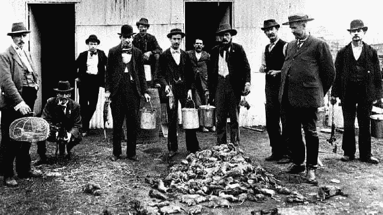

1900-1908 年旧金山中国城鼠疫事件

那个年代我们对于传染病的了解非常之少，所以更容易弥漫这种恐慌情绪。但是它仓促之间做出的"封城"的决定，引起了民意的强烈地反弹。当地的居民，包括当地旧金山的媒体，都质疑政府的这个决定，因为这只是一个医生的个人的看法，以及封锁整个中国城是不是显得这个范围太扩大了。

于是在这种民意的压力之下，旧金山政府在三天之后就宣布撤销了"封城"的决定，以等待进一步的检验。可是非常不幸的这个医生不幸言中，几天之后又发生了更多因鼠疫而死亡的案例，然后他们送去检验的样本，证实这些人都死于鼠疫杆菌。

于是旧金山政府很快再一次宣布了"封城"的决定，它所谓的"封城"，其实就是"封中国城（Chinatown）"。但是旧金山政府所谓"封中国城"，是很明显的带有种族歧视性质的一个决定。

#### 起诉旧金山政府带有歧视性质的"封城"决定

虽然最初的几个案例都和中国城有关，都爆发在中国城，以及最初的案例都是华裔，可是并没有任何证据表明整个中国城都受到了细菌的威胁，整个中国城都应该封起来。就是这个细菌扩散的边界和中国城的边界没有必然的联系，以及非常明显的在实际操作上，旧金山政府表现出了它们的种族歧视。

所谓中国城就是欧美的大城市通常都有一个中国城，它不是一个严格意义上的"城"，它并没有边界，它并没有城墙，它只是几个街区，中国人聚居的地方，或者是华人华侨聚居的地方。所谓中国城的范围之内，也不是只有中国人居住，也有韩国人、日本人、美国白人、欧洲人居住。

可是旧金山政府在划定隔离的边界的时候，它基本上是巧妙地绕开了那些白人的商铺，中国人是真的被封锁在里面，但是白人被悄悄地划了出去（也不是悄悄地，就是明显地划了出去），于是就有人把旧金山政府告上了法庭，今天很难找到关于这个原告更多确切的信息，只知道他叫 Jew  
Ho。

他起诉旧金山政府的所作所为  
这个隔离的命令是违宪的，它违背了宪法所保证的"隔离区域内的所有人的宪法权利"。这个起诉是在 6 月 5 号提起的，仅仅 10 天之后，当地的法官就做出了裁决，这个法官叫做 Morrow、莫罗法官，而且他召集了记者，公开宣布他的裁决。他的裁决结果是赞成原告，他认为"旧金山政府的这个封城的命令的确是违宪的"。

他在这份判决当中说，我们去衡量政府的所作所为有没有违宪，有两个问题要回答。第一，政府是否有这种隔离封城的权力？他认为政府是有的，可是这个权力并不是无限的，并不是不受任何限制和约束的。就算政府有合适的理据证明"为了防止这个细菌的扩散，我们不得不采取封城的措施"。

他说"非常明显的，旧金山的政府在制定和实施这个'封城'的政策的时候，它所依据的标准并不是谁已经或者很有可能受到细菌的感染，它的标准仅仅是这些人他们来自共同的族裔，他们都是华裔。"

莫罗法官在判词当中，有一个"金句"就是很挺让人感动的话，他说"当这个政府的政策是 with evil  
eyes、邪恶的双眼，或者是邪恶的目的，而且在执行中是 with unequal  
hands、不公平的双手，这就是法庭的职责去宣布这样的政策在本质上是歧视性质的，它在宪法之下不能够成立，是无效的。"这个宣判之后，旧金山政府很快就撤回了"封城"的决定。这场鼠疫后来又一次次地袭击旧金山，一直最后的一波高潮和爆发持续到 1908 年。

Judge Morrow : ...the San Francisco quarantine was imposed with "an evil eye  
and an unequal hand.

This quarantine , cannot be continued by reason of the fact that it is  
unreasonable, unjust, and oppressive...discriminating in its character and  
contrary to the provisions of the Fourteenth Amendment of the Constitution of  
the United States.

#### 疫情作为一面"镜子"，能映射出的当时社会已有的问题

我觉得读这个故事又有一些感到悲哀，也有一些感到振奋，为这位原告的勇气和他愿意用法律的手段，不只是为他自己的利益去争取，而是为所有受到这个政策的不公平对待的华裔同胞去争取。非常幸运地遇到一位秉持法律公正的原则，不受那个时代的种族歧视之风裹挟的法庭的支持。

1900 的年代，是一个种族问题还非常严重的年代，特别在美国的西部地区，这个案子就发生在旧金山。整个加州地区，因为大量的中国劳工、中国移民和当地的社区之间曾经有过漫长的对立，当地的华裔曾经饱受种族歧视之苦，这就是疫情作为一面"镜子"，所映射出的那个社会当中原本就存在的问题。

从这个案子也引申出很多法律问题的讨论。首先，旧金山政府它是不是有权力去封锁这个城市当中的几个街区？我们也看到今天在新冠肺炎之下，虽然特朗普之前一直不停地说"一切都在控制之中"，但是现在美国所有的州都宣布进入了紧急状态，也有很多的人在质疑"政府是不是有权力命令大家呆在家里，不能参加任何的聚会和集体活动？"

他们的总统（特朗普）在推特上天天像喊口号一样，说"解放明尼苏达、解放密歇根"，有很多人上街游行，去抗议"居家隔离"的命令，但是事实上绝大部分时候，大家还是会配合州政府的命令，而且法律也认同，州的政府在这个问题上有相当之大的权力。

因为州有所谓 police  
power、州的警察权，或者是州治安权，他们可以出于对整个社区的健康、安全，或者基本福利的考量，而在一定程度上采取强制性的命令去限制当地人的自由，或者甚至限制他们的财产权利。

美国这个国家我们提到过，它是一个联邦制的国家，这个权力是保留在州政府的手上，它的联邦政府是没有这个权力的。所以前段时间特朗普站出来号称说"他作为一个总统的'全力'（是完全的'全'）、totally  
power"，就被骂了个狗血淋头，所有的州长们跳出来骂他。

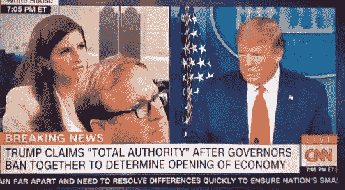

特朗普称，"总统有完全的权力"

特朗普这个人真的是非常有意思，我记得我在法学院读书的时候，其实宪法并不是一个必修课，大家在真实生活中遇到宪法的机会没有那么多，可是特朗普上台以后，因为他干的事情都让人大跌眼镜，所以大家都纷纷地去选修宪法课，就是想要知道"他是不是违宪了？"

他这一次说"总统的权力是完全的权力"，这句话当然是大错特错。在美国这个国家，它的宪法第十修正案里有一个非常重要的原则，就是那些没有被授予给联邦政府的权力，都保留在州政府的手中。

我们一再地提到美国人建立联邦政府，本来就是一个无奈之举，所以像 police  
power、治安权这样的权力，并没有被授权给联邦政府，就没有授权给美国总统，它仍然保留在每个州的手中，这就是为什么之前特朗普只能"建议"每个州去采取居家隔离的命令，而真正宣布每个州进入紧急状态，是每个州的州长自己的选择。至于每个州在紧急状态之下，到底要采取一些什么样的命令？也是这些州长自己的选择。现在有一些州急吼吼地要重启经济，同样是他们的权力。

州政府所拥有的警察权或者治安权，它的权限是非常大的，在必要的条件之下，州政府可以限制人的自由，甚至可以征收人的财产。这个时候问题就在于"州政府有权利，有警察权没有错；个人也有权利，也有基本的公民权、也有他的财产权、有他的自由权。

当这两种权利发生冲突的时候，它们的边界应该如何划定？州政府的警察权到底应该扩展到什么样的程度？这个问题法律本身没有回答，它就是法院、法庭在一次又一次的判例当中去划定的边界。

#### 权利冲突之下的"挑战"

关于"公共健康"这个议题，或者是关于"防治传染病"这个话题，美国的最高法院在 1905 年的一个案子当中给出了很明确的回答。当时的马萨诸塞州（就是麻省）爆发了天花，于是马萨诸塞州的州政府就决定"所有的人都必须接种疫苗"。

美国有一些人他的想法是非常奇怪的，直到今天我都感觉有一个好像挺强大的组织，它们坚定不移地相信"疫苗是科学家和政客合谋的一个骗局"，然后他们坚定地反对自己还有自己的孩子都不接种疫苗（到今天都还有人这么相信，更何况是在 1905 年了）。

有人反正表示拒不配合，坚决不肯接种疫苗。然后这个官司就一直打到了美国的最高法院，结果是最高法院站在了州政府的这一边，最高法院说"在爆发传染病的面前，在自卫、self-  
defense 这个原则之下，在必要的条件下，州政府是可以要求大家去接种疫苗的"。

这个判例所赋予州政府的权利就非常之大了。我们在别的节目里肯定聊过自由的概念，通常认为不允许某人做某事，比如现在你要求大家呆在家里不允许出门，这是对自由的一种侵犯；但是相比之下，这种对自由的侵犯比不上要求某人去做某事。前者只是禁止你做某一些事，后者是强制你去做某些事，强制你去做某事的这种对自由的侵犯，通常被我们认为是更严重的一种侵犯。它完全可以是扭曲个人意志，它更是一种权力的展现方式。

在这个判例里好像最高法院是支持"当有流行病爆发，或者流行病爆发传播的风险之下，一个州政府甚至可以强制要求某人去做一件他不愿意做的事情"。

所以后世在这个案例的指导之下，州政府的权力就很难被挑战，因为法院赋予了相当之大的在传染病的面前实行治安权的权力。但是我们依然看到很多的挑战，包括我们刚才一开始讲到的，1900 年的中国移民社区对旧金山州政府的挑战，那种挑战是对州政府它执行的某一个政策，这个政策的本质做挑战，这个政策是歧视性质的。

州的治安权虽然权限很大，但是它也必须满足一些基本的标准，用法律词汇是它不能够 Unreasonable arbitrary or  
oppressive、不合理的、武断、肆意和有压迫性。当然它有歧视性，针对某一个族裔，这当然是和《宪法》其它的原则相冲突。

还有一种挑战，不是对这些命令或者这些权力的实质进行挑战，是对它制定政策的过程的挑战，就是我们之前聊到的正当程序的问题。

2014 年有一个官司，有一个护士，她去支援非洲，在非洲期间她接触过感染埃博拉病毒的病人，她回到美国之后，她接受了检测，她的病毒检测呈阴性，就是她没有感染这个病毒，但是她依然被纽约州政府要求隔离，然后这个护士就愤然地把纽约州政府告上了法庭，认为政府明明知道她已经检测成阴性，还要求她隔离，就是违背科学原则，是 arbitrary、肆意武断地使用自己手中的警察权。

这个案子最后是政府和这位护士和解了，和解的内容并不是政府给护士赔钱，而是州政府承诺，从此以后遇到同样类型的情况，州政府必须遵守一定的程序，包括向要求被隔离的人写一封通知，讲明他们要求被隔离的科学依据是什么？以及允许这个被隔离的人能够接触律师，来保护他们的权利（感觉这个护士真的不是图钱，图的是"你必须按程序办事"这种感觉）。

你说遵守这些程序有没有改变实质呢？好像也没有，她还是接受了隔离；是不是会影响这个疾病的防治工作，又好像有。我不知道大家对这个问题是怎么看？就像一开始提到过的疫情是一个"镜子"，它比较集中地反映出这个社会的各种各样的特色，包括这个社会更在意什么？也包括这个社会既有的问题。

# 番外 | 疫情专题（二）：隔离下的平等权、堕胎权与宗教自由

（公众号懒人找资源，懒人专属群分享。）

#### 事件：新加坡客工宿舍感染新冠肺炎

疫情是一个镜子，它总是比较集中地反映出这个社会的各种各样的特色，包括这个社会更在意什么？也包括这个社会既有的问题。

新冠肺炎在美国爆发以后，大家逐渐意识到一些很严重的问题，有很多的媒体都在统计不同肤色的人感染这个肺炎和死亡的概率，它是很真实的在向我们表明"病毒的面前并不是人人平等的"。

当英国首相和王子都感染的时候，那个时候很流行一个说法，说"病毒面前人人平等"，但真实的社会现实并不是这样，通常更富裕的阶级，他们更有能力保持社交状态，而更贫穷的地方更穷的人，他们从事的工作的性质决定他们可能必须得出门工作。

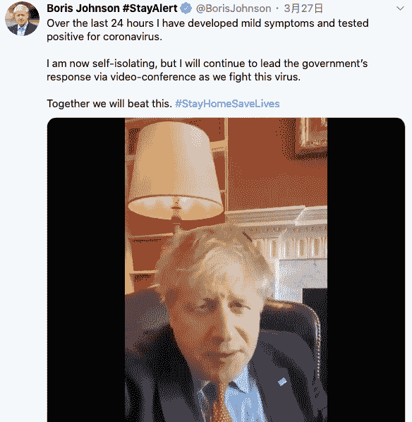

英国首相鲍里斯\*约翰逊新冠病毒检测呈阳性

在美国黑人或者拉丁裔居住的区域，通常这个房子更小、人群更密集、医疗设施更差劲、医疗资源更匮乏，所以疫情也映照出这样的真实的社会问题。

新加坡一开始是被大家当做一个抗议的典范，它好像没有采取特别"严厉"的措施，但是把感染率控制得非常之低。但是突然之间有一个爆发，是因为他们的客工群体，客工就是到新加坡打工的外国人，通常是从东南亚、南亚比较贫穷的地方去打工的外国人。

马来西亚大喜传媒报道新加坡客工宿舍感染事件

他们通常居住在条件比较差的大的集体宿舍里，它的这个人群突然之间爆发了，也是映照出这个社会的一些现实。我也发现大家在这个问题面前，关注的问题特别的不一样，这里是跟大家聊天了。

#### 事件：日本经济补偿政策歧视性工作者

我前几天跟我一个日本同事聊天，这是前段时间的事情，因为当时日本政府还在研究，还没有出方案说"要补偿，要为受到疫情影响而没有办法工作的人提供经济上的补偿"。

我还以为大家就会聊"补多少钱，日本有没有这么多钱补偿？"然后我这个同事是一个很有社会正义感的人，他当时就非常义愤地说，他们正在网上抗议，抗议什么呢？就是这个政策最初推出来的时候，补偿的对象并没有包括那些在日本的风月场所提供色情服务的人。我还蛮震惊的，为什么日本（补偿政策里）没有包括这些人呢？

日本政府给的理由是说，"因为他们所从事的工作不被定义为工作。"然后我这个朋友就非常得生气，他就觉得"这个工作并不是违法的，它是一个合法的工作，最多是在普罗大众的眼中，或者在你这个政府政客的眼中，不是一个特别体面的工作，别人也是合理合法的在挣一份收入，而他们的工作很明显地受到了疫情的影响。而且从事这些工作的人当中有很多是单亲妈妈，她们的生活状况、经济状况受到的冲击可能说是最严重的，结果政府的歧视竟然表现在不把她们从事的事情称作工作"。

然后就有一波在推特上的抗议，最后安倍晋三还专门出来说，"色情行业也被包括在工作的定义之内，这些人也会收到政府的补偿"。

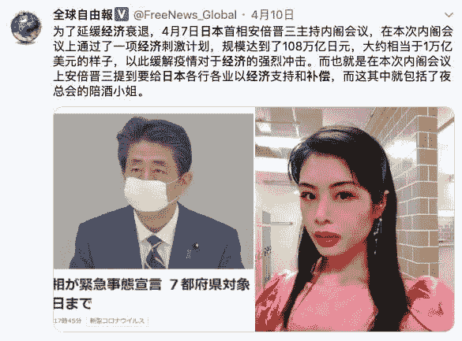

日本首相安倍晋三宣布向国民发放补贴

#### 事件：疫情期间，堕胎被认为是"不重要手术"？

在日本可能大家选择的是抗议的方法，政府也很快地回应。在美国从一开始大家就可以想象，这个州政府推出了那么多的侵犯这些美国人的自由权利的这种隔离措施，一定是会引起很大的反对的声浪，一定是有很多人到法庭里去挑战政府的这个、那个命令，大家关注的问题和解决问题的手段也很不一样。

我觉得非常有趣的事情是，我原以为这段时间到法庭里去打的官司会集中在"自由的边界"，但是我发现这段时间因为隔离政策所引发的官司，其实它所涵盖的议题要更广泛，疫情是更广泛地在反映社会各个方面的问题。

比如这段时间在德克萨斯州有好几个官司，官司的主题是什么呢？是堕胎。我们已经讲过和堕胎有关的法律问题，罗诉韦德案当中，最高法院很明确地说："堕胎是妇女的宪法权利"，这个官司当年就引起很大的争议，因为美国保守的南方各州，对堕胎问题看得很严重，这些州的宗教信仰、宗教化的程度依然非常高。

最高法院已经宣判，"这个是宪法权利，这些州再也不能够用法律去限制"。虽然我们之前也聊到过，还是有共和党的议员孜孜不倦地想这么做，但是这些保守的州就想各种各样的办法，来继续地阻碍女性去堕胎的权利，主要的阻碍的方法就是"钱"，"要堕胎可以，但是堕胎手术就不纳入医保，要去做就得自己给钱"。很多需要堕胎的女性，她们可能是低收入的阶层，她可能负担不了堕胎的费用，诸如此类。

最近因为有新冠疫情，美国南方的德克萨斯州又抓住了这个机会，德克萨斯州就说"因为有疫情，所有 nonessential，不是最重要的治疗跟手术都暂停，我们把医疗资源都全部节省出来，去治疗新冠肺炎。"这个看上去是挺有道理的，可是它就悄悄地"夹带私货"，这个不重要的手术当中就包括堕胎手术。

这相当于在紧急状态维持的情况之下，所有的堕胎手术都不能进行了。这就引发了很大的问题，因为堕胎是一个被法律确认了的宪法权利，它是不是可以被紧急状态剥夺呢？

第二，假设说其它的一些不太着急的手术，大家可以理解，说这种手术等等也无妨。可是堕胎不一样，堕胎是一个时效性很强的手术，再等一等，可能再做这个手术就会很危险了，或者就没有办法做。所以它很现实地剥夺了这些女性堕胎的权利。

这个案子先被告到了德克萨斯的地方法院起诉，判了以后又打到上诉法院，同时在好几个地方法院和上诉法院之间来回，地方法院还有一些支持发起这个官司的女性的判例，但是上诉法院目前的态度是"州政府有权力做这样的限制"。

这些上诉法院所引用的就是我们提到过的 1905 年的天花案，案子叫杰克布森案，不愿意接种天花疫苗的杰克布森把马萨诸塞州的州政府告上法庭。在那个案子当中，州政府抗击传染病的权限是非常之大的，今天的第五巡回法庭，就是管辖德克萨斯州的上诉法庭，它们引用这个案子来证明"州政府的确有这样的权力"。

这个官司还没有结束，因为输了官司的这一方决定要打到最高法院。但是时局是不停变化的，这段时间南方的这些州蠢蠢欲动，准备重启经济，又要恢复各种各样的手术，就有权力公益组织去问政府"你们重启的计划里面包不包含重启堕胎手术呢？"德州政府的回应是"包含"，大家可能就会就此达成和解。

#### 疫情期间的宗教自由

除了堕胎（的官司），还有一个很有趣的官司，是和宗教活动有关。大家知道美国是一个仍然非常流行基督教的国家，特别是在南方（又是南方的这些州），至少每个星期天，这些教徒们是要聚集在教堂里听牧师布道的。现在因为新冠疫情要保持社交距离，所以所有的州都不允许宗教活动继续进行，这个牧师就和咱们上网课的老师一样，全部改成了线上，牧师在  
YouTube 上发布布道的视频。可是有很多人觉得这样是不够的，尤其是当严重的传染病在蔓延，大家都有恐慌，又宅在家里，心情非常沮丧的情况下，对这种宗教的热情反而是空前的高涨。

美国牧师在电视节目上布道

在加缪的《鼠疫》那本书里面也有写到，所以最近有很多的教堂就开发出了一种"教堂服务"，叫做 driving religious  
service。Driving 什么意思？就是我们之前在讲一个老太太诉麦当劳的那个案子里有提过（现在不只限于麦当劳了），你在车里面比如对着一个窗口或者对着一个话筒，你就能点餐，开着车到另一头的时候，你就能拿到这个吃的。现在有很多的超市也是这么操作，你就开着车在这边点了，在那边就能把东西拿走。

教堂也开发出了开车进行宗教活动的服务，大家开着车，全部都停在教堂前的停车场里，牧师通过一个音箱，或者通过一个收音的频道，或者通过扩音设备，他就在教堂里对大家布道。大家都开着车，都呆在自己的车里，也有社交距离。

可能有朋友参加过这种布道活动，牧师说完一段话的时候，大家要应和他，就会说"阿门"，现在这"阿门"就被改成了按喇叭，牧师说完一段话以后，大家就一起按喇叭。

据参与过的人说，用这种方式来从事宗教活动，会有一种大家仍然在一起的感觉，结果有一些州就不让大家做这样的事情，它可能还是担心一开窗户有传染的风险。肯塔基州的路易斯维尔（同路易维尔）的市长前两天说，"以后不能再这么搞了，这个是违反居家隔离的命令"，就有居民把路易斯维尔政府告上了法庭："你这个是侵犯大家的宗教信仰自由"。

美国人的宗教信仰自由是《第一修正案》（就是我们之前讲的言论自由的那个修正案的一部分），它的原话非常得简单，但是有非常宽泛地解读，基本上就是政府不能够干涉别人的宗教自由，信或不信宗教的自由。它有一些很具体的要求，就包括政府不能够区别对待宗教组织和非宗教的组织、世俗的组织。政府无论是优待宗教组织，还是优待非宗教组织，都不可以，政府优待谁，另外一边就会上诉。

Congress shall make no law respecting an establishment of religion, or  
prohibiting the free exercise thereof.

国会不得制定关于下列事项的法律：确立国教或禁止信教自由。

美国《宪法第一修正案》（节选）

这些人现在告路易斯维尔政府，他告的是什么呢？"为什么开着车去超市买东西就可以，开着车参加宗教活动就不可以，这是什么道理？这不就是区别对待吗？"因为无论是开车买东西，还是开车点麦当劳餐，都是非宗教活动，政府就同意；现在大家是开着车参加宗教活动，政府就不同意，凭什么？就说政府违背了《第一修正案》，然后把政府告上了法庭。

目前这个案子估计还要经历好多轮的上诉，也不知道双方有多坚持，反正目前当地的法院是站在有宗教信仰的人这一边的，它们认为政府侵犯了大家宗教信仰的权利（我为什么给大家讲这个案子呢？就是非常有趣）。当当地的地区法院做出这个裁决，它这次不是站在政府那边，是站在普通民众这一边的时候，它引用的竟然也是 1905 年的杰克布森诉马萨诸塞案（再复习一遍）。

在那个案子（杰克布森诉马萨诸塞案）里，最高法院裁定在面对传染病的时候，州的警察权外延是很大的，它甚至可以逼迫人去接种天花疫苗。可是在这个案子里，从模糊的感觉上来说，那个案子好像和这个案子的判决就是站在人民这一边，认为"政府没有权力限制大家开着车去参加宗教活动"，这个判决好像是对立的。

它怎么会在这个案子里引用那个案子呢？因为这个法官说，杰克布森诉马萨诸塞案告诉我们一个什么道理呢？当天花疫情已经非常严重的时候，人依然保有自己最基本的公民权利，只是在必要的情况下，我们要让渡那些权利而已。

#### 判例法中，法官裁决依据类比原则

这里其实我们已经进入了下一个板块的讨论，真的到了法庭上，法官的裁决，它是怎么做的？案例法之下，所有的裁决就是用类比原则做裁决的。我们有一些判例，这些判例决定了法律是什么？

我们用今天的案子去对比过往的案例，如果两个案子很相似，要遵从相似的判决；两个案子有明显的区别，那可以不同地对待。可是这是一门有的时候感觉很"玄"的学问，在法律的学术圈里面，有一些非常坚定的虚无主义者，他们认为所谓的类比原则，所谓的遵循过往的判例就是很"扯"的，法官其实就是遵从自己的意识形态、意识好恶就判了，他总能找出某些理由。

就像在这两个案例里，一个案例里法院是裁定，"州政府有权限制居民堕胎的权利"；在另一个案例里，法官的裁定是，"地方政府不能够限制大家开着车参加宗教活动的权利"。

它们引用的是同一个案子，都是被最高法院确认的，1905 年的天花案，可是它们得出了非常不同的结论。或者说它们都只引用了那个案子当中，对自己目前这个结论有利的部分，利用那个部分来支撑自己在目前这个案子当中的结论。

要仔细分析一下的话（大家想想看），州政府确实有权力限制你堕胎的权利，就像当年马萨诸塞的州政府有权力让你接种疫苗，这不是一样的吗？都是为了防治传染病。可是要认真分析起来，是否接种天花疫苗和防止天花传染病的传播，好像是有非常明确的直接联系。

可是不允许大家做堕胎手术，和防治新冠肺炎有那么明确的联系吗？有那么直接的因果关系吗？至少没有那么明确。如果要硬找区别，是可以找出来的。可是法官说"这两个案子足够相似，所以我们遵从当时的判决"。

反过来，在开车去参加布道会的这个案子里，大家不能够开着车聚集在停车场上接受宗教活动，好像和防治新冠肺炎的传播，反而有比较明确的直接联系。因为这个疾病就是大家近距离接触会传播的，它的传染性非常强，而大家都开着车，聚集在一个地方，这和排着队开着车，一个一个地去买麦当劳还是挺不一样的，它好像和天花案反而更相像。

可是法官得出的结论却是恰恰是反过来的，大家是不是能够感觉到一点，整件事情没有那么简单？

法律真的是这么随意的吗？有这么强烈的不确定性吗？我本人当然不是一个虚无主义者，也没有那么现实，我还是觉得法律是有道理可讲的，但是我们确实会经常面对这样的问题。法官们判案子的逻辑，这些背后的道理，我们留待下一个板块来慢慢地分析。

# 77\. 哈佛被诉招生歧视亚裔（一）：亚裔需要考更高的分数？

（公众号懒人找资源，懒人专属群分享。）

#### 事件：SFFA 起诉哈佛大学招生歧视亚裔

我们这段时间讲了很多的番外，我本来番外没有打算讲这么多，我只是想和大家分享一下最近国外有趣的新闻，它背后牵扯的法律问题。或者一开始，其实就是想和大家分享 1900 年的旧金山的案例而已，因为表面上那是关乎在传染病的面前，州政府的权力边界的案子，其实它背后真实的问题是"那个年代强烈的种族主义"，这个种族的问题也由其他的很多方式体现出来。

我们用一个例子来讲回证据标准这件事，以及在这个 discovery（大家还记得这个词吗？），证据开示的过程当中，所面临的一些现实问题的这件事。

我举的这个例子和我自己有一定的相关性，可能大家有看到新闻，前几年有一波学生和家长联盟把哈佛大学告上了法庭，他们指控哈佛大学在招生的时候，涉嫌种族歧视。那它种族歧视了谁呢？其实是所有的亚裔学生，就是我们这样的亚裔。这是一个尽人皆知的"秘密"（大家都知道）。

你在美国申请学校，相对来说，一个黑人或者是一个拉丁裔的学生，从统计学的概率上来说，要申请好的学校所要求的学习成绩没有那么高。但如果你是一个亚裔，你就得学习成绩特别好才有可能申请到，它的概率就更低。所以原告方就说，"哈佛大学在内的这些顶尖的高校，他们在招生的时候涉嫌歧视亚裔。"

我觉得好像我们自己在这个案子里面也是利益相关了，但不妨碍我们相对客观地聊一聊这个故事。

亚裔学生听上去是一个集体，可能很多朋友已经想到了集体诉讼，我们之前讲过的那些繁琐的环节，先要招募原告，然后这些原告要选出首席原告，还要选首席原告的律师，然后要法庭认证他们形成一个集体。

但是这里不是一个集体诉讼，所以它也无需经过集体诉讼。因为这里的原告是一个组织，这个组织叫做 Students for Fair  
Admissions，SFFA,公平录取学生联会。它的成员据它自己说是包含很多的被哈佛拒绝过的亚裔学生,也包含将来想要申请哈佛的学生，还有这些学生的家长。

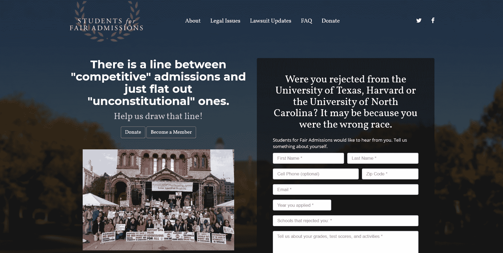

SFFA 网站首页

"竞争性的录取与违反宪法的录取之间是有界限的"

很有趣的事情是这个组织的发起人和它的领导人并不是一个亚裔，这个人叫爱德华\*布鲁姆，是一个犹太人,也是一个白人男性，他是一个有名的保守派活动家，他从上个世纪 90 年代开始就发起各种各样的官司，把很多的大学都告上了法庭，还告到过最高法院。

SFFA 组织主席爱德华\*布鲁姆（Edward Blum）

#### 挑战《平权法案》

很有趣的是我们可能一开始会以为一个为亚裔学生去争取权利的组织，它的发起者应该是一个"白左"、是一个左派，但他不是，这个人是一个右派活动家。在这几年里，他虽然会有不同的"斗争"手段，但是他的目标是非常一致的，一直想要挑战《平权法案》（《平权法案》大家肯定也都听说过）。

广义上的《平权法案》，指的是一系列的政策去帮助那些社会当中的弱势群体，这个弱势群体可能包含性别上的"弱势"，女性，包含宗教上的少数派别，也包含种族上的这些当年经受过歧视的有色人种。

《平权法案》是通过一系列的政策法规去帮助这些曾经经受过歧视的弱势群体，让他们有更多的机会去保障他们在就业、住房和教育上的公平。但是我们通常聊起《平权法案》的时候，大家首先会想到的是在大学的录取问题上，在上个世纪 60 年代的美国民权运动之后，有很多的州和大学它们推出了各种各样的政策，它们在招生的过程当中会向黑人倾斜。

《平权法案》特别是招生问题上的"倾斜"，从它诞生之日起就经受了保守派各种各样的挑战。由于引发了各种各样的争议，美国最高法院在上个世纪七八十年代到九十年代，做出过大量的关于《平权法案》问题的裁决，它基本上也是奠定了我们今天讨论这个问题的框架。

布鲁姆他是一个保守派的活动家，他一直致力于挑战  
《平权法案》，那大家也都知道《平权法案》是从保护弱势出发，它一定会造成相应的对另一些群体的利益的损害，这就构成所谓的逆向歧视。

逆向歧视通常是指针对白人的逆向歧视，因为他们本来是这个社会的优势群体，然后这个时候引入保护弱势、倾斜向弱势的政策之后，他们的利益就会受到损害。但是这个过程当中，亚裔无辜躺枪，是被伤害得最深的。一方面亚裔在漫长的历史里，其实我们都是经历被歧视的弱势的一方；可是在今天的平权政策之下，亚裔又是被打压的一方。

#### 高分不一定被录取？

如果说这个官司它告哈佛的理由无非是一些"尽人皆知的秘密"，所谓"尽人皆知的秘密"就是大家都知道，"你在美国想要申请好的学校，我们以白人作为一个标准，白人面临的困难是普通级别的困难。"

如果这个时候你的种族身份是黑人或者是拉丁裔，那这个种族身份就会是一个加分项，就是相对白人来说，它的申请难度就会更低；如果你是一个印第安人住民或者是阿拉斯加原住民，那它就是一个更大的加分项，但是因为这样的人非常得少，所以通常忽略不计。

反过来，如果你是一个亚裔，在今天的招生政策之下，亚裔这个身份是一个减分项，相对白人都是一个减分项，相对黑人就更是一个减分项。你要付出比别人更多的努力，考更高的分数，才有可能考进同一个大学。

这种大家"心知肚明的秘密"是有数据支撑的。2013 年的一个统计发现，假设哈佛大学在招生的过程当中，只考虑一个学生的学术成绩，也就是他的 SAT（Scholastic  
Assessment Test  
俗称"美国高考"）分数和他在高中的平均成绩的话，那么哈佛大学当年的新生当中应该有 43%都是亚裔。因为大家都知道亚裔的学习很好，而且亚裔家庭比较看重考试，我们也比较努力。所以只看学术成绩，亚裔可以占到新生的 43%。

但是在现实当中，当年的哈佛录取亚裔只占 21%，那为什么会有这个百分比上如此明显的差距？在过去的十几年的时间里，亚裔学生的比例不断地在提高，但是提高得非常慢，可能从百分之十几到 2020 年，就是最新一批的录取数据里，亚裔学生占到 23%。哪怕它是一直不停地在提高，它和我们刚才说的纯看学术表现，应该录取的那个比例之间还是有非常明显的差距。

这个差别是怎么造成的？美国的大学招生和我们不一样，如果我们是基本上只看高考成绩，然后有一些额外的少数民族的加分，拿过奥数金牌，拿过国家二级运动员的加分，除此之外，我们基本上是只看高考成绩；但是美国的大学招生，它是看你的一个综合打分，以哈佛为例，它会考虑以下 6 个项目的得分，然后根据一个学生的综合得分来决定他是不是被录取。这 6 个项目包括学术水平、课外活动、运动水平、推荐信以及校友的面试，还包括一个分数叫做 Personal、个人得分。

那这些元素都被这个案子里的原告方拿出来痛加批判。原告方说，如果这个学术水平是相对客观的评价了一个学生的标准，那如果在客观标准之上，亚裔学生他们的录取比例应该是非常高的，可是现实当中录取比例这么低，就证明在其他的这些主观标准上，哈佛有意地压低了他们的分数。

这些主观标准当中，你的课外活动做过什么、你的运动水平，还是相对客观的一个评价，都需要有一些事实进行支撑；可是另外的一些，尤其是个人得分这个项目，那纯粹是一个主观评价。系统性地压低一个族裔的主观得分，那这不是歧视是什么呢？

#### 布朗案与平等的受教育权

这个案子在美国引起了相当高的关注度。一方面因为它的被告是哈佛大学，另一方面它动摇的是整个美国大学录取招生的一个基石，因为不是只有哈佛这一个大学是在用这个方法招生，所有的大学招生考量的因素差不多也就是这些。而且也不是哈佛一家大学存在"在这些主观项目上，系统性的这个亚裔学生的得分比较低"的情况，精英的大学很多都存在这样的情况。

所以这个案子它虽然只告了哈佛一个学校，但是它是挑战了整个招生录取的这个体系，它也挑战了持续这么多年的平权运动之争。其实从一开始哈佛就承认说，"种族是它们在招生的过程当中考虑的一个元素"，而且它几乎就是承认了学校会向黑人学生和拉丁裔的学生做一定程度的倾斜，它背靠的是漫长的过去四五十年的平权运动发展的历史。

平权运动的故事，如果我们有时间会和大家更详细地去聊，因为种族是理解美国当代社会，还有它的当代法律体系当中一个不可避免的元素。简单的说就是上个世纪平权运动之后，特别是 1954 年的布朗案之后，布朗案宣布了"公立学校当中种族隔离违宪"，那之后有很多的州、很多的学校都推出了各种各样的政策，希望能够推动种族之间的融合，希望能够提升黑人学生在学校当中的录取率和黑人学生的比例。

Warren : The race-based segregation of children into "separate but equal"  
public schools violates the Equal Protection Clause of the Fourteenth  
Amendment and is unconstitutional.

Segregation of children in the public schools solely on the basis of race  
denies to black children the equal protection of the laws guaranteed by the  
Fourteenth Amendment, even though the physical facilities and other may be  
equal. Education in public schools is a right which must be made available to  
all on equal terms.

这背后是一套很复杂的政治、经济、社会、心理的历程，它不是简单的"黑人和白人争夺权力"这么简单。举一个例子来说明它的复杂性，托马斯大法官他是现任美国最高法院当中唯一的一位黑人大法官，也是历史上的第二位黑人大法官。

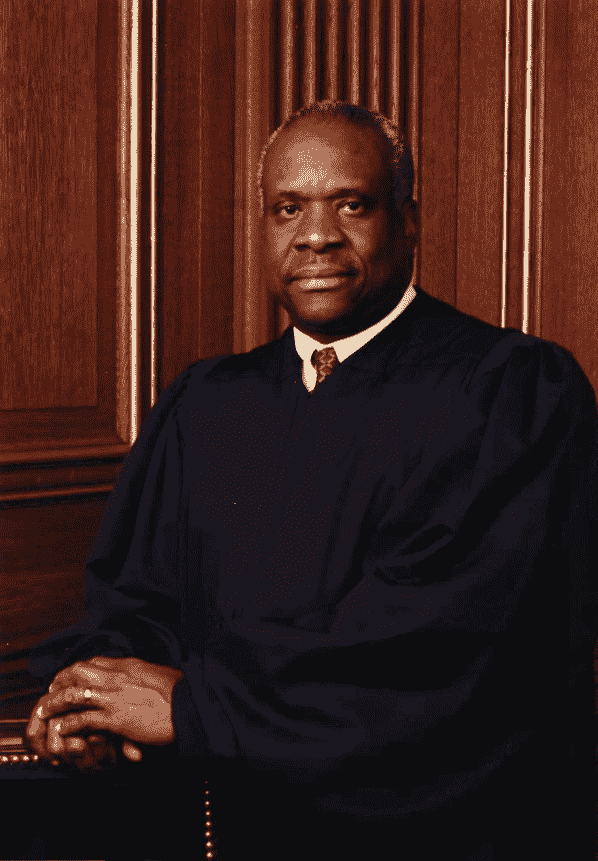

克拉伦斯\*托马斯（Clarence Thomas，1948－）

自 1991 年以来担任美国最高法院大法官

是最高法院继瑟古德\*马歇尔后第二位黑人法官

按理说平权运动是让更多的黑人学生，能够得到去高等学校接受教育的机会，他作为一个黑人在最高法院里唯一的代表，他应该积极地推动平权运动才对。但托马斯大法官一直坚定地，在之前他所参与的所有平权运动有关的判例当中投反对票，他反对平权运动。

一方面托马斯大法官是一个保守派的法官，保守派倾向于反对平权运动；另一方面他很真诚地写过很多很有力量的反对的判词，就是反对意见。他作为一个黑人，经过从小的奋斗，他后来是从耶鲁法学院毕业，一步一步走到他今天的位置。

他觉得《平权法案》所给予黑人的保护，从本质上仍然是一种歧视，因为它认定了"这个人种不如其他的人种，所以需要特殊的政策照顾"。所以很多的《平权法案》之下的政策，这种推动提升黑人学生比例的政策，反而是以歧视之名被告上法庭的。

#### 综合考量的招生方案是否公平？

美国的最高法院它最后的裁决，一系列案件综合下来的裁决结果，更像是一个"平衡"，它也不反对"这些学校为能够招收更多的黑人学生所做出的'努力'"，但是不可以把这种"努力"放在明面上。

最高法院很明确地说，"你不可以用一个配额的制度"，之前有一些学校它使用所谓配额制度，就是今年要招 1000 个新生，这其中必须有 300 个黑人。最高法院觉得配额制度是不可取的，它比较明显的是把一个人种和另一个人种放在不公平的体系下去比较。

可是最高法院赞同另一些学校所采用的综合评估的手段，它赞同"学校可以把种族当做一个元素去在招生的过程当中考虑，甚至可以把它来自少数有色族裔当做一个加分项去考虑"。

它背后的原因是最高法院赞同，"对于州政府和联邦政府来说，推动一个社区或者像大学这样重要的公共社区的多元性，都是非常重要的价值。"

它全心全意的拥抱多元价值，也就是说"这些大学在它们重新制定它们的招生政策的时候，它不可以直接说我就是要保持这个种族之间的平衡，黑人要有一些、白人要有一些、亚裔要有一些，你不能再这么说了，你只能说我们要推进一个多元的社群。"

所以学校在录取招生的过程当中，会考量各种各样的个人因素，这些因素包括性别、宗教信仰、出生背景，包括你来自什么地方，是农村还是城市？是哪个地方、哪个地区？你来自什么样的社会经济背景？你是不是家里的第一代大学生？也包括你的种族。

所有的这些元素学校都会纳入考量，这一套综合考量的方案得到最高法院的认可，觉得这是一方面推动了一个很重要的价值，另一方面它没有直接的涉嫌把种族进行一个配额制度的设计。

这样的一种综合考量的招生方案，到底是不是一个公平的招生方案？我们之前聊亚裔的学生，如果只看学术水平，他们应该代表哈佛新生的 43%，现在只有 21%，就是这个综合考量之后的结果，这是不是对亚裔的学生不公平呢？

#### 公正：该如何做是好？

关于这个问题，我不知道大家是否看过哈佛有一个著名的公开课叫做《正义》、《Justice》，桑德尔教授的一个公开课，他出了一本书叫应该就叫《正义》（中译版）吧。

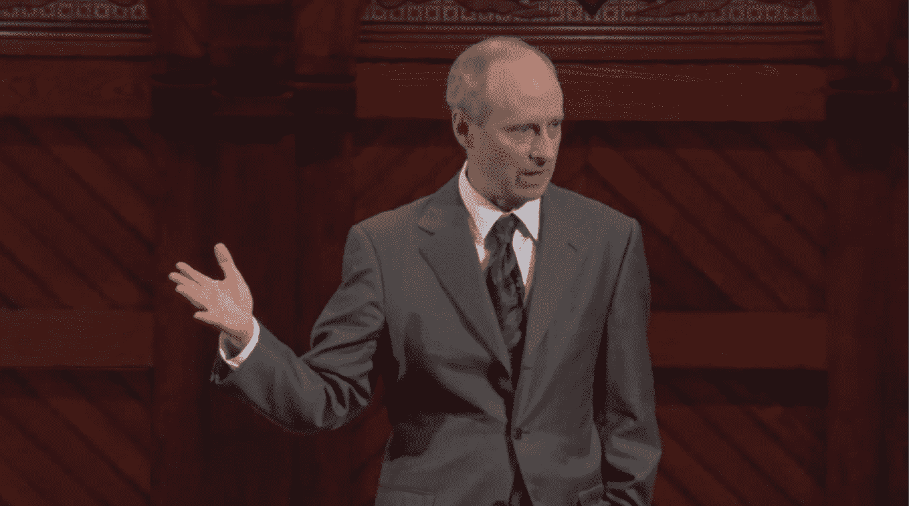

迈克尔\*桑德尔（Michael J.Sandel，1953－）

美国哈佛大学政府系讲座教授，美国人文艺术与科学学院院士

这个课的视频，还有这本书都曾经风靡一时（大概十年前），所以可能有很多朋友都已经看过了，如果没有看过的话，我也把这本书推荐给大家

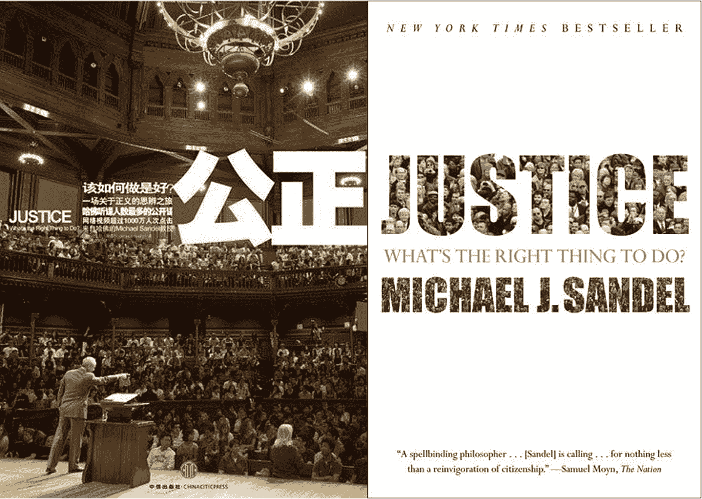

《公正：该如何做是好？》

（《Justice: What's the Right Thing to Do?》）

左：书籍封面 右：公开课海报

他不是开给专业的政治哲学的学生或者哲学系学生的课，它就是一门通史课，它是让大家去思考身边的一些可能我们已经见惯不惯、见怪不怪的现象，然后去探讨"它背后是不是符合正义的原则？"

它其中的一个案例就是在讲美国的录取招生政策，或者就是在讲《平权法案》，之前因为逆向歧视的受害者，通常我们理解都是白人，有很多的白人在各种各样的案例里挑战过《平权法案》（有一些故事还是蛮打动人的）。

举例来说，一个白人和一个黑人，两个人是同学，这个白人同学的学习成绩稍微更好一些，他们的其他方面都很相似，但是在大学录取的时候，仅仅因为另一个人是黑人，黑人是一个加分项，结果这个黑人就上了大学，这个白人就落榜。这一套录取规则对于这个白人学生来说，是公义的吗？

对平权运动有很多种辩护，这些辩护一般都是宏大叙事，都是从群体性出发，就是历史上黑人长期的受到白人的奴役，他们的先辈甚至当年没有机会接受教育，那白人犯下的历史错误需要补偿。

在今天的社会现实之下，黑人仍然是在社会的各个层面来说是弱势的群体，他们在高校的这种代表率仍然偏低，所以有这样的倾斜性的政策是合理的。可是这种从群体的角度出发，合理的政策落到白人个体的身上的时候，我们也会觉得好像不太公平。

这个白人学生他是在 90 年代才出生，他根本没有经历过奴隶制度，他的一生当中从来不曾奴役过任何黑人，他也没有不尊重任何黑人，或者是甚至他本人是一个积极的平权的倡导者。假设他的祖辈在历史上也只是贫穷的白人家庭，他们没有蓄过奴，他们不是奴隶主，他们没有欺负过黑人。假设这一切前提，他作为一个个体，为什么要为另一些白人群体的祖辈、先辈所犯下的错误去承担他自己的"代价"？

从这个个体的角度而言，这一套录取政策是不是违背了公义的原则？我还记得这个书里对这个问题给出的讨论（我看这本书大概是十年前看的），桑德尔教授在这本书里说，这一套笔试的方法是不是公正的，取决于这个大学的目的是什么？

如果这个大学的目的就是选出学习成绩优异，更有可能在大学的教育里脱颖而出，更有可能更充分地利用大学所提供的教育资源的人，那么这个政策显然是不公正的。因为它在做筛选的时候，做出这个选择，不是看两人的学术成绩，而仅仅是看他们的种族。

歧视这个词的本意就是"你判断一个人只是因为他的种族"。可是他说大学的意义不只在于它是一个学习比赛、学习水平竞赛的场所，它是一个公共领域，它是这个社会的社群的一个缩影，它是培养未来的社区领袖的一个公共讨论的场所。

这个地方还有一些其他的意义要实现，这个其他的意义当中，很重要的就包括多元，多元的参与也是大学教育当中很重要的一部分，"你能够在一个多元的环境当中学习，作为一个学生，你才可能真实地去认识这个社会，你才可能来自不同的社会经济种族背景的人对同一个问题的看法，你们进入的才是一个真正意义上的公共领域的讨论，你们才可能成长为这个社区未来的领袖。"

这些很优美的言辞有很多，但总的来说哈佛是一个私立的大学，它可以决定它这个学校的使命，不只是学术成绩的比拼，还包括其他很多的东西，这也侧面地去为它的这一套录取招生的政策证明，它也要看你这个人的面试表现，要看你的课外活动，看你是不是一个对这个社会有责任、有担当的年轻人，它也会看你的社会经济背景。

当你成为这个大的新生群体的一部分的时候，你是不是能够拓展这个群体的多元性的特色？

# 78\. 哈佛被诉招生歧视亚裔（二）：高考制度公平吗？

（公众号懒人找资源，懒人专属群分享。）

#### 常春藤大学纷纷以"法庭之友"介入官司

哈佛被诉招生歧视案，它的被告席上目前只坐着哈佛，但是它影响到的不只是哈佛，它可能影响所有的美国的大学：它们是否需要重新设计录取招生的方法？所以有很多的大学，比如常青藤的其他 7 个大学，都选择以"法庭之友"的方式介入这个官司。

我们之前介绍过，如果你觉得这个官司的判决结果对自己有影响，你想要发声，但是从案子本身的逻辑来说，你又不能够去参与成为原告或者被告，你可以向法庭递交一份文件，写一写你的意见。

其他的 16 个大学都向波士顿的地区法院递交了文件，他们的核心论点是"多元是大学重要的价值"，也是美国的最高法院在过去四五十年间，关于平权运动的判例当中，一再认同的价值。所以如果要把种族元素从大学的录取招生当中去掉，就会伤害这些大学去实现他们多元价值的努力和能力。

#### 高考制度真的是公平的吗？

我一直觉得这个问题非常得有趣，它的有趣在于它超越了法律问题。因为这个问题和我们太切身相关了，所以我们自己也会经常地思考：高考这套制度真的是公义的吗？

高考对于我们实在是太重要了，我相信现在正在听节目的大家，应该都和我差不多，都是人生的前 18 年服务于高考这件事，再从这件事里走出来的人。我现在还能回想起我自己在上高中的时候，有很多人抱怨高考，但是我的班主任当时给大家说，"不要再抱怨了，你们应该感恩高考这个制度，它实现的是相对的公平，它一定不是完美的，可是相比其他能够设计出来的各种各样的录取制度，对于我们这样的平凡的人，它已经非常公平了。"

讨论公义的概念，都会提到一个人叫做罗尔斯（这里岔开几句，这是多聊几句）。其实我在《奇葩说》的某一期，就是讲颜值税的那一期提过这个概念。我们每一个人在这个社会之中去为自己争取权利的时候，一定都是从自己的某一个身份出发。

我今天去为女性争取权利，去为亚裔、黄种人争取权利，去为律师这个行业争取权利，它们都是我的身份的某一个侧面。还有一些很高尚的人，他们可以超越自己身份的限制，去为另一些人发声。可是即便是这样的人，在思索公平、正义这些概念的时候，其实都没有办法真正超越自己的身份背景、自己的成长环境，自己的人生经历。

#### "无知之幕"的思想实验

罗尔斯是一位很有名的社会学家，他提出过一个概念叫做"无知之幕"：我们怎么样能够客观地思考一个政策是不是公平合理？"假想我们的眼前降下一道大幕，这道大幕会遮住我们的双眼，它不会让我们失忆，我们还是保持对这个社会的理智的思考和判断，我们还是能够理解基本的公平正义的法则，但是我们会因为这道幕而忘记自己是谁"，这是一个思想实验，它不当然不可能是真的。

约翰\*罗尔斯（John Bordley Rawls，1921－2002）

美国社会学家，普林斯顿大学哲学博士，哈佛大学教授

大家可以去做这个思想实验，我们忘记自己是谁、出生在哪里、是什么性别？家里有多少钱？信什么宗教？我们可以出生在这个世界上的任何一个角落，成为任何一种人。然后我们去想一想，我们该怎么评价这个社会当中的种种政策？"

如果我今天站在一个亚裔的角度，我当然是觉得现有的这一套（哈佛）录取政策对亚裔太不公平，那这就是我们需要承担和面对的现实，"我就是要比别人考的分数更高，我才能考上哈佛"；可是如果我们面前有一道"无知之幕"，我不知道自己会成为一个亚洲人，还是一个黑人，但是我知道这个社会当中，远远没有实现平等、公平的竞争。

如果我是一个黑人，我接受教育的机会就会更少，我接受的教育的教学质量就会更糟糕，我的家庭的经济背景和环境，可能让我更加没有办法全心全意地去投入学习。当我们面对的这样的"无知之幕"，我们是不是会同意"这个社会确实应该在政策上给予社会当中的这些弱势群体一些倾斜，让这个群体当中那些格外努力的人也有机会进入大学"？你会发现进入大学之后，他们的学术表现不一定就比其他人差，只是他们小的时候，因为没有一个更好的环境，而没有办法在人生前一个阶段的竞争当中追上其他人。

我觉得这个思想实验对我自己有很大的启发，就像我自己当年去评价一路走来的高考制度，我一定是以贵州考生出发，"人一定是更愿意看到让我们吃亏的那些方面"。就像当年我也很抱怨，"贵州考生为什么好的大学在我们这里的名额是如此得少？还有专业选择范围是如此得狭窄？"但是你冷静下来也会看到说，"作为一个贵州考生，我们在高考制度当中是得到了很多的照顾，我们做的试卷比其他很多省份要更简单，相对来说的分数线要求更低。"

如果真的把全国纳入同一套（高考）标准去检验，我觉得我永远不可能考到我后来考到的学校，就是太不现实了，我后来发现那些高考大省的同学学习实在是比我好太多了，但是我们得到了同一个机会，我们在大学里又可以站在同一个新的起点上，再去努力，再去竞争。这是高考给的机会，它在某种意义上牺牲了公平。

你如果碰巧是一个河南考生，你如果是一个山东考生，这个制度就是不公平，那它是不是也在另一种意义上实现了公平？它就是要照顾一些像贵州这样的省份，我们的教学水平、教学质量就是不如那些更发达的地区。在具体这些名额的分配和设计上，现在的制度当中有一些明显不够公平的地方，它是不是可以做出微调？我觉得是可以讨论的。

#### 政策在不同的价值中做平衡与取舍

可是从整体上，我们是不是要接受，"没有一个制度对每一个人是绝对公平的"。如果真的是全国所有的同学用同一套试卷，用同一个分数线标准来做考量，那看上去是对高考大省的那些同学更公平；可是那对于贵州省的考生，我们的教学资源不如别人的情况下，又是对这些人的不公平。所以一个政策一定是在很多不同的价值当中做了平衡和取舍。

以中国高考制度为例，教育资源的分布不平均，不是今天才有的问题，我们历史上在科举制度里，明朝就有南北榜案，但是南和北它就是得用两套不一样的标准来进行衡量，才可能尽可能地给每一个地区的人一定的机会。同样的道理，美国的这套制度，有很多人说"如果真的只考量学术水平，那对亚裔好像比较公平，可是只考量学术水平的情况下，不考量大家的成长环境，那有很多的黑人，黑人这个社群从整体上他能够得到的机会就会非常得少。那对这些人又是真的公平吗？

相比我们的高考制度，美国的录取制度，它有很多的主观元素，这些主观元素会带来巨大的不确定性。这些不确定性从某一个侧面去看是不公平的；那从另一些侧面去看，它又可能给一些人机会，那这些人是包括没有好的学习条件去考高分的人，也可能包括在应试这方面不擅长，但是在其他的方面能够展现出自己的能力和特色的人。

我举一个例子（这里题外话），我知道有一些朋友有兴趣去考美国的 JD（Juris Doctor  
职业法律文凭），它的录取方法是这样的，我分享一点点关于美国的法学院的录取政策。

相比美国的大学录取，法学院更看重学术成绩。基本上你的 LSAT（Law School Admission Test  
法学院入学考试）的考试分数和在本科期间的平均成绩，能很大概率的决定能去什么样的学校？就是比 SAT 的作用要更大。也就是说，本科的录取更加的朦胧、不靠谱、不可捉摸；法学院稍微能琢磨一点，但是它也会考量很多很多其他的元素。

一般来说你的 LSAT 的分数出来了，你就大概知道自己能申请哪个层次的学校，然后你就递上申请表，有一些学校会安排面试。面试有很多种不同的方法，有的是面对面地去面试，有的是打电话面试，有的像哈佛这个学校，它是找一个校友来面试你。

我当时因为考试成绩还不错，我申请了美国排名前 14 的所有的法学院（就是"广撒网"，然后看能"撞上"谁？非常有趣）。不是所有的学校都有面试环节，有的学校它就是看你的书面的申请材料，它就决定要不要你；但是有一些学校就会安排面试，比如哈佛就是有面试的，我后来觉得我的成绩应该是在及格线以上，但不是特别有保障的成绩。

所有有面试环节的学校都给我发来了面试的邀请，我参加了所有的面试，各种各样类型的面试，最后凡是有面试的法学院都录取了我，凡是没有面试的法学院都没有录取我。这证明什么呢？这证明我靠的全是面试，这证明我的书面材料、我能够拿到的推荐信、我能够考出来的分数、我能够写出来的个人陈述、水平都是有限的，可能是一个及格线以上的分数，但是不足以让我被录取的分数，但是我的面试表现应该是还不错，我拿到了所有的录取通知书，而我觉得这个制度还不错，它就给了我这样的人机会。

其实相比美国的很多本科的平均成绩，我们无论是在大陆，还是我当时读书的香港，我们的平均成绩和别人是有差距的。有的说法是"因为美国的大学平均成绩虚高、inflation、膨胀"，不管怎么说，书面的比拼，还是比不过他们。但是我得到了面试的机会以后，我反而得到了去读书的机会。所以怎么样去评价这整个体系，真的是很难做到公正。

#### 招生中真正的不公平体现在哪？

当我去评价这个体系的时候，我觉得我自己作为一个得到过它所给出的额外机会的人，是很难去说一句"不公平的"。真正的不公平体现在什么地方呢？（我后来去读书，我发现当年就是很蠢很傻的），我的所有的申请材料都是我自己写的，后来我到了哈佛，发现我的室友在帮学弟学妹、比我们更小的，申请（学校）的小朋友写他们的申请材料，然后教他们怎么样去申请（当然她是要收费的，挺贵的）。

就是有这种"中介"牵线搭桥，我才发现说原来你花一些钱，是可以请这些已经拿到了好的录取通知的人来帮你做这些事。那可能我的朋友所帮的内容是有限的，她就是帮你修改一下你的个人陈述要怎么写。

但是，现在已经有很多的产业，它不只是帮你修改你的申请材料，我看到有的这种中介公司它是可以帮助一个小朋友，设计你的高中或者是设计你的本科应该怎么样度过？你就有更大的概率被这些名校录取。因为它知道这些名校，虽然说是做所谓的综合考量，在这个综合考量的过程当中，有一些元素是非常加分的。

所以这些中介公司就会告诉你，"你在读高中期间，你要积极地参加一些社会活动。最好是参加什么样的活动？到印度去做义工，救助小孩子，去帮助难民；然后积极的表现自己的领导才能和对国际事务的关注和事业，比如去参加一下模拟联合国大会，多去干一些这些事，这些事就能大大地提升能够入读这些名校的概率。

我觉得这种差距，才真的是无法通过个人的天赋和努力抹平的差距。我小的时候就没有听说过这些事，所以它的这一套综合考量的方法，因为有很强烈的主观性，一定是容易为某一些人所利用的。

我们之前曝光过美国有一些很有名的演员、社会名流，通过各种各样的方法，把自己的孩子伪装成帆船运动员，然后让他们上名校。有这样腐败的事情暴露出来，其实它就暴露出这整个体系的一些漏洞：当这个体系的录取规则、方式、元素被人"摸透了"以后，这些中介公司、留学机构，它就会帮助大家去适应这一套录取规则。这就和我们以前参加高考的时候，有补习班不是一个道理吗？

这些主观性极强的元素，我觉得它相比起学术成绩，更容易体现人和人之间所拥有的资源、所有的社会经济地位的差异。因为它更能够通过个人的努力去弥补。

这场告哈佛的官司，我们为什么在这里讲这个案子？一个重要的原因是我们之前在讲证据，起诉哈佛的这个人，他手上有什么证据吗？他所有的证据就是那些已经公开的材料。大家都能算出来，你作为一个亚裔要申请哈佛是更难的，他基本上更多地去支撑他审判的材料，是在我们之前跟大家提过的环节，叫做证据开示、Discovery 这个环节当中，他要求哈佛提供更多的证明"自己的录取过程当中，没有歧视"的材料。

这个案子之所以引起这么大的关注，有很多的人关注它的角度非常不一样，其中有一批很关注这个案子的人就是留学中介，他们关注什么呢？是哈佛为了自证清白，或者是被法庭要求在证据开示的环节当中，公布大量的它（学校）的新生的背景信息，以及公布大量的招生委员会内部的材料，招生委员自己做下的笔记，或者是他们内部的沟通，然后有很多的留学中介就要去分析哈佛的这些材料。

以前这些材料都是作为隐私保护起来的，今天这些材料因为有这个官司，因为有证据开始的环节，然后原告又非常积极地把这些证据公之于众。所以大家建议能够更确切地去了解哈佛的录取过程到底是什么样的？那有一些以前只是猜测的东西，现在就是被坐实了。

有一些学生他们被特殊的考虑，原因就是他们的财富、他们的关系、他们的家庭地位；一些偏远地区农村的学生，他们得到特殊的考量；那这个校友的孩子或者是哈佛的教职员工的孩子得到特殊的照顾，以及运动员的身份能够带来的巨大的好处。以前大家都是有这样的印象，现在这些都是被内部材料和数据坐实。

就像我在哈佛读书的时候，同学之间也流传各种各样的八卦、小道消息，"谁谁谁，哪个同学是（我就不说是哪个国家了），说是非洲某一个国家的总统的女儿"，反正也是真真假假，也不知道，然后他们说"这个同学据说不仅不来上课，连英语都不会说，但因为是非洲总统的女儿，她就能读哈佛"。

然后又说"谁谁谁是迪拜的公主"，也不知道是真是假，就知道那同学确实长得很好看，然后说"太有钱了"。像我这样的平凡的学生，都是大家合租一个房子分担房租，然后他们说"迪拜公主一个人租了一栋楼，天天开 party，大家都可以去吃喝"，这种小道消息是非常多的。

但是哈佛公布的内部材料里显示，真的有所谓的 Dean's List、院长名单的存在。这里面有一些，因为他的身份背景而得到重点考量的人。

我觉得很明显的这些特殊的照顾，包括我刚才和大家提到的"今天的留学中介可以提供的全方位的服务，但是你需要用很高的价钱去换取的服务"，才真的体现着这个录取招生环节当中的不平等。只是很难找到一个特别好的角度去挑战这种不平等。

#### "多元化招生"有规律可循吗？

联系到种族，大家能够想到的是，从所有的这一切当中，我们可以看到，虽然学校号称"它是有综合性的考量来选择录取学生，它的终极动力是创造一个多元的社群"。可是事实上这个学校在招生的过程当中，它要求你提交的个人陈述、你的背景介绍，它一定是在寻找某一些重要的特性。不然的话，这个留学中介怎么帮你设计：你的高中和大学时光应当怎样度过？

这些学校在寻找一些东西，这些东西可以列成清单，包括领导力、社区的参与、国际视野、责任感、和他人合作的能力、对社会问题的关心、对弱势群体的关注，这些表单是可以列出来的。所谓的多元它还是有某一些规律可循，它还是在寻找具有某一些特性的人。

我觉得这件事情给我自己的触动挺大，因为后来我们坐在一起分析"怎么考上哈佛"的时候，大家看过我的简历，觉得我这个简历一看就是，美国人会很喜欢的简历，白左的人会特别喜欢的简历。

我还为这个事情挺郁闷的，我自己当年从高中到大学做了一些事情，包括我去组织社团去做支教，我一直打辩论，做这些事的时候，我是没有想到有一天这些事能够帮助我申请美国的学校的，就是这些事情是我真的很喜欢，所以我去做的。

但是有很多人他看世界的眼光，就是假设你是一个功利主义的人，你看待别人做这些事情的眼光，做些这些事情是能够让你的简历看上去丰富多彩，且很契合某一些学校的价值观念，它是能够帮到你未来去得到更多的机会的。我就一下子觉得，这个世界都被功利化，人做很多事情的时候，不再是凭着那种很简单的、很朴素的一点善意或者是兴趣爱好，而变成说"我们是不是能够迎合这些高校，将来可能是工作岗位，对人的期许、对某一些价值的追求"（那这是题外话了）。

学校所追求的这些特性，有人发现它是可以和种族的特色联系起来的。而亚裔学生在这些方面是吃亏的，就是亚裔无论在刻板印象上，还是在这些文化传统中，或许真的会造成这种差异，通常我们会觉得亚裔的学生更安静，更不喜欢表达自己，更愿意好好学习，而不是特别热情地去参与学校的公众活动。这个是整体印象，整体印象没有办法代表个体。肯定有这方面这些能力非常突出的亚裔的个体。

但是从整体而言，不只是白人群体作为一个整体更容易实现这些特色，反过来应该说，我们就是以评价一个优秀的白人小孩的方法作为模板，然后把它套用到所有的族群之上，而没有去看到每个族群可能有它不同的文化传统，有它不同的性格特色，而这些不同的性格特色都是多元社群的一部分，它都可以利成为一种优点。

基于这方面的讨论，又是一个尽人皆知，可是很难从法律的角度去挑战大学所做出的这些选择。就像我们一开始聊到的《正义》那本书里：大学有权利去定义它追求什么样的目标？它想要一个什么样的社区？大学有权利去定义它想要什么样的学生？它想要它的学生具备什么样的特点？这是它权力范围之内的事，很难去基于这些特点去说，"这是某一种偏见，这是倾向某一种族群的刻板定义"，这个是很难的。

这个案子归根结底，还是只能以种族和歧视作为出发点去挑战这一套录取政策。

# 79\. 哈佛被诉招生歧视亚裔（三）：学生隐私是否可拿来“证据开示”？

（公众号懒人找资源，懒人专属群分享。）

#### 宪法保障各种族的平等权利

虽然"歧视"听上去就是一个很严重的词，尤其在美国这样的国家，它肯定是可以作为一个控告的理由。但是哈佛是一个私立的大学，它为什么需要接受这样的监督呢？我们之前聊所有和歧视相关的案子，它的基石都是美国宪法的第十四修正案。

Section 1. All persons born or naturalized in the United States, and subject  
to the jurisdiction thereof, are citizens of the United States and of the  
State wherein they reside. No State shall make or enforce any law which shall  
abridge the privileges or immunities of citizens of the United States; nor  
shall any State deprive any person of life, liberty, or property, without due  
process of law; nor deny to any person within its jurisdiction the equal  
protection of the laws.

第一款  
所有在合众国出生或归化合众国并受其管辖的人，都是合众国的和他们居住州的公民。任何一州，都不得制定或实施限制合众国公民的特权或豁免权的法律；不经正当法律程序，不得剥夺任何人的生命、自由或财产；在州管辖范围内，也不得拒绝给予任何人以平等法律保护。

《美利坚合众国宪法第十四条修正案》（节选）

我们之前很多次地讲过这一条修正案，它是在南北战争废奴运动之后，保障各个种族的人基本权利的一条修正案。可是我们也提到，宪法它的适用范围是政府。第十四修正案作为一个重要的跨越，它只是把这些修正案的适用范围从联邦政府扩展到了所有的州政府。

所以之前有一些挑战《平权法案》的官司，它基于第十四修正案来挑战州政府的所作所为或者州政府的政策，它也可以用第十四修正案去挑战那些公办的大学。因为公立学校通常是州政府来办的学校，它就受限于第十四修正案，比如你要告加州大学，它是一个公办大学，你是可以用第十四修正案去告的。

但是哈佛是一个私立大学，在 1883 年，美国的最高法院很明确地表示，它们无权过问私人环境当中的私立学校，还有私人的场所当中的歧视现象。因此在上个世纪的 60 年代，也就是民权运动风起云涌的时候，美国的国会就再一次做出的努力，通过了一部法案，就是所谓的《1964 民权法案》（Civil  
Rights Act of 1964）。

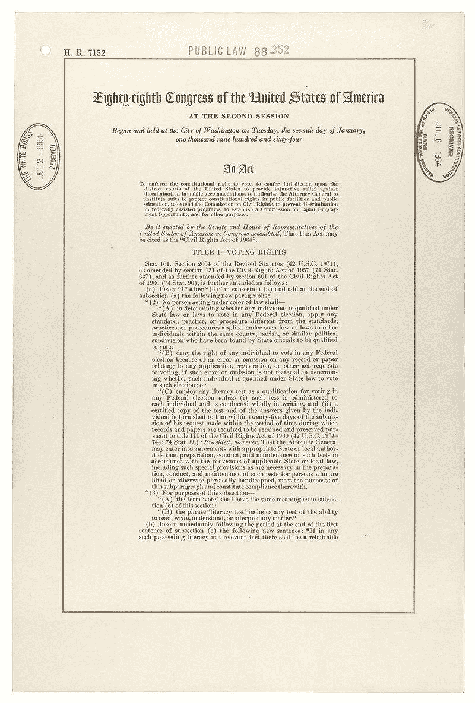

美国《1964 民权法案》（Civil Rights Act of 1964）第一页

这个法案就把它的适用范围扩展到了私人领域，但是它是作为一个新的法案，它有很多很具体的适用场景，其中包括如果一个机构哪怕它是私人机构，但是它接受了联邦政府的资助，它就不能够有种族歧视的行为。

哈佛接受了联邦政府的捐款，所以它在《1964 民权法案》的管辖之下。基于我们以上讨论的这一切，你想要证明整个招生体系的不公平，大家都能感觉到，要证明是非常困难的。

哈佛被诉招生歧视案当中的原告他做了什么样的尝试呢？他就尝试用两个路径去证明针对亚裔学生的歧视的确存在。第一个路径是大数据，他就是综合各种各样的数据，"是不是你作为一个亚裔的学生，你的录取概率在其他条件不变的情况下，就是要低很多"，这是一个事实判断；第二是主观故意的判断，就是他要了许多的内部材料来干什么？他就是去寻找这些哈佛的录取委员会，在主观上对亚裔学生有歧视、有敌意的主观证据。

#### 从立案到宣判为何长达四年？

这个案子是在 2014 年立案，但是它等到 2018 年才进入庭审的环节，到 2019 年的 10 月才做出了宣判。中间 4 年漫长的时光，在干什么呢？

有两个主要的原因，第一是布鲁姆，与此同时他不是只在告哈佛，他还在告德克萨斯大学奥斯汀分校，然后那个案子是一直打到了美国最高法院，大家都在等那个案子的结果，看是否会对这个案子的判决带来影响。

在那个案子当中，2016 年美国最高法院作出了裁决，还是认为一个在录取的过程当中考虑种族不是问题，多元的价值是非常重要的，就是再次重申了之前判例当中的观点。

另一个重要的原因就是这 4 年的漫长的时间里，双方在证据开示的问题上反复地博弈。简单的说，就是原告方要求哈佛提供大量的所有的和录取过程相关的文件，但哈佛拼命地拒绝。

哈佛就说"我这些文件都是涉及这些学生的隐私，没有任何理由要公布给你"，那这一方就是说"哈佛不公布这些文件，原告就没有办法清晰地去呈现他歧视的证据"，然后双方就是在这个问题上反复地拉扯。

我们之前提到过证据开示环节，在美国或者在普通法对抗的这种体系之下，证据开示的范围非常广。这也就是为什么有很多的被告方，愿意用和解的方式，不要陷入漫长的证据开示当中，有很多内部机密，它是并不想公之于众的。

哈佛和 SFFA 在反复地拉扯之后，哈佛最终向 SSFA 提供了长达 9 万页的文件，你可以想象对于留学中介来说，这是一个多么珍贵的宝库。这其中包含哈佛 6 年的新生录取的资料，他们的背景，也包含大量的内部文件。

大家如果去看网上，随便搜一下，就能搜到很多考研机构、留学中介，它基于哈佛所公布的文件所做出的各种各样的分析，就是讲"你怎么样申请哈佛"。

在拉扯的过程当中，其实哈佛能够为自己辩解的理由非常得有限。因为所有的录取招生的文件，非常明显和这个案子的主题是相关的："你的学生他们的背景状况如何？你们内部的审核标准、录取条件，怎么样去评价一个学生的条条框框？"很明显是和"你在录取的过程当中，有没有针对亚裔进行歧视"是相关的。

哈佛为自己辩护的理由无非就是这些学生的隐私，所以它当然是保住了一部分的资料。所有的材料公布出去，它不能够含有学生的姓名，或者是要做相当程度的限制，以至于看到这份材料的人，没有办法判断出这个人是谁，它是有很多的地方就遮蔽掉相关的信息。比如老师给学生写的推荐信、学生写的个人陈述，这些主观性极强的文件，它最终也没有公布。

但是它还是公布了很多有用的讯息，原告方基于这些信息不停地丰富自己的控诉，可以证明"证据开示环节对于原告方非常的有利和重要"。我们以前解释过这个环节的逻辑就在于

有很多的资料和资讯掌握在被告方的手上，如果不通过法庭的强制力，原告方永远没有办法拿到这些资料，在没有拿到这些资料的情况下，它（原告方）也确实难以证明自己的立场。

#### 双方专家证人回归分析的博弈

这九万页的材料，不能够全都堆到法官的面前，让法官去判断说"谁该赢？"。这个时候一个重要的人物就登场了  
专家证人。这里的专家证人是什么人呢？双方各请了一位专家证人，都是大学教授。

原告方请了一位杜克大学的教授，被告方哈佛请了加州大学伯克利分校的教授，他们的共同特征都是数据方面的专家，统计学方面的专家。两位都针对哈佛所提供的海量的信息做了回归分析，回归分析什么呢？就是亚裔元素到底会在多大的程度上，影响亚裔学生被录取的概率。

请专家证人这件事，也是美国司法体系被人诟病的原因之一。被人诟病主要是"专家证人为从立场出发，怎么解释都行，他们非常得贵，所以是司法会被资本绑架和干预的又一个例证。"

请专家证人的确是非常贵，我之前经手过这样的案子，我们当时是做一个金融诈骗的案子（我就不说请到的专家证人他是谁了），他是拿过诺贝尔经济学奖，要请到他是非常不容易的，请他的费率是按 1000 美元每小时为单位来算的。

专家证人他们所提供的专家观点，是不是真的中立客观？当然是被诟病和怀疑。就像在这个案子当中，哈佛和原告方 SFFA 请的两位教授拿到同样的数据，做出来的回归分析的结果是截然相反的。

杜克大学的这位教授，也就是原告方的教授，他用了很多很生动地解读数据的方式来让大家看明白，"亚裔学生所受到的歧视是多么得明显"。经过一套复杂的算法，他说"如果一个人他是亚裔美国人，那他录取的概率就只有 25%（这是在某一个特定条件下，假定一个人的成绩、生活的背景，这些条件不变的情况下，这个亚裔美国人的录取概率是 25%）；如果他是一个白人，他被录取的概率就有 35%；如果他是一个拉丁裔，他的录取概率就有 75%；如果他是一个黑人，他的录取概率有 95%。

这个数据是不是特别地震撼人心？而美国哈佛这一边的专家立刻对这一套数据予以反驳，"这是乱算出来的，刨除了一些非常重要的变量没有考虑"。我不知道我对这个问题应该怎么聊，我不知道听这个节目的朋友，大家的学科背景，但如果你是一个社会科学的学生，就像我曾经是一个社会科学的学生，对这个事情是心有灵犀。

社会科学的人每天在干什么？特别是做定量分析的人，每天我们就是在"跑回归"：回归去算控制了其它的变量，这个变量对于结果有多大的影响。

这也是一种科学，有基本的科学素养的人，你还是知道"你需要尊重他客观的回归分析的结果"。但是与此同时，大家也都知道，"你的数据库刨除了某一组数据，它的回归分析的结果可能非常不一样；或者是你剔除了某一个变量，加入了某一个变量，它的回归分析的结果也会非常不一样"。

很有可能到最后，"你会引入对你的观点论证最有利的那一组回归分析，你再去解释把某一组数据刨除出去的理由是什么？把某一些变量刨除的理由是什么？"这两位专家证人很明显是干了类似的事情。

总的来说，哈佛专家得出的结论是"一个人是不是亚裔，对于他能不能够被录取影响不大"，而杜克的专家当然说"影响非常得大"。哈佛的专家就说，"杜克大学的分析犯了什么样的错误呢？就是在分析的过程当中，有几组数据没有被包含进去，包括运动员、校友的孩子、还有教职员的孩子"，杜克的专家就说，"这几组特殊人群不影响我们整个分析"，哈佛就说"不分析整个数据库得出来的结果，当然是有偏见的"。

还有一个重要的区别是，毕竟哈佛没有把所有的证据都交给原告，原告毕竟没有读到这些学生所写的个人陈述，他们没有读到这些学生所拿到的推荐信。哈佛就可以说"这些元素对于它的申请结果的影响是非常大的，你的数据分析里面没有包含这些元素，分析出来的结果当然也是偏颇的。"

但是这些缺失都不能够动摇原告方一个很朴素的逻辑，"如果客观的分数分析出来，亚裔的小孩子并不差，那就证明在主观（考量因素）上，他们的分就是低"。难道哈佛是要说亚裔的小孩在那些主观元素上，他们就是不行吗？还是你要承认，你们就是刻意压低了他们的分数的？当然哈佛两者都没有承认，它是说你证明不了，仅此而已。

#### 客观数据呈现与法官的主观判断

还有一个差别是法官的主观判断，法官选择从什么角度去看数据？从不同的视角去看同一组数据，能得出来的结论可以是很不一样的。

就像我们一开始提到的数据：如果只看学术表现，应该有 43%的新生都是亚裔，但是事实上只有 21%，这个数据还蛮触动人的。可是与此同时，法官选择了去看的数据是哈佛这一方提出来的：只有 5%的公立高中的学生是亚裔学生，但是哈佛新生当中却有 21%是亚裔学生。可以证明他们的学术表现优异，学校看到了，这也确实大大提升了他们入学的比例；第二是亚裔学生入学的比率是不停地在提高，据说在过去的十年之间增长了 29%。

哈佛是完全知道把这么多的重要的内部文件和数据公布出来，是可能给学校的公关带来巨大的压力，当时在把这些数据公布出来之前，已经被法庭命令要把这些数据公布出来之后，哈佛当时的校长赶紧给全校的同学发了一封邮件，就是提醒大家说，"原告方一定会用这些数据做文章的，他们一定会片面地解读这些数据，然后讲出一些触目惊心的故事，大家一定不要被带了节奏"（大概真的就是这么写的）。

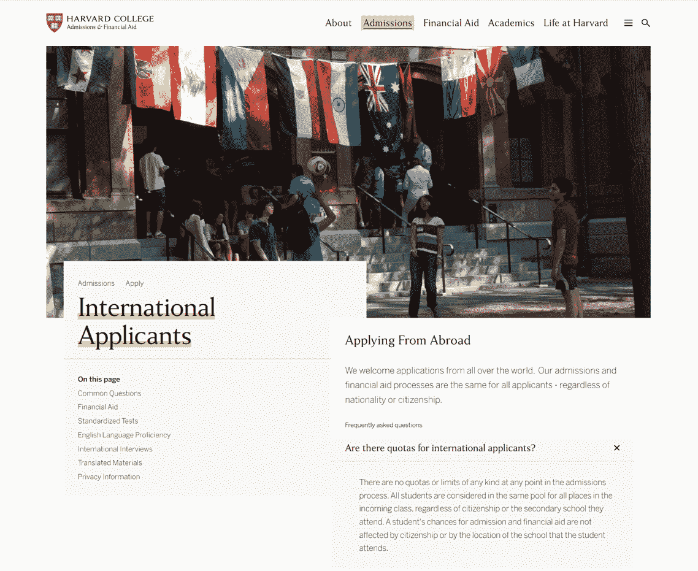

哈佛大学官网对于招收国际学生的申请要求

"在招生过程中的任何时候都没有任何配额和限制"

包括哈佛内部，它后来公布的文件，就是对整件事情非常得警觉。它其中有一个内部的录取委员会的文件里，是说"这些文件被公布出去，会给学校的声誉带来冲击"；"因为不可否认的事实是我们这一套综合考量，虽然是考量很丰富的元素，但是对每一个元素的侧重是不一样的"。

比如，如果他们拿到了这份数据，他们就会发现"来自低收入家庭是一个加分项，你是家庭的第一代大学生，是加分项，可是这些加分项所加的分都比不上你是校友的孩子"。这些信息以前只是传言，可能影响不大，而现在被内部文件和数据坐实，舆论的冲击将对这些名校有非常明显的影响。

可到最后，在 2019 年的 10 月这个案子在波士顿地区法院的宣判结果：女法官判了哈佛胜诉。这个宣判结果就是原告方没有能够证明"哈佛在录取招生的过程当中有意识地歧视亚裔学生"。哈佛当然是非常得高兴，把宣判结果赶紧贴在哈佛的网页上。

这个案子没有到此结束，今年的 2 月份，布鲁姆就正式上诉，提交了这个上诉书，他要到第一巡回法院去，就是上诉法庭去继续上诉，大部分人都预计这个案子一定会打到最高法院，所以还有好几年的路要走，它最后到底是一个什么样的结局？我们都不知道。

#### 招生过程最终实现价值是多元

大家可以感受出来，从刚才这么多的分析里，两位专家证人从同一套数据里得出截然不同的结论，同一位法官，他选择相信谁的结论？他选择更侧重看到什么数据？可以说是这个法官的选择，那不同的法官可以有不同的选择，这个案子一定也还会受到持续的关注。

一方面，这个案子的被告是哈佛，它所代表的是美国所有的大学，至少是所有的精英的大学。另一方面，布鲁姆的背后是想要持续不断地挑战，直到废除《平权法案》的一个保守党的阵营。《平权法案》已经有四五十年的历史了，最高法院是持续地支持了这一种政策。

而在今天，当特朗普特别明确地表示，他认为录取过程就应该是 race  
blind，不应该考虑种族。而他又任命了两位旗帜鲜明的保守党的大法官，入驻最高法院之后，《平权法案》的命运比以往的任何时候可能都让人觉得不能确定。

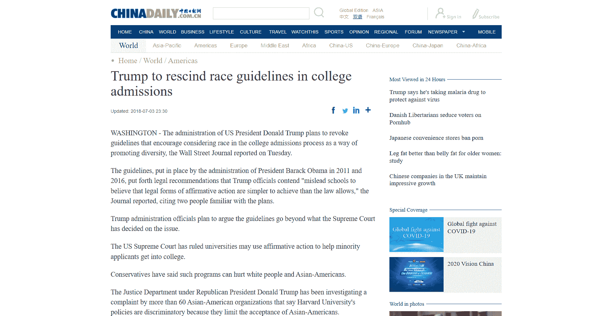

美国《华尔街日报》2018 年 7 月 3 日报道

特朗普政府计划撤销"鼓励在大学生招生过程中考虑种族问题"

不过布鲁姆也没有从哈佛给他的这些文件里拿到所有他想要的东西。比如他没有找到实在的证据表明，"录取委员会在主观上歧视亚裔"，这种很直接的证据，预期就是很难找到的。招生委员会是得多不小心、多蠢、多赤裸裸地歧视，他们才会在内部的"通气会"上直接地说，"咱们就不要招亚裔学生了，亚裔学生不行，一定要减少他们的名额"，很难找到这种直接证据，所以数据分析在上一层的法院会怎么样被看待？还存在着巨大的变数。

除了我们所讨论的这么多关于证据的收集开始，还有它怎么被不同的专家证人利用以外，这个案子里有一个很重要的话语权的，或者说侧重点的争夺，就是"你怎么解读这个案子？到底会带来什么样的影响和后果？"这很像在辩论场上，你作为反方要怎么去归纳和总结：对方到底在干什么？

布鲁姆这一方，他写的起诉书会写得非常得文词优美，光明正大地说，"这个世界就是不公平。实际上哈佛它的招生政策说得多么美好，要综合性考虑、要多元的价值；本质上是在给不同的种族配额，它本质上就是要把亚裔的数额限定在百分之二十几。"

哈佛这一方会怎么讲这个故事呢？它就是说"表面上布鲁姆是在为亚裔争取，只是看不上哈佛这个学校的招生政策，它本质上是在挑战《平权法案》，它本质上就是要求大学在招收学生的时候，不能够考量种族这个因素"。

这两套东西内容的提出，它所造成的影响非常不一样。布鲁姆这一方是说"我们不是在挑战《平权法案》的，我们不是说种族元素不重要，哈佛有其他的手段可以去做这件事，你可以不直接把种族当做一个入学筛选的条件，但是也可以实现种族多元的结果。比如你可以按地区去分配你的招生名额，有一些地方是黑人比较多，你就从这个地方选出它最优秀的那些黑人学生。你为什么一定要在综合考量的过程当中，把种族当做一个单独的元素加进去呢？"

这个是一个非常重要的论点，因为在最高法院之前关于《平权法案》的判例当中，最高法院是要求一个公共机构，或者在这个案子当中，接受了联邦政府捐款的私人机构，要证明"没有种族歧视"，需要证明"没有其他不考虑种族元素的方法，可以实现同样的结果，或者是可以实现同样的价值"。在这个案子里，最终的价值就是多元。

# 80\. 哈佛被诉招生歧视亚裔（四）：“隐形的歧视”如何被证明？

（公众号懒人找资源，懒人专属群分享。）

#### 多元化招生≠配额制招生

在这个案子里面，最终的价值就是多元。哈佛需要证明，"没有其他的方法可以帮助我这个学校，实现我想要追求的大学教育的目的"，布鲁姆这一方说"没有，你不考虑种族，你按地区招生也可以"，哈佛说"这个方法不可以，因为按地区招生，没有办法保证我能招到这些优秀的学生，用最简单的方法理解，就是招上来的学生的平均 SAT 可能就要下降"。

因为地区教育水平不均衡，有一些地方的教育水平要低出全国其他地方很多。我们用中国的例子理解就是，北大招生按美国的方法，它是统一把大家纳入一个大的申请者的"库"，然后去逐一地衡量。它也衡量"你来自贵州，可能给你加一点分；我是苗族，给你加一点分"，但是它不会说"贵州，我就保证要招三个人"。

哈佛就说"我不能做这样的保证，有的地方学习成绩太差了，我不能保证在这个地方一定要招三个人"。哈佛的这个反应是被很多人批评的，大家说"在这个反应里，完全暴露了这个学校真地在想什么？"（我说了这个哈佛这么多的"坏话"，这是我转述的，我看到的一些观点）。

很多人觉得哈佛的解释就暴露了它这一套标准的伪善：表面上是要追求多元，又要招那些贫困地区的学生，又要招黑人学生，又要招第一代大学生，但是最后在落实这一套政策的时候，其实想招的是那些精英黑人的后代，那些比较富裕的黑人的后代。

但是整个《平权法案》最初的起点，难道不是有一些黑人，因为他们的历史，因为现实的环境，他们出生在贫寒的家庭，得不到更好的教育，而这个社会要补偿他们，要拉他们一把吗？

哈佛的这个政策是"不行，我可以考量这些元素，但是我不能按地区去分配这些名额"。这就是没有真的想要去帮助那些生活在贫困的地方、教学条件不好的黑人，哈佛招收的虽然有很多黑人，但是这些黑人本质上是相对精英阶层的黑人，他们来自更富裕的家庭，他们来自教学条件更好的地区，所以他们的各种条件也更好。最后哈佛招收的可能是那些他们的父母已经移民到白人相对较多的区域，已经实现了社会阶层的跨越，已经能够拥有好的教学条件成长的黑人孩子。

哈佛也招那些来自贫困地区的白人，它唯独错过了那些贫困地区的黑人，它也不愿意用地区配额的制度去把那些人招进学校。当哈佛在说，"我拥抱多元这些价值，但是我也不能舍弃我对学术水平的要求"的时候，好像就暴露出了它对多元价值的拥抱也没有那么真诚。

但是此案的法官是接受了哈佛这一方的辩解，他认同"数据分析显示，如果哈佛按照原告方为它设计的这一套地区配额制度去招生，哈佛确实可以仍然保持如今的黑人学生的比例，但是它就没有办法招收到符合这些优质的入学条件的黑人学生，他们平均的 SAT 的水平就要下降一大截。

我不知道我有没有解释清楚这件事情的逻辑，把它放在中国的语境下，假设说（这个当然不是我们国家的政策），北大要保持学生群体的多元，所以它决定说"我要招一定数量的苗族学生"。

告北大的这一方就说，"你要招苗族学生可以，你不要把苗族作为一个元素，在最后招生的时候考量，然后拼命地多招几个苗族学生。从一开始你就说，我要在贵州黔南布依族苗族自治州招三个学生，你就保证，很大概率能招到你想要的这么多的苗族学生。"

北大说"不行，我还要保持我的入学质量，他们如果考试的分数太低的话，我没有办法保证我一定得在那个地方招苗族学生，我可能招的是北京地区的苗族学生。他从小也是在北京很好的小学、中学接受的教育。"

这一方就反驳说，"看，你暴露了吧，你真的是想帮助那些没有得到很好的教学机会，曾经可能在社会的歧视当中，没有办法在高考当中去和其他同学竞争的那一批苗族学生吗？最需要你帮助的就是来自贵州黔南布依族苗族自治州的苗族学生，但是你没想去招他们，你只不过是招那些已经上升到社会精英阶层的，住在北京三环内的苗族学生。"大概就是这个意思。

可是法官接受哈佛的这一套辩解，"我对学生的入学水平还是得有一定要求，这个也不过分吧"。这套辩解非常得重要，因为哈佛要基于这个前提去说，"没有更好的办法，我想要保证学生群体的高学术水平，但是我另一方面又要保证他们能够组成一个多元的群体，我就一定得在招生的过程当中综合的考量这些因素，我就一定得既考量学生的学术成绩，又考量他们的身份背景、种族元素，所以我找不到一个替代方案。"

法律的要求是，"如果你能找到一个不需要把种族当成一个元素的替代方案，你就该用那个替代方案，我们这个社会应该最大程度地去避免歧视。"哈佛说"我找不到，所以我就只能用这套综合考量打分的方案。"

哈佛反过来就可以指责原告说，"你今天反对我这一套招生录取的制度，本质上就是在反对《平权法案》，就是在反对学校应该把种族当成一个元素去考虑，学校应该追求一个多元的社群，有各个种族代表的一个多元社群的价值。"由此发展出来的一些推论，这个后果就非常严重了。

#### 《平权法案》式微，保守主义抬头

因为美国在最近的这几年，平权运动是在"退潮"的，它最热烈的、被整个社会激烈拥抱和支持的那个年代已经过去了，保守主义是重新抬头的（大家可能也知道）。就像我们一再提到特朗普对于《平权法案》，特别是对于招生的过程当中，高校在录取的过程当中，考虑种族意见是相当保留的。

有一些州已经逐渐地废除了《平权法案》，或者是不再允许本州的公立大学按照《平权法案》之下的那一套指导去招生。它带来的是什么后果呢？就是没有那么多的黑人能够进入这些高校。比如密歇根大学，密歇根大学是一个州立大学，所以它是被州的政策所指导。密歇根州在 2006 年之后，它的州的政策规定"州立的大学不可以在招生的过程当中，考虑种族这个元素"。密歇根州在 2006 年，黑人新生的比例还占到 13%，到 2014 年的时候就已经下降到 10%。

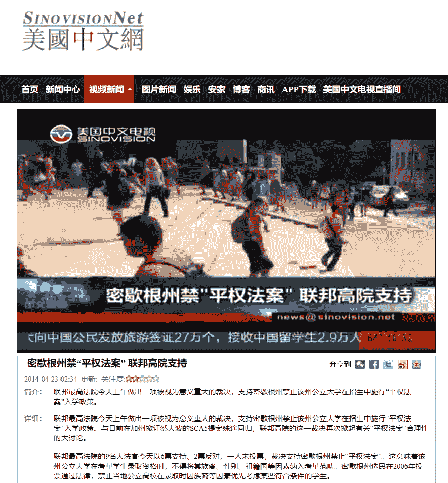

美国密歇根州废除《平权法案》

所以一旦不再考虑种族元素，一旦黑人这个身份不再作为一个加分项，有专家预测，而且大家都普遍同意"黑人学生占好的学校的新生比例会迅速的下降"。

在另外一个研究当中，研究废除了平权运动的几个州，得克萨斯州、华盛顿州、佛罗里达州，就发现在几年的时间之内，有些学科的黑人学生的比例下降 12%，这个后果是非常显著的。换言之，就算有很多人同意《平权法案》对黑人学生的政策倾斜，它可能只能作为一个暂时性的制度，是为了弥补对历史的亏欠，也是为了改良在现状下，黑人在高等教育上被 under  
represented。

直到今天，在这么多年的《平权法案》的努力之下，黑人学生在高校当中的代表，不足以反映黑人这个群体在社区当中的人群的比例，或者是不足以反映黑人群体在高校学生当中，在高中、初中学生群体当中的人群的比例。而且更可怕的是，社会看到的不是黑人这个群体在高校当中被代表程度的进步，今天黑人这个群体在高校当中被代表的程度甚至不如 35 年之前，也就是平权运动刚刚开始的时候，所以平权运动还远远没有到它退场的时候。

从现实来说，如果我们想要追求的是各个种族的人群基本上有同等的机会进入高校学习、成长的目标，它不仅还没有到退场的时候，它还应该更加把劲才行。

#### 《平权法案》是否真正帮助了最需要帮助的群体？

当然大家也肯定会想到，像我们刚才苗族的例子所说，《平权法案》落实到现实当中，其实常常表现为这些高校在招生的过程当中，会有意地控制每一个族群的份额，可是它真的帮助到了社会当中最需要帮助的那个群体吗？这件事情是存疑的。

而且目前公布出来的这些数据和内部资料，没有充分的证明"哈佛的录取委员会在录取的过程当中，有意地歧视亚裔这个群体"。能不能证明这一套录取的方法就没有问题的呢？也不能证明。

有很多人在看到哈佛的这些内部材料，还有它的录取份额之后，也表示相当的震惊。很多人都在追问"所谓的个人分数到底在追求些什么？"布鲁姆这个人，他是一个活动家，他本人不是亚裔，但是他的身份还是给了他去追求这个案子的某一些正当性，他是一个犹太人。

哈佛的历史上有一段非常糟糕的黑暗的历史，就是限制犹太人的入学名额。它怎么限制犹太人的入学名额呢？就是用性格 characteristics，这个概念、这个分数去限制。哈佛当然辩护说"时移世易，当年是犯过愚蠢的错误，我们也从这个错误当中不停地反思和进步，时至今日不可能再用这个词去限制某一个种族或者民族的学生了。"

可是就像我们一开始就提过的，那这个词到底在追求一些什么样的性格？这些性格是否也无意识地反映了某一种歧视的倾向呢？我们也是不知道的。

#### "隐形的歧视"无处不在

歧视类型的案件有一个本质上的困境。歧视这个词大家想象一下，比如一个人歧视某一种人，一定是这个人有意的这样去做，"我就是瞧不起黑人，把黑人骂作黑鬼。"这是一个有意识的动作，这是包含在这个词的本身的含义之中。

可是现实当中有很多的歧视，并不是有意识的动作，或者至少不会表现成有意识的动作"可能我的内心深处对于黑人还有歧视，或者是美国的这些学校对于亚裔的学生有歧视"。

第一，"我不说出来，我不会具体地表现出来，有的时候我甚至自己意识不到，可是我在不知不觉间会这样做。我对这个种族的判断会影响我的判断"。就像我们之前讲辛普森案的时候，有一个很有名的事后统计，绝大部分的白人都认为"他是有罪的"，绝大部分的黑人都认为"他是被陷害的"，这些白人和黑人很有可能不会承认自己是种族主义者，也不会承认种族干扰了他们的判断，但是他们仍然不知不觉间做出了这样的判断。

种族和歧视相关的问题，当然不只体现在《平权法案》相关的案例当中。有很多法学界的专家都认为有一个大家都忽略了的分权体系当中的不受监督的权利，其实是检察官的权利。检察官在决定"什么样的人值得被起诉，什么样的人可以放过？"

检察官在向法官建议刑法或者是在和罪犯签订认罪协定当中享有非常之大的自主权利。而已经有人不止一次地挑战过美国的检察官：在起诉的过程当中是针对性的起诉，或者是有种族偏见的起诉。黑人同样是在车里面藏匿毒品，同样是违法携带枪支，黑人被起诉的比例要远远高于其他主义。

之前有案例当中，黑人被起诉，然后他挑战检察官是针对性的起诉，或者是挑选性的起诉，这一类的诉讼是非常难的。因为法院还是遵守三权分立的基本规则，他还是尊重检察官体系相当之大的自主权。

而与此同时这个原告，就是这个犯罪嫌疑人想要去挑战，"检察官系统是针对性的起诉"，他需要证明的是"他仅仅是因为他的肤色才被起诉的吗？"他需要证明"同样的情况之下，如果他是一个白人，他就不会被起诉。"

但是这种假设本身就是极难证明的，如果碰巧可以证明，他也需要拿到政府内部的档案资料才可以证明，对于原告来说是极困难的。像在哈佛招生歧视亚裔案当中，布鲁姆这一方想要证明"哈佛针对亚裔学生"，他也是需要拿到哈佛的内部资料才发展出一个相对比较完整的证明。

在那个案子当中，法院甚至没有给原告方去经历证据开示的过程，去给他想要的那些内部资料的机会。

#### 案例：麦克克雷斯基诉坎普（McClesky v. Kemp）案

还有一个更有名的案子叫做 McClesky，麦克克雷斯基案。这个案子当中一个黑人，叫 McClesky，他被指控谋杀了一个白人的警官，然后他在佐治亚州的地方法院被判处了死刑，他之后提出了上诉。

但是他的上诉"非常有名"就在于他不是上诉他这个案子当中判罚不公正，而是他出具了两位学者的报告：认为在佐治亚洲，从数据上分析，一个黑人谋杀白人，在这类的案子当中，这个黑人被判处死刑的概率极高；而反过来，如果是白人谋杀了黑人被判处死刑的概率则极低，根据被害人和犯罪嫌疑人的肤色的差别的排列组合，会有非常之明显的成系统的差异，在数据上可以体现出来。

所以在上诉的过程当中，他起诉的理由就是"佐治亚州这一套死刑的法律，违反了第十四修正案当中的平等保护的原则。"法庭的裁决其实也不难猜测，因为他没有办法去证明在他的案子当中，"判处他死刑的陪审员本人有种族歧视，或者是因为种族歧视的动机和原因才判处他死刑。"

他给出的是一份普遍性的报告，是一份数据。数据证明了在这个体系当中或许存在种族歧视，可是他没有办法证明他自己是种族歧视的受害者，因为每一个案子当中的陪审员都是不一样的。

而这个案子最后打到最高法院，最高法院得出的结论也是非常清楚的。在这个案子当中我们要问的唯一的问题，就是在这个案子当中"法律是不是被公正的应用和执行？"如果原告想要用第十四修正案当中的平等保护原则来为自己申辩的话，他需要证明"在他的案子当中，做出了死刑裁决的这些人是以种族歧视的动机形式的，他们是 act  
with discriminatory purpose。"

所以他需要一个歧视的主观动机，一个歧视的目的。而他在自己的案子当中没有任何相关的证据，他的起诉的事由完全是靠数据，和这个数据可以引发出来的推论来支撑的。案子当中有最高法院的大法官持不同的意见，Brennan 大法官就认为"这个风险相当之大，而死刑又是一个那么重要的判决"。

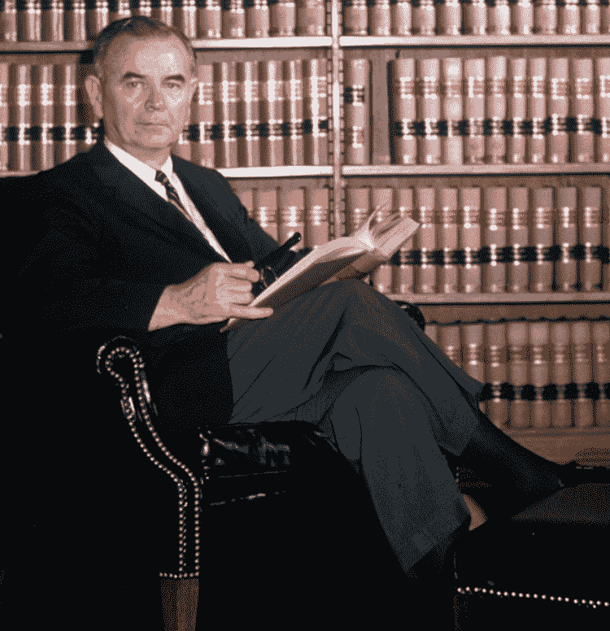

小威廉*约瑟夫*布伦南

（William Joseph Brennan, Jr. 1906－1997）

美国最高法院大法官（1956 年－1990 年）

另外的也有法官，Stevens 法官就表示，"如果我们一定要被做出一个选择，可能是由种族歧视而判处的死刑和没有死刑之间做一个选择，我觉得宪法会告诉我们，让我们选择后者。"

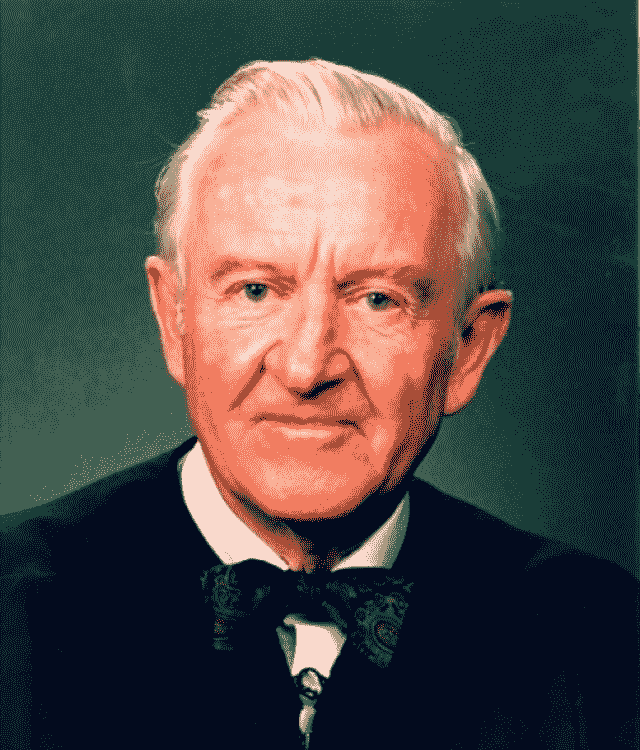

约翰*保罗*史蒂文斯

（John Paul Stevens，1920－2019）

美国最高法院大法官（1975 年－2010 年）

可是这个案子，非常典型地反映了"种族歧视的这类案子，要想得以证明是非常困难的。"因为这个体系当中存在着种族歧视的因素，这又是一个尽人皆知的秘密。

#### 隐藏的主观歧视难以被证明

黑人被停下来巡查，被警察拦下来查车、被逮捕、被起诉、被判处重刑的比例，在整个体系当中都是成体系的高。可是你要想证明"在某一个具体的案子当中，白人的警察把这个人拦下来，这个白人警察选择了搜车，这个白人的检察官选择了起诉，或者是陪审团选择了判处这个黑人死刑，是因为种族的主观动机"，这件事情是极难以证明的。你要去证明一个人的动机，这件事是非常困难的。

所以为什么《平权法案》历史上倒还有过挑战成功的案例，因为当时的那些大学真的使用了配额制度，这个政策是清楚明了的。可是隐藏在这个文化当中的歧视是难以察觉的，也是难以用法律的方式去挑战的。

就好像在哈佛这个案例当中看到的，原告方付出了巨大的努力，想要寻找哈佛的录取委员会有主观上歧视的动机，或者是有主观上的偏见，但是他就是没有找到。这种东西本来就很难找到，可是你能说"隐藏在文化当中没有这种歧视的因子吗？"那我们怎么去解释在主观成绩上表现如此优异的亚裔学生，他们的主观分数就是很低？有人说"这是族群的文化特征、性格特征导致的"。

你确实很难去证明"面试官他是主观上带着歧视"。就算他是真的有歧视，第一，他不会说出来，不会表现出来，或者是他自己都意识不到，或者说确实因为文化传统的原因，不同的族裔更倾向于表现出不一样的性格特征。而主流文化或者是大学的招生政策，体现了它们对某一些性格特征的偏爱，这是一种歧视吗？这件事情就更难以说清了。

#### 什么是清晰而令人信服的证据？

回到我们最初的起点，这个章节是在讲证据，证据开始 Discovery 的过程，是一个非常有利的武器。

原本手中掌握的材料极其有限的原告方可以通过这个过程，拿到大量的被告方手中持有的原本保密的内部的资料。可是即便有这个强有力的武器，我们最终能够用以支撑自己论点的证据，仍然受到各方面的限制，包括专家们怎么样解释这些数据？法庭选择用什么角度去看待这些解释或者是看待这些数据？又或者说数据本身能够证明的东西是有限的。而隐藏在人心中的东西是难以用数据去证明的，大概也难以用任何保障公平、公正的证据规则去证明。

有的州改革了它们的政治规则，比如肯塔基州，允许在死刑案当中可以用和种族相关的数据，而不是这个案子当中具体的陪审团的主观想法来作为证据。它要求这样的证据是清晰且令人信服的，但是什么样的证据才能够算作是清晰且令人信服呢？

一个亚裔的学生 SAT 的分数要比他的黑人同学高出几十分，这算不算是一个清晰而令人信服的证据？如果系统的观察表现在所有的面试当中，亚裔学生的得分系统性比其他族裔的学生低，这算不算一个清晰而令人信服的证据？

如果说一个原本就是主观评断的标准，从来就不应该用客观的数据去证明，客观上碰巧是这个结果，并不能够证明录取委员会的那些人都是种族歧视的坏人，或者是他们都是有意歧视亚裔的人。可是这些问题如果不能够用客观的数据加以证明，又还能用什么样的方法加以证明呢？

# 番外 | 贸易与法制的历史（一）：从波士顿倾茶事件说起

（公众号懒人找资源，懒人专属群分享。）

我也跟大家一样是《从中国出发的全球史》节目忠实的听众。

我一向推销《全球史》比推销我自己的节目更加热情。大家都以为我是段老师的托儿，其实我只是段老师的迷妹。所以非常荣幸能来客串一期全球史的番外。我来接棒梁老师，跟大家继续聊一聊茶。

我这样一个外行，而且也不是一个特别爱喝茶的人，附庸风雅，虽然买了很多漂亮的茶具，都是用来喝八宝茶。

八宝茶，也称"三泡茶"，八宝茶以茶叶为底，掺有其余茶料混合而成

#### 贸易与法制的历史互相影响

我为什么有勇气来跟大家聊茶呢？是因为我觉得人类文明的各个侧面从来都是彼此不能分割的。这一季（全球史）我们讲的是贸易的故事，这一季我们讲的是贸易的历史，而贸易的历史曾经深刻地影响过法制的历史。

反过来法律的变革也深刻地影响过贸易的形势和发展。人和人之间能够进行贸易，其实也就意味着大家接受了一些起码的共通的游戏规则。

而贸易虽然是一个互惠共赢的过程，它也一定伴随着矛盾跟纠纷，特别是我们这一季所讲的全球历史上那些跨山越海的远洋贸易，其中是有巨大的风险的。

我记得这一季的节目里，至少在瓷器的那一章和梁老师上一期的番外里，就提到了五艘沉掉的船。而且他们是各自以不同的原因给沉掉的，还有人还有的是被人盗掉的。

可见各种各样的危险真的是防不胜防。当损失发生的时候，人们就需要清算，需要去总结谁应该承担多大的责任，谁应该对谁作出补偿，谁应该来承担这一切的代价。

不同的社会回答这些问题是有不同的规则的，而国际贸易来进行，当然就促使了国际法的发展。一个很典型的例子是 16、17 世纪的东南亚港口。我们也在这一期的节目里听到，16、17 世纪香料贸易的蓬勃发展。

中国，欧洲对香料的需求的增加，伴随着来自南美洲的白银，东南亚曾经成为繁华一时的转口贸易港。

当时那个年代，这些东南亚的港口有很多是彼此独立的竞争关系，就像我们今天不同的国家政府、地方政府会推出这种不同的法规政策，创造良好的营商环境来招商引资。

那个时候的东南亚港口们也意识到，创造一个更好的经商环境，吸引更多的生意到这里来，会带来巨大的财富。营商环境当中有一个重要的元素就是法制的水平。

#### 商业法的诞生

16 世纪以前，这些地方的法制水平可以说是非常落后的，纠纷一般不通过司法的途径解决。来自世界各地的商人根据他们的出身，被分到不同的商会，有比如中国的商会，有荷兰的商会。中国商人和荷兰商人发生纠纷的时候，就会有两方的商会的会长出面代为解决。

有的时候个人的利益需要服务于商会的整体利益，不是每个个体的利益都能够得到充分的保障。但是对于个体来说，这也好过去当地的国王的法庭打官司，因为当地的这些司法观念是比较传统的，势单力薄的商人根本没有办法应对，甚至还会饱受折磨。

随着国际贸易的发展，不同的文化、不同语言民族的商人的涌入，越来越多的地方开始推进近代意义、现代意义上的商业法的概念。

这就是这些港口他们逐渐意识到提升判决的确定性，依靠成文法或者是过去的判例作出裁决，不要诘问证人或者是拷打逼供，能够吸引这些来自中国、来自欧洲的商人，这也是那些地方现代意义上的商业法的诞生。

其他还有一些别的力量在影响着这一切，比如那个时代伊斯兰教的传播，它所带来的古兰经律法，为这些地方提供了法律的一个范本。当然这可能是后话。那和贸易的历史一样，法制的历史也不是一帆风顺、直线向前的，它也有起起落落。

事实上，在 17 世纪的中期，随着香料贸易的一度衰落、经济的萧条，以及后来欧洲的商人越来越不满足于老老实实地做生意，而要用枪炮的帮助去垄断贸易，这些商业法还有司法的进步的历程也就被阻断了。

但是也有一些伴随着贸易的发展而产生的法律的变革，它们的影响是很久远的，一旦产生就会在历史上留下永恒的印记。

#### 波士顿倾茶事件

梁老师在上一集番外里跟大家提到了一个著名的跟茶有关的历史事件，叫做"波士顿倾茶事件"。我也是听了梁老师讲，我才知道当年被倒进马萨诸塞湾的是武夷茶。

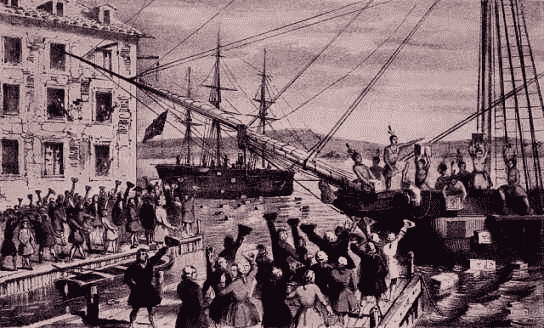

1773 年 12 月 16 日发生的波士顿倾茶事件（Boston Tea Party）

示威者们乔装成印第安人的模样潜入商船，将东印度公司运来的一整船茶叶倾入波士顿湾，

以此反抗英国国会于 1773 年颁布的《茶税法》

《茶叶法案》于 1773 年 5 月 10 日获得批准，包括以下条例：

东印度公司有权将茶叶出口至北美

英国政府不再强制要求公司要在伦敦茶叶拍卖行（London Tea Auction）销售茶叶

在英国缴税的过程中，对销往北美的茶叶会退税或不再征税

收到公司茶叶的代销商需要缴纳一定的保证金

1773 年《茶税法》（Tea Act）

我们都学过"波士顿倾茶事件"，但是不是为了学茶的历史，而是在中学的历史课上学波士顿倾茶事件是把它当做一个重要的政治事件，我们把它认为是整个美国独立运动的一个分水岭。

我小的时候学这段历史的时候是非常困惑的。

第一，是我印象里美国人不喝茶，当然梁老师之前提到了，后来他们导向咖啡的转变主要是独立之后，非常迅速地就发生了。

第二，是我就觉得美国和英国好歹也是两个大国，怎么这么小气？为了几箱茶叶居然就打了一场战争。

首先，被倒进大海的不是几箱茶叶，是 342 箱，好几吨重的茶叶。其次，也可以想象波士顿倾茶事件是一个分水岭，但它不是一个单一的历史事件，它是一连串的历史事件当中的一个环节，它也是一个时代的缩影。

#### "自由之路"代表着什么？

我之前在波士顿读书读了好几年，总是有很多人到波士顿来旅游，在美国的标准之下，波士顿已经算作是一个历史非常丰富的城市了。因为本人是一个纯粹的路痴，就是我靠自己基本上找不到任何地方。

所以每次有谁来参观波士顿，我都会带着大家走同一条路，就是在波士顿城区有一条用红砖铺就的旅游路线叫做"自由之路"，它连接着北美殖民地早期历史上 17 个重要的景点。

基本上走完这条路，就能对北美殖民地早期历史独立运动有一个大概的了解。其中有一个景点跟波士顿倾茶有直接的关系，这个地方叫做"老南聚会所"。

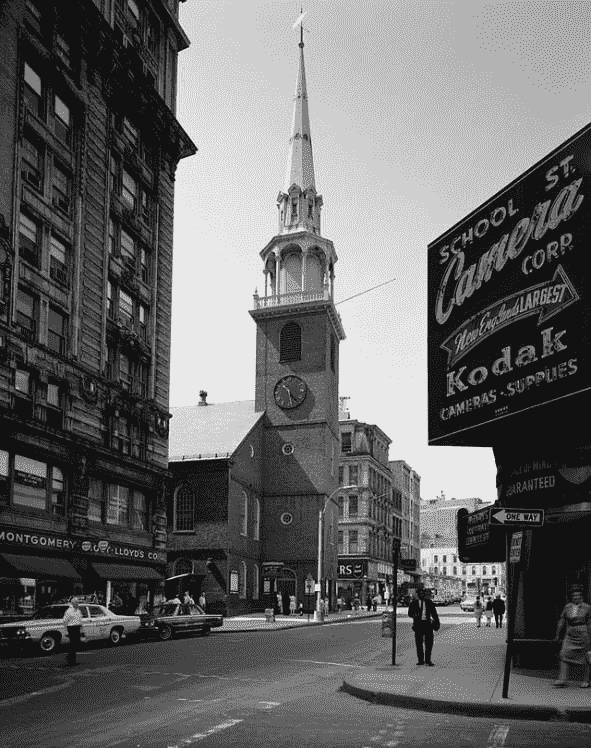

"老南聚会所"位于美国马萨诸塞州波士顿的下城十字

是 1773 年波士顿倾茶事件的组织地点

它其实是一个教堂。当年在 1773 年的 12 月 16 日，有几千名当地的居民聚集在这个地方，一起骂英国，谴责英国的税收政策。然后大家越骂越生气，最终就有几十个人，所谓自由之子，化妆成印第安人，跑到旁边的港口的船上，把东印度公司的 342 箱武夷茶倒进了大海。

在"老南聚会所"的前面有别的景点，连上了这个世界。在 1770 年，为什么大家要聚集在"老南聚会所"骂英国政府？它的起因，要追溯到几年前 1770 年发生了一个所谓的波士顿惨案。

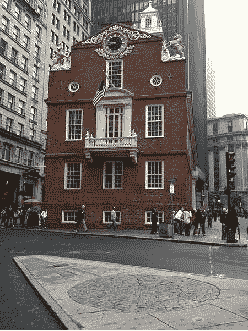

波士顿旧政府楼，圆形处标志着波士顿惨案的发生

其实是它的起点是一个非常小的事情，就是一个当地的英国军官，他到一个假发店去买假发，买了以后他就觉得他给钱了，理发店的店主就说他没有给钱，两个人就吵了起来。

然后他军官旁边的一个士兵就为领导打抱不平，就你已经给钱了，你凭什么骂我们？然后，两边两个人就打在了一起；然后，这个店主就被打的头破血流；然后，他就在大街上大喊大叫，大声地呼救，然后群众的愤怒就被点燃了，纷纷地围住士兵。

于是又有一个英国军官带着另一波士兵来救士兵。愤怒的群众就开始朝这些英国士兵扔石头。在混乱之中，英国士兵就开了枪，造成了 5 位平民的死亡，这个就被叫作"波士顿惨案"。

于是之后的每一年，当地的居民都会聚集在"老南聚会所"，来悼念这些死去的平民，然后终于有一天，悼念就变成了一个"倾茶事件"。

#### 英国人和北美殖民地居民之间矛盾的来源

倾茶事件像 1775 年的独立战争，包括我们也很熟悉的来"列克星顿的枪声"，那是北美民兵和英军第一次爆发大规模冲突的地方。

如果大家有机会去波士顿旅游，也可以去走一走这条自由之路。我已经走了很多遍，但我每一次走，我的感想就是，那个年代大家的火气是多么的大。

有好多的重大历史事件，它的起点其实都很小，你看，"你瞅啥"、"我瞅你咋地"？然后你就能感受到那个时代，英国人和北美殖民地居民之间的矛盾越来越不可调和。

这一切的一切，它归根结底来自于什么？这种怨气、这种愤怒，来自于什么呢？

我们都知道波士顿倾茶事件的那些化妆成印第安人的勇士，被叫做波士顿"茶党"。"茶党"这个名词，在过去 10 年间又再次登上了新闻，再次在美国社会当中出现，大家可能听说过。

大概在 2009 年的时候，有一些右翼的政客和保守派的活动者，他们组成了一个茶党，主要是反对奥巴马的政策，把奥巴马的政策称作是政府的暴政。这些人不止一次地提过，他们之所以给自己起"茶党"这个名字，就是为了向波士顿茶党致敬。当然有很多人讽刺他们就是乱抱大腿了。

今天的美国当下的茶党跟 1773 年的茶党当然是有很大的分别，但是两者之间也有一个重要的相似之处。他们的诉求当中都有一个核心的元素税。

我小的时候学这个"波士顿倾茶事件"的时候，带着我朴素的正义观，觉得这里面有一个无辜躺枪的人，就是东印度公司。波士顿惨案那也是英国军方制造的，关一个私人公司什么事？然后他们的几吨茶叶就被倒进大海了。

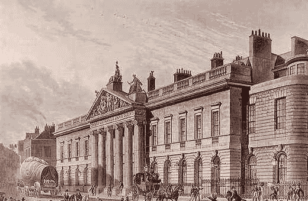

东印度公司位于英国总部的大楼

当然，现在我们知道东印度公司不是一个普通的私人公司，它是拿着英国政府的特许状、垄断茶叶贸易的公司。东印度公司是有茶叶进口的垄断权的，但是早年北美的殖民地也被规定，只能够从东印度公司进口茶叶。

但是那个时候，东印度公司并不是直接把茶叶运到北美来卖，它是在伦敦把茶叶拍卖，然后会有茶叶的分销商把其中的一部分卖到北美洲。在 1770 年、1760 年代，那就是 18 世纪的后期，东印度公司的生意已经没有那么好做了。

一方面，有好多其他的印度公司也在做茶叶生意，比如说荷兰政府的茶叶税就要比英国政府的低，所以它面临很多的竞争。

另一方面，更厉害的一个打击来自于大量的走私犯。这些走私犯当然卖的茶叶就比东印度公司的分销商卖的要便宜得多。于是为了遏制走私，英国议会就通过了法律，让东印度公司出口到殖民地的茶能够全额退税。

我们一听到这种进口补贴、进口退税、出口补贴、出口退税这种词，大家就能够立刻反应出来，这就是现在的国际贸易法、国际贸易组织要打击的一种现象，一种要打击的政府行为。

但是它是从那个年代就已经开始，英国政府通过法律进口、出口到北美殖民地的茶叶可以全额退税。

这部分损失的钱怎么办？当然要想别的办法赚回来。于是他们又通过了另外一个法案  
它直接到殖民地来收税，英国政府做事情也是挺赤裸裸的，一点也没说要把自己的行为给包装好。

可想而知消费者，美国的殖民地的居民是非常生气的。他们已经进行了早期的各种各样的启蒙，提出了一个著名的口号，叫做"无代表不纳税"抗议。

英国政府在北美殖民地刻意征各种各样的税：最初遭到激烈反对的印花税，后来包括茶叶税。于是英国国会又颁布了一项法律，他们还是有用一个法律去解决另一个法律造成的问题，这个行为模式还将不断地重复。

#### 新法案的颁布激化了矛盾的形成

这回他们直接颁布了一个法律叫做《茶叶法案》。这个《茶叶法案》允许东印度公司直接把他们的船运着茶叶到北美洲来卖。这回波士顿东印度公司能够直接来卖茶，这个成本确实得到了控制，因为它没有中间商的转手赚差价。

反过来，中间商当然就不愿意了，它就极大地打击了分销商和走私犯的利益，动了他们的奶酪。

所以所谓的波士顿茶党，我们今天没有办法去揣测他们的动机，不能用这种事后评价的方法去衡量他们是什么样的人。

但是可以想见，但是他们当中有很多人之所以进行这一系列的革命活动，并不一定是出于朴素的正义观或者是追求幸福的权利，或者是爱国之心。他们当中的一些重要的代表人物，就是茶叶分销商，比如约翰\*汉考克，他就是一个波士顿茶叶商人。

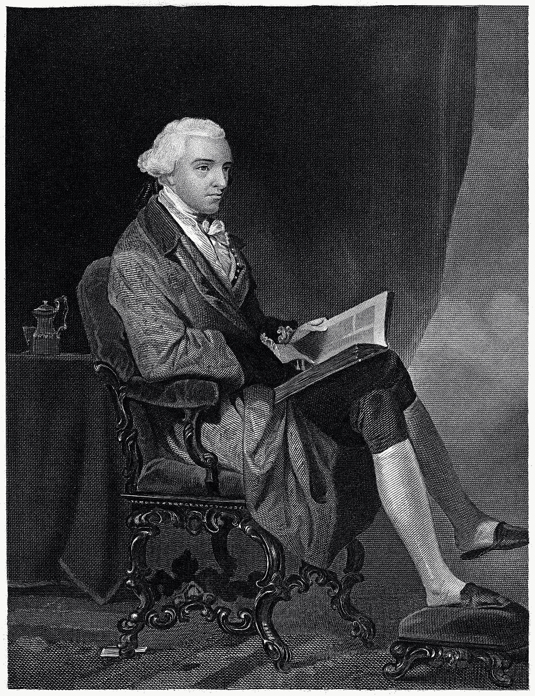

约翰\*汉考克（John Hancock，1737-1793）

美国革命家、政治家

于是到了 1773 年这个《茶叶法案》通过几个月之后，东印度公司的船载着中国的茶叶，千里迢迢、特别辛苦地就来到了北美殖民地。有两艘船开到了纽约和费城，这两艘船比较敏锐，他们一看当地的情形不是很对，当地的民众已经非常讨厌他们了，掉头就回去了，避免了损失。

结果有 4 艘船就停在了波士顿的马萨诸塞港，接下来就发生了老南聚会所的聚会和后来的倾茶事件。珍贵的武夷茶就被倒进了大海。

英国政府作何反应呢？英国政府非常生气，一看他们这个茶叶法之下的东印度公司运着茶，到了北美洲，居然被倒掉了，他们又迅速地通过了好几个别的法案，包括《波士顿港法》、《马萨诸萨波士顿港口法》、《马萨诸萨政府法》等等。

它有一个法案创造了问题，它又通过三个新的法案想要解决，最后激化了更多的矛盾。

但英国政府给这些法律起名字也是"司马昭之心"，直接叫《马萨诸萨政府法》，就是要全面接管殖民地政府，就是完全不隐藏，不向马萨诸萨人民隐藏我们这个法律就是针对你们的。

北美人民也反过来给这几个法案起了一个名字叫做《不可容忍法案》，我们真的受不了。不可容忍，最后的结果就是 1775 年独立战争的爆发。

我们在这里提到了几个法案，这些法案当然曾经影响过历史，但是也不难看出英国议会所制定的这一系列的法案，几乎都是用法律作为垄断利益的一种统治工具。

这些法案并不是我们这里想要跟大家聊的司法变革。一些法案，它们都淹没在历史之中了，就和被倒进马萨诸萨港的茶叶一样。可是伴随着茶叶贸易而诞生的其他的一些变革，却一直留在法律之中。

#### 为什么英国政府那么在意东印度公司？

等读到了这整段美国独立战争的历史，我又产生了一个新的困惑：为什么英国政府那么在意东印度公司？

东印度公司的名字就很奇怪，它为什么那么重要？以至于英国议会在东印度公司受了损失之后，不惜要通过三个新的法律来帮助他，要来接管殖民地，最后不惜一场战争？

今天我们也知道东印度公司不是一个普普通通的公司，它就拿着国王的特许垄断，特许状出海的。可是东印度公司的特别之处还不止在于此，它不止对于英国政府是一个特殊的公司，它对于法制的历史也是一个特殊的公司。

我们的历史上或者说直到今天，拥有特权的公司有很多，但是不是所有的公司都曾拥有过东印度公司这样的特权。东印度公司手上的特许状不只是垄断贸易的权利，甚至是在殖民地开战的权利。

我们生活在今天的社会是很难想象，一个公司可以拿着钱，雇佣自己的军队，修筑自己的要塞，派武装力量保护自己的团队的。因为我们今天生活在一个法制的世界里，这些事情是应该由政府去做的。

可是在历史上从事贸易和为这些贸易提供武力保护，这两者之间的关系并不是那么分明的。

比如早期的威尼斯政府曾经强迫，我们也在这一期里面反复地提过，这是一个历史上重要的贸易城市，威尼斯政府一度强迫所有的贸易商用政府随着政府组织的船队远行，那就是政府本身主导了暴力和贸易这两件事。

东印度公司是反过来，政府把暴力和贸易这两件事都交到私人公司的手里，任由他们自己去处理。所以他们几乎可以说是亚洲殖民地的开拓者。特殊的时代需求就是它既要做生意，又要为自己的贸易提供武力保护，提供暴力。

这使得东印度公司拿到了特许权，他们也发明处激发出一些新的设计。东印度公司，包括英国的东印度公司，荷兰的东印度公司，和他们之后逐渐同一批次诞生的类似性质的公司，他们是第一批严格意义上具有法人身份地位的股份有限公司。

（阿詹喜欢全球史，也希望大家能喜欢，在线继续完成阿詹的"心意广告任务"，欢迎收听《从中国出发的全球史第三季：商品、贸易与物质交换》）

# 番外 | 贸易与法制的历史（二）：有限公司与股份公司的起源

（公众号懒人找资源，懒人专属群分享。）

#### "法人"概念的确立

我们生活在今天的世界里，"法人"已经是一个习以为常的概念。它是如此的有用、有道理、理所当然。但是大家想想看，这个概念能够被发明出来，又是如此的巧妙和不可思议。

"法人"，顾名思义，一个东西本来不是人，但是我们把它想象成由法律所赋予的人格，一个实体、一个组织，他能够去做一些原本只有自然人有资格能够做的事情。

他可以拥有财产、他可以跟人签合同、他可以开设银行账户、他可能跟人打官司、他可以去告别人也可以被别人告。

正是因为有了"法人"这个概念，这样的一个法律想象，一个和他的发起人分开、独立存在的实体，成为各种市场活动的主体，我们今天所熟悉的商业社会里一些重要的原则、一些重要的概念，才成为了可能。

比如所有权和管理权的分割，比如有限责任。很简单的例子，比如我今天有一个主意，我想自己办一个公司，"看现实"。

然后我觉得我有一个非常好的点子，我想去创业，但是我又不想把人生变成一场豪赌，不想把我的身家性命全部投进去，我只把我的存款拿出一部分去办这个公司。而我办的是一个有限责任公司，我的责任是有限的。

就算到时候我生意做砸了，我这个公司还欠着别人钱，我的这些债主都不能够要求我把我的房子卖掉，去还债。所以我就有更大的动力愿意去尝试，愿意去创业。

我这个公司还可以自己作为一个主体发行股票。我就可以去找段志强老师给我融资，我邀请他也出一部分资跟我一起办。看见公司，段志强老师说，"我挺忙的，我每天忙着看理想，哪有功夫看现实"？

我说"没有关系，你可以做一个投资者，你只需要买我这个公司的股票，生产经营交给我，到时候定期分红"。那段志强老师还有疑虑，他觉得"我现在确实有一笔闲钱，但是我过两天万一想买一个古董"。

我说"那也没有关系，我这个股票是可以在市场上流通的，到时候您急着用钱的时候，你就把这个股票卖给梁捷老师，这样你就可以拿到现金，你的资金周转就不成问题了。"

所有这些在我们今天看来习以为常的、每天都在现实的公司运营当中发生的事情的基础，都有赖于我们创造出了"法人"这个概念，以及"股份有限公司"这样的概念。

合起来就是"具有法人身份的股份有限公司"。那也就是那个年代的英国荷兰东印度公司。这个概念当中的这些关键元素，并不是由东印度公司来发明的，在东印度公司出现之前很久，这些概念就早已经存在了。比如公司概念。

#### 公司组织的形成

公司这个词 corporation，corpor 这个词是拉丁文当中身体的意思。非常有趣，公司其实是没有身体的，它是一个我们想象出来的概念，它是一个只在法律体系之下存在的概念，但早在大约公元 6 世纪的罗马法之下，就已经有公司这样的存在了。

查士丁尼一世（约 482--565）东罗马帝国皇帝，史称查士丁尼大帝

其在位期间，对罗马法进行了整理

罗马法中，虽然没有明确的法人概念和术语，但有初步的法人制度。罗马法上法人分社团法人和财团法人两种。前者以自然人的集合为成立的基础，如宗教团体；后者以财产为其成立的基础，如慈善基金。

法人的成立必须具备三个条件：（1）必须具有物质基础；（2）社团要达到最低法定人数（3 人以上），财团需拥有一定数额的财产，数额多少没有严格规定；（3）必须经过元老院的批准或皇帝的特许。

被认为最古老的依宪章而设立的，那就是近代意义上的公司。最古老的依宪章而设立的公司是一个瑞典的矿业公司，它注册成立的时间是公元 1347 年。

"股份"这个概念也并不是由东印度公司发明的。中国古代在唐代和宋代就有股份公司的概念，有一部分人他们只负责出钱，然后就拿着股票等着分红。西欧在最迟在 13 世纪，也已经有了股份公司的概念。

"有限责任"这个概念也不是由东印度公司发明的，英国的法律在大约 15 世纪的时候就赋予了很多宗教团体，还有行会，赋予他们有限责任的权利，有限责任是对他们的一种保护。

可是要等到大航海之后的时代，在特殊的需求，要把暴力成本内部化的需求、开拓殖民地的需求、远洋贸易的巨大风险的需求，这种种的需求结合到一起，这些概念才被组合到一起，创造出东印度公司这样特别的公司组织形式。

在东印度公司出现之前，千百年的时间里，远洋贸易、远距离贸易，并不是大航海之后才有，亚洲自古就有兴旺的远距离贸易。

#### 合伙制度

大部分时候，远距离贸易依赖的都是人类学家所谓的离散族群，那就是在社会性上有相互依赖关系的族群，比如说东南亚华侨、犹太商人、亚美尼亚商人这样的族群，他们结合成一种共同体来应付远距离造成的阻碍。

16 世纪之前的这种大型合伙商号，它的组织形式都是合伙制，大家是共担风险、共担利润的。这些合伙商号都是暂时性的，都是有时间限制的，他们一般来说，在成立的时候就会约定一个解散的时间，比如有的商号就是为某一次远洋贸易创造的，等到船回来，我们的合伙也就可以散了。

有的是设置，比如说 5 年以后我们就解散，不管赚多少钱赔多少钱，到时候就把它分了。可是东印度公司这样的公司，它是具有法人身份的公司，也就是说这个公司独立于这些合伙人。

这些投资者、这些发起人，他自己是一个法人，他不被宣告死亡。早期的垄断特权虽然有年限，但是逐渐地，它的永久的法律地位被确认下来。股票可以买卖交易，但是这个公司却不在特定的年限之后就被解散清算。

合伙人的制度是一种比较符合人的本能的制度，几个比较熟悉的人，对彼此都有了解的人，大家聚在一起，我们投资也好，一起做生意也好，有一种合伙的那种感觉。合伙人制度，我们合伙企业，我们合伙组织有一定的年限，也是合理的。

否则的话如果没有解散的日期，就会出现什么样的问题？比如说李国庆控诉俞渝，他一个重要的控诉是俞渝一直不分红，所以作为小股东，他就一直不能够从合伙经营当中获取利润。

如果合伙制从一开始就规定了一个清算的日期，李国庆只需要等 5 年，等到清算的日期，他就能够拿回他应得的那一份利润。

所以在 16 世纪以前，在东印度公司出现以前，大部分的远程贸易的参与者都是用合伙的方式做生意的，包括在 17 世纪跟东印度公司并行海上的大名鼎鼎的西印度群岛海盗，他们也是采取合伙制。大伙入了伙都是兄弟，每个海盗都是股东，大家是利益与共的。

#### 为何合伙制不再适用于东印度公司？

可是这种合伙制不再能够适用于东印度公司要去做的那些事情。什么事情？就像我们在这一季的节目当中不停地向大家渲染的，给大家用故事和例子讲述的那样，远洋贸易、殖民地贸易是有巨大的利润的，可是它也需要巨大的投资跟成本。

就像我们一开始说的，东印度公司这样的公司，它没有政府去帮他们先铺垫好一个营商环境，他们是要自己走到亚洲去创造殖民地、去修筑要塞的。它是把这种暴力成本内部化的，所以它想要垄断一个地方的贸易，它所需要付出的代价是巨大的。

第二是这种远洋贸易周期非常的长。杨老师上番外讲过，一艘船 1 月从英国出海，能赶在过年前把货装上就算不错了，所以他的等待是非常漫长的。他需要的是大量的耐心的资本，而且不一定这一船回来就能赚上钱。

那一船如果真的能够成功地回来，当然是有钱赚，但是有很多船沉了，所以他要把风险分散到好几次远航才是真的合理，否则的话，赌博的成分太大。所以这样的公司它需要极大量的耐心资本，是几个熟人所不可能提供的耐心资本。

像英国和荷兰东印度公司这样的公司，它们有什么样的特色呢？他们是依法垄断。英国女王伊丽莎白一世给东印度公司的垄断特权是整个好望角以东，荷兰东印度公司的垄断特权是整个亚洲。

第二，他们是有法人身份的，这个法人身份确保了他们不会迅速地被清算，不会在这一船回来之后就解散，也不会在 5 年之后就解散，而是一直能够存续下去。股东不想做了可以换，但是这笔资金还留在这个公司里，让这个公司能够继续运转下去。

第三，在荷兰东印度公司成立公司的宪章上很明确地写了它所负的责任是有限责任，所以大家才有勇气去做远洋航行，所以大家才有勇气把一些资金投入到这样的远洋航行当中。否则如果真的赔了，那是砸锅卖铁、倾家荡产也赔不起。

第四，荷兰东印度公司比英国东印度公司迟了两年，英国东印度公司成立是在 1600 年，荷兰东印度公司是在 1602 年。但是荷兰东印度公司在另一件事情上领先了，它在创造这个公司的同时就开始发行公司股票，以及它就同时顺手创造了阿姆斯特丹股票交易市场。

早期的股票交易市场是一个非常不正规的、很随意的交易市场，但是这个发明是极其伟大的，它就让股票变得可流通了。

这种可以随时交易流通的股票，就解决了我们之前提到的合伙人会担心的问题  
担心过了好几年都拿不到分红，担心自己突然要用钱，但是钱都陷在了之前的投资里。现在如果已经有了股票交易市场，这个股票是随时可以卖掉的，就没有这样的担心了。

#### 制度设计要实现的目的是什么？

激烈的这一系列的制度设计，实现的是什么目的？其实就是我们一开始所说的两个看上去很简单的目的：大量的资金，耐心的资本。

大量是怎么实现的？因为现在我变成了一个法人，一个独立的公司，而不再是几个熟人搭出来的合伙，而不是几个熟人搭建出来的合伙企业，所以我可以吸引很多莫不相识的人来投资。他们只需要成为这个公司的股东，而并不需要参与真的实际生产经营。

因为有这个公司发行股票，这件事情变得很容易，以及因为股票可以迅速地流通，所以有大量的、更多的人可以更有信心地把他们的钱投进去。再加上这个公司承担的是有限的责任，这就吸引了大量的资金。与此同时，这些钱是被锁定在这个公司里的。

因为股东可以不停地更换，可是股票股本都留在公司，更换股东的时候，只是这两个股东彼此之间的现金交易，而并不要求这个公司把钱退给之前或者之后的股东。

所以这个公司能够始终保有大量的资本，供他们去开拓远洋的贸易，供他们在一次两次的失败之后，还有机会组织下一次的贸易，能够把这个钱都赚回来。

荷兰和东印度公司在成立之初，它们的特许权特许状，它的生命时长都是有限的。荷兰东印度公司是 21 年的特许状，而且它们被要求强制分发高股利，那就是强制要分红。

这个当然是为了解决当时的那些合伙人、投资者，对基于他们过往的经验所存在的忧虑，但是这个公司的强大的制度优势很快就表现出来。

所以后来的无论是政府还是投资者都被说服，无论是政府还是小股东都被说服，没有必要让公司马上就解散，还可以让它继续去挣钱。而且大家也接受了这个公司不需要立刻强制让它分红。

有的时候生意就是不好或者运气就是不好，我们应该再坚持，应该让这个公司的真实的经营管理者去决定现在是不是一个分红的好的时间，分红的比例应该是多少。当这个公司的资金周转遇到困难的时候，大家没有必要强制它去分红，这个就已经非常接近我们现在意义上的、今天的公司。

#### 咖啡馆：股票交易所的雏形

说起股票，这中间还可以提到我们在这一集节目里没有重点去聊的一个商品，就是咖啡。

咖啡在 17 世纪被引入欧洲，与咖啡一起流行起来的还有咖啡馆。伦敦的商人很快就意识到了咖啡馆的妙处。

第一，它是一个很多人聚集在一起，七嘴八舌分享各种各样小道消息的地方，所以它是一个信息中心。

第二，它是一个大家坐在一起就能聊天聊很久的地方，我们今天也是这样子。

第三，它提供的饮品是咖啡，不像酒吧，大家喝着喝着，虽然谈生意，可能醉了；咖啡让人越喝越清醒，是一个聊生意极好的存在，是一个聊生意极好的所在。

所以英国伦敦的两家著名的咖啡馆，一个叫乔纳森，一个叫盖拉威，这两个咖啡馆一度是英国最重要的证券交易所。长达几十年的时间里，他们都扮演英国的证券交易所的存在，当然也是因为那个时代的证券交易所还非常的不正规。

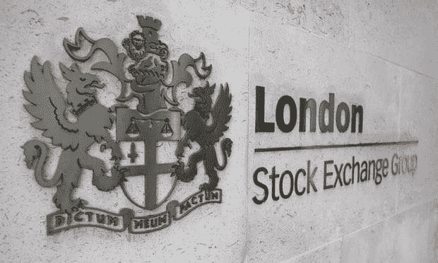

1773 年，英国的第一家证券交易所在伦敦柴思胡同的乔纳森咖啡馆成立

事实上，经由英国东印度公司、荷兰东印度公司开拓完善的这一套公司运行的制度、要到很久以后才被法律确认下来，这些早已存在的概念，才被法律用法律概念的形式确认下来。

比如说世界历史上的第一部有限责任制法，是由纽约州在 1811 年才立法的，是由纽约州在 1811 年才创立的。

股份有限公司法案用法律的形式去确认股份公司。是英国在 1844 年，最早是英国在 1844 年颁布的股份有限股份公司法案。股份公司法案还没有提出"有限"这个概念。但是那个时候大部分的股份公司都已经在他们自己内部的章程上说明白他们的责任是有限的了。

一直要到 1855 年才有英国才有有限责任公司法。这从一个侧面可能体现出远洋贸易、全球贸易对于东印度公司这样的公司形式的诞生所发挥的重要的促进作用。因为在东印度公司衰落之后，漫长的时间里，欧洲大陆上都不再用这样的公司形式，主要的原因是没有必要。

因为内部的贸易，大家可以继续沿用传统的合伙人制，或者是用家族亲缘关系去维系公司制度，而不需要像远洋贸易、殖民地贸易这样引入大量的陌生的投资者，引入大量的陌生的资本。

一直要到英国工业革命以后，当铁路建设兴起的时候，这种早已被东印度公司证明了成功的公司形式，才又重新得到大规模的运用。

#### 谁是商业贸易的"守夜人"？

我们这里说到的，为什么最初的东印度公司它这么缺钱，这么需要钱？是因为它除了要做生意，还要用武装保护自己的身影，它还要去开拓殖民地、去修筑要塞。

暴力的成本随着时间的推移不断地上涨，其他国家的皇家海军横行，海上的海盗，殖民地人民的反抗，都不停地在它的身上添加成本这种压力。

所以到了 1830 年代，东印度公司们，还有很多伴随着它们一起被创造出来的，像法国、瑞典这些公司所创造的类似形式的公司，都纷纷地倒闭了。它们的殖民地被政府接管，它们辉煌的时代也一去不复返。

东印度公司本身消亡了，它们的殖民地不仅不再属于东印度公司这样的私人公司，今天也没有殖民地这样的存在了。但是东印度公司所实践出来的，或者是在压力之下所激发出来的这种公司组织形式，却一直沿用下来，被后来的资本密集型的产业所大量地使用。

它们对于历史的启发或者对于法制的启发，除了他们所实践的这种公司形式和这些实践形式当中的这些关键性的元素，流通性极高的股票、有限的责任、独立于它的股东或者经营者，或者发起人、能够永久存在的法人。

除了这些形式、这些要素，它还引发大家另外一个思考，就是它们的失败证明了政府和公司和私人企业之间应该有一个重要的分工。

暴力的事情还是要交给政府来干，政府应该充当商业贸易的"守夜人"，他们应该负责开创好的营商环境。贸易和暴力这两件事情是很难同时掌握在私人的手里的。

当然在那个年代，所谓的"守夜人"，其实是政府用暴力的手段去为它的这些特许公司谋利创造条件。

政府直到今天也依然用国家暴力或者是动用国家权力，为它的公司去在国际贸易当中创造更好的条件。这当中的是是非非就是另一个有趣的法律问题了。

#### 贸易与法制的历史终会互相影响

好像茶的故事讲的不是很多，没有关系，我觉得梁老师已经给大家聊了很多了。

最有趣的事情是 18 世纪、19 世纪当贸易的成本，暴力的成本急剧的增加，这些私人公司东西印度公司没有办法应付的时候，他们逐渐地选择了把他们的成本转移到他们所垄断的商品上，包括茶叶。

这就是为什么有英国议会为他们背书的《茶叶法案》，那也有当然也就引发了走私犯分销商和消费者的不满，最后导致清查印度公司倒闭了，可是你的 342 箱茶叶被倒进大海了，不代表贸易的脚步会停下来。

事实上，美国在独立战争之后，它在 1777 年签订了《联邦条例》，宣布独立成为一个新的邦联共和国之后，为什么它的这些建国之父们要在十几年之后聚到一起去写出 1787 宪法，才创造出现在意义上的美利坚合众国？

其中重要的原因还是贸易，为了各州之间的囚徒困境，各自想方设法地要占其他州的便宜。所以为了能够统一决策、统一行动和避免这种囚徒困境的存在，各个州之间才觉得有必要有一个更加强大的联邦政府去统筹州与州之间的贸易。

以及，国与国之间主要就是跨大西洋的贸易，所以贸易的历史还在还会持续不断的影响法制的历史，法律当然也在影响着贸易。所以我们所讲的不过是历史当中的一个小小的侧面而已。

# 番外 | 阿詹生日特辑：震惊！阿詹要把“遗产”留给看理想的小编！

（文稿下方有小惊喜哦）

### Part1：祝阿詹生日快乐！

最近特别得感慨唏嘘，因为我录下这期节目的时候是在 5 月 31 号，明天是六一儿童节，是我 30 岁的生日。

我今天就一直在想，回头看我自己长大的这 30 年，我觉得在这 30 年，让我养成了一些非常乐观的性格。我是亲眼看着自己的生活，我们这个家庭的生活，这个国家、这个世界在向着越来越好的方向去往前走的，我以为这个世界也会一直不停地沿着这个方向往前走。

### Part2：阿詹将会陪伴大家一直讨论下去

这段时间又发生了很多事情，有很多的话题，我看到大家在评论里问到，也想和大家分享，但是这些话题有很多都非常得沉重，也不应该再被叫做"瓜"了，其中一个是一代传奇澳门赌王何鸿燊先生走完了他 98 年的人生。

这个消息出来之后，除了对他的过往人生传奇的回顾，他捐赠圆明园遗址公园的这些贡献，大家也"津津乐道"他的婚姻，他们家的遗产分配这些八卦。本来我是不打算涉入这个话题的讨论的，但没有办法，看理想的小编实在是太八卦了，逼我要讲这期节目。

### Part 额外：阿詹与小编的相爱相杀

我在 90 岁的时候给看理想的小编 A 写信说，"我以前在节目里面经常在案例里面暴力打你，所以为了弥补，我准备立一份遗嘱，把我所有的财产都留给你。"

我们举一个很小的例子，我在写遗嘱的时候，我非常精确地描述说，"等我去世之后，我就把我的 iPhone6s 送给看理想的小编"，之后过了几天，  
我的 iPhone6s 坏了，所以我就换了一个华为手机。然后等到我不幸过世之后，我的遗嘱执行人一清理我的遗产，发现没有 iPhone6s，那我的看理想的小编就什么也拿不到了，因为没有嘛。

但是如果我这个遗嘱写得没有那么明确，我说"我会把我的手机留给看理想的小编"，最后，我最新的最后一个手机就可以给 ta 了。这个听上去好像是我写得太明确了，反而把小编给坑了，好像不好。

（以上只为生日祝福与节目预告，预告顺序与正文内容稍有不同，不代表阿詹本人逻辑。本集内容纯属小编们对阿詹的喜爱之情，没有对多期阿詹痛打小编们的抱！怨！情绪。最后的最后：祝阿詹生日快乐，祝大家永远开心）

# 番外 | 赌王何鸿燊的四次婚姻（一）：《大清律例》的活化石

（公众号懒人找资源，懒人专属群分享。）

这段时间又发生了很多事情，有很多的话题，我看到大家在评论里问到，也想和大家分享，但是这些话题有很多都非常得沉重，也不应该再被叫做"瓜"了，其中一个是一代传奇澳门赌王何鸿燊先生走完了他 98 年的人生。

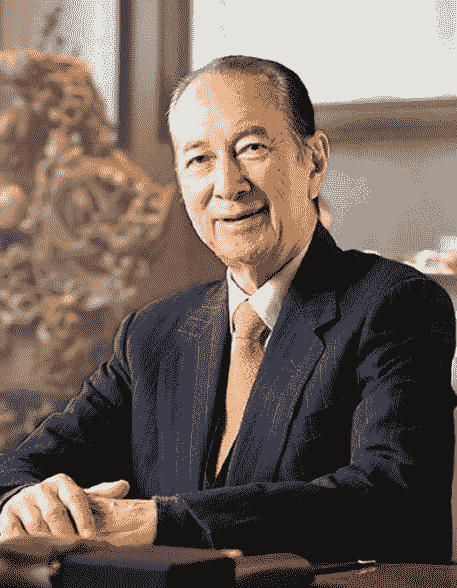

何鸿燊（1921--2020） 港澳企业家，有"澳门赌王"之称

这个消息出来之后，除了对他的过往人生传奇的回顾，他捐赠圆明园遗址公园的这些贡献，大家也"津津乐道"他的婚姻，他们家的遗产分配这些八卦。本来我是不打算涉入这个话题的讨论的，但没有办法，看理想的小编实在是太八卦了，逼我要讲这期节目。

很多人都在感慨赌王辞世，仿佛就好像是我们在见证着一个时代的远去，包括他的婚姻，我小的时候也很好奇"他为什么可以同时有好几房太太？"我当时非常简单粗暴的结论是：因为他有钱。

他的这些婚姻是有时代背景的，比如他的第二段婚姻是在大清律律下缔结的婚姻，所以这一切关于这些往事的回忆，更加地让人感慨"带着时代的刻痕的往事渐渐走入历史"。

#### 和平和发展是这个时代的主题

最近特别地感慨唏嘘，因为我录下这期节目的时候是在 5 月 31 号，明天是六一儿童节，是我 30 岁的生日。

我今天就一直在想，回头看我自己长大的这 30 年，我觉得在这 30 年，让我养成了一些非常乐观的性格。我是亲眼看着自己的生活，我们这个家庭的生活，这个国家、这个世界在向着越来越好的方向去往前走的，我以为这个世界也会一直不停地沿着这个方向往前走。

我小的时候在还懵懂不懂事的年纪，见证过香港的回归，见证中国加入 WTO，中国申奥成功。我都觉得这个世界一定是朝着大家越来越能够共同参与国际事务，制定大家共同遵循的规则，按照讲道理、合作协商的方式去解决问题，往这个方向走。

我小的时候我们的政治书上讲"和平和发展是这个时代的主题"，我觉得这句话是毫无必要的。

难道会有人不觉得和平和发展是这个时代的主题吗？但是你看这段时间我们见证了什么？特朗普，世界贸易组织和世界卫生组织他都不打算要了，开始拼命地指责各种各样的国际规则不公正了。

我们看到的是国家之间、社会之间的私利，以美国为一个很典型的案例，最近的世界显得动荡不安。我觉得很惶恐，我当然希望这只是历史在朝着和平和发展那个方向前行道路上的一些小的波折，可是谁又能确定？

#### 家族历史的背后都有着时代的起起落落

所以在这个时候看到这个消息，何鸿燊先生去世的消息，尤其是会让人觉得陷入一种很怀旧的情绪。虽然这期节目是小编逼我做的，但我也不得不承认"八卦之心，人皆有之。"

2010 年到 2011 年期间，当时曾经出过著名的遗产争产风波，大家可能知道何鸿燊先生几乎要把他的二房三房的子女告上法庭，他已经聘请了律师，然后这个故事就有了好几次的反转。

他前后几次发表了立场很不一样的声明，他的律师发表过好几次声明，他的女儿发表过声明，有好几次家庭会议，反正当时香港的报纸都是像"追剧"一样，大版面、惊悚标题反复地讲这个故事。香港的豪门世家也不是很多，所以这些争产风波、豪门恩怨，时不时的就会成为报纸的头版头条。然后大家也是喜闻乐道，包括我在内都是津津有味地读。

我刚去香港读书的时候，我们学校的图书馆有一次被我发现了一块宝地，就是图书馆有一个区域，那里的好几排书架，上面放的全部是香港、澳门各大家族秘史这些书，读了以后真的是手不释卷，就是全都是八卦，太有意思了。那为了"安慰自己"，不是沉迷于读八卦的，就只能说因为那些家族的历史不只是人和人之间的爱恨情仇，也不只是人的奋斗和起起落落。

这些家族的背后都是一个很特别的时代的起起落落，那些家族从殖民时代的买办、经历战争、经历新中国的成立、香港的回归，一步一步地走到今天，走过那一个又一个风云变幻的时代。

包括何鸿燊先生他的婚姻的故事里，也隐藏着那个时代的变迁。何鸿燊的第二次婚姻是在 1957 年，那个时候我们新中国的婚姻法是在 1950 年颁布的，新中国大陆早就已经开始实行一夫一妻的制度，但是香港还没有。

香港在 1841 年，英国驻华商务总监义律，他就率军登陆了香港。那我们都知道 1840 年起爆发了中英鸦片战争，后来在《南京条约》之下，香港岛被割让给英国，但英国占领香港岛在 1841 年就占领了。

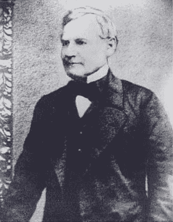

查理\*义律爵士（Sir Charles Elliot 1801--1875）

当时的英国殖民者，他也沿用了他在其他殖民地的统治手段，就是沿用当地的习俗和法律来进行统治。特别是在这种家庭事务上，他没有必要引入英国的法律，强行地把英国的习惯凌驾于当时的香港社会之上，所以英国人就宣布在香港采取习惯法，依《大清律例》管理当地的居民。那此后一直到 1971 年，《大清律例》之下的清代的婚姻习俗都依然在香港适用。

#### 传统社会的继承制度

我们国家的历史上其实也一直不是一夫多妻制，自从嫡长子继承的宗法制确立之后，我们实行的一直都是一夫一妻多妾制，纳妾（在当时）是合法合理的。这个不同的传统社会的继承制度是一个很有趣的话题，我们这里没有办法展开，大家有兴趣的话可以去读一些各种各样的论文研究。

比如西欧的几个不同的封建社会，比方以法国和英国为例，它的不同的继承制度会深刻地影响整个社会的经济、社会的组织形式、社会在后来发展的过程当中的动力和困难。

比如英国是长子继承制，它从一千年前就确立了长子继承制，所以它有一些强有力的大贵族；法国是子女之间均分的继承制，所以它后来受限于小农经济的落后，我们在历史书上也都学过。

#### 何鸿燊先生的多妻婚姻是否合法？

我们的历史上是一夫一妻多妾制，这种制度在香港被沿用下来，一直到 1971 年，香港政府才颁布婚姻制度改革条例，在此之前香港所运行的法律是非常混乱的，因为从 1844 年开始，英国的法律也适用于香港。

与此同时，在 1930 年当时的南京国民政府公布了民法的亲属编，开始推动一夫一妻制的改革，从 1935 年新的刑法颁布之后，未经妻子同意的纳妾是被等同于通奸的，这个是法律的规定。但是实际上纳妾的问题是属于自诉案件，所以如果这个妻子同意了或者选择不去告官，民间依然有人在做纳妾的事情。

这个制度的彻底废除，大概要等到 1950 年，新中国的《婚姻法》的颁布，但是民国是从 1930 年开始了新的《婚姻法》的改革。当时的香港承认在民国法律之下缔结的婚姻，它也承认在英国的法律之下缔结的婚姻，或者是依外国的法律在海外缔结的婚姻，它总之是一个各种各样的法律都统统承认、都统统适用的地方。

所以有很多人认为"何鸿燊先生至少他的第二次婚姻，是在 1958 年在《大清律例》之下结成的合法婚姻"。但是也有不同的意见争辩说，"那个时代的《大清律例》虽然保留，但是很早就为当地的英国人所不惜。英国人一直在推动香港的法律的改变，开始推行一夫一妻的制度，它其实是受到了华人的富商集团的抵制。那何鸿燊是一个有葡萄牙国籍的人，那么他作为一个有葡萄牙国籍，那他是不是适用于《大清律例》，这件事情又变得模糊不清了。

香港在 1971 年终于通过了《婚姻改革条例》，是两岸四地当中最后一个废除一夫多妻制或者是纳妾制的地方。所以在 1971 年的 10 月 7 号之后，就不再允许纳妾或者不再允许多妻了。

何鸿燊先生的第三次和第四次的婚姻，分别是在 1985 年和 1989 年，那也就是在香港的婚制改革之后，即便以香港当地的法律，也不是被法律所承认的注册婚姻，这一点应该是没有疑问的。但是因为他们没有选择去注册结婚，所以也并不违反《婚姻法》。

但是不管怎么说，这件事也不影响大家关心的另外一个八卦的重点，就是遗产的分配。我们且不说以目前看到的消息，应该是何鸿燊先生在生前就做出了安排，没有所谓的再一次的"争产"风波了。

#### 原则简单但执行困难的《继承法》

无论如何非婚生子和婚生子在遗产继承上是享有同样的权利，这个基本上是全世界都通行的规则。所以可以聊的八卦比较少，我们稍微聊一聊继承制这个问题，它当然是一个很重要的法律类型。我们在司法考试的时候，它是一个单独的科目，除了这个《刑法》、《民法》、《合同法》之外，也要学《继承法》。

《继承法》可能是一个很典型的法律，它的原则其实非常得简单，但是在实际执行当中会有种种困难。如果大家亲身经历过家庭内部有关于遗产的各种各样的纷争，能够切身地感受到这一点，当然每个人的感受可能还很不一样。

大家如果有兴趣，去翻我们国家的，以前是《继承法》，现在是《民法典》的第六编继承编，你很快就能读完。因为基本的原则是很少的、是有限的，而且因为它是一个家庭事务的法律，基本上法律的规定是服务于人的，它和我们常识当中对于遗产继承问题的理解是一致的。

第一千一百三十条 【遗产分配的原则】

同一顺序继承人继承遗产的份额，一般应当均等。

对生活有特殊困难又缺乏劳动能力的继承人，分配遗产时，应当予以照顾。

对被继承人尽了主要扶养义务或者与被继承人共同生活的继承人，分配遗产时，可以多分。

有扶养能力和有扶养条件的继承人，不尽扶养义务的，分配遗产时，应当不分或者少分。

继承人协商同意的,也可以不均等。

第一千一百三十一条 【酌情分得遗产权】

对继承人以外的依靠被继承人扶养的人，或者继承人以外的对被继承人扶养较多的人，可以分给适当的遗产。

第一千一百三十二条 【继承处理方式】

继承人应当本着互谅互让、和睦团结的精神,协商处理继承问题。遗产分割的时间、办法和份额,由继承人协商确定；协商不成的，可以由人民调解委员会调解或者向人民法院提起诉讼。

《中华人民共和国民法典》第六编第二章

当然法律会有一些特殊的保护，包括这一次的《民法典》它做了一些修正，也是配合这个时代的特色，比如它引入了遗产管理人，比如确立了一个正式抚养人的制度。就是一个老人，如果没有子女照顾他，可以委任一个抚养人，那这个抚养人在老人去世之后有权继承遗产，这是新的时代多元化养老方式的一种体现。

第一千一百四十五条 【遗产管理人的选任】

继承开始后，遗嘱执行人为遗产管理人；没有遗嘱执行人的，继承人应当及时推选遗产管理人；继承人未推选的，由继承人共同担任遗产管理人；没有继承人或者继承人均放弃继承的，由被继承人生前住所地的民政部门或者村民委员会担任遗产管理人。

第一千一百五十八条 【遗赠扶养协议】

自然人可以与继承人以外的组织或者个人签订遗赠扶养协议。按照协议，该组织或者个人承担该自然人生养死葬的义务，享有受遗赠的权利。

《中华人民共和国民法典》第六编第四章

这个《继承法》说起来很简单，有遗嘱，那就依遗嘱的安排去继承，没有遗嘱就按照固定的法律所规定的继承顺位去继承（说起来非常简单，这样就说完了）。事实执行的过程当中，会遇到各种各样的挑战和麻烦，比如谁有资格继承遗产？这个家庭成员、继承人到底应该包括哪些人？假设没有遗嘱，要依法律去进行分配的时候，应该以什么样的比例去分配？

我们国家的《继承法》体现了一个很灵活的特色：继承人的范围是挺广泛的，除了婚生子女之外，还包括非婚生子女，包括遗腹子、包括养子、包括继子。做一个对比，比如美国很多州的法律里面，继子就不被包括在继承人的范围之内。

我们国家的《继承法》第一顺位是包括伴侣、子女和父母。一般来说西方国家的法律里第一顺位的继承人是不会包括父母的，因为基本原则是要"向下"继承，就是尽量寻找，子女没有了可以找子女的继承人，一直往下数，直到确认完全没有办法向下继承，才会考虑向上继承。

基本的分配原则在我们的《继承法》之下是同一顺位的继承人平均分配，但是法官是可以根据每一个家庭不同的情形酌情进行裁量。

法官的自由裁量权我们之前聊过很多次了，它有它的合理性和它的价值，因为每一个家庭的内部情况确实是太复杂了，人和人实在是太不一样了。比如有的子女对父母不管不顾，有的子女为了照顾父母付出了很大的努力和牺牲，比如有的子女生活条件已经非常得优渥，有的子女生活比较困难，那法官是可以酌情在分配财产的时候有所偏向。

自由裁量权也带来很多的问题，就会带来很多的纠纷，因为它是一个不确定的标准。相比之下，西方国家的普通法系下，因为它有很多过往的案例堆积起来，一般来说是有比较明确的标准（大家都知道我聊美国的时候，你们都知道我的套路就是每一个州的安排会不一样）。

比如我们只考虑子辈的人，只根据孩子这一辈，有几个人进行平均分配呢？同样是平均分配，但是把有多少个孙辈也考虑进来。如果有的子女已经过世了，是按这个子女的人头做分配呢？还是看他留下了多少子女做分配呢？

又比如说所有的子女都过世了，但是有孙辈留下来，那是按照子女去做平均分配呢？还是按孙辈的人头去做平均分配呢？这个会在现实操作当中带来很大的不一样（我就不举例子了，好像有点复杂，大家能够感受到就可以了，它就变成一个数学问题，每一个州的具体安排就会不一样。）

比如一个人的继承人，他的一个孩子，在他死之后一天之内就死去了，那我们在计算分配的时候是不是要给他留下一份呢？  
如果这个孩子是在父亲去世三天之后去世的，那要不要留下一份呢？不同的地方就会有不同的规则。

所以现在应该是有越来越多的人会采取用立遗嘱的方式来进行财产的分配，可以避免很多这种极其模糊不清的情况，但是它也会有它的很多困难。

# 番外 | 赌王何鸿燊的四次婚姻（二）：如何立一份有效的遗嘱？

（公众号懒人找资源，懒人专属群分享。）

#### 遗嘱为何要写得精确？

现在应该是有越来越多的人会采取用立遗嘱的方式来进行财产的分配，可以避免很多极其模糊不清的情况，但是它也会有它的很多困难。

比如语言是模糊的、是有局限的，一个人很难用一份遗嘱就清晰无疑地描述出自己所有财产的分配方式，不然大家心里幻想一下，如果你现在需要立定一份遗嘱，你感受一下这个难度，要用多么复杂的语言，事无巨细地才能够不留下模糊地带，把所有的东西进行合理的分配。

若是有了合理的分配，也会有很多其他的复杂的情况。比如"人心易变"，立着又改变了，哪一份遗嘱才是最终的、有效的。《民法典》有一个很重要的调整，就是它不再给予公证过的遗嘱优先权。

比如你之前立了一个遗嘱是经过公证的，但是你事后觉得要改，然后你重新立一个遗嘱，在以前的考量里没有很正式地用录像的方式去立遗嘱，那法院会尊重你最后的意志。之前是会偏向那个被公证过的遗嘱，现在有一些更随机的这种改变。

第一千一百四十二条 【遗嘱的撤回、变更以及遗嘱效力顺位】

遗嘱人可以撤回、变更自己所立的遗嘱。

立遗嘱后,遗嘱人实施与遗嘱内容相反的民事法律行为的,视为对遗嘱相关内容的撤回。

立有数份遗嘱,内容相抵触的,以最后的遗嘱为准。

《中华人民共和国民法典》第六编第三章

我们举一个很小的例子，我在写遗嘱的时候，我非常精确地描述说，"等我去世之后，我就把我的 iPhone6s 送给看理想的小编"，之后过了几天，我的 iPhone6s 坏了，所以我就换了一个华为手机。然后等到我不幸过世之后，我的遗嘱执行人一清理我的遗产，发现没有 iPhone6s，那我的看理想的小编就什么也拿不到了，因为没有嘛。

但是如果我这个遗嘱写得没有那么明确，我说"我会把我的手机留给看理想的小编"，最后，我最新的最后一个手机就可以给她。这个听上去好像是我写得太明确了，反而把小编给坑了，好像不好。

但实践当中，绝大多数的情况下出问题是因为写得不够确定。比如我说"我有五个手机，我把手机给小编 A 和小编 B"，那我这五个手机几个分给小编 A？几个分给小编 B 呢？我必须清楚地说"华为给小编 A，6s 给小编 B"，到时候大家就知道该怎么分了。

还有一个原因为什么要写得精确呢？写的精确就显得要把这份遗产留给指定继承人的意愿极其得强烈。比如一个人在他的遗产被分配之前，他的遗产首先要用来清偿他生前所欠下的债务，支付他欠缴的税费。什么样的遗产、哪一部分遗产会先被拿去缴税费、偿还债务呢？就是那些不确定的。

比如我的遗嘱是说，"当我的遗嘱按照以上的方式分配给了看理想的五个小编之后，剩下的都分给第六个小编，如果有余下的就分给小编六"。如果这个时候我欠着钱，我欠着我的债务人钱，首先就是用余下的部分去偿还。

比如我有一个价值一万块钱的电脑和一万块钱，我在我的遗嘱当中说，"我把我这一部金色的电脑送给小编 A，然后我把一万块钱送给小编 B"，我的财产就只有这两样。但有人发现这个时候我正好欠着一万块钱的债，谁的这份遗产会被拿去还这个债呢？就是那一万块钱现金，因为金钱的赠与被认为是更加泛泛的赠与，一个指定的电脑就是一个特别的赠与，所以特别也有它的好处。

一般来说，我们看到争夺遗产的案子，就是在有遗嘱的情况下进行争夺。首先挑战的是这个遗嘱的合法性，或者是哪一份遗嘱才应该是被采用的那份遗嘱？

这种豪门恩怨也好、惊险的律政剧也好，大家应该看过很多了，我不如推荐给大家一本书，一本侦探小说叫《希腊棺材之谜》，所有的侦探小说迷肯定都听过这本小说。

埃勒里\*奎因（Ellery Queen）著 王敬之译

《希腊棺材之谜》，新星出版社

这本书稍微和遗产的分配有一些关系，因为这个故事在揣测谁更有动机去杀人偷走遗嘱的时候，就是要根据在有遗嘱和没有遗嘱，有哪一份遗嘱的情况下，到底谁有权继承什么？这个问题去考量的。但更重要的原因是，这是一本非常经典的，而且精彩的侦探小说。

#### 一份遗嘱如何才能合法有效？

一份遗嘱想要合法有效，它需要满足几个条件。第一是遗嘱的制定人，他需要是一个有行为能力的人，是法律上的有行为能力的人。

第二他是要有制定遗嘱的能力。比如他的头脑不清醒，或者是他处于一个疯狂的状态，有精神性的疾病，那他就没有制定遗嘱的能力。他在法律上可能是一个行为能力人，但是他没有制定遗嘱的能力。

第三是他要有清晰的意识，就是他现在正在做的这件事情是制定遗嘱。比如我在 90 岁的时候给看理想的小编 A 写信说，"我以前在节目里面经常在案例里面暴力打你，所以为了弥补，我准备立一份遗嘱，把我所有的财产都留给你。"

后来看理想的小编拿着这封信，希望成为我的继承人，那这封信很有可能是无效的。因为我明明写的是"我准备了一个遗嘱"，那可见我在写这封信的时候并没有把它当成我的遗嘱。

第四是遗嘱要符合一些形式上的规范，那至于要符合什么样的形式上的规范？取决于你是用什么方法制定遗嘱。比如这是一个经过公证处公证的遗嘱，那基本上不需要其他的证据，公证本身就是证据；如果这个遗嘱是亲笔书写的，那通常有认证的签名也就可以了；如果它是一个由其他人代为书写的遗嘱，或者它是一个录音录像的形式去做的遗嘱，那通常就需要两个证人。

那不同的法律之下，这个证人的身份又有不同的限制和要求。比如这个证人不能够是受益人，否则的话就是会让人揣测他做证人的动机，或者是揣测他在做证人期间有没有对遗嘱人施加不必要的影响。

不仅是这几个要素要被满足，美国的法律它更进一步地要求"这几个要素要被同时满足"。

比如有一个人时而清醒，时而昏迷，他这次醒过来的时候说"这是我的遗嘱"，但是他脑子不太确定自己有哪些财产可以分配，他下一次醒过来的时候想起了自己有哪些财产，但是没有认出来，这是他的遗嘱。这种情况下就是这四个要素可能都满足，但不是同时满足，那也不行。

除了这四个要素满足的情况，有很多人还会进一步地去挑战说"他在制定这个遗嘱的过程当中，有没有人对他施加不当的影响，进行哄骗、欺瞒甚至威胁"。

比如我最好的朋友就是两个看理想的小编，我在想我要把我的遗嘱平均地分给他们俩，然后有一个小编听到了这个消息以后，就拼命地在对我造谣，说另一个小编是一个十足的坏人。这个也属于提供虚假的信息进行了欺瞒、欺诈，所以这份遗嘱也是无效的。这个具体的操作方式就很多了。

#### 遗嘱的有效性在实践中被挑战、被证明

我们之前讲在论证的过程当中，有一个非常重要的元素叫做论证责任，就是谁有责任和义务去证明这一切？在遗嘱的问题上很明显就是有"谁要去挑战这份遗嘱的有效性，谁就有责任去举证"，他到底以什么理由来挑战这个遗嘱的有效性。

美国的有些州甚至进一步地规定，比如你在遗嘱之下其实是一个受益人，但是你还是要挑战这个遗嘱的有效性，如果你挑战失败，你就相当于没有资格再继承了。就是为了防备，有的人觉得不够满足，想去多要一点东西，去避免这种"妄诉"，这些不必要的法律资源的浪费。

但也有的州觉得这种方法是"一刀切"，不太合理，因为有的人是真心诚意地想要挑战，不应该因此剥夺这些挑战人的继承资格。所以有的州要衡量说，"如果你是怀着诚信的理由去进行挑战，你就算挑战失败了，依然可以依据原遗嘱去继承。"

不同的情况之下的分配方式，还有不同立遗嘱的时候可能遇上的陷阱，就非常看实践了。在不同的情况之下有很多种可能，我觉得比较有趣的问题，其实不是具体的法律手段的问题。

关于继承的问题，我们这些年很多时候以社会的角度，整个社会会去讨论"是否应该征收高额的遗产税？"美国的一些巨商、一些巨富，包括像比尔盖茨这样的美国的一些最富的人，他们大力支持高额的遗产税（的实行），大概是看到了这个社会，如果不再用遗产税的方式，控制隔代之间的财富流转，就会有越来越严重的阶级固化，这个问题好像今天已经在美国的街头呈现出来了。

但也有很多人反过来觉得高额的遗产税是不合理的，"父母奋斗了一辈子，就是想把更好的、更多的东西留给孩子"，更何况很实际地去看，在现实当中真正在承受高额的遗产税的人是谁呢？通常是中产阶级。

因为真正的有钱人他们有很多的方法，在生前就用各种各样的安排去规避遗产税。比较常见的，比如买大额的保险，比如特朗普之前他在竞选总统的时候就被人曝光"他继承遗产是以信托基金的方式逃避了高达几十亿美元的遗产税"。所以理论和实践之间又一次有非常明显的鸿沟。

#### "杀手法案"：如何理解法律与解读法律？

还有一个很有趣的话题，叫做"杀手法案"。这是之前引起过广泛争议的案件，是美国一个"非常老"的案子。

1889 年纽约州的一个案子叫做帕尔默案，这个案子当中的一个老人立下了遗嘱，他把他的绝大部分的遗产都留给了他的孙子，儿子已经去世了，他的两个女儿每人只分到了一点点钱。这个孙子听说自己将成为大额遗产的继承人，他害怕他的爷爷改变想法（大家都能够猜想的剧情），他就谋杀了他的爷爷。

于是法庭就要去讨论，"在这种情况下，因为他谋杀并没有被判死刑，他还能不能够去继承这个大额的遗产呢？"那关于这个案子就有两派意见，其实在当时这个问题没有被后来的法条解决之前，不同的法庭会做出不同的裁决。

在这个案子当中，法官认为这个人谋杀的行为是由《刑法》去为他定罪的，我们默认《刑法》给出的处罚是公平的、合理的，那么他已经为他的错误的行为得到了适当的惩罚，就不应该再用《继承法》去进一步地"惩罚"他。

法律当中没有这样的规定，那他就还是应该按照既有的法律的规定，去继承这个遗产。因为遗嘱写得是非常清楚明白，合情合理的大家都没有挑战这个遗嘱本身的有效性。

还有一派的法庭认为一个人用谋杀的方法去继承遗产，一个公平正义的法律体系，不能够允许这样的事情发生。

这个案子非常得重要，不仅是因为它引发社会的关注和讨论，后来不同的州都相继推出了所谓的"杀手法案"、slayer  
statute，或者是引入了杀手原则。基本上是说"一个杀手、一个谋杀犯不应该从自己的错误行为当中获益"。这种人在法律上他们会被视为已经先于遗嘱人死掉了，就这个孙子会在法律上被视同于已经死了。那他的继承人仍然可以继承，但是他本人不能再继承。

这个案子很重要，还因为它被后来的很多的法哲学的重要的理论家，用来当做一个讨论法哲学问题应该怎么样理解法律和解读法律，这个问题的一个重要的案例。

我之后会向大家介绍法制领域的一些代表性的人物，我们之前也提过，法哲学有两个主要的流派。一个叫做法实证主义，法实证主义基本上就是我们去看法律本身在说什么就可以了，那这个法实证主义的一个代表人物叫做 H.L.A  
Hart，他就认为这个案子是清楚明白的，现有的法律给出的回答就是"不同类型的法管不同类型的事情，不同类型的法决定一个人在不同的领域里该受什么样的惩罚。"

赫伯特*莱昂内尔*阿道弗斯\*哈特

（H.L.A.Hart，1907-1992）英国著名法理学家

他的学生也是他最重要的挑战者，这个人叫德沃金。德沃金是一个介于两派之间的人物，但是他认为法实证主义是不足的，我们现有的法条不能够帮助我们回答所有的问题，法律过往的判例当中，除了给我们法条，还给了很多重要的指导性的原则，这些原则也应该被纳入"法律该是什么？"的考量之中。

罗纳德\*德沃金（Ronald Myles Dworkin，1931-2013）

美国著名哲学家、法学家

比如有一个很起码的原则叫做"一个人不应该从他的错误行为当中获益"，一旦引入了这个原则，对于这个问题的回答就是很清楚明白的。那后来美国各州大概在 1960 年代都纷纷通过了法条，用法条的形式确认了德沃金所提倡的这种原则，就是"这种人是被剥夺继承权的"。

我们国家的《继承法》同样的杀人犯杀死被继承人或者是杀死其他继承人的人，是会被剥夺被继承权的。这个问题并不是因为法律这样规定了，它就一定是一个最正确的答案了，我觉得也是我们可以去讨论的。

关于何鸿燊先生的讨论，我看到不只是有关于他的八卦、他的婚姻、他的遗产的讨论，也有他当年为国家高价回购珍贵海外文物的讨论，我觉得我们也借这个机会讲一讲关于文物的国际法。

# 番外 | 圆明园兽首回归为何如此艰难？有关文物的国际法

（公众号懒人找资源，懒人专属群分享。）

#### 文物的回归是一件困难的事情

我知道时事动荡，热点变幻，但我还是带着自己的一点执念，再和大家聊一聊何鸿燊先生，和由此联想到的海外文物回归这个话题。

我们在提起何鸿燊先生的时候，除了他精彩的人生传奇，还会常常想到他曾经两次斥巨资购买流失海外的圆明园兽首，猪首和马首，并且把它们捐赠给国家。

2003 年，何鸿燊捐赠圆明园猪首铜像

2019 年，何鸿燊捐赠圆明园马首铜像

这两次捐赠发生在 2003 年和 2007 年，我还能很清楚得记得，我当时还在读书，是从电视上看到这个新闻，但是我当时没觉得感动或者振奋，因为我完全是被愤怒填满的。

小的时候想事情比较容易情绪化，我就觉得"凭什么？抢了我们的东西，居然还能拿出来拍卖？你们抢了我们的东西，没有好好地把这些东西还回来说一声'对不起'，居然好好地留着还拿出来卖？然后还要我们的人花这么多钱才能把这个东西买回来。"

如果不是何鸿燊先生出手，可能就不知道被谁买走了（小的时候对这个事情是非常不能接受的，现在长大了，我们来回头聊一聊。）从法律的角度去看，为什么海外文物的回归是一件这么困难的事情，要需要动用巨资，用这样的非常手段去把这些文物买回来？

#### 逆权侵占概念也适用于动产

之前和大家聊过一个主题叫做诉讼时效，打官司不是任何时候都可以，并不是 30 年前被人打了，30 年以后咽不下这口气，然后回去找人打官司，诉讼必须在一定的期限之内提出。

诉讼时效的一个概念，叫做逆权侵占。逆权侵占常常用于关于土地的侵占  
我在一块土地上，不知道这是别人的土地，或者哪怕知道，如果我在这块土地上耕耘了 20 年、30 年，这个园主都没有来找我，根据法律这块土地就归我所有了。逆权侵占这个概念同样可以用于动产，就是我和平地、公开地占有某一样东西，达到了法律规定的年限之后，这个东西的所有权就可以归我了。

在讲逆权侵占这个概念的时候，提到过一个看上去比较无辜的角色，叫做"善意的第三方"或者是"善意的购买者"。比如有人偷了我的东西，再卖给了小编，小编在买这个东西的时候，他真实地相信卖东西给他的人是这个东西的合法所有者，然后他们之间是签了合法的合同，小编付了合理的价格，把这个东西买到手的。他在整个过程当中扮演的是一个"无辜者"，"善意的第三方"的财产权在一定条件下受到法律的保护。

流失的海外文物，今时今日的所有者可能绝大多数都是所谓的"善意的第三方"。首先我们要理解文物流失有很多种可能的途径，像圆明园这样的公开的抢劫，是一种重要的途径。

在战争当中的抢掠，也有别的途径。比如末代皇帝溥仪在他的回忆录《我的前半生》里，他曾经写过他幽居紫禁城的时候，没钱用了，把宫里的东西交给他的兄弟溥杰偷偷地拿出宫去卖，从溥杰的手里买这些东西的人，算不算是"善意的第三方"呢？

爱新觉罗\*溥仪 《我的前半生》 哈尔滨出版社

溥仪无论他作为中国的皇帝，还是一个退位的皇帝，他有没有资格卖这些文物？这是一个更加复杂的问题。就算最初买这些东西的人不是"善意的第三方"，又比如圆明园的文物，它是被抢劫出来的文物，又比如有一些文物是盗窃的、盗掘的，可是 100 多年过去了，这些文物都经过很多次的流转，包括合法的买卖，也包括合法的拍卖，包括人与人之间的赠送，包括人对博物馆的捐赠等等。

今天持有这些文物的都不是当年抢劫偷盗这些文物的人，他们很有可能是经过了很多次的辗转之后，合法取得这些文物的人。事实上，怎么处理这个问题？当中包含两难的困境。

比如 2007 年何鸿燊先生是在香港苏富比的拍卖上买到了圆明园马首，当时的拍卖本身引起过很大的争议，大家也可以想象，我们国家的被抢掠的文物公然地被拍卖，这件事情本身是让人愤怒的，但是拍卖如期举行了。事实上，还有中国的很多古代文物被拍卖，我们都表达过愤怒，而有很多拍卖依然如期举行。

2007 年圆明园马首被拍卖信息（参考）

如果我们去参与这个拍卖，某种意义上是不是承认了"他的卖家对这个文物处置的合法性"；但反过来，如果我们不去参与这样的拍卖，就是任由这个文物在市场当中辗转流失，其实是一个挺困难的选择。

实际地看，我们也知道在过去几十年新中国成立之后，抢救海外文物的努力当中，绝大部分我们拿回来的文物，第一种途径是外交，一些对华表示友好的国家或者博物馆，包括早期的社会主义阵营的国家，后来加拿大的博物馆送回过很多中国的文物。

还有一种可能更重要的途径是秘密回购。比如著名的 1950 年之后成立的文物收购小组，它早年在香港第一单大生意，就是收购了乾隆皇帝的三希堂里的三个传世名帖当中的两个：《伯远帖》和《中秋帖》。

东晋书法家王珣 《伯远帖》

释文："珣顿首顿首，伯远胜业情期群从之宝。自以羸患，志在优游。始获此出意不克申。分别如昨永为畴古。远隔岭峤，不相瞻临。"

传为东晋书法家王献之 《中秋帖》（又名《十二月帖》）

释文："中秋不复不得相还为即甚省如何然胜人何庆等大军。"

这些文物的收藏家会不知道这些文物的来历吗？他们真的可能是"善意的第三方"吗？但他可能不知道这个文物到底是皇家拿来贱卖的，还是从皇家园林里被抢走的？这是有可能的。

另一个问题是，一个买家他在买一个文物的时候，他有没有义务去尽职调查这个文物的前世今生，了解这个文物是怎样辗转所有的经历呢？现行的法律里对于"善意第三方"的这个"善意"的要求通常没有这么严格，只要他在购买的瞬间，他是相信这个东西是通过合法的途径，就是他相信卖家是有合法的所有权，这就可以了。

#### 有关文物回归的国际法

与"善意的第三方"相联系的是诉讼时效的概念，超过了一定的诉讼时效，这个买家、第三方就可以通过逆权侵占，或者是在动产上它可能被叫做时效取得，取得这个文物的所有权。

很多国家的法律里对于动产都有时效取得的规定，比如说日本的《民法典》规定是 20 年可以取得所有权，德国是 10 年、法国是 30 年，美国的各个州，每个州不一样，但是通常 10-20 年也都可以取得一个动产的合法所有权（我们之前曾经聊过诉讼时效从什么时候开始计算？其实是一个更有趣的问题，这里不再重复）。

如果要通过法律的手段去追溯这些已经流失海外的文物，可能不得不去研究各个国家关于时效取得的规定。反过来，国家之间的文物的流转、流失、非法的转移，那么我们应该从国际法的角度去想问题，但是国际法当中同样有诉讼时效的约定。

关于为了打击跨国的文物走私、盗窃，甚至抢劫，有过三个重要的国际公约。分别是 1954 年《武装冲突情况下保护文化财产公约》，叫做《1954 年公约》；1970 年的《关于禁止和防止非法进出口文化财产和非法转让其所有权的方法公约》，叫做《1970 年公约》；以及 1995 年制定的《关于被盗或者非法出口文物的公约》，叫做《1995 年公约》。中国《1970 年公约》我们到 1989 年加入，《1954 年公约》我们 2000 年才加入。

这些公约当然可以也通常被视作在关于文物保护这个问题上的进步。但是这个问题没有这么简单。

首先，这些公约有很大的局限性，我们都知道国际间的公约它只适用于签约主体，有一些国家如果它拒不加入这个公约，就没有办法用这些公约来限制、约束这些国家的行为。

第二，国际间的公约意味着，比如我以国家为主体，去用司法的过程追溯、追讨文物的话，要证明国家主体是有起诉资格的。

比如之前秘鲁政府曾经想通过国际法庭去追溯一个流失海外的被盗窃的秘鲁文物，结果国际法庭驳回了秘鲁政府的这个起诉，原因是秘鲁政府没有办法证明它有适当的起诉资格，它没有办法证明这个文物是秘鲁政府所有的。因为这个文物在秘鲁境内的时候，它都是归一个私人机构所有。

所以，我们现在提起比如圆明园流失海外的文物，理所当然地觉得这是我们的文物，因为我们是用一个民族国家的立场、文化传统的立场来想问题的。

#### 什么样的东西属于一个国家的文化财产？

可是从法律上看，一个文物是中国的文物，是中国历史的文化遗存，和中国政府是这个文物的所有者，并且有立场在国际法庭上去追讨这个文物，这是完全不同的概念。

而事实上，比如以《1970 年公约》为例，它的一个重要的贡献就是比较清晰的界定了"什么样的东西属于一个国家的文化财产？"

一个文物的所有权，历史上是有很多争议，是模糊不清的。一个原因是，古代文明并不是一直不变的，甚至不一定是存续的。文明之间的疆界，古代文明的疆界和现代国家的界限，不一定是完全重合的，而古代文明之间也充满了各种各样的交流。

假设我们在中国出土了一块波斯风格的地毯，但是它事实上是在今天的哈萨克斯坦境内手工编制的。这块地毯应该属于哪一个国家的文物呢？

《1970 年公约》对这个问题做出了比较明确的回答，就是以领土作为划分，在一国的现代国家的领土之内，出土的文物属于这个国家的文化财产，而不再去追溯它真正的来源。《1970 年公约》当中还对"什么样的文物构成一个国家的文化财产？"有其它的表述。

#### 文物回归最大的问题在于条约不溯既往

大家一听到 1970，为什么不停地重复 1970 这个数字，就能够感受到一件事。它最大的问题在于我们都知道法不溯既往，法律不能够规管在这个法律生效之前发生的事情，条约同样是不溯既往的。

除了这是一般意义上的法律的基本原则以外，它也是一个明确的被文字确立下来的国际间条约。有一个条约叫做《维也纳条约法公约》，这个不同于一般的其它的公约，原因是其它的国际间公约通常是就某一个具体的事项，各国之间签订一个条约，就像 1970 年的条约是关于文物的非法走私。

但是《维也纳条约法公约》是关于"如何解读国际间公约"的一个公约，它相当于是一个至高的司法解释总则，所有的其它的公约的解释都要依照《维也纳条约法公约》所确立的原则来进行解释。而《维也纳条约法公约》的第 28 条就规定，除非是其它的公约另有表述，条约对当事人生效之日以前所发生的任何行为或事实不对当事国发生拘束力，就是明确的国际条约不溯及既往。

第二十八条 条约不溯既往

除条约表示不同意思，或另经确定外，关于条约对一当事国生效之日以前所发生之任何行为或事实或已不存在之任何情势，条约之规定不对该当事国发生拘束力。

《维也纳条约法公约》第三编第二节

《1970 年条约》生效以前所发生的文物的非法转移和走私，这个条约对这些文物并没有追溯力，而中国是在 1989 年才加入这个公约，也就是中国要到 1989 年以后才成为这个条约的成员国，才有资格依据这个条约提起追溯的要求。所以相当于对 1989 年以前走私的文物，都没有办法依据这个条约来进行追诉。

因为《1970 年公约》它有明文表示是"本公约对缔约国生效以后，从该领土内被盗的文物和非法出口文物，才可以依据这个公约进行追溯"。《1995 年公约》稍有不同，它有一个追溯时效的具体的规定，《1995 年公约》是关于被盗和非法出口文物的公约，它的第三条规定，"任何关于返还被盗文物的请求，应自请求者知道该文物所在地和该文物拥有者的身份之日起，在三年内提出，任何情况下，自被盗时起五十年以内提出。"

中国在 1997 年加入这个公约的时候，做一个声明，就是我们要求"采用七十五年的返还请求时效"。1997 年，七十五的返还时效，相当于我们对 1923 年之后被盗和非法出口的文物可以依这个公约去进行追讨，但是对 1923 年以前被盗和非法出口的文物就不能够依据这个公约。

这个公约（《1995 年公约》）相对来说不像《1970 年公约》那样有广泛的签署国，所以这个公约本身的约束力就是有限的，再加上中国可能大部分的文物都是在 1923 年以前就已经流失海外了。

所以，这些公约对于我们去追讨历史上流失的文物所起到的效用是有限的，这些公约的积极意义可能更在于  
他们能够帮助这些文物的所有国，去遏制现在当下仍然正在发生的文物非法走私、盗窃、转移的事件。

事实上在过去 20 年当中，我们确实依据这些条约追讨过很多在当代非法转移和出口到他国的中国文物。1995 年从英国伦敦警方截获的源自中国的走私文物的返还，还有 2000 年叫停了美国某一个拍卖行对中国文物的拍卖，而且归还了这些文物。

但是这些过程都不是纯粹的司法过程，它主要还是国家间进行协商的结果，相当于是外交的压力加上司法的流程。

从另一个角度上来说，就像我们刚才在聊这个拍卖，我们是参加还是不参加，是一个两难的困境。同样的，这些约束 1970 年以后或者 1954 年以后发生的文物盗窃走私的国际条约，它在某种意义上相当于是承认了在这个条约生效以前所发生的走私、盗窃、抢劫、非法转移，采取了一种既往不咎的态度。

当然法律上并不是说我立一个法律说"2020 年以后不能打人"，就证明法律认为 2020 年以前是可以打人的，并不是这样。

但是我们也都知道法律是经人解读的，法律条文并不能够说清楚所有的细枝末节，我们在解读法律的时候，常常会对立法者的立法意图作出揣测。具体的规定从某一个年份起不再允许非法走私、转移，有一点近似大家心照不宣地承认"之前的转移，至少今天的国际社会不再追究"。

如果你问我"在看到什么法律的时候，尤其能够感受到这是国际体系之下某一些更有话语权的国家，在利用法律彰显自己的霸权"，我觉得这是一个例子。特别是当《1970 年公约》或者《1954 年公约》，将它们制定的时候，中国还没有充分地参与到国际事务和国际规则的制定中去，我们是事后选择了加入这些条约。

《1970 年公约》我们是 1989 年才最终加入，我们可能错失了很多去塑造这个国际社会的规则的时机，更不用说在对于历史的一个追溯的过程。

国际法除了国家之间的条约、公约之外，除了我们刚才说的以上这三个，主要是由联合国教科文组织牵头起草的《国际公约》之外，中国还和很多的国家起草双边的合约，包括和意大利和美国互相之间，禁止文物的非法出口和转移。

但是，这些公约同样的都是在某一个时间点开始，自此以后，不再允许类似的事情发生，但是法不溯及往，他们都没有去碰触过往那些流失海外的文物的问题。

#### 习惯法的文化思潮：文化全球主义

大家都知道国际法除了国际间的公约之外，还有习惯法。

联合国教科文组织曾经一度倡议，因为战争而被掠夺的一个国家的文物，追溯时限不受限制，任何时候都可以追回。

但是联合国教科文组织并不是一个立法机关，国际法的一个尴尬之处是它没有立法机关，那它的这个倡议也就只是一个倡议而已，它既没有变成公约，也没有变成各个国家真实去尝试践行的准则，从而形成所谓的习惯法。

国际间的习惯法是都不归还，而且这是一种文化思潮。世界上主要的博物馆还有收藏家，他们今天所推动的一个思潮叫做"文化全球主义"（大家可能也都听说过）。他们强调一个文物并不一定要属于它的原属国，文化是流动的，文化是属于全人类的，文化的流转的历史本身也是这个文物的历史的一部分，它如果能够在现在的所有国得到充分有效的保护，这些文物就应该留在这个地方。因为全人类共同肩负着为人类的祖先记录历史，保存文化遗存的责任。

当然，在我们这样的文物的出产国、所有国的眼中，文化全球主义就很像"耍流氓"了。我们的出发点可能也有特别之处，因为我们的文明是一个存续的文明，它是从古代，中国文明延续至今的一个文明，民族国家的疆域虽然在历史上也曾经不断的变化，但是它的核心区域一直保持到今天。

对于其他的一些古文明的文物，他们的归属到底应该在谁的手里，确实就是一个看上去会更加困难一些的问题。比如说大家去参观过大英博物馆的话，可能会注意到它在它的一楼的展厅，最核心的那个位置，所有人围着看的一个地方放着一块看上去平淡无奇的石碑，大家可能知道就是著名的罗塞塔石碑，这块石碑上因为有三种不同的文字记录同一件事情，成为了破解古埃及象形文字的关键。

大英博物馆内保存的罗塞塔石碑（Rosetta Stone）

那这块石碑它是在今天的埃及境内出土的，但是它是在拿破仑率军远征埃及的过程当中，被拿破仑随军所带的考古学家们发掘的。

而我们都知道，古埃及文明历史上经历过很多沧桑、征服和被征服的历史。他在拿破仑远征埃及之前，1000 年已经全面的阿拉伯化，那块土地之上所生活的埃及人早已经不是创造了古埃及文明的那些埃及人的后代。

而这块石碑本身是托勒密王朝的产物，托勒密王朝是埃及的希腊化时代的，其实是亚历山大帝国的一部分，那这个历史就已经很复杂了。

埃及的土地、希腊化文明的产物、拿破仑的远征军，而这块石碑从所有的石碑当中脱颖而出，从一块普通的文物变成一块大英博物馆的镇馆之宝，是因为欧洲的学者，也就是法国的学者商博良，通过这块石碑破译了埃及象形文字，某种意义上说赋予这块石碑特别的文物价值的是欧洲学者的努力。那这块石碑应该归属于谁的？

让-弗朗索瓦\*商博良（Jean François Champollion，1790-1832）

法国著名历史学家、语言学家、埃及学家

第一位破解古埃及象形文字结构并破译罗塞塔石碑的学者

比如埃及签署了《1970 年公约》之后才发现的，根据文物的属地原则，它应该是埃及的文物。可是从这个文物的文化渊源上来讲，确实这个问题会比我们去看待圆明园的兽首这样的问题要复杂很多，那文物的归还也就显得复杂很多。

#### 文物的回归依赖所有人的努力

综上所述，首先，今时今日这些文物的持有者，他们可能是"善意的第三方"。从法律上来说，文化的原产地可能早已经过了这个诉讼时效。

国际间虽然签署了很多防止文物的非法转移继续发生的公约，这些公约都法不溯及往，并不溯及历史上那些流失的文物，而从国际习惯法的角度上来讲，除了一些外交努力促成的归还，几乎没有国家积极主动地去归还这些被抢掠的文物。

因为习惯法就是靠人们的习惯，人们的行为去制定的，所以归还文物不可能成为国际间通行的法律，而更何况现在全球的思潮，这些掌握着话语霸权的主体，他们所共同推进的是文化全球主义。2002 年的时候，纽约大都会艺术博物馆、法国卢浮宫这些知名的博物馆联合发表的声明，反对将文物归还原属国。

从国际法的角度来讲，因为国际法是由大家的意愿，是没有立法主体的，也没有司法主体，也没有一个强权统治，就是看这些国家愿不愿意改变自己的行为，愿不愿意参与国际公约，这个东西如果他们不愿意就是实出无奈，没有办法用法律的手段解决。所以，时至今日，回归原属国的文物，除了 10%是外交努力的结果，90%还是要靠收购。

这个所谓的文化全球主义，它的一个重要的论点是说在这些先进的西方国家，好的博物馆里这些文物能够得到更精心的保存。

比如我们都看到塔利班去炸毁自己的巴米扬大佛。我不知道大家对于这个事情的态度是如何，可能对于我个人来说要接受文化全球主义是很困难的，所以我常常感受到这种纠结。

阿富汗巴米扬（Bamyan / Bamian）大佛被塔利班炸毁前后对比图

我去参观大英博物馆的时候，大家可能知道大英博物馆不收门票，但是你出去的时候，一般来说有素质的游客都会捐一些钱给这个博物馆。我当时真的是犹豫了很久，我要不要给他捐钱？我觉得好像所有人我身边的人都在捐钱，我一个人不捐有点不好意思，但是我就觉得"我凭什么给你们捐钱？把我们的东西都抢走了，拿来你们这里展出，还要我捐钱，开什么玩笑？"但是你一方面又觉得每一个人积极的努力的给这个博物馆捐钱，能够让这些文物得到更好的保存跟维护，这又是一件好事。

大英博物馆所收藏的最重要的中国文物是顾恺之的《女史箴图》，我去的时候是没有能够看到这幅画的，因为大英博物馆有一个很长的介绍"我们采取了非常精心的措施保护这幅珍贵的名画，所以它的展出时间非常非常短，平时它都是放在一个暗室里"。

那个瞬间是百感交集的。一方面我也很感激他们这么精心地保护这幅画，不是每天任由这些游客去看它，但是另一方面又觉得为什么我作为一个中国人千里迢迢要来到伦敦，但还是看不到它。而且不只是大英博物馆，我自己感到非常震撼的一件事情是我走到欧美的很多国家，很多小地方，一些大学的图书馆、博物馆，而一些小城市的博物馆里居然都收藏大量的中国文物。

比如我有一次是里士满这个城市，弗吉尼亚州的首府，可能大家都没有听说过这个城市，Richmond，我真的是无事可做去逛了它的文化艺术馆，它之所以能建起这个博物馆，它主体展示的文物是中国的唐代文物，有很多漂亮的铜镜，还有佛像。你就可想而知，我们有多少文物这样流失海外。

如果在这个问题上法律层面的无奈，大家也都感受到了，给我们什么启示的话，要想改变这些规则，作为一个国家，拒绝接受文化全球主义，拒绝接受现实，拒绝安慰自己说，不管怎么说，流失海外的文物在今天得到了尊重和保护。

如果我们拒绝这一切，那我们只能积极地去争取参与制定国际规则的话语权。而在这个规则改变之前，文物的回归还依赖于包括何鸿燊先生在内的这些所有人所为它做出的努力。

# 81\. 法庭判决的依据（一）：如何解释法律条文？

（公众号懒人找资源，懒人专属群分享。）

#### 法庭作判决的依据是什么？

我前两天整理过去的邮件，发现距离我第一次给看理想的小编，还有给道长，发我对这个节目的设想，我的最初的一版大纲正好过去了一年。

经过了那么漫长的铺垫，我们才终于讲到了这个节目的最后一个部分，也可能是大家在看到这个题目的时候，原本想象这个节目要讲的那些东西法院到底根据什么判案？

一个案子经过了前面 80 集所讲的种种程序上的艰难险阻：首先它的原告选对了法院，没有因为管辖权被驳回，他也及时地起诉了，没有超出诉讼时限，他也没有因为"妄诉"之类的原因直接被法院赶走，他也证明了自己具有起诉资格，同时被告并没有什么特别和适用的豁免权，双方在漫长的证据开示的过程当中，也都没有能够达成和解的协议，双方经过"勾心斗角"，终于决定是由法官还是由陪审团来审这个案子，如果决定了是由陪审团来审这个案子，双方又经过了一轮"勾心斗角"，终于确定了陪审团的成员。

经过了这一切的准备之后，双方终于站在了法庭上。种种的捷径都已经尝试过了，我们不得不面对法律的实质问题（这个时候我们终于要问这个问题了）：在法庭之上，律师该用什么方法？该如何为自己的当事人辩护？法庭又依据什么作出最后的判决的？

法庭是依据法律作出最后的判决。如果它是一个成文法的法庭，它应当依据成文法条作出判决；如果它是一个判例法的法庭，它应该依据过往的判例作出判决。绝大多数的现实生活里，法庭应该参考这两种材料作出判决（可是这些都是"正确的废话"）。

如果在每一个案例的面前，法律都已经告诉了我们唯一的正确答案，就不会有那么多的上诉、纠纷、不服与争议了，也就没有律师那么多事情了。反过来说，如果所有的人都能够接受、确定那个唯一的正确答案，从一开始就不会打官司了。之所以要到法庭上去解决问题，是因为双方都相信自己有机会能赢。

事实上，关于整个法律体系，它是不是有一以贯之的能够自洽的内在逻辑？它是不是在面对每一个问题、每一个新的案例的时候，都能够给出一个正确的答案？这件事情本身是充满争议的。

#### 法现实主义最鲜明的特色：法律的不确定性

上个世纪的二十年代，掀起了一股法现实主义的潮流。霍姆斯法官，是这个潮流的领军人物之一。

奥利弗*温德尔*霍姆斯（Oliver Wendell Holmes, Jr.，1841-1935）

美国著名法学家，美国最高法院大法官

法律不是一个道德或是伦理问题。它的作用是制定规则，规则的意义不在于告诉社会成员如何生活，而是告诉他们，在规则遭到破坏时，他们可以预期到会得到什么。

奥利弗*温德尔*霍姆斯

"现实主义"顾名思义，特别的现实，不要把法律看得那么神圣。就像它的一个代表人物杰罗姆\*福兰克法官说："其实法官早上吃了些什么？都能影响司法判决的结果"。

杰罗姆\*弗兰克（Jerome Frank，1889-1957）

美国著名法学家，法律现实主义运动的代表人

第一，法律有巨大的不确定性，这就是为什么在一个案子真正宣判之前，法学院的教授、有经验的律师，甚至其他的法官，可能可以给出自己的预测和判断，但是没有人能够准确地知道最终的结果，所有人都只能等待那个结果。这是法现实主义最鲜明的特色，就是它认为法律是不确定的，司法判决的结果是不确定的。就和我们从一开始聊到最后的法律的一个重要的社会功能  
为社会的运转提供确定性，正好相反。

第二，法现实主义还有一些非常有趣的重要的突破，其中一个是它的跨学科研究，法现实主义中的人卸下了厚厚的"外壳"，他们不再把法律认为是一个自成一体的神圣光辉的体系，而是引入其他的学科来研究法律的逻辑和法律的变迁。比如它引入人类学、社会学，有的时候可能引入心理学。

第三，法现实主义非常现实，才把法律当成是工具，它剥离了法律的神圣属性或者正义属性，而认为法律只不过是社会统治或者是社会维系稳定的工具这个工具如何使用更能够实现它的目的？没有一定的原则必须得遵守，没有一定的道德要束缚它。

法现实主义在二战之后，随着它的领军人物纷纷的退休，它已经度过了它的黄金时代而走向了衰落，可是它作为一种非常有颠覆性的思想，启发了很多新的流派的兴起，包括今天的女权主义的法学、批判的法学。

法现实主义的用这个时代很流行的一种话说，就是"给人递刀子"，它就是给法学体系以外的人"递刀子"。法现实主义内部的大法官们，他们自己都说"哪有什么神圣的法律？哪有什么精密的、严谨的逻辑？有的时候就是心情，法律就是不能预测的。案子是什么结果？谁都不知道，就是巨大的不确定性当中的一个概率事件。

这会极大地影响法律的权威性，特别是法律在普罗大众心中的权威性，大家就会觉得"原来不过如此"。这种思想到今天不是学界的主流，但是它有相当之大的诱惑力。一个人是很容易被这种思想所诱惑的。

我记得我在读法学院的时候，有一天在上《合同法》的课，教授非要折磨大家，他把几个很相似，但是结果却完全不同的判例摆在大家的面前，然后说："今天我们就要想一想，我们怎么能够把这些看上去矛盾的判例统一起来？它们都是同一个司法体系之下的产物，我们怎么面对这种自相矛盾的结果？我们有什么方法可以解释这些结果？用一套一致的、自洽的逻辑来解释这套结果。"大家一开始很配合他，做了很多努力，但是都不太让人满意。

这就像《皇帝的新衣》的故事一样，最后一个同学他突然站起来说："  
有必要吗？这些案例它们来自不同的时代，是由不同的人作出的，每一个时代有这个时代的背景、社会的情况、偏见，这些人他们可能来自不同的派别、他们有不同的意识形态、他们面临不同的政治压力、他们当天的心情不同，所有这些偶然性的因素都可以解释

对于这些判决，我们为什么一定要为法律找出一个内在的一致的逻辑呢？为什么要这样强逼自己，骗自己说"法律只要我们努力地想，一定是能够想明白，法官们为什么要这么做"？

因为法律本身它应该是一套自洽的、一致的逻辑。我们的教授非常努力的在和戳穿了《皇帝的新衣》的同学斗争，到最后他甚至是深情款款地给大家说："不要放弃这种努力，你不要接受法现实主义，哪怕法现实主义是真的，也不能那么轻易的接受它，接受法律没有确定性，法律是随机事件，法律都是偶然，法律都是命。"

#### 法现实主义聚焦于法律的边缘案例

法哲学的历史上很多著名的法理学家，他们都极力地抗拒法现实主义的学说，终其一生孜孜不倦地与这些学说战斗。我们在节目的一开始曾经和大家提过法哲学，就是关于"法律应当怎样的哲学理论"，有两个基本的派别，一个叫做 positive、法实证主义，一个叫自然法传统。

两者之间的区别（这里是一个复习），简单地区分，可以用"恶法非法"，这个问题去检验两个派别的学者。自然法传统认为法律和道德密不可分，法实证主义认为道德和法律之间并没有必然的联系，法律本质上是一套人为的规则。

法实证主义历史上可能最重要的一位理论家叫做 H.L.A  
Hart，他是牛津大学的教授。在他生活的年代里、在他著书立说的年代里，法现实主义兴起，所以他特别积极地与法现实主义作斗争。

他非常辛苦，因为他一边要和自然法传统这个"老敌人"做斗争，另一边要去对抗新兴的法现实主义的学说。哈特作为一个法实证主义者，他是认为法律和道德之间没有必然的联系，法律是一套规则，但是他认为这套规则是有确定性的。

哈特把案例的分成两大类，他认为法律当中绝大多数的案子属于核心案例、core  
cases。法现实主义的这拨人为什么会那么悲观，天天地鼓吹法律没有确定性？是因为这些人不看大量的核心案件，他们只去看处于法律边缘位置的疑难案件，他们只去看那些充满争议的、难以决断的、有不确定性的案件，当然他的眼中就是不确定性。

他说"事实上，法院每天依据法律作出大量的判决，绝大多数的判决结果是明了的、清晰的、没有争议的，这些判决在为法律确认它的确定性，而法现实主义的这些人所关注的疑难案件是存在的，可是它们是处于法律的边缘位置，它们在争议当中。

哈特举了一个著名的例子，这个例子其实听上去平淡无奇，感觉也不是特别好，但是不知道为什么就成为一个非常经典的案例。如果大家有兴趣去看这种法哲学的各种书、论文，你发现支持和反对哈特的人，一次又一次地会讨论这个例子。

他说"假设我们今天有一条法律叫做'公园内不能行车'，这个法律有确定性吗？这确定性是非常明显的。"一个在社会当中生活的，同一个时代的，有脑子比较正常的人，就知道这句话是什么意思  
无论你开的是小轿车、面包车、大卡车，还是拖拉机，你都知道你不能开进公园去，这是法律的确定性。

他说"法现实主义的人要抬杠，非要去看什么样的案例，就跳出来说'你虽然说了公园内不能开车，那今天我家的小孩在公园里玩遥控车行吗？遥控车长得多像车，遥控车是不是车呢？又或者公园内不能开车是规则，难道救护车要救人，救护车不能从公园里过吗？又或者公园里不能开车，那能不能在公园里开飞机呢？能不能在公园里开坦克？'"

哈特说"这些属于边缘案例，它就不是法律所要处理的主体，法律本身的核心案例，它的确定性是非常明确的，你一定要在细枝末节的问题上去争，那你永远可以抬杠，"杠精"永远是能找到点去杠的。"

#### 法要如何被解读？

也有很多人并不认同哈特的这个看法，因为我们聊法律，也要聊整个司法体系的运作。在司法体系当中我们遇到的案子通常是什么案子呢？不是哈特所说的那些核心案例。

假设今天有一个人开着大卡车，开到公园里面去了，公园把他给罚了，你很难想象这个人去告公园，说"公园凭什么罚我？"，因为法律写得非常清楚，"不能开大卡车进公园"，这种案子不会成为法律上的争议。

在法庭里，大家真正打的官司是什么？是我今天骑着自行车进了公园，公园有没有权利处罚我？"不能行车"有没有包含自行车？有没有包含滑板车？有没有包含轮椅？这些不是抬杠，是法律要回答，而法律很难回答清楚的问题。因为语言本身的局限性，语言能够涵盖的细节的局限性、语言能够承载的信息的局限性，以及人的历史经验的局限性，法律注定很难回答这些问题，而这些问题恰恰是法庭常常被要求去回答的。

当这些问题出现的时候，大家就能够想象在法庭之上，双方的律师所进行的并不是背诵法条的比赛，因为法条是非常明确的，但是双方却要进行解读法条的比赛，问题的关键不在于"法是怎么说？"，而在于"法要如何被解读？"。

我们在节目刚开始，很久以前已经聊过，关于解读法条不仅有不同的方法，而且它早就形成了很多根深蒂固的流派。我们是在讲《洞穴奇案》的时候，讲过不同的法官分成不同的派系的。

以哈特这个为例，至少有以下几种派系：第一种，我们就看法律的字面含义，字面含义是什么？字面含义就是公园里不能行车，车就是车嘛，那有什么可扯的呢？

第二种，是说字面含义有的时候不能够回答真正摆在我们面前的问题，自行车到底是不是车？字面含义就不能回答这个问题。有的人觉得应该做政策分析，就是制定这条法律是服务于什么样的目的？为什么公园里就不能开车？是为了保护公园里人们的安全，是为了保护公园里的环境，是为了防止开车带来的噪音。

总之是有一个目的，就知道法律真正想要禁止的是什么？如果仅仅是因为大家在公园里随处乱逛，比较闲散自由，所以如果开车进来很容易撞到人。那遥控车很明显就不太有这样的安全隐患，自行车就比较难讲。又或者是因为公园提倡的是环保的理念，所以所有会排出尾气的车我们都不欢迎，那自行车就没有问题。所以看法条是从什么目的出发？就能够找到一个相对准确的解释。

又有人说"政策的解释可操纵性实在是太大了"，就是今天你是作为原告还是作为被告，你想要找到某一种解释去服务于你的目的，你基本上都能找到。所以忠诚于法律，希望法律为大家提供确定性，我们就要去看立法者的原意。这就是我们之前说，有一些法官斯卡利亚大法官，著名的原教旨原点主义者，时到今日 21 世纪去解释法律的时候，还要回头去看麦迪逊当年在他的日记里是怎么写的，去看这些立法者当年他们制定这个法律的时候心中所想象的是什么。

也有人说"立法者的原意服务不了我们这个时代，他们那个年代可能没有发明汽车，然后他们所指的车是马车，难道今天解释这个法律的时候，马车不能进公园，其他的车，拖拉机什么的就可以随便进，这不是非常荒谬吗？"所以我们今天在解释的时候，应该看当下的文化的 context，就是它所处的背景，在众人的社群的理解之中，这个公园通常应该是什么样子？我们就能相应地作出判断，说什么样的车是应该被拦在公园的门外？

还有一种法官，有很极端的情况。比如你今天遇到的法官是特朗普，特朗普就说"没有人比我更懂车，我觉得什么是车什么就是车"，那就没有办法了。

所以即便是哈特他也承认在他所界定的核心案例之外，是存在大量的边缘案例，而边缘案例法律并没有给出一个清晰的、确定无疑的、唯一的正确答案。在面对这些边缘案例的时候，法官们就要运用自己的判断，他们自主地去裁决每一个案子，不然这就不叫判决了。

虽然法律是判决的基石，但是最后的决断需要人去做，需要法官去做。自然法传统的法理学家对于哈特当然是集中火力地批判，因为哈特是法实证主义最重要的一个理论家，自然法传统在近现代更有名的一个代言人，他的理念是"法律不是平白无故存在的，我们为什么要法律？总得是有理由的。"

自然法的传统在更古老的历史里，它可能是上帝期待我们用某一种方式生活，在近现代的自然法的传统里，它讲的是"人要追求理性，理性就是自然法则，理性就是法律所不能违背的自然法则。"

富勒解释法律，他觉得"我们就要看法律的目的是什么？"在他对哈特的反驳里，他认为哈特把法律区分为核心案件和边缘案件，这本身也是一种带有目的性的选择，目的就是让法律系统看上去更有确定性而已。

朗*L*富勒（Lon L.Fuller 1902-1978）美国著名法理学家

如果一切都是选择，一切都是目的，那我们何不如从一开始就承认法律是有目的的，我们运用法律去更好地实现这些更终极的价值。

# 82\. 法庭判决的依据（二）：对法条和过往判例的相似性分析

（公众号懒人找资源，懒人专属群分享。）

#### 哈特 VS 德沃金：如何解读法律？

哈特（H.L.A Hart）和重要的一位法理学家德沃金（Ronald Myles Dworkin）之间有"很有名的爱恨情仇"的故事。

哈特名满天下的时候，德沃金还是一个年轻的学者，然后哈特慧眼识珠，看中了德沃金并极力地提拔他，德沃金当时对哈特的理论提出的一些批评，哈特也表现得非常大度，与他进行讨论，但是哈特最后没有发现德沃金是一个真正的"大反派"，哈特甚至推荐德沃金继承自己在牛津的职位。

但是，哈特最后发现德沃金是要从整个理论框架上去颠覆他（非常有趣，也不知道是故意的还是无意）。哈特最有名的、最具代表性的，集中他的理论的著作，这本书叫做《法律的概念》、《The  
Concept of Law》（大家可以品一品，这个名字就体现出他对法律的一种理解）。

哈特（H.L.A Hart）著 许家馨、李冠宜译

《法律的概念》，法律出版社

德沃金最重要的法哲学著作叫做《法律帝国》、《Law's Empire》。他为什么把法律称作一个帝国，就要用他的理论来解释。

德沃金（Ronald Myles Dworkin）著 许杨勇译

《法律帝国》，上海三联书店

德沃金是一个很难用某一个派系去界定的学者，他认为法律是有正确答案的，之所以有所谓疑难案件，之所以有那些不确定性、有矛盾之处，只不过是因为法官们不够努力、法官们不够聪明。

德沃金提出了一种新的解读法律的方法，叫做建设性解读、constructive interpretation，他要建设性地去寻找构建法律的内在一致性。

德沃金在他的书里提出了一个假想的法官，他把这个法官命名为赫拉克勒斯（Ηρακλής），或者是海格力斯，就是罗马神话当中的大力神的名字。

德沃金假设海格力斯是一个拥有超凡智慧的完美法官，所有的法律典籍都在他的头脑之中，他有超强的逻辑分析能力，总和所有的这些法律，德沃金相信这个叫海格利斯的法官就能够从浩瀚的法律当中，寻找到正确解读法律的方法。

这个解读方法有两个重要的特征，第一是它要和之前的法律保持内在一致性、它要和它们 fit。第二是在保持内在一致性的基础上，对当下这个案子的解读要最大程度地实现社群的实质正义。

这是德沃金描写的一种美好的蓝图，他在他的这本书里面举了一些例子，但是也有很多人说"从这些例子看出德沃金并不是海格力斯本人，他这些例子也并没有那么完美"。

从他要把他的这个"理想"化身命名为海格里斯，而不是任何一位历史上出现过的杰出的大法官，其实就可以看出来，这件事情是非常困难的。要从法律当中去追寻的那个内在一致性，同时要最大程度地去实现实质正义，这件事情是非常困难的。这也就在现实当中为辩论的双方留下了空间：怎么样去解读法律？

法哲学本身是一个非常有趣的世界，我们在这里只是很简要地谈了几位近现代法哲学历史上最重要理论家他们的看法，也许再过几年，等我再读一些书，开一个新的节目，讲法哲学的故事。

#### 相似性分析：找相似与找不同

我们回到现实，在实践当中，面对这些纷繁复杂的法条和过往的判例，双方的律师和法官怎么样去寻找正确答案？这里要运用到一种分析方法叫做相似性分析、similarity  
analysis，特别是在案例法的分析当中（会运用到），因为案例法提供的是一个又一个的案例，而不是具体的一条又一条的法条，所以它尤其需要律师和法官从过往的案例当中去总结规律、总结法律原则。

什么叫做相似性分析？顾名思义，就是看你眼前的这个案子和过去已经做出的判例之间有什么相似、有什么不同？

假设今天摆在我们面前的这个案子是，有一个人在公园里面玩滑板车。公园说"公园里不能行车，你不能玩滑板车"，这边说"滑板车不是车"。我们该怎么做出裁决？这个法官就辛苦地查阅过往的卷宗，发现他的上级法庭在之前的一个判例当中裁定"自行车不算车，自行车可以自由地出入公园"。

进行相似性的分析，滑板车和自行车有很明显的相似性，它和被禁止进入公园的那些机动车有很明显的不同。基于这个案例，我们大概可以判断"滑板车是可以进入公园的"。

又比如今天有一个消防车从公园里浩浩荡荡的开过，这个法官发现之前有一个案例：救护车从公园里面开过，当时地法官认为事急从权，救护车是为了救人，这是更重要的一种价值。那么救护车从公园里面开过，公园不应该追究任何的民事赔偿，这是他们的相似之处。

公园一方的律师，不能只等着对方的律师去找这种相似的判例，要去找这两个例子当中的不同。比如这个公园的律师可以指出说"在那个判例当中救护车是无路可走，前面的路堵了，所以它才不得已要从公园穿过"。

而在今天这个案例当中，第一，消防车没有再去救火的路上，第二，它的面前明明有一条大马路它不走，它非要体验越野的感觉，它就非要从这个公园里面穿过，就不能够用那个案例的原则，或者那个案例的标准来衡量这个案例。所以在法庭上大家比赛的就是这种"找相似，找不同的比赛"。

我再举一个例子，一个大家"耳熟能详"的例子。在今天，阿詹今天拿着她家的平板锅，把看理想的小编给打了。看理想的小编把阿詹告上了法庭，要求民事赔偿，看理想的小编的律师依赖的是什么案子呢？

他就翻到去年（的案例），阿庞拿着一个大铁锤把另外一个小编给打了，法院判了阿庞暴力伤人罪，或者是殴打，构成暴力伤害、暴力袭击。阿詹的律师或者是他本人也不能闲着，他就要去找这两个判例之间有没有什么不同？

比如在阿庞的那个判例当中，法庭发现阿庞故意打人的意图是非常明显的，具体表现为阿庞在打人之前，就用语言威胁了那个小编，阿庞说"今天叫你尝一尝我铁锤的滋味"，所以他是故意要打人，这个意图是被证明了的。同样也证明法庭在那个判例当中也会确认有这样的袭击意图，是构成这个暴力袭击行为一个非常重要的元素。

而在阿詹的这个判例当中，阿詹没有什么理由要打看理想的小编，因为她和看理想的小编关系非常好，所有人都知道她根本不可能打看理想的小编，而且又有证据表明她并不是故意要打这个小编，她只是在办公室里玩甩锅，然后没有甩好，就砸到了看理想的小编，不是她故意要打人，所以"故意"这个元素没有被证明。

与此同时，阿詹的这个律师他可能找到了另外一个判例，也是同一个法庭或者是上级法庭作出的判例。

在另一个判例当中，有一个人在办公室里玩棍子，耍剑，然后不小心伤害到了他的同事。法院就认为虽然他应该从道义上做出一定的赔偿，但是因为他没有要伤害别人的意图，就不构成暴力袭击，双方都是去寻找对自己这一方的立场更有利的相似性，又或者说寻找相似性的出发的角度，要足够有创意才行。

不是只往同一个类型的这种案例里去找，可以发散地去找其他的元素。比如阿詹的律师就苦思冥想"怎么能帮阿詹脱罪？"想到一种方法，阿詹是正当防卫，那什么才构成正当防卫？他就需要去找其他的判例，在这种类似暴力打人的案件当中，有一些法庭认为"打人的这一方是因为正当防卫打人的，不构成暴力袭击"。

比如在阿庞的这个案子里，因为阿庞武艺高超，基本上是对对方进行了单方面的殴打，而阿詹和看理想的小编功夫不相上下，是双方面的斗殴，那就更容易去寻找正当防卫的证据。

又比如阿詹的律师发现其他的正当防卫的判例，和我们面前的案子与阿詹的情况都没有什么相似性。比如对方是面对拿着铁锅的人，而在这个例子里面，阿詹是自己手拿着铁锅，总之就是很难从这个角度做辩护。

（阿詹的律师）可能想一些别的角度，比如他说"那我要证明阿詹是有神经病，因此可以免责"，他就要去寻找之前的判例，看在什么样的情况之下，法庭会认定这个袭击者是有精神病，因此可以脱罪。

#### 相似性要从案件事实中去寻找

因为不同的地方，不同的法律之下，认定什么样的精神问题，可以构成脱罪条件，可以构成一个免责的条件，它的要求是不一样的。

我们以美国为例，在什么情况下，被告方的律师可以用精神问题来为自己的当事人辩护？就有叫做三种不同的测试，或者是三种不同的标准。

第一种，被告他要不知道自己的行为是错误的，因为他的精神上的问题，他不知道自己的行为是错误的，他也不能够理解自己的行为是什么性质的行为，他不知道自己在拿锅打别人。

第二种，对被告方比较友好的测试，是说因为这种精神疾病，被告在当时他没有办法控制自己的行为，他就可以用精神疾病来为自己做辩护。

第三种，目前更流行的是美国的 MPC（Model Penal  
Code）《模范刑法典》所提出的一种比较折中的测试方法，就是把前面两者合一。这个人要不知道自己的所作所为构成一个犯罪行为，与此同时他没有办法控制去做这个行为。

阿詹的律师，他知道有这三种测试没有用。我今天只在某一个州，比如我是在波士顿打人了，我就要去看"马萨诸塞州的判例是怎么说的？马萨诸塞州的法官认同哪一种测试？如果马萨诸塞州的法官都没有考虑过这个问题，我往上一级找，第一巡回法庭的法官怎么判断这个问题？或者第一巡回法庭的法官也没有讨论过这个问题，这个时候我们才去找其他的法庭，和波士顿比较近的第二巡回法庭，或者是普遍的大部分法庭所采用的一种方法。"

当我们找到了这些相应的原则之后，我们才要去核对这些判例当中具体的细节。什么情况下这个法院会认为这个人是没有办法理解自己的行为的性质的？什么情况下我们会认为这个人是没有办法控制自己这样做的冲动的？这个具体的标准，又要从具体的事实细节的相似和不同当中去找。

又比如阿詹的律师说"阿詹还是一个宝宝，她只有六岁"；阿庞的案例里，阿庞已经三十好几了。因为不能用同样的标准去要求人，他又去找另一组案例。所以相似性的分析，它不是限于说"我去找一个和我这个案子最相似的案子，然后去做相似性分析"。这种相似性分析当然要做，但是它是不够的。我们可能要从很多的案子里面去为每一个你的论点、你的辩护的方式，去寻找那个具体的原则。在每一个点上去做这种争斗，每一个点上去努力。

这个案例大家比较熟悉，因为阿詹"经常打"看理想的小编，但可能这个案例不是特别得明确，因为"打人"这个行为动作是非常明确的，阿詹打看理想的小编这件事情是错的，看上去是比较清楚的，要去做一些争执，其实是在对其它问题做争执。比如"精神病可不可以作为一个辩护理由？"是在争执一些其他的问题了。

我另外举一个例子，就是这个事情当中到底有没有违法？到底有没有过错？不确定的情况。

比如阿詹去看理想的小编家吃火锅，被烫伤了。如果是小编端着锅泼了阿詹，这个故意伤害的行为是非常明显的。

我们举那种不太明显的例子。比如阿詹在小编家怎么受伤呢？是她自己太蠢了，把自己烫伤的？又或者是看理想的小编家的凳子，年久失修，那种塑料板凳老化了（我小的时候就经历过，那个凳子看上去好好的，然后你往上一坐就碎了），然后她就因此被划伤了。

阿詹把看理想的小编告上了法庭，小编说"我什么也没做呀？我好心好意请你吃火锅"。阿詹说"我要是不去你家吃火锅，要不是因为你家凳子明明这么破，你还没有提醒我，你还没发现我会受伤吗？"

双方都有一定的道理，在这种情况下，双方就开始去找过往的判例，去找相似性。他们的相似性可能从哪几个方向出发去找？双方的律师很有可能都是从这个故事、这个事件是从什么地方开始的，去寻找。

从一开始阿詹为什么要到看理想的小编家去吃火锅呢？是小编邀请她去的呢？还是她自己非要去的？

在绝大多数州的法律里，如果阿詹去的不是去看理想的小编家，去的是看理想公司的办公室，它的编辑部，她去的目的不是私人的原因，而是去谈生意的，是商业合作的目的，看理想公司对于阿詹的人身安全就负有很明确的责任。

法律可能会区别的另一种情况是同样是受邀请去的，但不是为了商业性质的目的，而是私人之间的友情亲戚关系，走亲访友，然后小编把阿詹给邀请去了。

还有一种情况法庭可能会区分，两个人互相也不认识。然后这个阿詹到了他家说"我能进去吗？"然后这边同意说"那你进来"。

还有一种更极端的情况是双方也不认识，没有邀请，也没有同意，阿詹直接非法闯入了对方的家里，然后受伤了。

在过往的判例里，我们会去看法庭是如何区分这些不同的情况？法庭是否区分以及如何区分在这些不同情况下，邀请这一方或者是被告这一方所要承担的责任？然后去看我们眼前的这个案子、这个事件更接近于哪一种情况，和哪一种情况更相似？在不同的关系下，就有不同的责任，这个邀请的这一方，法律要求他所尽的义务是不同的。

我们接下来可能会再进一步地去分析，最后的这个灾难性的把凳子坐垮了这个事件是如何发生的？

# 83\. 法庭判决的依据（三）：侵权的构成要件

（公众号懒人找资源，懒人专属群分享。）

#### 相似性分析的"原材料"是什么？

我们接下来可能会再进一步地去分析，最后的这个灾难性的把凳子坐垮了这个事件是如何发生的？

可能在有的判例，是"小编他明明知道自己的凳子是坏的，他故意拿给阿詹坐"；区别于"他知道这个凳子是坏的，但是他提醒阿詹说你做的时候要小心"；或者是"他知道这个凳子有可能是坏的，但是他没有提醒阿詹，他觉得应该不会有事"；又或者"小编并不知道自己的凳子是坏的，因为之前那么多人来坐过都没事，偏偏阿詹一坐就坏了"。

这几种不同的情况在法律上可能就会对他们加以区别，对不同的情况之下这个邀请方所承担的责任加以区别，然后我们去看我们眼前这个事件更接近于哪一种情况。

还有一些别的因素可能影响到双方的责任划分，比如说那阿詹自己做了什么呢？她是像所有正常的客人一样，安安静静老老实实地、正常地坐这个凳子？还是她没有好好地坐这个凳子，她非要在这个凳子上面跳，以至于别人坐这个凳子都没事，但是她一坐就坏了？

在之前的不同判例里，我们要去寻找在这种情况下，法律是否考量这个受害人自己的主观行为，可能和它的最终受到的伤害之间的因果关系？根据判例的不同，有可能法院觉得在这种情况下，就是他自己的问题了，邀请方不需要承担什么后果。

有可能在有的法律之下，双方共同承担的结果，你 60%我 40%；也有可能法律就认为在凳子上跳，也是正常坐凳子的一种方式，作为邀请方不能假设别人要怎么坐这个凳子，所以还是邀请方的责任。明确了法律对于这些问题的划分，然后我们去做事实的比对，去找相似和不同。

过往判例所确认下来的基本的原则和过往的判例当中的事实细节，就构成双方为自己这一方去辩护的基础，也就是双方去做相似性分析的原材料。

#### 侵权案件当中的四个基本元素

为什么会想到从这几个层面去做相似性分析？这个是对一个律师的基本素养的一些要求，因为我们都知道阿詹去看理想的小编家吃饭，结果不小心因为一个意外事件受到了伤害，这是一个民事上的侵权案件。

它要符合证明一些基本的元素，我们刚才所聊的双方的律师可能从过往的案例里，去寻找的几种相似性分析的基本点，就是侵权案件当中的几个基本的元素。

总结一下，第一，责任。邀请方对于受邀请方，或者是被告方对于原告方，有没有责任？对于非法入侵者，这个房子的主人是没有责任的，但是对于他邀请而来赴宴的人，他是有责任的。

第二，有没有尽到责任？就是邀请方需要做到什么样的程度，需要有多努力，才算是尽到了邀请方的责任，因此不需要承担任何的后果？它是需要保证我这个房子是完美的，是任何地方都把它修好了，不可能发生什么问题？还是比较明显的问题，我都已经修好了，正常人来都不会出什么事？

还是我知道这个房子有一些问题，但我只要做到了提醒，尽到了提醒的这个责任，我就算是尽到了？我只要做到了提醒对方是一个成年人，我只要告诉他"你自己多小心"，我就算是尽到了我的责任了？还是对于这个被告来说，更宽容的法律大概是，只要是我知道的那些问题我都提醒了，有一些问题是我不知道的，我也没有办法，不强人所难？

第三个元素是因果关系，被告方假设他有过错，他没有充分地尽到自己的责任，那么他的过错和原告方最终受到的伤害之间的因果关系，他们这个因果关系的连接需要有多么强，这个被告方才需要对原告方负责？

这个过程当中可能出现了很多的干扰因素。比如阿詹是自己在凳子上跳，是她的主观行为直接造成了她受伤的结果，在这种情况下法律会怎么样看待这种因果关系？是说"这个因果关系的链条因此被打破了，这个被告方不需要承担责任"？

还是说"双方都是造成这个最终结果的原因，所以要分担这个责任，你 40%我 60%"？还是说"法院会认为怎么样坐凳子这一方的行为，怎么样坐凳子都是他的自由，你不能够假设一个凳子，只能被正常的坐，在凳子上跳也是坐凳子的一种方式，所以还是由被告方来承担所有的责任呢"？

最后一个元素是要造成了伤害，如果只是凳子垮了，但是你也没什么事，你也没有必要去告别人。

#### 判例法：过往判例的回答本身就构成法律

从这几个元素出发，双方要去寻找过往的判例当中所形成的原则，也要从过往的判例当中去寻找重要的事实细节，以针对自己的案例作相似性的分析，这就是双方作相似性分析的基础。

那这些基本元素，当然它提供的只是一个基础的分析框架，究竟在你眼下、你手上的这个具体的案子里，这个具体的事实细节面前，更应该侧重去分析哪些问题？这个就是律师和法官自己的判断。

比如你是律师，你的当事人告诉你"对方并没有邀请我，我自己就去了"，那你的脑海中一定就拉响了警报，说"这很有可能就是这个案子的终点了"。

如果是非法入侵的，对方是没有责任的，可能要进一步的去追问说"你看到了什么？有什么标识？你为什么要去？"然后再从过往的案例当中去寻找有没有相似的例外情况证明一块领地的所有者对于非法入侵者，有可能在某些情况下仍然负有责任？

比如在过往的案例里，这个地方有很危险的高压设备，那对于这种很危险的设备，这个所有者是需要近到一定的职责，他至少该立一个牌子。

又比如这家弄了一个池塘，养了一群鸭子，这是非常容易吸引小朋友的，那你又没有设栅栏，小朋友很容易被吸引到这个地方来，在这种情况下要采取相应的保护措施。

又比如说你是一个律师，在访谈你的当事人阿詹的过程当中，这个阿詹不小心提到说"唉呀，其实他也是提醒了我的"，你就会知道这是一个很重要的问题了。

如果对方都提醒了你，很有可能他就已经尽到了他在法律之下的责任，那你就要问他：他怎么提醒你了？他什么时候提醒你的？他提醒了你什么？然后你从过往的案例当中去寻找具体的细节，在什么情况下？在有提醒的情况下，哪种提醒法庭会认为"证明主人已经尽到了他的责任"？

我们从过往的判例中，所寻找到的这些回答有非常大的原则，也有更细节的对具体问题的回答，这些回答就是法律，这就是判例法，判例就是法律，过往的判例对这些问题的回答本身就构成法律。

你要问一个人，对于一个非法入侵他的私有财产的人负有什么样的责任？在这个问题上，法律是什么？我们刚才所聊到的这些原则和例外就是法律。我们了解过往的判例当中，就是在寻找法律、解读法律的过程，就是在确认法律的原则的过程。

但与此同时，这些过往的判例，因为它有大量的事实细节，它也为双方去做相似性分析提供了基础。

#### 过往判例的价值取决于如何去运用它们

去做相似性分析的过程，是一个寻找确定性的过程，是一个确认"我眼前的事实在法律中处于什么样的位置？"的过程，可是寻找确定性的过程并不代表它的答案是确定的。

我们在对过往判例，那些已经成为了法律的判例的事实细节做分析的时候，仍然是一个解读的过程。

比如在侵权这一类的案子当中，常常引起争议的是"有没有尽到责任？"这个问题。同样的一个判例，双方的律师对它的解读可能是完全不同的。

比如我们眼前的这个案子，还是阿詹到看理想的小编家去玩，结果他家的院子里有一个坑，阿詹摔到了坑里（阿詹怎么这么惨？），然后有一个重要的事实是看理想的小编在阿詹进门的时候就对她说"你注意，我家很穷，我家到处都是坑，你走路的时候一定要看路。"

看理想的小编有没有尽到他的责任呢？双方的律师都去找过往的判例，然后他们都找到了一个判例。这个判例说"有一个人到另一家去做客，一进门的时候，这家的主人就告诉这个人说'唉，你小心，我家客厅这个灯这几天经常晃，有可能会掉下来，你千万不要从这个灯底下走'"。

在那个案子当中，法庭认为这句提醒就尽到了这个主人的责任，他不需要承担之后的任何过错。

看理想的小编的律师就说"这个答案不就很明显了吗？看来法庭的意思是什么呢？法庭的意思是任何一个人都没有办法保证他家里处处都是安全的，是不存在任何隐患的。所以哪怕这个主人知道他家里的灯不安全，他也没有义务要把这个灯修好，他的义务仅仅在于他需要提醒来做客的人'小心我家的灯'，他只要做了提醒这件事，他的责任就算是尽到了。"

但是阿詹的律师不认同这个解读，阿詹的律师说"这两个案例不是相似，而是不同，不同在什么地方呢？就是在那个案子当中，主人对于客人的提醒是非常具体的，那个主人是对这个客人说'你看我家客厅的这盏灯随时可能掉下来'，所以这个客人能够相应的做准备，避免这样的风险。"

但是在我们眼前这个案子当中，小编对阿詹的提醒是非常宽泛的，小编说"我家到处都是坑"，那阿詹怎么知道到底哪里有坑呢？小编明明知道院子里有一个非常大的坑，他为什么不具体的提醒那个坑呢？

阿詹的律师就会说"在那个案子当中，之所以法庭会觉得是那个受害人、那个原告自己应当承担责任，是因为提醒已经如此得明确，而躲开这个风险所需要花费的努力并不大。所以原告在这种情况下仍然从那个灯底下走来走去，最后被砸到了，那就是他自己的责任。可是在我们眼前这个案子当中，小编的提醒如同一句废话，根本没有给阿詹任何明确的指示和提示，她还是面临巨大的风险。而看理想的小编，明明知道他家的院子当中有一个巨大的坑，不仅没有把这个坑填上，没有在旁边放一个警示的标识，甚至没有告诉阿詹'尤其要注意院子当中的那个坑'。所以还是应该是看理想小编的责任。"

你觉得双方的辩论哪一方比较有道理呢？可能这就是为什么法现实主义这种学说会那么得吸引人。就是在很多问题上，过往的判例已经提供了大量的事实细节，但是仍然没有办法准确地回答我们所遇到的每一个问题。

法现实主义和法实证主义听上去特别得像，但却是截然不同的两种主义，那不仅是两种主义了，就是两种态度。

法现实主义就是"我们就只能接受这样的现实，法官们还是要做出裁决，但是你没有任何理由认为这些裁决之间有什么内在逻辑、有什么内在的一致性，它就是一个裁决而已。而法实证主义认为"规则就是规则，确定性是有的。"

法现实主义有它巨大的诱惑力，就好像我们之前在聊和疫情相关的法律，但是美国那么一个讲究个人自由的地方，在过往的判例之下，州政府有很大的权力去限制大家的个人自由，以公共卫生为名去限制自由。

但是同样的一个判例，在 20 世纪初，马萨诸塞州政府要求所有人接种天花，法庭觉得"州政府的确有这样的权力"的一个判例。

当下的疫情，虽然它被不同的法庭应用起来，但得出的是截然不同的结论。有的法庭是用这个判例来证明、确认：在公共卫生的议题之下，在严重的传染病爆发之际，州政府有很大的权力去限制大家的人身自由。

另一些法庭却用这个判例来说明：即便是在严重的传染病的威胁之下，仍然有基本的个人权利。州政府对这些个人权利的限制是有边界的，是有条件的，是只有在特殊情况下才能执行的。

这就好像过往的判例是一个巨大的素材库，就看怎么去用这些素材。

这又很像我们之前在聊哈佛那个案子的时候，同样的一套数据，同样的几万页的文件，原告和被告解读出来的东西就很不一样。同样的一套数据，你加进一些变量，我抛开一些变量，做出来的回归分析，得出来的结论就完全不一样。

#### 相似性分析的复杂性

这是不是证明法现实主义有它的道理？这个时候，H.L.A Hart 和德沃金就会跳出来劝说"你不要灰心丧气"。

哈特就会说，"你之所以眼中看到的都是不确定性，只不过是因为你逼自己只去看那些疑难案件，你看到的都是法律的边缘案件。那么恭喜你，你的眼中就是疑难案件，但是不要忘记了，法律当中还有大量的核心案件，在那些案子当中，法律的结论是确定无疑的。你应该更去多看看那些案子，你才能不停地坚定自己的信心，要相信法律在大多数时候是确定的。"

德沃金可能会比较"冷漠"，他就会告诉你，"你之所以觉得这是一个疑难案件，之所以你觉得这个案子好像没有一定的答案，只不过是因为你太笨了，你不是海格力斯，你不是那个完美的法官。如果是海格力斯的话，他会分析更多的相关案件，他一定能够找到一个最接近正确答案的最优解。"

有可能就是在"天花板的灯和院子里的坑"这个问题上，有可能海格力斯是对的。我们除了"天花板上的灯"，还能找到其他几个类似但又有不同的案子，能够缩小我们的正确答案的范围，越来越接近于法律，从一个整体出发，是想要告诉我们什么，但是这种分析方法，本身已经是一种偏向和选择了。

我其实挺好奇的，我不知道大家会更容易被哪一种学说说服？我不知道哪一种学说会在大家的眼中，看上去更有诱惑？我蛮想做一个投票的。

不要忘记我们所分析的这些是判例法的问题，判例法更显著的体现出这些问题。但是在成文法的世界里，法律同样需要解读一条条的成文法，因为语言能够传递的信息很局限，它也没有办法对所有具体的案子给出确定无疑的回答。更可怕的是我们所分析的所有的这一切，还远远不能够穷尽相似性分析的复杂性。

我们刚才所分析的这些案例，无论是用平板锅打人、去别人家吃饭掉坑里了，其实都算不上法律当中真正的疑难案件。至少这些案子他们的事实是比较清楚的，他们的性质是比较明确的。

一看到"掉坑里"这个问题，大家就知道我们要用侵权法的基本框架去做分析，但是法律中并不是所有的问题都是这样，不是你第一眼看到这个问题，你就知道它属于什么性质的问题，它应该用什么框架去做分析。

接下来我会用一个例子来告诉大家，当我们用不同的眼光，用不同的角度去分析同一个问题的时候，得出的答案可能是很不一样的。

又比如我们面对眼前的疑难，一些悬而未决的疑问，我们是从过往的判例当中去寻找法律，是看"法律在这个问题上是怎么看的？"可是它们毕竟都属于过往，之前的立法者无论多么得聪明机智，他们没有看过这个新的世界，他们就没有办法提前对新时代出现的新问题给出回答。

如果有一些问题是从过去的判例当中找不到答案的，法律该怎么回答这些问题呢？

又比如过去法律已经对某一些问题给出了答案，可是时移势易，时代变了、时代的价值观念变了、文化变了、现实变了，这个时代的法官迫切地感受到，过去的那个回答好像已经不适用于这个时代了，它该何去何从呢？

判例法里，判例就是法律，法官的职责所在是司法，而不是立法。在这种时候，这个法官是遵照以前的判例，继续地去裁决他眼前的事实？还是该怎么办呢？我们会先从这些又跳脱出相似性分析的问题聊起。

# 直播回顾 | 对“充满恶意”的人“充满恶意”是可以的吗？

### 收听提示：

**1\. 面对那些人身攻击和谩骂，要不要骂回去？**

**2\. 当不正义是唯一实现结果正义的手段，要不要使用？**

**3\. 当我们辩论的时候，什么立场都能辩吗？**

**4\. 问答环节**

### 正文：

各位看理想和 B 站的朋友，大家好，我是詹青云，我是看理想《正义与现实：像律师一样思考》节目的主讲人。庞老师是我这个节目的常驻嘉宾。

庞颖：其实也没有"驻"多久，"驻"的次数也不多。因为听说她这个节目一个人讲的时候过于严肃和沉闷，所以有的时候我会跟她一起做一些番外。

首先她这个课在看理想，别的可能排不上第一名，听说番外的数量可是排上第一名，我们有另外一个全球史的老师评价詹青云的这个课，叫它"瓜田乐"，因为太喜欢讲各种各样的八卦，讲成番外了。我也跟詹老师一起做了两三期番外，都是以辩论的形式去做番外。有的时候两个人会有些争辩，有点辩论，可能稍微好玩一点。

我忘了自我介绍，大家好，我叫庞颖，大家可以管我叫阿庞。

詹青云：那几期节目据说是催眠效果没有那么好的，比较有趣，可能这个就是辩论的意义之一，两个人针锋相对、互怼、互相嘲讽和挖苦，在讲一些比较沉闷的道理的时候会更有趣一些。

庞颖：对，那肯定的。其实我自己从 2008 年就开始参与辩论活动，做辩论的教练，无论是大学的教练还是中学的教练，也做了很多年。很多人认为辩论是帮助口语表达的，但是其实对我个人来讲，我觉得更重要的影响来源于思维方式和对问题的思考。

我们很多时候容易陷入到自己的逻辑观点和价值观里，这个时候如果有一个人站在相反的立场上，逼你多从另外一个角度想一想，脑子里住着一些对方辩手，或者面前有一个对方辩友，能够逼我们把自己的问题想得更加的全面一些。

#### 1\. 面对那些人身攻击和谩骂，要不要骂回去？

#### 这个辩题是如何产生的？

詹青云：我们今天辩论的这个题目好像既不是当下的时事热点，也不是经典的辩论赛的题目，这个是庞老师自己想出来的题目。

庞颖：我是一个重度的微博沉迷患者。

大家最近应该也有这个观察，我觉得 2020 年是非常不平静的一年，我们从微博上看网络舆论，也会觉得是非常不平静的一年。这个真的是我在看微博的时候，看到了恶意与恶意交锋的时候，脑子里面产生的一个想法，就是对充满恶意的人充满恶意，究竟是不是可以的？

坦白讲，最开始今天这个辩论，我们也没有打算辩这个题，毕竟詹老师做的是一个法律节目，我们开始是想找一个社会的热点议题，跟法律的关系可能更近一点，但是特别遗憾，这些题目因为种种原因都不行，最后选定了这个题目。

但我觉得今天我们也不是一个辩论赛争夺胜负的形式，我们也是有了这个大标题，下面还有几个小标题，我们想通过大标题和小标题，把我们认为有价值的内容、观点和小话题跟大家共同讨论，而不是只局限于这个题目。

詹青云：我们今天也不是打算以传统竞技辩论的，很讲究辩论技巧的方式来讨论这个话题，如果按照传统竞技辩论的打法，如果允许使用辩论技巧，这个题一出来我就已经赢了。

庞颖：那你是想多了，詹老师过于自信。

#### 正方：对充满恶意的人充满恶意，是可以的

詹青云：因为你看这个题是对"充满恶意"的人"充满恶意"，是不是可以的？我的立场是可以的。

那"可以"这个词是几乎没有论证责任的，对吧？有什么不可以呢？你今天无非是告诉我。你可以告诉我这样做不合乎道德，这样做不太好，这样做的坏处多于好处，可是你能说这不可以吗？既然社会都没有拦住这么多人对我充满恶意，难道他还能拦住我对他们也充满恶意吗？

"可以"，实在是太好论证了。

今天我也不是说我就要用这种很霸道的方式跟庞老师讨论这道题，我只是提醒你，我已经做了适当的让步，没有抠字眼抓住"可以"这两个字来论证。我觉得"可以"这两个字是有的讨论的。

就像孟子说，孔子这个人做人的方式叫做"可以速而速，可以久而久"，就是可以马上走，那就马上走，可以留下来做官，那就留下来做官，其实这里面的"可以"这两个字是蛮值得玩味的。

什么叫可以马上走呢？

他一定不是只在说没有外部限制，而这是一种判断。

这种判断至少应该是能够，而且应该，就是我愿意退让到"可以"这两个字，我们对他应该有所要求，这个要求包括这样做是合适的，是合乎道理的，是合理的。

#### 正方：恶意是人消极情绪的一种自我外化

我是正方，我比较详细地来理解一下这个题。

对"充满恶意"的人"充满恶意"，这里面有两个恶意，大家要注意，我作为正方，并不是要替恶意辩护，这两个恶意是非常不同的，因为人和人的道德准绳不一样，在我已经是充满恶意，在你那里可能还属于心平气和，在我已经是充满恶意的状态，在你看来还算是非常克制。

有没有这种可能？

更重要的是我只在说第二种恶意是合理的，我并不是在说所有的恶意都是合理的，我恰恰认为恶意本身是一个不合理的，无论是状态、欲望、情绪。

我们仔细想一想，什么时候我们会觉得一个人对另一个人是充满恶意的状态？

它跟仇恨有什么区别？

仇恨都是心怀敌意的负面情绪或者是负面欲望。

可是仇恨通常是大家可以理解的，是冤有头债有主的、是有来由的、是有原因的和可以追溯的。

但是恶意不一样，恶意更接近于一种微妙的、阴暗的情绪，它有的时候甚至是发散在陌生人之间毫无理由的，或者是有理由，但是是不成比例的、强烈的。

我觉得恶意有很多很多种的产生方式，但是都和"自我中心"这个概念有联系。因为"自我中心"，所以都是从自我出发，对他人进行恶意地揣测，这种揣测包括夸大扭曲、恶意揣测他人的动机，基于这种恶意的揣测去进行极端地、恶意地攻击。

因为"自我中心"，所以一个人会觉得我的看法是绝对正确的，他人的看法只要和我的不同，就是绝对的错误，因此可以对他人进行无情的攻击。

因为"自我中心"，所以无法和他人共情，因此不在乎别人在受到这些攻击之后会受到什么样的伤害，会有什么样的感触，也不在乎别人真实的想法，或者是别人的苦衷，或者是他产生这些想法的动机跟原因，这些都不重要，重要的是我自己的恶意的发泄，这是恶意。

而更重要的是，恶意这种情绪比以上所描述的这些东西都更加地微妙和幽暗。

我记得东野圭吾有一本侦探小说叫做《恶意》，很多的观众朋友们可能看过，这本侦探小说非常有趣，我也推荐给大家，因为它不同于一般的侦探小说去仔细地分解这个犯罪的过程，它是用最大的篇幅去仔细地探究犯罪的动机。

《恶意》东野圭吾 南海出版公司

它其实就是在探究"恶意"这个概念。

在这本小说里，对不起，我要剧透一些内容。就是这个杀人犯的恶意强烈到，他不仅是要把一个对自己有恩的、从小到大一起长大的朋友，他不仅要杀掉这个人的生命，他是要杀掉这个人的一生，这个人的荣誉、爱情、人格、人设，所有的一切他都要谋杀掉。

而且他说这个恶意来自于哪里呢？是一种嫉妒，可是这种嫉妒不只是对于他的这个朋友人生成就的嫉妒，更重要的是对于他这个朋友的高尚人格的嫉妒。

换言之，是一种因为看到他人的人格高尚而产生的自卑心理之下产生的嫉妒，而这个人在这种自卑的心理之下。

另一方面他又极度软弱，所以他没有办法面对自己的卑劣，他只能够用毁掉这个朋友一生的方式，把这种恶意释放出来，然后得到自己的平衡。

所以恶意是一种我们能够说出来的原因，能够找到或者能够被大家理解的原因，可能都不是这个恶意真实的动机，它是一种很难去真正揣摩的情绪。

恶意在英文里面"malevolence"这个词，它的词根是 evil，就是恶魔，它可能是人性当中一些很根深蒂固的东西，它是不能够用理智去理解和化解的，它只能够用反击去对抗。

这就像我们说攻击性的行为，有两种攻击性的行为，一种是工具性的攻击性行为，我攻击是为名、为利，劫色、劫财。

另一种攻击性的行为是敌意性的攻击性行为，它的本质是损人不利己。

如果是工具性，我可以从工具性出发去尝试消解和理解这些恶意，但是敌意型的恶意你是没有办法理解和消解的，面对这种恶意，人只能选择对抗。

这是我最近被批评反思了三个月之后揣摩到的一些道理，我觉得如果说辩题当中的第一个恶意是一种自我中心化的体现，这个辩解当中的第二个恶意，就是用恶意去对抗恶意，恰恰是去自我中心化。

你要明白，你想向所有的人分辨清楚，向所有的人澄清，向所有人解释，希望别人能够真实的了解，全面的希望别人能够给予你公正的评价，这本质上是一种自大。

因为每个人都是自我中心的，这是一种自我中心，这是以为别人要把关注力投注在你的身上，真的很想了解你是一个什么样的人，真的很想要给你一个公正的评价，其实你在他人眼中没有那么重要。

而我们为了跟自己和解，需要接受你没有这么重要的现实，我只能用恶意去对抗恶意，而不是在恶意的包围之下不断的压抑和憋屈自己。

当我用恶意去抗击恶意的时候，我是在守护自己的内心秩序，这是因为恶意跟批评是不一样的，批评是有改良空间的，批评是有讨论的意义的，但是恶意没有，恶意是非理性的，恶意是不合理的，它只能够用对抗去解决，我才能够守住我的内心秩序，这是我的第一个论点，现在把时间交给庞老师。

#### 反方：对充满恶意的人充满恶意，是不可以的

庞颖：詹老师洋洋洒洒地讲了有 10 分钟吧。我先来总结一下，我先来确认一下你在讲什么，你看我理解你是对吗，我不曲解你。

首先，你说了半天，你只不过说恶意是一种非常恶的东西，它没有理由，你也很难了解它背后的原因，它真的是人性很深处的一种恶，你也没有办法用理智去对抗它，这是你的第一个观点。

你的第二个观点，如果你这个人想要别人对你有一个公正的评价，这是一种自大，这是一种自我中心化，所以我们不应该这样，我们只有靠用恶意对抗恶意才能够守护自己内心的秩序，非常多可以吐槽的点。

第一个，你想要别人对你有一个公正的评价，叫做自大、自我中心，那你干了这些事儿，为了守护自己内心的秩序，就不叫自我中心了。我觉得听上去挺自我中心的。

退一步，这是一个非常表层的你自相矛盾的地方。

我们从头来说，我觉得第一，詹老师那 10 分钟讲的恶意，没有办法被理智所对抗，我同意，我觉得你这 10 分钟也帮我铺陈了很多东西，省得我再浪费时间说了，恶意不能被理智对抗。

我同意，但你觉得恶意能够被恶意对抗吗？

我们今天的第一个小标题叫做"面对那些对我人身攻击，对我谩骂的人，我要不要骂回去"。

詹老师，据我所知，骂你的人也不少，热搜可能仅排在特朗普后面的热搜排名，你骂回去了吗？据我所知是没有。

你以为你用理智去对抗他们，对抗不了，你用骂人去对抗他们，你就能力够吗？

你也骂不回。

朋友们，是这样的。

骂人这件事跟打人还不太一样，真的是两个人打架，你把一个人打趴了，他想不认也没办法，他趴在地上被打了起不来了。

但骂人这个事儿不一样，他只要没有觉得他输，你再怎么骂，你也没有办法让他觉得他输，你也没办法，你把他骂得不敢骂了。

现在网上充满恶意的那些人骂的都是什么词啊？真的，他们觉得骂你这个人已经拦不住了，还得骂你的亲人，骂你的妈，骂各种各样的非常恶毒的词。

我想请问，你真的有办法比他们骂得更好、更恶毒，恶毒到他们吓得不敢再骂了，让他们消失了吗？

第一，你做不到。

第二，当你试图去做这件事情的时候，你其实搭进去的是什么？你搭进去的是你自己。

第二件事，詹老师，你没骂回去，是吧？你现在内心还有秩序吗？我觉得你内心还挺有秩序的。

詹青云：有。

庞颖：你看，对不对？所以詹老师非跟我们说要骂回去才能维护自身的秩序，但是她其实没有骂回去，也守护了自己内心的秩序。

行，我反驳她反驳完了，我现在来说我自己的观点。

#### 反方：个人不使用恶意对抗是一种对正向价值的坚持

詹老师最开始说了一个"可以"，用恶意对抗恶意是可以的，她说"可以"这个词的理解很多。

没错，我今天其实没有想要在"可以"这个词上跟詹老师达成共识，而今天我们辩论的恰恰就是你应该怎么去理解这个"可以"。

有人觉得只要不违法就是可以，有些人甚至觉得违法了也可以，有些人觉得不违法，但是违背自己内心的道德，违背自己的坚持，违背自己认为这个世界应该是什么样的，就是不可以。

所以对于一个有道德感的人来讲，"可以"的标准是非常高的。

对于一个没有道德感的人来讲，"可以"的标准是非常低的。

所以我们今天辩论的不是什么是可以，我们辩论的恰恰是我们要不要做一个有道德感的人。

今天这个题目真的是探讨要以"恶意"对抗"恶意"吗？

心中会产生这个疑问的人，一定不是一个完全没有道德感的人，一个完全没有道德感的人不会想这个题，早就已经骂回去了，甚至已经主动开战了，不需要等别人先骂过来了。

你为什么心里会有这个疑问？

因为你心里面有一些道德感，在你被别人骂了很委屈的时候，你在想要不要放下自己内心的道德感，然后两手沾满污泥地去干这件事。

首先，从价值上来说，当你放下了自己内心的坚持，自己内心的一些道德感的时候，你是违背了自己想做一个什么样的人呢？

你是违背了自己认为什么样的人生是值得活的人生的，你是违背了自己。

第二，从功利的角度来讲，我刚才跟你说过了，有一个类比是这么说的，就说有一个猪在泥里，在那打滚，你想打它，你想对抗它，你没办法，你也跳到泥里去跟它打滚，你以为你可以跟它摔跤，摔赢它，没想到摔着摔着，你发现那猪挺享受的，什么意思？从功利的角度上来讲你也赢不了。

所以说，你没有得到任何的好处，你又放下了自己内心的原则，你是违背了自己应该做一个什么样的人的。

第二个我们说的是什么？我们说的是这个题还在辨的一个是什么？是你想要一个什么样的世界？

如果今天你是一个有道德感的人，你认为人应该理智、文明、平等地交流，我们要维护的是这个环境。

我自己也经历过被人骂，我最感动的点不是说当有一群人骂"你妈死了"的时候，我发现有一群人"你妈死了"骂回去，甚至能想到一个比"你妈死了"更恶毒的词骂回去。

让我感到欣慰的不是这样的画面，让我感到欣慰的是，哪怕有很多人他们在被骂，但他们仍然坚持着在理性地输出，他们仍然坚持了自己的价值观，他们在输出那些有价值的观点，他们没有沦为也使用下三滥手段的人。

当我们看到这样的事情的时候，我们认为我们的坚持是有价值的，我们认为我们这个世界还是有希望的，我们认为我们这个环境是还可以变好的。

所以这个题第二个在辩的是什么？

是我们想要一个什么样的世界。

所以无论从想做什么样的人和想要什么样的世界来讲，我认为都不应该骂回去，不要释放自己心中的恶意，那扇门一旦打开，不一定有回头之路。

詹青云：客观条件不允许我骂回去，但是还好，我从一开始就铺垫了一件事。

我说人和人对于恶意的界定和对恶意的表达方式都是不同的，所以说我对我充满恶意的人充满恶意，并不要求我用同等的恶意、同等恶毒的话语去回怼。

#### 现实世界中的恶意对抗不代表对个人善良的抛弃

我来解释一下。

如果我真的要占辩题的便宜，"充满"这个词是一个内心活动，我不需要释放我的恶意的，不同的人表达恶意有不同的方式，我最近学会了一件事就是拉黑。

你知道吗？

在我看来，拉黑这个动作比骂回去更加充满恶意，这是每个人的判断标准不一样。

因为我骂回去，我虽然有的时候情绪激动、口不择言，但我还是在对话，我还是在尝试，可是拉黑是什么意思？

拉黑是一种放弃，我放弃了你这个人，我放弃了接受你的观点，我不在意你说什么了，我认为我不值得去看你想要表达什么，我觉得这是相当充满恶意的。

但是我这么做了，没有办法。

这就是在恶意世界里的一个选择。

你说做人要有道德感，我完全同意。

我们也是以古代圣贤之道约束要求自己的人，可是你说一个人有道德感是什么意思？

道德感的意思是说，我这个人双手不要沾满污泥，我一直保持我的手干干净净，这就叫做有道德感吗？

我觉得不是，道德感的首要条件是善恶分明、明辨是非。

这是孔子说的，"乡愿，德之贼也。"

有的人是你所描述的那种人，从来不肯让自己的双手沾满泥，绝对不会跳到一个池塘里跟猪去打滚，这种人叫做什么？

"非之无举也，刺之无刺也"，你想挑他的毛病你都挑不出来。但是这种人是同乎流俗，合乎污世，似是而非的人，这些人不是道德的楷模，他们是道德的敌人。

你说我们不想看到一个恶意横行的世界，首先我们要去问这个世界上为什么有这么多恶意呢？

为什么在网络世界里比现实世界里更容易感受到恶意呢？

不就是因为在网络世界里做恶是没有成本的嘛。

我们今天讨论这个话题，不是承受恶意的人要不要也充满恶意，完全可以是旁观着这些恶意的人，你要不要对那些充满恶意的、没有由来的、莫名其妙的、不合理的恶意的人也充满恶意？

如果你明明可以有所作为，你却放任了这一切发生，我觉得放任恶发生跟作为上去行恶，在道德上的评价其实是没有分别的，他们都负担道德责任。

我们跳开网络世界，比如说你在从前学校里你看到有人霸凌，你说我看到一个气势汹汹的，像庞老师一样很凶地去骂一个老老实实地像阿詹一样的同学，然后你说我这个人是绝对不会骂人的，你就不肯骂回去。

你觉得你是在保持一个人的道德感吗？

我觉得不是。

职场当中有霸凌，为了保持我的道德感我就要选择无所作为吗？

无所作为不是保持道德感。

你说是，有一些人让你感动，他们选择了更有意义的方式去继续地传递善意，这可以是一种手段。

这就好像你们班上有一个被霸凌的同学，你选择了去关怀他、去关心他，然后他知道人间也有善意，这是一种很好的手段。

可是与此同时有另一种手段，就是以恶去对抗恶，两种手段都有他们的价值，两种手段都体现一个人的道德感。

我的第二个论点恰恰就是这样，我用恶去对抗恶，不只是为了守护我的内心秩序，更重要的是我在守护这个世界的秩序。

我们想要的是一个善恶分明、恶有成本、恶有代价的世界，这是用恶对抗恶的意义。

庞颖：首先第一，我觉得行为对人是有塑造作用的。

听没听过这样一个非常简单的寓言故事？

有一个人，他是画匠，拿到一个任务是画弥勒佛。画了很多弥勒佛之后，他的脸也是笑嘻嘻的，然后还有人画那种凶神恶煞的金刚还是门神，不知道什么东西，画多了之后，他自己也是脸怀恶意的。

所以说我认为充满恶意的这一种手段，像你说的，你说你认为有可以比较道德的手段，你认为有一些人可以孜孜不倦，有这样一种选择，也有充满恶意这两种选择。

所以当两种选择都存在的时候，你为什么要选择那种充满恶意的呢？

因为是真的，当你绞尽脑汁的去想，有什么比骂"你妈死了"还更有攻击力的时候，他对你的思想、对你的修养，对你的心态是有影响的，当这个社会上、环境上、舆论场里充斥着这样的语言的时候，它对这个世界、对社会、对我们看到的什么东西也是有一个影响的。

我们为什么要为了一个完全可以被替代的一种效果，而去采取这样一种又伤害你自己、又伤害这个大环境的手段？

比如说我其实干过一件可能在你看来很蠢的事情，我曾经那段时间很多人来骂我的时候，我其实回了好多私信，有一些私信我回复了，我去澄清，或者我心平气和地跟他讲道理。

当然有一些人没搭理我，但是也有很大的一部分他们其实回复我了，他们跟我说谢谢你解释，现在我理解了。

他们给我说的那个话是非常恶语相向的，但是我忍住了自己以同样的东西去骂回去这样的欲望和冲动。我真的非常心平气和地跟他讲道理，有些人不听，但有些人听了。

所以在两种手段都可行的时候，你为什么要采取这种邪恶、这种放弃自己（的方式）？

君子有所为，君子有所不为，你为什么要放下自己的价值观去干这个事情？

詹青云：是，我觉得你描绘的这个世界是很美好的，如果我可以选择一辈子只画弥勒佛，永远自己的脸上也挂着微笑，这个世界是很理想的，问题是我们的世界不是这个样子。

你说我想不想要看到一个世界飘满了恶意，然后不停地有恶意地去对抗恶意？

我不想要看到这样的世界。

但是与此同时，我更加不想看到恶意横行，而他们不需要付出任何代价，沉默的人、老实的人、善良的人只能默默地忍受这些欺负的世界，我更加不想看到。这不是说，我明明有完美的解决手段，我为什么要牺牲自己的原则？

这个世界不是说我牺牲某种正义换另一种正义，而是说如果这个世界上有不完美的正义，有的正义是不能够面面俱到的，那么你要不要做？

这样做还有没有价值？

我觉得有一些人愿意听从你的解释，这证明他们对你不是纯粹的恶意。

我知道有很多人骂我，很多人批评我，有很多批评我是可以接受的，我觉得他们的批评是有来由的，这不是纯粹的恶意，这不是我们所讨论的那种纯粹的没有来由、不讲道理的恶意。那我问你，面对纯粹的恶意你怎么办呢？过几年以后再看它吗？

不同的手段有不同的价值，不同的手段处理不同的问题，你不能够否认对抗这种手段是一种"可以"的手段，我没有说它是完美的手段，我没有说它是合乎道德的手段。

#### 2\. 当不正义是唯一实现结果正义的手段，要不要使用？

庞颖：我顺着你一点，咱们还有一个小标题叫"当不正义的手段是实现结果正义的唯一方法的时候，要不要使用"，唯一手段，我没办法，不开放私信讲道理，只发开放私信骂人。

很多人认为当不正义的手段是实现结果正义的唯一的方式的时候，我要去用，有很多这样的例子。

比如就说疫情，在欧洲，在意大利这样的国家，当他们的医疗资源不够的时候，他们呼吸机有一定的数量，他们必须在老年人和年轻人当中之间做选择，选择谁死，他们选择了"老年人去死"，类似杀一救百。这个是不是能做的？

杀一救百是不是正义之举？咱们可以讨论这个问题。

我认为杀一救百不是正义之举。

詹青云：我也认为不是。

庞颖：在你看来，我这样的人，甚至你可以嘲笑我是有道德洁癖，啥都不做，甚至是妇人之仁，你可以这么来认同我，秉持你这样价值观的人，很寻常地对我这样的价值观的人的一种攻击。你认为真的有做出选择，才能够达到一些利益，你做出了这个艰难的选择，虽然有人死了，但确实救活了人。

我认为这件事情不能被叫做正义，不能够被叫做合理。

因为你怎么知道？你只能够 claim，你只能"声称"你没有其他的办法，而一旦我们把这个东西叫做正义，叫做合理的时候，我们整个环境会处在一种什么样的状况？

我们会处在一种歌颂和欢庆中："我们的詹  
leader 当机立断，做出了这样英明的，没有妇人之仁，没有道德洁癖，宁可自己的双手沾满污泥，甚至是鲜血，也在为我们这个社会做一个好的选择"。

我们沉浸在这样的一种歌颂和欢庆中，我们其实忘了悲伤，忘了问责，所以我认为把这个东西叫做正义，叫做合理，它其实是让我们这个社会在往下走。

我们充满了很多选择，被标上了正义的大旗，但实际上却泛滥着"吃人"的一种事实。

但如果我们选择一种比较绝对的价值观，我们这个社会上虽然少了很多正义的名号，但我们这个社会是向上走，向前走，我永远不断地在改进，不断地在反思，我们认为我就是双手沾满鲜血，这是不合理的，这是不正义的。

有比较少的动力去问责，因为我们沉浸在一种做了很好的选择，非常合理、非常正义的选择当中，而没有一个声音时时刻刻的在提醒我，这个是不义、这个是不义的、这是不义的。

一切外界的检查、审查，它的力量都不如内心一条绝对的价值观，一条"我晚上睡不睡得着觉"这样一套标准来得好用。所以你的内心应该有一种绝对的价值观。

詹青云：这两个东西是不矛盾的，你在说的是这些欧洲国家他们应该早做准备，不要让自己的政府陷入。

庞颖：不要认为在任何东方发生的事情都跟他们无关，都只能看笑话，都提供不了任何的反思。

詹青云：是，所以这个世界问题的根源是，我们今天为什么要面对要让老人还是要让年轻人用呼吸机的这个选择，这个是问题的根源。对这个问题的问责不应该停止，可是现在我们讨论的是"可以"，是你该怎么做？怎么做合理？如果你已经要选择了呢？

如果你就是那个决策要把这个呼吸机给一个老人，让他用三个月，还是给十个年轻人，每个人用三天都能活下来的那个医生呢？你要不要选择？

你说我是一个对自己有道德要求的人，所以我不选择，这样显得我毫无错误，这就是乡愿，这就是我的手上没有沾满鲜血，我自己没有变成那个坏人，可是你是在放任无辜的人死去。

是无辜的人，这是其他人在承担代价，你承担的代价是突破自己的道德原则，没有能够成为一个道德完人，可是你不做这个选择承担的代价是无辜的人要承担代价。

任何的选择都是有代价的，今天我们不是在一个完美的世界你选择要做好人还是恶人，我们是在一个正义注定不能完美的世界里选择你要不要成为那个背负这个代价的人？

庞颖：我换一个例子，詹老师老在说一定要做出选择，你认为我们有一个比较相对的道德观，我们认为道德是相对的，就是利弊比较的，它是有实际的利益的，它可以让我们做出很多对这个社会确实有好处的东西。

#### 例证："营救式刑求"概念中对于正义的探讨

我们放在一些具体的例子当中讲。

"营救式刑求"这是我们另外一个小标题。

这个小标题是这么写的，它说如果你抓到了一个恐怖分子，比如说你知道他在哪个广场，比如说"911"要撞大楼了，或者广场上埋着一个炸弹，这个时候你抓到了一个恐怖分子，然后他就不招，你这个时候要不要对他进行严刑逼供？

对他进行虐待，通过对他虐待，然后让他供出比如犯罪的计划，又或者是埋藏那个炸弹的地点，这样的话你去救很多无辜的人。

也是用了一个不正义的手段：虐待。然后达到了一个正义的结果，就是救了很多可能会被恐怖袭击伤害的无辜人。

我问你"营救式刑求"这件事儿，您觉得是可以做的吗？

您是一个法律课的主讲人，拿出您的法律素养来告诉我们，您觉得可以吗？

詹青云：根据我的立场，我必须得回答可以，但是我的前提是它是唯一的手段。

庞颖：我这么跟你说，是不是唯一的手段这件事情永远是人去判断，我认为一旦你相信了这件事，你对自己认定的什么是唯一的手段？

你的标准会不断地在滑坡。

詹青云：是，我觉得可以，而且我觉得我刚才的理论已经充分的解释了我的立场，我愿意背负这个道德的代价，但是我不能让无辜的人因为我的道德洁癖去死，就是这么简单。

庞颖：我认为营救式刑求，对社会整体其实是弊大于利的。你为什么会觉得它利大于弊？

你之所以会认为它利大于弊，是因为你采取了这种相对的道德观之后，你放松了对自己的要求，所以你很容易地就认为了一个事情，整体是利大于弊的，所以就很容易的就认为了这是一个好事，很容易的就拍板了，"来，虐待他"。

我认为这是一种相对的道德观，对自己放松了要求之后，很容易出现的现象。甚至是一种很容易被利用的借口。

我先说这是为什么你放松了对自己的道德要求之后，容易出现这样的问题。

其实营救式刑求，我认为对这个社会整体而言，是弊大于利的。

你永远给我们讲的是，你抓到了一个人和广场上有可能会被影响的几百上千的人，你认为这是一个一比几千的选择，所以你认为伤害一个，救几千个是划得来的，但是你选择的这个视角本身就是错的。

我们应该比较的是，一个拥有营救式刑求的社会，一个世界和一个不拥有营救式刑求的世界。

詹老师，我这么跟你说。

你是懂法律的，一个嫌疑人，他能够被确定是一个罪犯，需要很多程序，你需要给他辩护，我们有控方，有辩方，有法官，陪审团等等，有各种这么多证据的检证、自辩等等。

这一个过程，平均下来几个月是很寻常的。

如果现在你抓到了一个嫌疑人，你在几个小时之内，你认为时间紧急，你要对他进行虐待，你万一抓错了呢？你牺牲了程序正义，你开始虐待一个嫌疑人，你虐待 100 个，可能里面有 2 个是对的，白死的那 98 个呢？这个问题你怎么看？

咱们拍成一小段一小段说，省的我一下说太多。

我一个一个问题问你。

詹青云：可以。但是我先回到最起初的那个问题，现在你把我直接逼到了道德相对主义了，我觉得我们这个题目里的两个字是"可以"，对不对？

我们没有说今天在界定道德，在界定正义，在界定这些，这个问题可以继续争论，就是它是不是应该是一个完整的概念，是不是应该是一个绝对的概念，这是另一个问题。

我觉得我们是在不完美的世界里做选择，有很多选择是无奈的选择。

我回到一开始我们聊的那个话题，我觉得我有必要坦诚我的心路历程，我知道你一定会攻击我说，屠龙少年变成了恶龙，你明明厌恶的东西，最后你却变成了你自己最厌恶的人。

我们所面对的最大思想上的障碍，其实就是这个，如果我被恶意伤害了，我为什么要成为一个释放恶意的人？对吧？

我很认真的想过这个问题。你知道我这几个月我又重新读了我很喜欢的一本小说叫《白鹿原》。很多观众应该也看过。

小说里有一个人叫白孝文，他并不是小说的主角。但是从我第一次看这个小说，我就深深的被这个人物震动。

他是这个村的族长的儿子，从小也是读圣贤书长大的，处处以最高的道德标准要求自己，期待有一天继任成为新的族长。

有一次他确实克制不住自己的感情，犯了错误。

他爸爸因为是族长，为了显得公正无私，反而格外严厉地处罚了他，把他放在全族的祠堂里面吊起来打，当众羞辱他。他本来不是一个坏人，他在经历这个事件以后，他经历了被公开羞辱，对他的错误的公开羞辱之后，他就真的变成了一个坏人。

《白鹿原》陈忠实 北京出版集团公司

我在想，我们总在说屠龙少年不要变成恶龙。

你这句话说很多次我都能理解，可是你自己处在被恶意包围的环境里的时候，我拼命的在告诉我自己，我真的害怕成为的恶龙是什么样的恶龙呢？

我害怕我成为一个坏人，成为一个他们所说的那种坏人。

我担负了这种骂名，我索性就自我放弃，我就做一个坏人，我就成为他们所说的那种人。

这是我真的害怕自己滑向的地方，我不停地要跟自己的这种倾向做斗争。

我一直在说人力有限，我们是在不完美的世界里做选择。

如果我不能够用恶意去对抗恶意，我知道当我选择恶意的时候，我一定也放弃了我的某些东西。

可是我要守住那些更珍贵的东西，我不能沉溺于那些恶意之中，我要把它用恶意对抗回去，我才能够守住我自己真正在乎的东西，这是前提。

我们讨论的前提不是在讨论完美的概念是不是应该被亵渎，不是在讨论正义这个概念允不允许它相对，允不允许它滑坡，不是。

我们是在讨论一个很现实的选择，就像我们讨论"营救式刑求"这个话题。

我们在这里讨论"营救式刑求"完全是在凭想象。是因为我们生活在一个和平的年代、和平的国家里，我们对于那种恐惧是缺乏想象力的。

#### 营救式刑求在现实世界与法律概念上存在界限

你知道法律里面就有一个国家的最高法院直面过这个问题，以色列的法院。

为什么是以色列的法院？

以色列的最高法院在 1999 年直接回答这个问题，我们以色列的情报人员对恐怖分子用虐待的手段逼迫他们提供情报，在法律上可不可以？

它直面这个问题。很多的国家比如说美国它表面上、法律上也不可以，但是它在关塔那摩监狱虐待那些囚犯，但大家也不知道。

以色列为什么面对这个问题？

1999 年这个案子它的背景是在 1996 年到 1998 年这几年的时间里，以色列有 200 多个平民 100 多个以色列人死于恐怖袭击，这个国家从它建国之日起就被充满敌意的环境包围着，每一天他的平民都暴露在恐怖袭击的威胁之下。

当然这个事情背后有更复杂的历史渊源，我不是说以色列就是正义的代表，这个事情背后有非常复杂的恩怨，可是这个国家他真实的要去面对问题，它的法院怎么讨论这个问题？

最后给出的回答可能在你看来也是伪善的。

他说，根据我们国家的法律，虐待囚犯行为是不合法的，可是法院认同事后判断这些实施了虐待行为的情报人员、军方人员，他们可以用紧急避险的原则为自己脱罪。

紧急避险就是法律里面的原则了，可能你也知道。

法律规定是非对错，法律为社会划定一条底线，有的行为是违法的，是不能够做的。

可是法律不是这种一刀切，法律考虑例外情况。

简单的说法律允许"电车难题"发生，如果你为了避免更大的伤害而实行了选择了一个较小的伤害，法律允许你这么做。

我们不是说这样做就是对的，我们不是说这样做就是合乎道德的，但是这些人允许他们用这个方法脱罪。

因为这些情报人员假设他不是为了自己残忍的本性，为了宣泄自己的愤怒，不是为了虐待的快感，他们是真的为了避免更大的伤害，法律允许他们脱罪，这是一个可以的选择。

你觉得有什么不可以？

庞颖：好，我退一步，跟你说我就觉得不可以，我不说这件营救式刑求是不是正义的，我就认为是不可以的。

就像你刚才讲的，在我讲大点之前我们先讲几个小的回应，比如以色列，我其实看了一些资料，就是以色列它开放，它说这个事儿 OK，这事可以。

有很多营救式刑求不是被用来对付恐怖分子的，它是被用来对付政治犯的，是被用来对待政敌的。

因为你牺牲了程序正义，你牺牲了审判。

你可能从一个监控镜头里面看到了一个人跟某个恐怖分子好像老从他的楼里出出进进，你基本上就有理由可以抓住他，可以对他进行虐待，有的时候甚至是严刑逼供。

所以这个口子一旦开了，你只需要那个人在为自己辩护的时候，实施了虐待行为的人在为自己辩护的时候，他只需要有一些理由告诉大家，当时没有其他的办法了，当时有足够强烈的怀疑，这个事情是很容易去辩护的。

我以前也当过公务员，我以前当公务员的时候，我们最重大的原则、行事准则是什么？

用新加坡的语言，这些公务员会叫"cover your backside"，就是"护住你的屁股"。

基本上你做一个事情，无论对、错，无论好、坏，你只要能够把你自己从责任里摘出来就可以了。

所以我认为你一旦说营救式刑求是可以的，你只要那个人去论证，我当时没有其他选择，当时这是最好的选择。

我认为这个开口会给很多懒政、惰政的人一个机会，这个是其一。

其二，你认为营救式刑求真的有用吗？

美国是有数据的，大概 60%的人不会开口，人家能做恐怖分子，人家经受过非常严格的训练，没有那么容易就招了的。

60%的人是不会开口的，有 30%的人可能会故意给你假信息，或者真的已经被打傻了，被虐待傻了，然后说出一些错误的信息，或者他的同伙已经把他们的计划改变了，有 30%你基本上拿到的是无效的信息。

所以你虐待 100 个里面有 90%都是没有用的，真的就利大于弊吗？

而且很多时候你不是虐待这个人，你有可能抓到他的孩子，抓到他的老婆，抓到他的父母。

大家都是签了《联合国人权公约》的，是说不可以虐待别人的，特别是像美国这种国家明令上说不可以，实际上好像有在干。

第一，从功利的主义来讲，它没有什么用处。

第二，它代表的是一个什么？

代表你这个世界是可以说一套做一套的，代表你是可以不择手段的。

作为一个公权力，如果你可以放弃掉法律对自己的要求，你可以放弃掉正义对自己的要求，你跟你要打击的那个恐怖分子他有什么差别？

你的正义性在哪呢？

当你号召大家跟着你一起去反恐的时候，你要有正义性，你要有正当性，但如果你的手段已经跟黑吃黑没有差别了，请问大家为什么要支持你呢？

这不就在两个恐怖主义阵营里边选一个战队，对不对？

再加上我们每一个人，如果今天法律上说不可以，但实际上我被抓了之后，我就可以被虐待，我就可以被屈打成招，这个时候人人活在这个社会里，我是没有办法自证的，是没有给我机会自证的。我们现在在社会里面讲究的叫做疑罪从无，但是那个社会里叫什么？

叫宁枉勿纵，就是宁可杀错一百，不能放过一个，这是您的这个社会。

如果我们人人都生活在这样的社会里面，人人自危，整个社会的氛围也是不对的。

所以这不是一个人和广场上几百个几千人的比较，这是两个世界，一个放弃了原则、放弃了正当性的社会，和一个我们有所坚持的社会，是这两个对比。

所以我们不应该采取营救式的刑求，我们也许可能会看到有一些人白白牺牲，但问题是如果我们采取了营救式寻刑求，我们牺牲的更多。

詹青云：几个点我都来回应，第一个是你说采取了这个手段也不一定有用，这就像刚才在讨论的，如果骂回去，对方也不一定屈服，但是有屈服的例子对不对？

就像我也有维权成功的例子，网络维权也有维权成功的例子，而营救式刑求有成功的例子。

所以最多只能说这个手段不一定有用，可是如果它是唯一可能的时候，你要不要用？

我一再地说了，因为我们没有生活在这种真实的威胁之下，你今天在这里说守住这条底线比人命更重要，你是可以很轻松地这么说，在现实的压力底下你未必可以说得这么清楚。

第二，你说一旦开放了这个口子，它就可能被滥用，就像它已经在以色列被滥用了。

我觉得这是我的论点，恰恰是因为在实践中人性是不可琢磨的，有各种各样的选择和可能，而有的社会，特别是有的社会在某些情况下真实地面临这样的压力。

就像美国，它可以不停地宣称我们绝不做这样的事，它其实在古巴的一个岛上，在它的法律界限之外做这件事。

你会觉得它是在守住自己的道德原则吗？

不是，它只是很伪善而已。

相比如果这种事情注定会发生，与其我们一直挡住自己的眼睛不看，说我不能，不能放这个口子，不能接受，至少在原则上我们不能认同，这样做也是可以的。

与其我们一直逃避这个问题，还不如从一开始就承认，也许有这样紧急避险的可能，也许有这样的必要性，会被用到的时候，从一开始就用法律去规定它的度，它的限制。

你可以规定同样是虐待，虐待有很多种不同的方式。

比如我们可以规定哪些虐待的方式是可选用的，至少你不能虐待他的家人，无辜的人不应该受到伤害，这条底线可能可以守住。

如果你等到必要性出现的时候，才去放任人自己来做选择，这个选择就控制不住了。

可是如果事前有所限制，这个限制可能是有度的。

法律可以约束，法律做了一个事后的判断，就是你可不可以用这个紧急避险为自己脱罪？法官是要判断你是不是有足够充分的证据当时去做这个选择的。

如果法律对这些东西有明确的规定，他们的行为是更有可能被约束的。

如果大家都采取了同样的手段，那就是两个恐怖集团？

不是，这就是我一开始说的，我们这个辩题里有两个恶意，可是这两个恶意是很不一样的。

一种恶意是没有由来的，然后我为了反抗这种恶意，为了不让网络世界里恶意横行，所以我去用恶意反抗这种恶意。

在营救式刑求的案件里，恐怖分子先违背了正义，对人类无差别地造成伤害，我为了反抗这种恶而选择恶。

这是两种截然不同的恶，不能因为它们有相似的表现形式，就认为他们是一致的。

因为根源上的不同，目的上的不同，范围的不同，受约束力的不同，是完全不一样的。

庞颖：我觉得是这样，怎么定义一个人？

我觉得是用一个人的价值观去定义这个人。

所谓价值观或三观，人生观、世界观，请问你，什么是世界观？

所谓君子有所为，有所不为。

什么东西可以，什么东西不可以。

其实划定了这个界限，是定义了你这个人，定义了你的价值观。

我们一个集体，它是被什么东西团结在一起的，它其实是被价值观团结在一起的。

你的价值观具体体现方式是什么？

很多时候就是什么能干，什么不能干？我们的界限在哪里？对吧？

所以当你的界限改变了，你甚至是违背了你集体最开始形成的时候的目的的，所以我认为这些东西是很重要的，不能够随便放弃的。

再者，你刚才说法律是可以规定的，可以规定具体什么时候能够使用"营救式刑求"，什么时候不能使用"营救式刑求"，这是你的法律专业，我不跟你争辩。

具体的您可以在您的法律节目里，再跟大家去讲怎么制定。

但我个人不是很相信这种方式。

最终的状态都是人来进行判断的，这种情形，是很复杂的，每一个需要采用"营救式刑求"的时候，它的情形其实是独一无二的。

你只能规定一些原则，真正分配到每一个案子的时候，还是需要用案件具体的情节去审，如果我们整个社会的价值观已经变成了我们可以宁可错杀一百，也不要放过一个，那当时的陪审团其实可以很容易地认为这个人做出的虐待行为是 OK 的。

所以这就会是整个价值观的一种转移，我觉得其实是没有办法去这样施行的。

詹青云：我不是这个意思。紧急避险不是这个意思。

庞颖：这不是你的本意，但是操作起来就是这样的。

我已经跟你说了，"营救式刑求"有 90%都没有答案，你伤害的那些人，你放弃了一些东西。

比如，政府说，我不干这个事，我就不干这个事，我认为我有所为，我就有所不为，我应该给一个犯罪嫌疑人足够的自证清白的机会，我才开始对他进行惩罚，你把所有的原则都放弃了，你伤害嫌疑人的这些行为，我觉得这就是一个宁可错杀一百，不肯放过一个。

詹青云：不。我们俩的区别不是有原则或没有原则的差别，我们俩的差别在于这个原则有多绝对。

你的原则的绝对程度是，所有的"营救式刑求"都不可取。

我的原则则是，一个原则之下有许多复杂的小原则，这个大原则我认为可以突破，但是不代表所有跟它有关的原则都可以突破。

我刚才已经说了，在这个原则之下，我们可能有不能伤害这个人的家人，不能伤害任何无辜的人的原则。

我们有在一定的定罪标准，有确定的犯罪事实，有一定程度的概率（可确定性），知道答案，才能够采取这种作为的原则。

因为法律一定是这样的。

庞颖：这就不是疑罪从无，对吧？

詹青云：我举个例子，为什么一般状况下，警察是不能够冲进你家里去搜查犯罪证据的？

可是如果检方、警方向法官提供了一定的证据，证明有很大的可能你家里藏有犯罪的，有证物，他们是可以拿到搜查令的。

法律不可能等到有绝对百分之百确定的证据再采取行动。

法律不可能因为任何的权力边界都不可以突破，所以在没有百分之百确定的时候，就不能采取行动，这样的话法律是没有办法运转的，它一定是有所取舍。

庞颖：不，你用的这个类比是不当的，詹老师用了一个技巧在这里。她试图用一个类比，但这两个东西的程度有完全的差别，你也说到立法它也是有一个比较的。

他说他在你没有办法确认你完全犯罪的时候，他可以拿一个搜查量，侵犯你的隐私权，到你家去检查。

但是"虐囚"是一个什么样的程度，这不一样，这跟去你家转一圈不一样。

虐囚用的是什么方法？

可能是把水灌进你的肺里，把烧热的油倒在你的脚上，然后给你倒挂着，让你求生不得、求死不能，这程度是不一样的，就是为什么这个东西到你家去侵犯你的隐私权，跟虐待就是完全两个程度的东西，所以不能这样类比。

你还有要说的吗？我觉得我们的观点基本上已经呈现得比较清楚了。

詹青云：我同意伤害的程度不同，对证据的标准的要求就不同。

庞颖：对，就是这个意思。

詹青云：但是都不可能等到完美才行动，都不可能等到 100%确定才行动。

我们生存的这个世界是不完美的世界，法律是在不完美的世界里做选择。

我们的网络空间是充满恶意的网络空间，所以我们是在这个不完美的空间里做选择，重要的是你选择的是什么而已。

我们没有那个理想的世界去让你守护内心的秩序。

庞颖：行动跟行动是不一样的。

你说不能等到 100%确定了才去行动，但你可以去搜查，你可以做的是把这个犯罪嫌疑人关押起来，在这个时候去搜集更多的证据，这样的行动是可以的。

但问题是你现在已经把一个嫌疑人当成是一个确认的恐怖分子去虐待，那这个就像你说你要执行死刑，你要执行监禁，你要执行一些惩罚。

在新加坡这个社会甚至还有鞭刑，你能说你在不 100%确定的情况下，就贸然执行这些行为吗？

不行，连疑罪都是从无的。

所以肯定是要 100%确定了，你才能把它当成一个真正的罪犯去对待。

詹青云：法律里只有标准没有确定，就算我判处一个人死刑，我的证据标准也是排除合理怀疑。

没有人能够穿过时间去找到真相，我们只能够接受人的判断力的不完美，才能够执行法律，才能够在这个世界上生存。

庞颖：我承认你说的对，但我一开始就设定了一个前提，我跟你说了你走的那一套，我们认为能够排除合理怀疑的程序正义的程序，平均都是几个月的。

但是在营救式刑求的时候，基本上这些人是用几个小时来干这件事的。

所以就代表着他的误判、错判，伤及无辜的概率会大大地提高，所以你不能用那个东西来类比，这是我认为你自己是懂法律，然后非常鸡贼地在这里把大家往歪处带的一个差别，你是在用一个完全合理的程序去类比了一个非常简化的一个程序。

我觉得这是不合理的。

但我觉得没有关系，你以后可以具体地给大家去解释这个东西，在这个地方我不逼你在这里一定要给出一个答案。

詹青云：我承认你说的一旦我们开放了这个口子，他在现实操作中有失误的可能，而这个失误的代价可能是极大的，但是另一边不作为的代价也是很大的，我们所能做的就是尽量选择一条道路，尽量的减少这样的损失，仅此而已。

你可以坚持你的观点，我也没有打算要说服你。

你刚才说的最后那一点，我们最后是在讨论，你秉持什么样的世界观生活。

我想明白一件事。

就是"仁者爱人"，只有人才是最重要的，原则不是最重要的。

内心的准绳，两手有没有沾满污泥，是不是在有的时候做了一个你自己不喜欢的人，这些不重要。

因为只有人才是最重要的，这就是在这个不完美的世界也好，变化的世界也好，充满恶意的世界也好，去做选择的时候，其实我们很难用某一条准绳，某一种原则，某一套道德观念，永远指导我们的选择。

我觉得最后的结论就是孔夫子的"仁者爱人"，只有人是判断的标准。

庞颖：OK，我承认，我觉得没有一套完美的价值观，可以去应对这个世界，这也是为什么道德是绝对的还是相对的。

这个问题争了几百几千年，也没有一个结论，这么多人都在争。

我认为我既然站在了今天拿到的这个立场上，我认为都不完美，我觉得采取绝对、采取相对都不完美，但是相对的价值观太容易被各种各样的人性，各种各样的利益所影响的。

功利主义，你计算人的价值，人的生命的价值，你没有办法计算，这里面有太多寻租的空间，这里面有太多可以被利用的空间。

所以我觉得在都不完美的情况之下，有的时候坚持内心的原则，看上去死板，但也许它是能够最好地保护我们大家的那一个方法，仅此而已。

以不变应万变。

好，那我们那最后一个小小标题，是说"当我们辩论的时候，什么立场都能辩吗？当我们辩论时最终目的是什么？"。

#### 3\. 当我们辩论的时候，什么立场都能辩吗？

首先我觉得身为一个辩手，有的时候你们是在什么立场都能辩。

其实我们今天本来放了这个小标题，是因为我们选择了一些其他的社会议题，在那些社会议题上，比如它们是微博上的热搜，是社会上的热点，那些议题都特别地"一边倒"，但是我们认为即使是非常"一边倒"的课题，我们也可以拿出来辩论。

因为我们在这个社会上都太容易被自己的同温层所影响了，我们这个社会缺少的是一些改变。

有时候逼自己跳出舒适圈，逼自己冲出这个同温层，去想想其他角度的看法，其他角度的理由，有的时候可能甚至让我们改变我们的看法，当然有的时候也可能会加强我们自己原来的看法。

但无论结果怎样，这不是最重要的，重要的是我们真正有心平气和地、充分地考虑各方的利益，各方的观点，想想他们有没有它的出发点。

其实是在这样的过程中，我觉得这也是回到最开始的议题了。

我觉得为什么我能够有的时候压住自己内心用恶意去对抗恶意的这样的冲动，恰恰是我认为他有他的出发点。

他这么想一定有一些本质的原因，我认为人的自由意志是有限的。

所以很多时候背后是有一些理由，有一些无论是大环境，还是你的小环境，对你产生了一些塑造力。

所以当我们去充分地考虑这个问题的时候，我反而能够对那些人放下恶意，能够对事不对人，所以我觉得这个是辩论的意义。

通过刚才的辩论，其实我也说了，这个议题辩了这么多年都没有一个结论，所以结论不是最重要的。

最重要的是有什么东西能够说服你？

最重要的是你想成为什么样的人，你想与什么样的人为伍，你认为一个什么样的社会是一个更好的社会，什么样的世界是一个最好的世界？

所以是通过辩论你让自己更想清楚了这些问题，所以我认为这个是辩论的目的。

詹青云：我挺同意的，最后是不是要有一个和解的环节？

庞颖：我其实曾经也站在过对面，但是也是因为阅历，因为见到的东西，因为我也在变，人时时刻刻地都在变，我觉得没有什么东西是永恒正确的，但永恒去反思可能是唯一能做的。

詹青云：就是咱们俩错过了，本来我是这一面，现在我是这一面。

但是我同意这是辩论的意义，就像我一开始说的，很多时候恶意都是跟自我中心这个概念相联系的，其实辩论是一个尝试去自我中心化的过程。

我最近整天在读圣贤书，提升自我修养嘛。

我是通过圣贤的道理进行自我安慰也好，或者是自我反思也好，就像庄子说的，"随其成心而师之，谁独且无师乎"。

我们去寻找老师的时候，都是已经带着自己的成见，然后去寻找那些跟自己看法相似的人，这是很容易的事情，每个人都可以找到。

我们今天的社会也是自己不断地靠拢自己原本就认同的东西。

我觉得辩论对我来说是越来越去竞技化的一个过程，最初我们太拥抱自己的立场了，我必须得反驳你的每一句话，可是去竞技化的辩论的过程当中是我越来越好奇，我好奇你庞老师怎么会站在那一面呢？

我已经说得如此的有道理了，你怎么还能反驳呢？你怎么会跟我的看法不同？

其实这是一种好奇，是朴素的好奇，而不是带着敌意的好奇。

带着恶意的好奇是说"怎么会有这样的人"？

带着朴素的好奇是"真的很想知道你为什么是这么想的"。

我觉得在战胜恶意的过程当中，人还是要能有所坚持，坚持这种朴素的好奇，而不是从一开始就带着恶意去好奇。

庞颖：我同意。

所以我觉得有的时候我们觉得好像我说了个话对事不对人，大家都来骂我，大家觉得你不可能做到对事不对人。

但是其实对于辩手来说对事不对人真的太寻常了，有的时候真的是因为坐在赛场上。

我自己干过一件事儿，同样的题目，直接抱着资料由反方跑到正方去。

所以，我觉得这是一个现在这个社会上每一天发生的事情，层出不穷的发生的事情都具有极大的复杂性。

我觉得这些复杂性让我们很难以一句话、一个立场、一个观点、一种相信，去应对所有的事情。

所以是要具体情况具体分析，要充分地去了解。我认为辩论其实提供了一种应对这类事情、应对这种复杂性的方法。

詹青云：因为大家可能看到了海报上庞老师的简介，写的是《看理想》的准主讲人。

《看理想》的小编在"迫害"了我以后，又想把庞老师也拉下水。

邀请庞老师来给大家讲一个节目，叫《像辩手一样思考》。

在这个节目当中，作为对于庞老师的回报，我会无偿地参加跟庞老师的辩论。

但是什么时候推出呢？遥遥无期。

庞颖：是，像我刚才讲的，我觉得辩论给我自己带来的最大的改变，并不是口语表达上，而是思维方式。

它有助于我的工作，有助于我的学习，所以说也很想跟大家分享这些东西。

我以前做过一些给辩手的课程，很多人不想当辩手，但是想把辩论里有用的东西学一下。

既然詹老师打了这个广告，那我也帮詹老师打一下广告。

詹青云：谢谢。

庞颖：现在在 B 站商城，詹老师的《像律师一样思考》好像是有打折，现在还有一个抽奖环节。

关注主播以及一键参与并关注。

詹老师的法律音频节目好像打算做一百集，所以你看总价好像很贵，但是因为它集数太多了，所以我觉得还是挺划算。

詹青云：加上我的番外，我觉得可能有一百五十集。

庞颖：我也不过多地给詹老师打广告了，我觉得无所谓。

大家觉得有用或者对这个东西感兴趣，这绝对是一个非常好的途径，现在又可以抽奖。

如果大家没兴趣，也就算了，也就没有所谓。

我是很推荐的，但是也不能强买强卖，对吧？

詹青云：是。

我发现辩论还有一个好处，因为今天就只有我们两个。

如果这个直播就我自己，就沦落到要我自己在这里给自己打广告，也挺尴尬的。

所以现在就实现了"两个王婆"互卖互夸。

庞颖：对，我们为了避免自卖自夸，只能进行了互卖互夸。

我觉得这个环节够长了。有感兴趣的，记得现在有抽奖、有打折，一定要抓住这个机会，这是我唯一想说的。

#### 4\. 问答环节

庞颖：我看一下观众的总结问答。

现场问题总结

第一，道德标准怎么定？

第二，非暴力运动真的好吗？

第三，难道恶不恶意是不是看手段残忍？

第四，归根到底是在讨论性本恶还是性本善吗？

第五，阿詹背后的小黄色袋子是什么？

第六，双手沾满鲜血是充满恶意的吗？

第七，如果放弃了正当性，救了无数的人，可以吗？

詹老师，你想回答哪一个？

詹青云：我想先回答第五个问题。

庞颖：好，是这样的，我把这个小袋子留在了詹老师家，就是为了把这个美好的祝福送给他，我觉得人能够自由自在地变胖是一件幸福的事情。

我先回答一个问题，我回答第七个。

如果放弃了正当性，救了无数人，可以吗？

我承认这是一个非常难回答的问题。

我也在很多时候，在某一个场景之下，觉得杀一救百或者虐待一个人，哪怕是虐待这个人的亲人，能够救成百上千的人，我感觉好像也是很值得的，这会是内心的一种挣扎。

我自己确实是经过了思考之后，我认为如果真的在理想状态时，我们放弃正当性是一个一次性的事，而且特别准，放弃了一次正当性，你就成功地救了无数人，我觉得这个买卖是很划算的。

但我认为在现实操作中，很多时候没有这么理想，很多时候我是放弃了正当性也没救成，结果基本上是没有救成什么人。

我在无数次放弃了正当性的时候，第一有可能本身那一次次的放弃正当性的时候，我就牺牲了一个又一个无辜的人。

再加上如果万一放弃了正当性这个事成了一种习惯、成了一种开脱、成了一种借口，它甚至会影响我们这个社会很多的价值判断，让我们觉得正义好像没有那么重要了。

所以我们对正义或者对道德感这件事情，因为一次一次地放弃正当性而降低了，它对社会是有一个更广泛的负面影响。

把这些东西加在一起，我觉得可能是划不来的，这个是我的思维方式。

我觉得大家可以去认同或者挑战这当中的某一个推理环节，也无所谓，辩论输赢，我自己是这么想的，也可以把我自己思考的整个过程分享给大家。

詹青云：我也同样回答这个题目,这个题其实是刚才讨论的核心内容。

其实我已经回答了，我觉得仁者爱人，没有什么比人更重要。

我能理解当这个社会放弃道德原则的时候，从长远来说，它可能会伤害更多的人，是这个意思。

所以我觉得以色列的最高法院给出的那个回答，可能是个蛮讨巧的、折中的回答。

这里面有两个判断的主体，一个是这个社会可不可以放弃道德原则？

整个社会直接推动功利主义，但是在现实当中去做这些选择的人是许许多多的个体。

历史上我觉得我们好像很多次聊过这样的故事，无论是丘吉尔下令放弃考文垂，还是我们曾经在日本侵华的时候掘开黄河口，这些选择是非常非常沉重的，不是我们今天聊的过程当中，你说的那种欢欣鼓舞的状态。

这些选择的个体所背负的道德代价都是极其沉重的，可是我们依然期待在历史要求他们做这样的选择的时候，他们能够勇敢地去做，他们的神圣的是非功过就像以色列的那个法院里说的以色列的情报人员的是非功过只能做事后的判断，去当做个体案件做判断，就是这个社会整体的道德原则始终不能够动摇。

可是我们可以回头去公正地评价每一个人，他们在那些艰难的选择面前所付出的勇气。

刚才我还听到一个问题，是说恶意是用手段的残忍来判断的吗？

不是，恶意是一种主观状态。

就好像你在《刑法》里面要给一个人定罪，应该是主客观统一，比如说谋杀这个罪行，他就要求你的主观是带着恶意的。

所以恶意本身是没有办法被制裁的，这就是为什么恶意的成本如此之低，因为它是一个主观状态，但是它需要被反抗。

庞颖：我觉得我不回答这个问题了，我觉得这个交给法律人去回答吧，你们法律里面怎么定义这个恶意，怎么界定，怎么用它来影响判的结果？

还有另外一个问题，我来问吧，这个说可以挑一两个来回答。

希望阿詹可以推荐几本书，阿詹最近在看什么？法学的学习方法是什么？更具有阿 Q 精神怎么办？无知是不是恶？

你要回答哪一道题？

詹青云：我刚才不是说了吗？我在重读圣贤书，我天天不是读孔子就是读庄子，我觉得我受到了心灵上很大的慰藉。

我刚才还说了我们不是有一个读书会嘛，我们读书会每期有推荐书目。

请大家关注"知所云读书会"。

庞颖：制度的恶我们要怎么看待？人天然承担着推动社会进步的责任吗？死刑是不是恶意对抗恶意？

OK，我来回答死刑，虽然我觉得詹老师可能可以从法律的角度来回答这个问题，但以我对法律粗浅的了解以及我自己也听詹老师的法律节目的经历。

也答过很多辩题了，"要不要废除死刑"的辩题，自己也打过很多次。

死刑是不是恶意对抗恶意？

我觉得它是死刑的一部分。

我们说法律有不同的作用，我们有应报，应报其实是恶意对抗恶意，就是报复，杀人偿命，欠债还钱，这是纯粹非常朴素的一种应报观，它可能是法律或者刑法，或者死刑的一个功用。

但是它还有教育的功用，它还有威慑的功用，对吧？

以我理解的现代法律的精神，我们越来越觉得应报的作用在减少，教育和威慑，我们对它们的重视是更大的。

所以很多哪怕是支持死刑的人，他们用的理由基本上也是两点。

第一，因为死刑有威慑力，他们认为因为有死刑的存在，可能会让很多在犹豫的人，会犯下严重罪行的人，由于害怕死刑而不去做这件事，这个叫做威慑力。

另外一个应报，即使是说应报，大家去阐述的方式也是，因为我们社会上还存在着一些朴素的应报观，认为杀人偿命。所以如果万一这个人杀人不偿命的话，我们社会上其实会出现很多滥用私刑的这样的行为。

你会认为说我们传统的这种价值观告诉我们杀人一定得偿命，才是公平。如果今天在这样一个社会里，法律没有让他死，我就得想办法让他死，或者让他身边的人死，达到这样的应报观。

所以这个是我们在探讨要不要废除死刑的时候，常会有的一些争论。

当然，詹老师可以有更专业的看法。

詹青云：我觉得你应该是很认真地听了我的开场白，第一期的节目。

我突然想到一件事，私刑报复是不是对充满恶意的人充满恶意？

庞颖：我觉得是，所以我觉得不可以。

詹青云：所以这个问题要澄清，我们这个社会肯定不能允许私刑报复。但是我觉得人对恶意的表现形式，你的决定是不是要把心中的恶意用某种形式释放出来，这个体现每一个人对自己的约束和原则。

对恶意充满恶意，不是以暴制暴，以暴制暴的重点是暴力的行为。

所以我认为要区别，以暴制暴不是我所支持的观点。

庞颖：感觉说了一个半小时了，终于澄清。

还有一个问题，你背后的那个七彩的东西是什么？

詹青云：这不是彩虹屎吗？

庞颖：这是观众问的。

詹青云：这不是我的吉祥物嘛，我很喜欢它我觉得它非常地阳光向上，带着一种奋斗的感觉。

庞颖：奋斗。你说它代表向上，我想为什么会向上呢？但你如果说"奋（粪）"代表奋斗，奋斗是向上，可以联系了。

詹青云：重点是这个表情非常乐观，非常地阳光，配上这个颜色以后，尤其如此。

庞颖：最后，感谢大家的支持，我们第一次做直播的辩论，有做的不好的地方还请大家没看见、没听见。

我这么想的，我觉得我们平时无论是詹老师的读书会，还是群组或者是有很多朋友，或者还有一些人给我发的私信，我觉得有很多人是会被社会上发生的很多复杂和揪心的事情牵动情绪，或者是牵肠挂肚的。

我觉得我们俩今天的这个现场辩论是一个示范，你也可以找一个自己的朋友，两个人可以见面，或者也可以视频，你们也自己尝试一下辩论。

其实挺有趣的，我跟詹老师平时也常干这个事儿。

詹青云：尤其是不能见面会比较安全。

庞颖：我觉得挺好的，能够让彼此学习，能够把问题想的更清楚，也能够放下自己内心的一些忧虑。

你可能会觉得有些事情让你很牵肠挂肚，但实际上你做不了什么，但有的时候哪怕是把这件事情想得更清楚了，你也觉得可能完成了自己的一些道德职责。

詹青云：谢谢。

庞颖：谢谢大家。

詹青云：谢谢大家。拜拜，大家再见。

庞颖：拜拜。大家晚安。

# 番外 | 律师为坏人辩护，是否有违职业道德？（阿詹与阿庞的辩论）

（公众号懒人找资源，懒人专属群分享。）

这一次的番外打算做一些新的尝试，因为我一个人讲太久了，会陷入自己的逻辑，让大家也比较"困"，再加上最近的很多热点事件充满了争议，我觉得我自己无论从哪一个角度出发，都很难完整全面地呈现我对它们的看法，或者是公正地去讨论这些争议。

所以我邀请了常驻嘉宾庞颖学姐，她来提供一个非法律人或者路人的视角，我们来对话，检验我们对很多问题的看法，或者是她作为一个反对者提出对很多问题的不同意见，我们以辩论的形式更全面地呈现我们对一些问题的看法。

我在上一期的节目里，给大家介绍了法哲学当中的几个基本的流派，我在评论里不算特别吃惊地看到大家都很喜欢法现实主义。虽然作为一个法律人，很难那么轻易地向现实低头，但是我承认法现实主义有它巨大的诱惑力。

最近的很多事件或者讨论，也充分地反映了大家对法现实主义的这种接受，法现实主义其实是对法律一种相当悲观的态度，但是我发现它是一个很普遍的态度。

#### Part1: 广州花都两名男童车内死亡，车主是否应承担民事责任？

阿詹：最近有一个热点的事件（当然是很悲剧的一个事件），在广州的一个人他把车停在路边，忘记了锁车，结果有 4 岁和 5 岁的两个小孩爬到这个车里，他们不小心把车门锁上了，也没有人发现他们，在车里被闷死了。

现在就有一个讨论"庞颖学姐，你觉得这个车主因为他没有锁车，造成了这两个小孩爬到他的车里去，以至于被闷死，他应该对他的行为承担民事赔偿的责任吗？"

阿庞：我觉得不应该承担，你刚才说的话里有一句，"因为他没有锁车造成这两个小孩爬进去"。我觉得他之所以不应该承担民事责任，是因为他的行为非但没有直接造成这两个小孩的人身伤害，因果关系非常得弱，这个伤害更多的是小孩主动的行为和小孩的监护人父母的疏忽没有看管，造成了这两个小孩的伤害。

用另外一个例子来说，比如今天我把车停在一坡上，但是我走的时候没有拉手刹，导致这个车滑下去撞伤了人。我觉得在这种情况下，你说我负民事责任，是因为我的行为本身就造成了这个伤害，它不需要其他人的失误，不需要其他人的失职，就已经造成了。

但是在"我忘了锁车"这件事情上，这真的是一个太寻常的粗心大意，和有小孩会爬进来且锁住，且在足够的时间里，他（们）的监护人或者其他人没有来救他（们），这真的是太小概率事件。所以我觉得"我不应该为它来负责任，如果这个负责任，我觉得真的就是我倒霉，我还要负主动责任，不太公平。"

阿詹：我们来比较一下，你对这两个事件为什么会得出完全不同的看法，在一个事件里，他应该负责，另一个事件是车主不应该负责。

在这两个例子里，驾驶员或者车主都没有任何的主观意愿想要伤害任何人，他（们）都没有主观的意愿会造成这个最终的伤害的结果，对吧？

阿庞：对。

阿詹：在这两个事件里都造成了最终伤害的结果。

阿庞：主要看"谁造成的？"

阿詹：对，所以你所认为的"区别"，无非在于"小孩爬进车里去玩"这个事件里有其他人的过失，这个小孩的监护人他们没有尽他们监护小孩的责任。

阿庞：对，且他们的失职和"我"的粗心大意造成伤害的这种概率是差非常大的。

阿詹：但是我们并没有说"车主承担责任，父母就不需要承担责任，可不可以是父母承担主要责任，车主承担次要责任？"因为如果你锁了车，就算父母失职了，这两个小孩也不会爬到你的车里去伤害，也不会造成。

阿庞：太多地可以爬了。你看我车还是停在马路边，小孩爬到马路上去，也很有可能"。比如两个小孩爬到铁轨上去，火车把他们撞了，火车负责吗？

如果真的是一个非常小的比例，我觉得"我可以为这个承担一部分责任，但我觉得我不太能够承受的是一种杀人的道德的谴责。如果在这个事里面我有一部分（的责任），这毕竟是个悲剧，我拿出一部分的赔偿，我可以接受，但是我不能够背负一个杀人犯这样的道德责任，我觉得这个有点太重"。如果仅仅是因为我们有锁车，我就背负了一个杀人犯的道德责任，这里太过了。

阿詹：我觉得你的回答非常得现实，"愿意承担一定的'小'的责任"。因为这是一个悲剧，我们都把它化解掉。

我们引入几个法律里的概念来讨论这个问题，其实法律不一定解决所有的问题，不一定澄清大家所有的疑惑，但是它提供了一个分析的框架。

我在上一期的节目里和大家提过，我们在聊侵权案件的时候，需要符合四个元素，就是责任、对责任的违反、因果关系和伤害。

首先你大概会觉得"为什么一个车主要对陌生的小孩承担责任？"责任这个概念在有的案子里它可能会成为重点，但很多案子里它就变得非常得形式主义。

比如一个人在看电影的时候，他突然大喊一声失火了，大家匆匆地往门口跑，在这个过程当中发生了挤压、踩踏、推搡、有人受伤。按理说一同去看电影的人也都是陌生人，可是我们都会觉得"这个人他至少有不散布谣言引发恐慌，造成对他人身体伤害的责任"。

所以真正的关键性的问题在于，当这个人大喊一声失火了，其实他是可以预见到有很多的人会往门口跑，可能会造成伤害的。所以在这一类型的侵权当中，真正的关键元素只有因果关系，就是刚才说的这个因果关系有多强有多弱？

因果关系我们在分析它的时候，有两个元素，一个叫做 but  
for，如果不是就不会。就像我们刚才说的，如果你拉了手刹，你的车就不会滑下坡；如果你锁了车门，这个小孩就不会爬到车里去。当然可以说"有其他的因素参与进来"，但是不可否认它是一个 but  
for 的元素，

它还有第二个考量，这个因果关系的强弱取决于"它是否是一个可以预见的结果？"

当你不锁车的时候，作为一个理性人，不应该是主观上"我没想到"，就可以免责，而是我们以一个客观的标准，一个社会当中的理性人，普通人，当他没有锁车的时候，他是不是应该预见到可能会有小朋友爬进去，造成这样的悲剧结果。

我觉得以你刚才的回答这是不可预见的，这个可预见性实在是太微弱了，但是这个问题当中，有其他几个元素需要考量。比如之前有过一个非常类似的案件，在广西，一个人把车停在球场上，有一个 16 岁的智力有缺陷的少年他爬进去玩，然后就把自己锁在了车里面被闷死了。

法院给出的裁决是，这个人没有能够在公共场所妥善保管他的车，所以他承担 20%的赔偿责任，而智力有缺陷的 16 岁少年的父母，当然他们没有尽到监护人的责任，他们承担 80%的责任。

这是因为公共场所，然后车又是一个如果没有妥善保管，可能造成巨大威胁的物品，所以它对车主的标准就要求他更谨慎。

我们回到因果关系这件事情上来，"理性人应该预见到什么？"这个问题，其实永远是法律当中最大的争议。

假设"一开始，我确实想不到我不锁车会有这么严重的后果，我不锁车我最多想到别人来偷我的车"，可是现在你看了这么多的报道，幼童闷死在车里的案件每年都在发生，或者你看了对于这个案件的报道，一个理性人是不是我们可以寄希望他，预见到会有这样的结果？

阿庞：我觉得这个概率非常小，"幼童在车里被闷死"这个概率是很高，很多时候是因为家长他们停一下车去旁边买个东西之类的，然后孩子被闷死了，这种很多。

但是那种你把车停在路边，然后一个陌生小孩爬进来被闷死了，这个概率其实是很低的。我觉得不应该要求一个理性人，因为这么小的概率预见到这件事情，或者说你就算按比例，一个父母对小孩没有看管和一个车（不锁车门）这两件事发生的概率的比较，按比例算，这个责任也是非常小的。

阿詹：所以你发现对一个理性人应该预见到什么？大家的讨论是很难有一个明确的标准，它很有可能是大家基于同样的法条、基于同样的事实，但是得出了完全不同的结论。

#### Part2：律师为"坏人"辩护脱罪，应该受到道德的谴责吗？

阿詹：关于在同一个事件上持不同的立场，得出完全不同的结论这件事，其实最近有一个更引起大家关注的讨论，是关于律师的社会道德，一个知名的大律师，他是否应该为一个被指控侵犯小女孩的富豪、资本家辩护。

其实我们很难聊这件事情本身，因为这个律师被大家批评，原因有很多，每个人是从不同的角度对他作批评，包括他很多具体的措辞、他的一些选择，或者是他在媒体上披露的一些信息，会模糊我们讨论的重点。

但是律师的职业道德，也就是充分维护你的当事人的权利的职业道德，和作为一个人的社会道德之间充满了张力，其实一直以来都有这样的讨论。

我们假设一个律师，他就是利用了自己的专业知识，利用了法律的不完整性去为他的当事人脱罪。你觉得这样的一个律师，应该受到道德的谴责吗？

阿庞：应该受到道德的谴责。

阿詹：那我站"不应该"。我觉得我的立场很理论化，但是很直接，每一个人都有被辩护的权利，法律保护的是每一个人的合法权益。

在法律当中，法庭上不是以被告和原告简单的分成"好人"和"坏人"两种人，哪怕一个人真的在道德上我们可以评价他为"坏人"，他的合法权利也应该受到充分的保护。这个律师如果他没有任何违法的行为，或者是他在道德上应该被谴责的行为，我们这里不讨论。

他仅仅在法律现有的框架下，最大程度地去争取他的当事人的利益，这是一个律师的职业道德。我们所理想的法律的状态，就是每一个人的权益都被充分的代表和维护和辩护。

不是我们觉得一个人是"坏人"，我们就要尽可能的制裁他。一个人是坏人，法律上我们应该让他付出应有的代价，而不是尽可能地去处罚他，所以律师为任何一个立场辩护，都不应该被指责。

就是说一个律师不应该因他的立场被指责，否则的话，将来没有人愿意为坏人辩护，那就变成社会舆论先审判出了"好人"和"坏人"，没有人应该去为"坏人"辩护了。

如果他利用了法律的不完备性，甚至利用了法律的漏洞，这是法律本身的问题，我们应该去改良法律，应该借由这个案子的机会，它的提醒去改良法律。可是现有法律是如此，它就值得被尊重，因为法不溯及既往。

我们不能因为现有的这套法律没有能够让眼前的这个坏人，付出大家心目中他应该付出的代价，我们就改变法治运行的方式，然后批评那些在法律的框架下为之辩护的人，我觉得这是一个职业道德很冷漠，但是很现实的立场。

阿庞：我觉得有二点。第一点，你说的这个大原则就是，"任何一个立场都拥有被辩护、被听到的权利"，这一个原则我是认同你的。

但是我认为当律师在帮这样的人辩护的时候，他辩护的程度，或者辩护的方法，或者他去要辩护的这个罪究竟有多大，他其实是有很多种选择的。我们也说"战士上了战场，杀敌是你的职责"，但同时我们说，"我们认为有的时候应该枪口抬高一寸"。如果一个人枪口没有抬高一寸，我觉得可能我们也不必去谴责他。

但是如果一个人费尽心思，用尽自己超乎行业平均的专业能力，专门去钻法律的漏洞，用尽心思去帮这个人争取一些他本不应该得到的权利和辩解，那我觉得这又是另外一个故事了。

我认为至少你刚才举的这个例子，我们不说这个是不是就是真相，因为现在真相是什么？它的上诉等等还在进行，我们谁都不知道。

比如有一个平行宇宙，有一个虚拟空间，它符合现在这个故事我们已知的一些条件。这个律师利用法律的漏洞，甚至一开始尝试进行无罪辩护，直到有一份证据出来，最后判了这个猥亵罪，没有认强奸罪，这么判的。

所以我觉得他不只是让这个嫌疑人该被大家听到的东西被听到而已，维护他一个基本的权利，而是费尽心思。他是一个非常高薪的律师，他的专业能力非常之强，在这种情况下，绞尽脑汁地去帮嫌疑人做无罪辩护，我觉得他已经超过了你所说的那种情况，所以我觉得他应该为谴责，这是第一。

第二，你说"当法律不完备的时候，我们还是应该按照既有的法律去走"，我基本上同意。但是如果一个如此出色的律师，我觉得他的经历、他的时间、他超乎寻常的这种能力，其实也可以用在推动法律去做改变上。而不是只是被动地去用法律，为他的当事人，以及为他的巨大的经济利益所利用，我觉得这也是一方面。

另外，把这两点结合起来，就算我知道今天这个法律有所漏洞，那我在辩护的时候是说"他做了这件事情，这件事情在我们现有的法律下它只能这么判"，这是一种说法。

另外一种说法是"我的当事人连这个都没做，对吧？你哪怕他今天被判这么'少'，都是冤枉的，今天可以判这么'少'都不是因为法律的漏洞问题，是他本来就值得这么'少'"，我觉得这也是有说法上差别。

所以我觉得至少在这一个情况之下，他没有做到对一个"恶法"进行足够的，都不说挑战，他都没有做出一个足够的声明"我承认这个法律是怎么怎么着"，比如"是有漏洞的，或者是比较'轻'的，或者是应该被改变的，只是我在现在的法律之下不溯既往，所以我们应该这么判"，如果他这么说，我觉得他还不承担道德义务。所以在你说的这两个理由之下，我觉得根据他的做法，他都应该受到道德上的谴责。

阿詹：我同意，无论为哪个立场辩护，律师还是应该恪守其他的道德的要求，他依然是有选择，也依然是有底线的，这个是职业道德和社会道德重合的部分。我说了他的某一些具体的行为违背道德的要求，那另当别论，我只是说一个律师不应该因为他选择的立场，他选择为谁辩护而被谴责。

进一步地，如果我们执着于谴责一个选错的立场，选择了为一个坏人辩护的律师，我们就会模糊掉其他的焦点。

比如在性侵女童这样的案子当中，"为什么要求性器官的接触才可以被定罪为强奸？究竟什么样的鉴定机构才是有资质的鉴定机构？"将来大家如果遇上类似的案件，他们能够在第一时间，确认自己能够充分有效地保证鉴定的证据，这可能是更重要的问题。

法律本身的定罪标准如此之难，取证的过程如此之难，应该如何解决？还有就像你说的，为什么优秀的律师去选择为一个坏人辩护呢？他们为什么没有选择去推动法律的进程呢？

我觉得如果现在的法律体系，它本身就是向资本倾斜的，优秀的人是没有办法，就是很难用圣人的标准、贤者的标准，去要求每一个普通律师。

如果这个体系是向资本倾斜的，是有这样的问题的，那是这个体系的问题，在道德上谴责一个律师是没有用的，这个律师不选择这样做，还会有其他的律师前仆后继地去做。我觉得批评是可以的，每个人都有道德谴责的权利，但是不应该因为执着于这种对某个个人的道德谴责，而忘记了那些可能更重要的问题。

阿庞：首先，你刚才说的这件事是一个"虚假两难"，我觉得并不是说我们谴责了这个律师就模糊了焦点，就作为一个路人，作为一个非法律专业的人，我在网络上看这个案子的时候，更多的还是在讨论"对于儿童、幼童的这种猥亵罪，这么设定是不是合理的？"我觉得这个是我至少作为路人感官讨论最多的。

所以我觉得讨论律师的行为本身，和考虑这个法规本身合不合理之间并不矛盾，如果它在有一些人身上造成了矛盾，我们应该告诫的是这些人，不要脑子里只能装下一件事儿。

从另外一个角度，你说"他要不要去推动法律的改变，你说他即使不接这个高价案子，别人也会接，所以我们不应该谴责一个律师。"说句实话，我们今天讲这样的律师应不应该受到谴责？我们讲的也不是这一个人应该受到谴责，我们今天不是一群"网报大队"，我们就盯着这个人怎么样。

我们是通过这件事情、这种行为的讨论，是为了律师这个团体、法律这个团体、整个社会这个团体，就是一些思考。所有的人在以后决定自己要怎么做的时候，都可以参考今天这样的一个讨论，讨论出来的一种道德行为。所以它并不是对某一个人的谴责，说他不应该接，而是在社会中充满了这样的选择了之后，大家都可以，然后做出更有道德感的选择。

阿詹：谢谢庞老师对于律师团体的高要求。其实我有一个我觉得可能更彰显这种困境的小问题，同样是道德两难的选择。

我之前和一个前辈聊天，他是一个律师，但是他后来选择不做律师这个行业，因为他觉得每天工作非常得痛苦。他之前说他打一个官司，大概是一个大公司和它的工人之间打官司，他们是代理这个公司，这些工人能够负担的律师可能就不是那么大的律所，这个律师相比他来说可能业务能力没有那么强。

这是一个普通法系的国家，所以大家是从过往的判例当中去寻找有利自己的法理依据。他就知道，这个工人的一方其实是占理的，可是他的竞争对手，代理工人的这个律师业务水平没有那么强，他就没有能够发现那几个关键性的案例，所以他们就赢得了这个官司。

按理说这个时候几乎不存在什么选择，我是凭我的业务水平赢了官司。可是对于个人来说，你明知道对面应该赢的，只是他们的律师不够好，你觉得这是一个道德上的困境吗？

阿庞：我觉得这个道德上的困境在于，这不是任何一个人的错，但是这是一个资本主义社会，或者是发展到今天的一个困境。

比如我在新加坡的这个社会，家长都希望孩子做律师或医生，但他们给出的理由基本上都是因为这些行业赚钱多。就像你刚才说的那种情况，高薪和低薪，仿佛服务有钱的客户和没钱的客户，就是这个钱是和律师的业务水平直接相关的。

所以变成了当两方在对垒的时候，就是两方的律师在对垒，基本上就是有钱的能请得起贵的律师，也就是"好"的律师，没钱的只能用便宜的，也就是"差"的律师。

所以基本上是两方的财富方面的地位就决定了这个案子的走向，所以我觉得这个是不公平。你问我怎么改？不知道。或者是说，我们律师甚至是不是应该有，比如有一些国家有竞选经费上限，也有一些补偿等等，是不是应该引用这样的机制？

我之前好像也听你说过，"如果你要走律师的某条路，你必须在非盈利性的，或者政府性的地方要做够多少个小时、做够多长时间等等。我们有没有办法通过这样的手段来平衡  
不要让正义和财力有这么大的相关性，这个我觉得是要解决的问题。

阿詹：对，所以我的意思就是，道德谴责某一个律师是没有用的，真正解决问题的办法是想办法。包括一个律师对他的评价是不是只有金钱，要求迫使这些律师们去做更多公益的案子。或者就像美国的 ACLU（American  
Civil Liberties  
Union 美国公民自由联盟），它是一个非常庞大成熟的做公益关系的体系、志愿者组织，有这些成熟的运作，才是改变这个体系的这种倾斜，才是解决问题的方法。

美国 ACLU 网站首页

"美国公民自由组织联盟敢于创造一个更完美的联盟"

"超越一个人、一个政党或一方"

"我们的使命是实现美国宪法的这一承诺，为所有人，扩大其担保范围"

阿庞：是，我同意，肯定要有更宏观上的、系统上的改变，结构性的改变，这个是一定的。那从这个人本身来讲，我觉得不宜过多、过早地做评价，因为我们毕竟不知道所有的东西，我们现在是从网上一些只言片语的信息，我不对这个人进行评价，并不是觉得他不能被进行评价，而是因为我觉得现在信息不够，这么评价他是不公平的。

我只能说从假设的角度来讲，如果今天有一个人，就是在这样的体制之下，他做到极致，找法律的漏洞找到极致，因为钱去帮助坏人帮到极致，不但能够保住自己当事人的利益，甚至还多踩了对面一脚之类的，如果他做的这些的事情，我觉得个人层面上的道德谴责也可以做。但如果说他只是非常克制地按照规则去做这件事情，也许可以讨论。

阿詹：甚至同样的选择可能是出于完全不同的主观动机，这就是为什么评价一个人是复杂的。我觉得很有趣的一件事是，这样的职业道德和社会道德的两难困境并不只是律师才遇到。

比如其实很长一段时间内，我们常常讨论这个两难困境是新闻工作者的，新闻价值和社会道德之间的两难。一个特别经典的例子，虽然这个例子后来真实性被挑战。

有一个记者拍到了一个因为饥饿即将死去的非洲小孩，和一个正在不远处盯着他的秃鹫的照片，有很多人去质问这个记者，"为什么在那一刻选择了去拍照，而不是去救这个孩子？"这个话题常讨论常兴，一定有层出不穷的新的看法、新的社会事件，来让我们一次又一次的进入这个讨论。

我理想的状态是，我们大家有一个线下的面对面的活动，大家能够更畅所欲言的发表观点。

我推荐给大家一场辩论赛，就是关于新闻价值和人伦道德和这个更重要。我刚刚开始打辩论的时候，第一次看陈铭学长的比赛，是 2010 全国大专辩论会决赛，中国政法大学和武汉大学的比赛讨论的就是这个问题。我觉得非常经典，两方都很有道理，喜欢辩论，对辩论有兴趣的朋友可以去听一听。

双星杯 2010 国际大学生群英辩论会选拔赛总决赛

辩题：新闻价值与人伦道德谁更重要？

正方（新闻价值比人伦道德更重要）三辩 陈铭

#### 相似性分析的经典框架：Cireac

我们借这个机会回到正题上，我们之前在讨论相似性分析，我刚才和大家聊到，我们这个节目或者是法条、法律本身，没有办法照顾到、覆盖到世间万千的各种各样的现实，它所能提供的是一个分析问题的框架。

比如我们在分析，"一个车主是否应该对锁在车里的两个小孩承担民事责任？"的时候，我们能有四个元素，责任、违反、因果关系和伤害的这个框架去分析问题，而不是只依赖于自己简单的直觉判断，虽然有的分析框架依然可能得出不同的结论，但是我们大概能够聚焦到我们的不同点到底在哪里。

在做相似性分析的时候有一个经典的框架，但是这个框架不只可以适用于在普通法底下写法律文件的时候做相似性分析，它同样可以运用于大家分析任何问题，或者是你们大家写 GRE 的议论文，给你的上司写对于一个项目的考评的邮件，给你的客户做一个简短的汇报，都可以用到这个分析方法，是一个经典的"套路"，叫做 Cireac。

什么意思呢？第一个 c，Cireac 的 c 是 Conclusion，就是结论。比如在职场上，你的客户看到你的邮件，第一眼他就期待你先把结论告诉他，然后你再开始分析。

接下来是 i，就是 Issue，就是这个问题的核心关键点到底是什么？那个最需要被回答的问题到底是什么？就像我们刚才在用四个元素的框架分析，车主应不应该对困在车内的两个小孩承担民事责任的时候，我们最后发现问题的关键在于因果关系当中的预见性。

当这个车主没有锁车的时候，或者他作为一个理性人，是否应该预见到他可能造成的这个悲剧的结果，这个 Issue 就是你整篇文章想要讨论的核心。

r 是 Rule，就是规则。在法律的分析里面就是法条，在别的分析里面它可能是一些别的东西。比如说是我们做这个分析的判断标准，Rule 它的核心意义就是它是一个标准。

下一个 e 是对这个标准的解释 Explain。在法律文件的相似性分析里面这个解释，比如在成文法解释之下可能是司法解释，或者是对在过往的一些案例当中法官对这个法条的解释，或者是法律评论里面，法律的学者、知名律师对这个法条的解释。

在普通法系之下这个解释，这里的 e 就是过往的判例，你是怎么从过往的判例当中得出所谓的标准，所谓的法律是什么的。而接下来的那个 a 就是我们之前提到的相似性分析，你如何证明在 e 这个部分所列举的那些过往的判例，是适用于我们眼下的这些事实的，两者进行相似性的比较和分析。

最后再重复一遍 Conclusion，这个分析的框架，用它来理解、整理整个相似性分析，这个问题可能就会变得清楚很多。我们下一次终于要开始讲奥巴马医改了，就会用这样的框架。

# 84\. 强制全民医保违宪了吗？奥巴马医改的相似性分析（一）

（公众号懒人找资源，懒人专属群分享。）

在上一期节目的最后，给大家介绍了一个分析法律问题，或者是写议论文的很好用的八股框架，叫做 cireac，我们今天用一个例子来解释一下这个框架当中的第一个难点，就是这个 i，issue  
这个问题的关键点到底是什么？真正需要回答的那个确切的问题到底是什么？

这件事没有它看上去那么简单，我们用奥巴马医改来作为一个例子。本来选中这个案子作例子，是因为它在这个问题上很典型。这段时间因为我们的生活都被疫情所牵动，我们也是眼睁睁地看着，美国的疫情爆发，始终没有办法有效地控制，也对美国的医疗制度有很多的讨论，所以也算给大家介绍一点背景知识。

在奥巴马当总统的那八年期间，对他来说，他所经历的最重要的一次判决或者案子，就是 2012 年的 NFIB 诉西贝柳斯案（National Federation of  
Independent Business v. Sebelius），NFIB 是小企业联合会，西贝柳斯是当时美国卫生部的部长。

案件全名：

美国独立企业联盟等 诉 卫生及公共服务部部长凯瑟琳\*西贝利厄斯等；卫生及公共服务部等 诉 弗罗里达州等；弗罗里达州等 诉 卫生及公共服务部等 National  
Federation of Independent Business, et al. v. Kathleen Sebelius, Secretary of  
Health and Human Services, et al.; Department of Health and Human Services, et  
al. v. Florida, et al.; Florida, et al. v. Department of Health and Human  
Services, et al.

这个案子包括 NFIB 在内的诸多的团体，包括一些州政府都参与进来，比如佛罗里达州政府，它们共同地去起诉联邦政府，就诉这个联邦政府通过的奥巴马医改违宪。准确地说，奥巴马医改叫 PPACA，Patient  
Protection Affordable Care Act，患者保护与平价医疗法案，或者叫 ACA（Affordable Care  
Act），也叫做奥巴马医保。这个团体就诉奥巴马医保违宪。

这个判决正好是在 2012 年的美国大选之前，所以可以说判决结果关系到奥巴马的大选的成败。当然，因为这个医改本来就是他在竞选的时候最重要的口号，可能也是他整个总统生涯最重要的一个政治成就，对他来说是非常重要的。

#### 医疗服务的双重属性：消费品+公共服务产品

对于所有的国家来说，医疗体系的设计，当然都是很重要的，也都不是一件容易的事情。首先，医疗的性质有比较复杂的两面性，一方面，医疗服务是一种商品，是一个消费品，很多时候它在市场当中受供需关系的影响，价格会波动，价高者得。

但是另一方面，也有很多人、很多国家和政府，或者很多学说、学派，把医疗产品认作是一种公共产品或者福利产品。因为它不同于一般的商品，能不能够购买到、得到医疗产品，关系到人的生死，关系到人最基本的生命的尊严和生活的质量。

如果把医疗、卫生产品的分配交给市场，任由资本去左右，很多人认为这是不公义的。我们通常所看到的医疗制度的设计，就是在这两个极端之间去选择合适的平衡，各个国家也做了不同的尝试，大家都在彼此观察，既学习彼此的经验，也看到彼此的教训。

#### 医疗制度设计的两难：要公平，还是效率？

但是无论怎么样取长补短，都会发现在这个制度设计的过程中，一定会面对一个理论上的两难，就是公平和效率的取舍。

比说在这个光谱的一端是全民覆盖式，完全把医疗产品当做一个公共产品去分配的国家，比如英国。

#### 英国医保模式：全民医保（公平+低效）

我不知道大家还记不记得，2012 年伦敦奥运会的开幕式，我当时真的是因为非常震惊，所以我印象特别深。我记得他们表演着，突然就有好几百个护士推着很多的病床来到了体育场的中间，画面就是特别诡异。

后来那个解说员说，这是因为英国是一个全民医保制度，英国人为他们的全面覆盖的医保体系感到非常得骄傲。就是你去公立医院看病，完全不用花钱，任何事情都是政府买单。所以它要在奥运会的开幕式上，把这个系统给大家展示展示，我也是挺震惊的。

这种全面覆盖的医疗，当然有它的好处，就是非常公平，所有人都可以去医院看病。当然它不排斥有钱人在这个全面覆盖的体系之外，可以自己去加买私人保险。

但是这样的全面覆盖的体系也一定有它的问题，那就是整个体系过于臃肿、然后变得低效。虽然说看病不花钱，但是也不是随时能看病，常常要排很长时间的队。

#### 美国医保模式：80% 医疗保险私有化

这个光谱的另一端是把卫生产品的分配、医疗产品的分配，完全地交给市场，把这个医疗保险完全的私有化。美国比较接近这个极端，因为它 80%的医疗保险都是由私人机构提供的。由国家政府去提供的 Medicare，就是所谓的联邦医疗保险，所覆盖的人群是非常有限的，它只覆盖老人、极端贫困人口、残疾人、军人等等。

这个体系当然也有它的问题，比如美国自己就充分地暴露了这个问题。在疫情期间，我们经常看到美国这个医疗系统不靠谱的新闻，说某某人出院收到 100 万美元的账单。但是它的这个医疗体系有问题，不是疫情才暴露出来的，是一直以来，美国人自己也整天抱怨他们的这个医疗体系，而且这个医疗制度的设计非常糟糕，是有数据可以充分证明的。

按理说，美国有世界上最为领先的医疗技术，有最为丰厚的医疗资源，但是他们的成绩却并不理想。美国的医疗投入在所有的发达国家中，占 GDP 的百分比是最高的，高达 15%，但是它的人均预期寿命却比所有的发达国家、这些 OECD（Organization  
for Economic Co-operation and Development 经济合作与发展组织）国家都更低，这就可见是制度设计上出了问题。

这个问题可能就是美国医疗太依赖私有市场，欧洲的国家虽然不像英国那样，做到了全民覆盖，但是公共覆盖、公共医疗所占的比例都要比美国高得多。

#### 谁想买保险？而保险公司又希望谁来买保险？

那把医疗保险交给私人公司，有什么问题呢？大家可以想象，比如我当时去香港读书的时候，其实一开始很惊奇地发现，我们学校里有很多推销保险的人。我一开始觉得挺奇怪的，我就想"我们是大学生，入不敷出，根本就没有钱，为什么来推销让我们买保险呢？"

但是我发现有很多同学都在买，后来他们跟我解释说，因为香港的这些保险绝大部分主要是由私人市场来支撑的，他们说你 18 岁，现在各种体检指标都非常好，然后又很年轻，你在这个年纪就开始投资买保险，等你到了二十几岁，工作稳定了，抽烟、喝酒开始了，开始发现慢性疾病了，你再去买保险，那个价格是完全不一样的。

如果把这个医疗保险的体系完全地交给市场，那保险公司是一个市场行为，它当然会挑选它喜欢的投保对象去卖保险。

如果遇到年纪大的、有慢性病的人，它可能就不愿意把保险卖给这样的人，因为它可能会倒贴钱，它赔付的风险很大，那它当然是愿意把保险卖给更年轻、更健康的人。

所以，有很多比较贫困、身患慢性疾病、年纪又偏大的人，他们其实是最需要医疗保险的人，因为他们自己很难负担高额的医疗费用，但是他们是买不到医疗保险的人。

另一方面，谁会去买保险呢？可能在年轻的时候、身体很不错的时候，是想不到说要去买医疗保险的，一般人都是等到开始发现身体出现问题了，开始意识到这个保险的费用可能是一个巨大的投资，然后才开始去买保险。

这样，保险公司想要的人和想去买保险的人，中间就有一个明显的落差，常常是那些有隐疾、身体已经出状况、出问题、有疾病征兆的人，他们去买保险。那保险公司由于没有办法扩大它这个保险的范围；而如果不能把更多、更年轻、更健康的人拉进来给钱，交钱，它就只能提高保费。到最后就变成这些医疗保险的项目都非常得贵，那比较穷的人就根本负担不起。

虽然已经买了保险的人，也不一定这个保险就能负担他所有的开销。因为，我们相比保险公司的人永远是外行，保险公司的人最清楚，"什么样的治疗项目是最花钱的？"但是不写进它这个保障范围，你又完全看不出来，所以最后就会造就一个非常畸形的市场。

而与此同时，它又不是完全地交给市场，如果是完全地交给市场，那大家可能就像香港人一样，慢慢地你就意识到，你从 18 岁开始买保险，对你自己也比较划算。可是它又有政府的兜底，特别是穷的人、上了年纪的人，由政府去兜底。

又比如说一个人一开始年轻的时候，他嫌所有的保障项目都很贵，所以不去买保险，他就不会有在保险公司负担的状况下，免费地去做体检，或者是在症状还比较轻微的时候，就开始治疗。一开始就是能省则省，只是等到省不了了，已经发展成重症了才去治疗，这个时候医疗的支出又上去了。比如紧急门诊，在危重状况下的治疗，政府是要兜这个底的。

所以，它基本上是一个非常糟糕的结合，一方面它又占尽了市场的各种问题，但是一方面它又占了由政府去兜底所造成的、不负责任的个人行为所导致的各种问题，最后的结果就是这个医疗制度为所有人所诟病。

#### 奥巴马医改违宪了吗？

美国的民主党的总统从西奥多\*罗斯福，也就是从 20 世纪最初的十年开始，就开始尝试要改革美国的医保制度，引进全民医保，或者至少是让公共资源提升它的覆盖程度，但是始终都没有能成功，因为遇到的阻力可想而知也是非常强大的。

直到奥巴马医改，当时天时、地利、人和，小布什下台了以后，民主党在选举的各条战线上都取得了大胜，所以当时参议院和众议院都是由民主党把持，所以在他上台之后非常快（他是 2008 年选举上台）2010 年就签署通过了这项极其复杂、且注定会引来无数争议的法案。

这个法案有很多很复杂的制度设计，它的这个复杂性也是它后来被挑战、被诟病的一个重要的原因。

#### 奥巴马医改措施之一：

#### 限制保险公司对客户的选择权

比如，它有一些改革是试图通过对保险公司的控制去完成的，比如限制保险公司，不能够拒绝那些有慢性病的人，比如你不能因为这个人身上携带乙肝病毒，就不给他投保，如果他要买，你就必须得卖给他。

#### 奥巴马医改措施之二：

#### 通过行政手段给保险公司评级

然后政府增大公共开支，培训一批人去甄别保险公司所提供的各种各样的项目，政府列几个标准，金色项目、银色项目，内行去斗内行，一个经过了培训的人，他就看的出来这个保险公司是不是在什么地方使坏了，故意把最有效、但最贵的那些药从他的这个保险计划里挪出去了，就通过这个标准给项目打分，然后达到某一定的分数，才变成一个在政府的网站上推荐的项目，相当于是政府来帮助没有专业知识的普通民众去挑选好的保险项目。有一些事情是通过这种行政手段做到的。

但是政府最根本上想要解决的问题就是钱的问题，怎么样把保费降下来，把更多的人包括进去。如果保险公司没有办法去挑选它想要的参保对象，它没有办法拒绝年纪大的有慢性病的人，这保险公司赚不到钱了怎么办呢？就得靠有更多更年轻和健康的人也去交保费，也去参与这个保险项目，比如他有 10 年健康的时间，他先不停地往里面投钱，投到一定的时候，把这个蛋糕给做大。这个保险公司才可能愿意接受这样的安排，它才可能继续经营下去。

#### 奥巴马医改措施之三：

#### 强制全民医保，否则缴税

所以，奥巴马医改，我们在这个案子里会讨论到的最大的争议，就是它有一个叫做 individual  
mandate 的东西，个人分担责任，就是他要求所有的美国人在 2014 年之前都参与医保，都参与达到某一个政府制定的标准的医保。

如果你不参与这个医保（当然我就是死也不肯买医疗保险，那政府也不能强制扣你的钱去买），政府就给一个惩罚政策。比如政府要求你的收入达到某一个水平，你必须得购买达到某一个标准的保险，如果你不买的话，我就要求你额外交税。比如你的工资的 10%，我就让你交税。最后你一算这笔账，如果我不去买这个医疗保险，那我也得交税，我还不如去买保险，相当于变相地强迫所有人去买保险。

#### 奥巴马医改措施之四：

#### 强制州政府增加医疗补助开支

第二个就是美国联邦政府往里面砸钱，扩大它原来就有的联邦医疗辅助计划的受保范围。

联邦政府推出"奥巴马医改"，或者叫 ACA，一经推出当然就引起轩然大波，共和党保守派疯狂地批评和攻击，就像特朗普在他上任之初干的那样。可能大家还记得特朗普从他竞选开始，在他上任最初的那两年，他的人生的核心要义就是推翻奥巴马医改，整天说不停地说，当然因为他后来说的奇怪的话实在是太多了，干的奇奇怪怪的事情也太多了，所以我们现在已经渐渐的遗忘了他当年是多么的对奥巴马医改切齿痛恨。

我们刚才所说的奥巴马医改的两个最核心的改变就是，要所有的人都得参与医保，和联邦政府往里砸钱，以及要求所有的州政府一起配合联邦政府的扩展计划，去扩展联邦医疗补助计划的受益范围，确实在法律上是有争议的。

因为大家想想也就能感觉到，一个号称完全尊重民主自由市场经济的国家，突然之间要所有的人都必须得买医疗保险，如果你不买的话我就要罚你的款，让你交税其实就是罚款。就开始有人挑战，这么做超越了宪法所赋予的国会的权限。

这个又结合到我们之前跟大家解释过的，美国是一个联邦制的国家，和我们的政治体制有根本上的不同，它的中央政府的权力并不是无限的，而是和州的权力相对应。这些州结合而选举出一个联邦政府，这个联邦政府，只拥有法律明确授权给他的那些权力。

#### 关键点之一：

#### 联邦政府是否有权强制全体美国公民买医保？

这个地方的 issue 关键点，看上去就是，联邦政府有没有宪法所赋予的权利去要求每个美国成年人都购买医保呢？

#### 关键点之二：

#### 联邦政府是否有权强制州政府增加医疗支出？

第二个被挑战的核心的问题是，联邦政府扩展它的联邦医疗补助计划的受保范围，往里面砸了一大堆钱，但是它不只是自己往里面砸钱，它要求每个州都配合联邦政府增大投入去扩展他的每个州的这个这个计划的参保人员，因为归根结底联邦制的国家它是以州为单位在运作的。

一般来说，每个人都是在自己的州去购买医疗保险，而联邦政府怎么样迫使这些州，特别是反对奥巴马医改的那些保守党的州、南方的州也参与这个计划。他"威胁"这些州，如果你不配合联邦政府增大投入、扩展社保范围，让更多没有那么穷的人（但是其实也比较穷的人就是夹心阶层）也能够受惠于这个保障，我就把我本来给你的钱都拿走。

相当于我们以中央和地方做一个比方，中央跟地方政府说，"现在我每年是给你 10 块钱，现在我我多出 5 块，你也多出 5 块，这样咱们这个项目就有 20 块钱。如果你不肯多出那 5 块的话，我不仅这 5 块不给你，我原先给你的 10 块我也不给了"。联邦政府这么做，有没有逾越它既有的权限呢？这两个问题就被推上了最高法院。

为什么被推到最高法院？它当然先是在地方法院有一系列漫长的诉讼过程，好多的团体、好多的州、好多的人都在告联邦政府，不同的地方的地方法院和巡回法院做出了不一样的裁决，那这是可想而知的。

一般来说，偏自由派的法官都是支持奥巴马医改的，偏右法官他就不支持，当然也有例外，这里我们不详说。所以最后最高法院它的一个重要的任务就是当不同的地方法院对同一个问题作出不同的裁决的时候，它需要作为最终的仲裁者去拍板说"到底谁说的是对的"，否则这个国家就会出现每个州的法律不一致的情况。

再加上这个问题确实非常得重要，奥巴马医改这个法案的合宪性，最后就被在 2011 年的时候，最高法院就决定来审这个案子，最后作出裁决，要到 2012 年。

我们在这个案子里面的 Issue 到底是什么？看上去这个 Issue，美国联邦政府有没有权力要求每个人都购买医保，如果有人不买的话就罚他的钱呢？有没有这样的惩罚的权力呢？

但是这个问题太大了，它没有办法被直接回答。我们一定要找到那个具体的问题去问，然后来回答这个更大的问题。有的时候我们只需要再找到一个具体的问题，有的时候需要找到好几个具体的问题。

我们得去问，美国的宪法到底赋予了联邦政府一些什么样的权力？基于其中的哪一个权力，联邦政府可以这样要求人去买东西，不买就罚人的钱呢？

# 85\. 大法官为什么反对全民医保？奥巴马医改的相似性分析（二）

（公众号懒人找资源，懒人专属群分享。）

#### 《美国宪法》赋予联邦政府何样的权力？

美国的《宪法》到底赋予了联邦政府一些什么样的权力？基于其中的哪一个权力，联邦政府可以这样要求人去买东西，不买就罚人的钱呢？

所有人的第一印象，都应该会从商业权力，就是《宪法》当中的商业条款去入手、去想办法。

它的原因，是已经给大家讲过的故事，美国作为一个联邦制的国家，它的这些州之所以愿意结合成为一个联邦政府，因为州和州之间想要做生意，但是如果没有一个联邦政府居中裁决、调和、制定规则的话，州和州之间常常有摩擦。

所以，联邦政府一个最重要的权力，是规管各州之间贸易的权力，这个权力是《宪法》当中的商业条款所赋予的。在这个条款之下，联邦政府可以制定法律来规管州和州之间的贸易。包括贸易的渠道，贸易当中的人和贸易有关的货物，东西和人都可以归管。

第八款 国会拥有下列权力：

To regulate Commerce with foreign Nations, and among the several States, and  
with the Indian Tribes.

管理合众国与外国的、各州之间的以及与印地安部落的贸易。

《美利坚合众国宪法》第八款（节选）

这个商业条款有没有赋予联邦政府让大家都得去买医疗保险，如果不买就罚款的权力呢？大法官罗伯茨和绝大多数的法官都认为没有。

小约翰*格洛佛*罗伯茨（John Glover Roberts, Jr.）

2005 年，就任美国联邦最高法院第 17 任首席大法官

罗伯茨在他主笔的判决当中写得很明白，他说"商业条款赋予联邦政府的是归管商业活动的权力，没有赋予联邦政府规管'不作为'的权力"。

这个罚款本质上惩罚的是什么？不是你买某个东西的行为，而是你不愿意买某个东西的"不作为"。你是要规管商业当中的 activities，但是你现在归管的是 inactivities。

他说，"你可以管商业活动当中有关的一切，但是联邦政府并没有因此获得权力，去逼迫人们参加他们所不愿意参加的商业活动，商业条款的范围并没有那么广。"

商业条款在法治的历史上一直被不断地解释、扩大，到最后它基本上是一个包罗万象的"框"。比如罗斯福新政的时候，出台的一系列的福利政策，在那个年代资本主义国家看来就是相当社会主义的政策，最低工资、最高工时，各种各样的基本的福利保障。

联邦政府是靠什么把这些推广到美国全国的呢？靠的就是商业条款。它的最高法院把商业条款的解读无限地扩大，不停地扩大。但是到罗伯茨这里停住了，他说你不能够用这个商业条款去逼大家买东西。看上去是不是走到了绝境呢？但是峰回路转了。

因为罗伯茨找到了另一个 Issue，或者说他找到了另一种定义这种罚款的方法，找到了另一种回答这个问题的方法。这个《宪法》当中联邦政府还有什么权力呢？收税的权力，tax  
and expense clause、税收和支出条款。

当然联邦政府可以收税，可以决定它怎么用这笔钱。可是罚款和税一样吗？

#### "罚款"是"税"吗？

这里的 Issue，首先变成了联邦政府有没有在税收条款之下去逼迫每个人买医疗保险，如果不买就罚他们钱的权力呢？更进一步的 Issue，实际变成了，那么这笔罚款到底可不可以被视作税收条款之下的一种税呢？如果它是税，联邦政府收税权力基本上是没有什么争议的，最多说这个税不合理，那另当别论。

怎么解读它是不是税？罗伯茨在他主笔的判决当中说，"因为罚款和税共享很多重要的特征，或者定义税的那些本质的特征，罚款和税是一样的。"

原因是，他说，"原因是你看罚款和税，最后都要上交到美国财政部"（这是一句废话）。他说，"罚款的多少是由每个人的收入、家庭成员的数量和家庭成员的关系来决定；你和你的家庭成员，有没有抚养、赡养的义务这些东西来决定的。个人所得税也是这样决定的。罚款是由内政部门提供服务来征收的，税也是这样。罚款和税一样，都能够为联邦政府提供收入"（好像都是废话）。但他说"基于以上这些理由，我们觉得罚款有税的性质。"

而且他还进一步地解释说，"当我们发现它是一个税以后，我们把它放在联邦政府的税收的权力之下，去审视这个税是不是合适的。因为在法律之下，联邦政府不可以向各州征收惩罚性的税。"

他说"这个罚款作为一种税，它是挺合理的，它的上限并不高，不是一种严厉的惩罚。如果没有付这个税的话，也不被视同一种犯罪，它只是一种用罚款的形式进行惩罚而已。所以总的来说这个罚款作为一种税收，其实还挺合适的，但是它也符合很多更具体的美国法律的一些具体细节。"

总而言之，洋洋洒洒一篇辩论，大家首先读到这篇文章的感觉就是很震惊，因为没有想到他是从这个角度辩论的。

比如你是一个反对奥巴马医改的人，不管你反不反对医改的设计本身，你觉得这是联邦政府在滥用它的权力，逼大家去做他们不想做的事。然后你已经准备好了在这个商业条款之下的一大堆反对，结果发现罗伯茨法官的判词不走商业条款的路，他是在税收条款之下去作辩护，他完全改变了整个讨论的 Issue。

这就是为什么我提醒大家的，找到 Issue 不一定是看上去那么容易的事情，而且它会改变所有的后面的讨论。Cireac 后面的规则，对规则的解释，对解释所做的相似性分析。当你的 Issue 不一样的时候，后面的所有这一切分析也就都不一样。

#### "罗伯茨的一票能决定奥巴马医改的最终结果"

众所周知，美国的最高法院一直被诟病，它是一个由左右来划分立场的法院。罗伯茨是共和党任命的法官，他立场偏右，所以他通常会站在反对奥巴马的那一面，因为奥巴马是一个民主党的左派的总统。可是在这次的判决上，罗伯茨令人震惊的和自由派的四位大法官站在了一起。

我之前和大家提过有一个大法官叫做肯尼迪大法官，他是著名的"骑墙派"，所以他那一票通常是决定"胜负"的一票，在很多关键性的判决中都是这样。但是肯尼迪大法官在这个问题上是坚定地和保守派的法官站在一起。所以一开始大家都认为奥巴马医改会输掉这场官司，他的前途就未卜了，结果没有想到罗伯茨大法官站在了自由派的这一边。

其实最近川普在"搞来搞去"的时候，我们之前也和大家提过肯尼迪大法官这个"骑墙派"退休了，然后川普"认命"了，另外两个很坚定的保守派的大法官进入最高法院。

所以大家都认为，在最近的一些关键性的判罚里，保守派的那一边是占优势的。结果没有想到罗伯茨有好几次都选择了和自由派的大法官站在一起。最近的一次就是上周刚刚做了一个判决（可能感兴趣的同学读到过，我们之前聊到过这个案子），"就业歧视法案，到底包不包括不能够以性取向为理由歧视？"。

因为在那个法律的原文里只有性别，没有性取向，这就是一个见仁见智的问题了。就是我们聊过的法律应该遵守原文？还是应该与时俱进？现在的最高法院的（保守派和自由派的比例）构成是五比四，保守派占"上风"。结果在这个判决里面也是罗伯茨选择了和自由派站在一起，然后他认为"就业歧视法案，是不允许雇主以性取向为由对人进行歧视的"。

每一次有这种事情发生，都会有很多的阴谋论。大家很疑惑，想要理解"为什么罗伯茨这么做？"。而且他是最高法院的首席大法官，虽然他不会因为他是首席大法官就多一票，但是他仍然会被视作是"法院的领导者"。

当年的判决，引起的波动比就业歧视问题更大。因为奥巴马医改是民主党和共和党在漫长的时光里，一直在斗争的一个重大的问题。所以当时就有很多的阴谋论指出罗伯茨是临时改变立场，而且是出于政治的原因改变了立场。

罗伯茨的判词，把奥巴马医改当中的惩罚措施解读成一个税，让保守派的大法官们非常得生气。保守派的大法官洋洋洒洒写了一大篇骂他的反对意见，用了很有趣的语言。

我给大家读这一句，把这样一个带有惩罚措施的命令，解读为一种税，大家说非常可笑，叫做 Without doing violence to the fair  
meaning of the words used.

斯卡利亚、肯尼迪、托马斯等大法官表示异议：

SCALIA, KENNEDY, THOMAS, and ALITO, JJ., dissenting

In this case, there is simply no way, "without doing violence to the fair  
meaning of the words used."

把它解读为一种税，这种做法相当于说它是在对这个词语的公正的含义施暴，施以 violence、暴行，完全就是为了让这个法案能够通过它的违宪审查，刻意地把这个明明白白、写得清清楚楚的惩罚硬解读成一种税。

而且非常讽刺的是，奥巴马在他上台之前，他就一直积极地推动奥巴马医改，当时是反对奥巴马医改的人跳出来说"奥巴马就是想给大家多收税，你们要看清楚"。

奥巴马和他的团队还拼命地解释说，"我们不是跟大家收税，我们是鼓励让大家都参与医保，这样每个人将来都能够享受更平价的医保"，结果罗伯茨为了帮奥巴马就把它解释成了一种税。

可能更靠谱的分析，据说罗伯茨他在庭审结束之后的闭门会议里，最初是站在保守派的法官那一边。但是有很多的评论家认为罗伯茨作为法庭的领导，他不得不审视自己所领导的这一届的最高法院在历史上留下的痕迹，公众对他的评价。

也有一种可能更靠谱一点的分析说，被告上最高法院的不只是这一个具体的问题，它其实关联到的问题是什么呢？对个人的惩罚，要求每个人都买保险这件事和整个法案的合宪性能不能分开？

我们现在讨论，你可不可以要求每个人去买保险，如果不买就惩罚？这个问题的回答是不是关系到整个法案它是不是违宪？

如果说你觉得这两个问题是可以分割的，把这个问题单独拿出来，我们哪怕说它违宪了，你不能够用这种手段去逼大家买保险，但是奥巴马医改的整个法案依然是合宪的；还是说如果这个核心元素违宪了，那整个法案就是违宪的，整个法案应该被推翻掉。

保守派的大法官的立场是这两个问题是不能分割的，所以一旦裁定这一个元素、这一个问题、这一个条款违宪，那整个法案都违宪。而罗伯茨认为这两个问题是可以分割的，他并不想推翻整个奥巴马医改，他只是觉得这一个条款违宪了而已。

有人认为，在"拉锯"的过程当中，罗伯茨权衡是推翻整个法案，还是接受用税的角度来解释这一个元素，他最终选择了另辟蹊径，把它解读为一个税。

当然它有一些好处，就是当这个惩罚是一种税的时候，它就受到税法的限制，所以你不能够超越税法对它的限制，它不像其他由商业条款所赋权的，那些联邦政府的所作所为，联邦政府可能有更大的随意性。

当罗伯茨做出这个选择，他其实是保护了整个奥巴马医改，至少在奥巴马在任的时候，从 2014 年开始就全面推行了。特朗普和由共和党所控制的美国国会，最终用了另一个另辟蹊径的方法，实质上"砍掉了奥巴马医改的这条腿"，它没有明确地去推翻最高法院的裁决，它也没有改变惩罚的措施。

它这个惩罚是这样的，"如果你没有买到一定额度的医保，你就要受到惩罚"。特朗普他们通过的法案说那你需要买到的额度是多少呢？零（非常可笑），用这种所谓另辟蹊径的文字游戏，也是一种方法。

实质上从 2019 年之后大家就不再受到这个束缚了，这里当然有各种各样的原因，一方面有很多人认为奥巴马医改的运行效果并不理想，共和党从始至终就非常反对整个医改的方案。

特朗普也算是如他所说，在实质上废除了这个元素，但是奥巴马医改的其他的部分还在继续运行，其他的部分还在继续运行这件事是好事还是坏事？又不好说了。

这个条款其实就像我一开始和大家解释的那样，对于它整个体系想要运行是非常重要的。因为想要保险公司愿意照顾更多的重疾、慢性疾病的患者，就得给保险公司一些好处，让所有的这些健康的人、年轻的人也都来买保险。

现在特朗普的做法，相当于年轻人、健康的人又不用买保险了，这些保险公司又要继续面临医改之下的其他的限制，到最后是一个什么结局？现在可能还没有反应出来，但是并不让人觉得乐观。

另外一方面，也有很多人从一开始就评论说，当你的整个医疗体系的运作方式和成本如此之高的情况下，仅仅改变保险的购买方法其实也是远远不够的。这个问题是一个非常有趣的政策研究的问题，我们暂不多说。

#### 联邦政府的支出权力

另外一件事也只是补充地提一下，我刚才提到联邦政府还有一个措施，要求地方政府和它一起往保险项目里砸钱，它威胁地方政府说，"如果你不和我一起多出钱，我就把以前我给你的也拿走"，这项权力是在我们刚才说的税收和支出条款之下去辩论的。

因为这是很明显的一个支出的权力，事实上美国的联邦政府它靠什么来控制他这些地方政府的政策呢？常常是靠钱，因为联邦政府有钱，它到处收税。

比如美国最重要的《平权法案》，它是靠什么来支撑在南方各州的推行？它是说"如果你这个项目拿了我联邦政府的钱，你就不能搞歧视"。包括我们之前讲的哈佛招生的问题，因为哈佛拿了联邦政府捐的钱，它就不能歧视。

不知道是不是出于"平衡"的目的，罗伯茨在这个问题上站在了反对奥巴马医改的那一边，他认为联邦政府不能这么做，"你不能够用威胁的方法去要求地方政府和你一起花钱，你可以自己加大投入，但是你不能够威胁地方政府说'我以前给你的，我随时可以拿回来'，就是一个 0 和 1，就是 all  
or nothing。你要么咱们就一起花很多很多钱，要么你就什么也不要想要。"

他说"联邦政府确实可以用自己的 spending  
power，支出的权力，去要求地方政府根据他的指示做某些事，但是你不能够用威胁把既有的，对地方政府的财政补助拿回来的方法，去要求地方政府做它不愿意做的事"，这就是对权力的一种滥用了。

这个问题在当年引起的争议，不如化费为税的问题引起的争议大，大概是因为双方都觉得这是一个可接受的结局。对于民主党来说，至少奥巴马应该保住了；对于共和党来说，至少不能做得太过，奥巴马医改取得的成就终究是有限的。

可是有很多学者认为，这个判决其实才是历史影响深远的判决，前一个判决已经被特朗普废掉了。所以当年有那么大的争议，翻云覆雨的政治已经把它淹没了。

可是第二个判决是一个理论上极其重要的判决，它相当于是说因为历史上联邦政府常常是靠威胁地方政府，"我给不给你一大笔钱"来诱惑地方政府，遵从联邦政府制定的一些基本原则，比如各种各样的《平权法案》，现在最高法院的解读是可以用来解读很多其他的类似的案例。

比如《反性别歧视的法案》，联邦政府的意思也是，"如果你想拿到我联邦政府的钱，你就不能性别歧视"。至于什么叫做"把从前给你的钱收回来，还是每年新的拨款"，这中间的空间可以被操作的空间就很大了。

某种意义上，联邦政府每年是否继续按从前的拨款，要看你现在的表现。如果联邦政府不能够威胁，把我从前已经拨出去的款收回来，用这个作为一个诱惑或者是作为一个筹码去和地方政府谈判的话，联邦政府的 spending  
clause，它的支出条款下的权力它还能怎么用呢？这个问题其实还没有被最高法院回答。我们最后去寻找的 Rule，法条到底写在什么地方，是不断的拉扯的。

比如我们从两边逐渐地靠近最终的规则，你在左边找到它停在了某一个地方，可是它在右边又该停在哪一个地方呢？另一边它停在哪里？还没有找到。如果在奥巴马医改的设计下，这样用支出条款之下的权力是不可以的。

在什么情况下，在之前的这些《平权法案》的情况下，在哪一条之下用什么方法，用这个条款下的权力是可以的呢？这个问题现在还是一个悬而未决的问题，有很多特别是自由派的学者非常担心，这个问题将来会让一个更加保守的法院，以此为基石去推翻大量的，由联邦政府资助的，旨在推动联邦政府所倡导的那些价值的项目，我们可能就等到以后才知道分晓了。

# 86\. 价值百万的逗号 | 律师思维之细节定成败（一）

（公众号懒人找资源，懒人专属群分享。）

录了上两期节目之后，我有一些反思（经常有反思）。因为这个节目想讲一些法律背后的思考，所以常常会讲一些比较宏大的命题，比如这两期节目讲的是医疗制度的设计，这个话题实在是太大了。

这些宏大的命题，和我们生活当中对法律的一些体验是非常不一样的，而从宏观的角度出发，去抽象地、很理论化地讨论一些概念，和从真实的生命经验出发去讨论这些问题，我们的看法、得出的结论也可能是非常不一样的。

#### 奥巴马医改的复杂性、理想化

以奥巴马医改为例，有很多人攻击奥巴马医改，认为它是一个耗时、费力、吃力不讨好、运行效果很糟糕的改革。有一个统计数据，2008 年美国家庭平均每个月的医保支出是 369 美元（这就已经相当高了），到 2017 年，上涨到 1021 美元，（这个数额）是一个非常沉重的负担。

我觉得这个改革的很多问题是显而易见的，第一，这整个制度的设计实在是太复杂了。它的医疗制度本来就很复杂，因为它是一届又一届的国会、政府，签署了一个又一个针对特定人群提供某一些覆盖项目的法令，由这些层层叠叠的计划叠加在一起。

奥巴马医改不是把它们统一，整合成一个计划，而是在这个复杂性之上又创造新的复杂性。

我记得我们以前学历史，中国历史上最为成功的改革可能是张居正的一条鞭法（新法规定：把各州县的田赋、徭役以及其他杂征总为一条，合并征收银两，按亩折算缴纳），就是消灭复杂性。消灭了复杂性，就能降低行政成本，减少浪费和腐败的空间。

奥巴马医改却是创造复杂性。你到了医院，你不知道针对身上的各种各样复杂的身份，和现在的情况，到底该使用哪一个项目？不同的项目覆盖的医疗项目又不一样，使用哪一个项目对自己是最有利的呢？

最后你看医院有一批专业的人士提供专业服务，保险公司是专业人士，他们两个之间还得有一批专业人士理解不同的保险内容，去帮助医院做决定说，这个药保险公司是会付的吗？这个治疗方案保险公司是会承担的吗？它有大量的行政和沟通的成本。

第二是这个制度的设计，有的时候连我都觉得太过理想化了。整个奥巴马医改是以已经在马萨诸塞州（麻省），推动的医改作为一个范本，麻省它在意识形态上非常偏左，它在福利的道路上走得很远。但是把麻省的这一套经验放到美国全国去用，好像不太行，有一种王安石变法的感觉。

因为麻省是一个非常富裕的地方，而且它的医疗服务就是它的支柱产业之一。而这个地方的人从意识形态上，他们比较容易接受高税收、高福利，但是美国很多其他的地方并不是这样。

我在麻省读书，当时我对医疗制度的设计非常感兴趣，我专门去做过相关的项目。我就看到麻省的一些实践的数据报告，还挺震惊的，因为它强调对弱势群体，对慢性病患者的保护，所以它把一些最好的最新的药、治疗方案，都包括在这个保险的项目当中。而那些药、那些方案是非常贵的，它那个贵是和其他的医疗服务不成比例的贵。

因为这个保险项目的增加，麻省的人的平均医疗支出可能提高了 50%，而这提高的 50%当中，可能有 90%都用在了不到 5%的人身上，为他们提供更好的医疗。

虽然这是一个很理想化的场景，就是有一种"一人有难，多方支援"的感觉，但是很现实地说，有多少人当他们意识到这个真相、这个数字之后，仍然愿意为它买单呢？

#### 对某些个体而言，奥巴马医改也关乎生死

共和党、特朗普一定会利用这些数据去攻击这个项目，但是反过来，因为我有参与这个医疗项目，有一些很个人的体验。

教我们医疗法的教授已经 60 岁了，他对他自己的描述是一个终生为推进、实现奥巴马医改而奋斗的人，就是推广这个公共医疗的普及而奋斗的人。

当时特朗普上台，宣布要把奥巴马医改给废除掉的时候，他在上课的时候就哭了。他是一个同性恋者，他和他的丈夫可能领养了五个来自世界各地的孩子。他们用了几十年的时间，在美国一些最贫困社区的男同性恋者这个群体中间，去推广艾滋病的疫苗。

他和我们分享很多非常个人化的故事，当这个疫苗不在医保可以涵括的范围的时候，有多少人的生命要经历巨大的痛苦？当艾滋病的治疗也没有被医保覆盖的时候，很多人买不起保险的时候，他们就只能等待死亡。

我之前和大家分享过，奥巴马医改它有一些配套的措施，比如它为了确保各个商业保险公司他们提供的保险项目，是真的能够达到政府的期待和要求，有考虑一些慢性病者的福祉，有把一些最好的、最重要的治疗方案包括在其中，它会培训一批人来检查这些保险项目。

谁来培训这批人呢？比如哈佛法学院的学生，我们对接一些志愿机构，它在每个州招募志愿者，然后我们来培训他们，他们通过这个培训之后，就可以去审查每一个保险计划。

很多来参与的志愿者，是退休的老头、老太太，他们的学习也挺困难的，但是非常努力，不停地学习。这个（培训）对他们的要求也很高，因为他们还要通过好几轮我们组织的考试，来确保他们真的理解"他们去检查这些计划的时候，重点是什么"。

我还挺感动的，有很多的普通人为此来努力，也不只是为了他自己，而是为了让更多的普通人，都不要被保险公司给骗了，不要因为知识和信息的不对称被骗了，这中间是有很多个人的付出。

当我们去讨论奥巴马医改的利和弊，摆在我们面前的是很多的数字，是从 300 美元到 1000 美元的保费的上升，但是在很多的个体面前，把一款药从这个保障计划当中拿出去，还是放进来？这是关乎生死的问题，这问题很难回答。

#### 律师的思维方式：注重细节

我们这个节目叫《像律师一样思考》，我想我们是不是宏大的命题讲多了，我也必须得提醒大家，其实在现实的生活当中，如果律师的思维方式给大家有什么借鉴的话，一个很重要的内容，是细节决定成败。

律师的思考方式一定是关注到很细的细节，而且是居安思危，会提前预防未来可能出现的冲突、纠纷、麻烦。所以我用这一期的节目给大家讲一些小细节的案例的故事，我们先讲一些轻松的话题。

#### 细节案例 1："尽力"二字改变严格责任

比如我之前去参加《奇葩说》，那我们就得和《奇葩说》的节目组签合同，他们节目组是甲方，我们每一个选手是乙方，甲方和乙方签合同，通常就是甲方有很多的权力，乙方有很多的义务。但是这很正常，我们作为个体，当然是要去配合整个节目的录制。

所以这个合同里面就会写，乙方需要怎么样做，在什么时候到达什么地方，配合甲方完成什么录制的内容。除了录这个正片，还要拍花絮，除了拍花絮，还要帮甲方的"金主爸爸们"拍一些广告。

我看了一遍这个合同，我也没有办法大改，但是我在乙方义务的这些条款里，都加上了"尽力"两个字，乙方应于多少日之前尽力到达北京，尽力配合甲方完成拍摄。就是人力有时而尽，人算不如天算，万一出点什么意外呢？

"尽力"这两个字对于保障我的利益来说，实在是太重要了。这就像我之前和大家介绍过的，法律里的那个概念叫 absolute liability or  
statutory liability，严格责任或者是绝对责任。

它是不问具体问题发生的具体场景，不问当事人的主观动机、主观努力的，它就问你有没有做到、你有没有做？而我加上了"尽力"两个字，就把严格责任变成了不严格责任，就把它从一个客观的标准变成了一个主观标准。

如果我和《奇葩说》将来对簿公堂，我的论证责任（也和大家介绍过这个概念），我的论证责任就从证明我有没有做某事，变成了证明我有没有尽我最大的努力去做某事，这个论证责任实在是太不一样了。

比如（这个事情真实的发生了），我误机了，我没有能够在约定的时间到达北京，如果我的合同里没有"尽力"那两个字的话，我就已经违约了（当然《奇葩说》估计也不会那么容易就告我），但是我加上了这两个字，我就争取到了一个机会。

假如我要和《奇葩说》打官司，我就争取到了一个向法官证明我自己的机会。我说，"第一，我不是主观故意要迟到的，我是非常想赶到北京的，我都已经请好假了。第二，我真的是因为'笨'造成的，我这个人经常看错机场。第三，我做了最大的努力去补救和挽回。我自掏腰包买了很贵的机票，在当天晚上坐红眼航班到了北京，一下飞机就要开始录制。"就是我有一个机会去证明、解释我尽的这些努力，这是一个小小的改动，但是它带来的影响是很大的。

我们讲几个著名的故事，讲两个关于"逗号"的案子。

#### 细节案例 2："一个逗号能免除关税"

有人说法律文件的历史上最贵的一个逗号（这个故事比较久远了），1872 年，当时的美国政府的主要的税收方式，不是像今天公司税是个人所得税，那个年代主要的财政收入的来源是关税，但是国会、国家政府它为了扶持某一些产业的发展，它就可以减免相关的关税，其实今天也一样是这些操作。

当时的美国政府它就想扶持农业的发展，到今天也还是。它就其中有一项关税的减免是针对叫做 Fruit-  
Plants。就是 Fruit、水果，然后短破折号，Plants、植物，就是水果植株。比如橘子树的树苗要进口到美国，到美国来种的，就不收关税。

但是这个法案被打印出来的时候，短破折号被打印成了逗号，整句话的意思就完全变了，它本来指的是水果植株，现在直接去读这段话，就变成了以下的水果和植物的进口都免除了关税。

谁会首先注意到这个巨大的失误呢？当然就是资本家。商人们一看到减免关税，非常得开心，进口了好多水果，然后去向法院申诉，说"他们进口这些水果不应该缴纳关税"。

这个案子让美国政府非常不高兴，它说"这明显是一个笔误"。这个案子打到法庭，法庭支持了这些进口的商人，因为白纸黑字就是这么写的，判美国政府退还已经征收的关于水果进口的所有的关税，据说这笔钱有 200 万美元（200 万美元在 1872 年是一笔巨款，换到今天，有人说大概值 4000 万美元）。

#### 细节案例 3："价值百万的逗号"

前两年还有一个很著名的案子（一个纠纷吧），也和逗号有关，被称作"价值百万的逗号"。

这个官司本身并不复杂，是一个在加拿大发生的案例，有两个加拿大的通讯公司，签了一个合作的合同，有一个叫 Rogers、罗杰斯的通讯公司，它和一个叫 Bell  
Aliant、安联公司签合同，就由罗杰斯用安联的一些设备去提供通讯服务。

这个合同当中，关于合同的有效期限的这句话是这样写的，"本合同自签订之日起，有效期为 5 年，5 年之后将自动续约 5 年，除非其中一方以书面形式提前一年通知另一方，想要终止合同。"

2002 年 Rogers 与 Bell Alian 签订合同原文

换句话说，"如果双方合作比较愉快，我们这个合同就是 5 年，自动延续 5 年。但是如果有一方想要结束这个合同，可以用书面通知，提前一年告知另一方，我想要结束这个合同，一年之后这个合同就结束了，就终止了。"

问题在于，你看这句话，"本合同的有效期限 5 年，5 年之后将自动延续 5 年，逗号，除非…"这个除非所赋予任何一方的终止合同的权利，是适用于 5 年之后又 5 年呢，还是从一开始那 5 年，谁想要结束就可以结束呢？在语法上这就是一个怎么解释都可以的问题。

阿詹答应给看理想再录 10 个番外，除非她不想录了。到底我的义务是给看理想录多少个番外的？从这句话里面其实是读不出来的，就是怎么解释都可以。

结果这个合同签了三年，市场发生了比较显著的变化，安联这一方就觉得吃了大亏，这个合同再运作下去就会亏钱，它就想立刻结束这个合同。它觉得合同刚签了三年，根据"除非"这个条款，就现在就赶紧给对方发一个终止合同的书面要求，再过一年它就可以停止合同了。

罗杰斯公司这一方觉得这不对，"我们现在这个合同是才过了 3 年，属于合同有效期的最初 5 年，在这 5 年之间，任何一方都不可以终止这个合同，除非有一个一年的通知来终止，它仅适用于第一个逗号之后，第二个逗号之前，自动再延续 5 年的那 5 年。这个有效期履行过后，我们才能考虑适用那个条款的问题，如果你现在就想终止合同，那就是违约。"

在这个官司里，双方经过了非常漫长的斗争，请了很多语言学家作为专家证人去疯狂地解读英语当中的这个逗号，到底这个"除非"是用来修饰哪一句话的？

后来这个事件怎么解决的呢？这个事情发生在加拿大，在加拿大英语和法语都是它的官方语言，所以通常情况下，它的一个合同都是一式两份，又有英语的，又有法语的。最后发现，在法语的那份合同里，这句话的含义是清楚的，它只适用于 5 年之后自动延期的那 5 年。

所以，虽然这个合同里约定英文版本为最终有效版本，但是当英文版本的合同的字面含义出现争议的时候，最后加拿大的监管机构，认同我们可以采信法文当中的约定，Rogers 赢得了这个官司。

但是这场漫长的斗争让所有的写合同的律师们心里瑟瑟发抖，可能有的合同价值几百万、几千万、上亿的合同。你这个小小的逗号点在这个地方，有没有打这个逗号？如果没有这个逗号的话，这句话的含义其实是比较清楚的，但是你打了这个逗号，你就可能给你的客户造成几百万的损失，所以每一个细节都是很重要的。

而且合同不是在当下使用的，当下双方之所以能达成合作，一般来说关系还是挺不错的，对于一些问题都觉得没有必要做太复杂的解释，大家心知肚明，就是这么想的、这么约定的。

可是等到发生纠纷的时候，通常就是双方的合作出现问题，这个时候双方的关系转为敌对了，到法庭上去一争高下的时候，就真的是锱铢必较，会在每一个细节上死磕到底。

所以当大家今天开开心心签合同的时候，是一定得想到未来有一天，双方的关系可能完全转为敌对，所以必须以最大的恶意来揣测对方可能钻的漏洞，你才能写出一份比较安全的合同。

我觉得这个理念是可以带入生活的，想要合作，从一开始就得定好规矩，在出现纠纷的时候，有规则可依，才能够最小化这个冲突。不能因为今天大家是好朋友，和和气气地开始做一件事情，就觉得没有关系，没有必要把对方想象得那么坏，做这些事无巨细的约定。

我的老板每次要求我们写合同，我都觉得真的有必要吗？一些看上去非常明显的词还要再定义一次，一些大家心知肚明，都指的是什么问题，非要事无巨细地把它每一个细节都描述出来。

我的老板就会告诉我说，"不是我们今天要和对方针对这个合同打官司，可能是 40 年以后，我们这些人都不在了，双方的合作破裂了，他们突然要把这些陈年往事翻出来。一个公司正常的运作的时候，他是不会去看那些法律文件的，大部分时候大家是依照一些正常的商业的习惯去合作的，去做事情的。什么时候他会把这些成年往事，双方最初几十年前签的文件拿出来？就是他们打官司的时候，就是他们出现纠纷的时候。"

所以如果你发现你的律师在没有打官司，在写合同的时候，一个处女座去抠所有的细节，这是一件好事。因为等到将来再去抠细节就来不及了。

我发现我们进法学院最初学习的那些老师，花了最多的时间去解释的案例，都是一些看上去关于"很小"的事情。就像我们在很久以前和大家聊过的追狐狸的案子，有的时候是因为一个"很小"的案子，但是它可以反映出一个重要的法律原则。有的案子虽然很小，但是它很经典地讨论了所有相关的重点的元素。也有可能从一开始法学院就要提醒所有的这些人，一定要在意细节。

# 87\. 如何定义“chicken”？ | 律师思维之细节定成败（二）

（公众号懒人找资源，懒人专属群分享。）

#### 案例："What is chicken？什么是鸡？"

我和大家分享一个我觉得还挺好笑的，但是挺重要的一个案例，是关于"什么是鸡？什么是 chicken？"这是纽约州 1960 年的一个案例，是我们学《合同法》的时候一上来就会学的一个案子。我们还继续讲相似性分析，用这个案子来做一个例子。

相似性分析的公式 Cireac，第一个分析的起点是找到 Issue。1960 年的纽约南区的法院，法官最后写的这个判决，他的第一句话就是 "The issue  
is what is chicken."这个案子的关键是什么呢？什么是鸡？就是双方在争夺关于 chicken 这个词的定义。

1960 年，冷冻食品进口有限公司诉 BNS 国际销售公司案例

为什么会有这么一个关系呢？一个纽约的卖鸡禽的公司（吃的那个鸡），它和一个瑞士的公司签了一个合同，由纽约的公司向瑞士的公司出售冷冻的鸡。

它们在合同当中约定了鸡的重量、只数、数量。比如 1.5 磅到 2.5 磅的鸡 100 只，2.5 磅到 3.5 磅的鸡 100 只，这些都写得非常明白。但是瑞士的公司收到这些鸡的时候，发现它们忘记在合同里面约定这些鸡的年龄。它们收到的这些鸡太老了，这些鸡只能拿来做炖鸡，它想要的是那种可以油炸的童子鸡。

但是它们没有在合同里做这样的约定，原因是瑞士的公司认为"chicken 这个词指的就是童子鸡，比较年轻的鸡"。纽约的公司说，"不存在的，chicken 还能怎么定义？chicken 就是 chicken，符合鸡的特征的所有的鸡。"

因为已经运了很大批的鸡到瑞士去，给瑞士的公司造成很大的损失。双方因为这个事情打到了法院，就像这个法官说的，我们在这个案子里面的 Issue 是什么呢？What  
is chicken？而这个问题没有那么容易回答。

#### 案件的核心关键点一：适用哪国的法律来裁决？

这个 Issue 又要被分解成很多更小的更具体的 Issue，才能被逐一的回答。比如它的判决里讨论的第一个 Issue，这是一个跨国的贸易，纽约的鸡被卖到了瑞士。这个应该适用哪一个国家的法律来裁决这个案子呢？这是一个单独的问题，这是一个单独的 Issue。

根据之前的判例，因为这是纽约运出去的鸡，再加上它的合同的写法，应该由纽约州的法律来判这个案子，这是第一步的问题。其他的那些问题我们之前聊过的，比如有没有管辖权，有没有过诉讼时效，大家应该都很熟悉了，这里肯定是有解决的。

接下来它就要解读，发现字典里关于 chicken 这个单词，真的有两种解释。一种，如原告方所说它指的是童子鸡。而它还有第二个解释，如被告方所说，它指的是所有的鸡。

#### 案件的核心关键点二：法庭如何裁决带有争议性的合同？

在这个合同的原文内容出现了争议的情况下，法庭应该怎么样去裁决这个合同的含义呢？这是第二个 Issue。

从整个案子的角度来说，法庭去做这个裁决所要依据的准则是什么？这个准则也是要从过往的案例里去寻找的。

#### 对每一个元素的分析，可能是一个单独的 Issue

经过对过往的案例、相似的案例的分析，发现过往的案例的法官，在解决一个合同当中的一个争议性的条款的含义的时候，会考虑以下六个元素，依据重要性做排列。

首先考虑合同本身的语言，然后考虑双方之间协商的过程、行业当中的惯例、相关的规则与准则、双方贸易过程当中的互动表现与执行，最后考虑一般意义上的抽象原则、真理。

这个案子的有名之处，也在于这个法官对所有的这些元素都进行了一番分析。针对每一个元素所做的分析，有可能是单独的一个 Issue，是一个需要被解决的问题，他从 Issue 所依赖的规则本身和在这个规则之下来做分析。

#### 元素 1：合同产生的争议

比如第一，合同产生的争议，要确认"合同本身到底是怎么写的，合同有没有能够在其他的地方提供一些证据，来帮助我们澄清合同的含义呢？"

原告说"有的"，为什么呢？他说，"你看我们这个合同约定了要买两种鸡，第一种是 1.5 磅到 2 磅的鸡，只有童子鸡、比较小的鸡，才可能是在这个体型范围，所以我们很明显意图就是要买'年轻'的鸡、小小的鸡、童子鸡。另外我们还买了一些 2.5 磅到 3 磅的鸡，小鸡或者大鸡，童子鸡或者比较成熟的鸡，都有可能是在这个体型范围。但是因为我们很明显地要求另外一批鸡是童子鸡，所以被告应该想到我们想要的就是这种鸡（童子鸡）。"

法官就说，这个好像非常得无厘头，这个理由有一点太勉强了。比如你要买两种苹果，这两种苹果是不一样的大小。小苹果，只有某一种小苹果的品种，才可能符合这个体型大小。但大的苹果，也得是这种小品种吗？不一定。这个理由没有找任何的法律准则，由于太荒谬可笑直接被否定了。

#### 元素 2：双方协商的过程

第二个元素，是双方协商的过程。原告说，"为什么我们协商的过程能够证明我们想要的是童子鸡，是比较嫩的鸡肉呢？因为我们协商都是用德语进行的，但是偏偏在提到'鸡'这个词的时候，专门使用了 chicken 这个英文单词。而如果是要用德语，它就是"Huhn"这个词，这个词本身包含了童子鸡和可以用来炖的比较老的鸡肉。但是我们没有用这个词，证明我们故意避开了这个词。而用了 chicken 这个词，就是因为我们认为对方应该能够明白它指的就是童子鸡，是比较嫩的鸡肉。"

这个证据被被告方提出了相抗的证据，被告方说，"我们专门问过你们想要的是 What kind of chicken？哪一种鸡呢？"然后对方说"Any kind  
of chicken."然后这一方又用德语确认说"是不是想要 huhn"，然后那方说"是的"。

总之，这个地方它虽然引用了一些过往的案例，大概不足为凭，不足以提供一个好的清晰的判断。

#### 元素 3：行业惯例

所以再下一步，行业惯例。什么叫做行业惯例呢？一个行业当中什么样的标准才能够成为这个行业的惯例呢？这个时候我们就需要一个 Rule、规则。规则是需要从过往的案例当中去找的，有的是案例法，有的是成文法，会不一样。

我是在纽约州的一个地方法院，我需要去找案例，当然是优先寻找直接能够管辖我的法院，我优先去找纽约州的上诉法院、巡回法院。有的时候不一定能够找到相关的案例，这个时候在学界被普遍认同的著作，或者是法律的文章，也可以被引用和参考。

比如这个案子里就参考了一本很有名的书《证据》，是一个著名的法律学者写的。这个学者说，"当我们讨论行业惯例的时候，如果参与合作的一方并不是这个行业当中的老手，他不在这个圈子之内，那么他对这个行业惯例的接受，要么就是表现出来的，有证据可以证明他确实知道的，要么就是这个惯例在这个群体当中是如此得普遍，所以他应该了解这件事情是可以被合理的推测出来的。"

而纽约州的法律对这一点做了更加详细的规则（的制定），它就直接引用了之前的一个判例说，纽约州想要证明一个东西成为了行业惯例，需要证明什么呢？这种使用方法是如此的持续、稳固、著名、普遍，也如此的合理，以至于签订合同的双方把惯例包含在了他们的合同当中，这件事情是如此的明显。

这是一个相当之高的标准，大家可以感觉出来。因为要求持久、稳固、著名、普遍、合理，这就是我们所说的规则。

这是一个 1960 年的案子，而碰巧纽约的这个公司，它是 1957 年才进入家禽买卖行业。所以它符合了它是一个新手的标准，那它对所谓行业惯例的要求就会更高。

双方要怎么样证明，chicken 这个词在这个行业当中特指童子鸡，特指用来可以做炸鸡的鸡，而不是只能拿来做炖鸡的比较老的肉？

双方找了业内人士作为证人，来提供他们的意见。比如原告首先找了一个叫做 Strasser 的人，他在家禽市场当中，专门和瑞士公司做生意，Strasser 在法庭上作证说，"一听到 chicken 这个词，我就会确定地解这是童子鸡的意思。  
On chicken I would definitely understand a broiler." broiler 这个词就是童子鸡。

但是被告方和法庭发现，这个 Strasser 先生他虽然信誓旦旦地说，"一听到 chicken 这个词，我就认为是童子鸡。"但他自己在和别人签合同的时候，用的是 broiler 这个词，他没有用 chicken。这是不是间接的证明了，"他明白这两个词是有区别的，所以他为了保护他自己的利益，他就不会用这个有模糊含义的词"？

如果真的如他所说，一看到 chicken 就直接想到 broiler，这两个词是一模一样的，成为行业惯例，他为什么在自己的合同里面都不使用 chicken 这个词呢？而偏偏在这个问题上引用过去的判例（大家看这是对过去判例的引用是无处不在的，用来证明你的每一个观点）。

纽约州之前有判例认为，"当一个证人他自己的实践和他作证所陈述的观点不相符的时候，我们不应该信任这样的证人。"非常不幸，这个证人就是没有能够通过这个测试，在纽约州的法律之下，他的证词是不能够被采信的。

当我们提到法律的时候，这些非常"小"的、各种各样的（细节），具体的体现在案件的判断过程当中的每一个环节的规则。

这个原告还非常努力得找了另外两个证人，但是很不幸都没有通过这条测试，他找的第二个证人也信誓旦旦地说，"听到 chicken 这个词，我认为它是以下好几种鸡，但是肯定不包括炖鸡。"

但是他自己在接受咨询的时候，当别人问他卖不卖 chicken 的时候，他就问了对方，"请问你要的是哪一种 chicken？"这也暴露了他其实是不确定 chicken 这个词的含义。

第三个证人同样他也作证说，"chicken 在我们这个行业里当然指的就是童子鸡。"但是这个人是一个禽类公司的职员，这个公司被发现，在它的价目表上，对不同的鸡是分门别类地给出价格的。

炖鸡用的那种比较老的鸡，英文里有另一个单词就是 fowl，它的这个 fowl 和 chicken、boiler 列出的价格竟然都是不一样的。根据我们刚才说的纽约州的法律，一个证人如果要可信，他的实践、他的言行必须是统一的，这些人都没有通过这个测试。

更何况被告方也找了自己的专家证人，这个专家证人也是经营鸡场的，说话比较直接，他说  
"chicken 是什么呀，chicken 不是鹅、不是鸭子、不是火鸡，剩下的就是 chicken。但是你要分是哪一种鸡，是炸鸡，还是炖的鸡，那就不一定分得出来了。"

"Chicken is everything except a goose, a duck, and a turkey. Everything is a  
chicken, but then you have to say, you have to specify which category you want  
or that you are talking about."

被告方专家证人证词

所以至少可以证明，这个原告没有提供非常清晰有力的证据，证明这个行业惯例的存在。而被告也找了他的专家证人，双方有对冲的证据。在这种情况下，我们一开始提到的建立行业惯例，纽约州的法律所要求的持续、普遍，这个标准就没有办法达到了。所以在这个问题上，法庭也并不支持原告的指责。

这里面其实有一个微妙的论证责任的差别，合同里只写了 chicken 这个单词，而 chicken 这个单词在字典里是有两种含义的，如果我们只看字面含义，我们应该接受说"这个单词，它两种含义都可以被接受"。

这个时候，是原告方要求去限缩对这个合同的解读，去限制 chicken 这个单词的含义只能采用第一种，所以相当于是原告方负有更大的责任，要依据这六个元素去论证：为什么我们应该接受那个更狭窄的，对于 chicken 这个单词的解释？在这一关他又没有能够通过这个测试。

#### 元素 4：相关的法律法规

而接下来被告方又赢了很重要的依据，就是相关的法律法规。因为在这个合同当中双方引用了美国农业部所出台的一个规定，引用这个规定并不是为了定义  
chicken 这个单词（如果有定义就不会有这些争议了），是为了说明"被告方所提供的鸡必须符合美国农业部的评级标准"，但是美国农业部的这套规则里除了有这个评级标准，它还偏偏定义了 chicken 这个单词，而且它认为 chicken 这个单词是"既包含童子鸡，又包含大公鸡，又包含可以炖的鸡，就是母鸡，各种鸡它都包含在内。"

原告方说"我们引用农业部的规则，并不是把它当做一个字典"。至少在这个问题上，被告方是占优势的，法官认为被告方的解释是合理的。

双方如果特意把美国农业部的规则引用在合同当中，而且在他们之前的交流过程里也多次提到这个规则，证明双方是认同这个规则的，有合理的理由可以推测，双方也是认同它（美国农业部的规则）对鸡这个单词的定义。

虽然它不是一个一锤定音的证据，但是我们之前说，在这个问题上双方的论证责任是不一致的，是原告方有更大的责任，要证明他的解释为什么应该胜出，他不同于字面含义的解释为什么应该胜出。

#### 元素 5：一般性真理

接下来还有元素就是一般性真理，这个时候的一般性真理是什么呢？被告方想出来一条，法律对人有理性的预期，都是预期一个人是一个理性人。我们讲了那么久，各种各样的规则怎么样制定？

在这个案例里，被告方帮法庭算了一个"账"，"如果原告方买的这些大的鸡也是指童子鸡，按现在这个价格，我就是亏本卖给原告的，而理性人按理说是不会做这么蠢的事情的。我作为一个生意人，又是一个理性人，我既然签了这个合同，我是想要从里面赚钱的，我的合理预期就是我卖给他的是炖的、比较老的肉的鸡，而不是童子鸡，这样我才能赚钱，一切都有了解释，我才是一个理性的商人。"

#### 元素 6：双方在执行合同过程中的表现

再加上还有一个元素，双方在执行这个合同过程当中的表现，这些鸡是分批次运到的。虽然原告方从一开始就发现这个鸡好像年纪比较有问题，但是他们并没有要求被告方停止运送，而是继续又接收了所有的鸡，最后才把被告方给告上法庭。

从他们在执行合同的过程当中的表现来看，他们也并不是真的反对这些比较老的鸡、这些炖鸡。

所以综合这六个元素的评估，在后三个元素上，被告方都占有微弱的优势，而前三个元素原告方也没有赢，总的来说被告方赢了。

#### 法官在事实细节的指导下做出裁决

虽然过往的判例可以提供法律的基本规则，但是事实上这个法官还是有相当大的自主裁量性，怎么样去应用这些案例？

过往的案例提供的不只是一套分析框架，就像这个案例当中的六个元素，在每一个元素具体的标准上，它也会提供一个标准、一个规则，就像"什么才算行业惯例"。

但是即便有那些更细致的行业规则，双方的律师依然要努力的在本案当中找出具体的事实细节，去套那些规则，法官也依然需要在这些具体的事实细节的指导下去做出他的裁决。

#### 法律在很多时候由细节决定结果

这个案子扣回我们一开始讲的主体"细节决定成败"，你要知道你的律师为什么那么紧张，我们为什么在合同里面连  
day、天、month、月，这些日常会使用到的最不应该有歧义的词，都要拼命地定义，因为所有的这些词都有可能成为法庭上争议的来源。

The issue is what is chicken？你怎么能够想到居然有一天双方在法庭上大打官司，打的是"什么是鸡"这个问题呢？

所以这两期节目是想用这些，我觉得比较轻松愉快的案例，也稍微地放松一下，但是也作为一个提醒：法律在很多时候是由细节去决定的，用最大的恶意去揣测对方，去想象任何可能产生的冲突、麻烦、纠纷，关注当下可以控制的每一个细节。

之后我们分析其他的案例，发现那些看上去更宏大的案例，更宏大的命题，当它落实到具体的法律的分析上的时候，它很有可能也是要靠抠字眼的，也是由这些小小的细节决定结果的。

我们接下来会和大家聊一聊美国的种族冲突，本来只是想作为一个案例去聊，但是最近美国这段时间，它这个风起云涌的 BLM（Black Lives  
Matter）"黑人的命也是命"的抗争运动，也使得大家应该都对它的这个种族冲突歧视，平权的历史有一些兴趣。

美国"Black Lives Matter"运动

美国 BLM 网站首页

我们更详细地从这个法律的视角来看一看，它的种族冲突的历史上，法律随着时代的变迁。当然我们聊这些案例不只是为了聊这个（也算是一个热点的话题），也是为了从这些案例里去看，比较性分析的分析方法。

我们也会看到随着时代的改变，这个分析方法也在改变，可能大家会更加相信法现实主义，我们会看到政治、社会、文化各种各样的力量是怎么改变法官们对同一个概念、同一些词语、同一些原则的解读。

# 番外 | “寻鸭启示”（一）：这是一份合同吗？

（公众号懒人找资源，懒人专属群分享。）

#### 热点事件："寻鸭启示"与宠物鸭被吃

我知道最近又发生了很多大家口中的"瓜"，就是和法律有关的社会热点事件。大家最感兴趣的、讨论最多的那些事件，有的可能已经被充分地讨论，有的我们虽然一直在吃"瓜"，但是我并不觉得我们都吃到了全貌和真相，所以还不到聊的时候。

因为最近几期节目在讲细节，我想和大家分享一个相对看上去比较小的事件，就是演员王珞丹 7 月 2 号在她的微博上发出了一则"寻鸭启示"。

7 月 2 日，王珞丹微博"寻鸭（吉吉）启示"

她的好朋友的鸭子放到老家去寄养，一直是大家当作宝贝的宠物鸭，然后被人抓去，当作普通的鸭子杀来吃掉了。

7 月 3 日，王珞丹微博

我看到这个新闻是非常难过的，我觉得我在情感上，很难中立客观地评价这件事。因为作为一个从小养宠物的人，那种愤怒和难过是感同身受的。

我们家以前养了一只狗，它也差一点被人下毒，把它给抢走，应该就是那种专门骑着摩托车，到处抢别人狗的狗肉贩子，真的是太可恨了。我外婆特别英勇地把它给救了下来，但它还是生病了，病了很长时间，我特别能感受到那种无助。但是悲剧已经发生了，我们借这个机会来聊这个事件里，所暴露出来的一些有意思的法律元素。

如果说前面几期，讲细节这件事是为了提醒大家"法律当中无小事，法律思维一定是细节思维，细节真的决定成败"；那这件小事可能告诉我们的，又回到之前提过的一个主题，就是"有很多很小的事情里，其实能够体现出一些非常重要的、根本的法律原则"。

#### 单方面承诺的义务需要兑现吗？

我们从头说起，这件事情能够引发这么大的关注，是因为王珞丹作为公众人物的影响力，发出了这则微博。

我想问问大家，假设这个悲剧没有发生，这个鸭子没有被吃掉，它被及时地找到了，有的人真的把这个鸭子送了回去，王珞丹有没有法律义务去按照她微博悬赏当中所说的那样，她说"如果谁把这个鸭子送回来，就提供十只北京烤鸭"。她有没有义务真的去送这十只北京烤鸭呢？

从道德上，我觉得我们应该都会同意说，"这是一个人的诚实信用，特别是作为公众人物，没有任何理由不去兑现这样的承诺，相信她会兑现的"。但是她有没有法律的义务这样去做呢？（很有趣）

如果这个鸭子是一只走失的鸭子，然后被人拾得，被人捡到，按照这个悬赏的规定送了回来。那么她不仅有道德、信用上的义务去兑现这个承诺，她也有法律上的义务去兑现这个承诺，这是《民法典》317 条规定的。

第三百一十七条 【权利人在领取遗失物时应尽义务】

权利人领取遗失物时,应当向拾得人或者有关部门支付保管遗失物等支出的必要费用。

权利人悬赏寻找遗失物的,领取遗失物时应当按照承诺履行义务。

拾得人侵占遗失物的,无权请求保管遗失物等支出的费用,也无权请求权利人按照承诺履行义务。

《中华人民共和国民法典》第二编第九章

根据《民法典》的规定，我们之前提过一个概念，在不同的场合提过好多次，叫做"善意受让人"。就是假设有一个人把她这个鸭子给偷走了，或者是捡到了这个鸭子给，但是这个人意识到这个鸭子非常得值钱，他没有选择把这个鸭子给吃了，而是把这个鸭子卖给了别人。

另外一个人真的出了很多钱，比如按照网上的说法"一只柯尔鸭价值大概 1 万人民币"，花了 1 万块钱把这个鸭子给买了，然后他们找到了这个"善意受让人"。这个"善意受让人"并没有偷、没有抢，他是花钱买的。

根据《民法典》的规定，他们还得付出合理的费用，才能把这个鸭子给领回来。当他们付了这笔钱之后，他们可以向这个平白无故地把他们的鸭子给卖掉的人追偿这笔钱。

第三百一十一条 【善意取得】

无处分权人将不动产或者动产转让给受让人的,所有权人有权追回;除法律另有规定外,符合下列情形的,受让人取得该不动产或者动产的所有权:

(一)受让人受让该不动产或者动产时是善意;

(二)以合理的价格转让;

(三)转让的不动产或者动产依照法律规定应当登记的已经登记,不需要登记的已经交付给受让人。

受让人依据前款规定取得不动产或者动产的所有权的,原所有权人有权向无处分权人请求损害赔偿。

当事人善意取得其他物权的,参照适用前两款规定。

第三百一十二条 【遗失物的善意取得】

所有权人或者其他权利人有权追回遗失物。该遗失物通过转让被他人占有的,权利人有权向无处分权人请求损害赔偿,或者自知道或者应当知道受让人之日起二年内向受让人请求返还原物;但是,受让人通过拍卖或者向具有经营资格的经营者购得该遗失物的,权利人请求返还原物时应当支付受让人所付的费用。权利人向受让人支付所付费用后,有权向无处分权人追偿。

《中华人民共和国民法典》第二编第九章

假设说有一个好心人捡到了这只鸭子，但是这个人不刷微博，他没有看到这个悬赏通知，但是他自己是一个好人，他出于善良，找到了失主，把这个鸭子给还回去了。

过了两天，有人提醒他说，谁把这个鸭子捡到的话，就能拿十包北京烤鸭，他才意识到有这个微博（内容）、有这个"悬赏令"的存在。他可不可以再去向这个失主，向王珞丹或者向她的朋友追讨那十包北京烤鸭呢？

这个问题就更有趣了，它涉及到《合同法》的根本问题。为什么王珞丹有法律上的义务去兑现她的承诺？

从成文法的角度，这个问题已经被《民法典》用很明确的方式规定下来了；从更一般的法理上来说，当她在微博上发布这样一个"悬赏令"的时候，这可以被认为是一个单方面合同。

单方面合同和双方面合同的区别是，双方面的合同的意思是双方共同约定彼此的权利和义务，单方面的合同则只约定了单方的，就是发出邀请这一方的义务。

王珞丹的"邀请"是开放式的，所有满足了她这个合同当中所规定的行为的人，都可以要求她，要求发出邀请的这一方，兑现她单方面承诺的义务。就是任何人把这个鸭子还回来了，她都应该给人家北京烤鸭。

#### 合同构成的四要素

或者换一个方法理解，构成合同有四个要素（这是比较无聊的概念了）。

第一，有一方发出邀约，就是发出一个 offer，第二，另一方接受这个邀约，就是 acceptance，第三，双方都付出代价，用来证明这不是一个单方面的赠与行为，最后是双方都有意图要去进入这份合同，或者说双方都有意图要受这份合同或者法律的约束。

当她在微博上发出这个悬赏通知的时候，可以被视为发出了一份邀约，所以任何人把这个鸭子送给她的时候，这个人就完成了这个邀约，就完成了接受这个动作。它是用某一个行为，而不是口头的承诺或者签署合同的方式来完成接受这个动作的，那我们可以认为这份合同在这个时候就缔结完成了。

但如果这个人事先并没有看到这则微博，就把鸭子还回去了，这个时候我们可以认为，这个合同缔结完成了吗？不可以。为什么？

因为这个人把鸭子还回去，也就是完成接纳这个动作的时候，他并没有带着缔结一份合同的意图，这就是我们刚才说的第四个元素。

这件事情看上去是很小的一件事，这个情况好像大家觉得不太会发生，但是这在《合同法》的基本原则里是非常重要的。就是当你去接受一个邀约，接受一个 offer 的时候，你的接受必须是在依赖那个邀约的基础上去完成的。你要有对那个邀约的知识，并且有意图去接受那个邀约，这个接受才是接受，而不是说完成了接受所要求的客观动作，就可以叫做接受。

这个问题之前在判例法的地方是有类似范例的，就是有一个人他的狗走丢了，他在报纸上登了一份"寻狗启事"，说"谁把狗送回来，我给他 100 块钱"。结果有一个好心人就把他的狗领回来了，回去以后这个人才发现有这个报纸，然后就回去找他要钱，这个人说这件事情已经过去了。

这个原则不只用在"寻狗启事"、"寻鸭启事"，这种看上去是生活中的小事件上，这个原则是普遍适用于各种类型的合同。

#### 案件：R v Clarke

比如澳大利亚的最高法院裁决过一个案子，有一个地方发生了谋杀案，有两个警察被谋杀了，所以当地的政府发出了一份悬赏令，这件事比较古老了，发生在 1927 年。

这个悬赏令当中说，"如果有谁能够提供足以将谋杀嫌疑人定罪的证据，如果这个提供证据的人不是谋杀嫌疑人本人，他们就将获得一定程度的豁免权，也将获得金钱奖励，奖励 1000 元。"

有一个和这个谋杀犯过从甚密的嫌疑人，他为了他被逮捕之后，其实是为了撇清自己在这个谋杀案当中所扮演的角色，他就是为了证明"这不是我做的"，他就把整件事情的前因后果，怎么策划，怎么实施，全部给说出来了。所以他的这份证词就成为了那个真的谋杀犯定罪的证据，真的把那个人给定罪了。

等到这一系列过程都走完之后，他回头依据政府当年发出的那份悬赏令，要求政府给他钱。这个案子就一层一层打到最高法院，最高法院最后说"不行"，这个案子叫做 R 诉 Clarke，要求政府给他钱的人叫克拉克。

1927 年，R v Clarke 案例分析

这个法庭承认说，当政府发出这样一则悬赏令的时候，政府是提出了一个单方面的合同，或者是它提出了一份邀约。但是当克拉克去完成这个邀约所规定的接纳的动作的时候，他并没有带着进入这份合同的意图。

法庭说，我们确实在法律上要区分"意图"和"动机"，而我们判断一个合同有没有缔结完成，并不在乎这个人缔结这份合同真实的动机是什么，但是这两个概念是彼此相联系的，从动机可以推断出一个人有没有意图要进入一份合同。它说"当克拉克提供这些讯息，为另一个杀人犯定罪的时候，他主要的动机是撇清他自己。"

非常遗憾，克拉克在之前收集的证据里说，当他提供这些讯息的时候，他的确没有想到为了讨赏，他就是想要说清楚事实，在那个时候，这是更重要的事情，他是事后才想到要领取这个奖赏的。

所以，这就足以证明在他有采取缔结合同的行为的那个瞬间，他没有言行一致，他没有主观、客观统一，他没有带着缔结合同的意图，而这个意图就预设了要有缔结合同的知识。

首先得要知道这份邀约的存在，知道这个邀约所规定和期待的内容，才可能带着接受它的意图去接受它，所以在这个案子里，主要是克拉克没有意图。

在"寻狗启示"的案子里，如果从一开始你都不知道那份邀约的存在，那根本没有可能去接受它了。

#### 代价是什么？

我们刚才讲到缔结合同的 4 个基本元素，其中一个元素叫做代价，consideration（这里简单的提一下）。合同当中还包含其他很多更复杂的元素，和各种各样的判断一个合同是不是有效的问题，这是一个基本概念。

代价的意思是为了证明"我们真的是签了一份合同，是约束双方的权利和义务的一份合同，双方都得付出点什么，而不是单方面的承诺或者是单方面的赠与"。

一个人背弃单方面的承诺，当然也是道德上可摒的、可耻的，但是它不构成《合同法》意义上的义务，如果他背弃了，你只能从道德上去谴责他。

比如我今天打电话给看理想的小编说"明天我去办公室看你，送你 10 只北京烤鸭"，看理想小编非常高兴，第二天我去看他，两手空空就去了。他说"北京烤鸭呢？"我说"我又不想送你了"。我是可以改变我的承诺的，我没有和他缔结任何的合同，因为看理想的小编没有付出任何代价。

代价是什么？比较容易理解的，比如我今天打电话给小编说"你在微信上给我发 200 块钱的红包，明天我送你 10 支北京烤鸭"，然后这个小编真的给我发了红包，我第二天去看他没有带北京烤鸭，这就不行了。

因为他付出了代价，当然有的时候法庭会考虑这个代价、这个合同是不是不合理之类的，或者是在什么情况之下缔结成功的，有没有诈骗、武力胁迫等等，但是这个代价不一定是钱，不一定是我们觉得好像"我得到的好处"。

比如我给看理想的小编，我为了鼓励他好好学习，我说"如果你这个月每天都坚持读一本书，写一篇 500 字的读后感，一个月之后我送你 10 支北京烤鸭"，这个小编他真的天天读书，读了一个月，然后我说，我说"逗你玩，怎么可能，再说，你读书也是为你自己，我也是为你好。"

但是这个时候，看理想的小编在《合同法》上是可以被认为付出了代价的，代价的意思不一定是给我提供好处，代价它只是看这个小编付出了什么，只要是他出于对我的信任、出于对这份合同的依赖、出于对这份合同的约束，而改变了他的行为和选择，做了一些他原本不愿意做的事情，或者他原本不会做的事情，就可以认为他是为这份合同付出了代价，这份合同在这个元素上就是有效的。

#### 如何衡量被盗窃物品的价值？

刚才所有的这些讨论基于的前提都是这只鸭子是走失的，有人把它捡到了，这是一个民事纠纷，可是如果这只鸭子是被偷的，如果真的按照网络上的很多网友所说，"这个鸭子是一只价值不菲的科尔鸭，它的涉案金额将近 1 万元"，这是达到了《刑法》上盗窃罪的入刑标准的。

如果明确地去悬赏一个小偷，它本身就是与法理不合了，就有纵容甚至鼓励犯罪的意图。如果这个案子最后被定性为是一个盗窃案，我们要讨论的问题就非常得不一样。

盗窃罪它有定罪和量刑的标准，涉案金额要超过 1000，不是所有的小偷小摸、顺手牵羊都构成《刑法》上的盗窃罪，你得是数额较大，或者是多次盗窃，或者有其他的行为，比如入户盗窃、携带凶器盗窃等等。

涉案金额的多少会直接影响量刑的标准。比如它的涉案金额是 1000 元，一直大概到 3 万，它的量刑都是三年以下，如果是 3 万到 10 万，可能就是 3 年以上 10 年以下的有期徒刑，情节更严重的，涉案金额有 30 万、50 万的，它可能到 10 年以上，甚至是无期徒刑。

所以这里的一个核心元素就变成了"我们如何去衡量这个所谓的盗窃案当中的涉案金额，被盗窃的物品的价值？"这件事引发了网络上的很多的讨论。

这只被偷走的鸭子，我们如何衡量它的价值？

至少有三个不同的标准，一个是客观的标准，这个鸭子在市场上值多少钱，一只健康的、多大年纪的、某个品种的鸭子，是二手的，它在流通当中的价值是多少？

第二个数值可以是从主观出发，在这个案子里，不知道他是不是盗窃，因为不知道是这个鸭子先走丢了被他捡到的，还是他真的去偷，他有非法占有的目的，故意去盗窃。

假设这是一个小偷，他真的是一个窃贼，从主观出发，这个窃贼在偷这个鸭子的时候，他所判断的这个鸭子的价值，或者这个鸭子给他带来的价值有多少？

从他的表现来看，他没有选择把这个鸭子拿到市场上去卖掉，而是把它当做一只普通的鸭子给吃了。他是没有意识到这个鸭子是一个珍贵的品种，在市场上可能有巨大的流通价值，他可能只是把它当做一只普通的肥肥胖胖可爱的鸭子，就是一顿鸭肉的价值。

还有一个主观出发的衡量的价值，就是受害人，这个鸭子的所有者，它原来的主人。对于他来说，这个鸭子被偷窃，特别是这个宠物被屠宰，被人吃掉，这种伤害的价值，它的数额是什么？这个就非常难衡量了。

从客观上来说，他损失的是一只鸭子，他要购买一只鸭子去替代这个鸭子，他可能要花的钱更多，但是这个鸭子对于所有人的价值是很难用金钱去衡量的。

我想可能所有养过宠物的人都能够理解，宠物到最后对于这个家来说，它可能是一个家庭成员，它可能是我们非常好的朋友。在人和宠物的关系当中，它的主要的价值不是它作为一个财物的价值，不是它可以拿去贩卖的价值，而是人和它所产生的情感连接，在它的身上所倾注的心血的价值。

就像我们家养了一只泰迪叫墨兜。有一次有一个人，可能是爸妈的朋友来家里玩，然后他就评价我们家那只墨兜，因为它是一只纯黑的泰迪，他就评价说，"你们家这个狗是黑泰迪，比一般的泰迪还要贵一些，可能能卖 2000 块钱"。我当时真的特别想把他赶走，再也不想和这种人说话了，你怎么说话？我们家的狗，你别说给我 2000 块钱，你给我 200 万，我都不会把它卖掉，人对动物是有感情的。

主观的价值很难衡量，哪怕是以客观的价值，就是如果这个鸭子真的价值哪怕不到 1 万块钱，比如它价值 5000、7000，它是达到了盗窃罪的标准。把它拿走的这个妇女、这个大妈，她可能要因此坐三年牢。

这件事情我看到引发了很多的争议，一方面你觉得如果这个大妈其实她真的只是顺手牵羊，就把一个大路上好像没有人看管的鸭子给拿走了，偷窃罪也不是说"你得明确地知道这个鸭子的主人是谁才构成盗窃"。

以一般人的常识判断，这个鸭子是有主人的，你就已经构成盗窃。但是她真的就是突然想吃一只鸭子，然后就要坐三年的牢，是不是有点过了？

与此同时，仅仅因为她的主观意识，意识不到这只鸭子的价值，她就可以不用承担相应的法律责任吗？或者是一个折中的标准，我们以社会一般人、普通人的常识去判断这只鸭子值多少钱，在这个基础上去讨论它的涉案金额。

比如我看到这只鸭子，我确实没想到它这么贵，我觉得我能看出来，它一定不是我外婆之前养的那种很普通的鸭子，但是我确实想不到它那么贵，这可能是要在它相应的环境和人群当中去考量的普通人的看法。

大家就会发现连用客观的标准去定罪，都会让人觉得是"罪行不当"，是一个过于严厉的惩罚。更加不用提用主人那种无以言表的愤怒，和难以用金钱去衡量的损失来量刑定罪。

这是因为可能相比一般意义上的财务来说，宠物本来就不应该只被当做一种财物，我们和宠物是有情感的。但是世界上各种各样的动物保护组织，提出把盗窃宠物的单独特殊的量刑，把它作为一个特殊的罪名在《刑法》当中单列出来予以惩罚，呼吁这件事情已经呼吁了很久了。

但是把它当做一个严肃的议题去讨论，讨论"是不是给盗窃、伤害宠物一个特殊的罪名"，是这两年才有的事情，去年英国的议会有过辩论。

我们不要再讨论价值，偷盗宠物，在盗窃罪的定性上首先就是一个不一样的定性，而不是只用物品的金钱价值去衡量罪行的严重性。这可能暴露出来一个更加根本的问题，社会的不同的群体对于一个物品的价值，它的认知的不同、它的判断的不同。我们是不是应该迁就不足的认知，在量刑上予以适当的宽容？

# 番外 | “寻鸭启示”（二）：伤害该如何衡量？

（公众号懒人找资源，懒人专属群分享。）

#### 是否应该因认知的不同而改变量刑？

社会中不同的群体对于一个物品的价值，有认知的不同、判断的不同。我们是不是应该迁就不足的认知，在量刑上予以适当的宽容？

比如 2003 年曝出来的一个案子，有几个务工人员翻墙进入了北京农林科学院的一个果园，然后吃了几串葡萄。

从这几个务工人员的主观出发，"可能只是渴了，看到这个葡萄很可爱，就把它摘下来吃了，吃几串葡萄而已"（坦白说我小时候在田里面走，一不小心也掰点东西来吃）。

这很难把它想象成是一个严重的偷窃行为，或者触犯盗窃罪的行为，虽然它是不对的。但是那几串葡萄是农林科学院花了 10 年精心培育的品种，它的价值有 40 万。

40 万的价值，盗窃罪按照它的涉案金额有不同程度的量刑，40 万的量刑可以是 10 年以上的有期徒刑。如果我们真的按照客观的标准去量刑，几个务工人员吃了几串葡萄，然后就要坐十几年的牢。大家会觉得这个社会是不是对他们太苛刻，太残忍了？这个量刑是不是太严厉了？

可是假设这几串葡萄只培育出了几个，科学院的科学人员他们 10 年的心血就白费了，也觉得对他们挺残忍的。这种情况其实在法律上是比较常见的，他就是偷窃的一方或者毁坏财物的一方，从这件事情里所得到的利益，和另一方遭受的损失，在量级上是不成正比的。

比如一个小偷去偷高速路的护栏，只是为了卖废铁，或者他偷了高压线，只是为了卖线里的铜丝，他所获得的金钱价值可能是非常有限的，但是他造成的损失可能是非常严重的，可能是车祸伤亡的损失，可能是一个地区的电力供应的损失，这种不匹配的情况是普遍存在的。

法律在量刑的时候必须得考虑不同群体不同的认知，或者是考虑社会一般的认知，而很难真的以客观的价值去衡量大家的行为。怀着不同的目的去做这件事情，这个行为性质的严重程度是不同的。

对于那些我们很珍贵，但是别人可能只是觉得是一串普通的葡萄、一只普通的狗、一只普通的鸭子，我们只能对它们加强保护，这个是社会效益最大化的方式。你珍惜它，那么你就好好的保护它。

#### 伤害该如何衡量？

这个背后还反映出法律里常常遇到的更多更深刻的问题：伤害该如何衡量？盗窃只是其中的一个例子，更普遍地说"伤害应当以谁的标准，以什么样的标准，主观还是客观的标准来衡量？是一个很难的问题。"

比如在《侵权法》里，一方他的身体、财物各种权益受到了侵犯，要衡量如何对这一方做金钱上的补偿，这个金钱的数额通常是由陪审团去裁定。

如果大家还记得，我们聊过一本小说叫做《天使的愤怒》，其中的一个案子，就是女律师詹妮弗代理一个叫康尼的女孩，她（康尼）被一个大巴车撞伤四肢截肢。这是对人的身体造成的伤害，这个金钱如何补偿？

首先它就不可能是一个金钱可以赔偿得了的东西，有谁会愿意为了一笔钱不要自己的四肢，至少大部分人应该是不愿意的。然后陪审团最后作出了一个天价的裁定（当然是小说戏剧性的一种体现），但是它也体现了衡量金钱补偿的过程当中巨大的不确定性，所以这是一个很大的难题。

#### 《侵权法》中的三大类财务赔偿

#### 第一类：象征意义上的赔偿

我们在《侵权法》当中讲的所谓赔偿，有三大类。一种是象征意义上的赔偿，"我告你并不是图你的钱，并不是我真的遭受了物质上的损失，我就是为了分一个是非对错。"

比如你无缘无故地辱骂我，或者你侵犯了我的私人领地，你造了我的谣，我就是要你赔礼道歉，然后象征性地赔偿我一块钱，多少钱本无所谓，我们就是为了分对错。

#### 第二类：惩罚性的赔偿

还有一种就像是惩罚性的赔偿，我们之前聊过麦当劳，因为它的咖啡太烫了，把一个老太太给烫伤了。因为这种事件具有普遍性，麦当劳刻意地隐藏数据，对公共安全都造成了隐患等等，所以它被处理了一个天价的赔偿。

这个赔偿的核心目的，除了补偿受害人所受到的伤害，也是为了制止预防这些事情在未来再发生。

#### 第三类：补偿性的赔偿

除了这两种，一个极少一个极多的赔偿，大部分情况下我们所聊的赔偿是补偿性的赔偿。衡量因为过错方的侵权行为所受到的伤害，然后用金钱的形式加以补偿。

这个时候衡量的是具体受到的伤害或者经受的损失，在英语里这个补偿的目的是 make the plaintiff "whole"  
again、再把他变成一个完整的人，把他放回到侵权事件发生之前他所在的地方，好像一切都没有发生过，这样就算叫做补偿了。挖了一个坑，现在把这个坑填平，让一切回到最初的样子。

问题在于一切是很难回到最初的样子的。第一，很多东西是没有办法用金钱去补偿的。

比如侵权，侵害的是他人的财物，但是鸭子不仅把它偷了，而且把它吃了，这是把这个财物给毁坏了。

比如某一个电器有严重的安全隐患引发了火灾，把整个房子给烧了，最后核算烧了房子应该赔多少钱。有一些东西可能是有价的，我的笔记本电脑值多少钱，我重新买一个笔记本电脑得花多少钱，我的电视、我的冰箱。

有一些东西可能是无价的，我的前任留给我的十封情书，对我的人生多么重要，永远也无法挽回，但是那几张纸可能是没有价值的。

我记得刚去读法学院的时候，我的一个同学他们班的第一节课，老师让他们做一个测试，测试你们有没有做律师的天赋：你现在在代理一户人家去向保险公司索赔，现在他们新搭了一个房子，房子里有这个有那个，整个房子都被烧了，你现在应该强调什么？

然后大家当然强调那些最值钱的东西。我这个同学非常有天赋，他站起来说"你应该强调的不是房子，应该强调这是他们的家"。这是在向那些可以决定赔偿数额的陪审团，去强调有一些东西没有办法用金钱补偿，法律只能尽量地去做这件事。

#### 对人身造成的伤害该如何计算？

财务方面的损失就已经如此得难计算了，更何况有的伤害是对人身造成的伤害。这种伤害应该怎么计算？

从《侵权法》的角度，它衡量的是你具体遭受了什么损失？有一些损失是很明确的。比如我被烫伤了，我花了多少钱去治病？手术花了多少钱？植皮花了多少钱？请一个保姆在家护理我花了多少钱？但是法律不止补偿这些具体的花出去的损失，它也补偿那些你错过的收入。

本来我打工每个月可以赚 2 万块钱，但是因为我被烧伤了，我这三个月都不能够下床，我这三个月的工资得给我记入损失中，普通法系里补偿甚至叫做"痛苦"补偿你所失去的享受生活的能力，甚至是补偿陪伴的能力，各种各样的门类，那这些东西就变得非常得难以确定。

它所带来的困难是多方面的，一方面是作为原告，他想要证明我失去了生活的乐趣，这个东西值多少钱，这件事情被证明很困难，它其实对整个法律体系也是一个很大的挑战。

我们一开始说"法律需要有确定性"，但是这种补偿它不可能是确定的，但是能因为这种补偿没有办法做到确定，就完全不补偿吗？

如果一个人因为某一次的医疗事故残疾了，他本来可以拥有的种种美好的人生都化为了泡影，那他所失去的人生的乐趣不应该被考虑吗？难道只赔偿医疗费用本身就够了吗？

所以法律在这些领域在做一些很艰难的尝试，它认同说"你可以就所遭受的痛苦、所忍受的痛苦，失去了生活的乐趣，失去的某些重要的能力，因此失去了享受生活乐趣的可能，而提出赔偿"。

但是另一方面，很多州的法律也在努力地为法律创造一个确定性。比如它为这种软性的赔偿，遭受的痛苦这种门类的赔偿，设置一个限额，有的时候是一个具体的限额，有的时候是医疗费用的一定的比例，或者它还是要求医疗费用是赔偿的主体部分，这个医疗费用的具体的数额限制了其他的赔偿能够争取的数额。

#### 什么是"完整的人"的标准？

我们之前说的"在不同的利益之间做出一些取舍，还是想要创造法律的确定性，而且它还是想要创造双方能更愿意达成和解，比较容易达成一个双方都能够接受的结果，也不用占用太多的法律资源。"这些是法律为创造确定性所作出的努力。这些问题是实践上的问题，倒回头来说，有一些问题是原则逻辑上的问题。

这个口号叫做 make the plaintiff "whole"  
again，就是再把他变成一个"完整的人"。问题是"完整的人"的标准是什么？通常有这一类争议的就是医疗事故或者其他的人身伤害。

我们举一个例子，用一些比较夸张的数值。比如我的手本来是一只健康的手，它有 100%的一个手的健康程度，受伤了以后，它就只剩下 50%的手的功能。然后医生检查了我的手以后说"经过手术，我可以把你的手恢复到 80%"，结果就发生了医疗事故。这个手不仅没有达到 80%，连 50%都没有保住，变成了 30%。

然后经过客观的评估，如果当时我没有找这家医院，换了一家正常的医院，客观地说，医生能够把我的手修复到 60%，这个时候我眼前的这只手只剩下 30%，那用金钱的补偿让我又变回一个"完整的人"，这句话中的这个"完整的人"的标准是什么呢？是我那只最初完好无损的 100%的手吗？好像有点不公平对不对？因为我是先受伤。

那是没有接受手术之前，我的那只已经受伤的 50%的手吗？还是医生向我承诺的 80%的手？在客观标准下，如果我不找这家医院，原本通过治疗可以实现的 60%的手，你觉得是哪一个？

这个问题又超越了《侵权法》，《侵权法》更在意的是"你实质遭受了什么伤害？"它是看"你损失了什么，在这个手术的过程当中损失了什么？"

但这个问题同时是一个《合同法》的问题，因为你是和医院签了一个合同，去接受治疗的，这个医院是向你承诺说"我能够把你的手恢复到 80%"，你才找这家医院治疗的。

《合同法》的思路和《侵权法》不一样，《合同法》比较在意"你预期这只手本可以怎样？"《侵权法》衡量的是"你的手本来是怎样？"你进入这份合同的时候，你们的预期是什么？

#### 《合同法》里的三类补偿

《合同法》里有三个关于补偿的概念，一个叫做预期补偿，把这个被许诺的人放到他被许诺的位置上。在手的例子里，就是那只 80%的手，医生说"我能够把你的手恢复到 80%"。

第二种叫做依赖补偿，把这个人放回承诺没有做出的时候。他所在的位置上，承诺没有作出的时候，他的手受伤了，只剩下 50%。

第三种叫做归还补偿，把这个作出承诺的人放回他没有作出承诺之前的位置上。这个医生说"你给我 5 万，我把你的手恢复到 80%"，然后 5 万块钱把它吐出来。

大家觉得哪一种是合适的补偿呢？不管在实践当中要打多少折扣，或者在实践当中有多少折中的能够让双方都接受的方法，至少从法理上来说，《合同法》里在意的是期待补偿，就是双方在进入这份合同的时候，怀有的期待是什么？收到的承诺是什么？

#### 合同的确定性：补偿现实与期待之间的差距

这就要回到我们在这一期节目的一开始所讲到的，合同的一个核心的构成要素是"意图"，合同本质上反映的是双方有 mutual  
mind、共同的思想。去判断双方是不是真的达成了某个合同？就是要判断有没有一个瞬间，我们是在某件事情上达成了共识，这个共识是非常重要的，它是这个合同的理论基础。

为什么我们觉得人是有缔结合同的自由和权利，因为我们认为人是有自主意识的。那如果双方根本就是以为这个合同的内容都不一样，根本不曾有过共识，从理论上来说，可以认为他们根本没有签订过这个合同，因为我们从来就没有就这个合同到底是什么意思，达成过共识，这个心灵相通的瞬间是非常重要的。

合同是关于未来的一种约束，它需要的是双方的协同合作，这种关于未来的约束和双方协同合作的根基就是我们有共同的期待，合同是关于双方未来的权利和义务的一种约束，它需要的是双方的合作。

因此《合同法》的一个核心的目的是，找出对方在进入这份合同的时候，意图是什么？期待是什么？这个期待是极其重要的。

这就是为什么从《合同法》的角度出发，它作出补偿，如果你没有能够履行这份合同，那么你应该补偿的是对方的期待，是现实和期待之间的差距，而不是现实和没有合同的那个状况的差距。因为这才是合同的确定性。

我之所以签这份合同付出我应当承担的代价，就是我能够确定在未来能够达到某一个成果，《合同法》应该帮助我在对方没能完成这个合同的时候，实现那个成果，这才是合同所能够带来的确定性，这也才是《合同法》能够带来的确定性。

如果一个《合同法》最后带给我的补偿仅仅是没签过这个合同，那合同所创造的关于未来的确定性就不存在了。这份合同到底有没有签过，我就不确定了，"我付出这份代价，到底有没有适当的我们双方所达成共识的那个结果就不确定"，这是《合同法》必须得保障的东西。

如何确定双方的期待是什么？如何找出双方心灵相通的那个瞬间，他们到底同意了什么？

这种东西就算能找出来，它又如何量化，这些问题就是实践当中的问题，实践当中和解、妥协、折中各种各样的操作，然后把这个体系运行下去。但是从理论上，它需要满足大家的期待。

#### 法律的补偿是有限的，尽力的保护是更应当的

所有的这一切都让我们明白"法律能做的事情是有限的"，我们可以看到法律非常得努力，它要实现一个合同最初签订的时候的目的，它要把一个在侵权行为当中受害的人，把他恢复成一个"完整的人"，尽量用金钱的方式去补偿他，去维护他的权益。

可是当伤害真的发生的时候，能够被金钱补偿的东西，能够用法律的手段去争取到的东西，仍然是非常有限的。这是悲剧，注定没有办法用金钱补偿，无论法律多么努力，它和理想的状态之间一定有差距，而它也一定要在不同群体的利益之间做出平衡、取舍。

法律虽然要努力地去惩罚那些犯了错的人，制止那些错误的行为，但是也不能罪行不相当。

"一个偷了葡萄的人就要坐 10 年的牢"，它也不能那样做，而它又要维护各种各样的确定性，让大家不要生活在不确定的恐惧、不安之中。

所以在种种的这些平衡之下，能够真正做出的补偿是非常有限的。而我们真的能够做到的事情，首先还是去尽力保护那些对我们来说非常珍贵的东西。

# 番外 | 阿詹的夏日回忆：和爸爸一起去爬山吧！

（本集是阿詹为看理想暑期活动"[夏天，好运总在我身边](https://shop.vistopia.com.cn/summer_file)"特制番外内容，活动的具体内容和参与方式，请点击活动名字或图片，会直接跳转至活动界面，祝大家摇到属于你的"夏日回忆扭蛋"哟~）

#### 活动预告内容：

听说看理想把徐英瑾老师的节目、杨照老师的节目和我的节目，都放在了"助眠神器"扭蛋里，我觉得不是很对。我今天就要讲几个段子，我觉得我的节目应该是"解忧良药"，还比较合适。

（公众号懒人找资源，懒人专属群分享。）

#### 夏日游泳被盗篇：我的眼镜呢？

前阵子正好在节目里和大家聊了王珞丹的"寻鸭启示"，她好朋友养做宠物的鸭子被人给拎走做了盘中餐了。这个故事特别的让人觉得悲伤，其中一个原因是"发现原来我很宝贝的东西，在别人的眼里就是普普通通。"

对于把这个鸭子拎走的人来说，他拎走的可能只是一顿午饭；对于王珞丹的朋友来说，失去的不只是一只宠物，可能是一个朋友、一个家人一个陪伴。

我就觉得偷盗这件事不仅在道德上是可耻的。从经济学的角度说（梁老师附身）、从社会分配的角度说，非常得不划算。

这个主题不是讲夏天吗？我就想起我高中的有一年的夏天去游泳，然后我们那里小地方的游泳池（大家发挥一下想象力），是那种比较原生态的，它没有很复杂的各种设备。

我们的东西都是放在看台上的，以前也没有出过事，但有一天我和我朋友两个人去游泳，我们俩就在水里玩了一下午，特别开心。等到我们上岸一看，发现就只剩下浴巾了，我们的东西都不见了，然后我们没有办法，就只能裹着浴巾就走回家了。

然后我们那地方小，大家彼此都认识，马上就有人跟我爸报告说，"詹哥，你女儿是不是疯了？是不是学习压力太大疯了？怎么裹着浴巾在大街上走呢？"

关键是我就在想，我越想越觉得生气，我想小偷偷了我什么东西呢？首先他偷了我的手机，但是我的手机那个时候是一个黑白的翻盖手机，也不是特别宝贝，偷了正好可以换一个新的；然后他偷了我的衣服，我的衣服是在地摊上买的那种仿冒的假的曼联球衣，那也不贵；关键是他偷了我的眼镜，我那堆东西里面最贵的就是我的眼镜，而且我的眼镜就跟王珞丹朋友的鸭子一样，对于我来说我的眼镜是"无价之宝"，因为我那个时候高中近视 500 多度，没有眼镜我什么都做不了。

但是我的眼镜对于这小偷来说，能有什么价值呢？别的东西偷了就偷了，对不对？他肯定会妥善利用，也算是物尽其用。但是我的眼镜，我两个眼睛（度数）差特别多，我就不相信小偷正好能戴上我的眼镜。

他拿着我的眼镜，除了在这个太阳底下点火，他还能拿来干嘛？所以我就决定去我的东西丢的地方给小偷留一张字条，我就说"其他东西可以拿走，但如能归还眼镜盒中的眼镜（你看我把眼镜盒都送给他，我只要你还我的眼镜），有奖金筹谢"，大概这么写的。  
不过小偷就再也没有出现过。

你说偷窃这种行为是多么得不划算，是多么不合理的一种社会分配，因为你不一定能偷到适合你的东西，但是对于别人来说却非常适合很珍贵的东西（算了聊点开心的）。

#### 暑假爬山迷离篇：这是泰山吗？

因为前几天是高考，大家都在又回想自己的高考，我也想起高考之后我爸爸带我去爬了泰山，因为觉得可能在所有的景点里，泰山有一种特殊的文化含义，特别适合用来给人生的一个阶段作为告别。

我们那个时候高考是先估分，然后填志愿，就是高考成绩还没有出来，把志愿填了。（我不好意思炫耀一下）因为我估分估得很准，就毫不犹豫（填志愿），我是能精确到分，而且我还蛮擅长考试，我考试成绩还不错，所以我填志愿也不需要挣扎，我就填了一个志愿就是北大，就连后来香港（香港中文大学）这个志愿都是我妈帮我加上去的。

所以就没有事情做了，但是另一方面成绩没有出，心情还是比较忐忑，我爸爸就说"我们就去山东旅游，先去孔庙拜下，再到泰山上去烧个香，看来不来得及"，我们俩人就去了。

我们两个人都是书法爱好者，泰山最有名的就是它的那些摩崖石刻，对吧？所以去之前还买了书，研究了半天这个摩崖石刻那个石刻特别激动，觉得终于能看到它们了。

但是不知道为什么，我们也是正经坐着车问了路去的，但是从我们爬泰山的第一步起，那个路就没有走对。因为我们在那条路上没有见到任何其他游客，也没有见到任何摩崖石刻，我们就一直不停地在一条山路上走，然后走着走了好几个小时，我们俩都开始怀疑说我们爬的是泰山吗？怎么回事？怎么这感觉不太对呢？

后来走着走着，终于走了几个小时以后，就发现了一点文明的痕迹，就是一块大石头上面就刻了一个字，一个"膽（胆）"字，肝胆相照的胆字，然后胆字的繁体是左边是"月"，右边是"詹"。

我和我爸爸不是都姓詹嘛，我们俩觉得"哇，天意。"但是看着就觉得哪不太对，我就说"爸爸，这个地方为什么要有一个胆字，站在这个地方很需要胆量吗？"然后我们俩就开始疑神疑鬼，草木皆兵，风声鹤唳。你知道谣言就是这么来的，我爸还说"我怎么感觉听到老虎的声音"，就是自己吓唬自己，越吓唬越信。

但其实什么都没有，我爸说他真正害怕的是万一有谁过来抢劫我们，因为在山路上一个人都没有遇到，就叫天天不应，叫地地不灵了。

他后来说他想了一个方法，那个时候没有微信支付，都是揣着很多钱，揣着很多现金去旅游。我爸说到时候他就把所有的钱天女散花往天上一抛，然后我们俩就跑，趁着强盗去捡钱的时候看能不能跑脱，不过也没有遇到强盗。

又走了几个小时，又见到一块石头，上面也就刻了一个字，是一个"聽（听）"字。然后我们俩也很累了，就靠着那个石头真的在那里听，说，"既然这个地方是叫我们听，总是有东西可以听的。"

还真的挺神奇的，一开始你只听见风吹过松林的声音，但是在那里呆久了，慢慢的好像越来越安静，就开始听到很多鸟次第地开始鸣唱。然后我爸，他也展示了一下，作为农村长大的孩子，他就知道这个是什么鸟，那个是什么鸟，也不知道是不是忽悠我。

反正我们最后爬泰山，什么也没看见，白走了 10 个小时。

我后来遇到山东的同学，他们说"爬泰山不是两三个小时就爬上去了吗？山东晨练的大爷一鼓作气就上去了。"

我们是从清晨走到了日暮，走到最后我们累到什么程度，就是我们终于走到南天门，开始有比较多人的地方，我们已经把身上所有的东西除了钱都扔了，因为我们已经什么都拿不动了，我们连水都不买，我们如果渴了的话，就坐下来吃两片西瓜，然后接着走。

整个人都是一个游离的状态，然后想看的这些文化的遗存什么也没有看到，但是还是有两个文化景点印象很深。

第一是终于走到了碧霞元君祠，然后我就去算了个卦，那个卦说："上上大吉"（好高兴，以为自己要考状元），结果抽出签来一看是"大器晚成"，我整个人就很不好了，我就觉得这个意思就是说"我要复读，而且不知道要复读几年"。

"大器晚成"嘛，但是我爸爸觉得很好，他说"这个签的意思，应该就是告诉你好的事情还在后头，就不用太留恋了。"

然后我们又走到一个地方，也不知道是哪吧，反正就是路上有一个小小的亭子，叫做"正衣亭"。它有一副对联，写的是"今日正衣了夙愿，明朝展翅赴前程"（大概是这么写的，十几年过去了），然后我们俩就觉得好像是在告诉我们一些什么东西，反正我们很累了，都很认真地在"正衣亭"里面正了一下衣冠，然后觉得我后来一直回想起对联，我觉得它是给我很多的启示。

那个年纪（我说出这个话来很"讨打"了），但是我在上高中的时候就有关于状元的迷思，我就非常想考状元。我后来没有考到状元，然后我对这件事情痴迷到什么程度，我其实最后高考考得也还挺不错的，我想读的学校都可以去，但是我因为没有考到状元，我甚至想过我复读一年，我去考这个状元，真的不是图任何其他的目的，我就想要这个状元。

那个时候人年纪小，然后每天受的教育、生活的环境眼界非常得窄，我的眼睛里就只有高考，我就觉得考状元是一生中最重要的成就，付出什么代价都是值得的。当然是要走很长的路，很多年以后你回头再看，就会觉得自己非常得幼稚。

因为往后走还有很多的事情是值得去做的，是值得去实现的，对吧？好像那一天的那副对联，我就觉得它在不停得给我一个启示：过去的事情一些愿望没有办法达成，一些遗憾是注定的，但是还是应该正一正衣冠，还是往前面去。

所以我回想起这个爬山，虽然当时我和我爸从泰山上旅游回来，都是遭到了亲朋好友无情的嘲笑，因为大家问说"你们泰山上看见什么？"我们俩说"什么也没看见，就那些明信片上的风景，画里各种各样的石刻，还有旅游攻略上说不可错过的泰山什么景，我们都没有看见，我们走了一条莫名其妙的路"，但是越往后回想就越还是觉得很美妙。

第一，这是我们两个人一段很特别的共同的经历，虽然说从那次以后十几年过去了，我和我爸再也没有一起爬过山，对彼此怀着深深的不信任，觉得只要和对方一起爬山，就会莫名其妙地走上不归路，但回想这个回忆还是非常美好的。

虽然"正经"的泰山我们好像没有去过，别人看过的泰山我们没有看过，但是我们俩看到了一个很不一样的泰山，我们走了一条很不一样的路，可能是刻意去找都不一定找得到的路，而且它有各种各样的启发在留给我。

就像生活里，你不是总是能够走上想要走的那条路，常常计划中的路都没有走，我最后也没有去读北大，走了一些从来没有想过的路，但是你回头看的时候，还是发现这条路上也还是有它自己的风景。

就像我们一共看到两块摩崖石刻，一个是"膽（胆）"，一个是"聽（听）"，觉得生活还是很神奇的，也还是很美妙的。

但是我想着想着，我就觉得我是不是应该再去爬一次泰山呢？

最后还是升一个价值，我祝贺所有结束了完成了高考的朋友们，不管是多少年以前，或者是刚刚结束，今日正衣了夙愿，明朝展翅赴前程。

#### 阿詹悄悄话：

如果有人在泰山上看到过这幅对联的原文，然后发现我背错了，请千万不要拆穿我。我们这是"解忧良药"扭蛋机。

# 88\. Black Lives Matter（一）：如何证明“系统性歧视”？

（公众号懒人找资源，懒人专属群分享。）

#### 案例："弗洛伊德之死"

这段时间大家可能都在新闻上看到，或者有关注美国风起云涌的抗议活动，甚至很多地方演变成暴力，起源于一个叫乔治\*弗洛伊德的黑人，在明尼阿波利斯（Minneapolis）警察的暴力执法之下死去，而引发了全社会对于种族歧视的抗议。

我先表达一个小小的抗议，我看到有很多人把"Black Lives  
Matter"这句话翻译成"黑命贵"，我觉得这首先是很粗鲁的一个翻译，它好像隐含着一种（意义），这个口号是说"黑人的命比其他人的命更贵"的那种感觉（有可能是我的偏见）。但是这句话的英文直译，它的意思应该就是"黑人的命也是命，黑人的命也重要"，在它的语境之下被提出来是这个意思。

美国"Black Lives Matter"活动

我觉得大家可以对这个活动有不同的评价，但是所有的评价都应该基于，还原这个运动本来的面目，因为对种族歧视的大规模的抗议，也引发了大家对一个词的讨论，叫做"系统性的歧视"。

#### 什么是"系统性歧视"？

因为很多人抗议说，"这不是一个单一事件，不是那几个白人警察对一个黑人施加暴力，而是整个社会所普遍存在的，对黑人这个群体的系统性歧视"。

"系统性的歧视"可能不只存在于针对黑人的系统性歧视，就像我们在讲哈佛招生案的时候，在大学录取的问题上，（哈佛招生）可能是对亚裔的"系统性歧视"。而"系统性的歧视"一定也不只存在于种族之间，它可能存在于对某一个性别、对某一种性取向、对某一个地域有各种各样的歧视。

什么叫做"系统性歧视"？我发现好像大家对这个概念都没有达成共识。大部分人的看法大概就是："系统性歧视"的意思是这个社会当中普遍存在对某一个人群的歧视，它是从数据上所体现出来的，普遍存在的歧视现象。

也有人说"我们更应该去理解，是这个社会的某一些权力的运行方式，制度的设计方式，所导致了歧视成为一个普遍的结果"。

这两种看法我们在讲哈佛招生案的时候也有碰触到，怎么理解这两种对歧视的理解？从数据上得到的结果是，亚裔的学生想要考好的大学，需要的分数更高，理论上更困难。

如果完全按照考试成绩来决定大学名额的分配，就像我们的高考一样的话，亚裔的学生进哈佛的比例应该远远比今天更高，这是数据所体现出来的。这种现象，普遍存在于美国的一流大学当中。

#### "系统性歧视"与"制度性歧视"

"制度上的歧视"可能就体现为，比如加州大学，它最近有一个操作是 SAT（Scholastic Assessment  
Test）标准化考试的成绩，都不再纳入它招生的考量之一。表面上看是公平的，只是考试的选拔方法的改变，但是一个既定事实是，不同的人群擅长应对不同类型的考核。

加州大学官网关于取消新生 SAT\\ACT 的通知

比如亚洲人比较会做题，比较会考 ACT（American College  
Test），比较能拿高分，但是其他种族的人，他们可能在课外活动上拿高分，在面试环节表现很好，比较自信，比较能侃侃而谈。

那当针对性地转移考试的侧重的时候，是不是也导致了对某一个人群的歧视呢？"系统性的歧视"与"制度性的歧视"，这是不同的概念。

"制度性的歧视"是比较明显的，就是从制度上明目张胆地、公开地引入歧视。在美国的历史上，对于黑人的"制度性歧视"是自古以来一直存在的，从它最初的《宪法》里，黑人当做 3/5 的人来统计人口，到有南北战争之后，依然有漫长的种族隔离的历史，在那些年代歧视是被写进法律的。

我们回头看会发现，当"制度性歧视"存在的时候，对抗歧视可能是一个有更明显的路径。那个时候用法律的手段去对抗歧视，它的效果是很显著的。歧视写在法律之中，这是一个很明显的"靶子"竖在那里。

可是当这个大是大非的问题已经解决，当今天反歧视才是法律的一部分的时候，歧视仍然在人心当中普遍存在的时候，这个社会该何去何从呢？它又怎么对抗这样的歧视？

#### 如何证明"被歧视"？

其实我们在聊哈佛招生案的时候，大家可能也感觉到用法律的手段去解决歧视的问题，是有相当大的局限性。判定一个"系统性歧视"，是因为所有的人，只要在美国生活过，就有这种感觉，就知道亚裔的学生考大学是比较难的，黑人的年轻人在大街上是比较容易被停下来盘问的，可是有这种感觉不代表能够在法庭上用数据去证明它。就像我们在哈佛招生案里看到的，统计数据有太多的方法，同一套数据可以解读出完全不同的故事。

就像在黑人这个问题上，我们已经看到了很多对冲的研究，更重要的是就算在数据上，比较明显的看出对某一个人群，是有"因人群而异"的这种数据统计的不平衡的，那它背后要控制的变量有很多，有的时候某一个人群更容易具有某一种特质。

比如说黑人人群的犯罪率更高，它可能是一个既定的事实，但是这个既定的事实可能本身就是歧视的结果。那怎么样去理解这种恶性循环的关系？再加上就算歧视是在人性中普遍存在，歧视归根结底是一种主观态度。你怎么去证明这种态度？

就像哈佛录取规则里，它的录取委员会内部的沟通邮件的过程当中，它是不会直接说"我们要打压亚裔学生的"，是不会有这样的证据，就算大家心中真的有这样的想法，他也不会说出来。

而歧视如果作为一种偏见存在，它也没有办法成为能够被法律惩罚的一种行为。法律能够为这个社会规定的是一些底线，当这些底线的问题我们都逐一的解决、逐一的实现之后，在底线之上仍然有人心的问题，有很多没有办法通过制度去化解的问题。

我觉得这种感觉很像一个法律人他遇上特朗普这样的总统，特朗普每天说的那些话，有很多你都觉得"怎么能说这样的话？怎么能干这样的事？"但是你仔细研究，他也不犯法，或者你很难用法律的手段去制裁他。

#### 法律与制度的改变如何进行？

发现这么多年以来，我们这个社会的运行表面上是依靠法律、依靠规则在运行，其实不是，有很多软性的规则是没有被写进法律的。比如一个政客起码的体面，它是没有被写进法律的，因为大家想象不到一个总统他能说这样的话，所以想象不到要用法律的方式去框定他的各种各样的行为规范。

有很多的软性规则是社会文化的一部分、是大家的意识形态的一部分，甚至是每个人道德情操的一部分。它都不能够被写进法律，它也不能够通过改变法律来化解。

但这并不是说制度的改变、法律的改变就不重要，它当然是重要的。就像前段时间去世的申纪兰人大代表，她当年推动把男女同工同酬写进《宪法》，也许直到今天，我们这个社会都没有在方方面面，在现实上完全实现男女同工同酬，但是这个法律的改变仍然有它重要的意义。

我原本想和大家介绍美国的《平权法案》，只是把它当做相似性分析的一个例子，但是我现在觉得如果大家有兴趣，为了能够真的理解这个问题，我们应该把它的历史背景更详细地介绍一下，我也不知道这个系列会讲多长（但是就不去想它了）。

大家会发现我们在追溯历史的过程当中，会看到社会文化的演变，大家思想意识的改变和法律的改变之间，充满着有趣的各种各样的关系。

有的时候法律的改变是推动这个社会往前走的第一步；有的时候是社会已经往前走了，但是很多法律依然是滞后的，它是滞后的那个限制；但是有的时候法律改变得太早，反而会引起激发社会文化的一种反弹和逆反；有的时候法律改变得太迟，以至于错过了各个人群之间磨合的最好的时机，所以是很有趣的一个话题。

而另外一个重要的问题，每一条法律都不是单独存在的，它都是在一个法律体系当中和其它的法条相互作用而存在的。虽然大家都明白某一条法律应该得到改变、某一个制度应该得到改变，但是没有办法忽略它所存在的，那个更大的法律环境和背景。

我们以美国警察的暴力执法作为一个例子。这段时间，美国的各个城市都在不停地抗议，要求有全国性的措施来改变警察的选择性执法和暴力执法的问题。但是问题在于，美国这个国家要在这个问题上推进一个全国性的措施是很难的，受限于它的制度。

我之前跟大家介绍过，美国是一个联邦制的国家，它的联邦政府的权力是各州的人民让渡出来的，明确表示给联邦政府的权力，它没有超越这些被让渡的权力之外的权力。

我们之前聊过美国的所谓 police  
power、治安权或者叫警察权，比如在疫情期间，要求所有人都留在家里的，这种权力是保留在州政府的。而有趣的是，不只是 police  
power 是被保留在州政府，没有让渡给联邦政府的，而且 police、警察这个群体也是保留在州政府的。

美国是没有一个全国性的全联邦的警察系统，它是有各种各样不同的警察的建制，也有 FBI，但是它也有各州、还有各个县、各个城市自己的警察的建制，它是没有整合在一个全国统一的警察系统当中的。

所以特朗普直接下一个命令去要求，或者是 FBI 的警察局长下一个命令，去要求明尼阿波利斯的警察应该怎么执法，他们是没有这个权限的。联邦政府能做什么？联邦政府能做的事情，就是我们之前和大家讲的，那些在《宪法》当中允许它去做的事情，比如规管各州之间的商业诸如此类。

在这个问题上，联邦政府最有可为的空间，就是我们上一次在讲，医改的时候讲到的那个"花钱"能带来的权力。联邦政府在这些问题上没有权，但是它很有钱，因为联邦收税多。

它就可以向之前推动各种各样的平权的项目一样，拨款给这些警察局做各种各样的项目，然后要求这些警察局说，"如果你要拿联邦的钱，你就得必须遵守我联邦的这一系列的职业规范"。它是可以通过用钱去"收买"，去影响这些警察的所作所为的，但是它不能够直接去干预这些警察的执法方式。

美国的什么机构能够全国性的、统一的干预所有警察的执法方式呢？就是它的最高法院。

大家回想一下，我们之前讲米兰达警告，最高法院说"所有的警察在逮捕一个嫌疑犯之前，都必须向他宣读米兰达警告，'你可以保持沉默，但是你说的每一句话都会成为呈堂证供'"。

所有的警察，真的在他们每一次抓人之前都必须这么做，为什么？因为最高法院解释的是《宪法》：《宪法》保护的是每一个人的公民权利，每一个警察在和每一位公民打交道的时候，都必须遵守《宪法》。

可是说到这里，美国的最高法院或者是它的司法体系，从法律的角度出发，能为解决当下非常激化的人们选择性执法，还有暴力执法的问题做点什么吗？仍然是很困难的。就像我们刚才聊到的，因为歧视是一个存在于人心之中的问题，在法律上它是极难以辨别、极难以证明、也极难以规管的。

事实上，在美国关于警察的选择性执法，类似的案件已经有过很多，它的《宪法》所保障的人的权利，在和警察对峙的拉扯的过程当中，保护到哪些具体的地步，已经有很多过往的判例讨论过。

可是歧视的问题是很难讨论的，原因是没有办法去真的找出一个人的主观动机，然后针对猜测出来的主观动机定罪。

# 89\. Black Lives Matter（二）：如何证明“主观上存在歧视”？

（公众号懒人找资源，懒人专属群分享。）

歧视的问题是很难讨论的，原因是没有办法确切地找出一个人的主观动机，然后针对猜测得出的主观动机定罪。

很多人在聊到美国警察的"系统性歧视"，常常列举的一个例子是什么？一个警察在一个大街上巡逻，迎面走过来一个黑人的年轻人，黑人的年轻人被停下来盘问的概率，要比白人年轻人或者是亚裔年轻人要高很多，他们的执法方式可能会粗暴很多，黑人的年轻人就是一个被针对的人群。

#### 案例：Whren v. United States

1996 年的一个案子，Whren v. United  
States。一个叫 Whren 的黑人和他的一个朋友，两个人在华盛顿特区开着一个尼桑的 SUV，然后有两位警察穿着便衣，开着一个没有警察标识的车在这个区巡逻。

Whren versus United States 案

这个区被认为是有严重的毒品犯罪问题，两个警察在那里巡逻。他们注意到这个尼桑车在一个"停下"的标识前停了很长的时间。

大家如果去美国旅游，可能会注意到，在居民区开车，有一些十字路口没有红绿灯，但每个路口会有一个"停车"的牌子。根据交通法规，无论你的前面有没有车，你都得在那个十字路口的"停车"牌前停下来，停三秒钟，确认前面既没有人，也没有车，你才能往前走。（很多人其实是不严格遵守这个规定，包括我自己，我就被我的美国朋友骂过，这是一个违法行为。你看到这个大街上一个人也没有，你也必须停下来停三秒钟。）

这两个人开着尼桑车不止停了三秒钟，他们在这个牌子前面停了二十秒，然后这两个警察就觉得很奇怪，就决定跟踪这辆车。

这两个人  
的律师在后来辩护的时候说，"这个警察之所以决定跟踪他们这辆车，并不是因为他们在一个"停下"的牌子前停了二十秒，而是因为停下来的期间，警察注意到这是两个黑人在开着一辆尼桑轿车，警察觉得这是"有问题"的一个场景。之所以觉得"有问题"，就是因为他内心的种族歧视。

警察尾随着这两个人的车，发现他们超速以后，就把这个车给拦了下来，然后进行了搜查，警察注意到有一个人的手上拿着一个塑料袋，结果一查，就真的是可卡因。这两个人就因为携带大量的可卡因毒品，准备贩卖毒品被定罪了。

这个案子看上去是没有什么问题的，确实在车里发现了可卡因，是因为这个问题被定罪的，而警察是看到他们超速了，所以把他们拦下来。

这两个人的律师要为他们辩护，找的是什么角度呢？就是我们之前和大家聊过的"毒树之果"。可卡因的证据是切实存在的，这个问题上没有争辩，所以他的律师就要极力地证明，"这个证据是在不正当的搜查的过程当中得到的，所以它不应该被证为呈堂证供，或者是定罪的证据"。

这个搜查为什么是不正当的呢？因为这两个警察之所以把他们的车停下来，警察给的理由是因为他们违反了交通法规，而在违反交通法规的情况下，警察是有权力把任何车停下来的（警察在高速路上看见你超速了，他就可以把你停下来）。

但是辩护律师说，"一个正常的警察不会因为超速就把这两个人停下来，警察之所以把他们停下来，第一，这是一个借口，他是为了调查其他类型的犯罪，包括携带毒品，所以这是很虚伪的一个理由，再加上他们被停下来的真实的原因是歧视。"

大家可能会觉得辩护律师的这套说辞有一些牵强，我为大家引进一点小小的背景。

#### "超速"还是"没超"？警察说了算？

美国的制度，它的法律的确是赋予了警察查超速这个权力，问题在于基本上很多人或者是绝大部分在高速路上开车的人，他都一定是超速的，在美国开车，大家就会发现。

比如大部分的高速路制定的限速是 65 英里每小时，但是 65 英里到 70 英里就是车流的速度，你要和大家保持大概一样的速度在高速路上开车，这样比较安全，但它这个车流的速度就已经超出了它的限速。

出于种种的各个利益群体之间的争斗，美国之前有过不同的案子，它的高速路上基本上是没有摄像头的，所以你不用担心你超速了会被拍（不像在国内开车，你唯一担心的就是警察会开着车在这个高速路上来回开，他看到谁超速了，他可能就会罚你，就把你停下来）。

因为所有的人都是保持着略高于超速的速度在开车，所以事实上法律从这个层面、这个意义上说，是很"虚伪"的，就是警察想把谁拦下来，他要证明"你是超速"，都可以证明。

一般来说，你只要保持和这个车流差不多一样的速度，警察是不会把你拦下来的，除非是开得太快了，就是很明显一直在超车，你的速度一直比其他车快，那你可能会被警察盯上，然后把你停下来。

换言之，大部分人其实每一天都有可能违反了交通法规，但其实绝大部分人都不会被警察拦下来。

所以在这个案子当中，这个律师就说，"我们公平地衡量这件事情，你不能因为他确实超速了，或者警察确实有理由怀疑他超速了，就把他拦下来，这是一种形式主义。"

真正公平的去衡量这些警察是不是有合理的理由把他拦下来，我们应该去问的问题是"一个理性人警察，在当且仅当看到他超速，而想要针对超速这个问题去进行处罚的时候，一个正常的警察会不会把他拦下来？"按理说正常的警察是不会管这种情况的。

这个测试从一个客观标准变成了一个主观标准，或者是它变成了一个行业惯例的标准，一般来说警察会不会把这样的车拦下来？还是说警察把他拦下来，就证明了别有原因。

他们的辩护律师说，"如果法院认为只要我们符合了法律形式主义的要求，虽然人人都知道这个形式主义在现实当中实行起来是很荒谬的，那相当于法院给予了这些警察无限的随意拦截任何人的权力，就是给予了他们进行种族歧视的空间。

这个案子打到美国的最高法院，被告方的律师的这套辩护词，给最高法院带来很大的难题。警察把这辆车拦下来，然后进行搜查，本身是不违反法律的，他们是在依法办事，法律本身说明的是，"当警察有合理的理由怀疑某一个司机违反了交通法规的时候，他可以把他拦下来进行合理的搜查。"

"能不能够因为在现实当中，警察在执法的时候带有巨大的随意性，警察们并没有把所有超速的人都拦下来进行搜查，因此就指控说这一次把他们拦下来，一定别有原因？一定是出于某一些不合法的目的呢？"最高法院说我们没有办法做这样的推测，我们只看法律本身说什么，因为我们只是法律的解释者。

#### 什么时候警察才能"合法搜查"车？

最高法院引述了之前的一个案子，就是做一个相似性分析，我们从之前的案子里去找法律的准则。

那个案子和这个案子的判决最后是截然相反的，就是在这个案子里，法院是认为警察有权力把他们拦下来进行搜查，最后的证据也是可以作为呈堂证供的。

但在另一个案子里，也是开着车，然后被警察拦下来。警察本来想查一查他的驾照，结果发现他的车上有大麻，然后他就因为携带大麻被定罪了。

在那个案子里，最高法院说，"这个警察没有给出任何把这辆车拦下来的理由"，警察自己也说，"我们这个州最近有一个专项行动，是随机地抽查车，然后检查他们有没有驾照，也检查他们有没有携带别的不合法的东西，就偏偏把这个车给抽查了。"

最高法院说，"这个是权力的一种随机性的滥用，你必须有合理正当的怀疑的情况下，你才能对人进行搜查，无故不被搜查，这是《宪法第四修正案》所保障的人的基本权利。

The right of the people to be secure in their persons, houses, papers, and  
effects, against unreasonable searches and seizures.

人民的人身、住宅、文件和财产不受无理搜查和扣押的权利，不得侵犯。

美国《宪法第四修正案》（节选）

表面上看，那个案子的判罚是有利于这个案子当中的被告，因为在那个案子当中同样搜出了实实在在的违法的证据，但是并没有被采用。

相似性分析里很重要的一种分析是区别性的分析，得去看在那个案子当中，之所以法院认为警察不能搜查的核心事实是什么？是那个警察没有任何理由就把那辆车给拦下来了。

而这两个案子在这个核心事实上有明显的区别。在这个案子当中，第一，警察发现他们在停车牌之前停了很久，有合理的理由进行跟踪，然后发现他超速了，或者说有合理的理由怀疑他超速，就是他开得明显很快，警察是提供了一个合理的理由把他给拦下来的。

在另一个案子当中，法院最后给出的法律的规则是说，"除非警察有合理的理由怀疑他违反了交通法规，否则不能够随意地搜查一个车"。这句话反过来，他其实也是在说，"如果你有合理的理由怀疑这辆车违反了交通法规，你可以把它停下来进行例行搜查"。

所以，引述之前的判例，看上去是在支持被告，其实是在支持这个案子当中的警察。

这两个案子有明显的区别，满足了那个判例当中的法律准则所隐含的意义；再加上这个最高法院又引述了另外一个判例去说，我们在这类型的案子当中没有办法去揣测警察的终极目的、真实动机或者是有任何其他的主观动机。这就回到歧视这个问题巨大的难点上。

#### 歧视如何被证明是巨大的难点

这两个警官其实在第一次审判的时候，在地方法院，他们就被问到说"你们选择把这辆车停下来，或者你们选择跟踪这辆车，是因为你们发现这个驾驶员和副驾驶都是黑人吗？"他们"当然说不是，我们是因为看到他们在停车线上停了太久。"

这个问题问出来，其实也挺傻的，你说两个警官因为被怀疑歧视被告上了法庭，你问他"你这么做是不是因为他们是黑人，你是不是因为歧视？"那谁会说是呢？我们也没有办法去揣测这些警察的真实动机，但就算他们是因为怀疑黑人可能携带毒品而把这两个人拦下来，他也不可能承认，他不承认的话，法院用什么证据去揣测他的真实动机呢？这种揣测又怎么可能被当作法庭上依赖的证据呢？

所以最高法院在这个案子里就很明确地说，"法律在这个问题上是无能为力的。我们不会引入主观目的的这种讨论，我们不会去尝试猜测警察他怀有什么样的主观动机，我们只看现实，这个警察在做这件事的时候，他有没有合理的理由去怀疑你违反了交通法规。"

这里最后就变成了一个"死局"，大家有感受到吗？就像我之前和大家说的，违反交通法规的人实在是太多了，到高速路上去巡逻，所有跟着这个车流，只要不是明显比其它车慢，后面车就会摁喇叭，提醒你的那种情况。所有的人都在超速，那么你选择拦下谁？这个警察有没有可能故意针对某一个肤色的人把他拦下来？完全有这种可能，而他这样做是合法的，这体现的是法律的一个困境。

就像这个被告的辩护律师所说，"法院如果允许这种事情发生，那就是你用这个制度在鼓励，或者说放任这些警察可以选择性的根据他们的歧视的偏见来执法。问题是没有办法证明他们真的是依据歧视和偏见在执法，你没有办法对人做这种恶意的揣测，然后依据这个恶意揣测来为他们定罪。

就像我们之前在聊哈佛招生案的时候，还提过另外一个案子，一个人被指控刑事犯罪之后，他尝试用大数据的分析来告诉法官，这个地方黑人的被定罪率的比例要远远显著的高于白人，这证明这个体系中系统性的存在歧视。

但哪怕证明了"系统性歧视"的存在，也没有办法再证明在这个案子当中，那些为这个当事人定罪的人，他们是主观动机上有歧视的。

历史上有过一些判例，陪审团的成员在大家闭门讨论的时候发表了种族歧视的观点，在这种情况下是有确实的证据证明"歧视干扰了他最后的判断"，这个判决是可以被推翻的。

但是在大部分的情况之下，哪怕你感受到种族歧视，感受到"系统性歧视"的存在，也是极难在自己的、个体的案例当中，去证明这种歧视存在。我不知道大家我不知道大家对这个问题会有什么样的评价和看法，欢迎大家分享。

对这个困境有什么解决方法？就像我一开始说的，为了能够更好地去了解这个问题的根源，它在变迁的发展的过程当中，解决了旧问题和遇上的新问题，我们可能需要从头说起。

先从那些制度性的歧视说起，随着制度性歧视的被改变，这种软性的、系统性的歧视，到底法律在这个过程当中，是在对抗这些歧视，还是有的时候成为它的"帮凶"，法律到底能够在对抗歧视的过程当中做点什么？那我们从头说起。

# 90.《平权法案》之前世今生（一）：美国的建国之父们都是奴隶主？

（公众号懒人找资源，懒人专属群分享。）

我们继续来聊美国的种族问题，我想一鼓作气先把这个专题讲完，但是可能要讲很久。

#### 事件：托马斯\*杰斐逊塑像被涂鸦、被推倒

最近美国愈演愈烈的各地爆发的抗议示威活动当中，可能有一些画面格外有冲击力，包括它的示威者，最近把矛头对准了美国一些著名的历史人物，是曾经在美国可能广受尊敬的一些著名人物，包括它的建国之父、它的宪法的起草者那一代人、能够去参加制宪会议的那一拨人，几乎无一例外在那个年代都是奴隶主。

最近我看到托马斯\*杰斐逊（Thomas Jefferson  
《独立宣言》的起草者），连他的雕塑也被喷上奴隶主这样的标识，甚至有的地方有的人打算把他的塑像给推倒。美国的这种用批判的态度审视历史，推倒塑像的这个运动，不是突然之间爆发的，我感觉由来已久。

托马斯\*杰斐逊塑像底座被涂鸦

有一个例子，就是我从哈佛法学院毕业的时候，有一个全校的毕业典礼，每一个学院学系都是举着自己系的旗子进场，广场里也会挂各个学院的旗帜，只有法学院是没有旗帜的，为什么呢？因为我们学院不久之前刚刚爆发了一场抗议运动，然后经过所有人的公投，最后学校决定把原来的旗帜或者说徽章给废止了。

哈佛法学院从前的徽章是三捆麦子，就是秋天收获了的三捆麦子放在一起（本来我觉得还挺好看的），然后有一天我去上学的时候，我一走进主教学楼的大门，就看到一个很大的这个旗帜，但它不是画着三捆麦子，而是画着三个佝偻的"黑人"，每个人身上背着一捆麦子，不得不说这个设计很厉害，你一下子你就明白它想表达什么。

哈佛大学法学院徽章变化前后对比图

哈佛法学院是在 1817 年创立的，它和那个时代所有的私立学校一样，是由私人捐款设立的。在那个年代能够给大学捐款，创立一个大学的人，也几乎无一例外都是奴隶主。

原先三捆麦子的这个徽章，是最初给哈佛法学院捐款的罗耶尔家族的一个家族徽章，所以就有引领这场运动的同学说，"这是一个奴隶制的标志，我们不能够再把它当作法学院的徽章了"。

坦白地说，我自己，还有我身边的很多中国同学，我们的反应都是觉得"是不是矫枉过正，一定要带着这种批判的、悲观的眼光去看待一切带着历史痕迹的东西吗？"

但是我也告诉我自己，因为我不是一个黑人，我很难确切地去感受我身边的黑人同学，他在看到这些有历史痕迹的标识的时候，是不是会受到什么样的伤害？

总之，学院最后组织了一场公投，然后大家就把这个徽章给投没了，但是新的徽章始终没有得到大部分人的认可，有各种各样的设计方案出来，没有一个是能够大家都觉得喜欢的。

可见你要推翻一个东西，这个是比较容易的，但你要创造出一个让所有人满意的东西，这个是非常困难的。虽然这个公投的结果是这样，但当时也不是所有的同学都支持，要用这种方式去推倒历史。

我记得当时学校里有很多公开的辩论，有时是线上的辩论，有时是线下当面的辩论。因为当时我们没有很深刻的参与这些活动，就有一个美国人同学拿出一张二元的纸币，二元纸币大家知道，它有一面画的就是托马斯\*杰斐逊。

美元二元纸币示样图

他说"杰斐逊也是一个奴隶主，我们现在应该把这个纸币给撕掉。"如果你要带着这种眼光去看待历史，这个国家很多的东西都应该被推倒，结果没想到没过多久，杰斐逊的塑像真的就被推倒了，比想象中来得更快一些。

托马斯\*杰斐逊塑像被推倒

#### 杰斐逊是一个"伪善"的人？

说起来也是蛮讽刺的，杰斐逊为世人所知，是因为他起草了那一篇非常著名的《独立宣言》。《独立宣言》我觉得作为一个英语的文本，你把它拿来欣赏文学之美那样去读，真的觉得写得非常好，非常有煽动性，文词也非常优美。

美国《独立宣言》（The Declaration of Independence）

这个宣言最为广为人知的金句，"我们认为以下真理是不言而喻的，每个人都生而自由平等，被造物主赋予了不可剥夺的权利，也就是生命、自由和追求幸福的权利。"

这句话说的如此掷地有声，可是当杰斐逊写下这句话的那个年代的美国，能够生而自由平等的几乎只有白人男性。这个自由平等的属于人的权利，造物主或是那个时代的美国政治制度，并没有把它赋予所有的女性和有色人种。

美国的建国之父们，虽然被大家奉为圣贤，他们的身上都不可避免的带着时代的局限性，但是用今天得到的标准，去审视那一代人是不是合适？或者一个国家该怎么样审视自己过往的并不那么正确的历史，是一个很难的话题。

杰斐逊这个人是一个很典型的例子，人是很复杂的，不是非黑即白的，分成好人和坏人。杰斐逊一向被历史学家认为是一个充满矛盾的个体（这里我们不展开说别的），他其中一个最大的人生难解的困惑和矛盾，就是他对奴隶制的态度。

在杰斐逊活着的时候，他是曾经推动过"废奴"的，而且他不止一次地公开表示，"奴隶制是一个不人道的制度，而且终有一天会消失。"可是在他的一生当中，曾拥有大概 600 名奴隶，因为他和他的妻子都出生名门望族，各自从父母那里继承了很多的奴隶。哪怕是在他公开的反对奴隶制之后，他本人还在继续"蓄奴"，所以对他最严厉的批评，就是说他是一个"伪善"的人。

乔治\*华盛顿（George Washington）其实也经历过类似的批评，杰斐逊并不是到今天才被骂，他的塑像才被推倒、才被批判。

他当时担任美国副总统的时候，成为美国总统之前的那个年代，就是因为他所领导的派系和其他派系的斗争，美国开始了最初的政党分化，然后双方在报纸上分别写文章互骂、互黑。

在当时总统大选的过程中，有一个波士顿的报纸骂杰斐逊，骂出了一句著名的金句，它说"杰斐逊这个人就是骑在奴隶的背上，进入自由之殿堂"（真的是骂非常狠了）。

因为他是一个一生高举自由的旗帜，独立运动的一个领导者，但是他又是一个"蓄奴"者。

事实上，在杰斐逊最初起草的《独立宣言》当中，他是打算批评奴隶制的。我们都知道所谓的《独立宣言》，其实是一个宣战檄文，就是美国这个土地上的这些人，要对当时统治美国的殖民宗主英国的国王乔治宣战。

就像我们国家历史中，起义军要讨伐现有的君主，要写一篇檄文，最有名的是骆宾王写讨伐武则天的檄文，就是一条一条地写：武则天这个人怎么样糟糕，犯了什么错误。

《独立宣言》其实是一样的，它除了开头的那几个金句以外，它后面都是在长篇大论地写：英王乔治是一个怎么样糟糕透顶的人。

一开始杰斐逊在对英王乔治的批判当中，本来包括"乔治对未曾冒犯他的人，侵犯其生命与自由两个最庄严的权利，蛊惑并运载他们到地球的另一边成为奴隶"。这段话用来批评奴隶制，确实是写得挺好，可是这段话最后没有出现在《独立宣言》中。

因为他遭到南方各州的这些大奴隶主、大庄园主代表的强烈反对，所以杰斐逊把它给删掉了。确实有一点"打脸"了，这么激烈地去骂乔治，把别人运到美洲大陆来当奴隶，但是与此同时，这些领导独立战争的建国之父们，不也不停地在购买海外的奴隶吗？

杰斐逊在他的一生当中做出过很多的努力，包括他在当弗吉尼亚州的州议会代表，他推动过法案禁止从海外购买奴隶。

到后来他当总统，推行所谓"西北地域"法令，规定所有从西北部新加入美国的州都不可以"蓄奴"。

这证明他是做过一些努力的，他终其一生都在一方面非常明确得表示："蓄奴是一个不道德的制度"。但是他也没有办法，他不仅没有办法把这个制度从这个国家剔除，哪怕他是总统，他甚至没有办法自己停止"蓄奴"。

#### 最高法院有违宪审查的权力是好是坏？

既然聊了这么多杰斐逊，补充一句（和这个主题好像无关），杰斐逊另一个引起很大争议的言论或立场。

我们之前聊过美国历史上可能最重要的一个案子，叫做马伯里诉麦迪逊案（不知道大家还记不记得）。就是马歇尔大法官在这个案子里洋洋洒洒、非常机智，确立了美国的最高法院有违宪审查的权力。

当时，麦迪逊是美国的国务卿，那个时候的美国总统是杰斐逊，杰斐逊对于这个判法非常不满意。虽然他自己曾经是一名律师，但是他并不信任法庭有为这个国家裁决重大事项的能力，甚至他觉得最高法院有违宪审查的权力，这是一件非常危险的事情。

他说"法官就是一般的正常人，大家的道德水平差不多。"他有一个很有名的对未来的预言，他说"法官们对党派权力与自身特权的偏好，无异于常人。"

就像我们今天看到的美国的最高法院，有各种各样的利益、偏好、意识形态，至少影响着法官们的判决。他说"这些法官因为是终身任职，他们不需要对选民负责，他们手上所握有的权力，是所有权力当中最危险的。"

#### 社会的重大决定谁来做决定？

前两天和大家聊奥巴马医改的时候，我看到有朋友评论："难以理解美国这样的制度，一个这么重要的问题，居然不是以大多数人国民的福祉去做考量，而是任由这些大法官们在这里'咬文嚼字'来做决定。"

大法官们当然不只是在"咬文嚼字"，他们"咬文嚼字"是服务于真实的选择（大家应该能够感受到）。但是真正做出这些决定的考量，可能是一个很有趣的问题。

罗伯茨大法官作为一个保守派的代表，他为什么最后站在了奥巴马医改的这一边？这背后一个更深的问题，就是我们在这个节目一开始就提出过的：社会的重大决定应该交给什么机构去做？这些决定应该由法庭去做吗？应该由法院去做吗？应该由这些终身任职的大法官们去做吗？这是一个更难的问题。

以美国为例，它的权力不停地制衡，在互相打压的过程当中，它可以自行修补，就像罗伯茨大法官最后站在了奥巴马医改这一边。但是当特朗普上台以后，特别是当共和党占优势的议会之后，不也通过了新的法案？

事实上，奥巴马医改当中最重要的一个措施，就是让所有的人都必须买医疗保险，让它名存实亡了。

这里是一个题外话，我们可以看到一个复杂的制度当中，不同的利益一定是永恒地在博弈的一个过程。

同样的，人也是非常复杂的，从杰斐逊的身上我们能够感受到这一点。我们也能够感受到人是被他的时代所塑造的，可能写出了《独立宣言》的杰斐逊，在某种意义上引领过他的时代，但是他也不可避免被他的时代所束缚。大家最近可能能够感受到，那个时代的人的复杂性的一个"窗口"。

#### 《汉密尔顿》反映当下状态的美国

我知道最近有一个热播的音乐剧，叫《汉密尔顿》。它最近热播大概是因为它本来是一个百老汇的音乐剧，它出了一个官方拍摄的版本，可以找到中文的字幕，看过的人都说好看。

《汉密尔顿》音乐剧海报

汉密尔顿是建国之父，是杰斐逊同时代的人，美国的第一任财政部长。杰斐逊（的头像在美元上）是 2 美元那张，汉密尔顿是 10 美元上的头像。

大家如果看过这个音乐剧的话，应该也会感慨说那个时代好像挺有趣的  
他是一个私生子、军人、律师，一个从底层开始奋斗，最后成为美国的第一任财政部长，也是华盛顿最喜欢的心腹，最后死于一场决斗。

但是我们可能会有很多很恍惚的感觉，没有想到那个时代的人是这个样子，一个副总统要去和人决斗。但是我们也必须意识到他们是相当"古老"的，是距离我们很遥远的一代人。

汉密尔顿生活的年代和中国的嘉庆皇帝几乎是重合的，是不是有一种历史感扑面而来？

我当年在美国读书的时候，专门开车去纽约看了这个音乐剧，因为那个剧实在是太火了，就好像前段时间在国内，如果没有看过《隐秘的角落》，会觉得没有办法和人聊天，没有办法进行正常的社交，因为大家都在用那个剧里的"梗"，那个时候在美国，《汉密尔顿》就是火到这个程度。

很多人也说《汉密尔顿》这个剧突然的爆红，它反映的不是历史的"红"，而是当下这个状态的美国（这个是一个完全跑题的话题了）。

但是我第一次去纽约看（花了几百刀挺心疼的），我发现不是真的能看懂，除了这个语言的障碍，也因为它是很艺术化地处理了那一代人，很复杂的一些关系和历史。如果对那段往事没有很清晰的了解，其实是不太容易看懂，也不太容易感受到它的魅力。

我们这个节目已经播讲了很久，我的记忆已经衰退了，我都不知道我有没有给大家推荐过。我第一次读到关于美国的建国之父，他们的制宪会议的书，是因为我小的时候崇拜易中天，易中天写的书我都会买来看。

他本来一直写中国历史，然后写了一本书叫《费城风云》，记录了这些建国之父们去参加制定《宪法》的这场会议  
大家怎么开会、怎么争论、怎么确定每一个具体的条款，就像纪录片一样的一本书。

易中天《费城风云》，广西师范大学出版社

听上去应该挺无聊的，但事实上挺好看的，因为人和人之间的勾心斗角，各种各样的利益博弈、争议和妥协、威胁和利诱，还真的挺有趣的，我也不知道我有没有推荐过。

但是如果大家对这个故事，除了易中天老师这一本很轻松愉快的一个介绍，如果你有更深的兴趣，（向你推荐）我在哈佛法学院的老师克拉曼教授，有一本经典的著作叫做《The  
Framers' Coup》，它直译过来是《建国之父们的政变》，有一种"阴谋论"的感觉。

《The Framers' Coup : The Making of the United States Constitution》书籍

这本书很厚，大概有八九百页，它没有中文的译本，它是以一个"故事会"，就是以讲故事的方法来记录  
那一代人各种各样、形形色色的人，他们自己的复杂性，他们参与到这个会议当中，身上所裹挟的各种各样的利益，有关于他们的出身、意识形态、政治追求、地域，裹挟在一起，大家进入这么一个会议场所，制定出一个宪法的过程（非常有趣）。

读起来是轻松愉快的，读完了之后，就可以非常开心地去看《汉密尔顿》这个音乐剧。

#### 种族问题要从美国《宪法》开始讲起

之所以讲这么多，是因为讲种族问题要从美国的《宪法》开始讲起，从它的《宪法》的制定过程开始讲起。不是因为种族这个问题，比我们之前聊过的所有问题都更重要，而是因为我本来就想寻找一个专题，去讲"法律和社会的关系"。我们去看法律怎么样随着时代不停地改变，反过来，法律是不是能够塑造一个时代？

刚才提到嘉庆皇帝（嘉庆皇帝很有意思），我之前读张宏杰老师的一本书叫《坐天下》，内容讲的是嘉庆皇帝。他好像常常是一个被忽略的角色，我们一提到清朝著名的皇帝，好像通常不会想起他。其实他挺有意思的，大家可能知道他的父亲乾隆活了 88 岁，他战战兢兢地做太子，乾隆退位当太上皇，其实还是总揽大权，他又战战兢兢地做好几年皇帝。

张宏杰《坐天下》，人民文学出版社

隐忍了那么久之后，等到他真的独掌大权的时候，他曾经是很想要励精图治、奋发改革，做一番大事。但是他很快就发现好像无论他怎么努力，都挽回不了这个王朝衰落的颓势。

各种各样的腐败、吸食鸦片所带来的颓废，整个中式的荒糜，最后他深深地被困在这种无力感种，他就 180 度的"大转弯"，变成了一个完全的"守城之君"。

嘉庆皇帝他后来每天早上起来，要干的第一件事情是什么？就是读历朝的他的祖先们的实录，"康熙朝的实录，今天康熙皇帝做了什么事情，怎么批示的？"他就每天干这个事情，所以他是一个典型的案例法的践行者，而且他是非常刻板地在践行案例法。

据说，有一次宫城里失了火，当时宫城里的总管太监，考虑到之前开放宫城，有宫城外的人来救火，结果混入了很多坏人，所以他们决定不开宫城，就由宫里的太监去扑火。他们肯定对形势做了判断，觉得宫里的太监足够把火给扑灭了。

一开始这个嘉庆皇帝也没有处罚，但是他就读到了他爹乾隆皇帝的一则实录。乾隆有一年，在某年某月某日批示说，"当宫里的什么馆失火的时候，一定要打开宫城让人来救火…"

然后他就完全把这个实录的处理问题的方法，搬到了他现在的这个问题上，惩罚了这个做出决定的太监，这是一种极其刻板的运用案例法的方式。

我们之前和大家介绍英美法系的案例法，案例法顾名思义，就是过去的法官在类似的案子里怎么判，现在的法官遇到类似的问题还怎么判。但是很明显，就是不能够用嘉庆皇帝这种非常刻板的，照搬这个案例的方法来处理现实当中的问题。

案例法，或者说所有的法律，一定得随着时代的演进而不断地改变和修正，它也要考虑现实的情况而做出灵活的处置。反过来，法律的改变似乎也可以影响时代的改变。

我前两天听了一个播客节目，叫《Hidden  
Brain》（大家可能都知道），它讲有一个人研究大屠杀，他自己是一个犹太人，是当年的纳粹大屠杀的一个幸存者，他发现大屠杀当中有几个重要的特质，是有几个重要的原则。

第一，暴力都是缓慢累积的，他都是先把"一个族群非人化、旁观者的态度是重要的、跨种族的通婚有助于减少暴力"这套理论，和他的别的团队，一起把它应用到卢旺达这个国家。

卢旺达我们也知道，之前经历过非常可怕的族群之间的仇恨和屠杀，导致超过 100 万人的死亡。当年卢旺达的屠杀是怎么被激发起来的？就是在广播散布仇恨言论，所以他们想要改变这个国家的种族间的关系。

他们选择的方法就是依照这三个原则，"在广播里面传布爱意、跨种族的爱情、善良的旁观者"传递这些东西，然后他们得出一个结论。

如果你去采访当地的卢旺达人说："你觉得暴力是缓慢累积的吗？"他们说"不是，都是突然就开始杀人了。"

"你觉得旁观者态度重要吗？"他们说"不重要你根本就阻止不了。"

然后说"跨种族的婚姻有助于减少暴力吗？"他说"无助，图西族的丈夫也杀胡图族的老婆。"

他说"好像大家的意识并没有改变，但是你真的去观察他们的行为，你就会发现用广播剧这种形式所做的引导，仿佛没有改变每一个人的意识，但已经在无形当中改变了所有人的行为。"

就像一个类似的研究发现，美国在 2015 年最高法院宣布同性婚姻合法化，在这个合法化的决定做出之后，有的人去调查大家意识的改变，很多人说"这个没有改变我对同性婚姻的看法，或者是我对同性恋的看法"。可是事实上如果你去观察他们真实的行为，你会发现大家的行为在不知不觉间改变。

这里有一个很有趣的观察  
当美国的最高法院做出一种宣誓的时候，它宣布同性婚姻合法化的时候，它给大家留下了一种印象，就是这个社会在整体上作出的选择是这样的。

所以哪怕这个案例本身、法院的表态本身，可能不会直接让人觉得影响到了我自己对这个问题的看法，但是它会影响到大家对社会共识的判断。

而人作为群居的动物，其实是很在意"我在社会共识当中是否合群？"哪怕人自己意识不到，或者人自己不愿意承认，个人的意见、个人意识和对社会共识的判断、追随之间，其实界限是很模糊的。

这个研究用结论来说，"这就是法律引领时代的一些判决，能够在整体上推动社会的意识文化、传统习俗往前走的一种方式。"

我不知道我们在聊这个种族主义这个专题的时候，大家会不会有同样的感受，这也就是为什么我们想要聊一个跨越历史长河，始终处在法律所要解决的重要问题的一个专题的原因，就是我们想要看到它随着时代的变化，这是这种双向之间的影响。

讲了这么多，所以这个故事要从托马斯\*杰斐逊讲起，从美国的《宪法》讲起。

# 91.《平权法案》之前世今生（二）：一个奴隶只算五分之三个人的时代

（公众号懒人找资源，懒人专属群分享。）

#### 臭名昭著的条款"3/5 计数原则"

我们又回到一开始，今天的美国人去推倒杰斐逊的雕像有正当性吗？回过头去看，美国的建国之父们，写出来的这一部让大部分美国人感到非常骄傲的《宪法》，是能够看到很鲜明的种族歧视的痕迹。其中一个最臭名昭著的条款就是所谓的"3/5 计数原则"。

具体的解释是，根据州的人数去划分议会的席位的时候，每一个黑人奴隶只被算作 3/5 个人。比如，南卡罗来纳州有 100 万白人，他们就会被算作 100 万，但是它有 100 万黑人奴隶，这 100 万黑人奴隶就只被算作 60 万人，所以最后南卡罗来纳州有多少个议会席位，是按 160 万人来计算。

这是一种太过赤裸的、直接的对黑人人格的贬损，这个故事我们回到制宪议会里去聊，大家可以感受到不同利益的争夺，很多人觉得美国的制宪议会，两股最重要的对抗力量是"大州"和"小州""大州"就是那种很大的、人很多的州，比如纽约，和人很少的，像罗得岛这样的"小州"。

后来的历史学家也逐渐开始说，真正的对抗是蓄奴州和非蓄奴州，或者一个粗略的划分，就是当时北方不依赖奴隶经济的州，和南方这些大的种植园完全依赖奴隶经济的州。他们的核心争议就是在即将建立的国家里，每一个州有多少代表权吗？

作为大的州，它希望议会的席位按人数来分配，这样就可以多一些话语权；这些小的州当然不愿意，它觉得"我完全被代表了，我根本就抢不到话语权"，所以小的州就坚持每一个州应该只按州，然后每个州都可以派同等数量的议员到国会去，在这个问题上最后形成了一个妥协的方案  
美国的两院制。

它的参议员是 50 个州，每个州都派两名代表，不管这个州有多少人、有多少土地，都是两名代表。但是众议院是按人口的数量来决定，这个州能派多少个议员到众议院去。

所以会开到这个地步，就实现了第一步的妥协，这些小的州和大的州都觉得它们的利益得到了一定程度的保障。下一个问题：怎么计算每个州的人口？

对于南方的州来说，这个问题是非常重要的，因为当时美国南方的州 40%的人口都是奴隶，如果奴隶和白人一样都算的话（当然应该这样），我们是放在历史环境里去讨论。如果奴隶的计数方法和自由人完全一样，南方的人口数量和北方的人口数量几乎是相等的，但是因为它有 40%的奴隶，如果这些奴隶都不算作他们代表权的人口基数，南方一下子就要吃很大的亏。

北方州的代表说，"你们南方的州是把奴隶当作财产的，你们都没有把他们当成'人'，为什么在决定代表权的时候，突然他们就要和自由人一样被计数？"南方的州说"他们当然应该被计数，就像我们在计数的时候，女人和孩子也是被计数的，但事实上女人和孩子也和奴隶一样，没有投票权。"大家都在巧妙地做相似性分析，都抓住奴隶和他们想要类比的东西的相似点。

北方的州回应，"女人和孩子的确不能投票，但是他们也不能像奴隶一样被买卖，他们和奴隶还是有根本的区别  
他们不是财产，而奴隶在你们那是被当作财产。如果说你们南方的州要把奴隶，就是这个"财产"都用来计算这个代表权的人口基数的话，我们北方重要的财产是马牛，也应该算进去"，然后双方就在这里僵持不下。

北方的州又说，"你们南方的州，在州的内部决定州的州议会每个县有多少代表权的时候，你们都不计奴隶的人数，为什么在全国的国会就要开始计奴隶的人数了？"

南方的州说，"因为在我们南方的州内部，整个州都实行奴隶制，黑人奴隶并不是一个单独需要被代表的少数的人群，因为他们假设说奴隶的人群都是由他们的奴隶主代为代表的，但在全国就不一样了，他们的权利就应该被代表。"

南方人甚至进一步说，"就算他们是被当成财产，我们南方的州在计数代表权或者投票权的时候，本来就是要考量财产的，其实你们也一样。"

你会发现双方都在很夸张的类比和强词夺理，然后不停地争辩，但是最后达成决议的核心动力可能还是利益，北方的州也希望南方的州能够留在这个联盟里，所以双方在这个两院之后又达成了另一个妥协。就是我们刚才提到，每一个奴隶被算作 3/5 个人，既不是完全不算，又不是完全算。

这个 3/5 的数字怎么得出来的？它大概相当于那个年代一个奴隶的市场价格，就是一个奴隶的和一个自由劳动力相比，这两个劳动力的价格，大概一个奴隶是一个自由劳动力的 3/5。

#### 奴隶制的存废是解决平权的第一步

我们今天作为旁观者回头去看这段历史，然后会觉得非常有趣，就是利益的博弈，更有趣的是回头去看美国的历史学家们怎么记录这段历史。奴隶制在起草《宪法》、最后完成《宪法》文本的过程当中发挥过重要的作用，是一个重要的核心考量。

这一点当年的人早就意识到了，麦迪逊和汉密尔顿并肩作战，写《联邦党人文集》的麦迪逊，他就说过"表面上看，是大的州和小的州在争权夺利，其实是蓄奴州和非蓄奴州在争。"

但是在历史上，美国的历史学家们一直到上个世纪初，对于它的《宪法》的讨论中，奴隶制的问题常常是缺席的。

有很多今天的历史学家回头去看历史本身被记录的过程，提出"这是因为那个年代，过去这么漫长的时间里，种族之间的关系始终是一个社会不稳定的最核心的来源，然后一直是处在激烈的冲突和动荡之中。"

从南北战争，到南北战争之后，南方的黑人的生存状况反而显著的恶化，到世界大战，到民权运动，几乎要到民权运动之后。民权运动之前，南北战争之后是漫长的种族隔离，历史学家好像有意地在回避《宪法》当中奴隶制的问题，不去进一步地刺激种族之间的矛盾。所以一直要到民权运动之后，研究《宪法》历史的人才开始正式努力，在起草《宪法》的过程当中，奴隶制的存废这个问题曾经发挥过的作用，所以能够开始讨论这个问题，可能是解决这个问题的第一步吧。

但是在这么长的时间里，奴隶制的问题竟然都不在《宪法学》的讨论之中，还有一个原因就是美国的《宪法》本身从来没有提过"奴隶制"这几个字。

有历史学家认为这是建国之父们一个主观刻意的选择，这是人的矛盾性，就像我们之前讲的杰斐逊的矛盾性的一种集体的表现。那杰斐逊一辈子都公开谴责奴隶制，但是他自己做不到废奴。

所以有历史学家认为这些参与制宪会议的各个州的代表们，他们自己可能都是奴隶主，他们也都清楚，他们做不到废奴，但是他们内心深处是觉得奴隶制这个制度是不对的，他们也不想在这样的一部国家的宪法性文件里，公然承认这种制度，你可以说他是一种"伪善"了，就像大家今天骂杰斐逊一样。

也有人为他们辩解说"只是对未来怀着一种期望，他们觉得他们那一代人解决不了的问题，总有一天未来的人会解决。"

《宪法》既是写给当下的，它有非常现实的 3/5 的计数原则；也是写给未来的，未来的《宪法》放到新的时代去应用的时候，它就不要再带着"奴隶制"这三个字这么明显的刻痕。

然而，是不是因为你不在这个文件里提"奴隶制"这几个字，这个问题就可以被忽略得像 3/5 原则一样？其实《宪法》在很多地方，都很有意识地在处理奴隶制相关的问题。

所以在这场讨论当中，当今天人们去讨论应该怎么样评价杰斐逊他们的行为？怎么样评价他们在那个时代的局限下，写出来的这部《宪法》？或者是在评价一个时代中的法律？

有的人站在宽容的那一边，就会觉得有的事情他们是做不到的，把我们放到同样的历史环境里我们也做不到；有的人会强调说有一些事情他们是可以做的，但是他们没有。

#### 特定时代，法律可以做什么？

所以真正有趣的问题是"什么事情是那个时代的法律可以做的？什么事情它做不了？"很明显的就是那个时代没有人想过要"废奴"。

首先，"废奴"在那个历史环境下是一件不可能的事情。我们跳回到今天，觉得在道义上当然是可能的（这是很现实的说），那个时代的经济政治环境下它是不可能的，因为那个时候的美国南方的州，是完全的大种植园经济非常深地依赖于奴隶提供的廉价劳动。

在那个年代的北方，依然保存着奴隶制，但是它只占总人口的 6-8%。一直到 1780 年宾夕法尼亚州才成为第一个"废奴"的州，而且它并不是所有的奴隶就即刻就自由了，而是说已有的奴隶就还是奴隶，但是奴隶生的孩子，当他们长到 28 岁的时候，他们就会成为自由人。

这也是一个"妥协"（就是刚才讲的各种各样的妥协，这也是一种妥协），这个妥协就在于一方面它想要给人自由的权利，另一方面它又尊重那个时代所谓的奴隶主的财产权。

不仅是南方，是整个社会的普遍认知，觉得奴隶是是买卖交易得来的，他们是这个奴隶主花钱买来的或者是抵债得来的，他们是属于这个奴隶主的财产权保护的一部分。

第一个通过法庭的判例，"废奴"的州是我们一再提到的马萨诸塞州，写这个判决的法官是后来成为美国总统的约翰\*亚当斯（John Quincy  
Adams），而且他在这个判决书里引用了"所有的人，生而平等自由"这句话，就是把这种很理想的概念第一次引入了司法的裁决，所以北方的州在推行改变。

可是与此同时，要在《宪法》里去废止奴隶制，仍然是一件不可能的事情。第一（是我们刚才提到的），那个时候对奴隶的普遍社会认知，是把他们视作一种财产，美国爆发独立战争，它开创一个新的国家体系，或者说那些人为什么来到美国，都是对财产权的追求和向往，以及对财产的追求和向往密不可分。

所以如果要在那个年代提倡"废奴"，直接跟他对抗的是"财产权"这个概念，在我们今天看来，这是非常可怕荒谬的把人视作财产。

第二，就是南方的州不可能在那个时代放弃奴隶贸易，而大家又想要把南方州团结进它们这个联盟当中来。

第三，是那个时代依然普遍存在的种族主义，有很多追溯性的历史文件，或者研究说"那个时代就算有一些人是反对奴隶制这种制度的，但是他们也没有办法接受，大街上到处都是自由的黑人。"这种种族歧视刻在文化里的东西，几乎是直到今天那些街头抗议的人们，仍然在奋力去挑战和改变的东西。

#### 《美国宪法》中处处带着奴隶制的痕迹

如刚才所提到的，虽然《宪法》非常小心翼翼地避免提到"奴隶制"这几个字，但它还是处处带着奴隶制的痕迹，包括它明确的规定"一个黑人相当于 3/5 个人来计数，统计各个州可以选举的代表人数。"

第二，是它有一条明确的规定，"在接下来的 20 年的时间里国会不可以立法，禁止或者是干扰海外奴隶贸易。"

为什么会有这么一条条款呢？我们之前聊过各个州对于一个强大的国家的权力是心怀恐惧的。有一些人，比如汉密尔顿，他积极地推进强大的中央政府和国家权力，但是这些州的地主们是不愿意的。

南方的州对《宪法》当中明确赋予国会的商业权力，后来美国的国会各种各样干预各个州的事情，它几乎都是依赖于这个"商业权力"无所不在的商业。

当时南方的州的这些代表们非常谨慎，觉得商业权力条款有一点模糊不清，有被滥用的可能，但是他们在那个时候最关心的问题就是奴隶贸易，他们担心国家政府如果一旦被北方人所控制，就会利用这个商业权力去禁止海外奴隶贸易，所以他们就小心翼翼的在《宪法》里加上一个条款，说"国会不能够立法干扰禁止奴隶贸易"。

这也是一种时代局限性，他们已经意识到了商业权力有被滥用的危险，但是他们只想到不能让它来干预奴隶贸易（它后来干预的事情可多了，他们没有想到）。

而在这个问题上，南方内部也是分裂的，它们也不是"铁板一块"的，每个州都有自己很特殊的利益。比如比较靠北边的这些州，弗吉尼亚州、马里兰州，它们并不是很依赖于种植园经济，它们也在做转型，它们有过剩的奴隶，就想把自己州的奴隶给卖到其他的南方州去，所以它们巴不得禁止海外奴隶贸易，因为不能从海外买，不就只能从这些州买。

而南方更南边的那些州，南卡罗来纳州等，当时是迫切地需要更多的奴隶，原因是它们在独立战争当中损失了大量的奴隶。

为什么会损失大量的奴隶？因为当时的英国军队，它为了激发南方的这些奴隶来造反，帮着英军打这些独立战争的革命军，它就许诺这些奴隶"如果你们投靠英军的话，你们就能够获得自由，如果你一直效忠英国国王的话，我们打赢了这场战争就给你们自由。"

但是最后英国输了，英国有一些信守承诺的军官就真的带走了一批奴隶，就跟着英国人一起逃回英国，所以南方的这些州就迫切地需要加大奴隶贸易，引进更多的奴隶来补充它失去的劳动力。

所以二十年的限制其实也是一个妥协，第一，它是南方和北方的一个妥协，一方面它明确地保护南方各州可以继续通过贸易得到海外的奴隶，有二十年的时间，但是另一方面它们也表达了这个二十年毕竟是一个有限的时间，所以北方的这些有废奴志向的起草者、这些代表们，他可能就想到将来有一天我们可以结束这一切。

二十年的限制，又是南方的不同的州的利益的一个妥协，想要禁止奴隶贸易的州，和必须得在这个时候保护住它从海外购买奴隶的权利的州，所以它最后变成了二十年这样一个挺奇怪的数字。既像是对这种权利的一种保护，又像是对这种权利并不能持久的一种宣誓。

#### 《逃亡奴隶法案》激化南北双方矛盾

还有一个在美国的《宪法》当中提到奴隶制，和奴隶制有关的条款，就是所谓的《逃亡奴隶条款》。大概就是，比如一个南卡罗来纳州的奴隶逃跑了，逃到了北方的纽约州，纽约州是有义务把这个奴隶给送回去的。

这个条款在当年大家都觉得是理所当然的，因为这是财产权，对财产权的一种尊重，但是它后来成为极大争议的一个条款，我们接下来讲的很多的案例和故事都与它有关。

成为争议的条款，原因其实很简单，就是后来出现了一些被报纸揭示的，真实的活生生的人的案例。就发现有一些法律规定，当它是一个抽象的原则和概念的时候，大家是感受不到它的伤害，或者是感受不到它的不合理。

但是当活生生的例子出现，当年有一个老太太叫做玛格丽特，她的奴隶主，在临死的时候给了她自由身，所以她已经到了北方去和她的家人团聚了，但是这个奴隶主的儿子就不乐意放她走，然后跨州追捕需要把她抓回来。

因为这个老太太是作为一个活生生的个体，出现在报纸的报道当中，她有她的家人，她有她坎坷的人生，她不是一个抽象的奴隶的符号。那在这种情况下，北方州的民众愤怒了，觉得这个规定，还有这个南方的奴隶主实在是灭绝人性，这整件事情、《逃亡奴隶法案》在后来很长的时间里都成为一个很有争议的话题，一直持续到南北战争之后。

这个议题也在很大的程度之上激化了南北双方的矛盾，本来北方没有奴隶，就照常过日子，南方要蓄奴就接着蓄，只要别影响北方。但是有大量的奴隶逃亡到北方，结果又被抓回去的案例，北方人就觉得"你们自己在做这么邪恶的事情，然后我们竟然要帮你们做这个邪恶的事情，这是凭什么？"

然后成千上万的人上街游行，南方就说"北方人搞什么，大家说好的，这是你们在《宪法》之下的义务，然后你们上街抗议这是什么意思？"这个后来成为一个激化双方矛盾的重要元素。

#### 蓄奴州与非蓄奴州的对抗：利益的博弈

所以总的来说，有很多人批评《宪法》，美国的 1787 年《宪法》是北方的代表们，或者说是非蓄奴州的代表们对南方的蓄奴州的一次又一次的妥协，各种各样的妥协。从计数方式到保护奴隶贸易二十年不改变，到帮助他们追捕和送回逃亡的奴隶，其实还有好几处没有那么明显，但都是间接地拥护奴隶制的"暗示"。

大家就觉得"不通过《宪法》废除奴隶制度，可以理解是时代的局限性，但是用各种各样的方法，间接地保护和促进奴隶制度继续在这个土壤上扎根，这就挺过分了。"

这些事情是真的北方的代表们做不到吗？具体就是他们还能争取什么？这个问题就很复杂了，大家可以去参考我之前提到的书。因为真实的谈判的场合不是这些抽象道理的集合，它是有各种各样的瞬间的、有很多情绪的、有很多"戏"的，南方的代表不止一次的威胁要离开会场，"要回去了，不开会了，爱咋咋吧，大家分开过吧"。

所以有很多关键性的决定，不是现在把它呈现成抽象的原则摆在这里，看起来好像是一个理性的权衡取舍，或者是一个"懦弱"的妥协。它是在很多微妙的瞬间，历史的一个小小的转折，然后就好像决定了一个很重要的事情。我是挺相信这样的历史理论的，大家可以有不同的看法。

但是也有很多的历史学家为他们辩护说"建国之父们已经尽了自己的努力，特别是那些有志于要废除奴隶制的建国之父们，他们没有办法劝服南方的这些奴隶主们、这些南方的种植园主们真的放弃奴隶制，但是他们已经在《宪法》的文本里为未来预埋了伏笔，是走在一个正确的方向上。"

持这套理论的人，包括后来引导了"废奴运动"的林肯，林肯说"《宪法》至少是走在一个正确的方向上的。"林肯认为为什么《宪法》走在一个正确的方向上呢？

核心的证据就是两个，第一是我们刚才提到的这个二十年的限制，国会只承诺说"我在二十年的时间里，不立法禁止和干扰海外奴隶贸易"，那二十年过后它事实上确实是干扰了。所以林肯或者是一部分的历史学家认为，这是建国之父们预想到我们要在未来逐步的解决这个问题。

但也有很多人说这不是建国之父们怀着关于未来的远大的理想，这仅仅是一个利益博弈的结果。因为那个时候美国本土已经有庞大数量的奴隶，奴隶生的孩子自动会成为奴隶，所以他们觉得美国国内奴隶的人群已经足够了，不需要再从海外引进奴隶。有一些州已经靠贩卖奴隶成为一个重要的谋利手段，所以它其实是这些利益博弈的结果。

事实上，在接下来奴隶贸易被禁止的几十年间，从 1808 年禁止海外的奴隶贸易到南北战争之前，大概 50 年的时间里，美国的奴隶人数从 70 万人增长到 400 万人，所以禁止奴隶贸易本身并没有改变"南方的州是奴隶州"的这个格局。

它真正改变的是，有大量的奴隶从北方更多地迁移到南方，所以更南方的像是密西西比州他们就是"深红州"，是非常坚定的。偏北的这些州它们的立场是比较动摇的，这件事情也很深刻地影响了后来的南北战争的走向。

还有一个重要的当时预留下来的"伏笔"就是建国之父的那一代人，他们已经确定从西北新加入美国的那些州，就是它不停地向西扩张的过程当中，  
西北加入美国的那些州，它们都不会成为蓄奴州。

林肯或者是很多历史学家，觉得我们把奴隶制限缩在了一个比较小的范围内，这件事情为什么重要呢？因为西部的这些州，它们是非蓄奴州，所以它们的利益和非蓄奴州是绑定的，这就影响了后来的南北战争当中双方力量的对比。如果这些州都成为蓄奴州，而且发展成为依赖奴隶经济的州，那后来在南北战争的结果就很难说了。

但是也有人说，"这个同样不是因为建国之父那一代人想要废止奴隶制，所以选择这么做。为什么新加入的州不能够成为蓄奴州？主要是因为南方的这些州担心，如果这些州也成为蓄奴州的话，这些州也可以推行种植园经济，就会成为自己的竞争者。他们宁愿奴隶制只被保留在自己的州，他们能够坐享、垄断奴隶经济的好处，而不要让土地可能更加肥沃的西部的一些州也享受这个好处。"

所以归根到底还是利益的博弈，这些利益的博弈后来产生了一些意想不到的好的后果。那这些意想不到的后果，会在我们接下来聊的南北战争当中"开花结果"。

#### 法律和社会互相作用

好像聊了太多的历史，我不是一定要把这些历史细节争议的过程告诉大家，一方面这些争议的过程真的挺有趣，另一方面大家就会看到《宪法》这么重要的文件，它也是被一个时代的各方不同的利益，种种原因所塑造出来的，这是我们所看到的法律被时代塑造的这个力量。

反过来，我们刚才也提到法律当中所包含的很多重要的奴隶制的元素，一些方面是它继续维持着奴隶制这个体系的元素对于后世的影响，另一方面好像有一些它想要松动的、撬动的、为未来的改变预埋伏笔的这些规定，也对后来产生影响。

所以法律和社会之间有一个互相作用的关系，已经可以在这个静态的时空当中看出来。

# 92.《平权法案》之前世今生（三）：保护私产？奴隶也是我的私有财产！

（公众号懒人找资源，懒人专属群分享。）

#### 《美国宪法》中带有鲜明的时代痕迹

我们今天回头去看《美国宪法》，不难看出它带有鲜明的时代痕迹，也是种族歧视的痕迹。

美国人批评当时的北方代表，那一代建国之父们，他们为了把南方各州留在联盟之内，为了把这些非常依赖种植园经济和奴隶经济的南方的代表们，留在制宪议会之内，而选择了妥协，背弃了自己的良知，背弃了那个时代进步的潮流，也背弃了他们自己所高喊的"自由平等"的口号。而在《宪法》当中，至少是保留，甚至保护了奴隶制这个制度。

#### 案例：Dred Scott v. Sandford

事实上，在 1787 年制宪议会之后，几十年的时间之内，大家可以想象在同一个国家，存在着两种截然不同的对立的制度，分成自由州和蓄奴州，这肯定是有无穷无尽的争议和摩擦，双方都非常害怕自己会被对方同化，因为一方对奴隶制渐渐感到深恶痛绝，但是另一方又继续深刻地依赖这种制度。

在之后几十年的时间里，南北双方一直就奴隶制的问题陷入矛盾，但是又不停地尝试妥协，为什么所有的这些妥协最终都没有阻止南北战争的最终爆发？

压倒双方的最后一根"稻草"，或者是一个重要的推动力转折点，让双方都彻底对对方放弃幻想的（事件是什么？）。主流历史观点认为是，美国最高法院在 1857 年所作出的一个判决，这个案例叫 Dred  
Scott、德雷德\*斯科特案，它是关于一个奴隶身份的认定。所以， **法律或者是法院的态度，真的扭转过历史的潮流** 。

Dred Scott v. Sandford

德雷德\*斯科特诉桑福德案（简称斯科特案）

我们今天来聊一下这个案子，也来聊一下它是不是真的有这种（改变历史潮流的）力量，法院真的在历史的进程当中扮演了这么重要的角色？

我们之前聊到《美国宪法》当中，对一些关键性的和奴隶制有关的问题都做了妥协，包括"黑人怎么计数、海外奴隶贸易什么时候废止"这些问题，其中还有一个妥协是关于"之后加入美国的州，这些州可不可以有奴隶制？"

它当时做的一个妥协是叫做《西北法案》（Northwest  
Ordinances），就是西北新加入的州，它们是以自由州的身份加入，西南部的那些州是可以保留奴隶制，以蓄奴州的身份加入。为什么在当时比较容易就做出了这个妥协？美国的第一届国会就批准了这个《西北法案》？

《西北法案》（Northwest Ordinances）

因为那个时候美国的国土限缩在东部沿岸，所谓要新加入的土地是非常有限的，所以不会对大局产生影响。

在美国独立之后，特别是在进入 19 世纪之后的一百年的时间里，美国人开展了所谓的西进运动（Westward Movement）。

西进运动（Westward Movement）大致路线图图解

18 世纪到 19 世纪 60 年代美国领土变迁

这既是一场声势浩大的民间运动，成千上万的美国人拖家带口，往广阔的西部内陆迁移，去寻找和占有更广阔的土地；同时是一个有意的政府行为，美国政府在之后的几十年里，通过花钱购买或者是战争兼并的手段，扩张了自己的土地，这些土地包括曾经被法国、西班牙、英国占有的殖民地，也包括在美国和墨西哥的"美西战争"之后，占有了大量的原先的墨西哥的土地。

在西进运动当中，有一个惨痛的印第安人的血泪史  
印第安人被不停地驱赶，美国占有了这些印第安人原有的土地。所以在这样的时代背景之下，这些新占有的土地，它们逐渐地拥有了新加入美国州的资格。

#### 新入的州，应是蓄奴州还是自由州？

这些新加入美国联邦的州，它们是蓄奴州还是自由州？就变成了南北双方激烈争议的一个问题。为什么这个问题如此的重要呢？双方的利益随着时代，渐渐地发生一些潜移默化的变化。

一方面，从很现实的利益来说，南方人开始感觉到紧张，他们害怕在一个逐渐扩张的国土当中，只有小小的南方那几个州是保留奴隶制的州，因为这是一个话语权的问题。

在西部的新州加入之前，南北双方在议会当中的权力是基本平衡的，南方的州就很害怕有一些新的州加入进来又是自由州，它们慢慢的就会成为被孤立的少数。

另一方面，还有一种象征意义， **南方人觉得他们没有在联盟当中被平等的对待**  
，我们要以当年南方人的视角去理解，在他们的眼中奴隶是财产，奴隶制是一种财产制度你拥有什么东西，就把它当作私有财产，这是一种制度。

他们觉得"如果北方人可以自由地进入这些西部的州，带着他们所有的财产牛和马，为什么南方人不可以平等地进入这些州？带着我们的财产，包括奴隶，为什么不能把这种财产制度引进这些新的州？这是同一个国家之内的（权利）不平等的体现。"

1830 年的那个年代开始，废奴运动已经成为了一个时代潮流，在 19 世纪上半叶，欧洲的国家都已经完成了"废奴"。如果在制宪议会召开的时候，没有人会想到要去"废奴"，所以南方人基本上觉得是比较"安全"的，他们在那个年代还愿意承认"奴隶制是暂时的、必要的'恶'"。

到了废奴运动风起云涌，不可避免地也影响了美国北方。"废奴"真的成为一个可能性之后，恐惧的力量会使他们（南方）反而更加激进地去维护奴隶制，这个时候南方的整个意识形态，或者他们的主流话语已经变成了"奴隶制是一个好东西，它不是暂时的、必要的'恶'，它就是一个好东西。"

他们说"相比那个时代，美国北方工业化的过程里，那些被剥削、过着悲惨的生活的工人阶级，奴隶的生活其实挺好的"。相比北方的资本主义重工业的制度，他们觉得"奴隶制真的是一个好制度"。所以双方在这个时候对奴隶制的存废问题，陷入了"硬碰硬"的一个碰撞。

#### 《密苏里妥协》：划定自由州与蓄奴州的界线

在 1820 年，双方实现了一个重要的妥协，这个妥协叫做《密苏里妥协》，或者是它以一条南北分界线来命名，Mason-Dixon line、 **梅森-  
迪克森线** 。

那个时候的争议，是密苏里州（Missouri）和缅因州（Maine）几乎在同一个时间要加入美国联邦，它们是蓄奴州还是自由州？

双方最后决定在南北之间划一条线，这条线的北边大概是今天的纽约州（New York  
City）、宾夕法尼亚州（Pennsylvania），南边是马里兰州（Maryland）、弗吉尼亚州（Virginia），这条线以北的地方就是自由州，这条线以南的地方就是蓄奴州。

Mason-Dixon line

这条分界线直到今天，也还被认为是美国的南北分界线，如果你在美国从北到南、从南到北的旅游的话，真的能感觉到南北的差异。

#### 《密苏里妥协》是否违宪？

事实上，在这个《密苏里决议》（或者是《1820 妥协》），被达成的时候，就有人质疑过这个妥协是不是符合《宪法》的？因为这是一个在国会里达成的南北双方的妥协，但是国会的权力是有限的，这个国会有没有权力来完成这个妥协？有很多的南方人觉得是没有的。

南方的代表说"国会的权力是有限的，国会没有资格在新的州里禁止某一种制度，一个州要实行什么制度，特别之处在于这是一个财产制度（注意，在他们的眼中，这是一个财产制度，不是和自由人权有关的制度），应该由这个州的居民自己去决定。这些新加入美国的州，应该和以前"老"的州一样，有权力自主地去决定它们想要实行什么样的制度。"

非常有趣的是，这是 1820 年达成的妥协，当时，起草《美国宪法》的建国之父们，他们还健在，他们依然活跃于政治舞台上。《美国宪法》的重要的起草者麦迪逊，他自己也隐约地觉得"国会的权力好像不应该这么大，国会的权力是有限的，然后应该被严格地解读。"

"有趣"就在于，美国的法官里有一派叫做原典派（今天还有很多），他们极力地想要知道建国之父们、起草《宪法》的那一代人，他们在写《宪法》的时候，心里面在想什么？

所以他们要去翻麦迪逊的日记，去看麦迪逊当时写这个《宪法》到底是什么意思，可即便在这些建国之父们还活跃在政治舞台上的时候，他们自己都不是特别清晰这个《宪法》到底是什么意思。

但是当时的门罗政府觉得南北双方都妥协了，这件事情就没有必要再争下去了。1820 年的妥协到底是不是符合《宪法》？后来就成为斯科特案当中的一个核心的争议。

#### 《密苏里妥协》是否违宪的三种观点：

关于这个问题的宪法学争议当时分成三个主要的派别。

废奴派：主张废奴的那一派说"这些土地原本是自由的土地，而国会不应当允许'剥夺人的自由的奴隶制度'被引入到这片土地上"。他们认为《宪法》当中有所谓  
**正当程序原则**  
，在这个正当程序原则之下，没有人应该被无故的剥夺自由，所以联邦政府和国会不仅有权力，甚至有一种道德义务，在这些新的土地上，新加入美国的州的土地上废除奴隶制度。

蓄奴派：主张蓄奴的那一派，就反过来说，"这个所谓正当程序的保护不止保护自由， **正当程序首先保护的是私有财产**  
，人的私有财产无故不应该被掠夺。所以如果有人带着他的奴隶到这样的（自由州）土地上，这个私有财产应该被保护，所以这个国会反而是有道德义务，在这些新的州的土地上，去制定法律维护奴隶制度。

第三派的人，表面上是一个"折中派"，但是比较倾向于南方，他就会说"这个问题根本不应该由国会去决定， **国会没有这样的权力**  
，他们这个时候提出的口号是所谓'主权在民'，我们应该放任这些州的土地上的人民，自己去决定要不要奴隶制度？在那个年代黑人又不能投票，会成为奴隶的人，其实是没有任何发言权的。"

后来的很多学者认为，这些问题根本不是宪法学问题，因为起草《宪法》的人在起草《宪法》的时候，没有考虑过这些问题，连麦迪逊自己都不是特别得坚定，所以这些争论本质上就是不同的立场，或者说就是不同的权利和利益之争。

它之所以被放在《宪法》的框架下去讨论，只是人们故意地套用《宪法》当中的一些大的原则，或者一些概念去包装自己的利益诉求。

可是 **把政治问题宪法学化** 却有一个很重要的后果，就是一旦这些问题变成了宪法学的问题，就要由最高法院的《宪法》的解释者，来对这些问题作最后的裁决。

这是一个没有办法调和的南北双方的矛盾问题，一个在议会里通过开会已经解决不了的问题，它最终就会被放到最高法院的卷宗里去解决。

那个时代，南方的代表比较倾向这个解决方案，因为那个时代的最高法院的法官组成，或者每一个巡回区选一个法官这种选举方法，使得南方在当时的最高法院占有一定的优势，这可能是他们想要把政治问题宪法学化的一个动力。

也可能是美国人的思维方式，因为他们从立《宪法》、建国，就有一个把政治问题宪法学化的这种倾向。

#### 《密苏里妥协》再度激化南北矛盾

南北双方的矛盾并没有随着 1820 年的妥协而彻底化解，1820 年的妥协是很重要的，因为这条线不停地往西迁移，就逐渐把整个美国都分成了南北方。可是随着时间流逝，双方的利益又在不停地发生变化。

1820 年，南方的代表之所以同意这个妥协，是因为那个时候他们占有的扩充的土地主要集中在这条线以南，或者是比较重要的、肥沃的土地在这条线以南。

但是到了 1854 年，当时的核心争议变成了堪萨斯州（Kansas）、内布拉斯加州（Nebraska）这些在这条线以北的州。北方的这些代表们非常积极的同意"我们继续按这条线一直往西画"，南方就开始不愿意了，南方在那个时候占据了议会当中的优势，最终北方的代表再次妥协，任由堪萨斯州推行了奴隶制。

所谓的 **《堪萨斯-内布拉斯加法案》** （Kansas-Nebraska  
Act）的直接后果，就是大量的北方的选民和北方的代表，感到非常不满意，他们觉得北方的民主党一而再、再而三地向南方的民主党的南方议员们妥协，已经没有办法代表他们了，所以共和党是在这个时候成立的，是在《堪萨斯-  
内布拉斯加法案》的影响下成立的，它的核心诉求是，阻止奴隶制被引入更多的西部的州。

堪萨斯-内布拉斯加地区

今天的共和党就是川普所在的党，民主党是奥巴马所在的党，他们现在的利益诉求和主要的选民的群体，和那个时代是截然相反的。

今天的民主党是比较偏左，它代表有色人种、穷人、性少数，这些少数群体的权益，它对这些权益呼吁的比较多。共和党一般被认为是代表白人精英，川普他走向了白人的底层，它比较在乎经济的自由市场，不太推崇福利国家的制度。这个和当年的情形是截然相反的，那个时代的共和党是林肯当时所在的党（大家都知道），是积极地主张废奴。

这个如此"年轻"的共和党，它是如何在这么短的时间之内，《堪萨斯-  
内布拉斯加法案》是在 1854 年，然后共和党成立，在 1860 年，林肯作为共和党的代表，就赢得了总统选举。它是如何在这么短的时间之内，成为一个在北方占有绝对优势的党派？

一个核心的转变，就是我们提到的斯科特案（终于要开始讲斯科特案了）。

#### 斯科特案的核心争议：奴隶有无诉讼资格？

这个叫斯科特的人，本来是一个美国军医的奴隶，他们本来住在密苏里州，密苏里州是 1820 年妥协的"主角"，就是南方非常坚定地要密苏里州保留它的奴隶制。

密苏里州是一个南方的州，斯科特在密苏里州是一个奴隶，但是接下来他跟着他的奴隶主医生，到伊利诺伊州（Illinois）住了一两年，然后又到威斯康星州（Wisconsin）住了一两年，伊利诺伊和威斯康辛都在梅森-  
迪克森线以北，都是根据 1820 年妥协，废除了奴隶制的州。

伊利诺伊州（Illinois）

威斯康星州（Wisconsin）

这些州它们根据本州的法律也是废除了奴隶制，所以这个时候就出了一个问题，有一个争议在于"当他的奴隶主带着他到威斯康星州去住的时候，威斯康星州是没有奴隶制的，是不承认奴隶制的，那在某种意义上他就应该是一个自由身了，他就已经被"解放"了？那奴隶主又把他带回密苏里州，他可以又被当作一个奴隶吗？

这个德雷德\*斯科特以非法囚禁为由，把他的奴隶主告上了州的法庭，理由是"密苏里州并没有一个法律可以再次让一个人变成奴隶"，就是一个自由的人回到这个州以后，没有一个法律说"你一旦回来了，你一个自由人来到这个州，还可以再次被变成奴隶"。所以他说他的奴隶主再把他当成奴隶，是对他的一种非法囚禁。

他的这个案子本来是在州的法院里进行，可想而知在密苏里州的州法院里，他是没有打赢这个官司，于是他就把同一个案子打到了联邦法院。

我之前花了很长的时间给大家介绍，有一个重要的概念叫做司法管辖权。美国的联邦法院不是什么案子都能接，首先，本州之内的纠纷基本上它不接，但巧合的是，斯科特说"我是一个密苏里州的公民，我的奴隶主，这个医生他是一个纽约公民，所以这就有多样性，就是公民双方身份的多样性。"

可在这个案子里，真正核心的司法管辖权的争议是什么？不是联邦法院能不能管，不是它符不符合把这个案子从州法院挪到联邦法院去进行的条件，而是斯科特是不是一个公民？他有没有权利在美国的《宪法》之下，去提起这样的一个诉讼？

这里的核心问题是，因为他要到联邦法院去打官司，所以他要依据联邦法院（的规定），证明自己有诉讼的资格。《美国宪法》的第三条是关于联邦法院的创设和制度，根据《宪法》第三条的规定，谁有资格去联邦法院打官司呢？Citizen  
of state、州的公民。

第二款

司法权适用的范围如下：一切基于本宪法、合众国法律以及根据合众国权力所缔结的及将缔结的条约而产生的普通法的及衡平法的案件；两个州或数个州之间的诉讼；一州与另一州的公民之间的诉讼；一州公民与另一州公民之间的诉讼；同州公民之间对他州让与土地的所有权的诉讼；一州或其公民与外国或外国公民或国民之间的诉讼。

《美利坚合众国宪法》第三条（节选）

所以要确定联邦法院对这个案子有没有司法管辖权，核心是在美国的《宪法》之下，斯科特是不是一个公民？这是司法管辖权的问题。

这个案子很经典，我之前和大家聊过，法院审一个案子，第一步是看有没有司法管辖权，这个法院能不能管这个案子？接下来我们才讨论这个案子，到底想要讨论什么？

# 93.《平权法案》之前世今生（四）：斯科特案，一场引发南北战争的判决

（公众号懒人找资源，懒人专属群分享。）

#### 斯科特案是法律的一个"伤疤"

法院审一个案子，第一步是看有没有司法管辖权，这个法院能不能管这个案子？接下来我们才讨论：这个案子到底想要讨论什么？

斯科特案（Dred Scott v.  
Sandford）想要讨论的是什么？是"他有没有因为在伊利诺伊州和威斯康星州居住，而在这两个州的法律之下，成为一个自由人？"

核心问题是什么？是有没有一部联邦法律规定，在伊利诺伊州和威斯康星州的奴隶制是不合法的？

根据伊利诺伊州（北）本州自己的法律是这样（不合法），可是密苏里州（南）的法庭要依据伊利诺伊州的规定，去决定本州的居民是不是奴隶吗？至少在那个年代，南方的法院表示"他们不尊重我们的制度，我们也不尊重他们的制度，大家是对等的。"

问题在于，有没有一部联邦的法律，可以帮助斯科特打赢这个官司？在联邦的法律之下，伊利诺伊州和威斯康星州都不承认奴隶制的存在，所以当他在这两个州生活的时候，在理论上他就已经成为了一个"自由人"，他唯一的依靠就是《1820 年妥协》。

根据《1820 年妥协》，有一条"线"被划出来了，在这条线以北的地方不保留奴隶制。这个案子最终兜兜转转，要在三十多年之后去回答这个问题  
1820 年南北双方所作出的妥协，由国会里作出的妥协，是不是一个符合《宪法》的妥协？

这个案子（斯科特案）的最终结果是非常让人失望的。斯科特案如果今天在法学院里被提起，美国的法学生会觉得这是一个"伤疤"，是非常令人沮丧的，他们觉得是一个不忍直视的、非常糟糕的判例。

#### 坦尼大法官的判决 1：黑人不能够叫做公民

作出这个判决的首席大法官是坦尼（Roger Brooke  
Taney），在他主审这个案子之前，他是一个德高望重、广为受人尊敬的大法官，他一度以为"国会吵来吵去解决不了的问题，把它拿到最高法院里来解决是一件好事"，因为国会永远不停地在变动、不停地在争吵，永远没有办法定下一个原则，然后大家就从此遵守这个原则。

他说法院有这样的权威，他对他自己的权威和公信力也非常有信心，但是结果却是，对于这个案子的判决，如果说把它钉在历史的耻辱柱上有一点夸张，但是至少是毁掉了他的名声。

首先在他的判决里回答了公民权的问题，这份判决是一个非常经典的原典主义的判决，就是他回溯 1780 的那个年代，《宪法》的第三条被写出来的时候，那个时代的人是怎么理解种族的，是怎么理解黑人在这个国家应该享有的权利和地位的？

他得出的结论是：在 1780 的那个年代，没有人会认为黑人也是公民。因为这是一个原典主义的判决，所以他所归纳的很多支撑他的判决的论点，其实并不是法律意义上的论点。

他的论点并不是依据"我怎么解读一个具体的法条，法律怎么规定"，他是去看"那个时代的人是怎么想的，他们有没有可能写下'公民'这个词的时候，他们脑子里想着'公民'既包括白人，也包括黑人，所以他寻找的证据并不是法律的证据，而是文化上的证据。

他找的证据，包括在那个年代，即便是北方这些在种族间的融合方面好像做得最好的州，跨种族的婚姻也都是不被允许的。那这个论点从辩论的角度来看是非常站不住脚的，因为不被允许的是跨种族的婚姻吗？

白人同样是不允许进行跨种族的婚姻，为什么白人就有公民权，黑人就一定没有呢？后来在美国南北战争之后，通过了《美利坚合众国宪法第十四条修正案》，很明确地赋予黑人公民权利之后，跨种族的婚姻在绝大部分的地方仍然是不被允许的，但是这件事情看上去和公民权没有特别大的关系。

第一款

所有在合众国出生或归化合众国并受其管辖的人，都是合众国的和他们居住州的公民。...在州管辖范围内，也不得拒绝给予任何人以平等法律保护。

《美利坚合众国宪法第十四条修正案》

第二是坦尼说"黑人不能够投票，即便他们是自由人，他们在北方的州，在 1780 年代是不能够投票的。"那这个论点同样显得很薄弱，因为所有的女性也是不能投票的，但是她们毫无疑问被认为是公民，她们有资格在联邦法院提起诉讼。

从另一个方面说，他的这些论点看上去其实是有一定的道理，比如美国的国会在 1790 年通过移民相关的法律的时候，关于入籍这个问题，显然是没有考虑任何的黑人在这个问题上（的权利），他们只衡量"白人有没有资格加入国籍？"

一个有趣的问题是为什么这件事情这么重要？ **为什么不能够允许黑人到联邦的法院里去打官司，承认他们是公民呢？为什么 "公民"这个词这么重要？**

有一些历史学家认为或者法学家认为，其实关键不在于《美国宪法》的第三条，《美国宪法》的第三条关于联邦法院，所以真正让人担心的问题不在这，就是不在于"能不能把一个黑人在《宪法》的第三条之下称作公民？"

而是一个黑人一旦可以被认同是一个公民，公民这个词还在《宪法》的其他地方出现，它还包含了一个人拥有了公民这个身份之后，他就拥有了其他的《宪法》权利。

比如《美国宪法》的第四条，是关于公民权利。如果一个黑人在《宪法》第三条之下，拥有公民权利去提起诉讼，是否就意味着他也拥有了第四条之下所保障的个人权利？比如说拥有财产、签署合同。

第二款

每州公民应享受其他各州公民所有之一切特权及豁免权。

《美利坚合众国宪法》第四条（节选）

而且《美国宪法》第四条的条文，它读上去是一个反对歧视的条文，所以南方的人会格外担心说，"是不是从此以后，任何一个从北方来的黑人，就可以大摇大摆的在一个南方的州，自由地行使他的公民权利？要求南方的政府机关、人还有法院尊重他作为一个公民所享有的各种各样的权利的呢？"

所以真正的"隐忧"是在这你做了一个法律上的裁决，可能这个裁决本身的影响力是有限的，但是它隐含的影响力是极大的。

这个考量可能是我们对他的动机的揣测，但是基于他以上提出的那些不是很站得住脚的论点，坦尼的裁决是"黑人不能够叫做公民，他也不能够主张他在《宪法》之下的公民权利"。

#### 坦尼大法官的判决 2：《1820 年妥协》不符合《美国宪法》

司法管辖权的问题，他其实已经回答了，但是他还进一步地去回答了这个案子的一个核心的争议《1820 年妥协》（或者叫《密苏里妥协》），是不是符合《宪法》的？他的回答是不符合《宪法》。

这个裁决在这个案子里甚至已经不是必要的，因为我们之前讲过，如果你的司法管辖权的问题就已经可以把你"拦在门外"，那接下来再去讨论这个案子的实质问题其实已经是不必要的，但他还是更进一步地去讨论这个案子的实质问题。

这件事情为北方的代表，为共和党人所深深的不耻和愤慨。因为他在关于实质问题的判决当中，做出了一些非常重要的裁决，他的核心论点是"国会没有权力去限制一个州，要不要保留或要不要引入奴隶制度"。

#### 坦尼大法官的判决 3：国会不能无故剥夺他人的私产

他认为国会在《宪法》底下的权力是有限的权力，它只能行使《宪法》当中明确赋予它的权力，其中一项权力是"国会接纳新的州进入美国联邦，可是它没有包含国会对这个州要实行什么样的制度，指手画脚的权力。"

更严重的是，坦尼还进一步地说，"奴隶制是一个财产制度，国会不能够无故剥夺别人的私有财产，这是正当程序这个原则所规定的。"

正当程序这个原则，它被写进《宪法》的时候，大家脑海当中想象的所谓正当原则指的是"你不能够无缘无故地判一个人的罪，至少要给他充分的通知，要给他一个在法庭面前为自己辩护的机会"，这是传统意义上当人们听到 due  
process 这个词会想到的东西。

但是在这个案子里，坦尼大法官把正当原则这个概念引申到了征收财产的问题，或者是他第一次把这个扩大化的理解应用到了司法实践当中。

接下来他又重申"国会是一个"守夜人"，它是替这些州们在守护这些土地，所以归根结底要去做出选择的人是这些州的人民自己。

#### 斯科特案的判决，引爆了南北方的矛盾

斯科特案在美国历史的进程里发挥了一个什么样的作用呢？

传统的观点认为这个作用是"巨大的"，它是一个巨大的灾难，直接把北方推上了一条"不能够再容忍下去"的路，就是引爆了整个北方，把共和党推到了"前台"。

后来的一些研究逐渐认为，它可能没有大家想象当中的那么重要，因为选举的形式，共和党在北方取得的阵地，没有在 1857 年之后立刻发生变化。

另外一个重要的事件是在 1858 年堪萨斯州，一个要新加入美国的州，因为奴隶制的存废问题爆发了流血冲突，在大部分的当地居民都反对奴隶制的情况之下，仍然引入了奴隶制。所以真实的冲突可能比斯科特案所带来的影响力是更大的，或者说至少是它们俩共同作用组合而引发了这个时代潮流的改变。

堪萨斯州是在 1861 年加入联邦，为美国第 34 州

还有新的研究认为，虽然今天大家疯狂地批判斯科特案，把"坦尼钉在历史的耻辱柱上"，但是回到当时，1850 年种族歧视可能比坦尼所极力想要追溯的 1790 年的那个年代更加得极端。

那个时候的大部分美国人，一个调查认为，大概 60-80%的美国人在 1850 年的那个年代是会同意说，"哪怕自由的黑人也不可以被当做公民的"。

斯科特案的问题是，"我们不知道他应该被当做自由人，还是应该被当做奴隶？"那在这个问题没有清晰的情况之下，就先要回答"他是不是一个公民？"可是民调对那个时代的人们社会文化的追溯，会认为"哪怕他是一个自由人，哪怕他在法律上被裁决当做一个自由人，那个时代的美国人也不会认为他就是一个公民。"

所以在某种意义上，这个判决是符合当时的民情，它没有今天听上去那么糟糕，它不是一个罪大恶极的判决，它也只不过是一个符合那个时代的、真实的种族关系，或者人们对种族的看法的一个判决，它也不过是一个被时代束缚了的判决。

可是这一切，哪怕这个判决没有我们今天看上去那么离谱，它是在那个时代，符合那个时代的，但是这不妨碍 **新崛起的共和党利用这个判决大做文章**  
。首先共和党说"法庭已经政治化了，他们是对奴隶制怀有同情的政客，他们是一个更大范围的所谓"奴隶权力阴谋集团"的一份子。"

以下就是有非常浓烈的"阴谋论"的感觉，当时有小道消息（也不知道算不算谣言），但是大概是有一些证据，不是完全空穴来风的证据表明"当时的总统布坎南（James  
Buchanan），他曾经诱惑了最高法院的大法官，在斯科特案当中倾向南方。"

因为根据当时法庭里面的势力划分，它如果完全地依照南和北的划分，斯科特案最终可能是一个 5:4 的判决。那因为这个总统，还有南方的代表，害怕 5:4 的判决不足以服众，或者是看上去很糟糕，他们就尝试诱惑两个来自北方的法官，也像南方法官一样投票，就是站在"反对斯科特成为公民，拥有公民权利"这一边，法院最后的判决是，以 6:3 的判决否认了《密苏里妥协》。

有证据表明"布坎南总统在判决出来之前，就已经知道了结果"，因为他在这个判决发布之前就发表讲话说，"我们大家无论如何都要遵守这个判决的结果"（如果是真的，也是挺傻的，为什么要干这种事？）

其他的一些所谓的证据就更像是捕风捉影，包括"布坎南总统和坦尼大法官关系很好，在布坎南总统的就职仪式上，他们俩在说悄悄话"。所有大家能够想象到的这种"抹黑"的方法（今天网络上的俯拾皆是的东西），在那个年代其实就有运用。

所以最后共和党把这个案子成功的衍化成了一个"阴谋论"之后，这个"阴谋论"到底是不是一个阴谋？到底有没有充足的证据？是历史存疑。有一部分的证据，但"是不是真的就形成了一个奴隶权力的阴谋集团？"这个我们不做断论，我们没有办法下一个准确的的评断。

这些"阴谋论"的散布，这些成功的在大众，特别是北方的民众当中所激起的怀疑，成功地毁掉了"法院是一个中立客观的第三仲裁方"的一个形象，让人们怀疑"法院会依据政治利益而作出选择。"

说起来挺可笑的是，坦尼大法官一开始对于由最高法院来做这个裁决是信心满满，他觉得这是一件很有意义的事情，因为这是一个在政治上双方无法调和的事情，就由中立客观的法院来做裁决，这个国家就能够形成一个共识，然后再往下走。

但是他没有想到这个裁决做出来之后，造成了更为深刻的分裂，因为大家已经不再相信这个"法庭是一个中立客观的第三仲裁方"，我觉得这件事情还能给大家蛮多启发的。

#### 林肯 vs 道格拉斯：对斯科特案的态度决定了选举结果

1858 年亚伯拉罕\*林肯（Abraham Lincoln）成为了共和党在伊利诺伊州参议院的候选人，他的竞争对手是很有名的参议员道格拉斯（Stephan  
Arnold  
Douglas），道格拉斯是民主党的一个很重要的党员，林肯和道格拉斯之间有一系列很有名的辩论，其中他发表了一些很重要的演讲，包括有一篇叫做《The  
House Divided Speech》（大家可能都听说过）。

道格拉斯是一个资深的参议员，他很多的观点在那个年代，仍然被认为是最正直正确的观点，包括"大家都应该尊重法庭的判决，我们不应该再去辩论奴隶制的好坏，或者斯科特的公民权，我们应该尊重法院"，但是他没有能够捕捉到时代已经发生了变化。

林肯即便在新崛起的共和党当中，他的观点都更加鲜明，甚至极端的一个人。他非常直接地批评奴隶制这个制度，而且他批评斯科特案的判决，这件事情即便在共和党内，在那个年代都是很突出的。

林肯也用了很多"阴谋论"的语言去让伊利诺伊州的选民相信  
这件事情不只关乎奴隶制在南方的存废，奴隶制在新加入美国的这些州的存废，甚至会关系到奴隶制是不是会最终被带回北方。

因为斯科特案是一个很重要的，在整个社会当中有强烈反响的案子，就像我们一开始提到的"一个国家之内，保留着两种截然不同的制度，它们如何共处？"这是一个很多人立刻就意识到，大家都会面临的问题。

有很多的南方人带着他的奴隶到北方去旅游，那是不是这些奴隶回到南方之后，就可以声明"自己根据北方的法律已经成为了自由人了"？

林肯他作为一个律师，他了解到"最高法院的桌子上还摆着其他的类似的案件，都是一步步的，可能最终让南方人把奴隶制又引进回北方，或者至少是向这个方向去努力。"

特别是你看坦尼在斯科特案当中他走得太远了，他明明没有必要去深入的讨论《密苏里妥协》，因为密苏里妥协后来大家都已经不再遵守，但是他偏偏进一步的去讨论"国会的权力是非常有限的，国会不能够无故剥夺别人的财产"，那这是不是将来就可以被印证"最高法院就是一个奴隶权力阴谋集团"？

最高法院将来可不可以继续沿着这条思路去说，"因此，第一，国会不能够在任何的州禁止奴隶制；第二，北方的这些州是不是也不能够在领土范围内禁止奴隶制，因为这也涉嫌违反正当程序的原则，这也涉嫌对别人的私有财产的征收"？

这些理论就是有多少是真实的担忧和恐惧是合理的推测？有多少是政治家的语言？政治家为了成功的激起人们对这件事情的关注，甚至是恐惧。我也交给大家去判断，我们也不知道林肯他真实的想法是什么，但是这一招是非常有效的。

很现实地说，今天大家去回顾那个时候心北方人的心理状态，确实有废奴主义者，他们从道义上觉得"奴隶制是恶"。

但是也有很多的人很现实，他其实没有那么关心"南方有没有奴隶制？"南方和北方是相隔挺遥远的两个"世界"，但是他们的确关心"奴隶制是不是会被引入到更多的州？"

有"白人至上"主义者，哪怕是种族主义者，他想把一些地方完全保留给白人，而且他们害怕"奴隶制被引入回自己生活的地方"，是因为他们存在无论是从道义上对奴隶制这个制度的厌恶，也包括新的经济制度可能给自己的生活带来的影响。

所以这种利用人们的恐惧或者激发人们的恐惧，去进行的竞选语言是非常有说服力的。接下来发生的事情大家可能都知道了，1858 年其实他并没有获得参议院选举的胜利，道格拉斯还是赢了。

可是这种恐惧、主流的舆论，包括堪萨斯地区发生的流血事件逐渐的演化，林肯竟然在 1860 年作为一个政治新人，赢得了总统选举。他几乎没有依靠来自南方的支持，但是因为北方这种压倒性的优势而赢得了总统选举。

#### 斯科特案的判决，最终引发了南北战争

在这个时候，南方感觉到了深重的危机，因为林肯是一个旗帜鲜明的废奴主义者，而且他毫不留情的地批判了斯科特案的判决，批判了对国会权力的这种解读，也毫不留情地指出"南方可能继续利用法院去作出维护、拥护、推广奴隶制的这种阴谋的企图"。

这就不得不让南方人感到深重的危机，因为他们害怕有坚定的废奴主张的激进的总统，现在已经获得了整个北方，甚至是摇摆州的温和派的支持，而他对于斯科特案的解读更加让他们感到担心，他们害怕这个总统最终会利用国会或者是法庭的力量，在南方全面的推行废奴。

后来，我们知道南方悍然宣布了独立（其实南方想要独立也不是一天两天了），在美国的历史上，南方从一开始开制宪会议的时候就随时准备"走"，他们在后来密苏里妥协、堪萨斯事件，有很多次都想过要独立。最后一根"稻草"看上去是林肯，但是这个推动时代转向的一个重要的分水岭，又看上去是斯科特案。

这件事情非常的有趣，就是"把一些政治上，难以解决的问题交给法院，是会平息这些争议，还是会激发更进一步的争议？"在政治上吵不清楚的两方，都从法院的态度当中看到了最后的底线和绝望。

关于国会权力的含混不清的问题，经过法院的解读之后，双方都深刻的意识到"法律可以被引向一个什么样可怕的方向"。于是，在政治上吵了几十年的双方，突然间就对对方放弃了幻想，都看到了一个非常令人恐惧的可能。

这种恐慌不知道是政客真实的恐慌，还是他们引导民众去相信可怕的可能，最后引向了一场战争，这一切可能不是坦尼大法官能够预想的，也不是最初把政治问题宪法学化，或者相信"一个客观中立的法庭能够解决政治问题"的人们所能够预想的。

# 94.《平权法案》之前世今生（五）：南北战争期间，《美国宪法》还管用吗？

（公众号懒人找资源，懒人专属群分享。）

我们在前几期的节目里花了挺长的时间，讲了一个很古老的案子，叫 Dread Scott、德雷德\*斯科特案。这个案子虽然没有流芳百世，但却做到了遗臭万年。

在美国学法律的同学一提到这个案子就会咬牙切齿，觉得这是最高法院法制史上的一个灾难。和这个案子同样臭名昭着的历史判例，可能只有两个：一个是美国在二战期间，把所有的日本人和日裔美国人集中迁移到内地居住，相当于把他们赶进了集中营了，而最高法院维护了这个政策；另一个是在民权运动爆发之前，最高法院的好几个判例维护了种族隔离的政策。这都是美国的法制史上一些伤痕。

#### 法官可以超越自身和时代的局限吗?

我们可以置身事外，站在比较客观的角度去看待他们的法制史，我不知道大家会怎么样看待坦尼大法官。坦尼错了吗？坦尼被人批评主要有两个方向，一个是他采用建国之父们，也就是 18 世纪末期（1790 年代）的那一代人，他们的价值观，他们对种族的看法，来裁决一个发生在 19 世纪中期（1850 年代）的案子。

用一个古老的价值观去为当下的案件做裁决，一向会让人觉得格格不入，或者是非常的、极端的保守。

这就好像我们之前讲到过何鸿燊博士他的婚姻，香港社会在殖民统治之下，一直到上个世纪 70 年代，在婚姻家庭制度上还继续沿用（至少是认可）《大清律》，实在是让人觉得格格不入。

可是换一个角度想，法官的职责是什么？他们不是立法者，他们是司法者。换言之，他们是借由司法的手段去实践立法者的意志，他们的本职工作是诚实地、充分地解释法律的原意，然后把立法者的意图通过司法的形式，推广到社会生活的方方面面中去。

原典主义者坚持去寻找立法者本身的价值观和立法者想要赋予法律的含义，或者说立法者在他们的价值观下，只可能赋予法律什么样的含义。从某种程度上说，他们是最克制自己、最尽忠职守的人。

当代对于原典主义者的批评，常常不是批评他们的原典主义本身，而是批评他们借由原典主义的名义，去实践自己那比较保守的价值观，这是截然不同的问题。

即便坦尼大法官没有采用五六十年前的价值观，而是站在当下，就是他所生活的时代，  
19 世纪中期的美国，那个时候绝大多数的美国人也同样不认为"黑人可以是美国公民"，他没有能够领先于自己的时代，这难道是他被后世嘲讽的理由吗？

#### 什么样的问题可以交给法院决定？

对于坦尼的批评不是看他具体裁决的结果，而是因为他越俎代庖，他跑去裁决了一些其实没有必要归他管的事情，他跑去裁决了和那个案子本身的实质，或那个案子本身需要解决的问题无关的、更大的问题

他去裁决"密苏里妥协是不是一个有效的法律"，或者说他去裁决"美国的联邦政府有没有权力在新加入美国的州，限制奴隶制的扩张"，或者是"联邦政府有没有权力在那些尚未成为州的美国领土上，限制奴隶制的扩张"。在他裁决之后，彻底地激怒了共和党人。

这里我们又讨论到了这个节目从始至终，一直很想讨论的问题，就是：什么样的问题应该交给法院去决定？

我们曾经讲过，法院或者法治有一个非常重要的意义，在于为这个社会提供稳定性。我们两个人有纠纷、有矛盾，吵架不行，打架更不好，谁也不服谁，但是我们去法院起诉，法院做了裁决，有的时候做了终审裁决之后，我们就必须接受这个裁决的结果，这是为这个社会调纷解析的一个很重要的手段。

这就像坦尼大法官和他同时代的大法官，他们相信自己是这个社会客观中立的裁决者，他们认为南方和北方在国会当中，激烈地辩论、不断地拉扯，所无法解决的矛盾，他可以以一个中立的裁决者的身份去替他们解决。当这个法院作出这个裁决之后，这个问题就应该平息。

可是事实上呢？当法院就存在着严重的社会分歧和政治分歧的问题作出裁决之后，非但没有平息矛盾，还是反过来让输掉的一方彻底地质疑这个法院的客观和中立。

因为法院这个步子迈得太大了，它一下子把一个充满分歧的问题，一个很重要的问题给一纸裁决掉了，断绝了双方用渐进的、"你退一步，我退一步"、用各种各样的妥协的方式去解决问题的可能，而直接把双方逼到了一个对立的层面上。

当然这个所谓的对立又在后来选举政治的过程当中，被双方不断地放大，都带着吓唬自己的选民的方式，把这个矛盾更加描述为一种不可调和的矛盾，也许能带给我们很多的启发。

#### 美国内战爆发，《宪法》到底还管不管用了？

接下来美国就进入了极其惨烈的南北战争  
美国内战。战争开始之后，法院到底在这个社会当中扮演什么角色的这个问题，就变得很不一样。如果说在坦尼做出这个斯科特案的裁决的时候，大家质疑的是法院应不应该管这么多事？

但是到了战争期间，这个问题就变成：双方干了这些事，法院难道不出来管吗？或者说就变成：战争期间，或者在一个国家处于紧急状态之下，急剧扩张的行政权力这个时候应不应该受到司法权力的限制？

南北战争是美国的建国之父们写下《宪法》的时候没有预想到的，所以他们也没有能够在《宪法》当中，为南北战争提供任何的指导意见。战争创造了许多新的法律问题，只能由新一代的法官们、新一代的立法者们，在实践当中去不断地解决。

一个很有趣的争议是有很多人问，南北战争期间，美国《宪法》到底还算不算数了？

在后来的判例当中，最高法院是不停地强调说，即便是在战争期间，这个《宪法》仍然是一个有效力的法律。即便是在战争处于焦灼的状态，北方人民已经对战争感到厌恶和失望，林肯当时觉得自己可能没有办法再当选，但是他仍然宣布按期举行总统选举，他想要用这种方式显示他对《宪法》的尊重。

不像特朗普在前段时间悍然宣布说，他想要推迟美国的总统大选（真的是厉害极了）。

特朗普之前提出"想要推迟美国大选"

但是在事实上，在南北战争期间，总统以行政命令的方式，以三军总司令的方式做的很多事情，远远地超出了《宪法》所赋予他的权力，这个是另一个"法律随着时代在不停改变"的例子。

我们一再地提到美国的《宪法》最初写下的时候，它对它的中央政府有各种各样的限制，对行政权力、对像君主一样的总统，有各种各样的限制。

但是事实上在接下来的历史演进的过程当中，随着一次又一次的紧急状态，无论是美国参与各种各样的战争，还是美国国内爆发一次又一次的经济危机，在这些非常之时，行政权力都急剧地扩张，所以今时今日的美国总统所拥有的权力，是当年写下《宪法》的建国之父们所无法想象的。南北战争提供了这样一个例子。

我觉得这几天，我们为什么会对美国总统到底有什么权力有兴趣？我看到很多评论都在关注抖音在美国的命运。特朗普为什么作为一个总统，他就可以单方面地宣布要禁掉一个 APP？包括特朗普他喊的口号，也是"非常之时，要行非常之事"，要用紧急经济状态下的总统的权力去维护国家安全，他也是借由这个"非常之时"，去行使可能法律本身并没有赋予他的行政权力。

#### 长臂管辖权

这背后有一些概念，我原本觉得是不是太技术性了，所以没有怎么跟大家聊过。但是这段时间随着美国各种各样的操作，一些概念大家已经很熟悉了，比如美国的法院有所谓长臂管辖权。

"长臂管辖"是什么意思呢？大家听这个词，long arm jurisdiction，long  
arm 就是本来不在你管的范围之内，本来不在你的手可以够到的范围之内，但是你伸长了手去管，不该你管的事情你也要去管，这叫长臂管辖，把手伸长了出去管。

长臂管辖本来是美国国内法（美国民法）的一个概念，为什么会有长臂管辖这个概念？在这个节目的起初给大家提到，一个法院决定自己能不能够审理一个案子，它首先要决定自己有没有管辖权。

而管辖权分成两种，一种是对某个事由，这个 subject matter 有没有管辖权；另一个是对人，这个案子当中的被告有没有管辖权。

#### 属人管辖权

对于美国这个国家来说，每一个州有自己的法律，有自己的司法体系，所以它有一个很严重的属人管辖权的问题。

加州的人在我纽约州干了坏事，但是他回去了加州，我能不能把传票送到加州去？特别是随着商业的发展，有一些公司它们的足迹遍及各种各样的州，比如说它的总部设在佛罗里达，其它州的法院能不能去管这个公司呢？

到了 1945 年的时候，美国的联邦最高法院就回答了这个问题，它说，"州的法院对于别州的居民、公司、citizen 有管辖权，但是需要被告和这个州有 minimum  
contact，叫做'最低限度的联系'"。

什么叫做"最低限度的联系"呢？比如我这个公司派了一个销售员到隔壁那个州去卖东西，或者是我在隔壁就摆了一天的地摊，支了一个小卖部，这些叫"最低限度的联系"吗？

分两种情况讨论。第一种是，如果我这个公司在另一个州被起诉的原因，就是我和这个州主动产生的联系，因为我去摆了这个地摊，所以我被告了，最低限度的联系就可以被认为是成立了。

还有一种情况是我在那个州被告了，但是跟我实际和那个州发生的联系没有什么直接的关系，但是如果我这个公司在别的州从事连续性的、系统性的商业活动，我就可以被认为是，和那个州始终保持着最低限度的联系，那个州的法院就可以以任何理由传唤我，把传票送到我的手上。

最低限度的联系原则，当然它还受到其它的一些制约，比如公平正义的原则、有没有恶意地利用某一个州的有利的条件等等。

但是，当最高法院确立了长臂管辖的原则之后，很多的州都用立法的形式确立了本州的法院有长臂管辖。就是我不用等到最高法院解释这一堆复杂的道理了，我这个州自己立一个法，说在以下几种情况下，本州可以到处去管。

比如加州立了一个法律，说我可以随便的管纽约州的人，纽约州的人当然就觉得很不服气，它也要反过来立一个法律去管加州的人，所以长臂管辖到最后就非常得泛滥，基本上这个法院就什么都能管。

然后，长臂管辖成为了一个风气，或者是成为了一个普遍推行的原则之后，它的长臂的"手"就不只是伸到别的州去，它可能升到世界贸易中去，升到别的国家去。

#### 当"长臂管辖权"进入国际法

这就会引发一系列的问题，当你把长臂管辖的"手"伸出你这个国家的国界线之后，虽然可能在一个美国人看来，"我这个手伸出了纽约州，伸到别的州和伸到墨西哥可能差不多"，但是它就变成了国际法的一部分。

它的这个长臂管辖的原则不只是美国的法院用了，还有美国的政府机构、行政机构也在不停的用，就像我们在抖音、华为的例子里看到的这样。

很多的国家都对美国法院的长臂管辖想要反制，比如欧盟之前通过内部的立法，去阻断美国法院的长臂管辖，但是效力是有限的，因为当长臂管辖的"手"伸到国际贸易中去的时候，根本上它所依赖的是美国在世界贸易体系当中的一些重要的霸权，无论是科技的、话语权的、金融体系的等等。

（下一集，我们将来详细讲 TikTok 这个案例。）

# 番外 | 特朗普封禁 Tik Tok 的理由站得住脚吗？

（公众号懒人找资源，懒人专属群分享。）

#### 美国的长臂管辖：特朗普禁用 Tik Tok

美国的长臂管辖的原则，落实到 Tik Tok 这个案例上。特朗普突然之间宣布，他不是要微软收购 Tik Tok，他是要完全禁止 Tik  
Tok 之前，各种各样的评论都认为，美国政府想要实现的目的是：逼迫字节跳动主动地剥离它的美国业务。

而在美国的法律之下，用以剥离、用以强制要求或者是施加压力，最终让字节跳动主动剥离它的美国业务的，是它的 CFIUS（The Committee on  
Foreign Investments in the United States，美国外资投资委员会）。

美国财政部官网对 CFIUS 的介绍

"美国外资投资委员会是一个跨机构委员会，有权审查某些涉及外国在美投资的交易和外国人士的某些房地产交易，以确定此类交易对美国国家安全的影响。"

为什么是外资投资委员会来管这件事情？可能大家这段时间也了解的得差不多了，就是抖音的国际版，Tik  
Tok 在它全球化扩张进入全球市场的过程当中，它的一个重要的步骤，是它收购了之前已经在海外有相当市场份额、特别是在美国有相当市场份额的一个 APP，叫做 Musical.ly。它直接把 Musical.ly 的账户和 Tik  
Tok 的账户合并，你一更新 Musical.ly，它就变成了 Tik Tok，这就是一个海外投资。

Musical.ly 与 Tik Tok 图标

美国的 CFIUS，就是它的外资投资委员会，对于海外的投资有相当之宽泛的审查权，或者是对跟美国本土没有直接联系的这些投资，也都有长臂管辖所赋予的管辖权。

对于和美国本土没有直接联系的这些投资，也都有实质上的长臂管辖权，它可以对"任何导致外国人是控制美国业务的兼并（merger）、收购（acquisition）、或者是接管（take  
over）"，进行审查。

当它经过审查，认为兼并、收购、接管威胁到美国的国家安全的时候，它可以禁止这个收购，而且它禁止的权力是可以秋后算账的，它不只可以在事情发生之前不允许继续收购，也可以在收购完成之后，要求你剥离美国相关的业务。

CFIUS 在过去几年之间，很明显地，非常的活跃，不只是对中国的企业的海外并购有审查，但是也挺明显的，对中国的企业的海外并购有很严格的审查。

特别是在 2018 年，美国国会又通过了所谓 FIRRMA《Foreign Investment Risk Review Modernization  
Act，外国投资风险评估现代化法案》，这个法案进一步地扩张了 CFIUS 的管辖权。它的一个重要的扩张是，它的审查的关注点不再是传统意义上的国家安全威胁。

《外国投资风险评估现代化法案》

#### CFIUS 审查重点的转变

传统意义上的国家安全就是军工、航天、精密仪器，但是现在的审查的重点很明显，已经不只是这些传统的国家安全领域了。比如，Tik  
Tok 对美国的国家安全构成什么核心威胁吗？过去几年间的一个审查的重点就是隐私权、个人数据、大数据。

对于海外投资的审查和限制，当然不只是美国政府做这件事。大家很容易想象，因为海外投资确实可能危及一个国家的核心利益，甚至是国家安全。事实上，世界各国都有对于海外投资的审查程序、相关的法律法规、监管部门。

当一个国际化的跨国公司，它要去做海外并购、收购、投资的时候，它是需要考虑不同国家的相关审查法规，甚至审查的范围也不只局限在和收购、并购直接相关的国家上。

我举一个例子（其实这个跟我每天的工作有很大联系），我们举一个（和 Tik  
Tok）不相关的例子，比如一个德国的公司要去收购一个以色列的公司，这个以色列的公司其中的一条产业线或者其中的一个产品是武器（假设的，比较赤裸裸）。甚至这个德国的公司没有想要收购这个以色列的公司，它只是想和这个以色列的公司做一个合资企业，大家合资办一个企业，生产武器，这个很明显是一个"敏感"的行业。

这个以色列的公司可能不止存在于以色列本土，它的总部在以色列，但是它可能比如在日本有分公司。这个时候假设这个德国的企业是我们律所的一个客户，那这个律所的慕尼黑办公室会写一个邮件给东京办公室，说"这是我们客户计划进行的一项收购，请你根据你所在的地方（有可能是上海、东京、新加坡），请你根据你所在的这个辖区的相关法律，评估一下有没有必要对相关的监管部门申报？"申报之后，（所在辖区的）监管部门可能选择审查，或者看了一眼，觉得没什么问题。

每一个国家对于什么样的行业构成敏感行业？什么样的投资构成需要申报的投资？它的具体规定是非常不一样的。有的国家执法比较克制，就真的只关注那几个核心的行业，就像我们说的军工、航天，有的国家关注比如农业这些关系到国计民生的行业。

也不是所有关系到这些行业的海外投资都会被限制，通常来说它取决于投资方是不是敏感地区和国家，比如这个投资方是不是来自于朝鲜、伊朗？投资的数额是不是很大？或者是它要成立的合资企业，在我的本土的贸易额达到一定程度的时候，它才需要向有关部门报备，有关部门才进行审查。

所以，对于海外投资的审查和限制是一个很普遍的事情，但是 CFIUS 让人觉得非常头痛，或者是让世界各国充满了抗议。因为它的审查范围太宽泛了，然后它不停地在扩张，而且很多时候当审查范围宽泛了之后，就很让人质疑它的动机，到底真的是出于对国家安全的考虑？还是有别的动机，但是以国家安全当作借口？

就像我们刚才说的，特别是美国，因为它在世界贸易体系当中有举足轻重的话语权，所以它去做这个审查的时候，对企业可能造成的影响是非常显著的。

而如果大家都纷纷地效仿，都不去以法律限定的范围去评估一个海外投资带来的真实影响，只是以理论上的可能用一些很大的"口号和帽子"加以限制，那整个世界贸易的秩序就混乱了，我们所想要的那个确定性也就不复存在了。可能在国际法的体系当中它始终就没有存在过，但是这仍然是一个非常不好的倾向和方向。

#### CFIUS 的管辖范围

CFIUS 的显著的特点是它管辖的范围很宽，跨境投资的主体不需要是美国的公司，只要是美国业务、和美国有关的业务（都在管辖范围之内），就可能被 CFIUS 视作 cover  
transaction、受监管的交易。它的这个判定不像很多其他国家的法律那样，有比较客观的、可量化的标准，它的这个裁决里带有比较大的主观成分。

还有一个重要的特点是，CFIUS 做出的决定不受司法复核，也就是说"你作为一个外国的公司，不可以在美国的法院体系里去挑战 CFIUS 做的决定"，这个是美国法律里面一个相当特殊的安排。

但是在 2014 年，华盛顿特区的巡回法院在审理另一家中国公司起诉 CFIUS 的案例里，明确地规定：虽然通常意义上 CFIUS 的决定是不受司法复核，但是如果起诉的事由是 CFIUS 的决定或者行为、制裁措施违反《美国宪法》，联邦法院仍然有司法管辖权去复核 CFIUS 的决定。

也就是说如果你想要在美国的司法体系里去挑战 CFIUS 做的决定，只能挑战它违宪，违宪能够挑战的事由一共就是那么几个，比如你可能挑战它，打压言论自由。在 Tik  
Tok 的案例里要完成这个论证是比较困难的。

在华盛顿特区的巡回法院的判例里，巡回法院还特别提到，"CFIUS 做的决定受《第五修正案》的审查"，《美国宪法》的《第五修正案》赋予任何被告人陈述证据、为自己辩护的权利。

No person shall be compelled in any criminal case to be a witness against  
himself, nor be deprived of life, liberty, or property, without due process of  
law.

任何人不得在任何刑事案件中被迫自证其罪；不经正当法律程序，不得被剥夺生命、自由或财产。

《美国宪法第五修正案》（节选）

同样对于 Tik Tok 来说，可能辩护空间很狭窄。因为这个审查好像已经持续了一段时间，在这个过程里其实我们也看到很多报道：Tik  
Tok 自己也用很多的方式去证明，它已经充分地遵守了美国的法律。

如果 CFIUS 是真的做出了一个裁决，强制要求它剥离美国业务的话，它当然可以继续向法院去挑战说，这违反了《第五修正案》，它应该得到更多的机会去为自己辩护，但是这个辩护空间是很狭窄的。

是不是说没有什么方法可以去制衡 CFIUS 的这个长臂管辖、手伸得很长的这种权力呢？大家可能都会想到，因为它规管的是跨境投资，所以它本质上已经不只是一个美国法律的问题，它是一个国际法问题。所以大家可能会想到国际仲裁。

#### 国际仲裁机构：ICSID

很容易想到一个专门的仲裁机构，就 ICSID，International Center for Settlement of Investment  
Disputes，这个是世界银行下设的一个仲裁中心，叫做国际投资争端解决中心。

ICSID 官网

国际投资争端解决中心，它专门针对的就是一国的投资者和东道国的政府之间的投资争端，它不像其他大部分国际组织下设的仲裁中心，它们的仲裁的主体通常是两国的政府，这个仲裁中心的大部分的案例，它的一方是一个投资者，就是一个私人机构，另一方是另一国的政府，它就是针对这一类投资纠纷而设的一个仲裁中心。

问题在于，中国和美国之间从来没有签署过双边的投资协议，没有签过 BIT（Bilateral Investment Treaty  
双边投资条约)，也没有签过类似的多边协议，所以虽然中国和美国都是 ICSID 都是这个 Convention（公约）的签字国，但是没有一个实体的、双边的协议为 ICSID 提供一个行使管辖权的依据。

比如说一个墨西哥的公司，它可以到 ICSID 起诉美国政府，它的起诉事由是美国政府在对待这个公司投资的过程当中，没有遵守 NAFTA（North American  
Free Trade  
Agreement），没有遵守《北美自由贸易协定》当中，对双边的投资的提出的一些规定（当然，现在 Trump 已经把 NAFTA 换成了别的三边协议）。

1992 年，美国、加拿大及墨西哥签署 NAFTA

2018 年，三国领导人签署《美国-墨西哥-加拿大协定》，替代 NAFTA

2020 年，特朗普签署修订后的美墨加协定

就是你需要有一个实体的双边或者多边的协议去提供行使这管辖权的基石，而中美之间是没有的。据一些报道，中美之间曾经展开过对 BIT 的谈判，但那都是在特朗普上台发动贸易战之前的事情了。

有没有什么解决方法呢？这两天我的这些学法律的同学们，大家都在想，有没有什么方法？

有一种可能性，就是美国虽然和中国没有签 BIT，但是它和其他很多国家签了 BIT，我们不了解 Tik  
Tok 的股权架构，但是我们猜测，它在海外不同的国家会有主体，它可以透过一个和美国签了 BIT 的所在地的主体，以一个间接投资人的身份去向这个 ICSID 提起仲裁，这个在之前是有成功的判例。

所有的这些讨论我们都是在讨论法律技术上的一些可能性，至于一个公司要做这样的决定，它所要考量的东西绝对不只是法律的技术问题，它更可要考虑这个公司的商业利益、长远的战略规划等等。

只不过作为我，一个学习法律的人，这是我的个人观点，我觉得我们这些年看到中国高科技的企业往国际市场去走，去输出技术，提供平台，在这个过程当中，既要遵守所在国的法律，当然也要用所在国的法律和国际法充分地保护自己的利益。

在受到不公正的对待的时候，用法律的武器去维护自己的权益，这是再正常不过的事情；用所在国的法律或者国际法，甚至是用输送的手段去维护自己的正当权益，这是再正常不过的事情。

#### 美国总统可以用经济权力禁掉 Tik Tok？

当然就算 CFIUS  
找不到什么漏洞去限制，它也还有别的手段，比如它的商务部把你放到禁运名单上，限制美国的企业和你交易，就像它对华为做的那样。这个长臂管辖一旦这个体系启动起来，它是有很多的方法可以用的。

更好笑的就是特朗普，他突然在"空军一号"上接受采访的时候说，"不，要完全地 ban（禁止）Tik Tok 在美国市场上的运作"。那他为什么又有这样的权力呢？

但是我们要注意，特朗普在接受采访的时候，他就直接被问了，你有这样的权力吗？然后他说我当然有。可是，不是特朗普说他有这个权力，他就有这个权力。特朗普在过去这四年里号称自己可以做的事情有非常多，其中有不少都被美国的法院给打回来了。

哪怕是在英文的媒体上，也有各种各样关于"法律有没有赋予美国总统直接去禁掉一个 APP 这样的权力，或者是禁掉 Tik  
Tok 一个在各个方面都很努力地尽量地合规地配合了美国政府监管需求的 APP？"

如果特朗普真的 ban 掉了整个 Tik Tok（我觉得这个可能性不大），字节跳动当然可以在美国的法院里起诉美国政府。

我看到很多讨论，大家当做茶余饭后谈资，其实这个讨论大家可能也听到不少了。就是一开始大家说"特朗普打击字节跳动、打击 Tik  
Tok 是限制中国科技企业的崛起和扩张"。

有人说你把"特朗普想的太复杂了，他心里面就只有他的选举。他为什么突然之间要 ban 掉 Tik Tok 呢？你翻他过去四年发的推特从来就没有提过 Tik  
Tok 这个 APP，突然间他要 ban 了，就是因为前段时间他的 campaign（竞选）造势大会有一场非常尴尬。因为 Tik  
Tok 的主要使用人群是美国的年轻人，这上面有很多他的反对者，然后就有人借由 Tik  
Tok 这个平台，大家就串联起来去买特朗普造势大会的门票，但是不去参加。以至于特朗普的团队一开始兴高采烈地宣布说我们卖出了 100 万张门票，然后真的到了场地一看 1/3 的位置都还空着。据说 Trump 他非常不高兴，所以他一夜之间就说要把 Tik  
Tok 整个地 ban 掉。"

2020 年 3-4 月，使用 Tik Tok 人群年龄比例统计

他在采访当中提到，他说他有所谓的"紧急经济特权"或者是"紧急经济状态权力"去 ban、去禁止一个 APP。这个所谓的经济权力是什么呢？

美国国会在 1977 年通过了一个法律叫做 IEEPA《International Emergency Economic Powers  
Act，国际紧急经济权力法案》。这个法案赋予美国总统一个权力，就是"在美国境外存在着某一些因素，对美国的国家安全、对外政策和经济造成了不寻常的和显著的威胁，他可以宣布有这样的一种威胁存在，然后宣布进入一个紧急状态，然后动用这个紧急状态之下的总统权力去禁掉某一些贸易，去禁止某一些交易或者是冻结资产，甚至包括让一个 APP 下架。"

那这个 APP 的存在到底有没有对美国的国家安全、对外政策和经济造成不寻常和显著的威胁呢？这个问题就要在事后等到法院去回答了。如果真的 Tik  
Tok 被禁掉，它可以去起诉总统不当行使了他的权力。

如果真的走到那一步，虽然法律可以作为一种事后补救，但是这个补救未免太事后了。如果这个 APP 真的被禁掉了，然后再去打官司，一个漫长的法律流程，哪怕最后裁决的结果是"总统错了，不能够禁掉它"，那这个时候很重要的商业机会已经错过了，市场可能已经被别的人占据了，流量已经被分割了。

就好像 Tik  
Tok 在印度被禁掉之后，据说在 48 小时之内，印度本土的一个竞品，不知道是不是抄袭它的作品，反正也是一个短视频的 APP，它就迅速地获得了几百万的下载量，竞争非常激烈。

所以，法律在这个时候显得比较无力，因为它只能作为一种事后补救的手段。当然当这个问题严重到一定程度的时候，律师可以向法庭申请禁制令。就好像之前特朗普他所谓的禁穆令，禁止来自 7 个穆斯林国家的旅行者到美国的时候，当时 ACLU，我们之前提过的美国的一个最大的民权法律公益组织，就立刻的向夏威夷的法官申请了禁制令。

美国公民自由联盟（ACLU）：特朗普禁用 Tik Tok 和微信，违背《美国宪法第一修正案》

特朗普可以就 TikTok 去发布一个新的紧急状态，他也可以沿用之前的总统或者他本人发布的那些尚在存续当中的紧急状态，美国政府也不是第一次针对中国的企业发布紧急状态了。

比如说奥巴马时期就发布过针对中国的黑客，美国政府说，"中国有大量的黑客攻击他的信息系统，针对他的信息安全问题发布过一个紧急状态"，特朗普可能可以沿用这个，但是听上去也非常的不靠谱。另外一个，美国政府之前针对华为和中兴，发布过一个要维护它的信息科技产业链安全的紧急状态。

虽然字节跳动对 Musical.ly 的收购发生在 2017 年，不在那个紧急状态的覆盖范围之内，但是它可以升级那个紧急状态，去加上一个补充条款。总之，如果它真的想干这件事，它当然是有办法去干的，对不对？

但是真正动用 IEEPA，所赋予总统的权利去制裁一个企业，这种情况是极少发生的。这是一个不经常被使用的权力，之前的正常的总统通常可能只要到真的有特殊事件发生的时候，才会动用这个权力。而一旦他们动用这个权力，法院通常不会驳回总统的这个权力。

问题是，如果 Trump 真的对 Tik  
Tok 所构成的所谓理论上的威胁，就动用这样的一个权力去禁止一个非常受欢迎的 APP，他这样做的必要性和合理性，不管是出于私利，还是公利，已经被广泛的质疑，不仅是中国国内对他有质疑，美国国内对他也有质疑。

虽然过往的判例，很少有驳回总统在行使 IEEPA 下设的权力的情况，但是我觉得（这件事）是有争辩的空间，因为实在是没有什么确切的证据，就很粗暴的行使了这样的权力。

当然了，就像我们之前所说的，法律有它的局限性，当立法者赋予这个总统，赋予行政机构其它权利的时候，他所依赖的不只是法律本身对这些人的限制，他所依赖的是人的一些理性，或者是作为一个政治家的审慎，依赖的是对人的一些起码的信任，是相信他们不至于太离谱地粗暴地动用这些权力。

Trump 本来就已经为所有学习法律的人创造了各种各样的难题，我们会继续关注这个事件，而且就像我之前说的，我不知道下一次当我们再聊起这个事件的时候，可能和我们今天所聊的一切都已经无关了，Trump 已经转移到了下一个"阵地"，他可能又发明了什么新的"手段"，我们静观其变吧。

# 95.《平权法案》之前世今生（六）：《飘》里的白瑞德说，北方必定会打败南方

（公众号懒人找资源，懒人专属群分享。）

我们在不经意间穿插了一个番外，我们还是拉回来，不要再点评国际局势了，波云诡谲我也看不太懂，我也看不分明。

#### 南方战争到底为何而战？

我们还是回到本来的主题上继续讲历史的故事，讲历史的故事可能让人比较轻松一些。

我们说回坦尼大法官，坦尼大法官在斯科特当中臭名昭著的判决，直接推动了共和党在北方的心声，最终导致林肯被选举为美国总统。为什么林肯一旦被选举为美国总统，南方就不惜分裂国家发动战争？

美国的南北战争表面上，我们一直认为它是一个为奴隶制而打的仗。但是事实上，北方讨伐南方，是因为南方宣布了独立，所以北方打这场仗，它有一个很"正义"的名义，就是维护国家的统一，否则的话美国就分裂成两个国家了。

事实上我们看《飘》都知道，南方真的成立了一个邦联，有自己的旗帜，选举了自己的总统。

《飘》 玛格丽特\*米切尔（Margaret Mitchell）著

我们之前讲到美国在黑人运动抗议的浪潮当中，有一个推倒塑像运动，其中推倒的一批塑像，包括南方当年的领导人，还有它的将军，是罗伯特\*李(Robert  
Edward  
Lee)的塑像。这一些推倒，坦白的说我是比较能理解的，因为我看到这些人的塑像，还有南方当年脱离美国联邦独立出去的邦联的旗帜，至今还在美国南方各个地方高高飘扬的时候，我是非常震惊的。

罗伯特*爱德华*李塑像

推倒塑像运动

因为这难道不是分裂国家的符号吗？比如弗吉尼亚州的首府 Richmond、里士满有一条很有名的大道，这条大道两边都是非常漂亮的，当年最有钱的人住的小别墅，一般都会去参观这些别墅。

但是在这个大道上有很多当年南方著名人物的塑像，在这个大道的入口处就是一尊很高大的罗伯特*李的塑像，罗伯特*李是当年南北战争的时候南方军队的将军。我真的还蛮震惊的，因为他领导的可是"一个宣布脱离国家分裂独立"的运动。

#### 战争发动原因 1："美国"早已"分裂"

为什么一旦林肯当选了总统，南方就迫不及待的要分裂呢？为什么林肯显得这么有威胁呢？首先那个时候的美国在文化上，或在事实上、在心态上，某种意义上已经分裂了。

我们回头看《飘》这部小说或者电视、电影，大家就能感受到，他们聊起北方人的时候，是怀着极大的轻蔑，甚至是敌意的。

林肯自己也发表了一个演说，还是非常著名的"英文经典 100 篇演说"里的，有一篇叫做《A house  
divided》、《一个分裂的房子》：一个房子的一半是奴隶制，另一半是非奴隶制。他说"这样的房子必不能够长久"（这种话说出来是挺吓人的）。

..."A house divided against itself can not stand." I believe this Government  
can not endure permanently half slave and half free. ...

包括林肯当年之所以能够当选总统，他在南方是几乎没有拿到票的，他不像今天这个特朗普他想要竞选，他要到处去旅游，到处去开造势大会，当时林肯甚至都没有想要去南方拉一拉票，他知道他拉不到，而且他也不太敢去。

他就是靠着北方投出的极高的投票率、对他的极高的支持率就当选了总统，所以他对于南方来说真的就是一个陌生人。

不用说"一个在南方没有拿到票的总统，对这个国家的领导力有几何？"，林肯是一个没有尝试去南方拉过票的总统，而且他是一个比较坚定的废奴主义者。他在那个时代的人当中挺不容易的，是一个直接把"奴隶制必将废除，将致力于奴隶制的废除"，这个观点直接、鲜明地表达出来的人，这也是他今天为什么如此的受尊敬的原因。

#### 战争发动原因 2：南方害怕奴隶制被废除

南方为什么迫不及待的要分裂，甚至要发动战争？还有一些可能更深层次的原因。

有一个说法是当时的南部，特别是那些深蓝部的州，靠近海湾的那些州，他们感觉到了一个"威胁"，是时代浪潮的威胁  
随着北方的工业化逐渐的继续往南扩张，南方和北方接壤的这些州，马里兰这些州，也开始工业化的进程，马里兰州的奴隶人数是逐渐减少的。

马里兰州在美国的位置

它们（南方）觉得到了某一个临界点之后，马里兰州就会觉得"奴隶制确实可有可无"，它至少不会和南方站在一起去战斗。

南方观察到随着时间的流逝、时代的演进，不仅那些新加入美国的州，它们并不需要奴隶制，它们是工业化的州，而且南方自己的内部也会继续出现分裂，有越来越多的州会不再需要奴隶制，所以南方需要尽早地发动一场战争，它才能够尽早地把更多的力量团结在南方。

然后南方觉得在这个时候，越早去打这场战争，获胜的概率是越大的。这是他们那个年代的盲目的乐观，《飘》里的白瑞德早就一眼看穿了，"我们不是当时的南方，经济制度决定了南方不可能赢得这场战争"。

#### 南北战争创造的宪法学问题

南北战争创造了两类宪法学的问题：第一类是 **南方的诸州，有没有权力宣布脱离美国联邦成立南部邦联**  
，也就是他们有没有权力从这个国家分裂出去？另一方面的问题是当南方选择了这样做的时候， **作为总统的林肯有没有权力动用武力，所谓维护这个国家的统一** ？

这两个问题看上去都不是学术问题，而是用"拳头说话"的现实问题。关于这两个问题的回答，特别是关于第一个南方的诸州有没有权力选择"它们和北方相处得不愉快，所以它们不想再和北方的这些州，待在一个国家里？"这个问题就关乎到美国作为一个联邦制国家，它的性质是什么？

南方诸州的很多人持的观点是，美国是以州为单位聚在一起，召开第一届大陆会议和后来的制宪会议，而决定成立一个联邦制国家的，所以当现在有一些州不想再呆在这个联邦的时候，不应该由联邦的政府或者联邦的总统来解决这个问题，而应该由这些州，再次聚在一起开会来解决这个问题。

南方的州又再次拿出了它们的有限政府权力理论，这个有限政府的有限，主要是指联邦政府而言，它们再次强调《宪法》中明确的说"各个州的人民没有让渡给联邦政府的权力，仍然保留在州政府这个层级"。

他们说"一个州的主权，就不是一个可以让渡给联邦政府的权力，所以这些州至始至终保留着，决定是否加入这个联邦的权力"，由南方的州来提出这样的一个论点，是挺可笑的。

因为你想想看它们在说什么，它们说"有一些权力是根本性的权力，这些权力是不可以被让渡出去的，就包括服从于一个联邦政府的管辖的权力"。我们可以很轻易地作一个类比，"人有很多的权利，是不可以被让渡出去的，这些权利叫做根本权利，比如说你不可以让渡一些权利成为他人的奴隶"。而它们这个时候，是在为捍卫奴隶制而进行的一场战争。

这些人的说法是为北方，或者林肯所反对的。林肯这一边的说法是，"并不是这些州凑在一起组成了一个联邦，因为历史的时间线是大家先召开了大陆会议，成立了联邦，然后这些州才纷纷地宣布从英国独立出来，也就是先有联邦才有了州。"

在美国的《宪法》制定之前，各个州的代表们曾经签过一个《宪法》的前身的《Articles of  
Confederation》、《联邦条例》，这个条例里面明确的说"这个联邦是一个永恒的联邦"。

而在《宪法》里并没有"永恒的联邦"这个内容，但是《宪法》里说，"我们为什么不要这个《联邦条例》，而要写一部《宪法》呢？是为了把这个联邦变得更加得完美。"

这个问题突然之间居然变成了一个修辞学的问题。北方的代表说，"一个永恒的联邦突然间变得不永恒了，可以想走就走、想进就进、想出就出，那怎么能够叫做比以前这个'永恒的联邦'更加完美呢？"

大家会觉得这些争论是比较迂腐的，因为到最后南方的这些州到底有没有权力宣布独立，好像是由战争的结果决定的。但是在战争当中的这些话语权的争夺，仍然非常重要。

就像我们中国古代要举行起义，都要打出清君侧这样的大旗，七国之乱打出了清君侧的大旗，但是等汉景帝把晁错，亲自把君侧给清了之后，他们的话语突然就失去了正当性。这一点我们在南北战争的奴隶制问题里，会看得非常得分明。

在讲主线种族问题之前，穿插几个小的案例，因为我觉得实在是很有趣。我们之前在聊战争开始之前，最高法院管得太多，以至于激发了战争，但是战争开始之后，最高法院就消失不见了。最高法院要等到战争结束之后，它们回过头来评估总统林肯的所作所为，林肯在没有召开国会的情况下，单方面发动了战争，他们最后来为林肯鼓掌说，"林肯总统的所作所为是合乎《宪法》"。

更有趣的是美国的最高法院居然在战后，在好几个判例当中，对战后的一些遗留问题的清理过程当中，重新回答了"南方各州到底有没有权力，从美国脱离出去分裂出去"这个问题。

南北战争的结果，我们知道是工业化的美国北方取得了胜利，然后在接下来几年的时间里，北方事实上对美国的南方实行了军事统治，由北方的军队扶植政府（这是非常可怕，一个国家的一半被另一半扶植、傀儡的政府）。这个过程是充满艰辛和困境的，我们在《飘》这个小说里再次可以感受得到。

新的军事化重建的过程开始之后、新政府上台之后，就需要处理旧的政府、旧的南方诸州这些宣布了脱离美国独立的政府，它所遗留下来的各种各样的问题，然后是在一些看上去很小的问题上，美国的最高法院回答了一些根本的宪法学问题。

#### 案例：德克萨斯州诉怀特案（Texas v. White）

第一个给大家闲聊多说几句的案子，叫做德克萨斯州诉怀特案。

这个案子是什么情况呢？在战争之前，德州的政府它手上持有一些美国的债券，战争开始之后，德州的政府就急于要把这些债券给卖掉，来筹集军费，但是这个时候德州政府已经宣布脱离美国独立加入南部邦联了，就相当于它已经叛变了。

它手上持有的是美国联邦政府所发行的国债，它担心联邦政府不认这些国债，这是为什么？"你现在是一个叛军，然后你要卖掉我的国债来筹集军费，我怎么可能认这个债，然后给你钱？"

它根据那个时候的一个程序规则，它是要由这个州的州长在这个国债上面签字才可以把它卖掉。但是这个德克萨斯州的当时的州政府，害怕买家发现这个是一个南方邦联州的州政府出售的债券，美国的财政部可能会不认这些债券，它们的债券就卖不出去了。所以它们相当于是悄悄的走了一个"后门"，比较隐蔽地把这些债券给卖了出去。

买这些债券的人也是一些投机家，他们其实也清楚这当中的风险，但是他们还是悄无声息地把这些债券给买了，然后转手卖给了其他更多可能不知情的买主。

结果到了南北战争结束之后，新的政府上台，新的德州政府就发现它账上的这些国债的债券已经被悄无声息卖掉了。所以新的政府就翻脸不认账，它就说"之前的那个政府是一个不合法的政府，所以那个不合法的政府，用这种不合法的手段，卖掉债券的交易不应该被认为是有效的，这个债券相当于是没有被卖掉，任何从中牟利的人应该把这个债券，或者是兑换这个债券获得的收益，退还给德州的政府。"

这个案子就打到了美国的最高法院，看上去是州政府和私人之间的一些财务上的纠纷，但是它在那个时候，这个案子的裁决对于当时的政治局势有非常重要的影响。

因为这个案子发生在 1869 年，南北战争已经结束了几年，北方深陷于在南方重建的泥潭。南方这个州旧有的上流社会，是不会配合北方在南方进行的军事化管制，推行废奴的各种各样的政策和措施。

这个时候南北双方的人都感到不太满意，林肯还非常坚持，当时在他被暗杀之前，他还在坚持推行他的"用军事化的管制和重建的措施，改变、重塑南方这些州"的举动。他的立场始终是"过去的、发生的只是一场叛乱，这些南方的州仍然是美国的一部分。今天在南方推行军事化重建的，被北方的军队扶植的新政府，它们是正常的州政府，应该以正常的态度和它们打交道，这样才能够逐渐地把整件事情正常化。"

但是他这个时候受到的是两方面的压力。一方面，共和党内部的激进派已经对整件事情感到非常得无力，因为北方已经投入了大量的资源进行了非常的重建，然后双方的敌意好像还在不断加深，所以北方共和党的激进派认为就不应该再把南方的这些州当作正常的州去对待，就应该把它们当做被征服的土地，进行更严厉的军事化的管理。

另一方面，南方的民主党或者是北方的民主党，它们当然就是温和派，它们就希望把这些州正常化，不要再推行军事化的重建。

双方争执的问题大家有听出来吗？它们真实的问题其实不是那些债券的问题，它们首先争执的是我们非常熟悉的管辖权问题，这里的管辖权指的是美国联邦最高法院的管辖权。

#### 切斯大法官的判诀 1：战时德州宣布独立无效

在这个案子里，向联邦最高法院提起诉讼的是这个时候的德州的州政府，那这个时候的德州应不应该被当做一个正常的州？就决定了它有没有权力在美国联邦最高法院提起诉讼。

这个时候最高法院大法官切斯（Chase），他需要回答的第一个问题就是"怎么样去看待当时当下的德州州政府？它作为一个州政府的性质，它是一个合法的州政府，它是一个正常的可以在《宪法》之下有权力向最高法院提起诉讼的州政府？"为了回答这个问题，这个切斯走了非常曲线救国的一条道路。

Salmon Portland Chase（1808--1873）

美国第 6 任首席大法官（任期为 1864 年-1873 年）

他首先回答，第一（就是我们刚才讲的那一套），《联邦条例》说"我们这个联邦是一个永恒的联邦"，过去几年发生的事情是叛乱，不是分裂；北方军队和南方军队的关系是联邦政府和叛乱者的冲突，而不是两个不同的国家之间的战争；联邦的政府有义务去镇压叛乱，联邦的政府也同样在《宪法》之下有义务去确保每一个州的政府都是一个共和政体的政府。

所以总的来说，即便是在战争期间，德克萨斯州它的宣布独立是无效的，德克萨斯始终都是美国的一个州，因为它没有权力宣布独立。

切斯判定的依据是"先有联邦后有独立的州"这套理论，如果这些州没有权力宣布它们可以独立的话，它们宣布独立的那些话就是废话，就是没有法律效力的话。

从始至终德克萨斯都是美国的一个州，而今时今日美国的联邦政府在德克萨斯州做的事情，并不是和一个外国发生了战争之后的征服，只是镇压了叛乱之后，去帮助它的州政府恢复秩序。

所以切斯走了这个中间派的路线，他是认为最高法院有管辖权，因为现在站在面前的这个德克萨斯州的州政府是一个合法的州政府。

接下来问题就来了，他为了证明"德克萨斯州现有的州政府是一个合法的州政府"（就是事情没有大家说的那么严重，这不是一个两国之间的战争，然后现在一国赢了，征服了另一国，给它安插了一个军事化的政府），他说"这只是内部矛盾，发生了一场叛乱，现在这个叛乱被镇压了，然后要重新维护这个州政府的运行"。

问题就在于如果你承认了这个德克萨斯州始终都是美国的一部分，当时悄悄地把这个债券卖掉的那个德克萨斯州的州政府，它们仍然是美国的一个州，它们没有权力卖掉这个债券吗？这个交易不应该也是合法的吗？

#### 切斯大法官的判决 2：战时德州政府部分行为有效

切斯大法官又走了一条曲线救国的路，他就说我们确实这个时候有一个相似性分析，因为在过去的一些判例当中，最高法院、他本人，还有很多的联邦法院，都承认了在战争期间，这些南部宣布脱离美国联邦而独立的这些叛乱州的州政府做的一系列的事情。

比如说证婚，战争期间也有人结婚，政府还是要给人证婚，如果这个政府是一个不合法的政府，这个时候发放的结婚证书就无效了。诸如此类很多很小的细节。

切斯说"这些事情我们确实是认同，这些州政府在事实上是合法的州政府，即便在战争期间，它们做的这些事情应该得到承认，但是我们要区分两种不同性质的事情。

一种是为了维系这个州之内生活的人民的福祉的事情，比如发放结婚证书；而另一种是为了服务于叛乱这个目的的所作所为，比如卖掉美国的国债，筹集军费。前者是法院应该支持的，后者却是法院所不能够认同的，因为这些州没有叛乱的权力，它没有分类的权力，所以它以不合法的目的，所做的所有的事情都不应该被法律认为是有效力的。"

是不是觉得"当最高法官是一门艺术"？用了如此的"曲线救国"，然后用了很多很修辞学的表达  
什么叫做联邦政府要确保每个州都有共和政体的政府，结果就是军事化，我来帮你安置一个政府。

我们之前在聊斯科特案的时候曾经聊过坦尼大法官被批评，是因为他以一个法官的身份介入了一个对政治问题的回答，但是在战后，切斯大法官再一次踏入了政治问题的泥潭，他最后经历很多风波（我们有机会再讲）。

就像我们在刚才提到的，这个案子看上去只是几百万美元的国债而已，看上去是一个民事纠纷，但事实上它关乎很多重要的政治问题的回答，怎么看待北方的军队或者北方扶植的政府在南方的存在？结果判决一出来，双方都非常得不满意。

共和党当中的激进派一看"居然说德克萨斯至始至终是美国的一部分，完全不能够把它们当作外国，也不能被当做征服了的土地"，当然是非常生气；另一方面，民主党的这些州一看"居然用这种修辞学的手法，合法化北方的军队在南方的存在和对南方事实上的控制"，也非常得生气。所以切斯大法官走了林肯的中间路线，想要重建和团结的中间路线，结果自己也一样的腹背受敌。

南北战争的遗留问题并没有就此结束，甚至没有随着北方军队从南方最终撤走而结束，它还在过去接下来的好几年的时间里不停地麻烦最高法院。

最高法院在战争爆发的时候什么也没有说，它也没有说到底南方有没有权力这么做，北方有没有权力动武。等到战争结束之后拼命地说，开始找补为现行的一些政策的需要，来重新解读一些已经过去了的问题。

它在另外一个判例当中，最高法院的说辞更加得有趣，或者说更加得赤裸裸。

# 96.《平权法案》之前世今生（七）：“废除奴隶制”只是南北战争的一种话术和手段？

前集提要：

（公众号懒人找资源，懒人专属群分享。）

南北战争的遗留问题并没有就此结束，最高法院在战争爆发的时候什么也没有说，等到战争结束之后拼命地说，开始找补为现行的一些政策的需要，来重新解读一些已经过去了的问题。

在另外一个判例当中，最高法院的说辞更加得有趣，或者说更加得赤裸裸。

#### Williams v. Bruffy ：遵守本州的法律，也是违法？

这个案子是在 1877 年的威廉姆斯诉布卢菲案（Williams v. Bruffy），事实上是关于遗产分配的一个民事纠纷，为什么会有这个纠纷呢？

因为南方的某一些州在脱离北方宣布独立期间，它们为了最大程度的把钱留在自己的手上，就规定这个州内的居民，"如果欠了北方任何机构或者个人的钱，这些钱就不用还给北方了，全部上交给南方的州政府。"

到了战后，这些没有收到钱的债主就来追讨这些债，把钱给了南方州政府的南方的人就说，"我们只是在执行州政府的命令而已，这是法律要求我这么做的"。大家没有想到"  
**恶法非法** "这个永恒的问题？"我们只是在执行命令，所以我们也不应该为此承担任何额外的责任。"

南方的这些州，虽然它们宣布脱离美国独立存在，虽然它们被最高法院认定并没有权力这样做，它们的宣布独立应该是无效的，但是在事实上，南方政府就是有  
**管制当地的权力** "它命令我去做的事情，我没有办法不这么做，我遵从政府的命令去做的事情，我现在也不应该为此负任何的责任。"

美国的最高法院还要再一次面对这个问题，其实最高法院还是在本质上要回答南方的这些州，就算它没有宪法权力宣布分裂和独立，它有没有权力在事实上构成一个新的独立的政府呢？

为什么美国的最高法院在回答这个问题的时候是尤其困难的？ **美国是宣布独立建立的国家**  
，它是由一个又一个的州宣布从英国国王的统治之下，分裂独立出来成立的国家。

如果最高法院非常坚定地说，"一旦你们成为了一个国家，你就不能够分裂了"，最高法院怎么解释自己国家的历史呢？

哪怕在之前的判例里，在宪法学的问题上，在抠《宪法》的字眼的问题的时候，可以用一些比较修辞学的、比较模糊的概念把它"划"过去。

现在在这个案子里挑战的不是《宪法》的文辞，有没有赋予这些南方的州独立的权力这件事，而是在事实上它们可不可以通过宣布独立，然后形成不受北方控制的独立的政府，甚至组织一支军队和北方打了好几年的仗，用这种方式在事实上完成独立的过程？

我们都一再地说"美国是普通法系的国家"，普通法系的国家的法律是要从过往的判例当中去找，可是美国在这个时候也是第一次经历内战。居然有好几个州突然就宣布独立，美国没有办法从自己的档案库里去寻找"这种案子应该怎么判？"的过往的判例，所以它只能从它继承的英国的传统里去寻找。

这个案例当中的被告方指出，"这个事情在过去中世纪欧洲的土地上是经常发生的，一个领主宣布独立了，然后有一批拥簇和其他人打仗打了几年，也就自然而然的形成了一个新的国家。"

#### 最高法院：什么样的政府是"合法政府"？

美国的最高法院没有办法回避这个问题，每一个国家的特殊的历史会构成每一个民族对于国家民族这些事情不同的看法，或者在法律上不同的解释的方法。对于美国来说，它必须得直面这个问题：一个从独立战争当中建立起来的国家，怎么样再次面对国家当中的有一部分人想要再打一场"独立战争"？

最后，美国的最高法院很直接地面对了这个问题，它就说"事实上，确实有独立出来成立的这种政府的存在，欧洲的历史上有、英国土地上也有。这种所谓的'事实上的政府'得满足两种条件，第一种是别人得要承认你，在欧洲的大地上的这些领主，我们为什么会觉得它们是独立的王国呢？是它们和其他的国家缔结合约，它们国内颁布的法律被其他的国家普遍承认，大家基本上都 recognize'你是一个王国，那你才成为一个王国'。但是南部邦联不一样，因为北部或者说联邦政府从来就没有承认过'南部邦联是一个合法的政权'的存在。"

最高法院接着说还有一种，"另一种是从原来的母国当中分裂出来，然后建立了一个独立的政府，这种情况也有，就像独立战争当中的北美殖民地一样，我们就是这样建立这些独立的州政府的。"

它说"如果你想要通过这种方法建立事实上的独立的政府也可以，但这一切都取决于你最后有没有成功。"

最高法院的原话是"depends entirely upon its ultimate  
success、完全取决于最后的成功。如果你成功了，那么我们就承认你是一个独立的政府，你作为一个独立的政府，在过去这些年里所发布的命令、做的事情，我们都承认它的有效性；但是如果你最后失败了，那么你过去做的这些事情的法律效力也随着这个失败一起消失。"

1877 年，Williams v. Bruffy 案例

#### 美国的最高法院对南北战争的"合法化"分析

其实这两个判例并没有服务我们想讲的这个主题（《平权法案》），但是我觉得实在是太震惊了，我第一次读到的时候没有想到"成王败寇"是可以被直接写进法律的判词的。

这两个判例都给我一种最高法院，或者整个司法体系非常委屈的感觉，因为它们是等到所有的一切都发生了之后（再做判定）南部宣布独立，然后又做了一系列各种各样的事情，收缴财产、拒绝还钱、偷偷地卖债，然后被北方打败，北方在南部重新建立新的州政府。

接下来南部所做的这一切，这些性质如此地不确定：它们到底是不是一个合法政府的所作所为，它们是不是作为美国的一个州政府的所作所为？

然后为了服务现实的需要，就是确实得承认这些州，在过去那五年的时间里发的结婚证是有效的，但是确实不能承认，南方的州为了战争的目的，事实上，南部邦联说"你这个南方的人不需要向北方的人还钱"，是剥夺了北方的人的财产，就不能够认可这种行为。

#### 合法化分析之一：北方对南方动用武力合法

从更宏观的层面上来说，它需要合法化，"北方的政府的所作所为，动用武力去镇压的是一场叛乱，而不是挑起战争。在南方的各州建立军事管制，是为了帮助南方的州重建一个共和体制的政府，而不是某种意义上的征服和统治。"

我挺佩服这些法官，他们竟然真的从历史的文件，《联邦条例》和《宪法》的文辞，真的从过往的判例里、从欧洲的历史里找出了这个相似性的分析，然后把整件事情给圆回去了。

#### 合法化分析之二：林肯在战争初期的所作所为合法

最高法院接下来还有做另外一件合法化的事情，就是它们要合法化"林肯总统在战争初期的所作所为"。

宏观地说，当有几个州宣布从美国联邦独立出去的时候，联邦政府有没有权力对它们动用武力？林肯之前的布坎南总统觉得是没有的，所以在最初那些州有的时候开始宣布独立的时候，他是无所作为的。

布坎南总统觉得去对这些州发动战争，使用武力是有违宪法精神的（是非常令人震惊的一个总统）。林肯就现实太多了，林肯就说"这没有那么多的宪法学的问题，现在就是有人叛乱了，就是大规模的骚乱，所以要动用武力去镇压这些骚乱。"

美国的《宪法》发动战争的权力，宣布进入战争状态的权力是保留给国会的，而总统是三军总司令，它是可以领导这个战争怎么样去进行。可是在 1861 年南北战争爆发的时候，美国的国会正处于休会期，而林肯并没有把国会召回来，然后直接去宣布战争的开始。

他自己在战争的头三个月里，早早地召集了民兵、扩充了军队，然后在三个月的时间里一个人领导了这场战争，完全没有得到国会的批准和同意。等到国会再次开会的时候，他们追溯性地认可了"总统是可以这样做的，我们确实同意总统发动这个战争。"

在这段时间之内，林肯的很多所作所为，从《宪法》的严格的解读，都不需要像坦尼大法官一样去想"建国之父们在想什么"，走原典主义的路线，就走文本主义的路线，就看《宪法》是怎么写的，林肯的所作所为都超出了《宪法》所赋予他的权力。

比如，他在这个时候用行政命令的方式封锁了南方的港口，让南方的棉花运不出去（这个故事我们又一次回到了《飘》，要靠白瑞德）。

但是最高法院在之后的一个判例里，追溯性地去认同林肯在这段时间之内的所作所为是合乎宪法的。这个判例叫做 The Prize  
Cases，是一个（最终判决）5:4 的结果的案例，这个判例在历史上很多次地被质疑：为什么会出现一个 5:4 的结果？是因为林肯这个时候是总统，他已经在之前的几年里先后任命了三个最高法院的大法官。很多人都回头推测，如果不是有这三个他所任命的大法官，在最高法院里他完全可能输掉这场官司。

这个判例在 1863 年就已经非常鲜明的带有党派的意识形态的特征，因为 4 个投反对票的人都是民主党人，他们的态度  
也比较鲜明、简单。林肯的所作所为就相当于在国会还没有宣布战争的时候，直接把自己当成了一个战时的总统。（不禁想到 Trump 前两天说他觉得他自己是一个战时的总统。）

他们认为这个不是一个战争，它事实上也没有那么容易可以被认定为战争，毕竟是这个国家的一部分分裂出去了，而只有国会有权力去"把人民变成敌人"，只有国会才有权力去宣布这些人真的是在叛国。

反过来，5 票的多数票，其中有三个林肯任命的大法官，他们说"就算国会没有正式宣布国家进入了战争状态，总统作为三军总司令，他可以从事实上意识到这个国家已经处于战争的状态。在之前的判例里又说，事实上你是一个独立的政府也不行，你最后得赢才行。这里就是不管有没有宣布，事实上它已经是处于战争的状态了。"

#### 历史曾经差一点就将转向奴隶制

美国的最高法院所做的这一系列的判例都是追溯性的判例，都是在事后根据现实的需要，从头重塑过去的一些重大事件的性质是什么？

追溯性地去看呢，其实美国的南方错过了一个很好的机会，当年在南北战争爆发之前，就像我们之前讲的那样，即便是北方的普通民众，也没有把黑人当做公民，北方也没有那么迫切地想要废除奴隶制，因为两边分裂的房子，各有各的生活方式，基本上是处于互不打扰的状态。

北方真正害怕的仅仅是奴隶制在继续扩张，或者是甚至有一天扩张到北方来。在 1861 年的时候，战争爆发之前，林肯几乎就要和南方的代表们达成一个合议，一个妥协  
在南方继有奴隶制的州，永远保留奴隶制。

我们都知道美国历史上的《第十三条修正案》，《第十三条修正案》是废除奴隶制的修正案。但是在历史上差一点点，历史的交错就是那么一瞬间，这个合议为什么没有能够成功？是因为南方觉得这还不够，"人心不足蛇吞象"。

《美利坚合众国宪法第十三条修正案》第一款：在合众国境内受合众国管辖的任何地方，奴隶制和强制劳役都不得存在，但作为对于依法判罪的人的犯罪的惩罚除外。

#### "废除奴隶制"只是一种话术和手段？

接下来历史的进程，就是战争改变了一切，特别是改变了人们对很多问题的态度。

如果说北方最初对奴隶制持一种不喜欢，但是如果一定要保留也无所谓，只要不来烦我就可以的态度。

随着战争的进行，把北方一步一步地拖入泥潭，死亡的人数不断增加，战争一年又一年的重复，北方人也感到深深的厌恶，所以它们连带着就很厌恶奴隶制制度。

与此同时，在战场上出于很现实的考虑，就有了一系列朝向废除奴隶制的努力，这并不是人们对种族、对黑人的看法的改变带来的，而是现实的利益带来的。

比如这个时候北方选择了无视坦尼大法官的斯科特案（大家还记得吗？），斯科特案的判决是"逃往北方的奴隶将会被退还给南方"，这个时候北方当然不会再尊重这个判罚，一时显得很重要的判罚就被完全忽视了。很多的逃亡到北方的黑奴加入北方的军队。

斯科特案的判决还说"联邦政府没有权力去归管那些新加入美国的州，或者是还没有成为美国州的土地上的奴隶制度。"这个时候联邦政府也完全不理睬他说了什么，直接在这些土地上全面废除了奴隶制。

虽然本质上之所以会有这场战争，是因为北方不愿意让南方从联邦当中独立出去，但是到了后期，北方的联邦政府开始意识到，它们应该把这场战争 **表述为  
"一场关乎奴隶制的战争"**。

因为这个时候的欧洲国家都已经废除了奴隶制，如果它们不想让英国、法国干涉战争，至少不要让这些国家去帮助南方的话，它们就得把这场战争描述为"想要废除奴隶制的北方和一心想要保留推广奴隶制的南方之间的战争"。

这一切的现实考量，最终促成了林肯在 1862 年签发的《解放奴隶宣言》。

1863 年 1 月 1 日公布《解放奴隶宣言》

（The Emancipation Proclamation）

学习历史的时候，我们都会把《解放奴隶宣言》至少是从人类整体去看，觉得这是一件很伟大的事情，终于解放了这些悲惨的奴隶。可是拉近到当时的历史现实去看，你会发现《解放奴隶宣言》的设置是让人一言难尽。

#### 《解放奴隶宣言》只解放"敌方的奴隶"？

因为《解放奴隶宣言》并不适用于那些在战争期间保持中立的边界上的州，比如密苏里州、德拉维尔州（又名特拉华州）；它也并不适用于那些已经处于北方军队的军事控制之下的州，比如说弗吉尼亚州、田纳西州；它仅适用于那些仍然在和北方处于战争状态的南方的州，比如说北卡罗来纳州、南卡罗来纳州。

林肯很明显的是要借由《解放奴隶宣言》，去鼓励更多的在南方服役，或者是在南方劳作的奴隶解放出来，不要再为他们的奴隶主服务。无论是不是逃亡北方，或者仅仅是在当地集结起来发动叛乱，这都是对北方战争有利的。

换句话说，《解放奴隶宣言》看上去功利性非常得强，它是服务于战争的目的。按理说，林肯所领导的联邦政府在什么地方，他能够真的推行解放奴隶这个制度，是在他能够控制的州，他已经军事征服了的那些州。

在其他地方，他不去推行这个制度，因为他害怕这些州再次激化矛盾，引发叛乱。在他们不能够控制还和北方处于战争状态的州去解放奴隶，就是你有什么办法去解放那些州的奴隶，你的政府说"我解放了对面敌方土地上的奴隶"，这不过就是一个口号而已，就是说给那里的奴隶，让他们去解放自己而已。

一个政府没有解放自己控制的土地上的奴隶，只高喊一句口号说"我解放了对面敌方土地上的奴隶"，是不是有什么地方感觉不是特别真诚，而且更让人感到失望，确实要用"失望"这个词。

林肯在事后为自己辩护，他说他解放奴隶是合宪的，是合乎《宪法》所赋予他的权力的原因是，他是征收敌方的财产服务于战争的目的。也就是当他宣布解放奴隶的时候，他不是出于对人的尊重、对平等的守护，而是我为什么能够这么做？因为奴隶对于南方人来说就是他们的财产，而为了服务于战争的目的，我作为一个战时的总统可以征收敌方的财产。

"废奴"战争后，种族关系更加恶化我们在这里不是为了评价林肯总统这个人，我觉得他作为一个总统，还是作为一个个体，一个人都是无愧于伟大这两个字的，只能说从他的这些言辞，或者说他的所作所为，我们大概能够理解为什么南北战争之后黑人得到了解放，但是种族的关系却进一步恶化。

因为推动这个制度改变的并不是种族观念的改变，并不是人们心中看待每一个种族变得更加得平等，并不是人和人之间的善意，而是现实利益的驱使，甚至是在战争这种紧急的状态之下，一些不得已的非常的手段，或者说他的这种手段，一夜之间解放黑奴的这种手段，在某种意义上超越了这个时代的观念。

所以我们接下来会聊到在战后的南方，以及在战后的北方种族之间的关系并没有和解，反而是恶化。接下来还有长达 100 年的种族隔离，才会有民权运动。这一切种族问题，或者是根深蒂固的种族歧视，并没有随着一场以废除奴隶之为名而进行的战争真的改变。

与此同时，林肯还要面临一个宪法学的问题，就是他有没有《宪法》赋予的权力去解放黑奴。之前的历任总统们，哪怕是在美国建国之后还经历过好几次战争，比如和墨西哥的战争、和法国的战争，但是都没有动用到解放黑奴的权力。所以林肯没有过往的案例可以依赖，这是他的一个开创性的举动。

有人认为这就是为什么在战争过后，美国的国会需要通过《第十三条修正案》，因为解放黑奴宣言是总统所发布的宣言，它是不是合乎《宪法》？它是不是一条行之有效的法律？依然存疑。

以及就像我们刚才聊的《解放奴隶宣言》只适用于那些当时还和北方处于战争状态的州，所以为了把它普及到整个国家，他们必须去修改《宪法》。

于是，接下来就要面对修改《宪法》所一方面解决，而另一方面又激发的新的种族问题。

# 97.《平权法案》之前世今生（八）：林肯解放奴隶违宪吗？

（公众号懒人找资源，懒人专属群分享。）

这段时间讲了很多的历史，不知道大家会不会觉得有一些枯燥，是不是催眠效果更好呢？但是我自己讲得还挺开心的，再讲一会儿还能精神，把曼城的比赛给看完。

我看到有很多朋友在说这个节目已经"所剩无几"，已经来到了 97、98 集。但是我会把关于种族、关于平权的话题讲完（自己挖的坑，含着泪也要填上）。

我知道是因为我自己太话唠了，我讲了太多的历史，然后讲这么多也不加钱。没有关系，我觉得我还是很乐在其中。我也不会让"100 集"限制，而让节目结束在"1861 年"。

#### 法官应该参与社会议题的规范和裁决吗？

1861 年，亚伯拉罕\*林肯成为了美国的第 16 任总统，同一年美国的南方各州纷纷宣布独立，美国南北战争爆发。到 1861 年的时候，欧洲的大部分国家都已经废除了奴隶制。

同样是在 1861 年，俄国的沙皇亚历山大二世签署了废除农奴制的法令，结果美国还在为奴隶制打仗。

1861 年在中国发生了什么事情？1861 年是慈禧太后发动辛酉政变的那一年，慈禧太后成为了大清的统治者。（一讲历史就特别有趣，但是我们还是会把这个话题讲回到 21 世纪。）

我看到之前有朋友评论关于坦尼、关于斯科特案，说"明明是政治的事情，为什么法院要掺和，掺和了半天还把事情越搞越大？"这个是很有趣的问题。

因为这是我们这个节目一直很想讨论的"法律在社会当中扮演什么样的角色，它又应该扮演什么样的角色？法官应该积极地参与社会议题的规范和裁决吗？他应该抓住送到他面前的案子的机会，超越这个案子本身，而对一些争议性的话题作裁决和判断吗？还是他应该恪守自己的本分，把裁决限缩在很狭窄的范围之内呢？"

不管法官做什么选择，我觉得对于做律师来说，前两天我正好和我的合伙人，一个很有经验的律师在聊天。

他跟我说，"回答你的客户的问题的时候，一个很重要的原则是不要让你的回答超越这个问题的范围。不要为了显示出自己的权威感，而把这个问题抽象化，对一个更大的、更抽象的、更宽泛的议题做回答，而要把自己的回答限缩在很狭窄的范围内。在我们目前已知的情况和条件之下，基于我们已经审阅过的这些文件，我们已经掌握和了解的事实，我们认为在目前的情况下，关于这个具体问题的答案是什么，而不是想要把它做一个大而化之的抽象的回答。因为法律是一个精密的世界，对任何问题做抽象化的、宽泛化的回答几乎一定是不准确的。"

我记得刚刚上法学院的时候，美国的法学院有一个制度叫 cold call，就是教授讲课讲着讲着他会突然提问题，然后随意地点名让人来回答问题，大家都非常得紧张。

然后法学院的院长在开学典礼的时候对我们说，"不要紧张，不管哪个教授问你什么问题，为了给自己赢得几秒钟思考的时间，你都首先说，而且是很自信的说，it  
depends，就是这个得看情况。"

后来学着学着法律，我发现这个不是一个玩笑。它不只是一个为自己争取思考时间的很好的手段，它真的是对的，法律的问题真的是得看情况的。

我们这个节目一路以来聊了这么多问题的碎片、问题的侧面、问题的各个阶段，其实都是看情况的一部分。但是不管怎么说，法律和政治是没有办法完全切分的。政治和法律的世界不仅不可能切割，它们一直都是紧密相连的，它们首先有制度上的联系。（同样是我上了法学院之后发现，我的政治学的学术背景对于申请法学院是一个很有帮助的事情，法学院里的同学可能有一半都是学政治学出身。）

#### 事件：特朗普签署任命多个联邦法院的法官

前几天有一个新闻：美国总统特朗普签署任命了 150 多个联邦法院的法官。这个新闻和特朗普先生最近做的各种各样的事情相比，显得实在是非常得合理和正常。首先看上去和我们也没有关系，所以大家可能没有关注。

但是很多人评论说，"如果特朗普没有办法赢得接下来的总统选举，他在这个时候抓紧时间签署这个行政命令，把联邦法院的法官的空位都给补上，可能是他留下的最重要的"政治遗产"，至少是之一。"

我们通常关注党派和总统对于司法体系的影响，特朗普把保守派的法官送进了最高法院。归根结底最高法院虽然有最高的权威，可是大家知道它就是一个法院，最高法院的这九个大法官平均年龄可能有 70 多岁，他们每一年裁决的案子是非常少的。

而且它是一个有自由的裁量权的法院，你这个官司上诉到最高法院，它可以决定要不要审你这个案子。它不像其他的法院在符合条件的情况下，有义务去接受上诉。

所以，虽然最高法院作出的那些裁决会得到媒体的关注，看上去有很重大的影响，但绝大部分的案子的终审法院就是联邦巡回法院，或者就是联邦地区法院。相对最高法院来说，更基层和中层的法院在对绝大部分的重要问题给出答案。而大家看到这些法院的法官是由总统来任命的，是由参议院来批准的。

#### 如何让法官保持独立性？法律与政治的关系

我们总说西方国家的三权分立的体制是三个权力的独立、平衡和制衡，但是与此同时这几个权力也是彼此成就的。不是所有的法官都是由行政机构来任命，这个又是 it  
depends，要看情况讨论，每一个州的规定不同。

有的州的法官是通过选举产生的，选举产生的法官某种意义上相对于行政机构而言，它就有一定程度上的独立性。可是选举本身也是一种政治，而这个法官可能不必在乎行政命令。

比如州长要求他做的事情他可能不必在乎，可是他不得不关心自己几年以后的下一次选举。他还想当选的话，他就得考虑他的选民们在想什么，他的选民们想要什么。所以哪一种体制更能让法官保持独立性，其实是有争议的。

#### 事件分析 1：Kamala harris 的进阶之路

除了法官的任命方式，其实人也是流动的。我之前和大家聊到过，出于好奇我在读法学院一年级的时候去加州的州检察官办公室做过两个月的实习生。那个时候的加州州检察官办公室就相当于，我们国家某一个省的省检察院。

这个检察官办公室的检察官是谁呢？就是 Kamala harris（卡玛拉\*哈里斯），就是前两天拜登宣布成为他的副总统候选人的 Kamala  
harris（所以我曾经给她当过下属，在同一栋楼里面办过公）。

卡玛拉\*哈里斯（Kamala Harris）美国加州联邦参议员

2020 年 8 月 11 日，拜登提名哈里斯为民主党副总统候选人

关于这个 Kamala  
harris，大家都在聊她的身份的多元性，因为她是牙买加移民和印度移民的后代。所以她既是一位黑人女性，又是一位亚裔女性。但是她身份的多元性不止体现在这里，Kamala  
harris，在 2016 年她的身份还是加州的州检察官，但是她与此同时在竞选参议员，我们在看《傲骨贤妻》的时候，Peter 不就这样，一边在当检察官一边在竞选。

虽然我们没有证据，也不应该对人做恶意的揣测，认为她是不是利用了职权之便来服务于自己的竞选。但是我觉得这是一个合理的怀疑，"关于竞选的种种考量，会不会影响她作为一个检察官的选择？"

至少从事后追溯去看，她当年作为一个检察官所做出的种种选择，确实会影响今天大家对她的评价。特别是当她成为了副总统候选人之后，她的所作所为会全部被翻出来，然后被大家检视，以此来判断她的政治光谱。

比如 Harris 有一个很出名的事情，就是她作为加州的州检察官，拒绝为加州禁止同性婚姻的法律辩护。因为美国的 attorney general，她具有两种身份。

一方面她是检察官，她是一个公诉人，她是这个州的最高公诉机关的领导者，所以她的职务是去提起各种各样的公诉；但是与此同时，她还有另外一个身份，当加州州政府成为被告的时候，她要去替加州州政府应诉，因为它是州检察官办公室，如果是一个县检察官办公室，就是这个县政府被告了，这个县级检察官，这个县的 attorney  
general 就去为它应诉。

在 2015 年以前，当时加州的法律还不允许同性婚姻，加州州政府就被告了，说"这个法律违反《宪法》，违反了《宪法》当中对人的平等权利的保护"。

加州州政府被告了，按理说 Kamala  
harris，她有义务，属于她的工作的一部分，就是去替加州州政府，去替这个法律辩护。但是她选择了"不"，她没有去为这个法律辩护，她的这个选择至少部分地影响了美国最高法院的最后的裁决。2015 年美国最高法院裁决这个法律确实是违宪的，所以在事实上宣布了同性婚姻的合法化。

她在作为参议员的时候的种种表现，她在很多的重要的立法上的投票，她过去的所有的所作所为，都会在她今天成为副总统候选人的时候被大家逐一地检视，特别是 Harris 是一个政治光谱不明确的人，她过往的行为更加的被细致地分析。

假如她能够当选的话，从 2016 年到 2020 年不过是 5 年的时间，她的身份就跨越了司法机关、立法机关，最后到行政机关。所以我们从制度上、和人的关系上，都会看到法律和政治，它的三个权力体系之间千丝万缕的联系。

而这样的案例有很多，我们接下来也会讲到一些。与此同时，我们这段时间所讲的这些历史的故事，有很多的问题看上去是政治问题，结果成为了法律问题。有很多问题看上去是法律问题，但它的本质却是政治问题。

#### 事件分析 2：《解放奴隶宣言》的发布

像我们之前讲到的，我们所知的美国历史上废除奴隶制，是美国国会在 1864 年通过了《第十三条修正案》，从法律上禁止了奴隶制，但是我们之前又聊到林肯在 1863 年的 1 月 1 号发布了《解放奴隶宣言》。

林肯之所以发布《解放奴隶宣言》，不只是出于种族平等的考量，不是一个像它看上去那么理想主义的一个宣言，它的背后是有关于战争的，以及关于选举政治的各种各样的其他考量。

就像我们之前很详细的聊过，这场战争从一开始根本不是一个关于奴隶制的存废问题的战争，因为北方并不想要废除南方的奴隶制，南方也并不想要把奴隶制推广到北方，但是最后这场战争在历史上的定性，或者是参议院在事后认同总统发布战争的权力的时候，它所用的词汇都是"这是一场维护统一的战争"。

在战争进行的过程当中，去发布《解放奴隶宣言》，是一种很厉害的"釜底抽薪"的战争手段。最重要的是南方之所以能够支撑这场战争，把它拖入非常焦灼且死伤惨烈的相持战，是因为南方有强大的种植园经济，它靠棉花经济支撑着它巨大的财富、兵力，而这个时候去宣布废除奴隶制是"釜底抽薪"的很厉害的一招。

时间来到 1864 年，《解放奴隶宣言》已经在 1863 年由总统发布了，林肯已经宣布要解放奴隶。为什么到了 1864 年的时候，美国国会还要通过修正案的形式，通过修改《宪法》的形式去再次废除奴隶制呢？这里就有一个有趣的法律问题了。

这个法律问题我们不久之前正好聊过，因为我们之前在聊特朗普，他威胁说"要用行政命令的方法，在美国禁掉 Tik  
Tok"。到后来过了几天，他甚至连微信都要一起禁掉。我之前和大家说过，"特朗普是一个瞬息万变的人"，所以我们在录那期节目的时候，完全没有想到微信会突然被他的加入要禁掉的这个行列。

每当特朗普非常高调地宣布一个听上去不是很靠谱的事情的时候，作为一个法学生，第一反应就是"这样做合法吗？他作为总统有权力这样做吗？"

在 Tik  
Tok 这个问题上，我发现已经不是我在这样问，可能很多朋友不是法学专业，都是私信给我说，"他可以这么做吗？"我看到我群里也在讨论，都在问，"他可以这么随便地把一个 APP 给禁掉吗？"这个问题是一直被追问的。

这就是三权分立，它的权力的边界到底画在哪里，其实很难很难有一个很精确的答案。所以它随着历史不断的被争论、被调整，就像特朗普用行政命令的方法 ban、禁止 Tik  
Tok。

林肯当年在战争期间是以三军总司令的身份，以行政命令的方式发布《解放奴隶宣言》。所以有很多人在事后质疑，作为总统的他可以用行政命令这种方法去废除奴隶制吗？这也构成了为什么要有《第十三条修正案》，这个看上去更合情、合理、合法的手段，去废除奴隶制的一个由立法机关去做这件事。

《第十三条修正案》还有其他的必要性。首先，《解放奴隶宣言》服务于现实的目的，它不是一个理想化的、大而化之的、抽象的宣言，它禁掉奴隶制的地域范围，仅限于那些宣布从美国联邦脱离分裂出来的州，以及在那个时候还没有被置于北方军队控制之下的州。

它没有废除那些宣布加入北方，或者是宣布不从联邦当中分离出去的、处在边界的那些州，尽管这些州也有奴隶制，或者也依然保持着奴隶制，原因是林肯害怕把这些州推到对立面去。所以很明显的《解放奴隶宣言》它本质上是一个战争手段，所以它只禁掉了敌对势力、敌对范围、敌对领土之内的奴隶制。

林肯这么做的原因，也有人认为"除了现实的考量，它是一个战争手段之外，还有法律考量"。就是他在做这件事情，他也会思考他有没有权力做这件事，他之所以最后决定要做这件事，他所依据的，给自己的行为合法化的理由是"这是一个战时状态"。

在战时状态之下，他作为总统是三军总司令，所以他必须得采取必要的手段去镇压叛乱，所以这个权力仅仅应该适用于那个叛乱仍在进行的地方。

如果有一些州根本没有参与分裂，一些边境上的那些州，比如肯塔基州，或者有一些州已经被北方的军队控制了，就是说叛乱已经终止了，那他的这个行政命令就不应该适用于这些没有处于战争或者叛乱状态的地方，这是一个合情合理的说法。如果他的行政命令范围太广的话，他就很难给自己找一个说辞。（我觉得如果特朗普是当时的总统的话，他可能可以找到一个说辞，但是林肯没有。）

《解放奴隶宣言》所解放的奴隶，它不止有地域上的限制，它还有时间上的限制，因为这个宣言的说法是"在 1863 年 1 月 1 号"，也就是宣言发布的这一天，在当时当下仍然是奴隶的这些人，你们就被解放了。

可是它没有对未来做出一个更明确的规划，因为它毕竟不是法律，它没有说"奴隶制被废止了"，它只是解放了已有的、现有的这些奴隶，所以它叫《解放奴隶宣言》。

不可避免的问题是，南方的这些州，万一它们将来再从别的地方带回来奴隶呢？或者是它们在州之内通过州立法的形式又重建了奴隶制度呢？或者是当时南方的境况，这些在奴隶制的制度下生活的黑人们，可能有很多人不知道怎么开启新生活，也不知道有时间限制的法律对于未来是否还是有效？等等，所以它需要一个更明确的法律，从制度上去永远的禁止奴隶制，而不只是解放现有的奴隶。

最重要的还是法律问题，还是"林肯作为总统，行政机关有没有权力用行政命令的方法去解放奴隶？"这个问题。

# 98.《平权法案》之前世今生（九）：“废除奴隶制”为林肯总统大选服务？

（公众号懒人找资源，懒人专属群分享。）

#### 联邦政府是否有权力废除奴隶制？

《解放奴隶宣言》所解放的奴隶，它不止有地域上的限制，它还有时间上的限制。它没有对未来做出一个更明确的规划，因为它毕竟不是法律。所以它需要一个更明确的法律，从制度上去永远禁止奴隶制，而不只是解放现有的奴隶。

对于美国来说，除了三权分立的问题，在解放奴隶这件事情上还有联邦政府的权限的问题，我们之前已经和大家聊过很多，特别是在美国建国初期的那个时间段，大家对于联邦权力的扩张是非常警觉的，觉得有很多事情留给州去做就可以，不要让联邦政府来插手。

联邦政府有没有权力去归管州的土地上的财产制度？我们一再提到，在那个年代大家的认知里，奴隶制归根结底是一个财产制度。这个问题《宪法》本身没有给出回答，就像我们之前说"写下《宪法》的人，当时想不到要禁止奴隶制，在那个时候是一件不可能的事情"。而在战前，几乎所有人都不觉得联邦政府有权力禁掉南方各州的既有的奴隶制。

我们之前聊了那么多历史，哪怕是以反奴隶制起家的，在 1850 年代才形成的共和党，它的终极诉求仅仅是"在美国西部的这些要新加入美国的土地上，奴隶制能不能够扩张"的问题。

它们之所以被斯科特案搞得如此得愤怒，是因为它们觉得联邦政府有权力在西部的土地上禁止奴隶制度，它们从来没有提出一个政治主张，说联邦政府应该有权力禁掉南卡罗来纳州、密西西比州（南）的奴隶制度，甚至都没有人这么说过。

最重要的还是三权分立的问题，我们很久以前在节目里聊过，杜鲁门总统在朝鲜战争期间曾经想要征收罢工的钢铁厂，但被最高法院驳回了。最高法院说"哪怕在战时状态，我们真的需要做征收财产这样的事，这件事情也只能由国会来做"。

再一次提醒大家，我们所讨论的所有这些理论问题的前提，都是"在那个年代奴隶是被视作一种财产的，不是站在人的平等的权利的角度"在讨论这个宪法学问题。

事实上，到底谁有权力做这件事呢？《宪法》并没有给出明确的回答。

问题在于林肯自己，在 1861 年的时候，他手下的一个将军叫 Fremont（John Charles  
Fremont），这个将军在他控制的范围之内宣布废除了奴隶制。但是林肯当时反对了这个决定，而且林肯给出的理由就是"这件事情只能由国会来做"。

这件事情发生在 1861 年，也就是战争刚刚开始的时候，当时的人们可能都无法预计、都想象不到这个战争会一直持续且焦灼，造成很严重的伤亡。所以大家的各种各样的考量在那个时候是不一样的，但是这毕竟是他亲口所说。

还有一件事很有趣，也是一个没有办法"打脸"的问题。之前美国和英国之间爆发过所谓 1812 年战争，也被叫做第二次独立战争。英国的海军登陆甚至占领了华盛顿，然后焚烧了白宫。

在那场战争当中，英国使用了废除奴隶制这个手段，作为一个战争当中的"釜底抽薪"的手段，它宣布"废除北美大陆上的奴隶制"，当时的美国政府是义正辞严地抗议说"在两国交战的状态之下，一方是不能够废除另一方的奴隶制"（这太荒谬了）。

事情来到了南北战争，岂不是今天美国的联邦政府，在这个战争状态当中，去废除了"另一方的"奴隶制吗？不就做了和英国人一样的事情吗？

如果这个问题要辩论的话，应该不难反驳，就是说站在林肯的角度，或者站在美国联邦政府的角度，这两场战争的性质是完全不同的，一场是侵略战争，这个叫做所谓的镇压叛乱，以我们之前聊到的"成王败寇"的逻辑来说，它只是一场内部的叛乱。

除了我们刚才所讲的这些法理上的考量，归根结底，作为共和党，作为一个党派，它要不要通过《第十三条修正案》，也是一个政治问题。为什么在 1864 年共和党要积极推动《第十三条修正案》？归根结底它是一个选举政治的问题。

林肯在 1864 年面临第二次总统大选，他一度非常担心自己没有办法当选（他也没有粗暴的推迟选举），因为战争迟迟不能够奏效，已经有越来越多的人厌恶战争，渴望和平。

所以这个时候的共和党，需要找到一个能够激发大家团结在一起，他的选民们团结在一起的议题，这个议题就是废除奴隶制。

随着战争不断的拖延，死亡人数不断的上升，北方对于战争的厌恶情绪，逐渐转嫁到对奴隶制度的厌恶情绪，所以这个时候共和党开始积极地推行废除奴隶制这件事。

与此同时，共和党人意识到，如果它们打出废除奴隶制的旗号，民主党人就一定会要想要维护奴隶制，民主党觉得这个步子迈得太大了，民主党就会想要保住南方的奴隶制。

民主党在这个时候为奴隶制辩护，在政治上对它们的伤害是极大的，因为这个时候的北方人已经非常厌恶奴隶制度，因为奴隶制就是这场令人厌恶的战争的起因。民主党人不出所料，觉得这个修正案是非常疯狂的，而且他们认为这个修正案是不符合《宪法》的，要修改《宪法》，但它本质上不符合《宪法》。

#### 提倡废奴的修正案不符合《美国宪法》？

它为什么不符合宪法呢？民主党有一些听上去其实还挺有道理的理据。

首先，所谓的修正案就是《权利法案》、《Bill of  
Rights》，提出的十条对《宪法》的修正案，都是对联邦权力的限制，都是为了化解那个时候的人们心中对于联邦政府扩张的权力的恐惧和疑虑而提出的。

所谓言论自由、允许大家都持枪，在那个年代提出这些修正案都是为了保住州的权利和个人的权利，限制联邦政府的权力。

可是《第十三条修正案》却是很夸张地在扩张联邦政府的权力，基本上在那个时候的人们的理解之下，它是任由联邦政府去决定州的财产制度，甚至把财产从人们的手中夺走。

第二个理论就是回到这个原典主义的理论，我们再回头想一想，签下《宪法》的那些建国之父们，他们会想什么？那个年代南方的这些奴隶主们去参加制宪议会的时候，如果听说有一天联邦政府可以宣布"南方不允许拥有奴隶制"，南方的奴隶主们根本不会签署这个《宪法》，他们根本就不会选择加入这个联邦。

但是最后在"成王败寇"的世界里，《第十三条修正案》首先被国会通过了，它之所以能够在国会通过，是因为在 1864 年的时候，共和党随着战争逐渐地朝着好的方向发展，共和党在选举当中取得了比较显著的胜利，所以它在国会当中被通过。

《宪法修正案》正式成为法律或者是成为《宪法》的一部分，需要超过 3/4 个州批准。这个时候问题又来了，这些宣布了独立出去的州，它们还应该被包括在这个 3/4 的分母里吗？没有独立的这些州，大家内部有 3/4 的州选择通过就可以，还是要把这些南方的州也包括进来，也要在全国的基础之上去算这个 3/4。

这个时候就有我们之前聊到过的"激进的共和党人"，共和党内部的激进派和林肯之间的分歧，激进派认为"这些州既然选择了分离出去，它们就放弃了作为州的权力，它们现在只是被征服的土地。"

林肯是一个温和派、现实派，站在想要把这些州团结起来的立场，他觉得"因为这是一个非法的叛乱，南方的州所宣布的一切独立的条款都是非法的，所以至始至终它们还是这个联邦的一部分。"

虽然这是一个很有趣的宪法学的问题，我们之前也聊过，但是归根结底，在"成王败寇"的逻辑之下，这些南方的州在军事压力之下，都选择签署了《第十三条修正案》，它们知道奴隶制已经一去不复返了，已经无力回天了。

#### 《宪法》中的"奴隶制"定义是什么？边界在哪？

《第十三条修正案》从法律的角度解决了奴隶制的问题，而且它是以修改《宪法》的形式，作为一种最高级的确认形式，禁止了奴隶制，但这不代表关于种族问题的分歧就此解决了。

共和党人在 1863 年、1864 年的时候，积极地推行立法，它是为选举政治服务，它无论是为了把共和党的内部，还是共和党的选民，都是团结在一个大家能够达成共识的议题之上。

大家能够达成共识的议题就是"我们讨厌奴隶制，奴隶制应该终止"，可是他们没有深入地去聊：什么叫做奴隶制呢？《第十三条修正案》简简短短的一句话，它的范围到底是多大？

这些问题一聊就会有分歧，所以大家选择不聊，但是不聊不代表分歧不存在。当《第十三条修正案》通过成为法律之后，这个分歧就逐渐的暴露出来，而它的"后遗症"可以说一直持续到今天。

问题在于《第十三条修正案》它使用的语言是，"美国联邦的土地之上不再允许有 slavery，奴隶制"，可是什么叫做 slavery？什么叫做奴隶制呢？

大家可能比较能够达成一致的理解是"这种现实意义上的，南方普遍适用的强制劳动，对人口的买卖。父母是奴隶，他们的孩子继续是奴隶，然后强制地去劳动，是这个主人的财产，完全听命于、服务于他的奴隶主。"对于很粗暴的这种奴隶制的解决办法，大家是能够达成共识的，但是再往下聊，就没有办法达成共识了。

如果说废除奴隶制是为了让人有"自由"，"自由"在这里是什么意思呢？废除奴隶制，解除强制劳动所获得的是人生自由，代不代表他们同时拥有了经济上的自由？

那个时代的南方的奴隶是不被允许拥有财产的，他们是不能够签合同的。后来我们知道他们也没有一系列的政治权利，他们不能投票、不能做陪审员，还有种族隔离等等。这些种族歧视的制度，也同样是对自由的伤害，也同样是对人的权利的很严重的限制。这些限制构不构成奴隶制？

双方再次分裂成两个鲜明的阵营，一边是共和党内部的极端派，他们认为这个修正案的范围是非常宽泛的，它保障的是人的自然权利（自然法传统的意味了）。自然权利包括签合同的权利，拥有财产的权利，甚至受到法律的公平保护的权利等等。

民主党人非常旗帜鲜明地说，"我们这些州签这个法令的时候，想到的所谓废除奴隶制，也就是不再允许这些人被叫做'奴隶'了。他们能不能够拥有财产，另当别论，种族优越和废除奴隶制之间没有必然的冲突。"

共和党的激进派用的这个词叫做奴隶制的"标记"，在南方继续蔓延或者变本加厉的种族歧视，和对奴隶的各种各样的权利的限制，这都是奴隶制的一种"标记"，它们都应该被包含在《第十三条修正案》禁止的范围之内。

事实上，这个理论我们直到今天还听见，比如我之前和大家聊哈佛法学院的院徽，院徽是三捆收获了的麦子，我的一些同学在反对委员会的时候，不还是说  
这个院徽就是奴隶制的"标记"，它是奴隶制的遗存，它是奴隶制在这个社会当中留下的污点，它们都应该随着《第十三条修正案》一起被终止。

今天再持这个理论大家可能会有不同的看法，但是回到那个年代，在南方社会当中，奴隶制所留下的影响力是非常显著的，种族之间是有很明显的界限和成体系的隔离。

民主党已经一让再让、一退再退，这个时候它们觉得退无可退了，它们觉得北方共和党的激进派所追求的东西实在是太荒谬和离谱了。一个很重要的理据是"在南北战争之前，好几十年以前，19 世纪初期的时候，北方的这些州都已经禁止了奴隶制，但是在北方的这些州，种族隔离是普遍存在的，大部分的北方的州都默许了种族隔离的存在

黑人的孩子和白人的孩子不是去同一个学校上学，黑人不能够投票。这些限制在北方存在，为什么突然之间在南方《第十三条修正案》的范围就如此之广了？

对于这件事情，共和党内部的温和派，或者是大部分并没有像共和党的激进派这样去坚持，关键的原因是政治问题，因为它们的选民也并不想要这么激进地对法律的解读。

在那个时代，废除奴隶制这件事情是被战争推动的一个历史的加速，它不是社会文化心理、种族观念，对人的尊重和平等发展到一个合适的时候，水到渠成实现的改变。

所以这个时候的北方的这些选民，虽然他们讨厌奴隶制、痛恨奴隶制，是因为他们痛恨战争，但是与此同时他们也不想黑人的孩子和他们自己的孩子一起去学校，他们也不想让黑人拥有投票权。

《第十三条修正案》被维系在了一个很狭窄的解读上，它只是从制度上废除了强制劳动的这种制度。所以它产生了一系列的遗留问题，这些遗留问题就成为接下来一百年的时间里，困扰着整个美国南方或者是困扰着整个美国，一直持续到今天的种族隔离问题和种族歧视问题，它们都没有能够从这一条修正案的简简单单的两句话给解决掉。

# 99.《平权法案》之前世今生（十）：个人所得税征收的历史只有一百多年？

（公众号懒人找资源，懒人专属群分享。）

#### 美国法律首次确立"个人所得税"

我们接着来讲古老的故事。虽然这个节目从集数上看快要结束了，但其实还有 100 多年需要讲。我们接着来讲南北战争之后的故事。

南北战争从很多个层面上彻底改变了美国社会，虽然它看上去是一个和奴隶制相关的战争，但是它对这个社会的重塑是各方面的。

比如在南北战争之前，美国是没有"个人所得税"这个概念的。个人所得税在今天大家都非常熟悉，实在是再正常不过的一个东西，它也是大部分的国家最主要的财政收入的来源。

个人所得税这个概念在历史上的提出和实行，都是很近代的事情。我们国家到 1980 年才正式确立个人所得税的制度。

美国在南北战争之前，它的联邦政府的财政收入完全依赖于关税。就像我之前客串全球史的节目，我们聊过波士顿倾茶事件，大西洋繁荣的商品贸易，支撑了那个时代的联邦政府。

前几天梁捷老师还分享了一个材料，说那个时代的波士顿最主要的出口商品是冰块，因为波士顿地方冷，他们的造兵技术很好，船又多，所以波士顿运出去的是水，运进来的是茶，就非常厉害。

关税一直能够充分有效地保障联邦政府的财政收入，直到战争爆发。比如 1812 年战争的时候，因为英国海军封锁了美国的港口，所以没有办法再收关税。

我们回头去看中国的近代史，会发现关税是一个非常重要的争议，是列强都很想把持的一个重要的收入来源。但美国是在 1812 年战争期间，因为关税收不上来，所以才第一次想到从个人的身上打主意去收钱。

但是真正大规模的，在联邦政府控制的区域内征收个人所得税，是针对富人、收入有一个"门槛"的人，征收个人所得税要到南北战争期间，为什么呢？很简单，因为南北战争实在是太烧钱了，政府实在没有钱了，所以它要征税。

接下来的故事，我想大家听了这么多，已经能够感受到整件事情它发展的套路  
政府在战争期间随便做点什么事情，大家都当做特殊情况下的特殊权力，就容忍了，一到战争过后就秋后算账，就反应过来说，"这是一个法律问题"。

联邦政府有《宪法》赋予的权力向个人征税吗？不出所料，这个问题又打到了美国的最高法院。当时还有一个故事：当时的最高法院的九个大法官当中，有一个杰克逊大法官，他当时是年纪很大，重病在身，事实上裁决结束两个月之后他就去世了，所以他一开始没有参与这个审判，因为他在养病。

结果剩下的八个大法官投成了 4:4 平，而这个问题又实在是太重要了，争议的双方是美国的富人群体和联邦政府，所以两方又在杰克逊法官的病床前再一次做了争辩，然后杰克逊法官做出了支持的裁决，他认为联邦政府是有权力收个人所得税。

杰克逊大法官非常不容易地做出了这个裁决之后，这个故事又反转了。有一个大法官改票了，他又改投给了不支持联邦政府有征个人所得税的权力（就相当于白忙活了一场），最后联邦政府还是没有能够在战争之后继续保有这个权力。（我们聊这些话题是把它简单化地聊，大家要用法律思维去思考。）

大法官他的权力是解释法律，他不能够直接就政策问题给出回答，他不能直接评论一个问题说"我觉得联邦政府有权力征收个人所得税"，这个问题一定是被呈现为一个法律问题的，就是美国的《宪法》规定，联邦政府如果直接向各州的居民收税，每个州的税收总额必须和这个州的人口总数成正比。

这个规定的时代局限就很明显了，显然个人所得税并不符合这个比例，因为它不是按照人口数量征收，它是针对那些比较有钱的人，格外收得多。

所以问题的争议就变成了"个人所得税是不是联邦政府对个人直接征税？就是 directly 这个词要怎么解释？"（解释法律的工作是大法官们的工作，虽然大家可能会感觉到这个词有那么难解释吗？表面上是在解释这个词，其实是不是在选择自己的政策主张，这个是法现实主义的流派可能会支持的论点，我就不做评论。）

但是总的来说，最后法官们还是觉得这很明显是一个直接征税，所以联邦政府没有这样的权利去征收个人所得税。

政府实在想收这个税，它最后用了什么办法呢？就是修改《宪法》（大家也都想到了），一直到美国这个国家再一次陷入一场战争当中，就是第一次世界大战。那个时候它的国会通过了《宪法第十六条修正案》，才终于确立政府有征收个人所得税的权力（好像有点跑题）。

#### 《美国宪法》的不同修正案的颁布

这是第十六修正案，我们上一期节目讲的是第十三修正案，两个中间还有第十四和十五修正案，这两个修正案都和奴隶制、南北战争有直接的关系。

第十四条修正案，所谓《权利法案》，和第十五条修正案的《投票法案》。第十四条修正案可能是美国的历史上最重要的一条修正案。如果在美国的法学院选修《美国宪法》，只有两条修正案是会被单独作为一门课，整个学期去学习的。一个就是第一条修正案，关于"言论自由"，一个就是第十四条修正案第十四条修正案。

大家可能也发现了，其它的修正案都是针对一些很具体的问题。比如"言论自由"（第一条修正案），第二条修正案是"人人都可以持枪"，第十三条修正案是"废除奴隶制"，我们刚才讲的第十六条修正案是"征收个人所得税"。

可是第十四条修正案是一个"伟光正"、非常大而化之的，含义很模糊的修正案，它听上去最为"正确"，它用了一些很"大"的词，像"正当程序、公民的权利和豁免、法律对人人的平等保护"等等。可想而知，它就会在后世成为各种各样官司争论的焦点，这些词到底是什么意思？它们在落向现实的、具体的事件的时候，到底该怎么解释？这就需要用一个又一个的官司去解释。

所以你在美国感受到自己被政府欺负了，觉得政府侵犯了我的权利，但是一时半会也想不出来它到底侵犯了我什么权利。就可以考虑一下第十四条修正案，反正都在那里面。

对于第十四条修正案的解读是后来整个平权运动，也就是 100 年之后，60 年代的美国最高法院，所做出的一系列推动种族平等的裁决的一个最重要的依据。

我们今天回头看第十四条修正案，不管这些口号落向现实是什么样子，至少这些口号听上去是非常正确的，是像"灯塔"一样的。

我今天带着大家很仔细地去阅读第十四条修正案所用的这些词、它的文本，你就会发现字里行间处处都透露着立法者，这些政客的算计、自私、精明，但如果站在他们的立场上，也可以说很巧妙。我们来戳破这个"神话"。

#### 修改《宪法》的原因："事后补救"？

为什么在通过了第十三条修正案，废除了奴隶制之后，还要进一步地通过第十四条修正案呢？是因为在战争过后，南北双方虽然仗打完了，但是并没有立刻握手言和，真的成为"朋友"，双方根深蒂固的这种分歧，并没有就此解决。所以他们用立法的方式进行了一轮又一轮继续的"战斗"。

首先是南方针对第十三条修正案，针对奴隶制的废除，通过了臭名昭著的 Black codes，叫做黑人法典或者叫做 Jim Crow  
Laws、吉姆*克劳法。吉姆*克劳法是一个讽刺剧，就是对黑人进行嘲讽的一个剧作里面的戏剧人物，就是一个穿着邋遢的黑人的形象。

"吉姆\*克劳法"泛指 1876 年至 1965 年间美国南部各州以及边境各州对有色人种（主要针对非洲裔美国人，但同时也包含其他族群）实行种族隔离制度的法律

它用以指代那个时代，或者接下来近 100 年之内通行于美国南方的种种限制黑人权利的法案。

我们在之前的节目里讲到，虽然第十三条修正案废除了奴隶制，可是它废除的只是一个制度，它到底废除了什么？并没有一个很清晰的界定。在很大程度上，在南北战争之后的很多年里，它废除的可能只是一个名义上的制度，因为通过吉姆\*克劳法，南方推行了种种"不叫奴隶制，但是和奴隶制的实质并无差别"的立法。

比如黑人在城市里不能够拥有财产、不能够拥有土地，所以相当于把这些黑人继续赶回乡村，赶回种植园。黑人要和他的白人的地主，在一年开始的时候就签长期的强制劳动的"合同"，表面上是签一个"合同"，但事实上是短期的强制劳动，就是实质上的奴隶制。

黑人的孩子有的时候被逼成为白人雇主的学徒，也就是南方的白人统治者继续用各种各样的方法，想要保留奴隶制，虽然在名义上这个制度已经被废除了。

作为回应，那个时候的美国国会是被林肯的共和党所把持的。在 1866 年，美国国会通过了所谓《1866 年民权法案》、《Civil Rights Act of  
1866》，但这个时候林肯已经被刺杀了，是约翰逊（Andrew Johnson，美国第 17 任总统，任期：1865-1868 年）做总统。

《1866 年民权法案》很明确地赋予了所有的美国黑人公民权，就是再次把斯科特案推翻了一遍。以及它明确的规定  
所有的南方的黑人也同样享有基本的公民权利，比如签订合同，拥有财产，可以用法律手段保护自己的利益的权利。

而我们最熟悉的法律问题又出现了  
美国的国会有权力通过这样的一部法律吗？这部法律的实质是在规范每个州和这个州的居民之间的关系。而在美国的历史上，州怎么对待自己的人民？这个问题是交给美国各州自己去决定，联邦政府的权力被限缩在一个很狭窄的范围之内。

可是现在联邦政府突然通过了一个法律，"要教每个州的州政府怎么对待自己的居民，要教这些州政府怎么做政府？"有很多人觉得联邦政府这样做是没有法律依据的。

无论是之前的《宪法》，还是之前对《宪法》的这么多条修正案，它都是在强调限制联邦政府的权力。第一条踏出这一步去扩张联邦政府权力，直接干预州的内部事务的修正案，就是第十三条修正案，废除奴隶制的这条修正案。

可是第十三条修正案也并没有赋予国会去进一步地规范"每个州有什么样的义务，保护每个州的居民享有什么样的权利"，它也没有这样的条款，所以共和党人感觉到一条新的《宪法修正案》可能是必须的，这又是一个"事后补救"。就是这个法律已经通过了，但是想想觉得好像它没有《宪法》基石，所以我要回头去修改《宪法》，让这个法律看上去是比较稳当的，是立在《宪法》的基石上的。

#### 修正案为《1866 年民权法案》提供宪法基石

《1866 年民权法案》背后，共和党人想要实现的目的是什么？他们真正的目标是什么？有两个层面。

第一是对当时在战争之后，境况可能变得更加糟糕的南部的黑人，还有一些忠实于联邦的白人的保护，保护他们的基本权利。

另一个方面，也是对发动战争或者是宣布独立，激发战争的南方的这些旧有的政客的一种"报复"。简单地说，就是要重组南方的政府。因为南北战争结束之后，南方的高级将领除了领头的可能被判处暂时的监禁，它的上流社会，可能上一分钟是南方军队的将领，下一分钟就回到南方旧有的社会组织里，成为法官、成为州长、成为议员。

这些所谓分裂分子依然把持着南部的政坛，这让北方的共和党人非常得不满意，他们没有为战争付出代价。

所以第十四条修正案在这个时候提出，既是要用《宪法》的形式去迫使南方的这些统治集团有所作为，同时提供一个"门槛""是不是在本州通过第十四条修正案？"是一个门槛，南方的这些州能不能重新加入联邦的一个门槛。

约翰逊总统这个人很有意思，他其实是一个民主党人。当时林肯之所以把他拉来做副总统，是因为林肯想要团结，尽可能地团结更多人，所以把站在自己对立面的民主党人放在了他的选票上。结果林肯遇刺，副总统就直接成为了总统，所以约翰逊是站在和当时完全统治者国会的共和党对立面的一个位置，这个人有很多的故事。

以他为代表的民主党人，或者是南方各州的看法是"我只要认输，然后废除奴隶制，签署第十三条修正案，就可以重新加入这个联邦，还可以在这个联邦当中行使自己的权力"。

但是北方的共和党人觉得"这也太便宜了，说回来就回来了，不需要付出任何代价，你们看看你们现在在南方做的这些事情，表面上是没有奴隶制了，实际上还是奴隶制"。所以它要求南方的这些种植园主们、这些政客们再做多一点事情，作为你能不能够回到联邦，在联邦当中去行使政治权力的一个门槛。

# 100.《平权法案》之前世今生（十一）：黑人到底有无投票权？南北方的踢皮球游戏

（公众号懒人找资源，懒人专属群分享。）

#### 第一款：如何保证公民的平等权利？

第十四条修正案的第一条写到，"所有在美国出生的人都是美国公民，无论他们住在哪个州，州政府不得通过或执行任何法律，以减损任何美国公民的权利和豁免，privileges  
or immunities，也不得未经正当程序，剥夺任何人的生命自由和财产，以及任何人都不得被剥夺法律面前的平等保护。"

Section 1. All persons born or naturalized in the United States, and subject  
to the jurisdiction thereof, are citizens of the United States and of the  
State wherein they reside. No State shall make or enforce any law which shall  
abridge the privileges or immunities of citizens of the United States; nor  
shall any State deprive any person of life, liberty, or property, without due  
process of law; nor deny to any person within its jurisdiction the equal  
protection of the laws.

第一款  
所有在合众国出生或归化合众国并受其管辖的人，都是合众国的和他们居住州的公民。任何一州，都不得制定或实施限制合众国公民的特权或豁免权的法律；不经正当法律程序，不得剥夺任何人的生命、自由或财产；在州管辖范围内，也不得拒绝给予任何人以平等法律保护。

《美利坚合众国宪法第十四条修正案》（节选）

这里面其实有三组重要的概念，听上去都很正确。第一组是作为公民，每一个公民都有权利和豁免，privileges and  
immunities；第二是法律的正当程序必须得到遵守；第三是法律面前有人人平等的保护。

这里有一个很有趣的问题，就是它用了这个词叫做 privileges and  
immunities，权利和豁免，可是它没有进一步地澄清是"什么样的权利？什么样的豁免？"

我们对于权利的理解通常有三种，是一个政治学里的概念。

第一种叫做公民权利。公民权利包括你受到法律保护的权利，你在遇上纠纷的时候可以用法律手段维护自己的权利，拥有财产的权利、签订合同的权利，这些叫做 civil  
rights。

还有一种权利叫做政治权利。你有投票的权利、有担任公职的权利、有做陪审员的权利，在英美法系国家里。

第三种叫做 social  
rights，社会权利。比如你有跨种族通婚、自由地和你喜欢的人缔结婚姻的权利、性恋婚姻合法化，这个是一个社会权利的保障。又比如我们在美国的民权运动中会看到，"黑人去坐大巴车，坐在大巴的前部，可以任意地坐在公共交通工具的任何地方"，这是一种社会权利。

我觉得权利的概念是非常复杂的，对于政治学的学生来说，权利都不只是一个学期的一门课，它可以是一个永远的话题，但是至少有这几种基本的分法。

所以从一开始就有争议说，第十四条修正案的所谓权利和豁免，它保障的是哪一种权利呢？更重要的问题，或者更根本的问题，就是"它有没有同时保障南部黑人的政治权利呢？他们有投票权吗？"主流观点认为是没有。

为什么会有第十四条修正案？是因为国会已经先急着通过了一个《1866 年民权法案》，那个法案比较明确，它保障的是公民权利。而第十四条修正案是为了给《1866 年民权法案》一个《宪法》的基石，所以如果那个法案仅限于公民权利，那第十四条修正案作为它的基石，当然也就应该只限于公民权利。

可是如果第十四条修正案是仅限于公民权利，它为什么不说清楚呢？它为什么没有在文本里面直接说"所有的美国公民的公民权利，civil privileges and  
immunities 应该得到保护"？它为什么用了一个更宽泛的词汇？

这背后有更有趣的故事，就是在解放了南方的黑人之后，北方的共和党人发现自己处于一个政治上的两难境地。

我们回头想想，当年为什么在《美国宪法》里有所谓臭名昭著的 3/5 计数原则？就是一个黑人仅仅在计数的时候被计算为 3/5 个人，这当然是对人权的彻底的践踏。

为什么有这个计数原则？就是南北双方对政治权利，基于人数、基于每个州的人口数据分配的政治权利。简单地说就是众议院的议员的人数，关于计数的基数有不同的看法。

南方觉得"我们所有的奴隶也都应该算上"，那南方的人口会膨胀很多，他们所拥有的政治权力就会大很多。而北方人是不愿意的，所以最后达成了一个"3/5 妥协"。

到南北战争过后，北方"解放了南方"，奴隶制被废除了，所有的黑人都被赋予了起码的公民权，他们推翻了斯科特案的判决。这样一来，相当于南方的人口基数，也就是在政治统计意义上、政治权力分配意义上的人口基数突然变大了。

如果这些南方被解放的黑人没有被赋予投票权的话，相当于是把政治权力拱手送给了北方的"敌人"，送给了南方的这些民主党人。以前在议会里的席位可能是 5:5，现在突然对方人翻了一倍，但是能够投票的人，能够被选上来的还是同样的一拨人，他们的声势一下子就被壮大了，这是共和党人亲手把自己放入了这样的境地。

共和党人的一个理想的解决问题的方法应该是"赋予黑人投票权"，因为这些刚刚被解放的黑人，绝大部分的黑人支持共和党，因为共和党是宣布了《解放黑人奴隶宣言》的党，可是共和党人又不愿意那么做，这样做太激进了。

就像我们之前和大家讲"废除奴隶制是战争的产物"，它是一个时代情绪集中爆发的产物，它并不是使社会文化的演进、种族之间的平等与和解，自然而然的演化出来的东西。

那个时候的北方虽然对奴隶制深恶痛绝，可是他们也并不认为"黑人和白人是同样平等的人"，北方还大量的存在着种族间的隔离，北方也并没有赋予黑人投票权。

所以这个时候，共和党的"大票仓"还是在北方，如果很激进地，为了南方的选票，就说"我们要让所有的黑人都拥有投票权，直接赋予黑人投票权"，这个步子迈得太大了，会动摇既有的选民的根基（我们在这段时间，看特朗普各种各样的表现，大家能够感受到，他的"票仓"，他的主流支持人群，他们的偏好是会很大程度上影响一个政党的决策）。

把持国会的共和党人，用什么方法来解决这个两难呢？他们在第十四条修正案的第一条之后，又加了第二条。

#### 第二款：如何计算投票中的总人口数？

第二条是这样说的，"联邦议会的代表人数，应该根据每个州的总人口数来进行计算，和以前一样"。

Section 2. Representatives shall be apportioned among the several States  
according to their respective numbers, counting the whole number of persons in  
each State, excluding Indians not taxed. But when the right to vote at any  
election for the choice of electors for President and Vice President of the  
United States, Representatives in Congress, the Executive and Judicial  
officers of a State, or the members of the Legislature thereof, is denied to  
any of the male inhabitants of such State, being twenty-one years of age, and  
citizens of the United States, or in any way abridged, except for  
participation in rebellion, or other crime, the basis of representation  
therein shall be reduced in the proportion which the number of such male  
citizens shall bear to the whole number of male citizens twenty-one years of  
age in such State.

第二款  
众议员名额，应按各州人口比例进行分配，此人口数包括一州的全部人口数，但不包括未被征税的印第安人。但在选举合众国总统和副总统选举人、国会众议员、州行政和司法官员或州议会议员的任何选举中，一州的年满 21 岁并且是合众国公民的任何男性居民，除因参加叛乱或其他犯罪外，如其选举权遭到拒绝或受到任何方式的限制，则该州代表权的基础，应按以上男性公民的人数同该州年满 21 岁男性公民总人数的比例予以削减。

《美利坚合众国宪法第十四条修正案》（节选）

但怎么计算总人口数呢？它说，"如果某一个州剥夺了任何 21 岁以上男性公民的投票权，则这样的男性公民不被计算在这个州的总人口数当中，它的代表人数也就相应地减少。"

大家感受一下，北方非常聪明地把这个两难抛回给了南方政府。什么意思？以前争执不休的是"这个州到底有多少人，计算黑人以前是按 3/5"；现在黑人被解放了，他们应该每一个黑人就算一个人，可是如果你不给你们州的黑人投票权的话，他就完全不被计算。

比如南方有 30%的黑人，以前按 3/5 算，还可以加上（我为什么给自己出了这么难的数学），就是还可以加上 18%的人；现在这 30%你如果不给他们投票权，他们就完全不计入你的总人口，你在议会当中的代表席位实际上减少了 18%，以前的 3/5 也不算了。

如果你想要有更多的代表席位，有更多的政治权力，你就得赋予这些黑人投票权，而这些黑人有很大的概率是会投票给共和党人。所以一下子这个难题就被抛回给了南方的这些州。南方这些州该何去何从？要不要给黑人投票权？

大家看第十四条修正案的措辞。第一，这整个第二条里没有提"种族"这个词，它没有提"黑人、白人"，它就是泛泛地说，"21 岁以上的公民本来应该有投票权，不能剥夺"，它避免去激化它自己的选民。

第二，它也没有直接赋予黑人投票权，它只是给了南方的州一些考量、一些动机，去赋予南方这些州的黑人投票权。而反过来，这是一个惩罚机制，这个惩罚机制在于"如果你不给这些黑人投票权，那你的代表人数就会下降"。可是北方的州是不害怕这个惩罚机制，因为北方的黑人很少，哪怕我这 1%的人不算了，其实也影响不到我的政治权力。

第三，用了"男性居民"这个词，所以女性还是被排除在投票权之外的，这是非常明确的。

所以大家看第十四条修正案的第二条，表面上它是在鼓励所有的州都赋予本州的居民投票权，但实际上是很"鸡贼"地把这个难题交给南方去处理  
如果你不赋予黑人投票权，我也没有办法，我只好削减你的政治权力、我只好削减你的代表人数。

第二条还有一个作用，在法律解释上，我们之前讨论第一条的 privilege and  
immunity 到底包不包括政治权力，第二条在某种意义上就为第一条的解读提供了线索，如果第一条的 privilege and  
immunity 是已然包括了政治权力，就没有必要再提一个第二条来给各个州动机、理由去保障大家的投票权。

如果它是一个必须的东西，为什么还要在这里又放宽，说"这不是一个硬性条件，这是一个你可以做的选择"。如果你选择给所有人投票权的话，你的政治人口数就会增加。

它在某种意义上又强化了"第十四条修正案并没有赋予黑人投票权"这件事，而在当时的情况下，南方的各个州是不可能赋予他们的黑人投票权的，这个时候的南方的黑人和白人处于前所未有的种族对立。

接下来我们就会看到，私刑的数量反而在不停地上升，种族之间的暴力不停地持续，种族隔离跨越 100 年之久，真正让黑人拥有投票权，那是很久以后的事情。所以它在现实上实现的，就是打压对手的政治势力的一个结果。

#### 第三款：对州政府政治权力的限制

而且他们还不满足，第十四条修正案还有第三条，如果一个人之前曾经参与过叛乱，或者为叛乱和敌人提供过帮助，他就不能够竞选公职。

Section 3. No person shall be a Senator or Representative in Congress, or  
elector of President and Vice President, or hold any office, civil or  
military, under the United States, or under any State, who, having previously  
taken an oath, as a member of Congress, or as an officer of the United States,  
or as a member of any State legislature, or as an executive or judicial  
officer of any State, to support the Constitution of the United States, shall  
have engaged in insurrection or rebellion against the same, or given aid or  
comfort to the enemies thereof. But Congress may, by a vote of two-thirds of  
each House, remove such disability.

第三款  
无论何人，凡先前曾以国会议员、或合众国官员、或任何州议会议员、或任何州行政或司法官员的身份宣誓维护合众国宪法，以后又对合众国作乱或反叛，或给予合众国敌人帮助或鼓励，都不得担任国会参议员或众议员、或总统和副总统选举人，或担任合众国或任何州属下的任何文职或军职官员。但国会得以两院各三分之二的票数取消此种限制。

《美利坚合众国宪法第十四条修正案》（节选）

这一条非常赤裸裸地，在剥夺曾经参与过南北战争的南方的上流社会、统治阶级、种植园主，他的这些政客们的参政权。

南方宣布过独立，再立过"《宪法》"，你如果在南方独立出去的南部邦联担任公职、担任军队的将领，你是必须要宣誓效忠南方的"《宪法》"。在现在的第十四条修正案之下，如果你当年做了这样的一个人，你就不能够再竞选这个州的州长、法官、参议员、众议员。

它把这些位置留给了谁呢？留给了在南北战争期间，依然忠实于联邦或者忠实于北方的共和党人，或者是对共和党人更亲近的人。

所以我们真实看到的是，在第十四条修正案通过的这个时代，南方的这些州到底有没有权利重新回归到联邦来参与投票，是不确定的。而北方的共和党完全把持了国会之后，它通过的法律充分有效地保障了自己手中的政治权力。

这样一个夹带了很多"私货"的修正案，它这样的遣词造句被遗留下很多的争议也就不足为奇。对于它的一个核心的争议是，我们刚才说的所谓的权利和豁免，到底包括了一些什么样的权利？这之后会引发无数的官司，有很多的律师、法官要卷进去。

第二个争议，在当时并不是一个争议，是在上个世纪五六十年代的平权运动的过程当中，成为最核心的争议。到了上个世纪五六十年代，也就是 100 年之后，美国社会的核心问题是种族之间的隔离。所以大家回头去问，第十四条修正案保障了权利的平等的时候，它有没有禁止种族隔离呢？

在第十四条修正案被签订的那个年代，这不是一个问题，因为全美国都在种族隔离，解放了奴隶的北方也在种族隔离。可是它在后来，会成为一个我们将会看到的核心争议。

在布朗案之前漫长的时间里，美国法院，包括最高法院的态度，都是种族隔离没有问题，因为第十四条修正案只说了平等的保护，而隔离，就是分开但是平等。直到布朗案很震撼地说，隔离之下不可能有真正的平等，那就是后话了。

第十四条修正案还有一个很有趣的特色，整个《美国宪法》，它都是为了限制联邦政府的权力，之所以有《权利法案》的最初的十条修正案，是当时麦迪逊作为《宪法》的起草者，为了安抚那些对联邦政府强大权力感到恐惧的这些代表，而提出的一系列限制联邦政府的修正案。

所以它第一修正案就说，"国会不可以立法…"之前所有人对修正案的理解是，它限制的是联邦政府的权力，可是第十四条修正案，是很直接地对着每个州说话，"每个州不可以制定或者实行法律，去损害美国公民的权利和豁免"。

所以后来的人就开始问，第十四条修正案既然作为修正案的一部分，开始对着州政府说话，这是否意味着其它的修正案也适用于州政府？

比如第一条修正案的言论自由的保护，不只限于联邦政府不可以打压言论自由，是不是州政府也不可以打压言论自由？

或者在当时更现实的一个问题是，很多的州立法禁止黑人持枪，而《宪法》的第二条修正案是，人人都可以持枪。如果第二修正案也适用于每个州的话，是不是每个州的州政府不可以制定法律，限制某一部分公民持枪的权利呢？这个问题大家可能觉得听上去有点不合逻辑，但是它后来成为非常重要的问题。

这就是第十四条修正案为什么如此地重要，它核心的力量就来自，它相当于把整个修正案、把整个《宪法》的体系都扩张到了对州的权力的限制之上，这件事情在当时似乎是不可以想象的。

#### 如何解释法律争议？

我们回到解释法律的一些基本技巧。比如那个年代的立法者们他们的真实意图，是没有讨论过要把其他的修正案也扩张到对所有的州的权力的限制上去。

第一，有这样的讨论，但是非常地少，根本没有形成很值得关注的争论。

第二，这是一个我们在解释法律争议的时候，常常会用到的技巧吗？这么重要的一个问题，如果立法者真的有这样的意图，他是很容易用清晰明白的语言把这个话表达出来。他可以说"从这个修正案以后，所有的修正案都适用于州政府"，但是他没有。很容易做到的很重要的事情，但却没有做，它的合理的推测就是压根没往这方面想。

第三，第十四条修正案我们刚才念到，它有一个条款叫正当程序，可是美国的修正案当中已经有正当程序这个概念，就是第五条修正案。就是现在 Tik  
Tok 要用来起诉美国特朗普政府的第五条修正案，"你做任何的裁决、惩罚、禁令之前，你都必须给正当程序的保护，我要有充分有效的时间和机会去自证清白"。

可是第十四条修正案又提了正当程序，这是不是表明立法者的意图是，之前的第五修正案的正当程序适用于联邦政府，而第十四条修正案的正当程序适用于州政府？这是一个合理的解释。

早年的美国的法院也是这样认为，在平权运动的时代到来之前，上个世纪五六十年代到来之前，法院的解释都是"第十四条修正案和其他的修正案是不一样的，其他的修正案管的是联邦政府，第十四条修正案管的是州政府"。

但是既然留下了这样的空间，就未免将来有一天为人所用。我们之后就会看到沃伦法庭，或者五六十年代以后的支持平权运动的法庭，它们就大张旗鼓地利用第十四条修正案打开的这个口子，把各种各样对权力的限制用到州政府的头上，去推进普通人的权利，去推进少数族裔的权利。

# 101.《平权法案》之前世今生（十二）：《杀死一只知更鸟》的时代，黑人与白人平等了吗？

（公众号懒人找资源，懒人专属群分享。）

#### 立法是为了保留和扩张政治权力？

第十四条修正案还有一件事情很有趣，就是它还有第五条。它的第五条说，美国国会应当有权力通过立法的形式，执行本条的约定。

Section 5. The Congress shall have power to enforce, by appropriate  
legislation, the provisions of this article.

第五款 国会有权以适当立法实施本条规定。

《美利坚合众国宪法第十四条修正案》（节选）

这句话加在这里很奇怪、显得很多余，因为《宪法》已经说得很明白，每个州的州政府都不可以限制、打压本州人民的基本权利，为什么还要再加一条"我的国会可以据此立法"？

一般来说，《宪法修正案》的意义在于给法院指令，特别是给联邦法院指令，因为联邦法院的一个最重要的权力来源，是它可以裁决"各种各样的其他的法律是否合宪？"有了《宪法》的修正案之后，联邦的法院，还有最高法院就可以根据修正案的规定去做各种各样的裁决，去否定其他州的很多做法。

可是第十四条修正案偏偏又补充了一条"国会可以依据这条修正案重新立法"，为什么会有这样的一条补充呢？据说是因为那个时候的共和党人并不信任他们的司法体系，司法体系的更新换代很慢。

比如特朗普任命的两个最高法院的保守派大法官，年轻气盛，说不定还能再当四十年的法官。他不久前任命的这一百多个联邦的基层法院的法官，他们在岗位上坚持的时间可想而知，也比他本人要久，很有可能比共和党掌权的时间要久。

所以司法体系的更新换代是有滞后性的，在 1860 年代最后的几次选举当中，每一次都是共和党以压倒性的优势胜出，共和党人已经完全地统治了国会，可是他们还没有能够完全替换掉最高法院的大法官。最高法院的大法官是之前的政府遗留下来的，从斯科特案的判决可以看出，大法官们更倾向于站在民主党的那一边。

或者是这个时候的共和党认为，大法官一定是会站在民主党那一边，所以他们不想把这条重要的修正案的权力完全地委托给司法机关去执行，他们保留了由他们自己执行，就是国会通过立法的形式，进一步地细化和实行这条修正案的权利。这就是通过立法的形式，继续为自己保留和扩张政治权力的一个操作。

共和党人的这个意图有没有实现呢？短期来说是实现了，因为共和党继续强势地维持他们在国会的权力还有挺长的一段时间。

他们之后发现南方的统治阶层，它的政客们拒不配合，用拖延的战术，在来自民主党的约翰逊总统的鼓励下，用冷处理的态度，拒不承认第十四条修正案，拖着不回到联邦，因为回去了也被歧视、被针对。一直拖延，不愿意开启重建的步伐，去重新写他们的《宪法》，重新选举他们的领导阶层。

以至于后来北方实现了对南方的军事管制，通过了 1867 年的重建法案，几乎是暴力插手干预南方的政治事务，逼迫南方去进行选举，选出一批对北方比较亲近和忠诚的人。

所以它的立法机关确实是借由"第十四条修正案的广泛和模糊的权限"做了很多事情，但这些事情在事后的评价里褒贬不一。

与此同时，它的司法系统确实不是很给力，司法机关在解释这条可以被解释得很宽泛的修正案的时候，在早年一直采取相当保守的态度，可是时移势易，美国北方用军队干预强力和重建法案强势介入南方政治，最终是以失败告终的。

最后北方心灰意冷地退出了南方，把南方的事务交还给南方人自己去打理（他们累了）。而在重建法案之后将近一百年，或者八十年的时间里，美国国会再也没有通过过任何《权利法案》，再也没有通过过任何保障南方的黑人，或者整个美国的少数族裔的法案。

与此相反，在几十年之后，扛起平权运动大旗的是我们不停提到的沃伦法庭，是一个在时代的更迭当中，逐渐由自由派的法官成为主导力量的自由派的法庭。那就是我们接下来会讲的平权运动当中的法庭，他们借由当年的第十四条修正案所敞开的一个很大的"口子"，无论是它的这些奇奇怪怪的附加元素，还是它用的那些很大的词，推进了一个新的时代。

#### "黑人投票权"的法律确立与现实剥夺

很有趣的是，尽管共和党人经过了如此之多的算计，最后决定在第十四条修正案里面不引入政治权利的概念，但是他们后来又在 1869 年通过了第十五条修正案，赋予了黑人投票权。

和第十四条修正案的很复杂的"故事"相比，第十五修正案是很简单的一条修正案。它直接就是说投票的权利  
任何人不能因为他的种族、肤色和之前是否有奴隶的身份，而被剥夺投票权，就是非常明确地赋予之前的奴隶们投票权。

为什么共和党最后决定这么做呢？第一，我们刚才讲到随着 1867 重建法案，北方的军队介入南方的政治，在现实上，就是在北方军管南方期间是给予了黑人投票权的，而他们也感受到了这样做的好处。

可是即便是在给予黑人投票权的情况下，共和党也开始感觉到他们的优势在一点一点地丧失。再加上我们之前提到过南方的自由人口迅速增加的原因，他们感受到自己在国会当中的权力随时都会被民主党重新夺走，而这个微弱的优势必须要靠南方的黑人的票仓来支持。

如果不把这件事情通过《宪法修正案》的形式确定下来，而仅仅是像他们在北方军管南方期间做的那样，就是在现实投票规则上允许黑人来投票，或者是要求这些南方的州，帮助这些南方的州，或者直接插手去给这些南方的州制定《宪法》，给黑人投票权，这样做恐怕是不够的。

因为北方的军队不可能永远留在南方，这个军队本身也开始想要回去。一旦这个重建时期结束，南方人重新开始掌握他们自己的政治制度的时候，他们就可以随时地废止这些赋予黑人投票权的《宪法》、法律和制度，所以这件事情必须要用全国性的《宪法》统一下来。

对于北方共和党人来说，最好的一个解决方案是只让南方的黑人拥有投票权，让北方继续保持原样。但是这样做也未免太过虚伪了，完全地失去道德感召力，那个年代的共和党的政客还是留住了一些体面。

还有一个可能不完全是政治上的考虑，是一种心理作用上的考虑。因为那个时候的北方已经意识到军管南方是一个失败的政策，整个重建时期不停地在激化着双方的矛盾，重建非常地艰难，北方感受到的是四面八方的敌意。

所以北方已经决定要结束军管，结束重建时期，把南方交还给南方，大家还是回到一个联邦里。而这个时候，南方的这些黑人、曾经的奴隶们，他们和北方的军队并肩作战过，在军管时期给予了他们很多的支持。

而这个时候北方的军队打算撤出南方，他们想要对这些黑人有所交代。大概是出于一种心理上的作用，很多人觉得在临走之前，在共和党还把持着国会的期间，通过一个修正案赋予黑人投票权，就会让黑人有方法来保护他们自己。就算北方的军队撤走了，不管他们了，他们也能够用这种政治上的权利来保护自己。所以北方的军队撤走的时候，不会太有心理上的负担。

可惜事与愿违，我们都对美国历史有所了解，都会知道在接下来一百年的时间里，南方用各种各样的手段，包括暴力、财产限制、文化水平的考试等等，用各种各样的方法在实际上剥夺了黑人的投票权。

背后的原因有很多，首先是共和党所立的第十五条修正案自带很多的缺陷。

第一，根据第十五条修正案，虽然所有人的投票的权利不可以基于他的种族和肤色被剥夺，但是它没有说不可以做财产的限制，不可以做投票之前的文化水平的测试。

而之所以没有更充分有效的保障大家的投票权的原因，是共和党也有自己内部的考虑。这个时候的北方也发生诸多的变化，共和党内部分成好几个派别。

首先是北方传统的保守派，这一批人他们是有产阶级，受过教育的阶级。他们根深蒂固的在心理上认为只有接受过良好的教育、只有拥有财产的人，才可能是一个社会的良好公民，有责任感的公民，他们才应该被赋予投票的权利。所以这一部分人本来就认为投票应该受到财产的限制，应该有文化水平的测试。

这个时候，某一些特定地区的共和党人开始有了自己的"小算计"。比如东北地区，那个时代有大批的爱尔兰移民（今天波士顿的球队不是叫凯尔特人嘛），就是有强烈的爱尔兰移民的特色。爱尔兰移民信奉天主教，和当时定居在北美的新教教徒有宗教信仰上的分野。而新教教徒想要通过文化水平测试这个方式，把这些爱尔兰人、把这些天主教徒阻挡在投票之外。

那个时候的西海岸加州地区也有了自己的考虑，他们的考虑是什么呢？那个时候有大量的中国劳工来到美国，人数飞快地增长。而当地的这些政客们或者民众们，也想要通过财产限制或者是文化水平测试的限制，不让这些外来人分享自己的投票权。

换句话说，其实人都有当外来的新的势力、社会当中的新的元素，对旧有的价值观或者旧有的特权形成挑战的时候。哪怕之前在南北战争当中高举正义旗帜的北方居民，他们也有要保护自己利益的这种保守的倾向。

第十五修正案也仅限于投票的权利，它没有同步地去保护作为参选，比如竞选公职的权利、担任公职人员的权利、担任陪审团的权利，没有保证这些相应的政治权利。

所以后来大家会看到，当你只保障诸多的政治权利当中的孤单的一个的时候，这个权利事实上也是得不到保障的。为什么没有能够更进一步呢？放在当时的情境下去理解，大家可能也能理解到。

共和党迈出这一步，就是不计种族、肤色的赋予所有人投票权这一步，已经是一个相当激进的迈步，已经是一个他们感受到政治权力正在流失，可能下一次 1870 年的选举，他们就没有办法再做国会当中的压倒性多数，就没有办法再通过类似的法律，去维护自己的政治权力的情况下所做的妥协，这已经是他们能做的极致了。

面对党派内部的各种各样新的派别的升起和分裂，在有限的时间之下大家只能做到"最大公约数"。而即便是这样的一个有种种内在缺陷、有相当明显的局限性的修正案，也是很危险的、很艰难的通过的。

它的合法性从始至终都受到质疑，因为它确实是在违逆主流民意的情况下被通过的。北方的白人主流并不支持这个法案，南方各个州的白人也很明显地并不支持这个修正案。

它之所以能够被通过，也是一个时代的奇怪的产物。就是在那个时代选举政治的时间上，最后的一点局限性，给了最后一届占据国会优势的共和党，国会强烈地推进这个修正案，是经过各种各样反复的政治上的妥协和斗争，最后才被通过。

因为它确实是一个在合法性上受到质疑的法案，加上它本身各种各样的局限，在共和党或者是北方的军队从南方撤走以后，它在南方就被猛烈的批判，然后在事实上完全没有得到执行。

#### 南北战争后：充满立法者之间的竞争

总的来说，南北战争之后我们看到的是，立法者之间的各种各样的竞争。"道高一尺，魔高一丈。"双方都用立法的形式让局势朝着自己想要的那个方向发展，尽可能地保障和扩张自己的政治权力。

但是最后我们发现用法律，哪怕是修改了《宪法》，哪怕是用了很大的一些概念、很正确的词汇，又或者有很明确的规则。无论用哪种方法去修改《宪法》，去确立法律，都并不能够真正地保护社会当中的少数群体的权利。

在接下来的漫长的时间里，我们看到的是南方的种族隔离和对黑人的各种各样的侵压。什么时候真正的改变才会到来呢？至少还要经过两次世界大战，当黑人的经济地位在这个社会当中发生根本的改变。

接下来要经过美国的法院，在五六十年代沃伦法庭的一系列重要的反隔离的裁决，再经过整个平权运动对社会文化的洗礼。直到今天这个问题还没有彻底地被解决，都是时代遗留的产物。

关于 20 世纪初的这些故事我们就不再详尽地讲，我们会直接进入上个世纪五六十年代的讨论。

#### 用法律武器争取权利

关于这段时期的故事我推荐大家一本小说，这本小说挺出名的，可能很多人也看过或者知道了，叫做《杀死一只知更鸟》。

哈珀\*李著，李育超译《杀死一只知更鸟》，译林出版社

它写的是 20 世纪 30 年代大萧条时期的亚拉巴马州（亚拉巴马州我们多次的提到了，是一个非常保守，种族问题非常严重的州）。这个故事可以说很沉重，但是因为它是以一个 10 来岁的小女孩的口吻去写的，所以还没有那么沉重。

这本书真正的主角是一个小女孩的父亲，他是一个白人律师，但是他愿意为一个被诬陷的黑人强奸犯去辩护。

从这个过程里大家可以感受到，哪怕是南北战争结束了 70 年之后，南方现实当中的种族之间的敌意、隔离，还有歧视，是非常强烈和明显的。而南北战争之后的这一系列的立法，都没有能够从根本上的解决这些问题。

并不是说这些立法是没有价值的，这些立法抬出了这些正确的口号、正确的制度。它们在将来社会文化环境产生改变的时候，就会成为后来的人，去真正争取现实当中的权利所依赖的法律武器。

# 番外丨新冠疫情能否构成《合同法》中的“不可抗力”？

（公众号懒人找资源，懒人专属群分享。）

我知道这个节目已经讲了 100 集了，有一些朋友问我计划（讲到多少集），我的计划就是"随缘"，讲到差不多觉得可以停下来的地方就停下来，也不要去想到底要讲多少集，凑一个数什么的。

这就像《琅琊榜》，到最后梅长苏不知道他自己什么时候会死，观众也都在想他什么时候会死，然后蔺晨就对他说，"你不要想，我们开开心心去游山玩水，你也不要想还能活多久，你也不要想能走到什么地方，走到哪里算哪里。"（好的，我真的很啰嗦。）

我最近在听看理想的另一个节目，是刘瑜老师讲比较政治学（我不是她的托儿），我从小看刘瑜老师的书，现在听她的节目也很开心，我发现刘瑜老师真的非常的干练和干脆，没有一句废话，不像我，越发显出我废话很多，这档节目就像在和大家聊天一样，但是没有办法，这就是我。

#### 合同里的"永存"条款：不可抗力条款

我们这段时间一直在讲历史，讲一些历史的大事件，动辄就是战争、修改《宪法》、时代的变迁，我一直想要提醒大家，我并不是想要把法律描述成永远是这样的宏大叙事。

虽然我觉得这些宏大叙事挺有趣的，可是当法律落向我们的现实生活，我们在现实生活里遇上的法律问题，无论是在剧烈变动的，还是相对平稳的法律大环境之下，我们所遇到的是具体的法律问题，也是那些很细节的问题。这些具体而细节的问题可能对每个人造成很大的影响，就是时代的一座山落到每个人头上的时候，仍然是一座山，只不过是面貌很不同的山。

我最近想到一个例子（想和大家分享），我们暂时从历史的叙事里跳脱出来，插叙一段，一个在宏大的时代的大背景之下，受到它影响的一个具体的法律问题的例子。

大家知道我是一个写合同的律师，商业法的律师。我发现《合同法》的这个学界或者是我的很多同行，最近大家在热烈地讨论一个问题  
在现在最重要的时代背景新冠疫情下，新冠疫情可不可以构成《合同法》当中的不可抗力？

大家如果和别人签过合同，或者是看过一些合同，可能会发现，几乎所有的合同里都有一个条款叫做不可抗力条款，这个条款非常地有趣，就是它几乎出现在所有的合同里，但是它几乎永远也不会真的被用上。

第五百九十条  
【不可抗力】当事人一方因不可抗力不能履行合同的,根据不可抗力的影响,部分或者全部免除责任,但是法律另有规定的除外。因不可抗力不能履行合同的,应当及时通知对方,以减轻可能给对方造成的损失,并应当在合理期限内提供证明。

当事人迟延履行后发生不可抗力的,不免除其违约责任。

《中华人民共和国民法典》第三编合同

为什么会出现这种尴尬的局面？是大家知道你去找你的律师帮你写合同，他不是打开一个空白的 word 文档开始写，他是用模板开始写。这些有经验的律师或者是大律所他们最重要的一个资产，就是他的合同模板，  
对应于各种各样不同的项目，有各种各样不同的模板。

这个模板，是很长时间的经验的累积，作为律所来说，它可能是很多人的经验的累积。这个经验是在之前的一场纠纷当中发现，如果这个合同里没有把什么东西写清楚，可能会造成麻烦、模糊和误解，那就把它写到模板里去。

后来的这些律师他当然要根据现实的状况去调整这个模板，但是有很多的条款，和现在的这个合作也不冲突，放进去没有什么伤害，双方也能达成基本共识，这些条款就大概率会被一直保留在这个模板当中。比如不可抗力条款，所有的模板里都有它。

我给大家念一下，一个典型的不可抗力条款大概会说"不可抗力是指本协议双方不能合理控制、不可预见或即使预见到亦无法避免的事件，该事件使任何一方根据本协议履行其全部或部分义务已不可能。"接下来是"友好协商、需要通知、可以解约等等"就不太一样。

在我们国家的法律体系之下，哪怕你的合同里没有写不可抗力，它也是《合同法》的一部分，这是《合同法》第 117 条规定的，对于不可抗力不能履行合同的可以免除责任。但是在合同里双方可能会有更细节的规定，比如当乙方发现有不可抗力的时候，你要提前多少天通知，双方有多长的时间进行协商解决等等。

#### 不可抗力条款为何执行困难？

为什么不可抗力条款永远存在，但永远不被使用？因为要让一个合同的履行变得不可能（大家注意它绝大部分的时候的措辞是"不可能"），这样的事件是很少的。

通常来说这样的事件有两种，典型的这个不可抗力条款也会列举一些例子，比如这两种不可抗力分成：自然力量，地震、台风、火山爆发等等；也包括社会力量，比如全国性的大罢工、政府的禁令，或者是暴乱、战争。

这些事件是很少的，以及想要证明不可抗力条款，真的能够免除合同的责任，其标准是很高的。所谓合同是我们双方通过口头或者书面的形式达成一致，约定彼此在当下和未来的一段时间内的权利和义务。

通常情况下，合同是双方的事情，法律是不介入的，《合同法》什么时候介入？是双方有矛盾的时候，有一方违约或者是有一方觉得对方违约的时候。

《合同法》在这个时候要判断的事情，首先是你们是不是真的签了有合同，你们之间的口头承诺或者是书面承诺，是不是构成合同？有没有满足合同的要素？必须是你情我愿的，单相思不算，以及是不是在自由意志之下签订的合同，不是坑蒙拐骗的，也不是暴力胁迫的。

如果一个法院认定这个合同是法律所认可的，认为可以执行的合同而一方违约，法院可能就要去裁定他的违约责任，要求他履行合同或者是赔偿对方的损失。

被指控违约的这一方，他可以用各种的手段为自己辩护，他可以说"我其实履行了合同，我们双方对于合同的解读不同，或者是你违约在先，我没有办法"，或者是还有一种所谓的积极抗辩、affirmative  
defense，主动地提出免责理由，就包括提出一个不可抗力，就是"不是我的错，也不是我不愿意，是我真的做不到"。某一个不可预见也不可控制的事件发生了，而这个事件让履行合同变得不可能。

不可抗力，为什么执行起来那么难？就是它要求履行合同变得不可能，外部条件是不停在变化，有各种各样的力量，某种意义上都是不可抗力，这些不可抗力都会影响一个合同的双方的利益，都改变不了。

这些不可抗力都在一定程度上可能影响双方的利益，比如原材料价格的涨跌、劳动者成本的提高、运费的改变等等。但是你不能够因为某一些外力使得履行合同的义务变得更困难，或者说更不划算，就宣称这是一个不可抗力。

比如一个石油公司和一个炼油厂签了买 1 万桶原油的合同，一个月以后买 1 万桶原油，结果原油的价格暴跌，他们签合同的时候签的价格是 50 美元一桶，结果跌成了-50 美元一桶。

然后石油公司不能哭着到法院去，他说"我这个不行，我做不到"，这个太夸张了。有哪个脑子正常的人会花 50 美元买价值-50 美元的原油呢？但是没有办法，你不是真的做不到，你只是会亏很多钱而已。

它不是一个让履行合同变得不可能的外力，因为你们之所以要签订关于未来的合同，就是你们双方对于未来的形式是有判断的，你在做出这个预判的时候，也就承担了关于未来的风险。

所以总的来说，不可抗力条款是一个很难证明的条款，门槛很高。

#### "新冠疫情"可以被视作不可抗力吗？

而现在的问题是新冠疫情可以被视作一个不可抗力吗？在疫情之下受到影响的这些合同的各方，没有办法履行合约、没有办法按时交付、东西卖不出去了等等，合同的各方可以用新冠疫情来免除自己在合约之下的责任吗？

可能在过去的这几个月的时间里，当危机刚刚发生的时候，绝大部分的合同双方都在想办法或者协商，现在好像办法已经想不出来了，纠纷慢慢的越来越多。已经有一些法院受理了关于新冠疫情是不可抗力的案件，但是我们还没有找到一个很普遍的规律，或者是有一个很权威性的，抽象概括的判决。

我们先比较抽象地聊一聊这个话题。就像我刚才说的，不可抗力条款当中通常会列举一些常见的例子，而随着经验的累积，例子可能越来越多。比如当年日本海啸，造成很多合同不能执行之后，日本的很多合同里就会在地震后再加上海啸，因为通常海啸没有那么常见，它不在原来的模板之中。

而"疫情"这两个字，或者是"全球性大流行病"这几个字，是不在大部分模板之中的，大家都没有能够想到会有一个影响如此深远的疫情。如果"疫情"这两个字没有被写进合同，新冠疫情还可以被当作不可抗力吗？

有几种方法来避免这种情况，比如写合同你举例子的时候，通常最后会加一个 casual  
term，就是包罗万象地说"以及其它类似情况、以及其它类似事件"这样一个总结性的，能够网罗所有没有被包含进你所列举的例子的这样的一个词。在英语里这个词叫做 act  
of god、上帝的所作所为，人力所不可为，或者是自然的力量，或者叫天灾。

问题就在，新冠疫情是天灾吗？这个问题在一段时间内成为各方争议的一个焦点，现在大家好像同意搁置这个争议，在没有切实证据的情况下，共同试图用科学的办法来溯清病毒的源头，好像主流的科学界都会认为这是大自然衍生出来的病毒，而不是任何人为的创造。

从这个意义上说，我们可以认为新冠疫情是 act of god 吗？也就是说科学家们最终溯源的新冠疫情到底从哪里来？这个问题可能会影响它是不是一个 act of  
god。

历史上很严重的 1918 年的西班牙大流感，当时法院是把它裁定为一个 act of  
god，因为它是一个人力所不可为的天灾。现在法院还没有就"新冠疫情是不是一个 act of  
god？"这个抽象的问题作出一个明确的回答，我们也还在等待这个回答。

就算它不是，有别的思路也可以想，比如事实上造成你无法履行合同的并不是这个疫情本身，是这个疫情导致政府采取了各种各样的防御措施，比如封城、不允许复工，或者是在复工的时候实行几班倒，避免人的集中等等。

这些具体的政策，可能造成了你无法按时完成你的合同，在这个时候，这个不可抗力的模板，里面如果有政府政策，或者政府行为这个条款的，我们可能借由政府条款来作为抗辩的理由，或者是如果要执行合同就会变成一个违法行为，这些其它的路径去用不可抗力抗辩。

历史上曾经有过争议的就是"需求的缩减"，比如之前经济大萧条的时代、经济危机的时代，有很多合同的执行变得非常地不划算，或者是它就卖不出去，因为需求急剧地缩减。但是这就像我们刚才说的，我亏本、不划算这个理由，通常法律法庭是不会接受的，它不叫做"不可能"，只是很困难。

但是现在大家有一些讨论，觉得新冠疫情这样的冲击可能是经济史上所未见的，它可能可以构成一个新的，法律会拓宽这个不可抗力的边界的理由，新冠疫情所造成的需求的急剧缩减，缩减至零，它可能是一个不可抗力。

#### "可预见"的边界在哪？

还有一个问题，不可抗力的事件一定得是不可预测的。如果双方当时有证据证明，比如你和一个处在战争爆发边缘的国家的一个公司签合同，对方可以举出证据来证明说，作为一个理性的、有经验的从业者，你应该能够预见这个地方是会爆发战争，所以它不叫不可抗力，是可预见的风险。

既然是可预见的，之前谈好的价格就已经包括了对这个风险价格的评估，所以法律到这个时候就不会帮你。所以现在问题是"新冠疫情是一个可预见的事件吗？"

有的人说不是，因为翻开历史看看这种全球性的大流行病，隔一段时间总会出现，根据历史经验它总会出现。很多人说这就很不讲道理了，如果我们是以历史为轴，几乎所有的事情，各种各样的意外都叫做可以预见，因为我们查遍历史，它总是会发生。

问题在于双方，比如他们在 2019 年的 6 月签一份合同，他能够预见到 2020 年会爆发一场全球性的疫情吗？可能更重要的是，你要用不可抗力去为自己的违约责任抗辩，除了要证明不可抗力的存在（这个虽然法庭还没有给一个明确的答案，在新冠疫情的大时代背景下，大概是比较容易证明的。无论是疫情本身，还是疫情所造成的各种实际的困境，比如政府封存的禁令，这些存在的事实都是容易证明的），你接下来需要证明不可抗力事件，是导致你无法履行合同责任的原因。

我注意到今年的 2 月 10 号，全国人大常委会法工委的记者会上的发言人曾经表示，新冠疫情是一个突发公共卫生事件，对于不能履行合同的当事人来说，属于不能预见，不能避免并不能克服的不可抗力，应该说这是一个抽象的指导原则，它基本上承认了这个疫情的不可抗这个元素，但是也有很多的分析提到，这并不意味着"只要你在新冠疫情期间不能执行合同，就可以很简单地利用不可抗力的原则去为自己推卸责任"。

全国人大网

每一个类型的合同，或者每一份合同能不能够适用这个条款，还要看具体的这些元素，还要看具体的情况和细节。

现在有了几个以不可抗力去抗辩的官司，已经有了结果，都是对违约一方不友好的结果，但这不是一个对新冠疫情这个概念的抽象的裁决，通常法庭回答的是很具体的问题。

在你这个事件当中，归根结底不是新冠疫情造成了你的违约。比如一个供应商，政府有封存的命令，但是这个封存的命令是针对不同的行业有不同的措施。你的行业其实是被允许复工的，但是你选择不复工，因为人工成本太高了，这是你自己的选择，或者是你复工了，但是你没有采取恰当的保护措施，没有让大家尽量的分散，天天组织大家团建，结果导致了集体感染，以至于不能够按时交付，这直接造成你违约的原因是人为原因，你不能去法庭抗辩说"归根结底是因为有疫情，如果没有疫情的话，就算团建也不会有事"，你不能这样抗辩，因为不可抗力的门槛是非常高的。已经有了一些判例，基于这个理由没有能够成功。

为什么不可抗力的门槛如此之高？从理论上来说，因为合同对经济的一个很重要的贡献是创造确定性，因为我们是对未来的合作关系做出约定，不只是当下的，通常来说，大部分情况下不只是对当下的合作，更是对未来的一段时间之内的合作做出一个约定，所以它创造出确定性，双方能够依赖于这份确定性去展开自己的经济活动，这个对于整个经济活动是非常重要的，而法律在保护这种确定性，法律本身的目标也是创造确定性。

所以法律不鼓励这种很随意的变动，或者是很轻松的摆脱合约责任的变动，不能随随便便发生一点什么事情，这边就说"不行，这是不可抗力，我不能干了"。也是因为在历史的经验上，有很多合同方借由不可抗力去摆脱他现在觉得不合算的合同责任。

比如原油价格暴跌了、人工成本上涨了、运费太高了，或者之前算错了，然后他说"不行，我不想干了，想不到什么好的方法"，就说发生了一些不可抗的事情。所以法律在尽量的规避这种对不可抗力条款的投机使用。

反过来，就算你的合同里没有不可抗力的这个原则，法庭也会考虑你这个处境是不是因为某些不可抗的外部原因，执行合同变得不可能。

#### 衡平法的考量：判断合作方是否尽到了最大努力？

我们之前和大家聊过，以普通法系而言，历史上曾经有过不同的两个体系，一个叫 court of law，法院，另一个是 court of  
equity，衡平法院。法院的根据是具体的法律条文，具体的合同的条文；衡平法院考虑一些更软性的东西，公平正义的原则、当事人真实的处境、当事人所面临的困难等等。

我们的法律里其实也有类似的很多的考量，人情世故、公序良俗。比如这两天有一个很沉重的新闻，是高楼坠下了一个铁球，导致了一个婴儿的死亡，但是没有办法查出来是这栋楼里的谁抛下了这个铁球，所以最后法院的判决是这栋楼里所有的住户都要赔偿一个相对有限的数额。

从一个严格的法律责任的角度来看这个问题会觉得不大公平，这栋楼里的绝大部分人什么都没有做错，他们和这个事件无关，他们只是住在了这栋楼里，这栋楼里可能有某一个人抛下了一个铁球。

反过来去看，对于受到伤害的这家人，又觉得法律应该给他一些补偿、一些照顾，这个问题我留给大家去判断，但是我们在不同的社会文化的背景下，法律上的确会有不同的考量。

比如普通法系里会有不同的考量，我之前一开始就和大家提到"不可抗力，现在所有的模板里都有了"，这是因为你的律师都是一些很保守的、很想要规避风险的人，能加进去的都会加进去。

但就算你的合同里没有不可抗力，或者说当早期的合同里通常没有这个条款的时候，法庭可能会援引和这个不可抗力发挥相似功能的条款，一个叫做 doctrine of  
impossibility、不可能原则。

另一个和它相似的原则叫 doctrine of  
impracticability，它指的是执行一个合同在客观上变得不可能，那这个法律也没有办法，也不会逼你去做，哪怕白纸黑字写了，但是你真的做不到，法律会考虑这种情况。

还有一个和这个原则相联系的原则叫做 frustration of purpose，就是执行这个合同的目的、执行这个合同的意义消失了，已经变得没有意义了。

举一个例子，比如我是一个装修工人，我和一栋楼签订了一个合同去装修，为了装修这栋楼，我买了 50 桶油漆，结果非常不幸发生了火灾，把这栋楼给烧没了。我的这个合同现在就变成了去装修一栋已经不存在的楼，那它就是客观上的不可能，法庭在这种情况下会考虑这个原则，从而免除我执行这个合同的责任。

而另一方面，我还和一个油漆商签订了买油漆的合同，可是我之所以签买油漆的合同，唯一的目的是去装修那栋已经不存在的楼，所以我买油漆的目的已经不存在了，我买油漆的意义已经没有了。

所以，根据相似的 frustration of purpose 的原则，法庭可能也免除我执行这个合同的责任。

大家会发现这个不可抗力，虽然它今天绝大多数的情况下是作为一个合同条款，写得很明白的条款在合同里出现，但是解读这个条款的原则或者它的思维方式，它的相似判例的解读方法，是衡平法的解读方法。

这提醒我们什么呢？是现在我们不知道法院会怎么就"新冠疫情它是不是不可抗力？"这件事情作出裁决，能够提醒客户的是努力去证明你是一个好人，你是一个很努力的人，你要尽量地去和你的对方沟通，当你意识到执行这个合同已经不可能的时候，或者当你意识到政府可能就要马上宣布封城的时候，你就第一时间通知他，双方尽可能地友好协商去找出补救的办法，你把这些协商的过程，你这一方所做出的努力，这些记录都保留下来，记录这段时间政府政策的具体的变化过程，你记录你在这段时间内具体做的事情，以及你能做什么？你不能做什么？把这些细节都留好，这就是你现在能做的最重要的事情。

因为一个衡平法的考量，这个法庭很在乎你是一个什么样的人，你是不是一个值得法律超越合同的条款、超越法律的文字去保护的人，你是不是真的尽了最大的努力，但是你真的做不到。

大家会发现新冠疫情是一个大时代背景，它影响到我们每一个人的生活，但是它变成一个具体的法律问题，变成某一个具体的纠纷里的法律问题的时候，法庭考量的是各种各样的细节证据，它会考量整个历程里你做了什么？会具体到你这个公司被疫情影响了什么？政府相关的命令是什么样的？它导致你能做什么、不能做什么，而你又做了什么？它会考虑所有这些细节。

所以我的很多客户在审判开始之前就问我们说"能赢吗？"我们真的没有办法给一个确定的回答，因为它不是一个抽象问题的回答。

虽然有一天我们预计不同的法院会对"新冠疫情从抽象意义上是否构成一个不可抗力？"作出一个回答，但是在具体的法律纠纷里，它不是最重要的回答，最重要的是你真的不能做什么，以及你真的做了什么？是这些细节的堆积，你这一方堆积很多的证据和细节，对方堆积很多和你相抗的证据和细节，双方做一个比试。

我们一直在讲的历史的大事件，或者是那些划时代的重要的判例，它之所以从众多的判例当中脱颖而出，可能是因为这些判例跳脱了具体的事实细节，而对一些重要的、抽象的、理论的大问题作出了回答，比如布朗案，它回答了种族间的隔离是否违反平等这个问题。

# 102.《平权法案》之前世今生（十三）：再从 NBA 黑人球星罢赛说起

（公众号懒人找资源，懒人专属群分享。）

#### 事件：美国白人警察对黑人连开七枪

我们接着借历史讲法律和社会的关系，它们在各自演进过程当中的相互作用。

美国最近的一轮因种族问题而生的抗议示威活动，它最初的激发点是乔治\*弗洛伊德的死亡。这个事件回头想想发生在 5 月 25 号，已经有将近 4 个月的时间，整个抗议示威的活动在中间一段时间一度趋于平缓，我们因为花了很长的时间去讲历史，也没有想要把它当做一个热点去追，所以（现在来谈）这个热点好像已经过去了。

没有想到在两周之前，再一次有令人难以置信、不忍直视的视频流出，是威斯康星州的警察对这一个没有武器的黑人连开 7 枪，最后导致他瘫痪的事件，再一次激化了第二轮的示威抗议。

在这个过程当中，持不同立场的人发生过暴力冲突，这些暴力冲突的事件和在这个过程当中又逐渐流出的，无论是几个月以前的视频，还是新近发生的白人警察针对黑人的暴力执法，又一次成为了新一轮的示威游行、示威抗议的导火索，当中牵涉纽约警察、波特兰警察等等。

我们一直在聊的这个话题又重新成为热点，这并不是一件让人高兴的事情。因为它之所以重新成为热点，是因为又发生了一系列很糟糕的事情，但是它也确实提醒我们：尽管当时乔治\*弗洛伊德的死那个视频是极其有冲击力，它确实是在突然之间点燃了很多人的愤怒。其实它的背后是许许多多类似的白人警察针对黑人的暴力执法的案件，以及积怨已久的种族之间的对立、矛盾和歧视。

我对第二波的抗议浪潮有一个很鲜明的印象，坦白说因为  
我是 NBA 球迷，这段时间的 NBA 在打季后赛，所以作为球迷，每天早上醒过来就是非常激动地去看比分，或者是期待比赛开始，结果有一天早上醒过来发现罢赛了，率先罢赛的是密尔沃基雄鹿队。

这可以理解，因为雄鹿是威斯康星州的一支球队，当时是表达他们对威斯康星州警察的暴力执法的抗议，接下来整个季后赛就停摆了（虽然它现在又恢复了）。在这个过程当中我自己发现，我不知道多少人像我一样，就是我们对于社会事件的评价其实是很难做到客观理性，它一定是会被很小的、很自我，也很自私的一些情绪所影响。

对我来说，虽然我的理智告诉我，你应该冷静地去看待，这是他们的选择，但我是球迷，我的第一反应就是我希望大家能够找到应对这个事件的方法，然后能重新开始比赛。

#### NBA 罢赛：黑人体育球员为平权发声

NBA 的罢赛引发了很多的讨论，也有很多人支持他们，而且有人强调这仅仅是 NBA 历史上的第二次罢赛，可以看出球员们心中所积累的绝望和愤怒到了什么样的程度。

也有很多人批评他们，首先是批评"罢赛的举动本身是一个非常草率的决定，在没有知会其他球队的情况下，就自己宣布罢赛，而且也没有进一步的任何的行动计划"。

更深一点的批评，包括很多 NBA 球员，比如"追梦"格林，还有一些其他的评论家也站出来说，"作为 NBA 球员更好的抗争方式并不是不打球，而是好好打球，进一步地扩大 NBA 这个联盟的影响力，然后借由这个平台才能更好的发声"。

我很支持这个说法，但是我没有办法确定我是真的被这个说法的道理所说服，还是因为我内心期待着这个比赛能够赶紧重新开始，但是我又需要给自己找一个高于自私的、比较冠冕堂皇的理由，所以我发现我很容易被这个说法所说服。

还有一些人批评他们是比较纯粹地说"体育和政治无关，体育不应该掺和政治的这些事情"，这是一个价值判断，体育和政治的关系。但是从现实的层面上说，不管大家觉得体育应不应该参与政治，以美国这个现实的环境来说，要求美国的黑人，这些黑人球员、球星们不对社会政治问题发表看法，尤其是不对种族相关的政治问题发表看法，这个在现实上是不可能的。

某种意义上说，美国的黑人的体育明星们对于美国黑人这个族群来说，是一群非常重要的拥有话语权的人，他们是这个族群作为一个弱势族群，在这个社会当中自我表达的一个很重要的发声的渠道。

现在我请大家说出你一下子能想到的黑人，除了奥巴马，除了少数那么几个黑人的电影明星、说唱歌手，你马上能想起来的很有可能就是乔丹、科比、詹姆斯、小威廉姆斯，是这些黑人体育明星，他们是一个非常重要的发声的人群，而且黑人能够大量参与这些美国社会主流的体育运动，这些体育联盟本来就是平权运动的一个成果，甚至是平权运动的一部分。

我们今天看 NBA，首先想到的都是黑人球员，或者你能想到的 NBA 明星，一下子能想起来的那些人都是黑人球员。

2020 年的 NBA 球员当中有超过 80%是黑人球员，这其中也包括了所谓黑白混血的球员。按照一个本身带有很强烈的种族歧视的烙印的一个理论，就是所谓"一滴血是黑人的血统，那你就是一个黑人"，这样的所谓的混血球员，他们的自我认知也是黑人的自我认知。如果把黑白混血球员也算进去，黑人球员占到 NBA 球员的 80%。

但这个占比并不是一直是这样，无论是 NBA，还是美国其他的体育赛事这个运动联盟，和美国社会的其他所有方面一样，在民权运动开始之前都充满着种族隔离。比如美国职业棒球大联盟，MLB（Major  
League Baseball）在 1903 年成立，但是它到 1947 年才有第一个黑人运动员在这个美职大联盟打球。

棒球在那个时候是美国社会最受欢迎的运动、最多人观看的运动。而在那之前黑人是有一个自己的棒球联盟，有一个很歧视性的名字叫 Nigger  
League，就是黑人的联盟，这两个联盟是截然分开的。

所以，在 1947 年一位叫杰基\*罗宾森的人，成为第一个在美职大联盟里打球的黑人，这个事件本身是有强烈的象征意义，它昭示着一个时代的开启，就是在体育赛事、体育联盟当中去种族隔离的开始。

杰基\*罗宾森（Jack Roosevelt Robinson）

美国职业棒球运动员，1947 年 4 月 15 日罗宾森穿着 42 号球衣以先发一垒手的身份代表布鲁克林道奇队上场

NBA 是在 1946 年成立的北美职业篮球联盟，但是到 1950 年才有第一个黑人球员。虽然我们今天看上去感觉 NBA 是由黑人球员主导和统治，但是在它最初成立的日子里也没有黑人球员，甚至在 1947 年，已经有了第一个亚裔球员，一个日裔球员参与了 NBA，可是要到 1950 年才有第一个黑人球员，而它的黑人球员的比例在整个 50 年代都非常地低，在民权运动过后突然有很显著的增长。

所以我们今天去评价这些球员对一些问题的发生，包括他们罢赛的选择，我觉得是不能够当做一个孤立的事件去看，一定要把它放在美国的社会文化环境脉络当中去看，也要把它放在历史的缘由、历史演进的脉络当中去看，才会有一个公正的评价。

#### 种族平权的"转折点"：第二次世界大战

大家可能会注意到，无论是职业棒球联盟，还是篮球联盟，它开始去种族隔离化，开始引入黑人球员来联盟里打球，都是在二战后发生的，这就是我们今天要讨论的主题。

我们之前提到在南北战争之后，第十三、十四、十五条修正案确立了黑人的基本权利，结束了奴隶制度以后，黑人受歧视的状况并没有得到缓解。特别是在美国的南方，很严格的种族隔离制度被建立起来，黑人在《宪法》之下被许诺的基本人权完全没有得到实现。

在这之后大概 100 年的时间里，两个种族之间有漫长 100 年的隔离，有事实上的、系统性的、潜规则式的歧视，它证明的是"法律的改变本身，不一定代表着社会环境、社会文化习俗，不一定代表着人心中的偏见的改变，社会的演进  
要花更长的时间"。

在这 100 年的时间里，种族关系或者种族问题的一个最重要的转折点，就是第二次世界大战。事实上，我们会发现战争虽然是非常可怕的一个事情，但是很多社会内部改革的实现是被战争推动的，甚至有学者认为战争会引导这个社会往前进的方向改革，而漫长的和平只会把这个社会导向逐渐更加保守、退后的方向去演进。就像我们之前讲了很长时间的南北战争的故事，在南北战争之前，南方的议员甚至想过要通过修改《宪法》的形式，永远地保留奴隶制度。

但是在南北战争过后，《宪法》的修正案确实废除了奴隶制度，这样的一个修正案在南北战争之前是不可能想象的，是战争推动了北方议员的态度的迅速转变，也推动了这个社会现实的迅速转变。如果不是因为战争这样的剧烈的社会变革，几乎是无法想象的。

从某种意义上说，奴隶制的被废除，第十三、十四、十五条修正案是作为一个战争的"产物"，几乎是被强加在南方的头上。所以南方人并不是心服口服地接受这个战争的结果，也不是心服口服地接受这几条修正案。

这就导致了南北双方在之后 100 年的时间里，特别是在战后的几十年的时间里，无论是迅速地通过立法，或者是建立各种各样的社会秩序、规则，去在事实上剥夺《宪法》所赋予的黑人的基本权利，然后推行极其严格的种族隔离的政策。

很难说这个战争是法律的超越时代的改变，所以这个战争和有战争带来的法律的变革，它一方面从制度上推进了种族间的平等，但是它又从另一个层面上使得在社会现实当中去实现这种平等，反而可能变得更加不可能（这是后话）。

更一般地说，为什么战争常常成为推动这个社会进程的一个重要的推动力？有几个方面的原因。

# 103.《平权法案》之前世今生（十四）：战争带来了平权的契机？

（公众号懒人找资源，懒人专属群分享。）

#### 战争为何常推动社会的进程？

为什么战争常常成为推动这个社会进程的一个重要的推动力？有几个方面的原因。

第一，因为我们知道战争不只是武力的对抗，它也是话语权之争，舆论战也非常重要，谁能够证明自己的战争拥有合法性，谁能够站在道义的一边去动员和号召，对于战争的结果是非常重要的。

这就是为什么我们历史上谁要起义推翻一个王朝的时候，他总是要用各种故弄玄虚、写漂亮的习文，各种方法去论证，他才是真命天子。或者是一个人明明是想造反，他非要说我只是清君侧，打各种各样的旗号。

更近代的历史上，比如南北战争，它总是要打出一些漂亮的口号，比如平等、自由，而这些论调，哪怕它只是服务于战争目的的口号，它也会在某种意义上推动人心的改变。

以美国为例，它可能会让更多人去重新审视大家习以为常的，但却是一些非常不平等的社会现实和制度。

第二，战争可能给予这个社会当中原本一些边缘化的族群，积极地参与社会活动的一个机会。

这里最显著的例子是第一次世界大战。我们以美国为例，第一次世界大战的时候解放了妇女的劳动力，因为大量的男人被送上前线，所以很多的妇女从家庭主妇的角色，投身到工厂的生产线上。

美国在第一次世界大战之后，通过了第十九修正案，赋予了女性投票权，就是因为战争的力量，它们解放了女性的思想，也让女性在参与社会经济活动的过程当中拥有了经济基础，能够有更大的力量去为自己争夺话语权。

战争常常伴随着剧烈的社会变动，无论是南北战争，还是一战和二战，都有把黑人从种植园的土地上大规模的迁移向北方的一个现实作用。因为有大量的人被送进工业化的北方的工厂里，去生产和战争相关的物资，或者是战争的松动，可能使得社会更具流动性，因为战争目的的击破松动了社会在其他方面的管制。

#### 第二次世界大战的舆论之战

第二次世界大战在这几个方面都非常鲜明、都更突出。

首先，我们看战争的舆论战，在第二次世界大战，美国和所有的同盟国共同的敌人是法西斯，法西斯是什么？法西斯是推崇所谓的人种优胜理论的，他们是认为更先进的人种甚至可以去屠杀、清除、消灭劣等人种。同盟国要和这样的一种价值观意识形态做斗争，它就得去提倡人的平等。

甚至在那个时代，为了和法西斯主义的这种理论对抗，法西斯主义是讲社会达尔文理论，那个时代的科学研究，科学家们、生物学家们、人类学家们也非常积极地去寻找证据，证明不同的肤色的人种在本质上是相似的、是平等的、是一样的。

而在那之前，在种族主义盛行的时代里，有很多的科学家们可是积极地寻找证据，去证明"人种和人种是不一样的"。

第二，是人的身份发生了变化，之前在 NBA 大赛的时候，我天天刷 NBA 球员的推特，我看了 J.R.史密斯说了一句很典型的话，他说"If you don't  
hear us，you don't see us."如果你听不见我们，那你也别看见我们。

J.R.史密斯（J.R.Smith）

美国职业篮球运动员，司职得分后卫，现效力于 NBA 洛杉矶湖人队

意思是，如果我们那么多的表达要求正义、要求平等，你都听不见的话，你也别想看我们打球，我们就罢赛了。这里面透露出绝望、愤怒，也透露出一种很情绪化的表达。这就很像二战的时候，从二战的战场上归来的那些黑人士兵。

二战的时候，有大量的黑人士兵被送往前线，他们为美国这个国家而战，在他们回到美国的时候被视为战争英雄，可是这些人立刻就发现，他们仍然生活在一个种族不平等，他们作为一个种族被视为这个社会的次等公民的一个社会现实里。

这种巨大的心理落差是很难接受的，就有一种"还要怎样？我都已经为这个国家而战了，我们这些人都已经为这个国家去牺牲了，为什么我们在这个国家之中还得不到平等的待遇？"

就像 J.R.史密斯，"我们已经表达了这么久、抗议了这么久，我已经是在 NBA 这样的平台上，那么多的人发声了那么久，为什么一点用都没有？那你就别看见我们"，就有一种负气在里面。

那个时候有很多这种很有煽动性的口号，比如有人站在黑人的立场上说，"我们在海外打击的、对抗的是什么呢？是黄种人的帝国主义，就是指日本帝国，但是我们回到美国之后，我们对抗的是白种人的帝国主义。这两种东西是同等的可恶，都需要去被抗争的。"

而且在一战的时候，其实已经有大量的黑人成为美国士兵参与一战，但是一战过后，黑人的社会地位并没有得到改变，但是到了二战过后，黑人当然就不满足于仍然没有改变的这样一个状态。

有一个谚语说的是"Fool me once，shame on you，fool me twice，shame on  
me.骗我一次，是你的耻辱，如果你能骗我两次，就是我的耻辱，我不能蠢到被你骗两次，一而再，再而三还是这样。"

#### 罗斯福的行政命令：国防事务中，禁止种族歧视

还有一些和这个时代特征相关的重要的改变，因为这个时候美国要参与一场战争，富兰克林\*罗斯福需要团结这个国家去作战，他不想在国内激化、放任黑人和白人之间的矛盾进一步的演化，所以他对黑人这个族群做出了很多的妥协。

富兰克林*德拉诺*罗斯福（Franklin Delano Roosevelt，1882--1945）

美国第 32 任总统，美国历史上首位连任四届（病逝于第四届任期中）的总统

比如他签订了一个行政命令，是在和国防事务相关的合作当中，不能够种族歧视。这个命令的实质影响可能是很有限的，就是他找了一个很小的角度，在这个角度上用行政命令的方式拒绝种族歧视。但是这个行政命令是很有象征意义的，因为它是林肯的《解放黑奴宣言》之后，这八十年的时间里，美国总统第一次就种族之间的问题签署行政命令，更重要的影响是黑人这个族群本身的成长。

因为战争的关系，他们大量移民到北方，移民到北方带来了一些重要的改变。第一，黑人在南方是普遍被剥夺了选举权。就像我推荐给大家的书，还有很多的文学作品、影视，大家可以看到黑人在南方，白人通过暴力、恐吓、私刑、财产要求、文字水平测试各方面的考试，用各种各样的手段在事实上剥夺了他们投票的权利。

所以当一个黑人生活在南方的时候，他在政治上是没有什么话语权的，可是当他移民到北方之后，北方这个时候普遍是承认黑人的投票权，黑人是可以自由地去投票。一旦他们作为一个足够庞大的群体、拥有了投票权的群体，就有了在政治上的话语权。

而这个时代美国的政治现实也发生了很多的变化，我们还记得在南北战争的时候，林肯是共和党的总统，共和党是一个为对抗奴隶制而被组建起来的政党。

但是到了上个世纪的四五十年代的时候，民主党和共和党的意识形态已经发生了对调。这个时候富兰克林\*罗斯福是一个民主党的总统，他之前最重要的任务是推动罗斯福新政，是把美国这样一个自由放任的资本主义国家，推动一些基础的福利政策，把这个国家从大萧条当中拉出来。

在这个过程当中，他势必得罪了很多传统的保守派，民主党在这个时候非常需要黑人的选票，来稳固他作为总统在选举当中的地位。而这个时候的共和党已经转化了，就像我们今天所知道的川普在这样的一个保守主义的政党。

与此同时，当大量的黑人移民到北方，第一是北方的种族歧视相对比较缓和，他们能够找到更体面的、收入比较不错的工作。第二是北方的工业化程度远远高于美国的南方，所以他们很快能进入工厂，积累财富，所以黑人作为一个族群的经济实力迅速地提升，而且扩展出了一个有一定数量的黑人的中产阶级，这个时候他们在社会上作为一个族群，拥有了更多的话语权。

然后就像我一开始和大家提到的，那些被送上过二战前线的黑人士兵，当他们从前线回来，意识到自己在这个国家依然得不到尊敬和平等的待遇的时候，他们当中的很多人成为了后来民权运动重要的领导者或者是参与者。

#### 冷战时期：意识形态战争的时代

而战争之后，进入下一个阶段的整个世界的大事是冷战，冷战的过程当中，相比起二战的武力之间的冲突，冷战更是一个意识形态战争的时代。

因为这个时候的美苏，它要在冷战当中去争夺更多的拥护者，是来自这些第三世界的国家的支持。而第三世界的国家绝大多数都不是白人国家，它们是有色人种的国家。

在这个时候，苏联的一个冷战当中，很重要的宣传攻势就是抓住美国国内非常糟糕的种族歧视、种族隔离的现状，去揭露美国这个国家"虚伪"的本性，告诉第三世界的国家"美国本质上是一个白人至上、高高在上的国家，它是不可能用真诚平等的态度去对待第三世界的国家的"。

这个宣传武器在那个时代非常具有杀伤力，从国际局势的层面出发，它的执政党，二战之后的杜鲁门总统，也有强大的动力要去推进种族之间的和解、平等。

这就是为什么到了宣布"废除公众教育体系当中的种族隔离制度"的布朗案的时候，杜鲁门政府发表了他们的观点  
认为布朗案的裁决是关系到美国的国家安全，这是因为那个时代是用冷战思维在思考这个问题。

就像在二战期间，纳粹抓住美国国内的暴力私刑，大做宣传攻势的时候，美国政府非常紧急地，终于用联邦干预的手段，去禁止了南方在那个时代依然盛行的私刑，就是针对黑人的私刑。

所以接下来在二战之后的冷战时代发生了一系列重要的变化，包括像棒球、篮球的联盟，开始去种族隔离化。在它们的影响之下，各种各样更小的联盟，也开始是白人球员和黑人球员在同一个联盟里打球。

二战期间美国有了第一位黑人将军，之后，比如最高法院开始雇佣黑人书记员，黑人开始大量地登记成为选民，有的地方开始允许他们成为陪审员等等，就是这些变化在不知不觉之间发生。

但是总地来说，是因为二战给予了黑人一些很重要的武器，包括提升的社会经济地位所带来的话语权，包括美国的政治形态、两党争的重点的偏移所带来的话语权。

即这整个时代，就是二战之后的民族解放的潮流，很多地方的民族自治的这种思想意识形态与黑人的意识形态上的一种启发和鼓励，或者说美国长久地孤立于世界之外，运行了孤立主义很多年以后，他们参与到二战之中来。

在二战之后，弥漫于整个世界的一种更进步的、更追求平等自由和发展的世界潮流，也影响了整个美国社会，而且不只是黑人士兵或者是黑人这个族群。

如果说南方传统的政客，是有着根深蒂固的白人至上传统观念的庄园主，到这个年代，南方政客的组成也发生了变化，他们通常是接受了更好的教育，而且更多地、变得更开放地接受了外部世界影响的一群人。他们在"白人至上"这个问题上，那个曾经坚定的、不可动摇的信念现在动摇了。

#### 实现平等，仍在继续

在这一系列的世界大事之外，可能还有一些影响、还有一些重要的元素是偶然的。就是我们接下来会讲到的，在 50 年代的一系列判例当中，那个时代的新组成的美国最高法院，它碰巧拥有了一批更拥抱自由主义和讲究平等的法官。

这既是历史的必然，也确实是历史的偶然，我们之后会讲到有很多偶然性的因素，促成了一些重要的决定。

这不是说二战之后所有的问题就迎刃而解，直接朝着一个更好的方向发展，事实上二战之后也有很多重要的阻碍，就是那个时代的种族隔离，已经在这个社会当中形成了惯例，如果要突然之间把种族隔离起来，也是会有很多别扭。

但是到这个时候，几十年过去了，种族隔离已经成为了一个大家很习惯的生活方式，种种的制度都是以种族隔离做大背景，已经建立、运行良好，如果要打破它，所要付出的努力是巨大的。

而在二战之后，大家可能知道美国盛行过一段时间的麦卡锡主义，对于当时的共产主义思潮的影响非常地紧张。而麦卡锡主义的过程当中，对反对派的很多攻击，就是对很多想要争取平权的人士的攻击，他们是共产主义者，用这种简单粗暴的方式加以攻击，把追求种族之间的平等和追求共产主义直接联系起来。

我们看到的是，第二次世界大战给予了黑人通过平权运动和在法庭中的一系列斗争，去打破种族隔离制度，追求一个相对更平等的社会的一些重要的准备。这些准备是经济实力上的、是政治话语权上的、也是意识形态上的。但是他们毕竟还需要通过一个漫长的过程去实现这种平等，甚至直到今天，都没有能够完全实现。

# 104.《平权法案》之前世今生（十五）：布朗案，隔离但平等？

（公众号懒人找资源，懒人专属群分享。）

经过很多次的预告之后，我们终于要来讲布朗案了。可能经过了这么多次的预告，加上布朗案本身是一个非常著名的判例，大家其实大概都知道布朗案是怎么一回事了，但布朗案不仅是一个著名判例，它的背后有非常精彩的故事，所以我们讲到这里，还是来把这个故事详细的说一下。

布朗案可能是美国法治史上最出名的一个单一的判例，无论是谁编写的，什么《西方十大名案》、《你不能不了解的历史十大名案》，可能都会把这个案子排在第一个，所以不把它的故事讲清楚，这个节目就很难收场。

U.S. Supreme Court: Brown v. Board of Education of Topeka

一位母亲向她的女儿解释最高法院 1954 年在"布朗诉托皮卡教育委员会"一案中的判决的意义；摄于华盛顿特区美国最高法院的台阶上，1954 年 11 月 19 日。

布朗案分成布朗一和布朗二，这背后本来就是很有趣的故事。

在布朗案之前，经历了南北战争，南北战争之后通过的三条宪法修正案，分别废除了奴隶制度，赋予了所有黑人美国公民的身份，并要求公民的基本权利得到法律的平等保护，以及赋予了黑人投票权。

但是，在北方的军队撤出南方、宣布军管失败之后的南方社会，用立法、不成文的社会习俗、文化、暴力威胁等等各种各样的手段，在南方推行了一套非常严密的种族隔离制度，种族隔离制度几乎得到了整个美国社会的承认。

#### 布朗一：隔离但平等，可能吗？

而布朗案其中的布朗一就在 1953 年宣布：黑人与白人学童不得进入同一学校就读、在南方各州的公立学校中所推行的种族隔离制度，本质上是不平等的，所以这个社会默许或者推行了数十年的"隔离但平等"的这一套原则，从此以后是违宪的，它违反的就是第十四修正案。

我之前跟大家聊过第十四修正案的背后的很多设计是非常鸡贼的，第十四修正案没有很明确的措施，而是有一些很大的概念跟词汇。但是随着社会文化的变迁，终有一天这些词汇派上了用场。

布朗案挑战种族隔离，或者它挑战公立学校当中的种族隔离制度的法律依据，就是第十四修正案的第一款当中的 equal  
protection 这两个词，平等保护，法律对公民基本权利的平等保护。

从 1960 年新奥尔良学校取消种族隔离危机（1960 年）开始，白人学童抗议联邦政府取消新奥尔良小学种族隔离的命令

这一切的历史变迁，想必也是当初起草第十四修正案的那些议员们所想象不到的了。布朗案全名叫做"布朗诉托皮卡教育局案"，但是这也不是布朗案的全名，事实上其实大家都大概有生活经验，一个案子它可能同时有很多个原告，它也有很多个被告，所以你把这个案子的全名读出来是很长的，所以我们通常给这个案子赋予一个简单的方便的称呼。

布朗案的特别在于，它不是只是布朗这一个孩子诉他所在地的托皮卡所在地教育局，它其实是在同一时间在美国的好几个州以及华盛顿特区，同时有挑战公立学校当中的种族隔离制度的案子，然后，最高法院一次性的把这些案子都给听了，最高法院说我就出这一个判决，这一个判决他要回答至关重要的法律问题，这个法律问题就可以回答所有这些案子争论的焦点。

所以这是一个上诉案件的基本特质，它不是为了重新去复核整个案子的事实细节，最高法院一次性的审这么多个案子，它就是为了回答"隔离但平等"是否违背第十四修正案当中的平等保护原则。

#### 布朗案原告，其实是全美有色人种促进协会

而从小的细节当中，我们也可以知道，所谓的"布朗案"，它被叫做布朗案，但这个案子当中的叫做奥利弗\*布朗的小孩，虽然说他是"工具人"，好像有一些冒犯，但是这是一种理解的方式，他并不是这个案子的主角，也不是他一个人或者他的父母，他的家庭作为孤胆英雄去挑战整个体制的故事。

这布朗案的背后的真正推动力是一个叫做 NAACP（The National Association for the Advancement of  
Colored People ）的组织，叫做全美有色人种促进协会，或者叫做全美有色人种协进会。

全国有色人种协进会（NAACP），始于 1909 年

该组织的目标是保证每个人的政治、社会、教育和经济权利，并消除种族仇视和种族歧视

这个 NAACP 同时在美国的好几个州发起了对公立学校当中的种族隔离的挑战，然后把这些案子送到了最高法院，这就是为什么我们要用之前的节目铺垫社会的变化，个体的力量是没有办法撼动社会的体制的，一定是等到有色人种凝聚成一个强大的组织，以组织的力量推动了司法的变革。

NAACP 这个组织成立在 1909 年，它是为了应对当时臭名昭著的种族暴力，在伊利诺伊州发生的种族暴力而成立的，也就是在林肯总统诞辰 100 周年的时候成立了组织，但是在它一直要等到第二次世界大战之后，也就是我们前面所讲到的社会经济条件，黑人的意识形态也好，他们对自我的定位也好，他们的经济社会地位也好，发生了显著的变化之后，这个 NAACP 迅速的发展壮大，它的会员人数激烈的增加。

所以到了二战之后的 1952 年，到了这个时候，NAACP 有了足够的力量把这样一个案子一路上诉到了美国最高法院。

#### 布朗案：种族隔离废除、平权运动的开始

为什么布朗案如此的出名呢？当然首先大家能想到它是有划时代的标志意义的，不管这个案子的实际影响是什么样，我们之后会聊到它的现实影响到底是怎么样，但是它被认为是一个时代转折的标志，它开启了种族隔离制度被废除的开始，也开启了平权运动，它在法治的历史上是一个著名的判例，是因为它做到了对之前的判例的颠覆。

我们大家已经很熟悉这个概念了，在普通法系的国家，过往的判例就是法律，而在美国历史上的过往判例里面，种族隔离制度是被认为合宪的。

#### 隔离的公交车，平等吗？

在 1892 年，也就是布朗案的 60 年之前，一个路易斯安那州的黑人，他登上了一列专门为白人服务的列车（种族隔离这一套制度它是在方方面面，在社会生活的各个方面进行种族隔离，当然公共交通系统也是要种族隔离的），这个人为了挑战公共交通系统，他登上了一辆白人的列车，然后他被逮捕了。

最后这个案子上诉到最高法院，最高法院的判决是隔离可以平等，只要你有黑人的列车，也有白人的列车，没有关系，你只要这两个列车都收到同样的州政府的拨款，在这两个列车的质量条件不要差的太明显，它可以是一种平等。

所以，"隔离但是平等"的原则，从此以后在接下来这 60 年的时间里，是被整个司法体系当做法律去默认和实践的，也就是接下来的判例都接受了这个原则，在这个原则的基础上做新的判决。

之前跟大家聊普通法系之下研究法律问题，研究一个案子该怎么判，用的是所谓相似性分析，把相似性分析用在布朗案里面，答案应该是非常明确的，就是最高法院早在 60 年前就确认了隔离可以是一种平等，换言之，隔离本身不代表不平等，重要的是你黑人学校和白人学校的硬件设施、教师的薪资待遇不能有太明显的差异，不能在实质上不平等，但是隔离本身并不是一种不平等，这个问题的回答就已经很明确了。

所以当布朗案宣布隔离本身就是一种不平等的时候，它是在颠覆这个原则，而且它颠覆的不只是这一个案子，这一个案子作为一个指导性的判例，最高法院的判例是指导了接下来这 60 年的时间里各种各样挑战种族隔离制度的判例的，所以它是颠覆了过往这几十年之间的所有判例。

#### 用相似性分析看"隔离但平等"

当然了，话说回来，我之前跟大家聊这个相似性分析的时候，希望大家能够感受到相似性分析是有很多技巧可言的，你说这两个案子像还是不像，取决于你站在什么样的尺度去看这两个案子，或者你侧重于什么样的角度去看这两个案子，如果我们放在一个比较宽泛的尺度，两个案子回答的核心问题都是种族间的隔离，本质上是不是平等，它可不可以隔离，但仍然平等。

但是你把尺度缩小，在 1896 年所宣判的普莱西案当中，它的这个场景是火车，但是在布朗案当中的场景是学校，在这个意义上，之前最高法院从来没有回答过：种族隔离的公立学校可不可以是两个平等的学校，可不可以是一种本质上平等的操作？那又可以说，所以布朗案的判决并没有颠覆普莱西案。

所以归根结底，大家能够感受到决定一个极其重要的，这个社会当中根本的社会政策的判例，有的时候它回答的不仅是一个法律问题了，它是有其他种种的考量的，无论是过往的判例还是第十四修正案本身，这种大而化之的用词，它都给了法官相当地灵活性去做出他们的选择。

#### 布朗案的法庭：史上最分裂的 9 位大法官

而布朗案的故事为什么精彩？就是当时裁决布朗案的那个法庭，九位大法官是整个美国的历史上最分裂、彼此之间最讨厌、矛盾最公开化的那么一个法庭，他们之间有很多的戏剧冲突，再加上这个问题是一个在社会当中有严重撕裂的意识形态上很根本的问题，所以法庭里面的交锋非常的精彩，而我们今天为什么能够得以了解精彩的故事的细节呢？

就要多亏了一位叫做道格拉斯的大法官，他是裁决布朗案的九位大法官之一，道格拉斯大法官有一个很重要的优点，他非常喜欢记笔记，他在法官们开会的时候，讨论布朗案的时候，一刻不停、孜孜不倦地记下了开会讨论的种种细节，而且他的记录不是冷冰冰的法律问题的记述，是添油加醋的加进他自己的很多吐槽。

我相信大家对一个审判的过程大概已经有了很基本的印象。像最高法院这种级别的法院，因为它每年审的案子很少，它审的案子都是很重要的案子，所以这些法官们也有更长的时间去仔细的推敲这个案子。

布朗案非常特别，就是它审了好几年，它没有在 1952 年庭审之后就作出判决，它要到 1953 年才做出判决。

在这个过程当中，庭审过后，法官们要聚在一起开会，如果能够在会议上形成多数，大家就投票表决了，投票表决之后，首席大法官可能指派一个人写法庭的意见，然后他这个意见稿写出来要给其他的法官传阅，如果有的法官看了以后觉得有什么不同意，可以跟这个法官商量，可以跟这个主笔的法官商量，然后实在是谈不到一块去，这个法官可以自己来写一个反对意见或者写一个补充意见。

为什么说文森法庭，审判布朗一的法庭，1952 年的法庭，是美国历史上最分裂的一个法庭，就是有数据支撑的，就是这个文森法庭，它发表的反对意见是所有法庭当中最多的。

这个法庭比较和谐统一的时候，大家可能就一个意见，然后非常清晰的作为一种指导性的判例传达给底下的法院。但是文森法庭几乎是每个人都要动笔写一下，我们在布朗案当中也会看到，底下的法院后来都抱怨说，这会让我们无所适从，哪怕是几个法官，他们在一个问题上的投票是一样的，比如说都认为这个案子应该发回重审，但是他们发回重审的理由是不一样的，到最后你就不知道法律到底是什么，因为判例既是法律。

在开会期间，这个大法官当然是可以记笔记或者是写日记记录下，每一个法官在法庭上的表现，然后他在离开最高法院之后，可以自由的决定怎么样处理他的这些过往的记录。

比如说之前去世的斯卡利亚大法官，他在去世之前决定把他所有的笔记送给哈佛法学院的图书馆，道格拉斯大法官他就选择了公开所有他的笔记，所以我们能够今天兴致盎然地去读这些大法官们在幕后的种种的斗争，而不只是他们写在纸上的那一篇比较枯燥无味、冷冰冰的法律的判决，而是能够还原他们激烈的争吵、争辩、争锋相对、勾心斗角，以致到最后妥协的过程。

我们之前讲了那么多的故事，都还只是在讲社会文化的大背景跟法律之间有互动。我们今天可以在这个案例里面看到，这些法官们作为一个个活生生的个体，我们会看到每一个法官他个人的成长背景，他的意识形态、他的社会地位、他的种种偏好，会怎么样影响他对法律问题的分析和看法？

我不希望把整个讨论引到一个方向，好像大家觉得我是一个法现实主义的支持者，但是还是忍不住要把这些有趣的故事分享给大家。这个法庭不仅非常的分裂，今天的美国法庭，今天美国的最高法院也非常分裂，保守派和自由派旗帜鲜明，投票的时候泾渭分明，但今天的美国最高法院，大家面子上还是能够过得去，虽然可能内心深处是彼此讨厌的，从来就没有在一个问题上达成过共识，但是这些法官们聚在一起的时候还是和和气气。

这个文森法庭完全不是这样，这些法官们对彼此的厌恶，恨不得写在脸上。

我举其中的一个例子，文森法庭当中有一个大法官叫做弗兰克法特（Felix  
Frankfurter），这个人是历史上很有名的毒舌大法官，说起话来毫不留情。弗兰克法特是哈佛法学院的前教授，他是 ACLU（ American Civil  
Liberties Union）的创始人之一，我希望大家认真的听了过去的节目，对 ACLU 这个组织有一点点印象，就是美国公民自由联盟。

公民自由联盟（ACLU），成立于 1920 年

目的是为了"捍卫和维护美国宪法和其他法律赋予的、这个国度里每个公民享有的个人的权利和自由"

#### 许多民权案件的著名"幕后黑手"：ACLU

ACLU 这个组织它是在 1920 年代成立的，它当时成立是为了争取反战人士，就是一战当中的反战人士言论自由的权利，但是在后期他们逐渐的把自己帮助的对象扩展到了社会当中的各种各样的弱势群体，包括平权运动当中的黑人，之后的平权运动当中，那些进行禁坐、抗议、示威、抗议的美国黑人，他们被逮捕之后，背后提供大量的法律援助，就来自于 ACLU。

其实，已经讲到的很多重要的案例的背后，都有 ACLU 作为"幕后黑手"，大家可能最熟悉，一下能想起来就是"米兰达警告"。

我们讲过米兰达警告，你这个警察在抓你的时候必须跟你说你有权保持沉默，但是你说的每一句话都将成为呈堂证供，米兰达警告的代理律师，就是他提起诉讼的，米兰达也是一个"工具人"了，打引号的工具人，他背后的真正的推动这个案子的组织是 ACLU，而米兰达案并不是一个孤例，它实际上是在 1960 年代 ACLU 集中的去反抗警察的暴力执法的一系列的努力和成功当中的一个，当然兜兜转转到今天，美国仍然在全民抗议警察的暴力执法。

但是在 1960 年代，这个 ACLU 的一系列重要的成功带来的是一些基本的制度上的保护，比如说 1961 年的马普案，它说服俄亥俄州的最高法院确立在搜查之前必须出示搜查令；

之后 1963 年的吉迪恩案，法院裁定以后没有钱负担律师的人，法院必须指定给他法律援助的律师代表；

以及在 1964 年的埃斯科韦多案当中，ACLU 也说服法律确认以后，犯罪嫌疑人在被警察质询的过程当中，他可以要求有律师在场；

然后就是 1966 年的米兰达警告，所以它是一系列的帮助弱势群体去对抗暴力执法的警察的案子。

当然我们今天又再一次的看到了制度的变革可能相对是容易的、是快速的，但社会文化的变革就需要更漫长的时间，这就跟我们现在在聊的种族问题其实是一样的。

ACLU 的履历表上还有很多其他著名的案例，他们在接下来的几十年里，包括推动了同性婚姻的合法化、推动堕胎权的合法化，焚烧国旗的那个美国人，他们把他真变成了一个言论自由，包括可以烧国旗，所以在美国是可以烧国旗的。

# 105.《平权法案》之前世今生（十六）：布朗案，烫手的山芋凭什么扔给我最高法院？

（公众号懒人找资源，懒人专属群分享。）

#### 弗兰克法特大法官如何"毒舌"？

话说回来，弗兰克法特（Felix  
Frankfurter）是 ACLU 的创始人之一，后来也一直做它的顾问，可想而知他这个人的意识形态是什么样的，非常的自由派，也比较激进。

所以在他眼中，这些最高法院当中的保守派的大法官都是非常糟糕的人，他在最高法院里好像唯一的朋友，就是另一位比较自由，偏向自由派的大法官叫做杰克逊(Robert  
Houghwout Jackson)。

他在一封给杰克逊的信中，先骂了道格拉斯（William Orville  
Douglas）大法官（就是爱记笔记的道格拉斯大法官），他说"道格拉斯这个人是我见过的所有人当中最不道德的一个人"，他的眼中道格拉斯大法官大概是一个为了一己私利还想要去竞选总统，所以把法律的问题当儿戏的一个人；

他又说布莱克（Hugo Lafayette Black）法官是一个自我陶醉、自我欺骗的这种 demagogue，煽动者、假大空的，然后这个人压根就不相信法律；

最好玩的是他说"里德（Stanley Forman  
Reed）大法官是一个 vegetable"，你在英语里说别人是 vegetable，意思就是你骂他是一个植物人，或者你骂他这个人脑子坏掉了，这个人脑子不好使。他就说里德是一个 vegetable，脑子坏了，做判决的时候根本考虑的不是法律问题，他都是被一些奇奇怪怪的元素所打动，然后做了判决。

道格拉斯大法官也不是没有反击，他在他的笔记里面对弗兰克法特大法官进行了汹涌的反击。

#### 布朗案的投票变化：从 4:5 到 9:0

我们就能够看到每一个法官都是有他自己的立场，从他的立场出发，包括道格拉斯的这些笔记。

比如我的法学院的教授克拉曼教授，他很质疑道格拉斯记下来的东西是不是都是真的，他觉得道格拉斯这个人是想用这种方法去形塑历史，所以我们抱持着"尽信书，不如无书"的态度，去看待任何的历史记录。

根据道格拉斯的记录，如果文森法庭在 1952 年被逼着有一个 deadline，他们必须在一个"死线"之前投票，不管你有没有想清楚，是不是达成了共识，必须得投票的话。如果布朗案是在 1952 年投票，布朗案会以 4:5 败诉。也就是说会有 5 位法官作为多数派，支持种族隔离，继续在公立学校当中推行"种族隔离不违宪"，那美国的历史可能就永远被改写了（我们之前聊了那么多都是在讲大势所趋）。

可是如果布朗案的判决是最高法院再一次确认隔离，那种族隔离这个制度的废除，可能要花很长的时间，留给美国社会去学习，在一个融合的社会当中和谐共处的时间就会更短，我们也很难预测这个社会会变成什么样子。

但是偏偏在 1952 年这些法官们投票决定，把投票押后到 1953 年，有很多种猜测。有一种猜测是大部分的法官没有办法决定他们到底想投给哪一边，包括弗兰克法特和他的好朋友杰克逊。原因我们稍后会解释。

也有猜测认为他们当时开会的记录不小心泄露了，所以他们的立场已经被媒体和大众所知晓，但是他们不想有这样的情况发生。

这个判决就被押后到了 1953 年，等到 1953 年法官们投票的时候，结果变成了 9:0。所有的法官一致裁定布朗胜诉，也就是"种族隔离制度，隔离但平等"这个原则是站不住脚的。隔离就意味着不平等，隔离就是一种本质上的不平等。

为什么在一年的时间里会发生一个这么剧烈的变动，从 4:5 变成 9:0 呢？有一个充满戏剧性的元素，是文森法庭的首席大法官，也是文森（Frederick Moore  
Vinson）大法官本人，在 1953 年突发心肌梗塞去世了。

文森大法官是一个保守派的大法官，他是在 1952 年就比较旗帜鲜明地决定要投给，判布朗案败诉的那一方。弗兰克法特大法官（毒舌大法官）听说文森突然去世的消息之后，他说"This  
is the first evidence of the existence of  
god",他说这是上帝存在的第一个证据。他的毒舌真的是到了令人震惊的地步。

文森大法官去世之后，这个故事我们其实之前讲过，当时的美国总统艾森豪威尔就任命了沃伦大法官来接替文森大法官，成为了首席大法官。

艾森豪威尔本来以为沃伦大法官是和自己站在一边的，比较偏保守的立场，结果沃伦法庭成为了美国历史上的一个自由主义大转型的很重要的一个法庭。沃伦法庭在接下来的 20 年间的一系列的裁决，把美国社会重新形塑了一遍。

所以这样的一个划时代的重要判决，而且是整个美国法制史上最出名的案件，它最终的结果竟然是由"心脏病和背叛者"来决定的。它的背后也体现出当时社会的严重撕裂、摇摆不定、剧烈的变化。

种族隔离制度在我们看来是一个不可想象的制度，我们的整个历史上可能有过少数民族的政权对人的一些歧视性的待遇，但是都没有经历过种族隔离。很难想象在 1950 年代的美国已经经历了第二次世界大战，它还是一个普遍默许种族隔离制度存在的地方。

在布朗案，也就是 1952 年之前的美国，公立学校是不是应该隔离这个问题上，美国又再次体现出南北的撕裂，恰如南北战争之前关于奴隶制的南北撕裂一样。

1952 年之前，美国不是简单的被一半一半的撕裂，美国大概分成了三种种族，差不多各占 1/3。

南部的这些州，当年在南北战争当中选择独立的这些州，再加上和它们紧挨着的这些边界上的州，像肯塔基、马里兰这些州，都是立法要求公立学校的种族隔离的。

美国北部的这些比较自由派的州，像伊利诺伊州、马萨诸塞州，它们就是立法禁止学校的种族隔离。

还有一些州，像大西部的那些荒凉的州、新加入美国的州，比如亚利桑那州，中部的那些州，比如明尼苏达州，这些州的态度就是自便。它既不立法要求种族隔离，也不立法禁止种族隔离。

但是种族隔离制度除了在那些立法禁止的州，可以说是一个仍然普遍存在的制度，特别是在南方，这个制度是非常僵化的。

#### 文森大法官为何支持种族隔离？

突发心脏病死掉的文森大法官，他为什么支持种族隔离？他也不像是一个种族主义者，他之所以支持在布朗案当中继续拥护种族隔离，本质上是他非常不爽这件事情  
烫手的山芋为什么被交到了他所领导的最高法院的手上？

我们前面提到布朗案其实是好几个案子一起被摆到最高法院的面前，其中一个案子发生在华盛顿特区。华盛顿特区它是一个特区，它不是一个州，所以它是由美国的国会直接立法进行管理的一个特区。

文森大法官说，"当年起草《第十四条修正案》的不就是你美国国会吗？你们这些起草了法律的人，不应该最明白《第十四条修正案》到底想干什么吗？《第十四条修正案》有没有禁止种族隔离吗？你今天华盛顿特区的学校都还是种族隔离的，可见是你国会没想要用修正案禁止种族隔离，对不对？不然在你自己立法可以管到的地方你都不去，在修正案之下立法禁止种族隔离，为什么要叫最高法院来裁决这样一个社会里严重撕裂的问题？"

他的态度基本上是一个"甩锅"的态度，这个事情不该由我们来管。"如果美国国会你们作为起草法律的人，当然已经不是同一批人了，但是是同一个机构。你们如果觉得是《第十四条修正案》有管到种族隔离的话，麻烦你们就立法，做个表率，不要让我们来管。"

#### 里德大法官：内心认同种族隔离制度

真正看上去比较接近种族主义倾向的大法官，或者是发自内心的认同种族隔离制度的大法官，大概只有 Reed、里德大法官，就是被弗兰克法特说他是 vegetable，脑子坏了的大法官。

各大法官非常地有趣，里德竟然是由 Franklin Delano  
Roosevelt，富兰克林*罗斯福任命的。富兰克林*罗斯福是一个民主党的总统，他竟然任命了一个这么保守的大法官到最高法院，因为罗斯福的年代种族的问题不是美国的核心问题，罗斯福年代的核心问题是罗斯福新政。

罗斯福任命了一批"拥护他的行政，支持政府用看得见的手去积极干预市场"的一批法官进入了最高法院，然后批准了一系列的新政措施。而这些人当中，既有弗兰克法特这样的 ACLU 的创始人和顾问，也有里德这样的在种族问题上非常保守，基本上是一个"白人优先、白人至上主义"的这么一个人。

里德是一个来自肯塔基州的法官，在现实中推行种族立法，要求种族隔离的一个州的法官。根据道格拉斯的笔记，他似乎是发自内心地觉得"种族隔离是一个好的制度，对双方都好，双方在这种制度下更能够和平共处"。

他很强调作为保守派法官的一个标配强调州的权力，包括联邦的最高法院，不应该干预每个州，决定它要不要推行种族隔离的具体的施政方针。

这些法官他们有自己的意识形态，但是他们也不是独立于社会之外的人，他们亲身经历美国在二战之后社会的急剧变化，黑人运动的兴起的一个时代。

有很多法官认为"黑人运动的兴起、平权运动的兴起，很多地方，包括我们之前提到的体育联盟，开始去种族隔离化，这是一个积极的社会信号。那么最高法院应该应和这种信号去推动种族的融合。"

但是里德大法官的理论截然相反，李德大法官认为"既然黑人运动已经兴起了，既然很多地方的去隔离化已经开始了，我们最高法院更加不应该插手管这件事，我们就任由社会自己去往前推动，这样就可以。"

反过来在很南方的那种州，种族矛盾还非常严重的这些州、种族隔离制度还非常鲜明的州，比如密西西比、亚拉巴马这些州，它说"我们更不应该干预，因为没有用，怎么都是有道理的。"我交给大家自己判断里德大法官到底是非常现实，还是弗兰克法特说他是一个 vegetable。

#### 布莱克大法官：对未来看得最清醒、透彻

这些法官里，我非常想和大家聊的还有布莱克大法官，在所有的这九个大法官当中，只有布莱克是来自所谓的 deep  
south。南方也分成很南方、更南的南方，也就是更保守、在种族问题上旗帜更鲜明的南方，和相对逐渐在向北方靠拢的南方。

他是来自亚拉巴马州，亚拉巴马州我们在这个节目里已经讲了好几年了，各种表现都非常糟糕，从始至终都是最保守，推行一些最让人觉得匪夷所思的政策。

比如去年的新闻，说它要重新禁止堕胎。也包括我之前推荐给大家的《杀死一只知更鸟》，这都是亚拉巴马州的故事。

所以大家可能会推测布莱克大法官应该是一个站在对立面的一个人，应该是一个保守派的大法官，但偏偏不是。布莱克大法官是为数不多的，在 1952 年就旗帜鲜明地认为"布朗案应该胜诉，隔离就是不平等"这样的一个大法官。

布莱克大法官他在 1920 年代加入过臭名昭著的三 K 党，所以他当时被任命为最高法院的大法官的时候，引起了轩然大波，大家没有办法接受一个三 k 党的前成员能够被任命为最高法院的大法官。

三 K 党（Ku Klux Klan），始于 1865 年

是美国历史上和现代三个不同时期奉行白人至上主义运动和基督教恐怖主义的民间团体，也是美国种族主义的代表性组织

这也可能证明他的业务能力过硬，但是他被任命到最高法院之后的种种表现，他的人生在某种意义上向大家证明"他不是一个三 K 党，他已经从组织里脱离出来的一个人，他的想法彻底改变了"。

他后来有很多证明的例子。第一，他的投票，有很多支持弱势群体的投票。包括布朗案，以及他本人身体力行地从他雇佣的秘书、雇员，敞开怀抱去支持、扶助弱势群体。

而且亚拉巴马州的保守大家是可以想象的，布朗案最后 9:0 胜诉了，他可能是唯一一个要在现实当中去承担个人代价的大法官。在一个严重撕裂的社会里，其他的那些大法官做出布朗胜诉的裁决，肯定有人支持他们、有人表扬他们，也有人骂他们。

但是布莱克大法官他是要付出真实的现实代价。他在此后十年的时间里没有敢回到亚拉巴马州，他的儿子本来是一个亚拉巴马州的律师，最后也不得不离开亚拉巴马州。

在这个意义上，又不得不说他大概是一个很有勇气的人。而且从他当年在会议上发表的那些看法，他可能是所有的人当中对未来看得最清醒和透彻的人。

他有两个核心的观点。第一，是他认为《第十四条修正案》非常明确，就是禁止种族隔离，认为这件事情的答案显而易见。因为整个南北战争，和一系列的修正案就是为了禁止南方对于黑人的不公平待遇。

而他认为隔离这件事情，是不用再讨论隔离之后双方的条件怎么样，隔离这件事情本身就是一种歧视。

南方人你能假装说只是让双方分开吗？南方人为什么要隔离？无非不就是因为骨子里深深地歧视黑人，所以才要隔离。

他作为一个真正的南方人，还是很直接地面对这些现实，他提醒所有的大法官们，他认为，"如果布朗案当中最高法院裁决布朗胜诉，接下来所有的公立学校的隔离就是违宪的。那就是一个违法行为了，就要强硬地用判决的形式去推进南方各州的种族融合"。

他说"这一定会激起南方各州的强烈反弹。它最后带来的结果是什么样的，其实是难以预料的。"这件事情最后完全应验了。

#### 道格拉斯大法官：充满自由散漫的气质

从这个例子里，我们能够看到一个人成长的环境会怎么样影响他对事物的判断。

比如爱写笔记的道格拉斯大法官，他整个人的气质完全不同。他是一个在西部华盛顿州长大的人，他整个人比较自由散漫。

道格拉斯大法官是一个著名的花花公子，他热衷于和年轻的女士结婚。他一生娶了 4 任太太，这 4 任太太每一任都比他年轻很多。这 4 任太太加起来比他小了 104 岁。大家想象一下，平均每一个要比他小 26 岁，因为不检点的个人作风险些被弹劾。

道格拉斯和其他的法官相处得也并不好，他在最高法院里唯一的朋友就是来自亚拉巴马州的布莱克大法官，所以他在笔记里把布莱克大法官写得如此明智、透彻。大家也是"尽信书，不如无书"。

道格拉斯的观点和布莱克最终殊途同归是一样的，他认为这是一个非常简单的问题。《第十四条修正案》的内核是什么呢？不管它的语言表述成什么样，它的内核我们不能够以种族来对人进行区分，而种族隔离以种族对人进行区分，然后隔离，所以种族隔离在本质上截然地违背了《第十四条修正案》的立法精神和它的文字。所以这个问题非常简单，种族隔离应该被废除。

抛开这些八卦不谈，道格拉斯大法官是从 1952 年起就旗帜鲜明地认为"布朗应该胜诉"。另外，还有两个大法官和他们一样，这就不详细叙述了。

还有几个大法官在 1952 年是举棋不定的，包括非常"毒舌"的弗兰克法特。弗兰克法特和道格拉斯彼此的不喜欢简直就是写在脸上，道格拉斯最讨厌的人也是弗兰克法特。据说他们在法庭里争辩的时候，道格拉斯最热衷的事情就是疯狂的嘲笑、吐槽，和用各种方法让弗兰克法特难受。

比如弗兰克法特法官发表了一篇宏论，道格拉斯就赶紧举手发言，他说"本来我和弗兰克法特法官站的立场是一样的，他说完了之后，我跳到对面去了"。大法官们毒舌起来谁也不输给谁。

但是弗兰克法特据说他在法庭法官们开会的时候确实是一个很讨厌的人，至少道格拉斯，还有文森大法官是这样认为的。因为他非常好为人师，对他的同行们指指点点，大家都是大法官，谁也不服谁。

弗兰克法特大法官能够骂别人是 vegetable，然后在大法官中间对别人指手画脚进行说教，他还是有一些底气的。弗兰克法特是大法官当中的学霸大法官，他通读过整个最高法院的历史，说起话来引经据典。包括他在布朗案当中的态度，也和他知识太丰富了，有一定的关系。

判决颠覆法律体系运作的原则按理说弗兰克法特作为 ACLU 的创始人之一，他的思想是偏自由派的。他认为种族隔离，特别是公立学校当中的种族隔离是应该被废除的。但他期待用什么方式去废除种族隔离？他期待是用命令的方式。

#### 为何不能由最高法院做决定废除种族隔离制度？

因为这和他的脑海当中所储备的大量的知识不符。

第一，他和布莱克大法官就《第十四条修正案》进行过旷日持久的辩论。大家还记得布莱克大法官说《第十四条修正案》是什么？为了立法，用法律的形式禁止南方的白人歧视性的对待黑人。

弗兰克法特让他的书记员朗读了，总结了漫长的整个《第十四条修正案》背后的立法历史，然后根据历史细节总结出来，《第十四条修正案》是不可能用来禁止种族隔离。

"我不跟你在这个道理上辩论了，我直接拿出了文献"，然后说，"根据文献、根据历史记载，它不可能是这样子的，和我的知识不符合。"

第二，弗兰克法特大法官说，"我们怎么面对过去这 60 年所有的判例？这不是法院这个体系运作的方式。我们从一开始就讲，法院要的是确定性。不能你最高法院昨天还在以一个截然相反的原则判案子，今天突然一下就改了。"

他说"总得有一个什么理由？你今天宣布原来我们过去 60 年所有的判例都是错的，我不明白这一夜之间发生了什么重要的转变，为什么我们可以这样不尊重过往的判例呢？"因为他自己是一个历史学家，手上握着大量的文献，他不太能够理解这件事。

我们一直说这是道格拉斯写的笔记，道格拉斯是最讨厌弗兰克法特。

弗兰克法特还是提到一些我觉得有道理的，确实值得思考的问题。他说"这个判例可不仅仅是这一个判例，它影响的是如果是要按照布莱克法官对《第十四条修正案》的那种解读，或者是按照道格拉斯法官的解读，《第十四条修正案》的内核就是'你不能够以任何形式歧视黑人，不能够以种族来对人进行区别对待'。我们今天要修改的法律可不只是种族隔离，不只是公立学校当中的种族隔离，是社会方方面面各种既有的因种族对人进行区分最大的法律。其中包括可能整个美国都难以接受的允许黑人和白人通婚的法律。"

所以他为什么在 1952 年没有办法做出决定？可能他一方面在内心深处觉得他是一个自由派的人，但是他又没有办法接受法院在一夜之间对《第十四条修正案》的解读完全改变了。而且他认为这个问题影响深远，不应该由最高法院在仓促之间做这个决定。

他当时推荐的方案是把这些案子发回重审，到各个州、到基层的法院去再进行充分的辩论。在各方拿出证据，平衡各种考量，再给大家更多的时间去思考适应这个问题。

与此同时，如果真的要废除公立学校当中的种族隔离，可以以命令的方式去做，而不是以颠覆法律体系本身运作的原则去做。我觉得弗兰克法特这个人要讨人喜欢可能是比较困难的，但是还是得公正地去评价。

#### 杰克逊法官：种族隔离的废除，应循序渐进

弗兰克法特大法官的好朋友，杰克逊大法官的观点和弗兰克法特很相似，所以做了朋友。弗兰克法特人生最大的敌人是道格拉斯，杰克逊最大的敌人是布莱克。他们两个人据说经过了多年的勾心斗角。

杰克逊觉得自己一辈子郁郁不得势，都是因为布莱克在背后搞他。杰克逊还写举报信，到美司法委员会去举报布莱克。

回到法律问题上，杰克逊也是认为法律本身并没有为我们提供一个答案。《第十四条修正案》的起草者很明显没有考虑过公立学校的种族隔离问题，也没有考虑过要用《第十四条修正案》把种族隔离禁止的问题。

但是他认为种族隔离制度本身也来到了它的尽头，他也是一个看到了社会历史大势所趋的人，他认为这件事情应该循序渐进的发生。交给时间，一步一步地去实现种族的融合，而不是现在贸然的由一个最高法院的一纸判决来做这件事。他的这些论断在事后经验证明也是很有道理的。

#### 布朗案的反转：源于各位大法官们

总的来说，1952 年的 9 位大法官，这个时候文森大法官还是首席大法官，文森和里德是愿意把种族隔离制度继续下去，认为它不违反《第十四条修正案》。

由布莱克为首的 4 位大法官认为，法院应该作出裁决，裁定"隔离，但平等"这条原则，或者是"公立学校当中现实存在的隔离"是违宪的。

剩下的三个人，包括弗兰克法特和杰克逊，他们在 1952 年的时候举棋不定。但是他们大概都认为种族隔离制度会走向结束，可是不应该由最高法院来让它们结束。

这就是为什么道格拉斯大法官认为，如果在 1952 年投票的话，包括弗兰克法特和杰克逊这几个人还是会投给里德那一边。因为他们始终坚持《第十四条修正案》从法律问题上来说，这个问题的答案是很清晰的。

《第十四条修正案》并没有禁止种族隔离，过去 60 年也都是这么判的。但是弗兰克法特和杰克逊他们在这个问题上的犹豫，他们对种族隔离这个制度的真实看法，包括他们个人的背景，倾向于自由派的个人背景，也都为布朗案最终的反转，在 1953 年变成了一个 9:0 的一致判决，埋下了些许的伏笔。

最后这个案子是怎么从 4:5 走到了 9:0 呢？我们就下回分解。

# 番外丨大法官金斯伯格（一）：我们有幸与她生在同一时代

（公众号懒人找资源，懒人专属群分享。）

#### 金斯伯格：为女性和少数族裔的平权奋斗终生

这两天是周末，也是假期，我放任自己沉浸在我的偶像金斯伯格大法官去世的难过里。这可能是这个节目的最后一次番外了，我们借这个机会来聊一聊鲁斯*巴德*金斯伯格（Ruth  
Bader Ginsburg）。

鲁斯*巴德*金斯伯格（Ruth Bader Ginsburg，1933-2020）

美国法学家，美国最高法院大法官（1993-2020）

对于学法律的人来说，和金斯伯格生活在同一个时空里，可能本身就是一件奇妙的事情。金斯伯格她是著名的女权主义者，她为女性和其他少数族裔的平等权利奋斗终生，而且她始终相信，并且身体力行的践行，用司法的途径，用一个又一个的典型案例，去不断地拓宽法律对于各种人群的权利的平等保护。

她活着的时候她的一些事情就已经是写在了书本上，她又仿佛是一个近在咫尺的传奇，当她突然离世之时，我们清醒过来，发现那个近在咫尺的距离，又突然变成了永恒的过去。

令人感到无限唏嘘的是金斯伯格虽然她在 87 岁的高龄，特别是在过去十几年的时间里，一直在和癌症和各种各样的疾病斗争，没有放弃她作为最高法官很繁重的工作，即便她的一生取得了如此之多辉煌的成绩，又坚持了那么久的时间，当她最后离去的时候，她并不能够带着欣慰的微笑去看着这个世界迈向正轨，走向一个她所期待的方向，而是眼看着保守主义的潮流重新兴起，我们自由主义者面临新的危机。

大家也都知道在今时今日以意识形态和党派利益站边的最高法院，金斯伯格在世之日就已经是保守派占优的五比四的微妙平衡，但是因为首席大法官罗伯茨在好几个重要的判例当中，都选择了跟自由派站在一边。

金斯伯格在世的时候，最高法院还有平衡的可能，可是金斯伯格去世之后，她所留下的这个位置，有很大的可能会被特朗普和由共和党所把持的参议院，任命一位保守派的大法官来填补。

《华盛顿邮报》称，特朗普告诉支持者，在总统大选前仍有"大量时间"供参议院确认他提名的最高法院大法官人选

根据这两天大家对于热门人选的立场的讨论，让人觉得很绝望的是金斯伯格一生所争取到的，和她一直想要守护的那些重要的判例和议题，都很有可能随着她的去世和新的保守派占优势的法庭的组成，而被颠覆。

所以她最后离世的愿望，是她的位置等到新的总统选出后再填补。可是在政治的现实面前，这个愿望也许是很难达成的，让人感到无限地唏嘘。

#### 金斯伯格成为流行文化的符号

金斯伯格是一个始终不吝于鲜明地表达她的意识形态和政治立场的人，而即便是那些不同意她的政治立场的人，也不得不承认她的优秀和她取得过的成就。无论是作为法学院成绩最好的学生、作为学者、作为律师、作为公益组织的领导人、作为法官、作为大法官，她的一生都是在身体力行地去向世人证明，男人可以做到的事情女人一样可以做到。

最高法院的历史上还有过许许多多成为了传奇历史人物的大法官，他们当中的一些人被人向往和敬仰，当然也有一些人留下的是不那么让人尊重的记录。可是在之前的这些著名的大法官之中，也从来没有人像金斯伯格这样，在活着的时候就已经成为了某一种象征，成为了一个流行文化的符号。

她非常有辨识度的表情，她的装扮被做成表情包印在文化梯上，她本身的出现、她的名字、她的形象就是一种立场的表达。包括她很喜欢在她黑色的法官袍外面戴上各种各样漂亮的花边领，花边领本身也成为一种文化符号。

最初金斯伯格进入最高法院的时候，她说黑色的法官袍是为男性设计的，是为打领带的人设计的，她为了在最高法院里增添女性的色彩，所以她选择了用各种各样的花边领搭配在她的黑色法官袍上。

渐渐的她的这些花边领本身也发展出了一些政治意涵，比如她在每一次写表达她反对意见的时候，都会戴上一个金属的黄色花边领。在特朗普就职的那一天，虽然法院没有宣布任何决定，她也带上了那个花边领，她的立场应该是非常鲜明了。

金斯伯格戴金属黄色花边领照

而她标识的白色的蕾丝花边领，被认为是她在最喜欢的场合上会戴的，比如在奥巴马就职的时候。

#### 从《法律评论》编辑到大法官的"艰辛"之路

我在读书期间最大的遗憾是没有能亲眼见过金斯伯格，特别是 2017 年我在哈佛法学院读书的时候，是哈佛法学院的 200 周年庆典，当时来了六位哈佛法学院毕业的大法官，包括五位现任的大法官和一位已经退休的大法官，但是金斯伯格没有来。

大家私下里讨论都说金斯伯格不喜欢哈佛，虽然她最初是进入了哈佛法学院学习，后来她的先生毕业以后去了纽约工作，所以她全家都想一起搬到纽约去。可是那个时候哈佛不允许金斯伯格在另一个法学院修满学分毕业，所以金斯伯格就愤然转学去了哥伦比亚法学院，此后金斯伯格都不承认她是哈佛法学院的毕业生，但是哈佛法学院还把她当做一位历史上最伟大的校友之一。

不知道是不是因为金斯伯格当年的抗争，今天法学院是允许大家在很多和哈佛法学院有合作的法学院去完成学业，修满学分，去交换半年或者一年的时间，包括很多海外的学校，包括中国的学校，当然她身上所见证的改变不止于此。

金斯伯格 1956 年进入哈佛法学院学习的时候，她同期的 500 个学生当中只有 9 个女生。哈佛法学院是在 1817 年创立，可是它直到 1950 年才开始招收女性学生。我入学哈佛的那一年，是 2015 年，女性学生的比例已经达到了 50%，60 多年的时间里从 0 到 50%，这背后就有金斯伯格这样的一代女权主义者推动的力量。

金斯伯格在哈佛法学院的时候，成为了《哈佛法律评论》的编辑之一，她后来到了哥伦比亚法学院，又成为了哥大法学院的《法律评论》的编辑，从而她就成为了历史上的第一个担任过两本法律评论编辑的女性。为什么这个事情如此的重要呢？

《哈佛法律评论》(Harvard Law Review)，创刊于 1887 年

大家可能不了解《法律评论》这个杂志的重要性，它不是一本普普通通的学生杂志，它是由学生主导的一本杂志，《法律评论》杂志是一个法学院最权威的杂志，以及在整个法律学术圈，《某某法律评论》、一个知名法学院的《法律评论》，都是整个学术圈里最顶级的期刊。

很多重要的法学历史上的学术文章都是在《法律评论》上发表的，包括《哈佛法律评论》上发表的，只有那些最学霸的学生会尝试努力成为《法律评论》的编辑，而他们要得到同辈的认可，才能在选举当中正式当选《法律评论》的编辑。

很坦白地说，我刚刚进入哈佛的时候，因为我觉得学习的压力很大，我首先还是想把学习搞上去，我甚至都没有考虑过要去竞选《法律评论》的编辑。也就是说你在哈佛读书，如果你成为了《哈佛法律评论》的编辑，这就是一个学霸标签，就证明你是同级学生当中最优异的那几个。

而一旦成为了《法律评论》的编辑，就会在一个学术世界里拥有很大的权力。比如哈佛法学院的教授，他们也常常给《哈佛法律评论》投稿，而这个编辑是有很大的权威，她可以要求教授去修改、澄清他的某些论述，和这个教授交流合作的过程当中，把这篇文章最终呈现在《哈佛法律评论》上。

我们在讲布朗案的时候提到的著名的学霸大法官弗兰克法特，他曾经也是《哈佛法律评论》的编辑。1990 年，美国前总统奥巴马成为了《哈佛法律评论》历史上的第一个黑人主编。而在我入学的那一年，我的一个同学成为了《哈佛法律评论》历史上的第一个黑人女性主编，我们也一路见证了历史的演进。

虽然金斯伯格由《法律评论》可以证明，她无论在哈佛还是在哥伦比亚都是最优秀的学生之一，她最后是以年级最好的成绩从哥伦比亚法学院毕业的。但是在那个年代，她依然没有办法在律所找到一份工作。

据金斯伯格自己说，她后来去到最高法院的时候，和最高法院历史上的第一位女性大法官奥康纳（Sandra Day  
O'Connor），金斯伯格是美国历史上的第二位女性大法官。

桑德拉*戴*奥康纳（Sandra Day O'Connor，1930－）

美国法学家，美国最高法院首位女性大法官（1981-2006）

奥康纳对金斯伯格说，如果我们生活在今天这个时代，这个年纪的我们俩，应该会成为某一个律所退休的合伙人，但正是因为我们俩在那个时候都没有这样的机会，我们不得不去探寻一些别的路径，今天我们成为了最高法院的女性大法官。

据说金斯伯格毕业的时候，哈佛法学院当时的院长萨克斯（Albert Martin  
Sacks），曾经极力地把她推荐给最高法院大法官弗兰克法特（就是学霸大法官弗兰克法特），而即便弗兰克法特本人是一个自由主义者，是美国公民自由联盟的创始人之一和法律顾问，但是在那个时代强烈的性别偏见之下，弗兰克法特甚至没有给金斯伯格一个面试的机会，据说后来是萨克斯院长（或是她的导师杰拉德\*冈瑟  
Gerald Gunther 教授）威胁一个地区法院的法官帕米埃里（Edmund Louis  
Palmieri），说"如果你不给她一个机会让她试一试，我以后再也不给你推荐学生了"。金斯伯格才在地区法院拿到了一个法律助理的席位。

少女时代的金斯伯格（1959 年从法学院毕业）

而后金斯伯格开启了她在各种身份和在各种位置上，为女性的平等权利奋斗的历史，她也开启了，身体力行地去证明自己的历程。

1980 年，金斯伯格受吉米\*卡特总统任命为哥伦比亚特区巡回法院法官

#### 成为"传奇"的转折：加入 ACLU

她后来成为了哥伦比亚法学院历史上的第一个获得终身教职的女性，她创办了第一本专注于女性权利的法律杂志《女权法律报道》，她与他人撰写了第一本关于性别歧视的法学教科书。而在 1972 年，她迎来了人生中一次可能最重要的，能够让她成为传奇的转折，她加入了美国公民自由联盟 ACLU。

我们在之前讲布朗案的时候，也介绍过美国公民自由联盟，它最初是以维护一战过后人们的言论反战的言论自由而创立。它在平权运动的时期，曾经给予南方黑人参与平权运动大量的法律援助，是平权运动时代一系列重要案件重要的幕后推手。而在 70 年代的时候，随着女权主义运动的兴起，ACLU 也把他们的重点转向了女性的平等权利，而这个转向背后的一个重要的推动力，就是金斯伯格。

她创办了 ACLU 的女权计划，并且成为了整个 ACLU 的 chief litigator、首席诉讼律师。

#### 为女性平权：撕法律"口子"，拓法律边界

金斯伯格作为律师，一生参与了 300 多起平权案件，把其中的 6 起送到了美国最高法院，并赢得了其中 5 起。她在这些案件里所展现出来的，不只是她孜孜不倦地在用司法的途径、用一个又一个的案子，去为法律对女性平等权利的保护拓宽边界。更重要的是她展现出很务实的精神，和高瞻远瞩的一种智慧。

她不是一个高喊口号，好高骛远的人，她是一个切实明白，想在法律里一点一点地去拓宽女权的边界。我们必须从一些可能是边缘性的议题出发，不要直接去挑战保守主义最核心的那些价值，但是借由这些边缘议题、典型案件，去慢慢地把法律引导向对女性的平等保护上来，去撕开法律的这个口子，然后把它的边界一点点地拓宽。

她要在一个性别歧视仍然很严重，而由白人男性所把持的最高法院里去寻找机会，她就不得不用这样的务实精神从一些能够引起人的共情，但是又不至于挑战根深蒂固的性别偏见的案例，开始去让人们首先意识到法律的平权条款，和女性权益之间的联系，然后逐渐地驱使法院去把《第十四条修正案》为首的法律所提供的平权保护，应用到女性议题上来。而所以她的价值不只在于她赢得了一些划时代的重要案件，而是她为后来一系列的女权案件铺平了道路。

# 番外丨大法官金斯伯格（二）：女性平等权利保护的拓宽者

（公众号懒人找资源，懒人专属群分享。）

#### 性别歧视是否违反《第十四条修正案》？

金斯伯格的代表性案例有很多，我们介绍两个，一个是她作为 ACLU 的律师的时候，亲手去打的官司，和她后来作为最高法院的大法官而作出裁决的案子。

70 年代 ACLU 利用司法的途径，为女性争取平等权利保护，它的核心要义是去追问《第十四条修正案》当中的"所有的公民受到法律的平等保护"条款，是否适用于因性别而区别对待的问题？

"很少有人能像金斯伯格那样，在法律的某个特定领域产生如此巨大而持久的影响。为了纪念她，我们将把美国公民自由联盟自由中心作为鲁斯*巴德*金斯伯格自由中心。She  
leaves a country changed because of her life's work."

ACLU 执行理事 Anthony D. Romero

这个问题在今天没有它看上去那么理所当然，法律里有一派是原典主义派，是要看立法者的精神。《第十四条修正案》是南北战争之后的产物，它的核心立法精神是保护黑人的权益，或者是去除一部分基于不同种族而产生的歧视。

在布朗案的时代，人们甚至不知道《第十四条修正案》的平等保护条款是否禁止了种族隔离，到了 70 年代这个问题就变成《第十四条修正案》考虑了基于性别差异，而做出的差别对待吗？有很多原典主义者认为《第十四条修正案》和性别无关。

当年在《第十四条修正案》通过之前，那个时代的女权主义者甚至反对《第十四条修正案》，因为她们认为《第十四条修正案》没有明确地把女性纳入保护的范畴。《第十四修正案》当中的第二款，我们之前详细分析过，它说"如果你不给黑人男性投票权，你这个州的代表权利就要相应的受到惩罚"，可是《第十四条修正案》的第二款完全没有提到女性。

从这个意义上讲，《第十四条修正案》可以说是很明显地把女性排除在外。而 70 年代的女权主义者们想要争取的是基于性别而做出的差别对待，特别是基于人们对性别的刻板印象而做出的差别对待，一样属于《第十四条修正案》涵盖的范畴，它的本质和基于种族做出的歧视是一样的。

#### 案例：里德诉里德案（Reed v. Reed）

金斯伯格作为原告（Sally M. REED）的律师，参与了 1971 年判决的里德诉里德案，这个案子打到了美国最高法院，里德和里德就是赛利（Sally M.  
REED）和塞西尔里德（Cecil R. REED），他们是一对夫妇，他们共同养育了一个儿子。

这个时候儿子去世了，他们也已经分居，两个人对已故的儿子的遗产应该由谁来管理产生了冲突，这是一个爱达荷州（Idaho）的案子。

爱达荷州的法典当中明确的规定，"对于指定财产的管理人，男性必须比女性优先考虑"，也就是说在亲缘关系等各方面的条件一致的情况下，男性要优先于女性。

基于此，爱达荷州的法院就把父亲（塞西尔）指定为财产的管理人，管理价值 1000 美元的遗产，赛利一方提出了上诉，她的背后就是 ACLU，上诉的理由是法典本身是基于性别，是对女性的一种歧视，它违背了《第十四条修正案》的平等保护条款。

#### 基于性别的差别待遇须通过违宪审查

最高法院最后在里德诉里德案中，以 9:0 的一致判决裁定法典对于男性的偏好，是基于刻板印象之上的独断，且违宪。

这个案子虽然看上去价值只有 1000 美元，只关乎一个儿子的遗产的分配，但是它的意义不止于此。一个案子，在判的时候它可能判得非常"窄"，是只针对某一些具体事实作出具体的裁决，但是它也可能被判得很"宽"。

一个典型的案件为什么有划时代的意义，就是它可能作为此类案件中，第一次让法庭承认了某一种原则，而这个原则不只适用于这一套具体的事实，它可以适用于许许多多相似的事实。

比如在这个案件当中，当最高法院裁定基于刻板印象而没有其他理由对男性的偏好，是违背了《第十四条修正案》的平等保护条款。这是历史上第一次最高法院判定《第十四条修正案》的平等保护条款适用于"基于性别而产生的差别待遇或者是不平等待遇"。

所以这个 1000 美元的案子，它事实上是创造了一个新的原则，或者是它创造了一类新的法律问题。基于性别的差别对待，是要经受违宪审查的。

所谓的平等保护并不是说男和女必须一模一样，不允许有任何的"差别"对待。男女厕所它总是要差别对待的，甚至是种族问题上的平等保护，也并不是法律一刀切地说，"种族永远不能够作为一个差别对待的理由"。但是基于种族而做的差别对待，必须通过一个很严格的违宪审查。

#### 违宪审查的标准

违宪审查基于不同的类别，它有不同的标准，比如基于种族而做的区分是要经受严格审查。审查的标准有两个层面。

第一个层面是政府做区别对待，是不是有一个重要的理由？在严格标准之下，这个理由必须是一个 compelling public  
purpose、一个极为重要的公共理由。差别对待和理由之间的关系，必须在严格审查的标准之下是一个 necessary、必要的关系。只有这个手段能够实现这个目的，这是一个 compelling  
purpose，还得是一个 necessary 的关系。

而基于其他的一些身体条件而做出的区别对待，比如近视眼超过 800 度不能开车，

这种意义上的差别对待是基于它只要能够提供一个合理的理由，是服务于一个公共的目的就可以；而基于性别所做的差别对待，在里德诉里德案之后被确立为一个中度的审查，是介于种族的问题和"近视眼超过 800 度不能开车"这种合理审查之间。

中度审查的意思是为了向法庭证明你基于性别而做出的差别对待，没有违背《第十四条修正案》，你必须证明一个重要的公共目的。这时候用词就不是 compelling，而是 important，只要是重要的目的，但得满足是重要的。

与此同时，区别对待和目的之间得有一个 substantially  
related 的关系，切实相关，不像基于种族而做出的差别对待，它需要满足的是"必要"，必要的意思是没有更好的、没有其他可以达至同样目的的手段。

而在性别问题上需要证明的它是切实相关的，不是莫名其妙的、毫无关系的就做一个差别对待，表面上看有一个理由，但是和差别对待之间没有什么实际关系，或者只有表面上的联系。

这个案子的判决刚发布时，一部分人是比较失望，因为大家更激进的一个期望是把性别提升到和种族一个层次的严格审查。但是在那个年代这个目标比较难实现，在大家的心目当中，还是认为男女之间有身体上的客观的差异，所以它和种族是不一样的，就是你凭什么基于种族对人做差别对待，基本上想不出来什么合理的理由，但是男女要做一些区别对待，好像大家一想能想出来不少。

#### 诉里德案的判决成为女权案件的基石

这个案子依然是一个重要的成就，因为它是创造了一个新的类别问题，从此以后基于性别而做的差别对待，也是要接受《第十四条修正案》平等保护原则的审查。这个案子是迈出的第一步。

之后人们还需要用一个又一个各种各样的事实、各种各样的案子去不断的摸清法律的边界，到底什么叫做"重要的公共目的"？什么叫"切实相关"？这些抽象的词需要被一个又一个具体的案子去澄清和解释。

后续的这一切的案子都是以这个案子为基石，因为这个案子确立了一条原则，就是任意的基于传统的习俗文化当中对性别的刻板印象，而差别对待不同的性别，这个差别对待需要经受违宪审查。

所以看上去只关乎 1000 美元的案子成为了之后一系列女权案件的基石。而选择这个案子是也有策略的，非常聪明的，这只是一个财产的管理问题，它一定程度上反映了人们的传统对于性别的刻板印象，但是它不挑战保守主义的一些核心价值观念，所以大法官们在这个问题上比较容易让步，打开一个"缺口"，愿意去考虑现实中存在的基于性别的各种各样的差别对待，愿意把它置于《第十四条修正案》的平等保护的讨论之中，这就成为了一切的开始。

可是这条路当然还没有走完，金斯伯格作为一个律师，她在此后还打了一系列和这个案子的事实截然不同的各种场景之下的案子。她后来作为大法官，也通过撰写判词的方式，不断地澄清法律对于女权平等保护的边界。

#### 案例：美利坚合众国诉弗吉尼亚州案（United States v. Virginia）

金斯伯格大法官作为法官所撰写判词中，最重要的一个为女性平权的案件，是大家可能听说过的很著名的一个案子，叫做美利坚合众国诉弗吉尼亚州案，它的主角是弗吉尼亚军事学院。

弗吉尼亚军事学院（Virginia Military Institute）

创校于 1839 年，是美国最后一间收女性学生的军事学校，第一批女学生入学是 1997 年，也就是 2001 年班

这个学院是一个非常古老的军事学院，它以采用对身体素质要求极高的、很严格的训练手段而著称，它的目标是培养性格极其坚毅，身体素质极好的所谓公民战士。

学院自其 1839 年成立以来只招收男性学员，在这个过程当中，有很多的女性学员她们也想报考这个学院，但仅仅因为她们是女性，她们甚至没有得到去和其他的男性平等竞争的一个机会。

弗吉尼亚州大概是为了应对可能出现的挑战，后来设立了一所仅招收女性学员的弗吉尼亚女子领导学院（Virginia Women's Institute for  
Leadership)，作为和只招收男学员的弗吉尼亚军事学院"对应"的这么一个学院，很像我们之前在布朗案当中谈到的"隔离但平等"，男性学员、女性学员都有受到军事学院教育的机会，只不过他们要去不同的机构。

美利坚合众国诉弗吉尼亚州案发生在 1996 年，金斯伯格在 1993 年成为了最高法院的大法官，她作为大法官，主笔了这个案子的判决。

在这份判词当中，作为主笔的金斯伯格，把她的滔滔辩才用在了反驳弗吉尼亚军事学院所提出的各种各样的抗辩之上。法官们最终以 7:1 的判决认定，"州政府不能够仅仅因为女性的性别就否定她们去参与考试、证明自身的才能、奉献社会的机会。她们可以因为考试的成绩不合格而被淘汰，但是她们不能够，甚至得不到一个机会去尝试，去证明她们也可以满足军事学院的各种各样严苛的标准。"

在这份判决当中，金斯伯格应用了里德诉里德案中所确立的中度审查的标准。两条标准就是政府必须有一个"重要的公共目的"，第二是"重要的公共目的和差别对待之间有实质上的联系"。

金斯伯格在这一份法院的判决意见当中所提出的一些重要的原则，对于后来的很多案件都有着重要的指导意义。比如她说"抗辩一方不能够因为男性和女性在整体上的身体素质、天赋、能力的差异去当作抗辩的理由"，这个案子关乎到每一个个体是否得到了一个机会同样地去展现她的能力。

弗吉尼亚军事学院抗辩说，"男校的政策是一种教育上的多样性"，但是法院简单地拒绝了抗辩的理由说，"所谓的多样性根本不是男校创校的根本目的，根本目的就是认为女性不可能达到男校的这一系列的标准"。

弗吉尼亚军事学院又抗辩说，"如果要招收女性，这个男校的很多的基本政策、文化、设施都必须做出根本性的改变"。而金斯伯格主笔的法庭意见认为这是不必要的，因为"你甚至没有让这些女生去试一下，她们是不是也能同等地适应这些艰苦的训练、通过那些严苛的考试。你的这些所谓的抗辩理由仍然基于的是，对于女性比男性天生弱小的这种刻板印象。"

归根结底，在这个案子当中，女性所要争取的并不是入学的特权，而只是一个和男性一起去竞争的机会而已。她们甚至都没有尝试过，军事学院已经根据他们想象的尝试结果，而以此为理由去拒绝她们的机会，法院认为这是不可以的。

法院最后说，"基于性别而做出的分类，在中等审查的原则之下不是一刀切的不被允许，但任何的政策都不能够新建或延续女性在法律社会经济上的劣势地位。"

最后，金斯伯格还反驳了弗吉尼亚州为了让军事学院合宪而仓促建起来的，与之"对应"的女校

首先这两个学校在客观条件设备设施上不平等，其次这样一个为了补足合宪性而建起来的女校，是没有办法和历史悠久的男校相比，所以用各有各的机会、办法，"隔离但平等"的这套逻辑是不能够通过中等审查的。

这个判决词看上去仅仅是对里德诉里德案所确立的中等审查的原则的应用，可是这个应用是非常重要的，因为中等审查的所确立的所谓的原则，就是要有一个重要的公共目的，公共目的和差别对待的手段之间要有切实的联系，是非常抽象的概念。

它只有在很切实的对一些具体论点的驳斥的过程当中，才能够澄清什么符合法庭的标准，什么样的抗辩是法庭所不能接受的。

而有评论家认为，基本上金斯伯格在写完这样的一个法庭意见之后，她已经把基于性别作出的差别对待，抬升到了和基于种族而做出的差别对待相当相似的一套审查标准之上，因为在她驳斥了弗吉尼亚男校军事学院所提出的一系列的抗辩理由之后，你很难想象还有什么类似的基于性别而作出的区别对待，是可以符合最高法院的原则。

#### 中度审查：哪些基于性别的区别对待是被允许的？

总的来说，这一系列的案件否定了所有的、各式各样的基于性别的刻板印象而做出的区别对待，只要法庭发现你的抗辩理由、所提出的重要的公共目的，或者你认为手段和目的之间的联系，是建立于社会传统的对于性别差异的刻板印象，它就不可能通过中度审查。

刻板印象不需要一定是错的，它如果是过度简单化而拒绝考虑个体的差异，它就属于刻板印象。

像在弗吉尼亚这个案子当中，哪怕有数据证明男性和女性在身体素质、天赋、能力和过往的经验当中，有各种各样的大数据上的差异，这个大数据上的差异是不足以论证差别对待，因为中度审查要求政府去考虑个体的可能性，只要女性个体是有可能超越大数据上的差异，只要有女性的个体是值得得到一个机会去证明她们的能力，那就不能够以性别为由做区别对待。

金斯伯格甚至不忘在她的这份判词当中加上一句，"基于什么样的性别差别对待是可以的呢？比如基于性别的平权运动  
用某一个政策去弥补妇女在历史上所遭受的不公待遇，这和种族主义之下的平权运动相似。只要这种弥补不是基于刻板印象，而是基于切实存在的身份地位、社会经济地位的差异而去做的弥补，它可以通过审查。

但为什么我们会觉得这个战斗不是取得一个阶段性的胜利就是永远的胜利？因为法律的标准是会不断地流变，随着新的案例出现，最高法院可能修正、不断地调整，甚至推翻他们过往的判决。

归根结底，基于性别而做出的差别对待，仍然只适用于中度审查，它不像种族那样的严格审查，在严格审查之下，基本上没有什么基于种族而做的差别对待是可以通过审查的，它的要求极高。

但是中度审查毕竟区别于严格审查，这就证明了大家心中还是保留了一些空间，可能有一些基于性别的差异，甚至是基于性别的刻板印象，是可以被法律所允许的，

所以未来的判例依然很重要，金斯伯格做出了她的这么多的努力，但是不代表这个问题就被永远解决了。

保守派和自由派之间的这种"拉锯"还会永远地持续下去，只不过因为在普通法系之下，过往的案例揭示法律，过往的判例应该得到尊重的基本原则之下，金斯伯格的这套判词用很强有力的方式，为后来的性别差别对待的案子提供了很多重要的原则和指导。

这个案子最终的判决是 7:1，因为托马斯大法官他的儿子就读于弗吉尼亚军事学院，所以他在这个案子当中选择了回避，唯一投出反对票的是 2016 年去世的斯卡利亚大法官。

# 番外丨大法官金斯伯格（三）：“我想这就是无憾的人生了”

（公众号懒人找资源，懒人专属群分享。）

#### 斯卡利亚与金斯伯格：是对立者，也是朋友

美利坚合众国诉弗吉尼亚州案，这个案子的最终的判决是 7：1，唯一投出反对票的是 2016 年去世的斯卡利亚大法官。

金斯伯格和斯卡利亚之间有一段大家津津乐道的友谊，这两个人可以说是站在政治光谱的两端，斯卡利亚是保守派的旗帜性人物，是最有名的原典主义的拥护者，而金斯伯格在史蒂文斯大法官退休之后，就一直被认为是自由派的旗帜和领军人物。

他们两个人几乎从来没有投票投在同一方的时候，那些 4:5、5:4 的微妙的沿着意识形态分界线做出的投票，他们一定是投在两边的。包括判决结果为 7:1 的案子，他们都没有投在同一方，可是这两个人终其一生都保持了很好的友谊。

不像我们在讲布朗案的时候，文森法庭的那些大法官们，彼此之间的仇恨恨不得写在脸上，这两个人还经常一起去吃午饭、一起去听歌剧，还一起去参加化妆派对。

金斯伯格与斯卡利亚一同欣赏歌剧《纳克索斯岛上的阿丽雅德妮》（Ariadne auf Naxos）

我最近深感"道不同不相为谋"，三观不合真的很难交朋友的时候，我常常想起，并且很迷惑他们是怎么保持终身友谊？

斯卡利亚大法官被任命为最高法院大法官的时候，得到的是 100 张的投票，全票通过，100:0。金斯伯格被任命的时候，她得到的选票是 96:3，这两个人几乎都是全票通过被任命为最高法院的大法官。也就是说他们都得到了跨党派的支持，这件事情放在今天是不可能想象的。

2005 年，最高法院大法官合照，金斯伯格（左一）、斯卡利亚（左三）

#### 党派之争：最高法院的大法官席位属于谁？

在 2016 年，斯卡利亚大法官去世之后，当时的美国总统还是奥巴马，他曾经想要任命一位自由派的法官加兰德（Merrick Brian  
Garland）来填补斯卡利亚留下的空位。但当时由共和党所把持的参议院几乎完全不顾政治上传统的彼此之间的礼貌，就是不让奥巴马任命加兰德，一直拖到奥巴马卸任，川普任命了保守派的几位大法官。

当年因为斯卡利亚是保守派的领军人物，所以要有一个自由派的法官来填补他的空缺，确实激起了保守派阵营强烈的反弹。时至今日，自由派的领袖人物金斯伯格去世，如果要由川普任命的一个保守派的大法官来取代他的席位，自由派也是无法接受。

今天的两党虽然延续了对于最高法院的党争的彻底公开化，但是不像金斯伯格和斯卡利亚被任命的那个年代，大家能够选择享有普遍声誉的，都觉得实至名归的，而且立场相对温和的人送入最高法院，双方还愿意在最高法院的法官的任命上合作，并且期待最高法院在名义上仍然是一个置身于政治之外的机构。

可是时至今日，参议院对于"把谁送入最高法院"的投票是严格的按照党派的边界来投的，法官们在法院里的投票也是按照意识形态的边界来做的投票，我们所眼见的是一个相对温和的、中立的时代一去不复返。

以前还出现过被某一个党派任命的大法官，最终背弃党派的故事，比如金斯伯格之前的第一位女性大法官奥康纳尔，她本来是由共和党提名进入最高法院的，但是她后来思想却发生了一个很重要的转变，她在后期的所有投票里，都成为了自由派立场坚定的拥护者，甚至主笔了很多重要的判决意见。

今天的党派在选择大法官人选的时候，会往激进的方向选，去确保他们选的人将来不会"叛变"，这种情况再发生。

金斯伯格终极一生都在很明确的表达自己的意见、表达自己的政治立场，并不遗余力的为之奋斗，无论她的身份、她的角色在不停改变，可是她努力的方向和信念始终不变。

金斯伯格在进入最高法院之后，她的施展的空间是有限的，因为在过去几十年间，整个最高法院的传统基本上是偏向保守派，所以金斯伯格很多时候只能去做那个撰写反对意见的人。

#### 案例：莱德贝特诉固特异轮胎和橡胶公司案

她曾经因为一反常规地当庭宣读自己的反对意见而赢得"臭名昭著的金斯伯格"这样的名声，她在 2007 年的一个判例，叫做莱德贝特诉固特异轮胎和橡胶公司案（Ledbetter  
v. Goodyear Tire and Rubber  
Company）当中，她写了一份反对意见，并且要求国会去做相应的立法。那个案子是关于在职场当中基于性别歧视的追诉年限。

案件原告：莉莉•莱德贝特（Lilly Ledbetter）

莱德贝特将她的处境描述为"在法定时效期间收到不同的薪酬，但这是在时效期限之外故意作出歧视性薪酬决定的结果"

事后国会果然通过了一部莱德贝特法案，正如金斯伯格在她的反对意见当中所呼吁的那样去改变法律。所以她无论是作为学者，作为老师，作为律师，作为主笔法庭意见的法官，还是作为异见异议的提出者，她都在用自己的方式改变着法律。

法案生效前后数年薪酬情况对比

《莉莉•莱德贝特公平薪酬法》（《Lilly Ledbetter Fair Pay Act》）是奥巴马总统 2009 年上任后签署生效的第一部法案

我有点担心我对金斯伯格的描述是不是带着粉丝的"滤镜"，所以有一些过于美好。反过来也有很多人批评她，把她的政治意见旗帜鲜明地表达出来，这是在公开的违背最高法院理论上置身于政治之外的传统。可是大家都知道，这个传统早就已经被颠覆了。

某种意义上说金斯伯格毕竟是那个时代的人，她的很多观念其实并不像今天的更激进的女权主义和更现代的女权主义那样，偏向于激进化，她还是一个想要通过渐进的改良去一点点改变法律的人。但在自己所信奉的道路上，也做到了。

#### 金斯伯格是我的偶像，更是时代的传奇

我们挑选的这些案例都是她成功的案例，其实也有大量的案例她没有能够成功。特别是她作为最高法院的大法官之一，只能一次又一次地表达自己的反对意见，更不用说她离世之后，保守派和自由派的平衡被进一步打破，我们很难想象接下来法庭的判决将引导美国这个社会朝什么样的方向。

金斯伯格带来的意义就像我们最初提到的，不只是因为她取得的成就，不只是因为她成为了女性的最高法院的大法官。在她进入最高法院以前，她就已经被是世人公认为将会成为一个传奇。

事实上，对于学法律的人来说，她当年的一些起诉书的精妙论述，她作为主笔的大法官的精彩言论可能更打动我们，但是对于更多的法律之外的人，她也作为一个偶像一般的力量，用她自身的经历、不止息的奋斗，和她身体力行地向世人证明她可以做到的事情，而成为许许多多人的偶像。

#### 她在我的印象里是一个冷漠的角色

我自己要最初对金斯伯格感到很有兴趣，和以上讲的这一些都无关，而是因为我听到我同学给我八卦她和她老公马丁之间的爱情故事。

金斯伯格与马丁

1954 年，鲁斯*巴德*金斯伯格从康奈尔大学毕业，不久后就嫁给了马丁\*金斯伯格

都不是说她追随马丁转学去哥伦比亚，后来她成为了华盛顿特区的法官以后，马丁又追随她，放弃自己在纽约的人脉和客户，全家一起搬到华盛顿特区去。

我同学不知道从哪听来的，跟我说，据说金斯伯格后来她先生退休了，但是她还在做最高法院大法官，她的工作要比她先生还要忙很多。所以她每天在最高法院的办公室里，熬更守夜的查判例、写判决的时候，她的先生就乐呵呵地拿着一本小说坐在旁边陪她。不知道为什么这个画面突然间让我觉得她从一个很高冷的角色就转变了。

大家如果看过她的纪录片，或者是听过她在法庭上盘问人，包括在几个月之前，在今年的 5 月，因为疫情美国最高法院的审判都在线上进行，5 月份是最后一轮开庭的日子，如果那个时候你打美国最高法院的电话，你就可以在线上旁听整个庭审的过程，还能听到金斯伯格用她特有的、很沙哑的嗓音，很冷漠的、不带感情地去提出一些很刁钻，就是让你很难回答的问题。我之前对她的印象就停留在那里。

我给大家讲过的一个故事，我们教授是当做"笑话"，在我们的课上播放，说一个律师对这九个法官陈述他的意见，然后这些法官是不停地要打断他，向他提问。比如这个人他说，"我今天有三个论点，第一，我认为…"，他这一句话还没说完，就已经被打断了。这些法官就在来回的"一对九"地向他提问，然后等到问了大概 10 分钟，他整个论述的框架根本就没有被构建起来，或者是完全被打乱了。

这个时候金斯伯格突然冷冷地来了一句，"what's your 3rd  
point？你的第三个论点是什么？"然后所有的人都呆住了，包括律师自己。金斯伯格继续毫无表情地说，"你不是说你有三个论点吗？第三个论点是什么？"

我对她的印象就是这么一个很冷漠的角色。直到我听说她和她先生温馨陪伴的画面之后，她突然在我眼中变得很鲜活。大家如果看她过往的采访、相关的电影、她的书，会发现她是一个很有趣的老太太。她留给世人的那些金句，"请男同胞们把脚从我们的脖子上拿开"之类的，就带着一股狠劲。但是她有很多的言辞之中所透露出的丰富幽默感。

金斯伯格在为当事人庭辩时引用废奴主义者和男女平权倡议者萨拉\*格里姆克（Sarah  
Grimke）的话说："我不求女性能获得什么额外的好处，我所求的仅是，让男人把他们的脚从我们的脖子上拿开。"

1993 年 8 月 3 日，金斯伯格被任命出任最高法院大法官时在白宫与时任总统克林顿在讲台上，出语令人忍俊不禁

#### 金斯伯格鼓舞我们去争取每一点点可能的进步

我觉得到最后我视她为偶像，其实不是因为她有多么优秀，她的优秀是凡人难以望其项背的，她是一个从一开始就展现出非凡的天赋，人生不断开挂的一个人。

但是她展现出的是一个人可以找到一个终生为之奋斗的信念，而在不同的角色里都可以朝着信念一步一步地去努力。

她可能最为成功的一个角色，或者是最有突破性的角色  
作为律师和作为法官，她也不是很激进的、很戏剧化的去寻求一夜之间到来的变化，她甚至指责过罗诉韦德案（就是允许堕胎合法化的案子），她认为那个判决超越了时代，进程太快，还不如把这个问题留给这个社会，有更充分的讨论，这是她身上的一个争议点。她作为律师和法官的风格，都是非常务实的、有战略性的，保持着头脑当中的方向，是一步一步的，用很现实的层面去慢慢接近最终的目标。

而与此同时，她身边有一个人，从始至终欣赏着她的才华，为她所取得的一切成就感到骄傲。金斯伯格说马丁是她约会过的所有的男生当中，唯一在乎她有脑子的人，而反过来马丁也在去世之前给他的朋友说，一生最骄傲的事就是在鲁斯的身边眼看着她、帮助她去取得那些成就。

金斯伯格在同校结识了马丁

她的先生是一个家庭主夫，他是一个完美丈夫的典型，一生很尊重她，以她为傲，并且能够牺牲自己的事业去陪伴她，利用自己的人脉和宣传能力，去帮她争取最高法院的席位。

所有的这一切放在一边，我觉得都比不过我的同学向我描述的那个画面，就是日复一日地在最高法院的金斯伯格的办公室里，她的先生坐在旁边很安静地陪伴着她。

母亲对于金斯伯格的教育就是："如果你能遇上白马王子当然很好，但必须要学会独立生活"

当年马丁去世的时候，很多人担心金斯伯格靠她自己能不能再撑下去，她自己也年纪很大了，而且一直有各种各样的疾病，但是金斯伯格没有选择退休，又靠着一口气，一定要熬到一个民主党的总统上台这口气，又在这个位置上坚持了 10 年。

所以我觉得她留给我们的一种作为榜样、作为偶像的鼓舞，她留给后人的鼓舞不在于所有人都要像她一样，做到那样的位置、取得那样的成就，而在于在每一个位置上去争取一点点可能的进步，不要幻想这个世界会在一夕之间改变，可是每一点点可能的进步都是重要的。

就像当年里德诉里德案的结果让很多人失望，可是它却成为了之后一系列的改变。之所以变得"有可能"的基石，这一切的改变是要从一步一步小小的努力开始的。

而与此同时，去寻找真正的爱情，去寻找一个真正的理解你、懂得你，愿意付出牺牲去陪伴你，投身于你所信仰的事业，并为你所取得的一步一步小小的成功，都真正的感到骄傲和快乐的人，我想这就是无憾的人生了。

马丁 2010 年患癌去世，而他去世前给妻子情书告白："从我们相识的那天起，我从未停止过对你的欣赏和爱慕，但现在，该是我告别的时候了。"

# 番外丨特朗普提名了一位最高法院大法官，将会带来什么改变？

（公众号懒人找资源，懒人专属群分享。）

希望大家都度过了一个愉快的、不算太堵车的十一假期。我知道刚刚结束长假开始工作，没有人是心情愉快的，但是比下有余，因为我一直没有放假。

距离上一次的节目已经过去了一阵子，所以我们借着最近一段时间的新闻，再聊一聊金斯伯格去世之后的美国最高法院。

#### 事件：特朗普提名巴雷特为最高法院大法官

我们已经知道特朗普明确提名了一位女性法官巴雷特，作为金斯伯格的继任者，不出意外，她将会被共和党所把持的参议院的一个快速表决程序，赶在美国大选之前迅速地送入最高法院。

美国总统特朗普于 9 月 26 日（周六）在白宫玫瑰园正式提名艾米*康尼*巴雷特（Amy Vivian Coney Barrett）担任最高法院大法官

巴雷特法官是一个天主教徒，所以这段时间媒体报道了很多，她带着非常明显的保守意识形态的发言，也是让很多的自由派人士，包括我们读到的时候都觉得挺震惊的。但是仔细去分析，巴雷特在过往这几十年作为联邦法院的法官作出的裁决，她其实不算一个极端的保守派。

有很多人精心地绘制过美国最高法院的大法官他们的政治光谱，在政治光谱上，金斯伯格并不是"最左边"的那个人，而巴雷特也并不是"最右边"的那个人，其实她们俩还相对靠近"中间"。

在最高法院里，最靠右的永远是托马斯大法官，托马斯大法官是现在的美国最高法院里唯一的黑人大法官，但是他又是一个极端的保守派，是一个反对平权运动的保守派。

一个少数族裔的大法官，为什么会如此鲜明的持这样的保守立场，这是一个很有趣的事情，我们以后的节目也许能够讲到托马斯大法官的故事。

接下来又发生了特朗普新冠检测呈阳性，包括美国参议院的司法委员会的议员在内的其他美国政要，也有检测呈阳性的消息传出。

美国总统特朗普 Twitter 发文宣布自己和妻子确诊新冠

截止我录这个节目的这一天，10 月 3 号的这一天，巴雷特法官的检测是呈阴性，但是也平添了许多变数。不过即便有这些意外情况，一般预测还是认为不太可能影响到她的表决程序。

关于一个大法官怎么样上任？美国的《宪法》里其实没有明确的规定，这又是一个过于简单的《宪法》，美国的《宪法》里仅仅说"最高法院的大法官应该由总统提名，提名应该得到参议院的 consent、参议院的认可"，但是什么叫做 consent，怎么投票？怎么表决？在多长时间之内要完成认证，这一系列的细则都没有明确的规定。

所以我们之前看到的在任命一个大法官之前要进行听证会，100 个议员对着他疯狂地提问题，然后进行投票，当参议院变成 50:50 平的时候，副总统手上握有决定性的那一票。这些规则在历史演进的过程当中会形成政治习惯，政治习惯意味着它只是一些软性的规则，而特朗普是一个不停地在颠覆政治习惯的人，这些软性的规则，甚至包括一些硬性的规则，看上去都没有办法约束他。

麦康奈尔（共和党的参议院领袖）在 4 年前，他就已经颠覆了一次政治习惯，当时奥巴马已经提名了加兰德去做斯卡利亚的继承人，但麦康奈尔就说"选举年，我们应该等到选举结果产生再任命新的大法官，他凭空创造了一个新的政治习惯"。

米奇\*麦康奈尔（Addison Mitchell "Mitch" McConnell, Jr），参议院多数党（共和党）领袖

到今年共和党提名大法官人选的时候，他又把自己创造出来政治习俗给颠覆了，他说"不存在的，当总统和参议院属于同一个党派的时候，这个规则就失效了"。很明显没有把规则当回事，只是运用自己手中的权力为自己的利益服务。

任命一个可能在接下来几十年的时间里，左右美国政治格局的最高法院大法官，这样的诱惑实在是太大了，可能习俗的力量或者是礼貌的力量不足以束缚这些政客。所以不出意外，巴雷特将会成为第九位大法官，（在最高法院里）一个 6:3 的保守派的绝对优势会有一些什么样的影响？这个影响应该是立竿见影的，因为 10 月 5 号最高法院会再次开庭。每年 10 月的第一个星期一是最高法院再次进入庭审季的日子，审判的阶段中间会有一些休息，但是会一直持续到明年的 5 月。

#### 奥巴马医改前路迷雾重重

有一个案子很快引起了大家的关注，我也很想在这里和大家分享，因为正好我们之前的节目花了挺长的时间，挺细节地聊了奥巴马医改的官司，大家也都知道共和党在不遗余力地想各种各样的办法要推翻奥巴马医改（这一次又来了）。

今年的 11 月，现在的庭审日期定在 11 月 10 号，这个案子叫做加利福尼亚诉德克萨斯案，会是共和党对奥巴马医改所提起的新一轮的攻击。

我不知道大家还记不记得，奥巴马医改（希望大家还记得），因为我觉得这是一个很有趣的解释法律的过程，奥巴马医改当中的一个最大的争议就是它强制要求每个人都购买保险叫做 individual  
mandate。我们之前也解释过这个逻辑  
否则比较年轻、身体健康的人，他们就没有动力购买保险，保险公司的保险只能卖给那些健康风险很大的人，它的保费就势必很高，要不然它的生意就做不下去。奥巴马医改之下，它强制要求每个人都必须购买医保，如果你不买就要交一个罚款。

当时这个案子打到最高法院，对他的挑战是，"国会或者联邦政府为什么有权力去强迫大家做一件事，或者强迫征收一个罚款？"

当时的首席大法官是罗伯茨（John Glover Roberts,  
Jr.），他和自由派的大法官们站到了一起，最后是认为奥巴马医改当中的这条规定并没有违宪。原因是他把它认定为一个税收，他是在联邦政府所拥有的宽泛的收税权力之下去认可这个条款。

特朗普上台之后，当时共和党把持着参、众两院，他们迅速通过了一个法律，把罚款率或者叫税率改成了 0，就是说表面上他们没有改动法律本身，也没有挑战最高法院的判决，而是说"那行吧，你有权力去收一个罚款，但是我现在通过一个法律把这个罚款变成 0，你就相当于没有罚款"。

在通过了这样一个法律之后，共和党人灵机一动，那么问题来了，税收是什么意思？税收就是强制征收私人的私有财产，服务于国家财政，为国家增加收入。如果一个所谓的税，它根本不产生任何的收入，它还能叫做税吗？它根本就不符合税这个词的定义，如果它根本就不是一个税，最高法院又如何能够利用联邦政府的征税权去认证这条法律？

也就是说最高法院当时的裁决是帮了奥巴马医改，它是说"我们把它当做一个税，那你就可以去收"，但是它也说，"事实上联邦政府是没有普遍意义上的权力去征收罚款，只能把它当成税去收"。

共和党通过一个法律把税率变成 0 之后，它在定义上就不再是税，所以共和党现在就再一次把这个官司打到了最高法院，"你们之前的判决是无效的，因为它不是一个税"。共和党人不满足于此，他们挑战的不仅仅是奥巴马医改当中的这一条规定，他们是要借此挑战整个奥巴马医改，都是不合宪的。

这个官司是 11 月 10 号会在最高法院进行审判。届时有很大的概率，巴雷特已经成为了大法官，保守派拥有一个 6:3 的优势，奥巴马医改的命运又会再一次受到挑战。

假设巴雷特到那个时候，因为种种原因，她没有能够及时成为大法官，就意味着最高法院会出现 8 个大法官投票的情况，很有可能就会投出 4:4 平的情况。

在这种情况下，法律规定如果最高法院的裁决是打平，没有产生多数意见，那打到最高法院之前的联邦法院的判决就是法律。可是这个官司在打到最高法院之前，联邦法院给出的也是一个比较含混不清的判决，但还是要把官司发回地区法院重审。

所以整个奥巴马医改就会处于巨大的不确定性当中，这是一个非常糟糕的结果。  
事实上奥巴马医改当年被提出来的时候，有很多人强烈反对，因为它带着如此鲜明的福利特色，带着政府强制个人去做很多事情的特色，有很多人都觉得和美国的政治传统是相违背的。

可是 4 年过后，奥巴马医改已经渐渐成为了普通美国人生活的一部分，它当中有一些很重要的对普通人的保护，是有越来越多的人意识到它的价值。

比如它强制要求保险公司不能够为所欲为地去歧视有慢性病的人，包括它允许孩子的医保放在父母的保单上，直到他们 26 岁，特别是在现在的疫情期间，这些规则对于普通人是很重要的。

为什么共和党眼睁睁的看着奥巴马医改法律在美国国内的接受程度越来越高，还是不遗余力的要去挑战它？这个问题好像不应该由这个节目来回答，应该由政治学的节目来回答。

我看到的、我能够接受的解释，政治是有一种惯性的。当年特朗普高喊着推翻奥巴马医改的口号上台，这么多年他们已经持之以恒地在做这件事情，他很难突然转向去回头承认，"其实这也是一个好东西"。

#### 堕胎权会被再一次挑战吗？

除了奥巴马医改，巴雷特可能做出的很重要的裁决，讨论更多的是关于美国女性的堕胎权。

因为巴雷特法官是一个天主教徒，她很明确的表示过，她认为"堕胎是一件不道德的事情"，虽然她也说"一个天主教的法官不应该把自己的信仰凌驾于法律之上"，可是现在有一个保守派的绝对优势的情况下，罗诉韦德案的命运何去何从？也让人感到忧虑。

我们回头想起 2007 年金斯伯格大法官所发表的一篇著名的反对意见，那个案子也和堕胎权有关，它是关于能不能够在堕胎手术的过程当中使用某一项特定的技术，最后是保守派那一边胜出。

其实在过去几十年的时间里，最高法院一向是保守派占有微弱的优势，所以金斯伯格很少得到机会去执笔写法庭的判决意见，大部分时候她影响社会、影响舆论，或者表达自己观点的方式就是发表反对意见。

2007 年的这一篇反对意见也是她的代表作之一，她一如既往地用她洞穿一切的、很冷漠的口气说，"我们不要再自欺欺人了，这个案子只是关于一个特殊的技术吗？不，我看到的是一系列的围绕着堕胎权的挑战的案子，它们都没有直接挑战罗诉韦德案本身，它们都没有直接挑战法庭一再确立的堕胎的基本权利，但是它们用各种各样的方法不断侵蚀这个权利"。现在当最高法院的保守派占有稳定优势的时候，是不是会有更多的案子用各种方法去侵蚀这项权利，或者甚至直接挑战这项权利就成为了未知数。

这背后是一个可能更有趣的话题，就是堕胎权作为一个基本权利，要去直接挑战这个权利可能是很难的，这完全是逆历史潮流而动。

可是一个社会或者一个法治体系去保护某一项基本权利，不是说在原则上认同了这项基本权利就可以，因为权利当它落实到现实生活的时候，它是在生活的方方面面发挥作用，它是被许许多多的细节，包括医院提不提供这样的服务、地方政府的财政医疗保险覆不覆盖这样的服务，种种的便利和限制，共同在决定着一个女性在真实生活中多大程度上可以享有这样的权利。

这些东西是可以不停地通过法律的微小变动来侵蚀或者补强的，这也是当年金斯伯格深感忧虑之事。

#### 民主党试图提起"最高法院扩容计划"？

民主党是不是只能眼睁睁的看着这一切发生，他们什么都不能做呢？也不是。首先他们得赢下总统选举和国会选举，有人提出给民主党的几个建议，包括"把加利福尼亚州民主党的大本营一分为五"，然后它就多了好几个席位，或者是"把华盛顿特区变成一个州"。

关于最高法院，有很多人提到说"如果民主党拜登上台，如果民主党同时把持众议院和参议院，民主党可以干一件什么事情？叫做 court-  
packing、把法院扩容，它现在不是九个法官，一个萝卜一个坑，只有等一位大法官去世或者退休，总统才能够任命一个人来继承他的位置。但如果直接把法院改成十二个人，不就一下子手里有了三个任命大法官的名额吗？"

court-  
packing 这件事听上去是对政治习俗的一个根本性的颠覆，它的后遗症，也是可想而知的。如果今天民主党的总统上台，把最高法院变成十二个人，明天共和党谁又上台，再把最高法院改成十五个人，这个法治体系就一点一点的变成了闹剧，但是历史上最高法院的人数确实是在不停地变动。

美国的《宪法》并没有规定最高法院应该由几个人组成，第一届国会制定的法律是六个人，后来发现三比三打平，然后变成七个，后来变成八个，变成九个。在 1860 年代就是美国内战的年代，它一度有十个人，在 1869 年之后维持了九个人的最高法院。

把最高法院扩容，以能够任命更多和执政党意识形态相近的人进入最高法院，也不是今天的民主党才想到的办法。历史上美国最著名的一次扩容计划可能是 1937 年富兰克林\*罗斯福（Franklin  
Delano Roosevelt）他想要扩容最高法院的计划。

罗斯福被评选为美国历史上最伟大的总统，但是他人生也是经历了很多有争议的事件。罗斯福上台之后，当时在二战开始之前，他所有工作的重心是当时美国的经济危机。

后来罗斯福推行了一系列带有浓烈的福利色彩的所谓罗斯福新政，经济刺激计划去刺激经济的发展。他的这些一系列的罗斯福新政在他最初推行的那几年，特别是在 1935 年和 1936 年，他的新政慢慢步上轨道开始大面积运行的时候，所受到的最大的挑战就来自于当时依然倾向于保守的最高法院。

这就是我们之前聊过的最高法院，因为它的大法官是终身任职的，所以它在政治上是有滞后性的，哪怕罗斯福新政是国会鼎力支持、民众鼎力支持，但是最高法院是之前的总统任命的，他们选择不接受。

所以罗斯福新政最初的几条很重要的立法，就直接被最高法院以违宪给驳回了。于是在 1937 年的时候，罗斯福提出了一个计划  
如果一个最高法院的大法官已经年满 70 岁仍然选择不退休，总统就可以额外任命一个人（听上去也没有什么逻辑，如果你嫌他老的话，你又不说必须强制退休，你只是说我再加一个人进去是干嘛，给他当助理也不说清楚）。

根据这个计划，在当年的最高法院的情形之下，罗斯福就可以额外任命六个人，那会一下子彻底地、剧烈地改变最高法院的格局。但是这个计划最终没有成功，没有成功的原因非常有趣，我们这里也不展开讲，有很多很多的讨论。

但是在 1937 年之后，最高法院的立场开始发生了转变，政府开始赢越来越多的官司，有很多新的立法，一个又一个的通过了。当中最鲜明的转变立场的一位大法官是罗伯茨大法官，为什么他转变了立场？

很多人认为是"识时务者为俊杰，他是受到了法院扩容计划的威逼利诱，与其眼看着最高法院变成一个彻底无法挽回的十五个人的局面，不如做出一些调整和改变，大家还是其乐融融的相处下去"（当然这个是一个比较阴谋论的说法，把人心想象的比较阴暗）。

也有很多人是从学术的角度去解释最高法院的转变，罗斯福政府在经历了 1935、1936 年的一系列失败之后，它也开始意识到最初的那些立法过于宽泛，赋予了政府不受限制的权力，所以它在之后的立法当中，虽然也是朝新政的方向走，但是它变得更加有节制，或者是它的案子打到最高法院的角度更好，从法律的角度也可以解释这些案子。

这是大家相信哪一个版本的故事，你是相信"童话"还是相信比较"阴暗的版本"，有兴趣大家可以自己去做一些研究了。我们这里只是简单的聊一下。

所以法院扩容并不是一件不可能的事情，而聊到罗斯福任命大法官，又正好接上了我们之前在聊的布朗案的话题（终于又绕回来了）。

# 106.《平权法案》之前世今生（十七）：隔离，不平等，但也许更安全？

（公众号懒人找资源，懒人专属群分享。）

#### 布朗案为何最终获得所有法官的投票？

我们上一次讲布朗案的时候，讲到了如果布朗案是在它被打到最高法院的那一年直接投票，布朗案这一方会以 5:4 输掉官司，种族隔离制度还会继续。

可是在这之间，文森（Frederick Moore Vinson）大法官突发心脏病去世，而沃伦（Earl  
Warren）大法官被任命为新的首席大法官（1953 年），这个局面就一下子改变了。

从沃伦大法官一回到法院，他就旗帜鲜明地表达了他的立场，他认为"种族隔离制度必须废除"。他认为"'隔离，但是平等'这个条款在逻辑上是说不通的，所谓的'隔离但平等'，根本就不可能是一种平等，因为这句话或者这个原则里蕴含了对黑人的歧视"。

就算有一个大法官被换掉了，这个结果是应该从 4:5 变成 5:4，是布朗这一方胜利，而为什么布朗案的最终投票结果是 9:0 呢？这里面非常有趣，有很多不是法律能够解释的元素，可能有更多的是心理学的元素。

首先在那个时刻，所有的大法官们都有一种强烈的愿望，就是希望做出一个一致的裁决。这是因为法官们也意识得到，他们正在做出的是一个会引起巨大争议，也会造成深远影响的裁决。

他们知道，特别是布莱克（Hugo Black）大法官这样成长于南方的法官，他知道判决结果一旦布朗案胜利，隔离但平等原则行不通了，会在南方激起强烈的民意反弹。

所以大家都朝着 9:0 这个方向去努力，就要向外界展示出法庭是团结一致的态度。这样我理解，比较容易显得法庭是严肃的对一个法律问题作出裁决，而不是根据每个人的意识形态作裁决。

我们今天看到美国最高法院，已经很难有这种凝聚力，有很多的裁决都是沿着党派的分界线，5:4、4:5 这样做出的。这种裁决会动摇法院在公众心中的独立性，或者是动摇裁决在社会大众当中的认受程度。

大家会觉得这只不过是一个历史的偶然，偏偏是这九个人被放到了最高法院，他们只不过都是在根据每一个人的思想、观念、偏好做判断而已。而要努力地维护最高法院，是依据法律本身做裁决的这种印象，需要一个 9:0 的裁决。

当布朗这一边将会胜出，这件事情变得清晰的时候，法官们的心理因素也会产生变化。我们之前提到两个很典型的人物，就是弗兰克法特（Felix  
Frankfurter）和他在最高法院唯一的朋友杰克逊（Robert Houghwout  
Jackson）大法官，他们俩也是被富兰克林\*罗斯福（Franklin Delano Roosevelt）任命到最高法院的，他们事实上是自由派的法官。

弗兰克法特我们之前聊过，他是一个比较讨厌、比较毒舌的人，是一个学霸，他根据长篇大论的法律分析，应该是发自内心的认为，《第十四条修正案》是不可能考虑到种族隔离这个问题的。

从法律、从学术的角度上来说，你今天用《第十四条修正案》去推翻隔离制度，是不合法理的；但是从价值观或者道德观念上来说，他当然是一个反对种族歧视的人。我们之前也聊过，他是 ACLU 的创始人之一，他也是积极地在为各种平权争取的这么一个人。

而当他们手中的那一票是会左右判决结果的时候，他们投这一票就会更加困难。他们对法律的理解和他们的道德准则发生了冲突的时候，他们可能要有强大的意志力。当他们对法律的判断和他们自己内心深处的道德原则发生冲突的时候，在那个年代的那一代人身上，他们不愿意以自己的判断凌驾于对法律的判断之上，所以他们当时倾向于投给支持继续种族隔离制度的那一方。

可是当他们发现他们的手中的票无足轻重了，就是这个结果已经明确了，是 5:4，无论怎样布朗那一方都会赢，这个时候他们的心里就发生变化了，他们也不希望自己的名字被写在反对的那一边。

那个时代的历史潮流其实已经很明确了，大家内心深处都知道种族隔离是不对的，所谓的"隔离但平等"是自欺欺人的。如果你真的觉得人人平等，怎么可能要求所有的人隔离呢？

在这种隔离的现实之下，当黑人被认为是劣等种族的时候，他又怎么可能做到"隔离，但是平等"呢？所以这个时候的弗兰克法特和杰克逊，可能他们选择困难症被解决了，他们这一票不决定结果，而他们愿意站在他们内心真正认为正确的那一方。

我不知道大家会如何评价法官们的这种转变，会不会有人觉得这是挺伪善的一种行为。在所有人当中，最后一个转变态度的人是里德，据说是沃伦大法官每天请他吃午饭，慢慢地说服了他。

这么一个在我们今天看来如此的理所当然、如此简单的决定，其实在他们的年代是并不简单的。我愿意相信，杰克逊大法官和弗兰克法特他们是经过了真实的内心挣扎，最后做出这样的决定的。

#### 杰克逊大法官的附和意见：种族隔离不可行

杰克逊写下过一篇挺动人的附和意见，他和法庭的意见一致，但是他还是想把自己的想法也写出来。

我在这里简单地和大家叙述一遍，我觉得对于今天美国社会或者是世界其它很多的地方所面临的各种各样的歧视和不平等，仍然有启发的意义。

杰克逊大法官说，"相比于社会习俗，《宪法》其实是更容易被改变的。我们今天的种族隔离制度不只是被 17 个州的法律建立起来的，它深深地根植于社会习俗之中，它存在是因为有恐惧、骄傲、偏见、歧视，而这些东西是法庭所不能够消除的。虽然我们对那些被迫进入这种隔离的人，他们的愤怒深表同情，我们也不能因此忽视那些反对的意见。

种族隔离是一种实践，这种实践在现实当中被用来消除双方之间紧张的对峙，防止暴力的发生，在很大程度上，在很多地方，它是被少数族裔，也就是黑人这个族群在自愿的基础上行使的。种族隔离制度的背后甚至不只是种族歧视，它是和白人政治复杂地联系到一起。"

而且他再次强调，他认为《第十四条修正案》当中并没有讨论种族隔离或者是教育，因此法庭今天所作出的判决仅仅是基于我们自己对于法律的解读，这是我们这一代人、这一个法庭被《第十四条修正案》所赋予的一种选择、决定的权利，是我们愿意在多大程度上用司法的途径去解决这个问题，而不是把这个问题留给国会，留给立法机关。

他再一次表明，他认为用司法的途径去解决一个根深蒂固的社会变革，并不是最有效的方法。因为归根结底，法律作出裁决本质上仅仅是针对那些来到法庭面前的被告和原告，而只有国会的立法是适用于所有人，它会提供明确的实施办法和标准，它会提供联邦政府的资金作为支持。

他说，"法庭的决定并不能够开启一场社会变革，我们今天的决定不是结束了种族隔离，而仅仅是开启了关于种族隔离的斗争"。他不幸地言中了。

但是他话锋一转，讨论了他自己对于种族问题的认知，看上去更像是一个自白，而不像在写法律意见。

他说"任何的一种对人群的区分都必须建立在理性的基础上，这个原则是始终不变的。但是不得不承认，我们今天对于黑人族群的认知和 1860 那个年代是不一样的，在那个年代，黑人还没有得到机会去展现出他们的能力，换言之，今天他们得到了更多的机会去展现，而而人们看待他们的目光也应该随之改变。"

他说他自己成长在一个不隔离的学校当中，就是黑人与白人混校的学校当中，但是他发现，仅仅把孩子们混同在一起，并没有解决黑人的教育或者心理问题，也并没有解决种族之间的矛盾和歧视。

他最后说，"不管怎么说，我们今天重新对黑人这个族群进行审视之后，必须要承认把一个人仅仅依他们的种族，而对一个人作出判断，是不合理的，是没有理性基础的。人应该被当作一个个体去被判断，而不是当作一个种族当中的一份子去简单地判断。更何况我们这个时代对于教育的理解也改变了，不要忘记布朗案归根结底，他是说在公立学校当中能不能够进行种族隔离。

他说，我们今天已经把教育当成了一种人的基本权利，因此 在这种关乎人的基本权利的问题上，把人当做种族去加以区分，这种区分是违宪的。

我们假设他是很真诚地写下这些话，应该是反映了那个时代的很多人的一些看法，他们知道历史的潮流一定是向着尊重，把每个人当作个体去尊重和判断，而不是仅仅凭他的肤色去对人做出不同的分类。

但是与此同时，他们也意识到，这不是一条简单的法律这么简单，它是一种社会实践，它是南方这个社会运行了一百年之久的基本制度，而要挑战这种制度是要付出巨大的代价。站在历史节点上，其实这些法官们也很难准确地预测将要付出的代价是什么。

甚至杰克逊法官也说，"在种族隔离的前提之下，黑人在这一百年间取得了很多的成就和进步。"我接受他说这句话，不是要为种族隔离制度背书，而是陈述一个事实，和挑战这种制度的巨大的困难。

无论是杰克逊大法官，还是所有其他在这个时候的九位大法官，他们都是白人，他们是没有办法设身处地去想象生活在隔离状态之下的黑人他们所受到的伤害。

他们看到了一些隔离制度所带来的好处，包括大家都提到，"这是一种消除暴力的方法，  
把种族之间隔开，所以他们不会爆发激烈的冲突"。我想起金斯伯格大法官曾经说，她当年去向九位男性大法官争夺女权的时候，是把他们当做幼儿园的孩子一样去帮助他们意识到"这个世界上是有男女的性别之间的不平等"。

她说"好像那些法官们是意识不到女性受到不平等的对待"，他只能一次又一次试图让他们去想象"他们是不是希望自己的女儿、孙女生活在这样的一个世界里"。可能这些白人大法官所面对的困境是相似的。

#### 种族隔离，我们真的做好准备了吗？

关于一个人，特别是一个黑人，一个有色人种生活在隔离的状态之下，是一种什么样的心理状态？推荐大家一本书就是脱口秀演员崔娃（Trever  
Noah），他成长在南非，他小的时候经历过南非的种族隔离制度。

特雷弗\*诺亚（Trevor Noah，1984－），又称崔娃

南非喜剧演员、作家、制片人、政治评论员和电视主持人。2015 年，他接手了美国电视频道喜剧中心的深夜政治讽刺新闻节目《每日秀》

他写了一本自传性质的书叫做《生而有罪（Born a Crime）》。因为他自己是黑白混血，而黑白混血在那个时代的南非本身就是一种罪行。

《Born a Crime》Trevor Noah

这本书他写的是 90 年代以前的南非的种族隔离制度，南非的种族隔离制度比起美国在五六十年代，布朗案这个时代的种族隔离制度，要严重很多，因为它几乎是一个强制劳动、奴隶制和种族隔离制的混合体。它对黑人的压迫是更加暴力的，但是也不失为一个我们去了解种族隔离状态之下的人的心态的一个途径。

这本书是脱口秀演员的风格，写得非常轻快，虽然在描述非常沉重的故事，但是他是用他的那种天生的无法抑制的幽默感在写这些故事，读起来很快，但是你又能够在这种幽默当中感受到深深的绝望，所以我觉得他是一个在感性冲击上很强烈的一本书，特别是这个书的前三分之一部分，是在写隔离制度本身，后来的部分大概是在写 Trever  
Noah 自己的人生成长经历。

我最近又正好在读吕思勉先生写的《中国政治五千年》，他提到清军入关的时候，满人是要求推行隔离制度的，就是满人的领导层是不允许基层的满族士兵和汉人混居在一起的。

吕思勉《中国政治五千年》，中国政公出版社

据说这样做有两个目的。第一是防止满人被汉人更"浮华"的生活方式给带坏了，失去了他们那种强悍、精干、能征善战的风格和本色。另一个方面，据说用这种隔离的方法能够避免更多的民间冲突。

我就觉得读到这些故事的时候有一些震惊，但是我总是在想，好像我们非常理所当然的觉得"隔离，特别是基于族群的隔离是一件很邪恶的事情"，但是它在每一个特殊的历史时间段所发挥的作用可能是不同的，而需要用更冷漠一点的眼光去看待。

反过来这好像是一种大家很接受的逻辑，"你害怕两个族群的人他们没有办法好好相处，然后就用隔离的方法，觉得用隔离的方法好像是对彼此都好的一种方法"。

在一个社会之中，人为去制造的族群之间的隔离，历史上可能有各种各样不同的面貌去呈现，但是它的本质都是对人群所做的一个粗暴的划分，它的本质都是把人群基于某一些非个人的特质、集体性的特质，而且是单一的集体性的特质而作出的划分，并基于这种划分对人群进行区隔和区别对待。在今天，这是一个没有办法说服我们的理论。

我觉得真正让人感到不安的是在今天我们已经从理论上，或者从理性上完全否定了隔离这件事情之后的一些社会学研究的发现。

比如最近在听一个 podcast，叫做《hidden brain》，我推荐给大家是很有趣的一个 podcast。

播客节目《Hidden Brain》通过科学和讲故事的方式进行

它之前有一集是在讲种族问题，这那一集叫做《people like  
us》、那些和我们很相似的人，它就是写在学校或者是在医院做出的研究发现一个学校里，如果你是一个黑人的孩子，然后你们班大部分是黑人，你的老师是黑人，他的学习成绩就会比较好。你是一个病人，你是一个黑人，然后你到医院里去看病，如果你的医生是一个黑人，沟通就会更顺畅，产生矛盾的概率就更小，医治的结果会更好，当然是排除了其他变量。

所以这就把一个很困难的问题摆到了这些决策者面前。我们当年去裁决布朗案的时候，大家认为一个混合的社会，至少它要从原则上去宣誓，我们认为人和人是平等的，人和人之间可以在平等的基础上和谐共处。

可是这些研究结果仿佛是在告诉我们，如果你这个学校有黑人老师，也有白人老师，有黑人学生，也有白人学生，为了从概率上让每个人的学习变得更好，你应该让所有的黑人学生去和着黑人老师学习，然后让所有的白人学生去和白人老师学习。

同样的，在一个医院，它接收一个病人，发现这个病人是一个黑人的时候，为了能够最大程度的提高医治的效果，他应该把这个病人交给一个黑人医生。它仿佛是在告诉我们，按种族去进行区分的政策，在时间结果上是最好的。

这是一个让人非常忧虑的实验结果。在 podcast 里，最后主持人就问校长说，如果这个研究被证明是可信的，你会这么做吗？然后校长经过了很长一段时间的挣扎以后，说"会，为了学生们好"。

我想起我之前认识一个做同性平权的律师，他给我讲过一个故事，他说当年在 90 年代，纽约有人发现学校里的出柜的孩子、同性恋者，他们在学校里受到霸凌，受到歧视和侮辱。所以就有人在纽约单独建了一间给同性恋者的学校，你自己认为你有同性的倾向，你就可以去选择去读这个高中，结果发现大家都来读这个高中以后，歧视霸凌就消失了，大家相处得很愉快，然后学习成绩也变好了。

他说这件事情给他的人生观一个强烈的冲击，就是我们这么多年来努力的方向都是说一个社会要想真正战胜歧视，你应该从姿态上去让所有的人觉得我们都是一样的，我们应该生活在一起，大家没有什么不同，大家混合在一起，这是起码的。如果你根据一个人的肤色，根据一个人的性取向，把他们分门别类送入不同的学校，这是一种制度上的歧视，这是非常可怕的一个歧视的姿态。

但是问题是"当这个歧视在社会文化当中根深蒂固的存在的时候，也许把他们分割开是对他们更好的一种保护，是对他们的利益的更好的一种实践"。

反过来，如果我们永远维系着隔离的学校，无论是肤色的隔离、性别的隔离、性取向的隔离，隔离永远这样继续下去，人和人之间真正的理解和平等是不可能实现的，问题是你要当我们在一个社会还没有完全准备好的时候去打破这种隔离，就会有一代人可能要付出巨大的代价，就像我们接下来在布朗案之后，南方发生的故事里所看到的那样。布朗案的结果激起了南方强大的民意反弹，是以许许多多被欺凌的黑人，甚至在街头被暴力对待的黑人，他们的牺牲为代价的。

#### 布朗案宣判之后，我们还要做什么？

种族隔离的斗争没有就此结束，布朗案本身也没有就此结束，因为在布朗Ⅰ之后，还有布朗Ⅱ，为什么还有布朗Ⅱ？不是已经 9:0 宣布"隔离但平等"违宪了吗？是因为大家从逻辑上可以想象，假如一个学校推行一个原则，推行了很长的时间，然后突然间这个原则本身被宣布是违宪的。接下来我们就要问那又如何？那要怎么办？

法庭还要进一步去回答，当它们宣布了"隔离但平等这条原则违宪"之后，他们需要违反了《宪法》的这些学校、这些地方做出什么样的改变？这就相当于我们判了认定一个人有谋杀罪之后，法院还有一个审判法庭去裁决，那么他应该付出的代价是什么？他的量刑是什么？

同样的道理，在这个案子里，除了去裁决这个原则本身合不合法、违不违宪？接下来要去裁决，《宪法》要求这些南方的学校去做什么？

判决的范围是仅限在这几个站上法庭的被告，是这几个具体的学校，还是要求全国所有的学校立刻开始解除隔离？你宣布了"在公立学校当中的隔离违宪"，那是不是要一夜之间要求所有的学校立刻敞开大门给所有种族的人来平等的参与呢？你具体要他们怎么做，才能够合宪的具体的操作方法是什么？你需要给底层的基层法院在面对具体事实的时候的那些细则是什么呢？这些就是布朗Ⅱ将要回答的问题。

而我们看到在布朗Ⅰ大家这么多的勾心斗角之后，竟然达成了一个 9:0 的大妥协、大团结，然后我们会发现其实他们的勾心斗角还呈现在了布朗Ⅱ的具体的措辞当中。

# 107.《平权法案》之前世今生（十八）：“小石城事件”始末

（公众号懒人找资源，懒人专属群分享。）

#### 巴雷特将确定成为金斯伯格大法官的继任者？

几天不见特朗普总统的确诊新冠的消息，好像真的如他自己所言，"非常快就恢复了"。

从上周开始，巴雷特大法官的听证会也如期举行，这两天我的美国同学的群里大家都在传，有一个议员问她，《宪法第一条修正案》所保障的 5 项基本自由是哪 5 个？她只答出来 4 个，可是这些小的插曲应该都没有办法阻拦，她将成为金斯伯格大法官的继任者。

2020 年 10 月 13 日，巴雷特在参议院司法委员会举行的确认听证会发言

参议院司法委员会计划在 10 月 22 日对巴雷特法官进行投票，然后预计在再下一周，也就是大选日 11 月 3 日前，参议院将举行全体投票，最终确认巴雷特是否担任大法官

在上周的听证会开始的时候，她也是第一次作为候选人向大众阐释了她对法律的看法。她说她的法律观"法律就应该是它本来的样子，法官在做判决的时候只能够依据法律本来是什么就是什么，而不是法官期待的样子。政策判断和价值判断不应该由法官来做，而应该由立法者去做。"

从这些话里也可以反映出来，虽然她是金斯伯格大法官的继任者，她填补的是金斯伯格留下的空缺，但是她对法律的看法，法律观和金斯伯格完全不一样，而非常接近于另一位保守派大法官的代表人物斯卡利亚大法官，他们都是比较典型的原典主义者，忠实于法律本身的样子，而不加入法官个人的判断。

#### 原典主义：用方法论包装保守的价值观

这个原典主义听上去好像是非常震荡，"法律是它本来的样子，法官不应该介入"，她个人的判断，听上去是完全正当的，只不过一直以来就像我们之前聊过，批评者都会认为原典主义者表面上是忠实于法律本身的样子，其实无非是用这样的一种方法论来包装自己保守的价值观。

就像我们一路以来所看到的那样，在许许多多很重要的问题上，其实法律都是没有给出明确的回答，法律永远只能够提供一种基本原则，它在应用到具体事实里应该被怎样去阐述，这个不是法律本来的样子可以回答的问题。但原典主义者因为拒绝介入个人判断，至少他们方法论是这样说。

他就只能回头去寻找立法者在立这些法律的时候的立法原意，"《宪法》里的公平原则，在立法的时候可能是讲不同的性别之间的公平对待，但是立法者们如果去翻看他们当年的日记，他们的会议记录，他们的发表过的文章，他们的辩论的过程，应该完全没有想过不同性取向的人他们的公平。"

所以如果最高法院自始至终所有的大法官秉持的都是巴雷特或者斯卡利亚这样的法律观，同性婚姻的合法化是没有法律依据的。又比如我们现在在聊的布朗案，立法者在 100 年前写下《第十四条修正案》的时候，他们应该完全没有考虑过种族隔离这个问题，因为那个时候不存在种族隔离，也就不存在用一个修正案去修正种族隔离的问题。

如果依照原点主义的价值观，像我们在讨论布朗一的时候，自由派的大法官弗兰克法特，他翻遍了和《第十四条修正案》相关的立法的历史，他找不到任何法律的依据去说"种族隔离是不对的，《第十四条修正案》之下是不允许种族隔离的"。如果这种原典主义的价值观被坚持下来，布朗案也不会成为事实。

这当中有一个价值判断的问题，我们今天回头去看会认为那些划时代的重要的判决，都是一定程度上对于立法原意的某一种背离。法官在不知不觉的过程当中确实充当了价值判断者、社会政策制定者的过程。

这是法官们自己不会承认的事，他们不会说"我是立法者"，他们会说"有一些具体的问题，虽然法律没有给出回答，但是它包含在立法的精神里，或者它包含在对于法律的一致性的解读里"。就会一次又一次再回到最根本的关于法哲学的讨论,和关于法官应该在社会当中扮演什么样的角色的讨论。

#### 布朗二的判决只适用于本案原告

我们回头去看布朗案，它是一个非常典型的法院作出的裁决，超越了社会现实，超越了那个时代的人们对于种族之间的平等的接受程度。我们去看它实在的给社会带来了什么样的改变。

布朗一之后有布朗二，布朗一确立的是"种族隔离本质上不平等"基本原则，而布朗二则要回答"在这个原则之下，地区的法院们应该怎么做这个问题？"让当时的很多激进派的人士或者是 NAACP（National  
Association for the Advancement of Colored  
People）、美国黑人权利促进协会感到很失望的是布朗二给出的是一个绵软无力的回答，它要求的是"prompt and reasonable start  
toward full compliance"。

Compliance 就是符合法律的要求，它要求的是什么？是一个 start，就是说布朗二所要求的仅仅是一个朝向符合法律规定，也是朝向布朗一的规定一个快速但合理的开始。只要求一个开始，而不是要求一个完成。

大家就很明白这当中的玄机了，什么叫做开始呢？招收一个黑人学生也是一种开始，完全开放招收黑人学生也是一种开始，开始向家长们宣讲这个政策是不是也可以视为一种开始？

它要求地方法院、公立学校最终推向种族的去隔离化，但是去隔离化要以什么样的速度完成，仅仅是要以"all deliberate speed"。

deliberate 这个词有协商的意思，它用作形容词的时候指的通常是"审慎的"，经过协商之后的一个慎重的。所以也就是说法院主动告诉大家"不要着急，我们用一个慎重的速度去推进，去种族隔离化，现在只要求大家去做到一个开始"。也就是说在之前我们聊过的大家很期待的那些问题上，法庭给出的回答都是很让激进派失望的。

相比于一个激进的、全面的、快速的要求，它给的是一个渐进主义的指导，相比于一个明确的指标，它给的是一个非常模糊不清的命令。相比于要求全国的学校立刻推行去隔离化的过程，它把裁决的结果仅限于那些被写在诉状上的 named  
plaintiff、那些有名字的 plaintiff。

去告这个案子的仅仅是包括布朗在内的几个黑人学生，他们是作为原告的代表去告这个案子，发生在他们身上的事情也发生在所有南部的黑人身上，大家经历的问题是一致的。

最高法院的裁决应该适用于所有的黑人，但是最高法院的意思是现在的裁决仅限于写在诉状上的这些黑人学生，这些黑人学生可以拿着最高法院的判决去要求进入一个从前只限于白人的学校去学习。

其他的黑人学生怎么办？也就是说法律的裁决是不适用于其他的黑人，他们想要争取到同样的权利，还得去打官司，他们打官司当然是会赢的。因为这个裁决结果是非常清楚的，可是这就无形中又增加了一种阻力。

其他地方特别是其他州的学生，要想也享受到判决带来的成果，他还得自己去打一个官司，根据地方法院的裁决，可能他才会渐进地推行到所有的地方。而这样的一个要求，虽然看上去只是一个形式主义的要求，却被证明是一个非常巨大的阻碍。

因为那个时候随着事态的演变，南方对于黑人争取平权的暴力行为逐步的升级，所以在很多地方黑人们非常恐惧，他们谁都不愿意去做原告人，虽然他们自己不需要去请律师，大家都是由 NAACP 来负责的，但是他们很畏惧。他们的恐惧让他们不愿意去成为把名字写在诉状上的原告，害怕遭受白人的报复。

比如在密西西比州在接下来将近 10 年的时间里，NAACP 竟然不能在密西西比州找到一个原告，最后是 NAACP 在密西西比州的分管负责人，他自己去做了原告。

#### 布朗二为何如此"软弱无力"？

为什么在布朗一给出了一个包括 NAACP 在内的激进派平权人士非常激动的判决之后，布朗二却如此地软弱无力？

布朗一其实也是它的原因，我们聊过布朗一是一个非常重要的裁决，而法官们想要保持法庭的一致，他们想要以一个 9:0 的裁决去对抗可能的反弹。为了实现一个 9:0 的一致性，就必须做出一定程度的妥协。

大家在开会什么都明白，要想让大家都投赞成票，就要做出适当的对于"到底赞成了什么"的妥协。所以一些本来持反对意见的法官，听说可以有一个渐进的过程去实现去隔离化的时候，他们同意了投一个赞成票。

第二个原因（这是一个心理上的揣测），法官们也很担心他们如果做出了一个过于强硬的裁决，会导致这个裁决根本没有办法被执行（就是打法庭的脸了）。

在某种程度上，这就会损害法庭的公信力，比如裁决布朗二掷地有声地说，"5 年之内我们必须看到 80%的黑人学生都在黑白混校的学校里学习"，结果 5 年过去了发现没有，只有 20%，那不就是最高法院强坚定有力的判决完全被社会无视吗？那就是对法院的公信力权威本身的一种挑战。

而模糊不清的标准，它的魅力就在于看上去大家都服从了法律的判决，因为法庭本身就只要求了一个开始，看上去怎么都可以说大家都开始了，只是还没有完成而已。这是一个比较自欺欺人的策略，但是不得不承认这种策略存在它的价值。

另一个方面，最高法院的法官们，他们意识到这个裁决会激起南方的反弹，但是他们应该是没有意识到会激起那么强烈地反弹。所以有一些法官想要用这种方式去适度的控制可能的反弹，就是告诉南方"不要太激动，没有那么严重，我们只是要求你们做一个努力尝试的开始"。

还有一种说法，认为最高法院的大法官们对南方的白人负有一种愧疚之情。因为我们之前聊过布朗案为什么如此惊天动地，是因为它完全颠覆了最高法院在几十年前作出的裁决，就是在 Plessy（Plessy  
v.Ferguson 普莱西诉弗格森案）这个案子当中，最高法院是明确说过"隔离，但平等是可以的"。

最高法院的大法官们会认为，恰恰是最高法院之前"引诱"南方的白人们去相信这套制度是可行的，并没有违反《宪法》，所以他们才大张旗鼓的在南方铺开了一套非常严密的种族隔离的系统。

然后今天，最高法院又突然告诉他们说"不对，这个系统从根本上是错误的，无论你怎么样去调整黑人和白人隔离的两套系统、这两套环境的平等都没有用，因为隔离本身就是一种不平等，这是一种政策的跳动。

这就是为什么特别是在判例法的国家，我们强调法官应该尽最大的努力去坚持社会既有的那些办法，因为法律的稳定性对于社会的运转是非常重要的。而这种稳定性在某些时候会严重落后于时代，成为整个时代继续往前进的巨大阻碍。

#### 究竟谁真切关心黑人的生活？

话说回来，就像我们之前和大家详细聊 9 位大法官，其实他们当中有很多人本身就出身于南方，他们本来就怀有种族歧视的思想，他们内心深处可能也并不愿意黑人的学生真的进入到白人的学校，和白人的孩子一起学习。

所以这些一系列很复杂的因素，有心理的、有意识形态的、有政治策略的，导致了大法官们把布朗二作为一个巨大的妥协，抛到了社会的面前。

而南方的白人也给予了布朗二热烈的回应，在布朗一这个裁决出来的时候，南方陷入了很强烈的愤怒之中，但是布朗二出来之后，南方就觉得这是他们的一个"巨大的胜利"，提醒了南方人。

在 100 年前，我们之前讲过南北战争之后，美国派军队接管了南方，对南方实行了一个被叫做重建的军管的过程。在军管的过程当中，因为南方的白人非常不配合，最后北方感到非常疲惫，觉得强硬去推行废除奴隶制之后的种族平等，强硬在南方推行一套新的生活方式是徒劳无功，而且很折磨人的事情，所以北方的军队最后撤出了南方，任由南方开始在 100 年的时间内推行吉姆克劳法案（Jim  
Crow laws），从事实上几乎剥夺了黑人所有的政治权利，甚至是基本的社会权利，以及推行了一套严密的种族隔离政策。

南方白人从这个事件当中吸取到一个经验  
只要我们足够努力的抵抗，北方就会放弃。因为北方人其实没有那么在乎南方的黑人到底生活的怎么样，他们可能处于"虚情假意的道德高地上"去批判南方的种族隔离制度，但真的让北方付出很大的代价，看到南方很糟糕的现实，看到他们强硬的抵制之后，北方会放弃的。

南方从布朗二的裁决当中又看到了这样的希望，他们觉得大法官们也没有那么坚定，不像看上去"9:0"那么坚定，大法官们可能有一天会改变他们的看法。而事实上也确实就是在布朗案宣判之后，将近 10 年的时间里，最高法院没有再通过其他的被送到最高法院的案子，不断推进他们的在公立学校当中去种族隔离的计划。

在接下来 10 年的时间里，其实他们有好几个机会去重申布朗案当中的原则。接下来就是各个州使出了浑身解数，非常慢的一个"开始"，或者是用很多看上去是符合裁决的精神，但是实质上大家都知道还是会继续推行学校的隔离政策。这种"做样子"的政策被放到最高法院的面前的时候，最高法院并没有去给出一个有力的回应，他们几乎回避了所有相关的问题，不再触碰种族隔离这个问题的讨论。

#### 南方政治格局彻底的激进化

唯一的例外是在 1957 年，在美国历史上这是一个很著名的事件，艾森豪威尔（Dwight David  
Eisenhower）总统竟然要派军队保护黑人的学生去学校里上课，就是 1957 年的小石城事件。

小石城事件：布朗案判决后，1957 年美国阿肯色州小石城的九位非裔美国人学生预进入当地小石城中央中学就读，被支持种族隔离的阿肯色州州长 Orval  
Faubus 阻止学生进入学校，后来在美国总统艾森豪威尔的介入下，学生才得以进入学校

小石城事件不是艾森豪威尔很想那么做，艾森豪威尔我们之前聊过他，他把沃伦送进最高法院，后来后悔莫及，他本人其实是一个意识形态偏保守的总统，他在布朗案判决过后，曾经明确地表示过，他绝对不会动用军队的力量送学生们、推行去隔离化的。

他表示作为一个总统，法院作出了裁决，那么他的职责就是执行它，艾森豪威尔和特朗普还是很不一样。但是私下里他曾经说过，他觉得布朗案是一个很蠢的决定，因为从政治家的角度去分析，他就能够预感到南方会迅速的激进化，会给出非常强硬的反弹。而且他的观念也是，他曾经在发表演讲的时候说，他觉得法律是不能够改变人心的，改变人心的东西只有教育和宗教，所以艾森豪威尔是没有想要搅和进这件事。

那为什么最后被逼出军队？是因为阿肯色州的州长激发了这样的一个事件，阿肯色州的这个学校，还有小石城市的市长都是支持布朗案的，他们学校的校董会是同意有 9 个黑人学生到学校来注册。

当时布朗案裁决作出之后，布朗案背后的主要推动力是 NAACP，它就在南方的各州挑选了很多学习成绩好的黑人学生，送他们到条件好的纯白人的学校去注册，在事实上推进布朗案的成果。

其中包括在小石城的中央学校，中央学校决定接收这 9 名黑人学生之后，就有很多的种族主义者聚集到了学校的周围去阻碍这些黑人学生进入学校，包括阿肯色州的州长。他不是站在维护法律的那一边去维持秩序，赶走这些暴民，他反而是带着国民警卫队去支持这些种族主义者，他也来阻碍这些学生进入学校，法院也威胁过他。艾森豪威尔总统本人也找他谈过话，但是都没有用，艾森豪威尔最后是忍无可忍了，他不能够眼睁睁的看着这几个黑人的小孩被种族主义者伤害，所以他派了美国第 101 空降师，护送这些学生去上学。

反对黑人上学的白人

纸牌上面写著"人种混合是共产主义""反对反基督行为之人种混合"

这个事件可想而知，引起了轩然大波，直到今天我们回看，这样的事件觉得不可思议，发生在 50 年代的美国。这个事件也没有就此平息，部队还得留在那里保护这些黑人学生，这个学校每天收到各种各样的炸弹威胁。有很多白人的孩子不敢来上课，学校一度不得不停课，军队守在学校的周围。

这个学校说"如果我们这个学校每天都面临这样的状况，是没有办法运转下去的，所以一开始是打算帮助接收这些黑人学生的学校，最后向法庭提出了申请，我们能不能先放放？"最高法院不是说，只要有一个开始就可以了，每个地方参考的实际情况，有一个审慎的速度去推行，它说现在看来我们这个速度是太快了。

这个学校向法院申请了两年半的时间，作为一个缓冲期，"两年半以后我们再接受黑人学生，我们今天就算了"。

小石城的中央学校预接收的 9 名黑人学生

这个案子最后又被打回到最高法院，最高法院在这种情况下是骑虎难下，他们已经逼得自己的总统派出了军队，在艾森豪威尔派出军队之后，他在美国的南方的形象大跌，被美国南方的白人称作希特勒。

而最高法院在这个时候不能够不站在总统的这一边拒绝了延迟的计划，但是没有改变布朗二的渐进式主义、没有明确标准的这样一个裁决结果的现实。

我觉得这个事件我们今天回头去看，打引号的"很有趣"，不只是因为它非常戏剧化，而是因为这个事件仿佛是一个时代的缩影，我们最后会看到布朗案给美国社会带来的变化。

本质上不是因为它直接改变了什么，它没有直接帮助这些黑人学生顺利地进入黑白混校的学校去学习，而是它刺激了南方的种族主义者，南方的种族主义者走了很多很激进的路线，而这些激进的路线最终激化另一方的反弹，北方或者全国性的反弹，而这种反弹才是最后真正改变黑人学生或者是整个黑人族群在这个社会当中地位的关键。

从短期来看，为什么在接下来 10 年的时间里最高法院退缩了，它甚至不敢再去碰学校里的种族隔离问题？最重要的原因是布朗案招致的非议和反弹太过强硬，超越了这些大法官们最初的想象。

在这个时候，南方的政治格局彻底的激进化，南方这个时候分成了两派，它的保守派，就是温和派的意见是我们做做样子假装是要去执行最高法院的规定，反正它也没有提出什么明确的要求，做做样子把这个事情糊弄过去。

但是南方的激进派是彻底愤怒，要用一切的手段，包括完全关停所有的学校，大家都别上课，如果非要黑白混校的话，我们就不要学校了。有一些非常激烈的、极端的意见，让南方既有的那些温和派没有地方立足。

这个时候大法官们可能感觉到他们不能再去"添一把柴"。如果他们再去很强硬地要求南方执行某一些确定的措施，或者是把南方推到最高法院面前的，那些做做样子的假装执行去隔离化的措施给否决掉的话，那就是真的把整个南方的政治推向没有回头路的极端路线。

还有一个原因，50 年代的美国社会摆在最高法院面前的不只是种族问题这一个巨大的难题。

50 年代后期是我们知道的冷战的激烈化，美国的麦卡锡主义的兴起，所以有非常多关于如何处理社会当中的共产主义思潮、言论自由的边界的问题摆在最高法院的面前，所以它要分心去处理那些问题。

而这两个问题其实彼此联系，攻击最高法院和攻击布朗案的很多人，把最高法院和共产主义联系在一起，原因包括最高法院在布朗二的裁决里引用了一些最新的学术研究，认为黑人和白人本质上没有区别，人人生而平等，包括生物学意义上的完全的平等。

有很多人指责这是一个非常左派的马克思主义的研究，所以无论是这些人相信，还是仅仅是一种从政治上去攻击最高法院的手段，最高法院在这个时候在某些人的口中，是和马克思主义激进左派联系到一起，它导致的结果是 10 年的时间之内，最高法院对这个问题避而不谈。

#### "黑白混校"实现了吗？

这 10 年的时间之内，美国社会有没有发生切实的变化？南方的黑人学生有机会去上以前只开放给白人的学校吗？

南方分成两个部分讨论，就是所谓的边界州，我们之前聊过，一向在南北之间举棋不定，没有加入南北战争的这些州，这些州是很有意义去推进去种族隔离化，所以他们没有等到布朗二的结果出来，布朗一一出来，它们就找准了这个契机，给了大家选择权。

边界州所做的事情也并不是强制要求所有的学校都必须一半一半，彻底从结果上实现黑白混校，他们只是给了大家自由，黑人、白人可以自由决定想去什么学校上学，从制度上不再有这样的限制。

制度上不再有这样的限制，不代表实际上不再有这样的限制。白人当然不会去黑人的学校上课。无论是种族主义的这种思想，还是黑人的学校通常是条件更差的学校，反过来黑人其实也不太有勇气到白人的学校去上课，因为在一个种族隔离已经实行了这么多年的地方，要做出头鸟，在一个 99%的人都是白人的学校里去做第一个上学的黑人，这种所需要的勇气是巨大的。

所以布朗案的裁决出来之后，在这些边界周围大概只有 3%的黑人，他们真的进入了白人的学校去学习。

而在真正的美国南方，情况是非常绝望，几乎在接下来的 10 年之内没有任何变化。这里的美国南方就是所谓 deep  
south，是当年在南北战争期间宣布脱离美国独立的这些州。

图中依颜色不同显示在布朗案之前（1954 年）美国各州实施种族隔离教育的情形

红色区域为立法隔离、蓝色区域为非必须/有限、黄色区域为未立法、绿色区域为禁止

# 108.《平权法案》之前世今生（十九）：布朗案蝴蝶效应和马丁·路德·金的遗产

（公众号懒人找资源，懒人专属群分享。）

#### 南方种族歧视的"系统"难以打破

在布朗案的裁决刚刚出来的时候，NAACP 曾经非常乐观，他们觉得到 1963 年种族隔离基本上就会彻底消灭。最后发现，到 1963 年才是整个战争的刚刚开始，1963 年是马丁*路德*金博士发表《来自伯明翰监狱的信（Letter  
from a Birmingham Jail）》的那一年。

《Letter from a Birmingham Jail》手写本

事实上是布朗案是在 1954 年做的裁决，到 1960 年，5 年以后，在美国的南方，1000 个黑人当中只有 1 个人到了白人的学校去学习，到 1964 年，也是 100 个黑人当中只有 1 个人到了白人的学校，或者叫所谓黑白混校的学校去学习。

为什么布朗案如此没有效果？一个那么激动人心，我们今天觉得非常伟大的判决，为什么在现实当中是如此的无力？

首先要归罪于布朗二是很软弱的一个裁决，既然最高法院自己都不是很坚定，没有明确的要求或者没有明确的指标，就意味着没有明确的违法成本。如果这个裁决本身也没有要求大家具体做到什么，大家就算什么也不做，也不算违反法律。

反过来，当你把主动权交给南方各个地区的或者是各个学校的校董会的时候，说"每个地方看你们的实际情况，用一个审慎的速度去推进去隔离化"的时候，这些地方上的人是没有任何的动力去做这件事的。

第一，那个时代投票的黑人非常少，而南方的白人的种族主义情绪是非常明显的，所以政客不会允许这些学校去做这件事。而这些校董们由小石城案，就感受到了强烈的社会压力，没有哪一个学校愿意去做下一个小石城，去做出头鸟。

包括这些校董们他们个人生活在南方一个紧密的社会当中，如果他们要去勇敢地做先行者，他们的家庭都会受到各种威胁，就像我之前推荐给大家《杀死一只知更鸟》这个小说里，当做律师的父亲选择去为黑人辩护，激进的白人种族主义者差点要谋杀他的孩子，这些危险在那个年代是非常真实的。

除了布朗二本身就很软弱以外，无论是很多的南方的政客，上流社会人士，还是大部分的白人，特别是地区上的法官，他们本身就认为"布朗案是一个错误的裁决"。

如果你是一个原典主义者，你觉得法律就应该是它本来的样子，法官们不应该把自己的价值判断介入其中，你就会去追问《第十四条修正案》说了不能种族隔离了？结果是没说。

还有一个原因是我上一节提过的，因为布朗二把它裁决的范围仅限于那几个案子当中包含的原告，所以其他地方要想推行布朗案的结果，它就得再找原告去再打官司，但是没有人愿意作原告。

第一，那个时候的黑人在政治上没有权利，因为他们没有投票权。第二，他们在经济上也没有权利，因为他们在经济上很大程度上依赖于白人，这是之前的一系列吉姆\*克劳法案的后果，他们在人身安全上也没有起码的保证。

所以原则上好像他们有了这个权利，但是在实际上没有人有勇气，也没有现实的条件去实行这些权利。这一切的结果和 100 年前，第十三、十四、十五条修正案刚刚被立法立出来的时候是一模一样的。

《第十五条修正案》已经保证了黑人有投票的权利，但事实上南方的黑人在 100 年的时间里从来没有真的有过投票权，因为他们没有那样的社会现实条件去实行这样的权利。

美国南方的社会通过文化、意识形态，一系列的具体的地方性法案的严密的控制，已经形成了一个非常稳固的种族隔离和进行种族歧视的"系统"，这个"系统"是很难被这条法案打破的。

#### 布朗案让种族隔离成为全国性的议题

但是布朗案真的一点影响也没有吗？这个说法当然是不对的，它有非常重要的影响，这个影响必须要拉在长线里才能看出它的结果。

从它短期内的直接结果来看，它仿佛没有改变什么，但是它事实上改变的事情太多了。首先，布朗案让种族隔离成为了一个全国性的议题。就像今天的美国总统的辩论，它绕不开要回答那几个问题，"你支不支持大家持枪？你支不支持堕胎？你觉得全球气候变暖是真的还是假的？你对中国的态度怎么样？"

今天的美国总统辩论一定要回答这几个问题，而在 1950 年代，总统辩论就一定要回答"你支持布朗案的判决吗？"这个问题。

它在事实上多大程度地改变了大家既有的看法吗？今天回头去看，这种改变是很微小的，因为在种族这个问题上，在那个年代的美国是一个两极分化非常严重的社会。它的北方白人基本上普遍支持应该去隔离化，而它的南方基本上有 90%以上都觉得种族隔离没有任何问题，是一个好制度。

就像我们今天在美国社会看到的，或者不只在美国，在全球的政治体系当中看到的：当一个社会已经严重两极分化的时候，一个外来的世界只会进一步刺激大家继续走向原本就拥抱的价值立场。

布朗案刺激南方的白人更加坚定地拥护种族隔离，他们表现出强烈地愤怒，而他们也刺激了北方人进一步的认同说"种族隔离是一件错的事情"，它带来的最大的改变大概是改变了黑人人群，NAACP 这些平权主义的实践者，他们对问题的看法和他们之后的选择。

首先它是一个巨大的鼓舞，因为它有巨大的象征意义。NAACP 在之前也开始运作了很多年，但没有什么实际性的成果，布朗案是他们的最重要的一个成功，让他们感觉到通过打官司走司法这条路仿佛是可以实现一些改变的。

所以在接下来十年的时间里，NAACP 把他们工作的重点，从早年的可能是争取经费，转向从事实上去帮助黑人拿到更多的投票机会，去实行他们的投票权，他们把工作的重心就转移到了打官司这件事情上，诉讼这件事情上，可是历史的吊诡就在于它的短期影响和长期影响有的时候是截然相反的。

如果说在短期之内，NAACP 或者以 NAACP 为代表的整个南方的黑人族群，他们做的选择是把直接的抗争性的抗议活动，比如街头已经开始出现零星的街头抗议，转变为法庭里面的抗争。再长期来看，恰恰是他们又把的工作的重心转移到了街头，就是我们在 60 年代看到的轰轰烈烈的民权运动。为什么会这样？就是希望越大，失望越大。

如果说 50 年代布朗案之后，NAACP 和整个黑人族群看到了一个强烈的希望，就是我们积极地去诉讼，最高法院就会推翻吉姆\*克劳法案，就会去推翻包括种族隔离在内的一系列歧视黑人的政策。

结果我们也看到了，10 年之后在 1964 年只有 1%的黑人，真的去了去隔离化的学校读书。所以历史现实又是在告诉他们，这条路是走不通的，是没有现实意义的。

所以有 NAACP 当年的领导人表示 60 年代开始兴起的所谓占座运动，黑人到本来只服务白人的餐馆里坐着，在巴士上坐着，在隔离的列车车厢里坐着，这些所谓的占座运动，最起初就是对这种绝望情绪的一种宣泄。

#### 美国南方种族主义者的抵制

第二，我们之前提到的布朗案最大的改变是刺激了南方白人本身，让他们走了很多很激进的路线。比如南方的白人在受布朗案的刺激之后，就更加把 NAACP 看做"眼中钉"。如果早年他们对 NAACP 虽然也是一直在打压，但只是没有把它当作一个真正强大的敌人和对手去打压的话，当 NAACP 在布朗案当中胜利之后，它就被当做了最重点针对的对象。

美国南方的这些种族主义者对付 NAACP 可以说是不择手段，他们最有效的，也最可耻的手段就是针对到每个人，让 NAACP 的这些黑人成员不敢去参加，拿到这些名册以后，针对每个人做经济上的压制，现实当中的恐吓。

所以 NAACP 当时在南方变得举步维艰，它的成员的数量本来一直在稳步上升，在布朗之后就一直在下降。在某一些特别极端的州，像密西西比这些州，它的大量的分支不得不关闭。

NAACP 其实是美国的黑人民权运动当中，比较温和的一股力量，这股力量是希望通过，包括诉讼这样的体制内的手法去解决问题的，所以南方的白人对 NAACP 的打压，事实上是激化了一些更为激进的派别。

或者说在方法论上，在斗争策略上持有不同观点的派别，他们的成长，包括马丁*路德*金，他在 NAACP，在南方的运行被打压之后，它的一些成员，特别是教会的牧师们组成了一个组织，叫做 Southern  
Christian Leadership Conference，就是南方基督教领导人会议，就是后来民权运动的一个主要的领导力量。

SCLC 组织与首任主席马丁*路德*金

那个时候的黑人在南方的组织非常差，人和人之间的联络性很差，他们一个最重要的组织的力量就是教堂。所以由牧师牵头，组成的组织就更加深入社区，在社群中间有一股凝聚力，所以之后它能够发展成大规模的街头运动，民间的个体的抗争，而不是像 NAACP 这样，NAACP 本质上是一个更加精英的组织，它只是选择了好像布朗这样的学生，有代表性的例子，让他们来做原告，但是 NAACP 来做幕后的推动力，用影响立法、司法这样的方式去改变现实。

所以南方对 NAACP 的打压，反而是刺激了民权运动的生长、发芽，历史真的是不可捉摸的一件事。

#### 布朗案后，大量南方民粹主义者上台

所以我们最后看到的，布朗案表面上它改变的东西非常少，就是布朗案在接下来十年之内，几乎什么也没有做到它应该去做的事情，布朗案不就是说公立学校不能种族隔离吗？但是这件事情它完全没有起到任何改变，过去一些南方的公立学校继续种族隔离。

可是布朗案长远上对美国社会产生了很重要的影响，它最显着的表现反倒不是它对黑人群体产生的影响，而是它对南方白人的刺激。就是布朗案之后，南方的政治迅速极端化，一个显著的特征就是大量的南方民粹主义者上台。我们不想去评论今天的美国政治，但是大家可以看到历史的相似性在里面。

之前比如南方的选举，这些政客们主打的还是经济牌，还是在讲如何发展，这个时候有些停滞不前的南方经济，如何去修建更多的基础设施。可是到了布朗案之后，南方的这些州长、警察局长、法官的选举，各个候选人之间比拼的就是说，"我会用很强硬的态度来对待黑人"。

这些民粹主义者，迎合愤怒的暴民、种族主义者的政治人物纷纷登台，其中有一些是在后来的民权运动当中"声名大噪"，是臭名昭着的恶的声名。像后来在民权运动当中，成为"邪恶代言人"的吉姆*克拉克、乔治*华莱士这些人都在这个时候纷纷通过选举上台。

整个南方的激进化表现在很多的方面，比如说 KKK，3K 的卷土重来。三 K 党，是在南北战争之后，一个针对黑人的暴力恐怖组织，很多人都认为它是一个历史的遗迹，在这个时候，在 50 年代它重新兴起。

包括我们刚才讲的对 NAACP 的攻击，包括之前我们聊到整个大时代的背景是二战之后，黑人的权利其实都在逐步地提升，越来越多的黑人开始行使投票权。可是到了布朗案之后，南方受到了强烈的刺激，他们对于整个体系将会崩塌有一种巨大的恐惧。

在这种恐惧之下，他们又开始采取一切手段去防止黑人得到更多的权利，包括继续阻止他们投票。包括之前在大学里，已经开始去种族化、去隔离化的过程，南方的大学是招收黑人学生的，这个时候又开始受到抵制。包括我们之前讲到 50 年代初期，两个种族走向融合平等的标志是这些主要的体育联盟里，开始有黑人、白人同场打球，这个时候南方又开始抵制去隔离化的过程。

所以在短期来说，布朗案带来的是一系列的倒退，它反而刺激了南方的白人要去维护住他们手上的一切特权。

#### 平权运动的"辩论赛"

而这一切引发了什么呢？就是引发了黑人在马丁*路德*金这样的新一代的领导人，不是以 NAACP 的领导下，开始以街头抗争的方式去表达他们的不满，去争取他们的权利。

而这些街头抗争之前也有，南方虽然压制，但是没有像布朗案之后，一个彻底激进化的南方，特别是在一些激进的政客的挑拨之下，采取非常暴力的手段去对南方黑人的抗争进行打压。它最后引发的是一系列的街头流血事件，像伯明翰惨案等等。

因为马丁*路德*金提倡的是"非暴力不合作"，只是非暴力的运动，他们只是去违抗恶法，但不是要去破坏法律，不是要去做暴徒。但是反过来，他们收到的反应却是南方白人的暴力，他们是很和平地去游行示威，却受到了南方种族主义者的暴力对待。

而这一切通过那个年代迅速普及到美国各家各户的电视，这些血腥残暴的画面开始以一种很生动的方式，传达到了北方人的面前。

如果在一百年前南北战争的时候，大家只是通过报纸，通过口口相传的小道消息，了解南方黑人的生活的真实状况，到了这个时候，大家是通过电视画面看到街头在发生什么。

而南方的这些民权运动的领导人们，通过后来大家看他们的文件所揭露出来的历史信息，他们是有意识地要去激起这种暴力，有意识地要去牺牲自己，有意识地要把自己最好的一面和对方最糟糕的一面，通过电视画面展现在所有人的面前。

这个感觉就有一点像一场"辩论赛"，我们做辩论双方的时候，不是为了要说服对方，你的对方是不可能被说服的。南方的黑人是没有办法直接改变南方的这些白人，但是大家都是要去说服现场的评委，这个时候的现场评委是全国其他地方的美国人，那些最初可能对种族问题没有这么关注，对南方黑人的糟糕的生活现状没有什么认知的美国人。

就像一百年前，南北战争之后，北方人迅速放弃了重建计划，把这些从南方解放出来的黑人留在原地，任由南方的白人去构建保护他们特权的一套隔离制度。而时至今日不同了，全国各地的其他地方的美国人看到了这些糟糕的可怕的画面，那伴随着整个社会的一系列其他的改变，包括黑人投票权的增加，所以到 60 年代，有肯尼迪总统的支持，平权运动的总统上台，让民主党在选举当中获得压倒性的胜利。

所以在 1964 年，通过了《平权法案》，开始把一百年前通过《宪法修正案》确立下来的那些虚无缥缈的大原则落实到现实当中，落实到具体的事物上，包括教育、就业、租房。

所以整个社会的态度、文化、观念，甚至是法律体系本身，真正的改变要等到 60 年代，要等到民权运动如火如荼地进行。所有的这些真正的改变是要等到平权运动的街头抗争，是要等到有新的立法，是要等到曾经对这个问题漠不关心的白人、北方人，他们的态度开始变得坚定而清晰。

#### 布朗案：虽激起反弹，终创造希望

从这段历史回头去看布朗案，可以说艾森豪威尔是对的，当年很多保守派的法官，他们的意见是对的，社会文化和观念是不可能通过一个判决而改变的，布朗案并没有真的改变。

是要到了 60 年代之后，南方的种族主义者才开始意识到去隔离化已经是大势所趋，他们不得不这样做，整个社会的变革好像才真的开始，这一切仿佛都和那一个判决没有关系，可是细数起来一切又都和它有关系。

我们今天应该怎么样去评价这样的一个划时代的案件，一个方面是如何去评价这些法官们当年做的选择，包括弗兰克法特这样的法官，一个在价值观上支持布朗，但是在他作为一个法官的专业判断上，他觉得没有足够的法律依据去做出一个支持布朗的裁决的人。

他所做的选择，不就是像巴雷特所批评的这种"法律应该是它本身的样子，而不是法官期待它的样子"吗？他不就是把法律变成了他期待的样子，而没有依照他所理解的法律本来的样子去做裁决吗？

#### 布朗案催化一切的发生

在这一切的过程当中，布朗案所起到的仿佛都是一个催化剂的作用，它让一切加速发生，如果不是布朗案，南方可能没有那么快激进化，南方的黑人可能没有那么快的愿意组织起来，怀着巨大的热情去投入街头抗争，我觉得这一切是很难用简单的好与坏去评价的。

它导致的结果是一代人的牺牲，但是它更快实现了一个至少在制度上去废除种族之间不平等的结果。这当中有各种各样的取舍，也有很多的历史所留给人的机缘巧合。

美国的平权运动在马丁*路德*金被刺杀之后，它没有能够守住"非暴力"  
的这条底线，最后这场运动逐渐走向激进化。当黑人也开始动用暴力的手段去进行抗争之后，舆论的风向就倒向了另一边，就是特朗普很喜欢的两个词，law and  
order，法律和秩序。

所以这个运动到 70 年代的时候是被历史评价为失败的，就是它最终烟消云散，但是它在前期的抗争当中已经取得了非常重要的成果，那就是法律的本身的改变和一系列的切实能够保障黑人权利制度的实现，一些政府机构的设立。

如果我们之前在聊南北战争的时候，我们看到的还是剧烈的社会变动，刺激了剧烈的法律的变动，那这一次我们看到的就是意外的法律的变动，刺激了社会的强烈的反应，然后带来了一系列的社会本身的变动。

#### 法律的"呼喊"会有"回声"

有的时候历史的起起落落不是如大家所预期的那样，既不是总是有意外得来的希望，然后又是意外得来的失望，然后又是意外得来的惊喜，但无论如何我觉得我们还是应该对当年在那些极其艰难的情况之下，无论是 NAACP 坚持要从体系内寻找突破，用诉讼的方式争取权益的这些人，还是像马丁*路德*金为代表的平权运动早期坚持用非暴力的手段去和平地表达他们的诉求的人，所有那些在艰难的条件之下为着一个高尚的理想，当然也是基本的权利和生存去奋斗过的人致以敬意。

这段历史是充满戏剧化的，中间有各种各样的得失与取舍，我们没有办法去简单的评价，但是我觉得我们还是看到了争取所能够带来的改变，虽然这些改变有的时候不是按大家所设想的方式那样去发生的。

结合到最近我看到《刑法修正案》的草案出台，我们之前在聊李星星案的时候，聊过很多的话题，社会当中的很多人去发出的声音，去寻求的改变，去积极努力的呼喊、奔走，所希望法律能够朝向更好的方向的发展所做出的努力。虽然在那个案子当中，我们最后得到的结局是得知她是一个谎报了年龄的人，但是不代表我们针对法律所做出的这些热情的、真诚的讨论就失去了它的价值。

我们今天仿佛看到这些呼喊是会有回声的，法律是被我们见证朝着一个更好的方向去走的，让人觉得很快乐，充满希望，觉得我们很幸运。

不管怎样，这些非常不同的历史、现实、环境、主题，但有一点是一致的，就是我们永远应该尽一切努力，抓住一切的机会去推动法律向着更好的方向走。

我们永远不知道历史会带来什么样的回答，也许在一段时间之内历史没有回答，甚至它给出的是让人非常绝望的回答。但是在多年以后回头去看，我们依然能够看到那些声音，那些奋斗的价值。

# 109.《平权法案》之前世今生（二十）：布朗案之后的世界

（公众号懒人找资源，懒人专属群分享。）

我们终于讲完了布朗案，感觉布朗案从大小暑一直讲到了霜降，这个节目感觉马上就要改名了。

布朗案之后，最高法院当然还没有彻底解决种族的问题，他们又裁决了一系列和种族问题相关的判例，但是我们不可能再像讲布朗案这样很详尽地去分析每一个案例，否则这个节目永远没有尽头了。

《广岛之恋》里的台词，"这个城市的夜晚永远也没有尽头吗？是的，这个城市的夜晚永远也没有尽头。

#### 布朗案后的转变一：不同族裔的权利平等化

当年裁决布朗案的这几位大法官们，他们都知道眼下所做出的决定将会在社会上带来巨大的冲击，也会在历史上留下鲜明的痕迹，但是他们没有想到布朗案所留下的最重要的两个结果，一个是在南方激起了巨大的愤怒，而这种愤怒就是种族主义者心中的愤恨，被民权运动所利用。"利用"听上去是一个贬义词，但这里是指的策略上非常聪明的一种利用。他们把南方的残暴和对黑人的欺压赤裸裸地展现在全国和全世界公众的面前，从而激化了一个强大的社会潮流，激化了 60 年代到 70 年代轰轰烈烈的民权运动。

它的另一个重要的后果，它留下了悬而未决的问题，在布朗一的原则之下，布朗二到底意味着什么？《第十四条修正案》所赋予不同肤色的人之间的平等保护，到底要求各级政府怎么做？或者说什么样的法律是违反《第十四条修正案》当中的平等保护原则？什么样的法律是不为《宪法》所允许？

在布朗之后又有许许多多的官司被送到最高法院，继续去澄清布朗一所确立的原则到底在现实生活中意味着什么。美国经历 60 年代的民权运动，国家产生了很多重要的变化。如果说 60 年代之前，种族问题一直都存在，大家都心知肚明，可是自从内战之后，当北方放弃了对南方进行彻底改造之后，种族议题好像就被搁置了很久，它没有成为政治舞台的核心，它也没有被放上立法者的工作日程。

在这几十年的时间里，最高法院虽然表现不尽如人意，留下了很多污点判例、今天被人唾弃的判例。但是它确实相比三权分立当中的其他权利，它做到了一个去保障不同族裔的基本公民权利的这么一个角色。

而在 60 年代之后，这个工作是由美国国会去代为完成，最高法院不再是风暴的中心，因为 60 年代之后，整个社会舆论环境发生了剧烈的变化，种族间的平等成为了新时代的政治政权，这里的政治政权不只是文化意义上、舆论意义上的政治政权，它是由投票选举这种真实的、强大的政治力量作为背书的一种政治政权。

所以美国的国会在 60 年代接连立法，去保障在各个公共领域的不同肤色的人的基本权利的平等。各级的政府也纷纷立法，不同的公共机构，包括公立的学校，各种各样的公共机关、警察、政府，他们都出台自己的政策去修正过往的种族歧视的操作。

修正的过程当中，甚至有很多矫枉过正的情况，这些新的矫枉过正又反过来构成了一种逆向启示，它们要重新被送到最高法院进行来回的矫正。

所以在后布朗时代，我们看到了最高法院判例的两个非常显著的变化，一个是在布朗案或者布朗案之后，大概持续 20 年一直到 70 年代，在这之前种族问题的官司通常是在社会当中处于弱势的少数主义，主要是黑人，也包括其他的有色人种，包括亚裔，他们把这个官司打到最高法院，指的是"因为自己作为少数族裔的肤色而受到歧视性的对待"。

但是到了 70 年代之后，我们却看到这些被打到最高法院的关于种族问题的官司，通常是白人或者是社会当中的大多数的优势群体，他们反过来控诉说，因为各种各样的政策他们受到了逆向歧视，因为有色人种特别是黑人反而得到了优势对待，因为他们的肤色得到优势对待，所以反过来白人受到了歧视。又或者是我们之前在讲哈佛案的时候提到的，亚裔开始控诉说"自己排在另外的所有的肤色之后，是一种被针对性的歧视"，这是一个很显着的鲜明的转变。

#### 布朗案后的转变二：严格审查的标准

另外一个转变，看布朗案之前，我们一路走来讲了那么多的变革，之前的法律都是赤裸裸的制度性歧视，这个法律本身一眼看过去就知道它是存在歧视的，它是在就肤色进行歧视的。

从最开始的《宪法》，黑人没有投票权，甚至不被当做完整的人来计数。到后来虽然有《第十三条修正案》保障他们基本的公民权利，他们的政治权利依然得不到保障。后来政治权利得到保障，他们的社会权利依然没有保障。

到布朗案，他们还在一个种族隔离的制度之下生活。所以在一路走来的案子里，大家去挑战的都是制度性的歧视，都是挑战一些显而易见的赤裸裸的问题。

到了后布朗的时代，大概在 70 年代，最高法院裁决禁止跨种族通婚，这样的法律是违宪之后，基本上赤裸裸地就肤色进行歧视的法律已经不存在了。

但是有大量的隐性歧视依然被保存下来，所以后来的这些判例挑战的都是软性歧视，它可能不是以法律条文的形式去明目张胆的歧视，是它在执行的过程当中造成系统性歧视的后果，或者是它在执行的过程当中是被歧视性的目的驱动的。按理说在一个非歧视的制度里，黑人得到了更多的机会，得到了更多的权利去捍卫自己的权益。但与此同时他们斗争的对象变得更加地隐蔽。

它不像过往，问题是如此赤裸裸，要挑战、要颠覆的东西也是非常明显的。而在后布朗的时代，黑人上街游行，他们反对的东西叫做系统性歧视，这个词比制度性的歧视要难理解很多，是很难通过挑战某一个法律、某一项规定、某一个很明显的问题去改变，是依然普遍存在的歧视性的后果。

所以我们看到最高法院在后布朗的时代逐渐形成了一套标准，用这条标准去审视具体案例，具体分析每一个案例当中所存在的具体政策是否构成歧视。我们之前和大家介绍过，它采用的是严格审查的标准，如果你要依种族进行区别对待，或者是依种族进行分类，那么你必须证明这个分类是为了实现一个具有紧迫性的公众利益的目的，就是一个 compelling  
interest。而它在分类和实现有紧迫性的重大的公众利益之间是有必要的联系，是 necessary 的。

我们之前和大家介绍过，可能大家已经忘记了，因为讲我们布朗案讲了太久，各种各样的区别对待，在这个社会当中是普遍存在的。而依据不同的标准进行区别对待，它的可疑程度是不同的，它是不是某种意义上的歧视的可疑程度是不同的。比如我们之前举过这个例子"近视的人不能开车"，这是依据一个人是否近视对人进行了区别对待，但这是我们普遍认为是一个合理的区别对待。

又比如"男女有别"，在很多公共政策上，其实还会对男女进行区别性的对待。依据不同的理由所做出的各种不同的区别性对待，法院是会用不同的标准去审查它们，一些看上去不太存疑的区别对待，它没有构成某种类型区别对待的时候，是采用一般性的标准，只要政府证明它的区别对待是合理的就可以。

基于性别所作出的区别对待，通常使用的是中等审查，这是因为普遍认知里男女还是在生理条件上有真实存在的区别。比基于性别作出的分类，更让法院觉得可疑的是那些一眼望去找不到什么合理理由的分类，比如说基于种族做出的分类、基于一个人的宗教信仰、基于一个人的是什么地方出生长大的，一个人的 nationality，他是什么民族，这些区别对待就会受到所谓的严格审查。

#### "意图"如何证明？

我们一直在讲法律不只是一些枯燥的法条，它的背后应该是有逻辑，是要讲道理的。如果我们只是背法条，只需要背下来"宗教是严格审查，性别是中度审查"，但更有趣的应该是去问"为什么它们用的是不同的标准？"我觉得这背后是有法庭对于不同的一些问题的不同预设，不同标准的背后的预设是性别和不同的性别，不同的性别之间确实有一些值得被分类的、值得区别对待的具体的差异，而种族之间或者是不同宗教信仰的人之间是不应该有这样的差异。

而它追根溯源是在追问什么样的权利是被法律所保障的基本的宪法权利？比如之前有判例讨论过，政府根据一个人不同的财富状况所做出的区别对待，是不是应该适用于更严格的审查标准？法庭最后给出的回答是，没有，福利并不是根本性的一个人的宪法权利，或一个人并没有一种宪法权利去要求政府给予所有的学校的投资，它的师资设备都得是一样的，每个人的生活标准都得是一样的。

财富这个东西不是一种基本的宪法权利，《宪法》保障的是你的产权，可是《宪法》没有说保障你有致富的权利，而反过来为什么基于种族所作出的区别对待有严格的审查？因为一个人不因为自己的肤色、不因为自己的出身、不因为自己的信仰而受到区别对待，这是一个被《宪法》所保护的权利。

像我们之前所说，这个时代的法律已经不会那么蠢到赤裸裸地从文字上去对不同的种族做区别对待，进行歧视，更多的是掩藏在这表面看上去公平的法律之后的歧视。

所以最高法院进一步在之后的判例当中澄清，如果一个立法看上去是中立的，但是它是被歧视性的意图、purpose 所驱动的，它就没有办法通过严格审查，但如果一个人把官司打到最高法院去，他仅仅能够证明在现实执行当中造成的结果是在不同肤色的族群当中有截然不同的结果。这个结果和影响本身是不足以说明法律是歧视性的。

也就是说在后布朗的时代，如果你想要用种族歧视，或者是用《第十四条修正案》当中的平等保护去挑战一个政府的规章制度或者政府的法律，你就必须得证明，要么法律一眼看上去从字面上来说它就是歧视性的，要么你就得证明这个法律是被歧视性的意图所驱动的。

请注意，当你证明了这个法律是有歧视性的，是基于人的种族作出分类之后，并不代表着这个法律直接就失效了。只是在这种情况下，法院会用严格审查的标准来审查这条法律。

为什么不能因为种族歧视就直接把法律给推翻了？有可能法律是在很多种因素的共同作用下去制定，是被多种因素所共同驱动的。它可能通过严格审查，它可能真的对于一个紧迫性的重要的公众利益有必要性。

比如我们之后在逆向歧视的案例里会聊到的，黑人的学生更容易进名校，这个看上去是一个基于种族所做出的区别对待。但是它服务于多元这个非常重要的公众目的，法律就算是通过了严格审查，这里面真正让人感到不安的是，法院拒绝了一个在不同的种族之间非常明显的影响或者后果来去推翻，去严格审查一条法律的理由。

比如一个地方，投票之前要进行文化水平的测试，这个是当年南方所普遍采用的，来防止黑人投票的一个重要的办法，因为黑人通常文化水平很低，  
他们不识字，或者你在测试的过程当中故意设置一些他们回答不了的问题。如果你能证明它故意设置了一些黑人回答不了的问题，就符合了它是一个旗帜性的意图。

但是比如考试从表面上看是公平公正的一个考试，只不过黑人因为他们在漫长的历史的过程里，接受教育的机会非常少，他们的文化水平，族群的文化水平普遍偏低。所以造成的结果是比如 80%的白人能够通过这个测试，只有 8%的黑人能够通过这个测试，这就造成了非常不平衡的影响或者后果。这种后果能不能够被当成指责一个法律有歧视性的理由，最高法院的判例目前的结论是不可以。是这个元素本身不可以，具体的问题会更复杂，我们等一下聊。

但是有很多人提出了这里面的一个重大的问题  
假设一个法律、一个测试，它现在从表面上看起来是平等的，考得过就算厉害，公平竞争，童叟无欺。问题是它之所以会造成那么大的差异性后果，是历史上的种族歧视的后果。

一方面可以好像很冠冕堂皇地说，法律的平等保护或者公平的含义，不就是法律面前人人平等、同一个考试面前人人平等。但是如果两个族群，因为历史上的歧视性对待，他们实质上就是不一样的人。

如果这两个族群本身是不一样的人，你现在用一个同样的测试去衡量这两个不一样的族群，这是不是又是某种意义上的不平等呢？最高法院在 1976 年的一个非常重要的判例叫华盛顿诉戴维斯案（Washington  
v. Davis）当中，集中讨论了这个问题。

这个案子是华盛顿特区的警察局，它当年在招收新人的时候用了一个考试，口试就面试，考试的结果是基本上招不到黑，所有的黑人申请者都被刷掉了。但是你从表面上看这个考试是平等的。在执行的过程当中也看不出来，警察局是故意的针对黑人，一看到黑人就不要。大家考了这个试，根据考试的结果择优录取，都是白人被录取了。

这里面就包含一个千古难题，哲学上的问题了，平等这个词 equality，它的含义到底是什么？我们想要的是平等的过程，还是平等的结果？最高法院最后的裁决是考试是没有问题的，因为如果我们要推翻考试，除非原告能够证明这个考试是带着歧视性的意图，它故意在针对黑人，你现在只告诉我这个考试有看上去歧视性的结果，所有的黑人都被淘汰了，这个元素本身不足以让法院去采用严格审查的标准审查考试的。

问题在于意图这种东西怎么证明？设计考试的人他脑子里在想什么，如果他没有表现得很明显，我怎么去证明它？最高法院说这个叫具体情况具体分析，我们会综合考量所有和这个案子相关的事实，其中包括它是不是造成了系统性歧视的结果。所以说歧视性的结果，严重分配不均衡的结果是法院会考量的一个元素，但是它本身不足以成为一个决定性的元素，这就给后来的法院在判决的过程当中有巨大的灵活性。

#### 新的判例可能产生标准的微妙偏移

大家结合这些判例，我们回头去看为什么今天的最高法院的争夺如此激励，你就发现法院是根据过往的判例确立了一些基本的原则，可是这些基本的原则终究是要运用到分析不同的事实过程当中，它才起作用的。

同样的一套原则在分析事实的时候，不同的人是完全有可能给出不同的结论，他们是可能应询着不同的理据和思维方式去分析，所以法院手中依然操作有巨大的权力，之后的每一个新的判例都可能使标准产生微妙的偏移，因为你永远是在具体的案例当中去逐渐地观察"法院到底是怎么样理解解读这一条标准的？"

这些新的判例，我们之前讲的所谓相似性分析，永远是在过往判例的具体事实细节里去理解，法院对于法律的理解到底是什么样的，这些具体的事实细节会成为将来的案子双方所依据的理由和法院做出裁决的新的准则。

# 110.《平权法案》之前世今生（二十一）：跨种族通婚合法，一小步

（公众号懒人找资源，懒人专属群分享。）

#### 华盛顿诉戴维斯案的判决是否合理？

最高法院在 1976 年的一个非常重要的判例叫华盛顿诉戴维斯案（Washington v. Davis），这个判例  
在当年其实也引起了很多的争议，关于这是不是我们想要追求的平等，如果时间允许，其实应该我再来组织一个小辩论赛，没有关系，我来自己充当一下正方和反方。

我要问大家，你觉得这样的一个判决是合理的吗？一个测试让所有人来参加，黑人通过率非常之低，我们应该接受这就是一个残酷的竞争的现实，但这是一个公平的测试吗？

我先来站一下正方，我觉得这是合理的。

#### "正方"：合理在于它以平等为考量

因为这就是"平等"这个词本来的含义，平等的意思是每个人都有平等的机会去竞争、去选择，平等从来没有许诺要保证每个人得到同样的结果。如果平等竞争的要求是大家得到平等的结果，那恰恰证明这个竞争是不平等的。

第二，我们把这个问题放在一个种族问题的语境里去讨论，仔细想想你会发现让不同肤色的人去接受同一个测试的考验，而不因肤色做区别的对待，恰恰是尊重了不同肤色的平等。

如果你这个人永远想着一刀切，同一个测试来检测所有不同肤色的人是不是对黑人不公平，你才是永远的在心里预设黑人就是做不好这个考试，你才永远都觉得肤色是区别人和人的一个决定性的因素，你才会永远的觉得这个社会是迈不过这道坎的，不同的肤色人之间的差异是永恒存在的。

如果我们不接受政府可以用一套测试来招收警察，我们相当于是要求一个政府在做任何事情之前，在通过任何法律之前，在出台任何的竞争投标，就让这个政府去想一想，"我们这个考试是不是黑人更难通过？"所以就相当于你在逼迫这个政府在做任何事情之前，都从种族这个角度去考虑它会有什么样的结果。

换言之，你甚至是在要求政府不停地进行逆向歧视，你是要求政府永远以保障每个种族看上去平等的结果为目的，而在执行这个法律的过程中，其实是对不同的种族有不同的区别对待。

第三，哪怕我们接受这个测试的结果，现在看到了，它在不同的族群之间存在很显著的差异。问题是这个差异是不是由肤色的区别造成的，有很大的可能，测试结果的差异是由不同的族群它的财富状况决定的。

如果我们不能够接受这样的差异化结果，是不是意味着我们不能够接受任何因为财富状况的不同而导致的差异性的结果。政府做的绝大多数的事情是对于不同财富状况的人有区别对待吗？高速公路是要收费的，公立大学是要收费的，如果我们真的那么在意一个平等的结果，不只是要对肤色问题进行逆向歧视的操作，这个社会体系要求政府要做的事情就太多了。

因为社会当中这些多元的差异性的存在，事实上研究可能发现，真正差异的核心因素是财富的水平，所以要保障一个平等的结果，事实上是不可能的，它需要修补的地方太多了，它就会颠覆平等的竞争这个核心的概念。

所以我们只能够接受这个社会当中不同的人的起点是不同的，每个人所付出的努力和奋斗的程度是不同的，而尽量地保障一个公平的考试，是实现公平的唯一办法，尽管它的结果看上去会显得有一点不平衡，可这是社会通向真正的平等唯一可行的道路。

好，这是正方，下面我来说一下反方。

#### "反方"：不合理在于平等不是一刀切

平等这个词没有那么容易，它不是一刀切的意思，平等的意思从来就不是我们对所有的人一视同仁，用同样的方法去对待，平等不等于一样，平等的意思是对于相同处境的人要用同样的方法去对待。可是社会当中许许多多的人他们的起点就是不同的，他们的处境就是不同的。

我举一个大家更容易理解的例子，比如有不同宗教信仰的人，我们普遍认为一个社会应该平等地去对待他们，这就意味着你要给同一个学校里上学的孩子，比如他是一个信仰犹太教的孩子，那么你就得允许他有犹太教的习俗，那一年之中有什么光明节，这一天是不能够工作的，比如正统的犹太教徒你要允许他戴着帽子上课。

比如你们班上有穆斯林的同学，信仰伊斯兰教，你要允许他携带清真的餐饮在学校里上课。所以同样的保障宗教自由，保障不同信仰的人能够有被平等地对待，其实恰恰是要求对于不同的人不同的需求，有差异性的对待。

另外一个问题是我们刚才聊过的，今天的差异来自于什么地方呢？来自于这些黑人不够努力吗？不是。他们可能非常努力，但是因为历史上所累积的歧视所造成的后果，他们的起点是截然不同的。

这个起点的截然不同，人和人的起点都不同，我们要接受这个现实，可是如果有一个族群，他们的起点普遍性的低于其他的族群，是因为他们在历史上长期受到歧视。我们今天为了修补历史上累积的歧视，至少在一段时间之内给予他们一些优惠的照顾、偏向性的政策，当我们能够基本上抹平历史上的这个缺憾之后，那么可能社会才准备好了去接受同一套考试、同一个标准，一刀切的法律的所谓平等的竞争。

可是在这个社会没有准备好的时候，强行做这样一刀切的竞争，恰恰是一个不平等的表现。这个是我们常见的历史补偿论，但是历史补偿论它本身也引起很多的争议，它的核心问题在于你如何去证明"今天的起点的不同，或者今天大家在考试当中所表现出来的差异是由历史的原因造成的。"

这个历史累积的后果是很难去量化，是很难去衡量的，也很难去说这个社会给予他们什么样的倾斜，算是能够弥补这个历史上的伤痕？这样的弥补要持续到什么时候这个社会才准备好了？这些问题是非常难以回答的。

#### "骑墙方"：折中观点，改变预设

有人提出了中间派，中间的一条道路，戴维斯案他受到诟病的还有一个核心原因，就是他太冷漠了。现在戴维斯的结论是，你要么证明一个法律本身是歧视性的，要么证明它是被歧视性的理由驱动的。如果你有办法证明这两点，我们就会用严格审查来审查这个法律。

一般来说法院决定用严格审查的标准去审查一个东西的时候，这个东西通过的概率就非常地低。但如果它看上去没有问题，也没有办法证明有歧视性的意图，法院就会直接跳到一般性审查的标准，是这个政府只要证明你这样做是合理的就可以了。那我政府证明我考试是有它的合理之处的，警察也需要有经过考试的文化水平，这个证明太容易了，就相当于没有审查了。

所以这个二分之间的鸿沟很大，你一不小心倒向哪一边，其实就决定了你这个案子最终的结果。所以就有人提出了我们走第三条道路、中间派的道路。

我不知道大家还记不记得，我们在很早以前提出过一个概念叫作论证责任。有的时候法律的要求是以论证责任的方式表现出来，它不只是要求每个人能做什么，不能做什么，法律也规定，如果你要证明对方违反了法律，你需要证明什么？

在这个案子当中，论证责任是完全被放到原告这一方的，原告要挑战一个法律，他必须得证明说这个法律是歧视性的法律，它有歧视性的意图，而意图这个东西是极难证明的，所以它其实强加给了原告一个巨大的论证责任。

中间派的意思是我们看到的现实是黑人这个族群在历史上一直被歧视性的政策所压迫，那么我们如果不能够修改法律本身，不能够一下子转到说只要我证明一个考试有在不同的族群之间非常不均衡的后果，我就证明这个法律是歧视性的，我们不要走这么远，但是我们也不要退到"意图"这么难证明的东西上，我们把这个论证责任转移到政府的那一边。你不要再要求提出起诉的原告去证明它有歧视性的意图，你应该要求这个政府直接去证明它的考试是合理的，是没有歧视性的意图的。

事实上它改变的是一个预设，我们先预设黑人这个族群，他们的起点是不公平的，他们是历史上长期受压迫，要求他们去进行一个和其他人一样的测试，这是一个一刀切的词，是一个对他们来说极为沉重的负担。

在这个预设的前提之下，我们要求政府去证明它的考试仍然是合理的，就相当于各退了一步。

你看它现在的法律，你要求原告、一个普通人去证明歧视性的意图，这太难了；如果法律跳到另外一边说只要证明有歧视性的后果就可以，那对于政府来说也太难了。

否则的话它设计任何的考试，它都得保证不同的肤色的人考出来的结果差不多一样。现在我们各退一步，走到"中间"，我们先承认有一方是处于弱势的，然后由强势的这一方去先行论证他这样做的合理性。

这样的一条中间的道路是被很多的法庭所采用，在《宪法》的问题上这个要求会更严格，我们说的是戴维斯案的要求，但是在很多其他的法律问题上，或者在审核其他的项目的时候，法院基本上会走中间派这条道。

所以现在我们有三个立场，正方、反方还有骑墙方，我交给大家去选择，你们觉得哪一种道路是最合理的？

#### 社会的重要转型：跨种族通婚合法

我们刚才的这些讨论都是基于《第十四条修正案》当中的平等保护原则，equal  
protection，我们都是在讨论平等的含义。这个原则没有想到在 1967 年的 Loving  
v.Virginia 洛文诉弗吉尼亚案当中受到了一个意想不到的挑战。

弗吉尼亚州立法禁止跨种族通婚，黑人和白人是不能够结婚的，弗吉尼亚州为他们的法律辩护说"这个法律并没有违背平等保护的原则，因为不同的种族受到的保护是平等的，黑人不能和白人结婚，白人也不能合黑人结婚，大家是平等的，不存在歧视谁的问题。"

所以这个时候法院不得不掷地有声地回答这个问题，说"平等的歧视也是一种歧视，这叫 equal discrimination，而且是基于种族所做出的歧视。"

因为法院说法律没有任何合理之处，它除了进行种族间的歧视之外，它没有服务于任何合理的目的。那个年代的它所谓背后的目的无非是保持白人血统的纯正性，这是一个已经被时代淘汰了的，不能够再被拿来当作论据的目的。

法院说"大家谁也不是傻子，你什么表面上大家都很平等，你也不行，我也不行，谁还不明白，这无非就是还在认为黑人是一个劣等的种族，它不能够影响白人血统的纯正性，它就是基于种族所做出的区分叫做 racial  
classification，它就应该受到严格的审查。而我们经过审查发现它没有服务于任何有公众利益的目的，它就是为了对种族进行歧视。"

这个判例发生在 1967 年，也可以看到时代发生了变化，到这个时候，大家对于这个案子的支持度已经很高了，这个判例出来之后，也没有像在布朗案那样激起社会的轩然大波，绝大部分的人大概 90%的人认同法院作出的裁决，觉得在这个时代仍然立法禁止跨种族的通婚，是一件很荒谬的事情。

也有学者认为之所以大众的反应是冷淡的，是因为大众普遍觉得这件事情影响不到我。因为在现实当中，白人和黑人结合的案例非常之少，这就像很多的中国家长，你去问他说你认同同性婚姻吗？你觉得没关系，如果是你的朋友，如果是你自己的孩子那就不行。

为什么布朗案有那样的轩然大波，因为它会几乎影响到所有人。家长们一听，自己的孩子竟然要和黑人坐在同一个教室里读书了，那就是非常慌乱的。但是这个判例从法律的层面上来说，它有非常重要的影响。

第一是跨种族通婚的判例是第一次提出了严格审查的标准，或者是它第一次把严格审查的标准应用到了种族问题当中，以及最高法院在这个案例当中意识到了，仅仅依靠平等保护这个原则去裁决种族问题可能是不够的。

像弗吉尼亚州居然振振有词地说平等的含义，就是大家都一样，你也不行他也不行。法院在这里提到了《第十四条修正案》之下的另外一个词，就是正当程序原则，它在应用到相关的判例当中的时候，被叫做 substantive  
due process。

就是说在判例当中，除了这个立法者赤裸裸的歧视意图之外，还要注意到婚姻是一个人的基本权利，这是一个人基本的社会权利的，是一个人被《宪法》保护的重要的权利。

所以你要剥夺一个人的重要的基本权利，必须有正当程序，必须是有合理的理由经过了正当的程序。后来的各种各样的判例当中，这两条原则经常是被搅和在一起分不清楚，这是《宪法学》里的一个重要的难点。

所以现在你要用《第十四条修正案》给自己打官司，通常会把这两条都写上，是第一它违反平等保护，第二它剥夺了我的重要的基本权利，而没有经过正当的程序。

这个案子体现时代的进步，还体现在 10 年之前的 1956 年，弗吉尼亚州还有一个几乎和这个一样的案子，那个案子当中是一个白人和他的华裔妻子的婚姻纠纷。

那个案子最高法院选择了不去碰它，把那个案子打回了弗吉尼亚的地方法院。因为那个案子是发生在 1956 年，也就是布朗案之后，当时因为布朗案社会已经激起了轩然的大波，所以最高法院当时选择对这个问题不去触碰，不去再进一步地刺激南方已经汹涌的怒火。

我们看到时代改变在 10 年之后，最高法院就可以轻而易举地、掷地有声地、非常干脆地做了这个裁决，而并没有引起社会的强烈反弹。我们看到的是社会在这 10 年之间完成了一个很重要的转型。

# 111.《平权法案》之前世今生（二十二）：区别对待是逆向歧视吗？

（公众号懒人找资源，懒人专属群分享。）

种族这个话题我们已经讲了很久，现在终于来到了在这个话题之下的最后一个小话题逆向歧视，这可能也是我们这个节目的最后一个话题。

其实这段时间有很多非常有趣的，值得关注的法律的变化和话题热点，包括我们国家的一些重要的法律的改革，《刑法》或者是《对外贸易法》。

在这一期节目播出的时候，美国就会大选，一个新的时代就会开启。

2020 年美国总统（第 59 届）选举于 2020 年 11 月 3 日举行

唐纳德*特朗普（共和党）VS 乔*拜登（民主党）

这段时间有一个很有趣的官司，就是美国司法部终于决定对谷歌动手了，告它垄断。这个官司会非常有趣，预计要打上好几年的时间，因为谷歌非常有钱，它肯定会请最好的律师团队。这个官司可能是一个划时代的官司，美国司法部已经很多年没有对这种大型垄断企业动手，自从它们当年拆分石油电信巨头之后，很多年已经过去了。

欧洲一直在积极打击美国的这些大的科技公司，给他们巨额的罚款，但是美国一直还按兵不动。这一次突然打这个官司，是和选举政治有关，但是也可能是它整个司法部的思路的一个转变，对什么样的垄断是可以被允许的，什么样的垄断是对社会、对消费者不利的？这些话题的讨论其实都会非常有趣，但是我们不能在这个节目里一一的覆盖，如果这个节目将来还有续篇，我们可能会在将来回头来再看这些新的发展。

#### 种族问题的当代表现：逆向歧视

说回逆向歧视，逆向歧视这个话题可能能够把我们从关于种族问题的历史过程的讨论，拉回到当下来。因为逆向歧视可能是我们最为熟悉的，在当代社会当中，种族问题的一个很典型的表现形式。

这也是这么多年在种族问题上各种各样的奋斗，最后引致了一个比较让人意外的结果，在历史上遭受歧视性政策不公正待遇的种族，他们在今天相对其他的种族，可能处于一个较低的起点，而这个时候社会予以他们优惠性的对待，这种优惠性的对待到底是对历史过往的补偿呢？是对他们合理的照顾呢？还是事实上对他们的能力没有信心的歧视呢？还是由此构成了对其他种族的逆向歧视呢？

我们也借由对这个话题的讨论，去再次讨论平等、歧视，这些其实很难真的分辨清楚的概念。我们讨论的素材依然是种族问题，但是这些概念的讨论或者这些政策性问题的讨论，其实是可以发生在任何社会之中的。

不同的社会当中有不同的群体，这个群体可能是种族，也可能是民族，可能是性别，他可能是持某一种宗教信仰的人，他可能是在某一个地区生活的人。在印度，比如他可能是种姓，不同的社会有不同的问题，可能每一个社会都要依据自己所面临的具体的问题，去化解历史遗留的不平等，但是与此同时，这些解决方案可能又会创造新的不平等。

怎么样最大程度的保障所有的群体，能够公平竞争，生活在一个真正的平等的社会里？这可能是要永远思考下去的话题，对这些问题的思考没有尽头（这个节目有尽头，但是这些问题是没有尽头的）。

美国法院审查逆向歧视问题，其实很简单，套路都是一样的，是用我们之前提到的严格审查标准来审查逆向歧视。因为逆向歧视也是对种族进行分类，然后进行区别对待，所以任何的种族分类，racial  
classification，它就必须经过 一个严格的审查。

做出种族分类的政府机构，就得证明这个分类实现的是一个紧迫而极其重要的目的，同时它作为一种手段，对于实现这个目的是必要的。

#### 区别对待的法律依据

我们先停在这里，回头去想一想，今天站在我们的立场上，一个当代的立场上，特别是我们成长在一个没有种族问题的社会的立场上，觉得种族间的歧视当然是应该用严格审查的标准去对待，因为想不出什么理由要对不同的种族进行区别对待，这是一个现代社会的、文明社会的共识。

可是我不知道有没有朋友回头去追问过这个问题，法律问题是没有理所当然的。我们要不停地问，"法院这么做，提出严格审查的标准，它有什么法理依据呢？谁给了法院这样的权力去做严格审查呢？"这个问题不是那么理所当然。

事实上美国最高法院虽然沿用严格审查的标准已经 50 年了，但是它其实从来没有给出过具体的解释严格审查的标准是从哪里来的，所以人们就陷入了一个争论，这个争论可能和我们今天去讨论平等这个问题有关。

为什么我们要对任何基于种族所作出的分类，去进行严格审查呢？这个问题首先回到法律本身去看法律说了什么？

按照前两天终于被确认上任的巴雷特法官，她的法哲学的观念和斯卡利亚大法官的法哲学观念我们只能看法律原文和当年写下这些法律的人，他们的意图是什么。

1866 年的《公民权利法案》保障的是基本的公民权利，但是没有说不能够依据种族去做划分、去做区别对待。《第十四条修正案》虽然提出了平等保护的原则，它也从来没有考虑过种族间隔离的问题，也没有考虑过是不是所有的种族都要平等的当选陪审员，是不是他们能够进行跨种族的婚姻。

所有的这些问题法律没有给出过任何答案。这里就回到一个我们在这个节目里重复过很多次的经典讨论，第一，站在想要追求改变的这一方的人就会说，你不能够把目光停留在过去，如果我们的目光停留在过去，那些建国之父们，或者是当初的一代又一代的立法者们，他们是生活在过去的某个时间点上的，他们是不能够替一个社会解决未来这个时间线上，会发生的各种各样新的问题。他们之所以没有对这些问题给出回答，并不是因为他们认为这些问题不重要，或者是他们没有想要用法律的形式去确保这些权利，而是因为他们当年没有想象到社会会有这样的问题。它们都属于历史了，法律的精神应该指引着我们在新的时代，用新的方法来解决新的问题。

站在另外一方的人就会说，这个时候你的法官就同时成为了立法者，法官的职责是非常明确的，是司法者，是解释法律的人，你只能看这个法律在告诉你什么，你不能把你自己的价值判断，去引用一个虚无缥缈的立法精神、立法原则这些抽象出来的价值，去指引你用自己的判断，去解决新时代的新的具体问题。

#### 政治进程理论

所以以种族问题为例，大家就要去寻找一些别的理由去支撑，为什么法院可以要求对任何的基于种族所作出的区分，都进行严格审查？

我给大家提供几种思路，有一个很经典的理论叫做 political process  
theory，政治进程理论。这些理论都是在后来最高法院的一些判例当中，所出现过的一些讨论，它们都不是法律本身的，可能是以脚注的形式出现的一些讨论，大概都是一代一代的法官们想要回答我们在这里提出的这个理论问题，我这里不做详尽的说明。

政治进程理论有好几个侧面，它的一个很重要的侧面叫做 access，是不是真的有被赋权？大家有没有行使自己的政治权利的途径？

比如种族这个问题在美国虽然有《第十五条修正案》，但是在南北战争之后 100 年的时间里，南方的黑人事实上是没有投票权的。所以你这个时候不能够去质问法院，说"你为什么越俎代庖，干了立法者的工作？"那是因为黑人们不能够仰仗立法者们去保护他们，他们自己没有行使政治权利的途径，他们没有办法影响本应该代表他们的立法者。

所以在这种情况下，作为一个政治进程的一部分，法院在这种时候应该发挥一个更重要的作用  
当某一个群体没有办法行使他们的政治权利，去保护他们的利益的时候，法院应该挺身而出，去保护他们的权利，或者是至少把他们推到政治进程之上，让他们能够更好地行使自己的政治权利。

关于这个理论，当然任何的理论都会有反方的意见提出来，我们这里也讨论。反方的意见很具体，比如"你这个理论可能适用于南方，但是不适用于美国的北方，美国的北方在南北战争之后，黑人基本上逐渐开始行使他们的投票权。特别是这个理论不再适用于今天，今天黑人的投票率基本和白人这个族群，从整个种族来说是大致相同的，甚至有的时候还更高。所以政治进程就已经完成了，法院从此以后就不应该再越俎代庖地去用严格审查的标准，来对任何的种族问题持以严重怀疑的目光。"

而且政治进程理论有一个重大的缺陷，讲的只是政治进程，它只是说在一个族群没有参与到政治活动的时候，法院要挺身而出保护他们，所以它只是想让法院模拟一个现实，就是模拟这些黑人其实都有办法投票的现实。

可是在现状之下，黑人还是占美国人口的少数。如果我们模拟现实，黑人和白人去投票，以当时美国社会普遍存在的种族歧视，如果在 1954 年布朗案作出裁决的时候，所有的人公决，可能绝大部分人还少数服从多数的情况下，以公投的形式，大家还是会继续支持公立学校的隔离。

模拟政治进程，你可以模拟，但是你没有模拟正确。所以政治进程理论又修正了他们的理论，他们说你不能够单纯的以人数去定胜负，任何一个社会都处在一个具体的历史环境之下，当时大家的投票选择是被他们的种族偏见所影响的。这种种族偏见，一方面可能让某一个种族就是"优势种族"的人不会去认真的考虑，处于被歧视的那一方人他们的具体利益。甚至劣势这一方的种族，他们当中的很多人意识不到行使政治权利的重要性，去为自己利用这个政治权利争取利益的重要性。所以在这种偏见之下，政治进程本身是不能够体现一个公正的结果。

这里问题就出现了，问题就是，当你法院这么说的时候，你就是把你的主观判断介于政治现实之上了。如果一个社会民主的原则，如果它基本的原则是少数服从多数，为什么我们能够认同在一些很重要的问题上，我们真的就使用少数服从多数这个原则。比如一些重要的公投上。

而在另一些问题上，你就说虽然多数派的意见是那样，可是多数的意见是被污染的  
意见，是带着偏见的意见，这个时候法院要挺身而出修正这种偏见。你这个说法的前提假设，是法院已经敏锐地捕捉到了社会当中出现的偏见，你还是把法院对于什么叫做偏见，什么是正当的人们的民主的偏好做了一个主观的价值判断，你不如直接说"我认为这样做不对"。

这就是当一个社会选择拒不行动的时候，比如社会放任种族隔离的情况继续下去的时候，社会不允许堕胎的时候，社会不允许同性恋婚姻合法化的时候，这到底是人们正当的一种偏好的选择。如果你坚持民主的精神，你就应该尊重大部分人的选择和偏好，还是法院要做出一个判断说"他们的这种拒不行动是被他们的偏见所裹挟的，因此是不正当的"？当你的法院去做这样的裁决的时候，不就是在用自己的判断取代大多数人的判断吗？

所以这个时候有一种比较诚恳的理论，就是说对于种族问题要进行严格审查，其实在这个时代，在布朗案在经过了平权运动之后，它就已经成为了一种社会共识。

今天你去问社会大众，包括特朗普，他都不敢公开的说，他是一个认为"不同的种族应该进行区别对待"的人。特朗普在他的造势大会上说的，I'm the least  
racist person，当社会共识已经形成了，法院再基于这种共识去行动，这看上去是无可厚非的。

# 112.《平权法案》之前世今生（二十三）：种族隔离会造成巨大的社会浪费？

（公众号懒人找资源，懒人专属群分享。）

#### "社会共识"一定被认同？

对于种族问题要进行严格审查，其实在这个时代，在布朗案在经过了平权运动之后，它就已经成为了一种社会共识。当社会共识已经形成了，法院再基于这种共识去行动，这看上去是无可厚非的。

当然要硬杠的话，这是一个"杠"的环节。如果这已经是社会共识了，法院就没有行动的必要了，立法者就应该挺身而出做点什么了，我们不应该再依赖法官们的个人判断。

而且很奇怪的是，法院之所以需要挺身而出，是因为过往的一些具体的法律或者实践是不符合法院新制定的审查标准。这些过往的法律，这些现有的正在执行的政策，不就是社会共识的一种体现吗？你怎么能够依据社会共识来又反而把他们推翻掉了。

社会共识派当然对此作出解释，他说我们所谓的社会共识，以美国种族问题为例，它是整个国家大部分的人形成了一种共识，用全国性的共识去碾压某一些极端保守的地方势力。在美国这个情况可能是适用的，因为这是全国性的共识，用来对付那些南方的极端保守的州，在其他的问题上有体现，我们之前聊过比如堕胎，亚拉巴马州还在孜孜不倦地要去重新的立禁止堕胎的法案。

我们国家的历史上也有很多次是用一个全国性的共识、全国性的政策去改造某一些可能历史上比较落后的、比较极端的地区的地方政策。

在美国社会特殊的政体之下，它受到的挑战，它是一个联邦体制的国家，通常意义上这个联邦政府在没有法律授权的情况下，是不可以去压制地方政府作出的裁决。

这就遇到一个联邦主义的问题，再加上就算我们承认是有一些我们想要对付的是那些地方上的极端势力，那也没有解决"为什么需要法院来做这件事情"这个问题，你的国会可以行动。这个时候更诚恳的一个回答，这其实是一个实质正义的要求。

我们在这里回答的不是一个法律的技术细节的问题，不是一个程序上谁该行动，政治进程如何的问题，它是一个对错是非的判断。正义要求我们不能够因为一个人的肤色而对它进行区别对待，一个社会不能够允许这样的政策存在，因为它违背实质正义。

我觉得这个说法是挺符合直觉的第一印象，是有这种直觉，但是这种直觉都来自每个人的主观判断，你不能够用这种直觉去回答"你的法理依据在哪里"这样的问题，你不能说"我的法理依据自在人心"，这个回答其实是能够说服我，但是它不能够作为一个法律的回答。以及就所谓的直觉、道德判断，直击人心，叩问良知。它最终扣问的是这些法官们的良知。

#### 从经济学的角度分析区别对待

跳出是非对错的判断，成年人问利弊，如果用薛兆丰教授他的"所有的问题，社会问题都可以用经济学的角度去思考"。有人提出一个新的思路，对种族进行区别的对待，在经济学上来说是一个不理性的行为，它会造成大量的浪费，包括你实行种族隔离，包括比如你在招收工人的时候，要进行隔离，或者是你干脆不招收黑人，比如一些重要的政府职位不开放给黑人，你是造成了不公平的竞争，造成的是大量的劳动力的错置或者是浪费，没有把每个人放在他最适合的位置上，是因为你有一个不理性的基于人的肤色而对人进行的区别对待，以至于社会不能够最充分的利用它的人力资源。

经济学就是要利益最大化，要把一个社会最宝贵的人力资源也是有限的人力资源进行最充分的利用，把每个人放在他应该在的位置上。而人为的要去创造一些障碍，或者是创造一些区分，创造两套体系，让两个不同肤色的人能够各自分别的工作。

这个理论听上去也有道理，问题是它没有办法去合理化严格审查这件事。审查标准有好几种，有严格审查、中度审查，还有一种最低限度的审查，就是你这么做得是合情合理的。

所以基于经济学的这种理论，政府只要说明它的区别对待是合情合理的就可以。它只要用理性最低限度的标准去证明合法化它的政策就可以。要是政府真的能够说出来，"我创造两套系统把它们俩区别对待，反而是能够最大化社会价值的一种分配方式"就可以了。

这就是我们之前我和大家提到过的一个当代的社会学的研究，给社会学家们带来很大困扰的研究，就是他发现在今天的美国社会，依然把同一个种族的人放到一起的时候，黑人医生去治黑人病人，黑人老师去教黑人孩子的时候，他们的学习效率，他们的治疗效率、康复速度是最高的。

某些情况下，社会实验仿佛是在证明对种族进行区别的对待，把他们某种意义上的隔离对待，是一个很理性的最大化利用资源的方法，我们反而是因为道德上的原因不得不让他们混合起来。这个是另外一个问题了，它主要想说明的就是用经济学的这种思考方法，其实也没有办法为法院这样的做法提供一个法理依据。

#### 法院是否应给予黑人特殊的对待？

还有一套理论我们之前提到过，有人认为对于黑人这样一个很明显的弱势群体，法院应该给予特殊的照顾和保护。

黑人的弱势体现在几个方面，第一，使他们遭受歧视的特征是非常明显的。比如一个同性恋者，他也是大部分社会当中的弱势群体，但是使他被歧视的特征是不明显的，人们对他进行歧视没有那么容易。

他不像一个黑人，你一眼看过去，他就是一个黑人，这个餐馆就是可以拒绝他进门，这个老板就是可以不雇佣他，一个房东就是可以选择不把房子租给他。

另一方面，他们是分散在社会之中的，他们很难结合、凝聚成一股力量，去共同地为他们的利益而奋斗。

两个特征就导致他们一方面很容易被伤害，另一方面又没有办法很好的保护自己。但是很多人对这两个所谓的弱点是提出了很多质疑，"一眼就能看到的特征"，那残疾也是，残疾人也分散在社会当中，他们很难形成一股力量来保护自己。但是现状之下，社会政策确实允许你根据一个人是否是残疾，有一些政策的区别对待。既可能是优待，也可能是某种意义上的歧视。

#### "劣势"能被选择吗？

比如我最近看到一个社会新闻，一个盲人女孩考上了某个学校的研究生，学校其实也挺诚恳地说，我们没有这样的条件招收你做学生。所有的问题都是具体问题具体分析的，社会在某一些具体的领域具体的问题上，是要求雇主、学校、政府做出适当程度的努力，能够为更多的人创造机会。方便为他们提供辅助性的设施，或者是特殊的辅导、特殊的帮助，能够让他们享受和其他人一样的学习的机会、公平的竞争的机会。但是这些辅助设施是有一定限度的，它不是无限的要把所有的人都置于同样的竞争平台上。

所以在某种意义上，我们仍然是允许对于残疾的人，把他们当做一个群体，有明显残疾这个特征的人，在一定程度上的区别对待。为什么在种族上就不行了呢？

一个人的身上有非常明显的某一种特征，能够让人一下子就把他辨别出来的这个特征，有的时候不一定是一个政治上的劣势，它甚至可以成为一个政治上的优势。就是因为这个特征是如此明显，所以人们反而更容易组织起来，去为自己的权利而奋斗。

相比之下比如说同性恋者，我们刚才提到他的一个重要的特征是，他能够隐藏自己可能让他被歧视的特征。所以他们在社会动员当中，是有退出或者隐藏这样的选项，不是每一个人都需要为这个群体的利益挺身而出，因为他们可以悄悄地藏起来，或者他们甚至可以转变自己的取向。

但是黑人是没有办法掩藏起来的，所以他们表面看上去是孤立无援地分散在社会当中，但是他们其实很容易被组织起来。就像在平权运动当中，南方的黑人很多没有去参加什么蒙哥马利大游行，去做占坐运动，他们是很容易被黑人这个社区孤立的。所以在某种意义上，他们也被一种外在的压力迫使着参与到政治进程当中去，这反而成为了他们在政治进程当中的一个优势。

这个问题往下谈下去还非常地有趣，就是为什么法院在后来对于不同性取向群体的保护的时候，聊到过种族这个问题，大家开始意识到我们在给各种各样的弱势群体予以保护的时候，所依据的理由可以是非常不同的，就是这两个群体他们所面临的困境，和他们在参与到政治进程的阻碍是非常不同的。

种族这个问题有一个很重要的特征，它是人天生的，它是一个人没有办法选择去改变的。基于一个人天生没有办法靠个人的选择和努力去改变的特征，而进行区别对待的政策，正义的直觉告诉我们这样做是不对的。

但是在法理上，这个理论没有那么强，也没有那么完美无缺。就像我们刚才提到残疾人这个问题，残疾在很多时候也并不是人选择的，有的人是天生残疾，或者是因为意外而残疾。而这个残疾的状态，也没有办法轻易地随着一个人的选择而改变，但是我们这个社会还是允许对残疾人有一定程度的区别对待。

又比如宗教，一个人的宗教其实是可以选择。有很多的宗教，你几乎出生在这个家庭，出生在这个环境，你出生即成为它的信徒，但是到了一个人成年之后，他其实可以用自己的理智重新做出选择，至少理论上是可以的。

但是对于宗教，同样法院给予的是严格审查的保护。就可见一个东西是不是一个人与生俱来的特质，是不是一个人可以靠选择去改变的东西，在法院给出的不同的保护标准这个问题上，它是既不充分又不必要的条件。

说了这么多，结论就是我们没有一个完美的理据去回答，为什么要用严格审查，这个理论上的困难会造成实际上的困难。就是在面临实际的，要用严格审查这个标准去审查具体的案件的时候，它就会陷入各种各样的理论困境。

到底应不应该这么做？它到底是不是必要的？它到底是不是一个重要且急迫的社会利益？因为我们都没有搞清楚，我们真正想要实现的利益是什么？为什么这个标准是如此重要？这个问题就会在逆向歧视的具体的案例的争议当中显现出来。

# 番外丨美国 2020 总统大选（一）：平等，是否等于一人一票？

（公众号懒人找资源，懒人专属群分享。）

#### 2020 美国总统大选：唐纳德*特朗普 VS 乔*拜登

虽然已经说了这个节目不会再有别的番外，但是因为这两天所有的人都在聊美国大选，不得不聊两句。在我录这期节目的此刻，是周六的凌晨，美联社刚刚 call 了这场选举，美联社根据它的判断认为拜登已经赢得了 290 张选举人票，超过了 270 张的赢得选举的必须票数，所以拜登已经确定成为第 46 任美国总统。

美联社宣布乔\*拜登是美国总统竞选的胜利者

我想起 4 年前的此刻，在大选结果宣布的时候，我还在法学院读书，我的教授还有我的同学们，他们真的是崩溃到嚎啕大哭。4 年后的此刻，他们喜极而泣。因为这个选举可以说是非常精彩，不管是不是对美国政治感兴趣，我都觉得这是一场非常精彩的比分直播，不输给我这些年看过的任何比分直播，包括 NBA 的总决赛。加上它拖延了好几天才出结果，相信大家在这个过程里，也对美国的选举制度和相应的各种各样的问题有了很多了解。我觉得它其中包含着很多我们在这个节目里聊过的法律元素。

大家也都知道美联社 call 的这个结果，虽然全世界的媒体基本上都会依赖美联社做的判断，但它不是一个官方的判断，绝大多数的州票都还没数完。美国人数票数得非常慢，这两天也是遭到了全世界人民无情的嘲笑。比如印度人说，印度上一次大选的时候，在大选投票结束之后的几个小时之内就数清楚了 6 亿张选票，美国人数 1.4 亿张选票已经数了好几天了，还远远没有数完。

大家知道美国是联邦制的国家，它的每一个州管理自己投票、数票的体系是很不一样的，每个州都有法律规定必须在多少天之内把票数完。大部分的州规定大概是一个星期，有一些州直接规定到月底，就是你可以一直数到 11 月底。这些制定法律的人还是非常现实，有自知之明，知道数票数得这么慢，所以在法律上直接定到了一个月。

在美国大选特殊的选举人团的制度之下，等官方的结果，要等到今年的 12 月 14 号，美国的选举计数法规定，12 月第二个星期三之后的星期一，每个州的这些选举人团的代表们，他们会聚在一起，把每个州的票给投出来。当然在绝大多数的情况下，他们会依据这个州的选民的投票结果来投票，这只是一个潜在的法律问题。

而在选举人团开会正式投下他们的选举人票的 6 天之前，也就是今年的 12 月 8 号，每一个州必须把票投给谁这个问题给搞清楚，这一天被叫做 safe harbor  
day。这个日子非常重要，大家可能知道在 2000 年的时候发生了著名的布什诉戈尔案，这可能是美国选举历史上最重要的一个判例。

布什诉戈尔案：2000 年美国总统选举，乔治*W*布什与阿尔\*戈尔的选票为 246：267，仅剩佛罗里达州 25 张选举人票没有确定。后两人在该州的选票差距小于 0.5%，重新计票，布什依旧票数多于戈尔，因机器问题，戈尔一方要求几个县重新人工计票，佛州地方法院同意戈尔一方的要求，但最高法院推翻了该裁决。布什最终拿下佛罗里达州，当选总统。

当时之所以最高法院不同意从属整个佛罗里达州的投票，是因为重数这些票会超出 safe harbor  
day，那就没有办法在法定的期限之内确定选举的结果。我们知道，当时由于没有重新数票使布什在佛罗里达州以非常微弱的 300 票的优势，赢得了佛罗里达州的选举人票。

但是据研究，如果整个佛罗里达州的票都重新数的话，戈尔会赢得这些选票，戈尔就会赢得整个总统大选，历史的进程就被这样一个裁决给改变了。

因为绝大多数州的票都还没有数完，现在去做分析可能也为时过早。到明年 1 月份的时候，美国的选举委员会会公布非常详尽的投票数据，年龄层、肤色、生活在什么地方的人，他们的投票分布情况是怎样的。然后我能够预感到有一大批智库、大学里的教授研究生们要开始疯狂地写论文，要从数据库里面挖掘出美国社会演变的信息。

#### 佐治亚翻蓝了！

当然有一些变与不变应该说是非常明显的，这两天大家都在聊，我大概是昨天，亲眼看见佐治亚州（Georgia）翻蓝，那个瞬间我还觉得是蛮神奇的一个时刻。

佐治亚州（Georgia）

大家想想看，佐治亚州是小说《飘》、电影《乱世佳人》绝大多数的情节发生的地方。它是在 100 多年前为了保存它的奴隶制度，不惜从美国独立出去的一个州，结果它现在把票投给了通常被认为对少数族裔更保护的民主党的候选人。佐治亚州上一次把票投给民主党的候选人要到比尔克林顿，这是 20 多年前了，那是因为比尔\*克林顿是一个著名的中间派。

黑人最初都投票给共和党（林肯）因为这个跟我们最近在讲的主题有关，稍微聊两句。大家都知道最初黑人这个群体，他们是会非常团结地把所有的票都投给共和党，共和党是林肯的党，是当初要废除奴隶制，最后激发了南北战争的党。

所以在南北战争之后的几十年间，有投票权、能够行使投票权的那些黑人，主要是北方的黑人，他们基本上会非常一致地把票投给共和党。

#### 民主党和共和党的"身份互换"

但是民主党和共和党所扮演的角色在历史的进程当中，某种意义上发生了互换。从黑人导向的一个党，其实是很明显地能看出来。

这个变化大概是从上个世纪 20 年代开始到罗斯福当政的时候发生非常明显，因为罗斯福新政有很多包括底层黑人的新政的措施。但是罗斯福最终没有为保护黑人的平权，去做出当时进步人士所期待的那种改变。

但之后的民主党的总统杜鲁门，他在战后是首先废除了军队当中的种族隔离制度，这是在我们讲的布朗案之前，1948 年。

但是黑人这个群体真正成为民主党忠实的拥趸，要到 60 年代的平权运动之后。平权运动当中，当时的民主党总统约翰\*肯尼迪成为了平权运动最重要的一个盟友。

当然有很多文章说他是眼看着民权运动的历史潮流不可抗拒了，才选择这么做的，我们不去做更多的揣测。肯尼迪遇刺之后，他的继任者林登\*约翰逊也是一位民主党的总统，终于在六七十年代完成了一系列最为重要的平权立法。所以从那之后，黑人这个群体一向都是民主党最忠实的拥趸。

反过来，像佐治亚州这样的当年的邦联州，就是南方的这些州，想要维护奴隶制度，在种族问题仍然非常严峻的这些州，一般来说都是红州，就是坚定的共和党的支持者，但是这一次佐治亚州也翻蓝了。

我们看到历史留下的痕迹，就是南北分界线依然存在，但是我们也看到这样的变化。

佛罗里达州最后把票投给了特朗普，有很多分析认为，这反映了民主党并没有能够赢得黑人或者拉丁裔的年轻人坚定的支持，想必会成为接下来社会学研究的重点对象。

还有一个很让人意外的投给了拜登的州，就是亚利桑那州，因为它也是一个传统的红州。亚利桑那州历史上，有一位我本人非常尊敬的、曾经是共和党的总统候选人麦凯恩，一个传统意义上的硬汉，一个很想要跨党派合作，弥合两党之间渐渐扩大的裂痕的一个人。他的太太、他的遗孀据说是把票投给了拜登，因为她不想看到美国国家再这样撕裂下去。

约翰\*麦凯恩（John McCain 1936-2018）美国军人、政治人物，曾于 2008 年代表共和党参选美国总统

真正改变投票结果翻蓝、翻红的，除了这些旗帜性人物的努力，当然更根本的原因是这个州的社会经济条件、人口构成的变化，明年 1 月一定会有很多的论文告诉大家这些的。

也有很多人说你仔细去看美国社会的投票结果，你会惊奇地发现 2020 年的投票结果分布跟 2012 年是极其相似的。2012 年的两个候选人是奥巴马和共和党的米特\*罗姆尼，两个最典型的民主党和共和党的候选人。

2012 年美国总统大选投票结果

2020 年美国总统大选投票情况（11 月 10 号 8：00）

而与之相比，Trump 是一个非常不典型的候选人，2020 年发生了太多的事情，Trump 之前做的各种各样的事情，我们就算不聊他怎么"退群"、大放厥词、怎么无视法治的基本原则、用行政命令一大堆操作，光是最近这一段时间，他首先被众议院弹劾，这在美国的历史上仅仅是第三次总统被弹劾。

他刚从弹劾当中脱身，美国就发生了疫情，这个疫情持续到现在没有任何缓和的迹象，已经有 23 万美国人死去。在这么多的大事件发生之后，投票的结果竟然和 2012 年是高度吻合的，让人怀疑人们已经不在乎这些具体事件的发生了，就是这个社会已经撕裂到大家只按照自己内心中对某一些价值意识形态的坚持、对某一些党派的忠诚去投票了。

#### 一个撕裂的社会已经注定

这样的一个撕裂的社会，注定会让投票在结果已经确定之后，仍然会面临无数的争议，当然川普也不是一个轻易认输的人，他已经让他的律师团队几乎在所有的摇摆州都发起了诉讼，虽然我还没有看到任何可以挑战到选举结果的证据，他们因为没有拿出什么实在的证据，就连共和党的法官也是非常简单的就驳回了起诉，让人感觉到他们也不是认想打这个官司了，主要是营造一个舆论的话语场。

虽然到目前为止，还没有任何这样实在的证据，让你感受到选举结果最终要被最高法院来决定，只有川普坚持这么说。

但是特朗普这位总统已经为所有的美国人或者学习美国法律，使用美国法律工作的人创造了许许多多之前的法律没有回答过，甚至是没有面临过的问题，所以很难确定他在办公室的最后这两个多月的时间里，不会再创造一些这样的问题。

这次的美国大选创造了很多的记录，包括它是投票人数最多的一次大选，它也被认为是 the most litigated  
election，和选举相关的诉讼是有史以来最多的。

据说整个美国从疫情开始到现在，和选举有关的诉讼将近有 400 起，争议的原因可以说是五花八门，这个数字已经超过了上一届总统选举，所有的整个几年的时间里的案件数目的总和。

如果真的有争议，如果真的有任何值得怀疑的证据，我觉得川普的竞选团队去发起挑战，由法院来裁决，完全没有问题，这是非常重要的。

之前最高法院也曾经无数次的介入过选举结果的各种各样的裁定，一个原因是我们一直在聊的，美国这个国家，它是一个历史非常短暂的国家，但是相对来说，奠定整个国家制度的基石的《宪法》，在 200 多年的时间里是没有什么大的改变，它不像其他的国家，大部分至少在二战之后经历了脱胎换骨的变化，有新的基本制度《宪法》确立下来，所以它的《宪法》其实保留了相当之多非常之古老的传统。

当年立定《宪法》的时候，社会是比今天的美国社会要简单得多的社会，我们一路聊了这么久的种族问题，大家能感受到，它的《宪法》没有能够照顾到随着时代的演进，产生的各种各样的新的问题，加上它的选举制度又非常复杂，一个很复杂的制度，但是又只有非常简单的法律框架，可想而知到处都是漏洞，随时就可能出现很多之前的法律没有能够考虑到的新的问题。

最经典的漏洞，就是我们刚才提到的 2000 年的时候，2000 年的布什诉戈尔案，当时是因为在佛罗里达州发现的有一些票被机器漏数的问题，所以有一个县，本来打算人工重数当地的选票，佛罗里达州的最高法院是批准了重数，但是最高法院当时严格的党派分界，金斯伯格大法官是一个反对派，保守派占多数的最高法院是裁定不能够重数。

如果只重数这一个县的选票，就相当于不同的人的选票是用不同的方法被记数的。如果重数整个佛罗里达州的所有的选票，就会超出我们刚才提到的 safe harbor  
day，必须要确定选举结果的最后期限，而大法官们裁定不能让县自己人工重数，所依据的原则正是我们这段时间一直在聊的美国《宪法第十四条修正案》当中的平等保护原则。

大家是不是开始感受到了平等保护条款威力无穷，它是一个绝对政治正确的口号，平等口号怎么可能不正确，但是平等这样的概念太过模糊，它可以被适用到各种各样的地方，不同的派别、不同的利益团体，可以用这个口号，从各个角度去解读，为自己争取利益。比如现在特朗普的律师团队，在很多的摇摆州发起的诉讼里，他说计票点没有同时既派一个共和党的监视员，又派一个民主党的监视员，他通常引用的还是平等保护条款（这个条款实在是太好用）。

#### 平等，是否等于一人一票？

让我觉得有一点可笑的事，法官们把平等保护条款解读到这样的极致，连用不同的方法去数都不可以。但是我们回头去检视美国的大选的选举人团这个制度本身，它一直以来就被质疑是一个不平等的制度，而且它平等是非常明显的，我们觉得平等这个概念很难在具体的事实细节里去做出具体的解释。

每个人可能关于什么是平等有不同的看法，但是在选举这个问题上，平等这个词至少应该有一个很基本的理念，就是一人一票，所有人的票的价值是一样的。可是在选举人团这个制度当中，每个人的票的含金量是不一样的。相信选举闹了这么多天，大家已经对选举人团这个制度有了解了，我不详细的叙述。

因为每一个州，它有多少张选举人团的票，是根据州的议会席位，参议院席位加上众议院席位来确定的问题，我们之前也聊过。席位的分配，本身就是美国在建国的时候，"大州"和"小州"，这里的"大"和"小"指的是人数的多少，它本身就是这种"大州"和"小州"所做的一个妥协。

整体这个数值是偏向于人口较少的"小州"的，美国中部的很多州地域非常广阔，其实人很少，但是人再少，它也至少会有三张选举人团的票，加上每一个州至少都有两张参议院的票，这就导致每一张选举人团的票，它背后所代表的人是不一样的。

比如在怀俄明州一个地域广阔、人烟稀少的州，每一张选举人团的票代表的是大概 19 万张个人的投票，大众投票，所谓 popular  
votes，但是在加州，每一张选举人团票的背后大概是 80 万加州人，也就是说每一个人去投票投出的那张票，能够起到的影响大小是非常不一样的，每个州都不一样。

有一些州已经做了改革，为什么大家如果每天看选举结果的时候，大部分的州是整个州蓝或者红，有一些州在整体的蓝和红之外，它还有好几个小点，这些点的颜色可能不一样，就是内布拉斯加和缅因这两个州，改良了选举人团的制度，现在的制度是赢者全拿，佐治亚州拜登其实只赢了几千票，但是有好几百万人投票，但是只要他超出这几千票，整个州的选举人的团的票都是他的。

#### 内布拉斯加州的改革

但是像内布拉斯加这样的州，它做了一个改革，整个州到底偏向谁，我们还是计算把两个参议员所代表的选举人团的票给他。但是与此同时，每一个选区去投出自己想把这一张选举人团票给谁，看上去好像是个蛮合理的改革，但是如果这个制度推广到整个美国，它会加重我刚才提到的不均衡的状况。

这样的一种不平等是显而易见的，我觉得有的公司的章程里持 A 类股票的股东，他只持 1%的股票，但是有 51%的投票权，你可以说这个制度是公平的，可能这个人是这个公司的创始人，但是你绝不会说这个制度是让每个人的投票权平等的，它很显著的不平等。

这个制度已经发展到今天，沿用了这么多年，所以关于废除选举人团的讨论，也在美国也有很多年了，但是要修改《宪法》是非常困难的，这个制度有人数及其众多的既得利益者，基本上就是整个共和党了。所以看不到它会被改变的可能，暂时看不到。

# 番外丨美国 2020 总统大选（二）：选举制度形塑美国政治文化

（公众号懒人找资源，懒人专属群分享。）

#### 布什诉戈尔案的蝴蝶效应

布什诉戈尔案，它对美国社会的影响或者对美国历史进程的影响是非常重大的，不仅是因为它直接改变了选举的结果，决定了谁成为了美国总统，它也严重的影响了最高法院声誉。

最高法院它本来应该是一个置之事外的公正的第三方的裁决者，但是在这样的生死关头，决定谁会成为美国总统的生死关头，最高法院沿着意识形态的分界线，做出了这样的一个投票。

这件事情之后也让美国的这两个党对于任命最高法院的人选的时候变得更加地谨慎，就是他们意识到了最高法院真的是可以在关键时刻影响选举结果的，在那之后就再也没有像金斯伯格这样的任命，就是以一个在法律界有显著声望的，能够被两党都接受的任命，她当时可以获得两党参议员的共同的支持。基本上之后的任命都是首先要寻找在意识形态上绝对安全的，忠诚于党的意识形态的这样的候选人，就像我们前段时间一直在聊的这位巴雷特大法官。

巴雷特大法官现在已经开始上班了，她上班的时间稍微晚了一点。大家可能知道这一次选举因为是在疫情期间，有一个非常重要的制度上的变化，就是大量的允许邮寄选票。这个邮寄选票我们也感受到了很多的摇摆州最终成为了决定性的力量。

关于邮寄选票的制度设计，双方在这个制度确定之前有很多的斗争，其中有一个在现在看来可能最重要的斗争，就是宾夕法尼亚州。当时宾夕法尼亚州的最高法院，裁决选举日之后三天之内收到的邮寄选票都算数。这个决定也被共和党起诉到了联邦最高法院，起诉的缘由是什么呢？是宾州夕《宪法》当中的平等保护原则（无所不在的平等保护原则）。

当时最高法院只有 8 位大法官，金斯伯格大法官去世了，所以最后罗伯茨首席大法官选择了加入三位自由派的大法官，就像他之前已经许多次做的那样，所以最后投出了一个 4:4 平的结果。

在这种情况下我们之前聊过，那就是之前的上诉法院，地方法院的裁决结果成为法律，因为最高法院没有能够做出一个裁决。

如果当时这位巴雷特大法官已经上任的话，极有可能这个结果就被改变了。虽然我们今天不知道宾州有多少选票是在选举日之后三天之内才收到的，现在看来，这个裁决好像也不会成为改变整个选举结果的摇摆州的因素，因为拜登不仅赢了这一个摇摆州，他赢了其他好几个摇摆州。但是如果 Trump 决定在每一个摇摆州去挑战规则，这个决定事后去回看，仍然是可以看得出它的重要性。

保守派占优势的最高法院也在很多其他的方面，还是起到了作用，做出了一些有利于共和党的裁决，比如说对邮寄选票要有两个签名的要求。

对于民主党来说要求越少越好，对于共和党来说，把这个事情搞得越复杂、越困难、越打击你投票标的积极性越好。当然这些基本的规则经经已制定，不太可能说在投票已经结束之后，又去推翻之前作出的裁决。

Trump 努力的方向还包括要求摇摆州重新数票。大部分当地的州的法律都会规定当选举的结果，差距在 1%之内的时候会重数，之前也都重数过。威斯康星州又一次的摇摆州，它上一届选举的时候就重数了，发现果然有 200 多的票数错了。但是历史上还没有过数错好几千票这种情况，所以用重数来翻盘也不大可能。

Trump 一直认为投票的过程是有作弊行为，但他得要拿出证据来。算来算去，还有一个可能的操作方法，这些州选出来的这些选举人，选举团的代表们，他们不按照本周大众投票投出来的结果去投票，这个在历史上是发生过的，而且发生过好多次。

选举人团这个制度无论从什么方面说都非常怪异，我觉得它带着 200 年前的贵族政治时代的鲜明的印记，它原本是赋予一个社会当中的精英阶层更大的权力，去保证这个国家不被民粹主义裹挟。这个说法为什么放在今天听上去那么讽刺？

进步到现代社会之后，现代美国之后，绝大多数的情况下，这些选举人只是一个形式而已，他们都会很认真的按照本州选出来的结果去投票。

但是理论上来说，他确实可以不按这个结果去投票。选举人不按照本周投出来的投票结果去投票，是否违反《美国宪法》，比如说是不是违反平等保护原则？这个问题是悬而未决的，最高法院会有可能审理这个案件，概率非常低，但是有 Trump 的地方感觉就有意外，我们也不知道这两个月的时间之内还会发生些什么。

#### 规则，也许从来都不是中立客观的

说了这么多，要绕回正题，我觉得从我们这一次观察，大家围观整个选举的过程，它的规则、它的操作手法，哪怕是作为看热闹的心态去看，我觉得有一种感受是非常强烈的，规则不是中立客观的，规则是有强烈的偏向性的。

这就是为什么共和党和民主党要在选举之前，就规则问题进行那么多的斗争、较量。看上去规则是一个很死板的东西，就是你制定了一个游戏的规则，然后我们大家就按照规则去玩，最后比的是谁玩的更好。

但是现实远远不是这样，我第一次感受到这件事，大概是我小的时候看国际乒联改变了乒乓球运动的规则，包括换成大球，包括把从前的 21 分制换成 11 分制。他们好像是不太避讳地说，就是为了控制、限制中国队一家独大的这种情况。虽然这么多年过去了，还是中国队在这个项目上占有绝对优势。

但我小的时候是非常愤怒的，无法理解、无法接受的，但是这件事情在告诉我，原来规则是有偏向性的。哪怕我们愿意相信国际乒联它可能是一个中立的第三方的机构，它的出发点是为了这项运动能够更有吸引力。

在政治游戏当中，制定规则的政客们，他们也是这个游戏的参与者，他们在设计游戏规则的时候，会让规则尽量的帮助自己把这个游戏变得更容易一些。

我们今天去观察美国的选举人团的制度，它和大部分直选的国家，直接投票，一人一票，与大家就比最后谁的投票总数多的选举制度相比，大家把最后关注的重心都放在那几个摇摆州上，相当于我们总是在强调骑墙派的话语权，那摇摆州的话语权在选举当中是非常显著的。所以为什么 Trump 在大选前的最后一晚，他就要到宾夕法尼亚去，这是最关键的摇摆州。

所以有评论家说，每四年当选举投票的计数进入最后的阶段的时候，美国人会突然想起来费城曾经是这个国家的首都，费城是宾夕法尼亚的首府，是最重要的摇摆州中间的一个人口最多的，会影响选举结果的城市。

反过来平时总是站在 C 位的加州这样的州，它的票才数了 60%，但是已经没有人理睬它了。这个制度之下，就相当于这些摇摆州当中的少数的摇摆选民，极少数人的偏好，事实上就决定了最后的选举结果。选举结果看上去是全美国的人一人一票决定的，但真正发挥影响力的是摇摆州的骑墙派，就这种感觉。

#### 制度影响政治文化

对于选举制度的研究，我记得在我学政治学的时候，是一个非常非常有趣的话题。看上去大家有不同的选举制度，也很正常，我们在这个制度之下去操作就可以了，但是不同的选举制度影响是很大的。

这个选举制度是赢者全拿，51%的人赢得一切，还是大家按照比例分配政治权利？

所有的候选人，比如说选议员的时候，这一个州，这一个党的所有的候选人都在一张选票上，你投这一张选票就投十个人，还是把它分成每一个具体的小的选区，每一个选区每一个党只派一个人去选，你就投着一个人。

这个选举是说必须要达到三分之二的票才能当选，否则就一轮一轮的淘汰呢？还是只要超过了 50%就可以呢？还是不管他最后拿到了多少票，只要他是最多的就可以当选的呢？

所有这些不同的制度设计，第一会显著的影响谁在这样的选举中占有优势，第二会显著的影响什么样的选民在这样的选举中更有话语权。

反过来，制度的设计也会影响这些政党的政客们他们的策略选择，像美国这样的国家，政治权力完全是按选举结果来分配的，对于政客来说，最重要的 KPI 就是如何赢得选举，他们会尽一切的手段去赢得选举。这种制度会影响选择、影响策略，甚至影响一个群体的文化，这件事在生活当中，我觉得大家是会有感受的。

比如《奇葩说》在不同的比赛的阶段，它会有不同的赛制，但有的时候它是跑票制，就是大家进去先投票，看你能说服多少人改变他们的票。它在决赛阶段的时候是直接投票制，就是双方说完之后，你直接挑你更喜欢哪一队。

在这两种不同的投票机制之下，作为一个辩手要采取的策略是非常不一样的，你想要说服的人是很不一样的，你想要展示的你的特质也是很不一样的。更何况一个国家的选举制度的设计，它直接影响的就会是国家的政治文化。

比如我们通常说的两党制相比多党制，这两个党都会尽力地往中间靠去赢得中间派。但是与此同时，美国引入了初选机制之后，由于必须要赢得第一步的初选，所以在初选的过程当中，为了和其他的候选人区别开来，这个人可能就会往极端上靠。

#### 法律与社会的关系

这其实回归了我们这段时间一直在聊的一个主题，就是法律和社会的关系，或者是制度和文化的关系，我们会发现两者是互相影响、互相推进地在往前走的。选择什么样的政治制度会影响政治文化，而政治文化反过来会影响这个社会选择什么样的政治制度。

一个政治制度的背后会反映一个社会的偏好，它不是一个偶然促成的中立、客观的规则，它在建立、演变的过程当中，一直会反映这个社会的选择，有它的价值的选择，有它的历史事件留下的痕迹。

选举制度是这样，其他的社会政策也是如此，就像我们一直在聊的种族问题，与种族问题相关的各种各样的规则和社会政策，法律和社会之间也是一个在互相影响的过程当中推动着往前走的。

说回种族问题，就是在选举当中，种族依然是一个很重要的话题。我们一开始就聊到，黑人这个群体是民主党最重要的一个支持者，是民主党最稳定的票仓。

今年的数据我们还不知道，但是在 2016 年希拉里和川普的选举当中，黑人 89%都投给了希拉里，这个数据是很惊人的，没有在任何其他的族裔、族群当中出现。我觉得这是一个非常有趣的现象，大概因为黑人这个群体，他们在美国的历史上，我们这一路走来也聊了很多，他们去奋斗改变不公正的法律，去为自己这个族群，黑人族群去赢得更多的机会，赢得更多权利的过程。

如果说其他的族群，他们的内部分化出现得更早，也更明显，比如都是亚裔，都是拉丁裔的人，但是他们处在不同的社会阶层上，生活在不同的地方，他们的诉求、关心的东西会很不一样。

但是黑人这个族群，一向在用选举政治为自己谋福利这方面表现得非常团结。我觉得其中至少一个原因，是因为他们有这样作为一个族群去争取权利的历史，懂得利用选举政治去为这个族群赢得政治权利的历史。对于黑人这个族群来说，可能非常显着的，有很多很多的社会问题，他们所遇到的不公平的政策、法律，是针对这整个群体的，而不是针对这个群体当中的某一部分人。

相比之下，对其他族裔的研究，比如亚裔，一向是政治上比较冷漠，不太关注选举政治，也没有凝结为一股重要的力量，在选举政治当中去发挥影响力。

拉丁裔虽然是美国人口增长最快的一个族群，但是他们内部分化非常严重，主要是来自不同地区的移民，他们的肤色其实有内部差异，所以分化很严重，它也没有形成一股政治合力。

在选举政治当中大家可以想想，如果你这个族群内部的投票是分化的，它就不可能作为一个政治力量去影响候选人，没有办法影响这个候选人去针对整个族群面对的问题去做出承诺。因为他只要逐个击破，他需要做的是针对某一个在这个族群之内更小的群体，针对他们所关注的问题去满足他们的诉求。

我在美国学习的时候，我能够感受到我身边的，比如亚裔，开始有这种组织去向希拉里的团队要福利，但是它都要求有更多的人能够被团结进来，去一起做这件事，它才可能形成一股政治力量。

但是反过来，也有很多人评论说，如果黑人这个群体对于民主党是如此忠诚，不管民主党的具体政策有什么微调，你都还是忠心耿耿地投给民主党，到最后就是在限制自己的政治权利，对民主党就没有什么动力，再去鼓励大家投票，因为他知道无论如何，这些票都是我的。所以这可能也是为什么我们现在看到了，佛罗里达州、德克萨斯州这些州的一些新的迹象。

政治的问题聊起来总是非常有趣，我们现在还没有足够的数据去真的解读这些问题，这些问题也超越了这个节目的范畴。

我们会发现在我们聊美国选举的各种各样的法律问题的时候，我们所遇到的各种问题，和我们在聊种族、聊逆向歧视的时候，所遇到的问题其实是非常相似的。

首先，因为他们都关乎对于什么叫做"平等保护"这个词的解读，而关于这个词该如何解读，没有什么法律可以供人参考。

回到平等保护这个词出现的时候，它出现在南北战争之后，在一个仍然被视为理所当然的种族歧视文化的时代的产物。它当年只是想要许诺给黑人一些最基本的政治权利，它没有考虑过种族隔离这样的问题，它当然也就没有办法预想到多年之后，这个社会所面临的种族问题竟然是逆向歧视，而不是曾经的白人对黑人的、多数对少数的歧视。因为它触及到了一些法律本身没有能够给出回答的问题，它需要法官们去做出他们的选择和判断。

在布什诉戈尔案里，大法官们要去做这样的选择和判断，因为法律从来没有想过当年立《美国宪法》的时候，他怎么能够去想到多年以后会出现机器投票出了一些状况，这种情况呢？这个时候要考验的，法官们会寻求从法律当中，去为他们的裁决予以解释和支持，但是归根结底，他们要做出一些价值上的选择。在这个过程当中，要考验他们是否对自己的党派忠诚，我们在聊逆向歧视的时候，会聊到奥康纳尔大法官他的转变。反过来，法官们所做出的这些选择，在某种意义上会影响整个社会的价值判断。

所以我们最后会带着这一系列的思考，去讨论逆向歧视究竟是对平等原则的一种实践，在特殊的历史背景和现实环境之下的对平等的实践呢？还是无论如何，它就是对平等原则的一种践踏呢？

# 番外丨美国 2020 总统大选（三）：选举法一直在修修补补中...

（公众号懒人找资源，懒人专属群分享。）

#### 事件：公号文章的不准确解读

这段时间因为大家非常关注美国的总统大选，我也读到了很多关于选举各种各样的阴谋论。有些还挺有趣的，但是有一些又实在不太靠谱，激发了我辟谣的冲动。

比如今天看到大家在讨论，叫做《其实特朗普早就赢了，只不过没人愿意让他说》一篇 10 万＋的公众号文章。非常符合最近的这一波阴谋论的基调，就是好像川普突然间成了孤家寡人，全世界的建制派都联合起来欺负他。

这篇文章非常不幸，是基于对《美国宪法》的错误的解读。我今天早上看到的时候，发现底下好多人都是给它点赞，说非常深刻的见解，终于看清了真相，我整个人不是很好。

但是  
我不得不承认我晚上在点开这篇文章的时候，我发现这位作者置顶了许多批评他的评论。有一些评论指出他对《美国宪法》的解读是不正确的，然后我还是非常佩服他的态度和胸襟。

所以也不是站在一个批判的立场上，因为法律条文有的时候写得不太愿意让人看懂，出现一些不太准确的解读也是很正常的。我们只不过借由这个机会再和大家讨论讨论与选举有关的法律的变革。

#### 公号文章为何说"其实特朗普早就赢了"？

这篇文章为什么说"其实特朗普早就赢了"呢？大家还记不记得在美国选举日当天 11 月 4 号（11 月 4 号风雨大作），因为摇摆州都是先统计当天的投票，后统计邮寄选票。

而大家也都知道民主党的选民是倾向于投邮寄选票的，而特朗普是专门关照过他的选民不要邮寄选票，所以邮寄选票到的比较慢，当时这些摇摆州都呈现了川普领先的态势。如果当天就停止计票，川普就赢了，所以他当天晚上他就宣布他赢了。

然后看着选票的趋势朝着不好的方向发展的时候，他就让他的支持者们上街示威去寄票中心高喊停止寄票。我觉得我们大家好像都把他当做一个笑话在看待，觉得太不靠谱。

但是这个作者说川普这样做是有法理依据的，他的法理依据是因为《美国宪法》当中有这样一句话，The Congress may determine the  
Time of chusing the Electors,and the Day on which they shall give their  
Votes;which Day shall be the same throughout the United States.（《美国宪法》第二条第一款）

这句话翻译过来的意思就是国会决定选出选举人的时间以及他们投票的日期，这个日期必须全国统一。我觉得这个英语相对还是挺明白的，但是作者说这句话是什么意思呢？我这句话里提到了两个时间，第一个是选出选举人的时间，第二个是这些选举人要投票的日子。

大家也都很了解，选举人团这个制度分成两步去投票。他说"根据《宪法》的条文，选出选举人的时间必须是全国统一的"，他把它误读成了"选出选举人的日期必须全国统一。

全国统一是什么意思呢？就是在选举日的当天，各个州都必须同一天确认自己的选举人。如果来不及数完的话，你就得依据当天最后截止时间的选票的计数情况来宣布你的选举人，大家都必须在选举日当天就把选举人给选出来。

把选举人选出来，其实我们也都明白，因为选举人团是一个形式主义，就是意味着你要决定你州的选举人票是投给谁的。"

首先我们觉得这个解读不是很现实，美国没有哪个州在选举日当天就是百分之百的把选票给数完了，阿拉斯加州到现在才数了 50%。这句话的意思非常明白，有两个日期是全国统一的，就是大选投票日是全国统一，这些选举人团他们聚到一起，把形式主义的过场走完的日子是全国统一的。

第一个日子是 11 月 4 号，第二个日子是今年的 12 月 14 号。但是从来没有人认为，大家都得在投票的当天就决定好每个州的选举人团的票是投给谁的。不然布什和戈尔怎么打官司打到了 12 月初呢？

#### "理据"一：投票的先后会产生"摇摆"州

作者他提出了两个主要的理由来支持他的解读。他说"第一这个是很符合逻辑的。当年的建国之父们考虑到了一种情况，就是见风使舵的情况。你想想看如果大家不是同一天决定他的选举人票投给谁，大家就会根据其他州的投票情况来决定怎么投票。

比如威斯康星州先投票了，先选出来了是他们要投给拜登，然后宾夕法尼亚州一看摇摆州竟然叛变了支持拜登，宾夕法尼亚州的 Trump 支持者就有很高的热情要疯狂地去投票，他们就会把票投给 Trump，所以选举的过程就会变得不公平。"

但是大家仔细想想这个问题听上去很有道理，可是它不需要大家在同一天把票都数完，只需要大家在同一天投票这个问题就可以解决了。

比如我们都在 11 月 4 号这一天投票，然后威斯康星州数票数得很快，威斯康星州数出来了说我们都投给了拜登。然后宾夕法尼亚州的 Trump 支持者一看说，天啊，没想到他们会投给拜登，早知道我们就去投票了。

他是会有这种心理上的影响，但是这个时候为时已晚，因为投票已经截止了，他就算有见风使舵的动力，他也没有见风使舵的机会了。所以什么时候把票数完并不重要，只要大家规定同一个日子投票就可以了。

#### "理据"二：1876 年的总统大选

这个作者还给出了第二个理据，这个比较有趣，因为他说这条宪法原则是在历史上被使用过的。什么时候被使用过？是在 1876 年的总统大选。

1876 年美国总统大选

这场总统选举是美国总统选举历史上的一个著名的污点，非常臭名昭著的一场选举。1876 年是一个什么样的时代呢？我们讲过了南北战争之后，北方对南方实行了军管，由北方的共和党所控制的国会接连通过了第十三、十四、十五条修正案，赋予所有的黑人投票权。

这个时候北方的共和党接管了南方的各州。他们在南方积极促进黑人的投票权的实施，这当然是他们的理想，但是也符合他们的政治利益。大家要记得美国在历史上，共和党和民主党的身份角色是发生过互换的，这个时候的共和党代表的是底层黑人的利益。

到了 1876 年，北方对南方的接管和改造可以说已经到了强弩之末。因为在南方遇到了非常激烈的反抗，很多州他们（北方）已经放弃了，这个时候的北方还控制三个州，分别是佛罗里达、南卡罗来纳和北卡罗来纳。

这三个州在这一场选举当中都成为了争议州，这几个州的票到底是投给谁的，充满了争议。其实不只是这三个州，是整个南方，因为我们知道虽然黑人在《宪法》上被赋予了投票权，但是他们在实践当中行使这项权利，遭到了各种各样的阻碍，包括欺诈、舞弊，更包括暴力威胁。

所以整个南方的投票都是一种很混乱的状况，谁都觉得自己赢了，但是又谁都不是很有底气说自己真的赢了。到这个时候，1876 年还有三个州悬而未决，民主党的候选人蒂尔登（Samuel  
J. Tilden），他其实只差一张选举人票就可以当选了，但是这三个共和党控制的争议州，共和党就可以控制重新计票。

根据重新计票的结果，所有的这些票都投给了共和党的候选人海斯（Rutherford Birchard  
Hayes），南方人就非常生气了。当然他们自己也不是清白的，他们自己在他们控制的州对选举也进行了非常粗暴的干预，这是一个法制彻底被践踏的年代。

于是南方的民主党人就威胁说"他们要激烈反抗，要游行到华盛顿去"，所以在 1877 年的时候就两边达成了一个妥协，成立了一个由 15 个人组成的选举委员会。这 15 个人是 5 个众议院的议员、5 个参议院的议员，还有 5 个最高法院的大法官。

在这个时候，众议院和参议院分别是被共和党和民主党把持的，大家预计这 10 个人就会按照党派利益去投票，所以大家把最后的希望寄托在了 5 位最高法院的大法官身上，认为他们是公正中立的，这 5 个大法官会投出比较公正的票，但是也很难理解在一个如此混乱的年代，什么叫做公正。

这里面还有一些故事我们就不细讲了，有的大法官为了守住自己的立场从委员会里面辞职。总而言之，让人万万没有想到的是这些大法官们也并不是中立、客观的，他们也是按照党派的分界线做出了投票。

最后 15 个人的委员会，以 8:7 把总统选举的胜利判给了海斯，就是共和党的这位候选人。

#### 如何评价"1877 妥协"？

我们回到公众号文章，公众号文章的作者他说"海斯和蒂尔登当时都在结果还没有出来的时候，宣布自己当选了，他们是依据《宪法》的'日期必须统一，就是所有的州都必须在投票日这一天就做出裁决'，来宣布自己当选的"。其实不是，和《宪法》是怎么规定的，没有太大的关系。

他们都勇于宣布自己当选，主要是因为那个年代的选举非常混乱，选举到最后完全变成了政治的操纵和博弈。这个时候选举结果到底是怎么样，已经没有人能够确切知道，他们都是在舆论上去抢占话语权而已。

你看 Trump，他就积极地抢占话语权，早早宣布自己当选，按照选举委员会的投票 8:7 判了海斯赢，民主党还是很生气，"你又是按照党派利益欺负了我们"，民主党又再次威胁、暴力反抗，眼看就要爆发第二次内战。这个时候就达成了历史上的著名的叫做"1877 妥协"。

这个妥协该怎么样去评价呢？是一件很值得玩味的事情。一方面这个妥协是非常肮脏的，它是一个纯粹的政客之间的交易，这个交易的结果就是民主党人承认共和党人的候选人海斯赢得了这场选举，海斯成为下一任美国总统，与此同时，共和党人承诺任命一个南方的民主党人进入海斯的内阁。

更重要的是，北方承诺从南方撤出，这是重建时代，战后北方接管南方的所谓重建式的 Reconstruction，在政治上的终结。北方从此撤除了南方，它不再去管这些事，南方各州重新夺回政治权利。

南方各州的民主党重新夺回政治权利之后，他们开始纷纷地修改《宪法》，修改各种各样的选举法，在事实上剥夺了南方黑人投票的权利。那就是我们在讲布朗案的时候讲到的，南北战争过后，又过了将近 100 年的时间，南方黑人平权才重新成为社会的主流。

但是，另一方面"1877 妥协"也有很多人称赞就是很了不起的政治智慧，因为在"1877 妥协"达成的时候，距离下一任总统的就职日期只有几天了，也就是说，如果双方没有办法实现妥协的话，这个国家就会再一次陷入分裂和内乱当中。妥协达成该怎么样评价政客的操作，我也还是留给大家去评价。

#### 1887 年《选举技术法》的颁布

总的来说，就是这篇公众号的分析，虽然言之凿凿的，没有太多的依据，但它牵扯出的"1877 妥协"这个话题，仍然是非常有趣的。第一是它和我们讲的种族抗争的历史有很大的关系，在危急关头，政客们放弃了他们在南方的黑人盟友，又把黑人重新让回了南方以前的奴隶主，现在的民主党政客的手中，是很残忍的、很冷漠的现实。

另一方面，和我们讲的选举法的发展历史有很大的关系，因为 1877 年的妥协之后，双方都认识到必须有更加详尽的关于选举技术，还有争端解决的规则来处理可能在总统选举的过程当中所出现的争议，不能再临时凑一个 15 人的选举委员会。

所以美国国会在 1887 年通过了，我给大家提到过 1887《选举技术法》，《选举技术法》创造了"当计票，纠纷实在解决不了的时候"的一套复杂的规则。这就能看出来，没有一个法律体系是从一开始就很完美的。

我们小的时候以为《美国宪法》非常牛，它从一开始经过 200 多年始终被历史检验，好像它屹立不倒，就是一个很完美的设计。结果你发现完全不是这样子，它漏洞百出，再后来有新的问题出现和发生的时候，法律体系才要重新修修补补，去防止这些问题的再次发生。

#### 如果特朗普挑战成功？

1887 年《选举技术法》，它也非常古老了，但是它沿用至今，假设今天拜登他已经被美联社宣布当选了，可这只是美联社 call 了而已，川普不就不承认，川普不就说他还要用法律手段去挑战好几个摇摆州的计数吗？

假设川普的挑战真的成功了，然后发现没有办法选出来一个总统，怎么办？争端就会交给美国的众议院去投票，但是众议院投票的时候也不是一人一票，如果一人一票，民主党现在在众议院占有多数优势，民主党就赢了。

根据《选举技术法》的规定，众议院投票的时候，还是按选举人团来投票的，每一个州的众议员们聚集在一起，然后决定你们这个州的这一票投给谁。这又一次体现了对"小州"的照顾。比如加州有 50 个众议员，他们只有一票，怀俄明州只有一个众议员，他也有一票。

按照这个规则，共和党虽然它在众议院当中是少数，可是他们占领的州比较多，如果真的要到那一步，要由众议院来投票决定谁成为下一任美国总统的话，还有可能是 Trump，但是我们说了，过往的法律总是应付不了新时代的人们为它创造的新的问题。

民主党有一个选择，众议院的选举人团投票有一个前提条件，就是必须有 2/3 的议员出席，民主党因为它占据众议院议会多数，它可以选择罢工，不去开这个会，抵制由众议院来选总统。

从法理上来说，众议院就没有办法选出一个总统。如果这个情况真的发生，一直到新总统该要就任的时候，还没有办法选出一个总统来，根据美国总统的继承顺位，就应该是南希\*佩洛西就是民主党的众议院领袖，由她来继任美国总统，当然这些可能性是微乎其微的。

南希*帕特里夏*佩洛西（Nancy Patricia Pelosi，1940－）

美国政治人物，第 52 任及现任美国众议院议长

如果真的发生这种情况，我感觉美国真的是要乱了，没有人会接受这样的一个结果。

我们看到的是历史上混乱的选举确实曾经出现过法律作为一种事后的弥补，它不停地对以前的漏洞进行修修补补，现在差不多把它填上了，至少有一套解决方案。也正是因为有《选举技术法》，大家就知道这些州的投票没有那么顺利，一定会出现各种各样的争议，所以才有了我们之前的节目里提到的  
safe harbor day。各个州都必须在这个日期之前，确定你到底投给谁，这也符合《宪法》当中，国会规定选出选举人团的时间要求。

#### 总统权力的平稳过渡

我还看到一些讨论，是说 Trump 可以抵制权力的平稳过渡，他不是从始至终就没有承诺过权力会平稳过渡吗？他到现在也不承认他败选，所以就会给美国的权力交接造成很大的麻烦。这个问题在历史上其实也发生过，所以它的法律也经过了修改和弥补去补这个漏洞，把权力交接逐渐发展出了一套挺完善的，一个在法治框架内的体系。

小小的历史故事也和大家聊一聊。美国在 1933 年以前，他的总统就职日期是每年的 3 月 4 号，它是在 1933 年通过《第二十条修正案》，才把这个日期挪到了现在的 1 月 20 号。

在 1933 年以前，新总统从他当选到他就任中间有 5 个月漫长的时间，基本上不是因为那个时候的总统要做更加详尽的准备，而是因为那个年代没有什么好准备的。那个时候默认的政治传统是一个新总统在选举日之后，可以给自己放个长假，就像你现在考上了大学，先给自己放个长假一样。因为在那个时代，美国这个国家、我们整个国际局势、整个世界，或者是它的联邦政府，都比今天要简单得多。

之前的很多美国总统不会在就任之前就提出一大堆的目标计划、方针政策。伍德罗\*威尔逊（Thomas Woodrow  
Wilson，第 28 任美国总统）他在当选了美国总统之后，还坚持留在新泽西州州长的岗位上，直到就任前几天才退下来。

1933 年为什么发生了这个改变呢？大家可能能够想到 1933 年是富兰克林\*罗斯福（Franklin Delano  
Roosevelt，第 32 任美国总统）就任成为美国总统的那一年。

历年的总统就任和以往都不一样，是因为富兰克林\*罗斯福是在经济大萧条的严重危机当中登台，他的竞选纲领、他当选的原因、他当选的使命就是迅速把美国从经济危机当中拯救出来，严格来说他是第一个带着一套很详尽的政策方针、使命上台的美国总统。

所以他和胡佛（Herbert Clark  
Hoover，第 31 任美国总统）之间的交接就更复杂得多，但是这个交接并不平稳、并不顺利，富兰克林*罗斯福据说背地里骂了胡佛不少，给他起了不少糟糕的外号。从富兰克林*罗斯福的时代开始，美国就开始有了一个比较明确的、比较复杂的交接计划。

富兰克林\*罗斯福本人是有计划的交接，但他是在任上很仓促地死去。当时的副总统杜鲁门（Harry S.  
Truman）才刚刚成为副总统，几个月的时间就临时的接过了他的空缺的职位，成为了下一任美国总统。

这个过程当中据说是手忙脚乱、错漏百出的，据说这个杜鲁门是在上任之后才知道美国已经研制原子弹成功了。所以杜鲁门在自己经历了这一切的考验之后，痛定思痛，决定要把这个交接做得更好一些。据说杜鲁门在他即将离开总统职位的时候，他是把接下来的候选人叫到一起，来给他们讲一讲当总统的经验，交接的过程。

所有的这些总统们的个人尝试，到了 1963 年的时候，以法律的形式被确认下来，叫做 1963 年的《Presidential Transition  
Act》、《总统交接法律》，1963 年是哪一年呢？就是肯尼迪（John Fitzgerald Kennedy，第 35 任美国总统）突然遇刺的那一年。

《Presidential Transition  
Act》简称：PTA，它做了几件很重要的事情，就是总统交接不再是一个在选举年才要去做的工作，因为总统还可能突然病故，还可能突然遇刺，它是一个随时都要准备好的工作。

第二，国会有支出一笔钱给选上的总统的团队，让他们去制定接下来的计划，让他们能够应付接下来的交接工作。在这一套制度之下，现任将要离开白宫的总统能够起到的影响力就非常少，有一种人走茶凉的感觉。

比如在交接的过程当中起到核心作用的是美国的 GSA，General Service Agency，被翻译成行政事务局或者是总务局。

总务局管很多事情，它要任命一个总统交接事务的专门的协调员，他要协调的是美国联邦的各行政机构、政府机关都要选出一个人负责交接工作。这些人哪怕在非选举年的时候，每年至少开一次会，要确保当任何突发状况出现的时候，都要能够迅速应付，保障政府体系还是能运作下去。

其实我们都看到，在很多选举政治的国家，它的政客虽然通过选举上台成为掌握政治权力的人，但是整个政府的运作是依赖于一个更加稳定的官僚团队或者是公务员团队。

现任总统也被要求要配合这个权力交接的过程，他必须得任命一个白宫交接协调委员会，这个协调委员会要和拜登的团队去合作，Trump 的协调委员会是由谁来领导的呢？是他的幕僚长马克\*梅多斯。

马克\*梅多斯（Mark Meadows，1959-）

2020 年 3 月 31 日起担任白宫办公厅主任

马克\*梅多斯前两天刚测出来新冠阳性，这个交接工作看来是要受到一定的影响了。但是总务部应该还是在正常工作，总务部在选举日之前 12 个月就要开始定期发布和交接有关的报告。

从选举前 6 个月，总统就要建立一个白宫的交接委员会，与此同时，各行政部门与交接工作的负责人或者是委员会就要定期开会讨论交接的工作。

而拜登作为主要党派的候选人，他从 9 月开始就已经会收到一些国家机密信息的汇报，总务委员会的交接委员的交接工作，大概从 Trump 离任之前 30 天开始，就是为新总统而不是老总统服务了。这个服务会持续到新总统上任之后 7 个月。

这是为什么美国总务部门，它确认哪个候选人当选，也被认为是一个非常重要的确认，美联社的 call 是一个好像全世界都在习惯上接受说，结果应该是这样了。但是美国总务部的协调委员会的官员去确认，谁是确认当选的候选人，就关系到他是不是把这个和交接有关的这一笔钱拨给新选上的新任总统的团队，好让他们去开展接下来的交接工作，他把这个钱拨出去，真的就是大局已定。

布什和戈尔案  
当年在 2000 年因为发生了很重要的争议，这笔钱一直没有拨出去，一直到戈尔承认败选，就是到 12 月初，马上选举人团就要投票了，它才把这个钱终于给拨出去。

今年的选举，确实到现在还没有把钱拨出去，不知道这个是不是会有什么变数？所以不只是同情川普的人在说，他好像现在真的变成孤家寡人了，体制的设计就是这样。

至少在交接事务上，现任总统、离任总统是没有办法过度干预交接的过程，交接的过程自然会是一个稳定的官僚体系他们去运作，那也是在法律很刻板的一些规则之下去运作。

大概 1963 年定下这部法律，想要避免的就是今天的美国出现的这种情况，终于是用上了。

当然川普还可以用各种各样的方式表达自己对这个结果的不满，来影响交接工作，但是他能够做的通常是一些非常形式主义的东西，比如历史上美国大选之后，通常现任总统会邀请新当选的总统夫妇到白宫去共进晚餐。

目前川普和他的太太还没有什么表示，大家也是像等一个热闹的新闻一样在等，以及离任的总统会手写一封信给新总统，很矫情的一个形式主义，但是这个历史上，在我看来最经典的可能是老布什（George  
Herbert Walker Bush，第 41 任美国总统）写给克林顿的那封信，他说"现在你的成功是国家的成功了"。

他作为一个不太成功的总统，他在那封信里面很谦卑地说，"我可能不是一个最适合给出意见的人，但是我想要告诉你，不要让自己陷入那些批评者的意见当中，而脱离了你本来想要走的道路"，还是挺感人的。然后现在大家都在预测 Trump 会写什么，我也是挺期待的。

# 113.《平权法案》之前世今生（二十四）：平权充满着“我都是为你好”的父爱主义？

（公众号懒人找资源，懒人专属群分享。）

#### 逆向歧视，不只是一个法律问题

我们今天终于要来讲逆向歧视的问题了，因为中间插播了太多东西，有一种预告了很久，但是"光说不练"的感觉。

逆向歧视不是一个准确的名字，Affirmative  
action 被翻译成《平权法案》或者"平权行动"或者"肯定性行动"。它指的是企业或学校，鼓励雇佣或者录取不只是弱势的种族，也包括弱势的民族、少数民族女性或者不同性取向者等等各种各样的弱势群体，以防止种族或性别歧视或者其他类型歧视的一种积极行动，所以叫 Affirmative  
action。

Affirmative  
action 会被挑战，一次一次地被告上法庭去挑战，是因为它被认为反过来造成了逆向的歧视，因为它惠及的是少数群体、弱势群体，它反过来就对强势群体造成了实质上的、客观上的歧视，或者是差别对待、不公正对待，因为歧视这个词是有主观上的偏见存在。

《平权法案》的问题或者逆向歧视的问题，当然不只是一个法律问题。我第一次听到关于这个问题的讨论是大概 10 年前，有一本在国内很火的书叫做《正义，一场思辨之旅》（《Justice:  
What's the Right Thing to Do？》），他的作者是哈佛的一个哲学教授桑德尔（你看是哲学教授，不是法学教授）。

《正义，一场思辨之旅》Michael J. Sandel 著，乐为良译，雅言文化出版

那本书是讨论社会的公平与正义，在不同的案例里到底什么样才是正义的，是非常好看、非常有趣的一本书。

#### 平等，该如何认识？

我觉得平权问题或者关于《平权法案》、逆向歧视的讨论是一个非常有趣的话题，永远不过时的话题，它会让我们每个人都借这个机会可以去反思和理解自己"关于平等这件事到底如何认识"。它是一个绝好的辩题，但是与此同时，我觉得我们其实很难很客观的去看待这个问题，因为它实在是和我们的生活密切相关。

这个问题不只是美国的问题，在美国非常受瞩目，是因为美国的种族问题一直以来非常严重，它也常常把这些问题搬到法庭上去激烈讨论，但其实在我们的成长过程当中，也一定会或多或少地感受到这个问题。很多时候我们是这种政策的受惠者，但是作为受惠者的时候，你很难强烈地感受到它，但一旦你被这种政策伤害的时候，那种感受是非常深刻的。

比如我作为一个留学生，我在美国社会里的平权政策之下，我当然是一个受害者，我们是亚裔，是排在非裔美国人、拉丁裔美国人、白人之后。

同样在更小一点的时候，我记得高三的时候快要高考之前，班主任会贴一张公示表，在班上公示所有的高考加分，有二级运动员加分、竞赛加分，更多的是少数民族加分，我真的是在一夜之间发现的。

我身边的同学们平时大家都是一样的，突然间一下子身边所有的人都比我高了 10 分或者 20 分，我才知道他们全都是少数民族。因为贵州是一个多民族的地区，这可能也不奇怪，包括我自己严格说起来都是少数民族，只不过我的身份证写的是汉族，瞬间那种被剥夺的感觉还是非常强烈的。但是我也要承认，我觉得贵州这个地区整体上来说，在高考政策当中它是受到照顾的，等到我遇到我那些特别优秀的山东、河南同学，我就得承认这一点。

如果不是放在特定的语境下，一个社会的历史和现实当中去讨论这个问题，很抽象地看《平权法案》，可能会很快意识到它是有问题的，不管它的方向是什么样的，你偏向的是弱势还是强势，从本质上来说，你都是依据一个人的某一种身份特征，特别是在我们之前讨论过的群体性的、不可改变的身份特征，而对人进行差别对待，这不就是反种族歧视的本质吗？你不应该因为一个人的种族而对他进行差别对待。

所以对平权运动进行辩护，是要把它放在一个语境之下去辩护，这是一个非常好的辩题，但我们把辩论留给庞老师，即将开讲的辩论节目，虽然还遥遥无期，我还是自己和自己辩论一下。我也不是辩论了，我只是因为这个话题非常古老，我来帮大家回顾一下支持和反对平权运动的双方的一些经典的观点，主要着重的是在法庭上的观点。

#### 支持方：往"上"爬是有希望

的支持平权运动的人，主要是有两种思路（先不说论点），他的思路一种是往后看、往历史上看，一种是往前看。

往后看，我们还是以美国社会为例，它有漫长的种族歧视的历史，所以黑人在漫长的时间里被剥夺了起码的受教育、参加工作的机会，他就失去了各种各样的公平竞争和发展的机会。

所以社会今天要去弥补这个人群，就用这样的一种方式，用今天的"优惠对待"去弥补昔日的歧视性对待。

另一种思路是社会向前看，一个好的社会用《平权法案》的政策来追求一些积极的社会价值，这里面最核心的社会价值就是这个社会的多元。

在《平权法案》里对多元的追求，表现在比如对于一个学校来说，一个多元的环境能够扩宽大家的视野。每一次我作为留学生去读书，我们校长欢迎留学生的时候，就非常高兴地说"大家带来了全球几十个国家，你们会拓展学校的视野"。

包括你在申请美国学校的时候，你就会说"我会带着独特的视野来到这个学校里，成为这个学校多元文化的一部分"，你就知道这是一个加分项，你就利用这个加分项。

很多人觉得在学校这个环境里，如果一个人能够适应，因为这个社会本身是多元的，当你走出学校之后，你要学着和不同的肤色、不同民族的人相处。如果这个学校的环境是一个很纯净的环境，可能都是白人的环境，人就没有办法适应在一个多元的环境里，去和不同的人交流、理解、和平共处。

我们以黑人为例（但是大家知道平权运动不只是针对黑人的），对于这个群体来说，它就会塑造出很多的榜样，让黑人的孩子，还有黑人的年轻人看到奋斗是有希望的，因为有一些我们肤色的人也可以在社会当中成功，这就是 Kamala  
Harris，美国当选的副总统。

卡玛拉*德维*哈里斯（Kamala Devi Harris，1964-）

民主党副总统候选人，预计将于 2021 年 1 月就职，成为美国首位女性副总统及首位拥有非裔及亚裔血统副总统

她在她的当选夜的演讲当中，她一上来就极力的强调这件事，我不管大家怎么样评价她是不是非常真诚地说这些话，它的客观影响是存在的，而且美国社会很接纳很 buy 这个价值。

客观上来说，一些社会学的实验和研究也认为，当大家看到一些最顶尖的学校、一些最顶尖的公司里，它有很多黑人学生，有成功的黑人职员，甚至黑人高管，这个社会会感受到我们在社会阶层的阶梯往上爬是有希望的。

#### 反对方：平等的《宪法》，就不应看见肤色

反过来很多的人反对平权运动或者《平权法案》。从法学的意义上来说，最重要的观点就是有法官会认为一部真正平等的《宪法》，它应该是 color  
blind、看不见肤色的。

什么时候大法官们最初提出了《宪法》应该是看不见肤色这个理念？就是在布朗案之前，美国社会的主流或者最高法院的主流还是在认同种族隔离，在我们之前聊过一个叫 Plessy 火车车厢的种族隔离这个案子（普莱西诉弗格森案，Plessy  
v. Ferguson）当中，多数派的大法官们会认为"隔离，但是平等"是可行的。

那个年代的一些更激进的自由派的大法官，就是哈伦大法官（John Marshall  
Harlan），他在写反对意见的时候提出了这个概念，他说"真正的平等的《宪法》根本就不应该看见肤色，你不能在如此鲜明的区别对待不同肤色之后，告诉我说这仍然是一种平等？"

哈伦是普莱西诉弗格森案中，唯一持不同观点的大法官（当时的 David Josiah Brewer 大法官未参与本案件）

同样的理据，时移世易，在六七十年代的平权运动，当有越来越多的公立机构开始用优惠性的政策倾向地、优惠地照顾少数族裔之后，它被反过来用来反对《平权法案》这样的政策，因为他说"如果你真的相信平等的话，就不应该给任何人、任何肤色差别对待。"

#### 平等保护原则代表什么？

当法官们就这个问题进行辩论的时候，就会一次又一次重新回到我们在讲布朗案的时候讲过的那些辩论，就是"法律到底怎么说的？《第十四条修正案》的平等保护原则到底怎么说的？"

这个时候反过来支持《平权法案》的人就会说，《第十四条修正案》的平等保护原则，没有说《宪法》不能够看见肤色，这不都是你们当年的论据吗？《第十四条修正案》通过的时候，根本就没有考虑到对种族进行区别对待这个问题。

是因为时移世易到了今天，在关于《平权法案》的辩护上，那些反对《平权法案》的人，这个时候会搬出《第十四条修正案》当中的平等保护原则（就是我们永远也绕不开的平等保护原则去说），在平等保护原则之下，不应该有这样的逆向歧视，或者是优惠对待某一个种族的法案存在。

这个时候支持平权运动的人反而会说，《第十四条修正案》当年写下这个修正案的人根本想不到，他们只是想要保护这些人的公民权利，和社会权利无关。

你会发现这个时候自由派和保守派，在解读《第十四条修正案》到底有多宽泛的时候，它们的"位置"发生了互换。而且更有趣的是双方怎么解读布朗案本身，因为这个时候布朗案已经成为了一个过往的判例，当年大家在怎么判布朗案的时候，面红耳赤地争，现在它已经是一个判例了，它就必须作为法律的一部分被法庭尊重和承认。

有趣的是保守派和自由派的大法官，都觉得布朗案是在自己这一边的，布朗案由于它的复杂性，它既是一个革命性的、前进性的案子，它身上又带着巨大的妥协，我们之前都聊过，所以双方都觉得布朗案对自己是有利的。

#### 《平权法案》与布朗案的异同

我们又要回到很久以前聊过的概念叫做相似性分析，就是你怎么去找眼前的这个案子和从前的已经成为法律的判例之间的相似和不同？

在《平权法案》的问题上，相似和不同找得非常显著。反对《平权法案》的这一方，他要极力地说，今天的《平权法案》做的事情和当年的布朗案推翻的东西它们是非常相似的，相似性就在于你都是基于人的种族，而对人进行差别的对待。

而另一方也就是支持《平权法案》的这一方就要极力去找不同，《平权法案》和布朗案有些什么不同呢？目的是不同的。

布朗案它所反对的东西是对黑人进行的压抑、歧视，它的目的是为了打压某一个种族，而今天的《平权法案》它是为了帮扶种族，对方可以说"那么你不就打压了多数的白人种族吗？"

以及在布朗案当中，为什么我们觉得那个时候的差别对待是有问题的，是因为那个时候的差别对待，它在主观上隐含了一种对于一个种族的偏见和歧视，它是认为某一个种族天然不如别的种族，它是有天然劣势存在的，所以这两个种族要进行隔离，不能互相污染，不能让劣等的种族污染了别的种族。

有趣的是反对派也可以这么说，"你今天表面上是要帮扶这个种族，你内心深处不还是认为这个种族不如人？它天然有劣势，所以需要政策的帮扶吗？"

我觉得双方关于布朗案的讨论是非常有趣的，大家会看到在一个判例法的体系里面，如何去解读一个好像很确定无疑的过往判例，其实是有很多条路可以走的，不同的人可以从不同的角度解读出自己想要的东西。

在平权运动这个问题上，支持和反对的双方，他们在解读布朗案的时候，他们核心讨论的并不是布朗案是怎么判的，布朗案的判决结果是非常明白的。

他们实质上在争论的是布朗案的法理依据是什么？你为什么支持布朗案？布朗案背后的理由是什么？如果你觉得布朗案背后的理据是在一个平等的社会里面，我们不应该以种族来区分对待任何人，这就是反对派的意见。今天的平权运动不管你怎么说，它都还在以一个人的肤色和种族来区分对待人。

然后另一方就会说，当年布朗案它的合法性来源于我们不应该歧视某一个种族，我们今天因为不应该歧视这个种族，所以我们要帮助他们。

另有一派看上去比较骑墙的观点是说"大家就不要吵了，我们也不要费尽心思地去猜，这个种族隔离和《平权法案》它们背后的动机到底有什么不同，因为动机本来就是非常难以揣测的，我们就只看现实当中，只要是基于种族做出差别对待，依种族来分类，我们就通通是用严格审查的标准进行审视。这一派它夹在中间受到了双方的攻击。

首先什么叫做"动机难以揣测"？是在别的事情上动机的确有难以揣测的情况，但是在这个问题上这个动机难道还不够明显吗？

种族隔离的动机是什么？难道还是保护黑人吗？《平权法案》的动机是什么？是为了羞辱他们吗？都不是。这个动机应该说是比较明确的，出发点应该是很明确的。

另外你说法庭很难判断事物的动机，这个就非常打脸了，大家还记得吗？我们在之前的节目里介绍，在种族问题上，今天美国最高法院适用的严格审查的标准。

什么情况下严格审查这个标准会被激发呢？当这个法院发现这个法律是明目张胆地、赤裸裸地以种族对人进行歧视性的对待，或者是它发现这个法律是有歧视性的动机的时候，有这样的一条原则，也就意味着最高法院是很自信地认为自己，可以判断"不同的法律背后的动机是什么的？"

如果你这一派的观点现在跳出来说，其实我们都不知道动机是什么，我们全部严格审查就好了，这一个已经成为法律很确定的判例就被动摇了。

#### 黑人大法官为何反对平权运动？

在所有的对《平权法案》的反对观点当中，最让我印象深刻的是托马斯大法官所提出的反对意见。托马斯大法官我们之前也提到过，他是现在的美国最高法院的唯一的一个黑人大法官，他是一个极端保守派，就是一个保守出了光谱的保守派。

克拉伦斯*托马斯（Clarence  
Thomas，1948－），自 1991 年以来担任美国最高法院大法官，他是美国最高法院继瑟古德*马歇尔后第二位非裔美国人大法官，也是第一个于二战战后出生的大法官

他在最高法院几十年的时间里几乎从来不开口说一句话，在审判的过程，这些法官是要轮番的对双方的律师提问，他一句话也不说，什么时候托马斯大法官说了一句话，马上就会成为一个新闻。

他是一个坚定的反对平权运动的人，这件事情乍一看是很不合理的，因为他自己是一个黑人，他作为最高法院当中黑人的唯一代表，他为什么会坚定反对平权运动呢？所以我觉得他的观点是至少值得我们去认真的对待。

他认为平权运动或者《平权法案》是一个非常糟糕的组合，这个组合一方面让黑人这个群体依赖于社会对他们的优待、依赖于政府的优待政策、依赖于雇主为了满足多元性的要求而不得不招一些黑人、依赖于学校在招生的过程当中考虑种族这个元素，可能对黑人学生有一定程度的倾斜。

一方面这种依赖对于这个群体的发展是非常糟糕的，因为依赖会养成一种惰性，你就觉得我不太需要奋斗，我只要抱怨、抗议，然后我只要享受社会对我的优待就可以了。另外一方面，它让这个社会当中的其他人，产生了黑人这个群体是有依赖性的这种刻板印象。

每一个人的价值观念，和他自己的成长经历一定是有很大的关系。托马斯大法官是一个从草根到精英靠自己奋斗出来的人，他是耶鲁法学院毕业的，在那个年代一个黑人能够从耶鲁法学院毕业，这是很了不起的成就。但是他非常在意一件事，就是他觉得别人看他的学位的时候，眼光是怀疑性的。

很多人觉得这个人为什么能上耶鲁法学院呢？是因为有《平权法案》的照顾，这就是为什么他觉得《平权法案》事实上伤害了那些他本来想要照顾的人，他让这些人哪怕通过自己的努力取得了成就，也依然不会被社会所承认，因为所有的人都会觉得你之所以成功，只不过是因为你依赖、只不过是因为你被照顾。

当然如果大家有兴趣，可以去看托马斯大法官在很多平权案件当中，他写的判词，他讲很多他自己的个人经历，他的文笔是很动人的，虽然他不太爱说话，反正这个观点还挺打动我的。

但是我们也要明白，每个人的观念和他个人所处的位置有很大的关系，托马斯大法官是一个已经从底层奋斗出来成为了精英的人，所以他很在乎别人看待他成功的眼光，与此同时他可能就没有那么共情于那些还在底层没有得到机会，奋斗出不了头的黑人。

托马斯大法官他是一个保守派的旗帜性人物，所以他受到很多的批评。自由派的大法官也好，或者自由派的学者也好，在批评托马斯的时候会说，表面上看，托马斯大法官他批评的是什么？是一种父爱主义，"我都是为你好"，就是一种家长式的制度，这个家长式的制度，是社会觉得你不行，你比较弱，所以我要帮帮你。

但很多人说托马斯大法官自己不也是在用父爱主义去审视这个制度吗？你觉得这些黑人因为他们有依赖性的政策，他们自己就不会努力，那些没有成功的人仅仅是因为他们自己不够努力，因为托马斯大法官自己就努力成功了，但是他一个人的经历又能代表多少人呢？如果我们相信很多社会学的研究的说法，就是黑人这个群体他们可能困在一种社会的结构性困境当中，可能不只是黑人，也有我们自己。当他一个人从困境当中脱颖而出成为了精英，他更在乎的是他的成功在别人眼中的质量。

可是有很多还没有从困境当中脱颖而出的人，他们应不应该得到社会的帮扶和照顾呢？而且对他的批评还有一个方向就是觉得这是一个非常不好的倡导，托马斯大法官的意思好像是说"我之所以坚定的反对《平权法案》，恰恰是为了你们好"，了解吗？另外一个层面上的父爱主义，就是"为了你们好，不能让社会优待你们，否则你们就会产生惰性、产生依赖，否则别人看你们的眼光总是带着怀疑。"

但是在事实上有多少人在反对《平权法案》的时候，真的是觉得为了你们好呢？事实上作为《平权法案》客观上的受害者，我们归根结底主要还是觉得不公平吧，对我们自己不公平。

#### 《平权法案》伤害了一些无辜的人？

从托马斯大法官的论点发展出来的一种观点，就认为《平权法案》伤害了一些无辜的人，怎么说？还是以他为例，像他这样的人很有可能以他的精英的程度没有《平权法案》他也能成功，就是有一些人不需要得到特别优待的照顾，也能在这个社会当中出人头地。但正是因为有了普遍的优惠性政策的存在，他们的成功都是被人质疑的，他们是无辜被这个政策给牺牲掉了。

我很坦白地说，我在刚刚去法学院的时候，因为华人的圈子里，大家都会说我们考上这个学校要比别人分高很多什么之类的，就会有一种莫名其妙的优越感。

我看到我很多黑人同学，我内心深处就会觉得他们学习应该没有那么好，这是真的。但是我很快就发现有很多黑人同学非常聪明，不需要有优待政策，他也比我更值得进这个学校。

对于这一部分弱势群体当中的精英来说，他们最想要的制度就是我们一开始说的看不见肤色、color  
blind 的《宪法》，他们想要的就是一个真正意义上纯粹平等的竞争环境，他们能够坦荡荡地展示自己的才华，实现自己的天赋。

我们从一个纯粹法理的角度上来说，不诉诸个人的经历和情感，伤害无辜的人在法理上其实是没有什么问题的，就是在很多我们习以为常的制度里  
面，无辜的人常常是要被伤害的。

一个最简单的例子就是累进税率，一个公民在社会当中合法经营取得了比别人更高的收入，为什么他就要被剥夺更多的财产，要被缴更多的税？这是不是某种意义上的伤害无辜呢？

托马斯大法官虽然他诉诸个人的经历和感情，但是他的论点基本上还是在法律框架内，或者是包装在法律的框架内去做的。

也有很多反对平权运动的人，可能更多从社会政策去讨论，比如有人觉得这个是配置资源的一种不合理的方式。在布朗案当中有人提出反对种族隔离，就是因为这样做是不合理的，你没有让合适的人出现在社会合适的位置上，这个社会因为自己的偏见付出了效率的代价。

然后对过往的弥补论点是不准确的，它不是一一对应的，真正从《平权法案》当中受惠的这些黑人，可能他们从历史上他们的家族相对来说是比较富裕的黑人家庭，或者是他们并没有真正成为过去的歧视政策的受害者。

所以这个弥补看上去是点对点地弥补黑人的群体受到了过往的伤害，所以今天他们得到优惠，但是事实上予以优惠的这个群体是一个过于模糊和笼统的概念，群体是由个体组成的，你真正想要弥补的那些个体可能完全没有受到任何的优惠。

#### 差别对待会加剧分裂和对抗？

还有纯粹的社会学观点，比较接近于托马斯大法官，这种差别对待其实会加剧种族之间的分裂和对抗。

一个政策它最终的目标是实现社会的多元、不同的种族和谐共处，如果事实上造成的却是种族之间更大的撕裂和对抗的话，那不是显得非常愚蠢吗？

也可能有一些社会的进步，它在最初的时候就是要以加剧对抗为代价。最典型的例子就是布朗案本身，布朗案判决结果出来之后，南方的种族对立到达了前所未有的高度，才会发生那么多的暴力流血冲突，才会让北方人震惊于南方白人的野蛮，然后推动了轰轰烈烈的平权的运动和改革。

保守派的大法官通常都是所谓原典主义者，包括托马斯大法官在内，斯卡利亚大法官，他们的法律哲学都是"我们只能去看法律本身是什么，立法的人是怎么想的？"

但他们受到的一个批评（这是一个很不真诚的立场，因为在需要的时候，他们是完全跳脱了法律本身写的是什么去作裁决），最典型的例子是 2000 年的布什诉戈尔案，他们把平等保护原则用来解释，让佛罗里达州不能重新数票。

请问当年写下《第十四条修正案》的立法者想过这个问题吗？《第十四条修正案》是依据种族问题对《宪法》的修正，当时的立法者们脑子里全是种族问题，怎么一下子又扯到了选票该怎么数呢？

所以双方就是谁也别说你是在创造法律，我是在解释法律，其实双方都在一定程度上跳脱了法律本身的局限，为他们所捍卫的立场去辩护。这就是为什么我们说了平权法案的问题，很显然不只是一个法律问题，很多时候它甚至不是一个法律问题。

# 114.《平权法案》之前世今生（二十五）：真正人人平等的时刻，我们才不用将平等挂在嘴边

（公众号懒人找资源，懒人专属群分享。）

#### 案例：Grutter v. Bollinger

2003 年的格鲁特诉布林格案，它可能是在《平权法案》的问题上最重要的一个判例。

它基本上奠定了平权问题的基调，之后虽然有各种发展和变化，但是它的核心的法律原则就没有大的改变。

而这个案子说起来也非常简单，就是一个叫格鲁特的白人女孩，她当时想考密歇根法学院，密歇根法学院是美国最好的法学院之一，她当时成绩非常不错，她的 GPA（Grade  
Point Average，成绩平均绩点）有 3.8，LSAT（Law School Admission  
Test，法学院入学考试，分数范围是 120-180 分）的考了 161 分，161 分也不是特别高（对不起，我凡尔赛了）。

但是据她陈述的法庭上递交的事实，她的成绩是可以进密歇根法学院的，高于平均成绩，也高于其他被录取的某些黑人学生的成绩。所以她认为仅仅是因为密歇根法学院在录取的过程当中，把种族或者是不是一个非裔美国人当作了一个加分项，她才被挤掉了，她觉得自己受到了逆向歧视，所以把这个学校给告上了法庭。

这个案子的一个有趣之处，当时很多的学校、企业它们的《平权法案》的具体的政策设计是非常不同的，所以这个案子大概替大家澄清了哪种程度的优惠是可行的，哪种程度是不可行的。

比如同时打到法院的还有密歇根州的本科，它的本科的入学政策是一个打分体系，比如你是黑人，你在种族这一项就会加 5 分，每一个项目都是被量化的，法院就觉得这样做有点过分了，给种族打分，这是非常鲜明的种族区别对待的印记。

但是密歇根的法学院的录取委员会它会一个一个地看每一位申请者的所有申请材料，到现在法学院的录取也还是这样的，他们可能也是为了避免在法律上有什么麻烦，至少对外宣称是这样的。

我打包一个材料袋寄进来，既有我的成绩，又有我的种族，又有教授写的推荐信，它不会把种族做成一个分数去给你加分，但是它承认在招生的过程当中会考虑种族这个元素，为什么要考虑种族这个元素？因为多元是密西根法学院所追求的重要的价值。

#### 奥康纳尔大法官的"叛变"

这个官司的判决之所以出名，还有一个原因是因为奥康纳尔大法官（Sandra Day  
O'Connor）在这个案子当中成为了一个"叛变者"，她是被共和党提名的保守派的法官，但是在这个案子当中，她却和自由派的大法官们组成了一个微弱的优势，最后以 5:4 裁定密歇根法学院的录取系统是可以的，它没有违反《宪法》当中的平等保护原则。与之相反，本科要给种族打分的体系太过机械化，所以是不可行的。

Sandra Day O'Connor（1930-）

美国法学家，美国最高法院首位女性大法官

所以最高法院在它逐一审视不同的案例、具体的事实之后，它大概形成了一个原则，就是不能够把种族太过机械化衡量。

比如有的学校之前的体系是"我这个学校 30%的新生必须是黑人"，那就是一个种族的配额，是不行的；或者像密歇根的本科州立大学一样，是给种族打分，这也是不行的。

但你用一个很软性的方法说，每一个人的申请我们都是一个一个去看的，只不过在看的过程当中，我们确实会考虑种族这个元素，这样是可以的。

奥康纳尔她不仅是在这一次"叛变"，后来她的意识形态发生了很多的变化，她在后来的很多的判例里，也越来越多地和自由派的法官们站在一起。据说这个也是后来两党在任命最高法院大法官的时候，开始极力地追求他们任命的大法官的思想纯洁性的一个原因。

#### 多元价值的实现是好是坏？

奥康纳尔大法官执笔了这个案子的多数派的意见，也是很著名的一篇意见，有很多她个人的申诉、她的意见的表达在里面，比如她肯定了多元的价值，然后她认为多元的价值想要实现的，必须要依赖于所谓群聚效应 critical  
mass，这个是社会学上的一个概念。

比如一个 100 人的学校，你说"我们这学校挺多元的，有一个黑人学生"，这个时候你要真正想实现多元这种呈现，让大家意识到学校是一个多元社会，是不足够的，你必须让这个学校当中的黑人，或者少数族裔的人数多到大概能够如实反映社会上真实的种族比例，或者至少你要有一定规模的少数族裔，不能象征性地、形式主义地引入一点点多元的元素。

她最后还说这种多元所形成的示范效应，不仅要体现在不同的种族，都有机会进入到社会最好的学校去学习，为了给大家一种鼓励示范的作用，让大家真的意识到这个社会是平等的、大家都有机会，还要呈现出一个多元的面貌。

我知道她的这篇意见是对一个 5：4 得是会引起很多的争议，我猜不只是当时的反对她的这些保守派的大法官们有意见，可能在大家的心中也会产生各种各样的意见。

但是我很真诚地说一句，我觉得从我个人的经历出发，我是能够感受到这种多元的面貌所带来的力量。我举一个例子，大家如果看美国，因为我在律所工作，我从法学院毕业是去律所工作，美国的这些律所非常典型，美国的大的律所你去看它的领导阶层，它的合伙人基本都是白人男性，因为在那个年代就是金斯伯格读书的年代，女性和有色人种读法学院的机会是很少的。

当然几十年之后，这个年纪的人成为了领导阶层，你就能够感受到那种压抑，好像大家在学校里都是有一个很多元的环境，但是你走到工作的律所，你的所有的上司都是白人男性。

这个时候我们在找工作的时候，真的会去看一个律所它至少有一些女性的合伙人，有一些有色人种的合伙人，对于我来说，我尤其会去看，不只要有黑人的合伙人，最好是有亚裔的合伙人，你就能感受到至少这个律所它在尝试做一些事情，它是可以接受这样的人能够成为律所的领导层，它是愿意做出一些努力去实现这个律所的多元，或者至少让律所看上去是多元的。

对于在这个世界里，很明显处于少数和弱势的像我这样的亚裔女性来说，它所带来的鼓励的作用或者示范的作用，或者让人心安的一个面貌的作用是很明显的。

我看到了它的一些好处，不代表说这个具体的操作手法在法律上就是合理的，它的几个保守派的大法官都写了反对意见，包括我们很熟悉的后来成为骑墙派的肯尼迪（Anthony  
McLeod Kennedy）大法官。

肯尼迪大法官就说"我们不要再骗自己了好不好？这个学校告诉你说，我们在录取的过程当中是每一份申请都看的。你看一看数据，在过去四年的时间里，密歇根法学院非常稳定地把少数族裔的人数控制在 13.5%-13.8%之间，你告诉我这只是巧合？你告诉我没有配额存在？你告诉我这只是基于对于每一个人的申请材料全面的判断之后，恰好得出了精确的比例吗？"他觉得这很明显的是招生委员会有一个目标，有一个实现某一种配额的目标。

另一位反对的大法官伦奎斯特（William Hubbs  
Rehnquist）首席大法官，他也同意肯尼迪这个意见，他说"这也太明显了，在录取的过程当中，这个录取委员会的负责人要求委员会每天向他报告已经招收了多少少数族裔的学生，这不就是为了最终控制他们的配额和比例吗？"

总的来说，保守派的大法官他们会认为奥康纳尔的这篇意见，或者是把票投给了支持招生方法的一派的大法官们，第一没有罔顾现实，被这个学校花言巧语给骗了，学校是把它们的招生包装成一个逐一审查的样子，其实就是配额制度。第二是他们没有严格的使用严格审查的那几条标准，来审视这个招生方法。

#### 论证责任的不同要求

我们之前给大家讲过所谓的严格审查是说你得要证明，基于种族的分类是为了实现一个迫切且重要的目的，是一个 compelling  
purpose。第二，它是必要的，就是没有其他不需要通过种族分类的方法，就能够实现这个目的的手段。

首先反对派的法官们认为，奥康纳尔甚至没有讨论密歇根法学院有没有其他的方法能够实现这件事，当时有不同的法学院它们在用不同的操作。其中德克萨斯有一个法官们好像普遍觉得还不错的方法，就是他保证所有的高中最好的那一部分学生都能够进入大学学习，这个高中有黑人、有白人的，它就是一个表面上看上去和种族无关的政策，但是它又在事实上保证了这个学校最后能走多远，因为事实上白人和黑人的学校还是分得比较清楚。

托马斯大法官也进一步质疑说，"密歇根法学院有证明他们要实现 compelling  
purpose、一个极其重要的目的吗？没有。"密歇根法学院说的是我们是为了实现多元这个目的，他说"实现多元又是为了实现什么呢？"托马斯大法官用词之冷绝，他说"一个州甚至没有必要非得有一个法学院，更加不用说一个什么样的法学院了。"

我们先不去管他们每一个人对这个事情具体的看法是什么，大家能够感受到不同的法官在他们做出不同的裁决的时候，这里体现的是什么呢？是他们对于密歇根法学院在这个案子当中的被告，他的论证责任的要求是不一样的。

首先奥康纳尔对密歇根法学院的要求是你得证明你有一个 compelling  
purpose，她觉得在具体的招生方法的背后，是为了实现多元这个目的，这个论证就算是成功了。但托马斯大法官是他还要进一步追问你实现了多元这个目的，又是为了什么目的呢？

我们从另一个方面反过来看，两派的大法官对于审视的具体内容是不一样的。保守派的大法官会倾向于盯住具体的招生方法本身，它是看你这个招生方法，哪怕我承认了，你想要服务的目的是重要的、是好的、是 compelling 的，但你的具体的招生方法真的是必要的吗？

而自由派的大法官会很笼统地看待在招生的过程当中，要对种族进行一定程度的优待这个大的政策，只要这个大的政策是合理的，是能够实现多元这个目的的，他们就觉得可行。

当然哪怕大家的法律是一样的，面对的事实是一样的，审视的具体目标是不一样的，你对它的要求是不一样的，你要求原告或者被告所要满足的论证责任是不一样的，得出的结论就是不一样的。这很难说，这个判断是基于他们已经预先决定的立场，还是他们对于法律的理解。

#### 奥康纳尔：平权政策会是日落政策

奥康纳尔大法官在这篇她主笔的法庭意见的最后有一段很动情的说词，她说她相信学校的诚意，而且她相信对于学校来说，我们最理想的状态是有一天美国这个社会它的种族问题进步到不需要用这样的政策，我们也能够迎来一个真正多元的校园。那就是当种族能够接受的基础教育、生活状况大致平等的时候，这一件事情才可能实现。

奥康纳尔说她愿意相信这是一个日落政策，就是一个会在历史舞台上逐渐消失的政策，就像当年美国的建国之父们说奴隶贸易是一个日落政策。

她说她相信我们通过现阶段的努力，无论是创造一个多元的面貌也好，还是创造一个多元的机会，经过大概 25 年之后，我们这个社会就不再需要这样的政策。现在已经将近 20 年过去了，看来这个政策还是需要一阵子。

我不知道大家对于这个事情的看法是什么样，我猜想我们自己是在残酷的考试竞争当中成长起来的，对于别人的加分，特别是我们从内心里并不认同的加分是有天然的排斥。

从我个人来说，至少在我高考的那个时候，我非常希望有一个真的公平的环境，大家都在同一个起跑线上去考。但就像我说的，后来我也意识到，我们也是平等保护这种优惠政策的受惠者，作为一个贵州人也是它的受惠者，你就能够理解在一个复杂的发展不平衡的国家社会之中，做一些这些"看上去不平等，实质上是为了实现平等"的事情，可能有它的必要性。

我还受到一个启发是我前段时间看了一本书，是最近很火的一本书叫《贫穷的本质》，如果大家还没有看过的话我觉得是非常值得一看。

《贫穷的本质：我们为什么摆脱不了贫穷》

阿比吉特*班纳吉 （Abhijit V.Banerjee）、埃斯特*迪弗洛 （Esther Duflo）著，景芳译，中信出版社

它其中提到一个很小的例子，它说在一些很贫穷的村庄，大概是印度的村庄，那个地方的妇女社会地位很低，所以有一个平权的计划是用配额制（真的是赤裸裸的配额制），要求一定比例的村干部必须得是妇女。

它说这个政策刚刚提出来的时候遭到很多人的反对，因为大家觉得就和托马斯大法官的看法差不多。一方面比托马斯大法官更严重的是他们是真的有性别歧视，觉得女人做不了这样的工作；另一方面，那些可能是"为了女人好"，打引号的人，会说用这种方法把她们推上领导岗位只会让其他的人不服管，然后更加地仇视她们，更加分离。

但至少根据书的作者，他们说在印度村庄的观察发现，你给了这些女人机会，让她们去当村干部，当了一段时间之后，人们的观念会改变。首先这些女人自己意识到她们是可以做好这件事的，她们会克服最初的恐惧和羞怯；而另一方面那些村民们会发现她们真的还是挺有才华的一批人，会逐渐修正他们从前对于女性适合做什么样的职业的看法，这可能是一个 critical  
mass，群聚效应。

至少从这个案例里，我觉得我可以接受有的人群她们真的历史上从来没有得到过机会，去试一试她们到底能不能行，而有的时候她们缺的就是直接给她们这个机会，让她们去试一试。

#### 我们想要的社会是什么样子？

我记得桑德尔在《正义》那本书里，他最后怎么解决这个问题呢（有人觉得这样做是公平的，有人觉得不公平）？他说"你判断这件事情公不公平，归根结底是要问你自己，我们想要的社会是什么样子。"

在这个案例里，真正的标准是这些学校它们想要追求的是什么？如果这些学校想要追求的是择优录取，最努力、最勤奋、学习最好的人能够进入学校学习，以这个目标为准绳，这个政策显然是不公平的。

如果这个学校想要追求的目标本来就是赋权给一些历史上长期被歧视对待的人，就是要为了追求学校能够更接近于反映社会真实的状况，能够实现多元的价值，这就是它的方法。如果你这个时候很想反驳我，那很正常，因为我也想反驳我自己，这个问题是值得永远辩论下去的。

#### 平等保护的边界到底在哪里？

格鲁特案（Grutter v.  
Bollinger）后来的发展可能是大家想不到的，这个案子在密歇根州引起了强烈的反弹，然后密歇根的一些活动家最后促成了密歇根州修改了它的《宪法》。

在法律的规定里，从此以后不允许它的公立学校去用《平权法案》来招生，或者是政府部门在招工、雇人的过程当中不允许运用《平权法案》。但是它有一个重要的例外，如果你为了拿联邦政府的钱，你还是可以这么做（大部分的公立学校都拿联邦政府的钱）。

我们可以看到对判例的一种反弹，它的对法律的修改接着就被地方法院否决了，但是这个官司在 2014 年打到最高法院的时候，最高法院说"密歇根州的居民可以决定他们想这么做，他们不想要《平权法案》，他们可以在他们的法律里这么写。"

《第十四条修正案》当中的平等保护条款的确没说不能有《平权法案》，但是也没说一个州不能够立法禁止《平权法案》。是不是有一种"套娃"的感觉？

All persons born or naturalized in the United States, and subject to the  
jurisdiction thereof, are citizens of the United States and of the State  
wherein they reside. No State shall make or enforce any law which shall  
abridge the privileges or immunities of citizens of the United States; nor  
shall any State deprive any person of life, liberty, or property, without due  
process of law; nor deny to any person within its jurisdiction the equal  
protection of the laws."

所有出生于美国或归化为加入美国国籍的人，无论居住于何地，在司法面前且遵守美国司法的管辖，都被视为是美国及所在州的公民，为美国的一分子。任何一州皆不得制定或执行，任何可能消减公民的特权和免除法定权利，或是解除美国公民资格的法律；在未经适正当的法律程序时，任何一州不得能剥夺人公民的生命、自由或财产；亦不得否认辖区内任何人在其治下受法律平等保护之权利。

《美利坚合众国宪法第十四条修正案》第一款

所以基于这些判例，现在最高法院的态度大概是《平权法案》没有被完全禁止，但如果你这个州想要立法禁止是可以的。在那些没有立法禁止《平权法案》州的地方，有很多学校仍然采用《平权法案》去招生，很多的公司、政府部门仍然在雇佣的时候考虑《平权法案》或者考虑种族这个元素，它的要求就是你不能很机械化地做，不能打分、不能设置配额，但是你可以说这是我考量的一个元素。

我们在很久以前讲过哈佛大学被亚裔学生告了，因为尽管没有学校会承认它们是带着配额的思维在招生，但是考虑种族元素所造成的现实影响是非常明显的。我们也不知道今天的保守派占绝对主导权的最高法院会不会重新审视这个问题，他们目前可能没有空，因为这两天最高法院正忙着决定奥巴马医改的未来。

除了我们在这里讨论而且没有尽头的平等问题，从这个判例里大家可能能够感受到最高法院做的一件事情，就是它不停地在解释法律。

什么叫解释法律呢？就是平等保护的边界到底在哪里？平等保护这几个字由于过于抽象，大家都不知道它运用到现实是什么样子，所以它经过一次又一次的判例，判每一个单独的案件，在一个又一个的具体的实施细节之下，它不停地划定这个法律的边界，有一些太过分的就被划出去了，有一些基本符合法律精神的就被保留下来了，所以形成了我们今天所理解的法律的样子。

随着社会不停地向前发展，社会人口结构不停地变动，社会当中的政治情况不停地改变，最高法院的组成也不停地改变。在未来的新的事实面前，最高法院可能又一点一点地移动它法律的边界，像布朗案是剧烈的移动它的边界。

毕竟奥康纳尔大法官当年也说了，我们真正的梦想是有一天不再需要争论这些问题，因为到那个时候我们已经进入了一个更美好而平等的社会，在那个社会里不需要《平权法案》了。虽然今天一眼看去这个梦想还十分遥远，25 年可能太乐观了。

# 115\. 结语（一）：法律也有其自身的局限

（公众号懒人找资源，懒人专属群分享。）

#### 世界不停变化，问题不断产生

这一期节目可能是这个节目的最后一期了，当然，因为我啰嗦的这个特征，可能把最后一期节目讲成三期也是大有可能。

我不知道大家有没有找到其他适合催眠的节目，我自己对这个节目也充满了不舍，特别是最近在讲历史故事的时候，就想到还有很多有趣的历史故事还没有讲。而我们生活的这个世界在不停的变化，每一天都在向我们提出新的问题。

比如最近有一个让人看了以后很绝望的新闻，就是一家人，丈夫和公婆一起，因为媳妇没有生育，把她虐待致死，还有后续很可怕的一些报道。

但是因为法院采用的是家人之间的虐待罪，尽管虐待致死，这个罪的顶格处罚也是非常有限的，有期徒刑，甚至有缓刑。非常直接的、很强烈的，不符合人们心中朴素的正义观，让你觉得这个法律还有很多可以探讨和进步的空间。

#### 美国大选：特朗普还会有什么举动？

又比如我们最近一直在聊美国大选，想不到这个故事还没有结束，特朗普真的是没有做不到，只有想不到。今天看到他最新的新闻，首先是他在许多个摇摆州提出的诉讼，都纷纷地被法官给直接驳回了，因为他没有提出什么实在的证据。

他没有实在的证据这件事，大家观察一个细节就可以发现，他的主导所有这些诉讼，他的律师朱利安尼（Giuliani）在新闻发布会上所使用的措辞、提出的指控，和他真正在法庭上提出的指控是非常不一样的。

朱利安尼与特朗普

鲁道夫*威廉*路易斯*"鲁迪"*朱利安尼（Rudolph William Louis "Rudy" Giuliani，1944-）

2018 年 4 月，朱利安尼加入了美国总统唐纳德\*特朗普的律师团队

你觉得他在新闻发布会上或者是在推特上，恨不得指控民主党用了一切可能的方法窃取了这个大选。"这个大选真的是千疮百孔，所有你能想到的作弊的方法都用上了，而且都没有被体系发现。"

但是他在法庭上的时候，提出的指控都是非常轻微的，这个监视员隔着多远，是不是一直有监视员，这两个都是一个共和党、一个民主党的监视员？这是因为在法庭上提出的指控是 Under  
oath，在法庭上作伪证是要负刑事责任的，从这个小小的细节可能也可以看到法制它的威慑力，就是在一些说谎话、传递错误的信息、不用负法律责任的地方，人可能会比较肆无忌惮。

他在这个法庭上没有什么进展，我今天看到的新闻是川普有几个新的想法。一个是他的团队准备让摇摆州重数深蓝地区的选票，像底特律、匹兹堡这些大城市的选票，以有严重的作弊可能和记票错误的危险存在，而把这些票都扔掉。当然是很快遭到了这些州的相关的官员，还有和特朗普开过会的立法议员的反对。

据说他还真的联系佐治亚州的共和党的议会，让他们想想办法任命支持特朗普的选举人团去投这个选举人团的票。就是我们之前讨论过的"一种理论上的可能"：选举人团的人，到时候他们去投票的时候，不按照大众投票的结果去投票，而是把票投给特朗普。

#### 法律依然有力所不能及的地方

这些层出不穷的搞事情，我觉得也是反映了我们在这个节目里一直想要聊的，法律有很多力所不能及的地方，有一些它做不到的事情。首先它不可能事无巨细地去约束所有的行为，它不可能去预防一些它想象不到的行为。这个社会的约束力除了法律，更多的时候是软性的社会约束，还有人和人之间相处留下的习俗，一个社会的传统、人们的道德观念，甚至是体面。

像我小的时候，第一次读到三聚氰胺，当年的三聚氰胺事件的时候，有一个文章说，我们真的不能怪法律不够完善、监管不够完备、做的检测不够全面，是因为当年制定法律和监测标准的人，就没有想到人性能坏成这样。

不管这个说法有多大程度上的准确，我觉得当时让我脑海中灵光一闪，打开了一个新世界的大门，从这个角度去想问题。

除了法律，从理论上，它就是有它局限性的一个治理体系。在我们聊美国选举的相关法律的时候，我们也聊过还有这套具体的法律它具体的问题。比如美国的选举体系，是一个古老的历史遗存，它的身上还带着历史的痕迹，它带着 13 个州以松散的联邦制建国。所以它的《宪法》所约束的，就是它对这个国家的运行方式的预期在那个年代，在两百多年前的预期就是每一个州来决定，你们到底想让谁当总统。

所以美国的《宪法》从严格意义上说，并没有赋予每一个美国公民选举总统的权利，它是让每一个州去决定，你们的选举人团票用什么样的方式投出。

这些法律的空白，就留下了兴风作浪的空间。但是一方面，这个法律有很多的空白，它有很多它归管不到的地方，有很多它没有能够想到的新问题。另一个方面，它又有很多繁复的、复杂的形式主义要走。

比如我们之前介绍过，每一次的选举，都会有在计票方面各种各样的纠纷，所以它的选举计数法规定了，每年有一个 safe harbor  
day，就是今年的 12 月 8 号，要在这一天之前，每个州得搞清楚你们的选举人团票到底想要投给谁。但是在 Safe harbor  
day（现在大家在等这一天到来），这一天到来之后，每个州就应该完成了、确认他们每个州的选票的过程。

但是当这一天过后，选举人团还要聚集在一起，把这个票投出来，把这个形式给走完，这是今年的 12 月 14 号。到了明年的 1 月 6 号，美国的国会议员们要坐到一起，来清点选举人团投出的这些票。这个也是一个彻头彻尾的形式主义，因为选举人团的票投给谁，现在已经数出来了。

从美联社 call 每个州的选举的时候，大家就已经知道谁手上会有多少张选举人团票了，但是这个形式还是得走完。而这个形式又给了想要挑战的，不接受选举结果的这一方挑战的空间。美国的议会在最终清点选举人团票的时候，它是规定议员们可以针对某一些州的选票结果提出反对意见。

布什诉戈尔案当年的布什诉戈尔案（Bush v.  
Gore），2000 年的时候，佛罗里达州的选情非常焦灼，最后布什仅仅是以几百票的优势胜出。当时的最高法院停止了一个正在重新计票的过程，以党派的界限，带着浓厚的政治意味，把这个票投给了布什，让布什成功当选。

在 2000 年的 1 月，最后美国的议会去清点选举人团票的时候，其实是有二十多位民主党的议员提出了反对意见，大家质疑的都是佛罗里达州的票。

议会开会来最后清点选举人的票是由议会的主席，也就是当职的副总统来主持的。2000 年的 1 月，美国的当职副总统是谁呢？就是戈尔本人，所以他亲自主持了关于他自己选举最后的票数清点的过程，有二十多个议员提出了质疑，就是帮他说话了，去挑战佛罗里达州的票，而戈尔作为这个会议的主席，亲自驳回了所有的这些质疑，他最后官方宣布，布什战胜了自己当选，这也是因为当时的最高法院已经做出了裁决。

在形式上提出这个质疑，需要一个众议员签名加上一个参议员签名，就是两个人签名在一起。但是当时是由二十多位众议员站出来支持戈尔，但是并没有一个参议员作表示，所以在形式上不符合提出反对的要求。

戈尔是在最高法院作出裁决之后，立刻就宣布自己败选，他很体面地走完了这个流程。但是我们真的不知道特朗普政府会做什么，这个世界还有很多未知的未来，不知道这条故事线会走向哪里。

#### 特朗普创造了很多前所未有的问题

我记得当年特朗普横空出世，我们学校的教授就恨不得重新开一门课，去给大家讲《宪法》当中一直被大家忽略的问题。因为没有人想到，这位美国总统行事是如此波云诡谲，难以预测他下一招打在哪里。

特朗普翻出了美国《宪法》史上的很多古老的没有用过的条款，创造了很多之前的人们没有想到过的问题，他不停地用身体力行向我们证明"法律是死的，而人是活的，法律不得不因应时代而变化。"因为立法的过程可能是更需要时间、更需要审慎地斟酌，所以大部分时候随着时代去应以变化的，是司法的过程，是法律被用什么样的方式解读的过程。

即便大家都承认这个大原则，就是法律不应该是死的，它应该随着时代做出相应的调整，但是做出什么样的调整？朝什么样的方向变化？大家却不一定能够达成共识。

#### 法律的威信就像一个圣诞老人？

当年在布什诉戈尔案，保守派的大法官们旗帜鲜明地沿着党派的分界线，把布什送上总统的宝座。史蒂文斯（John Paul  
Stevens）大法官，就是金斯伯格之前的自由派大法官的领袖人物史蒂文斯，他写了一篇词风非常锐利的反对意见。

他在这篇反对意见当中说，法庭眼下不知道谁是这场选举的胜利者，但是我们都已经知道了，失败者是谁。失败者是谁呢？就是公众对于这个法庭可以公正无私地作出裁决的信心。这个话说得非常重，它几乎是在指责保守派的大法官，为了党派的利益，动摇的是公众对于法庭的公信力，这件事情是非常严重的。

我记得我们在这个节目刚开始的时候跟大家聊过，法律的威信就像一个圣诞老人，要所有的人都相信它真的存在，它才能够在这个社会当中发挥作用。因为它充当的是一个最终的裁决者，是一个权威，它虽然有国家暴力背书，但是也需要公众对它的信任，这套体系才能够良好地运行。

可是在现实当中我们却常常看到，法律被时代扭曲，它向时代妥协，它向各种各样的力量妥协。

#### 我们想要什么样的法律体系？

我没有办法替大家做这个总结，就是你心中的法律到底是什么样的，我觉得我自己在成长的过程当中也有很多意见的摇摆。

我记得我们在读法学院的时候，可能大家比较年轻，就是有一种愤世嫉俗的对法律的态度。我觉得我有一个教授他非常相信法律，他是一种很理想主义的态度在解读法律，所以有很多看上去很相似的案情，但是法官做出了很不一样的裁决，他就一定要逼我们去想办法解释，为什么会有这样的不同，要我们去理解这个法律，这些裁决有什么道理。

这就像皇帝的新衣服，大家心里面都不服气，但是有一天终于有一个同学说出来了，他说，"我不知道为什么，我们一定要在这些彼此矛盾的裁决当中去寻找道理，也许它们就是没有道理的，也许就是今天这个法官心情好，这个法官是民主党，那个法官是共和党，这个法官是自由派。法律就是现实、法律就是政治，它没有那么神圣、它没有那么理想、它没有那么完美。"然后大家情不自禁地给他鼓起了掌，我的那个教授非常难过。

但是现在几年过去了，我再回想起这个讨论，我觉得我没有当年那么坚定了，我不觉得法现实主义可以解释一切。我觉得法律是有道理可讲的，是有很多很巧妙的设计，只是它不是永远完美地依照这些道理去运行。

这个层面可能是一个非常感性和主观的认知，我不知道大家在生活当中与法庭有过多少打交道的经历。因为你的具体的经历，你可能只打过一两次官司，就遇到过那一两个具体的法官，因为你这些具体的经历会极大程度地形塑我们对法律的看法。这就是为什么我们要一起讲一些古老的历史故事，去大时代中寻找法律的角色，它的起伏，它的变化。

我想，特别是我们最后在梳理种族的议题的时候，我们是常常能够看到，法律有的时候是这个社会当中的保守派。

因为大法官他们的很多想法可能是落后于时代的，法官们可能年纪比较大了，所以他们有的时候成为时代的阻碍，徘徊不前。但是有的时候又是因为他们身上的这种保守的坚持，他们守住了一些底线。

在民权运动之前的 100 年间，虽然美国的最高法院做了很多被后世的人劈头盖脸的批判的裁决，比如维护了种族隔离的制度，但是相比其它的美国的政府机构，它的立法机关是最高法院或者整个司法体系，在一些具体的问题上保护住了人的基本权利，虽然这个基本是打折扣的，可是它仍然做了一些重要的努力。

我们看到，法院常常会对时代作出妥协，比如在罗斯福新政期间，不管是不是因为罗斯福要扩张这个法院，再塞好几个别的法官进来的这种威胁，最高法院对罗斯福新政做了妥协。

当民权运动风起云涌之后，时代的大势已经滚滚地流向了平等、自由。比如在民权运动之前和民权运动之后，法院对于种族的态度是截然不同的。

又有一些时候，法律仿佛超越了它所处的时代，比如我们花了很长的时间去讲的布朗案，这个裁决的确是超越那个时代美国大部分人关于种族问题的认知。反过来，到了逆向歧视这个问题的时候，法院好像又制止了，又把社会往回调了，制止了一些更加激进的用种族配额的方法去逆向歧视，去制止了社会的一些可能过激的《平权法案》的行为。

法律的这些摇摆不定，当我们去讲历史的时候，觉得是一个很有趣的故事，你看着大法官们这些人，还有这个法庭是怎么在时代里沉浮。

但是当抽象地去看这个问题的时候，会让人觉得不安，我们到底觉得法律是应该对抗现实政治潮流的一股力量呢？是一股抽离于现实政治之外的中立的力量呢？还是它应该去顺应时代的变化做调整的力量？这个问题就很难回答了。

因为我们终极要回答的是，法律应该以什么为准绳？它坚持什么样的原则？有适应什么样的变化？这个问题甚至已经不是一个法律问题了，它至少是一个法哲学问题，或者它是一个政治问题。归根结底，它在问我们，我们想要什么样的法律体系？我们想要生活在一个什么样的社会里？

# 116\. 结语（二）：法律带着时代的偏见

（公众号懒人找资源，懒人专属群分享。）

#### "英雄造时势，还是时势造英雄"？

我记得从我在初中学历史课的时候，我们就有班级的辩论赛去辩论"是英雄造时势，还是时势造英雄"？

我在学法律的历史的时候也常常会想这个问题，是时代成就了、推动了布朗案呢？是因为第二次世界大战，黑人的经济水平飞速地提高，是因为他们大量的移民到北方，政治思想开始产生变化，因为他们的宗教的力量，黑人能够组织团结起来，加上他们因为成为了二战的英雄，而终于意识到自己在这个国家受到的歧视是如此不合理，是这些力量最终塑造了布朗案，布朗案只不过是因应时代大势的一个标志性的事件呢？

还是布朗案真的超越了它的时代，做出了这样一个裁决？而后来的人为了实现布朗案的许诺之地（奥巴马的新书《A Promised  
Land》《应许之地》），而去努力地把这个许诺、这个理论、这个承诺变成了现实呢？

Barack Hussein Obama《应许之地》（A Promised Land）

是上个世纪六七十年代轰轰烈烈的女权运动，成就了鲁斯巴德\*金斯伯格呢？还是像金斯伯格一样的许许多多的这些女权主义者，用她们的奋斗，首先是用她们卓越的个人才华、能力去争取到了相应的位置、机会、资源，然后她们利用自己的位置、机会、资源和才华，去用一个一个的官司，这是她的方法，还有其他人用各种各样的方法推动了这个时代的前行呢？这个辩论赛可能是没有答案的。

#### 必然事件是许多偶然的人创造的结果

我觉得历史给我们的启示也许是一个人或者一个人群，想要用法律的途径为自己争取权益，他要有一定的实力做底色。

比如黑人，在二战之后，更高的经济水平、更好的生活条件、更好的教育、更好的组织、更好的政治思想的觉悟，这些是时代大的社会经济背景，为他们之后能够在法庭上的成功做出了铺垫。

但是与此同时，他们也需要非常努力地去为自己争取，这些各种各样的公民权利，并不是当他们富裕到一定程度，参与社会生活、社会生产到一定程度就自动落到他们头上的，是争取而来的。

记得在法学院里我们学《平权法案》的时候，有同学问，如果《平权法案》是为了对抗历史上的不公正的待遇，而白人对有色人种的歧视，为什么《平权法案》并没有照顾到亚裔，他们在历史上是也同样受到的不公平的待遇呢？

我非常清楚的记得，我的宪法学院老师很坦然的说，"因为亚裔自己克服了这个困难，亚裔非常努力、非常勤奋，所有人都知道他们学习很好，所以他们反而成为了录取招生的过程当中受到伤害的那一方。"

但是这是实力的铺垫，可是我觉得还是很高兴的看到，现在亚裔这个人群也意识到，我们也同样应该积极去为自己争取权益，如果这个政策是不公平的、这个政策是不平等的，我们为什么要成为它的受害者？

想起我在很多采访里聊过的，给我人生巨大启示的一场辩论赛  
武昌起义的第一枪打响在武昌这个城市，是历史的必然还是偶然？然后双方全场用了各种各样的例子、数据去争"必然和偶然"。

必然的因素有很多，武昌的社会经济条件、新报纸、新文化的开放程度，新军队的培养。偶然的因素也有很多，和武昌相当的社会经济条件、文化条件、军队条件的城市，也有其他的，为什么偏偏是它呢？

所以最后反方结辩的时候说，"任何历史事件的发生都有偶然和必然的因素，但是我们不能够告诉自己一切是必然的，如果我们觉得一切是必然会发生的，我们就不会为之而奋斗。"

事实上任何看上去必然会发生的事件，也是因为有人的主观力量在其中推动，是因为每一个人，金斯伯格可能是千万个"金斯伯格"当中的一个，是因为每一个人都做了自己的那一份努力，一切才看上去那么必然。

希望我们在这个节目的最后这一段讲的种族主义的历史的故事，不只是为了讲一些悲惨的往事，不只是为了揭露美国法律体系在历史上的种种重大的明显缺陷，和它今天何去何从的这种困难，我们与此同时能够收到一些鼓励、教训和经验。

我们看到它怎么随着时代不停地演变，这个演变经历了战争、经历了社会经济的发展，更经历了一代一代人不停止地奋斗，不停地为自己族群去积极地争取利益。

我想除了有一些立场坚定的、有强烈宗教信仰的人，会身为安拉、上帝、万能的主，为人世间定理法律准则，是永恒不变的。我们大部分的时候都会承认法律是人的创造物，它一定带着时代的局限，带着时代的缺憾，带着各种各样的利益团体，博弈的过程当中所形成的每一个时间节点上的平衡和妥协。

所以它一定是随着时代需要被后来的人不停地去修正、去推翻这个既有的平衡，创造新的平衡。

这些争议有的时候我们可能会认为是根本的原则问题，是基本的公平、自由、正义问题，但是也有很多的时候是不同的利益团体的博弈，它没有一个真正意义上的正确答案，而都是不同的人表达出自己的偏好，我们希望把法律形塑向一个我们期待的方向。

什么是根本原则？什么是人的偏好？这本身就是一个会被激烈争论的问题，本身又是一个法哲学问题，但是法哲学问题也是人的问题，也是人提出和人解决的问题。

我想和种族主义问题相关的法律变迁的历史，可以以它极其戏剧化的方式向我们揭示，法律是人的造物，它有很多的不完美，我们永远要对它保持警惕，保持批判和反思，也永远相信我们能够把它往更好的方向去塑造。它应该变得更好，它值得变得更好，它也可能变得更好。

但我们生活当中每天看的新闻，有的时候我们会觉得法律主持了人间的公道和正义，有的时候我们觉得有一些判决结果，冲击了我们朴素的正义观，这些瞬间、这些时刻也在提醒我们同样的事情

这些好和不好都不是必然的，它可能是有许许多多认为它是偶然的人，奋斗、改变、创造的结果，也会永远继续被那些认为一切是偶然值得改变、可能改变的人继续改变下去。

#### 这档节目给了我安慰和稳定

从我在《奇葩说》第五季第一次当面见到我的童年偶像道长，然后我认识了在这个节目当中频频出镜，和我对打的看理想小编，后来和道长聊对这个节目的期待、看法、计划，到真的把它做出来上线，到今天已经两年的时间过去了。

熟悉我的朋友，大家可能知道在这两年里我经历了人生的大起大落，经历了没有想象过的高峰，也经历了没有想到过的低谷。我曾经以为这两年对我的人生最大的考验，是我读了这么多年书以后，终于要走入现实世界去工作了，结果发现跟我在其他地方经历的这些起伏而言，工作真的是一个挺平稳的过渡。

因为这是最后一期了，我等这一天也挺久了，可以不受任何束缚的最后和大家聊聊天。

我很感谢这个节目，因为它在我人生经历这些外在的高峰和低谷的时候，一直给我一种很稳定的感觉。

我本来觉得这是一件理所当然的事情，就是我们大家去讨论一个热点事件，去对一个法律发表看法，去搞清楚一段历史的来龙去脉，这些仅仅是观点之争，是事实之变，是不同的看法的交流和碰撞，它无关乎一个人的立场。

我从来没有觉得我想要强烈地向大家灌输我的某种价值观，我一定有这样的价值观，这些价值观哪怕是在潜意识里不停地影响我，可是我觉得即便如此，人和人客观地、理性地去讨论问题，而不诉诸攻击对方的立场，这件事情是可能的，它应该是如此简单，它应该是理所当然的一件事。

当我在现实当中受挫的时候，这个平台、这个节目给我安慰，它让我觉得是可能的，让我觉得客观的讨论问题仍然是可能的。

我觉得我们在一路走来的过程当中，一直想要呈现每一个事件的各种复杂性，不管我有没有做到，我觉得我很努力的在做这件事。在呈现不同的人可能会对它有不同的看法，一个法律可能会从不同的侧面影响人们的利益，因为哪怕我们对于法律的态度本身是理想主义的，是认为法律一定有道理可讲的，法律所面对的现实一定是复杂的，一定是只有理解这样的现实之后，这个法律才可能是合理的。

#### 对我来说，它是一个非常重要的纪念

我从一开始就和大家坦诚过，我曾经很怀疑我自己有没有这样的能力去讲法律的复杂性（我毕竟还小）。当年道长邀请我做这个节目的时候，一方面我非常兴奋，因为我真的是他的迷妹，那么快，还那么年轻，我就能够得到偶像的邀请，在他的平台上开设节目，我觉得这是人生非常骄傲的成就。

但是与此同时，我在那个时候已经经历了一些网络暴力，非常的忐忑，我很害怕我一旦开始做这件事，我就会受到各种各样的质疑和攻击。

不管怎么说，现在回头去看，我觉得非常快乐做了这个节目。对于大家来说，我希望这个节目会给大家留下一些记忆，当然是有这样的期望，是它至少给过大家一些愉快的陪伴。但离开这个节目之后，最想念它的人一定是我本人，对我来说它是一个非常重要的纪念。

我不知道大家有没有这种感想，有的时候你不逼着自己日积月累地去做点什么事情，任由时间很快的溜走了，仿佛又做了很多事，仿佛又什么都没有做，你回头去看说，这三年我在做什么呢？

我小的时候，甚至只能用我读过的一些长篇小说来记事。12 岁在做什么？12 岁在读《战争与和平》，13 岁在读《静静的顿河》，14 岁在读《德川家康》，就是这样在记事。

因为生命没有累积下什么东西，如果不是因为我答应了道长，答应了看理想的小编，然后这个小编开始每个星期疯狂催我，虽然我大部分的时候对她的催促都是发一个狗头给她了，非常无奈。

但是不是因为有这样的外力逼迫我每一个星期坐下来去整理思路、去追踪热点、去整理我之前学过的历史，然后把它讲述给大家，我不可能最终累积下一个这么沉甸甸的、100 多集的超越预期的一个成果，对我来说。

在两年之前的时刻去想，接下来两年的时间里，每个星期都要录两期节目，是一件不可想象的事情，但是一回头看也就做到了。

#### 辩论是观点碰撞，法律有真相存在

我觉得是不是到了这个时候，我是可以说一点鸡汤给大家。我觉得我从小就不是一个特别有天赋，也不是有特别好的环境，也不是背负着什么特别大的期望，也不是特别有野心的一个人，常常都是命运把我推到一些不得不做决定的时候，然后做了某一个决定，之后被这个决定本身推着往前走，然后为人生累积下了一些可以回头看、可以拿来纪念的东西。

我们每一天都还在成长和变化，我很怀疑我今天回头去看我在第一期节目里面讲的话，我已经会反驳我自己了，我的想法可能都已经改变了。在录这个节目的过程当中，有的时候是被小编威逼利诱，有的时候也是自己蠢蠢欲动，讨论了一些其实是我的专业范围之外的话题。

大家可能会有不同的看法，所有的这一些我都非常欢迎，我觉得这些观点的碰撞是极其有价值的，只要不是上来就指责你的屁股坐在哪里。

我觉得我们是能够从哪怕是我自己跟自己辩论的过程当中，去看到一些法律体系的问题，但是也看到它的一些巧妙之处，是可以既学习它的经验，又学习它的教训。这就是看很多事情，阅读很多东西的方法，就是辩论地去看法律。

但是反过来我接受很多采访的时候常常被问到，你打辩论对学习法律是不是有很大的帮助？我通常都会回答，是，因为这样回答比较容易，你就能把这个话题给继续下去，否则就把天聊死了。

但是我也不停地在提醒我自己，或者我越来越强烈的感受到法律并不是辩论，法律和辩论有非常多相像的地方。当年如果不是因为有打辩论，我都不会去参加法学院的考试。我在法学院里参加模拟法庭，辩论起来也非常的得心应手。

我现在跟客户谈判，跟对方的律师辩论，我常常都有一种自己在打辩论的感觉，或者我觉得我至少是在运用辩论场上学到的那些技巧，但是法律不是辩论。因为辩论绝大部分时候是真的无所谓成败的，它是一个游戏，大家把自己的立场跟观点拿出来碰撞，仅此而已，可是法律的世界里是有真相的，它是真的会影响、伤害左右人的生活。

我大概没有特别清晰的和大家分享过，我在人生当中有两个对法律感到非常绝望的时刻，是两个截然相反的案子。

我的一个朋友她曾经遭遇性侵，对她的身心有巨大的伤害，但是她最后很勇敢的站出来，想要用法律途径去解决问题，但是非常困难。我大部分的时候感受到的是无能为力，你如果没有能够在第一时间收集好证据，去打这种官司太难了。

但是我又有另一个朋友，他被人诬告性侵，同样是证据收集的困难，但是我们面临的是一个那么不同的困境。我当时在等待他的案子宣判之前，瞬间我感到非常恐惧，不仅是对我朋友的未来感到恐惧，他没有做，他被诬告了。

你知道吗？我曾经在这个节目里面发表过一个观点，我发现大家不大认同。我说法庭是找不到真相的，法庭能够成交和检验证据，可是证据是往事留下的一些碎片，然后大家拿着一些法律给定的标准去检视这些碎片，你决定哪一些碎片可以被放到陪审团的面前，然后哪一些碎片可以用什么样的方式来替大家解读，最后我们依靠着这些拿到法庭上的碎片和解读去拼凑出往事的模样，可是你拼凑出的东西不一定是真相。

这就是为什么在刑事问题上，我们对于证据的要求是排除合理怀疑，同样的一套碎片其实是可能拼凑出不同故事的。在我朋友的案子里，我特别深刻的感受到了那一点。

因为我对他的信任或者我对他的了解，我知道这些碎片拼凑的真实故事是某一个模样。可是这一套碎片，特别是在一个有技巧的律师手里，他完全可以被拼凑出另一个模样，大家也觉得好像是合理的。

这就是为什么刑事案件当中对证据的要求之高，你要排除合理怀疑，就是这些碎片不可能拼出另一个故事，我们才能确认说，我们接受这个故事是法庭可以采信的。

归根结底，法律是人做决定的地方。站在那些陪审团的面前，我仿佛在等待着命运的宣判，我不知道他们会相信什么。那个瞬间我是如此绝望，我对我的朋友的不幸的遭遇感到绝望，他的委屈感到绝望，我觉得宣判可能会动摇我对法律的信心。

中间你就觉得我们好像是在赌博，可是人的命运、人生怎么能够拿来这样赌博？法律为什么会是一个拿来赌博的地方呢？当然最后我的朋友是被判无罪，因为真的就是拼凑不出，因为在排除合理怀疑的强证据标准要求之下，没有办法给他定罪，他事实上没有做。

那个时候的那种紧张，不只是在那一个案子里面的紧张，是你对这样的证据标准，开始意识到每一个标准看上去只是不同的法条，只是法学生们考试的时候需要背的东西，事实上它是会对真实的生活产生巨大的影响。

这个标准哪怕偏移一点点，它可能真实地改变许许多多人的命运。我们一定要对它非常小心，所以我们才要对它苛求到每一个细节。这是辩论赛所不能比拟的。

# 117\. 结语（三）：也许，我们下季再见

（公众号懒人找资源，懒人专属群分享。）

#### 寻找真相是终点吗？

前段时间读了一个小说，叫做《所罗门的伪证》，可能大家也读过，是一个日本的推理小说。

《所罗门的伪证》（ソロモンの偽証）

\[日\] 宫部美雪著，徐建雄译，江苏凤凰文艺出版社

这个小说写得非常长，但是它讲的故事非常简单，是一个学生在学校里自杀，大家都怀疑是某一个坏学生，小混混做的，但这个小混混又不承认，这个事情因为没有什么强有力的证据，就不了了之了。

这个学校的同学们为了找出真相，后续又发生了好几件一连串的事件了，但都是从第一个学生的死引发的。

大家为了找出真相的，几个初中生办起了一场学校法庭，真的有一个法官，但是法官就是主持这个审判的程序，有几个陪审团他们是来做裁决的人，有检方、有被告方，各自去寻找证人、各自去寻找线索、去收集证物，以法庭辩论、公开辩论的形式，把这些人、证物、证言放到一起，交由大家去判断事情的真相，它也是在这个过程里，一步一步的揭露所有事情的来龙去脉。

我看这个小说的时候，看得非常有感触，我很喜欢看侦探小说，这本书一定不是我看过的侦探小说里最精彩的，它都算不上最精彩的那一档，但是让一个读法律的人非常有感触。

一方面，你看这些孩子们他们想要揭露（初中生，我已经可以叫他们孩子们了），当这些学生们想要去揭露真相的时候，他们想到了法庭辩论这个方法，因为这个方法它是一个公开的，它有一个双方对抗的形式，它不是一边倒的审判，而是双方都积极地去呈现自己的证据，在这个对抗过程当中，能够保护双方的权益，也有利于揭露真相。

但是它又是经过了一定的程序和标准，不是所有的事情都可以拿到法庭上的，不是所有的问题都可以问，有一些证言法官需要提醒大家不能够轻信等等。所以用这一套形式是极有力地有助于去揭露真相的。

但是与此同时，这个小说又一直不停地强调，校园审判和真正的审判有许许多多不一样的地方，有许许多多在真正的审判里绝对不允许发生的情节，在这个校园审判当中发生了。

除了这种具体的细节，有很多不合规的、不够正式的地方，这种细节之外，它的一个核心的区别还是在于在这本书里面，学生们、同学们他们的核心目的，不是任何一方想要赢得这场审判，而是双方想要一起去寻找真相。

他们一定要把自己放在对立的位置上，去竭力地从本方收集线索，最后碰撞出了真相。而寻找真相也不是终点，在寻找到真相之后，或者在寻找真相的过程里，大家在抚平以一连串的悲剧事件给所有人心中带来的各种各样的创伤。

但是因为无巧不成书的小说情节的具体设计，它几乎在这个过程当中让每一个曾经受伤的，或者是有自己埋藏在心中的伤痕的人，都得到了他们需要的那一种抚慰。

这是小说的具体情节，大家有兴趣可以去看看，但是这本书真的很长。但是我觉得它给我很多的启发，它一方面给你一种信心  
法庭辩论这种形式，法律这种很规范的操作的过程，它是有助于寻找真相的，它是有助于去把大家心目当中悬而未决、窃窃私语的那个阴谋论，变成一个切切实实的回答，这就是稳定性、裁决的权威性放在大家面前。

但是与此同时，有很多事情是它所做不到的。就像我们之前说，美国的《宪法》事无巨细，三权分立，大家互相牵制平衡，它也没有想到有一天会出现特朗普这样的总统，有一大堆法律从来没有想到去预防的问题。社会的平稳，除了法律，还依赖于很多其它的东西。

在审判的过程当中，它想要抚平大家心中的伤痕，可能最重要的除了一个有权威的回答，带来稳定性和确定性的形式之外，是人心当中的善良，是人对他人的共情，是人对他人的理解和关心，才是真正抚平伤痕的那个东西。

#### 辩论是游戏，但法律关乎现实

我们回到最初，我记得很久以前和大家讲过，法律的一个最重要的功能，是它为社会提供的稳定性。这个稳定性不一定就是最佳的稳定性，它的规则不一定就是最合理的，它的利益分配不一定就是最平衡、最公平的，但是首先它创造了这种稳定性，其次它有裁决的权威性。

总有一天美国得选出一个总统来，只要它这个法制还没有崩溃，哪怕戈尔的心中有 1 万个不服，最高法院作出这个裁决以后，戈尔得要承认败选，特朗普承不承认就不一定了。

这种稳定性的力量、意义是巨大的，而它规范的流程经过实践的反复摔打，测试出来的一系列的标准，也确实有助于我们在大部分的情况下，去寻找到一个合理的答案。

但是我们不能够寄希望于法律是无所不能的，特别不能寄希望于它能够修补过去的伤痕。这一点印象最深的就是宠物鸭子被人偷走，当做普通鸭子给吃掉了。你就知道，因为一些现实当中，一个物品、一个宠物、一个人在每个人心里的分量是不一样的，法律能够做到的弥补，无论怎样都是不合理的，没有能够保护好的东西是不能够被法律修复的。

当然这种修复仍然有它的意义，它是对善恶有报这种朴素正义观的现实印证，而更重要的是，它有向前看的意义，因为为那些已经受到伤害的人伸张正义，更重要的是，它预防那些尚未发生的伤害。

这就是为什么我老是思路转回来，布什诉戈尔当年的最高法院的判决里面它写了一句话，"这个判决仅适用于本案的特殊情形，它不是一个一般性的裁决。"这句话被很多人拿出来疯狂地批判，这句话暴露了裁决的政治性。法官们没有尝试去为一个模糊不清的法律问题给出回答，并给出对于未来的指导，他们只是说我们只在这个案子当中做这样的裁决。

就相当于只在目前这个状况下，我们都是判布什赢，但是不代表布什和戈尔位置互换，再打一轮我们就会判戈尔赢，这是一个非常糟糕的提醒。  
法律是要向前看的，它在向前看的意义是法律的一致性，法律的一致性才能够保障它是公平的。不同的人走到法律的面前，如果是同样的状况，他们就应该得到一样的结果。

法律所实现的公平，法律所实现的正义，法律所提供的确定性、稳定性、权威性，都来源于此。而法律和辩论不一样，当然是因为辩论是一个游戏，它可能是抽离于现实生活之外的，但是法律无时不刻，和我们的现实生活有极其密切的关系。

#### 到底什么叫正义？什么叫公平？

我们这个节目里面讨论了很多故事，但是现实生活中的问题层出不穷，是不能够都讨论到的。特别是当你觉得有一件事情看上去非常遥远，和自己就没有什么关系，隔岸观火看一看，怎么判好像无所谓，就像在欣赏辩论赛一样，突然有一天你就意识到，不是的，它是和我们的现实生活有很大的关系，突然就被打脸了。

比如我记得我之前和大家提到过，就没有认真讲过，苹果的 APP 商店起诉苹果收取极高的渠道费用。当时我们讲这个故事，无非是想讲起诉资格这个问题，但是也讲讲美国的集体诉讼的制度，以及大家现在开始对这些科技巨头垄断型的企业有所警惕，准备采取司法性的行动去打压他们，利用自己的垄断地位为所欲为。

我们当时是"隔岸观火"，这么讲了一下，我最近突然发现，前两天小编才告诉我，大家为了听这个节目，是付了费的，你如果没有赶上任何打折，甚至付了 198 吧，很贵的钱。为什么这么贵呢？如果你是通过苹果支付，你付的 198 里面可能有 68 块钱都是苹果的，既不是我，也不是小编的，也不是给国家纳税的，居然是给苹果的。

我能够理解有渠道费用，但是真的不能理解渠道费用这么高，资本主义真的为所欲为。如果大家下一次再抱怨，为什么这个节目这么贵呢？是因为反垄断的官司还没有打赢了。

#### 法律是一副扑克牌

总的来说，我觉得法律不是一个距离我们遥远的东西，我们看到不合理的法律，一定要去关注和思考，一定要想办法去改变，不只是因为这些问题很有趣，大家不觉得吗？讨论到底什么叫做正义？什么叫公平？仔细想想挺有趣的。与此同时，这些判断你不去想，有的人去想了的这些判断，真的可能影响我们的现实生活。

我在这个节目的一开始提出的口号是"法律是一副扑克牌"，这个是我当年的民法程序的老师在最后一节课的时候给我们讲的一个理念，我不知道我有没有通过这个节目让大家感受到这一点。

因为最后沉迷于讲历史故事，有很多东西已经非常遥远了，真正的现实，我们在今天当代社会当中的法律运行的过程，不是像包公案里面一样，两个人一起来到包公的面前，然后包公通过风吹落一片树叶，或者一个人的一句话、一个眼神就做出了公正无私的裁决。

它是一个被许许多多的程序和形式所束缚的过程，就像我们在这个节目一开始所讲的，你想要到法院里面去打官司，首先得跨过一道一道的门槛，你有没有超时？你是不是一个有起诉资格的原告？你找的法院对你的被告有管辖权吗？你的被告有没有一些能够避免被起诉的特权？

当这些形式上的门槛都逐一跨过之后，才落到一个更实质的层面上，你有没有提出一个值得去审判的法律问题或者是事实问题？

就像特朗普的律师，最近法官们直接驳回，根本没有提出值得一审的事实问题，看上去到了法庭上唇枪舌剑、你来我往，大家就是各尽所能，其实还受到一套非常严密的证据规则的束缚。

这些证据规则并不是容许每一个人把手上所有的牌都打出去，它是有各种各样的限制条件，而这些限制条件做了各种各样的取舍，在寻找真相和避免诬告之间做了各种各样的平衡，这中间有各种各样的复杂设计，大家可能同意也可能不同意。

除了证据规则本身之外，还要论证责任的划分。这个证据规则除了你可以把什么样的证据呈交到法庭上之外，还有你需要提供什么样的证据才能够证成你的官司、你的立场。

而接下来到了应用法律的环节，也不是那么黑白分明的，约法三章就可以解释世间万象，不是。还有你的法官选择应用哪一条法律来做审判呢？你的法官是以什么派别，他用什么样的方式来解读法律的？

这里的派别不一定指的是自由派、保守派，它首先是法哲学的流派，是法官觉得我们一定要遵守立法者的立法原意，不惜去翻这些人当年写下的日记、笔记、报告、论文，还是他们相信法律随着时代而变化，应该按照时代的标准去做出解读。

甚至他们没有想要把自己的某一种强烈的意识形态强加到法律的解读过程当中，可是法律不可能事无巨细的规定每一个案子的事实细节，所以法官一定是带着很多的主观裁量去考虑每一个案子的细节。

在裁量具体的事实细节的过程当中，除了解读法律本身，还要解读过往的判例。我们讲过这叫做相似性分析，过往的判例和眼下的案子到底是相似多还是不同多，是应该找他们的相似之处还是不同之处，这中间也大有门道。

更可怕的是有一些事件，法律有可能是根本没有对相应的问题立法，就像特朗普为美国的法律专家们创造的一系列宪法学的难题，也或者是法律是存在的，可是已经明显的不合时宜。就像在布朗案的年代，美国的过往的判例里面是清楚地写着"种族是可以隔离，但平等的。"

又或者是法律的事实细节，法律是非常清楚的，事实细节也是清楚的，但是这个案子本身的情况却极其特殊。比如我们应不应该允许营救式刑求，如果一个恐怖分子藏了一个炸弹在广场里，可不可以用虐待他的方式要求他说出炸弹埋藏的地点。

又或者是法律非常清楚，但是有不同的法律都适用于同一个案子，或者是有不同的法律背后的价值都适用于同一个案子。比如在纽约时报诉沙利文案（New York  
Times Co. v. Sullivan）之间，一边放着言论自由，一边放着一个人的名誉权，或者是对他的名誉的伤害，它们之间应该如何取舍。

又或者是有一些法律和事实都非常清楚，但就是违背人内心深处的道德准则，你发现法律是让聪明人、让公司、让强权为所欲为地去剥削，那些不懂得法律的窍门和细节的人，我们应该允许这样的事情发生吗？应该让聪明人利用法律为自己谋福利吗？

或者是更极端的情况里，不只是一条具体的法律，让你觉得违背了一个人的道德价值，有可能是一个时代的法律都是糟糕的、错误的恶法。

比如民权运动，民权运动里那些抗拒种族隔离的人，在大巴上偏偏要去坐预留给白人的座位的人，他们的行为应该被法律如何衡量？比如说纽伦堡审判里面，执行纳粹的恶法去枪杀无辜的人，他们的行为又该怎么样被审判？

所以这一副扑克牌里面其实有很多不同的内容，大部分时候我们在讲一个律师手里拿着一副扑克牌的时候，我们是在讲一些具体的技术细节，你怎么样利用诉讼时效，你怎么样利用不同的管辖权，管辖权之间微妙的争议，怎么样分派法官的规则，或者是你到哪个州去打你的案子，怎么样利用这些非常具体的很技术性的细节，这一张一张的牌去为你的当事人争取最大的利益。

但是这副牌里面到最后有很多价值性的牌，我们怎么样去衡量和取舍不同的价值之间的排序，比如说是秩序，有一些价值取舍可能会危及法律的权威性、稳定性、一致性，它的最重要的特征，或者它最重要的意义。

#### 法律在生活中扮演什么角色？

在现实里，很多时候是细节决定成败，我们曾经讲过价值千金的一个逗号，平时写合同的时候，一个单词要不要加 s，是不是用它的复数形式，都大有讲究，或者是你要仔细的去分辨。

比如 immediately 和 promptly 这两个单词，都表示立刻、当下、即刻的意思，但是它们之间的语义有什么微妙的差别？这些具体的细节会决定一个案子的成败，你就要去翻过往的数十个判例，这些法庭是怎么解读 immediately 这个词，怎么解读 promptly 这个词？或者怎么解读他们俩之间的差别的？这可能是现实当中大部分的法庭上争议的问题。这就是为什么法律在很多时候看上去非常像一个技术活，专业人士干专业的吹毛求疵的活的地方。

但是生活中当我们聊起法律的时候，我发现常常是因为当一些法律问题撞击心灵，触及到我们内心深处关于正义、公平这些问题的追问的时候。

技术细节当然是重要的，因为这些技术细节带来整个体系的稳定。但如果我们执着于这些技术细节，这种所谓的专业性，也可能会忘记，忘记最初我们形塑法律到底是为了什么？是为了实践人性当中关于正义、公平朴素的理解，或者是符合时代潮流的合理理解？它是关乎回答我们想要法律在我们的生活当中扮演什么样的角色，关乎我们想要生活在一个什么样的社会里。

#### 我希望我有给大家带来一些有趣的东西

这大概是这个节目的最后了，最后一个鸡汤。我在开始讲这个节目之前一直怀疑自己的资历和资格，但是我最后想明白了，人不能跟别人比，不能去想"还有谁比我更适合讲这个节目"，而要去想"我讲这个节目是不是能够给大家带来一些有趣的东西"，我希望我有做到。

我觉得在我读书的过程里，最快乐的瞬间通常是发现一个新问题的瞬间，以前没想过这个事情还能是一个问题，我们为什么非得要遵守法律呢？以及发现了对于某一个问题的，一个角度清奇地回答的瞬间，这些瞬间曾让我觉得非常快乐。

这就是我想要分享给大家的东西，一些对于法律的思考和一些人给出过的很有趣的回答，他们可能彼此矛盾、挣扎、辩论，我只是想把这些难题交给大家。

我不知道我还会不会在看理想开设这个节目的第二季或者是别的什么节目，我觉得我这两年说的话也未免太多了，所以需要一段时间沉淀学习。但如果大家有什么建议和期待的话，也欢迎在评论里告诉我。谢谢你。

如果你竟然坚持听到了这一集的最后，经过了那么漫长的时光，忍受了我那么多的啰嗦和那么多的催眠，谢谢，我们有缘再见。

# 番外丨美社交媒体封禁特朗普帐号，利大于弊，还是弊大于利？（阿詹与阿庞的辩论）

普天同庆！万众瞩目！翘首以盼！阿詹番外来了~

而且！这次阿詹邀请了阿庞，她们就"美国社交媒体封禁特朗普帐号"事件展开辩论。

辩论双方：

正：阿詹（社交媒体封禁特朗普，弊大于利）

**VS**

反：阿庞（社交媒体封禁特朗普，利大于弊）

### 收听提示：

#### 开篇立论（竟各十分钟）：

正：平台为言论自由划定边界，操控公共空间的边界，甚至掌握公共空间的存在与否的权力，是不可以接受的。

反：平台作为社区的管理者，甚至是拥有者，可以请出规章制度的违反者。

#### 自由辩论（"开战"激烈）：

正：平台相当于逾越了法律的尺度，禁掉账户体现的是执法的随意性，与言论自由的内核相违背。

反：平台禁掉账户是一种紧急反应，在这种公共事件中，科技平台要承担起自己的一部分责任。

#### 总结陈词（情理相当）：

正：平台应受到更新的、更有威慑力的法律的约束，而不是凭着自己的好恶一刀切地做事，要规避平台的权力过大。

反：在这种空前的反法治、反民主、反制度以及暴力行为下，平台采取禁掉账户的行为，是平台在承担社会责任，是往好的方向转变的第一步。

相关内容：

推特禁封特朗普帐号公文，2021 年 1 月 8 日

