# 文档介绍

本文档由 **公众号懒人找资源** 整理分享，仅供懒人群群友阅读学习。

请于下载后 24 小时内删除。

请到**看理想**app 里付费支持正版。

若有侵权,请告知删除。

# 梁文道：当我们在谈“社会”时，我们在谈什么？

梁文道：

我们今天由于各种的社交媒体发达，还有一些相对还算开放的公共空间，所以很多时候我们会在上面看到各种各样关于社会议题、社会现象的讨论。

那么有时候还会形成整个国家都在关注的热门话题。在这些热门话题里面，我们常常看完、讨论完之后都会慨叹："这个社会到底怎么了？这是不是一个社会问题？这种社会现象怎么看待？这个社会该走向何方？"

请注意我们一连串讲这么多个"社会"，但是当我们在谈社会的时候，我们到底在谈什么呢？到底什么叫做社会？

这是一个我们今天常常挂在嘴上，可能我们每天都会说至少一次的一个词语。但是我们有没有后退一步，想想看社会是什么？

表面上我们可以说社会就是由人所组成的，是一个个体所组成的。那么如果这么讲的话，我们要了解这个社会的问题，是不是应该还原到一个个体身上，去看看我们是不是有什么样的人，就有什么样的社会呢？

然而，有时候我们又会反过来觉得好像不太对，为什么？因为我们的个人是活在社会之中的。我们个人之所以有某种行为的习惯、模式，对某些事情有某种的情绪反应，这些东西可能都是因为我们脑子里面，有一整套对于社会共同习俗的看法。

社会在不知不觉地影响着我们每一个人的共同的价值观，在塑造着我们行为的模式，塑造着我们互动的方法。

那么问题来了，是先有个人还是先有社会？这就是一个鸡跟鸡蛋的问题。这一连串的问题我们该怎么来解决？该怎么来想？

在这里，我要隆重向大家介绍一个节目。这个节目就是我筹备已久，终于今天可以推出来的《像社会学家一样思考》。

这个节目是个什么样的节目？顾名思义就是教导大家学懂一种社会学家思考的方法。而社会学家在思考社会问题的时候，往往就会后退一步去想----  
社会到底是什么？个人跟社会又是什么关系？

而替我们主讲这个节目的就是我的好朋友严飞。

严飞是我认为今天中国社会学界内的简直是明日之星，一个很了不起的青年学者。我认识他的时候，他那年刚刚在香港，牛津大学念完了，正要去美国斯坦福大学再深造。现在回到了清华大学，在社会学系任教。

那么他这个节目非常独特，他会一连串在这个节目里面介绍好几个大社会学家的理论，包括韦伯、涂尔干，还有我们人尽皆知的马克思。那么从这几位大社会学家的理论上面去逐一告诉我们：

社会学到底是什么？ 社会学特殊的思考方式和问题的意识是什么？社会学有什么样的方法、工具、理论、模型能够帮助我们更好的去了解社会？

同时，让我觉得很难得的是他这个节目，恰恰就用了很多我们最近几年，大家身边都曾经经历过的让人记忆犹新，或者直到现在都会时不时被大家拿出来谈的，各种各样的社会现象、社会热门话题。

比如说"家庭主妇到底是不是一种工作？"、"你路上碰到有人摔倒了，你该不该扶他，他会不会是假摔呢？"，又比如说最近我们讲的"'996'这样的上班是不是一种剥削？"、"为什么我们都会喜欢小鲜肉呢？"

种种这些问题，你发现原来在过往的那些大社会学家的理论里面，都已经给了我们一套认识它们，甚至回答它们的办法了。

（公众号懒人找资源，懒人专属群分享）

# 彭凯平：生活有时让人灰暗，但社会学是一门让人生机勃勃的科学

彭凯平：

大家好，我是彭凯平，来自清华大学社会科学学院。

很高兴在这里向大家推荐我的同事，严飞老师的节目《像社会学家一样思考》。

人的特点之一，就是它的社会天性。我们常常说，凡是有人的地方就有江湖，江湖其实就是社会。离开了社会，人是很难生存的。

纷繁复杂的社会结构、社会关系、社会影响、社会行动和社会治理，其实都需要科学的分析和指导，社会学就是这样一门为人民服务的科学。

生活有时可能真的会让人变得灰暗，而科学的思维会让人生机勃勃，意气风发。

愿严飞老师的节目让你的生命之树常青。

# 刘瑜：社会学是经济学的反面

刘瑜：

大家好，我是刘瑜，很高兴和大家推荐严飞老师的《像社会学家一样思考》。

看到这个标题时，我的第一个反应就是社会学家是怎样思考的？社会学家有独特的思考方式吗？我想了想，我个人的回答是"有"。

我们都知道经济学作为一个学科，它的核心假定是理性人。尽管这个假定这些年也受到很多挑战，但仍然是经济学的核心出发点。

因此经济学家的思维方式总体而言是相对个人主义的，是一套关于成本、收益分析的计算，而社会学在相当程度上恰恰是经济学的反面。

他强调人是社会人，人的行动不仅仅是基于个体利益的计算，而且受到身份认同感、社会承认、情感建构、文化宗教、理想信念等等其他因素的影响。那么社会学家的思维方式在我看来就是强调这些其他因素，这些所谓非理性因素的合理性。

显而易见，这两种思维方式都很重要，并且相互补充。如果只强调人的社会属性，可能会有方法论上的理想主义之嫌。但是如果只强调人的个体性和利益因素，我们会发现太多社会现象难以得到解释。

比如前一段时间斯里兰卡的恐怖袭击案，我们发现那些恐怖分子并不像我们想象的那样穷得过不下去，为生活所迫而报复社会。事实上他们中很多人很富有，受过很好的教育，但是基于他们的理想和信念，犯下了恐怖主义的罪行。

所以如果仅仅有经济学家的思维，仅仅从个人的成本收益分析出发，这些人的行为便会显得难以理喻。当然这只是我作为一个社会学门外汉的看法，更多的是一种直觉。

严飞老师是真正的社会学科班出身，他对于"社会学到底研究什么"，"社会学家如何认识世界"，社会学的学术脉络和现实价值，已经有了非常系统和深入的思考。

光是看他的目录，我就感到非常激动了。因为其中既有社会学的经典大家介绍，又有来自于日常生活的无数小案例。这种结合在我看来正是理想的教育方式。

作为严飞的朋友和清华同事，我非常期待节目《像社会学家一样思考》。相信它不但会带给我们一个新的知识体系，而且会给我们带来一套有益的思想方法和工具。

# 郝景芳：《北京折叠》背后，有一段我和社会学的故事

郝景芳：

Hi，大家好，我是郝景芳，非常高兴听到严飞老师这样一门社会学课程上线。我自己是一个作者，有不少人知道我的小说《北京折叠》，但实际上《北京折叠》这样一个小说是怎样写作出来的呢？

它和我在清华大学的教育经历密不可分。

我在清华大学物理系接受了本科教育，后来又转到清华大学经管学院经济学系读了经济学博士。在从物理学到经济学的转型过程中，一个枢纽课程就是社会学。实际上，我学了物理学之后，对系统与个体非常感兴趣，用我们今天的话说，就是世界与人。

如果把整个世界国家看成系统，把人看成一个个体，那这和我们理解的微观物理世界又有什么不同呢？我深深地对此着迷，我很想知道由人组成的有生命的世界和我们物理学研究的没有生命的世界到底有什么不一样？

这个时候我就注意到了社会学，社会学就是试图解答这个问题。社会学听起来非常高深、严肃，很多词语在一般人听来可能有一点冷，但是实际上他要解答的问题是与我们每个人密切相关的，就是人与世界的关系。

你在这个世界、这个社会系统里处于什么样的位置？你和这个社会系统是什么样的关系？这个社会系统在用什么样的基本规律运作？为什么我们会看到种种社会问题的表象？那社会问题的表象反映出怎样的深层社会结构？

这些问题都是我们每天在日常新闻里面所关心的问题，也是社会学家研究的问题。很高兴严飞老师能够用深入浅出的语言、通俗易懂的题目切入进社会学，让我们日常人都能够理解社会学非常深刻而严肃的研究。

在清华大学，对社会学的学习给了我非常多的帮助，帮助到后来我的写作，帮助到后来我经济学的学习，甚至帮助到我后来的工作。那么这些思维、这些对于人与社会关系的理解，我相信能够帮助到每一个人，在自己日常的生活、工作当中。

非常希望所有人都能够喜欢这门课程，希望严飞老师的课程受到所有人的欢迎！

# 发刊词 1：为什么要学习社会学？

### 导语

今时今日的中国，各种社会问题层出不穷，每一个社会热点事件都和我们的生活息息相关。学习社会学能让我们看透社会的运作逻辑吗？社会学能改变我们的生活吗？每个人都能像社会学家一样思考吗？让我们走进这档由清华大学社会学系的严飞老师主讲的社会学入门节目。

### 文稿

你好，我是严飞，来自清华大学社会学系。欢迎你来收听这档关于社会学的节目《像社会学家一样思考》。

#### 一、为什么要学习社会学？

也许你会问，像社会学家一样思考有什么好处？为什么要我们学习社会学？美国有一位社会学家约翰逊（Doyle Paul  
Johnson）曾提出，社会学的产生动力来自于两大方面：

第一，是"前所未有的复杂的社会变迁"。

第二，是这种社会变迁，获得了来自知识界的有意关注，因为正是"急剧的社会变迁……有可能提高人们自觉地反思、思考社会的程度。"

在我看来， **今时今日的中国社会正在经历一场 "前所未有的、复杂的社会变迁"。**

比如，在我们的周围，贫富差距的不断扩大，导致阶层固化现象在加剧，农村留守儿童和城市打工子弟，都成为被打工经济牺牲掉的一代。

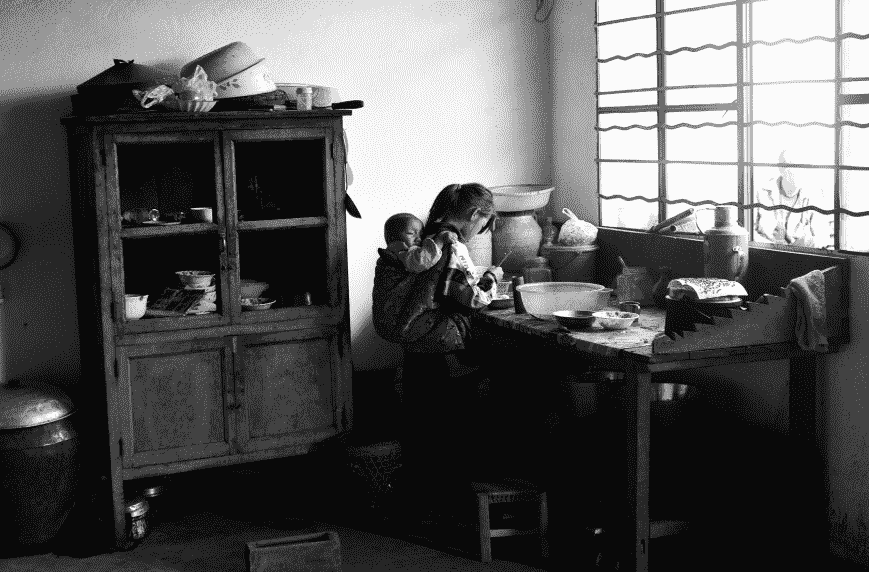

再比如，国家的经济发展对于人口红利有着强烈的需求，但是对于家庭来讲，却是不断增加的育儿成本，"到底应不应该生二胎"成为每一个家庭争论的焦点。

于是专家们纷纷站出来，号召大家要把工资的一定比例拿出来缴纳生育基金，不生二胎便不能取这笔钱。

还比如，技术的创新与进步，带来了自媒体平台和共享经济的兴盛。

我们每日都在使用共享单车、共享专车，每天都在手机上看微信、刷抖音、刷朋友圈，但是在享受技术便捷的同时，新媒体平台上的诈骗和虚假谣言也层出不穷，共享经济也带来了很多问题，比如滴滴顺风车司机涉嫌杀害乘客的惨案。

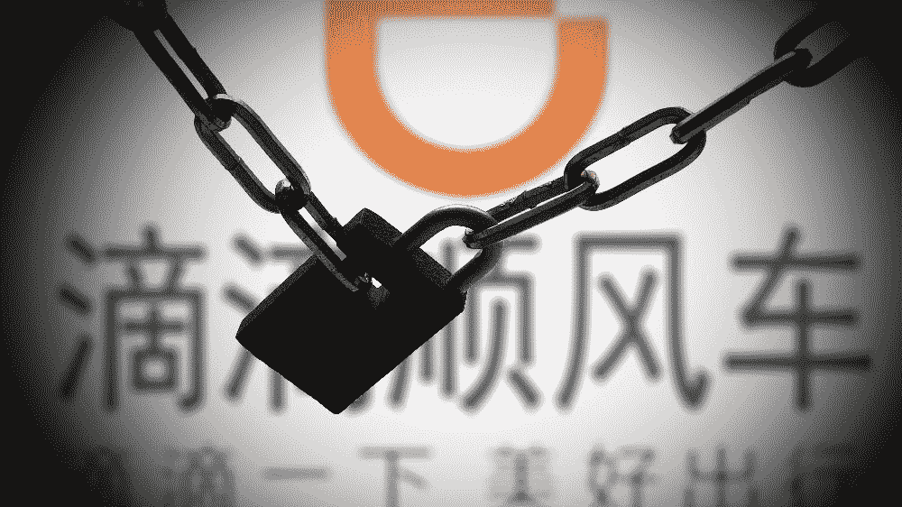

还有，消费主义浪潮的不断兴起，人们的欲望在拼命地膨胀，但是中产阶层却在热烈地讨论"消费降级"、"低欲望社会"。

人们愈发陷入到一种为了工作、为了学区房、为了孩子的教育、为了食品的安全、为了空气的洁净……深深地焦虑和担忧当中，我们似乎随时都有可能被时代的巨轮所抛弃。

这些复杂的社会变迁，就让我不禁想起，崔健多年以前的一首歌曲《不是我不明白》：

过去的所作所为我分不清好坏  
过去的光阴流逝我记不清年代  
曾经认为简单的事情现在全不明白  
忽然感到眼前的世界并非我所在  
……  
我强打起精神  
从睡梦中醒来  
可醒来才知这个世界变化真叫快

**在  
"这世界变化快"的变迁洪流之下，经济与技术的发展使得植根于传统社会的美德消失殆尽，而与现代社会对应的契约精神却还未形成，从而造成了普遍意义上的一种社会道德困境。**

**反映在国家层面上是法治精神在实践中遇到的重重阻力，反映在社会层面上是诚信的缺位导致的诸多社会问题。**

所以我们会见到"长春假疫苗事件"、医患矛盾、夫妻之间的家庭财产纠纷，还见到"高铁霸座"所引发的一种对契约精神的讨论，以及"昆山龙哥事件"所引发的什么是正当防卫的法律辩论……

似乎每一件事情、每一条热点新闻都和我们生活中的秩序息息相关。在这样的背景之下，我们更加有必要去深度学习社会学，用社会学的视角帮助我们更好的理解这个世界。

**因为我们只有学习社会学，才可以理清社会运作的基本逻辑，隐藏在诸多社会现象背后的组织、社群、个体，他们之间不同的行动逻辑；**

**我们只有学习社会学，才可以发现社会出现的种种问题，以及这些问题背后所暴露出来的我们积习已久的制度弊病；**

**我们也只有学习社会学，才可以帮助我们更好地去修补和弥合我们社会的裂痕、道德的滑坡、家庭的衰落、人与人之间信任的丢失，从而迎接一个更加有序、  
美好的社会图景。**

#### 二、社会学能否解决社会问题？

也许还有一些人会问，社会学可不可以解决社会问题？对于这个疑问，无论是局外人还是社会学家自己，都曾给出各式各样的回应。

比如说有些人会认为，社会学家只负责总结社会运作的基本规律，他们不应该提出任何美好社会的理想愿景；也有的社会学家则认为，至少社会学可以给出一些社会问题的诊断；还有一些社会学家甚至认为，作为学者本身就是所谓的"有机知识分子"，社会学家就应该介入到实际的社会变革当中，成为百分百的行动者。

事实上，社会学三大奠基之父，对"社会学的边界在哪里？社会学负不负责解决社会问题？"都有不同的看法。

比如说韦伯就比较坚守"学问跟实际行动之间的清晰边界"，他认为学者应该谨守学术的界限，不可逾越；但是对于马克思来讲知识就是一种力量，学习知识就是为了获得力量，去为了改变我们生活的世界。

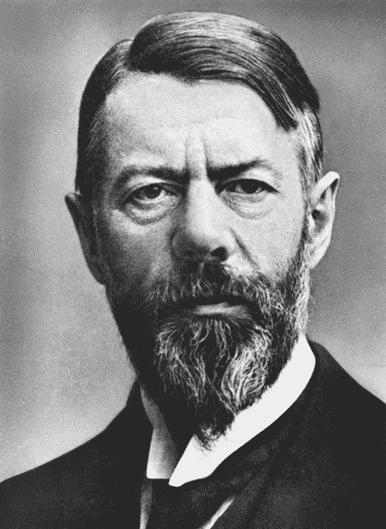

马克斯\*韦伯，德国著名社会学家、哲学家

其实同样的情况也发生在经济学等各种人文、社科学科当中。

比如说，有些人就会希望经济学家，可以为我们提出更好的政策建议以及化解危机的办法；但是也有些人会觉得，经济学家的任务只是去寻找一些根本的市场规律，以及对市场现象的诸多解释，然后我们自己要从这些规律里面，摸索出应对种种危机的方法以及促进繁荣的政策。

换句话说，每一位社会学家都会依据他不同的学派、立场，对这样的问题给出完全不同的理解。

我们当然可以试图主张，社会学应该以某种特殊的方式而变得有用，譬如说透过对于社会如何运作的深入解剖，我们创造出改善社会的具体方法，然后让社会按照这些特定的模式和组织运行，把社会学当作服务于此的有用工具。

然而，  
**我们不应该被迫地接受，社会学本质上便是谋求实际性或是有用性的学科这样的观点。社会学也许真的一点实际的用处也没有。它当然可以是一种知识、智识的追寻，一种帮助我们提升批判力和审美力的重要工具。**

就某种意义而言，其实人人都可以是社会学家。我们在日常生活当中，其实每天都在不断讨论各种社会话题，甚至还在朋友圈、微信群里就某一特定的社会话题进行辩论，尽管我们可能并没有认识到自己正以社会学家的方式进行思考。

这种在所处环境中的思考，其实又在不断地影响我们周围的朋友和环境，在社会学中，我们把它称为一种"反身性"的社会学思考，这样的思考实际上会对社会造成最大的改变和影响，它的渗透效果让我们不断地正视我们所生活的社会，并融入其中，不断反思自己的社会行为与周边的制度。

#### 三、学习社会学的意义

那么，学习社会学，像社会学家一样思考的意义又在什么地方呢？

在我看来， **社会学既是帮助我们认识世界、思考问题的一种重要的分析工具，它又是我们分析某些问题时的出发点。**  
特别是那些与我们每一个人都切身相关的问题，无论这些问题是群体性的，还是个体性的，社会学都会让我们回归到社会秩序的本源，去窥探人性的幽暗与良善。

**社会学最为独特的一面，就是它一直保持着批判的利刃。**

社会学和哲学、经济学相比较，有一个基本的特点，就是对于我们社会中广为接受的信念与日常实践，常常抱以批判的态度。

对于研究哲学的人来讲，他们会比较的思辨；对于研究经济学的人来说，他们会更加的务实，更加强调以结果为导向，提出问题、解决问题。

而学习社会学的人，他的特点是更加具有批判的精神。当然，我们必须强调的是，这种批判不是愤青式的、盲目的批判，而是有理有据的批判。

**这种批判的思维会深入到他的骨髓里面，会帮助他一阵见血地看透社会运作的基本逻辑、社会发展的基本规律，从而用崭新的目光去重新审视我们生活于其中的这个熟悉的世界。**

社会学家都是说故事的人，如果想像社会学家一样思考，就需要我们既遵循一种理性的思维原则，又同时需要我们不断地切入到现实的场景之中，用同情、共情的方式，去感受那些深入肌理的切肤之痛。

就像美国著名社会学家赖特.米尔斯的名言所说的那样， **" 我力求客观，但绝不冷漠"**。

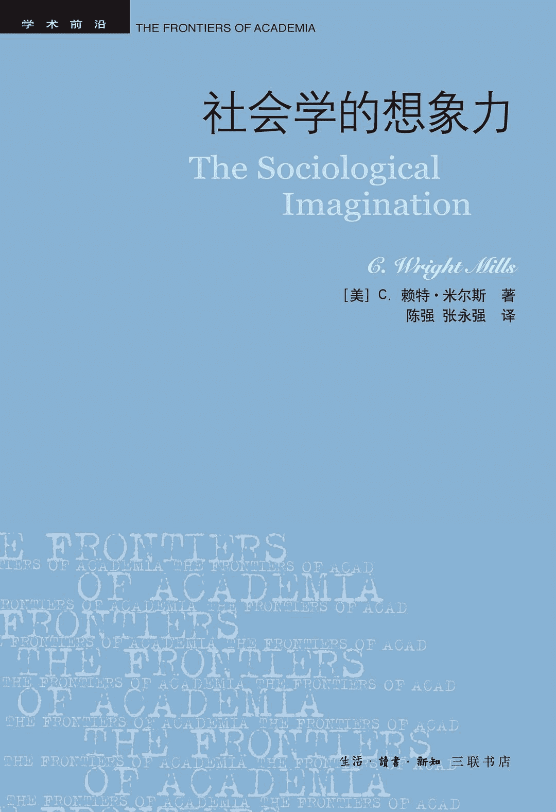

《社会学的想象力》 作者：C. 赖特.米尔斯

**我希望，我们讨论的社会学，是在观察身边社会现象的基础之上，对社会学理论和知识纵深的一次探险；**

**我还希望，我们讨论的社会学，是有趣而包容的，促进的是我们共同的讨论视野和公共的一种表达方式；**

**我更加希望，我们所讨论的社会学，是思辨批判的，引导我们求真、求善、求实，思考我们的世界如何变得更好。**

我期待，在这三十讲的学习之后，我们可以像社会学家一样思考，带着批判的利刃，深度地观察和理解我们的社会。

我是严飞，我们下一集再见。

# 发刊词 2：开启社会学的冒险之旅

（公众号懒人找资源，懒人专属群分享）

### 导语

上一集节目，我们说了为什么要学习社会学。那究竟什么是社会学？社会学到底研究什么？在这个节目中，严飞老师又会带领大家怎样学习社会学和讨论社会问题呢？让我们开启这段学问的冒险之旅。

### 文稿

你好，我是严飞，来自清华大学社会学系。欢迎你来听这档关于社会学的节目《像社会学家一样思考》。

#### 一、什么是社会学？

"什么是社会学？社会学到底研究什么？"

对于这样的问题，相信来自不同家庭背景、不同生活经历的朋友，都会根据个人的体悟和对社会的观察，给出完全不相同的答案。即便是学习社会学很长时间的社会学系老师和学生，也不一定会给出一个完全统一的答案。

用最通俗的话来讲，社会学当然就是研究社会的一门学问。但是这样的回答显然太过于笼统，因为"社会"本身就是一个非常庞大的存在。

我们每天都生活在社会之中，每天和社会当中的形形色色的人群打交道，却反而会忽视我们所生活的这个社会，到底是以一种什么样的方式存在和运转的？人和人之间，到底又是如何相处与交往的？

在我看来， **社会学一个核心的命题，就是对于  
"人性"与"社会秩序"的讨论。**对于人性与社会秩序的追问，长期以来一直都是社会学家试图认识我们这个世界，理解我们这个世界的核心使命。

那么到底是人性在先，还是社会秩序在先？是人性构成了社会秩序的基础，还是社会秩序不断塑造着人性？ 要回答这样的问题当然并不容易。

因为不同流派的社会学家，会根据研究对象的不同，在阐释人性和社会秩序，以及相关问题的时候，做出自己的优先选择。

因此我们会看到，在社会学几百年发展的历史长河上，诞生出了种类繁多的社会学流派，比如：结构功能理论、社会冲突理论、社会交换理论、符号互动理论等等。

在这些不同的社会学理论之间可能存在着对立，但与此同时，它们也可以互相转换，因为他们是在不同的层级当中，去理解社会，也是在不同的层面上去讨论"什么是人性与社会秩序"这样的问题。

**事实上，秩序可以规范和约束人性，人性反过来也会塑造秩序、维护秩序。但是，作为人的最天然、最原始的本性，就是冲破秩序的约束和规范。所以，秩序与人性这两者紧密的交织在一起，互相缠绕、互相博弈，从而构成了我们的社会。**

对于"人性与社会秩序"这样的话题，经济学家们喜欢强调人们是理性的动物。在理性的思维之下，人们往往喜欢计算利益的得失，规避风险、降低成本，从而追求利益和利润的最大化。这几乎是人性的本能。

而社会秩序就是由无数利己的"经济人"之间的相互交易而形成的，市场则变成了"一只看不见的手"，政府要扮演的，则是"守夜人"的角色。换句话说，在经济学家的眼里，人类利益性的理性追求，为社会生活中的秩序奠定了理性的基础。

但是人性是一种复杂的存在。 **在社会学家的分析框架中，人们要挣脱理性的囚笼，摆脱祛魅的世界，因为人们不仅仅是理性人，更是社会人。**

在社会当中，人和人是通过千丝万缕的纽带，紧密地连接在一起，不断进行着社会交流与互动。这样的交流和互动，在社会学理论中，被称为"镶嵌"（embeddedness）。换句话说，  
**人是嵌套在社会中的，没有办法孤立的存在。**

人们的行为因此会受到很多正式制度或非正式制度的约束，譬如情面、场面、道德、习俗、规范等等，这就需要人们在行动当中，不仅要考虑自己，也要考虑他人、家庭、社区的存在，考虑自己的预期是否符合社会的要求，考虑自己的行为是否符合社会的整体利益。

这些考虑就会导致人们在一件事面前，或在历史的关键转折点上，做出不同的选择。这些选择导引向行动，行动又指向社会秩序的排列，而背后又是我们复杂的人性。

#### 二、我的社会学冒险之旅

社会学于我而言，彷佛是一条学问的冒险之旅。

我是 2000 年考入复旦大学社会学系，随后在英国、香港、美国学习和工作，在这些不同的国家和地区，不同的社会背景下去亲身实践社会学的方法，今天又作为社会学系的老师，站在讲台上给年轻的学子讲授什么是社会学。

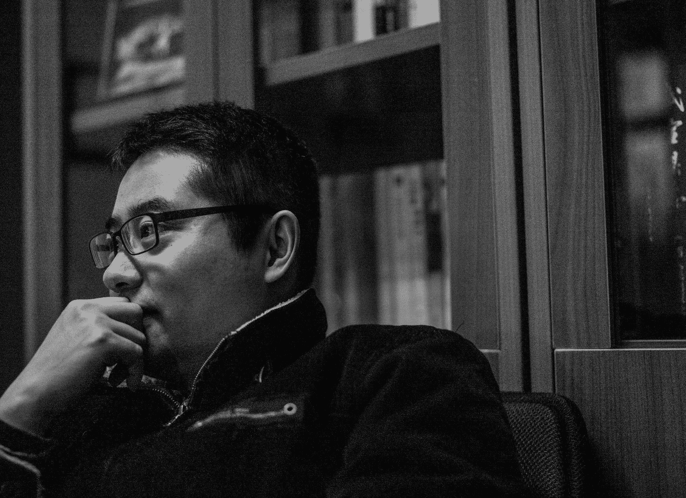

主讲人：严飞

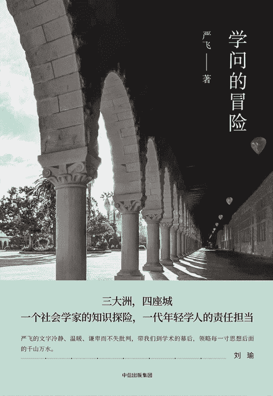

《学问的冒险》 作者：严飞

接受社会学的学科训练接近 20 年，我自己也做过很多事情。我曾经也在网络的公共空间上和朋友们一起激辩"什么是社会正义与道德秩序"；

也曾在乡村的田野里被口述者一字一句道来的家族史而撕裂内心，和被访者一起在一段大历史的裂痕前泪流满面；

我更曾记录过社会转型时期的一个群体、一个世代、一个社会的彷徨、失落与希冀，倾听时代的歌声。

在这一过程中，我透过社会学的专业视角，看到个体在人性中的艰难选择和不舍，社群对于集体记忆的保育与珍视，我还看到社会在失范的边缘时，中产阶层的挣扎以及一种对于重建秩序、道德、规范的迫切需求。

这些话题，在历史的维度之下不断重现，带领我们回到历史的框架中，去寻找社会发展与制度治理背后一条隐藏的社会学线索。

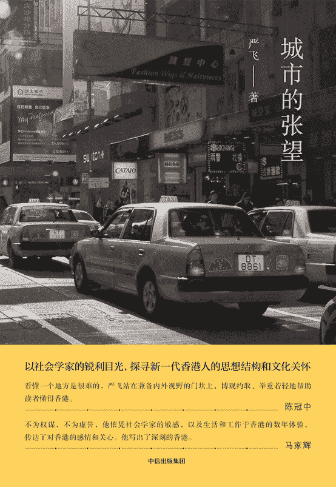

《城市的张望》 作者：严飞

我很幸运学习到社会学，并且对"社会秩序和人性"的研究充满兴趣。我有印象非常深的两段田野经历。

第一段田野经历是我在大学期间，曾在上海郊区的打工子弟学校，做过一段长达三年时间的城市流动人口的研究。

这些在城市里和父母一起漂泊的孩子，他们的父辈因为在城市里打工，乡土里的那一个家乡已经成为再也回不去的故乡。另一方面，城市的公立教育、私立教育又将这些孩子们排除在教育的门槛之外。

在这种情况下，打工子弟学校就成为他们最好的受教育场所，但是打工子弟学校，他们有很多的问题。比如说办学的资质、场地的资金等等，这些原因就会导致他们时刻面临着被关门被倒闭的风险。

当我扎根这些城市流动人口所居住的社区，和这些孩子每周在一起交流，带着他们一起学习、做游戏、甚至带着他们去认识城市，进行一段户外的探险，我深深地感受到，所谓的教育不公平，并不仅仅只是一组统计报表里的数据。

这背后更牵涉到我们有关户籍制度的设计局限和城乡不平等、社会阶层固化这样更深层次问题。连带出来的，是我们整个社会秩序的组成和运作。

另一段田野调查，我带着我的学生花了差不多将近二十个小时，进入到非常偏远的小县城里，记录被访者的家族历史和他们的村庄故事。

其中的一位被访者在一次对话中，眼睛直直地看着我，一字一句地讲出他的父亲和母亲，在 1950 年代大跃进时期，仅仅因为没有满足政府的粮食征购指标，而遭受到残酷的暴力批斗。

那是一个社会秩序完全失序的动荡时代。被访者在我的面前，非常平静地讲述这一段过往的历史，但自己却早已泪流满面。

这是两段完全不一样的田野经历，但展现出的，却是一样的社会学品质，即对于现实的强烈关怀和道德责任。

#### 三、你将会学习到什么？

我期待，带着这样的社会学关怀和道德责任，在这三十讲当中，和大家一起认真地讨论七位古典社会学家的理论。

这 7 位古典社会学家分别是：社会学的鼻祖孔德、斯宾塞，社会学的三巨头马克思、涂尔干、韦伯，以及后期的社会学大师齐美尔与滕尼斯。

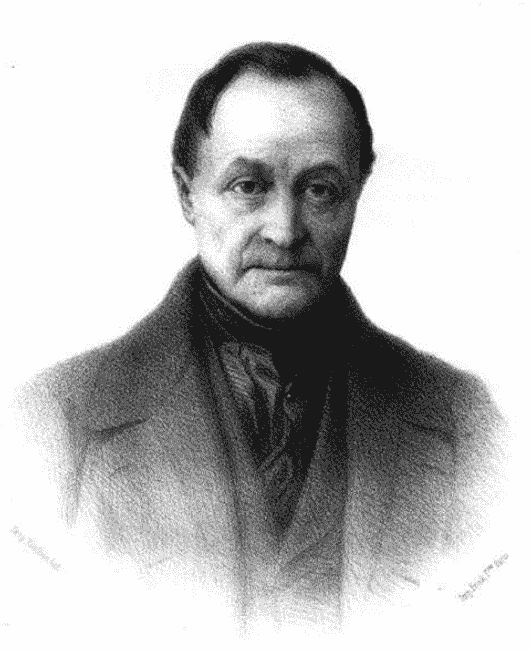

奥古斯特\*孔德，法国著名的社会学家，被尊称为"社会学之父"

之所以要学习他们的理论，是因为他们的古典社会学理论是社会学的源头，要真正学好社会学，我们就必须深入、全面地理解这些古典社会学理论。

但你千万不要以为，我们这 30 讲是一个枯燥的社会学理论课程。我们当然不会仅仅只是谈理论，因为几乎在每一讲当中，我们都会集中地去探讨一个在你身边发生的社会学现象，一些你随处可见的社会问题。

我们将会看到，这些经典的社会学理论，实际上经过了 100 多年的沉淀，到了今天，依旧有着它们鲜活的解释力和生命力。我们的社会，实际上依旧沿着这些古典大家的理论脉络，延续、演化与发展。

譬如说，我们今天面对的是一个知识付费的浪潮，在这样的潮流之下，商品的价值该如何用马克思劳动价值理论去理解？这背后又体现出了怎样的"使用价值"和"交换价值"？

我们今天谈论"996\*ICU"。被"996"围困的年轻人，真的是如马云所说的那般，能做 996 是一种巨大的福气，是一种为了理想而幸福的拼搏吗？在马克思看来，"996"是一种劳动的自愿，还是劳动的异化？

伴随着社会分工越来越细密，人和人的差异也越来越大，但与此同时，人和人之间的依赖也越来越强。我们越来越依赖外卖小哥、依赖滴滴出行的司机……

涂尔干说，有机团结是现代社会的基本特征，但是对于这样的现代社会，我们真的了解外卖小哥们的世界吗？

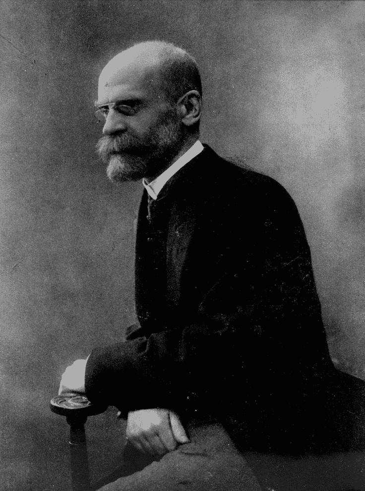

涂尔干，法国犹太裔社会学家、人类学家

人性中有利他、理性的一面，也有功利、幽暗的一面，在韦伯的世界中，到底如何区分价值理性与工具理性？我们真的如韦伯所言的那般，生活在巨大的铁笼之中吗？

这些问题都是从我们日常的社会现象出发的，通过我们 30 讲社会学基本理论的解读，我们会发现，这个世界原来比我们想象的更加复杂、多面，也更加有趣、好玩。

所以，当你系统地听完这 30 讲经典的社会学理论，你将会学习到：

**（1）社会秩序的构成和表现**

秩序实际上就在你我的身边，相对来讲比较容易看见，比较容易理解。你可以触摸到空间的秩序，感受到人和人之间的互动所产生的一种人际间的秩序。无论是空间秩序、还是人际秩序，背后实际上都有社会、文化和政治的因素在起作用。

我们就要提问，是不是整齐划一、步调一致，就是秩序的美？是不是上下有异、贵贱有分，就是秩序的等级？秩序的基础应该是更加强调个体的价值还是强调集体的意志？

**（2）人性的本质和困境，以及社会对于人性的规范和约束**

人性是复杂的，有天使的一面，也有魔鬼的一面，其中蕴含着良善与幽暗。

为了规避人性中的幽暗面，激发人性中的自爱心和怜悯心，我们就需要很多正式的和非正式的制度安排和设计，譬如教育、组织、家庭伦理，宗法观念。

那这些正式和非正式的制度设计，又是如何激励着人们的行为选择，确保秩序的规范运作？

**（3）秩序的失范和瓦解，以及这种失范对于人性的破坏和冲击**

当制度失灵的时候，社会就会走向失控和混乱，暴力和冲突随即爆发。在这样的情况之下，人际关系会发生怎样的变化？人和人之间、群体和群体之间，还会一如既往地保持信任和依赖吗？

如何去提升社会整体的信任，凝聚社会的团结？引导我们的社会走向良治有序，引导居于其间的人们，活得自由、安全，有尊严，有信念？

让我们一起走进社会学，观察和理解社会秩序的构成与意义，理解人性的幽暗与良善，带着独立思辨的品质以及勇于批判的勇气，让我们像社会学家一样去认真的思考。

我是严飞，我们下一集再见。

# 01\. 社会学的起源：社会学厉害，还是物理学厉害？

（公众号懒人找资源，懒人专属群分享）

### 本集要点

1.社会学诞生的时代背景

2.社会学理论的催生者：孔德

3.社会学研究的分类与方法

4.对孔德的辩证看待

### 文稿

你好，我是严飞。今天我们开始《像社会学家一样思考》的第一集，我们来谈论一下社会学的起源。

#### 一、社会学不如经济学、物理学？

"社会学"作为一门系统地研究社会秩序与人类行为的学科，尽管得到学术界的广泛认可，但是有的时候，我们依旧会听到一些诸如"社会学是科学吗？"这样的质疑和不同的声音。

有一些人会直接指出，社会学当然比不上经济学，因为经济学是教导大家如何通过市场行为，更好的创造经济收益；也有一些人会说，社会学也比不上物理学，因为物理学是自然科学中的带头学科，掌握了物理学，就可以掌握自然运作的基本规律。

作为不能直接创造经济价值，无法在短时间内变现收益的学科，社会学在可以指导人们赚钱的经济学面前，在可以发明创造原子弹的物理学面前，似乎要低下头。但是，你是否知道，  
**社会学这门学科创立之初，名字其实是叫做 "社会物理学"**呢？

"社会学"和"物理学"曾经这么紧密地联系在一起过，这其中到底又有什么样的渊源？那我们就要来看看社会学之所以诞生的时代背景。

#### 二、社会学诞生的时代背景

我们把时间拉回到十八世纪末期。1789 年 7 月 14 日，法国人民攻占巴士底监狱，国王路易十六被送上断头台，法国大革命爆发，这一天后来也被法国定为国庆日。

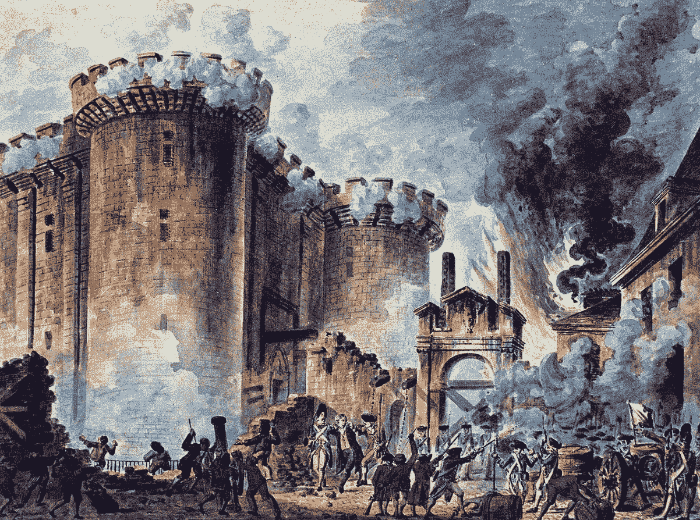

油画《巴士底狱的风暴》，让*皮埃尔*侯埃尔 绘

**法国大革命对当时的社会带来了巨大的冲击，革命后的残破社会，引起了很多知识分子及有识之士的深思。他们企图寻找重建社会秩序的办法及方案，因此刺激了社会学理论的发展。**

此时，工业革命也正在欧洲悄然兴起，并在 19 世纪达到高潮。大量的人们离开农田，转到迅猛发展的工厂去工作；工厂也经历了一系列的技术变革和创新。

工业革命彻底改变了欧洲社会的经济结构，将整个欧洲大陆从传统的农业经济转变为工业经济的体系，工厂、财务机构、银行及各种服务行业逐一诞生兴起，造成了人们工作及生活上翻天覆地的变化，因此导致了如何适应社会变迁的诸多探讨与争论。

工业革命自然带来了科学研究的发展。欧洲的大学如雨后春笋般成立，科学教育受到特别的重视，不仅在大学学府，而且在整个社会中，科学变成了最重要的思考方式及研究方法。

在当时的欧洲，很多旧的哲学思想及信念受到挑战和冲击而遭抛弃，代之而兴起的是所谓的启蒙哲学，其中最著名的学者包括孟德斯鸠、狄得罗、卢梭等人。他们共通的信念是强调理性认知，以及使用科学的经验研究来分析社会秩序及变迁。

在启蒙运动兴起的同时，也有一股反启蒙运动的思潮。这股思潮主要来自法国的天主教会。在法国天主教会看来，重建法国社会之道，应在复古----  
将法国带回到中古的安宁与和谐之中。

在那种状况中，神是社会的创造者，人们应该遵行神的旨意，而不是动不动要求改变、搞革命，结果是得不偿失，社会被破坏得四分五裂、民不聊生。

在这样的背景之下，早期的社会学，或者更确切的说法国的社会学，便在这种启蒙运动哲学及反启蒙哲学的浪潮交互激荡下萌生了。

这其中的代表人物，就是法国的哲学家和思想家孔德。

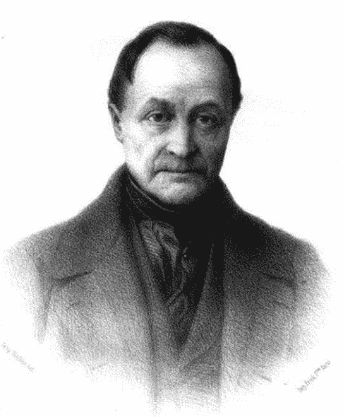

奥古斯特\*孔德（1798-1857）法国著名哲学家、社会学和实证主义的创始人

#### 三、社会学理论的催生者

孔德是第一位使用"社会学"这一名词的人。事实上，他是"社会学"这一学科名字的创立者。1838 年，在他代表作《实证哲学教程》第四卷中，他正式提出"社会学"这一名称，并建立起社会学的框架和构想。

法国大革命之后，孔德对法国社会受到摧残破坏的社会现象，以及陷入无政府的状态深感痛心与失望，于是他把如何重建法国社会当作他终身的职责。

一方面，孔德对启蒙运动的哲学感到不满，他开始发展一套积极哲学去对抗启蒙运动中那些他认为是消极的破坏性的哲学。

另外一方面，他对反启蒙运动的天主教保守学者回归过去光辉社会的想法，也不能赞同。他认为只有在现有的社会情况中来重建社会秩序，才是可行之道。

如何进行社会秩序的重建？在这个问题上，孔德深受他的启蒙老师圣西门的影响。

圣西门是法国空想社会主义的代表人物，早年曾参加过美国的独立革命战争，担任过乔治\*华盛顿的助手。

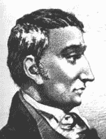

克劳德*昂利*圣西门，法国空想社会主义者

独立战争结束后，他回到法国，得到了一笔丰厚巨额的遗产，使得他可以从事独立的学术研究工作。1817 年，圣西门雇用孔德为自己的秘书，协助他的一些文书写作工作。

圣西门意图创立一套适合于应用在工业社会中的社会改革哲学，将物理学的方法引用到社会研究中，去发现支配人类社会的普遍规律。但是圣西门所构想的社会重建蓝图，过于依赖社会精英，他认为"只有依靠有天才的人，才能在社会关系方面得到改造"。

在这一点上，孔德与他的老师的看法有一致的地方，也有偏离的地方。

在孔德看来，重建社会秩序确实是需要一套崭新的知识体系来做指导进行的，在这一点上，他和他老师的看法很相似。

孔德也同意这一套崭新的知识体系也需要借鉴物理学等科学研究的方法。于是他首先想到了"社会物理学"（Social  
Physics）这一名字，后来才将之改为"社会学"。

**社会学，无疑在孔德的构想中，是一种崭新的、带有实用性的社会科学，它可以帮助寻找及建立社会真理与法则，并且可以用来指导重建社会秩序与道德。**

按照孔德自己的原话，就是"我所谓的社会物理学是指专门研究社会现象的科学，它本着和天文现象、物理现象、化学现象、生物现象同样的精神来考察社会现象。也就是说社会现象受到不可变更的自然规律的制约，揭示这些规律是社会物理学研究的特定目标。"

#### 四、社会学："皇后"之学

在孔德的心目中，社会学是所有科学的皇冠，它的知识是建立在其他科学的基础上，整合其他学科的知识而建立的。

倘若将所有的学科按照他们各自的重要性进行排序，放在一个金字塔的图案上，那么社会学就会站在金字塔的塔尖，统领其他所有学科。

社会学之后，依次则是生物学、物理、机械、天文学和数学。数学排在所有学科的最后。换句话说，如果我们想修读社会学，就必须先精修数学、天文学、机械工程学、物理学、生物学，逐级而上，最后才可以有资格修读社会学。

为什么社会学是被排在金字塔的最顶端呢？

原来 **在孔德的构想中，社会是最为复杂的一种存在，这种复杂度远远不是数学、物理学通过几个方程式就可以进行归纳和总结的。**

**因此解读社会的社会学，也自然成为了一门内容最复杂且包含面最广的学科，是所谓的 "皇后之学"**（The Queen of Sciences）。

按照孔德的说法，"社会学比任何其它科学都重要。唯有它才提供逻辑的和科学的环节，借此我们对现象的其它各种不同的观察能够连成一个统一的整体。"

孔德认为， **社会学的研究可以分为两大部分。**

**第一大部分叫做社会静态学，是研究整个社会如何依照社会法则，由不同的部分或单位所组成的。换言之，它主要研究社会结构或社会秩序。**

孔德认为社会秩序是建立在社会成员们的共识上，大家必须要有一种"普遍的共识"（consensus universal），才能够将社会的诸多成分贯穿连结起来。

对孔德而言，"普遍的共识"是社会团结及社会分工的基础。社会结构或社会秩序有三个面向，即个人、家庭与社会。其中尤以家庭最为重要，它是社会结构最根本的单位。

正是在家庭内部，个人的利己主义倾向才有可能被抑制，学会"为他人而生活"。

**第二大部分则叫做社会动态学，是研究社会变迁或社会进步的。**

孔德对未来社会充满了乐观，认为未来的社会会越来越好，因此他深信社会进步。根据孔德的预言，社会的发展需要经过三个阶段，先是由朴素、神学式的思想所萌生，历经抽象概念的使用，最终达到实证的地位，迈入科学的时代。

**在孔德的心目中，研究社会学就意味着必须研究社会静态学及社会动态学，一个是研究社会的结构，另一个是研究社会的变迁，两者相辅相成，缺一不可。**

#### 五、社会学的乌托邦

然而到了晚年时期的孔德，却日益回归保守。

晚年的孔德认为，当社会进化到最后期，一种以实证主义为基础的人道主义宗教将会应运而生，主导人们的社会生活。

在这个宗教内，社会学家成为牧师，而孔德自己则成为预言家，被诸子弟所包围追随，传道解惑，传达福音，拯救芸芸众生。

在这个新的人道主义的实证社会秩序里，"仁爱"是原则，"秩序"是基础，"进步"是目的。人们没有自私之心，一切均为利他着想，大家均热心公益，以助他人为乐。

虽然孔德一再声称"我的实证主义从真正意义上讲就是一种宗教。"但是他在晚年以宗教代替科学的做法，最终妨碍了他自己对社会学长期的研究和坚持，可惜他至死对这一点都并未觉悟。

#### 六、孔德的贡献

今天我们再回头去看孔德，他的绝大多数观点都不可避免地带有那一时代的局限性，我们在今日的社会学课本中，只会留出一小部分页面介绍他的生平与思想。但作为社会学的创立者、社会学之父，孔德对社会学的贡献却是不可磨灭的。

从孔德时期起，实证主义已经发展成为一种思考方式，社会学的发展，也开始以实证主义作为发展趋向。譬如在孔德之后，法国另一位社会学家涂尔干，就开始沿着实证主义的路线，通过详尽的数据收集总结社会发展规律，从而得以将社会学研究往前推进了一大步。

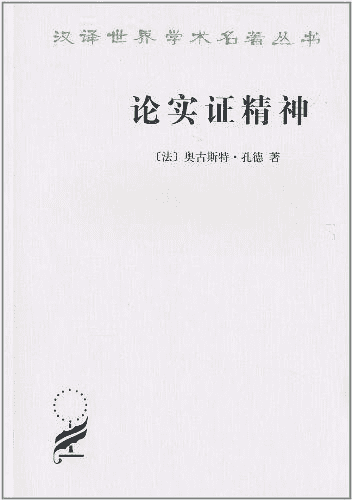

《论实证精神》作者：\[法\]奥古斯特\*孔德

那么什么是实证主义思路呢？ **在社会学中，实证主义就意味着人们必须在经验的基础上，以科学的观察与实验来寻求真理。**

真理或事实的真相必须是可以透过实际的观察，以实验研究所搜集的资料加以验证。通俗的说，就是社会学家要多走出去做实地的考察，而不是常年待在书房里拍着脑袋想问题。

今天社会学的研究方法，主要分成两大类。

**第一大方法是定量研究。所谓定量研究，就是讲数据。** 学者们建立统计模型，用科学的统计方法去挖掘社会诸多现象背后的一个因果联系。

譬如说为了研究转型时期中国城市居民的消费模式变化，就需要收集相应的数据，包括人口特征、职业、收入、家庭、教育背景等变量进行统计分析，从而找到影响消费形态最为重要的影响因素。

**第二大方法是定性研究。所谓定性研究，就是讲故事。** 学者们深入社会的田野当中去不断的交流，通过参与观察、访谈对话和口述史去记录个体的生命历程和家族史。

英国的《独立者报》在 2001 年 6 月 8 日的一篇专栏文章里，就描绘了社会学家是如何利用参与观察法深入理解我们这个变动中的世界。

在这篇题为《从社会学中获得乐趣的学者》（The academic who got a kick out of  
sociology）中，作者指出，"我们可能会发现社会学者们在街角与年轻的帮派分子厮混，在擅自闯入的空屋中与吸毒者并肩而坐，或是和不良少年一起站在天台上。"

这些 **看上去不可思议的田野体验，其实正是社会学实证研究的趣味所在。**

社会学虽然被孔德誉为"皇后之学"，但也许你在收听这三十讲社会学讲座之前，并没有真正了解过什么是社会学。我们今天当然不是去比较社会学和经济学、物理学的优劣，而是想告诉大家，  
**社会学是一门综合性的学科，使用的是严谨的实证研究方法。**

正如孔德所坚信的， **社会学的研究应当和其他的自然科学一样是科学而系统的，可以被反复的观察和检验。**

今天这一集就到这里结束了，有关早期的社会学理论与发展，我们会在下一集，再集中向大家介绍斯宾塞的社会进化论。

# 02\. 社会进化论：“优胜劣汰，适者生存”也能解释人类社会吗？

（公众号懒人找资源，懒人专属群分享）

### 本集要点

1.实证主义的崛起

2.社会达尔文之父：斯宾塞

3.社会有机体论

4.近代中国的社会达尔文主义

### 文稿

你好，我是严飞。今天我要和你讲的是一个由盛及衰的社会学理论----斯宾塞的社会进化论。

#### 一、达尔文的进化论也是人类社会的法则吗？

相信你一定都对"优胜劣汰，适者生存"这句话耳熟能详。这是达尔文进化论里的核心观点。这句就是说，在生命漫长的发展进程里，只有能跟随环境的改变，而去适应环境的物种，才能够生存下来，不能适应的物种将会被大自然淘汰。

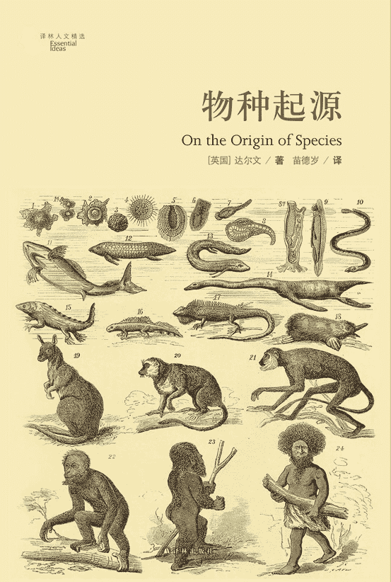

《物种起源》 作者：\[英\]达尔文，1859 年在伦敦出版

所有生命都必须遵循这一套优胜劣汰的自然发展规律。这是自然界的一般法则。

不知道你有没有想过什么叫"一般法则"，既然是一般法则，是不是细分到每一个生物体、每一个人类组织里都应该成立呢？如果我们把视野聚焦在"社会"这个范畴里，是不是也存在着这么一套优胜劣汰的发展法则呢？我们应该怎么理解它的存在？

我们从进入学校的第一天起，似乎就开始进入到一个不断竞争的环境里。在学生时代，我们被教导要好好学习，才可以从激烈的竞争中脱颖而出，从千军万马的考试中杀出一条路，进入好的大学。

到了工作岗位，我们又被要求教导要好好工作，努力完成 KPI 的考核，考核不通过就会被淘汰，无论是大企业，还是小企业，大家都在强调拼搏精神、狼性文化，抢资源，抢发展。

整个社会，就好像是一列高速前行的列车，火车司机不断加速，轰鸣地一路往前，生怕落后一点，就会被别人超车。

这是不是也是一种社会学意义上的"优胜劣汰，适者生存"？达尔文的进化论，真的可以用来解释我们今天社会的游戏规则吗？在社会学里，社会进化论是一种主流的社会学理论吗？

要回答这些问题，还需要我们把视线拉回到社会学发展的早期，回到达尔文生活的 19 世纪的欧洲。

#### 二、实证主义的崛起

19 世纪，工业革命横扫欧洲，给社会的方方面面都带来了巨大的变革和进步，生产领域从农业生产体系，转移到工业生产体系，经历了前所未有的变革。农民们纷纷脱离了长期依附的土地，转移到城镇里的工厂工作。

这时的英国，正处于极度繁荣的维多利亚时代，资本主义制度已经完全确立。然而，随着工业化的发展，也逐渐暴露了他们资本主义社会的许多矛盾。

比如，当时的工人，普遍工作很长的时间，却拿着相当低的薪水，社会上出现了许多反对工业体系和反对资本主义的工人运动，还有推翻资本主义的革命。资产阶级迫切地想要掩盖这些矛盾，巩固他们自身的统治。

与此同次，欧洲的自然科学也在迅速发展，力学、天文学、物理学等领域都有了许多突破，这时的欧洲知识分子们，更加坚定了科学的实证性。

同一时期，生物学领域的几项重大发现，比如说细胞学说----人们发现细胞才是动植物结构和生命活动的基本单位----  
对当时的社会引起了重要的影响。人体的许多秘密正在被揭示，动物种类的差异性也逐渐明确。

而其中最有影响力的学说，是达尔文登峰造极的生物进化论。他认为，物种是可变的，生物是进化的。这个发现强烈地刺激了知识界和社会大众的普遍认知。要知道，在达尔文提出生物进化论之前，对于"人是怎么来的"最主流的解释人，还是神学。

在这样百花齐放的背景之下，欧洲的哲学家、思想家们也开始纷纷从实证科学中寻找新的灵感和依据。上一集我们介绍的法国哲学家孔德，他就把实证主义研究带进社会学，并把社会学赞誉为"皇后的科学"。

在英国，也有一位哲学家，在思考着社会进化的一般规律，他就是在当时整个欧洲大陆产生极大影响的斯宾塞。

#### 三、社会达尔文主义之父

斯宾塞是英国哲学家，他从小并未受过太多的正规教育，但却依靠自我的努力，不懈的阅读、进修及写作，终成大家。

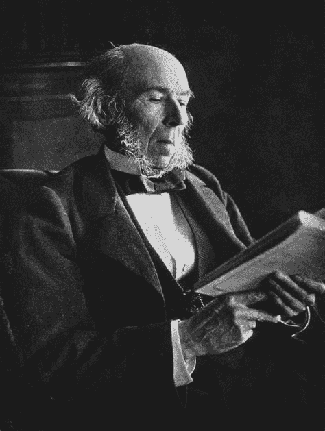

赫伯特\*斯宾塞（1820-1903），英国哲学家、社会学家、教育家

他曾经做过铁路工程师，也做过伦敦财政报纸《经济学人》的编辑，还和另一位达尔文进化论的代表人物赫胥黎是好朋友。他的著作等身，论著所涵盖的学科及论题几乎无所不包。

很多人以为"适者生存"（Survival of the Fittest）一词是达尔文首创使用的，其实不然，斯宾塞才是首创该词并且第一个使用该词的人。

斯宾塞早期受到英国人口学家马尔萨斯的影响。

马尔萨斯在 1798 年出版的《人口学原理》指出，在没有限制的条件下，人口以几何数列增长，但生活资料以算术数列增长，所以必然引起灾难和战争。只有通过优胜劣汰的方式，譬如战争、瘟疫、穷人不得结婚等方式，才能抑制人口增长，实现人口和生活资料的均衡。

后来，当达尔文提出生物进化论这一观点之后，斯宾塞被深深吸引，于是把生物进化的原理和法则应用到了社会领域中，提出了社会进化论。

1857 年，斯宾塞出版了在社会达尔文主义方面的重要著作《进步：法则和原因》，这本书的出版时间，要比达尔文的《物种起源》还早两年。

在这本书里，斯宾塞参照当时的生物学，提出宇宙存在着一个首要原理，这个首要原理就是进化是宇宙的主要过程，宇宙间一切事物都是由简单到复杂，由不确定到确定、由同质到异质的过程。

人类社会也必须要遵循这样的原则。也就是说，整个世界会从不稳定最终走向稳定。

比如说，由简单到复杂，我们可以观察到人类社会是由最简单的部落形式，逐步发展到复杂多元的国家形态。

由不确定到确定，我们可以看到人们最早是受到习俗、礼仪的约束，那这样的约束因为没有强制效应，所以具有很大的不确定性，后来习俗发展成了法律，各种行为准则就在法律框架的约束之下，变得更加明确。

从同质到异质，也就是从相同到不同。一个最好的例子就是从传统农村走向现代都市的发展，在乡土社会里，大家都是面朝黄土背朝天，从事相同的农业生产，再加上人口流动小，所以家家户户的同质性都很高。

但是伴随着城镇化的发展，越来愈多的城市出现。在城市里，不仅工作的机会和岗位大大增加了，城市的范围扩大后，也导致人们的生活方式越来越丰富多彩，人和人之间的差异性也相应增加，这就是一种异质性的体现。

上一集中我们谈论的孔德就认为，社会变迁的动力来自观念与精神的发展。和孔德不同，斯宾塞的进化论更加强调社会体系的结构和功能。

在斯宾塞认为，人类社会的首要需求就是进化，进化是朝着更大的规模，更具凝聚力、多样性与确定性的方向进化。

斯宾塞提出了社会进化论，他也因此被后人赞誉为"社会达尔文主义之父"。

#### 四、社会有机体论

了解了斯宾塞的社会进化论，你可能听着觉得还挺有道理的，接下来是怀疑它的时间了，我们要一起来看看它的理论基础是什么，它真的成立吗？

在斯宾塞的社会进化论中，最为重要的一个核心的假说是"社会有机体论"。什么叫"社会有机体论"？

斯宾塞把社会比喻为有机体，他认为社会是个有机体，在本质上跟生物体是一样的，二者在很多方面都有相似的地方。

比如说，社会与生物有机体都会表现出聚集增长。"聚集增长"的意思，就是伴随着机体的不断增大，体积也会相应增大，它的结构也会变的越来越复杂。

社会与生物有机体除了发展和成长之外，它们也都在结构上呈现出进一步的功能分化，功能分化的时候，不同部分的机体会变得更加相互依赖，倘若有一部分的机体，或者社会功能受到破坏，就会影响整体，牵一发而动全身。

当然，社会与生物有机体也有许多差别。比如说，生物有机体有着可以观察到的特点外型，而社会却没有可以观察的外型，所以说"社会有机体"是一种比喻，是一种想象。

再比如说，生物有机体的每一部分都是具体的、相互连结的，而社会不是，社会是一个分散的整体，很多社会成员都分布各处，成员之间是自由的、分散的，互相不通消息，甚至老死不相往来。

斯宾塞又特别指出，生物有机体和社会最重要的差别，是它们的维系方式不同。就是说生物有机体是靠皮肤维系起来的，而社会有机体是通过语言、媒介保持团结的。

按照斯宾塞的原话，"动物的各部分形成实在的整体，社会的各部分构筑成抽象的整体……虽然各部分的聚合是有机个体赖以维持生命的合作的先决条件，但是社会有机体能通过另一方法保持合作，社会成员不用接触就能通过情感语言和口头或者书面语言超越空间而保持合作。"

此外，斯宾塞进一步指出，生物有机体的各种器官的机能是相互配合的、均衡的，这种均衡和稳定使得生物有机体能够正常的生存和进化。

社会有机体也是一样，也需要处于一种功能平衡的状态。每个部门各尽其职，履行自己的职能，来服务整个社会的需要。假如有任何部门失职，引起失调，社会体系就会有自动调整的功能，将失调的状态恢复平衡，从而使得社会得以生存和进化。

从这个"社会有机体论"出发，斯宾塞推论出，社会中的人们会像一个生物体一样，必然按照不同的职能，分化成三个不同的阶级：

第一个阶级是，担负生产功能的劳动阶级。

第二个阶级是，担负分配功能的商人阶级。

第三个阶级是，调节生产分配及整个社会的工业资本家阶级。

这三个阶级对于社会各有各的功能，缺一不可，而且三个阶级之间可以达到平衡和安分守己，各司其职。这三个阶级的同时并存是由社会有机体的本性所决定的。

当然，斯宾塞的思想也不是一成不变的。他早年认为，社会进化是不可避免的，但到了晚年他稍微修正了自己的看法，他认为社会的进化并不是必然的，它的进展需要视情况而定。

整体上而言，斯宾塞认为每个社会都是朝前进步发展的，但是由于个别的不同情况，和外来社会的接触影响不同，在不同的时期就会有不同的反应，以及高低起伏的变化。

但从长期总体方向看来，社会进化总是向前进展的，社会在向一个建立在友爱、利他主义、专业化而看重个人成就的未来社会迈进。

#### 五、社会达尔文主义在近代中国

刚才我为你介绍了，斯宾塞的社会达尔文主义，接下来我们看看这个理论是怎么影响到我们脚下这片土地的，它和近代中国发生了什么关系。

说到和中国有关的社会学理论，我们就一定要提到一本书，这本书是中国近代的启蒙思想家严复先生，在 1897 年翻译的《天演论》。这本书在当时的中国社会产生了极大的轰动效应，是当年一本名副其实的畅销书。

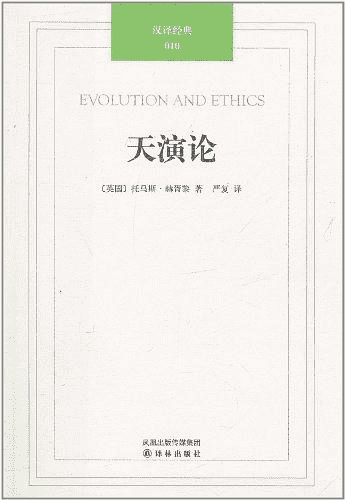

《天演论》 作者：\[英\]托马斯\*赫胥黎 译者：严复

《天演论》是一本什么书呢？它的原名是《演化论与伦理学》，是严复翻译自英国生物学家赫胥黎名为《进化与伦理》（Evolution and  
Ethics）的演讲与论文集，这是一本宣传达尔文生物进化论的通俗小册子。

它的基本观点是：自然界是不断变化的，并且在"物竞天择"的原则上不断进化，这一原理同样适用于人类社会，人类文明越发展，伦理上最优秀的人就最能适于生存，可以说赫胥黎坚持并发挥了达尔文《物种起源》的思想。

与其说《天演论》是严复翻译赫胥黎的作品，倒不如说《天演论》是宣传斯宾塞的社会进化论思想。

严复的《天演论》并不单纯是一本译作，其中的许多思想其实也并不是完全翻译赫胥黎原著的。除了宣扬"进化论"外，严复对赫胥黎的原著加以改造和评论，更主要的是加入了斯宾塞的社会达尔文主义。

尽管深受达尔文的影响，斯宾塞认为人类社会也和自然界一样，存在自然选择的进化规律。但是斯宾塞的社会进化论和达尔文的进化论是有一定区别的。

比如达尔文从来没有提出"演化"等同于"进步"，达尔文认为进化产生的新物种，只是更加适应不断变化的环境而产生的。但是斯宾塞的社会进化论则引入了社会进步的概念，认为进化后新的社会形态总是比以前的要好。

在赫胥黎看来，因为人类社会道德伦理的存在，人类社会的进化并不能与自然界的进化相提并论，在一定的历史时期，社会可能会进步也可能会倒退。

然而，严复并不认可这个说法，严复吸收了斯宾塞的优胜劣汰学说，主张进化主要是进步，他并不承认进化还有倒退。

为什么一本讲社会进化论的，看起来还挺严肃的学术书，会受到当时社会那么大的重视呢？ 这实际上和当时中国的时代背景是密不可分的。

1895 年甲午中日战争爆发，中国战败，李鸿章代表清政府与日本签订了丧权辱国的《马关条约》，清政府不仅割让台湾、澎湖及其附属岛屿，还向日本开放多个中国内陆港口城市，并赔偿日本 2 亿多两白银。

自从鸦片战争以来，西方列强欺侮瓜分中国已经到了白热化的程度。当时的中国，民族危机空前深重，维新意识空前高涨。正是这样的背景下，严复开始了《天演论》的翻译。

作为曾经在英国留学过的知识分子，严复迫切想要将西方先进的人文科学和自然科学引入清朝，尤其是想借用达尔文的进化论、斯宾塞的"优胜劣汰，适者生存"来警醒当时的国人，希望中国能够自强，只有不断进步才不会被淘汰，已期实现救亡图存的目的。

《天演论》的出版和流行，的确给了当时的清政府和中国社会当头棒喝，敲醒了一大批有识之士。进化论成了一个非常有利的思想武器。

1897 年《天演论》首刊出版，此后书中的许多口号"物竞天择"、"适者生存"、"天演进化"、"优胜劣败"迅速风行，一时之间洛阳纸贵。

严复指出，适者生存、不适者就会被淘汰，中国人若不在世界竞争中生存，必将会被淘汰，而致亡国灭种。这对于国人心理产生了极其震憾的效应，书中思想极大的推进了维新运动的发展。

可以说"五四运动"之前，《天演论》是中国最火爆的畅销书。这本书火爆到什么程度呢？当时有许多的名人名家都是《天演论》的粉丝。

譬如我们非常熟知的胡适，胡适之名就是他本人看了《天演论》后，将自己的原名胡洪骍改为胡适的。鲁迅也在他的《朝花夕拾》中说"在学校生活最大的乐趣就是'吃花生米、辣椒，看《天演论》'"。

更不用说当时一心想要变法  
图强救中国的康有为、梁启超，他们皆为《天演论》所折服，康有为称"《天演论》为中国西学第一者也"。当时许多学堂，老师都以"物竞天择"来命题让学生们考试创作，可以说是全民阅读了。

#### 六、社会进化论的时代价值

斯宾塞的社会进化论的诞生，以及在 19 世纪末 20 世纪初的中国成为思想浪潮，其实都有着鲜明的时代背景，但是它也有自己的生命力。

到了 20 世纪中期以后，人们更多的把它跟种族主义、纳粹主义联系在一起，社会达尔文主义也因此越来越多地受到批判和争议。这个理论也冷落了下来。

**今天，我们确实是生活在一个竞争更加激烈的社会中，我们也应该重新思考一下 "社会进化论"，批判地看问题。**

**社会之所以会前进，不应该只是一套残酷的 "优胜劣汰，适者生存"的逻辑，狼性文化也许可以获得一时的优势领先，但实际上并不具有可持续发展。**

**社会学在时间的长河里还在继续发展，我们后面会提到的涂尔干，就提出社会进步的动力，是在社会整合基础之上的有机团结；韦伯则指出理性和价值是指引社会发展，促进社会进步的源动力；滕尼斯则强调我们的社会，是一个大的共同体，人们以和平的方式相互共处。**

这些社会学理论，我们接下来的节目还会提到，它们在今天依旧对于我们的社会和人们的行为发挥着重要的指引作用。

如果你有机会去伦敦拜访大名鼎鼎的马克思墓碑，那你一定不要错过斯宾塞的墓碑。斯宾塞的墓碑，就紧挨着马克思的墓碑，然而遗憾的是，世人只知道去一睹马克思，却极少有人知道斯宾塞。

从这一个小的细节，大概也可以看出，社会进化论学说在今天，早已经没有了其两百年前的生命力。但是不可否认的是，社会进化论在世界范围内曾产生过极为轰动的效应，在社会和政治思想史上占有重要的位置。

我是严飞，我们下一集再见。

# 03\. 劳动的异化：一台苹果手机背后，有多少富士康工人的泪水？

### 本集要点

1.社会学家卡尔\*马克思

2.马克思如何看待劳动

3.劳动的异化

### 文稿

你好，我是严飞。在今天的第三集当中，我将和大家详细地讨论一下马克思的劳动的异化。

#### 一、为何制造手机的人买不起手机？

今天，很多年轻人都喜欢用苹果手机，觉得苹果代表的是一种科技的创新。每次苹果新品发布会，都会赚足人们的眼球，而每一次苹果手机推出新一代的版本，都会掀起一股新的购买的热潮。

可是，不知道大家有没有想过，当我们每天使用苹果手机的时候，每天经手无数 iPhone 的富士康流水线工人，自己却买不起一台自己生产的手机？更多的人只能使用更加便宜的国产手机。

在富士康工作的一线工人，每天工作时间一般来讲是从早上 8 点一直到晚上 10 点，差不多每天是 12-14 个小时的工作时间，一个月非常勤奋地工作，除了吃饭就是工作，到手也就 4000 元左右的工资。

而与此同时，每年发布的新型手机却不断刷新着手机的价格上限。现在最新一台 iPhone XS，64G 容量的价格都已经要接近 1 万元人民币了。

我有一位朋友，曾经为了写博士论文，就亲自跑到郑州的富士康工厂做实地的调研。她把自己假装成前来应聘的工人，完成了简单的见工手续后，就直接被派往了一线的生产线上。

她每天的工作是给 iPhone 后壳贴膜，并且拧上一颗螺丝钉。每天算上加班，要工作超过 12 个小时之多，下班以后住的也是那种 6-8 人上下铺的集体宿舍，真真正正亲身体验了一次这种强度大、枯燥单调的打工生活。

在这样的现象面前，我们特别想知道，为什么制造手机的人自己却买不起自己所造的手机？为什么 iPhone 背后默默付出的一线工人，工作强度如此之大，挣的钱却特别得少？

他们的劳动究竟是为了什么？他们是否可以从制造代表科技创新的苹果手机当中，获得劳动的喜悦和满足呢？如果没有喜悦和满足，那又是什么？

#### 二、社会学家卡尔\*马克思

在之前的两讲当中，我已经向大家介绍了古典社会学的起源和发展。从今天的这一讲开始，我们将会进入到一位非常经典的、重要的社会学大师。

他的著作在过去 150 多年时间里面，彻底地改变了我们对于人类社会发展形态的根本认识。他的名字就叫卡尔\*马克思。

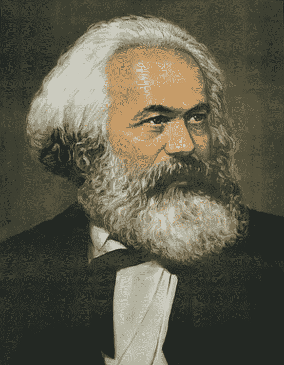

卡尔*海因里希*马克思（1818-1883），德国的思想家、政治学家、哲学家、经济学家、社会学家

说到马克思，大家首先会想到的，是我们在学生时代所上的"马经"、"马哲"、"马原"这些最基本的政治哲学课程，会想到马克思所提出来的历史唯物主义和辨证唯物主义的思想观，以及他的鸿篇巨制《资本论》和经典著作《共产党宣言》。

从这一层意义上来讲，大家会觉得马克思好像应该是一名哲学家，他怎么会被归类为社会学家呢？马克思自己也从来没有声称自己就是一名社会学家。

但事实上，在我们社会学领域里面，特别是在古典社会学领域，马克思是和法国社会学家涂尔干、德国社会学家韦伯一起并称为社会学的"三巨头"。

**今天我们为什么还需要马克思？是因为马克思为我们提供了一种认识世界、解释世界的基本方法和框架，这样的方法首先就是从社会出发的。马克思将社会看作是我们认识自身的一个出发点。**

他认为社会是人们交往方式的一种产物。有什么样的社会交往方式，有什么样的人和人之间的互动方式，就会有相对应的经济交换方式、生产方式、生产资料的再分配方式。

因此也会诞生出相对应的国家、家庭和社会不同的组织形式，以及马克思所描绘的人类社会发展的不同形态。

所以在某些学者看来，马克思虽然有众多的头衔，譬如说哲学家、思想家、伟大的无产阶级革命导师、社会活动家、记者，但事实上最适合马克思的还是社会学家。

#### 三、马克思如何看待劳动

为什么富士康的工人买不起他们自己劳动生产出来的手机呢？在一般人的设想当中，似乎工人们的工资收入和是他们的劳动付出成正比的。

因为这些工人的劳动技术含量比较低，相对来讲容易被替代，所以社会竞争力低，收入自然也低。再加上他们的受教育程度低，所以工作只能为了生存和温饱，谈不上喜悦。

毕竟一台手机的诞生，工人们进行装配只是进入到后期的生产阶段，还需要大量前期的研发和测试，而这一部分的技术含量才更加有价值。

这是我们今天在市场经济思维下对于劳动的认识，但是在马克思的观点里，他可不把劳动看成是一种因为劳动的技术含量低，就应该收入低，就应该买不起自己所生产出来的手机这样理所应当的事情。

**在马克思看来，劳动是人类的本质活动。劳动应该是一种有着主观能动性和自我意识的活动。人因为劳动而更富有创造力。人是通过劳动才可以不断地去改造世界、建造世界的。**

马克思最为看重的是人区别于动物的本质和存在。他认为在劳动的过程当中，人的本性是一种自由、自觉的活动，用通俗的话说就是人会自觉自愿地进行劳动，并不会受到别人的强迫。

**这种发自本性的劳动是人类的一种本能需要，这种需要不仅仅是为了生存** ，比如打猎、耕种，让人不至于饿死，同时  
**马克思更强调的是当劳动成果展现在我们面前时，人可以获得极大的喜悦和满足。**

譬如说，在传统农业社会当中，工匠那种小作坊式的、小型自助式的生产就是一种自觉自愿的劳动。因为我今天生产什么产品，生产多少产品，生产多长时间，都是由自己或者是家庭的需要来决定的。

劳动就变成了工匠们日常生活当中的一部分，并不是出于谁的命令而去进行劳动的。这样的劳动就是人们出于自觉自愿的一种自发劳动，是能获得满足和喜悦感的。

想象一下一名工匠，他按照自己的品味和技巧去制作一件物品，就好像是在打磨一件精心雕琢的艺术品。

当这么一件艺术品终于完成的时候，他的内心必然充满了无尽的喜悦和骄傲，迫不及待的想与其他人分享自己的这件作品。这样的喜悦，就是自觉自愿的劳动所带来的。

可是到了工业化的时代，工人们在现代的大型工厂里面就失去了自主性，变得越来越厌恶劳动，但是又不得不劳动。在迫不得己的压力之下，劳动所带来的喜悦和满足感是怎样消失的呢？

#### 四、劳动的异化

下面就涉及到我今天要重点为大家介绍的，马克思所提出来的"劳动的异化"。

什么是异化呢？首先先让我们来看一下马克思的定义。在 1844 年《经济学哲学手稿》这本书里面，马克思明确的提出，  
**异化是人类自己创造的力量，作为外部力量又反过来支配人类。**

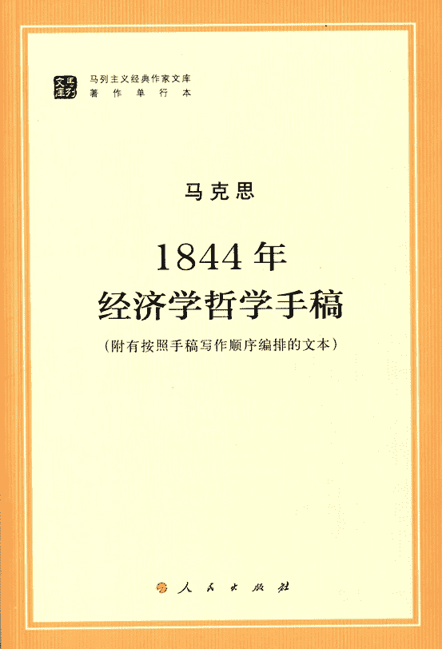

《1844 年经济学哲学手稿》 作者:\[德\]卡尔\*马克思

用通俗的话讲，异化就是人们自己创造出来的东西，成为了不受自己控制的一种外在力量，反过来又来统治人。这种力量不断地支配人类，从而导致人和人之间除了赤裸裸的利害关系、冷酷无情的现金交易，就再也没有任何别的联系了。

对于这样的一种定义，我们应该如何理解呢？ **理解异化至少有三个维度：**

**第一点，是异化首先是发生在劳动者与其劳动产品之间，或者是说工人与其创造出来的劳动产品之间的一种异化。**

在劳动的生产过程当中，工作不再是由工人自己所决定，因为生产工具是被垄断在工厂主或者是说雇主手上，因此工人的工作就变成了与个人生活相脱节，但是为了生存，工人们又没有办法和工作相分割开来。

于是，工人的劳动就失去了原本的一种自主性，就变成必须依附在工厂里，必须依附在生产车间之上才能进行的生产劳动。人就成为了工厂和生产车间这些机器的附属品，而机器成为了主体。

譬如说，在富士康的生产车间，工人们不再是为了满足自我的一种本能需要去进行劳动，尤其是马克思强调的从劳动中获得满足感的这种需要。

工人们只能按照雇主的要求进行生产，因为工厂里的机器、生产工具都不是他们自己的，就连身上穿的工作制服也不属于他们。所以生产出来的产品也并不属于他们自己，而是交由苹果公司去赚取最大的利润，这些利润再多，也分不到工人们自己的头上来。

所以在这样一种情况之下，工人们就和自己所制造出来的手机，产生了分离。这种分离就是一种异化。工人自己买不起自己所生产出来的产品，这就是第一点所说的劳动者与其劳动产品之间产生了异化。

**第二点，是不仅劳动者他和他的劳动产品之间发生了异化，就连整个劳动过程本身也发生了异化。**

劳动对工人来说是一种外在于他的东西，是不属于他的东西。工人们根本不知道自己在做什么，也不知道自己在生产这个过程当中究竟处于什么样的角色和地位。

譬如说在生产流水线上的工人，他只是整个生产流水线上的一环，每天周而复始，在机械重复地完成一个固定的操作，甚至日常生活中的吃穿住行都受到严格的限制。

这时候工人们就会产生出很多的疑问，在整个产品的生产过程当中，作为劳动生产主力的工人们来说，他们究竟参与到了什么？制造出来了什么，是否又可以从自己的劳动过程当中获得成就和满足呢？

因此，在整个劳动的过程当中，工人们并没有感到幸福，而是感到不幸，不是在肯定自己，而是在不断地否定自己，也不是自由的在发挥自己的智力和体力，而是不断地使自己的肉体受到磨，精神受到摧残。

显然，劳动成为了工人们迫不得已的生存手段，已不再是人们的劳动需要。工人们一方面痛恨无休无止的劳动，但另一方面又不得不参与劳动，这种劳动就已经和最初的人们自觉自愿的劳动发生了巨大的变化。这就是我们所说的第二点，劳动过程本身发生了异化。

**第三点理解异化的角度，是在整个劳动的生产过程当中，人和人之间也发生了异化。具体的来讲，就是工人和他的劳动伙伴之间也发生了异化。**

本来相亲相爱的工友，在整个劳动的过程当中变成了最熟悉的陌生人，工友和工友之间，正式工和临时工之间，早班工人和晚班工人之间，更多的关系是彼此之间不断的竞争，比较谁生产出来的劳动产品更加的多，谁更可以讨上级的欢心。

在这样的一种情况之下，工人们在工厂当中必然会变得反感劳动。劳动从人的一种自觉自愿的本性变成了对人的一种折磨，劳动伙伴之间的合作关系变成一种折磨的关系和状态，这就是马克思所提出来的第三种异化。

#### 五、异化理论在今天

马克思的异化理论，从提出来到现在，已经 100 多年过去了。在过去的 100 多年里，马克思的思想对资本主义乃至整个世界，已经产生了巨大的影响。

今天工人的劳动情况已经和 19 世纪中期的欧洲，工人们受剥削的情况有了天壤之别。今天的工人们有最低工资保障、有医保、有加班费，工厂的老板也更加人性，甚至有的时候还会组织工人们集体联欢和聚餐。

那我们在今天，又应该以怎样眼光看待异化？随着社会变得越来越复杂，异化的程度到底是减轻了还是加重了？

**实际上，虽然马克思的异化理论诞生于 100 多年前，但即便放在今天，也依旧有着它强烈的现实生命力。**

所谓的异化实际上就是我们所创造出来的东西，反过来又统治着我们，束缚着我们的生活。

我们可以看看自己，扪心自问，今天我们的生活是否也处在一个被扭曲、被异化的状态之下。我们有多少人是真正为自己而活着的？我们的人生是否真的可以自己说了算，可以自己做主呢？

譬如在工作上，也不知道从什么时候开始，加班就成为了一种趋势。

很多人应该都深有体会，在今天中国竞争如此激烈的大环境下，从大公司到中小微企业，每个上班族都会感觉到，加班的次数越来越多，加班的时间越来越长，工作的强度越来越高，我们自己可以掌握的休息、生活的时间也已经越来越少了。

甚至有的公司以加班到十点以后可以报销车费这样的名目，不断地激励大家多多加班，号召员工都要和公司一起去成长，一起去创造辉煌。

这一段时间，大家都在激烈的讨论 996 工作制。所谓的 996 工作制，就是早上 9 点上班，晚上 9 点下班，每周工作 6 天。

现在，在很多的企业里面，特别是互联网企业里面，都在大量实行 996 工作制。这些企业把加班提升为一种文化、一种信仰。就连马云都站出来说，"追求 996，就是为了追求自己人生的幸福。"

为了指标、业绩、利润的增长，大家都在疯狂地拼命工作，同事和同事之间也挤破了头，在办公室政治中勾心斗角。但是有多少人是真正因为喜欢和热爱这份工作而去投入其间的呢？

紧张、忙碌了一整天，即便拖着疲惫的身体回到家里，很多人也依旧得对着电脑，对着微信在拼命的打字和进行工作上的联系。

我们根本没有办法做到真正的身心放松和自由，回想起来还真不一定知道自己这一天里面到底做了什么，或者说这样做的意义和价值何在。这就是我们被异化的生活。

在异化的生活之下，大家都在加班的生活中一边吐糟，一边煎熬着，上海彩虹合唱团有一首歌是这样唱的：

夜幕笼罩了朝阳公园，老板出现要求加班，职员内心抱怨，感觉身体被掏空，想带父母去旅游……

即便买不起自己所生产出来的苹果手机，今天去富士康工厂应聘的工人也源源不断，只增不减。因为比起其他的血汗工厂，富士康已经足够人性和有保障，至少还有从宿舍到工厂的班车，还有洗衣的福利，还会提供集体宿舍。

我们是否值得过上更好的生活----那种可以不被工具或者目的所主宰，不被上级和领导所驱使，由自己选择人生、决定人生权利的生活？

**马克思的理论直到今天，也在不断提醒我们：那些你认为理所当然的问题，永远值得我们思考。**

希望我们可以早一点过上不再被异化的生活。

我是严飞，我们下一集再见。

# 04\. 使用价值与交换价值：知识是一种可以买卖的商品吗？

（公众号懒人找资源，懒人专属群分享）

### 本集要点

1."使用价值"与"交换价值"

2.知识如何变成商品

### 文稿

#### 一、"知识付费"的浪潮

近几年，"知识付费"已经成为了一种潮流。仿佛是一夜之间，各种知识付费的产品纷纷兴起。

这一方面是解决了年轻人想利用碎片化时间学习的需求，在上下班的地铁上，随处都可以见到带着耳机听音频节目的年轻人。在这种潮流背后，更深层次的原因其实是，从一定程度上缓解了很多城市白领想要提高自己核心竞争力、提升自己职场上升效率的压力和焦虑感。

今天，越来越多的人们认识到知识的宝贵，想要获取更多的知识，也有越来越多的平台开始出售各种类型的音频课程。

很多时候，我们都需要支付一定的费用，才可以购买到定制的知识。比如我们这一系列《像社会学家一样思考》的社会学知识分享，也只有付费之后才可以听到全部完整的内容。

很明显，到了今天，知识成为了一种商品。作为商品的知识，它的价值到底是什么呢？我们究竟是否可以通过这种付费的方式，满足获取知识的需求？我们又如何从马克思经济学的角度来理解知识的价值？

#### 二、"使用价值"与"交换价值"

这一讲，我们也在思考和讨论这些问题的过程中，为大家做一个马克思经典的劳动价值理论的入门。首先我们要介绍一下马克思对价值的定义。

**在马克思看来，工人劳动制造出来的物品，有着内在的  
"使用价值"。这个内在的使用价值指的是一个物品的可用性**，越有用的东西就有越高的"使用价值"。"使用价值"是内在于物品本身，而不是依靠市场的供给、需求关系来决定的。

由于"使用价值"牵涉到每个人和物品之间独特的关系，因此 **"  
使用价值"本身无法用来交易。如果想把物品进行交易，就得创造出另一种价值作为交易的中介，这就催生了"交换价值"。**

"交换价值"是出现了盈余和匮乏之间的失衡，才有了交换的需要。我有的你没有，你有的我没有，为了交换有无，我们才不得不考虑交易。

**物品一旦有了  
"交换价值"，就变成了商品，当一个物品用来交换时，他就获得了一个"交换价格"。价格来自交易，也只存在于物与物之间的交易关系中，并不等同于"使用价值"。**

#### 三、知识的价值

那么，知识的价值是什么？如何去定义知识的价值？

我国著名的教育学家顾明远先生在《教育学》这本书中明确定义了知识的价值，他说：知识价值是知识对于人类社会的存在和发展，以及丰富个体精神生活所具有的价值。随着人类社会的发展，人们的精神需求也日益丰富，人们对知识的追求，是人类精神需求的重要方面。

这个定义来自于教育学家。那么我们能用马克思的理论来定义知识的价值吗？

我们知道，知识产品是通过知识、智力，再结合资本、劳动等因素的投入，而产生的满足消费者物质或精神需求的一种创造性的成果。

**在物质生产的领域中，马克思天才地发现了价值规律，即由  
"社会必要劳动时间"决定物质产品的交换价值。在这里，所谓的社会必要劳动时间，就是"在社会平均的劳动熟练程度和劳动强度之下，制造某种使用价值所需要的劳动时间。"**

但是，我们却发现，好像很难用生产知识的"社会必要劳动时间"来定义知识产品的价值。

为什么这么说呢？因为首先，知识产品的生产和一般商品的生产是不一样。他是一种依托于个别劳动的生产，具有唯一性。

譬如说我现在正在跟大家讲授的这一系列课程，必然带有我自己鲜明的视角和价值判断，带有我独特的节奏，倘若换另一位老师来讲，他所讲授的知识体系就会完全不一样，所花费的时间也会不一样。这就表明，知识产品的产出价值不是由社会必要劳动时间决定的。

再者，因为知识生产是一种创造性劳动，人们无法为日心说、相对论、进化论等的发现，来确定其社会必要劳动时间。即使在技术开发的领域中也无法为计算机、机器人、基因工程、空间技术等的发明，确定社会必要劳动时间。

这些科学技术的发现和发明从本质上说，它们是无价的，因为它们的社会作用是延绵千古，永远造福于子孙后代的。

但是如果知识作为一种商品进行买卖，就必须要有可以定价的"价值"，有了价值的依据，我们才可以去谈分配与交换。

那么什么样的知识更有"价值"，可以卖出更多的钱呢？知识的价值可以量化吗？在这里，我们可以学习马克思在发现物质产品的"价值"时的思想方法。

任何物质产品都有"使用价值"，没有使用价值的东西，人们不会去生产，也就无所谓"产品"了。而不同的物质产品，其使用价值也是不同的。这就同样存在不可比性。那怎样把不可比的诸多物质产品的使用价值化为可比的价值，这就是一个"量化"的过程。

马克思找到了"社会必要劳动时间"作为物质产品量化的依据。但对于知识产品，我们前面已经提到，不能用"社会必要劳动时间"来量化知识产品的价值，那么就得另找一个可以"量化"知识产品价值的依据。

在这里，我们必须要强调，量化知识产品的价值，是一项非常复杂的"科研项目"。这里我们只能提出一些思路，供大家参考。

**知识产品的价值，总体上讲是在于促进社会系统的功效。**  
比如科学发现是技术创新的基础，科学推动技术发展，技术促进社会生产力的发展，这都是我们可以观察到的知识的效用。

对于自然科学和人文社会科学的基础理论研究，它的价值就很不容易找到量化的依据了。尽管这类知识的价值难以量化，但是我们并没有否认基础理论研究的价值和作用。这是我们从长远的眼光依旧能够看到基础理论研究，对我们的社会生产和人类的精神文明，产生的重要作用。

#### 四、知识如何变成商品？

既然知识有其价值，那么我们再更进一步地追问，就是知识如何可以作为商品进行交易？这个交易又是如何实现的？

首先，我们来介绍一下交易。在金钱货币出现后，人类的经济行为基本上就是围绕着 "交换"而进行的连锁活动。

我们将所有的东西都看成是可以交换的商品，金钱货币是交换的媒介，定义出它们的交换价值，再将商品换成金钱货币，然后再用手上的金钱货币去交换等值的另一项商品。就是"商品-  
金钱-商品……这样如此不断循环。"

**交易如何成立？它的首要条件是要有相等的 "交换价值"。**

打个比方说，你是一个面包店的主人，你生产的面包具有 100 元的交换价值，可以换来 100 元的金钱货币，而后你拿着 100 元的金钱货币去买一门网络课程。在这里，100 元的面包和 100 元的网络课程就具有相同的交换价值，这很容易理解。

但马克思提醒我们，光有这一项条件成立还不足以构成交换行为，还有另一项条件必须同时存在。那就是 **这两种商品之间要有不等的 "使用价值"。**

在什么情况下你才会拿 100 元的面包去换 100 元的网络课程呢？一定是在你心目中，网络课程的使用价值高过了面包的使用价值，你需要这门课程的程度超过了面包，你才会拿面包去换这门网络课程。

反之，什么人会开一门网络课程用他的知识去换面包，一定是需要面包超过这门课程的人。两个都想要面包的人，即使一个有 100 元的面包，一个有 100 元的网络课程，他们之间也不会形成交换行为。尽管表面看来，这两种东西的交换价值是一样的。

所以说，光看交换价值，我们无法真正理解交易。诡异的是，交易的成立， **" 交换价值"不一定等于"使用价值"**。

对于拥有面包的人来说，他手中的面包的使用价值低于 100 元时，他才会心甘情愿地拿面包去换 100 元，再用这 100 元去换对他而言使用价值等于 100 元的网络课程。反之亦然。

正如面包在面包店里，对于店主来说，没有"使用价值",因为他吃不了那么多的面包，也不需要那么多的面包。但是，倘若面包被任意一位顾客买走之后，立刻就会增加它的"使用价值"。这些顾客最终是为了吃这个面包才去买的。

而对于一个拥有知识的人，他自己创造和拥有的知识，对他本身来说并没有那么多的使用价值，但是当他把知识传播给了别人，他也获取了自己需要的面包。在这个过程中，实际上知识的"使用价值"是增加了。

**这就是交易和市场的优点：交易创造出  
"使用价值"。货品从不使用、不需要的人手里，被交换到要使用、有需求的手里，于是就提高了"使用价值"。**表面的等值交换，让实质上牵涉其中的人都获得了较高的"使用价值"。

**经济活动越频繁，就越会增添整体的 "使用价值"。从这个角度来看，知识经济确实是有利于知识的使用价值的增加的。**

#### 五、对"知识付费"的反思

我们前面所讲的都是为了说明知识的价值。其实当今社会越来越多的人看到了知识的价值。

人们都想去最好的学校接受教育，或者读一本好书，上一门有用的网课，期待可以通过一位知识大咖几次的分享和讲授，就能够迅速学习到一个领域或者某项技能的精华，缩短自我摸索的时间、减缓内心的焦虑和压力。这也是当今知识付费商业模式得以逐步成熟发展的重要原因。

我们乐观地思考，可以发现知识经济这件事本身，确实是有利于知识的传播的。

但是我们也应该认真地思考，知识经济到底映射了市场经济的哪些方面？如果马克思在今天，会怎么看待这样一种交易行为？付费的知识产品究竟能够在多大程度上，帮助人们真正掌握知识，提升自我呢？

我们依旧以知识经济为例。知识的直接提供者其实并不是这场交易中唯一的获益者，甚至在很多情况下，反而是提供这些知识分享的平台，往往才是最大的受益者。尽管这一商业行为传播了知识，但是其背后的目的，却大多是为了获得金钱货币，赚取最大的利润。

尽管现在的各大知识分享平台想尽办法提高大家的完课率，开始使用各种优惠活动，比如现金、红包、优惠券等返现的形式来激励购买者完成所购买的课程，但他们最终目的是为了实现消费者不断购买课程的概率，从而可以获取更多的利润。

在这场知识变现的狂热背后，一定是有着巨大的利益，在驱动着越来越多的商家，纷纷加入这股浪潮，创造更多的赚钱的机会。

我们当然不反对通过购买网络课程来获取知识，能够获取高质量的知识本身就是一件好事。

可是又有多少人是购买了网络课程就搁置一边，或者只听了其中几次，就再也没有坚持下去的呢？我想这样的消费者并不少。

我们也可以问问自己，我们买了 100 天的课程，是否真的是一天不落下的都完成了呢？知识变现这场交易，能否真正通过这个交易过程让消费者获取知识，真正享受到知识的使用价值呢？

事实上，  
**知识的获取并没有那么多捷径可走，知识付费课程容易给你一种错觉，仿佛只要你购买了知识，就可以掌握知识。作为知识的消费者，事实上你购买之后，只是获取了这些知识的信息或者这些知识的片段。**

譬如说，我们在这里讲述马克思，以及其他的经典社会学家，但是我们没有办法逐字逐句的带着大家一起，在 15 分钟的时间里去深度阅读原典，去仔细剖析马克思的思想历程。我们只能摘取其中一两个经典的理论，再结合当下的社会热点，以直观易懂的方式讲授给大家。

而对于这些理论，真正的掌握还是需要你继续下功夫，摘下耳机，捧起书来去阅读原文，甚至要反复的阅读，这样才可以更加深入地了解到所习得的这一部分知识的内涵与外延。

换句话说，我们要思考知识的真正价值是什么。我们也应该明白，无论这些网络课程收费便宜与否， **知识的获取并不等于知识的掌握** 。

知识付费的形式只是为大家打开了一扇了解知识的大门，可以激发大家对一个专业领域的知识，甚至一门学科产生出兴趣。就好像听完今天的这一课，相信大家对于马克思，又增添了几分亲切感；马克思的形象，也更加生动起来。

但至于 **真正掌握知识，还是需要依靠深度的阅读和坚持不懈的大量练习才可以达到一个更高的境界。**

在今天这个时代，或许看起来我们多了不少了解新知的捷径，的确在一定程度上，帮助我们解脱了很多我们生活中遇到的迷茫和焦虑，让我们不再对陌生的知识发怵、彷徨了。但要深入一门领域，其实还是没有捷径可言的，需要我们沉下心，认认真真的去学习。

我是严飞，我们下一集再见。

# 05\. 商品拜物教：为什么我们永远在剁手？

### 本集要点

1.冲动消费的浪潮

2.生产方式的变化

3.货币拜物教

### 文稿

你好，我是严飞。在今天的这一集当中，我会和大家讨论一下马克思的商品拜物教。

#### 一、冲动消费下的"剁手"大赛

每年的双十一，都是一年一度的"剁手"大赛。

很多人早早地在购物车里面囤积好了心仪已久的商品，焦急地等待这一天的到来。有些人甚至在半年以前就有想买的东西了，但 TA 也会想："等一等，等到双 11 的时候再去买吧！"

在"买买买"荷尔蒙和各种促销政策的刺激之下，大家都在疯狂地抢购一切可以抢到的商品，这背后就是一条被坚信的购物原则： **抢到就是赚到！**

这注定是一个冲动大于理智的夜晚。在 2018 年的双十一狂欢中，仅仅开始 2 分 05 秒，淘宝天猫的成交额就已经突破了 100 亿元，当天最后的总成交额则突破了 2000 亿元。

当然，这样的标志性数据也不可避免的会带有水分，因为在剁手高潮过后，就是物流的高潮，物流高潮过后，则是退货的高潮。冲动消费下的不理智行为终究会被账单上的消费额带回理智。

我就有一位朋友，她在双十一到来前的一周，早早地订上了一套服装，在零点刚过的时候，就把紧接着的三个号码的衣服都拍了下来。她的理由非常简单："留下最合身的，其余的货品都退掉。"

这种看似理智的消费，实际上背后还是冲动的荷尔蒙，否则怎么会如此虎视眈眈地为了这一件衣服，花费这么大的精力去买呢？

但无论如何， **双十一已经彻底改变了我们的生活，甚至是一部分人的命运。**

这让我们不禁思考， **在人们纷纷扬言  
"再买就剁手"之后，为什么双十一的销售额只增不减，这是否反应了人们的消费欲正在上升呢？人们像拜物教一样纷纷拜倒在商品的石榴裙之下，到底又是什么在刺激和推动着这一场消费的狂欢？**

#### 二、商品拜物教

在今天这个时代，消费越来越主导我们的日常行为。 **你能不能消费、消费什么，似乎都组成了我们的社会地位、身份与声望。**  
为了追求这样的地位、身份、声望，我们对商品越来越迷恋，越来越依赖，也越来越喜欢在我们的朋友圈、在我们的微博上晒出我们新买的衣服和包包，也越来越需要琳琅满目的商品来装点我们的生活。

这种对商品的迷恋和崇拜，就是我们今天要探讨的社会学问题。它背后的理论，就是马克思所说的 **商品拜物教** 。

商品拜物教理论在马克思的《资本论》中具有独特而重要的地位，因为马克思提出商品拜物教，这是 **" 揭示资本主义政治经济体的神秘性的基本工具"**。

大家也许会好奇，我们购买的商品它只是一个物，看得见，摸得着，怎么就变成了"揭示资本主义政治经济体的神秘性的基本工具"了呢？这种神秘性到底体现在哪里呢？

这还得从商品的生产方式说起。

#### 三、生产方式的变化

商品是我们人类劳动的产物。在之前的一集当中，我们有和大家说到，劳动生产的本质应该是满足 **生产者自身的需求和目的** 的，这个时候的这种劳动是  
**私人的** 。

但到了商品经济的环境中，人们实际上就是 **互相为对方而劳动，劳动就不再是私人的了，而是具有了社会属性，也具有了交换价值**  
。所以，人们在进行劳动的时候，生产出劳动产品时，就不再仅仅只是考虑自身的需求和目的，而是必须要考虑市场的需求。

人们生产出一个产品是期待它能被卖出去，能够在市场上流通，能够被消费者所喜欢。因为只有商品被卖出去，它的生产者才会获得收益。当然如果商品可以获得良好的口碑，它的生产者就会源源不断地获得更多的收益。

在马克思看来，商品的价值体现的是一定生产方式中人与人之间的关系，也就是生产关系的体现。生产关系不是存在于商品和商品之间，而是人们在生产的过程中，结成的一种相互关系。这样的一种关系，包括了生产、分配、交换和消费等每一个环节当中存在的诸多关系。

**换言之，生产关系中，必须有人的存在。**

让我们来设想一下，你在双十一购物节的每一次剁手，比如说，你买到了一件衬衫，你就无形中进入到成百上千的生产关系当中。

这样的生产关系，包括给你提供购物平台的电商、电商中每个独立的商铺运营者、店铺中的店小二（客服）、店铺里的采购人员、店铺使用的快递公司、运送衣服的货车司机、将衬衫送到你手中的快递小哥、服装厂的老板、服装厂的每一个员工、布匹的销售者、生产者、棉花的种植者、采摘者等等。

假如这棉花是进口的，你可能还支持了国家与国家之间的贸易。这一切就发生在你的简单的支付行为当中。

但相信我们所有人在生活当中，都注意不到这种商品背后所体现出来的人与人之间的关系。我们所见到的，只是商品的外在形态，这个商品好不好看，实不实用；所关心的，是我花了多少钱去购买它，或者说，是节省了多少钱去购买它。

在这样的过程当中，商品背后的人与人之间的关系就被悄无声息地遮掩起来了。我们每一次的购物行为，彷佛都简化成为了物与物之间、物与金钱之间的交换。换句话说，  
**不再是商品生产者支配商品经济的运作，而是商品经济反过来支配着商品生产者。**

当商品经济反过来支配着商品生产者的时候，就会出现一些负面的效果。因为人和人的关系被遮蔽为物和物的关系，那么社会对于一件物的评价便直接决定了对此人的评价，人们就会形成一种  
**以物的交换价值为导向的价值体系和精神状态** 。

譬如说，在商品拜物教当中，一位讲究衣服的材质、品相、真假的店主，因为他更加看重衣服本身的价值，而不愿意采用噱头式的宣传和推广，所以反而不一定会得到太多人的关注。

相反，一家喜欢采用噱头式营销，经常请网红美女穿着暴露的衣服、小露香肩进行直播推广的店主，往往更加可以得到流量的青睐，动不动就获得数十万的点击。

在这里面，我们看不到衣服真假之间的区别，而只能看到关注度低与点击量高的区别。人们在这种价值导向下，为了获得更多的点赞和流量，就会选择一种娱乐至死的营销方式，甚至放弃了对于专业与真实的坚持。

#### 四、拜金主义：货币拜物教

商品拜物教发展到一定程度，就会形成货币拜物教。人们对货币的崇拜，通俗的话说，就是拜金主义。

拜金主义的核心，自然是金钱。那么金钱的本质又是什么？

**在马克思看来，金钱是一种最可怕、最有效的理性量化工具，把所有的物品全都圈进了商品的范围内。**

在金钱出现之前，物与物的交易关系必须用复杂的倍数关系来处理或想象。简单的几个物品之间的关系我们还可以算得出来，但是几十、上百个商品之间的关系比例就很难算清了。算不清楚，就意味着这种关系没有办法完全主宰我们对于价值的看法。

但是金钱不一样，金钱可以用一套简单的数字，解决所有复杂的比例关系。当一件东西一旦成为商品，便立刻取得了以金钱为标示的售价。它和其他商品之间的售价一比较，关系也变得一目了然，非常清晰。物与物之间的交易比例，一旦被转化成金钱数字关系，就很容易被固定下来。

于是，我们就活在将所有东西都看作商品的环境中，也就必然用价格来描绘自己和世界之间的关系，我们被价格包围，被价格剥夺了欲望的自主性，纷纷拜倒在金钱，或者说货币的脚下，这是马克思看到的人的可悲之处。

马克思在《资本论》当中，引用哥伦布与莎士比亚的一段对话，说明了金钱的神秘力量。

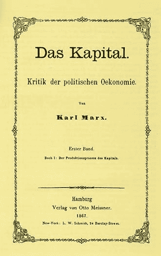

《资本论》封面图

哥伦布在 1503 年从牙买加寄来的一封信里面说："金子啊，真是奇妙！谁有了它，谁就成为他想要的一切东西的主人。有了金子，甚至可以使灵魂升入天堂。"

莎士比亚在《雅典的泰门》中讲： "金子！黄黄的，发光的，宝贵的金子！只这一点点儿，就可以使黑的变成白的，丑的变成美的。"

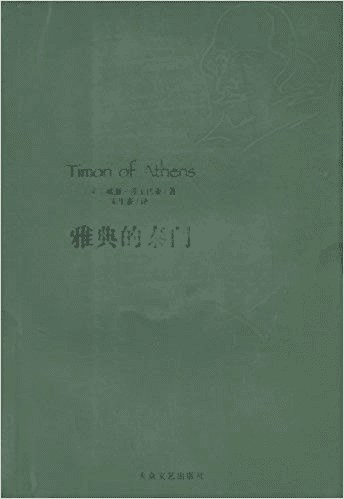

《雅典的泰门》封面图，大众文艺出版社

**使黑的变成白的、美的变成丑的，使灵魂升入天堂，这样的力量，到底是好还是坏呢？在万能的金钱面前，我们又应该做何选择？**

对于拜金主义，马克思有着很多的批判。在马克思看来，货币拜物教严重地损毁了人们心中的道德自律，当我们活在一个任何东西都成为了商品的环境中，用价格代表的金钱货币来构建自己和世界之间的关系的时候，就会导致我们感到非常地空虚、迷茫、失去方向。

对于这一点，我会在后面的几集当中，会结合其他社会学家的观点，再来具体地分析金钱对于人性的影响。

#### 五、购物狂欢下的反思

对于置身现代社会的个人而言，消费时代已经成为有史以来最繁盛的时代。我们被商品世界所包围，几乎是要作最大的挣扎才不购物，不去买东西反而才是不正常的。

今天我们见到，生产者想尽一切办法，将产品变得更加容易被消费者青睐和购买。

比如说，在化妆品的主要购买者依旧是女性为主导的今天，彩妆的生产厂家除了要提高商品质量，提升商品使用感，他们还会在包装上选择女性喜欢的颜色和造型，甚至在气味上也选择女性最喜爱的芳香，同时还会请来非常好看的平面模特，实地地演示使用效果。

又比如，普通的包装生产和营销，大家已经司空见惯，商家们为了给消费者带来耳目一新的感觉和刺激，当了解到当前的消费者开始追崇文化消费的时候，商家也会开始打起用文化进行包装的小算盘，精致的包装要远远大于商品本身，让人爱不释手。

**有的时候，人们购买的已经不再是商品本身，而是一种外在的包装。**

比如说，在奢侈品店前，一眼望去，几乎每个人手上都拎着大大的购物袋，每一个购物袋上，都印着品牌的大大 LOGO，生怕别人不知道自己买的是什么牌子。这就是商家的小算盘，用那些大大 LOGO，让消费者们完成一次炫耀性的消费。

同时我们也见到，销售者在产品本身之外，也在想尽办法讨好和吸引消费者。如今除了传统的电视和互联网，众多的微信公众号、微博，甚至一些短视频都成为了商家广告营销的平台。

商品的销售者想尽一切办法，通过抓眼球的促销活动来促进人们购物。比如很多商家会推出各种形式的满减活动，"双十一当天折扣价"、"满 2000 有八折优惠，还送旅行套装"，还有一些电商平台会推出"跨店满减，整点红包雨，红包抵现金"等一系列的促销活动，这一切促销的设计实际上都是为了刺激人们更多的购买。

在这样的情况之下，消费者也会疯狂地购买商品以达到满减的条件和享受优惠。

比如有的人为了满减的折扣，就会给尚未出生的孩子去购买未来很长时间都用不完的尿不湿和各种婴儿用品。享受到折扣和满减的消费者通常都会有一种打了胜仗的成就感，似乎是既占到了便宜  
，又省了钱，这种精神上的满足感仿佛吸食毒品一样，给人们带来了许多的快感。

很多时候，由于  
**现代人生活的忙碌和精神的空虚，人们常常选择购物这种短平快的方式来填补自己的内心，人们购买商品不再是因为需要使用它，而更多的是占有和享受这种购物带来的心理体验。**

这场购物的狂欢活动当中，无论是生产者、销售者，还是消费者，参与其中的每一个人，看似都曾是商品的主人，而实际上却都成为了商品的奴隶，成为了商品的敬拜者。我们都想控制自己的购物欲，一边高呼再买任何商品就"剁手"，一边在汹涌而来的商品面前，都忍不住地一次次掏出钱包、掏出手机，买回来更多的东西。

我们今天也不时有人提出"赚再多的钱有什么用的"问题，说明我们对于商品交换的本质，还是有作为人的独立思考的。

马克思用商品拜物教的理论，提醒我们，"我应该是钱的主人。钱有多大能力就说明了我有多大能力。钱的拥有就是我本质权利的拥有。"

我们今天读马克思，实际上就是要提醒我们， **不要活在一个只有金钱观和价值观的世界中。** 希望大家都可以做钱的主人，不再为"剁手"还是不"剁手"而焦虑。

我是严飞，我们下一集再见。

# 06\. 经济决定论：婚姻真的是经济基础决定上层建筑吗？

（公众号懒人找资源，懒人专属群分享）

### 本集要点

1.东北离婚现况

2.经济基础对婚姻的重要性

3.历史上的女性权益斗争

### 文稿

你好，我是严飞。在今天的这一集当中，我想和你聊一聊马克思的经济决定论，以及从社会学的角度如何去看待婚姻。

#### 一、"忙着离婚"的东北

最近我看到一条新闻，说东北三省这几年时间里面，每 10 对登记结婚的人里面，就有 6 对登记离婚，离结比率在全国位列前三。听到这则新闻，我赶紧去问我东北的朋友，是不是你们那儿的人都在忙着离婚？对于这一问题，我的东北朋友笑而不语。

这几年一提到东北，即使是从来没有去过，但是在一些媒体的报道和身边东北朋友的叙述当中，都可以听到有关于东北的大致情况：老工业转型遇到瓶颈，经济衰落，人口大量外流，很多一二十年前繁荣的东北中小城市，现在都基本成了"废都"，譬如说鹤岗市的房价，今天都已经低到了"白菜价"。

很多年轻人纷纷逃离东北  
，选择去经济更发达的沿海地区上班，或者是在外求学之后，就也不再愿意回到老家工作或者生活。优秀的人留不住，年轻的人又不断外流，再加上经济结构转型遇到问题，振兴东北越来越成为一个口号式的标语。那在这样的大背景之下，人们的婚姻选择也出现了明显的转向。

马克思说，经济基础决定上层建筑。那么东北衰败的经济状况，是导致离婚率增高的主要原因吗？用马克思的理论，我们又应该怎么理解这样的现象？这样的现象是东北的特例吗？

#### 二、经济基础决定上层建筑

我们先来看看马克思的理论是怎么回事。

1859 年，马克思在《政治经济学批判》一书的序言里面，明确地提出了"经济基础决定上层建筑"的理论。放在今天东北的大背景之下，可以再度折射出 150 多年以前马克思的智慧和远见。

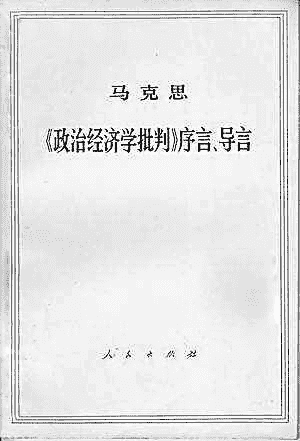

马克思《<政治经济学批判>序言、导言》，人民出版社

"经济基础决定上层建筑"，这个理论，相信你或多或少都有听过。马克思明确地指出，经济基础与上层建筑的关系：经济代表的是物质的基础，上层建筑代表的是精神层面的东西。他认为，物质决定精神，没有物质作为保证，也就没有资格去谈论精神。

经济基础决定上层建筑，上层建筑又反作用于经济基础。用马克思的原话，就是"人们在自己生活的社会生产中发生一定的、必然的、不以他们的意志为转移的关系，即同他们的物质生产力的一定发展阶段相适合的生产关系。这些生产关系的总和就组成了社会的经济结构，即有法律的和政治的上层建筑竖立其上，并有一定的社会意识形式与之相适应的现实基础。"

马克思的原话有点绕，但是他的意思大体上是说，一个国家或者是一个地区的经济发展水平，决定了这个国家的政治、文化，以及精神面貌等等内容，也就是说钱的多少、对金钱的观念决定了这个社会或者地区的观念、文化等发展方向。

#### 三、经济基础对婚姻的重要性

在婚姻当中，经济基础是一个极为重要的要素。对于这一点，我们实际上可以从两个维度进行理解。

首先第一点，就是在婚姻当中，仅仅拥有甜蜜的爱情并不能让婚姻持久，爱情之余，还是需要面包的。

东三省的情况就是一个最好的例子。

在东北，以老重工业为代表的经济发展模式，意味着没有办法及时进行产业的升级，而不得不面临产能落后、经济衰退的局面，而经济的衰退又必然导致越来越多原本在体制里享有安稳生活的人们被迫下岗，推到了市场的最下线。

他们下岗以后，失去了生活的来源，许多东北家庭的生活变得异常拮据。所谓贫贱夫妻百事衰，经济的缺乏必然会带来各种家庭矛盾，夫妻双方的矛盾很容易被放大，离婚率升高也必然会变成潜在的结果。

另一方面，越来越多的人选择走出东北，前往东部沿海发达地区就业。所以我们才会见到，这些年来东北经济整体不景气。外出务工，就会给婚姻家庭带来很多的不稳定因素。许多人是婚后不久就外出打工，夫妻感情基础并不牢固，两人长期两地分居，缺乏情感的及时交流，就会极易导致离婚。

离婚率增高的第二个原因，也是和经济因素有很大的关联，就是女性经济状况得到改善，女性群体愈发独立，他们可以自主地决定自己的生活。

民政局在 2018 年发布的一份报告中说，根据最高人民法院数据显示：有超过七成得离婚案件的原告都是女性。现在的中国夫妻在处理婚姻矛盾时不再像长辈这么"隐忍"，特别是女性。

过去，许多女性即使对自己的婚姻不满意，也不愿意去提出离婚，在婚姻当中更多的是选择接受，因为从前的女性缺乏经济独立，即使挣脱了父权和夫权，依旧无法在社会立足。

但是随着经济的发展，女性出外工作，她们拥有自己的事业，获得报酬以后实现了经济上的独立，自我独立的意识不断地被唤醒，那么此时如果她们不满足于婚姻现状，就比较敢于说"不"。

今天，伴随着传统观念发生风向变化，女性不进入婚姻，不再被看作是失败的或者悲剧性的。许多人意识到婚姻并是每个人都必须遵守的生活规则。越来越多的女性开始想要成就一番事业，开始正视自我价值和个人的发展，不再像从前一样将自己牺牲在枯燥的、数十年如一日的婚姻生活当中。

说得直接一些，相比从前，现在很多人对于感情会更加倾听内心的声音，而不是被传统价值观、长辈们的观念所影响。对于婚姻的去留，现代女性的自主权和自由度都提升了很多很多。

最近这些年，女性不断获得经济自主的权利，并且逐步唤醒了自我的独立意识。她们认识到，丈夫不再是她们生活当中的唯一依靠，她们自己可以在工作，以及其他丰富的生活，从丰富的生活当中获得满足。

另外一点是，越来越多的女性开始享受多元化的社会关系，而不是把自己锁在家里，过柴米油盐带孩子的生活。比如，她们可以享受和优秀的同性互相鼓励、一起进步的人生。对她们来说，友情不是爱情的替代品，而是彼此指引，互相给予力量。

在美剧《欲望都市》里，我们看到里面有四位各具特色的女性，她们实现着自己的事业和爱情理想，同时也有着牢固的友情，可以在遇到各种挫折的时候互相打气。爱情、婚姻对她们来说更多是探寻自我的一种内容，而不是人生的全部。

美剧《欲望都市》画面

#### 四、历史上的女性权益斗争

那么，女性是从什么时候开始，才真正走出家庭，反思婚姻制度对于自己人生的限制？看完了这几年的变化，我们来聊一聊，历史上，女性是怎样为自己争取权益，又如何影响到文化与社会生活的方方面面？

这里要向大家推荐一本名为《单身女性的时代》的书，作者名字叫丽贝卡\*特雷斯特（Rebecca Traister）。

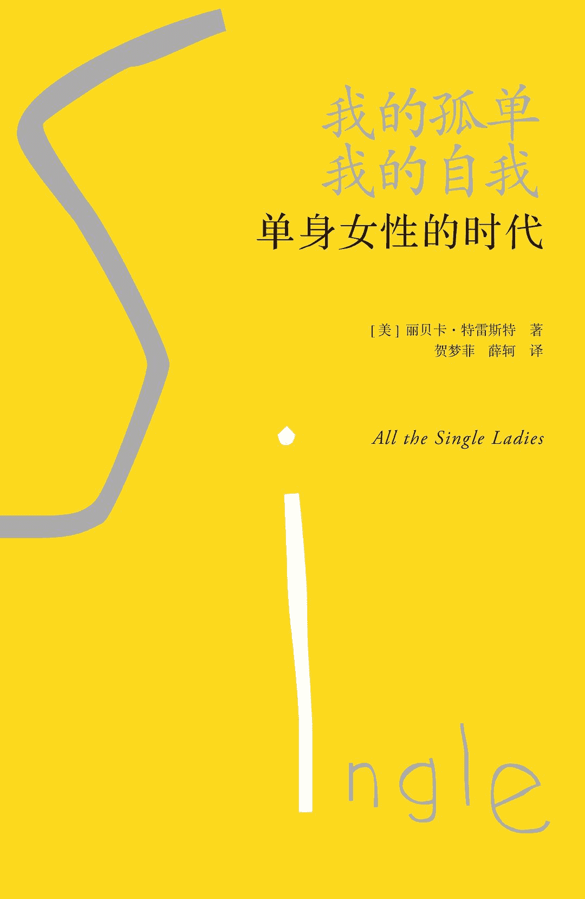

丽贝卡\*特雷斯特《单身女性的时代》封面图，广西师范大学出版社

丽贝卡是美国著名的新闻记者，在这本书里面，她通过聚焦单身女性这一群体，从近百个原始访谈中选取了约三十位美国女性的生活经历，发现当今这个时代，女性在思想、经济、两性关系上比以往来得更加独立自主。她们也有能力选择单身，不再像从前一样，需要依赖婚姻来改善自己的经济状况。

而在 19 世纪之前，在美国，几乎没有女性可以找到和另一半薪酬相等的工作，这对于大多数的女性来说，除了婚姻以外，并无其他途径，可以让她们获得稳定的经济来源和社会地位。未婚女性能从事的职业寥寥无几，并且薪水非常微薄，只能做助产士、裁缝、护理、家庭教师等职业。

到了 19 世纪，越来越多的女性投入到追求事业和学习知识的过程当中去。19 世纪美国最著名的女作家路易莎（Louisa May  
Alcott），她最有名的小说是《小妇人》，可能你也读过。这本书是她半自传体的家庭伦理小说，故事背景发生在美国内战时期，讲述了四个姐妹如何经历爱情、去追寻理想和不同的归宿。

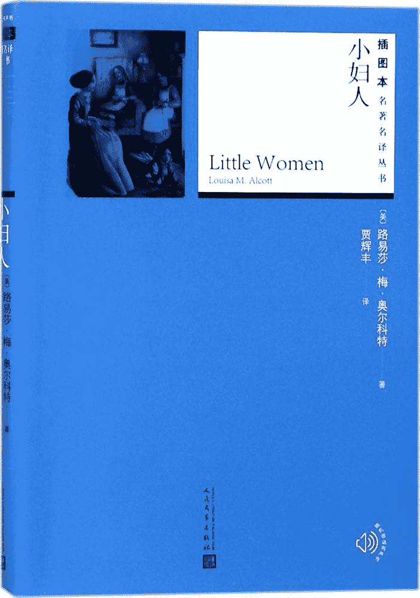

路易莎*梅*奥尔科特《小妇人》，人民文学出版社

无论是在小说里，还是现实生活当中，作者都非常注重女性的意识，并且身体力行地大力倡导女性独立，打破婚姻的枷锁。当年作者路易莎为了贴补家用，不仅做过教师、护士、裁缝等职业，还一直勤奋写作，可以说是 19 世纪少有的实现经济独立的女性。

到了 19 世纪末和 20 世纪初，是美国女性结婚率达到历史最低水平的时期，当时美国政治和社会出现了巨大的震荡。很多年轻女性迫于生计，纷纷跑去大城市寻找工作机会。女性的职业种类也很快开始出现多样化和现代化，譬如打字员、电话接线员、秘书、工人等。

所谓"经济决定上层建筑"，当女性经济状况的大大改变后，就让更多女性产生出了自我抗争的意识，希望为自己争取到更多的权益，甚至包括政治权利等等。于是，在那个时代，诞生了由女性领导和参与的第一场劳工运动。可以说，女性通过改变自身的经济情况，再加上经过一系列的斗争所取得的胜利，永久地改变了美国这一国家的性别政治。

从 1920 年开始，美国历史上女性公民首次获得了投票的权利。经过一个世纪的努力，女性的独立精神越来越强，美国女性为争取权利而发起的运动，彻底地改变了国家的命运。

到了 2012 年的美国大选，未婚女性选民的数量占到了全部选民数的 23%。大量的未婚女性选民，可以说是深刻地影响着美国的选民构成。当时的奥巴马为了争取总统连任，深深知道女性选民的重要性，他为了博得好感支持，还特地提出了一系列有利于女性的政策，对他最后获得摇摆州的胜利起到了重要作用。

美国女性的确在颠覆一切，影响着经济、政治和性别权利在两性间的分配。而大量的美国女性正在重新改写对于传统家庭的定义，也极大地影响着社会政策的制定。她们向世人证明，她们有着改变美国的力量。

从社会角度来看，这一百多年来，越来越多的女性不再只是把自己局限于家庭空间里，在婚姻中、在社会上，她们都有了越来越多的自主权、话语权和决定权。不论是主动选择单身，还是结束一段不满意的婚姻，恢复到单身状态，从个人角度来看，是独立意识的觉醒；从整个大环境来看，是社会经济发展的必然产物。

#### 五、社会学角度下的婚恋

早在 100 多年以前，恩格斯就预言，人类的家庭形式将伴随着生产方式的变化而变化。在中国，我们看到结婚率逐年下降，而离婚率却普遍升高，这一点已经成为趋势。女性个人经济状况的改善，以及整个大环境的变化，传统的观念受到了冲击，都对现代婚姻制度构成了重要影响，给我们大众带来了更多对于婚姻本质的思考和质疑。

在今天，伴随着市场经济飞速发展，人们受教育程度也相应得到了大幅提升，对于婚姻也有了更多新的理解。传统的婚姻观念，自然也受到了很大的冲击，甚至是完全的颠覆，可以说，我们已经迎来了一个全新的婚恋时代。

这样的时代是怎么样的？我们不妨仔细想一想身边的例子。在七八十年代，甚至九十年代初，身边离婚的人可以说是寥寥无几，很重要的原因之一，是那时候大家普遍都收入不高，消费能力相对来讲比较低，一旦变为单身，在抚养子女方面就会面临很大的经济压力。

所以，对于那时候的单亲妈妈来说，很多人可能会因为不是感情的吸引，而是因为沉重的经济负担而改嫁再婚。而今天的女性，就大大不同了，随着收入的增加，她们对个人生活的选择权也大大增加。

可以说，今天这一代年轻的中国女性，正在身体力行地，实践着自己的新婚恋观。

今天我们用马克思的"经济基础决定上层建筑"的理论，和你讨论了经济在婚姻当中的作用，经济对于女性自我意识的唤醒，对于婚恋和人生重大选择的一种改变，以及经济又如何影响着女性社会地位的变化。

我们需要知道的是，离婚虽是发生在夫妻俩人之间的事情，但放在社会学的眼光里，它远非仅仅是个人的感情问题，更多的是整个社会经济、政治、文化的缩影。等到三十五十年，甚至一百年后的后人来看我们今天讨论的感情问题、面临的婚姻状况，肯定就会像考古一样，从个人情感小世界里，可以窥见整个社会变化发展的宏大格局。

这也是我们为什么要学习社会学，为什么要用社会学的方法来思考问题的意义。很多时候，社会学可以帮助我们跳脱出个人的狭隘观点，拉到一个更为广阔的格局里面去认识问题、思考问题，并尝试着解决问题。

我是严飞，我们下一集再见。

# 07\. 阶级与分层：从纽约精英到北京蚁族

### 本集要点

1.马克思的阶级观

2.中国阶层的划分

3.《我是一个妈妈，我需要铂金包》《北京折叠》

### 文稿

你好，我是严飞。在今天的这一集里，我想重点和你聊一下，马克思的阶级理论，以及它的一些演变。

#### 一、寒门难出贵子

我在清华大学教书，在你的印象当中，这些来自全国各地的学霸可能都是"人生赢家"，他们每天生活在清华园里，应该没什么烦恼了吧。

但实际上，学霸里迷茫的人还真不少，经常有学生跑来和我说，觉得自己做得不够好，觉得自己没价值。有些人抑郁，甚至有一些人休学……

我接触到不同家庭背景的学生，有一些学生从偏远的农村、小县城来，他们到了北京、到了清华之后，才发现自己和大城市的孩子，和北京四中、人大附中毕业的学生不一样。这里的不一样可能包含了见识、家境、教育背景、对自己未来人生的梦想和期待等等。

比如说北京中产阶层的孩子，他可能在大一入学的时候，就已经去过了好多国家，在海外有交换项目，有苹果笔记本，读过很多的书。

但是，对于一位来自偏远农村的学生来说，他可能是第一次来北京，从来没接触过苹果的产品。他的视野和阅读深度都没有这些中产阶层家庭的孩子好。

这样，这些从"寒门"出来的学生们，就会有很大的心理落差，他们会更拼命学习，觉得自己可以通过学习来弥补。但是，在今天这样的信息化时代，有时候并不是靠简单地记笔记和学习，就可以在短期里弥补这些由于家庭背景而造成的落差。

有意思的是，2017 年北京高考的文科状元，一个 18 岁的高中毕业生，就说了这样一段话：

"农村地区的孩子越来越难考上好学校，像我这种属于中产阶级家庭的孩子，衣食无忧，家长也都是知识分子。而且还生在北京这种大城市，所以在教育资源上享受到这种得天独厚的条件，是很多外地孩子或农村孩子完全享受不到的。所以这种东西决定了我在学习的时候，确实是能比他们走很多捷径。"

这段话真实得让有些让人心头一颤，被很多网友评论为是大实话。一个青涩的少年，就已经清醒地意识到，自己是属于"中产阶级"家庭，有着如此明确而肯定的"中产阶级"意识，知道自己可以享受更多资源。

为什么来自"中产阶级"的孩子，就可以享受到优渥的教育条件，更富有的家庭，甚至可以花 650 万美金，把孩子送到斯坦福这样的世界名校去读书。而出身贫寒的孩子，却越来越难接受到平等的教育，要做出最大的努力，才能够改变自己的命运？

这几年，也许你经常听到和阶级或者阶层相联系的说法，比如"阶层跨越"、"阶层固化"、"阶层流动"。要了解"阶层"到底是什么，来自不同阶层的人，会产生什么样的自我认知，我们从社会学的角度来看，就有必要追根溯源，看看在马克思的理论当中，他是怎么定义阶级、分析阶级、分析阶层的。

#### 二、马克思的阶级观

阶级（class），是一个非常重要的概念，甚至是马克思理论的一个核心。英文的 class 翻译成中文，可以是阶级，也可以是阶层。我们在下面分析今天的中国社会结构的时候，更多采用的是"阶层"的分析框架。

阶级本身是个中性词。在马克思时代，"阶级"是一个崭新的工具，用来观察、描绘社会与经济行为，当时它并没有这么多复杂的色彩和含义。

怎么形容和定义"阶级"："所谓阶级，就是这样一些集团，由于它们在一定社会经济结构中所处的地位不同，生产资料的关系不同，在社会劳动组织中所起的作用不同，其中一个集团可以占有另一个集团的劳动。"

这句话什么意思呢？就是说阶级的形成和生产发展的一定阶段紧密相联系，是由人们在一定社会经济结构中所处的地位所决定的。

具体来说，阶级指的是，我们人类社会生产分工中出现的"垂直化分"。

说到垂直划分，那你可能会问，那水平划分是什么？我给你举个例子。

比如说，我们在盖房子的时候，你打石头，他砌砖，你和他的劳动是并列的，这就叫水平划分。但是当你打石头他砌砖的同时，还有个包工头负责指挥你们，那么在这样的情况之下，包工头和普通的石匠、砌墙工人之间的关系，就是垂直分工，这就是阶级。

也就是说，你参加生产活动的方式决定了你的"阶级"，而你的阶级反过来也影响着你看待生产活动的角度。

不同阶级的人，对生产程序和成果的看法可能是完全不同的。你在生产关系的体系里处在什么位置，就会站在这个角度去思考，怎么让自己的利益最大化，还会站在自己的角度提出对整套生产关系的想法，这就是"阶级"带来的"阶级意识"。

从"阶级"和"阶级意识"来看，不同阶级的人会对生产活动持有不同的利益主张，两者没有办法去跨越彼此的阶级立场，找出统一的利益主张或者运作模式。

马克思说过，"既然数百万家庭的经济条件使它们的生活方式、利益和教育程度与其他阶级的生活方式、利益和教育程度各不相同并互相敌对的时候，他们就形成了一个阶级。"

简单总结一句话  
，就是矛盾产生了阶级。什么意思呢？就是说，只有当人们意识到他们和别的群体有矛盾的时侯，"阶级"的概念才会真实地存在。当有人意识到这种矛盾，就形成了一个真实的阶级。每个阶级的存在，都是为了维护和扩大它自己的利益。

明白了阶级这个概念是怎么来的，我们再来看看，马克思对于阶级，还做了什么拓展。

我们都知道，马克思生活在 19 世纪，他主要定义或者区分出了两个阶级，第一大阶级是资产阶级，第二大阶级是无产阶级。

资产阶级指的是市场经济中的资本家，他们占有生产资料，雇佣了大量的劳动者。无产阶级是没有占有生产资料的被雇佣的人。这两大阶级是天然对立的。

而到了现代，工人变成了一种职业，而不再是一种阶级身份。工人们普遍享有各种福利待遇，享有晋升的可能，同时还有行业工会对他们进行保护，阶级之间不再是单纯的剥削和被剥削的关系，它们产生了一种合作共生。

但是世界没这么简单，除了资产阶级和无产阶级，随着这个社会的分工不断增加，人们从事的职业也不断丰富，阶级之间的划分越来越细，也越来越模糊了。

这是当年马克思来不及看到的现象，是他的时代局限性。

今天，你可能跟你的老板或者员工都是朋友关系，大家合作共事，不会觉得谁在剥削谁，或者谁在被谁剥削，这也是社会进步的结果。虽然我们没有了太多"阶级对立"，但是"社会分层"依旧存在，而且随着经济和科技的不断发展，社会分层的情况可能会愈来愈明显。

#### 三、从纽约精英到北京蚁族

刚刚跟你讲了马克思最早对"阶级"的定义和划分，还有发展到我们今天的社会，阶级发生了怎样的变化。

当阶级对立慢慢演化成了社会分层，我们该如何处理自己和这个社会的关系？下面我们来重点看一下，社会分层是怎么回事。

我想给你推荐一本书，叫《我是一个妈妈，我需要铂金包》。虽然这一书名挺通俗的，其实它是一本人类学的著作。作者是耶鲁大学的人类学博士。

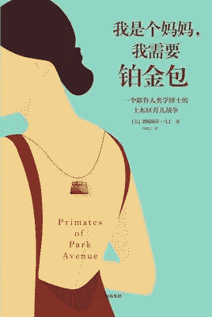

\[美\]薇妮斯蒂\*马丁《我是个妈妈，我需要铂金包》封面图，中信出版集团

这本书主要描述了纽约精英妈妈的育儿焦虑。作者原本住在纽约的西区，是一个典型的中产家庭。等孩子到了上幼儿园的年龄，她和先生咬咬牙，决定搬到拥有更好学区的上东区，也就是纽约的贵族聚集区。

这一搬，看似只移动了几条街，但是他们的实际生活却发生了彻底的改变。从孩子入学经历的种种残酷的考试，到作者一心为了融入精英妈妈圈层，不得已买了一只象征身份门槛的铂金包……可以说，作者在这本书里记录了她如何彻头彻尾地陷入了一场精英育儿战争当中去。

当一个上东区的贵族可一点也不轻松。他们虽然拥有巨额财富，但并不敢松懈，担心一松懈就可能会由富返贫。所以，他们对自我、甚至对智慧和外在美，都时时保持着一种热烈的追求与强大的自律。

某种程度上来讲，他们这种追求已经远远超出了人的动物本能，甚至有些超乎人性。

听到这里，你可能会有感触。美国作为先富起来的国家，消费主义至上、效率至上，他们产生阶层意识也比很多发展中国家要早得多。

说完美国，也回来看看我们。这些年，中国也在飞速地发展，那在中国，我们又是怎么划分阶层的？

社会学家陆学艺在他主编的《当代中国社会流动》这本书里，就对当代中国社会阶层的划分标准作出了说明。

他发现，人们凭借社会经验和主观感受会对人群进行分类，主要根据三大方面的标准：

第一点，是否有钱（收入高低或拥有多少财产）；

第二点，是否有权（在政府或企事业单位中的职位高低）；

第三点，是否有文化（学历文凭高低）。

在今天的中国，经济资源、政治资源和文化资源的占有量，决定了一个人综合性的社会地位，也决定了别人对他的社会性评价。

比如说，高收入人群，和在政府部门中占有重要职位的人，他们都处于社会的中上阶层，因为他们掌握更好的话语权、人脉和各种资源，往往可以通过一个精英的人脉圈子，有时候一个电话，就能把一些普通人困扰很久的、棘手的问题给解决好。但是那些低收入人群，来自郊县、农村地区的人们，他们就只能依靠自己，在很多事物上都没有发言权，只能以社会的弱势阶层存在。

所以，我们会见到，刚毕业的大学生拼命想要证明自己的价值，他们希望达成的目的就是超越祖辈、父母辈，在大城市里谋得一席之地。为了完成梦想，没有背景的年轻人往往会选择住地下室或者是城中村，就好像前几年我们在新闻报道里读到的"蚁族"现象一样，农村大学生想要改变命运、实现阶层跨越，就得付出更大的代价。

#### 四、折叠的北京

对于阶层的描述和想象，除了现实意义，也是很多文学作家关注的题材。很多科幻寓言或者乌托邦、反乌托邦的文学作品，都写过类似的内容。

离我们最近的是 2016 年郝景芳写的科幻小说《北京折叠》，这部作品获得了第 74 届雨果奖最佳中短篇小说奖。雨果奖的等级，相当于科幻界的诺贝尔奖，份量相当高。

在《北京折叠》里，作者用物理空间的方式，把北京分为第一、第二、第三，三个空间。

第一空间主要是权力和经济资源占有最多的人，第二空间可以说是中产阶级，第三空间就是底层的劳动人民，比如书中的主角，一名垃圾工人就是生活在第三空间。

在我们的现实世界，虽然在同一座城市里面生活，但是人和人之间，却有着严格的几乎不可逾越的划分，仿佛生活在不同的物理空间里面。

当然这样的情况放在许多城市都可以成立，比如也可以说香港折叠、上海折叠、广州折叠。越是国际化的大都市，来自全国的、甚至全世界各地的人都会蜂拥而至，想在大城市里赚到钱，改善自己的生活。

在大城市生活和生存的人的能力类型和大小本来就是不同的，这也就意味着不同阶层的社会分化就会越加明显。

但是生活在在小县城里，每个人占有的资源和各自的能力，相对来说差距没有那么大，同质性也更高，这也就意味着两级分化相对也不会那么大。

我们有见到在北京最底层的劳动者，基本都是外来务工人员，他们住在什么地方呢？其实除了做地下室的蚁族，还有许多人住在北京的郊区，基本是六环之外，许多是地铁的尽头，或者只有公交车，没有地铁。

很多是原本郊区或者是农村改造而成的棚户区，没有淋浴、冲水马桶，虽然名义上处在北京，但几乎所有的设施，都是过去农村的水平，甚至还比不上如今真正的农村。正因为这样，这些地方的房租也相对便宜，一个月一间屋子的租金只有几百块钱。

这些劳动者，他们到底是谁？

他们可能是你早上买煎饼果子时，问你要不要多加一个鸡蛋的阿姨，是你下班回家遇到的水果贩，是街上随处可见的穿着黄马甲、天不亮就出来清扫大街的环卫工人，也可能是街头巷尾帮你修鞋的修鞋匠，是你昨天下班回家吃的沙县小吃店的洗碗工，也可能是为你每天送外卖的小哥。

白天，他们默默地为我们的城市奉献着，晚上他们又远离城区，退回到边缘的地区居住。他们是这个城市发展建设中最不起眼、却是非常重要的一环，为我们的生活提供了极大的便利。

然而却因为受教育水平的低下、能力有限，只能出卖体力，长期处在社会的边缘。

我也曾经在一段田野调查中，和菜市场卖菜的菜农聊过。他告诉我他老家辛辛苦苦种田一年的收入，还比不上他在城市半年的收入。

在北京打工再苦，因为收入提高了，他觉得可能人生还是有希望的，自己多赚钱，可以让孩子接触到更好的教育、医疗资源，希望小孩未来可以超过他，不再去卖菜、不再送外卖。

他们也希望通过自己在大城市里微薄而拼命的努力，可以改变下一代的命运，让自己的孩子不用再走 hard 模式，可以有机会实现阶层的流动、上升。

另一方面，有房有车，看起来生活优渥的中产阶层，也对自己的境遇感到焦虑。在行业裁员面前，他们最大的担心就是失业。于是这两年，我们不断地听到 IT 高薪工程师绝望跳楼的新闻。

在高价学区房、巨大的升学压力面前，中产阶级们也把期待寄托在下一代身上。于是我们看到，"赢在起跑线"，甚至是"赢在子宫里"，看到家长眼里一场又一场输不起的育儿之战。这些实际上，都源于人们对自身所处阶层的不满足，源于人们一种想要向上流动、努力超越的欲望。

今天我们用马克思的阶级理论，跟大家讨论了阶层、阶层的流动、阶层的意识。在阶层不平等的现状之下，我们有看到教育的不公平、社会分配的不公平，还看到阶层的固化，社会底层虽然艰辛但却乐观豁达的努力。

无论是精英妈妈还是城市务工者，可以说，阶层的意识是在每一个人心中的。

我们学习马克思，其实一个很重要的点，就是透过马克思分析世界的视角，去重新认识我们的社会----看到社会中来自不同阶层的人，以及他们的故事。

我是严飞，我们下一集再见。

# 08\. 人性两重论：性本善还是性本恶？

### 本集要点

1.人性善 VS 人性恶的"世纪辩论"

2.人性的两重性

### 文稿

你好，我是严飞。从今天的这一集开始，我们将进入到一位全新的社会学家----涂尔干的理论世界。

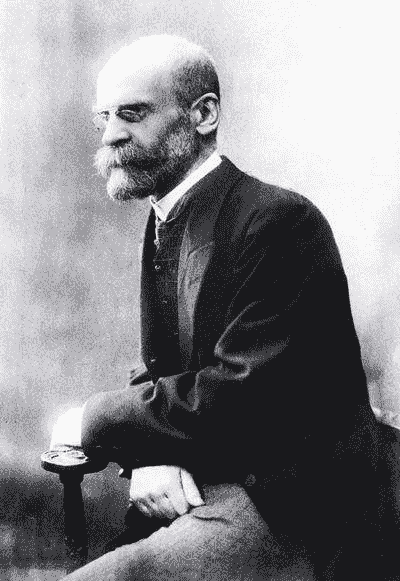

埃米尔\*涂尔干（Émile Durkheim，1858－1917）

#### 一、复杂的多面人性

我们常常听到一句话，"人性是复杂的。"也从小耳熟能详三字经里的第一句话，"人之初，性本善。"但是有的时候，我们又会听到另一种完全相反的说法，"人之初，性本恶。"

在我们的新闻里面，也不乏这样的报道，有一些穷凶极恶、杀人越货的坏人，他们在私下里，却是一位对父母孝顺至极的人。一位平时看起来像葛朗台一样的吝啬鬼，他对自己对家人都很小气，但其实又长期在坚持给希望工程捐款。

很多时候，人性是有很多面向的。人性，到底是善还是恶呢？如果我们可以确定地指出，人性的原本是善或者是恶，那又怎么解释在一个人身上可以同时出现两种截然相反的善恶行为呢？

#### 二、人性救赎的光辉

在我们今天的这一集中，我想先带大家回顾一部经典的电影----《辛德勒的名单》（Schindler's List）。这部震撼人心的电影，  
再现了二战时期一段拷问人性、再现人性的真实历史。

二战期间，德国法西斯在欧洲设立了无数的集中营，用以关押大批的政治犯、战俘、犹太人。在希特勒极端种族主义思想和政策的洗脑之下，集中营里的纳粹军官们变成了屠夫和杀戮机器，把杀人当成艺术一样孜孜不倦的追求。整个二战期间，集中营里面惨绝人寰的大屠杀夺走了数百万人的生命，成为我们人类历史上最黑暗的一幕。

这部影片里面的主人公辛德勒（Oskar  
Schindler）是一名德国商人。作为一名商人，他有着商人典型的精明和心机，非常善于利用各种关系去赚取最大利润，同时，辛德勒自己也是一名纳粹中坚分子。

1939 年，纳粹德国占领波兰之后，他们将犹太人划定在指定的隔离区里，准备施行大规模的种族清洗。辛德勒闻到了商机，他开始大量招募被逮捕的犹太人，以作为廉价的劳动力。有的时候，他只需要给党卫军军官贿赂一只打火机，就可以拥有一个免费的犹太劳动力。

此时的辛德勒，他虽然张开了双臂欢迎犹太人，但是心里面，却是将这些犹太劳工等同于赚钱的免费机器。如何赚取更多的金钱，是他作为商人的投机本性。

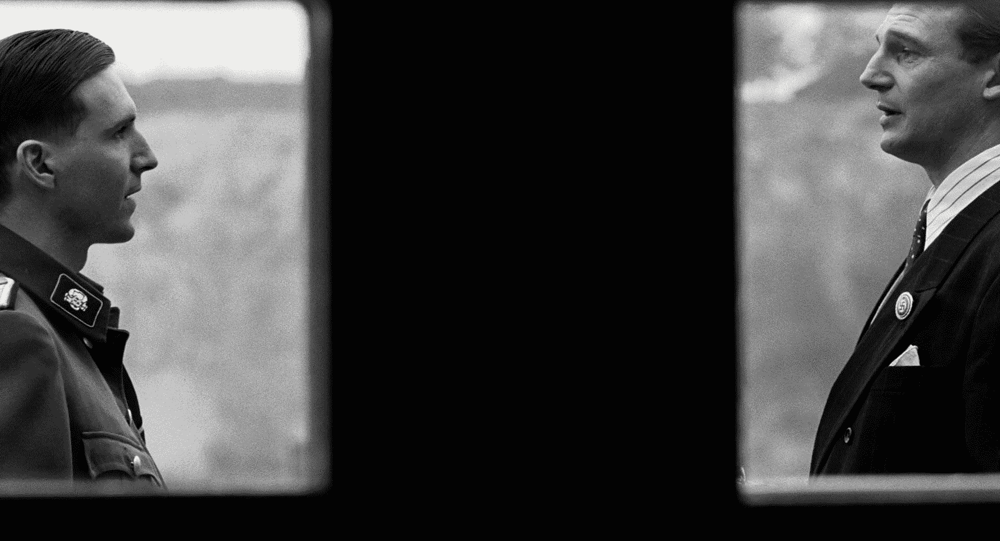

电影《辛德勒的名单》画面

但是对于这批犹太人来说，辛德勒的工厂却是逃避死亡的天堂。随着战争的深入，到了 1943 年，法西斯德国在集中营里，开始针对犹太人进行大规模的屠杀。在目睹了这一切后，辛德勒的良心受到了极大的冲击，之前被金钱所掩埋的人性从灵魂最深处爆发。

辛德勒于是开始想尽一切办法，用尽所有的财力从管理集中营的军官手上去交换被关押的犹太人----  
他们曾是历史教师、工厂工人、面包店店主、华沙城的富商，但是他们现在，都成为了辛德勒工厂里的技术工人。

到了影片的结尾，德国宣布投降，苏联红军进入波兰，辛德勒工厂里的犹太工人获得了自由，获得了解放，但作为纳粹党党员的辛德勒却不得已要开始自己的逃亡之旅。

辛德勒在自己的工厂里向工人们告别时，犹太工人们把一份自动发起签名的证词交给了他，以证明他并非战犯，同时他们还用敲掉的金牙和私藏下来的一些金首饰打制成了一枚金戒指，赠送给辛德勒。戒指上镌刻着一句犹太人的名言："It  
says whoever saves one life saves the world."（拯救一个人，就是拯救了整个世界）。

这一句话是那些为辛德勒所庇护的所有犹太人的一句肺腑之言。但是在这份礼物面前，辛德勒终于忍不住留下了热泪----  
如果我还可以多卖一枚戒指、多卖一枚手镯、顶针，我就可以多救一人。此时的辛德勒非常后悔没法救出更多的人，但是在他的工厂里，却有超过 1200 名犹太人因为他，而获得了拯救。

#### 三、"人性"的定义

那么，什么是人性？

我们说，人性是复杂和多面的。在《辛德勒的名单》这部电影里，我们见到德国的纳粹军官在集中营里以屠杀为乐趣的人性泯灭，那是邪恶时代的恶之花。

我们还见到另一种恶，那就是犹太裔著名政治思想家阿伦特（Hannah Arendt）所说的"平庸之恶"（the banality of  
evil）。这种平庸之恶用来描述普通人是如何成为残酷的帮凶、集体罪行的同谋。

那些参与国家罪行的人们，他们声辩说，我们只是帝国的齿轮，只是履行了自己的职责、服从了国家组织的命令，但是他们却并没有站起来，拥有反抗的勇气，承担起作为一个人的道德责任，从而丧失了作为人的尊严和品格。

我们也见到早期的辛德勒----  
作为一名投机商人，借助战争发财的人性贪婪，同时我们还见到了后期的辛德勒义无反顾地奋力解救犹太人的时候，所爆发出来的人性光辉。辛德勒不可谓没有过挣扎，但是在巨大的战争暴力与集体屠戮的吞噬之下，辛德勒最终选择了人性光明的一面，而抛弃了自己作为纳粹党员这一政治身份的要求，以及与犹太人的种族差异。

在这一刻，在崇高的生命面前，所有人都是平等的。如果我们没有看到曾经人性暗淡的时刻，我们也不会见到心灵的自我救赎和人性的发展。

启蒙运动时期苏格兰最为重要的思想家大卫\*休谟（David  
Hume）曾经这么说过，"人性的科学是一切科学的首都和心脏。一旦掌握了人性，我们就可以在其他各方面轻而易举地取得胜利了。"

可以说，人性在整个社会科学的发展历程中都占有十分重要的地位，正是因为人性的重要性，所以在不同的历史时期、不同的文化背景以及不同的社会科学领域里，不同研究者都有自己的人性信仰，所以致使人性假设被赋予了不同的面貌：性善论、性恶论；理性人、情感人；经济人、社会人等等。

#### 四、人性善 VS 人性恶的"世纪辩论"

在有关人性到底是善，还是恶的讨论中，最为有名气的，是欧洲启蒙运动时期的一场有关人性"大辩论"。

当然，这场辩论并不是像今天这样，辩论双方两人在一起同台进行唇枪舌战。因为"辩论"的双方，分别是活跃于 17 世纪的英国哲学家霍布斯和活跃于 18 世纪的法国思想家卢梭。

卢梭在教育学、社会学等人文学科方面都有突出的贡献，  
他相信人性本善，相信这种善性是构建出民主社会契约的根基。在他著名的《论人类不平等的起源和基础》一书中，卢梭详细谈论了自己对人与人性的理解，并且否定了十七世纪英国哲学家霍布斯所描绘的"自然人"的状态。

那我们先来说霍布斯的"自然人"是指什么。霍布斯的自然人思想其实就是建立在"性恶论"的基础之上的。对于霍布斯来说，人本质上是一种有欲望，并且不断追求欲望的动物。

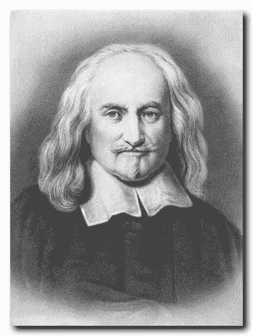

\[英\]托马斯\*霍布斯（Thomas Hobbes，1588-1679）

他将人类社会的"自然状态"理解为一种战争状态。在他著名的《利维坦》一书中，霍布斯对"自然状态"是这样描述的，他说："人们不断处于暴力死亡的恐惧和危险中，人的生活孤独、贫困、卑污、残忍而短寿……这种战争是每一个人对每一个人的战争。"

在霍布斯的眼里，战争不只在真实的战役行动当中存在，而是当人们有战斗的争夺意识的时候，战争就已经存在了。

在霍布斯笔下的自然状态是充满冲突和矛盾的，而他认为这种冲突的根本原因在于人性中的激情和理性。

霍布斯认为，人，会不断地在竞争、猜疑和争夺荣誉。在这三种激情当中，一定会为了自我的一种保全，而采取先发制人的措施，然后人的理性又会使人伸张权利和防范他人。

于是人与人之间的关系，就变成了每一个人对每一个人的战争，因为这是人最基本的生存的诉求。

《利维坦》所说的"利维坦"具体指的是一种威力无比的海兽，霍布斯用"利维坦"来比喻君主专制政体的国家。霍布斯对于人性的理解，造就了他把

一个强有力的主权者，也就是利维坦，作为裁断者和保护者的必要。

为了避免人和人之间彼此猜疑的一种状态，为了避免"所有人对所有人战争"的这样一种状态，霍布斯觉得，人们就应该在理性的指引下，相互间订立一种协议，彼此放弃每一个人的自然权利，并且将这种权利交付给一个能够制约所有人的强力组织，也就是国家的手上，应该无条件地服从国家的管理。

需要特别指出的是，霍布斯笔下设计的国家和我们今天所认知的国家并不完全相同。霍布斯的国家对于人民来讲，只有权力，没有义务。这个国家是绝对的专制主义国家，可以说，这里说的国家的成立目的就是为了限制人性中的恶的部分，避免战争状态的爆发。

那么和霍布斯相反的，在卢梭的叙述中，人不再是一种只追求欲望的动物，人还是有自然的善良天性。

在卢梭看来，人的善良天性当中，包含了两种先天存在的自然感情。

第一种是自爱心。自爱心是为了生存而具有的原始的、内在的、先于其他一切的自然欲念，只要顺其自然发展，就能达到高尚的道德。

第二种叫怜悯心。怜悯心可以使人的自爱心扩大到去爱他人、爱人类，从而产生出仁慈、宽大等人道精神。

当下我们在事不关己时的冷漠，正是这个时代怜悯心缺失的体现，而且人们的这种麻木与冷漠也在一定程度上纵容和鼓励了某些恶行。

卢梭是社会契约论的坚定支持者，也是人类平等的倡导者，如果人性都是坏的，本性都是恶的，那么，还会有人去遵守契约精神吗？还会有人愿意去平等对待别人吗？显然不会。

因此人性本善是卢梭的社会伦理体系的一个逻辑基点，是一个不可回避的前提假设。

#### 五、人性的两重性

那么在介绍完卢梭和霍布斯关于人性善恶的不同思想之后，我们还要重点和大家介绍涂尔干的社会学理论。

在之前我们提到过，在社会学领域里，涂尔干与马克思、韦伯并列为社会学的三大奠基人，涂尔干是我们学习社会学理论必须谈及的一位经典的社会学大家。

在 19 世纪末至 20 世纪初，当时世界上还没有"社会学"这个专业，是涂尔干在 1887-1902 年执教于波尔多大学的时候，他创办了法国第一个社会学系，也成为了法国第一位社会学教授，可以说涂尔干以一己之力推动了社会学作为一门学科的发展。

和其他所有的人文社会科学家一样，社会学家涂尔干也十分重视对于人性的假定和研究，在他的著作《宗教生活的基本形式》的开篇，他就以非常坚定的语气告诫读者："社会学的主旨，不仅在于了解和重建已经消失的各种文明。相反，和所有的实证科学一样，社会学所要解释的是与我们近在咫尺，能够对我们的观点和行为产生影响的'人'。更确切地说，就是今天的人，因为这才是我们最想了解的东西。"

在今天的这集当中。我们会重点给大家介绍涂尔干的"人性的两重性"，他用这一社会学的术语分析了社会是如何塑造出人性的。

两重性，听上去似乎很深奥，但是实际上用通俗的话说，就是人性有两大面向，两大维度。在涂尔干看来，所谓的人性二重性，是指人性可以拆分为心灵（mind）与肉体（body）两大维度进行分别的理解。心灵与肉体的互相纠缠，就构成了人性。

按照涂尔干自己的说法："人一方面是神圣的，一方面是凡俗的。这种神圣与凡俗的两重性对应的是我们同时具备的一种双重的存在：一个是扎根于我们有机体之内的纯粹的个体存在，另一个则是社会的存在，它是社会的扩展。"

让我们先来看看肉体这一维度。人的身体的本能，是为了满足原始的欲望和冲动，这是一种完全的自然性的个体表现。但是单纯的身体存在并不能构成一个完整的人的存在，因为我们作为人，还会有道德思维、社会交换、人际活动；同时，道德、交换、社会互动这些都来自于社会，都是具有社会属性的。

人只有通过社会活动、集体的互动才可以获得人的神圣性，并凸显出人之所以为人的本质。如果社会没有人的神圣性这样的维度，只剩下身体的本能冲动与欲望，完全任由自己的动物性引导着自己的行动，那么我们整个社会就会全部垮掉。

其次，我们再来看一下心灵的维度。在心灵这个维度上，人都有个体的私心和私欲，同时也会有集体的道德和意识。个体之心是个人沉重的欲望和贪念，有着人性中的利己、非理性的一面；而集体之心则是道德和灵魂的救赎，有着人性中的利他、理性的一面。

在社会活动当中，我们会见到，人们在做事情的时候，会遵守互惠的原则，并且这种互惠性，更多的不是今天我为你做一件事，未来我也期待你为我做一件事的那种功利性的互惠，而是建立在彼此信任、依赖的基础之上的利他性互惠。

对此，涂尔干进一步指出，"各种激情和利己主义的倾向就来自于我们的个体之心，而我们的理性活动，无论是理论上的，还是实践上的，都依赖于社会的因素。"

我们常说，人一半是天使、一半是魔鬼，一半是义务、一半又是纯粹的自由，其实说的就是在我们的人性深处，个体的私欲和集体的理性之间不断发生着冲撞。

既然涂尔干说，"人一方面是神圣的，一方面是凡俗的"，那么如何才可以建立起一座桥梁，去架接起人在整个社会生活中的神圣性和凡俗性呢？换句话说，我们如何才可以将人的肉体和心灵、将人的个体之心和集体之心紧密地连接在一起，塑造出一个完整的人？

对此问题，涂尔干又专门引出了良知（conscience）这一社会学概念。所谓的良知，是指每个人内在的一种理性正义的准则。

良知既是个体的，又是集体的。

对于个体来说，它是一种在不损害他人利益前提下的追求自由的状态。

对于集体来说，良知则是一种义务，它会帮助社会成员凝聚向心力，将集体意识不断带入个体的内心当中。每一位个体成员都会通过集体意识的习得，成为社会人，并且可以通过自我的不断地表达融入社会，从而增强社会团结。

人们时常会发现，有良知的人往往是在和个体利益毫无关系的时候出来讲话，因为他对集体和群体负有义务。

在电影《辛德勒的名单》当中，我们就见到，原本作为商人的辛德勒最终站出来拯救犹太人，与其说这是他的人性觉醒，不如更准确地说，是他内心的良知，带领着他抛弃个人的利己私欲，他去回应一种社会道德的要求，并试图唤醒整个社会的集体良知。这样，他才是一位神圣的人。

#### 六、你我皆凡人

你我皆凡人，当善战胜一切，深刻理解对生命的敬畏的时候，或许就成为了一个平民英雄。善念与恶念之间的切换，人性的变幻其实不需要仅仅发生在那些颠沛流离、人性面临极度考验的战争年代，其实更多的时候，就发生在我们生活的细枝末节里，生命的关键转折中。

在过去的几世纪里，古今中外的哲学家、思想家们都对人性的善恶进行了孜孜不倦的探索，有人支持性本善，有人认为性本恶。而涂尔干却给了我们一个新的综合的视角去看待人性的问题。

涂尔干的"人性的两重性"启发我们：一个完整的人是世俗的，又是神圣的，利己主义和利他主义共存的。

在日常生活中，我们既要摒弃"他人即地狱"，也不应该一味地认为人都只有善良的一面。可以说，涂尔干形成了比较完整的人性体系，这种对于人性的认知，构成了涂尔干对社会的分化和整合的基础。

我是严飞，我们下一集再见。

# 09\. 道德教育：人性如何被教育？

### 本集要点

1.教育现状

2.涂尔干道德教育的三大要素

3.现实教育的走向

### 文稿

你好，我是严飞。那在今天的这一集当中，我将用涂尔干的道德教育理论，和大家讨论一个非常重要的问题：人性如何被教育。

#### 一、"填鸭""拔苗"式教育

在今天，教育是一个非常重要的热门话题，我们对教育也不断地进行批评。

譬如说，在学校里，老师们施行的是一种填鸭式的教育，老师给学生不断地灌输各种知识、技能和要点，要求学生们在极短的时间里要熟练地掌握，要把一个词、一句话不断地抄写、背诵。

在家里，父母实行的又是一种拔苗式的教育，他们急切地期待自己的孩子可以比别的孩子更加优秀。所以他们会把自己的孩子送到不同的培训班，譬如说，送到学而思去学习奥数，送到艺术培训中心学习舞蹈、绘画等等。

那在这样的填鸭式教育和拔苗式教育的背后，当然有被大环境所催生的焦虑和压力，也有父母们想要弥补自身的遗憾，想让孩子们更上一层楼的雄心勃勃。

但是除了填鸭式教育和拔苗式教育之外，在我们的身边，也不乏有另外一种人，他们试图身体力行地改变当前的一种灌输式的教育模式。他们认为，教育不是工业化的生产，不是制造标准件，用大工业时代的理念来做教育显然是没有办法提升人品、改善人性的。

我就有一位朋友，她几年前突然发现，没有办法给自己的孩子在北京找到合适的学校，于是就果断地和丈夫一起，在北京的郊区自己办了一所学校，按照自己的教育理念，去培养那些不愿意接受这种灌输式教育的孩子们。在我这位朋友看来，教育的目标，不是一定非要上名校、挣大钱、买大房子的人生成功学。

作为教育者，我们要做的是打破教育的既定范式，除了教授知识，我们也要培养一个完整的人。我这位朋友和我说，她在探寻新式教育的过程中，希望更多的是能够发挥孩童的主动性，极大程度地给予他们爱和自由。

#### 二、多样的教育观念

不同的教育目的和价值，造就了不同的教育方法和路径。其实，对于现存教育制度的争议和创新的探索，并不是我们这个时代所特有的。

诺贝尔文学奖得主罗素就曾经因为看不惯当时的各种教育制度，以及陈腐的传统观念，提出了一系列全新的教改方案。罗素认为，事实上，儿童生来既非"善"，也非"恶"，他们生来只有包括反射特性在内的几种本能，因此，无论健康或者病态的习惯实际上都是在周围的环境作用下所养成的。在起步阶段，儿童的本性具有难以置信的可塑性。

罗素非常重视幼儿道德习惯的培养，重视幼儿的求知欲、学习的主动性和独立性，并且提出要给儿童以较多的自由，反对压制和强制，认为不可以将子女作为父母的附庸或者是私人财产，应该建立起正确的亲子关系，注重性别以及教育的平等。

带着这样的教育理念，1927 年，罗素和他的妻子一起在英国创办了一所学校----比肯希尔学校（Beacon Hill  
School），这所学校一直办到 1943 年，是当时英国最著名的新学校之一，也是 20 世纪上半期英国最著名的新的教育实验场。

对于我自己而言，我曾经在中国、英国、美国求学很多年，现在又作为一名大学老师在教育行业里进行教书育人的工作。我常常也在思考：现代教育的本质是什么？功能又是什么？德国哲学家康德说过，教育最大的秘密,是使得人性完美，这是唯一可以做的。

在今天的这一集中，我将和大家继续围绕人性，从社会学的角度，深入探讨我们需要用什么样的教育方法来更好地塑造人性。

#### 三、道德教育的三大要素

我们在之前的一集里，讨论了涂尔干关于"人性与道德"的理论分析，也知道他是社会学古典理论的三大奠基人之一。涂尔干除了他经典的有关社会整合、社会分工的理论之外，其实他的教育学思想，也非常值得我们学习。

在教育社会学的领域里，涂尔干写了一本书，名字叫《道德教育》。他把道德教育放在教育领域里一个非常重要的位置上。

什么叫道德教育？你可能会觉得这有什么复杂的，不就是让一个人尽量道德高尚，不做坏事吗？还真不是这么简单。我们都知道法律是一个社会的底线，是有明确的条文规定的，法律禁止的，就是不能做，做了就犯法。

但是道德就很玄乎了，道德更像是一条模糊的约束，在每个人心里都有高有低。如果我们自己都不清楚，什么才是真正的道德标准，那我们到底应该怎么去教育孩子，让他们拥有更高尚的道德呢？

涂尔干在《道德教育》里，他也说，"我们不能列出一张能够把所有德性，甚至最重要的德性都包含在内的完整清单。"

那怎么办？既然这条路行不通，涂尔干就完全跳脱了这样的传统思维，他不去试图明确到底什么才是高尚的道德，什么是低俗的无德，而是把一个人的道德放在整个社会体系里去观察。只要弄清楚，一个人跟社会相处得好不好，就可以明确这个人的道德是不是够"好"。

在书里面，涂尔干把一个人的道德教育分成三大要素：第一是纪律精神，第二是依恋精神，第三是知性精神。

让我们先来看一下这三大要素具体都是什么。

首先是纪律精神。纪律精神指的是，在日常生活当中对行为准则的一种遵守，以及对自我欲望的约束和节制。换句话说，就是一个人在社会里，该怎么约束自己。

对于孩子们来说，他们的天性就是爱玩、倔强、不要懂得约束自己，所以教育的目标，就是引导孩子，培养他们遵守日常规范，养成一种行为准则。

那么，具体又该怎么培养这种纪律精神呢？这里，涂尔干提到了"惩罚"。

他认为，惩罚和纪律规范是联系在一起的。惩罚可以保证纪律规范的道德权威，从而可以培养孩子们的纪律精神。

但是，值得注意的但是，涂尔干所说的惩罚，并不是我们在学校和家庭教育里常见的体罚。在涂尔干的分析里，体罚和暴力惩戒都是背离文明走向的。惩罚的本质，并不是为了让犯了错误的人赎罪，或者是为了威胁恐吓其他想要违反纪律的人，惩罚的真正作用是维护良知。

如果我们放眼历史，就可以发现，在人类文明的进程里，我们是从压制性制裁，转向恢复性制裁的。简单来说，就是法律里的酷刑越来越少了，监禁之类的制裁逐渐变得越来越多了，很多国家和地区都在讨论或者实施废除死刑。在涂尔干看来，这是文明进步的表现，也是我们应该去思考怎么进行惩罚的大方向。

在我们的传统观念里，惩罚好像都直接指向暴力、威权，这种方式虽然往往最直接有效，但是对个人的伤害也是最大的，对道德教育也是最不利的。

在学校和家庭的教育里，很多大人们树立威权的方式，其实是错误的。他们树立威权的方式，就是体罚，老师和家长们经常用这种方式来维护自己的威严。

在现代社会中，体罚却是一种违反道德的做法。那是因为体罚公然地侮辱了我们整个道德的情感基础，也就是侮辱了我们对于人的尊重、对人性的尊重。

我们经常看到一些新闻里，老师对学生进行体罚，造成师生关系很紧张，学生因此受到打击，患上心理疾病。那么在学校里，如果不用体罚这种极端、暴力的方式，老师还可以怎么树立权威呢？

去年有部关注度很高的电影，名字叫《狗十三》，讲述了一个叫"李玩"的青春期少女的成长故事。可能很多人都对这个角色有共情，在她身上看到似曾相识的童年经历。

电影里有一段李玩挨打的戏，是影片的一个重大转折点。

当父亲的拳头和巴掌打上身的时候，李玩失去了从前那股子较劲的倔强，失去了一个少女对这个世界的正当反抗，学着做一个不给长辈找麻烦的孩子，而不是真正的自己。

在暴力和压制下成长的小孩，会失去独立思考的能力，只能做一头顺从的绵羊。因为他们可能没有想过，为什么要听话？即使想过，也会因为知道，反抗根本没有用，而只能做一个"听话"的小孩。

按照涂尔干的理论，我们可以看到，学校的道德教育更多的是需要正面引导，而不是暴力惩戒。他认为道德教育，最重要的目的之一，就是要在儿童身上激发出一种人类的尊严感。而惩罚不只有体罚这一种，体罚是对这种感情的亵渎。

我们可以参考涂尔干在《道德教育》里的一种观点，就是，惩罚不过是一个可以感受到的符号而已，一种内在的状态被这个符号表现出来。实际上，惩罚是必须的，只不过我们其实有更聪明的方式来进行惩罚，比如减少电子娱乐的时间，对零食进行一些限制，或者在小范围内，进行一些奖励评比等等。

让我们再回到涂尔干提出的，道德教育的第二大要素，就是对社会群体的依恋。也就是说，一个人应该怎么和他人相处。

我们都知道，孩子天性里都有利己自私的一面，我们也经常看到小朋友们，为了争抢玩具哇哇大哭。但与此同时，孩子们天性里又有利他的一面，他们也会主动地和别的小朋友分享自己的玩具。在这里，我们应该怎么引导孩子和他人相处，这就需要参考涂尔干所说的"对社会群体的依恋"。

涂尔干认为，纯粹利己的、以自我为中心的生活是不可取的，这就需要从孩童时代起，通过教育的手段，去不断地挖掘、塑造孩童对周边事物以及人的依恋与同情，这才能培养起来他们的利他主义观念。只有当孩子们超越自身的狭隘范围，感受到群体生活的团结，才可以为未来生活构建一种公共意识。

那么，怎么培养这种对于社会群体、对于集体的认知和依恋呢？有一个很易于操作的教育方法，就是老师们在教育过程里，多说"我们"，而不是"我"。这样，就可以潜移默化地培养孩子对于他人和集体的重视，感受到自己是"我们"中的一份子。

对此，涂尔干就说过："在说'我们'而不是'我'的时候，总有一种快乐在里面。因为任何一个可以说'我们'的人都会感受到，他身后有一种支持，一种他可以凭借的力量，一种比孤立的个人所依凭的力量更强有力的力量。我们更有把握、更加坚定地说'我们'，这样的快乐也会随之增长。"

第三个要素，是知性精神。涂尔干认为，知性的运用可以使儿童获得自主和自决的精神。教育的启蒙，并不是向儿童灌输知识，而是启发儿童在具体的生活情境当中主动运用理性、运用道德，认识到社会秩序的重要性、遵守规范的重要性，从而形成一种内化的社会态度。

换句话说，知性精神，就是一个人应该怎么主动地、理性地思考。

你可能会好奇，为什么第三个要素里强调自主，而第一个要素里却一直在说纪律呢？这两个要素是不是看起来有点矛盾？

这里说的自主，不是漫无目的的自由，而是告诉我们，要对自己的行为、对自己的目的有所了解，并且能尽可能清晰地明白这些理由。这样的思考过程，才是我们的自觉意识。你知道自己要怎么做，并且知道为什么要这么做，这才是知性精神升起的时刻。

涂尔干强调道德教育既不是布道，也不是填鸭，学校的教师不应该无休止的重复道德信条和规则，告诉孩子们，这就是对的，那就是错的，你必须要接受我所规定的对错标准。恰恰相反，好的道德教育，是要引导孩子理解他们所身处的社会，使他们具有社会责任感，同时促使他们自觉参与到集体事务当中去，履行道德的自律。

涂尔干对道德教育三大要素的强调，实际上，秉承了他对道德秩序的关注。道德有助于维护社会秩序，而有秩序的社会也可以更好地进行道德教育，而如果社会陷入失序的局面，则需要进行道德的重建。重建道德秩序，就更加需要包含有纪律精神、群体依恋精神和知性精神的道德教育。

从这层意义出发，道德教育具有把学生和社会连接起来的功能，这样才能使孩子很好地在社会当中适应和生存，并且不断建造社会。

#### 四、现代教育的走向

我们刚才讨论了罗素，讨论了涂尔干道德教育的三大要素，他们的共性，就是这些思想家都提出了教育人性的方式，都强调要在孩子的早期进行培养，对孩子给予自由、爱和自我认知的教育。

那么，究竟什么是真正的教育？

我们从涂尔干的道德教育里学习到，教育的真正目的是培养品格而不仅仅只是传授填鸭式的教育知识。生命初期对于人一生的意义比我们想象得要大，正因为如此，品性教育、道德教育在人生的早期就显得尤为重要。

卢梭自己就说说，"要抛弃那些不适合于我们的天然的兴趣的东西，而且要把学习的范围限制于我们的本能促使我们去寻求的知识。"

卢梭就一直提倡，要从生活经验中推理、从实践中感悟。在青年具备理性推断能力后，他才可以与社会自由地接触，既具备生活技能，也具备理解社会的能力。

在涂尔干提出道德教育 100 多年之后的我们，我们所面对的时代当然已不复从前，伴随着人们生活水平和现代化技术不断提升，人们的需求水平也在不断提高。那么教育，这一古老的话题，是否又有了新的命题？

在我看来，真正的教育，是在尊重孩子成长的自然性、自主性基础上，培养和引导孩子的自由意志、独立人格，帮助他们理解是非善恶，从感性经验的学习当中形成正确的价值判断和观念取向，在这之后再进一步去培养理解社会的共同意志和公共价值。

因此，我们的教育，应该把重心放在培养人性当中的自爱心和怜悯心上，放在培养孩童的公共人格上。那么，假如不是这样去培养孩子的自爱心和怜悯心，我们的孩子会变成什么样呢？

在这里，我想向大家推荐一部纪录片----《请为我投票》（Please Vote for  
Me）。这部纪录片拍摄于 2007 年，并且在 2008 年，入选了奥斯卡最佳记录长片奖的名单。这部纪录片用镜头真实还原了我们现今强调服从、强调竞争的教育模式所带来的种种弊端。

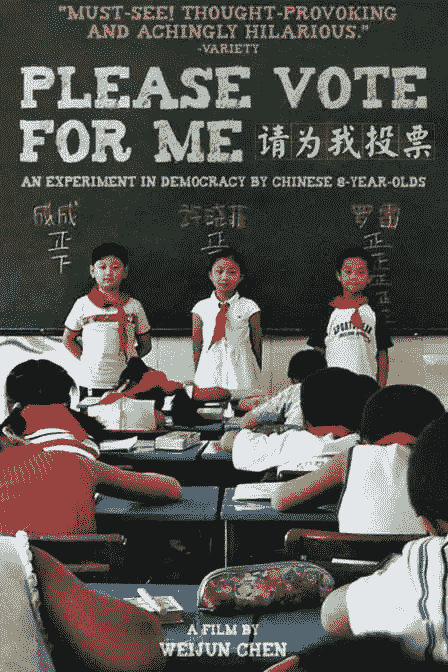

纪录片《请为我投票》海报

纪录片里所拍摄的故事，发生在武汉的一所小学里，镜头完整地记录了在一次班长竞选活动中，三位竞选班长的八岁孩子和背后出谋划策的家长们，如何一同上演一出充满戏剧性的"民主游戏"。

班长这一头衔，意味着班级里的权力，再小的权力，也会让人沉迷。为了当上这个班长，三位竞选的学生并不是将精力放在准备竞选纲要上，而是采用了不少有违公平竞选原则的场外手段。

比如说，有一位候选的小朋友在其他候选人进行才艺表演的时候，鼓动自己的支持者起哄；另一位候选的小朋友则拉上好友结成了小帮派，承诺如果自己成功当选为班长，就让他们当劳动委员、文艺委员；还有一位候选的小朋友更厉害，他的父母直接组织了一场全班同学的免费高铁郊游，以换取全班同学的支持，"如果我当上班长，未来这样的郊游活动会越来越多"。

三个孩子不遗余力地表现自己，贿选、诋毁、拉选票、结小帮派，但凡成人世界中的尔虞我诈，在这场班长竞选中，都得到了淋漓尽致的展现。

在这部纪录片里，我们见到，本来应该是通过班长竞选，来培养孩子对于民主、程序正义的理解，但是却在实际操作中变了味道。对于孩子们来说，他们自己肯定会有争胜之心，但是采取何种手段去争取，这背后脱离不了老师、家长的灌输和引导。

教育这一神圣的使命本来应该如卢梭的教育理念中所说的这一般，对孩童进行天性的引导，培养自由人格和良善品质。但是，当老师纵容孩子在他人汇报时起哄，当家长掏钱来组织免费的高铁郊游时，我们的教育就偏离了轨道，丧失了它最初的功效。

我们的教育目的，变成了加速孩童的成人化、社会化，强调人的集体性和服从性。孩子们学习到成人世界的社会规则，甚至是潜规则，譬如如何察言观色，搞好和组织中领导的关系，如何在组织中拉帮结派。如何通过金钱和权势拉拢其他同学，而忽略了如何用孩子的方式去处理同伴之间的友好竞争关系。

在这样的教育之下，这些孩子很在心灵的内化上没有办法真正地有所成长，真正地去思考自己的错误和进步。因此，我们才会见到，这些孩子长大后，变成了所谓的巨婴，变成了丧偶式育儿的主角。

今天我们谈了很多有关教育的理论和生活中的例子，这是一个很广泛、也很深刻，很大众、也很个人的问题。

说到教育，好像我们每个人都可以评论上几句。对于中国来说，当前社会正处于转型时期，也在一定程度上出现了涂尔干所说的道德真空状态社会舆论动不动就把矛头指向"道德滑坡"、"国民教育的缺失"，而涂尔干的理论给我们指了一个方向，那就是通过着眼于个人与社会的关系，来深入研究道德教育的问题。

在我们这样的转型社会中，当传统的信仰价值体系处于危机时，人性更加需要道德教育的甘霖来滋润，这是一件非常紧迫的事情，也是一件需要从幼儿、童年时期就开始着手去做的事情。

最后，留一个开放的问题给大家一起思考：过去接受的教育对于现在的你产生了怎样的影响？假如可以选择，你们希望可以获得什么样的教育呢？

我是严飞，我们下期再见。

# 10\. 社会分工：家庭主妇是不是世界上最容易又最困难的工作？

（公众号懒人找资源，懒人专属群分享）

### 本集要点

1.对全职主妇现状的思考

2.社会分工理论

3.人与家、家与社会的关系

### 文稿

你好，我是严飞。在今天的这一集当中，我想和大家讨论一下涂尔干的社会分工理论。

#### 一、高危职业"全职主妇"

2018 年 6 月 27 号，长沙有一位二胎妈妈，她因为产后抑郁症，选择从高楼纵身跳下，当场就没有了生命体征，留下两位年幼的孩子。

人间悲剧，闻者落泪。然而比这更悲剧的，是这位妈妈生前得了产后抑郁症，但是却一直都缺少家人的关怀和疏导。这位妻子全职在家带娃、做家务，但是她的丈夫却将这视为理所应该的事情，对她的心理疾病完全忽视，并且没有任何给予及时的帮助和理解。

我们无法想象，这位全职妈妈在生前曾经多么无助，才做出了这样的抉择。而且这样的事情并不是个案，有人说，全职主妇是个非常高危的职业。

的确，在我们的世界上有一种职业的工作时间比互联网企业的 996 还要漫长，这一份职业就是家庭主妇。她们每天从早忙到晚，是真正的 007，并且一年 365 天都没有办法休息，而且可能没有任何报酬，还要经常承受各种的精神压力，甚至还不被自己的丈夫、自己的父母认可  
\----这是一份工作。

因为她们每天做起来的事情看起来都比较容易，会被人说，你每天不就是带带娃、做做饭、洗洗碗？而带着这样的固定思维，我们的影视作品里，很多时候，全职太太通常也会被描述成不讲究、平庸、狭隘、绝望、怨气重、格局小的形象。

但是，我们抛开这些偏见，再仔细地想一想：家庭主妇其实是不是世界上最不容易的一份工作？她们需要一边 24 小时不断地和熊孩子们斗智斗勇，同时，还要处理好夫妻关系，忍受着这一份没有升职加薪、也不存在任何职业规划的工作。

她们是我们每一个小家庭里的一个分工，而这个分工，从某种意义上来说，让我们的家庭成员之间的连接更加紧密、更加团结了。

如果有一天家庭主妇罢工了，可能没有一周的时间，我们的家里就会像经历了一场革命一样。也许你可以说，我可以上网去找家政阿姨来打扫卫生，也可以每天叫外卖来解决吃饭的问题，但是，原本熟悉的家的味道就不见了，一个非常重要的纽带就消失了，你爸爸和你可能还会互相埋怨。不相信的话，你真的可以试一下。

那么，我们应该怎么来看待家庭主妇这个社会分工呢？当我们抛开一些固定思维或是一些偏见，带着社会学的角度去，是否可以帮我们更好地理解家庭主妇到底是一种什么样的社会分工，理解我们每个人在家庭中的位置呢？

#### 二、社会分工论

首先，我们来了解一下，什么是社会分工。"分工"这个词，首先是由古典经济学家亚当*斯密提出来的，但是亚当*斯密对它的运用只是局限在经济的分析领域，人们始终没有意识到它对社会所形成的重要意义。

劳动分工的作用不仅仅在于以分化方式提高劳动生产率，还在于这些被分化的不同的功能，它们在社会意义上，可以彼此更加紧密地结合在一起。

那么是谁最早意识到分工对社会的重大作用呢？就是我们在这几集里一直在讲的法国社会学家涂尔干。他最先提出来，

分工只有在社会层面上才有意义，这样一个非常重要的论述。

在 1893 年出版的《社会分工论》这一本书里面，涂尔干就明确地指出，两性分工在所有分工里是最为原始、最先发生的，假如两性的活动没有区别开来，社会生活的形式完全就不可能产生。随着社会的发展，社会对人所起到的作用也在日益扩大,人们处在不同的职业里，大家各司其职，做着不同的细分工作，人和人之间的差异也因此变得越来越大。

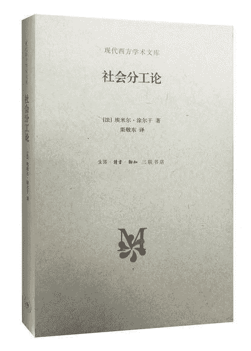

涂尔干《社会分工论》封面图，三联书店

但是，这种差异性，并没有让人和人之间越走越远，反而是通过不同的社会分工，人们才可以相互紧密地连接在一起、团结在一起，并且产生彼此之间的深深的依赖和合作。

换句话说，社会的分工越加细密，人和人之间的差异就会越大，但是与此同时，人和人之间的依赖性也越强，各阶层各职业的人都在发挥一定的作用和功能，用来维持社会秩序的基本运转。社会因此会变得越来越坚固，从而形成了涂尔干所说的有机团结（organic  
solidarity）。

那什么是有机团结？

有机团结所相对的是一种前现代社会的机械团结（mechanical  
solidarity）。在这里，前现代社会指的是，譬如原始社会，譬如说，一种传统的农业社区。机械团结就是将同质性的社会成员高度地结合在一起，强调的是一种集体意识，而非有机团结中强调的是个体差异。

对于涂尔干来说，有机团结是现代社会的一个基本特性。在下一讲中，我们讲究有机团结和机械团结，和大家进行详细的讨论。

在工业化越来越高度发展的今天，我们也越来越依赖于分工。分工的细化非常有利于社会生产力的发展。

社会分工使人和人之间的差异越来越大，从而使人们的联系更加紧密，可能大家对这一论述还是会感到很多疑惑，这里，我就来举一个非常简单的小例子帮助大家理解社会分工。

譬如说，在录制这一档《像社会学家一样思考》的音频节目的时候，我会非常依赖共享空间提供办公场所；依赖我们的录音师提供专业的录音设备；同时，还要依赖我们的编辑和技术人员提供前期的编辑和剪辑工作；也需要依赖后期的宣发进行宣传和传播。

只有经过这里面的每一个环节，这一档节目才有幸可以与大家见面；也只有经历过这每一环节，每一位参与其间的人员，才会感受到大家是紧密团结在一起的，在社会中有着重要的存在意义。

我们把涂尔干的社会分工理论放到家庭的环境里来看，便可以理解分工在家庭里的重要意义。当一对夫妻在权衡利弊之后，决定丈夫要出去赚钱，妻子留在家里做好后方工作的时候，明确的分工在这时候就已经形成了。

按照涂尔干自己的说法，"分工的作用不仅限于改变和完善现有的社会，而是使社会的产生成为了一种可能。也就是说，没有这些功能，社会就不可能存在。"这也是家庭中分工协作对于整个社会稳定、向前发展的重要意义。

涂尔干指出，家庭是带有神圣色彩的宗教性的共同体，体现出人类道德的最初形态。原因在于，家庭是学习尊敬的学校，而尊敬又是最重要的宗教情感。

因为"家"、"家庭"构成了社会和道德秩序的本身，所以在任何情况下，家庭中的分工都超出了一种纯粹经济利益的范围。一个家庭里必然需要有经济的基础，金钱的维持，但更重要的是家庭成员之间，有共同价值观的认同、互相的尊重和欣赏。

#### 三、"家"的含义

这里，我们再来进一步追问，家是什么？家，是我们每天生活的地方，是我们最为重视却又最容易忽视的地方，还是我们心里有着矛盾、复杂的感情，无法割舍又拼命想要逃离的地方。对于社会学家来说，他们又是如何看待家庭的？

在社会学的视角里，家，或者家庭，是我们在社会上立足的最为基本的团体单元，也是社会的最小的单位。我们的衣食住行、生老病死、婚姻交友等等，每一个环节都会和家庭产生密切的关系。如果把我们整个社会比做一个有机体，那么家庭就是这个有机体里的细胞，作为细胞的家庭就是构成社会这一有机体的基本单位。

我们想象一下，如果细胞发生病变，功能不全，自然就会影响到社会这个有机体的良性运作。反之也是一样的道理，如果社会这个有机体不良地运行，秩序失控，也会削弱其中细胞的活性，最终妨碍社会的整体发展。

特别是在中国的社会当中，家庭显得更加重要。中国著名的社会学家费孝通先生，就曾经在他的名著《乡土中国》中，把个人和家庭所构成的社会关系，比作同心圆的水波纹。

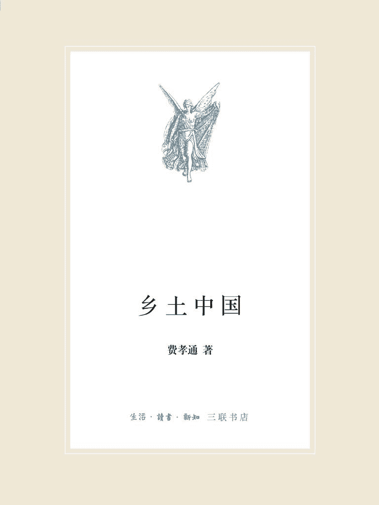

费孝通《乡土中国》封面图，三联书店

他的原话是这样的：

"我们的社会格局不是一捆一捆扎清楚的柴，而是好像把一块石头丢在水面上所产生的一圈圈推出去的波纹。每个人都是这一圈一圈，也就是他的社会影响的中心。我们和别人所联系成的社会关系，就像水中的波纹一般，一圈圈推出去，越推越远，也越推越薄。"

所以在费孝通眼里，家庭就是一个同心圆波纹圈子的最里层，社会关系就依托家庭中的每一个个人，这种关系一圈一圈地推出去，再经过不断地叠加和重合，最后构筑出了社会的一种差序格局。

费孝通先生的这种解释，对今天的我们仍然有着重要的启示作用，让我们知道作为个体，和他人之间的关系是如何产生的，又是如何维持联系的。

差序格局这一社会学的术语到了今天，仍然是中国社会学最为常用的本土解释框架，也是对中国社会结构最为基本的描述。

对于中国来说，中国的家庭观和西方的是完全不同的，西方更加强调家庭的边界，有一个非常清晰的团体界限，就好比一捆一捆扎清楚的柴，"每一根柴也可以找到同把、同扎、同捆的柴，分扎得清楚不会乱。"

但是在中国，我们更加强调家庭的延伸，强调像涟漪一样由自己向外扩散到"无穷的远方"。在扩散的过程当中，会形成各种纽带、关系、面子、人情等非正式的人际网络连接，这是中国，或者说东方和西方，不同的社会关系的取向。

我们说，家庭既然是社会秩序的基础，那么家庭中的道德和人性，就必然是社会中道德和人性的一个微缩影。在家庭中，一个人的地位和感受，关系着一个个体的尊严和幸福。

我们很容易想象，如果一个人都无法从家庭中获得爱和尊重，那么他（她）在为人父母，抚育下一代，面对社会中的善恶，和这个世界斗智斗勇的时候，他（她）内心的力量又从何而来？

让我们回到家庭主妇的角色分工中来进行剖析：在今天这个经济社会，看起来负责赚钱的丈夫，他的功劳是最大的，而全职在家的妻子似乎因为不用去面对职场上的激烈竞争，显得日常压力小了很多。但其实，这都是婚姻内达成共识以后，在平等的基础之上，夫妻双方共同决定工作细分的结果。

你出钱，我出力；你冲锋陷阵，我保障后方；你为五斗米折腰而疲惫，我为鸡毛蒜皮的事情而头疼。谁也不可以说谁更加伟大，当然，谁也不可以贬低谁的工作更加卑微。

家庭中的分工协作，因为目标是一致的，所以，其实丈夫和妻子承担的痛苦和喜悦也是一体的。所以，倘若我们只是用外在的物质、金钱的多少来判断婚姻当中的个人价值、甚至衡量谁高谁低，那么这可以说是一种道德上的堕落。

当然，我并没有站在道德的制高点上进行评判，我也不是什么情感专家，可以插手调节婚姻。我只想单纯地从社会学的角度，让大家通过对社会分工的认识，来理解分工的意义所在

我们可以学着去抛开固定的思维，或者是一些老旧的一些观念，去真正理解分工在一个家庭里的价值所在。因为这不仅关系到家庭主妇的感受，也关系到我们每一个个体的尊严和生命的复杂体验。

这就好像，我们在一开头提到的那位绝望自杀的家庭主妇，我相信如果时光可以倒回重来，她的丈夫和孩子们一定都不希望这一出人间悲剧发生。如果丈夫可以早一些关心到妻子的心理变化，多一些理解和体谅，及时地设身处地地考虑，给予妻子真正的鼓励和支持，就很有可能会阻止这一场家庭悲剧的发生。

#### 四、现实思考

涂尔干说，"人有了分工，个人才可以摆脱一种孤立的状态，建立彼此的联系"。没错，这也是现代家庭的重要意义。因为爱而结合的夫妻作为社会关系的一种，就是在分工当中达成生活的效率，在效率当中获得一种情感关系的平衡，在平衡当中又获得彼此的支持，互相滋养、细水长流。

因此，对于家庭主妇的角色分工，我们应该充分肯定她们的价值和意义。

无论是婚姻家庭中的分工、一个组织内的分工，还是一个社会上的大分工，其实都伴随着我们对于世界的认知、自身的定位，以及人与人之间的尊重、责任和爱。当我们今天谈论了相关社会学大家的经典理论、社会分工的意义、现实的思考之后，其实我更加希望为大家打开一扇思考的大门，通过分工，找到我们自己和他人、和整个世界的相处方式。

在当前这个急剧转型的社会当中，我们不可避免地会遇到种种矛盾和冲突，甚至导致家庭危机、社会危机。我们可以带着一种社会责任心和道德关怀，去理解各种危机现象产生的原因，并且尝试着用社会学家的方法去思考这些危机。

毕竟，每个人都不是一座孤岛，我们都需要通过与他人的密切连接来建立和世界的关系，来获得幸福的原动力。

我是严飞，我们下一集再见。

# 11\. 有机团结：扶还是不扶？这是个问题

（公众号懒人找资源，懒人专属群分享）

### 本集要点

1.机械团结和有机团结

2.社会秩序的基础

3.制度及其建设对维护道德建设的重要性

### 文稿

你好，我是严飞，在今天的这一集当中，我将和大家讨论一下涂尔干的有机团结理论。

#### 一、"扶不扶"？

最近几年，社会上有一个引起很大争议的现象，不断地进入到我们的讨论视野，就是老人在马路上跌倒了，到底应不应该不该扶起来？

也许你对于十多年前的一起彭宇案并不是十分了解，但是你一定经常听到类似的故事或者新闻，一次次让我们怀疑：做善事、热心助人是不是会让自己陷入到农夫与蛇的悲剧里？

一个年轻人骑电动车经过路口时，碰到一位骑车摔倒的老年人，他好心扶起，对方却反报警说是被他撞倒。因为被冤枉成肇事者，他和家人都不得不承受着很大的心理负担，小伙子还背负了骂名，被单位辞退。

这是一则听了让人唏嘘不已的社会新闻。我们不禁会将自己的情感带入，当有一天我们老去，需要帮助的时候，却没有人愿意伸出援手，那将是怎样的凄凉与绝望；还有人忧虑，年轻人扶了老人以后却被讹诈，这对年轻一代的道德观、价值观会产生怎样的冲击性影响？他们会因此改变面对社会、面对世界的方式吗？

这一系列因果循环的问题，令我们不得不沉思，我们的社会秩序到底怎么了？为什么人们不再愿意伸出助人之手？什么才应该是一个有序社会的基础？或者说，是什么样的力量才可以使众多个人结合成为一个有序的社会？

三、社会秩序的基础

对于这一问题，在不同学者的定义中，有不同的分析。有人说社会秩序的基础是制度规范，有人说秩序的基础是道德，还有人说秩序的基础是想象的共同体。每一种说法都有它自己的道理，来自于学者不同的立场和学科范式的观察，并没有一个标准的答案。

在这里，我想先和你谈一谈涂尔干对于这一问题的一个经典的回答：社会秩序的基础是道德。

在涂尔干的研究中，无论研究对象是宗教生活、职业分工还是自杀，都脱离不开对"道德"一词的讨论。在他那里，道德科学就是社会学的别名，而社会学的一项重要任务，就是从制度、规范、宗教信仰等社会现象之中发现并揭示出核心的道德秩序。

涂尔干认为，社会不能只通过理性的协议而存在，因为要达成协议，就必须是每一个参与者都要互相相信对方可以遵守协议。

但是，在我们的日常生活当中，却常常会遇到对方不遵守协议，不遵守约定的情况。明明很多时候，我们真的是很想去搀扶一下跌倒在路边的老人，可是我们却很担心，对方是不遵守"跌倒-  
助人-感激"这一契约的碰瓷大妈。

这是就会碰到一个非常典型的囚徒困境。我们来假设一下，倘若 A、B 两方一起遵守契约，则双方都会获得一定的收益；倘若 A、B 两方中，无论是 A 方还是 B 方，有一方选择欺骗，另一方选择遵守契约，则选择欺骗的那一方就会获得全部的收益，而选择遵守契约的那一方则会全部输掉；倘若 A、B 两方都选择欺骗，两方均无所得，也无所失。

在这样一道选择题面前，不知道大家会如何做出选择呢？很明显，似乎选择欺骗获得收益的概率要更加的大，在这样的诱惑激励之下，就会有更多的人选择欺骗，而非遵守契约。

倘若在一个社会中，我们做任何事情，都首先想到通过欺骗来获得收益，人人都是骗子，那么这个社会就必然会陷入混乱的无序状态。

三、机械团结与有机团结

我们当然不希望看到这样的社会诞生。对此，涂尔干就特别指出，为了确保契约生效，就必须先存在一种在签订契约之前所形成的一种团结的机制，或者是叫"前契约团结"（precontractual  
solidarity）。换句话说，社会是建立在一种团结机制基础之上的，而不是理性的自我利益之上。

这一点，和我们大家所熟知的法国思想家卢梭的社会契约论就不尽相同。在卢梭的社会契约观中，  
契约是共同体每个成员之间自愿的约定，先有契约，再形成社会和国家。社会中的成员让渡了一部分自然的状态，在集体契约中以联合的形式生活。

在这样一种社会契约论的构想之下，人民成了主权者和立法者，而在涂尔干的分析框架之中，则是先有了团结机制，然后再谈建立契约。在不同的社会形态当中，团结机制又有不同的表现形式。在这里，涂尔干又区分了两种团结的形式：机械团结、有机团结。

所谓的机械团结（mechanical  
solidarity），指的是由彼此相似或者是相同性质的各个要素所组成的社会，比如我们所生活的传统农业社会，就是一个例子。在这样的社会中，集体性非常  
强，个体对社会有强烈的认同感和归属感。

机械团结当中，个体的社会参与都是非常相似的，他们的责任也是相似的。用涂尔干的原话，就是"个体的独特道德或者说个性，即使存在也极其微弱，以这种方式相互凝聚的社会分子要想一致活动，就必须丧失掉自己的运动，就像无机物中的分子一样，这就是把这种团结叫做机械团结的原因"。

和机械团结相对应的，就是有机团结（organic  
solidarity）。在有机团结当中，社会成员的集体仪式，即使仍然存在也已经非常模糊，个体的独立人格有了很大的发展，特别是伴随着社会分工的深化。就好像我们今天所处的这个时代，社会中的每个个体都呈现出更加专业化的分工，专业分工的人们执行某些特定的或者专门化的职能。

我们在上一集中有专门讨论过，这种社会分工使得每个人都在一定程度上，必须依赖其他人而生存,也就是说，社会分工使得人与人之间形成了一种有序的互动、互相依赖。人们由于这种功能上的相互区别和相互依赖而必须结合在一起，类似动物有机体内不同的器官之间的联结。因为互相依赖，所以人和人之间就会产生情感，基于情感就会产生一种集体意识，或者说集体良知。

这就是基本的集体道德，必然就会对群体的行为产生约束，因为群体中的每一位成员都会觉得自己有义务去按照共同体的要求行事，共同分享是非观；反过来，生活在群体之中的个人也会对群体产生依恋并考虑群体利益，这就是道德作用力的源泉。

在这一论断中，"道德"更多表现为社会规范、主流价值观，为特定地区的特定人群所认可的，并且可以促进整体福利最大化的一种文化观念。与其说社会秩序的基础是道德，不如说这种"道德"依存于社会而存在，脱离了社会的土壤就会失去他的价值和意义。

#### 四、社会的内在的道德精神

在涂尔干看来，一个成熟的社会每个人都有共同的道德意识。道德意识是一种社会心理形式，每个人的身上都内化了这种社会价值，通过日常的社会交往与互动，我们就可以发现哪些意识是大家共有的，这种共有的意识就可以有效加固了团体内部的连结性，从而加强社会整合。

20 年、30 年前的我们，并不会像今天一样，去讨论扶不扶这样的话题，之所以会在今天有这样的讨论、争议，是因为我们整个社会的价值观，伴随着经济的发展而发生了巨大的改变。

如果把整个社会想象成一辆高速前行的火车，我们很容易发现我们长久以来太重视经济的发展而忽视了价值观的重构，虽然不断地进行制度、法律的建设，但却并没有真正考虑制度与法律的设计应当体现怎样的道德精神。我们可以把社会像动物肢体一样进行解剖，但却忽视了社会的灵魂，忽视了制度与结构其实都只是内在精神的外在体现。

对于转型期间的中国而言，社会矛盾不断涌现，衍生出了一系列社会问题，比如贫富差距加大、人际关系淡薄、容易以自我为中心、唯利是图等等。那么，这个时候拥有怎样的道德意识，以及如何去培养、实现这种道德秩序就显得尤为重要。因为这关系到，我们是否可以拥有和谐、信任、宽容的社会环境。

但是事实上，恶行的产生并非个体的道德应当背负的罪名，我的同事郭老师就曾说过："见危不援、见死不救的行为常常只是人们在挣扎和权衡之后，所做出的自以为理性的选择。"

道理并不复杂，在一个惩罚善良、制裁正义的制度逻辑之下，如何期待每一位普通的社会成员都拥有高尚的精神？"

因此在我看来，中国今天社会许多问题的产生，根源就在于一些相关的制度与法律的设计本身，就违背了"社会的内在的道德精神"，我们甚至可以看到很多的怪象：为社会和他人奉献的人得不到表扬，损人利己的人却可以逃脱法律的惩罚。

让我们再回到我们开头所提到的那一起著名的彭宇案。  
时间倒退回 2006 年，一位名叫彭宇的小伙子，在下公交车的时候，发现一位老太跌到在站台附近。随后，彭宇将老太从地上扶起，并且等到她孩子过来后一起将老太送往医院，但随后就被老太的家人告到了法院，声称是彭宇将老太太撞到在地。

成为被告的彭宇则表示，自己完全是出于好心才将徐老太扶起并一直陪同她就诊。在最后的判决中，当地法院认为老太太是与彭宇相撞才受的伤，所以彭宇应该承担全部的责任，而给出的判决理由则是，如果彭宇是见义勇为做好事，"更符合实际的做法是抓住撞倒原告的人，而不是好心相扶。"

可以说，彭宇案的判决对当时整个社会风气产生了极坏的示范效应，特别是法院判决书中那一句"不是你撞的，为什么要扶"的判决理由，一下子浇灭了多少助人之心。从此以后，大家都害怕变成下一个彭宇，都抱着多一事不如少一事的心态。

不知道大家是不是还记得 2014 年春晚的小品《扶不扶》，在小品当中，结尾最后一句是这样说的  
："这人倒了咱不扶，这人心不就倒了吗？人心要是倒了，咱想扶都扶不起来了。"

这句话引起大家的思考。涂尔干就说，我们现代社会并不是一个集体道德消失的社会，我们依旧心中充满了热情和正义，依旧对于拥有和谐、信任、宽容的社会环境充满期待，否则我们就不会花力气去讨论这样一个"扶不扶"的问题。

之所以讨论这个问题，是我们还希望能够保守一些道德底线、尊重传统美德，同时探索出一些在现代社会既可以发挥自己的正义和道德，又可以让自身利益不被侵犯的途径。

比如说，在扶不扶这样的事情出来之后，很多人也给出了许多新的思路。比如说，我们下次再见到需要帮助的老人的时候，不一定要亲自去扶，可以选择就近求助交警、或者马上报警、打 120 医疗急救电话，寻求专业人士的帮助；这也是在强调分工的现代社会所具备的独特优势。

当然更加重要的，还是制度上的建设，只有制度的建设才可以最大限度地避免类似于彭宇案这样的坏的制度失范效应。

在我们身边，坏的制度设计其实不胜枚举，比如前段时间还有学者提倡设立具有强制性的二胎生育基金制度，"公民工资按比例缴纳生育基金"，以及对丁克家庭征收"社会抚养税"。面对这样的政策建议，大家都戏言，老百姓们只有交税和交配两种价值了。这种强制性计划生育的制度思维，就是一种不合理的制度设计。

因此若想建立一个美好的社会，建立出良智的道德秩序，首先必须改善的，是其所依存的制度。制度之善的背后是公平和正义，因此可以抑制人性的恶，保护、激励人性的善，从而确保秩序的正常稳定。

#### 五、制度

那什么又是制度呢？制度的优势到底在什么地方？

所谓制度(institution)，诺贝尔经济学奖得主道格拉斯\*诺斯（Douglass  
North）就给出了非常清晰的定义，"制度是一系列被制定出来的规则、守法程序和行为的道德伦理规范，它旨在约束追求主体福利或效用最大化利益的个人行为。"在我们的额社会生活当中，其实充满了各种制度，制度对于社会秩序的保障，至少有三个面向。

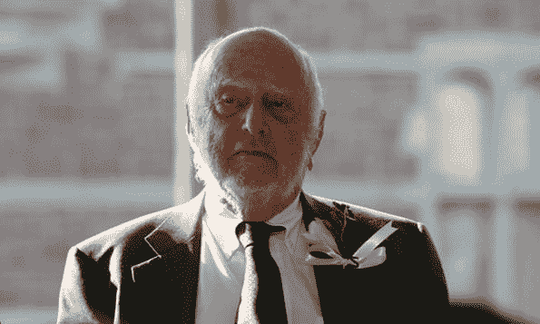

\[美\]道格拉斯\*诺斯（Douglass C.North，1920-2015），经济学家、历史学家

制度是具有约束、监督和控制的机制，所倡导的是人性中的积极面，并且不断地疏导人性中的消极幽暗面。

制度的存在，在于通过对社会主体的行为施以规范，在必要的时候做出惩罚，以维护秩序，实现社会的善治。同时，一个好的制度也会公正地调节利益相关者的权益纠纷，化解社会矛盾。

制度之善的背后是公平和正义，因此可以抑制人性之恶，保护、激励并发展人性的善。只有建立起一套把自私自利的行为转变为有利于社会的制度，通过制度对社会主体的行为进行规范、疏导，才可以内化人们的行为动因，最终实现增进全社会利益的目的。

譬如说，我们大家都知道，总统是一个国家权利最大的人，成为了总统以后，就由无限的权力。面对无限的权利，怎么样规避人性中对权利的欲望，就必须在制度上设立不同的部门，来监督、监管总统的权利，这样才能保证总统不会因为个体的私欲而滥用权力。

制度内化了人们的观念水准。

在不断社会化的过程当中，人们的行为也在不断被约束和规范，并且在这些被约束和规范的社会基本范畴上达成一种共识，并随时接受他人的道德和价值的评判，譬如"危急时刻先保护妇女儿童"就是一个观念的共识。长期来看，人们的观念和价值体系在社会公共观念制度的建构和改进之下，也会得到不断的进步，这一过程，就是观念内化的过程。

当引入一种合理的机制后，就可以做到有效引导人们的思维活动，塑造集体的道德判断，从而有利于整个社会整合、秩序合理运行。

我们常常在媒体上读到出境游中各种低素质的表现----在日本抢马桶盖、在泰国闯机场安检、在法国炫富式购买奢侈品，这都引起大众对国民素质的担忧。

如何提高公民的素质、提升社会的整体素养？

有一些评论就说，我们要从思想教育和文明宣传的角度着手，加大宣传教育力度，加深公民的思想道德学习，从而以期人们出现思想觉悟上的"内在"变化。

但是单一的说教并没有办法改变人性，只能用一套良好的制度去引导。其实这样良好的制度是很容易在我们的身边建立起来的，在这里，我向大家举一个非常小的我们日常身边的例子。

相信大家在世博会、世园会上，去参观展览的时候，一定会遇到这样的一件小事情：我们在排着长队等待进展馆的时候，手上总是有一些小垃圾想丢掉，倘若，这时候在长队边上，每隔三米五米的位置就摆设一个垃圾桶，相信所有排长队的人都会不自觉地将手上的垃圾扔到垃圾桶里。

但是，倘若我们在排长队的队伍当中，在两边，不摆放垃圾桶，人们没有地方扔垃圾，又不愿意从长队里走出来，跑到好远的地方去找一个垃圾桶扔掉，那么我们就可以想象到，长队结束之后，地上一定都是垃圾，杯盘狼藉。

制度激励了人们的行为选择。

人们都有理性的一面，喜欢趋利避害，按照自己的"相对收益"以及"偏好顺序"，而进行有针对性的利好选择。美国著名的经济学家曼瑟尔\*奥尔森(Mancur  
Olson)在其代表著作《集体行动的逻辑》（The Logic of Collective  
Action）中就提出了一个经典论点：在公共利益的条件下，个人投入集体行动的代价往往大于它的收益。

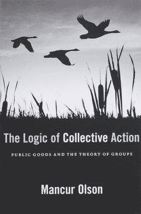

《集体行动的逻辑》英文原版

因此，理性的、寻求自我利益的个人会趋于选择一种"搭便车"的投机行为。奥尔森虽然是经济学家，但在社会学领域，特别是政治社会学领域，《集体行动的逻辑》这本书也是必读书目，对于了解集体行为有很大的帮助。

制度建设的目的，就在于减少人们互动关系中的种种不确定性，通过提高某些行为的代价，并且奖赏另一些行为，从而改变人们的"相对收益"及其"偏好顺序"，限制住人们的选择范围，使之走向有序化。规则越清楚、越明确，所指向的行为主体越具体，则越容易实现制度的激励效能。

#### 六、总结

今天我们和你讲了涂尔干的机械团结和有机团结，知道了涂尔干有关社会秩序的基础是道德这样一个经典论述，我们还和你讨论了制度、制度建设对维护道德建设的重要性。

文明社会，不仅仅是经济数字的指数级发展，也不仅仅是科技的进步多么令人惊叹，文明社会，更重要的还有我们身为万物之灵的人类自己，我们不断学习如何平衡伦理和经济发展的矛盾，完善道德和社会的价值体系，继承传统美德的同时也要知道，怎样去理性地适应现代社会的变化。这是功课，也可以看成是一种使命。

这一集到这里结束了，在下一集当中，我将和你继续讨论涂尔干的社会整合。

我是严飞，谢谢大家。下期见！

# 12\. 社会整合：为什么越长大越恋家？

（公众号懒人找资源，懒人专属群分享）

### 本集要点

1.涂尔干的社会整合框架

2.家庭的社会整合功效

3.新家庭主义

### 文稿

你好，我是严飞。在今天的这一集中，我想和你讨论一下涂尔干的社会整合理论，以及家庭和社会整合之间的关系。接下来，我们会用两个例子，一个反面案例和一个正面案例，来说明家庭对社会整合的重要性。

#### 一、"恋家"与"自杀"

相信很多人都听过这样一句话，"爸爸妈妈都是为了你好"。但是每次听到这句话，我都会感觉心情复杂。因为这和"有一种冷叫做你妈觉得你冷"非常相似，很多时候父母对子女的好，只是一厢情愿，年轻时候的我们总是对家庭无所依恋，只想着去更大的地方，感受追求自由和梦想的快乐。

但是今天，很多曾经出走家乡的年轻人，又开始重新向父母寻求理解和帮助，不管是物质上的还是精神上的，我们都看到了代际关系的亲密变化，他们开始尝试理解父母、重建健康的亲子关系，呈现出了一幅幅从离散到聚合的回归画面。

接下来，我们把视线转移到另外一个正在发生的社会现象：根根据世界卫生组织发布的统计，在 174 个受访国家中，中国 70 岁以上的老年人，自杀率排名第 24 位，每年有超过 4 万名 70 岁以上的老人选择自己结束生命。而在这 4 万人里面，有很大一部分都是农村老人。

为什么会出现这样的情况呢？据调查，他们之所以选择自杀，除了贫穷和疾病之外，  
更多的是因为没有家庭陪伴、情感孤独，对生活已经不再抱有希望。并且，因为农村的年轻人都流向大城市工作，相比起城镇里的老人，农村老人的身边更是很少有孩子的陪伴。

刚才我们谈到的两种社会现象，"年轻人越来越恋家"和"老年人选择自杀"，背后其实反应了一种社会变迁的趋势。

我们如何理解那些选择自杀的老人，又要如何理解重返家庭的这一代年轻人？要想解答这些问题，我们就需要了解涂尔干关于社会整合的理论。

#### 二、什么是社会整合？

在涂尔干的社会学世界中，最重要的研究主题，就是对社会整合和社会秩序。他的三部主要著作《社会分工论》、《自杀论》、还有《宗教生活的基本形式》，都是在讨论秩序和整合，并且分别回答了如何达到社会团结和整合、社会整合和个人有什么关系、团体意识对社会和个人起什么作用这三大问题。

什么是社会整合？简单来讲，就是一个社会中的各个环节、不同部分相互团结、有机配合、互相支持的程度，一个社会的社会整合越高，它的秩序也就越好，社会中爆发矛盾和冲突的可能性就越低，人们生活就更幸福，如果一个社会的整合程度低，那它的混乱程度也就越高，生活在其中的人也就更多不幸。

涂尔干把社会看成了一个整体，认为社会的每个功能都是相互联系着的。如果想要达到社会的团结和整合，就不能忽视其中的任何一个因素。而家庭，作为最小的社会单元，就成了促进社会整合非常重要的因素。

#### 三、家庭的重要性

在之前的一集，我们已经向大家提到过家的含义。

家庭是我们从小养成生活习惯、接受家庭教育、奠定人格和个体社会化的第一站，是我们出生后第一个归属的社会群体。并且，我们又会通过婚姻，组成新的家庭，同时又和原生家庭，和父母辈保持千丝万缕的联系。

在涂尔干看来，家庭是最早的道德共同体，家庭情感是像宗教一样，带有神圣性的道德连接。涂尔干说，"直到今天，家之所以和从前一样，总是具有某种宗教性质，也正是由于这个缘故。即使不再有家祠，不再有家神，人们对家庭也会始终充满了宗教之情；家庭是不容触动的一方圣土，因为家庭是学习尊敬的学校，而尊敬又是最重要的宗教情感。"

也就是说，我们在家庭中学会尊敬，承担各种道德义务和维持生活纪律，然后才可以在走出家庭之后，在更大的社会团体中践行尊敬、纪律和社会义务。

听到这里，你一定感觉到了家庭的重要性，那么，家庭和社会整合之间的又有怎样密切而且重要的关系呢？

#### 四、孤独的老人

让我们回到最开始提到的老人自杀现象，从这个反面的案例里，我们可以看出不理想的家庭关系对社会整合起到的负面作用。

涂尔干曾经通过研究欧洲不同国家的自杀现象，得出了一个非常经典的社会学理论，那就是，如果没有一个家庭纽带作为风险的保障，没有被整合进一个群体，人们就会存在不安全感，精神上强烈的聚合需求就会得不到满足。

涂尔干曾经对自杀做过研究，在涂尔干分析过的那些欧洲国家中，丧偶的人、单身或者离了婚的人，自杀率通常比拥有完整婚姻的人高，而没有孩子的人，自杀率又高于有孩子的。这个现象的出现，难道意味着，没结婚、没有小孩的人，要比其他人有着更多的性格缺陷和更多的心理疾病？

我们通常会认为，自杀是一个个人选择，如果微博上爆出了什么人自杀的新闻，舆论总是会一边倒地认为这个人不够坚强，对爱他的人不负责之类的。但是，涂尔干却不是这样认为的，他说，自杀并不是一个简单的个人心理问题或者个性问题，而是和社会的整合度紧密联系在一起的。如果家庭的纽带较弱，或者家庭的亲密关系不被重视而导致家庭破裂，人们就会感到被孤立，就会觉得孤独，最终会选择用自杀。

也就是说，当一个人妻离子散、家庭破碎的时候，他就会觉得自己是一个失败者，就会选择自杀作为一种人生的解脱。这不是仅仅是他自己的选择，而是家庭、社会替他做出的选择。

当一个社会中绝大多数的家庭，都出现了道德溃败，亲密关系瓦解、家庭分崩离析，那么整个社会就会走向低落，或者说，成为一个低度整合型的社会，身处其间的人就会觉得生活没有意义，也就必然会产生一些极端的行为，最终导致了社会的混乱。

从这样的假设中，我们可以看出，家庭的和睦对于社会整合的重要性。

这里推荐大家去翻一本书看看，《五十四种孤单：中国孤宿人群口述实录》，里面是五十四位老人通过口述史的方式讲述了自己的一生。这些老人,有些是性格的原因，有些是遭遇了时代的变革而导致命运的转折，因此失去了家庭的依托，失去了儿女的关照，虽然现在都住在福利院里，生活还算舒适安逸，但在精神上仍然感到孤苦无依，对于家庭生活、天伦之乐都充满着向往。

如今，中国已经是一个老龄化社会了。根据人口统计显示，到 2017 年底，中国 60 岁及以上的老年人已经有 2.41 亿人，平均每 6 个人里面就有 1 个是老年人。再来看中国人口老龄化发展趋势的预测研究报告，上面说，到 2050 年的时候，中国的老龄人口总量将超过 4 亿人。

那么，在这 4 亿老年人里面，又会有多少独居老人呢？恐怕这个比例不容小视。

在当今老龄化社会里，老人仿佛成为社会遗忘的角落。他们被关注，却依旧无法被妥善安顿；他们被同情，内心的孤独感却依然难以排解；他们为家庭奔波劳碌一生，有些却在晚年得不到家庭的亲情陪伴，有些甚至没办法有尊严地离开这个世界。归根结底，精神上的困顿、无助、看不到生活的希望，是酿成老年人自杀悲剧的始作俑者。

这几年来，日本因为"孤独死"的人数在不断上升。很多老年人在独居在公寓里，最后孤独地离开这个世界。去世的时候，有些老人还留有不少存款、财产，却并没有找到任何子女、亲戚可以去继承，因为他们和家人已经失去联络多年。

对于人来说，精神的陪伴、家庭的滋润是我们在这个世界上赖以生存的养分，它能带给我们的比金钱要多得多。

在日本电影《小偷家族》里面，有这样一个临时家庭：他们住在一起，但是，互相之间没有血缘关系；他们也非常穷，只能通过偷东西之类的犯罪来过活。

看起来，这个临时家庭中的每一位成员都是社会整合、道德秩序缺席之下的受害者----  
他们有的被亲生父母抛弃，有的被丈夫抛弃，最后又被主流社会抛弃，只能以自己的方式挣扎在生存的边缘。

临时家庭里的"奶奶"在生命的最后一段时光里，和家人们一起去了海边，当她看到家人们一起快乐嬉戏的时候，她的内心是复杂又感动的。在她去世后，这些没有任何血缘关系的"家人"将她安葬。电影里含蓄地探讨了什么是亲情，什么是爱，什么是家庭，在复杂多变、老龄化严重的社会里，这个命题显得尤为重要，和我们每一个人都息息相关。

《小偷家族》电影画面

孤独和爱一样，是人性中一种自然的流露。对于和《小偷家族》里的角色一样、身处社会边缘的人，只能由社会和社会中的你我来守护，让有家的独居老人回归家庭，让没有家的流浪汉，也可以感受到家的温暖，而非对他们置之不理、随意抛弃。

在日文里面，"人"也被叫做"人间"，这精准地表达出了社会学的一条真谛，那就是，人的意义在于"人和人之间"，而不是孤立存在的。

作家郝景芳在她的作品《人之彼岸》里就提到，"人能够从和人交往的经历中学到很多情感和行为知识、能直觉感知他人的心境，不是因为人类头脑处理能力更快，而是因为人类能够以自己映照他人，将心比心。"这是人和机器、和人工智能的区别，也是我们生而为人的尊严和体面。

如果每个人，都被家庭抛弃、被社会抛弃，失去了人和人之间的联系，社会就不再是一个完整的体系，也就无法建立秩序。涂尔干社会的存在，是"个人的精神在相互结合、相互渗透和相互融合的过程中产生的一种存在"，而家庭，就是人们最渴望、也最容易找到归属，找到精神融合之感的地方。

#### 四、回归家庭的年轻人

说完了反面案例，接下来，我们开始谈一个正面案例，看看和睦的家庭对社会整合的好处。

这几年，我们看到了另一个家庭中的明显变化，那就是，年轻人开始愿意回归家庭。

这里的回归，不仅仅包含空间意义上的回归，有更加包括精神层面的回归。

其中一个表现就是每一个人在微信里都有的家庭群。每天，我们都在群里和父母进行交流，发送各式各样的表情。也许有一些朋友远离父母，在外地或者外国学习工作，但是因为微信里的家庭群，无论离开父母多远，都可以通过一段语音，一个表情符号，而在情感上有了紧密的联系。再害羞的人，也可以通过各种表情包，来向父母表达他们的爱和思念。

同时，因为他们比父母辈更擅长表达自己的情感，更有意识的去直面亲密关系中的问题，当选择回归家庭的时候，年轻人们也将自己对于亲密关系的期待和愿景，民主、平等、尊重、关爱、和睦一起带进了家庭。无形之中，给社会带来了平等、尊重、关爱与和睦。

这种精神层面上的回归家庭，还有一个专门的学术名词，就是加州大学洛杉矶分校的人类学教授阎云翔提出来的"新家庭主义"。

为什么会出现"新家庭主义"呢？

阎云翔就指出，"西方那种经典的个体主义可能不适合中国文化的大环境，我们可能永远不会达到那种状态"。和西方的个人主义相对，"在中国差序格局的'文化底蕴'中，以关系网定位自己的、实用性的文化和现实倾向，使得纯粹原型意义上的个人主义可能很难出现。这句话稍微有点复杂，实际上说的是，中国社会在 1990 年代到 2000 年有一段时期，年轻人们非常尊崇西方的个体主义精神，强调要独立自我、我行我素、彰显个性色彩。但这样的个体主义，归根结底是和中国传统文化中强调家庭、强调关系的传统是相背离的，因此也难以持久，最终那些刻意彰显自己独立个性的年轻人，还是会选择以家庭为落脚点。

其实，闫云翔提出的这个"新家庭主义"的诞生，也不仅仅是一种个人的选择，它的背后有着经济的驱动因素。比如，北京、上海、广州等大城市的房价不断升高，年轻的一代如果想要买房，就更加需要父母辈的支持，于是四个老人和一对小夫妻共养一套房的现象普遍起来。还有像大家开玩笑说的"老漂一族"，那些已经退休的父母们在大城市里帮助子女带娃，给工作的子女们减轻抚育下一代的压力。

我们通常都会觉得，小孩子才恋家，大人都是越长大越独立的。确实，在年轻的时候，不管父母在背后用多么关切的目光看着我们，追逐梦想、渴望自由的我们只想着离家千万里。

但是，在劳动的异化愈加严重的今天，年轻人在大城市难以感觉到工作的价值，和同事之间的关系也不像好朋友一样紧密。当眼前的灯火辉煌没有人可以分享，孤独感慢慢涌上来的时候，他们就开始想回到故乡、回到家里、回到父母身边。

恋家我们都会认为是一个人太感性，或者不成熟的表现，但是，从社会整合的角度来看，恋家，或者在适宜的时间回归家庭，其实是最理性的决定。

回家，看起来是一种非常个人的选择，然而，放在整个大环境中来看，其实和我们的社会特点、传统文化、代际亲密关系的变化都有着很紧密的联系。今天的年轻人选择回归家庭的趋势，让一个个本来离散的家庭重新聚合，无论这种离散是地理空间层面上的，还是精神层面上的，社会也会因此越来越和谐、稳定。这就是家庭对社会整合的正面影响。

#### 五、越长大越恋家

当然，我们的家庭关系中，依然存在很多矛盾。如果说传统的代际关系是密而不亲，那么现代的代际关系就是又密又亲。

又密又亲会导致什么问题呢？

比如，年轻人会觉得父母的界限意识薄弱，常常插手自己生活中的各个细枝末节的决定；那同样，父母也会觉得有些年轻人的独立是"假独立"，在经济上渴望获得支援，做伸手党，在精神上，有独立的意识，但又缺乏独立的能力。所以，在挑选结婚对象、教育孩子等方面，两代人的矛盾依然没有解决。

或许，在家庭中，一个我们可期许的代际关系应该是亲而不密，感情互惠、精神独立。

虽然矛盾不是一时半会儿、三言两语就能解决的，但我们还是可以尽量让家庭圆满。当我们步入中年，我们的父母步入老年的时候，希望回归家庭的这一代年轻人，可以给予父母更多的陪伴，而不是将时间花费在无止尽的应酬酒局上，或者是一些无聊的人际斗争上。

要知道，越长大越恋家，说的可不仅仅是年轻的一代。父母们年纪越长，也越来越恋家，希望和子孙辈们在一起。

毕竟，家，是我们所有人共同的港湾，可以回归的心安之所。

今天，通过两个案例，我们了解了社会整合的概念，以及家庭和社会整合之间到底是怎样的关系。

那么，也请你来思考一下：除了我为你举的例子以外，你的工作、生活里还有什么现象是可以用社会整合理论来解释的？欢迎你在评论区留下你的思考。

我是严飞，我们下一集再见。

# 13\. 自杀论：张国荣跳楼后，我该如何和世界相处？

### 本集要点

1.自杀的社会性

2.四种自杀类型

3.中国式自杀

4.涂尔干自杀论的局限

### 文稿

你好，我是严飞。在今天的这一集当中，我将和大家讨论一下涂尔干最为经典的一项实证研究：自杀论。

#### 一、自杀潮流

不知道大家还记不记得，  
16 年前的愚人节，2003 年 4 月 1 日，一代巨星张国荣在香港坠楼身亡，只留下了他消逝的身影。就好像他的一首经典老歌《风继续吹》里唱得一样，"永远吹拂在空中，不忍远离。"

直到今天，他的粉丝们还对张国荣的自杀离世充满了神秘论的猜测，粉丝们不愿意接受，如此有魅力、当时演艺事业如日中天、如此追求完美的一个人，为什么会用这么极端的死亡方式来和世界告别，好像是老天给大家开了个玩笑。

张国荣的纵身一跃，给当时的香港社会带来了巨大的冲击。从 4 月 1 日当天深夜到第二天凌晨的短短 9 小时内，仅仅是被报道出来的，全香港就有 6 名青少年跳楼自杀，整个 4 月，香港一共发生了 131 起自杀身亡的事件，比 3 月份增加了 32%之  
多。有些人在自杀之前还留下了遗书，说自己的选择和张国荣的轻生有关。

而在世界范围内，过去的半个世纪，全球的自杀率已经增长了 60%左右，并且呈现出越来越年轻化的趋势。根据世界卫生组织的自杀数据，每年死于自杀的人有 80 万以上，还有更多的人有自杀的打算。所以，每一年，因为自杀而经历丧亲之痛或者者受到影响的人，可以用百万来计算。

法国作家加缪的书《西西弗的神话》里，开篇就写道："真正严肃的哲学问题只有一个：自杀。判断生活是否值得经历，这是回答哲学的根本问题。"

实际上，自杀也是一个真正严肃的社会学问题。我们应该怎么解读自杀这种行为？在它背后，到底有哪些被我们忽略的深层次原因？而在我们中国，自杀又体现出怎样的特性？

#### 二、自杀的社会性

1893 年，涂尔干完成了他的经典著作《社会分工论》，在书的最后一部分，涂尔干对社会分工引起的某些社会病态，譬如说导致人们出现反常行为的失范型分工、通过外部强制手段下达命令的强制型分工、非人性化的不协调分工进行了分析。而《自杀论》就相当于《社会分工论》的一个续篇，把其中的反常行为的社会病态单独拎了出来，做了一个社会学分析。

如果说《社会分工论》是从"正面"论述了个体和社会的关系及其历史演变，《自杀论》则从"反面"揭示了这种关系的"反常的"一面。

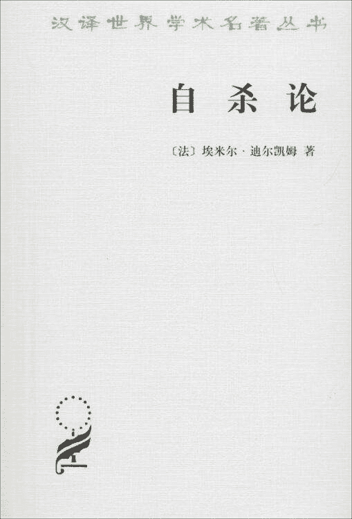

《自杀论》封面图，汉译世界名著学术丛书

自杀事件看起来好像是个体性的，属于心理学或者自然科学的范畴，但是如果把一定时期发生在一定社会中的自杀现象或者自杀潮流作为一个整体来研究，就会发现自杀并不是孤立的，并不是简单的个体行为的集合，就可以看到隐含在其中的社会性。

涂尔干先是通过实证研究，否定了精神疾病、酗酒、遗传和种族、气候等因素对自杀的影响，从而肯定了他提出的命题，也就是，自杀是由社会因素所引起的，而这其中的一个重要指标就是社会整合度。过高或者过低的社会整合、过于混乱或者过于严苛的社会规则，都会导致自杀率的上升。

涂尔干说："当今存在的自杀，恰恰是我们所遭受的集体疾患（collective  
affection）的传递形式之一；所以，它将有助于我们理解这种疾患。"这是涂尔干对于他那个时代的自杀问题的诊断，他相信，他的自杀研究将会得出"一些关于欧洲社会正在经受的普遍的当代失调（maladjustment）的原因，以及可以缓解这种失调之疗法的建议"。

#### 三、四种自杀类型

利用"社会整合"这一标准，涂尔干对自杀进行了社会学分类，总结出了四种类型的自杀，分别是，由于社会整合程度过低而脱离社会义务和束缚的利己型自杀、由于社会整合过高而失去自我价值意识的利他型自杀、由于社会控制不足和规范混乱所导致的失范型自杀，以及由于社会控制过度而使个人失去希望的宿命型自杀。

请注意，导致这四种自杀的原因，都离不开社会整合。

我们重点来看一下前三种自杀形态，看看他们和社会整合之间的关系。

首先，是"利己型自杀"。

什么叫"利己型自杀"呢？就是说，当人和社会、人和社群之间的联系纽带愈发松弛的时候，人们就会很"利己"地为自己考虑，既然在生活中受到太多不安的委屈，不如让自己过得舒坦一点从而选择自杀，这就是利己型自杀。

但是，这里的"利己"我们得带引号，因为我们在上一讲已经说过，自杀不仅仅是一种个人选择，还是社会、家庭替人们做出的选择。

涂尔干发现，"利己型自杀"主要发生在不能很好地进行社会整合的群体中，这些群体的社会集体意识较低，所以，这种自杀类型反应的，"是个人和社会的疏离"。

在社会条件相同的情况下，涂尔干研究了不同的家庭类型对自杀的影响，这里包括未婚家庭、已婚无子女家庭、已婚有子女家庭等等不同的家庭类型，然后，他发现，社会整合程度和自杀率成反比。

也就是说，社会整合程度越高的家庭，自杀率也越低，比如已婚、有子女的家庭，这种家庭的自杀率要比未婚家庭的自杀率低得多。

涂尔干指出，在过去，宗教（特别是共同意识很强的天主教和犹太教）和家庭等因素，还能对自杀起到一定预防作用，但到了现代社会，很多人不再在教会里生活，家庭成员也不再经常团聚，这时候，宗教和家庭也不再管用。

第二种自杀类型是"利他型自杀"，这和"利己型自杀"正好相反。

涂尔干说，当一个人脱离社会时，他很容易自杀，也就是我们刚才说的利己型自杀，而当一个人过分地和社会融为一体时，他也很容易自杀，这就是利他型自杀。

"利他性自杀"往往发生在社会整合过于强烈的时候，具体可以分成义务型自杀和负疚型自杀。

在这一类型中，自杀的人认为自己有自杀的"义务"，这和他个人无关，而和他所处的群体有关，比如军队，军人群体的自杀率比其他群体更高，正是因为军人群体的整合率很高，常常需要通过牺牲自我，而达到满足对于群体的义务。

属于"利他型自杀"的人需要对群体致敬，把不贪恋生命看成一种"美德"，而因为群体的特殊性，就算他活下去，公众也不会再尊重他。

第三种自杀类型，是"失范型自杀"。顾名思义，是由社会混乱失序导致的自杀行为。

比如，工业危机、金融危机时期，我们都可以观察到自杀人数在上升，这是因为危机打乱了社会的正常秩序，人们平常可以依赖的法律权威和生活中的道德界限也开始松动，不断的混乱就很容易导致最后的自杀行为。

来看一组具体的数据，有研究指出：在经济危机最严重的 2007 到 2009 年，10 个受调查的欧洲国家中，9 个都存在自杀率显著上升的情况，且经济恶劣程度也和自杀率成正比，以希腊为例，其自杀人数在 2007-2009 这 3 年间上升了 19%，并且失业率每上升 1%，65 岁以下自杀人数也将相应上涨 0.8%。

另外，自杀作为一种社会现象，也必然影响着其他社会现象和行为，比如道德的失范、犯罪行为的形成，乃至自杀的传染效应，等等。

#### 四、中国式自杀

涂尔干的研究都是针对欧洲国家的，那么中国的自杀现象也和涂尔干分析的一模一样吗？

其实，中国的自杀现象有着非常特殊的一面，在中国的自杀人群中，最多的标签是女性、农村人口，以及年轻人。

如今，农村女性的自杀现象非常值得我们关注。

在农村地区，妇女们对家族和家庭有着很强依附性，她们被整合进血缘群体和家庭关系之中，在这两种依附的情境之下，就会受到家族中亲族关系、婆媳关系等多方面影响。

我们都知道，在农村，熟人之间的社会互动很频繁，血缘群体之间的整合性非常强，并且，可以说是无法逃脱的，只要发生一点坏事，它可能就会被无限传播、放大，在村里村外、家长里短、闲言碎语中，就会成为绕不过去的"污点"或者"把柄"。这样一来，身在农村的人就难以在群体中找寻到一个逃避的安身之所，最终选择了自杀。

另一方面，按理说家庭的建立能够多多少少减少自杀倾向，但是又因为大多数农村青壮年男性皆外出打工，农村女性无法和丈夫、儿子一起生活，家庭关系就变得非常单薄，情感压抑得不到宣泄，这就又成了自杀的原因。

像这样的中国乡土自杀问题，北大社会人类学家吴飞有着非常精辟的论述。他长期关注中国农村的自杀问题，在他的著作《浮生取义》中，他对西方的自杀和中国式自杀做了很好的区分。

吴飞认为，西方的自杀研究是建立在基督教文明的人性观和生命观之上，而中国对生命和人性的理解和西方基督教文明有很大的不同。中国历史上一直没有出现占统治地位的宗教，社会秩序一直靠人的治理来维系，这其中，人和家庭的关系是非常重要的环节。

中国人思考问题的角度往往从家庭生活的基本点出发，强调要好好过日子，过好日子。在这个角度下，当家庭生活出现争吵等不和谐的音符，个人无法处理好家庭关系，日子过不下去的时候，自杀就出现了，想要通过这种极端行为来为自己"讨个说法"。

为什么非要讨一个"说法"呢？或者说，为什么"讨个说法"在中国乡村如此重要，以至于要通过自杀解决？

对于这样的现象，吴飞也提出了自己的疑惑，那就是，"人们在日常生活中最为在意的公正是什么？"

为了阐释这个问题，这里，吴飞运用了"过日子"和"做人"两个范畴来说明，人们在日常生活中最为在意的公正，就是要过好日子，做好人。

这两个范畴都拥有一个共同假设，那就是，人，并非"自然状态"下的个体，要理解人，就必须"在家庭中理解生活和人性"。在吴飞看来，家庭对每个人的生命有着根本的存在论意义，或者说，生命是作为家庭的一部分存在的，理解自杀，就必须理解家庭，家庭范畴的影响力处处渗透在自杀问题当中。

吴飞首先运用"过日子"来解释中国乡土的生活观念。在中国农村，"过日子"是每个人再也熟悉不过的词语，因为它代表的就是整个生命历程----  
出生、成长、成家、立业、生子、教子、年老、寿终等等生活的常态。"过日子"所涉及的这些日常活动，并不是西方观念中的"社会活动"，而是中国本土特色的"家庭活动"，这也就是中国的自杀现象和涂尔干的理论分析的不完全相同的重要原因。

吴飞认为，"过日子，就是管理家庭，并且在管理家庭的过程中安顿自己的生活。"  
而在家庭当中，"过日子"又是充满多种多样的风险的，比如，个体会处于各种微妙的人际关系当中，处于个体努力和外在命运的博弈当中。

一旦个体在这场博弈当中遭遇失败，比如经济状况变差、家庭不和谐、态度和干劲低落，该个体就会蕴含着较大的自杀可能性。所以，"过日子"的成功或者失败，就相当于一个人家庭生活的成功和失败。但可惜的是，往往很多中国人都在"凑合着过"，把对生活的要求降到了最低。

就好像余华在小说《活着》里写的，"活着什么也不为，就是为了活着本身而活着。"但是，倘若连"凑合着过"的日子都过不下去了，这样的"过日子"的失败就会带来种种非预期性结果，其中最不幸的一个结果，就是自杀。

吴飞用来解释中国乡土自杀的另外一个范畴是"做人"。吴飞对"做人"的解释就是，一个个体要成为一个完整意义上的"人"，就需要有完好、健全的人格；而一个完好、健全的人格所需的条件是个体拥有自己的独立家庭、能够正常地"过日子"。

吴飞认为，个体自杀往往也和人格价值的受挫联系在一起，选择自杀的人在面对危害其人格的负面事件的时候，往往会以死相拼。

为了说明人格的重要性，吴飞运用三个词语来总结自杀者的心理状态，那就是，"赌气"、"丢人"、"想不开"。

"赌气"和"丢人"的实质就是个体由于外界力量造成的人格丧失，通俗地说，就是自尊心受到极大伤害，心里这关过不去。而"想不开"则是个体对"何为最好生活状态、现在的人格是否能够造成最好生活状态"的反思，换句话说，就是自我的欲望和现实之间找不到平衡点，内心纠缠得很痛苦。在这里，我们能看到人格高低和自杀与否之间的因果关联。

"过日子"和"做人"两个范畴很好地解释了中国乡土中自杀的原因。今天，中国人依然把家庭生活当作"过日子"和"做人"的核心内容，如果因为日子过不好而受到指责，就必须要讨一个说法，讨回日常生活中的公正。这样一种基本的文化观念在中国进入现代以来的家庭变迁中并没有得到根本改变。

在中国式的生命和道义伦理当中，每一个个体都被要求在家庭博弈中权衡利弊、惨淡经营，每一个个体的生命都被要求以家庭"过上好日子"为目标，也就是说，每个个体都被要求在日常生活当中积累道德资本。而高道德资本、高未来期望和低现实条件的矛盾，就是自杀的源头。

#### 五、涂尔干自杀论的局限

涂尔干有关自杀的分类诞生于 100 多年前，时过境迁，社会也发展出许多新潮流、新问题，自杀也不再仅仅是由社会分工带来的病态问题，也不仅仅是集体社会的整合程度这一维度就能完全概括的。精神和心理的因素也重新回归分析的视野，社会形态的变化、互联网带来的生活方式的变化、城镇化的快速发展等等，也都会成为自杀的影响因子。

比如，城市里的年轻人自杀已经愈发成为了一个  
社会问题。城市年轻人在自杀时已经不像典型的中国式自杀那样试图表达什么，"讨个说法"，更多的是一种寻求解脱的心理在起作用，属于一种"激情自杀"。

如果套进涂尔干的范式，他们的自杀是利己主义的，但是，在他们走向自杀之路的途中，并没有脱离原有的集体，也没有经历强烈的社会变动，至少比先前几代人所面对的社会变动要平缓得多，他们自杀的诱因和预防，还是需要加入心理层面，甚至是抑郁症这样的病理性层面，进行考量和疏导。

另外，涂尔干对利己主义的原因假设也不完整。涂尔干说，当人和社会、人和社群之间的联系纽带愈发松弛的时候，人们就会很"利己"地为自己考虑，最终选择自杀，

我们可以看看社会边缘群体的自杀现象。以深圳富士康工人连续跳楼事件为例，富士康的工人大都生活在较为封闭、一体化程度较高的工人集体里，但是正是在封闭集体化的环境里，一个人的自杀会迅速辐射到整个集体中的每个个体，仿效作用变得格外强烈，传染和联动效应很强。

一方面是第一位自杀者刺激了集体中原有的自杀意念，并且，这种刺激在不断的重复中不断累加；另一方面则是之前的自杀者向后来者呈现了一种解脱现有生存困境的可能性。

在仿效发挥作用时，自杀的意念大都来自于利己主义的想法，但是仿效带来的自杀潮却是在相对紧密的集体中发生的，这就和涂尔干对利己主义自杀的假设相反。"团结"的集体对个体到底是会产生自杀的免疫系数还是强化系数，其实在今天的社会，可以有着更多的解读。

不过，涂尔干的自杀理论中，有一段分析在今天依旧有着非常强烈的现实意义和关怀。

我们知道有些国家，自杀和犯罪事件是极少被报道出来的，但涂尔干明确的指出，禁止报刊报道自杀和犯罪并不能改变社会自杀率的问题，因为群体的道德状态没有改变。

这个在如今的中国社会也有类似的情况。很多时候，新闻媒体被要求写一些正面消息，新闻报道总是一派海晏河清、人民生活欣欣向荣，一些类似富士康连续跳楼事件以及自杀讨薪的负面消息会被淡化，甚至担心造成群众恐慌，而拒绝报道。

但是，这真的能够掩盖事实吗？真的能让我们相信我们每一个人都生活得很幸福吗？消息可以被压制，但是群体的道德状况，社会整体的道德困境，还依旧存在，并一直在发酵。

涂尔干的自杀研究提醒我们，个体和社会之间是一种有机关系，个体在和社会的互动和整合之中，出现诸多反常现象，离开社会母体的个体、过度膨胀的个体、被母体吞噬的个体，或者为母体而牺牲的个体显然都难以生存。我们对这些问题进行观察的同时，也需要真诚地面对自我，探索人生的意义，珍爱生命。

我是严飞，我们下一集再见。

# 14\. 失范论：拿什么来拯救你，社会失范？

（公众号懒人找资源，懒人专属群分享）

### 本集要点

1.社会失范的表现、定义、类型、发生时期

2.社会失范滋生的暴力

3.暴力产生的原因

### 文稿

你好，我是严飞。在今天的这一集里，我将和你讨论一下涂尔干的失范论。

#### 一、什么是社会失范

我们在之前的节目中，已经讨论过道德秩序和有机团结对社会整合的重要意义，然而，如果有一天，道德不再有约束作用，保障社会秩序的制度也没了效果，我们的社会就会进入一种混乱的没有规则、没有秩序的状态。

在社会学中，对于社会的混乱、失序，我们有一个专门的社会学术语，叫做社会失范（anomie）。

所谓失范，就是和正常有序相反的一种状态，它是反常的。按照社会学者们的总结，指的是"社会控制减弱、规范作用被破坏和社会互动解组的一种混乱状态"。简单来讲，就是社会价值观的导向出现了偏差，社会制度的规范不再能对人们进行有效的控制和约束，导致了社会功能出现紊乱，社会中的个人的行为也偏离了轨道，出现了异常。

我们可以从发生在身边的两起事件来理解这个概念。

第一个事件发生在 2016 年 9 月，甘肃康乐县的一个小村庄里，28 岁的农妇杨改兰，因为家里实在没钱，生活继续不下去了，所以让自己的四个六岁都不到的孩子喝了农药，自己也服毒自杀，最后，五个人都抢救无效。

一个八口之家，杨改兰负责全部的家务和大部分的经济来源，承担了相当于三个劳力的工作量，可以说是"分身乏术"。除此之外，福利制度改革后这个家庭失去了低保金，而不识字的杨改兰却并无提出异议的能力。这种极度不合理的外部制度将杨改兰抛弃，连同抛弃的，是她对生活的希望，让杨改兰只能选择在杀死自己的孩子之后，再自杀，作为她改变现状的唯一方式。

第二个事件发生在 2018 年 6 月底，上海的世外小学学校门口，发生了一起砍人事件。罪犯在学生放学的时候，拿着砍刀冲进放学队伍，造成了 2 名学生身亡、1 名学生和 1 位家长受伤。罪犯还是一位受过大学教育的毕业生，但是因为在上海找不到工作，就产生了报复社会的心理，把砍刀对向了毫无还手之力的孩子。

人们常常打趣说，"红二代"看不起"官二代"，"官二代"看不起"富二代"；"官二代"们在世袭权位、"富二代"们在世袭财富、"穷二代"只能世袭贫困。在阶层固化之下，很多底层出生的年轻人因为找不到工作，看不到改变命运的希望，拼搏不如拼爹、拼爹不如拼命，最后只能诉诸于一种极端的手段。

这不是单纯的失败者报复社会的行为，而是我们整个社会阶层在固化、贫富差距在扩大、大学生一毕业即面临失业的社会现状的结果。

这两起让人痛心的事件，虽然在个体的层面上，都是个人行为越轨的一种表现；但更深层次的原因，却是我们的社会的秩序出现了失范。

讨论社会失范，可以更好地避免我们的社会走向混乱。那么，接下来，就让我们正式进入涂尔干的失范论。

#### 二、失范的类型

涂尔干是最早开始研究失范问题的。

之前我们提到过，在涂尔干看来，社会秩序的基础是道德。那么，失范，就等于站在了所有道德的对立面，是对真正道德的否认，是现代工业社会中一种病态的现象。按照涂尔干的说法，"我们所要揭示的失范状态，它造成了经济世界中极端悲惨的景象，让各种各样的冲突和混乱频繁产生。"

那么，社会失范都有什么类型和表现呢？

失范可以分成两种类型，分别是个体的行为失范和社会的系统失范。并且，这两种类型的失范程度是呈递进关系的。

先说第一类，个体的行为失范。

往小了说，个体的行为失范可以是在公众场合里的大声喧哗、出言不逊、寻衅滋事这些影响他人的不道德行为，往大了说，可以是盗窃、欺骗、行凶这些违法犯罪行为，这些都是个体层面上行为失范的表现，违反了人们共同生活的道德准则和法律规范。

个体的行为失范，会对身边的人、会对所居住的社区产生影响，也就是对社会局部的正常运作产生了影响，它的破坏力还不足以大到可以破坏整个社会功能的正常运作。比如，高铁霸座事件、昆山龙哥事件，实际上都属于个体行为失范的范畴。

再来说第二类，社会的系统失范。当整个社会的价值和规范体系产生紊乱，而导致功能丧失，无法指导和约束社会成员的思想和行为的时候，就会让整个社会秩序呈现一种无序化的状态，从而导致越来越多的社会成员违背社会规范，产生越轨和反社会行为。

我们今天在节目里所说的社会失范，主要还是指的就是第二类失范，社会整体的系统失范。

特别值得一提的是，由于人的欲望是无止境的，贪婪好斗、追名逐利、沉迷于奢侈和享受等等都是人的天性，这些天性原本都是需要通过社会所定义的道德来抑制的，但是，一旦规则体系遭遇解体，社会就丧失了它原本能够有效疏通、引导人类欲望和需求的能力。

在这样的情况之下，社会就会出现"集体意识、普遍认同的道德信仰和行为准则全盘衰微的"失范状态。

所以，第二类所说的社会系统失范，也就是社会规范和秩序的瓦解，是第一类个人行为失范产生的背景，而当个人失范行为不断增多，又会反过来恶化社会的规范和秩序，两者互为因果，互相影响。就好像涂尔干所指出的："如果失范是一种罪恶的话，那是因为它使社会遭尽了磨难，我们无法生活在一个没有凝聚力、没有规则的社会之中。"

#### 三、社会失范发生的时期

那么，什么时候会发生社会失范呢？

社会失范常常发生在两个时期。

第一大时期是社会急剧转型，经济陷入大萧条的时候。在这一时期内，因为社会的转型和变迁，原有的社会结构、经济运作模式发生了改变，与之相对应的人和人之间的交往形态、道德信仰和普遍价值观都会遭受冲击。其结果，社会规范不再能有效地控制其成员的行为，导致社会陷入了混乱。

可以观察到的一个例子，是 1980 年代末，苏联解体、东欧剧变，这些国家随之发生了激烈的社会震荡、产生了社会裂痕，这些社会裂痕在很长时间里都没有办法弥合，对人们的正常生活带来了巨大的冲击。

第二大时期则是社会高速发展和上升，正在走向经济繁荣的时候中。这一时期里，旧的规范还没完全褪去，新的规范又还没有完全发挥效力，整个社会对于什么事情可以做、什么事情不可以做，还没有一个完全统一的标准，人们也常常处于摇摆不定的自相矛盾状态之中。

再加上，经济的高速发展，人的欲望也在不断地扩张，所以会出现很多逾越公民良知和社会善序的行为，导致整个社会陷入一种不稳定状态。

对于这样的状态，法国政治学家托克维尔就在他的书《旧制度与大革命》里面写道："在这类社会中，没有什么东西是固定不变的，每个人都苦心焦虑，生怕地位下降，并拼命向上爬；金钱已成为贵贱尊卑的  
主要标志，还具有一种独特的流动性；它不断地易手，改变着个人的处境，使家庭地位升高或降低，因此几乎无人不拼命地攒钱或赚钱。不惜一切代价发财致富的欲望、对商业的嗜好、对物质利益的享受和追求，便成为最普遍的感情。"

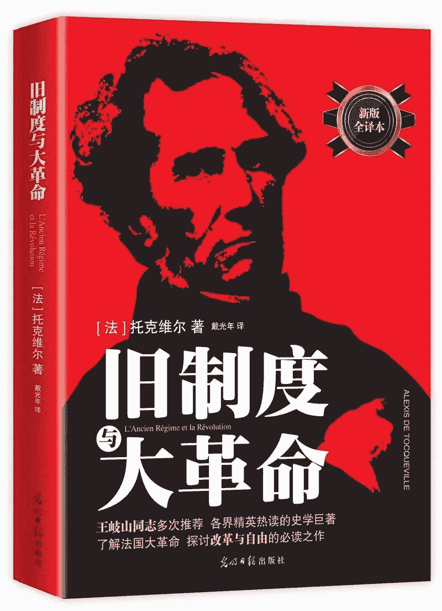

《旧制度与大革命》封面图，光明日报出版社

社会的失范，对于人的心理自然会产生巨大的负面影响。在涂尔干的《自杀论》一书中，他就专门研究了失范型自杀。涂尔干认为，社会失范的程度越高，自杀率就越高。无论是经济动乱还是经济上升时期，自杀事件都会急剧增加，因为在上述两个时期里，人们均会处于一种崭新的社会环境中，原有的准则和规范失去了约束作用，生活因此变得混乱不堪，自杀便容易发生。

#### 四、社会失范滋生暴力

听到这里，你应该感觉到了社会失范给我们的社会带来的后果，其中，最严重的后果就是滋生暴力。

但是，什么是暴力？人们又为什么要使用暴力？

在回答这一问题前，先让我们来回顾一部著名的电影：《霸王别姬》。

这部电影是陈凯歌在 1993 年拍摄的，刻画了在大时代的风云变幻之下，饰演霸王的生角段小楼和饰演虞姬的旦角程蝶衣，两位京剧演员的身世浮沉。电影的色调虽然鲜艳明快，但是却处处展现着历史的暴力情境。

影片一开始，少年时期的程蝶衣（小豆子）为了进入梨园，被母亲生生剁下一只六指；进入戏班子后，则是师傅无节制的毒打和狂怒，又因为唱错《思凡》而被师哥用烟锅捅的满口是鲜血，之后又被张公公所凌辱，这些都构成了影片前半段的暴力特写。

在后半段，程蝶衣已经成为名角，但是京剧艺术却因为 60 年代的政治运动，遭到灭顶之灾。在一出集体批斗的戏中，霸王和虞姬双双跪在广场上，脖子上挂着"打到京剧恶霸"的大牌子，身前是将他们的戏服焚烧的熊熊烈火，身后是疯狂而又激昂的革命小将，在"横扫一切牛鬼蛇神"的口号下，霸王被迫低下头，揭发程蝶衣的所谓"罪行"，渗透出残酷暴力对于人性的摧残和撕裂。

从电影拉回到我们刚才提到的问题，到底什么是暴力？

在《霸王别姬》中，我们看到了两种层面的暴力。

一种是个体暴力，毒打程蝶衣的戏班子师傅、凌辱他的张公公，这里的施暴者，都是一个人，不是一群人，呈现的是个体间的冲突和矛盾。

另一种则是集体暴力，常常伴随着社会形态和结构的急剧变迁，比如在政治运动的冲击之下，整个社会进入了无序失范状态，到处都可以见到群体性的暴力和冲突，而且，其中蕴含的暴力色彩也愈发浓厚，它不仅伤害到个人，同时也彻底打破了社会秩序的稳定，带来毁灭性的破坏和长久的创伤，就像影片的结尾呈现的那样，程蝶衣最后选择了自杀，告别了自己痴爱的戏剧舞台。

社会是庞大的、复杂的，从奥斯维辛到古拉格群岛，再到恐怖主义，世界范围内的暴力事件和暴力行为多如牛毛，不同学者、不同流派对暴力的理解和定义也各不相同，美国宾夕法尼亚大学社会学教授兰德尔\*柯林斯（Randall  
Collins）在他的书《暴力：一种微观社会学理论》（Violence: A Micro-  
Sociology）里面就写道："暴力分为许多种，有些短促而偶然，如一记耳光；有些大型且计划周详，如一场战争。"

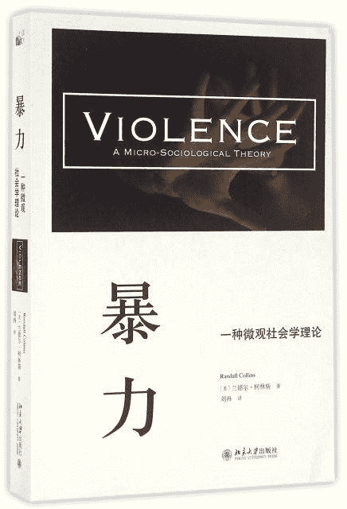

《暴力：一种微观社会学理论》封面图，北京大学出版社

从历史事件中我们发现，在社会失范的宏观层面上，我们经常看到群体性的暴力和冲突，而且冲突的规模越大、程度越深，就越容易受到关注，所以那些只在小范围发生或者没有导致血腥暴力的冲突就很容易受到忽视。

另一方面，在微观层面上，群体、社会、国家的冲突里又包含着个人间的冲撞，而且某种程度上是由集中爆发的私人间对抗和矛盾组成，构成了大型暴力冲突的基础。因此很多时候，学者们会从社会关系变动的层面去探讨暴力形成的原因，可以帮助我们更深入的了解暴力中的个人，窥探人性在其中的角色。

#### 五．暴力产生的原因

社会失范滋生暴力，而暴力所带来的危害大多人都知道，但是，为什么暴力还是会一再发生，无法消除呢？

从社会学的角度出发，至少有三个方面的原因。

第一，暴力是一种身份认同。

哥伦比亚大学社会学家查尔斯\*蒂利（Charles Tilly）在他的书《集体暴力的政治》（The Politics of Collective  
Violence）中指出，集体暴力是社会互动的一个片段。暴力的具体产生机制是：社会关系的互动产生出社会身份的边界，"我们--  
他们"是二元对立的，有着清晰的边界。

在世界范围内，因身份冲突而滋生的暴力发生得越来越频繁。当人们把自己所属的群体和其他群体相比较的时候，就有可能因为相对的剥夺感所导致的不平等状况而产生对立和相互怨恨的身份认同。相对剥夺感的意思，用通俗的话说，就是和别人一比较，觉得别人比自己过的好而产生出的妒忌与怨气。

如果对立的身份认同再和特定的意识形态、价值取向联系在一起，比如宗教的因素、价值观的差异，就会引发歧视或者偏见，甚至灭族的屠杀。

第二，暴力是一种从众和模仿。

一方面，人们害怕暴力的发生，在暴力面前充满了紧张和恐惧，而不是愤怒，所以人们面对暴力的第一反应不是渴望，而是逃离。但是人一旦待在群体之中，群体共同情感、目标和文化取向的存在，就在一定程度上消解了这种对暴力的紧张，让人们在集体的狂热中获得一种安全感。

在暴力的浪潮中，施暴者可以为自己辩解说，"我并不是唯一一位施暴的人，我不是捅第一刀的人，也不是捅最后一刀的人"，正如同你永远不知道压死骆驼的最后一根稻草是什么。

这背后的道理，用《乌合之众》这本书的作者古斯塔夫\*勒庞（Gustave Le  
Bon）的话说，就是民众是盲从的，他的原话是："一个人沉浸在群体中一段时间后很快会发现自己，要么是由于群体仿佛有磁性的影响，要么是由于其他一些原因造成我们是无知的,在一个特殊的状态下，很像一种类似于迷恋的状态，被催眠的个体发现自己在催眠者的手中。"

第三，暴力是一种剧场式的表演。

两个人之间的暴力，除了开始的言语攻击和最后的收尾，很快就会结束了，不会持续多久。然而，如果有观众在场的话，一切就变得迥然不同。

也就是说，当有观众围观时，处在暴力舞台上的演员会斗志满满、越来越激动，紧紧抓住表演展示的机会。同时，聚光灯之下的瞩目感会让观众不甘心只做配角，从而主动参和到暴力之中，本来是两个人的小吵架，最后却变成了一群人的互相谩骂。

电影《霸王别姬》中对程蝶衣和段小楼的批斗场景，就是在广场中心、众多观众的瞩目下进行。革命小将的批斗更像是激烈的表演和暴力行为的展示，伴随着观众的高呼和应和，越来越激烈，而且，周围的看客也不断加入到暴力之中，体验站在舞台中心享受话语权和关注度的优越感。

#### 六、难以抑制的暴力

也许有人会问，既然暴力对于社会秩序的破坏力如此之大，我们是否可以通过惩戒所谓的"恶人"来避免暴力呢？

答案倒未必。因为很多时候，暴力就发生在我们的身边，发生在我们的眼前，发生在我们熟知的人身上。

波兰裔美国历史学家杨\*格罗斯 (Jan T. Gross）在他的代表作《邻人：波兰小镇耶德瓦布内中犹太群体的灭亡》（Neighbors: The  
Destruction of the Jewish Community in Jedwabne, Poland）中，描绘了二战时期波兰小镇上的一段暴力历史。

1941 年 7 月的一天，波兰小镇耶德瓦布内中的一半居民谋杀了另一半居民----小镇中 1600 名犹太人中仅有 7 人幸存，他们被各种  
残忍的暴力方式所杀害，溺毙、烧死、棍打……而杀害他们的，不是二战中罪恶的纳粹分子，而是真真实实和他们有过交集的熟人，他们的邻居，他们每天都会抬头打招呼的人。

在屠杀发生以前，波兰人和犹太邻里之间关系友好，"邻里之间的互动和联系十分频繁"。然而这种"田园牧歌"式的景象，却被德国纳粹和苏联交替控制的动荡局势打破。在不同的军队武力控制之下，原本长期潜伏的民族情绪异化地发泄、群体冲突集中爆发，逐渐演变成了不可逆的种族屠杀和民族情感伤害。

当镇长号召所有波兰人在广场集合清剿犹太人时，无论这些波兰人过去对于他们的邻居采取什么样的态度和立场，他们在当下已经身处于波兰人的共同体中，"波兰人"的身份认同在广场上受到巩固，没有一丝重新认识"邻居"身份的余地  
\----在以"灭亡犹太人"为目标的群体行动中，没有人会试图拯救"我们的邻人"。

今天我们分析了社会失范产生的原因，又从个体的奔溃说到群体的极端暴力事件。在失范的社会大背景之下，发生在波兰小镇上的场景我们何等熟悉。对于他们来说，只有认同并且积极参与到暴力之中，才能够得到认可，享受制度限制下可获得的最大利益，这是两种失范类型的互相影响。对于施暴者来说，暴力是施加于他人的权力；对于被施暴者，暴力是可能让自己免于暴力的途径。

从种种恶性事件来看，社会一旦进入失范的局面，暴力就会不断被催生，无法再挽回。暴力在我们的记忆深处，会留下永远抹不去的创伤，并且深远地影响到人和人之间的亲情、友情和信任。

所以，避免社会示范，避免暴力丛生，应该是我们的社会发展和前行的基本共识。

最后，给你留个思考作业，请你来回答，为了防止社会失序，我们每个人可以身体力行地做些什么呢？

我是严飞，我们下集再见。

# 15\. 理想类型：经济学家说我们是理性人，我们就是理性人吗？

### 本集要点

1.沉船事件的三个视角

2.理想类型的定义、意义、分类、构建过程

### 文稿

你好，我是严飞。从这一集开始，我们将进入到一位全新的社会学大家的理论世界，这位大家就是德国社会学家韦伯。今天，我想先和大家聊聊他的理解社会学和理想类型。

#### 一、沉船事件：泰坦尼克号上的杰克和萝丝们

先说一段大家都一定非常熟悉的场景。泰坦尼克号，在主题曲《我心永恒》的伴奏下，杰克和萝丝站立在船头，眺望着远方，迎风做飞翔状，那大概就是爱情最美好的模样。

然而镜头一转，这艘号称"永不沉没"的巨轮，在行驶途中撞上一座冰山后，轰然沉没。船上 2000 多名船员和乘客，最后只有不到 700 人生还，成为了一出世纪悲剧。

电影《泰坦尼克号》画面

对于这艘巨轮的沉没，撇开杰克和萝丝浪漫的爱情，这其中有三个小细节，值得我们加入社会学的视角，去重新审视。

第一个细节，是幸存率和性别。

当这艘巨轮撞上冰山，快要沉没的时候，我们看到，船上的人在死亡面前并没有争先恐后地想要逃命，而是展现出了一种绅士风度，把更多的逃生机会留给女性和孩童。伴随着船上的管弦乐队演奏出的舒缓的音乐，女性和儿童被有序地护送到数量有限的救生艇上，获得生还。

事故之后，英国调查委员会的统计数字也证实，船上的 402 名女性乘客中，一共有 296 人获救，女性的幸存率超过七成；109 名儿童中，有 56 人获救，儿童的幸存率超过 5 成。相比较之下，全船 805 名男性乘客中，却只有 146 人获救，男性的幸存率不到两成。

第二个细节，是幸存率和阶层。

在船上，我们既有看到穿着燕尾服、跳着交际舞的上流社会的富人们，也有看到住在船舱下层，衣着朴素，像杰克一样怀揣着美国梦，开始新生活的移民们。根据统计，轮船上一共有头等舱乘客 325 人，二等舱乘客 285 人，三等舱乘客 706 人。

最后，头等舱乘客的幸存率为 62%，六成多；二等舱乘客的幸存率 41%，幸存率是四成；而三等舱乘客的幸存率只有 25%，两成多，远远低于头等舱和二等舱。在当时，一张最贵的头等舱船票，可以买 120 张三等舱船票。所以，换句话说，社会阶层地位越高的乘客，他的幸存率就越高。

第三个细节，是和另一段沉船事件的比较。

泰坦尼克号因为撞上冰山，在 1912 沉船。三年后，另一艘巨轮路西塔尼亚号（Lusitania）在大西洋上，被德国鱼雷击中，沉入海底，1200 多人丧生。

和泰坦尼克号一样，路西塔尼亚号也是一艘远洋客轮，从纽约开往利物浦。但是，在完全沉没前的 18 分钟，路西塔尼亚号体现出的生命秩序和泰坦尼克号截然相反。青壮年男性快速挤上救生艇，留下大量的女性和儿童，沉没在了爱尔兰的南部海域里。

路西塔尼亚号和泰坦尼克号，往往被认为是姐妹船，因为两艘船有太多相似的地方：

沉船的那个晚上，泰坦尼克号上一共有 2000 多名乘客和船员，路西塔尼亚号上有 1900 多名。两艘船上的死亡率上也很接近，泰坦尼克号是 69％，路西塔尼亚号 67％。

可是，在甲板上、过道上，和所有人们争着逃命的地方，两艘船上的最后一幕却非常不同。

同样是两艘即将沉没的船，同样是两场巨大的航海灾难事故，为什么乘客的行为会表现出如此巨大的差异呢？来自不同性别、不同阶层的人群，他们的行为和动因为什么会如此不同？甚至想象一下，如果我们也在这两艘船上，我们会怎么做呢？这一故事又和我们要谈论的韦伯的社会学理论又有什么关系？

#### 二、韦伯和他的理想类型

说到德国社会学家韦伯，他作为社会学的开创者之一，是我们在学习社会学的时候，不能绕过的一位社会学大师，甚至可以说，韦伯是社会学创立以来最具有生命力和影响力的社会学家之一。

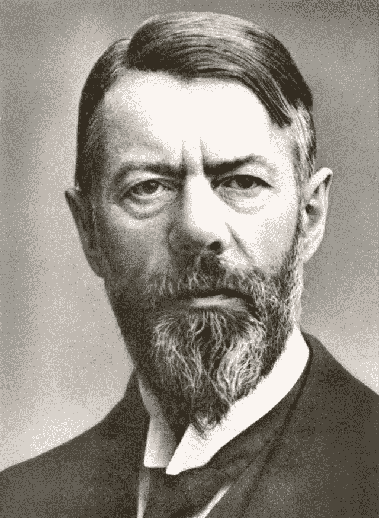

马克斯\*韦伯（Max Weber，1864－1920），德国社会学家、政治学家、经济学家、哲学家

在很多方面，我们可以说韦伯是在马克思理论的框框里做出了突破和创新。比如说，在马克思看来，以生产关系为代表的经济形态决定了思想形态，而观念不过是经济地位的表征。但是，韦伯不同意马克思的经济决定论，他认为思想观念照样可以影响经济生活和社会的发展。

对于这一点，我们将在后面的几集中，再具体跟大家介绍。

韦伯的研究牵扯现代社会的各个方面，揭示出社会错综复杂的变化发展，并且，他最大的特点是，巧妙地把历史学研究和社会学理论糅合在了一起。

在韦伯学术生涯的早期，他主要研究的方向是经济学和历史学，后来他倾向于社会学。可以这么说，韦伯所有的社会学研究都是有历史取材的，也就是根据他收集的历史材料来分析验证。有意思的是，今天不少社会学家，却失去了对于历史纵深的关切，只擅长对正在发生的社会现象进行统计分析。

韦伯非常相信历史学和社会学的相关性，但同时，他也指出了两门学科的差异性。

韦伯认为，历史学是由林林总总的个别历史事件构成的，每一起历史事件，都有自己独特的时间、地点、人物、起因、结果，所以必须一个个来进行分别的解释。

而社会学家，虽然面对的也是形形色色的各种社会事件，但是社会学可以把个别事件的经验，进行总结归纳，概括化发展，形成各种可以分门别类的"类型观念"。这些"类型观念"虽然不能还原个别经验事件的全貌，但是能提供启发思考的工具，帮助我们了解事件的真相。

用韦伯的原话，就是说，社会学"是建立类型概念，并追求经验事实的普遍规律的一门学科"。

这些类型概念，在韦伯的定义中，就被统一叫做"理想类型"。

他这个定义是什么意思呢？理想类型，顾名思义，是一种理想的形态，并不会完全存在于现实的世界里。韦伯自己就说，"一个理想的形式，是由许多现象提供的某些特征和成分所组成，但它不会和任何特定的现象有着完全一样的特征。"

换句话说，理想类型就像物理学里的绝对零度一样，是一种理想化的典型，现实中的社会现象只能接近它，而不会和它完全相同。

再比如说，我们都知道，在经济学的世界中，经济学家喜欢说，人是理性的动物。在理性思维之下，人们往往喜欢计算利益的得失，尽可能把利益最大化。

但其实，现实中没有一个人是完全理性的，可为什么经济学依然坚持假设人是理性的呢？这样的做法实际上就是在构造理想类型，理性人就是一个理想类型，它把那些在经济社会里从事经济活动的人都有的一个基本特征进行了抽象。

#### 三、建立理想类型的意义

如果说，没有任何人是完美符合理想类型的，那建立理想类型的意义是什么呢？

第一，建立理想类型，可以帮助学者概括、完善理论，推动学术理论持续向前发展。

再拿经济学家所说的"理性人"来举例，如果我们能够研究出完全理性状态下人的行动，那我们也就能更加清楚，理性对人的意义，或者说，至少会明白经济人的理性对人来说，究竟意味着什么。这是建立学术理论的第一层。

再进一步地，有了理性作为基础，我们还可以一步步改变、修正我们的假设，去研究非理性、利他性或者存在着制度约束的情况下，人的行为选择会发生怎样的变化。这就是学术理论得以持续推进的第二层。

第二，建立理想类型，可以帮助学者抛弃学者本身的价值和立场，以价值中立的观点去分析世界。

社会学难免会关心人们的信念，和支撑人们社会行为的各种价值观念。社会学家在看待社会的时候，也同样对社会怀抱着价值和信仰，甚至对于如何组织社会也有自己的情怀。

在韦伯看来，所谓的社会事实，实际上都非常依赖社会学家个人的诠释。假如所有的社会构想和概念，都不可避免地带有社会学家的价值和信仰，那么由此产生出的知识，怎么能够不带有研究者本身的价值和偏见呢？所以，社会学家怎么才能把他们的价值和信仰，与他们的研究结论区分开来？

对于这样的问题，韦伯明确地指出，社会学研究的目的是理解人的行为而不是对行为作价值判断。

而"理想类型"这一种分析工具，就可以保证在具体研究的过程中，不会纠缠于太过于细枝末节的个体差异，而是可以通过对个体行动的抽象和升华，修正观察个体行为中所出现的过度个体化和特殊化的问题，从而对社会总体做出有效解释。

#### 四、理性人还是社会人？

说到这里，我们再看一下开头提到的有关泰坦尼克号的三个细节的观察，看看这其中都体现出人们怎样的行为特征。

当泰坦尼克号这艘巨轮沉没的时候，船上一共有超过 2000 名的船员和乘客，我们没有办法把这 2000 多人的行为和动因一个一个进行分析。在这种情况之下，我们就需要对个体行为的一般规律进行总结，并结合其他的因素，构建出人们行为和行为动因背后的理想类型。

首先，如果我们采用经济学中有关理性人的分析框架，就可以看到在第三个细节里，正是因为人们在理性地追求利益最大化，所以当路西塔尼亚号沉没的时候，人们在极端的压力之下，首先想到的，是考虑自己的生存，而不是他人的生存。

人人都会为自己着想，做出自私理性，以自我中心的行为，这时候健壮的人，特别是年轻男性就有了优势他们更有机会抢占生存的通道。

但是在理性人的假设基础上，我们还不足以去解释，为什么同样作为理性人，在第一个关于性别和出生率的故事里，泰坦尼克号上的人们就会主动放弃个人的生死，首先帮助妇女儿童这些社会弱势群体呢？

为了回答这个问题，我们就需要再进一步修正我们的假设，这个假设不再简单的认为人们只会是单一维度的理性人，而是认为人们除了存在着以利己为目的的理性行为，也会存在着以利他为目的的理性行为，在生命和人性冲突的终极点，依旧可以照顾到他人的利益，按照社会的规范去要求自我的道德水平。

换句话说，人不仅仅是理性人，同时也是社会人，因为人身处社会当中，不可避免地要和周围的人进行交流和互动，因此很多时候，人不会仅仅只是考虑自我的利益得失，同时也会考虑他人、群体的存在，考虑自己的行为是否符合他人的预期，会做出利他的行为。

澳大利亚经济学家本诺\*托尔格勒（Benno Torgler）和他的伙伴对两艘巨轮的沉没，也进行了一番有趣的比较。

他们的研究（Interaction of natural survival instincts and internalized social norms  
exploring the Titanic and Lusitania  
disasters）发现，虽然两艘船截然不同的生存率是由很多因素导致的，譬如乘客的年龄，性别和舱位等级所对应的社会地位，但在这其中，最为重要的是一个因素，是时间，是时间压力对于人们行为所带来的影响。

为什么这么说？泰坦尼克号完全沉入水下花了 2 个小时 40 分钟，而路西塔尼亚号在 18 分钟内就完全沉入大海。在差异极大，几乎是 8 倍的时间段里，人们的行为模式也相应地出现了差异。

路西塔尼亚号出海

研究者分析说："在路西塔尼亚号上，短期的逃跑冲动占据了主导地位；而在慢慢下沉的泰坦尼克号上，由社会规范和道德模式规定的行为模式，譬如让女性和儿童优先登上救生艇，得以有时间出现，并且影响人们的行为选择。"

这就意味着，在泰坦尼克号上，因为沉船不是立即发生的，时间比较充裕，社会道德的规范力量依然在发挥作用，于是体现在人们的行为上，要求人们的行动必须服从社会整体的规范和秩序，首先帮助妇女儿童这些社会弱势群体，同时，人们也有时间去思考并且用社会规范去评判其他人的道德水平。

但是，当危机爆发在一个临界点，道德规范的约束力开始失效，社会规范不复存在，人性的幽暗面便如洪水般冲破道德的束缚，每个人都成为最原始的野兽，只遵从最为理性、原始的本能。

而在第二个有关阶层和幸存率的细节里，我们会看到来自不同船舱等级的乘客，他们的社会行为也是迥然相异的。

这里面，我们在建构理性类型的时候，实际上是加入了一个新的变量要素，就是人们的社会阶层地位，并且假设，社会地位越高的社会群体，他们就越有可能获得稀有的资源，获得一张上救生艇的通行证。

而社会阶层地位越低的社会群体，他们要想获得稀有资源，就得付出更多的代价，甚至很多时候，无论采取什么方式，都很难冲破既有的社会结构限制，打破阶层，实现跨越阶层的自由流动。

#### 五、社会学，理解社会行为的科学

这种对利己、利他的理性行为的分析，实际上都属于韦伯有关社会行动的理想类型分析。

社会学的研究视角，大体可以分成三个层次：

第一个层次是宏观视角，关注的是宏大社会变迁和转型；

第二个是中观视角，关注的是社区、社群这样的群体；

第三是，微观视角，关注的是个体。

很多研究者不主张站在个人角度进行社会研究，其中考虑到的一点是，担心研究的客观性受到破坏，所以拒绝置身其中的研究。

和多数社会学家不同，韦伯更偏向关注个体，他认为社会学是一种"理解个体社会行为"的科学,因为个人是社会的基本构成因素，个体行动也是社会结构的组成要素，所以社会学应该把人作为主要的研究对象。

所以你看，我们之所以可以理解一个社会行动，是因为个人赋予行动的主观意义是可以理解的。

进一步的，根据社会行动遵循的规则，韦伯提出了社会行动的四种类型，分别是目的理性、价值理性、情感理性和传统理性，每一种都是理想类型的其中一种。

其中，目的理性行动更关注怎么达成目的；价值理性，更关注价值本身，不考虑是不是具备合适的条件和产生的后果；情感理性，受行动者情感甚至情绪支配；传统理性，对目的和手段缺乏有意识的思考，更偏向习惯。

在下面的一集里，我会专门针对价值理性和目的理性，和你再展开具体的分析。

需要再次强调的是，尽管社会行动可以划分出四种理想类型，但这种分类只是一种纯粹形式，在现实生活中，具体的社会行动可能是上述类型的不同结合，而不只是其中一种理想类型。

韦伯自己就说过，"行动的这些指向，也绝不是穷尽所有方式的分类，它们仅仅是为了社会学的目的所创造出来的概念上的纯粹类型。实际的行动或多或少地，接近于这些类型，或者更常见的是行动中混杂着来自不同类型的要素。"

更重要的是，对于社会行为的理论探索，实际上是为了更好地理解每一种行动背后隐藏的动机和意义。韦伯致力于寻找社会行动的多重指向，也就是在承认不同的价值可以同时存在，而这正是学术研究中学者的立场和关怀。

今天的内容就为你讲到这里。我是严飞，我们下一集再见。

# 16\. 克里斯玛权威：我们喜欢“小鲜肉”，是一种魅力权威的表现吗？

（公众号懒人找资源，懒人专属群分享）

### 本集要点

1.韦伯的三种权威类型

2."小鲜肉"和克里斯玛型权威

3.克里斯玛型权威的困境及解决方法

### 文稿

你好，我是严飞。在今天的这一集中，我将和大家介绍一下韦伯有关权威类型的三种划分，并且重点讨论一下克里斯玛型权威。

#### 一、"小鲜肉"浪潮

这几年，娱乐圈刮起了一股"小鲜肉"的明星浪潮，他们带动了巨大的流量和讨论热潮，也让人们一次又一次地感叹明星偶像们的巨大魅力。

我们看到，无论是鹿晗、吴亦凡、朱一龙、杨洋，还是《偶像练习生》出道的蔡徐坤，或者是 TFBOYS 这个 00 后的中国内地人气偶像组合，"小鲜肉"作为流量明星，有着强大的粉丝团和应援团。

有的时候，他们只是发了一张自拍，发了新的视频作品，或者是说了私生活里的一件小事，就会把微博挤得瘫痪。如果有人对"小鲜肉"稍微有一些负面的评价，这个人就会被"小鲜肉"的粉丝们团团围住，而如果再有点出言不逊，就会马上被粉丝们炮轰。

如果你不是粉丝的一员，那么你心里一定也会有疑问，为什么这些"小鲜肉"有如此强大的魅力，他们的魅力是否等同于韦伯笔下的克里斯玛型魅力呢？如果不等同，那么什么才是真正的克里斯玛型魅力？

#### 二、权威类型的由来

要回答这一问题，还是要先回到韦伯对于政治社会学的兴趣上。

1922 年，韦伯的《经济与社会》出版了，这本书里，不仅有社会学的一些基本范畴和概念，还包含了韦伯在经济社会学、法律社会学、政治社会学和宗教社会学等方面的观点，克里斯玛型权威就是韦伯的政治社会学观点。

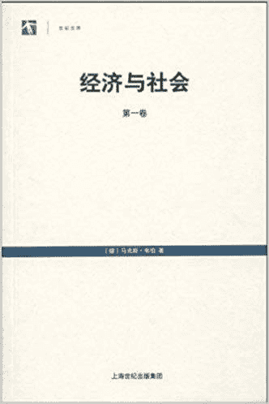

韦伯《经济与社会》，上海世纪出版集团

事实上，韦伯对政治很有兴趣，他和马克思一样，对现代的资本主义有很多不满意的地方，但是，他和马克思也有很多不同。

第一，两人对改革的态度不同。韦伯并不是一个激进的政治学家，他不像马克思那样推崇革命的方式，想要把原本的社会推翻，他想要的是逐渐地、一步一步地改变社会。

第二，两人对中产阶级的信心不同。马克思相信，像小商人、小工业家、医生、律师这样的中产阶级，数量会不断增加,并且，成为上流社会的安全力量。因为在马克思看来，中产阶级一定程度上剥削了工人，又在一定程度上被资本家剥削，所以它虽然成了工人的负担，但同时，也促进了社会的相对稳定。

可是，韦伯对中产阶级没有很大的信心，因为他觉得，中产阶级目光短浅，而且是被官僚制控制的一群人。

所以，虽然韦伯也批判权威的政治领导，比如德意志帝国的宰相俾斯麦，但是韦伯最大的信心依然是在政治领导人物身上，而不是普通大众或者官僚阶级身上。在这样的基础上，韦伯对政治领导的权威类型和统治模式进行了理想类型的划分。

提醒一下，这里的"理想类型"就是我们在上一集中介绍的理论分析框架。简单来说，就是抽象化的社会定义，是研究者在分析复杂的社会现象的时候，使用的一种重要工具。

#### 三、三种权威类型

在划分政治领导的权威类型和统治模式的时候，韦伯提出了三种权威的类型，分别是传统型权威、法理型权威和克里斯玛型权威。

首先，我们先来看一下传统型权威。

什么是传统型权威呢？比如我们熟悉的长老制、家长制、世袭制，都算是传统型统治。在韦伯的理论中，传统型权威的基础是对统治者权威的肯定，是传统社会状态中存在的一种表现权威的方式。

它的核心是宗法家长制，依靠宗法关系、血缘关系来维持服从的关系，权力来源往往依靠世袭。

在传统型权威中，统治者有"特权"，并且可以用手上的特权垄断市场，压制市场上的自由竞争，而那些被统治者一定得服从行使权威的人。所谓"普天之下莫非王土，率土之滨莫非王臣"，就是传统型权威的表现。

今天，传统型权威现在已经很少能见到。在我们这个时代，如果有国家还保持着传统的君主政体，那这种统治方式也一种政治象征，而不代表实际的权力。

比如，在英国，我们常常看到英女王伊丽莎白二世头戴王冠、手上拿着权杖的场景。王冠和权杖代表着她的绝对权威，至高无上。可是，实际上，女王甚至没有权利决定英国法律的内容，虽然法律是用女王的名义颁布的。

所以，比起头戴王冠的女王，人们更加喜欢的，还是在不同场合头戴不同颜色礼帽的女王。女王今天会带一顶什么颜色的礼帽，反而已经成为了人们津津乐道的话题。

接着，我们再来看看权利类型的第二种，法理型权威。

在法理型权威之下，人们相信规章条例是合法的，行使权威的人按照法律规章有资格进行统治，也叫作理性的统治。

比起传统型权威，法理型权威要更加稳定、更加持久。是一种完全依靠理性约束的权威，每个人就是组织中的一员，服从组织的权威。

在我们现代社会，大体来说，全部行政管理手段，不管是交通规则，学校的考试制度或者是税法的章程，都包含着对人的统治，所有听从治理的人都应当服从合法的规章制度或者法制的解释者和执行者。

最后，终于到了今天我们重点要讲的第三种权利类型，也就是克里斯玛型权威。

在《支配的类型》一书中，韦伯做了如下定义："'克里斯玛'，这个字眼在此用来表示某种人格特质。某些人因具有这个特质而被认为是超凡的，禀赋着超自然以及超人的，或至少是特殊的力量或品质。这是普通人所不通具有的，它们具有神圣或至少表率的特性。某些人因具有这种特质而被视为'领袖'"。

简单来讲，克里斯玛型权威下的统治，实际上是一种领袖的魅力统治，所以克里斯玛型权威也叫作魅力型权威。这种权威之所以会产生，是因为人们被某个人的人格魅力深深折服，所以，克里斯马式权威中的统治者一定是享有特殊荣誉的人物。

被叫作"克里斯玛型"的人物，在他的追随者看来，是具有超凡脱俗的力量或者品质的，是无懈可击的。追随者愿意追随到死，他们的崇拜是无条件。

#### 四、小鲜肉的魅力=克里斯玛型权威？

这就和我们开头提到的拥有强大粉丝团的"小鲜肉"联系了起来，也许有一些人会觉得，"小鲜肉"的魅力，和韦伯所说的超凡魅力型权威，也就是克里斯玛型权威是一样的，因为在英语中，形容一个人有魅力，用的是 charming，而超凡魅力的英文正好是 charismatic，这两个字单词有很多相似的地方。

所以在"小鲜肉"的粉丝心目中，这些明星们就是这样拥有超凡魅力的克里斯玛型人物，有着非常优秀的品质和巨大的吸引力。

但事实上，韦伯所描绘的超凡魅力，或者说克里斯玛型权威，还真不适合这个时代的"小鲜肉"们。"小鲜肉"们的魅力，更多来自于娱乐时代之下商业经济的包装，常常和消费主义以及偶像崇拜联系在一起;而韦伯笔下的超凡魅力，其实有着很深的政治社会学意义，甚至常常和革命浪潮相联系。

韦伯认为，克里斯玛型人物往往出现在社会动荡时期。

当出现社会危机的时候，人们就会期待英雄的出现，来带领他们走出困境。这种强烈的欲望，导致这个社会一旦出现了一位能力出众的人，并且，这个人凭借自身特殊的能力和气质，带领大家打破了危机，那么，人们就会对这样的人物产生疯狂的崇拜和迷信，甚至人们的价值观和行为模式也会发生彻底的改变。

而这一位克里斯玛型人物，也往往会被人们称作伟人。

韦伯还指出，有着超凡魅力的克里斯玛型权威拥有一种强大的改革力量，这里，他指的是政治层面的对社会的变革。

如果说法理型权威是一种外部的改革力量，它对社会的改变是首先改变社会的结构，最终慢慢的改变个人的行为和思想；那么克里斯玛型权威则不同，它会依靠领袖的超凡魅力，从而彻底地改变人们的思想和态度，是一种内在的激烈的变革力量。

#### 五、克里斯玛型权威的困境

但是，再有魅力的伟人，也不是永远伟大的，更不是永远正确的。

韦伯非常明确地说过，克里斯玛型的领导者往往带领人民在巨大的社会危机中摆脱了困境，但是这样的权威类型是不可持续的，英雄式的人物可以领导革命，他的权威也来源于他超凡的能力，但是在革命之后，国家和社会就会面临新的问题，那就是如何维持统治的问题。这是克里斯玛型权威的第一大困境。

要想维持社会的稳定和有序，不能简单地依靠个人魅力，还需要更多的理性制度的建设、法律规范的章程。

另一方面，克里斯玛型权威通常是脆弱的，不稳定的，因为整个权力最为核心的要素，就是这一位领袖，如果领袖人物不再有魅力，或者他的领导时期结束，再比如他去世了，那么整个社会也会陷入到飘摇不定的困境中。

那么如何解决克里斯玛型权威的困局呢？答案有两种。

一是寻找新的"英雄"，或者是实现统治权力的世袭或禅让，向传统性统治过渡。

二是转型进入法理型权威。韦伯所支持的，是转型进入到理性统治的法理型社会中，权威的来源是合法的规则，还有被统治者对统治者的认同，而不是个别领袖或者伟人的个体超凡魅力。

历史上，克里斯玛型权威的例子有很多，比如戴高乐、罗斯福、阿拉法特、卡斯特罗等政治人物都是这样。人们对这些领袖的德行和能力深信不疑。而这些政治领袖，一直到今天，依然是享有盛誉的人物。

这里，跟大家分享一个戴高乐将军的故事。

熟悉二战历史的朋友都知道，戴高乐可以说是法兰西的"再造元勋"，是帮助法国在战后取得战胜国大国地位的英雄人物。

在 1940 年 6 月 14 日，德国装甲师进攻占领巴黎，巴黎沦陷，法国傀儡政府向德国宣告投降。四天之后,流亡伦敦的法国将军戴高乐在英国广播电台发表了著名的抗击纳粹宣言----《告法国人民书》，号召法国人民团结起来，一起抵抗纳粹德国的侵略。

戴高乐的声音十分有感染力，他说，"无论出现什么情况，我们都不允许法兰西的抗战烽火被扑灭，我们的战火也永远不会被扑灭。"在这之后，戴高乐组建了自由法国流亡政府，和德国继续战斗，立志恢复法兰西的尊严。

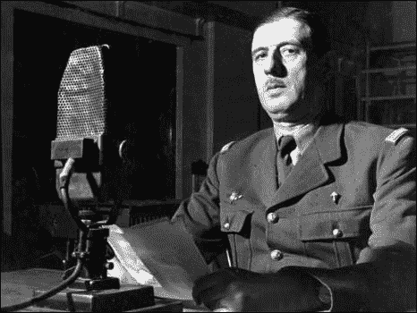

1940 年 6 月 18 日，戴高乐将军在伦敦对法国发表重要讲话，这是戴高乐在伦敦发表一系列讲话中的第一次。图为戴高乐在 1941 年的一次讲话。

二战结束以后，因为戴高乐的超高威望和个人魅力，他接管了临时政府的政权。1958 年，戴高乐修改法国宪法，成立法兰西第五共和国，当上了第一任总统。

但是，戴高乐在国家治理上，并不如在战场上得心应手，甚至还做出了不少错误的政策判断。但是，因为他在二战期间的成就，让戴高乐依然在普通法国民众心目中占有重要甚至神圣的地位。

到了 1961 年 4 月，法国阿尔及利亚的驻军发动反动戴高乐的武装政变，呼吁法国民众响应，总统戴高乐陷入到空前的管制危机。

面对危局，戴高乐做出了一个让人吃惊的举动。为了让大家听从他的指令，共同反对阿尔及尔叛乱的将领，他脱下了当总统的时候一直要穿的西装，再次穿上将军的军装，走到电视镜头前，发表了一番慷慨激昂的演讲。

演讲中，戴高乐痛骂叛乱者在干一场"可恶和愚蠢的冒险"，禁止所有的法国人执行反叛者下达的命令，并且要求维护"民族授予我的法国的共和政体的合法性"，演说结束的时候，他说："士兵们！你们正面临着忠实于谁的抉择。我就是法兰西，就是她命运的工具。跟我走，服从我的命令！"

这样的场景，这样的宣言，历史何其相似。人们好像又回到二战时法国最黑暗的时期，当时戴高乐将军一次次通过广播发出号召"我是戴高乐将军，跟我走"的场景中。

一句"跟我走"，身为将军的戴高乐再一次激起法国民众团结一致的精神，导致在电视讲话之后，成千上万的巴黎人涌向街头，将巴黎的各条街道挤得水泄不通，以表示自己对领袖的支持，戴高乐也就这样渡过了一场政治危机。

在这里，很明显，依靠选举合法性成为总统的戴高乐，他的权威和统治认受度，要远远低于拯救法国人民于侵略水火的将军戴高乐。所以戴高乐才会在出现统治危机的时候，再一次穿上战争时期的将军服，通过展现自己超凡的个人魅力，来获得民众对他的支持。

当他选择克里斯玛型权威去鼓舞大众，而不是法理型权威时，也许他早就意识到了，在某些情况下，以个人魅力和殊荣为代表的克里斯玛型权威甚至比法理性权威更加有威力。

事实上也确实如此，领袖的个人魅力和能力是非比寻常的，群众对他的支持和拥护也是非同一般。

美国总统尼克松后来也说："穿上将军服出现，戴高乐就拨动了深深地藏在法国人心中的感情之弦，激发了他们之间团结一致的精神，而这种团结的精神是只有在情况最坏而又渴望改善的时候才有的。"

不过，个人魅力虽然扭转了一次危机，但也不是每一次都可以取得最好的政治成效。随着法国经济结构的转型，人民生活水平不断提高，社会意识也发生了巨大变化。终于在 1969 年 4 月，总统戴高乐在各种棘手的社会问题和冲突之下，选择宣布辞职，结束了自己的政治生涯。

当然，我们并没有说这就是他在政治上的失败，其实，当他选择离开的时候，依然有着很多的支持者。作为一个在法国历史上有过丰功伟绩的领导人，他当时的"激流勇退"也可以看作是他伟大的另一个面向。

#### 六、法理型权威下的科层制

韦伯是第一位把克里斯玛独立出来，并且分析了它的社会起源的人。

我们今天讲了韦伯提出的权威分类，又重点和你分析了克里斯玛型权威。

可以说，这种类型的权威非常依赖"个人"的魅力、威信和影响力，在特殊的大时代背景之下，尤其是动荡、看不到前路的时候，一个神一般的人物出现，的确可以安抚民族的迷茫，甚至可以担当起解放大众于水火之中的救世主。

但是，一旦进入政治局势的平稳期，对于经济建设提出新的更高要求时，那么这类型的权威便可能无法再满足国家和民众的需求了。这个时候，最被韦伯所赞同的另一种统治类型，法理型权威便开始登上历史的舞台了。

在韦伯看来，法理型权威是现代社会的统治形式，而法理型权威里，最主要的理想类型是科层制，它是按照权力的职能和职位，进行分工和分层。

韦伯认为，在科层制中，人们的服从仅仅在于公务上的服从，依靠规章制度形成组织，并明确规定职责权限，选举提拔也依靠规章制度，依照资历成就行事。

在这样的一套管理系统中，追求效率至上，而且组织之间充斥着个人和组织的理性化分工。毫无疑问，是更加具有效率，也更为持久，或者说是更能应对现代国家治理的复杂挑战。

那么，科层制是完美无缺、无懈可击的吗？我们将在下一期中，再仔细为你分析、讲解。

最后，也请你认真思考一下，哪些历史上的领导人物属于我们今天讨论的克里斯玛型权威呢？欢迎留言讨论。

我是严飞，我们下期再见。

# 17\. 科层制：学生会为何有上百名“部级干部”？

（公众号懒人找资源，懒人专属群分享）

### 本集要点

1.何为官僚主义、官僚制（科层制）

2.科层制的好处与弊端

3.韦伯的科层制和中国官僚制度的区别

### 文稿

你好，我是严飞。在今天的这一集里，我想和你介绍一下韦伯的科层制。

#### 一、大学成为"小官场"

每个大学里都有学生会，学生会的作用是为了锻炼学生的领导力，增加同学之间的凝聚力，让大学生活更加丰富多彩。但是，当大学里的学生会竟然要选出 56 个正部长、99 个副部长的时候，一切就都变了味道，原本清净、单纯的大学校园就成了一个不折不扣的"小官场"。

去年的 7 月，中山大学学生会就这样火了，在年度学生会改选任命公告中，一下子列出了两百多个学生干部岗位。尤其是在"秘书机构"和"组织部门"两个层级中，还特别标明了职位是"正部长级"还是"副部长级"。

中山大学

一般来说，学生会的管理层里会有主席、部长、干事这样的职位，但是中山大学的"正部长级"、"副部长级"已经和国家工作人员的职位命名方式非常相似了，而且，一选还选出了 155 个。

有人就提出疑问，学校不是一个提倡学术独立、思想自由的地方吗？为什么中山大学的学生组织充满了官僚主义？官本位思想是不是已经入侵了大学，成了一个普遍现象？

其实，中山大学学生会并不是唯一的例子，现在国内的大学，很多学生会的会议公告都在模仿正式的政府公告。有人解释说，大学的学生会作为一个正规的学生组织，把公告也写得正规一些是可以理解的，再说了，大学生即将步入社会，这样的做法也算是和社会接轨。

不过，很多人还是对这样的官僚主义感到非常不满，看到还在象牙塔里的大学生也在有样学样，则是爱之深责之切。

二、科层制、官僚制、官僚主义

在开始介绍"科层制"之前，先要明白一件事，那就是，"科层制"有另一个名字，叫"官僚制"，而"官僚制"和"官僚主义"是两回事。很多时候很多人把官僚主义和官僚制，或者说科层制当作一回事加以痛斥，这其实是一种误解。

科层制实际是德国社会学家韦伯提出的一个专门的经典社会学概念 bureaucracy，在引进中国的时候，先是翻译成了官僚制。可是，翻译成官僚制有一个坏处，因为中国很早就开始实行官僚制，所以大家对官僚制已经形成了一个不好的印象，就是"长官意志"、形式主义，低效、无能、特权、傲慢，甚至腐败等等。

但是，韦伯提出的这个官僚制其实是一个中性词，指的是所有大中型组织中由受过训练的专职人员组成的行政管理机构，但这些带有贬义的印象其实是"官僚制"在实际运行的时候，产生的"官僚主义"，可以说是官僚制度的弊端之一，但不是"官僚制"本身。

所以，为了把韦伯的"官僚制"和中国式的官僚主义区分开来，后来统一翻译成科层制。

#### 三、韦伯的科层制

了解了科层制、官僚制、官僚主义这几个名词的区别之后，我们再来详细说说什么是科层制。

首先，我们要回顾一下，在上一集我们讲过，韦伯把权威结构分成了三种，分别是法理型权威、传统型权威和克里斯玛权威。

法理型权威的基础是人们"深深相信所实施的规则的合法性，还有被推至权威位置的人按这些规则去发号施令的权力"。换句话说，统治者或者管理者并不具备私有的权力，统治者和被统治者的地位差别是由法律条文规定的。

韦伯认为，法理型权威可以有很多的结构类型，这其中，科层制是法理权威运作中最纯粹的类型，是现代资本主义社会现代化的一个基础。

科层制是一种典型的组织类型，它的基本单位是职务或者职位，通过规则、功能、文件还有各种强制手段，这些职务或者职位组织成层级的形式，分科执掌，分层负责。

再形象一点说，理想类型的科层制是一个像金字塔一样，界限分明的权威等级体系，各个等级都受规则制约，行政功能分化，劳动分工的权责十分清晰。

同时，每个职务都有一个特定的职权范围。特别要注意的是，谁占用了职位不重要，职位本身才更重要，所以占据职位的职员不允许利用职位抬高自己的特权，必须严格按照职位所规定的要求办事，而不可以带有自己个人的色彩和喜好。

换句话说，这些职位，体现出了一种特质，那就是"非人格"，不允许施展个人魅力，同时也不受个人的感情支配。另外，一个科层制结构中的行政活动、决定和规则，都会通过文本记录在案，都可以做到有案底可以查询记录。

从纯粹技术的观点来看，科层制的设计原则就是不依赖某个人的人格，而是依赖规章架构，所以就可以最大限度地减少个人对工作的干扰，实行专业化和分工。而且，因为整个组织构架是有连续性的，这也保证了工作流程的连续性。

也就是说，某个职位上的人员如果有变动，不会影响整个组织的连续运营，这就能够最大效度地保证工作效率。

科层制可以获得最高程度的效益，在精确性、稳定性、纪律严明性和可靠性上，都比其他任何类型要好；而且，科层制可以让人们精确地计算出每个行动的后果，这也正是科层制的优越性的体现。无论是从集中效率方面上看，还是从运作范围上看，科层制这一形式对所有类型的行政事务都适用。

所以，虽然传统型权威和克里斯玛型权威也在某些领域发挥作用，但是现代社会最核心的权威类型，还是以科层制为组织构架形式的法理型权威。

在法理型权威中，人们按照法律的规范行事，承认的是法律本身所带有的权威，而不仅是执法者的权力。虽然科层制在后来不断变革，但是，依然没有被其他权威形式所取代。

#### 四、科层制的缺陷

当然，韦伯所提出的科层制，也不是完美无缺的。

虽然韦伯非常支持科层制，但他也意识到科层制存在一些弊端。

在科层制的管理运作中，占主导地位的是形式化的、非人格化的精神。科层制的专业性和理性基础，让它所遵守的形式法规严格规定了每个机构和每个机构的每一层级所管的范围，和它们的权力。

当这样的特性发展到极致时，原本的理性因素就会向非理性因素转变。

第一点，韦伯指出，分科执掌、分层负责，会让会议和文件数量增加，官样文章（red  
tape）、文牍主义泛滥，这样的现象会让我们和科层制的组织结构打交道时，产生有很多的困难和麻烦。

比如，原本走程序是为了规范办事流程、明确权责关系，但是，有时候遵守程序会高过组织的根本目标，所以，如果明明存在更好的解决办法，还是要遵守程序，这就会造成了事实上的效率低下。

迪斯尼的动画《疯狂动物城》里，车管局的公务员全是树懒，做事、讲话都慢好几拍，愁得办事人头皮发麻，也是想讽刺行政部门效率低下。

电影《疯狂动物城》画面

第二点，过度理性的科层制结构会束缚人们的个体自由，造成对人性的漠视、对个人自由的抹煞，压制了个体的创造性。这也是韦伯最担心的一点。

说得更明确一些，韦伯对于科层制的构想本身就暗含着对人性的理性化、程式化的预设。打一个比方来说，科层制就像一架由人组成的机器，它是没有人情味的、运转良好的，个人就是这架机器上一个个性能良好的大大小小的齿轮，而整个社会秩序也在这架机器的带动下有序井然。

这种为了追求效率而对人性的极大漠视，最终会变成一个"人性的铁笼"，罩在每个人的头上。关于韦伯所说的"人性的铁笼"，我会在后面的一集中，再和你详细介绍。

韦伯指出，现代组织方式极大地提高了生产效率，人支配自然的能力达到了空前程度；但是，这个由理性化创造的世界会变成一个怪物，它把自己的创造者"非人化"。

韦伯对于理性化的分析和我们之前提到的马克思的"异化"的概念很像，但是，不同的是，马克思认为异化是人类发展过程中一个必经的阶段，人类的远景还是光明的。

而韦伯认为，当日常生活的分工精确化、计算化、专业化，整个社会的情感酒被剥夺了。人们沦为了工业生产般的机器工具，就像电影《摩登时代》里，工业生产下，"无意识"的人们镶嵌于机器中的呐喊和叹息。

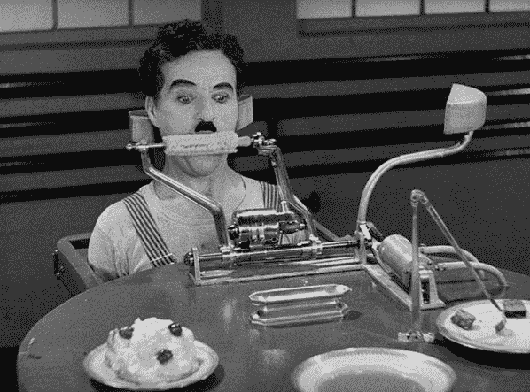

电影《摩登时代》画面

#### 五、科层制≠中国的官僚制

听到这里，相信你会感觉到，韦伯所描绘的科层制，和我们所熟悉的中国式的"官僚制"，还是有很大区别的。

虽然韦伯在理论层面，提出了科层制的一些缺陷，但是，韦伯所说的科层制依然是一个理想类型构架，也就是最理想状态下的科层制。在现实生活中，科层制并不是和韦伯所描绘的概念完全对应的。

在中国，官僚制更多的是和官僚主义联系在一起，是一个具有贬义的词汇。我们说到官僚制，就会想到慵懒、拖沓、不作为等等。

不能否认，官僚制在中国历朝历代的统治中发挥了重大的作用，是维护帝国盛世的重要组织力量。

同时，在很多电视剧里，比如《雍正王朝》、《大明王朝 1566》中，我们都可以看到中央政府内部不同层级之间尔虞我诈、争权夺利的争斗，中央权威与地方权力之间微妙的央地关系，以及一介小官作威作福的丑态。这一些都是中国官僚制的弊病，并且几个世纪下来，似乎依旧延续着。

现代以来，随着法律法规的完善，中国的官僚制度也发生了一些变革，但是依旧存在很多问题。

第一，政府部门办事操作复杂、程序僵化，效率低下。比如，出国旅游要证明"你妈是你妈"，还有许多地方办一些证件需要盖几十个章。

第二，政府各部门互相推诿，"有关部门"成为和我们打交道最多的一个部门。有些公务员之间流传的做事秘籍就是，"做错事比不做事的后果可怕多了，所以千万别太勤快，遇到事能推就推，能拖就拖，保住自己的铁饭碗最重要"。

政府部门互相踢皮球的现象实在不少见，原本是一件简单的事情，却不得不反反复复办理，跑了很多部门，可是依然得不到合理解决。

第三，很多时候中国的官僚制度过于"人格化"，讲究人情场面。这不仅和韦伯科层制中的"非人化"完全相反，更是严重丧失了科层制的理性。

中国一直以来就是人情大国，人们心里早就默认了"朝中有人好办事"，所以人们才会追崇"官本位"。

自古以来，买官、卖官、贪赃枉法的现象就很普遍，很多官员利用职务，为自己人谋利益，还有的官员钻法律的空子，不诚心解决百姓的问题，甚至利用一些非法的手段去遮盖问题、隐藏问题，这也更反映了中国官僚制中法律意识的淡薄甚至缺失。

第四，官僚机构臃肿，行政成本过高。

举一个例子，媒体曾报道山东某个县政府里有一名县长，6 名副县长，还设有 15 名县长助理，仅仅一个县级领导班子就能坐满一个会议室。虽然这个现象是个例，但可也看出中国官僚机构官员设置的臃肿。

目前，政府财政供养人员主要分为两大类，一是政府机关人员，包括国家机关人员、政党机关人员和社会团体机关人员；二是事业单位人员，包括教育、医疗卫生、科研、文化等公立部门人员。

有专家估算，中国政府财政供养人员这几年已经上涨到 8000 万，也就是说，10 多个人中就有一个财政供养人员。中国行政成本之高，远超过世界各国的平均水平。我们在开头讲到的，中山大学学生会里的上百名干部，也是一种官本位之下的机构臃肿。

#### 六、现实思考

虽然韦伯所说的理论上的科层制也是不完美的，运用在今天的社会，某种程度上也显得有些不合时宜了。但是，对于这个时代来说，科层制依然可以说是一种"最不坏"的组织形式。

不论是整个国家的官僚制度，还是说企业、学校、军队、社会团体这样的中小型组织，都没有办法避免科层化的趋势。

如何基于人性的考量，对官僚组织形式进行设计和完善，又如何在科层制这个组建和维护社会秩序的机器之下，最大限度地尊重人性与个体的自由？实际上，我们探究科层制的时候，还是不能绕开对人性和社会秩序的讨论。

必须承认的是，科层制的构想本身就暗含着对人性的理性化程式化的预设，当科层制受到人性中的利己、惰性等缺陷的腐蚀，科层制的效率与可靠性就岌岌可危了。而科层制对人性的漠视和人性本身的缺陷相互作用着，既会侵蚀科层制本身，也会对人性造成威胁。

另一方面，我们也意识到，中国的官僚制度还需要向理想类型中的科层制靠近，因为科层制的基础是理性主义，在这方面，我们依然有很多改变和进步的空间，尤其是需要更好地推行理性基础的法治。

其实，官僚制的问题，不仅仅在中国有，在发达国家也是一样的。我有个学生之前在巴黎交换学习，为了办一张公交卡也在"有关部门"之间来回周旋无数次，最后在学期快要结束的时候才拿到了卡，这让她对法国官僚主义非常生气，反而怀念起中国的办事效率了。

但是，这些其实都不能简单地说是体制或者个人的原因，是体制和人性的相互作用，造成了这样和各自初衷背道而驰的结果。

一个文明的社会里，我们需要尊重、了解制度，并且承认任何制度设计其实都会存在各种漏洞。同时，我们要做的是，冷静、理性地看待人性的弱点，不断推动制度的修订、改善和进步。

好的制度，可以激励人们的行为选择，因为人们都有理性的一面，喜欢趋利避害。规则越清楚、越明确，所指向的行为主体越具体，就越容易实现制度的激励效能，保护、激励并发展人性之善，从而确保秩序的正常稳定。

也正是因为这样，我们才更加需要设定多层的制度，通过提高某些行为需要付出的代价，并且奖赏另一些行为，从而改变人们的"相对收益"和"偏好顺序"，限制住人们的选择范围，让人们走向有序化，这也是科层制对于我们现代社会的意义。

我是严飞，我们下一集再见。

# 18\. 新教伦理与资本主义精神：为什么资本主义没有诞生在中国？

（公众号懒人找资源，懒人专属群分享）

### 本集要点

1.韦伯的家庭背景

2.何为资本主义

3.新教伦理对资本主义精神的影响

4.韦伯理论的现实发展

### 文稿

你好，我是严飞。在今天的这一集里，我想和你讨论一下韦伯的经典著作----《新教伦理与资本主义精神》。

#### 一、李约瑟之谜

在社会科学领域里，有一个非常经典的问题，就是为什么资本主义没有诞生在中国？

这一问题也衍生出了很多相似的问题，其中最有名气的一个，就是大名鼎鼎的李约瑟之谜。李约瑟是英国的科学技术史专家，在他编著的 15 卷《中国科学技术史》中，他提出了这样一个问题，那就是，"为什么中国古代对人类科技发展做出了那么多重要贡献，但科学和工业革命还是没有在近代的中国发生？"

换句话说，为什么中国领先了世界一两千年，但是却没有像英国一样爆发工业革命，没有诞生出资本主义呢？

事实上，中国不是没有出现过资本主义的萌芽。我记得，在我们的中学历史教科书上，就专门有一章节讲过，在明朝中后期，在江浙一带，手工业和商品经济的发展，一些行业出现了资本主义性质的生产关系。

教科书这样的表述，是不是正确，我们先不讨论。但是，有一点可以确定，那就是，在明朝中后期，江浙一带的商业往来慢慢变得频繁，大型的商业城市开始出现，一些生产部门，比如纺织业、印刷业，也开始兴盛。

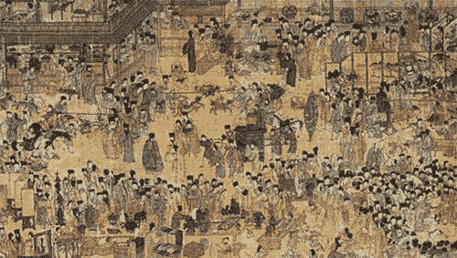

明朝的商业盛况

不过，这样星星点点的经济萌芽，最终还是没有发展出资本主义经济形态。

#### 二、《新教伦理与资本主义精神》成书背景

这背后的原因是什么呢？

为了回答这一疑问，韦伯做了一项非常有名的研究，还写出了一本经典著作----《新教伦理与资本主义精神》，这本书在我们今天，几乎是所有的人文社科项目的学生们必读的一本书。

这本书实在是家喻户晓，以至于在 1997 年，国际社会学协会做了一项 20 世纪最重要的著作投票，韦伯一下子有两本著作进入前五，一本是《经济与社会》，排名第一，另一本就是我们刚才提到的《新教伦理与资本主义精神》，排名第四。

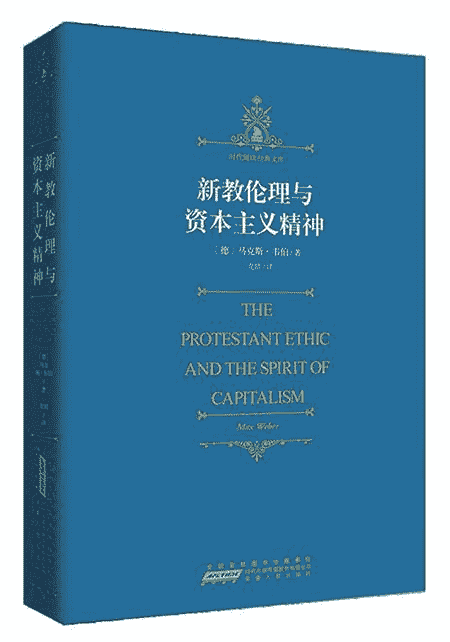

马克思\*韦伯《新教伦理与资本主义精神》封面图，安徽人民出版社

有趣的是，韦伯之所以会把新教伦理和资本主义精神联系在一起，和他自己的家庭有很大关系。

韦伯的父亲和母亲，有着完全不一样的追求。

韦伯的父亲是上层阶级的政治官员，当过柏林市议会议员和普鲁士议会议员。在韦伯小时候，因为父亲的身份，家里经常会有高层的政治人士、学界人士来拜访，这让韦伯从小就对政治和学术产生了很大的兴趣。

但同时，韦伯也对父亲非常不满，在他看来，父亲是庸俗、自私的独裁者，一心只想着享乐和社交界的体面，不仅支持俾斯麦的保守政策，还和封建的地主旧势力结盟，损害了德国的民族利益。

相比于热衷政治的父亲，韦伯的母亲就完全不一样了。她有强烈的宗教信念和加尔文新教的责任感，认为教会应该致力于反对贫穷，支持社会福利运动。

不得不说，父母的信念和价值观的冲突，对韦伯造成了巨大的影响。后来，韦伯逐渐长大，他和父亲的看法差异越来越大，冲突也越来越大，而和母亲的观念却越来越接近，对母亲自我牺牲的精神，和对弱者的关怀越来越认同。母亲身上所体现出的新教徒特质和精神，让韦伯对新教伦理观产生了研究的兴趣。

在之前的一集中，我有跟大家提过，韦伯偏向于关注个体行动，关注人的自由化和社会的理性化之间如何能达到一种平衡，人类本性和社会秩序之间的尺度要怎样把握，情感和理性的张力如何驱动。可以这么说，韦伯一生都在探讨"什么是理性"。

而在《新教伦理与资本主义精神》这本书里，韦伯在开头就指出了自己研究的问题，并且，把资本主义的产生上升到了西方理性主义的发展高度。

他说，"为什么资本主义利益没有在印度、在中国也做出相同的事情呢？为什么科学的、艺术的、政治的、或经济的发展，没有在印度、在中国，也走上西方现在特有的这条理性化道路呢？当务之急就是要找寻西方理性主义的独特性，从发生学上说明西方理性主义的独特性，并且，在这个基础上找寻并说明近代西方形态的独特性。"

#### 三、资本主义精神

那么，韦伯在书里所说的资本主义精神是什么呢？

韦伯承认，资本主义精神很难用简洁的语言来定义，但是，他认为资本主义精神的最好体现就在本杰明\*富兰克林身上。

富兰克林是美国国父级的人物，他在 18 世纪的时候，就定下了很多戒律来约束自己，这些戒律就是资本主义精神的第一大体现。比如，他说：

"切记，时间就是金钱。"

"切记，信用就是金钱。"

"切记，金钱具有惊人的繁衍性。"

"切记，善付钱者是他人钱袋的主人。"

富兰克林一直遵守着这些戒律，在他还是一名印刷厂老板的时候，这些戒律信条就对他的生意有很大帮助。他的邻居当年回忆，自己早上出门的时候，富兰克林就开始工作，然后当他回家时，富兰克林依然在努力工作，他的努力让他成了费城最大的出版商。同时，他的清教徒生活特色也成了他在生意上的优势。

这里也推荐一下《富兰克林自传》这本励志书，它可以说是影响了几代的美国人。书的第十九章叫做《酗酒毁了斯科》。斯科原本是富兰克林的好朋友，但是因为经常酗酒，整个人常常处于混乱的状态，所以没能把生意做好，以至于穷困潦倒。

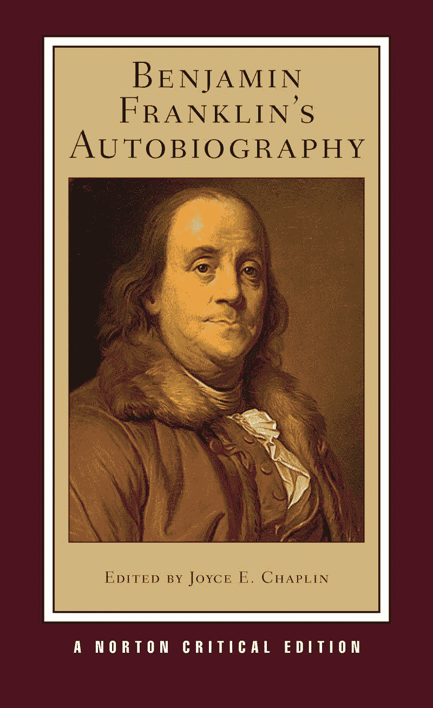

本杰明\*富兰克林《富兰克林自传》封面图，外文版

富兰克林一直认为，不饮酒的习惯可以让人保持清醒、努力工作，在竞争激烈的资本主义自由市场中占有绝对的优势。

可以说，富兰克林本人非常克勤克俭，在他的身上，几乎完美体现了资本主义的精神。

那么，韦伯是怎么定义资本主义精神的呢？

简单来说，资本主义精神是现代理性经济的体现，是一套理性的、有系统的生活态度和价值观，它追求利润，但同时又保持自制和节俭。韦伯写道："这种精神必定是来自某种地方，不会是来自单独的个人，而是来自整个团体的生活方式。"

所以，这种精神是怎么发展起来的呢？

韦伯承认，能够形成这样一种精神，并且最终导致发达的西方资本主义的兴起，其实是有方方面面的原因的，并不是某一种因素决定的。

所以，在《新教伦理与资本主义精神》这本书里，韦伯想要解释的只是影响资本主义形成的其中一个方面，一个很少被重视的方面，那就是，在马丁\*路德的宗教改革之后，兴起的新教和新教信徒的行为观念有没有对现代资本主义的发展产生影响？如果有，这样的影响又会有多大？

韦伯在书里说的是，现代资本主义中的经济理性主义的形成，一定程度上受到了宗教因素的影响。

宗教改革之后，人们深深陷入到了恐慌之中，思考着关于自己来世得救的问题。那个时候，路德教的"天职观"（calling）取代了天主教倡导的"赎罪"论，人们不再能通过自主的赎罪而得救，而是要努力做好在人世间的本职工作，才能得到上帝的青睐，成为上帝的选民，最终得到救赎。

新教伦理的核心基础就是"天职观"。所谓"天职"，就是在俗世中，上帝给每个人分派不同的职位，这些职位在上帝看来并没有贵贱之分，人们有责任和义务，在各自的岗位上认真工作，这不仅是道德所在，也是为上帝增添荣耀的最高形式。

用韦伯的原话来说，就是"上帝所能接受的惟一的生存方式，不是要人们以苦修的禁欲主义超越世俗道德，而是要人们完成其在尘世所处的位置所赋予他的义务。这就是他的天职。"

在这样的观念之下，人们的世俗活动不再是  
"财迷心窍"的行为，而是通过勤勉工作积累财富，求取成功，从而在上帝面前证明自己的价值，证明自己就是"上帝的选民"，如此就可以得到启示，获得拯救。

这种新教工作伦理肯定了追求财富的正面价值，大大加快了西方企业家和资本家的诞生。

同时，新教的教义，又提倡禁欲和节俭，反对骄奢和浪费。任何懒惰、享乐的行为都是在违背上帝，也是对自己得救状态的否定。在这种伦理指导下，确信得救的选民的生活方式更加理性、道德、节俭而自制。

换句话说，新教伦理一方面强调劳动光荣，另一方面又强调艰苦朴素。拼命赚钱又不花钱，这种天职观念引导的理性经济活动，完美契合了资本主义发展的需要，并且，最终催生了资本主义的兴起。

这里，有必要再次强调一遍的是，韦伯认为新教伦理只是资本主义发展的因素之一，他并不排除还有其他帮助资本主义精神发展的因素。

另外，他也同时指出，资本主义精神的发展也只是资本主义经济兴起的其中一个原因，他不排除还有其他比如政治的、经济的、社会的或者人文思想的因素，一起推动了资本主义经济。

换句话说，在韦伯的心目中，新教伦理只是资本主义精神发展的必要条件之一，而不是决定性的条件；同样的，资本主义精神也只是资本主义经济兴起的必要条件之一，也不是决定性的条件。事实上，韦伯也从来没有把新教伦理当作资本主义发展或者资本主义经济兴起的唯一决定因素。

#### 四、中国没有出现资本主义的原因

刚才我们说完了西方资本主义经济兴起的其中一个原因，现在，我们再来思考开头的那个问题：

明明中国传统社会也具有发展资本主义制度的有利条件，比如强大有力的同业工会组织、快速成长的人口、金融贷款机制，还有强劲的攫取欲望和竞争传统，这么多有利于资本主义兴起的先存条件已经摆在我们面前，为什么中国依旧不能诞生出资本主义呢？

韦伯在他的书《儒教与道教》中，进一步讨论了在儒家和道家价值信仰体系的支配下，为什么中国没有产生资本主义，和西方社会如此不同。

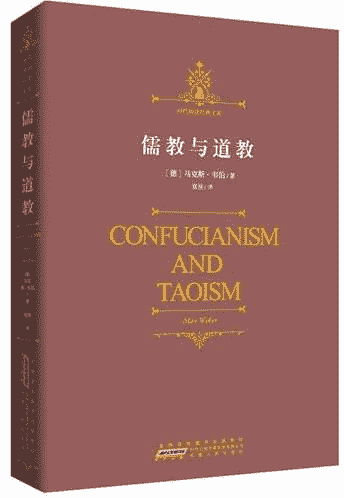

马克思\*韦伯《儒教与道教》封面图，安徽人民出版社

第一个原因，是社会结构上的障碍。中国的社区组织是由一个个严密的、有血缘关系的氏族家族组成的，人们的行为互动都严格遵守传统的律法规矩，长幼有序、上下有别，家族长老拥有无上权威，发号施令，没有人可以违背。

每个氏族家庭都是独立的，很少和社区里其他的氏族家族发生关系。而且大多数的家庭是农户家庭，只在自己小小的土地上耕种，所以也就很少有别的氏族家族联系的机会。绝大多数人都是活在天高皇帝远、自我封闭的小社会中。

第二，不合理的机构及行政组织阻碍了理性的资本主义的发展。中国传统社会中的政府是世袭的，世代相传的。政府的运作是靠传统、特权和皇上赏赐的恩惠来维持的，政府的行政机构，也不是以理性为基础的科层制，更多是人治。

所以，当时的商业行为也没有足够的法律来制约和保障，民间的纠纷和冲突也没有中央法院和一系列的司法机构来裁决处理。

第三个原因，是重视经学教育的儒家思想造成的障碍。一个普通人要想做官，就必须要熟读四书五经这些古典书籍，还要擅长诗词书法和绘画。我们看到，历朝各代的科举考试，都是通过考察经义、诗赋这些来选拔人才的。

比如说，考官从任意一本经书中选择一页，然后摘录其中一行作为考题，考生们在考试中，就要根据这一行文字，写出和它相联系的上下文。

在韦伯看来，儒家传统鼓励提倡的这种教育模式，是一种书呆子式的文学教育，选拔出来的儒家学者和官员，对理性的经济体系、政策制定、科技发展都没有兴趣，并且，也没有管理的能力。

韦伯说，西方的新教伦理和儒教伦理有很大的不同。

首先，新教认为人性本恶，而儒教认为人性本善。

其次，新教的价值理念里有上帝，他存在于一个现世世界之外、和现实世界相对立的超越世界，两个世界之间是有一定张力的。所以，新教徒要积累物质财富、奉行禁欲节俭、做好本职工作，然后才能获得救赎进入超越世界。

而儒教不存在这样一个超越世界和外在的最高造物主，儒教注重世俗的伦理秩序，主张顺应天道、接受现状，强调个人的自我圆满。那种追求功利、忙于累积财富的价值观念，是儒家伦理鄙视的。

最后一点，儒教奉行古法，不喜欢变革，重义轻利，这些都不利于追逐利益、强调经济的资本主义的产生。

所以，北大经济学家林毅夫在解读李约瑟之谜的时候，也曾经说过，近代中国为什么没有爆发工业革命，是因为中国施行了以诠释四书五经为要义的科举制度。

因为这样的制度只强调背诵，不强调以大规模实验为基础的科技创新，所以在工业革命到来的时候，中国错过了发展的机会。

除了儒教以外，道教也对中国社会产生了影响。在韦伯看来，道教强调"出世"，但是这些关于长生不老和巫术的神秘主义，也没有办法引导人们走向理性化的道路。儒教和道教殊途同归，最终和西方的理性化、现代化相背而驰。

#### 五、韦伯错了吗？

在今天的这一集里，我重点和大家分享了韦伯对新教伦理和资本主义精神的研究。

我们看到，新教伦理和资本主义精神对待财富和职业上的态度几乎相同，它们都承认财富本身的合理性。而且，在新教伦理中，财富并没有好坏之分，只有取财之道和财之所用是有善恶的。

同时，新教伦理要求努力工作、勤俭节约，这也也恰好符合资本主义财富积累的需求。所以在当时的社会条件下，这两种高度重合、有效互补的理念极大地推动了资本主义的发展。

从韦伯的研究当中，我们可以发现，韦伯关注到社会现象背后的精神动机，从宗教的角度挖掘了资本主义产生的观念力量，这种观念力量在特定的时代背景下，可以成为强大的精神动力，推动时代的进步。

然而，"新教伦理"真的产生作用了吗？这是韦伯的一面之词，还是说，观念的力量对经济发展的作用真的有那么明显？

实际上，观念的力量是否真的可以大到推动资本主义的发展，今天，有不少的经济学家都在怀疑。有学者说，不是看不见摸不着的"新教伦理"在发挥作用，而是新教对教育的投资，或者说，新教对人力资本积累的高度重视，促成了"资本主义精神"的快速发展。

发展经济学家 Becker 和 Woessmann 在一篇名叫《韦伯错了吗》的论文里写道，无论是在 19 世纪的普鲁士还是现在的德国，新教徒越多的地区，就越需要提升教众们阅读圣经的能力。

所以，在新教徒较多的地区，新教对教育的投资就越多，学校的数量增加，人均教育水平普遍更高。而教育水平提高之后，地方经济自然就发展了起来。

而另外一个韦伯没想到的地方是，韦伯曾经断定不具备产生资本主义条件的中国社会，对赚钱的追求已经远远超过了资本主义。在没有宗教枷锁的中国，人们的欲望像脱缰的野马一样，带领人们跑向不可预知的疯狂。

我们是否可以在富裕的大厦倒塌之前找到一条规范自身的路径呢？我们是否依然可以依靠儒家的仁义礼智信的传统道德规范，来约束不断膨胀的经济行动？

对于这样的问题，我并没有办法给出明确的答案。事实上，在《新教伦理与资本主义精神》的后半部分，韦伯也明确地写道，随着财富不断增加，科学不断进步，宗教已经逐渐萎靡，而财富的世俗化越来越让人们把对来世的狂热寄托放在现世，功利主义再次出现。

韦伯还说，"大获全胜的资本主义，因为把机器作为赖以生存的基础，所以，已经不再需要新教禁欲主义的支持了。"

韦伯口中，被新教伦理影响的经济理性主义，在机器生产技术和经济制度出现之后，也变成了现代资本主义的经济秩序。在这个秩序下的每一个人，不再认为需要靠履行天职来获得救赎，而逐渐陷套在无法逃脱的"人性的铁笼"之中。

那么，什么是"人性的铁笼"？我会在后面的一集中，再和你详细说明。

我是严飞，我们下集再见。19. 工具理性 VS 价值理性：坐在宝马里哭，还是坐在自行车后笑？

### 本集要点

1.理性二分法

2.价值理性的衰弱

3.工具理性的极端化

4.如何平衡工具理性和价值理性

### 文稿

你好，我是严飞。在今天的这一集里，我来和你一起讨论一下韦伯的工具理性和价值理性。

#### 一、面包与爱情的选择

相信你一定听过这样一句话："宁愿在宝马里哭泣，也不愿意在自行车后面笑。"这句话曾经引发了一场择偶观的大讨论。

虽然不排除有些时候，爱情和宝马可以并存，但是很多时候，爱情和宝马之间，我们只能选择一个。在这个消费主义至上的时代，人们对物质越来越没有安全感，大家都想要拼命抓住一些实实在在、看得见、可以享受的东西。

为什么会这样呢？也许是越来越多的人感受到，爱情是奢侈的，结婚并不代表拥有美好长久的爱情，更多是意味着无聊琐碎的柴米油盐。

所以，既然有一天，爱情可能会保不住，那么，就要尽量抓住自己可以抓住的有形财富。这时候，很多人就开始追求物质，希望在一段关系里，有足够的钱可以吃喝、享乐，等以后生了孩子，也可以给小孩更好的条件。

当然，并不是所有的人在爱情里都是金钱至上，但是，现在的婚恋市场上，房子、车子已经成为标配，想要结婚，这些都是必不可少的。

有人说，这样的选择太贪恋钱财，也有人说，现在社会风气就是这样，在金钱至上的价值观面前，人们不得不放弃爱情。

面包和爱情的选择，往大的方面说，其实是物质财富在占据越来越高的地位，而留给精神领域的空间越来越小。

#### 二、理性二分法：工具理性和价值理性

那么，这样的选择是最好的、最理性的吗？

要想弄清楚这个问题，这里就涉及到社会学中一个非常著名的理性二分法。韦伯在《经济与社会》那本书里提到，可以把理性划分为工具理性和价值理性，用它们来分析社会行为和社会现象。

什么是工具理性（instrumental  
rationality）呢？韦伯说，工具理性指的是"通过对外界事物的情况和其他人的举止的期待，并利用这种期待作为条件或手段，以期实现自己合乎理性所争取和考虑的作为成果的目的"。

也就是说，一个考虑工具理性的人，他所选择的行为，一定是能用最快的速度和最小的成本达到目的的，而不会去考虑这样的行为是不是有价值和情感温度的，所以工具理性也叫作效率理性。一般来说，把金钱放在第一位的人，更多是从工具理性出发的。

而价值理性（value  
rationality）指的是"通过有意识地对一个特定的行为伦理的、美学的、宗教的或作任何其他阐释的无条件的固有价值的纯粹信仰，不管是否取得成就。"通俗的说，就是人们的行为更多考虑行为本身是不是有价值的，而不在乎这个行为的成本，甚至是行为的结果，更加强调动机的纯正性。

在实践活动中，工具理性注重手段、注重条件、注重形式、注重程序，而价值理性注重目的、注重理想、注重内容、注重实质。工具理性强调结果和效益的最大化，而价值理性强调行为背后真正的价值和含义，强调道德精神领域的东西和对人的终极关怀。

打一个通俗的比喻。大家都想过上幸福的生活，那么什么是幸福生活？幸福生活值不值得我们花毕生精力去追求？这就是价值理性层面的思考。

为了让自己过上有房有车的幸福生活，我应该怎样去赚钱？如何可以在最短的时间内赚到更多钱？考虑这种手段的时候，就是工具理性。

但是，赚了钱，过上了自己梦寐以求的生活，就真的等于幸福吗？这样的思考就又回到了价值理性。

#### 三、价值理性的衰弱

乍一看，你可能会觉得价值理性比工具理性更人道，是一种更"好"的理性行为。但其实，虽然韦伯创造性地把理性一分为二，想要用"价值理性"和"工具理性"解读社会行为和社会现象，但是，这两者之间绝对不是对立的，也没有高低贵贱之分。

不过，在韦伯看来，价值理性确实应该在社会运作中扮演重要角色，每一个人都应该有价值观念和精神理想。

但现在的社会，明显是工具理性占了上风，更多人在想着怎么实现，甚至是想着怎么抄一条捷径去实现大多数人口中的目标，比如腰缠万贯，比如名利双收，而只有少部分人在想名利和金钱是不是重要的，为什么他需要名利和金钱，或者说他为什么不需要名利、金钱。

我们的生活中充斥着想当然地向前，达到更高更快更强的目的，却很少人愿意停下来总结失败的经验、思考错误的价值，或是在高歌猛进的时候，愿意停一停、等一等，积累更多的能量再冲向前方。从这个层面来说，价值理性正逐渐衰弱。

那么，价值理性为什么会走向衰弱呢？价值理性又是如何一步步衰弱的呢？

从历史的角度看，工业大生产的时代到来的时候，资本主义经济开始发展得非常迅速，人们都在疯狂地追求财富。很多人心中达成了这样的共识：资本的积累才是绝对的真理，所有的一切都要以效率和利益优先。

所以，几次工业革命下来，人们越来越推崇工具理性，而逐渐失去了具有人文关怀的价值理性。

我们不得不承认，工具理性确实带领着西方工业文明发展得非常迅速。社会慢慢走向现代化，组织体系内的科层制也越来越完善，我们的社会就像一台高速运转的机器，每个部件按照职能分工，紧密连接，高效运转。可以说，近代西方文明的很多成果都是工具理性指导下的产物。

#### 四、工具理性的极端化

但是，工具理性主义的发展，其实还存在着一种内在的矛盾。

一方面，人们推崇工具理性，这促进了资本主义物质文明的高速发展；但是，另一方面，当人们过分偏向工具理性，而忽略了价值理性的时候，实际上，也忽视了他们自己内心真正的需求，最后，造成的结果就是，效率、手段、目的成为了现代社会的追求标准。

这个时候的工具理性已经走向了极端化，"机械工具和经济秩序"控制了生活的每个角落，人和人之间的感情，被理性的财富观冲淡，一切社会关系好像都可以用利益和金钱关系来描述。

人们只知道用精确的公式计算利润，同时毫不压抑自己的消费欲望，本来严肃的生活态度和心灵充实感荡然无存，威胁着人们的身体和心灵自由。

我们看到，任何东西一旦极端化，就会出现不好的后果。

虽然工具理性是现代化一个很明显的、也躲不掉的特征，但是，在社会生活的方方面面，我们都可以看到工具理性过分膨胀之后，给我们带来的危机，那就是，人们对生存的终极意义的思考变得边缘化。

对于这样的工具理性极端化，我们来看一个例子。

我们知道日本的加班文化非常疯狂，甚至还会在媒体上时不时看到过劳死的新闻。所有日本平成年代的职场人士，都把一生奉献给了工作，在给企业带来经济效益的同时，几乎放弃了自己的个人生活。

在日本，专门有个词来形容这样被公司当作牲畜一样压榨的员工，其实也是日本上班族的一种自嘲，他们把这种在职场上逆来顺受的自己，称为"社畜"。

前段时间有一部引起大讨论的日剧，叫《我要准时下班》。其中的女主角毕业后进入一家大型公司工作，成为了一个不折不扣的"社畜"，每天无休止地工作、加班，在前辈的催促、责骂中身心俱疲。每月加班超过 100 小时的高强度工作让她神情恍惚，从楼梯上滚落后差点丧命。

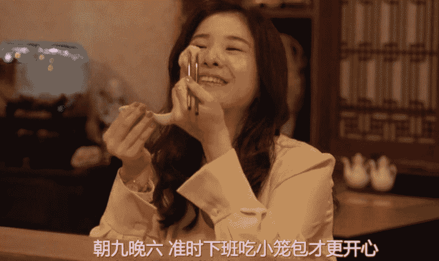

日剧《我要准时下班》画面

之后，她下定决心改变这样的生活状态，从原来的公司辞职，以准时下班为条件，寻找新的工作。在面试了 100 家公司后，终于入职了一家不提倡疯狂加班的公司，在每天高效完成工作后，准时下班尽情享受悠闲时光。

但是，日本根深蒂固的的企业文化依然强有力地发挥着作用，认为人们应该拼命工作，认为加班是理所当然的。所以，女主角和其他同事之间，老一辈职场人和 90 后职场新人之间，又发生了很多的矛盾冲突。

这样的冲突引发很多日本职场人士思考，疯狂地加班真的可以获得幸福生活吗？

从日本的大环境来看，人们勤勤恳恳工作、疲于奔命，但也并没有扭转平成时代的不景气，和 90 年代之前的经济奇迹相比，日本始终没能从泡沫经济中完全恢复过来。

而日本的孤独老人，一部分是因为年轻的时候忙着工作，没什么时间和家人相处，所以年老之后就习惯了一个人生活，最后孤独地离开这个世界。

这也令很多人思考，如果努力工作的人越来越忙，但是，整个经济大环境没有改善太多，个人生活也没有更幸福，那么，是不是有什么地方出了问题？

现在，日本已经到了令和时代，新一代年轻人对工作制度、工作时间太长之类的问题，有自己想法和行动，尝试着在工作和生活之间找到一种平衡。像日本这样的例子，可以看成是在大时代大背景下，工具理性和价值理性的轮回、转换。

#### 五、工具理性和价值理性的政策运用

那么，在解决问题的时候，我们究竟应该怎么去平衡工具理性和价值理性呢？

相信大家都听过那一个著名的伦理困境----"铁轨难题"。就是说，一侧铁轨上有五个人，另一侧有一个人，那么，要通过牺牲一个人来换取五个人的生命吗？

从功利主义的观点来看，生命本身的价值无法比较，而生命的数量是能够比较的，五个人的生命价值大于一个人，所以用一个人的牺牲换来五个人的生存是一个理性的选择。

我们的社会秩序，差不多就是建立在这样的理论基础之上的，追求最多数人的最大幸福，把整体的福利最大化。在制定政策的时候，也会有目的性地牺牲一部分人的福利，来促进整体的进步和发展。

但是，这是一种有道德的行为吗？一个人和五个人的生命是可以比较的吗？在真正的道德之下，所有人的生命都是平等的，都有生存的权利，那么，牺牲一个人的生命难道不是一种不道德的行为吗？

所以说，想要在工具理性和价值理性之间达到平衡，其实是很不容易的事情，需要用价值关怀，在一个更长时间线上进行投入。很多时候，人们会更加倾向于短线逻辑，短期内就可以解决问题，获得回报。

比如，我们看到，政府推行的很多政策，因为要考虑能不能执行，还有政策是不是适合大多数人的，所以，制定一个政策往往会运用工具理性，考虑最理性、最稳定、最不会出错的方案，并且，会去掉人为的主观因素，让更多人信服。

不过，虽然这样的趋势可以让政府在行政方面的效率提高很多，但是，这也让政策变得形式化、普遍化；在考虑整个社会的利益的时候，个人的价值和自由好像越来越容易被牺牲。

举个例子，现在的高考录取政策中，有这样一条"区域公平"的政策，存在着比较大的争议。就是在招生的时候，招的学生总人数不变的情况下，升学压力小的较发达的地区会对在落后的中西部地区考试的学生降低分数线，让落后地区的学生有更多的机会上大学。

不难看出，区域公平的优点很明显，它考虑到了比较发达的地区教育资源肯定比落后地区的要好，所以采取措施来进行弥补，想要让这些先天条件不好的群体有机会获得一个相对来说更好，或者说更公平的竞争机会。

但是，也有反对区域公平的人说，应该采取统一的标准，根据考生的实力来录取学生，最好是让全国的考生考一张卷子，实行考试公平。

这种说法当然是欠考虑的，但是，区域公平的政策确实存在很多问题。

比如说，这样的政策是不是损害了发达地区考生的利益？为什么对落后地区的补偿，要牺牲发达地区学生的利益？虽然发达地区的学生享受了更好的教育资源，但是，用这样的高考录取政策来补偿，是没有问题的吗？

在考虑了各方面的情况之后，我们发现，好像无论选择区域公平还是考试公平，个人的权利都受到了一定程度的侵害。而且，要解决高考录取中的公平问题，绝不仅仅是只看高考录取本身，或者说，在两种"公平"的方式中选择其中一个就能解决的。

在我看来，政府在制定一项政策的时候，不应该仅仅只是秉持工具理性的思路，一心只想着让这个政策方案更高效、更有可行性、更容易被大众接受。在推进高等教育公平的时候，是时候用价值关怀来思考问题了，而不仅仅是一个稳定的、目的性极强的方案。

比如说，在这一问题上，基础教育资源的分配、地区的经济发展差异、人们的观念差异、身体素质和智力水平等等，都更加接近问题的根源。政府真正要采取的措施，政策所指向的要害，都应该在这些方面。

要想真正的解决高考录取中的公平问题，不应该仅仅站在高考的这一个环节上，而应该在高考之前的萌芽期开始，就进行相应的改革，否则就是治标不治本，就算能在一段时间里缓解不太乐观的情况，但是，绝对不是长久之计。

所以，如果政府在这个问题上真的有改革的想法和信心，那么接下来应该做的，是要开始讨论、解决更加根本的问题，比如给落后地区更多的教育资源、重新划分生源调度地区、改善农村地区对接受教育的看法、采取因地制宜的教育手段等等。

毫无疑问，这是一条更远也更艰难的改革之路。如果仅仅是靠高考录取的区域公平来解决问题，牺牲的是考生的利益，但如果真的投入人力物力去尝试实现教育的平等，虽然要牺牲更多的钱财，但是，价值理性终于不再缺席。

#### 六、回归两种理性之路

我们的社会发展到今天，已经不能忽视工具理性套在人们身上的"铁笼"了。人们讨论一个问题时，总是先站在自己的立场上，总是在追求利益最大化，慢慢地变得冷漠而机械。

还是说回高考招生政策这个案例上，在社交网络上，人们对区域公平和考试公平的争论，都是在戾气满满地抱怨自己的权利如何受到了侵害。也就是说，人们之所以激烈地反对或者支持，只是为了维护自己的利益，而不是真的在为制度的不公愤愤不平。

在这个呼吁民主的时代，允许不同的声音来进行讨论是十分有必要的，用人性的眼光来观察社会问题更是难能可贵的。当不同的声音发出来，不一样的观点进行碰撞，政府才能更好地吸取经验，推行更好的政策，我们的社会才会更加靠近我们理想中的、富有生命力的理性。

同时，韦伯也曾经说过，工具理性和价值理性并非是对立的，他们应该是共存的、互为前提的，是同一事物的不同维度。一个有真正自由人格的人能够把工具理性作为动力，也能把价值理性放进他的终极目标之中，不偏激、不盲目，让这两种理性在个人的道路上，协调发展，都为自己所用。

我是严飞，下期见。

# 20\. 人性的铁笼：我们是否已经进入卓别林的摩登时代？

（公众号懒人找资源，懒人专属群分享）

### 本集要点

1.现代社会中的理性困境

2.过度理性的后果

### 文稿

你好，我是严飞。在今天的这一集里，我将和你讨论一下韦伯的经典论述----"人性的铁笼"。

#### 一、扭螺帽的查理

有一个男人，名字叫查理，是一名生产流水线上的工人。他每天的工作任务就是把一颗颗六角螺丝帽扭紧。因为每天都重复着同一个拧螺丝帽的动作，所以在查理的生活中，每一个六角形的东西，都成了他眼里的螺丝帽，让他情不自禁地想去拧一下，甚至在看到衣服上的六角形纽扣，他都会习惯性地去拧一下。

查理是谁？查理就是大家都很喜欢的卓别林在电影《摩登时代》里面扮演的角色。

事实上，人们喜欢卓别林，不仅仅是因为他的作品让我们看了开心，更重要的原因是，他的很多作品都可以看出，他对人和社会的关系观察得很仔细，并且，一直在揭露资本主义对工人的剥削，还有大众所遭受的压迫。所以，人们也说他是 20 世纪最杰出的批判现实主义艺术大师，是一个伟大的人道主义者。

尤其是《摩登时代》这部电影，讲的是 1930 年代，美国经济大萧条，工厂的老板为了提高生产效率，不断地强迫流水线工人加快工作速度，这也是为什么查理精神失常，看到任何六角形状的东西都要去拧。

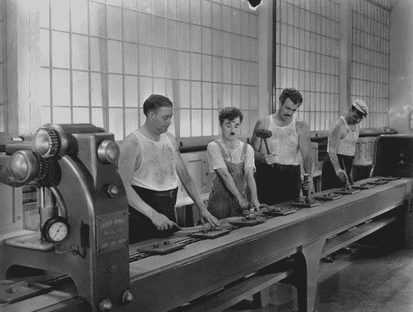

电影《摩登时代》画面

可就算是这样，老板还是不满足，还想压榨工人的吃饭时间，甚至用上了一种吃饭机器，喂工人吃饭。在电影里面，查理的吃饭机器正好出了故障，一直在打查理的脸。

这些故事情节反映了机器时代，人们的恐惧和受到的打击，劳动人民被"镶嵌"在巨大的齿轮之中，成为机器中的一部分，整个社会都变得机械化。

虽然《摩登时代》是 1936 年的电影，但是，这部电影预言了工业文明建立以后，爆发出来的技术理性危机，把讽刺的矛头指向了这个被工业时代异化的社会。

你只要看看周围，就会发现这就是一个《摩登时代》，越来越多的人觉得自己就是那一位查理，只是查理做的是不断地拧螺丝帽；而我们做的，是不断地绘制撰写各种图表、PPT，各种文宣汇报材料。

我有一位在政府部门里工作的朋友，他在刚入职的时候，最常做的事情，就是帮领导写讲话稿，给在开会前摆好桌子椅子，再把每一排的茶杯位置排列整齐。我另一位在咨询公司工作的朋友，每天做的最多的工作，就是查找各种行业数据，然后做 PPT，再在 PPT 里把数据画成漂亮的图表，周而复始。

我这两位朋友都从欧美的名校毕业的，都受过非常好的教育，都有理想和抱负，但是，在日复一日的工作中，却渐渐消磨了当初的热情和理想，成为了一台庞大机器里的小螺丝钉。随着经验的累积、职位的提升，他们从小螺丝钉变成了大螺丝钉，但是，依然还是一颗螺丝钉。

是的，我们是活在现代社会，但是我们都没有摆脱查理的困境。每个人都渴望成功，追求极致的效率，可是每天又必需做很多机械的、重复的、无意义的工作，从而越来越失去自我，丢失了自我的主体性和创造力。

无论你有没有意识到这一点，社会中的每个人其实都被困在了过度理性所带来的困境中。我们应该怎么理解这样的困境？我们有没有机会摆脱过度理性的枷锁呢？

#### 二、现代社会中的理性困境

我们在前面的节目中和大家讲过韦伯提出的科层制和工具理性。这里我们简单回忆一下，在韦伯的描述中，科层制是资本主义社会现代化的一个基础，是西方社会理性化的重要体现。

科层制让组织管理领域能像生产一件商品一样，实行专业化和分工，按照不加入情感色彩和个性的公事公办原则来运作，还能够做到"生产者与生产手段分离"，把管理者和管理手段分离开来。

虽然从纯粹技术的观点来看，科层制可以获得最高程度的效益，但是，因为科层制追求的是工具理性的那种低成本、高效率，所以，它会忽视人性，限制个人的自由。

虽然科层制是韦伯最推崇的组织类型，但是，如果社会为了效率，而不管是什么样的活动领域，都实行科层制，那么，这时候的人们，就是给自己建造了一个无处不在又无法逃脱的铁笼。

人性的铁笼是现代社会中人性困境的重要表现，歌德笔下那种纯粹的浮士德式的生活早已被抛弃，人们日常的生活、工作被精确化、计算化，就像电影《摩登时代》的工业生产下，"无意识"的人们镶嵌在机器里，充满了对生活的无奈和叹息。

按照韦伯的说法，"今天，我们已经目睹无所不在的科层制化和理性化正在降临，想想它们的后果吧。现在，在所有以现代方式运作的经济组  
织中，理性的预测在任何阶段都已经非常明显。"

"由此，每个劳动者的行动都可以用数量化的方式加以测量，每个人都成了机器上的一个齿轮；而且，只要他意识到这一点就会努力成为一个更大的齿轮----  
我们现在技术上更完美、合理，因而更富机械性。"

韦伯看到了社会在从传统向现代转型的时候，理性化的作用和影响。他更是意识到了理性化的未来，那就是，人们会异化、物化、不再自由，并且，人们会成为机器上的一个齿轮。

#### 三、机器上的一个齿轮

"每个人都成了机器上的一个齿轮"，如果我们把这样的机械工具和经济秩序推向一种极端，我们的社会会变成什么样呢？

我的一位学生曾经写过一篇非常精彩的科幻短篇小说，在书里，他描绘了未来人类社会的一种极致理性化的图景。

他是这样写的，在未来，人类社会进入到一个理性高效的新时代。伴随着人类生产力的空前发展，人们的欲望和消费力也跟着生产力一起无止境地膨胀，结果导致人类的资源逐渐走向枯竭。

所以，如果想要尽可能地把剩余的资源最大化地利用起来，人就必须和人工智能配合起来，共同运转，这样才可以保证社会的分工，并且，把资源利用得精准对应、分毫不差。

为了实现这样的目标，每个人在 18 岁之前，都是完整的人，但是，到了 18 岁生日那天，人们就必须接受一种特殊的成年礼。

就是说，在这一天，机器会帮你测出你擅长的工作，然后把你从事这份工作一定得用到的器官和大脑，移植到不同的人工智能机中，其他的器官丢掉不要，从此以后，你不再是一个完全的人，而是机器和人的结合了。

比如说，如果你是适合做播音，那么你只会留下脸部；如果你适合当一个工人，那么你只能留下双手，其他多余的器官都会切除掉。

在这样的规定下，人类社会就被分成了三等。最高等的人只保留大脑，做那些人工智能无法负担、需要人类思维操控的工作；第二等的人可以保留脸部、颈部，做一些如果让机器做，成本会特别高的事情，比如表演、播音的艺术类工作；而最低等的人就只能保留手部，在工厂里做一些人工智能没有办法做得那么精细的手工活。

换句话说，整个人类社会已经变成了一台大的机器，每个人和机器结合在一起，把自己身体上最有用的器官嫁接到机器上，和机器一起运转。这样的运转方式是最理性、最高效率的社会运作机制。而过去那种完整、全能的人是对资源的巨大浪费，人只有在保留了最有用的那一部分器官之后，才有资格存活下去。

在科幻小说的世界里，人类社会实现了最高程度的工具理性，这样才可以让人类在资源有限的情况下继续存活下去，情感、价值、灵魂，这些都反而成为了多余的东西，成为了不需要的附属品。

难道，在这样的"理性时代"，这个工业化、城市化、文明快速现代化的社会，我们必须要丢弃价值和品格吗，这是无法避免的现实吗？

其实，韦伯也曾经做出过类似的悲观预测。在他看来，过度的理性会给人类命运带来巨大的负面影响，如果世界被理性操控,一切都是由理性创造的，那么世界就会变成一个怪物，因为活在这个世界里的人已经不再是人，而最终的结果，就是"专家没有灵魂，纵欲者没有心肝，一个废物幻想着自己已达到前所未有的文明程度"。

#### 四、过度理性的时代

这句话是什么意思呢？在这里，想跟大家举两个例子。一个例子和大家日常生活中的消费习惯有关，也就是所谓的"纵欲者没有心肝"；另一个，则和我所待的学术圈有关，相对应的是"专家没有灵魂"。

我们先来看看第一个例子。

在消费主义至上的浪潮中，我们看到，如果消费场所想要赚更多的钱，想让消费在人们生活中占据主体地位，就必须遵守韦伯提到的理性化原则，比如按照效率、可计算性、可控制性、可预测性等进行大规模的复制和扩张。

这种理性化发展的后果是在我们身边每一座都市里，越来越多眼花缭乱的大型商场，通过地铁、商务楼、住宅区连接在一起，让身处其间的人们每一天都穿梭在商场中，流连忘返。

商场里一层又一层，上上下下的电梯把你载到商品的云端，目迷五色、耳乱五音，不知身在何处，只好意乱情迷地游走，不知不觉地走进一家又一家名品专卖店，一次又一次地成为商品的俘虏。

而那些想要上升到中产阶级的人们，因为迫切地想通过满身的品牌来展示自己的阶层品味，把购买的衣服、挎包、首饰转换为真实的身份标签，在不自觉中，就会陷入到消费欲望的铁笼之中，无法自拔。

哈佛大学文化批评学者李欧梵就曾经评论说，"时至今日，购物成为有史以来最繁盛的时代，我们几乎是要作最大的挣扎才不购物。至于我们为什么要购物，原因早已经不再存在，不购物反而才是不正常"。

以色列历史学家尤瓦尔\*赫拉利在他的著作《人类简史》里，有这样一段总结，用来评价这样的现象非常合适。

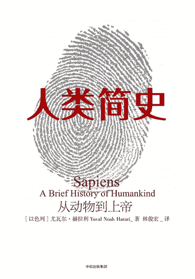

尤瓦尔\*赫拉利《人类简史》封面图，中信出版集团

他说，如今整个社会都在鼓励消费主义，打着人类应该善待自己宠爱自己的旗号，让消费更多的产品和服务成了美德，即使人们已经在过度消费中慢慢走上绝路也在所不惜，整个世界都在匆忙地推着你往前走，我们早已经沦为乖巧的消费者了。

第二个例子，和大学、和学者有关。

要知道，理性思潮已经渗透到社会的方方面面，一向被认为是最纯净最与世无争、世外桃源一样的学术圈也躲不过去。过去几百年里，以大学为代表的学术和教育机构，虽然是靠着政府拨款维持的，但是，学校的管理者、教师、学者还是想要和政府、市场、捐助者拉开距离的，就为了保持学术的独立性和客观性。

然而，这几十年来，全球化背景下，科技革命、商业潮流、资本力量崛起，在这些压力下，社会开始向大学提出了所谓更加"理性化"的要求。

那就是，希望高等学府能向"创业型大学"转型，像进行商业活动那样进行学术活动，或者把商业活动引入大学，像在复旦大学里举办商业宣讲，为百度李彦宏献唱《robin 之歌》那样，而这一切，都在宣告着学术资本主义时代的到来。

所以，我们看到不少老师，整天在忙着各种和钱有关的项目课题，老师负责谈项目、接课题，学生负责来做课题、写报告，大学老师也变成了一切向钱看齐，不是前方的前，而是金钱的钱。

在工具理性的指导下，国家和政府对于应用性学科，也就是我们常说的理科、工科的重视度和投资，要比人文社科多很多。这其实不是我们国家的特例，比如这些年，欧美等国家也极力想办法吸引学习计算机、医学、化工材料、航空航天等科学的人才，而他们对于文科的留学生的则几乎没有过偏爱。

另一方面，学术圈的资本主义，也让大学逐渐放弃了精英和社团治理的传统，转向为金钱、威望和世界排名而奋斗。

把实现经济目标和量化评估、国际排名作为研究和教学成果的导向，用论文发表数量和外部管理控制取代传统的学术自律和职业自治，把教授和研究人员变成学术产业工人，用他们的学术成就和学生作为资本积累，一切为大学排名奋斗。

本来，大学建立起来以后，学术界一直奉行的学术原则是要对知识忠诚、对真理忠贞、对人充满关怀等等，可是，在学术资本主义的压力下，老师和学生开始为五斗米而折腰。

国内外学术界都爆出了学者为了科研经费和名誉，学术造假、论文抄袭的恶行。出现这样的现象，除了是有一些人自身道德败坏，还有一部分原因是，现在大学的考核制度要求，有论文的才是合格教授，能带来头衔帽子和研究经费的才是好教授。

所以，这导致很多老师和同行，为了保存工作饭碗，放弃了自己的学术兴趣和热爱，开始只追求发表论文的数量，成为了论文生产的机器，而把研究学术的本心，丢在了一边。

#### 五、被推动往前走的人生

现代诗人张枣曾经直接明白地写出过他对这个时代的感受，他这样写道：

我对这个时代最大的感受就是丢失

虽然我们获得了机器、速度等

但我们丢失了宇宙

丢失了与大地的触摸

最重要的是丢失了一种表情

我觉得我们人类就像奔跑而不知道怎么停下来的动物

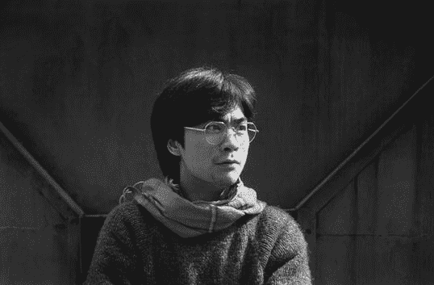

张枣（1962-2010），诗人、学者、诗歌翻译家

可以说，在这个追求效率的"摩登时代"（modern  
times），无论是消费市场，还是大学机构，几乎在所有的行业领域中，我们每个人都成了效率机器上的一颗螺丝钉，一边被时代的速度所裹挟，一边又被内心的欲望所深深驱动。

如果把世界比做一个巨大的工厂，我们都早已经成为这其中的一环，我们人类创造了这个工厂，而现在这个工厂的转速越来越快，我们几乎是被推动往前走，在这样麻木机械的运转中逐渐失去对我们自身的关怀。

今天和大家讨论了韦伯所描绘的"人性的铁笼"，韦伯在宏大的历史维度上为我们展现了理性的变迁和理性对社会的影响，虽然听起来似乎是对人类社会发展的悲观和愤慨，然而，这并不等于我们可以就这样消极地打发人生。

有时候，当我们作为旁观者，看看纽约、伦敦、北京、上海早高峰的人们，就会发现，一个个被蜂拥而至的人潮挤进地铁这样的钢铁盒子里，去到都市里钢筋混凝土的几十层摩天大楼中的一格，连轴工作一天，傍晚再从地铁中挤出来，回到小屋子里蜗居。

日复一日地运转，人们却依然奔波着，并且，愿意为这样的生活付出高昂的代价。

事实上，虽然理性危机已经渗透到生活的方方面面，我们每一个人都被困在里面，陷入人性的铁笼之中，但是，能不能摆脱铁笼就取决于我们以怎样的面目面对这个世界，采用什么样的态度和策略了。

欲望人生事，得失寸心知。我们究竟是为了什么而活着，为了理想、自由，还是欲望？我们可不可以一边努力向上，一边实现真实的自我？可不可以救赎心灵，找到人性的本真，从而减轻牢笼的痛苦，达到人生的彼岸呢？

我希望这些问题可以引发你的思考，选择跟着自己的热情大步走，而不再是麻木的被时代巨轮所推着往前走。

我是严飞，下期见！

# 21\. 世界的祛魅：人类可以通过基因编辑胎儿成为自己的“造物主”吗？

### 本集要点

1."世界的祛魅"的历程

2.对"基因编辑婴儿"科学实验的评价

3.如何看待科学

### 文稿

你好，我是严飞。在今天的这一集里，我来和你一起讨论一下韦伯的一个经典理论，那就是"世界的祛魅"。

什么是"祛魅"呢？这两个字，听起来是"祛除魅惑力"的意思。那么，为什么世界需要祛除魅惑力？世界要祛除的，又是什么东西的魅惑呢？要想理解韦伯的这个理论，我们需要从欧洲的历史讲起。

#### 一、祛魅时代的到来

我们知道，在古代中国，人们是相信"神"的，其实，欧洲也一样。在文艺复兴运动和宗教改革以前，整个欧洲大陆还处在天主教会的神权统治之下。那个时候，宗教的魔力是巨大的，教廷是神圣不可侵犯的，教会严格控制着人们的精神，不允许任何违背宗教的价值体系存在，其中就包括科学的。

所以我们才会看到，波兰天文学家、推翻地心说的哥白尼，因为害怕遭到宗教的迫害，把他的研究著作《天体运行论》隐藏了 30 年，直到弥留之际，才决定出版；而在哥白尼之后，意大利科学家布鲁诺坚定地支持日心说，反对圣父、圣子、圣神的三位一体和基督神性，但是，却被教廷活活烧死。

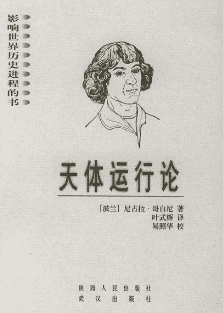

哥白尼《天体运行论》封面图，陕西人民出版社&武汉出版社

后来，欧洲经历了文艺复兴运动和宗教改革，在现代性的转型过程中，一体化、绝对化的宗教神权社会解体，天主教会的精神垄断被打破，人们的思想得到解放，世俗社会发展了起来。用韦伯的话说，就是西方社会开始进入到理性化的历程中。

而整个理性化的历程，其实要做的就一件事，那就是，把一切带有巫术性质的知识或者宗教要素的迷信和罪恶祛除，推进现代文明。这个历程，就是韦伯所说的"世界的祛魅"。

韦伯在做一个《以学术为业》的主题演讲的时候，用一段话比较集中、清楚地论述了什么是"世界的祛魅"。

他说，"只要人们想知道，他任何时候都能够知道；从原则上说，再也没有什么神秘莫测无法计算的力量在起作用，人们可以通过计算掌握一切，而这就意味着世界的祛魅。人们不必再相信这种神秘力量的存在，像野蛮人一样，为了控制活着，祈求神灵或是求助于魔法，而是技术和计算在发挥着这样的功效，这比其他任何事情都更加明确、理智化。"

祛魅时代的到来，意味着理性成为日常生活中的智慧标准，每个人都可以自由地决定自己的命运，而不用等待神的召唤，人们开始获得自己理解世界、控制世界的主体性地位。

其实，"祛魅"的过程中，人和世界的关系也发生了根本性的变革。人们不再觉得自己是世界的一部分或者是世界的产物，而是可以借助科学来改变世界、创造世界的主体。

一旦人们觉得自己是自己的主宰，那么人们生活的意义，人们的终极关怀和价值追求，就不再需要通过教会来获得，而是从世俗生活本身产生，从这个时候开始，精神生活开始走向世俗化。

而随着时间的推移，科技发展得越来越快，很多以前没有办法解决的问题，比如照明、通讯，现在都不是问题；还有一些我们以前不了解的领域，比如月球、黑洞、引力波，也都不再神秘。但是，在这样的情况下，新的问题又出现了。

我们在之前的节目里有讨论过，社会的主流思维模式逐渐转向追求效率至上的工具理性。人们做一件事，不再是为了精神上的意义，而是非常简单直接地考虑是否能达到功利的目的。

在不断发展的技术面前，人们的控制欲望也越来越强，很多人认为，科学可以解决一切难题。

#### 二、科学能解决一切难题吗？

但事实真的是这样的吗？还记得 2018 年 11 月 26 日，中国生物科学家贺建奎团队宣布，世界第一例免疫艾滋病的基因编辑婴儿健康诞生。那是一对双胞胎，她们的一个基因经过编辑修改，可以让她们一出生就能抵抗艾滋病。

这个消息一公布，马上传遍了世界，而且，成了那天全世界最爆炸的新闻。

因为，基因编辑这种技术本身作为一项重大突破，在很多领域都为人类创造了福利。比如对动植物的基因编辑能够改良农作物、降低家禽生病的概率等等，这项技术已经被广泛使用。但是，对胎儿的基因编辑技术却从来没有被推广过。

这是因为，第一，贺建奎团队对人类胚胎进行人为干预的行为，是违反法律的。

目前国际上主流医学界对基因编辑胎儿有规定，我国也在 2003 年的时候就颁布了相关的规定，就是说，科学家可以以研究为目的，对人体胚胎进行基因编辑和修饰，但是，必须是体外培养，不能在人体内做实验，而且，从受精或者核移植开始计算时间，体外培养期限不能超过 14 天，研究之后一定要销毁，绝对不能让基因编辑胎儿出生。

而第二个原因是，基因编辑婴儿有巨大的伦理风险，它关系到人类基因的家谱系统，关系到整个人类的未来。

千百年来，人类的繁衍，有着自然的规律，而基因编辑意味着人类可以根据自己的想法，去编辑另一个人类的生命，在婴儿出生前就按照自己的设想进行基因"改造"。

一旦允许人们用基因编辑婴儿来防治艾滋病，也必然可以用基因编辑婴儿进行其他目的的改造。人们可以通过基因编辑来决定孩子的长相、身高、体质、智商，甚至可以人为地根据自己的意愿塑造自己需要的人，比如超人。

人们想要通过科技成为自己的造物主，这种行为，就好像英国作家玛丽\*雪莱创作的小说《科学怪人》里的科学家弗兰肯斯坦，他把人们的尸体拼凑在一起，想创造一种新的生命，从而主导世界的运行。

那么，对活人进行了基因编辑的贺建奎团队，到底是像弗兰肯斯坦那样的科学怪人，还是推动科学向前迈进了一大步的科学神人呢？

在这里，我们必须想清楚，我们有没有资格编辑他人的生命，有没有权利决定下一代人的一生？这样把自己变成"造物主"的行为会不会带来我们没有预料到的巨大风险？如果出现了问题，谁来负责？

从最前沿的医学技术来看，我们目前不仅不能预测这一系列人为操纵所产生的后续影响，更没有人能够担保对这样的后果负责。

唯一可以确定的是，基因编辑很大程度上是不可靠的，浙江大学生科院教授王立铭，《上帝的手术刀：基因编辑简史》一书的作者，在接受记者采访的时候就评价说，基因编辑技术虽然在快速发展，但还是有很多根深蒂固的风险，其中最主要的就是'脱靶'的问题，也就是说，在切除"坏"基因的时候，很有可能连带破坏了正常的无关基因，最终导致非常严重的、从原理上难以准确预计的遗传疾病风险。

英国科学家斯蒂芬\*霍金在他的最后一本书《对大问题的简明回答》（Brief Answers to the Big  
Questions）里也表达了他对基因编辑的担忧。他说："法律可能会禁止对人类做基因改造，但是一些人可能抵挡不住改善记忆、抗病力、寿命等人类特征的诱惑。"

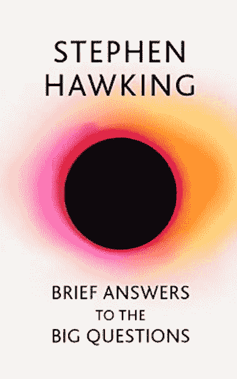

霍金《对大问题的简明回答》封面图，外文版

我们一直说人性的本质中，包含着贪欲。但是，就算基因改造有很大的风险，还是有人会不顾后果，借科学的名义冒险尝试，他们还会说，世界上没有技术解决不了的事情，一切都是大势所趋，我们人类无法抵挡。

这样念头的背后，一方面是外在的金钱驱使，另一方面，则又回到了我们前面提到的工具理性占上风、价值理性被遮蔽后，道德约束的缺席。

事实上，韦伯早早就预料到世界祛魅过程中的问题。他说，在这个理性化、理智化、祛魅化的时代里，"鼓荡心灵的诗歌和宗教化为虚空"，祛魅给人们带来物质和精神文化上的成就，同时也带来许多深远的问题和危机。人类对自己和对社会的认知，虽然已经发展到一个新的高度，但是，未知的事物还有很多很多，科学并不能解决一切难题。

可是，人们有时候认识不到这种局限性，依旧沉迷于自己的全能之中，这就可能造成很多不可估计的后果。

#### 三、科学的局限性

那么，我们到底要怎么辩证地看待科学呢？

在《以学术为业》的演讲中，韦伯提出，科学的真理是柏拉图的《理想国》中引导人们走向光明的太阳，科学捕捉的应该是真实的存在。

但是，现在的世界，很多人对科学的理解却是狭隘的，所以韦伯说："在今天的年轻人眼里，科学的思想图景是通过人为抽象建立的一个彼岸王国，这抽象凭着自己瘦骨嶙峋的双手，企图把握血肉饱满的真实生活，却从未成功地捕捉到它。"

这句话的深层含义是，科学的首要目标是发现事物和事件的本质和规律，科学源于对日常生活的观察却不止于日常生活的规律，科学没有我们想象得那么无所不能。

当然，从这百年来看，科学和技术的结合为人类创造了数不清的福利，几次工业革命让我们切切实实地感受到，科学技术对日常生活的改变和生活质量的提高。科学之美在于公式、规律之中，可以通过简单的数学公式来解释和表达复杂的自然世界背后所隐藏的特定规律,但这个世界并不完全由一条条公式而组成。

在《以学术为业》中，韦伯也鲜明地提出过一个观点，那就是，"科学是不涉及终极关怀的"。

事实上，人类对科技的掌握只是我们了解和把握世界的一种方式，既不是唯一的一种，也不是全部，文化、艺术、道德和日常经验，都可以帮助我们接近真理，科学只是世界的一部分。

如果把人类的福祉与未来都仅仅寄托在这单一的方面，而忽略了人文、艺术、伦理的底蕴、审美、约束，那么大家只会沦为不出错却毫无感情的机器和工具，这不仅违背了人性的本源诉求，而且对于人类文明的进步、发展没有任何好处。

德国哲学家康德在《实践理性批判》这本书中有一句很有名的话，"有两样东西，我对它们的思考越是深沉和持久，它们在我心灵中唤起的惊奇和敬畏就会日新月异，不断增长，这就是我头上的星空和心中的道德定律。"

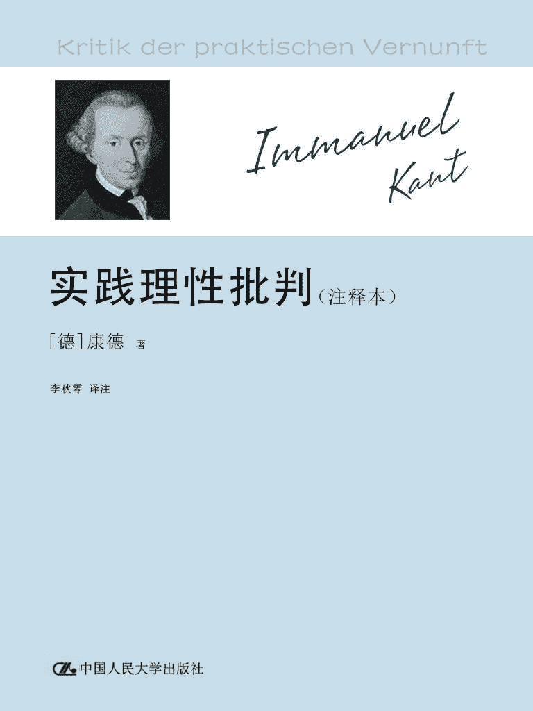

康德《实践理性批判》封面图，中国人民大学出版社

康德所说的头顶上的灿烂星空，指的是自然科学，心中的道德定律指的是伦理道德。康德一生都在研究、探索，想要在道德律和科学之间找到平衡。

其实，我们今天遇到的很多问题，也会有着和康德同样的纠结、烦恼。

比如，医学的愈发昌明，让治疗绝症、延长寿命，甚至对于永生都不再是幻想，然而同时，对基因编辑技术的滥用，扮演全能"造物主"的角色，不顾潜在的巨大风险，把人类未来的福祉和全局的发展丢在脑后，这难道不是一种对技术发明者的侮辱吗？

再比如，人工智能和机器学习的大力发展，极大解放了劳动力，提高了生产效率，让人们可以自由地创新与创造，然而同时，一些不顾伦理的机器造人试验，又引起担忧和恐慌：未来我们会不会反过来被自己制造的机器人所控制？

再比如，我们利用科技将大自然的资源物尽其用，但同时，过度开采自然资源，对于环境的破坏，让生态系统已经到了濒临奔溃的临界状态，造成大气污染、垃圾围城、动植物群逐年减少。这些问题，都已经让我们付出了沉重的代价。

科学已经成为人类的一种存在方式，同时也是进步的工具，但还需要和信念、伦理、道德结合在一起，才能成就世界的韵律之美。

人类利用科学成果不断满足自身欲望的同时，如果没有内心的自律，遵循公认的伦理，反省自我的约束，那么很可能就会在追求更高、更快、更强的时候反而走入堕落，在追求发展向上的现代社会里丢掉底线和尊严，在追求理性的路上反而一路丧失理性。

#### 四、摒弃"科学至上"，保持敬畏之心

今天我们重点和大家讨论了韦伯的经典理论----"世界的祛魅"。祛魅原本是一个让我们用科学理性来看待世界、消解知识的神秘性和魅惑性的积极过程，把人类带入了新的开放领域。

然而，随着现代资本和市场经济的发展，人在技术意志的支配下，开始最大限度地谋求利润，而丢掉了对于科学本身的敬畏之心。不顾一切地滥用技术，不考虑可承担的后果，这是"科学至上"论的最大诟病。如果，人类的欲望完全被外力牵引着走，可能就会丧失"生而为人"的基本尊严和崇高理想。

试想一下，当世界彻底被私心和贪欲所包裹的技术所主宰，就好像科幻电影里所塑造的未来那样，人们成为了没有精神生活、没有价值底线、以利益为导向的机器生物。

如果垂垂老矣的我们，拜医学与科技所赐，能够延长寿命至 120 岁，甚至发明出特质的芯片，植入体内，达到了一定意义上的永生，但是却失去了人和人之间情感电波的涌动，彼此的付出和扶持，到了那时候，活着也仅仅是活着，毫无意义可言。

在社会学家看来，作为人类的我们，彼此之间是相互渗透、爱恨交织的个体，而不是机器。人类，就是因为这种交互来往才具有社会的属性。

美国社会学先驱查尔斯\*库利（Charles Cooley）在他的代表作《人类本性与社会秩序》（Human Nature and the Social  
Order）中说到：

"个人是和人类整体不可分割的，是其中活生生的一分子……他不能脱离人类整体；遗传和教育因素已经构成了他的生命。而另一方面，社会整体也在某种程度上依赖每一个个人，因为每一个人都给整体生活贡献了不可替代的一部分。"

查尔斯\*库利《人类本性与社会秩序》封面图，中国传媒大学出版社

换句话说，社会作为一个系统，整体是为了各个部分而存在；但同时，社会各个部分又受到整体的制约，人和人之间的互动，会创造出独特的社会结构和文化模式。而这一切，都不是技术可以取代的。

所以，在一切强调理性化、祛魅的时代，我们更要清醒地知道，科学的目的应该是服务人类，造福人类。我们当然需要大力支持科技的发展，但同时也要看清科技和人类发展的正向关系。对于未来，我们要有孩童般的初心，对于未知，我们也要保有敬畏之心。

我是严飞，下期见。

# 22\. 以学术为志业：青年教师的“青椒苦”，你真的懂吗？

（公众号懒人找资源，懒人专属群分享）

### 本集要点

1.《以学术为业》演讲背景、内容

2.当代大学教师的困境

3.韦伯的学术研究精神

### 文稿

你好，我是严飞。在今天的这一集里，我将和你讨论韦伯的"以学术为业"。

#### 一、大学老师的本质

自从我成了一名大学老师，有两大类问题是最常被人问起的。

第一类问题一般来自学生。他们经常会来我该不该读博士，读完博士有多大的可能继续做学术研究方面的工作。这个时候，我都会问他们同样的一个问题：你为什么要读博士？你有没有足够的热情和明确的志向，做好了迎接艰苦的学术生涯的准备？

如果我看到他们犹豫或者疑惑了，或者只是听到他们说想要有更多的资本去竞争工作岗位的话，我都会委婉地告诉他们，也许学术并不是最适合他们的人生选择。

第二类问题一般来自亲朋好友。每次家庭聚会，或者朋友之间闲聊的时候，他们就会非常羡慕地问我，是不是马上就要放寒假、放暑假了，假期里是不是就可以休息和旅游，想干什么就干什么？

每到这个时候，我都会苦笑着说，大学老师们虽然有寒假和暑假，但实际上依然每天都在工作。比如我自己，虽然不用到办公室打卡报道了，但是，每天在家里都要工作到半夜，有做不完的事情和写不完的论文在等着我去完成。

大学老师，并不是人们心中想的那样，做着轻松、体面的工作就可以拿着高工资的人，准确地说，大学老师是一批把研究学术当成职业的人。

这是一种怎样的体验呢？现在网络上喜欢把大学的青年教师叫做大学"青椒"，在刚开始工作的头几年，忍受着"青椒苦"，有很多的学术挣扎。既然如此，他们要怎么保持对学术的热情呢？而成为知识分子、以学术为业的意义又在哪里呢？

这些问题，不仅仅是今天待在学院里的老师们在思考的，实际上早在 100 多年前，德国的青年人就被这些问题困惑着，但当时的他们身上有着更多对时代的迷茫。

#### 二、著名演讲《以学术为业》

在 1917 年的时候，第一次世界大战进入第三年，美国放弃中立立场，选择参战，战争进入白热化状态。经历漫长战争的德国年轻人，不约而同的提出一个问题：这一场令人愈发感到绝望的战争，到底什么时候才可以结束。

与此同时，德国的教育体系也正处于转型时期，专业化、精细化的学术分工成为主流。倘若选择待在学院之中，就意味着会在一个特点的精细领域进行长时段的钻研，而这一领域也许可以跟你对话的，在全世界范围内也许就寥寥数人。那么，这样的学术研究，意义又在何处？

在这样的大背景之下，德国慕尼黑大学希望邀请一些知名学者来回应年轻一代的困惑，这便是韦伯系列演讲的缘由。在 1917 年 11 月 9 号和 1919 年 1 月 28 日，韦伯就为青年学生们作了两场著名讲演，第一场是《以学术为业》，第二场叫《以政治为业》。

韦伯的《学术与政治》一书内含韦伯两场演讲的演说词

特别是在《以学术为业》这一场演讲，也就是我们今天重点要说的这场演讲当中，韦伯不仅为台下的学生树立了学术的信仰和以学术为志业的信念，还影响了几代人，引领着人们对学术进行孜孜不倦的追求。

那么，在这场演讲中，韦伯讲了什么呢？

首先，韦伯明确地告诉年轻人，"学术生涯是一场鲁莽的赌博。"在韦伯看来，以学术作为物质意义上的职业，对于刚刚迈入学术大门的年轻学者而言，就相当于要不断地在挫败感中斗争，在平庸感中煎熬。

为什么这么说呢？这是因为，学术生涯有两道门槛。

第一道门槛，就是漫长的博士苦读。

博士生们在经过繁重的课程学习，通过博士资格考试之后，就要开始写博士论文了。拿修读社会科学的博士生来说，他们往往需要按照一本书的厚度去写博士论文，这一过程一般要花上三年到五年，是对多年学习思考的一次总结和提炼，很多人在这里就和学术相处不下去了。

我自己在完成博士论文最艰苦的日子里，每一天都把时间划分为固定的几个阶段，从早晨起床后一直到夜里凌晨 2 点，每一段都不停歇。一天又一天，每一天都在重复前一天的活动，每一个月再去总结前一个月的进展，就这样在极大的孤独感、焦虑性压迫和学术渴求之下，去实现自我的超越。

就像哈佛大学政治学者加里\*金（Gary  
King）教授说的那样，博士论文，并不仅仅只是完成 250 页的写作，而是如何重塑你的人生，让你从一个只会上课的学生转变为一个独立、积极、对学术有贡献的学者。这一过程是如此的无情，但却比撰写博士论文更加至关重要。因为，你不应该是一位博士论文撰写者，而是应该是一名专业的学术人。

学术生涯的第二道门槛就是学术研究和发表。

一项好的研究，首先要有一个有趣的研究问题，有了问题，还要考虑能不能落实研究。在这里，就会产生很多

失败的研究，失败的次数累计多了，也许会指引向一次突破性的重大发现，但也许，仅仅指向更加平庸的学术论文。

在这场学术游戏中，所有的学术研究最终的目标，是学术发表。这里说的发表，并不是交一点版面费，套一套近乎就可以生产论文的灌水行为，而是通过同行严格评价，获得学术共同体认可的专业研究发表。

在社会科学领域里，一个潜在的共识是，大概我们每 5、6 篇的英文论文投稿中，可以有 1 篇被接受，论文接受率大概在 15%-20%左右。

我到现在为止最煎熬的记录，是一篇花了三年完成的论文，志得意满地投了出去，等待了 22 个月，经过四位审稿人加编辑，一共五位专业人士的综合意见之后，被拒稿。

有的时候，这样拒稿的信会像雪片一样飞来。当你总是得到否定的负面评价，你会怀疑自己的学术研究是否还有价值，是否真的如此不堪。这种对内在信仰和精神的巨大"伤害"，大概是学术生涯中最为残忍的磨练，那就是，否定，不断否定，再不断修订调整，周而复始，百般锤炼，以求完善。

跨越学术生涯的这两道门槛，是所有以学术为终生之业的学者们的必然阶段。韦伯完全破除了年轻人对学术研究抱有的浪漫幻想，用残酷的现实质问每一位即将选择以学术研究作为毕生事业的人。

韦伯认为，只有经历充分的准备并且对于学术有充分热情的人才可以选择这一职业，但就算这样，能不能取得成就还要看天赋、机遇、灵感等不确定的因素。

当完成博士的苦读，真正成为一名青年教师，加入"青椒"群体之后，学术之路才刚刚起步，青椒们将面临着科研、教学、行政和生活的四重压力。大学体系对青椒们的要求，是既能发论文，又要书教得好，同时也要有一定程度的公共服务。

在学术研究上，不少高校，譬如我们清华大学，已经按照西方长聘制度改革，实行一套有严格奖惩制度的职称评比标准，即所谓的非升即走制度。所谓的非升即走制度，即给你 6 年时间的聘期，如果在 6 年时间里，没有达到学校要求的长聘副教授的考核标准，就必须走人。

在这其中，科研投入和具有高质量的论文产出是评定一位青年教师是否在学术领域称职的重要标准，如果达不到标准，就只能残忍地淘汰。

在这场演讲中，韦伯还回应了年轻人对于学术研究愈发专业化、精细化的道路困惑。

韦伯承认，"学术已达到了空前专业化的阶段，而且这种局面会一直继续下去。无论就表面还是本质而言，个人只有通过最彻底的专业化，才有可能具备信心在知识领域取得一些真正完美的成就。"

"只有严格的专业化能使学者在某一时刻，大概也是他一生中唯一的时刻，相信自己取得了一项真正能够传之久远的成就。"

学术之路正是因为漫长而艰辛，所以更加需要热情的支撑，而非灵光一闪的机灵或者是按部就班的计算。韦伯总结了年轻一代学人的一个缺点，"今天的年轻人中间流行着一种看法，以为科学已变成了一个计算问题，就像'在工厂里'一样，是在实验室或统计卡片索引中制造出来的，所需要的只是智力而不是'心灵'。"

面对这样的问题，韦伯明确指出，"灵感在科学领域所起的作用，肯定不比现代企业家决断实际问题时所起的作用更大，但是，灵感所起的作用也不比它在艺术领域的作用更小。以为数学家只要在书桌上放把尺子，一台计算器或其他什么设备，就可以得出有科学价值的成果，这是一咱很幼稚的想法。"

韦伯还在演讲中提到了学术研究中的诱惑。这些诱惑可能是虚荣，可能是金钱，也可能是政治。现实生活中，特别是在北京，政治离学术如此之近，很容易让一些学者走入权力的欲望陷阱中，流连忘返。

韦伯不能忍受这样的现象，他说："在科学领域，假如有人把他从事的学科当作一项表演事业，并由此登上舞台，试图以'个人体验'来证明自己，并且问'我如何才能说点在形式或内容上前无古人的话呢？'"

"而无论在什么地方，只要一个人提出这样的问题，而不是发自内心地献身于学科，献身于使他因自己所服务的主题而达到高贵与尊严的学科，则他必定会受到败坏和贬低。"

在这一点上，韦伯对所有学者提出了要求，他认为学术研究是严肃的，研究的目的应该是研究本身，并且研究不应当具有政治倾向。

不同于政治家，学者应当克制自己，避免价值判断，就像韦伯在演讲中说的，"作为'职业'的科学，不是派发神圣价值和神启的通灵者或先知送来的神赐之物，而是通过专业化学科的操作，服务于有关自我和事实间关系的知识思考。"

换句话说，韦伯认为学者不应公开表明他们对社会事实等事物抱持的个人观点。比如说，社会学家可以通过统计研究，指出贫穷所带来的社会后果，比如不佳的健康状态或者上升的犯罪率，但他们身为严肃的学者，却不应该利用这些社会事实鼓吹贫穷应该被消灭，或者主张穷人应该受到更加严格的管治和约束。

在《以学术为业》中，韦伯详细描述了作为一名学术研究者，在生活中会遇到的挫折。然而，就是在这样的情况下，韦伯成为了真正的"以学术为业"的人，并取得了巨大的、受人认可的学术成就。

\[德\]马克斯\*韦伯（Max Weber，1864－1920），社会学家、政治学家、经济学家、哲学家

用韦伯自己的一段话来说明他对于学术研究的这种投入："在学术工作上，每一次'完满'，意思就是新'问题'的提出；学术工作要求被'超越'，它要求过时。任何有志献身学术工作的人，都必须接受这项事实……将来总有一天，我们都会被人超越；这不仅仅是我们的共同命运，更是我们的共同目标。"

#### 三、自我激励，且痛且行

所以，面对着教学、科研、行政和生活的重重压力，还有学术圈之外的浮躁与诱惑，正在以学术为业的大学青年老师们应该如何调整和适应？

我想，最为关键的还是要坚持做自己喜欢的研究。因为喜欢，才会有热情和动力，才会在自己熟悉的领域里义无反顾地扎进去，做透做深。

以学术为志业，这句话的潜台词，是希望你拥有对学术的高度热情，拥有自我激励的能力。在衣食无忧这个前提之下，学者应该且必须投入更多的时间和精力，去维持好两者的良性互动关系。

我的同事刘瑜老师曾经对学术有过这样的评价，她说，"学术生活不是一场桃花源之旅，而更像是一场洞穴探险：充满了泥泞、黑暗、孤独、恐慌，以及烛火偶尔照见墙上瑰丽壁画时的狂喜。"

以学术为志业，如果不是依靠一种对读书近乎信仰般的喜爱，很难对学问生发出持久的热情，对学院生活拥有归属感。而如果丢失了这种对学问的热情，歧路的诱惑又如此之多，则学术之路必将是梦魇一场，读书只有徒耗精力的苦味，何谈趣味。

最后，我们用韦伯的演讲来结尾，在学问的冒险之旅里，以学术为业，"自然，我只为我的天职而活着。"

我是严飞，我们下一集再见。

# 23\. 金钱与现代生活：当我们在谈论金钱时, 我们在谈论什么？

### 本集要点

1.《货币哲学》内容

2.马克思与齐美尔的不同

3.金钱如何改变人际关系

### 文稿

你好，我是严飞。今天这一集，我们要开始了解另一位德国的社会学家和哲学家，齐美尔。齐美尔是和韦伯同处于一个时代的德国社会学家，是德国社会学的奠基者之一，也是德国社会学协会的创始人之一。

\[德\]格奥尔格\*齐美尔（Georg Simmel，1858-1918），社会学家、哲学家

#### 一、齐美尔研究金钱的背景

与韦伯不同，齐美尔的学术道路要更加坎坷。齐美尔出生于一个犹太富商家庭，母亲对他比较冷漠，而父亲在他 16 岁的时候就去世了。于是，父亲的好友担任了他的监护人，并且给他留下了一笔可观的财产，这为他日后可以心无旁骛地钻研学术奠定了物质基础。

但因为齐美尔从幼年开始就饱尝人间冷暖，从来没有享受过无忧无虑的家庭生活，所以其实，不差钱的齐美尔内心一直都有着很难和外人诉说的苦痛，他把对于个体生命、社会现实的思考都融入在了一生的学术研究中。

与此同时，齐美尔的犹太血统也使他受到了极为不公平的待遇。

一方面，反犹主义在战前的德国盛行一时；另一方面，齐美尔在学术领域的涉猎之广和他对当时限制学界发展的规则的反抗也使他成为了"学院的局外人"。

他常年活跃于德国柏林的文化圈中，在艺术界和文学界也有许多朋友，连续十几年以编外私人讲师的身份授课，虽然他 23 岁就已获得博士学位，但直到 56 多岁才被学术界接纳为正教授。

另外，不可忽略的是，齐美尔所处的时代特性也在他的思想中打下了深刻烙印。齐美尔进入成年时，正是在俾斯麦掌权的德意志帝国早期，柏林在 1870 年普法战争胜利后飞速发展起来，一跃成为世界性的城市。伴随着经济的发展，齐美尔展开了对现代性这一命题的探索。

#### 二、齐美尔的金钱观

齐美尔有一句名言，那就是，"金钱只是通向最终价值的桥梁，而人是无法栖居在桥梁之上的。"我觉得这一句话可以非常好地概括人和金钱之间的复杂关系。

关于金钱，齐美尔在《货币哲学》这一本书系统地表达了他的看法，因为齐美尔大部分的文章都是以短文的形式出现，所以《货币哲学》这本书更加显出它的重要性。

齐美尔《货币哲学》封面图，华夏出版社

在这本书中，齐美尔对货币经济的产生与发展进行了全面的梳理，并且一阵见血地指出，"金钱是我们时代的上帝"。没错，金钱让现代社会变得更加地理性，因为一切事物都可以用数量化来衡量。

在以货币为媒介的交换中，商品实现了客观化，不仅日常的商品交换变得更加便利，就连人和人之间的感情也变成了可以计算的数字。货币超越了所有其它的具体事物，显得可以调解一切生活矛盾。

在这样的情况之下，人们相信金钱万能，如同信赖上帝全能。

齐美尔说：

"通过金钱可以获得的对象范围大大增长，这让金钱获得了中心的地位，它将光芒照射到现代生活的许多具体特征中……金钱在人和他的愿望之间插入一个中介阶段，一种缓和机制。凭借金钱这种手段可以获得数不胜数的其他东西，让人们产生了这样的幻想，好像我们比以往更容易获取所有这些东西。"

有趣的是，有心理学家做了一组实验，来验证金钱的万能型。他们把被试者分成两组，一组让他们用手先接触钱，另一组则不接触钱，然后再让两组被试同时将手伸进冰桶里，结果发现接触钱的这一组被试，他们平均的耐冻性要比没有接触过钱的那一组要增加一倍。

换句话说，金钱就如同止疼药一样，至少在心理层面，极大的缓解了人们对于疼痛的感觉。当然，反过来说，当人们花钱的时候，感到"心痛"、"肉痛"，也是一样的原理。

#### 三、马克思与齐美尔的不同

受到马克思劳动异化和商品拜物教理论的影响，齐美尔同时也对金钱的"异化"功能进行了阐述。

齐美尔指出，金钱是一种纯粹的交换方式,人们在社会里将金钱本身当成目的，人际互动变得更加工具化，更易于计算，获得金钱货币成为人际交往的直接目标。人和人互动之中的个性和关怀被抹除，取而代之的是冷酷无情和就事论事的态度，以及理性、精于计算、毫厘不差的实际生活。

但与马克思不同的是，齐美尔并没有像马克思那样，仅仅只是把货币的存在视为一种交换媒介、价值手段，悲观地认为货币拜物教完全剥夺了人们欲望的自主性。恰恰相反，齐美尔对货币背后的现代精神进行了深入剖析，在货币经济的分化中，齐美尔依旧看到了人的个性发展的希望。

齐美尔认为，货币经济象征着现代精神的合理性，与理性主义的本质是相通的。货币经济的发展过程体现了主客体分化之间的两层关系："货币的起源建立在经济追求的主体与对象之间的分化过程上；货币就其纯粹的概念又包含了无区分原则。"

人的心灵与货币经济的发展相适应，也通过分化和去分化的过程分为两部分：一部分用于适应理性化的外部世界，赋予客观化的功能；另一部分则保留纯粹的个人属性，是无法物化的内在部分，艺术、爱情、宗教这些人类心灵生活的原始领域便隶属于这一部分管辖。

因此，齐美尔强调，金钱虽然可以帮助我们实现很多"想要的"，但金钱并不是我们每个人灵魂的最终归宿。哪怕外部世界在现代化进程中分崩离析，人们依旧可以通过对心灵分化，在适应社会变化的同时，保有主体灵魂的高雅和独立。

相比马克思以为只有资本主义才与金钱的罪恶相干，社会主 义就是对这种罪恶的克服，齐美尔似乎更加正确地预言了今日的社会状态：

现代性似乎并未在极端中走向资本主义的必然灭亡，反而是以更加全面的形态渗透入当代社会的方方面面；货币最终脱离了物质形态，电子商务出现，股份制的发展，银行业的膨胀。现代性正"日益地"自我扩张，并且在方方面面影响着人们的行为。

在金钱的异化功能之下，齐美尔进一步地明确指出，"货币同样导致利益、关系、理解的平均化、无差异化，这种平等是'一种夷平的过程'：所有高贵的东西向低俗因素看齐。"

这番话，可以说在当今的世界也非常适用，是齐美尔理论视角应用最直接的一个方面，它敦促我们对"金钱"进行慎重反思。似乎齐美尔一百多年前所预见的种种都正变得更加严重，也更为理所当然了。

#### 四、金钱对人际关系的改变

首先，让我们来具体看一下金钱如何改变了人和人之间的关系。

第一种改变，是个人主义开始盛行。在过去的生活形式中，人和人之间的相互依赖关系是明确、固定、彼此惠存的。但在如今货币经济生活中，人们逐渐开始不再依赖确定的人，而是只依赖自己和自己的财产。过去我们说"谈钱伤感情"，而如今的流行语却变成了"谈感情伤钱。"

第二种改变，则是人们之间的关系变得更加的没有人情味，过去我们因为人们的独特的个性而交往，现在我们更加有可能的是和他们所处的职业而交往，比如说快递员，理发师、医生。我们不再去思考这些职位背后每个人的个性,我们也不在乎谁占据了这些职位。

在金钱经济的现代分工中，个性化开始慢慢消失在职位背后，似乎连每个人之间都因此变得可以互相交换、利益输送。人变得失去人性的部分，而是专业化、功能化、无差异化。

其次，让我们再来看一下，金钱如何导致了人们理解世界的观念从一种"高贵的东西向低俗因素"发生转变。

在《货币哲学》里，齐美尔认为，"货币给现代生活装上了一个无法停转的轮子，它使生活这架机器成为一部永动机，由此就产生了现代生活常见的骚动不安和狂热不休。"

在"骚动不安"和"狂热不休"下，货币经济以现代都市为家园，让形式高于生命，现代生活中的许多事物，知识、美貌甚至是爱情都可以通过货币来衡量甚至交换。人们对于世界的看法，也因此变得如此陌生，以至于只有理性而没有感性，只有计算而没有关怀。

卢梭说过，"人人生而自由，又无往不在枷锁之中。自以为是其他一切的主人的人，反而比其他一切更是奴隶。"放在今天讨论的语境里，就好像是有了大量金钱支配权的人，自认为可以操控一切，但其实是被外在的名、利所操控，到头来却被这一切所吞噬。

比如，不久之前爆出的美国历史上最大的名校录取作假案。富有的、上流社会的家长们，通过贿赂考官、代考、伪造体育特长生简历等等卑劣的手段，骗取美国名校本科的录取。这其中的每一个作假行为都是明码标价的。

名校是名流后代们今后混迹社交圈的通行证，他们被"金钱是万能的"幻想所控制，以为每个环节都可以用钱踏平，从而可以形成一个利益勾结的闭环。但事实上，金钱恰恰是毁了他们美好幻想的工具,而且真正的教育、智慧都不是可以用钱可以买来的。

#### 五、成功学和美国梦

接下来，我们再来看一看，在金钱观主导的世界中，如果我们把人们对于金钱的极度渴望和追寻推向一个极端，会给我们的社会带来什么样的后果和影响。

我们想象中，当社会走向繁荣富裕之后，人们的道德水准也会伴随着物质水平的提升也相应得到提升，整个社会也自然会走向良序善治。但事实上，随着经济水平的不断提高，社会反而出现了更多的失范和负面事件。这其中的原因是什么?  
金钱在这其中又发挥了怎样的作用？

这里有必要引申介绍一下美国社会学家罗伯特\*默顿（Robert  
Merton）有关社会失序的观点。默顿是社会学领域中结构功能主义流派的代表性人物之一，他所生活的时代，正是 20 世纪中叶美国经济高速增长的一段黄金时期。也正因此，默顿有关失范的论点，也更加强调其背后的社会和文化功能。

在理论维度上，默顿认为任何社会结构都由两部分构成，一是目标，二是达至目标的手段。首先要确立社会成员们认为值得追求的某种目标,其次再促使社会成员使用合法的手段来达到所追求的目标。

如果社会给定的目标和可使用的合法手段之间发生了相互脱节，就会造成一种社会紧张关系。而这种紧张关系，就会引发社会的失范状态，紧接着就会衍生出形形色色的越轨和犯罪行为。

让我们回到 20 世纪中期的美国，来具体看看当时的美国社会图景，是如何激发出默顿的有关失范的理论架构。

当时美国的整体社会氛围，就是追求一种金钱至上的成功，每一个人都认为自己有可能获得成功，都有一个美国梦。

什么是美国梦呢？美国梦就是说我以前什么都没有，但是我通过自己的努力，可以改变自己的阶层划分，开始过上大房子、好车子的生活。然而美国梦并不是这么容易实现的，至少如果选择合法的途径去追求成功，实现美国梦就需要一段较长的个人奋斗期。

但是整个社会的气氛，又是金钱至上的成功学导向，社会推崇的，是那种一夜暴富的成功人士，这就会无形中给予每一个人很大的压力，梦想着和这些人一样，在短时间内就可以拥有金钱和地位，摇身一变，自己也晋身成为所谓的成功人士。

这在默顿看来，是非常危险的信号，是社会失序的前兆，因为"当社会把成功的标志看作是财富的积累的时候，反社会行为就是一种正常的反应。"换句话说，在一个金钱、权力、利益受到过度重视的社会中，就会时刻存在着一种危险，那就是以不合法的手段来达到社会认可的目标。

特别是那些来自底层的社会成员，当整个社会不断强调以金钱作为成功的目标时，他们对于金钱会更加渴望，就好像心理学家的实验发现的那样，穷人家的孩子会把硬币画得比富人家的孩子更大。然而当底层民众发现自己无法获得均等的社会资源，缺乏向上流动的通道的时候，这种机会上的不均等，就极易导致社会的失范。

正如默顿所说，"当过于强调了文化目标而和制度性手段相脱节的时候，欺骗、腐败、不道德、罪恶，简而言之，一些社会所禁止的行为，就会成为日益普遍的行为。"其实，不仅仅是在默顿所处的 20 世纪中期的美国，我们看到，在今天的中国社会，社会功利化的趋势也日益严重，对于金钱和权力的追逐，对于"成功"不加掩饰的炫耀，都已然是演化成了社会的一股劣气。

所以我们才会看到，比如长春长生问题疫苗这样的事件才会层出不穷。当媒体曝光的时候，我们都不敢相信，怎么会有人利欲熏心到这个地步，拿千万条幼小生命的安危来交换不属于自己的财富和地位。而这背后，其实正是那把看不见的金钱匕首在屠杀社会的良心。

#### 六、理性与非理性

今天我们集中讨论了齐美尔对于金钱和现代生活的思考，充满了哲学家的思辨和社会学家的批判精神。"金钱只是通向最终价值的桥梁，而人是无法栖居在桥上的。"对于这句齐美尔的名言，听完今天的内容，相信大家也都会有自己的价值思考和判断。

齐美尔认为现代社会被商品交换和流通所主宰，被金钱关系所主导。金钱对社会的无形主宰，成为现代性文化的基础，让人们具有守时、精确等特点。货币改变了人和人之间的相互作用，让人们在交往中可以不带个人情感。

金钱，是我们这个理性世界的产物。经济学中有一个"理性人假设"：人类的行为都是理性和利己的，都在追求个人利益的最大化。通过追逐个人利益来增进社会利益，实现社会的平衡。整个经济学的大厦就是建立在这样的假设基础之上的。不可否认，经济理性依然是我们社会赖以生存和发展的基础，是人类进步的必然要求。

那么非理性呢？比如爱、情感，原本是人类社会重要的构成，也是我们人类固有的一部分。随着一个现代化、高度理性社会的扩张，非理性的事物逐渐消失，黯然失色。非理性是人类的本能，甚至并不一定拥有真正的所谓的"价值"，但是它可能影响着我们的很多决策，关系着人类的未来发展。

随着经济理性的肆意增长，我们开始失去非理性，这其实会是人类世界的一个悲剧。经济发展到今天，我们不可能再回到没有货币、没有科学技术、没有科层制度的传统社会了。我们常常要面对的问题是，理性和非理性之间的较量，金钱和人性之间的平衡，欲望和能力之间的匹配。

要解决这些问题，我们每个人都要直视和处理自我真实的欲望，不拒绝金钱和现代社会给我们带来的种种方便和利好，也努力不在追求金钱的过程中，成为货币之桥上的迷失者。

我是严飞，谢谢大家。下期见！

# 24\. 社会是一件艺术品：混杂是否也是一种秩序的美？

（公众号懒人找资源，懒人专属群分享）

### 本集要点

1.巴黎大改造

2.齐美尔的社会美学

3.活力城市的三个特征

4.现代城市的同质化

### 文稿

你好，我是严飞。在今天的这一集里，我将和你讨论一下齐美尔的社会美学。

#### 一、秩序之美

提起城市的秩序之美，我首先想到的，是我们居于其间、每日穿行的城市可以给我们日常的生活提供的便捷。

以北京为例，如果长安街不堵车，西直门的立交桥可以直线通过，7-11 类型的便利店在大街小巷都能找得到，那么，我会觉得，这样的城市，是拥有秩序的美的。

但是，在一些专家、学者的眼中，城市的秩序，意味着清晰明朗、整齐划一的布局。特别是在城市规划和建筑设计上，他们认为，一溜齐的招牌、没有遮挡的天际线、风格统一的建筑物才是有秩序的表现。

这两种不同的空间秩序观，其实是对秩序之美的两种不同的认识。一种更加看重空间布局背后对于人的关怀，一种更加强调外在的统一和整齐。

那么，齐美尔更加赞同哪种秩序之美呢？

#### 二、奥斯曼的巴黎大改造

在回答这个问题之前，让我们先来看一段巴黎的城市大改造历史。

1851 年 12 月 2 日，拿破仑的侄子路易*拿破仑*波拿巴发动政变，建立起法兰西第二帝国，史称拿破仑三世。这个时期的巴黎，只能说是一座一贫如洗，疲惫而老旧的城市，街道狭窄又弯曲。所以，拿破仑三世为了改善巴黎的面貌，也为了方便控制群众，他让塞纳省行政长官奥斯曼来改造巴黎。

奥斯曼大刀阔斧，不仅改造了巴黎的城市面貌，建成了一个以大凯旋门为中心，贯穿东西南北的大型道路轴线还有两圈由内环路和外环路组成的环形道路系统，奠定了现代巴黎交通的基本格局，还对城市的辅助系统进行了修缮和扩建，铺装了 800 公里长的给水管和 500 公里长的排水道，建立起一整套完善的供水和排污、排水系统，为巴黎遗留下了一副完整的现代都市骨骼。

另外，奥斯曼还在巴黎还兴建了很多公共建筑，包括新的图书馆、法兰西美术学院、巴黎歌剧院，还有大量的百货店、时装屋、餐馆和娱乐场，塑造出今天巴黎独特的城市氛围。

奥斯曼巴黎城市改造的效果无疑是惊人的，空间意义上的秩序完善了很多。今天，巴黎能拥有宽敞的香榭丽舍大道和两旁的奢侈名品店，都是奥斯曼的功劳。

但是，虽然奥斯曼让巴黎成为了一座现代性的大都会，可当时还有极大部分的人对奥斯曼不满，因为奥斯曼对旧巴黎拆毁是毁灭性的，他拆毁了约 2.7 万所旧住宅，拆毁了一座历史的旧巴黎，让很多旧区深巷中的故事成为了历史的回响。

在不少当代城市建筑师和历史学家看来，奥斯曼无疑是粗暴地折断了巴黎历史的郐子手。他摧毁了巴黎城市的多样性和社会结构，还把贫穷区域和富裕区域彻底地分化了。

对于改造之后的巴黎，雨果说，"巴黎只是个概念"，这个城市已经变成了一堆"利佛里大街（Rue de Rivoli），而我向来憎恶利佛里大街。"

#### 三、社会作为一件艺术品

一直到今天，巴黎大改造，都还是一个充满争议的事情，追寻现代性和保存历史这两者是否可以兼而得之？到底是现代性的城市更加有秩序，还是有历史厚重感的城市更加有韵味？

在德国社会学家齐美尔看来，人们对于社会的理解，不应该简单地只看社会经济效益或者理性化的社会构成，而是应该注重内在的精神生命，注重作为现代生活体验者的个体的生命体验和道德实践。

在社会学里，齐美尔是最早把美学带入社会学视野的学者之一。齐美尔曾写道："社会作为一个整体，是一件艺术品"。

齐美尔是一个现代生活的审美主义者，把美学的研究对象从"自然--艺术"的领域扩展到了人类社会。他将美学和社会学进行结合，这在社会学的研究路径中确实独树一帜。

在齐美尔的社会学图景中，他还曾经专门对哲学家康德进行过研究。1914 年，齐美尔完成了研究康德的一本专著，并在书中对康德的美学思想和理性主义进行了再思考，并形成了自己有关社会美学的认知。

康德曾经在《判断力批判》这本书中明确指出，人们的判断力可以分成审美判断力和目的论判断力两类，其中审美判断力是"对客体的合目的性的审美判断，它不是建立在任何有关对象的现场的概念之上，也不带来任何对象概念。它的对象的形式在关于这个形式的单纯反思里就被评判为对这样一个客体的表象的愉快的根据。"

康德《判断力批判》封面图，中国人民大学出版社

康德的论述听起来非常饶，简单说来，就是美是一种客观的存在，而审美作为一种判断，也只能与事物本身的外在形式相关联，而非内在的价值与内涵。

齐美尔指出，康德的美学思想实际上是一种"审美冷漠"，而忽略了"事物背后是否有可把握的真实"。在齐美尔看来，美不仅仅在于事物的客观存在，而在于这种客观存在如何激发起人们内心对于美的一种主观感受。审美判断也因此不仅仅存在于事物外在的表现形式，而更多的存在于个体内在的精神与审美欲求。

所以说，社会作为一件艺术品，不应该仅仅只是把外在的形式塑造地多么炫目从而增加其价值，而是应该更加看重其自成一体的风格，还有背后所折射出的文化品质和历史厚度。就像齐美尔说的那样，"艺术品的魅力毕竟是要依赖那些和原始情绪的共鸣的，正是这种原始情绪从根本上激动了我们的灵魂。"

#### 四、美学的最初动机：对称

在所有的社会审美原则之中，齐美尔最重视视觉艺术，因为他认为，一切美学的动机最初都是对称。

什么是对称？在《社会美学》这篇文章中，齐美尔指出，"对称的本质在于，一个整体的每一个要素只有顾及到其他要素、顾及到一个普遍的中心才能各守其位，各遵其道，各存其意。如果各个要素反其道而行之，只听从一己之愿随心所欲、各行其是，整体的形态就会随意地左冲右突，必定毫无匀称可言。"

所以，对称作为现代生活的一种审美原则，确实大量地出现在我们的社会生活中，许多图案、物品、建筑，都是按照对称的原则设计的。

另外，在国家的管理制度上，也体现着一种对称。齐美尔说，"对称的魅力，连同对称的内部均衡性、外部完美性和各部分和一个统一的中心的协调关系一起，势必会产生美学吸引力的效果，可以对众多的思想实行专制，要它们绝对服从一个国家意志。"

举个例子，十个人组成一个小单位，十个小单位又组成一个一百人的大单位，这就是组织结构上的对称，自下而上，清清楚楚，也非常方便管理。在这种情况之下，国家对于社会的控制、对于个人的管理，就会省力很多，只需要有一个统一的行政命令自上而下地执行，就可以高效完成。

但是，对组织统一、布局对称之美的过度追求，会导致整个社会的审美趣味偏向于所有的一切都是围绕一个中心，按照对称原则来运转，这样肯定是会出错的。

对称的审美效应所带来的绝对实用性，会导致个体的自由个性和想象力被抹杀，在共同的中心里，总是用牺牲个体来成全集体。

#### 五、城市的神韵

沿着齐美尔的思路，美国城市问题研究权威乔尔\*科特金（Joel Kotkin）在 2005 年出版的《全球城市史》（The City: A Global  
History）这本书里，指出一座活力充沛的城市，必须具备三个特性----安全、繁荣和神韵。

乔尔\*科特金《全球城市史》封面图，社会科学文献出版社

在这本书中，柯特金系统探究了数千年来都市生活的进化过程，并且从历史的角度提出了很多城市规划方面的观点。对于科特金来说，城市不仅仅只是"生活的机器"，而且还同时折射出这个地区的神韵、安全感还有生机等内在的品质。

所谓神韵，科特金认为应该泛指"神圣"传统，亦即在中古时期城市所拥有的宗教信仰，而在现代世俗社会，则可引申为一个城市的共识价值及精神面貌。

每一座独特的城市，都有属于这一座城市独特的信念，或源于传统，或源于宗教，亦可源于本土生活价值和人文精神，除了用以取得市民认同，亦激发持续不断的文化创造，在文学、艺术、文化各个领域，推陈出新，发展出多姿多彩的生活方式。

然而，在城市化的汹涌浪潮之下，我们看到资本的力量渗透进中国的每一个角落，城市的信仰变成了一种简单粗放、经济主义至上的城市发展趋同化表现，对"繁荣"的追求，成为了城市发展和规划的唯一指标，而完全舍弃了"神韵"这一特质。

当我们拖着行李，带着热情的期待来到远方时，却发现全中国的省会城市一个模样，全中国的地级市又一个模样，楼房、街道、广场，甚至路边的标语，都是和身边差不多的布局和规划。

每一座城市，都疯狂地提倡要把本地区打造成经济中心，而无视自身的独特历史和人文气质。我们的城市由此变成一个大工地，不断的挖啊挖，高架改隧道，隧道改高架，十字路口改圆盘，圆盘再改回十字路口，反反复复，周而复始，没有一天停歇过。

一个真正有魅力的城市，一定是有独特性格和韵感的城市。在城市规划和建设中，我们就需要找到这座城市的性格，主动发掘和塑造城市的面貌，城市才可以有效的运作，散发其应有的活力。城市的吸引力不在于有多少高楼大厦，有多少国际化的标杆和口号，而在于它所展现出来的生活的无限可能，从而能够安放不同个体的自由诉求。

社会学强调人的效应，正是居于其间的人塑造了城市，而不是城市塑造了人。如果我们把人都按照统一的标准进行要求，或者把人分成三六九等，并且把末等的人驱离出城市，那么这个城市就缺乏应有的包容和温度。

一个城市自身活力的发掘，一定不是单一的政府决策可以实现的，而是其间每一个个体可以充分行使自我选择权力的体现，他们给城市赋予了多样性，让每一座城市不再千篇一律，从而在根本上塑造了城市独特的性格。

与此同时，在城市的空间构建上，一个核心的要点是集聚日常生活的力量。日常生活的力量，不是自上而下地通过行政动员就可以达成的效果。

比如说，我们的行政部门会有计划、有意识地按照规划打造创业园区、艺术中心，但实际上空间的建立往往并不是先拥有一个实体的建筑空间，反而是先有了一群人----  
艺术家、音乐家、写作者。他们会聚集在一起编辑自己的刊物、定期举行集会进行艺术或者产品的创作和创新，这样才会生发出一个空间。

这种在行政部门指令以外自发形成的空间，我们叫做"替代性空间"。它是自下而上的聚集起来，是自发的，内生的，所以会更加有活力，也更加能集聚日常生活的力量。

#### 五、混杂也是一种秩序美

因为工作的关系，我曾经在香港居住过很长一段时间，对这座城市，有着很多深入的观察和写作，自然，也对这座城市有着很多的批评。

初次来到香港的游客，对这座城市的第一印象，大概就是鳞次栉比、密密麻麻的高楼大厦了。香港有着所谓的"石屎森林"的"美誉"。石屎，即混凝土。在香港，地产商为了求快，政府为了求快，大量使用石屎作为主要的建筑材料，疯狂地建设新楼盘。高密度的高层建筑群体集合在一起，形成了一种特有的城市哥特式风景。

其实从上世纪九十年代开始，香港的建筑设计美学就分支成两大主流----"官僚主义"和"地产主义"。前者由香港政府建筑署主导，后者由大地产商主导。"官僚主义"把所有建筑物看成棋子，以"净化空间"作为城市的规划目标；"地产主义"则把所有建筑物看成平面容器，奉行简单的功能化和实用化。

两者的共通点就是都不重视建筑空间的质素，不注重历史文化的蕴涵。他们只追求外表、数量、体积、高度，只关心档次、品位、价位和利润，不以"人"为本，而以"商人"为本，以经济利益为本，凸显出香港建筑文化中所充斥的商业主义（mercantilism）本质。

不得不承认，城市规划对秩序的改造功效是巨大的。规划是企图把一切都纳入秩序，把一切都归为发展蓝图中的增长点。于是，那些经过多年文化累积自行生成的旧区街道，一下子被城市规划的巨轮所辗碎，历史建筑也纷纷被粉饰为旅游景点，居于其间的人们被迫搬迁到屏风屋苑、摩天大楼之中，仿佛被囚禁于鸟笼中的鸟儿，只能透过封闭的几扇窗，哀怨地望向窗外的石屎森林，然后沉重地叹出几口气。

但是，任何一座城市也必然是由历史和文化所组成，或用齐美尔的话说，由内在的精神生命所组成。那些锈迹斑驳、砖红瓦绿，夹杂在高楼大厦中的老旧建筑，正是香港这座城市由过去走向未来的真实写照；而那些横亘于街道上方各色醒目的霓虹招牌，纷乱、夸张、撞色，让人迷失，但却早已经成为香港一种独特的文化符号。

张爱玲在小说《倾城之恋》里，就描绘过白流苏坐船靠岸时第一眼望到的香港，"是一个视觉夸张的城市，码头上围列着的巨型广告牌，刺激的颜色窜上落下，倒映在绿油油的海水里。"

在文学家的笔下，城市的混杂之美获得了持久的生命力，不断的传承和延续，成为了香港这座城市永不磨灭的文化传统，并凝练成居于其间的普通居民们的集体记忆（collective  
memory）。

所谓"集体记忆"，首先由法国社会学家莫里斯\*哈布瓦赫（Maurice Halbwach）提出，用以跟"个人记忆"（individual  
memory）相区别，《论集体记忆》（La Memoire Collective）这本书更是脍炙人口的经典，并应用到所谓"文化记忆"上。

莫里斯\*哈布瓦赫《论集体记忆》封面图，上海人民出版社

哈布瓦赫认为，回忆活动本质上是社会性的，因为绝对私人的回忆，往往因缺乏逻辑和系统而显得模糊混乱，并且通常会因为时间消逝而变得零碎、散乱、淡化。相反，社会集体记忆却能通过现代城市、建筑物和公共空间来不断更新，得以追溯。从这层意义上讲，公共空间、古旧建筑乃至社会事件等都是集体记忆的载体。

对于一般大众而言，集体记忆，这个很不生活化的词语，可以成为一股时髦，即是怀旧。怀旧是一种感情，是对过去的眷恋，也是对现实的感怀。

同时，集体记忆也是一种增强集体认同感的象征，对身份的认同因为集体中共同拥有的记忆而更显紧密。一条满载历史记忆的老街，比国家纪念碑更有意义。老街可以营造出更为贴身的地方感，让当地的居民更能介入空间、环境和文化的营造中，从而凸显出身份意义上的主体性。

事实上，城市的空间秩序，决定了居于其间的城市居民的生活质素。建筑大师贝聿铭曾说过："更重要的是建筑家追求一种特殊的品质（special  
quality），以代表所在地的精神。"

可以说，一栋建筑物倘若缺乏对人的价值的尊重，对人的理想的关怀，没有方便使用的功能在里面，没有美的成分在里面，那只会是一个躯壳，光有簇新的外在，却失去了内在的历史内涵和精神价值。

从这层意义说来，建筑和空间其实是文化不可磨减的呈现和记录，它不再是人们对物质需求的无止尽膨胀，而是对人性关怀这一核心价值的不断诠释。

说到底，当社会作为一件艺术品，其真正内在的核心，还是人，还是对于人的关怀和尊重。

我是严飞，我们下一集再见。

# 25\. 时尚的哲学：永远年轻，永远热爱滤镜和抖音

### 本集要点

1.时尚的定义

2.时尚的本质

3.时尚如何传播

### 文稿

你好，我是严飞。在今天的这一集里，我来和你一起讨论一下齐美尔有关时尚的论述。在齐美尔的作品里，对于时尚有着非常经典的论述。放到一百年后来看，依然可以解释我们今天社会中的种种流行现象。

#### 一、活在滤镜的时代里

现在，每一个生活场景里都有属于这个时代的特定的产物，比如走在商场里，你会看见喜茶、斩男色口红，而你的手机上有淘宝、抖音、网红主播。这些特定的时代产物可能是日常生活的必需品，也可能是同事朋友之间交流的谈资，还有可能是为了满足虚荣心和面子而产生的。

面对纷繁复杂、日新月异的时尚流行，有人冷静旁观，而更多人则选择热情追随，迫不及待地参与其中，想要成为潮流中的一部分。

拿很多人每天必刷的抖音来说，在抖音推出半年后，用户量就突破了  
1 亿人次，截至 2019 年 7 月，日活跃用户超过 7 亿，月活跃用户超过 15 亿。也就是说，每天有 7 亿人次在抖音上观看、留言或是上传小视频，这已经成为今天很多人的一种生活方式，甚至像上瘾一样，只要打开手机，就有冲动去点开看更新。

我有一次回家，看到小区里的保安站在分类的垃圾桶旁边，举着手机一边自拍，一边微笑着念念有词。我凑过去一问，原来他是在拍抖音小视屏，还热情告诉我他的抖音账号，让我赶紧去关注。

如今，社交媒体让每个人都感觉自己是这个世界、这个时代的发声者，每个人都可以在互联网上吸引到欣赏自己的人，也可以了解到自己生活以外的世界，小到随意发布的跳舞唱歌小视屏，大到千万级网络营销，我们的消费观、价值判断、社会心理在被重新塑造，无限的推送更新构成了属于我们这个世界的时尚。

#### 二、时尚的哲学

那么，在社会学中，时尚的定义是什么？

德国社会学家齐美尔早在一百多年前就对时尚发表了见解，他的研究主要集中在他的几篇短文中，比如《时尚心理的社会学研究》（Zur Psychologie der  
Mode Sociologische Studie）、《时尚》（Fashion）、《时尚的哲学》（The Philosophy of  
Fashion）等等，其中包含着丰富的描述和分析，至今仍然在社会学讨论中占有重要的地位。

什么是时尚？齐美尔在文章《时尚心理的社会学研究》中下了这样的定义，他说，"通过某些生活方式，人们试图在社会平等化倾向和个性差异魅力倾向之间达成妥协，而时尚便是其中的一种特殊的生活方式。"

怎么理解呢？社会平等化指的是人人都处在一个频道上，穿着打扮都一样。比如 1980 年代大家都穿着千篇一律的灰色中山装或蓝色解放装，成为了一个时代的集体记忆。

个性差异魅力指的是在全民统一的基础之上，个别人选择突出自我的特色，展现出不一样的元素和风貌。比如还是回到 1980 年代，当美国电影《霹雳舞》于 1986 年在中国上映之后，在电影的带动之下，年轻人纷纷烫起了爆炸头，走起了太空步，就是一种追逐时尚，展现自我的生活方式。

在这个时候，时尚作为一种符号，它不是永恒的，而是总在发生变化。但无论怎样变化，时尚都代表着一段特定阶段的风潮，人们会因为想要展现出自己与众不同的独特性，而争先恐后地去实践，而为了和社会的风潮相贴切，又必须抛弃掉一部分自我的个性。

那么，这样的时尚可以给人们带来什么呢？

首先，时尚作为一种生活方式，一定程度上唤起了人们对于外表的追求，或者说，一种对自我的幻想。

比如，穿一件明星同款的衣服，背一个同款包，可能就有十秒钟感觉自己和偶像一样在人群中闪闪发光。这是很多人赚钱买买买的动力，是消费主义所推动的。用齐美尔的话说就是，"（时尚）有真正令人刺激和振奋的魅力。在过度的刺激面前，现代人逐渐陷入文化产品的拜物教。"

另外，时尚在像一阵风一样迅速虏获大众芳心的同时，也让大众在潮流中找到了一种归属感。在齐美尔看来，人们对于时尚的追求，是一种个体追求被整体肯定的期待，他说："对于某些个体来说，时尚是一座真正的乐园，展示了一些与众不同、引人注目的东西。时尚也提高了默默无闻者的地位，使他成为整体的代表，而他也感觉到自己负载着一种整体精神。"

齐美尔的这番言论很好地解释了，今天为什么那么多人喜欢、追求在互联网上被转发和点赞。

大多数人只是想借着时尚更好地参与主流的社会生活，获得一种心理上的放松和安全感。当把加过滤镜后的照片、视频、精心编辑的文字上传到社交媒体后，期待着能够得到朋友或是广大陌生人的赞同、羡慕、崇拜。当然，也会有少数人希望自己可以成为时尚的推动者，有机会站在时代的巅峰。

#### 三、时尚的阶层划分

从表面上看，这就是时尚和时尚带来的好处，但实际上，时尚真的只是这么简单的自我满足吗？拨开时尚的表象，它的本质又是什么？

齐美尔认为，时尚本质上是一种阶层划分的产物。要知道，任何一种时尚的新鲜事物出现都不是从天而降的，都是由一个群体或是阶层开始的，是在受到大范围关注之后，再慢慢被其他群体或阶层所接受、追捧的。

就好像今天玩的骑马、高尔夫、弹钢琴、看戏剧等等，在以前，这些都是只有贵族阶层才可以有机会接触到的奢侈生活方式，但现在已经逐渐走入寻常百姓家，甚至成为一种普通人的时尚。

关于这点，齐美尔也有过举例，"纨绔子弟推动着时尚的倾向，甚至超出一般情况下会停止下来的程度：如果尖头鞋子是时髦，他就会让自己的鞋变成船；如果高领是时髦，他穿着的衣领就会直竖到耳朵；如果星期天上教堂是一种时尚，他就会从早到晚都待在里面等等。"

那么，时尚作为一种阶层划分的产物，又是如何进行传播的呢？

对于这一问题，齐美尔用了"模仿"这一概念来解释。

他认为，"在一个社会中，上层阶级为了和下层阶级相区分而发起一些表示阶级差异的行为，我们可以把它叫做'示差行为'，当下层阶级识别这种行为后，便会通过模仿寻求一致。一旦这种模仿消除两者差异之后，上层阶级就会寻求新行为。这种行为通常表现为时尚的阶层化，通过消费商品和文化品位的不同来区分地位高下。"

让我们来举个例子来更清晰地理解这种时尚的"模仿"。

生活在北京、上海的 80 后，童年时候吃一顿肯德基、麦当劳觉得是一件非常奢侈的事情，难得去吃一顿，还要拍照留个念，可能很多人家里都有和麦当劳叔叔大笑合影的照片。

但在今天的一二线城市，则早已经是一件非常稀松平常的事情，甚至因为有了更多更优的选择，很多人已经不太去光顾了。而在四线、五线、一些小县城、小镇上，则出现了像肯麦鸡、康帅傅、万事可乐这些山寨品牌。

如果站在一二线城市的角度，自然会觉得这很可笑，和时尚完全搭不上边，是一种消费降级，但如果从四五线城市的角度来看，这其实是一种时尚的模仿，一种生活方式的升级。

毕竟，从路边摊里的没有任何服务体验，到现在不仅有了门店，用餐环境大为改善，还有了过去小镇上没有的美食，终于赶上了大城市的潮流，这让长期在外打工者回到家乡时，也觉得和城里在生活、经济上的差距没有以前那么大了。

表面上看，尽管没有正宗的肯德基，但也是已经有了相似度很高的替代品，是生活上的改善和进步，在小地方算是接棒了大城市的时尚。

齐美尔指出，"新颖的时尚，无论怎样都仅仅顺应较高阶层。一旦较低阶层开始养成这种时尚，那么，较高阶层便会远离这种时尚，转向新的时尚。通过新的时尚，较高阶层重新同广大芸芸众生区别开来。"

换句话说，时尚始终处在新旧交替的变换过程之中。较低阶层看到较高阶层的风尚品味后，开始也产生了仿效较高阶层对于时尚的追逐，这反而促使较高阶层抛弃掉旧的时尚，转而去创造出新的时尚，以便把较低阶层远远甩在后面，以凸显自己的特殊身份和地位，以及和较低阶层的差异性。

于是，"时尚的游戏就这样快乐地周而复始" 。

就好比，当小镇上的人为吃到香脆的炸鸡而感到新鲜、兴奋的时候，大城市里的人已经为了追求健康，开启形成一种新的时尚风潮了，吃素菜、深海鱼等负担轻、有营养的绿色有机食品了。所以，时尚让阶层分化这一点更为明显。

而在任何一个时代，只有稀缺的资源才可以让身在更高阶层的人获得心理上的快感，地位上的彰显，体验一种鹤立鸡群的优越感。

比如，当中产和精英都能购买名牌手袋、名车，能负担起去美国加州、欧洲地中海度假的时候，一眼看上去，两者没有什么明显的区别。甚至，因为中产阶级在社交媒体上爱晒爱炫，显得比精英阶级更为高调。

但其实这几年开始，精英阶层已经越来越多地把钱花在无形的、需要坚持长期投资才能看到丰厚回报的地方，比如给美国顶级大学捐赠来提升孩子入学的可能性，还有各种自我提升的商学课程，又或是艺术品和珠宝收藏等等。

数据上来看，随着中国高净值人群数量的增加，有钱有闲、追求品味的人越来越多，中国艺术品市场这几年非常活跃。

巴塞尔艺术展和瑞士银行联合发布的 2018 年全球艺术品市场的研究报告显示，2018 年中国艺术品市场的交易额为 128 亿美元，占全球艺术品市场的份额为 19%，仅次于英国。如果仅从拍卖市场来看，中国的成交额目前位列全球第二。在一些世界级的拍卖会上，也能看到中国顶级富豪的豪爽出手。

所以，时尚不仅仅是表面的光鲜华丽，更是齐美尔所强调的一种阶层划分的产物，是个体用来维护社会圈、人脉网的有效工具。

#### 四、时尚的补偿机制

另外，在齐美尔看来，时尚还是一种社会地位的补偿机制。

一般来说，个人的需求有两种，一是表达自我的需求，二是归属于更大群体的需求。时尚就具备了这样的功能，可以在两种需求之间进行调节。特别是对于社会地位较低的群体来说，通过追求社会的风潮，他们感觉到自己被融合进社会这个整体之中，时尚从而实现补充社会地位的功能。

这里跟大家分享一项有趣的研究，是由香港中文大学新闻和传播学院的方可成教授做的关于社交媒体时代舆论变迁的研究。

在我们的设想当中，微信公众号中最受欢迎的，应该是那些网络大 V 和微信红人的公号，比如之前的咪蒙，随便一篇文章，就可以很轻松地达到 10 万+点击，带来巨大的流量。

但是研究发现，事实上最受大众欢迎的微信公号，反而是以人民日报为代表的官方媒体运营账户。而这些公号之所以如此受欢迎，并不仅仅是因为他们经常第一时间发布权威信息，还因为他们还会定期发布更加贴近大众需求的心灵鸡汤式的软文。

比如说，人民日报的微信公号，每天晚上 10 点，都会准时发布一条心灵鸡汤文章，谈人生如何追求梦想，谈家庭如何处理好爱情和亲情，谈职场如何打扮如何谈吐，不一而足。

如果有一天，这一条推送没有在 10 点准时出现，人民日报微信端的后台就会涌入大量的留言，询问今天什么时候更新。因为很多人都在等待这一条推送，更有用户表示，不读到这一条心灵鸡汤文章，就睡不着觉。

为什么这一篇心灵鸡汤的文章，会有如此巨大的魔力呢？

研究就发现，原来人民日报有大量的用户，都是在北京、上海、广州、深圳这样的大城市里漂泊的年轻人。这些年轻人怀揣着在大城市奋斗扎根的梦想，成为北漂、沪漂、深漂。

他们白天在写字楼里紧张工作，晚上回到自己出租的一间几平米到十几平米不等的小房间里，身心俱疲之下，在大城市中独自打拼的孤独和焦虑感变就会愈加浓烈。

这个时候，就特别需要一篇打着鸡血的心灵鸡汤文章，告诉他们如何在职场上更快的取得成功，如何增强自己的人际交往能力，或者如何打卡城市中有特色的网红店，如何评价热播电视剧的主题剧情等等。

这些文章通过人民日报这样权威的账号发布，也更加带有公信力，使人信服。因此，阅读了这些文章之后，这些在城市中漂泊的异乡人，可以深切感受到在城市中的奋斗是有前路的，感受到自己是和这座城市里的其他人融为一体的，大家都在关注着共同的美食、电视剧和时尚潮流，彷佛自己也和城市的脉动紧密联系在了一起。

这项研究也从一个侧面证实了，对于社会阶层较低的群体，时尚会帮助他们产生对更大社会群体的认同，至少是在心理层面提升他们对自己的认同感。

按照齐美尔的说法，就是"时尚满足了社会调适的需要；它把个人引向每个人都在行进的道路，它提供一种把个人行为变成样板的普遍性规则。"

#### 五、时尚中的迷失

在切实感受到时尚的好处时，我们也都明白，一旦对时尚的追求超过一个度，就会产生不好的影响。

我们在前面讨论过，齐美尔认为，时尚是一种阶层划分的产物，以自身的方式和逻辑重构社会。如果有人看准了一点，就会把时尚作为一种媒介，希望通过一个限量发行的名牌包、一个精英荟萃的 MBA 班来实现自己阶层的跨越、获得地位、人脉的提升，从此改变命运，青云直上。

如果说物质上的买买买，只要不太超越自己的支付能力，还算是一种现代生活刚需的话，那么，眼下到处可见、已成为一种社会时尚的各种总裁班、MBA 班，则是人们中了隐形的圈子文化的套路的表现。

有个朋友告诉我，他认识一个人花高价读了一个 MBA 班，但一读就是好几年。大家关心他，以为是课程太难、论文不好写，所以迟迟毕业不了。没想到，他说，不着急毕业。只要一直在这个班级里，就相当于拿到了一张接触知名企业家俱乐部的门票，可以源源不断地认识些精英，比起每年几千块的学位费，这实在是太划算的一笔生意经。

除了时髦的总裁班，还有人跟着大众创业的时尚潮流，把公司包装成一个花哨的 PPT，各处演讲、营销，但却迟迟做不出实实在在的产品，这不但让投资人的钱打了水漂，也欺骗了市场，违背了自己创业的初心。

比如，最近一段时间饱受各种质疑、公司已经被注销、曾经被称为 90 后创业奇迹的孙宇晨，公开声明承认自己和巴菲特的午餐，是过度营销、热衷炒作。所以说，靠投机上位、只会跟风的创业者并不会持久，靠牺牲大众利益换来的财富，来得快去得也快。

而过分追求所谓的时尚，再加上野心勃勃，这种从众甚至盲从的心理，其实很容易带来个性的消失。

换句话说就是，你以为你追了流行，但其实是被套路了。比如，有中国家长听说游泳、高尔夫的特长、参加美国 NASA 夏令营、会做机器人的经历等等，可以帮助增加孩子将来录取欧美名校的概率，于是不惜砸重金，当陪练、日复一日地苦训，又漂洋过海地送去参加各种科学营。

姑且不论孩子的身体素质是否适合这些运动，又是否都真的有兴趣，家长们有没有想过，在未来的招生官眼里，这千篇一律的特长和培养路径，真的能让孩子的简历脱颖而出吗？

#### 六、保有内心的自由

在追求时尚的过程中，人们在金钱利益和虚名地位里穿行，很容易被外在的浮华吸引，却很难意识到自己真正的需求是什么的。

齐美尔阐述的时尚，本质就是在模仿之后同化、同化之后形成阶层分化，这样不断循环的过程。时尚并不是简单的物质需求，而是由社会塑造的。社会风潮的更迭虽然短暂快速，但是时尚本身是永不改变的，它会一直存在并深深影响人类的社会和生活。

社会学家往往习惯于从现象出发，对问题进行阐述，而齐美尔作为一名社会学家的同时，还是一名哲学家。

他把哲学思维和社会现象结合，向我们展示了如何用哲学的方式思考社会问题，他的书里处处都能体现出哲学中对立统一的概念。比如他提到，社会大众认为"时尚"的人，会集赞许和嫉妒于一身等等，这些，就需要你自己去齐美尔的文章里去寻找了。

在我看来，时尚作为一个社会的产物，本身是无辜的，是现代生活的重要组成。时尚只是一面镜子，折射了当下的光怪陆离、善恶交织和社会的螺旋式发展。希望我们每个人都不掉入一些由时尚而起，却又因为人心而变的陷阱和套路中，植根于内心的修养，保有内心的自由。

我是严飞，我们下一集再见。

# 26\. 陌生人概念：在这个时代选择信任别人，到底有多难？

（公众号懒人找资源，懒人专属群分享）

### 本集要点

1.信任的产生

2."陌生人"概念

3.信任的三种类型

4.信任危机

### 文稿

你好，我是严飞。在今天的这一集里，我将和你讨论一下齐美尔的陌生人。

#### 一、代号罗密欧

说到情报机构，像是美国的 FBI、俄罗斯的克格勃，在我们的印象中，一般都是收集国家机密，或者某个重要的人物的信息的，和我们寻常百姓没什么关系。但是，冷战期间东德的国家安全局----"斯塔西"，这个人类历史上规模最庞大组织最严密的特务情报机构，却暗中收集了非常多普通人的情报。

"斯塔西"这个机构为了大范围高效率地刺探情报，无所不用其极，而且特别擅于煽动家庭成员之间相互揭发。在当时的东德，平均每 50 位成年人当中，就有一位和斯塔西相关，不是直接的雇员，就是间接为它提供情报服务，这就像斯塔西的 slogan 说的那样，"我们无处不在"。

1990 年代初，两德统一，斯塔西的档案合法开放，这个时候，英国牛津大学历史学教授蒂莫西•加顿艾什（Timothy Garton  
Ash）来到东德档案管理局的时候，工作人员一看到他，就对他说"你好，罗密欧"，然后在他面前摆出足足有两英寸厚的档案材料。

蒂莫西\*加顿艾什（Timothy Garton Ash，1955 至今），英国牛津大学欧洲研究教授

原来，斯塔西内部给加顿艾什教授取了个代号，叫罗密欧，他曾经因为研究希特勒统治之下的德国，被认为是间谍，被秘密警察盯上了。当教授打开档案袋，一看，不禁背脊一凉，这份档案里面几乎记录了他学生时代在东德做调查时每天发生的所有事情，包括在什么餐厅吃饭、在什么报刊亭购买了什么杂志，还有他所接触到的所有的人，甚至连他交往的女朋友的点点滴滴，都一清二楚地被记录了下来。

后来，加顿艾什教授继续深度挖掘斯塔西档案，最终写了一本书，叫作《档案：一部个人史》。

蒂莫西•加顿艾什《档案：一部个人史》封面图，广西师范大学出版社

在书里，加顿艾什教授描绘了很多东德人如何被档案所揭示的残酷事实摧毁了幸福生活，因为，他们信任的亲人、友人、爱人，都成了潜在的告密者。你揭发我，我记录他，他再跟踪你……这样的循环形成了一种告密的氛围，几乎没有人可以幸免。

所以，斯塔西的秘密档案一曝光,就引起了德国社会的信任危机,因为一些原东德居民发现自己的左邻右舍当年就曾监视过自己，这对邻里关系和社会秩序都产生很大的冲击。

在《档案》这本书中，我们看理想的总策划人梁文道先生专门写了一篇非常精彩的导读，叫作《出卖作为一种美德》。他在文章里这样评价这一段历史，他说："在风平浪静的海面上读出雷暴的预示，无事变成小事，小事衍成大事；每一个人背后都另有人指让，每一个行动背后都别有深意。这就是斯塔西这种机构看待世界的原则。"

为什么在东德，社会上会形成这样的告密风气？并且这种告密行为的产生，并不是因为某人犯了法，试图逃脱法律的制裁，所以身边亲近的人要举报他，而是在人们完全合法的正常生活情况之下，因为被斯塔西"怀疑有罪"而被追踪和监视，甚至受到莫须有的指控和惩罚。

这种告密风气，并不可以简单的归因为人和人之间一种道德的缺失，而是一种在社会普遍层面上的信任的沦陷。一般来说，当社会陷入暴力失范和管治混乱的时候，社会整体的信任度就会降低；反过来，人们彼此之间越缺乏信任，群体之间的团结度就越低，而整个社会系统，也更有可能支离破碎。

在我们的和平时代，我们也会在日常生活和人机交往中，频繁提到"信任"这个词，父母和子女之间的信任、夫妻之间的信任、上司和属下之间的信任，甚至于陌生人之间的信任。那么，什么是信任？我们为什么需要信任？信任危机和滥用会导致什么样的社会后果？我们又如何增加社会信任？让我们今天一个一个来剖析。

#### 二、齐美尔的陌生人

什么是信任？

信任并不是一种纯粹个人的心理行为或心理现象，而是一种基于社会互动的社会行为，有着典型的社会性属性。我们常说，有人的地方就有江湖。这句话也可以用来解释信任如何产生，那就是，只有人们相互交往、相互沟通，才会产生信任的问题。

在齐美尔的社会学研究中，他主张把人们相互交往、相互沟通的社会互动形式作为社会学的一个重要研究领域，因为这些社会互动构成了人们之间的复杂关系，包括信任和不信任。在这里，我们不得不提到最纯粹、最原始的一种互动形式，就是交换。

我们之前提到过齐美尔的著作《货币哲学》，在那本书里，齐美尔就说明了信任机制在社会交换和货币交易中的支柱作用。

无论是早期的实物交换，还是后期的货币交换，交换的一个最重要的条件是信任。为了达到互惠的目的，互动双方都会在互信的基础上保持自制，欺诈行为因此受到制止，经济秩序也因此能够维系。而如果"离开了人们之间的一般性信任，社会自身将变成一盘散沙。"

在研究社会互动的时候，齐美尔还提出过另一个影响信任的因素，那就是距离。这里，他提出了"陌生人"这一游离于群体间的特殊类型。齐美尔认为，陌生人不是群体之外的人，而是"在一个有周围边界的群体之内流动"，是群体的一部分，只是不一定和你有血缘或者地缘的关系。

齐美尔在文章《陌生人》中，这么定义了"陌生人"，他说："（陌生人）包含着人和人之间的任何关系的接近和距离的统一，一种可以最简要概括的状况，那就是，在关系之内的距离，意味着接近的人是远方来的，但是陌生则意味着远方的人是在附近的。"

什么叫做"远方的人是在附近"呢？齐美尔的意思是，有些人在你身边，却不一定是你最亲近最值得信赖的人。很多时候，空间上的相近，并不代表着心灵上的彼此相近。和你有着这样的关系的人，就是陌生人。

但是，齐美尔并没有觉得"陌生"就代表着不信任。事实上，陌生人是现代社会中特殊却又普遍存在的一个群体，他们带来了一种绝对的、普遍的交换，我们可以根据一般的社会交往规则来定位和陌生人的关系。

齐美尔说，个体和"陌生人"打交道，不是根据对他这个特定的人的了解，而是根据他作为一个更一般的共同体的一员所具有的普遍性质。"只要我们感到陌生人和我们之间存在民族的或者社会的、职业的或者普遍人性的相同，陌生人对我们来说就是近的。"

我们可以根据中国社会的变化来理解齐美尔的观点。现在，因为人口流动和社会的不断发展，中国社会正逐渐从熟人社会转型成一个陌生人社会。

生活在大城市里，我们每日接触的外卖小哥、滴滴司机，都是所谓的陌生人，而我们和他们普遍的交换已经成为日常。在和他们打交道的过程中，虽然彼此并不认识，但我们却可以根据他们的职业操守、所属公司的行业信誉、个体的用户评级这些信息，来增加我们对于这些陌生人的信任。

#### 三、信任的类型

为了更好地理解各种人际关系下的信任，我们不妨将信任想象成一个三维的立体概念。从横向上看，信任对象的范围有多大？从纵向上看，信任的程度又有多深？从更深层次看，信任的场景、情景又是什么？

首先，从第一个维度看，信任的对象中，最为亲密的信任关系，是基于血缘关系的亲人纽带。按照德国另一位社会学家韦伯的分类，对亲人的信任属于特殊主义的信任（particularistic  
trust），是一种以特殊的血亲共同体为基础，并以道德、意识形态等非制度化的东西为保障的信任。

我们来简单举例，父母对孩子天然的爱，孩子对父母天然的依赖，是不是都是最自发、最本初的信任？以此类推，关系越疏远，我们对陌生人的信任程度是不是会逐渐降低，从而产生出一种信任度的差序格局。

所以我们会常常看到，家族企业在财富传承和文化传承上，就会非常强调血亲的这一层关系。因为出于天然的一种信任，所以可以选择交托。像香港的李嘉诚家族、韩国的三星家族，这些企业运作的背后，其实都是采用这样最原始、本真的信任模式。

从第二个维度看，信任的程度可以超越血缘，达到一种普遍主义的信任（universalistic  
trust）。这是根据信用契约或正式的规章、制度和法律准则为基础和保证而确立的，"信任"双方严格遵守信用契约是维系此种信任的关键。因为如果有一方失信，就会受到惩罚，人们会因为害怕受到惩罚而不做出失信的行为。

这种基于制度基础培育出的信任关系，可以更有效的规避人情面子下的寻租行为，也因此更加值得鼓励和推崇。从人性的角度来考察，其实也是更理性、更持久的。这也是我在前面的第五讲中一再强调制度建设之所以如此重要的原因。

从第三个维度看，我们会发现在不同情境中，人们面对同一人的信任程度也可能会有差异。同样是一个初次见面的人，我们会更加倾向于相信熟人的介绍，比如朋友在聚会上的引介，或者是来自权威部门的牵线，甚或是类似于校友聚会上的偶遇。

这就意味着信任是基于对考察对象（被信任者）的社会网及其所处群体环境的了解和认可，比如校友会、同乡会、行会这一类群体，因为这些群体里的人和我们有共同的学习经历和共享的集体荣誉感，所以在无形之中，我们会加深对这一群体的信任。

再比如我们清华社会学系进行社区的问卷调查，需要在抽样的基础上挨家挨户敲门入户进行访问。这个时候，如果是一般的单独上门，即便我们的访员出示清华大学的学生证，拒访率也会非常高。

但是，如果有社区或者居委会干部的帮助,在他们的带领之下再去敲门，拒访率就会大大降低。这就是因为被访者信任政府职能部门，所以也对研究者的信任度也提高了。

#### 四、身处不信任社会

当我们今天在反复讨论信任的时候，其实也是在焦虑生活中信任的缺席，当我们仔细想一想每天的日子，"不信任"三个字甚至贯穿在很多生活的细节中：

当我们在街上看到老人家跌倒，因为担心会被指责为故意撞倒对方，遭遇无理索赔而不敢上前搀扶，这是对社会公共道德的不信任；

当我们去买菜，因为担心会买到人造的鸡蛋、掺水的猪肉而去选择比较昂贵的外国进口食品，这是对食品安全的不信任；

当我们在工作时，收到陌生人的电话、电邮，因为害怕是诈骗讯息和病毒邮件，而不敢接听和打开，或者直接将号码拉入黑名单，这是我们对个人隐私信息被潜在侵犯的不信任……

这样的例子可以说是举不胜举，都无不显示出，我们的社会依然是一个低度信任的社会。

我们当然知道，一个社会，人和人之间的信任程度对这个社会繁荣和秩序有着深远的影响。那么，如果社会中人和人之间缺乏信任，人和人之间在社会互动时经常带有戒备心理，整个社会的福利水平就会下降。

在《社会学----关于社会化形式的研究》这本书中，齐美尔说，"信赖是在社会之内的最重要的综合力量之一。没有人们相互间享有的普遍的信任，社会本身将瓦解"。

也就是说，人和人之间的高信赖度，就像是社会秩序的润滑剂，会对人际交往和社会运作带来一种保障性的安全感，人们不用去花费巨大的成本去过度考虑环境的复杂和人性的复杂，而是按照社会的道德要求和法律规范去合理行动，就可以达到预期的效果和收益。长久而言，整个社会的福利水平也必然会得到提升。

我们在开头提到东德，在变态的情报机构斯塔西的监控之下，成为了一个完全失去信任的社会。我们可以从中看到，告密成风的社会，必然导致人们之间的信任基础遭受毁灭性破坏，人人都活在恐惧中，要提防身边可能随时存在的"密探"，又要处处行事谨慎担心被别人误认为是"密探"。大家相互猜忌，彼此防范，人的心灵就会变得孤单、脆弱，而社会也会陷入集体性自危和混乱中。

#### 五、信任的危机

这种集体行为的自危和人人设防、处处谨慎，就是一种信任危机。说到信任危机，具体可以表现在两个方面。

第一种是人伦信任危机。

在日常生活中，人们不愿意相信陌生人，总是习惯用迟疑的目光和不信赖的心态面对周围的人和事；在陌生的城市，面对求助者的询问，很多人也是唯恐避之不及，担心一不小心就会掉进骗子的"陷阱"。人们之间充满了怀疑和猜忌，人际关系变得冷漠，造成局部的人际交往失范，可能会导致出局部的信任危机。

第二种则是制度信任危机。

制度层面的信任危机是一种更深层次的危机，它的影响和危害更为巨大，不再局限在局部，而是对于整个社会系统产生冲击。毕竟，信任依赖于社会的道德环境。当社会没有在其日常生活中为道德实践留下空间时，信任就会变成无本之木。

比如 2011 年爆发的郭美美事件，导致整个社会大众不仅仅对中国红十字会，而且对整个慈善、公益事业的信任度坍塌。事件曝光后的第一个月，全国社会的捐款数环比下降 50%；第一个季度，全国的慈善组织所接受到的捐赠额的降幅则超过八成以上，显示出全社会对慈善捐赠的巨大信任危机。

信任当然也会被滥用。在中国一个最明显的特征，就是所谓的"杀熟"。

中国是熟人社会的代表，从熟人间的信任发端，在熟人信任的基础之上，再慢慢拓展至陌生人之间的信任，这是社会秩序有序展开的基础。然而对熟人下手，对熟人进行欺诈，当这种"杀熟"现象成为中国社会一种普遍现象时，我们赖以存在的最基础的信任结构就会瓦解。

北大社会学家郑也夫就写过一篇文章，名为《走向杀熟之路》。我一直觉得郑也夫是中国社会学届里最具有批判精神的社会学家，他先后写过《代价论》、《信任论》等多部著作，对转型时期的中国有着犀利的观察和批判。

在这篇文章里，郑也夫就一阵见血地说，"杀熟"标志着不仅在陌生人中缺乏信任，而且熟人中的信任也日益丧失，意味着社会信任降到了最低点。

比如，有些平台打着帮人理财的名义，其实是在非法集资，于是就发生了上家跑路，下家悲惨埋单的情况。这些平台很多都是基于熟人社会网络圈而壮大起来的，由七大姑八大姨逐步将资金池慢慢做大的，当频繁跑路发生，数以百亿计规模的大量基金无法兑付时，就会对整个金融市场、甚至整个社会的正常经济秩序都带来极大的冲击和危害。

所以，社会前行的目标首先是道德，其次才是政治、经济和技术。个体的道德诚信依赖于整个社会的社会信任体系。诚信的个体，是社会信任的大环境所孕育出来的。在制度性的约束和监督之下，只有道德的进步，社会才可以走向规范有序的良治；也只有道德的进步，才可以激励更多的人勇于担当，承担起社会的责任。

#### 六、重新认识信任

我们今天谈了什么是信任，带大家用三维的方法理解了信任的定义和价值，认识了社会学家齐美尔眼里的陌生人概念和信任。

我们之所以需要信任，是因为内心对美好的社会环境还存有乐观期待；我们之所以需要信任，是因为这是一个社会中最重要的综合力量之一，我们都希望能够生活在一个成熟、理性、有序、可信赖的社会中，这样我们就可以收获高效的工作节奏、温暖有爱的人际关系。

我们之所以需要信任，是因为这是为人的根本，是我们每天睁开眼睛看世界时候的底色，如果底色是不纯粹的、暗淡的，那么一切都将是无意义和无用的。

我是严飞，我们下期再见。

# 27\. 大城市与精神生活：在每个人的心里，是不是都有一座回不去的故乡？

### 本集要点

1.大城市如何塑造人的精神世界

2.大小城市精神生活的不同

3.快手与精神生活

### 文稿

你好，我是严飞。在今天的这一集里，我想和你聊一聊德国社会学家齐美尔在城市社会学里的观点，聊聊他对大城市和精神生活的思考。

#### 一、回不去的故乡

在北京、上海这样的大都市里，我们中的很多人都是一位异乡人，即使这里有我们的工作、朋友，也还是很难真正把他乡当作故乡。

即使在大城市里有那么多来自全世界的、丰富的美食可以选择，但是在特定的季节和时间里，我们最想念的可能还是家乡的一种可以炖汤的野草、一碗妈妈亲手擀的面疙瘩、一杯爷爷酿的米酒。

味觉不会骗人，它是我们精神世界最直接、最真实的反应,让我们身在异乡，却时常在心里掂量着故乡的份量。

最近两年有一种说法，叫做"逃离北上广"。这是说，很多人在大城市打拼了多年却还是觉得心有余而力不足，因为高昂的生活成本，因为受不了的空气污染，也可能是因为疲于应付的复杂人际关系。

于是，这批人就选择换一种活法，他们卖掉了大城市的房子、车子，离开了北上广，回到故乡工作安家，或是到一些经济潜力不错的二线城市，另外寻找个人发展和生活的归宿。

而依旧留在大城市的人呢？他们可能时常会忍不住想，我的生活是否一定要选择这样的 hard 模式？为了动不动就高达几百万的房贷，每天起早贪黑、披星戴月，到了周末就累得只想躺在家里吃外卖。

这样在城市里的生活，是否意味着一种巨大的妥协与牺牲呢？他们之所以要留在大城市，是不是因为在他们心里，都有一座回不去的故乡呢？

#### 二、大城市里的精神生活

在社会学里，城市社会学是一个很重要的研究领域。虽然我们这一集所讲的社会学家齐美尔从来没有使用过城市社会学这一概念，也没有系统地研究过城市，但是他的思想却促成了芝加哥学派的诞生。

这是一个专门研究城市社会学的学派，里面直接受到齐美尔影响的有芝加哥大学社会学系的创立者 A.W.斯莫尔（Albion  
Small），他和齐美尔相识后，非常认同齐美尔的观点，还把他的很多著作引入美国；还有另外一位芝加哥学派的代表人物之一罗伯特\*帕克（Robert Ezra  
Park），他曾经齐美尔门下接受过正规的社会学训练。

\[美\]罗伯特\*帕克（Robert Ezra Park，1864-1944），社会学家

齐美尔关于城市的零星思考，尽管是在一百多年前写的，但是他对生活在城市中的个体精神生活的关注、对现代社会的态度与展望，到了今天依然没有过时，甚至可以说，齐美尔的思考到现在还有很强的研究生命力，依然可以得到城市观察者们的共鸣。

齐美尔在他的文章《大城市与精神生活》里，提出了一个经典的问题，"一个现代人在城市生活中如何保持独立个性并存活？"这也是大家在提到大城市的时候，最有共鸣的问题之一。

对于这一问题，齐美尔是从大城市如何塑造了人的精神世界这一层面进行了解答。在齐美尔看来，人，是城市生活的真正核心，所以应该要从人的角度去思考大城市和精神世界之间的关系，去探究城市中的个体如何适应城市的巨大差异性。

齐美尔指出，"在精神生活的形成中，大城市有着极其重要的，而且是唯一的地位，它是一种伟大的历史产物，各种围绕着生活的、对立的思潮，都有同样的权利在这里汇集和发展。大城市的各种现象有可能让我们有好感，也可能让我们反感。"

一方面，从好感的角度来看，大城市的魅力对于不安于现状的年轻人而言，是不言而喻的。城市里灯火辉煌、人流穿梭，处处蕴含着机遇与发展。居于期间的人虽然辛苦，但拥有着无限可能的生活。很多时候，也许只是多一份坚持，多一些面对挑战不松懈的倔强，就可以获得认可，打开向上流动的通道。

另一方面，在我们享受城市生活所带来的巨大便利的同时，我们也目睹了人情冷漠、交通拥堵、环境污染、治安不佳甚至城乡冲突等一系列城市问题，这些问题正慢慢地渗透到每个人的日常生活中。

为了今天经济的高速发展，我们付出了巨大代价，这也是为什么人们感到在大城市安居乐业困难重重。雾霾、上班高峰时挤不上的地铁、比工资上涨更快的房价、巨大的职场竞争压力，身处其中的我们，难免感到焦躁与紧张。

特别是在人际交往上，城市里有着精于计算、利益当先的冷漠关系，有着令人沮丧的人情氛围。这是一种"城市病"所带来的、不可避免的"都市人格"，这种人格包括了货币经济和城市的巨大变化带来的对人际互动  
的不信任、孤独冷漠、矜持审慎、持续的精神紧张、理智压倒情感等等特征。

不论从事什么行业，"都市人格"都有不同程度的表现，它就像感冒咳嗽一样，不致命，却让我们备受折磨。

事实上，每座城市都有自己的气质，我们常常开玩笑说的"魔都"和"帝都"，其实就是非常精准地概括了中国最大两座城市的特点。它们有让我们讨厌的地方，有时恨不得下一秒钟就离开，但它们又有着让我们撞得头破血流，却依然愿意为它留下来的理由。

在异乡漂泊的人，就这样一边渴望着精彩人生，一边付出巨大的代价，这是大城市生活所赋予的美好和残酷，身在其间的每一个人，都无法幸免。用齐美尔的话说，就是"大都会（metropolis）造就了城市居民生活的守时、精确性和准确性，而城市环境和金钱交易对于个体的过度刺激，则制约着城市居民的精神生活，给他们带来了双重影响。"

#### 三、大城市还是小城市？

大城市，还是小城市？这是一个 to be or not to  
be 的问题。一些畅销书、网络大 V 会用各种方法论教导我们，要想在大城市扎根、有所成就，是需要有十八般武艺的，左手成功学，右手厚黑学；而小城市的生活就相对单纯许多，可以有着父母的庇佑，亲戚长辈的帮助提携。

所以，前者就被认为是一种主动吃苦的人生，而后者则被看作是孝顺、享福。

那么，在齐美尔眼里，大城市和小城市的精神生活有什么不同？

要回答这一问题，可以从两个维度去理解。

第一个维度，是把大城市和小城市的生活进行比较，看看大城市中人和人之间的关系是如何建构的。

首先，大城市会让人们诞生出的一种理性主义精神，这是齐美尔所支持的。

什么是理性主义精神呢？齐美尔是这样解释的，他说，"大城市的精神生活跟小城市的不一样，确切地说，小城市的精神生活是建立在情感和直觉的关系之上的。直觉的关系扎根于无意识的情感土壤之中，所以很容易在一贯习惯的稳定均衡中生长。"

"而在大城市就恰恰相反，当外界环境的潮流和矛盾让大城市人感到有失去依靠的威胁时，他们----那些许许多多个性不同的人----  
就会建立防卫机构来对付这种威胁。他们不是用情感来对付这些外界环境的潮流和矛盾，他们靠的主要是理智，通过意识的加强而能够让他们获得精神特权的理智。"

也就是说，齐美尔认为精神生活是建立在理智的基础之上，和小城市一成不变的稳定生活相比，在大城市，人们更加可以获得精神上的充沛。

但另一方面，大城市中的理性主义精神，如果超过一定的限度，过于理性，也会导致人和人之间陷入冷漠无情的关系互动中。

对于这样的情况，齐美尔非常犀利地指出，就是因为货币经济和理性主义要求人们遵守时间、精打细算，所以才导致了"大城市人相互之间的这种一般可以被叫作矜持的心理状态。"

"在小城市里，人们几乎认识他所遇到的每一个人，而且跟每一个人都有积极的关系。而在大城市里，如果要在和如此众多的人不断地进行表面接触的时候，都像小城市里的人那样作出内心反应，那么，除非这个人会分身术，不然他就会把自己陷于完全不可设想的心理状态。"

"这种心理状态，或者说，当我们意识到大城市的生活特点就是在短暂的接触中瞬息即逝时，我们对这个世界所拥有的怀疑权利，迫使我们矜持起来。于是，我们跟多年的老邻居也往往也互不相见，互不相识，这往往会让小城市里的人以为我们冷漠，毫无感情。"

不可否认，城市居民的精神世界的确存在着"异质化"。所以，要求他们保持和乡村居民同样的人格与思维方式显然是不现实的。

在现代都市生活中，社会纽带的关系作用逐渐削弱、个体的原子化等现象确实存在，过去那种一个大院里、一个胡同里街坊邻居互相帮忙的场景，早已经换成了商品楼小区里，一部电梯上来的对门邻居，都有可能彼此不认识对方的景象，甚至大家也许一辈子都不会相互交流。

不过在我看来，这种在城市交往中特有的矜持，一定程度上也让大都市的人可以保持一定的自由度和独立。和乡村、小镇相比，大城市的人和人之间的距离更有分寸感。

比如，因为大城市生活节奏忙碌，人们不会过多插手他人的隐私生活，无论遇到多么糟糕的情况，大家都会努力维持基本的体面和尊严。

可能有人批评这是一种虚伪，但事物的另一面就是，人们不需要刻意去和不相干的人交代太多，在本来就压抑的钢筋水泥森林生活中，获得喘息的空间、向外伸展的余地，就可以拥有更丰富的生命体验。

这也是为什么很多年轻人宁可留在大城市过着辛苦打拼的生活，也不愿意回到家乡的"熟人社会"之中，被迫接受七大姑八大姨的关心和审视。相比较而言，在大城市里，看到的不仅是梦想可能被实现的样子，还有被包容和理解的个人自由选择。

而且，今天大城市的邻居之间的互动虽然没有过去那么频繁，但还是在一定程度上维持着交集。城市带来了文明的产生，代表着高度发达的现代化生活，但我们也为此做出了许多妥协与牺牲。

在大城市里，因为科技的发展，社区文化、邻里之间的互动甚至还比从前更多维度、更丰富了。比如，很多小区都有业主微信群，逢年过节总会发布各种活动的通知、老人旅游团、亲子活动的召集等等。

其次，区别小城市、小城市精神生活的第二个维度，则是看大城市可以提供哪些小城市无法提供的机会和机遇。

随着经济结构的变化，城市之间的差距越来越大。齐美尔就说，"小城市的生活基本上由本身的范围所决定，而大城市的精神生活犹如荡漾开去的水波，涉及国家民族的或者国际的广泛范围。"

齐美尔的这个观点显然是非常超前的。具体到个人，大城市里的确有着更为宽广的视角和天地，决定着年轻人对未来的选择。放到今天来看，有些行业的确只有在大城市里，年轻人才能找到自己的一席之地，比如新媒体、IT。

而大部分小城市本身的经济活力就偏弱，新兴产业的发展当然也是处于萌芽状态或者甚至没有什么生长的土壤。在行业选择的局限面前，年轻人只有一条路，那就是出走。

我有个在新媒体工作的朋友，毕业后在北京工作一段时间后，因为父母的召唤回到了东北老家，但是半年之后就发现待不下去了，几乎没有他想要找的工作，即使偶尔出现个机会，待遇也非常低，几乎看不到职业的前景在哪里。

他告诉我，继续留在东北，只有两种选择，一个是托关系找一份体制内的工作，喝茶看报纸，很快变成油腻中年；另一个就是上抖音、快手讲段子，但是现在入场也已经晚了，东北老乡前辈们早就占据了好的职位的半壁江山。带着这样清醒的自嘲，他说服了父母，又再杀回北京租房、找工作，开始了在大城市里漂泊奋斗的日子。

#### 四、渴望"被看见"

在北京、上海、广州这样的特大城市里，我们还需要关注这样一群人，那就是来自农村的异乡者。

他们居住在城市的边缘地带，一般从事着体力型或者服务型工作，保障着城市每日的正常运转，但是却常常被城市抛弃和遗忘。

他们尽管在物理空间上属于大城市，但精神状态、心理归属上还是在农村，他们觉得自己就是农村人，不觉得自己是城市人，虽然赚着老家同龄人几倍的工资，但在大城市里却依旧属于社会的底层。

他们也没有什么朋友，知道想要往上流动非常困难，可能未来三年、五年里都得干着类似的工作，在大城市的狭缝里努力寻找着自己生存的空间。他们无法真正融入到大城市生活中，也无法再回到自己的家乡，这一部分群体，他们的城市精神生活，又体现出了怎样的特征呢？

为了回答这一问题，我带着学生们做了一项特别的研究，我们去调查了一批喜欢玩快手的大城市务工边缘群体，我们想研究他们是如何通过快手这样的短视频网站，来构建自己的精神世界的。

我们的方法很简单，就是打开快手这个 APP，查找正在附近直播的人，然后再进入直播间和这些直播的人聊天。他们也许正在筛沙子，也许正在送外卖，也许正在砌砖块，而他们的共同特点，就是他们都是城市里的打工者。

有趣的是，我们在快手首页上看到的，都是点击率很高的网红内容，经常有上万的粉丝互动和留言，但是在附近直播的人，却几乎没有任何的"观众"。所以，当我们作为他们这一直播时间段里唯一的关注者，和他们聊天的时候，他们就有着极大的倾诉欲望，几乎知无不谈，甚至还会主动提出来加微信继续聊，或者是提出线下见面，接受深度访谈。

于是，我们发现，大城市里的打工者，他们往往会陷入一种巨大的身份焦虑之中。离开家乡越久，就越有一种"回不去"的惆怅，这种回不去，当然不是地理上的，而更多是精神上的。

习惯了城市里的生活方式、人际交往的关系之后，"故乡"对很多人来说，越来越像一个回家过年的符号，一年一度的仪式感。而在大城市里，湮没在人群当中的他们又始终有着"被看见"的强烈愿望。

在这种情况之下，快手这样的短视频软件就成为了一个最好的媒介。

一方面，快手成为了城市务工者脱离现实的管道。比如，每天在短暂的休息时间里，放工后、睡觉前，刷快手、玩游戏，从中找到一些不花什么成本的刺激和快乐，这样就可以忘记现实生活中的艰难不易，摆脱心理上的孤独和焦虑。

在城市发展前进的洪流里，他们的身份微小，在庞大的雇佣和权力组织面前更像是一粒小小的灰尘，微不足道。而快手，成为了他们精神世界里的一种娱乐鸦片，短暂的麻痹掉在城市打工中的种种辛酸。

另一方面，城市务工者在快手这样的平台上，通过直播这样的途径，把自己至少在网络这样的虚拟空间里，融合进城市的生活，以期待被其他人所看到。

因为渴望"被看见"，所以他们活跃在网络短视频等社交媒体上，那些来自陌生人的点赞、转发和打赏，是他们平行世界里所能找到的重视和温暖，是他们心理上的一种补偿。

城市务工者的精神世界，就在这种焦虑麻痹和渴望"被看见"的交织中，每天周而复始。而精神世界的背后，其实是物质世界里，大城市谋生的不堪和辛酸。我们时不时会听到外卖小哥深夜哭泣这样的新闻，他们泪水的背后，才是我们更要去关心的精神生活。

#### 五、与城市同在

台湾诗人、作家罗智成曾在一首诗里这样描述我们所生活的城市：

你所待过的城市

都会成为你性格的一部分

就好像你所爱过的恋人

都会成为你性格的一部分

罗智成（1955－），诗人、作家、媒体工作者，图片来自知乎

我们对于所在城市的感情，是在无声无息间发生的。而在无意识的时候，我们走过的城市就已经在我们身上留下了痕迹，它们对我们的改变已经写入了我们的皮肤里、眼睛里、心里，在漫长的光阴里改变了我们对于世界的看法。

这一点其实适用于在任何一座城市生活的人，选择了什么样的城市，你也就有可能成为什么样的人。与其纠结比对着大城市小城市的好坏，不如问问自己，想成为一个怎样的人，或者说，想成为一个拥有怎样精神生活的人。是丰富的还是贫瘠的，是宽广的还是狭隘的？

选择大城市，并不意味着一定就选择了创新和创造；而回到故乡，回到父母身边，也并不意味着就能"躺赢"，逃避所有困难。任何不同的生活方式之间都不是争锋相对的，不管在哪里生活，最需要的都是为自己的选择而负责，并主动承担相应的各种结果。

今天这一集当中，我们看到，齐美尔对大城市和精神生活的研究，还是非常有前瞻性和先导性的。

和 100 多年前相比，因为信息和科技的发达，我们已经能才能够更多维度去认识、了解一座城市，体验一种生活方式。但是，不变的是，我们依然会思考、讨论齐美尔当时的话题，那就是我们应该用怎样的眼光和态度来看待"大城市和精神生活"之间的关系？

让我们用齐美尔的一句话作为结尾来回答，"我们作为细胞的短暂的存在，是属于整个的历史生活的，我们的任务不是谴责或原谅，而仅仅是理解。"

我是严飞，我们下集再见。

# 28\. 共同体与社会：怎样更好地融入社区生活？跳广场舞还是打麻将？

（公众号懒人找资源，懒人专属群分享）

### 本集要点

1.滕尼斯经历的时代

2.《共同体与社会》：两种社会关系

3.本质意志和选择意志

4.对广场舞的社会学研究

5.农民工融入城市问题

### 文稿

你好，我是严飞。从今天这一集开始，我们将进入到另一位经典社会学理论大家----德国社会学家滕尼斯的社会学世界。

#### 一、滕尼斯经历的时代

每一次，在介绍社会学家的理论之前，我们都会了解一下这个社会学家的时代背景、成长经历，这样子才能更好地理解他们对这个社会的看法。那么，要想理解滕尼斯的理论，我们也要先从他的背景入手。

如果去看滕尼斯的一生，你会发现，他几乎是经历了近代历史的所有状态。

\[德\]斐迪南\*滕尼斯（Ferdinand Tonnies，1855--1936） ，社会学家

童年的时候，滕尼斯生活在一个田园诗画般的乡村，家庭生活快乐而殷实，又备受父母的呵护。

德国有一位研究滕尼斯的博士乌韦\*卡斯滕斯（Uwe Carstens），他在他写的《滕尼斯传----  
佛里斯兰人与世界公民》这本书里，这么描绘了滕尼斯的童年生活，他说：

在那里，"滕尼斯度过了他生命的最初九年，与他的家庭和村庄共同体有着最密切的关系，可能由于乡村生活还处在传统的约束中和安全里，他在这里感受到了亲情的温暖，深受启迪。"

滕尼斯的很多基本理论都和在这里的经历分不开，他对社会构成和社会构成的发展的大部分思考都来源于这里。

乌韦\*卡斯滕斯《滕尼斯传》封面图，北京大学出版社

成年后，滕尼斯经历了从传统的社区搬到了都市，这给他的生活带来了的巨大的变化。

首先，在政治上，滕尼斯目睹了很多统治者的上台下台。当他开始生活在柏林大都市以后，他经历了普鲁士和德意志帝国皇帝时期，见证了魏玛共和国的兴亡，并且在纳粹的统治时期中走过了生命的最后路程。

其次，在社会的发展上，滕尼斯从工业革命的巨变中一路走来，逐步看到城市化、享乐主义和消费主义对人们的撕裂和侵蚀。特别是在 19 世纪末，工业革命在欧洲大陆广泛地开展起来，时代的齿轮随着蒸汽、电力的推动走向了历史转折点。

在之前的前工业社会，社会形态的特征还是人和人之间的亲密联结，但是，在工业革命之后，人们从世代生活的共同体中走出来，失去了对周围人情感上的亲近感，产生了无依无靠的"漂泊感"。同时，社会失范和越轨行为增加，新的社会秩序却还没有建立。

在那样的时代，欧洲大陆弥漫着一种世纪末的"乡愁"情绪，每个人都在怀恋和追忆过去田园牧歌式的生活，每个人又都在恐慌和忧虑着个那以大工业生产为代表的未知的新世纪。

就是在这样的时代背景之下，在工业社会对生活的冲击之下，滕尼斯直面人和人之间、个人和社会之间的各种纽带、关系还有生活方式的改变，并且，撰写出了他最有名气的代表著作----《共同体与社会》。

#### 二、《共同体与社会》：两种社会关系

《共同体与社会》这本书体现了滕尼斯对社会和历史发展的两种基本模式的思考。在书中，他区分出了两种社会关系，那就是"共同体（Gemeinschaft）"和"社会（Gesellschaft）"，这也成为了一对经典的社会学概念。

滕尼斯《共同体与社会》封面图，北京大学出版社

在他之后的很多社会学思考范式，比如"宗教社会"和"世俗社会"，"礼俗社会"和  
"法理社会"这样对立的思考范式，都是受到了滕尼斯二元分类法的影响，都和他的理论异曲同工。

同时需要指出的是，在《共同体与社会》这本书里，滕尼斯提出了和涂尔干的社会分工理论截然相反的理论。滕尼斯认为社会发展带来的是人们彼此之间社会关系的分离，而不是因为社会分工而导致的人们彼此之间互相依赖而高度整合在一起。

我们先来说说共同体。所谓共同体，用滕尼斯本人的描述，就是"一切亲密的、秘密的、单纯的共同生活，被理解为在共同体里的生活……人们在共同体里和同伙一起，从出生之时期，就休戚与共、同甘共苦。"

像是家庭、村落和小镇的群体，都可以看作是共同体，或者是因为职业或者兴趣上的相似而聚集在一起的志同道合者，也是一种精神共同体的体现。

也就是说，在共同体中，个体之间是亲密无间、互相依存、团结协作的，这形成了一种有机的整合。这种共同体因为血缘、地缘、亲缘等关系而存在，亦或基于共同的语言、习俗和信仰，与生俱来，并且伴随左右，是一种真正意义上和谐的长久的共同生活。

滕尼斯还进一步对共同体的特征进行了阐释。

第一个特征。滕尼斯说，共同体以自然情感为联结基础，通过爱、友情、归宿感等结合，表现为整体取向、整体本位，在共同体中的个人意志有机地融合在整体意志之中，并且自觉地维护整体的利益和统一。

比如，在传统的封建大家族，个人的个性被压抑，而整个家族的精神气质则得到发扬和传承。家风、家规、祠堂等等都是用来显示家族荣耀、维护家族统一和团结的象征与手段。

第二个特征。在维系整合的时候，共同体之间是可以通过信仰、情感、风俗、道德和非正式的社会规则来维护社会秩序的。

比如，一个村庄会有一个村庄默认的社会规范，而村子里违背这一规则的人就会被村子里的人联合起来孤立和排斥，不再能从共同体中获得物质和情感的支持。

第三个特征。经济生活方面，共同体普遍还停留在工业革命之前，是以家庭为生产经营单位的，人们在共同体内部进行物质交换和生产协作，保障了分配的公平需要。

接下来，和共同体相对应的，则是"社会"，要注意的是，这里的"社会"是这是滕尼斯在相互关系的连结维度上，区分出的另一种社会关系，而不是我们平常所说的社会。

那么，"社会"又是指哪一种维度的相互关系呢？它的特征是什么呢？

首先，在"社会"中，人们是因为意识到共同行动能为自己带来利益而机械地聚合在一起的。也就是说，这不是一种主动连结的、互相依存、团结协作的关系，而是一种为了某个特定目标而被迫聚集的关系。

虽然在地理位置上人和人之间的距离缩小了，可是个体之间因为缺乏情感、价值上的联系，变得由"合作共赢"的思想所驱使而采取共同行动。

就像滕尼斯所说的，"在共同体里，尽管有种种的分离，仍然保持着结合；在社会里，尽管有种种的结合，仍然保持着分离。"

所以，我们可以看到，在"社会"中，个人的意志和利益成为了支配行动的力量，人和人之间是冷漠而疏离的，个体分散在了茫茫人海之中。

在滕尼斯的分析中，"社会"以共同利益为联结的基础，通过契约关系把不同的个体维系在同一个组织中，各司其职、各得其所。个人意志在社会中得到了极大的发展空间，个人以理性追求利益最大化，为实现自我价值而奋斗不止。

其实，现代大都市就是"社会"的典型代表，人和人之间签订合约是通过合作实现互利共赢，而邻里之间漠不关心，地铁上邻座的两人各自拿着手机。可以看出，现代科技带来地理空间上的临近，却无法拉近人们的心理距离，无法产生共同的价值和认同。

其次，在维系整合的工具方面，公约、政治、法律、公众舆论成为维持社会秩序的有效准则，违背这些社会公约就会受到国家机器的制裁，要承受来自公众舆论的极大压力。

另外，在经济方面，"社会"是出现于共同体之后的，工业革命后的大规模生产、市场竞争是社会基本的生产经营方式，人们追求交换的公正而非分配的公正，自给自足的共同体就逐渐被社会取代和瓦解。

#### 三、本质意志与选择意志

那么，为何人在共同体中的关系是有着亲密的结合的，而到了社会中，关系却变成了人人分离呢？滕尼斯进一步探究了深层次的原因，他认为，是因为人的两种意志----  
本质意志和选择意志塑造了社会关系。

什么是本质意志呢？本质意志是一种由人性深处自然生发出的意志，是生命统一的原则，包含着思维、习惯，并且和人的情感、欲望、冲动自然有机地结合在一起。

本质意志存在于人的胚胎和生命的本源中，是一种原始的力量，它继承了先人代代传递的经验、传统和思维方式。可以说，本质意志是人性天生的部分，和人的生命有机地结合，就像是人的心理、个性和灵魂一样不可分割，"是人的身体的心理学上的等价物。"

在这里，如果和我们刚才所说的共同体联系起来，我们会发现，是本质意志产生了共同体。

那什么是选择意志呢？选择意志是思维的产物，有意识地指导人的行为，是人的外在目的得到实现的前提。选择意志是理性的，它脱离了很多人性的内在特点而存在，会受到人类思维的支配，会在理智衡量现实的选择后设计出行动的蓝图，从而指导个体为达到理想的目标而做出行动。

滕尼斯对意志的区分，让人的这两种意志成为了媒介，把社会关系形成的客观条件，比如血缘、地缘、精神结合的有无，和社会形态呈现的功能（比如共同生活或利益交换）连贯了起来。

当人们有意识地摆脱共同体所赋予人的本质意志，而理性地为利益的最大化进行社会交换的时候，人就从共同体中走出，成为了社会的一份子，从深厚的情感牵连中进入到理性的利益计算。而因为人最初都是诞生在某种共同体中的，而选择意志总是在后天形成的，选择意志又导致了社会的出现。所以，社会总是从共同体中脱胎而生的。

当然，必须指出的是，虽然社会是共同体的对立概念，但滕尼斯并不否认社会同样能产生人与人之间强烈的依赖。只不过和涂尔干的有机团结不同，滕尼斯并不认为社会分工与利益交换可以真正使我们减少敌意，产生一种"彼此倾向于对方的感情"。

相反，滕尼斯看到了人们在得到物质上满足的同时，逐渐失去了传统的社群共同体，产生隔离，迸发出孤独、紧张、压抑等一系列情绪。就像他在著作《社会学引论》中写的那样："从田园牧歌式的，甚至是温情脉脉的共同体发展为一切以利益为核心的、斤斤计较的社会，前进道路上的路标都写着：赚钱！赚钱！赚钱！"

在滕尼斯看来，共同体的本质是一种关系的形成，人们因为身在其中，自身的意志就会被周围的人影响，但同时也会塑造别人的意志。这样的一种关系是动态的，是有情感内涵的。

而社会和共同体最大的区别就是，社会中的个体就算结合了，在精神上也是分离的。社会中的每个个体，他们的行动都是为了自己，他们的付出都是为了有所得。

而滕尼斯对于共同体的关注，实际上也是在呼吁构建一种更加紧密联结、更加和睦凝聚的社会关系，希望个体之间能像磁场一般，彼此互相吸引。

#### 四、对广场舞的社会学观察

这里想跟大家分享一项我们做的社会调查，我们想要通过调查，来了解滕尼斯所呼吁的通过构造紧密联结的社会关系来促进共同体的形成这样一个构想是不是可行的，而我们所调查的对象是北京海淀公园广场舞的参与者。

我们想知道，他们在跳广场舞的过程中，彼此之间会不会有交流这样的社会互动？对于城市中生活的外来打工者来说，广场舞可不可以帮助他们更好的融入本地社区？而本地的居民，又会不会在广场上和外来的打工者一起跳舞呢？

在我们进行调查之前，我们对广场舞的印象是这样的：

每天晚上，各个城市的市民广场都会响起清亮的广场舞音乐，附近的居民聚在一起，一边随着音乐节奏跳舞，一边拉着家常，广场舞成为了方便社区邻里之间交流互动，成了促进社区整合的最好媒介。

特别是对于那些在城市中漂泊的打工者，和本地居民在小广场上一起舞动，会给他们带来一种社群共同体的情感支持和纽带联系。

带着这个研究假设，我们走进了北京海淀公园，在夜晚的广场舞群中，进行了为期一个月的参与式观察和调查。

结果是令人意外的，我们的调查发现，海淀公园广场舞群的参与者大多都住在公园附近的小区里，虽然确实有人会通过广场舞群认识到新朋友，但大多数人只会与自己认识的朋友、邻居和老乡交流。

而在大广场舞群中，经常会形成非常封闭的 2 到 3 人的小圈子，不同小圈子之间的交流和沟通却都非常有限，绝大多数的跳舞者，他们彼此之间并不熟悉，认识也不深。

为什么广场舞并没有如我们想象中那样，成为促进社会交融，增强社区中共同情感的有效工具呢？

这里面的原因大概有三个方面。

首先，是广场舞参与者交流的讨论话题存在着差异。

我们发现，参与者之间交流的话题大多集中于讨论广场舞的舞步，舞蹈难度等等，很少谈论各自生活的情况。这其中，当然也有少数参与者与别人会讨论自己工作的情况，比如有些参与者是外来务工者，她会与别人讨论兼职的事情。也有参与者是一位房东，她会主动与其他人提起自己现在有房出租，让她们帮忙介绍租户。

在交流时间方面，大部分参与者只在广场舞进行的期间和其他参与者交流，很少会在跳舞以外的时间见面。在跳舞以外的时间，她们会回归各自的生活、工作，不会联络其他参与者。

第二个原因，是广场舞参与者的身份差异。

根据我们的访问结果，海淀公园中广场舞参与者大多是来自北京以外地区的中年女性，这一比例达到了 80%。来自五湖四海的参与者有着不同的背景，所以她们的文化水平相差很大。

其中一个例子就是语言差异。来自各地的参与者都有自己的方言，有一位来自四川的参与者因为觉得自己的普通话不好而不愿与其他参与者沟通。这些差异让参与者们不愿意和其他人交流，或者说建立更深入的关系，这就导致她们之间的交流非常有限。

第三个原因是，广场舞的参与者除了有着不同的背景以外，她们的职业也存在着很大的差异。

参与者来自各行各业，有大学生、保姆、会计，还有退休人士。职业的差距让她们之间缺少的共同话题。其中一位的访问者表示因为职业差距的原因，自己不太想和其他参与者聊天。

所以，我们可以看出，职业的差异会给参与者之间的交流和沟通带来限制，参与者们不太愿意与自己有职业差距的参与者进行深入交流。

这一项有关广场舞的社会学研究，我们后面还会继续进行下去。但前期的发现已经告诉我们，一起舞动的广场舞，实际上并没有消除由社会阶层差异所带来的身份区隔，也并没有很好地帮助大家建立起常态化的社会交往关系。人和人之间，依旧是陌生、隔阂的，依旧没有整合进一个社区共同体中。

#### 五、从礼治秩序到夹缝中的孤独

现在，让我们从小小的广场舞个案研究中走出来，去到中国宏大的社会变迁中，深度理解滕尼斯的共同体与社会。

中国一直以来被称为"熟人社会"、"人情社会"，乡村生活由宗族制度维系，每个人都生活在以传统大家庭为代表的"共同体"之中。自给自足的小农经济体制下，以家庭为生产单位，人员流动少、安土重迁的思想使家族内部成员之间相互依赖，相互扶持，相互提供社会支持。这也就是中国人说的"相依为命"。

在社会学家费孝通的笔下，传统"礼俗社会"由礼来维持社会秩序。他在文中《礼治秩序》中写道："礼并不是靠一个外在的权力来推行的，而是从教化中养成了个人的敬畏之感，使人服膺。人服礼是主动的。"

费孝通(1910-2005)，中国社会学和人类学奠基人之一

也就是说，传统社会是许多共同体的聚合，共同的情感、意志、礼俗形成了乡土社会的社会关系。

然而，在城市化过程中，大都市中的共同体关系被打破，"社会"的成分越来越占据主流。在这里你就会看到，那些从我们刚才说的乡村生活里走出来，到城市谋取生计的打工者，他们会在融入城市社会的时候遇到很多问题。

这些农民工，或者说城市的务工者，他们习惯了乡村共同体之内，以情感、人际关系为联结基础的生活，应该说，他们的处理社会关系的方式，仍然是共同体式的。

在寻找就业机会时，他们往往依靠老乡、朋友这样从共同体中走出的社会关系网络，对雇主盲目信任，却没有劳动雇佣、契约等概念，也缺乏维护自己合法权益的意识。

所以，城市的打工者大多数通过非正式雇佣进入工作领域，没有劳动合同的保护，收入较低，经常遭受资方的剥削。

另一方面，在城市生活的打工者，他们因为脱离了共同体的社会关系，失去了共同体的情感联系和支持，同时又无法融入新的社会关系之中，变成了处于两种社会关系夹缝之中的群体。

他们不适应城市中以契约、利益所建立起来的社会关系模式，无法融入城市高速而疏离的社会生活，自然就会产生出漂泊与孤独感，被城市生活排斥在外。

我之前曾经跟大家分享过一个有关拆除北京菜市场的研究，在这项研究中，我们的访谈对象就曾提过，北京市通过"以业控人"的方式清理流动人口，他们赖以维生的菜市场被拆除后，只能被迫搬离了原来的出租屋，住在更偏远的郊区。他们感受到了城市不包容的态度，自然难以产生对城市的归属和认同感，更遑论融入感和参与感了。

#### 六、守望理想的社会秩序

滕尼斯这位经历了时代巨变的社会学大师，不单单一位是学识丰富严谨的学者，更是一位有着光荣与梦想的知识分子。一直到他最后一本著作《新时代的精神》，他仍坚持推崇"共同体"来改造社会，把人类连接在一起。

在《滕尼斯传》中，他常常被描绘为"保守固执的抒情诗人"，或是一位"走上迷途，一心追求田园牧歌，惊恐万分地反对吵闹城市的社会浪漫主义者"。但事实上，滕尼斯自身是主观与客观的综合体，他的《共同体与社会》也同样存在着价值投入和价值中立的交织。

历史是轮转的，无论是共同体还是社会，对于社会纽带的重视，对于人和社会的互动，一直是滕尼斯长期以来不变的学术追求。作为一名学者，他的心中依然守望着理想的社会秩序，温热的情怀不曾停止。

回归滕尼斯的共同体思想，我们可以看到，社会秩序的构建，单单依靠政治与法律的维持是远远不够的，还需要通过一个一个共同体，建立起人与人之间的信任与伦理团结，使得人际关系打破冷漠，重回温热。个体之间可以亲密无间、温情脉脉地和谐生活，才是一个充满生机的现代社会应该具有的模样。

我是严飞，我们下集再见。

# 29\. 秩序是自然的法：如何更好地构造社会秩序？

（公众号懒人找资源，懒人专属群分享）

### 本集要点

1.一项灾后重建的社会学干预实验

2.建设社会秩序的三个方向

3.自治的意义

### 文稿

你好，我是严飞。在上一讲中，我们讨论了滕尼斯有关共同体与社会的论述。那么，在这一讲里，我会结合清华大学社会学系所做的一个社会学干预实验，继续围绕滕尼斯的理论概念，和你聊一聊如何构造社会秩序，才可以更好地提升社会信任、凝聚社会团结？在这个过程中，建设社区和社会秩序的关键因素又是什么呢？

#### 一、秩序重建样板：重建灾区

我们知道，社会是一个很大的范畴和概念，所以如何构造社会秩序，也会是一个很大的命题。那么，不如我们先从一个秩序重建的样板开始，举一个小的例子，看看秩序可以怎么进行再造和优化。

在 2008 年的 5 月 12 日，四川汶川发生 8 级地震，震荡全中国，也震荡了全世界。大自然的无情破坏力让众多家园都被毁灭了，地震之后一个急需解决的重要问题，就是重建家园。这里的"重建家园"，不仅仅是指重新建造新的房屋，更重要的是重新凝聚灾区幸存者的信心和力量，让他们重新恢复正常的生活。

汶川地震现场

在这个背景之下，我们清华大学社会学系开始了一项灾后重建的社会学干预实验。所谓社会学干预实验，是一套与"行动社会学"密切相关的特有研究方法。比如，如果某一个社区居民彼此缺乏联系与交流，社会学家或者可以将社会团结的理念直接传授给社区的居民，或者带领居民组成社区内的各种议事小组，从而促成社区自主性的团结发育。

在这一个案例中，我们选取了位于四川省阿坝州茂县北部的一个小村，扎根下来，从零开始进行建设。

这个小村一共有 55 户居民，虽然大家在汶川地震中都活了下来，但是整个村子的房屋都有不同程度的破裂或者倒塌，没有办法再继续居住。而且，因为这个村子还处在地质灾害危险的区域，经常会发生滑坡和泥石流，所以重建的时候，必须要把整个村庄集体搬迁到山下的河谷地带，重建新村。

我们做的第一件事情，就是重建经济秩序。

经济秩序重建的基础，要从建造房子开始。居者有其屋，地震中全村的房屋都毁坏殆尽，再加上搬迁，所以更加有必要对房屋进行重新设计和建造。为此，我们做了两方面的工作，并且把房屋建造和村民参与这两个要素结合在了一起。

首先，在房屋设计和建造上，我们和清华建筑系合作，在当地打造了一种开放式的房屋构造系统。考虑到四川处于地震多发地区，所以我们把房屋的基础层用混凝土浇筑，上层则采用轻钢结构，这样房屋的整体抗震性能良好。

同时，我们没有照搬那些现代样式、砖混结构的房子，而是就地取材。我们采用了当地的泥土、木材、竹片等天然材料做围护墙，这样不仅大大减少了不可回收材料的使用，比如砖、水泥等，还降低了建造成本。

其次，在建造房屋的过程中，我们当然不能忽略人在这个过程中所扮演的角色，这是我们作为社会学者不能忽略的事。所以，我们把村民参与放在一个很重要的位子，为的是突出人在其中的能动性和互助性作用。用社会学的话说，就是突出人的社会属性。

我们把重建规划交给当地的村民来讨论和实施，让那些完全没有建筑专业技术的当地居民，也能参与到房屋的兴建工作中。因为建造的是自己的家园，所以每一位村民的热情度都非常高，这对于恢复他们灾后的自信心，也起到了很大的作用。

当然，我们也请了一些专业的社区规划和建筑施工的人员来指导，从而构建起一种"多方合作，协力建房"的重建格局。

我们做的第二件事情，就是重建文化秩序。

我们的重建房屋的工作是在灾民原本熟悉的土地上开展的，并没有像三峡库区搬迁移民时那样远离自己生活的土地。这样做的好处，一是可以避免村民们相处多年的社会关系网被瓦解，二是可以让村民们在生活上互相照顾，心理上互相宽慰。这种尊重当地文化理念的重建工作，意义是十分重大的。

同时，我们还专门在新的小区里，建立了一个文史工作室，用来广泛搜集整理当地的风土民情，包括民谣、刺绣这些富有当地特色的地方艺术，这样可以激发当地居民的文化认同感。其实，成功的重建不只是为了让灾区人民告别悲伤，更重要的是让他们重获自信。而灾区的文化保护、培育和重现，就是其中的重要一环。

我们做的第三件事情，就是重建道德秩序。

道德秩序的一个很重要的组成，就是信任。我们发现，在最开始重建的初期，整个小村里村民之间的社会信任是非常充足的，因为大家一起经历了一个相互帮助、共度难关的阶段。在大自然巨大的破坏力面前，人和人自发地团结在了一起，共同协作。

比如在搭建房屋时，村民们就自发组成了"十八罗汉钢架队"，自己动手解决建设当中的种种困难。因为一切都是集体决定的，村民彼此信任互助，进展很快。但是随着重建的推进和深入，一些问题和矛盾开始出现，村民之间的相互信任也受到影响，而这样的影响又直接威胁到了整个社区的道德秩序。

在我们的重建过程中，这个村里的村支书是一位非常重要的人物。这位村支书姓杨，有着非常强的个人魅力和协调能力。他在地震后卖掉了自家搞运输的卡车，买水泥无偿捐助给村民们修建房屋，赢得了大家的敬重，也把大家团结在了一起，一起重建家园。

但是在建设的后期，在一些采购项目上，比如购买门窗的时候，村支书并没有像以往一样开集体大会和大家讨论，而是直接进行了采购，这就让一些村民怀疑村支书在买门窗的时候偷拿了回扣。

村支书自然感到满腹委屈，虽然在采购流程上没有完全按照规定，但是他也是一心为了集体，想加快建设的进度，让村民们早点进入新家安顿下来。

就是因为这样的一些误解，村民间的相互信任就受到了影响，而信任的减弱自然也减缓了重建工程的进度。

那遇到这种情况要怎么办呢？

在这种情况之下，我们更加强调要对人的改造，改变传统社会中那种走捷径、一言堂的家长式作风，把传统乡村中的村民改造成现代社会中的社区居民。

信任建立难，破坏却容易。任何不公开、不透明或者是急功近利的做法都会让村民之间的和谐合作受到影响。我们提出了建设乡村自组织的方案，培育大家自我组织、自我管理的认知理念，并进行操作实践。

所谓自组织，就是一个多数人相互认识或者间接认识的圈子，因为共同的利益而自愿结合起来，被赋予一定自治的权限，自定规章与规范，相互监督，从而自我形成秩序的小团体。

而能够通过自我治理，达到一种公认的、内在的秩序，这对灾区来说，是非常有效也至关重要的。

因为，"自治"本质上是一个来自启蒙时期的伦理学概念，是对"理性"的彰显。就像康德说的，人从不成熟向成熟迈进的根本标志在于"有勇气运用自己的理智"，迈向自主（self-  
autonomy）状态。

用康德自己的话说，"启蒙运动就是人类脱离自己所加之于自己的不成熟状态，就是那种没有别人的引导，就无法运用理智的不成熟状态。"所以，村民们的自组织，是他们开始运用理智、迈向成熟的体现。

法国思想家托克维尔在《论美国的民主》这本书里，也把美国的乡镇自治看作是美国民主制度之所以能够建立的重要根基。

托克维尔《论美国的民主》封面图，商务印书馆

在自组织中，人们是依靠情感性的纽带和认同性的关系而联系在一起的，情感性的纽带包括亲情、友情、爱情，认同性的关系包括共同理想、共同记忆、共同背景，通过这些，人们就能形成一个有着共同目标的合作共同体。而其中的每一位成员都会为了实现共同的目标而采取集体行动。

这其中，还会自发诞生出社区能人和领袖，这些能人的一个基本出发点，就是以志愿者的心态服务大家，而不是用领导者的心态支配大家。他们会主动召集大家议事、主持大家的讨论，并且，监督小团体是否有按照自定的规章制度执行。

由于自组织并不是自上而下依靠行政命令建立起来的，而是自下而上通过每一位参与者的主动参与和组织监督产生的，大家和谐共存，共同协商解决潜在的矛盾，所以可以积累社会资本、促进信任合作，避免出现那种在传统体制下一言堂的官僚风气。

一个善于自组织起来从事社区再造的社群，不管是在救灾行动还是重建活动中，往往都能给社群成员带来好处。

这就是在重建道德秩序中，对于人的改造。人的改造是最为困难的，也是最需要耐心和时间的，需要一段比较长的时间周期，来孕育出一个良好的文化氛围和价值理念。

除了上面说到的重建经济秩序、文化秩序和道德秩序之外，实际上我们还做了一些其他的工作，比如心理健康的辅导、社会资本的再分配等等。地震给所有的经历者都带来了巨大的心灵创伤，在记忆的深处留下了难以抹去的痛苦。所以，我们对于四川这一个小村庄的社会学干预和改造，现在也还在进行中。

另外，我们还发现乡村里出现了一种现象，那就是"社群社会资本越高，心理健康值反而越低"，也就是说，村子里，人数更多的普通村民形成的圈子，比社会地位较高的人形成的精英团体心理健康值更低。这是因为，虽然普通村民的圈子有更高的关系网密度，但是，由于内部成员地位较低、生活条件更差、压力更大、权益更不容易得到保障，所以他们的心理健康程度更低。

同时，村民们因为一直在和与自己社会地位差不多的人交往，圈子变得封闭起来，这种封闭而紧密的小圈子会让人们产生悲观的情绪和负面的压力。直到在我们的帮助之下，村民们打破了原有的层级结构，开始自发组建自组织之后，这种情况才有所改善。

随着灾后生活逐渐恢复正常，居民们健康状况也逐渐好转，村民们对于未来的信心也都变得更加积极。

#### 二、建设社会秩序的方向

在我们上一集讲到的书《共同体与社会》的附录里，滕尼斯花了很大的篇幅，讨论了秩序、法和道德的关系。滕尼斯说，"秩序是自然的法。因为法作为应该和许可做、要求做和允许做的事情的内容，从根本上说是一种社会意志的客体。自然的法只要是应该发挥作用和具有现实性的，也必须理解为规定的和有效的法。"

在滕尼斯看来，对于秩序的追求，关键在于如何让人们脱离社会生活的异化，让"社会"之中的每一个人重建"共同体"时期的那种充满自然性、默契性、和睦性及道德性的情感和文化联系。

而要想实现这个目标，滕尼斯说，需要"把选择意志重新锻造为本质意志，要把人为的、抽象地设计出来的行为的理性模式自然化。"

构造良序善治，任重而道远。我们在四川汶川对一个只有 55 户的小村庄的重建工作，都是投入了几乎十年的功夫，才打造出今天的样板村、明星示范村，而整个社会层面的秩序建设，所花费的时间和改造肯定会更加复杂。这就意味着，构建秩序的道路并不平坦，牵一发而动全身。

那么，从一个示范样本推而广之到整个社会层面，如何才可以更好地进行社会秩序的建设呢？

我们可以从三个层次出发，去看看社会秩序建设的基本方向。

第一，在微观的个体层面，秩序的构造需要每个人自发地参与到社会公共事务中，建立起互信互助的关系机制。

滕尼斯说，"社会的本质和意志是由和睦、习俗和宗教组成的，在其生命的过程中，在有利的条件下，形成极为丰富多彩的方式和形式。所以任何群体和任何自主的人，在他自己的意志和意志范围内，也在他的思想意识、他的性情和良知里，同时在他既定的环境里、他的财产里，还在他感到自然的、习惯的、责无旁贷的活动中，都感到对此有某种的参与。每一个自主的人，其力量的根源就在其中。"

滕尼斯的这段话，让人联想到另一句我们常说的话：每个人都不是一座孤岛。要构造一个有序的社会，最重要的，还是身处其间的个人，投身其间，参与社会政治生活、公共生活，从而构筑起现代公共意识。个体之间良性互动，和睦交往，有着达成共识的伦理和意志，一起共同遵守和维护法理，这样才可以达成人和人之间的互信互助。

在 1931 年出版的《社会学引论》这本书里面，滕尼斯提出过一个"相互关系"的概念，他说，相互关系的形成是人们在相同时空下用同样的方式感知和生活，并且相互关联、感受、思考和推动生活，形成相互支持和交融的愿望，最后达到共同的生命。

滕尼斯《社会学引论》封面图，中国人民大学出版社

这种"相互关系"的存在，就意味着在相互习惯、接纳、喜欢的同时还相互负有义务，个体之间是互有责任并承担一定贡献的关系，是一种富有精神智慧的连结。

在相互关系中，信任是促进人们之间良性互动的重要工具之一。社会是由相互联系的成员所组成的，各个成员必然会有着不同的思维观念、价值判断和需求偏好，所以人们之间难免会产生矛盾和冲突。

这个时候，就需要彼此之间的信任来调适不同的需求，增加人们行为的确定性和可预期性，引导大家形成理性沟通、诚信相待和互敬互爱的精神品质。一旦信任受损，人和人之间就会互相猜疑，大家都戴着"有色眼镜"，心存芥蒂，社会有机体就会遭受瓦解，进而无法形成凝聚力，良好秩序的局面将无法出现。

第二，在中观的社群层面，秩序的构造需要社区和组织内的不同群体在协作关系的基础上紧密结合。

在营造社区秩序的过程中，应该鼓励建立社区自组织，或者自治理小团体。滕尼斯就曾说，"各个行业、同业公会和职位，可以理解为城市的组织和器官。"

这些自组织、小团体，因为是人们自发建立的，大家有着相似的情感，有着共同的目标，所以会在成员间产生一种和其他人同属于某个共同体的感觉。每一位成员都会觉得自己有道德、有义务去按照共同体的要求行事，帮助整个社区实现自我治理，解决很多社区内部的问题。而这些自组织和小团体最大的好处，体现在以下两点：

一方面，社区自组织可以培育社区成员的公共精神。

公共精神是现代公共领域的道德准则，是公众为公共利益而行动的气质特性。但是，公共精神不是一朝一夕就可以形成的，也不是单纯的知识学习就可以实现，而是需要在日常生活的实践中慢慢累积。

比如说，经常参与到社区日常治理的小事中，体会参与公共生活所带来的收获。

另一方面，社区自组织具有自我监督性，可以形成很多非正式的社区规范和惯习，约束人们的行为。在小团体的声誉机制及监督机制下，在自治社群内的日常生活里，人们相互监督、相互惕厉，道德原则才能转化成不同群体的非正式规范，现代生活的伦理才能落地。

当然，这里必须说的是，中国语境下的社区，和滕尼斯所描述的共同体是不太一样的。中国的社区是一个半自治、半行政性单位，实际上是包含了"共同体"和"社会"双重含义的复杂场域，它包含了两种维度的相互关系，甚至，它的社会管理功能要比它的共同体属性要更明显。

这是因为，城市社区是城市社会发展的缩影，它是以契约、法则和竞争为主要纽带的。具体来说，社区居委会就是人们实质接触到的最基层的管理机构，社区中的人们之间的互动会受到政治、法律等现代社会管理手段制约，受到社区组织落实等等。从这层意义来说，城市社区必然是微观的社会。

但同时，城市社区在一定程度上是承担着"共同体"的作用的，它为其间的人们提供了交流、沟通和情感归属的可能性，成为家庭的延伸。

第三，在宏观的社会层面，秩序的构造需要社会的有机整合，特别是在社会转型时期，我们更加需要关注社会的公平正义，并构建起道德共同体。

在过去的四十年里，我们的社会在政治、经济、文化、法律等多方面，经历了巨大的结构性转变。这种转变给每个身处其间的人带来了新的机遇，同时也激发起新的社会问题。

比如，我们看到贫富差距一直在扩大，社会阶层明显固化，区域发展极不平衡，每一个人都陷入到对于现实的焦虑和对于未来的迷茫之中。政府追求稳定、市场追求效率、社会追求公平，如何在国家、市场、社会这三种力量之间取得平衡，也成为社会宏大变迁背景之下新的挑战。

在这种背景之下，构建社会秩序，就离不开两点：一是追求公平正义，二是塑造道德共同体。

一个和谐有序的社会不仅仅只是追求 GDP 发展的经济指标，更重要的是将社会的财富用于满足社会全体成员的需要，实现个人的权利与自由，促进人的全面发展。

只有每一个人都可以自由发挥和展示其全部的才能，没有一个人被抛下、被驱逐，不同的阶层和群体之间相互协作、有机整合，我们才可以保障社会的良性运转和持久进步。

同时，我们还需建立起更多价值意义上而不是工具意义上的"共同体"，来最终改善社会生活和公共生活。

这几年来，最常被探讨的概念有都市乡民共同体、业缘群体意义上的职业道德共同体、基于政治认同的民族国家道德共同体、基于规避现代社会风险意义上的人类命运道德共同体，这些都是在尝试着建立价值意义上的共同体，这也是滕尼斯的光荣与梦想。

#### 三、罗马不是一天建成的

今天，我们常常在问，"这个世界会好吗？"

社会学家费孝通先生也曾经在 90 年代写了一篇文章，叫做《对"美好生活"的思考》，他在文章里这么说到，"从世界范围看，现在的社会还说不上美好。还有很多人在饥寒线上挣扎，还有冲突和战争。未来该是一种怎么样的秩序？怎样达到和实现？"

美好生活的建设，实质上就是一个对社会各个部分和社会成员进行协调和规范的过程。俗话说，罗马不是一天建成的，良善有序的社会也不是一日形成的，需要现代社会中的每个人反躬自省，每一次看似理性的抉择是不是背叛了自己天然的意志。

同时，我们需要在制度层面设立完善的组织规则和社会规范，通过外在的强制执行和内在的价值认同，来达到约束人们行为、维持相互依赖、推进不同社会群体和成员之间的互助互信，这样才可以实现社会秩序的增进和有序的变迁。

最后，让我们用思想家梁漱溟的回答来结束今天的这一集节目，那就是，"我相信世界是一天一天往好里去的。"

梁漱溟（1893--1988），哲学家、教育家、社会活动家，现代新儒家的早期代表人物，有"中国最后一位大儒家"之称。

我是严飞，我们下集再见。

# 30\. 社会学的想象力：批判理解世界的钥匙

（公众号懒人找资源，懒人专属群分享）

### 本集要点

1.社会学的发展历程

2.社会学研究的立场：价值中立 vs 情感关切

3.社会学发展的三个方向

### 文稿

你好，我是严飞。

一个时代有一个时代特有的时代病征，而为时代切病问诊的，是社会学家。

美国社会学家彼得\*伯格（Peter Berger）曾经在他的书《与社会学同游》（Invitation to Sociology）里写道：

"社会学家感兴趣的东西可能有很多，但他的压倒一切的兴趣始终是在人的世界，包括世人的制度、历史和热情。既然他对人感兴趣，人的一切所作所为就不可能是完全枯燥乏味的东西。凡是激发人终极信仰的事件，凡是使人悲伤、辉煌、极乐的时刻，他都自然而然地感兴趣。"

社会学家最关心就是人的问题，他们不断思考、不断提出新的社会理论，就是为了能从理性、科学的角度理解和总结人类本性与社会秩序。

那他们做到了吗？答案是肯定的。今天，在我们这档社会学节目的最后一集，我们不再讲专业的社会学概念，而来聊聊社会学的过去和未来。

#### 一、社会学的发展历程

在 19 世纪，一些思想家已经因为科学和科技进展大受鼓舞，开始相信科学可以对任何事物做出合乎理性的解释，其中就包括社会问题。

法国社会学家孔德 1838 年正式提出了社会学这一名称。虽然这门学科刚刚创立，可是孔德已经对它有了很高的期待。他认为，将来有一天，社会学可以作为一门学科立足于科学的巅峰，并且能够用来为社会的运作和发展建立法则。他相信人们可以通过社会学预测未来的发展，而受到启蒙的领袖人物将能够利用那些社会学理论潮流驾驭社会。

后来，涂尔干也提出了相同的观点，唯一不同的是，涂尔干还倡议社会学家应该让他们的研究远离政治参与，在社会整合的框架下，用科学实证的研究，把社会学建立成一个令人尊敬的学术领域。

而关于学科远离政治参与的观点，同时代的德国的韦伯和涂尔干不谋而合。在韦伯看来，西方近代资本主义的诞生还有人在近代世界中的特性是最值得社会学家关心的问题。

德国思想家马克斯\*舍勒（Max  
Scheler）曾经说过，从传统社会向现代社会的转变，不仅是环境和制度的转化，而且是人自身的转化，这是一种发生在人的"灵魂和精神中的内在结构的本质性转化，一种人的文化心理性质和内在心性秩序更为深层的变化。"

\[德\]马克斯\*舍勒（Max Scheler，1874--1928），思想家

随着科层制的广泛运用，人们成为了庞大机器上的一颗螺丝钉，成为了"快乐的机器人"，不再需要动用个体理性。于是，理性和理念，就成了探索人性处境和命运的钥匙。

除此之外，在 19 世纪，对于社会学思想造成重大影响的马克思，在积极倡导激进的社会改革，号召全世界无产阶级联合起来，为获得自己的解放而斗争。

另一位德国社会学家齐美尔，则最早将美学带入社会学视野，让社会学不再只看重社会经济效益，而开始注重内在的精神生命，注重作为个体的生命体验与道德实践。

同时，同样是来自德国的滕尼斯，则区分了"共同体"与"社会"，并以此为基础为当时社会的发展做出合理性解释。

从社会学的发展历程上，我们可以发现，有两大命题是社会学一直在讨论的，那就是人类本性和社会秩序。而在这一系列关于社会学理论的 30 讲中，我也从社会学的视角尝试着带你去认识秩序、理解人性。

我们在每一集里，都会进行社会学理论层面的探讨，从很多经典社会学名家的书本、文章中去理解不同学者在不同时代背景下对于秩序的不同分析，对于人性的不同解构。

从涂尔干的变态分工到马克思的异化，再到韦伯工具理性的"铁笼"和齐美尔的大都市精神生活，现代性引起的巨大变化总是引发社会学家对人性中真诚、美德、自然一面会不会缺失的关注和忧虑。

同时，我们更加关照当下的现实，随着时代变迁，我们的社会不断挑战着原先存在的社会秩序，这让我们想问，社会发展是不是就等于进步？另外，在国家和个人、个人和社会、社会和国家三个维度的交织之下，我们又如何能更好地去解决这些挑战，维护秩序的长久稳定和有序？

#### 二、价值中立还是情感关切？

在社会学研究中，还有两个重要的问题想在这里和你讨论一下。

第一个问题，有关研究的价值立场。在研究的过程中，社会学家是应该保持价值中立，还是带上鲜明的情感与价值立场？

社会学本身很容易和人们的信念、人们某个社会行为的价值联系在一起，社会学家同样是一群对社会怀抱着价值和信仰人，甚至对于如何组织社会也有自己的构想。但是，在社会学的研究中，社会学家的信仰一定会影响到他们在研究中得出的结论，那么，他们是否应该把他们的价值和信仰与研究结论区分开来呢？

对于这一问题，其实，我们并不能得出一个明确的"是"或者"不是"的答案。

首先，大部分的社会学家都有一个相同的观点，那就是，他们都认为社会学只是提供了参与社会和政治行动的科学基础。所以，这部分社会学家也就会认为的，为了让社会学建立其学术与科学的信誉，就必须要采取一种超然和价值中立的立场。实际上，这已经成了一种很普遍的立场，但是，这种立场究竟是不是可行的，到现在人们都没有共识。

另一部分的社会学家则认为自己更加接近人文学科，而不是自然科学。在他们的观点中，社会学对于社会行动和关系的描述与分析，用的应该是人文学科的想象力和描述能力，而不应该去模仿自然科学的分析方法。

所以，从这一点来说，社会学家的知识没办法完全保持中立和超然，因为这些知识为的是诠释和重新塑造社会学家研究的社会现象。

在韦伯看来，所谓的社会事实，实际上都非常依赖社会学家所佩戴的道德眼镜。但是，如果所有的社会构想和概念，都不可避免地要染上社会学家的价值和信仰，那么社会学家们总结出的知识，又怎么能够避免带有他们本身的价值和偏见呢？

所以，韦伯支持价值中立，他认为社会学家不应公开表明他们对社会事实抱有的个人观点。

而且，他还创造出了一个概念，叫"理想类型"，来作为"事实诠释的单一面向"。

在这档节目的第 15 集中，我们已经了解到，理想类型是一种解释的机制，试图突显特定社会现象最为重要的性质或者特征。理想类型既不是事物应该如何的规范性描述，也不是事物实际如何的实证性描述，而是为了帮助人们对社会已有的形式进行测量和比较。

事实上，在我看来，社会学家是有着天然的使命的，他们应该怀抱着公共的关怀和抱负，渴望通过社会学的知识生产为改变世界、推动社会变迁做出贡献。

美国社会学家赖特\*米尔斯（C. Wright  
Mills）在《社会学的想象力》这本书中就曾经说道，社会学独特的"心智品质和洞察能力"，是"把个人困扰和公共议题结合起来，在结构和个人、历史和传记、宏观和微观之间穿梭"。

\[美\]赖特\*米尔斯(Charles Wright Mills，1916-1962)，社会学家

通过这段话，我们可以看到，社会学作为一种公共的智力工具和批判利刃，它自带的批判性，就要求社会学者能够穿透我们日常生活的图景，看到一个大时代在结构性迭变趋势下，所带来的很多问题和困境，并且有勇气运用自由和理性，去改造社会，去建造一个更加良序善治的社会。

这也正是米尔斯那句名言----"力求客观，但绝不冷漠"的真意所在。

#### 三、理论如何指导现实

第二个问题，则是社会学作为一门理论，如何指导社会现实。

我们在这档节目里所讲的 7 位社会学家，他们的理论肯定是有远见的，是面向未来的。但是，社会在不断发展，我们会面对很多和以往不同的新问题。

比如，从 20 世纪末期以来，高新科技的发展、经济结构的演变、社会-  
政治体制的改革引起了巨大、深刻的变迁，前所未闻的新问题开始出现，比如民粹主义盛行、反智主义狂欢、地区矛盾、贫富分化越来越严重。

在这样的情况下，以前的社会学理论还能对现在的社会问题起到指导的作用吗？社会学还能怎么发展呢？

在我看来，社会学要想继续存活下去，至少有三个批判性的方面值得去做。

第一，对于各种新的经济、组织、政治和文化现象，社会学应当在理论上追求创新。

面对我们刚才提到的新问题，比如民粹主义盛行、反智主义狂欢、地区矛盾、贫富分化越来越严重，社会学要想在 21 世纪有所发展，就必须有能力面对和处理这些新的问题，力求客观，但绝不冷漠。而要想培育这种能力，就必须努力发展新的知识系统。

第二，社会学应该结合当代人文社会科学领域的知识，努力实现跨学科知识交流和融合，或者说，努力变成"新社会学"。

这里所说的"新社会学"有两层意思。一层意思是说，社会学本身的知识内容，必须得吸取人文社会科学相关领域的知识，才能实现发展和创新；另一层意思是说，社会学这门学科，同样有能力跨入人文社会科学的相关领域，成为其他学科基本建设的一个环节。

第三，社会学应当对中国社会的真问题，对中国的新鲜经验进行社会学的概念化建构，成为社会科学的共享知识。

所谓"对中国社会的真问题"，是说社会学研究的问题，不应该来自经典大师的语录，也不应该来自权力机构的、"长官意志"的提示，而应该来自一个掌握了社会学知识的社会行动者，他在这个社会里经年累月地探索、思考之后而提出的问题，并且这些问题必定是靠近这个社会的实际运作逻辑的。

同时，在研究中国社会的真问题的时候，不应该局限在本土范围，而是必须要超越本土，尝试着结合西方社会学的前沿理论，这样一来，就有可能丰富甚至是推动整个社会学学科的发展。

对于上面说的这三点，我们可以结合一个小例子来一窥其精髓。

目前，中国社会正在逐渐走向一个"断裂"的社会。

具体来说，第一，在社会等级和分层结构上，一部分人被甩到社会结构之外，而且，不同的阶层和群体之间，缺乏有效的整合机制。比如我们之前提到的《北京折叠》，就是社会阶层的显著分野。

第二，在地区之间，城乡表现出明显的二元分化，很多城市务工者，他们的故乡都成为了回不去的他乡。

第三，在文化和社会生活的上，不同社会部分的专属文化混杂共存。比如说消费主义出现了杂食倾向，年轻一代的消费欲望愈发碰撞，却和他们的经济地位不相匹配。

我们拿农民工的城市融入问题来举例。国家统计局的数据显示，2018 年底农民工数量已经达到 2.88 亿，和以前相比，增加的数量主要来自已经在城市里打工多时的农民工二代。这么庞大的人群再加上滞后的城镇化进度，我们的城市，尤其是特大城市的治理就面临着很多的挑战。

在这样的背景下，北上广深等大城市纷纷开始进行整治疏解活动，把大量不符合城市核心功能定位的边缘弱势群体赶出了城市。我们在之前的一集里，跟大家分享过的有关北京拆除菜市场的研究，就是其中一个例子。

从社会分层的结构看，各阶层各职业的人都在发挥一定的作用和功能，来维持社会秩序的基本运转。他们相互需要，互相依存，所以才能形成完整的城市生态系统。

社会有机体中，整体是为了各个部分而存在的，但同时，社会的各个部分又受到整体的制约，被它在整个结构之中所处的位置限制着。除非社会整体发生变化，否则各个部分不可能独立承担整体变化所需要的条件。

所以，涂尔干在《社会分工论》中就说了，社会秩序是建立在劳动分工之上的，分工让人和人之间形成有序的互动，互相依赖，从而产生了情感，产生了情感之上的集体良知，这就是基本的道德。

然而，北上广深等大城市通过行政手段强制清理弱势群体，不但破坏了城市原本稳定的社会生态结构，而且相当于变相地让最弱势的底层群体承担了城市进化过程中所耗费的各式社会成本和残留的各类社会问题。

事实上，在城市管理中，我们更加需要的，是为外来务工人员提供基本的公共服务保障，让他们能够在城市里生活下去；同时，再为他们提供有效的阶层向上流动通道，推进流动人口和打工族的"市民化"，推进均衡发展和资源的合理配置，这样才可以让他们更好地融入到城市系统之中，才有可能达到滕尼斯笔下一种共同体的关系纽带和精神归属。

#### 四、成为理性自由的人

米尔斯曾经说过："我不相信社会科学能拯救世界……我所具有的知识使我对人类的机遇有非常悲观的估计。但即使这是我们现在所处的境地，我们还是必须问，如果凭借智识确实能发现摆脱我们时代危机的出路，那么不正好轮到社会科学家来阐述这个出路吗？我们所代表的是对人和人类处境的自觉，虽然这一点并不总是很明显。"

归根结底，秩序的背后是人性，是我们作为个人在现代世界中的处境和命运、抉择和改变。

人不能脱离社会而单独存在，作为社会人的我们，按照米尔斯所说的，应该成为理性的人、自由的人、公共的人、道德的人，因为如果"所有人都成为具有实质理性的人，他们的独立理性将对他们置身的社会、对历史和他们自身的命运产生结构性的影响"  
。我们不能奢求所有人，但是，在这一刻觉醒的人，都应该意识到自己该成为这样的人。

我是严飞，我们后会有期。

# 严飞的新年祝福：放慢脚步去思考

### 严飞：

看理想的朋友们好，我是严飞，《像社会学家一样思考》的主讲人。

对于已经到来的 2020，如果让我给一个关键词，我会说"慢"。我们整个社会就好像是一列高速前行的列车，火车司机不断地踩油门，轰鸣地一路向前，生怕落后一点就会被别人超车。在今天的社会里，所有人似乎都像打了鸡血一样，都在强调拼搏精神、狼性文化、社会的成功观，我们就连在教育上都是从头到尾地在"鸡娃"。

所以我在想我们可不可以慢一些、缓一些，停一停、歇一歇，重新认识我们自己，理解我们的人生。

我对于 2020 最大的期待是可以有更多的时间做自己感兴趣的学术研究，并且可以完成一本学术专著的写作，远离一些琐事的纷扰，做到对自己不愿意做的事情可以说"不"。

在新的一年里，祝大家少一点焦虑，少一点冲向前，多一些可以放慢脚步的自我时间和空间去读书和思考，理顺自己和世界的关系，摸到社会本来的样子。

# B 站直播预告 | “社会是一件艺术品”，今晚八点见

大家好，我是《像社会学家一样思考》的主讲人严飞。本周四，也就是 5 月 14 号，晚上 8 点-9 点半，我将在 b 站直播，主题是"社会是一件艺术品"。大家在 B 站搜索看理想就可以找到我。

到时候我们有半个小时的问答环节，欢迎大家在留言里写下你想问我的问题，或者到时候在 B 站的弹幕上提问。我们周四晚上见~

