# 关系攻略201612-201702

这是《关系攻略》赠送您的第3篇文章。

郭德纲年轻的时候说书，按照他的话说，他的开蒙书是《三侠剑》。

主人公胜英年轻的时候行走江湖，到年纪大了越斗越猛，后来推着一帮老头们一起到处挑别人的粪子。

这就是江湖，越老了越要打，越老了，越不怕打。

关键是，江湖上的人，活得要漂亮。比如行侠仗义、除暴安良、梳理贫老。

江湖上人最终追求的，就是“上三门总门长”，不是一门一派的斑主，而是站上这个行业里的顶峰。

## 1.阻碍老郭变“漂亮”的是曾经的穷

穷过不是坏事，但是因为长期的困窘造成了行事方式的改变，那就要有麻烦了。

我若老了，别人的爱心专座上站起来让我，我当然要说谢谢，不会因为那个座位是爱心专座就觉得理所当然。这是对方低期待。

我若见了老人，那我会站起来让，不论自己坐的是不是爱心座。这是自赞要要求。

对人低期待、对己高要求，这样的人生就显得比较从容。

这就容易成了“漂亮”的人。

郭德纲很多事做得很漂亮，很仗义，我记得有个后来去说相声的媒体同行曾经给我讲过一件事情：

有个特型演员到了中年都没有出名，因为重要的角色，人家都要给有名演员来演，民间特型演员没饭。

后来这位老兄就去找郭德纲帮忙，中年了没法学相声，郭德纲就把他安排在书馆里说说故事，解决了工作。

这就叫漂亮事儿。老郭类似的漂亮事还做了不少，比如替师出头去争夺财产，为此得罪了二大爷。

老郭这人见不得别人穷和惨，对抱着大腿叫父亲、叫爹的年轻人毫无免疫力。

帮人确实能够收获极大的快感。

## 2.但是同样穷过的人，怕穷

不收学费，养不起徒弟。但是收学费，影响自己的形象。

其实如果能接受自己“我收钱”这一点，人就敢亮多了。但是这最多是保镖的达官。

如果你要“漂亮”，那就做剑侠，手不碰钱。为此就可以娇饰一下。

他要求自己做漂亮事，但同时也要跟他的人也做漂亮事。

对自己放低了要求，对别人调高了期待，这是不开心的源头。

老郭会觉得徒弟该跟他签那些条件苛刻的合同。他觉得北京台一直是朋友，才会觉得对方拍他家占绿地的后院是对不起他。

其实北京台大了，各部门也多了，人家是喊苦啊，只有那个频道的几个节目是你撑着的，怎么可能所有人都承你的情呢。

老郭对“漂亮”的追求太魔怔了。漂亮人这个形象会逐渐长成一个黑洞，周围的人会困住无法呼吸，最终挣脱他，或者被他吞掉，完全成为他的一部分。

当然有人能成为于谦王海岳云鹏，能成为他的一部分，也有人就是不行，那也没法强求。

爱做漂亮事儿的人，在对方拒绝“做漂亮事儿”的时候，他会失望，很容易滑向“漂亮的复仇”。

那画面很残酷，咱们也就不多说了，老郭这些年打过很多仗，有的他一开骂，钢丝就群起呼应，有的他一开骂，钢丝也是迷之尴尬。大多数观众都不愿意介入同行之间的恩怨，因为你两家都那么能说，支持谁不支持谁呢。

## 3.老郭的英雄梦

老郭到今年火了十年了，和大多数原创新演员一样，面临着创作上的挑战。这点来说，他选择《笑傲江湖》是对的，年轻的喜剧演员也会选择拜在他的门下。

我不知道你们看没看到那个节目，他在选择喜欢的徒手晋级，甚至向他们发出加入德云社的邀请的时候，整个人都焕发出了青春。

他有一个英雄梦，喜欢那种改变别人人生的感觉。

综艺节目里收来的，都是人精，没有笨孩子。和养大的“儿徒”来说，这种半艺投师的门生（而不是徒弟）对他来说，陌生而难以掌控。

这也是为什么他要在《笑傲江湖》里多次提到背叛的徒弟，他要用遗嘱报徒的方式来听到表忠心的声音，你叫我一声老师或者加入我的团队，那就要求跟我一起站队。

他列一个家谱也是这个目的。这种家谱除了教育小孩，本身也有发言权、通知媒体和各平台的效果，这就是一份孩子气十足的黑名单。但是可能在他看，这仍然是“漂亮的报复”。

老郭呦，我的老郭呦，可别再随便跟那些单位表示“有他没我了”，你这是把徒弟和你相提并论的地位上推，那些请不起你的地方，会给他们机会的，你是还爱他们吗？

要巴菲特跟全世界说，跟谁吃午餐都可以，就是跟关系攻略的熊太太一起吃饭不行，那我立刻出书《他是熊师傅，巴菲特最害怕的人》。

## 4.“保持压制，不要出招”

那段发声明退出的事情早就过去好几年了，曹云金和何云伟，这会儿都没有岳云鹏的商业价值高。他们仍然是相声演员，而岳云鹏是一棵摇钱树。

郭老师，您已经赢了。在家点钱其实很开心，非要去攻破山头水寨，请国王进巢吗？

有人说曹云金是傲气和有能力的徒弟，所以没法掌控。

傲的徒弟，强的徒弟，无法掌控的徒弟，没人比得过从太师那里面得真传的令狐冲了吧（真巧，曹云金从太师大爷那里得来了一个赘子）。

岳不群见到令狐冲的时候，总是跟他说话，不能根本不理，但是一定要神色严厉。要让他反复认为自己行为不端而耻愧，最后再在话里开一个口子，让对方感受到希望，令狐冲就能为他所用。

上去无端踢一脚或者刺一剑，只会自取其辱的。

跟徒弟的争斗就是八个字：“保持压制，不要出招。”

你保持着优势的位势，他就觉得头上有个遮蔽湖，有畏惧。

你一招发出出去，打中了也就罢了，如果不幸失老，你就发现了你的破绽和脆弱，那时候孔举打死老师傅了。

时候乱拳打死老师傅了。

就好像急着拉肚子上厕所，只要这一关还没突破，你一准四处杳摸，心急火燎，倘若哔啦一下已经当场大江大海了，那就有了一种自暴自弃的念头，不用太担心在意了。听过老郭《白宗巍坠楼》里和尚和白马那段的，应该能懂。

操控人心这件事要刚柔并济，斯大林是此中高手，突然冷若冰霜，让你摸不着方向，让你心里寂寞难当，充满欢乐梦想。

你完全见不到面，就要绝望，他又突然又分开人群，伸手拉住你。

> “布哈林同志，你怎么站这儿，我们一起上城楼吧。”

对方就会在意你的感受，考虑你的情绪，被你所操控和影响。

如果你只是一味遗责，隔一段就说一次，对方早晚发现真相：

> “我就是个拳头架子，人肉沙包啊。”

全无回转余地的时候，兔子也会咬人的。

## 5.夕阳无限好，小关跑路了

德云社小剧场在演出开始之前，都会放郭德纲的西河大鼓《瀑桥挑袍》。郭老板对这段看来特别喜欢，其实郭老板也演过曹操。

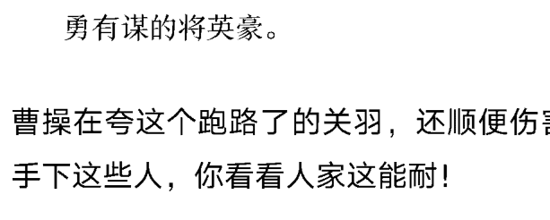

我们今人看看，关羽就是一个无礼的手下：

> 这位圣贤爷，桥前立饮三杯酒。青龙刀刀尖斜挑大红袍。

不下跪，不鞠躬，不用手接衣服，而是用刀挑着拿过来，《三国演义》原文里，曹军的将领都怒了，要过去杀人。

有分教：夕阳无限好，小关跑路了。

> 搓杯催马扬长去，曹操手扶着瀑桥泪啸啸：可叹我曹营千员将，谁比得，有勇有谋的将英豪。

曹操在夸这个跑路了的关羽，还顺便伤害手下这些人，你看看人家这能耐！

这样的老曹，关二爷能不后来给他一个大人情吗？

曹操可没有回去出一本曹营名将谱，发给五关六将：

> 关云长，原名关长生。

> 欺师灭祖，抛下了偏将军、汉寿亭侯的印信，带着他的俩媳妇跑了。曹某没有办法，只好拿这本家谱公布，我决定没收他名字里的“云”字！

## 人际关系里的鹰派守则

001 | 人际关系里的鹰派守则

这是《关系攻略》的第1篇文章。

你是那种光芒四射、咋咋逼人的 人吗？

你喜欢那种光芒四射、咋咋逼人的人吗？

稍微有一点错处，可能就会被他抓住批判一幕，他对自己严格，对别人更严格。你想做他的朋友，就要优秀而且强大才行，与他为友，你要有一些高过他的地方。

这样的人，我们称之为人际关系上的“鹰派”。

相反，认为交朋友关键在于开心，形形色色的朋友都要交，注重合作和说服的那一派人，我们称之为人际关系上的“鸽派”。

鹰派相信实力，相信官大一级压死人，相信职场上老人对新人的倾轧，鹰派也对自己充满期待，认为自己应该在食物链的顶端，至死方休。

鸽派相信合作和说服，相信人心都是肉长的，相信人间自有真情在，鸽派对社会充满期待，认为人人应该都献出一点爱，从我做起。

你是鹰派还是鸽派？别着急下判断，最典型的鹰和鸽都是很少见的，很多人们都是复杂的混合体，有鹰偏鸽、鸽偏鹰、外鹰内鸽和外鸽内鹰。

现代心理学各流派普遍认可的人格理论，是“大五人格”，这五个维度是：开放性、责任感、外向性、友善性和神经质。

用五个维度来衡量人际关系上的鹰派和鸽派可以发现：

| | 鹰派 | 鸽派 |
|---|---|---|
| 开放性 | 偏好奇 | 偏封闭 |
| 责任感 | 倾向于冲动 | 比较坚定和靠着 |
| 外向性 | 自信、大牌善于交父 | 偏被动 |
| 友善性 | 不太有人情和隐忍的一面 | 习惯顺从 |
| 神经质 | 遇到事情失控的可能 | 比较稳定 |

这两派人并没有什么优劣和高下，事实上看看那些伟大的事业都是两派人携手完成的。

我们要的不是纠正对方，不是“你变成我这样才好”，我们要的是理解自己、理解对方，克服自己的短板、学习对方的所长。

对鹰派来说，有几点可能要着力克服一下：

+ 1. 迷之自信

一个鹰派一把手最好是有 一个强有力的鸽派副手，把他从迷之自信当中时不时地拉回来。董明珠女士就属于非典型的人际鹰派。这也是为什么她的照片出现在开机后问候画面时，许多人觉得这是一种冒犯。

+ 2. 冲动是魔鬼

尽管在电视剧里，白素贞被塑造成一个追求真爱的好女孩，但白素贞是典型的鹰派，即使是电视剧也保留了“水漫金山”这个重要的鹰派内核。在原著小说《白娘子永镇雷峰塔》里，白娘子用一个极度鹰派的口吻对她家相公说：

> “若听我言语喜喜喜欢，万事皆休；若生外心，教你满城皆为血水，人人手擎洪浪，脚踏浑波，皆死于非命！”

+ 3. 学习悲悯

鹰派人往往在智力和业务能力上都不差，但强人一定要有悲悯之心。否则的话，很容易成为那种超级英雄电影里“科学怪人”的形象，觉得水平不如自己的人都应该去死。

《狮子王》里的辛巴，是一个学习悲悯的正面鹰派，他骨子里是鹰，但从小和两个鸽派朋友一起长大，这让他懂得了平和和悲悯，性格更加复杂，属于鸽包鹰的典范，鸽包鹰容易麻痹对手，鹰式反击到来的时侯，对方才会明白晚了。

“一鹰两鸽”是非常好的组合，很多作品都是这么搭配的。

复杂的性格能让你在人际关系当中更加主动，尽量避免做让别人一眼看穿的人。要多和性格互补的人做朋友。

+ 4. 避免逆境崩盘

鹰派在遇到挫折和打击的时候很容易崩盘，运气好的鹰派可能会扛下来挫折，把自己向鸽派靠拢，一个更好的办法是尽早从别人那里去体验挫折和崩溃。

《笑傲江湖》里，任我行是非常典型的鹰派，任盈盈则是以鹰为主，任我行遭遇了多年黑牢，用仇恨支撑着自己，但任盈盈早早遇到了令狐冲这个鸽派，令狐冲给他讲述了一个自己受挫和崩盘的故事，任盈盈听的同时萌发的不只是爱意，还有性格上的进步，她从此变成了一个鸽四鹰六的人，这种比例最容易出角色。

+ 5. 一定不要做十分鹰

一个国家里，有鹰派和鸽派非常正常，今天你上台，明天我上台，对手强了就让鸽派去温存一下，对手弱了就让鹰派动手敲一下。一个唱红脸，一个唱白脸，就有了运用策略的可能。

同样，人际关系当中，做十分鹰就会有十分的敌人，而你也会变成一个可以预期的 人，这样 的风格很容易中别人的圈套。

《天龙八部》里的“岳老三”看上去是凶神恶煞，总 是自己说了算，但在实际操作中，他和“四大恶人”不断地给他各种不怎么样的势力打工仔，甚至被段誉这个大鸽派牵着鼻子走。

无论是鹰还是鸽子，都不是什么基因决定的，和星座血型也并没有什么关系，有些人可能会受到一点家庭影响。

大多数人的行事方式是青春期定下的，有的人是遭遇了变故，有的人尝到了甜头，从此就这么继续走下去了。

当你认同自己的类型之后，会不断对自己心理暗示来强化自己的类型。

“我是一个恩怨分明的人。” “致贱人，我凭什么要帮你！” “要哭回家哭，职场不养猪！”（鹰派）

“出来混是要大家给面子的” “我们大家就是要互相照应”（鸽派）

心理暗示如果造就人也是非常有趣的的，常见的心理暗示是星座，比如：

“我这人是个金牛座，我对钱看得比较重。”

不过鹰派常见的自我暗示方式是：

“我这人说话直啊……你……”

这就像一个免责说明，此后他会说出一大堆不中听的话，这类口头禅会不断强化自己的鹰派色彩，这对说话的人不是一件好事。

鹰派的人如果分不清坚决和 curve 遛人，很容易变成一个虚张声势的人，声高气粗，充满攻击性，一句话就要怼回去，这是完全不对的。

鹰为什么强大？嘴不会比狗厉害，爪子没法比得过山猫。

鹰在空中，层次高、看得远，能最先发觉远处的机会和敌害，一个鹰派人也应该像这样强大。如果只是简单地表现一个攻击的姿态，遇见生人就要啄几下，那最多就是一只不友好的鹅。

所以鹰派人行事，才更应该注意以下几点：

+ 1. 喜欢去搜集信息、学习知识，有独特的信息来源，比别人看得要远一步。

+ 2. 克制自己不必要的攻击性，变成一个深沉而有内涵的人。

+ 3. 保护弱小，鹰派更应该是一个骑士，而不是一个魔头。

+ 4. 注重团队，你如果是团队中最敏锐最勇敢的角色，那就应该去PK敌阵当中的鹰派，遇到谈判、争执，出场去碾轧对手。

理性的鹰派人会被对方身上有自己没有的东西所吸引。

鹰派和鸽派，可能在人成长的早期区别会特别明显，但是在人们进步之后，这个界限会进一步含糊，两派随着成长，最终会趋向合流。

《亮剑》里的楚云飞是一个鸽派，和鹰派的李云龙心心相印，李云龙的另外一个鸽派朋友是政委赵刚。仍然是一个一鹰搭二鸽的组合。到最后李云龙要和楚云飞对决的时候，两人已经都是六鹰四鸽或者四鹰六鸽的强者了，他们都变得越来越好。

优秀的鹰派会生出悲悯，优秀的鸽派会长出骨头。

就好像最好的男人和女人，往往会拥有类似的美德，男人会变得温柔，女人会变得坚强。最好的人格是雌雄同体的，这句话并不夸张。

同样，人际关系上的鸽派也会有自己的生存之道，但那会是另一个话题，下篇当中，我们会给大家带来详细的解读。有一些是可以肯定的：

我们只有彼此了解、喜欢和合作得来，才可能都变得更好。（这句话说明了我是一个纯正的鸽）

## —— 习题 ——

以下的台词当中哪个说话人是鹰派：

+ A.出来混是要讲信用的，说好杀他全家就一定要杀他全家的

+ B.靠！当我是吓大的啊！

+ C.最近发生了那么多事，我想一个人静一静。

+ D.你这样做，出了问题，我也保不了你！

+ E.以上都不对，重要的是怎么做，而不是怎么说。

答案E，这个选项非常有用，最好是牢牢地记得。

## 一个变态连环杀手可能是好丈夫、好邻居吗？

这是《关系攻略》赠送您的第1篇文章。

童年时代你一定听说过的“杀害穿红衣服女的”变态，终于被抓住了。

这个案子发生在甘肃白银和内蒙古包头，但是北方各省应该都出现过传言。早些年案子不破不让媒体写，于是民间就到处传。

嫌疑犯还在白银当地，开一个小卖部。他上一次犯案是2002年。

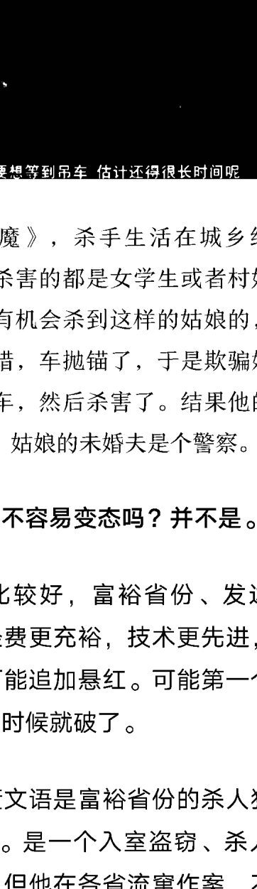

韩国电影《杀人回忆》，也是30年没破的奸杀悬案。抓到了几个可疑的人都不 是。最后暗真凶可能是个特别普通的人。

和几乎所有的杀人犯报道类似的是，他的妻子、亲友，对他杀人这事一点都不知道。

被抓后，他的老婆、老乡，都不知道发生何事，更不知道他为何被抓。

这几乎是所有杀人案报道的标配。有的报道还会浓墨重彩地提到，大家都觉得嫌疑人人「很和气」。

## 所以问题来了，连环杀手真的可能是好丈夫、好邻居吗？

我要实实在在地说一句，根本不会的。

## 1.中国没有变态杀手？是因为这样的书和影视不让出

2009年，天涯还曾有个受爱者写帖子，谈论“为什么中国没有西方那种变态杀手”，结论居然是中国没有经历资本主义堕落的一代的那种额度。这就是纯粹扯淡的论调。

除了白银的尾随杀手高某之外，随便搜搜新闻还有一大堆连环杀手：

+ 河南省步行恶魔杨新海，流窜四省杀人。基本都是进村杀围墙低的家，一杀就是全家。然後把年轻女性、女孩奸尸，没发现女孩就会精嗣男孩。一共杀死67人。当初几个省到处追他没追到，因为警方设卡盘查汽车，汽车站和火车站，而他是步行前进的，到一村，杀一村。

陕西商洛的龙治民，改革开放初期诱骗于零活的人到自己家。他媳妇下肢瘫痪，跟他一起杀人，他家有个尸坑，48个人整整齐齐在里面，打开以后跟秦始皇陵似的。

黑龙江的贾文革，诱骗小姐和推销员回家，杀人分尸，煮人拳丸吃。他长得很英俊，有倒女朋友跟班。受害者超过40人。

内蒙古的赵志红，奸杀11人。有个黑锅是呼格吉勒图背了，著名的冤案。

新疆的李义江是同性恋杀手，专门约会的男生，以前是北京理工大学的学生，2004年被处决，供认杀死7人，法庭认定了6人，杀死之后一般会阉割。

辽宁王强，河边和公园里劫持恋人，杀人奸尸，杀死近45人，这个人块头不大，1.58米，一般是突袭。

佳木斯的宫润伯，男童杀手，杀死5名男童和1名女童。

贵州的郭龙海，枪死了14名性工作者。

河南的黄勇，借口智能木马骗男孩回家猥亵杀人，17名男孩被杀。

所以，这根本就不是什么文化特产。

中国的特点是，报纸电视控制报道，落网和处决都有报道，细节不渲染，防止效仿，书和影视改编基本没戏。

## 2.无情型人格障碍

人类根本就不是完美的，我们同类当中就是有这么一些人，残忍无情，区别于常态的、好好过日子的人，我们称之为变态。

《看见恶魔》，比《杀人回忆》更虐心。被害的姑娘求饶，因为自己有了身孕了。不过杀手的逻辑一般都是这样的：

好多杀手都是「反社会人格障碍」，现在这个词叫「无情型人格障碍」。这样的人缺乏同理心，看见别人痛苦，他的大脑不能唤起怜悯同情之类的情感。

这种人不是全没用处。比如做刽子手，合法杀人就可以，当疤医，给大家发兴奋剂也可以。

不是所有的这种人都会犯罪，但是遇到这样的人最好是离远一点。

《冰冷热带鱼》，讲的是一个水族店老板被一位同行拉下水也成为连环杀手的故事，在这里，老板让他和自己的妻子发生关系，以便巩固这个变态的联盟。

以前我就说过，不要跟冲动易怒的人结婚，会特别麻烦。也同样不要和冷酷无情的人结婚，一点也不酷。

你如果想一辈子过得舒服一点，就早点准备，防备自己躲蔽，不要摔倒了再跑来问：如何治疗骨折？

## 3.变态杀手都是穷人，变态杀手害死的也都是穷人

总结一下这几个杀手，基本上都不是富有省份的人。他们本身基本都是生活困窘的，维持着基本生活。

他们选择的谋杀对象，也都是社会地位和经济地位比较低的人。走夜路的农妇和女工、性工作者、推销员、打零工的、残疾人、小孩子，或者是比较边缘的群体，比如同性恋者。

《看见恶魔》，杀手生活在城乡结合部，平时杀害的都是女学生或者村姑。本来是没有机会杀到这样的姑娘的，但是阴差阳错，车抛锚了，于是欺骗她上了自己的车，然后杀害了。结果他的麻烦也来了，姑娘的未婚夫是个警察。

## 富裕省份的人不容易变态吗？并不是。

但是有 一点比较好，富裕省份、发达地区，警方的经费更充裕，技术更先进，受害者家庭更可能追叫易红。可能第一个、第二个命案的时候就破了。

浙江温州的董文语是富裕省份的杀人犯，曾杀死6人。是 一个入室盗窃、杀人、强奸的恶棍。但他在各省流窜作案，不敢在本地久待。

董文语关了几个月之后招白了，受审的时候显得还有些颜值。这人杀人之后还留过「杀人者根社人」的字，看得出「恨」字不会写，绞结了半天。这个烂仔。

资本和市场一点也不会造就变态杀手，相反会迅速打击变态杀手。

我们看到的这些人，除了李义江之外，基本都活动在城乡结合部。当城乡结合部变成新的居民小区，有监控、有24小时的商业，有比较高的人口密度、有朝阳群众之后，变态杀手就很难下手了。

后，变态杀手就很难下手了。

比如佳木斯的孕妇骑少女让丈夫强奸的那个案子，两个人杀了一个少女，摄像头调取出来一看，很快就被抓了。

白银的杀手在2002年之后不再作案，应该也有这种考虑。白银市在2001年左右是9%左右的GDP增长率，到2002、2003、2004就都是两位数。白银有个最大的国企是白银公司，但其主要的产品是铜，2003年开始铜价就涨起来了，经济增长加快了，可能和行业好转有关系。

此前凶手下手的地方，基本是那种筒子楼单身宿舍，老破居民楼。行业好转，加上此后几年中国城市大规模推广摄像头，加上那几年国企减员，大批人都回家了，这让凶手白天闯门、尾随杀夜班女工变得异常难。

那几年是犯罪更新换代的关键几年。

比如1980年代到1990年代的犯罪是抢劫现金，金首饰，在长途车、火车、市场周围。犯罪分子靠的是地形熟悉和一双快腿。

现在就简单了，一个假基站，学一声「胡建口音普通话」就可以她们。

早些年还有摩托车抢手机的，现在人很少带现金，手机也不值钱了，路上还那么堵，所以城市越来越安全。

只要用心提防人，别随便到网友家里就好。

### 4.哪特么有汉尼拔？他们都是人渣！

这里摘一段我的朋友、《新快报》刘虎老师采写的龙治民报道，这是多年后的事后稿，1985年案发的。

每当再有那些神神叨叨的姑娘表示对连环杀手的崇拜，我都会把这段发给他们，让他们看看真正的变态杀手是什么样。

经一天时间的韦氏成人智力量表测量及明尼苏达多项人格调查表调查，专家认为：一、龙治无任何精神症状；二、反应敏捷，回答问题清楚，在人类智能中属聪明人。

专家与龙还进行了一番有关案情的对话。

问：你为什么把被害者的衣服剥了？
答：人死了还穿啥衣服呢。
问：为什么要把衣服洗了？
答：洗干净了结实，穿起来没气味。
问：为什么把死者头发剪了？
答：我听人说过，人死了啥都化，就头发化不了。如果连头发一起埋了，将来你们能从头发里检查出来都是谁。
问：你把头发留着，不是等于留着罪证吗？
答：我想等攒多了卖钱呢。
问：你为什么把尸体码得那么整齐？
答：不占地方么。
问：573元48条人命，平均杀一个人只得十几元，这个账你就不算算？
答：有钱的人吓叫不来，能叫来的人身上都没啥钱。
问：你和死人住在一幢房子里，就不怕吗？
答：怕啥哩，死人也是人嘛。
问：你杀人从来没有害怕过吗？
答：要说不害怕那是假的。

有一次我在楼上杀了一个……睡到后半夜听到屋里有响声，扑通扑通响。我心想：这是咋了。莫非有鬼？可是共产党说世上没神鬼嘛。我爬起来把灯点上，端煤油灯的手直抖。你想我咋办？我背诵主席语录：下定决心，不怕牺牲，排除万难，去争取胜利……等我爬到楼上一看，你猜咋？原来脚地有一块烂塑料布，那死鬼的血从缝隙里滴下来，碰塑料布碰出的响声！我就找了个盆一接：滴去！又睡下了。

专家说的龙治民没有精神病，指的应是精神分裂症的症状，龙是特别典型的无情型人格。

杀人犯害怕死人，念毛主席语录就不怕了。

对，就是这样一个孤僻、残忍、狠毒和猥琐的灵魂。

龙治民的家散发着恶臭，他本人也是。他家的地一挖就有骨头。

香港有一位的士司机连环杀手，人称「雨夜屠夫」，也是残害女性还奸尸，后来拍了个三级片《美羊医生》，任达华演的。

大多数的变态杀手对自己的行为都有貌似合理的解释，比如认为自己没有钱不是没文化或者不努力，而是社会危害，认为女人爱钱都该死，等等。

这个杀手和兄弟合住一屋，偷偷把尸体藏在过沙发下面，然后趁着家人吃早茶分尸。（这也就是在广东香港可以，北京人吃早点豆腐脑油条，20分钟就回来了）

存尸体的屋子，气味绝对不会好的。

不处理尸体的那种凶手也不会好，尤其是那些有奸尸行为的，想想看什么人能对头上打出脑浆，腚子上汩汩冒血的异性身体有兴趣！

### 5.是谁创造了富有魅力的凶手？

死亡有高贵的，但谋杀毫无例外是肮脏的。

这些连环杀手里，「富有魅力的凶手」是极少数。即使有魅力，也就像是要文艺或者高承勇那样外貌还不错，其实大多数的凶手都是称新海龙治民沉默孤僻的人，谈不上什么魅力。

这种富有魅力的凶手，基本上是作家、编剧、媒体、看热闹不嫌事大的吃瓜群众和其他病友合作撮合出来的。

有人说，你说得不对，汉尼拔医生就很好。

文学作品是文学作品，哈利波特还说骑着扫帚能飞，并不代表你会骑着扫帚从楼上往下跳。

《沉默的羔羊》是一部经典作品，但内核仍然是玛丽苏文学。一个孤僻的，随时可以被群体撕掉的小女孩，遇到了一强大的盟友，他杀人如麻，但是对她却死心塌地，还把拖累她的同事都杀了吃馅子。

文艺圈基本被白左控制，他们就是喜欢那种魅力杀手，这样好卖。

媒体圈比较狭隘，你经常看见一个记者采访杀人犯的邻居，邻居们都说这人平时看着不锯，一万篇稿子里，一万篇有这一句。

你采访乙，乙对甲不熟悉，那肯定就会根据有限的记忆力说，他平时见人打招呼，他话很少，很老实。

注意，本国习俗有个特大误区，就是认为话少是老实的表现。

话少还可能是憋得理你，还可能是憋着算计你。

注意，沙僧其实也是一位连环杀人案杀手。他胸前的念珠，其实是九个被害者的头人头。所以你说他能做好徒弟我倒是信……

这种邻居接受采访时，一般对某人完全没印象，但是说两句“真是想不到啊，这人平时看着挺老实啊。”

就是要这句，这句记者就会写！

《十二公民》里，那个模拟法庭上，老大爷对大家说：

那个瘸腿的老人可能撒谎了，因为他被忽视，没人在乎他，他说他看见那小子杀人了，那就可以得到罕见的重视，还能上电视！

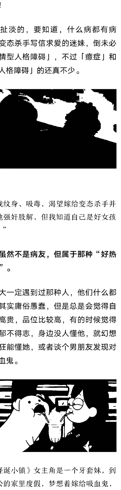

此外，还有一种人，也是媒体喜欢的：一个变态杀手进去了，还要收到女孩子的求爱信。

大家就会感叹，哇塞，变态杀手真是魅力惊人啊！

这就是扯淡的，要知道，什么病都有病友。给变态杀手写信求爱的迷妹，倒未必是「无情型人格障碍」，不过「癔症」和「边缘人格障碍」的还真不少。

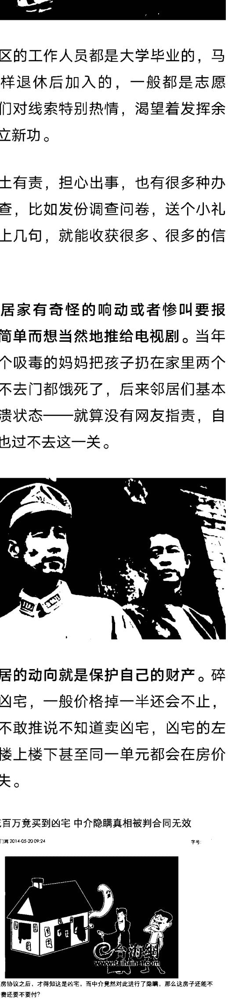

> “我纹身、吸毒，渴望嫁给变态杀手并被他强奸杀解，但我知道自己是好女孩儿。”

也有一些虽然不是病友，但属于那种“好热闹的人”。

从小到大一定遇到过那种人，他们什么都不懂，其实<|message|> 患愚蠢，但是总是会觉得自己比较高贵，品位比较高，有的时候觉得自己都被不得志，身边没人懂他，就幻想着杀人狂能懂她，或者谈个男朋友发现对方是吸血鬼。

《怪诞小镇》女主角是一个牙套妹，到舅公的家里度假，梦想着嫁给吸血鬼，结果约会了一个三个小矮人叠起来般冒险的男生。

《天生杀人狂》一路杀人的故事在今天的美国无法想象，直接面部识别，无人机过去就打成筛子了。

### 6.女杀手在哪里？

有人问，为什么没有女杀手？

连环女杀手当然有了，不过因为女性一般是作为「胁从者」出现，比如贾文革和龙治民的妻子、女友。

不过女人的手法一般是下毒。

短期之内，变态杀手都不会消失，除非以后发现了这类基因加以控制。（然而这又是一个钱和伦理的问题）

国外的女连环杀手以护士居多。国内也有，今年1月被判处死刑的广东绞杀保姆何天带就是用毒肉汤和绳子杀害老年人。老年人也是边缘群体，如果老年人是家里的负担，没有人会细细追究。但如果儿女孝顺，或者老人本身是个揣钱树（比如离休干部），那这种杀害就容易败露。

### 7.最后，给点忠告

要减少变态杀手，城市实力要强。要远离变态杀手，个人必须好好挣钱。

没开玩笑。明天周一，来一记兴奋剂。尽管有钱可能被绑和抢劫盯上，但总体上来说，有钱会更安全。

前面我说过，变态杀手都很穷。所以，住在更贵的社区里，能让你远离变态杀手（然而并不能远离变态邻居）。

人应该在自身和家庭的安全上多操一点心，无论是现实中的人身安全，还是资金和财产上的安全。

以前有位我很尊重的教授怒斥说，买学区房的家长都是傻子。我说您说的是不对的。老师和教学固然好，但这都是次要的，其实买学区就是挑同学和挑邻居。

一个小区里都是为学区买房的人，会让这个小区特别稳定，这批房主对孩子的教育有期待，也有一定的经济实力。要么受过高等教育，要么虽然读书不多，但是很希望孩子读书多，这就是发了向学之心。挑选好的学区也能尽可能地让孩子避免校园霸凌和不良少年的勒索。

同一社区的三种人会迅速形成社群：家长、狗奴和跳舞老太太。

这就是三遥原则：最好的邻居一般都是这么认识的，遥孩子遥狗和遥自己。

不想跟邻居交往也没事，只要尽了公民责任就好，一个好邻居，有几件事是要做的。

如果你有一个阴森、古怪的邻居，但是又想不到哪里不对劲，又没到警察会出动的地步，记得去居委会跟社区的工作人员聊聊。

其实社区的工作人员都是大学毕业的，马大姐这样退休后加入的，一般都是志愿者。他们对线索特别热情，渴望着发泄余热，再立新功。

他们守土有责，担心出事，也有很多种办法去排查，比如发份调查问卷，送个小礼物，聊上几句，就能收集很多、很多的信息。

听见邻居家有奇怪的响动或者惨叫要报警，别简单而想当然地抛给电视剧。当年南京那个吸毒的妈妈把孩子扔在家里两个孩子出不去门口饿死了，后来邻居们基本都是崩溃状态——就算没有网友指责，自己心里也过不去这一关。

注意邻居的动向就是保护自己的财产。碎尸案的凶宅，一般价格掉一半还会不止，大中介不敢推说不知道卖凶宅，凶宅的左邻右舍楼上楼下甚至同一单元都会在房价上受损失。

注意这段！在福建，坠死在家里都算作“凶宅”，而在北方一般指的就是自杀和凶杀这两件事。

你总不该跟钱过不去吧。

记得熊师傅的嘀咕，今天周一，好好挣钱。

### 怎么办？我妈卷入了广场舞天团的夺权纠纷

这是《关系攻略》赠送您的第2篇文章。

今天早上，我家老太太跟我商量她们广场舞天团的夺权斗争。

前任团长跟她聊了许多社区内部的事，她让我帮着分析一下，老团长有没有机会回来？

## ——壹——

广场舞组团一般分为两种。

一种是交谊舞团，这种团比较复杂，还有因为争夺舞伴和舞场恋情的争风吃醋。年轻轻时放荡不羁爱自由文艺青年，到老了就适合加入这样的团体。

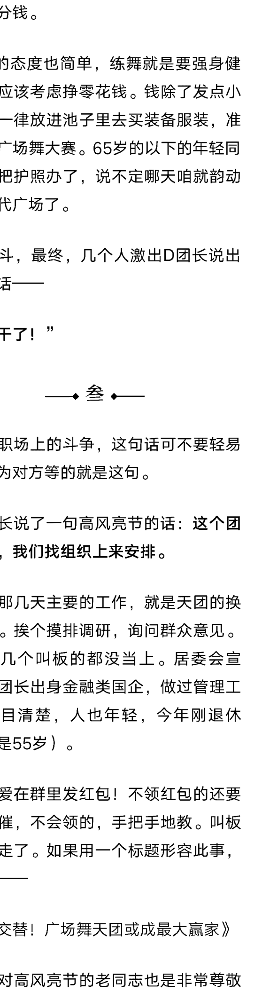

还有一种是老太太广场舞团。这是街道、居委会喜欢的团，因为是非比较少。一辈子生活随大流的普通青年，到老了一般都会加入到这样的团体。

## 老太太广场舞团有一点特别不好，就是群里谣言满天飞。

## ——贰——

尽管有这些串谣言的坏处，广场舞天团总体来说还是很快乐。晚年的朋友并不会打折，这个团的人经常一起上当挨坑，建立了深厚的友谊。

## 党的十八大之后，随着中央的关怀，广场舞天团逐渐走向了正规化，过去就是几把扇子手绢打发了。

## ——叁——

你看，职场上的斗争，这句话可不要轻易说，因为对方等的就是这句。

## 然后团长说了一句风 hilarity 的话：这个团的未来，我们找组织上来安排。

## ——肆——

## 1.不要不分钱

任何团体里，要维持统治都需要利益分配，应该事先约定一个个人获得比，演出之前就定。甚至应该暗地调查其它天团（注意有的街道广场舞组织不止一个，有人可能会被抢角）的分成情况，人是怕比的。忠诚不能收买，但支持是可以收买的。

## 2.不要喊辞职

上一代人是受共产主义教悔的，喜欢把高风亮节当做一个规则，其实实差没耍才是政治的真谛。

后。完全没有准备就以退为进，那就是一退到底了。

## 3.不要期待群众

现在的这些老太太很容易被样板戏影响，《智取威虎山》里也有“三爷，老九不能走啊！”那是因为座山雕仍然信任老九，群众声援才有效。如果平时不分红，那就是素无恩义了，这个时候想有人自发喊支持，很难。

## 4.不要引外兵进城

引入外部力量解决内耗，那是一种自爆攻击。比如袁绍为了解决几个宦官，居然导入了董卓，最后大权被董卓霸占，汉朝基本灭亡。同样，请政府帮助协调这事，必然引入新的管理者，这个代价有点大。

## 5.D团长不太可能回来领导大家了

D团长是创始人，但不太可能回来领导天团了，她晚上跟我妈说说话，无非是想总结一下，说说话排解一下，如果要复辟逍宫，应该是白天去别人家里面谈。

同时，我妈的回答也很艺术，她只是谈论了她对这个组织的感激，如果是对老团长宣誓效忠的话，那应该是说现在的倒行逆施。事实上我妈是个逍遥派，老团长来跟她聊，本身也说明了老团长知道复辟不太可能了，不然她会找更加有影响力、行动力更强的人。

其实老团长的问题，很多人工作中带团队的时候都会犯。

你英雄好汉，需要扛起

可我需要幸福，拿什么来弥补

> ——《宽恕》

多想想《宽恕》这首歌里的这两句话，对每个辛苦，每个额外的压力和工作，都要有所表示，哪怕是甜言蜜语和小恩小惠呢。

当负责人，可以演理想主义者。

当负责人，不能是理想主义者。

### 人际关系里的鸽派守则

人际关系里的鸽派守则

这是《关系攻略》的第2篇文章。

上一次我们说了人际关系上，鹰派人的生存守则：

不能过分自信、要学会悲悯、在逆境中要增加韧性，免得崩盘。

有人一定急着问了，那鸽子怎么办呢？我们是不是注定沦为鹰的口中食物呢？

这次我们来谈谈鸽派人的生存攻略。

还是回到鹰派和鸽派的大五（Big Five）人格特质上：

| | 鹰派 | 鸽派 |
|---|---|---|
| 开放性 | 偏好新奇 | 偏好封闭 |
| 责任感 | 倾向于冲动 | 比较坚定而可靠 |
| 外向性 | 自信，大胆且善于社交 | 偏被动 |
| 友善性 | 不少人会隐藏微恶的一面 | 习惯顺从 |
| 神经质 | 逆境中失控的可能 | 比较稳定 |

鸽派的性格让他成为非常好的朋友，他们人缘往往很好，尽管他们不是最善于交际的自来熟。鸽派是任劳任怨可以倚重的一种力量，尊重权威让他们成为优秀的员工。

但是鸽派同样也有自己的短板：

### 1.低效的表达

鸽派在鹰派面前往往难以说出自己的意见，或者太过委婉而导致自己的意见被忽视。一些鸽派可能会误认为，附和强势的人会让对方容易接受自己接下来的意见，但一个问题是，鹰派的人很容易忽视别人的看法，如果不够直接或者表达得太委婉和曲折，可能你的意见就会就此被绕过。

### 2.假装的坚强

上次的攻略里，我们在课后习题提到了一些句“一个人怎么说不重要，怎么做才重要”，梁朝伟在《一代宗师》里扮演的叶问就是如此，他谈论武功的时候显得像个鹰派，其实内心很软，和宫二都是鸽派，这种鹰包鸽的性格一旦被对的人击破了防线，就会突然一溃千里。

《鹿鼎记》里的神龙教教主“龙儿”，在委身于韦小宝之后突然变得千依百顺，这就是一个鹰包鸽的崩溃，原型是苏荃和小龙女的二合一，小龙女认为自己和杨过有了性关系（其实不是）之后也突然变得温柔无比。

我管这种情形叫做鸽的温柔，如果有一天内心深处突然爆裂出对世界或者某个人的温柔，那千万不要觉得着愧或者厌恶，发现自己是鸽派一点也不丢人（尤其是男人），相反，非常美。

以后我们会专门分享一次“如何告诉自己，我喜欢自己”的话题。

### 3.我不是什么好人

大多数的鸽派害怕和别人撕破脸，并且希望自己能做好人，这是一个非常折磨人的念头。

千万不要在感情上当好人，不然你会把所有的事都办砸了。

《冲上云霄》当中，吴镇宇扮演的机长在前后两任女友之间摇摆不定，总希望两个女人都说自己好，结果把所有人都伤害了。

类似的形象还有张无忌，也是在几个女孩之间摇摆不定。

友善是一种很好的品质，但是过分纠结于追求“我是一个好人”，会让自己陷入重度的疲惫当中，这种折磨我称之为“人内损耗”。

鸽子要做决断，需要有人用力推他一把，所以如果觉得自己的气质像鸽子，就尽量多和一些鹰派的人相处，从他们身上学会决断。

鸽派天生适合给比较强势的老大学二把手，也适合从事服务业的工作，在大企业里他们往往不适合做销售开拓老土，更容易负责一些支持性的工作。尽管一些鹰派的医生可能医术高明，但作为病人和家属，总是希望管床的大夫和全部的护士都是鸽派。

此外鸽派的人冷静和保守的风格让他成为可以依赖的人，宇航员和大型喷气式飞机的驾驶员，一般都是从鸽派人里做出选择。

《萨利机长》里的机长当然是一个鸽派，但是长年的修行精进，他的胆略过人，变成了一个强悍的鸽派，关键时刻，他能像鹰一样下决断，这是鸽派人修行的目标。

绝大多数的心理咨询师都是鸽派，鹰派基本没法当心理咨询师，如果说鹰派从事心理咨询工作能做出什么贡献，那应该就是那种�wares的夜间情感节目，一个观众打过来，鹰派的主持人毫不客气地说：“为什么困扰，因为你懒啊！”

鸽子的成长可以注意一下以下几点：

### 1.可以再霸道一点

你是鸽子不是包子，不要忍气吞声、让人欺负到你头上来。鸽子是一种勇敢的动物，离家千里都可以坚定回巢。一个个人可以大多数时候都是一个被动的人，但关键时刻可以站得出，敢于和黑暗拼杀刃。

你的霸道会有有一个力量槽，在关键时刻会爆发惊人的力道。

### 2.不要怕别人笑你软弱

对比你更弱小的人客气有礼貌，不是否害对手，而是害怕自己变成自己都不喜欢的人。许多鸽子在突然获得权力或者财富的时候，突然就转了鹰派，那他看人的不是鸽眼也不是鹰眼，而是标准的势利眼，在一堆朋友面前呵斥一个犯了小错误的饭店服务员一点也不露脸。

你不是软弱，你的爪和甲，在你强大的心胸之下。

### 3.交一些生命值更高的朋友

我喜欢用生命值这个游戏词彙，你們一定遇到过这种朋友，人生节奏一定比你快，说话快，走路快，效率很高，每天有忙不完的事。他们的生命值很长，这样的人鹰派的比较多。

跟这样的人共事，学习他们身上一些气质。

### 4.练习公开讲话和表演

鸽子不是鸽鸽，鸽子不应该是羞涩的。

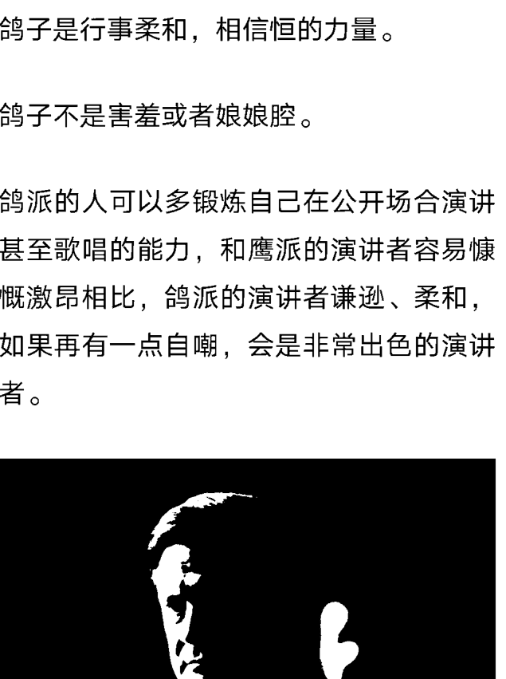

鸽子是行事柔和，相信恒的力量。

鸽子不是害羞或者娘娘腔。

鸽派的人可以多锻炼自己在公开场合演讲甚至歌唱的能力，和鹰派的演讲者容易慷慨激昂相比，鸽派的演讲者谦逊、柔和，如果再有一点自嘲，会是非常出色的演讲者。

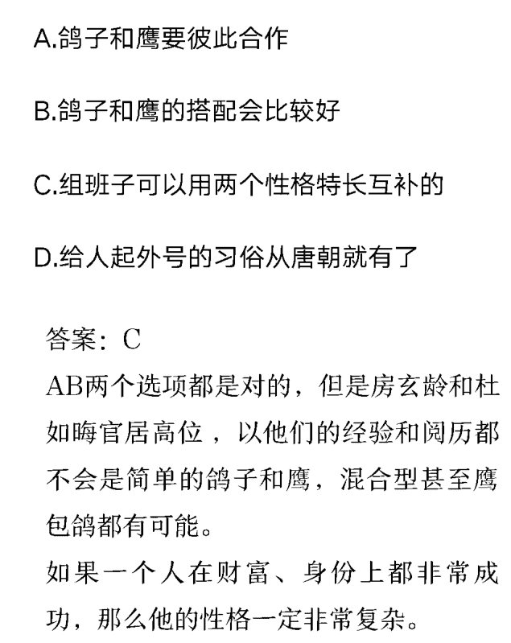

《国王的演讲》，艾伯特王子是典型的鸽派人物，国王最终在战争压力之前走上了鼓舞臣民的讲台，鸽派如果掌握了演讲的技巧，往往会成为控制人心的大师。

行事方式的改变真的也会影响到思维方式，如果开始努力追求生活和做事的效率，就很容易逐渐从纯鸽转向鹰和鸽子的气质混搭。

还是要重新提一下那句话：优秀的鹰派会生出悲悯，优秀的鸽派会长出骨头。

我们只有更勇敢地认识自己，才可能让自己变得更好。（这次的话，我似乎更像是一个鹰派了。）

## —— 习题 ——

唐太宗有两个大臣，房玄龄和杜如晦，当时的人们称为“房谋杜断”，这个词说明：

- A.鸽子和鹰要彼此合作
B.鸽子和鹰的搭配会比较好
C.组班子可以用两个性格特长互补的
D.给人起外号的习俗从唐朝就有了

答案：C
AB两个选项都是对的，但是房玄龄和杜如晦官居高位，以他们的经验和阅历都不会是简单的鸽子和鹰，混合型甚至鹰包鸽都有可能。
如果一个人在财富、身份上都非常成功，那么他的性格一定非常复杂。
这就是：
层级高了，鹰不是鹰，鸽不是鸽。

熊太行

在“关系攻略”上线发布的第一篇内容《人际关系里的鹰派守则》中，用户“红孩子的妈妈”成为“关系攻略”上线后第一位、第一时间发表评论的用户，熊师傅给你的慧眼点赞。

特此奉上199元得到App节操币，可在得到App内购买你喜欢的音频、电子书、订阅等。熊师傅身体力行跟你一起“搞”关系。

请在这篇文章下留下你的姓名＋电话，随后会有工作人员联系你，奉上节操。

### 如何请求老男人帮你做事

003 | 如何请求老男人为...

这是《关系攻略》的第3篇文章。

不久前，我的一位女性朋友找到我，问我能不能请到一位很有影响力的一个大V帮忙把自己的公众号文章。

那是一篇关于某电影的负面评价，这部电影还没有上映就已经被很多人叫做好，导演很有名，女主角很漂亮，出道以来始终演女一号，所有她演过的电影评分都特别低。

这位大V是位中年男性，文章很厉害，打嘴炮从来没输过。

我问我这位前同事：你们事先约他写影评没有？

> “没有，因为觉得他性情很强，怕写出来没法控制……”

> “没邀请对方，对方却因为自己的私人关系看到了点映，那他再评价起来，是不会客气的。”

> “所以……”

> “他不会删稿的，他不缺钱，你们也没有足够的实力找到他的发表平台让他帮你删，所以跟你老板说，删不掉。”

不是每个老男人都有一场中年危机，但大多数中年男人确实在某个阶段会觉得“力不从心”。不要往色情的方面想，老男人更看重的是工作，过去能加班熬夜冲出来的任务，现在已经很难了。

也许还会有家庭的压力，老男人变得暴躁易怒，同时，他们不会再像年轻人那样容易怯场，大多数人也已经在自己的工作上小有成就，他们在现实生活中更随意，说话也容易信口开河和迁怒于人。在网络世界，可能还会夸张一点。

和人或者机构打交道，他需要对方臣服，如果不能臣服，至少要足够尊重，所以服务类的企业，最应该担心的就是这群老男人，对他们必须做到以下几点：

### 1.重视

被忽视的滋味不好受，《一千零一夜》里有个被关在瓶子里的魔鬼就曾经赌咒发誓，说谁救了自己他就要好好报答对方，结果：

> “整整过了四百年，始终没有人来救我。这时候我非常生气，发誓道：‘谁要是在这个时候来解救我，我要杀死他！’”

被忽视的话，对方很可能会动手报复。

### 2.放低姿态

一个人有实力、但是不好打交道，就 GEM 忽视他吗？
这怎么做一定会遇到麻烦。
你们去跟一个人打交道，是因为他有实力。一支不可忽视的力量怎么能放弃沟通呢？

### 3.让他“成为自己人”

我上大学的时候，去一个电视节目做观众，有位女同学凑到了一位奥运冠军（那是十几年前，奥运冠军还是稀有动物，尤其是冬奥会冠军）身边，要到了她的手机号，然后，那晚她就忍不住把所有来往短信给我看：“她居然会打哈哈哦！”

老男人对于世界的又最重要观点就是“保护”，他是许多社会秩序的维护者，他为什么要大骂你的电影，主要是因为你的电影太差，冒犯了他的审美和及格线。

老男人并不针对女主角（那是女观众常见的态度），所以当女主角请教、拜托的时候，立刻态度就会转变。

金庸写这种感情非常到位，扮成小白兔的郭襄傻乎乎的进入江湖，老男人金轮法王看得目瞪口呆，起了保护之心，就逼着郭襄拜自己为师。

如果是暴躁的郭芙落在金轮法王手里，只会是一个单纯的人质，不知道要受多少苦头。

在老男人面前炫耀聪明、摆公主架子的女生会冒犯他们，但是强调“我什么都不懂，但是很想跟你学”，就不容易被黑。

老男人掌握意见和评价的发布，那你要公关他们，资源就要向他们倾斜。

有的女演员虽然也已经有了维护媒体关系的努力，但是能接触到的可能都是比较年轻的低级记者，他的团队对谁在掌控这个娱乐世界，也缺乏足够的认识。

摸透了这些逻辑，能够花更少的钱，规规矩矩地做到很多事。有些人精就是这样炼成的。

我知道的最聪明的女生，在各种老男人的饭局上都会亮着一双求知的眼睛：

啊，我是来向各位老师学习的。其实那时的她已经非常强大了。

这时的各位老男人，一点也不会嫉妒她的聪明，因为一个世界观已经扎根脑海之中：

> “如此优秀的女孩都对我崇拜不已，我想，我应该就是传说中的世界之王吧。”

## —— 习题 ——

以下几个和老男人的寒暄，哪个是不得体的：

- A.您就是张三丰老师！我是打着您的拳长大的。

- B.乔帮主，您好，我最崇拜的就是您和慕容公子了。

- C.老顽童，你左手和右手打架的本事好厉害！

- D.师父！快救俺老孙出来！俺老孙保你去西天取经！

答案：B
A的寒暄是提及张三丰的以往成就。
C是现场称赞对方的表现，而且采用对方喜欢的花名，满足对方的虚荣。
D直接谈生意，让对方知道自己能给什么。
B是真正的大忌，千万不要在第一次见老男人的时候提及另一个老男人，你不知道他们之间有啥恩怨！

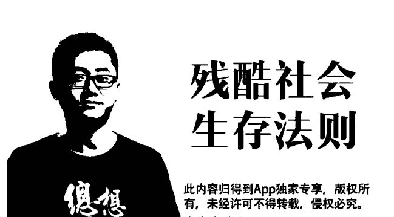

### “今天”从明天开始

郝广才
1小时前
明天是1月1日，我们的“今天”，就要从明天开始吧。
“今天”说的不 是“历史上的今天”，而是要探究哪里是创造历史的开端，是改变世界的起点。
三百六十五天，每一天真实的故事，都能拍一部电影。三百六十五天，每一天真实的梦想，都能改变这个世界。我从三百六十五个故事里，挑选了一百个有趣的问题，就像一百颗角色各异的糖果。在接下来的一年里，你会一个接着一个剥开糖果，尝到它们不同的味道：

- 1. 遇到十二家出版社拒绝的书，为何成了世界上最卖座的小说？
2. 柏林的“苏格拉底说”说了什么才赢得富家女的欢心，生了银行家儿子，儿子又生了创造“结婚进行曲”的孙子？
3. 查理七世登上王位竟然是因为一个女巫？
4. 有个国王每天都会写日记，连续写了二十六年，他是谁？
5. 为什么在监狱里制作伪造品的画家，成了民族英雄？
6. 有一亿五千万人口尝到了新口味的可口可乐，我们为什么没有喝到？
7. 原子弹试验的小岛跟女性内衣有什么关系？
8. 爱因斯坦如果没有写信给罗斯福，还会不会留下他此生最大的遗憾？
9. 如果不听妈妈的话，一个等了二十年最后获得奥斯卡卡项大奖的剧本还能诞生么？
10. 美国总统起床后看到的第一份报纸是什么？
11. 华加索的好友阿波利奈尔是如何偷走《蒙娜丽莎》的？
12. 肯尼迪真的是通过化妆赢得了与尼克松的总统辩论？
13. 乔布斯在施乐公司看到的什么，影响了他一生？
14. 写出《卡拉马佐夫兄弟》的陀思妥耶夫斯基和沙皇之间有什么互不知道的秘密？
15. 十岁小女孩在海啸中拯救了整个海滩的人，她是如何做到的？
16. 为什么会有公司免费赠送一百万双布鞋？
17. 曾经的美国总统遭遇刺杀，其间接影响是世界上第一台空间的诞生，这其中潜藏着怎样的玄机？
18. 女人胸子上的发针竟然对工业文明的发展做出了重大贡献？
19. 德国汽车王国的缔造者卡尔·弗里德里希·本茨，真的omen是靠太太才获得成功的吗？
20. 为什么一个女将会树上住七百三十八天？
21. 因为收到了 一份不如意的礼物，他竟然成了泼墨巨星？
22. 美国人最初吃热狗是用手拿食的，怎么做后来又变成了用面包夹？
23. 什么？靠着一条狗，他死了还能每年赚四千万美元？
24. 上初中二年级的十五岁女孩，如何赚到了人生的第一个一百万？
25. 摇滚乐最伟大的乐队“披头士”为什么会因为他而散伙？
26. “薛帕”怎么会跟犯罪牵上线，少生孩子就能减少犯罪率么？
27. 警察都搞不定的绑架案，竟然两个十五岁的少年给破案了，他们是怎么做到的？
28. 一位十四岁的小女孩遭塔利班袭击的袭击，头部距离死神只有一毫米，她不但奇迹般康复，还获得了“国家和平奖”，她究竟有什么样的天赋？
29. 为什么艺术大师安迪·沃霍尔用复印机做的“康宝汤”卖六美元的时候没人要，后来却被博物馆以数百万美元收购？
30. 一个被闪电击中七次、拥有闪电体质的人，却因为女孩对他“不来电”而死？
31. 找不到工作的单身妈妈，是如何写下世界最卖座的小说？
32. 古特莫，一位顶尖的脊椎神经科医生，如何用运动代替手术治愈了上千人的病患？
33. 什么？世界上的第一辆奔驰居然靠吊袜带的橡皮袜带完成了第一次出行？
34. 经济学出身的瘦小男生是如何用博弈论连续六年赢得大胃王的？
35. 十二岁的姑娘怎样卖出了祖父的十几万只袜袖和三万件服装？
36. 当一个喝醉了的天才划出了另一个清醒的天才，会发生什么化学反应？
37. 长崎虫黛居然和日本明治维新的政治领袖有着同一个“父亲”？
38. 他启动“福岛勇士团”六个星期，发现了什么惊人内幕？
39. 在天灾人祸面前，挺身而出不是日本政府，而是日本黑道？
40. 巴士底狱被攻占的当天，路易十六的日记只写了四个字，你猜是什么？
41. 一群小学生是怎么把教室搬到飞机里去的？
42. 要是我小时候也钻到鸡窝里花五个小时看母鸡怎么下蛋而不被家长责备，是不是也可以成为一名动物保育学家？
43. 蒋介石的特务头子和大将竟然都是“爷头帮”的手下？
44. 这个人不能走路，却完成了一千次路跑赛、二十七次马拉松，他是怎么做到的？
45. 美国南北战争竟是由一本小说引起的？
46. 他为何在比赛的关键时刻下车？两年后的同一天，为什么又有一个人做出了同样的举动？
47. 叙利亚的小名“炸弹比”和如今风靡全球的甜筒冰淇淋有什么关系？
48. 独居瓦尔登湖却常常跑回去让姑妈帮他洗衣服的梭罗，在一天的牢狱之灾里想到了什么？
49. 北大名画家范宽为什么要把签名藏在画中的一堆树叶里？
50. 送披萨的外卖小哥为什么要随身带枪？
51. 第一个说“宁愿坐在劳斯莱斯里哭，也不要在自行车上笑”的女人后来怎么样了？
52. 唐纳德特朗普曾为何事送一个建筑工人一万美元？
53. 猪和汽车工业有什么关联？为什么如果不是猪，现在可能没有那么多汽车？
54. 在酒店告诉别人炒了一场架，他就出版了一本畅销世界的书，他是怎么做到的？
55. 为什么一直领先的英国人在挑战南极点的竞赛中屈居亚军？
56. 为什么欧洲第一个吸烟的人因此坐了七年的牢？
57. 已成为总统的尼克松，当年到底为什么要派人去安装窃听器、偷拍文件？
58. 德国的辛德勒众所周知，但你知道中国的“辛德勒”吗？
59. 为什么明明知道有问题，美国“挑战者号”航天飞机还是继续发射？
60. 火车发生机械故障，让它的一个乘客成为了伟大的作家？
61. 风靡世界的饮料竟然是由头痛药水调成的？
62. 装牙膏的软锡管原来是装颜料的？
63. 飞机如果不全面禁烟可能会发生什么？
64. 为什么现在上飞机随身行李都要过X光安检机？
65. 世界上唯一没有被破的劫机案是什么？
66. 袁世凯为什么忽然不喜欢吃汤圆了？
67. 为什么当你说不紧张的时候却很紧张？当你说不能失败的时候，往往会失败？
68. 如果莎士比亚的姐妹也有自己的房间，她们就能成为莎士比亚？
69. 如果希拉里重返二十岁，参加马拉松比赛会被拒绝么？
70. 第一个因巫邪而处死的人是谁？
71. 哪个模特曾被五万多名男人求过婚？
72. 在博物馆看到七十年前的情书，是什么感动？
73. 一本在出版第一年仅卖出五册的小说，是如何登上“世界十大小说榜”的？
74. 是什么计划使得与过的囚犯出狱后再次犯罪率为零？
75. 为什么凤凰世界的魔方不申请国际专利？
76. 乔布斯和霍特为什么都被自己创办的公司踢出？
77. 为什么小提琴演奏大师在地铁卖艺和普通街头艺人的收入差距不大？
78. 甘地、列侬为什么都被“粉丝”所杀？
79. 微软努力了十六年没做成的网络百科，为什么维基不花一分钱就做成了？
80. 为什么切格瓦拉摩托车旅行了一趟后就要革命？
81. 没有电话、网络通信的时代，为什么人们还经常收到信退回？
82. 一个字都没有的空白书为什么能够大卖？
83. 为什么他会抢劫抢劫一家西服销售店？
84. 为什么外国人看到有人打喷嚏时就说“God Bless you”？
85. 恐怖分子的一次恐慌袭击为什么使方便面畅销？
86. 为什么雷斯科拉能预测出世贸大楼被袭，并在9·11拯救了许多人？
87. 史努比为什么不用四只脚走路？
88. 为什么美国每次发生枪支大案，都会使枪支的销量大增？
89. 穿高跟鞋时一再提醒自己注意崴脚，为什么还是总会崴脚？
90. 林肯若是不留胡子，能在总统竞选中获胜吗？
91. 按Alt+Ctrl+Delete来结束电脑异常状态，这个过时比尔·盖茨都承认的白痴设计，为什么一直没改？
92. 一部投资仅一百万美金，拍摄期只有二十八天的电影，凭什么票房收入能过两亿美元还获得奥斯卡提名？
93. 一个杜撰出来的“旁观者效应”为何出现在所有心理学教科书上，甚至成了心理学基本常识？
94. 被誉为美国南北战争转折点的葛底斯堡战役真的是由买撇引起的？
95. 星巴克为何会从一家卖咖啡豆公司延伸成为拥有连锁咖啡店的公司？
96. 把“猫嘴”扣在耳朵上，就成了Panna Sonic，我怎么没想到？
97. “驼子”如何通过一个故事打动气质高贵的富商女，成功抢得美人归？
98. 说出“老大哥在看着你！”的人，一直在看着谁？
99. 我现在使用的键盘字母排列是最高效的排列方式吗？
100. 如果当初施乐公司投资了乔布斯的苹果公司，我们还会用上iPhone吗？
没有孩子不喜欢糖果，就像没有人不喜欢故事。每天给自己一个真实的故事当礼物吧！
“今天”同时也是一本故事书，可以成为作文中旁征博引的素材库。戳此购买纸质书 ↓↓ ↓拿下你和孩子 ebben故事库
郝广才 今天

### 彩蛋 | 关系攻略应该怎么读？

熊太行
7小时前

这是《关系攻略》的第4篇文章。
关系攻略推出一个星期了，很多朋友很喜欢，也有朋友抱怨说有些地方看不懂，今天就给大家加一点点心，用回答问题的方式说说为什么要做关系攻略，以及关系攻略要怎么读。

### 1. 为什么要做关系攻略

人有发展的需求，但安全的优先级，可能比发展还要大。
遇上坑、遇上雷了，你准备去请救谁？
家里长辈人生经验丰富，但相差三十年，各种环境可能都完全不同了，能给的帮助有限。
同事本身可能就是对手。
朋友和你的生活可能完全不同。
你需要有一个人完全完全地站在你这一端，替你分析拆解。

### 2. 为什么“关系攻略”一定要选择“得到”这个平台

我在读心理咨询师培训的时候，我的业务课老师就告诉我们，不要做任何免费的咨询。
不是说我们贪财，而是说免费咨询会导致大量充满幻想的病人出现，跟你逗乐玩耍，正经的业务就没做成了，真正有问题的人，反而会被忽视。
普通公众号可能要考虑吸引起眼球，一些残酷的真相他不会写，他会写一些东西讨好那种热爱转发的的人，公众号作者可能会因为群众好恶和访问量而给一种不好的建议。
而得到平台上，大家形成了付费获取知识的良好习惯，同时我也因为你们的付费，可以只考虑你能不能赢。我会劝你给你的孩子班主任送一点小礼物，还会告诉你怎么送得体，根本不会考虑什么“污染了社会风气”这类指控。

### 3. 为什么我们敢碰一些平时谈起来尴尬的话题

媒体上的文章要考虑政治正确，比如“如何驱使老男人为你办事”这样的课题，老男人就是歧视性的话语，他们就不能写，写了还怕挨骂。但是我们不光能写，还能肆无忌惮地对这类类型来下手术刀，如果有人说一个领域是禁忌，那他一定惦着用这个领域想坑你。在关系攻略上，我们没有这样的禁忌。
我只关心你的胜负，我会告诉你玩坏和使诌的法子。
但是我同时会告诉你，堂堂正正的道路，恐怕最容易有更大的成功。

### 4. 关于更新频率

好多同学憧憬着尽快看更新，我们这个专栏是每周至少三次，还会不时有一个彩蛋。时间放在闰天的23:33，2333是一个大笑出泪的表情，我是希望大家能够对人生有这份从容。至于阅读习惯，晚睡型可以抢先读，早起型人可以考虑第二天早晨在交通工具上读，我觉得都不错。到现在为止还没有一个人人阅读“关系攻略”时睡着，反而有不少人，因为阅读了新的推送，激动到睡不着。

### 5. 关于学习小组

好多同学问学习小组什么时候建，得到的规则是，有1万名订阅者之后就可以开小组，还会给咱们的小组起一个响亮的名字（我考虑是不是就叫“关系户”）。
现在是5000多订阅，增长势头还不错，不过如果你希望小组尽快建立，也请把这个专栏推荐给自己的好朋友。
记得，只推荐给自己的好朋友，不要推荐给在的竞争对手，这个专栏非常危险，我应该只属于你，和你信任的人。

### 6. 点播和插播

好多同学希望自己的问题优先被回答，不过评论后面的回复，恐怕不是一个写长回答的好地方，我会公布一个选题目录，这也是我未来一年的选题计划，我可能会加一些新的选题进去。

### 7. 熊老师的颜值和年纪

谢谢大家对颜值的夸奖，感谢我们的摄影师、灯光师和化妆师吧。我本人的底子只是做了一点微小的贡献。我比我的老同事李翔稍微小一点，是个80后，也已经不再年轻了。
敢给大家分享一些看上去带着岁月痕迹的道理，是因为从小在一个机关大院里长大，见识了很多权谋。那时体弱多病，把力气都用在观察和研究人上（留神小时候身体不好的人，这种人如果用心，那就是心细如发，比如《琅琊榜》上的梅长苏）。
后来自己又经历过事业单位（高校）、国有企业和私营企业的各种凶险局面，躺过看不见的枪，带过不好带的队。在媒体的时候我做的是时政类报道。

### 8. 别急，细水长流

不要着急，这是修行之一种。有没有人能短期之内突然处理关系的能力大涨？有，但你们不会喜欢那种局面一遭遇重大的挫折、身体突然变得很差、失去亲人……
给自己记一个小目标吧，比如用三个月、六个月去改善自己的控制情绪的能力。
比如用一年的功夫，让自己这个纯鸽长出鹰的翅膀。
用功是件艰难的事，万幸的是我们大家在一起。

## 附录：《关系攻略》不完全选题单

对上关系：不称不谄当然可以了

- 1. 我的汇报关系不明确，陷入了一个二主的局面，怎么办？
2. 领导和大领导产生了恩怨，我应该怎么办？
3. 直属领导对我不公，要不要越级反映？
4. 被上级性骚扰应该怎么办？
5. 被领导误会了应该怎么办？
6. 被领导借钱应怎么办？
7. 领导家里有红白事，应该怎么表达和随礼？
8. 被领导抢功怎么办？
9. 得罪了支撑类部门的主管怎么办？
10. 如何第一次申请加薪？

More.....
同事的关系：左右真的都是耳目吗

- 1. 面试时遇到未来可能的同事应该如何应对？
2. 接替一个代理主管的职位，有没有可能修复和他的关系？
3. 从负责位置变成普通员工应该怎么办？
4. 如何与爱贪小便宜的人相处？
5. 如何对待爱争功的人？
6. 被同事陷害该怎么办？
7. 不擅长拒绝同事过分的要求该怎么办？
8. 喜欢上同事怎么办？
9. 觉得身边的同事都很蠢，怎么和睦相处？
10. 和同事一起出去办事，同事受伤或者身故怎么办？

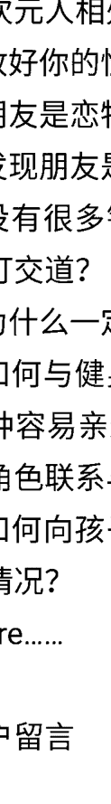

用户留言

## 跟老板谈加薪时的几个不要

跟老板谈加薪时的几个不要

不用再纠结“什么时候可以加薪”了，就是现在，就是旧历年的年底。

为了财务、人力等部门办事方便，许多公司都会给新员工第二年签一个从年头到年尾的合同，这样的好处是做预算的时候，人力成本会特别清晰。

对员工来说也很方便，如果你在北方，发现处处来了暖气，就要应该抓住跟老板要加薪了。

有的公司、有的岗位，可能是项目制，收入跟项目收益有关。

在完成一个大项目之后跟老板提加薪，确实也是一个不错的机会。

不过这样的公司收入一般都不是定薪，底薪也仅仅占据很低的一部分，跟老板要加底薪可能也就没有什么大出息。

你就不如去跟老板要更多的授权，更高一点的分成比例、谋求更高的职位或者跟他要一个新的市场区域，都比加薪要更划算。

### 贵司的薪水能谈吗？

有些公司不需要谈加薪，比如大多数的机关和事业单位，员工的收入只跟资历和岗位有关。

在一些上市大公司里，收入和层级相关，比较典型的就是腾讯和阿里巴巴。

层级和职位不同，但又跟职位相关，有点像军队中的军衔、古代的爵位，相同层级的人收入可能会差出来不少，但是同一个岗位的人又可能属于不同的层级。

这些层级在该员工跳槽的时候非常重要，如果你在大公司干过，创业公司的人力总监一定问清你的职级，问清以后他对你的收入水平基本有数了。

有明确职级的公司，加薪都有一个详细妥善的方案，跟个人表现和部门成绩有关，大多数时候不需要单谈，倒是你的老板对员工考核需要好好关注一下。

私营企业，尤其是规模小或者成立不久的企业，加薪就必须谈，这就需要谈判技巧。

### 别把加上去的钱都给了税务局

如果一个人的主要收入都是薪水，而不是股份分红或者业务提成，那可能还在一个比较基层，或者技术的工作上，这种局面下应该算一下自己的收入。

不要去查银行卡流水，一个人的收入除了到手收入之外，还要加上公积金部分的收益。

对公司来说，额外支付的部分除了你的公积金之外，还有社保。

中国的社保比较特殊，大多数白领人口可能一生都用不上失业险和男员工生育险，因此有一笔钱是接近税赋的存在。

一个人如果扣税之后挣8000元，那他的公司一般要付出1200元左右的成本来雇佣他。如果希望公司给你加薪10%，记得公司增加的成本可能不是800元，而是1200元。而你的薪水则会因为提升之后被收取累进的个税，到手也没有自己想象得多。

因为税的原因，加薪可能是一种非常笨拙的解决方案，一些聪明的会选择和公司共同进步，比如请求公司提供一些培训，或者参加公司组织的旅游度假的机会，或者附加的本人和家人的健康保险，这比拿了现金再去购买这类服务要划算得多。

同样，大城市的工作居住证、无息或者低息购房贷款、免费宿舍也有自己的价值。

### 不要忘记期待值和最低容忍值

给自己画一条线，比如期待加薪15%，但是最终公司决定加薪8%，也可以接受。那就把这两个数记心里。老板开价当时你能做出判断就好，千万不要用圆珠笔写在手心上，那太傻了，更不要从腰包儿里掏出一个计算器，做售货员门口小商贩的姿势！

### 不要在周一、周五和大清早去谈加薪

如果老板让你来选时间，那就要尽量把握这个原则：

周一是开会时段，一般大家都比较忙碌，选择周一去跟老板谈薪水，这事不对。

周五是一个人们准备松懈时段，这个时候把球踢给老板也是不妥的，他可能要周一才能做出决定，这对你和他都是一种折磨。

最好的办法是周三或者周四，老板可能在本周内解决你的加薪请求。

一日之功在于晨，早上是处理邮件、准备会议、做PPT的最早时间，公司里假装努力工作的就有好几百人，你这个时候去跟老板谈自己的薪水，这是很遭人恨的。

大多数公司的规则都是老板比员工到岗晚，老板可能是睡眠不佳，可能在早高峰的主路上受尽了折磨，可能还没吃早饭，而你准备了一夜，以逸待劳。他看你满面红光，一进来气。

这种局面下你去跟他讨论薪水，不是一个好主意。

大多数的老板都会对下班前的那一小段时间的低效稍只眼闭一只眼，看看多少微信公众号在下午四点半推送就知道了。

用这段时间去见见老板，谈论一下薪水，并不算失礼。要知道，老板的大脑一般在下午四点半才刚刚开机，早上基本上他都是靠本能行事。

不然为什么所有的公司都差不多，都是下班后大家纷纷回家了，老板才刚刚开始胡思乱想，然后弛命连环CALL，觉得自己有了好点子。

### 不要对老板突然袭击

不要进了他办公室跟他说：“我要加薪”，那会让老板措手不及。

大多数老板手底下一般是管五到七个人，基层的小BOSS可能会带十几个人领导的队伍，再多就没法管理，要再设层级了，他不见得记得每个人的薪水，如果你突然袭击跟他谈加薪，你会惊讶地发现他可能根本就记不得你挣多少，那时候你的心很容易怨恨他。

事先预约，老板有时间做一些功课准备，比如调取你的工资单和业绩和其他同事的成绩做比较。

### 一次只谈加薪一件事

有些初入职场的人对老板还有畏惧情绪或者不习惯谈钱，喜欢说上一大堆事最后提一嘴“还有，我要加薪”，一定要克服这一点，不要把加薪的请求“加到全家桶”。

顺便提到自己的加薪。那是对自己的不尊重，也是自信的表现，老板看见你这个样子，还会认真考虑吗？

### 不要穿得随随便便

如果你谈论的加薪同时还伴有职位提升，那就穿得那个职位体恤的衣服比较好。同样，你对加薪这件事有多认真，就应该穿多正式的衣服。

### 不要饿着，也别吃韭菜

一般来说，加薪这事不会拖太长时间，但还是不能饿着肚子，严重不建议在减肥、辟谷、斋戒之类的时期谈论加薪，低血糖会让你暴躁易怒。

中午别吃有气味的食物，也别吃火锅。

同样，那个下午，也不要让自己太过于疲倦。

### 不要拿别人的机会来威胁老板

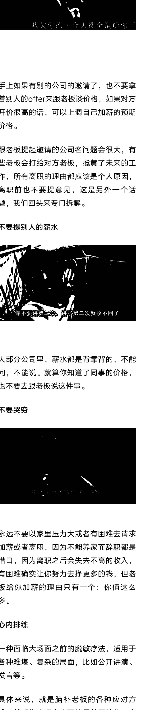

手上如果有别的公司的邀请了，也不要拿着别人的offer来跟老板谈价格，如果对方开价很高的话，可以上调自己加薪的预期价格。

跟老板提起邀请的公司名问题会很大，有些老板会打给对方老板，断了未来的工作，所有离职的理由都应该是个人原因，离职前也不要提意见，这是另外一个话题，我们回头来专门拆解。

### 不要提别人的薪水

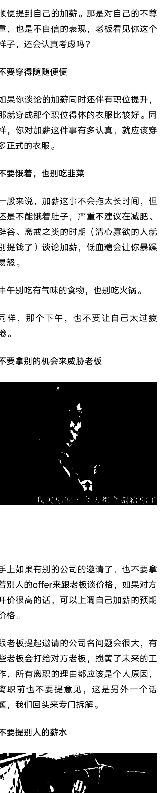

大部分公司里，薪水都是背靠背的，不能问，不能说。就算你知道了同事的价格，也不要去跟老板说这件事。

### 不要哭穷

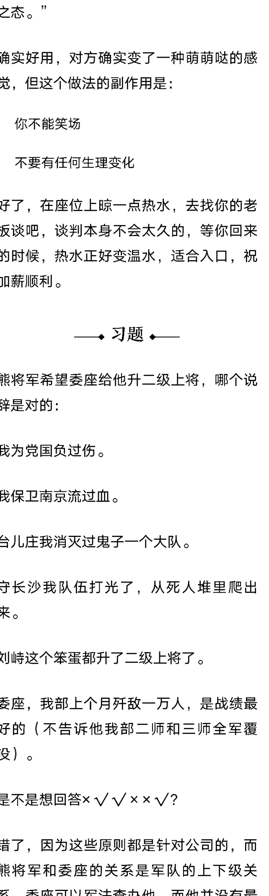

永远不要以家里压力大或者有困难去请求加薪或者离职，因为不能养家而辞职都是借口，因为离职之后会失去不高的收入，有困难确实让你努力去挣更多的钱，但老板给你加薪的理由只有一个：你值这么多。

### 心内排练

一种面临大场面之前的脱敏疗法，适用于各种难题、复杂的局面，比如公开演讲、发言等。

具体来说，就是脑补老板的各种应对方式，然后挑出现实中可能最羞辱性的一个局面来全面想象每个细节，刚开始可能会把自己紧张得满身大汗。

不过随着反复幻想这个场面之后，紧张感会逐渐缓解。

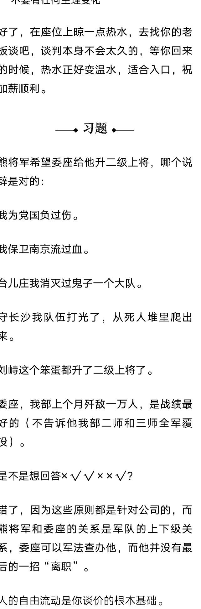

有些老板是非常强势的人，气场上可以碾压一切谈判桌上的对手，对付这样的人，日本维新时期的政治家坂本龙马有一个窍门：

> “遇见畏惧之人，可以想象其人与妻亲狎之态。”

确实好用，对方确实变了一种萌萌哒的感觉，但这个做法的副作用是：

+ 你不能笑场
+ 不要有任何生理变化

好了，在座位上晾一点热水，去找你的老板谈吧，谈判本身不会太久的，等你回来的时候，热水正好变温水，适合入口，祝加薪顺利。

## —— 习题 ——

熊将军希望委座给他升二级上将，哪个说辞是对的：

我为党国负过伤。
我保卫南京流过血。
台儿庄我消灭过鬼子一个大队。
守长沙我队伍打光了，从死人堆里爬出来。
刘峙这个笨蛋都升了二级上将了。
委座，我部上个月歼敌一万人，是战绩最好的不告诉他我部二师和三师全军覆没。

是不是想回答×√√××√？

错了，因为这些原则都是针对公司的，而熊将军和委座的关系是军队的上下级关系，委座可以军法查办他，而他并没有最后的一招“离职”。

人的自由流动是你谈价的根本基础。首先你得走得了，然后再决定怎么谈。

注意弄清楚你公司的所有制形态，这非常重要！

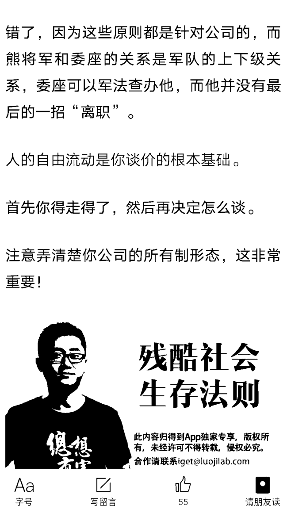

### 谈加薪之前要做些什么？

这是《关系攻略》的第6篇文章。

上一篇我们提到了，加薪时不要做什么。

有人问我说，熊老师，谈论加薪时，要做什么呢？

我详细地告诉大家加薪不要做什么，很重要的一点就是防止大家犯低级错误。

防呆是这个专栏的一个重要目的，别工作做得好好的，最后【一哆嗦】把财富损失了。

但是想加薪要做什么，我得好好跟大家分享一下，准备工作不是谈加薪前一天做的，要提前做。

提前到什么时候？提前到你进这家公司的时候，当然，如果你已经是一家公司的老人，好，现在开始做，不晚。

职场很凶险，而且这种凶险不是两个部门在大办公室或者会议室里当众争吵。

公开争吵跟撕布子差不多，撕破了就快好了。真正的凶险，是那种表面上一团和气，下面暗流涌动。

> "如果进了一个复杂的公司……"

对不起，我重新说。

因为没有不复杂的公司。

哪怕进了一个最小最小的公司，哪怕从事一个最普通最普通的职业，想要年底的时候获得加薪，就把这份攻略上做的事情都走一遍。

### 1.前台攻略

上周我去罗辑思维串门，前台姑娘对我说：“您是来面试的吗？”

真会说话啊，这不是夸我长得年轻嘛。

前台的姑娘，一般本地人居多，确实也有，但聪明的为主流。

估计很多人找工作，除了公司里可能有推荐人之外，最先见到的是前台。

前台是一个很重要的角色，到一个公司，趁早跟前台混熟，你在布局你的安全网，她很重要，她不是一颗闲棋冷子。

她能看到的关于公司的事，比你多得多。

前台的提升路径一般是行政部门文员、以后还可能成为主管、副总监，在有些公司里，还有成为老板娘的。

早点获得她的友谊是个好主意。

你可能不经意地问出公司最近的情况。

> "又是面试的是吗？"

面试的多寡能够侧面提示你所在公司的经营情况。

> "看着这些候选人都好年轻啊。"

是补岗流失人员还是扩张业务，通过年龄、资历等大概情况可以看出来。

> "我们公司年会是什么时候，在哪儿啊？"行政部门的人一准知道

可以问问老员工往年的年会在哪，比较一下两个场地的地理位置和租金、房间的奢华程度，餐饮价格。

此外，所有的货运和快递都经她。

想想看，狗仔还要翻垃圾筐，去探访明星

吃了什么，用了什么。

前台姑娘能猜出来大多数人最近买了什么。

所以，大私人的东西不要往公司发。

### 2.人力攻略

入职的时候一般会见人力总监，也会有一个人力同事带着你办完所有的流程。

### 3.和领导务虚

到秋冬的时候，就可以找领导务虚一下，一个年轻人找直属领导谈谈心，再正常不过了，听听公司的设想，部门的计划。

### 4.前同事攻略

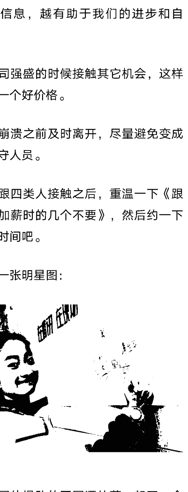

你能同时听到他描绘新行业和吐槽老东家。

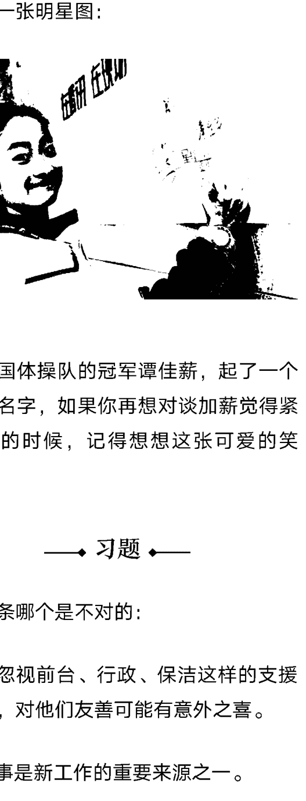

这是中国体操队的冠军谭佳薪，起了一个很好的名字，如果你再想对谈加薪觉得紧张发抖的时候，记得想起这张可爱的笑脸！

## —— 习题 ——

以下几条哪一个是不对的：

A.不要忽视前台、行政、保洁这样的支援性工种，对他们友善可能有意外之喜。

B.前同事是新工作的重要来源之一。

B.前同事是新工作的重要来源之一。

C.帮熟人介绍自己现在公司的工作是为了让他变成我的替死鬼。

D.不要显得你少年老成，要多请教领导，哪怕他的话其实你早就都掌握了。

正确答案是C，要在公司情况还好的时候就去接触其它机会，这样你即使决定离职了，这公司也仍然还是一个好公司。

和拉熟人进来工作相比，把熟人推荐给人力这件事本身可能更重要。这是一个信息获取的过程，老板总说你有主人翁意识，其实并没有错，多管闲事一小下，你对公司的理解就会更多，这有助于你做判断，会让你在职场上更加安全。

### 残酷社会
生存法则

此内容归得到App独家专享，版权所有，未经许可不得转载，侵权必究。合作请联系iget@luojilab.com

### 如何让孩子远离校园欺凌

这是《关系攻略》的第7篇文章。

提要：声高和找领导不是解决问题之道，一个话不多、冷静而坚决的家长会让老师感受到决心。

看过《萨利机长》的人，可能会对发动机失灵时如何挽救飞机印象深刻，一个机长应该做的不思考“生存或死亡”的问题，而是立刻打开辅助能源，副驾驶则会拿出一份手册，对照着手册试图挽救飞机。

有人也许会对飞行员还要看说明书感到不解，但发动机全部失灵是小概率事件，大多数飞行员一生都难遇一次。有一本手册来对照是最有效的办法。

和航空业不同，大部分学校从来没有应对校园欺凌的预案，尽管这种概率比发动机失灵的概率大得多，这就使得学校极其依赖老师的经验。

这就是为什么中国的基础教育非常仰仗老师的慈悲——遇到好老师孩子会茁壮成长，反之，可能在进入大学之前，自信就已经彻底被摧毁了。

我在这里提供一个家长视角的手册给大家，当孩子跟你说出“被欺负了”，就要立刻找到这篇文章，校对每一个环节。

### 1.出一张病假条

无论飞机被鸟撞击，或者军舰被船袭炸，首先要做的就是“报告损失”，“知己知彼，百战不殆”，掌握了自己的情况，才能进行下一步的判断。

只要打了架，多少都有“软组织挫伤”，如果打在头部，又自诉有眩晕和呕吐，那医生一般会下一个脑震荡之类诊断，让病号在家休息。

换句话说，只要头晕恶心，这官司就可以打。

成年人起冲突的时候，有一派人就坚持不先动手，对方一动手就迅速倒地，等警察来了去医院对医生说恶心，然后用脑震荡的诊断跟对方要个三五千元。

### 2.做一份笔录书

我们看警匪片，最后警察总是要对英雄和美女说：“麻烦两位跟我们回去录个口供。”

对，我们也需要一个口供。

笔录要包括：

时间、地点、被怎么打、打人的是谁、第一个动手的谁、还有没有其他受害者、孩子有没有还手，有没有人使用武器或者物品，有没有老师或者同学发现或者围观。

### 3.让老师欠你的

得到了欺凌者的姓名，通过同学之间的打听可能还掌握了一点点欺凌者家庭的背景资料，这个时候应该约见老师。

当然不能。

滑过雪的同学知道，上山无论是索道还是电梯，都是慢慢的，到了高处，一冲而下，那就是势能变成了动能，高度变成了速度。现在就是那个上山的过程，要忍耐。

见到老师，放下笔录和诊断书避免给老师看医生手写的病历，我们知道老师最恨的就是一笔脏字儿，而大多数大夫对硬笔书法都毫不擅长。

老师读笔录的时候，可以用缓慢的声音来阐述自己的担忧：这样下去，恐怕会出事啊。

我们知道老师最怕的就是出事。所以上来就谈论这个班级可能的风险，这是战国策式的说服——上来说：“我这都是为您好。”

如果老师比较震惊，手足无措，那就反过来安慰一下老师，以退为进，然后再请老师约对方家长谈谈。经验丰富的老师会客客气气把你送出去，不过没关系，事情已经好办了。

### 4.正面对决

恭喜，你已经完成了一个很好的态势，引而不发。

如果是一位母亲，这样冷静的态度会显得更可贵。

大多数母亲可能会当时就暴怒不已，带着孩子去学校找老师吵架。

那是最混乱的局面了。

一个母亲，遇到孩子有危险就应该立刻跟敌人拼了！

是像这样吗？

这是《荒野猎人》里的那头母熊，里奥纳多误入了她的领地，她立刻发起了攻击，按说一头熊袭击一个人是稳赢的局面，然而最终出现了闪失——熊妈妈对小李子一般踩躏，占尽上风，但最终被小李子打死了，小熊也就活不成了。

对母熊来说，最好的方案是：“正面面对他发出威胁，让他走远。”

越冷静的人越有力量，越不苟言笑的人，越深不可测。

如果做不到喜怒不形于色，至少这一场戏，你要控制自己的角色。

让老师来说这件事，等着对方的答复。

如果对方家长第一次见到老师，那恭喜你，昨天的铺垫会生效。

老师因为学生病倒的愧疚感，以及见你之后的熟悉感，心里多多少少会有些微妙的变化。

如果对方家长通情达理，该道歉道歉，该做保证做保证，还要赔偿损失，那再好不过，问题就结束了。

如果对方家长不配合，那好，再上一味药。

### 5.让对方一片狐疑

这味药叫自来熟，喂给对方，对方就会变得多疑。

向对方显示，你跟老师关系很熟，比如特意把“上次交流”说成“上几次交流”。

对方如果第一次见到老师，一定会心生疑虑。这个时候老师很容易被误会。

对，就要老师被误会，对不起了老师。

有人说这是阴谋，不，这是阳谋。

以后你和老师就是可以这么熟的。

我们知道同学们是一个班的成员，老师其实是这个班的皇帝。

这是一个多么陈腐的称呼啊，不过我们都很喜欢。

天地君亲师，爹娘排第四，老师第五，但是老师心里住着一个第三。

先认识到老师是皇帝的家长会走运，坚持老师是学校雇员的，您太荏苒，太勇敢了。

历史上所有的奸臣都有一个共性，和皇帝有私交，其他人恨的、怕的，就是这种关系。

这就是让你跟老师装熟的关键，要让对方猜忌狐疑，甚至跟老师敌对。

皇帝的统治方式是什么样的？

老师也是差不多的。

### 6.老师的KPI

和过去的应试教育不同，许多城市里现在对小学没有排名和分数上的PK，所以老师之间除了必要的学习成绩合格之外，以各种花式作业，可以拍照和上光荣榜可以上微信信号的露脸行为为主。

但是老师有一个一票否决，那就是安全问题，出了大事老师会保不住饭碗。

老师和家长一样追求不出事，这样她会惩罚欺凌者，避免下次发生。

但是老师又追求不闹事，这样她也会安抚欺凌者被欺凌者，不要闹大。

所以，绝对不要越级上告，看见了孩子受委屈，就直接拉着孩子进教务处或者校长室，老师被叫来都搞不清状况，那就你把老师给得罪了。

你说你一时冲动，老师可能就评优泡汤了。

换位思考在很多时候很蠢，比如被欺负的父母去换到欺凌者的父母角色，那就是一个很傻的建议，但是把自己代入一下老师，这个主要的攻略对象，那就非常正常。

对老师来说，如果学生能早点告诉自己，就几次家长都不用见了。

这也是为什么有的老师发现家长找来投诉欺凌的时候，会生气地问被欺凌的孩子：“你怎么不早说呢！”

如果遇到老师这么袒护孩子，不要对老师发作，老师肯定不是想着再恐吓你的孩子，而是为自己付出的额外辛苦在抱怨和发泄。等着老师发泄完。

这时候再放一招：“他也比较担心，觉得这几个孩子老师害怕也管不了了，回头老师不在眼前，不是又要吃亏吗？”

话赶话到了这会儿，老师一定会表明心迹，证明自己的管理能力：“不会的，你放心……我跟他们说……”

### 7.解决方案

#### A.不要要求老师或者学校惩戒欺凌者

那超过了家长的权限。

事实上，学校管君子不管小人，义务教育的公立学校也无法开除或者开除学生。

别说开除学生了，总旷工的老师没能开掉的都有的。

所以不要试图去决定欺凌者的人生了。

老师能允许被欺凌者提一点条件，比如把两个人的座位调开，分在不同的组。

学校也能允许被欺凌者提一点条件，比如把被欺凌者调整到别的班去。如果太恶劣，甚至学校可能帮你联系转学。

我的建议是，不要去。

被欺负的群体当中，很多都是转学生。

但学校如果勒令欺凌者转学，欺凌者的父母会立刻转型成一个李雪莲式的上访者，学校再次被抛入诉讼之中。

#### B.不要试图用把事情闹大来换取学校重视

这对孩子本身没有好处，
学校担心的只有真正绷出去的那批人。
如果你仍然希望孩子当好孩子，
那就不要这么玩。

同样，在学校还在协调解决的时候就投诉到教务，只会让下面协调的人从此出工不出力，是最傻的决定。

#### C.杜绝下一次欺凌才是关键

我平时好研究西游记，关于这部小说，有一个烂大街的段子：

孙悟空打妖怪，没根基的妖怪都打死了，有后台的妖怪，都被神仙救走了。
一研究就会发现，确实如此。
被当场打死的妖怪并不多。

但是，无论被神仙菩萨收走也好，还是叼去烧火也好，这些妖怪都再也没回来。
没有一个妖怪是被孙悟空或者菩萨们感化之后，又出来作妖的。

就杜绝侵害这个角度来看，孙悟空做得非常到位。

换句话说，只要自己的孩子能平安健康度过剩下的几年，至于那个欺凌者是不是改好了，你管他干啥？又不是他爸他妈。

### 8.关于不怕事儿

有两句话，很多人都喜欢。
“平时不找事儿，遇上事儿不怕事”。
其实取这 worksheets 自诩的，都是狠角色。
因为关键在后半句，很多人都把后半句解释错了，遇见事情脸红一热，揣掉啤酒瓶底部就扑上去了。
“不怕事”，是我遇到意外情况的时候，所有的情况都在我的预料之中、掌握之中，所以我不需要担心。

英雄不是胯上激素多，只是比别人更善于准备。

### 9.老师的画蛇添足

不要和欺凌者和解，也没有必要和欺凌者和解。

大多数养出欺凌者的父母，自己往往也都迷信暴力、性格古怪，跟这样的人结交，成本比较高且完全没有必要。让孩子加入到欺凌者阵营去当帮凶看上去不受气了，日后不一定怎么样呢，想想李天一的朋友们就知道了。

类似的，还有一些老师会情愿两个孩子又重新和好，沉浸在一种低幼的、琼瑶式的感动当中。那种感觉是不是很熟悉：

> “紫薇，我抢了你的格格名分，但是我仍然是你的好朋友啊。——小燕子。”

在学校里，一个理想主义的老师比看重利益的老师可能更糟糕。这要早早告诉他，我们不希望他们和好，我们只要自己的孩子安全。

### 10.日常修炼系统

关于什么样的学生容易受欺负，其实没有一定之规，我们上大学的时候一直很想把隔着几个宿舍的一个家伙打一顿（说说而已），原因是那个人眼睛特别大，女气，但爱在水房唱歌，唱得五音不全令人发指。

欺凌一般都是从临时起意开始的，特别高矮胖瘦的可能受欺凌，和强壮的哥哥在一个小学的也就不太可能受欺凌。

一般来说，围墙内的情况是：

好学生不容易受欺负，坏孩子一般也不会惹最好的学生。家里会特别重视他的学业的，一般家里也都比较强。

练武的孩子不容易被欺负。练体育的话，他可能不会在班里被欺负，但是传统体校一直是欺凌的重灾区。

特别有钱的学生不容易受到欺负，同学们会捧着他，坏孩子很快就会发现，欺负有钱同学，不会比巴结他、帮他打架效率更高。

有特长的学生不容易被欺负，比如乐器、绘画等文艺才干，因为素质教育的缘故，老师的KPI不再单纯是成绩，一些有特长的孩子能够走名校点招的途径，特别被老师重视，同样，如果小朋友专心去学奥数或者英语考级，也是未来容易出成绩的苗子，老师也会对他们更用心加以保护的。

父母单位霸气或者有用的孩子不容易被欺负。这个不用多解释，老师们一般也会保护同行的孩子，如果您也是教师，记得早点跟老师有意无意提一嘴。

要多让孩子学点课外学习的东西，任何学习带来的成就都能让孩子更自信。

最容易被欺负的是成绩中等、话少、不自信的、沉默的孩子。

此外，如果在老师协调之下，事情解决。那可以考虑送老师一点小礼物，以便欺凌下次不发生。现在送礼也比较容易，不需要孩子带去（过去总觉得会腐蚀孩子的心灵）用包裹发到学校老师收就可以。

我们经常听TVB说“无事献殷勤，非奸即盗”，但现在是有事了献殷勤，理所当然。有老师的护佑和加持，孩子只会有更大的自信心。

我小学时候曾经听说过一个老兄的事迹，从小多病被欺负，后来他爸去找体育老师（我们那个时代，小学体育老师基本都是痞子，要能打败外校社会青年才能当好体育老师），要他跟着田径队一起练习，后来他成了一个长跑好手，又高又瘦，成绩也仍然很好。这是return对副科老师尤其是体育老师的攻略，似乎效果也不错。

你要送礼，就大大方方的送，为保全孩子送点礼，是为了省下转学、搬家这样的很
她没看好我家孩子，让我家孩子受了欺负，我还要送她礼物？我疯了吗？

你要考虑的就该是孩子的处境，这就是我们一直在强调的这一点：

我们要你经营关系，不是要你显得很威风，

而是为了让孩子远离欺凌，甚至获得更多的机会。

## —— 习题 ——

晚上有家长直接电话联系你，说你的孩子（四年级）打伤了他的孩子，有其他的孩子为证。你询问了你的孩子，他坚持说自己是无辜的，而且你也相信他的诚实，这时你应该：

- A.首先联系老师，问问老师对此事的了解程度；
- B.找目击孩子的家长对质；
- C.去医院或者受伤孩子的家里去探望伤者；
- D.去学校保安室调取摄像头资料。

答案是A。

还是我们坚持强调的一点，遇见事情了首先依靠学校、和老师沟通。这个时候应该赶紧看看老师掌握了多少情况。

D很重要，在跟老师联系之后可以赶紧进行，因为它可能因为低级失误而被损毁。

C是确定责任之后应该赶紧进行的事，但是仍然要调查清楚，不应该因为孩子做错的事护短，同样，也不应该因为孩子没有做的事情而受委屈。

B不应该立刻进行，应该通过老师进行，要明白一个道理，小孩子真的可能会撒谎，或者因为情况紧急脑子一时空白而产生一段没有发生的记忆。

此外，如果孩子打伤了同学，要告诉他，如果是你做的，承认错误、道歉，爸爸妈妈不会对你胖揍一顿。

体罚孩子是个坏主意。

他学会了服从暴力，也会继续用暴力让别人服从。

此外，他一定会学会的，是撒谎。

### 彩蛋 | 豹警官在动物城警局里为什么混得那么好

熊太行

前几天发了一篇谈论加薪准备工作的，提到了“前台攻略”，有同学提到说这个不过瘾，能不能再讲讲前台到底有多强大。

我就找来了一篇谈论《疯狂动物城》里的前台的文章，《豹警官在动物城警局里为什么混得这么好》，原发表在我的公众号“仕图”上。这篇是赠阅。

《疯狂动物城》里，动物城公安局的前台是个猎豹，名字叫本杰明·爪霍瑟，他先夸兔子“好可爱”，兔子并不买账，然后他迅递跟兔子分享自己被歧视的遭遇。

> “我是豹警官，他们都只觉得我是一个爱吃甜甜圈的胖子。”

你会对一个刚来单位的新人暴露自己的弱点吗？即便是刚才你说错了话。

这种情况只有两个可能：

- 1. 豹警官蠢；
- 2. 豹警官在下一盘很大的棋。

豹警官在脖子褶皱里拿出一个咬了一口的甜甜圈，张嘴就吃。兔子用特别嫌恶的眼光看着他。但是关键时刻，兔子得到了猎豹的支持。

在兔子遇到黑色美洲狮发狂被追的时候呼叫总部支援，豹警官的呼叫器响了。

注意，不是通过总机，而是找的前台和豹警官。

小公司的总机一般是可能让前台兼着，但是警察局就不太可能，所以只有两种可能，一种是兔子直接只呼叫了豹警官，另一种是兔子群呼所有人，而豹警官虽然当时正在给犯罪嫌疑人安利那会儿夏奇拉羊的跳舞APP，却仍然听到并回应了这个呼救，兔子说错了地名，狐狸远远纠正了一句，豹警官也听对了。

队员们及时赶来把兔子和狐狸放下来，豹警官没有误事，这件事说明，猎豹是靠谱的，没有他尽力显示的那么二百五。

此外，从兔子和狐狸的经历来看，加入警队一定要在警校通过考试，而警校的考试非常严格，胖子猎豹一定也经历了严格的训练。

那么他又为什么要自暴自弃，沦为一个警队的笑话呢？

研究一下动物城警局，就可以看到警局的用人标准。

所有的警员都是大型动物，其中最普通的动物是狼，局长是暴躁的非洲水牛，犀牛、熊、虎是最常见的基层警员，羊副市长的两个大壮羊是保安，不是警察。

一线执勤分配任务的时候会发现，最小块头的动物是狼。

这是真实的动物城警局食物链，体格歧视。

狼也很比豹警官大，千万别让斗兽棋把你给误导了。

豹警官是一只猎豹，这是最瘦最快的大猫。而中国人口中常说的豹子，是花豹，也有叫金钱豹，它和猎豹是两种动物。

看看两个物种的区别，这张图特别明显。
一个是瓷实的肌肉男，一个是灵巧的麻杆腿。牙齿上，花豹要强大得多。不信邪的话，下一张就是结局：

一对一的话，猎豹一定会死的。猎豹和花豹除了花纹是圈和点之外，还可以看眼睛，猎豹（死者）的眼睛有泪沁一样的黑线。

猎豹的力量不如狼，咬力不如鬣狗，不过在自然中，它仍然处于食物链顶端，毕竟壮汉们追不上他。

猎豹追上并杀死猎物之后要缓很久（100米跑完之后运动员都是那样），豹警官追奥斯顿太太之后也是那么喘的，这时候遇上肌肉力量强大的对手，它没有胜算。

这也是为什么遇到抢肉的它就自动退出，他太瘦了，他的块头很难跟其它掠食者正面冲突。但是别的肉食动物一旦发现它们的孩子就会加以杀害。

花豹凶残而且性格狡猾，会上树，善于伏击，猎豹是贵族，花豹则是流氓。流氓一定会赢的。

想想看刚出校门的豹警官吧，来到动物城警局的时候，他是所有同事里最弱的一个，胳膊细，体重轻，他的特长是速度，捉拿犯罪嫌疑人的时候可以有点跑酷般躲和截截的活儿，也许还要帮大家买早餐和送快递。

这没前途，可能只比开罚单稍微好一点。这非常讽刺，你辛辛苦苦，发现你的特长成了你工作成长道路上的阻碍。

那很简单，就要把特长藏起来。于是想到增肥。

真实世界里猎豹没有胖子，胖了跑不动，追不上猎物就饿死了，动物城里就可以，胖了之后，他以前台的身份出现在动物城警局里，每天喝汽水，吃甜甜圈。成了大胖子至少可以保证一点，再也不容易被人一掌打飞了。

对了，汽水。

豹警官为什么会拿一支玻璃瓶的汽水在兔子旁边喝呢？很快兔子把瓶子拿过来当放大镜用，发现了尼克的狐狸尾巴出现在监控图里。对一个吃货来说，250ML的小可乐瓶就是个小玩具。大号绯杯才是真正的心头所好。

豹警官知道兔子要什么，那个瓶子拿在手里就是他在芭朱迪，蓄意遮上放大镜会妨碍他的瞄准光泽， 可乐瓶底就没有任何问题了。

后面肉食动物被集体质疑的时候，豹警官被要求去档案室。他知道去跟兔子哭诉：“就在铁炉房对面。”他哭诉的对象是对的。

兔子这时候是局长和副市长的红人，而且豹警官又帮了她不少，哭诉给兔子看，一来让兔子明白说错话害了豹豹，兔子要觉得欠了豹警官，二来那就是准备着兔子向局长求情接下来回来的。不过后来兔子自己决定退出，让豹警官晚了不少日子才重新回到前台。

中国的兵法《六韬》里，有豹韬。豹警官的韬略就是韬伏和操练。

豹警官操练局面不留痕迹，注意看，兔子要被牛局长赶走的时候，他及时闯进来，报告奥斯顿太太来见局长，最后又干脆把奥斯顿太太放进了办公室。

奥斯顿太太是水獭，是小动物，虽然也是肉食动物，这点和猎豹是一样的，豹警官

肉食动物，这点和猎豹是一样的，豹警官是故意放水，帮奥獾顿，也帮兔朱迪。

猎豹这种亚大形动物就像是早年间荏美国的爱尔兰人，虽然也是白人，但多少被人瞧不起。

接下来豹警官还会用夏奇羊的APP来影响别人，别觉得他给嫌疑犯推荐APP会特别傻，这会在警局里形成话题，同事会有更多人关注，最后他影响了牛局长，牛局长也开始使用那个跳舞应用了。我们管这种人叫KOL，也就是意见领袖，豹大V是警察局时尚的引领者。

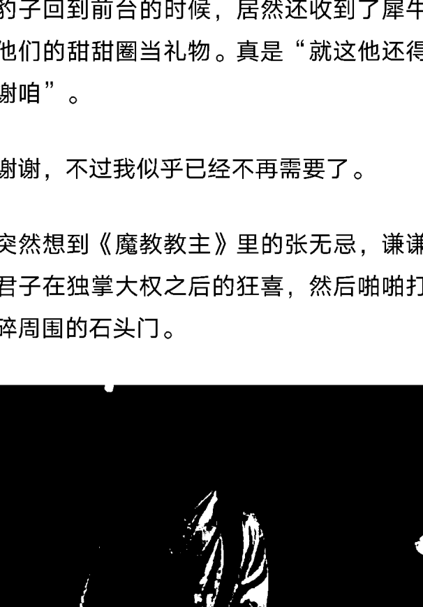

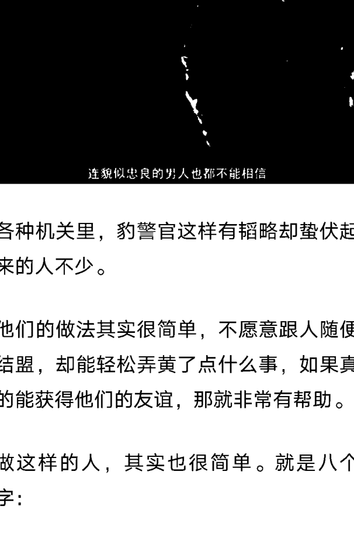

事情在豹警官的影响和支持下发展，到故事的末尾，警察局已经有一个兔子警官和一个狐狸警官，都比豹子块头小，而且这两个人是最富有业务能力的干探，又是黑手党大先生的干亲。

以后还会有更多动物加入进来。这时的豹警官再也不是被碾轧和践踏的那个了小角色。他通过和兔子和狐狸的结盟可以收获很多，他需要朱迪和尼克的影响力和黑手党关系，而兔子和狐狸也需要他跟所有人关系都好的这一点进行内部的沟通和斡旋。

五年后牛局长退休后，需要一个局长，狐狸出身不好，兔子是个女的，大先生的操纵之下会有一场民主评议，豹警官胜。

豹子回到前台的时候，居然还收到了犀牛他们的甜甜圈当礼物。真是“就这他还得谢咱”。

谢谢，不过我似乎已经不再需要了。

突然想到《魔教教主》里的张无忌，谦谦君子在独掌大权之后的狂喜，然后啪啪打碎周围的石头门。

以及那句永远的心得：

各种机关里，豹警官这样有瑕疵却蛰伏起来的人不少。

他们的作法其实很简单，不愿意跟人随便结盟，却能轻松弄黄了点什么事，如果真的能获得他们的友谊，那就非常有帮助。

做这样的人，其实也很简单。就是八个字：

### 藏好自己
### 做好清理

## 用户留言

### 为什么甲方必须尽快清理掉

007 | 为什么甲方必须尽…

新领导别怕别人说你杀老臣，也别随便说你的新领导杀老臣。

要尽快除掉的，是那些不懂规矩是何物的甲方。

上次在一个赠送彩蛋里，我给大家分享了一篇《豹警官在动物城警局里为什么混得那么好》。里面借用了《三体2：黑暗森林》里的八个字：

藏好自己，做好清理。

好多同学问我，藏好自己，说的是豹警官的韬光养晦，做好清理是什么呢？

做好清理，不是残忍地消灭潜在的敌人，而是让你清除可能的隐患。

比如一个团队里，最大的隐患就是蔑视规则的甲方，这种人必须尽快清理，否则大家会一起被他害死。

我哥提升了，现在大概相当于正局级吧，但是工作和过去有点不一样，过去帮领导写材料写稿子，现在管了一本杂志，我做了好多年的杂志编辑，也当过新闻类杂志的主编，上周我们家庭聚会，喝点酒，他就跟我说最近的困惑。

“我下面的一个编辑，在我已经改定的稿子上做修改，结果差点出错，万幸最后给被报道方再看了一眼，对方指出把他们领导的职务改错了，这是重大事故。”

我当时就对他说：“要赶紧裁掉他，如果不能裁掉就调离原来岗位。同时还要警告排版、出胶片的人，你签过的稿子绝对不能动，谁说也不行。这种人会害死你的。”

我哥比我年长七八岁，他明白这个道理，我是怕他心太好，我一问，果然他只是严肃批评几句算了，我说你最好是尽快调岗。

为什么要说得这么严重，这不是我生性残忍，大家也要明白这个道理，这样的人会害死大家。

这个编辑的错误，不是自视甚高，自视甚高的人很多，我们每个公司一定都有。

自视甚高的人有自己的用途，比如扮演甲方代表，他是可以对公司有一种迷之自信的，能够特别有效地抑制乙方膨胀。

但是在团体内部，这种人会令人非常不舒服。

不过，万幸。

万幸大多数自视甚高的人都眼高手低，换句话说就是嘴炮达人。

嘴炮达人有一点好，如果你不把他放在指挥大军的位置上，他一般害不死太多人。

但是如果一个人自视甚高、同时还有强悍的执行力，那就糟糕了。

这种手和腿比脑子快的人，必须要用规则和流程来束缚他，不然队伍里就会有各种不可控的情况发生。

自视甚高、强执行力的人，如果还不能尊重流程和规则，那这个人就会非常危险。我哥的这个手下，就是这样的人。

我跟我哥说，这事能做出来，他不是一个

我跟我哥说，这事能做出来，他不是一个简单的逞能者，他是自视过高、动手能力强和无法无天的妄人。

你如果只是把他当做一个自视甚高的人放过去，那下次他不一定能干出什么来。

可能你担心到了新单位，动手拾掇人会让别人觉得你心狠。

那就让下面的人主动一点。你没有必要跟下面的人说出“这家伙会害死我们”。

不然的话下属们问“为什么”，你就要解释你的思维方式。

领导不能让下面人看这么透，手握权力的人不要谈论权术。

放下权力之后，可以放心谈论，甚至还可以像熊老师这样，上得到写个专栏卖给很多人。

这个时候要分析一下，这个出事的下属，他的级别有几个人，关系如何。如果他已经很资深，对他汇报的有几个人？

这人做事如此风格，恐怕人缘不会好。

领导只要流露出一’i意思，大家恐怕会一拥而上，说出：“!这家伙会害死我们的。”

这也是为什么我说当领导的不用自己说。

这也是观察大家反应，了解下属们行事方式的好机会，就是像是打台球的时候炸球的意思。

那时这个人早就不是问题，演一下挥泪斩马谡就可以了。

新领导刚过来，最应该赶紧立规矩。

能够赏罚不过面，当场制裁是最好的，立刻调走这个人，这是上策。

人类训练小狗用厕所，要把他带到乱拉的屎前面批评。

我不是把人比作狗，因为这本来就是人类训练人类的法子，狗这种动物聪明，它通过学习能掌握得了。

如果不能当面制裁，那就要尽快寻一个茬，把这个人调走，免得以后再造成危害，这是中策。

姑息了错误，希望他自己悔改，这是下策。

我哥是聪明人，他肯定比我处理得好，不过他人心肠好，所以要跟我聊聊，寻求一下下决心的支持。

有的领导人太好，有的可能是第一次带队伍，都容易犯这个错误，把一个害群之马留下来希望他能改。

要记得你做事是为了谁，为了信任你的领导，为了支持你的兄弟。

这群人加起来不如一个妄人对你重要？

单位不是学校，他不交学费，还给他发钱。

你更不是他爹，他黑你坑你，你还要养他？

下一篇会是一个姊妹篇《早点裁掉妄人，对大家都是一种慈悲》。

P.s

对了，有同学问我，为什么喜欢用影视作品来举例，有人甚至说，影视作品都是假的，你不能像别的作家那样，用真人真事举例吗？

今天我用了一个真人真事，但是我要解释一下：

我现在正在从事影视相关的工作，好的编剧，真的都是洞悉人性的大师，我挑选的影视作品都是人气和艺术水平都过硬的作品，这些含金量，比真人真事一点都不'

知道，跟师父私下抱怨也不能推动师父下决心。

B是把猴哥留下的一种办法，也给了师父面子，是集体利益最大化的选择，但这不能让八戒变成大师兄（注意题干，八戒的提升）。

C是对的，在领导要开人的时候积极介入恩怨很可能招来怨恨，或者被领导看做奸佞，但凡领导要动人，一定要有能担起重任的备胎，这个角色是经常可以得到好处的，可以尝试一下。

D是对师父的挑衅，如果你想和猴哥自己去西天取经，是个很好的方案。这话说出来，就能回高老庄了。

## 残酷社会生存法则

此内容归得到App独家专享，版权所有，未经许可不得转载，侵权必究。合作请联系iget@luojilab.com

用户留言

### 早点裁掉筏人，对大家都是一种慈悲

早点裁掉筏人，对大家都是...

上次写了一个清理 妄人的攻略，当时预告了这篇《早点裁掉筏人，对大家都是一种慈悲》，有同学就特别着急地问我，妄人、筏人有什么区别。

我们重温一下妄人的三个标准：把自己看得太高、积极勇敢地行动、藐视规则和流程。

自忖，鲁莽，二百五。

筏人恰好相反，筏人把自己看得特别低，行动力很差，循规蹈矩。

筏人和鸽派是完全不同的两种概念，别搞混了，鸽派说的是交友原则，是跟别人的关系，筏人说的是能力问题。

### 听说读写。

### 1.害死领导

### 2.产生不平

### 3.影响风气

### 4.萎毒支撑部门

### 5.筏人当了领导

战场上 没有人会原意将性命托付给胆小鬼

战场上，没有人会愿意把性命托付给胆小鬼或者笨蛋。

职场上，笨人也应该尽快被送到不需要那么高能力的单位和部门去，作为领导你可以帮笨人联系出路，这对大家都好。

绝对不应该给他灌上一碗鸡汤，一脚踢进职场。

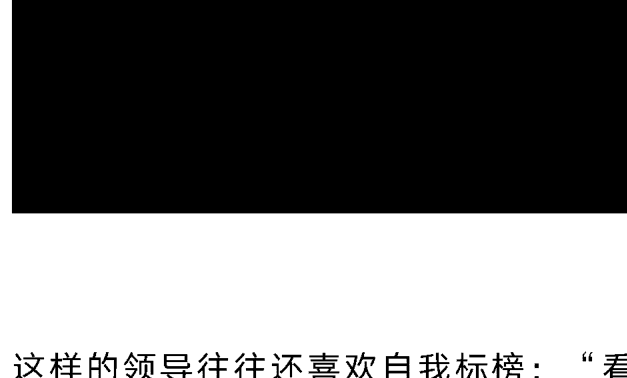

这样的领导往往还喜欢自我标榜：“看啊，我给了他机会！”这是矫情的放牛班班主任之爱。

其实，早点告诉笨人：

你不长于此道，趁早不要在这里浪费精力了。

这才是父爱式的慈悲！

## —— 习题 ——

你是一个部门的副职，你的新领导是公司的创始人元老，大家说起他都说他是一个好人，但你逐渐发现他的理解能力似乎有点问题，公开场合讲话的能力也很差，这时你的最佳策略是：

- A.跟下面的同事一起嘲讽领导，逐渐挤走他。
- B.越级跟大领导沟通，认为领导没有带队的能力。必须换掉来保证部门不被拖垮。
- C.积极寻找其它公司的工作机会，不准备给白痴打工。
- D.反而越发尊重这位领导，但尽量请他给自己更多的授权，对他施加更大的影响，做部门实际上的操盘者。

答案是D

A是一种情绪化的表达，不推荐，而且很可能形成一种风气，以后你做管理也会很难。

对团队来说，B是最好的选择。但是你的一片公心可能会让老板不满，即使他从谏如流，让部门有一个强大的领导，你也会背上一个闲事者的标签，可能成为强势领导的打击对象。

C是一种被动的工作方式，但是显然跳槽仍然可能遇见白痴，事实上，任何公司的管理层都至少有一个白痴。

D是一种良好的模式，笨人有的时候能够信任聪明人，甚至完全把事情交给她，不要担心你的领导用你的业绩提升，他上去的同时你会扶正，你仍然会在上面有一个友军。当然如果他被提升的时候没有替你争取，那就 svojim 立刻离开，要经常和大老板保持一种不交心、只交脸的沟通，让大老板知道，他的手下有個最得力的手下，那个人就是你。

已经身居管理层的笨人，和笨人下属的处理方式有不同。要试着去影响操控这样的

理方式有不同，要试着去影响操控这样的人。大老板委任一个一起创业的笨人（他当然知道谁笨），无非是信任这块业务有你或者其他的干将顶着，放个不太给力的人也没什么大问题。

换言之，大老板就是因为和笨人的交情要敷衍一下你们，你们要让大老板知道，我们很辛苦，但是为了您，我们认了。

资格老身份高的笨人，一般都有资源和交情，说服了他们去调配这些东西，你就能操更大的盘，控更大的局。

比一个月加两千薪水和换一个虚高的抬头，操盘更大的项目更难得，也更能收获新的资源和新的关系。

### 残酷社会
生存法则

此内容归得到App独家专享，版权所有，未经许可不得转载，侵权必究。合作请联系iget@luojilab.com

### 如何给领导送礼

如何给领导送礼

我们的学习小组已经上线了，真的就叫 “关系户”。

持续打卡就可以获得关系户的勋章。

我想跟大家说的是，不要怕麻烦熊老师，有问题可以在小组里提出，如果提问的同学多，说明这个问题被很多人迫切需要，那么它可能会列入《关系攻略》的选题里。

马上过年了，给领导送礼是头一件大事。

我们毫不犹豫，赶紧说说送礼的事。

给领导送礼要先出一个计划，凡事预则立不预则废。

首先确认一下，你的公司，你的老板是不是接受送礼。

有些公司的要求很苛刻，和合作伙伴之间，100元以上的礼物都要上交。比如脱不花告诉我，罗辑思维就是不许收礼物的，她反而送礼物给手下。

这是对的，我以前做主编，有时候记者会给我一点小礼物，有时候我会收下，回头到了节日也要再用别的礼物或者请吃饭的方式回过去。做事业的人，不该收手下的礼物。

但是在有的公司里，规章是死的，人是活的。

所以送礼之前最好观察一下，到底有没有一个 “领导不排斥送礼” 的潜规则。

尤其是如果你是这个公司的新员工的话。

记得我提过的 “前台攻略” 吗？领导的快递，基本上都是前台来接收的，她一定知道你领导有没有接收合作伙伴的礼物。

路过时随口一句：“有我的快递吗？”
“没有。”
“哎熊总的快递真多。”
“是啊，快过年了，关系攻略和仕图的读者给他邮寄小礼物，而且，女粉丝居多哦！他呀可开心了！”

好了，信息量满满的。

回答一下常见的十个关于给领导送礼的问题吧：

#### 1. 可以只给直接领导送礼物吗？

可以，职场新人的收入不高，只送一份礼物，预算比较充裕。

#### 2. 什么情况下正的副的领导都可以送？

预算充裕的情况下，可以多送几份礼物出去，需要注意的是，如果送一个副领导，那其他几个副领导都要送。

绝对不要给几个副领导送一样的东西，尤其是办公室用的东西，大家拿出来会特别尴尬，如果有不怀好意或者不真心相的同事起哄，说他们用情侣款或者基友款，怨恨就会落在你身上。

挑价格相近的礼物是一个好主意。

#### 3. 不要送钱送卡

对机关、事业单位和国企，不要送购物卡，价值低了没意思，价值高了，以后会有隐患。

不是危言耸听，巡视组来的时候，上千元的购物卡都可能构成违纪，让领导丢官，让你丢工作，之前西部某省有一个地市级官员想提副省级，给许多参与评议的人送了3000元的购物卡，这对和他级别相若的干部来说不觉得是大钱，结果被查处拿下。

现金更不要送，这是逢年过节的人情来往，不是你想要提升托人办事。

熊老师教的是送礼，熊老师不是教贿行贿。

关系攻略最重要的一点是什么？
保你安全，躲过明枪暗箭。

#### 4. 要掌握领导家的情况

挑选礼物之前记得回答这些问题：
- 领导是单身、丧偶、离异还是已婚？
- 领导家有几个孩子，是儿子还是女儿？
- 领导的儿女是在上学还是在上班？是在境内还是境外？
- 领导爱不爱喝酒？喝哪种酒？
- 领导有什么兴趣爱好？这种爱好花钱不花钱，需要会员卡或者装备吗？
- 领导写不写书法？
- 领导家有没有宠物？
- 领导打不打网游或者手游？（别笑，严肃点，这代人到了当领导的时候了）

#### 5. 最好曾经去过领导家

有的同学问过我，说我这人不能喝酒，领导喜欢喝，我能让领导喜欢吗？
我在这里负责地说一句：能。

不喝酒的人有一点特别重要：
能送领导回家，这是认识领导家的好机会。

1980年代~1990年代的机关、工厂大院，同事们都是邻居，家家都认识，哪家男人喝多了全楼都知道。

现在许多机关和地方虽然仍然分房或者低价购房（别跟我说已经没了），但同事们住在一起的局面越来越少，尤其是领导，一般不愿意住在分的房子里，生活在手下的视线范围内。

如果你有机会送喝多的领导回家，你就有机会进他家的门，这会儿快速观察一下他家的情况：
哪个墙还可以挂字画？
有没有空气净化器？
有没有展示性的酒柜？
里面放的是什么酒？
哪一瓶喝了一半，评估一下价值。

要记下来）或者主动汇报行踪（这是领导的性格），又醉了，让你帮忙拨打电话，你就有了嫂子的电话。

年货直接联系嫂子（没见面在电话里不要把领导的夫人叫阿姨，原因在次文章说）拉到家里去，然后跟领导打个招呼，我给您送了点XXX，品尝一下，自家的，无公害（这东西很好，却又不会价值太高出错误）。

领导可能面儿薄还推辞，女人一般会选择收下来，她不敢收陌生人的东西，但你是送领导回家的交情，就要好得多。

#### 6.选礼物

如果是机关或者国企，礼物最好是控制在500元左右，主要考虑法律风险。

如果是私企，3000元以下的礼物都是可以接受的。

这年头东西很贵，这钱买不了什么。

但是你确实可以送点什么东西，价值很高，又不至于违规的。

一台进口品牌为空气净化器，走海淘大概8000~9000元，实体店国行是15000元左右，一套备用滤芯值3000多。你要送领导贵点的，这就是个不错的东西。

有人说送大闸蟹，送拉菲，我说，傻。

这些东西，你那些鸡贼同事们都能想到。

领导一星期喝一瓶拉菲，不知道哪瓶是你，哪瓶是隔壁老王。

净化器送到你这儿，你给领导送上门，安装好。

领导什么最贵，时间。

领导最怕什么，麻烦。

领导最不缺什么，礼物。

你送礼物不是送财富，而是为了满足领导的需求。

空气不好，你来选定一个解决方案，你领导难道还要自己看公号，读完《挑选家用净化器的十个坑》？

帮领导装净化器的时候，如果嫂子在，跟嫂子聊聊，大妈在，跟大妈聊聊，都不在，跟保姆聊聊，都是信息呐。

领导的妈妈是很有料的。

当初我在《博客天下》工作的时候，有一期封面报道是王健林，我的学生（真的是学生，我以前在大学里教过新闻写作）和同事黄旻去探访王健林的妈妈，在万达的一个别墅区问到是哪个房子，就想试试看。

按了那个别墅的门铃，正好老太太有个远房侄子来看她，就把这位女记请进来了。老太太刚失去了老伴，看到这姑娘就拉着手聊了一下午——她也是中国媒体圈唯一一个专访过王思聪奶奶的人，老太太说了好多儿子诸如下河摸鱼的童年往事，后来我们的记者用这些旧事去问王健林，他顿时吃了一惊，觉得这个杂志的人神通广大。

跟领导他妈有了交情，这绝对是件好事。

让领导的家人提及你恭谨孝顺，一点坏处都没有。多听，多微笑，然后把自己的电话留给他家人。说，机器如果有问题，还找我。

机器还得换滤芯呢，半年一次，正好你端午又来换滤芯。美国人、德国人瑞士人为什么做的净化器半年换一次滤芯，那就是为我决策大国的节日准备的！

如果领导有顾虑，要告诉他：

领导，这机器不是送你的，我这有亲戚做这个生意，您就帮着体验一下，提点意见，三年后机器我拉回去，您再体验新型号。

那个机器寿命一般就是用三年。

三年后，你比你的竞争对手在领导家里额外多串门六次。跟嫂子大娘小保姆建立了深厚的友谊，如果领导家有适龄的女儿……

其实也不是不可以。

再警告一遍，《关系攻略》这个专栏非常危险，不要分享给不信任的同事，最好是分享给亲人、同学和最好的朋友，不然的话，你会在领导家门口遇到全部部门的人，每人背着一台空气净化机。

那时候嚎起来热闹：“嫂子，开门啊，我是主任的手下小赵小钱小孙小李……周昊郑王冯陈楚卫咖啡加糖啊！”

#### 7.美丽的精神鸡片

确实可以送点名和尚开光的珠串、手抄佛经（要看清楚领导是不是喜欢）。

名字画（有人行贿会送赝品，然后找自己的朋友从领导那里买走赝品，这样在日后如果被查，行贿受贿都不成立，馈赠礼物价值才几百的，类似的还有送狗送猫买回去的尔法，但是这需要领导的默契，我觉得不划算）。

印章、石料（这东西可能很贵），笔墨纸砚都是可以的。

古书、古董也可以，不过水太深，也不推荐，而且这些东西也 不是一般员工买得起的。

至于传统的红酒、礼品茶，严重不推荐，领导家这些东西都堆在库房里，或者找人代卖了。

送沾文化的东 西就是两点：

要确定你的领导喜欢。

要确定你的领导识货。

#### 8.运用好异域风情

如果你你的年假出境的话，可以问问领导要不要人肉带什么东西回来。同时你也可以给他选择礼物，送这种伴手礼一般是人之常情，这东西不需要太贵，但是一个交流的好机会。

不过还是要考虑一下中国风俗，我的一位老领导，曾经历对他的一位前下表 示过不满：

“这家伙去逛伦敦，买了个大本钟模型给我，哪能给我送钟呢！”

#### 9.这些话念几遍

领导不差钱

领导差伺服

领导差尊重

领导差孝顺

领导差关爱

你不能解决全部四点，至少给他一点亮，一点暖。让他知道还有人惦记着他。

女人喜欢男人，男人一般不会觉得她看上了自己的钱。他会倾向于更好的那个解释：

她喜欢我帅，她喜欢我有才华。

同样，领导也会倾向于那个更令他舒服的解释：

他们都送东西给我，我的下属真的好伺服我、尊重我啊。

这就是人类的谜之自信，心理学上确实有这个规则，人们总是倾向于护着自己，不让自己受 伤。

让自己受伤。

其实，真的是不是敬佩你，等退休后看看还有没有礼物吧。

#### 10.排斥送礼的人请三思

领导的沙发在他家的客厅里，

静静的，

迎来送往，

努力的人如果不去占领，

它就会惨遭佞臣屁股的踩踏。

因为你追求自身的清廉和刚正，

让你的领导被好人包围，

我认为，这是对国家民族的不负责任。

你睡懒觉、打牌、看美剧，

放任奸臣可能成了你的副总，

你还要抱怨，说世界上的最坏的，

就是中国式的关系。

做事的人，不可能是白的，也一定不能是黑的。

### 大多数的人都带一点灰。

### 一点清澈的浅灰。

给大明朝延命的张居正和戚继光都是送礼、搞关系（跟东厂大太监的关系还尤其好）的达人。

是不是送礼，不是好坏人的分野。

会不会送礼，那是聪明人和笨人的区别。

在世上历练自己，送礼是必经的环节之一。

如果你有一个在官场发展的计划，可以考虑自己经营一下自己的礼物。

如果你在2013年左右茅台酒的低价期批发若干箱出来，到了2023年，你就有一批十年酒。

到了2033年，就是二十年的酒。

陈酒是好礼物，我家有几瓶1980年代的汾酒，其实到现在也不值钱，淘宝上卖也就是千元左右（当年我爸买的时候是几块钱），不过包装古酒色黄，喝酒的人都会喜欢。送礼和聚会时候喝掉效果都会很好。坏处是你的房子得有地方放。

我前两年送了一瓶给一位前领导，谢谢栽培之恩。我基本不会给在任领导送礼，倒不是自我标榜，而是和我现在的公司一样，规模比较小的私营企业，老板都是在求着员工干活儿。

探望前领导、即将卸任的领导是另一个话题了，这里先不说。

我估计有同学对送领导回家那段有兴趣，

#### 那下期我们就推出一篇专门文章：《如何送喝醉的领导回家》。

## —— 习题 ——

40岁的领导家有个12岁的小少爷，马上上初中，以下哪个礼物是得体的（多选）：

+   A.体感平衡车；
B.全套黄冈密卷+在线名师课程；
C.游戏主机和VR设备；
D.星球大战的乐高限量版积木；
E.能控制定位防止丢失的儿童手表。

答案是C和D。

选择给孩子的礼物要同时考虑孩子和父母的感受。

A的问题是有跌倒受伤的风险，事实上这种代步工具已经被禁止上路，只能在小区里玩玩了。

B是典型的领导喜欢，孩子厌恶的礼物。

C可能造成孩子沉溺游戏，不过家长是可以控制的，而且领导的年纪不大，自己可能也有兴趣，一些比较新的东西，会让领导觉得你是一个时尚达人。

D是可以的，因为领导的儿子已经12岁，可以自己玩了，如果是8、9岁，不要选择很多片儿的这类玩具，要玩好几个月，这种事一定是他爸爸带着玩，领导工作忙，非常累，会对你充满怨念。

E和B的情况差不多，是一种监控儿童的用途，上了初中的孩子不会喜欢这类东西，尤其是男生，直接选择成年人的智能手表还会更好一些。

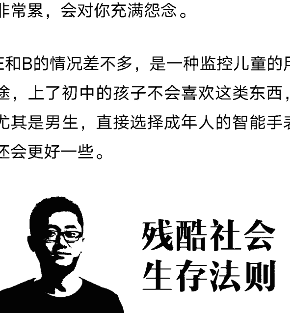

### 彩蛋｜为什么说以貌取人是一件正义的事

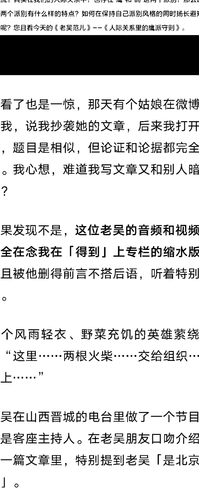

今天有位在后台叫我：

> “老熊，老吴的原创文章，怎么被得到APP拿走了，还署上了你的名！”

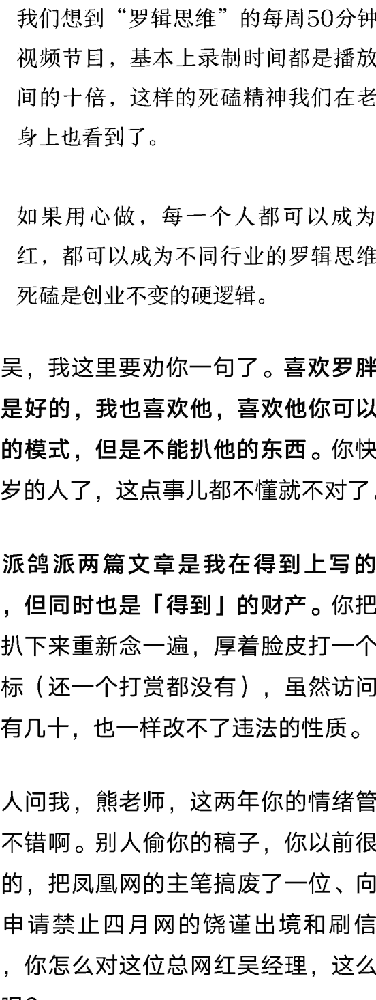

有这么样的眼光，就有这么样的世界。
改变世界，非我所长
但改造世界，表无旁贷

我是老吴，一个来自北京的老熊，欢迎与老吴一起有范而谈~

自古以来，在军事战略上就存在攻守的对立面。攻的一方往往被称为鹰派，守的一方称为鸽派。一鹰一鸽，相映成趣，各具风流。甚至在我们的人际关系中，也存在鹰鸽派这两个派别，那么这两个派别有什么样的特质？如何在保持自己派别风格的同时扬长避短呢？你且看今天的《老吴范儿》——《人际关系里的鹰派守则》。

我看了也是一惊，那天有个姑娘在微博上撕我，说我抄袭她的文章，后来我打开发现，题目是相似，但论证和论据都完全不同。我心想，难道我写文章又和别人暗合了？

结果发现不是，这位老吴的音频和视频，完全在忝我在「得到」上专栏的缩水版，而且被他删得前言不搭后语，听着特别揪心。

一个风雨轻衣、野菜充饥的英雄秦绕耳中“这里……两根火柴……交给组织……北上……”

老吴在山西晋城的电台里做了一个节目，算是客座主持人。在老吴朋友口吻介绍他的一篇文章里，特别提到老吴「是北京户口」。

作者还主动感慨一个户口这么好的北京人，为什么要来没有机场、没有高铁的晋城啊。

一个忧国忧民，扶贫济困，拯救三分之二受苦人的形象跃然屏上。

老吴渴望自己的视频节目成为第二个罗辑思维，我们知道做新媒体想要有名，一定要是接受采访。

老吴接受采访的时候还提及了自己变红的50个办法。老吴现在的抬头是晋城市某4S店的经理兼「总网红」……

见到老吴，我迫不及待地要把心头的疑问抛给老吴，我问 vt 是否目前的76篇视频是如何录制的呢？

这个视频节目是山西晋城广播电视台FM106.3每天早晨8点08分播出的一档节目，每一个视频内容在5-6分钟。

老吴，我这里要劝你一句了。喜欢罗胖老师是好的，我也喜欢他，喜欢他你可以学他的模式，但是不能扒他的东西。你快五十岁的人了，这点事儿都不懂就 invent 不对了。

鹰派鸽派两篇文章是我在得到上写的专栏，但同时也是「得到」的财产。你把这些扒下来重新念一遍，厚着脸皮打一个原创标（还有一个打赏都没有），虽然访问量只有几十，也一样改不了违法的性质。

老实说，刚看见这几个链接，我是有点生气的。一共90期，他就抄了我8期。

熊太行

熊师傅对于盗版侵权的事情绝对不能忍，所以也请大家帮个忙，投诉或者告诉这位吴姓朋友。

我很快会在《关系攻略》中推一篇支持相貌协会的作品，就叫：《为什么我们要以貌取人》。

残酷社会生存法则

### 如何送喝醉的领导回家

010 | 如何送喝醉的领导...

我这个人不能喝酒，我的领导却很喜欢，我是不是一点前途都没有了？

当然不是了。

首先，在八项规定出台之后，各地的机关事业单位和国企喝酒风气大减，现在太多的单位不敢喝酒了。

即使是一个放心喝酒的单位里，不能喝酒的人一样也可以借喝酒来表现自己的忠诚。

不能喝酒的人可以做护送，这是一件极有价值的工作。

在领导通知今晚有接待任务之后，你要赶紧做好准备，比如跟家人请好晚归的假，把车的状况自己检查一下，擦洗干净，后座收拾好。

你的领导可能有司机，或者平时自己开车。

但喝酒会发生各种状况，很可能他会连钥匙都说不出在哪儿了，你的车很可能要被用到。领导可能会歪七扭八地倒在后座上，如果你的车上有宝宝安全座椅记得早早收起来。

备好：

- 醒酒药、清凉油、纸巾、湿巾、毯子、矿泉水、呕吐袋、毛巾。
- 掌握领导的病史，准备心脏急救药物，如果领导有哮喘，那要知道他的专用药物（你可能会买不到）在哪个口袋里。

你的领导的车型你应该早就知道了。你可以租一个这辆车的同款（要花几百元）或者去卖车的店里看看车试驾一下（不花钱），总之不要手忙脚乱。

当领导和客户（也可能是其他公司管理层）喝完酒决定回家的那一刻起，记得提高你的注意力，如果领导让你开他的车，就把准备好的包袱背上，去他的车上，后座如果没有人就要帮他把安全带扣好。

如果有司机或者叫专车，那你就在后座照顾一下。

送人的人不能喝酒。

送人的人不能喝酒。

送人的人不能喝酒。

重要的话说三遍。

有人说，我不开车，只送人，也不行吗？当然不行。

女人不喜欢老公喝醉酒，一个半醉的人送一个喝醉的人。女人的反应会是：你狠，你把他喝成这样了！

## —— 习题 ——

一场鏖战，现在你的领导和副领导都被灌趴下了，副头的状况更惨，正头儿还有知觉，正头儿家近，家属在家，副头儿远，家人不在本地。现在司机问你，应该先送谁，你会对司机说：

A.副头家情况比较严重，先送他吧；
B.正头儿的家近，挨着顺路吧；
C.两位领导你们深处右手，哎，石头剪刀布啊，谁先赢两盘先送谁；
D.把正头儿送到家交给家属，然后送副头儿去附近的医院。

答案D。

A为了副头给正头绕路是不妥当的，正头儿会不舒服。B送到正头家还要折腾很久，副头的情况可能会有危险。选C的，你喝得最多，不要送人了。D是一个比较高效的法子，把正头送到之后赶紧送副头儿去医院（酒精中毒如果没有太严重，一般就是打一针旁边躺着去）。副头家人在本地，去医院可以更安全。

第二天复盘的时候，副头会很感激你。正头儿也会对副头的惨烈遭遇有所理解，不会为难你。

酒后送人是一个搞关系的好机会。

但首先要做到的是安全。

你们要真心地爱护自己的领导，出了事儿，大家会自责一辈子的。

还有，希望你们的领导也能从你的苦心中吸取教训：

这酒啊，真他妈不能这么喝了！

## 用户留言

提交留言可与专栏作者互动

## 不要用别人的名字开玩笑

011 | 不要用别人的名字...

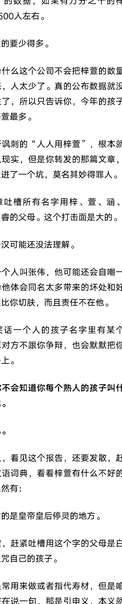

管理好自己的朋友圈，转发有些新闻之前，要动动脑子，别随意便得罪人。

除了看看新闻里写的是不是真事，还要想想转出来之后会怎么样。

前几天有个“大数据报告”，说2016年男宝宝热名榜前三是：浩然、子轩、皓轩；女宝宝热名榜前三是：梓萱、梓涵、诗涵。

一帮人就开始调侃给孩子起名字叫梓萱梓涵的人，我觉得我的朋友圈里素质挺高了，还是有人忍不住转过来来讥讽几句梓萱的家长。

这是不对的，我经常说，我做“关系攻略”，做仕途，写人际关系，就是要让大家去防明枪暗箭。

明枪暗箭不仅仅来自身边的同事，还有各种营销号和媒体。我自己是媒体出身，对这个行业的玩法比较熟悉。

其实仔细看这条新闻就知道了，这是一个起名类APP推出的报告，每年发布一次关于姓名的研究报告，比如2014年他们的报告，告诉全国人民，全国据说有超过29万个张伟。

张伟和王伟刘伟李伟加起来不到120万人，按照6亿男青年，不到万分之二十。

和伟这样的单字相比，梓萱这个名字要少得多了，我们按一半算，万分之十吧。

这个今年的姓名统计报告是基于450万新生儿（仅仅是浙江省的数据，根本不是全国数据）的数据，如果有万分之十的梓萱，才4500人左右。

比你想象的要少得多。

这也是为什么这个公司不会把梓萱的数量公布出来，人太少了。真的公布数据就没有戏剧性了，所以只告诉你，今年的孩子名字，梓萱最多。

所以你所讥刺的“人人用梓萱”，根本就不是什么现实，但是你转发的那篇文章，却把你拉进了一个坑，莫名其妙得罪人。

那篇文章吐槽所有名字用梓、萱、涵、子、皓、睿的父母。这个打击面是大的。

有些单身汉可能还无法理解。

你笑话一个人叫张伟，他可能还会自嘲一下，因为他体会同名太多带来的坏处和好处，肯定比你切肤，而且责任不在他。

但是你笑话一个人的孩子名字里有某个字，就算对方不跟你争辩，也会默默把你记在本子上。

我相信你不会知道你每个熟人的孩子叫什么，对吧。

别惹事儿。

## —— 习题 ——

C.推辞起名这件事，告诉对方自己无法胜任。

D.提出几个备选名字，属于诗经论语楚辞和畅销书，特意请孩子的爸爸和爷爷挑选。

答案是D。

A如果是给自己的儿子起名可能是个好主意。

B的主意其实也不坏。

C显得有些出工不出力。

D的姿态是对的，对方邀请你参加的是一个脑暴会，而不是一个拍板权。

## 残酷社会生存法则

此内容归得到App独家专享，版权所有，未经许可不得转载，侵权必究。 合作请联系iget@luojilab.com

## 婚礼是研究一个家族的绝佳样本

012 | 婚礼是研究一个家...

我们研究人际关系，有两件大事是必须要细心观察的，一个是婚礼，一个是葬礼。

这两件事一般能够观察到一个家庭全部社会关系的总和。

我以前把记者派出去写一个死去的名 inj， 一定要告诉她，混进他的告别仪式或者葬礼，带着眼睛去看，什么人在哭，除了你之外，还有谁在打量人，葬礼出来之后谁最先把黑纱白花急着扯下来，谁是说笑的人。

我们是人际关系的研 究者，不能像那些蠢汉妒妇，参加完一个婚礼回来只是抱怨说新娘子不漂亮，或者饭菜太难吃。

我们绝对不能放过一个分析破解的好素材。

有时候会是两个熟人结婚的婚礼，不过更多的 情况，你只认识男女方当中的一个。

还有的时候，你可能会替父母、配偶去参加别人的婚礼，其实你谁都不熟，去那就是上礼和吃饭的。那就更有趣。

我们的目标，就是通过观察和询问，把你不熟悉的那一方好 好画一个像，勾画出对 方的出身、背景、阶层、财富水平和受教育程度。

这里有10个可以记笔记的点：

- 1. 酒店的档次，很多软件可以查到这个地方的租金，如果查不到，叫经理过来询问也很好。
- 2. 宴会的价格。
- 3. 婚宴是中式还是西式，如果是中式，要精确到菜系，如果是西式，要写下宴会之前有没有教堂或者草地婚礼。

注意，如果双方家庭都不信基督，那“教堂”十有八九是新娘挑的，你的穷哥们基本上挑了一个浪漫的公主心小姐姐，以后到他家做客不要扰民，也不要在对方家里吃饭，可能会落埋怨。下次遇到新郎可以询问是不是。

- 4. 收礼不收礼，如果收礼，当场是否打开红包，是否记录红包数字，收款和记账是否分开，是否会唱出数额，有没有验钞灯，有没有转账二维码。
这代表着一方或者双方对财富的认识。
- 5. 新郎和新娘的籍贯情况。
都是本地人，还是有一方是外地人，还是双方外地人？
- 6. 双方父母的工作单位是什么性质？哪一方的实力比较强？
军、警、政、法、医和金融背景，可以特别标注一下。
- 7. 他们是自由恋爱还是别人介绍的？
- 8. 介绍人有没有出现，有没有被邀请成为主婚人或者证婚人？
- 9. 你被安置在哪类亲友的酒桌上？周围有熟悉的人吗？
- 10. 办了多少桌，都坐满了吗？如果有桌签，看看空白最多的类别是什么？

好了，这些观察之后，你该吃就吃，该喝就喝，等到新郎新娘和双方父母来敬酒的时候，注意再看几个细节。

- 1. 双方父母是年龄相近，还是相差五岁甚至十岁？
- 2. 双方父母有没有不是亲生父母的迹象，比如异常的年龄差、比如不同的称呼，推测一下原因 是离异还是继弦？
- 3. 双方父母的头发有没有染过？服装是不是正式？如果正式，是不是合身？
- 4. 老人们谁在大笑，谁在微笑？他们的牙齿还在吗？是不是整齐？
- 5. 他们有没有口音，哪里 的口音？

新郎新娘和双方父母敬完酒之后，如果你有心情，可以跟同桌的人打打招呼，一起提议举杯祝福一下，如果懒得去做，也无所谓，这就是婚宴的好处，认识的人少，不用太操心。

回去之后把今天对这些问题的观察记录下来，简单地写一个你不熟悉的一方的小传，从细节里试着推算和复原场景。我建议你用500字来写一下自己的推测，比如：
我的族弟熊王屋娶了一个外地姑娘，她是个小学老师， 似乎家境平平，比他小五岁，刚毕业没多久，她父亲在附近的郊县生活，也是一个退休的副校长，他们家挑菜松得很硬，肚子大海鲜少，看起来都是过日子的人。
新娘家里亲戚很多，有几个表亲看着上去挺有 身份，跟熊王屋也很客气，应该让我兄弟维护好这样的关系，此外他们说女方还有一个表叔做房地产，今天在外地没能过来，但是礼金送来了，我看得让他们等这 位长辈回来之后去登门拜谢一下。可能会有合作的机会。
新娘子有个表妹长得很好看，不过这不是重点，她是人民医院的护士，家里老人年代大了，以后估计需要麻烦她。
熊王屋的丈母娘比较强势，声音很大，似乎不好处，她老公似乎很怕他。这样 的笔书写完，我下次再和熊王屋喝酒的时候就可以跟他拷个核实我的猜测，看 看哪里猜错了。
修订过之后，把这段笔记保存好，以后可能在需要合作、需要维护关系的时候，可以温暧一下。

有人说，自己家人还要这样，累不累啊？
不累。

上来你就对那些可能决定你生死的人秉  嗜使用心机和手段，那就是真正的取死之道。

古人说修身齐家治国平天下，对家庭内部的一些关系试用我们的攻略，是快速熟悉对手法的重 要方式，古代的君王挑选贤臣，都 是从孝子里挑选，像尧挑选舜做自己的继承人，就非常有道理。因为孝子就是不断地研究人 和人的关系，而且勤加练习的人。他们从和父母的互动中知道如何 摩擦、侍奉、服从。说孝子是天 然的贤臣有点夸张，但是作为扈从和秘书开始培养，是 一定没有问题的。

同样的，你的情报搜集和整合资源，也 可以从家庭内部、朋友圈内部开始，事实上亲友圈是你最大的宝库，经常常新，永远都 有着新出现的各种资源。

## —— 习题 ——

以下几个说话的人里，哪个 人没有遵 循“越是对亲密的人越是应该注意使用谋 略”的原则：
A. “三弟，你把剑扔下。兄弟似手足，妻

A. “三弟，你把剑扔下。兄弟似手足，妻子如衣服。衣服破了可以补，手足断了，难再续，难再续……”

B. “袁大哥，你先帮我把风，我先把新娘子背走。” “好嘞曹贤弟！”

C. “吕布死人头，敢戏弄我的爱姬！吃本太师一戟！”

D. “你这猴头，再要多言，为师要念那紧箍咒了！”

答案C。

A是张飞丢了徐州的时候，刘备安慰张飞说的话，当时刘备的老婆们落入了吕布手中。刘备是一个使用套路的大师，今天很多同学都说，觉得套路虚伪，人会变虚，这是不对的，刘备说出衣服论、搀阿斗、跪求孙夫人，都是套路，但没有人会觉得他虚伪，相反桃园三结义还被当做一个交朋友的典范。

B是曹操和袁绍，这俩人是同学，过去经常去大户人家的家里骚扰，偷走新娘子，做了不少坏事，坏主意曹操出，经常被抓住的是袁绍。

C董卓和吕布，董卓的错误是他真的觉得俩人是父子，而且觉得父子没有隔夜仇。

D是唐僧和悟空，唐僧统御悟空的本事其实十分高明，如果有一点他觉得悟空偷懒不卖力，就会用这种方式来威胁，在念了几次紧箍咒之后，他发现不用再真念了，只要威胁一下就已经足够。

所以答案是C，亲密关系当中才更应该谨慎，更应该使用谋略。

## 残酷社会生存法则

此内容归得到App独家专享，版权所有，未经许可不得转载，侵权必究。合作请联系iget@luojilab.com

## 春节指南｜如何称赞亲戚家的孩子

013 | 春节指南 | 如何称赞...

摘要：对亲戚家的孩子只称赞、不教育。

这篇文章谈到的心理学：称赞是积极的心理暗示，能对孩子本身产生正面影响。

心理学上有着这样的案例：两个成绩相似的班级，一个班正常教学，一个班级强调他们是优秀的人、被挑选中来的，几年之后，这个被称赞的班级成绩居然比邻班高了一大块儿。

## 先强调几个读关系攻略的问题。

有同学说，熊老师你不对，你最近有两篇，比如关于送礼和喝酒，都是关于讨好领导的，我在体制外，我觉得我订阅这个专栏有点亏。

这是读书给读迟了。

## 如果我会斑马的语言，跟他们讲狮子的习性，我不相信他们没有兴趣。

## 夸亲戚家的孩子。

好多人，尤其是没结婚的人，会觉得叫做小朋友特别麻烦。你看各种论坛，一定都有声讨熊孩子_k的攻略，什么悄声恐吓的，什么厉声惊吓的，还有用放黄片来毒害的。

陌生的孩子的孩子扰乱秩序，是应该制止的，但对亲戚家的孩子来说，“他还是个孩子啊”这样的借口，是有道理的。

## 1.你跟孩子没交情，跟大人有交情

一定要明白这个道理，不要因为孩子有没有礼貌，学习好不好，流不流鼻涕，翻不翻别人的抽屉来决定对孩子的好恶。

## 你对孩子的态度，只决定于你和他的父母、祖父母的亲疏远近。

## 必须训练自己，克制对称赞这事的厌恶，从心底认可它。

## 2、别教育别人的孩子

孩子可能会和一些亲戚家邻居家的孩子成为共犯，被父母抓到后管教，这个时候可能孩子对父母说别人，比如："那欧小宅（借我同事的名字一用，以后调皮的角色就用她）也砸人玻璃了。"

## 3.称赞和诋媚是两回事

> "成绩稳定，动手能力强。"

## 4.如何夸不喜欢的孩子

| “看起来还算听话” | 坏毛躁多 |
| “是个聪明的孩子呢” | 淘气玩闹 |
| “以后就靠你赚钱啦” | 偷懒和说谎没关系 |

| 还不太公认的吧呢，似乎有一点太大了呀！你哈！ | 有些魅力 |
| 协调得不错，下次再说些别的吧！ | 远离烦恼 |

注意这两张表格！非常重要，我们不是要做言不由衷的人，但是遇到不够喜欢的孩子，称赞他的时候，注意看上面这个表1加黑的字！

## 5.对好孩子要特别用心

我们前面说了，所有的孩子都要夸，那对特别好的孩子，特别喜欢的孩子，应该怎么做？

子有更远大的理想，望子成龙。

后一种尤其值得结交一下，寒门未必都出贵子，但是你如果在一个有希望的孩子家庭平平的时候多用一点心，以后这个孩子可能就会是你的强援。

别听那些论坛上吐槽熊孩子的帖子，夸张成分不少，大多数人其实都会变成你我一样的普通人。

一个大家族里的孩子，都是资源，是宝贵的人力。如果你有心做点事，早点发掘和稍作培养，到你人在中年老老的时候，他们就都是壮年的硬手了，这点在小城市里混官场的同学要特别注意。

我总结一下关于称赞，一定要接受的几个观点：

称赞别人是美好的。

被称赞的人会很喜欢你。

称赞行为能够改善你和对方的关系。

认真研究一下别人值得称赞之处，是对自己的锻炼，也是加深对对方理解的一个过程，很有价值。

此外，称赞是积极的心理暗示，能对孩子本身产生正面影响，心理学上有这样的案例：两个成绩相似的班级，一个班正常教学，一个班则强调他们是优秀的人，被挑选出来的，几年之后，这个被称赞的班级成绩果然比邻班高了一大块儿。

这里要再提醒一句：

关系攻略不是要你只针对领导和同事，相反，很重要的一块关系是家人、亲友等关系，这些人和你交情深，容错度比较高，而且什么行业的人都有，是练手的好对象。

有关系户跟我说：“熊老师看你说的怎么照顾醉酒领导，我很惭愧，反思一下，我对我爹都没这周到过。”

对，因为你对老爹粗心大意他也不会怪你，领导会怪你。

关系学这门课多友善，学医不能拿老爹开腚练手，但搞关系可以拿老爹开始攻略，最妙的是，没花什么钱你就成长了，经验值哗啦地长，老爹还可能给你礼物，还跟全家人说：

天呐，这孩子最近懂事了啊。

孙悟空学了七十二变，默默回屋睡觉去了。那一刻，除了菩提老祖，只有他自己知道自己有多厉害。

## —— 习题 ——

表哥和表嫂来家里串门，家里有一个七岁的女儿，你们来往不多，但对这个家庭进行了简单的观察（在上一篇《婚礼是研究一个家族的绝佳样本》中，已经告诉了大家为什么对家族大事记笔记如此重要。），笔记如下：

妈妈收入比较高，打扮入时，喜欢首饰。爸爸似乎是一个机关里拥死工资的人，没有太多的看法，爸爸听妈妈的。

孩子长得很漂亮，穿着风格随妈妈，但是似乎跟爸爸更亲近一些,以下哪个决策是对的：

- A. 应该夸父亲和孩子的亲近关系，表扬父亲的用心。
B. 应该夸妈妈给孩子的打扮，表扬母亲的品位。
C. 不要夸孩子好看，因为这对健康成长没有好处。
D. 虽然很喜欢孩子，但是不喜欢孩子的妈妈，随口夸几句我就回屋去打游戏了。

答案是B。

夫妇俩的风格不一致的时候，称赞孩子要比较谨慎，讨好强势的一方。这个小家庭的主要社会关系是表嫂在打理，那就应该让表嫂觉得舒服，大多数太强势的女性都可能对自己的丈夫有嫉妒心，不是性的嫉妒，而是实力的嫉妒，换句话说，称赞丈夫可能得罪妻子。而夸赞母亲的审美是无害的。

如果孩子的父母本身是很睿智的人，要夸品质和见识，不过无论父母是不是聪明人，自己的孩子被夸好看的时候，都会好开心。

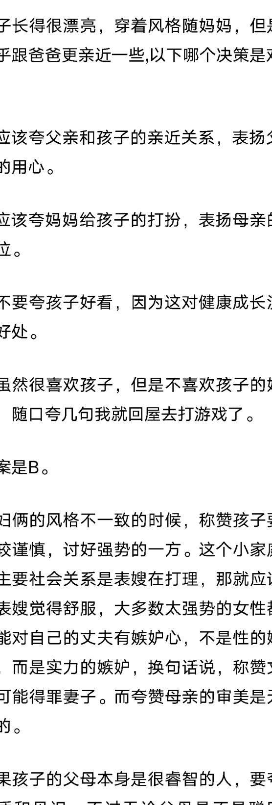

C是对自己孩子的 yêu cầu，担心孩子膨胀，对别人家的孩子，你可以放心夸她好看，夸成公主，也不是你去给她操心招驸马。

D是一种消极放弃的态度，事实上把这句话要记下来，哪怕前面的文章都忘了都不怕：

聪明的男孩和漂亮的女孩，都可以早早经营一下，让孩子本人喜欢你。

前者以后前程远大，后者以后除了可能前程远大，

还可以嫁出奇迹来。

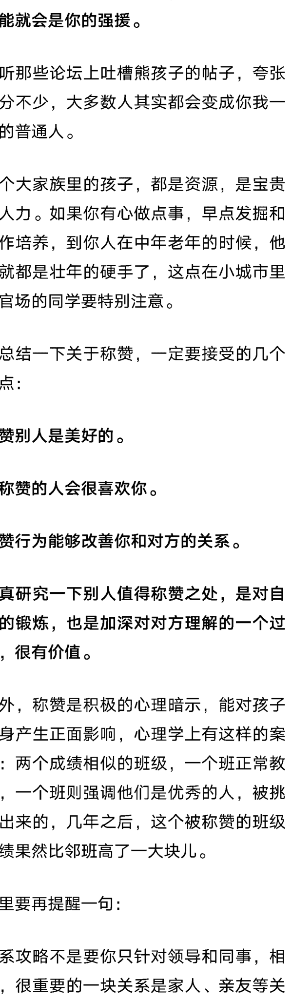

## 春节指南｜电话和微信拜年有哪些雷区

知识点：电话和微信的区别很大，电话拜年时你是注意力独占状态，而微信拜年时你处于注意力争夺状态。这时要采用的是两种完全不同的策略。

## 打拜年电话要尽量简洁。

我是不喜欢打电话的那类人，但是过去当记者，总要打电话，幸好都是问题写在本子上，挨个问过去就好了。

拜年电话如下，比如我的同事李雨桐给我打电话拜年，一定是这样：

雨桐：熊总你好，我是雨桐。给你拜年了。
熊：啊，雨桐你好，年在哪过的。
雨桐：在昆明，我老公家这边。
熊：那边天气很好吧。我在石家庄伸手不见五指啊。
雨桐：是，这边穿个羊毛衫就够了。
熊：真羡慕你们的好天气，给家里带好啊。
雨桐：熊总祝您全家春节快乐，赶写书不要太累。出版社那边说虽然很想赶紧看到您的书稿，但一定要身体第一。
熊：好的谢谢！春节快乐。
雨桐：不多打扰了，再见。
熊：再见。

很简单，我概括为“一二三四”。

问候一下

寒暄两句

讲三十秒

四季平安

雨桐是高效能人士，她顺便还催了领导干活儿。

尽管领导人缘可能不咋地，但快过年了电话也会很忙，尽量不要占用太久。

打拜年电话是怎么通俗、怎么常见怎么来。不要用太多的花哨。

为什么？

因为声音是你的，独一无二的。

你在说话的时候，领导也好、亲友也好，只能听你一个人说话。

这一刻你是注意力独占状态。

单人演讲、电视主持、独舞、扔铁饼都是这种状态。

比如大家等着看姚明出场，姚明进来了，注意力都在他身上。这个时候姚明说话可以从容朴实，事实上你们看姚明说话就是那样的，他已经是中国最伟大的篮球运动员了，他不需要讲段子逗狗血。

但是发微信拜年，你就要跟人抢着争夺注意力，你不能仅仅是一条为拜年而拜年的消息。

这就是注意力争夺状态，

群众演员、体育课踢足球、辩论赛的自由辩论时间，都是这种状态。

注意力争夺状态的时候，你就要尽可能让自己表演得戏剧化。

这时候就要搏出位，你看好多群众演员出身的明星戏路都很浮夸，那就是在片场演死尸、被主角打飞的时候想给自己加成落下的后遗症。

一个例子供大家参考：

傅园慧红的那次采访，一个进了决赛的运动员，实力大概拿不到冠军，如果寻常说话，只是无数个日常采访当中的一个。这个时候，用戏剧化的表现争夺注意力就很有必要了。她用了“真的吗”“使出洪荒之力了”flare众征服了，自己也从此变成了表情包。

你的消息在滚滚洪流中一闪而过。要搏出位一点，独特一点才好。如果不是你原创的内容，那就最好不要群发给大家了。你写一条明显是手打的信息，问候自己的领导、老师和亲友，比那种群发给两千多人的消息要有诚意得多，第一次看见一条抄来的短信，大家会觉得“哦，有这么一条啊”，第二次看见这条短信，大家会觉得“哎呀又是它”，到第三次，人民群众已经对那条消息恨之入骨，而发消息的人也很容易因为被觉得“没创意”和“无聊”。

我们一定都记得这条短信吧：

我怕三十晚上的祝福太多，你会不在意我的问候，我怕初一早上的鞭炮太吵，你会听不到我的祝福，我怕初二中午的菜肴太香，你会看不见我的短信。所以选择现在这个时候给你送来祝福，在这里给您以及家人拜个早年，我怀着一颗热忱心，祝您全家幸福，X年吉祥X年发财。

我第一次看见的时候是羊年，后来这条问候在中秋节被发出来当段子，很多人都被逗乐了。

这条消息当年特别红，是有它的道理的：

它需要在信息热流到来之前先发出。人们对最先收到的几条会拿来论一下，尤其是上年纪的人，觉得它新奇，就会转发给别的朋友。

再加上几个排比，让追求形式感的中国人民非常喜欢。

它就是一个搏出位的消息，但是注意，发这条消息的人未必能起到搏出位的效果。

你们还记得是谁发的吗？

不记得了。对，因为红的是短信本身，而不是短信的人。

要想别人记得你发了消息，那就把自己放

进短信里去。

在争夺注意力的时候，要让品牌和内容浑然一体。

过去的文字短信时期，大多数人无非是在短信后面落款。后来还有人用flash或者H5制作带自己签名的贺卡。

但是只封印自己进消息里，那发出去还是群发的。

你要想对方认为这是一条一对一的消息，那个就应该把自己和对方一起封印起来。

你需要用起来合影。

不少人喜欢参加活动，遇到名人了，咔嚓合一张影，发朋友圈，朋友们点赞完毕，这张图就废了。这是不对的。

试着把一些朋友、领导的合影自拍拿来处理一下，配发一些台词（不要给合影加狗耳朵和猪鼻子，那种对自己照片的涂鸦很未成年，成年人尽量别做这种无聊事）。

这段话可以是当时你的心境，也可以是当时领导的嘱托、朋友的笑话。

如果你记忆力好，或者记忆力不好但是爱动笔记记录，你可以完整复述出来去年你们相遇时候的情景，写一点东西就好了。对方一定会特别惊讶，觉得你是有心人的。

我的另一位同事夏周一是一个比较笨拙的年轻人，他就会把我们的自拍合影下面加上一段话，这个不难，美图或者足记等很多APP都能做到：

熊总，这是我过来面试那天，我们在能聊科技的LOGO下面的合影。我清楚地记得您跟我说：“试用期薪水打八折，试用三个月，爱干不干！”很开心在过去的一年里能和您一起做事。祝春节快乐！——夏周一。

气质是对的，但是这段引用一点也不合适。我当然要积极回报他的善意了，赶紧打电话给他的主管领导：

这家伙很有心嘛！图还做得这么好！

他现在什么职位啊。

哦，高级客户经理啊。

我们新招一个客户经理吧！让这家伙去做实习美编！

## —— 习题 ——

你现在决定挑一张和领导的合影，做成鸡年贺岁卡，以下四张图片当中，哪张合适：

+   A. 年会酒桌上的你和领导自拍，两人呈红色。
+   B. 领导给你颁最佳新员工奖时同时给你拍的照片。
+   C. 下基层的时候，你在领导身后行色匆匆的样子。
+   D. 领导在哪张图上最好看，那就挑哪张。

当然是D了。

在颜值相等的情况下，ABC里C的感觉最对。因为是工作状态。

A和B一般都是年底刚刚发生的事，没有那种唤起熟悉感引发回忆的感觉。

尽量挑前半年的，让领导感叹一下过去的一年。

此内容归得到App独家专享，版权所有，未经许可不得转载，侵权必究。
合作请联系iget@luojilab.com

关系户
27647成员 594人今日打卡

## 用户留言

### 春节指南｜对抗逼婚这件事没有那么难

015 | 春节指南 | 逼婚压...

知识点：
压力源是心理学上的一个常用概念。
比如你春节的压力源可能是父母逼你结婚找对象。
但给你施加压力的父母，他们的最重要压力源可能不是你不结婚，最常见的是他们对身体健康有担心。
及时带他们检查身体，给他们镶牙补牙、检查听力、配一副合适的老花镜，可能都会极大提升他们的幸福感。他们越幸福，被逼婚的压力就会越小。

好多关系户说，熊老师，过年了，马上就要面对可爱的七大姑八大婶了。

怎么面对逼婚？

对策其实不难，但是今天我不光要给你们一条大鱼，我还会给你们一套钓竿。

熊老师到底怎么来拆解一个关系攻略的话题？

其实很简单，就是分清一个关系里有几种角色：敌、我、友。

毛泽东写的《中国社会各阶级的分析》，上来就是三句话：

谁是我们的敌人？谁是我们的朋友？这个问题是革命的首要问题。

有人会对你逼婚，你也应该考虑一下，谁是朋友、谁是敌人，此外，就是我可以怎么样。

敌人究竟是什么？
那些煽风点火的亲戚们不是你的敌人，爸爸妈妈更不是你的敌人。
他们脑子里的落后思想，才是你的敌人。

他们不是关心你的性生活，到今天，大部分年轻人的性都远远早于婚姻。

他们只是希望你生产人口，现行的政策法规，这件事还是婚内做才能少很多麻烦。

那些上了几岁年纪的亲戚，当年都曾经为自己活着，也是面临着自在和束缚、事业与家庭的冲突。

那些年为了一个学习、升职、借调的机会去做人工流产的事非常多，你要说他们真的喜欢孩子和生育，那肯定没有。

但是他们一旦年纪大了，卸下了生育人口的担子，而且感受到自己是老张家、老王家的一员，就会突然转换思路，鼓励人口生产，而且自动负担起管理者的责任，给你规定 KPI。

父母的焦虑其实是更可怕的敌人，比如这句父母经常说的：
早点结婚，早点要孩子（奇怪很多父母喜欢说要，不知道妇产医院还是atar...），趁着我和你爸身体好，可以帮你们带，再等几年……
细细读这个句子，他们焦虑的是身体不好。但解决方案是，你要赶紧结婚。

心理学上来说，人可能面对各种各样的压力源，身体的健康是其中一个重要的压力源。他们压力要牵其他方面出口，那你被逼婚一点都不冤。

要多关心他们的身体健康。

要舍得给父母花钱，花钱哄他们事半功倍，很少的钱就能带来巨大的幸福感。

### 我军有什么问题

我的一位前同事，30出头的一个男生，那天在朋友圈里说：“真不觉得这是个问题，你自己不找对象，谁会瞅着你找吗？”
他是个摄影记者，是个有判断力、不容易被别人轻易影响的人。他没办法理解那些苦于被亲戚的反复游说折磨的大龄青年，这批人确实有自己的问题。

大多数苦于被逼婚的青年，小时候都是乖孩子，我们知道有些人青春期的时候会叛逆，也有些孩子一直没有叛逆，最离经叛道的事也无非是跑到同学家看电视八点半才回家。

家长对这些青年的要求是纪律、规矩、要和所有常人靠拢，该做什么事的时间就做什么事。
他们中的很多人，到了30岁都不能跟父母说出一个“不”字。
这就太糟糕了，对父母的尊重和爱，都是好的，但是如果和父母之间，是被安排、被控制的关系，那绝对是噩梦一般的关系。
不会说不、不会拒绝父母的年轻人，在面临逼婚的时候的压力会被格外放大，那种大难临头的感觉，旁人是无法理解的。
如果你身边有这种成年后还对父母畏惧如虎的朋友，要好好心疼他（她），因为这种人小时候根本没有什么像样的童年。
在她说到父母逼婚的苦恼，情绪激动的时候，可以紧紧拥抱她。我们以前学心理咨询课的时候，老师曾经说过：“拥抱是一个很……”

好的大拐儿，国外心理咨询师可以拥抱求助者，国内的话，女咨询师抱女的求助者一般不会有反感。”然后老师摇摇头看着我们几个男生，“你们就算了。”

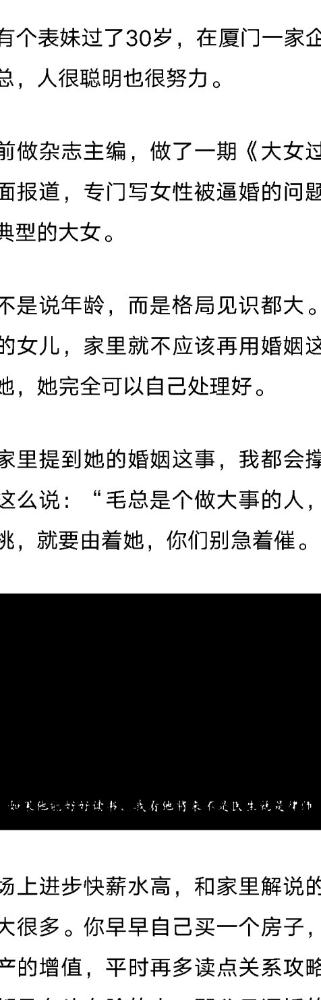

朋友之间的拥抱，对这样的朋友非常有效。当然要克服问题让他跟父母直面矛盾，还得他自己学习自己成长。

### 友军在哪里

亲戚里见识比较高的或者和你同病相怜的人，那就是你的朋友。

要早早跟这样的亲戚打招呼，让他们帮你、支持你。

我家有个表妹过了30岁，在厦门一家企业当了副总，人很聪明也很努力。

我以前做杂志主编，做了一期《大女过年》的封面报道，专门写女性被逼婚的问题，她就是典型的大女。

大女不是说年龄，而是格局见识都大。养出这样的女儿，家里就不应该再用婚姻这样框去圈她，她完全可以自己处理好。

每次家里提到她的婚姻这事，我都会撑她，就是这么说：“毛总是个做大事的人，她要仔细挑，就要由着她，你们别急着催。”

你职场上进步快薪水高，和家里解释的空间就会很大。你早早自己买一个房子，安排好财产的增值，平时再多读点关系攻略，朋友也都是有头有脸的人。那父母逼婚的借口就少了，你要闪婚一把父母还不乐意呢，他们担心对方喜欢的是你的钱。

相反，如果家里乱糟糟，饥一顿饱一顿，灯泡坏了不会换，饭不会做衣服懒得洗，父母一定担心，希望你找个人互相照顾一下。反正不会更糟了。

独身女士有做到国务院副总理的，丁克或者独身，根本也不是什么怪胎。

我们的策略很简单，让自己尽快强大、对朋友要拉拢，发展统一战线。

对敌人们可以麻痹、欺骗、humiliate，对落后思想不要正面硬刚，挖铁路钻地道搞机关枪桥梁才是王道。

当亲戚们问“什么时候结婚啊？谈朋友了吗？”的时候，记得这十个招数：

+   1. 延迟满足

“谈着呢，争取明年带回来给您看看”

注意这段不那么简单，亲戚们的关心大多数都是瞎起哄，他们不懂如何跟你拉家常，所以就用这种方式来聊几句。

你直接汇报的是，我很重视您的意见，回头要拉您掌眼把关。这是给足了对方面子。

+   2. 娇嗔可爱

“谈着呢，现在还不成熟，我呀，还没有决定要不要嫁给他。”

女孩子的专属招数，如果本身发问的亲戚是姑妈姨妈，从小疼你，还可以跑过去抱着她挨着她。

“那么急着把我嫁出去啊，嫁出去了，春节要到别人家过，想你们怎么办。”

认真在回答这个问题年轻人不会激怒长辈，比翻脸不认人，或者“我不想跟你讨论这个”不知道高到哪里去了。

+   3. 顺水推舟

“没有啊，您那里有合适的吗？”

很多人怕惹祸上身，其实不用怕，如果他们真的有合适的对象，早就会介绍给你了，还用你提醒？你这种问他们有没有合适的对象，其实是“能动手就别哔哔”的意思。

“我要什么样的？180以上，帅一点，最好是硕士，月入两万左右吧。”

条件可以调高一点，如果他们说“条件不要那么高”，你再反怼一击。

“婶妈，你真的是，怎么向着外人啊，你外甥女不好吗？”

+   4. 故作神秘法

“年后见，是我们一个大领导的女儿。大家都先别往外说。”

这个好理解。一般大家也就心领神会了。这小子很快走门路啰。

+   5. 选择犹豫

“两个女孩都很好，都很喜欢我，我实在不知道该选哪一个。”

如果你喜欢看小说，编故事，这就是一个很好的开头。

“一个家里是少数民族，父亲是当地贵族，搞畜牧的，她哥哥跟我关系不错，他爸爸直接送了我一把刀，想让我娶她。”

“另一个是南方姑娘，单亲家庭，父亲苟…”

了点，十六岁就离家出走了”

在家里聊天不要太认真，尤其是这种没法对质的事儿，可以撒开了说。

有些问你近况的亲戚真的是缺话聊，缺书听，那就给他们好书听。

“我觉得得找这个北方的。”

“当然是和有游艇的在一起啊！”

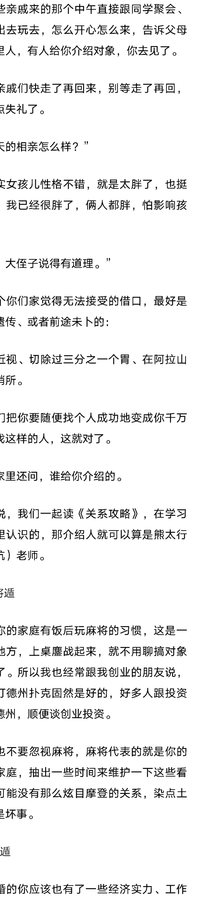

亲戚们听说可以二选一，果然纷纷发表自己的意见。

改头换面猛然一说，没人知道你是在讲《射雕英雄传》。

### 6.邻家女孩

如果你真的对某个亲戚家的女孩有好感，这时候可以大方地说。

“我觉得表妹就挺好的。”

注意了，中国的《婚姻法》，同一个祖父祖母外祖父外祖母的表兄弟、表姐妹不能结婚（三代旁系亲属），但是同一个曾祖辈的表亲（四代旁系亲属）之间可以结婚。没有任何问题。

不过中国一般来说不喜欢同族之间的婚姻，比如堂兄弟的子女一般不会婚姻，这是习俗问题，其实从血缘上和法律上都可以。韩国过去有同姓不婚的法律，拆散好多鸳鸯，近十几年才被废除掉。

美国总统富兰克林·罗斯福先生就娶了罗斯福小姐，他同族的妹妹，他也因为从罗斯福总统的远房族亲变成亲侄女婿。

### 上面七个是应对法，再介绍三个遁法：

### 8.相亲遁

### 9.麻将遁

### 10.唱遁

### 7.不要出柜

“四叔你的歌！我们欢迎四叔！”

想象力就像是鹰的翅膀。除了捕猎，你还有很多飞行的机会。同样，想象力也不该只在你的工作PPT上。

好了，我们总结一下今天的所得

你的敌人是亲戚们的落后思想。

这些思想包括但不限于：

+   - 人不结婚就得死；
- 人30岁不结婚就得重伤；
- 人35岁不结婚会不育；

熊老师完全不会告诉你怎么去驳斥这三条。

因为对亲戚，根本就不要驳斥。

一个人活到四五十岁，你想要改变他对世界的看法是很難的，尤其是有些见识很短一年一见的亲戚，完全不要驳斥。

他们说的就是：“得添丁进口啊，你看这一大家子人”

你就要去附和：

是啊是啊，我知道啊，你知道我有多努力吗……

想当顺势而为、随机应变的人，可以先和家里的亲戚练习。

等到你成了绝世高手，他们自然也会服你。

## —— 习题 ——

你是一位已婚有孩子的男生，春节去你同学（男）家里串门，遇到他的母亲唠叨说他还没有结婚，你应该：

+   A. 安慰阿姨，好饭不怕晚，这家伙只是还没有找到那个对的人罢了。
B. 跟阿姨吐槽，已婚的同学离婚的很多，自己的婚姻也无非还剩下一口气罢了。还不如像您儿子这样不找。
C. 称赞自己的损友，告诉阿姨，我要是女的我肯定跟他，可惜我家里没有妹妹。
D. 这事儿包在我身上，回去我给他介绍一个，正好手上有合适的。

答案是D。

A是一种正确的态度，但对安慰老太太并没有什么实际效果。关键是，这个话题还要继续下去。

B是一种消极的、破坏性的态度，老太太见过的离婚案肯定比你多，所以这种话也不必多说。

C是一种损友之间的表达，大家聚会上喝酒聊天的时候说这么一嘴很好，但是跟长辈说这样的话，就显得特别不靠谱。

D真正朴实无华的做法，自己包下来，让老太太放心，结束这个话题。

以后跟阿姨推说“没相上”，也不是你的责任，当然你要告诉你的好友：放心，不会给你真介绍对象的，过两天熊太行老师的关系攻略里专门有一篇：《不要给人介绍对象》，除非你开口托我，我不干这种高风险的事！

此内容归到App独家专享，版权所有，未经许可不得转载，侵权必究。合作请联系iget@luojilab.com

关系户 27648成员 2658人今日打卡

## 用户留言

玲玲-山东
老师好！声音是您本人吗？真好听！
01-26 23:37:42
作者 回复
不是哎。声音一直是专业的讲书老师。
01-26 23:41:56

以上留言由 作者 筛选显示

### 春节指南｜如何在酒桌上不喝酒

015 | 春节指南 | 如何在...

敲黑板：

酒精依赖是一种精神疾病，一般来说这种人早晨就要喝，不喝手抖。不要和这种人喝酒，你和他的风险都会很高。

只要给一个有说服力的理由就好了，对方不体谅，责任在他。

酒量练不出来，是基因决定的。

想让所有人满意，是人际关系中的取死之道。

喝酒总战力（HJP）是这一顿所有喝酒的人喝到80%醉需要的酒量，可以折42°白酒标准再计算。

春节的酒局，除了家庭聚会，基本上是同学聚会，个别乡亲聚会或者战友聚会。

同学聚会虽然没有拿下某客户之类的目的，却很容易出现惨烈的酒局。

想让所有人满意，这是人际关系当中的取死之道。

如果你觉得我因为身体原因不能喝酒就是瞧不起你，那我今天就要瞧不起你了。

做事不要怕套路，套路一点都不俗。

大过年的……

一般来说，要把这四个字放在你说话的开头，对方就容易接受你的意见。要抢先用这四个字，不然你就会落在下风了！

“你看咱们漂亮的文艺委员说得对啊。”

借口要先交代，现在比较靠谱的借口如下：

### 1.造人计划

其实准备生孩子就是一个很好的借口，尤其是今年的政策，全面放开了二孩计划，即使有一个孩子也可以说：准备生老二。

如果有人对你说：“没事，我当时准备要孩子的时候老喝酒，这不现在也好好的？”

这种人一般都是对自己智力相当自负，但其实愚昧、不体贴的人。

你就赶紧说一句：“唉，你们两口子聪明，我从小学数学就不好，我要是喝高了造人，那我家老二得傻成什么样。”

如果你是个诙谐的人，还可以自黑一句：

“就这我们还好久怀不上呢！就差去莆田医院通通了，笑什么笑！不许笑！”

如果早早铺垫了说自己生老二有困难，明年还可以用来用生老二这个借口。

### 2.器官病变

如果你不忌讳在正月说自己有病，心脏病、高血压、肝脏、胃部的病变也可以用来做借口，大多数说得出理由和细节的身体原因都能被同学接受，不要上了酒桌再现编理由，要事先铺垫。

### 3.宗教信仰

### 4.不及格的借口

酒精过敏：大多数爱喝酒的人无法理解酒精过敏的痛苦，他们只是希望你忍着喝点，这个词还被认为非常矫气。

减肥：减肥的人根本就不应该出现在宴席上，这是最弱的一个借口。

开了车：和公司里一起吃饭或者宴请客户的话，一般会留一个人开车，但是无领导的这种饭局，一般大家不能容忍开车这种借口，一般一说出来就会被打回去：“叫个代驾！”有不客气的还会怼一句：“就你有车吗？”

老婆不让：有这句你就死定了。这句话是想买醉的人说的，谁要是觉得生活不幸福想把自己灌醉，说这句准没错，20分钟之后你就可以大着舌头、无所畏惧地控诉你的婚姻质量了。

### 5.劝酒人

劝酒的人是大家畏之如虎的人，你你要注意观察，有的劝酒的同学是职业性地把你当客户了。还有的人自己爱喝，喝一点酒开始就要疯狂劝酒。如果是后者，他可能是一个酒精依赖患者。

敲黑板了！

酒精依赖是一种相当可怕的精神疾病，早晨就要开喝，不然就会手抖，每天至少一斤白酒或者相应的其它酒。酒精依赖会带来严重的人格改变，给自己和他人都带来危险。大多数中国人对精神病学毫无了解，只是把酗酒后打媳妇的人归结为暴脾气，其实很多人是需要送进去戒断的。

喝完酒之后他可能会伤人，但更多的可能会伤害自己，冻死在街头，或者死于窒息。如果是跟你聚会后他出了意外，你们所有喝酒的人都要赔钱（许多地方都有类似的判决），而且会留下毕子的遗憾。

## 有人说不叫他聚会，那不是放弃了朋友吗？

有些人是要放弃的，要远离他们，你没法救他们，他们会把你拖死的。

真正的为友之道，是劝他少喝点，以及告诉他的家人带他去医院检查（这个提出来你会心安很多，但你们可能会从此不再是朋友了）。

早请假有不少好处，在统计了喝酒总人数，计算了喝酒总战力（HJP，一顿所有喝酒的人喝到80%醉需要‌的酒量，可以折42°白酒标准两计算）之后，带酒或者买酒的同学就可以估算带多少酒了。

带酒的人一般对酒都是真爱，他们最担心的是酒带去了，大家喝得不积极。只喝了小半瓶，扔了可惜，拿回来觉得扣兴丢面子。

这样的人有时候就会心生怨恨，觉得自己被冒犯了，他会迁怒谁呢？

当然是那个早点不张嘴，到了酒桌上才说不行不行，真的不能喝的人！

最后再叮嘱一句：

## 自己对酒不要倦，一定要控制住。

早点跟酒桌上的人请假之后，那天千万不要听人蛊惑倒一杯，否则所有的努力全都白费，你不光会被喝倒在地，还会成为一个说话不算话的人。

有的人说我想喝酒，但是希望少喝，我们会单开一个话题研究此事。

P.s

有领导的场合，如果领导想让你喝，你坚决不喝也是可以的。

有人会觉得，领导会处处给你小鞋穿，这是大错特错。

你领导是喜欢酒量高的，这没问题。

但是领导同样也会喜欢一米八大高个的男生，和一米一长腿的女生。

你不是大高个或者大长腿，你的领导会仇视你吗？他把你招进来的时候就知道你个这么高、腿这么长了。同样，酒量也不是练出来的，全看基因。

所谓练酒，无非是让自己的身体习惯于承受损害罢了。

就好像小学期末考试的附加题，领导会把酒量当附加分，你不会做，考个95分就可以了，别为了冲击一个110分，结果正卷没检查，得了80多。

此外，脑子正常的领导根本不会因为你不喝酒就给你小鞋穿，如果你家里有背景，托人来这单位，你不喝酒他也不敢把你怎么样。如果你是一个干活儿的好手，那他还要用你，更不会因为你不喝酒，他就把你弄掉，那样的话谁给他干活儿呢？

你要斗争的根本就不是你的领导，而是你的一种妄念：

## 如果我委屈自己喝酒，领导就会喜欢我。

## —— 习题 ——

在你早早请假不喝酒之后，一个喝高了的同学逼迫你喝酒，说你在外面混得很好，不能瞧不起大家，这时你应该：

+   A. 没有没有，不会瞧不起大家，哥你说得对，我群里发个红包，今天是真不行，身体喝不了。\nB. 我没有瞧不起大家，你别污蔑我了！大家说对不对！\nC. 我是真的喝不了了，要不我来个啤酒的跟你喝一杯吧。\nD. 不理他赶紧去洗手间。

答案是A。

把注意力转移到手机上是个很好的办法，聚会的时候，抢完红包所有人都会回几条看上去比较要紧的消息。

B是作死，一方面和醉汉直接冲突，另一方面还呼唤群众，醉汉脸皮挂不住，不一定会闹多僵。

C是笨招，他看你喝啤酒之后，就会逼着你继续喝，酒桌上如果不想喝，一定不能喝第一口。

D是错招，不想理单才应该逃去洗手间，而且你本身没有喝酒，也不存在呕吐的需要。一会儿你回来，他还要缠着你。

如果你要逃，就彻底逃掉，当被醉汉盯上拉着喝，那就哄他一下，然后跟班长或者饭局召集人（这种人一般不喝酒或者酒量好，应该神志还算正常）打个招呼，说丈母娘家燃气外泄赶紧过去帮忙就好了。

我还真遇上过这样借口逃跑的。

逃出去的时候，那个盯着他的醉汉还在嚷：

> “回去要跟咱妈说，安全生产这件事，经常抓、反复抓、两手抓啊！”

嗯，酒这东西真是不好，不到20元，就能体验做领导。

此内容归得到App独家专享，版权所有，未经许可不可转载，侵权必究。
合作请联系iget@luojilab.com

关系户 27650成员 2296人今日打卡

用户留言

提交留言可与专栏作者互动

## 春节串门 | 吴伯凡 | 女人年龄折线值

017 | 春节串门 | 吴伯凡讲...

大家过年好，我是吴伯凡，非常荣幸来到熊师傅的关系攻略串门，给大家拜年。

熊师傅给我出的题目是我最近一年交了什么新朋友没有，有什么心得，有什么体会？我仔细一想，我今年一年好像没交什么新朋友，人已经到了特别没志向，交新知不如敦旧好，想未来不如怀旧的这个年龄了，岁月不饶人。

今天过年的时候看到一幅对联，上联就是天增岁月人增寿，其实人到了有一定的年纪是很不愿意增寿的，真正愿意增寿的是孩子们，幼儿园的孩子说起自己年龄总要夸大个一两岁、两三岁，年老的人总是会隐瞒一个两岁或一二十岁。

不知道大家听说过周国平没有，以前我跟他是同事，但是很多人知道周国平不是因为他的哲学，而是因为他的散文和他的陨落。我记得周国平30年前说过一句话：年龄与我是一个抹不掉的污点，是一个越涂越黑的污点。

今天还是要做一个命题作文，如何让自己有一个良好的人际关系。这个人际关系有各种各样的，与死充的关系，与朋友的关系，与熟人的关系，与半熟人的关系，以及假如你还是一个明星或者想当明星的话，你如何跟无数的陌生人搞好关系。今天我想把关系的范围缩小到一个很窄很窄的领域，就是很亲密的男女关系，简单地说就是如何找对象，如何找到以结婚为目的的对象。

前些年我看到一个数字，那些社会学家们告诉我们说，在中国太不得了了，现在男女比例严重失调，一胎政策使很多夫妇都愿意生男孩，导致了男女比例已经超过了120：100，将来的很多男孩子们是找不到对象的，僧多粥少，他们为将来的孩子们担心。

所谓专家就是拥有尽可能多的数字，拥有尽可能少的常识，他们忘了一个特别简单的常识：女生在选择对象的时候年龄的区间是很刚性的，而男生在选择对象的时候年龄的区间是很弹性。比如说我们杨振宁大师，他82岁他可以选择28岁的，但一般来说一个82岁的女性，她不大有机会选择一个28岁的小伙子。

其实我们真的没必要去为这些少男和未来的少男们担心，真正值得担心的还是少女和未来的少女。

剩女这个话题是一个很敏感的话题，有朋友提醒我在公开场合不要老提这样的话题，因为这是很容易遭打的，很容易掉粉的。但是剩女在今天是一个不可回避的事实，已经成了一个平常事，今天我就不好以一种平常心来说说这点平常事。

过去有很多理论和伪理论，比如说对于女性有一个分类，对于男性当然也有同样的分类，他们把女性分为甲乙丙丁四等，应该说在总的这个大盘子里头，这四等不是一个正态分布，肯定不是说A女占25%，丁女也占25%，因为优秀的毕竟还是少。但是我们要看另外一个盘子，我们看剩女的这个盘子，而不是所有待字闺中的女性这个盘子的话，你发现有一个非常明显的不同，就在剩女的这个盘子里头甲女的占比明显增加。这个有各种理论，原因据说是甲男愿意找乙女，然后依此类推，最后就剩下丁男和甲女，两个遥遥相对，互不买账的群体。过去还有一句话有剩男没有剩女，一家养女百家求，女孩子是稀缺资源，现在情况好像不太一样了，这到底是因为什么？当然有各种各样的解释，我今天不好给出一个我自己的解释。

这个解释其实是一个我秘传的公式，记得有一次我把这个秘传的公式跟某网站的精英女性们分享的时候，她们听完以后都不说话了，也许是陷入了沉思，也许是陷入了因惑，也许是陷入了焦虑，我不知道。

这个公式其实很简单，这个公式是关于男性对女性关注视线的问题，也就是说男性他在寻找合适对象的时候，他的年龄偏好是什么样子的。

有人说男性，当然都是喜欢找年轻漂亮的，男性很单一，永远喜欢25岁的，其实不是这样的。在我看来这个公式好像能够比较精确地解释男性对于女性年龄的关注，以及他们关注点的变化，这个公式是这样的，男性关注多大年龄的女性呢？就是他的年龄除以2加上7，当他在选结婚对象的时候，他不一定知道这个公式，但是他关注什么样的年龄的女性是遵守这个规律的。就像即使我们不知道牛顿三大定律，但是我们生活在这个地球上，我们就不得不服从牛顿三大定律。

我举个例子，一个10岁的男孩儿关注多大年龄的女孩儿？大家会说10岁的男孩儿，他怎么会想到结婚的问题，大家不妨想一想，其实很多男生在幼儿园就会想到，他将来会跟什么样的人结婚。10岁的男孩儿他也会考虑这个问题，他关注的女性是多大年龄呢？他的年龄除以2加上7，也就是12岁，一个10岁的男孩儿很容易喜欢上一个12岁的女孩，也就是说比他大的女孩。

男生可以脑补一下自己小时候是不是有这种倾向，想找一个知心姐姐。但是随着年龄的增加，公式没有变，得数会发生变化，男孩儿14岁的时候就是一个转折点，按照我们这个公式，14岁男生喜欢14岁的女生，这就解释了为什么中学生特别爱早恋的一个原因，这些早恋的少男少女们往往年龄是一样大的。但是到了大学的时候，20岁是上大学的年龄，我们会发现一个普遍的现象，有越来越多的男生喜欢跟学姐们谈恋爱，不是有 一句话吗？叫防火防盗防师兄吗？假如那个时候他要结婚的话，他希望娶一个17岁的女孩儿。这听起来也很合理，比较符合《婚姻法》。

但是女生们可能注意到这个公式里头好像有一个悖谬，刚开始的时候对女生很有利，越到后来好像不那么有利了。比如说一个30岁的男生关注多大的女生呢？22岁，而一个36岁的男生关注多大的女生呢？25岁。

前两天我碰到一个90后女生，她今年24岁，她说她是一个很异类的女生，她不喜欢同龄人，她嫌这些同龄的男生们太幼稚，too simple too naive，太傻太天真，聊上个十分钟就没有话可聊。她发现她最近成了一个...

叔叔控，她说她要立志找一个比自己大10岁的男生，她今年24岁，大10岁的男生34岁，也不太像叔叔，至少是跟吴秀波还是差得很远的。当我听到她的这个表述的时候，我握住她的手，恭喜你答对了，她认为她是异类，其实她才是真正正常的。如果用这个公式一算，那些很正常、很不异类的女生反而不正常了，因为一个24岁的女生常常想到的是找一个比自己大个三五岁，顶多大一个五六岁，不要超过30，如果自己20多岁找一个30多岁的人就觉得很亏。

当人觉得很亏的时候一个很正常的反应，炒过股的人都知道就是继续持有，等时机。
但炒过股的同学也知道，那种状态叫站岗，当你以高成本进入股市，突然股市在往下掉的时候，你肯定不舍得割肉，你等着有朝一日股市再涨起来，我可以安全脱身。股市有朝一日是可以涨起来的，我相信，不管是美国的股市，即使是中国others的股市，我相信有一天也是能够涨起来的。比如下十年以后又涨起来了，高于你的成本价，这个时候你就可以脱身了吗？但是女生千万不要以炒股的心态来炒自己，十年对于女生来说是很可怕的一个数字，以前我读过一篇小说里头一句印象很深：十年是一个漫长的岁月，它可以悄悄地磨损一张如花似玉的脸。

我们可以做一个计算，假如你今年是24岁，你想持有你的股票，看这个也不行，看那个也不行，总觉得自己亏了，你继续持有你的股票，你等了十年，34岁了，这个时候用我们这个公式来算它在关注34岁的女生，这是一个很恐怖的结论。我都不愿意仔细算，大家可以去算一下，简单地告诉你年龄的折现值跟你自己对它的估值之间是存在着一个巨大反差的。

我们不善于管理资产的人常常会陷入到这样一个误区，就是总以为自己拥有的这个资产很值钱，但是不知道这个市场折现的逻辑和折现的公式是什么。有时候当别人给一个折现值的时候他会大吃一惊，觉得这完全是在侮辱他，由于我们高估自己年龄的折现值，我们常常会把眼光盯在那些已经不盯着你的人身上，我们常常会在乎那些已经不在乎我们的人。这是一个我们没有意识到的悲剧，当你经常发现你在乎的人不在乎你的时候，你会有个自我安慰的逻辑，这只是个别现象。总有一天我会找到我心目中的白马王子，问题是属于你、在乎你的白马王子已经不走这条道了，你怎么等都是无用的。

有一句很耸人听闻、很不心灵鸡汤的话，说男生就像学校食堂里头的饭菜，虽然不好吃，去晚了还是没有了。这句话的启发性远远超过我们自己对它的估计，它提醒我们，我们所处的一个交易平台不是一个机会正态分布的平台，这个交易平台上有很多的店不是24小时开的。很多恨嫁但是—直没有嫁出去的女士，往往没有意识到她们所处的那个平台其实跟学校的食堂是非常相似的，它不是那种24小时的麦当劳店。

当我们知道了关于女性年龄折现值的这个公式以后，我们就至少明白了几个道理：

第一，你一定要盯着真的在盯住你，而你常常忽略的那样一群人，否则不是缘木求鱼，就是南辕北辙。

第二条，结婚要趁早，这个公式告诉我们，女生在22岁以前她所关注的人和关注她的人之间目光相遇的机会是比较大的，一旦过了22岁以后女生的视线和男生的视线就开始分岔了。

我们很容易发现一个现象，很多个人条件好像不怎么优越的女生反而结婚生子了，而很多条件优越的女生一直在那静静地等待机会，同时在这种等待当中浑然没有意识到自己的年龄折现值已经开始大幅度的贬值了。
如果我们眼前有一条沟我们要跳过去，最好的方法或者说唯一的方法是一次性跳过去，尽快地跳过去，你不能分两次跳过去，两次跳过去挂下去了，也不能够是在那做无穷准备，以一种拖延症的心态在那准备踏踏，你准备的时间越久你跳过去的勇气和能力也就越低。

最后的结果可能是两个，一个结果是给自己下一道死命令，比如说在大年初一郑重地在一张白纸上写下一句话，今年我一定要嫁出去，咬牙跺脚一闭眼嫁出去了。第二种可能就是告诉自己再等等，眼前的都不合适，不是人渣就是loser，我再等等找到合适的再说，一旦你做出这种选择，也很可能意味着你永远滞留沟子的这一边。在今后的若干年里头你一直会重复这种心态，你的婚姻状况也一直会保持这样一种状态，所以结婚要趁早。

我前面提到这个公式也只能说是一个所谓的公式，我就这么说，大家就是这么一听，发明这个公式的人顶多也只能得一个搞笑诺贝尔奖。

但是它包含着一个也许可是不错的有意的道理，关于我们自己是谁，我们的价值到底有多大，我们应该要力戒幻觉，我们常常会担心受骗，但是这个世界上最可能骗你的人是你自己。尤其是当你不知道你处于一种幻觉的时候，有不少人其实都是在为自己的某个“本来早应该”，但是—直还滞留在内心的一种幻觉买单，甚至是用整个人一生去为一个幻觉买单。在去掉幻觉认清价值之后，我们就还要有一种止损的勇气，除了对于自己年龄折现值的幻觉之外，我们对婚姻本身也可能存在着一个巨大的幻觉，我们常常会以为遇到了对的一人一切就对了，遇不到对的人一切都不对。

事实上在这个世界上找到对的人是一件很难很难的事情，是一个小概率事件，是一个黑天鹅，如果我们有这样一种心态的话，我们就会降低婚姻的期望值。

不是有一句话吗？说做好了你自己跟谁结婚其实都差不多的，如果做不好自己跟谁结婚也差不多的。王阳明那句著名的话也可以套用到婚姻上，吾性自足，不假外求，这句听起来好像跟婚姻格格不入，婚姻就是要外求吗？就是要找到另外一个人吗？但实际上是婚姻的品质反映了你个人的品质，这就涉及到一个更普遍的话题，就是做人还是搞关系，我们很多人特别热衷于建立各种关系，但实际上忘了—个根本的东西是如何做好你自己。

有一句话说你的价值有多大你就打开你的通讯录，你最常通话的十个人身价的平均值就是你的身价。这句话听起来有点鸡汤，但是也包含着一个重要的提醒，与其花大量的精力去搞关系，不如花更多的精力去做好自己。而做好自己的第一步是认识你自己，清醒地评估你自己。

我经常在一些场合里头看到一些女孩子，不停地要刷别人的微信，一个号刷满了再弄一个号，她以为这就是所谓的关系资产，自己认识的人越多机会就越多。其实不在于你认识多少人，而在于有多少人认识你，事实上也不在于有多少人认识你，而是在于有多少人认可你，有多少人认可你不是取决于别人，而是取决于你自己，在这个意义上做自己比搞关系要重要得多。孔子说君子务本，本立而道生，如果把本末倒置的话，你在末上用的工夫再多也许都只是无用功。

所以在信念来临之际不妨给自己设立一个小目标：从今天开始做一个靠谱的人，关心靠谱的事情，关注真正靠谱的人，也许在不远的将来你会出乎意料又在意中的赢得一份靠谱的婚姻。

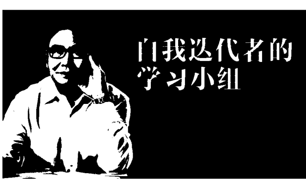

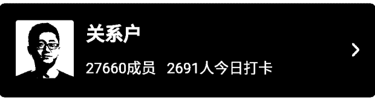

## 用户留言

提交留言可与专栏作者互动

## 春节指南｜为什么不要给人介绍对象

018 | 春节指南 | 为什么...

介绍对象曾经是中老年人维持自己政治影响力的一种行为。

时过境迁，现在帮人介绍对象只是浪费时间，还会遭遇无尽的埋怨。

你有一个男的朋友，打出租他先掏手机叫车，埋单的时候坚决不会去厕所，他的牙齿很白，爱爬山，你喜欢他。

你有一个女的朋友，遇到痛苦的时候别人点赞，她小窗询问和安慰，她不是最美的，但一定是善良的化身，她陪你去看音乐剧，画展，看见肥皂剧爱情片也会泪水涟涟。你也喜欢她。

你憋着想让他们俩繁衍人类。

你即将做出一件非常反人类之事：给人介绍对象！

赶紧停手，这件事十有八九会让你后悔，“不做中、不做保、不做媒人三代好。”一点也不夸张。

做媒给你带来的怨恨很多，比如：

### 1.对方太丑

这种怨念是一方长得比另一方丑太多而发生的，这时候高颜值的一方有时候会还怒于介绍人。

哦，原来我在你心目中就是这样的一个实力啊。

我们知道介绍对象爱好者基本都是好心肠，换句话说，我们（对、对、对不起，我也曾经是）都是心灵美的人，心灵美的人有无数优点，但基本上对外表的判断都比较瞎。

上大学的时候，有的人会觉得一个明星好看，大家都觉得这个人的看法不可思议，这样的一般都是心灵美的人。

更常见的一种局面是，两个丑人互相嫌弃，全都迁怒于你。

### 2.你确定这位英雄适合谈恋爱吗？

你把你的好朋友介绍给你另一个好朋友了。

他可能是好兄弟，但完全无法是一个好男友。

萧峰，做兄弟极好，开始做男朋友的时候完全不合格，反倒是“烧杀抢掠、带着他的小妾子跑路了”那段路程上，他学会了心疼人照顾人。

你可能把某个人最不适合恋爱的阶段推送给了你的朋友。

介绍萧峰给阿朱，你可能就要听他们的坏消息了。

### 3.人品太差

钟汉良版本的乔峰和慕容复，这是段誉和阿朱假扮的，很多人想介绍这俩人认识，没想到俩人真见面的时候就成了仇人。

介绍慕容复给萧峰，他们早晚会打起来，他们的成长环境不同，做事的规则也不同，南方人和北方人的生活习惯不同……

### 4.花心

介绍任何姑娘给段誉，你都会陷入他们家混乱的家庭关系、男方好色的指控当中，而你作为介绍人可能还要被迫调解这一切。

注意，结婚之后这类事情可能还会特别多，段誉个人成分是个王子，生活在旧社会，他可以娶好几个。但你要要是把一个花心的男生介绍给你的女性朋友，你惨了，你惨了，你惨了呀。

你惨了。

最要命的是，花心男很多人不错，他们不光温柔，而且心软，是非常好的朋友。你如果只跟他做朋友，完全分辨不出来。

### 5.一方的心智不正常

不要觉得这是小概率事件，如果你经常给人介绍对象，一定会遇到的。

我刚研究生毕业的时候，和我一个大眼睛的男同学合租，一个师弟跑来串门，我下厨做菜大家吃，我这个师弟决定给这个大眼睛师兄介绍一个对象。

那个女生的相貌，按照介绍人这个行当的话：一般人。

翻译成现代汉语就是“不好看”。

所以大眼睛师哥就拒绝了，那个女生坚持说，他是她的74前男友转世（然而前男友并没有死），她就多次堵门约见。有时候师哥不在，我又见不得她在外面雪地里站着（一楼），怕冻死了，只好开门让她在客厅里等。

这个程门立雪的姑娘给我们合租屋带来了巨大的困扰，直到大眼睛师哥发了狮子吼，才再也不来了。

更夸张的局面我也见过，有个女生跑来加我的MSN（一个上古时代的聊天软件），跟我控诉我的一个前同事跟好几个女孩子交往，人太烂，我跟那个男生不熟，说了几句就没继续理她，半个月后又一个女生跑来控诉同一个个人，口吻很熟悉，后来我出于好奇就查了俩人的IP。

一模一样，这是一个女生幻想出来的两个角色。

据说这女生和那个被控花心的男生是介绍相亲认识的，不知道他们的介绍人是不是还活着，应该已经受了很多痛苦、很多埋怨了吧。

### 6.不孕不育

无法生育，这在今天仍然是一个大事件，也许你撮合的两位朋友都不会怨恨你，而是会归咎于命，但如果不孕的原因在女方，男方母亲可怕的怨念一定会带来强力诅咒。

我姨妈曾经给一个邻居家的女儿和我爸老领导的儿子撮合成功了一对夫妻，大家都相信她心脾疡一度的好转是因为做好事延长了寿命。

那两口子没有自己的孩子，收养了一个女儿。

我姨妈想起这事，都觉得很不安，我们知道好心肠的人都容易被纠结和自责侵蚀，一件事没做到完美，太辛苦了。

### 7.形婚

普通老百姓人家里，介绍对象介绍出了形婚，这是最得罪人的事。

好了，就先讲这么几个大坑吧。

要避免这些事件不发生，你必须要深刻地了解双方，最好除了和男女双方本人熟悉，还他们的父母打过交道，最好去他们家吃过饭，了解他们的生活习惯。

去年，我的一位老领导曾想帮一个很有声望的媒体同行介绍对象，想介绍的这个人是我手下的一个年轻女同事，这位老领导就问提起男方的情况：“他现在单身。”

“离异，您得核实清楚啊。碰巧他结婚的时候我去现场参加了婚礼。”

“啊，我才知道。”

回答朋友的聊天，男方说一句“单着呢”，没问题，但是作为介绍人，一定要确认单身还是离异，这关系到你的业务能力，还有信誉了。

再婚不丢人，好男人好女人都不会因为是再婚而减损成色，开口不问收入、级别、声乐有几分钟唱法，那一定是胸怀广大的人物。

所以你要做很多的背景调查，才能保证介绍对象不失误。

你介绍一个对象，前后要花十几个晚上，那你啥时候谈自己的恋爱、你啥时候陪家人？你啥时候背单亲？啥时候学习熊老师的“关系攻略”？

所以这就是我的忠告：别给人介绍对象，时间成本太高，即便能够成功，得到了夫妻的感激，七年后，十年后，人还是不是俩口子都很难说。

我们知道改革开放之后，很多岗位都不再有终身制，出现了前夫、前妻、前领导人。

别管别人家的事，多花点时间学本事。

谁不会谈恋爱，让他父母操心，买相关社区会员去，去越南下单买媳妇……车到山前必有路，何况，婚姻从来自不是人类唯一的生活方式。

有人可能会问：给人介绍对象这么麻烦，为什么上两代人对这件事特别热衷呢？

计划经济时代，一个小伙子如果长得精神，或者大学毕业。一分配到单位，就会形成这样一个局面：

- 人人争当介绍人，
介绍一人又一人。
想要介绍人停手，
赶紧办酒当新人。

对，这就是计划经济时代的人际关系特点。

除了个别黑市上的灰色人口，大多数人显示自己的本领，获得别人的尊重，不是捞钱，因为没法捞钱，所以只能靠其它能力：

### 1.手艺

手巧的男人特别惹女人喜欢，比如能自己盖房，组装电视，修手表。我爸爸曾经说，有几年沙发免票买不到，部队特别喜欢香河的兵。香河是河北廊坊的一个县，专门出便宜家具

当时有的连队一旦发现了香河兵，连长就去买木头，让香河兵试造沙发，给上级领导上供之后，几个连级干部一人来一套沙发。

### 2.关系

那时候的关系可是一门显学，今天我给大家讲关系攻略，有很多新环境出现的问题，但很多也是当年就有的经典处境。我这也算为复兴传统文化做贡献。

那时候的关系，主要讲的就是送礼和办事。计划经济是一个人人有特权的时代，至少能伤害人。我看一个存车场，你就是局长我也可以不让你存自行车。

有一些人就可以空手套，用交易不同亲友的资源来获利，那个时代人们说这样的人：路子很多。

有些社会关系要藏好，用的时候拿出来，有的社会关系则是要适当显示一下的，就像阅兵一样，给对手看看你的实力，那么多人跟你敬献礼弹着腿从你面前跨过去，对手要跟你打架就要掂量掂量。

给人介绍对象就是显示自己力量的一种方式。

一个人经常能当男女介绍人，至少说明这个人：

#### 1.从事的不是基层体力劳动：翻砂锤炼的下班就累得动不了了，还给人介绍对象？没力气！

#### 2.身处管理岗：车间主任到工会主席，是最容易成为介绍人的。

这类小领导也热衷于接待有些家庭的恋爱调查，标准表达是：“想从侧面跟您了解一下，她的学习和工作的情况。”（其实主要是作风调查）

#### 3.有接触青年的机会：得青年者得天下，

#### 4.人品不错的长者：这些人被青年的父母所信服。

1949年之后，昔日的门阀都被打碎了，干部队伍是拼凑而成的，“我们来自五湖四海……”说的就是这个。

要重新形成一个阶层，各种来源的人们要彼此婚姻和结盟。

计划经济时代的介绍对象，不是一种拯救单身狗的慈善行为，相反，是一种谋划个人关系网的政治行为。

所以对普通人来说：

当介绍人的好处，存留不住。

当介绍人的辛苦，历历在目。

帮人介绍对象的许诺，只有一个局面下可以说：撺掇。

今天不出选择题，来几个影视作品里政治婚姻介绍人：

- 1.进贡和结好

- 2.勾引堕落和行刺

这场婚姻是小指头谋略的一个败笔，他让珊莎打入敌人内部，却缺少明确的指示，同时，珊莎是一个大小姐，真正的女兵法家出身都很低微，最好曾经受过诱惑方面的训练，比如西施和貂蝉。

### 3.保护和人质

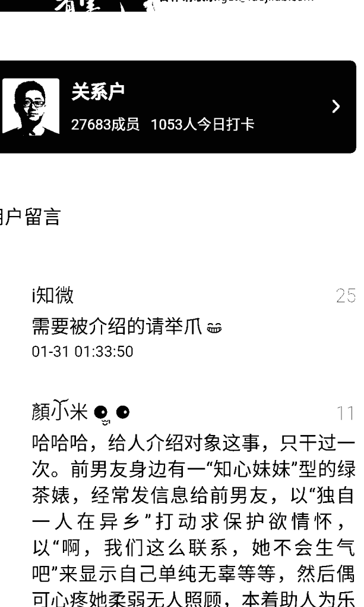

《权力的游戏》里，提利昂是弥赛菈公主婚事的介绍人，同时也是她的舅舅，提利昂担任代理首相，就把外甥女嫁给了多恩王子。

在当时，提利昂认为多恩比较和平，外甥女会比较安全，同时弥赛菈也是重要的人质，维系着这个同盟。

弥赛菈后来被谋杀。

历史上汉朝和匈奴的和亲，用的就是这种策略。

这是一个庞大的世界，做一个介绍人，处处是坑。

答应我，不要做炮灰介绍人。

不要毫无准备，一脚踏入这个凶险的政治世界。

## 用户留言

知微 25 需要被介绍的请举爪 🐾 01-31 01:33:50

颜尔米 👀 11 哈哈哈，给人介绍对象这事，只干过一次。前男友身边有一“知心妹妹”型的绿茶婶，经常发信息给前男友，以“独自一人在异乡”打动求保护欲情怀，以“啊，我们这么联系，她不会生气吧”来显示自己单纯无辜等等，然后偶可心疼她柔弱无人照顾，本着助人为乐的精神，尽心尽力介绍了一个特别(zhong)会(yang)照(nuan)顾(kong)人(tiao)的韦小宝型人物，从此他们的世界多彩缤纷… 🐼🐼🐼 （别赞，要脸） 01-31 00:29:14

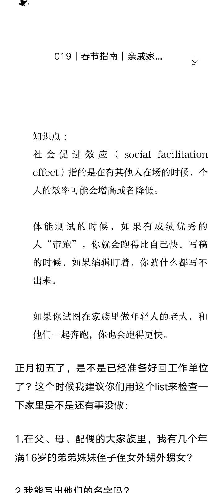

### 春节指南 | 亲戚家的孩子长大了，快送他们去和亲吧

019 | 春节指南 | 亲戚家...

知识点：
社会促进效应（social facilitation effect）指的是在有其他人在场的时候，个人的效率可能会增高或者降低。

体能测试的时候，如果有成绩优秀的人“带跑”，你就会跑得比自己快。写稿的时候，如果编辑盯着，你就什么都写不出来。

如果你试图在家庭里做年轻人老大，和他们一起奔跑，你也会跑得更快。

正月初五了，是不是已经准备好回工作单位了？这个时候我建议你们用这个list来检查一下家里是不是还有事没做：

- 1.在父、母、配偶的大家族里，我有几个年满16岁的弟弟妹妹侄子侄女外甥外甥女？

- 2.我能写出他们的名字吗？

- 3.我今年见了几个人？和其中的几个人交谈过？

- 4.他们读书还是已经工作？学什么专业，又从事的是什么职业？

- 5.过去一年里他们获得提升没有？他们满意自己的近况吗？

- 6.是否需要实习的机会？是否需要推荐工作？

- 7.他们的性格特点如何？

- 8.综合考虑他们的智力和情商，抛开好恶。给他们打一个分，满分为10。

- 9.给这些年轻人按照打分排序。

这个表的头几名，看看有没有他们的微信和电话，他们是否对你开放微信的朋友圈？如果对方屏蔽你的话，恐怕说明你被当做熊亲戚或者长辈了。

要把家族中最优秀的青年的联系方式要到手，跟他们保持联系，哪怕是不密切的联系。

这是春节长假的福利，有人觉得亲戚往来是一种负担，这是不对的。春节前无数公众号都在出那种所谓忒亲戚指南，反问二舅家的表哥结婚没，生不生二胎，买不买得起学区房，问表弟找不到得到工作，这些应对话只能当段子听，真的那么干，就是暴殄天物。

恐亲戚，那是化功大法，损人不利己，沟通才是北冥神功，把对方的力量拿来，为我所用。

你就应该主动去和平辈的或者晚辈的年轻人去聊，尤其是比你年轻的人。

之前我也跟大家说了，要夸亲戚的孩子，有些特别好的孩子还要送礼物，尤其是家境一般但是人聪明和漂亮的孩子，因为他们大有前程。

今天要说的是青年，我把这个范围设定为16~25岁，这是中国劳动法规定的合法用工年龄，这些进入劳动力年龄的青年，就是你需要观察、栽培、帮助的人，上限设在25岁，因为到了25岁之后，基本上进入职业成熟期，行事风格定型了，没有什么调教空间了。

多听取他们的困惑，帮他们参谋，生活上给他们一些关心和关怀，尤其是这些年轻人如果和你一样奔波在外地的话，更要让他们舒服一点。日子久了，他们遇到大事的时候，会跑来跟你商量。

关系户里有多少人在军队工作，或者父母在军队工作的。军队的亲戚简单直接，甚至近乎粗暴，军队里这种局面很常见，一个人努力拼搏成了军官，就尽量把村里的年轻人弄来参军，好好加以培养。

我们都有无法冲锋在前的时候，这个时候我们需要年轻人。我们也会有自己的队伍，那个时候，我们需要优秀的年轻人。

有人说不对啊，那不成了家族企业了吗，亲戚不能雇，也不好管。

你可以和你的朋友、熟人交换培养这些年轻人。互相做对方亲友的师傅，也是一种结盟的方式。我给它起个名字，叫职场和亲。

你的弟弟妹妹在朋友的身边工作，也能让你对这位朋友的了解更深入，如果这位朋友同时在你的上级机关或者甲方，就更好了。

### 职场和亲有这么几点要注意的：

- 1.这人是个好青年

当然，年轻人首先要在及格线以上，不要把那种坑架驳斗酗酒的亲戚送去给朋友训练，你送出的人才越好，你越能收获朋友的友谊。这也是为什么我会说你先要给年轻人打分，选择优秀的推荐。

- 2.没有好到要上天

你的家族里最优秀的年轻人也可能早早就被父母安排好出路，或者很有主意不由你操心了，那也没有办法，挑选你能hold住的人选吧。

我的朋友金承志是彩虹室内合唱团的负责人，今年他们唱了一个歌，说的就是家里亲戚的各种拉家常，其中二姨的词儿是：“要不要来我厂里当保安。”

其实二姨的念想是对的，就是把家里的人力资源尽可能地开掘出来，但是他对侄子的实力评估是错的，保安的岗位，是非常严重的误判。

- 3.本人意愿是关键

被和亲的年轻人要喜欢这个行业才行。强扭的瓜不甜，但同时也要考虑年轻人父母的建议，不过本人如果喜欢，父母是可以说服的。

- 4.亲戚关系说三遍

要说清楚，这是我的表妹，你该批评批评，要说真的亲戚关系。

### 5.不要轻易谈爱恋

为什么我要强调4，就是因为不老实的人容易产生恩怨，很多checkbox是自己...那就掉进坑里了。

当然，最靠谱的办法是不和任何同事和实习生谈恋爱，这件事情风险太高。

### 6.丰收季节可预期

你的list要每年更新，年轻人哪年进入实习期，哪年进入工作季，都要和年轻人聊一下，听听他们的想法，给一些建议，同时他们进入实习季或者工作季的时候，也就是你可能进行职场和亲的时候了。

不要担心把人推荐给朋友、熟人会被拒绝，因为你的朋友其实也需要自己人。懂事的好小孩子是稀缺品，你的亲戚知根知底，比胡乱划拉一个进来可能靠谱得多。

和亲对象就是你伸向一个新行业的触手，你会逐渐认识这个行业的很多人，如果你不在你出生的城市打拼，这是你布置各种关系网的开始。

人脉确实不是跟人扫微信扫来的，那都是无效的交际。什么叫脉？你俩人血连着血，那才是一脉，能互相给对方办事，那叫人脉，否则那叫通讯录好友。

亲戚里的年轻人可能会成为你的助手或者触手，你还会从心理上变得更强大。

你可能会受社会促进效应的影响。

社会促进效应（social facilitation effect）指的是在有其他人在场的时候，个人的效率可能会增高或者降低。

### ——习题——

我把表弟送去我的一个朋友那里接受他的训练，成功地留在了他的公司工作，表弟现在的首要身份是：

- A.我的亲戚
B.朋友公司的员工
C.我栽培的年轻人
D.我的线人

答案是B。

A肯定没错，但不是最首要的身份。

## P.s

### 家里不是舒适区，而是你的训练营。

有位用户看完了《为什么不要给人介绍对象》，吐槽说：“我觉得你最好把《关系攻略》改成《家庭关系攻略》，你最近都在家庭里转坳。我订阅就是为了认识客户的，现在看还不如去知乎搜人脉伪字呢。”

### 比别人想得多，比别人想得深，比别人练得勤。

### 《关系攻略》不是你要的如来神掌，都是笨练，硬桥硬马地从身边事开始。

大家对管理自己的人际关系有期待，但是可以先定一个小目标。当你从身边事入手，感觉到了可以改善自己的人际关系的时候，自信心就会大增，做什么都会觉得游刃有余。

我也再三强调过，家庭是试炼套路、磨炼演技的最好战场，春节大多数人都和大家庭在一起，我们就要加这样的内容。

试读文章，就像是幻化世界给你看，幻化完之后，还要从身边事入手慢慢前进，看见老师解释这个叫马步，这个叫弓步，就觉得自己比老师段位高，自己比老师强。这是佛家的我慢之一种，叫做增上慢。

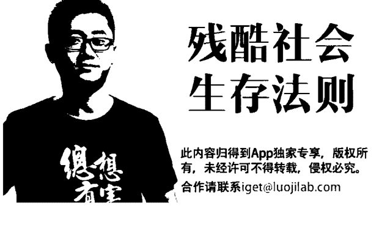

关系户
27696成员 2132人今日打卡

## 用户留言

i知微
还没到12点，先祝师傅小年夜快乐！
年财源滚滚！
02-01 23:37:43

作者 回复
到底哪天是小年？？？
02-01 23:38:18

粉笔小新
第一个第一个
02-01 23:35:38

琳羡
哇！凑巧更新了。那就晚睡一会儿吧。
熊老师过年好~
02-01 23:34:05

作者 回复
过年好哈
02-01 23:38:01

以上留言由 作者 筛选显示

## 春节后如何快速恢复工作状态

020 | 春节后如何快速恢复...

知识点：
“热手效应”指的是一个篮球运动员在连续投中之后的效果，他会更自信、更强大，这个时候对方教练员应该做的是，叫一个暂停，这时的防守球员可以调整一下自己的状态。

“热手效应”是不科学的，心理学认识上的偏差，有趣的是，队友和观众相信这种超自然的存在。

暂停会打断热手效应，但真正起作用的不是那一分钟，而是那一分钟的准备和调整。

春节就是一个暂停，所以你如果去年一帆风顺，要保持状态，如果去年竞争对手一帆风顺，你要趁机打乱他的节奏。

## 三万多关系户了，大家有多少人打篮球？

篮球是个好运动，家里有女孩子的一定要让她在体育课上好好学，女孩子不一定只能在篮球场边站脚助威。

## 春节是休息的日子，这句话是说给别人听的。

## 利用春节几天，好好准备一下，这是说给自己听的。

## 1.穿好点

## 2.写封邮件

## 3.关于连假

## 4.忘了春节吧

《智取威虎山》里，座山雕要杨子荣当“威虎山老九”，然后一想，不对，“我们是国军！”然后就封了杨子荣“上校团副”。但是这帮土匪要做寿、还要过大年三十，要喝大酒、放松了戒备，这就是典型的缺乏职业精神，平时一个个都是国军，腊月二十三开始到正月十五就都是老百姓了，最后被解放军里应外合一窝端了。

这个故事有原型，1945年的除夕，山东的八路军某团在聂凤智团长的带领下去打伪军师长赵保原，赵的军队都在喝酒看戏，一万多人一天就崩溃了。赵说起来此事愤愤不平：“八路怎么这么缺德，大年三十搞决战！”聂凤智的解释则是“兵法曰：奇者，出奇不意也。就是要打他个措手不及！”（这招打日军是不灵的，日本早早就进行了移风易俗，把农历春节改成了公历新年了。）

再后来北越军队进攻南越的“春节攻势”，武元甲将军也是把好多侦察兵以探亲为名渗透到城里去，然后除夕一起动手，据说借鉴了聂凤智的经验。

一个实用主义者眼里，没有什么神圣的春节，没有什么神圣的传统文化，没有不休息不是中国人。我不是要你藐视春节，我是要你强大，强大到能驯服一切习俗为我所用，驯服一个节日只是一个开始，以后还会有很多传统的那些见解，都会被我们关系攻略的修行者拆解、降服，成为我们的手段和朋友。

鼓励别人欢天喜地过春节，我们在家里暗暗磨枪，这就是强者的态度。

## 5.一些小改变

如果你对工作不够满意，记得更新你在招聘网站上的简历。把最新的成绩和变动写进去。

看看你的朋友圈头像和封面，如果已经用得足够久，可以考虑换一个更有朝气的。我最近会更新一篇《如何挑选微信头像》，感谢很多朋友送上自己的头像给我当例子。

尝试着挑选一个关于工作效率的APP试用一下，如果已经有类似应用的，试试看这个应用有没有什么过去没注意到的新功能，改善自己的晚睡、晚起、迟到、忘记约会等恶习。

我把昨天分享给大家的三句话再重提一遍：

关系要想经营得好，比别人想得多，比别人想得深，比别人练得勤。

还有之前我引用的那句古话：

凡事预则立，不预则废。

准备好上班用的东西，别上了地铁准备回微信了，掏出一个电视遥控器。

祝大家开工大吉。

P.s

还有同学说，熊老师，你说的都很对，我也赞同，但是我就是没法下定决心去实行，我该怎么办？

我建议你把《关系攻略》分享给一个最好的朋友，然后和他一起修行，异性朋友更好。

一个人的时候，有时候确实会不想做饭，怎么凑合怎么来。

但是馆子里从来没有见过一个男生说：老板，你们这个菜很好吃，闻着就香，但是我就是没法下定决心请她吃！

## —— 习题 ◆ ——

今天对职场中人来说是什么日子：

- A.立春；
B.2017年2月3日；
C.正月初七；
D.星期五，明天上班；
E.法定工作日的第一天。

正确答案是D。

一个日子，不同的人有不同的解读。如果一个人研究美食或者传统文化，A立春对他来说是第一天。

B的日期是对的，我们应该迅速把农历转换成公历，但是公历本身不是对职场中人最重要的数据。

C是一个还没恢复工作状态的人的看法，除非你在建筑业等年来以正月十六为归队日的行业，不要那样去定位今天。

E法定工作日的第一天的看法，比另外几个要有心，但是我们的推送时间是23点33，法定工作日的第一天已经到了尾巴上，应该有更好的定位法。

D已经恢复了星期几的意识，还点出了明天是一个工作日，这样定位今天的人，一定会越战越强。

今天是开工第一天，题是送分题，下次给你们来点难的。

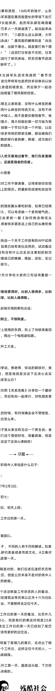

## 家乡的同学嘲讽我的工作，该怎么办？

021 | 家乡的同学嘲讽我的...

各位同学，这是《关系攻略》出现的第一篇点播，也是一个尝试，今天的问题是33同学提出的。

熊老师：

我有个很好的朋友，在家乡做朋友圈电商。

我在北京，来到罗辑思维之后，我个人发生了比较大的变化，她可能无法理解。今天她公开在高中同学群里说，我天天在被洗脑，我觉得很可笑和生气。

我知道拉黑不理是最好的方式，但是她一直是和我很好的朋友，又无法做到去拉黑。这种关系要如何平衡呢？

## 33同学：

你背井离乡来到北京的第一天，就应该做好被家乡的少数同学嘲讽的准备。

你是罗胖的员工，你敬爱和佩服你的老板，这种雇佣关系非常难得，只有在创业公司里才能有这样的一种“做事业”的感觉。

你不能奢望每个人都能理解这样的感情，如果这样的公司能像潮汕牛肉火锅一样每条街都有一个，它就没有那么珍贵了。

这就是我在《给郭德纲的斗徒指南》里提到 的：调低对别人的期待。

我有一个朋友，在安利公司的中国总部工作过，很多人们都会拿她的公司开玩笑，模仿那种一言不合就卖洗洁精的姿态。

后来她换到了一个科技大公司，做搜索的，但是后来出了负面报道，也有朋友黑说，听说用贵司的搜索会死人。

她告诉我，她说那些人其实不知道事情的具体情况，当段子讲并没有恶意。

年轻人选择一个有公众知名度的公司，有若干好处，我有个朋友曾经因为写作的缘故，体验生活而去优衣库打工，跟我说优衣库的普通员工收入很低，她不理解为什么这些小城来的青年们会选择在这里工作。

- 我说：1.工作环境好，冬暖夏凉不用闻尾气，有的卖场里还有新风系统，对肺好；2.有做储备店长的机会，为回家乡开店也可以攒经验值；3.这个品牌在家乡的小城也是一个很有名的品牌，家里问他在哪工作，他一说都知道。

我那天跟罗胖老师一起吃火锅，从包间出来他就被粉丝认出来求合影。33同学你在罗辑思维工作，对你的个人成长有很大的好处。

你选择了一个有声望的公司，也要忍受不了解的人、或者故意贬低他的人。有人给的是故意的恶评、也有人则是各种各样的误解。

你的同学恐怕是不了解它的人，他们往往倾向于选择他听过的是最庸俗最大众路货的那一套评价。

你的公司，让她有了第一次可以评价商业模式和互联网的机会！这一刻，她体验到了一个互联网时评家的快感。

这一刻你可以不护着罗胖，先不打断你的同学，让她的快乐飞一会儿。

这是一种孤独的快乐，其实她不知道应该怎么跟你聊天，你的工作她可能不懂，你的生活可能和家乡很不同，我们对陌生人可不会这样的，只有熟人和朋友想要变成我们不认识的人，我们才会惊惶地伸手去拉他。

这时你要展示给她看：我没有变成怪物，这是肌肉，我在变好，而且我希望我们一起变好。

等她有机会来北京玩或者出差，记得带她来参观一下你的公司，你的工位，你们的会议室。我见过你们同事在会议室里做的用心的小标签，很有趣。

用行动告诉她，我在这里混得很好，你在家乡也要努力。

对这种从小的朋友，可以适当多一点善意，这对自己在朋友和同学之间的口碑都会好。自己的心里也更容易舒服。

我在《关系攻略》里一直都在讲述各种策略的大杀器和核武器，是要大家认得各种凶险的明枪暗箭，熊老师教了你这么多的韬略招法，你不会拿来对付一些人，因为他们和你，是朋友，是可以信赖的朋友。

参观完了公司，你可以放心地告诉她，这里没有一个暗黑教主，这里有一个爱笑的忙碌的胖子。

这里还能认识好多好玩的人——你看我遇到困惑，找熊老师点播可以加个塞，30分钟之后就得到了回复。一个小时后，一篇回复的文章呐，都出来了。

要知道，熊老师的写作清单很长，排在队列里有200多篇！

用户留言

## 什么样的微信头像才是得体的

022 | 什么样的微信头像才...

知识点：
“单纯接触效应”是一种被心理学试验证实了的存在。

如果你是一个比较正面或者中性的形象，你越在别人面前多晃晃，别人就会越喜欢你。
像好人的半熟脸特别招人喜欢。

上个月，脱不花听了以下这套头像理论之后，立刻换了一张符合标准的照片，据说整个人工作效率都变高了。

如果你的微信不是一个亲友囤阵地，而是承担了部分的工作内容，那你就要好好选择一个微信头像。

尤其是，当你要和客户和合作伙伴打交道，就要考虑自己的头像会对对方带来什么样的感受。

可惜的是，许多人已经不年轻了，却没法意识到这么一个超级大号的真理：

## 我的头像是给别人看的。

只考虑自己的爱好，很有可能给好友们带来反感。

- 1. 千万不要翻白眼

这张图片是我的一个朋友的头像，这张图是我忍无可忍、动心思要写这篇文章的开始。她在一个互联网企业，做市场类工作。我看见这张图就对她说：“最好换掉。”

> （我们熟才这么说，记得吗，我说过“不要给人提免费的建议”。）

“为什么呢？”

“除非你的微信完全不用来工作，不然的话是一种冒犯。”

我们每个人都应该考虑这个界面：

在微信对话的时候，我的头像会出现在绿框旁边，往外翻白眼是可以的。
但对接受者来说，你的头像在左侧，正好对着你翻白眼。这一定会让人不舒服。

这姑娘一定就明白了，她换了一张正面的照片，其实本人挺好看。

我对她说，这就对了：

## 正面的、精心拍摄的照片，一定!=比模糊的自拍好。

眼睛正视前方的照片，比看着外面的照片要好。

- 2. 不要张大嘴

这姑娘和我短暂同事过，性格特别可爱。听说我要收集头像，就拿来给我了。

我第一句话就是“天呐，扁桃体都看见了！”

拍照一定不能张嘴，以前曾先生挖苦那些看热闹的人，说伸着脖子张着大嘴，像被拴住脖子的鹅，自古相书上就把没事爱张着嘴看做是一种穷人的相貌。

你肯定是为了娱乐大家，但不要为此牺牲了自己。我们看看光荣公司做的游戏《三国志》给历史人物的画像就可以知道，张着嘴的都是小角，闭着嘴的才是大人。

给了她一些建议之后，她换了一张头像，正常多了，不过我建议她尽快换成商务照，或者证件照都可以，总之不应该用自拍图，所有的自拍险都会变形，大家看见的，是不够熟悉的人，不利于不太熟的伙伴认出来。

## 3. 把眼睛睁开！

有个朋友给我发了这张图。

他酣睡在沙发上。

留神，认识新朋友的话，对方一定会看你的头像照片，可能在延长的一段时间，他脑海里你的形象都是你的头像。

一个酣睡的样子也许并不适合认识新朋友。

此外，你的老板每次看见你，都觉得你睡眼惺忪，那他心里是什么感受呢。

这兄弟想了想，决定换一张白衬衣照，及格线以上，表情不错，亲和力也到位了。

我称赞说，这个好多了：

眼睛再不大，也比闭着要强。

## 4. 不要用涂鸦过的头像

确实有很多人喜欢玩这类应用，但是我要说一句，卖萌只应该卖给有交情的人看，这姑娘做的是宣发推广类，用这样的头像很容易被他人认作不职业。

其实证件照就可以照得挺好看了。

女孩儿，没胡子肯定比有胡子好看。

## 5. 不要有口罩

除非你本不是在口罩生产商工作，不然最好是不用戴口罩的头像。

她在美国生活了好多年，现在会经常往返于两国之间。有些人对这样的好学生要求特别苛刻，你戴口罩拍照，一定会有人觉得不满，说就你俩华侨矫贵，觉得你不爱国。

当然你可以拉黑这样的人，但是我是建议，不要招黑。

要把你的笑容露出来，不要让口罩妨碍了你和祖国人民的眼神交流。

## 6. 发型和职业装

收到这位朋友的头像照，我问他穿的是不是手术服，颜色确实有点像，他说不是，这就是一件普通T恤。我就建议他最好换一个带领子的衣服。

如果真的是医生的话，那穿手术服和白大褂都是合适的，要喜欢你的制服！尽着身着它们照相。

这是跟谁很友好的一头像，但是发型没有太认真打理过。

## 7. 面部大小

## 7. 面部大小

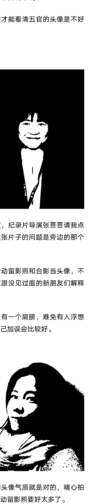

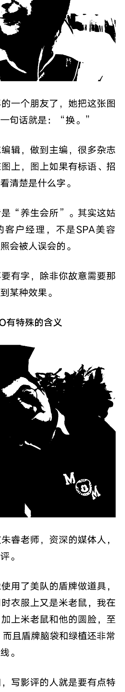

这个姑娘跟我说，图1是一张精心拍摄的照片，图2则是自拍，问我是不是还坚持照片胜过自拍，我说我仍然这样认为，但2做头像，确实比1要好。

1作为一张旅游时的照片很优秀，但背景繁杂，一堆马马在跟你的容颜争夺眼球，这是不对的。如果要用这张图，要精心裁剪一下，留到半身，那就是好的。

2的优点就是面部面积大。

需要点开大图才能看清五官的头像是不好的。

## 8. 只有你一人

这是我的朋友，纪录片导演张茗茗请我点评的照片，这张片子的问題是旁边的那个肩膀。

尽量不要用活动留影照和合影当头像，不然的话你还在跟没见过面的新朋友们解释哪一个是你。

此外头像照里有一个肩膀，难免有人浮想联翩。别给自己加误会比较好。

这张半侧面的头像气质就是对的，精心拍摄的照片比活动留影照要好太多了。

## 9. 注意背景里出现的一切字

这是我很多年一个朋友了，她把这张图给我看，我第一句话就是：“换。”

我过去做杂志编辑，做到主编，很多杂志出错，都出在图上，图上如果有标語、招牌，都要仔细看清楚是什么字。

这张图的背后是“养生会所”。其实这姑娘是位银行的客户经理，不是SPA美容师。但这么拍照会被人误会的。

背景里最好不要有字，除非你故意需要那里面的字来达到某种效果。

## 10. 道具LOGO有特殊的含义

这是我的朋友朱睿老师，资深的媒体人，写得一手好影评。

他的这个头像使用了美队的盾牌做道具，大圆眼镜、同时衣服上又是米老鼠，我在图中数了数，加上米老鼠和他的圆脸，至少有11个圆。而且盾牌胸梁和绿植还非常巧地三点成一线。

不过并不和谐，写影评的人就是要有点特色，作家就是要“有个性”的。换句话说，在某些特殊行业，提供某些特殊服务的人，大家对他们的宽容度最高。如果他是公务员，举着美国队长的盾牌就比较不妥。戴着大棉帽子搓汽车、补袜子可能说服力会更像一个好榜样。

复习一下，我告诉大家了这么多禁忌：

- 不翻白眼做鬼脸；
不张着嘴，要微笑；
不用床照；
不把自己涂鸦成小猫小狗；
不戴口罩；
头发不要太乱；
照片面部不要太小；
背景里不要有字；
用道具不要不符合自己的身份。

有人说，我纵心所欲，爱发啥发啥，这么套路不是太累了吗？

一点都不累。

微信同时是通讯工具和社交工具，和过去的书信很像。

有没有人翻过家里50~70年代的旧照片？那时候亲戚朋友之间通信，往往要附上自己精心拍摄的照片，告诉对方，最近是怎么样的。

这照片可能就被压在朋友的桌子玻璃板底下，你记忆中的那个人，主要就是那张照片。这也是为什么那个时候的人把照片看得特别重。

同样，你在朋友圈里，一些新朋友对你的感受，就是那个头像，你用奇奇怪怪的头像，就会出现奇奇怪怪的人。

美国有位心理学家罗伯特·查容克Robert Zajonc曾经做过一个试验，他拿了很多照片给受试者看，其中一部分照片是反复出现的，结果：

只要这出现的脸是友善的（穿得像个科学家）、或者中性的（穿着运动服），出现次数越多，受试者就会越喜欢。

如果这张脸是负面的（戴着手铐），出现的次数再多，也不会让受试者对他有一丁点好感。

所以：

- 我要你尽量把自己的面容展现给朋友们；
我要你给他们正脸；
我要你对他们笑；
我要你在照片上跟手机外的人有眼神交流；
我要你的服装更精美、发型更精心；
我要你舍弃不重要的背景。

此外，还有一个网友提示：不要对照片做左右翻转。

有的人会觉得左右翻转之后的自己更顺眼，那是因为你在照镜子的时候看到自己，而你的同事朋友们看的是活体的你，你如果因为自己觉得顺眼就把照片左右反转，出来的效果就会让你的朋友觉得说不出的奇怪，完全不好看。

我们都倾向于接受一个更熟悉的形象，这点是被心理学试验所证实了的。

估计有同学要问了，熊老师，你的微信头像是什么。

我在进入得到开《关系攻略》之后，就一直使用现在的头像图，之前我一直使用的是卡通头像，因为我们做的网剧项目有很浓的二次元动漫气质，也算是贴近行业。

有些人如果不愿意用自己的头像，用动漫、名画、宠物都是可以的，不过不要用梅兰竹菊，那一般是老年人的头像选择。

尽量不要用孩子的头像，尤其是已经上了幼儿园、相貌容易区分的孩子。

很多妇女儿童保护组织都有过提示，把孩子的照片放在社交或者社区内，可能被恋童癖网站类拿去做拼接色情图，也不要孩子的照片发了朋友圈，还加上他经常出现的地点。

一个人到了生儿育女的年纪，多少都会有几个人看你不顺眼。

小心能驶万年船。

再次感谢捐图受评的朋友们。

## —— 习题 ——

看见一个和你关系比较紧张的女同事的头像穿着暴露、非常不妥，已经有客户暗地对你表达了抱怨，你应该：

- A. 把头像 “另存为” 本地相册，同时截图她的主页首页。
- B. 告诉她，熊老师说过这是对客户的冒犯。
- C. 告诉领导她的不足之处。
- D. 闷声发大财，坚决不说。

答案是A。

B被排除很简单，相信大家都不会办这样的事了。

C是一个结怨的招数，这点小毛病根本就不能将对方怎么样。

D是一个正常的策略，这样做也很合适。

A更好，在有朝一日翻脸对决的时候，可以用来做防守的手段，不职业的行为是可以批评的。

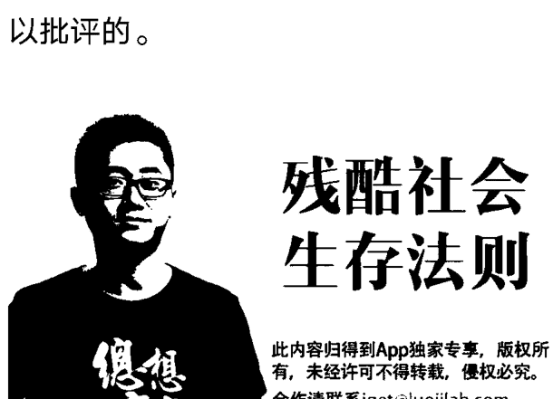

此内容归得到App独家专享，版权所有，未经许可不得转载，侵权必究。合作请联系iget@luojilab.com

## 如何谈辞职

023 | 如何谈辞职

知识点：
心理学家 的研究表明：报复只能够得到一种短暂和肤浅的快感。

只要你的离职是“人往高处走”，你那个老朽巨猾的老板基本不会羞辱你和报复你；而如果你是主动离职，绝对不要用《劳动法》做武器去多要几个月工资。

“做人留一线，日后好相见”对双方都有效。

遇到说自己辞职没法辞掉的人，总会给他们一个建议：

问问自己，你到底想成为什么样的人？只给自己提三条要求。

我自己也回答过这个问题，结果是这三条：

想成为一个内心特别强悍的人。

这个人遇到各种诱惑或者威胁不动摇，一直盯着自己的目标。

想成为一个努力的人。

这个人日常偶尔偷懒也会每次努力精进，让自己，和自己需要照顾的人过得更好。

想要成为一个关系达人。

对人诚恳、对事精明，能够轻易拆解各种明枪暗箭，解决掉最危险的局面。有很多朋友。

## 1. 羞怯

## 2. 不良的企业文化

## 3. 领导教了我好多东西

## 4. 害怕领导为难

## 老板的挽留措施

三遍“老板留我是爱才”，千万别因为这事被激怒。

只要他发现你去意已决，一般就会做一个顺水人情了。

一般来说，如果你的老板不是公司的一把手，他阻拦你的概率要小得多，但是他更可能希望你能留任一段时间，给他一个招人的缓冲期。

所以找工作的时候就要和新单位约好，要留 posisi 至少 30 天的缓冲期，千万不要因为喜欢新工作，就跟对方说下个星期就来上班。

为什么要说至少 30 天，因为这是《劳动法》规定的自动离职期限，大多数的公司也会在合同上标注，提前解除合同要提前一个月说明。

## 如何开口

我因为个人原因要离职，觉得工作太忙、路太远、顾不上家里、想转行、想留学、想换城市。

个人原因是最好的，有一种情况你可以公布自己的下家，那就是下家比现在的公司强大很多、不在同一个行业、在另一个城市，与本公司没有直接竞争关系。

我很感激公司，很感激领导您。

某某公司和某某公司表现出意向，我还没有决定。

希望您能批准我的辞呈。

## 辞职饭

可以请领导私下吃饭，尤其那种老师角色的领导。

## P.s 关于仲裁

我经历过劳动仲裁，非常麻烦，也并不愉快。

## 1. 留证据

## 2. 和解优先

## 3. 新东家的谅解

## P.s 关于下属辞职

## —— 习题 ——

如果你处于提交了辞职报告之后的第 25 天，约定 30 天离职。这时候你的老板应该是：
A. 屋子里坐着的那一个；
B. 马上要去的那个屋子里坐着的那一个；
C. 我现在是自己的老板了啦啦啦；
D. 两个都是我的老板，我自己委屈一点都好，把两边的活儿都干了。

答案是 A。

先告诉对方自己要解决好所有现有工作。你尤其不应该伤害你的老公司。其实大多数公司都会赞许自己即将到来的员工处理好前东家的工作，这代表职业精神，处理清了还能让你个人少很多麻烦，也避免牵连到新公司。

C这种狂欢会导致你迟到早退，一副人心散了的架势，成为老东家的害群之马，也会让老同事觉得你毫无担当。

D会让你变得特别辛苦，尤其不要对新公司保证两边都能对付，尤其是你对新公司的劳动强度一点都还不理解。过度劳累会让你不断地犯错误，最终可能会有很大的麻烦。

安全平稳就已经够了。

## 残酷社会生存法则

此内容归得到App独家专享，版权所有，未经许可不得转载，侵权必究。

## 为什么换了新工作前三个月里不要撇钱

024 | 为什么换了新工作前...

知识点：
心理学上有一个著名的“儿童棉花糖”试验。

把一块糖放在孩子手里，告诉孩子如果忍半小时不吃它，就能多得一块。

受不了诱惑的小朋友，大多会成为普通人，能忍受诱惑的孩子，更聪明，前途更远大。

这种抵御诱惑获得更大利益的能力就是延迟满足。

延迟满足不是放弃利益，而是获得更大的收益。

更有野心和想象力的人，才更容易成功。

## 自我支撑

比如购买装备和接受培训，大家都不是为工作而生的，很多人的素质能力可能都和新工作还有差距，比如有的人一直在国企，现在要去外企，那他可能面临着的典型问题就是外语能力。

## 旧关系的维护

跳槽前后是盘点一下已有人脉的好机会，对于自己的新动向，用朋友圈或者微博上发表声明的方式是很好的，不过你要知道，这两种都不是强推迭。有些人可能根本看不见。

## 新关系的开拓

是谁推荐你来这个公司的，这个公司里第一个向你释放善意的人是谁？第一个带着你到公司附近吃饭的人是谁？新公司的其它部门里，有没有自己的前同事或者老朋友？附近500米到一公里的写字楼里，有没有自己的老朋友？

为什么是三个月？一般来说，大多数的公司约定的试用期是1~3个月。

换工作后（如果要转行业，还会更辛苦）的各种不适应，可能会让你的实力难以发挥，那个时候用心经营一下关系，盘点资源，是个好主意。

三个月之后，工作会逐渐走上正轨，工作也转正了。这时你可以通过实力来扒脱许许多人了。

要耐得住寂寞、耐得住诱惑，别忙着坐金殿、当皇帝，何况你不过是多挣了几千块。我让你多花钱，不是让你无欲无求，而是让你延迟满足，如果能做到这一点，你的格局会大得不得了。

把一块糖放在孩子手里，告诉孩子如果忍半小时不吃它，就能多得一块。

受不了诱惑的小朋友，大多会成为普通人，能忍受诱惑的孩子，更聪明，前途更远大。这种抵御诱惑获得更大利益的能力就是延迟满足。

能等到第二块糖的小朋友，不仅能忍得住诱惑，他们还能想象得出未来。

在职场上，很多人根本想象不出自己的未来。

新工作的头几个月多花一点钱，是为了工作效率更高，是为了让自己多挣钱，收获更多人的善意。

## 延迟满足不是放弃利益，而是获得更大的收益。

## 更有野心和想象力的人，才更容易成功。

P.s

如果一个人当众表现出延迟满足的能力，他的行为很可能会充满美感，这个时候他可能会因为自己的魅力而收获一些人的善意甚至友谊。

在《射雕英雄传》里，教郭靖射箭的师父哲别就是一个这样的聪明人。哲别曾经是铁木真的敌人，但是他跳槽到成吉思汗账下之后，成吉思汗给了他一块金子。我们知道金子很值钱，但是哲别当场就要给郭靖，因为他掩护自己还不肯招出自己的下落，被打了。钱可以私下给，但哲别是当场问大汗，能不能给郭靖。

哲别谢了，道：“大汗，我转送给这孩子，可以吗？”

铁木真笑道：“是我的金子，我爱给谁就给谁。是你的金子，你爱给谁就给谁！”

## —— 习题 ——

你到了一个新公司，一位比你资深、级别高的同事在和你吃饭聊天几次之后，决定向你借钱，大概是你一个月 的薪水，你会考虑：

- A. 借给他，熊老师说了，要把头三个月的收入都花掉，不要攒钱；
B. 询问为什么借钱，听他解释之后再做决定，希望对方打下借条；
C. 不借，我觉得这就是一个每次逮住新人就坑一次的家伙；
D. 借给他半个月的薪水。

答案是C。

所以，不要借钱！不要借钱！不要借钱！

关于借钱，我最近会推出一篇《如何开口向人借钱》。

## 我们以貌取人，但我们并不残忍

025 | 我们以貌取人，但...

知识点：
心理学上说的自尊，和日常说的“自尊心还挺强”略有不同，是人对自己的认识水平。

高自尊的人就是自重自爱高看自己一眼的人。

高自尊的人更适合做朋友，他们会称赞别人，但更喜爱自己。

低自尊的人看低自己，但更爱贬低别人。

长得好看的人容易高自尊，高知家庭、更好的学校更容易培养出高自尊的人。

这篇关于以貌取人的文章酝酿了很久，终于在大家即将进入换工作高峰期的时候推出来了。我们在人际交往当中总是需要快速地判断人，在几秒钟到一分钟之内决定对一个陌生人的态度，这个决策过程不能像商亲那样拖太久。

## 注意了，关于团结，敲黑板！

+   1. 不团结，指的是跟你不团结。不是跟领导不团结。
2. 领导希望下面有一点不团结。
3. 大多数的领导都希望看见下面出现良性竞争。
4. 几乎所有的领导都分不清良性竞争和互相拆台。
5. 你跟领导说某某不团结，领导只会不疼不痒地说那人几句，暗地觉得你没用。

最典型的例子就是李云龙了，这是一个抗命不遵，最不讲团结的人，张嘴就是不团结的话：

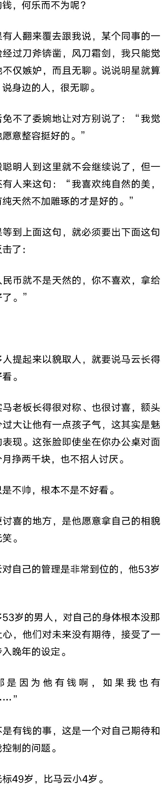

但是：

领导喜欢他；

同事喜欢他；

群众喜欢他；

友商喜欢他；

就连供应商都喜欢他（抗战剧里鬼子是送吃穿送枪炮的，真实历史上是强悍的敌人）。

## 颜值第五定律：三十岁后的颜值代表着人的用心程度

我不知道多少人认真观察过大大的女生们，大一的女生，除了个别中心城市长大的，一般都有点土土的，大二大三还是学着打扮，到了大四，基本上都是漂漂亮亮的。

这就是人在进步，遗憾的是，在找到工作之后，很多人真的放松了对自己的要求，开始变得灰头土脸了。女性可能不再装扮，不洗头的情况也越来越多。很多中年男性的衣服和身体都散发着烟味和臭味。无论男女，都开始疏于管理自己的体重，大批的人身体胖得都不像样子了。

在欧美，你不能歧视不打扮的人，你不能歧视体重疲滞的人，不然的话，这就是政治不正确。在中国，这种不正确也开始出现了。

好吧，我们不歧视，但是我们最好别变成那副样子。

真正颜值特别低的人很少，大多数的不好看都可以通过努力有所改善：

+   胖可以瘦；
瘦可以有肌肉；
牙不好可以矫正；
眼镜不好看可以换副新的；
不会穿衣服可以硬背一些搭配（现在我们公司里，欧小宅和雨桐就在整天教我背穿衣搭配）；
脸大可以换发型；
矮有难度，但是可穿衣服显腿长；
鼻梁眼皮下巴都可以动。

有人说“三十岁前相貌要父母负责，三十岁后的相貌就要自己的负责了。”这个说法有他的道理，挤来了钱投资到自己的容貌和打扮上，改善自己的一些小缺陷，这是非常得体的行为，和抠掉脚上的鸡眼、割掉过长的包皮一样没什么可指责的。

有的人喜欢拿同事整容说事儿，看见领导或者男同事多看某个女同事几眼，就要提到这件事情。这除了得罪整容之人之外，毫无意义。

我当领导，一点都不介意自己的女下属整容。开会多看几张好看的脸，又不花公司的钱，何乐而不为呢？

如果有人翻来覆去跟我说，某个同事的一张脸经过刀斧锉凿，风刀霜剑，我只能觉得她不仅婀娜，而且无聊。说说明星就算了，说身边的人，很无聊。

最后免不了委婉地讲对方别说了：“我觉得她愿意整容挺好的。”

一般聪明人到这里就不会继续说了，但一定还有人来这句：“我喜欢纯自然的美，只有纯天然不加雕琢的才是好的。”

如果等到上面这句，就必须要出下面这句来反击了：

> “人民币就不是天然的，你不喜欢，拿给我好了。”

P.s

好多人提起来以貌取人，就要说马云长得不好看。

其实马老板长得很对称、也很讨喜，额头部分过大让他有一点孩子气，这其实是魅力的表现。这张脸即使坐在你办公桌前面一个月挣两千块，也不招人讨厌。

他只是不帅，根本不是不好看。

他更讨喜的地方，是他愿意拿自己的相貌开玩笑。

马云对自己的管理是非常到位的，他53岁了。

许多53岁的男人，对自己的身体根本没那么上心，他们对未来没有期待，接受了一个步入晚年的设定。

> “那是因为他有钱啊，如果我也有钱…… ”

真不是有钱的事，这是一个对自己期待和自我控制的问题。

陈光标49岁，比马云小4岁。

他为了瘦下来，对胃进行了一次手术切割。

## —— 习题 ——

有人把关系攻略里的文章在视频里念一遍就算自己的原创节目；
有人把共享单车砸坏了锁之后刷上别的颜色的油漆偷走自己用；
有人把收到的假币找市场花出去。
这几类人的共同特点是：

+   A.存在侥幸心理；
B.穷疯了；
C.外表长得丑；
D.自尊水平比较低。

答案是ABD。

三个正确的选项不详细解释了，重点解释一下C，确实可能抓住三个人，都长得很丑，但很多时候，自尊水平、不法行为和丑还是有区别的。

人们对相貌美丽的人会有比较高的期待，希望对方行为体面。但是有的时候，高颜值的人自尊水平确实可能比较低。

教育不当、同学欺凌、身体伤病和童年不幸都可能造成低自尊。

有的时候，新闻上会说抓获了美女小偷，这就是人们对颜值的期待。

还有的时候老百姓会说：“看不出您穿得干干净净的，还用假币！”

## 残酷社会生存法则

此内容归得到App独家专享，版权所有，未经许可不得转载，侵权必究。合作请联系iget@luojilab.com

这也是为什么我没法喜欢机关工作，许多机关的风气就是，新人要受任何一个老员工的使唤。这么多年，我推荐过许多从体制内出来到私企的朋友，也用过许多体制内出来的员工，现在我们的队伍里还有人民日报和新华社出来的同事。这些人才华横溢、有很多的想法。

一个机构如果不需要追求效率，而仅仅是为了搞平衡，这个机构就难免会出现俩人管一个人，一群人管一个人的尴尬局面。

P.s

爱玩游戏的人可以参考一下光荣的游戏《太阁立志传》，那是一个披着历史外衣的职场游戏，那里面对汇报关系看得非常重：

主公给将领配备的手下，称为寄骑、与力。就是借给你帮忙的。

将领自己招来、用自己收入支付薪酬的人，对“大主公”来说叫“陪臣”。

陪臣的功勋要分给自己的主公，但没有效忠大主公的义务，所以中世纪欧洲称之为“我的手下的手下就不是我的手下”。

日本战国是封建制，中世纪欧洲也是，领主从国王（幕府将军）手里拿到土地，为之效忠。中国历史上虽然也称作“封建社会”，其实秦朝之后大多数时候都是中央集权的郡县制国家。郡县制一般会追求两位长官，有的时候是一文一武，有的是一正一副，不过大多数时候分工明确，不会有一仆二主的困扰。

中国人对汇报关系不够敏感，可能跟缺少封建制的熏陶有关系。

这件事，谁先明白谁沾光，谁不敏感谁遭殃。

要知道你是在给谁打工。

## —— 习题 ——

大领导直接给你安排任务，但是你们部门现在特别忙，任务很多你应该：

+   A.欣然接下，安排在所有顺序的最前列；
+   B.正色拒绝，让他给他的手下、你的领导下任务；
+   C.答应下来，同时告诉自己的领导，请他安排优先级顺序；
+   D.告诉自己的领导，请示他的意见，同时暗暗把优先级调到最优。

答案是D，相信很多人都选对了。

C是对的，这是面子上要做的，里子上，要让大领导的需求得到满足，如果是直管领导和大领导有了对抗，要往后排，你也可以不至于被卷进去。

回头会专门有一篇讲讲领导和大领导冲突时的站队方式。

## 残酷社会生存法则

此内容归得到App独家专享，版权所有，未经许可不得转载，侵权必究。合作请联系iget@luojilab.com

## 如何拒绝别人的无理要求

027 | 如何拒绝别人的无理...

知识点：
心理学研究人的思想和决策过程，在这个过程当中，人可能会成为自己的敌人，一个干扰思考的障碍，就是自己给自己加的限制。

经营人际关系的时候，也不要给自己加上太多的限制。比如希望全世界喜欢自己，希望跟全人类和和气气，都是孩子气的傻念头。

今天我们先来做题，下面这张图里有九个点，希望你能够用4条以下的线把以下九个点连起来，四条线可以交叉，但不允许折返。

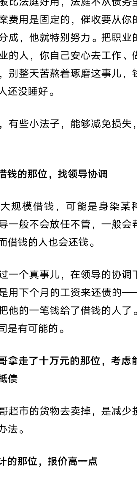

我本身不喜欢做这类脑筋急转弯题，但是这个题目确实非常巧妙，答案是这样的：

两个都突破了那个方框，第二个更是把点本身变成了圆形。利用了抽象的点在真实世界当中其实有直径，真的是才华横溢。

是不是有人大呼“作弊”了？对啊，要认真审题，我从来说也没有跟大家说，这些线要放在那个框框里。

是你，没错，就是你自己，非要给自己的思路加上一个限制，把思路就变成了死路。

这个“九点问题”非常经典，可以分享给那些爱钻牛角尖的朋友。

遗憾的是，给自己的脑子加框，是我们很多人都经常做的。

在做了关于借钱的预告之后，大批关于借钱的留言出现了。

有的同学的留言，感觉像是进入了一个悲惨世界：

熊老师啊，同事欠我钱，我怎么能不得罪他把钱要回来？

熊老师啊，我表哥借我钱开了个大超市，怎么不伤和气地把钱要回来？

熊老师啊，甲方拖欠我的设计尾款，怎么才能不翻脸的情况下把钱要回来？

还有别的：

熊老师啊，我的客户总是对我动手动脚的，怎么才能拒绝了又不丢掉这个客户？

注意看这三个句子：

不得罪他、不伤和气、不翻脸、不丢掉。

明白了么？这就是给自己的思维在加框。

## 1.同事借钱的那位，找到领导协调

## 2.被表哥拿走了十万元的那位，考虑能否拉货抵债

## 3.做设计的 babak，报价高一点

## 4.遭遇咸猪手的姑娘，记得录音取证

他们欺负的，都是最善良、害怕说了“不”字，就被对方抛弃的人。

## 残酷社会生存法则

此内容归得到App独家专享，版权所有，未经许可不得转载，侵权必究。
合作请联系iget@luojilab.com

## 用户留言

见
我今儿最早?
02-21 01:28:16

作者 回复
😂 我睡过去了。忘了放评论。。。 
02-21 01:40:21

## 如何开口向朋友借钱

028 | 如何开口向朋友借钱

借钱是一件危险的事，我们可以往人类的豪 misuse时期溯溯一下，最早的奴隶有两个来源，一个是战争，一个就是债务。

借钱这种事，至少和打仗差不多危险。

今天的借钱是考虑到交情的时候：

开口之前，怕对方不借；开口之后，对方怕你不还。

所以要有一个干净的借钱流程和一个标准化的开口指南，能让你减少这种纠结和损耗。

简单把所有借钱的原由分类，大概分成这样几类：

## 1.药费

如果家里有人生病，急着用钱的话，这是最值得人们同情的理由。大多数人往往也会倾向于借钱给遇上这种困难的朋友。

## 2.赔偿

## 3.买房

## 4.消费

## 5.投机

## 关于见证和保人

## 对方借给我的钱比我想像得少

其辱。

这也是我为什么说，如果对方借一笔大钱，可以送给他一笔小钱。因为一笔大钱可能完全会收不回来，送一笔小钱，对自己来说可以止损，对对方来说，也收到了你的善意。

我们重温一下借钱的通用原则：

解释自己的困难，标定借钱数目，解释自己的偿还能力，约定还款期限。

+   1. 打借条；
2. 对大额的债务，提供抵押物；
3. 一旦还不上时候的解决方案；
4. 如果健康状况不好，要主动提及自己的身后偿还安排，因为对方未必好意思说。

你要比对方想得更周到，更像一个在商言商的人，对方反而会因为你的严谨而对你更加尊重。

谈钱不伤感情，谈利息不伤感情。

谈感情才伤感情，谈感情还会伤钱，没有例外。

熊太行

今天的选择题比较特殊，我最近在和得到 sahi 的伙伴们商量“关系攻略”的直播节目，初步决定每个月来一期，这个直播节目有任务：1. 梳理过去一个月里的知识点，给大家温故知新。2. 一些战略层面的课程会放在这里，比如第一期就会讲《如何布局你的人际关系》。

正课结束之后，会念一些全国关系户、港澳台关系户、海外侨关系户的来信贺电，挑几个关心的问题来聊聊。

一些比较难于用文字描绘的技巧，可能需要演示或者表演的，会在这里分享。

我需要你们告诉我，你们想听什么：

+   A. 职场关系—体制内的规则
B. 职场关系—体制外的规则
C. 职场关系—和领导的关系
D. 职场关系—和同事的关系
E. 家庭关系
F. 情侣关系

直接在评论中留下你最想要解决的关系的序号，我们会根据统计的数字来决定先给你拆解哪一招。

此内容归得到App独家专享，版权所有，未经许可不得转载，侵权必究。

## 自习课 | 谁不敏感谁遭殃

有人说：请熊老师不要在回复留言的时候讲段子。

这件事不能答应，因为我们要发心向行业大牛学习。

佛陀和耶稣回答问题的时候，都会讲段子。

关系攻略的课堂上从来也不应该是正襟危坐，相反，在紧张的、明枪暗箭的社会丛林中，幽默感是缓解压力的最好工具。

以后每周二、周四我都会选出一些留言，在评论中，有些问题你也能得到答案。这两天就且当作是大家的“自习课”。

## 来自：陷入了向两个领导汇报的局面应该怎么办

遇双头领导时自保方法:1.找人力资源部门要明确的汇报线。2.申请不接受双考核指标。3.给无 může 的领导配普通人员。4.记不住的翻看此篇文章。这事谁不敏感谁遭殃。

熊老师，我有个问题，我的直属领导会不经过我下发命令给我的下属。这让我有些气愤，这是Interface 不信任我。我的领导这个人比较官僚。需要别人向他表衷心。而我不是那样的人。这让我意识到我的下属会比较为难。而我的有些下属也不向我汇报。我该怎么办？请帮我解答下。谢谢了。

熊太行

跟你的领导谈一次，恭维他，跟他建议有吩咐找你。你觉得你刚正不阿，他就觉得你不配合？什么叫不表忠心？

对领导说我在努力就像对老婆说我爱你一样不丢人。你要学会用甜言蜜语换自己的舒坦。

你的手下不汇报，罚他，敲打他，换掉。他们也觉得自己不想跟你表忠心，觉得自己不是那样人。你看你也受不了。

军师，求问您一个事，如何和存在竞争关系的同事相处？

熊太行

态度客气，个人温暖，争夺手硬，心态提防。

求指教一个问题，直接主管相处融洽，但跨级就比较变扭？我对自己的直接主管没什么沟通的压力，而且工作各方面都比较顺利。但对跨级的经理好不容易有接触的机会，但是表现的自己都觉得一般。我自己分析原因，跨级经理人比较强势，潜意识情绪上会比较休。求指教，怎么能很好的和跨级相处，给自己积累一些好的印象和口碑。

熊太行

如果你是我手下的手下，你就像根草一样不重要。明白这个道理了吗？多对自己说这句话，他根本没在看你的表现，你就正常发挥好了。

熊大，我很想问您，刚进入体制怎么能快速得到领导认可？

熊太行

有本事。有关系。有钱。都没有的话，干脏活，听话。

## 残酷社会生存法则

此内容均得到App独家专享，版权所有

## 为什么不要“随便找个老实人嫁了”

029 | 为什么不要“随便...

知识点：
美国的心理学_station 发现：
热情、健谈、外表好看的人吸引人，此外，男人喜欢挑年轻的、身材好的，女人喜欢挑受教育程度和收入高的。

你理想的结婚对象“老实人”无一符合。

提前说一句：
说“我男生，没必要看”的，再见，祝你幸福。
你们根本不懂熊老师的苦心。

这是一篇个人魅力指南。
这篇好多人等着看，那就早一点发出来，春吾后职场我们已经准备了aston的一波，在春暖花开的日子，也该谈谈感情了。

好多女生喜欢说：“找个老实人嫁了。”
更有的令人发指：“随便找个老实人嫁了。”
最要命的是，有人是真的相信可以随便找个老实人嫁了。

## 什么样的人是我们喜爱的人？很遗憾，没有一种是“老实人”。

## 1.热情和正能量

那句“随便找个老实人嫁了”，是一句对现今处境不满的气话。如果真的这么去择偶，以后的麻烦还很大。

## 2.社交能力强、健谈

## 3.外表好看

## 4.教育程度和收入高的

## 老实人真的性格好吗？

的女朋友。

此外，感情淡漠、不注意自己的外表，不爱洗澡不讲卫生，也可能是一些发病的早期表现。

精神分裂症有以积极症状为主的1型（民间所谓的武疯子）和消极症状为主的2型，2型男性发病率高，1型女性更多。

1型那种话多爱激动的好判断，2型那种沉默寡言的，特别容易被认为是“老实人”。

另一个坏消息是，2型的遗传可能特别高。

以及，有的精神分裂症症状，梅毒是病因。

## 抑郁障碍

这样的患者可能话少，问十答一，不爱出门，任何过去想做的事情都不再做了。

此外比如回避型人格障碍、社交恐惧障碍，都是可能显得是“老实人”的。

## 找个老实人的真相

“找个老实人”其实是一种对婚姻发展情况的不满意，如果家中长辈建议你“找个老实人”，或者塞给你一个老实人，那就是“逼婚”。不要真的就服从安排去跟老实人就算了，除非你愿意放弃自己对婚姻的期待。

至于如果你闺蜜、朋友，自己说要找个老实人算了，那基本上是对自己的情况不够满意，一半是赌气，一半是自嘲，这个时候，赶紧标赞她、拥抱她才是正确的方案。如果顺势找老实人发给她，她会对你特别失望。（想想我们读过的那篇《千万别给人介绍对象》）

## 仅仅是内向的“老实人”怎么办？

如果觉得自己社交能力很差，跟人沟通有困难，就要去看心理咨询师，咨询师一般会对你的情况作出判断，自己不要对着书，就诊断出自己得了什么病。

如果真的是到了需要医疗的地步，他们会选择转介去精神科。

如果仅仅是社交技能和认知上问题，他们会给你一些训练加以矫正，效果很好。

这种事情是要一对一的，可能需要几个月的训练，不要指望着在一个专栏之后留言熊老师几句话就可以开解。

当然如果程度比较轻，一些自我调适是可以做的。回到我们的开头，做一个别人喜欢的人需要做到：

+   热情、正能量；
提高自己的说话技能；
提高自己的外表水平；
进修学位和在职场上获得提升。

所以那些着急忙慌的年轻朋友们可以看看，我之前讲论的都归于这几块：

+   世界观；
技能；
外观相貌；
职场上的提升；
搞对象这件事篇篇用得上。

还有些年轻朋友问我，说怎么还没谈关于恋爱的事儿。

## 恋爱的诀窍是魅力，

## 魅力之道，恰恰在一男一女之外。

## —— 习题 ——

如果你是一个老实人，现在被介绍一个比较开朗、阳光的姑娘，展示自己的魅力的最佳方式是（单选）：

+   A.我的收入很好，你如果愿意嫁我，我可以把工资卡给你。
B.我的心地很好，如果你愿意嫁我，我发誓永远对你忠诚。
C.别人觉得我闷，不过是因为我懒得理那些俗人，跟你在一起，我可以变得很浪漫。
D.我苦练武功十几年，以后没人敢负你了！
E.我有一套北京三环内的三居室，领证后房子加上你的名。

答案是E。

A尽量不要做，除非你有工资以外的很多收入，不然不要交出工资卡，钱分开用分开花的夫妻关系会比较健康。再说老实人的工资……这东西能有多少...)
原因我回头会专门写一篇。

B.这叫空头支票。

C.是符合我们今天的攻略的，证明自己有良好的社会适应能力，跟自己在一起对方不会无聊，但是如果和E来比较，仍然是E更加有效。

D.是一些武侠世界或者混社会人士的态度，最好尽量避免。

E.记得我们文中提到的吗？研究表明女性会看重受教育程度和经济收入，你已经用买房证明了你的眼光、你的资历（在京是土著、已落户或者呆够了五年），用加名字表现了你的诚意。这个态势在婚恋市场上的价值很高，比证明自己“不是闷、而是闷骚”不知道高到哪里去了。

### 为什么不能收走老公的工资卡？

030｜为什么不能收走老公...

知识点：

人要有进步，靠的是激励。

打游戏、听音乐，有些事本身能带来愉快。这些活动中人们受到的是内部激励。大多数人工作仍然需要外部激励，就是名和利。剥夺配偶的收入，只给少数的零花钱，他的工作失去了激励，就不再努力，一条废柴大叔之路就在眼前。

我在《千万不要随便找个老实人嫁了》里面提了一句：夫妻最好各管各的钱。果然有同学问我：为什么啊。

已婚的同学可以说说，你家的钱是怎么管的。未婚的同学可以想象，父母的钱是怎么管的。

细细想想以下三个问题：

- 主要收入来源是谁（用百分比表示）；
- 由谁来保管财产；
- 投资决策谁来做。

结婚之前，最好就这三个问题达成一致。

最差的一种方式就是，女人把男人的钱拿走，只留一点零花钱。

我管这类家庭叫“妻子所有制”家庭。

更要命的是，有些愚笨的人，总是认为这是自己实力的表现，在朋友圈里还炫耀此事。

### 谁告诉你说服只能用嘴的？

用钱更好嘛。

#### P.s “女人要管住钱”的错误思想是从哪里来的

复盘一下自己的初恋吧，是小学高年级还是初中？

校园里的恋爱，大多数情侣都会自己花自己的钱，有的时候会通过礼物这种方式产生经济联系。

小时候不追求控制的女性，为什么会突然决定控制男人的金钱了呢？

错误思想不是从天上掉下来的，她一定是受了一些影响。

#### A.父母

父母的管钱方式会影响子女，所以如果你女朋友建议结婚后把工资卡交给她，恭喜你，可能会迎来一个强势的丈母娘。

大多数女性都已经知道抵制男妈宝了，但女妈宝的危害大多数人还无法理解，有的男生喜欢这种女妈宝，尊称为“乖乖女”，认为这样的女性性经历可能还会更少。其实妈宝不分男女，因为背后站着的都是同样苛刻的妈妈。

大多数主张女儿接管工资卡的丈母娘都算着这笔账：

> “管钱能减少婚姻崩溃的概率。”
> “就算崩溃了，女儿手上也还有一笔钱。”

#### B.朋友

同龄人之间往往也会互相攀比，看谁对老公的管理能力强。有些女性会把这种闲谈太当真，要知道有些人是会吹牛的。如果真用某些管理经验去对付自己老公，婚姻会迅速质量下降，最终走向崩溃。

无论是父母还是朋友，提出这个提议的女性多数都是“容易被忽悠的人”。这种人有些是社会经验不足，但大多数是性格里就有缺陷，到中年后被忽悠信各种奇怪宗教，老年后买各种保健品、传谣信谣的，总是这一批人。

如果有好的家庭背景或者工作平台，“容易被忽悠的人”也能有比较高的经济地位或者社会地位，不过大多数人，都处在社会的底层，受教育程度很低，收入也很低。

换句话说，非要你的钱，说明她见识上比较Low，受教育程度高、家庭背景也好的女人很少会追求控制丈夫的收入。

其实可以参考的是中年人和老年人的再婚或者续弦。

我经常对大家说，要做人际关系上的成年人。

再婚者中的大多数都是各挣各的，各花各的，老人再婚尤其如此。

心理学家们曾经调查了同性婚姻的生活质量，发现这种婚姻的幸福感相当高。仔细研究之后发现，同性伴侣之间不会出现这类表达：

> “我是女生，你得让着我。”
> “我是女生，钱当然都该给我管！”

不特别强调性别角色的同性伴侣，会更平等地分担家务、分担家庭支出。

拿到结婚证或者披上婚纱不会让一个人变成成年人，理解婚姻当中的尊重、公平和平等，这才是真正的成年。

## —— 习题 ——

看完这篇文章，一位丈夫决定要回自己的工资卡，这时他应该做的事情不应该包括：

- A.盘账，清点电子账单或者去银行打账单；
- B.贿买，许诺更高的回报，申请把工资卡拿回来；
- C.挂失，直接办新的，从此不给女人了；
- D.说服，跟妻子沟通，告诉她这件事的利弊。

正确答案是C。

挂失这件事太直接和粗鲁了，我确实说拿着男人的工资卡弊端很多，但我也同时说，能用钱解决的问题不要争吵。

用分成模式的方式说服妻子，是一个很好的主意。

有些个别情况，夫妻一方可能是要接手对方的财产的。
比如：
酒精依赖、吸毒、精神疾病等。

躁狂是双相情感障碍的一种表现，躁狂期的病人可能会大把花钱、拼命举债，这种情况下，配偶可能要负责起管控财产的任务了。

上周咱们说过要在得到app给大家做一次直播节目，现在我们把日期定下来了：3月1日（本周三）晚上8:00，周三的时候大家在得到首页预约即可。这次我会给大家讲解《如何布局你的人际关系》。

有一点要提醒大家，本次直播中，有不少福利会送。其中一项“有奖竞猜”，会问到《关系攻略》中已更新文章中的习题，建议各位关系户可以开始复习起来了。

咱们后天见。

