# 关系攻略201703-05

# 自习课 | 请不要再当老好人了

熊太行

今天的自习课开始之前，再提醒一下大家：3月1日（明天）晚上8：00，我会在得到APP为大家直播讲讲《如何布局你的人际关系》。

本次直播中，有一项“有奖竞猜”的活动，会问到《关系攻略》中已更新文章中的习题，你还有一天的时间复习。

咱俩明天见。

# 来自：如何拒绝别人的无理要求

熊老师，读了一篇吴军老师《在大学学什么》来信，顿时抑郁了。因为我在大学期间表现得非常奇葩，得罪了很多 人，感觉错过了太多美好的事情。现在我实习，慢慢磨圆了很多棱角，但是当以前那个狭隘的我发现了以后面对的残酷事实后，顿时觉得内心有点崩溃……现在我打算考研，但也不知道考不考得上。觉得很后悔。

熊太行

嘿，叶子，自责不会让你有任何改善。我上小学的时候胖、成绩好，爱打小报告。现在我跟小学同学玩得很好。我们班长那年对我说：你现在变成这样，我真喜欢。

三十年前的恩怨都能弥补，何况是大学呢。毕业前喝酒的时候，跟想道歉的人说说心里话，那时候小事儿都会清零的，除非抢过别人的男朋友（因为你在考研，所以肯定没抢过保研名额）。

知道这些关系很有用，可自己就是不想去弄，怕麻烦，想活的简单点，这是错了？

# 什么是“撩”？怎么实现男女之间的惊险一跃？

031 | 什么是“撩”？怎么...

心理学家罗伯特·斯特伯格提出了爱有三个部分：
激情、亲密、承诺。

三个部分得分不同，我们能看到形形色色的爱。

撩，只是第二部分当中的紧要一环。

先给大家留一个作业，有男朋友女朋友的可以复盘一下自己的恋情，自己和对方的爱究竟是什么样的构成，每个部分都打一个分数，我们把满分设计成100分。

比如激情60分，亲密70分，承诺50分，总成绩180分。大家可以把这个得分留言给我，我们自习课上可以复盘一下。

## 1.激情：电的技

激情指的是性的吸引力，许多人的吸引环节都无需言语，而是通过视觉（好看的脸），听觉（怎么有这么好听的声音！）触觉以及嗅觉（从脑的发育看，嗅觉部分比负责视听的部分都要古老）来实现。

## 2.亲密：撩的策

亲密指的是双方能彼此分享感情和信心，这意味着亲密是爱情里一个细水长流的部分。我们经常说谈恋爱谈恋爱，指的其实就是增加亲密的过程。

## 3.承诺，持久的情

改嫁给我爷爷，他们又有了四个孩子。两个人之间的感情似乎承诺为主，因为她是个妇女干部，救过我爷爷（新四军伤员）的命。

祖辈和父辈里，有不少这种承诺居多的爱情，我们只能说时代不同，上一代人的情感比我们要内敛得多。

在今天，可能大多数人都会认为只有承诺的婚姻是不道德的，不过以承诺为主的感情，是可以通过培养亲密来实现和谐的。根据社会学家的研究，大多数包办婚姻随着结婚年岁的增加，幸福感会上升（也因为开始的时候实在是太低了）。

# 复习一下今天的知识点：

- 1. 激情、亲密和承诺构成了爱；
- 2. 不要太沉溺于追求撩妹技巧，撩只是感情三部分里一部分的一个开始阶段，这是一个富有美感和快乐的阶段；
- 3. 激情看命，亲密靠经营，承诺就要看自律了；
- 4. 不是每个人都可以有完整的爱情，如果得不到，考虑一下自己能接受怎样的爱情。

# —— 习题 ——

以下几个表达当中，哪个是不对的：

- A. [文字模糊无法识别] 情其实会有不错的结果；
- B. 单恋是从激情来的，是一种不稳定的状态，风险很高；
- C. 激情和承诺为主的爱也可以不错，比如奉子成婚；
- D. 亲密是可以培养的，激情大多数情况下不能。

答案是：C。

A是被很多现实案例证明了的，也是很多父母追求的目标。

B是对的，单恋最大的问题是几乎没有真正意义上的承诺，甚至连亲密也没有，单恋即使可以修成正果，往往也容易产生问题。

C的前半段是对的，但是奉子成婚不属于这个范围，奉子成婚容易给夫妻关系带来困扰，因为很多人没有做好迎接新生命的准备。事实上结婚、怀孕、生育、支出增加、搬家都是比较严重的生活改变，改变是压力的来源。

我之后会专门写一篇《帮老公收拾残局，不如帮他管理压力》，讲讲怎么从家中最近的变动估算配偶的压力。

P.s

我喜欢读金庸小说，金庸先生的《天龙八部》是一部对人际关系有借鉴意义的作品，《天龙八部》里就暗暗埋伏着激情、亲密和承诺。分别对应着三个主角。

虚竹代表着激情的力量，他和西夏公主是先有肉体吸引，而后才有一段姻缘。

段誉代表着亲密的力量，他和王语嫣是通过培养亲密最终修成正果的。

萧峰代表着承诺的力量。萧峰为了救阿朱去闯进聚贤庄，后来又有“塞上牛羊空许约”，再后来又是承诺阿朱照顾阿紫，他的情感模式全是按承诺来的。（这三个判断可以记下来回头当谈资。）

这不是简单的巧合，文学创作里的爱来源于生活，金庸精通人情世情，他是一个高人。

# 自习课 | 是时候撕下“老实人”的标签了

熊太行

各位关系户大家好，昨天晚上的直播非常成功，焦焦焦同学（就是昨天卖订阅的那个小美女）告诉我，直播挺成功的，观看人次总量创造了纪录，拉动销售的数量也非常可观。

这就是昨天我跟大家说的，关系攻略不是我一个人能做的，是得到和我团队的各位伙伴、四万多关系户和我一起互动、共同创造的产品。我也希望以后大家继续支持关系攻略，让这个产品越做越好。

很多同学问这次直播没赶上，怎么办，得到的直播确实是只能当时看，没有事后的回放，我倒是觉得这很符合我经常给大家提的意见：

事情过去了，就不要纠结，往前看。等下个月的下一次直播，而且可以肯定的是，经验增加了，会比昨天的直播聊得更好。

P.s 我眉毛不淡！直播时候觉得淡，是因为现在的镜头太好，自动做了美白。

# 来自：为什么不要“随便找个老实人嫁了”

我就是老实人，而且家长和周围的朋友也这么说，长大之后越来越反感这么称呼我，我该怎么做去改变自己？

熊太行

能力说话。可以用别的标签取代，比如“健身达人”也许“马拉松选手”“舞林高手”等等。

熊老师，你好，我是个争强好胜、和谁都不服不忿的人（老虎个性吧）。这样好吗？需要怎样的转变和修炼呢？

熊太行

试着写每个身边人的优点，一个人五条。

# 来自：为什么不能收走老公的工资卡？

我犯了错，把这篇文章分享到朋友圈了，结果就炸了锅。一边是来自女生的抨击和信誓旦旦一定要恐回去，一边是男人的反讽和自嘲式的赞同。例如：兄弟你明年过节我给你烧多少钱之类的。我觉得明明是自然而然的道理为什么有些人就不愿意面对自己想要的呢？先说一句我也单身，但是我不会因为世俗而改变自己的想法。我改变不了大家，也不打算和女人讲道理。有没有什么两兼顾的方案或者原则呢？

熊太行

你下次看见这样文章，就先把免费读名额送给亲友，然后再把文章分享出去。他们看见题目点进去一看没免费名额，想评论就要花钱。如果花钱后他满意，会谢谢你。如果觉得跟他三观不合，他们也会来骂我，你就安全了。

别送钻石给笨蛋，他咬一口掉了牙还怪你呢。

如果老婆深明大义地放弃老公工资卡管辖权，但老公却拿着可支配的充足的钱到外面搞外遇又该怎么破？

熊太行

外遇很复杂，但个中问题绝对不是财务分家决定的，最多是老公在什么级别的酒店开房的区别。

# 脾气坏就是人坏，不要替他找借口了

032 | 脾气坏就是人坏，不...

知识点：
攻击行为：指的是人对别人有目的的侮辱和伤害。

经常出现攻击行为的人，一般意味着情绪的自我调节能力不佳。

如果你你的女性朋友说出了这种话，那她未来五到十年的岁月就算完了：
“他人不错，就是脾气坏了点。”

如果你你的男性朋友说出了这种话，那他的一生可能都完了：
“她人不错，就是任性刻薄了点。”

不是我故意恶... 你们，但是有没有想过一件事，那就是究竟什么是“人不錯”？

扶老奶奶过马路？为世界和平祈福？谴责毒品交易？这些都太远了。

人好还是人不好，很简单，就是看他和身边的人相处方式怎么样。

### 1.脾气坏的人很难改变

### 2.脾气坏是反复练习的结果

### 3.脾气坏的人，认知上有偏差

### 4.可以把问题推给社会吗？

### 5.一些例外的情況

低，都可能导致暴躁易怒。

不过这些病都不是什么好病症，所以干脆一劳永逸，给自己划下一个道儿：

不要和脾气不好、暴躁易怒的人相亲、谈对象，事实上，他们中的有些人性格偏执、相当危险。

# P.s文化上如何认识暴躁

以前曾经有一个美国案例，华人夫妇，丈夫怀疑妻子有外遇，动手打她，把她打死了。

后来这个丈夫只被判了五年缓刑，因为律师辩护的时候用了“中国文化”来说服陪审团，说中国文化对妻子忠诚看得特别重。

强调文化的特殊性，似乎是一个好主意。

我见过一些省区的人，用文化来替自己的一些行为辩护：比如东北、山东、湖南，男人的暴躁被看做是“有本事”“能力强”，不容易被欺负。

一些直男家庭长大的女生，本身也认同暴躁的男性有魅力，她们认可“男人就应该有脾气”这样的表达。

越穷越偏僻的省份和城市越喜欢强调这种独特的文化、迷信这种男子气概，农村家庭比城市家庭更容易容忍甚至称赞脾气坏的人。

在农耕社会里，确实更有攻击性的男性对家族的贡献最大，在保护收成、争夺水源方面，攻击性强、脾气暴躁的人看起来更有威慑力。

然而在现在的商业社会，真正有魅力的男性显然应该是思维缜密、爱动脑子、善于说服别人并和病人共存共赢的人。

暴躁的人无法通过沟通实现人际交往的时候，很容易把攻击性转向身边的人，这就是我们以后会谈到的一个话题——家庭暴力了。

# —— 习题 ——

你现在很想把自己的一个脾气坏的朋友推销出去，为此帮他介绍了一个对象，这时你应该怎样描绘他？（多选）。

- A.能力很强，就是性子有点急；
- B.特别有魄力、事业心的人；
- C.工作上有冲劲儿；
- D.会对女人特别照顾特别好的那种人；
- E.特别直的人。

答案是：A.B.C.D.E。

这是一些人描绘暴躁的人用的委婉表达。

也可以再想想怎么样去描绘这样的人。

然后记得这些词汇，时时提醒自己，被这样形容的人是不是很暴躁。

如果是的话，请尽量远离。

# 如何用背锅大法影响爹娘

033 | 如何用背锅大法影响...

知识点：
老年人会对别人帮助、不给别人添麻烦特别在意，因为担心受到白眼。

用背锅法把关系受损的责任推给老年人，往往会让他快速行动起来。

前几天写的那篇《为什么不要拿走老公的工资卡》的文章，特别得罪人。

有朋友批评我，说你把事情写得太黑暗，容易教坏年轻人。

我倒是觉得给年轻人营造一种全世界大和谐假象，让他们遇到挑战的时候手足无措两眼一抹黑，才是教坏年轻人。

毒鸡汤才是真正的黑手。

有人跑来跟我说：熊老师，我听网上说要把老公的银行卡拿着，不然他就会变心。

我只好从头劝她：

中国有6亿多4G用户。

我们《关系攻略》有4万多关系户。

你本来就是万里挑一的高级品位，你的咪咖是打开的。

不要信一些莫名其妙的营销号。

因为女人比男人更喜欢分享朋友圈，尤其是情感类的朋友圈。所以做微信公众号的人，尤其是那些家庭情感号，总是慷慨赴死里去讨好女人，告诉女人“你特别强大，你现在就去打骂你老公，不然他不听话”，有些女性就是喜欢转发这样的东西，跟男人示威，也跟女性朋友炫耀。

这些东西完全没必要。我是遇见过几个天天下写男人不配这个男人不配那个的公众号作者，正在很努力地挽救自己的婚姻。

什么是强大的人吖！

遇见问题、解决问题，利用套路、开动智慧。

他的灵魂是深沉而滞重的，他的解决方法又是轻盈而有效的。

这样的人才有魅力。

是非常努力非常用心的。

在哄人的序列当中，这对在乎你的家人和亲密的朋友来说，非常有效。

有人说，我不能用套路对待朋友，这不真诚。

错。

你请朋友吃饭，到结账的时候他要抢，你怎么办？

最有说服力的话，是“我已经团了他家的券！”

如果你要再抢单，

我们就要亏了。

让我来解决这事儿吧，

这一单能省120元。

真诚不真诚？

还是背锅法的活用。

送礼也是，你送领导一个礼物，领导觉得不该要你小年轻的礼物，其实是比较疼人，让你拿回去。

你把东西放下就跳进了电梯，领导没别的选择，就把东西拿走了（他不拿也不会第二天拍个照说我没拿）。

还是背锅法：

如果你要是再不收，

这东西就要被保洁大爷收走，或者蟑螂蚂蚁消费了。

把它拿回去吧，

这是我的一片心意呐。

# 用法：

背锅法不要滥用，对亲人，尤其是长辈用，一般都是有很好的效果，情侣之间不要用太多，尤其是你的提议对方特别反感的时候。

这个策略的关键，是对方担心你们关系的破裂，担心双方因为自己的选择而造成比较大的财产损失。

# —— 习题 ——

请为熊老师设计一个背锅法的文案给更多的关系户，推广4月份《关系攻略》在得到上的直播节目（多选并排序）：

- A.熊老师就不回答你的问题啦；
- B.赶紧把关系攻略推荐给你最亲近的人吧；
- C.如果
答案是CABE。

如果你要是不去看熊老师在得到上的下次直播，熊老师就不回答你的问题啦。

赶紧把关系攻略推荐给你最亲近的人吧，熊老师就可以更好地为大家生产内容啦。

今天的题目很简单，选D的人你们别跑！给我站住！

熊太行

身边有哪个朋友有类似困扰，赶紧把这篇分享给他（点击右下角“请朋友读”）。

行孝就是要哄父母开心，帮别人行孝的人，朋友会越来越多！

# 废酷社会生存法则

# 自习课 | 激情看命，亲密靠经营，承诺就要看自律了

# 来自：什么是“撩”？怎么实现男女之间的惊险一跌

激情:爱在黎明破晓前。

亲密:这个妹妹好像在哪儿见过似的。

承诺:山无棱，天地合，才敢与君绝。

激情+亲密:相濡以沫，不如相忘于江湖。

激情+承诺:如果非要给这份爱加一个期限的话，我希望是一万年。

亲密+承诺:你若不离不弃，我必生死相依。

激情+亲密+承诺:悸动的情人，最好的朋友，一生的伴侣。

熊师傅，如果是单恋，那怎么办咧？白天想放弃，晚上就忍不住联系。

熊太行

运动去，创作去。我以前单恋，写了一本话剧。

# 来自：脾气坏就是人坏，不要替他找借口了

如果这样脾气坏的人是身边人或者自己的孩子，有什么办法帮助她吗，还有我该怎么应对自己的小孩乱发脾气？

熊太行

你可以罚她。孩子是要靠奖励和奖励剥夺来教育的。

我自己是个脾气不好的人，跟文章说的有点像，有时候一点小事不顺心就会发脾气，容易迁怒于人。请问老师：我想改掉自己不好脾气的坏习惯，该如何做好呢？

熊太行

一是进行一些情绪控制的训练，二是改变自己的认知模式。

在同篇文章下，有位关系户“少就是多”分享了自己改变认知的一件小事，分享给你：

在得到订阅了专栏以后，这一年来对我的脾气改变很大。我用一个简单有效的逻辑解决大部分让自己易怒的问题。比如，别车。别人别自己，可能是技术差，真的有急事。以前的我更喜欢把这个事情看成是挑衅。这个就是自己思考问题的逻辑习惯。

熊太行

跟姑娘相处要做暖男，跟父母相处要做暖孩。推荐《温暖的孩子》给大家，愿大家做温暖的孩子，有温暖的孩子，爱温暖的孩子。截下图就可以进入“每天听本书”——《温暖的孩子》。

如何不花钱做到孩子最好的富养

点击抢购《温暖的孩子》

# 婆媳有了矛盾，为什么要站在媳妇这边

034 | 婆媳有了矛盾，为...

知识点：
“老”这个词在心理学上不正确，一般来说，这段岁月被称为“成年晚期”。

最幸福的老人和配偶生活在一起，其次的和兄弟姐妹同住，和子女甚至第三代同住的老人，幸福感要低很多。

有位关系户跟我谈到婆媳关系时说：“我们要和父母同住，我当然要向着我妈了。”

等等，你当然要向着你妈了。

为什么向着你妈，是一件“当然”的事呢？

人不是应该讲道理吗？因为自己的基因来自一个人，就无条件地向着她，无论对错，这样真的没问题吗？

这是不少儿子容易陷入的误区，你经常会听到一些小饭馆里酒兴正酣的嘴里，硬着舌头逞强的男人：“我——就跟你媳妇说，你跟我说什么可以，你要惹我妈！就！就不能成！”

气焰十分嚣张。

挟老妈以抗老婆，背后站着五千年的文明史和诸子百家，不说婆媳关系没法治愈，夫妻关系会很快磨损并走到底头。

在妈妈眼中，什么儿子才是孝顺的儿子？

- 1. 照顾好妈妈的生活，不让物质上有匮乏。
- 2. 照顾好妈妈的精神生活，不让精神上有空虚。
- 3. 订一份关系攻略（可选），兄弟姐妹（如果有）和睦，不让老太太担心。

截黑板！

在一个孝子的KPI当中，不包括“让妈妈来管家”！

当然了，大事上妈妈的决策权还是很重要的。

1. 不要让妈妈当你们的家

康熙、雍正、乾隆这样的厉害皇帝，当了皇帝之后母亲都还在（有的不是亲的），三个人都用不同的方式扮演孝子的形象，但没有一个人把母亲拉出来给自己垂帘听政的。光绪的权力在慈禧太后（他的堂伯母和亲大姨）手上，他们的关系特别紧张。

## 2. 婆媳同住家庭的权力结构

婆媳之间，一定要站在自己妻子的... 自古到今的愚忠愚孝，都是做给别人看的。

一味顺从自己的妈妈，婚姻破裂了，最担心的还是老太太，我认识一位老太太，跟媳妇争吵导致儿子离婚之后得了抑郁障碍，整天话都不能说了。

这才是正确的相处方式。

## 3. 婆婆的幸福感从哪里来

小夫妻最好不要和公婆一起住，中国最多的住房是两居室，不是没有理由的。

- A. 小夫妻没房，暂时也买不起
- B. 婆婆丧偶或者离异

心理学家们研究了许多老年人的情况，发现子女在不在身边，跟幸福不幸福根本没什么关系。
子女根本就不能给老年人带来快乐。

反倒是有些伴儿的人会比较快乐、健康的人比较快乐、有朋友的人会比较快乐。

所以，要鼓励婆婆参加广场舞天团这样的集体组织，许多老年朋友在一起，大家的生活质量都能提高不少。

此外，许多失去配偶的老年人面临的一个问题是经济困难，两个人的退休金比一个人的多，尤其是男性退休金一般来说比较高，当失去了老公子的退休金之后，老太太的经济问题需要儿子来考虑，你要给老太太筹划她的养老问题，不让她被骗子坑骗。

有固定和稳定的收入来源、有同龄朋友，老太太的生活质量就会很高。

### C.婆婆要帮带孩子

尽量把专业的事情交给专业人士去干，比如照顾产妇，尽量用月嫂，虽然很贵。

这是一个一两个月就走人的人，她可以承担你们家的怨念。月嫂走了，请保姆。

你付不起保姆费就拆散别人夫妻？哪有这样做事的。

## 4.钱是一个好东西

我们拆分了几种婆媳同住的模式，最终发现了一个真相：

钱能解决大多数的婆媳纠纷。

# P.s

> “婆媳矛盾不可根治，除非丧母、丧偶或者离婚”。

人类就是这样生生不息的。

人类就是这样生生不息的。

## —— 习题 ——

婆婆在你们生活的城市帮助你们照顾孩子，但最近觉得想家和水土不服，这时正确的方法不包括：

- A. 请婆婆下馆子，想吃点什么就吃点什么吧；
B. 出钱送婆婆去旅游，问问她的老姐妹有没有正好也想出游的，可以一起去；
C. 看看能不能夫妻俩请年假看几天孩子，让婆婆回老家，或者接公公过来团聚一段时间；
D. 辞职回家，跟婆婆一起带孩子。

答案是D。

A和B都是常规方案，哄哄婆婆是很好的办法。

B比A更好，当然也会花不少钱。朋友之间一起玩会更好。

C的意义很重要，我们文中提到的。

辞职做全职妈妈确实是一个解决家庭问题的方案，但与此同时要让婆婆交出孩子，两个人带孩子一定会出问题，孩子同样也面临着困惑：“我的KPI是什么，我应该向谁汇报呢？”

大多数时候，提出这个提议都会被当作叫板和冒犯，婆婆会怀疑这是不是一种恐吓和威胁。如果不是深思熟虑的话，不要做这件事，如果决定做这事，让老公出面去跟婆婆谈。

## 残酷社会
生存法则

## 自习课 | 上有老，下有小的甜蜜负担

来自：如何用背锅大法影响爹娘

老年人喜欢未雨绸缪是真的吗？难道不是控制欲强吗？我86岁的婆婆怕孤单，这是真的，喜欢儿女围着她转也是真的，可是为了让儿女都回来陪她，就点火自焚：“我都烧成这样了，你们还不回来？”熊老师，这该怎么破？

熊太行

26岁也有为别人不爱她自焚的。老年人的抑郁很容易被忽略。带她看心理医生吧。

熊老师我想请教您12岁的小孩，小孩之间的某种承诺或者吹牛皮，偷偷用她妈妈手机充值Q币9000多元，分给他们同班同学，这种事情怎么处理好？

熊太行

麻烦的是Q币充值之后没法退款。以免母亲手机加锁吧。如果是现金，找那几家家长还可以协调。已经充了，难道要他们给五折的价格。

当然，和钱相比，关键是孩子的心态啊。如果早点拿几千元给孩子学点什么就好了，他如果有其它可以吹牛皮的本事不是更好吗。分钱的孩子，一般来说是别的方面比较自卑的，不要打骂他。让他用其它方式获得尊重。

有没有熊大大搞不定的老年人？我的父母是那种自认为开明讲理型的大学老师，最固执的人大概就是自认为正确的圣人款吧。有时候很难过，特别是累了被挑剔的时候，我会控诉他们，即便确实是他们的错，他们也会倒打一耙说“你这样对自己父母都不宽容”云云。生病不能告诉他们请他们帮忙照顾，都是自己一个人半夜打车去医院，不是怕他们心疼，而是怕自己心寒，不会听到半句询问或安慰，只会迎来一脸鄙夷地说怎么这么大了不会照顾自己。

我还偶然发现过我爸把我曾发的控诉短信打印出来，在旁边一段段写上给他自己的辩解，然后注明这说明了我的什么什么问题。

相信熊大大一定明白这类从未拿出过父母之爱，永远对孩子好为人师、热衷挑剔型的父母。

从上学开始，同在北京他们从未去过我宿舍。出国念书时自己独来独往、他们连电话都没兴趣打，现在经常出差更很少和父母相处了。心理上像个孤儿似的走到成人，从伪独立走过很多弯路成为真独立，早已不太需要他们了。

我明白父母无法改变，但我还没有强大到能对他们像哄孩子一般迁就——因为怨念还在，或者说幻想还在，尤其是累了想有一个感觉像家的地方的时候。我带他们出国玩，趁自己轻松些的时候跟他们说遇到的糟心事儿，在家工作让他们看到辛苦——试图让他们了解我的生活、学会体谅，好难。

我现在能做的就是君子之交淡如水，各自生活少接触。多要一些关心理解是一种索求，没有也就罢了。可与父母不亲终究是个心头憾，毕竟人生一场最重要关系莫过于此吧。他们老了，生活里没什么新鲜内容，也需要多陪伴照应。而且他们人并不坏也算有素质，总归还是爱独女吧？可这打娘胎带出来的沟通不畅一直都在。特别是在自己又累又委屈的日子里，接触多了难免起摩擦事与愿违。特讨教熊大大，这一户里的关系，可也有特别的攻略？

熊太行

父母和孩子的关系大多都有问题，你说的是父母的冷漠，真的涂同学你太幸运了。

只有冷漠的亲子关系质量都不错。你还能出国读书，工作应该也不错，有了摆脱他们的能力。

接下来用心哄他们（做戏）就好了。控制，折磨，甚至暴力的家庭我都见过。那才是真正的绝望。他们老了，会越来越依赖你。你们的的关系正在默默转变。

## 分手这件事，要当面说吗？

035 | 分手这件事，要当...

知识点：
心理学家卡里尔·鲁斯布尔特 (Caryl Rusbult) 研究了人们在对一段关系不满的时候的四种反应，分别是：表达、忠诚、忽视和退出。

分手只是应对一段陷入危机的关系中的一个解决方案，作出决定的人已经心死了。

不用当面再分一次了，大家都忙的。

有关系户在文章下面留言，问我分手这件事，要不要当面说清楚。

答案很确定：没必要。

## 不要拯救必死的人，只送他。

我在3月1日的直播里，给大家推荐了《教父》这本书，唐·考利昂是西西里人，纽约的黑手党大佬之一，和杜月笙差不多，他们都不是仅仅长于打杀，而是擅长做人。

## 四种关系不满的解决方案

心理学家卡里尔·鲁斯布尔特 (Caryl Rusbult) 研究了人们在对一段关系不满的时候的四种反应，分别是：表达、忠诚、忽视和退出。

### A.表达

就是沟通，你看《成长的烦恼》、《武林外传》、《小猪佩奇》，那里面的父母都活得很有爱，遇见麻烦了他们就会说：“亲爱的，你想谈谈吗？”然后就开始了正能量。

### B.忠诚

有的人对公司不满，反而会杀命干活儿。我早几年的时候就是这样的人。

### C.忽视

这个简单，就是啥事都不管，许多家庭关系都是这副样子，这不好，这是等待关系崩溃，但是有的时候确实可以因此而结束关系的。

### D.退出

主动结束关系。

- 包括：
“同居的房屋里搬出去”；
“虐待伴侣”；
“分手或者离婚”；

## 最绝望的分手

换句话说，你觉得分手可能是国之大事，其实这只是许多关系许多种结束方式中的一种。

- 选择退出（分手）的人，一般来说有以下特点：
A.这个人相信自己已经没什么可以失去的了；
B.这个人过去投入的时间精力还不太多，可以及时止损；
C.这段关系太让我绝望了；
D.我有了其他可选择的经济。

## 说一句就够了

不要负气地说分手，如果决定分手，那就要全力去做，不以折磨对方为乐，而是以离开作为目标。

- A.宣布分手：
我们分手吧。
B.阐述理由：
我觉得我们不合适/我已经不爱你了。
C.送上祝福：
我希望你能找到适合你的感情。
D.分割争议品：
你的XXX（狗、衣服、PS4、辣椒酱……）还在我那，我会寄给你。

酱……）还在我那，我会寄给你。

简单明白，没什么好多废话的。有人说要考虑对方的感受，给一个辩解的机会，这是非常糟糕的。

如果你希望分手，对方不希望，坚持面见你，那只有两种可能。

- 1.对方想挽回感情，希望用抠不开关子或者打动你来挽留；
2.对方感到愤怒，想要伤害你；
3.对方想再和你保持性的关系。

如果是女生发动分手，2会让你处于很危险的局面。

还有的女生会提到自己的前男友仍然联系自己，嘘寒问暖，那基本上就是3的打算。前任是许多男性的性来源。

即使前任不愿意发生性关系，也是可以商量、哀求的，被前男友乃至于前夫性侵的女性不少，因为过去的联系，她们有的不愿意报警，有的则是报警之后因为风俗偏见的缘故很难被定罪。

所以分手要尽量干净，如果对方上门骚扰，就要及时求助警方和亲友。

绝对不要打什么分手炮，以前有人跟我分享过自己的一个经历，说分手那一夜怀孕了，酬人纠结中和自己不喜欢的人生活在了一起。

黏黏糊糊分不开，可能一辈子就要这么段掉了。

那些想要不分手的人，你的解决方案也已经很清晰了：

- A.见他，让他不忍；
B.进行马拉松式的问责和沟通，让对方在疲惫时改变主意；
C.寄希望于怀孕留住对方是不明智的做法，但是对有的人确实有用；
D.如果保留不下感情，但是仍然沉迷于对方性的吸引力，可以直接提继续来往的要求。

分手那夜是双方角力的战场。

但这场决战，根本也不是什么必选项。

对分手的发动者来说，回避决战，用通讯工具来解决恩怨，是最干净利落的选择。

尤其是女生，可能还要面临着心怀不满、充满嫉妒的前任。

如果我是你的家人，我只在乎你安全不安全。

我只要你平平安安的。

你向往的爱情没那么重要，能找到更好的，到分手时节要硬起来，不要再想拯救。

要客气对待对方，和你的安全比，对方的感受：算个屁。

## —— 习题 ——

一个女性朋友告诉你，她今晚要跟男朋友分手，她希望你能陪着她一起去，因为她的男友很容易嫉妒，而且性格冲动。你对她很有好感，但不是男女朋友关系，你劝她不要去，但没有效果，这个时候你的正确处理方式是：

- A.陪她去，心里没鬼，打起来也不怕；
B.不陪她去，好良言难劝该死的鬼，让她自己去解决；
C.约上另外一位朋友一起去，好有个照应，约在人口稠密的地方。带上强光手电，哨子，如果有辣椒喷雾也拿上；
D.吻她，要她今晚陪你。

答案是C。

一定有人选D对不对。

但是还是要说，时候未到，这是一种极大的冒险。

这也不是什么浪漫，基本都是直男的谜之自信。

出于安全考虑，不应该和这样的人当面分手，但是如果朋友坚持要有这么一个仪式感，就需要考虑她的安全。

要观察那个男方的行动，不要有伤害性事件发生，不要约在户外，绝对不要为了防备而携带刀具，不会打架的人用刀一定会伤到自己，这很危险。

建议在她出门前把这篇文章给她看，告诉她为什么不要去这样的分手约。

有的女生很固执，也许并不适合做女朋友，以及妻子。

一个女性朋友告诉你，她今晚要跟男朋友分手，她希望你能陪着她一起去，因为她的男友很容易嫉妒，而且性格冲动。你对她很有好感，但不是男女朋友关系，你劝她不要去，但没有效果，这个时候你的正确处理方式是：

答案是D。

现在的各类营销号都会急着告诉你原生家庭有多么重要，这个概念已经深入人心，这是一种比较高端的借口，胖瘦可以改变，高矮就不容易改变，但是原生家庭，是一个无法改变的历史事实了。

C太直率，不过直说C，其实可以免去不少的麻烦，但是如果决心要反对一段姻缘，D就会更好。

最妙的是，许多女儿也真的相信原生家庭的魔力。

其实真正重要是配偶的沟通能力和改变现状的决心。

如果你是有女儿的母亲，希望反对一个候选人（女儿的男朋友）。

最好委婉的说服女儿的借口是：

- 学历不够高，虽然读到了博士。
但本科只是211不是985的，差评！

- 身体不够好，虽然他也跑步。
但是他父母双方都有慢性病基因，差评！

- 钱太少，先让他买一套三环内三居室再说！

- 原生家庭很差，他父母的关系不好。
直接差评！

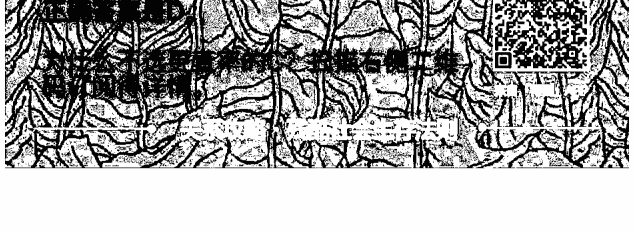

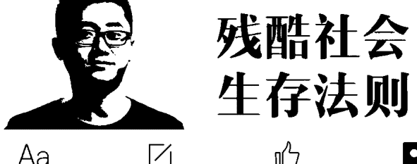

## 女朋友的妈妈嫌我长得矮，怎么辨

036 | 女朋友的妈妈嫌我...

写了婆媳，有关系户问，能不能写写丈母娘和女婿的关系，正巧有同学留言，说女朋友妈妈提了意见，说他矮，希望熊老师帮忙分析一下。

好吧，有些特别残酷的真相，必须要告诉大家了：几乎没有一个女婿是真的因为矮而被淘汰的。

她其实觉得你穷。

## 大家都在长高，下一代会更高

上周日去我网剧的剧组探班，演员副导演和制片人正在演员的海选阶段，我们的戏叫《备胎公司》，是一个年轻人为主角的戏，大多数演员都是90后甚至95后。

我的感慨是现在的年轻人都很高，即使是华南几省的姑娘和小伙子也都远远比几二十年前的青年高得多。当然做演员的人一般都会比较高，但欧小宅是广州人，她告诉我，在她们大家族里，比她年轻十几岁的弟弟妹妹或者侄子侄女，比80后都要高得多。

## “你没钱”的各种表达

丈母娘挑的，其实是穷。

## 矮是短期之内没法改变的

## 类似的表达还有胖

## 复盘一个探真过程

- 1. 他们说的理由是真的吗？
2. 如果不是，那真实的理由是什么？
3. 他们究竟担心什么，才不愿意让我们在一起呢？
4. 我可以做些什么增加总分，才能让他们能够接受这个现实呢？

## —— 习题 ——

如果你是有一个女儿的母亲，希望反对一个候选人，最好委婉的说服女儿的借口是：
A. 学历不够高，虽然读到了博士，但本科只是211不是985的，差评！
B. 身体不够好，虽然他也跑步，但是他父母双方都有慢性病基因，差评！
C. 钱太少，先让他买一套三环内三居室再说！
D. 原生家庭很差，他父母的关系不好，直接差评！

答案是D。

## 自习课 | 分手要狠，离开要快

复习一下上周《分手这件事，要当面说吗？》中的知识点：心理学家卡里尔·鲁斯布尔特 (Caryl Rusbult) 研究了人们在对一段关系不满的时候的四种反应，分别是：表达、忠诚、忽视和退出。

分手只是应对一段陷入危机的关系中的一个解决方案，作出决定的人已经心死。

不用当面再分一次了，大家都挺忙的。

接下来一起看看，这篇文章下有什么评论是你可能用得到的。

## 来自：分手这件事，要当面说吗？

一口气看完所有留言，心里平和许多，和我同样有感情困惑的人真多。我跟对象谈三年，第二年我提分手一次，确实感觉不是自己想要过一辈子的人。我去深圳工作，她追到深圳，后又跟到上海。

我感觉各种亏欠，就考博回到她所在的一个二线城市，又在一次了。她及她的家人都很开心，我们重新和好，把所有要结婚需要准备的东西都安排妥当，准备下个月办仪式，还没登记。日期越来越逼近，我越来越害怕，好像自己进入一个黑洞啦，就想逃。我看心理医生，想说服自己，好好过日子。

之间没有第三者，她人也挺好，长得也不错（至少中上等），在一起感觉就是凑合，就是对这段感情挺绝望，但还是想逃，我该如何是好。

熊太行

要做决定得赶紧，逃婚是选项，把人记录里留一个离婚，那就是可以打断腿了。

我是觉得这么心软的人，就依了她算了，只是牺牲短暂的一生而已。能让一个挺好的女人开心一辈子，你可以用心去扮演一个好丈夫。

没那么难的，现实中很多人也都是这么做的。如果觉得无法接受，那就越早说清。

熊老师，怎么判断一个人提出分手是不是负气呢？

熊太行

你可以认真问对方一次是不是，如果对方还是说 是，就算是负气你也当真的来决断。

总负气的人，不在一起最好。

## 来自：婆媳有了矛盾，为什么要站在媳妇这边

老师，跟父母住在同一个小区或者隔壁小区是最好的，这个道理都知道。但现实情况是：绝大多数家庭请不起保姆的，且两口子都得工作挣钱。这个时候，要么让孩子做留守儿童，否则只能求助于老人了。

希望熊老师能讲一讲，迫于这种无奈的现实条件下，作为丈夫，应该怎样处理婆媳关系？怎样跟老妈沟通（比如怎么跟老妈说，让她知道，媳妇才是你这辈子最重要的人）、怎样跟媳妇沟通（比如老人爱唠叨，爱管事，如何说服媳妇接受）才能平衡好家庭关系？

熊太行

永远不要跟老妈说，媳妇才是你这辈子最重要的人。杀人游戏里这叫跳警，下一轮就杀你了。

“咱们家您说了算！”“这就是您家啊！”“奶奶是咱们家董事长，欢迎董事长。”

“媳妇，受委屈，这两千块拿着。”

你要去哄老太太。

## 男人说压力大，你就要赶紧说爱他

037 | 男人说压力大，你...

知识点：
告诉一个人，他被在乎、被爱、被尊重，能很快地缓解压力。
这种行为叫做社会支持。

我张口闭口谈钱，已经有同学表示了不满意了。

我认为两个人的婚姻，钱不是最重要，
您应该多谈谈爱。

来吧，今天就来谈谈爱的真相。

> “傻小子，坐门墩儿，哭着啼着要媳妇儿。
要媳妇儿干什么？点灯，说话儿，吹灯，作伴儿。
早早起来梳小辫。”

这是一首京津冀流传的童谣，我小时候也念过。它很有高明的地方，它告诉了你，婚姻关系当中社会支持的必要性。

点灯，说话。

## | 要抱抱

不知道有多少男人感觉过自己压力大。

不知道有多少女同学听到过自己的丈夫或者男友压力大。

女同学们，你们遇到男人感觉自己的压力的时候，是怎么应对的呢？

最快捷的办法，就是赶紧拥抱他，亲吻他，说爱他，告诉他，自己在乎他。

一些老派的伴侣是不是会觉得有点肉麻？一点也不。

压力这东西不是突然发生的，而是来自于生活的改变。注意是改变，不是挫败，有的事情是好事，人是好人，但好事就会让好人有压力。你的朋友喜得贵子，大家纷纷祝贺，这对他来说就是一个压力源。生活突变，噼咔是往好里变，人的压力也会增加。

这也是为什么我会劝大家，情侣也好夫妻也罢，如果你们不想生育，就应该采用避孕措施，尤其是情侣。

为什么不应该意外怀孕、奉子成婚？我把这个问题当做练习题附在后面。

## | 给男人做一套题

美国心理学家霍尔姆斯和拉尔曾经制定过一个“社会再适应量表”，这个表在1960年代被制作出来，在1990年代被修订过，大家发现30年后，所有的社会压力都比过去上调了50分，过去100分可能就算压力大，现在要150才算了。

如果你在过去一年里经历了以下事件，就要记下对应的分值，最后相加的数字就是你的得分。

- 1. 配偶去世 100
2. 离婚 73
3. 分居（如果是学生版，就是父母离异）65
4. 入狱 63
5. 亲密的家人去世 63
6. 自己受伤或生病 53
7. 结婚 50
8. 被老板解雇 47
9. 夫妻重逢和好 45
10. 退休 45
11. 家人健康的转变 44
12. 怀孕 40
13. 性功能障碍 39
14. 新生儿诞生 39
15. 工作变动 39
16. 经济状况的改变 38
17. 好友去世 37
18. 从事不同性质的工作 36
19. 与配偶吵架的次数改变 35
20. 贷款超过1万美元 31
21. 丧失贷款抵押品的吸取权 30
22. 工作职责的转变 29
23. 子女离家 29
24. 吃官司 29
25. 个人杰出的成就 28
26. 配偶开始或停止工作 26
27. 学业的开始或结束 26
28. 生活水平的改变 25
29. 个人习惯上的修正 24
30. 和上司（老师）相处不好 23
31. 工作时数或工作条件的改变 20
32. 搬家 20
33. 转校 19
34. 娱乐的转变 19
35. 教室活动的改变 19
36. 社交活动的改变 18
37. 贷款（少于1万美元）17
38. 睡眠习惯的改变 16
39. 家庭聚数时数 的改变 15
40. 饮食习惯的改变 15
41. 假期 13
42. 圣诞节 12
43. 轻微犯法 11

这个量表是美国习惯来的，你大可以把圣诞节变成春节，把1万美元改成10万元人民币。教堂改成寺院。

这个表的指数最好是150以下。

150~300的人，在未来几个月里有一半人会患上疾病或者出现心理障碍。

超过300的人，有77%的人都已经病倒了。

这套题男女通用，可以每年做，反复来比较每年的情况。

## | 三种支持

压力已经形成，男人总是要去面对它。

一种办法是直接解决了压力源：

是最好的办法，比如挣到了一笔钱、还清贷款，赎回了自己家抵押的房子等等。

一种办法是解决了自己的认知问题：

过去认为没考上大学复读是一件悲哀的事，但是最近发现喜欢的女生也没考上，现在又在校缓班里做了同桌。过去以为婆媳关系向着老妈才对，看完“关系攻略”改变了认知，觉得向着老婆要好些。

对一件事的认识不同，意义也就不同了。

这两种都是承压的人自己做出的改变。

还有一种外在的支持，这就是社会支持，身边的 人给你提供的支持。

这类支持又包括：

- A.情感支持
B.物质条件支持
C.信息支持

物质条件的支持，包括给钱或者提供一些其它便利。比如有的亲戚生了重病，我们可能会帮他跑腿挂号找医生看片子，还可能用车载着他们去北京上海的大医院。

信息支持，比如帮大家分析你的大领导、二领导、三领导……七领导为什么不喜欢你（因为你和竞争对手外单单位有业务往来），你的七领导是女的会不会对你好一点（别当真，我说的还是郭靖和江南七怪），等等。

信息支持要求得非常高，大家如果记得《疯狂动物城》，可以回忆一下狐尼克对兔朱迪的支持，他是个三十多岁的男性，对初入职场的姑娘，是可以分析利弊、权衡好坏，给出建议的。

换句话说，当军师是社会支持的最高阶段，如果你遇事有见识，对人又够诚恳，你就是可以通过信息支持收获很多友谊，也受到许多异性的喜欢。

不过现实中，女性的建议者并不讨喜。除非她是咨询师、医生这样的专业身份。传统上的偏见认为很多给丈夫提供信息支持的女人被描绘为一个“教唆者”的角色，比如如秦桧秦岳飞的王氏。

对一个今天的家庭说，如果丈夫遇到了失去亲人、失去工作或者重大疾病等问题时，能拿出钱来救命，能介绍工作的强大的妻子、女友固然很好。

但没有这些钱和信息的妻子或者女友，就最好尽量拿出自己的柔情，把自己无法提供的另外两支支持，用爱来补上。

如果遇到这种事，已经稳固的感情一样有上台阶的机会，就是当下，就是此刻。

借用刘谌的话就是：“见证奇迹的时刻到了！”

借用刘谦的话就是：“见证奇迹的时刻到了！”

这种幸福和温暖，不亚于暖味中一撇成功的那种开心。

但是如果这个时候冷淡、动摇甚至更加责备对方，关系基本就可以不保了。

《白蛇传》就是这样的故事，白娘子比许仙强大得多，她被法海打败，不需要许仙去给她打架或者给她出谋划策，她需要的只是男人的安慰和爱，但许仙却因为恐惧和懦弱不敢接近。

小青说要杀负心薄幸的人。

因为负心薄幸的说的不是出轨和劈腿，而是没有负起情感支持的责任。

有情感支持，就有夫妻、有情侣。
没有了，大家就此别过，互道珍重。

## 敲黑板：

- 1. 聪明人会用量表和各种小用具把握自己和配偶的压力水平，及早发现问题。
- 2. 夫妻一方陷入困境的时候，另一方应该尽快收拾起事后诸葛亮的冲动，赶紧去拥抱对方，支持对方。这是付出情感最划算的时刻。

## —— 习题 ——

你的闺蜜告诉你，她时常会和男友有不加防护的性行为，而且并不担心，因为“不行就生下来再结婚”，这时你劝她的理由当中，不正确的是：

- A. 发现怀孕、结婚、生育都是重大生活事件，还要买房和改变自己的工作或者生活条件，这样的变化会增加人的压力，让人有患病或者抑郁的风险；
- B. 没有结婚证办准生证和落户会很困难；
- C. 万一他有不安全的其它伴侣的性行为，你的健康会有风险；
- D. 再撒狗粮小心我抽你。

正确答案是D。

请把A好好记住吧，大多数压力轻的人，在每件事上都是提前准备的。

你的闺蜜告诉你，她时常会和男友有不加防护的性行为，而且并不担心，因为“不行就生下来再结婚”。

这时你劝她的理由当中，不正确的是：

- 发现怀孕、结婚、生育都是重大生活事件，还要买房和改变自己的工作或者生活条件，这样的变化会增加人的压力，让人有患病或者抑郁的风险；
- 没有结婚证办准生证和落户会很困难；
- 万一他有不安全的其它伴侣的性行为，你的健康会有风险；
- 再撒狗粮小心我抽你。

## 残酷社会生存法则

Aa 字号

写留言

161

请朋友读

## 自习课|如何给重要的陌生人留下第一好印象？

今天的自习课复习一下《女朋友的妈妈嫌我长得矮，怎么办》，有关系户说这篇针对的关系范围太窄，不适用。

但读到心里去的人会发现，这是打破借口，看问题本质。

来看看这篇文章下有什么值得再读一遍的评论。

## 来自：女朋友的妈妈嫌我长得矮，怎么办

熊老师，能讲讲如何给重要的陌生人留下好的第一印象吗？像恋人的闺蜜、父母这些。

熊太行

干净整洁有礼貌就是了，少说话，不越界，当着他们不和恋人太亲密。

熊老师对家庭关系的分析字字珠玑，能否讲一下夫妻之间沟通过程中，为什么同样一个结论，如果自己说出来另一半就不容易接受，如果是出自别人之口老婆就欣然接受了。

以前网上有过针对这种情况下的调侃，很想听听老师的分析和应对之策，感谢！

熊太行

因为你是一个低可信度的来源。太亲近了她不能信赖你。所以你的预言只能慢慢应验，大家吃哑巴亏。

如果你的年龄地位原本比妻子略高会好一点，比如是同行资深人士或者前领导、前实习老师、学长什么的。

同龄的男人要给女人提建议的时候，最好有一个充满仪式感的行动，比如突然变换成语重心长的口吻，比如用“我觉得我这里有个建议给你”“说认真的”来区别平时的说笑。

至于场合，各有不同，我是觉得性爱之后的贤者时间，给爱人分析利弊会更清楚。这会儿大家好像都显得更真诚了一些(没开玩笑)。而且即使因为提建议被一脚踢下去轰去沙发，损失也要小得多……

我是中学教师，讲课的时候不太看学生的眼睛，给人一种不太自信的感觉，这件事情给我带来很大烦恼，怎么才能改掉这个不自信的表现？

熊太行

对着镜子练习。上课之后先扫一圈，镇压一下，然后收回来，目光可以越过去，然后逐渐收回来，偶尔和一两个学生交流一下。

这是我做高校教师岗前培训的时候学到的，您是中学老师，应该是师范专业，技能科肯定比我学得深。紧张了就找最友好的那张脸。一般哪个孩子脸最大，就最友好。

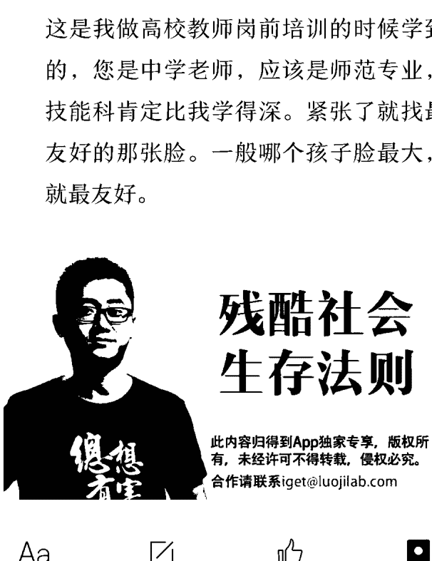

## 打孩子，你会变成最没本事的父母

038|打孩子，你会变成最...

知识点：奖励剥夺是一种阴性惩罚（negative punishment），用剥夺一个人可能得到的东西来激励他人。

熟练掌握了这种本事，可以不需要打孩子，还能成为操纵人心的ikka高手。

2005年的时候，在新闻写作研究生课堂上，我们的老师高钢教授分析美国普利策获奖特稿里的家庭暴力题材时，当场做了个调查。

“在座的各位同学里，有没有谁从小到大从来没有被父母打过的？打一下都算。”

我是兴致勃勃地看着大家，我一直觉得我的父母算是很讲道理的父母，但他们都打过我。我估计是没有人。

三十多个人的课堂上，有五六个人举手。

老师发自内心地赞叹了一句：“太好了，你们真幸运。”

## | 众望所归的暴力

动车车厢、地铁车厢里容易出现这样的情况，一个孩子拼命吵闹，被打和影响的大家纷纷盯着这个孩子的父母。

有的父母会低声劝阻孩子，对这样的父母，我一般都会给予同情和敬意，尽量不去看那个孩子（吵闹的孩子要的就是大家去看他），这种情况下往往吵闹也会很快停止。

## | 不讲理是会蔓延的

有一次小学同学聚会，有个同学说，他恨我们的班主任老师。老师带了我们六年，大家对老师都有感情，所以我们都想听听这是为什么。

## | 你使劲打，他使劲学

美国的心理学家Strassberg曾经在印第安纳和田纳西做过一项实验，先收集幼儿园小朋友的妈妈使用暴力情况。分成不打孩子、打屁股和殴打（拳头、掌或者其它家伙）三种情况。

然后用了六个月去观察这273个孩子，结果发现：

- 没被妈妈打过的小朋友，每小时平均有2次左右的攻击行为。
- 被妈妈打屁股的，4次出头。
- 被妈妈殴打的，8次以上。

挨打越厉害的孩子，就越暴力，体罚根本就没法让坏孩子变好。

## | 孩子当然是可以收买的

我属于1980年代那一批婴儿潮出生的人，1990年代的时候，所有的媒体都忧心忡忡，觉得我们这一代人没有兄弟姐妹，怕是要毁掉了。所以那会儿整天梦见我们，他们都在暗示我们，说我们是吃星族，小皇帝什么的。

家里孩子干家务活，刷盘子家里还给发零花钱，说好好的孩子都被资本主义污染了。

后来才明白，那是非常高明的策略。

孩子是可以被收买的。

为孩子做家务劳动付酬劳是非常高明的做法，其实为考100分买一套乐高积木，也是类似的情况。

心理学上看，惩罚没有什么效果，不过奖励的效果是非常明显的。对人最好是只奖不罚。对孩子也是如此，你看老板扣员工工资，他要跳着脚骂你，也不合劳动法。但是因为业绩没完成，绩效奖金少，就无话可说。

这就是最高明的做法：奖励-奖励剥夺。

一定会有人说：天呐，这个父母收买孩子吗？

对啊，为什么不能收买孩子呢？

收买孩子，不能让孩子的心灵被玷污吗？

你每个月还领工资呢，怎么你老板不怕员工的心灵被玷污？

## ｜把孩子当做谈判对象

大多数小学之后的孩子都可以沟通，也会谈条件。

“你敢打你弟，我就打死你。”

“你敢打你弟，这个月都没有零花钱了。”

敲黑板了！这是两种完全不同的思路

第一种是如果你做了什么，你会得到什么负面的东西。这叫阳性惩罚。

第二种是如果你做了什么，你会失去什么正面的东西，这叫阴性惩罚。

能够善用阴性惩罚的人，都是聪明人和人际关系的大高手。

## ｜如果必须使用惩罚

如果你孩子做一些危险而愚蠢的举动，比如玩电梯、转门或者在高空扶梯上探出身子，你确实可以给他惩罚，不过最好注意这样几点：

- 1.短暂而快速，不要打太久，一巴掌打在屁股上，让他知道这是惩罚就行了。
2.当场执行，不要等回家再打，这点跟训练猫用厕所有点相像。
3.强度上要有限制，绝对不要用拳头或者工具。
4.只针对行为，不针对人本身。
5.收缩到某种最重要的情景里，别什么事都打。
6.扣零花钱永远比打人强。

## —— 习题 ——

周末家庭聚会，孩子把表弟关进衣橱里，差点窒息。幸好大家发现得早，恰当的做法是（多选）：

- A.把他的心爱玩具送给表弟，表示赔偿或者惩罚。
B.罚他自己在房间里玩。
C.把他关在衣橱里，让他尝尝这么做的滋味。
D.扣发本周的零花钱
E.考虑给衣橱增加通气孔，以及考虑从里往外推开衣橱门所需要的力度是不是要调整。

答案是B.D.E

残酷社会生存法则

## 怎么从朋友里选出“做大事的人”

039|怎么从朋友里选出“... ↓

知识点：真的有一个“做大事指数”，心理学上管这叫“成就需要”。

成就需要高的人，野心勃勃、想成功，收入一般也比其他人要高。

有关系户问我：

> “我觉得我过得很失败，同学、朋友都不主动联系我，都要我联系他们。为什么呢？”

我说，两种可能：

一种是你最近变弱了，这几年没有跟上大家，都不愿意跟你一起玩了；

另一种，是大家最近确实都特别忙；

还有一种情况是大家都-Type: paragraph

## |朋友清单要经常更新

## |选出做大事的人

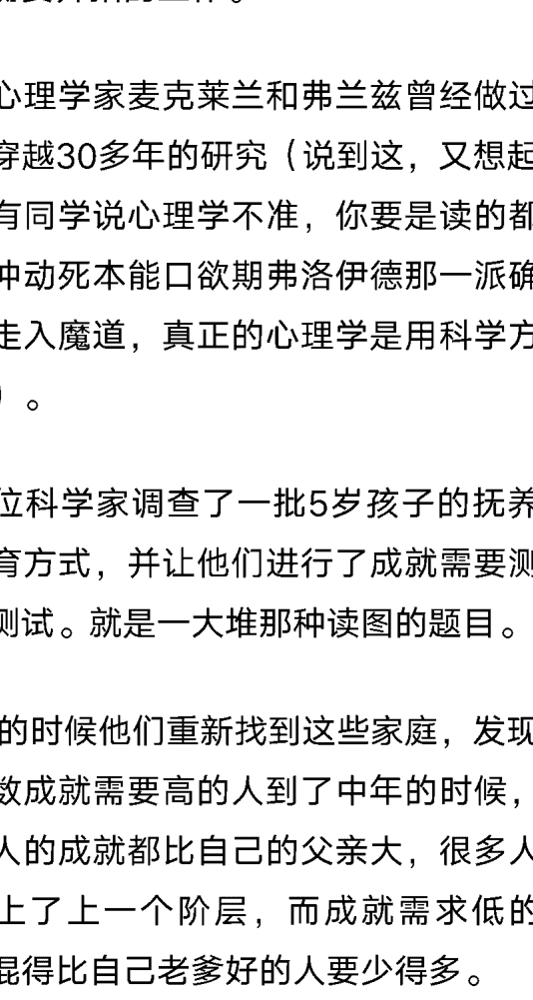

## |高分人士挣得更多

更令人惊叹的是，成就需求高的人，他们收入都比低分同龄人要高。

两位科学家又回来这些人5岁的时候，他们的妈妈填写的报告。

发现那种给孩子压力很大、让孩子遵守严格规则和苛刻培训的妈妈，养出来的孩子成就需求就高。

这就是成就压力，当你的父母从小对你期待很高、要求也很高的话，你会成就需求更高，以后就能挣得更多。

麦克莱兰和弗兰兹发现，5岁时经历过高压力的孩子，在1988年就比成就压力小的同龄人每年多挣1万美元（1988年的1万美元，很值钱）。

## 不愿意做大事的人就是废柴吗？

当然不是，成就需要高的人也有各种问题，最大一个缺点就是容易怕麻烦。

我们有时候评价一个人，会说：“真可惜，这人太精明了。”

他们很希望尽快成功，对自己的评价和期待也很高，当短期之内他的收入不好，他很可能就会扭身离去，他们做笨功夫是很难得。

得分低的人往往会考虑做一些不会立刻得利的事，但如果去辅佐、帮助那些成就需求高的人，加入一个强大的团队，往往也能做得很大。

这就是那句老话：乌随鸦凤飞腾远，人伴贤良品自高。这话说的就是挑朋友要挑成就需求高的人。

但是朋友怎么挑呢？

择友或者相亲的时候，你总不好拿一张令狐冲图片给他们，然后分析他们的答案，人家肯定会问你，是不是有病，你到底想干什么。

这是有一些替代方式的，比如看一个人打游戏的方式。

你看现在的好多游戏，玩够几百小时能解锁一个成就，收集齐所有的地图可能能解锁下一个成就，不触发警铃通关可能还有一个成就。

有的人就是那种忍无可忍，非要完美成就才行。强迫自己收集全所有的道具，这就是成就需要比较高的人。

也可以一起去看球赛或者看电影，看他对比赛或者电影的看法。

这其中可以顺利地把那些渴望成功的人筛选出来，记得吗？他们小时候可能也接受了很好的家庭教育和训练。

通过看人评价人，论断人的姿态，可以明白对方：

- 1. 是不是渴望成功的人；
2. 是不是希望展示个人实力；
3. 是不是想挣钱；
4. 对成功的看法；
5. 小时候是不是肩负着家长的期待，是不是受过良好的教育和训练。

所以在这里提醒一下，恋爱第一次看电影要好好观察对方，别忙着在黑暗里乱摸！工作人员都看得见！那TM都有红外摄像头！

以及，敲黑板！

看完电影出去再聊！
别在电影院里聊天！

## —— 习题 ——

爱情戏是可以当做试金石的，试着用这张图来解释，男人和女人之间有什么问题，黄衣男人又有怎么来意，如果看过电影的，可以描摹一下男女双方的关系。

## 高分答案要点

成大事指数（成就需要）高的人会提到：
男主角是有品位的，懂艺术；
黄衣男人是好意，是男性的朋友；
男人要求男主角加入团队挣钱；
他们的大事业就要开始了。

## 低分答案踩点如下

这小子特穷，
带姑娘来爵士乐酒吧；
一瓶啤酒也不贵，
跟人那里霸占桌子一整天；
女朋友很不满意，
这不来了个人给推荐工作；
男的还假清高，
显然姑娘要劈她。
啊呀这俩人真虐；
穷人就别谈恋爱了，
最后还不是失败了！

## 残酷社会生存法则

## 自习课｜从家庭关系修炼到职场关系

有关系户反应，最近家庭系列不停歇，希望能看更多职场关系。

其实男女之间的进退属于近身拆招，精妙之处很多，这种招数用在职场上是可以团灭对手的。

为了避免关系户再对选题有所疑问，特意把我在留言中立过commit的flag列了个清单，橙色的已经更新过，也有一些本来就在最初的选题中。

- 1、如何与养宠物的人相处。
- 2、下次直播时聊聊个人成长。
- 3、“零自责攻略”。
- 4、如何与继父继母相处？
- 5、已嫁给老实人、脾气差的人该怎么办？
- 6、如何帮老公、儿子减轻心理压力？
- 7、异地恋如何相处？
- 8、丈母娘和女婿的关系？
- 9、如何与脾气差的人相处？
- 10、与更年期妇女如何相处？
- 11、不会跟人套近乎怎么办？
- 12、大学的人际关系处理。
- 13、女方比男方收入高的相处之道。
- 14、如何与控制欲强的上司相处？
- 15、如何经营自己的朋友圈？
- 16、如何哄女朋友？
- 17、办公室负责人夹杂几个领导之间为难，如何避免成为炮灰？
- 18、谈点关于离婚的事。
- 19、被挖墙角怎么办？（下属、男女朋友）。
- 20、男下属如何与女领导相处？
- 21、天生气场弱，如何与爱耍软怕硬的人相处？
- 22、家里有亲戚长辈职位高，我该怎么交流让他们帮到我？
- 23、换新工作关系处理指南。
- 24、怎样提高自己讲故事的能力？
- 25、女追男要注意什么。
- 26、初次见男（女）朋友父母攻略。
- 27、如何根据一个人的面相、穿衣打扮来判断一个人？
- 28、参加同学聚会需要注意什么？
- 29、如何协调父母之间的关系？
- 30、如何让曾有精神、心理问题的家人健康快乐生活？
- 31、如何面对父母的家庭暴力？
- 32、空降到一个新部门新岗位做领导如何开展工作？

熊太行
在你等选题更新的时候，不妨先看看，关系户的留言中，有哪些也能给自己提供帮助。

## 来自：如何给重要的陌生人留下第一好印象？

马上要到一个新部门，业务知识不熟悉，下属大多不认识，有稳重的70后，有业务精通的80后，有活泼的90后，感觉有些不自信。
如何在短时间内在这些不同年代下属面前建立良好的印象？

熊太行
你不需要展示自己渊博和有趣，做领导和当老师是不一样的，你公正就够了。别人试探你，你打回去；别人欺负你，你怼回去；手下做得好了，要表扬。如果有机会社别的部门想扯事，像个老母鸡那样护着大家，去跟对方撕。大家就会爱死你了。

## 来自：打孩子，你会变成最没本事的父母

对待孩子这个问题对我难度有点大，就说今天的事吧！孩子上4年级，现在老师派的阅读和英语作业都在手机上，打算给孩子买一台手机孩子特高兴。
但是一说到学习达到一定的目标来回报就会宁可不要，搞得我都不知道怎么对待孩子。

熊太行
在他看来，手机是学习用品（你肯定不肯给他装游戏对吧），你居然还要用來讨价还价，这是他不爽的地方，无利不起早啊。
努力弄一个学习用品回来。我们小时候也不乐意于这个赌本买卖。

我有个外甥什么奖励都无法打动他。这样情况该怎么办？
比如，他很喜欢周末外出玩。但是当我对他说，不做完作业就不准出去玩了。他说，不出去就不出去。他很喜欢吃零食，我对他说不做完作业，这周就没有零花钱买东西吃了。他说，不吃就不吃……
对所有的东西他都可以失去，我是没辙了。

熊太行
你别用否定句“如果这三天你按时完成作业，我就带你去公园。”
用“如果……就……”
不用“如果不……就……”。
逐渐跟孩子立约的过程，你兑现承诺，孩子就知道谁是老大了。

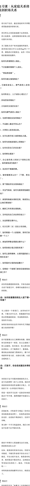

## 谈工作没问题，一闲聊就变成大笨蛋，怎么办？

040|谈工作没问题，一闲...

要把闲谈当做一门艺术专门对待，你就不能任性，要尊重客观规律。

> 斯担尼斯拉夫斯基说：“认为艺术家的自由在于他想干什么就干什么，那么是错误的。这是胡作非为者的自由。”

如果你跟领导、同事一起在电梯里，那最稳妥的话题就是天气和路况。

> “天气又不好了。”
> “是啊，大会开完了，工厂又开工了。”

电梯到了。

这些是帝都黑话，冬天取暖季结束，烧煤的锅炉少了，空气会好转。

## 1. 好本子

和相声演员差不了多少，你也需要准备你聊天的内容，把他熟练掌握。这些东西要平时积累，如果你不是一个记忆力很好的人，那就需要准备一些笔记。

- A. 跟专业相关的段子效果会特别好

国家博物馆的讲解员袁硕老师（新浪微博@河森堡）是一个讲故事的高手。前一阵他做了一个TED类演讲，就讲智人是怎么战胜直立人、尼安德特人的，其实他的资料都是西方古人类学研究出来的东西，但是讲述技巧上特别强大：

> “梓匠轮舆能与人规矩，不能使人巧。”——《孟子·尽心下》

## 2. 苦练。

会聊天的人出身不同的门派，但是其实技能点是差不多的。

没考上省重点，相声梦也耽误了。

后来我才知道说相声、说书的孩子，很多/is时都/不/开心——练功太苦了。

老师挑孩子也是挑的机灵的，但是机灵孩子也要去背各种大段的单口相声，背到一句不能差。

因为那些相声，是老艺人们一次又一次的演出，修正出来的台本，哪里不可笑，哪里包袱不响，都会很快得到纠正。所以就是一个地方都不能错。

有些段子苦手，聊天苦手，讲段子，讲故事的时候前言后语都记不住，说几句还要重说，这就很令人着急。

这就是苦练之后的下一个要求，躬演。

对了，敲黑板！

别觉得一个人讲段子失败，跟人聊天就收不到好的效果。

讲段子可以故意失败，自己笑傻了的低级段子手有的时候特别有人缘。

如果一个美女能讲很好的段子，她会让人恐惧，气场不足的男人多半会知难而退。

如果一个美女没讲段子就先笑崩，她要么是有福气的笨笨的人，要么是心机极细密的人。

娇憨是一种美，《红楼梦》里史湘云就是这样的人设。

大笑的女孩能展示自己很多细节，比如牙白不白，露不露龈，眼角有没有细纹，有资本的女人才能大笑得好看。

爱笑的女孩运气不会太差不是一句鸡汤。

爱笑是自信的表現。一点都不错。

## 3.躬演

以前我在《博客天下》杂志社做主编，我的同事谢梦遥写了一篇相声演员岳云鹏的报道，我来编辑的，标题叫《贱啸地红》。

岳云鹏就属于笨的。一遍一遍背，练好了，一上台，紧张，慌，二十分钟的段子十分钟就讲完了，说完了词，完全没表演。

他的师兄弟说要把差的人赶走。他师娘站出来，说不能赶走，他就在剧场里靠着端茶送水。

上台演和台下练完全不一样。

岳云鹏是慢慢开窍的，他师父给他看二人转艺人的好多演法，有的歌手唱着唱着跪下了，一种超过尺度的火，带贱啸的味道。然后他练、演，效果越来越好。

到最后就是随手发一招都有人乐，完全不科学了。他越演越自信。

## 4.选择你的主场

你真的不一定要在说话上吸引别人。

## 5.节目的更新和换代

段子都有时间和生命，如果一个朋友和你三个月见面一次，那么你的段子的更新就应该最长是三个月，别每次见面大家聊的段子都一样。

## —— 习题 ——

习题在这，今天的题目有难度，来自《阅微草堂笔记》，把这个书面记载的故事讲成一个可以讲述的段子：

参考改编：

纪晓岚讲过一个和狐狸结婚的故事。

纪晓岚说过一个和狐狸结婚的故事。

有个姓罗的书生，喜欢看小说，听说狐狸的女儿好看，就一直很想找一个，听人说近郊有古墓，那里有狐狸。现在说可能就是现在中关村那一带，那一带过去是太监的坟。

这位罗先生就带着彩礼去求亲。说能给个大小姐最好，如果不能，给个小丫鬟也行。狐狸真的给了她一个丫鬟。

嚯！真漂亮。而且可以随身携带，过去的女人缠足，狐狸不怕，书生出差，考学，狐狸跟着他走，到了晚上……俩人，哦不，人狐，别提多好了……

也有EPT，同一个

## 自习课 | 如何快速融入到聚会中？

今天的自习课，可以复习一下《谈工作完全没问题，一闲聊就变大笨蛋，怎么办？》

我们都羡慕妙语连珠的人，但是通过训练，是可以做到这一点的。

来看看各位关系户的留言中，有没有你用得上的。

## 来自：谈工作完全没问题，一闲聊就变大笨蛋，怎么办？

熊老师，和别人聚会的时候，总感觉融入不进去。喝了酒之后呢，就什么状况都能融入。这个怎么锻炼：平时可以像喝了酒一样善于聊天，善于说笑呢？

熊太行

这是个好话题，谈恋爱的时候看恐怖片和坐过山车都特别好，因为你的生理被调动了之后，情绪是唤醒状态。

人的身体对恐惧、愤怒和爱情分不太清，所以你看电影里打完架了男女主角要接吻，有道理的。

可以尝试运动后、看完很high的电影后跟朋友聊天。

熊老师，你能分析一下在团队中，就是普通聚会的那种，哪种人会被轻视吗？

熊太行

不善于沟通的人会被轻视。

熊老师，我的问题跟今天的话题有些不符合，希望你能回答。一是:如何跟爱占小便宜的人（男人）相处？
二是:总是用感情，事业来胁迫别人做事，很少谈怎么分配利益的事。

熊太行

说的是你的老板吧。这种人得看透，然后决定要不要受他忽悠，他手上有你要的东西，就可以合作。

但是强大了就要赶紧离开。

## 残酷社会生存法则

此内容归得到App独家专享，版权所有，未经许可不得转载，侵权必究。

## 为什么不要在朋友圈里发负能量

041为什么不要在朋友圈...

对负能量的宽容和文化传统有关，个人主义的文化里，负能量的发泄被支持。

在集体主义的文化里，负能量的发泄是偷偷摸摸的，发泄者自己都会感到害怕。

我自己讲给大家的规则，我自己其实也有不遵守的时候。

## 什么是负能量？

## 1.叫苦

对劳动强度叫苦不迭，半夜下班一定发一个凌晨三点的北京给大家。三四年前吧，我有个朋友写公众号，每次第一句话就是：“最近工作实在太忙了，所以一直没空更新。”

## 2.抱怨同事关系

## 负能量的危害

这些事为什么不要做，都有所究：

## 负能量和集体主义

## 国企执行的原则，其实是男性规则。

## 你的抱怨、吐槽、叫苦，早晚是要还的。

## 负能量传播完，心里特别害怕

量避免下一次不团结的局面出现。

也就是说，如果你发了一个负能量朋友圈，领导想的不是怎么消除你的负能量，而是怎么让你下次不发朋友圈。

我们知道成年之后最难改变的就是人的世界观和性格了。

和通过长期的谈话、哄、抱抱、举高高维持短期的满意相比。

可能领导发现，这么费劲巴拉的干什么？

我老了，也累了，不需要哄小孩子开心了。

那话怎么说的“要哭回家哭，职场不养猪。”

把这个家伙发配到基层单位、委到冷门部门、派去支援到遥好了。如果这个家伙没编制，直接不续聘，干掉他就是了！

如果已经长期负能量，让领导对自己有了看法，应该怎么办呢？

- 1. 赶紧停止负能量朋友圈的行为；
- 2. 把过去的朋友圈删一删；
- 3. 跟领导谈一次，承认错误，变成一个觉悟了懂事了的人。

在《灌篮高手》里，三井寿是个很差劲堕落的小子，玩世不恭，已经被所有人放弃了。这个时候看见了慈祥的安西教练，突然之间一切心防都放下了：

这就是那句经典的台词：

> “教练，我想打篮球。”

当然了，像三井这样克制了负面情绪的成长非常宝贵，也非常罕见。

可以把“教练，我想打篮球”这句话记住，遇到很好的朋友负能量抱怨的时候，就去下面评论这句话，如果对方不懂，你就告诉他们，这句话的意思是：

为了喜欢的事业，有些小情绪是可以暂时放下的。

聪明的领导可以给递台阶

有的时候人才难得，领导是可以主动递一个台阶的。

会递台阶的领导能够收获好的人才。

我做编辑的时候有个同事，年轻记者，和好几个编辑闹得不愉快过。

关系户同学们，现在咱么的人越来越多，留言的同学也越来越多，我会尽可能多回一点留言，但确实可能有一些遗漏的情况：

- 1. 如果发现明确的提问我一直没有回，那就请再发两次看看；
- 2. 在新文章下面留言或许会有效果，但是我会经常回到旧文章去扫一下留言；
- 3. 如果你希望你的留言上墙，那就看完文章之后迅速留言。上墙的只有200条，质量好的留言超过200条就不会增加了；
- 4. “沙发”这样的留言只留第一个，如果不是你，那就是没抢到；
- 5. 特别好的留言，焦焦焦（就是和我一起直播的那位漂亮姐姐）和我会选进自习课。

今天不设绝对了，加个餐：

## —— 谈谈提问技巧 ——

关于提问：

尽量不要帮自己的远亲、邻居和同事提问。

- 1. 因为他们家的问题真相如何你不了解，你听的是转述，转述除了不清不楚，还有不尽不实，可能完全是错的。
- 2. 你在转述当中可能有信息损失，熊老师的建议如果有了偏差，对方按着执行把事情办砸了，她不会埋怨我，因为她不认识我。她会怨恨你，因为你在给她建议。
- 3. 因为对方和你关系很远，她的生活过好了你没有什么直接的收益，相反如果是同事，可能还和你有竞争关系。你花199元请个军师，好容易提问一次还是帮助你的敌人，这件事是不对的。
- 4. 如果是你家的事，放心直说是自己的事，说一句希望匿名，留言就只有我和焦焦焦能看到（理论上还有几个程序员大概）可以放心说，要信赖我，如果因为害羞说成别人的事，我就是三个字，我不管。
- 5. 鼓励大家让亲戚朋友自己来留言问我，说得清楚，问得明白。

> “熊老师，我应该做些什么来帮助我表姐？”

> “熊老师，我表同事（还有天理吗，同事都要表）的闺蜜的小姨子的前妻该怎么办？”

我就只能说：“这人跟你出了五服不算亲，所以啊——让她爱怎么亦怎么亦怎么亦吧！”

## 我的领导让我做违法的脏活儿，怎么办？

042|我的领导让我做违法...

熊太行

忠诚这件事，不是用尽一切手段去完成老板的目标。而是在工作这个框架内，完成老板给你布置的任务。这件事要早弄清就能早受益！

最近有一条“刺死辱母者”的新闻，评论很多，争议也很多。

山东的一个女企业家苏女士借了当地地产商吴先生高利贷100多万，还了180多万和一套70万的房子之后还差17万。

吴先生手下的杜三带人催收，把她的头按在大便的马桶里，后来脱了裤子用下体对着苏的脸。

警察来过，说不许打人又要走。苏很震的儿子于欢拿起水果刀，捅死了杜三，还重伤了两个人，轻伤了一个人。

杜三死在路上。杀死杜三的于欢被判了无期徒刑。

关于法律和道德的解读很多，大多数人都是激烈地说：“维护自己的母亲……天经地义。”

### 1. “客气伤害原则”

“不好意思啊，这是我的工作。”

大家看古装片、小説都能看得出来，同样是杀人，自己要杀是这样的：“你这狗贼！看看我是谁！”就怕对方不看自己。 但是为了工作杀人，那就是：“得罪了，这也是朝廷的王法。”

### 2.利益接合部

这个概念，我们以后可能还会多次出现，老板和员工、上级和下级、哥哥和弟弟、父亲和儿子、CEO和CTO可能有共同的利益，但他们一定有利益的分歧。

真正的狠人都是文雅客气的。

### 3.不要有任何侮辱

过去的土匪，只要上点规模，一般都不许奸淫妇女，在洪门和青帮两个大帮派体系里，“不好淫妇女”也是一条戒律。

- A. 争夺妇女会造成头领之间的失和。
- B. 侵犯妇女会损失收入，妇女是价值很高的绑架对象，去换钱再用钱去交换性更划算，而不是在战争或者抢劫中去获得性。
- C. 侵犯行为会导致一些富有家族感到羞耻，带来最大的敌意。

我们从事一些正常的工作也要注意：

对乙方或者下属，可以对工作要求苛刻，但是尽量不要去侮辱对方的审美或者工作能力，更不要针对对方的容貌嘲讽。

要知道贵司选择了这样的乙方，帮你安排了这样的下级。多半是因为他们便宜而你们太穷。

> 美国大兵有一个名言：“要记得你手里的武器永远是报价最低的公司生产的。”

### 4.关于各种脏活儿

和黑社会的打打杀杀相比，商场上的脏活儿可能是这些事：

- A.暗地侮辱和中伤竞争对手；
- B.行贿（包括性贿赂）；
- C.伪造身份前往竞争对手那里卧底；
- D.财务、人力上的违规违法行为。

我也收到好几位关系户的询问，做财务的居多，跟我说，领导要自己做风险极高的事，问我该怎么办。

我的回答很简单，那就是违法的事情不要干，就是因为“你的工作”这个大框架里，不包括“违法”这一项。

同样，之前也有关系户提到，说客户表示如果她愿意和自己睡觉，就愿意签下这个单。我建议是：

你入职的时候，如果“你的工作”这个框架里，不包括“陪人睡觉”，就不要做这件事。

如果你入职的时候，老板就说要你陪人睡觉。那就赶紧逃出去并且报警！这是一个火坑！

还有的人说，熊老师你说得很对，遗憾的是：我就是做不到，我这人对工作追求完美。领导布置了我就要全力做到。

我说：你认为的完美根本不对，真正的完美是遵守规则做事，时隔多年有人查、有人问，你都干干净净的，你的上级也不会受任何的牵连，当他KPI所迫做一些不体面的事的时候，记得把这个看法分享给她。

大部分的脏活儿，都是可以拒绝的。

## P.s

《白雪公主》里的后妈派出的猎人就是典型的“做脏活留余地”的人。

现实中，如果逼不得已要在正规公司做脏活儿的话，记得全部用电子邮件汇报。

## ——◆简答题◆——

你在对部门主管进行纪律培训，提到不应该对下属进行性骚扰。

有人问你为什么。

试着给他十个过硬的理由。我会在以后的文章中提取部分出色的回答加以点评。

如果你的老板要求你做一些见不得光的脏活儿，你该怎么办？（比如暗地侮辱中伤竞争对手、行贿、伪造身份去对方公司卧底、财务和人力上违法违规。）

忠诚这件事，不是你用尽一切手段去完成老板的目标。

而是你再工作这个框架内，完成老板给你布置的任务。

试着回答一道简答题：你在对部门主管进行纪律培训，提到不应该对下属进行性骚扰。有人问你为什么。请回答你给他的十个过硬理由。

此内容均得到App独家专享，版权所有，未经许可不得转载，侵权必究。

## 自习课|如何向领导开口说升职？

熊太行

关系户“王一如”在《为什么不要在朋友圈里发负能量？》中留言说，她在公开的地方从来不发负面言论，只发正面积极的讯息，她自己会去消化负面的情绪。

就像我们说过的：负面的情绪公开化会影响我们在领导、合作方、同事、朋友中的印象。

接下来看看在这篇文章的留言中，有没有你也正需要的招数。

## 来自：为什么不要在朋友圈里发负能量？

我今年45岁，在单位任中层两年了，为单位取得了许多荣誉。请问熊老师怎样和比我小几岁的领导提出要升职的要求？

要让她感觉我对她没有威胁，（虽然我比她有才，但她机遇好，能力也不错）。我只想当个副职，在她手下干得也挺愉快的，但女人难免小心眼啊。

熊太行

你得首先转变一个最重要的观念：“虽然我比她有才，但她机遇好，能力也不错。”

你在向她请求重用，你心里又不服她，不钦佩她，你想让她信赖你超过她自己的人，自己却根本没有把她当做自己人呀。

领导不是傻子，你看不上她，她心里明白。先调整好这个观念，去发现她的优点，佩服她，然后再请托，完全会不一样的。

熊老师说得挺有道理，看到别的同事各种抱怨的确很不舒服。我的问题有三个：

- 1、如果团队里负能量的人比较多，是同事的问题还是领导的问题呢？发负能量朋友圈的同事倒是不多，不过相互之间抱怨的比较多。
- 2、如果有别的领导对你的下属提出一些错误和批评，并向更高的领导告状要求扣该下属的奖金，你会怎么做呢？
- 3、如果团队领导是很明显的鸠派，作为下属觉得太委屈，如何向领导说呢？

熊太行

- 1. 领导的问题，人挑错了。
- 2. 护着自己的人，即使错了也要护着，回来关门行家法是另一回事，打你手下是因为打你的脸。
- 3. 鸠派和不公正 是两回事，别这么黑鸠派哈，你领导那个叫不公正，你可以私下跟他说，请他站出来。

熊老师，我过几天送女儿（6岁）学习舞蹈班，去交学费。怎么能让老师对我女儿投入更多，更关心她呢？有姿态的尊重老师，是我的想法。请熊老师指点一下，谢谢老师。

熊太行

信任，别说外行话，别用网上搜来的稀奇古怪说法来责问她。

如果你是医生、教师，或者其它很 有用的职业，告诉老师，让老师遇事儿说话，再让孩子有礼貌，够了。

## 公司组织的比赛，真的“特别蠢”吗？

043|公司组织的比赛，真...

知识点：
一种现象叫“虚假独特效应”。
一些能力强、做得不错的人容易犯这个错误。
我们把才智和品德看作是超乎寻常的，用独特来完善自己的形象。

有关系户说，五四青年节他会参加公司的即兴演讲比赛，希望熊老师能够给一点建议。

问得好，我就来分析一下这种公司组织的比赛要注意什么。
一个比赛，要注意四个问题：

- 1. 谁来讲；
- 2. 讲给谁听；
- 3. 有没有评判者；
- 4. 要达成什么样的效果。

试着回答一下：
1. 我来讲啊；
2. 全公司人听啊；
3. 领导啊；
4. 看谁讲得好啊。
等等！
这就是一个直接的回答，但是我期望的回答，不是这个。

记得吗？我们是一个谈论人际关系的专栏，我们关注的是人与人之间权力的游戏。

试着从权力的角度，重新分析一下这个即兴演讲比赛。

- 1. 没有权力的人，年轻同事们来参加演讲；
- 2. 所有的年轻同事和老同事们听；
- 3. 有权力的人来做判断，评估参赛者的实力；
- 4. 有权力的人寻找出来出色的无权者，担任培养对象。

这是一个寻找培养对象的活动。

## | 再强大的派别也需要年轻血液

一个公司也好，一个政党也罢，甚至小到一个家庭，青年群体都非常关键。很多时候，抓住了青年，就抓住了未来。
没有一个或一个公司里的小派别，能够在一个群体内一手遮天。就算是独资企业的老板，如果大家不信服他，执行上各种抗拒，他的工作也无法开展，一切制度，最终都都要落在人上。
独裁也好，民主也罢，一个老大都需要有一批人忠于你、信服你、执行你的命令。
而且这个群体必须发展壮大，要不断吸收新的成员进来，而且不能只收裙带，一定要求能干活的人。

那天和我的朋友，《绣春刀2》的编剧之一徐小痴老师聊天，她精通明史，跟我说：“海瑞一个人再强能做得出什么来呢？东林党能够成党，关键在于他们收罗门生，给他们政治地位（也就是了钱），所以大家会抱在一起。”

历史上这种事一点也不罕见。

马其顿国王亚历山大大大帝有一批贵族随从，叫做“友谊”，首席友谊是他的好友。亚历山大是双性恋，亚历山大收罗最好的年轻人都做友谊，他们是装备精良的骑兵，用来在最艰难的时候打开局面。

北欧神话里，诸神在人间会发生战争的时候会收罗一大批濒死的勇士，让漂亮的女武神瓦尔基里收集他们进宫殿，这些勇士被救回来之后天天喝酒打猎，准备用来最后跟霜巨人和洛克（看过《雷神》的知道）决战。即使是神，也需要更多年轻的支持者。

罗马军团把士兵分为步兵、青年兵、成年兵和后备兵（老兵）三类，这个很妙，你要和同批次的战友竞争，不能被同龄人瞧不起。优秀的年轻人会很快脱颖而出。

我知道有个银行的分行行长，会对下属的青年员工进行选拔考核，选出一批所谓的虎虎勇士，这些人高调、被人做妒，算是行长个人钦定的储备干部，定期召来学习分享会，行长需要做什么重要的工作，也不会再找别人，他们付出的代价是比别人辛苦，但获得是领导身边工作的机会以及提点和指引。

## | 明的人，暗的人

像那位行长那样，明摆着命名一支青年军，把大家都贴上我的标签，是非常大胆的做法，现实中可能太过高调了。如果不是大领导特别宠爱的人，一定会有人进谗言的。

而且副总怎么办？副总也要培养自己的力量，总不能等当上一个把手才组织自己的小队，那就晚了。

现实中，你的人，我的人，大多都是暗的。往往是几个副头儿，每人会选择几个人，暗加笼络。

国企里组织一些这种演讲比赛、辩论赛。就是一个挑选自己人的很重要的场合。

挑那见识口才不俗的小伙子小姑娘，栽培一二，以后就是自己的人了。

所以领导根本就不在于你辩论的是什么题目，演讲是什么题目。
他们在乎的是相貌、气质、台风、普通话（有些比赛是英文演讲）、紧张不紧张。
你只要尽情展示自己的青春活力。

新到秀女一百名，皇上说大家一起跳个集体舞，你不会真觉得皇上热爱舞蹈艺术吧，当然是看谁活泼、谁柔软、谁懂事、谁眼波流转、谁顾盼生姿了！

前几天有个关系户跟我抗议，说“我盯关系攻略，要看的是职场内容，说家庭和男女干什么？”我说你完全没打通，男女和家庭关系是职场的后院，同时男女之间的感情微妙细致，能够学到许多细腻的技巧，用在职场上就会特别厉害。

上下级关系和男女关系几乎完全是一回事。你看屈原老师写了那么多美人不爱我的诗，最后归类，他算爱国诗人，他谈论的其实是和领导的关系。

人和人的相处之道有打通的地方，如果你仍然见山是山，见水是水，多爬楼看看那些评论，很多同学已经进步得很好，能够举一反三了。

## | 自视甚高的人会被pass掉

这些看上去水平很低的比赛，还有一个功效，就是把一些自视甚高的年轻人筛掉。

我有个朋友，比我年轻几岁，我们就叫他F同学好了。

F同学发现自己可能进了一个假的五百强公司，公司会组织一场辩论赛之类的比赛，然后出的题目都非常幼稚愚蠢。

F是985高校毕业的，他决定不参加，不光不参加，他还坐在台下当笑话看。后来他分享给我，对我说他的公司怎么是这个样子。
“最好别这样。”
“？”
“于一个国家一个民族来说，最优秀的一批青年辩论这种逻辑有问题的少儿科目确实是不好的。但是我不太关心国家民族什么的事情，我只在乎你的境况。”

我给他讲了刚才我们说的那些道理，他恍然大悟，又心有不甘。
“你也说这些题目很糟糕，那他们选出来的不是很差的人了吗？”

F同学是不对的，差题目不一定选出来的是差人。但是差题目确实可能淘汰掉一些太好的人，比如一些本事很好，但自视甚高的人。

高的。

> “你觉得题目差，对，因为组织比赛的人没有上985，也没有参加过高水平的辩论队，她们没有上过逻辑课，只是用搜索引擎从网上搜题。”

> “这个企业和这几个组织比赛的同事都是如此，有各种不令人满意的地方。”

> “有些人没本事，却努力去取竞争胜负。”

> “有的人有本事，却要远远地站着看看笑话。”

> “你要是领导，你会栽培什么样的人呢？还要领导说通了所有的关节利害，请你下场竞技巧么？”

F同学后来聊起听到这里的感受，说感觉脊梁上全是冷汗。

> “你是有才，但如果不愿意跟我示好，不愿意说上忠诚的表示，那我就安排你在基层岗位上打工。”

## 一个容易被忽视的盟友

我们回到文章开头提到的那位关系户，想想他们公司团组织举行的比赛吧。

即兴演讲。

注意，是即兴。

## —— 习题 ——

你刚刚赢得了公司组织的辩论赛并获得了最佳辩手，你的对手、也是你很有好感的女生却突然泣不成声。这时你应该：

+   A.继续和你的队友庆祝，并且心里暗骂对方是矫情婊，从此断了念想；
B.过去拥抱哭泣的人，把奖杯递到她的手里，告诉她这是我们所有人的胜利；
C.拿过话筒，对着各位领导念这段台词：李大人，所谓胜者为王，败者为寇。现在金牌在我熊某的手上，并非我赢了。大人为了大显我民声威而办的这场辩论争霸，哭了这么多人，在世人面前，其实我们都输了；
D.当然是输给她了！喜欢她怎么可以赢她！

答案是B。

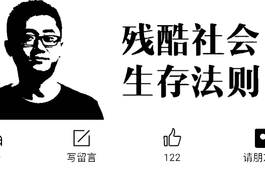

## 自习课 | 撒谎被发现，觉得很丢脸怎么办？

## 来自：我的领导让我做违法的脏活儿，怎么办？

请教熊老板:鹰派女领导电话质问我工作，心虚就撒了个谎，但直接被反驳，我更心虚就直接承认我刚刚撒谎了。

Q1:自己很容易理亏，没有快速反应的批判性思维，如何提高？尤其面对被找上门来，一点准备都没有的情况。

Q2:因为撒谎被发现感觉很丢脸，本来想问如何挽救，想想已经木已成舟。

熊太行

当场撒谎的孩子未必是坏孩子，他们是特别害怕惩罚。

立刻承认错误是对的，因为根本圆不回来。

以后对自己要求高一点，前期对自己苛刻，以后就不用面对质问了。

用行动挽救吧。

熊老师，聊聊什么情况下该真正辞职吧，每个人在工作中有无数次辞职的念头，那什么时候可以真正行动呢？

熊太行

拿到别的公司offer的时候。

熊师傅讲讲面子问题吧，今天说让放弃无聊的面子，但是真的看不上一些人的样儿，示好时候内心都是装假的，帮他们干活儿，甚至不计付出地干活儿，实在心里讲不通呀。这种认知应该怎么调整？

我认识到自己被“面子”羁绊了好多年，工作4年了，还是老样子，又想朋友多，又看不上体制内种种，属于自视甚高类型吧，我到底卡到哪里了？

熊太行

好奇兄啊，飞机上有个空姐很好看，笑是假的，你还是忍不住多看了好几眼，因为好看。有个难看的丑女，笑得又憨厚、耿直又真诚，你会看吗？

你看不起那些人，不是因为他们让你“不计付出”的干活儿，而是干活儿之后，你没有任何回报。他们没有资源回报你，或者不愿意回报你，这是他们人品次的地方，你却要怪成他们的假笑。这笑容不是太无辜了吗？

体制内固然有假笑，但外企私企里，一定还有真撕。

像我不愿意做体制内工作不是因为有复杂的人际关系，而是因为这类工作太要仰仗一两个领导的人品和慈悲，太冒险了，比挑丈夫难多了。

熊老师！公司领导有意培养自己做主管，但是自己害怕管不好下属，怎么破，求支招。还有如果当主管之后需要怎么做？谢谢。（团队大概10个人）

熊太行

如果这个队伍还有甲乙丙就能支撑，那 Dakota 苗条。 if ABC 反对你，A 是带头的，就干掉A，其它的人，捏在你手里，好好干就留着，不听话就换掉。

稳定基本面，干掉反对党，团结大多数。

此内容归得到App独家专享，版权所有，未经许可不得转载，侵权必究。合作请联系iget@luojiilab.com

## 领导抢我的功劳，该怎么办？

044|领导抢我的功劳，该...

知识点：
“成年中期”根本不是什么下坡路。40岁之后，有孩子的中年人的幸福感较高，他们更富有、人际关系也较好。如果孩子工作或者念书离开家庭，夫妇俩也不会有什么空巢之痛——50岁的人幸福感相当高。

你的领导，很可能是一 些把眼光从工作转向了生活的人。

挑你有事业心，或者愿意传授的领导，也许是最好的选择。

不止一个关系户跟我用过这样的表达：
我的领导在抢我的功劳。

等等，领导在跟你抢功劳？

## 1.你的领导是什么样的人

## 2.你的领导对当老师没有兴趣

## 3.领导要教人，得心存感激

但在公司不同。

领导可能要分配你的奖金，你希望他无欲无求一心奉献，这就是不现实的。现实中，徒弟长大事业长得太快，有干掉领导、取代领导的可能，大家就会反目成仇了。

同样，如果你是领导，也不要对师徒关系期望太高，更不要把徒弟的离职看做是对自己的背叛，要大方送出祝福。

我强调过好多次这句话：“做人留一线，日后好相见。”

## 4.你的领导代表公司，但他不是公司

遗憾的是，没人会把话说这么明白，职场新人总是觉得自己的领导就代表公司，其实根本不是那么回事。

外企有一个习惯，称呼自己的领导为“我的老板”，这么叫久了是不对的。

其实如果你的领导是职业经理人，或者只是部门负责人 default，他和公司的利益是有很多不一致的。

董事长 总经理 副总经理 副总经理 总监 总监 总监 总监 总监 总监 主管x12 小兵x60

阶层越靠下、同一个级别的人越多的，你的利益和公司的利益差别就越大。

我们管这个薄弱的地方，叫做接合部。这是借用了一个军事术语，两支部队伍中间，有缝儿。

有利 益接合部的地方就有可以搞关系的地方。

比如停车场的管理员是一个雇员，那你可说：“别二十了，十块吧，我不要票。”

但是如果他自己承包的这个停车场，他就会说：“不行，二十就是二十，不能少。”

但是如果他确实是给老板看场地的，很可能就十块了，因为十块钱会给自己会污。

高科技是可以弥补一些接合部的，比如有一次我搬家，一车没搬完。我跟司机说，你再给我跑一趟，你给我打折吧。司机说：“不行啊，车上有GPS，公司知道。”

但是总体而言，有人的地方就有关系，公司董事长和公司的利益之间，也会有一个细微的接合部。

当你的“老板”只是一个主管的话，这条接合部很宽大，能掩掉很多的例外。

说服他做一些变通的办法就会容易得多。比如你的薪水、待遇可涨可不涨，如果要说服大领导，要用业绩；说服小领导，可能单纯靠关系就够了。

有人问我：“我有一个同事离职了，我怎么说服我的领导把这个人负责的客户分给我？”

> 我说：“你的领导肯定有自己器重的人，不过你可以直接请求，如果你从来没有结交过他，他可能会把资源给他更近的人，他的人。你可以去跟他申请，告诉他你来做效率会更高，同时你要发誓奉献你的忠诚，以后跟他站在一起。”

当然，有的时候领导也会因为预算或者业绩的压力而让你受一些委屈。

你、领导和公司是三方。这个道理，越早明白越好。

不要把对公司的怨念（待遇、公平）只发泄在你的直接领导身上，如果他的举措伤害了你的利益，那就约他谈谈，听听他的想法，是看不上你，还是请你暂时委屈，以后会弥补你，还是他根本没有意识到这种做法会伤害你的利益。确认他是有苦衷、坏还是蠢。

## 5.大领导眼中的你

我以前曾经说过一句相当残忍的话：“手下的手下，就跟路人差不多。”

除非是规模极小的公司，大领导才可能照顾底层员工的感受。

大领导比你的领导还要忙，可能处在成年中期的偏后期，这个批次的人类中的许多人，已经对养花、书法、信活佛、供大师有兴趣了。

他和公司的利益可能更加紧密，他对小麻烦可能会更没有耐心。

> 有同学也跟我说：“明天我要去跟领导一起向大领导汇报，我应该做哪些准备呢？熊老师你要教我，我紧张死了。”

我说，你可以好好准备，但是别有什么期望。大多数的大领导，对青年人都不对上号。军队里，团长以上可以称为首长，一个团至少1000多人。团长认识所有的营连级干部没问题，认识的小兵根本不可能，你在他眼里只是兵力中的一部分。

倘撤说自己认识三万名士兵（都能对上脸），有吹牛的嫌疑。

但领导记忆力好、不脸盲确实很重要。记得下属的名字容易收买人心。《鹿鼎记》里，韦小宝说要给十几个侍卫记功，把他们名字都用记忆力记下来（他不会写字），果然大家都谢不绝口。

对大领导来说，管好几个手下，手下去管理基层员工就够了。每一个人都想越级过去露脸提意见，大领导很快就会像诸葛亮一样累死了。

当然肯定有例外，如果你长得特别好看，大领导也会乐意跟你聊。

如果你不是光彩照人的大美女大帅哥的话，还是回到部门里，好好照顾自己的领导，帮助他立功，让他上位，少一点委屈。倚人翻墙见过吧，你踹下，他踩你上去，然后他伸手，来拉你。

你可别被踩一脚就大呼小叫：“天哪，我被踩踏了！我的领导侮辱了人格！”

如果你的领导不懂得照顾你的利益，尽快离开他，患忠患考虑死的技术修补。多对自己说几句：“俺这一腔血，只卖与识货的。”

# P.s

中国重新出现私营企业是在1984年，到今年33年，也就是一代人的时间，有劳动力大规模进入私营企业工作，是在1990年代之后。许多现在在私企职场上的人，他的父母辈都并不在私企工作，他们经历过的上下级关系可能和子女一代的商业雇佣关系完全不同，所以遇到事情问父母恐怕不够可靠。

和今天提到的错误认识类似的还有很多，其实不难，一点就透。但是有的时候人不说破，恐怕当事人要用非常痛苦的经历去悟。入行时候的老领导、老上级，如果私交甚好，那可能是非常靠谱的建议来源。

记得《为什么换工作后的头三个月不要攒钱》那篇吗？换了工作，把老领导的门敲一遍，进去汇报一下，吃吃饭、喝喝茶，看看有没有合作的机会。

## —— 习题 ——

如果你是一位部门领导，现在有一个提升资深岗位的机会，但下半年你可能增加一个部门副职，现在手下有四个人，哪个是最合适的人选

是最合适的人选

+   A. 女、性格暴躁、执行力强的，能力第一，有时候说话比较伤人；
B. 男、性格随和、有点蔫儿，能力第二，资格最老；
C. 女、性格随和、长得赏心悦目，能力很一般；
D. 男、机灵乖巧、嘴甜会来事，能力比C好一点。

答案是C。

C是一个大家都能接受的选择，记得考虑那个副职。

你可以考虑给A或者D有意无意地透露这种可能，告诉他们这次没有选择他的原因，让他们拿出更多的力量来为提升机会而不是一个晋级来比拼。

应该结合效率和团结，同时所用的人对自己忠诚。

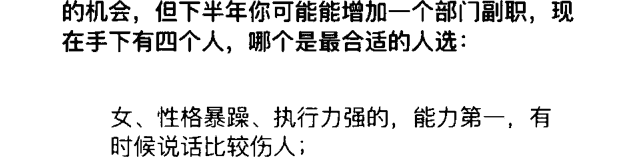

如果你是一位部门领导，现在有一个提升资深岗位的机会，但下半年你可能能增加一个部门副职，现在手下有四个人，哪个是最合适的人选：

+   女、性格暴躁、执行力强的，能力第一，有时候说话比较伤人；
男、性格随和、有点蔫儿，能力第二，资格最老；
女、性格随和、长得赏心悦目，能力很一般；
男、机灵乖巧、嘴甜会来事，能力比C好一点。

## 残酷社会生存法则

## 权力，才是职场性骚扰的真相

045|权力，才是职场性骚...

知识点：
“象征性抵抗”
心理学家发现了很多证据，证明这种抵抗只存在于男人的想象当中。

许多男人相信女人的反抗是出于害羞或者一种游戏，其实大多数的女人都是真的在反抗，或者陷入了极度的恐惧当中。

职场性骚扰上，骚扰者很容易把自己的行为看成是你情我愿，或者某种权色交易。

其实——就是要流氓。

### 1.骚扰者都是些什么人

| 问题 | 骚扰者 | 非骚扰者 |
| 我的性欲是否强烈 | 是 | 不一定 |
| 我的性需求不满足 | 是 | 不一定 |
| 我的性能力很强 | 是 | 不一定 |
| 女人是弱的，需要保护 | 是 | 不一定 |
| 我是一个性方面有魅力的人 | 是 | 不一定 |
| 性是否可以用钱买到 | 是 | 不一定 |
| 性是否可以利用胁迫或者暴力来达成 | 是 | 不是 |
| 对方的反抗是羞耻 | 是 | 不是 |
| 对方反抗和恐惧会让我觉得兴奋 | 是 | 不是 |
| 我有能力，做出这种行为的奖惩很大，性方面的补偿是这些工作的附加加分 | 是 | 不是 |
| 我无法控制自己的性冲动 | 是 | 不是 |
| 所有男人有机会都会这么干 | 是 | 不是 |
| 如果不会被追究，我会骚扰女人 | 是 | 不是 |
| 总结 | 变态 | 常态 |

### 2.被骚扰者要检讨什么？

会还上班？还每天指纹打卡，每周写周报？

哪有那么多黑社会！

忍他，放心地忍他，收集他骚扰你的证据，咨询律师朋友。

要说被骚扰的人，有没有什么是可反思的，那就是：

应该更努力赚钱。

### 3.骚扰者的敌人

如果决定不要忍气吞声，就要开始考虑寻找骚扰者的敌人了。

大多数的年轻女性不擅长职场政治的观察（这句政治不正确），缺乏经验使得她们想去寻找某男性骚扰的其他受害人。

然而，你要知道，那些人胆子和手腕都不如你，不然你就不会再被他骚扰了。

集齐十二星座的绵羊，能对付一只豺狼么？

如果贵司的领导不能容忍性骚扰，那一个性骚扰案就足以让骚扰者丢工作。

如果贵司的领导愿意帮他掩饰，那么十二个性骚扰案也并不能改变什么。

A.如果骚扰者的领导（可能也是你的领导或者你的大领导）决定查处，游戏结束，此人丢了工作。

B.在领导决定按下这事不追究之后，你可以选择和领导交易（调离骚扰者或者把你派去想要的岗位）或者坚持要求处分此人。

如果下决心做后者。就把证据发给骚扰者的敌人吧。比如，他的平级竞争者。再比如，盯着他位子的人。

一定有人不想错过这个机会的。

你也要做好离开的准备。不过这样的公司，不呆也就不呆吧。

C.在网上微博传播是最后一招，不要轻易用。

记得我们在应付校园欺凌指南里提到的么：

引而不发。

像一个蓄水的水库一样，悬在对方的头上。

箭射出来，弓就变得没有威力了。

### 4.骚扰的权力差

刚才我们说到了，被骚扰的人，一般在这个公司里的权力值都很低。

围观群众可能对比你高半级的资深员工或者比你高一级的员工骚扰你而抱着同情。

主管领导骚扰员工是最容易得逞的。

副职或者资深员工也容易得逞。

平级员工之间的性骚扰很容易被打回去。

这也是为什么平级员工之间的性骚扰一般会含有性意味的贬低语言、脏话、下流笑话、触摸身体为主，骚扰者的目的不是占有，而是为了扰乱心神让被骚扰者效率下降，取得职场上的优势。

但是当两个人的权力差太大的时候，群众可能会有不同的判断。

人们倾向于向着有声望的人、熟悉的人，这也是为什么有的明星和自己的粉丝发生关系，许多人不会做成是一种利用影响力获得性资源的五间，而是认为粉丝“赚了”。

最极端的情况，就是克林顿和莱温斯基的权力差，一个是美国总统，一个是实习生，许多人的判断就是，莱温斯基才是那个勾引老男人的家伙。

所以在决定你的策略之前，先算算你们之间相差几级。如果骚扰者的身份地位比你高太多、你又决定鱼死网破的话，可能联系纪委是一种更好的解决方式。

### 5.投诉和拳脚

社科院社会学所的唐灿曾在 2006 至 2011 年调研过 27 名性骚扰受害者，16 名受害者向单位报告了情况，7 例得到单位支持。

将近一半的性骚扰投诉得到了单位支持，这还是在2011年之前。这是微博微信壮大之前的数据，此后的性骚扰事件的流传会更加有效，大多数的公司都会在意这件事。

一些文化水平比较低的女性可能比较难以获得支持，尤其是工厂或者服务业的女性。不过这些姑娘们也有一种传统武器。

拳头和棍棒。

没错。

根据1990年代的中国的社会学家们做的调查，排名第一的对方骚扰方式是投诉，排名第二的就是“叫人收拾他”，受过教育的管层如果想要对文化不高的服务员或者女工下手，要仔细掂量一下，真的可能如我们文章开头所说，被人暴打一顿。

当然我们知道打人是不对的，如果真的打坏了骚扰者，别说骚扰这件事大多没有证据，即使有证据，打坏了人也要赔偿甚至被拘留、判刑。

不过对很怂的骚扰者来说，告知对方自己要揍他，就已经让他心存恐慌了。

### 6.容易出猫腻的地方

我在《如何应对校园欺凌》这个指南当中，提到了老师会如何应对校园欺凌：

她会尽量争取这件事不再发生，但她不愿意去重罚那个欺凌的人。

天下所有单位领导都有一块藏在心里的金字招牌：

“多一事不如少一事”。

所有的领导都在和稀泥，同时，因为骚扰者往往是更高职级的员工，他对公司和领导的意义远比被骚扰者更重要。

这是为什么之前民生银行的经理性骚扰女临时工事件发生之后，当事的分行一直没有宣布对事人的处理决定，经理实习生要有价值多了。

最后是民生的董事史玉柱放了狠话，银行快速解聘了这个经理。

对很多领导来说，性骚扰事件是他卖好的好机会：

“你看，我帮你摆平了这点烂事，你怎么谢谢我。”

“太感谢您了，我一定全力跟著您把工作搞上去！”

记得我们最近总在提的“利益接合部”吗？公司的利益应该是零容忍性骚扰，但是对一个部门领导来说，睁性骚扰是可以对自己有利的。

要想不让领导膳天过海，你可以邀请到骚扰者的敌人来做见证。

这些人会帮你盯着领导，不办这个骚扰者不行。

当然领导不爽，这样做会影响你的前程了。

不过你觉得被天骚扰，睡不好又焦虑恐惧，还会有什么前程吗？

### 7.司法上不太爱管这事

除非是对方已经进行了掐拧、性侵等方式，不要准备去法院。我跟大家说过，法院除了要考虑正义伸张之外，还要考虑判完了会不会有很多多人来打官司。

他们会忙不过来的。

有关性骚扰的起诉本身取证就很难，即使赢了，也只会给很少的一点赔偿。

事实上，所有的法学界、社会学界的专家们，期待的都是雇主负起职场性骚扰的监督部门。

换句话说，普通骚扰者付出的代价一般就是——丢工作。

我也听见过有人议论，说严峻法能够改善，这是不对的。

一定要明白一个道理，组织比老百姓聪明，一个法律这么撂放，有它的道理。

把言语性骚扰变成和强奸罪一样的重刑，那就会计入人自捅着脖子强奸去了。如果

把言语性骚扰变成和强奸罪一样的重刑，那就会让坏人直接奔着强奸罪去了。如果盗窃按照杀人来判，盗窃完就可以顺手杀人了。如果对每个人贩子判死刑，那人贩子遇见警察就要把孩子们害死灭口了。

人干坏事，不是因为干坏事的处罚轻，而是因为他觉得这件事不会被抓住。

在很多大学里，作弊的处分都是没有学位，这是大学里最重的处分，和开除差不多。但一个考场的纪律怎么样，不是因为处分重不重，而是老师严不严、抓不抓。

如果你是一个公司领导，查实证据后解雇骚扰者就够了。也不用进行各种羞辱或者告知天下。

你跟被骚扰者的利益还是不同的。

记得那个楚王绝缨的故事吗？楚庄王喝酒的时候灯灭了，有人趁机去摸他的爱妃，妃子趁机折下这个流氓的盔缨，说让楚王点灯，楚王想了一下，就让大家都把盔缨折断，然后点灯。放了这个性骚扰的人一马。后来楚王在战场上看见一个人玩命打仗，觉得很奇怪，问这个人为什么这么英勇，这人解释说：

我就是那个被折断盔缨的人。

这就是那句我们常说的话：

## 做人留一线，日后好相见。

## —— 习题 ——

你是一个企业的老板刚刚收到一个投诉，一位女员工投诉她的主管性骚扰，这个时候你应该：

+   A. 赶紧组织人力、法务、工会的人调查核对此事；
B. 叫被投诉的主管过来，大骂一通，让他自己搞定这件事；
C. 向着女员工，协调补偿金额；
D. 站在男员工一边，让女员工尽可能委屈一下；
E. 请他先不要激动，尤其不要发微博。

答案是：AE。今天的题目简单，是送分题。

记得，任何一件事情出来之后，不要急着下判断，一定要先知道这事有没有。

# 自习课 | 关系错综复杂，不想投入精力怎么办？

# 来自：公司组织的比赛，真的“特别蠢”吗？

一直以来，觉得关系这事太过复杂，盘根错节，还要时时投入，觉得自己情商不够，无法处理好，做不到面面俱到和持续投入。请问熊老师，怎样调整？

熊太行

也可以调低自己的期待，别人才提升了，加薪了，你在一边努力喝彩。如果不甘心，就要用不甘心去冲淡自己的懒惰。对关系的懒惰，总是穿着“淡漠名利”的外衣，所以特别可恶。

复习：在《自习课｜请不要再当老好人了》里，也曾说过这句话：你不理财，财不理你；你不理关系，关系也会远离你。

熊老师，如何摆正自己交朋友的价值观？

熊太行

别利用对方，和气宽容，调低期待，不背叛。对背叛的人要惩罚够了才罢休。

熊老师，你好，我爸去年10月由于多张信用卡周转不及，还自己办了小额贷款，一共欠款二三十万，我们都不知道，是后来他自己搞不定了才暴露出来的，他一度还想轻生。

因为他自制力太差，他的工资卡和身份证就由我们保管，每个月固定拿多少钱给他，现在全家都在帮他还钱。结果这两天又发现他有一张卡查出来有一两万流水了。他没有多余的钱，不知道他是怎么还信用卡，以及用这么多钱去干吗。

我们觉得他是不会改了，不管把事情弄的多么严重和糟糕，好了一阵，最后还是本性不改。现在是就让他自生自灭，还是有什么更好的办法吗？迫在眉睫，谢谢！

熊太行

不能自生自灭。房子会被收走的，真的爸爸自杀了全世界还得责怪你。

他情绪怎么样？有话特别多，特别爱管闲事的情况么？双相障碍的躁狂期，一个症状就是瞎花钱。这个病春秋容易复发，你说10月和最近，很可能就是。

你们作为家人可以强制送医，在医院让医生做判断。治疗之后就能好很多。你说他有轻生念头，很像是转入抑郁期的情况。

军师，公司领导给的“口头支票”很多，挨个都变成了空头支票，我是不是不要犹豫了，辞职走人。

熊太行

所以口头的都先不要信，然后具体落在纸面上的才是关键。只给你那些你还能满意，才是关键。

我是最基层街道办事处的公务员，四五十人的单位，十一位班子成员里的最后一个，中年女性。还能有什么前途呢？学习老师的专栏也就是想让自己的眼睛更明亮，对孩子以后有所帮助。我说的对吗老师？

熊太行

当然有前途了，你能帮助很多人啊。工作室有意义的。养好身体，教育好孩子，多交一些朋友，中年的伟大之处就在于，它实在是太丰富多彩了，没有唯一的目标！

此内容归得到App独家专有，版权所有，未经许可不得转载，侵权必究。合作请联系iget@luojilab.com

# 被同事“告黑状”，应该怎么办？

046|被同事“告黑状”，...

知识点：
成年人和儿童的思维方式是不同的。儿童会觉得打小报告是不对的，或者某一些做错了要告诉老师；

成年人则不应该把打小报告简单的评论为对或者错，而是分情况讨论，遗憾的是，很多已近人中年，仍然把打小报告当做一个“黑”手段。

我们关系攻略开了三个多月了，这可能是最常见的一个问题了：

> “我的同事背后告我的黑状，我应该怎么办？”

我几乎每次都会看到“黑状”这两个字。
这个词是不对的。
对一个常见的行为不应该早早有负面评价。

我们都年轻过，小的时候看动画片也好，电视电影也好，总是希望自己好，对方坏。
但是成年之后，应该尽早认识，最关键的是：

# 我希望我赢，对方输。

如果你喜欢说“黑状”两个字，说明你仍然认为：

+   - 告状这件事情是不义的；
- 我对这事被告状很气愤；
- 我不会采用这样的手法；
- 我没拿到对方告状的证据。

这四种点意味着：

+   - 你限制了自己的手段；
- 它影响了你的心情；
- 你还不太清楚伤害来自哪里；
- 你没有应对措施。

## 1.首先要放下情绪

## 2.调查清楚是谁干的

## 3.反击

## 4.正确认识“告状”

> “夫人不言，言必有中。”——《论语·先进》

如果你不喜欢告状，那要有机会让自己和领导有更深度的交流和沟通，这方面你展示自己的三观和做事风格。

不要仅仅和领导只在工作的场合说话，陪着领导出差和出国，回来后会变得更近，就是这个道理。

## 5.为什么不劝你用工作成绩说话

有些公众号喜欢贩卖鸡汤，比如你说工作上被人暗算，他们会说你还是要做强你自己。这些大道理非常对，但是只傻干活是绝对不行的。

大家应该都看过奥运会吧，我把职场上的局面用项目型来分类：

# | 射击型职场

射击比赛，一枪就是一枪，没打中就是没打中。裁判的因素比较小。你要是做销售的，大家签单子拿钱，领导的主观评判用处不大。

# | 跳水型的职场

虽然有一定规则，但最终就是裁判主观打分。

你要是做品牌活动、公关这样的工作，就要让领导满意，被别人告状了就要想办法找回来，要解释和说明。

# | 拳击型的职场

在一些野蛮生长的行业里比较多见，本身就是领导让大家放手撕的，领导在胶着的时候有评价权，但是你直接击倒他就万无一失了。

几种情况，复杂得很，应对措施都有问题，简单说一句苦练内功显然没法解决所有问题，在拳击型的职场上，别一人一拳一拳打你的脸，你还默念“天之道，损有余而补不足”，那就熬不到还手的那一天。

## 6.叫破法

有些同事很得宠，或者自以为很得宠，你知道他在告状，但是没有证据，就有点无可奈何。那可以再试这一招。

叫破法：

告诉全公司你们俩有私人恩怨。

前苏联作家索尔仁尼琴在他《古拉格群岛》当中记录了一些斯大林时代苏联人应对告密者的办法。当时的大学里，每个班都有克格勃安排的告密者。一个女老师认为一个女生是告密者，就对她特别好，百般关心，那个学生也受宠若惊，和她特别亲密。

斯大林死后，政治上有所松动了，老师和学生偶尔碰见了，老师说：“我当初觉得你是告密的，不然我才懒得理你呢。”女生惊然说：“我当年怕你是线人，看你那假模假样的笑，谁爱理你啊！”

她们终于放心地绝交了。

另外一个故事则更有启发：

有个女生确定了一个女告密者，这个告密者已经害得好几个人被带走送进古拉格了。

她先下手为强，以抢男朋友一类的借口当众和女告密者撕了一次，还动了手。

苏联的业余文化生活很缺乏，大家都看热闹。

女告密者去告她，不过这时候所有人都知道她俩的事，都是当笑话看。没人认真考虑告密者的提议。

挖苦告密者有的时候确实是一个解决方案，只是需要委屈自己。

有的时候把告密者和自己的恩怨公开，可能是一个不错的主意。

决定应对了，就要放手去撕。

我们以前就曾经说过，情侣也好，朋友也好，如果你总是担心失去这段关系，就要不断被对方欺负。

同样，在一个群体里，公司在乎“团结”，领导提倡团结，但是我们知道，有的时候，不太团结，对领导是有利的。

你讨小报告的对手不在乎团结。

然后你却要担心破坏团结，不肯跟对手撕。

你是董事长，还是圣人？如果两者都不是，不要用“团结同事”这样的中学生行为规范，东缚住自己的手脚。

团结不是忍出来的，而是打出来的，把害群之马清理掉，自然就有了团结。

# —— 习题 ——

你刚刚通过一场恶战，打败了几个同时成为部门的主管，大领导支持你换掉不听话的人，但不要换太多，你的四个属下里，哪个是你需要炒掉的人：

+   A.能力最差的傻白甜，确认了她没有思密达领导的背景；
B.你最强的竞争对手之一，能力其实也不错，但因为没读《关系攻略》，最后时刻他功亏一篑；
C.曾经的告密者，以前至少说过你的坏话，但是在胜负分出之后，已经在向你示好了；
D.老实人，能力一般，话很少；
E.我不动任何人，至少现在不动，我要看他们的表现。

正确答案是E。

从同事变成下属会特别不适应，不仅他们要有适应过程，你也要有。一切关系都需要重新调整和考虑，应该给他们机会，如果有一个换人名额，就要悬在所有人头上，而不是立刻用掉。

记得我们在校园欺凌的攻略里提到的“引而不发”吗？

用好这个策略。

你刚刚通过一场恶战，打败了几个同时成为部门的主管，大领导支持你换掉不听话的人，但不要换太多，你的四个属下里，哪个是你需要炒掉的人：

+   能力最差的傻白甜，确认了她没有思密达领导的背景；
你最强的竞争对手之一，能力其实也不错，但因为没读《关系攻略》，最后时刻他功亏一篑；
曾经的告密者，以前至少说过你的坏话，但是在胜负分出之后，已经在向你示好了；
老实人，能力一般，话很少；
我不动任何人，至少现在不动，我要看他们的表现。

# 残酷社会生存法则

# 自习课 | 人善被人欺，马善被人骑

今天咱们复习一下《权力，才是职场性骚扰的真相》：

在职场上被性骚扰根本不是因为你太美。而是你看上去太弱。职场上的性骚扰者会挑选在职场上权力值最小的女性。

要说被骚扰的人，有没有什么可反思的，那就是：

应该更努力赚钱。

来看看这篇文章中的留言，有没有是你用的上的。

# 来自：权力，才是职场性骚扰的真相

成年女性遇到骚扰况且不能自己处理，校园内的骚扰会在很多女孩心里留下大面积阴影。

有个同学在小学时就被班主任骚扰甚至强暴，虽然最后班主任落入法网，但对于那个女孩来说，已经造成不可弥补的伤害。

我现在有个五岁的女儿，不知怎样做才能够尽可能的教会她保护自己不受伤害？向熊老师请教。

熊太行

用玩具熊来教她，告诉她哪里不能碰，即使是爸爸也一样。

遇见任何事都告诉妈妈，妈妈会保护你。

小朋友一般是防家贼，到了小学，就要多盯着学校，上下来学。

关键在于，她相信你能保护她。

老师你好，我媳妇总是不知感恩，总想挑拨我哥和我妈之间的关系，怎么办？
（我并不是向着我妈，邻居都知道我父母给他们的付出，可是媳妇总不知足），我哥心眼太差，我想保护我妈，但是不知道该怎么办？

熊太行

这是你哥要担起来的责任，你没法取代。让你妈妈拿住钱和房产，这东西不给，你媳妇就会忌惮和介意。你在背后，她心烦了去你那住一阵就好了。把你哥媳妇出去住对大家可能都好。

请问熊老师，马上要去另一个城市工作，我刚实习结束，想请之前学长和同学聚一聚（大家都在一个城市），而她们之间不太熟悉，我是应该分开和请呢？还是一起呢？有什么注意事项吗？我最大问题是我是一个内向的男生，而她们大部分是女生，真的来聚会我当时要说什么啊？

熊太行

叫在一起更好，更热闹。你可以顺势建一个群。以后往里面码人。不需要说哈，最多是大家以后多交流互相照应，多想起愉快的今夜什么的。朋友聚会别说那么利益明白。

熊师傅！您好！如何摆脱“老好人”的标签，但有时候也要要求同事帮忙做事？

熊太行

显出自信来，多先说自己的意见。

同时做个预告：明天根据这位关系户的提问，会更新《如何摆脱老好人的标签》，希望每个关系户都能来看看工作中的老好人应该怎么进阶？

# 如何摆脱“老好人”的标签？

熊太行

在今天的文章开始前，先给大家做个预告：4月13日周四晚上8：00，我会在得到APP直播间为你进行第二次直播。

这次直播我们采取了“回答提问”的方式，你可以在今天发布的另一篇文章《特别放送｜甄集让你陷入两难的关系》中留言，简单的提出你在工作、生活中遇到的陷入两难的问题。

尽量控制在200字以内，建议句式：“我应该…还是…”、“XX情况下，选…还是选…”。你的问题很可能被我抽中，在直播中为你解答。

上次直播结束后有很多关同学问我哪里看回放，回答是：没有的。所以如果你想看熊师傅的本次直播，现在就可以去订一个4月13日周四晚上8：00的闹钟了。

知识点：

阿尔伯特·艾利斯（Albert Ellis）发明的合理情绪疗法（Rational Emotive Therapy，简称RET），能够帮助很多备受折磨、渴望自己的完美的老好人。

有关系户”。（他的昵称真的是这个）问我，已经在工作中被人们当做“老好人”了，应该怎么摆脱这个标签。

我想了想，我是鼓励大家当老实人或者老好人，但是我好像真的没说过老好人应该怎么进阶，这里详细说说看吧。

# 假性老好人和真性老好人

老好人 不拒绝别人，不愿意也不提反对意见，大概有这么几种表现：

+   1. 对任何人回避冲突；
2. 对任何人乐意忍让；
3. 温和，不嘲讽不抱怨；
4. 有主动助人的行为。

老好人和青少年近视差不多，也分真性和假性，我见过真性的老好人，真的是一点火性都没有，对人温和谦逊，从来不欺人，不过业务能力不强（这是关键），如果他被欺负，大家都会不答应。

真性的老好人不会为他的模式而感到折磨，那就不需要改变了，这是他的存活之道。我认真问了他，发现他爸爸他爷爷都是这样，既然老好人能娶妻生子，那就说明他们上万年来还是非常成功的。

假性的老好人其实还是大多数，大多数人是因为阴差阳错，变成了“老好人”。

# 假性老好人的来源

假性老好人其实有不同的来源，应对和改变上也有不同。

蛙伏：对手太强，被所有人都虐，虐怕了，选择了这样的生存之道，在造成他压力的强人离开之后，他可能会从老好人角色里重新走出来。

渴望完美：有些人对这事有一种妄念，希望所有人喜欢自己，希望自己完美，希望自己达成所有的人的期待，这种人对自己特别苛刻，之前我们分享过工作上不喝酒的攻略，说到了那些委屈自己喝酒的人，其中原因之一就是认为自己喝酒了，会被领导、客户和同事更喜欢，有一种人对别人的认可有偏执的需求，你怒他一句或者开一句玩笑，他要解释半天，这种人活得特别累。

羞涩：大多数羞涩的人都会被认为是“老好人”，确实很多老好人羞涩，但这是不同的概念，有的羞涩的人，胸中有万里河山或者一方锦绣，但是当被许多人看做“老好人”之后，他会逐渐地去摒弃这个角色，最后就是越演越像。羞涩的人不是非要回避冲突和乐意忍让，而是他想冲突，但是“臣妾做不到啊！”

个别还有一些因为宗教原因造成的“老好人”，这些人往往在其它方面面临着压力，很多对宗教有狂热感情的中年妇女，家庭内部都非常不幸。这是从属的另一种形式。

# 合理情绪疗法

渴望所有人喜欢自己的人，一般都是对自我要求比较高的人，这种人有一种很好的应对方式，叫做“合理情绪疗法”，心理咨询师经常用，自己做心理建设也可以用。

合理情绪疗法的核心是一个A-B-C模式。

A是指诱发性事件；
B是指个体在遇到诱发事件之后相应而生的信念，即他对这一事件的看法、解释和评价；
C是指特定情景下，个体的情绪及行为结果。

我们仍然以领导要求喝酒为例：
A是领导要我喝酒；
B是我认为不喝酒我会丢工作，或者被领导厌恶；
C是我喝酒了，身体难受，回去还被老婆惩罚。

# 老好人为什么越陷越深

这种自我折磨会让你越来越缺乏自信，倾向于进行全方位的道歉和讨好，很容易变成“老好人”。同时你对变成老好人这事的ABC会继续折磨你。

A你被别人评价为老好人；
B你觉得你从此失去了提升的机会，还会被人欺人人骑；
C.别人说你好，你立刻就会开始自责。

注意，健康的认知模式会给自己尽量减小压力。
大力不能出奇迹。
大的压力只会毁灭任何奇迹。
你不对自己苛求，反而容易采用更积极的策略，你倾向于更悲观、更理性的解决方案，事情不会有任何好转。
如果你经常内心深处天人交战折磨自己，那就可以试试这个ABC的疗法，自己在纸上记录自己的ABC，捉住不合理的B驳倒，选择更合理的认知方式。

ABC这种斗争是你内心深处的交战，当你的同事发现老实人有改变的时候，可能会问你发生了什么，我是不建议你把这个疗法解释给他们听的，因为大多数人对心理咨询、心理治疗和精神科学都茫然无知，你的解释只可能产生误会。再一个，自己的内心成长也没有必要暴露给一些不够熟悉的人，如果对方出言嘲讽，你可能会把刚刚建设好的内心受到摧毁。

我一般给这样同学的建议是，你在呕呕呕写ABC让自己变得更理性的同时，加一些外在的习惯改变，比如减掉5公斤的体重，显得更健康，增加10%的肌肉含量，让自己体型更好，参加一个培训班，改善英语口语，学了厨艺或者养了一只可爱的宠物。

把你真实进步的原因藏在一个肉眼可见的行为之后。

恭喜你，你已经不是老好人了，永远都不是了。

因为你已经被关系攻略“教坏”了。

# —— 习题 ——

熊大侠在山洞里发现了一个宝箱，发现第一本书就是《辟邪剑法》，第一页写着“武林称雄，挥刀自宫”。熊大侠包扎好伤口回到宝箱，发现箱子里还有另一本书《独孤九剑》，上面写着“至少和《辟邪剑谱》一样强”。

试着用合理情绪疗法的ABC来分析一下熊大侠那里做错了，给他的B环节出一个恰当可行的建议。

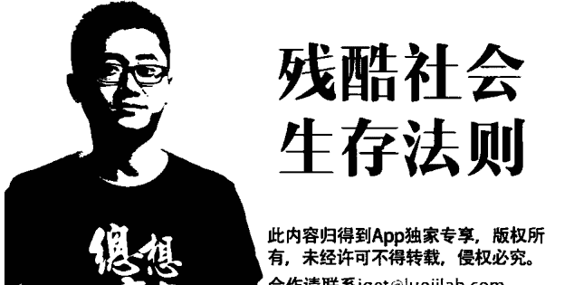

此内容归得到App独家专享，版权所有，未经许可不得转载，侵权必究。合作请联系iget@luojilab.com

# 徒弟啊徒弟，你的小命仍在为师手中！

048|徒弟啊徒弟，你的小..

知识点：

人们渴望被更多人喜欢，为此他们愿意接受许多社会规则，以及接受权威人士的建议。

我们受的学校教育让我们形成了接受权威建议的固有习惯。

只有最强大的人才能保持不从众。

所以，大多数的徒弟和下属，都可能不同程度上被领导和老师操控。

如果你放弃对徒弟的影响，他可能会逐渐投靠他人或者单飞。

我最近在看《人民的名义》，很有意思的一部剧，看这部剧注意观察他的上下级关系。

但是记得不要直接用里面的一些法子。

我的公司正在拍网剧，所以我对文学作品到剧本的过程有所了解。

一些很写实的故事在变成剧本的时候，就要求戏剧冲突好看。所以你费尽心思学到招儿，可能是现实中不会发生甚至于理不合的情节。

第2集里，有一场删徒记很好。

京州市的副市长被最高检发现是个贪官，京州反贪局动手前，市委书记李达康知道了，在会议上提议自己接手先双规这个人。

这是挠回面子，市反贪局局长陈海、市检察长季和省政法委书记高育良都不同意。

这个时候，公安厅祁同伟厅长站出来支持李达康。

贪官在他们争吵中跑掉了。

祁厅长是高育良以前在政法大学教书时候的学生，一手带出来的徒弟，这个时候跟老师不站在一边，他想干什么？

接下来的一场戏，专门解释了这个逻辑，更可以看做一个师徒交锋的过程：

育良书记：同伟啊，你今天怎么想要帮着达康书记争着办案权了？是不是有点私心呐。

祁厅长：我就这点小小私心，都被您给看出来了。

育良书记：想上位副省长，还指望达康书记在常委会上投你一票。实话和你说吧，对这个事情，我不太乐观。你也别这么乐观，呐。

祁厅长：老师，您觉得达康书记会反对我进一步吗。

育良书记：不是达康书记，是新来的沙瑞金书记（省委书记），你想想看，哪一位一把握手一上任，就马上提拔干部呢。还是上届领导留下的。

育良书记：离任老书记怕担责任，有一批干部没有安排，这新来的书记一上任，就把这些人都提拔安排了。有这种可能性吗？

祁厅长：嗯，也是。

育良书记：但事情也不是绝对的，沙书记正在各市做调研，如果政绩好、口碑好的，也就未必一定不安排。

祁厅长：如果没有这位空降的省委书记，您做书记就好了。

育良书记（看看左右）：这沙书记来都来了，还说这些有什么用呐。记住，以后在外面，不能乱说。

祁厅长：这个您放心，我肯定不会乱说的。

育良书记：有时候想想呐，这官儿，当多大才算大啊。我要摆正位置，你也要摆正位置啊。

祁厅长：不过老师，我听到一种传言，说沙书记到了以后，达康书记会上任省长。那将来汉东的政治局面就是沙李配。

育良书记：所以你现在就主动往达康书记跟前凑？（哼哼哼哈哈哈）

祁厅长也笑。

育良书记（虚指祁厅长）：做事啊，还是要谨慎。来，里面坐。

育良书记是一个压低嗓子说话的人，像《教父》里马龙·白兰度的演法，这场夜间驯徒的戏，非常精彩。

注意，我用的是驯，不是训。这不是师父批评徒弟，而是一个二次驯服过程。

徒弟和师父是有利益接合部的，还是个大空当。

徒弟翅膀硬了，独立门户。或者看见机会了，想要攀上一个高枝儿，都是常见的局面。

这个时候老师就要出来敲打他，防止他叛变。至少让他再一次宣布效忠。

育良书记从车里出来，走到门口，开始拾撮祁同伟的。

注意，别进了门再开始，在你家的客厅里去批评人，被批评的人以后可能把你家和这种屈辱联系在一起。

车上不能说，司机听着呢，就是下车后到门前，才好拾撮徒弟。

育良书记说的其实是：你有点算盘了，不跟我一起了是吗？

祁同伟承认。

这是对的策略，各位关系户，领导、老师说你什么，千万别急着说没有。尤其是领导沮的时候，一定要先表达自己的愣愧。

育良书记开始谈论关键：你觉得达康书记是摇摆人，你想争夺他的一票，但是你的基本面根本就不稳。

沙书记是新领导，对你根本不熟，你是前朝老臣，他不会随便用你。

当然了，他要了解情况，而我是那个对情况最了解的人，所以，祁同伟你觉得你应该先去争取谁？去拿李达康，还是跟我站在一起？

达康书记如果要当省长，一般会兼省委副书记，育良书记是省政法委书记，他也是副书记，他们要展开直接竞争。

这话说得很明白，所以祁同伟听见这个一定是毛骨悚然。所以你看他的应对也非常高明：

如果没有这位空降的省委书记，您做书记就好了。

各位，各位关系户，撤黑板了。

一个公安厅厅长，不应该说出这么差劲的话来。世界上...

这叫：孩子话。

前两天有关系户给我留言，我说女生有优势，可以撒娇，她说自己是女汉子，一直没学会撒娇。

撒娇不是非要娇滴滴说话的，男人也能撒娇。

祁同伟这就是撒娇，说的话突然成了非常孩子气的话。

看过《鹿鼎记》的同学可能还记得，洪教主教韦小宝功夫的时候，韦小宝看着完精妙的招数就是一句“吓死我了”，洪教主特别高兴，因为那是孩子话，他觉得真实。

祁同伟是育良书记的学生，他十几岁的时候就跟着老师，会说一些年长人的话，这一刻突然说出一句孩子话，不是证明自己

一刻突然说出_WEIGHT_一句孩子话，不是证明自己政治上的低能，而是让老师意识到自己是跟着他的孩子，这是撒娇，是狗在摇尾巴，是套路。

育良书记接受这个套路，让他别瞎说。这也是教育十几岁小孩子的话。四十多岁一个厅长，不需要这么叨嗑了。这句话说出来，就是原谅祁同伟了。但是敲打还要继续。

我要揍正位置，你也要揍正位置啊。

后半句才是关键。

祁同伟请示了老师关于“沙李配”的可能，学生也在考察老师的准备工作，老师你应该有应对方案吧。

育良书记那句“所以你就往那凑”也是很重的敲打。

为师自有安排，招数还多着呢，怎么就要分行李，就要回高老庄啊。

这句话会让祁同伟不好接，所以育良书记用一阵哈哈打过去，给祁同伟留面子。

做事啊，还是要谨慎。来，里面坐。

你要相信老师的韬略。我们进去说。

我们总结一下育良书记的驯徒指南：

- 1. 直接点破你想背叛；
- 2. 分析局势，他不会帮你你会死得很惨；
- 3. 你的小命在我的手中；
- 4. 接受你的道歉和示好；
- 5. 再敲打一次，以后少玩这套。

这种策略在各种职场上都能用。用的时候注意：

- 1. 驯服和敲打要立刻进行；
- 2. 不要委屈忍耐，等到徒弟被人争取走或者煽动独立门户了，那损失就大了；
- 3. 有的家伙是真的不懂事，得教。你不教他他不知道自己做错了。

心理学上是有效果的，我们知道大部分的人在团体里都会服从权威，我过去采访过一个假教授，带着骨干弟子们骗来一堆大学生和假大学生在郊区上课，给人洗脑。割断了熟悉的家庭和朋友支持之后，人们害怕被孤立，就会相信这个假教授说的一切。

人们渴望被更多人喜欢，为此他们愿意接受许多社会规则，以及接受权威人士的建议。

在职场上，师傅对徒弟就是有权威的，如果你觉得徒弟是你队伍、阵营里的重要一环，就要多花点心思在他身上。当他出现松动和动摇的时候，要及时补一些东西。

就像父母要告诉子女爸妈能够保护你，不要怕一样。

当老师的也要告诉徒弟，自己仍然强大，仍然是能够指点徒弟、影响徒弟命运的人。

当然，光敲打是不行的，你还要教他。

进屋之后，育良书记开始上课：

达康书记想要双规丁副市长，就是希望少影响自己市里几百亿的项目。如果全市GDP掉下去，省长就当不不了了。

“沙李配”，还配个屁！

达康书记的省长干不了，这省委不是还被咱俩爷们儿把着？

所以你祁同伟不该帮他。

祁同伟明白了，也给自己打个圆场。

老师，我也是想我们都是您的学生，如果没人帮达康书记说句话，好像觉得咱们师门做局欺负他……

“就你心眼多，没用在地方。”

老师用一个老爹埋怨孩子的方式接受了他的解释，没有再追究了。

# —— ◆ 思考题 ◆ ——

我没有写作为徒弟应该怎样摆脱师父的影响，试着用今天我们提到的知识，列举一下徒弟保持独立的要注意哪些。

# 自习课丨如何在一
段关系中掌握主动权？

熊太行

今天的自习课开始之前，要给关系户提个醒：4月13日周四晚上8:00我将在得到直播：解答那些让你陷入两难的问题。

如果你在生活中、工作中有遇到陷入两难，不知如何选择的问题，可以在直播当天的互动区告诉我，我会挑选一些问题，为你解答。

另外有关系户反应昨天的文章没看过剧看不懂，这里加上一段，便于大家理解：

昨天的推送，借用了一段《人民的名义》里，高育良对老部下、同时也是自己学生的祁同伟的“敲打”和“点拨”，讲的是职场上的 annex 山头。

这是非常危险的一趟，很多同学也分享了自己类似的经历，很多时候，领导都兼有老师的角色，彼此合作多年，都知道对方的底细，伸胳膊迈腿，对方都能立刻觉察。

一段师徒兼上下级的关系要想稳固，老师自己要前进，不能被推着走，要有保护好自己地盘，防止被架空和侵吞的能力，同时对徒弟要保持威慑，这个小群体才可能继续前进。

近代史上最著名的鼓厉徒弟的作品是毛泽东回答林彪疑问和动摇的文章，叫《星星之火，可以燎原》。

# 来自：被同事“告黑状”应该怎么办

熊老师，我们如何才能在一 段关系中掌握主动权呢？

熊太行

- 1. 核心资源在你手里，比如房子，或者客户。\n2. 你比对方更不投入。

请问熊老师，有时办事脑子总是一片空白，反应不过来，事过了才知道自己当时应该怎么做怎么说才合适，尤其是领导在场时，怎么破？

熊太行

说话慢下来，反应时间就多了。

熊老师，我爸妈价值观和我很不一样，老是要求我考公务员，不考就是不孝，而且不喜欢我的女盆友，觉得她的工作不稳定，家庭实力太差，门不当户不对，每次回家就吵架，现在她觉得她没有我这个儿子，说我变了。

我很伤心，也有我自己想走的路，我该怎么和我妈妈爸爸沟通，感觉无法沟通了。每次回家都心情很沉重。

熊太行

那就不孝好了，你做好关系破裂的准备，他们就不会提要求了。

女朋友家庭太差那就要很努力才行。你必须足够坚定这个婚姻才可能达成。

如果你回去，就要接受被安排的人生，懈屈一辈子。而且，没本事把儿子塞进好单位的家庭才会让人考公务员，对吧。其实他们能帮你的有限，他们只是穷怕了。求所谓的稳定。

熊老师你好，我有一个弱点，就是不喜欢别人批评我，说我的不好，亲人说我的不好或者开玩笑说我不好，我就想发脾气，朋友陌生人说我的不好，我没有那么在乎，这怎么破？

熊太行

二姑，你看嘛，你又批评我，多鼓励鼓励我吧。在公司有老板管着，可言了。直接请求对方鼓励，对方会一怔。大多数人不是真批评，那是嘲讽。嘲讽的真相就是恶心你，让你被迫采纳我的意见。

# 如何拯救一个害羞的灵魂

知识点：
害羞者最大的问题是过高的自我关注。

解决方案就是告诉自己：
没有那么多人看着你，你要照顾好自己。

我曾经说过，在所谓的“老好人”当中，有一批“假性老好人”其实是害羞者，害羞让他们无法争取权利。

害羞是挺大的问题，遗憾的是，青少年时代，父母往往对这种情况认识不足。

有些父母，甚至对孩子的害羞还有些沾沾自喜：

- - 这孩子非常老实；
- 这孩子不乱花钱；
- 这孩子非常听话；
- 这孩子不和外面的孩子一起瞎混；
- 这孩子非常厚道，不跟人起冲突。
- 不早恋。

其实真相非常残酷，现实中这个孩子面临的情况是：

- - 他很难交到新朋友，难以跟别人沟通；
- 他很难享受各种各样物质的快乐；
- 他在乎别人对自己的看法，尤其是家长或者老师，如果他觉得自己做得不好，就会感觉备受折磨；
- 他没法维护自己的权利，受了欺负就要忍气吞声。
- 结婚难。

# ｜害羞者到底在怕什么

的时候，不害羞的孩子会主动为不懂的老师求助，而老师则会帮他解决问题的。

害羞的孩子不敢提问，甚至更尴害，从小到大，你们一定遇到过因为害羞不敢请上厕所而把大小便拉在裤子里的同学。

害羞的人介意的往往是：天呐，如果我这样做，别人（陌生人）老师（权威）会怎么看我啊，他宁愿自己承受不方便，伤害自己来获取别人的认可（其实对方根本没有认可）。

我不知道你们有没有遇到过这样的下属或者实习生，你跟他说话的时候，拼命点头，看上去什么都懂了，一开工发现完全不是那么一回事，其实他根本就没有听懂，他频频点头是为了讨好你，他害怕你放弃他。

这样的人就是害羞者，他不是傻。事实上，你在费尽口舌教他的时候，他脑子里全都是：熊老师对我期待好高，我一定要认真听讲，我要好好表现……我去……他说了啥？

这时候你刚好说完最后一句话：明白了吗？

他死命点头，然后灾难性的工作开始了。

在害羞者拼命纠结于自己的内心感受的时候，他的注意力全在心里那点麻烦上，他的记忆力也会下滑，这时候能有30%的智力水平都不错了。

所以有的时候你的新下属不是智力有问题，而是害羞。然而你仅仅明白了这一点仍然帮不上他，只能让你自己心里舒服一点。

# ｜害羞者的其它麻烦

害羞者的亲密关系和性关系都可能出现问题，这点我们先不细说，回头单开话题，而且根据心理学家津巴多教授的调查，对性工作者的一个访谈显示，他们的客人里有60%的人都很害羞。一些害羞者可能会购买性服务，来取代自己恶劣的亲密关系和性关系。

刚才我们提到了害羞者自己有“过度关注”，所以当一个男性被抓嫖的警察追赶的时候，他确实可能做出傻事来，他只考虑自己的前途和别人的评价，他可能根本就听不到警察的警告和指令，这可能导致他们吃大苦头。

# ｜克服害羞的几个法门

克服害羞其实没有那么难，各种办法很多，但是说到底是在两个地方动刀。

### 1.认知上做改变：

- A. “没有那么多人关注我和在乎我。”；
- B. “我的笨拙，别人很快就会忘掉。”；
- C. “最大的敌人是自己，有时候，我太关注我自己。”。

我不知道大家有没有第一次购买安全套的经历，很多年轻人第一次购买的时候都会特别羞涩：

找不到的话，怎么问售货员？
结账的时候，对方会怎么看我。
我后面是个女生！她会怎么看我呢？
妈呀，怎么我们辅导员也来超市了！
我死了！
哦看错了，长得真像。

### 2.还有一种是行为上接受训练

比如害羞者若时开口说话，我列了一个清单，难度是从容易到复杂，有困扰的同学可以试从第一个任务往后做：

- A.打电话给宽带运营商的客服咨询价格，在一个餐馆询问订座；
- B.打电话到广播节目，注意别打那种前列腺药物和男科的节目，都是骗人的。请你表示一下对节目和主持人的支持和喜爱，这属于半匿名的状态；
- C.给陌生人的电话，比如电话访问或者推销，这个有些难度，因为你要介绍自己和自己的目的了，然而要想办法克服它；
- D.见到熟人点头问好；
- E.在便利店和店员说话；
- F.称赞同事的衣着或者发型；
- G.赞美陌生人，比如小区门口晒太阳的老大爷；
- H.叫朋友介绍朋友给你认识，一起打牌；
- I.请求陌生人的帮助，比如请一位先生帮你放行李、借零钱。

# —— 习题 ——

你在聚会上通过朋友新认识了一个害羞者，他显然正在努力改善自己的社交，他称赞了你的衣服，你也想跟他示好，这个时候你的不正确做法是：

- A.谢谢你的称赞，我也很喜欢这件衣服。
- B.你常和朋友来这家店吗？他家什么好吃？
- C.您做哪个行业的？工作忙吗？今年这个行业生意好做吗？

行业生意好做吗？

D.这衣服很旧了，正准备说换了呢。

答案是D。

有的害羞者会认认真真的去回答对方称赞的内容，初次见面的浅社交不要那么认真，接受赞赏是一种套路，破拆套路的每句话对方一下子就会陷入尴尬。

不要给对方那种太复杂的问题，如果对方回答上有困难，你可以在他做了简短的回答之后给出自己的答案。

记得谈话结束的时候说“真高兴认识你”，害羞者对这一点可能会比较介意，没打招呼就离开，可能会让他们满腹狐疑，担心自己做错了。

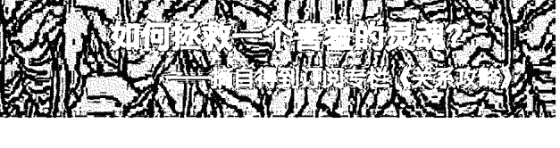

在聚会上通过朋友新认识了一个害羞者，他显然正在努力改善自己的社交，他称赞了你的衣服，你也想跟他示好，这个时候你的不正确做法是：

谢谢你的称赞，我也很喜欢这件衣服；

你常和朋友来这家店吗？他家什么好吃？

您做哪个行业的？工作忙吗？今年这个行业生意好做吗？

这衣服很旧了，正准备说换了呢。

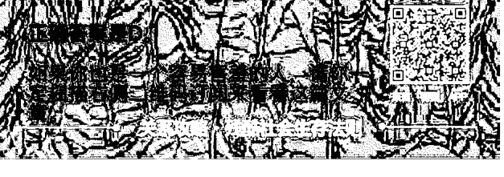

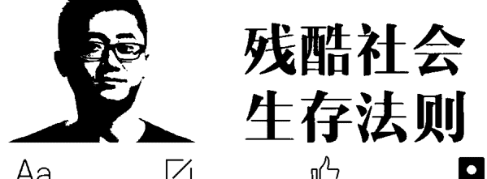

# 自习课|遇到两难问题如何选择？（直播问答）

熊太行

今天在直播中对大家关于两难的问题，做出了一些回答，照顾错过直播的小伙伴，从中挑选了3条问答，在自习课上给各位关系户再复习一遍。

利益和关系是不是二选一的？

熊太行

关系不是利剑，关系是铠甲，能帮你挡利剑。不要用关系去给别人下套，好关系能给你开拓资源、获得利益。

前期，让出一部分利益是非常重要的，你会收获友谊，当你们变成盟友，你们就能站在一起，获得更大的利益。他们俩是相生的。利益出关系，关系出利益。

装作喜欢自己的领导还是做真实的自己呢？

熊太行

中国有句老话【良禽择木而栖，贤臣择主而事】。 

有机会的时候，要挑选自己喜欢的领导，这样你工作是不累的。 

前提是，领导要照顾你的利益，给你更有前景的未来，这样你可以做真实的自己。 

而你的领导身上一定会有闪光点，拿一张纸，把优点写下来。这样你会发现，领导还是有一些优点的。之后学习这些优点，取得进步。

替同事背了黑锅，该不该当面跟领导解释？

熊太行

挨骂一点都不冤枉，受下来，不要顶嘴。 

人在激动的时候，太关注自己感受，这时候注意力会下降，智力会下降。 

赌气开车的人觉得路也变得狭窄。赌气跟领导顶嘴，会言不由己的。跟领导在咆哮的时候，别人在暗暗的笑，千万不要恿领导。 

记得这样做：

- 1. 你挨骂不冤枉；
- 2. 不要顶嘴；
- 3. 事后做解释，详尽的做解释，把理由说尽，责任分清。

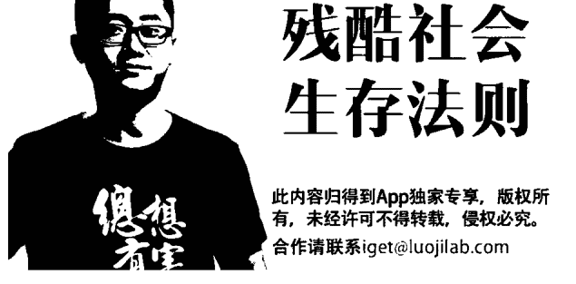

此内容归得到App独家专享，版权所有，未经许可不得转载，侵权必究。
合作请联系iget@luojilab.com

# 我的老师盘剥我，我该怎么办？

050|我的老师盘剥我，我...

# 知识点：

> "为了纠正主观偏差，你应该更好地对待他人，比你预期他人对待你的还要好上20%．" ——莱纳斯·鲍林

大多数人认为的“ 我被公平对待”，指的是对方的所得/自己的投入=自己的所得/自己的投入。然而我们知道，在劳资关系、师徒关系上，这种等式完全不可能成立。

这篇文章不仅对在读研究生适用，也对处理和职场上师傅的关系有帮助。

注意看看今天的知识点里的这句话，鲍林不是一位心理学家，他是一位诺贝尔奖获得者，他的领域是化学，这意味着他从年轻的时候开始，就在导师的实验室里当助手。

他要为实验、各种课程而忙碌，也许还要谈恋爱，随着年纪渐长，可能也有长辈的健康压力，就像今天的许多读硕士和博士的年轻人一样。

我不止一次接到了关系户的留言，提到了在读研究生接受导师“盘剥”的情况。

等等，为什么是盘剥呢？最近正好又收到一个关系户同学的留言，她的ID是实名，我帮她遮去ID，我们一起来帮她分析一下，问题如下：

熊老师，我想请教你一个问题。我的研究生导师是院长，总是强迫我们帮她做很繁琐的校对文档的工作，而且无法拒绝，每个礼拜的固定时间召集她的三个学生，上交作业。

而且会用通迫式“为我们好”的话为诱点，（我们都不是小孩子了，什么是好的，什么是骗的，我们怎么可能不知道呢？），这种情况该怎么办呢？

我们还是用我们惯常的关系分析法，分析一下敌、我、友。

# 我方：

你是个研究生，你的目标是，拿到学位、奖学金、评优、交换去国外的机会、保送博士、找好工作……

# 友军：

两个同门同学的目标，也是拿到学位、奖学金、评优、交换去国外的机会、保送博士、找好工作……

你们有竞争关系，但尽量不要把他们当敌人，因为未来大家是要互相扶持的。但是也不要觉得他们是真正的友军。

# 敌军：

注意了，导师是你的敌军吗？

根本不是。导师是决定要不要给你论文通过，攥着你学位的那个人。

导师是决定在你和同学之间如何分配机会和利益的人。

你和导师虽然有矛盾，但是最重要的一点是，你们是合作关系。

你的敌人，是那些复杂的文档整理工作。

# | 用谁的时间更划算

这些文档的整理工作应该是你导师该自己完成的，但是根据你的描述，三个同学都觉得繁重的工作，如果是让你导师去做，他死定了。

把学院拆腾出动静来，让自己更红，都是对的。

你觉得不公平，是因为你想要的公平得这么算：

对方的所得/自己的投入=自己的所得/自己的投入。

你觉得自己的所得为0（账面上），就认为老师沾了光，其实你的所得不是0。

现在的学者、教授，可能手上没什么现钱，但是过得不错。做一个院长，更是会有不少的资源。

如果老师要给你们发一点劳务费，公事公办的，那就说明当临时工用，这样的老师一般不会谈交情。反而这种要你帮忙的，以后遇见你的事，他也可能帮忙。

一个院长一般是五年左右的任期，这也是你导师的黄金时代，挣钱出名，都靠这几年。

你们看上去好像没有得到什么，但他越红、越牛、越有能量，你们出去交换、交流、申请外校或者国外博士，或者找工作，好处就越多。

你选他的时候，也是因为他是教授、是院长、是学科带头人对吧。

那些年轻、没有知名度、没有项目、没有魅力的、混日子的导师，你没有选。

你打败了很多想做他学生的同学。

你选了一辆轰鸣着往前狂奔的过山车，然后抱怨说，“他怎么开得这么快！”

# ｜骗你？骗你那是对你客气

你的第二个抱怨，是导师开会给你们悠悠洗脑，说干活是“为你们好”。

老师是个读书人啊，所以对白用你们的劳动力这事还会不好意思，才会说这样的话。

如果在职场上你说这样的抱怨，当时你就会被打入另册，有的是人愿意跟单位一把手干活儿。

老师用话来抚慰、悠悠你，说到底是希望能够维护一个师生关系。

这就是我们“关系攻略”里经常说的，对方在用套路，就像一个男生说，我喜欢你，他的目的是约你出去，你非要问，你到底喜欢哪一点，写800字，文体不限，诗歌除外，那就是不讲理了。

老师比你强大，你的命运可谓在他手里，他说一些套路上的话，就是屈尊来维护和你们的关系了。

即使不高明，你也应该收下。那俩同学心里应该也明白，但不会叫破。

说一句：“是！我们会更努力的！”

研究生没有做一辈子的，有zel的两年，有的三三年，无论如何都可以咬咬牙熬过去。还要嫌他骗你骗得太假，那就有点太挑剔了。

高明的骗子是有的呀，比如在病床前哭诉自己工作太累，然后你们表忠心，帮他分担吗？那是高明的骗术，然而老师混到那个份上，未免就太纠结了，成不了事的。

# ｜老师喜欢什么样的学生

我最近经常提到一个概念，就是利益接合部。有的同学对这个概念还有疑惑，利益接合部，就是一个人和他所属的机构、组织，利益不同的地方，比如导师和国家之间的利益接合部就很大。

我们试着看看几个机构和个人的KPI吧，你会发现他们追求的是不同的目标：

国家   教育部   学院   导师
培养优秀人才 发展研究生教育 选择更优秀的学生 招聘优秀...但首先听我们的人

公立大学的老师，按说应该为国家培养人才。

国家的需求就是“培养人才”，但什么样的人是人才，如何培养，是学院说了算。学生是不是符合标准，是导师说了算。

注意，我没有写导师招“优秀、又愿意干活的人”

因为不是每个老师都招爱干活的人。

有的老师自己工作不积极，他喜欢的就是没有麻烦的学生。

有的老师做生意，就喜欢招给自己能带来点什么资源的。

有的老师喜欢给自己送礼物的，小财迷，地方一些不太好的学校尤其明显。

还有的老师比较邪恶，“听我话的人”就是“要忍受性骚扰的人”。

是不是听起来有点毛骨悚然？如果导师招来学生，只是为他分担一些文档整理的工作，要我说，这在现代研究生培养的“合理使用”范围之内，这个老师70分是有的。

跟普通导师翻脸还可以协调导师，导师就是院长，你跟导师闹别扭没有胜算。

你对导师到底有多少价值，我来列一个算式吧：

你对导师的意义=你的实力、你的听话程度

跟普通导师翻脸还可以协调导师，导师就是院长，你跟导师闹别扭没有胜算。

你对导师到底有多少价值，我来列一个算式吧：

你对导师的意义=你的实力、你的听话程度、你的家庭背景关系。

我没有加符号，是不是想这么做？

你对导师的意义=你的实力+你的听话程度+你的关系？

不对，是这样的：

你对导师的意义=你的实力*你的听话程度+你的家庭背景

懂了么？听话程度为0的同学，对老师意义可能为0，当然如果你家背景是90分，出来的成绩也是90分。别怪老师嫌贫爱富，有雄心的人都会跟有实力的人一起玩，学生不是也愿意挑院长和一级教授做导师么？

如果你不是那种有权有势的家庭的话，那就认真和老师合作，再委屈也应该熬过这几年。

孙悟空学长生不老和七十二变之前，在须菩提那里扫地砍柴，做了整整七年，正好是一个本科和一个研究生的岁月。猴哥的脾气，比我们暴躁，耐性也差，居然呆了这么久，就是因为他明白老师那里有他要的东西。

当然你可以跟导师说，你不愿意干杂活儿，导师不会因为这个开除你。但是之后你很可能就会遇到一些奇奇怪怪的事，就感老师有胸怀气量让你毕业，以后你也将用不上师门的任何资源。

## Ⅰ 找人分担压力

我告诉了你应该怎样认识老师布置的任务了，接下来我要告诉你如何解决它。

有一种同学有大把的时间，那就是已经保研和被录取的大四同学，研究生的录取人选定了，老师选的下一届的师弟师妹已经真实存在。

跟老师打个招呼，让老师允许你来组织协调这几个人加入帮忙。以老带新，如果六个人一起动手，这件事就好办了。

之前你也提到过，老师不善于给同学们洗脑，你觉得他说的话连小孩子都骗不了。

对，那你就帮他“骗”。

既然所有的同学都要为老师效力，那大家都开开心心的，早点认清形势，比有人跟老师决裂要强。

要像我跟你解释这件事一样跟下面的师弟师妹解释，老师的时间宝贵，我们要帮他分担，对大家都有好处。不要把老师累坏了，大家损失就大了。

比老师自己说“对你们好”，有说服力得多。

上一届就应该有这么一个角色！为什么会没有呢？

你自己要先说服自己，帮老师进步，大家都有好处，把老师累坏了，大家都会受损失。

当然，做这个工头、大姐头的角色，必须要发自内心地信服、敬爱老师，不然的话，会被师弟师妹看成是谄媚之人。如果做不到，也不必勉强。

读研的同学，如果觉得自己被折磨得很惨，可以看看医学院研究生的劳累程度。

医学院研究生要担任住院医生，晚上呆在病房值班，随时处理情况。

有的医学院研究生，他的导师以后就是单位领导。

明明有执业医师执照，病人家属始终都觉得你是实习生。

高收入、有地位、风光，都是要做到专家之后的事。

这些人虽然在读书，但是已经进入了压力最大的职场，他们中的很多人根本不会觉得“盘剥”。

两个选择，在大城市的三甲医院受盘剥，或者是回到老家乡卫生院当人才，二选一。

友情提示一句，如果你选择回去，可能要面临更复杂的人际关系。

不读研的关系户同学，也要多想想类似的情况。

给你加任务的人，是不是你的敌人？

他手里有没有你想要的东西？他有没有强大的实力？他给你的任务有没有可能进行下一步的分包解决？

靠拢一个有强大实力而且乐意回报的人，是初入职场者进步的方便法门。

明智的人把额外的任务看做机会。

没有想明白的人，看见了机会，也会觉得是一种盘剥。

P.s

再看一条留言吧：

熊老师你好：

没有想明白的人，看见了机会，也会觉得是一种盘剥。

P.s

再看一条留言吧：

熊老师你好：

我和男朋友读同一个导师的研究生，自从入门之后，我长期负担起了给导师做饭的工作，我导师以前和我父亲青年时代有点矛盾，谁也不服谁。给男朋友上课的时候，也都不让我在旁边看。

导师的研究领域风险很高，他也经常和一些身份不明的人来往。

导师一直没有给我们发生活费或者劳务费，我男朋友是外地人，过来越学习身上早就没钱了，但是导师说，没钱上街要饭，他反正没有钱。

他平时穿衣服很邋遢，上次身体不好生了病，就说要让我接手他的公司，还往我身上吐痰，我真的不喜欢他的事业，也不喜欢他的有些员工。

最近导师说要去陕西参加一个会，跟我们说让我差旅费自理，我家条件是不错，但是我爸爸也要去参加那个会议，我跟他要钱恐怕不太好。

熊老师你告诉我，我该怎么办呢？

喂，别蒙我！这好像是黄蓉和郭靖拜洪七公为师，洪七公让她当丐帮帮主，现在大家要去参加华山论剑的故事啊！

同样的事情，人的认知不同，看待的角度不同，就会出现两种完全不同的局面，对不对？

## —— 习题 ——

和导师的关系与和职场上的领导关系有何不同？（多选）

- A.你的江湖地位受到老师的名气影响；
B.跟领导庆祝劳动节，跟导师庆祝教师节；
C.有一个师门，有纵向的联系；
D.跟老师可以谈论师生情，没人敢说你诡媚；
E.不能随时辞职，也没有那么容易被开除；

答案是ABCDE。

A.是自古以来的规则，比如“进士”是天子门生，导师就是皇帝。三甲的“同进士出身”就跟扩招的差不多。

B.如果你领导同时是你的老师或者师傅，记得教师节发一个问候，凸显你和他交情的不同。

C.黄埔系可以管蒋中正叫“校长”，其他只能叫“委座”，这就是区别。

D.这句千万记在心里。

E.重点是前半句，大多数人如果得罪了导师，都很难忍受那种煎熬，以及不要太任性用到后半句！

和导师的关系与和职场上的领导关系有何不同？（多选）

- 你的江湖地位受到老师的名气影响；
跟领导庆祝劳动节，跟导师庆祝教师节；
有一个师门，有纵向的联系；
跟老师可以谈论师生情，没人敢说你诡媚；
不能随时辞职，也没有那么容易被开除。

此内容均得到App独家专享，版权所有，未经许可不得转载，侵权必究。合作请联系iget@luojilab.com

关系户 52445成员 7人今日打卡

用户留言

提交留言可与专栏作者互动

## 前任攻略 | 无法拒绝前任跟我倾诉，我要让现任知道吗？

051|前任攻略-无法拒绝前...

## 知识点：

人际交往中的黄金法则：你想别人怎样待你，你也要怎样待他。

收到一个纠结的关系户，Y同学留言：

熊老师，每次看完您的文章都觉得非常深刻，非常值得。第一次给您写留言，是因为我遇到两难了。

我和现在的女朋友认识一个多月，双方包括父母都很满意彼此。她的家境和家教都比我好，我学历工作和能力被认可度比较高。

她能接受我的一些，包括我的离异经历以及农村出身，也能接受我和前妻作为普通朋友（妥协的结果，知道我不可能完全切断），但是受不了我和前妻的微信联系，我感觉现在当我的电话或是微信短信响的时候她都在想是谁的。她说只要我不当着她的面联系就好了，她心情会不好，她控制不了。

我也想过不再与前妻有联系，但是这违背我的本性。前妻是我大学同学，恋爱六年，结婚四年多（领证第七天发病，三次准备办婚礼期间都因为停药而发病，也就一直没有办婚礼。小时候发过癫痫，外公受了胸外伤有精神疾病）患有精神类疾病，不停药能够正常工作生活，这也是我们最终离婚的主要原因。我做不到不管不顾她，她这么多年也习惯了什么都跟我说，都依靠我。

我跟女朋友说了，我们已经离婚，病以及要不了小孩子是一方面，没有了共同语言也是一大原因。我与前妻只是亲情和朋友。这些也确实是我自己分析的结论，我与前妻早就没有爱情，或者一开始爱情就不浓，只是坚持了那么多年。可是女友虽然说接受，但我感觉她仍然很在乎，很难接受。我该怎么做，熊老师？

我每天收到很多的留言，有的留言写得特别清楚，像这位同学的就如此，有的就是纠结无比，最后还要带着歉意说：说了这么多，请老师你自己看吧。我有时就建议，把这件事缩写到两百字以内尝试。

这是“缩写法”，把枝枝蔓蔓的东西去掉，你就抓住了问题的股主。

## | 现任的立场

我经常对大家说，在遇见事情的时候，要尽可能地考虑一下对方的立场。

Y同学考虑了前妻的立场，比如“她很依赖我”“什么事情都跟我说”，但是他对现任的立场，考虑的是不够的。

## | 情感上的高利贷

《三国演义》里，曹操拼命要挽留关羽，关羽跟曹操说，他立了功报答了曹操就走。曹操当时心里就很担忧，他喜欢关羽的忠诚，但是这种忠诚早晚要为我所用才有价值。但是关羽似乎总是显示对刘备的惦记。

## | 压力叠加会摧毁一段婚姻

想想你再婚之后的境地：

## | 可能更好的做法

我多次提过一个“引而不发”的概念，可以做一件事，但是 Clerk...

们。

和前妻是同学就更好了，如果有和前妻关系好的同学，有些事可以让他们来帮忙表示关心。

如果你在事业上强大，经济上实力，你以后就可能帮到前妻。

这种强大恰恰是要保持现在家庭的和睦，如果你如人 insists，天天跟前妻微信上粘着，就可能婚姻破裂、经济上也受损失，工作上也容易效率下滑。

如果你硬起心肠，保持应有的距离，反而能够让所有人满意。

## | 还做朋友是一种妄念

在这里，我得纠正一下世界上的有些流毒和谬误了。Y同学的家庭比较特殊，但是有些人在离婚的时候，会希望和前夫、前妻继续做朋友。

做朋友这件事，得俩人都乐意才行，最好不要强求。

有些人希望“分手后还能做朋友”，看见好多这种美国的电影、电视剧里，前夫前妻都温柔礼貌相待，前任和后任见了都会礼貌问好，就觉得我们也应该这样做。

## | 人际交往当中的黄金法则

心理咨询师一般都会用这样一句话劝求助者（对，我们不叫他们病人）：“你想别人怎样待你，你也要怎样待他。”

这个被称为“人际交往中的黄金法则”。

大多数人是正好相反的：“我都这样待你了，你也要这样待我。”这是许多关系恶化和破裂的开始。

这种投桃报李的良性互动要尽早形成。

## ——• 习题 •——

如果你是一位已经再婚的女性，前夫打来电话，说女儿的婚礼上不愿意他现在的妻子扮演母亲（她们没交情），希望你能够在婚礼上和他再扮演一次夫妻，这时你的态度是（多选）：

A.不答应，你建议前夫和自己各自办各的。亲爹出现在婚礼上，亲妈则举办一个回门宴。

B.不答应，跟亲家协商，淡化父母环节，用草地西式婚礼或者教堂婚礼替代。

C.不答应，跟女儿商量，跟她谈谈自己不应该这样做，因为这会带来误会和混淆。

D.答应，去跟自己现在的丈夫协调，谈谈自己的苦衷。

E.答应，早就梦想着再和他做一天夫妻了！

答案是ABC。

我们在正文里还没有谈及关于离异之后子女教育问题，不过最好的解决方案，其实是抚养一方负责，另一方定期探视、接走孩子出去玩。同样要考虑现任的感受，不要用母爱之类的大词压制现任。

子女结婚造成的再婚家庭争议，是现实中发生过的为难问题，我所知道的有些家庭，为这件事差点争论动了手。

最后他们的选择是A。

## 自习课|克服害羞才没有那么难

来自：如何拯救一个害羞的灵魂

熊太行

在《如何拯救一个害羞的灵魂》中提到如果害羞严重，可以去看看心理咨询。

有关系户就问了这样的问题：心理咨询师调整了太多的心理问题，那这些负能量怎么排解？

其实心理咨询师也要排解自己的压力，看咨询师的咨询师，就是“督导”，督导由高级咨询师、精神科专家担任。

督导之间可能会互相做督导。人字的结构，就是相互支撑。

来看看这篇文章的留言中，有没有你正好需要的。

孩子上小学，特别害羞，不敢和老师说话，怎么在平时改变他？

熊太行

鼓励他，爱他。不要因为他害羞而责备他，让他感觉安全了。太多责备容易害羞。

以及你们父母如果不害羞，他能好很多。

如果很不喜欢领导的风格和用人标准。都是喜欢用一些逢迎拍马的人。该离开吗？

熊太行

试着把逢迎拍马人的优点写下来，事情不会那么简单的。他们一定还满足了领导别的需求。不然的话你会发现，别的公司的领导也是一样。

师傅，有个疑惑一直困恼着我，在与人交往的过程中，我们如何了解一个人，或者说可以从哪些方面下手了解。自己心里对人的评价总是这个人比较好，那个人我不喜欢，而不知道如何客观、科学地去评价一个人？

熊太行

真没法客观，人好不好，就是主观感受，她长得好看，好处一点你也能原谅她。就是这个道理。

你不如去剖析这个人有用没用，这个才是关系的关键，有用的人不需要好或者喜欢，也要合作。

熊老师，我大三了，是一个不太爱说话的人，但是这学期参加一个比赛，由5个成员组成小组，我因为年级最大被选为组长，但我不习惯主动沟通，有个小师妹比我主动多了，另外两个人不太上心，一个师弟很听话。

我要怎么做才能让这个团队积极沟通，凝聚力和执行力增强呢？

熊太行

让师妹当组长啊。你的目标不应该是让团队利益最大化吧。真的不考虑自己的利益吗。

为你自己好，你就硬着头皮上，叫人开会，别用“不习惯”来找借口。害怕沟通，要面对这件事。

# 用户留言

## 为什么我不让你借钱给你的领导？

052|为什么我不让你借钱...

知识点：

美军里流传的借钱指南：

既不要借钱给人也不要向别人借钱。

因为借钱给别人通常失去了钱财又失去了朋友。

向别人借钱还会丧失勤俭持家的优点。

> ——莎士比亚

如果说有一个员工和领导的楚河汉界的话，我一直主张的是，员工应该往后退一退，让渡自己的一部分利益，来从领导那里得到更多的机会。

不过上下级关系之间，一定有一条高压线，这条高压线就是借钱。

前两天有个关系客户问到我一个问题：我的领导向我借钱，我该怎么办？我记得熊老师你说过不要跟领导抢功，要帮领导干活儿，那我是不是就应该借钱给领导？

# 绝对不要。

这四个字斩钉截铁，一定有理由。

美军里流传的借钱指南：

既不要借钱给人也不要向别人借钱。

因为借钱给别人通常失去了钱财又失去了朋友。

向别人借钱还会丧失勤俭持家的优点。

> ——莎士比亚

## | 上级尤其不要跟下属借钱

手下之间的借贷都会麻烦，领导更应该避免向手下借钱。

## | 他可能赌上了

- A. 一个利益熏心，吃相难看的坏人。
B. 一个愚昧无知，自己挖坑自己跳的蠢人。

有什么更好的办法，只是劝说大家：你对你的家人还有经济上的责任。

然而对赌棍说“想想你的家人”一点用都没有。

因为他们有病。

美国《精神疾病诊断与统计手册》（第五版）DSM-V，把病态的赌博归入“冲动-控制障碍”，有这种障碍的人抵挡不住伤害自己或者他人。

美国的病态赌博者大概占总人口的2%~3%，患者受教育程度比较低，基本上是白人，不赌博的时候容易不安或者无聊，滥用药物和酗酒。

赌场合法的州更容易出病态赌博者。

在中国还有一种比较隐藏的病态赌博，那就是传销。

不少关系户都跟我描述过自己的亲戚沉溺于传销的故事，我的建议都是送医治疗。

以及我觉得配杠杆买A股这件事应该也属于赌博的范畴。

这种病态的赌博者，脑子里有强迫不去的非理性观念，他们相信自己早晚能赢回来。他们会隐瞒自己输了的事实，还会去借高利贷。

有人写论文研究这些赌鬼，然而他们在民间得不到任何同情，赌博不仅被认为跟道德和人品有关，还是一场现打不除的违法行为。

以及，别以为变成了德州扑克就不是赌博。

十个管下属借钱的人，有八个都是赌鬼。

这也是为什么我会建议你，可以放心大胆地拒绝你领导的借钱请求。

一个赌鬼也就是半年到一年的时间了。

他会迅速离婚、失去工作、陷入贫困和走投无路。

他基本上没什么机会和能力来报复你，给你穿小鞋了。

同时如果他放手找事儿的话，他大规模借钱和卷入赌博的情况会迅速被单位掌握。所以这些人的借钱基本都是这样的模式：

有枣没枣，打三杆子。

所以，你也不用脑补说，是不是可以帮上领导的忙，是不是领导考验你的时刻到了。他可能就是一个被赌博瘾好缠身的废柴，他眼里没有你，也没有回报你的打算，他眼里只有钱。

而他不会还你的钱的。

因为他已经没有能力正常挣钱了。

## —— 习题 ——

如果你-Team 基层员工指控他的主管借钱，而且数额巨大，那你应该迅速做的事情是：

- A.分享给这位主管《关系攻略》的这篇文章，告诉他借钱只能跟领导（也就是你）借，不要去骚扰下属；
- B.跟人力部门的负责人了解一下这位主管的收入情况；
- C.让财务部门的负责人了解一下这位主管最近的部门账目有没有什么异常；
- D.分享给这位员工《关系攻略》的这篇文章，告诉他千万不要借钱给这位主管；
- E.我不爱管你们私下里这些破事儿！

答案是BC。

要考虑借钱的部门负责人最近有没有不忠诚的情况发生。

我很希望你们把关系攻略分享给自己的朋友，但是我得说，在这种局面下分享给任何一方这篇文章都是不对的。

E是一种逃避行为，应该避免。就像拉什军士长所说，早晚都会变成你的事儿，无一例外。

如果你的基层员工指控他的主管借钱，而且数额巨大，那你应该迅速做的事情是：

分享给这位主管《关系攻略》的这篇文章，告诉他借钱只能跟领导（也就是你）借，不要去骚扰下属；

跟人力部门的负责人了解一下这位主管的收入情况；

让财务部门的负责人了解一下这位主管最近的部门账目有没有什么异常；

分享给这位员工《关系攻略》的这篇文章，告诉他千万不要借钱给这位主管；

我不爱管你们私下里这些破事儿！

残酷社会生存法则

此内容得到App独家专享，版权所有，未经许可不得转载，侵权必究。

## 自习课|说话不够友善、很伤人，怎么办？

来自：无法拒绝前任跟我倾诉，我要让现任知道吗？

熊老师，我总是被人说脾气太犟，说话不好听，而且有时候一讲道理就会把别人怼到说不出话，我知道这样看上去不友善，可是有时候总是控制不住，而且由于自己是个老师，所以跟谁说话都会特别快而且还会越来越大声...这是不是一种毛病？

熊太行

其实控制语速和音量是最好入手的方法。很多商业上很成功的老师说话都很慢。

还有有些小诀窍，常说：“行吗？”“好不 好？”“我表达明白了吗？”。

熊老师，我和女朋友消费观有点不同，因为她刚步入职场，工资不算太高，但是总是想消费一些奢侈品。

前几天她又和我说想要买，我就把自己的想法告诉了她，结果她生气了好久，下次再遇到这种事我该怎么办呢？

熊太行

- 1. 她还是在想的阶段吧；
2. 我还想跟林志玲谈对象呢；
3. 说说想还要被教育，也没让你花钱；
4. 如果想都不许想，只能找个男的恋爱了。

如果是已经透支信用卡去欠了高利贷，那就分手，人家只是想想，你可以趁机劝她努力学本事，提升自己。

我刚刚出任部门经理，遇到问题了需要同事协同解决，但他们不愿接受我的建议，我应该怎么跟他们沟通才行呢？

熊太行

不是大家不服你，是大家不熟悉你。

部分同事对你比较冷淡因为没有人会知道你能呆多久，你要先存活下来，别人才会跟你交往。

你不如拿出来一些事，问责，抓一两个有问题的人，然后宽松的对待他。

拉紧亲近的人，团结可能动摇的人，不合作的人清理掉。不要让胸怀束缚你，捣蛋鬼就要清理掉，让他难过，让他自己走。

# 残酷社会
生存法则

# 怎样经营自己的微信朋友圈？

知识点：

健康心理学，致力于研究人们应该怎样调整心理来保持健康。

“健康”，指的是s种躯体和精神上稳定、充满活力的状态。

这篇文章探讨的是微信朋友圈应该发哪些内容，和《什么样的微信头像才是得体的》和《为什么不要在朋友圈里发负能量》是姊妹篇。

之前我们说过，不要在自己的微信朋友圈里发泄负能量，不要扮演一个特别“丧”的角色。

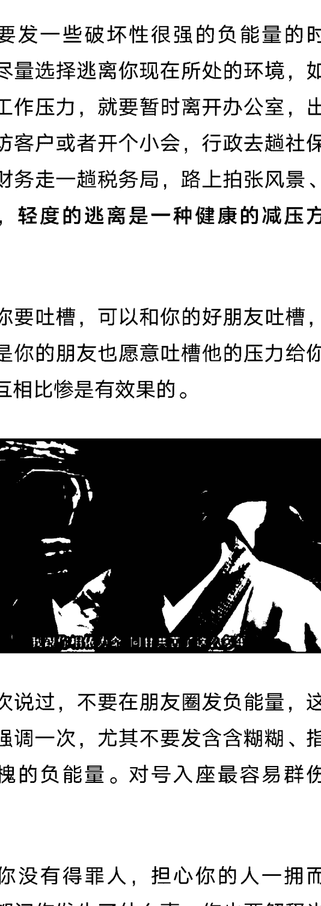

《马男波杰克》的女主波杰克，是一个从小被父母折磨，长大后自己无法成长的角色。

我们有关系户同学问我，熊老师，怎么发朋友圈才是合适和得体的？

我现实中也接到过这样的提问，回答是这样的：

你作为别人朋友圈的读者，希望看到的是什么内容？

## 1.这人最近在忙什么？

有没有可能合作。

## 2.这人最近状态怎么样？

如果旺就走近，衰就远离，需要帮助就伸把手。

## 3.这人有没有什么好玩的事情分享？

一些有趣或者有想法的人，本身朋友圈就是一个小媒体。

写作者要展示自己，这条朋友圈状态发出来，它描绘的是我的生活，代表了我的气质。但同时又要让别人舒服，不会是单纯的炫耀，对别人有冒犯感。

心理学有一个小分支，叫做健康心理学，致力于研究人们应该怎样保持健康，这个领域的从事者都相信心理和社会因素会影响人们的健康，而他们口中的“健康”，指的是s种躯体和精神上稳定、充满活力的状态。

健康心理学对积极生活有一套自己的看法，如果把它运用到朋友圈管理的话，大概就是这些建议：

## 1.永远不要说自己不好的事情

我们之前说过，朋友圈不要发负能量，比如绝对不要说自己胖、丑、平胸，哪里是自嘲也要尽量不要，如果图片上的你太胖，你的描绘一定是跟健身、控制饮食和运动在一起——你提及的是建设性的意见和解决办法。

## 2.观察你喜欢的人的朋友圈

## 3.结交一些特别的好朋友

## 4、显示自己安排生活、管理时间的能力

## 5.“我是一个什么样的人”

## 6.暂时的逃离和倾诉

我上次说过，不要在朋友圈发负能量，这里再强调一次，尤其不要发含糊、指桑骂槐的负能量。对弓入座最容易群伤了。

你。

## 7.谈论失败

许多害羞的人在遇见失败、挫折的时候，没法忍受那种压抑在心的尴尬，一定要说出来给别人听才觉得好受一些。

> “今天犯了个错误……”

如果忍不住一定要发在你的朋友圈，记得要提及这场失败当中的积极因素——

> “今天犯了个错误，上了地铁发现有座儿，坐下想玩手机的时候摸出来一个空调遥控器。”

这条朋友圈是个老段子，就算是你的真事儿，也只能证明自己很呆，一群人都会点赞。

> “今天犯了个错误，上了地铁发现有座儿，坐下想玩手机的时候摸出来一个空调遥控器，也好，现在我是附近最有权力的人了。”

在这条状态下面加一个地点，是XXX空调厂，下面就会有一帮人哈哈哈哈。

## 8.展示一些独处的时间

如果一定要比较的话，晒宠物比晒娃强，晒娃比秀恩爱强。不要真觉得“撒狗粮”是温暖的事，其实没那么多人真的关心你的家庭生活，刚才我们说过了，看朋友圈的目的就是为了收获朋友的信息，同时观察你是否还像以前一样强。

重温一下，朋友圈就是两条半，它们分别是：

+   我挺忙，但很好；
我很强，且有用；
我这人很有趣（可选）。

# —— 习题 ——

以下几件事里，理想的朋友圈素材是（多选）：

+   A.朋友从未知渠道淘来的线装书，我正在读；
B.最近要去参加某个魔都的活动，那几天有没有朋友在附近？
C.你对潜水领域的某些心得，顺便批评一下那些口水化的旅游潜水攻略名不副实；
D.升级系统之后，你的手机变成一块砖，不过你用了30分钟及时搞定，还写了一个简单的攻略；
E.我刚刚把一个不懂事的餐厅服务员臭骂了一顿，这样的人就该好好教育一下。

答案是A.B.C.D。

# 如何拯救那些为奴的女儿们

054|如何拯救那些为奴的... ↓

知识点：

大多数女性更注重家庭关系，会投入更多的时间和精力，从家庭那里得到温暖。

有一句话，好多当妈妈的都爱说：
“女儿好，女儿是小棉袄。”

女儿真的是小棉袄吗？

很多时候，是。

但是小棉袄真的喜欢做小棉袄吗？

我前几天看了一个留言，相当典型，看了让人想起《 accolade 颂》里的樊胜美，一个被剥夺和压榨的女儿。

关系攻略写了几个月了，女儿控诉父母的留言收到了不少，这样的留言还不是最惨烈的：

我，女，生长在广东重男轻女，经济还可
以的家庭，但只有我读了大学。

# 债务：亲情的真相

注意，我最近在跟大家说，多用缩写法和拆分法。这两个工具非常好，能帮你抓住重点。我现在看见兄长的、上千字的留言，就会让这个同学缩写到200字内。

这段表达里，我把一些文字做了加重，如果你缩写这件事就是这样：

一个女生读了大学，家里开始让她交钱，除了出钱给妈妈看病，还要资助弟弟。

# | 父母偏心公式

广东性别歧视的重灾区是潮汕地区。女性地位很低。潮汕地区的宗族意识很强，传统文化在那里很厉害。

+   1.女儿没有继承权，家产由儿子们继承；
2.女儿只有通过做别人家的媳妇，才能分享财产。

# 父母偏心公式：
有孙子的儿子 > 没孙子的儿子 > 嫁入豪门的女儿 > 普通的……的女儿 > 普通的远方的女儿。

# | 反抗父母

如果说逢年过节女儿给父母礼物、母亲生病女儿出力 and 出钱，都还在正常的感激的范围之内的话，后面的就有点太过分了。

里提到过，如果你把一个人的收入全部拿走，他最好的办法就是根本不工作，这会影响到工作的积极性。

反倒是“把学费还回去”是有道理的，因为确实妈妈可以主张说，这笔钱是借给你 conocida，你以后还要还。

奇怪，我们思考一下，为什么很少有儿子会被父母提这种需求？

有人说因为他们疼儿子。

不全对。

社会心理学的许多学者们仔细地研究了两性的差异——真的很大。

老头老太太不这样要求儿子，是因为大多数的儿子根本就不会交钱给父母！

儿子比女儿更会反抗父母。女儿则是因为性别角色的原因很容易成为父母眼中的软柿子。

# 儿子和女儿的不同——

女性描绘自己，一般是这样：

+   1. 我是两个孩子的妈妈；
2. 我和我先生去年结婚的；
3. 我是某某小朋友的奶奶。

就连超级英雄也无法免俗，比如小时侯我们看动画片《非凡的公主希瑞》，第一句话就是：“我是阿科拉，希曼的亲妹妹……”

男性描绘自己，一般是这样：

+   1. 我是个外科医生；
2. 我是宝马车主；
3. 我是正处级退的。

超级英雄动画片《宇宙的巨人希曼》台词和妹妹完全不同：“我是一个宇宙巨人，名叫亚当，是埃坦尼亚王国的王子……”

大学宿舍里，男生给家里打电话这样：“喂，妈，还好吧。我五一不回去，我们几个同学出去玩儿。我挺好的，那就像这样，再见。”

女生那可能就是半小时左右。

女性倾向于描绘自己在家居中的角色，她们更需要家庭关系的支持，她们用更多的时间来和家人沟通和联系。

多数女性害怕众叛亲离，她们是可以guide用情感来威胁和操控的。

# 丨啃女第一定律

# 威胁要断绝关系，就可以让女儿让步。

如果女儿已经结婚，父母还要去盘剥女儿，甚至还让女儿女婿去管教不成熟的小舅子，那夫妻关系就可以爆发或者破裂。友善的丈夫会和妻子关系恶化，不友善的丈夫则可能迁怒于妻子，采用更加暴力手段。

常见的情况是，丈夫也以离婚为威胁，女性最终在两边的威胁之间二选一，有的人会干脆一死了之。

# 丨啃女第二定律

# 哭惨的效果特别好。

这位同学提到了自己母亲生病的时候自己积极花钱，儿子一般不会这样。

因为和男性相比，女性的共情能力是更加强大的。你看好多女性看见残废的孩子，当场就会掏钱，她们感同身受的能力特别强，更容易为别人的遭遇而悲伤难过。

更何况是母亲呢。

她在冲动下冲在最前面，而缺乏同理心的男性——父亲的看法是，女儿比我想象的有钱。

他不知道女儿已经为妈妈倾其所有了。

# 丨啃女第三定律

# 女儿不会跟你撕，儿子会。

男女对权力ivals和财富的渴望不同，女性的权力欲要弱得多。

一个父亲勒索盘剥自己的女儿，女儿一般是顺从，最多是逃避。

一个父亲要跟儿子说拿出钱来，十有八九要被怼回去。事实上越来越老的父亲基本 上不敢得罪儿子，怕他们不管自己，但是对女儿，却往往充满了碰瓷精神。

女儿也往往会倾向于服从自己的哥哥。

我以前说过，小姑姑疼侄子，那基本上是完全不讲理的亲密和付出，其实这是对哥哥的服从模式的延伸，对哥哥的儿子好。

# 丨啃女第四定律

# 娶媳妇才花钱，嫁人赚钱。

心理学家们发现，男女对性的看法是不同的，男性往往是性的发起者，他们会为约会、相亲和婚姻付出更多的钱。

但是女儿却被认为是可以不用钱的，很多 人开的所谓“招商银行”的笑话，反正我作为一个有女儿的父亲，一点都不喜欢。

当父母认为自己的女儿一点存款都没有也能活下来、结婚和被人养，他们就会肆无忌惮地盘剥对方。

对这位广东同学来说，她已经逐渐摸索出了一套对付父母的办法，尽管30岁了，她还没有掏下钱来，不过“脱离别人的蛊役和操控从都不会晚。”

总结一下几个对策：

## 1.要说不

大声说出“我不要”这三个字，前几天有一条新闻，父母卖房让女儿去美国留学，然后又希望女儿回来给他们养老，女儿拒绝了，而且希望留在当地。

这就是摆脱控制的正面案例。

有些特别善良、恐惧自己父母的人说“不要”很困难，找一个心理咨询师，告诉他，教会我拒绝我的父母，不然不给钱。她会笑着把这种技巧传授给你。

## 2.要赞钱

有钱才有自由。

## 3.要为自己的家庭打算

这个家庭就是你和你的丈夫。

记得我们说过吗，家庭关系里，夫妻关系最重要，和孩子的于是，和父母的关系，都要给她让位。

尤其是如果你选择了一个绅士的、温和的男性，不要让父母去伤害他，连他一起盘剥和勒索。

要明白，成年后的父母已经不再是你的依靠和全部了，要尽快和他们形成一种彼此尊重和爱的关系，没有谁控制谁的那种越来越平等的关系。

以及，如果你心疼一个被父母盘剥得特别凶狠、又想反抗又不敢的辛苦女孩，记得把这篇文章分享给她。

以及，如果你爱一个被父母盘剥得很凶的女孩。

记得对她好一点。

因为她其实已经没有娘家了。

p.s

之前有一位关系户女同学提到了自己的经历：

+   1. 弟弟结婚，父母给了600万，自己结婚得到6万。
2. 26岁时被父母以断绝关系为威胁逼婚，结婚后婆家...家庭负担重，收入比自己低，而且有性方面的障碍，无法有孩子。

孝敬父母的金钱，都被父母拿去给了儿子和儿媳妇。

妈妈嫌她给父母钱少了。

这位女同学希望领养孩子，但是丈夫又担心她对领养的孩子不好。

当时间到我，我的建议就是，看能不能弟弟多生一个孩子交给自己来收养，因为：

弟多生一个孩子交给自己来收养，因为：

+   1. 对她那哥刻的父母来说，都是孙子；
2. 孩子好好教育，谁养大了就是谁的；
3. 这个孩子可以把偏心爷爷奶奶啃分的财产，整整地分出一块来；
4. 以及，有偏心的父母呀，断绝了关系就断绝了罢。

# 来自母亲的压力：

2009年，当时上海海事大学一位女研究生自杀身亡。她30岁，本科武汉大学毕业的，没挣到什么钱，一直在资助弟弟读书，后来弟弟读了博士。

她从小丧父，本科没还清贷款，学位证很久才拿到，工作7年后考上了研究生。

妈妈坚持要跟着她住在研究生宿舍里，学校基于管理制度请她离开，给了70天左右的缓冲期，还帮着联系了便宜的租房，但是她妈妈认为条件恶劣，还是想继续住在女儿宿舍里，还有一天甚至流落在街头。

女儿自缢在了卫生间洗手池边。

事发后，她的弟弟、表妹、外婆、舅舅、姑姑、弟弟的女朋友赶往上海，学校负责食宿。

母亲和弟弟向学校索赔35万元。

学校说他们的依据是“5万元丧葬费，30万给妈妈买房子。”

# —— 习题 ——

你发现新交的女朋友是被家里一直盘剥的女儿，以下给她的建议里，哪个是不对的：

+   A. 我养你，你和家里断绝关系吧；
B. 嫁给我，我帮你弟弟还赌债；
C. 一起出国，离开他们吧；
D. 我带你去看咨询师，解决你的问题好不好。

答案是B。

这个很简单，对照我们不要借钱给领导的攻略——不要给任何人还赌债。

谁爱赌，就让他快点灭亡好了。

以及被盘剥的女儿们需要有人帮她们吐槽自己的父母（别骂人），

你可以放心地谈，因为她们可能根本就张不开口。

你发现新交的女朋友是被家里一直盘剥的女儿，以下给她的建议里，哪个是不对的：

+   我养你，你和家里断绝关系吧；
嫁给我，我帮你弟弟还赌债；
一起出国，离开他们吧；
我带你去看咨询师，解决你的问题好不好。

# 自习课｜大咖来访-对公司有不同建议，要跟领导探讨吗？

今天的自习课，我为你请来一位大咖——得到专栏《5分钟商学院》主理人，刘润老师。他是中国最贵的商业顾问之一，过去，他可是给CEO讲课的，这次专门请刘润老师来给一位关系户回答问题：

在《克服害怕才没有那么难》中有 一位叫“跳跳虎”的关系户问了一个“对公司管理有不同意见，要不要跟领导探讨？”的问题。

“公司管理”的部分，有请刘润老师来回答；“要不要跟领导探讨”的问题，就继续由我从关系角度回答。

熊老师，我订了刘润老师的专栏《5分钟商学院》。我发现《5分钟商学院》在126天-130天的课程内容里讲了企业生命周期及期经营管理的方法与我目前所在的企业实际情况有差异，既我所在的企业所处的生命周期和管理方法与刘润老师的理论方法不同。

我们公司是地方国企，刚成立一年多，现在使用绩效考核管理办法来管理，并且对员工进行等级管理。部门领导昨天问我对员工等级管理的试行办法有没有什么意见提出来，我没敢说。

现在脑袋发热，很想就企业所处的生命周期和管理方法向领导请教。但是又怕像小米的雷军说的，基层员工进企业不到5年就跟他谈战略的问题，这员工不是有精神病就是能力有问题。

你说我该不该跟领导去探讨这个问题吗？请赐教！

# 刘润老师的回答：

这个同学的问题，我在做商业咨询的时候也会常常遇到。

很多企业，都在拿成熟期的 方法，管理创业期的公司。还有些大公司的管理者去了初创公司，会很自然地把原来那套成熟的管理方法：管理层级、薪酬架构、绩效管理，直接用在创业公司。

打个比方，这就好比把一套成人盔甲穿到孩子身上，根本无法施展。

其实，企业的发展通常会分为三个阶段：1.创业期；2.成熟期；3.转型期。

在“企业生命周期”的不同阶段，需要不同的战略思考和管理手段，这个非常重要。

回到这个同学的问题，我首先要判断：

如果他所在的这个地方国企，是一家成熟机构的子公司／销售分公司，使用KPI这些绩效管理的方法，没问题。但如果是一家单纯的创业公司，设置很考核就会有问题。

我在订阅专栏《5分钟商学院》第129期专门讲过这个问题，企业在创业期的主要目标，是不断试错，找到真正打动用户的产品，和能因此盈利的商业模式。

这个阶段，设计过于具体的、基于行为指标的KPI的基础并不具备。最应该做的，是用远景、用对未来收益的预期，激发员工的善意，把所有的重心放在企业成长上，以结果为导向。当企业的发展越来越好，内部就会出现更多的机会，原来的很多问题就会自动解决。

不过，这里有个提醒，这个问题关键还是要看谁来问。如果是地方国企的总经理／CEO来问，我会用刚才这些说明情况。

但如果提问者是一个初级管理者，以他个人的能力很难一下子改变公司的状况，一定是需要向上沟通问题。那么，这就变成了，“当一个员工认为公司管理有问题的话，他要不要和上级沟通？”就落到了他和领导的沟通方式上，这个熊太行老师是专家，还请他来回答。

# 熊太行的回答：

一个职场新人要不要给大领导（老板）上疏（对，就是给皇帝的“上疏”）提建议呢？

我建议尽量不要。

这是一个效果未知的做法，是真正的惊险一跃。我们从关系管理的角度来看，不建议对不熟悉不了解的人提一些冒进的建议。打一场没有把握的仗会特别冒险。

+   1. 现代企业管理基本上处于大局已定的局面，很少可能有什么管理学上的重大突破。更别说机关和事业单位了。
2. 如果有重大突破，应该也不会发生在 一个刚刚工作的年轻人身上。
3. 一个老板从头到脚全错了的情况很罕见，如果真是那种局面，可能这企业也已经病入膏肓，你也不会入职到这里了。
4. 你激昂慷慨做的一件事，可能只是老板正在思考的日常问题。
5. 如果老板表示赞扬，要知道感恩。赞扬的是你的态度，而不是你的见识。
6. 很多人破坏建议的时候，容易变成一种指点江山的语气，这对很多老板来说是一种冒犯。
7. 把100份谦逊加在这一份会谈里。
8. 揣着一顆拳拳报国心，要让老板知道你是爱他的。
9. 最好只说几点，不要批发。言之有理的话，老板以后会问你的意见和建议。
10. 想象自己的解决方案，如果老板问的话，可以聊几句，单纯的提问者是好看苍远的，老板不是要雇你来做监事的。

在许多大公司里，老板已经进入了中年的最后几年，战斗意志比较消沉了。

在这个时候硬要强撑老板燃起青春的火焰，并不明智。

老板对不了解的新员工往往会有戒备心，这个人有没有可能是一个商业间谍？

如果是一个年轻的老板，更加可能嘲弄大开：

你说得头头是道，好像已经掌握了整个未来。
你是不是十年后穿越过来的人，就是为了证明成功？？？

有些话，最好是等到和老板熟悉了说更好，至于一些很好的建议，也许在工作的讨论中逐渐散出来，才会更有价值。

在这个过程当中，老板的感受，才是最、最、最重要的。

以上10条回答，其实可以运用于工作中的很多场景，比如：

你的同事要向领导提建议，你可以告诉他第9条，相信你很快就会收获他的友谊，成为盟军；
即便你是领导，也可以反思第6条，给下属提建议有没有咄咄逼人？说话不冒犯对方，是为人基本原则；
第10条不仅适用于对公司有建议要提，平时项目推进要向老板汇报，也都得上，自己先准备好，再去汇报；
……

发现了没？自习课提供给你的，不是一个问题的解决方案，而是你要思考：这个解决方案可以适用于我的什么问题？

好比第4条、第5条，没有人会说出来，但它确实存在。这几乎是公司的隐性规则了。

其实公司中还有很多“隐性规则”我们 在专栏中都提到过，后天（周四）的自习课中，再给各位关系户回顾复习一遍。

# 小人攻略

055小人攻略

知识点：
君子喻于义，小人喻于利。

今天的知识点来自最古老的中国国际关系学。

孔子说出的大道理，经过关系角度的解读，可以直接用于实战。

关系卢乙同学问我：

> “公司楼下的保安天天装大爷，居然还找上我的茬了，真是太嚣张了。不想白受这气，请钧师受我锦囊妙计，治一治这些那什么眼看人低的。是时候请钧师出山了！”

我就用了四个字：

“给他包烟。”

乙同学也很惊讶：
我为啥要去讨好他？

正好，熊老师一直在写的“小人攻略”，刚刚完成了。

# | 什么是小人

我们一般管这种掌握了一小点权力就使劲用，往往苛里到用的，人叫做“小人”。

今天我们说某某是个小人，那就是说这个人爱挑拨离间和打小报告。

其实小人的本意，是格局小、胸怀小，仅仅受利益驱动的人。

所以你看没人承认自己是小人，你认识的最好的人，发朋友圈的时候，也说他自己最近犯小人。

孔子是第一个爱讲君子和小人的老先生，他描绘了很多君子的特点，比如：
君子成人之美，不成人之恶，小人反之。
君子不器（应该成为通才，而不是工具）……

但他没有给君子和小人任何一个详细的定义。

但是所有的描述里，最基础的是这条：
君子喻于义，小人喻于利。

# | 两种世界观的不同

君子喻于义，小人喻于利。这两句话的意思是：
君子用义来理解世界，小人用利来理解世界。

汉朝的大儒董仲舒解读这条的时候，用的是身份的高低，意思是，身份地位高的人讲义，身份低的人讲利。

钱穆先生在《论语新解》里，认为董仲舒这种解读为身份没有必要。如果你还没有读《论语》，从钱穆的解读开始就可以了。

因为身份低的人当中也有君子，讲道理就是君子。
身份高的人里也有小人，只用利益来理解世界就是小人。

后面的一些描述其实都是基于这个义和利的世界观的。

君子怀德，小人怀土。君子怀刑，小人怀惠。

君子结记着自己的朋友，因为这人三观正，小人结记着我记得他照顾我，他是我的老乡。

君子总是担心会犯法惹事，小人总是结记着别人对自己的好梢。

君子周而不比，小人比而不周。

君子待人忠信，但不整天钩结在一起。小人整天混在一起，却没有忠信可言。

# | 小人的短板

小人不见得是恶人，很多时候都是普通人，甚至是可怜人。

我们最基本的同情和怜悯一个人不是因为他是君子，而是因为他是我们的同类。

孔子用小人，不用恶人，有他的道理。

# | 底层的小人

乙同学提到的小保安，是一个城市里的底层行业。同样一个村出来，送餐送快递的要比当保安的多挣一倍，甚至两倍。

# | 身边的的小人

诸葛亮对他的领导刘备说：“亲贤臣，远小人。”问题是有小人没法远。

小人。”问题是有得小人没法远。

他可能是舍友、同学、邻居、亲戚甚至是至亲。

一些还在校园里的关系户会跟我说一些和同学、室友之间的烦恼。

有同学说，宿舍里有人深夜打游戏，或者是在屋里抽烟，不知道该怎么制止这样的人。

这样的人就是小人，过去我们上学的时候，别得宿舍还有人带女生回来在宿舍里，夜间上下铺一起晃酸爽死了。

宿舍里另外几个个人都死人一样不反应，或者是敢怒而不敢言。

## ｜职场上的小人

最好是默认职场上的人都是小人。

小人理解世界的方式是利益。

## ｜小人也需尊重

以前曾经在电影频道看过一部电影，名字想不起来了。

敲黑板！

如果遇见身份比你低、见识比你差的小人想要结交你，千万别处理好，如果得罪这样的人，就会特别特别麻烦。

## ｜影响小人的学问

其实孔子也曾经给出过答案：

> “君子之德风，小人之德草，草上之风必偃。”

君子的品德，就像是风。

史可法影响了高杰，没有从心里接纳他和他的女人、他的儿子。

他的女人、他的儿子。

被影响的小人，怎么不可能成为君子、成为英雄呢？

超级英雄电影里，叫做“能力越大、责任越大。”

你要 是君子，就对小人有责任，你要更主动，不可以爱惜羽毛，事败了再推在小人身上。

我们把影响小人提到的几点再提一遍：

- 1. 照顾好他的利益（不能剥夺他已有的）；
- 2. 给他公正（不能对别人比他好太多）；
- 3. 同时显示自己坚韧的内心；
- 4. 对他言传身教潜移默化；
- 5. 不拒绝小人的爱和好意。

我有几个朋友，是那种特别温和特别体面的人，从来不会粗声大气地说活。

他们不会炫耀自己有什么身居高位的朋友，但是跟他们出去吃饭，他会对服务员、门卫都客气友好。

去他家拜访，他们家附近的物业保安都认识他，邻居他都认识，这样的朋友一般来说，都是可交的君子。他会为境况不如自己的亲友谋划工作。

做到这点其实并不需要花很多时间和很多钱，微笑、友好的表示和一点小礼物就够了，最关键的，还是去结交别人的时候，对别人的认识，是敷衍了事，还是真心的友好。

> “欲齐其家者，先修其身。”——《大学》

我非常喜欢《西游记》，在猴王学艺的那一段，他来到三星洞，听见一个樵夫在唱着好听的歌谣，就上前行礼，称呼人家“老神仙，你若不是神仙，怎么有神仙的话呢？”

樵夫赶紧客气，“那神仙与我舍下相邻。他见我家事劳苦，日常烦恼，教我遇烦恼时，即把这词儿念念，一则散心，二则解困。”

我们都在暗中行走，一个个人头和我们搔肩而过，我们用套路，我们用策略，我们寻找他们的弱点下手。

偶尔，我们会发现一两个闪亮的灵魂，打着一盏小小的纸灯。

你也可以把灯打起来，告诉别人：我也是，我在这儿。

# P.s

## 小人的破坏力：

中美团结几乎被一个看厕所的破坏过。

这是前驻美大使章文晋夫人张颖女士的一段回忆，说的是1980年代中期中美关系最好的时候（黑鹰直升机就是那会儿卖给中国的）里根总统访华，到中国来爬长城，长城脚下有一个贴瓷砖马赛克的高级厕所，然后总统和夫人使用完之后就锁上了。

这个时候国务卿夫人想上厕所，张颖女士陪着她去，看厕所的就是死活不开门，说奉上级指示，让美国总统夫妇使用厕所，国务卿是啥，我不知道。

好说歹说不行，后来大使夫人就陪国务卿夫人和其他几个美国老太太去附近村里的旱厕解决，好家伙，一条大坑波浪翻。

大家互相搀扶着上完厕所，心情都很恶劣。

其实当时如果有五十斤粮票塞进看厕所的手里，这事儿就解决了。

# —— 习题 ——

你喜欢和认可的领导从别的部门调来一个人，做你们的副头，坊间传闻此人是公认的小人，这个时候你应该做的是：

- A.告诉领导这个人很危险，应该远离；
- B.仔细研究一下小人的优点，小人渴望得到什么，研究一下怎么和他相处；
- C.和领导去谈一谈，探探领导对此人的看法，问问自己怎样配合；
- D.发动部门群众一起抵制奸党，让他干不下去；
- E.搜寻小人的资料、见见熟悉他的人，了解他的过去。

答案是BCE。

在发生变动的时候，首先要做的是情报搜集工作。首先要知道这个人是不是如传言所说。

其次应该研究这个人追求的利益。问问领导对此人使用上的一些看法。

不要急于采取决定，大多数的小人是可以合作的。

以及，所有的部门，没有小人配合，事都是做不成 的。

熊太行

今天再多给大家出一道与你切身相关的思考题，请你仔细想一想《小人攻略》这篇文章你在什么情况中用的上？怎么利用“小人”的脾性帮自己完成一些很小但一定要顺利的事？

欢迎留言中写下你的思考，学习关系攻略，就要发散思维，一招解决数件事情半功倍。

# 残酷社会生存法则

## 自习课 | 公司的这些隐性规则，你必须了解

熊太行

我在《关系攻略》当中精选了十个公司隐性规则，老员工不会告诉你的那种。
这些职场上的坑，涉及到各种关系。
以后的自习课，除了问答的展示还会继续有之之外，还会有一些这样的复习。
把珠子用竹签串起来，就是世界上最早的计算器出现了。
别懈怠，在人生最好的岁月不要懈怠，在最有价值的岗位上不要懈怠。
以及，多回头看看。

1. 当你邀请对方参加公司活动的时候，心里要明白一个道理，对方要来参加你的活动，不是“我请你参加活动”，而是“请您牺牲自己的时间过来，实在感激。” ——来自《如何请求老男人帮你做事》

2. 当你想要跟老板谈一件加薪或升职的时候，注意选时间。
周一是开会的时段，周五是一个人们准备松懈的时段，这个时候把球踢给老板也是不妥的。
最好的办法是周三或者周四，老板可能在本周内解决你的请求。
大多数的老板都会对下班前的那一小段时间低效睁一只眼闭一只眼。用这段时间去见见老板，谈论一下薪水，并不算失礼。 ——来自《跟老板谈加薪时的几个不要》

3. 到一家新公司，除了推荐人，你最先见到的就是前台，要首先跟她混熟，布局你的安全关系网，她很重要，她不是一颗闲棋冷子。前台能看到的事，比你多的多。 ——来自《谈加薪之前要做些什么》

4. 桀人会拖慢整个团队的速度，领导会让这家公司里的中等员工保持工作饱和状态，效率低的人会逐渐被淘汰。所以，回看《早点裁掉桀人，对大家都是一种慈悲》，警惕自己不要做团队中的桀人。 ——来自《早点裁掉桀人，对大家都是一种慈悲》

5. 如果你决定给领导送礼，记得：你送礼物不是送财富，而是为了满足领导需求。是不是送礼，不是好坏人的分野；会不会送礼，是聪明人和桀人的区别。 ——来自《如何给领导送礼》

6. 要送喝醉的领导回家，记得备齐这些东西：醒酒药、清凉油、纸巾和湿巾、毯子、矿泉水、呕吐袋毛巾；掌握领导的病史，准备心脏急救药物，如果领导有哮喘，那要知道他的专用药物（你可能会买不到）在哪个口袋里。
你的领导的车型你应该早就知道了。你可以租一个这辆车的同款（要花几百元）或者去卖车的店里看看车试驾一下（不花钱），总之不要手忙脚乱。 ——来自《如何送喝醉的领导回家》

7. 辞职后可以请领导私下吃饭，尤其是老师角色的领导。那种自己请客带着全部门欢送你的领导，非常会做人，要珍惜。是你可以一直维护经营的关系。 ——《如何谈辞职》

8. 客气伤害原则：在正常工作中，因为工作的缘故做一些可能给别人利益造成损失的行为，一定要客气。对方未必原谅你，但好声好气的说，能让你少很多麻烦。比如在裁员、开除人、谈判、与合作方沟通时都可以用得上。 ——《我的领导让我做违法的脏活儿，怎么办》

9. 在职场中，如果发生了被骚扰的行为，不是因為你穿的是裤子还是裙子，也不是因为你太美。而是因为你看上去太弱。解决办法就是：应该更努力的赚钱，变得更强。 ——《权力，才是职场性骚扰的真相》

10. 职场中以告状而臭名远扬、无法被重用的人，最大的问题就是：不会取舍，堆砌一大堆素材，有真有假；告状不分轻重；高度情绪化，喜欢用“我觉得”这样的思维。
这种告状方式就是不考虑领导体验，就会被领导逐渐边缘化。要避免成为这样的人就要：控制告状的频率和次数。 ——《被同事“告黑状”应该怎么办》

# 残酷社会生存法则

## 如何帮助可能患有精神疾病的亲友

056|如何帮助可能患有精神...

知识点：

多达20%的人一生中会患一次情感障碍，最常见的是抑郁障碍，你的熟人里可能就有，他们不愿意告诉别人，因为他们见了太多对病人的嫌弃。

3月16日，退了一个关系户。

不懂的事情可以问，我们之间什么都可以聊。

打开得到，口号是“好好学习，天天向上。”

我喜欢这个slogan，我们因为爱知识而走到一起来。

有位关系户同学留言问我自己妹妹的反常情况。

## ｜一种充满道德优越感的庸见

## ｜对病人家属的偏见

## ｜对精神科的偏见

## ｜媒体的偏见

果要做社会新闻，变态心理学是必须要读的。

有几年，媒体做了好几件事情，就是发动网友冲进精神病院解救病人，说病人是“被精神病”的，有的是医院真的迫于压力就把人放了。

我还记得有些媒体记者是这么为对方的健康背书的。“我跟她聊了一下午，觉得她思路清楚，没有精神疾病的迹象。”

如果你能下判断，要医生干什么？

有一年，河南有一个青年饿死了，当地的一家报纸过去写，父母婚顾成恶果，一个青年饿死了。说他爸妈下地干活去，真的在他的脖子上套了一圈绳，后来父母相继去世，这人很少做饭，就这么饿死了。

然而这不是娇惯，这个青年的许多症状都是精神分裂症的症状，他的那种类型是会退化的，到最后基本上是吃 psich... 他需要的是救助，被饿死就是一个巨大的悲剧。

> “美国有很多科班出身、医学学位的精神科医生，还有心理学学位的心理咨询师，许多人有两个资格，而各位考下这个执照，并没有开药治病的权限。遇见有精神疾病的人，迅速转介他们去医院，是我们的本分。我们很缺人，也非常落后，很多同学本身专业不是医学或者心理学，但是求助者仍然需要我们，以后的事拜托大家了。”

老师说的是实话，那个课堂上没有大夫。

中国没有“心理医生”，我们持有入社部心理咨询执照的只能叫心理咨询师。而有医师资格，又通过了卫生部的心理治疗师考试的，那可以叫心理治疗师，这些人一般本身就是精神科医生，能处理绝大多数的问题。

当有人落水，我伸手去拉她的时候，我不介意有人围观拍照，也欢迎有人加油助威，但是请不要在我伸手想要拉人的时候指指点点：

你看他好变态哟，居然要拉人手！还是人嘛。

如果发现亲朋好友性格大变，有明显的效率上的改变或者性格变得古怪，不要犹豫，赶紧陪他去看精神科，如果他的直系亲属不在身边，要及时通知他的亲属，很多疾病都是这样，越早治疗，情况就会越好。

《笑傲江湖》里，岳灵珊跟着林平之走了，仇人可能跟跟着他们。任盈盈命令狐冲跟自己一起跟踪保护，但令狐冲担心女友猜疑，犹豫不决。

> “事不宜迟，咱们就追赶前去，别要为了避甚么嫌疑，致贻终生之恨。”

p.s

尽管大多数精神病人都没有攻击性，但邻居们不会喜欢精神病人，有精神病人的家庭可能会被房东驱逐、如果是老年人，还可能被养老机构拒绝进入。

# —— 习题 ——

帮助有自杀风险的精神病人的家属求医，可以求助于（多选）：

- A.心理咨询师；
- B.精神科医生；
- C.班主任和辅导员；
- D.110和120；
- E.老中医。

答案是A.B.C.D。

## 交朋友是找像自己的？
还是找和自己互补的？

057|交朋友是找像自己的..

知识点：

和像你的人交往，是你的心理舒适区，等到你主动去结交不像自己的人，你的境界就上台阶了。

有时候我会接到一些刚刚走入职场的 youths 的提问，他们对认识新朋友有一些困难。

> “我觉得认识了人，尤其是和我的行业不同的人，寒暄几句之后，就不知道跟人聊什么好。”

跨领域交朋友，确实非常难交，如果大家的生活完全没有交集，在一起就可能觉得不知道聊什么好。

这是非常正常的一种情况，别说是新入职场的毕业生，我工作了十几年了，一样有的时候遇到不知道聊什么好的局面，这个时候一般是聊一些开放性的问题，比如：

> “您那个行业，今年形势好么？”

如果对方没有受过太多教育，我会更直接，问“挣钱么？”

- A.一个长得像冯远征扮演的家暴男的人；
- B.光头、大金链子有纹身的人；
- C.长得像罗胖老师的人；
- D.时尚摩登，看上去好像青年演员的人。

## ｜为什么会接近像自己的人

不知道大家有没有挤上过有座的地铁，地铁上有不少空位置，距离远近也差不多，如果不存在有特别富有吸引力的异性的话，你会选择坐在谁旁边呢？

我会选C。

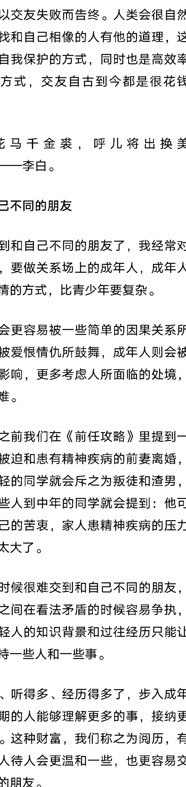

## ｜结交不像自己的人会劳而无功

美国心理学家西奥多·纽科姆曾经做过一个试验，他租了一个大房子，免费给大学男生提供住宿，他事先对同学们做了问卷调查，他把一些三观类似的人放在同一房间做室友，又把一些三观完全不同的人放在同一个房间做室友。这些人到期末的时候评估自己和室友的关系，结果三观一致的室友基本上都变成了朋友，三观相反的，往往已经反目做仇人了。

## ｜和自己不同的朋友

终于说到和自己不同的朋友了，我经常对大家说，要做关系场上的成年人，成年人认识事情的方式，比青少年要复杂。

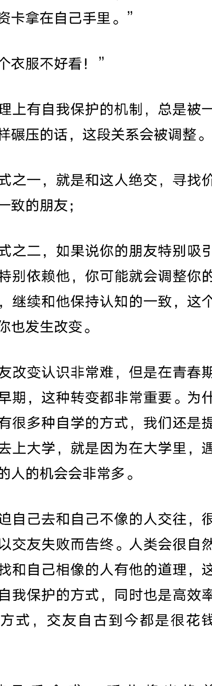

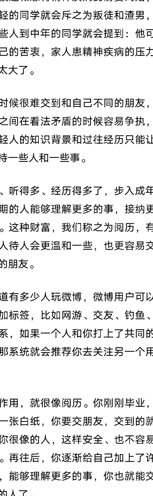

中国的老话是“行万里路、读万卷书”，我们有时候单纯把它作为一个学习的过程，没错，但这还不是简单的学习过程。

当你有足够多的经历和足够的阅读量之后，对你来说，陌生和令人恐惧的部分会越来越少，你虽然不认识某人，但是你可以通过往年经历或者你阅读的作品，把这个人的气质进行分类，模仿者一些新闻报道、历史作品甚至小说戏剧的办法来跟他相处。

## 为什么害怕不像我的人

不愿意和不像自己的人交往，心里的担忧往往是担心被拒绝。

美国有一批心理学家曾经组织了让大学生参加试验，就是让他们选择社交对象，他们对A组说：面前的两批人选一批，可能对你们友善，也可能不友好。一批是工人，一批是大学生。

这批人毫不犹豫地都选择了熟悉的大学生，因为觉得熟悉的人群能够应付得来。

他们又对B组说，面前的两批人选一批，这些人都是特别友好的人，说好了要跟你们一起聊天的。一批是工人，一批是大学生。

结果大学生们大多数都选择了工人，在得到保证这种社交不会被拒绝之后，他们立刻就有了勇气，想要认识一下和自己的生活不同的人，希望交到和自己不一样的朋友。

所以，敲黑板！

能交到像你的朋友是入门，交到和你不像的朋友是高阶。

如果担心和不像你的人社交失败，托中间人来说和保证是最好的办法。事实上，如果你最近三个月没有认识新朋友，那就可以托你的老朋友来推荐和介绍一些朋友给你认识。

小区里一起遛狗、孩子的同学家长、参加某些宗教聚会，都能让你收获工作领域之外的熟人，可以尝试着结交其中的一些人，丰富你的朋友清单。

成年人相交，交的是实力和信誉，吃吃喝喝一起逛街虽然也有用，但已经没有那么重要。

如果你是一个品质优秀，实力出众的朋友，对方也会把你当做一个性格、业务互补的朋友来交往。

谁不需要布置自己的人脉网呢？我们都是遮遮掩掩，试试探索，最终下场，舞在了一起的。

试试把《关系攻略》一些谈论友谊的文章发给你想要结交的朋友，我们这个专栏除了“防坑宝典”“齐家指南”之外，还有一个隐藏属性，今天隆重推荐给大家：

## 它是交友的三观小雷达，注意，不是必须和你对一篇文章看法一致才能结交，对文章有不同的看法，能讲出自己的道理，你认为对方的价值观可以接受，也能成为很好的朋友。

成年人之间的因为力量而结盟的朋友。

# —— 习题 ——

美国的心理学家曾经对一群做心脏搭桥手术的患者做过访谈，问他们是希望同病房的病友是什么样的人。你觉得最多人的选择是什么？

- A.和自己一样还没有手术的人；
- B.已经做完手术，在康复期的人；
- C.最好是空着；
- D.手术失败的人，看着惨一点的人可能会好受一些。

答案是B。

大多数病人都选择了B，也就是做完手术的人，他们渴望对方分享已经有经验。

相似性原则有一个情况例外，就是如果在医院之外挑选朋友，一个糖尿病患者未必愿意结交另外一个糖尿病患者，他们的压力和焦虑可能会互相影响的。

阅历和知识不仅能支持你自己，也能支持你身边的人，你也会因此收获更多的朋友。

现实中很少有人会遭遇心脏搭桥，但是大多数人都会经历高考，有的人还会经历考公务员、考研、找工作、换工作、买房、谈加薪、离职、谈恋爱、求婚、结婚、生育、求离婚……

在一个大学宿舍里，一般是那个年纪最长的人是老大，要不就是做学生干部的家伙扮演一个老大的角色，但是毕业之后，最早结婚生子的人往往成型更快，他成了在前面为大家蹚路的人，可以有很多人生经验供分享。

第一个前列腺、血糖和胆囊出问题的人也有东西可以分享给大家，虽然不是什么好经验，而是惨痛的教训。

这就是所谓的“过来人”，在别人向你咨询你的过往经历的时候，可以把这些东西说给对方听听，但是不要随便给对方提建议，要特别谨慎。

记得吗，我经常说的那句话：

# 所有寻求免费建议的姿态，都是不认真的，都是要流氓的。

## 自习课 | 小假期后如何快速恢复工作状态？

熊太行

刚刚过完了五一小假期，咱们就在今天的自习课上复习一下：如何在假期后快速恢复工作状态。

先来复习一个关系攻略中出现的名词 ——

热手效应：指的是一个篮球运动员在连续投中之后的效果，他会更自信、更强大，这个时候对方教练员应该做的是，叫一个暂停，这时的防守球员可以调整一下自己的状态。

“热手效应”是不科学的，心理学认识上的偏差，有趣的是，队友和观众相信这种超自然的存在。

暂停会打断热手效应，但真正起作用的不是那一分钟，而是那一分钟的准备和调整。

假期就是一个暂停，所以你如果假期前一帆风顺，要保持状态，如果假期前竞争对手一帆风顺，你要趁机打乱他的节奏。

再来复习一下假期开工给各位关系户的几个小建议——

### 1.穿好点

开工头一天穿得好一点，自己的精神状态也会跟着有所提升。你的老板尤其愿意看到你穿得光鲜，他会觉得，这个员工重视开工，并且自己给的薪水能维持一个员工体面的生活。

### 2.写封邮件

开工头一天，最好给领导写一封邮件，汇报假期前没结束的工作的进度。比如：xx事我正在跟进，对方本周给回复等等。

### 3.职业精神

在你返回工作单位的前一天，一定要补足睡眠，同时恢复星期几的概念。尤其是过年之后的假期，要把对日历的认识从农历转化成公历。此事事关职业精神，没有职业精神就会吃亏。

### 4.一些小改变

看看你的朋友圈头像和封面，如果用的够久，可以考虑换一个，更新沟通界面。参考关系攻略文章《什么样的微信头像才是得体的》。

### 5.提升工作效率

尝试挑选一个关于工作效率的APP试用一下，改善自己晚睡、晚起、迟到、注意力不集中的恶习。

凡事预则立，不预则废。任何事情面前，你都应该准备好一身功夫，在工作中冲锋陷阵。

祝每一天在工作中都精神饱满，产生自己的“热手效应”。

# 糙酷社会 生存法则

此内容归得到App独家专享，版权所有，未经许可不转载，侵权必究。
合作请联系iget@luojilab.com

# 为什么说情绪管理是性命攸关的事？

058|为什么说情绪管理是...

知识点：

情绪智力是人类理解和控制情绪需要的智慧。包括感知情绪、运用情绪、理解情绪、管理情绪这四种能力。

熊太行

今天的文章中会给大家讲一个《新选组血风录》当中的案例，咱们一起来在这个案例中分析一下“情绪管理为何如此重要”。如果担心人物关系复杂，可以先记住这个关系列表：

- 新选组：武士队，幕府的鹰犬，类似于锦衣卫；
- 近藤：新选组负责人；
- 土方：新选组二把手，近藤的师弟，忠于近藤；
- 伊东：新选组三把手和军师，文武双全。决定背叛新选组，带了十几个人自立门户；
- 萨摩、长州：另外两个藩（省），暗地里反对幕府，但表面上不决裂；
- 泰之进：跟随伊东自立门户，伊东的手下。

自从开始写“关系攻略”之后，我也受到了不少的嘲讽。

某天，和一个很文艺的朋友喝了酒，她就对我特别不满：

> “你功夫大家都去行套路，最后人人都戴着假面具活着。这太糟了，人就应该自已，该哭就哭，该笑就笑。”

我觉得离“好后悔当初怎么喜欢过你”只有一步之遥。

我听完诚恳地道歉：

> “对不起，耽误你的个性表达了。不过愿意听一个关于情绪管理的故事吗？”

如果是个大人，就这么一笑过去了。

她是聪明的，听了我的说法，耐心请教。

中国人对情绪管理的最高评价是“喜怒不形于色”，《三国演义》里评价刘备用的就是这个词，如果用文艺青年的形容，刘备就是一个假面人，但是他诚恳地扮演着自己的枭雄角色，认真磨炼自己的演技，没有一点出位。

因为他搞的是权力斗争，管理不好自己的情绪，单纯靠能力，会死的。

我以前给大家推荐过司马辽太郎的《新选组血风录》，司马老师在日本的江湖地位，和中国的金庸类似，他和金庸一样也是记者出身，《新选组血风录》有人际解读的价值，是因为他的写作基础都是真实存在的人和事。

新选组是幕府活跃在京都的警察组织，主要任务就是砍人，砍那些反对幕府的“志士”（这些人中很多人也是流氓，不是标准的革命家），新选组的负责人是近藤勇，近藤是个情绪管理极好的人，长得方脸大嘴，能把拳头塞进嘴里去（喂，先洗手再试）。

近藤是个剑术高手，小门派掌门，大概相当于二级学院。他手下有个军师，叫伊东甲子太郎，伊东能文能武，剑术上是北辰一刀流免许皆传（高级师傅），大概相当于清华北大教授。伊东这个人口才很好，但是在情绪的感知和管理上有着致命的缺陷。

伊东带了一支小队，从近藤的新选组里分离了出去，他们拿了反对幕府的萨摩、长州一派的资金，双方已经另立山头，还没有撕破脸。

我经常跟关系户同学们说，成年人对事对人的判断，不应该是友谊或者交情，而是利益。

你如果想要维护和谁的友谊，最好的办法是维护好他的利益，跟他一起赚钱，而不是去搜到他，盘剥他。

当你开始对一个人，就不要拿他当朋友了，不然你就会缩手缩脚。

伊东是这样跟近藤提起自己的跳槽的：

> “我和我的同仁不想被幕臣身份所拘束，所以准备另外组织一个浪人（没有主家的武士）队伍。这绝对不是脱队，只不过是暂时的分开。您可以看作是新选组的另外一个分支。虽然我们和萨摩、长州有关係，但是我们会把和新选组的关系做到绝对保密，在外围帮助新选组的活动。”

口才好做事很方便，但是妄想让口才凌驾于利害之上，绝对是痴心妄想。

## 1. 被近藤的正面情绪所迷惑

伊东认为自己的嘴炮是无所不能的，他在做近藤的手下的时候，确实通过谈论世界天下大事让近藤尊重和欣赏他，取得了不少的好处。但是我们知道，领导对下属的很多欣赏和赏识，都是策略性的，换句话说，我夸你，让大家跟你学习，有套路的成分。

## 2. 无法识破近藤的情绪管理

对领导要警惕，这是不可以卸近和敷负的，伊东因为近藤欣赏自己，就轻视了他，完全没有看到近藤藏起来的情绪。

## 3. 对人不分远近亲疏

伊东信赖近藤超过了信赖自己人，大家跟着他拉起队伍创业，他的生命安全显然对兄弟们非常关键，他的轻率表明，他根本就不爱大家，也不爱这个共同的事业。

对一个善于情绪管理的人，如果你如果无法解读情绪，就按照大利益来进行事。

既然近藤早晚是自己的对头，就要趁早决裂。

对头的含义就是，他梦想着你做什么，你就尽量别去做那件事。

## 4.追求文艺美感，做自己

伊东的“名士气”害死了他，一个人赴会，渴望和近藤成就可敬对手的佳话，真是痴心妄想啊。

# —— 习题 ——

以下的对话里，哪个人情绪管理出了问题：

- A. 唐僧：这泼猴多大愈懒！全无有一些儿善良之意，心心只是要撒泼行凶呢！
- B. 如来：你那个初世为人的畜生，如何出此大言！不当人子，不当人子！折了你的寿算！趁早皈依，切莫胡说！但恐遭了毒手，性命顷刻而休，可惜了你的本来面目！
- C. 猪八戒：沙和尚，歇下担子，拿出行李来，我两个分了罢！你往流沙河还做妖怪，老猪往高老庄上盼盼浑家。把白马卖了，买口棺木，与师父送老，大家散伙！
- D. 女王：“你说四大皆空,却紧闭双眼,要是你睁开眼睛看看我,我不相信你……四大皆空。”

正确答案是A。

A是唐僧难以遏制的愤怒和恐惧，他怕孙悟空给他惹事。

心理学家彼得·萨洛韦（后来做了耶鲁校长）和约翰·迈耶一起提出了一个观点：理解和控制情绪需要某种智慧，他们称之为情绪智力（emotional Intelligence）。我们今天说的情商，其实就是对这一观点的化用。

2005年，萨洛韦把情绪智力分成了四种能力。

# 感知情绪：理解和察觉自己与他人情绪的能力；

# 运用情绪：利用自己的情绪更好地思考和解决问题的能力；

# 理解情绪：理解情绪之间的复杂关系的能力（悲伤和愤怒的区别，为什么有人哭有人笑）；

# 管理情绪：控制自己的情绪以及影响他人情绪的能力。

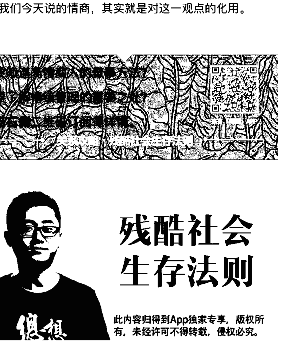

# 自习课 | 立刻开始解决情绪上的 “小问题”

熊太行

就着昨天的《为什么说情绪管理是性命攸关的事？》，来跟大家复习一下以文章中关于情绪的评论及回答。

如果你希望改善自己的情绪智力，现在开始，一点都不晚。

# 如何帮助可能患有精神疾病的亲友

熊老师，我就很容易情绪化，和老公吵架时高度情绪化。有时会伤害到别人，我很想改。

熊太行

明白了问题就好，尽量控制发泄，情绪来了要描述自己的感受。

不是去骂人，去评价人。

和女朋友快结婚了，可是女朋友脾气很大，每次都得我去哄她顺着她，我心里不是很舒服，请问老师怎么办？

熊太行

- 1. 你可以主动哄着她，顺着她。
- 2. 在她脾气发出来之前。也可以在心里不舒服的时候好好检讨自己，为什么还会不舒服，认清自己无法对抗她的现实。
- 3. 还可以不结婚。

老师，您好，我老爸有焦虑症，之前一家人以为他性格就是那样，结果他出现一些奇怪的举动才带他去看病，现在大把吃药。他焦虑的都是一些小事，家里没有什么大事让他操心。

其实他的一些性格影响了我，好在我意识到我一些不好的行为习惯，焦虑症抑郁症会遗传吗？我爸爸能好吗？

熊太行

焦虑症医药的效果不错，没有什么大的副作用（如果想怀孕可能有困扰，老先生肯定就没事了），也可以辅助一下咨询。

焦虑症就是会对小事焦虑呀，所以才是疾病。你在理论上会有更高的风险，但不一定会得病。

和“痊愈”相比，生活质量如何，可能才是关键。糖尿病也不能好。但是人生要不要继续呢？

熊大大，我想我也是个有沟通障碍的人。我给自己的结论是:我 想的深度与别人不一样，所以老是给别人打脸。我是自以为是的那类人。

不过，我能接受不同的意见。因为很早我就发现了自己有沟通方面的问题，所以极力调整。但是由于童年的一些因素得影响，我还不能很协调的跟别人沟通。

比如说:有人喜欢鸳鸯。其实我不喜欢，因为鸳鸯根本就不是像大家说的那种专一。雄的鸳鸯是很花心的，根本就不是专一的那一类。所以鸳鸯戏水，我都是哈哈哈。熊大大，我的根源是不是不尊重别人？

熊太行

是，我们思想上可以特立独行，生活方式上最好是能够随大流。

要知道文化意义上的鸳鸯和生物学上的 是两回事，其实鸳鸯能成功成为夫妻鸟，不是因为它专一，而是因为它们秀恩爱转发朋友圈。

类似的，中国的狮子和非洲的长得完全不一样，你非要跟石匠说你有病，不能这么雕，对方会给你一锤的……

# 残酷社会生存法则

# 职场上的民主应该怎么用

059职场上的民主应该怎...

知识点：
永远和自己的支持者站在一起，这是一个成熟政治家的合格线。
不要为了讨好你的敌人，伤了支持者的心。

我们的关系户里，有一批是大学生，有的时候能够接到他们的一些提问，我们知道校园是一个不完全职场，所以有的时候比较特殊，但同时，校园又有一个很要命的地方，就是在这里的错误认识可能会延续很多年，走到职场之后仍然会因为这件事吃苦头，直到特别偶然的机会才会恍然大悟——哦，原来我一直都错了啊。

A同学有一个评优名额，在线上进行了一轮投票之后，该同学获得了这个名额，立刻有人反对，说这个评选有问题，要求线下开班会投票。A同学认为该人必然会失败，也就没有在意应重选，结果线下投票之后，反对者胜出。

A同学问我的问题是，我现在该怎么办。
我的回答就是：“没办法，你自己放弃了支持你的人。”

简单给大家解释一下校园和职场上的民主吧。

校园里最有含金量的奖学金都不是“民主”票决的，而是通过成绩的排排坐来决定的，有的标准比较模糊，有主观评价，可能就需要一个评选委员会。

有的学校里，一些社会工作相关的奖学金可能是由班主任推荐的，但是这是其中再往校级 after 送，一般就掌握在团学口当中。

一些最次要的奖学金、荣誉称号，是放在班主任或者辅导员手里的，一些老师会“钦定”，一些聪明的则会制定规则（其实可以通过规则来圈定给谁的人），还有一些人，会选择交给同学，进行民主投票。

班主任或者辅导员如果把一个奖励交给全体同学投票，就意味着老师：
不想管事。
对，他没有野心，也没有担当。
在遇见可能的冲突的时候，他不愿意卷入。
他会静待同学们开撕，然后一方压倒另一方。

所以当有人质疑流程，要求重新投票的时候，挑战者和守擂者之间，哪个更坚决，哪个就会赢。

A同学已经赢了一场投票，这个时候老师还没有宣布，或者已经宣布了结果但是遭到了对方的质疑，这个时候必须要拿出一条到底的心情来。

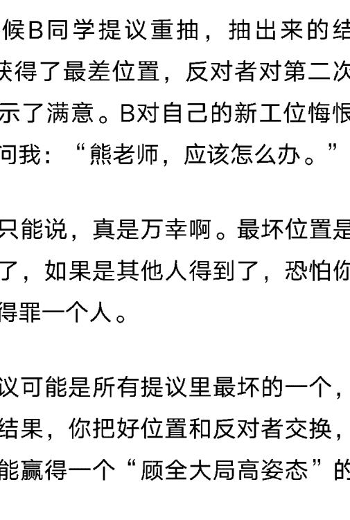

《权力的游戏》里，瓦里斯让提利昂猜过一个谜语，一个大主教、一个国王和一个首富在一间房子里，都要求一个佣兵杀死另外两人，佣兵会如何选择？看上去，好像佣兵有了选择权，其实佣兵这时候相信谁的实力，才是至关重要的。

P.s
下面这个例子是一个抽签的例子。

如果你决定让对方，那就干脆一让到底，也不让别人影响。

有些人可能还记得老版语文教材里有一堂课，80年代初出生的人可能记得。

讲列宁去理发的故事（也不知道他没什么头发为什么要理）。

当时说列宁在克里姆林宫等着理发，大家都让他往前排，他不允许自己搞特殊。后来排在前面的伊万诺夫说：

列宁同志，既然您不愿意优先，我想用我的位置跟您换一换。

多懂事儿，替领导想得多周到！

于是列宁谢谢伊万诺夫，走到了队伍前面。

你要讨好一个人的话，要牺牲你自己的利益去讨好他，这样讨好了他承大家的情，讨好不成大家都怪你剐媚。

要用自己的利益讨好他，舍不得孩子套不着狼。何况一个工位或者一个理发排队的位置呢！

# —— 习题 ——

你是一个国企新上任的部门领导，你的提升，总经理起了很大的作用，你手下有五六个同事，表现都差不多（糙），每年贵部门还必须要推荐一个优秀员工，这时你的最佳选择是：

- A. 给那个和总经理有关系的家伙，以后也年年给他；
- B. 给那个和总经理有关系的家伙，声明这个机会以后大家会轮流转，他只是凑巧是因为规则而排在第一个；
- C. 大家一人一票选；
- D. 抽签；
- E. 看工作量或者绩效。

答案比较简单，B。

不选A是因为影响问题，不能因此被人认为你和总经理勾结起来，沦落一气。

B是对的，这是投桃报李的一种方式，如果你在国企，这是唯一正确的做法。

C和D看上去给了总经理一个交代，但其实都是伤害自己的朋友和靠山，是不负责任的做法。

E是完全不对的，因为大多数国企的办公室部门都没有靠谱的绩效考核体系，如果单纯看工作量，选出来的一定是最受气、最弱的一个人，当然，如果本年度轮到该同事的时候，你可以称赞他的任劳任怨，给苦劳一个肯定。

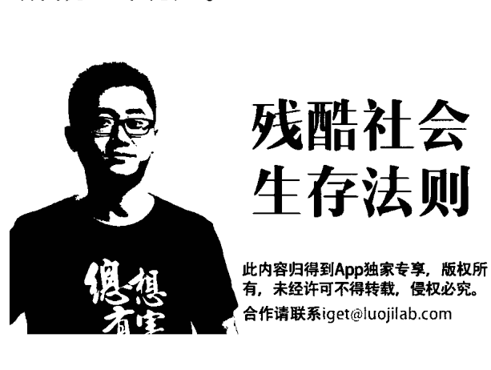

# 如何给新认识的人留下好印象

060|如何给新认识的人留...

知识点：

人际交往中，我们希望控制给对方留下的印象，这种行为社会心理学上称之为“自我表达”（self-presentation）。

之前我提到过一种克服害羞和改善自己的方式，我称之为“人生导演”训练，许多同学表示了兴趣，在这里我们起一个头，其实我们在很多场合上，已经在使用一些类似于表演的技能了。

我不知道大家有没有认真准备过一场比赛试，一场面试我们应该做些什么呢？

一件得体的西装、新买的公文包、一个早起的人、缓解倦容的热毛巾、面试写字楼楼下的热咖啡、对前台和人力露出的笑容，会议室里等待面试官的深呼吸。

注意，你已经在做自己的服装师、化妆师、道具师，恭喜你无师自通，自学成才。

接下来是表演部分，你昨天一定已经预演过所有的情况，背诵了台词，关于你的工作经历和时长，你是自己的编剧和导演，说戏的部分也是你自己给自己完成的。

“人生如戏，全凭演技。”这句话是有道理的。

你在扮演的，是一个敬业、精力充沛、努力工作的职业人士，这和对方的需求是一致的。我面试过许多人，大多数不符合条件，没有机会见第二次的人，都是因为他的准备不足，他连表演这件事情都不愿意做的时候，我知道他是一个缺乏能量的人，或者我的公司，我提供的职位对他缺乏吸引力。

# 什么是自我表达？

人际交往中，我们希望控制给对方留下的印象，这种行为社会心理学上称之为“自我表达”（self-presentation）。

自我表达在你认识一些新的关系的时候，特别关键。

面试是特别典型的自我表达，同样，如果你是大公司的高管，可能还要接受采访和上电视节目，那也是一种自我表达，这类自我表达传递的是正面信息，我是一个聪明、友善、热情和有趣的人，基本上要让对方接受一个正面的自己。

负面的自我表达也是有的，比如流氓勒索你的时候会说：

> “你可以看到听打听我……”

监狱里牢头跟新人表态的时候，都是负面的自我表达，希望对方知道自己是个狠角色。

当然负面自我表达的未必是坏人，比如战争电影里的士官，新兵连的班长，都可能尽量表现出自己残酷无情，不仅骂人，还要侮辱新兵的人格。

这是策略性的负面自我表达，是人际当中可选的一种套路，希望大家用不到。

在自我表达的场景之下，我们一般都会非常刻意地塑造一个比自己更高的自己，因此会塑造出一些不属于自己的特质，或者是夸大一些自己的优点。做过面试官的同学就知道，我们一定会遇到美化自己简历，把自己从合作者描绘为主管，从一年级生描绘为有经验的工作人员的自我表达，但是我们往往会接纳这种美化，只要没有严重的撒谎的话。

社会学家欧文·高夫曼就曾经描绘自我表达为游戏，说这个时候“我们会特别注重自己的外表，控制自己的习惯和癖好。”

要知道大多数人眼中的好员工的形象是差不多的，遗憾的，就好像男女友好情人的标准，大多数人的认知都非常刻裂，所以你可以观察一下身边去亲和会约会的人，绝对大开眼界。

领结和燕尾服、高级红酒、租一辆更贵的车、进一个高级餐厅，这都是自我表达的手段，所以你和对方约会的时候，可以看看对方的戏路，是精打细算的小制作剧组，而是一掷千金的万世浮华，就都看懂了。

高夫曼提到了一个有名的观点是社交活动当中的前台和后台，这是一个戏剧概念，在家里请客吃饭的时候特别明显，你可能吭哧吭哧忙了一下午，终于在电视台喊着“北京，晴”的时候把菜上齐了。

后台是你杯盘狼藉的厨房，你用完了所有的盘子和锅，前台是你淡定地对大家说：“随便做了几个菜，不知道合不合大家口味。”

这个时候观众们要识趣，很多人说熊老师我情商低怎么破？我好像总是太认真。这个时候，人家问你合不合口味，就是等你吹呼，你上来真的评点味道，你就是作死，活该你没朋友。

要记得，你的朋友在演戏，你不仅是观众，而且是观众中的亲友团，你不是评委老师，你就是要拼命吹呼，还要压倒一切犹豫不决或者准备说刻薄话的蠢货，尤其是如果这一桌饭菜旁边坐着来源不一的朋友，有些明显对她不够友善的时候。你是她的水军！

我也曾经吃一个朋友的菜，并不好，但是你知道去别人家吃菜，不在于好不好，而在于从套路上看，她把你当成爱密的朋友（自己分辨啊，也不尽然，有的人就是试菜的，就跟慈禧太后先吃的那個太监一样）。

然后事后如果你帮对方收拾盐碗的时候，可以小声跟她说，那个菜，事先水焖要更好，那个肉要飞水这样没有血沫儿，那个蘑菇要用筷子搅拌着洗，不能搓，沙子搓进去就再也出不来了，我也是听我妈说的，你可以试试看。

她在扮演一个精通厨艺的美女私房菜主理人，你也应该做一个戮恳的水军和真心帮她改进的好友。她在自我表达，你也在自我表达。你扮演的是一个维护她不怕死，吃黑暗料理不要命，最后还对她无比忠诚的朋友。

做菜给你吃，就是一个个人际交往中的套路，扮演好大快朵颐的粉丝，也是一个套路，套路对套路，大家会互相尊敬，继续相处下去。你不认识这个套路，甚至反感或者叫破这个套路，那就是得罪朋友，大家就此结束。

# 自我表达的常见套路：

有几个自我表达当中的套路，提供给大家学习，自己可以用，别人用的时候你也要积极回应。

- 1.自我提升

传递关于自己的积极信息。

记得我们在《怎么样经营自己的微信朋友圈》怎么说的吗？第一条就是，永远不要说自己不好的事情。

同样，在线下更是如此，你的自我表达不应该是贬低自己，而应该是最近在我身上发生了哪档好事。

注意，有人说，是不是跟朋友说自己最近的进步，会让对方嫉妒呢？我得说这事多虑了。新朋友之间很少会有特别强烈的嫉妒。

大多数失衡都存在于老朋友之前，我太了解小子了，从小一起长大，结果他当了大V，五百多万粉丝，我怎么还在小报社做校对，这不公平。

所以你跟新朋友之间说你最近的进步，关键在于你要引起他的自我提升，他在你面前想着去提升你对他的看法了，就是关系增加了投入。

你可别一上来就说，我最近惨死了，也穷，也没钱，这样的话最好是去跟心理咨询师说，再不然和一两个特别亲密的朋友说，不要跟新朋友说。你说完自己的全部烦心事之后，他怎么跟你说才能跟你深交呢？说他最近专注订阅过了五万份？你已经这么消极了，他说不出口的。如果对方情绪很高，也许会说一两点自己的糗事，把你拉回到发现你自己的闪光点上来。然而大家是新朋友，见过两三面的人，交浅不可言深，除非他特别喜欢你，想和你来朋友之间关系的惊险一跃，不然的话，应该是打个哈哈就趁早离开了。

该是打个哈哈就趁早离开了。

## 再强调一点，你说自己的好，是为了让对方说出自己的好来。

## 2.互相表扬

我不愿意用过往的研究者常用的“逢迎（ingratiation）”这个词，因为中文里的这个词，意思不好，这是套路和策略的一种，不是什么道德问题。

自我提升，其实就是自我表扬，希望在对方面前显示出自己强大。所谓的逢迎，其实就是称赞对方，表扬对方。

其实自我提升策略里，表扬自己，就是为了互相表扬。

为什么有时侯社交喜欢喝酒，就是因为喝酒之后，自夸和互夸变成了一件特别容易的事。

> “不是哥哥我吹牛啊，我……”

> “老兄你这都谦虚着说吖！”

## 3.如何不做自大狂

如果你开始执行自我提升策略，这样可以让你避免成为一个夸夸其谈的人：当你要证明自己是个智力高的人，就应该用一些更具体的表达。

敲黑板了，这招父母夸孩子也有用：

他最近期中考试刚考了两个100分。

## 4.应对自我表扬

当对方开始自我表扬的时候，你当然可以说，真厉害，好棒，点赞，但还有一个策略可以应用。

## 5.不要谦虚

只有最出众的英雄才能谦虚，电视上直播着接力赛，你接棒的时候落后对方50米，你甩帆帆（赪这个象声词）用自己的实力追上来了，所有的人都知道是你一个人赢的。这个时候你出来谦虚就是对的。

> “我们是一个团队，请把掌声送给我的队友……”谦虚是强者的专利。

## —— 习题 ——

越南队放话说准备用炎热天气击败中国队，对此国足的一位球员对媒体说：

我们不应该因为赢了马尔代夫而骄傲，这次客场面对越南队还是一个很艰难的挑战，但是我们也是抱着学习的态度来到了河内，希望能够踏踏实实，取得好成绩。

这个表态的问题在于（多选）：

+   A.完全不成功的自我表达，在自我提升上完全没有任何准备；
+   B.应该称赞球迷和媒体的支持，寻求互相表扬状态；
+   C.应该回击越南队的自我提升，转向我们的自我提升，比如回应“炎热气候算个啥，我们很多人都在广州踢球，那里也很热”；
+   D.不恰当的谦虚，虽然有人说不知道为什么，穿上国家队队服之后整个人都会变得谦虚起来，但谦虚是强者的专利，对越南队谦虚并不能让球迷对国足有任何好感。

答案是A.B.C.D。

## 自习课 | 如何在母亲节活用 “背锅大法”

熊太行

5月14日，本周日是母亲节，如果你想给母亲送礼物或者请旅游的话，可以行动起来了。但是有不少关系户最近留言说：要给母亲送礼，被母亲以省钱为由拒绝了。

还记得咱们的背锅大法吗？

今天就来复习一下《如何用背锅大法影响爹娘》中的几个活学活用的例子，你要知道她们最怕什么，才能表你的孝心。

1. 过年期间朋友遇到麻烦说：“马上要过年了，我爸妈突然告诉我，说我刚刚和你妈妈见过面团聚过，现在再去北京，票也不好买。不如你们在北京过年，我自己在老家过年吧。”

我当时想了想，对他说：“老爷子是不是抠节俭的，心疼钱了？”

“应该是。”

“那就告诉他，如果他不来，你们就因为他的固执被迫一起回去。那就是四人份的交通。”

“好主意！我还订了年夜饭和温泉酒店，我可以告诉他如果我们回去过年，这些就作废了！”

2. 你会发现有些国家的外交辞令也是如此：

如果你国要是在某事上 UIApplication 一意孤行，

将会对两国关系的破裂负全部责任。

3. 有人说，我不能用套路对待朋友，这不真诚。

错。

4. 送礼也是如此，你送领导一个礼物，领导觉得不该要你小年轻的礼物，让你拿回去。

5. 总结一下 “背锅法” 的口诀：

“如果你要是固执，你就会给我们带来很大的损失。接受我的建议吧，我们都会方便很多。”

这个策略的关键就是：对方担心你们关系的破裂，担心双方因为自己的选择而造成比较大的财产损失。

顺祝各位关系户中的妈妈以及所有人的妈妈：母亲节快乐。

熊太行

如果你还想给妈妈挑选更多礼物，可以点击下方图片，进入母亲节好礼专区，马上利用 “背锅法”，把你的爱送给母亲。

# 马上利用 “背锅法” 给妈妈你的爱 母亲节好礼专区

## 为什么思想可以特立独行，生活方式最好随大流

061|思想可以特立独行，... ↓

知识点：

大多数的人都觉得自己在各种方面都强于大多数人，这就是“自我服务偏差”。

大多数人认定自己特立独行，与众不同，所以我们有时候会被大家看出自恋，如果认真把自己扮演成一个特立独行的人，你就会变成一个讨厌鬼。

5月5日的自习课里，好多关系户同学对我的一句回复感兴趣：

思想可以特立独行，生活方式最好随大流。

### | 思想者的“� tâm”

### | 不要证明自己的比别人都强

### | 乔布斯的圆石头

米开朗琪罗的雕塑“大卫”，大卫是上古英雄，手里拿着的是投石索，这是原始社会末期人们发明的大杀器，可以轻松把鹿和羊这样的动物爆头。

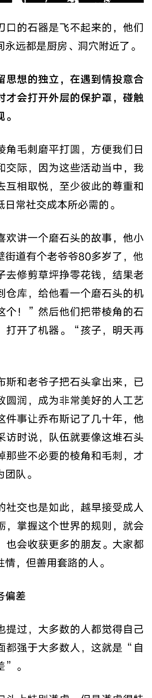

浑圆的石头会飞得更远，它们不张牙舞爪，但更有力道。它的本质是坚硬的石头，不会因为外形圆润而改变。

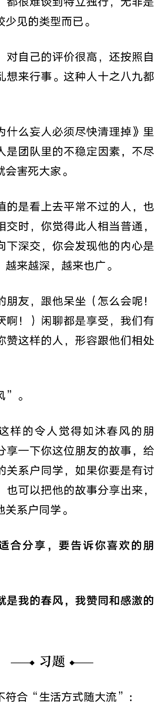

那当带着刃口的石器是飞不起来的，他们的活动空间永远都是厨房、洞穴附近了。

我们会保留思想的独立，在遇到情投意合的新朋友时才会打开外层的保护罩，碰撞彼此的三观。

我们会把棱角毛刺磨平打圆，方便我们日常的生活和交际，因为这些活动当中，我们可以不去互相取悦，至少彼此的尊重和客气是降低日常社交成本所必需的。

### ｜自我服务偏差

之前我们也提过，大多数的人都觉得自己在各方面都强于大多数人，这就是“自我服务偏差”。

## ——习题——

哪个词语不符合“生活方式随大流”：
A.客随主便；
B.“就叫熊太行也行”；
C.“吾从众”；
D.帝高阳之苗裔兮，朕皇考曰伯庸。摄提贞于孟陬兮，惟庚寅吾以降。

答案是D。

这篇特别适合分享，要告诉你喜欢的朋友：
我觉得你就是我的春风，我赞同和感激的人。

## 自习课 | 如何把握自我表达和狂妄自大之间的度？

熊太行

周一的文章《如何给新认识的人留下好印象》留言中，好多关系户又提到鹰派鸽派，今天自习课就复习一下鹰派和鸽派的做事风格。

同时还有一位“啸和”关系户提出了自己的疑问，先来看一条留言：

熊大，我记得你之前的评论里说过，“在体制内工作显示勤奋是特别愚蠢的”，尤其是和同事。

我理解的不显示勤奋就是低调吧，但是熊大这篇又说“职场上，没有谦虚的人活得好好的，但是没有点骄傲的人，全部失败，无一例外”。

我有点混淆了（好像是低调和谦虚的区别），望熊大指点一二。

熊太行

区别在于：

我不到处跟你唠叨我努力。

但是我做出来活儿，我绝对不贬自己。

军师大大，我是一个鸽派。有一个困惑：鹰型性格的人，感觉都活的很自我很满酒，不怎么怕得罪人，直接、真实表达、按自己的价值观和是非判断来做事情，总是让我很羡慕，而人缘好像都不差。

那么鹰派性格的人，是真的那么真实，还是他们的套路不太一样？

熊太行

人缘不是靠和气的。你要努力去维护自己的利益，有了团队要维护团队的利益。

你护住了利益和地盘，就会有更多的人跟从你。

鸽派不是不争斗的人，鸽子只是处事和气，利益上绝对不要退让。色厉内荏的鹰派也有很多。

下面再给关系户复习一下鹰派与鸽派的行事风格不同，希望你们还记得《关系攻略》最开始对你的希冀。

## 鸽派的人生守则

鸽派的性格会让他成为非常好的朋友，鸽派的人缘往往很好，尽管他们不是最善于交际的自来熟。

鸽派是任劳任怨可以倚重的一种力量，尊重权威让他们成为优秀的员工。

但是鸽派同样也有自己的短板：表达低效、假装坚强、害怕跟别人撕破脸。

我当时给大家的建议是：可以再霸道一点、不要怕别人笑你软弱、交一些生命值更高的朋友、练习公开讲话和表演。

## 鹰派的人生守则

鹰派相信实力，相信职场上老人对新人的倾轧，也对自己充满期待，认为自己应该在食物链的顶端。并且偏好奇、更容易冲动、遇到逆境有失控的可能。

给鹰派的建议是：克服自己的迷之自信、克制自己不必要的攻击性、学习悲悯之心、向鸽派靠拢要能扛得住逆境。

熊太行

还记得吗：

优秀的鹰派会生出悲悯，优秀的鸽派会长出骨头。

就好像最好的男人和女人，往往会拥有类似的美德，男人会变的温柔，女人会变得坚强。

最好的人格是雌雄同体的，希望你越来越强。

## 忠诚攻略：你一定对职场上的忠诚有许多误会

062|忠诚攻略

知识点：

人际关系当中不仅有磨损和尔虞我诈，也有合作和你情我愿。

之前我赌咒发誓，要把这篇文章的题目写成《40岁之前，为什么要在职场上努力当狗》。

我知道这个标题不令人愉快，有时候我也在想，有没有一个世界，完全不需要任何人际关系的尔虞我诈，领导和各位之间一种冷淡而克制的上下级关系，没有了人际关系的磨损，建设四化的速度都能加快好多。

最后我发现，那种世界是无法想象的——你们能想象一个没有摩擦力的世界吗？推一把高铁车厢，车子就能一路溜到上海，一切恐怕都会乱了套。

人际关系当中不仅有磨损和尔虞我诈，也有合作和你情我愿。我们今天就来聊聊一种合作中的美德——忠诚。

### ｜君臣关系

我喜欢用这样一个旧的概念来代替一种更亲近、更私人的上下级关系。

如果没有后台，最好是尽早和有实力的人结成君臣关系。

还记得吗，我们在专栏开设之后不久更新了一篇《陷入了向两个领导汇报的局面怎么办》。

我建议尽快请公司确立固定的汇报对象，就是“定君臣的名分”。

被两个及以上的领导指挥会有多麻烦，尽管公司会用各种管理学上的东西来迷惑你，比如有的公司告诉你接受虚线领导和实线领导，有的公司是部门主管和分管副职都能指挥。

按照孟德斯鸠的政体分类法，这都是贵族共和制，多个领导，无论是集体领导、元老院、八大贝勒议事会，你的领导都不会跟你结成稳定而牢固的君臣关系，他们都能对你发出号令，但是真正需要有人保护的时候，没有一个人会站出来维护你。

越多人数令，越少人有担当。

你会有一中仓库里的铁铲的感觉，谁都把你抄起来就用，没人对你有感情。

不要做这种由人使用的器具，而应该发挥主观能动性，成为帮助自己的主公成事的忠犬。

### ｜保护和保证

你一旦和你的领导形成了一对一的私人关系，你的权益就获得了保障。

在《权力的游戏》里，骑士效忠，女骑士布蕾妮对领主夫人们凯瑟琳的宣誓：

> 骑士：
我是您的人了，
我会保护您的安全，
危难之际我愿奉献我的生命，
以新旧诸神之名，我郑重起誓。

主公：
我起誓，你将永远在我家中拥有一席之地
并和我同桌而食，
我誓言永不让你服务，
蒙上不誉的污名，
以新旧诸神之名，我郑重起誓。

历史上真实的宣誓和它差不多，一些最基本的权力义务在这个誓词里是有约定的，比如：

+   1. 臣不能有第二个主公，即使是你主公的主公想要挖你，也不能随便应答。这就回答了直属领导和大领导冲突的时候应该怎么站队的问题。
+   2. 臣要保护主公的安全，这代表他要有发现危险的能力和战斗的技能。
+   3. 臣愿意牺牲自己的利益，注意，臣子牺牲的是自己的生命，但不是封地，因为臣子死了，儿子可以继承封地，如果主公要没收骑士的封地，那大家就会反目成仇，以死相拼。这也是为什么我会说，不要伤害支持你的人，别让你的手下为关系远的人做牺牲！
+   4. 臣要保护君，君要保证臣。要答应让臣子参与自己的事务，不能剥夺他效力的机会。
+   5. 有肉大家要一起吃。
+   6. 我不会让你伪天害理屠杀妇孺，想想我们那篇《我的领导让我做违法的脏活怎么办》。

### ｜“汉贼不两立”

遗憾的是，未必所有人都能把这古老的忠诚契约贯彻下去。

那天有个同学小美跟我说，她很受直属领导A的青睐，但是另一个部门的主管B跟她关系也不错，B口碑不佳，但是和大领导关系好，A知道B和她关系好之后，开始敲打她。问我该怎么办。

我的回答就是，敲打得对，愿意敲打，就说明领导对你还没有放弃。

如果从法律和规则上看，小美的直属领导不应该干涉你的私人社交，否则就是越界，而且社交对象还是同一个公司的其他主管，理论上大家都是同事。

但是你必须要越过这种表象，看清楚君臣关系的本质，A的青睐，让小美和A事实上是君臣关系。

主公和隔壁开兵见仗，你和敌人私底下有接触，主公心里会害怕和猜忌的。

你说大家都是同事，这是大道理，大汉丞相萧何打汉将军刘备的时候，他们也是同事。大道理就是用来当借口的。小道理在大多数时候是真实和有用的。

诸葛亮是三国最聪明的人，他家哥仁，大哥在东吴，他在蜀汉，还有个弟弟在曹操，官职都不低，彼此之间有书信往来，构成了一个情报网和外交渠道。这样的人不被主公猜忌，很重要的一点就是，他一直在进攻——《后出师表》上来就是一句“汉贼不两立。”他不断袭击中原，打赢打不赢，刘禅都会越来越信赖他。而君臣关系永远都是最重要的关系。

### ｜忠诚的回报最高

大概在一万多年前吧，人类的火堆旁有肉和骨头，一群饿了的狼看了，直流口水，最终有个胆大的家伙过去，开始吃人类给的东西，待在火堆边，变成了最早的狗。

人们把听话的狗留下繁殖，不听话的、爱咬人的家伙吃掉或者抛弃了。

人给狗安排了工作：你帮我打猎，我让你吃饱和得到保护。狗甚至进化出了消化粮食的能力，因为农业给人能提供更稳定的食物来源。狗可以吃纯素，但是猫就不行，不吃肉身体会出问题。

人和狗是最早的君臣关系，狗比奴隶制要早多了。

职场上也是这个规则，我跟大家说过，不要做那种桀骜不驯、对一切充满了讽刺和怨念的员工，因为这没有意义。

忠诚是替主公分忧，像猎犬那样每天去打个兔子叼回来，而不是每天表演拼死搏杀的戏码。

之前我们在《公司组织的比赛，真的“特别嘉”吗》也说过，各种机关事业单位和国企举办的演讲辩论之类的比赛，是领导挑选优质青年加入到自己队伍当中的好机会。

所有的领导会挑选“自己人”，他们把资源和机会分配给自己人，拿出一部分去给非自己人以争我抢或者民主评定。他们不会照顾所有人，因为资源没有那么多，不够分。他们也不能把自己人的圈子结得太小，这样大量的“非自己人”可能构成绝对多数，在某些地方上坏事。

一个自己人的圈子至少包括一两个人有关系的人，他们身上有更大领导的请托，还会有一两个人精明的主意多的人，一个能照顾领导各种杂事（从银行买水电到辅导孩子功课）的人，一两个好看的人，一个酒量好的人，以及一两个倔干活，随时会累死的人。

累死的人。

这些角色里有的会有重合，比如照顾领导的人可能同时也额值颇高。但倘于活的人一般是专职的，他们在圈子里最边缘，他们随时可能被换掉。

有人会说，不加入这样的圈子行吗？

当然可以。

你可以不站队，就做自己的人，有 的业务强悍的员工可能被多派拉拢，不过大多数人都会可能郁郁不得志，在这样的队伍里搞个非领导的副职退休拉倒。

当然，这未必是绝望，之前我们也说过，中年生 活会变得有复杂的评价标准，工作已经不再是全部了，《人民的名义》里，孙连城区长最后就发展出了仰望星空的技能，也是可喜可贺的。

### | 哈士奇式的员工

如果从忠诚的角度来看，过于温和、和谁都好的人是无法在职场当中获得任命的。

君臣关系是狗拉雪橇模式，一个主公驾驭着一群臣子。

有些人从小受了那种好人教育，他会倾向于去跟所有人发展友谊，就像哈士奇一样，家里进了贼，他不叫不嚎，还要跟小偷玩。

前面我们讲过好人员工的缺点，那篇文章叫《如何摆脱老好人的标签》，其实老好人不被重用，很重要的原因就是他们缺乏判断敌友的智慧。

许多老好人其实也愿意服务于有雄心壮志的主公，但是渴望获得所有人的友谊，让他们在被其他竞争对手引诱和套话的时候表现不佳，他们虽然效力于主公，却难免和主公的敌人有点暧昧，藕断丝连。

即使在忠诚上告诫了他们，他们也做出了保证，但他们真正的问题是没有判断敌人正在进攻的能力，在很多时候，他们都是按照本能行事，眼看着主公被攻击，被挤兑，他们却还浑然不知，有的时候甚至还在说谎话。

### | 领导不是兄弟

你的领导如果跟你称兄道弟，那你可得留神，这说明他在拉拢你。

靠亲热拉拢人的领导，要么是新手上路自信不足，要么是手上没有太多资源只好说些不要钱的好话。

跟领导的关系，我们说了，就要做君臣，但是皇帝退位一百多年了，大多数人没见过君臣。

健康的君臣，类似于父子的关系。

今天的许多人谈论传统文化、权谋，都说，要看《三国演义》，作为通俗入门作品，可以，但是《三国演义》的许多情节是故事，不能指导人生，比如“桃园三结义”，说他们三个人是兄弟。

但正史的《三国志》里描写刘备和关羽张飞的关系，说他们“恩若父子”。

父子和兄弟有什么区别？

兄弟可以有好多个，你认了一个哥哥，出门可以再认一个。

父子里爸爸有且只有一个，不能随便到外面再认一个。

爸爸要管儿子们，要随时敲打着有异心的儿子。当然现在的职场君臣关系，是一种拟态的君臣了，主公不会打板子或者把臣子送进天牢。毕竟还有一个现代职场规则在，辞职是一个正常的解决方案。

但是主公仍然要有剥夺和惩戒的能力。

“除我之外，不可有别的主。”《摩西十诫》的第一条就是这样写的。

在《旧约》里，神看见了人类背弃自己去拜偶像，就 会降下各种灾难毁灭这样的城市。

无论中国还是西方，惩戒不忠诚手段时的重手，并没有什么区别。

## —— ◆ 习题 ◆ ——

以下四个人里，和刘备不是亲戚的是（多选）：

+   A.夏侯渊；
B.张飞；
C.诸葛亮；
D.赵云；
E.法正。

答案是DE。

张飞和刘备是亲家，张飞的两个女儿许配给了刘备的儿子刘禅，当过皇后（姐妹继承了姐姐的位置）。

夏侯渊是被刘备打死的，但张飞的妻子夏侯氏，是被张飞抢来的夏侯渊的堂侄女，夏侯渊的儿子夏侯霸投降蜀汉的时候，刘禅还让自己的儿子带出来见他，说这是夏侯家的外孙。

诸葛亮的儿子当了刘禅的驸马，从这种意义上来说，诸葛亮比刘备低一辈。

法正是刘备获得四川的领路人，法正的性格不好，掌权之后忙于报恩报仇。有人请诸葛亮去说，但诸葛亮说法正人很重要，想作威作福一下，不能让他不爽。

赵云是刘备身边地位比较低的将军，赵云在刘备打下成都，决定给大家分房产和土地的时候劝谏“钩钳未灭何以为家”，劝刘备分房。

刘备从谏如流，把房子自己留下来了，从此以后，刘家班里喜欢赵云的人不多。

刘备懂得厚待功劳大的人，打下成都之后，他“赐诸葛亮、法正、飞及关羽金各五百斤，银千斤，钱五千万，锦千匹。”刘备知道他最重要 的联盟是这几个人，让张飞、诸葛亮成为自家家族姻亲，是他继续统治四川的关键。

赵云拿同事们的利益去讨好领导。他引用的例子是不确切的，霍去病也曾经推辞过汉武帝给他盖房的要求，成了千古佳话，赵云替刘备省下了预算，却承担了很大的怨恨。

不爱钱的人有自己的优点，但在职场上别瞎慷慨，不然很可能就像赵云一样，忠心耿耿，却没了钱，也没了人缘。

# 8.1 | 《大学》的由来

# （1）“四书”的来历和次序

从今天起，我们就要进入“四书”的世界了。

“四书”是哪四部书，在今天已是常识。按照先后顺序来说，是《大学》、《中庸》、《论语》、《孟子》。其实在朱熹编订“四书”的时候，它们既不叫“四书”，也不是这个顺序。

我们先把时间追溯到1189年，在这一年里，狮心王理査在英国继位，第三次十字军东征开始，西方世界还在拼体力挣表现。第二年，在中国是宋光宗绍熙元年，六十一岁的朱熹在临澧做官，用公费刊行了“四经”和“四子”两套书。“四子”就是我们今天所谓的“四书”，朱熹原本是把它当做“子书”的。朱熹对这四部书都做了注释，《大学》、《中庸》的注释原创性强，叫做“章句”，《论语》和《孟子》的注释里引用了程颐、程颐兄弟和其他一些人的意见，所以叫做“集注”，后人把它合称为《四书章句集注》。元、明、清三代科举考试，这套书就是标准教材。反对派一直说的“程朱理学钳制思想”，主要也是针对这套书说的。

这倒怪不得朱熹，因为政府为了方便管理，总想要统一价值观，而要统一价值观，就必须定出一个标杆，无论换种学说当标杆都会“钳制思想”。就算把后现代主义的“去中心，多元化”拿来当标杆，结果也是一样的。“去中心，多元化”反而会变成以“去中心，多元化”为“单中心，一元化”。

朱熹原本给“四书”排的顺序，由浅入深，先后是《大学》、《论语》、《孟子》、《中庸》。但《大学》和《中庸》篇幅很短，后人为了编排方便，就把这两部书排在一起，形成了我们现在熟悉的《大学》、《中庸》、《论语》、《孟子》的顺序。

“四书”的编定可以说是绝大部分读书人的福音，因为比起“五经”，“四书”简直容易得不像话。科举当然也考“五经”，但既然有了“四书”，那还有谁愿意舍易求难呢？在“四书”当中，《大学》是入门第一部书，既有提纲挈领的意义，还很简明易懂。本周我们就从《大学》讲起。

# （2）《大学》原本只是《礼记》的一章

先让我们回顾一下上周留下的问题：“大学”这个词到底是什么意思？

答案很简单：“大学”就是“大人之学”。

“大人”是谁？

答案也很简单：“大人”就是统治者。

所以，“大学”就是统治者统治国家的学问。

这就有点尴尬了，因为按照周代礼制，朱熹算不得统治者，他只是皇帝的雇员而已，筹备科举的读书人也算不得潜在的统治者，他们没有贵族的血统，谁也不是生来就能做官的。

所以我在这个专栏的一开始要先讲《左传》。我们只有充分理解了《左传》描写的那个周代社会，那个宗法封建的社会，了解他们的礼制和社会格局，才能明白后来那些朝代里的各种尴尬、各种别扭都是怎么回事。

《大学》原本只是《礼记》里边的一章。《礼记》虽然是汉朝人编辑整理的，但保留了很多周代的内容。周代的社会结构，我们可以想象成封建关系和宗法纽带构成的双螺旋，政治关系的内核是家族关系。而在一个家族里面，谁能统治、谁不能统治，或者说谁是“大人”，是哪个级别的“大人”，是从一出生就决定好的。如果把他们那套“大人之学”拿到朱熹的时代，用文言说叫“圆凿方枘”，用俗话说叫“驴唇不对马嘴”。

朱熹的拥护者当然不爱听这样的话，他们肯定会说：“你不知道我们家朱熹有多努力！”必须承认，朱熹确实很努力，尤其对《大学》下了很深的功夫，就在去世的前一天还在修正他们的《大学章句》。

# （3）“三纲八目”

我们来看《大学》的内容，第一句是所有人耳熟能详的：“大学之道，在明明德，在亲民，在止于至善。”意思很明确，“大学之道”一共只有这三项：明明德、亲民、止于至善，可以统称为“三纲领”。接下来分格物、致知、诚意、正心、修身、齐家、治国、平天下，一共八项，统称为“八条目”。《大学》所谓“三纲八目”，指的就是这些。

朱熹认为，所谓“三纲领”、“八条目”是孔子讲的，曾子记的，后边的文字都是对“三纲领”、“八条目”的阐释，那是曾子讲的，曾子的学生记录的。朱熹这样讲其实并没有根据，不过倒是有些实用主义的好处：能够帮助读者最快地把握《大学》的结构。

但是，按照朱熹分析的结构，我们会发现《大学》对“三纲八目”逐一都有解释，唯独没有解释“格物”和“致知”。这不合理，一定是传抄过程中有了残缺。这也不是什么大事，补写一段就好了嘛。朱熹发扬了舍我其谁的精神，补写完整，再把结构调到位，一部《大学》就这样完美无缺了。

宋朝学者普遍胆子都大，但朱熹的胆子似乎太大了些。其他人当然看不惯：圣人的经典你也敢动手补写，你把自己当圣人了吗？

# —— 今日思考 ——

幸好朱熹死后确实成了圣人，也就很少有人再计较他的胆大妄为了。但他没有想到的是，将来又会出现一个叫王阳明的圣人，偏在“三纲八目”上跟他唱反调。儒家入门的学问，竟然也存在那么大的争议啊。现在，请你仔细看看“三纲八目”的字面，仅仅从字面上看，你觉得这会是很深奥、很费解的概念吗？

# —— 今日得到 ——

今天就谈到这里吧，让我们来回顾一下知识要点：

+   （1）“四书”的得名来自朱熹的《四书章句集注》。
+   （2）朱注本“四书”成为元、明、清科举的标准教材。
+   （3）《大学》原本只是《礼记》里边的一章。
+   （4）“四书”由浅入深的次序是《大学》、《论语》、《孟子》、《中庸》。
+   （5）《大学》的核心内容是“三纲八目”。

就到这里吧，我们明天见！

# 一年读通52本 思想经典

# 如何做自己的“人生导演”

063|如何做自己的“人生...

知识点：

角色会成为你和观众之间的缓冲带。如果享有直接演自己，当你表现不佳的时候，你会觉得自己充满了挫败感。

熊太行

这篇文章可以看做《如何拯救一个害羞的灵魂》的进阶版。害羞者攻略所教授的是避免害羞的技巧，可以算得上是理解自己和防御的策略。

但是“人生导演法”给大家的是一个通过心理暗示和角色扮演的方式让自己强大的解决方案。不害羞的人用了，也能越战越强。

各位害羞者期盼的这一期终于来了。

之前我说过，为了害羞者，我和我的同事、即兴戏剧训练师师头老师（如果你阅读我的公众号，时常可以看到他的文章）开发了一个“人生导演”模式。

这篇文章可能会让你觉得和平日的关系攻略有点不一样，我可能会使用很多的表格和填空，如果你在听音频，我建议你听音频的同时也打开文字版，有些地方你可以使用你的双眼。

表演挽救过很多害羞者，比如《穿普拉达的女王》、《明日边缘》的女主角艾米丽·布朗特，她年轻的时候口吃，通过舞台训练纠正了这个习惯，还成了职业演员。

艾米丽的心理医生当时建议，表演可以让她代入不同的角色，缓解她对人群的压力。

# ｜表演的魔力

之前我们在《如何拯救一个害羞的灵魂》当中提到过，心理学家津巴多教授认为，害羞的关键是过度的自我关照。

害羞者害怕的是围观群众，是那些陌生的评判者。但是如果你在表演，那就会完全不同。

我小学时候是学校的文艺骨干，说相声的。我在台上几乎不会紧张，但是有一次，我在公园里因为尴尬被我妈弄哭了。

因为我妈让我穿成这样：

道具比这个要差得多，有一个特别脏的头套，衣服是没有的，我要站在一个硬纸板的哪吒身体前拍照——我妈认为公园里的这个摄影特别有才华，而我那时候还没有发胖，也算得上粉扑玉琢的一个小孩子。

我誓死不从，周围的大人们都在哈哈大笑，最后我挨了打，才拍了一张表情极其恶劣的照片，洗出来之后永远藏在相册的最深处。你们留言里别说求看，《关系攻略》订阅数超过十万之前绝对不会晒给你们的。

当时我妈无法理解我为什么这么抗拒，时隔多年之后我分析，才明白这个道理，那就是“只有我一个人在表演”。如果摄影师是个猴子，或者在我爸站对面，手里举个玉米棒子假装宝塔，我的感受都会好得多。

“只有一个人 Own在演着，所有人盯着我犯错。”

就是害羞的本质。

前两天网上在传一个小朋友念刘胡兰的课文，越念越激动，最后发生大哭引发嘻笑，就是这个道理。

有人会走向另一个一个反面，从小拥有特别浮夸的表情和演技。

# ｜角色的妙用

刚才我说到，我因为粗糙的发套和硬纸板身体而无法入戏，同时也没有可以做戏的对手，变成了一个独角戏的尴尬人，害羞的机制就这样被激发了。

如果有合适的能够把我导入角色的机制，那事情显然可以改变。

比如：

+   你——观众；
你——角色——观众。

角色成了你和观众之间的缓冲带。如果你是直接演自己，当你表现不佳的时候，你会觉得自己充满了挫败感。

演砸一个角色是没关系的，因为下一部戏里你就叫下一个名字了。

如果演砸了自己，而不是一个角色的话，问题就要严重地多了。

# ｜导演来了

好了，现在导演来了，你过去一直都是本色出演，现在导演要改善你的演技了。

你可以把导演想象成一个无论如何都会接纳你的朋友，如果想不出这样的一个人，就把它设定成戴黑框眼镜，穿“总有理想值得死”T恤的一个人也行，如果你不理解为什么我提这一句，回头看看这篇的结尾，最后一句。

现在用十个特质来描绘你自己过去扮演的角色：

我是这种__________人。

这样的句式，写十个不同的描述，比如我就写会：

+   体重超标；
面相和蔼；
平时不发脾气，动怒时比较吓人；
乐于助人；
对钱看得比较重；
花钱不太小气；
爱交朋友；
喜欢写东西；
喜欢单机游戏。

试着画一张现在的你的自画像，简笔画就可以了。

好了，这是你过去扮演过的角色，现在对导演说说你过往表演的心得吧：

+   你塑造了一个什么样的形象？
这个形象和观众对你的评价一致吗？
你过去所有的表演失败，是演技不好，还是运气不佳？
你想突破自己戏路吗？为此你愿意付出什么样的代价？
这是一个你能胜任的角色吗？

好了，存好这么几个答案，相信你是有意突破自己的，现在开始写自己想变成什么样的人。

如果你已经像我一样过了35岁，可以定5年后的形象，如果是小学生的話，可以定...

年后的形象，如果是小学生的話，可以定成10年后形象，描述这个形象。

比如我是这样写的：

我会成为_______的人。

+   八块腹肌；
面相更加和蔼；
没人会跟我发脾气了，我人缘越来越好了；
乐于助人；
对钱看得更重；
花钱更加不小气，因为更加有钱了；
爱交朋友，也有许多朋友了；
写出了一个百万册以上的小说。

我的小说改编成了一个大型游戏。

来画一张今后的你的自画像。

注意了，比较一下现在的你，和五年之后的你，两个角色之间的异同。

现在导演告诉你了，因为我们工作失误，开头和结尾两场的剧本我们还有，其它的被羊羔当零食吃掉了，你作为男主角/女主角，必须要把中间你自己的剧情补全。

# | 被剥夺了一切的感受

作为电影或者戏剧的主角，你要成长，就要迅速地被剥夺一切，现在想象一个场景，一个反派，出现在你的前面，让你失去了现在所有的一切。

他可以你是凶残的老师、变态的领导、刻薄的同事、暴力的前夫……尽情去想。

你失去了现在有的一切物质条件，这个时候的你众叛亲离，在一个环境里反思，你可以想象这是出租屋、快捷酒店、破庙、水泥管子……

这个时候你有一面镜子。

你这个时候可以在浴室里对着镜子，好好端详一下自己：

+   你的容貌哪里最漂亮？
如果你要和一个陌生人见面，你会怎么描绘自己的外貌？
你给人的第一印象是什么？
你会做什么改变让别人对你的印象更好？
你对自己的容貌哪里不够满意。

# | 成长和反击

现在你在故事的谷底，你很快会迎来机会。

注意你现有条件和你即将成为的样子之间的差别。你要出一个故事，关于你是如何变强大的，你是如何成长的：

+   你遇到了什么奇缘？
配角是什么样的人？
宿敌起了什么样作用？
观众们看这个故事的时候是什么样子的？
详细描述一下你的转折点剧情。

# | 决战

你最终遇见了这个故事的终极BOSS，你带着朋友们来到了真正伤害你的大对头面对面。

大对头拉下了自己的面具。你发现你的大对头，是五年前，也就是现在的你自己。

# | 尾声

大家交流完毕，五年后你安详离去，现在只剩下一个五年后的，经历了沧桑和决战的，成长之后inz的自己了。

你的决战场是？车站？寺院？圣堂？城堡？紫禁城房储？草原？现在朋友们看着你，你是：

+   A.一把火把它烧掉，嘴里还在说“让我们离开这个无情无义的地方”；
B.埋葬被击敗的自己，在庭院里种植无数的桃花成海；
C.叫来无数围观的群众（苦着者注意晓，你最害怕的围观者出现了，放心，你现在高度入戏而且豪气冲天，不会担心），把地和房子分给他们；
D.你露出了一丝邪魅狂狷的笑，没有人发

D.你露出了一丝邪魅狂狷的笑，没有人发现刚才的争斗中他们认错了你，其实活下来的你才是五年前的自己。

# 解读：

注意，我们做这个训练目的在于体验现在的你（五年前）和你期待的自己（五年后）之间的差别，你说话做事的风格，可能都会有不小的改变，你会逐渐学会自己去扮演更好的自己。

当你把“更好的自己”变成一个日常表演工作之后，每天晚上你都可以好好总结自己演技，同时在你面临极度尴尬的时候，也可以让角色来替你自己承担一部分的压力。

“今天演得好，我真厉害。”

“今天没演好，这个角色有难度。”

注意这两句话的表达，一切的表扬指向自己，一切的批评指向角色。你会逐渐地保护自己、成全自己。

这类内心戏熟练之后，20分钟的睡前时间就可以过一遍，熟练之后也可以给自己加戏，自己朋友的戏份也会越来越熟练，也可以把领导、讨厌的同事拉进自己的戏里，可以给他们安排一些被马蜂蜇肿成一个大球的嘴脸。

当你在现实中被可恶的人怼的时候，就可以控制得住了，因为你能想象得出他们最狼狈的样子。你要逐渐把生活现实也变成自己的主场，就像你的戏里一样。

熊太行

今天要做笔记的东西很多，就不再专门留习题了，关于克制害羞和人生导演模式，猫头老师那里还有许多好玩的线下戏剧游戏可以玩。

如果有兴趣的同学很多，我们可以以后再写一篇来谈谈，或者适当的时候组织线下训练。

现在记得要长期在内心深处组织排练，这是让自己消除紧张和探索自己最好的法子。

熟练掌握之后，你可以把这一套玩法复述给你的朋友，尤其是异性朋友听。

如果你在给你喜欢的人说戏，在“导演来了”那部分，就把导演的形象描绘成你自己的样子，懂了吗？

以后不许再给军师留言，说自己不会聊天、不会撩妹、不会找话题！

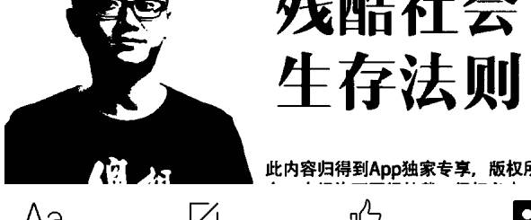

# 分类学・植物 | 桃树越老，桃子越好？

世界好大，奇妙的事情每天都有，我们一起去发现吧！

分类学・植物 | 桃树越老，… ↓

徐来

我的家乡，是一座江南的古城。江南，自古以来就比较富庶，所以会有很多好吃好玩的土特产。不过，在所有的土产当中，我自己最喜欢的是桃子。我家乡出产很有名的水蜜桃，不过清甜多汁，更重要的是，个头非常大，普通大小的桃子，都有一个成年人两手握在一起那么大，一些特别大的，甚至有双手指尖对指尖时，手指心起来GPS那个大小。

其实，桃子是一种原产在中国的水果。野生的桃子似乎遍布整个中国。大概在七八千年以前的时候，当时生活在长江流域的人们已经开始吃桃了。到了大概3000年前，江南出现了人工栽培的桃子品种。

尽管已经开始人工种植，但在古代中国，桃子还是一种比较贵重的水果，尤其是在北方地区，大而好吃的桃子不容易见到，通常都是达官贵人们才能吃上的东西。所以有的时候，好吃的桃子会被用来做一些其他的事情。

# “二桃杀三士”的故事

在战国时代，山东省这个地方有一个古国，叫齐国。齐国是那个时候非常强大的一个国家。国王手底下有很多的将领，他们带领着非常强大的军队。这些将军当中，有三位带领的军队最多，功劳最大。不过，这三位将军都有点骄傲，仗着自己控制着军队，而且战功显赫，所以慢慢的不把其他的大臣放在眼里了。齐王手下有一位文官，一看这个可不行，现在他们看不起别的大臣，再发展下去，岂不是要看不起国王了吗？那还得了！于是，就出主意，要让齐王杀掉这三个将领，免得他们以后造反。可是这三个人本事很大，又没什么明显的过错，怎么杀呢？

正好，这时候有人向齐王献上了两颗美味的桃子。文官说，这个机会好，于是就让齐王下旨，说想把这两颗桃子，分给三位将军中功劳最大的两位吃。其中两位将军很开心地报上了自己的功劳，然后各自拿了一颗桃子吃。第三位将军急了，拔出宝剑来大骂，说你们俩的功劳跟我差不多，可能还不如我，怎么就把桃子吃了！那两位一想，他骂的有道理，就很羞愧。可是桃子已经吃掉了，再吐出来也不行。于是再生气一窝火，干脆拔出宝剑来，俩人自杀了。

第三位将军一看，他们俩怎么自杀了，这样一来，不是显得是我逼死他们了吗？干脆我也自杀算了，把宝剑一横，也死了。这样，这位文官就用两颗桃子，杀死了三名大将——好玩吧，古人的气性也真大，一言不合就自杀玩儿。

# 桃子属于蔷薇科

其实，桃子不但好吃，桃树开的花也很好看。不过，很多人分不清桃花和其他几种相近的花，比如梨子的花，李子的花，樱花等等。这一点都不奇怪，因为它们都是一个家族的，就是植物学上讲的蔷薇科。桃子好吃、桃花好看，其实桃木也是相当好的木料。这些木头相当细密坚硬，还相当富有弹性，所以是雕刻用的好材料。

不过，桃木有个致命的问题，你自己找棵桃树看看就知道了，桃树很多地方都当做园艺植物种植的，所以很容易找，你看一下就会发现了。桃树个子很矮，树木也不粗，还长不直，总是曲里拐弯儿的。这就是所谓的“不成材的树”，没有办法驳成大块的木板，也不能做成大柱子，所以，也是矮矬可怜的，桃木虽然很好，但只能用来雕刻，或者做成小玩意儿，派不上大用场。

不过，古代中国人给桃木编出来一个特别的大用场：驱逐恶鬼。你看，电影、小说，或者其他文艺作品里面，要是描绘一个法师要作法，去驱赶那些困扰人们的鬼的时候，总是要用到大量的桃木制作的东西，尤其是用来和鬼怪们打斗用的宝剑，就是桃木剑。

桃木剑这种驱除鬼怪的特性，至少在汉朝就已经出现。在汉朝一位作家写的一本很著名的书里面，记录了这样一段故事：在苍茫的东方大海上，有一座非常大的岛屿，岛上生长着一棵巨大的桃树，树枝蜿蜒盘曲很长很长。东北侧的树枝，往地面垂落，形成了一道门，这道门就是鬼门，所有的鬼怪，进出人间，都要走这个门。这个门有两个神仙看门，一个叫神荼；还有一个叫郁垒。

这两个神守着这个鬼门，监控各种鬼怪，如果有行为不端的鬼怪，就抓住它们，喂给老虎吃。因为这个特性，所以各种鬼怪特别怕神荼郁垒。老百姓知道了这个事情之后，就仿照画葫芦，把桃木削成木片，在上面画上神荼郁垒的形象，贴在家自的门上，想借着这两位神仙的能力，吓唬各种坏运气。这样一来，桃木就有了打击鬼怪的效果。然后又慢慢地演变成了跟鬼怪作战的武器了。

用来打击鬼怪的时候，古人相信，从活得越久的桃树上砍下来的桃木，做成的桃木剑，效果越好。出于同样的心思，他们认为，桃树活得越久，上面结出来的桃子也就越好吃。你读过《西游记》没有？西游记里，王母娘娘有一个蟠桃园，蟠桃园里的三种桃子，分别要三千年、六千年和九千年，才能成熟一次。其中，耗时最长的九千年桃，不但最好吃，而且具有最神奇的功效。不过，这样的说法，完全是古人的想象。

——博物馆学家养成记——

树木虽然能活的比动物久得多，但它毕竟也是一种自然生命，有自己生老病死的规律。就桃树来说，大多数桃树，能开花结果的时间，只有二三十年。

最常见的桃树品种，一般在种植三年左右的时候，开始结出可以吃的桃子。

随后，它们的产量将会逐年增加，并且在10岁左右的时候达到顶峰。然后就开始走下坡路了。所以，如果真的有一棵桃树能活到3000岁乃至更长的年龄，那么它基本上能活着就很好了，开花结果，那根本就没有可能。

如果有机会的话，在种植桃树的花园里捡一些桃树的树枝回来吧，把树皮去掉，然后用小刀刻一刻，看看你能不能用小树枝来做一把小桃木剑呢。

# 专题日｜5月20日，爱要怎么说出口

熊太行

这周六就是5月20号，带着大家一起来温习一下情感类话题。

自古至今，许多人用不同的角度切入情感和家庭，比如有的地区坚持认为男女感情好不好，跟女人能不能熬出好的白粥有关。

《关系攻略》主张的男女关系，可以概括为十六个字：

优先等级、利益共同、携手进步、共担苦痛。

把配偶关系设定为优先于和自己父母、孩子的关系，设定一个共同的利益，可以是事业或者财富的发展，在努力发展这件事上相互支持，再分享彼此的喜怒哀乐，经常交换自己的感受。

## 给女生关系户的一点建议：

“随便找个老实人嫁了”，是一句对如今处境不满的气话，如果真的这样去择偶，以后的麻烦会很大。“老实人”都缺乏热情，也缺乏称赞别人的能力。大多数的老实人，都是沉默内向的人。

婚姻市场上，如果一个人被描绘成“老实人”，那一定是不打扮也不太会聊的人。被评价为“老实人”，在外貌上比“一般人”的评价可能还要低一些。

有人说老实人性格好，但真正的性格好是：阳光、健谈、注意自己外表的人，这样的人多半受教育程度也很好，收入也不低。而“老实人”的性格好是：内向、回避冲突、不敢维护自己的利益、沉默寡言。

> ——来自《为什么不要随便找个老实人嫁了》

## 给男生关系户的建议：

如果你是一个老实人，那你能做的是来看一下做一个别人喜欢的人，需要做什么：

- 热情、正能量；
- 提高自己的说话技能；
- 提高自己的外表水平；
- 进修学位和在职场上获得提升。

试着开始用其他有力的标签代替你“老实人”的标签吧。

> ——来自《为什么不要随便找个老实人嫁了》

## 给想要发展恋爱关系的关系户的建议：

激情、亲密、承诺，组成了这世间各不相同的爱。

激情：性的吸引力，通过视觉、听觉、触觉、嗅觉来实现。这一刻你们就像原始人，动物的本能驱使着你的所有表现。

激情是爱的驱动力。

亲密：双方可以彼此分享感情和信心。我们常说的“谈恋爱”，就是增加亲密的过程，可以适当的跟对方多分享一些心事。

亲密是爱情里细水长流的一部分。

承诺：持久的感情，给对方做出了承诺。激情和亲密两者兼有的，叫做浪漫的爱情。这种爱情在承诺方面却表现的非常低迷。祖辈和父辈中有很多承诺>亲密>激情的爱情。

如果你打算投入一段爱情里，要先明白不是每一个人都可以拥有完整的爱情。考虑一下自己能接受哪样的爱情。

> ——来自《什么是撩？怎么实现男女之间的惊险一跃》

熊太行

温习恋爱关系之后，再给大家看一段婚姻契约的关系，我请了隔壁的万钧钢老师把他在《精英日课》中一段话允许我放在这里，送给各位关系户。

希望你可以明白：由你自己亲手创造的关系，才是最有价值的关系。

## 来自专栏《精英日课》：

《社会动物》的作者布鲁克斯说，你去考察那些携手走过大半辈子、婚姻幸福的老夫妇，你会发现他们的婚姻既不属于“命运体制”，也不属于“选择体制”，而是属于“契约体制”。

在契约体制下，婚姻是一个承诺。为了实现这个承诺，双方都需要改变自己。

你不需要在婚姻市场里翻来覆去精心挑选另一半。契约体制认为婚姻有一定的偶然性，你可能偶然遇到一个特别心动的人，说结婚就结婚了。但是请注意，相爱和婚姻这一步，并不是最重要的。

更重要的是第二步，也就是双方如何把这个婚姻关系维持下去。

布鲁克斯说，你们两个人得建立“我们”这个概念。

从此之后，在生活中的优先级，你们两个人的关系是排在第一位的，排第二位的是对方的需求，而你自己的需求只能排第三位。

契约体制认为双方结婚以后，不应该过度强调个人独立性，而应该互相依靠。

那么这个“契约”的意思，最关键的一点，就是一旦当婚姻出现危机的时候，双方要知道不能轻易退出。解决危机的办法是再深入一步去挖掘双方的关系。

熊太行

回到最开始，《关系攻略》主张的男女关系的十六个字：

优先等级、利益共同、携手进步、共担苦痛。与作者布鲁克斯的观点是有一定的一致性的。

这说明：尽管世间没有一模一样的爱，但通往完美的爱情和婚姻的路上，大部分问题，都可以通过“关系”解决。

祝美满幸福。

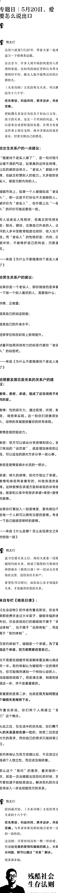

# 密友攻略：如何把我自己讲给你听

## 知识点

一个人如果同时是两个人的朋友，他一定是对交情更深的那个人吐露更多。

衡量人际关系的深浅，“自我暴露”是一个明显的标志。

自我暴露必须温和，太早开始或者激烈太过，会引起对方强烈的排斥，对方会开始防御，接近他、做朋友的机会也就没有了。

## 应用范围

如何交到好朋友、如何维护友谊、也适用于社交场合。

《谈工作没问题，一闲聊就变成大笨蛋》和《如何给新认识的人留下好印象》的进阶版。

《关系攻略》开了半年，最近有的同学跟我说，熊老师，内容越来越深了，对，现在我会经常提及我以前分享过一些技能。

我在这《谈工作没问题，一闲聊就变成大笨蛋》（点击右上角“听音频”，找到音频040即可）当中提到了过闲聊和讲故事的法门，我在这里先给大家复习一下，然后再谈论高阶技能。

要讲好一个故事：
- 1. 挑好本子
- 2. 勤练
- 3. 多演
- 4. 选择合适的半场
- 5. 节目要更新迭代

这是讲别人的故事，别人的段子。让听自己说话的人和自己快速熟络起来。

今天教的法子，是如何讲述、分享自己的亲身经历，让熟人快速变成朋友。

在《什么是撩？怎么实现男女之间的惊险一跃》（点击右上方“听音频”，找到音频31即可）当中，我们提到了快速增加关系的那一下，其实不只是男女之情，友谊同样也有这样的风格：

我们所说的“撩”，就发生在一方准备尽快增加亲密值的时候。这个环节特别煽动魄，我把它称之为“男女之间的惊险一跃”。

## 惊险的自我暴露

要交到好朋友必须要自我暴露，就是把自己内心深处的念头，一些过往的事情给对方听。

衡量人际关系的深浅，“自我暴露”的程度是一个明显的标志。谁跟你关系好，就会跟你分享更多的心事，更多的秘密。

## 自我暴露的格式

可以从描绘自己是一个什么样的人开始。

然后描绘能证明这个特点的故事。

然后收尾“那次之后，就觉得自己好像挺适合/不适合做某事。”

## 谈论事重要的是详略

好多关系局同学说觉得自己讲话没意思，尤其是谈论自己事的时候。

我的同事、戏剧训练师猫头老师说读书记，他给了我很多的建议。

可以跟评书演员学习一下讲故事，找说书人来学习和模仿。

听的时候注意：
- 什么情节他大声说？
- 地方他慢下来说？
- 长句子当中的换气是怎么分配的？

这不是读书少，而是不在乎阅读者或者听话人的感受，也是对自己的输出不负责任。

## 塑造人主要靠语言

你在“讲”故事，语言肯定是重点。

嗓音粗细、音量大小可以体现一个人的性格。咱们固然不需要学粗嗓门的山贼和尖嗓门的小孩子，但是提到自己的妈妈、爸爸、媳妇儿、儿女的时候，如果能够带上几分形象，故事的推进就不会枯燥。

口头禅和日常用语是值得挖掘的特征，我们不需要店小二的“客官里边儿请”；鸽母的“大爷您可老没来啦”，但是老爸的操心管闲事、领导的官腔，如果能够学一个形象，那就是拉近你们距离的好机会。

如果你要模仿的人有口音，也可以直接用口音来指代他。

一些生理缺陷带来的独特声音也是说书人擅长的，比如“没鼻子”和“馍小子”。如果你要吐槽的某人是对知的，声音也有缺陷，挖苦起来有奇效。郭德纲塑造的济公，突出一个“大舌头口齿不清”。

注意，不要挖苦你们共同的人缘甚好的朋友，除非他本身爱开玩笑。

也有一些人因为卖萌或者撒娇而带来一些独特的语言习惯，也是你可以模仿的，比如下面这种卖萌的结巴。

许多评书大家都有各自的塑造人物的方法。

## 把悬念放在开始

评书里，有个东西叫做“扣子”：

## 整理自己的声音

如果你决定在这样的二人局里来交朋友，你可能需要有两种声音。

《银魂》的主角坂本银时就是使用两种声音的人，平时生活中贼贱的，一旦开始认真谈论一件事了就一定要取胜，决不放弃。

如果你声音天生就低沉暗哑，就不需要第二种声音来强调了。

声音的转变也不要多用，肯綮（qing，四声。筋骨结合的地方，比喻要害或最重要的关键）上来一次就对了，太多的交替出现会让你变得非常不严肃，阴一句阳一句话，就很像这个：

## P.s

今天不留习题，希望大家能够把自己和好朋友交换心事成为密友的过程梳理一下留言给我。

再好的朋友也要时时重温交情，所以建议你把这篇文章转给你最好的朋友，让他知道你的想念，你们应该约起来，时不时地交换最近的心事。

交换、分享和时常的挂念，这才是友爱的真谛。

# 专题日 | 你的关系问题，都能在这里找到答案

熊太行

你想要的课表，我给你整出来了。

关系攻略开了快半年，我也听见了好多关系户同学们说，希望能有一个课表，或者一个复习大纲。

我特地赶在了得到的“知识发布会”发布之前推送给大家。

## ——► 第一部分 ◄——

## 想要赢的漂亮？首先你得了解自己

## 自我认知：首先了解自己在人际关系中的特质，再行修炼

- 人际关系里的鸽派守则
- 人际关系里的鹰派守则

## 鸽派修炼：优秀的鸽会生出胃头

- 如何摆脱老好人的标签
- 如何拯救一个善良的灵魂
- 进阶｜如何做自己人生的导演

## ——► 第二部分 ◄——

## 获得社交关系的主动权，做好这几点

## ——► 第三部分 ◄——

## 和朋友的关系，既要友谊，也要有用

## ——► 第四部分 ◄——

## 初入职场，这些隐性规则你一定要了解

## ——► 第五部分 ◄——

## 职场进阶，越了解这些职场招数，赢面就越大

## ——► 第六部分 ◄——

## 职场中如何与领导相处，以及如何做一个好领导

## ——► 第七部分 ◄——

## 中国式家庭关系处理方案，解决你的后顾之忧

你们会和我一起，越战越强，越战越勇。

（技术大佬们正在快马加鞭在文章中加入链接功能，下一次，我再次迭代这份目录的时候，会不一样。）

# 打孩子，你会变成最没本事的父母

## 与亲戚的关系攻略

亲戚家的孩子长大了，快送他们去和亲吧

如何称赞亲戚家的孩子

如何帮助可能患有精神疾病的亲友

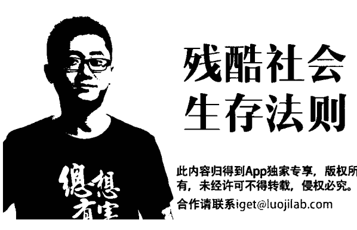

此内容归得到App独家专有，版权所有，未经许可不得转载，侵权必究。合作请联系iget@luojilab.com

# 用户留言

Aa
字号

写留言

240

请朋友读

# 你总得认识到自己不能拯救世界

065|你总得认识到自己不...

## 知识点

> “帮过我的人，我应该帮助他们而不是伤害。”——超过民族国家界限的“互惠原则”

## 应用范围

适用于朋友间要互相帮助、如何帮助别人让自己得到好处。

我刚上大学的时候，我爸送我去学校。

分别时我突然想问老爸，有没有什么至理名言送给我，要我记得的。

我老爹想了想，说了一句：“管好自己的事，有余力了要去帮助别人。”

后来的连番琢磨这句话，越琢磨越对。

通过“成长”和“助人”两个维度，能把人分成好几种。

- 只成长不助人的人，是个精明人。
- 先成长后助人的人，是个善人。
- 不成长也不助人的人，是废人。

但是我们也会发现一些问题：

偏偏有一类人，成长没有做好，却在助人方面付出了太多的时间和精力。甚至在有些方面，他们在助人方面显得特别急切，以至别人都怀疑这个人是不是别有用心。

这就是因为他们搞错了“管好自己”和“帮助别人”之间的顺序，他们希望先拯救全世界。

我不止一次地收到类似的关系户留言：

熊老师，我的人生过去一直都灰暗，后来我发现了得到，订阅了很多专栏，后来我找到了关系攻略，关系攻略给我带来了很多改善，但是我把它分享给我的老公/女朋友/闺蜜，他却觉得自己不想学习，我不知道该怎么去改变他的想法……

我可能要说一些关于帮助别人的事，了解了为什么自己会急于帮助别人，可能就能够更好的帮助别人和做好自己了。

## 帮人让我得到很多好处

对于人类的助人行为，社会心理学家已经研究得非常细致了，大多数人都赞同这样一点，给与能够提高人的幸福感。

### 1.助人行为，尤其是拯救行为能够提高自己的社会地位

### 2.帮人能让人感受到自我价值

### 3.捐赠行为会激活幸福的那部分脑区

### 4.他再乐于助人你也应该称赞他

## 帮人会让我内心好受些

### 1.帮人能够解内疚感

### 2.帮人能缓解悲伤

### 3.心情好的人会特别乐于助人

从担忧转为轻松的人，特别容易去帮助别人。

## 活学活用

你现在明白为什么针对于老年人卖保险、理财、保健品的推销员去见老太太的时候会提着水果出现了吧。当他们心情愉快的时候，你不说让他们买东西，而说自己的业绩不足，他们会放松警惕，帮你完成业绩。

## 帮人是投资、帮人是借贷

人际交往当中，一个“互惠原则”是大家所公认的。

> “帮过我的人，我应该帮助他们而不是伤害。”

乐、一个得到的专栏的时候，你对你推荐的产品可能会特别喜欢，甚至于有一种“新皈依者的狂热”。

新皈依者狂热指的是一些人刚刚找到自己赞同的理论或者宗教，急于传播和影响他人的行为。

狂热情绪对自己迅速掌握一门技能和学问很有帮助，但是如果拿出去影响别人，就很容易和对方闹不愉快。

你看好多人拜了师父学武，一个月后就开始对别人指点起来，这就是新皈依者狂热。其实他这会儿最应该做的是自己天天练习才对。

新皈依者狂热会非常危险，比如对心理咨询的狂热，我见过有的抑郁症患者，自己刚刚好转，居然跑去给别人做心理咨询了。

没有执照，也没有过系统的学习，她说自己从很多人那里学到各门各派的知识，其中熊老师的启发受益匪浅，熊老师说：“做心理咨询一定要收费。”

我只好哀求她：

别提我，我们不是那种师徒关系……以及你没有医师资格就要给人处理抑郁症，出了事要坐牢的……

## 不要想着拯救世界

帮人既然有这么多的好处，你一定不要把帮助别人变成一种道德绑架。认清楚这是自己的一种责任自觉和内心需求可能会更好。这是对朋友忠诚的一部分，但对对方回报这件事情不要期待太高。

更不要急着去帮助全世界，但是如果你处于新皈依者狂热的阶段。你会觉得真理在手，确实会希望拯救世界。

高速飙车的时候人的视野会变窄，只能看得见前面一个小小的房子面。急于向世界去推销真理，你可能会意外地得罪人。

其实新皈依者的狂热情绪特别好，但应该做的不拿出去分享，不是去助人，而是快速高效地提升自己，处理好自己的事情。

回到开头我爸爸对我说的那句话：“管好自己的事，有余力了要去帮助别人。”这个顺序绝对不要错。

帮助行为是一种特殊的情感借贷。但是如果你显示了一种狂热，对方担心的是向你借了一笔情感高利贷。你如果相信一个专栏能够改变他的人生，那他未来的一些进步和转变都要归功于你的这次推荐，这个功劳未免太大了，被帮助的人也会心存恐慌的。

## 所以正确的做法就是：

冷静地推荐《关系攻略》，或者其它好的东西给你的好朋友，但不要牛不喝水强按头，如果他表示不能接受或者虽然嘴上说好，但放在一边，就稍微等一下，他一定会有自己的困扰，而关系攻略的妙处，就在于几乎无所不包。

## —— 习题 ——

一头牛把头钻进粮食罐里偷吃，出不来了，主人去请舅舅帮忙。

舅舅说：“把牛头砍了不就行了！”

大家把牛头砍了。但是牛头还在罐子里。

“把罐子砸碎不就行了！”

罐子砸碎了。

这时舅舅忽然放声大哭：“天呐，我年纪越来越大，以后我死了，你们怎么面对生活中的种种难题啊！”

这个故事里，舅舅具有影响力的原因是：

- A.年长者的经验；
- B.社会习俗赋予长辈的权力；
- C.乐于助人的品质；
- D.敢于建议的勇气；
- E.这个家庭内部缺乏有见识的正常人。

答案是：A.B.C.D.E。

# 你总得认识到自己不能拯救世界

065|你总得认识到自己不...

## 知识点

> “帮过我的人，我应该帮助他们而不是伤害。” ——超过民族国家界限的“互惠原则”

## 应用范围

适用于朋友间要互相帮助、如何帮助别人让自己得到好处。

我刚上大学的时候，我爸爸送我去学校。

分别时我突然想问问老爸，有没有什么至理名言送给我，要我记得的。

我老爸想了想，说了一句：“管好自己的事，有余力了要去帮助别人。”

后来的生活中琢磨这句话，越琢磨越对。

通过“成长”和“助人”两个维度，能把人分成好几种。

- 只成长不助人的人，是个精明人。
- 先成长后助人的人，是个善人。
- 不成长也不助人的人，是废人。

但是我们也会发现一些问题：

## 帮人让我得到很多好处

### 1.助人行为，尤其是拯救行为能够提高自己的社会地位

### 2.帮人能让人感受到自我价值

### 3.捐赠行为会激活幸福的那部分脑区

### 4.他再乐于助人你也应该称赞他

## 帮人会让我内心好受些

### 1.帮人能够解内疚感

### 2.帮人能够解悲伤

### 3.心情好的人会特别乐于助人

从担忧转为轻松的人，特别容易去帮助别人。

## 活学活用

你现在明白为什么针对老年人卖保险、理财、保健品的推销员去见老太太的时候会携着水果出现了吧。当他们心情愉快的时候，你不说让他们买东西，而说自己的业绩不足，他们会放松警惕，帮你完成业绩。

## 帮人是投资、帮人是借贷

> “帮过我的人，我应该帮助他们而不是伤害。”

尽管我会跟大家说，尽量调低对别人的期待，不过大多数时候，我们在人际交往中也会投资：

> “我这次帮了你，你下次也要帮我。”

乐、一个得到的专栏的时候，你对你推荐的产品可能会特别喜欢，甚至于有一种“新皈依者的狂热”。

新皈依者狂热指的是一些人刚刚找到自己赞同的理论或者宗教，急于传播和影响他人的行为。

狂热情绪对自己迅速掌握一门技能和学问很有帮助，但是如果拿出去影响别人，就很容易和对方闹不愉快。

你看好多人拜了师父学武，一个月后就开始对别人指点起来，这就是新皈依者狂热。其实他这会儿最应该做的是自己天天练习才对。

新皈依者狂热会非常危险，比如对心理咨询的狂热，我见过有的抑郁症患者，自己刚刚好转，居然跑去给别人做心理咨询了。

没有执照，也没有过系统的学习，她说自己从很多人那里学到各门各派的知识，其中熊老师的启发受益匪浅，熊老师说：“做心理咨询一定要收费。”

我只好哀求她：

别提我，我们不是那种师徒关系……以及你没有医师资格就tv要给人处理抑郁症，出事要坐牢的……

## 不要想着拯救世界

帮人既然有这么多的好处，你一定不要把帮助别人变成一种道德绑架。认清楚这是自己的一种责任自觉和内心需求可能会更好。这是对朋友忠诚的一部分，但对对方回报这件事情不要期待太高。

更不要急着去帮助全世界，但是如果你处在新皈依者狂热的阶段。你会觉得真理在手，确实会希望拯救世界。

高速飙车的时候人的视野会变窄，只能看得见前面一个小小的扇子面。急于向世界去推销真理，你可能会意外地得罪人。

其实新皈依者的狂热情绪特别好，但应该做的不拿出去分享，不是去助人，而是快速高效地提升自己，处理好自己的事情。

回到开头我爸爸对我说的那句话：“管好自己的事，有余力了要去帮助别人。”这个顺序绝对不要错。

帮助行为是一种特殊的情感借贷。但是如果你显示了一种狂热，对方担心的是向你借了一笔情感高利贷。你如果相信一个专栏能够改变他的人生，那他未来的全部进步和转变都要归功于你的这次推荐，这个功劳未免太大了，被帮助的人也会心存恐慌的。

## 所以正确的做法就是：

冷静地推荐《关系攻略》，或者其它好的东西给你的好朋友，但不要牛不喝水强按头，如果他表示不能接受或者虽然嘴上说好，但放在一边，就稍微等一下，他一定会有自己的困扰，而关系攻略的妙处，就在于几乎无所不包。

## —— 习题 ——

一头牛把头钻进粮食罐里偷吃，出不来了，主人去请舅舅帮忙。

舅舅说：“把牛头砍了不就行了！”

大家把牛头砍了。但是牛头还在罐子里。

“把罐子砸碎不就行了！”

罐子砸碎了。

这时舅舅忽然放声大哭：“天呐，我年纪越来越大，以后我死了，你们怎么面对生活中的种种难题啊！

这个故事里，舅舅具有影响力的原因是：

- A.年长者的经验；
- B.社会习俗赋予长辈的权力；
- C.乐于助人的品质；
- D.敢于建议的勇气；
- E.这个家庭内部缺乏有见识的正常人。

答案是：A.B.C.D.E。

# 你不是我男人嘛？为什么每句话都要伤我？

066|你不是我男人嘛？为什么每句话都要伤我？

# | 知识点

使用非侮辱性的方式来表达自己的感受只会让你更强大。

如果你什么都不会说，至少还有一句：“我知道这不是你的错。”

# | 应用范围

这是一篇女性视角应对配偶言语暴力ONSE... 但不仅仅仅是对女性有用。

事实上，我要告诉大家，这也是一个男性的语言、情绪管理指南。

# | 与其它篇目的关系

这篇是：《男人说压力大，你就要赶紧抱他》《音频037》、《脾气坏就是人坏，不要替他找借口了》《音频032》和《家暴攻略》（非期中，很快放出）的姐妹篇。

# | 言语暴力的危害

这种描述我至少见过十几次，大多数质量极差的婚姻都存在这种问题，优势一方对劣势一方百般嫌弃。

大多数女性使用言语暴力欺凌男性的婚姻，男性都是比较严重的害着者，而女性的核心观点就是“没本事”。

# | 加害者也要受损

和直接的肢体暴力相比，男性对女性的言语暴力的特点是，加害者也会能力受损。

# | 折磨人是件能上瘾的事

+   重温一下这个流程：
- 我的妻子感受到了极大的压力；
- 这个压力我没法帮她排解；
- 我想了想，如果能做得更好，事实上我根本就不该让自己陷入这种愚蠢的境地；
- 我开始嘲笑她。

# | 女性的应对

夫妻之间的沟通训练有些特别的技巧，遗憾的是大多数夫妻都是生活中逐渐摸索的，这就要走很多弯路。在这里给大家提几点，如果丈夫开始侮辱人和使用言语暴力，要注意以下几点：

## 1.立刻表示自己的不满

当场告诉他你的情绪是什么样的，别用表情和脸色，或者委婉的暗示，察言观色是高阶技能，大多数人的笨老公根本就不懂。

更不要一言不发和一声不吭。他不会因为你忍让而承你的情，只会觉得你在消极对抗而激怒他。

## 2.不要给对方定性

尽量避免用评价式的语句，评价也应该尽量针对行为，而不是人。

“你就是一个骄傲自大的家伙！”

“你这样做未免太不体谅人了吧！”

后者就比前者要好，后者看上去还有救，前者已经无可救药了。

## 3.描绘自己的情绪

正确的表达是：“我觉得很痛苦，你确实比我高明，但是我没得到这个比我高明的人的帮助。而你本来就应该是 我最亲近的人呃。”

我不知道大家看过琼瑶电视剧没有，那里虽然很多台词特别中二幼稚，但是在描绘自己的感受方面，是对的，比如：

“你失去的仅仅是一条腿！紫菱她什么都没有了，她还失去了爱情！”

“书桓，我想念你，我家的门永远为你敞开着。也许你无法理解这卑微（记得念二声）的爱，但是……”

## 4.描述的魔力何在

描述一个剧情，或者一种感受的时候，最重要的特点是，能够让整个语速慢下来。

“你说让小姑子和我们一起来住，她刚刚开始工作，没有问题，但是她也要恋爱，也要有朋友，天天被哥哥嫂子盯着，也会觉得不自在。我觉得你和我，可能也需要更多我们两个人的空间，能不能这样，我们让她过来三个月，也帮她找着合租的机会，好吗？”

而祈使句 “你和你妹过去吧！滚！”

或者判断句：“你和你妹、你妈都是占便宜没够的！”

则都是一种高速运转、充满冲突的句式。

描述给理性更多空间。

描述你的感受之后，除了会让对方恢复理智之外，本身对争吵降速、使用描述性的语句，就是从容不迫而充满智慧的，这种行为是充满理性之美的行为。

这也能击破男人对你 “愚蠢” 的评价。

事实上大多数的直男癌选手在听见妻子在描绘感受和分析利弊的时候都会大吃一惊，对自己的女人刮目相看。他们中的很多人一直都不相信女性是可以讲道理的。

当把对方从 “发泄模式” 拖进 “讲理模式” 之后，夫妻关系就会逐步远离 “可以沟通的范围”。

男人使用言语暴力，其实是显示他们的智力优越感上瘾，侮辱妻子本身不快乐，但是看见妻子被自己碾压（假象）就很快乐。

# —— 习题 ——

“外面话少，家里话多” 对这句话的解释不正确的是：

+   A.在工作、职场上，多说话可能会多出错；
B.在家里，要多沟通，和自己的配偶保持理性的交流；
C.题干有两个错别字，应该是“外面活少，家里活多”；
D.在外面做事成绩第一，在家里表达自己的感受、和对方交换感受才是最重要的。

答案是C。送分题，不多说。

大多数的人正好相反。

# 专题日 | 为什么你要学习解决关系问题的心法？

067|专题日|为什么你要学…

# 熊太行

我们研究人和人之间的关系，引入了心理学、社会学、政治学等领域的许多概念，同时也有一些原创概念，比如“老实人”、“老好人”、“妄人”、“怯人”，多温习一下有效果。

有些概念听起来高深可以试试解释给别人听，而有些概念比较浅显，却是重要的分类法，你看一眼名字就能知道这样的人是什么特征。

希望你能明白，关系攻略的方法有理论依据支撑，把这些概念心法牢记于心，对你未来独立处理各类问题也有很大帮助。

# 1.大五人格理论（big five）

大五人格理论（big five）由五个维度组成：开放性、责任感、外倾性、友善性、神经质。

从这五个维度来衡量人际关系中的鹰派、鸽派人格如下图。

| | 鹰派 | 鸽派 |
|---|---|---|
| 开放性 | 偏好奇 | 偏封闭 |
| 责任感 | 倾向于冲动 | 比较稳定可靠着 |
| 外倾性 | 自信、大胆善于社交 | 偏被动 |
| 友善性 | 不少人有冷漠和残忍的一面 | 习惯顺从 |
| 神经质 | 逆境中有失败的可能 | 比较稳定 |

# 2.人内损耗

人内损耗：过分纠结于追求“我是个人”，让自己陷入重度的疲累当中，形成一种自我折磨。鸽派和老好人都会容易“人内损耗”。

# 3.引而不发

引而不发：弓拉满了的时候最有威胁，放箭之后就失去了杀伤力。

遇事后，语言克制、表情克制，但冷静而坚定，才能真正显得有力量。

# 4.怯人和妄人

妄人：把自己看的太高，自恃清高；积极勇敢的行动；藐视规则和流程。

怯人：把自己看的特别低，行动力差，循规蹈矩。

# 5.称赞

称赞别人是美好的；被称赞的人会很喜欢你；称赞行为能够改善你和对方的关系；认真研究一下别人的可称赞之处，是对自己的锻炼也是加深对对方了解的过程。

称赞是积极的心理暗示，能让对方产生正面影响。

# 6.注意力独占vs注意力争夺

注意力独占状态：打电话时，对方只能听到你的声音，这一刻你是注意力独占状态。（单人演讲、电视主持、独舞、扮铁饼都是这种状态）

注意力争夺状态：发微信短信，你就要跟人抢着争夺注意力，这时候要尽可能让自己与众不同，戏剧化。（群众演员、踢足球、辩论赛自由辩论时都是这种状态）

# 7.社会促进效应（social facilitation effect）

有其他人在场的时候，个人的效率可能会增加或者降低。比如：体育测试时，如果有成绩优秀的人“带跑”，你就会比平时跑得快；写稿的时候，如果编辑看着你写，可能什么也写不出来。

# 8.热手效应（hot-hand effect）

一个篮球运动员在连续投中之后的效果，他会更自信更强大，这个时候对方教练应该叫一个暂停，使本队队员调整状态。尽管这是一个心理学认识上的偏差，“暂停”这一分钟的准备和调整却依然有效。

# 9.单纯接触效应（mere exposure effect）

一种外在的刺激仅仅因为出现的次数很频繁，就会更容易被喜欢。比如：你是一个正面或者中性的形象，你越在别人面前多显现，别人就越喜欢你。

# 10.延迟满足

为了追求更大的目标，获得更大的享受，可以克制自己的欲望，放弃眼前的诱惑。

这种抵御诱惑获得更大利益的能力就是延迟满足。

# 11.？

# 熊太行

我们是人际关系的学习者，我们不是简单地仅仅着应付眼前的人际困境。人无远虑，必有近忧。

如果你发现哪个知识点，哪个词特别喜欢，特别有感觉，也可以通过相应的图书和论文来阅读，事实上，仅凭几条经验行事，早晚会遇见自己啃不动的障碍，多读，多思考、才是迈向通透的一条金光大道。

预告：本周四我会继续给大家分享更多的心理学概念心法。

# KTV里的凶险斗争

068|KTV里的凶险斗争

# | 知识点

经常一起讨论的群体，成员对其某些事情的看法有可能会更加极端，这就是“群体极化”，但如果你碰巧没有女友所在团体的 人不喜欢的特质，很可能因为你被厌恶的是跟她交往这件事情本身。

# | 应用范围

和配偶恋人的朋友圈冲突，群体的敌意，年代歧视和观点冲突。

这篇文章和《如何让孩子远离校园欺凌》 有类似之处，如何让恋人被一个群体接纳。

还可以搭配《谈工作没问题，一闲聊就变成大蛋怎么办》一起看，KTV是一个修炼自己怯演怯绊绊的好地方。

前几天知乎上出现了一个帖子，有人讲述了自己的一段经历，一个男性在KTV里想要唱《喀秋莎》而被女朋友的朋友们嘲笑、拾苦（认为他是落伍的人和“糟老头”），最后男主角拽着自己的女朋友从KTV中愤然离去，但女生也因为这件事跟他暂停了交往。

这首歌我很喜欢，我还可以分享一个心得，听着苏联歌曲夜晚，速度和耐力都会上升，另一个适合提高成绩的曲子是《长征组歌》。以及歌曲就是歌曲，和政治态度的关系其实没那么大。（文章末尾我们摘录了《喀秋莎》的歌词）。

俄语版的不会唱，我倒是听过一个相声版的“找三个萝卜切吧切吧剁馅，加两块豆腐咕咕咕咕吧。没有花椒大料就弄点酱油酽吧，弄上一锅一起吃掉吧。”

这篇帖子下面有不少回答，但是抓住重点、从人际关系来破解的非常少，大多数的问题是关于“《喀秋莎》算不算红歌，女生这么做对不对。”

这也是为什么我会跟大家说，那些免费的意见和建议会有些问题，尽量不要全信，因为免费的回答平台，所有的人各怀心事，都是写自己想写说的事情，你恐怕遇不到那种真诚地为你筹划的人。

事情的关键，根本就不在于一首曲子算不算红歌，而在于男主角的角色，让他一开始就进入了一个非常危险的局。

# | 群体里的排斥

这几年的年轻人，管脱离朋友群体找到恋人的行为叫做：“脱团”。

这个词很形象，很多关系户同学也说，自从恋爱之后，跟朋友的交流变少了。这是一个必要的过程，尤其是对女性来说，农业社会的女孩子会很早就从兄弟姐妹当中离开，和丈夫过一对一的家庭生活。今天的年轻人也要确定恋爱关系。

朋友群体对失去成员不会只送上祝福，尤其是比较年轻的团队，一些感受到被朋友疏远的人会怨于脱团成员的男友。如果碰巧这个团队里真的有喜欢这个女成员的男性，那敌意还要深刻得多。还有的女性之间彼此也有爱意，那这个群体基本上就是一个充满敌意的团体了。

何况这个男性还是留学回来的，可能家庭经济条件都要比女方的朋友们好一些。

群体不会喜欢他的。

这也是为什么叫脱团，暂时疏离自己的朋友，专心和恋人经营关系，是许多人的选择，这个选择一般来说都没有错。因为想让一个陌生人加入一个成熟社区，特别特别难。

# | KTV是个危险的地方

一个刚刚恋爱的姑娘很容易昭告天下，同时把自己的闺蜜朋友当作娘家人组织起来，宣告主权同时对男人鉴赏和把关，这是一种紧张而兴奋的表示。

很多脱团的女性会让自己的男朋友请自己的朋友们吃饭，这是在缓和关系。大多数敌意就到此为止，一顿美食收买了大家，就像是迎娶新娘时候给伴娘的红包一样。

遗憾的是，这个社交场景被放在了KTV当中，我们知道吃饭这件事，一个人吃着，别的人可以吃到别的菜，很少会有人盯着你看你去吃什么菜，来嘲笑你的品位。而KTV是一个到两个人唱，其他的人都在听，所有的人都会润地听你唱得好不好。

KTV是对脱团者情侣非常不友好的一场场景。但这个海外留学的男青年进入KTV包房之后，他对自己面前的复杂局面一无所知。所以在点歌的时候，他点了自己擅长的苏联歌曲《喀秋莎》。

这首歌算是一个广义上的红歌，但是可能更接近民歌的属性，讲的是美丽的姑娘和爱慕的小伙子（他当兵了），唱这个歌曲，无论是中文还是俄文，都需要很好的演唱技巧，唱好了都是加分的。

但是女方的朋友们形成的小团队这个时候开始挑衅，他们把这首歌看做上一代人唱的歌，“你咋不唱《国际歌》呢？”男人没听出嘲讽，还说“《国际歌》我也会。”

这些朋友就爆了，甚至直接形容男生为“糟老头儿”。

注意了，这词可不能瞎说，也不要拿来自嘲。老头儿，已经有不恭敬的味道了，糟老头的糟字，一般指代的性关系上的放荡。

我们知道，这个时候其实不在乎男人是唱《喀秋莎》还是《套马杆》，你就算唱出国际水准，也会被他们贬低和批评的。

# | 从众的成员

刚才我们也说了，这不友好可能是某个成员或者某几个成员的敌意。

最妙的是，人blogs在群体中的时候，他的观点态度都可能被别人影响而加强。

这叫做“群体极化”，有的时候你会突然发现有人跟你作对，一群人响应，这就是群体极化，像一个一起玩的朋友社团，有两个人站队，或者一个颇有影响力的人表态之后，其他追随者都会迅速跟进表态。

所以当女生的朋友们开始嘲笑男生唱一首苏联老歌的时候，未必是所有人都有和他过不去，相反，很多觉得好玩或者由于从众做了这事儿。

当然，这也说明这些年轻人在心智上还不够成熟，在KTV里，不应嘲笑任何你没有见过、没有听过、或者觉得太怪太老的歌曲。见识各种可能性是非常美好的。

不光不要嘲笑，我还建议大家最好是能够观察对方点什么。

走搞笑曲风的和爱唱《忘情水》、《广岛之恋》的肯定是不同的人群。唱苏联老歌的和唱《精忠报国》的也往往不是一样的路数。如果是职场上同事们一起去，这是新闻观天每一个人行事风格测评 Dip经典的最好时机，借机再凑一嘴话：“唱这歌的时候，会想起什么人吗？”

# | 如何让朋友们接纳自己的恋人

我们分析清楚了敌人在哪里，朋友在哪里，我们就可以想一些办法了。

如果决定希望自己的朋友圈接纳自己的恋人，应该早早和其中的一两个 人接触。

我们之前在《如何让孩子远离校园欺凌》（音频006）当中就曾经提到，如果孩子遭受了欺凌，最好早点先去见一次老师，然后后在欺凌者家长见面的时候不经意提到和老师的上次见面。让对方觉得疏离和担忧。

人有见面之情，如果已经把你的男朋友介绍给了你的朋友，尤其是新鮮出炉的男朋友先让她来见，她就会觉得自己受到了重视。

如果两三个嘴巴最刻薄的或者是虽然不刻薄但是素有威慑的人都认识了女生的男友，那在遇到麻烦的时候，她们就会出来打圆场。这个时候也是判断什么人聪明、什么人可交的最好时机。

《天龙八部》里，跪帮长老和慕容复的人动上了手，包不同就在那里和王语嫣嘲笑被打败的长老，段誉考虑到自己和他的领导乔峰是结义兄弟，就没有出语嘲讽。

这里我们推出一个敌意定律：

# 如果身边到处都是故意，就说明你带过去的朋友不够多。

这个提问者，也就是女生的男朋友最终和女友的朋友们起了争执，然后拉着女生离开了，这是毫无准备的局面下能做的决策之一，但是无论男生还是女生，都没有理解问题到底出在哪里——你如果准备离开或者疏远一个群体，就可能要承受不小的压力。

而女生真的认为问题出在唱歌上，她的解决方案是暂时离开男生，让他去学习一些年轻人该听的歌曲。

这看起来是在迁就朋友，然而这些朋友根本不会满足，要让她们满足只有女生和男生分手，回到那个单身集团当中来。

那根本是不可能的。

聪明的姑娘不会刻意追求让自己的朋友和闺蜜去见男友，也不会逼着男友非要去接触他不喜欢的朋友和闺蜜。更不会希望把两边的朋友叫在一起联谊（除非俩人本身是同学）。

女生的同学、朋友聚会最好不带男友或者老公。因为你的男同学们还要手忙脚乱来点政治和体育的话题来照顾他，彼此尴尬。你要想想那些嫁了亿万富翁的女性，她们的男人可能飞来飞去，永远不会去融入她的圈子，但她完全可以有别的圈子，和念旧相比，交新至少一样重要。

希望别人喜欢其他的别人（这还是个没有利益的事儿），这是社会心理学上的“说服”过程，关于说服和态度改变，是一个真正的高阶教程。想要毫无准备做到这点，简直就是人际场上最大的奢望和妄念了。

# —— 习题 ——

和同事在KTV里选歌，你来晚了，想要把自己的歌往前排，这个时候你觉得应该挤掉下面哪个歌曲：

+   A.红色摇滚风的男性歌曲；
B.大草原民族风歌曲，作曲那年你爸爸3岁；
C.革命京剧沙家浜的选段《智斗》；
D.《广岛之恋》；
E.都不对，我有别的办法。

答案是E。

A.背后是一个有点牢骚和不得志的中年男性，或者是一个有点迂，渴望特立独行的年轻人。如果非要四选一的话，可以选它。

B.一看就是一个比较年长的文艺青年，这种人很容易内心受伤，如果我没有猜错，这应该是一个领导。

C.这几年随着一些老大姐老大哥逐渐退休，这个戏已经不常见了。如果有人唱这个，一定是心机很深、比想象的老成的人，而且应该是一个资深同事，注意，这个曲目是三个人唱，能调动三个人演这样一个政治戏，这个人不同简。

D.你一次会得罪两个人，而且是互相喜欢的两个人（天知道他们为啥会选这个曲子），自己看着办吧。

E.是的，有的KTV系统会有已唱，你可以看看这个曲目里的类别，看看有没有谁可能一首还没有唱，不要去加这种人的塞，会被怨恨的。

# —— 嗨秋莎 ——

# 专题日 | 应付人际困境，更多心法为你护航

069|应付人际困境，更多...

熊太行

书接上回，上个专题日我们说了“为什么你一定要学习这些心理学概念”，今天继续为你整理十一 条概念心法。

有些概念听起来高深，可以尝试解释给别人听，而有些概念比较浅显，却是重要的分类法，你看一眼名字就能知道这样的人是什么特征。

联合上个专题日一起看，把这些概念心法牢记于心，很快你就可以独自处理关系问题。

# 1.高自尊和低自尊

高自尊的人，对自己期待高，会很好的认识自己的优点，也更善于称赞别人，朋友很多。

低自尊的人，对自己评价比较低，但是对其他人的评价更低，交朋友有困难。

# 2.老实人

大多数的老实人：读书时成绩中等或中偏下；内向羞涩；话少沉默；不太会社交；有一份工作，收入不高，但很少失业。

老实人都是缺少热情，也缺乏称赞别人的能力的人。

# 3.爱的三个部分

激情：性的吸引力，可能通过视觉、听觉、触觉、嗅觉来实现。

亲密：双方彼此分享感情和信息，是爱情里细水长流的一部分。

承诺：持久的爱。

每一种爱情中，这三个部分各不相同，我们才看到了形形色色的爱。

# 4.背锅法口诀

如果你要固执，你就会给我们带来更大的损失。

接受我的建议吧，我们都会方便的多。

# 5.对一段关系不满

表达：向对方提出谈一谈的要求，表达一些建议。

忠诚：“等待浪子回头”是典型的忠诚解决方案。

忽视：等待关系自动崩溃，无所作为。

退出：主动结束关系，比如分手或者辞职。

# 6.社会支持

告诉一个人，他被在乎、被爱、被尊重，能很快缓解对方的压力。这种行为就叫做社会支持。

# 7.阳性惩罚和阴性惩罚

阳性惩罚是你如果做了什么，你会得到一些负面的东西。

阴性惩罚是你如果做了什么，你会失去一些正面的东西。

奖励剥夺是一种阴性惩罚，用剥夺一个人可能得到的东西来激励他人。

# 8.成就需要

成就需要高的人，就是通常我们说的“做大事儿的人”。

这种人希望发挥自己的力量，能建功立业，必须要做漂亮的事，才能收获成就感，这就是成就需要就比较高。

# 9.客气伤害原则

因为一些工作的缘故，可能会给别人利益造成损失的行为，一定要注意客气。

对方可能未必原谅你，但好声好气的说，能让你少很多麻烦。

# 10.虚假独特效应

在能力方面，当人们成功时，会把自己的才智和品德看成是超乎寻常的。

一些能力强的人容易犯这个错误。很可能会发展成自视甚高、自命不凡，最后怀才不遇。

# 11.争夺和收获

总有人认为领导是在争夺自己的功劳，再来看一下争夺和收获的区别。

两只狮子，看见一只羚羊大打出手，身 phận地位相似，这叫“争夺”。

一个鸥鸟下水捕鱼，被渔人提着脖子把鱼吐出来，这不叫争功，叫“收获”。

熊太行

要记住，你看到的不仅仅是概念和心法，注意到黄色小标签了吗？帮你列出具体的应用环境，更方便你融合贯通，打通整个关系脉络。

祝早日迈向通透融通的金光大道。

# 残酷社会生存法则

# 为什么“我是個重感情的人”不要挂在嘴上

# | 知识点

人们看见一条格言，就觉得它特别有道理：“我早就知道了”，这就是“后见之明偏差”。这个规律会影响你做判断，尤其是关于感情和利益的判断。

# | 应用范围

当感情与利益产生冲突的时候，如何衡量利益和情义的关系，可以用上本文内容。

接到一个关系户同学的留言，想我聊情义和利益的问题。

王伟：
“熊老师，我是一个比较重视情义的人，但是人们普通常识都是只有永恒的利益，没有永恒的朋友，在这个极利益驱使的时代，任何的情义都离不开利益的羁绊，管鲍之交这种故事真的是个故事了。
对于利益和情义，您是怎么衡量的呢？”

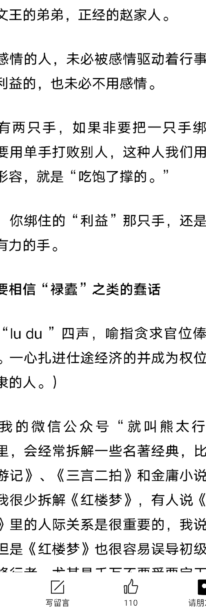

首先我们来复盘一下你认可的这句话：
“一个国家没有永远的朋友，也没有永远的敌人，只有永远的利益。”

很多人把这句话算在丘吉尔头上，这是错的。

这是帕麦斯顿勋爵的话，他也是英国的前首相。

究竟有多前呢？鸦片战争的时候，这人是英国的外交大臣，英法联军火烧圆明园的时候，这人是英国首相，僧格林沁的马队就是帕麦斯顿的火枪手打败的。他对大清政府的判断是：这样的政府隔几年就换一顿，然后再讲道理比较好。

# | 好像两边都能说得通

帕麦斯顿勋爵是一个满口利益的政客，讲的是国家之间的利益。很多年轻人最早接触了这句话（一般是高中历史课上能遇到）之后，就容易移植到了人际关系上，而且容易因为掌握了这条真理而沾沾自喜。

遗憾的是，很多话都是两边都能说得通的，比如：

| 只有永恒的利益 | 仁者无敌 |
|---|---|
| 枪杆子里出政权 | 有德者不都是他的兵 |
| 血浓于水 | 亲兄非明寡嫂 |
| 有备无患 | 车到山前必有路 |
| 早起来的鸟儿有虫吃 | 好饭不怕晚 |

心理学家曾经把很多完全相反的名人名言、格言、谚语、俗话说给两组不同的受试者，结果所有的人都认为自己看到的格言：“好有道理，我一直都是这么想的。”

后来他们才发现，原来人们每看见一条格言，就觉得它特别有道理：“我早就知道了”。这就是“后见之明偏差”。

# | 一手感情，一手利益

好了，回到感情和利益这件事情上。
“没有永远的朋友，也没有永远的敌人，只有永远的利益。”

# | 管鲍之交的真相是利益之交

# | 不要相信 “禄蠹” 之类的蠢话

错，但是《红楼梦》也很容易误导初级的人际修行者，尤其是千万不要受贾宝玉影响。

贾宝玉这个人就是按照情感行事的人，他听说袭人劝宝钗劝学学习上进，就说林妹妹不说这样的混账话，其实他说的话是最混账的。贾宝玉对这个家族没有忠诚，因为他是石头心肠。

有的人三十岁了开始读红楼梦，却又开始羡慕贾宝玉释放自我的状态，甚至那样去行事，这是退化，宝玉是十几岁的少年，你跟他学，越活越小了，一定会有麻烦的。

真真正正忠于家族的其实是贾政、李纨、宝钗和贾兰这样的人，他们压抑着自己去为家族的成长和复兴做事情。他们嘴上不会提重情重义，满口可能都是利益，但一个家族里要有人愿意做这种无趣而努力的人，家族才会有希望。牺牲了小个性而成就了大情义的人，特别引人注目。

在今天的大家庭里也是如此，有些亲友可能身处仕途，从此变得无趣，你可以做一个“自由的灵魂”，但不应该对他们有了轻慢之心，体制内外的人最应该做的是互通声气、相互学习。

你读了加缪、波德莱尔、奈保尔确实很有价值，但是他熟读了《邓小平文选》、《江泽民传》、《李鹏电力日记》、《朱镕基在上海》，也绝对没有虚度青春（这几本书都很有意思，在体制内工作都应该读），拿自己所长去比别人的短，这是不体面、炫耀自己的行为。

# | 对感情和利益的误解

做人际关系上的修行者，一定要分清楚一个人嘴上说的和行动上做的是有什么不同。

- 谈论利益，行动也以利益为准的人——理性人；
- 谈论利益，行动却以感情为准的人——心软鬼；
- 谈论感情，行动却以利益为准的人——伪君子；
- 谈论感情，行动也以感情为准的人——大宝宝。

好马出在腿上，好汉出在嘴上。

最好伢的家伙发朋友圈的时候也说自己“最近犯小人”，他不会觉得自己是个恶棍。他可能也会觉得自己是一个重情重义的人。

看重情义、以感情优先来行事的人并不在道德上比按照利益行事的人优越。

管仲说：“仓廪实而知礼节”，他要先保证别人的利益，齐桓公用他为相，天下太平。易牙把自己的儿子煮了给齐桓公吃，他说自己和国君的感情太深，这个人是个奸臣。

敲黑板：

如果你是一个重情重义的人，就把重情重义这四个字烂在自己的肚里。

这四个字固然是有你的优点，但也同时存在着暴露弱点的可能。其实一个做事体面的人一定会被别人描绘为“重情义、有原则”。重情义这种话，不要用来描绘自己，而应该用来赞许别人。

很多人以“重情义”自诩，其实是因为自己的资源和能力有限，他没有能力去照顾别人的利益，或者给对方回报。

所以，如果你发现老板或者朋友强调“我这人重情义”的时候，就赶紧警惕。

这往往是利用你为他白白效力的开始。

# —— 习题 ——

以下是《权力的游戏》的一段对话。

场景剧情是代理首相提利昂发现自己的外甥、乔佛里国王在折磨未婚妻珊莎（她的父亲已经被乔佛里杀害，哥哥起兵报仇），上前制止。

提利昂：“这女孩是你未来的王后，你就不在于她的名誉？”
乔佛里：“我在惩罚她。”
提利昂：“为什么？她和她哥哥的战斗毫无瓜葛。”
乔佛里：“她有狼的血统。”
提利昂：“你有鹅的脑瓜。”
乔佛里：“你不能这样跟我说话！我是国王，想干什么就干什么！”
提利昂：“伊里斯·坦格利安想干什么就干什么。你母亲有没有告诉你他的下场？”
柏洛斯：“没人敢在御林铁卫面前威胁国王陛下。”
提利昂：“我不是在威胁国王，爵士，我是在教育外甥。波隆，提蝇，柏洛斯爵士再张嘴，就宰了他。”
侏儒微微笑，“这才叫威胁，爵士，知道区别了吗？

提利昂使用的技能当中包括哪几类（多选）：

- A.谈论利益；
- B.出言嘲讽；
- C.强调身份；
- D.暴力威胁；
- E.强调感情。

答案是：A.B.C.D。

提利昂一开始就试图用乔佛里自己的体面和尊严来说服乔佛里停手，但是对方拒绝接受，乔佛里是在发泄军力被未婚妻哥哥战败的情绪。

提利昂继续谈论利益，告诉乔佛里这件事毫无必要，也于事无补。乔佛里则推在血统身上。

提利昂对这种驴唇不对马嘴的低阶争论愤怒至极，直接讽刺挖苦。

乔佛里强调自己的身份，说自己是国王。

提利昂继续强调利益，说国王肆意妄为会亡国，自己也会死。

御林铁卫出面干涉，要提利昂尊重国王，这个点控软中带硬，坐实了提利昂就是欺君之罪。

提利昂把锅推回去，不背。他强调自己是国王的监护人，自己在教育外甥，同时威胁了御林铁卫。

整个过程中，提利昂没有强调感情。没有说珊莎多可怜。但是事实上，珊莎是他心疼的人，这个侏儒对史塔克家抱有好感，但却屡屡被他们误解。

最深的感情，都是会藏在利益后面的。

# 择婚攻略：如何鉴定“凤凰男”

# | 知识点

凤凰男根本不是一个出生家庭问题，而是一个世界观和人格模式问题：

社会支配性取向又强又有权威人格的人，几乎无一例外都是“凤凰男”。

# | 应用范围

婚育年龄的青年男女、有婚龄儿女的家庭。

适合分享给亲戚（也适合给家里有适婚年轻女孩的长辈）、朋友和同事。

以及需要更了解自己性格的所有人。

# | 相关内容

《男人说压力大，你就要赶紧抱他》（音频037）

《脾气坏就是人坏，不要替他找借口了》（音频032）

《你不是我男人吗，为什么每句话都要伤我？》（音频066）

《婆娘有了矛盾，为什么要站在媳妇这边》（音频034）

有两个关系户同学最近离了婚，都是女性，悄悄地告诉我，受够了，终于下定了决心。

我觉得这不是坏事。

我们《关系攻略》希望培养的是什么人，是自信而强大，对自己有理性的认识，能够对自己和他人关系理性分析，自己做决定的的人。

大家要明白一个道理，熊老师这里刚开始你可能会用来“讨主义”，但是随着越来越战越来越强，会逐渐把自己的心得和分析留言给熊老师，同时获得熊老师的鼓励和支持。最后你可能是你小圈子里人际关系指导师，能够给你的亲友以稳固的支持。

这种主动而自信的成长才会越来越强大。

# | 和凤凰男离婚不是坏事

中国有诸多陋规，非常耻误人，我之前说过，《为什么不要给亲介绍对象》（音频018），不要迷信说这是什么行善积德，同样，也不要相信“功和不功分”，有的婚姻明明就是死局，让人继续在这里苦熬，一生就这么完蛋了。

凑巧的是，两个女同学的经历有点相似，都说自己遇到了“凤凰男”。

她们的陈前夫有共同点：

农村出身、家庭条件一般、大男子主义、对父母、兄弟姐妹甚至远亲关系比夫妻关系看得重、不认为妻子有个人财产、希望多占岳父母家的便宜、极度好面子……

这种婚姻只有两种办法，一是女方彻底性，二是离婚，几乎没有任何一个凤凰男会转变成成功。

# | “凤凰男”的判断标准

关于凤凰男的传说并不远，大多数的人身边都能遇到几个，有的家庭为了避免遇到这样的女婿，就要让女儿：

- 1. 不选农村家庭出来的青年。
- 2. 不选家境不好的青年。
- 3. 不选非独生子女。

这三条其实会筛掉一些不错的小伙子，很多棒打鸳鸯的事都是因为这三条的缘故。此外，即使执行了这三条，也未必就能有用——有些男生不在三条之内，但仍然和“凤凰男”表现得非常像，有人用“直男癌”称呼之。

换句话说，那三条标准根本就排除不掉凤凰男。

怪了，凤凰男到底是一批什么样的人呢？

有些严肃的学者容易把“凤凰男”看做一种歧视，认为这是对农村青年的歧视，一旦接受了这种歧视论，这个已经存在的问题就不再有人深度研究了，其实有两个指标是可以定位凤凰男的。

一个是“社会支配性取向”；
一个是“权威人格”。

# | 社会支配性取向：我是一个农村娃。

我们之前在《如何做自己的“人生导演”》（音频063）里提到过一个填空题。

“我是____的人。”

我们当时要求大家写10条描绘自己的话来定位自己，不同的人对自己的认识不同，对自己的不同属性的强调程度也不同。

有一些人上来说可能会写：
“我是一个农民的儿子。”
“我是一个穷人家的孩子。”

喜欢强调自己阶层属性、在意自己地位的人，就是有社会支配性取向（social dominance orientation）的人。他们渴望自己的社会阶层更高一些，喜欢处于社会阶层的顶层，处于支配地位。

吉姆·斯达兹纽斯解释说，出人头地的渴望会让社会支配性高的人喜欢接受偏见和歧视。

社会支配性取向强的人喜欢贬弱者，他们愿意从事那些捍卫社会阶层的工作，比如从政、参军或者从商。他们不会去从事社会工作之类促进平权的工作。

听起来似乎是很讨厌的人，其实不是这样的。现实中，社会支配性取向强的人表现出来的态度是好学、上进、渴望进步的，大多数人事业心都比较强。

这类人在人际关系上鹰派居多，然而并不能和鹰派划等号。

他们中的不少人都是充满魅力的，你作为领导一定会喜欢这样的下属。

# 这类人的缺点也比较明显：

聊天的时候就能感受到，他们中的有些人本身在一个城市里是外地人，但言辞之中可能会特别贬视某些外地人（这一点出现，立刻就能判断他是这类人），他们对一个人的态度，和对方的爸爸是做什么的紧密相关。

相反这一取向不明显的人则会更多地描绘自己的职业、爱好、家庭关系或者个人特质。

社会支配性取向强的人容易令人感到敬佩，偏弱的人则会令人感到亲切。

这点上有点像一个欧洲人形容德国人和意大利人：“人们佩服德国人，但很难喜欢他们。人们喜欢意大利人，但很难佩服他们。”

# | 权威人格：我不能软弱

权威人格（authoritarian personality）的人不能容忍软弱，他们喜欢使用惩罚性的态度，服从群体内部的权威。

他们一般会赞同“服从和尊重权威是孩子们应该学习的最重要品质”。

权威人格的人一般在童年都受到过很苛刻的管束，这可能导致他们模仿管制者的小题大做、热衷报复、占有了地位占据就肆意羞辱别人。

他们对权势、地位比自己高的人会尽力服从，然后把攻击性和惩罚转向地位在自己之下的人。

权威人格的人在情侣和配偶关系当中喜欢裁判对方，喜欢使用侮辱性的言辞，我们在《你不是我男人吗，为什么每句话都要伤我？》当中提到过这个相处模式。

在家庭遇到一些危机，比如经济困难、失业等局面的时候，权威人格的人就会变得更加紧张、更加粗鲁，用故意来遮盖自己的恐惧。

出去了是好朋友、好邻居，在家里和配偶子女特别凶脾气特别大的人，基本上都是权威人格。

# | 两个指标都高的就是凤凰男

社会支配性取向和权威人格得分都高的人，数量不多，但是破坏力很大。社会学家阿尔特迈耶的研究表明，这些人是社会偏见最多的人，可能是狂热的种族歧视者。

同样，这两个指标都符合的男性，在家庭生活中呈现出来，就是：

- 1. 在意自己的社会地位，要在食物链顶端（为了证明这一点，他们可以牺牲自己的利益去补贴亲戚甚至乡亲们，就为了别人说他们厉害）；
- 2. 对外追求经济地位和社会地位；
- 3. 对内追求妻子的服从和妻子娘家的支持（他认为自己是这个家庭的希望）；
- 4. 认为男性优于女性，喜欢用侮辱性的语言和行为来控制妻子。

这就是典型的凤凰男、直男癌了。我们也可以发现，出身农村的青年容易成长为“凤凰男”，可能是和“权威人格”有关，大多数农村青年要想受大学教育来到大城市，都要接受县城中学那种高强度、苛刻的教育方式。这容易养成“权威人格”。

需要注意的是，单独符合一个指标，并不证明这就是一个直男癌。

在我家，我父亲从小在农村长大，他也会形容自己的家庭比较穷，自己是个苦孩子，但他不是典型的权威人格，并不去追求和别人交往当中的控制权，相反，还是一个会讲笑话，有幽默感的人。

大家如果看过电影《音乐之声》就会知道，幽默感是权威人格天生的敌人。所以很多人觉得自己特别上进，但是不如会讲笑话的男生受女生喜欢，就是这个道理。

有幽默感意味着相处起来的沟通成本比较低。

大多数的凤凰男和直男癌都没有什么幽默感可言。

类似的，一个单纯的权威人格如果没有严重的社会支配性取向（飞上高枝的冲动），可能只会把自己的统治权放在孩子身上，变成一个严格的父亲，但未必成为凤凰男。

# P.s

这个标准，不仅仅仅适用于凤凰男。

因为还有“凤凰女”。

我们在《如何拯救那些为奴的女儿们》（音频054）当中也提到过，有些妻子的家庭基本是一个无底洞，有的妻子能够主动摆脱出身家庭的盘剥和吸血，但是也有的一直在纵容娘家的吸血过程，还有的耽凌晨夫，（众多的关系户留言里也出现过好几个例，因为有点丢人，平时生活当中可能听到的没那么多）其实就是女版的“凤凰男”。

如果各位身边有这样吸血的妻子，不妨也观察和分析一下，基本上都符合今天我们提到的这两个标准。

欺负人这件事情上，男女都一样。

# —— 习题 ——

关于凤凰男的描述里，哪几点是正确的（多选）：

- A. 凤凰男是天生的，基因决定的；
- B. 凤凰男是后天的教育养育方式形成的，不遗传；
- C. 出身农村不是成为凤凰男的根本原因；
- D. 一个人是不是成为凤凰男，可能他的班主任的影响更大；
- E. 凤凰男是很难改变的。

答案是：B.C.D.E。

基本上是我们提到的点的梳理，如果你和你的同事议论起这个话题的时候，这四个选项都可以作为你的小观点提出，来加以谈论，如果对方问得更深入，你就可以把我们今天的文章的主要内容跟他们详细说说。

# 专题日｜如何让孩子健康成长？

熊太行

马上就是六一儿童节，今天我帮你整理出关系攻略中提到的让孩子健康成长、与孩子相处的一些方法。

如果你是孩子的父母，或者身边亲戚朋友有儿童，那么你要着重阅读今天的专题日。有备无患，常备几条能随手给出的建议，对你在人际关系中提升地位有很大帮助。

# 来自《如何让孩子远离校园欺凌》

｜应用范围：日常修炼让孩子远离校园欺凌；职场中受到侮辱或骚扰；帮助有孩子的家庭，赢得这个家庭的尊重。

好学生不容易受欺负，坏孩子一般也不会惹最好的学生，家里会特别重视他的学业的，家里也都比较强。

练武的孩子不容易被欺负。练体育的话，他可能不会在班里被欺负，但是传统体校一直是欺凌的重灾区。

特别有钱的学生不容易受到欺负，同学们会捧着他，坏孩子很快就会发现，欺负有钱同学，不如会巴结他、帮他打架效率更高。

有特长的学生不容易被欺负，比如乐器、绘画等文艺才干。如果小朋友专心去学奥数或者英语考级，也是未来容易出成绩的苗子，老师也会对他们更用心加以保护的。

父母单位霸气或者有用的孩子不容易被欺负。这个不用多解释，老师们一般也会保护同行的孩子。

要多让孩子学点课外的事情，任何学习带来的成就都能让孩子更自信。

最容易被欺负的是成绩中等、话少、不自信的、沉默的孩子。

就像我们在《权力，才是职场性骚扰的真相》中提到：受到骚扰的唯一原因就是，你看起来太弱了，你需要变的更强。

# 来自《如何称赞亲戚家孩子》

｜应用范围：拉近与亲戚的关系；称赞领导家孩子；职场中多称赞别人，赢得关系。

要你称赞亲戚或领导家的孩子，不是让你谄媚，而是大多数的孩子，多少都有一点过人之处。

别人把孩子带到你家来，就是你的客人，对客人应该客气。你去拜访亲戚家，别人就是东道主，对东道主家的少爷小姐美誉几句，也和谄媚无关。

要记得：

- 称赞别人是美好的。
- 被称赞的人会很喜欢你。
- 称赞行为能够改善你和对方的关系。

认真研究一下别人值得称赞之处，是对自己的锻炼，也是加深对对方理解的一个过程，很有价值。

此外，称赞是积极的心理暗示，能对孩子本身产生正面影响。

而那些学习好、教养好的孩子，他们的父母有两种：

- 一种从家庭实力上强于你这个小家庭。
- 一种是虽然家庭实力一般，但是愿意让孩子有更远大的理想，望子成龙。

后一种尤其值得结交一下，寒门未必都出贵子，但是你如果在一个有希望的孩子家境平平的时候多用一点心，以后这个孩子可能就会是你的强援。

一个大家族里的孩子，都是资源，是宝贵的人力。如果你有心做点事，早点发掘和稍作培养，到你人在中年老年的时候，他们就都是壮年的硬手了，这点在小城市里混官场的同学要特别注意。

# 来自《打孩子，你会变成最没本事的父母》

｜应用范围：孩子教育中遇到的惩罚问题；操纵人心法；职场中的奖励与惩罚都用得上。

不需要打孩子，你可以把孩子当做谈判对象，大多数小学之后的孩子都可以沟通，也会谈条件。

- 1. “你敢打你弟，我就打死你。”
- 2. “你敢打你弟，这个月都没有零花钱了。”

这是两种完全不同的思路：

第一种是如果你做了什么，你会得到什么负面的东西。这叫阳性惩罚。

第二种是如果你做了什么，你会失去什么正面的东西，这叫阴性惩罚（也叫奖励剥夺）。

能够善用阴性惩罚的人，都是聪明人和人际关系的大高手。熟练掌握了这种本事，可以不需要打孩子，还能成为操纵人心的专家。

熊太行

以上就是我帮你整理的关于如何让孩子健康成长的专题。你会发现，这些观点，应用在职场上也完全合理。

这就是为什么你要学习专题日的原因，把这些道理揉碎，抛开给你看，你自然就找到人际关系的相通之法，从而在人际关系中修炼的炉火纯青。

