# 关系攻略201706-08

## 老人攻略：亲姥爷为什么不疼爱自己的外孙呢

073|老人攻略：亲姥爷为...

### 知识点

疏远型的祖父母根本就不喜欢照料孙辈，如果被强行安排了这个任务，他们就会牢骚满腹。

### 应用范围

三代同堂的夫妇，这是直接给你们准备的，有助于你们调整和父母的关系。

已经做了祖辈的人，也可以在这篇攻略当中获得很好的支持。

还没有孩子夫妻可以挑选养育孩子时候的合作方。

没结婚的人可以用这篇攻略来观察一下自己未来的公公婆婆、岳父岳母。

### 相关阅读

《婆媳有了矛盾，为什么要站在媳妇这边》（音频号034）；

《对抗逼婚这件事没那么难》（音频号015）；

《女朋友的妈妈嫌我长得矮，怎么办》（音频号036）。

这个系列叫做“老人攻略”，这是老人攻略的进阶，因为涉及到相对隐蔽的翁媳关系、成年后的父子女以及家庭中争夺管理权的问题。

接到一位关系户同学的留言，比较典型：

> 我爸妈和我们住的很近，每天帮我们照顾小孩子。
我爸身体很不好心脏病做过手术（带孩子做饭都是我妈和保姆在干）。他极度敏感小心眼，一言不合就生气冷战给我脸色。他不善言辞，说话带刺，我叫他姥爷。

我跟他相处比较小心翼翼吧，尽量少讲话（每天见面时间就晚饭一小时），不讲话他也会找茬说我不理他。昨天竟然跟我3岁多的小孩生气。上电梯的时候他先进去的，小宝不哭不闹，非让他姥爷出来他先进，还说不爱姥爷（小宝最近一不顺心总说不爱爸爸妈妈，这没什么吧。坐电梯我们经常要等下一部，因为小宝要按电梯要第一个进，不然就来气了）。

就因为这点事我爸就生气了。我觉得他实在没道理，没有安抚。可是我知道要是瞎看，又要受几天的脸色。唉我该怎么做熊老师？

大家可以想想我的建议，我放在最后再说，我们先分析这个家庭的情况。

### 不幸的祖父祖母

我们之前在《婆媳有了矛盾，为什么要站在媳妇这边》（音频号034）当中提到过一点，最幸福的老人一般只和老伴住在一起。其次和兄弟姐妹住在一起。和子女甚至第三代同住的老人，幸福感都比较低。

辛普森一家当中的爷爷，平时住在养老院，逢年过节或者孩子们需要人暂时看管的时候会接他回来，爷爷应有轻度的阿尔兹海默症，开车也有困难，所以孙子孙女对他也没什么感觉，甚至有时候会嫌弃他。

通常意义上的辛普森一家包括夫妇、三个孩子和宠物，没有爷爷。

### 三种爷爷奶奶

有的祖辈对孙辈的诞生兴高采烈，今天青年们吐槽起来别人的父母，往往会提及逼婚和催生孩子，觉得这种事情不可理喻，但是我在这里提醒大家一句，希望大家能理解这样的老人。关于逼婚，请参看《对抗逼婚这件事没那么难》（音频号015）。

以终余年。母孙二人，更相为命，是以区区不能远。臣密今年四十有四，祖母今年九十有六，是臣尽养于陛下之日长，报养刘之日短也。”——西晋李密《陈情表》

这段是李密写给晋武帝的，解释自己为什么放着官不做，要在家照顾奶奶，因为他是奶奶养大的，奶奶的日子不多了。

今天我们看见的许多奶奶和外婆，都有这种养育孙辈的冲动，有人类学家认为，人之所以要在失去生育能力之后再活很多年，就是因为需要协助抚养孙辈。

喜欢养孙辈的祖辈，基本上是参与型和慈爱型两种，参与型的祖辈对孙辈有期待，要加入教育孙辈的过程，帮着带孩子的祖辈，都是参与型。像《红楼梦》里的贾政会带着贾兰参加活动，指点读书，贾政就是参与型祖辈。

慈爱型的祖辈会时时想念孙辈，送礼物，跑来探望，过节团聚，就是慈爱型的祖辈。像贾母对宝玉、黛玉，就属于慈爱型的祖辈。

第三种，就是疏远型的祖辈。

他们对自己的孩子其实不关心，有很多人根本就不记得孙辈的名字，更别说生日了。

很多人把孙辈看做是自己衰老的标志，对他们在心理上是比较排斥的。

如果让疏远型的姥爷去照顾外孙，他就会一定会抱怨小孩子的孩子气和幼稚：“他们太麻烦了。”

男女不同，对孙辈的照料参与程度不同，奶奶和外婆对孙辈的照顾和疼爱程度一般来说比爷爷和外公要好。

小宝的妈妈对自己的爸爸期待比较高，因为她期待的是更亲密的父女关系（能给爸爸起外号，小时候和爸爸的关系应该比较亲密）的再现，她没有想到，外公和外孙之间的关系其实是比较疏远的，尤其是外公本身有自己的困扰（身体健康问题），是一个疏远型的祖辈。

根据美国的心理学家的调查，到成年早期（大概上大学那会儿）的孙辈，大多数都觉得祖母比祖父可亲，同时大多数又同意，外婆比祖母更可亲。可能是因为许多离异家庭或者单亲家庭，孩子们都是跟着母亲生活，而外婆是很重要的协助者。

很少有人能彻底远离孩子，即使是美国，也有75%的父母会和自己的成年子女的住处在30分钟车程之内。反倒是中国近些年有留守儿童问题，不堪长也不愿意照顾孩子的爷爷奶奶，如果负担了太多照顾的压力，家庭就容易出问题。

### 解决方案

好了，我们分析了小宝外公的问题了，我们要研究一个解决方案：

#### 1.小宝外公的生活质量下降：

可以用解放外婆、或者让外婆和奶奶轮岗等方式解决。让外公和外婆之间有更多时间相处。

#### 2.小宝外公感受到了权力的丧失：

更耐心、更尊重，更多的称赞和恭维，在一些大事上征求外公的意见和建议，不当面驳斥他的提议。重温一下《如何请求老男人为你做事》（音频号003），亲爹也是一种老男人，对丧失权力充满焦虑。

#### 3.缩短小宝和外公的独处时间：

不愿意带孩子的人带孩子，双方都会不开心。小宝妈妈有一点认识是要纠正的，任何祖辈都可以拒绝协助你带孩子，这不是必须的义务，他们提供协助，主要是因为儿女的缘故，和孙辈的感情都是慢慢培养出来的。

#### 4.妈妈应该多跟外公示好、表示亲近：

你不仅仅是小宝她妈，你在某些时候，要让老先生感觉到你是他的女儿，昔日那个会抱他，会撒娇的女儿。

如果父女关系不是特别恶劣的话，像小时候那样跟爸爸撒娇效果都能好得多。

对老爸不是非要讲理的！

对老爸不是非要讲理的！

对老爸不是非要讲理的！

试试抱抱自己的爸爸，女儿可以，儿子也可以。中国人不习惯这种炽热的方式。艺术家宋冬曾经做过一个行为艺术叫《触摸父亲》，他用光影的手去触摸他爸爸，结果老先生当时就拒绝了，做了好些的工作才做通。直到几年后他父亲去世了，他帮着穿衣服才第一次碰触到父亲的身体，此后他在办展，只能用光影的手去触摸父亲的录像画面了。

拥抱父母呀，要趁早。

拥抱父母呀，要炽热。

你要记得，他们已经步入了老年。

所以我给小宝的妈妈的回复是这样的：

哎呀，小宝还小，你也是宝宝啊，你是爸爸的宝宝，给爸爸按按肩膀，撒撒娇么。

唐太宗李世民，我们说他是个大政治家，他把哥哥弟弟杀了，进去见爸爸。那爸爸能乐意么。他倒好，趴在爸爸胸口吸爸爸的乳头，这是他们兄弟小的时候爸爸逗他们的做法——老头怎么受得了这个。也就不认了这个局面。

肢体动作有的时候，比语言更给力。

有机会我会分享一下如何用肢体接触去取代说话。

### —— 习题 ——

试着举一反三，以下曾祖父母对曾孙辈的感情描述中哪个是对的：

+   A.更多的疏远型，因为他们的血统距离更远；
+   B.经历了孙辈的热闹之后，他们对自己后代里的婴幼儿已终不觉得新鲜了；
+   C.曾孙辈人数会比较多，所以不会太亲密；
+   D.生活在一起住得近的曾孙辈，还是会被曾祖宠爱；
+   E.曾祖仍然会对自己有曾孙辈感到开心，这被当做长寿和有福气。

答案是A.B.C.D.E。

这几条描述都是经过了调查支持的。

## 专题日 | 成人世界的规则，越早了解，越早受益

074 | 成人世界的规则，越...

熊太行

今天是六一儿童节，等你过完节，不妨读一下这篇文章。

我为你整理了在《关系攻略》中出现的十条关于“成人世界的规则”。这些道理，你越早明白，就会越早受益。

#### 1.藏好自己，做好清理。

在韬光养晦的同时，也要做好清理，这不是残忍地消灭潜在的敌人，而是让你清除可能的隐患。

#### 2.不做中，不做保，不作媒人三代好。

不要做吃力不讨好的事，以上任何一种情况，如果结局不好，极大可能会迁怒与你。

#### 3.凡事预则立，不预则废。

做事情之前没有计划和准备，就不可能获得成功。可以把这条应用在会议前、假期结束工作时、谈判时等等。

#### 4.只考虑自己的爱好，可能会给好友们带来冒犯。

一味只顾自己的喜恶，年轻时叫做淘气，成年后就是任性了。

#### 5.成人后要学会“延迟满足”。

先克制自己的欲望，放弃眼前的诱惑，以此获得更大的享受，得到利益最大化。

#### 6.害羞的成年人，一定要尽早突破自己。

试着告诉自己：没有那么多人看着你，你要照顾好自己。可以参照文章《如何拯救一个害羞的灵魂》《如何做自己的人生导演》，改变自己害羞的特质。

#### 7.大多数人认为的“ 我被公平对待”，指的是对方的所得\自己的投入=自己的所得\自己的投入。

然而在大多数劳资关系中，这个等式完全不成立。作为成年人，越早明白这个道理，就对你在职场中越有益。

#### 8.永远不对不熟悉、不了解的人提出一些冒进的建议。

也不要打一场没有把握的仗。即使给建议，也尽量不给免费的建议。

#### 9.君子喻于义，小人喻于利。

遇见小人，能用蝇头小利收买，获得一定帮助，那就这么做。要想躲开底层的小人，变得富有和强大是最根本的解决方案。

#### 10.成人在感情和利益之间，不是一定要做出选择，这两者都是成年人维护关系的方式。

一个人只谈论利益，按照利益行事当然可以，但适当谈论感情，可以事半功倍。

熊太行

成年人最应该做的是经营关系，保证自己安全的呆在社会丛林中。

从你开始读《关系攻略》，你就已经找到了通往安全丛林的法门。遇事先沉稳，想想《关系攻略》中哪条建议最适合你的问题。长此学习下来，相信你一定可以在社会中如鱼得水。

## 一分钟让你笑，一分钟让你哭

075讲故事攻略：一分钟…

### 知识点

我们没法制造一个情绪塞进对方的脑子里，但是可以把对方所拥有的情绪撬拨起来，加以放大，最好的方式就是讲故事。

### 应用范围

全民适用。

### 与其它篇目的关系

这是一个用讲故事来影响别人情绪的教程，也是一个讲故事的进攻攻略。

在《谈工作没问题，一闲聊就变成大秃头，怎么办》（音频040）和《如何做自己的人生导演》（音频063）中都能找到相关内容。

影响和调动别人的情感是说话技能当中的高阶技能。

能够对这样的技能有了解的人，一般来说都是狠角色，有同学最近问我，怎么交强的朋友，怎么跟狠的主公，我可以提供一个标准，能够调动你的情绪，能够影响你的情感。

这种技能分三个阶段

+   1. 把人弄哭；
2. 把人逗笑；
3. 在极短的时间之内让你在两件事之间切换。

那些能够一分钟让你笑，一分钟让你哭的，就是真正的狠角色。他们：

智商极高，有天赋；

对自己进行了严格的训练；

已经在无数次自己的场地上训练了自己，是一个熟练掌握高阶技能的人。

遇见这种人，祈祷自己不站在他的敌对面吧。

如果要破这种人的影响，只有一个办法：心如铁石，只咬定按照大利益来行事。

但是没有一个人是可以制造一个情感出来的，如果有人读过阿西莫夫的《基地》系列就会明白，第一基地靠科学技术和搞国际关系存活，第二基地更强大，靠控制人类灵魂活着，但是他们也只能去撬拨人类已有的情绪。这个设定是对的。

我他妈的——我站在原地，完全吓傻了！？那个被拽在肩膀上的流浪汉在惊吓中睁开了眼睛，刚好正对着我，他向我投来了无助的恐惧的目光，而我站在原地，动弹不得，只能看着他被一个疯子拽着越来越远。流浪汉冲我喊救命，Dennis还一边跑一边安抚地拍拍流浪汉的脊背，说别怕别怕。

我在后面，傻了足足十几秒，我想不行我得追上去，然后我就追上去了，大喊着Dennis你他妈的在干嘛！你给我停下！！

如果当年的那个深夜，你有幸身在那里，一定会看到这样一幅奇景：一个疯子拽着一个流浪汉奔跑在前方，一个西装革履的男人追在后面，三个人都在自说自话地大喊大叫。

十分钟之后，我们三个人身在了我和Dennis的那间宾馆房间里，流浪汉躺在我的床上，瑟瑟发抖。我坐在床对面的椅子上面，不知所措。而Dennis呢，他满意地拍拍手，对流浪汉说，今晚你就睡这张床吧，人怎么能连一张床都没有呢？
流浪汉吓得一句话都说不出来。

我问他，那你今晚睡哪？Dennis从口袋里掏出之前的哪张餐巾纸，兴奋地说，当然是去找服务生小姐啊！可不能辜负了人家的好意！

我实在忍不住了，说，可是不好意思，那我今晚睡哪？
Dennis拍拍我的肩膀说，人怎么能连晚上睡哪里都不知道呢，快点成熟起来吧！
然后，他就满酒地走掉了，剩下我和流浪汉两个人宾馆房间里，大眼瞪小眼。
What the…

电视人所有描述都是画面，上次讲完《谈工作没问题，一闲聊就变成大杂烩，怎么办》之后，有关系同学就找过我，说自己讲故事千瘟怎么办。

之前我们提到了一些传统讲书怎么造人物，今天则是美国的电视人的做法，注意观察他怎么用一个一个画面来取代自己的概括。

我不知道那个流浪汉当时是怎么想的，但他好像很快就适应了这个状况，因为他已经开始脱衣服了。我很紧张，我问他要做什么。他说他想洗个热水澡。我只好让他去了卫生间。就在他享受热水澡的时候，我开始思考今天晚上这一切到底是怎么发生的。

他把速度放缓，其实刚才故事推进很快，这会儿了要让观众休息一下，故事里的角色也正面临困境，观众也会琢磨这件事，越琢磨越有趣。这时候的观众确实都要笑死了。

我是一个十分骄傲并自认为很成功的人，30多岁就事业有了成——不好意思我必须再强调这一点，因为在我的有生之年，我从来没有经历过那个晚上的屈辱。
讲故事的人在悠大招。

我坐在椅子上，听着浴室里传来哗啦啦的水声，心里五味杂陈。我似乎找不到一个把流浪汉赶出去的理由，毕竟Dennis振振有词的声音还响在耳边，说什么怎么可以让一个人在这样的寒冷深夜睡在大街上——可谁能在这个寒冷深夜背我想一想？我应该睡到哪里去？！我的今晚要怎么过？！

就在这时候，就好像还不够荒唐似的，更可怕的事情发生了。
有人狠狠地敲响了我宾馆的房门——警察来了。

全场的人，此时此刻，都笑疯了。

那是几十年前的澳大利亚，你们都知道当年的时局和情况，那时候社会还没有现在这么开放，很多事情大众的处理方式和现在截然不同……是的，那时候，警察对同性之间的感情可是很严苛的——我不想你们误会，我和流浪汉之间什么都没有，但警察们可不这么觉得。

在你们都狂笑的时候，他还在补刀，如果你要强调一个行为的严重性，交代两背景，不耻误事。

他们敲了我的房门，冲了进来，让我交代是不是绑架了人，有人在路边看到我绑架了一个男人，我正在高呼冤枉，浴室门开了，流浪汉裹着浴巾湿漉漉地出来了。警察问我这是谁，我不知道该怎么解释，流浪汉此时突然粗狂地让警察救救他，他说他正在路边睡觉，不知道为什么就被我绑架到了宾馆房间。

警察问他为什么从卫生间出来，流浪汉说是让我去洗澡的。
警察看了看流浪汉湿漉漉地裹着浴巾的身体，又看了看西装革履的我，给我戴上了手铐。

这时候的喜感已经爆炸，但是要给观众拐腾的时间！要再补刀，描绘自己的状态：

我拼命地向警察们解释我是ABC的金牌制片人，我的名字很多人都知道，我是个有名望的人！

注意了，这是第四次提到自己的地位。大招要放了！

警察却轻蔑地看着我，说道，就是你们这些有名望的人，喜欢干这种绑架流浪汉再Q人家的龌龊事。

终于放出来了！是这样用的！

在大多数的喜剧里，警察都是充满偏见和不靠谱的，任何一个喜剧里的警察都不是先进工作者，想起《美人鱼》里那俩漫画家警察了没有？主角被误会，警察却哈哈大笑，或者讽刺挖苦这是经典桥段。

我百口莫辩，欲哭无泪。更可怕的事情发生了，警察要我给我身在家中的妻子打电话，解释我的近况。

天呐，我要怎么解释，告诉她我不知道为什么背了一个流浪汉回宾馆还让他睡自己的床让我去洗热水澡吗？告诉她其实我喜欢男人而且中意从路上传绑架流浪汉？！
不——！！！

浪子还约领导吃早饭。

我们在宾馆楼下的一家咖啡馆碰面，我灰头土脸，他红光满面。我还没说话，他就点了一桌的食物，他一边嘴吧里塞食物，一边问我，嘿，你昨晚开心吗，和我们的流浪汉朋友度过了一个愉快的夜晚吗？我昨晚上超美妙的，那位服务生小姐so hot我们还定好了下次约会！

我沉默地把盘子里的香肠切成碎块，我说：请你闭嘴，否则我现在就是这段香肠。
我一五一十地把我的遭遇告诉了他，期待他能为此流露出一点歉意。

结果呢，Dennis眨眼睛，对我疯狂大笑，他说上帝啊没想到你的晚上比我的还美妙。
我打算把手里的叉子叉进他的喉管，他却先一步举起了手边的杯子，倒满水，对我说，让我们来干杯吧！
我莫名其妙，干什么杯。
他说，为我们的生活，为勇气、冒险、与永无止境的未知，为这一切，我们干杯吧！

我原本是要去杀死他的，但是我没有。
我和他碰杯了，两杯白水碰在了一起，我居然和他一起笑起来，很奇妙，在那一刻，回想起昨晚发生的一切，似乎也并没有那么糟糕，似乎真的是很搞笑的经历。
我被他的说辞打动了，然后我甘心情愿地承认了一件事：我们已经成为了朋友。

在我心里，Dennis不再是一个被我鄙视的穷小子，而是一个让我心悦诚服的矫捷的朋友。
几十年过去，我们一直保持着紧密的联系。无论他在哪，无论他做什么，我们总是畅快地通话，交流生活，因为琐事争执，因为蠢事大笑。

今天，我作为他的朋友代表，站在他的追悼会上致辞，我希望你们每一个人都记得——就像我这些年来一直以此激励着自己一样地记得——Dennis曾经是为了什么而活

——Dennis曾经是为了什么而活着。

A向全场的人举起了他演讲台上放着的小酒杯。

> “——为了勇气、冒险、与永无止境的未知，让我们干杯吧。”

可以注意一下台领导A征服观众，控制观众情感的技巧。

+   1. 一定要讲故事，少做纯评价。
+   2. 观点强大，但故事远比观点强大。
+   3. 塑造人物，是真正的高阶技能，比如一个自命不凡的青年精英，和一个随性而为的少年浪子，憎了的流浪汉和对文化人充满偏见、自命不凡的警察，这些人都是活的！
+   4. 安排一个人倒霉，这个人最好是就是讲述者。
+   5. 展示反常的结尾，两个人有了友谊。

敲黑板！

这个故事，我们知道结局早就定了，他俩肯定是有了友谊，不然不会来参与这个会了，所以靠悬念是拉不住大家的，此外，这毕竟还是一个追悼会。

要弄哭这帮家伙！

公开演讲，对人群一定要先笑后哭。

用笑来做结尾，就太轻了。

先把人弄哭，再把人逗笑，那是谈恋爱的做法。想了解更多吗？我们以后的内容里再拆解。

他用两杯白水的碰杯，迅速拉回到自己讲台上的小酒杯，这不是一个酒会，但是大家都会迅速被唤起一件事：

和Dennis的交情，A做了一个开放式的结尾，让人们留在自己对和Dennis交情的回忆中，然后又突然把大家拉进他已经死亡的现实里。你会发现刚才开心的笑，已经时隔多年，如恍然一梦。

哭吧，为我们的青春，勇气，梦想，总之一切你觉得可惜的。

我们哭的当然是朋友，我们最终怅惘的还是自己。

### —— 习题 ——

今天留一个思考题，Dennis是如何获得领导A的友谊？

希望你能够归结出几个步骤要点，然后试着加以分析。

这道题没有正确答案。现在很多关系户同学都说喜欢爬楼看评论，我明天也会把我的一点分析放在评论里，大家一起探讨。

另外：这篇文章略长，值得你反复读几次，一定能找到讲故事的一些法门。

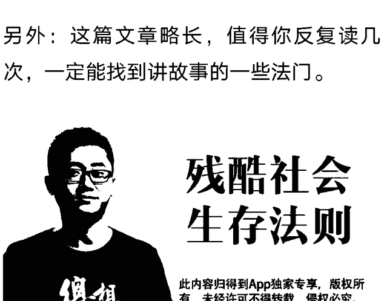

## 住处离公司近一点好还是远一点好？

076|住处离公司近一点好... ↓

### 知识点

住得离公司是近还是远不是一件小事，“职住分离”是经济学和城市规划都在关注的问题，也对你在职场上的人际关系影响深远。

### 应用范围

职场中正在找住处的人，以及带团队的领导。

### 与其他篇目的关系

这是一个进阶攻略，看上去是一个小问题，其实牵扯着和领导的关系，找朋友的规则，以及一些未来发展策略的内容。

如果说“职场、家庭、朋友”是我们关系攻略的三主课，那么今天的课就属于3+综合里的“综合”。

今天的内容和《交朋友是要找像自己的，还是找和自己互补的》（音频号057）、《为什么换了新工作前三个月不要谈钱》（音频号024）、《我们以貌取人，但我们并不残忍》（音频号025）的内容有重叠勾连处，可以重温印证。

有位年轻的关系客户同学问过我一个这样的问题：

住得离公司近一点好，还是远一点好？

他在北京，上班时间公交+地铁，单程一个半小时。

### 军机处的青年

紫禁城里有一个地方，叫做军机处，是皇帝的私人秘书机构。军机大臣能看见皇帝上看见的大部分东西（私人小报告不行）。

### 官二代小保安

今天清华和北大之间，过去有个园子叫畅春园，现在不剩下什么了。

### 住对门的儿子

康熙的儿子里，最终继承皇位的是四皇子胤禛（读作“yin四声; zhen一”）

### 住远住近不仅仅是经济账

有一篇论文，叫《中国大城市职住分离现象及其实特征》，作者是刘志林等三人。这是2009年的论文：

“从调查样本的总体特征看，居住地和就业地之间的平均距离为6.4km：25%居民就业距离在1.1km内，50%居民就业距离在3.9km内，75%居民就业距离在9.5km内。

平均通勤时间35分钟：25%的居民通勤时间在10分钟内，50%的居民通勤时间在30分钟内，75%的居民通勤时间在50分钟内。”

他们发现25%的人住在工作单位附近。这可能包括一些在附近做体力活的人，但一定也包括职场上最聪明的一批人。

在今天住多远往往被当做一个经济账来算，比如：

- 房屋贵不贵
- 路费
- 路上耗费的时间
- 路程造成的疲劳
- 兼顾夫妻或情侣的工作
- 子女教育

发展比较好的公司一般都会选择交通更加便利的地段（方便客户来访、配套设施完善）。这也意味着，住在公司附近，房租会比较贵。

### 住在公司附近的好处

#### 1.更多的加班机会

单独跟领导在一块儿的时候，可以提及自己住在附近。要解释：“这样公司有事，我赶过来也方便些”之类的语。此后，你就是领导可以随时调遣的人。

#### 2.帮一些举手之劳

#### 3.不用纠结公司附近办健身卡还是家附近办了。

#### 4.你熟悉附近的菜市场、ATM、邮局，新老同事对附近不熟悉的时候，你都能帮得上忙。

### 住在公司附近容易有更多工作机会

《煎饼侠》的主演大鹏过去是搜狐音乐频道的临时编辑。

### 住在公司附近能避免很多麻烦

#### 1.你可以卡着点儿到

#### 2.你可以随时回来

#### 3.厨艺达人

#### 4.恶劣天气拯救者

#### 5.不用担心末班车

### 你能找到更多的同类

你的时间很宝贵，你的生命也很宝贵。

把便宜而遥远的住所让给那些对自己期待不高的人吧。

而你，留在权力中心来赢就够了。

P.S

有人说，两点一线已经很苦了，现在我要变成两点重合，人生还有什么乐趣？

太可怜了，居然了解和开发一个城市要依靠换乘站和途经各站来实现。你可以主动去探索的：

北京的10号线地铁北段，是元朝的大都城，沿途你能看到很多古老的地名，那个时候朱元璋的大将被这刚刚接管北京，守不住城墙，就拆掉旧城墙，改修在今天的二环。

现在的都遗址公园是个春天看花的好地方。

喜欢哪个地方，抬脚就去，不要靠公交车去看它。

正如喜欢什么人赶紧开口说，不要幻想着自己有了什么大成就再去表达。

—— 饶题 ——

### 习题

试着分析一下，住在公司附近的缺点不包括哪些：

- A. 生活空间可能会比较窄；
- B. 上下班面临的环境差不多，看到的景色容易千篇一律；
- C. 吃的馆子、去的电影院都会差不多；
- D. 同事在附近偷偷密谋什么事容易被我遇到。

答案是D。

遇见D未必是坏事。

可以不说和保守秘密，但是完全不知道就容易判断失误。

### 延伸阅读：老佛爷的后院

慈禧晚年住在颐和园，她很少住紫禁城（圆明园被英法联军烧掉了）。

她的住处在山脚下，坐山朝湖。后面有个小院儿，住着大太监李莲英，李莲英每天伺候老佛爷睡下，再回小院儿休息——老佛爷要叫人，他一分钟就能赶到。

什么是心腹啊，心和腹都长在你身上，你可能忘了带手机，不会忘了带心腹的。

怎么做心腹啊，你可以笨一点，也可以木一点，但首先要有足够的时间，和主公在一起。

我不是要大家都向李莲英学习（想想都疼），24小时工作不现实。

但是可以明白一个道理，不要离工作太远，一定有人愿意离权力中心比你更近一点儿。

关于离权力中心更近这件事，日本可能比中国还要看重。

丰臣秀吉修筑大阪的时候，所有忠于他的诸侯和手下都赶紧在他的城堡下面要地皮，开始盖自己的房子。

当德川家康夺取了丰臣家的天下之后，这群诸侯又纷纷闹闹，开始在江户成找地皮，开始盖自己的房子。面积大小和离主公城堡的远近，都是和等级相关的。

离得城堡近的话，进城堡上班的时间短，能够快速赶去保卫主公大人、能观察外同事们什么时候上班进城。

如果远离城堡，住在城墙根，那就比较惨了，上班远，阴天下雨很受罪，主公有了麻烦你最后一个到，你进城办事别人在家门口都看得清清楚楚，如果敌人打过来了，你在围墙边最容易被战火波及。

## 专题 | 高考季，立即把握住身边优秀的年轻人

077|高考季，立即把握住...

熊太行

我在《亲戚家的孩子长大了，快送他们去和亲吧》里曾经告诉你，要把握住亲戚朋友中那些优秀的年轻人。而高考正是一个合适的机会，可以帮你筛选家族里的优秀的年轻人。在你能提供帮助的范围内，尽量给他们帮助。和这些年轻人一起，你会跑的更快。

一起来复习一下：

- 1. 列一个清单：在父、母、配偶的大家族里，有几个后辈在参加高考？他们的水平如何？是否需要实习的机会？性格特点如何？给这些年轻人根据智力和情商打个排序。
- 2. 主动联系：在你列表头几名优秀年轻人的联系方式想办法要到手，跟他们保持联系。主动去跟晚辈的年轻人聊天，帮忙自己能帮的地方。把对方的力量，化为己用。
- 3. 提供帮助：多听取这些年轻人的困惑，帮他们参谋，生活上给他们一些关心和关怀。日子久了，他们遇到大事的时候，会来找你商量。
- 4. 满足需求：为什么要把握住身边的年轻人？我们都有无法冲锋在前的时候，这个时候就需要年轻人。我们未来可能有自己的队伍，那个时候我们也需要优秀的年轻人。
- 5. 交换结盟：不要担心这个队伍会变成家族企业，说什么亲戚的孩子不好管。别忘记，你可以和你的朋友、熟人交换培养这些年轻人。互相做对方亲友的师傅，也是一种结盟的方式。我给它起个名字，叫职场和亲。
- 6. 选定目标：你家族里最优秀的年轻人可能早早被父母安排了出路，挑选你能hold住的人选吧。那些父母一般，孩子特别优秀的家庭尤其需要你的帮助，他们有大好前程。
- 7. 常理常新：你的年轻人排序要每年更新，年轻人哪年进入实习期，哪年进入工作季，都要和年轻人聊一下。他们进入实习季或工作季的时候，也就是你进行职场和亲的时候了。
- 8. 布置关系网：和亲对象就是你伸向一个新行业的触手，你会逐渐认识这个行业的很多人，如果你不在你出生的城市打拼，这就是你布置各种关系网的开始。
- 9. 自我变强：当你开始把这些年轻人当作一种资源来开发和经营的时候，你对待家族、职业和人生的态度都会变得不同，你开始研究更为复杂的家庭关系、替别人着想，而且年轻的人们开始看着你，你会变得无法怠惰。

熊太行

再帮你复习一下这篇文章后面的小故事：

曹操有曹仁、曹洪、曹彰、曹休，姓夏侯的人其实也是他的亲戚，孙策有孙权，刘备啥亲戚都没有，但他认了两个兄弟，一个叫关羽，一个叫张飞。

这就是你为什么在优秀的年轻人身上做功课，深入了解一下这个人，给他提供他目前需要的帮助，这件事一定值。

## 残酷社会生存法则

## 换老板攻略｜什么时候应该主动换掉领导

078|换老板攻略：什么时候...

### 知识点

天下大势，分久必合，合久必分。

### 应用范围

- 职场上仍然有老板的人；
- 身为老板，即将有下属的人；
- 还没有进入职场的高年级学生。

### 与其它篇目的关系

咱们先来看君臣关系是什么。

君臣关系是一种合作关系，臣子辅佐皇帝完成大业，皇帝要保证臣子的利益。

我们今天文章谈论的是抛开老板，不是辞职。君臣关系的结束，比辞职这事重要得多，君臣关系不是用劳动合同来结束的。

这是《忠诚攻略》（音频062）的进阶攻略。

也可以和以下三篇可以一起重温：《如何谈辞职》（音频023）、《我的领导让我做违法的脏活怎么办》（音频042）、《陷入了向两个领导汇报的局面怎么办》（音频026）。

今天的攻略结尾处有“换掉老板”的抽奖，记得一定要看到结尾。

之前我们在《忠诚攻略》里写到过：

“一旦你和你的领导形成了一对一的私人关系，你的权益就获得了保证。”

有关系户同学问我说，熊老师，我大四，我下个月就要去单位报到了。我要赶紧aleb吗？

我告诉他：先别着急。

因为初入职场的你，头三个月可能都没有办法做出准确的判断。这个时候更谨慎一点也许才会更好。

还有的人工作了两年三载，对自己的领导不满，问我说是不要一定要在这里呆着，要废了的。

我要说的是，君臣关系是可以结束的，但是结束这件事，一定要谨慎，尽量做得艺术一点。

只教打结不教解，这不是一种负责的态度。

所以今天我们要分享的是，结束君臣关系的某些注意事项。

这和谈辞职有像的地方，但是要更私人，所以这是一个难度高过谈论辞职的进阶攻略。

在这样的几种情况之下，应该尽快结束你们的君臣关系。

### 1.动利益

织田信长是日本战国时期的霸主，从一个小领主在二十年内成长为一个四面出击的大将，信长是个不拘小节，爱秀的人。信长手下有个叫明智光秀，是个名派贵族，文武双全。信长时不时喜欢跟他开玩笑，一张嘴就是“秀子”，他们是这样的君臣关系。

信长的亲家和盟友德川家康来访，光秀负责接待，日本人脾气都很大，又好面子，一道菜上错就有人要切腹。光秀安排人做了鱼的刺身，天气变热质了，信长大发雷霆。到了晚上，光秀的手下扔厨余垃圾，臭鱼又气味熏天，主公更生气了。

在侮辱了光秀之后，信长又决定揉搓给他耍，让他出去征远处的敌人，问题是他又干了一件损事儿，在征服敌人之前，就没收了光秀的封地。

有人说，君叫臣死臣不得不死。我们说的这个，是大一统的国家，中国的封建社会早就结束了，没有分封就没有封建，代替的是大一统的国家。日本是真的封建制，信长把土地分给光秀，光秀从村里征集士兵和武士，为信长效劳，光秀的兵管信长叫大殿下，但不叫主公。

所以封建制可能更像今天我们在某些职场上面临的局面。直面领导最关键，因为他分配利益，大领导反而没有那么重要。

信长是可以收回光秀的封地，但你不能指望你对人做了这件事情，人家还要对你忠诚。

你单位领导要是平时啥也没给你，你炒股赚了一百万，他说要分一半给公司，你肯定不答应。他要代表公司收走你家的房子，你肯定要动手掐他。要手下忠诚，应该给手下利益和机会，对手下的一点辛苦钱下手，这样的领导就不能跟。

在光秀出兵的路上，信被光秀带兵包围了，这就是“本能寺之变”，信长被烧死在寺庙里。

### 2.侮辱人

光秀造反之前，信长还当着盟友德川的面子侮辱了光秀一次，光秀比信长年长，他出身是源氏，这是古老的贵族，天皇家的亲戚，这人一直活得小心谨慎，算是个关系达人，突然怎么都做不对，说什么都挨恐。

其实侮辱人格这件事，官场上的情况更多，不过主要是抖威风骂婊子给媳妇看。但侮辱完之后，都会把心腹叫过来安慰一下，或者给个好点的机会，大家都明白是怎么回事。

光秀本来就不是信长的嫡系，人到中年才加入的一个外单员工，他被侮辱之后，心生狐疑，这个时候就应该给一些甜点安抚一下，加上这个时候动人的利益，他不造反才奇怪了。

但有些领导迫于形势，要牺牲某个忠诚手下的利益，这个时候就要多说好听的。

要说喜欢侮辱人，没人比汉高祖刘邦更高明了，刘邦这个人不容易，48岁了才开始创业，第一次创业就挑战了难度最大的造反。我们也知道这个岁数的人脾气不太好，他对人张嘴就骂。

但是说起来他的优点，那就是他不吝，他把利益会分给大家。项羽到士卒的营里，看见有人受伤，就跟着掉眼泪，小兵们都觉得可以为他死。但是如果要封谁做将军、诸侯，那就不犹豫不决，恨不得把印钤子都给磨圆了。

刘邦就不是，韩信不发兵支援他，说要当假王（代理使者），他破口大骂使者，但是转念一想立刻转向：“他妈的，做什么假王，男子汉大丈夫，要做就做真王！”

其实韩信完全可以自立为王，但是他被“真王”的诱惑悠悠，不断地送粮运兵支援刘邦（刘邦老打吃灰），最后刘邦赢了，反倒担心韩信，动手削他，这是后话了。

所以在职场上，侮辱手下是可以的，但是不应该无意义的侮辱，最好是策略性的，因为侮辱是有价格的，你要给他更多利益，让他去忍受屈辱。

花花公子的老板蔡夫绅是个色情狂，以前出过一本书，尺度特别大，这人疯头上来不分时间地点，有一年跟合伙人（男的）出差，半夜兽性大发，找不到合适的人，就要合伙人用嘴帮自己解决。

按说这是个大侮辱了，但是蔡夫绅那个会儿是个赚钱机器，合伙人想了想，套用今天的话说就是：“当然选择原谅他！”

侮辱一般不会单独造成君臣关系的破裂，但往往是压垮骆驼的最后一根草。

### 3.不公平

我们中学课本上学过《曹刿论战》，这是《左传》里的故事。曹刿问国君，您凭什么觉得大家会为您打仗呢？国君说了福利，国君说了祭祀昭诚，曹刿都说不行。

公曰：“小大之狱，虽不能察，必以情。”对曰：“忠之属也。可以一战。战则请从。”

国君说自己尽量会避免冤狱，他对公正和正义有追求，那就是可以做得了。

职场上，除了分配利益给手下之外，这种分配还必须要公正和公平。

分配还必须要求公正和公平。

常见的情况是，一个新部门占尽资源，烧钱生猥，一个旧业务部门则是一头被吸血的奶牛，那这个公司很快就会出现内讧，所有人都希望往优势部门去，去做最热闹的业务。

如果旧部门的领导没有担当，很快旧部门就会像鸟兽散，而且他们未必会去新部门，而是优先会去竞争对手那里，因为他们已经看到了公司的不公。

不公正往往不是刻意为之的，而是老板掌握的情况根本看不到不公，他失去了了解和控制自己公司的能力。

这时候就要尽快结束君臣关系了，趁着局面尚好的时候跳槽，不要等权的崩塌，更不要企图遣散费，大多数公司最后根本发不出遣散费。

此外有一个规则一定要守住：薪水迟发半个月立刻离职，不然损失只会更加惨重。

### 4.能力差

能力差的人，再心好也不要跟。

《权力游戏》里有个女骑士叫做布蕾妮，以前是兰札国王（大哥死后自己称王）的彩虹卫，别的国王都不愿意用女骑士，但是兰札给布蕾妮这个机会。兰札后来被术刺杀，所有人都怀疑布蕾妮，只有现场的凯瑟琳·史塔克夫人为她力证清白。布蕾妮在感激之下，就对凯瑟琳宣誓效忠了。

其实凯瑟琳是个糟糕的主公（主母），虽然自己是大小姐出身，又做了很多年的公爵夫人，现在更是因为儿子称王当了太后，但她的知识体系是陈旧的。是一个典型的“治世之圣母，乱世搅局棍。”

和最忠诚的布蕾妮相比，最不忠诚的人是雇佣兵波隆，他先负责帮凯瑟琳辨明小恶魔，但是路上他发现小恶魔比凯瑟琳见识和智慧都高出太多，就积极向他靠拢，甚至帮他决斗。最后小恶魔被诬陷，受到爸爸的审判。

波隆却又背叛了他，没有替他决斗，但是也给小恶魔指了一条明路，让亲哥哥替他出战，就绝对不会死了，波隆不忠诚，但并不落井下石。

政治斗争当中，女性的所长就是获得情报的途径更多，小指头虽然不是女人，但开了一个色情场所，在那里获取各种情报和人脉。虽然夫家史塔克长于领兵作战，但凯瑟琳的娘家徒利家是长于权谋的一个家族。她爸爸和二叔都响当当的人物。

但她对搜集情报这件事没有上心。她一直都是靠着眼往前闻的。这最终导致了他们母子遇害。

大家可以看看优秀的女性统治者：吕雉（刘邦的妻子）、武则天、慈禧太后……他们都有优秀的情报网络，而且这几个人都是明白知道自己的敌人在哪的人。

权力场对人特别公平，无论男女，只要你能够把握武力、分配利益和稳定局面，你就是一个好老板，如果你本身性格较弱、优柔寡断、缺乏判断力，那就是一个很快会被换掉的老板。

### 5.健康因素

身体健康有问题的老板，没法保证手下的利益，大家都会寻找你的接替者。

有的时候有同学说，我的老板是女性，中年女性没结婚，脾气古怪。

其实大多数不结婚的中年女老板都是按照职场规则行事的，遇见你觉得她不可理喻的时候，要赶紧把她想象成一个男性，你会发现好多不可理喻如果放在男性身上，其实是可以理解的。

女上级、女老板真正让下属担心的是什么？是怀孕和生产期间的权力问题。

在有些机关、事业单位和国企，产假可能长达一年，这一年里还要有人来拆工作（很多私企的主管是进产房之前还在回工作邮件，一个星期后就远程办公的），是找一个下面的顶替、还是一个平调过来的人？产妇生产归来，他的位置和现在的代理者怎么安放？这都成了非常微妙的政治关系。

类似的，男性领导也有健康问题，过去就曾出现过省部级干部身患胰腺瘤，因为怕免职而不向组织汇报的情况，这就是贪恋权力了。

更常见的可能是心理健康问题。

大家如果看过《天龙八部》应该知道金庸先生在后记里提到了八部是哪八部，其中第一个就是天神，天神临死之前有五种征兆：衣裳垢腻、头上花？、身体臭秽、腋下汗出、不乐本座。

当年的风云人物如果丧失了进取心，也就就是这个样子的。

我们有的时候会感觉到，一个领导可能遇见某件事情，或者挨了大领导的骂，离了个婚，或者压力过大，突然之间变得魂不守舍、心灰意冷，如果一旦办公室内你感受到了一个人丧失了革命意志，那么可以尽快地下老板走人。

他们往往连挽留你的冲动都没有。

## 一种例外：高升

还有一种情形，你的老板不管你了，你们的君臣关系也即将宣告结束。

你的老板高升了。

可能调入别的系统，可能调入别的省份，可能调入上级机关。

各位，可喜可贺，但是绝对不要就此忘了他，要老老实实地仍然保持一种旧主的关系，你看《红楼梦》的最后，贾人街上捡到了流浪的宝玉，带过来何候他梳洗睡觉。

君臣关系是可以接、可以续的，说不定哪天大家还有机会。可别候乎的万事不求人，那是老领导啊，那不是旁人，同样你也是老部下啊，也不是别人！

他以后早晚还要用人，为什么不用自己信任、熟悉和喜欢的人呢？

P.s

今天不凑巧了，话题是“换掉老板”，我今天拿出“荣耀畅玩平板2”三部给大家抽奖。

希望大家有了新平板，果断换掉不良“老板”。

## 抽奖规则

文章发布48小时内留言分享你换掉老板的经历，我会选择语言流畅、感情真挚、对大家有启发的留言入选（所以这期不选主题外留言了）。

3位获赞最多的用户，每人获得荣耀畅玩平板2一部。

祝大家好手气！

# 专题 | 换了新工作，这件事你一定要做

079|换了新工作，这件事...

熊太行

在昨天的 PE内容中，你知道了应该在什么时候换掉你的老板。

那今天我为你整理了过去文章中一件换工作后应该注意的事。当你结束上一段君臣关系后，进入一家新公司，应该立刻拿出这篇专题，一一对应。

另外，今天的结尾还给你留了一道小小的思考题。记得看到最后，在评论中留下自己的见解。

换了新工作的前三个月里不要攒钱。为什么？

+   1.在你准备辞职的时候，就应该开始节省开支。做好换工作的时候手风不顺度荒年的准备。等新工作入职了，就应该把钱都拿出来花。

+   2.这笔钱首先应该用在“自我支援”上，包括培训和装备。比如去到外企，那可以把钱花在英语培训上；作家可以给自己买一件趁手的键盘；设计师买一个大屏幕的显示器等等。

+   3.这些工资还应该拿一部分出来，用在“旧关系的维护”上。跳槽前后是盘点一下已有人脉的好机会。换工作是一件大事，正好可以招募同学朋友们聚一聚，顺便盘点一下大家的资源。有些关系很好的老领导，这时候也应该拜访一番，聊聊自己的动态。

+   4.剩下的部分，应该用在“新关系的开拓”上。进入一家新公司，你要首先判断出：公司第一个对你释放善意的人是谁；有没有人邀请你加入团体等等。而新公司的前台和行政是你尤其要公关一下的岗位。她们通常能看到很多公司的事。

+   5.为什么是三个月？通常来说一家公司的试用期是1-3个月。3个月后，工作逐渐走向正轨，你就可以用实力来折服很多人了。

+   6.你要耐得住寂寞、耐得住诱惑，何况换一份工作，不过是多挣了些钱。让你把钱都花出去，不是让你无欲无求。而是当你这样做的时候，你还会因为自己的魅力而收获一些人的善意甚至友谊。

熊太行

今天留给你的小思考题是：以上这种头三个月不攒钱的行为，在心理学上是什么概念？

请在评论中留下你的答案，并且分享一段自己利用这个心理学概念成功的例子。

# 残酷社会生存法则

此内容归得到App独家专享，版权所有，未经许可不得转载，侵权必究。合作请联系iget@luojilab.com

# 为什么不要给人免费的建议

080 | 为什么不要给人免费...

# | 知识点

> 经不可以轻传，也不可以轻取。 ——《西游记》

# | 应用范围

绝大多数的成年人（18岁以上）。

# | 与其他篇目的练习

这是一篇给鸽派人、好人的进阶攻略，目的是为了让大家把握好和自己和别人交往的界限。

但并不是只有鸽派才喜欢给人提建议，大多数的鹰派其实也有教人做事的冲动，而且很容易因此得罪人。

所以可以借机重温以下篇目：

+   《人际关系里的鹰派守则》（音频号01）；
《人际关系里的鸽派守则》（音频号02）；
《为什么不要给人介绍对象》（音频号018）；
《你总得认识到自己不能拯救世界》（音频号065）。

我经常说两句话，常看《关系攻略》的关系户同学应该都有印象：

+   1.一切寻求免费建议的行为都是要流氓；
2.不要给人免费的建议。

# | 愿意花钱的提问者才是真心的

# | 未必要收钱，但一定不能免费

不给人免费的建议，于熊老师来说，就是不在微博、微信公众号上去进行关系上的辅导，只在我们专栏里回复此类问题。

# | 鸽派人要防备自己拯救世界的冲动

鸽派人考虑别人的感受，很容易迁就别人，很容易接受别人的软绑架。

同样，关系户同学们也经常有人留言，说自己的闺蜜或者发小最近遭遇了什么麻烦，天天打电话过来不堪其扰。

我就建议这样的同学，把自己的朋友交给职业的咨询师去处理，因为你没有足够的专业知识和足够多的能量去应付各种黑暗，只会把自己拉入到困境当中，和对方一起玩儿完。

有人说和朋友同甘共苦才是忠诚，这是糊涂透顶的想法，我会建议这样的同学重温那篇《你总得认识到自己不能拯救世界》。

我还是要强调一下，那些不愿意付出成本来请教你的人根本也不会在乎你的努力，你把工作辞了带着这样的“朋友”，他也只会觉得你该做更多。而你刚刚开始在这段关系中显示一点疲惫，他就会大吵大闹，觉得你已经不再关心他，爱护他了。

有的恋人也是这样的，如果你的恋人是这样的相处模式，最好的办法就是尽快分手。

# ｜鹰派人要留神自己指点全人类的冒犯

鹰派人本身效率高能量足，这是极大的优点，但是他们不能容忍别人低效和愚蠢，有的时候就忍不住想要教对方做人。

这种倾向非常危险，因为这种建议本身就建立在“先否定”的基础之上，先用极大的不快来击倒对手，再用几条建议给对方洗脑。

遗憾的是，在“极大的不快”出现的时候，这个说服过程就已经失败了。对方很可能最终选择了你的建议，但是他对建议者产生了怨恨。

我们在《你不是我男人嘛，为什么每句话都要伤我》（音频号066）当中也提到过一些丈夫的态度，和这种情况很像，和给建议相比，说话者更重要的目的是折磨人。

# ｜什么时代的人爱给人建议

有些人确实是天生爱给人提建议的，但是同一个个人，在不同的人生阶段，对提建议的偏好也会完全不同。

美国发展心理学家华纳·沙因从处理信息的角度，把人生阶段分为五个阶段，我从提供建议的角度给大家拆解一下：

# A.儿童期和青春期的获得阶段

这是一个学习阶段，这个阶段的年轻人一般不会输出什么建议，他们是接收建议的人。

# B.成年早期的实现阶段

成年早期一般就是大学生到35岁之前的年轻人，人们获取信息会选择“现学现用”。这也是人们最困惑时期，他们需要大量的建议，鸽派青年开始心疼全世界，也是这段岁月开始的。鹰派青年也会在同龄人当中试图当意见领袖。这是一个爱给人提供免费建议的高发期。

# C.成年中期的责任阶段

大家都逐渐接受了现实，开始考虑买房、孩子上学、家庭收入这样的事儿，更实际了，这个时候的人不太需要什么人生上的建议，也懒得输出建议给别人，厮声发大财，说的就是这段岁月。

# D.成年中晚期的执行阶段

随着财富和地位的稳定有一批中年人会开始重新关注广阔的世界，沙因管这个阶段叫执行阶段，这个阶段的人不仅仅关注自己，也会加入社会生活，比如业主委员会、家长委员会、环保团体、忙着买鱼放生。如果说这些还要花钱和花精力，还有一些人会选择看中央电视台的国际政治或者台湾问题栏目，关心一下大政方针，这会儿的人，鹰派中老年会特别爱控制子女、晚辈甚至一切年轻路人的人生，鸽派的中老年也会给建议，但可能比较偏啰嗦。这是长者们最爱分享人生经验的几年。

# E.老年人重组阶段

这个阶段的老年人不太关系政府工作报告上的GDP了，他们更关心医药费报销比例和退休工资的提高。他们忙着给同龄人和家庭微信群里转发一切关于养生的知识和谣言。

他们给后辈的建议基本是关于尽快搞对象、结婚和生育的。

看完了人生各阶段人们是如何给建议的，就可能明白自己应该在什么时候控制自己，做什么样的事了。也许每个人最终都会还是会对世界的运行提出自己的想法，但是“不给人免费建议”一条把住了，情况就不会太糟。

以及，真的遇见免费给你建议的人，也不要勃然大怒、拍案而起。

其实他们可能根本就没有冒犯之意。

### —— 习题 ——

以下关于给建议的说法当中，哪个是正确的(多选)：

+   A.愿意免费给建议的人也许不是想冒犯你，而是想要帮助你或者见不得你的低效；
B.刚刚步入职场没什么钱和资源的人，如果想听资深人士的意见，可以显示自己的诚恳和感激；
C.为了和对方的友谊，可以接纳不对的建议，自己吃一点亏；
D.朋友主动给建议导致事情办砸之后，应该去责备对方；
E.尽量在对方明确提出求助之后再给对方以帮助比较好。

答案是ABD。

今天的问题比较简单。

如果自己是建议的一方，要尽量克制指手画脚的冲动。

如果自己是求建议的一方，如果遇见战局不利的时候，不应埋怨帮你的人。

一方面不要主动送上帮助。

另一方面也不要随随便便求助一些自己还没有搞明白状况的人。

有个关系户同学那天问我：

> 熊老师，你说和妻子丈夫的关系比和父母的关系还重要。我突然想起来我上初中的时候，我的一个同学说：“父母都是唯一的，妻子可以再娶，丈夫可以再嫁。”到底哪个对呢。

我于是说：“你还是信初中生的话吧，别听我的了。”

这就是执行力太少而想得太多。

你二十三四岁了，看了这个专栏半年了，还拿着一个十四五、不懂的妻子、丈夫是什么的孩子话当真理，从十几年前的往事里找来营养，你身边能给你提供建议的人得多稀缺呢。

你应该真正去谈个女朋友，琢磨一下亲密关系到底有多么重要。你会发现一个家庭要发展，就要和配偶结婚、互相保护与照顾、处理财产和抚养后代，这些事都不是你和父母能做的，而处理好这些问题，其实是父母希望你做到的。如果有什么冲突，也应该紧密围绕“向前走”这个主题，而不是去做那种忠心愚孝的儿子。

小马过河里，有个松鼠，一张嘴就是“河水很深，会淹死你的！”

对，因为松鼠还太小。

# 鸽派进阶攻略：如何跟人谈钱

081 | 鸽派进阶攻略：如何...

# | 知识点

有一类人不敢维护自己的利益，尤其是金钱上的利益，在职场上朋友和家庭内都会被欺凌，他们往往停留在职场的底层，最终被贴上“老实人”的标签。

# | 应用范围

适合“不敢或者羞于主张自己利益的人；对维护自己利益高度紧张的人；道德感错误乱、认为维护自己利益是不道德行为的人”阅读。

# | 与其他篇目的联系

可以借机重温：

+   《如何开口向朋友借钱》（音频号 028）；
《谈加薪之前要做什么》（音频号 005）；
《如何拒绝别人的无理要求》（音频号 027）；
《为什么我不让你借钱给你的领导》（音频号052）。

我经常看见一些关系户同学描绘自己的情况：“我是鸽派……”，然后描绘了一个凄惨的被人侮辱虐待的故事。

鸽派倾向于对人友善，并且希望别人也这样对待自己。

成熟的鸽派在对方占便宜、准备侵害自己的时候，会及时地回击对方，虽然可能是客客气气的，但一个“不”字说出来毫无问题。

不敢维护自己的利益，尤其是金钱上的利益，这类人就是“包子”。

“包子”无法主张自己的利益，在职场上朋友和家庭内都会被欺凌，他们往往停留在职场的底层，最终被贴上“老实人”的标签。

“包子们”有着相似的症状，但导致他们无法谈论利益的原因其实并不相同：

# 1.害羞的包子

曾经有一个评价自己为“包子”的同学这样描述自己：

> “我不是真傻，对方想让我白干活儿，我是知道的，我也很想拒绝，但是当我张嘴的时候，立刻就是答应的话，不知道为什么，我的脑子好像短路了。”

在人际交往当中，“顺嘴答应”的毛病一定要改。

如果你在和别人说话，对“好”“行”要特别敏感，这种语句一旦说出来，价格就会特别昂贵，所以当你有说这种话的冲动的时候，先停嘴，想一想。

涉及到比较大的利益，比如被借钱、要你合伙做生意、要你加入他的公司、承担他的工作项目的时候，记得一点：

不当场答应。

> “这事儿非常重要，我得想一想，我想回去给你一个答复。”

# 2.友情试用装

要不要为朋友做一些免费的工作？

我的答案是：要。

# 3.帮私不帮公

不久前有个同学想要邀请我去给她公司讲课。

她有点懵。

我说： “我的时间涨价了你应该替我高兴啰。你可以说说你手上有些预算，我可以想一些变通的办法。比如如果这个分享有你的副部长老总参加也是加分项目。”

“我们俩有交情，但这是为你的公司提供服务，我不能破坏我的公司给我的定价。我建议你去为我申请更多的预算，你的领导会为你和更有价值的讲课者有交情而对你评价更高。如果你动用私人交情去压价，很便宜的价格请来自自己的朋友们，领导也会觉得理所当然，你反而没有太多的功劳了。”

我之前经常提到利益接合部，有的同学写错成“结合部”，这是完全不对的，利益接合部就是一个人本人和他的职业角色之间的利益缝隙。

级别越低的人，他和公司的利益接合部就会越远，也就越容易突破。

我游说这个女同学的办法，其实就是在突破她的利益接合部。作为公司的雇员，她最好是对我压价，但是对她个人来说，最好的办法是保证我的价格，让公司稍微多花一点钱。

# 4.谈利益跟道德无关

家黑得很惨的人，都说他教人不择手段，其实你会发现他是一个发心做事的人，是一个爱国者，他希望意大利摆脱雇佣兵的控制和胁迫，早日统一。

马老师评价过君主是不是应该是慷慨的，对普通人这个原则也适用，来看看他怎么说：

> “被人们称为慷慨可能是好的；可是，如果慷慨在作法上使你不获称誉，它就损害你了。

因为如果你有道德并且正当地慷慨行事而不见知于人，你就逃避不了与此相反的恶名。

所以，一个人如果希望在人们当中保有慷慨之名，就必不可免地带有某些豪侈的性质，以致一个君主常常在这一类事情上把自己的财力消耗尽了。到了最后，如果他们想保持住慷慨的名声，他就必然非同寻常地加重人民的负担，横征暴敛，只要能够获得金钱，一切事情都做得出来。

这就使得他的臣民开始仇恨他，而且当他变得拮据的时候，任何人都不 会敬重他。结果是，因为他这样的慷慨损害了许多人，而受惠者只是很少少数人，所以他是第一个遭遇困难的人，不论发生什么危险，他将先受其害。而等到他认识到这一切想要缩手的时候，他将立即获得吝啭的恶名。”

# 残酷社会
生存法则

# 抽奖福利｜为什么你一定要分享关系攻略？

082|为什么你一定要分享...

熊太行

上线初期，我曾经告诉过你，这是一份适合自我修炼，暗暗成长的攻略。

在我们专栏上线半年之后，精心修炼的你比过去已经强大了很多，可以放心地把《关系攻略》分享给自己的朋友了。

为了你能分享的更理直气壮，我帮你整理了一份你要分享关系攻略的原因。

今日有福利，记得读到最后。

+   1. 你已经有了先发优势，你分享出去，带进来的新的关系户，不会对你造成什么伤害。反而可以一起进步。

+   2. 了解《关系攻略》的人越来越多，你不必担心自己成为什么黑魔法修炼者，这是一门堂堂正正的、基于心理学、传播学、政治学方面的综合学问。

+   3. 我们会发现，两个同样研究关系攻略的人的最佳策略是结盟，关系攻略的修炼者，在行为和决策上是可以预期的。如果想要一个盟友，最佳选择是把关系攻略分享给对方。

+   4. 和像你的人交往，是你的心理舒适区，等到你主动去结交不像自己的人，你的境界就上了台阶了。用《关系攻略》去主动结交，就是给你的新朋友递了橄榄枝，你们会成为能彼此分享、彼此进步的好朋友。

+   5. 你可以试试把《关系攻略》一些谈论友谊的文章发给你想要结交的朋友，我们这个专栏除了“防坑宝典”“齐家指南”之外，还有一个隐藏属性，它是交友的三观小雷达。

注意，并不是必须和你对一篇文章看法一致才能结交，对文章有不同的看法，能讲出自己的道理，你认为对方的价值观可以接受，也能成为很好的朋友。并且你们还能互相讨论给出不同的解决方案。

成年人之间因为力量而结盟的才是真朋友。

我们都在暗中行走，一个个人头和我们擦肩而过，我们用套路，我们用策略，我们寻找他们的弱点下手。

偶尔，我们会发现一两个闪亮的灵魂，打着一盏小小的纸灯。

你也可以把灯打起来，告诉别人：我也是，我在这儿。

今天要送给各位关系户一个福利，提前感谢你把关系攻略分享给朋友：

在评论中留下“你推荐关系攻略的理由+你想送给谁一份关系攻略”，我会在评论中挑选20位最打动我的留言，每人送出一份关系攻略实体礼品卡（如下图），可以兑换成《关系攻略》订阅专栏阅读。你可以把这个礼品卡，当做交朋友的敲门砖。

还是我经常说的那句话：这个产品是我们一起打造的，半年了，我希望我们继续努力，一起完善她。

# 为什么说 “做人留一线，日后好相见”

083|为什么说 “做人留一…

# | 知识点

让你留一线，不是鼓励你在道德上进步，而是提醒你在实力上要更谨慎。

# | 应用范围

鹰派人群，在斗争中已经占了上风的人。

同样，落于下风希望和解的人也适用。

# | 与其他篇目的联系

可以借机重温：

+   《人际关系中的鹰派守则》（音频号001）；
《人际关系中的鸽派守则》（音频号002）；
《领导抢我的功劳，该怎么办？》（音频号044）；
《权力，才是职场性骚扰的真相》（音频号045）；
《为什么情绪管理是性命攸关的事》（音频号058）。

我在之前的文章《领导抢我的功劳，该怎么办？》和《权力，才是职场性骚扰的真相》里都提到过这句话：

> “做人留一线，日后好相见。”

这是《古惑仔》系列电影里出现过的台词。

说这句话的有两个人：

下面这张图是骆驼，东星帮派的老大，骆驼后来死在骇徒乌鸦手里。

还有一个说过这话的人是B哥，浩南和山鸡的老大，他对说阿堆时所说，也就是吴镇宇扮演的那个阴森的家伙。（下图为B哥）

东星和洪兴的两位大佬都说过这句话，这句话在江湖世界，就有深意。

尽管说这句话的角色都被骇徒杀害，但这句话根本不是一句乞怜，而是一个长者的提醒：

> “不要这么狠，你没有那么强大！”

# 1.鹰派长于捕捉时机

我们在之前的《人际关系里的鹰派守则》里提到过：鹰派人的优点在于对自己严格要求，他们尽管咄咄逼人，却是能够把握时机的人。

鹰派的美感应该在审时度势上，在最恰当的时候稳狠地出手，才是出色的鹰派，恃强凌弱不是鹰派，一味缠斗和咬住不松口更不是鹰派，那是疯狗。

# 2.残忍是会上瘾的

家原卜传

人生是不断学习的过程，这个学习，指的不仅仅仅是知识，还有行事的模式。

一个男性在和女友相处的时候形成了女性长期迁就他的相处模式，他可能会把学会的这种模式带到下一段关系当中。

如果是残忍无情的对待自己的对手或者敌人，也会逐渐习惯肢体或者言语的暴力，进而沉浸其中，这就是 “食髓知味”。

# 3.真正的快乐再也尝不到了

在大多数的时候，战胜对手本身就是极大的快乐，比如在职场上先于对手获得了提升，在学校里考出了比对手更好的成绩，在家族当中孩子比亲戚家的同龄人上了更好的大学、选到了比亲戚更好的女婿或者儿媳。

这种快乐已经是持久、稳定的，如果你仔细观察就会发现，这种愉悦可能会持续几个月甚至一年。

如果这个时候，准备用差辱对手、甚至进一步伤害对手来获取快感，那么这种快感就是短暂的，而且会带来极大的副作用。

肤浅的报复快感会像一对稀奇古怪的重口味调料一样，盖过本来你要用心感受的快乐。

很少有人从这种羞辱当中受益，被羞辱者自然愤怒而反击，大多数羞辱者本身也会觉得不自然，而且他们马上就要面临着反击和报复。

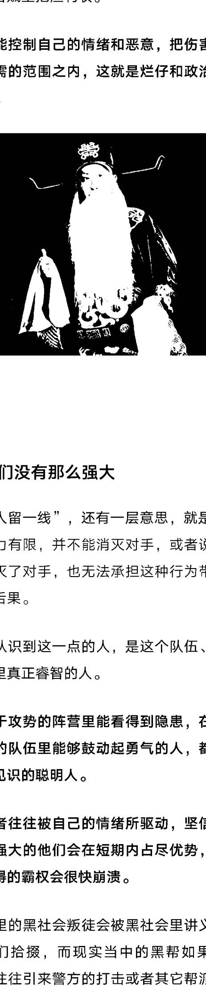

《三国演义》里，曹操打败了老对手张绣，这个时候应该赶紧把张绣的军师贾诩和张绣分开，给贾诩更好的待遇收买他，但是他把张绣的小姨带去做不可描绘之事，看上去好像是报复得很过瘾，其实一场败仗在等着曹操，他也因此失去了最善战的勇士。

## 4.克制过度侵害的冲动

《古惑仔》的第一部里，阿坤把B哥全家抓起来，B哥让他放过自己的家人，结果阿坤活埋了他的家人，嘴里还说着：“出来混要讲道义的，说杀他全家就要杀他全家的。”

这就是典型的过度侵害，在古惑仔的世界里，在斗争中有人死去是可以接受的，但杀死非战斗人员则是可耻的行为。阿坤动手杀人的时候，他也给自己埋伏下了后患，浩南和山鸡他们早晚会找上门来，为自己的大哥复仇。

在有些群体里，克制过度侵害的主张是一种胆怯的表现，古惑仔队伍就是如此。同样的问题在政治家的世界里就不是问题。

比如京剧《甘露寺》里刘备到孙权的地盘上和孙尚香结婚，孙权准备杀死刘备，他哥哥的老丈人乔国老就劝他：“你杀刘备不要紧，他兄弟闻知怎肯罢休。若是提兵来争斗，曹贼坐把渔利收。”

能不能控制自己的情绪和恶意，把伤害控制在必需的范围之内，这就是烂仔和政治家的区别。

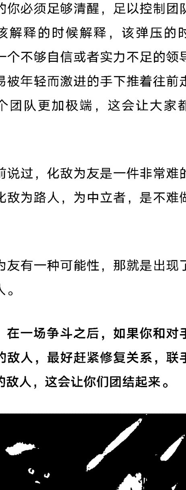

## 5.我们没有那么强大

“做人留一线”，还有一层意思，就是我们的实力有限，并不能消灭对手，或者说，即使消灭了对手，也无法承担这种行为带来的严重后果。

能够认识到这一点的 人，是这个队伍、这个阵营里真正睿智的人。

在处于攻势的阵营里能看到隐藏，在苦于防守的队伍里能够鼓动起勇气的人，都是真正有见识的聪明人。

激进者往往被自己的情绪所驱动，坚信自己特别强大的他们会在短期内占尽优势，但强横获得的霸权会很快崩溃。

电影里的黑社会叛徒会被黑社会里讲义气的兄弟们拾掇，而现实当中的黑帮如果太凶残，往往引来警方的打击或者其它帮派的合围。

我们在职场上和朋友当中，根本也没有“消灭敌人”的可能，在一个法治社会里，没有肉体上消灭敌人的可能，但是过度逼迫对手，很可能会导致对方的崩溃，进而铤而走险。还有一些人本身就有些精神障碍，不用逼迫就可能做出危险的事情来。这就是萧相如对秦王说的：“得以领血溅大王身。”

## 6.日后的相见

“做人留一线，日后好相见。”这两句里，必须要“留一线”，才可能“好相见”。

这意味着可能要损失一些可能的利益或者失去一些复仇的快乐。

这就需要政治家眼光，在这点上，历史上最成功的是普鲁士的首相俾斯麦。他为了德国统一，先和奥地利一起进攻丹麦，又打败奥地利，最后击败法国。

俾斯麦每次战胜敌人，国内都有声音，要求战败国给出更多土地或者金钱的赔偿。

但俾斯麦知道他的战争都是政治目的而打的，不是泄私愤。他往往给予对手开出相对宽厚的条件，也因为这个缘故，在下一次战争中，之前的敌人并没有加入对抗普鲁士的阵营。

即使不让对方成为盟友，至少也要让对方持友好中立的态度。

## 7.留一线是高阶智慧

“留一线”是强者的自信，但做到这一点并不容易。

最大的敌人首先是强者自己，能不能超越怨恨，克制欲望，因为伤害和复仇从来就是人类喜欢的一件事情。

另一个值得一提的是内部的压力，当你处于上风的时候，下面人往往一片欢呼，鼓励着你高歌猛进、斩尽杀绝。

这时的你必须足够清晰，足以控制团队的情绪，该解释的时候解释，该弹压的时候弹压，一个不够自信或者实力不足的领导者，很容易被年轻而激进的手下推着往前走，导致整个团队更加极端，这会让大家都吃苦头。

我以前说过，化敌为友是一件非常难的事，但是化敌为路人，为中立者，是不难做到的事。

化敌为友有一种可能性，那就是出现了更大的敌人。

所以，在一场斗争之后，如果你和对手有了共同的敌人，最好赶紧修复关系，联手对付更大的敌人，这会让你们团结起来。

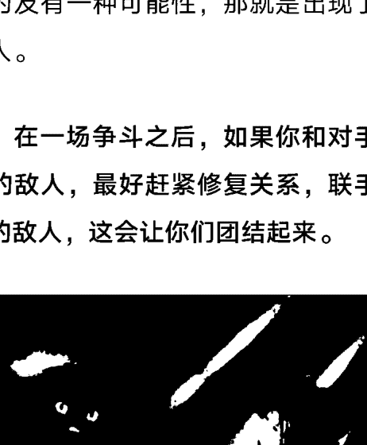

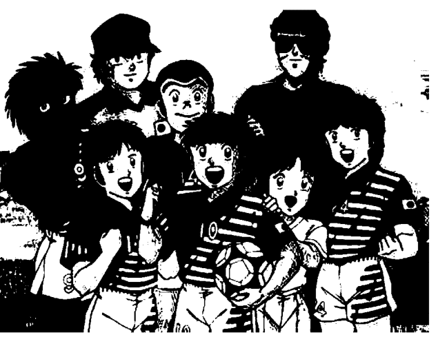

《足球小将》是一个非常典型的例子，看大空翼和日向小次郎看彼此的眼神你会发现他们简直势不两立，但是当他们去踢青少年世界杯，共同的队服和夺取锦标的渴望会让他们联手起来。

这也告诉我们一个道理，如果是陷入困境的弱势一方，只要仍然能保持自己的实力、不去苛且，一般能够获得一个体面的和议和联手的机会。

中国的史书和故事上很少谈及投降这件事，即使提及也都是负面评价，其实历史上它发生的特别多。

遇到强大的对手，在条件许可的情况下接受和议，这事一点都不丢人，尤其是职场上的那些情况，也不涉及丧权辱国割地赔款。

发现强大的对手在“留一线”、伸出橄榄枝的时候，不要偏执或者拘泥于小恩怨。

联手的机会，可能已经来了。

# —— 思考题 ——

你有没有经历或者目睹过有人因为“做人留一线”而让事情变好的事？

职场、家庭、朋友之间都可以，自己或者他人的经历都可以。

分享经历是人际关系修行当中很重要的一环。

人要做事，还要复盘。

试着控制在200字以内，尽量不要超过300字，简明扼要地说清楚一件事，你对这件事的重点也就不抓住了。

此内容归得到App独家专享，版权所有，未经许可不得转载，侵权必究。合作请联系iget@luojilab.com

## 专题｜关于“钱”的几件事

熊太行

有位关系户留言说：

读完《如何跟人谈钱》这篇文章，有很大的感触，他希望自己赶紧从“包子”这类人中跳出来。今天就一起复习一下专栏中提到的“钱”和“利益”这回事。

## 1.有些人的家庭教育是谈论感情才对，谈论利益就不对。

这些人会压抑自己对正常利益的渴望，长期如此，就会被“我要大方”这种词所绑架。

结果就是一方面假装慷慨，让爱占便宜的人、主张“你要大方”的人随便占便宜。

那些“大方”的人，朋友甚少，因为太大方的人会令人感到恐惧。大家不知道你要的到底是什么，总觉得你在憋大招，大方的人负担重，自己也苦恼异常。

所以记得这句话：谈钱不一定伤感情，谈感情一定会伤钱。

## 2.借钱是一件危险的事，往人类蒙昧时期追溯一下，最早的奴隶有两个来源，一个是战争，一个就是债务。

现在的借钱就是考虑交情的时候：你开口之前，怕对方不借，开口之后，对方又怕你不还。

那应该怎样借钱，才能让对方放心呢？有三个必须要做的：第一，必须打借条；第二，必须约定还款期；第三，必须主动提出付利息。

## 3.借钱还会出现一种“亲密值虚高”的情况。当你觉得这个人跟你的关系是铁哥们，但对方可能只把你当做了普通朋友。

尤其是求人办事，向人借钱或者喝酒的时候，总是容易夸大和对方的友谊。

所以借钱之前，你应该先冷静，判断一下双方的关系和感情，同时也要考虑对方的经济实力。

调低对对方的期待，对方借钱给你，已经是大面子了，还要纠结多和少，这就会自取其辱。

## 4.如果有人借钱不还，或者不停索取，侵害了你的利益怎么办？

你永远没法满足对方的欲壑难填，继续姑息，他们就会要的更多。所以干脆自己放下和和气气的面孔，保护自己的利益。

我们都是成年人了，成年人不能搭上自己所有的时间和精力给那些不知道感恩的人。

现在公布上一期专题中获得《关系攻略》礼品卡的26位关系户，原定送出20位，但有些推荐理由太精彩，忍不住多送几张。

请以下关系户同学把自己的电话写在留言中，放心不会被精选，会有工作人员联系你，送出礼品卡：

## 残酷社会生存法则

## 鹰派领导 | 叮好下属，远离怨念

085 | 鹰派领导：叮好下属...

### | 知识点

鹰派人最应防备的是暗箭，不是明枪。

### | 应用范围

鹰派；新领导；带队伍的人都适合读。

我们《关系攻略》开始的时候就提出了鹰派和鸽派的概念。

然后好多人还会犹豫不决，问我熊老师，我到底是鹰还是鸽。

我说，如果你自己都觉得搞不清，就找几个好朋友来评价一下你到底是鹰还是鸽。

其实大多数情况下，这样的人都是鸽。

鸽派鉴定规律：只要你问自己是鹰还是鸽，那你就一定是鸽。

判断一个人是不是鹰派要容易得多，一个最简单的判定标准就是语速。语速快的人，十之八九都是鹰，如果行动思维还更更快，那就一准是鹰。

鹰派的人是一辆高速运转的战车，如果你手下里有一个给力的鹰派，会觉得生活非常美好，效率和秩序是富有美感的。有没有效率，是鹰派和没有实力却张声势的假人根本区别。

之前我们在《人际关系的鹰派守则》当中也提到过，鹰派应该：

- 1. 搜集信息、学习知识，有独特的信息情报来源，比别人看得远；
- 2. 应该克制不必要的攻击性，之前我们已经温习了这一点，参看《做人留一条，日后好相见》；
- 3. 保护弱小，做一个高贵的骑士而不是恶龙；
- 4. 注重团队作战，把你的攻击性转向对手团队里的鹰，跟他们一决胜负。

3和4其实是很多鹰派们容易忽视的一点，这往往是他们从小没能养成的习惯。

大多数的利益之争，鹰派都会胜出，他们不怕明枪，但是鹰派容易在小事上遇到麻烦。

### | 鹰的叹息：先去理解别人

我不知道你们有没有遇到过鹰派领导低沉的时候。

我见过鹰派的交心，他们平时有多强悍，到低沉的时候就有多脆弱。

> “我要带着大家一起走，我想做点事，我不明白为什么要这么难！”

### 鹰的“三省吾身”

- 我仔细观察某人了吗？
- 我今天伤人了吗？
- 别人可能对我有怨恨吗？

### | “表忠心和真动情”

很多时候绊倒鹰派的都是小人物、小角色，关键时刻，总会是自己觉得稳妥的、不会出问题、不起眼的角色会给自己出状况。

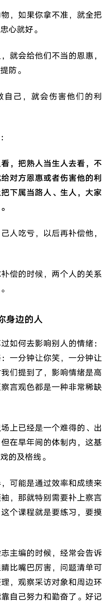

鹰派的人不容易被和自己实力相当或者比自己强的人所欺骗。

但是非常容易被弱者、小人角色的臣服所迷惑。

说句过去的老话，就是不辨忠奸。

他们分不清表忠心的场面话和真动情的那种状态。

其实区分这二者，有一些办法：

- 1. 暗明人一般会私下表忠心；
- 2. 亲人一般是公开表忠心；
- 3. 亲人私下说的话，可能是真动情；
- 4. 暗明人很少真动情；
- 5. 真动情会在你说了很多话之后，一步步深入才会出现，大多在深夜；
- 6. 酒后的话基本全是表忠心。

人是多变的动物，如果你拿不准，就全把这些话变成表忠心就好。

## I 如何观察你身边的人

P.s 有几种例外的人很难察言观色

总结一下今天的内容：
鹰要多看看周围的隐患。
鹰最要的隐忧就是别人的怨恨，尤其是地位能力不如自己的人的怨恨。
照顾好自己的利益，手上没有太多预算的时候，可以用克制的赞扬替代。
鹰派不怕强敌的撕和恐，但要留神迷惑于弱者的假忠心。
多观察对方，关心对方。

多观察对方，关心对方。

如果你练习观察细节，你就会有一双高明的眼睛。

## —— ◆ 思考题 ◆ ——

今天留一个作业：

你在观察别人、在意别人感受这件事上有什么心得和教训？希望你留言分享给我。

关系攻略是我和六万多关系户一起打造的产品，希望大家能够踊跃分享自己的案例。

要知道，总结自己的际遇，像记日记那样用200字左右的篇幅说清楚一个问题，其实是管理自身人际关系的最好办法，也是锻炼自己分析、写作能力的最好练习。

## 附：与其他篇目的联系

- 《人际关系里的鹰派守则》
- 《人际关系里的鸽派守则》
- 《鸽派进阶攻略：如何跟人谈钱》
- 《我们以貌取人，但我们并不残忍》

## 樊胜美攻略｜如何娶到为奴的女儿

086｜樊胜美攻略：如何...

### | 知识点

如果一个好女人愿意摆脱家庭的控制，全世界都会帮她，前提是，她要狠起来。

### | 应用范围

- 被原生家庭折磨的女儿；
- 准备娶被奴役的女儿的男性；
- 有亲友苦于被父母奴役的人们。

我曾写过一篇《如何拯救为奴的女儿》，专门谈论摆脱原生家庭的办法。

那一篇主要是指导女儿觉醒，一个女儿，只要不想让父母和兄弟姐妹盘剥勒索，就一定有不被盘剥、不被勒索的办法。

今天我们分享女儿摆脱家庭盘剥的进阶攻略。

我说是这是一个进阶攻略，因为这是一个需要双方联手游戏，没错，这需要情侣联手，最终目的是保证小家庭夫妻的财产安全。

要娶到你的樊胜美，最好一条不落地完成这九个步骤。

## 1.需要很多很多的信任

无论你是女方还是男方，都需要首先问自己一个问题：

我是不是要嫁他/娶她。

这个问题哪怕以前你做过很多保证，最好也在看完这个攻略之后再好好问自己一次，因为接下来的事情会很麻烦，你得一步一步地来。

你的配偶可能会崩溃，可能会哭着喊着说要放弃，所以现在就要做好这种心理准备，无论你们是三击掌也好、拉钩上吊也好，纹个彼此的名字不推荐也好，一定有一个办法。

彼此信任，这事能成。

彼此不信任，到后期步骤会进行不下去。

## 2.夫妻财产分配

我们《关系攻略》从来不会让一件关系半生的大事建立在海誓山盟上，第一件要解决的，就是夫妻之间的利益分配。

对，没错，不是丈母娘家和女儿的分配，而是如果你结婚的话，财产如何分配。

在电视剧《欢乐颂》中，王柏川和樊胜美筹备结婚，到了最后关头两人分手，丈母娘和大舅哥的胡闹欺凌自然是一方面，但最关键的还是，他们两人之间产生了内讧，王柏川最终受了妈妈影响，没有在婚房王柏川父母出了首付的房产证上写上樊胜美的名字。

一般来说男方出婚房的情况有几种署名方式：

- A.公婆中的一方或者双方，以及丈夫；
- B.公婆中的一方或者双方、以及丈夫和妻子；
- C.丈夫；简单，婚后买的房如果没有特别约定，算夫妻共有财产，离婚起来是50%和50%。
- D.丈夫和妻子；好处是可以规定产权比例，可以按照双方出钱比例来，不过总体来说，50%和50%的情况最好。
- E.妻子；有的妻子是可以拿下或者获赠整套房子的。

还有一种是住在男方婚前的房子或者与老人同住，我们就不讨论了。

## 3.排查各种署名隐患

中国普通家庭，房产是财富的大头，以下这几种情况都存在隐患：

### A.公婆离婚；

比如公婆署名的房产证，他们的婚姻同样存在变量，一旦离异，很可能也要分割财产，现在老年人离婚越来越多。

### B.公婆病逝；

公婆一旦病逝，还有别的兄弟姐妹，就面临分割遗产的问题，口舌很多。此外房产继承的公证，公证员可能按面积收费，花几千元到几万元都是有可能的。

### C.丈夫卖房；

理论上丈夫如果偷偷卖掉夫妻共有财产，妻子可以去法院起诉要求丈夫交出钱如买房的人手续合法，是可以不退房的，但谁愿意打官司呢？律师费也是一大笔钱。如果丈夫赌博或者吸毒，可能根本就没有钱剩下了。

结婚证领完立刻去改户口本，把未婚改成已婚，堵上这个漏洞。现代的房产交易大厅里，一看卖主户口本是已婚，就会要配偶到场，房子才能卖。

### D.夫妻署名；

这是最安全的办法，但是如果是公婆出了首付款，又不是赠予的情况，而是借给你们的，最好是利用一个借条来保障老年人的利益。

## 4.一张借条的艺术

有人可能会说，熊老师你不对，嫁给他家做媳妇，给他家生儿子，为什么还要给他父母打借条？

结婚是两个家庭的事，但两个人，要有自己扛起来的觉悟。

双方父母的彩礼和陪嫁，一比一比较合适，如果双方经济条件相差很大的话，女方量力而行也是可以的。不过要明白这都是老人的好意。

家庭条件偏寒的女方，要对公婆的资助，感激和客气一点。如果男方没有额外的兄弟姐妹，甚至可以允许男方去给父母打一个欠条，说房子首付款向他们借了多少钱可以少写一点，一部分算赠与，让他们安心。

这不是让你出让利益，而是因为这根本就不是你的利益。

> 《婚姻法解释三》在2011年颁布之后，渴望嫁入豪门的路其实已经堵死了。

第七条：婚后由一方父母出资为子女购买的不动产，产权登记在出资人子女名下的，可按照婚姻法第十八条第（三）项的规定，视为仅对自己子女一方的赠与，该不动产应认定为夫妻一方的个人财产。

由双方父母出资购买的不动产，产权登记在一方子女名下的，该不动产可认定为双方按照各自父母的出资份额共有，但当事人另有约定的除外。

现在要买一套房，几百万、上千万的价格都是很正常的，除了贪污贿赂之外很少有人能现金交易，银行转账记录就是关键证据，真的到离婚的时候，双方各自举证，最后谁的钱还是谁的。

你让老公给婆婆打的借条，无非是转账记录之外多一条证据而已，不会分走你的钱。如果他要耍机灵签一大堆给婆婆的借条也没用，串通第三人虚构债务是不会被法院支持的。

> 《婚姻法解释三》第十条：夫妻一方婚前签订不动产买卖合同，以个人财产支付首付款并在银行贷款，婚后用夫妻共同财产还贷，不动产登记于首付款支付方名下的，离婚时该不动产由双方协议处理。

依前款规定不能达成协议的，人民法院可以判决该不动产归产权登记一方，未归还的贷款为产权登记一方的个人债务。

双方婚后共同还贷支付的款项及其相对应财产增值部分，离婚时应根据婚姻法第三十九条第一款规定的原则，由产权登记一方对另一方进行补偿。

这条的意思就是，如果王柏川买了房，他娶了樊胜美，樊胜美和他一起还贷款，后来两人离婚的话，房子还是王柏川的，虽然他要补偿樊胜美还贷的钱和带来的增值部分。

法官不会因为王柏川有什么过错，就让他把房子交给樊胜美，有房子在，债到钱不难，但樊胜美即使拿到这笔补偿款，很可能连买个厕所都不够。

没有人可能通过离婚来改变命运、发家致富，事实上，离婚会把双方都打回原形。

《婚姻法》有保护女性的内容，但它更重要的任务是保护人的合法财产。

## 5.谁和谁谈财产分配

要由小夫妻来谈婚前财产，双方达成一致之后，去说服自己的父母。如果女方已经要和父母决定，就可以不去谈了。

不要让任何一方去单独面对你家的老年人，你要想婚姻久一点，最好默认你家的所有老年人都是蛮横不讲理的。不要寄希望于他们的教养或者好心！

你必须在你的父母长辈面前护着你的另一半。第一次见长辈的时候要这样做，婚前谈财产的时候要这样做，婚后的各种大事还要这样做！

有的乖乖女和爹妈特别亲，回娘家就吐槽女婿，说者无心，听者有意，岳父岳母开始嫌弃女婿了，这婚姻问题就很大了。同样，跟自己奶搓短娘短的男人，有一个算一个，早晚离婚。

条件商量好之后，找律师起草协议，最好做一个婚前公证。

## 6.打断娘家的盘剥之路

樊胜美的父亲瘫痪电视剧里说是植物人，其实植物人拔了管子就会死，而樊胜美的哥哥还能抬着老爸去樊胜美住处，可见不是，妈妈是一个毫无原则偏向儿子的老太太，她的哥哥是个流氓，一家人都忙着盘剥樊胜美，这是樊胜美一直在婚姻上难以有所建树的关键。

这样的女人是不是好女人？

当然是好女人。

其实她的其它条件都可圈可点，正规公司的人力总监、受过大学教育、收入也不错，人长得也好看。

王柏川说服妈妈的时候的话，自己也是相信的：“她条件挺好，当年是学校的花神，如果不是有这么一个家庭，我追不到她。她还帮我介绍生意，让我挣了不少钱。”

这是一个很好的说服自己家庭的话术，大家可以学一学。

原生家庭是樊胜美的短板，不过总体来说她还是一个好女人，其实为奴的女儿是最让男人心疼的一类人，很多愿意和这样的女孩谈恋爱，但愿意和他们结婚的都是勇士，没事，现在有了熊老师的攻略，勇士们会越来越多。

但是王柏川必须和樊胜美联手打断盘剥之路。

在处理好婚前的财产协议之后，王柏川们要尽量做到以下几点：

A.婚礼主场定在他们工作和生活的城市，或者男方的城市。

B.有些女方家庭会在自家也办婚礼仪式，尽量避免。

盘剥女儿的家庭往往在一些落后地区，有一些野蛮的习俗，比如突然出现几万元的改口费或者是上车钱，不给就进行不下去，那个时候男方身在外地，连给力的团队都没有，只好吃哑巴亏。这是特别典型的绑架手段，美其名曰入乡随俗。

即便去女方家也只办回门宴之类没有仪式的饭局。

C.不要订婚。

订婚是农业社会的习惯，尽管有些王室现在仍然有订婚的习惯，那是因为所有的王室都是从农业社会过来的。中国大多数订婚的习惯都是无聊的，要知道你娶的女孩正努力摆脱这个家族，你们哪里一定要念着夜长梦多，不要多给一个家族诈唬你们的机会。

D.彩礼不给丈人。

如果他暴跳如雷，就连回门宴都不要给他办。不要怕伤感情，谈感情一定会伤钱。

## 7.没有结不了的婚

如果女方在出去上大学的时候户口就迁出，和父母不在一个户口本上，可能在自己工作城市的人才中心集体户，这就简单得多，直接结婚就行了。

别怕，如果说女方没有迁出过户口，一直和父母在同一个户口本上，也有办法。想想《小二黑结婚》，党和政府会帮你撑腰。

直接拿着身份证去派出所，请派出所出具籍证明，可以告诉民警，想结婚家里不同意。放心，好多人会同情你。

按照流程派出所民警应该去女方家里劝老头老太太把户口本拿出来，但是大家都很忙，谁也不会去操心这个，一般都会直接出了证明去登记拉倒。

只要想结婚一定能结得了。为什么我第一点就说要团结，就是因为你可能会为你的行为感到恐惧，一个为奴的女儿从来不可能这么独立过。

只有爱能让人成长，爱能让人胆大包天。

## 8.不要怕诉讼

在《欢乐颂2》里，樊胜美的哥哥威胁说要起诉樊胜美，告她不赡养老人。

解决方案很简单，让他告。

人活在世界上，不要怕当被告。当原告可是可怕多了。

民事诉讼里的原告太麻烦，就樊胜美他哥那受教育程度，诉状都写不出来，请律师也没钱。真到了法庭上，樊胜美把给家里打钱的证据晒哇一列，最后法官象征性一个月的费用而已。

樊胜美是人力总监，这是直接要和劳动者打交道的岗位，一定有律师朋友。

建议各位都要有个律师朋友，不是非要打官司才找他们的，有了他们，很多时候就不会打官司了。

无论是儿子或者女儿，都不需要背父母的债务，父母说让女儿还，女儿可以不还，回家放弃继承父母的遗产一般都是负资产就可以了。

哥哥或者弟弟的债务更不需要姐姐还，姐姐根本没有这个义务。没有一个放高利贷的会真的放死你那不成器的兄弟，砍死了钱就回不来了，还会招来警察，他们会让他吃点苦头，就是因为总有心软的包子亲戚会送钱来。还有一种可能：砍人的流氓就是你兄弟的狐朋狗友。

记得我们总说的那个顺序，家庭中关系排位：配偶第一，子女第二，父母第三。

不要怕别人说你无情无义，不要为了面子或者别人的苛责而去承担你背不起的重任，有些人要毁灭，你不能救。

## 9.立一份遗嘱

其实成年人都应该有一份遗嘱。如果没有遗嘱的话，一个人的遗产就会在他的第一顺位继承人之间继承：

配偶、子女、父母。只要有这三类人，兄弟姐妹就不能继承你的遗产，除非你赠给他。

没遗嘱决定分配，那就是均分。一个配偶，两个孩子，父母健在，那就是五份儿。

一个为奴的女儿倘若因为各种原因不幸去世，她的个人财产将会有40%给折磨她的父母，最后还可能给不成器的兄弟，气不气？

更可气的是，丈夫可能因为这个缘故而卖房或者借钱给他们钱。

樊胜美应该立一份遗嘱，如果有可能，最好公证，内容就是，一旦我死了，我的财产全部由我的丈夫继承如果有孩子，可以都留给孩子，然而区别不大。

即便是王柏川，看见一份遗嘱也会大吃一惊的。

大多数人都能活到50岁以后，所以这份遗

大多数人都能活到50岁以后，所以这份遗嘱用途有限，但这更像是一份投名状，向自己的配偶和他的家庭（早晚会知道）表达自己的决心。

谈判能力强的人也可以让丈夫立同样的内容，不过不提倡，尤其是如果公婆是通情达理的话，不建议用这种办法。

人死了，钱也不能流回去。

那个欺凌我、折磨我的娘家，再也不要回去了。

## —— 延伸阅读 ——

让樊胜美剥夺父母继承财产的权利，在有些场合之下非常有用。

举个例子：有一个家庭，夫妻双方父母尚在，有一个孩子。

假设夫妻二人在事故当中同时遇难，他们的遗产两人共有600万。

则男方的遗产分配：男方母亲100万；男方父亲100万；孩子100万。

女方的遗产分配：女方母亲100万；女方父亲100万；孩子100万。

再假设，丈夫遇难，妻子重伤，继承在死亡那一刻就开始发生。

继承的方式则是分割男方的财产300万：

妻子继承75万；男方母亲继承75万；男方父亲继承75万；孩子继承75万。

如果不久后妻子伤重不治，那妻子的375万（假设没有医疗费用）就由孩子和自己的娘家父母均分，每人125万。

死亡顺序的不同可能会导致女方父母差出50万元来，再加上争夺有遗产的孩子抚养权的纠纷……

所以，聪明的人会早立遗嘱。

### —— 习题 ——

樊胜美要在婚前给房产加上自己名字。如果你是王柏川，准备怎么劝说她：

+   A.婚后用共同财产购房才是共同财产，婚前这一道手续是没用的；
+   B.现在的限购令是这样，你如果跟我不是夫妻，根本就没有购房资格；
+   C.非夫妻加名字，除了你要有购房资格之外，还必须还清贷款；
+   D.非夫妻要加名字，还有5.5%的营业税和1%的契税要交，一些杂七杂八的费用还不在其中。至少好几万块钱！
+   E.我妈说了，如果你要这样婚就不结了。

答案ABCD。

E不对，这样就成了妈宝男了。

其它的这些都是现实中存在的问题。

## 附：与其他篇目的联系

《如何拯救为奴的女儿们》

《你总得认识到自己不能拯救世界》

《亲舅舅为什么不疼爱自己的外孙呢》

## 残酷社会生存法则

## 专题 | 线上社交指南
（1）

087|专题：线上社交指南...

如今社会，越来越多的交流沟通都在线上，那应该如何在在线上社交中，传递出重要信息，帮你成事呢？

本周周二、周四的专题中，我会帮你整体复习一遍“线上的社交指南”。

今天我们先来复习一下：《什么样的微信头像才是得体的》。

在这篇文章中，我们说过，当你的微信主要用来工作，要和很多客户、合作伙伴打交道的时候，要考虑到自己的头像会给对方带来什么感受。

如何选择一个得体的微信头像，一共10条忠告：

第一条忠告：千万不要翻白眼。正面的、精心拍摄的照片，一定要比模糊的自拍好。眼睛正视前方的照片，比看着外面的照片要好。

第二条忠告：不要张大嘴。以前鲁迅先生挖苦那些看热闹的人，说伸着脖子张着大嘴，像被掐住脖子的鹅，自古相面书上，就把没事爱张着嘴看做是一种穷人的相貌。

张大嘴拍照肯定是为了娱乐大家，但不要为此牺牲了自己。

第三条忠告：别用睡觉的照片当头像。认识新朋友的话，对方一定会看你的头像照片，可能在挺长的一段时间，他脑海里你的形象都是你的头像。一个酣睡的样子也许并不适合认识新朋友。还有，如果你的老板每次看见你，都觉得你睡眼惺忪，那他心里是什么感受呢。

第四条忠告：不要用涂鸦过的头像。很多拍照软件都可以把人脸变成猫脸或者小兔子，加很多动画特效。这时候，你要知道，卖萌只应该卖给有交情的人。在工作中用这种头像，会让合作伙伴认为你不专业。

第五条忠告：不要带口罩。应该要把你的笑容露出来，不要让口罩妨碍了你和对方的眼神交流。

第六条忠告：发型和职业装。如果你是一个医生，那穿白大褂的照片做头像是合适的，注意你的头像发型是不是打理过的。

第七条忠告：脸部的大小，也需要注意。一张背景太复杂的照片是不适合当头像的，需要点开大图才能看清五官的头像都是不好的。

第八条忠告：头像里应该只有你一个人。尽量不要用活动留影照，或者合影当头像，不然的话你还要跟没见过面的新朋友们解释哪个是你。

第九条忠告：在你的头像背景里最好不要出现任何字，比如在养生会所拍的，旅游景点等等。除非你需要背景里的字来表达某种效果。

第十条忠告：可以用合适的道具来衬托自己的身份。我有一个朋友，写影评写的特别好，他的头像就用到了美国队长的盾牌当道具，看起来就很符合他的个性。

可能你会觉得这个套路太累了，其实一点也不。

在50到70年代，亲戚朋友间主要靠书信交流，再附上一张自己最近的照片。很长一段时间，对方记忆里的你，可能就是那张照片。

同样的，你的头像是什么，直接影响了新朋友对你的印象。

预告：本周四，会继续带你回顾“线上社交指南”的其他章节。你也可以在留言中把你最想回顾的专题告诉我，我们一起复习，成长。

## 残酷社会生存法则

## 玩游戏、打球时，该不该给领导放水？

088|玩游戏、打球时，该...

## | 知识点

陪领导进行高尔夫、游泳、自行车这类山水风景类运动的时候，主要是聊天，其次才是运动。这种活动，是跟领导交心的好时机。

## | 应用范围

体制内人士；

体制外但是规模足够大的公司里的基层职工。

之前有关部门提到了跟领导打球的时候应该怎么做？这是一个小话题，但确实是一个进阶技能。

为什么我们现在会讲更多的进阶技能，就是因为很多问题我们可以简单地给一个答案（比如婆媳关系，答案就是“尽量分开住”）。

但是，跟领导打球、打游戏应该怎么打，是要赢还是要输？这是比较复杂的局面，没有办法用该赢，或者该输来决定怎么做。

《奇葩说》上周六结束了，这一季的《奇葩说》也围绕“中国式焦虑”做了很多讨论，有一回の辩题是“和老板打电动要不要放水”，当时争议得就很激烈。

和老板打游戏、打球，你要想象自己是班长他是新兵，赢他不是目的，一帮一，一对红才关键，这点颇如晶的那句辩词很好：

玩前多观察，玩时不抓瞎，
玩时少说话，玩后不评价，
老板水平差，记得拉一拉。

罗胖老师说的也有意思：

放水是不对的，你要当众自残才行。这才是讨好这样的老板的真正诀窍。

老板，只有一个事重要，就是你好用不好用，对组织有没有用。

放水的这件事情，真的没那么重要，他没心思去看这么细的事儿。

我非常赞同罗胖老师的观点。我如果和一个下属一起打游戏，我也希望对方全力而为。

考虑到“老板”、“电 动”（电子游戏）这样的语境，所以罗老师说的是一个私营企业、尤其是创业公司的规则。

但是在机关、事业单位和国企，以及已经规模足够大的私有制企业，这件事情可能真的要重新考虑策略。

## 我的建议是，让不让球，要看你领导和公司的利益接合部。

## 1.大球类

## | 有身体接触的、对抗性的球类

## A.安全第一

有身体接触的球类游戏，主要是篮球和足球，这两种运动都是青年人占优势的运动，所以如果你的领导喜欢足球和篮球，首先要注意的就是他的安全。

## B.友谊第一

## C.教育领导不是你的任务

## D.应付好特殊情况

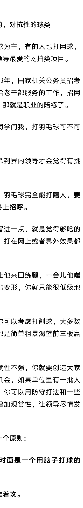

## 2.网拍类

| 无身体接触的，对抗性的球类

乒乓球和羽毛球为主，有的人也打网球，这三个球类是领导最爱的网拍类项目。

我们本科毕业那年，国家机关公务员招考计划就有一个给老干部服务的工作，招网球专业毕业生，那就是职业的陪练了。

上次有关系户同学问我，打羽毛球可不可以对领导扣杀。

当然可以了，杀到界内领导才会觉得有挑战。

但是注意安全，羽毛球完全能打瞎人，要注意别往领导身上招呼。

你可以适当打昌进一点，就是觉得够的球也扣杀两个，打在网上或者界外效果都不错。

## 3.风林山水类

| 无身体接触的，非对抗性的游戏

陪领导打高尔夫球以聊天为主，你如果实力确实很强，是可以给领导一些建议的；这就是友谊第一的真谛。你不一定要给领导做对手，也可以当球童，要记得高尔夫球一个人也可以打。

这张游戏记得：

聊天第一、运动第二；

风景山水好的地方，可以交心。

## 4.棋牌游戏

现在下围棋的人很少了，如果领导和你是单位里唯一的两个围棋高手，确实可以下一盘的。

你和领导玩你第二擅长的游戏。

## 5.电子游戏

我以前曾经在一家公关类公司工作过两年，有时候中午我们会玩联机游戏。

双人或者多人游戏是可以形成一个均衡的。

——分享题——

我想听听你们和领导一起打球和打游戏的故事，有没有特别精彩的经验和特别惨烈的教训？

## 附：与其他篇目的联系

《换老板攻略，什么时候应该主动换掉领导》

## 专题 | 线上社交指南
（2）

上周二我们回顾了“如何选择一个得体的头像”，今天我会继续带你复习线上的社交指南：“朋友圈要如何经营”。

专题中提到的原文，我会放在文章末尾，看完专题不过瘾，还有余力的关系户可以点击文章末尾的蓝字阅读。

进入今天的专题：不要在朋友圈发负量，并且有意识的去经营自己的朋友圈。

## 1.什么是负能量？

对劳动强度叫苦不迭，抱怨同事关系、抱怨老板、抱怨大环境恶劣（比如房价高）、抱怨甲方不靠谱。这都属于负能量。

## 2.负能量会给你带来危害

叫苦会让你的领导心存忧虑，同时也会让同行同业刺探出贵司的经营情况。

抱怨同事关系会造成身边人不和的加剧，抱怨老板，即使分组，也有可能传入老板的耳中，可能的合作伙伴或者下任老板看到都会考虑，是这个人的老板真的太奇葩，还是他就是这样黑老板的性格？

大环境恶劣看似冤有头债有主，怪完开发商怪业主，但说到底是哭穷，是叫苦的另一种方式。

抱怨甲方不靠谱绝对不要做，分组也别发。被发现了会丢客户不说，端人碗还骂娘是一种特别不职业的行为。

## 3.负能量和集体主义

在私营企业里，负能量的朋友圈最多是让你的晋升受到影响。

如果你在国企或者机关里，负能量可能带来更负面的评价。抱怨、吐槽、叫苦，都会显示你在政治上的不成熟，显出你没有集体大局观。

## 4.观察你喜欢的人的朋友圈

大家都是活一辈子，遇见的事情差不多，如果发现某个朋友写同一件事，见识上比你高明，态度上比你阳光，有更多的赞，那就是去学习和效仿。

你们描绘同一件事为什么会不一样，你的反应、想法，你在描绘自己感受的时候，是不是有不得体，冒犯人的地方？

要养成一种观察别人，向别人学习和拼鉴的能力。

## 5.结交一些特别的好朋友

你可以发一些分组朋友圈状态给他们，有的时候遇到好的文章或者提及某人，还可以选择“@某好友”提醒她看，这些一定要偏私人一点，你是在和对方分享感受。

## 6.显示自己安排生活、管理时间的能力

天天晒吃喝玩乐会显得玩物丧志，每天晒加班则是令人厌厌的。最好的办法是“在什么山上就唱什么歌”，当你工作的时候，就要斗志满满，谈及远大的未来。而当你休息的时候，哪怕娱乐很无聊，你也要珍惜休闲的时光。

## 7. “我是一个什么什么样的 人”

你一定有优点，要时时提醒你的新老朋友，有的朋友可能刚刚打开跟你交往的电梯，往下摁你的十条朋友圈，一定会有对你的判断和评价。

就像过去的说明文总要说：猪浑身是宝，肉可食，皮可以制革，毛能做刷子。

你也要经常强调自己的特长，不要太刻意。

这种行为就像在对朋友说：“嘿，我身上有你要的能力和品质，来和我交朋友吧！”

总结一下，不要在朋友圈发负能量，同时你的朋友圈要展示的内容应该是：

+   我挺忙，但很好；
我很强，且有用；
我这人很有趣。

好了，有关线上社交的文章，我放在文章末尾，你可以重温整篇文章。

也欢迎你在评论中，留下你对线上社交的疑问、心得。

## 附原文章：

《什么样的微信头像才是得体的》

《怎样经营自己的微信朋友圈》

《为什么不要在朋友圈里发负能量》

## 保姆攻略｜如何对待你的契约家人

090|保姆攻略：如何对待...

## 丨知识點

如果你要把孩子交给某人手里，最好前期查她严一点，后期对她好一点。

## 丨应用范围

适合正在找保姆的家庭、和有亲密雇佣关系的人阅读。

杭州的一套价值近3000万元的高级住宅遭到纵火，一位母亲和3个孩子不幸身亡，犯罪嫌疑人是这家的保姆，而女雇主曾经借给她10万元钱“买房”。

保姆和雇主到底是一种什么样的关系？应该维持什么样的距离？

有人说，这是雇佣关系，没错。固然有这样的关系，但和一般的雇员来说，这种关系又特别特殊：

## 1.契约家人

一方面，在一个时期之内，大家的关系非常密切，形同家人，有一种类亲情存在。

另一方面，这种家人关系绑定的就是一个契约，一旦契约解除或者结束，关系也就不存在了。这使得双方可能在投入方面都会有所保留。

## 2.生活合作者

即使你是一个全职太太，也没法对保姆做全方位的工作安排，保姆不会仅仅是你的手或者你的苦力，你必须借用保姆的脑力，让她去做一些决定。

在这段雇佣关系存续期间，你们将会共建美好生活，你必须要对她付出大多数家人要付出的那些，分享她的抱怨、压力、情绪和一切，影响她的思维、训练她的习惯，同时，你和你的孩子可能都无法避免的受到保姆的影响。

这也是为什么我们会尽量善待保姆，你的生活是绕不开她的。

> “幸福的家庭都是相似的，不幸的家庭各有各的不同。”——列夫·托尔斯泰《安娜·卡列尼娜》。

## ——选人篇——

## 1.姐姐还是阿姨

关于究竟是应该寻找未婚的“姐姐”，还是寻找年长的，有孩子的“阿姨”，各人有不同的看法。

选择什么样的人手，跟要承担的任务有关。

如果只是简单的清洁、采买、做饭和负担家务，18~25岁的年轻保姆就可以了，价格相对便宜。

## 2.熟人还是大公司

家政服务公司很少有真正意义上的大公司。

## 3.菲佣还是国人

正规受训的菲佣用起来很好用，做事专业。

## 4.要不要挑省份

昨天跟脱不花聊到这个话题，她对四川的阿姨赞不绝口，她家的阿姨做了十几年阿姨，把孩子送到了美国读高中，甚至还自费订阅了一份《关系攻略》分享给自己的儿子。

该点来说，家庭环境比省份要重要得多

这点来说，家庭环境比省份要重要要得多了。

当然，如果你要你的保姆做饭，那就可以多挑一些你喜欢的地区来的保姆，比如四川、湖南，如果你爱面食，也可以挑山西、陕西、甘肃的阿姨。你可以让对方试一下手艺，这都是正常的面试环节。

## —— 背调篇 ——

## 5.身心健康

健康证明只能证明一个人没有传染病或者恶性疾病，心理健康则是需要认真观察的。

要让阿姨做一段自我介绍，看看她的逻辑性，有的人说话颠三倒四的，那沟通就有困难了。

跟阿姨聊天，拉家常，看看她的反应速度如何（有些落后地区流行近亲结婚，有些人有精神发育迟滞，也就是我们常说的“弱智”）。

对一些话不多的阿姨（我们知道很多时候内向、老实其实是智力或性情缺陷的另一种表现），你可以下达一些复杂的命令：卧室里的衣橱上面第二格里有个钥匙，10分钟后拿过来给我。观察她对时间、空间的认识。

给阿姨一份智商测量表有点太夸张，不过这个确实更加准确。

如果你家的阿姨晚上总是睡不着觉、觉得能听见什么你们听不见的东西，或者觉得邻居们想害她，那她可能出现了精神问题。

赶紧把她送走，最好通知家政公司或者家人来接。

## 6.鹰派还是鸽派

一些阿姨是性子偏执的人，喜欢什么事情按照她的经验来办，我们按照鹰派/鸽派的分类法，把她们可以归入鹰派，这样的阿姨一般做事不怕苦，效率也高，最好是只和带孩子的小夫妻打交道，用她的经验来做事，雇主偶尔用科学的方法调整规范一下。

如果家里有老年人做监工，一定要选一个鸽派的阿姨，面团性格的她们会让老年人不至于生气。

无论是雇佣鹰派阿姨还是鸽派阿姨，雇主如果是小夫妻，最好是在关键时刻要能自己拿主意，不能完全交给老人或者保姆。保姆是会替你们承担老人的怨恨，但是如果你不想雇佣关系尽快崩溃，最好也居中缓和一下各种矛盾。

## 7.幸福的人还是苦人

在初次面试阿姨的时候，最好就问清楚她的家庭情况：

她是已婚、离异还是丧偶？几个孩子？有没有婆婆？为什么出来工作？丈夫有没有工作？孩子上学还是上班？

阿姨的孩子或者丈夫最好也在同一个城市，让这个城市和她有更多的羁绊，不是坏事。不要怕周六日放假让她和家人团聚，这是她减压的好机会。

一般来说，家庭生活幸福的阿姨很少疑神疑鬼，更适合带孩子，性格也会好得多。

有人喜欢找那种家庭很苦的阿姨，觉得自己很像是lfoche对方，做慈善，最好不要这样做，尤其是丈夫好酒、家暴、服刑的阿姨，最好是非常谨惕。

苦人也不是不能用，像我一岁多的时候，我爸爸在部队服役，离我家千里。

他和我妈部队驻地的朋友找了一个十五岁的姐姐来我家做保姆（现在看起来算是童工了），这个姐姐父母双亡，哥哥一只手受伤残疾，嫂子虐待她。我妈就带着她回我家，她那样儿像是带着两个孩子生活，这个姐姐带了我两年多。

这个姐姐的女儿如今都出嫁了，至今和我家还是作为亲戚走动。

对苦人你要付出更多的耐心和爱。

## 8.拖累和恶人

早点弄清楚保姆家中的负担，比如有没有严重的病人、有没有混黑社会或者吸毒的人，如果她有这样的丈夫或者儿子，又和他们保持联系，最好就不要雇请她，这可能会给你带来极大的麻烦。

## —— 相处篇 ——

## 9.喜庆的脸

一个人是乐观还是悲观，相处一段之后会逐渐显现出来，今天我们经常说某人很“丧”，就是对万事的看法比较悲观。也有些人是相貌上比较“丧”。

我在《我们以貌取人，但我们并不残忍》里也提到过，一个好的相貌能让人好感顿生。

如果你看着一个候选人觉得外貌不对，那你就不要选她，不要强迫自己接受：“心灵美才是真的美”这样的谬论，大家坐在一起吃得下饭，说话开心，那才是真的美。

挑一张喜庆的脸并不可耻。同样，如果你觉得一个年轻的阿姨吊眼角或者眉目含情，那也可以直接否决，没有必要让自己觉得不舒服。

说“不”，并不是不尊重。强令自己接纳下来，然后对人家猜疑狐疑才是真的不尊重。

## 10.工作标准

一是要早早明确阿姨的工作量，如果有额外增加最好是加薪或者包红包，不过和红包相比，隐瞒工作量才是最惹人厌恶的。

二是要用最快的方式，明确双方的生活标准。因为保姆和雇主的生活习惯不同，很多问题其实出在雇主无法提出明确工作标准上。建议使用清单体列出工作标准，比如：1.孩子多久喂一次；2.床单几天换；3.老人怎么照顾..等等。

敲黑板：人际交往的黄金法则在这里适用。

如果你想别人怎么对你，你就 pouvez首先这样去对别人。

## 11.撒谎和骄横

如果发现阿姨在某些涉及财产的地方撒谎，要及时辞退她。

我们以前跟大家推荐过《卡布斯教海录》，这是一个波斯王子教育自己的儿子如何做一个贵族的书，里面谈到了购买仆人和奴隶的一些法门，虽然时过境迁，但是一些原则应该适用。

如果一个人在前一个雇主那，因为得宠而骄横，就赶紧辞退她好了。

同样，撒谎 informacje你利益的人最好也不要留。

有些人撒谎是因为胆小，怕你责罚，这种撒谎可以拯救。

有的人撒谎是因为胆大，她妄想瞒天过海，这样的人最好尽快辞掉。

如果你是要贪图她的手脚麻利而容忍她的撒谎或者态度的恶劣，那么你就是在接受腐败，这样一定会出大事的。

这句话念三遍记下来：

没有离不开的保姆，没有离不开的保姆，没有离不开的保姆！

## 12.烟酒药

保姆最好不碰烟酒，更不能吸毒，这些事坚决不容忍。

## 13.赌博

## 13.赌博

这是最可怕的、摧毁人灵魂的恶习。如果你的阿姨买地下六合彩，网上赌博或者过去有赌债，一定要尽快换人。赌博是冒险家的游戏，你不要把孩子交给这样的冒险家手里。

赌博会让人丧失自尊，为了还账他们会用更多危险的手段，即使赌鬼本人对你不错，她可能牵扯到的黑色、灰色势力也可能会对你的家庭不利。

你最好及时观看保姆发工资之后的反应，如果是去邮局、银行给上学的孩子汇款寄钱（当然现在也有微信和支付宝了），这个人就是可靠的，如果是去还一些奇怪的债务，那就就有风险。

## 14.暴力行为

殴打照顾的孩子或者老人的保姆要及时辞退，不要犹豫。

## 15.恋爱

无论你家的阿姨年轻或者年长，未婚或者已婚，她都可能陷入恋爱的局面，比如邻居家的老头、楼下的保安。如果你的阿姨超过18岁，她当然可以支配自己的人生。

但是你也要留神的一点是，她可能面临着情变、婚变、怀孕、堕胎等一系列复杂的局面，最好是在出现这类苗头的时候加以提醒，如果是16~18岁的未成年工，那你的道义责任可能还会更重一些。

如果阿姨出了什么意外，很多时候就不是讲合同的事了，你家楼下可能面临着大规模的亲属聚集，所以早点防备此事是对的，如果她忙着恋爱做不了自己的工作，就最好赶紧跟她解约。

其实说到底就是三个字：

在乎她。

简单总结一下新接触一个阿姨时的策略：

### 1.早期示好

从见面开始就尊重、友善，叫对对方的名字，看对方的衣物够不够，营养够不够。

### 2.不吝啬

不要把对方价格压得狠低，优质优价永远都比物美价廉更符合社会发展规律。

### 3.不滥赏

我们之前说过，对孩子可以用阴性惩罚，就是你如果做得好，我会额外给你奖励，做得不好，就要让你丧失这样的奖励。同样，总是想倒扣阿姨的钱是没有必要的。但是也不要滥加奖赏。

### 4.不借钱

可以预支一个月的工资，但不要借钱，像杭州遇难的女雇主，借了月薪7500元（包吃住）保姆10万元，保姆说是买房，其实是还高利贷了。这种陷入赌债的人很难脱身，在她开口借钱之后最好就尽快换掉她。

### 5.如果她是一个好学的人最好不过

脱不花说到她心目中的好阿姨，提到了“有学习能力”，这是一个非常好的进阶标准，在工作上，学着操作各种智能设备没问题，另一方面，如果有些阿姨自己本身愿意学习知识和技能，也能够占满自己的时间，交上更好、更健康的朋友。

过去的几十年里，有不少家政服务员是完成过函授学业和自学考试的，甚至还有人后来考上了硕士研究生，有的虽然自己年纪大了不能学习，却培养出了非常好的儿女。

如果你真的和保姆达成了契约家人和生活合作者的共识。对方会逐渐接受这样的设定：

+ 这是个好工作；
这是一个好雇主；
我愿意在这里工作；
为此我接受雇主提的要求；
如果不能再在这里了，我会觉得很遗憾。

人和人最宝贵的关系是彼此在意。做到了这一点。

你不用惩罚她，她也会努力工作。

这个互动模式一旦构成，那就是黄金雇佣关系。

## 附：与其他篇目的联系

《我们以貌取人但我们并不残忍》

《老人攻略：亲爹爷为什么不疼爱自己的外孙呢》

《为什么“我是个重感情的人”不要挂在嘴上》

—— 分享题 ——

你有没有遇到过什么离奇的保姆和雇主的故事，可以写在留言中，分享给大家。

## 夸人攻略：如何“没羞没躁”的称赞同事和领导

091|夸人攻略：如何“没...

### 知识点

夸人会让你成为一个诡媚领导的人吗？不会，当然不会！

### 应用范围

适合：想要称赞别人但不知道如何正确表达的人；嘴涩，不善于称赞的人；以及想要知道如何正确称赞领导的人阅读。

前几天有位关系户同学给我留言，说自己在人际关系上的能力为0，自己完全是个没用的废物。现在跟熊老师学习了，希望能有所帮助。

于是我赶紧告诉他：你不要说自己人际关系上的能力为0，你能不能先写下来自己的三个优点给我看？

大家别觉得奇怪，这件事不简单，有的人活到二十五岁、三十岁，其实没有认真写过自己的优点。

### 什么是优点

古龙有一句话说得很好，“一个人的名字可以起错，但外号是不会起错的。”

然而金庸先生快速打脸，岳不群的外号叫做“君子剑”，但他是一个彻头彻尾的阴谋家。

扮演出一个君子，君子就成了岳不群的优点。

优点是社会舆论对一个人某种正面特质的概括总结。

一来得是正面特质，比如“大胃王夏周一”，这就不算是正面特质。

二来得是社会舆论的评价，比如自称“二道是彦祖”，并没有什么好处，潘安被公认为美男子，是因为他走在街上，大家都会向他投掷各种水果，以此表达对美男子的爱慕和追捧。

优点不是你觉得“我这人还是挺聪明的”，而是大多数人认为：你这人挺聪明的。

所以，优点就是你传播出去的那个形象里的正面部分。

### 优点、缺点和传奇

称号、外号、绰号、匪号，一般表现了别人对你优缺点概括。

评书《雍正剑侠图》里有个“左腿鹗刘三”，这个人别的降术功都不练，就只练左腿鹗的力气，每天只能抱着左腿鹗走路，太粗了。这就属于缺点。

除了优点和缺点，还有一个部分是传奇部分。

就是你的趣事、逸话，比如过去有一个帖子，是网易的前员工取笑老板丁磊的，其中有一条是：

老板想省钱，不想在办公楼上做自己公司的大LOGO，所以他打车的时候就跟司机说：“师傅，到搜狐隔壁那栋楼。”

这条在前两年的时侯是真正拿来黑丁磊的，但是最近两年网易因为游戏业务进步，盈利一片飘红，再次被提出来的时候，就变成了一个勤劳节俭的企业家精打细算的故事了。

传奇是中性的，当你优点多的时候，传奇会让你成为万众敬仰的人，当你的缺点多过优点的时候，传奇会成为搞倒众人推的有力工具。

优点、缺点、个人传奇，就构成了一个人人际形象的总和。

人际形象公式：

人际形象＝（优点＋缺点）x 个人传奇（缺点是负数）

如果总体形象偏正面，你的个人传奇越多，你的正面声就越高，如果总体形象偏负面，你的个人传奇越多，你的负名声就越高。

### 称赞和拍马屁的区别

称赞别人不是拍马屁。

什么是拍马屁？

+ 1. 拍马屁是顺口搭音地吹捧，讲究的是快速反应。
+ 2. 拍马屁一般没有规划，都是想去哪里就拍到哪里。
+ 3. 拍马屁一般止于当场，不会有后续传播，拍马屁的内容也根本不可能形成“优点”，因为拍马屁者称赞的内容，很难被社会舆论认可。

什么是称赞？

+ 1. 称赞是深思熟虑的一种行动。
+ 2. 称赞有一个体系，你系统研究过对方的长处。
+ 3. 称赞有针对第三方的传播行为，称赞有多人在场，或者被称赞的人根本不在场。
+ 4. 称赞有称赞者的个人信誉背书。

我们由此看到了拍马屁和称赞的区别。

### 称赞别人要少而且精

我们了解了称赞的本质，是面对一个圈子、甚至是公众的传播行为，这就要求我们对称赞要特别严谨：

+ 1.不能冒赞
瞎夸人，夸得不对。
+ 2.不要怕被当洗地
有的人是一个圈子里容易被黑、被误解的人，这个时候不要人云亦云，也不要畏惧被别人看做“洗地”和“辩白”，事实上翻盘并不难，只要你提出一个优点，然后讲一到两个传奇，就足以在大多数的时候翻盘。
+ 3.对外传播称赞的时候，要注意这个场合里有没有被称赞者的仇人。
这是避免冲突和尴尬的一个点。记得我们在《如何请求老男人为你办事》里面也提到过，不要在一个老男人面前称赞另一个老男人，你不知道他们之间有没有什么恩怨。
+ 4.在不同的圈子、不同的层面称赞不同的人。
其实你称赞的人并不少，但是你的朋友、熟人不会觉得你在讨好所有人。如果向所有熟人每天称赞不同的人，你的称赞就会显得廉价了。

### 称赞会让你更加宽容和友善

我上大学的时候体会到的这一点，之前我也说过，我们本科宿舍有位北京满族的同学，家教很好，人很和气，影响我们几个同学挺多。

年轻的时候大家都容易带点愤世嫉俗，见到什么东西，尤其是太俗的，都是先要批判一番。

但这位同学就是温和的，大家谈论起什么艺人、什么作品，他都是先提及这个的优点，而且不是假装，他是真的先看优点的一个人。

他第一个提到某艺人的优点，别的好喜欢这个人的同学就可以接着说下去了，愤世嫉俗的声音一般看见三个人表示喜欢，就不好下手去批评了。

宽容和友善会让你去称赞别人。

开始学着称赞别人，发现别人的优点，也会逐渐驯化你桀骜的脾气，人会逐渐变得宽容而友善，用行来调整自己的内心，是真实有效的。

有人会疑虑，说熊老师，我现在是一只鹰，我很喜欢现在的状态，宽容而友善不是成了鸽子了吗？我不想变那种的状态。

这个其实不用担心，鹰的优点是把握时机的能力和做决定的果断，宽容而友善会让你变成鸽包鹰，非当理想要的状态。

宽容和友善都不会让你丧失鹰的眼光和果断，只会让你增加你处理事情的方式和手段。

段。

### 如果称赞的人是领导

前面我们已经提到了称赞人和拍马屁的区别，这里我们要提到称赞领导是怎么回事了。

我们的关系户同学，如果高中学得扎实，能看懂比较浅的文言文的，建议都读一点《三国志》。

《三国志》里有一个人物，叫做郭嘉。郭嘉是袁绍的人，后来投奔了曹操，所以他对前任老板和现任老板都很熟悉，在曹操决定和袁绍开战之前，他分析了两任老板的优胜，说曹操有十点胜过了袁绍，袁绍有十点败给了曹操。

敲黑板了！

我们经常听见有人说：“我这个人耿直，不屑去巴结领导。”

其实在很多情况是“我这个人比较笨，不会去巴结领导。”

可以读完文章后，细细阅读今天的“延伸阅读”。看郭嘉是怎么做的，他称赞现任领导的话，可都是有真真实迹支持的。

### 称赞人需要勤奋

如果你觉得这是郭嘉有天分，那就错了。

郭嘉是个关系达人。

他从袁绍那里走的时候，跟郭图那些人说了不少袁绍的缺点，这对后来曹操任他很有帮助，袁绍这人小心眼，郭嘉得罪了他就回不去。

郭嘉很勤奋，他到196年才跟了曹操，却对曹操的早年经历特别熟悉，比如曹操惩治豪强殴打十常侍的长辈这样的事，他清楚楚楚。曹操会跟他讲一些经历，但是更重要的，还是去跟团队里这些老员工去聊，去采访。

我们今天信息这么发达，各位有多少人能把自己老板的简历写出来的？

如果你和老板有稳定的君臣关系，那就尽可以地试着给老板写一个职业经历的小传，时时温习，需要称赞老板的时候，这些东西都是素材。

熟悉之后才有热爱，热爱之后才有发自心底的由衷的称赞，我们看见一个能够到位的称赞领导，不要想着这个人的节操问题，最应该警惕的是这个人的智力水平，还有：

> “还能这么称赞老板，我怎么没想到？？?”

—— 习题 ——

假设你是《西游记》里的一名小妖，现在有一个提升总钻风（巡山主管）的机会你希望获得大王的青睐，你应该怎么称赞你家大王，试着列举你家大王的至少五个优点，写在留言中。

有四个妖王供你选择：

+ A.牛魔王
B.红孩儿
C.白骨精
D.孙悟空（别忘了他也是妖）

如果你还有更熟悉的妖怪主公，也可以写自己熟悉的角色。

—— 延伸阅读 ——

现在袁绍有十点比您差，您比他有十点强，袁绍虽然强，却不能把您怎么样。

袁绍礼仪太多，您自然得体，这是道胜于他；

袁绍以反叛力量统帅天下，而您则复兴汉室用来统帅天下，这是义胜于他；

东汉灭亡在于对待豪强过于宽纵，袁绍以宽济宽，不能整饬危局，而您拨乱反正，以严治政，全军上下都依法行事，这是治胜于他；

袁绍表面上宽宏大量而内心则多疑，用人却怀疑他，所任用的只有亲戚朋友，而您用人时表面上简单容易却内心明白清楚，用人从不怀疑，只要有才就胜于他，不在乎离您远或近，这是度量上胜过他；

（别人提意见时）袁绍有很多谋略，却很少下决定，失败在下事很慢，而您有计谋就实行，应变能力无限，这是谋略胜过他；

袁绍谈论、让物用来提高名誉，会吹捧装腔自己的人大多投靠他，而您用诚心对待别人，不为虚荣，忠诚、正直、有远见的人都愿意为您所用，这是道德上胜过他；

袁绍见到人却貌寒冷，忧虑地讲着他们，在脸上就可以看得出来，他所看不到的，却忧虑不到，目前的小事对您来讲，有时会疏忽，到了大事时，与四海的情况相连接，给他们恩赐，都超过袁绍的声望，即使看不到，但忧虑都是完整的，这是仁胜于他；

袁绍的大臣争权夺势，谗言迷惑躁乱，而您用道德统治下士，邪恶的事不能行使，这是您明智胜过他；

袁绍无法分辨正确和错误，而您认为正确就用“礼”来推行它，错误就用法律来纠正它，这是文胜于他；

袁绍善于虚张声势，不知道用兵的重要之处，而您以少胜多，用兵像神一样，士兵都依靠您，故人害怕您，这是武胜于他。

曹公有了这十胜，击败袁绍没有什么可难的。

郭嘉这篇文章气势磅礴，流传千古，还有别的因素：

+ 1.作者的身份最合适

称赞了现在的领导，分析了老领导的弱点，因为他的经历，说出来这篇文章就会特别打动人。

+ 2.作者特别乖巧懂事

这个时候郭嘉出来说话，比荀彧、程昱（曹操的手下）出来说话都要有效得多。他也是聪明乖巧，不需要曹操去教。

+ 3.这篇文章的结构好

我们知道中国人喜欢有气势有文采的排比句，东汉末年纸张还不普遍，好文字还会被人人口头传播。你现在想想看，如果三国的时侯有网络，郭嘉这个十胜十败的回答，十万赞打不住。

这篇文章称扬老板的文字收录在《三国志》他的传记当中，没有任何一个人看完后会张嘴说：“这是拍马屁。”

这是非常高明的智慧。

## 附：与其它篇目的关联

《忠诚攻略》

《密友攻略：如何把我自己讲给你听》

## 专题 | 为人处事，如何再进一步？

092|为人处事，如何再进...

熊太行

本周二、周四的专题，我们会一起复习一下关系攻略中的“进阶攻略”。

许多关系问题，往上走一个台阶，你会发现前途光明。

今天专题中提到的原文，用蓝色字体标注了，点击可以跳转到原文，重温整篇文章。

### 《鹰派领导 | 盯好下属，远离怨念》

做为鹰派领导，应该如何避免崩盘？

#### 1.你要学会理解别人。

先试着理解这件事：世界不是人人都有事业心，有事业心的人，也未必会把你这个领导的事当做自己的事业。

但是，不管有没有情怀的人，用利益去驱动他都是有效的。

#### 2.鹰派还应该每日三省吾身，这三省分别是：

+ - 我仔细观察某人了吗？
- 我今天伤人了吗？
- 别人可能对我有怨恨吗？

鹰派很容易忽略别人的感受，以至于侵害到别人的利益，自己还不知道。这三省，对鹰派很有作用。

#### 3.鹰派领导需要学会分辨，什么人对你动了真情，什么人只是表面的表忠心。

很多时候，绊倒鹰派的，都是毫不起眼的小人物。

辨别方法：比较笨的人私底下说的话，可能是动了真情。而聪明人，通常是在公开场合对你表忠心，这种忠心不能全信。

### 《为什么不要给人免费的建议》

#### 1.一切寻求免费建议的行为，都是要流氓。

提醒各位关系户，千万别把自己的建议主动送上门去。

在对方开口问你：“我该怎么办”之前，绝对不去主动给建议。

当对方开口问你，请你分析的时候，也要特别谨慎，看他是不是真的想听你的意见和建议。

因为大多数人都会对轻易得来的东西毫不珍惜。

#### 2.鸽派人自己要克制自己拯救世界的冲动。

做为鸽派人，会主动考虑别人的感受，很容易就还就别人，接受别人的软绑架。只有有一个真想听你意见的人，才会给你钱、请客、给你出力。对你的建议无比感激。

### 《一分钟让你笑，一分钟让你哭》

这是一个用讲故事来影响别人情绪的进阶攻略。这篇文章通过一个在追悼会上的演讲，为你分析了如何通过讲故事，撬动他人的情绪。

通过讲故事，影响和调动别人的情感，是说话技能中的高阶技能。

这个技能分为三个阶段：

+ - 第一个阶段：把人弄哭；
- 第二个阶段：把人弄笑；
- 第三个阶段：在极短的时间之内，让你在哭和笑之间切换。

能够对这个技能有所了解的人，一般都是比较厉害的角色。

他们通常会有以下这几个特点：

智商很高，有天赋；对自己进行过严格训练；在无数场合练习过这个技能。

遇到这种人，你最好跟他们做朋友，不要站在他们的对立面。

在这篇文章中讲述的故事，有几个技巧，我帮你总结一下：

#### 第一，一定要讲故事，少做纯粹的评价。

#### 第二，观点很强大是没错，但是故事本身远远比观点强大。

#### 第三，在故事中，塑造鲜活的人物。比如一个随性而为的少年浪子，一个对文化人充满偏见、自命不凡的经常。这都是鲜活的人物形象。

#### 第四，故事中安排一个倒霉的人，最好是讲述者本人。这样效果会更强烈。

#### 第五，展示一个与开头反常的结尾。比如开头两个人看对方不顺眼，最后成为了朋友。

好了，以上就是本周二专题的全部内容。记得听完音频，回到文稿，点击蓝色字体，阅读原文文章复习。周四的专题中，你想复习哪些进阶攻略，可以在留言中告诉我，咱们下期见。

## 残酷社会

## 遇到年长同事爱叨着你的私生活怎么办？

093遇到年长同事爱叨着...

熊太行

我们可能都遇到过这种同事：人不错，热心肠，但总是在冒犯你。活像一个行走的闹钟，分分钟提醒你该干什么，不该干什么。

比如问你穿少了冷不冷，否定你的择偶标准，甚至逼婚，逼二胎。

针对这个关系问题，我们从关系的产生、特点、好处、衰落，及解决方案为你分析。

### 知识点

人际关系中的“拟态”现象，是由关系中的一方或双方发起，模仿对方的某种社会关系，从而获得好处。

这些模拟者，也就是不断关心你、冒犯你的同事，我们称之为“拟态家人们”。

#### 1. 先学会一个概念：人际关系中的拟态现象。

#### 2. 典型的人际关系拟态，是从一段关系的试探阶段产生的。

#### 3. 几种关系拟态的现象。

不太坏的关系拟态：姐妹或者母女。直接套用这种相处模式，会让双方能够迅速接受角色。

不良的关系拟态：正宫和西宫（年龄相差十岁以下常见）、婆婆和儿媳（年龄相差十岁以上常见）。

#### 4. 拟态关系中，中年人、尤其是中年后期的员工，最容易变成拟态家人们。

#### 5. 关系拟态的好处。

你可以快速进入角色，每个人都知道应该如何对待对方了。

#### 6. 有一种更极端的关系拟态：认干爹干娘、拜把子。

#### 7. 关系拟态在这二十年左右在逐渐衰落。

#### 8. 在很多单位中，关系拟态已经不再受到欢迎。

#### 9. 解决方案一。

#### 10. 解决方案二。

—— 延伸阅读 ——

今天的延伸阅读，给你“如何评估一个人的关系管理能力”的表格，你可以先记下来，试着体会一下，未来的攻略中，我们还会再详细解读。

如何评估一个人的关系管理能力（我们暂且称之为：“关系能”）：

+ A. 人内自洽
B. 和他人关系和睦
C. 获得组织内尊重和发展机会
D. 应对危机的反应能力和智慧

—— 思考题 ——

举一个你能想到的关系拟态行为。如果还没有，可以在之后的生活 MCA 多观察这种现象。

## 附：与其它篇目的联系

+ 《如何拒绝别人的无理要求》
《早点裁掉烂人，对大家都是一种慈悲》
《如何请求老男人为你做事》

# 懒人攻略 | 懂得犒劳自己才会让你更加强大

095|懒人攻略：懂得犒劳...

# | 知识点

哈佛毕业生在30岁左右的时候会变得更在乎自己的职业，亲密关系的排位会后移。

只有更昂贵的奖励品才能推动强大的人前行。

有关系户同学问我：“熊老师，我也知道要努力学东西，要去维护和朋友的关系，但是我总是一放松，时间过去了什么都没做，应该怎么办呢？”

这是所有的老师最痛恨的人了，今年春天得到的一次发布活动的时候，李笑来老师就大声疾呼：“你说你知道背单词，但是背不下去。你去背啊！”

我们《关系攻略》有给各种人起外号的习惯：鹰派、鸽派、安人、笨人、老实人、废人，今天我们再加一个“懒人”。

## 1.懒人是什么？

懒人，是明白自己必须努力，但没有能力驱策自己的人。

历史上对待懒人的态度一直都是两种：

- 一种认为他们天生就有缺陷，无法改变；
- 一种认为他们是学习和生活的习惯不好，可以改变。

我倾向于后一种。我要告诉大家的一个最重要的事，懒惰是可以通过行动而改变的，改变懒惰最好的办法，就是给自己建立一个健康的“犒赏机制”。

## 2.懒人是天生的吗？

大多数的懒人都不是天生的，而是后天的习惯养成方面出了问题。

## 3.人是什么时候变懒的？

6~12岁，是养成良好学习习惯的关键岁月，这也是为什么在这段最关键的岁月，一定要把孩子们放在学校。

## 4.懒人和勤快人的区别

## 注意听坑了！

## 5.启动自我犒赏机制

## 6.犒赏未必是钱，但最有效的一定是钱

## 7.奖品一定是自己自己能控制的

## 8.要大方，不能赖账

## 9.犒赏最好小额，多次、及时

## 10.杜绝道德指控

堕落有什么危害而无法忍受自己的无耻。

大多数的懒人也是如此，击倒懒人让他们持续保持废柴状态的，反倒不是他们的懒惰，而“我这么懒惰，我罪孽深重。”这样的一个错觉。

这是非常严重的内部冲突，它会破坏一个人的内在自洽。

人内自洽如果被破坏，就会把纠结、畏惧、害羞等情感惹上身，这会造成严重的损耗。进而影响BCD三个项目上的表现。

## 11.怎么帮助懒人？

我们说的都是懒人的自助，不说别人怎么帮助懒人。因为懒人必须自助才可能摆脱“懒”的状态。

团队里如果有懒人，如果是下属，可以直接分享攻略逼他提高，效果不好就放弃（不要拖累大家）。

如果是平级，最好的办法是——任其毁灭。还记得那篇文章的标题吗：《你总得认识到自己无法拯救世界》。

## 12.成年后懒人如何成长？

成年之后真的还有机会，抓住了这个机会，就可能带来意想不到的成功。

美国精神病学家乔治·维兰特曾经做过一个针对哈佛男生新生 的研究，他关注这些学生20岁到40岁的阶段，这是人生的“职业巩固阶段”。

这群学生到了30岁左右的时候，会逐渐摆脱家庭的影响，会特别努力工作，许多人放下了在大学里非常看重的独立精神和质疑精神，不再愤世嫉俗，不再乱忽领导了。

还有一个特别明显的变化，20岁的时候大家把亲密关系排在前面，整天为了婚恋上的一点小事耗费整块的时间，但是30岁的人，已经和工作建立了亲密关系了。

注意，这仍然是犒赏机制在起作用，人们会更看重金钱、尊重和事业。

他们的奖励的东西变贵了，从打半小时游戏的机会变成了欧洲游、一辆新车和四环内的房子。我们可以管这个叫欲壑难填，但正是这种欲望，驱使着年轻人去成长。

维兰特的这个观察样本够大，质疑的人说，这都是太聪明群体的成长之路，还有很多快要30岁仍然啥也不会的人，恐怕不会符合这个规律。

但是这至少证明了最聪明人的选择，30岁的聪明人比20岁的人更加热衷名利和事业，有人突然会变得更加努力和自觉，整天补过去拉下的课、没读的书。

我管这段岁月叫“30岁觉醒态”，成年之后如果能早点找到觉醒态的感觉，你就会提前变得强大。

好好给自己设定一个大一点的犒劳品，在事业上猛烈地冲一下吧。

如果这波错过了，那就只好等到59岁，大家一起退休了。

# —— ◆ 总结 ◆ ——

一个好的犒赏机制是这样的：

奖励有吸引力；确实能受到奖励；

奖励的间隔不长，一直让人惦记着，还好好表现。

先让一部分奖励看得见摸得着；

成年人懒人还有成长，但是这个窗口期必须抓住了。

# 附：与其他篇目的联系

《如何拯救一个害羞的灵魂》

《如何摆脱老好人的标签》

《为什么不要随便找个老实人嫁了》

《怎么从朋友里选出做大事儿的人》

# 如何与一个控制狂上司相处？

096|如何与一个控制狂上...

# | 知识点

控制狂领导，在不了解情况就做决定，可能直接导致项目失败。

还会导致下属失去主观能动性，只剩下了惰性。

不少关系户都问过我这个问题：“上司控制欲太强怎么办？”

这个问题如果去问亲戚朋友，那一共就是两种声音：

三十五岁以上的人、长辈倾向于说：“要调整自己的心态嘛。”

而三十五岁以下的人，尤其是朋友会倾向于说：“换老板！”

这两种态度哪个对？

都不对，我们修行了这么久的《关系攻略》了，对一个事件简单地用“是”“不是”来判断，不是成年人的态度。

不同性质的单位（所有制）、不同阶段的公司、不同经历的老板，要做出不同的判断。

上司控制欲太强不是中国特有的现象。

盖洛普咨询公司发布过一份《全球职场环境调查报告（State of the GlobalWorkplace）》。

这份报告显示，一半的美国职场人士曾为了离开上司而离职。在欧洲、亚洲、中东和非洲职场人士中，这一比例与美国的情况相近，甚至更高。

而在对上司诸多不满的行当中，“控制欲太强”排名第一。

# | 什么是控制狂？

越过层级，忽视下属的主观能动性，直接插手工作的细枝末节。

猜忌下属，认为对方没有在工作。

# | 控制狂有什么危害？

不了解情况的时候就做决定，可能直接导致项目失败。

下属失去主观能动性，剩下了惰性。

没有明确下属为某事情负责，但出现差错的时候，领导和属下互相怨恨。

下属感觉到不被尊重和屈辱。

# | 如何应对控制狂？

在这里列举一个关于控制狂相处的清单给大家：

- 1.体制内的控制狂要接近

我们经常用“利益接合部”这个标准来区分不同类型的单位。

你的领导有个人利益，他代表的公司是公司利益，你要看这两个利益相差大不大。

如果领导就是老板，或者领导必须要忠于公司才能获得利益，那他们的利益接合部就很小。

相反，如果领导的利益和公司的利益相差比较大，领导可能有时候睁一只眼闭一只眼或者干脆叛离公司利益会更有好处，那就是领导和公司的利益接合部很大。

利益接合部大的单位包括：大多数的机关、事业单位、国企和规模足够大的私企和外企。

利益接合部小的单位包括：大多数的私企、外企、各种小公司、个体店铺，以及一些层级比较少的机关、事业单位。

如果你在一个利益接合部很大的单位里工作，你的领导又是控制欲很强的人，那就要贴近他，他的控制欲能够让你在这个职场上收获足够多的资源，用文言文说就是：“跟着他，有肉吃。”

不要跟领导的实力和资源过不去，跟他站在一起，这些东西都可能是你的。

- 2.创业公司的控制狂都是假把式

在利益接合部很小的公司，比如创业公司里遇到控制狂，最好的办法就是离开。

和之前我们描绘的那一类单位不同，这样的公司往往最宝贵的财富在人，创意和执行力是创业公司能走出来的关键。

如果一个领导拼命推销他的以往经验，只是把下面的人当做执行的手和跑腿的脚，那他可能就失去了“人和”。

曹操经常远程遥控自己的将军，给他们一些锦囊，一来因为曹操自己是业务大牛出身，用兵如神，二来他的队伍规模大实力强，按布局稳扎稳打，效果就不会差。

刘备会放手让手下人做事，派张飞守荆州中，关羽经营荥州，诸葛亮看守成都都是如此。

刘备是个能团结人的领导，但最关键的还是，刘备是个创业公司，他要手下人放手去争斗，自然不能被控制狂。

诸葛亮掌权的时候，蜀汉已经成了一个大公司，那时的诸葛亮也就变成了一个控制狂，诸葛亮六次北伐失败，跟“控制狂”是有一些关系的。

如果你在一个不怎么样的企业里遇到一个让你不爽的控制狂，那别勉强自己，不爽就要走，不要浪费时间。

- 3.上升期的事业适合靠近控制狂

这一点我们可以参考一下雍正，一个勤政、孤僻的控制狂。每天都要批示大量的小报告，直接接密拆对他汇报的有几百人。

这是一个多疑、苛刻、爱听小报告和控制欲强的皇帝，杀死过有大功的将军，但雍正事业处于上升期，他只要把父亲时代手太松的毛病改掉，使劲收钱就好了。

- 4.衰退中的事业，控制狂拯救不来

崇祯是一个多疑、苛刻、爱听小报告和控制欲强的皇帝，杀死过有大功的将军（这里重复用雍正的描述，很少人发现他俩很像）。崇祯的事业最终崩溃，和雍正性子相似，命运迥然，很关键的一点就是：

控制狂性格的领导不会驶过风船。

这里要提示一句，我们之前曾经描绘过“鹰派的崩溃”，说的是如果鹰派遇到艰难的时候可能会获得自己想做事真挚。

和这个局面有点像。

许多鹰派是控制狂，但不全部。

但所有的控制狂都是鹰派，无一例外。

- 5.怕你千得太好的控制狂要留神

《水浒传》里，晁盖是梁山的负责人、董事长，宋江是总经理，带着队伍搞经营，后来晁盖被架空了。

这个设置有问题，因为如果你是皇帝，可以安排一个大将军出去打仗，一个大丞相负责收税，如果大将军不听话，军饷就不会发给他了。但是晃山不是政权，是强盗，带兵打劫是他们主要来源，所以晃盖逐渐就被架空了。

但是晃盖后来为了夺回权力，自己带队伍去打仗了。晃盖其实不是控制狂，他当时担心的就是“宋江干得太好了”。

职场上有些控制狂领导是会嫉妒下属的，如果你在的公司等级森严，你无法越过领导提升的话，最好的办法是尽量归功于领导，让他先于你提升，你则努力获得他的位置，接管你的队伍。

重温一下《忠诚攻略》。
6.遇到有能力的控制狂，要当他的徒弟

科比留下过一句流传甚广的梗：“你见过凌晨四点的洛杉矶吗？”

科比是球队老大，他在球队里不是教练，但对于湖人队其它队员来说，科比就相当于他们的上司。

这个上司喜欢凌晨四点多爬起来去体育馆练球。他有时也会叫其他球员能跟他一起练球，

# 7.新来的控制狂？要做他的心腹

中国有句老话：“新官上任三把火”。

# 8.裙带关系上来的控制狂？快跑！

如果一个控制狂是靠裙带关系和亲戚关系掌权的，那么最好是赶紧离开。

- “用条蛋也能掌管的部门”
- “管不好也没什么要紧的部门”
- “没要紧也不能撤并的部门”
- “要牺牲一些人的部门”

# ——习题——

# 附：与其他篇目的联系

《换老板攻略|什么时候应该主动换掉领导》
《为什么说情绪管理是性命攸关的事》

# 专题 | 如何与领导相处？

熊太行

昨天的文章中，我们说了如何与控制狂上司相处。

今天的专题，就把《关系攻略》以往提到的“如何与领导相处”，为你用清单的方式整理出来。希望你重温后，能有新感悟。

## 1.你不需要排斥给领导送礼这件事。

领导的沙发就在他家的客厅里，你追求自身的清廉和刚正，努力的人不去占领，它就会惨遭佞臣屁股的踩踏。

你放任奸臣成了你的副总，还要抱怨说，世界上最坏的就是中国式关系。

做事的人，不可能是白的，也一定不能是黑的。大多数的人都带一点灰，一点清澈的浅灰。

## 2.当你陷入向两个领导汇报的局面，就要立刻有反应：

找到人力资源，要求明确汇报线，也要告诉人力资源，说：两个领导可能会让你的效率下降，建议给另一个领导再配一只队伍。

如果一定要向两个人汇报，那就要求只接受一个人的考核，把自己的队伍分开，最弱的配给没有考核权的领导，自己带人把重要任务做好。

## 3.遇上让你做违法脏活儿的老板怎么办？

比如让你暗地里中伤竞争对手、行贿受贿或者在财务和人力上有违规违法行为。首先我要告诉你，大部分的脏活儿，都是可以拒绝的。实在拒绝不掉，记得“客气伤害原则”。

比如在谈判中，合作关系中，因为工作的缘故，要做一些可能给别人利益带来损失的行为，那就一定要对对方客气。对方可能未必原谅你，但好声好气的说，能让你少很多麻烦。

## 4.在与领导相处过程中，难免会出现你觉得领导抢了你功劳的情况。

这种情况下，要记得：你的领导是在收获你的功劳，他不需要跟你争抢。

如果一个人给你分配工作、安排任务、定你的等级或者薪酬，评估你的工作表现。这叫做你的领导，你和别的员工的功劳合起来的功劳，就是他的。

当他把你的成果汇报给大领导的时候，你要明白，这是你们共同创造的。他对大领导提及团队，或者专门提及你个人，那是慈悲、是抬举，是加分项目。他全都归功于自己领导有方，这也没有什么奇怪的。

## 5.与那种控制狂领导该怎么相处呢？

昨天的文章中，我们给你一个概念，还记得吗？

那些越过层级，忽视下属主动能动性的领导，和猜忌下属，认为下属没有在工作的领导，都是控制狂。

如果你工作是在体制内，并且在上升期，就要靠近这种领导。他的控制欲能够让你在这个职场上收获足够多的资源。不要跟这样的领导的实力过不去，跟他站在一起，那些资源可能都是你的。

# 附：原文

《如何给领导送礼》

《陷入了向两个领导汇报的局面应该怎么办》

《我的领导让我做违法的脏活儿，怎么办？》

《领导抢我的功劳，该怎么办？》

《如何与一个控制狂上司相处？》

# 请吃饭攻略：请客吃饭这件事，也需要一个好借口

太多同学给我留言，说不知道怎么送礼和怎么请客，送礼我们以前谈过，今天就说说请客的一些知识吧。

好朋友之间的约饭非常简单，直接约就可以 了，最令人担心的 是那种半熟不熟的人 或者好久不联系的朋友，要找一个吃饭的名目特别 难。

有些人约人吃饭丝毫不是问题，但是对一些内心自洽（人内心自洽）处理得不是特别好的人来说，邀请别人吃饭都要纠结很久。内心自洽处理得好的人，会容易接受别人的邀请。

但是总担心“他有什么目的”的人，在被别人请客的时候也要盘算半天。

害羞者害怕被拒绝，纠结者则会小心翼翼，生怕自己的邀请有什么不得体。

还有一类人是选择困难者，你会发现两个这样的同类约饭，往往要来回推拖很久，怎么也吃不上。

如果因为一个邀约而破坏自己的内心自洽，这顿饭往往会给大家带来痛苦的回忆。很多时候人和人之间没有愉快的回忆，不是因为彼此不喜欢，而是因为在交往的时候太纠结，没办法体会到愉快。

《关系攻略》为你准备了一个约吃饭的清单，让你的约饭过程更加顺畅。某种意义上跟那些激酒套路差不多，都是形形色色的巧立名目，只为让彼此都舒服一些。

熟悉套路，熟练使用套路，这会让你省去临时动脑子想办法的时间和精力，让你也少很多纠结，人际场上，用套路对拆套路的人会越来越强。

## 1. 就为一起吃

大多数基于食 物本身的邀约都不令人反 感，尤其对方也是吃货更是如此。

这个邀约的前提是对方不忌口，或者在和对方聊天的时候，对方表示还对某种饮食的独特兴趣，这个时候顺杆爬邀请对方吃饭，可谓是有 的放矢。

如果你和对方的话题还根本没有解破饮食偏好，那最好是等再约，如果想问对方爱吃什么，可以先说自己爱吃什么，引出对方的倾诉。

## 2. 节气和节日

> “冬至了，一起吃饺子去？”

在北方这可能是一个正常的邀请，但是在不吃饺子的南方某 些省份，冬至可能是一个接近于小年的存在。

同样，有些地区的小年是腊月二十三，有的则是二十四，如果要在各种奇怪的节日邀约，最好提前约。

这种以时间和节气为借口的邀约有一点好，就是有明确的时间，避免了“有空一起吃饭”（你俩永远都不会有空的）这个坑。

尽管有头伏吃烙饼，立春吃春饼的讲究，但请北京人在任何一个节气吃饺子都是可以 的。

如果不是恋人关系，最好避开情人节。

## 3. 工作告一段落

工作上的合作伙伴，这样邀约是最好的，大家会没有那么忙、累，也有尊重对方辛苦的意思。

比如我要请咱们关系攻略的项目负责人焦焦吃饭的话，就会说：“焦焦，忙完《关系攻略》的这次改版，想请你吃个饭，好吗？”

类似的还有自己的周期腾出来了，渴望向对方请教的情况，比如“学长，我最近刚考完司法考试，想约您一起吃个饭好吗？”

## 4. 拿到钱了

这种情况校园里比较常见，比如在大家支持之下获得了学校的奖学金，要表达对兄弟们的谢意。

有时候，明明是自己努力，但出于维护关系或者怕别人记恨，希望和大家分享收益，都是可以请客的。

体制内有的时候一个人评了先进或者拿了奖金，也要犒劳一下同事们，尤其是有些尖酸的同事如果已经提出要你请客的时候。

这类请客关键在于预判，如果你的经济允许，就不要问自己“要不要请客”，有这种疑虑的人，不请客总会担心自己得罪人，那就干脆早点请客。

早请，快请，最好是择日不如撞日，拿到钱就张嘴：“晚上，大家都有空吗…… ”  装作非常穴临时起意最好。

## 5. 老友来访

如果你想请某甲吃饭，就不应该错过你们共同好友某乙来访的机会。

人多热闹，一个外来的朋友会跟你分享出差来访的见闻和他所在城市的风土人情，是长知识的机会，同时也不会让你们的饭局没得聊。

这种饭局记得一点，即使你平时约某甲，他再忙碌和推脱，也不要对着某乙说：

> “你知道吗？某甲现在可忙了，忙着写专栏，大V了，跟他说话都要先花199元！”

情商高的人呵呵一笑，当玩笑划过去了，如果对方对这种玩笑介意的话，可能下次就不会见你了。

## 6. 我在你楼下

有一类邀约，邀请者是作为来访者出现的，如果你出差去某个朋友的城市，就 可以约一下对方，有的人脸薄，担心给对方添麻烦，这是没有必要的。

如果你确实为工作去某市，从头到尾忙碌得满满的，那就不打招呼要罢，如果你有freestyle，有自由活动时间，那你就应该去叨扰一下对方，不让对方发现你在朋友圈暗自拍，就在朋友的临街。

同在一个城市的人也可以用这种方式来约，临时约都是可以的。

> “我在国贸这儿办事，离你好近，中午有空一起吃饭？”

跟朋友的吃饭、交流不见得要大张旗鼓酝酿久，也可以轻灵爽利，彼此不做对方的负担。

> “啊，你今天没在办公室啊，那下次约！”

## 7. “来个笋蛋！”

那天有关系户同学问我，有土特产想给领导送点，怎么说。

送土特产本身就是极好的借口啊。

同样，约吃饭也可以把土特产拿来做借口。

> “最近从家里带了点XX，一起吃个饭我拿给你吧。”

> “这东西不能久放，你明天有空吗？”

土特产如果是生鲜食品，除了送给被邀请的人，还可以直接请饭店加工。

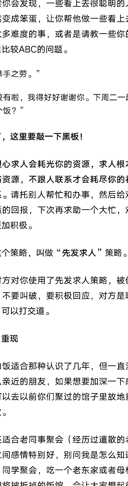

## 8.先发求人

如果没有特别好的借口，先拜托别人做事是个不错的选择。

有时候你会发现，一些看上去很聪明的人会突然变成笨蛋，让你帮他做一些看上去没有太多难度的事，或者是请教一些你的领域里比较ABC的问题。

> “举手之劳。”
> “没有啦，我得好好谢谢你。下周二一起吃个饭？”

## 注意了，这里要敲一下黑板！

不要担心求人会耗光你的资源，求人根本不会伤资源，不跟人联系才会耗尽你的社会关系。请托别人帮忙和办事，然后给对方合适的回报，下次再求助一个大忙，对方会更加积极。

我管这个策略，叫做“先发求人”策略。

如果对方对你使用了先发求人策略，被你识破，不要叫破，要积极回应，对方是聪明人，可以打交道。

## 9.昔日重现

这种约饭适合那种认识了几年，但一直没有那么亲近的朋友，如果想要加深一下感情，可以去以前你们聚过的馆子里故地重游一次。

这种还适合老同事聚会（经历过遭散的老同事之间感情特别好，别问我是怎么知道的）、同学聚会，吃一个老东家或者母校附近即将被拆掉的饭馆，会让大家想起很多往事。

如果你要组织一场多人聚会，借口“我们毕业几周年”“我们入学多少年”的由头，能拉到不错的人头。

## 10.呼朋引伴/招灯引泊

呼朋引伴，指的是如果你想要加深和某甲的关系，偏巧最近又认识了某甲的好友某乙，那可以试试三人局：

先对某乙称赞某甲（可能传入某甲耳朵里），然后对某甲提起某乙，跟着就约三人的小饭局，和某甲、某乙同时加深感情。

要留神两点，某甲或者某乙最好不都是女性，也最好不都是“老男人”，记得我们在《如果请老男人帮你办事？》里提到的吗？不要在一个老男人面前称赞另外一个老男人，可能会有意想不到的伤害，要事先核实一下俩人是不是真的关系好。

“招灯引泊”，是如果你要约一位有好感的异性，和对方的关系不够熟，可以约一位双方都比较熟的第三人在场，这是一种老派的方式，最多是被人笑话比较老气，但总体上来说，意味着你认真考虑了对方的感受。

恶劣的吃饭借口包括：

- 我有两张自助券明天要到期了，你来陪我吃吧。（我是饭桶吗？）
- 被人放鸽子了订的餐没人吃。（我是备胎吗？）
- 心情不好，来陪我吃饭吧。（一张嘴就要我承受负能量？不过如果提出这种邀请的是异性，则对方有可能喜欢你。）

说两点例外：

- 1. 如果你是颜值极高的人士，恶劣借口可能都不叫事儿，你不一定会得罪人。
- 2. 不同地区、不同文化的女性对一起吃饭的看法不同，比如北方女孩可能会认为一起吃饭有约会意义，但热衷于聚会吃饭的川渝女孩可能认为吃饭就是吃饭。同样，十几岁、二十多岁的女生可能会觉得吃饭就是吃饭，但27岁以上的女性可能会觉得不熟的男性朋友的邀请就是准约会。

我们已经提供了10条请吃饭的借口，如果还说自己选择困难，就把这篇攻略分享给你的朋友：我想请你吃个饭，帮我找个好借口，还你一个好胃口！

### —— 习题 ——

你想要第一次请一位比你身份高得多、事务繁忙的远亲长辈吃饭，这个人的关系深厚，手握权柄，这时你的做法应该是：

- A. 某教授，我是某某的儿子某某，想请您吃个饭汇报一下情况。
- B. 姨！老家的腊肉我给您带来了！我母亲手做的！
- C. 您好，您明天有空吗？
- D. 请一位跟长辈更熟悉的亲戚出来先约这位长辈出来吃饭，建立联系以后再单约。

答案：D。

有权有势的中老年男性，他们稀缺的是时间。

A太生分，B太没有界限感。

C纯粹是幌头青，也没有自报家门，这么约人是取死之道。谁差一顿饭呢？

D的选择最好，先让对方熟悉自己，建立一种可以叫舅的关系或者可以成为师徒的关系。

## 附：与其他篇目的联系

《为什么换了新工作前三个月里不要赚钱》
《如何给领导送礼》
《谈工作没问题，一闲聊就变成大笨蛋，怎么办》
《如何请求老男人为你做事》

## 专题 | 作为领导，如何挑选中？

099|专题：作为领导，如...

熊太行

今天的专题中，我们一起复习一下：作为领导，应该如何挑选中下属。

在这儿，要再跟大家重复一下，今天专题中的这几篇文章，没有直接表述这是领导的做法，但作为领导怎么挑下属，却篇篇都用得到。

同样，即使你不是领导，重温今天的专题，也相当于给自己提醒，在工作团队中，做哪类人，才能被领导看中。

## 《为什么妄人必须尽快清理掉》

一个团队里，最大的隐患就是蔑视规则的妄人，这种人必须尽快清理，否则大家会一起被他害死。

自视甚高的人很多，每个公司里一定都有。

这类人有自己的用途，比如扮演甲方代表，他是可以对公司有一种谜之自信的，能够特别有效地抑制乙方膨胀。

## 《脾气坏就是人坏，不要再替他找借口了》

你团队里有没有脾气很坏的人？

人好还是人不好，很简单，就是看他和身边的人相处方式怎么样。

## 《怎么从朋友里选出做大事儿的人》

这篇文章。看上去，是教你怎么找朋友，其实，对于团队用人，同样适用。

- 1. 是不是渴望成功的人；
- 2. 是不是希望展示个人实力；
- 3. 是不是想挣钱；
- 4. 对成功的看法；
- 5. 小时候是不是肩负着家长的期待，是不是受过良好的教育和训练。

今天复习的专题，你可以点击蓝色字体，重温整篇文章。

你还想看到哪些专题，欢迎在评论中留言。

## 残酷社会生存法则

## 人情债攻略：为什么说人情债是关系神器？

## | 知识点

人情债和大多数实体债务不同，借贷双方是一种“共谋”和“投资”的关系。

在《请吃饭攻略：请客吃饭这件事，也需要一个好借口》这篇文章当中，我提到了“先发求人”的策略。

很多同学留言，说喜欢这两句话：

> “不要担心求人会耗光你的资源，求人根本不会伤资源，不跟人联系才会耗尽你的社会关系。”
> “请托别人帮忙和办事，给对方合适的回报，下次再求助一个大忙，对方会更加积极。”

有的同学说，这种观点颠覆了从小以来的认识。

还有更颠覆的，今天就详细解释一下为什么要欠人情债。

## 1.什么是欠人情？

别人对我让渡了利益或者对我付出了服务，我暂时没有给予相应的报偿。

你可能是暂时没有实力报偿，也可能对方暂时什么都不缺。

## 2.人情债的本质是什么？

人情债的本质是双方的结盟与合作。

人情债和大多数实体债务不同，借贷双方是一种“共谋”和“投资”的关系。

## 3.为什么要让别人欠我的情

让别人欠我的情，代表着我希望收获对方的友谊，聪明人会主动地让别人欠自己。

在《天下无贼》里，葛优扮演的黎叔因为赏识刘德华扮演的小贼，决定不偷傻根的钱，还放出话来说：“这趟车不打猎”。

这就是在放人情债，我们说过如果借钱给人一定要打条，同样，放人情债也一定要说给对方听，让对方承你的情。

人情债的债主一般来说比债务人身分略高，或者基本相等、各有所长。所以一般是“大哥帮小弟”“长辈帮后辈”的模式。

## 4.为什么我要欠别人的人情

我见过好多年轻的朋友，背井离乡来到北京或者深圳这样的城市。

## 5.“不爱给人添麻烦”的是什么人

大多数用“不爱给人添麻烦”形容自己的人，其实不了解这句话的真实含义，只是因为自己家的长辈这么说，自己也就这么说。

## 6.不良人情债有哪些

有些债务属于不良债务，比如有人强行要给你介绍条件很差的对象，或者送一些品质低劣的礼物给你，你看不上，要推脱又觉得很难。

## 7.欠别人的会内心不安吗？

家中的老太太多持这样的观点，她们本身的能力和掌握的资源有限，总是担心欠了别人的还不起会很麻烦。

这让很多老年人不爱欠债，比如他们一旦有一笔存折或者国债到期，就会琢磨着是不是帮助孩子去还公积金贷款，其实这种贷款利息很低，最好是用最低还款额来还才划算。

人情债同样也不要急着还，而是在需要的时候再还。这点来说，要调整好自己对人情债的认识，不要让自己的内心自洽（人内自洽）被破坏，那就得不偿失了。

其实如果你细细研究《白毛女》的故事，就会发现其实问题不是债务，而是老杨家人口太多，就孤老头和女儿，根本无力应对黄世仁的暴力行为，如果喜儿有五个强壮的哥哥，黄世仁也不敢拿他怎么样的。

## 8.破裂的人情债

人情债是非常稳定的债务，但仍然有破裂的可能。

常见的人情债破裂，是因为一些非货币的人情没有很好的估值。

如果是有有人用钱财来帮我度过难关，那个人情的估价会比较容易，但是有的人情就难以估算。

比如我在你心情低落的时候陪你看过流星雨。这个估值是多少？

如果你用逛街来还我，够你陪我逛街几次？

非货币的人情在同学少年时、读书的时候会特别明显，对一件事双方估价方式不同，很容易在偿还的时候被人觉得不讲义气。

## 9.最伟大的人情债是怎样的

1924年，走投无路的文学爱好者沈从文（小学毕业）写信给已经成名的作家郁达夫（留学回来），请求他的援助。

郁达夫来到沈从文的出租屋，发现他裹着棉被在炕席上写作，大冬天连个火都没有。

沈从文三天没吃饭了。

> “你就是沈从文，你这么年轻，你写得这么好……”

郁达夫把围巾给沈从文围上，带他去吃砂锅羊肉，郁达夫带了5元钱（银元），大家吃了一块多，剩下的找零和围巾都给了沈从文了。回去郁达夫写了一篇文章，有点悱恻地说，一位文学青年闹荡北京，不如去当兵，或者做小偷。

沈从文用郁达夫留下的钱维持生计，终于发表了文章，在北京活了下来。

五十年后，沈从文见到郁达夫的侄女，提及此事，泪如雨下。

真正的民国风骨是什么样的？两个经历完全不同的人能彼此友爱，看见一个伟大的灵魂，我把身上的钱，腋子里的心掏出来拍在桌子上面。

对方感激而不纠结，遇见真心赏识自己的人，能收下友谊，记得半个世纪。

这就是天地之间的英雄气。

我们再说一句大俗的，郁达夫的这5元钱的人情债，花得值不值？

你可以没有郁达夫那样的才华，但如果你有一个贷出人情债的意识，仔细观察，身边是不会缺少沈从文的。

帮助有潜力的、不得意的朋友，一般都会有收获。

## 10.欠人情债的能力越强，关系能力也越强

我们借用马克思的一句话：人在本质上是一切社会关系的总和。

我们描绘一个人，会说：他很有实力，或者是这人混得很好。

有实力的人，除了本身能力很强之外，还会有许多可以借用和调动的力量。

你能欠人情，说明别人看重你的实力愿意贷出人情给你。

能欠别人人情的人，都是了不起的角色，人情债不是负资产，而是帮你飞黄腾达的关系神器。

大多数的“人情债”都是双方的合谋。

放出一个人情债，你就收获了一个友谊，情感银行里就多了一笔存款。

欠下一笔人情债，你就增加了一个信用点，你就有更多的资源投在你的人生和事业上。

套用一个投资的说法，你其实是在跟你的关系“配杠杆”。

## —— 总结 ——

一旦自觉、主动地经营自己的关系，学会了给自己的关系发展“配杠杆”之后，人的成长会特别快。

有时候是不是这么觉得：某人会来事，会讨领导欢心。而自己一门心思忠于公司，做好工作，效果却不如对方。

这就对了，如果你是银行，是把钱贷给一个长期使用信用卡，每次都能正常还上的呢。

还是贷给一个喜欢把钱埋在自家树底下，认为银行是阎门邪道的骗人组织的呢？

如果你是领导，是一个情感上的放贷者的话，也会把机会留给这个胆子更大的家伙的。

## —— 思考题 ——

你有没有因为担心欠人情而失去的机会？如果有的话，写在留言中，大家一起交流。

## 附：与其他篇目的联系

《为什么说做人留一线，日后好相见》
《亲戚家的孩子长大了，快送他们去和亲吧》
《为什么 “我是个人重感情的人” 不要挂在嘴上》

## 如何克服在领导面前的紧张感？

101|如何克服在领导面前...

最近热播的电视剧《军师联盟》，讲的是司马懿、杨修、曹丕和曹丕等聪明人的故事。

魏晋之间，有一个特别聪明，又亡了蜀汉的角色，这个人就是钟会。

大书法家钟繇的儿子钟毓、钟会从小名声都很好，两个人都是聪明人。

他们的区别就在于，哥哥钟毓在领导面前，始终都有淡郁的不自然。而弟弟无论是在父亲面前，还是皇帝面前，都显得胸有成竹——有的人就是不怕领导。

《世说新语》里有两个小段子，兄弟俩一次在父亲面前，一次在皇帝面前。弟弟回答得非常灵巧，而哥哥的答案总是笨笨的。

## 第一个段子：

## 第二个段子：

哥哥的回答非常传统，弟弟的回答则贴近非主流。同样，弟弟的做法还是希望拖领导逗乐了或者让他喜欢，来拉近和领导的关系。

钟家哥俩的两种做事风格，代表的就是和领导的两种相处之道：

- 靓见者：保持距离，拿领导当做领导。
- 共舞者：拉近距离，和领导一起共舞。

## 1.正确评价自己的工作

## 2.多了解一点关于领导的事情

## 3.级别差得多人就更容易紧张

## 4.必要的紧张很有意义

## 5.抓住机会？你想多了

你会记得每顿饭吃的东西吗？只有在和某些重要的人吃，或者吃某些罕见的食物，这顿饭才可能记得下来。但你的常规汇报绝对是不在其中的。

上去就对大领导各种拍马，想要一步登天，这对带你去汇报的领导也是一种不尊重。事实上大领导绝对不会在你讲完一个冗长的PPT之后，对你的领导说：“这个家伙不错，把他给我吧。”（你颜值特别高的话另说）而只会说：“你手下的这小伙子不错啊。”

你的前程，最终还是要回到你的领导那里去实现。

## 6.克制过度的紧张的一些法门

拜见领导之前进行深呼吸，平复自己的心情，是非常有效的办法。

系统脱敏法，我们以前提到过，再简单介绍一下。

如果你要进行比较重要的汇报，开始畏惧紧张的时候，要尽早开始想象自己汇报的场景。

这种想象要充满细节。

开始想象你被领导骂得狗血淋头的感觉，要复盘领导可能说出来的刻薄话。

开始放松，逐渐回到现实当中来，告诉自己，这件事没有发生，不过如果发生了，也就是刚才的样子。

重复这个过程，你又一次被骂得狗血淋头，记得，这是你最坏的局面。

再重复两次，直到你对这件事没那么纠结为止。

等你真的去汇报之后，你已经身经百骂了。

## 7.最后传一个小锦囊

我们重新回到钟家兄弟的两个故事里，哥哥钟毓都是那个回答传统的人。而弟弟钟会，都是那个回答充满了想象力的人，我们一定会有一种错觉，那就是哥哥资质平庸。但是我们可以试试改一下这两个故事：

钟毓兄弟小时候在父亲午睡时，趁机一起偷药酒喝。钟繇刚巧醒来，故意装睡观察儿子们怎样行事。钟会只喝酒不行礼，钟毓行礼后才喝酒。

父亲问钟会为什么不行礼，钟会说：“偷，本来就不是行礼的行为，所以用不着行礼。”

随后父亲问钟毓为什么要行礼，钟毓回答说：“虽然偷是不合礼法的事，但酒仍然是礼仪用的，我不敢不行礼呀。”

十三岁时，魏文帝曹丕听说这两个孩子的聪慧名声，就对他们的父亲钟繇说：“可以叫这两个孩子来见我。”于是奉旨觐见。

文帝问钟会：“你为什么不出汗？”钟会回答：“由于恐惧战栗，害怕得发抖，所以汗水也不敢冒出。”

钟毓脸上冒有汗水，魏文帝问：“你脸上为什么出汗呢？”钟毓回答：“看见弟弟不敢出汗，怕他被天子责罚，就赶紧多出了一人份的汗，搞一点平衡。”

大家发现了没有？回答差不了太多，但是感觉差太多了，钟毓变成了一个带有腹黑蔣坏气质的哥哥，而钟会的奇妙回答看上去也没有那么出彩了。

对，这就是领导面前说话的一个小窍门，“后发优势”。

如果你和你的同事一起接受领导的询问，让他先说、先汇报，你来补充或者谈论你自己的工作，就有了更多出彩的可能。

## 附：与其他篇目的联系

《如何与一个控制狂上司相处》
《陷入了向两个领导汇报的局面应该怎么办》
《忠诚攻略：你一定对职场上的忠诚有很多误会》
《如何拯救一个害羞的灵魂》

## 专题｜朋友清单，要记得常理常新

熊太行

今天的专题，我们一起重温一下关于朋友的几件事。朋友清单，也要常理常新。

## 《怎么从朋友里选出“做大事儿”的人》

朋友的清单一定要经常更新。一年交不上5个新朋友新伙伴，可能你的事业就停滞了。

28岁到40岁的朋友要注意了，这是一个结交朋友扩张人脉的好时期，大家可千万别觉得这个时候交的朋友不如高中同学和大学同学。

这个时候因为你们是基于共同利益、身份地位相交的，同时又过了对友谊的饥渴期，反而可能交上好朋友。

## 《交朋友是找像自己的，还是找和自己互补的》

心理学家曾经研究过人们为什么会彼此吸引，结果发现有一条原则扮演着非常重要的角色：

喜欢你，是因为咱俩很像。

## 《如何给新认识的人留下好印象》

人际交往中，我们希望控制给对方留下的印象，这种行为社会心理学上称之为“自我表达”。

- 1. 自我提升，传达关于自己的积极信息。
- 2. 互相表扬，自我表扬是为了在对方面前显示出你的强大，表扬对方，则可以让对方感到舒服。
- 3. 不做自大狂，收起自己的夸夸其谈和炫耀。
- 4. 当别人说自己是哪方面的高手的时候，自己也要立刻跟上，表达自己是哪个方面的高手。你们会变成惺惺相惜的好朋友。

今天的专题先带你温习这些，记得我们常说的那句话，关系和朋友一样，常理常新，时时复习，不仅能加深你对关系的理解，还能让你从多角度看待一篇文章。

只有自己学会思考，复习对你才算有用。

## 二把手攻略：每个人都该给自己物色一个副职

103二把手攻略：每个人... ↓

觉得自己不带团队就 breadth这篇文章的人都会吃亏。

觉得自己不带团队就 readability 这篇文章的人都会吃亏。

觉得自己不带团队就读这篇文章的人都会吃亏。

这篇文章绝不是仅仅告诉你，二把手要忠诚，要低调。

我们《关系攻略》解释一个关系，除了告诉你它是什么，该怎样做，还要告诉你一件重要的事：“为什么。”

## 什么人是二把手？

- 1. 他是你的分担者，在你不能处理事务的时候，他可以代替你。
- 2. 他是你的继承者，在你无法继续走下去的时候，他可以接替你。
- 3. 他是你的陪伴者，要和你一起承受艰难、分享收获。

注意这三点：分担、继承、陪伴。

你对你的二把手的所有策略，都应该扣着这三点展开。我们试着分析个例子，看看这两个人是不是二把手的关系。

## 要知道，有些人是你的首席下手，但不是二把手。

## 荀彧是不是曹操的二把手？

在曹操建立魏公国之前，确实是。曹操做司空，荀彧当尚书令，曹操打仗，荀彧留守。大家有点相濡以沫的姿态。

## 真正的二把手一定是一把手的自己人。

## 1.二把手最重要的是不是分工，而是建议和影响一把手的权力。

## 2.你组织里的二把手是不是健康

## 3.二把手的三种分类

## A.鬼副长型的二把手

## B.大管家型的二把手

主，能包容冲动暴躁的一把手。二把手不应该有太多的想象力。

## C.少东家型的二把手

少东家和鬼副长、管家婆都不一样，他只要学习、成长、显示出活力来就够了。如果你遇到这样的二把手，相处可能就是一个问题。

因为少东家往往还有需要学习和改善的地方，做事业可能偶尔还有情绪化的地方。

## 4.二把手和一把手的几种关系

### A.组阁授权

一把手充分授权给二把手，让二把手组织人力财力来完成，老大只负责要结果，一些大的花费和支出，二把手有决定权。

这种制度的好处是可以让二把手尽力发挥自己的力量，坏处是二把手权力比较大，很难控制。

### B.任命合作

### C.职业经理人

## 5.当二把手必须给老大省时间

鬼副长和管家婆虽然路数不同，但在“节约老大的时间”这点上是完全一致的。

让领导从繁忙的日常管理当中解放出来。

职场上的时间有两条规律，好好记得：

> "老板的时间一定比你值钱。"
> "如果你的老板用你帮忙省出来的时间用来打游戏，请参考第一条。"

## 6.为什么普通人也需要二把手

有的同学可能会觉得，我现在自己还是基层员工，我别说要一个二把手了，就连一个兵都没有？为什么我也要物色二把手的人员？

因为大多数能成事的人都会早早物色好自己的队伍。

## 7.兄弟是你天然的二把手

在光荣的职场游戏《太阁立志传》当中，木下藤吉郎（后来的丰臣秀吉）在自己当上武士之后，会赶紧跑回乡下老家，去招募自己的弟弟木下小一郎（后来的丰臣秀长）。

## 8.一把手怎么对二把手

仔细观察一把手的动向，事实上大多数一把手每天一睁眼都要问手下人二把手在做什么。

该拉拢，该授权，放心授权，该给钱，放心给钱。

## 9.永远不要投票选二把手

## 10. “除非是你儿子，不然就逐条一点的那个，笨的忠诚。”

## 附：与其他篇目的联系

- 《忠诚攻略》
《职场上的民主应该怎么用》
《为什么说情绪管理是件性命攸关的事》
《领导抢我的功劳该怎么办》

## 专题 | 中国式关系的解决方案

104专题：中国式关系的...

熊太行

今天的专题，专门跟你一起复习一下“中国式关系的解决方案”。针对生活中，特有的中国式关系，为你提出解决方案。

## 《为什么不要给人介绍对象》

给人介绍对象这件事，算是咱俩目前社会的一大现象。尤其最近新闻还报道了相亲鄙视链。所以今天我再带你复习一遍，介绍对象有多麻烦。

介绍对象曾经是中老年年人维持自己政治影响力的一种行为。

但是现在帮人介绍对象只会浪费时间，还会遭遇无尽的埋怨。

> 还记得我们常说的那句话：“不做中、不做保、不做媒人三代好”。这一点也不夸张。

做媒容易给你带来很多的怨恨，比如：

介绍的对方太丑，尤其是旁边长得比另一方丑太多，这时候高颜值的一方会迁怒于介绍人。

会觉得说：哦，原来我在你心目中就是这样的一个实力咖。

更常见的一种局面是，两个丑人互相嫌弃，全都迁怒于你。

还有一种情况，介绍任何姑娘给一个花花公子，你都会陷入他们家混乱的家庭关系、男方好色的指控当中，而你作为介绍人可能还要被迫调解这一切。

最要命的是，花心男很多人都不错，他们不光温柔，而且心软。是非常好的朋友。你如果只跟他做朋友，完全分辨不出来。

更要注意的一点是，有一方不孕不育。这在今天依然是一件大事。也许你撮合的两位朋友都不会怨恨你，而是会归咎于命，但如果不孕的原因在女方，男方母亲可怕的怨念一定会带来强力诅咒。

而你也有受到自我谴责。我们知道好心肠的人都容易被纠结和自我责备侵蚀，一件事没做到完美，太辛苦了。

所以这就是我的忠告：别给人介绍对象，时间成本太高，即使能够成功，得到了夫妻的感激，七年后，十年后，人还是不是两口子都很难说。

我们知道改革开放之后，很多岗位都不再有终身制，出现了前夫、前妻、前领导人。

别管别人家的事，不如多花点时间学本事。

## 《人情债攻略：为什么说人情债是关系神器？》

人情债，也算是咱俩如今社会的独特关系了。

还记得这两句话吗：

第一句，“不要担心求人会耗光你的资源，求人根本不会伤资源，不跟人联系才会耗尽你的社会关系。”

第二句，“请托别人帮忙和办事，给对方合适的回报，下次再求助一个大忙，对方会更加积极。”

那人情债的本质是什么呢？

人情债的本质是双方的结盟与合作。

人情债和大多数实体债务不同，借贷双方是一种“共谋”和“投资”的关系。

让别人欠你的情，代表着你希望收获对方的友谊，聪明的会主动地让别人欠自己。

而人情债的债主一般来说比债务人身份略高，或者基本相等、各有所长。所以一般是“大哥帮小弟”“长辈帮后辈”的模式。

放大人情债的人几乎都是聪明人，他们希望掌控更年轻的力量，希望在过了自己的巅峰期之后保持自己的影响力。

再给你提个醒，帮你梳理一下不良人情债有哪些。

比如有的人强行要给你介绍条件很差的对象，或者送一些品质低劣的礼物给你，你看不上，要推辞又觉得很僵。

还有一些是不良的债主，有的人给一些小恩小惠，是为了把别人拉进传销组织或者购买他的伪劣产品。

另外还有，他托你办事，你借给他自己的关系，他在其中挑拨离间或者中伤你们之间的关系，或者你帮了他很多忙，他却以小事挑错，跟你绝交，绝交了人情债就赖掉了。

还有一件事情要注意，人情债是非常稳定的债务，但仍然有破裂的可能。

常见的人情债破裂，是因为一些非货币的人情没有很好的估值。

如果是有用钱财来帮我度过难关，那这个人情的估价会比较容易，但是有的人情就难以估算。

比如我在你心情低落的时候陪你看过流星雨。这个估值是多少？

如果你用逛街来还我，够你陪我逛街几次？

非货币的人情在同学少年时、读书的时候会特别明显，对一件事情双方估价方式不同，很容易在偿还的时候被人觉得不讲义气。

> 我们借用马克思的一句话：人在本质上是一切社会关系的总和。

我们描述一个人，会说：他很有实力，或者这是人混得很好。

有实力的人，除了本身能力很强之外，还会有许多可以借用和调动的力量。

你欠人情，说明白人看重你的实力，愿意贷出人情给你。

## 附：其他中国式关系解决方案

《遇到年长的同事爱盯着你的私生活怎么办》
《对抗通婚其实没那么难》
《婆媳有了矛盾，为什么一定要站在媳妇这边》
《如何拯救为奴的女儿们》

## 残酷社会生存法则

## 业务冠军怎么老也无法升职？

105|业务冠军怎么老也无... ↓

一个关系户曾经这样提问：

> “我入职七年，入围副科长选拔，但没上。三个月前，换岗去另一个科室，失败。我离开这个系去区属单位，相对容易，但有点儿舍不得多年的业务积累。请问老师，怎么降低工作量？或者说有其他更好的办法解决现在的困境？”

这位同学的工作岗位是一个窗口单位，他是一位非常出色的业务冠军，但他总也提不上去。

他的困惑不只是他自己的困惑，后来我陆续收到类似的留言，大家的行业不同，但是面临的问题惊人的一致：

- 1. 我是业务最好的人。
- 2. 我也多次表达的进步的愿望。
- 3. 想升职一次次地失败了。
- 4. 我的工作，变成了鸡肋。

绊倒你不是门前那座山，而是你鞋里的那块小石头。真正让业务冠军吃苦头的，其实不是那一个个超过你被提升的人，而是你对忠诚、成绩和提升的错误认识。

我在这里把关于业务冠军的认识列一个清单，大家可以看看自己有没有认识上的谬误：

## 1.业务冠军本来就是一个坑

在《狮王争霸》的电影里，一群中国武术家为了夺金牌大打出手，死伤修重。

最后黄飞鸿拿下金牌，对李鸿章说：

这个金牌是什么？

就是业务冠军。

就像高考有状元，有单科最高分，但并不设置一个“单科状元”去表彰一样，“业务冠军”很少是一个组织钦定的称呼。

有的单位会组织业务大赛，也会有人得奖，但是这往往仅仅只是技能比赛而已。

> 孔子说过：“君子不器。”

你应该是一个独当一面来做事业的人，应该是最好 的大脑，不应该是“这个队伍里最好的手，最好的脚。”

没有任何一个司令都会考虑枪炮的感受，只希望他们继续发射。

当你成为“业务冠军”的那一刻开始，你的命运其实就已经注定了。

你是一个很容易而且可以被牺牲的人。

## 2. “他业务比我强，但我比他更全面”

在追求“业务第一好”的过程当中，你可能会和一些人发生竞争和冲突，这些人和你一样，是准备通过本事来立足的，对自己的能力，他们非常自负。

《狮王争霸》里的鬼脚七，鬼脚七最早是一个打手，反派收买了他，想用他打败黄飞鸿。

如果专论武功，鬼脚七不弱于黄飞鸿，也许某些方面还要强一点。

但是最终黄飞鸿让他服气的，是眼界、见识和做人。

黄飞鸿不应该跟鬼脚七去比谁是天下第一硬脚，同样，如果你是一个雄心勃勃想要做大事的人，最好也不要去在基层跟别人为一个业务冠军的名头打破头。

你可以放手归功于你的竞争者，在大多数的机会、事业单位和国企，以及一些规模足够的大的外企和私企当中，你都可以采用以下这个策略。

> “某某是我们这里业务最好的同事，我衷心佩服。”当跟领导偶尔提到的时候，不要吝啬你的表扬，然后话锋一转：“不过在带领小团队做事，全局观方面，我觉得我的表现可能更好一点。”

要知道对方可能只会做一件事，证明你的业务没他好。

而你直接承认这一点，然后告诉领导，你的情商要比对方高。

领导在接受“他比你业务强”的时候，同时也把“你更有全局观”这个判断收下了。

## 3.冠军长着一张小门小户的脸

我建议大家不要去追求业务冠军，和这个原因也有关系，大多数而且只靠业务的人，脸上都写着四个大字：“他没门路”。

我知道一定有的同学说，我觉得这样很好，我这么多年都是靠自己。

没错，非常对。

但是有一点，就是如果你在一个机关、事业单位、国企，或者足够大的外企私企，你自己究竟有多少实力是一回事，别人认为你有多少实力是另一回事。

自古到今，所有的状元都是素人，一般老爹来头很大的青年去参加科举，传统上是录第三名探花，以表示我们不会欺负普通人家的孩子。所以如果你因为自己是状元就对探花不 earg气，那一定会死得很块。

所以，不要去追求那种没有意义的第一，保持前列就已经足够了。

## 4.看着业务冠军跟人结仇

业务冠军一般都是树敌小能手，如果你不是业务冠军的话，你大可以撸个板凳，认真真看着他是怎么得罪所有人的。

在光荣的游戏《三国志11》当中，有一个专有名词，叫做“寿春绞肉机”。这是游戏的一个隐藏设定，一旦你打下了寿春城，周围的势力就会突然爆发，全向你进攻，你三五万人的兵力可能要面临几十万人的合围。

这就是“众矢之的”，其实我们看看游戏里的寿春城就会发现它没什么迷人之处，别 的城市要比它好得多。

当你不再追求“业务冠军”的虚名之后，就会发现在这个项目上反复争夺的人们，其实是在进行着低层次上的竞争。你早早跳出来，或许是最好的选择。

如果有人成为业务冠军，此人可能也会在这场争斗当中结仇。

如果业务冠军孤立无援，你最好不要上去踩一脚。即使你们以往有点小恩怨，也绝对不要。

如果你未来做部门负责人，仍然需要能干活的人

一个已经在斗争中失败的业务好手是仍然可以用 的。那时候你的最佳策略是：

## 用他，咋他，不提升他。

## 5.把业务冠军提成领导，那活儿谁干呢？

这个逻辑是很多业务冠军不被提升的关键。

基层的许多业务没有太多的智力含量，更像是熟练工种和技术工种，一个业务冠军被提升之后，他的经验并不能让他应付上面那个岗位的工作，他要学的东西很多。

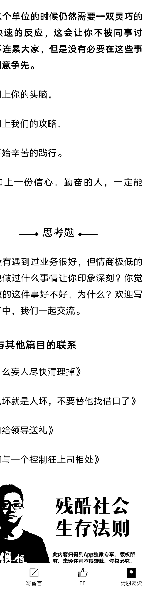

但是下面会突然少了一个办事机器、点钞机器、技术标兵，效率会直线下降。而领导提拔这样一个业务冠军上去，还要对他系统地改造思想，提高能力，很少有领导会这么栽培一个普通员工的。

所以如果一个业务冠军希望被提升，那他可能要赶紧改造自己的知识和思想，摆脱掉业务冠军的标签，成了一个有能力带团队的人。

## 6.如何洗掉业务冠军的标签

要尽快寻找一个替身，一个年轻徒弟是非常不错的选择，可以把自己做业务的心得分享给他，但是更好的办法是，选择几个年轻徒弟，让他们彼此竞争。

不要担心教会徒弟饿死师傅，因为这些事情其实本来就没有 so 多技术含量，在这个过程中你会变成一个培训者和准领导者。

这期间可以多观察自己领导或者自己喜欢的资深员工的做事之道，学习和模仿。

梳理一下你可用的关系，看看有几个人可以就你的提升发言说话，看看他们有没有和自己有联系。我们经常说要写自己领导的传记，这很重要，许多人是在公司里蹉跎岁月老也上不去，偶然才知道自己的领导是同一个系的师兄——这个弯路走了！

拜一拜几个权威人物的山头，不说提升，只说请教，就请教带徒弟的心得——就是管理的经验。

## 7.仍然要寻找效忠对象

曾经有同学义愤填膺地问我：“老师，你说得不对，你说过那些埋头干活的人即使成了领导的人也会边缘，随时可能被牺牲，如果都是这样，还有谁肯埋头干活呢？”

对呀，领导就是不在乎你埋头干活啊。

他需要的是，你对他低头，为他干活。

业务冠军增加的是一个组织运转的效率，这个组织的利益是一回事，领导的利益是另一回事。我们经常说的“利益接合部”概念，讲的就是这个。

领导的利益和公司的利益中间有一个大豁口。

你帮了公司，对领导倒是没用的。

所以做业务即使是冠军，也没有给领导写讲话稿的人地位尊，而写讲话稿的人，又不如如随在领导左右出谋划策、酒池肉林 的那些家仆的地位尊。

业务冠军仅仅是公司的人，不是领导的人。

如果你仅仅是朝廷的官，不是主公的官儿，那你就危险了。

在古代这种人很容易有性命之忧。

《军师联盟》里，荀彧认为自己可以同时是大汉的官和曹操的官。

在曹操和大汉的利益接合部还很小的时候，他们相处得比较融洽。

当曹操变成魏公、魏王的时候，荀彧就无法处理这种冲突和纠结，最终只能自杀了。

我们总结一下业务冠军的成长之路：

- 1. 摆脱冠军光环；
- 2. 强调自己的管理能力；
- 3. 培训新人或者徒弟来于引以为傲的体力活；
- 4. 模仿自己领导的行事，学习管理经验；
- 5. 向有力的领导表忠心，从公司的人变成领导的人。

以及，说一句题外话，我是觉得大多数的业务冠军，在未来二十年中可能都会被机器人或者AI取代，如果去一些最先进的无灯工厂看看，就明白这个趋势了。

当然我不是让大家忽视基层技能。

新到这个单位的时候仍然需要一双灵巧的手和快速的反应，这会让你不受同事讨厌，不连累大家，但是没有必要在这些事情上刻意争先。

早点用上你的头脑，
早点用上我们的攻略，
早点开始辛苦的践行。

最后加上一份信心，勤奋的人，一定能赢。

## —— 思考题 ——

你有没有遇到过业务很好，但情商极低的人，他做过什么事情让你印象深刻？你觉得他做的这件事情好不好，为什么？欢迎写在留言中，我们一起交流。

## 附：与其他篇目的联系

《为什么冤人尽快清理掉》
《脾气坏就是人坏，不要替他找借口了》
《如何给领导送礼》
《如何与一个控制狂上司相处》

## 随份子攻略：份子钱不是钱，而是流动的关系

在写了《人情债攻略》之后，我就一直接到关系户同学的留言，问份子钱怎么随。

> “给多了肉疼，给少了惭愧。”

大多数有这样困扰的人，都是大学毕业不久的年轻人，有的甚至还在读本科或者读研，总之，穷。

偏偏中国人结婚又都挑长假，比如五一和十一就是两个结婚大节。

刚工作不久，加上两个结婚节可能多家结婚，肉疼也就所难免。

我经常对大家说，关系攻略有一个重要功能，就是把你昔日家庭里传授的某些错误认识额覆过来，比如对份子钱的错误认识。

份子钱不仅仅是钱，在值得交的朋友那里，它是关系的流动。

我们经常说份子钱份子钱。但把它看成钱，格局就小了。

关系绝对不应该是一潭死水，份子钱、人情债，本质上都是关系健康的流动，有一呼一吸，才有生命；有一来一往，才有关系。

## | 什么是份子钱？

在过去的农业社会里，份子钱的目的是互助。

自然经济的小农家庭没有太多的流动资金，婚礼、白事需要的各种用物都需要这笔礼金，所以传统的份子钱，其实是一种“众筹”。

如果有人读过山西作家（本职是个警察）曹乃谦的《到黑夜想你没办法》，就会记得他提到的一种“打平安”的方式，几个光棍每人带一点食物或者酒，一起在深夜吃东西聊天。

没有钱的时代，人们发明了凑份子吃饭、凑份子结婚，这是一种古老的传统。

关于传统有两个谬误，一种认为所有的传统都是好的。另一种认为所有的传统都应该被现代的东西所取代，比如有的朋友会特别厌恶酒场、厌恶奢靡折磨人的丧礼，希望移风易俗。

我曾经建议过大家，思想上可以特立独行，但生活方式要尽量随大流。别人结婚上份子，这算是一个延续了几百年的传统，保留下来其实也没有什么不好。

派利是发红包也是一种农业社会的传统，开春了地主给钱，让佃户好好干活，现在在腾讯这样中国最大的互联网企业里被发扬光大，拿到钱的人也是欢天喜地，一点也没有觉得土。

一个习俗如果有利于生产力发展、关系和谐、也没有伤害人，那就是一个好习俗。

其实就在很多年轻人觉得份子钱让自己的经济感到吃力的时候，份子钱跟不上酒宴价格的趋势也让很多新婚夫妇感到吃力，一线城市许多酒店的宴席人均都到了600以上，收到500元的份子钱，其实并没有什么利润可言，许多夫妻也在谨慎地邀请宾客，不再是广撒网的趋势了。

## 一个善意的众筹办事制度是怎么成为宾主双方的负担的？我这里用一段“全民备胎夏周一”的漫画，来给大家解释一下。

- 1. 无效的关系投入

一个份子钱折磨人，不在于你给了他多少钱，而在于即使你给他一块钱，你都觉得不值得。

夏周一接到了小学隔壁班（小学已经是一个远关系，还是隔壁班，这种同学只有去厕所才能见得到）二狗的邀请，要他去参加婚宴。

夏周一心疼钱是次要的，他认为根本不记得这个人，以后也不会跟他有交集。

关系不到的人，请别人参加婚宴，很容易让被邀请者有这样的感受。

- 2. 邀请很没有诚意

大多数的婚宴要提前两个星期发请柬，一来是保证到客率，二来也是对别人时间的尊重，二狗提前几天发请柬，这就叫做“顺风请”或者“顺嘴请”。

除非真的是失散多年居然联系上的朋友，不然的话，这种请，就是请备胎，怕人头坐不满多请两个，就像航空公司超售一样。

- 3. 没有分寸感的当事人

大家注意二狗的措辞，很多邀请者都这么说话。

因为大家熟悉，或者假装很熟，就用特别轻松的语气来说话，这是人际交往当中常见的失态，这种人分寸感特别不好。

在《三国志》里，吕布就是一个这样的人，吕布打了败仗去投奔刘备，把嫂嫂刘氏领出来，跟刘备指着自己嫂嫂说：“兄弟，这是你嫂子。”

张飞听了就暴跳如雷：“我大哥走到哪里不是大哥就是叔，你敢当他的大哥，哪来的嫂子！”

刘备劝住张飞，但是也觉得吕布这个人分寸感不好，后来吕布果然».

吕布这种人，我们一般称作“大没脸”或者“二皮脸”，虽然分寸感不好，但是内心自洽这块，他是高手，他完全不会觉得自己不得体。

类似的，请人参加婚礼，即使是损友，也应该尽量用词庄重正式，哪里被人笑话气一点也没问题，如果邀请别人说“我结婚，你来一下呗。”

那别人要不要说：“这次不行，下次一定去。”

- 4. 最好的拒绝是不回答

大家可以注意看，夏周一的回复很典型。他推说自己忙。

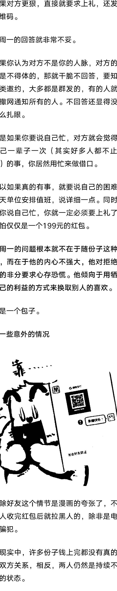

结果对方更狠，直接就要求上礼，还发了二维码。

夏周一的回答就非常不妥。

如果你认为对方不是你的人脉，对方的邀请是不得体的，那就干脆不回答，要知道这类邀约，大多都是群发的，有的人就是海撒网通知所有的人。不回答还显得没有那么尴尬。

但是如果你要说自己忙，对方就会觉得，自己一辈子一次（其实好多人都不是一次）的事，你居然用来做借口。

所以如果真的有事，就要说自己的困难，那天单位安排值班，说详细一点。同时如果你说自己忙，你就一定要必须上礼了，哪怕仅仅是一个199元的红包。

夏周一的问题根本就不在于随份子这种习惯，而在于他的内心不强大，他对拒绝别人的非分要求存恐慌。他倾向于用牺牲自己的利益的方式来换取别人的喜欢。

这是一个包子。

## 5.一些意外的情况

删除好友这个情节是漫画的夸张了，不会有收入完红包后就拉黑人的，除非是电信诈骗犯。

但现实中，许多份子钱上完都没有真的改善双方关系，相反，两人仍然是持续不联系的状态。

我也曾经遇到一位同学问我：“我曾经去随份子，随了2000元，后来我办酒那位来了，回了我1000元……怎么办熊老师”。

怎么办？当然选择原谅他！

大多数的人都不会刻意做这样的事，原因其实是“粗心大意”。

## 6.关于婚姻的一种迷信

《人类简史》里提到了一个观点，和尼安德特人相比，我们智人更加富有想象力，我们的祖先在三万年前就能够脑补很多很多事，你可以称之为信仰、宗教和梦想。

p.s

说两句关于白事：

中国民间的大多数习俗都是“喜事要请，丧事要赶”。

## 附：与其他篇目的联系

《婚礼是研究一个家族的绝佳样本》

《对抗逼婚这件事没有那么难》

《人情债攻略：为什么说人情债是关系神器》

## 专题｜关系攻略颠覆过你哪些认知？

107|专题：关系攻略颠覆...

熊太行

有心的同学会发现，最近的文章经常会给你一个新概念，或者颠覆一个你对关系的认知。

今天咱们就一起来复习一下，关系攻略中，曾颠覆过你哪些认知。

《领导抢我的功劳，该怎么办？》

你认为领导抢你的功劳，这个看法本身就是错误的。

在文章中我给你讲了一个小故事，再一起来看看：

两只狮子看见一只羚羊，大打出手，身份地位相似，这叫“争抢”。

一个鸬鹚下水捕鱼，然后渔人捏着它的脖子让它吐出来。这不叫争功。这叫“收获”。

你的领导就是在收获你的功劳，他不需要跟你争抢。如果一个人给你分配工作、安排任务、定你的等级或者薪酬，评估你的工作表现。这叫做你的领导，你和别的员工的功劳合起来的功劳，就是他的。

当他把你的成果汇报给大领导的时候，你要明白，这是你们共同创造的。他对大领导提及团队，或者专门提及你个人，那是慈悲、是抬举，是加分项目。

他全都归功于自己领导有方，这也没有什么奇怪的。

《夸人攻略：如何没羞没臊地称赞同事和领导》

很多人会认为称赞就是拍马屁，然后不乐意做这件事。类似的表达，我在《如何给领导送礼》中也提到过，有些事努力的你不去做，会被奸臣佞臣居上。

### 什么是拍马屁：

拍马屁是顺口搭音地吹捧，讲究的是快速反应。

### 什么是称赞：

称赞是深思熟虑的一种行动。

这样一对比，拍马屁和称赞的区别就很明显了。

开始学着称赞别人，发现别人的优点，也会逐渐驯化你桀骜的脾气，人会逐渐变得宽容而友善，用行为来调整自己的内心，是真实有效的。

《人情债攻略：为什么说人情债是关系神器？》

这是最近才发过的文章，里面提到了说：不要怕求人办事，会耗光自己的资源，比求人更会耗光你资源的是不联系。

求人办事，再给对方适当的回报，是维护关系的一种方法。

欠这种人情，本质上就是双方的结盟和合作。让别人欠你的情，代表你希望收获对方的友谊，如果你足够聪明，就应该主动放人情债给对方，让对方欠你人情。

一个人欠人情债的能力越强，关系能力也越强。

今天提到的错误认识类似的还有很多，其实不难，一点就透。

关系攻略可以做你的私人军师，帮你找准关系认知，在大环境中少走弯路，为自己争取更多的资源。

## 残酷社会生存法则

## 远离恋童癖，他们是无法洗白的

108|远离恋童癖，他们是...

熊太行

今天的内容比较特殊，要提醒一些比较年轻的关注户：这篇文章建议16岁以上阅读。

有个姓许的创业者，也是一个视频段子手，最近被曝出是一个恋童癖，他曾经约会过未成年男生（这一般意味着14岁以下），创办过一个名字里含有“正太”的网站，还曾经大量关注过售卖男童图片和视频的微博账号。

在被人声讨的时候，他有的朋友出来力挺他，理由是“攻击他的私生活，太无耻了”。居然也有不少人点赞。

力挺的人，要么是同样的人，要么则是愚昧的人。大多数人都不完全懂得恋童癖是什么。

现在的小学生家长大多是1975~1985出生的的人，这批人当中，许多人初中的生理卫生课的生殖系统部分居然是自学的。

## 清单一：恋童癖是什么人

### 1.什么是恋童癖？

恋童癖指的是成年人通过和青春期前的儿童发生性猥亵而获得性满足的行为，同时也指代有这种行为的人。

### 2.恋童癖属于什么问题？

恋童癖属于“性欲倒错”，属于这个范畴的有一组：

- 恋物癖（最夸张的一个案例，有个人喜欢汽车排气管，必须看着这个东西才能有高潮）；
- 异性装扮癖；
- 裸露癖（街头、校园里脱裤子的变态）；
- 窥淫癖；
- 施虐狂；
- 受虐狂；
- 摩擦癖（在公共交通上蹭女生的那批人就是）；
- 强奸；

### 3.两种恋童癖的分型

### 4.对男童的保护远远不够

### 5.恋童癖和强奸犯是不同的

### 6.恋童癖对儿童的伤害不比强奸犯小

### 7.收买儿童的行为让侵害更加隐蔽

恋童癖使用暴力的机会很少，一般很多人会选择利诱，比如用零食、玩具来吸引儿童。

这么做对他们来说有极大的好处：

- 一来孩子接受了礼物，可能会害怕家长责备，不敢说这件事。
- 二来一些家长不懂得猥亵儿童是犯罪行为，可能会听说自己的孩子接受了礼物之后就自认倒霉。

还有的一个成年人会同时猥亵好几个孩子，用群体孤立的方式来给孩子压力。

之前流行歌手红豆，多次引诱一些男孩到他的宾馆房间进行猥亵，最后他两次入狱。明星艺人做这事会更容易，只要教他们唱歌让他们上节目就可以了。

### 8. 许多恋童癖都长着一张道貌岸然的脸

大多数的恋童癖都不是街边的路人，许多骚扰者都是熟人、邻居、家里的亲戚和同学的家长。

有的恋童癖会渴望加入幼儿园教师、小学教师、志愿者的队伍，这样做坏事会比较方便。

2005年的时候，一位安徽的公益学校校长被发现猥亵男童，被迫辞职。此人北大毕业、曾经考取过陕西省文科第二名，是非常知名的一位志愿者。

当时他被一个公益律师联盟追责，但最终没有被逮捕。

这位校长对媒体坦白，抱过、摸过，学生则描绘“挞疼的”“害怕”，这位校长还说，自己小时候遭到过侵害，还对媒体大谈自己来到乡下是多么苦闷，对理想又多么绝望。

这些都是借口，穷地方的小男孩更好下手。学生家长的见识不多，很少会追责猥亵者。

如果在一些一线城市的名校里干这事儿，顶头判五年都是轻的，还可能会直接被学生家长用豪车轧断腿。

到了2007年，在这位劣迹校长又打电话给河南的一所公益小学，说希望过去支教了，对方听说他毕业于北大，还喜出望外在自己的网站上发布了一条消息。

## 清单二：发现孩子被恋童癖骚扰后怎么办？

- 1. 和恋童癖立刻断绝往来

不让孩子去他家，不要孩子跟他说话，也不要吃他给的东西。

- 2. 要提示家庭的其它成员

让家庭中的其他人跟你的行动一致。

许多恋童癖都很怯，在他明白他的行为败露的时候就不敢再去骚扰孩子了。

不要担心都是一个村的，都是亲戚，他威胁孩子做下流事的时候，可没拿孩子当亲戚。

- 3. 告诉你的孩子，爸爸妈妈爱他

如果侵害行为已经发生，对孩子的第一个行动不是逼问真相，而是要表达这个观点，要让孩子信任你，许诺不会因为孩子做过任何事情而责备他。

孩子是受害者。

- 4. 探问孩子被骚扰的细节

详细记录下来，可以请教律师，是否可能立案。

- 5. 收集证据、报警

各国的法律都对儿童色情视频的打击力度很大，持有、上传和出售关于儿童的色情视频就可以让该人被拘留。

如果你觉得周围环境会给你足够多的压力，你可以选择不报警，但是你必须要尽快让孩子脱离这个环境、远离那个人。

- 6. 必要的时候要搬家、转学。

- 7. 带孩子去看心理咨询师。

## | 恋童癖的鉴定和治疗

- 担心自己可能对儿童有性兴趣的十几岁少年或成年人
有6个月以上以儿童为中心的性幻想的十几岁少年或是成年人
培养“小”的孩子有5年或5年以上相互影响的儿童
曾受性侵受害的儿童
模仿肮脏者有这些暴怒和报复狂躁就会爆发者
任何受到儿童性侵犯控制的儿童、少年或成年人

精神病学家有一些办法来鉴定恋童癖，比如给他们播放一些包括强烈儿童性暗示的音频和图片，检验这些人的阴茎是否有反应。

- 1. 一些强大的犯罪者是可以控制自己，逃过此劫的。

- 2. 这种方式只能鉴定犯罪嫌疑人，不适合对每个小学老师和幼儿园老师用上，太冒犯了。

所以，现在没有筛查鉴定老师或者是志愿者是不是恋童癖的可靠技术。

如果发现你孩子的老师是恋童癖，要迅速举报，让警方介入调查。

如果发现自己有恋童癖倾向，应该迅速求助于精神科医生和心理咨询师。

被传得神乎其神的化学阉割只是在若干办法当中的一个，克制欲望的手段之一。

有一些办法是改变恋童癖的认知，让恋童癖逐渐认识到自己的行为对对方的伤害。

这些治疗都是在没有发生犯罪行为的恋童癖，或者是帮助已经付出了代价的恋童癖。

恋童癖是一种心理障碍，但我们不会因为他们有病而宽宥他们。

大多数恋童癖被发现，就是因为他们已经在实际侵害儿童了。

所以，“先把他们送进去再说！”永远都没有错。

要牢记这句话！

## 附：相关阅读

《打孩子，你会成为最没本事的父母》

用户留言

## 专题 | 关系攻略颠覆过你哪些认知？（二）

109|专题：关系攻略颠覆...

熊太行

在周二的专题中，我帮你整理了三篇曾经颠覆你认知的文章。在今天的专题中，我会继续跟你一起复习，还有哪些认知你要及早认清。

## 《为什么不要“随便找个老实人嫁了”》

好多女生喜欢说：“找个老实人嫁了。”

更有的令人发指：“随便找个老实人嫁了。”

最要命的是，有人是真的相信可以随便找个老实人嫁了。

所以，我想再带你复习一下，老实人是什么人？以及为什么不要嫁给老实人。

老实人大概是这样的：

- 读婴儿的时候中等或者中偏下；
- 30岁了，几乎没谈过恋爱；
- 内向，羞涩；
- 话少沉默；
- 不太会社交；
- 吸引异性比较困难；
- 有一份工作，收入不高，但很少失业。

## 《权力，才是职场性骚扰的真相》

有些人原本的认知都认为性骚扰是你情我愿，或者某种权力色交易。其实，这就是要流氓。

## 附：相关阅读

专题 | 关系攻略颠覆过你哪些认知？（一）

## 为什么朋友圈里不要晒娃也不要晒恩爱

110|为什么朋友圈里不要...

之前我们写了恋童癖是什么样的人，为什么他们非常危险。
我也跟大家分享了如何应对潜在的恋童癖。
恋童癖不仅仅存在于线下，还存在于线上。
有人说，我从来没见过。
对，因为一些服务器在国外的网站，你看不到。此外，还有一些地址不公开，搜索不到的网站，这就是所谓的“暗网”。
在赴美访学的章莹颖失踪之后，一些媒体的报道让暗网被大家关注起来了。
这是一些搜索搜不到，IP查不到，要用加密方式和各种口令密码登录的网站。里面大多数内容在世界各国都是非法的，比如贩毒和走私军火、奴役和绑架、儿童色情……
儿童色情类的暗网站会不断地到光天化日的互联网中寻找自己的养料。就像一个黑山老妖一定要有生人的血肉滋养自己一样。
暗网上的东西也会或多或少地流出到公开的互联网上。

尽管会有一些小学生打游戏花了多少钱的报道，但大多数的儿童和互联网之间的联系，家长仍然是重要的出口，其中最重要的是孩子的妈妈。
一个有12岁以下孩子的家庭，母亲往往是事实上的信息出口把关人，可以说，一个家庭的隐私是否泄露、泄露多少，妈妈可能是关键的那个人。

与其指望派出所民警、国际刑警和FBI联手打击地下世界的非法网站，不如从家庭入手，提高我们家庭把关人的保密意识。

在这里整理了一个母亲用的朋友晒娃注意清单，供大家参考：

- 1.晒娃不要出图

有人说，不对啊，晒娃晒的就是图。
一张晒娃的图，可能就会被别有用心之人发到某个加密论坛或者暗网当中，成为儿童色情的素材，添油加醋之后，某天再回到公开的互联网当中。被你长大的孩子看到，造成第二次伤害。
有人说童星不是一样会抛头露脸么？没错，童星的照片是儿童色情论坛修修改补的重灾区。
但童星会给家庭带来财务上的收益，也会让孩子未来有一些可能的前途。
这是许多家庭允许让渡孩子隐私的关键原因。
如果你不能让你的孩子挣到童星的钱，就不要把他（她）的照片像明星那样撒向全世界。

- 2.文字提及孩子时要注意什么

你可以描绘孩子的趣事、孩子气的话，但不出现他的真实姓名，也不要出现他的真实学校和班级。
这类个人信息要特别保密。
要知道“朋友圈”只是叫朋友圈而已，看你的朋友圈的人，未必是你的朋友，也未必会把你当朋友。
大多数人的朋友圈，会有一大堆莫名其妙已经不记得怎么认识或者怎么加上的人，还会有一些人，你留着尴尬，删了他们他们还会问你“为什么删我”。
如果你缺乏谨慎管理微信好友的能力，或者你因为工作的原因要加很多陌生人，就不要在朋友圈里提及所有家庭成员的个人信息，这是对微信好友的尊重，更是对自己家人的保护。

此外，即使你的微信里全是亲戚朋友，多一点小心也没有坏处，要知道一个大家族里，出两三个热衷微商、传销和卖假保健品的坏小子是很正常的。根据人口比例来说，每100个人出两三个恋童癖也不算过分。在太多不熟悉的远亲当中暴露自己的隐私信息并不安全。

- 3.一切地点都不应该有，除非是天安门或者卢浮宫

如果一个地方是你经常出没的地方，就不要标注在你的朋友圈照片上，这可能会让别人推断出你的常现踪迹，或者知道你和孩子居住或者上课的地方。
只有一种情况可以标记地点，就是旅游，天安门和卢浮宫这种去一次之后很多年不会再去一次的地方，你可以尽情标注地点。

- 4.不要参加宝宝选美大赛

其实就是谋求一些便宜的礼物或者奖金，就把孩子和自己的个人信息贡献出来。
这本来是一种非常LOW的行为，但一旦被包装上“让孩子展示才艺”“不要输在起跑线上”的说辞，就显得特别理直气壮。

那种转发好友拉票的页面，是信息泄露和恋童癖活动的重交区。此外为孩子去拉票、拜票，也让你会显地是一个无所事事、工作量不饱和的人。在公司强迫同事去帮你投票，大家都会对你有意见，最不痛快的其实是老板，就算是下班时间你求人投票也是如此。
至于那些一套童书、一套彩笔的奖品，自己去买吧，花不了多少钱的。

- 5.不要给小朋友留裸照

中国的很多家庭有给男孩留下张裸照的习惯，这是过去农业社会生殖炫耀的残余，同时也是人们在胶卷时代留下的习惯。
现在来说，完全不必。很多家长会觉得这件事情等孩子长大了会很好玩。有的妈妈会在儿子对象上门的时候拿出来给姑娘看，认为这是一种有幽默感的行为。
其实这个时候儿子更希望的是，展示自己做为一个可信赖的男性的形象，那张裸照不会起什么正作用的。不起反作用就不错了。这件事情没那么好玩，更没有什么好看的（大多数幼儿期的男孩包皮都过长）。
很多老年人有这种陋习，要试着说服他们，其实最好的儿童照片都是穿着整齐，满面笑容的。

昨天有个妈妈问我，说孩子是奶奶带的，五岁了，兴奋的时候会脱掉裤子露出小鸡鸡蹦跳，问我怎么办。

这就是老年人对这件事不在意造成的，很多老年人都对小男孩暴露生殖器有一种不当的热衷。（想想蜡笔小新）要告诉孩子，如果你暴露私处的话，朋友们会觉得你很不礼貌，而且奇怪，他才会改。

## 6.不要用自己孩子的照片用头像

这个我们在选用朋友圈头像的攻略里面提到过，这里还是要再强调一次，对很多妈妈来说，这个习惯可能很难改，有的单亲妈妈，把孩子作为自己生命的全部，她不愿意用自己的照片，她觉得自己年老了，不好看，而认为儿子女儿才是世界上最美的风景。

这里要特别强调一点，你越爱你自己，你的孩子就会越爱你。

相反，那些折磨孩子、控制孩子的妈妈，往往会把爱自己的孩子挂在嘴上。

如果你人在职场，孩子头像会让你显得特别不职业——就是我说你的头像在会话中就代表了你，如果对方觉得自己在和一个小朋友说话，就会感觉特别奇怪，影响你们的沟通效率。

## 7.秀恩爱比晒娃招人恨得多

不秀恩爱的原因和不晒娃差不多，除了隐私、不打扰不熟悉的人、显得更职业之外，还有一点，就是难看的孩子很少，而长荒了的成年人太多了。

## 我要卖萌

还是用夏周一的形象还举例，婴儿的身体是圆滚滚的，脸更圆，脸的额头部分比例更大，头部比例也更大，大多数的哺乳动物的婴儿都符合这个标准，很可爱。

因为这类动物要靠父母尤其是母亲的照顾，萌一点更容易引起所有成年个体的怜爱，存活下来，换句话说，不萌的家伙都灭绝了。

晒自己的婴幼儿一般都能收到极多的点赞，但如果你晒的是你的新男朋友（此人还不是吴彦祖），那就要谨慎了。大多数时候，热恋中的你对男朋友的评价都是过高的，而大家可能对你的那种狂热不以为然，甚至出言讥讽。

我们当然可以拉黑一切嘲讽男朋友的微信好友，但是如果一个行为会伤害你的人际和谐，最好的办法是根本不做这件事。

## 9.不要强制男人秀父爱和恩爱

母亲很容易把“展示陪伴”等同于“爱”，其实大多数爱的表现是“陪伴”本身。

她们看到其他母亲展示自己陪伴孩子的时候，会感到焦虑，这就是好多女性喜欢说的“顿时觉得自己是后妈”的那种个感受。

为了展示自己的陪伴行为而去和同班攀比，就会让人特别累和疲惫。因为它破坏了你的内心自洽。

另外一种糟糕的情况是，这种攀比会转向内部，一些妈妈会转向自己的丈夫，孩子的爸爸。

大多数的孩子爸爸不晒娃，我统计了一下我的好友，除了那种欣喜若狂的新手父亲，孩子1岁以后的100个男性大概只有3个还在晒娃（也可能他们分组晒，我看不见）。

曾经看过一个公众号作者刻薄的说法，说35岁到40岁的男人几乎不会在他们的朋友圈里提及自己的妻子和孩子，因为他们随时惦着勾搭姑娘。

这个道德指控是不对的。

其实从职业角度来看，这种不晒娃的态度更好，也更安全。至于一些旅游或者看演出等行踪，拍照后发在家庭群里，或者发分组，就已经足够了。

不要跟明星、艺人比，他们秀父爱或者恩爱，是为了工作。

上次有关系户同学问我，说自己准备办二次婚礼，邀请朋友们都来参加，因为黄磊那么做过，让他很感动。

我就劝他最好谨慎，会容易被朋友看成一个矫情的行为，此外中国人的婚俗也不太支持办二次婚礼。黄磊老师确实办了第二次婚礼，但是如果你细细搜索新闻就知道，他的二次婚礼后没几天，他的厨艺类创业新项目就正式上线了。

这是预热。

这是工作。

## 10.要跟你的好朋友分享这些建议

信息安全这件事，要大家一起动手才对的，你严守着不发孩子照片和地址的规则，但是你的孩子同学的妈妈却把你孩子的信息发了一个底朝天，那仍然会带来风险。

一个人不晒娃可能还有点各色，七万人不晒娃这就声势壮大了，如果你本身能够影响二十个人，这就是一百多万人守护自己的孩子的信息安全。这就就是一种社会运动。

不晒娃有没有什么副作用？

有。

你“展示陪伴”花掉的时间少了，“陪伴”孩子的时间反而更多了。

这正是我们应该追求的目标。

## 附：相关阅读

- 《远离恋童癖，他们是无法洗白的》
- 《为什么不要在朋友圈里发负能量》
- 《什么样的微信头像才是得体的》

# 为什么浪漫的本质是见色忘义？

111为什么浪漫的本质是见色...

熊太行

本周我们会进行一周五次亲密关系攻略的强化，一直有同学说，希望多讲一点恋爱的技术。我总说这个高阶技巧，最好是把基本功打扎实了再开始学，我看现在差不多了。

这一组恋爱攻略分成五篇，我们一周更完：

- 1. 浪漫的本质就是见色忘义的（说的是本能和情感之间的冲突与矛盾）；
- 2. 称赞对方的黄金原则；
- 3. 姑娘要的，真的你想给的稳定吗？（我们会说一说情侣之间最吸引彼此的究竟是什么。为什么我说稳定是不足够依靠的。）
- 4. 异地恋怎么不陷入绝境？
- 5. 见恋人的父母之前要注意什么。

先来看第一篇：

## 浪漫攻略：为什么我们会是见色忘义之人

在电视剧《军师联盟》当中有一个剧情，曹操的儿子、五官中郎将曹丕喜欢流落江湖的女剑客郭照。

在剧中的设定，这个时候的曹丕已经被包办了一个妻子叫甄宓，甄宓是个俘虏，改嫁给他，但长得非常好看。

有人说她就是《洛神赋》的主角，小叔子曹植特别喜欢她。

曹丕想娶郭照来替代她。

但是就在想要赶走她的时候，甄宓突然告诉曹丕：“臣妾已经有了您的骨肉了。”

这部电视剧其实是一部套着古装的时尚职场情感剧，甄宓和曹丕的关系，现实中却并不罕见，那就是：
明明都不爱对方，却忍不住睡在了一起。

## 1.浪漫的真相

“见色忘义”定律：
人们会和不喜欢的人发生亲密关系，如果对方好看。

有同学一定会说，熊老师，你说的这是渣男吧。

## 2.如何运用浪漫定律？

不满，我要说的是，各位如果希望有和睦的家庭或者亲密关系，这个经济基础必不可少，“贫贱夫妻百事哀”，财富会让人变得更浪漫，可不仅仅是买包包而已，人的意识、眼光都会因为财富的增加而发生改变。

## 3.适度原则

浪漫是由金钱、势力、财富、美貌和一方主动表达构成的。

而不是 “今晚的月色很美”“想跟你一起醒来”“翩若惊鸿”，它属于一些小情趣，要学也没有那么难，那是末技，我们以后再分享。

我们发现了这个定律之后，仍然要注意的是这个原则：“思想可以上特立独行，生活方式上最好随大流。”

不要去跟你的伴侣说，浪漫是极钱和一张整容脸，外加主动表达，这是极大的冒犯，人类文明当中有些事不能说破。像派克那样在罗马街头遇到了高贵的赫本公主，大家一起玩耍几日就此分别，这叫浪漫。

像有些老男人那样喜欢在饭桌酒局上吹嘘早年间自己怎么被身份很高的姑娘看上，那就不庸不堪了。

我曾经说过不要给人介绍对象，其中一个重要原因就是，被介绍对象的人根本就不会直接提出需求，他们对自己准备和什么样的异性生活在一起有着浓烈的耻感，一般来说，如果见了好多个都觉得不合适，却又说不出要什么样的。

那就应该给他介绍更好的，给她介绍更有钱的。

能迅速见效。

一个“关于浪漫”的十点小清单，供你查阅：

- 1.浪漫不是客观存在，需要人类的想象力；
- 2.有假的浪漫，男人容易上美女的当；
- 3.女人容易上有钱有势男人的当；
- 4.要变得浪漫，就要替对方分担更多，或者让自己变得更强，最好同时进行；
- 5.我们拆解了浪漫的本质，但你不要挂在嘴边，浪漫是一个黑箱的时候效果最好；
- 6.如果你的实力或者容貌足够，向别人表白就不会激怒对方；
- 7.不成功的表白也会成为浪漫关系，比如某种亚亲密关系；
- 8.条件变了的时候，亚亲密关系可能会转成亲密关系；
- 9.浪漫和幸福的晦暗从来不是唯一的，也永远都不可能是一生一次；
- 10.要躲避浪漫对已有亲密关系的困扰，只能在时间和空间上避开对方，不要去挑战自己的自制力。

另：别指望8，那是小概率事件。

不如寻找更合适的人表达自己的好感。

谁不是在茫茫人海中终生寻找。

## —— 思考题 ——

明天我们会用浪漫定律化用出一个称赞他人攻略，大家可以想想，如何从浪漫原则和表白行为当中，转化出一套夺人的武功？欢迎写在留言中，我们一起探讨。

此内容均得到App独家专享，版权所有，未经许可不得转载，侵权必究。
合作请联系iget@luojilab.com

用户留言

陈婉莹
军师，你长那么帅，说啥都对！！！
07-24 23:53:20

## 称赞伴侣的黄金原则

112称赞伴侣的黄金原则

昨天我们已经知道了浪漫这种感觉产生的机制了：

- 1. 如果你遇到一个条件很好的人。 2. 对方说喜欢你，你对他做什么都可以。

你就会感受到浪漫这种感觉。

同样，如果你要让对方感受到浪漫，就要：

- 1. 展示自己的优秀。 2. 表达对对方的喜爱。

自己要变得优秀，是一个非常漫长的过程，过去几个月里我们一直在给大家分享的内容，其实都是扣着“如何变得优秀”。

有一点，是很多人工苛和困扰的。

## 那就是如何表达对对方的喜爱。

表达对对方爱意的办法很多，比如有的人会选择代币还信用卡、交电话费、带着爱人打网游，但最为重要和常用的，就是称赞。

我们之前有过一个《孕妇攻略：如何“没着没toe”地称赞同事和领导》，讲的是职场上的称赞。

## 1.接触期的称赞

## 2.暧昧期的称赞

## 3.表白是核武器级的称赞

## 4.晕轮期的称赞

## 5.稳定期的称赞

## 6.危机时期的称赞

帮助改善已经出了问题的关系。

这个时期的称赞要专属，主题是“把过去一切美好都展示出来。”

## 7.关系结束后的称赞

关系结束後就不要称赞了，大家还记得我们分享过的那篇《前任攻略》吗？

要尽快开始新生活，及时对方可能会指控你负心，关系结束後应该尽快做的就是遗忘，念念不忘已经结束关系的某人，只会给你的新生活带来困扰。

不要担心你会被其他人控诉或者社会舆论批评，无论你是男人、女人，没有一个健康的社会舆论会要求你在一段关系结束之後选择守活寡。

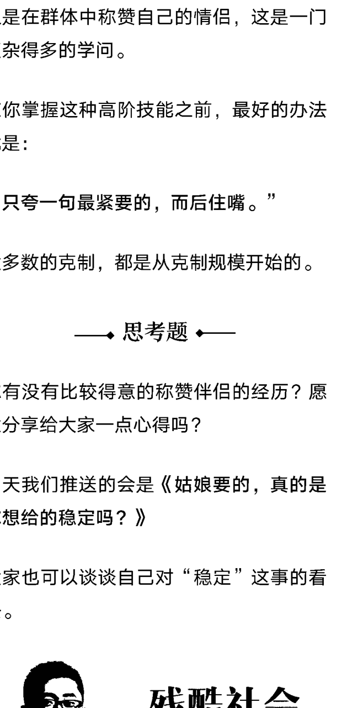

这种苛刻的指控并不罕见，大家注意金庸先生在《神雕侠侣》里描写了杨过和郭襄的感情，这其实根本不是什么兄妹情，就是浪漫之情。

杨过知道条件很好的郭二小姐喜欢自己。

郭襄知道条件很好的杨过喜欢自己。

但是杨过的情感模式非常自我折磨，他会对郭襄说：

> “我的结发妻子在大海对岸……不能相见。”

这是许多中年男性常见的错误，如果关系是以离异为结束，大多数男人都能够做到不去称赞前任，但是如果关系是以丧偶为结束，许多人可能会美化自己的前任的妻子，甚至认为活人 shouldn't 吃死人的醋，这样的家庭关系隐患很大。

我们今天提及的称赞，限定在一对一的情景当中，如果要当众夸自己的伴侣，这件事要从长计议，我们经常看见有的人，女性居多，在闺蜜圈里夸耀自己的老公，这件事要特别谨慎，因为这属于多边关系，处理不当会影响你的群体内地位了。

还记得我们说过的管理人际关系的四种能力吗？

- 内心自洽的能力
人际和谐的能力
群体内发展的能力
应对危机的能力

你在称赞自己的伴侣的时候，可以增进自己的内心自洽（称赞的话也会对你有影响），可以发展自己的人际和谐（你和配偶之间的关系加深）。称赞也是你应对危机能力中的一部分。

但是在群体中称赞自己的情侣，这是一门复杂得多的学问。

在你掌握这种高阶技能之前，最好的办法就是：

> “只夸一句最紧要的，而后住嘴。”

大多数的克制，都是从克制规模开始的。

## —— 思考题 ——

你有没有比较得意的称赞伴侣的经历？愿意分享给大家一点心得吗？

明天我们推送的会是《姑娘要的，真的是你想给的稳定吗？》

大家也可以谈谈自己对“稳定”这事的看法。

## 想要给她稳定的生活？还是写个美好的故事吧

113|想要给她稳定的生活？...

在电视剧《军师联盟》当中，曹丕的儿子曹叡因为不满意父亲给自己包办的妻子甄宓，决心娶司马昭（正史当中的郭女王）为妾，郭照一直都是司马懿的弟弟司马孚喜欢的人，所以他冲到曹丕家，问曹丕，你能不能给郭照一个安定的生活。

面对备胎的质疑，男神一般都是：“你放心，我会好好照顾她的……”

但是曹丕这个人就是与众不同的。他说了一堆大实话：

> "安定，我自己都没有，怎么给她？"

> "我想郭姑娘要的，也不是找一个男人，小心翼翼地守护他一辈子吧。"

> "这世间最大的幸福莫过于得一人，志同道合、知己识趣、同甘共苦、不忘初衷，她说的每一句话，都能得到你的赞叹，她的每个眼神都是那么流光溢彩。"

> "与这样的人共度，才不负青春啊。"

我一向不主张把一些现代的剧本用来分析人际关系，尤其是这部戏大多数不是正史，可以当一个古装的现代剧来看，但是这段台词我忍不住拍案叫好，因为它合乎我们这个时代的男女关系。

我们在这段台词里，看见了昨天的文章《秽蔑伴侣的黄金原则》中提到的秽蔑。

曹丕的台词是“她说的每一句话，都能得到你的赞叹。”（女赞男）下一句是“她的每个眼神都是那么流光溢彩。”（男赞女）

这是对等关系，这种关系需要什么条件呢？

- 1. 两个水平相当高的人
- 2. 两个人彼此相逢和相爱

两个人得是棋逢对手，男人和女人的境界差不多。还不能是低水平上的“俩人一样差”。

大家的身边一定有那种绝望的男女关系，我们用文言文形容的话，就是偶人对特别“作（一声）”。抒命渴望控制对方，为一点小事而争吵不休，使用冷暴力，甚至动手。

水平相当，都很差劲的两个人，难以理解平等相待的好处，也根本不会有这种亲密关系。

提安定司马孚是一个小心谨慎的人。

但曹丕是一个在动荡奔波中长大的孩子，因为爸爸做事靠谱中了理伙，他十几岁就深夜爬起来骑马逃命，看着哥哥被追上死于非命，他不依赖承诺，也不相信保护。

郭照也曾经是流落江湖的人，他们之间对未来的人生共识，他们知道自己的下一步故事要去怎么讲、怎么写，所以没有疑感，他们会排除困难在一起。

对了，我们提到了故事，这就是美国心理学家罗伯特·斯腾伯格提到的一观点：

> "爱情是一个故事。"

每个人寻找爱情，其实都是在找一个一起谱写故事的人。

曾经有关系户同学问我，应该怎么样调节爸爸和妈妈的关系，说爸爸是个挑剔和充满负能量的人，妈妈被折磨了几十年，现在自己大了，越来越看不过眼，想着是不是要妈妈和爸爸分开住，把妈妈接走，或者于脆让他们离婚。

我一般会询问这对老夫老妻的相处模式，如果没有恶劣的家暴局面，我建议儿女就不要管，因为过去的几十年里，他们不断冲突其实已经形成了一个固定的游戏，你看上去是受害者的母亲其实对这件事情并没有那么反感，让六十岁的人成长带来的愉悦，可能没法冲击掉她和老伴分开的担心。

斯滕伯格在《爱情是一个故事》里，提到了六种不对等的故事：

## 1.师生故事

你们应该见过这样的情侣关系，一方天真幼稚，对各种人情世故几乎没有自己的判断，另一方则是苦口婆心，希望对方成长，这就是师生故事。

《我的前半生》里，贺涵和于子君的关系就是典型的师生故事。

同样，还有《疯狂动物城》里的狐狸尼克和朱迪迪，《女囚尼基塔》的老师和学生。一个指导者，一个学习者，这种关系是不对等的，但未必是坏的。还记得本周爱情单元，我们提到的“熊太行浪漫定律”吗？

A.是一个条件好的人；B.这个人说你对他做什么都可以。

师生故事很多时候都符合这个条件，师生故事容易有浪漫感，同时师生故事在我们处理关系能力的四个领域当中，容易让我获得群体内发展的机会，还能增加这个家庭或者对这情侣危机应对的能力。

我们经常说的“自己强大了，什么样的女人找不到？”其实就是对师生故事的期待，有些男性三十多岁去找二十出头的女孩，一般讲的也就是这样师生故事。

## 2.牺牲故事

一个人为了另一个人的任性或者发展机会牺牲了很多。

这是很多虐心故事的开始，比如《孔世佳人》里，白瑞德和斯嘉丽就是一个牺牲故事，最后双方的关系崩溃，一方受够了。

电视剧《渴望》也是这样的一种爱情故事，不过刘慧芳为了牺牲的不是王沪生本人，而是她收养的残疾女儿，最后被证明是王沪生的外甥女，她姐姐的儿子。

大多数的异地恋最后都会变成一个牺牲故事，这也是为什么我对异地恋评价很低，我明天会给大家评点和拆解异地恋，敬请期待。

牺牲故事只有一方拼命对自己的认识合理化，形成一种自尊很低的内心自洽，才能让这个故事继续下去。

白头偕老的和幸福是两回事，很多人只是比较耐虐，比较入戏罢了。

## 3.政府故事

有的政府故事是专制故事，一个统治者，一个被统治者。

跟别人聊天拉家常，有的女人经常会说：“我这人特懒，不爱做决定，都交给老公就好了。”还有的人是控制欲很强的人，一定要自己做决定。

昨天回一个关系户的评论，她说有个相亲对象说：“我这人大男子主义，你约我不出...我们才能见面。”现在这人不要她了，问我应该怎么办。

我说这是一件大好事，这种家伙不联系你，这算是放生，大有功德。相亲的时候就这样的态度，未来的讲的必定是一个专制故事。

专制故事会伤害被统治者的内心自洽，同时也会减弱这个家庭应对危机的能力，因为有一个人的大脑完全没有被开发。

还有一种政府故事是民主故事，大家商量着来。

我跟大家说过，不要拿老公的工资卡，当时我举了一个例子，就是国家让城市上市所有利润，城市从此不再发展，最后国家拿走定额，城市就突然焕发了青春。各自管理自己的钱财，这就是一个优质的政府故事。

权力共享，共同承担责任，只有最聪明的 人才会上演这样的爱情故事。

## 4.警察故事

王志文和刘烨琦演过一个电视剧叫《无悔追踪》，警察刘烨琦怎么看教师王志文，都觉得这家伙是国民党特务，于是盯着他做坏事，盯了一辈子。刘烨琦靠的是直接：“怎么看都觉得这家伙有问题。”

很多情侣和夫妻关系都是这样的，有 的女...

很多情侣和夫妻关系都是这样的，有的女人盯男人，每天查询他的纸丝马迹，有的男人盯着女人，对她所有的男同事都疑神疑鬼。有的人窃听、有人盯梢、有人翻看聊天记录、有人掌握对方的QQ密码。

警察故事是低自尊人群的专有故事。（豁出去了，所有人明年都不续订我也要说）

如果你要成长成一个掌握自己命运、富有、受人尊重的大男人和大女人，就一定要尊重你另一半的隐私，不去偷翻别人的手机，不去疑神疑鬼。

不然警察故事就是你们未来的归宿了，一旦形成了一个警察，一个嫌疑人的模式，双方的人际关系都会严重受损（没有人敢跟这样的一对夫妻来往），夫妻有一方嫉妒，双方的朋友都会越来越少。

## 5.色情故事

一些情侣和夫妻会形成这样的相处模式，尝试各种奇怪的性行为只是其中的一部分，有的人可能会选择多人关系（多偶甚至换妻，这在中国内地是触犯刑律的行为），还有的人热衷于拍摄色情视频上传，甚至不是为了钱，仅仅是为了在某些论坛当中获得威望和尊重。

这样的关系里，性的 berikutnya就代表了爱情的消逝，在经典作品里，《卡门》就是特别典型的色情故事，而且女人是那个玩弄者，而男人才是玩具。

自古美人如良将，不许人间见白头。

这种关系的婚姻可能在某些方面令人羡慕，但如果你希望愿得一人心，白首不分离，最好就远离这样的人。

## 6.恐怖故事

《不要和陌生人说话》讲的就是一个恐怖故事，这种故事就是一方让另外一方怕自己。当然家暴不是唯一的手段，有的人会用自残的方式让自己的配偶恐惧。

这仅仅是六个不平等关系的故事，还有一些故事模式是所谓的客体故事，也就是一方根本没把对方当一个活物，我继续沿用这个排序：

## 7.科幻故事

收集一个自己觉得新奇的怪人，把对方当做ET、丹佛最后一只恐龙、小黄人来交往，特点是绝对对方和附近的人都与众不同。

## 8.艺术品故事

就爱对方的眼睛或者头发，把对方当做一个美丽的收藏品，就为带出去穿晚礼服。

## 9.家庭故事

嘴上说自己特别有家庭责任感，其实爱的是房子和两边的两堆亲戚，大家都说你们的生活。

“我为你做了什么”没了，取代的是“这个家”，然而除了房子的进步，“这个家基本基于想象。”

## 10.医护故事

## 11.游戏故事

## 12.协作故事

## —— 思考题 ——

试试看，用爱情是故事这个角度，来分析一下为什么今天的年轻人Arithmetic不愿意父母长辈介绍相亲。

## 附：相关阅读

《讲故事攻略：一分钟让你笑，一分钟让你哭》

《如何做自己的“人生导演”》

P.s

## 异地恋怎么才能不陷入绝境？

熊太行

昨天我们分享了心理学家斯滕伯格的《爱情是一个故事》，这本书有中译版，世界图书出版社出版的。

其中的故事类型分类比较杂，有 Verkä 小类故事率可能会很少用到，有兴趣而学有余力的同学可以找来看，比较忙的同学掌握好我们介绍的几种故事就好了。

为什么我会把异地恋专门拎出来说一下，中国人眼中的异地恋有一种神奇的色彩，和普通的亲密关系相比，它和道德、政治、大局纠缠在一起，人们往往会在这种魔力的影响之下做出错误的判断。

异地恋是一种非常折磨人非常痛苦的恋情。如果异地恋结婚之后，还会面临着特别现实的问题，两地分居的夫妻当中，一方（往往是女方）要独立抚养孩子。

- 1. 一定有一方认为自己的工作比对方更加重要。
- 2. 一定有另一方会为这段关系做出牺牲。
- 3. 工作的那一方会成为双方的折磨（巨熊）。
- 4. 另一方则会最终付出惨重的代价，沦为生育和抚养的机器。
- 5. 这种关系里，双方都没有赢。

牺牲故事里的付出一方一般只要求给予，不要求同等的回报，或者他们感到从自己的给予当中得到了回报。异地恋里，最终大家会做一个评估，判断两人中的某一方工作更为重要，不能放弃。在中国，大多数最终被判断为“更重要”的，都是男方的工作。

付出方现在只有两个办法：

- 1. 调整自己的工作，尽快结束异地状态。
- 2. 接受异地状态，像涪山氏那样自己养育孩子。
- 3. 如果不能迅速实现1，那也应该尽可能地缩短2的时间。

## 1.跟你的配偶寻求解决方案

## 2.关于体制内工作

## 3.对等牺牲原则

## 4.只倾诉不抱怨

## 5.强迫演下去的牺牲故事

## 6.钱

- A.我到对方的那座城市去生活，会找不到工作（0收入）；
B.我到对方的城市去生活，会找不到现在这么好的工作（收入减少）。

这么好的工作（收入减少）。

这个时候就应该趁着分居状态有很多的时间，赶紧接受一些培训，增加自己在职业方面的竞争力，然后一鼓作气实现团聚。

遗憾的是异地恋的双方，可能对自己关系的稳定感到不安。

我知道的有的年轻人，下班回到自己的住处就要打开视频，一举一动都要和自己远方的女朋友共享，每天用4到6个小时映远方的女朋友，什么时候用来学习和充电呢？

## 7.实力

如果两个人做的都是体制外工作，而且能力够强，异地恋根本就不是什么问题：

到底多远算异地恋？有人开玩笑，说北京的西三环和东三环算异地恋，这是讥刺北京堵车的笑话，有地铁，三环路就算走不动也有办法很快见到彼此。

但是，同样相隔两小时，如果是县城和省会，可能就是永远无法跨越的沟。

县城和省会是异地恋，北京和上海不是异地恋。

县城和省会之间有编制和工作藩篱，即使只有两小时的车程，也是异地恋。任何一个人的工作调动都会特别痛苦。

北京和上海不是异地恋，一个人如果有实力在北京的某个行业当中成为出色的人，他转去上海的类似公司并没有太多的难度。

一线城市当中都是类似的情况，人才流动是一种平常事。

还有一些工作，其实取决于手艺，有时候挺令人羡慕，一个小包背着，人就可以四处流浪。

大概十几年前吧，我出门面试，去早了在路边长凳上休息，有个小伙子和他的女朋友一起找工作，男生看了看那个美发店的装修、档次，跟女朋友说：

> “我的技术肯定没问题。”

走了进去，大概30多分钟之后，他走出店门，女朋友欢脱地跑过去抱住他，问他怎么样。

> “剪了一个，他们很满意，跟我说底薪……提成……”

有时候陷入异地分居这样的麻烦，我们缺的可能就是“我的技术肯定没问题”的底气。

以及一种说走就走的勇气吧。

## P.s

有人说我喜欢讲体制内的事，不相信实力能改变人生。还有人说，听熊太行会觉得人生是灰暗的。

熊太行是把世界的一些灰暗之处给你看。

有时候要讲体制内的事，是中国还有很多人体制内工作，不在体制外工作的人也难免会跟体制打交道，理解彼此的行事方式是最重要的。

至于我，我十年从体制内离开，我从来都没有后悔过。

## ——♦ 思考题 ♦——

有人要给你介绍一个很好的对象，家乡在一起，各方面条件都很好，但是你们俩的城市相隔1500公里。你会答应见面还是拒绝见面，你应该如何回应这个提议呢？

## 附：相关阅读

《想要给她稳定的生活？还是写个美好的故事吧》

《称赞伴侣的黄金法则》

《为什么浪漫的本质是见色忘义》

《女朋友的妈妈嫌我长得矮，怎么办？》

# 毛脚女婿攻略：如何拜见岳父大人？

115|毛脚女婿攻略：如何拜见岳父大人…

熊太行

我们尝试了一周的更新提到五次，大家的反应还不错。

以后的复习课会放在休息日更新。

每周五，我们会安排相对轻松一点的内容，有同学说喜欢我拆解一些经典作品或者影视作品，我们先尝试一下，今天跟大家分享的是“拜见岳父大人”的攻略。

战国时期，魏文侯对选择哪个大臣做相国犹豫不定，叫进来了个善于算卦的师傅，师傅听完问题，对魏文侯说：“卑不谋尊，疏不间亲，这不是我能回答的问题。”

春秋战国时期，是人类总结各种关系攻略的黄金时期，许多最伟大也最实用的原则，都是在那个时候被发现出来的。比如这八个字。

“卑不谋尊”说的是身份卑下的人不要去揣摩身份高的事，站错队、站错位，可能就有性命之忧。比如大领导突然把你叫进去，说你的两位副职领导哪位应该当正的，你就应该特别谨慎，这很可能是一个圈套。

## 避免见岳父大人绊脚的清单

+   1. 事先开一个简短的会议

中国大部分地区的规则是，如果一方去另外一方的家庭作客，意味着一种关系的确认，但是随着时代的进步，稀里糊涂就带过去见面的也有很多，所以在你决定去你恋人的家拜访之前，最好是两个人再确认一下关系。

+   2. 认人

+   3. 一份简历

+   4. 打听清楚禁忌

抽烟么？喝酒么？

+   5. 对未婚性行为的态度

+   6. 对宠物的态度

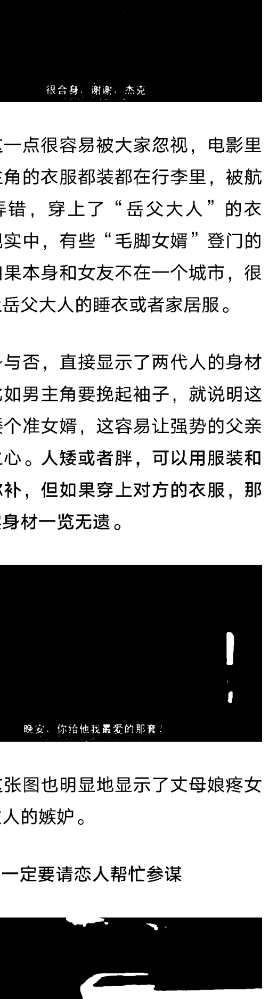

而双方没有事先沟通，女方说男方讨厌猫，而男方说自己不讨厌猫（讨好对方父母），一下子就变成了一个爱撒谎的人。

## 7.避免穿对方长辈的衣服

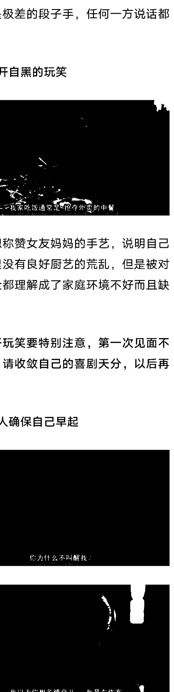

注意！这一点很容易被大家忽视，电影里因为男主角的衣服都装在行李里，被航空公司弄错，穿上了“岳父大人”的衣服，在现实中，有些“毛脚女婿”登门的时候，如果本身和女友不在一个城市，很容易穿上岳父大人的睡衣或者家居服。

衣服合身与否，直接显示了两代人的身材差距，比如男主角要换起袖子，就说明这是一个矮个准女婿，这容易让强势的父亲起疑心。人矮或者胖，可以用服装和打扮来弥补，但如果穿上对方的衣服，那就是真实身材一览无遗。

同时，这张图也明显地显示了女母亲疼女婿和老丈人的嫉妒。

## 8.挑礼物一定要请恋人帮忙参谋

男主角听说岳父大人是个花商，就自作主张买了昂贵的耶路撒冷郁金香，结果对方完全不懂它的价值。

后来他才知道，岳父大人是中情局的心理学专家，女友不能直接告诉他真相，其实老头是专门审问谍和测谎的，如果在挑选礼物的时候能够跟女友一起去，这种错误就可以避免。

## 9.避免翁媳婆媳的独处

女主的爸爸要出去办事，结果女主角让男主和他一起去，因为他也要去超市，这不是明智的选择，World的女婿和苛刻的老丈人要长达一两个小时独处，一定说错很多话，结果真的两人路上确实聊不到一起去。都是极差的段子手，任何一方说话都会冷场。

## 10.不要开自黑的玩笑

其实是想赞赏女友妈妈的手艺，说明自己从小家里没有良好厨艺的荒乱，但是被对方父母全部理解成了家庭环境不好而且缺乏秩序。

如果想开玩笑要特别注意，第一次见面不是时候，请收敛自己的喜剧天分，以后再说。

## 11.请恋人确保自己早起

这部电影拍摄于1999年，男主角还在到处找座机甚至投币电话，所以他没有我们赖以生存的手机闹铃让他起来，但女友是有闹钟的——但遗憾的是，她天真地觉得应该让自己的男朋友多睡一会儿。

其实女主角是个幼儿教师，应该是最心细如发的群体。为什么她会忽略了男主角要早起不然会失礼这件事呢？

我不知道各位有没有那种感受，大多数人回到自己长大的那个家的时候，心智都容易变小，虽然也几十岁了，回去突然就会成了儿子、女儿、孙子和孙女，对责任的感受能力下降。

最要命的是，她虽然可能回到她十几岁的状态，但父母看待她的男友时候的标准并没有降低。上门的客人要随时保持不失礼才行。

## 12.请恋人提供未来几天的日程表

因为起晚了，而且他也不知道第二天有亲戚来访的安排，男主角穿着睡衣头发蓬乱地出现在女友姐妹的公公面前，这是他们第一次见面。

对方一家子都是医生，而男主角是一个护士，虽然女友没有跟姐妹提及他的职业，所以别人都把他的实话当做一个笑话，放声大笑。

男护士在美国也一样遭遇歧视，女主角试图解释，男主真的考上了医学院，他也是真的热爱护理事业并且去当医生，结果没人理她（换我我也不容易相信）。

女主角在支持男主角的方面做得不好的还有很多，比如让他去和没见过面的小舅子单独尴尬。如果你的恋人在细节上对你的支持不够，要赶紧请求她的支持才行。

我们可以发现，这些误会都是可以靠恋人一个情报或者三言两语就可以解决掉的。

去恋人的家中拜访，你永远最忠诚的友军，不是别人，就是你的恋人。

请TA多躲在你身边、接你的话、给你拥抱，让所有人知道你们是认真的，要好好地、长期地相处下去。

## —— 思考题 ——

女主角（大女儿）带着男友参加姐妹婚礼。希望在二女儿的婚礼上去求岳父大人恩准自己和女友（大女儿）的婚事，这个时机合适吗？

## 附：相关阅读

《为什么浪漫的本质是见色主义》

《称赞伴侣的黄金法则》

《想要给她稳定的生活？还是写一个美好的故事吧》

# 亲密关系攻略合集：如何让你们的情侣关系更上一层楼？

熊太行

本周我们进行了一周五次的亲密关系攻略，算是恋爱攻略的高阶技能。
在今天的专题中，我把这五篇文章中重要的知识点，帮你用列清单的方式，直接从于货入手，看看你会有怎么新的感悟。

## 第一篇：《为什么浪漫的本质是见色忘义？》

+   1. 见色忘义有一个定律叫做：人们会和不喜欢的人发生亲密关系，如果对方好看的话。
2. 心理学家发现在一段恋爱关系中，发现自己被一个有魅力的人喜欢，你就会感受到浪漫。我从这里总结出一个“熊太行浪漫定律”：当对方是个条件很好的人，当对方说喜欢你，你对他做什么都可是的时候，你会感受到浪漫。
3. 如果你要让你和伴侣的关系变得浪漫，解决方案是：为了提高自己的魅力，比如变得富有、美丽、渊博等等。还可以为他表达自己的情感，多给对方建议、体贴、分担家务、情感呵护等等。
4. 浪漫不是客观存在的，需要人类的想象力。
5. 浪漫有假的，男人容易上美女的当，女人容易上有钱男人的当。
6. 如果你的实力或者容貌足够，向别人表白就不会激怒对方。
7. 浪漫和幸福的晕眩从来不是唯一的，也永远都不能是一生一次。
8. 要躲避浪漫对已有关系的困扰，只能在时间和空间上避开对方，不要去挑战自己的自制力。

## 第二篇：《称赞伴侣的黄金原则》

+   1. 接触期的称赞：双方刚刚开始交换信息和开始自我暴露，这时候的称赞要克制：尽量就对方的品质、性格、和爱好展开称赞。这个时期的主题是：你真有趣我爱听。
2. 暧昧期的称赞：暧昧期可以增加一些对魅力方面的称赞。这个时期的主题是：你真美丽（英俊）我爱看。
3. 表白阶段的称赞：最顶级的称赞就是表白。表白要干净利索，一个认真对自己关系进行管理的成年人不应该沉浸在暧昧期里。这个时期的主题是：你的人生太美，我想和你一起看。
4. 晕轮期的称赞：如果觉得自己爱得受不了就要赶紧说。不然的话可能会错过很多好机会。晕轮期的称赞的特点就是特别、特别、特别肉麻，在这个时期做称赞就要特别、特别、特别地花哨。这个时期的称赞特别是富有创意，主题是：每句称赞都如此与众不同，因为你是独一无二的。
5. 稳定期称赞：关系进入一个稳定期之后，要注意开源节流。一来是开发出对方新的优点，二来是以往的旧优点，每次提及也要认真对待。这个时代的称赞要从之前的称赞对方独一无二的属性，转向称赞对方处理事务的进步，换句话说，热恋夸人，过日子夸事儿。
6. 危机时期的称赞：一段关系进入危机之后，不要指望靠甜言蜜语来挽回，称赞不会让对方原谅你。主题是：把过去一切美好都展示出来。
7. 关系结束后的称赞：其实就不必了。记得我们的前任攻略吗，尽快开始新的生活吧。

## 第三篇：《想要给他稳定的生活？还是在一起写个美好的故事吧》

美国心理学家罗伯特·斯腾伯格提到一个观点“爱情是一个故事”。我把这6个故事，用6清单帮你复习。还有一些熊氏爱情故事，你可以点击标题蓝色字体，回到原文中阅读。

### 第一种：师生故事

你们应该见过这样的情侣关系，一方天真幼稚，对各种人情世故几乎没有自己的判断，另一方则是苦口婆心，希望对方成长，这就是师生故事。

### 第二种：牺牲故事

一个人为了另一个人的任性或者发展机会牺牲了很多，大多数的异地恋最终都会变成一个牺牲故事。

### 第三种：政府故事

有的政府故事是专制故事，一个统治者，一个被统治者。跟别人聊天天家常，有的女人经常会说：“我这人特懒，不爱做决定，都交给老公就好啦。” 还有的人是控制欲很强的人，一定要自己做决定。

### 第四种：警察故事

很多情侣和夫妻关系都是这样的，有的女人盯男人，每天查询他的蛛丝马迹，有的男人盯着女人，对她所有的男同事都疑神疑鬼。警察故事是低自尊人群的专有故事。

### 第五种：色情故事

一些情侣和夫妻会形成这样的相处模式，尝试各种奇怪的性行为只是其中的一部分。这种关系的婚姻可能在某些方面令人羡慕，但如果你希望赢得一人心，白首不分离，最好就远离这样的人。

### 第六种：恐怖故事

这种故事就是一方让另外一方怕自己。当然家暴不是唯一的手段，有的人会用自残的方式让自己的配偶恐惧。

## 第四篇：《异地恋怎么才能不陷入绝境？》

+   1. 异地恋首先要跟你的配偶寻求解决方案。如果你们是刚刚开始相处，最好尽快确定发展的城市，然后一方向另一方靠拢，寻求那座城市的发展机会。
2. 大多数的异地恋都涉及到一个体制内，可能两个人的工作都有编制，不容易调动。这种的解决之道就是尽快评估出哪一方的性价比较高，做个选择吧。
3. 大多数异地恋最终都会变成女方牺牲的局面。
4. 异地恋的生活，其实就是牺牲故事。对于跟你倾诉异地恋若干苦的人，你一定要只听倾诉，不给意见。
5. 大多数异地恋都是一种阶段性状态，但一定要有一个结束异地恋的时间表，这是诚意的表现。
6. 随着分居状态，赶紧接受一些培训，提升自己，有了钱和实力，没有什么是太难的。

## 第五篇：《毛脚女婿攻略：如何拜见岳父大人》

+   1. 你决定去你恋人家里拜访之前，最好是两个人再确认一下关系。
2. 如果你恋人有一个大家庭，最好请她给你一张合影，先认人，别把岳父认错。
3. 你应该请你的恋人，提前先向她的家庭简单介绍你，免得尴尬。
4. 提前打听清楚岳父的禁忌，喜欢什么，讨厌什么。
5. 一些保守家庭对婚前性行为是非常在意，记得不要在岳父家跟恋人有什么亲密的行为。
6. 先把对宠物的态度了解了吧，不养动物的人去拜访有动物的家庭，可能需要适应时间，而且猫狗和养狗的人也可能会互相瞧不上。
7. 尽量避免穿长辈的衣服，这个情况并不少见，建议你把自己衣服带好，不要临时穿岳父的衣服。
8. 挑礼物一定要你的恋人帮忙参谋，要说你身边谁在合适了解你的岳父，就是你的恋人。

9.最开始尽量避免和岳父独处，免得冷场和尴尬。

10.如果你想开玩笑要特别注意，第一次见面不是时候，要记得收敛自己的戏剧天分。

11.请恋人确保自己早起，你作为客人，是一定不能晚起的。

12.请恋人提供未来几天的日程表，免得有亲戚到访还不知道，闹出什么笑话。

熊太行

归根结底，去恋人家拜访，你永远最忠诚的友军，不是别人，就是你的恋人。

请她多陪在你身边、接你的话、给你拥抱、让所有人知道你们是认真的、要好好地、长期的相处下去。这事儿就能成。

今天的专题内容比较长，也是比较新鲜的内容。有任何不明白的地方，欢迎你在留言中跟我一起讨论。你也可以在评论中留下你对亲密关系的看法，一起精进。

# 残酷社会生存法则

# 你的领导说你“不成熟”的时候是在指责什么？

117 你的领导说你“不成熟... 

熊太行

本周我会给大家开启一个新的专题：职场新人系列。我会跟大家分享职场新人的一些诀窍和一些内心自洽的方法。

对职场老兵来说，这套攻略会让大家更好地理解自己。工作5年之后，你会不会仍然有情绪失控、害羞和尴尬的场景？

其实职场新人这个概念，不应该是3年、5年的时间，而是贯穿整个成年早期，也就是，我们有一个15年到20年的新手期。

不要觉得前路漫漫，在这个时期当中做出改变，立刻可以有效果。这套攻略会让自己更好地控制自己。

同时，如果你要带领年轻的下属或者要跟年轻同事打交道，这套攻略也会让你们的相处和沟通变得更融洽。

## 这个系列包括以下5篇文章：

+   1. 领导说你不成熟的时候他在指责什么？
2. 你很闲吗？居然想在职场上收割友谊和性？
3. 现在换行业来得及吗？
4. 如何应对中年危机？
5. 心智早熟的人有什么好处，现在觉悟还来得及吗？

## 什么是成熟？

### 1. 能讲理，有逻辑

成熟首先是有能说道理、能接受别人说道理的能力。

皮亚杰教授是上个世纪著名的發展心理学家，他最早发现了人类认知发展的规律，按照他的观点，在进入青春期之后，少年的思维会进展到“形式运算”阶段，他们有了抽象思维的能力。

比如鸡兔同笼的问题：鸡和兔子一共有10个头和28只脚，鸡和兔子一共有多少只？

### 2. 原则和变通

成熟是在原则之外有变通的能力。

### 3. 是非和输赢

成熟是抛下诸多领域的二元思维。

中，全世界都在盯着自己。他们会虚构许多别人对自己的看法，然后用这种看法对自己百般折磨，有的人虚构完这类看法，会迁怒于对方。

这样的青少年很容易陷入“个人神话”当中不能自拔，觉得自己的能力和经历是独一无二的。

“你不懂，你根本不知道那种爱有多么的刻骨铭心！”（这种恕人方式有一两次，朋友就会离你远去了。）

中国的一些高中的封闭式教学和军事化管理可能会推迟这种感觉的出现，现实生活中我们一定能在职场上看见这样大龄少年，还有的人是上学太早，毕业的时候仍然没有成年人的思维。

有人管这个叫做中二病，其实很形象。

判断一个职场新人有没有青少年自我中心主义，观察他的QQ空间、微博和朋友圈是很好的一种判断方式，自我中心的年轻人一般会有大量的自拍、个人信息。

如果你仔细研读一个年轻人的空间或者朋友圈就会发现，大三之前他们基本上是什么都写，大三大四，当他们步入职场（实习也算）的时候，他们会迅速把关于自己的那些抱怨收起来。

所以，当你的领导，或者同事在指责你不成熟的时候，他可能指责的就是：

+   1. 你做事不讲逻辑或者理解能力差；
+   2. 你做事不够变通；
+   3. 你纠结于小处的对错，影响了大局上的输赢；
+   4. 你太自恋，忽略了别人的感受。

每周用这四条指责来对照一下自己的行为，看看自己犯过这类问题没有。

有的时候，有同学会抱怨，说职场好辛苦，一条成长的路，太乏味了。为什么不能按照本能行事，快意恩仇多好！

那不是什么快意恩仇，那是任性。

不要失去信心！

事实上，你在成年早期，也就是20~40岁的时候，处于各种社会关系的基层，你要去维护和建设各种社会关系，用输赢替代是非，用大利益为准则行事，对自己的成长有很大的好处。

等到40岁之后，确定了自己的权力范围和社会关系圈，成为一位值得尊重的人之后，你是可以输出自己的价值观的。

换句话说，有些需要坚持的准则，我们好好包好，收藏好，我们平常并不挂在嘴上，等到需要的时候，它光洁如新，就如昨日新入手的一般。

## —— 思考题 ——

《权力的游戏》里，不到十八岁的北境之王罗柏·史塔克坚持要处死杀俘的卡史塔克伯爵，还因为要娶已经怀孕的小家族女友而对佛雷大人的女儿梅婿，为此他被两个家族同时背叛，惨遭刺杀。

他的行为是否成熟，他在哪些地方的认知出了问题呢？

## 附：相关阅读

《遇到年长同事爱盯着你的私生活怎么办》

《玩游戏、打球时，该不该给领导放水》

《职场上的民主应该怎么用》

# 你很闲吗？居然想在职场上收取友谊和性？

118你很闲吗？居然想在职...

熊太行

有同学问我“要不要和同事谈恋爱”和“要不要和同事交朋友”，我的建议都是不要。

当然我也可以说一句：“如果公司是你家开的，那就可以。”

然而就连这俏皮话都不是事实，即使你是少东家，也尽量不要在公司里跟同事谈恋爱，也不要在公司里交那种非常亲近，有许多私生活重叠的朋友。

办公室里的恋情和友谊，对许多人都是一个坑。对职场新人来说，这个坑尤其凶险。

## 20~40岁必须要明确的13件事：

+   1. 心理上独立于父母（即使不结婚，也应该尽快摆脱妈宝的地位）；
2. 对自己的身体负责（包括健康和性）；
3. 意识到自身的个人生活史和时间限制；
4. 整合性体验（明确自己的性取向，有人在这个阶段会发现自己是同性恋或者双性恋）；
5. 学会恋爱和保持亲密关系的COMITY（跟4紧密相连）；
6. 做生育的计划（如果eito...）；
7. 和孩子保持关系（亲子关系，注意，我们有的时候会觉得小学时候的父母比较暴躁，因为那个时候确实也是他们压力最大的时代）；
8. 和父母重建成人关系（有的人变成奴隶，有的人变成朋友，还有的变成父母的欠债者）；
9. 职业技能的成长；
10. 选定一份职业（不少人都在30岁的时机会临转行）；
11. 用金钱来训练、培训自己，经营自己的关系（健身算吗？当然算！）；
12. 承担一定的社会角色（比如丈夫、儿子、父亲和职业上的师父）；
13. 适应伦理和精神上的价值观。

## 职场上为什么不应该一心二用？

我看见过玩手机的人从地铁楼梯上滚下去，就再也不想玩手机了，太惨烈了，太疼了。这个因果关系好理解，你看见一个人拽着手机滚下去，立刻就能明白是什么分散了他的注意力。

但是当你看见一个人沉溺于办公室恋情，或者是一个人拿职场上的同事当好朋友好兄弟被背后捅刀的时候，你很难归咎于他的“一心二用”，反而会觉得，这家伙遇到了一个坏的女友/男友，这家伙遇到了一个差劲的兄弟。

不能够正确归纳我们看见的失败，这是我们走向失败的重要原因之一。

+   1. 注意力是有限的，而职场又是异常凶险的局面。
2. 交友行为复杂化了局势，增加了自己的羁绊。
3. 多重身份会导致自己和对方的内心矛盾和冲突。
4. 对对方过高的期待和依赖，导致了错估形势。
5. 友谊和性，应该尽可能地到职场之外去找。

个公司，有的则是要求不在一个部门。有的领导会担心被夫妻档情侣档串通起来，搞一些阴谋。

## 6.扑上门来的十有八九是烂桃花。

曾经有一个同学问过我他该怎么办，他单身，自己外派到一个城市公司，这个城市的分公司有一个已婚的女同事，说自己家庭生活不幸福，总是要他陪自己去逛街，各种挑逗。

我劝他要注意安全，艳遇这种事，多一单不多，少一单不少，照单全收固然可以，日后也无非仅仅是一个念想，但是一旦踩进这摊浑水里去，要承担的风险很大。

一个成年男性找到一个正规合法的女友没有那么难，不要把自己扯进一个被声讨甚至被暴打的境地当中去。

许多不幸的婚姻里还有扭曲的欲望，有些女性和男性的关系是彼此折磨的，男人从女人和外人的感情的某种偷窥当中获得愉悦。

电影《白日焰火》当中就是这么一个情节，王学兵潜伏在黑暗当中，跟踪一切喜欢桂纶镁的人，等到双方有实质的接触，就动手杀人。这是一种极端状态，但现实中扭曲的心灵，肯定比我们想象得要多。

## 7.不要被例外情况打动，认为自己是可以幸免的。

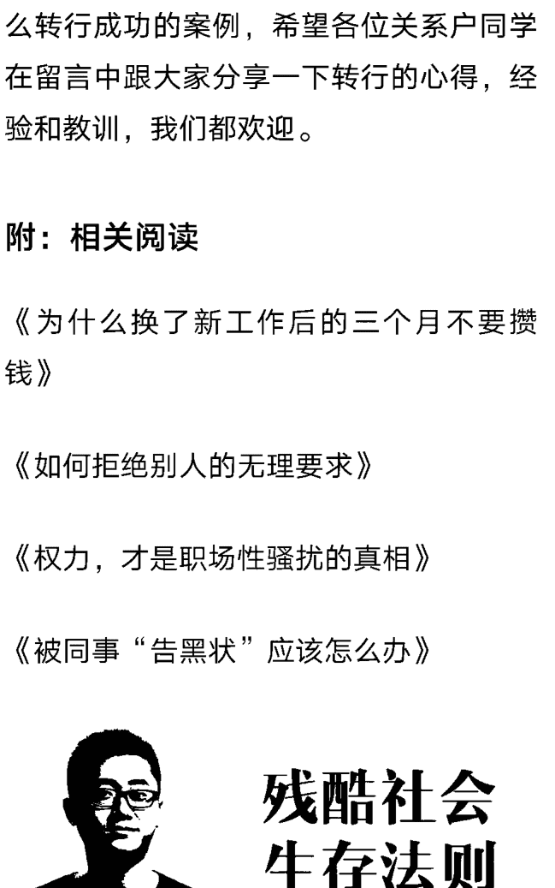

> “和你们这些少爷不同，我们光是活着就已经拼尽全力了啊！”

# —— 思考题 ——

# 附：相关阅读

- 《为什么换了新工作后的三个月不要懒钱》
《如何拒绝别人的无理要求》
《权力，才是职场性骚扰的真相》
《被同事“告黑状”应该怎么办》

## 现在换行业来得及吗？

119|现在换行业来得及吗

熊太行

昨天在我们的课程当中，我们发布了一个迷你清单，讲的是：
20-40岁必须要明确的13件事：

- 1. 心理上独立于父母（即使不结婚，也应该尽快脱离妈宝的地位）；
2. 对自己的身体负责（包括健康和性）；
3. 意识到自身的人生生活史和时间限制；
4. 整合性体验（明确自己的性取向，有人在这个阶段会发现自己是同性恋或者双性恋）；
5. 学会恋爱和保持亲密关系的能力；
6. 做生育的计划；
7. 和孩子保持关系；
8. 和父母重建成人关系（有的人变成奴隶，有的人变成朋友，还有的变成父母的照顾者）；
9. 职业技能的成长；
10. 选定一份职业（不少人都临时转行）；
11. 用金钱来训练、培训自己，经营自己的关系（健身算吗？当然算！）；
12. 承担一定的社会角色（比如丈夫、儿子、父亲和职业上的师傅）；
13. 适应伦理和精神上的价值观。

这个清单当中，有人说不懂得第三点，简单解释一下，这是说你的阅历和时间都是有限的，而你需要掌握的知识又太多，这件事是人生最重要的真理之一：
时间和生命都有限。
你没法点全所有的技能点。

## 成年早期的选择影响人的一生

本周的上两次课程当中，我们都曾提到一个概念叫成年早期，一般在20-40岁左右。

## 为什么我们会“入错行”？

不同职业的社会地位等级
外科医生 100 法律工作人士 53
律师 99 建筑工程师 52
计算机软件工程师 94 检控官 50
心理学 93 速递员 48
营养师 92 电子设备装配工 46
大学教授 86 家庭护士 45
中等数教师 86 支援秘书 44
服务及支援护理 85 社会服务 44
人力资源经理 80 行政人员 42
贸易商品经理 80 电工 41
放射技术人员 79 电讯维修员 39
社会工作者 77 收银员 36
消防员 77 司机 35
农场负责人 76 预备员 32
地层人员 75 电工助理 31
牙科健康员 74 电话接线员 27
私人秘书 72 私人助理或助理护士 25
飞机机械师 72 儿童保育工作员 21
地产经纪人 70 电讯助理 20
建筑助理工人 69 个人服务助理 19
医疗助理 65 种植员 11
家庭护理员 60 女佣和警察 7
电工 58 食品服务员 3
理发师 56 包装线员工 1
演员 55 洗衣工 1

## 人的职业偏好是如何变化的

# 第一阶段是幻想阶段，持续到11岁左右。

来是否有些意思。

第二阶段是尝试阶段，覆盖整个青春期。

尝试阶段的青少年在思考职业生活时，开始把一些实际情况纳入考虑。

比如职业的要求、自身能力条件和兴趣。同时，他们也看重自身价值的实现和自我目标，以及某一职业能带来的工作满意度。

# 第三阶段是现实阶段，人们进入成年早期后，根据自己的专业背景和实习经历，明确自己的职业选择。随着学习的深入，人们逐渐缩小选择范围，并最终作决策。

比如我11岁的时候跟我妈妈说，想学说相声，这就是处于尝试阶段——我过去在学校里说相声，在全市到处参加汇演，但是我妈妈显然是处在第三阶段，现实阶段。她勒令我去参加重点中学的小升初考试，不然白瞎了我这两年来上的奥数班。

一般来说，人的职业偏好变化，是随着年龄和见识的增长，从“仰望星空”过渡到“脚踏地气”。

所以有的时候有人对研究关系、管理特别排斥，说这是人类灵魂对现实的妥协，我都会说：

其实你的妥协在你11岁之后就发生了，你当初说好的想当科学家。

实现了吗？

## 职业巩固阶段，工作几乎就是你的全部

20岁-40岁的成年早期，同时也是职业巩固阶段（career consolidation）。而在这期间，30岁是一个非常明显的节点。

在《懒人攻略》中我曾经提到，美国精神病学家乔治·维兰特针对哈佛男生的研究表明，男性精英们在职业巩固阶段，对亲密关系的关注将逐渐让位给工作，尤其是30岁之后，几乎80%的精力都用于对奖金、晋升、荣誉的追逐。

无论中国还是西方，人们都希望30岁左右做一些改变，这是职场上的七年之痒。该提升的人提升了，该放弃的人放弃了，30岁的人，正是已经在工作上得心应手，又难以突破的时候，有些人会尝试着考虑别的行业。

## 如果一个人对行业本身并无不满，但在单位长期从事边缘性的工作，他选择换行跳槽的可能性也会加大。

边缘性工作可能导致他很难拥有过硬的实力向同行业其他公司跳槽，跨行转职成了一个不错的选择。

## 女性的职业选择

即使在今天，美国精神病学家乔治·维兰特“对职业的关注取代对亲密关系的关注”这一结论在女性身上也很难成立。

因为大量职业女性在30岁之后因为结婚、生育等原因，生活重心反而向家庭倾斜。

## 转行前做一个关于职业的资产负债表

“资产负债表”一般是企业用的，个人也可以做一个类似的东西。转行之前，列举一下可能收益和成本：

- 1. 列出你本人决定从事某项工作可能获得的收益和付出的成本。
- 2. 列出你的家人因为你的选择而获得的收益和付出的成本。
- 3. 预计你从潜在职业中获得的自我肯定和自我否定。
- 4. 预计他人对你从事这个职业的社会肯定和社会否定。

# 附：相关阅读

《你的领导说你“不成熟”的时候是在指责什么》

《你很封闭吗？居然想在职场上收割性和友谊》

《懒人攻略：懂得犒赏自己才会让你更强大》

## 如何克服中年危机？

120|如何克服中年危机？

熊太行

“中年危机”是心理学家丹尼尔·莱文森在1986年提出的一个概念，不用记！接着往下看，这是一个伪概念。

美国艺电公司（EA）在2011年曾经出品过一个游戏，叫做《模拟人生2之中世纪》。在这个游戏当中，玩家扮演的是一个贵族领主，和第一代模拟人生相比，主角会变老和死亡。

也就是说游戏刚刚开始不久，就会有 一个新支线任务出现，“中年危机”，剧情提示触目惊心：

你已经老了，需要定一个接班人。

游戏才刚刚开始一小时而已。

## 什么是中年危机？

发展心理学上的中年一般称作“成年中期”，指的是40~60岁的这段时光，不过现实当中，中年危机，尤其是工作带来的危机，往往会被提前到35岁左右。

## 中年危机仅仅是一个文化概念

莱文森的“中年危机”理论从诞生开始就被同行质疑，这个概念缺乏数据支持，莱文森访谈了一群认为自己有中年危机的人，但很快就有人抽取了一大批中年人，发现他们中的大多数人都没有什么大问题。

## 成年中期的人为什么越来越好？

中年危机只存在于媒体的想象当中，事实上中年也仅仅是一个文化概念，合理的一个表达是“成年中期”没有一种全线爆发的危机，但是同样也有自己必须完成的任务。

- 下面这个清单就是发展心理学当中，认为40~60岁的人必须处理的任务：
1. 应对身体的变化或疾病，改变身体意象；
2. 对成年中期性生活的变化进行适应；
3. 接受时间的消逝；
4. 对衰老的适应；
5. 遭遇父母以及同辈人的疾病和死亡；
6. 面对死亡的现实；
7. 对配偶或者伴侣关系的重新定义；
8. 与长大的子女和孙辈深化关系；
9. 维持长久的友谊并建立新友谊；
10. 巩固工作统一性；
11. 给年轻人员工传授技能和价值观；
12. 有效分配财务资源；
13. 接受社会责任；
14. 接受社会变化。

- 在关系管理上，我们列举了过四种能力，把这几个任务所需要的能力进行一下归类，就会发现：
1. 内心自洽的能力
2. 人际和谐的能力
3. 群体内的发展
4. 应对危机的能力

我这里分享给大家遇到一个做决策或者评估某件事意义时的常用办法：
找一张A4纸，中间竖向对折一下，左边写某事或者某物的坏处，右边写某事的好处。

## 成年中年的坏处是：

- 身体可能出现问题；
要承担的责任很多；
工作压力比较大；
要揪心孩子的教育；
想要挣更多的钱。

## 成年中期好处是：

- 体力没有太严重的下降；
对数字和文字的记忆力虽然会略作损失，但可以用意义记忆来弥补；
比以前更有智慧；
社会地位更高；
我比10年前更有钱，更有对抗风险的能力；
孩子那里我能收获不少的快乐和成就感。

记住把好处写在右边（想象为什么）。
你会发现步入成年中期好处比坏处要多得多。

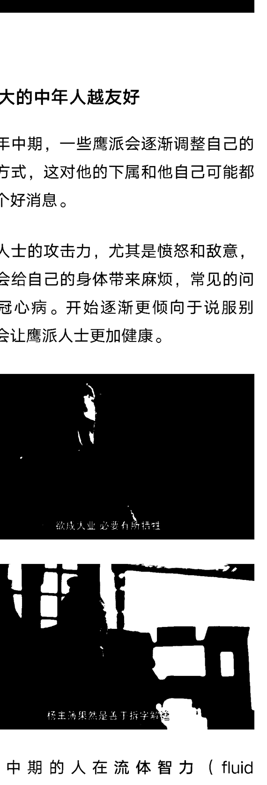

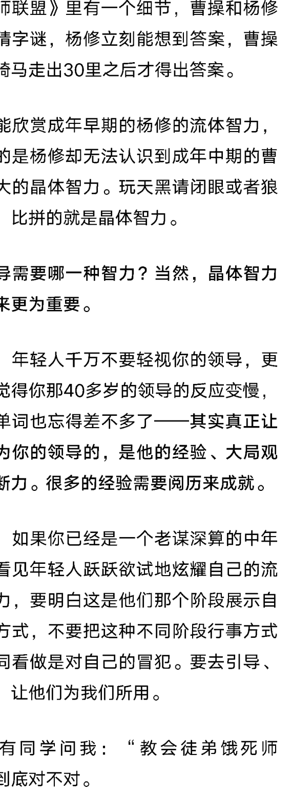

## 越强大的中年人越友好

在成年中期，一些鹰派会逐渐调整自己的行事方式，这对他的下属和他自己可能都是一个好消息。

鹰派人士的攻击力，尤其是愤怒和故意，可能 会给自己的身体带来麻烦，常见的问题是冠心病。开始逐渐更倾向于说服别人，会让鹰派人士更加健康。

成年中期的人在流体智力（fluid intelligence），也就是信息加工、推理和记忆的能力方面会有一些损失。

他们的晶体智力（crystalized intelligence）则会保持稳定。晶体智力是人们由经验习得并应用于问题解决情境当中的信息、技能和策略的积累。

《军师联盟》里有一个细节，曹操和杨修一起猜字谜，杨修立刻能想到答案，曹操则要骑马走出30里之后才得出答案。

曹操能欣赏成年早期的杨修的流体智力，遗憾的是杨修却无法认识到成年中期的曹操强大的晶体智力。玩天黑请闭眼或者狼人杀，比拼的就是晶体智力。

当领导需要哪一种智力？当然，晶体智力看起来更为重要。

所以，年轻人千万不要轻视你的领导，更不要觉得你那40多岁的领导的反应变慢，英语单词也忘得差不多了——其实真正让你成为你的领导的，是他的经验、大局观和判断力。很多的经验需要阅历来成就。

同样，如果你已经是一个老谋深算的中年人，看见年轻人跃跃欲试地炫耀自己的流体智力，要明白这是他们那个阶段展示自己的方式，不要把这种不同阶段行事方式的不同看做是对自己的冒犯。要去引导、敲打，让他们为我们所用。

经常有同学问我：“教会徒弟饿死师傅”到底对不对。

我会说：不要收跟你年纪、资历太近的徒弟，40岁的师父不会被20岁的徒弟轻易取代，尤其是有些涉及管理的岗位，成为专家的关键就在于那些宝贵的经验，这种领域，有经验有资源的中年人，不是一两个新手可以随便取代的。

对新入职场的年轻人来说，40岁~60岁的领导往往可能比30~35岁的领导对你更友好。

还记得我们的《老男人攻略》吗？和更年轻的主管相比，成年中期主管很少因为利益去直接侵害年轻同事和下属的利益，事实上他们中的不少人都学会了培育自己的势力，这让他们在职场上更有力量。

看看成年中期发展任务的第11条吧：给年轻人传授技能和价值观。

他们自己也有这种心理需求。

中年人和新人会是天然潜在的盟友，但我们之前也提到过，一些中年人会试图用拟态关系来拉拢年轻人。有兴趣的同学可以重温一下《遇到年长同事爱盯着你的私生活怎么办？》。

成年中期的人需要的是尊重和追捧，有同学问我，和父亲的老战友，身居高位的一个长辈一起吃饭应该注意什么，其实很简单，做一个小学生就好了。

不要对他们的世界观做反抗和不耐烦，他们对那种事情敏感。

怕他们一句，会让他们觉得比几百元、几千元的损失难过得多。

P.s

明天又是周末的解读IP时间了。我会用经典作品来给大家拆解早熟人才和大器晚成的人才。

晚熟者有春天吗？当然有。

明天我们使用的作品会是《三国志》的周瑜、鲁肃和吕蒙的列传，非常有意思。

# —— 思考题 ——

一些人会在28~35岁突然沉迷于健身、跑步、潜水等各种以前没有尝试过的运动，如果没有“中年危机”，又如何解释这样的现象？你自己是这样的人吗？身边有这样的朋友吗？欢迎写在留言中，我们一起讨论。

# 附：相关阅读

- 《遇到年长同事爱盯着你的私生活怎么办》
《人际关系里的鹰派守则》
《如何请求老男人为你做事》
《徒弟啊徒弟，你的小命仍然在为师手中》

## 在职场上，早熟者和晚熟者各有哪些优势？

121|在职场上，早熟者和晚熟者... ↓

这周的职场新人攻略系列推送出来后，很多关系户在后台留言说，如果早十年听到这些道理就好了，现在成年早期过去一大半了，是不是有点晚？感觉好可惜。

对于这一点，我要说：一个人心智早熟一定会有很多好处，但即使人到中年再觉悟，也一样能取得非常大的成就。

今天我们分享关于早熟型和晚熟型的三个人的故事，他们是东汉末年的名将周瑜、鲁肃和吕蒙。

在陈寿的笔下，吕蒙和他的两位前任，周瑜和鲁肃，同处在《三国志·吴书·周瑜鲁肃吕蒙传》当中。

## 周瑜是如何成为孙吴集团联合创始人 的？

周瑜的爸爸是洛阳县令，相当于北京市市长。

## 鲁肃是怎么应对老东家追杀和职场欺凌的？

鲁肃是临淮东城人，就是今天的安徽定远县。

原文是这样的：“肃家有两囤米,各三千斛,肃乃指一囤与周瑜,瑜益知其奇也,遂相亲结,定亲、礼之分”。

鲁肃提出的理论？

有同学猜到了，鲁肃说服对方用的就是“利益接触部理论”。袁术是个规模足够大的企业，他派来的追兵和他的利益已经非常不一样了。

被关羽要的大傻子，未免太可惜了。

## 吕蒙怎样变成了终身学习者？

吕蒙以前是个武将，三十多岁了发奋读书——他可能是最早的终身学习者。

吕蒙当兵都是托的关系，他姐夫是孙策手下的“别部司马”，那时候周瑜才两千兵，别部司马也就是个营长级别。

吕蒙是个穷人，有尊严的男人都不会去依赖出嫁的姐姐，但是吕蒙知道自强自立。

十五六岁，就私自跟着姐夫一起出去打怪，剿个山贼，弄点战利品。姐夫回去告诉老太太，说他去打仗了，老太太要骂他，他说：我们家这么穷，不打仗怎么摆脱贫穷？

“且不入虎穴，安得虎子？”（吕蒙身上有三个成语，另外两个是“士别三日当刮目相待”和“吴下阿蒙”。）

## 如果这么成长下去，吕蒙只是一个聪明的莽夫，他识字不多。

建安十五年（210年），吕蒙32岁，孙权劝吕蒙读书，吕蒙说自己工作忙。孙权说不是要让他当博士：“但当涉猎，见往事耳。”粗略看看，明白一些历史旧事就好了。

这个32岁的汉朝人白天练兵，晚上念书。

## 聪慧早熟者的优势：

- 1. 他们往往家庭出身都不错，这让他们受到良好的教育，同时有更多机会结交到有实力的朋友。
- 2. 他们是对自己要求严格的人，如果有的时候不能控制自己的骄傲和情绪，就容易受到伤害。
- 3. 职场上的资深员工如果对你的评价不够好，你就一定要更加紧密地靠近你的主公。
- 4. 绝对的忠诚，要顺服和爱戴你的领导，杨修却是反例。

## 后发觉醒者的优势：

- 1. 克服自己放弃的念头。
- 2. 读书和学习什么时候都不晚。
- 3. 除非你准备转行，不然就重点关注对你的事业有用的内容。
- 4. 随着年纪渐长，你的智力根本就不会下降，你的经验会让你更善于处理情结和情境。
- 5. 成长之后，我和你关系不错的上级（鲁肃比如）聊聊，展示出你的进步。

孙权的哪句话：“但当涉猎，见往事耳。”
这是成年后用碎片时间学习进步的一个真谛：
要把握精神和原理，活学活用，积极行动。

# ——思考题——

下周五你还想听我品评和解读什么人物、什么作品，可以写在留言中。我们的工作人员会收集整理，周一的文章中，我们一起起票选出下次的解读作品。

# 附：相关阅读

- 《怎么从朋友里选出做大事儿的人？》
《如何拯救那些为奴的女儿们》
《为什么说“做人留一线，日后好相见”》

## 职场攻略合集：你的职场上升空间在哪？

122职场攻略合集：你的职场上升空间在哪...

熊太行

本期我们把职场新人攻略说个明白，而职场新人指的不仅仅是刚进入职场的人。而是整个20岁到40岁的成年早期。现在我们一起来整体的复习一下，看看你在职场上，还能有哪些改变和作为。

## 《领导说你不成熟的时候他在指责什么？》

首先你要知道什么是成熟？

成熟是有能讲道理、能接受别人讲道理的能力。并且拥有原则之外的变通能力。

这个变通，是在复杂社会环境中，寻求出路所遇到挑战时，要求你的思维不仅基于原则和原则，还要用实际经验、道德判断和价值观测做基础。

- 1. 你做事不讲逻辑或者理解能力差；
2. 你做事不够变通；
3. 你纠结于小处的对错，影响了大局上的输赢；
4. 你太自恋，忽略了别人的感受。

## 《你很闲吗？居然想在职场上收割友谊和性？》

办公室里的恋情和友谊，对许多人都是一个坑。对职场新人来说，这个坑尤其凶险。

- 1.心理上独立于父母（即使不结婚，也应该尽快摆脱妈宝的地位）；
2.对自己的身体负责（包括健康和性）；
3.意识到自身的个人生活史和时间限制；
4.整合性体验（明确自己的性取向，有人在这个阶段会发现自己是同性恋或者双性恋）；
5.学会恋爱和保持亲密关系的能力（跟4紧密相连）；
6.做生育的计划（如果是女同性恋希望生育，还面临着谁来怀孕的问题，电影《北京遇上西雅图》里，海清演了一个怀孕的T，她心疼自己的女友，愿意自己怀孕）；
7.和孩子保持关系（亲子关系，注意，我们有的时候会觉得小学时候的父母比较暴躁，因为那个时候确实也是他们压力最大的时代）；
8.和父母重建成人关系（有的人变成奴隶，有的人变成朋友，还有的变成父母的照顾者）；
9.职业技能的成长；
10.选定一份职业（不少人都在30岁的时侯面临转行）；
11.用金钱来训练、培训自己，经营自己的关系（健身算吗？当然算！）；
12.承担一定的社会角色（比如丈夫、儿子、父亲和职业上的师父）；
13.适应伦理和精神上的价值观。

## 《现在换行业来得及吗？》

在国内，大部分本科毕业生有两次选择机会，一次是17~19岁时候的填报志愿，第二次是年龄为21岁~24岁时的实习和找工作。

有些父母倾向于让孩子延迟选择，让他们有更多的时间来酝酿。考研就是一种变通方式，它推迟了第二次选择。

那为什么我们会“入错行”呢？

根据发展心理学理论，人们在成年早期阶段对职业规划做出的选择不仅取决于薪金的多少，职业地位和自尊感也是非常重要的考虑因素。

- 1.列出你本人决定从事某项工作可能获得的收益和付出的成本。
2.列出你的家人因为你的选择而获得的收益和付出的成本。
3.预计你从潜在职业中获得的自我肯定和自我否定。
4.预计他人对你从事这个职业的社会肯定和社会否定。

其实，无论你再怎么精心准备，转行也是一件充满动荡的事。遇到这种问题，可以回到关系攻略读一读职场系列的文章，可能会对你有所启发。

## 《如何克服中年危机？》

发展心理学上的中年一般称作“成年中期”，指的是40~60岁的这段时间。

这是一个充满质疑的时期，人们发现了生命是有限的，开始质疑一些基本的假设。心理学家莱文森认为这种因为重新评估人生，发生质疑而带来的不确定和优柔寡断的状况，就是中年危机。

这篇文章中，也有40岁~60岁的人必须处理的任务清单，我们一起再看一下：

- 1. 应对身体的变化或疾病，改变身体意象；
- 2. 对成年中期性生活的变化进行适应；
- 3. 接受时间的消逝；
- 4. 对衰老的适应；
- 5. 遭遇父母以及同辈人的疾病和死亡；
- 6. 面对死亡的现实；
- 7. 对配偶或者伴侣关系的重新定义；
- 8. 与长大的子女和孙辈深化关系；
- 9. 维持长久的友谊并建立新友谊；
- 10. 巩固工作统一性；
- 11. 给年轻人传授技能和价值观；
- 12. 有效分配财务资源；
- 13. 接受社会责任；
- 14. 接受社会变化。

从这个清单中，我们可以发现一些人到中年的好处和坏处。

人到中年有哪些坏处呢：

- 身体可能出现问题；
- 要承担的责任会变多；
- 工作压力比较大；
- 要操心孩子的教育；
- 想要挣更多的钱。

当然，有坏处就一定有好处：

- 体力没有太严重的下降；
- 对数字和文字的记忆力虽然会略有损失，但可以用意义记忆来弥补；
- 比以前更有智慧；
- 社会地位更高；
- 比10年前更有钱，更有对抗风险的能力；
- 孩子那里我能收获不少的快乐和成就感。

这样一来，你会发现步入成年中期好处比坏处要多得多。

在一些行业当中，成年中期的人会更有优势。中年人会迎来自己的黄金时期比如：医生、律师、CEO、高级管理人员、金融业的从业者、官员。

应对有中年危机的人也很简单：不要对他们的世界观做反抗和不耐烦，他们对这种事情很敏感。

熊太行

在 本周的第五篇文章中，我帮你详细分析了周瑜、鲁肃和吕蒙这三员大将。昨天我们也请大家在后台留言，希望我下周五解读什么经典作品或者人物。
在今天的文章中，你依然可以留下你希望听到的作品或人物，我们会在周一的文章中，投票选出下周五的解读作品。

## 如何解决最激烈的家庭冲突？

123|如何解决最激烈的家庭...

熊太行

我们一般会使用“冲突”这个词，来描绘行动或者目标的不协调。

冲突可以从国与国之间，一直 到夫妻、室友之间。

我们有时候说“有人的地方就有江湖”，其实这是一句贪婪语，说的就是“有人的地方就有冲突”。

人们不喜欢“冲突”这个词，所以你会发现，明显两个人都激烈地争吵甚至动手，事后他们把自己的行为描绘为“小矛盾”“小纠纷”“齟齬（jūyù）”。

最后一个词儿写的人和读的人都受罪，但他们宁愿说出一个口语中死掉的词汇，也不愿直面面对“冲突”的真相。

> 《战争论》的作者克劳塞维茨说：“战争是政治的工具；战争必不可免地具有政治的特性”。

同样，冲突也是人际关系的一种重要工具，不掌握冲突的艺术，甚至刻意地强调以和为贵，那最终必然滑向尴尬——你会面临一个求和都没人搭理的局面。

我们在接下来的一周里，会给大家讲解生活中遇到的各种冲突。

- 周一：家族中的冲突；
- 周二：管理者和被管理者（上下级和师生）的冲突；
- 周三：同事、同学和室友的冲突；
- 周四：夫妻冲突；
- 周五：通过解读经典的方式，谈一谈“伴君如伴虎”这个常见概念。

订好这一周的闹钟，每篇最好都不要错过，尤其是新同学，熟悉我们《关系攻略》的老同学都知道，我们的音频有料，但阅读能更丰富，最关键的还有后面的留言和回复。

这不是一堂讲座或一个专栏，这是一所关系学院。

今天我们就先来谈谈家族或者大家庭当中的冲突。

首先我们明确一个问题，你在大家庭当中活动，最根本的目标是什么？

是不是没想过？有的人可能还会说，在自己家里，率性而为就好了。

当然不能这样，最年轻的成员是可以率性而为的。

如果你已经成年，又对大家庭内的关系有所期待，那就要求自己设定一个目标，比如家庭中地位的提升。以及更多人的尊重、更多人的信任。

### 冲突对大家庭不是坏事

中国的传统观念讲究的是“家和万事兴”。

这是一个美好的愿望。这种主张是想用“家和”来实现“万事兴”，遗憾的是，“家和”的实现，非常难。

大多数中国家庭有一个君主压制着大家，大家维护着表面的和气。

这种和谐是用掩盖冲突来实现的，所以并不稳固。就像是治水的时候，拼命加高堤坝，反而不如禹使用的疏导策略。

没有冲突的家庭是死气沉沉的，冲突体现了参与、承诺和关心，冲突能促进人际关系的变化和发展。

### 常见的家庭冲突种类

### 1.争夺利益而产生的冲突

一些家庭的兄弟姐妹冲突是因为遗产。还有一些家庭却是在老人尚在的时候，就因为分家而起了冲突。双方往往坚信自己主张的道理，很难撮平。

最好的方式是老年人（财产的所有者）能够尽早去确定自己的遗嘱并且加以公证。

不要在自己活着的时候把财产分开，再依靠子女活着。

### 2.逃避损害发生的冲突

在这种局面下，老人成为负担，各方都不愿意照料老人的生活。这和遗产之争往往是一个硬币的两面。

这种冲突比争夺利益产生的冲突还要坏，我们经常说“别让街坊邻居看笑话”，就是指的这样的冲突，这种冲突会各方的社会地位受损。

传统相声《化蝶抻》（可以听刘宝瑞或者郭德纲的版本）当中，守寡的老母亲就被分家的儿子当做负担加以虐待。

### 3.偏爱产生的冲突

和其他群体不同，大家庭当中还有感情成分，比如偏爱和妒忌。

西方的心理学家会研究人们在家庭中的排行，老大哥和小弟弟在家庭中扮演的角色确实是不一样的。在中国一般排名在中间的子女会容易受排挤，二女儿是最容易被忽视的人。

一些父母也会特别厌恶某些子女，比如孩子的外貌或者性格特别像配偶，而且且自己不喜欢配偶的那一点，还有的迷信行为也会导致厌恶，比如《左传》里的郑庄公痤生，他是庶子，他妈妈怕他害自己痛苦，就偏疼他的弟弟。

### 4.妒忌产生的冲突

妒忌不仅只出现在兄弟姐妹争夺父母的爱之间，事实上成年之后，兄弟姐妹之间单纯争夺父母的爱已非常罕见了。大多数时候，还伴发的就是争夺父母的钱。

一些婆婆会妒忌自己的儿媳，这种婆婆一般都是高度自恋的，她对儿子的控制欲很强，会对儿媳吸引儿子的注意力感到不满。

而媳妇几乎是天然的情感掮夺者，一些小姑子会选择把注意力转移到自己的侄子身上，这种姑嫂关系会相对健康一点，如果只是纠结于争夺哥哥的注意力，这种冲突就难以避免。

小姑子的怨念本身看起来没那么严重，但它一般会引发婆媳关系的更严重冲突。

### 冲突是怎么爆发的？

刚才我们说了，争夺利益、逃避损失、偏爱和嫉妒都不会直接导致冲突，但会引发冲突。

这些原因都会严重地破坏当事人的内心自洽，内心自洽是我们讲关系管理的时候经常提到的一观念。

因为以上这些利益或者情感的原因，我们会感受到严重的不公正。

郭德纲曾经有三句话，用来讽刺那种“不谈钱”的人：

- “咱不是说这钱，咱说这事儿！”
- “什么事儿啊？”
- “钱的事儿呗……”

其实这个对话恰恰没那么可笑。这三句话就是典型的冲突因为利益而起，却因为“不公正”的感觉而爆发。

### 冲突是怎么加剧的？

除非刻意培养。人类不是习惯于使用暴力的人，无论是拳头砸对手，或者是剧烈的争吵。

大家如果跟别人吵过架或者动手过就会知道，争吵结束之后，很多人都会陷入一种懊悔、无力的感觉，换句话说，使用肢体或者语言的暴力，会让我们自己受到折磨。

好多人跟配偶或在网上跟人吵架之后，第一感觉就是后悔，因为他不是为打老婆或者骂街而生的。这种愧疚会让他下一次做决定更谨慎，克制自己的冲动。

### 冲突是怎么解决的

### 1.密集的沟通

这个好理解，家族中尤其如此，多跟自己的亲人提到自己对某事的看法，是一件好事，中国式大家庭里，更多的人会选择这种可怕的模式：

- “我已经这样对你好了。”
- “所以你应该怎么怎么样才对吧，但我不明说。家人嘛，要我说就没劲了。”
- “你居然这么不懂事！”

### 2.共同的敌人

### 3.道德模范的作用

### 你要尝试着去掌控冲突

### 附：相关阅读

- 《如何帮助可能患有精神疾病的亲友》
- 《打孩子，你会变成最没本事的父母》
- 《婆媳有了矛盾，为什么要站在媳妇这一边》
- 《如何称赞亲戚家的孩子》
- 《亲戚家的孩子长大了，快送他们去和亲吧》
- 《婚礼是研究一个家族的绝佳样本》

## 如何与你的领导发生冲突？

124如何与你的领导发生冲...

熊太行
你没看错。
不是“如何不与你的领导发生冲突”，而是“如何与你的领导发生冲突”。

昨天的课程里，我们提到了中国的文化氛围里回避“冲突”的一种风气，尤其是在大家庭内部，冲突往往被看做是一种可耻的行为。

### ｜健康的上下级冲突是什么样的？

我不知道各位有没有类似的经历，被意外卷入领导批评自己下属的现场，且击这种强度的冲突，会让许多职场新人手足无措——欸也不要，不妨也不是。

确实有旁观者在场会让上下级冲突变得更加激烈或者完全失控，我把这种情况称之为“旁观者的破坏力”。

### 1.内容私密

如果我是一个阴谋家或者懒人，这个时候就应该冷言冷语挑事:
“你们这边的沟通环境真好啊”
“某老师你对人真好，如果我们这边有人敢这么跟我说活，我直接抽他了。”

### 2.形式公开

### 3.不搞突然袭击

### 4.不要恐领导

- 1. 不做反应，很屈辱地就这么拉倒了。未来可能人人能恐领导。这种领导就此成为了窝囊废。
- 2. 讲足地解释，说服你，你的批评和嫌弃站不住脚，然后给大家打气。这种好领导存活在教科书里，你基本遇到不到。
- 3. 报复，通过打击你，收缩你的权限、剥夺你的利益来重建自己的权威。

### ｜失控的冲突是什么样的？

大多数不愉快的劳资关系结束，都伴随着不可控的冲突，不可控的冲突一般有几个特性，都是那种认识上的错误。

### 1.对上下级关系认识错误

### 2.越界

### 3.沟通不顺畅

### 3.沟通不顺畅

上周我们有一次课程，是《你的领导说你不成熟的时候，是在指责什么？》，其实领导希望你学会变通，综合考虑事情，但是话说出来，会说出“不成熟”，不成熟是无法短期之内改变的。一方不愿意明说，或者使用了不明确的、模棱两可的词汇，就容易发生冲突。

### 4.基本归因错误

这个需要重点强调一下。因为之前我们的课程只是浅浅地提到过一点。

和领导发生冲突的时候，我们很难客观分析自己做错了什么，我们有保护自己的一种机制，这是为了维护自己的内心自治进化出来的机制。

比如在归因上，我们会认为：

- “我在各种压力下决定先不向领导汇报，直接做某事。”
- “我的领导生性爱好玩弄权力，所以他决定收回我的权力。”

我们喜欢把理由放在事实之间，对冲突的发生做过多的修饰，这是不对的。

### 5.涉及第三人的不公正

### ｜最激烈的上下级冲突：如何清场？

- 1. 调集自己最忠诚的支持者，如果可以的话，最好是跟大领导要来自自己的一两个旧部。
- 2. 接触本部门内利益上被忽视的人，尤其是业务优秀的，加以鼓励和宽慰。
- 3. 业务娴熟的人和自己的旧部能够在刺头不在的时候接手部门的3/4工作，就开始清场，动作要快，时间不等人。
- 4. 取得大领导对动人的谅解（他派你接管的时候一定也已经做好这个准备了）。
- 5. 调离或者解雇刺头。
- 6. 阶段4之后，对方即使希望和解也不要停止，你已经停不下来了。
- 7. 收拢墙头草，敲打犹豫不定的人，刺头的小跟班，由他们走。
- 8. 分配利益给你的“从龙之臣”。
- 9. 空出来的位置，招新人并且加以训练，你的队伍成型了。
- 10. 全力搞好工作，年底给大家体面的年终奖。

### ——延伸阅读——

### P.s

### 最强大的领导才会用自己不喜欢的人

### ——思考题——

### 附：相关阅读

- 《你的领导说你“不成熟”时，是在指责你什么》
- 《我的领导抢我的功劳怎么办》
- 《我的老师 swung 我，我该怎么办》
- 《我的领导让我做违法的脏活儿，怎么办》
- 《为什么我不让你借钱给你的领导》

## 势均力敌之战：如何解决同事、同学和室友之间的冲突？

熊太行

我们的“冲突攻略”已经推进到第三天，第一天我们讲述了冲突单元的计划、以及大家庭内的冲突；第二天我们分析了上下级之间的冲突。

两天的课程之后，大家应该已经发现了，其实无论是大家庭之内，或者是上下级或者师生之间的冲突，都符合一些相通规则，比如：

- 1. 人们有掩盖和回避冲突的倾向。
- 2. 现实利益冲突会引发不公正的感觉，这是冲突爆发的关键。
- 3. 冲突因为对对方认识的偏差、沟通不畅和因错误而加剧。

### ｜同事、同学和室友有哪些相同点？

- 1. 三种关系和你都处在比较势均力敌的位置上

级别相似的同事基本上收入水平相当。
合租的室友基本上生活水平相当。
大学同学关系稍有例外。

大学同学是分属于不同阶层的家庭来的年轻人形成的群体。大学可以和各种出身的人来往交朋友，同时也是最容易和不同阶层的异性交友婚配的一个场所。

毕业后有时大家会有错觉，觉得我同学做到某事（比如上市了）我如果当初努力应该也可以，其实不是的，大学不能改变你们的社会阶层，但可以给你提供进场机会，增加可能。

这也是为什么大学虽然存在各种问题，但从关系管理来说，大学是必需品，因为它是第一次和各阶层的人打交道。

我会建议如果可能，到你出生城市之外的城市去读书，尽量读全国各地招生的学校，这样你可以感受到不同的地域和文化。

- 2. 三种关系都和你被固定在某个时间和空间里，难以回避

这三种关系都是很难逃避的，你们要在同一个办公室、同一个课堂和同一套房子当中，低头不见抬头见。

- 3. 三种关系在职业生涯早期才被特别看重

在校期间和刚刚工作的头几年，同学是最重要的社会关系。
也在刚工作的头几年，最容易和同事发生不可控的冲突，新人也是遭受职场数落的高发区。
校园中会住集体宿舍，毕业后的头几年由于收入有限，可能选择合租。
这三种关系的冲突，往往是因为新人对新生活不熟悉、面临着新压力。

- 4. 三种关系都由于实力上升而趋向于缓和

随着在职场上工作3~5年，同事关系会趋于稳定，同学关系也会逐渐走出过鸡毛蒜皮的不愉快，迈入一个“我们一起做生意”的新阶段。
而“合租室友”基本随着经济条件的改善而消失，你会发现这三种关系的変化，与人的成长、精神上的成年是同时发生的。

### ｜和势均力敌的人要克制冲突

在学校里，同学之间的恩怨基本都没有结果。
不像上级对下级可以清场，下级对上级可以跳槽，同学之间没有隶属关系，你不可能开除同学，除非挑衅他，让他把你打成重伤。

职场上，如果你和对手都是基层员工，这种冲突基本上也没有结果。除非冲突的一方有人先被提拔，成了另一个人的上级，游戏就结束了。

同样，两个人如果都是租客，也很难出现一个人驱逐另一个人的状态。

水平相当、力量相当意味着你们可能谁也没有办法吃掉谁。更为重要的是大家在冲突结束之后，仍然要在同一个办公室、同一个课堂和同一套房子里，所以最好的办法是尽快和解，解决冲突。

前面我们也说了，发生这种冲突的人年纪都不大，一时冲突失控发生恶性事件是很可能的，大家可以温习一下《为什么说做人留一线，日后好相见？》。

### ｜尽快度过“冲突延期期”

之前的两次课，我一直在鼓励大家，不要畏惧冲突。
和大家庭成员之间，该冲突要冲突，必要的冲突可以带来其他成员的一些认可。
和领导和下属之间，该冲突要冲突，冲突可以排解掉大恩怨的可能。

有同学确实也在着急地问我，跟同事、朋友和室友，是不是也应该也发起冲突、控制冲突？
那恐怕你就想错了。

我希望大家，尤其是刚进职场、或者即将进入职场的年轻人能够尽快度过“冲突延期期”。

以前多次有同学问我，说同宿舍同学的生活习惯不好，或者心机太重，再或者大家都不思进取，认为自己跟他们一起堕落浪费时间。

我的建议就是：清早出门，熄灯睡觉，如果晚上大吵大嚷地打网游，认真跟对方谈谈。

同宿舍的同学，毕业之后“不亲也亲”，大家是可以信赖的关系，完全没有必要把自己所有的社交行为都放在这几个人身上，过度介入彼此的生活，只会很快失去分寸感，反而容易起冲突。更糟糕的是，你跟他们的冲突基本无利可图。

大学里的人就应该去交别的宿舍、其它专业、别的学院甚至别的学校的朋友，无论是玩社团也好，还是出去实习也好，多认识一些学校之外的关系，这些关系很容易成为多年的关系，甚至是一辈子的关系。

你有了这样的关系、这样的朋友，回到宿舍里的时候，也会因为朋友多而展示出的进取心和生命力，得到大家的尊重。如果你的全部情愫都放在同宿舍另外三个人或者五个人身上，你很可能会陷入嫉妒和细碎的怨念当中无法解脱。

无论男女生，这条都会适用，别在宿舍内搞太多太密的社交，把战线拉到外去。

还有的同学内心戏非常丰富，学了一大堆不知道哪里来的伪心理学，坚持认为看对方一个表情，能解读出200种不同的心理活动，猜不出来的还请我帮着一起猜。

我只好劝他：你们那个四人间里没有那么多的波澜壮阔，如果要理解你上铺的心理活动，最好是直接询问他的感受，他对你的看法，以及把太多时间耗费在这些事情上，你就没有时间学习和进步了。这就是“思而不学则殆”。

工作后合租的室友更不重要。

有的人对对方的期待很不正确，他认为大家是朋友，这个期待太高了，其实就应该是邻居，冷淡而客气，互相守望一下财产安全，别让贼进了门，遇到一个人发烧生病，另外一个人帮着叫个车去一下医院，这就是送了一个大情了。

大家不是从小一起长大，可能还不是同一个地方成长的，想要卫生习惯都在及格线以上都很難，更不要说交朋友了。

要不和这种关系发生冲突，最好是一起住的时候就认真谈一次，把大家不允许的事情写下来。比如：

- 能不能养宠物
- 能不能带男人/女人回来
- 夜间作息
- 卫生清理

永远不会有一个完全的“拯救合租烂人攻略”，因为此事涉及成长经历，人是千奇百怪的。最好的办法是你赶紧在职场上进步，工作条件许可之后搬出来自己住。

如果做这一点有难处的话，也可以受点辛苦……

如果做这一点有难处的话，也可以受点辛苦，比如你把一整套房子租下来，然后坐地合租合伙，如果对方多次违规，你可以手拿合同让他搬出去。

当然，收获稳定的感情，和伴侣同居也是一种摆脱室友的办法。

以后我不会再谈室友的事儿，有需要的同学，努力为没有室友的生活而努力吧。

### | 理想的同事关系是什么样的？

我们刚才说过了，平级的同事、同学、室友，大家都是“我没法吞掉你，你没法吞掉我，我们还要同在地球村。”这种关系很像国际关系当中的一种关系：核大国之间的关系。

### 1.克制的核大国关系

大家有没有认真观察过，那种整天放狠话，要把别人从地图上抹掉的国家，基本上都是小国，左邻右舍就有敌人。那种爱用外交手段、贸易手段，不随便威胁人的，基本上都是大国。

两个有核武器的大家之间聊天不会随便放狠话，大家都怕毁了自己现有的成就和局面。

初入职场的年轻人们也是类似的情况，和同事的关系往往会形成“区域争霸”的关系。

### 2.奥林匹克的金牌

大国会用其它的方式来把冲突变成竞技，奥林匹克运动就是一种表现，为了金牌而在赛场上用药虽然不好，但是比开兵戈似乎显然要文明多了。

### 3.领导并不反感冲突

如果你在职场的基层，记得做人留一线，对哪怕是一个猖狂无底线的对手，也要尽可能地打一打，拉一拉。

### 4.你的主管之间是怎么打架的

职场新人之间的冲突经常会失控，而当两个小主管或者部门负责人发生冲突的时候就要高明一些。

### —— 延伸阅读 ——

级别高了之后，因为性格不投缘而造成的冲突会越来越少，大家会逐渐发现，平级或者级别相近的人，合作也许是更好的办法。

### 附：相关阅读

- 《为什么说做人留一线，日后好相见》
- 《你的领导说你不成熟的时候是在指责什么》
- 《耍人攻略：如何没羞没臊地称赞同事和领导》
- 《被同事告黑状应该怎么办》
- 《公司组织的比赛，真的“特别蠢”吗》

# 婚恋冲突攻略 | 与爱人的标准吵架指南

126|婚恋冲突攻略：与爱人...

熊太行

在婚姻关系当中，冲突比和谐要难。

因为双方都努力追求和谐，才有可能会和谐；而只要一方试图冲突，就一定会有冲突。

托尔斯泰说得好，幸福的家庭都是相似的，而不幸的家庭各有各的不幸。

即使是最最好模范的家庭当中，冲突也是不可避免的：

1. 人和人的习惯和偏好就是不同的。
2. 在处理一件事情的度上，大家永远都会有偏差，在两个维度之间陷入矛盾。

## 引发冲突的四类基本矛盾

### 1.情侣衫冲突：自主和追随的矛盾

所有情侣衫都会非常像，只有热恋的人才会觉得这些东西有创意。一方希望在情感上多一些羁绊，另一方则会尽量保留自己的自主性，而情侣衫会让双方失去自己的自主性。如果女方比男方年轻和幼稚得多，这种冲突非常常见。

### 2.密码本冲突：开放和封闭的矛盾

有的男女朋友，手机解锁密码乃至于QQ密码都是共享的。这样不好。我说过，这是低自尊人的相处之道，会伤害两个人的关系和谐。

高自尊人群会希望在心里保留一块地，不被侵入。

### 3.找刺激冲突：稳定和新奇的矛盾

大家还记得我们上上周分享的司马懿和曹丕的对话吗？司马问何曹丕能不能给郭照安定，曹丕说，郭照要的根本就不是安定，而是波澜壮阔的人生。大多数女性在寻找浪漫对象的时候会选曹丕，但是选择结婚对象的时候会选择司马懿这样的人，这种摇摆可能要持续很久。

### 4.环朋友冲突：聚合和分离的矛盾

是跟朋友是聚会，还是回家陪自己的女朋友，这是一个容易造成冲突的矛盾。

根据心理学家的统计，夫妻之间所有的争吵和打斗里有三分之一都是这四类冲突。

## 冲突的频率如何

带着孩子上幼儿园之前，夫妻最容易发生冲突，其中一个原因是孩子本身容易和他的照顾者发生争执，一般4岁的孩子一顿饭会跟妈妈冲突3次以上（美国数字），考虑到中国孩子菜式可能更多，这个数字只多不少。

夫妻每个月会冲突1~2次。

恋人每周可能会有2~3次冲突。

冲突跟人格特质、依赖类型、人生阶段、相似性、酒精和药物都有关系。

## 什么会激发伴侣之间的冲突

### 1.批评/贬损

我们之前的文章《你不是我男人吗，为什么每句话都要损伤我？》提到了一些伴侣之间的恶性交流，一方长期贬损另一方智力和处事能力。

### 2.不公正的要求

类似这样：“我这个星期要连着加班5天，你来负责做饭和洗碗，我负责吃。”

心理学家哈特菲尔德提出了一条“吸引的公平原则”：你和你的伴侣从感情中所得到的应该和你们双方各自投入的成正比。也就是，夫妻双方从两人的关系中获得的越多，相应就需要付出更多。

## 谁会是更易怒的一方

发起了冲突的一方，一般对事情的归因存在问题。他们更容易把无心之失看成对方对自己的轻蔑，故意的挑衅，也更加易怒。

## 独一无二的争斗

和普通的泛泛之交的争斗不同，伴侣们之间的冲突更加恶毒：

1. 直接批评和指责；
2. 要求对方服从自己的命令（甚至跪下）；
3. 提出对抗性的问题；
4. 粗暴、嘲讽，喝止。

## 如何让激烈冲突快速降温

争吵中，双方的大脑都在快速地运转，每一方都争取用最快的话速，倾泻更多恶毒的词汇。这就是所谓的“话赶话”。

遗憾的是，这种加速叫做“负面情感的相互作用模式”：来言去语，基本都是恶毒的人身攻击。大家会越来越强硬，很快就酿成了不可控的冲突。

社会心理学家查尔斯·奥古斯塔提出过一个缓解冲突的GRIT方案，含义为：

逐步（Graduate）
互惠（Reciprocate）
主动地（Initiative）
减少紧张（Tension reduction）

首字母即“GRIT”，在面对非常激烈的冲突时，可以使用GRIT方案避免冲突升级。

在具体操作时，需要一方宣布希望和解的意愿之后，做出一些小的意在降低冲突的行为。

发起和解的一方，在实行每一个降低冲突的行为之前都声明自己的意图，并邀请对方进行回报。接下来，发起者如声明所说，做出一些和解行动，建立信任与真诚。

GRIT 方案操作步骤：
| 1 | 主动宣布希望和解 | “我知道你是为了这个家好，我们先别吵好？” |
| 2 | 声明自己将采取一些小的行动，目的在于降低冲突 | “晚上你最喜欢的红烧肉吧，饭点好的时候就平气和一点。” |
| 3 | 实施行动 | 半罐的晚饭 |
| 4 | 邀请对方进行回报 | “好吃吗？我记得你以前会给我做一个西红柿炒蛋味道特别好，下次再做给我尝尝吧？” |
| 5 | 从第一步开始循环这个过程，直到冲突解决 |

## 冲突的几种结局

冲突最终都会结束的，因为争吵过程是一个令人疲愈的过程，人的心率血压都会上升，一会儿就没力气了。

一些人会选择回避冲突，这是问题很大的伴侣关系。比较积极的态度是这样的：

1. 直接讨论引发冲突的问题，加以解决。
2. 没解决问题，但承认自己对某个问题负有责任，愿意一起去面对。
3. 用自己的话复述对方的观点。让对方觉得“感谢对方辩友赞同我方观点，看来我们的态度没有不同”
4. 表现自己的赞许和关爱。

在剑拔弩张瞪着对方的时候，突然忍不住称赞对方的眼睛很美（记得吗，我们说过称赞对方如果是自己相信的话，就不是谄媚）。

以及这个表示如果有效，可以立刻用拥抱等更亲密的行为。

5. 不冒犯的幽默和自嘲。

“信不信我把你扔出去。”“两百斤，你能扔得动吗？”

## 几类不要独立解决的恶性冲突

1. 精神障碍：如果配偶有酗酒、吸毒、病态的赌博和各种奇怪的观点，声称自己看到听到不存在的东西，觉得所有人害他，你应该带他去见精神科医生。回顾一下《如何帮助 可能患有精神疾病的亲友？》。
2. 家暴：如果遭遇家暴，请尽快报警，到医院验伤，请律师或者可信赖的娘家人帮忙。
3. 对方大规模恶意举债：要迅速控制银行账户，收好房产证，并找律师提出离婚，这个时候不要谈感情！先止损。

## 不要厌恶冲突

我昨天回复留言时说：“离婚本身不会让孩子受到伤害，争吵和暴力会。”

这是有调查数据支持的。在一个充满暴力和冷暴力的家庭中长大，孩子受到的伤害比“单亲家庭”多得多，很多时候父母声称“委曲求全都是为了孩子”，是在为自己的软弱找借口。

在美满的婚姻中，积极互动（微笑、触摸、赞美、欢笑）与消极互动（讥讽、反对、羞辱）的数量之比至少为5：1，前者数量超过后者的5倍。

同时，对新婚夫妇的追踪研究也表明：痛苦和争吵并不能预测离婚，冷漠、希望破灭和无助才是预测婚姻危机的因素——连冲突都懒得发生，这段关系就真的到头了。

## 不要介入别人的冲突

不要随便去介入别人的婚变或者家庭冲突。“疏不间亲”的原则在这里非常有用。

很多夫妻关系破裂，背后都有一个“好闺蜜”、“好哥们”在其中出力。

不要帮忙去“打小三”，动用私刑会让你变成一个野蛮人，解决婚姻冲突唯一可靠的办法就是法律，如果打坏了人，你可能会被拘留，丢掉自己的工作。事实上大量维护别人家庭和睦的义勇者，自己的家都过得乱七八糟的。

即使“劝和”也不对，很多饱受折磨的人其实需要的不是继续保持婚姻。

离婚一直都仅仅是个中性词，与道德无关。

他们要的是解脱。

附：相关阅读

《为什么浪漫的本质是见色忘义》
《称赞伴侣的黄金原则》
《毛脚女婿攻略：如何拜见岳父大人》
《你不是我男人吗，为什么每句话都要伤我》
《如何帮助可能患有精神疾病的亲友》

# 职场上真的是伴君如伴虎吗？

127 职场上真的是伴君如伴...

熊太行

我们今天的主题是“伴君如伴虎”。

在本合同一的课程最后，我邀请大家投票选出“你想听我解读哪个经典人物”。

五个选项中，得票率最高的是“刘邦和他的伙伴们”。

刘邦和他的创业团队是非常好的观察对象，而且相比其他的单一人物，我们能看到更多可能性：不同年龄、性格的人，因为身在不同的位置，引发了不同程度的君臣冲突。

“伴君如伴虎”这样的民间说法冲突的结果取决于领导的道德和性格，其实君臣的冲突的关键不在于君和虎，而在于“伴”。

## 刘邦：曾经满足了臣子对主公的所有幻想

在秦二世元年，陈胜吴广起义的时候，刘邦已经至少39岁了。当时他和吕雉结婚没几年，在前一年刚刚生下一个儿子。

这也是他们夫妻唯一的儿子。

刘邦的前半生过得很自在，虽然有亭长的职位，但他更接近一个街头混混，贪酒好色，还喜欢戏弄自己的同事。萧何早年曾经说他“刘季固多大言，少成事”。意思是“刘老三喜欢说大话，真正做事儿不太靠谱。”

在《史记·高祖本纪》中，刘邦几乎从未独立筹划过什么重要事件，去掉神话传说之后，最多的情节是“从其计”。他自己也总结说，成功的关键是能团结那些绝顶聪明的人，让他们发挥各自的作用。

虽然萧何口头嫌弃过刘邦，但两个人其实很要好。在他们起事前，有一次刘邦要去咸阳出差，其他同事都随三百钱的份子，只有萧何随了五百钱。（重温一下我们的随份子攻略，古人出远门是大事儿，至少从江苏去西安是要拐众筹的）刘邦一直记着这件事，到后来论功行赏，他多封给萧何两千户食邑，以酬谢当年多赠的两百钱。

创业阶段的刘邦就是一位非常理想的主公：愿意听从你的合理建议，对利益分配也很大方。

对这种君臣情义深信不疑，韩信不愿造反。但韩信不明白刘邦和他现在所处的是一个囚困困境：

|  | 刘邦解读 | 刘邦没有解读 |
|---|---|---|
| 韩信领悟 | 天下不大，可以分给这个国家 | 韩师傅天下一 |
| 韩信没领悟 | 刘邦天下 | 共享，传为美谈 |

但刘邦没有犹豫在往日的情怀里。创业阶段过后，他开始对老臣动刀。

## 吕雉：容易被忽略的合伙人

上周有一位关系户留言说：吕后一定要那么凶残对待政敌，要杀那么多曾经帮过刘邦的人吗？

那可不是情敌，那是她儿子的敌人。

## 萧何：保全自己是官场斗争的第一要务

## 张良：我是一个美貌的男子，只能爱我豪迈的主公

- 阻止刘邦分封六国后裔；
- 在楚汉相争时，和陈平一起建议撕毁条约，立刻攻击西楚，终于获得胜利；
- 在去蚕项羽后，建议都长安，后来亡国之乱时，朝廷军队正是依照张良的规划，沿着长安顺流而下进攻关东。

论功行赏的时候，张良因为身体不好，没有战功。刘邦说：“运筹帷幄之中，决胜千里之外，是子房的功劳。你自己挑选齐地三万户作为封邑。”

张良说：“当初我起兵下邳，在留县与皇上相会，这是上天将我交付给陛下。陛下使用我的计策，倏忽有时能成功，我希望受封留县就满足了，不敢接受三万户。”

觉得眼熟吗？“是谁，送你来到我身边，是那圆圆的明月明月……”

跟那首《天竺少女》相似，张良在用称赞爱人的方式来向刘邦示好：把过往的美好展示给对方看。

我们看见官场上的有些人，尤其是副职和秘书，做得久了，声音会轻柔，人的相貌也会变得更精致，变得更加中性化。

但一把手做久了的人就完全是张丰毅、高仓健式的硬汉形象。

张良开始学习导引吐纳，辟谷食气，闭门不出有一年多。

这很可能是张良预见到了惨烈的清洗而采取的一系列回避措施。

关于张良的结局也有多种说法。有些人认为他帮刘盈（汉孝惠帝）庇了四个老年家教，保住了太子之位，最终得到善终。

但也有观点说，张良减肥修仙导致了肠胃脆弱，而吕后“强食之”，最终导致了他的死亡。

## 韩信：还有没有别的可能性

两千年来，很多人为韩信可惜，一个军事奇才被强行扣上谋反的罪名，冤死在长乐宫中。

但从当时的情形来看，韩信被杀死是必然的。刘邦年迈的时候，韩信四十岁左右正当壮年；刘邦的继承人能力有限，还是个孩子。刘邦着手剪除的其实都是儿子的政人。

韩信的职场智商相当幼稚：

一方面他非常自恋，忽略他人的利益甚至性命。

楚汉战争时，刘邦先派韩信攻打齐国，后来又派郦食其游说齐国结盟。当时齐王田广已经答应了，留下郦食其加以款待。而韩信听从了蒯通的建议，为了军功攻打决定归顺的齐国，导致了郦食其惨死。内斗到了害死同事的地步，太过分了，这件事引发了他的兵权被夺。

另一方面，韩信天真地相信“汉终不夺我齐”、“终不负我”，放弃了裂土封王的机会，也就相当于最终放弃了自己的自由和生命。

痴迷于琢磨对方的心思，而没有根据大利益来行事，这是韩信败亡的关键。

如果说还有什么转机，那就是在交出兵权之后像信陵君一样溺于“醇酒妇人”，把身体搞坏了，刘邦就不会再动手清场了。

## 陈平：我从扮演一个名声很坏的人当中受益

刘邦的身后事这么安排的：用吕后来制衡战功赫赫的部下。吕后会护着儿子，但儿子的那些表哥、舅舅们又坐大。为了制衡吕家人，刘邦又安排了陈平。

陈平用计奇诡，智谋不逊于张良，陈平名声很坏，传说他和自己的嫂子有染。

但这也恰恰是刘邦敢放心用他的主要原因。作为一个有道德硬伤的人，陈平如果要闹事自己干，毫无号召力，这么污的人做不出什么对汉室很不利的事。

社会心理学中有些现象：一个智力很高的人，如果有一些小小的缺点，会拥有更好的人际关系。

职场上也是类似的，业务能力特别出色的人，如果有一些无伤大雅的毛病，让领导放心了，反而可以更踏实地用。

刘邦另外安排的周勃、王陵也各有缺点，每个人都没办法独霸朝廷，但三个人一起联合的时候，就能够铲除奸佞。

他算出了身后的十年事，看到这一步的时候，还会简单地觉得他没有本事、就是一个流氓么？

最强的武将、最强的丞相、最强的军师，都匍匐在刘邦脚下。

别人懂的，都是业务。

他最懂的，是关系。

附：相关阅读

《如何与你的领导发生冲突》
《你很闲吗？居然想在职场上收割友谊和性》
《你的领导说你“不成熟”的时候是在指责什么》
《称赞伴侣的黄金原则》
《随份子攻略：份子钱不是钱，而是流动的关系》

# 冲突攻略合集：冲突也是人际关系的一种重要工具

128冲突攻略合集：冲突也是...

熊太行

今天的专题我们总结一下本周的内容。这一周我们主要讲了“冲突”这回事情。我们有时候说“有人的地方就有江湖”，其实这是一句婆妈语，说的就是“有人的地方就有冲突”。

冲突其实也是人际关系的一种重要工具，不掌握冲突的艺术，甚至刻意地回避和以为贵，那最终必然走向尴尬，你即将面临一个求和都沒有人搭理的局面。

来一起回顾一下本周的冲突攻略：

## 《如何解决最激烈的家庭冲突？》

首先，要做到密集的沟通。

多跟自己的亲人提到自己对某事的看法，是一件好事。遇到问题和冲突，坐下来一起聊一聊，沟通一下是不错的选择。

其次，你们可以找到共同的敌人。

另外，家族中的道德模范也有作用。

还有，你应该去做冲突的控制者，而不是让冲突来控制你。

GRIT为缓解步骤：
| 1 | 主动宣布希望和解 | “我知道你对他生气来一聊解决这个事”“咱们问题不大要和谐和睦” |
| 2 | 声明自己将采取一些小行动，目前在于缓解本冲突 | “我先来吃一次饭吧，一起出来放松心情，在外面彼此更好” |
| 3 | 实际行动 | “聊聊进行时” |
| 4 | 邀请对方进行回应 | “磨皮没有水的话怎么样？”“下次你也来一次，我们大家都做你的” |
| 5 | 从第一步开始循环这个过程，直到冲突解决 | |

## 《如何与你的领导发生冲突？》

在职场上跟领导发生冲突并不可怕，可怕的是不健康的冲突。健康的上下级冲突是这样的：

1. 内容要私密
2. 形式要公开
3. 不要搞突然袭击
4. 不要怨领导

## 《如何解决同事、同学和室友之间的冲突？》

这三种关系和你都处在比较势均力敌的位置上，级别相似的同事基本上收入水平相当，合租的室友基本上生活水平相当。

## 《婚姻冲突攻略|与爱人的标准吵架指南》

人和人的习惯和偏好就是不同的。在处理一件事情的程度上，大家永远都会有偏差，在两个维度之间陷入矛盾。

1. 逐步（Graduate）
2. 互惠（Reciprocate）
3. 主动地（Initiative）
4. 减少紧张（Tension reduction）

1. 直接讨论引发冲突的问题，加以解决。
2. 没解决问题，但承认自己对某个问题负有责任，愿意一起去面对。
3. 用自己的话复述对方的观点。让对方觉得“感谢对方辩友赞同我方观点，看来我们的态度没有不同”。
4. 表现自己的赞许和关爱。
5. 不冒犯的幽默和自嘲。

GRIT方案操作步骤：
| 1 | 主动宣布希望和解 | “我知道你也是为了这个家好，咱们怎么聊呢？” |
| 2 | 声明自己将采取一些小行动，目前在于缓解本冲突 | “嗯，饭后想要吃点红烧肉，哈，吃过好好吃点心气和一点。” |
| 3 | 交绪行动 | “非态的抱抱” |
| 4 | 邀请对方进行回应 | “好吗？我记着你可以给我做一次红烧肉和糖蒜罐头味道好，下回来你做给我们尝尝？” |
| 5 | 从第一步开始循环这个过程，直到冲突解决 | |

—— 思考题 ——

你在日常生活中遇到过哪些自己无法解决的冲突？
可以试着用GRIT解决方案试着分析一下，并 in 留言中写下你的解决之道。

# 有个女强人做妻子，会引发婚姻危机吗？

129有个女强人做妻子，会...

熊太行

我们本周的主题词是“危机”。

我会逐一分析几类危机，其中头三天是关于婚姻的，这件事比分手要难得多，分手论周，一般是分手后一个月就可以宣告平复。

离婚是用年计算的，根据美国的数据统计：12年的一段婚姻，要用5年才能完成离婚。在现实中，6年之后的婚姻要离婚往往会拖很久。

以下是本周的文章预告：

星期一：婚姻危机是如何发生的；
星期二：如何快速离婚；
星期三：如何拯救婚姻；
星期四：如何应对亲友的疾病和死亡；
星期五：如何应对职场上的危机。

美国学者索斯（South）等人在2001年发现了一个听起来有点古怪的规律：工作环境当中 Bern 有比较“有趣的男同事”的女性，离婚的风险要比家庭妇 女高得多。

## │工作的压力太大了

### 1.工作压力会加剧夫妻冲突

美国婚姻质量从1970年代开始下降，这也是女性大规模加入工作的时候，到现在，大部分美国女性在家庭之外都有固定工作。

## │我们给彼此的压力太大了

## │外界给我们的压力变小了

事实上有些数据非常乐观，基本上支持一个振奋人心的判断：

越强的女性生活越容易幸福。

### 1. 收入最高的家庭，离婚率并不高

美国2003年的一项调查显示，年收入超过5万美元的家庭的离婚率仅仅是年收入低于25000元的家庭的离婚率的一半。

在今天我们也会发现，那些早婚、接受家庭相亲、执行大彩礼策略的比较贫穷的家庭，结成的婚姻相当不稳定。

### 2. 高知女性的离婚率不高

和那种女强人被丈夫嫌弃的戏码完全不同，现实当中，反倒是受教育程度很低的女性更容易离婚。受过高等教育的女性，应对压力的能力（至少应对过高考的压力）更强，陪伴侣沟通、讲道理的能力也更强。

跟内心丰富的人会有说不完的话。

如果对方和你同时在成长，那大家很难彼此厌恶。我们也曾经说过，彼此嫌弃往往是一方成长了，另一方却在原地踏步，造成了实力的不均衡。

我们上得到，我们终身学习，努力获得更多的知识，正是为了让自己渊博和丰富，加上对关系管理的重视，我们就能够有更好的关系。

至于有些人认为女强人会婚姻崩溃，其实是一些人先入为主的一种偏见，每次他们听说了这种案例，就会立即搜罗来支撑这个观点，他们根本想不到和睦的夫妻。

## | 如何认识离婚

美国有着全世界最完善的婚姻纠纷调解员制度。中国的调解员（以及一些干涉离婚事件的亲朋好友）一般会致力于“挽救婚姻”，但是美国的社会学、心理学或者法学背景的调解员则是致力于“减少损害”。

事实上，他们用婚姻教育的方式，来让夫妻双方接受婚姻破裂的现实，希望他们能够理性地对待子女抚养和探视的问题。

这里推荐一个著名的绘本给大家，《我的爸爸叫焦尼》，这本书描绘的就是一个离异家庭的儿子在爸爸探视的时候，怎么开心地享受那一天。这是一个催人泪下的故事。

一般来说，如果双方一直平静而恩爱，突然离婚会让孩子受到比较大的打击，但是如果长期争吵，不离婚对孩子的伤害反而会更大。所以如果长期冲突、暴力、冷暴力，就不如赶紧离婚的好。

关于如何离婚的策略，我们会在下一讲详细讲述。

有的时候，彼此放手，才是慈悲。

附：相关阅读

《婚恋冲突攻略：与爱人的标准吵架指南》
《你很闲吗？居然想在职场上收割友谊和性》
《一分钟让你笑，一分钟让你哭》
《你不是我男人吗？为什么每句话都要伤我》

# 残酷社会生存法则

# 如何快速离婚？

130|如何快速离婚？

熊太行

今天先吹一个牛，分享一下我怎么给了别人一个价值5000万的建议。

我的一位朋友曾经来拜访我，开始有点犹豫，后来跟我说他的合作伙伴的困境。

他的这位伙伴是个艺人，男艺人的妻子也是一位很有名的女士，女方比男方能挣钱。

因为某些原因，女方主动提出离婚，希望男方净身出户，但男方婚后这几年为了给女方让路，牺牲了不少的工作机会，损失不小。男方希望财产分割方面公平，婚后挣来的钱，应该是共有财产。

“女方的朋友很多，男方担心走诉讼无法得到公正的待遇。”我的朋友对我说。

## 如何快速理清离婚这件事

我这人是不给人免费的建议，但是老朋友请吃饭请主意，真心请教，其实几句话的事：

- “女方的主张，是男方带着自己的包走。”
- “男方的主张，是分割婚后财产部分的一半。”
- “男方所担心的，是女方关系太广，得不到公平对待。”
- “男方需要找一个公平的环境。”

“美国法律上有一个原则，叫做长臂管辖权，只要被告和立案法院所在地存在某种 ‘最低联系’（Minimum Contacts），而且原告所提起权利要求和这种联系有关时，该法院就对被告具有属人管辖权，可以对被告发出传票，哪怕被告在州外甚至国外。”

“理论上中国人可以不收国外地方法院的传票，但女方的工作如果需要她经常出入美国，她会尽量避免诉讼。那个时候，两边就可以坐下来谈了。”

“两国的法律体系不同，趁早找到一个当地的好离婚律师，占尽主动，女方团队的律师要跨法系作战，还有语言的隔阂，早动手的一方就更有胜算。”

“高见！”我的这位朋友赶紧去执行了。

这是一个比较简单的婚姻危机，大家的分歧就在钱上。

估计了一下这几年这对夫妇的财产增值，说这个建议价值5000万不算过分。当然我不是以此居功，因为很多人也可以提出这样的建议。

## 如何挑选离婚时的求助对象

挑选离婚时的求助对象，还是有不少讲究的：

- 1. 人平时就需要社会关系的支持，遇事更是。
- 2. 筹划离婚的时候，可能是你这一生最绝望和无助的时刻。
- 3. 如果你是离婚的发起者，你的一些朋友可能会尽力帮你说合，他们也许是因为受了你配偶的请托，或者因为相信这件事会积德。渴望自己多活几年而希望朋友沉浸在绝望的婚姻里，这不是一个好朋友的做法。
- 4. 你需要的是在做决策的时候鼓励你、支持你的人。
- 5. 这个人不应该是你的婚外恋人，要是同性。
- 6. 不应该谁离婚就去问谁，不幸的家庭各不相同离婚一次根本成不了专家。
- 7. 不要把社交需求放在一个人身上，好多人离婚离得一个朋友都没有了，女性居多，自怨自艾的人会很快成为所有人的负担，无休止地倾诉，也会让别人对你厌倦。
- 8. 求助专业人士。

如果是心理咨询师能做到的事情，那就去跟心理咨询师说。财产分割和争夺抚养权，当然要求助律师。

这两种人都是收费的，但是他们的收费会对你有帮助，要准备好这个费用。如果离婚者的经济条件一般，街道居委会有些人民调解员，妇联也有类似的支持妇女同志，但他们都不是专业人士，愿意倾听就已经不错了。

- 9. 不是每个专业人士都可以信赖。

律师一般有按案子收一口价的，也有根据争夺的财产收取一定比例费用的。他有自己的利益在里面。

心理咨询师或者婚姻咨询师，一般是按照咨询次数收费，有些人更希望带领渴望离婚的夫妇多探索一下自己，多卖几次咨询服务。

- 10. 趁早结交一些熟悉这种领域的朋友。

遇到事情的时候，临时找一个专业领域的人风险较高。趁早布置好各种有分析能力还对你的忠诚的朋友，关键时刻他们跳出小利益帮你筹划，可能是你更好的选择。

比如我的朋友请教文章开头那位男方离婚的问题，他认为我是一个媒体方面的行家，我给的会是一些关于舆论方面的建议。

但我的所有判断，都是“对方需要什么”，而不是“我擅长什么”，烙坑的东西都不要，诉讼法律最快，就应该诉讼法律。

## 工具：离婚策略表

这是一个很简单的表格，但是会帮助你明白这场离婚应该采用什么样的策略：

| | 男方 | 女方 |
|---|---|---|
| 有何过错 | | |
| 期望目标 | | |
| 有何分歧 | | |
| 关键牌 | | |
| 成交范畴 | | |

我们模拟填写一下文章开头这对夫妇的离婚策略表：

| | 男方 | 女方 |
|---|---|---|
| 有何过错 | 婚无 | 也许有 |
| 期望目标 | 婚后财产分割 | 尽快得到婚后财产 |
| 有何分歧 | 我挣得来的钱就是我的 | 婚后挣钱都是男的 |
| 关键牌 | 媒体诉讼 | 境内内部关系强大 |
| 成交范畴 | 取得 20-50% (假设) | 付 0-30% (假设) |

一方的关键牌比较有力，双方就会逐渐开出自己的成交范畴了。大家的成交范畴有重合，就会在尽快成交。

## 不止是效率问题：离婚的快与慢

只有双方同意，离婚才能干净利落，这种情况下，离婚可能是高效的。

- 1. 双方都是急着挣钱的生意人；
- 2. 双方都是在意公众形象的公众人物；
- 3. 双方都是沟通能力比较强的高知人士；
- 4. 双方彼此厌恶至极，这在一些闪婚的情况中比较多见；
- 5. 一方或者第三方支付了一个难以拒绝的价格。

这5种情况有个关键的共同点：男女双方仅仅把婚姻当做一种关系，是可以结束的。

想让离婚比较久，那有一方努力就已经足够：

- 1. 一方或者双方无法就财产分配达成一致；
- 2. 双方争夺子女抚养权；
- 3. 家暴（要找警察）；
- 4. 一方或者双方性格幼稚、冲动、依赖对方、无法沟通或者是自尊极低的人士；
- 5. 极深的怨恨，希望“拖死对方”；
- 6. 一方有疾病或者精神疾病；
- 7. 赤贫。

我们发现这些情况中，3~7的当事人都不仅仅把婚姻当做一种关系，而是看成生命中的一部分。把对方看做自己生命完整性的一部分，这是不对的。

如果是因为这几种情况，可能要面临一个冗长的调解期，这就是那种会让双方花费3~6年时间来离婚的关系。

3~6年时间来离婚的关系。

漫长的离婚期会让双方都非常痛苦，还会导致工作效率下降，社会关系受损等等。

有孩子的婚姻会拖得更久。

不过“为了孩子不离婚”，其实是双方一起找了一个可以接受的借口。

## 在离婚启动之前，还有一个冗长的感情破裂期

但是在我们所说的高效离婚或者漫长的诉讼流程之前，往往还有一段漫长的感情破裂过程。

一般来说包括：

- 1. 伴侣一方开始失去对亲密关系的兴趣；
- 2. 失去兴趣的一方开始注意他人；
- 3. 失去兴趣的一方开始疏远对方；
- 4. 双方试图解决问题；
- 5. 无效，相处时间更少；
- 6. 越觉得对方无味；
- 7. 考虑分手；
- 8. 又一次沟通，可能“达成共识”；
- 9. 再次试图解决问题；
- 10. 一方或者双方开始关注他人（所谓开放关系其实就是这个时候出现的）；
- 11. 相处的时间更少了；
- 12. 与潜在的替代伴侣外出；
- 13. 试图回到过去；
- 14. 一方或者双方考虑分手；
- 15. 感情破裂，开始采取行动；
- 16. 最终分手。

这16个步骤来自罗兰·米勒的《亲密关系》。

如果是一方更积极地希望离婚，另一方的拖延战术是有效的。我们发现大多数人都会有这么三四次的摇摆，这是拖延离婚的点，也是挽救婚姻的点。

婚姻危机当中的人，最重要的是尽快挽救婚姻或者离异，把这些步骤顺利走完，这个时候应该尽量避免受到性的诱惑。

我知道的几个离婚者，都是在最后的几个步骤当中出现了婚外性行为，被配偶发现。分居后的婚外性可能会更令人同情，但是在分割财产时会造成非常严重的损失。

对一些单身者来说，要尽量避免卷入婚姻破裂期的异性的生活。之前有同学问我说，遇到已婚的女同事说自己婚姻不幸福，约他出去，但没有做什么太过分的事情，就是讨论人生。我劝那位同学尽可能远离这位女士，因为他会被卷入一段已经走到环节12的婚姻而惹出麻烦。

著名科幻作家阿西莫夫曾经有一部长篇小说《基地》，说的是银河帝国灭亡之前，先知谢顿建立了一个基地，收藏知识和人才，因为他算出我们无法避免银河帝国的灭亡，但我们可以尽快地缩短这段黑暗时期。

同样，在婚姻无法挽救的时候，应该努力做的是减少婚姻的冲突期。

和提出离婚后不可避免的讨价还价相比，不纠结、不冲突，尽快度过决定离婚前的十几个步骤，也许是更好的主意。大多数人根本不是崩溃于离婚带来的损耗，而是死于“到底要不要离婚的纠结”。

最后，如果一开始就做好了净身出户的准备，也不要立刻亮出这个条件去快速离婚，更不要在协议生效之前交出所有的钱。

对方一定仍然会走完谈判环节。你可能会比净身出户损失更多，而且还未必能离得了。

## 附：相关阅读

- 《婚恋冲突攻略：与爱人的标准吵架指南》
- 《有个女强人做妻子，会引发婚姻危机吗》
- 《择婚攻略：如何鉴定凤凰男》
- 《脾气坏就是人坏，不要替他找借口了》
- 《为什么不要在朋友圈里发负能量》

## 如何挽救婚姻？

131|如何挽救婚姻？

熊太行

在昨天的课程中，我给大家分享了如何快速离婚的攻略。今天的分享，是如何挽救婚姻的攻略。

还记得以前我分享给大家的那个压力源表格吗？离婚是重要的压力源之一。它还会同时带来经济条件的变化、搬家，也许还有失业和换工作。

有的婚姻还可以挽救一下，事实上如果婚姻的存续对自己一方有利，就应该努力争取，如果婚姻的存续对双方有利，那应该全力以赴。

## 挽救行动越早越好

大家应该都读过“扁鹊见蔡桓公”的故事，医生发现了病人问题，病人拒绝承认，等到病入膏肓了，又开始找医生。

这是一个典型的婚姻咨询故事，在生活当中大多数人都在尽量掩饰和回避双方的分歧和冲突，试图用最低成本解决婚姻冲突，这反而加剧了婚姻危机。

## 对方想离婚会有征兆

一个人如果不是格斗大师，他想打你，他的眼神会盯着他要攻击的地方，他的肩膀一定会动，这就是征兆。

除了少数特别果断坚决的人，大多数配偶谈及离婚之前，都会有很长一段时间“奇怪”的表现。

## 两种崩溃模式和弥补方法

婚姻有两种崩溃模式，这两种类型的夫妻要各自想办法弥补关系的不足：

- 1.持续冲突型夫妻
- 2.幻灭型夫妻

## “没有了你我们也能过得很好”

## 应对出轨：坦诚和宽容

- 对配偶的依赖
- 对经济困境的恐惧
- 担心孩子受苦
- 失去孩子的威胁
- 宗教信仰等等

- 自主（不要有太强的占有欲37%）
- 相似（共同的兴趣爱好）
- 支持（称赞伴侣、提升自尊、不要忽视对方感受）
- 开放（不要闭口不言）
- 忠贞（17%提到）
- 共处（保证必要的相处时间）

男性在感情上的不反应更强烈。

夫妻关系和大学生的评价略有不同，因为忠贞可能意味着财产安全。

| | 理想的终身伴侣 | 理想的短期货对象 |
|---|---|---|
| 男性 | 年轻、漂亮、忠贞 | 放荡，容易发生关系 |
| 女性 | 良好的经济能力和资源背景 | 性感，富有魅力 |

没有人会对伴侣的背叛无动于衷，除非这段关系真的已经彻底结束。

如果你出轨了，但你仍然看重自己的婚姻，那么头一件事情就是停止婚外亲密关系。红旗不倒、彩旗飘飘基本是没有可能的。

- 1. 如果确定配偶已经获悉了你的背叛行为，破坏性最小的方式就是：在没有被问及的情况下主动承认你的错误行为。
- 2. 表达方式很重要。如果爱人问你关于出轨的问题，不要完全否认它，若如果事情已经败露，谎言会让事情更糟糕。可以试着使用一些策略避重就轻，让自己的错误听起来不那么严重。

如果你发现自己的另一半出轨，但并不希望关系破裂，那么你可能要先宽恕，然后再使用那些挽回的技巧。

有人认为宽恕之后自己就没有必要挽回关系，应该是过错方来当牛做马。这也是不对的。

满足以下条件时，宽恕比较容易达成：

- 1. 出轨的人谦卑、真诚地道歉。
- 2. 受害者一方的共情作用：那些能够站在伴侣的角度思考的人，更有可能宽恕伴侣。

在遭遇伴侣的背叛时，女性更希望修复好现有的亲密关系，而男性会更多地考虑离开，通过征服新的恋人来治疗受伤的自尊。

女性不要试图拉进备胎制造嫉妒来激起对方的关注和忠诚。这一招只会加速离开，或者制造出“各玩各的”婚姻关系，这听起来不错，其实是双方放弃的一种恶劣关系。

## 改善夫妻关系技巧

- 1. 鼓励支持：支持他去学习技能，赞同他的勤奋、上进和提升自己的追求，双方的亲密关系和个人幸福感都会提升。
- 2. 表达感激：主动关注伴侣的付出，表达欣赏和感激，会让亲密关系越来越好。
- 3. 参与互动：和伴侣一起参加一些有难度的、需要共同配合的游戏活动，活动结束后亲密感也会提升。孩子的运动会，羽毛球双打就不错。
- 4. 公平和承诺：回顾以往的家务分工。如果你的伴侣承担了较多任务的话，积极地提出修订规则，做出保证、分担任务并坚持到底。同性伴侣的幸福度一般高于异性恋，很大程度上就是因为他们在分工上不受性别角色的影响，更加公平。
- 5. 小家独立：与老人同住是很多婚姻危机的根源。

## 改善自我沟通技巧

- 1. 耐心地听：尽量不要打断。
- 2. 给予积极回应：听的时候看着对方的眼睛，保持微笑和专注（除非对方正控诉你的出轨），可以经常点头回应。这些积极的反应能让对方说得更多、更流畅。
- 3. 知觉检验：可以时不时要求对方解释自己说过的话，澄清某些说辞，从而确认自己的推断，同时也表达了自己的专注和兴趣，并鼓励对方更加开放。例如，“刚才提到妹妹的时候，我觉得你有点不开心。有什么不愉快吗？”
- 4. 控制负面情绪：不要自行揣测伴侣的意图，更不要用挑剔和恶意的方式去解读对方说的话。
- 5. 精确表述：轮到自己说时，每次只谈当前最关注的事情。同时谈几个问题容易导致主题偏离，关键问题得不到解决。
- 6. 少用“但是”：你在寻求和解，伴侣的抱怨正是改善关系的最好线索。
- 7. 描述而不论断：多用第一人称“我”来明确说出自己的感受，同时把描述内容聚焦在某一行为上，避免下一些绝对的判断。例如，可以说“上次我送给你的礼物被你不小心弄丢了，我很难过。”避免说出“你就是从来不把我放在心上”这种判断。

沟通的时候避免对方使用指称陷阱，当一个人说：“夫妻之间”“两个人”的时候，他是在对你提出要求。

你要误认为这是一句鸡汤，就会有麻烦。

比如对方说：“夫妻之间要有基本的信任”的时候，他其实是在说：“你要信任我。”

千万不要忽略这种理伏在道理里的要求！

当然，有些关系确实无法挽回。

但是大多数婚姻在破裂之前，都没有真正被正式地挽回过，他们只是经历了抱怨和争吵，就结束了。

试试看，大多数时候都有机会。

## 附：相关阅读

《婚恋冲突攻略：与爱人的标准吵架指南》

《称赞伴侣的黄金法则》

《想要给她稳定的生活？还是写一个美好的故事吧》

《密友攻略：如何把我自己讲给你听》

《男人说压力大，你就赶紧说爱他》

《婆媳有了矛盾，为什么要站在媳妇这边》

## 如何面对疾病与死亡？

132|如何面对疾病与死亡？

熊太行

> 凡人皆有一死，凡人皆需侍奉（Valar Morghul is, valar dohaeris.）——《权力的游戏》

这就是我们对待死亡的态度，人都会死，在亲人死亡之前，我们要努力帮他减少痛苦、接纳死亡。这同时也是在缓解我们的恐惧。

5年多之前，我托了朋友，带着我爸的片子给一位肿瘤内科专家看。大多数手术后的肿瘤患者都面临着“上帝掷骰子”的局面，5年之内不复发，人就可能存活得更久，如果肿瘤复发，那情况就会变得很糟糕。

那个医生说：“不好办，年内吧，人应该就没了。”

我当时很震惊，带我去请教医生的朋友带我去...医院出版的书——如果一个人陷入绝境，医院有宣教机构，不会给病人开药，而是会给他们的家属一本书。

里面有各种各样的肿瘤患者案例，和那种鸡汤文不一样——他们中的大多数人已经死亡，肿瘤赢了大多数人，但是所有的...有效果——不是让他们振奋，而是让他们接受现实。

我用20分钟接受了现实，我去学心理咨询师课程，就是为了关键时刻能够照顾许多人，得做一些决策：

## 1.改善病人的生活条件

比如这个生存期限，我没有告诉我妈。但是我和她达成了共识，把我爸从专科肿瘤医院转到了一个综合类非肿瘤医院的肿瘤科...

## 2.陪伴病人

每周五晚上我坐火车回到家乡，在病房里陪我爸，周日晚上再回到北京，我妈以为没有必要每周回来，但是我心里明白，必须得每周回来，因为这种日子不多了。

## 3.仍然尝试一些新疗法

虽然用处不大，在接下来的治疗中，我回避了一些最痛苦、胜算不高的疗法。

在一个人走向死亡的时候，照料者的决策应该考虑的就是这两件事：

- 病重者的生存质量
- 照料者的疲惫程度

## 人应该在哪里离世？

关于病人应该在何地离世，心理学家、医生和病人家属都有着不同的看法。

## 1.医院

这是现在比较主流的一种方式。

好处：医生和护士随时都在身边，便于宣告死亡和转送死者。

坏处：许多医院的床位都非常紧张，医护人员的人手也很紧缺，有些医院不允许家属陪护，所以病人离世的时候甚至可能家人不在身边。

## 2.家中

这是重病者喜欢的一种离世方式。

好处：家里比较舒服，可以和亲人、和自己积累的财富、房产在一起。

## 3.临终关怀

## 最后关头的治疗方案

到了最后时光，医生一般都会早早跟家属沟通，说清楚病人进入临终阶段，让家属早做准备。其中一个决策就是，最后关头要不要抢救。

## 1.和医生的沟通

## 2.和其他家人保持一致

## 3.病重者自己的意愿

## 4.回光返照

## 4.回光返照

不是每个人都有所谓的“回光返照”，要立遗嘱最好趁着清醒早立，遗嘱能够省下许多房产、债券更名之类的公证费用。

如果昏迷的人突然清醒，要赶紧把他最想见的人叫来，别的事都可以先放下。

后事要趁早问，有些人有隐藏的财产或者大家不清楚的债券、股票，如果等到陷入昏迷，这钱可能就拿不回来了。

## 5.安乐死或者辅助自杀

中国不支持安乐死。不过事实上对极其痛苦的濒死者，医生或者护士都有一些办法让他们走得舒服一点。在美国有20%的护士事实上加速过一次死亡。

1990年代早期，美国有个凯沃尔吉安医生发明了一种促使心脏麻痹的自杀机器，帮助痛苦的病人自杀，后来他被指控二级谋杀罪，判了8年刑。

不要动这种念头，癌症晚期疼痛加剧的时候，家属可以请医生多给一些镇痛泵，不要考虑止疼药对人身体好不好了。

因为已经不能再坏了。

## 陪伴：病重者的心理建设

我们说确定无法改善之后要尽可能想办法转入生活条件好一些的医院，尤其是允许家人陪伴的医院。

陪伴，这非常重要，尤其对那些临终阶段长达6个月之久的某些疾病的患者而言。

我们在这里应该致敬一位伟大的精神病学家，伊丽莎白·屈布勒-罗斯，她长期关注濒死者和看护者，1969年提出了一套死亡五个阶段的理论：

## 拒绝

我不会死。认为自己被误诊，有的人甚至会急性失忆，忘记在医院发生的情况。拒绝是一种心理防卫机制，是人自我保护的一种方式。

## 愤怒

爱动怒，觉得世界不公平，可能会把所有活人都骂一遍，说一些残酷的直来直去的话。

## 讨价还价

“菩萨，让我看见我孙子结婚。”这是很多人的方式，觉得可以和某种神秘力量做交易，当然了如果这位老太太真的看见了孙子结婚，她可能会期望着见到曾孙才肯罢休。

这也提醒了我们，千万不要因为长辈的病重就急于仓促结婚，这仅仅是病重者的一种讨价还价而已。

讨价还价确实能延长存活时间，比如菲利普斯和史密斯的研究表明，中国老男女在重要节日之前和期间的死亡率会显著降低，节日过后就会显著提升。民间有说法说“男怕生日前，女怕生日后。”也是有一定道理的。老年妇女会渴望多活过一个生日。

## 抑郁

大多数人都会迎来抑郁阶段，失落感觉来袭，自己即将失去所爱的人，如果他们已经无法吃饭和大小便，他们会觉得尊严丧尽，如果疾病让他们丢掉了工作，他的抑郁还会加重。

## 接受

感情淡漠和寡言少语。这时的濒死者已经不太愿意搭理人了。

屈布勒-罗斯的看法适合一些明白自己注定死亡的人，或者是我们所说的绝症病人，现在的很多重病者，往往是生死难测的——比如做过肝移植手术的病人。同时，有的人会在这几个阶段中反复，不是单线进展的。

一位伟大的作家在屈布勒-罗斯之前，就已经用文学作品详细地描述了人死亡的五个过程，这就是列夫·托尔斯泰，他的这部小说就是《伊凡·伊里奇之死》。这写的是一个平凡人的死，人类终于握和坦然了一辈子，真的面临死亡时，居然可以如此英勇。

莫泊桑看完这部小说之后说：“我的全部创作活动都算不上什么，我的整整十卷作品分文不值。”

阅读是我们体验和认识人生重手段，要多读这种高明的作家，去了解人情和世情。

## 死亡发生的时候

不用多想，握着亲人的手吧。

## 悲痛和恢复

一个人的死亡后，最大的受打击者是他的配偶，丧偶者不仅会被认为运气不好，还可能被人看做是丢脸的人。这也是为什么在我们提供的压力源量表当中，丧偶的压占到了100分。

丧偶后的第一年，丧偶者的死亡率是其他人的七倍，男性丧偶者和年轻的女丧偶者死亡率尤其高，再婚能降低风险。

一些人可能会死于意外、谋杀而不是疾病。如果这种死亡会让他的亲人感到自责，那这些亲人最好的解决方案是接受心理咨询。

只有15%~30%的人会沉浸在失去亲人的痛苦中无法恢复，大多数人最终在家庭、朋友、社会机构和宗教的支持下摆脱了痛苦。

5岁以下的小孩子无法理解死亡，9岁基本就可以理解了。如果孩子失去了祖父母，可以告诉他们死亡是一种可怕的事，但是我们最终都会接受它。

我记得5岁左右问我妈妈关于死亡的问题的时候，她说：

> “人都会死，妈妈也会死，那会是很多年之后，你会有你的爱人和孩子，他们会支持你度过这种难关。”

我认为这个回答非常有智慧。

## —— 延伸阅读 ——

## 死亡教育有用吗？

一些社会学家和心理学家在从事“死亡教育”，这一大类教育分成三种：

危机死亡教育：比如对艾滋民和目睹了惨状的学生们进行心理干预，军队里也需要这样的服务。

# 称病攻略：职场危机前的妙招

熊太行

半年前，我曾经遇到过一个朋友向我求助：

> “熊老师，我的公司和我以前师傅的公司发生了冲突，我在公司这边处理公安法务，知道我们可能用了一些不够光彩的手段去对待对方。”

> “我不认同公司的手段，但又不能通风报信，我也不能和我的老师互相攻击。不知道怎么样，要不要提辞职呢？”

接下来看看我是怎么帮他分析的。

我当时就这样这位朋友分析了他的麻烦：

> “别急，辞职不是这么辞的，如果因为这件事而辞职，别人问起来，你一肚子怨气，早晚要说给别人听。”

# 第一次称病：避祸的手段

公元201年，曹操是汉献帝的御史大夫（司空），负责监察百官。在荀彧的推荐下，曹操派人去召司马懿，希望他能到自己庙中任职。

# ｜称病要有始有终

装病失败的也有，在司马懿装病前的三四年，祢衡曾用装病来逃避曹操的见面请求。

最要命的是，他自称有“狂病”。

# ｜没病的时候要尽量低调

在不需要称病的时候司马懿就兢兢业业。

瑾，杀死吴将张霸，取首级千余。

司马懿的谋略也高明，他是个关系达人，在曹丕死后，蜀汉降将孟达欲叛魏蜀。

司马懿稳住孟达，一边秘密遣军进攻。十六天后，司马懿攻破上庸城，杀死了孟达，比孟达设想得少用了一半时间。

公元226年曹丕去世前，留下遗命让司马懿、曹真和陈群三人一起辅佐新皇帝曹叡。

曹真是战功卓著的宗亲（虽然有人认为他血统可疑不姓曹），陈群是名臣高士，司马懿是全活儿大能耐，这三个人互相牵制，为曹叡所用。

# 第二次称病：迷惑对手

司马懿筹划政变的时候第二次称病。

曹爽派亲信李胜探望司马懿，当时司马懿已经是69岁的长者，病起来比20多岁的时候到位得多：让两个婢女伺候；连衣服都拿不住，掉了在地上；示意口渴要用手指，连话很难说出来；噎咳的时候就滑到胸前；李胜说自己要去担任本州刺史（他是荆州人）司马懿就故意听成并州。

# 称病还有一种原因，就是要条件

比如武昌起义之后，清廷调动军队，各路军队都不积极，要求启用袁世凯。这不奇怪，他隐居蛰伏的三年，写了一千多封信，维护和老部下的关系。

# 一个称病策略的简要清单：

+   1. 避祸型称病要全休；
2. 迷惑型称病要加紧动手；
3. 要条件的称病要早做铺垫，开始要条件的时候不要心软；
4. 称病是拒绝同事、上级不合理要求的好办法；
5. 称病要自己相信自己病，一般给心理暗示，身体就能真的不舒服；
6. 有的时候职场上需要假条，那就多提供一些脑外伤恐心、感冒、哮喘之类的疾病，痨风也是很好的疾病，因为不能行走；
7. 装病还可以躲酒，可以重温一下我们那篇《春节攻略：如何在酒桌上不喝酒》；
8. 不要称严重的、不可治愈的疾病，会丧失提升的机会；
9. 所有的称病都是以退为进，注意，最终的目标，永远都是进！

# 附：相关阅读

+   《领导说你不成熟的时候他在指责什么》
《业务冠军为什么老也无法升职》
《如何与一个控制狂上司相处》
《等人攻略：如何没羞没臊地称赞同事和领导》

# 危机攻略合集：关于两种离开的危机应对

134|危机攻略合集：关于两种...

熊太行

本周我们的主题是“危机”，今天我们一起回顾总结一下。

先来看看一段遭遇危机的婚姻，应该如何拯救？

# | 改善夫妻关系的技巧

+   1. 伴侣间的鼓励支持：支持他去学习技能，赞同他的勤奋、上进和提升自己的追求，双方的亲密关系和个人幸福感都会提升。

+   2. 表达感激：主动关注伴侣的付出，表达欣赏和感激，会让亲密关系越来越好。

+   3. 参与互动：和伴侣一起参加一些有难度的、需要共同配合的游戏活动，活动结束后亲密感也会提升。孩子的运动会，羽毛球双打就不错。

+   4. 公平和承诺：回顾以往的家务分工。如果你的伴侣承担了较多任务的话，积极地提出修订规则，做好出征、分担任务并坚持到底。同性伴侣的幸福度一般高于异性恋，很大程度上就是因为他们在分工上不受性别角色的影响，更加公平。

+   5. 小家独立：与老人同住是很多婚姻危机的根源。

# | 改善自我沟通的技巧

+   1. 耐心地听：尽量不要打断。

+   2. 给予积极回应：听的时候看着对方的眼睛，保持微笑和专注（除非对方正控诉你的出轨），可以经常点头回应。这些积极的反应能让对方说得更多、更流畅。

+   3. 知觉检验：可以时不时要求对方解释自己说过的话，澄清某些说辞，从而确认自己的推断，同时也表达了自己的专注和兴趣，并鼓励对方更加开放。例如，“刚才提到妹妹的时候，我觉得你有点不开心。是不是有什么不愉快吗？”

+   4. 控制负面情绪：不要自行揣测伴侣的意图，更不要用挑剔和恶意的方式去解读对方说的话。

+   5. 精确表述：轮到自己说时，每次只谈当前最关主的事情。同时谈几个问题容易导致主题偏离，关键问题得不到解决。

+   6. 少用“但是”：你在寻求和解，伴侣的抱怨正是改善关系的最好线索。

+   7. 描述而不论断：多用第一人称“我”来明确说明自己的感受，同时把描述内容聚焦在某一行为上，避免下一些绝对的判断。例如，可以说“上次我送给你的礼物被你不小心弄丢了，我很难过。”避免说出“你就是从来不把我放在心上”这种判断。

大多数婚姻在破裂之前，都没有真正被正式地挽回过，他们只是经历了抱怨和争吵，就结束了。

试试看，大多数时候都有机会。

如果婚姻真的破裂，没有挽回的可能，那就需要快速离婚。别在离开这件事上消耗太久。

# | 离婚的“快与慢”

只有双方同意，离婚才能干净利落，接下来这种情况下，离婚可能是高效的。

+   1. 双方都是急着挣钱的生意人；
2. 双方都是在意公众形象的公众人物；
3. 双方都是沟通能力比较强的普通人；
4. 双方彼此厌恶至极，这在一些闪婚的情况当中比较多见；
5. 一方或者第三方支付了一个难以拒绝的价格。

这5种情况有个关键的共同点：男女双方仅仅把婚姻当做一种关系，是可以结束的。

而那些离婚比较慢的例子，大部分都是以下这种情况：

+   1. 一方或者双方无法就财产分配达成一致；
2. 双方争夺子女抚养权；
3. 家暴（要找警察）；
4. 一方或者双方性格幼稚、冲动、依赖对方、无法沟通或者是自尊较低的人士；
5. 极深的怨恨，希望“拖死对方”；
6. 一方有疾病或者精神疾病；
7. 赤贫。

我们发现这些情况中，当事人都不仅仅把婚姻看做一种关系，而是看成生命中的一部分。把对方看做自己生命完整性的一部分，这是不对的。

如果是这几种情况，可能要面临一个冗长的调节期，这就是那种会导致人们花费3~6年时间来离婚的关系。

漫长的离婚期会让双方都非常痛苦，还会导致工作效率下降，社会关系受损等等。

# | 面临死亡的五个阶段

第一阶段：拒绝

认为自己被误诊，有的人甚至会急性失忆，忘记在医院发生的事情。拒绝是一种心理防卫机制，是人自我保护的一种方式。

第二阶段：愤怒

爱动怒，觉得世界不公平，可能会把所有活人都骂一遍，说一些残酷的直来直去的话。

第三阶段：讨价还价

“菩萨，让我看见我孙子结婚。”这是很多人的一个方式，觉得可以和某种神秘力量做交易，当然了如果这位老太太真的看见了孙子结婚，她可能会期望着见到曾孙才肯罢休。

这也提醒了我们，千万不要因为长辈的病重就急于仓促结婚，这仅仅是病重者的一种讨价还价而已。

第四阶段：抑郁

大多数人都会迎来抑郁阶段，失去愿来萎，自己即将失去所爱的人，如果他们已经无法吃饱和大小便，他们会觉得尊严丧尽，如果疾病让他丢了工作，他的抑郁还会加重。

第五阶段：接受

感情淡漠和寡言少语。这时的濒死者已不太愿意搭理人了。

# | 能为病人做什么

# 第一，和医生的沟通

要真诚地请教对方的建议。让家人早做准备是医生的好意，应该真诚地请教“更少痛苦”的做法，对方一般都会给你最好的建议。

# 第二，和其他家人保持一致

即使医生给了你最佳建议，也不要就立刻开始，而是要快速开一个家庭会议。

如果你是病重者最亲近的人，比如配偶、子女、父母，你可能要和一些虽然关系略远，但可以信赖的人沟通，取得谅解，比如我爸爸病重时，医生建议不要上呼吸机或者进ICU抢救，这个建议我和我妈都同意，也要跟姑姑、伯伯来沟通，不然一定会出误解。

# 第三，病重者自己的意愿

如果病重者本人神志清楚、本身又是一个受教育程度比较高的人，这些事情可以跟他讨论。

在美国病重的人可以签署“生存意向书”，授权给某个亲属或者朋友，决定医疗决策，说句大俗话，就是授权给某个人拔管子。在中国，医生一般会让配偶和子女取得一致，如果一个病重者已经到了中老年，大家一般不会问他的父母的意愿，相反。所有的决策都跟着老头都是可以理解。

相反，所有的决策都瞒着老人都是可以理解的。

# 第四，回光返照

不是每个人都有所谓的“回光返照”，要立遗嘱最好趁着清醒早立，遗嘱能够省下许多房产、债券更名之类的公证费用。

如果昏迷的人突然清醒，要赶紧把他最想见的人叫来，别的事都可以先放下。

后事要趁早问，有些人有隐藏的财产或者大家不清楚的债券、股票，如果等到陷入昏迷，这钱可能就拿不回来了。

# 第五，安乐死或者辅助自杀

中国不支持安乐死。不过事实上对极其痛苦的濒死者，医生或者护士都有一些办法让他们走得舒服一点。癌症晚期疼痛加剧的时候，家属可以请医生多给一些镇痛泵，不要考虑止疼药对人身体好不好了。因为已经不能再坏了。

熊太行

> 再重复一下这句话：凡人皆有一死，凡人皆需侍奉。

这就是我们对待死亡的态度，人都会死，在亲人死亡之前，我们要做的是帮他减少痛苦、接纳死亡，当然，这同时也是在缓解我们的悲伤。

# 附：相关阅读

+   - 《有个女强人妻子，会引发婚姻危机吗》
- 《如何快速离婚》
- 《如何挽救婚姻》
- 《如何面对疾病与死亡》

# 掌控压力攻略：压力来了，如何应对？

熊太行

本周我们的主题词是“掌控”，《关系攻略》从开始到现在，很多时候都在帮大家理解如何顺势而为，但逆流而上，有的时候才是人类的本性。

我们要区分出来什么样的行为是逆难而上，什么样的行为是螳臂当车。

我们本周的“掌控系列”如下：

+   星期一：掌控压力，懦弱了二十多年，能变成坚强的人吗？
星期二：掌控未来，挑选主公和站队的学问；
星期三：掌控独立，在群体当中如何避免从众；
星期四：掌控亲密关系，情侣间的节日和礼物攻略；
星期五：掌控风险，越强大的人为什么反而越低调。

先进入咱们今天的主题：掌控压力。

那天更新了《如何面对疾病与死亡》之后，我看见一位关系户同学的留言，她说自己患有一种难以治好的重病，所有的人劝她的话都是“你要坚强一点”。

她对我说，她不要听这个，但是向亲朋好友求助，能听到的，却只有这一句。

“坚强一点”是大家的一种好意，因为不是每个人都能够掌握心理咨询里共情技巧，心理咨询师会这样回答：

“我曾经照顾我的某亲人，我特别能理解你的感受……”

让人觉得她可以感同身受，这就是共情，不过如果没有受过任何训练的亲友想要去效仿，去照搬这句话，可能就会被一句怼回去了：

“真是站着说话不腰疼，你根本就理解不了！”

这种情况，恐怕就还不如“坚强一点”这样的套话了。

问题来了，我们真的能够被人们劝坚强吗？

# | 什么是压力？

压力（stress）也叫应激，是我们对威胁或者挑战事件的身体和情绪反应。

换句话说，压力是身体内部的力——“领导给我施加了很多压力”这个表达就是不对的。

正确的表达是，“我解读完领导的行动，感受到了很大的压力”。

压力是由应激源（压力源stressor）造成的，比如更换了工作、怀孕、生育，都是应激源，应激源会带来压力。

我们提供过一个测试最近一年应激源的量表，在《男人说压力大，你要赶紧说爱他》这一篇课程当中，大家可以重温一下，这是检测可能给你带来压力的事件的一个工具，接下来的我们还要提供一个工具，直接测试压力的量表：

# | 压力自测量表

+   1.你是否经常因为发生意外事件而感到不安？
0-从未有过 1-基本上没有 2-有时会有 3-比较频繁 4-非常频繁

2.你是否经常感到无力控制生活中的重要事情？
0-从未有过 1-基本上没有 2-有时会有 3-比较频繁 4-非常频繁

3.你是否经常感到紧张或有压力？
0-从未有过 1-基本上没有 2-有时会有 3-比较频繁 4-非常频繁

4.你是否经常对自己应对个人问题的能力充满信心？
4-从未有过 3-基本上没有 2-有时会有 1-比较频繁 0-非常频繁

5.你是否经常感觉到事情的发生如你所愿？
4-从未有过 3-基本上没有 2-有时会有 1-比较频繁 0-非常频繁

6.你是否经常能够控制愤怒？
4-从未有过 3-基本上没有 2-有时会有 1-比较频繁 0-非常频繁

7.你是否经常发现你不能应对所必须处理的所有事情？
0-从未有过 1-基本上没有 2-有时会有 3-比较频繁 4-非常频繁

8.你是否经常认为事情全然处于掌握中？
4-从未有过 3-基本上没有 2-有时会有 1-比较频繁 0-非常频繁

9.你是否经常因为事情超出你的控制而生气？
0-从未有过 1-基本上没有 2-有时会有 3-比较频繁 4-非常频繁

10.你是否经常感到困难累积得如此之多，你已经无法克服？
0-从未有过 1-基本上没有 2-有时会有 3-比较频繁 4-非常频繁

选前面的数字，就是你在这一题上的得分。把你的得分算出来，和下面的平均数来比较一下吧，看看在你的年龄组、性别组和婚姻状况组里，你的压力是不是比平均值要高：

年龄组
18 - 32......14.2
33 - 44......13.0
45 - 54......12.6
55 - 64......11.9
65及以上...12.0

性别组
男性......12.1
女性......13.7

婚姻状况组
寡居......12.6
已婚或同居......12.4
单身或从未结婚......14.1
离异......14.7
分居......16.6

我们会发现这样一个定律：成年早期的人，压力最大，女性比男性的压力大，分居比离异的压力大，离异的比单身的压力大，单身比寡居的压力还大。

套用一句庸俗的表达就是，有的配偶可能真的不如死了好。

# | 压力是如何作用的？

当我们遇到应激事件的时候，体内分泌的激素让我们心跳加速、血压上升、呼吸急促、出汗，这是一种古老的的危机反应，当我们的祖先看见了饿死虎，就会有这样的反应，这让他们警惕起来，想办法逃命或者战斗。

但是长期接触应激源就会让身体受到损害，急性应激源（如突然失去亲人）和慢性应激源（长期照顾病卧的亲人）都可能给人造成严重心理问题。

不是所有的应激源都会造成压力，人们会对应激源进行评估和解读：

+   1.这是件好事还是坏事？
有些事件很难评估，比如怀孕，如果不能结婚，或者是生育会导致丢掉工作，那就不是简单的好事或者坏事了。

2.这件事情我能否应付得了？
对经济困难的年轻人，可能一张几百元的罚单都会给生活造成一记重击。

# | 几类事件更容易带来压力

+   1.带来负面情绪的事件更容易带来压力
同样是带猫看医生花了1000元，为捡来的一只漂亮的猫体检，就比自己的猫生了

的一只漂亮的猫体检，就比自己的猫生了病带去门诊压力要小得多，因为后一个是负面事件。

# 2.模棱两可的环境和事件更容易带来压力

比如领导说“明天你去注册一个咱俩公司的公众号”，你就没有太多的压力。

但是领导说“你研究一下咱俩单位的新媒体策略，给我一个报告”，你就会有想死的心，因为这个题目太大了。

# 3.同时完成多项任务的人压力大

应该尽量避免兼跨多领域，更不要同时受两个部门领导的协调管理，会死的。

# | 几种压力的应对之策

之前我们讲压力源的时候，提到了如何给亲友更多的支持，谈话、称赞、拥抱都会有极好的效果。

在压力出现的时候，也有几种应对之策，大家可以好好记住，也可以对照一下我们平时文章的留言区，看看我给同学们建议的时候，是怎么使用这几种方式的：

# 1.解决问题

直接解决压力源，比如如果缺5000元凑不齐学费，就要找人去借这5000元。如果领导反复折磨你，就要调走或者辞职。

# 2.调节情绪

“我得上班没有时间多陪伴我的孩子，我觉得自己对不起孩子。”

“我在这个艰难时期保住了自己的工作，我养活了我的孩子。”

这就是认识同一件事的两种不同的角度。

# 3.冥想或者锻炼可以放松，让你更好地应对压力。

# 4.主动求助他人，这包括物质上的求助和经验上的求教。

# 5.防御性应对

这是一种有好有坏的应对，一般是否认问题的出现，我们上周五分享了死亡的五个步骤，其中就包括否定，这就是一种防御性应对。隋炀帝在天下大乱的时候也曾经不考虑解决问题，天天游玩娱乐，就是典型的防御性应对。

# 6.情绪隔离

有的人遇见事会感情淡漠，这是无意识地试图让自己避免感受到强烈的痛苦。有的人失去亲人之后头几天会变得像行尸走肉一样，就是这种应对出现了，这未必是坏事，因为这能让她把亲人的身后事料理完毕才开始悲痛，遗憾的是如果这种状态成了习惯，人就会变得逃避而消沉。

# 7.酒和药

不要碰，没有任何好处。

偶尔和朋友少量饮酒是可以改善心境，但这是非常短视的方案。

# | 坚强（hardiness）

一些人有坚强的特质，这样的人不容易得应激性疾病（头疼、背痛、皮疹、消化不良、慢性疲劳和容易感冒）。

坚强的人一般富有责任感，把生活里的麻烦都看成挑战，而且对应对挑战乐在其中，一般人眼中的威胁，他们也会解读成挑战。

坚强这种特质和早年间的经历有关系，一个人很难突然变坚强，但是和坚强的人做朋友，或者模仿坚强的人，都是可以让自己变得更好的。

# | 顺应力强

一个和坚强类似的特质是顺应力强，有些人长期成长在逆境（贫困、疾病）当中，但是人却变得像一个天使，这种人百里挑一，遇到了要好好珍惜。

他们天性善良，独立自主，有很高的社交和沟通技巧，他们相信自己能塑造自己的命运，相信全力以赴就不会后悔。

挑朋友和找对象，要优先找坚强和顺应力强的人，无论男女。

顺便提醒一下，真正坚强或者顺应力强的人不会满嘴“我是小穷小子”“我是一个苦孩子”的，基本上他们都很平和。

这两种人不一样。

如果说悟空是坚强的人，那唐僧就是一个顺应力强的人，你看小说里的他遇到一个老先生，只会轻描淡写，说自己现在的事踏：

绝对不会一张嘴就是一部励志苦难史：“老实讲了，我爸老早被水贼打水里去了，我妈就把我抛弃了，长大了我就去找我的姨爷……这猴子想打我，后来苦茶就教我念咒……”

体面的人都是把苦难收拾收拾打包，就继续前行了。

# —— 思考题 ——

你身边的人里，有没有坚强和顺应力强的朋友？能谈谈他们应对压力的故事吗？

你喜欢的文学影视和游戏作品里，有没有这类角色？欢迎写在留言中，我们一起讨论。

## 掌控未来：如何挑选领导？

136|掌控未来：如何挑选领导。

熊太行

昨天我们分享了掌控压力的学问，提供了一个压力测量工具，谈到了“坚强”和“顺应力强”两种优秀的品质。

一直有同学希望我多解释一下“如何跟领导”和“如何站队”，我之前在《君臣攻略》《如何与你的领导发生冲突》当中也提到过一些和领导的相处之道：

- 1. 要与领导确认君臣关系，而不是简单的上下级；
- 2. 你的功劳都是领导的功劳；
- 3. 不要害怕和领导发生良性可控的冲突
- 4. 私下沟通，上会一致。

但是，判断一个领导值不值得你效力，这种眼光需要长期的培养，在这里还是多给大家推荐一些法门。

以下这个挑选主公的小清单，排序越靠前的越重要：

### 1.战略眼光

我在回复关系户同学留言的时候，一般首先问的就是工作单位的性质，机关事业单位和大国企，可能和私营企业就完全不同。

如果你有挑选领导的机会，那第一个要看的，就是他的战略眼光。

换句话说，每个当头的都要解释这句话：“这个行业，我们这么做能成。”

解释得最好的人，就是这个行业最优秀的人物，身边不会缺乏人才，执行力什么的跟上，就一定能赢。如果对行业两眼一摸黑，脑筋混沌，就不能跟从。

### 2.公平公正

大家可以重温一下《曹劌论战》里的那段对话，庄公说起大家会为自己战斗的理由，祭祀虔诚，给大家福利，曹劌都说不行，后来说出自己秉案治理公正，曹劌才说，这是一个好理由。

在利益分配上要公平，但公平不是平均分配，如果一个队伍里过度容忍能力低之的人或者谄媚的人，伤害骨干的积极性，这样的领导就不值得跟从。

### 3.实力和资源

一些领导有自己的实力和资源，比如打一场骑兵的对攻战，吕布可能是东汉末年最强的，他有实力；董卓一独占着最富有的地区，他有资源。但是他们失败的时候，他们的实力和资源都没有发挥出来。

### 4.寿命和退休年限

别轻视这一点，在所有的独裁者掌权的国家，领导的身体状况都是秘密，非非洲的一些元首，一旦发现身患肿瘤，国家就会内乱，就是因为身体状况差的领导，他的许诺没有太多的意义，如果不早点安排继任者，就会出大问题。

### 5.性格

领导应该挑选坚强的人，无论什么逆境里，他都信心满满，带着大家往前冲。

### 6.道德

这可能真的没有那么重要，尤其是一 些私德的人。

但是要反过来强调另外一点，有道德的领导不是软弱，不是软弱，不是软弱，他是对自己有更高的要求，道德会让他有更强的感召力、更多的朋友。

珍惜善良的领导吧，因为这物种在这个时代已经濒危了。

## —— 延伸阅读 ——

有时候，我们的道德标准完全不同

戈登将军是英国军官，一度作为雇佣军效力于清朝，是“常胜军”（洋枪队）的负责人，进攻太平天国势力下的苏州的时候，他招降了太平军二十多万，苏州开城。

李鸿章担心这些人不好控制，大开杀戒，除了把苏州本地口音的士兵留下（认为他们是被胁迫的），南京或者更远口音的（他们被认为是太平军老兵）都杀掉了。几个降将也都被杀害。这些人的性命是戈登担保的，当时戈登还在一个降将家里做客，几乎被当成人质。

《投名状》写的就是这段故事，那句台词是：“这些人拿起枪就是兵！”

出事之后戈登带着枪找了李鸿章好几天，后来冷静了一点，但一直拒收李鸿章的奖金（所有的杀人都伴随着掠夺，李鸿章的钱是带血的钱）甚至皇帝的赏银（这就是表示不认同的标志了）。

李鸿章的奏章说，洋人跟他争功，才出了这样的冲突。

这个歪果仁，其实争的，是“不该背信弃义”。

曾国藩在这件事上支持李鸿章，曾国藩代表着那个时代道德的最高水准了，但他不觉得杀死降兵有什么问题。曾、李都是上一个时代的人。

在杀俘事件的第二年，国际红十字会成立，一系列国际公约逐渐出现，包括禁止杀害和虐待战俘。

戈登是英国军官，英军的主流看法是，杀害已经投降的人是背信弃义的，苏州事件之后，戈登如此愤怒是因为，他会被他的圈子看做是一个暴君和野蛮人，他的内心自洽和人际关系都会严重受损，在群体内的发展和提升也会受影响，这是他如此在意此事的关键。

而在李鸿章的圈子里，杀死叛逆者被看做是一件无可厚非的事，这种心狠手黑被看成是一种足智多谋。

如果你在戈登的队伍里，你会发现你跟随了一个绅士。

如果你在李鸿章的队伍里，你会觉得你的老大痴精竭虑，担心自己被大批的降兵吃掉，保护了大家。

挑选主公的时候，先把道德放下，也许是更好的办法。

## 附：相关阅读

《你的领导说你“不成熟”的时候是在指责什么》

《业务冠军怎么老也无法升职》

《如何与一个控制狂上司相处》

## 掌控独立：在群体当中如何避免从众？

熊太行

我们分享过一个观点：思想上可以特立独行，但生活方式最好随大流。

最近有新加入的同学问我，这是不是从众，是不是随波逐流。

当然不是，生活方式上的随大流，是放弃展示自己个性的机会，换取一些做事情时候的方便，这是一种策略。

我们平常说，谁谁对我用了套路，说的就是策略。用策略的人，知道自己在干什么，能够掌控局面。

如果失去了掌控自己的能力，被别人的行动或者主张所影响而改变了自己，这个就叫做“从众”。

### | 什么是从众？

中文的“从众”最早可以追溯到孔子，他提到说礼帽应该用麻绳做，但后来人人都用丝了，因为更省钱（麻线加工麻烦），孔子也就采用丝的帽子：“吾从众”。

孔子考虑的是成本。孔子是9月28日的生日，天秤座，但是他想得很明白，一点也没有犹豫不决。顺便说一句，“星座影响性格”已经被心理学家津巴多教授用实验证明了是人们喜闻乐见的胡编乱造。

社会心理学中的从众（conformity）指的是根据他人的影响而做出的行动或信念的改变。

从众行为是与人内心深处的想法背离的。判断个人行为是否属于从众的关键是：脱离群体后，他的行为和信念是否仍然保持不变。

### | 为什么说从众是危险的？

- 1. 常见的吃亏方式是被推销。“好多人都选择了……”是从众者绕不开的一个魔咒。

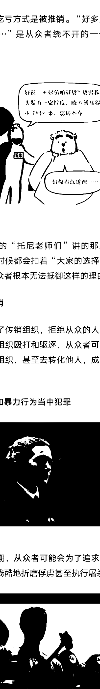

理发店里的“托尼老师们”讲的那些规则，很多时候都会扣着“大家的选择”来说服，从众者根本无法抵御这样的理由。

- 2. 陷入传销

一旦误入了传销组织，拒绝从众的人会很快被传销组织殴打和驱逐，从众者可能会很快顺从组织，甚至去转化他人，成为帮凶。

- 3. 在战争和暴力行为当中犯罪

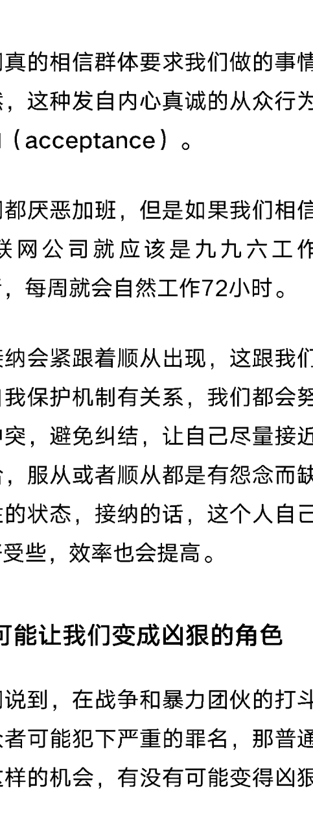

在战争时期，从众者可能会为了追求内部的认同而残酷地折磨旁人甚至执行屠杀。

暴力组织当中，一些被裹挟进组织的人反而更容易为了追求认同而下手更狠。我们看见很多年轻人大打死了人，家里都大吃一惊，觉得他从小被人家欺负，不惹事，他可能是因为从众行为而走到这一步的。

### | 从众的本质是害怕被孤立

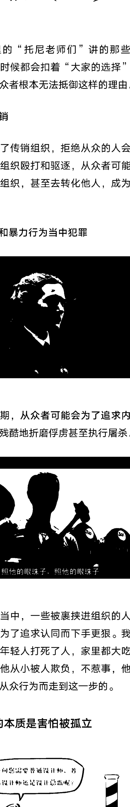

注意备胎熊夏周一（这是我们公司出品的职场系列漫画）的心理活动，从众者吃亏，是因为他们渴望在别人面前表现得完美，害怕是陌生人。

心理学家多伊奇和杰勒德把这种因素叫做规范影响（normative influence），从众者害怕被拒绝、被鄙视，怕看别人的脸色，他们很惧可能到来的冲突。

畏惧冲突的原因是人类对“被孤立”的恐惧。

上图中，夏周一假想出一个群体，来评价自己的行为，这在很多时候是好的，比如这样的人一般不会室内抽烟和随地吐痰，重视私德，但是过分关注自己的表现，担心被鄙视、起冲突，那就很容易变成从众的人，被人牵着鼻子走。

人类处在狩猎和采集的时代，被孤立的后果就是死亡。

今天的我们大多是群居者的后代，我们害怕孤立。

不要为自己从众觉得羞耻，我们应该解决的是如何不让从众行为危害到我们的利益。

### | 两种不同的从众行为

顺从：

我们不想做某事，但为了得到奖励或者逃避惩罚，会遵循他人的期望和要求，这种由外部力量施压而违心的从众行为叫做顺从（compliance）。

有一种特殊的顺从：在明确的命令下，人们做出的顺从反应，我们称之为服从（obedience）。

早上九点打卡，这就是服从，晚上六点可以下班，但是资深员工都在那里耗着不肯走，你也跟着在那里浪费时间，这就是顺从。

接纳：

有时我们真心的相信群体要求我们做的事情理所当然，这种发自内心真诚的从众行为叫做接纳（acceptance）。

比如我们都厌恶加班，但是如果我们相信了“互联网公司就应该是九九六工作制”的话，每周就会自然工作72小时。

有时候接纳会紧跟着顺从出现，这跟我们心理的自我保护机制有关系，我们都会努力解释冲突，避免纠结，让自己尽量接近内心自洽，服从或者顺从都是有怨念而且缺少积极性的状态，接纳的话，这个人自己心理会好受些，效率也会提高。

### | 从众可能让我们变成凶狠的角色

刚才我们说到，在战争和暴力团伙的打斗中，从众者可能犯下严重的罪名，那普通人没有这样的机会，有没有可能变成凶狠呢？

耶鲁大学心理学家米格拉姆曾经设计了一个社会心理学历史上最著名，也是最富有争议性的服从实验：研究人员告诉被试者这是一项考察惩罚对学习影响的前端研究，要求“教师”教“学习者”学习配对出现的单词，如果“学习者”记忆错误，就要对他施加逐渐增强的电击，最高电压为450伏。

所有的实验对象都会抽到“教师”签，“学习者”都是实验室请的演员，“被电”后，“学习者”会发出呻吟和抗议。

如果“教师”询问和要求停止实验，一旁的研究者会鼓动他：请继续下去；该实验要求你继续进行下去；你继续进行下去是绝对必须的；你没有其他选择，必须进行下去。

米格拉姆给精神病学家、大学生、中产阶级人士1...提出了... 二个群体的影响

米格拉姆给精神病学家、大学生、中产阶级等110人描述了这个实验，三个群体的人都以为自己会在135伏左右不服从命令，停止电击他人，没人想进行到300伏以上。

然而，当米格拉姆对40名男性测试时，有26人（65%）一直进行到了450伏。后续研究表明，女性的从众比例也和男性相似。

很多实验对象“教师”在实验结束后都感到非常痛苦，他们不想这样，但依然会遵照研究者的指示，残忍地伤害一个无辜的人：人类的从众倾向远比自己估计的严重得多。

### 丨传销组织的洗脑指南

- 1. 用亲人来蛊惑新人

大多数传销组织都会在新人到来之前开会，让发展新人过来的亲友编造一个谎言神话，人们往往难以拒绝关系更近的人。

- 2. 不急于控制人身自由

### 丨在群体中保持独立思考的清单

- 1. 利益，利益，利益

重要的事情说三遍。做决策最先考虑的应该使自己的利益和风险，不要只是为了讨人喜欢而做一些重大决定。

### | 从众并非总是坏事

大多数的公序良俗也是依靠人们的“从众”才得以维持。

## —— 思考题 ——

你记忆当中的一次拒绝从众经历是什么样的？

## 附：相关阅读

《对扛逼婚这件事没有那么难》
《如何拒绝别人的无理要求》
《为什么思想可以特立独行，生活方式最好随大流》
《KTV里的凶险斗争》
《你总得认识到自己不能拯救世界》

## 掌控亲密关系：情侣间的节日和礼物攻略

熊太行

每年都有好几关。到了七夕又一关。

在节日和礼物上，男人和女人往往难以达成一致。男人认为女人无理取闹，要求过高，女人认为男人愚昧无知，不动心思。

七夕这个节日，就是一个大坑，不送礼物的，送错礼物的，送对了礼物说错了话的，都会死得很惨。

给大家一个十六字口诀，帮助大家度过这类节日的难关：

> “先发制人、回避辩论、控制成本、强调意义”。

### Ⅰ 先发制人

对阅历丰富或者性格比较偏中性的女生，可以直接问她最近想要什么礼物。

我认识个姑娘遇到节日会自己挑好东西，让男朋友来付款，她说让他瞎猜浪费时间是不道德的，要命的是这么买来的东西还一定会是错的。

遗憾的是这样的女孩太少，以及只有最强大的一批男性性能接受这样的女朋友。

如果你已经结婚或者感情非常稳定，可以放心大胆地问对方要什么，甚至可以使用背锅法：

> “你又不说要什么，回头买不对你又要生气了。”

如果你的女朋友或者妻子还在渴望浪漫和惊喜，那你就要婉转一些，密集地跟她聊喜好，更需要早做打算了。

有一点，花花公子们做得特别好：“未雨绸缪”和“别有用心”。

他们送礼物给很多潜在的交往对象，等候最有可能的一个回复，比如批发一堆心形的石头，当做自己亲手磨制来送人，不知道骗了多少吃过见过的女明星。

如果你要对自己的女友或者妻子好一点，那就多准备几个礼物，至少放进购物车。

每个季度都去翻一翻，别到节日的时候才去淘宝搜索“七夕 女朋友”，然后下单买销量最高的，如果礼物和女友对面的同事撞了，你就死定了。

此外，先发制人会防止你的礼物因为物流耽搁了正日子。七夕前一天叫一个礼物加急，夜间送货上门，赶上雨天台风，这个美好的夜晚就没有了。

### Ⅰ 回避辩论

世界上总有一些东西，名字和实际是相反的，七夕变成一个非常物质的“中国情人节”也就是近十年的事。

我们知道过去的女人要会做饭、会做衣服，这样能嫁得好一点。七夕乞巧，就是渴望能做出更好的衣服，更好的鞋子，所以换算到今天，就应该是大家深夜坐在银河下面祈求：

> “我希望能做出更高大上的PPT。”

> “我希望自拍之后，能把双腿不露痕迹拉长到一米二。”

道理都对，但是恋爱的根本目的是什么？是共度美好的时光。

一张嘴像她的大学德育老师一样，那要你何用呢？所以提醒大家：

- 1. 男生不要对七夕是不是情人节教育人；
- 2. 女方不要和你的伴侣因为礼物不好起冲突；
- 3. 如果有不愉快，控制住自己；

你应该等到第二天再婉转地解决这个问题。如果两个人冲突，每年的七夕都会想起这件事，继续冲突下去。

### 4. 七夕后分手多？

其实是因为节日本身会给人带来压力：采购会带来经济压力，而且七夕还不放假，工作压力仍然在。

这个节日对学生党很不友好。记得吗？如果身边有可能的替代对象，离婚率会上升，分手也是类似。暑假里的恋人有距离，诱惑却是现成的，处理不好很容易分手。最好是试试一起出游或者提前返校。

### Ⅰ 控制成本

男女之间的感情交换，最好是“明钱明账”。

有人拍案而起，说我太庸俗。我说那你说个不庸俗的，他说，男女交往应该建立在感情的基础上，感情是无价的。

我问了他，发现他这辈子还没有过女朋友。我只好解释说，对，是无价的，这就是为什么我们（他）会付不起。

在这里给大家推荐“感情估值法”，在大多数的关系里，都可以使用这个工具。

比如张总的估值是5000元，就是我愿意忍受比我的市价低5000元的月薪去和他合作，其总是负10000元，那就是这人不靠谱，去他的队伍必须多要点钱，防止挨坑。

进一步把对方形容为“值得每月投入3000元的异性”，就好像带上了侮辱的成分。

其实一个人对另一个人的情感和意义，就在于“我愿意为了他而承受多少损失”。

建议大家使用百分比来评估情侣关系，比如10%的女朋友，就是每年可能会拿出收入的10%去维护和对方的关系。一个税后收入30万的男性，需要拿出3万元。

这笔钱可能拆成3个节日纪念日（情人节、七夕和生日），或者摊到更多节日里（农历生日、白色情人节、儿童节……）。

### 敲黑板！男人不应该购买超过自己经济能力的礼物。

昨天看见一条新闻，两个人是高中同学，后来都去了杭州，合租在一起。男生追求女生，给女生买了四万多块钱的东西，但是女生一直没有答应男生，男生想索回礼物，又难以启齿，争吵中把女生从阳台上推下去，女生死了。

有人说女孩在玩火，不该收那么贵的礼物，同样，男生也不应该买超过自己经济实力的礼物，也不要索回自己送出的礼物。

礼物是互相喜欢的人增加感情的道具，不是一个人买下对方的砝码。

女性如果想得到更高价值的礼物，最终的解决方案是：

- 1.升级关系

# 性关系：《色戒》当中，王佳芝在和易先生发生了几次肉体关系之后，提出要求：“我要一间公寓”。

性关系是许多男性愿意赠送更贵礼物的原因。

# 订婚：订婚在许多地区仍然风行，这意味着两个家庭承认了两个人的关系，此后的双方有更深入的财产交流。

- 2.提升自己的竞争形态

更富有魅力、更会说话、更好的打扮技术，甚至整容。

在自己没有明显提高的情况下期待更昂贵的礼物，很可能会导致关系的破裂或者崩溃。

- 3.做大蛋糕策略

支持自己的男友或者老公投入事业，做大蛋糕。

谈恋爱实在是太花钱了。如果两个家庭都家境平平，最好的办法是男生在1~3个月当中密集轰炸，趁着晕轮期（觉得对方什么都好）就赶紧结婚。靠缩短恋爱期来省钱。

有些人会说“熊老师，我算得这么细，这就不叫爱了！”

这你就想错了。

爱就是要为对方考虑很多，而不是在一两次赌博式的打动上花掉自己的所有。

### 男性不能把应对亲密关系的费用预算全部放在送礼上。

还有一些场合也需要用钱。

如果你你的女友没有太多积蓄，而她的爸爸住了院或者弟弟打了人，都可能需要钱。如果你能有这样一笔准备金，就是一个“大男人”了。

相反，如果那个时候你看着信用卡账单无计可施，她只会迅速在事情结束之后离开你，理由是“你没有给她安全感”。

此外，这笔钱还应该能支持一个决定：

“我们把他生下来。”

不要倾尽全力去讨好女朋友，如果她让你完全没有余钱，那她就是你养不起罩不住的女生。

她可能需要比你强大得多的男性，或者需要调整对自己的认识了。

### ｜强调意义：浪漫出在嘴上

挑选礼物也好，设计约会也好，解释很关键。

礼物不见得非要是 Cambridge 的，也可以考虑一些演出。

电影总价比较低，如果选了最好再订一个好一点的馆子。

有些地方的戏曲院团还会唱七夕主题的戏，有喜欢传统文化可以过去看看，此外，如果你所在城市有天文馆，星空类的球幕电影，也不要放过。

这就是：“美女出在腿上，浪漫出在嘴上。”

不一定花多少钱，如何解释某些娱乐的意义，才是更关键的。

“浪漫出在嘴上”还有一层含义：食物是非常好的一种礼物。

经常有人跟我说，不知道送别人什么好，我一般都会跟这位同学说：“你是北方人吧。”（不是我开地图炮，我在北方长大。）

70、80这一批的北方家庭，可选择的食物类别还比较少，超市出现都是90年代的事了，小时候父母单位发福利，最好的海鲜就是冻带鱼。人们依靠上千斤的大白菜和自制的瓶装西红柿酱（那些年的小学语文课本上还有这个做法）熬过冬天，在食物上难免就有点想象力不足。

《金瓶梅》是一部很有意思的书，里面关于人情世情的描写都是明朝城市里的智慧，几次提到西门庆送礼和被人送礼：

西门庆解决了刘太监的占地纠纷，刘太监：幸了一口猪，又添上自造的木樨荷花酒，四十斤糟鮸鱼，妆花红金缎子。

鮸鱼是名贵的鱼类，其它就是酒、肉、衣服料子。绸缎在那个时代跟贵金属差不多，也是硬通货。

西门庆给蔡京（蔡太师）送生日礼：

三百两金银铸四阳捧寿的银人，金寿字壶和玉桃杯；汤羊美酒，异果时新。

蔡京十分满意，还赏了来送礼的人。

西门庆见对路，第二次祝寿送的是：黄金明珠，蟒袍玉带，花素尺头，金银酒器，足装了二十多扛。这次拜了蔡京做干爹。

金银虽然俗，但这是好东西，遇见各种灾害战争都可以拿出来用。蔡京肯定看不上阳谷县金银匠师傅的手艺，但看见真金白银，这就是心意了。给领导送礼要避免触受贿的红线，但送女友妻子，就没有这个问题，所以：

- 1. 贵金属可以送
21世纪了，黄金和铂的光泽仍然受女性喜欢（如果送妈妈黄金是最好的礼物）。
- 2. 现金当然也可以送
大多数女朋友和老婆都支持支付宝和微信双平台转账。
- 3. 食物也可以送
秋天是个好季节，水果丰收河蟹肥。
此外，一些好的舶来品食物也是可以送的。
如果你要把东西发到女朋友父母那里，最好是事先问清楚他们有没有什么不吃的东西。
活物要特别留神。
- 4. 高品质的电子产品
- 5. 带码的不送
有尺码，就可能不合身，尽量不要给女友挑鞋子。
- 6. 貼身的不送
不要给女友挑内衣裤，没法试。
- 7. 太偏女性的不要送
不要送口红！不要送口红！不要送口红！
除非你的女朋友给你色号和牌子，再去买，绝对不要自己去买口红。
中国男性的色弱比例大概是5~8%，好些人只能把口红分为姨妈色和死孩子色，这样的眼睛去挑口红，失败简直是理所当然。

也不要找女性好友陪你去买这种东西，因为她哪怕再人畜无害，也会是你非常亲近而且信任的人，你的女朋友或者妻子一定会心里不舒服。

生活很艰难，不要给自己挖坑了吧。

## 8.不要送嗜好品

女性如果要送男友或者丈夫，尽量避免送手串、核桃、钓鱼竿之类的东西，这些行当每个人偏好都不同。

如果一定要让自己的男人快速步入中年，送一个摇滚乐手专用保温杯是可以的。

我的同事猫头木有鹰曾经有个前同事，女生，重阳节收到一个盆必须要盖米。对这个东西代表的含义大家众说纷纭，有人说是“我栽在你手里了。”还有人说：“我们早晚捏在一起。”无论如何，这种小众的东西还是不要送人好。

我们的十六字方针之外，还有一招，专供预算不多，渴望浪漫的人们：下厨。

西门庆周济过一对夫妇，到重阳节了这对夫妇想请西门庆，买了四十个大螃蟹，把螃蟹肉拆出来调味炸了做成丸子——其实我们知道活螃蟹吃本味最好，但是这样的做法，西门庆觉得新奇。

## 此外，关键在于用心！

以及提供给对方晒朋友圈的机会！

把菜刀拿起来吧。

## 附：相关阅读

《樊胜美攻略|如何娶到为奴的女儿》

《如何拯救过那些为奴的女儿》

此内容归得到App独家专享，版权所有，未经许可不得转载，侵权必究。合作请联系iget@luojilab.com

## 用户留言

AlleluJah 11
沙发
08-24 23:33:08

徐胖子 7
关系户兄弟姐妹们留言“七夕送女票什么礼物，200块以内”
熊老师：200块以内，送关系攻略正好。多一块破了规矩，少一块不够重视。真情就是露在这199之中了。
（熊老师：别听那个徐胖子的，做妖军师我没有说过。今年过节不送礼，要送就送夏周一。）
08-24 23:45:58

AlleluJah 5
记得女朋友给我举了一个送礼很到位的例子：送了女生一款3000块的XX牌的手表，然后请她去装潇很好的餐厅，戴着新手表拍照。照片发了朋友圈，真好看。
之后我决定从摄影技巧和P图技巧开始学起😂
08-24 23:44:07

Hsiang Ming Lin 3
唉,曾经带过喜欢的女孩去吃法国料理，但没想到她带了一个女性闺蜜，结果一共付了三个人的钱，对方的闺蜜还在脸书上打卡表示:“第一次吃法国菜，真的不是很习惯”(表情符号是代表流两行泪的:QQ)，我曾经多次给女方(喜欢的女生)咖啡，她会打卡放闪光，但这次带个女闺蜜来一起吃饭，突然觉得很不受到尊重，后来我下了一个判断:我不该与她交往。最后远离了这段关系。08-25 00:18:25

作者 回复
做得对。女儿国王说得好：“御弟哥哥，我帮你兑换关文，让你的闺蜜，哦不，徒弟替你去西天取经吧。”被人当凯子吃大户心情肯定不愉快。我表姐早些年跟我说过一些事，她有个男同学喜欢一个女同学。男生当兵了，休假回来大家一起去爬香山。女生其实不喜欢男的，但是喜欢虐他炫耀。让他背自己上山。结果阿兵哥在部队练得身体倍棒，做到了。当然我们知道这样的子弟兵越多越好，但是那一天，所有的人都觉得那个男生太可怜了。08-25 01:43:47

诺诺和听雨 3
一个人过情人节，快要28岁了，很难遇到情投意合的人，也似乎没有爱一个人的力气了。祝你们幸福吧。😂
08-24 23:50:13

豆姐 3
已经第一时间转给老公。然后我默默的下单，买了一个保温杯！哈哈哈哈哈哈哈哈
08-24 23:43:21

作者 回复
哈哈哈哈
08-25 01:10:46

倪涛 2
这么说起来，我真是找到一个好老婆：我们生日月份挨着，15年时，她直接找我要生日礼物，我也找她要，然后我们约定互相给对方选礼物。

然后，就到了2016年，礼物还没买。

## 掌控风险：为什么越强大的人反而应该越低调？

熊太行

今天我们跟大家分享两个人的故事，这两个一个叫岳飞，一个叫完颜宗弼。后者在评书和民间称呼当中，叫做“金兀术”。

这两个人是老对手，打仗兀术不行，搞政治岳飞不行。兀术在战场上被岳飞打得损失惨重，但是岳飞却最终死在了自己同事和领导合谋的构造当中。

业绩好的人为什么死于公司政治？业绩一团糟的人为什么能胜在关系？这个故事里有你要的一切答案。

## “我的领导非常保守”

宋高宗赵构20岁登基成为皇帝，那时的岳飞有了军功，被提拔为一个从八品的象义郎，岳飞给赵构上书：“黄潜善、汪伯彦之辈不能秉承陛下旨意……臣希望陛下趁着敌人巢穴还不稳固的机会，率大军北渡……中原失地可一举恢复。”

## 和领导的蜜月期如何相处

宋高宗赵构即位三年后，因为金兵打上门吓得阳痿，唯一的儿子又病死了。他没法有儿子了。

## 这件事不是你该考虑的了

赵构哄好了岳飞，岳飞回来见皇帝时，又上表折建议赵构立太子，其实赵构已经收养了一个儿子赵偲，岳飞建议就是立他。

块心病。

姓岳的卷进了赵家人的家事，我们之前说过，疏不间亲，岳大帅已经非常危险了。

后来大家都知道，岳飞的几次攻击都和朝廷的筹划不同，他复刻了早年“为革命抗命令”的场景，君臣关系越来越恶化，最终被下狱和杀害。

### 金兀术的聪明

从1138年开始，在金军屡战屡败的情况下，金朝开始对南宋示好：归还河南、陕西，追封死去的宋徽宗，将在押的宋钦宗封为天水郡公，以示尊重。

兀术（完颜宗弼）率领的最精锐的金国部队又几次败于宋军的几只队伍，不得不逐渐退军向东北方向压缩。

> “必杀飞，始可和”，据说是兀术在此时提出来的。不不过这一直有争议，因为公开的条约里肯定没有。

### 复盘

我们复习一下两个人的得失：

- 1.岳飞的眼睛盯着失地。忽视了最重要的关系，和领导的关系。
- 2.岳飞高调，爱说大实话，连赏识自己的人也会，不理解官场永远都是“对人不对事”。
- 3.岳飞没有遵循“疏不间亲”的原则。
- 4.岳飞错看了赵构，赵构是个阴险的狠人，人不会因为阳痿就变得低能。
- 5.做过敌国人质的君主都是狠角色，不想想秦始皇赢政、燕太子丹。日本的德川家康也是人质出身，最后笑到了最后。
- 6.兀术的眼睛盯着的一直都是人，他能掌控自己的风险。
- 7.他低调，跟从强者，认同自己的打工者地位。
- 8.他帮着领导杀同僚。
- 9.他和赵构达成了一种奇异的默契，因为他的所有出发点：都，是，利，益。

## —— 同龄人的君臣关系 ——

美国记者威廉·曼彻斯特第一次见到史上最年轻总统肯尼迪的时候，问了一个这样的问题：“总统先生，你的内阁和你的出生年龄都差不多，你是不是一个‘同时代人主义者’？”

## 附：相关阅读

- 《业务冠军怎么老也无法升职》
- 《掌控未来：如何挑选领导》
- 《职场上真的是伴君如伴虎吗》
- 《如何与你的领导发生冲突》
- 《你的领导说你“不成熟”的时候是在责什么》

## 掌控攻略合集：谁不想掌控自己的未来？

熊太行

《关系攻略》大部时间都在告诉你要顺势而为，有时候也需要逆流而上。你自己的人生，要学会掌控。

今天一起总结复习本周的“掌控攻略”。

## 压力来了，如何掌控？

压力本质上是我们对威胁或者挑战事件的身体和情绪反应。

压力是由应激源造成的，比如更换了工作、怀孕、生育，这些都是应激源，应激源会带来压力。

这里复习一遍几种压力的应对之策：

- 1.解决问题的
直接解决压力源，比如如果缺少5000元凑不齐学费，就要找人去借这5000元。如果领导反复挑磨你，就要调走或者辞职。
- 2.调节情绪
举个例子：“我得上班没有时间多陪伴我的孩子，我觉得自己对不起孩子。”
“我在这个艰难时期保住了自己的工作，我养活了我的孩子。”
这就是认识同一件事的两种不同的角度。
- 3.可以通过冥想或者锻炼放松，让你更好地应对压力。
- 4.主动求助他人，这包括物质上的求助和经验上的求教。
- 5.情绪隔离
有人遇见事会感情淡漠，这是无意识地试图让自己避免感受到强烈的痛苦。
有人失去亲人之后头几天会变得像行尸走肉一样，就是这种应对出现了，这未必是坏事，因为这能让他把亲人的身后事料理完备才开始悲痛，遗憾的是如果这种状态成了习惯，人就会变得逃避而消沉。

## 如何挑选领导，掌控未来

这篇文章中，我们提供了一个挑选主公的小清单，一起听听看：

- 1.战略眼光：如果有挑选领导的机会，那第一个要看的，就是他的战略眼光。
换句话说，每个当头的都要解释这句话：“这个行业，我们这么做能成。”
解释得最好的人，就是这个行业最优秀的人物，身边不会缺乏人才，执行力什么的跟上，就一定能赢。如果对行业两眼一摸黑，脑筋混沌，那就不能跟从。
- 2.挑选公平公正的领导：也就是说在利益分配上要公平，但公平不是平均分配，如果一个队伍里过度容忍能力低下之人或者诡媚的人，伤害骨干的积极性，这样的领导就不值得跟从。
- 3.挑选有实力和资源领导。
- 4.是很多人会忽略的，也就是领导寿命和退休年限。
别轻视这一点，跟即将到退休年龄的领导表忠心要谨慎，你可能在两三年后要找别的出路。如果你不能忍受这样的变动，就不要爬老树、上危船。
- 5.领导的性格
领导应该挑选坚强的人，无论什么逆境里，他都信心满满，带着大家往前冲。
坚强的领导可以用懦弱的人，但懦弱的领导却没法用坚强的人。
- 6.需要提醒你，领导的道德可能真的没有那么重要，尤其是一些私德。
对领导寄托好老公好妻子这种期待，而领导又无法满足这种期待的时候，就会出现各种问题。
所以职场上应该收起儒慕之情。道德是加分项目，如果有，自然最好，无论有没有这个加分项，首先还是要跟随能赢的人。

## 如何避免从众，掌控独立

如果失去了掌控自己的能力，被别人的行动或者主张所影响而改变了自己，这个就叫做“从众”。

从众是有一定的危险性的。

- 1.利益当前。做决策最先考虑的应该是自己的利益和风险，不要只是为了讨人喜欢而做一些重大决定。
- 2.查查权威的底
号称是“权威”的人未必真的是权威，现在互联网工具很发达，要仔细验证“权威”的身份，不要只依赖于一家搜索引擎。有条件的话，最好用谷歌，没条件的话，必应也是不错的选择。很多看上去很牛的国字号组织，可能根本就是一个野鸡公司。
- 3.众人的选择就是个屁
这句话虽然粗鲁，但是心里一定要有这句话。
- 4.留神催促你的人
需要做重大决定的时候，一定为自己留出单独思考的时间和空间。如果周围有人一直催促你，不给你独处的机会，要警惕他的用心。
- 5.求助专业的朋友
不了解的领域，如果有专业人士的朋友，赶紧联系一下，听听打听，如果他有很好的朋友能给出专业意见就更好了。
- 6.开放空间里可以寻找支持
如果是一个开放的群体和空间当中，可以考虑直接叫破：“都说谁谁的作品好，我真觉得没有太大意思”。一定会有和你意见相同的人。有的时候，就像《皇帝的新装》里的那个小孩子，要有一个人先说话才行。
- 7.封闭的群体要尽快离开
如果自己身处一个偏袒古怪群体，这个群体对持不同意见的成员极力打压和抨黑，最好是尽快离开。

## 如何送礼，掌控亲密关系

在节日和礼物上，男人和女人往往难以达成一致。男人认为女人无理取闹，要求过高，女人认为男人愚昧无知，不动心思。

七夕这个节日，就是一个大坑，不送礼物的，送错礼物的，送对了礼物说错了话的，都会死得很难看。（文章末尾，我帮你准备了几款不会出大错的七夕礼物，供你参考。）

关于节日送礼，有一个十六字口诀：“先发制人、回避辩论、控制成本、强调意义”。

### 先发制人

对阔兵非常富有或者性格比较偏中性的女生，可以直接问她最近想要什么礼物。
如果你他们已经结婚或者感情非常稳定，可以放心大胆地问对方要什么，甚至可以使用背锅法：
“你又不说要什么，回头买不对你又要生气了。”
如果你女朋友或者妻子还在渴望浪漫和惊喜，那你就要娴转一些，密集地跟她聊天，聊好了，更需要早做打算了。

### 回避辩论

男生不要对七夕是不是情人节教育人；女方也不要和你的伴侣因为礼物不好起冲突；如果有不愉快，控制住自己。

你应该等到第二天再婉转地解决这个问题。如果两个人冲突，每年的七夕都会想起这件事，继续冲突下去。

### 控制成本

男女之间的感情交换，最好的“明钱明账”。

其实一个人对另一个人的感情和意义，就在于“我愿意为了他而承受多少损失”。

建议大家使用百分比来评估情侣关系，比如10%的女朋友，就是每年可能会拿出收入的10%去维护和对方的关系。一个税后收入30万的男性，需要拿出3万元。爱就是要为对方考虑很多，而不是在一两次赌博式的打动上花掉自己的所有。

男性不能把应对亲密关系的费用预算全部放在送礼上。

还有一些场合也需要用钱。

如果你的女友没有太多积蓄，而她的爸爸住了院或者弟弟打了人，都可能需要钱。如果你能有这样一笔准备金，就是一个“大男人”了。

相反，如果那个时候你看着信用卡账单无计可施，她只会迅速在事情结束之后离开你，理由是“你没有给她安全感”。

### 强调意义

无论什么礼物，解释好这件礼物的意义是关键，浪漫是出在嘴上的。所以，在你决定了送什么之后，先找一个浪漫的“借口”吧！

熊太行

你有心意，我帮你出主意。点击以下图片可以看到我帮你挑的几款小礼物，供不知道送什么七夕礼物的关系户参考。提前预祝婚姻和谐，恋情顺利。

## 帮小忙攻略：举手之劳的全指南

熊太行

人活在世界上，难免要求助于人。

之前我们在《人情债进攻略》当中曾经提到过：不要怕求人，求别人帮一点小忙，很多时候能够增进关系。

为什么我不说“所有的求助行为都能增进关系”呢？

因为有的人根本不会求助，他的要求可能会起反作用。

本周的主题就是“帮助”，我们会分析几个最重要的帮助场景：

- 周一：帮小忙攻略 | 举手之劳全指南
- 周二：帮大忙攻略 | 为什么说大恩不言谢
- 周三：帮谁忙攻略 | 如何分辨出“不知道感恩”的人
- 周四：不帮忙攻略 | 如何回绝、逃避一些不合适的忙
- 周五：帮倒霉的人（要谈论谁我们先保密）一如既往，这是一篇对历史人物的拆分和解读。

### 帮小忙和帮大忙

我把帮忙分成帮大忙和帮小忙。

而不是“帮同事的忙”“帮同学的忙”“帮领导的忙”。

这是因为帮忙行为，本身还是要着眼于解决什么样的问题。

解决问题的难度越高，这个忙的价值就越高。如果求助方和帮助方对解决问题的难度认知不一，这个帮忙行为就会发生冲突。

就像小国关系和大国关系不同一样，小忙和大忙也完全不同。

帮小忙关键在于漂亮和高效。

帮大忙最重要的则是隐秘和周到。

### 什么是帮小忙？

帮小忙的特点是：

- 1. 不需要动大额的钱
- 2. 时间上一般可以当天解决
- 3. 一般存在中间人，有的还要一个以上的中间人
- 4. 所求的人和自己身份差不多
- 5. 这件事不会伤害第三方利益
- 6. 一般来说不违法，或者一般不会被追究
- 7. 被求助者一般不是唯一的求助对象

像给人要个联系方式，托朋友给他认识的人带个话，推荐一个身份对等的人给自己认识，这都属于“帮小忙”。

相反，求人办子弟接班、解决事业编制、弄来一个限额城市的车牌号，争夺有限的资源，托人从拘留所里“捞人”这就是“帮大忙”。

我们重点要说一下第5点，什么样的忙会伤害第三个人的利益。举个例子：

同样是希望老师多给自己几分，如果你希望从59分到60分，这可能就是帮小忙，如果你的学校控制90分以上的比例，你要让老师把你从89分变成90分，为此要挤掉另一个90分的同学，这就是“帮大忙”。

### 帮小忙的意义大不大？

有人认为帮大忙就有大情谊，帮小忙就有小情谊。

这样想的人，在遇到困难的时候会寻找被自己帮过大忙的人，但是得来的结果往往不尽如人意。

需要求助的时候，求助于帮过自己的大忙的人，或者帮过对方小忙的人，效果都会很好。

和帮过多大的忙相比，这个求助和帮助过程当中是否顺利、是否愉悦，才是你们感情是否加深的关键。

别人求我帮一个小忙，本 satisfies本身就说明对方对我有期待，他可能看重我的实力，渴望和我加深感情。

帮小忙同时也是大家互相帮忙和试探的过程。

朋友之间想要加深情谊，“自我暴露”是方法之一，要共享很多秘密，这件事风险比较高。帮小忙是另外一种加深友谊的方式，其实是一种朋友之间的信用卡。

大家可以着着观察一下你们身边最出色的关系达人，他们都精通求助之道。

### 帮小忙会遇到哪些坑？

前几天，我的一位师妹请我帮一个小忙，她也是我们关系户当中的一员。这时候我才发现她其实不会求助。

### 高效率的帮忙流程

要高效地请人帮小忙，要注意以下几个步骤：

- 1.说明来意
- 2.自报家门
- 3.准备书面文件

的方法是给一个邀请函，邀请函的好处在于，中间人可以直接转发。

- 4.尊重中间人的时间

虽然大家在社交软件上看上去都沒啥正事儿，但每个人都会觉得自己的时间很宝贵。你托人办事，就不要让人为你打很多字。

尽量通过更少次数的触屏来解决问题，如果一个帮助行为要用到七八个来回还不能解决问题，那中间人可能会心存怨念，大多数帮忙中间人是不收礼收钱的，最多是一顿饭谢之（其实差一顿饭呢）。

如果这个事情难度又超乎想象，就会给中间人和求助者留下不愉快的印象。

- 5.不要让对方参与传话游戏和总结中心思想

我对师妹说，她不提供邀请函之类的文件，我要一句句去问她细节，等到这些东西她一句句回复给我，我还要组织语言，用自己的话说出来发给对方，然后我朋友还要去把这些问题再转述一遍。

我们应该玩过那种传话游戏，一句话传几轮之后就会面目全非。如果它没有一个官方的文件，也应该能给出一 đoạn话介绍自己和说明来意。

- 6.“我找的就是你”原则

“熊老师您好，我是XX公司的人力，我想请您或者古剑老师、马徐骏老师来给我们的公司做培训，请问您能来吗？如果不能来的话，请您帮我问问那两位老师好吗？”

我的回答一定是：“我不能来，他们俩也不能来。”

- 7.用好同行和校友的微信群

最后我对我师妹说，其实你找媒体，咱们学院的校友群是最好的求助场所。

- 8.一些容易被忽略的细节

- 1）托中间人的话，应该先给说明文件，可以合作再拉群。
- 2）做中间人不容易，应该小窗询问被求助者，拉群合适还是怎么合适。
- 3）如果你是被求助者，给求助者备注的时候要加上中间人的关系，微信朋友圈以后很可能撕起来或者删好友，所以最好是把此人是谁的关系尽早备注上，免得误伤。
- 4）如果被求助者更喜欢推名片，就用推名片的方式，让他们一对一聊，一般来说，拉小群的“站台”意味更浓，而推名片，则显得对被求助者更尊重。
- 5）求助者可以对忙的人好一点，但尽量不要立刻加上微信就玩命点赞，赞一条新的或者赞一下封面就够了，细水长流。批量点赞是一种骚扰。

### 敲黑板！有雷区

不要随便发语音，无论对方是中间人或者帮你的人。

微信语音只有四种用法：

- 1.文盲、帕金森病患者和双手受伤的人可以用。
- 2.男女朋友之间当情趣用的。
- 3.要给人唱歌或者讲口头说的段子用的。
- 4.上级给下属布置命令用的。

### 延伸阅读

中间人越少，你处理关系的事力就越好。

## 附：相关阅读

《为什么不要给人免费的建议》

《如何请求老男人帮你做事》

《请客吃饭这件事情，也需要一个好借口》

# 帮大忙攻略：为什么说大恩不言谢？

142 | 帮大忙攻略：为什么说大恩不言谢？

熊太行

求人帮大忙，和求人帮小忙是两种完全不同性质的事，所以千万不要把帮小忙的经验转移到帮大忙上。

在昨天的课程中，我为大家列举了几种典型的大忙：子弟接班；解决编制；限购车牌号，争夺有限的评优机会等等。

来看今天的帮大忙攻略：

## 什么是帮大忙

帮大忙有什么特点：

- 1. 帮忙者可能违反规则，自己面临风险；
- 2. 帮忙者和求助者可能会伤害第三方的利益，树立敌人；
- 3. 求助者希望获得的机会或者资源是有限的；
- 4. 求助者因为帮助行为而节约成本或者获得的收益比较高（一般定义超过求助者1年的收入）；
- 5. 帮助者可能会承担巨额损失（一般定义为帮助者6个月的收入）；
- 6. 求助者面临生死（比如重病想加入新药试验计划）；

这6条一般来说有1条就会让这个求助行为成为“帮大忙”行为。

## 求人帮大忙的要注意的是什么

帮大忙的双方是有冲突和矛盾的，如果再加上中间人的算盘，往往让局面变得更加复杂。

但是大家一定要记得这样两个原则：

- 1. 求助方要尽量实现自己的利益，而帮助方要做的就是尽量减少自己的风险。
- 2. 帮助方的利益要靠求助方得益才能实现，而求助方的风险也紧紧依附在帮助方身上。

## 借贷场景和办事场景

我不主张借钱给人，不过这些事有的时候真的推不掉，借比较大的金额符合我们帮大忙原则的4和5。但是一定要打条，最好还要支付利息。

前几天看见一个视频，选秀出身的山东农民歌手“大衣哥”被村里的乡亲们借钱。

那些人借了他的钱，还轻蔑地嘲笑他，觉得他缺心眼，好多人借了他的钱四五次，在他终于鼓起勇气拒绝的时候，就对他破口大骂，然后转身离去。

还有的人对亲戚的钱不愿意支付利息，这是非常不尊重的表现。

求助者请求借50万，约定期3个月后归还。被求助者的机会成本包括：金钱，一般来说可能是1万元左右的利息；人情，这笔钱还可能借给另一个关系更紧密，能带来更多收获的人。而风险则是求助者没有偿还能力，帮助方失去这50万元。

| 求助事项 | 机会成本 | 风险 |
|---|---|---|
| 借钱 | 金钱：利息 人情：错过更好的求助者 | 求助人无法偿还 |

借贷场景比较简单：

我们之前说过一个很好的工具，叫做关系估值法，可以把你的女朋友评价为10%的女朋友，就是每年愿意花费10%的收入在她身上。

同样，你也应该有2000元的亲戚和20000元的亲戚，这个额就就像是银行给你的信用卡的授信额度一样，就是你对你亲戚信用和偿还能力的评估，你最多就只借给他这么多钱，一分钱都不要加。

办事场景更重要一些：

家长托人让孩子上重点中学实验班。我们就用这个例子来说吧：

这种班级优先录取成绩好的学生，相关领导能掌握的名额是有限的，具体到普通老师的话，自己的亲生孩子一般问题不大，其他的亲戚，那就只能求领导开恩了。

领导同样也面临着各种各样强度的推送，各种说情者有的有势力，有的有金钱，还有的有欠人情。

考虑人情，这个名额也许能留给能量更强、资源更多的家庭；

考虑金钱，可能会有更富有家长送贵重礼物来换取这个名额。

当然还有风险：被举报投诉，有降职丢官的危险。

| 求助事项 | 机会成本 | 风险 |
|---|---|---|
| 子女上重点实验班 | 人情：错过更优秀的人 金钱：有人愿意付更多钱 | 被举报投诉，降职丢官 |

## 挑选合适的求助对象

在昨天的课程中我们说过，如果求助方和帮助方对解决问题的难度认识不一，这个帮忙行为就会发生冲突。

在正式请托之前，一定要利用身边的渠道尽可能多地搜集和求助对象相关的信息，尤其要注意求助对象是否面临退休、换届的情况。有的人退休之前会倾向于多管点事，多捞点钱，但是更多的人是希望平稳离开，不愿意多事。

此外，还可以多打听一下对方以前提供类似帮助的对象身份和开出的价格，来预估自己将要付出的成本。

备好钱，随时用，不要把钱锁在理财产品里。

给人送钱没有线上转账的。

## 寻找好的中间人

有的时候有的人会托三到四个齐头并进的中间人，增加自己的赌算，但这种做法有极高的风险：

- 1. 是这几个人当中，你根本不知道哪个人是真正起了效果的；
- 2. 这几个人本人，都认为自己是真正的大功臣，哪怕他只是轻描淡写说了一嘴；
- 3. 玩命托好几个人的家庭基本上对事情的判断能力都比较差，往往家境上也比较一般。
- 4. 中间人之间可能有纠葛和不愉快；
- 5. 最重要的一点，3、4个平行的中间人，人多嘴杂，办事人的风险会变得特别高，事实上很多...

庸医开药多，怕死吃药多

关系能力弱的家庭托人多。

如果 ---------...

## 好的中间人的特质

- 1. 嘴密；
- 2. 没有不良恶习，比如赌博或者借贷；
- 3. 说话不浮夸；
- 4. 有其它正经的工作，不以揽客工作为生。

很多家庭，尤其是希望把自己的孩子送进机关事业单位的家庭，往往处于“病急乱投医”的状态，喜欢听那种拍胸脯的人说话，这种人往往会非常危险。

要多观察你请托的中间人，要多想想，如果自己是一个单位领导，能不能信赖眼前的这么一个人，再做出你自己的决定。

不要把进某个单位当做你的人生转机，抱有这种心态，孤注一掷地想改变命运，就像把一年的收入买了礼物跟单亲的女生表白一样笨。

## 中间人的两种方式

一种是包工包料型：所有的事情交给他跑，求助者到头来都见不到拍板的本人，好处是不善于说场面话拉关系的家庭也不需要费神了。

需要费神了。

还有一种是介绍型：把拍板的人请出来吃个饭，托付一下，或者打个电话或者写封信，只为求助者的人品背书，剩下的事情由他们双方来勾兑。这种类型的好处是可以直接见老大，有利于未来的进一步发展。

## 谈谈自己：展示实力和潜力

现在很少有人收钱办事，风险极高。

大多数的人会交换关系，我帮你这事，你帮他这事儿。

所以在求助别人的时候，可以谈谈自己的家庭，比如一个医生如果希望让儿子上省重点，他托人的时候一定会提到自己在哪个医院哪个科，有朋友需要您过来找我（不能说“有家人病了”）。

## 帮大忙是一种秘密结盟的关系

通过帮大忙的关系得到了工作的青年自带君臣关系，对这件事一定不要排斥，有的人对托关系进来有羞耻感，其实岳飞、韩信这些人都托过关系，雍正的能臣田文镜是监生出身，公务员身份都是买的。

## 求助失败的情况

只靠钱求人办事是最危险的事，这通常意味着求助双方都要承担非常高的风险。

## 永远不要把自己和对方置于风险之中

我们说，帮大忙最重要的是隐秘和周到。不注意保密会给双方都带来很多麻烦。

## —— 思考题 ——

你听说过哪些求人帮大忙的心得？可以写在留言中，我们一起拆解分析一下。

## 附：相关阅读

- 《随份子攻略：份子钱不是钱，而是流动的关系》
- 《如何克服在领导面前的紧张感》
- 《请吃饭攻略：请客吃饭这件事，也需要一个好借口》
- 《如何开口向朋友借钱》
- 《亲戚家的孩子长大了，快送他们去和亲吧》

