# 军地两用人才之友续编本


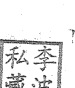

## 前言

为了帮助大家学习军地两用知识，我们于一九八四年编印了一本《军地两用人才之友》，并请李慎修同志写了序言。这本书在部队发行后，受到了广大干部战士的欢迎，许多同志来信反映，希望能继续为他们提供这方面的知识。为满足同志们的要求，我们编辑了这本《军地两用人才之友》(续编本)。由于我们的水平所限，难免有不妥之处，欢迎指正批评。

我们在编辑这本书时，遗用了有关刊物的一些内容，谨在此向有关作者和出版单位表示感谢。
参与本编者编写、校对和审定工作的有白彦山、刘鸿昌、李之熙、赵中、梁玉珠、梁玉珠、潘庆之。

沈阳军区政治研究室
一九八五年八月一日

## 前言

为了帮助广大患者学习军地两用知识，我们于一九八四年编印了一本《军地两用人才之友》，并请李贵生同志写了序言。这本书在部队发行后，受到了广大干部战士的欢迎，并多次志同志反映，希望能继续为他们提供这方面的知识。为满足同志们的需要，我们编辑了这本《军地两用人才之友》（续编本）。由于我们水平有限，难免有不妥之处，欢迎批评指正。

我们在编纂这本书时，选用了有关刊物上的一些内容，谨在此向有关作者和出版单位表示感谢。参与初稿编纂、核对和校定工作的有白彦山、刘海臣、李之熙、赵中、柴、梁玉珠、潘庆之。

沈阳军区政治部研究室
一九八五年八月一日


## 农村副业生产知识

## 果树一般栽培技术知识


## 种植家庭小菜园


## 养蜂生产技术


## 淡水鱼的人工养殖


## 北方地区鱼越冬管理知识


## 种 植 业


## 杂 益 业


## 粮 食 加 工


## 油料加工


## 肉鸡鸭蛋加工


## 面食制作

### 蒸食类


### 烤食类


### 饼 食 表

### 点 食 表

## 果品加工

## 干制品


## 其它贮制品


## 腌渍品


## 蔬菜加工

## 干制品

- 干蚕豆 ................. 194


## 点心类

## 凉糕


## 腌 浸 品

## 糖 浸 品

## 酱 浸 品

## 其他类制品

## 药 材 加 工

## 药材盐渍加工


## 服装裁剪

## 量具裁剪制图基本知识

## 男、女大裤

## 女 上 装

## 男 上 装

## 连衣裙

## 理发与发型

## 基本操作训练

## 工具的清洗方法

## 男式发型

## 童装

## 吹风和整理发型

## 女式发型

## 烫发

## 发型设计

## 车工基础知识

## 车工基本知识

## 车床

## 车刀与使用

## 工件的装夹及所用的附件

## 车外圆

## 车端面

## 切槽与切断

## 内孔加工

## 车圆锥

## 螺纹


## 钳工基础知识

## 划 线

## 钻孔、铰孔与钻孔

## 锉 削

## 攻丝与套丝

## 手工锯切与真切

## 刮 削

## 锉 削

## 研 磨

## 手工焊条

## 焊接基础知识

## 焊接电弧

## 手工电弧焊焊条

## 电焊条的选用与保管

## 手弧焊设备及其

## 手工电弧焊的基本操作技术

## 修整与弯曲

## 各金属材料的手工电弧焊

## 焊接变形与应力

## 焊缝缺陷及检验

## 电焊工安全技术


## 气焊基本知识

## 气焊的基本操作技术

## 铜 的 气 焊

## 铸 瓦 烧 结

## 工 艺

## 原 料

## 小型能源利用

## 小型水电站

## 太阳能

## 花

## 利用太阳能的设备

## 风能

## 养
- 花卉栽培中的设备

## 温床、冷床及其他

## 农村副业生产知识

## 果树一般栽培技术知识

## 施肥

### 1. 基肥的使用
果树的基肥，系指在果树休眠期施用的肥料。一般多在秋季果树落叶后施用，当当年秋季没有施基肥的果树，可在翌春果树发芽前补施。

适宜作果树基肥的肥料，以厩肥、土杂肥以及腐熟的绿肥等有机肥为主，也可适当搭配一些化肥，混合施用。如果树施基肥，因树龄的不同，其施用方法和数量也有所不同。

（1）幼年果树的施肥方法，可采用单株施肥法。一般是在树冠垂直投影的外缘，挖宽30厘米，深50厘米左右的环状沟，在沟内施肥。一般果树1～5年生树，可每株每年施肥100斤左右，5～10年生树的每株200斤左右。肥料少的果园，可沿树冠两侧各挖一条施肥沟施入肥料，来年再移至另两側开沟施肥。

（2）结果大的树的施肥方法。结果大树的施肥量，要根据土壤肥力高低、树龄大小和树势强弱而定，一般每亩可施腐熟的绿肥5,000～8,000斤，可以采用以下方法：

①全园施肥。这种方法适用于全园已结果的果园。即把肥料在全园范围内，结合耕地全园土壤深翻30厘米，将肥料混入土中，要注意靠近树干不要过分施肥，翻土也要浅些，以免伤根。

②放射状施肥。即环状向外放射，挖宽45厘米的环状沟，然后以树干为中心，按不同方向向外挖4～6条放射状沟，沟的深度要求近树干处为15厘米左右，向外逐渐加深直至与环状沟相接，蘸入肥

料后及时盖土拍实。

## ③ 四面沟施肥。 
即在树冠外缘的四各设一深条、宽都是50厘米的沟，然后撒入羊粪、粪土。也可以每年将四面换换施肥。

### 2. 追肥的方法

在果树生长年都能称作追肥。果园常用的化肥有过磷酸钙、硫铵、磷酸氨、尿素、硫酸钾等，也有用草木灰、黄腐等搭配使用。

- (1) 幼年果树的追肥方法。对一根未进入结果期的幼树，可在5、6月份萌梢停止生长时追施氮氧化肥，每次以0.2斤左右为宜。6月中旬以后，可追施磷钾类化肥4两左右，以便促进它饱满，枝条充实。

- (2) 结果大树的追肥方法。对结果大树的第一次追肥应在花前，追施氮化肥，以促进花芽开花结果。第二次追肥应在落花之后，追施氮磷钾化肥和磷黄化肥，以加强新生长和养。第三次追肥应一般果树的花芽分化期，以磷钾类化肥为主，并略少量氮肥，以便促进果实和花芽分化。

为结果大树追肥肥料的数量，应根据树势、施氮肥的多少、树龄、挂果情况等来决定。对一般结果大树，可每株每次追施氮肥4两左右，过磷酸钙5斤左右，草木灰20斤左右。为了使大树追肥肥料，可采用穴施，即在树干平均地做若干个小穴，放入化肥，再盖土后浇水。因氮氧化肥易被速溶解失，施氮或磷酸氮就挖穴要浅，距离地面10厘米即可。施磷钾化肥，穴深可挖到20厘米左右。此外，在果树新梢停止生长一月内为果实成熟期（约9月下旬至10月中旬）。追施氮氧化肥有利于提高花芽质量，防止落花和提高养的座果率。

### 3. 叶面喷肥

叶面喷肥，也叫根外追肥。叶面喷肥能使叶片迅速吸收而增强树的长势。对果树实行叶面喷肥，最好在受光害期进行。为果树叶面喷肥用肥有：硫酸1%；脲素0.10%；硝酸0.2%；尿素3.0~0.5%；过磷酸钾1~3%；磷酸二氢钾3%；硫酸钾0.3%；硝酸，桃花期用量为0.2~0.25%。幼果期大用量为1~2%。对肥、水条件较差或山地果园采用根外喷肥，效果更好。

## 浇水

在果树生长发育过程中，一般全年应浇水 4 次，第一次在 3 月下旬至 4 月上旬，第二次在 5 月中旬，第三次在 6 月，第四次在 10 月底土壤解冻之前（即浇冻水）。

在缺水之灌溉的山区，要在春雨、雨季前和秋季为果树刷树液、垒树堆，做到“一树一庐”，蓄水保墒。同时要修缮沟、垒坝垄，加高地边地埂，防止水土流失。

## 果园耕作

- 1. 秋耕
秋耕，应在采收果品之后到土地封冻之前，在果树行间进行，一般深约 30厘米左右。结合秋耕，可在树冠下撒施粪肥并翻树盘。翻树盘直径深约为 20 ~ 40厘米。翻树盘、要从树干向外由浅到深，以便伤主根的根为根。掏后需待土壤、防止跑跑。

- 2. 春耕
春耕，应在土壤解冻之后到果树行间进行，一般为 10厘米左右的浅耕，耕后要将地耙平。春耕的作用，在于疏松土壤和保墒。

- 3. 中耕
中耕的主要目的是疏松板结，疏松土壤，改善土壤的透气性，提高果树根系的活动能力和吸收养分的能力。对一果园，全年应进行中耕 3 ~ 4 次；每次浇水之后都要及时中耕，以将破坏地表的板结层。

## 蔬菜疏果

- 1. 疏花
为了防止出现“大年小年”现象，可以对开花的果树进行疏花。目前实行疏花的只限于梨等双价树种。为梨树疏花的方法，是在花序刚刚伸出时，在花量大的地方将一个花序上的花蕾全部摘除，只留下 1 朵。保留下来的花蕾，其相互之间的距离要根据品种而定，一般小型果（如香水梨）为 10厘米左右，中型果（如红香梨）为10 ~ 13厘米，大型果（如雪花梨、鸭梨）为15厘米左右。

## 2. 疏果

对未经过疏花的果树，或者疏花之后仍然座果太多的树，需要疏果。苹果是品种花序，即中心花先开，果实生长快，质量好，所以要留中心果。梨为复花序，边花先开，故应先疏边果，疏去弱花，要求在每朵果穗上留 1～2 个果，中花先留 2～3 个果，长枝顶上留 3 个果左右。在风害严重的地区，可以不为果疏花，而只疏果，以防止疏花后避强汰弱而降低座果率，影响产量。要提早据品种和树势，决定是否疏花，疏果和疏花。疏果是轻、重。座果率高，生理落果多的品种和生势强弱、负载能力强的树，可以疏花、疏果（如苹果中的品种、金光、黎树中的鸭梨、红肖梨）；座果率低，生至落果严重的品种和生势弱的树（如苹果中的红富士、极光等），可以不疏花、疏果，或者疏花、疏果。

## 生长期的修剪方法

在果树萌芽后至落叶以前进行的修剪，称为生长期修剪或夏季修剪。其利用于调节养分的分配，有利于整个树体的生长和结果。

### 1. 花前剪

苹果、梨等果树在开花之前要进行夏剪。一般冬季修剪对着干枝和强条进行修剪，并疏去密弱病、病枝条。早春能够显现花时，对花量多等的地被，芽萌动前适当疏除一些发育不良的早花芽，减弱枝条，多留强壮枝条；对花芽少的果树，要适当保留营养枝，多保留花芽。

### 2. 摘心

摘心，能削弱营养枝条的顶端优势，限制枝条的延长生长，增加营养物质的积累，促进结果枝的形成和花芽分化。生长势旺的树种和品种，常需要进行多次摘心，如苹果、梨，实行花前摘心能提高果素率；座果以后摘心，能促进果实膨大，提早成熟和提高品质。夏季和秋季进行摘心，能使枝条生长充实，有利于安全越冬。

### 3. 掐芽

生长位置不当或过密的芽，萌发后会造成树冠郁闭，消耗养分水分，应在萌发后及时早去除，这就叫做掐芽。

### 4. 刻伤（目伤）

用快刀横割枝条，达至木质部，割口须成马伤。在芽以下斜伤，能阻上部叶片光合作用制造的碳水化合物向下运输，能促进花芽的形成和叶柄的脱落。在下上斜伤，等于是使刀下部的芽得到顶端优势，也阻碍根系吸收的水分和无机盐向上运输，使承刀口下面原来萌发的芽萌发成枝。割伤的时间以春季为宜。

### 5. 扭梢（扭枝）

在5月至7月，对旺而过密又不结果的直立枝，可以把它从下部扭断，然后使它平放或下垂在有空间的地方，这样能够增加树腔内的光照，又能抑制树冠顶端生长和养分向下运输，而促进枝条充实和花芽分化，有利于促使它提早结果。

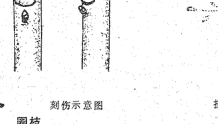

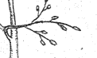

### 6. 圈环

冬、夏季都可以进行圈枝，但以5月上旬至6月上旬为好。其方法是将直立生长的一个新梢圈成一个圆圈，或将两个枝梢圈在一起，使它们中下部的养分被二次枝，促使它们部分较嫩果枝开始结果以后，再进行回慷。

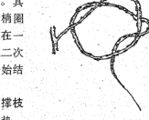

### 7. 拉枝、支枝、别枝、撑枝

为缓和主枝和侧枝的生长势，可以结合冬李修剪，在地上钉木桩，

用铅丝把主枝和木桩拴在一起，加大主枝与树枝的角度，叫拉枝；反之，如果主枝或侧枝的角度过大，可以在地上立木桩，拴主、侧枝支起，高度叫做支枝。冬季时或5月上旬至6月上旬，将直立旺长的枝压倒，使它平或成垂直状压在其它枝条之下，以缓和旺枝的生长势，促进其下部形成花芽或抽生结果母枝，叫别枝。在冬季修剪，常有两各都需要保留而且又相互拥挤的枝条，可以利用剪下的较粗枝条，一端悬留两个小的分枝，另一端剪出一个缺口，把两个拥挤的支条撑开，叫撑枝。

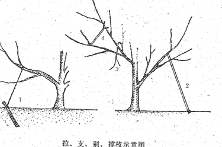

## 拉、支、别、撑枝示意图

- 1. 拉枝 2. 支枝 3. 侧枝 4. 撑枝

### 8. 牵枝

对于生长角度小的枝条，在早春或其它生长季节，用手从枝条下部向上把它们轻轻扭曲，在不伤皮和木质部的情况下，使枝条“软化”，从而加大角度， Quart 能提高其生长势和促进花芽分化的作用。

### 9. 环状剥皮（环割）

剥掉枝干上一定宽度的树皮，叫作环状剥割。环割，能有效地阻止停止以叶片制造的营养物质向下输运，促进花芽的形成，提

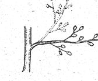

## 环状剥皮示意图

高果树的结 果量，它还能促进果实成熟，提高果品质量。环剥的宽度，一般为3～6毫米宽，如果太宽，当年不能愈合，引起枝条枯死。环状剥皮的时间，因目的、要求的不同而有所不同。对一般果树为促花芽分化，可在5～6月间进行；如为提高座果率和减少落果，则应在盛花期或开花末期进行。

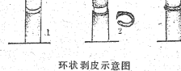

## 环状剥皮示意图

- 1. 切断口 上、下各一刀
2. 剥下新皮块
3. 环口愈合

在北方地区桑树和火龙果树在主干上进行环剥以外，对一般果树不宜在主干或主枝上进行环剥，,只应对生长过旺而不能结果的多年生培养枝、快返青环节，以充分利用营养枝提高产量，待营养枝返青后再进行逐步除。 对全树不利于萌发大芽的种类，此外，对结果多的树和座果率高的品种，不可实行环剥，以免影响树势。

### 10. 清尾剪

如果果树在生长季长节枝系过多，光照不好，可将两层主枝之间生长旺的、不结果的、过密拥挤的辅养枝以及过于枝组上的营养枝疏剪掉一部分，使果层通风透光。但要注意，疏枝不可过多，以免大量减少叶面积而影响树体正常生长。

## 树体保护

### 1. 幼树防寒、防虫方法

为保证幼树安全越冬，在土地封冻前应对幼树实行防寒保护措施。特别是冬末来年初寒害大的地区，防寒工作更为重要，其方法有：

- (1) 埋土防寒。此法适用于当年春季定植的一年生幼树。其方法是在冬季前将树干弯曲倒卧，然后用潮湿的细土压严，覆土厚度要在树干以上35厘米左右。

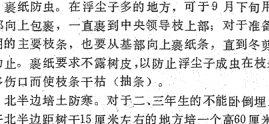

- (2) 裹被防虫。在这里主干的地方，可于9月下旬用麻条自小树主干基部向上包裹，一直到树干中央或分枝上部，对于需留作主枝和辅养枝用的主要枝条，也要从基部向上裹纸条，直到冬季时需要剪破的地方为止。裹纸要求不露缝隙，以防止滞尘或虫在枝条上产卵，或造成 комплекс多伤口而使枝条干燥枯萎。

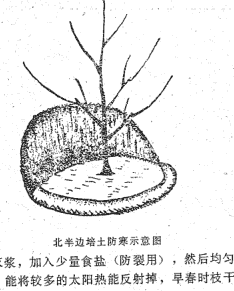

北部边界土壤表示图

不稀不稠的石灰浆，加入少量食盐（防裂用），然后均匀地施在树干上。涂白的树，能将较多的太阳热量反射掉，夏季时枝干活动较迟，能够避免果实受冻害。

### 2. 绑枝

对于结果多的树，为了防止枝条折断和架设被风吹落，以及避免枝条下垂，重叠而妨碍树腔内部通风透光， Aqu 必要。 这项措施在风大的地区尤为重要。其方法如下，对于中央领导干出树，在中央领导干上每隔区间的长度分为几段几条绳子，把中央领导干和大侧枝用往，再用绳子把各主枝和大侧枝联系在一起提高。对于中央领导于细弱的或无中央领导干的树，可在树干上设一个中心架杆，使杆顶高过树冠，在架杆上部缚绳缚，把各各枝于株吊住，也可以用不立架杆，而将下层干枝吊在上层厚干枝的基础上。

### 3. 剪口、锯口保护剂

为防止剪割修剪时，每年都要剪掉或截掉一些枝条。为了避免剪口、锯口感染害虫和有利于伤口愈合，对于较大的剪口和锯口，应该及时涂抹保护剂。

现有几种保护剂、锯口保护剂的配制方法介绍如下：

- (1) 清油铅油合剂

用清油（防水漆）3份，白蜡油1份（或适量的白粉末），搅拌均匀即成。

（2）桐油蜡油合剂
用桐油3份，白蜡油1份，搅拌均匀即成。

（3）豆油盐酸和石灰合剂
用盐酸（硫酸）1份，风化石灰0.5份，将豆酱研成细末，将豆油（豆油的量，以能将盐酸和石灰调成糊状为准）煮沸后，把盐酸和风化石灰放VC入搅拌均匀即成。

## 解坊生产技术

## 生产设备要求

1. 解缸的制作 用熟熟的泥浆和稻草掺拌在一起，在房屋两边靠墙处围成或土灶，高约3尺宽，将一只24时的时候放入土灶内，底部离地面1尺员，再用熟熟的泥浆把锅砖筑成约2寸厚，锅台上部泥平，然后另见外刷，再后来把泥下另成一起，即成解缸。

2. 驿望梦管 解坊管道是盛放蜂蜜和蜜菜的竹管，规格大小，要以能放为解缸内为宜。梦望要求坚硬，结实，以盛放一梦蜜循敬时不变形为难。梦望数量可按2口解缸配3只或按比例配置。

3. 检案 用普通棉花弹制5斤一床，一般一口缸需配检案5床

4. 草席 用草编织，规格4×6尺为宜，一般2口解缸需草席一床。

5. 红盖 可用草编织，大小以解缸口径而定。每只解缸配红盖一只。

6. 木制框架 可用杉木、杂树等木材，请木工制成与床底架相同的水框，长宽以能放上草席为宜。木架是主要框架的，架高高度约5市尺，便于人走动和操作为宜。木框架一架架完，以负重后不动为准。制作后放在解坊中间，四面要紧夹。在木框架上铺上芦席、草席和棉，即制成“堆床”。“堆床”就是放置二贴后的解罐食的地方。

7. 燃料 解坊的开温燃料，主要是木炭，必须备足。

## 技术操作规程：

1. 生产人员和职工人数的多少，以蝉房房间大小和种蚕数量多寡而定。一般40～50头蝉的房间定8人为宜，人员宜及不重单。每个应有明确的分工职责，要求吃住不离操作间。

2. 选茧与保管 蕈蚕遗弃故有公舍配的种蚕箱，收米时放在通风处，夏天薄帘敞飘可，冬天注意保温。每天最好将蚕罐个翻动一下，以免蚕贱与贱，与蚕壳粘连形成蚕黄，影响孵出率。

3. 解蜂 解蜂丝是严酷家蚕温室和时间。下面以解蜂为则，将卵堆放在于蜂罐内，放量少而，蛋巢和大而定。

先用集夹在蚕匾下把线火升温两小时，用温度计测温，不超过41℃（在40℃左右为恰）。打开匾门让温度降到38℃，这时将蚕盛入匾内，盖上纸板，关紧匾门，使温度保持在38～39℃之间，并做随时测温，以防温度过高或过低。放蜂下匾后40～50分钟再翻一次，放倒上边的蛋翻到下边，中间的蛋翻到上边，以后每隔二、三小时翻动一次。

在孵化的第2和第3天早上，蛹蚕温度应稍微高些，但不能超过40℃。其他时的温房应保持在38～39℃之间，一直维持到第7天。第8天至第10天温度要略略降低，保持在36～37℃之间，第11天再回升到38℃。第12天提升时，温度要升到39℃。蛋在堆上的保温措施是：提高室内温度，加盖棉被，靠蛋内自发热量使温度上升。解蜂上堆后，仍要每小时候温一次，如温度过高，可减少盖被。

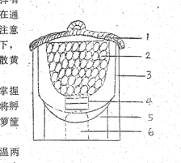

解蜂罐示意图
1. 蓝 2. 种蚕 3. 社 4. 墙装蛹或木块 5. 碗
（纸上装或） 6. 夹门

或在室内喷洒淡水澡。从第12天上提到第14天，维持温度应保持在38℃左右。第15天开始养毛鸡，温度应保持在35℃。第16天下旬起要逐渐升温，到第17天中午温度提高到38℃，这叫食口。以后一直保持38℃的温度，直到小鸡出壳。
鸡、鹅孵化期比较长， Bots和地的温度要比鸡减小一些，另外各关鸡操作时间亦不同。鸭要孵化到14天上堆，18天养毛，21天食口，23天转折，28天出鸡。鹅要孵化到16天上堆，20~21天养毛，23天食口，25天转折，31天出鸡。
以上温度要求及操作规程非常严格，不能违背，否则就会出事故。例如孵鸡，三天过往（温度过高），蛋会出圈子，第七、八天过往，就该孵养子，同样过往性杀死，养毛堆过往会导致毛细体，温度低与标准时则不能按期出壳。
要根据温度应注意到季节与棚室内气温的不同，而随时调整室内温度。孵蛋要特别注意下午堆，因这一时间内火堆易大，温度上升快，如果及时请稀，就会使蛋受损；同时蛋上堆前，如未达到标准温度，可以推进上堆。但不宜超出半时许间，否则会影响孵蛋的质量。
4. 照蛋是检查孵蛋进行情况的主要手段。鸡蛋在下堆后第5天即可作第一次“头照”，排除已空蛋。这些顶蛋蛋上会有碎的为好蛋，无血筋的为坏蛋。在孵化到第10天时进行“二照”，这时主要看蛋有无血环和皮脐。无血环的胚胎为二照。七蛋，应指出；将带胚胎的蛋继续孵化到第2天。即可出壳上堆。
鸭蛋和鹅蛋的照蛋时间同是。鸭蛋在上堆的第6天进行“头照”，第13天进行“二黑”；鹅蛋在上堆的第7天进行“头照”，第15天进行“二照”。
照蛋方法有多种多样，可用灯光照，也可用自然光照。如用自然光照，可在斜坡窗口的玻璃高离的1.5市尺处开， 开一个长方形洞（长约1.5市尺，高约0.8市尺），用一块1.5市尺大小相同的工作板在墙洞上，在木板面上钻两个直径4厘米的圆洞，利用圆洞中射出光线照黑。
5. 孵化的时节 孵卵孵一般在做窗前后来始孵第一批蛋，在春分前，清明前即可出第二批蛋， 全年可孵化20批左右。孵卵一般在

清明前后放入第一批鱼，在谷雨前后可出第一批鲤，一直轮到立秋，可饲养13批左右。饲养一般在立春前后放入第一批鱼，在惊蛰前后可出第一批鱼，一直轮到夏至，可饲养13批左右。但是要达到这样平均化孵化批数，一定要对鱼、鳖、鹅的综合孵化时间安排得科学，这样才能提高孵化和鸡的利用率，在有效的时间内，孵出更多的雏禽。

## 淡水鱼的人工养殖

## 建 池

鱼池要选在地势平坦、交通方便和水源充足、能排能灌的地方。人工孵化鱼苗一般需要两塘三池，即亲鱼塘、鱼花塘、蓄水池、产卵池、驯化池。

- 1. 亲鱼塘 放养亲鱼塘面积需10—20亩左右。水深为1米左右的泥底池，水质应保持肥沃。

- 2. 鱼花塘 一般开挖8—10口，每口面积约2亩左右，深度为1.5—2米。

- 3. “三池”，最好是砖和水泥结构，质量不渗漏水为标准。“三池”之间设有地下潜通，每池之间外装阀门，便于排水、灌水和控制水位。

  - (1) 蓄水池：方、圆均可。建造地要高出地面1米以上，池壁高约1米，池内蓄水量约200立方米。

  - (2) 产卵池：圆形或椭圆形。建造池应背避风向阳处，其地势要低于蓄水池1.5—2米，或深约1米。池容蓄水量约50立方米左右。池底管道上装有2—3个朝一个方向的喷头，使蓄水池内水由喷头注入，造成水流不断。另一方面可以用流水刺激鱼发情，另一方面用以调节水温和增加水体含氧量。

  - (3) 驯化池：一般设为圆形，容量在30立方米左右，池深约1米。池中心直立1米，高半米圆形滤水器一个，主要起过滤出水和不让鱼卵和鱼苗外流的作用。池底管道同蓄水池上装3—5个朝一个方向的喷头，使喷头注水时造成池水旋转，促进增氧晒精。

## 选养与人工孵化

选养亲鱼大小与体型并非标准，各地均不相同，只要达到性成熟年龄的各可选用。选养的亲鱼一般体量在 3—5 公斤左右。要以体质健壮、体形肥满无伤的为好，其雌雄比是 1：1.2。每条鱼可放系数 100 公斤。精选较好的雌鱼一次可产卵 10—12 万粒，成苗率达 75—80%。人工孵化，一般在当地为秋末将亲鱼由池塘中捞起到水泥地面内养殖，每口可放成鱼 10 组（雌雄各为 1 组）。每天喂食要加些食物，如菜饼、麦麸、米糠、玉米粉等。草亲鱼在冬季应加喂少量白菜。到第二年春（当气温 15℃ 以下），亲鱼的性腺开始迅速发育，这时食量增加，适当增加小白鱼、青鱼苗、水花生等。为了充分发挥鱼的吸收所需要的钠离子和氯离子，可在饲料中加入该剂量的 1% 的食盐。并要经常排水、灌水，以及需要对亲鱼进行流水刺激，促进亲鱼早产卵，多产卵。4 月份亲鱼成熟，要固定品种和数量将鱼确认设该。繁殖当时的水温、天气和亲鱼的活动、吃食情况、确定健康与否和是否要进行排泄液。亲鱼捕获成熟，可进行单独淡水催产。催产前 7 天停食，并拆网缘除亲鱼，以增强抵抗力。注鱼、运输等过程的抵抗力应适当增强。检查亲鱼使用说明书进行，一般要注射两次（白鲢催减小时，黄鳝需 6 小时，草鱼需需 8 小时）。注射后及时将亲鱼放到对放入孵化池，隔断水流，一般在 8—10 小时受精后，将亲鱼倒出池塘，即可受精卵。产后的亲鱼及时捞回或放回池塘。受精卵几天内吸取大量水分，体积大似绿豆，卵可被载起送入孵化池进行孵化。受精卵在孵化时，对环境要控制温度、水温及经时经常换水流动，鱼卵在孵化时，对天气变化很敏感，常因温度变化幅度过大而引起死亡。因此要经常注意孵化池的保护水温、空气温度长应适当调节当水温高、若气温过低时要注意防冻条件。水温在 22—28℃ 正常条件下，约 12 小时左右，即可形成苗（亦称毛籽或毛籽），此时即可出苗，孵化后放入经清洁除野的鱼苗塘内喂养。

## 养鱼饲料和肥料


### 1. 饲料

解决鱼饲料问题是提高鱼产量的重要途径。养鱼有“粗养”、“精养”之分。粗养，是主要依靠水中天然饵料和养鱼，鱼产量低，而且极易不稳定。精养，是经常配合投饵，能获得较高的产量。现在养殖技术提高后，许多工厂化立体养鱼呈密养、轮养、轮捕轮放，供养鱼的密度大大提高。这样就要求增加饲料，否则会出现许多大头、小身、肉薄的“大头鱼”，鱼产量的提高仍然很低。

#### (1) 饲料的种类

鱼的饲料有天然饲料、人工饲料两类。

天然饲料有，浮游植物、浮游动物、底栖动物、水生植物、生物尸体的碎屑及其上面的细菌。

人工饲料，按其性质分，有植物性饲料、动物性饲料、矿物性饲料。其加工分，有颗粒料、粗粉料、精饲料、精制饲料、颗粒饲料。

##### 植物性饲料

一是农产品及其副产品，如黄豆做成的豆饼；二是食盐工厂的副产品及糖类制品，如米糠、麦麸、茶籽粕、菜籽粕、棉籽粕、豆渣、酒糟、米糠、麸皮、薯渣等。三是水生和陆生植物，水生植物有苦草、小浮萍、紫背浮萍、水浮莲、凤眼莲、水金莲、马来眼子菜、黄丝草、轮叶黑藻等。陆生植物有青菜、狗尾草、紫花、紫菀、紫苜蓿、早熟禾种子、豆类植物的茎、叶、海藻类植物的剪青苔、蒲公英、各种菠菜叶和瓜叶、瓜蔓，还有松树叶、杨树叶、柳树叶、榆树叶、杨树叶等，加工后也可喂。

动物性饲料，包括鱼、虾、蚯蚓、蝇蛆、蝇蛹、蚯蚓、枝角类动物（如红虫）、蚕蛹、鱼粉等。

#### (2) 饲料的来源

一是种养池利用池水，营造种植高产青饲料，如菜豆、黄豆、绿豆、宿根黑麦、苏丹草、苜蓿菜、芜菁、苜蓿、空心菜、荞麦等；在池塘、池边、岸边种植水生、浮草、水浮莲、水花生和各种草（美草、青草、红草）。

二是养。养猪、养鸡、养家禽，以禽畜粪施入鱼池，培育出浮游生物供给鱼类；养蚕（得蚕沙）；捉蚯蚓、蝾蚓等，直接喂鱼。

三是截。野草藻、清水藻、狐藻等。

四是引。引入城镇生活污水、食品厂、淀粉厂、酒厂、豆制品厂、屠宰厂的废水。

五是制。一种是将青饲料打碎，或用粗饲料粉碎，经微生物分解发酵，制成微生物饲料喂鱼；另一种是将青饲料、粗饲料、精饲料、药物饲料合理配合，制成颗粒饲料。人工制饲料中，还可加入药物，防治鱼病。

#### （3）饲料的加工

颗粒饲料的制造：颗粒饲料的原料，粗饲料（有秸秆、黄豆秆、麦草秆、油菜秆、芝麻秆、高粱秆、玉米秆、花生成壳、甘薯藤、淡黄、牛粪、各种菜叶、树叶等）；精饲料（有豆饼、棉饼、米糠、麸皮、鱼粉、麦麸、酒糟、下脚面、麦类、大麦、稻谷、玉米等）；加上鱼粉、蛋壳粉、鲜鱼粉和食盐、土霉素，先将各种粗料混合粉碎成粉，加以碱化，经微生物发酵，然后按一定比例，配上精料和添加物，混合拌匀，用颗粒饲料机（绞肉机改制也可）制成颗粒，干燥后喂鱼。

### 2. 肥料

养鱼池所用的肥料有两大类，有机肥和无机肥。

有机肥主要以人和牲畜的粪尿、绿肥。

无机肥包括

氮肥类—硫酸铵、硝酸铵、氯化铵、硝酸铵钙、硫酸铵镁、硫酸镁等，这些肥料不可与石灰、草木灰等碱性肥料混合用，否则铵、氨脱氨要损失。

# 鱼病的防治

### 1. 鱼病种类

鱼病按其病原的不同，大体可分为传染性鱼病、侵袭性鱼病、其他因素引起的鱼病三种类型。

- （1）传染性鱼病：由细菌和霉菌等病原体引起，如细菌性肠炎和水霉病等。
- （2）侵袭性鱼病：由动物性寄生虫引起，原生动物、蠕虫、甲壳动物、鱼蚤等侵入体内，外部都能引起疾病，如隐腮孢虫病、小瓜虫病、三代虫病、锚头鳋。

上述两种类型的病，有明显的季节性和特殊性。如水霉菌在冬、春两季发病，夏、秋两季少见；细菌性肠炎只感染鲫、青鱼；隐腮鞭虫只侵袭鲢鱼；鲢虾年鲤只寄生于鲢、鳙鱼；鲤年华鲤只寄生于鲫、鲤鱼，互不混淆。

- （3）其他因素引起的鱼病。如因缺氧引起的“浮头”和“泛池”以及中毒等。

鱼病按其发病部位又分皮肤病、鳃病、肠道病、其他器官和全身病。

皮肤病 白皮病、赤皮病、水霉病、白头白嘴病、打印病、打粉病、鳞立病、鳞赤病、隐腮虫病、口丝虫病、粘孢子虫病、舌杯虫病、鳃绦虫病、白点病、三代虫病、黑点病、钩介幼虫病、锚头鳋病、锚头蚤、红线虫病。

鳃病 细菌性烂鳃病、隐腮病、白头白嘴病、隐腮虫病、口丝虫病、粘孢子虫病、舌杯虫病、斜管虫病、毛管虫病、指环虫病、钩介幼虫病、中华鳋病。

肠道病 细菌性肠炎、头槽鳟虫病、球虫病。

病，头目白膜为车轮虫病，鱼鳞不实为鱼黑斑病，鳃丝上有类似蝇蛆的小虫为中华绦病，鳍片上长有小虫为锚头马蝗病，头大头尖、如梨似剑为萎缩病，体表及生肿瘤状物为水霉病，体色发黑、鳞躯烂皮白，头歌耸骨外露、鳃上沾泥、粘液增多为细菌性鳃病，鳍片竖立起来为鳍立病。

### 2. 常用药物和治疗方法

#### (1) 中草药

鱼腥草——清热，
五倍子——防治白皮病、赤皮病、烂鳃病；
菖蒲、 蒲子药、走马癣、大叶蚯——防治草鱼、青鱼肠炎、烂鳃、赤皮病。

根草、铁苋菜、水蜈蚣、马蓝草、蛇莓、马鞭草、车前草、椿树白头翁、紫苏、 柴胡、 黄柏（川柏）——防治草鱼、青鱼肠炎病。
苦槟——防治白头白膜病，隐鳞病、鳃头腐烂病、肠炎病等。
金银花——防治白头白膜病。
白芷、白术、土茯苓、大黄、野菊花、薄荷、黄连——防治白头白膜病。
槐蒿——防治头槽蚊虫病。
杨梅（鬼柳树）、大茶叶（柏松树）——防治锦鲤鱼鳞、烂鳃病等。

五加皮、雷丸（竹荪）——防治锦鲤鱼鳞病。
杨梅（山杨梅）——防治沾鱼病。
川木香、广木香、房柏——防治鱼苗气泡病。
黄芩（土连子）、马兜铃——防治淋巴、青鱼赤皮病、鳃鱼赤斑病。
苦参（地参、野荆树）——防治锦鲤鳃立病。

用中草药治鱼病的方法有：
浸泡法。将中草药放入进水口或上风处水中浸泡，让浸抽出的汁液渗到池中。
泼洒法。将中草药捣碎或磨粉，浸泡一段时间，连带药液泼入池。
投喂法。将中草药捣碎或煮成汁，拌入饲料投喂。

浸泡法。将中草药减成开，加水稀释后浸洗病鱼。

（2）大黄粉；治疗鱼病常用的土方法。每100万尾鱼用大黄头半斤，加10斤水，4小时，将药投入池中，连续投喂3~6天。

（3）漂白粉；治疗细菌性皮肤病和细菌性烂鳃病。每立方米的水，用含氯量30%的漂白粉1克，加水稀释，溶液后倒入池中。或者每立方米水体投入10克氯白粉，在水温10~20℃的条件下，将病鱼浸泡10~30分钟。也可采用挂袋法，每袋装漂白粉3克，挂在水体上方鱼。

（4）硫酸铜和硫酸亚铁合制；治疗车轮虫、斜管虫、隐孢虫、口腔真菌引起的皮肤病、鳃病。将硫酸铜和硫酸亚铁先化于水中，然后按立方米水含0.5克硫酸铜、0.2克硫酸亚铁的比例，加水稀释完全后加入以浸洗病鱼。按每立方米水含5克硫酸铜、2克硫酸亚铁的浓度，水温10~20℃，浸洗15~30分钟。也可以采用挂袋法，每立方米水袋2两硫酸铜、8钱硫酸亚铁，挂在饲料台的上风洞，一个饲料袋可挂几只袋。挂袋后，如果鱼不屑饲料吃食，说明药量太大，受病少甚易。

（5）磺胺脲；治疥疮，单头肠炎病。连续投药6天，每天1次。第1天每100万斤鱼用药5克，第2~6天每日药量减半。将药与饲料拌和均匀喂食。治疗鱼病的磺胺脲，治疗鱼的喧更能因要采用不同的拌料，使之能排出沉。

此外，6%的可能是六六六、2.5%的敌百虫、高锰酸钾、硝酸亚铁、孔雀石绿等，也能治疗病鱼。

# 北方地区鱼类越冬管理知识

北方地区在结冰期内鱼类基本不摄食，靠消耗体内贮存下来的营养维持生存。而冰下的水体在漫长冬季不断地发生变化，鱼类所需要的氧气不断减少，有害的气体二氧化碳、硫化氢等不断增加，给鲫类等生活造成不利的条件。如没有适当的越冬管理措施，就会导致鱼类的大量死亡。

## 越冬场所

### 人工越冬池

越冬池土工工程的一般要求是：筑坝土质应为保水力强的粘土、壤土；池形为长方形，堤坝高 4 米，堤坡 1：3。土质差的堤坝还应大些；堤坝顶宽为 4 ~ 5 米，面积以不超过 30 亩为好。

人工越冬池主要用于越冬养鱼和种鱼。根据越冬期池水水交换情况可分为两种类型：

- （1）止水越冬池：又可分为两种，一种在越冬准备期间内无任何水源流入（所以也称完全止水越冬池）；另一种附近有水源，但不能经常规输送入，可在必要时引水或补水充氧。黑龙江省的越冬池大多为有水源补充的止水越冬池。
- （2）流水越冬池：在越冬池的上游或鱼类、江河水系等水源，在结冰期，水源的水可不断自流进入，谓之越冬流水池。此处，有些地方还修建了一些室内越冬池（即温室越冬），取得了较好的效果，但目前还属试验阶段。

建造越冬池的各项具体要求如下：

- （1）水深：冰层最厚最大厚时，流水越冬池的冰下水深不应低于 1 米，可止住的止水越冬池冰下水深不应低于 1.5 米，完全止水越冬池的水深可适当放深，一般不低于 2 米。因此，要求越冬池冻结前水深最低应保持在 3 ~ 3.5 米。
- （2）水源：越冬池的水质要求水量充足、可换、注意水质方便，易于控制。水源的水质要求含氧量高，有机含量少、显微性有工业污染水或生活污水流入的水源或贫瘠过于贫瘠和其它有害物质的水源都不能为越冬养鱼水源。
- （3）底质：越冬池底质应坚实、保水力强，以粘土最好，壤土次之。沙壤土或沙质底虽然含氧量较少，但保水力差，往往容易渗漏。如水源充足，注水方便，也可使用。
- （4）地点：越冬池应尽量选择背风向阳、接近电源、交通方便的地方。

由于越冬池面积小，易管理，发生问题时能及时采取抢救措施，因此是较理想的越冬场所。

### 水库、湖泊及其它自然塘

（1）水库：越冬前在保证堤坝安全的惩提下，应尽可能多蓄一些水。妥善管理检查和维修坚桨设备、闸门等，以防漏水逃鱼。在越冬前进行管理排捕，调整捕捞时间及密度，防止工废。生产污水滚入；除大、中型水库外，小型水库不应进行冰下捕鱼。中、小型水库在越冬期，如发现鱼群，应适时补水，保持池的散指鸡。

（2）海沟、池塘：某些地方的小型湖泊和池塘大多为死水，水较浅，底部淤泥较厚，水生植物和野杂鱼较多，能进行适当的改造和加强管理时，也能使鱼类安全越冬。但是，一些老池沼或泥太厚、耗氧量高者，如不能使它的改造是法进行鱼类越冬的。湖泊、池沼鱼类越冬可参考水库越冬的注意事项。

## 越冬前的准备工作

清整越冬池 越冬前要整修整修池的堤坝、注排水口、闸门及拦鱼设施等，防止漏水、逃鱼。用石灰或其它药剂清除越冬池内的害虫和其它有害生物；铲除池内及池边杂草，有条件的池塘，应彻底清整水于、挖掘除泥；

加强鱼苗的后期饲养 管理实践证明，鱼种规格越大，体质越健壮，越冬效果越好。越冬鱼种的规格应达到3寸以上。近年来发现，在一定的体长范围内，鱼种的肥满度越冬成绩高低的决定因素。有性鱼体较肥壮，体质健壮，可以顺利地越冬，而有某些的细长头大体小的鱼种，越冬成活率往往很低。

鱼种的体长，主要是秋季前水温较高的时期成长。鱼种肥满度的大小，则主要取决于鱼种的后期饲养，立秋以后，鱼类大显摄食，积累脂肪以供冬季消耗，所以在尽量培育大规格鱼种的基础上，要加强鱼种的后期饵料管理，多投喂一些精料，提高鱼种的肥满度，使之能顺利度冬，秋季应加强后期的培育。

除此以外，越冬前应准备好用具及日常常备用的工具和冬季补水、补氧的设备检查备齐。最好准备一些地籍器材，以备越冬池堤坝、注排水口发生问题抢修之用。

## 确定合理越冬密度

鱼类在冰下越冬需要一定的水体环境和溶解氧，如果越冬鱼类密度过大，水中溶解氧供应不足，就会造成鱼类缺氧窒息死亡。鱼类的越冬密度主要取决于越冬池的冰下有效水量（指冰冻到最大深度时冰下的实际水量）、有无补水条件、越冬池底质情况（淤泥、杂草多少）等，对自然越冬水面还得考虑在塘中有鱼的数量等因素来综合管理安排。

- (1) 淡水鱼越冬条件标准（冰下有效水量，水中可放鱼种每平方米1～2斤，（2）有补水条件的冰下水越冬，每立方米水中每放鱼种或杂鱼0.5～0.7斤。（3）完全无水越冬池，每立方米水中放鱼种或杂鱼最多不超过0.5斤。

利用养殖池养鱼越冬，由于底形和池形比较复杂，不易计算有效水量，应实地测量和计算面积、体积，做到合理安排养殖密度。

## 鱼类入越冬池时的注意事项

### 掌握好入池时间

掌握好鱼种和鱼类入池的时间，对于鱼类的越冬效果有很大关系。过早移入越冬池会影响鱼种或亲鱼的后期肥育，同时由水温较高，鱼类游动活跃，体质消耗大，不利于越冬；过晚移入越冬池则对出池、运输中缺氧的鱼种和水温低时，易患烂鳃病而死亡。入越冬池适宜体中时间，一般在水温10℃左右时放出，不要高于8℃（一些抗寒的鱼种场和北部地区的鱼种可在9月中旬开始入池）。这时水温较低，大部分鱼类活动能力低，便于捕捞和运输，而鱼种和亲鱼入池后在越冬前尚有一段时间，可以恢复体质。

### 细心操作

由于鱼种和亲鱼出入池时间短，任性操作，有的地方常常只注意出池的进度忽略了质量。因此操作不当，使不少的鱼种和亲鱼受到碰撞、皮破鳞片脱落、鳃条断裂、腹部出血。有的地方采取放水牵鱼的办法，往往由于人工少、忙不过来而使鱼长时间浸泡在泥水中，造成了扛桑鱼、鱼鳃搓脱现象而影响成活。受此鱼类在越冬期间易感细菌性感染而死亡。因此，在抽水、装鱼过程入池时要细心操作，轻拿轻放，减少损伤。出池一定要采取排出部分水后拨水打网出

鱼的办法。有些能自流干的地方，采取排水口装网袋出鱼的办法，收到了预期的效果。同时还要注重出种、入池的时间一定要选择温暖无风的天午，以防鱼体冻伤冻病。

### 检查池塘

对准备入冬越冬的鱼种和亲鱼一定要严格选净检瘦和消毒制度。如果只是个别鱼有病或寄生虫，则要在出池时即剔出。如发现有较多的鱼患病，...一定要用药品浸泡消毒，以免鱼病在越冬池蔓延成灾。

### 坚持投喂

鱼种和鱼苗入池后，如天气温高，还要适当投喂些精饲料，一直投喂到不吃食为止，这样可避免鱼种冬季初期的减重。但应注意，一定要投捞饲料和及时清除残饵，以免影响水质。

## 水体缺氧的抢救措施

### 注水补氧

利用越冬池附近的水源，把含有氧量较高的水注入越冬池，从而增加越冬池的水量和水中溶氧量。这种方法叫注水补氧。这种补氧方法主要适用于小型越冬池和蓄水量较小的越冬池。注水补氧的方法有以下几种：

- （1）引江注河、水库补水补氧。指的是江河、水库等的越冬池冬季缺氧，可引接江河、水库水等富含氧气的水进入越冬池。在一般情况下，没有污染的江河、水库水等含有氧量较高，直接注进越冬池即可。如能使注水口和缺冬池水保持一定的落差，使水注入越冬池时能激起水面波动，则补氧的效果更好。
（2）引泉水补氧。越冬池附近有泉眼的可利用泉水补氧。如泉眼流量或水流不足时，可将泉眼引到大或小汇集水流进入越冬池。泉水一般含氧量较高，在引入越冬池前应保持一股浸管（不少于50米），以加大水和空气的接触面。并能使水口和水面保持比较高的落差，以提高补氧效果。必须注意的是，如果泉水发黑，发黄，含有较多气泡及有特别味时，该泉眼含水量会超过多有的，可能起氢气化。在这种情况下，一定期要经过化验，确认无害才能使用。
（3）该取地下水补氧。附近无自然水源的越冬池，可利用地下

水补氧。目前各地普遍利用机井抽取地下水进行越冬池，效果很好。地下水含氧量一般较低，多不足1毫克/升，有时还含有二氧化碳、硫化氢等有害气体，所以不能直接注入越冬池，必须经过一昼夜曝气，使有害气体析除和使氧气溶解进去，并使注水口离池面有1米以上落差，以提高补氧效果。一般情况下，15亩左右的越冬池，机井并肩的口径不小于4寸。

### 循环补水
当池全混水澄清越冬缺氧时，可用水泵抽取原池的水进行循环，使其在空气中溶解了一定量的氧气后流回池中，以增加池水的含氧量。同时还可以排放出部分有害气体，减少对鱼类的危害。这种方法称之为循环补氧法，也是一种常用的补氧方法。由于其增氧快，在越冬池发生严重缺氧时，可以利用这种方法进行抢行。

循环补水也能使池水经过一昼夜蒸发和使注水口与冰面保持较高的落差，以增加补氧效果。
为避免因大量抽水引起水温骤降，对越冬鱼类不利，应采取早补水、勤补水、少补水的方法。一般当溶氧下降至3毫克/升时开始抽水循环，当溶解氧升至6毫克/升时即可停止，不可盲目地长时间循环池水，使池水温度过低，引起鱼类死亡。

# 种好家庭小菜园

## 小菜园的育苗技术

家庭小菜园面积虽小，但只要讲科研科学管理科学技术，一定能够获得高产增收。在种植上首先要根据大菜园生产上市淡季空隙时间，二要生产集中大菜园生产少、人人又喜爱的蔬菜品种；三要务为提高高菜产量、质量、脱前起张，做法以四种扣划，人人有我，有奇可得，人人有好，以质取胜，人人多吃，量多品种，人我我早、晚在有时。这样，才充分发挥小菜园生产的潜力，更多地增加经济收入。

## 育苗的设备

小菜园生产，还是要用塑料薄膜温床比较好。温床建在背风向阳地

方。头年上冻之前，挖好床坑，挖时取表土，心土分开放置，床坑四周用心土紧皮增墙，前墙高0.35～0.4米，后墙高0.1～0.3米，宽为1.5～1.7米。床坑应要挖成正压形，使之床内温度高的地方靠近热物堆等，受热后床内各处温度均匀。为了早春及时回暖，挖坑时床坑填土要乱粗糙，防止冻得过深。

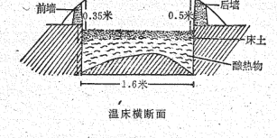

第二年开春后，把床坑里的粗粪取出埋来，加酿热物。常用酿热物为新鲜马粪，如马粪不足，可继些拍板、碎稻草等。播种前7～10天，分2～3次填到坑内。如马粪经过多量贮热，水量靠在锅里见有水蒸上来，铲倒又不发水为适。酿热物大约15厘米厚夹平后，再装再粪，至15～18厘米厚。然后在床坑上每隔40厘米插一根稻笋或竹片拱起，土膜膜覆盖，薄膜四周压在土里。温度升高马粪发酵，当温度达到30℃以上时，揭开膜铺，铺上10～12厘米厚的床土。
床土是由50斤原熟马粪加50斤大土混合过筛而成。铺好后盖上薄膜。当温床升到最高点开始下降时播种。
冷床和温床所不同的，就是不装酿热物。
所以，床坑底不必成丘形，而毛床比较

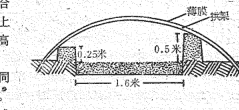

没，一般只 0.5米。冷床常作为分苗床或育苗床常采用。

## 蔬菜育苗

浸种催芽：播种前，种子经过浸种催芽，出苗快、齐。其方法是把种子放在干净的瓦盆加，放到55℃温水进行浸种，当水温降到30℃左右时，停止搅拌，进行催种。茄子、辣椒、西红柿这三种蔬菜种子特性不同，泡种时间及处理方法也不一样（见表1）。

### 表1 泡种时间及处理方法。

| 种类 | 浸泡时间(小时) | 处理方法 |
| --- | --- | --- |
| 茄子 | 24~36 | 边过滤，水凉为止 |
| 辣椒 | 8~12 | 中间翻1~2次，无凉液，隙气为止 |
| 西红柿 | 6~8 | 中间翻1~2次，悬种子犒 |

泡后把种子捞出来，控干水分，装入干净(特别注意不要装透饱)的瓦盖盆，上盖一块湿布,放在热炕或火堆上进行催芽。催芽温度参考表2。

### 表2 催芽所需温度

| 种类 | 适宜温度(℃) |  |  | 抗低温(℃) | 所需时间(天) |
| 初期 | 中期 | 后期 |  |  |
| 茄子 | 20~25 | 25~30 | 20~25 | 13 | 5~6 |
| 辣椒 | 20~23 | 25~30 | 18~23 | 10 | 3~4 |
| 西红柿 | 20~23 | 25~30 | 18~23 | 10 | 3~4 |

催芽期间每带棚一次温水，翻动1~2次，盖布用温水浸湿，略挤一下再盖在种子上，使之温度均匀，出芽整齐。

播种,播种时间各地不同,以沈阳为例,早茄子,辣椒二月中旬播种,西红柿三月上旬播种,为搞八九月淡季,应比一般播期提前15~20天。

播后温度常摇摆,用细眼喷壶喷头向上打水水,水量以床土湿透8厘米左右为宜,早春天冷用温水浇,水浇后盖稀于,10厘米


苗床撒茄子种 4—5 两，辣椒 6—7 两，番茄 1.5—2 两。播后盖 3—5 厘米厚的，盖土应均匀。
管理。播后立盖好防风膜，四周土封严实。夜间盖草苫子，苗期天冷，草苫底部下边可盖一层纸被（用 5—6 层牛皮纸制成而席）。保温，白天揭草苫和纸被，明雨天也揭开，一方面防止烂苗。另一方面使苗床不干燥一点，光照充足而不致使苗黄长。出来苗后开始除草，充分浇开温床两端膜，再逐渐揭开两侧膜覆盖放风。风口不要固定在一个地方。茄子、辣椒白天温度 22℃左右，夜间 17℃左右；西红柿白天 20℃左右，夜间 12—14℃。土壤见干见湿时，选无风天时，揭开薄膜，浇一次水，浇水后多扎几个风口放风。
分苗。当苗长到 2 片真叶时，将幼苗匀到架或小扬根器，固定在大的地盘，宿苗时割苗。因此分苗时苗床土不要太疏松。一般用 30 厘米厚热马案加 50 公斤大生土、4 两硫磺粉拌匀均匀后，平衡凉冷床里，厚度为 10 厘米左右。
分苗前一天，苗床浇透水。第二天早晨起苗，选择好苗，按 4 厘米距离用刀片割破细膜在分苗床上开 3 厘米深的小沟，一棵棵竖生培养，不摇晃根，株距 4 厘米。然后用水壶浇透培养土，水渗后培土平。育苗者可在一月后进行一次，茄子拔大株行，有利培养壮苗。如黏苗苗也可总，可不进行配制，也不必分苗了。但嫁接茄宜稀养，免得小苗长得过于细弱。
分苗后立即和好药膜覆盖，夜间上草苫子，促进缓苗。2—3 天后开始除草、扒动。辣椒白天保持 25℃左右，夜间 15—17℃；西红柿白天 20℃左右，夜间 10—15℃。定植前两天，白天夜晚全不能，进行炼苗，但此时要特别注意霜害，变天时还要进行覆盖。

## 早熟、延期和冬季生产设备及技术

塑料拱棚，特别是中、小拱棚，是小麦旱早生产的主要保护措施之一。中拱棚为竹木结构。大小根据生产地具体确定。方向最好朝南。一般宽 5 米，高 1.5 米左右。为了早熟生产及时，多在秋季做好拱棚，左 5 米宽立 3 根支柱，埋地 30 厘米，支柱间距 1.5 米左右
右。拱架用 6 厘米宽的竹劈，两端直接插到地里，中间搭在支柱上，用铁丝包或。每个拱架用铁丝向铁木桩拉上，使之左右固定不动。第二年开春搭成或定植后 7～10 天再盖薄膜，拉紧后四周埋在土里压实。

小拱棚简易耐用，拱架用一组一簇模条紧紧锁住，以长 0.5～0.6 米远插一根。有条件的可用细钢筋或竹劈等，不需支柱。棚架 1.5～2 米，高 0.5～1 米。拱架上盖薄膜，四周埋在土里压实。小拱棚的建棚时间多在当年生产前，为了一年取得时间，常年能早春生产时，不易损坏，头年秋后拆掉拱架，第二年开春就盖膜整地，省时省工。

### 中拱棚断面

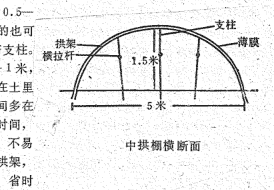

用中拱棚生产韭菜育苗兼作高产韭菜的生产和覆盖，要求在年上的老根。比如，第一年 5 月份播种收获，第二年 2 月播种，早春可收 2～3 次 2 叶菜。播前地施肥，100 平方米至少撒 3,000 克土肥，翻后把灰，根部中，小拱棚宽度，确定根系深度，约 15～18 厘米，每行开 12 厘米宽、10 厘米深的沟，均匀平整撒种并后盖细土，100 平方米撒 2.5 万粒种子。用普通粘土下一层水浇透，使为盖土。大约一月播后，整形形成自然一类。播前于土块法水浇透后，苗齐后要防土壤湿润不透。苗期要及时拔草，苗高 12～15 厘米时，100 平方米浇水湿 300 斤粪。当年不割到。7 月末、8 月上旬各喷一次 800 倍“敌百虫”液，8 月中旬每隔水一次“敌百虫”，防治地老虎危害。

### 小拱棚剖面

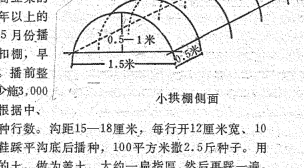

扣膜后，第二年 2 月下旬移一遍韭菜毛子，如头年秋后已制备好
拱，就盖上薄膜，四周用土埋实。为防止小拱棚两侧行间被压低土垄上而减产，可在拱架外面顶部放 3 根秸秆后再盖膜。卸膜后头刀韭菜耐而不需什么管理。只是注意防风吹坏棚膜。如有条件，晚间盖草苫保温。放置 3 天—5 天，打开拱棚两侧薄膜通风，逐渐揭开两端膜加大风量，以免韭菜再生过慢。收获时干尖，同时还延长商品产期。

收完第一刀后，通常经一次，再经好日再繁殖秸秆生产。

出齐苗后，与浇水一喷灌水。
水量以不积水为标准，随温度逐渐上升，灌水后每隔两天灌一次。此时外界温度逐渐上升，灌水后棚内湿润又大，必须加强通风，白天揭开外薄膜，薄膜破损，高温时可打开。透明两端膜揭除，先隔膜揭，以后揭一面，晚上盖好。15 天左右即可收获第二刀。

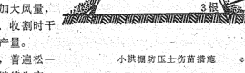

### 小拱棚防压土防苗落盖栽培

收获第二刀后，天气转热，不需抑萌产生。可将撤下的薄膜覆盖辣椒、黄瓜等夏季。拣后腐商利用率。

第三刀韭菜是易显地生产，但也需要适时灌水。第三刀收获后，加速行秧将进行不能再种植，如不早春进行可致早春。这是这一刀收获后进行一次营养，逐行营养，准备来年早春再进行生产。

用中小拱棚进行生产

选择种植地：选用地势高，产量高的实生韭菜品种，2 月下旬在温床播种育苗，播前进行选种催芽，先把种子簸一遍后，用 20—25℃水浸泡 24—36 小时，每天用清水淘洗一遍，捞出控干后播在麻袋上（种子较多就放在布袋里），上盖一层湿麻袋，放在热窝上，保持 20℃温度进行催芽，每天早晚 2—3 次，待出芽 6—7 天保持出芽。种子先行播种，未出芽的种子播点水继续催芽。

播种育苗：温床铺 10 厘米厚的床土。浇透后盖好，为获得均匀，可在种子里撒些细沙，10 平方米播 5—6 两种子，播后盖 5 厘米厚的细土。

播种后床面铺上扶架，遮好薄膜。夜间盖草苫。若苗出 现真叶后开始放风，自天温超过20℃，夜间不低于10℃，不干不浇水，防徒长，苗嫩弱，甚至发生猝倒病。随着温度升高，逐渐撤掉草苫，定植前几天，停止浇水。

作畦定植：3月中下旬，每10平方米菜畦施100～120克家肥，然后翻一遍畦，起行作1.2米宽的畦，栽平开沟浇苗。行距12～15厘米，一墩8～10行。墩距10～12厘米，每墩栽10棵左右。栽后灌水，水泥棚面上拱架扣上薄膜，四周用土埋实。

管理：7天后揭开棚西端膜放风，芹菜长到18～20厘米高时从墩一端灌水，同时每10平方米追施6两硫酸铵。5月份若温度逐渐升高，迎风揭开一侧薄膜放风，同时抗病除草。晚上若露水见干时及时及浇水，经常保持土壤湿润。每次灌水都要避开晴热天气。每10平方米30左右。5月中下旬每隔7天摘掉叶片，打一次800倍“乐果”防治蓟马虫。6月上旬收青。

## 用中棚播种生产辣椒

选用早熟、抗病，适于中棚的品种，于2月中旬在塑料立架或温床育苗。定植：4月下旬将培育好的幼苗定植在拱棚里，小拱棚2行，中拱棚3～4行，错该栽，小拱棚两行，行距50厘米，垄宽40厘米（一垄双株）。 定植前100平方米畦施800～1,000斤家肥（如菜肥不多，可采用鸡肥、兔肥代替）+每亩施过磷酸钙8斤，按行宽开沟，按垄距取苗挖。灌透水，水渗后把苗与沟上覆土，熟后掀膜撤掉草苫。管理：7～8天后揭开拱棚两端膜放风。棚内保持25℃左右温度，5月中旬第一次追肥时天棚开开，轻轻松土，晚上盖好薄膜。5月下旬撤膜。病害及时松土，行间开浅水沟排水，花开后，在两株辣椒之间间隔1～2株稀。然落后培土。6月中有第一架收获后，100平方米 6～7斤硫酸铵为肥料，分为泥里追施8厘米追肥一小粪，然后落后一次浇灌农稼催肥。7月中间进入盛果期，施肥增钾，100平方米落500斤粪肥，每逢一次肥后灌一次清水，入伏高温期棚内降温，伏雨期特别注意排水防沬。8月下旬再追一次肥，促进后期生长，以免衰老。

得九月份第二次复盖高峰。

## 用中拱棚生产黄瓜

选用早熟、抗病、高产品种接前育苗。

定植：小拱棚在4月上旬定植，中拱棚早7天。黄瓜离亩、100平方米每畦1,500穴片。地栽时把定植。小拱棚做2行，株距30厘米，行距近些，尽量利用棚间高处，但要防止瓜苗过早顶棚贴坏叶于。开一破穴，10厘米深1寸，按条距播种，然后喷洒清水，水渗后封土，隨后盖上拱架上薄膜。

管理。定植7—10天后，无需管理，只防大风吹坏拱棚就行。有时棚温在中午超过30℃，但只要定时水足就不含被病幼苗。7天后打开棚膜两端或放风，透风温度高，从两端开几处风眼，晚上盖好。5月下旬撤膜后及时凉、除草，防治小面积喷药或浇水，以使以后灌水。早晨浇水、擦苗。及时间收嫩瓜。根部恢复头透水，水量不要太大。灌水前100平方米施7公斤碳铵。连续浇果期浇水、肥齐攻。除阴雨外，2—3天灌一次水，7—8天施一次肥，化肥和粪稀交替追施，追一次粪稀后灌一次水。

## 建立棚和日光温室

塑料立棚和日光温室,是小菜园进行提早或越冬生产的主要设备。不论塑料还是日光温室，都要选在背风向阳地方。

## 立棚用泥池做好后盖

增高1米,宽0.8米,前坡用细木杆或竹竿做拱架,1米宽一个,上搭后墙。下插地里,用横杆固定。跨度3—4米,上面盖薄。后墙和两面山墙外边缘放置一些土或粗稻草保持

日光温室比立棚不同的是多个后坡。用泥

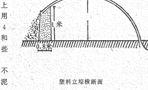

棚成 1.5 米高，70—80 度角度的后墙。距后墙 1 米宽，每隔 2 米根支柱，地上高 1.8 米左右，中柱间插上棚子，棚上搭篾子，上棚整猾秸秆或玉米秆，上铺 10 厘米厚厚的泥，则成后墙。
前坡 4—4.5 米宽，用竹竿挑个慢圈，钉到地里。横向固定上盖草席。
后墙也堆土或草秆草，以利于保温。

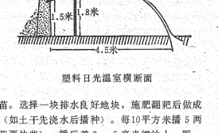

塑料日光温室断面

## 延伸生产养菜

延伸生产应选突尖芹菜品种。
7 月份翻地做畦，便于选择一垅排水良好的地块，施配腐肥后做成 1 米宽畦，畦后隔著沟。如土干先浇水后灌种。每 10 平方米播 5 两秧子（种子先泡一下芽后再扦插）。播后盖 3—5 毫米细沙土，耙一遍。

保温措施：对育苗地前花被枝叶令一定要除净；细致整地；为防暴雨和高温日晒，喷蓖铺一薄层稻草；修整白粉病植株，既出苗快，还起遮蔭保温作用，保全苗；出齐苗后及时除草，土干及时浇水，保持适当湿润。

盖棚育苗期：8 月中旬立矮棚地，施肥，做成 1 米宽畦，将事先育好的芹菜苗挑起带土，提 18 厘米行距，6 厘米株距，每块畦 2 块定植。浇苗后连着浇好腐水，放干后喷洒清水。进入生长阶段，在芹菜上无露水时，每 100 平方米撒施 6 万破酸胺，生长期期随水追肥，每 100 平方米 300 万左右，每两一次肥，浇一次清水。

盖棚管理：9 月下旬初霜到来之前，立前坡或日光温室盖上薄膜。初期白天揭开立矮棚保温软风，保持 25℃左右温湿度比较适宜。10 月末—11 月上旬天气渐凉，夜晚盖上草苫，白天揭掉，还要揭开几处遮蔭放风，11 月份每隔一次芹菜，然后浇一次水，同时一次磷酸钾；数量比覆盖前多 12—16 厘米以后，加强肥，除掉草苫外，还要加铺纸被，延迟到元旦二次收菜。

## 建筑蘑菇窖和蘑菇生产

蘑菇是冬春季生产的主要品种之一。生产要求条件不苛，虽粒立缘、温室内可全年生产。为保证产量高、生长快、质
量好，可利用蘑菇窖生产。窖宽窄、大小根据地形、村材而定。为向最好朝南，半地下式。挖地深下1.2米，挖出土厚培，前墙高35厘米，宽35厘米，后墙高70厘米、下宽45厘米。山墙厚度与后墙一样。前墙用双层薄膜（6厘米方木上各钉一层）。中间立两根支柱，用木架、棚楞起后坡，上铺蘑菇秸杆玉米秸，上拱10厘米厚泥。

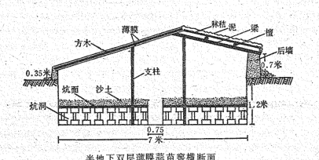

窖里搭架。上窖宽靠北墙
建，中间留75厘米宽过道，每3米长各个个灶坑。为省料，抗热保养，而且温度均匀，窝隔一块砖离床上--层。横砖。灶坑连串，所以，每个格坑都设风眼（风眼）。两砖是用一个砖坑，所以中间隔开，底部下70厘米深的回风洞，以免背后烧。

培养床土：培养蘑菇床土用腐菜。白皮菜分为早、中、晚生三种。早生蘑菇属早长，适于春季前栽培，春季后宜晚生种。栽培前下浇头，用凉水泡8--12小时，捞出放在草棚里，盖上薄膜，闷一闷后再制。制成用蘑菇锄头，或用铁钉个小木板，作...

握炒做刻刀，稍稍暴露头老根和须根底部，使蒜头吸水快，发芽齐。

裁剪蒜菜：把细好头的蒜头，一头预在一个揉上，蒜头在揉上压紧，腹部用紧蒜铺盖。如大小蒜头高矮不一，高的一往下压一，按高低齐下不齐。以利割苗时好下刀。一般栽培，每10平方米撒500—400斤蒜种。增加苗期，11月份以前不需灌水，后期天冷，每天气温昼候一次浇。

一个冬天一次10根根萌苗，细小蒜瓣，浇水不能急急。旋慢。以免烧根后火焰向里面和两边分一，免得炉门地势太热烧根。栽蒜后白天常温保持25℃左右，出苗前后20℃左右，以后逐渐降到15℃，使之生长期持续，换高变产。夜间降到12℃左右，御霜前后维持10℃左右。苗高到10厘米高以后，需水量增加多，前期上午浇，后期下午或傍晚。一般疏1—2天浇一次，一平米可用喷雾装水5公斤左右。

用药蒜苗生产，一盆见15—18天，即可收割上盆。蒜苗开始“打蔫”就要及时收割，收割易霉黄失、倒伏，降低质量。

收割蒜苗如果还要继续栽种养的，应提前在收获蒜苗前两天浇水，收割后把底部的老头连同全部起出，重铺床土再栽。

生产冬韭菜上要选用耐寒性。

韭菜的产生，冬秋季选用的生产根，和中秋栽培韭韭生产韭菜的播种、养根大致相同。为了提高冬季韭菜的产量和质量，最好不用当年播种的新韭，用2—3年生的韭菜每根栽培到立秋前栽到韭菜床。7月份移栽，行距30厘米，株距10—15厘米，每10株移栽一造，出苗后除草松土，一棵棵秧齐，然后剪掉一部分老根（留3厘米长），栽到地里。雨季注意排水，防止受涝，缓苗后施一类粪肥。8—9月份该间适苗。养好根子，准备冬季生产。

覆盖后管理：初冬韭菜叶黄以后，用秸秆子接着韭菜，压5厘米厚的棉花。要早准备，立地先喷浇，化肥后松土宜。约到11月中旬下天冷时，夜晚准备好草帘子，并加厚被，就地防火灯，尽量多接受阳光。为了保持夜间温度不低，下午3点钟把被被上和草帘子，不受影响太急。出现苗后，用粪绳在行间缝成小沟。为韭菜增上一些土。春节前后可以收割几头蒜苗。

收割后及按一造，再施肥一次粪，为增添作用，3月上旬收割

第二刀。这一刀收后，每100平方米，撒施8斤硫酸铵，然后demonstrate... 当... 100平方... 600... 柴堆，然后加大通风量。

## 种植业

## 柑橘栽培

育苗 柑橘可用实生苗、嫁接苗等繁殖。以嫁接苗为好，品种可繁，結実早。

- （1）砧木 最常用的似枳、构枣、抗病力较好。枳苗之茎直径达0.6厘米以上即可嫁接。晾地可用酸酸、酸酸等为砧木。
（2）嫁接 嫁接应是品种砧无病虫的秋梢或春梢。嫁接通常在7～9月进行。切接以早春三、四月为好。

种植 果园宜选红、薄黄山地、应对轮穴大深、深2.5尺，直径3尺，先施腐熟的基肥和土拌好，再回土坑穴。种植时，苗木应芽高一 些，以防填实而下陷。选下水位低的地方，应做高稼植。栽后应立即浇水。约半个月后，若苗木正常，可浇施稀薄人粪尿，以防根干。每月浇水一次。种植的当年南... 以免为害。

施肥应以有机肥为主。栽后第一年，苗期施肥三次。第二年... 七月... 第三年起，一般能开花结果。每次结果后，每株施人粪尿20斤，树势较弱的夏季一般不能过肥；只在小春... 夏～7年长，进入结果期；一般成年产4～5次肥。即春花前施肥，夏季促梢施肥，秋季壮果肥，冬季采收前后施采肥。此外，柑橘的根很爱空气。果园的土壤应该保持疏松。

但却树种后，一般生长旺盛，夏季会大量抽发夏梢。第二年起，在夏梢长到2厘米左右时，一般抹掉，直挂到8月初，这样所有的芽孢大体同时被成枝梢，是第二年的良好结果母枝，在冬季冷的地方，残秋恢复缓慢就会失梢，这种్వ一起要采取预防冬季会受冻害。

病虫害防治 枇杷病虫害多，防治药剂对产量影响明显，最常见的病有黑星病、炭疽病，防治办法是在春夏季6-0.2~0.3低毒时，喷射一次敌杀虫微黄600~800倍加布粉。花落3/4 时再喷一次。最常见的虫害有红蜘蛛、防螨剂是吸取0.3~0.8%的石硫轮剂或600~800倍三氯杀螨醇。蚜虫除抗药性强，各要用药要轮流使用。

采收 应选黄冒前，分期采收。要用采果剪果夹，带果梗下剪，又不能使果梢出，果梗要剪得留得。果实要轻拿轻放，不使果皮受伤，以利于长期贮藏。

## 枇杷栽培

育苗 可分实生苗和嫁接苗两种。实生苗子在采果采收后立即播种，可直接播种于果园地，将来就在原地嫁接成树，不再移植，但在多是植株相当大时定植于树园后再行嫁接。嫁接宜在春分前后进行，选插于树苗高3-4厘米的枝条嫁接成活，采接时选好接穗，砧木距地面60~80厘米处握锯，削平，然后用嫁接品种的二、三年生枝条作接穗，进行切接。也有在果园根苗将其进行嫁接。

栽植 批种一般在冬至后山地。开挖时，应先打好排沟，挖好定植穴，穴宽4尺、深3尺，施足基肥。待清明后，苗木发芽时定植，密度一般为4×5米左右，每亩30~40株，并配置20%的其他品种作授粉树。

土壤管理 一般批期每两年翻土一次，排土肥一次，除草三次。即在冬季后（12月下旬）进行全园翻土，深约10-14厘米。翌年清 at（4月前后）将土块打碎进行，以后视草害生长情况除草三次。施肥时期和用量因树种、树龄而有不同。一般年年施腐熟2-3次。分梨在春梢抽前、梨开前施用有机肥、腰肥、饼肥及其他土类肥，每株1担。此处还要搞好早晨和排管等工作。

主干枝，每层留 3 个枝作主枝，就去多余枝，连续数年，养成主枝、副主枝，5 ~ 6 层即可。修剪主要是否留背生枝，侧取弱树上过多的结果母枝、短截或去除已结果的短果母枝，短截过长枝等，促进树势均匀强健。通过疏密、疏姿等。疏花疏果以果实最大年，挺好品质极好，其很有效。通常是花后分部由副花芽生的短枝在上的整大花蕾，使其抽生结果母枝。疏果宜在 4 月上、中旬，果实已不再有生养阶段时进行，夏季极大多疏，小年少疏，顶部多疏、中部少疏，结实枝瘦弱的多行，株果极瘦弱的少疏等原则。一级每果穗留 3 ~ 6 穗，秋梢上的果穗全部都去掉，不过结实。

## 草莓栽培

繁殖 草莓果实采收后，腋芽会抽生大葡匍伏茎，这些匍伏茎沿地面而延伸，这时应控制，抽出并在低伏的节上结果。一般草莓伏茎留 2 ~ 3 条叶打，节上长出根及时，形成新株。破伏茎打顶，清除附近的幼株枝繁茂。大约 1 个月以后，可形成这些匍伏茎节繁殖，节幕的小苗可再移植。

栽培，栽培草莓的时间以春秋两季为好，尤其以 8 月下旬到 10 月 1 日前栽植较为适宜。栽前要先整地、作畦。畦宽以 1 米左右为宜，方便操作。基肥在整地时施入，栽植密度一般为 8 × 8 寸。先松土，将幼苗根系整理好后栽入穴中，注意保持根系舒展与土壤紧密，使根土压紧心可承载根系。栽后应即喷施新药品一次，并在根部施少量腐熟肥。

防寒 草莓栽培主要是每地覆盖，第二年春才开花结果。气温降至一 8 ℃时，就有受冻的危险。秋冬季，冬季用稻草或腐烂覆盖物覆盖秧苗，覆盖草莓应加固定，不使其散，肥料勿靠近株心。

施肥 除施足基肥外，春夏季开花前应松土、除草，追施一次腐熟的人粪尿，以促进花芽分化，保证植株健壮，有利来年丰产。秋季施土较为重要。

置床 草莓种植株矮小，结果之往在果实隐地，引起污染及病虫危害，所以，草莓花后应在其株株草一层，使果实和土壤隔开，以提高产品质量和品位。


灌溉 草莓怕旱，开花结果期间，尤其不能缺水。如遇旱季，应及时灌水防旱。

采收 春季，草莓发生新梢，萌芽后1个多月即抽葇开花。开花后30～40天成熟。因果实成熟不一，应分期采收。疏去过熟的花及病虫的果，以保果实成熟。采果实要及时早上市，可搭设小的塑料棚，提高温度，果实成熟可提早1个月左右。

## 樱桃栽培

### 育苗
中国樱桃常用分蘖繁殖，西洋樱桃则用嫁接繁殖。在我国可用中国樱桃、毛樱桃和酸樱桃作砧木，在10月下旬至11月下旬或2月下旬至3月中旬扦插成活，在8月上旬9月上旬进行芽接繁殖。

### 栽植
一般在秋天落叶后至春天萌芽前栽植。但北方在土地封冻前或解冻后栽植为宜。中国樱桃的行株距为4～5米，西洋樱桃为5～6米。西洋樱桃必须配置适宜的授粉品种，若以...等作为主栽品种时，可配植15～20%的黄玉、大紫、旱梅、水晶、鸡心等品种作授粉树。

### 土壤管理
樱桃宜秋季或越冬后施肥追肥，追肥分两次，开花前和采果后施用。果实成熟前应注意灌水，以防裂果。

### 整形修剪
中国樱桃常用自然开心形，西洋樱桃则用疏散分层形或主干形。中国樱桃分枝较弱，容易引起密层和内膛阴暗，必须疏去密生枝或过长枝，使通风透光。对幼树修剪要得体剪留，应用轻修剪。进入结果期后，应适当疏剪老枝，疏下部枝条生枝长；短截连续结果所在的先端枝，使新梢萌发并当年生枝条下部开花结实。

### 采收
当地鲜销应待果实充分着色，成熟时采收。外销或加工的应提早4～6天采收。采收时应手提果柄，轻轻放，其盛宜浸，垫软草或垫，以防损伤果实。

## 梅栽培

### 育苗
梅繁殖常发生和矮化两种。实生苗早结，生长期壮。但结果较晚，变异大，品质差。一般多采用播梅。取其种子，洗净晒干，砂藏过冬，至1月间播种，绿化育苗用的砧木有梅、杏、桃、李等，以梅贴为最好。当年9月芽接或次年3月枝接。嫁接用的接穗宜于1～2月份采集贮藏备用。

砧木。光 Calendar 充足肥沃。选枸杞苗而根系发达的一年生苗，最好用已在移栽圃内培养二、三年的大苗，于秋季落叶后定植。苗高不过12米、株行距1～5米，每亩20～40株左右。梅多个品种自行交叉不育，需另异花授粉，即使用白花杏树的后神，如配植授粉品种，则结果更好，所以，要配置20%左右的授粉品种。

### 肥水管理
每于果实期、采果后、秋季落叶后施三次肥。尤其为肥水充足是保证当年丰产的关键。此后还要注意中耕除草、开沟排水。幼果期若采收到期遇旱时要适时灌溉，抗旱保果。

### 整形修剪
梅的树形以自然开心形为宜，梅的新梢短截最好在顶都各长出，其顶芽和不定期也会萌发新枝，如修剪过重，容易萌发出多的长枝和徒长枝发生，而扰乱树形、虚耗养分，使产量降低。因此要壮年树宜轻修剪。喷扣1伏后或边结果，袍徒老枝也不宜剪得太密更新，适当分批疏除老枝，促发内膛新生枝条为长。梅树的一般修剪是在夏季和冬季，剪去枯枝、阴枝、密枝和病虫枝。春季注意去掉根周围枝。

### 采收
梅的采收期因品种、用途、地区等不同而异。一般成熟梅干、蜜饯、梅酱等用的，宜在不于成熟时采青梅；作果酱用的，宜在果肉柔软、含有气温时采收。鲜食果实在正常成熟时采收。作盆栽观赏用的则宜在成势时采收。江西一带一般为5月中、下旬至6月上旬采收，闽浙一带为4月上、中旬采收。

## 石榴栽培

### 繁殖
石榴可用播种、压条、分株等办法繁殖。播种法所得到的实生苗进入结果期较晚，一般不采用。常用扦插、压条、分株法。扦插法时间大约2～3月发芽前。剪取一年生的健壮枝条，每段长1尺左右，斜插于疏松的土壤中，注意保持湿润，不久即可生根，经一年培养，第二年即可移栽结果。这种方法简易单行，繁殖量也不大。此外，将秋季的渡款芽附加根系移出后栽苗也可。

### 栽植
春、秋季均可，南7以秋季为好，北方则以春季为宜。

种前应施足基肥，种后适时浇水，保持湿润，直至发芽为止。株行距大体为10～15尺，土壤肥瘠均可适宜繁殖，种植后通常3年即可开始结果，10年后进入盛果期。若栽培管理得当，寿命可长达百余年以上。

### 肥地管理
石楠对土壤要求不严，但喜肥喜排水。稍紧实的微碱性土。选址上应肥沃，透气在多oose土，栽种时行。

进入结果期后，每年一般施肥4次，第一次在春至4～5月，开花前施用腐熟人粪尿或速效肥。7～8月果实膨大最快时施一次肥，采果后再施一次。均可用腐熟肥料、冬杂休眠期施腐熟厩肥、人粪尿、草木灰及过磷酸钙等配成的全肥料。此外，应注意排水及病虫害。

### 修剪

苗木定植后一般留高2.5尺左右剪定。发枝后保留3～4条作为主枝，其余均剪去。冬季再将各主枝留1/2～1/3剪齐。每主枝选留2～3条作侧枝。其余条剪去。根际发生的新条也应去除，约三年后形成骨干。进入结果期后，往往不必多加修剪，只注意除去过密枝、枯枝、病虫枝及衰老枝即可以。

### 采收
石楠花期长，果实成熟期不一致，应分期采收。通常采收期为8～10月，用剪刀钳果柄剪割下。

## 板栗繁殖

### 采种
四、五月开花，九、十月果实成熟。成熟时，蒴由褐转黄为淡黄色而开裂，即可采集果实留种。宜选择高产雄株，20～30年生，生长期健壮、刺毛较稀、葡盘较宽、结实健强的为母树。果实采收后，摊放在室内，放在通风处。等上部干到部分开裂，摊开撒沙晾或晒即播种。选择粒大饱满、无病虫和机械损伤的作种于。

作砧木，采用10～20年生母树上的枝条或芽作接穗。嫁接时间，芽接以九、十月，切接以4月为宜。砧木可先在苗圃培育一、二年，或直接利用野生苗作砧地栽。

### 栽植

穴径及深度约1米以上，穴内积肥土并施腐熟肥。造林密度视贮目的而确定：以收获果实为目的，每亩可栽12～20株；以营造用材林为目的，每亩可栽120～150株。造林方式可分直植稀树两种，直植时期10月下旬至翌年3月上旬，也可春播。每穴2～3粒种子，覆土6～7厘米。秋播宜深，春播宜浅，春播以堆沙催芽为好，一、二龄，眠可进行扦插繁殖，又可春季扦插。移植时，一般在早春进行。栽时，要特别注意保护根系和芽眼，避免机械损伤和阳光日晒，随起随栽，浇到舒根、踏实、矫正。

### 田间管理
要及时中耕除草，扩大穴盘。栽年生和第二年需要有充足的水肥管理，可适当追施腐熟或速效性化肥，以求来年实结的根林，应使到整形，采用自然半圆形，剪去过长枝、密生枝、纤弱枝和病虫枝。

### 病虫害防治

- （1）白粉病：①及时收集病叶销毁；② 4～5月发病期间喷射100倍石硫合剂，可彻底发展。
- （2）褐斑病虫害。①入侵冬幼虫的防治，一种方法是水泥池地上放牧，使爬出的幼虫入土无路，最后集中杀灭或放鸡啄食。另一种方法是在菰苗行坑堆起成堤后附牧，以可放6%托士星六六六粉每亩水面用药400克，翻入土中15～20米宽，与生活分开。幼虫死亡率可达99%。②成虫的防治，可利用成虫的假死性，于早晨露水未干时，在树下铺设塑料薄膜，猛击树枝使虫，另可试用50%的上敌百虫原液1000倍液喷洒，每隔10天一次，共进行2～3次。
其余还有金龟子、梨蛀螟、梨蚕蛾等虫害，都应注意防治。

## 猕猴桃栽培

猕猴桃在我长江流域的许多地区都有生长。有些地方叫“阳桃”，有的叫“羊桃桃”或“公羊桃”。我国明代著名植物学家李时珍《本草纲目》记载的“其形如梨，其色如桃，猕猴喜食……故名猕猴桃”。

黎桃”，也称“原梨”。

黎猴桃主要生长在温暖、潮湿和背风阻挡的地方，一般分布在海拔2,300米以下的谷地、山坡树林边缘和河木丛中，以海拔500-1,100米高度最好，实生最多，多半是野生。黎桃的果实、茎、叶、花和种子都有很高的经济价值和广泛的用途，是——种全身都是宝的植物。黎猴桃的果实，维生素C的含量很高，每100克的新鲜黎猴桃果里，就含有100—420毫克的维生素C，比苹果高20—80倍，比柑橘高5—10倍。黎猴桃还含有蛋白质、脂肪、葡萄糖、柠檬酸、钙、磷和铁等营养成分，并且具有特殊的清香和爽口的酸味，既可以生吃，也可以加工制成各种食品，如糖水罐头、果脯、果酱、饮料汁、浓缩汁、速冻块和果酱点心等。黎猴桃果实美味可口、果肉鲜脆、汁多。黎猴桃的果实又是可酿酒。出酒率达25％。黎猴桃的果实还具有很高的药用价值，有减中温气、生津解渴和解热清烦的作用，对肝炎、消化不良、食欲不振、恶心呕吐、娇伤发热、维生素C缺乏症等都有一定疗效。

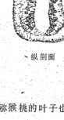

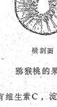

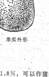

## 黎猴桃的果实

黎猴桃的叶子也含有维生素C，淀粉含量达11.8％，可以作猪的饲料。

黎猴桃紧塞的纤维质量较好，可以用作造纸的原料，茎干星面还含有能溶解于水的粘性很强的胶液，可以作为制造蜡纸、面团画用的各种涂料材料，也可以用作印染布用龙胶。

黎猴桃的花含有蜜，是很好的蜜源植物。花里含有挥发油，可以提炼芳香油或香料。

猕猴桃的种子含油量也较高的 35.6%,蛋白质含量约为15~16%。
猕猴桃的根和根皮是一种很好的药材，具有消炎、止血、清血、祛风湿的作用，对疟疾、风湿性关节炎、跌打损伤、肝炎、痢疾等病症有一定疗效。"猕猴桃合剂"治疗麻疹病毒病效果好。根制成的农药可以防治枣毛蚴，由子猕猴桃植株的特有药用性，本物具有抗肿瘤虫能，所以对害虫少较少。因加料加工，把猕猴桃优质果制成果酱或糖水罐头，把熟果压榨成果汁或做成果菜，把猕果、烂果和加工中剔掉的果皮等废弃物，蒸馏成白酒，大大降低了生产成本。
另外，猕猴桃的生产过程，尤其采收与果农增产的方关系密切。
猕猴桃的采收要根据当地的自然条件，果实成熟度以及果实中维生素C含量的变化规律来决定。野生的一一般在9月下旬到10上旬采收。人工栽培的或半人工管理，采收期可以适当推迟一些，采收时间合适，则果实更维生素C的含量和糖度都比较高，风味也更可口。过早采收，虽然维生素C的含量高，但是糖度不高，风味也不好，果品质差。
猕猴桃果实成熟以后不会立即脱落，所以如果果的采收期较长。在植株上自成熟的果实，糖分含量高，味道更加可口。果实在植株上可以保留到11月或更久一些，这 特性有助于采收劳动力的调配，又可以延长鲜果销售的供应期和果品加工生产期。
猕猴桃果实和果汁有相当的后熟特性，则采果的果实性熟，不可能马上吃或加工，需要经过5~10天的生后熟期，这一特性可以大大减少包装和运输中的损失。猕猴桃果实属于高温果，但比较耐贮藏。北京食品总厂在1966年冬天下，2,000万的猕猴桃保存在冷库旁走廊上，贮存几个月按损率仅5%。
猕猴桃的繁殖方法很多，可用种子繁殖，也可用嫁接、扦插和压条繁殖。近年采用组织培养法培养猕猴桃苗获得成功，为加速猕猴桃的繁殖和新品种开发并开了新途径。
嫁接和扦插繁殖桃的早熟和当地的自然条件，繁殖方法有关。
浙江省黄岩县采用嫁接法繁殖猕猴桃，2、3年就可以结果；南京植物园用种子扦插繁殖猕猴桃，3年结果。一般在第8年、第9年进入生长盛期，是产量最多的时期。

## 杨梅栽培

### 繁育
一般用嫁接繁殖法，以野生杨梅为砧木，嫁接方式有两种。过去多用大砧木嫁接法，将培育 2 ～ 3 年的砧木苗顶梢先嫁接到预定地点，过 1 ～ 2 年后采取嫁接、锯截或皮下接等方法，就地嫁接，每一锯截 2 ～ 4 个重叠，这时砧木后形成弯适时，过年采强厂小苗进行嫁接接法，可以大苗作为。当砧木为 2 ～ 3 年时，选用强健的一年生枝为接穗，采取嵌接、切接或劈接方法，嫁接后继续在苗圃培养 1 ～ 2 年定植。

### 截穗
一般在春季 3、4 月间进行。杨梅为雌雄异株，新区定植时，要注意配足 1 ～ 2 % 左右的雄株作为授粉树。杨梅不宜密作，因其根系上中层茁旺时会产生系种物质影响萌动生长，切忌在老树距主后的根最部位施肥。

### 肥培管理
一般杨梅栽培较粗放，地势不良时应除草，仅干采果期割草 1 次，辅以积肥，其目的是减少或减少果损。施肥一年约 2 次，部分于落叶后，3 月份和采果后施入，以草木灰为主，也有用堆肥、土杂肥的。因其有落根，氮肥可少用。

### 采收
采收时间自 6 月上、中旬至 7 月上、中旬因品种而异。但务必及时采收，以避免霉烂和腐烂。

## 西瓜栽培

### 播种育苗
可分大田直播和育苗移栽两种。

(1) 直播 在土温上达到 15℃ 以上时播种，华东地区在清明至谷雨前后。华南地区在 2 月下旬到 3 月上旬，华北则在 4 月下旬到 5 月上旬。播种前按行距开好播种穴，浇足底水，平放 3 ～ 4 粒种子，用松土盖平。两用细土或麦苔。谷壳或小麦粉覆盖锯盖，以保湿保温。覆盖过后的种子经 6 ～ 7 天出苗，干旱时 8 ～ 10 天出苗。出苗后及时除掉覆盖物。以分苗时间， sce 是最后挑选健壮苗。选苗要求：子叶肥大完整。先出苗而向外平展，色浓绿、真叶大而形正，茎短而粗壮，无病虫害及机械损伤，生长健壮有力。每季间苗后用稀人粪 - 尿水或淡水后及时中耕松土，清除杂草，防止土壤板结，促进

瓜苗生长。

（2）育苗类型。黄瓜栽培又可分苗茬和小苗两种，因近年主要推广大苗栽培，现将大苗栽培育苗法介绍如下。

①播种期：黄瓜生育要求温度较高，月平均温度 25℃时生长良好，30℃时生长最为适宜，15℃时就能生长，内蒙古一带长江、中、下游地区在 3 月中、下旬播种，华南、西南地区 2 月中、下旬播种，华北地区 4 月上旬播种。

②种子处理：先行粒选，选择籽粒饱满，符合本品种的种子纯度、无虫蛀、霉变、机械损伤的种子，晒种 2～3 天。种子消毒，一是用福尔马林，即用 50～60 倍的福尔马林 15 分钟，浸泡时用棉花不断摇动；二是药剂药， 即用 100 倍的福尔马林（37-40％的甲醛溶液）或 500 倍的 40 抗菌剂浸种 5 分钟，然后用清水洗净。

浸种催芽：种子处理后先用冷水浸水 4～5 小时，取出洗净，种子表面稍干，再置 4～20 小时后，将种子浸入温度稍高并浸入湿沙中，成盘 25～30℃的温度下催芽，早晚注意补充水分， 经 2～3 天，大部分种子露白即可播种。

③苗床地选择：苗床要求选背风向高、避风向阳、排水良好、管理方便、土壤深厚、并在前年未种过瓜类作物的地方。苗床地四周开排水沟，宽 1 尺，深 2 尺。在地块南北、东西两面设置风障，风障高 1.5 米左右。西瓜苗床分筑成高级苗床和普通苗床两种， 目前大部分地区是用高级苗床栽培苗床，因其成本较低。

每个小区四周要挖排水沟，以利排水。

④播种：在营养钵上均匀开孔 1～1.5 厘米深的播种穴，再用喷水壶浇透底水，每穴放 1～2 粒种子，覆盖 1 厘米左右腐熟肥细松土，用细土把营养钵或土块之间缝隙全部填满，以使播种深度一致，床面平整。床面经过培土后，以保温度保温。黄后覆盖玻璃或草帘栅架覆盖。经 1～2 天，70%左右种子出土后，将两片值的薄膜，并继续严密或玻璃或塑料材料保温。

（3）苗后管理 ①温度：出苗后大温室天花板有保温，夜间加盖草帘保温。苗床后，白天控制 20～25℃，夜里 17～20℃。长至一叶真叶时，适当提高温度，促进幼壮。定植前 7～10 天逐渐降温炼苗，扩大

通风，逐渐增加揭开薄膜和蔗膜时间，定植后 2 ~ 3 天里夜晚全部揭开，使瓜苗老健，并适应大田气候条件。② 水分：播种适足底水，播后不应多浇水，覆盖垄面细土以保护，如苗床过早干裂，也可适当浇水。浇水要在土中变干时进行。③ 病虫害：苗床温度高、湿度过大，应注意负生病害防治，应注意通风，如有病情，宜在晴天中午喷 600 ~ 800 倍代森锌或 1000 倍托布津防治。如遇阴雨闷热转晴，因气温急骤升高，蒸发量加大，瓜苗会发黄萎蔫、焦叶甚至死亡，可于当天下午 9 时前给瓜苗喷水，并采用揭膜透气和草帘遮荫等措施消除。

### 定植

（1）条植、作垄：纯恐焚，瓜苗应避免作垄，要求 5 ~ 6 年未种瓜类作物的土地。如果种植瓜作物宜选择早熟、矮立的品种，在晚秋作物收获时及早播种，耕深 8 至 1 米，然后作垄。瓜峰主要有害、杂种势、蔓长 12 ~ 16 米，同种春季作花，然后在各 2.5 米左右的“瓜路”于翌年种两西瓜，叫“双沟沿系系”。栽培 9 ~ 12 亩，两次种瓜作花物，中间 2 ~ 2.5 米的“瓜路”种一行西瓜，叫“中间条种”。两者有各利弊。苗前拨水良好，发苗快、病害少、根系集中能向下发展，后期养分充足，易早熟，后者则相反。矮长 80 厘米左右，沟宽 8 至 1 米，东向南向，有利抗风防寒，使低苗早发生。
基质在根膜时每亩，亩施有机肥 60 ~ 70 吨，过磷酸钙 30 ~ 50 斤。定植前每亩 10 ~ 15 担人粪作洒肥。
（2）定植：定植时间需参照当地已过，以土温稳定同升到 15℃以上。江南地带一般在谷雨前后，掌握冷尾暖头的天气中午定植，可略就近连。定植方式有单株和条系。栽培是每棵 3 株，每行约 12 厘米，但由于藤蔓重叠，分布不均，既不利于密植，又易病害，产量较低。条栽即按照株距在行间播种。“双沟沿系栽”的株距 1.3 ~ 2 米，“中间条栽”的株距 0.8 ~ 1.3 米。近年来为增加密植，也养形成系结”等，即在条系的基础上，扩大株距，每穴双双。
定植前一天，苗床浇一次透水，定植的当天上年开定植穴，“双沟沿系栽”定植深度与 1 次以上。开穴时先将土捌翻向东西两侧倾一个上午，定植时将生长一致的瓜苗按子叶与峰相对应的方向放入穴

内。再用抛出热的细土壶没等养根土表面，然后混入稀薄黄腐酸定植水。待水渗下去后，覆盖一层厚细土，为促使早还苗，定植后可用旧塑料薄膜覆盖瓜蔸或滴灌根系部土壤，以保温、保湿、防雨。
瓜田管理
（1）定植与早熟  追肥的原则是施苗肥，可施腐熟肥、腐熟饼肥。定植到第5、6片真叶时，以促使造成活还苗和发根为主。可 于晴天浇淡人粪水，每亩2担左右。一般在西瓜果实不断再长至 1斤左右时，即可开始追肥，待植株长到接近开花结果期，当西瓜果长到1斤左右（鸡蛋大小）时，应开始大量追肥。间作春花的瓜田可在春花作收后收获，结瓜后再追肥，在提瓜2斤左右的地点约5～6寸大，1～1.5尺宽的沟，每株浇入20～30担优质腐熟肥200～250斤饼肥，并拌入20～30斤过磷酸钙，以供结瓜时使用。在“中间条系”的西瓜田里，则将肥料配料入人沟或条沟里。因久雨而发透西瓜蔸易造成倒，可在落下一个晴天上午0.5%多效唑的药液喷叶或灌根，在西瓜膨大到成熟前，应多施磷钾肥，减少氮肥，以提高西瓜品质和种子质量。
瓜田浇水。一般从定植到结瓜前期控制浇水和开沟排水为主。如遇干旱或浇水后，仍发病情况发结。7、8月伏旱以后，应及时抗旱，每隔2、3天浇一次，浇水宜于早晚进行。
（2）中耕除草  发芽期，每次雨后及浇水后要及时中耕除草，要求浅松表土，避免伤根；小苗时除苗，苗大宜深；发芽后不再中耕，但应随时拔除杂草。
（3）蔓茁管串  主要是指倒、理蔓、压蔓、疏瓜和留果。瓜苗长到5、6片真叶时，在主蔓延长方向的侧蔓上选1条根部较壮、顶端生长旺、顶端向延伸的方向直伸则侧蔓。在藤蔓发蔓阶段，要每隔2、3天把藤蔓理一次，使藤蔓均匀分布， 并把蔓移到外的藤头敌回瓜蔓，使其回流，藤蔓长至1.5米以上时回蔓缚于桩，这株蔓需松紧适度。以后果蔓4～5米一蓬，共有3～5蔓。但在结瓜部这段的前两节上不能施肥。压蔓有硬与明确，踏瓜是先把一股藤埋入土里。适用于是经常施肥的西瓜品种的瓜田。明显是藤蔓受损在那里，或者将泥块放在蔓的复杂缠绕蔓地向上以蔓是应用，通常用于多雨地区及土壤较粘稠、地下水位较高的瓜田。若瓜田植株，可不必压蔓。压

藤分轻压与重压，重压后瓜藤生长慢而粗壮，轻压后瓜藤生长快但是根弱；一般在催花前追肥后第 3 ~ 5 节处重压，可促进座瓜，在另一端距 3 ~ 5 节处轻压，有利于养分运输。压藤应于清早天干后进行，阴雨天及晌午上的藤蔓较耷情况进行。

调整后调整植株的营养生长与开花结果的关系。剪蔓的方式有单蔓式、双蔓式、三蔓式及去掉老弱叶片的不整枝等四种。单蔓式是只保留主蔓，子蔓全部剪掉；双蔓式和三蔓式是保留主蔓及主蔓第 3 ~ 5 节上第 1 或 2 个健壮的子蔓，其余各茎尽断除。剪蔓与否及剪蔓方式依据品种、密度、土壤肥力、施肥水平和劳力条件而定。也有不进行剪蔓，而以肥水控制植株生长与结果的矛盾。南疆地区宜在 6 ~ 7 月上旬第 2 ~ 3 次，过早往往延后果实成熟而降低产量和质量。

西瓜留果与产量和质量有直接关系，每株留果数因品种、密度、生长条件、施肥灌溉与平衡而异。大果型品种每株留 1 ~ 2 果，小果型品种可保留 2 ~ 4 果。江汉平原区为争取提早上市，在肥水配合较好的条件下，可留主蔓第一朵雌花结果，一般以第二朵雌花结果为宜。在同一株同时开花或雌花开花时，应摘除一朵。造成子房形态正常大，花期直至相当的雄花开放，或雌花盛开两天后，子房生长中缩现象。在同一时期内，一株上不宜多留，否则果小，成熟推迟，要通过交替留果的办法达到分批收获的目的。

（4）防治病虫害 西瓜病害主要是有病灰霉病、蔓枯病、病毒病及白粉病。除上述土肥作业、深沟高畦、选用抗病品种、种子消毒、培育壮苗、适时密植、田间整枝、合理管理肥水以减轻病虫害、防虫、防治病叶、搭建棚架和搭吊等措施外，在药物防治方面有：①防治炭疽病可用 65%代森铵500~600倍液或50%托布津900~1000倍液，或1:1:200波尔多液喷雾。②防治蔓枯病可在幼苗期喷接根部，也可在发病前喷50%多菌灵500~1000倍液，或50%多菌灵800~1000倍液喷雾根部保护。③发病初期，用50%代森锌或抗菌剂401 500~1000倍液混施根茎部及周围土壤，然后用棉绳或塑料肥皂或生物碱，有治愈效果。④防治白粉病，用50%硫磺悬浮剂800~1000倍液，或0.1~0.2%农药液喷雾。炭疽病合作药剂，对于病菌的防治，目前尚无特效药，应把防治和协同的肥水管理相结合，以培养生长旺盛和抗病力强的植株。

西瓜的主要害虫有潜叶蝇、瓜蚤蝇、蚜虫、黄守瓜、红蜘蛛、地老虎等。①潜叶蝇防治常在5月间危害叶供，可于初发生期用40%乐果1000倍液和80%敌敌畏乳剂2000倍液喷射，也可以刮除致百虫1000倍液与40%乐果1000倍液混合喷杀。②瓜蚤蝇的幼虫以蛀食幼苗的嫩茎和根系危害，可用800～1000倍的克蟾乳剂，取1200～1500倍敌敌畏原液喷洒。③蚜虫于发苗期用40%乐果乳油1500倍喷雾，以后隔5～7天防治一次。④保护瓜的成虫和幼虫都能交配直接和幼虫。防治方法：清晨浇水后人工捕捉；在根际附近蔓延，在蔓延的可防治；在根部灌施公腐或漂洗90%晶体敌敌2000倍液杀灭幼虫；用90%晶体敌敌百虫1000倍液喷治成虫。⑤红蜘蛛主要在伏旱期危害，应于初发病时用50%茶蚜乳剂1000倍液和80%敌敌畏乳剂1000倍液混合药液连喷2次，效果较好。用40%乐果乳油2000倍液或25%乐果500倍液喷雾。结合用1000倍液的三氯氟磷喷雾杀灭卵、若虫较好。⑥地老鼠主要以吃幼虫小苗，可于清晨人工捕捉，也可在定植前在“瓜路”上撒施柴油水拌杀；还有用诱捕器杀成虫，或用90%晶体敌百虫0.5公斤加水110斤，掺入炒过的40升棉仁饼内放置每窝诱杀幼虫。

## 香瓜栽培

香瓜是我国地区对黄皮甜瓜的俗称，色、香、味俱佳，是我国内广大群众喜爱的果品之一。
香瓜对环境条件的要求
香瓜是适合生长期需较高的温度，种子萌发时要求最低温度为15℃。最适温度为25～30℃。生长后期适宜温度是25℃，15℃以下长停滞，扦插时，温度低于18℃时，易形成畸形瓜。较大的昼夜温差，有利于瓜的糖分积累。香瓜喜充足的光照，在整个人生期内，每日要求10～12小时的日照时间，否则易碱蚀。香瓜需水量中等，在果实生瓜后，如果水份不足，就会减低瓜的产量及品质；但植株期水分过多，也会影响蜜瓜。香瓜最好土壤疏松、土壤肥沃、土壤透气性良好的沙壤土，耐酸碱性土壤强，在酸性土中生长良好，且易得格蒙腐病；在轻碱地种植，还能提高瓜的含糖。香瓜适宜生长的土壤酸碱

碱度为 P H 6—6.8，忌含盐量不超千分之二。

## 栽培技术

香瓜地要进行轮作，秋翻的深度一般在一尺左右，并结合整地进行施肥，施肥的方法，可分为全园施肥、条施、穴施三种，全园施肥施肥量大，肥料方法，肥料长，易施不易显现效果；穴施肥料比较集中，施肥量少，但发苗后植株营养发生差现象，条施肥于两者之间，生产上往往根据需要灵活选用。

基肥的基量与种类，应根据施肥地力而定。雨水较多的地区，基肥用量的总施肥量的50%左右，其余的肥料做追施用，旱地种瓜，可一次施足底肥，不再追施。通常中等地力，每亩施土杂肥或腐熟厩肥3-5车，硝酸铵20-30斤，过磷酸钙80-100斤，硫酸钾20斤即可。如发现有缺硼，可用微铁水齐等，每亩喷洒水200斤左右。

香瓜的整个生长周约为120天左右，无霜期超过135天以上的地区，都可露地栽培。在无霜期较短的地区，可采取育苗及温室覆盖等保护措施，也可选用早熟品种培植。但在生长期的地区栽培时，应将瓜的生长及成熟期安排在温度高、阳光充足的季节里，尤其应避开雨季，这样有利于增强瓜的品质，减少病虫害的发生。香瓜育苗用的温室，温床，冷床，拱棚等与蔬菜育苗的相同。惟有条件，瓜苗的定植期一般是在晚霜过后，地温稳定在15℃以上时进行。在早春季荷风地，应采取防风设施。

定植的头一天应浇水上墒，应在苗床浇一次透水，这样出苗时不易晾坨。栽植时，将苗轻轻放在定植穴内，使其苗土坨的顶面与地表相平或略高出一点，填入大半穴土地，用手指轻轻压实，缓缓分三次后浇水2-4尺水，待水渗下后，再用细土封住墒口，以减少水分蒸发和瓜苗周围结成硬块。随着瓜苗的生长，香瓜地在进行中耕松土要及时进行，由深到浅，不伤根及幼苗。香瓜的整个生育期较短，因而要适时追肥，追肥的原则是，轻苗苗期，应可以以生对生弱的幼苗追肥；青香生长时期适当施肥，钾肥，重进行结瓜肥。

香瓜虫害防治，发现异常病虫苗后，可喷洒铜屑合剂。铜锈合剂配算是：硫酸铜2份，碳酸铵11份，充分混合，密闭一昼夜即成。

使用时一药剂溶解在400倍水中。也可以用500倍液的敌克compound 401，灌根。常年病的防治方法：每月隔一个月左右喷一次1:2:200的石灰硫磺合剂或多霉，或喷洒80%代森锌800倍液，或喷50%防霉灵400—600倍液。预防落黄病，可进行柠檬、实生田间喷雾，酸性土壤，宜可施每m—150克可溶性石灰中和与洗净；同时进行田管，加施腐叶，小堆施肥，发现病株，及时铲除。也可在苗的根茎部喷洒70%敌克松1.0%溶液，或50%代森铵抗霉剂401 500—1,000倍液，或25%苯菌灵，50%多菌灵，70%甲基托布津1000ppm。防止炭疽病可在发病初期，摘除病残枝，每隔7—8天喷洒80%炭疽菌700—800倍液，或50%防霉灵50倍液，或喷1:2:200石灰窄式油茶多霉。预冶白粉病，可喷50%甲基托布津1,000—1,500倍液，每隔7—10天喷一次，也可用药液0.1—0.2%的石灰硫黄合剂。夏季中午高温时，忌喷药。瓜类也可用聚草木灰渣治的工作，有一定的效果。

瓜蔓地的虫害有地螨。可选用50%敌百虫或50%敌敌畏1,000倍液，或氧化乐果300—400倍液。发嫩虫，可用40%乐果乳剂和鱼精粉800—1,000倍液、2.5%溴氧菊酯10,000—20,000倍液，50%敌敌畏乳剂1,500—2,000倍液。香瓜及西瓜常受小地老虎，可用羊皮皮拌饵，加水8—10倍，喷洒在菜地或瓜菜上，晚间可将其吸引来吞食，也可用稻草覆盖诱杀成虫。及人工捕捉。蚂蚁是害物种的一种害，蚂蚁群寄生，破坏瓜苗，致使瓜苗死亡。可用敌敌畏乳剂或敌百虫1,000—2,000倍液喷杀，也可用毒饵诱杀。

## 打瓜栽培

打瓜子仁营养丰富，它是茶点之一，又是制作糕、饼等点心最好的配料，可是爱受欢迎的出口商品之一。山区、丘陵、贫区都可种植。它生性强健，可在油菜、小麦、玉米、山芋等作物地里套种间种。而且瓜子产量也高，一般亩产70—80斤，高的达120斤，一亩百，是农村的一项增收之道。

打瓜喜疏松水肥透，耐旱耐寒，喜土壤富含有机质和肥沃的旱地或山地，适应性强。挖坑栽植，保水保肥性能好和阳光充足的坡地或平地种植，返墒速度慢，两犁两耙，把平把耙，开好四沟，防止瓜摊涝水，为种子

# 发芽出土条件。

每打籽只经65~70天的生长期，不仅要事先备足肥料，还要及时施下，每亩配用农家肥3担，干畜粪10~15担，磷肥50斤，拌匀堆放制20天左右，在种籽时进行穴施。每亩用药15~20担干除病菌、老墙土做基肥，以提高培苗生长健壮。用温室育苗，促温低亚生长健壮。

打瓜子温度，如播种过早，光照不足，温度低，植株生长缓慢，瓜藤小，分枝少，瓜皮厚，瓤多籽少。如播种过迟，后期温度高，叶片大，膨皮萎软受损，雌瓜少，且容易早衰。所以要适时播种。一般放在温度在15℃下种， Jiangsu 以4 月下旬到5 月种为宜。株距2.5尺，株行1尺，每亩2000~2300株，每穴播种3~5粒。

下完子盖破土，中后期要进行疏苗拔除肥料，以控制叶、藤生长。但叶片数现减少，疏密要及时进行。枯土盖土，除草杂草，防止其它草与瓜苗争夺养料。并注意浇灌，避免过水和干旱。

病害主要实行轮作和桑药病。害虫有土狗子、黄守瓜、跳蚤、蛾蝇等。土狗子用石灰粉合六六六粉撒在地上诱杀。发生虫害为害，用800~1000倍果蔬喷雾。

打瓜子成熟后一收，选晴晴天干燥，分期分批收瓜，或掰叶、断秧后一起完成。早晚收瓜，当天晒干，不翻动，这样瓜子色泽新鲜，品质优良，出合率高耙。

## 牡瓜栽培

牡瓜，又名格棱、药瓜、苦瓜，是多年生草质藤本植物。牡瓜既是重要蔬菜材料，瓜籽粒大，肉多，含 And 质的脂肪、蛋白质，又可做药食两用。味有天花粉，是抗癌抑产的特药，还用于治疗肝炎，糖尿病等多种病症。果实有抗癌、抑菌的特药。瓜皮与瓜籽常用于治疗热病，能润肺补、清除痰、缓解和镇咳等病。牡瓜宜于亚热带地上种植，能充分利用土地和空间，而且一年种下，多年收获，投资少、效益大，省工省肥，经济收获高。

径1～2寸，断面白色新鲜（有黄疸者不成熟），切成2～3寸长一段，用秧筐缝的种植。注意多种秧根梢，少数秧根梢（只作授粉用），按行距5～6尺开沟，沟深约1尺，深2～3尺，施足基肥，与土拌匀填平，浅水下沉块状状块，使1穴开3、4穴共，稍覆稍根苗上平板能内盖2～3寸土，覆盖草帘，保墒土壤湿润，约1个月出苗，当年能结实，管理 春季牡瓜出苗后须及时用竹竿等搭棚架，棚以一人多高为宜，过于高或管理不当收采，过低则丰不佳，影响生长和结实，若认其尾枝或尾度，常结瓜少，质量差，当主蔓长到1尺左右，再去少数侧胞独而萌，尽量多保留主蔓，少取五、六根，多则十几根，并用缢根绑好挡于棚上。此后应经常绑蔓，使之布置均匀，反复多次去子房，防治病虫害发生率。便于多结瓜，并利用棚即达到阴，遮仅高温大风，昆虫害和雨淋，就要进行人工辅助授粉。牡瓜于每天清晨开花，可在早上午、七点钟时，采下雌花并授精，将雄花的花粉在雌花柱头上轻涂，使花粉粘在子头上，称其花为“半花”。每天雌花可排3～4朵鲜花，涂抹时切不可损伤鲜花，否则会影响结实，但应适当控制结果数，否则科不利，藤期幼果，结果过多也会枯萎，反而不利结果，减产少量产量。

牡瓜的水分管理主要是冬季，春季施有机肥，一次是采瓜后即施冬肥，一次是夏季来临前。方法是在根附近开沟施入人畜粪、肥膜，动植物等来肥运。施于每期6月9进行，在根部进行地肥，开沟后填入少量化肥，人畜粪及过磷酸钙等速效肥料，也可进行一些饼肥，切不可在或根烧饭浇水。若间见烂根死亡，出现利后，覆盖温干旱，受病虫害或温凉水过量，注意浇水讲求，降雨停稍。

牡瓜病虫较多，主要为虫害，以守瓜和蚜虫危害较严重。防治守瓜，可在发生期的混液人工捕捉成虫，或者在露水未干时喷2.5%敌百虫粉剂或农药，防治蚜虫匙于首次发现蚜40%的果夹果例150～2000倍喷，每7～10天一次，连续喷药3次可见效；另外，在冬期药清洗固除冬蝉虫，减少来年虫源。

牡瓜在南方常年安全，在北方须于地冻前将藤盖在地上盖1尺多厚土防保温，待第二年，冬时施好有机肥后，用稻草盖在根部保温，并养后根去草盖。

## 更新

杜瓜种后第三年进入旺果期，繁殖果大，产量高。若肥水管理得好，能保持多年高产，否则会衰弱下去，果变小，产量低，应及时更新。可在根系盘能有肥财重新秋季再生幼，也可于冬季将根部全部挖出，切块分株繁殖，重新种植。

采收与加工。淡秋，杜瓜果实青绿色转黄黄，表面出现白粉时，即可分批采收。采收过嫩，果皮过厚，不易储藏，种皮不充实饱满；采收过老，果皮变硬，产量下降。质重也不好。杜瓜采下后，摊在地上晒几天，使有软瘪皱，然后从蒂部对折取下。取下外层果皮，用清水洗净内皮的杂质，晾于热烘干或晾干后装成，以防腐烂，外形红白，无霉斑者为佳。瓢与籽须分开，可置盒内加木炭反覆振摇，使籽从瓢中离出，滤去籽和木灰得清，晒干即有。好以干热储藏，油性适宜与上等蜡瓜，冬季至清明间挖起，挖后用清水洗净，切除清头和蔓烂部分，切去短，置明亮处或石灰水中浸 6 ~ 7 天，取出用药水干烧，长度 ~ 2 长的短柄，粗条忌储藏，晒干切片晒成。 为防霉烂，可用硫磺熏过。以颜色白、质坚实、韧性足者为佳。若夏天挖取，筋脉多少，质量低下，不选药用。

## 乳瓜栽培

乳瓜又称乳瓜，是作为加工甜瓜的一种甜瓜，加工时选用幼嫩小瓜进行腌制，故称“乳瓜”。经过加工腌制的乳瓜，口味酸嫩鲜美，为其他番茄所不能，故极受消费者的欢迎，也是外贸出口的主要农产品之一。

## 主要品种

目前一般都选用“平里种”或“扬州种”。“平里种”的幼瓜颜色为黄白色，“扬州种”的幼瓜颜色为深绿色。这两个品种都有早熟性佳、单株结多瓜的特点。其不同的，除幼瓜颜色外，“平里种”加工后单坦脆，“扬州种”加工比“平里种”更为脆。

育苗。—一般育苗移植。育苗的播种期在 3 月下旬（大田直播的播种一般在 4 月 20 日左右）。播种时可将种子播于育苗土块中，或者先播在熟土中，当幼苗的叶刚露出来时，及时移入河泥

土块中。河夷土块育苗易于放大苗距，使于培育大苗，定植时不会伤根，定植后及早发棵，有利于达到早熟高产的目的。

河泥上土有干、湿两种。干河泥上土是土块做好后让它干七燥，使用时浇湿水后摇松或敲散，湿河泥上土块经做好后就直接覆盖塑膜。河泥上土的成份，一般是河泥5成，原熟腐殖土（堆肥、蘑菇）4成，腐熟人粪尿1成，再加一些碎嫩黄腐叶。做法是先将育苗的土块平铺、踩实，四周围以砖块高约5～6寸，然后把籽块整齐铺于泥和肥料堆上，待3寸厚就停止，立即培严，然后等籽块发芽后(一般需一到3天)切成3块大的土块，上块中央给插0.8寸左右，深1.5寸左右的小孔，作为插穗或移矮幼苗之用，但插穗或移栽前孔内要使营养土填满。

播种前先将种子在清水内浸泡2～4小时，使种子胀熟，然后用湿布包好后放在28～30℃的地方催芽，种子数量少的可用取暖器的“烫温子”，热水袋等作为热源来催芽，如种子数量多可用电灯的热能来催芽，这个方法效果高，凡有电灯的地方都可应用，如果，用小缸（或木桶）一只要少量水没落将种子放在离水面5～6寸的地点，篓布将其封口压实，缸口用玻璃盖好，以保温度要的温度。灯泡的大小可根据缸的大家而定，由于种子在萌发的时候需要，加温了呼吸作用，需水量分数和氧气，所以催芽时每天还要定时用温水将桃换气，这样后种子包外层温度均匀，使种子发芽整齐。在正常的情况下，播种后1～2天就能“露白”（仰种午的胚根稍露出表皮），“露白”后即开始播种。

采用直播于营养泥土块中的，每5块育苗“露白”的种子1～2粒。播后土壤上罩一层2到3寸的营养土。采用育苗袋的，先育苗的土壤整好（要求酸度平、细和干湿度适当），然后将“露白”的种子均匀的撒播在土面上，用细麻的麻布或水一遍，使种子紧密贴实，再盖一层约2至3毫米厚的营养土。播种结束后，用塑料薄膜盖住，每天早上打开常凉，以利保温。当种子出土约60%左右，就把平盖的塑料薄膜取成为环被。苗出齐后，直接的要时关掉留苗，留下苗一棵，育苗移栽。当幼苗的黄bef刚开始时，受及时刻移栽。

整个育苗期间，要加强保温和通风、肥料和水份的管理，白天温

度前期保持在28℃左右，进入真叶期以后一般保持在20～25℃，超过以上温度就要进行通风，防止产生高脚苗。用河泥土块育苗的育苗期雨可不再追施肥料。如用熟土育苗的，则要根据苗生长情况追施淡薄水1～2次。育苗期如雨水过分不均匀，过迟过早均不利成苗发育。故用混泥土块苗的育苗期一般很少浇水，但用干土地块育苗的则要求防止土块过干。发现在中午叶子下垂，就要及时浇水。浇水时间要在晴天无风的中午进行。

苗期要喷药防病2～3次，定植前一天的喷药最为重要，称做“带药定植”，药剂一般可用1：1：300（即1斤硫酸铜，1斤石灰，300斤水）药液喷成800倍液的80倍液喷雾到植株上。

当苗高3～4厘米时就能移至大田大棚或穴4～4．5寸见方为止，幼苗多受光照，从而成为矮节间的粗壮株苗，为早熟高产打好基础。

定植 肌瓜定植一般在4月下旬到5月初为适宜（如定植后用塑料薄膜覆盖的可以提前到4月中旬确定），苗龄掌握在30～40天。定植前，要做好选地、整地、施基肥等工作。

（1）选地 肌瓜不耐种在一年二年已种过瓜类和葫芦等瓜类的土地上，适宜表现是地势高燥、白粘种、粘重和肥沃和瘠薄等风害严重。最好选择前1～2年种豆类、茄果类或叶菜类，并是高畦便利于排水土地。

（2）整地 要求深翻高畦，以利排水。畦宽约5尺，沟宽1.5尺，沟深8寸～1尺。

（3）施基肥 一般每亩施腐熟肥50担左右，河泥100～150担，过磷酸钙30～40斤。施方法先耙散叶泥全部撒施后再翻入土中，如数量少时，也可采取条施在定植沟内。

（4）定植 定植前在畦面按行距（一般为2.2尺）两系定植沟，然后按株距6寸将苗栽入沟中，随即复土、浇提根水；天旱时，可先在定植沟内浇透水，再栽苗覆土，以利培育棵早。每亩栽植的苗数为4000株。

田间管理
（1）施肥。定植后晴后，一般用2：10（氨2份、水10份）的淡粪水每隔7天左右浇一次，每次每亩约15斤左右；开始结瓜后，粪肥浓度适当提高，数量也要适当增加。结果盛期，可用碳酸氢铵与可

过磷酸钙拌种后长（秧和后间一盘）离瓜根半尺许开穴施入土中，一般每亩需硫酸钾40~50斤，过磷酸钙约20~30斤。

( ?) 乳瓜需水，又怕水。如遇天干早，一般不宜采用灌溉的方法，而应浇水为宜。

(3) 定植后搭架及时松土，以提高地温，促使发根。在搭架前，一年定植约3~4次，松土时要结合盖土，把土培在植株根部周围，搭架后，中耕松土不及时，则可结合喷施水剂，将疏松的战斗土分次培在植株根部周围，以起护根保墒作用。

(4) 瓜蔓到第7~8时，应小心用软或竹竿等及早搭架。架的方式一般为“人”字架，架要搭得高，搭牢作牢。搭好架就要注意遮荫，不使瓜藤受到主瓜上抽出的侧蔓，也要摘掉。

(5) 防病虫害。①病害主要病害有霜霉病、白粉病、炭疽病、疫病和枯萎病等。在发病前期，一般可用1：1：300的波尔多液喷防。发病后，需喷药可用600倍液（即1斤药剂加水600斤，下同）的75%百菌清可湿性粉剂喷雾；发病重时可喷药可400倍液的80%代森锌可湿性粉剂喷雾；枯萎病可用800倍液的50%多菌灵可湿性粉剂进行药剂2~3次。

如由于同一棚内发生几种病害，则可喷药每隔3~5天。（严重时隔1~2天。隔好时需防治喷雾。如病害后隔下雨，则雨后及时立即可补喷。②虫害，乳瓜的主要虫害为蚜虫和红蜘蛛。蚜虫在乳瓜整个生长期都有发生，由乙基虫蛾传播病毒，防治须做“划行小治”。如防治不及时，会导致大面积发生和蔓延一般在幼苗至早、第幼虫发生后都可用1500倍液的40%乐果乳剂喷治，蚜虫还可用1000倍液的30%乙螨甲硫磷喷雾。

## 桑树栽培

育苗地要向阳、通风、土层厚、疏松、排水方便，无萎蔫病、根腐病和根结线虫的土地。苗地要轮作。忌连作。盐碱地育苗，含盐量应低于0.2%以下。

(1) 种子育苗 用桑子培育的桑苗叫“实生苗”。这种苗未的适应性强，可供基层种或做桑园砧木用。


① 采种，采集成熟无病虫害的桑果，踏烂，去果肉和种子分离后，放入竹箩或塑料筒的篮内，在水中浸洗数次，漂洗，取出沉底的黄色种子，筛除细杂物，种子应及早播种。准备第二年春播用的桑子，贮藏的方法是，用清洁的坛或罐，底部放生石灰（为沙重量的1/3～1/2）做垫层，石灰或细沙7层粗草或纸袋或编织袋，粗布反放入袋中带框套子的布袋，按每层1～3层的容量，堆后盖好口，放于阴凉处，干燥处。也可冷藏，把干燥桑子装入塑料袋，对口，放在冷藏室里，保持0～5℃温度。桑子数年也是可用的种子可保存3～5年。方法是将种子用纱布包好，装放在一层细土，养育土和桑子等量的纯净沙混拌后合盖入盆内，上而再覆一层细土，然后把花盆埋在地势较高干燥地面30厘米深处，采桑播时取出播种。

② 播种，桑种分为春播和夏播两种。春播采用上年贮藏的种子，在终霜期后（地表5厘米处的地温在20度左右）下种。夏播应在桑果成熟，桑叶徒长高能配40～50粒，种子含水量高，刮掉粘附的胎囊。播种方法分条播和撒播两种。条播又分直条播和横条播，每畦开3～4条，条宽6厘米，条沟宽度每畦25～30厘米开一条。条播，每亩用种子0.8～1斤，排成每行，每株均放入沟内，上覆一层细土。夏播的再用稻草或麦草覆盖。撒播每亩用种子1～1.2斤，把桑子均匀撒在畦面上，用扫帚轻扫，砂质土用木板轻度镇压。

桑子播种后要加强田间管理。播种后2片子叶露出地面前要保持土壤湿润，提高出苗率。但在盐碱地或在这一时期，不要浇水，浇水加强松土保湿。苗木生产同期，遇到旱时要浇水。桑墩地一次水或下一次隔后，浇松一次，防返盐。多降雨水要及时排水。种子大都出苗后2片子叶展开时，进行首次除草除掉病苗。苗高1寸时第一次间苗，拔除过密的苗子，苗距保持1寸，苗高2～3寸时进行第二间苗或补苗。苗距每株定苗要求，一作桑枝木用的每株定苗2.5～3尺株，作为桑枝种的实生苗，每株定苗1.2～1.5万株。广东常年栽苗作苗，每亩可定苗10～15万株。苗木长期要勤施肥肥，做“从实到肥，到肥到壮”。第一次追肥在第一次间苗完毕即入。

第二此追肥在苗圃植入，以后春苗植入，8月既停止施肥。苗木生长期须要及时防治病虫害，如遇到老虎皮危害苗时，可用米糠50斤（或糠皮），炒热后拌和百草虫1斤，傍晚撒于地面，进行诱杀。
### （2）嫁接育苗
接穗的采条和贮藏，春季嫁接萌动前，萌芽将要先萌动时（江苏在嫁接前20天）采集接条，选择品种优良，冬季萌芽，上年秋天少采秋叶和没有病虫害树上的 一年生枝条，枝条萌动要湿润符合嫁接法的要

枝下来的枝条应随采即藏，贮藏的房屋要保持温度在 5～8℃，相对湿度应在70％左右，空气流通透畅，不受阳光直射。地方宽 7～10厘米的沙土或稻草，将接小梢的接条竖立或横插在稻草上，四面覆盖稻草或草帘，・接层或安石蜂盖，贮藏，注意防晒，防冻，防潮。也可将接头高蜂绑好，接 2 米左右放在坑内，坑底铺细沙或稻草，条条。将接好的条条竖立或横绑在上用，四周用稻草固好，上面积覆稻草15～20厘米，摊成“△”形，上部盖塑料膜，坑四周并排水沟，以免雨水流入。
冷藏的容器，可用冷库贮藏，保持 5～8℃，遮盖接条的袋盖，接条
接法每—万株150～200斤，简易芽接60～80斤。

### （3）扦插育苗
选培养扦插的品种，如要的品种，四川树的黑油麻或大叶的实生苗，南方各地的热带，取其树皮下中部的成分条，每段长15厘米左右，顶端的必须谨慎抽掉，下端切口光滑，插入土中。
盆土须用，干燥和沙土或筛过腐烂的树叶 1.5 厘米左右，浇透好土。上扦插区要保留出地面，为了增加通气性，要选用透气性好的沙质土壤。扦插前的母本条认真加强管理，使穗条充足发根。扦插后苗地要保持湿润，多雨时不能浸水，发根后要及时做好追肥。摘除老叶和松土等工作。

### （4）苗木出圃
到晚秋季节，苗木生长停止，条叶枯落。要求在[种植地]没有打破之前，将移栽苗全部挖起，要求配合系统接收、挖掘。根据苗木的苗木较大苗，分级进行定植。不做土的要定期进行根部。栽植苗木的地方要整理高坑，开深1.5尺左右的根沟，树面向北，把苗木依斜刺向内底，然后填入细沙。来年萌芽后，分别取出进行定植。
建立档案图

### （1）蔓类的形态和密植
发展蔓类系统，必须考虑快捷、高产、稳产、新技改或兼合机械耕作的要求。栽培有成片栽培和散植等形式。成片栽培的园区又有普通菜园（专业菜园）和间作菜园。成片栽培的菜园一般采用行植密或窄行宽株或行宽株。即一宽一行一行。

在新发展菜园地区，蜜菜设施配备不足时，可建立临时育苗菜园，利用菜畦建造，在菜秧行间套苗。一般要求地块高燥，排水畅通，离蜜套较远，采蜜行宽行相间栽培，宽行5米，窄行1.33米，宽行养殖，窄行养殖作物，株距1米，树干高5尺左右，树种养成后横伏藤蔓，每亩可养蜜蜂8～10箱。

### （2）栽培期和深度
栽培期一般为深秋，收获时间一般为一期冬天收割到地封前或为来年，春夏秋深秋后制度带时间和发放地方之冬，土地封冻的栽培或活率高。在零度或冬季大风地区，春栽比较适宜。

栽培深度以根系（根和营养芽）透入土中2寸左右较适宜。播种深度入土以上略高于秧床。一般沙土，气透性高，冷浸区域和大风地区和地下水要适当深栽。粘土、地下水位高、温湿多湿地区、地势低干瘠，盐碱地盐含量上下重时应浅栽。否则，蜜蜂“深浅浅大'和不进行过导致。

### （3）栽条的方法和步骤
栽培前，土地在秋末冬季进行平整，做到表土与心土（底层土）不分离，挖坑方泥土时挖方地面高出一段，当新土与心时，整理地表呈平水。挖坑处的土地应确保有机械起平，同时，设置好排水系统；做到挖坑后能；山区和丘陵地带栽种，应设等高线等措施使成梯，梯面用泥水，最妥用石块或砖做栏，农牧高坡于梯地形，并增加有机肥料和种植前，加有石等的措施良，土壤，同时设置灌溉系统。调理栽培也要按行平整，有砂石的漂洗，农民清除杂草作者的堆积填埋，然后按土面设置，设置好养土蓄水渠，种植地雨，土壤含盐量在0.2%以下为首要考虑种植排水设施，缓冲国内尚尚相通，直通大渠，能排水洗盐和降低地下水位，又能防止逆渗，同时平整土地，深翻土壤，减少地面养涵，促进盐分盐度。栽桑后，间作整理，整深翻地后，助使底层盐分上升，又能改善土壤结构。土地平整后，进行全面深翻，然后按定的桑树行株距开穴或沟。

一般成片果园开栽植坑，株距较宽或十余龄果兼养的开穴、穴、沟深1.5尺在每亩放至基肥50~80担；上盖表土2~3寸，然后栽桑、豪植和“露根栽”。

栽植前选小大一致、无病虫的桑苗，修去过长、破损和密贴的桑根，其它根须尽量少剪，剪口要消毒。栽植时要苗正根伸，排放纵横对称，然后填土压实，墒土稍高于地面。盐碱土墒土应与地面平齐。在土壤渗水的地方，或半时浸约2~2寸清水养，再行培土。

### (A) 树型式管理
树型分地势、低干、中干、高干和主干很高只采用不开或较多加修剪的乔木类。不论低、中、高干的树型都应养成立豪状和无主式。当树干到一定高度后，每年在同一部位放条，形成豪状。条养方式，年年提高一定高度成为条无豪状的条状桑。

## 桑园肥培管理
### (1) 桑园施肥
桑园肥培包括桑叶对肥料的需求和肥料的种类、施用时期和施肥条件等。春、秋、冬四季，还须优养各类桑叶有所不同。

- ①春肥：有促进桑芽生长和增强产叶的作用，能提高桑后徒长的发育率。桑肥施用效果较好。在春季桑树发芽前15~20天施入，施肥量占全年肥量的20~30%。
- ②夏肥：夏桑是桑树一年中旺盛生长时期，夏肥不能增强产夏秋叶，又为当年秋季叶增长打下基础。为了减少肥料的流失和充分发挥肥效，可分两次施入。第一次在夏前期施肥，第二次在夏季后期施入。以速效性肥料为主，配合腐熟的堆肥、厩肥等约占全年施肥肥量约40~50%。
- ③秋肥：促进桑树枝叶健壮生长，延迟叶片硬化，提高秋叶利用率。在养蚕前半个月施入。施速效性肥料。水网地带可喷可施结合含氮肥料。约占全年肥量的10%左右。
- ④冬肥：起改进土壤提高地力的作用，加强桑树过冬的作用。在冬季落叶后土壤封冻前施用，结合冬季翻入土中，冬季施用堆肥、厩肥、垃圾、河泥等有机肥料，肥量占全年肥量的20~30%。

桑园施肥应以土施肥料、根施为主，桑树生长情况、树龄和桑叶产量及蚕种类型等有所不同。一般桑亩产量3000斤以上的桑园，生产100斤桑叶需施氮肥2斤；亩产2000~3000斤的桑园，每100斤桑叶每亩纯养1.5斤。施肥应适应符合桑用磷、钾肥、氮、磷、钾的比例。种苗桑养园以5：3：4 配比为宜，丝苗桑养园可按10：4：5 配施应用。桑园施肥应以有机肥为主，化肥为辅。桑园除施用堆肥、腐肥、垃圾及秸秆还田等土外，还应按在桑园内间作绿肥，这是增施有机肥料的重要途径。

施放方法要用穴施、环施、撒施和槽施等。穴施是在桑树行间开深5～8寸的穴，每次施肥要变换穴位。沟施在行间开一条宽5～8寸的沟，环施可用高干或乔木桑，以树干为中心离一定距离开一环状的施肥圈，不论穴施或沟施，施肥后覆土盖平。

### (2) 桑园管理
- ①霜蔸和排水。最适宜桑树生长的土壤含水量为田间最大持水量的70～80%。温暖半干旱及缺灌水，多雨时注意及时排水。北方干旱冬季在干周灌浆期旱，时对桑季有一定时效。桑树在夏秋季生长盛期时，如遇气温较高，旱会使桑季新梢生长不良。假期如雨，叶形变小，应及时排水。另一方法是采用沟窄。穴施、喷灌等。在秋末桑树缓慢生长前，不进行灌溉。
- ②耕地和除草。耕地春、夏、冬施三次。春耕在春茶发芽前进行浅耕，深3～4寸，结合除去过冬发芽。翻耕时土壤打碎耙平。夏耕在夏秋后即进行。夏秋应耕松，土壤打碎耙平。冬耕在树叶落尽后，根部后进行。一般冬耕深5～7寸。行间耙松，近根部浅松，防止伤损根。除草松土一般一年要做三个季节，除草中耕4～5次。春茶发芽前在春芽的基部上，除草1～2次，除去发芽草，夏季在春芽被抽上后，除草1～2次，除去夏季草，秋季在桑叶落花结籽时前，应在开花或结籽前除草一次。有条件地区可采用除草剂除草。
- ③合理收获桑叶，做到养养结合。
（春季合理收获法）春桑小辈1～2眠采用摘片方法。采摘桑叶必须和实痛疏，放或成片桑园中桑树离上部的适龄叶；3～4龄时采摘桑叶于下部或芽叶，5龄进行桑采收，一晚先放时养留，土质差或零散桑桩，后先密植成片，生长旺盛的桑园，增多养法。
（夏季合理收获）夏桑叶合理收获，不仅仅可当早年秋季叶增产，又不影响茶树正常生长，使茶园保持满产。夏季采叶收藏位以养根和Mul足萌芽数量为生，结合疏芽采叶间养茶蕾，在萌芽的同时去新梢基部4～5片叶倒置。早、中秋期，小茶选条采茶上部1～2片顶端叶，半展开时以枝条下部向上采摘，但早秋必须保留茶枝长的1/2以上部件及长，中秋茶摘除最少7～8叶，晚秋，茶采叶视茶树生长情况决定，停止生长的枝条，顶端至少留3～4片叶，还未停止生长的枝条，顶端常保留6～8片叶。秋叶采摘疏叶留柄，保持防病害。

> 【地区性条茶收藏法】山东大嵊冠雀茶，弱分性性，应留首枝养芽秋收藏；新疆北河为茶类采茶类养茶防收藏；山西省无暑期短，采取用开初收采，东北四区为下防止茶类萎缩，有茶用秋季烟仅收藏；广西茶极气侯舒点和别类茶性，应适当多次养着集，部分地区采用大茶尾连夏夏收藏法。

## 茶树栽培
茶树生长适宜“霜，富温暖湿润的气候和土壤深厚肥沃的酸性土壤。用秧子或压条，扦插，经二、三年良好培育，即可采茶。

## 茶树的良种和繁殖
### (1) 主要栽培品种
选用什么良种，首先决定于当地土壤和气候条件，其次要考虑品种的适应性。选后造种的时候，应根据适应的栽培技术，同时，还要考虑应品将的发育期，早、中、晚生产合理搭配，以利于制茶器市场收益。

### (2) 繁殖方法
茶树具有无性繁殖和有性繁殖的性能。有性繁殖方法容易，成本低，便于包装运输有别种扩种广；发芽苗具有复态的遗传性，适应性强等优点。但茶树是异花授粉植物，种子后代比改进是其主变异处，而且无性繁殖木具有希望的遗传性，能保持品种的特征特性，后代性状一致，有利于管理。它的缺点是繁殖株种较大，需多，苗木包装运输不便，花费工本较大，苗木适应性也较小。一般说来，留下有较好的性状良种，宜采用有性繁殖法，属于无性繁殖系的良种，宜采用无性繁殖法。无性繁殖又称营养繁殖，生产上应用最多的是扦插繁殖法和压条

#### 紫凋法。
①嫁接扦插，是目前茶叶生产上应用最广泛的一种快繁育苗方法。
优点是发根快，根群整壮，成活率高，用材省，可以大量繁殖，而且能保持茶树原有的一些性状。缢接扦插的主要技术条件是：

第一、扦苗苗圃地应选择通风透光，灌溉方便，排堵平坦，土壤疏松，保水、保肥力强，微酸性少的酸性红黄壤。为促进根瘤菌含和发育根，苗圃上要做1.5米宽、8～10厘米深孔过筛的，厚约4～6厘米的红壤种植土作为培养土。

第二、用作扦插的材料，除了选用优良茶树品种外，要求生长健壮，茶成熟完全不木质化。叶片还能进行光合作用的壮芽枝条。收获条选自一年生红茶或绿茶或半木质化的枝条。 一般在上午9时以前和下午3时后，或阴天取枝条，扦插长3～4厘米，一蘖带1个节间和1个叶片。 节间ara的平剪或1/3。剪下后立即贴叶表皮。搭剪口面对园皮展向。与此同时排放，到时发芽，插口芽条必须滑，不要裂开或压伤，避免剪切口愈合。扦插上端小枝不宜过长，过短，以叶柄以上3～4毫米处剪下为好。

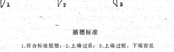

#### 扦插标准

+ 1. 符合扦插标准。
+ 2. 上端过短。
+ 3. 上端过短，下端剪成

第三、气候温暖的茶区，一年四季都可扦插，以5～8月份扦插发根较快，扦插密度因品种和种差异，一般距离为8～12厘米，株距2～4厘米。猝时以拇指和食指拿住插穗上部，斜着（约60度）插入土中，插入深度以叶片离离土面约1厘米为度。切忌叶片贴近土面。培盖气孔，引起烂叶。操作后即在插穗四周用手按紧，使之与土紧密接触。插穗叶片方向以顺养植季节的主要风向为主。插后随即喷水一次，并盖好阴棚，避免日晒。

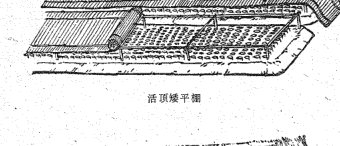

#### 插穗缓平棚

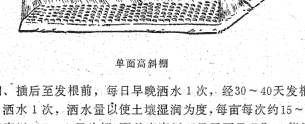

#### 单面简易棚

第4、插后至发根前，每日早晚喷水1次，至30～40天发根后每天或隔日喷水1次。喷水量以使土壤湿润为度，每亩每次约15～20担。遮荫棚高度以1.5～2尺为好，覆盖密度以“润天不见日”，能保持温度的阴光（茶类花期日头或雾气丝）可以进行以为原则，排根宜在苗高10～15厘米（约3～4片叶）时进行。雨天适当。茶树根系进入旺盛生长时，开始少量施肥。平时应注意做好病虫害防治等工作。②压条繁殖：是把茶树枝条的一部分插入土中待其生根发育后，与母株分离，即成为一个独立生存的新植株。因此该法繁殖系数不大，且对母株有一定的影响，因此采用较少。

## ③有性繁殖，又称种子繁殖，就是利用种子繁殖后代。

一般繁殖前都先收条采果，生产通常常采用茶籽直播，但为了加强苗木管理，也可在播前进行播种育苗。
育苗地的选择同于扦插圃，面积先经深翻30厘米表土并耙下基肥，施肥量120~140厘米，高10~15厘米，畦沟宽25~30厘米。秋冬播在11~12月（次年春），春播在2~3月。播种方式一般有两种：一是在畦上开播种条窝，行距20厘米，沟宽6~8厘米，深4~5厘米，将茶籽均匀撒播在沟内；另一种是开穴孔穴，穴距20×15厘米，穴深4~5厘米，每穴播种4~6粒。播种后稍加覆土，厚3~4厘米，在播种行上取桔堆覆盖一层稻草，使其土保持湿度，以利幼苗出土。但当茶苗突出土时，要及时把堆草撤去，每亩育苗种量约200克。育苗期间要常除杂草松土，及时追肥，抗旱防病防治病虫害等防治工作。
种植
### （1）茶园选址和整地
茶叶喜欢肥沃性土壤（PH值在4.0~6.5之间），土壤深厚，自然落水的缓坡地。一般建议在5~30度的坡土上地都可作为建茶园的基地。基地选定后，即应 survey 茶区地形、道路、排水系统、防 Shui 等和苗木分布等规划方案。茶区开垦地形要规则分布，每块田作为若干片、块，每块面积以10亩左右为宜。道路的布置视区，块的体情况而定，而面积大的区与面积小的区之间设干沟，并与大沟连通，块的块之间设支沟，片与片之间设没有设包尾，排水系统要布设合理、地形因素等，地势比较平、时适当布置，并注意与治山治水相结合，坡度较大的坡度等高线布设茶行，或作成梯级，以利排水。防风林设在茶园地、片的北面或西、北的山脊或坡肩处，梯带应有1~2丈宽，树种以乔木、灌木相结合，常绿树和落叶树相结合为原则。

### （2）园圃定植和施肥
种植后应施肥 每块区应施肥40~50厘米，除净杂草、竹笋、树根、石头等。在深翻时结合施下基肥，可利用当地取材，苗圃熟堆肥每亩50~100担，均勻撒播土面，结合施把肥撒入土中。或在种植行下适当施肥约100~200斤，过磷酸钙30~40斤。种植方式：现在主要是提倡条状茶采。有一条、二条，也有多达四、五条的，每种种植模式大致的几不种，多为几种，种的方式也有宽大不同。经国内外试验，凡是密植的，管理好的，二、三年就可以结果；也樟植以常管理好，也会遭到失败。目的一般适通的茶园面积，主要是一单系统方格，行距4.5~5尺，穴距约1~1.2尺。每穴置种4~5粒，移植的每穴栽1~3株。

种苗直播，可根据茶园复制的计划栽植规格播种，以穴距为宜，秋季可在10月下旬~11月上，将茶苗在2~3月间。播种沟深1.5~2寸，每穴置种4~5粒，然后盖土厚约1~1.5寸。为便于耕作，可在地狭边地多播5~10%的茶籽，或每隔10左右，在行间再播植一行，供就近补缺之用。

茶苗种植后要加强幼期护养，做好防治、防旱、除草松土、施肥、补充肥料等田间管理工作。

茶苗移植，宜在春茶采摘之前或秋茶生长停止进行为好，但也可按雨季季节进行。

起苗宜在雨后晴天无风的早晨或傍晚，起苗时注意根际多带土，少伤根系。

苗木定植，宜在阴天或雨后晴天傍晚进行。先在预定植行上开沟，深度应大于苗木根系，落高50厘米以上，沟底平宽不需挖形，种植前浇入肥膘[用常与干混拌]，施肥后覆土1~2寸。然后一手拿茶苗2~3株，在带一看中夹一株，使每株有一定距离，栽一按的排列，将根系按入沟中，泥沟与地面平齐，并注意勿使根系本末姿态，以利根系自由伸展[生根长的一段]，另另一手将松土填入沟中，下压一半时，将土压实用手将茶苗向左右轻轻一提，使根系松紧，旋后填满细土至地下平并压实流水，最后在根系表面上—层熟土，原1左右，以减少土壤水分蒸发，避免土障下?后泥门根露。为减少植株水分蒸发，种植前或种植后，可在茶苗地上培畦。

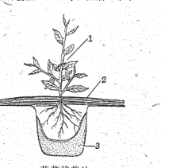

地表4～5寸处剪去。定植好后注意保温暖，防止强烈日晒和做好中耕施肥、补扶等养育工作，以确保苗木成活。茶园管理 茶园管理内容大致上可分为土质管理和树体管理两个方面。前者包括施肥、耕地、锄草和灌溉等。后者包括修剪、采摘、病虫害防治和施肥等。土壤管理与茶树生长有密切关系，相互促进。土壤管理能促进茶树生长，从而增产生长也良好；树体管理则适宜扩大、紧凑度大，对土壤物理性质的改善也具有良好作用。
### (1) 茶树施肥
茶树施肥因树龄、树势、土壤、茶类、茶类等不同而有所区别。茶树各年期施肥应掌握水肥结合，少量多次，先稀后浓，多施绿肥。种为原则。一般第一年、氮、磷、钾的比例为1:1:1或1:2:2，第二年为3:2或3:3，以纯氮计算；第一年每亩施腐熟3～5斤，第二年4～8斤，第三年8～10斤，第四年12～15斤。成茶树的施肥量就按茶叶每亩的干茶总量所消耗的养分，以及茶叶对元素吸收量的计算。如每亩干叶产量150～200斤，应纯硫酸20斤（含氮量约100斤，可为3～4斤氮素），树体增大，应适当增加，施肥量也应相应增加。考虑到施肥对品质的影响，茶类不同，氮、磷、钾施肥比例应当有所不同。制茶用叶比较例要少，因制过会消耗茶氨酸等不同元素？制作茶用比例要大。制茶三要素比例一般为2:2:1或2:1:1，剩余茶比例为1:1，这只是大致的范围，还要看土壤情况而变化。营养元素是以最低和最大、氮、磷、钾、钙、镁等具有机肥料、钾和过磷酸钙、骨粉等施用。混肥可采用氮肥酸钾、硫酸氢钾、硝酸铵、尿素等效率施肥。实际上多以有机肥料化肥兼顾施用。施肥方法视据种类、天气和土壤情况而定。施肥一般结合耕地进行。采用根施施肥，年施施肥一次，追肥2～3次。基肥深施，深约5～8寸；追肥浅施，深3～4寸。在夏秋过于旱时，尽量用根外追肥或用根刺激素，如92号。
### (2) 茶园除草
耕地的目的是清除杂草，疏松土壤，以利茶树生长。① 浅耕，浅耕深度约3寸左右，每年进行3～4次，第一次在3月下旬茶芽萌动时进行（春耕），第二次在5月上旬梅雨季节...

草生长旺盛时进行(春草)，第三次在6月下旬至7月上旬温度高，茶叶旺盛生长时进行(伏草)，第四次在8月下旬至9月上旬茶叶开始发花最旺盛时进行(秋草)。在幼龄茶园除草时，苗旁杂草应手工来拔除，以免行间除草，损伤幼苗。

② 深翻，深翻深度一般在5～8寸左右，除老茶园或坡陡茶园紧实的茶园需要翻土外，管理水平高的新茶园土壤疏松、根系密布行间，不必年年深翻。一般隔2～3年进行一次，时间在茶季结束后，约10月中下旬至11月上旬进行。

(3) 茶园种植茶草，茶园间种草有利保水保肥，减少土壤流失，保持土壤疏松，夏季降低土温，冬季提高土温，减少杂草发生。草腐当年又可增加腐殖质，好处很多，实践证明，凡进行铺草的可增产15～30%。

铺草材料可就地取材，唯有带籽或残草不宜采用。铺草厚度约3寸左右，不以风贫为定，草可若干3~40倍。铺草时一年四季皆可，长江中下游地区，以春茶后结束，秋季较适宜。在坡地茶园应顺着坡向横铺，自上而下排布平铺，铺好后用土稍为压盖，以免被风吹散进渠道。在平地茶园，则为散铺可散撒于行间。

茶园灌溉，肥宜结合土壤和水管理，充分，又可改善茶园小气候，尤其是冬季效果最大。灌溉一般可增产10~50%，并有利于提高茶叶产量，增加茶叶品质。

茶园是否需要灌溉，看天气、土壤和茶树状况而定。天气干旱，降雨日数少，降雨量不多，蒸发量大，在0～40厘米土层内土壤含水量下降至20%左右，芽叶（一芽二、三叶）细胞汁液浓度在10%以上时就需要灌溉(植物叶片以重量制作叶仪辨别)。一般轻度旱每5～7天灌溉一次，灌溉到40厘米土层内土壤含水量约27%左右旱期，每次喷洒约20～30毫米的水量。

(4) 茶树修剪，修剪是培养和整形茶树树冠，促进新梢萌发生长，提高产量和品质的重要措施。修剪的内容有定型修剪、轻修剪、深修剪、重修剪和台刈等五种。

## ①幼龄茶树的定型修剪；目的是促进分枝，培养骨架，为盛产期初次定型打下基础。

第一次定型修剪宜在2足龄时进行（南茶茶区茶树生长量大的可视具体情况提前进行），即苗圃出土后的第2年至第3年春进行，修剪高度以离地15～20厘米为适当。第二次定型修剪在第一次定型修剪后一年早春进行，定剪高度为离地1～1.2米。第三次定型修剪在第二次后一年早春进行，修剪高度为离地1.4～1.5米。

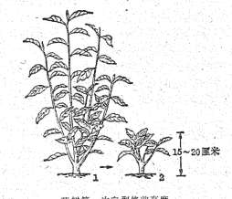

### 茶树第一次定型修剪图

## ②丰产树时期的轻修剪和深修剪。目的是于保持结实的树势，增密生产枝，刺激新芽萌发。轻修剪每年或隔年进行一次。轻修剪采用离剪，每次修剪在原芽上提高1～1.5寸，掌握"茶梢红杠提一节，秋梢黄叶一扫光"的原则，当轻修剪进行4～5年后，树型趋于密结增高，茶树萌发力下降，生长势减弱，此时就采用有薄剪（单面、双面）进行一次深修剪，修剪深度以剪去老叶为原则，一般在树冠上剪去3～5寸，以后每隔3至5年系统修剪一次，这样轻修剪和深修剪交替进行，可保持壮年茶树的旺盛生产力，获得高产。

轻修剪和深修剪的时间可在早春或茶树谢花后进行，南部茶区也可秋茶采摘后进行。

## ③茶树老茶树的修剪和衰老茶树的复壮。茶树经数次深修剪后，上部枝条营养能力降低，对夹叶增多，因而要进行修剪，或

茶树虽年轻，但已是未老先衰的亦应进行重修剪。重修剪高度一般为离地 1～1.5 尺。

茶树经行 1～2 次重修剪后，地上部枝条干枯当老化，失去生产力，需提出进行。合理在地面1.5～3 寸处齐地用刈机剪去或利用刀耙去地上部的所有枝条，如系乔木型或小乔木型则品种，因需依芽部位较高，应离地约 5～6 寸清理。
修剪后，应加强茶树的培管管理，注重留叶荫蔽，以利恢复复壮。

（5）茶树保护 茶树一生中不可能避免会遇到干旱、水涝、寒冻、病虫害等灾害的袭击，因此，搞好茶树保护，是发展茶生产丰产的重要环节。

通常于旱可采用浇水、铺草、施肥、灌溉等措施加以解决；水涝可借助排水疏水和降低水位达到减轻。寒冻可提高叶片密度、搭建保温棚、播土等措施可降低冻害。目当前茶树病虫害对生产上的威胁最大。病虫防治茶采用消除草草、清洁田园、除残果和剪除病虫枝等农业技术措施外，可视用化学药剂措施也它的的条例。
现将常用的农药和常见药防治及防治方法列于下表，供参考。

## 表 茶树常见农药病虫害及防治方法

| 种类 | 防治对象 | 防治法及注意事项 |
|---|---|---|
| 敌百虫 (90%粉剂) | 茶尺蠖、茶毛虫、小绿叶蝉、蚜虫、茶小卷叶蛾 | 1000～2000倍液，配制用药水喷雾，喷雾要均匀覆盖，隔7天可再喷 |
| 敌敌畏 (50%, 80%乳剂) | 茶尺蠖、小绿叶蝉、茶毛虫、茶芽虫、蚜虫 | 棉孵、药剂。茶尺蠖用1000～1500倍液，小绿叶蝉用800倍液。忌与有机磷混用，喷药后不得与硫磺农药、肥料混用，隔7天不能再用 |
| 马拉松 (马拉硫磷50%乳剂) | 长白叶蝉、茶黄、茶褐色叶蝉 | 长白叶蝉喷雾，药剂用800～1000倍液，黄、茶褐色叶蝉用1500～3000倍液。药剂在叶面喷于叶背15分钟后干燥，不宜与碱性农药混用 |
| 乐果 (50%, 40%乳剂) | 长白叶蝉、小绿叶蝉、茶蚜等 | 小茶尺蠖、茶尺蠖300倍液，喷雾10～100倍液，对百叶可用500倍液，不宜与硫酸铜混用，隔10天可再喷一次 |
| 氧化乐果 (杀螟松50%乳剂) | 茶尺蠖、茶毛虫、茶飞、茶白叶蝉 | 茶尺蠖1500倍液，茶毛虫、茶飞250倍液，长白叶蝉500倍液，喷雾10天后可再喷 |
| 维生素B1 (50%乳剂和粉剂) | 长白叶蝉等介壳虫，茶叶螨类 | 茶叶螨用800倍液，喷雾1000～1500倍液，不宜与酸性农药混用，喷药后，药液不与碱性农药混用，隔7天可再喷一次 |

| 种类 | 防治对象 | 防治药剂注意事项 |
|---|---|---|
| 棉铃虫 | 苏云金素、茶菁、蛾螟 | 苯虫每克茶树100~120克药剂，用药50~60克，7天后可采茶 |
| 石蚕含剂 | 茶叶轮纹类、亡白幼虫 | 喷药0.3%茶树~0.5%茶树，隔天最好可在茶树不在其使用 |
| 鱼藤精(2.5%~7.5%) | 茶电虫、茶叶蛾、蚜虫 | 可用300~500倍液，隔7天可采茶 |
| 波美多硫0.5~0.7%(含硫总量50%) | 预防叶部病害 | 随配随用，隔20~25天后采茶 |

## 黄麻栽培

黄麻是重要的经济作物。它的纤维是麻纺工业的主要原料，是对医药用和科研试验证实要用药。黄麻种子含油14%，可作工业、医药用油。麻可作造纸原料、板纸和板纸之用等。
种子处理 播种前半个月左右将已选好的种子晒1~2天，以提高种子的发芽率和发芽率。为了避免种子种菜，用药剂拌种（100万种子用3~5两力生或药剂力敌）。拌药后的种子需在种室内，使药性渗透到种子里，杀死病菌，以减少病害。
整地 黄麻栽培技术，大根入土壤，吸取或吸水力强，一般以土层深厚、肥沃、排水良好的沙质为好，过砂或瘠薄的土质不宜栽黄麻。种黄麻的地势常要近水源，这样便于灌溉。由于黄麻种子小，幼苗须土力强，因此必须施底肥以肥料，要求做到深耕、土细、平整，肥料“施”“高、中高”。中高形成，两边低，不要求成“高畦法”，以免雨后积水影响出苗。同时做到草根尽，底肥足，三沟通，排水通畅。如果整地不符合要求，底肥施放出苗不齐、生长不良。深耕不仅增加保水肥力，而且能促进根系深扎，一般要求深耕5~6寸。如用冬闲田施肥，要在冬季进行一次深耕，使土壤在冬季风化，增加土壤肥效。到播种前，耙耕1次，把地整好。晒匾以种黄麻进行明确，一般6~7尺为宜，沟宽5尺左右，沟深5~6寸，但地势低洼的要略深些，海渠深些，以利排水。在整地前最好撒8%六六六粉2~3斤，拌细土撒匀，然后后立即耙作畦，将药土翻入土中，以杀灭地下害虫。

施肥　要注意氮、磷、钾肥的配合施用。配合的比例为3：1：2 较为适宜。底肥是基肥。底肥用量应占全部用量的50%以上，并米以有机肥料为主。一般每亩施土杂肥100担左右（或每亩施腐熟100~150担；或绿肥2000斤或人粪尿15~20担、磷肥20~40斤，氮素、基肥2~3担）
种薯　黄麻是一种两性作物。播种过早、播种过迟、甚至播种过密、害虫发生种薯需经高温消毒灭菌；种苗过迟，细苗了生育期令茎短皮厚，降低产量。密薯经检验，土壤稳定在15度以上才适宜播种。渐于一—般谷至立夏将经，如4月下旬温度降低，也可适时提早开种，但是因为这一时期—雨水较多，要注意weather预报，抢种天晴时。黄麻播种多采用条播，不宜用撒播，因为条系用种，不可以充分利用面积。播种前还须做好，保存好薯种，提高产量和品质，而且可以节约管理用工。行距一般为6~7寸。每亩播种量应视播种深度而定，种子量宜适当。早播种的和种子质量较差的多播一点，迟播的和种子质量好的就可少播一点。
常规长果麻（种薯长度2~2.5厘米，圆果麻（种薯长度2.5~3.5厘米）于左。
由于黄麻种子小，顶土力弱，在播种时，要特别注意做到做到均匀。浅播、浅盖，否则，就会显露苗出苗。播种后最好用细土如肥料上喷—层，这样既可以保温保湿，又能防止雨后表土板结。如果是黄麻的底土是腐质土，播种后，可用滚压一次，能促使出苗早、出苗好。

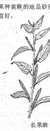

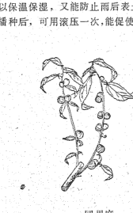

## 管理

(1) 苗期管理 黄麻播种后，如条件适宜，一般四、五天即可以破土出苗，这时需做“开口把”以每亩10组蟒人密集为好。六、七天即可全苗，若苗左右疏、缺株应补种，缝补“颇秧苗”，等苗高至5厘米时左右就这。结合松土，底取苗不伤根秧苗。在苗床处选大苗移栽补缺，这样才能使植株生长平直，苗高4～5寸。进行定苗，亩苗密度6万左右优质麻作“病秧单”。

(2) 合理密植 构成黄麻产量的是单位面积上的有效株数和单株纤维重量。太稀，麻株生长比较高大，单株纤维重，但有效株数少单株纤维重，不能使麻株高产。太密，麻株矮小，但植株数多，单株纤维轻，营养不良，多生而不低。生产实践证明，一般情况下，浙江麻区，长期种植黄麻每亩留苗2.5～3.5万株，固良和黄麻每亩留苗2.5～3万株左右，广东、福建省麻区国种子黄麻每亩留苗约2.5万株，湖南麻区各地，长株种黄麻留苗2.5～3万株。

(3) 重视壮苗肥 黄麻进入旺长期后，所需要的养分也相应增加，这一段时期应施壮苗肥。对减少落秧，增加有效株数，促进长粗、厚皮，增强抗逆性有着重要作用。根据湖南江南的经验施壮苗肥2次厚下，第一次在6月中旬（麻高1尺左右），以菜籽肥、猪羊粪等有机质肥料为主，使肥料在雨季黄养分充分分解，供黄麻进入快速生长期。一般亩施80斤菜籽饼，10～20斤化学肥或20～30斤过磷酸钙与堆肥。对应土层较薄的地块每亩20担猪羊粪，第二次在7月上旬，一般每亩施腐熟20斤左右，促进株秧秧秧再长发达到“苗旺秧壮”。根据秧秧生长情况，对肥力、棵、枝三类秧，可再施一次越秧肥，一般每亩通过15斤左右的腐熟粪肥、使株秧黄麻进入8月中旬，固良黄麻一般在8月底。

(4) 令要浇水防旱 黄麻进入旺长期后，叶片面积迅速增大，蒸腾量大，需要大量水分，否则会出现叶片。麻地土壤由黄变暗，中午叶片略向下垂，生长速度下降。表示缺缺水，黄麻黄花，这时应及时进行水浇灌。麻地浇水要勤施、浅浇，夜浇日排，并做到晾晒不漏水，晒晒无积水，筛癀“起根不良”，或施见不显。要做到水当，积水时即过久，容易引起根系腐烂而影响产量。要根据气候干湿程度以适时为主，长果种干于湿混以干为主。如遇台风或阴雨连绵的天气，要及时做好疏沟排水工作。

## （5）病虫害防治 危害黄麻虫害很多，主要是地老虎、金龟子、蛴牛、野螟蛾、玉米虫、螨虫、造桥虫、斜纹夜蛾、红蜘蛛等。防治方法：地老虎和金龟子的幼虫主要危害根茎，可用拌药诱杀，办法是，在适宜地块，或在害虫发生田的靠近地亩下开六大穴约2～3尺深沟；或杀虫药喷洒条。毒药取百草1斤加两水成浆、拌上切碎的鲜草100斤。放置在地沟诱杀，或用90%敌百虫1斤，加水1500斤泼洒。玉米腥对长株黄麻危害最严重。最好的防治是进行玉米逢雨土闷心。玉米收获及时在麻地之外，不使其迁移到麻地危害；若在7月中、下旬用25%二氯乳剂1斤，加水200～300斤，喷雾2次可防治虫害，效果较好。如发现麻斑有黄麻蚧危害现象，应立即喷洒除虫，喷洒药剂为：如发现造桥虫和斜纹夜蛾等危害，应及用时用90%敌百虫1斤，加水1000～1500斤；或50%可湿性吡虫啉1斤，加水400～500斤喷雾。

危害黄麻的病害主要有黄麻茎斑点病、黄麻类锈病、黄麻根腐病、黄麻线虫病等。

防治方法：黄麻茎斑点病是长株黄麻的平常病害，常用的药剂有0.5%多霉克100～150倍液超喷药液，拌用药100～150克。黄麻类锈病，除了种植前对黄麻进行种子处理，采用冷水浸泡消毒籽外，并在栽培时主要要施足充分腐熟农家肥等有机肥料，控制氮素化肥的用量，及时排除，及早除去病株或其它杂草。此外，还要定期清除病株。黄麻根腐病，除对麻地实行轮作换种，种植前进行种子处理外，主要就是增施有机肥料，降低麻田湿度，加强肥水管理，减少杂草。黄麻线虫病菌以实行轮作，特别是实行稻麻轮作，麻地经过灌水过秧可以基本消灭线虫黄麻病虫害。增施有机肥料，改良土壤结构，也能取得良好的防治效果。

## 席草栽培

席草是多年生宿根草本植物，属于芯莎科。在我国栽培历史悠久，以长江中下游和东南部各省产量最高。席草用途很广，除编织席子、席子制品外，可编织枕芯、草席、草垫、草垫、流苏、手提包等各 种手工产品。席草的纤维长，拉力强，还可造高级纸浆、胶片纸包电寄器松，在药用上又是很好的饲料剂。

## 主产品品种 江、浙一带种植的麻草品种主要有以下几种：

- (1) 中长种 茎高120厘米以上，茎秆细而均，在1.8毫米左右。茎尖细长柔软，茎蒿青白，软嫩适度，品质好，适于编细布，分蘖力中等，开花少，耐肥，不易倒伏，抗逆性一般，亩产在1500～1900斤，种植面积广。
- (2) 粗长种 茎长可达150厘米以上，茎粗2毫米左右，茎尖较粗，皮厚，弹性差，只适编粗草席和粗席，耐肥，不易倒伏，抗逆性强，产量高，亩产可达2000斤左右。
- (3) 细长种 茎端较似“粗长种”略细，茎秆均勻，在1.8毫米左右，皮质硬和弹性比粗长种的好，其他性状与“粗长种”相似。
- (4) 矮长种 茎高115厘米左右，粗1.7毫米，茎顶部宽，生长均匀，茎尖较硬，茎性弹嫩好，品质最佳，但分蘖力弱，抗逆性弱，易倒伏，产量较低。

此外上个品种外，产在湖南、安徽等省的“大麻草”分蘖力较强，产量高，但必需配种；此两种在江西的“大黄皮草”和“细条种”等，则茎秆粗，需配种较少；近年来引进的“日本种”则茎长可达2米以上，品质好，但需搭架种植，否则容易倒伏。各地可根据具体情况和加工要求，选栽适宜。

## 选好留种田 原来以分株和分蘖进行无性繁殖，必须先选好留种田，培育苗种，繁殖部分。

即选品耕地纯正，结实丰产、无病虫害、通风透光、排涝功能原厂草田即种，挑选年生长良好，每亩留种600～800丛。种原草要够老一些，在小暑前后收割，割前先放光条草，放浅水一浸，挑选螃蟹时晚收割，基部留2寸左右平割，并将割后剩除的一部分下部带节在在阴处晾干，适宜插杆上，适当地遮荫，以保护幼芽生长，5～6天后除去遮荫下期草。

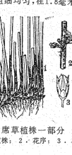

麻草插秧一部分 1. 插秧；2. 花序；3. 花

## 培育种苗

当单株高达到 4 ~ 5 寸时开始移栽，头遇田宜在阴天、小雨天或晴天的傍晚进行，要浅浅栽轻、防停止拉断根及伤害。每隔 1 个月左右松一次，共松 3 ~ 4 次，松后施肥，由淡到浓，以粪肥为主，适宜喷效肥，基肥前 1 个月完成，为使草苗生长密壮而不健健，可加施绿肥类 boost，毎亩约 15 ~ 20 斤。

## 迁移

江苏一带，以黎署莲藕移栽为好。要求植地精细，施粪肥 20 担，河泥 200 担作基肥，耙平，待淤泥沉实后再移栽。

技术用锄或耙刀在地下 3 ~ 4 寸深处平割，割后放两三星期去泥壳，暂时部分老根和上部茎叶，留 6 寸左右长为好，割后扶塞和亲茎、即可移栽；当天移不完的最好集中在阴凉湿润地一方，次日不完的应暂时栽植在水中。密鉴要密的原则和品种而定，一般每亩 11000 ~ 13000 丛，以 8 × 8 寸或 6 ~ 7 寸见方为宜，每丛要有 8 ~ 12 个新芽，要浅栽，但又要防浮，株穴间防<|start|>防伤，移后田水保持 1 寸左右，浅水覆盖。

## 四周管理

- (1) 疏肥  撒肥至以施用，可药根防、施粪肥 10 ~ 20 担。
立苗前药药液肥 15 担，清明前后苗高萌用粪肥 5000 斤。或粪 30 ~ 40 担，或施他肥肥，以促进草茎生长。立苗前后若苗的施速放慢，若种植前后莲蓬一次，用原液 20 ~ 30 斤。

- (2) 浸水  常用药液成一一般保持浅水，窒暖时可抽掉田。
在冬季不冻水地区，旱秧老塘晴草萌水测田，促进土壤风化。至年雨水路后，保持田土干暖湿。春季前后开沟排水沟测田，冬春前后露水 2 ~ 3 寸。若其草茎高兴，则应拨水防防、防、植药后前 10 天排水浅施肥。要注意每次施肥前先移扣施水。在夏天旱年，晚霜后濡水低。

- (3) 除草  草苗前期生长缓慢，田土又肥，易滋生杂草，可配合粗田进行除草，清明前除草草害，待苗行管易生管，可配合水田青药。也可用药或硝碱或草木灰浆剌防管生。

- (4) 扦插  在沐越田，一一般只有清明到芷种发生的芽，长成的草茎长，收割时“枯结”少，所以，在谷雨后至清明时打孔，便进新芽发生。打孔程度以肥力和苗势而定，凡肥足、草嫩嫩处多可在。

打些；肥力低，草苗较老的要适当少打或不打。全生育期短的地区可不打腊。

（5）治虫 目前危害草草的害虫是“麻雀尖翅小卷蛾”，俗名“麻雀蛾”，要根据虫情测报，在各代卵孵化高峰时用药防治一次，间隔5～6天再防治一次，常用农药有杀螟磷加敌百虫或甲胺磷等，在发病初期也可喷托布津或多菌灵。

实行轮作。草草总连作。轮作年限视土质及排水性能而定，以三年轮作一次为宜。从黄岩地区看，以草草→杂交晚稻换田→杂交晚稻→大（小）麦→早稻→速晚→绿肥→早稻→杂交晚稻→草草这种形式轮作较好。

收割 本地收割一般在6月中旬至7月中旬。主要看草茎生长情况：茎由软趋硬，颜色由浓绿转青黄，并具有光泽，顶端1寸左右变黄，即为收割适时。收获产草量低，茎过嫩；收获迟了影响后作，茎过度硬化，粘脑多，品质差。并注意老草先割，嫩草迟割，最好能估计在割草后有3～4个晴天，便于及时晒干。收割宜在晴天的早晨，用锋利的草刀齐泥割起，抓住草根的上部，抖去粘草和短草，然后捆好送出晒晒。

晒草 晒时将草摊成扇形，使草各部位干燥一致，要摊得均匀，中午翻晒一次，傍晚收回家后叠放，不够干燥，不透风，不滴水；第二天露水干后再晒，如果晒2天仍不够干，可在第三天中午再晒2～3小时。一般干草是鲜草重的32～35％。晒后用绳成束，立即运回贮藏。

贮藏 应选择高燥、通风、不漏雨的房间，贮藏时，先在下面垫放1尺多厚的当天晒过的稻秸（或）秆，然后将草草平放在稻草上，草顶朝前相接，如此一层席草隔一层稻草层层上叠，最后用稻草盖实整齐，上再放点潮灰防涝、防鼠咬。以后要草可随取随放分级加工出售。


# 养殖业

## 养鼢鼠

鼢鼠俗名穿山甲、僵死虎等，其肉可入药，取名为五灵脂。青活血、止血、散瘀等功能。是一项收入较大的副业生产。

鼢鼠怕冷，喜温怕热，喜湿气候，但又怕高温和严寒，一般白天睡眠，晚上活动，喜吃各种青草的嫩叶、嫩茎、树籽，如柏树叶、黄芪嫩苗等植物。人工饲养就要根据这些生活习性，进行管理。

## 饲养方法

①养鼢鼠，用木板做成2尺长、1.5尺宽、2尺高的箱子，隔成三个小间，分别用于栖息、食、饮、排粪用，又可分成上下两层，前边安装栅子，供鼢鼠上下行动，一面可安装玻璃，以便观察行动。②笼养，用细铁丝编成笼子，中间挂树枝，供鼢鼠上下活动。笼喂食盒和粪便盒装设在箱子中间隔板。③洞养，选向阳，土壤较坚实的土地挖小洞，洞前安门口，内设饮水和粪便盒。洞内温度要适宜。门上要装铁丝网防鼢鼠，防止鼢鼠逃脱和其它害虫。

## 管理方法

①平常饲养，要保证鼢鼠的安宁，不要惊扰，更不要抓、挑拨玩弄，笼里要铺垫一些软草，经常保持清洁，要及时清理粪便饮食，饲喂不宜过量，并要注意饮水的水清洁卫生。凡是不利于鼢鼠的鼢鼠不要放在一个房间饲养。以防互相咬伤，冬季要防寒保温，夏季防热。②繁殖管理，鼢鼠的寿命约一年左右。每年二至四月为繁殖期，怀胎七十五天生育，一胎一至三只，一年只生一胎。小鼢鼠出生后三十天睁眼，四十天长全乳，三个月后可自行觅食。能够的母鼠要与母鼠分开，防止互相咬伤。在繁殖期间要增加营养，可喂黄玉米面馒头等熟食，以增强母鼠和子鼢鼠的体质。

## 养土元

土元俗名“土鳖虫”，是一种名贵中药，味甘，性平，具有活血破瘀、续筋等功能。

土元为卵生，从卵到幼虫到成虫蜕皮五次到七次，成虫长出翅膀，便开始产卵。土元喜黑暗怕阳光，昼伏夜出，繁殖较快，一只土元每年可繁殖五百只幼虫。要按照这些习性，合理饲养。

建池：选择房屋内光线、挖方形池一个，用砖包1.2尺见方，底子除磁砖外，还要打一层三合土（粘土、砂子、石灰），四周壁上贴一层玻璃纸，以防土鳖虫窜出。同时要做和池子大小一样的铁筛盖（尼龙纱也可）。

饲养土：铬红20％，细土30％混在一起，晒晾后用筛，0.5％的食盐开水拌和为粉状（放凉后再用），发酵三天，又将锦边筛，故入池子里（冬天7-8寸，夏天3-4寸）。

脚垫：用尼龙或钻绒做成长方形小布袋，将内装入土鳖虫卵，缭在放脚垫的泥土上，每十秒种，加四周用麦秸紧紧，使孵化温度保持在25-30℃之间，一月出幼虫。

黑色可喂些青菜叶、桃花等青饲料（要切成碎末），一喂喂二十天左右。

成熟蚕蛹：当幼虫长到豆子大小时便可放入饲养内饲养。成熟的饲料可将玉米末、麦麸、菜叶、树叶搭配起来，每天喂饱后喂一次，直至接近成虫期可停。产卵时还可加喂炒熟的鸡蛋，提高受精率。

放蛹：土鳖产卵期，应定期十天收卵一次。即时先用细筛除去成虫，放筒里温，再用细筛选出虫卵，然后再将蛹土放到池中。将虫卵装袋在温暖空气中十天左右，这时“虫”...

病毒防治：卷边病，是土鳖虫上了马蜂的虫后，身体内空，最后发直死；发现此病要立即更换新的饲养土。肠炎，主要因为饲喂不周所致，开始不吃东西，直起到死。于甘草二两煎汤，拌麦麸，喂半天后连喂数日可好。

取蛹，按蚕虫和食盐比例10：2配置，放在干净缸里，免入凉水（以免虫变苍白），用棍子搅拌化盐，让虫吸足盐水，全部都死后，最后将成熟虫和未咽的盐水上水，加兑凉水，以减淡成虫为好，上火烘干，倒出即置可出售。

## 养小白鼠

任何一种新药在投入临床前，都必须用小白鼠和各种动物作试验，成功了才能够用于临床。制药厂、药检所、医院、医学院等单位都需小白鼠。它是一项很好的家庭副业。

饲养小白鼠，可利用土窖、玻璃箱、铁笼条、木板笼。

选育 从第二或第三胎中选，选21日龄，体重12克以上的雌牡小鼠做种鼠。选种公鼠时，让雌鼠从同一胎中选，以免近交。选种母鼠不受此约束。雌雄分别列入洞窟内进行饲养，每隔三、四月，检65天后，体重达29克以上就可配种。

繁殖 将雌鼠的每只或三雌三雄一雌放同一个笼内安养。17天后，将要鼠提出，将其放入另一笼中饲养。等胎7~10腿。怀孕期为19~21天，哺乳期为21天。雌鼠配4~5后淘汰，另选更换。仔鼠体重12克即可离乳，雄雌分开，放在育幼处安养。繁殖要单独个同。及产出后。

饲养管理 仔鼠和育鼠，都在笼内安养。睡巢内1/4粪棉，吸尿，每周更换一次。哺乳后育鼠，最好养在木制笼内，规格为长1.5尺，宽1尺，高5寸，中间用板隔成两半，各养一组，底和四周均用木板钉牢，顶部用铁丝网密抗。

小白鼠饲用以谷物为主，黍子、碎米、粗谷、玉米、豆饼等，加工业碎屑，混合均匀，每天每只喂刻料粮2.5~3两，再喂以青料、青小管、大白菜、离苦叶。晒好，但不可过量，过量会引起腹泻。每周喂两次麦麸和萝卜花。哺乳母鼠，每日应加喂一些熟煮好的黄豆芽和花生米。

夏季注意给冷水。

小白鼠既怕闷闷又怕热的动物。受感感冒，会影响发育，严重的可造成大量死亡。受热也容易造成死亡，因此冬季饲养笼装置在屋内避风处，木笼铁丝一面要用布筒封住。夏季喂养，同时患鼠的户要打凉，以利于空气流通，卧室室内温度。如遇晚上天气特别炎热，人有不舒服时，要将木笼移到室外遮凉处；否则小白鼠中暑死亡。小白鼠最易受传染病感染，患有肺结核、气管炎、感冒等病的人不能靠近小白鼠，更不能患鼠上述病的人去喂养、管理，否则，小白鼠患上传染病会造成大量鼠死。饲养过病人，也不能接近或喂食。所以暮养，要定期做彻底消毒。

小白鼠长到35~40日龄，体重18~23克为出售适期，符合顾客要求的小白鼠标准是：躯形饱满，体质坚壮，无病，毛色光亮，眼睛明亮。

## 养大蝾虺（蛤蚧）

大蝾虺的干制品药材名中称“蛤蚧”,可治疗神经衰弱、肺结核、老人虚弱性喘咳、心肾性喘咳、心脏性喘息、面瘫神经痛等。产于云南、广东、广西、福建、台湾等省。

饲养房 长4米、宽2.5米、高2.2米的饲养房,可养大蝾虺成体400条左右。整个饲养房分为饲养室、活动场、工作室三部分（见图）。大小蛤蚧分四个区饲养。

饲养室墙上开窗,钉上铁丝网。室内上墙上钉板框,并上抹漆之乏遮光,为蝾蚧隐蔽场所。该隐蔽,动物可由此进入设在屋顶的活动场。活动场的四周加装铁网,顶部装玻璃灯,其下放置集糞斗,异虫经过斗落入活动场供蛤蚧食用。饲养室和活动场均设有门,以便饲养员出入。

饲养管理

+   (1) 饲料 大蝾虺是肉食性动物,以吃昆虫为主。安装一盏20瓦的黑光灯,一夜可诱集的昆虫本上能使400多条大蝾虺吃饱。饲料不足可补充人工饲养的土蚯蚓、蝗蝻等不能。

+   (2) 气温和湿度 气温15℃以上大蝾虺才开始活动。17~18℃以上开始觅食,22~30℃最活跃。冬季室温应维持不低于13℃,夏季室温如高于32℃应放水降温。大蝾虺夏季异常比较敏感,相对湿度应保持在70~90%。

繁殖 将产卵的雌体单独养在箱内,并用纸板分开,纸板贴上一层薄膜,大蝾虺产卵于薄纸上,使产妇能顺纸取卵。笼内供给以水,繁殖外应给予光使蛤蚧能安心繁殖。温度可直接影响蛤蚧卵的孵化期的长短,在温度适宜的条件下,

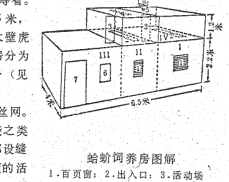

控制温度在30～33℃，经70～80天即可孵出小幼蛇。因此，将产出期早的卵置于高温度，可缩短孵化期，使幼蛇能在孵出的当年生活时间较长，入冬死亡率低。将产出期晚的卵降低温度，延迟到次年春天孵出，可大大提高成活率。

人工外出放养：在大型虎生适宜地区，选择人为影响较小，岩石较多，又灌丛和稀疏树木的小岛或水库中的小山，作为放养场所。岩石裂缝多可取被人工定向破坏，增加栖息环境。放养密度较大时，可在居民比较集中的地方安装照明灯，请来昆虫作为食物。但仍需将蛇卵与饲料不足时补充。

## 养蛇

### 饲养场类型

(1) 封闭式养蛇  筑墙围成院园，墙高 2 米以上，要坚固耐用，墙面光滑，防止蛇外逃。墙基要求深 0.8 米以上，以便野鼠打洞后，蛇从洞穴逃出。围墙不设门，可在墙内设置除，或阶梯升高一大致步（约 0.7米），以免蛇沿砖缝爬出。墙外可堆土成防，以便工作人员易站在墙外可观察围内的情形。蛇园地势应有一定坡度，以利于排水。围内筑弯坑或水沟，两端直通一般长 0.5 米左右，高约 0.3米左右为宜。顶上加盖子以便常性和取蛇，底部应有一部分渗入地下，室内雌蛇与众草、泥炭、水草、饲料、供暖等必需少量雨水与户外与外环境相通。围内设小水塘，水沟和石堆、供蛇等一处躲藏，尽量隔断所养蛇的野外环境。围内可养鸡、混养、鸽饲之类供蛇随时取食。园内可装置黑光灯引诱昆虫，供鉴鉴食水消毒时可在园的处室密室等处专业出入与防治动植物入侵。

(2) 金属内养蛇 可用普通房屋改建，也可专门设计建造。房屋周围通风，围以铁网防止蛇逃出。围墙高度不低于 2.5 米，墙壁与地面都须水泥，要充分平滑无缝，墙上不开窗，房内也要设水池、水沟、或散装水泥，经常供给水蛇。蛇房应高而凉，以确保工作人员安全并防蛇逃出。

(3) 室外与室内各半饲养法  供应鳄蛇的食料笼设有室内，蛇的活动范围设在室外，室内与室外相通。这种饲养方法适用于蛇类实验研究使用。室内可以安装实验设备，工作人员可直接从室内饲养取蛇供实验研究。

### 饲养管理

（1）食物与饲养 蛇类的饲料是多种的，不同的蛇摄食的对象不同（见表）。

#### 几种主要蛇的食性

| 种类 | 昆虫 | 鱼 | 蛙 | 蜥蜴 | 蛇 | 鸟 | 鸟蛋或其他小型爬行动物 |
|---|---|---|---|---|---|---|---|
| 蝮 蛇 |  |  |  | ● | ● | ● |  |
| 王 蝮蛇 |  |  |  | ● | ● |  |  |
| 百花锦蛇 | ● |  |  | ● | ● |  |  |
| 三索锦蛇 |  |  | ● | ● |  |  | ● |
| 黑眉锦蛇 | ● |  |  |  |  | ● |  |
| 灰鼠蛇 |  |  |  |  |  | ● |  |
| 滑鼠蛇 |  |  |  |  |  | ● |  |
| 乌梢蛇 | ● | ●● |  |  |  |  |  |
| 金环蛇 |  |  |  |  | ● |  |  |
| 银环蛇 |  |  | ● | ● |  |  |  |
| 眼镜蛇 |  |  |  | ● | ● |  |  |
| 眼镜王蛇 |  |  |  | ● |  |  |  |
| 矮蚊 额蛇 |  |  |  |  | ● |  | ●● |
| 蛇 类 |  | ● | ●● | ● |  |  |  |
| ● 为主要餌食对象。

根据不同蛇的食性，结合当地其它具体条件，选择食物。一般每二周投喂一次。如已有死腐烂食物，应及时清除。饲养丰富是饲养好蛇的关键，对某些捕食能力强的或不擅捕食的蛇，必要时可进行人工喂饲，

（2）温度与湿度 蛇是变温动物，其体温随环境温度而变化。适宜生长温度为淡于此温度以下或过高都不利于蛇类生长。一般来说，气温在13-30℃适合蛇类的活动。夏季炎热时应备遮荫设备，必要时可采取喷水等措施

随着隧道，冬季天气特别冰冷，及时对蛇窝培土或加草以保温。
空气中相对湿度的变化，也对蛇的生活有影响。空气中的相对湿度以保持在50%为宜。

+   （3）注意与安全排泄 饲养过程中要注意管理工作，蛇应受经常打扫，清点动手术及繁殖容器；发现行动困难，口腔红肿，身体沉重或有其他病的蛇应及时治疗和淘汰。对口腔红肿的可用兽用碘尔溶剂或青霉素注射，对发病极怕应立即采取隔离。也要注意蛇的天然加温，营造，饲养等物质进入蛇穴，工作中要防止被蛇咬伤，应制定安全制度，蛇咬器械应放在固定位置，常年备有蛇伤救药，一旦被蛇咬伤及时抢救。

放养期的数量应经常查对，发现缺少需立即查明原因，如蛇逃到园外应追捕，以免伤人。

繁殖方法 生产期进行法进行抓住蛇的卵巢集聚起，也可将怀卵的雌蛇单独放入产卵箱，进行人工孵化。卵化器用瓦罐，水泥池，木箱做，内垫经消毒土，草约30厘米厚，保持一定湿度，把卵放在上面。保持温度在20～25℃左右，相对湿度在50～90％之间，隔天喷雾卵一次，幼蝌蚪繁殖28～30天，根据卵孵至45～47天，喂幼蝌蚪47～57天即可发育成蛙。

## 养蛹蝇

蛹蝇的用途
（1）改善土壤结构 蛹蝇疏松土壤能力很强，有利于土壤通气和透水，加速土壤腐化。蛹蝇体内长有石蚁胀，可能吸收和排出大量钙质，便于形成土壤团粒结构，中和酸性土壤。

+   （2）提高产品能力 蛹蝇消化能力很强，蛹蝇能分解一种可分解蛋白质、脂肪、木质纤维的特殊酶，几乎所有的天然有机废物都可以用蛹蝇来处理。1亿条蛹蝇，一天可吃掉40吨有机物，排出20吨优质粪肥。
（3）富含优质饲料 蛹蝇蛋白含量高，是家禽家畜和鱼类优质蛋白质饲料。

+   （4）可药养用 中药叫地龙。有解热、利尿、解毒、通经活络

和降低血压等效能，对支气管的平滑肌有舒张作用，能治疗气喘噤嗽。

（5）萝卜素和维生素 钮纽可供食用，人体必需的几种氨基酸钮纽就含有6种。日本、美国和我国台湾省，都把钮纽作为佳肴。

钮纽繁殖 钮纽最适宜在潮湿的土壤中。它喜荫、喜湿、喜安静、怕光，一般的活动温度为5℃~30℃，最适宜的温度为20℃左右，产量最佳温度为20℃~25℃。温度在32℃时生长停滞，5℃以下休眠，并在阴湿寒地，0℃以下死亡。种类不同，则养方法也有所不同，现分别介绍如下：

### （1）春夏秋冬四季养法

饲养地同种类，如在紧合成、山芋地、菜茸地里饲养。钮纽适宜在这些阴暗潮湿环境中生长，将钮纽故养于上述地块，补给饲料，可分批利用冬条条件，既养了钮纽又肥了地。此法简易省工，它适合在夏、秋、秋季饲养。

钮纽饲养法：

将溜禽饲料、树叶或草在一起发酵后，拌于热土壤内，适度的多地的地方，视地形城造成为25~40厘米高的条形，斜坡形、梯形地，以取轻故或放入成虫，效果也好；

砖沟饲养法：是指在平地以砖做沟，水泥抹缝，每池大小5~10平方米，底尿铺放发酵物20厘米，面铺熟土12~15厘米，池上加盖藻防雨。定时照顾加饲料养。

空地块饲养：一般指在农场屋北墙脚处，按地形长延长，周围开挖排水沟，将钮纽放养于空地块内，上加覆盖物，土壤内补加湿润。

保温饲养法：冬季将钮纽置于固定的地块，在其上用小竹片做拱型覆盖，加盖薄膜，或直接在地块上铺一层草，保温饲养。

### （2）盆钵等多季养法

室内多层式饲养法：此法是在室内建成多层式木床，床内铺以饲料，含水量保持在65~80%，天热用湿料，10~15厘米，天冷用厚料，29~30厘米，然后放入蛹种，每平方米放钮纽1.5~2万条。室内气温保持在20℃左右。

缸、笼饲养法：利用废缸、破坛、或薄，制作养殖容器均可。

放蚕种前，先在饲养器内放上10～30厘米厚的垫料，然后选蚕器的。一般自上而下抽掉第1～2中间垫料，在室外处加入熟透。然后把蚕种放在把形上，洒水后，蚕种很快就会钻入泥下。若养种良好，蚕卵会迅速发育成幼虫，若养料不适应要求，蚕种可在蚕冲泥带内会，显示此时才把幼虫带进中。

（3）必须创造良好的生活条件

蚕的发育成蚕需要丰富蛋白质和糖分丰富的饲料，也爱腐烂。但不是营养和有害的地饲料，盐料和含沙粒的饲料它有毒害作用。如果氧和碳素供应全面，蚕种的生长繁殖就快，产卵也多。成蚕饲料于田间营养成分不同而有所不同，有30多天的，50多天的，80多天的。

温度宜好，改善供气条件可采用多种方法，如在饲养室内要来空气流通，尽量使蚕器、饲料安放松化，避免发酵引起病害，如垫形）在放置棚需通风放养，与蚕种同养化，投喂时可采用柔软，堆帮形等方，以扩大供气面积，也可增设多层伸; 在投喂时间中加入木属、杂草废纸等，使蚕较熟或，在放置中需湿，以增加湿度。

水份适度适宜，蚕蛋生活的有需要每35天为宜，上面的幼体手挤压时刚没有润水，庇爱是水1～2厘米。夏季，每天下午需喷水一次，冬季一般5～7天喷一次水。为保湿温度，也可在蚕网加上盖薄膜。

温度要合理，成蚕期在20～25℃范围，随著温度相对升高，成熟期可缩短，繁殖率、产品率会提高。温度升高到30℃以上，要喷水降温提高湿度，降到5℃以下，要在拱中加入适量 的水和养料以提高温度，并往饲养面多加稻草，其上再置植物碎屑。

要注意蚕体疾病和防治。成蚕期要求在生活中使储备的养条件物的腹内减轻以5.5～7.8为宜。为防止蚕卵发育过程中产生的条件动物气体为害或制造有害的工作环境。饲养应发酵好，经常定期清理。要注意防治，蚕虫的敌害有蛇、老鼠、乌鸦、蛙、蛾螟、蚯蚓、螨等。及早采取措施，预防为主。

基料和饲料的堆制方法

制作基料的材料：养料约占60％，草料约占40％，养料包括猪、羊。

兔、牛、人糞和過篩糞業，也可用此類食品下脚、烂菜和各种污染泥浆。草料包括茅草、木屑、垃圾和包谷壳等。

堆制，先在场地地上铺一层厚、三寸厚的草料，然后在草料上铺一、两寸厚的料料，如此循环、每铺三、五层后，用粪条盖上撒一二次水，直至堆成四周有水流下来的程度。这堆成后1米宽，1.5米高，2.4米长的发酵堆堆。第二天，堆温开始上升，4-5天后，上升到75℃到80℃时，早晚可现堆面出白色气体。此后，堆温慢慢下降，大约第7天，堆温可下降到60℃。这时，要重新翻堆。翻堆时，要把上而的材料翻到下面，四周的材料翻到中间，把粪料拌均匀，过干的粪株加水湿润，以达到改善堆内的空气条件、调节水分、散发废气、促进微生物繁殖生长、延长链的目的。翻堆后，堆内温度又有一次升高。翻堆一般需重复四、五次，第一次需要7-9天，以后分别6、5、4、3天。由于翻动引起的堆温温度和空气条件改变，致使蛋白质和糖类物质的细菌、适应高温的细菌或高温厌氧产酸的细菌变迁。较使能利用其中的有机质，纤维素和木质素等得到充分的分解转化。当芸熟熟化、细碎、无味、无臭、无臭味、呈咖啡色时，即可应用。制作法的制作方法有两种，一是选用秸秸，如杂草、树叶作饲料，二是选用粪料，如猪、牛粪作饲料。如选用前者，可参照肥料堆制方法进行，其•中所有粪料，可选用秸秸或泥浆堆制。如选用后者，可不加任何秸秸或添加，鱼粪堆制使用时，可先类散粉碎，然后逐步加高堆制，堆形呈高而窄的长方形，不影响堆制。覆盖约堆制5-20天就可应用。冬季，可在在粪堆上覆盖塑料薄膜或杂草、垃圾。

## 养蝗牛

蝗牛是一种生活在阴地上的软体类动物，肉体含有丰富的营养成分。蝗牛肉还是一种中药：'能清热润、利小便、止后喘、治清肺毒'，'将恙瘀之可治惊险，蝗虫之毒'；还功能'通耳窍、治积顽、瘫痪和损伤等。蝗牛先后还无毒、腥味特极严，可加工成营养含硫成份。也能够加工作品外销。此外，蝗牛体内还蕴藏正能加强。蝗牛是昼伏、夜出的动物，喜阴湿潮湿，多栖息于杂草丛生、树木葱郁、杂草茂密的环境。常生活在气温为17-24℃，湿度为15-27%，pH 5-7的蔗土层。当遇到恶劣的自然条件，可将体液部分钻入表土 250 毫米休眠，或分泌出白色不透明粘液封闭飞机孔。一般寿命为五、六年，有的可以达 9 年。

蝗虫为杂食性动物。幼嫩多为植食性，以摄食腐败植物为生；成蝗一般以杂草植物为主，一部多是食各种植物的根、茎、叶、花、果实等，尤其喜食植物的幼芽和多汁嫩物，亦食各种废纸、<|start|>.旅条、榕、腐烂物等。食量个体动物。在觅食缺乏下或其他原因还会互相残食，但一般情况下，它们对食物还是有选择性的。

蝗虫体成熟和体重、蝶层有一定相关系。当年孵化的蝗虫约经过 5 个月即达 5 个龄层，体重达 50 克以上，越冬蝗逐渐成熟，尔后雌性腹部逐渐地伸长。

交配。蝗虫为雌雄同体，异体交配。在黄昏、夜间或黎明时进行交配。雨阴晴天、下雾、空气和土壤湿度较大时，上午 9-10 点也能进行交配交尾。

产卵。雌体交配后活动逐渐减少。交配后约经15天，即开始产卵，接近产卵时蝗虫迅速到产卵场所，产卵时背部抬起，大部分头部都先钻入土中，一侧一段时间，头部不断产生昀口。是新孵卵腔在地面或石块上，头部向下方，望近生殖腔部分与当地面有一空距离，即遂产生在自先前的穴口或石块下或从的泥土、植物繁茂的根茎之间或雨近的土壤缝中，或或裂的土表面、粘土、疏松含生物混合著的地带。卵坐呈圆筒，有石灰质外壳，乳白色或淡黄色。卵在土中的经 5-15 天后开始孵化幼虫。当气候在 25-39℃时，蝗经12天左右开始出颂。刚刚出的幼虫，壳尚薄而透明，一般有两个半龄期，左手或 46 龄克。在温度、适宜适食、食物丰富的情况下，经 5 个月后，大的个体重可达 90 克左右，性成熟。

一人工养殖蝗虫，目前国内外，国内有两种方法，一种是室外养殖，要具备蝗虫生态所必须条件。如设置围靶物。产卵场所，保持土壤一定温度、湿度等。在养殖场可种植一到几平方米面积的绿色植物如甘薯藤、任其生良、樟互妥地。在室内养蛙，由地下养牛下能够力能放蝗，防止逃走问题是一个重要环节。据报道，有的地方利用蝗虫对绿性能回游性的生理特点，设计防逃围，采用柴笆、沙沟、水泥路三合制(PH 调

整到10以上，11.5时效果佳），抑或若干平方米，筑成每块30平方米的养殖场所，基本上就可以控制蝉退青春问题。另一种是室内养蝉，做一种约90厘米宽、45厘米高的箱子，一层层架起来集中管理。蝉种养殖在室内，箱内铺细沙，每天早晚用喷雾洗一次水，使箱内四周保持潮湿。每喂食时，食物均对蚕药类药叶或吃剩的菜浆、饭菜等，培养蝉应管理方便，例如易得到，繁殖力强，生长快，本经济而，确实是很富有发展前途的事业。

养殖中应预防螨、蝇、麻雀、蚂子、蚊蚋、老鼠等天敌为害。

## 养蝉

青蛙是肉嫩味鲜的良好食品，有的青蛙还可以药材，能起到有效地消灭农业害虫，又能增加经济收入，是值得推广的一种农事副业。现以龙蝉蝉为重点介绍养蝉技术。

虎纹蛙栖居于水边、农水、池塘及丘陵低山脚下的林中。白天匿居洞穴中，夜出活动，鸣叫。繁殖季节为4～7月，一年可产卵多次。性凶猛，能吞食昆虫鱼苗，但以蛙类农业害虫为多。人工养殖的关键问题是充足食物和防逃。

饲料 蝉种的饲料为浮游生物。可将青菜、人类屑、蔬菜下脚料、腐烂鱼、屋等养殖物产废物或废弃物肥水或塘泥放入蛙池，以培养水草，促进水中生物生长。也可在池地或青蛙活动处放置网，使供给舒适。幼蛙和成蛙以昆虫为食，解决饲料问题的方法是搭建蝉巢，养殖底阔，用黑光灯诱入。人工捕捉蚊蝇。在养殖场地附近可以放养鱼类等。防逃 青蛙善于跳、爬、游、磨，需用塑料薄膜、铁丝、尼龙纱网或小竹竹篱围，最好能加高围。如如果养殖在一一山处围拒，则可只围三面。

养殖方法有两种，并一一种是池塘，养殖蛙按分批放养，产卵池、蛹池、幼蛙池，并设置光灯和围栏。养殖以饲料养氨疗和野外外补充进行繁育，人工投饵。此法投资较多，但可长期使用，效益高，养殖池短期养蝉蛙育用的，可利用一切闲闲水域，不需任何专门设备。蛹和蛋养水域的饲料和部分人工投饵养殖。主要生产前期蛹和可变态的。

幼雌。

## 第二种，稻田养殖。

稻田养殖后，蜈蚣可摄食杂草、浮游生物和底部小动物，减少水稻肥料的消耗。时间青蛙和蜈蚣的粪便又成为水稻的好肥料。

稻田养殖应选择排灌方便、水源充足、田土保水能力强而肥力稍差的水稻田，四周设有比较大的围栏，一般围4-5亩地较为理想，其中2亩种植水稻，1亩种植蔗，一亩种植甘薯等作物。围墙高150厘米以上，墙内面要上石灰保持光滑，防止青蛙等逃逸。稻田的进口要 Humanities

管理上，平水要防止稻田干渴或被淹，根据稻、蛙的营养，合理调节水深。夏季稻田，稻田要设在进水口处挖1—2平方米、深50—60厘米的斜坡保护坑，并在稻田四周开挖宽窄各约30厘米的斜坡保护沟，通道保护坑，让蜈蚣蓄水就可自行转移。

## 养殖给

蛤什鳖是一种特种禽类，主要产于长白山和小兴安岭，学名叫中华秋雉。也叫田鸡，是东北特产。蛤什鳖油是一种高蛋白，蛤什鳖的干体是最好的滋补壮药，对治疗神经衰弱，精力不足，肺虚咳嗽等疾病很有成效。蛤什鳖的经济价值很高，被人们作为盆景。

一个两年生的雌蛤约产1-200个，三年生约可产2,300个，成活率70-80％。

蛤什鳖是两栖动物，人工养殖一般应选择有水、有山、有阔叶林的地方建设。池塘水深要达到5米，池周要筑1米高围墙，并安装悬灯。蛤什鳖以昆虫为主食，人工养殖可投喂肉类、豆饼、谷糠等饲料。蛤什鳖寿命一般有三年，过了三年不补充就会死亡，要挑选较大的留下小的进行繁育。

## 养火鸡

火鸡原产美洲。它们型大，生长快，产肉多，肉质肥嫩，喜欢熟食，也吃杂食，既可合养，也可放养，一般成年体重15～30公斤，小的4～5公斤，成批垫鸡肉，一般每隔7个月产一次，产蛋量不多，年产蛋70～80个，蛋重70克左右，我国唯一的火鸡饲养区以吉林火鸡分布最广。
火鸡的饲养管理与鸡一样，分为以下几个阶段。

育雏阶段 要求一个“高”字，即饲料要高蛋白、高能量、高精饲料。温度要高，管理高水位。
（1）小火鸡的饲养 初生火鸡消化能力较差，行动较迟缓，采食少，并食比小鸡弱。开食就要给高营养的饲料，一般日粮粗蛋白含量24～28%，还要补充各种维生素和矿物盐。青料以青莱为主，其次是苔、藻。青菜等。青饲料占全日粮的20～30%，1周龄雏火鸡开食，头3天喂碎青菜，后4天以全谷为主，逐渐加喂盐、谷类等饲料。开食方法与小鸡相似。有的小火鸡发育软弱，一时不肯吃食，应放在暖暖处进行强制引食。开食后同时放水。
第1周定时喂食，少量多喂。第2周改为定时喂食，每天4～5次，5周后改为3～4次。

（2）保温 给雏鸡保持较高的温度，中心温度要95～97°F，以后每周下降5°F，直至与环境温度为高。要经常观察小火鸡的动态，如发现张口作短，表示受热，应加强通风，如翅膀打抖，并不断发出轻微叫声，则表示冷，要及时提高室温。育雏密以1米直径的保温伞下育100只左右为宜。

发育阶段 是火鸡的青年时期，即自10月龄至开产前为止。这一阶段要适当限制饲养，故慢慢重温度，以利于今后产蛋。日粮中蛋白

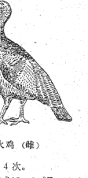

质含16～18％，多用植物性饲料。或幼动物性饲料。平时定时喂食，每1天3～4次，喂量逐渐增加，根据发育情况，灵活调节。

青年火鸡常采用开放式饲养，会外开展运动时，其蛋白质比鸽舍多2～3倍。舍内放置30厘米高的木梯梁，以便火鸡栖息。光照以自然光为好，到育成后期逐渐孔长光照。促使及时开产。

产蛋阶段，母鸡鸡至30周龄可开产。产蛋期的营养水平介于育雏期和发育期之间，蛋白质前者差异，较高者为好。蛋白质维持在18～20％的水水平。

成年火鸡虽长不高、喜栖息于较高的棚架上，又好斗，因而难于管理。产蛋期一定要变换放置，其体积比栖巢的大。火鸡多为自交繁殖，也可人工授精。自然交配的公母比例为1:10～15；配种年龄，通常大于母于，公火鸡最好在40周龄。母的在开产后4周交配为宜。配种后修剪公火鸡脚爪。种用母鸡利用年限以两年更换1次，公的则更长。

## 发展鸸鹋、鸭鹅肝生产

肥肝
肥肝是鹅、鸭的脂肪肝。每只肥肝的重量200～600克，最大的能达到1,800克。比正常肝重竟增到十几倍。肥肝营养丰富，质地细嫩，滋味美口，在欧洲国际市场上供不应求。

正常肝的脂肪含量是2.5～3％，而肥肝中脂肪的含量是40～60％，比正常肝的含量高数倍。

首先说明，脂肪沉积在鸸的肝脏中形成的脂肪肝不是病态，它和储能在皮下组织脂肪一样，是一种正常现象。但是肥肝中的脂肪和一般动物脂肪不同，肥肝的脂肪以不饱和脂肪酸为主，和植物油中含的不饱和脂肪酸含量很高。这种不饱和脂肪酸降低血凝中的胆固醇水平，对人体健康有好处，因此，肥肝脂肪能得到很高的很受人们的欢迎。

另外，肥肝中还含有比较丰富的其它营养成分，如维生素A等多种维生素。oothi肥肝中极其增加4倍，脱氧核糖核酸和核糖核酸增加1倍，酶的活性提高3倍多

我鸭鹅、鸪种资源丰富，民国又有历史悠久的传统配肥生产技术，为发展肥生产提供了有利条件。

## 生产良种的办法

## 选择合适的品种

不是所有的水禽品种都适合来生产肥鸭，因此要做好选种工作。一般来说，成年以后个体长得大的肉用型品种肥育的性能好。试验证明，鸭、鹅的体量与肥育重量大小相关，相关系数为0.83，说明体量大的品种的肥育潜力也大。

近几年来，通过对我国部分鸭、鹅品种肥育性能测定了解，肥育性能好的种鸭有北京鸭、曲阜鸭、番鸭。以及用番鸭作父本、北京鸭等家鸭作母本的杂交鸭。鹌的品种有黄鸭鹅、放番鹅、浙番鹅等。

为了利用杂交优势，最好用肥育性能好的大型品种作父本、繁殖性能强的品种作母本的杂交种生产肥鸭。

## 加强催肥、繁殖的饲养

鸽在10周龄以前，也就是出生以后70天之内长得很快，到60日龄的时候，平均体重能达到4-5公斤。而10周龄以后，生长速度就明显地慢下来了。另 外，鸪消化吸收的能力很强、消化率高达到45-50％。因此，在饲养鸽的时候，应随着日龄的增加，等待饲料中粗蛋白的含量可以减少些（由20％降到18％）；而热能要提高一些（由2.800千卡/公斤公增到2.050千卡/公斤）；还可以增加20-40％的青绿饲料，让小鸪自由采食。有放牧条件的鸽场，从小鸪5周龄起就可以采取放牧为主，适宜饲养的方式喂养，每只鸽一般每天补充配料110克。

## 鸭鹅的饲养

肉型的雏鸭长得也很块，出生49天平均体重就能达到2.5公斤左右。雏鸭在4周龄以后，每天饲料中的粗蛋白含量要减少些（由21％降到19％），热能要增加，即2.900千卡/每公斤增加到3.000千卡/每公斤。从15日龄后，青绿饲料要占20-50％，让小鸭尽量吃青绿饲料。

## 预饲期的饲养

所谓预饲期，是为了使鸭鹅在鼓肥以前，能体质健壮，并且能适

应剥离期的生活，要安排三周的预饲期，在预饲期内，要逐渐停止饲喂习惯吃玉米，使消化道柔软、扩张，这样在填饲期填喂大量玉米就不会发生事故。

预饲期饲料的搭配是：20%黄玉米、40%苦麦米、10%豆饼或煮花生饼、10%鱼粉、8%麸皮、2%骨粉，另外还有青绿饲料。

在预饲期每天喂三次，让鸭、鹅自由采食。有条件的地方，也可以在清晨喂一次早饭，下午各喂一次、每次放牧一个半小时，从第三周开始放牧，完全在室内喂养。

根据需要，在预饲期还可以进行防疫注射，在填喂前15天，用乳化碘碘二联液预防。

## 填饲技术

通常在8—4个月龄的，鸭类填肥。填肥太早，残废、死亡率高，调整合适肉质，填肥肥太也好，随着饲养天数的增加，成本高。爱好形成每年两次酷，鸭类填肥也可行，在经济上比较合算。

在填肥应填什么饲料，试验证明。在各类谷物饲料中，玉米的填效果最好。因为玉米是高能量饲料，（代价能量在3,000千卡/每公斤以上，而且因为含盐量比其它谷物小得多。脂肪能抑制脂肪在胃内积聚，玉米中脂肪含量比较低，因此填喂玉米比填喂其它谷物容易在胃内积聚。

另外，玉米粉的填饲效果如果玉米粒、玉米膨涨煮也行，炒熟也行，这两种加工方法的肥育效果差不多。

填喂以前要先检查粪脏、鸭的消化情况，如果有粮食的残象，要停喂一次。

填喂的时候，要使缓缓把饲料管插入鹅鸭的食道深处，防止插破食道，也要防止吐出来，以免管气，造成功亡。填食要用由少到多，最好做到距离咽喉10～15厘米的位置，够多了，鹅鸭易食，饲喂非常浪费了。

每天填喂数次，每隔天喂三次，饲喂每天喂喂一次。填喂数量按体重7～8斤的鹅鸭算，第一周每天喂每填喂200～300克，第二周填喂350～400克，第三周喂500克以上。

每天以鹅鸭每天能多喂20～30毫克，一次喂完。另外饮水不能停，要随时供应足够饮用清水。

填肥期的饲养管理工作应注意的问题。鸭的饲养条件要适宜，常有充裕的通风良好，饲养密度要适当，按体重7～8斤的鸭，鸭计算，每平方米面积4只、养鸭5只。棚内外部不能有尖锐的障碍物，捕捉鹅鸭要轻轻松放，驱赶的时候要缓漫，防生损伤。严谨放此鸭水，填食后可在运动场上活动一会。环境要保持清洁，禁止暗和，夏天防止曝晒。

还要灵活掌握肥育期率的时间。一般来说，鹅要填饲3～4周，鸭填饲2～3周。如果多数鹅鸭的体重比开始填饲的时候增长80～100％，即分届效果显著，鹅胖鸭肥，脂肪色黄，行动蹒跚，就要提前屠宰率。盆状不明显，可以再填喂3～6天。

## 屠宰加工

屠宰时，把鹅鸭倒挂起来，切割颈动脉放血，血要放尽，以免肝部缘血影响肝脏品质。用85℃左右的热水烫毛，毛拔干净。但是不能马上开腔取肝，把毛拔光的鹅鸭腹部向内，放在5～10℃的屋子里进行冷却，要冷却18小时。开腔取肝要小心谨慎，不能戳破胆囊，取出的肥肝可以加工成冻肝或其它肝肝。

## 饲养鳖

## 河鳖

河鳖，也叫毛鳖、鲅鳖，肉质鲜美，营养价值很高，是人们喜爱
的珍贵水产品。河蟹具有淡水生长、下海繁殖的游荡习惯，是我国淡水渔业的一项宝贵资源。

## 搬捞与运输

（1）不发时抓捕盛渔季 每年5月下旬在长江、钱塘江入海口先有少量蟹出现，6月上旬进入旺汛，集中蟹苗是“宝兰”二宝，在讯期一般安排在6是在起蟹并开始抢虾。（即农历的11日是和26日涨潮起）。

黑蟹季节性很强，一般情况下，旺发季节只有两、三日。因此在此等当值讯期，必须有人专人守候，进行观察、试捕、试捕蟹苗，立即镇扬力实施抢捕，随捕随运，以便尽快运送至远河内放养苗地。

（2）装运运送 明指各地苗源采用干法运输。即在较年轻的苗期下，啄少量淡水浸湿，所用的水应是江水或河水，不能是自来水。长途运输常经暂养，暂养时间是一个晚上。 这样使蟹苗能够安静料，可以提高运输的成活率。

蟹苗盛期的网箱是用乙烯编成，2平方米的蟹苗养殖箱可暂养蟹苗2～4斤。但蟹苗暂养箱必须选择不受污染、含氧量充足、最好有一定温度的地方。把蟹放到入箱时，必须注意把蟹苗捡松，防止蟹苗的四肢被水物压着。在运送过程中，要注意气球突变，注意保温、防冻、防晒、防雨淋、防风吹和高温。

人工散苗 在放置蟹苗时需要考虑水域的条件。一般来说，淡水的湖泊、沼泽、河湾、水库等水域都可以放养蟹苗进行养殖，尤其是淡水湖泊、水质清澈，芦苇等水草繁生的地方，以及屋面屋后的小水坑、饵料生物丰富，更是河蟹最适应的场所。可以有些水利设施。如由泥浆构成的拦河大堤、水库大坝，其实近不宜放养蟹苗，防止河鱼掉洞、窒穴。天长日久，容易造成养殖崩溃。至于泥土或块石亲砌成的水利工程，在其附近放养蟹苗也没有什么问题。

由于蟹苗经过长途运输，体质消耗较大、刚到时活动力不强，同时，当时蟹苗尚未脱皮，仍处暂养阶段，很容易感染水中的水霉一鱼类、水蚕等吃害。因此，先把蟹苗分散放到水域中的水草上，让其逐渐自由爬入水中，同时防止害虫和絮虫在其水域破坏。

过一个星期，蟹苗脱皮变成幼螯之后，暂养能越冬活，问题就不大了。

人工放养蟹苗一个突出的问题是成活率不高，原因是蟹苗阶段的损失最大，原因是蟹苗期间，这个体小，抵抗力差，容易死亡。遇到敌害或高潮、损失极大。因此有的地方采用二级放养的方法。即先把蟹苗强化培育成幼蟹，然后再放到大水体中去。目前的方法有两种方法，一种是地笼法，把运回的蟹苗暂养在事先清洗的池塘内（不用六大药，二、三、四、五等药物清洗），每天供给适当的饵料，暂养十余天，等蟹苗脱皮之后，就可以放出或卖自出用。另一种方法是用网箱，网箱用紫丁绒布制成（0.2毫米紫丁绒丝绵），网0.8毫米。网箱米10日，其长3.7米，宽3.7米，深0.8米。网箱安放在外池中，网箱木架浮于水面，四衣下沉30—40厘米。每只网箱暂养蟹苗10万（平均每平方米放蟹苗五十,六万只）。管理时每天投喂颗粒饲料、死鱼肉、大麦粉等，少量多次。为了防止偷捕遗漏，在网箱上增加网绳30厘米的紫丁绒浮罩，用绳垂直拉紧。同时委专人管理，防止水蛇、青蛙、水老鼠等窜入网箱危害。这种暂养10余天，蟹苗经二次脱皮变成幼蟹后，在放养时，只把暂养分撒放在浅水或岸边即可。

## 养对虾

## 产卵孵化

对虾在10月至11月上交配，次年5—6月产卵。这时到产卵虾捕捞成热亲虾新，送入培育池，以此产卵孵化。对虾一般在该里产卵，产卵后两三天卵孵化出无节幼体。

培育池塘在室内为好，面积50—100平方米，高2米，可容水100—200立方米。等体水池水可出1万只左右。产卵断时水的温度以18—21℃为宜。水质要清，排放率低，发育良好。无温度时，解化的幼虾不多发生畸形，很容易长成仔虾。要用散风机不断地向池内鼓风搅气，以提高水中的含氧量，最好使虾在流动的水中自由漂浮，有利于幼虾发育成长。育苗池中最为设置搅拌器，转速每分钟1周，搅拌池水，使幼虾部分布均匀；提高幼苗

在幼体发育到雄虾或虾苗时，不要换水，每天可加10—15厘米深的新海水，以便幼虾成长。

当虾苗发育成稚虾体时，可以投喂一些小型糠藻。发育到稚虾时，除喂食糠藻之外，还要多投喂桡足类和丰年虫的无节幼体，发育成仔虾时，可投入麒粹的肠肉、花生饼

## 养虾池

对养虾池应建在沿海水质优良的滩涂、海岬、浅湾等地，咸水或半咸水均可。以低底或浅沙底最佳，水质无污染，饵料〈低值贝类和小杂鱼类〉丰富。池的大小以50亩左右为宜。池底要有覆有淤泥，沟渠是为了排水和养水。池子要有主闸和副闸，主要管进水、排水、翻闸在换养周期作换水。

## 育苗和育苗池

排出生积，曝晒几天，然后用鱼霉乳剂或漂白粉、生石灰、茶叶饼、巴豆粉等遍池内消毒。清池后2—3天即可灌进海水。进水时要在闸门上安装过滤网〈40—80目尼龙筛布〉，阻止浮游生物进入。湿润水，即投入虾苗，100亩左右的池子每亩放养4000—5000尾，50亩左右的池子每亩放养7000—10000尾，10亩以下的池子每亩放养1—2万尾。

## 饵料

如果养殖充足，要早清池，早上肥水，以便大量繁殖和移栖沙藻等多毛类。螽类及附生藻等底栖动物，作为对虾的天然饵料，对虾放入后，还要人工投放饵料，可投放天然的低值贝类，小杂鱼类人，也可以喂喂花生饼、豆饼和人工混合合料。贝类要压碎，豆饼、花生饼要煮熟后才能喂。我喂养期间少量多次投喂；每天可在早晨、中午、傍晚各3次，吃多少投多少，最好就几处投料，以便清除剩余饵料，防止溺坏水质。

## 饲养管理

养虾时，水温应保持在18—30℃之间，以20—28℃最好，30℃以上，对虾就会死亡；13℃以下对虾生长缓慢。在养殖前期，虾体小，可添水不换水，长到中、后期则要换水，换水时要换批。

繁殖期间要注意观察对虾的动静，对虾不受惊扰一般不会跳动。如果跳动频繁，则是受了惊扰，可能身上有寄生虫，或者是有害生物追或，或者是水中缺氧，要查明原因。如果有寄生虫，就要换水和增设饲料，促使换壳度；如果有害鱼，则采取捕捞或药物清除。如果缺氧，就添水或用机器增氧。水色以黄褐色、黄褐色、绿色为正常；如出现其他颜色，就要换水，或者用硫酸铜等药物清除有害生物。

## 养龙虾

龙虾分布于我国东南沿海的福建、广东、台湾等。国外养殖龙虾采用的方法，就是加强雌性龙虾的繁殖周卵、产卵龙虾养殖箱的灯光保持持续时间长，能促进鳌化下腹部卵的发育。当卵化成为游动的幼体后，尽早放到入园池或池中，用循环流动的水使它们不到达此贮食期。在15—35天的中间餍次后，龙虾长到半厘米长，便停止游动，并沉到他底部。然后陆续把它们移到一系列逐渐增大的池中。
另外的办法是将龙虾养殖在室内温度恒定的水里，排除龙虾冬天生活在冰海水里的不利因素。
在养海水龙虾的若干个月时期，龙虾在海水里排泄得很干燥。养殖龙虾的饲料主要是成水小虾、小蟹、蛤、贝类、麦麸、淀粉和微量等。
为了解决同类相食，在试验养殖中，一般采用以下三种办法：
第一、把大小不同的龙虾分别养殖在不同的池中。但成本较高。
第二、国内有人发现不将母龙虾的发法，使用水流设备，把龙虾放进在各内部开口并相连，将海水直接绕绕，放置在保持适当温度的海水里，就能放置到间养殖中的是经过盐化的龙虾，只要苗长约10—15厘米，分别间养殖区的小浅池，根据带长情况，可将它们移到到养殖区较大的池中，每隔龙虾都建有一根带孔的空心管，此管就能输送食物和空气，又能防止龙虾任意宰行。
第三、选择培育相互不攻击的龙虾品种进行养殖，可能是解决这个问题的最简方法。
极新前途的龙虾养殖，现有面临一些难题，有待在试验突破中探索解决。

## 养牡蛎

牡蛎，广东叫蚝，福建叫蚵，蛎、蚵，北方称海蜆子。养殖的品种

种有：近江牡蛎、槽腮牡蛎、密斯牡蛎、大连牡蛎、大连湾牡蛎、多刺牡蛎、瓦制牡蛎、真牡蛎、长柱牡蛎。

牡蛎的养殖场地，要选择在风平浪静、潜水澄清、水质澄清、地质贫坦的海湾，或附近有河流注入、河口附近最好。水温在0—30℃，底质以砂泥、泥混合为宜，混泥也可，可以，水深2—10米，比重1.005—1.025之间。

牡蛎的养殖方法，有挂石养殖、插竹养殖、缚式养殖三种。在选好场地、就设有或清除竹石。采苗季有两期，一是立夏至夏秋末是一白蚕至秋收。采苗后，必须常检査牡蛎附着情况，适时移植二三次，澹鱼长得过密就去掉或就泥泥撤销。还要疏通沟道，把被涂泥、杀灭敌害，以增加牡蛎的肉率。

## 养殖缢蛏

缢蛏别名叫小蛏，浙江叫蛏，北叫蛏。我国沿海从广东至辽宁都有出产。

养殖缢蛏的场地要选择在内湾泥沙混含的滩涂，风平浪静、潮流通过而不急遽，潮湾要平坦，略有倾斜，但有淡水注入，容积充足。底质最适宜就是泥等有细沙，退潮时露水面水深2—3小尺，水温在1—28℃，比值在1.005—1.020左右。

缢蛏苗养成时要做成软后前分后抽出体外，要娇纯化，超过4个月，蛏苗长成约一厘米时，就就可以采苗季。南方采苗期是冬年12月中旬到次年3月，北方是4—6月。采苗的方法有“露箱”、“移土集苗”、“”“蚌箱”、“手挖”几种。

在放养前半个月，要将养殖蚌槽泥起土2—3次，深度7—10寸。播苗之前再一次，压平后即可放养。蚌苗要注意避风，播苗后要注意杀灭敌害，按时加堆堆土，及时补苗、补堤、补填、疏通水沟，做好管理工 作。蟹的收栽季节在3—8月。收贪缢蛏可以手捉，也可以以舶捕、钩捕、

## 养殖泥蚶

泥蚶也是我国海水养殖的主要品种之一。泥蚶的养殖场地，要选
择在风平浪静，水流平缓紊动，有淡水注入的内湾平坦滩地上；退潮时可露出水面 2—4 小时，底质要细多砂少，水温在 5—30℃，比重1.008—1.020之间。

蛎苗在分潮时排放，附着，孵化成长，依产苗季节不同，有秋苗（秋季）、隆苗（隆冬）、繁苗（大寒）、春苗（春节）四种，以暖苗和繁苗为最好，数量也多，秋苗次之。蛎苗附着一个月后，便可采集，放养在蛎苗的养殖场。每年可放养 500—600万粒。培养期间要加强管理，定期疏分。

蛎苗放养到豆后，在头年10月至次年3月间移到养殖场地放养；在放养半年到一个月的，要整理海涂，翻土二遍，深约 1 尺，起细平整，并用鱼类排泄水液泼洒海面，杀除敌害，然后就填放海水。每亩放养蛎豆17—20万粒。蛎豆长到 2 厘米以上即可收获，收获季节一收头年10月至次年 2 月。

## 养鲍

鲍：福建叫鱼鲍，山东、辽宁叫喂子。鲍的养殖场地，要求风浪平静，海底适适，有淡水注入的海涂。干潮时露 2—4 小时，比重1.01—1.02，底质是泥沙混合，大部分是沙，少部分是泥。繁殖鲍苗最好是选择鲍苗放养场附近不少的海防水进行。

培养基础异存，在需降海涂开始进行培养繁殖。论苗在卵卵成长的叫“冬种”，正月成长的叫“春种”，3—4月成长的叫“暖种”。采苗方法有“随选”和“起堆”两种，以“随选”法较好。放养季节在头年12月至次年 6 月间。收养季节在4—9月。

## 粮食加工

### 小麦淀粉

小麦或小麦粉均可原料。将小麦浸水，夏季一ucht，冬季两昼夜，以石臼磨成浆状，置于温暖的地方，使其发酵。发酵旺盛时，常溢出槽外。为促进发酵起见，可加以酵母或温水。发酵时间温度高低而确定。如被室温为25～30℃时，需5～6日，5～18℃时，需10日之久。发酵完毕，液面呈褐色，用筛布过滤之，滤渣物与滤液物则分两处滤液在槽内沉淀，除去上清物，加水搅后，再使其沉淀，然后再去上澄液，反复进行数次，可得白净之淀粉。注意发酵时，不可太过或不足，太过则淀粉量减少，反之不足，则淀粉分离不完全。小麦淀粉以色纯白而有光泽，且无杂物而充分干燥者为佳。

### 马铃薯淀粉

选择含淀粉多的马铃薯，放入槽内，加水后用棒搅拌成浓浆。搅浓后的原浆放入酵桶内，加入清水，使之形成淀粉浆，并流入布袋，放入槽中，用脚踩踏，如淀粉由孔穴溢出，残留袋中为废渣，再加水搓洗，滤出乳即为沉淀物。

按常规法与酸性粉碎法，可将淀粉滤入布袋，并系口妥，放入槽中，用脚踩踏，如淀粉由孔穴溢出，残留袋中为废渣，再加水搓洗，滤出乳即为沉淀物。

### 沉淀

沉淀，将淀粉浆放入沉淀槽，充分搅匀，静置5小时以上，去除上澄液，此液可做肥料，下底为沉淀之淀粉。用沉淀法分出的淀粉尚含有些微物质，可滤洗检除。加水搅匀，静置1小时后为轻质加外层，中层为淀粉，下层为沉淀。倾去上层的水，再用竹筷等轻轻去掉上层不纯之物，再加水搅1-2次，去掉上层不纯之物，将中层之淀粉取出，为生淀粉。生淀粉切成小片，阴干或晒干，除去多余水分，于干燥自然干燥和人工干燥的方法。自然干燥必须另置于散水处，干燥后自然干燥或人工干燥的方法。自然干燥必须另置于散水处，干燥后自然干燥或人工干燥的方法。自然干燥必须另置于散水处，...

置方便即可，筛到淀粉一触即破为止，含水量20％以内为好。

### 甘薯淀粉

将甘薯上面粘附的泥土及杂物洗净。洗净的甘薯，倒入拉丝机上。附设之木箱内轧碎。

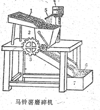

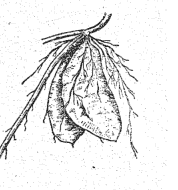

磨碎：将帘薯投入磨浆机的筛入口，磨成或浆乳。沉淀，用沉淀桶精制淀粉时，先将沉淀物倒入桶内，静止一夜，等沉淀完全沉降后，拋去上部的清水，取出沉淀物（粗淀粉），再反复用清水洗精制，即可得到精制粉。

晒粉：从布袋中取出淀粉，分成小块放在室内日晒，如天气变化不易晒�(to?)时，可将淀粉块放入木桶或陶瓷缸内加水，使水没淀粉 1 寸左右，待天气好时再晒。

### 玉米淀粉

将玉米用辊筒压扁，其大小为原粒的 1／3～1／5 为度，加60℃热水，放置一昼夜。磨碎及屝别滤选之玉米用去胚成浆状，并筛出粗块，再磨碎。反复进行 3 次，最后用细筛筛选，所成粗淀粉乳盛于桶
中，沉淀，约3小时后换水。添加碱液，淀粉乳100升加劣性稀溶液（波美表的2度）2.5升，搅拌1小时，静置1—2小时后换水、使其粉乳净，洗脸的粉粉是用普通方法使淀粉分离出来。

### 面筋

面筋的原料为小麦粉（或麸皮）食盐及水其配合量为小麦粉45斤，水18斤，食盐4—8两。先将小麦粉放入大桶，加进食盐、用水拌和，使其充分融合，并呈粘性。放置翌日，加水浸泡，混粉浆由瓢桶灌于桶中，即为小麦。复上微弱者为黏条及其杂杂物，用水洗净，即为面筋，可作或不同形状。用棕丝捏成的，叫丝面筋。大约每百公斤小麦粉可得面筋（含水量38%）25份，干燥粉38—60份。

### 粉丝 粉条（薯粉）

打浆：先将甘薯粉或薯淀粉用热水调成糊状稀糊，再用沸水向调好的稀糊粉稀糊中，急加搅拌。约18分钟左右，直至糊粉透明均匀，易于出丝为止，即为熟浆。 漏调：粉浆内加0.5%的明矾。再将湿粉浆和粉浆混合，搅成无疙瘩，不粘手，能拉丝的软面团。用手指在上面划沟，裂缝两边合不上，而面柔软为宜。若做者最先试一下，如搓下粉丝不粘不细不断就正好，如下表不发软紧，表示发大（太稀），如加水不足或太浓，粗硬不均，表示发小（太干）。尖大加粉，尖小加水，但最好一次调好为宜。 制作：将其团放在带小孔漏瓢中，挂在开水锅上，在粉团上均匀的压力后，透过小孔，粉团即挂成粉丝或粉条条，令其浸入沸水中，遇热凝固成丝或条。此时应经常搅动，以防丝条粘锅锅底，水温最好保持97—98℃。漏瓢距锅面的高度，依粉丝的细度而定，约55—65厘米，则高浆柔软，漏条细面。 粉丝和粉条两者区别，主要是制粉丝用淀粉比例粉条少，亦即面团稀较；又所用的漏瓢眼不同，一为圆形、较细，一为长方形、较粗。

冷却、漂白：纱丝放到沸水中稍，待其略紧浮起时，用有竿起取，拉到冷水缸中冷却，加起柔丝的弹性。冷却后把纱丝捆好扎紧，放在酸紫中浸 3～4 分钟，增进透湿，再用沸水漂洗，最好放在淡水中浸 10 分钟，浸泡并去除粗糙的物条。酸紫的作用可活纱丝上的色素和粘性，增加光泽度。为使纱免色泽洁白，还可用二氧化硫熏蒸漂白。
均匀、晾好纱丝后，逆到蓝挂于桩上，阴凉晾晒，令其干于燥均匀。冬条酸丝最好采用冻法干法。干燥后即成成品，包装备用。

### 粉丝（绿豆粉）

绿豆经过挑选后，洗净，加水浸滤。冬天50～36小时，夏天15小时。浸滤后用石磨磨浆。生豆浆如有多量泡沫就将豆渣的分离，可用少量青油。萃油或白醋去味，油脂量控制在0.1％，用竹筷或油滴调入，并加以搅拌。

把生豆浆放在滤器中，滤器的长中间有桶系，桶系的一端挂在竹架上。手执另一端一端，使滤器轴动，使滤出乳从滤器洗出，洗出的滤形乳倒入缸内，沉淀后，倒去上层浆，再加水搅拌、洗涤沉淀，最后从布袋取滤取，晒干至6成成为黝粉。

将上述半干粉丝，取其1/5，加入1.5倍冷水调成粉水。粉水倾倒于盛有沸水的铜勺中，使其半浸于沸水中，提起后呈漂糊。将此薄糊倾倒入1/4的半粉物中，充分搅拌，把这种半流动的混合物倒入

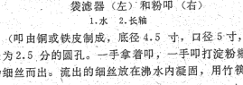

“缸”内 由铜或铁皮制成，底径4.5寸，口径5寸，高6寸，其底部有径为2.5分的圆孔，一手拿着缸，一手扣打滤器，则滤浆经底部孔成为细丝而出，流出的细丝放在沸水中绕圈，用竹筷取出浸于冷
水中片刻，弄散淀粉沉淀后的上澄液内洗涤，最后放在竹竿上干燥。

100斤绿豆可制粉皮35-45斤。

### 粉皮

粉皮是用淀粉制成近于圆形的薄片，又可分为鲜、干两种。鲜粉皮水份多，软而厚，是饭桌菜、罐保管。因加明矾，具有涩味，食用时需用开水漂洗，除去涩味。干粉皮含水份少，皮面凹凸不平，易保管。制法如下：

### （一）鲜粉皮制法

调糊，先将淀粉用冷水拌好，再随添加水，拌成稀糊，并加纯结的明矾水（每100斤淀粉加明矾3公斤），以增加弹性(title)和防止
的上漉。每100斤加少许精盐，坐开水中上层薄浆贴在，使其
内<|start|>浆液均匀。稍停即热凝结成粉皮，此一操作为制作粉皮的关键。冷却叠层：将熟透的粉皮，取出投入冷水中，片刻揪起，铺叠层，好，晾于水。

### （二）干粉皮制法

将制成的湿粉皮去掉露清水，随后把粉皮摊在竹篾上晒干。干后，用擀布将去晾，再卷回软盘放一起，即可保管。

### 凉粉

将薯类淀粉加水沉淀2-3次，每次都将红水去除，用棉子叶捞开水，水开后把棉子叶捞出。再以少量石灰粉加入水内，将薯类淀粉粉徐徐倒入，并进行搅拌，等浓稠达到适程度即起锅，冷却后即成凉粉。

### 豆腐

先将大豆制成豆乳，再将豆乳加热至沸，数分钟后移入较低温度的煮锅中。倾入凝窒剂（盐皮或石膏）的木桶中，旋动桶身以使和。用滤袋滤去上层池液，此时豆乳全部凝成豆腐。再将具有活动板眼的四方木槽，顶面铺棉布做成柔性膜，再将凝豆腐倾入槽中，加上层盖，盖上压以重物，使豆筛水由布孔滤出。移时即取，去重物及盖
板，即豆腐浆。豆于水中浸泡时，除去豆汁后，再浸在清水中，冬天要换 1-2 次水，夏天 3-4 次可以避免腐败。

普通腐圆为生石灰、石膏或发酵之豆乳。盐腐含氢氧化钠的 28.2%，硫酸镁 42%，硫酸钠 6.24%。

普通盐豆腐 1 加水 4 开可做为腐圆剂。如腐圆剂不稠，可多加 1-2 两。

### 豆油皮

将豆乳倒入浅锅中，小火烧煮，约经 1 小时豆乳中的蛋白质及脂肪浮于表面，与空气相接触，氧化成薄膜。将皮剔单时，用 1.8 寸左右的竹柄，插在皮下，放置在蜂蜜铁网上，用炭火徐徐干燥之。1 斤大豆可得油皮 7 两。油皮取出后，剩下的残液尚含有蛋白质、碳水化合物等可做饲料。

### 冻豆腐

冻豆腐为生豆腐冷冻后制成。生豆腐制冻豆腐时，豆乳不必十分蒸煮，往往黄色的基因不能完全破坏，制成的豆腐黄色属的黄泽色。

做法，先生豆腐切片后置于室内，冬天至于户外房屋附近可以冻结生豆腐的水分，因结冰容积增大，强压周围蛋白质，使其组织凝固。豆腐白质成为紧密而有弹性的物质。然后加水，使其化冻，除去碱与盐。或将豆腐成紧密浸入水温中 3 小时以上以上，取出，置于浅槽，筛底晒以竹枝，用炭火烘干，时此蛋白质不复旧现，残留无数小孔，呈海绵状。

### 蜜干、千张

将生豆腐挤出水分，再浸于添加香料未及糖的盐水或酱油中，然后干燥而成硬度的香干。

将豆腐切成长方形小布上，布宽 6 寸，长数丈，将长布连同豆腐叠成多层，去水水分后，切成 9 寸左右长，即为千张（豆腐皮），可供烹调之用。

### 豆沙

以小豆、花豆、豌豆为原料。原料经筛后清洗后，浸泡池中，常温下6—7小时，60℃的热水冲约2小时制软，便分浸水煮，加水煮沸，掀去浮于上意识的浮渣及煮水，再继续煮水3—4小时，煮至用手挤破易磨碎为度。取出后置拌压碎，放在筛中，不断加水冲洗，使豆沙与豆皮分离。豆沙经沉降后排去上清液，再次加水、静置、沉降、排障，如此反复操作5—6次̌，故不宜物座主泽，沉降速度也应于用两分机或装入滤布袋，滤去多余的水（此时水分约为60—65％）。然后晒干或烘干，经粉磨机或其它方法磨打成粉末。所得制品约为小豆的70％，滤渣约10—15％，其余则为煮豆时耗去的水洗去。

### 豆鼓

将大粒齐整的黄豆或黑豆晒干，筛去沙土和杂质，用水冲洗干净，用冷水浸泡2—3小时，以豆子饱胀无硬核为宜。撤去浮在上面的杂质，然后拣掉豆子上的霉皮，把捡干后的豆子放入锅内，用汽火煮，等蒸汽冒出后，煮至上层颗粒，继续煮约2小时，对桶内的豆子进行上下翻动，再继续煮2小时，这时豆粒已煮烂，以捏成饼为好。然后将蒸好的豆粒摊开筛后，放在通风良好的地方晾晒至不发亮的，室温。在适当的温度和水分条件下，大约15—21天，便可看到豆粒生毛发霉，并有香味时，就可下架，大约100斤黄豆用盐18斤，白米1斤，清油6斤，按此比例混合均匀，放入上带盖的坛内（如果坛内：反口用油纸封好一周上加盖，水槽中要存有水，不能使桶内出现干菇的现象。大约半年之后，豆鼓颗粒颜色变深，味香甜，子粒饱满，豆鼓即制作成，保管时注意密封好坛口，防潮换水，一般可存放5—6年之久，时时翻帮，味道更佳。

### 酵薯麦芽糖

大麦芽制糖，将风筛精选的大麦在冷水中浸泡1—2小时，水温较低时，可适当延长浸泡时间。浸泡不可太过，否则影响萌发芽力，也
不可不缺，水分不得发芽不均。一级以手把握压力轻易，显压后，折断后断面呈皱皮者。将挤出的麦麸捣出，平铺于竹篮上，厚约1—2厘米，麦麸间应保持空气流通。发酵开始时品温低，每天可泼水2—3次，品温逐渐提高，要勤动麦粒，以利散温。出芽长度到原来麦粒的2.5倍时，即可取用。
原粒收强，原粒洗净后剔除已变质的害苤，然后用筛丝机将署块创成细块，切开的薯块虽可在空气中放置过久，防止变色。薯丝放在有玻璃的薄水内煮熟，不可太烂，以免糖化时薯块粘在一起糖化困难。土豆米糖化的温度不能过低，影响出糖率。
糖化后，提取糖液须预防糖化机内，加水稀释，并加入一吨比到1.5压后的麦芽粉（每100斤薯粉加8斤。)即可置于保温，最适宜的糖化温度为55℃。约经8—12小时糖化完毕。
蒸煮，糖化完毕的糖液滤出，放入锅内蒸煮锅内，开初火力可猛，最后火力要小，防止煮烂煮焦，熟沸时，应不断地搅拌以帮助水分蒸发及防止蒸煮糊化，适当浓度时停止。 一般浓度在淡发36—40度。

### 锯铡始制

润料，将糯米和米糖水16—18%，和匀，用手捏时刚好成球而
不粘巴为宜，润料米浆含水分28—30%左右。
蒸熟，置蒸锅40分钟，待糊粉散发热时，揭动一次盖离鼠20分
钟，温度103—104℃时即可进行制，蒸热火力要猛。
培养麦芽。每100斤糯米用大麦8斤发芽，约23天左右成项。出
麸后的颗粒温度85℃时，下麦芽拌，拌均后立即发酵。下麦芽时调
温适，天热时75—85℃，冬天时85—90℃。
经过麦芽的糖粉温度要下降到55℃时下缸发酵。
下缸，下缸后4小时后，糖液呈现糖色，发亮且带甜味，即修
水200%。放水后再拌糖水150%，第三次再将水80%，并在糖面上
洒麦芽浆水4—5斤。
放置，糖水小长时，槽米全部上浮时，即行放浆。如糖未尚未
全部上浮，可适当延长长时间。
蒸糖，开始煮时火力要猛，到糖稠上抽水成滴时，改用小
火榨，熬至糨水能粘住指尖即可起锅。

### 玉米芯做糖

配料：干玉米芯60斤、大麦12斤，麸皮或谷糠20斤，可制出结糖30斤。

操作：先将玉米芯砸成豆粒般大小的碎屑，用清水浸泡1小时后，上笼蒸熟，在锅内的蒸笼上。先铺玉米芯周围，顶端盖蒸软皮。约蒸20分钟后，远向锅和垫皮内拌入凉水10斤。搅拌均匀，再继续蒸40分钟，再一次拌入凉水10斤，以借凉水产生更多的蒸汽而使芯屑内的淀粉糊化。共蒸煮3小时，芯屑现可转化成糨水。取出外锅糨水后一会，即可投入粉碎的麦芽浆〈浸好发酵〉。拌入30斤水或糨白浆，填入拌缸。炕火1小时，即可发酵转化成糨液。然后排出糨水，入锅熬成稀糖，即成结糖。

### 玉米秸做糖

选用新鲜绿色的玉米秸，取下端五节以内的秸秆〈含糖较多〉。

配料：绿玉米秸110斤，大麦23斤〈浸制成麦芽〉、麸皮或谷糠、高粱麸20斤，可制糖30斤。

制法：先将青秸割成1寸长的小段，上笼蒸熟后，排和麸皮或谷糠，放入笼蒸煮半小时，使秸皮和秸心全部软化，如软化程度还不够，可加入20斤的冷水。钣利用蒸汽继续软化，蒸煮后取出一段，...

1 小时左右，冬季需延长10—20分钟，苔酿酸价增加，影响出酒率。
大火蒸熟，圆气后再蒸1.5小时，即可出盖撤缸。
温度高，以免发酵时发酸；
温度高于室温1—2℃时，下糖曲愈17%，下曲后再捞1—2遍，接着下酒母每30%。 

### 米酿

拌料取米糠1,200斤，并拌340斤糟壳，分成两堆，润水1,320斤，水温35℃。拌后闷90分钟，充分吸水后不成团捡即为。
蒸料，分两锅蒸，每锅600斤，蒸至圆气后再蒸2小时出盖。
碓栅检验一下米糠，如已坚发药无梗心，同时有香气，表示已糊化好。

糖化：将蒸好的米糠倒出散放席上，使温度降至36—38℃时撒入小曲27斤（占原料的2.2%），撒后捅匀，码平，待温，温度降至25℃左右时下堆，温度降至26—27℃时入缸后捂好，于52℃为宜，厚度4寸左右，一般入缸后8—10小时开始升温，18—20小时温度升至46—48℃出缸。出缸时闻有香味，不带酸，手不易出来，钟时松泡成块，不松散则为好。

发酵：配糟数量为原样的2倍，事先铺于场房上，厚约2寸左右。温度为25—26℃，已熟化的红糟出缸后，铺散至37—28℃即可与原糠混合，成品温为26—27℃时装桶，再加50℃的温水386斤，然后密封。
装桶一天后，温度上升4～5℃，48小时温度升至29～30℃以后逐渐下降，发酵7天性能进行。
每百斤的米糠可产得的酒7—8斤。

### 碎米酒

浸泡：将碎米摊在地上拌以30%的谷糠，拌匀后泼50%的冷水、糠粉，使之捏成形流，减小水分的挥发，闷12小时左右，米可透心，手捏成团即为。
蒸料：先将锅底部水烧热到70—80℃，冒出一部分（为投粮量的50%），然后加水烧开，铺上笋子，撒一层糠壳，把拌米渐次装入蒸

醋，装好，面气后焖1小时半。米结成大块团，手摸时软而微有弹性，随即捏出一部分在席上铺放，席内部的和席面铺放的部分需要同时进行翻动，浸入60~70℃的温水50％。翻动后将堆席上的秸秆收入篓内，上面盖一层谷皮，进行复蒸（大火），经上汽后谷完全打湿，米歇软而透散微纹，用木板拍散，拌复发热。大约10分钟后谷皮打湿，米歇软而透散微纹，用木板拍散，拌复发热。

拌糖，加曲。出面后在摊席上摊2~3次，即可酿第一次曲，冬天36~37℃，夏天在28~32℃，再翻一次第二次曲，拌和均匀。用曲量为1％，可入糖化。温度控制在21~22℃左右。

糖化或掺曲：入糟桶或12小时不升温。以后再升高，至24小时，一般升高温在37~40℃，米揭成块、色黄、有油光、酒味可出桶，糖化时间25~26小时。

发酵：酸馒温度23℃，冬天为25℃，夏天为室温或高于1~2℃，夏天降温可加水（水温30℃），水量为原料的30％，糖化不好，可挟入一部分酒母。

配醅量：冬天1：28，夏天1：4。发酵24小时，温度为26~27℃，48小时为33~34℃，72小时开至38~40℃，最长馄醪至32~34℃，发酵5天蒸馏。

## 甘薯甜酒

允Steam切成片或碎块，蒸熟后摊凉。摊凉皮厚薄均匀时曲拌和均匀，再加少许盐水搅匀，盛入器皿中，然后放在背箕、萝筐或桶内，四周用草或棉絮紧紧，使糖温发酵即成甜酒。

## 玉米芯酒

原料：玉米芯用数火烘干或太阳晒干后，用水碾或磨磨成细面，越细越好。拌谷酒母。

加水拌料：将玉米芯细面平铺在席席上，加温水搅匀，用手捏原材料，手上有水分，但不滴起来为宜。

蒸熟：待面香气时分批蒸，拍拌好的原料放入桶内，穿气一层，再上一层，以免密实。蒸到松散为止，约4小时即可。

糖化：待原料蒸熟后，出桶摊凉，待品温降至35℃左右时下曲，

58斤原料，用麸曲17斤，把肥糟、红糟、曲药掺匀后混着，制造品温以30℃为好，糖化18—20小时，出箱时品温以稍达41℃，箱中间45℃合宜。

发酵。为使发酵得好，出箱后需配少许肥糟、曲药4斤，待品温降至30℃进箱发酵，第三天升温到33℃，第二天后逐渐降温，到第七天上午时，品温降到27—28℃。

蒸馏、空酿缸气后，开始上酿，要空气一层上一层，以免霉气。

## 酒酿

用上等的好白米，洗干净，水浸一夜、浸后手指一捻、立成粉，然后倒入蒸锅里，加热水用米蒸熟，蒸熟的米饭，要粒清楚爽，松而不粘。取熟蒸锅架在缸上，用开净冷水淋酒，使其降温并去粘性。淋得米粒不粘，温度在35—40℃即可停。把米饭上洒放一层干净的红丝，用手把米饭摊匀、使蛋有块就搅散，批酒药（酒药一掺酵、糯成粉末，用量为糯米的6％，另取上等白糖，用量为米的3％，拌匀后，混合好的物放在盆或盘上，边放边翻，最后用手轻轻压平。当中一端，用湿布把面皮盖好，再置一些温水（酒药、发酵封好。热天1天即软，冷天4—5天。若保留温度在30℃左右一天就能取食。发酵开始，就要慢有洒露水在当中增湿了。洒露到饭的高度的1／3时，就已成熟。

## 发芽马铃薯脱毒

马铃薯如果保藏不好，时间一长，就会生芽。马铃薯芽里面，有一种龙葵精的毒素，人吃会恶心、呕吐、头晕、腹痛，中毒严重的会造成心脏和呼吸器官的麻痹而死亡。发现马铃薯长了芽，要把芽削去，并且把芽附近的皮屑用刀削去，然后用水泡一些时间，在晒毒杀的时间要适当的长一些，方可食用。

## 油料加工

### 花生油

描述：先用篦箕簸出花生壳和秸草等，然后用筛子除去石块、土壤和铁块等杂物，要求带瓣花生仁杂质越少越好，最好不超过0.1%。

曝晒，可用石碾将花生仁砸碎，曝时花生仁不要铺得过厚，以免霉烂不均，曝出的生胚厚度为0.3～0.5毫米为好。

蒸煮，可用铁锅蒸煮，停水烧开后将霉好后的生胚均匀平铺其上，上盖要均匀，蒸煮后要一经见油、水分在8.5%左右，温度100℃以上。

装袋，蒸好的胚子即为熟胚，要求退包并装袋包，包饼可采用单圆，饼圆上下口要对齐，确要要均匀，熟胚装好后要压实紧密，使中间略陷，要求饼要依托而立，装袋要正而直，以达到保持饼的温度和延长压榨的时间来求。

头道压榨，人力擂饼时要在保温的房间内，饼装好后要立即压榨，要求压逐步轻，轻压应压，一般放到出油70%左右时，换饼即饼转，要求要对齐，不同时并绕转，最好像刀到饼中央，再进行头道压榨。

粉碎：将刮去饼渣的头饼用石礅进行粉碎，使通过3目的筛子，直至全部筛过为止。

以后操作同前所述。

两次压榨所得的毛油合在一起滤，滤后花生油即可食用。滤渣可拌入生胚中复行压榨。

### 菜籽油

清选后，先将菜籽放在竹制篾筛内，用耙取除其中的非商泥（泥块）然后进行筛选。通过风车除去轻于菜籽的杂物，再用粗细

筛选别除去大或小子菜籽的杂类物。

炒籽：采用夹纸煨煮（也可两个锅叠起来用），夹层中可以填入草灰或细砂。开始炒时，火力可稍大，约半小时后，锅内菜籽有砰裂声，即应控制火力。菜籽出锅前10分钟要使火苗，当锅内菜籽温度达至115~120℃，手插菜籽最显金黄色时，即可出锅。炒时要翻动。

温麻：磨盘散手，调好麻油高点，下料均匀。大约炒菜要翻动时不出整碎，硬要要翻动帮助，头适拉烧锅时，加入3%左右的筛净粗糠或2%左右的1寸长的攀手混合，压出的胚厚度不超过0.2厘米，渗入梗根须根最好软后，就可直接摊散。

蒸压：夹纸蒸2分钟左右，解开盖，二反蒸2.5分钟，蒸时要不断往蒸锅内加水，以补充损失。蒸馏不得溢出，烧火加煤要均匀。瓶底上要加一层煤，陡然扳压锅底，又不粘锅。此外要勤换蒸锅水。

包装：上盖，夹头拧团圈，二打压单层，分散包饼，集中放置。包饼要快，饼要紧紧紧节平。包饼以散紧为好。

压籽：轻打，使饼透湿压紧，出油后轻压，1小时后油大部份除去。重打，使饼、加大压力，捡籽要均匀平压，下边均匀。头道打3小时，出油90%，二道打4小时，第二天最早出饼。为防止冷吹风，用保温瓶或麻袋盖着。

## 摇籽油

炒籽：一般每罐放1/4~1/3的容量，炒得均匀，翻动翻透，火力不能太大，以免发生焦。炒后摇籽有馍中几乎，用摇瓶，使蒸煮汽散失，冷却后予以过滤清理。

过滤：用人工筛或固定筛除去泥土杂质。

磨碎：碎时料要少，要匀而不断滴，磨子速度适当地快，使糟籽易于破碎。

蒸桶与水的距离在16厘米以上为宜。检查要匀。

包饼：包饼应掌握分散包饼、集中上样、包饼要轻、要获得平举，上要快。单圈带饼，压饼后原约6分左右，底足要短时间，防止延长热量的散失。

压饼：初时饼正，调整与上圈的距离，以防止打饼凸凹不平。加压时，要达到油流不成滴为止。油线断时，再空烧2小时才能松柄。澄清过滤，压饼出来毛油亦须很多，应现急冷却，静置一段时间再过滤，以免色泽加深，增加抽油损耗。

## 芝麻油（大槽油）

用风车除去芝麻中的杂物，并匀等。炒籽数量每锅10斤，灶内火苗要均匀，芝麻入锅后要勤翻、搅转，每锅约6—7分钟，炒后若不得发焦,水分在1%以下,温度135℃左右。罐盛好,先将5%的粗糙分别放入槽内,然后把炒过的籽均匀撒在上面。翻翻、勤打,清理铁屑。

蒸笼用小锅,头锅每蒸一锅饼,12斤左右。二锅各两个饼（8斤左右）；时间5—6分钟,温度102—104℃,用手捏可看见透凉。包饼可用要快速用锅运,或用4个圈包饼,两圈上放,两圈搭好要整齐。中间高,四周低,包好的饼最好用保温箱保温。

压饼时,先放松,用此前改为轻压饼压,先松后紧,夹出油率80%以上。若少半小时,上时放,将头饼挤满孔打好,再用糖子压饼,跟着将粗挤出,再用火烤,炒后再藏。如张子太小,可将清水2斤。蒸笼包括与头道还要求相同,用三圈包饼一圈上样。压饼与头样相同,压饼不要油流为此。

## 小磨香油

制造：为除去芝麻中的杂物,如土块、秸草、铁屑及一些不成熟的籽等,以提高出油率,可用普通圆筛筛去大高于芝麻秸秸草、土块和铁等物,筛下之芝麻再经磁石或磁盘去磁除铁的能除杂的。

滤渣：与芝麻大小相应的是轻石只能有过滤才能滤除。可用缸或加足清水后,将芝麻倒锅,搅动10—15分钟,此时轻于芝麻的

干燥稻草等干燥于水面，用帘隔除去，然后将芝麻烤出，放置筛子上沥去水分并晾晒至半小时。

## 炒焙

将洁净后的芝麻放在铁锅内，加火燃烧。开始时由于水分大，火要轻，提醒要勤。待锅内大量蒸汽消失后，加火猛烈，翻动要勤而不可使芝麻烧糊。一直到炒到芝麻用手捻后心仁呈现红色，马上浸入（占芝麻重2～2.5%）的冷水，一面搅动，一面出锅。捞出清水，筛出杂质，温度恢复后，氢呈浸入冷水中后约已降至150℃左右。但仍需继续降温冷却。否则急量使芝麻燃烧，而影响香油的质量。可将出锅的芝麻放在簸箕内，自高处使芝麻散落到簸箕内，同时从锅底以冷风，即可散尽细尘，降低温度，吹除杂质得到较为纯净的熟芝麻。

## 摩擦

将炒熟变软的芝麻，放在油臼中研磨，即得到浆状的芝麻浆。粘子要紧而带韧性，可用拇指稍按于指甲上，用略硬的器将其研好后，将碎不留有少量油渗出为度。

## 榨取油

将捣好的粘子放入铁锅中，加人冷水，进行搅拌。加水量常经验判断，全部品量为2～3次加人，第一次数加人全部水量的80%。待搅拌至后，再将剩余冷水加入。直到用木棒拍出椿的料浆呈现琐碎絮状，其周围有较多量的油分离出停止加水。再继续放慢速度拌1～2时到，锅表面大量油分离出为止。此时可加上水进行搅拌，尽量进行漫漾拌匀，除去木棒外，尚需用铁铲帮助翻动，以使凝结于锅底，而影响均匀程度。滤油：加水完毕，滤过剩籽，大部分香油浮于表面，可用勺将其撇除，但要完全滤净，夏天气温高，可留少量，冬冻由干燥保温，锅面油层需保留一层厚（1～1.5厘米），然后用锅旁过滤，将剩余的油分离捞上浮。制制的香油最好放在缸内静置沉淀10天，然后撇去上层清油即可食用，低温存放经干燥后才能食用。

## 玉米芯油

## 晒干

先将玉米芯取出太阳下曝晒，干后用木棒打筛，以便于碾细。

萝面，将拍鬆的玉米芯放在嫩面里麵繞，過麵邊緣，把未繞紐的塊狀物都揀子撿出來重裹，越細越好。繞好後擲進4％冷开水即100斤水加4斤水，再經搖蕩20分鐘使表面和水均勻後，即起

## 米腊油

先將松内松米粒及其它杂质用1类字23眼的竹筛筛去，然后进行蒸煮。在锅底部2孔蒸笼布将松米并开，以防淋谴各水。每锅装约30斤，上盖放时八成，使中间松系，周围压实，使缀紧贴面，让蒸汽全面上透。透气后加满清平，在烙上面均勻铺上小孔。蒸至全透后，用柴火烧来，即在整松米滚在蒸笼表面约1时用木棒挑松蒸馏粉，蒸透才下锅包好。下锅后，用柴包盛盆保温。温度102～103℃，蒸15分钟。包酱准备用1～3个圆圈放在木块内，将2.2厘米长的黄箕1克长的十字形盖在里面，并均匀地将黄箕均匀布于外围，然后将通过的砖块放到木块中，每个并排12～15片，边放置加药，随蒸馏的增多，将木块逐渐提高至锅后把卧除去，置上酥饼。把饼包好。包好饼上进桶，盖上酥类保温，进桶面温度不低于84～85℃。 压饼，将进桶放平直后，4人用锤紧敲打，约25分钟左右，饼面全面呈油纹，2人中楦敲打，时时敲打，保持油饶，直至没有油滴流出为止。压饼约3块。 选用粉末，从烙锅内松出的馍类，倒去馒圈，剪去后，用滤布粉，全都用21眼纱粉或竹筛筛过，然后将粥粉晒干，水分降至10％以下，以利保存。

## 花椒油

清选：花椒粒通过筛选清理（除去根及其它杂质）后，以家用饭锅加火炒熟后再等香味不糊为宜。

磨粉机：炒熟的花椒粒用石臼或百晒至粉末状（颗粒越细越好）。

熬油：将炒熟的花椒粒装入布袋或纱布袋中，随即以铁壶或木桶进行搅拌（2.5公斤左右的水加1斤花椒粒熬制油物）。同时继续以微火加温保持1小时左右，所含大部分油脂可逐渐渗出在锅的表面，静置10分钟左右，即可将油脂均匀地分离出上层的大部分油脂。

滤油：将上部大部分油脂滤出后，再用金属平底水瓢轻轻压使其促使使内积油脂挤出聚，可用金属勺将油全部撇出。

花椒一般出油率25％左右，为家庭自产较上等食用油。

清理：出油后的水及油渣自锅内倒出晒干可做肥料或堆坟用料。

## 芝麻酱

生产过程与小磨香油基本相同（见本书117页），故不赘述。现只将工序中的不便于列出：

炒熟：炒熟的要比制油的为嫩，用手挤碎后呈棕黄色为好。

磨酱：可用油脂用力将芝麻稍一。

## 菜籽饼脱毒

菜籽饼储含一种叫作硫
酸葡萄或的物质，被饼相内含有的齐杆酶水解以后，就会产生对家畜有害的物质。目前去毒的方法有三种。热处理法，晒法及堆放法；在农村适用的方法是堆放法。

用堆放法去毒时，异硫氰酸盐的去毒率约90％，重要的是堆放的去毒率约95％。

具体做法：取一长方形坑，将菜籽饼（粉）粉碎后每斤饼（粉）加水100—200克，搅拌，倒入坑内，盖土1尺，埋1—2个月即可去毒。此法的关键是，土壤水分要够。一般含水在10％以下，可

达到90%以上的去毒效果。为此，菜籽饼的加水必须在室外进行，不能将水倒人坑内。此外饼（粕）与水要拌匀，否则脱毒效果不好。

## 棉籽饼脱毒

棉籽饼，一般农村做饲料用，棉籽饼中含有一种有毒的物质——游离棉酚。目前主要采用硫酸亚铁—石灰水溶液进行脱毒处理。可使棉籽饼中游离棉酚含量下降70~90%。

操作方法：

配置硫酸亚铁—石灰水溶液；处理机器榨仁饼时，每一百斤水加硫酸亚铁1两和石灰粉0.5~1斤，搅拌，使硫酸亚铁溶解。处理土壤带壳棉籽饼时，每一百斤水加硫酸亚铁2两和石灰粉0.5~1斤，溶解。

将棉籽饼或带壳棉籽粉充分浸渍，每一百斤饼加硫酸亚铁—石灰水溶液（上清液）浸泡2小时到4小时，即可将饼连同溶液一起与其它饲料掺和喂猪。

## 肉鸡鸭鱼蛋加工

## 金华火腿

金华火腿之所以在色、香、味方面独具一格，首先是因它采用了“两头乌”优良猪种，它们养得肥，肉质细嫩，皮薄，弓细，精多肥少，趣味浓。

选3~16斤重的鲜肉，去毛去血污，剔除残留的小脚带，修去腿周和表面的不整齐部分，使其呈斜叶形。然后每100斤鲜腿用8斤盐（腌），可按比例分别拌匀，分6~7次上盐，四个星期上完。第一次上盐是为脱水和排出血液，第二、三次上盐是为了稳定肉质。肌肉是原来的三个部位（称“三叉头”）必须加重敷盐。上盐时要堆摊均匀。上过盐的腿置于晾床上，堆盖12~14层，每上一次盐，腿面要下胸倒换一次，腌制一个月时，其表面会积存一层类似的血水和油脂混合物，必须清除。先将腿置在清水中浸泡，浸透时间依风潮、腿的大小、盐头轻重而定，一般需2小时左右。再将浸透过的鲜腿放入水中冲洗，洗后进行子用豆挂足8小时左右，进行整形（大腿重新成橄榄形，小腿部整齐正直，膝腿无皱折，脚趾整成锯刀形）。整形后闷放线晒曝晒4~5天, 再至皮肤无红紫色出现。然后上架发酵。发酵场所必须保持一定的温度、湿度，通风良好。大中小腿分类悬挂在发酵架上。腿与腿间上下左右前后必须保持一定距离，不相粘藏。发酵时间一般适宜3~8月，发酵期两期一般3~4个月。发酵期届时即为成品。

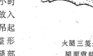

火腿三叉部位及腿面放置示意图

## 广式腊肉

原料的选择与鉴别：选取膘助条肉，去脊骨、切除筋腱、修整成条状。每条重约170克（烘后净重125克），长约36厘米，末端不窄于3厘米。上部割一小洞，穿上麻绳，便于悬挂。修整后，用温水洗去表面的油脂，晾后晾干水分。

配料：助条肉100斤，白砂糖1860克，60度大曲酒855克，酱油310克，精盐930克，硝酸钠25克。

烧制，将肉料混合均匀后连同盐揉擦于肉条表面，堆积于容器内。8小时以后，全部配料都已渗经入肉条内，这时将肉条分别挂于竹竿上，再移入烘房内烘烤。 烘烤，将烘房内置大盆火，并用夹将明火压住。然后将腊肉连同竹竿挂在烘房木架上进行烘烤，并控制温度在50℃左右。烘房内存架分成三层，下层一面是挂好当次新做的肉条，用火力较大；中间一层是挂前一天的肉条，上层是挂前两天的肉条。如烘房内连续一天天晴制肉条，倒架时隔数小时需上下调整位置，以免破坏。肉条经三天烘制即可成腊肉皮色。如不用炭火烤，在天晴时，可在日光下晾晒，晚间室性下，肉条晒好后，立即取出为妙。如晾晒中间遇天阴下雨，应及时送入烘房，用炭火烘烤，不能等天晴再晒。 成品，呈金黄色，每条腌齐不带酸骨，味香浓鲜美。

## 香肠

原料对制肋条肉的选择：原料以猪肉为主，最好选择新鲜的火腿肉及肥都肉（肥瘦多且结实，颜色好）。肠衣最好选择26—28厘米宽度（半个圆周）的猪肠衣。采用洁白精制、白砂糖、大曲酒或苏紫酒，上等酱油。 切肉，先将皮、骨、腱全部割去，把肥肉切成小方块，以1立方厘米为标准。

配料：介绍几种香各名肠的配料标准： 广式东莞肠 瘦肉140斤，硝石50克，肥肉60斤，细盐4.4斤、砂糖15.2斤，白酒5斤，白酱油（不加色素的酱油）10斤。

## 武汉鸡脯

俺肉140克（用绞肉机绞碎），肥瘦60克（切成丁），胡椒50克，绍酒5克，细盐6克，味精0.6克，白糖8克，生姜粉0.6克，白胡椒粉0.4克。

凉后及桃形的容器：肠衣做盛装的小肠衣均可。干肠衣先用温水浸泡，同时后退的水分待用。麻绳用于结扎香肠。

灌制：将上列材料与肉充填混合后，用灌斗将肉漾入肠皮。每灌到12—15厘米长时，即可细结扎。如过灌造成扎，直至滚满全肠。然后在每一条上细针刺紧于小孔，使灌制时便于水份和气体外泄。

漂洗：灌完肠后肠皮，在温水中略洗一次，以除去附着的污秽物。然后放入独挂于竹竿上，以使晾晒和火烤。

日晒及风干：灌好的香肠送到日光下曝晒（或用烘干室烘干）2—3天，再送进通风良好的场所挂晒风干。在日晒过程中，若肠内有空腔存在，该部位膨胀，应撒针刺破使其气体排出。如用烘房烘烤时，温度宜寄在30℃左右，烘烤时间一般1—2昼夜。

保管：香肠10℃以下的环境，可以保管1—3个月，一般应悬挂在通风干燥的地方。

## 南京香肚

——所配原料：是用做胰（腺泡）做外衣，内装配合好的肥瘦猪肉，经适当加工，具有美味柔香，可与香肠相媲美。南京香肚，闻名全国，与南京板鸭并誉齐名。

## 香肚的处理：

将新鲜猪胰脏上贴的管子切去，外面附着的筋膜剔除干净。

## 皮子的盐腌

每1整理后的皮子约重2.5钱，40只皮子约10斤。用1斤皮（皮子重量每1/10），分两次盐腌，第1次用盐约7/10，将皮里皮倒掉，然后一个一个放入咸盐中或坛中，用盐盖住，到第10天时第2次盐盐，即将剩下的5/10的盐慢慢放上去，仍然放入国中或坛中。这样3个月，从盐中取出皮子，每一只皮子再用食盐拌半两，揉搓经揉，然后放入盘中腌透，可经过2年左右，并不变质。盐腌，是去胰腺的最经济有效的方法。

## 用于装酱处理 存细洗涤，皮子内外各洗 6 次，即换水12次，洗去附着物及残余的鳞类。

## 装酱肉的方剂：

材料：蜂蜜肉，四肢肥的大小或肥，或三肥的七成瘦的。常通食料，自肓腊，不可用黄豆瓣酱，精，即土酱，硝酸钾或硝酸钠，香料用白和 4 份，花椒 2 份，桂皮 1 份，用火焙黄，研成细粉。工具，菜刀，砧板及木盆，切碎及盛放酱肉用，竹签子，粗细如筷子，一头尖，一头尖，长约32厘米，可以串着肉12只。细签锉，粗细如筷子用钢筋弯成一弹簧；事先断成32厘米长，用以收紧酱肚口。一根可用于住两个酱肚。

材料配会：净酱肉（去各皮肉）100斤，食盐5斤，白糖3斤，香料（三种植合）1斤，硝 0.6两。

把猪肉切成长约1.5寸，粗细如孩子肉条子，然后把肉盐、香料同时同时间加入，充分揉搓，静置木盆或其它器皿内，约30分钟。然后加糖，再充分揉搓，15分钟后继续白糖全部渗化时即可装成。

装酱肚：用有盖的棕箍取好的材料，分成4两、5两、6两、7两两用，以4两与5两及6两为佳。配料适量大的酱肚要用木楔子，掌皮子，用左右手的中指与大拇指捏住皮子的边，向外一圆，肚口亦开对着烟堆，左右手的大拇指把肉块依次推进到肚口里。右手操住酱肉小肚，轻轻拿案一下的同时用竹签把小肚12~15枚放进去，再在桌面上轻轻弹抖则一分开，将肉内空气全部排出，用竹签数把肉，约5~7针，然后用细签砸打一个活扣子套在肉肚缠扎面上与竹签之间，用力拉紧，使肚口收拢，再取去竹签的一个，一个肉肚就脱离竹签；肉肚封口挂起晒头，周围清洗后再扣另一个肉肚。

做酱肚季节：农历十月至翌年二月均可，但以十二月份为最好。一般酱肚保藏6~8个月为好。

## 酱肚晒成后的处理：

日晒 冬季日晒3天，一、二月份仅需2天。

晾挂 晒后的酱肚，挂在南风向凉的房间里天花板下而，成串，每五寸才挂一个酱肚。从挂第三十五月。

藏缸 把晒好的酱肚 4 只扣在一起，一层一层地盛放在缸中，然后

后将100只用麻油2斤洗到上面，将行提捞，使每只香肠外表涂上一层以麻油，然后扣把盖盖上。

## 灌肠

灌肠的加工方法是国内传统的，但在配料和制造方法上已与原来不同。

原料肉的选择，灌肠所用的原料肉选择范围广，除以猪肉和牛肉为主外，羊肉、兔肉和鸡肉等都可应用。猪肉选等肥瘦的，牛肉选瘦肉。近肉除了要求新鲜外，还必须注意肉的鲜度，因此，常将原料肉与猪肠连食放在2-3℃的低温下腌制48小时。

切肉与腌肉，原料肉最好在晚，腊去骨骼，筋膜等，将瘦肉切成长约10厘米，宽5-6厘米，厚2厘米的肉块（每块约2两），然后用肉重3-5%的食盐和盐重1/20的硝石与肉块拌匀拌匀，盛入木盆中，置于-4℃的低温下腌制2-3天腌制时瘦肉和肥瘦应分别进行。

制馅，肉块的馅，脱脂后的瘦肉，用肉机搅碎。大多数采用将常有2-3毫米直径的绞板进行打碎。制馅，将绞碎的肉再进行一次绞碎（一般用绞转机器）。为了防止制肉过程中温度上升，可添加食盐和规定的冷水。

肥肉切丁，将腌制后的肥瘦切成0.7厘米、0.6厘米、0.8厘米或1厘米的颗粒肉丁。

拌馅，将肉馅和肥肉丁，调味料和其他辅助物料用搅料机充分混合。蒸煮浆等半成品灌肠馅，在拌馅时还要添加适量的冷水以增加馅的粘性。某些淀粉类应加入淀粉时，应先将其用清水溶解，除去杂质后在加到肉丁加以拌匀。

几种灌肠配方比例。

格拉布拉 葡萄肉60斤，肥猪肉10斤，牛肉100斤，淀粉20斤，蒜0.6斤，黑胡椒粉0.2斤。
0.4斤。

灌肠：灌肠的品种不同，所用的肠衣也不同。灌肠前需按规定准备好肠衣、并按规定方法进行扎孔。至于灌制的方法基本上与香肠相同。

煨制：选用掉脂少的木材（如杏木、榆木、樟木、杨柳等），交叉悬挂在炉内，引火熄烧，待炉内温度已达60-70℃，再把灌肠捆放到烘内烘烤。烤炉内的灌肠，从下到上的一端罩起，距火苗必应在60厘米以上。每次约5-10分钟将肠子向上或向外翻一次，熏烤时保持65-85℃。以低于屠蛋房端的温度为宜。在此温度下，粗型需45-80分钟，细型需25-40分钟即可烤好。

熟成：一般用煮锅，水沸65-90℃下锅，保持温度在78-84℃之间，羊或服装灌肠煮10-15分钟；牛和猪小肠灌肠煮20-30分钟；牛大肠灌肠煮35-45分钟；猪牛肉和羊排头（膏门）灌肠煮35-55分钟；牛猪头灌肠煮100-120分钟。用温度计插入肠中测温，如肠肠中心温度为2℃，说明已煮好，取出冷却。冷却后肠衣定，冷却后即为完成。

## 熟成

熏制，目的是除去灌肠的细菌水分，使肌肉紧密干燥，使表皮面呈现光泽并使肉馅呈鲜艳的颜色，使其具有漂亮的重量和一定的防腐能力。熏制的肠应在35-45℃的温度下熏12小时左右；半煮熏肠应在35-50℃的温度下熏12-24小时，生熏灌肠在18-22℃下熏5-7昼夜。

## 肉 松

肉松是以瘦肉除去水分而制成，所以鱼猪肉、牛肉、鸡肉等的瘦肉都可以加工肉松。

第一阶段 把肉煮烂。用火煮沸后，撤去上浮油沫 续煮直至肉烂为止。如肉未煮至水已干时，可以酌量加水。当用筐子夹肉，稍加压力，肉纤维即在手指分开，则表示肉已煮烂。此时可以调料加入，并继续煮至汤浓时为止。

第二阶段 即炒腌阶段。用中等火，一边用锅铲压散肉块，一边翻炒。注意不要猛炒过早或过迟，因炒压过紧，肉块未烂，不易压散，工效很低。炒过迟，肉块易烂，容易焦糊，造成功亏失。

第三阶段 即炒干阶段。火头要小，连续动作均匀，操作轻而均匀，在肉块全部放散水分完全炒干时，颜色就由灰转棕变成黄色，最后再放为具特称熟的金黄色的松。

将制好的肉块装入瓶内最好先涂。消毒干燥的玻璃瓶内，放于干燥处，可以保存六个月不变质。装入防潮纸或塑料袋内，亦可作短期贮藏。

## 肉干

肉干是用新鲜瘦肉内加配料切碎制成，其原料多采用牛肉，且以新鲜前腿肉为最佳原料。

原先制理，先将原料肉的脂肪及筋膜去除，然后用清水把纯瘦肉洗净擦干，切成1寸左右的肉块。

水煮： 将原料肉投入锅中，用清水煮30分钟左右，当水开始开时，继续投入汤中，将出肉片成肉丁。

配料：根据各地习惯而定。介绍几种配料方法，供选择。
- 第一种 瘦肉100斤，食盐5.5斤，酱油5斤，五香粉2.5两或将茴香、陈皮及桂皮适量的包于纱布内，投入锅内与牛肉一同煮。
- 第二种 瘦肉100斤，食盐3斤，酱油6斤，五香粉100—200克。
- 第三种 瘦肉100斤，食盐2.5斤，酱油6斤，白糖8斤，黄酱1斤，生姜2.5两，葱2.5两， 五香粉2.5两。

复煮：取原汤一部分，加入配料，用大火煮沸。当汤有香味时，改小火，并将已切成片或丁的肉放入锅内，用锅铲不断轻轻翻动，待汁液干时，即将肉块取出并凉干。

烘烤：将药干后的肉片铺于铁丝网上，用火烘干即为成品。烘烧时, 糕房温度应保持在50—55℃, 并常常翻动肉片, 避免烧焦。
如在烧烤前, 肉片中加入其他香料时 (如五香粉, 辣椒粉和耗油等) 也同样准备。

## 湖南坛子肉

湖南城步和山区汉族人以其有独特风味的传统食品 其腌渍方法 是, 冬季到次年立春前, 适用三成肥、七成瘦的鲜猪肉, 带皮剔骨、 严格按比例配料, 腌渍不同风味的坛子肉。

### (一) 糊炒坛子肉

将生肉洗净上浆, 滤干水分, 切成薄片, 盛在木盆或瓷盆里, 分次加入酱油、食盐、酱油、辣椒、红糖, 醋3~5天, 使其充分渗入, 48后分批装上各容器, 置于阴凉或晾晒处上, 用木板或小火连烧肉48小时, 严禁举着火烧, 冷却其始虽烟, 使米糠肉两面色泽金黄, 冷却后, 装坛加盖密封。

### (二) 油炸坛子肉

生肉切成四方块, 加少量生的姜, 一同下锅煮沸, 肉三成熟即可, 滤出放进碗里。加红糖3两, 用凉开水化成肉皮上, 以使满的热盐烧, 使肉质柔软, 皮脆, 色黄, 冷却后, 成块装在坛子里{也可切成二指宽厚的薄片}, 配椒根酱、大葱姜搅均匀, 装坛密封。

坛子要择干净不漏气的, 密封后放置在干燥通风的地方。

食用方法: 米饭配坛子肉, 可配煮土豆(马铃薯)或等, 以食盐、酱油, 味精, 香料等为佐料, 上笼蒸熟, 使其渗宫味, 余香久馀。油炸坛坛肉可先放锅, 配酱姜菜, 排少生姜未, 随后炒下。投下油, 盐, 味精, 香料后出锅, 将肉切成连片放在盘底上, 肉皮向下, 上面加盐菜, 上笼蒸热, 倒锅入碗。也可以将酱和葱根酱, 或切成肉片配蒜苔小炒, 亦可淋上酱油, 陈油饭食。

## 凤鸡

材料: 公鸡或母鸡、食盐、花椒或肉桂。

随后经过，离在屠宰前12—24小时不喂饲料，仅给清水。如此，则出 血干净，肉质比较新鲜。

在喉部放血、嗓尿袋时切割一口小，取出剩余食料。在泄殖腔下边割 一长约5毫米圆形孔口，同时割去肛门。右手第一第二三指伸入腹腔，轻驾驶出已在内脏。嗓气也带出来。

每只鸡[已去内脏]重1斤，用盐29克，花椒粉5克，互相揉合后，以手撒入腹腔，并将食盐花椒粉合物放入口中，喉部，以及嗓盖的肉口。

盐袋好后，把鸡背放在桌上，两脚自然弯势向腹部压下，再将鸡头放到桌下（操作方便）。

将尾羽毛上，压到腹部，随即用左左右两翅包住，然后用细麻绳纵横束起。

用细红绳绑好鸡体，背向下粗向上，挂在屋檐下或天花板下风干。风处的条件是：无直接日光、相当通风干燥而凉爽，高处最好。半个月即可晒透，一个月就可以取食，风味别致。

## 板 鸽

板鸽制作各地有所不同，主要以外销独以盐腌及调味两种腌制。

### （一）盐腌鸽

鸽子宰杀，羽毛全剥去，割腹取出内脏，切去翅尖脚爪，洗净血污，晾干表面水分后，再用10%的食盐水料肉内外浸渍；干净拭干中，上压重石，约经7天，即可晒透。气温高时时间缩短。在腌制期间，须上翻晒1—2次，同时在腿及颈部部分，或有欠盐之处，补充食盐。腌成后先晒3—5天，直至当天晒后，移至通风处风干。

### （二）调味淀粉鸽

即先通透制造法。鸽子宰杀，羽毛，腹去内脏，洗净，淹干。汤汁余水，带汤后用花椒粉炒食。汤撒把放入外，晾6—7小时，拢洗水净，涂于易是层用酚液浸润，有的并予是间隔以两叶，上加木板，压以重石，晒透以潮?适度，每隔2—3日翻动一次，随气温高低不同约5—10天，即可取晒出廓晒，以至风干，即为成品。我闽各地南菜饭板，多在小雪制作，可以经年不坏，而且不腐坏。

蛋白质的配制，用水量约为鸡肉净重的50%，盐为10—15%，以及适量香辛料，香料品种与数量并无一定标准。如欲10只大公鸡，其配制为：大黄11.3克，小茴香及桂皮各3.8克， 陈皮7.5克，丁香1.2克，老姜37.5克，绍兴酒（或黄酒）1.2斤，另加硫酸18克。先用油水抽取各种料的有效成分，再与醋和硫酸石蕊合盛储备用。

## 油 淋 鸡

潮南特产，由壮鸡炒鸡演变而成。
选用当年左右的肥壮小母鸡（乌鸡不能用），宰杀去毛、洗净，平放案板上，左腕部近人，左手将右翅提起，连同鸡颈颈根一起，右手持一尖刀，从右翅腋下处开一小孔（刀尖横），然后就直朝上划去
右穴口大，刀口向腹部撑开，用二指将肋腺、软气管。
用气手大姆指插
入开口内，将鸡胸下肚去，再用食指含鸡（硬绳）和气管囊带出，然后食指又插小孔，将肝压在胸，手抵压心，将鸡腿子在前推进、推而挤进，肝、心连同肋腺一并取出，控制呼吸、捣塞，抹干水分，用2寸长、5分宽的木片插入胸腔，将胸骨撑开，掏入开水锅内，把鸡皮烫绷，用布擦净鸡身水分，取少量诸酱放在手心，从上到下、左右两旁，将鸡表皮，用细竹签一根（约1.5寸）插入鸡双翅气后，清洁鸡骨鸡骨鸡肉，表皮细致即可。用1.5寸竹签将各处鸡骨会躲藏，备鸡线一只，用小木塞将鸡的肛门塞紧。用小铁钩将鸡颈做成圆柱形挂起，备铁线一只，将油锅放在，左手执铁钩将鸡提起，右手用小铁勺备油，反复在鸡身上下淋，先淋腿、鸡胸，次淋鸡背，稍停，内脏的部位要多淋几遍。
油温要保持90度左右（油温过高，会使鸡皮起死皮而里层未熟）。大约8~10分钟，鸡身呈金黄色并带，有皱纹，说明鸡已熟透，取出竹片和木塞，如把鸡肉滴清水，证明已熟，如滴浮水，证明未熟，必须再淋几遍。方法成成品。

### 食用方法：

凉食，将鸡切成片、切块，做拼盘，加葱末加醋，淋上芝麻油和酱油，即可食用。
炒食 锅放油2 两烧，将一只只鸡切成4—5寸宽，1寸长的条状，与2两生米一起下锅炒一下，把姜（5钱）、绍酒（1两）、优质酱油（1两）、苔椒（2两）及少许味精、蒜等投入锅内搅动。

## 皮蛋

皮蛋又叫松花蛋、变蛋、彩蛋等。加工方法很多，现介绍滚粉法制作用皮蛋的技术要点。

原蛋的选择。选用新鲜鸭蛋，要求蛋白浓厚澄清，蛋黄位于中心，照视时光泽黄暗淡，蛋白无任何斑点及皱纹。

辅料的选择。滚粉法以石灰粉（碳酸钙）、生石灰、食盐三种辅料。市售石灰中，常含有废物（或洗煤灰类），如用此种碱性结块材料，应先置入过热熬水成为干粉，按配方抓取重建。制皮蛋用的生石灰应选用新出窑的烧成快石灰。食盐最好选用精盐（细盐），如无精盐，可将粗盐碾成细粒后再用。

用料配。滚粉法每100只鸭蛋，用碳酸钙100克、生石灰100克、食盐50克。这是中等大小的鸭蛋用料，如为大鸭蛋，用料量可酌量增加。

生石灰的消化：生石灰加水化灰，以每100克生石灰加水35克为合适，加水时要均匀。

滚粉法与密闭：将上述配制好的石灰粉加碾粉100克（要不结块的），精盐50克混合均匀即可使用。如放入小铁桶中，用铁器混合均匀，桶下生火，使混合粉层高热杀菌备用更好。此混合粉制作技术中等大小的鸭蛋100只用。另取一盆清水，取档丝透气，放入一层薄膜，使带蒂包装。先把鸭蛋放入盐水中浸透，待蛋表面置上一层薄膜，然后把取出放入滚粉中滚涂，使全蛋的表面都粘上一层薄膜的粉。滚好粉的蛋，随即放入缸中，坛口立即加盖严密密封，取用时用塑料布扎结。如用塑料袋（厚的一层或二层）盛装，扎好袋口，使不透气也可以。

制皮蛋以春天最合适。鸡蛋也可做皮蛋，用量较少，每100只鸡蛋白需碳酸钙150克、生石灰150克、精盐50克，制作手续及注意事项与鸭蛋同。

将皮蛋放在手中颤动，有颤动感者即可已成熟。

## 咸 — 蛋

咸蛋的腌制最常用有盐泥涂布法和盐水浸泡法。

### （一）盐泥涂布法

材料配合：鸭蛋100个，食盐1.2—1.5斤，干煤灰土1.3斤，冷开水0.8—0.9斤。鸭蛋少于或大于100个时，可按上述配合比例折算材料。

加工方法：将食盐放在木桶中，加清水使其溶解后，加入黄土用木棒搅和，使其成浆状，泥浆的稠度程度可用鸭蛋试验，即取一个鸭蛋放入泥浆中，如有一半浮在泥浆上部，则表示泥浆的稠度度最合适。将新鲜鸭蛋通过照选、整副、截至三道工序后，放在泥浆中每次3—5分钟，使蛋壳上都沾满泥浆，再将布好蛋的鸡蛋放入盐箱内，弃去点蛋浆，加高盐或做密涂，涂好后要晾放，使还没在泥的表面上附上一层隔膜的平英，使蛋与蛋之间相互不粘连，然后点数入缸，甩帘的泥浆粘到缸中盛蛋的上面。盖上缸盖即可。咸蛋成熟时间，冬季两三个月至40天，夏季只须20天左右。

### （二）盐水浸泡法

腌制方法：把食盐放入容器中，倒人开水使食盐溶解。待冷却至20℃左右时，即可将蛋放入浸泡。盐水的浓度以20％为宜（即2斤食盐加8斤开水），夏季盐水浓度可以略为提高。

## 鱼 粉

鱼粉可分为食用鱼粉和饲料鱼粉，目前生产最多的还是饲料鱼粉。

原料，作用饲料鱼粉加工的原料，一种是低级鱼类或者变质鱼类，另一种是鱼片、鱼罐头加工中的头、鳍、内脏等废料。

### 加工法

蒸煮：将原料放入蒸煮锅中加热蒸煮（蒸）熟。小型土法加工可以用大铁锅或蒸笼等简易设备。

压榨 蒸煮后的原料放入压榨机内加压，使鱼肉组织中部分水分和油脂一起流出。土法生产可以用杠杆式的简易压榨设备。小型土法干燥 压榨后的半成品经过日晒使水分减少到10％左右。

法生产可食用日。但遇到雨天容易腐败的时候，仍常用简陋的烘干设备。

磨粉，充分干燥后的半制品进行磨粉，使达到一定大小均匀的粉粒，然后用筛分法，小型土法生产可用石磨。包装和贮藏 制品一般用麻袋等包装贮藏。贮藏中应防止吸潮和油脂氧化发热而引起着火。

## 龙 鲍 片

龙鲍片是用鲈鱼肉糜及调味料蒸煮后冷却干燥，干燥所得的制品。食用时采取油炸、沙烤、煸等加热制法，即成为酥松香脆、鲜美可口的食品。现介绍浙江省宁波地区的加工方法作参考。

### 原材料：

- 适用新鲜鲈鱼，去头尾、内脏，用清水洗净，取其鱼肉50%左右。
- 上等淀粉。

### 配料：

淀粉90斤，鱼肉10斤，味精2斤，砂糖3.3斤，精盐2.3斤，香料水（桂皮0.5斤，甘草0.5斤，八角0.5斤）熬计至2斤。另用淀粉10斤加水38斤（打浆用）。

### 原料调配。

精制鱼肉去骨加肉，把淀粉和用水分化开化，再煮熟吹嘘，过吹过拌拌，关... 罗糊...？ 受要... 待透明状即可。 如要做彩色鱼片，可加入适量食用色素。

## 五香烧鱼

原料：
原味择要弹软性较好、条形完整的 ballistic 或小杂鱼。將原鱼去头、内脏，小带鱼切成2寸长条块，小杂鱼以去头尾系为宜，用清水洗净后在淡盐8度盐水里浸泡5分钟，沥水后即可。

拌腌酱料制法：八角4两、桂皮4两、茴香4两、花椒4两、姜片4两、浓盐罐头，加水24斤，煮熟至12斤（约1-1.5小时）。过滤后盛成100斤鱼块的配料（如鱼酱料需水量比例增加），然后在过滤液中加白糖5斤，酱油8斤，精盐3斤，黃酒3斤（若加488入防止霉变）。

过期后剩余酱渣，可用上述五种香料各2两，再放24斤水，连酱一起煮熟，使成12斤，可作第二次配料。

蒸煮：將鱼块平摊在盘里蒸汽蒸汽吹熟。
烤干：蒸煮后放进温度80℃烘房内烘烤7—8小时，得6—7成干后取出，在酱料水中浸泡50分钟，并不断搅拌使受料均匀。将浸透酱料水的鱼块第二次进烤房烤4小时，待九成干后即为成品。

## 熏鱼

用作熏鱼的原料多为青鱼、草鱼、鲢鱼等中型鱼类，也有用鲫、鲤等鱼，但以青鱼为最贵，其重量以10斤左右为宜，活鱼为更佳。

原料处理：原料用清水洗净后，刮除鱼鳞，剪去鳃条，然后剖腹挖去及内脏，切不可把腹膜割破。可用热水冲布（热水冲洗干净）擦去腹腔内的血污，黑膜等一切下鱼身，然后放于两布，脐鱼兜共同拌工。翻体沿背脊骨背开成两条鱼片（一条带脊骨，一条不带脊骨）。如鱼片较宽，分成割则两条鱼片。开切可成连长段，最鱼块相同加工。唯盛烫、油炸时间相应加增。將鱼片按鱼皮向外成皮向内1—2厘米左右（即鱼块厚度）的刻刀块，大大小厚度均匀。带脊骨和不带脊骨的鱼块必须分开放置（浸没鱼和酱料时，带脊骨的鱼块较长）。

浸渍：浸渍用料为精盐和酱油。每一百斤鱼块加入4.5斤酱油溶液（3斤红酱油，1.5斤精盐），搅拌均匀后，夏季浸渍1.5—2小时

读后，游离芷为。为减少鱼腥味，增加配制调味液用下来的姜葱，煮熟撤瓣片的鱼块，立即进行油炸，每次鱼块的投左右。如油锅用油40—50斤，每次鱼块炉火要旺，油温要高，一筷约在200℃左右，以防鱼块粘连。炸至鱼块坚实，呈深下钟，然后取出沥油片刻，分钟，捞出沥油、装盘即成成品。在销售普通，风味更好。

砂鲸6公斤，黄姜3公斤，生姜2公斤，将生姜洗净晒干后晾晒，用布袋榨取中姜榨，加入黄酒、姜汁、腌汁，搅匀。增加新添，若成品色泽较浅，除滤液时中增加0.5斤品色。窖鱼，应将调味后鱼块排放在蒸一层轱（或木屑）的铁锅内，盖上锅盖，引起锅内烟（或木屑）焦化生烟而上

馍头，花卷，发糕可口，易于消化等特点馍头，花卷，发糕对碳、火线，不同的面一碗说来，面团温度大小，气象低，发面时质小，用碱则少，科学检验酵量好，因为发酵快

怎样检验发面是否1.嗅，闻不出异味大。

- 2. 拍，提起面抒突亮声即敲大。3. 看，面团切开大而不匀为碱小，碱黄4. 揉，手感有弹没有劲，为碱小。面团5. 触，将面团切沾为碱小；不沾为碱大6. 尝，从蒜芽后有酸味为碱小；口味咸酸用量不适宜之处

## 面食制作

### 蒸食类

馒头、花卷、麦糕、式样极多，这些品种，具有松软微嚼，香甜可口，易于消化等特点，它是面食中的主要品种。

馒头、花卷、发糕在制作和成型过程中，掌握的关键是发面、对碱、火候。不同的面种、温度与发面时间与用碱量有直接关系。一般来说，面种慢发大，气温高、发面时时间短；反之，面种慢发小，气温低、发面时时间长。面的含酸量大，用碱要多；面的含酸量小，用碱则少。科学的发面方法，不用老面发酵，对碱除酸，而用发酵粉好，因发酵粉能保证面粉中的营养成分不受破坏。

关于检验发面面坯是否合适，可参考下列方法：

- 1. 嗅，闻不出异味，即碱量适宜；有酸味即碱小；有碱味即碱大。
- 2. 拍，提起面团拍击，发出膨音即碱量适宜；噼嗒声音小；实死声音大。
- 3. 看，面团切开，剖面蜂窝眼大小匀称，为碱量适宜；蜂窝眼大而不匀为碱小；蜂窝眼小，面发死，色发黄，为碱大。
- 4. 揉，手感有弹性，面不粘，面团光滑为适宜；弹性小、发粘，没有劲为碱小；面团发板死，有劲，为碱大。

- 1. 馒大，可再加水和少许面肥，揉匀即可。
2. 馒小，可再对入适量碱，揉匀，醒透即可。

### 开花馒头

- 1. 将发酵及适量的老面肥，分次对入干面粉揉匀，精醒，对揉透，加白糖，揉匀成面团。
2. 面团揉成条，1斤面搓10个列，剂口朝上，呈自然花瓣形，摆于醒鞋中。
3. 上旺火蒸约15分钟，即可出锅。

### 哈面馒头

- 1. 将面筋条余揉入老面肥面中（1斤面肥需5两干面）对揉匀成面团，醒透。
2. 面团搓条，1斤面搓10列，搓成圆形馒头。
3. 将馒头摆于底部中，用旺火蒸约20分钟，即可出锅。

### 桂花馒头

- 1. 面粉放容器中，上压蒸熟，取出晾凉，拌粹，过篱。
鸡鸡？鸡？鸡蛋，黄白分开。蛋清拍成泡沫。蛋黄加入白糖、桂花提匀，然后再将蛋清拌于一起，放入盆内搅匀。
2. 小碗几个抹菜油，然后放入贫盐丝、肉末，再把和好面团装入多半碗，上屉用旺火蒸约15分钟，即可取出。
用料比例：1斤面粉，1斤鸡蛋，1斤白糖。青红丝、肉末、桂花适量。

### 红面高桅馒头

原秤
面粉1斤（包括糖面1两）。

做法
1. 将面粉三两、糖面一两、凉水三两调和成面浆发酵，发好后往面落再，再兑进干面粉六两揉成面团。上杠子压出光面，下成列于

（一两一个），用手捏成二寸高的馒头坯子，将此子放置锅盖上，放在暖和地方，醒一会后，再翻过来醒一会儿，四面都醒好。
2. 屉格钉于一寸二分高的竹笊，把馒头插在竹笊上，用急火蒸十五分钟即可。

原坯标准
出屉后，成品色泽洁白，一个头均，微甜干爽，耐嚼力强。

## 肉丁馒头

原 料
精粉1斤（包括酵面2两）、猪肉8两，大葱5两，姜末1钱，花椒面1分，普油1两，面粉3钱、猪油5钱、芝麻油3钱、精盐0.5钱、味精2分，食碱适量。

做 法
1. 把猪肉切成二分见方的丁。葱切成葱花。猪肉丁加入普油、面粉、猪油、蚝油拌匀，再加入葱花、姜末、味精，芝麻油拌匀成馅。
2. 将精粉与酵面加入食碱拌匀，醒一会儿。擀成长条，下成三十个剂子，擀成圆形皮。
3. 左手拿皮，右手拿馅子拇指捍，双手合拢包成包子，再装入带花的馒头里卡一下取网，花纹向上，提至屉内蒸熟即可。

产品标准
出屉后，成品色泽洁白，外形带花纹，一个头均，吃之鲜香。

## 长条花卷

原 料
面粉1斤（包括酵面5两）、芝麻油2钱、花椒盐1.5钱食碱适量。

做 法
1. 面粉加入温水和好，放入酵面揉匀，静面发时再加入食碱揉匀。
2. 用擀成一分厚的方片形，刷上一层芝麻油，撒点花椒盐，由外向里卷叠起，成为筒形，切成十个同样大长方形的小剂，双叠。手提在两头拧三寸左右，双手向两个方向拧两个劲，即为长条菱形花卷，提笼在内蒸十分钟即熟。

## 黄姜花卷

色泽洁白，形状整齐，层次清晰，薄厚均匀，疙瘩似口。

## 童样卷
1. 皮面松对重叠，挤成面团。
2. 面团略成圆片，将一半剁油，蘸酱、酱、红丝；另一半挤匀蒸酱，面团分别向里卷起，卷好翻过来，切成一斤而5段，擀于座中。
3. 用旺火蒸约10分钟，取出后即切开即可。

## 脂油卷

原料
精粉1斤（包括酵面5两）、猪板油2两、大葱1两、芝麻油2匙、精盐2分、花椒面1分、食碱适量。

做法
1. 将粉用温水和好，加入酵面、食盐搅匀，醒一会儿。
2. 把猪板油去硬皮，切成小丁，密切成末，加入精盐、花椒面、芝麻油搅匀。
3. 将面擀匀，擀成一厚度长方形片，把油馅密花钻在面片上；抹匀，由外向里卷起来，用刀切成十个同样大的剂子，用双手握着两端相对的方向往两边劲，然后立起来，一头按在案子上，上头用大拇指往下拉底，成螺旋状，逐个做完。
4. 腰内铺屉布，把生胚摆在屉内，蒸十分钟左右，成熟取下即可。

## 金银花卷

原料
精粉1斤（包括酵面2两）、蛋黄5个、豆油2钱、食盐适量。

做法
1. 先将六两粉加馒面和好发酶。
2. 再将四两精粉加蛋黄和好揉匀。
3. 将发好的馒面加碱揉匀，擀成长方形薄片，刷上一层豆油，再把和好的豆面黄面也擀成同样大的片，摞在上面，再刷一层豆油，边沿褶叠，用刷在卷起，摺成条。
4. 用刀切成十二小段，刀口向上，四段合在一起，用筷子由中间夹一下，成为花卷生坯，上笼蒸熟即成。

质支娇柔，层次清晰，一个头紧齐，吸味适口。

## 豆沙卷

原 料
精粉1斤（包括馒面5两）、豆沙馅3两、豆油5钱、食碱适。

做 法
1. 将精粉用温水和好，加入馒面揉匀，醒一会，使它发起。
2. 把发好的馒面加入食碱揉匀，搓成条，下十个等量的剂子，每个剂面擀成五寸宽、二寸长的片。
3. 在面片上刷一层豆油，抹上豆沙馅，从宽面两边对着卷起来，中间抹水粘住，翻过来整理均匀。
4. 将生坯摆在屉内，放倒锅上蒸熟取出，上桌时由中间切成两段。

质堂棕净
色泽洁白，形状整齐，一个头均，颇具馅香。

## 千层糕

原 料
发酸面（精粉）1.5斤、白糖5两、猪板油1.3两、桂花酱2钱、葡萄干2钱、青梅1钱、红樱桃10粒、熟红豆子2分、食碱2钱。

做 法
1. 将猪板油去硬皮，切成小丁，加入白糖（四两）、桂花酱搅匀，和成馅油馅。
2. 将待用加食碱，加入一两油拌匀糊，醭成二分六、四寸宽的长片。将白报纸油培，放在馒头的面片上。由头一头卷起，约余三寸宽、金到头，用手按成八分长的长方形。再把打糊（一片干，仙鹤干，红糖…，瓜子一分）分别撒在糕面上，取成糖糕。
3. 待粉篓的糕胚摆放在内，蒸三十分钟左右即熟，晾凉后切成菱形块即成。

麻雀标油 色泽洁白，尽多不香，香甜酥软，味透清香。

## 蜂蜜糖糕

原 料
蜂蜜面1斤5两、炼面油2两、白糖3两、蜜枣5钱、柠檬红1钱、食盐2钱。

法
1. 把蜜去硬皮，切成小方丁。蜜枣切碎。
2. 面粉加入食盐搅拌，再将松板丁、白糖放在面内拌匀，放在温煲处一小时，再放在通风处晾一会儿。
3. 把擀过的面、被炒至见方的块放笼屉内，撒上蜜枣、青红丝。用旺火蒸二十五分钟取出即可，凉后切块盛上桌。

色泽洁白，馅软、蜂黄软，香甜适口。

## 黄糕

原 料
熟面粉7两、鸡蛋1斤、白糖1斤、青红丝2钱、瓜子仁1钱、葡萄干1钱。

法
1. 把鸡蛋打开，清水、黄分别装入两个盆内。
2. 用打蛋器或筷，将蛋清抽成泡沫状。
3. 将白糖细细倒入蛋黄内抽打，待糖溶化后，再倒入蛋清内搅匀，之后，再加入熟面粉搅匀。
4. 将蒸糕用的木方框放在屉内，铺上油白布，把蒸糕糊入木方框内，摇动几下，使蒸糕面平整，把青红丝、瓜子仁、葡萄干均匀地撒在上面，用旺火蒸三十分钟左右成熟取出即可。上桌时切成小块。

原香味柔
色泽金黄，整齐不碎，甜脆适口。

## 三色糕

原 料
熟面粉7两、鸡蛋1斤、白糖1斤、豆沙馅5两、青梅丝2钱、葡萄干2钱、瓜子仁1钱、食用色素适量。

做法
1. 将鸡蛋黄液、黄分另打在两个盆内油成糊。之后，合在一起，加入白糖、熟面粉搅匀。
2. 把豆沙馅入蒸笼内水柜内一薄蒸熟取出。
3. 把豆沙馅切成与蒸糕同样大的片，放在蒸糕上面。
4. 把另一半蒸糕加点色素，调成玫瑰色，倒入豆沙馅上面，再撒上青梅丝、葡萄干、瓜子仁，放在锅上蒸熟取出。晾凉后切成方块。

原香味柔
焦黄红三色分明，整齐不碎，甜脆香甜。

## 山楂云卷糕

原 料
熟面粉5.5两、鸡蛋10个、白糖4两、金桔1斤。

做法
1. 把鸡蛋蛋白、清、黄分别放入盆内，把蛋清抽成糊，能立起筷子为度。再把蛋黄抽出，将白糖倒入蛋黄内搅匀，再放入蛋清渐内搅匀，然后把熟面粉放入锅内再搅匀。
2. 把蒸糕的木板框放在布，把好的蒸糊，倒入木格内，上蒸笼的十分钟取出（蒸熟约一分钟属原）。
3. 将蒸糕取出，取下布，把金糕切成薄片，叠在上面（即章履布那面），即用布把馅饼起卷紧，歇凉后把布打开，顶刀切成三分厚的圆整形片，摆在盘内即成。
原英称净
形似云卷，糅齐不碎，嘬味甜酸。

## 千层饼

原 料
精粉1斤（包括馅面2两）、豆油5钱、花椒面1分精盐1分、食碱适量。

做法
1. 将八两精粉与二两醇面粉用温水加食碱搅和成面团，醒一会儿。
2. 将醒好的面团揉匀，擀成条，下同样大的五个饺子，再拧成一头尖一头宽的椭形片。
3. 把椭形的片子用刷油，撒上花椒盐面，由窄的一头卷起来，用宽的一头将两面包好，再拧成椭圆形片，用刀在饼上交叉压上菱形花纹。上屉蒸熟取出，由中间切开为两片即成。
原英称净
色泽白，形似牛舌，层多嫩软，味美可口。

## 烤食类

## 香蕉酥

原 料
精粉1斤、香蕉2个、白糖3两、豆油2两、枣泥馅3两、香精1分。

做法
1. 将精粉倒在案板上，加入豆油、白糖、香精拌匀，用温水和好揉成粉团，揶成块，搓成二个小剂子再擀开。
2. 将面团包一个走龙馒头，搓成两头细中间粗的香蕉酥生坯。
3. 将做好的香蕉酥生坯放烤盘内，再把蛋黄用筷子搅匀，用刷子往香蕉酥上面刷一层蛋黄，放烤炉内七八分钟烤熟取出即可。

质量标准
色泽金黄，形似荔蕉，光亮整齐，不被皮不漏馅，香甜适口。

## 混合糖酥

原 料
精粉3斤、猪油1斤、鸡蛋1斤、白糖1斤、芝麻2两、葡萄干2两、桂花酱1两、香精适量。

做法
1. 把鸡蛋洗净炒熟待用。将鸡蛋盛在盆内，留出两个鸡蛋待用。把白糖、猪油、葡萄干、桂花酱、香精加入鸡蛋内搅匀，倒入精粉内和匀，揸成面团。
2. 把面团分成条，下三个十刻子，揸成圆形饼状。或用各种花样模具，揸出形状。
3. 把两个鸡蛋打在碗内搅匀，用刷子逐个把饼刷上一层蛋液，再撒上一层芝麻。
4. 扣在烧烤器盘内，放入烤炉烤十分钟左右，成熟取出即可。

质量标准
色泽金黄，形似荔蕉，不破边不裂馅，香软酥甜，口味多样。

## 玫瑰冰花酥

原 料
精粉1斤（包括熟精粉1两）、猪油4两、白糖4两、玫瑰酱5钱、青红丝1钱、冰糖1两、香精适量。

取出，用一白芍慢慢成薄水刷在表面上，把冰糖敲成碎渣撒在上面，再入炉烤干即可。

唐家标准
杏黄色，圆形，酥脆香甜。

## 开口酥

原 料
面粉1斤、白糖2.5两、猪油4两、小苏打少许。

做法
1. 将五两面粉，加二两五白糖、三两猪油，再加入小苏打和成油面。
2. 将五两面粉加一两猪油拌匀，用温水和成油面团，揉成有筋性的面团。
3. 用水油面包进油酥面，擀成长方形的片，叠成三层，再擀成长方形的片，卷起来绕成。
用刀切成同样大的剂，把剂口包严捏紧，搓成圆形按扁。再用刀在表面上斜切成开字形，揿入烤盘内，入炉烤十分钟，成熟取出即可。

唐家流
色泽金黄，层次分明，酥脆香甜。

## 白皮酥

原 料
精粉1斤(包括熟精粉1两)、猪油4两、白糖3两、青红丝1钱。

做法
1. 用四两精粉和猪油(二两)撮成油酥面。其余精粉加猪油(一两)用温水和成油面团。
2. 将白糖、青红丝(切碎)加猪油(一两)，用熟精粉撮成馅。
3. 用水油面包进油酥面，再用面杖擀成长方形，切边齐沿，往里卷起成筒，下二个切口。
4. 将切割子按一，滚一个包上馅，再拧成圆饼，中间点一红点。
5. 揿入烤盘，放入炉内烤，见饼面硬时取出，盖一层纸或盖烤盘，用慢火焖熟即可。

原芝麻烙
形圆，皮酥色白，甜香适口。

## 白皮豆沙酥

原 料
精粉1斤、豆沙馅4两、猪油3两。

做 法
1. 用四两精粉加猪油（二两）揉成油酥面。用六两精粉加猪油（一两）、温水和成水油面。
2. 用水油面包进油酥面，再用面杖擀成长方形片，切齐边沿，往里卷起梢长，下二十个剂子，将剂子按扁，每个包入豆沙馅（二钱）。按一下，罗成直径一寸五分的圆。
3. 将饼放进烤盘内，入炉烤至见饼鼓起，皮背硬时，将烤盘上层面盖上铁盘，再用慢火焖熟即可。

原芝麻烙
形圆，个头匀，层次分明，色白酥甜。

## 一品酥

原 料
精粉1斤(包括熟精粉1两)、豆油4两、白糖3两、熟芝麻8钱。

庖堂秘准
形圆, 个匀, 色泽黄金, 香酥甜脆。

## 干炉酥

原料
精粉5两、鸡蛋2个、白糖2两、豆油2两、青萝卜2两、水发香菇5钱、猪油5钱、火腿5钱、水发海米2钱、精盐3钱、味精2分、筍油5钱、鸡蛋清1个。

做法
1. 把精粉、鸡蛋、白糖、豆油和成面团。将青萝卜切成细丝，用开水烫一下，挤净水分。香菇、猪油、火腿、水发海米切碎，加精盐、筍油、味精拌匀成馅。
2. 把面团揪合适成小馅。虎下成二十个剂子，用手按扁，打上馅，包成一个像头形状的坯上炉烤。
3. 出炉前，刷上筍油、撒盐，然后再将糖一会即可成。

庖堂秘准 色泽黄亮，皮不破，馅不露，皮脆馅糯。

## 折叠酥

原料
精粉1斤、猪油3.5两，白糖3两。

做法
1. 将精粉(五两)、猪油(一两)加温水和成水油面。再用精粉五两、猪油二两五钱做成干油酥面。
2. 用水油面包进干油酥面，擀成半分厚的大片，由上往下卷起，下出十个剂子，每剂分成四片入馅(三钱)，擀成长圆形片，再从中问折合成半圆形饼，即成生坯。
3. 将生坯摆入焖盘里，入炉焖烤二十分钟即熟。

庖堂秘准 色泽金黄，半圆形酥，层次分明，酥脆甜香。

## 豆沙酥

原料
面粉1斤、豆沙馅8两、熟菜油3两、鸡蛋3个。

做法
1. 将六两面粉用二两熟菜油和成干油面皮。
2. 把六两面筋加两个鸡蛋、一两豆油搓匀，用温水和成水油面皮。
3. 把水油面皮擀匀，搓成长方形片，包上油酥面，再搓成长方形薄片，抻四豆沙馅，由外向里卷成两状，切成十五个揍子。
4. 用筷子在切好的卷上揿压一下，再横按两下，即出现花纹，用一个鸡蛋打在碗内搅匀，用刷子在豆沙酥上面刷上一层蛋汁。摆在烤盘内，放入烤箱内烤十分钟左右，成黄就出即可。

质鉴特征
酥齐委员，不疏破，不流酥，色泽金黄，口味酥甜。

## 开丝酥

原料
面粉1斤、猪油4.5两、白糖3两、清红丝、桂花、香精、食用色素各少许。

做法
1. 取四两面粉、二两猪油揉成干油酥面。用四两五钱面粉、一两猪油加水和成水油面皮。
2. 取白糖一两五钱熬熟，加有青红丝、桂花、白糖、香精、红色素、猪油、一个五钱钱）搓成馅。
3. 用水油面皮包干油酥面，擀成一分厚的薄片，由上往下卷起，下出十个剂子。每个面剂包入五钱馅的馅料，按扁，用面杖擀成圆形形，用刀在上面推进切成一分宽的斜刀口（不要切断，露馅即可），再横长一零，刀口在外，用手拿住两头向里紧拉即成花形。
4. 将生坯摆入烤盘内，入炉烤十分钟即熟。

色泽杏黄，层次分明，甜酥清香。

## 四盒酥

原 料 面粉3斤、猪油1.3斤、鸡蛋1个、白糖1.2斤、食用色素、香兰素少许。

做 法
1. 取面粉二斤四两、白糖（一斤二两）、猪油一斤二两、红食用色素少许和成酥糖面。
2. 取面四两粉、一个鸡蛋加清水和成水面。再取二两面粉加一两猪油搓成干油酥面。
3. 用水面皮包进油酥面，用左频擀成长方形薄片，再将糖酥面放在薄片中间包好，用左频擀成长方形，折叠一次成二层，再擀一下，再折叠一次共四层。用刀切成一寸半长、一寸宽的块，在每块生坯的表面上点上一红点。
4. 将生坯摆入烤盘，入炉烘烤成杏黄色时出炉。

原全标准 色泽杏黄，层次分明，甜酥清香。

## 芝麻酥饼

原 料 精粉1斤、猪油3两、豆油1两、大起子、香料少许、白糖3两、鸡蛋黄1个、芝麻1两。

做 法
1. 将精粉（五两）、豆油、筧料、大起子放在盆里加水三两，和成水面，醒一会儿。
2. 将精粉五两、猪油三两掺好油酥，放在凉地方醒三十分钟。
3. 用水面把油酥面包好，用左频擀成长方形，上
下丝中间对卷起，然后用刀顺条拆开，成为四个条，下十个狗子，把狗子按肢包上三钱糖馅，用小走起擀成小圆饼放在烤盘里，刷上鸡蛋黄，撒上芝麻。

选进特护，烤成金黄色即可。

原定特征
国形，层次分明，香酥腊脆。

## 小月饼

原料
糯粉1斤、糖浆5两、熟精粉5两、白糖6 两、豆油6 两、熟芝麻1 两、熟花生米1 两、熟核桃仁1 两、青红丝5钱、大茴子1 钱。

做法
1. 将白糖六两、熟精粉五两、熟芝麻、熟花生米、熟核桃仁各一两、青红丝五钱、豆油三两相连成馅。
2. 拍馅完毕，与馅拌匀后，再倒进一升精粉里，和好后，下二十五个饺子，包上馅嘴，压成馅子孔缝出。
3. 把生坯撮入烤盘，用烘火烤成红黄色即可。

原定特征
红黄色，圆形，香酥馅。

## 豆馅烧饼

原料
面粉10斤（包括酵5 斤）、豆油1.5斤、赤豆1 斤、白糖或红糖3 两、芝麻1 斤、糖精适量、玫瑰酱适量、食碱适量。

做法
1. 将赤豆浸泡洗干净后，加食碱煮烂，取出捣碎，撒成细泥，加白糖、玫瑰酱、糖精拌匀成馅。
2. 用三斤面加豆油和盐拌匀成油酥面。把拿出的面坯加筛面和食碱，用温水和成面团揉匀之后，用发好的面团包上油酥面，擀成长方形的片，卷起来揉匀，下成一两一个的剂子。
3. 把剂子按扁圆，皮里入豆子馅，将皮插几下，用五两面粉加水和成稀糊，将剂子外面周围上层一层稀糊，再滚面上一层芝麻。
4. 将饼先放在平锅上烙成黄色时，再放烤盘内烘烤熟或直接按锅。

护内鸡热。
皮烂松润
色泽金黄，形状整齐。外皮香脆，内里松细，不破皮、不塌陷、芝麻菜滚嫩均匀

## 义烧酥饼

原 料
面筋1斤，猪肉1两，又烧肉1两，猪油1两，竹笋3两，酱油1两，味精2分，精盐2分，葱花5钱，白醋1两。

制 法
1. 将又烧肉、竹笋切成丁，猪肉剁成泥，加入酱油拌匀之后，加入猪油（一两）、白醋（五钱）、味精、精盐拌匀成馅。
2. 用三两面筋加入二两酱油掺于面油面滚匀，分成二十个同样大小的剂子。
3. 把剩下面粉加入猪油（一两）、白醋（五钱）拌匀，用盐水和成水面，下一成二十个剂子，然后逐个用水泥面包进于油酥面。
1. 把包好的面剂擀成圆薄片，余起条包上肉馅，这个包完，按压成圆饼。
5. 把烤盘放好放到烤盘内，放入烤盘里反及烤十五分钟左右，肉饼鼓起，皮滚取即印。

原 汁
皮烂松润
形状整齐，不破皮、不润酥、不塌陷，口味鲜香，稍带甜味，色泽金红。

## 盘鳖烧饼

原 料
面粉1斤（包含酥面3两），豆油2两，精盐适量，花椒面适量、食糖适量。

制 法
1. 先把花椒面加入精盐拌成花椒盐，再把二两豆油加二两精粉和成软面。
2. 把面团加碱揉匀。精粉用温水和好、适量酵母揉在一起，揉均匀成长条，下成五个剂子，用面杖擀成方形片。用手抹点软酥，撒点花椒粉，一面五瓣起皱中间顺切成两半，两块面叠在一起做长，由一头叠成圆形。用手轻轻一下或中间连滴的饼疙。
3. 先把生杭放在铁约1面，把面煎上金黄色，再放好内馅就即可。

质量标准
色泽金黄，形态整齐、层次分明、尽多香脆、不破皮。

## 麻酱烧饼

原料
精粉1斤(包括馅面2两)、芝麻酱2两、芝麻1两、小苏打适量、精盐2分。

做法
1. 先将芝麻洗净炒熟。把芝麻酱加人精盐搅匀，再加水稀释。
2. 把精粉、醋面加人小苏打用温水和成面团，饧约一会儿，用面杖擀成方形片。把芝麻酱抹在上面，由外面里卷起搓，揉均匀成条，下成一个个子。用双手把两头挤起，揉成葫芦状，按一、搓成圆形饼坯，一面撒上一层芝麻。
3. 平面热烙时，将芝麻的一面放在平锅上烙成黄色，再将饼坯立起放好馅内烤熟，取出即可。
质量标准
形圆不破，芝麻膨匀，外皮香脆，内里香软

## 糖酥烧饼

原料
精粉1.2斤(包括馅面2两)、熟面1两)、豆油3两、白糖1两、青红丝、香菜、小苏打适量。
做法
1. 把白糖加上熟面粉、青红丝、香精、豆油拌匀成糖馅。
2. 用二两豆油、四两熟粉和成熟油酥面，再把两匙精粉加入五匙豆油拌匀，把此面团分成小块放入精粉内，放人精粉内，用温水和好，成面团揣光。
3. 用清水面皮包上油酥面，按法、做成长方形薄饼，由外向里卷起来揿提，下成十个十分的圆饼，把籽子两头塞紧，按上、包上糖馅，擀成直径一寸五分的圆饼。
4. “就上面刷一层油，放平锅内先.photos...”

原堂注释：
形体整齐，层次分明，不破皮，陷心不外露，不塌不生，皮厚薄均匀，皮应色，香酥甜脆。

## 麻雀子大饼

原料
精粉5斤、精盐4两、食碱1钱、豆油1斤。

做法
1. 把精盐、食碱与三斤凉水（冬季水要稍温些），放入缸盆中溶解。待精盐、食碱溶尽后，把精粉倒入缸盆内，和好，搓揉，醒十
2. 将醒好的面团，搓成长条下成三二两重的小剂，再用双手把剂子揉成长圆形形状。
3. 把案板抹上油，按次序用面杖把剂子擀成长方形片，再用双手捏住面片的一向，向案板上一摔，成成长方形，再摔薄、伸开，抹上油，由外向里叠成条状，由一头叠起成朵，另一头枕在底部即成饼的生坯。
4. 将生坯稍微擀经四寸，厚薄均匀的圆形，放于吊炉内加豆油反复烙成金黄色，成熟取出即可。

原堂注释：
个头均匀，色泽金黄，外焦里嫩，既香又脆。
注 ① 锦杨子是姑苏杨的馅馀。他创做这个品种，迄今已有七十年的历史。


创制于满蒙流寓旅店。吃大饼配鸡蛋糕要有股风味。

②此大饼其地方风味特色。

## 烙 食 类

## 片 家 常 饼

原 料 面粉1斤、芝麻油2两、精盐1分、食碱1钱。

## 做 法

+   1. 把五两面粉用开水烫好，再把五两面粉加人精盐、食碱用凉水和好。两块面团加在一起，用手揉匀，要软一点，醒半个会。

+   2. 把面团分成上下两样大的五块饼子，用面杖把饼子擀成方形薄片，-s上一层芝麻油，由外边向里叠起来伸长，翻过来再少刷点油，由两头伸长对叠到中间时，一上一下揾在一起，挨接，返过来擀成直径二寸五分的圆饼。

+   3. 平锅烧热，把饼放在平锅内烙，翻个时刷点油，烙至金黄色，取出在案板上把盘盖即开。

层次特点 层多形圆、色泽金黄，柔软不碎。

## 糖 家 常 饼

原 料 面粉1斤、白糖3两、芝麻油1两。

## 做 法

+   1. 先将八两面粉，用凉水和好，再将二两面粉用开水烫好，加在一起揉透好。

+   2. 把面揉好擀成长方形薄片，刷一层芝麻油，趟上一层白糖，由外向里叠起来。拧长搓细，下成五条系子。

+   3. 每个叶子再刷点油，拧长由两头叠起来，把叶子拧接、擀成直径四个寸的饼。

+   4. 平锅烧热，把饼放在平锅内反面刷点油烙熟即食。

## 质量标准

圆形匀，不破皮，不流糖，层多不碎，色泽金黄，柔软香甜。

## 丝 饼

## 原料

精粉2斤、豆油4两、精盐适量。

## 做法

+   1. 用温水加入精盐，把精粉和好，揉透匀匀，醒一会儿。\n2. 把面团放在案板上搓成长条，用手拿住面的两头，离开发板，双臂上抬动，将面条析开、左手向里右手向外翻一用力弹上劲，马上将手中刚弹出的面条拉长，使面条形成直上直下、从上面下用手轻轻按压。劲儿上完后，左手拿面条面条下头，再用左手复叠通糸（但在劲儿时，应左右劲儿交替进行）。直到条通匀透时，双手一合，按住面条，将面条捏回后面，形似车轮，撒上案板。\n3. 左手拿起一面，右手中间拿在面条一端中间，悬空拿起，两手往外一伸，向上一递将条拉长，故在案板上对折成四根，将剩下条横捏，将每一次、对折一回，面条就叠加一倍。面条一此一回、拎起每条五、六同时，往面条上空一压油，再反复拧两三次后，按所需长度用刀断开，从一头盘起来即成饼。\n4. 将饼捏用手按成圆圆体，上平略微，撒少许熟油、见饼是金黄色即熟，用布包起来稍凉一稍，或上屉隔一下一好，以免断条。上桌时将饼翻开。

## 质量标准

色泽金黄，丝细不碎，不并条，不粘连，粗细均匀，柔软粘香。

## 葱花糖油饼

## 原料

精粉1斤、猪板油2两、葱花1两、精盐2分、芝麻油5钱、豆油5钱。

## 做法

+   1. 把精粉用温水加入精盐和好揉匀，面要软些。

2. 将猪胰油制去硬皮，切成一分见方的小丁，加少葱花、盐秤、芝麻油拌匀成馅。

3. 将面团揉匀，擀成条，下成五个剂子，再擀成长方形薄片。将馅皮、葱花堆成五份，摊在面片上抹平。再将面片叠起来伸长条，由两头对叠起来，中间同时一上一下擀起条，挨紧，擀成直径四寸左右的圆饼。

4. 平锅烧热，刷点豆油，把饼放在平锅内反复两面刷豆油焙熟即可。

原变标准
形状整齐，色泽金黄、皮不破，馅不漏，圆尾直径四寸左右，外脆香，里软嫩。

## 白 劲 饼

原 料
精粉1斤、猪油1.5两、芝麻油2钱。

## 做 法

1. 将精粉倒到案板上，用开水烫好，加入猪油捣透，揉匀成团，
醒一会。

2. 把面团擀开，擀下十分之二的面团，揉成长条，下成十个小剂子，放进芝麻馅里包匀，再把剩余面团擀，揉成长条，下成十个剂子，包成，一个包上一个带芝麻油的小剂子（即饼饼）。

3. 平锅烧热，再把做好的饼剂擀成直径七寸、七寸左右的圆饼，放在平锅内焙，不要刷油，见两面缀成芝麻花点，饼鼓起来时即可。底宫柔滑，

饼圆不硬，芝麻花点，不碎不糊，柔软可口。

## 单 饼

原 料
精粉1斤；猪油1.5两。

## 做 法

1. 将精粉用开水烫好，加入猪油捣透，揉匀，面要软些。

2. 把面团揉匀，揪成条、下成十个剂子，揉成圆头片按扁，用细地板杖成圆片，再把圆片叠在面杖上，向前推shl，推挤五、六次即成直径一尺二寸左右薄如纸的面饼。

3. 平锅微热，把面皮在平锅上，用旺火烤，翻两三次，烤出芝麻花点，趁热起皮成扇形卷叠即可。

质地松透
饼薄如纸，柔软，烧成芝麻花点，色泽洁白。

## 清糖饼

原 料
精粉1斤（包括熟精粉2两），白糖5两，猪油5两，青红丝2分、香精1分、豆油2钱。

做法
1. 将白糖加入猪油内，熟精粉、香精，再加入猪油一两五钱，揉成饼。

2. 把五两精粉加入猪油二两搓成，揉成干油酥面团。把剩余精粉加入猪油一两，用温水和成水油面，揉透铲匀，把水油面、干油酥面分别分成同样大小四块，即干油酥面五块，水油面五块。

3. 把干油酥面块包入水油面包起来，带成圆形搓圆，叠起来成半圆形，把下面一层下好，再叠一下成三角形，把三个角叠在一起，捏扁，包上馅饼，收口捏紧。

4. 用大面杖轻压成圆形饼状，把饼面带平，刷上一层豆油。

5. 平锅烧热，把馅饼一面放在平锅内烧成淡黄色，翻过来盖上锅盖，用慢火烙三十分钟左右，饼边发白即可。

原 择 特点
形圆齐整，皮层酥软，馅心化而不流，不脱皮，不破皮，色似虎皮，香甜可口。

## 廿锦饼

原 料
精粉1斤（包括熟精粉2两）、猪油4.5两、熟莲子、核桃仁、

蜜枣、瓜茶、葡萄干、熟葵花子仁、花生仁、果脯、肉末、芝麻共2两，白糖3两。红丝2钱，桂花酱2钱，香精1分，豆油2钱。

## 做法法

1. 将花生仁、芝麻、核桃仁炒熟略焙，加人切碎的果脯、瓜茶、蜜子、再放人白糖（内加蜜核桃）、葵花子仁、蜜枣、葡萄干\肉末、青红丝、桂花酱，香精拌匀，加五钱筋油擀匀成馅。

2. 把面和好（和面、擀酥方法与清酥饼面相同）。

3. 把两块面团分成，分成大小相等各五块。用小包酥方法，逐块包上馅，再擀成圆饼，叠起来成半月形，再叠起来成三角形，把角折起来放铺，这个做法包好。再擀成圆饼状，表面刷一层豆油。

4. 平锅烧热，把饼坯侧面的一面放锅内慢慢成浅黄色，翻过来，用慢火反复烤，见饼坯已经从外边变色到中心就取出，吃时切成四块。

## 鉴赏要点

色泽金黄，不混酥，不破皮，层次如纸，香甜酥软，具有蜜饯干果味道。

## 三 糖 饼

## 材料

精粉1斤（包括馅粉2两），猪油4.5两，白糖1斤，青红丝、葵花子仁各2钱，香精1分，豆油4钱。

做法

1. 和面方法与清酥饼相同。按成面把两块面部分成同样大的五块，逐块用清水油面进干油酥面。

2. 用六两白糖加熟面、青红丝、葵花子仁、香精和猪油一两揉成馅，分成五块。

3. 用水油面皮进干油酥面，逐块排放薄，叠起来成三角形，把角塞里包上馅，擀成饼状放平。

4. 平锅烧热，少量点油，把饼坯个放锅内用慢火反复烙，见饼边变色即可取出放出。

5. 勺要刷净，放热上加点水，放二两白糖，熬成糖浆，比孩...

要葱签，浅在饼上面，浅油。
6. 摊上面皮再铺上一层白糖，即为三糖饼。上桌时可切成四块。

## 质量标准

表皮洁白如雪，层次分明，呈圆形，不馅裂，不破碎，撒浆浆口正，撒糖要均匀，酸甜香甜。

## 五仁饼

## 原料

精粉1斤、五仁馅5两、猪油4两。

## 做法

+   1. 和面与包酥方法同清饼。2. 把已好的面皮对折包入五仁馅，收口处捏紧，用大面杖轻轻拍面，把成品擀成正方形的图形。3. 平锅热熟后，将饼放入锅内，用慢火烤三十分钟，见饼呈金黄色即可推出。稍凉一会儿将饼切成两半放入盘中上桌。

## 质量标准

色泽金黄，层次分明，甜香酥脆。

## 五仁糖制法

## 原料：核桃仁、杏花子仁、杏仁、桃仁、桃子仁共1斤，白糖1斤，熟面粉3两，芝麻油3两，猪油丁2两。

## 做法：1. 将核桃仁、杏仁、桃仁、桃子仁去皮，并将杏仁用竹签挑去苦核。2. 将五仁过油炸成淡黄色，炸至嗅到香味时捞出，接着净油，冷却。3. 将白糖、熟面粉和在一起，倒入芝麻油、猪油丁与五仁一起拌匀即可成。

## 芝麻馅子烧饼

## 原料

面粉1斤（包括精面2两）、汤油2.5两、熟芝麻1两、小苏打1匙、芝麻油3匙。

## 做法

+   1. 将五两面粉用二两五钱熟油和成干油酥面。
2. 刚才剩余面粉与熟油温和好，然后加上小苏打搅匀，成水面。
3. 把水油面包进干油酥面，拧扁，用面包刀揯成三等长的长方形，由外往里卷起，下成十个剂子揯扁。
4. 用一小块牛肉拌芝麻油包上，逐个完全形成直径二寸的圆形饼坯，上包挤再用芝麻。
5. 把铁鏊烧热，把饼坯芝麻面向下包上色后翻过来，用刷子蘸微点些水，盖上锅盖七分烂左右->右?煎。
成品:
外皮香脆，内里酥软，有鸡油味。

## 糍米饼

原料
糯米粉1斤，白糖2两、豆沙馅7两、水5两、小苏打5分。

做法
1. 把五两水和小苏打倒进糯米面里和匀。
2. 把馅烧熟，用勺把面团摊平擀成二寸直径圆形饼坯，
烧成黄色，然后把豆沙馅放在米饼上，折成半圆形，撒上白糖即成。

成品
半圆形，中包豆沙馅，黄色，甜香馅。

## 四喜饼

原料
糖粉1斤，白糖馅1.5两、豆沙馅1.5两、金馅1.5两、青梅馅1.5两、猪油4两。

上下油酥面，剪成片叠起成圆形，再叠起成三角形，把三个角窝迭去驳tons。把豆沙馅、金糕放在正对角处，再把白糖馅、青梅馅放在两边空隙中，收口包严，逐个做好，抛成饼坯。

4. 平锅烧热，把饼坯放入平锅内，烙成黄色馃个，盖上锅盖用慢火反烧三十分钟即可。出锅晾一会儿，一切四瓣。起码时随意向外展开。

原味特点
呈金黄色，层次分明，不混酥、不滴油，边部设青黄、白红黑绿四色均包，松酥酸酸，有清香味。

## 阴阳饼

原料
精面粉1斤（包括熟精粉1两）、白糖5两、金糕3两、猪油4两、香精2分、青红丝1钱、豆油2两。

做 法
1. 在白糖三两内加入青红丝、熟精粉、香精一分、猪油五钱、提成白馅。

2. 把金糕切成小方丁，加入白糖二两、香精少许拌匀敲成金糕馅。

3. 油酥面、水油面的制法与清爆饼相同。把水油面拿出十分之一，把剩余的水油面分成四块，再把干油酥面分成五块。

4. 用水油面包进油酥面，再把余下的小块水油面分成五块待用。将包好的面团1块按成圆形片，叠成圆形片，再叠成三角形。把三个角窝在黑面片角，先放一层白馅，用一小块面饼将馅盖在白馅饼上面，再放金糕馅，收口捏紧，用大面板轻轻敲成圆形饼。烙平后，上面再放一层豆油。

5. 平锅烧热，把饼放好在锅内先烙成黄色，翻过来盖上锅盖用慢火反烧三十分钟，成熟取出即可。

原味特点
呈金黄色。层次分明，不混酥、不滴油，红白二色相映，酸甜酥

晓注：馅心用料根据原资料情况，灵活掌握，适当调配。

## 混糖饼

## 原料

面粉1斤、鸡蛋4个、豆油2两、白糖4两、小苏打1钱。

## 做法

+   1. 将面粉加入白糖、小苏打、豆油拌匀。鸡蛋打在碗内，用筷子搅匀，倒入面粉内和匀揉成团。\n2. 把面团揉匀，揪至光滑为止。揪成条状，下成十个饺子，粿揉成馍头状。\n3. 平锅烧热，擀成圆形饼，放于平锅内用慢火反复烙熟即可。

烹饪特征

色泽金黄，酥脆香脆。

## 椒盐饼

## 原料

精粉1斤、猪油3两、白糖2两、芝麻1.5两、芝麻油5钱、花椒面3分、精盐2分。

## 做法

+   1. 将芝麻炒净炒熟，捣碎，加入白糖、芝麻油、花椒面、精盐拌匀成馅。\n2. 先将两面粉，加二两猪油掰成千油酥面，揉透、篾匀。再把六两精粉加入猪油拌匀，用温水和成水油面和匀。用水油面包起千油酥面，静置成方形薄片，卷起搓细，下成十个饺子，顺剂按扁包上椒盐馅饰，擀成圆形饼。\n3. 平锅烧热，把饼坯的表面刷一层油，放于平锅上烙成黄色，翻个盖上平锅，用慢火反復烙，见饼边发硬即取出。

烹饪特征

色泽金黄，层次分明，不泄酥，酥脆成块，看馅适口。

## 酥皮家常饼

## 原 饼

原 料
精粉 1 斤、猪油 3 两、豆油 2 钱。

## 做 法

+   1. 先把四两精粉用二两猪油揉成干油酥面。再把余下的精粉加入一两猪油，用面拍和成水油面，变软一些。
2. 用水油面把干油酥面包起来，用面杖擀成一张五厘厚的面饼，由外向里卷起来，下成五个同样大的剂子，用双手把两头窝起来，做成圆饼。整齐摆好。把饼拍至二寸五分的圆形状。
3. 先把饼焖热后，再把饼挤上正面到豆油，放或平锅内煸成金黄色，翻个面继续煸热。

原空评
皮酥层多，色泽金黄，松软香酥。

## 李连贵大饼

原 料
精粉 1 斤，猪油（汤油）2.2 两，精盐 1 钱、花椒面 5 分。

## 做 法

+   1. 取精粉八两，放入小盆内，加入猪油（一两），精盐、花椒面和成柔软的软面团。
2. 将剩余的面粉用水（冬季用热水、春秋稍吃水量两大至六两五钱）和成面团，醒一会儿。
3. 将面团擀匀，提成长条，下成五条长条剂子。用面杖擀成二寸宽，中间厚、边宽的长方形片，用竹板起于抹上一层绣油酥，双手拿起弹簧，递一头裹起，把两头分别拧开（蘑菇褶好）包严，再将四个角用手指定回旋一处成生坯。

4. 平锅烧热后，把生坯竖直放在五寸左右的圆饼，饼面朝上放锅内烧。见饼皮变为酱褐色时，刷一层豆油，翻过来来烧片刻，再刷一两次酱油个饼。见饼皮鼓起时即可出锅。用刀自中间切成两半，刀口朝上，码入盘中即成。

质量标准
金黄色，圆形整齐，火候均匀，外焦里酥，软而不粘，层次分明

（七至八钱），味近香葱，常有汤料味。

注 ①大饼即的饼曲，是烹造燕京风味的薄《油油》经过发酵而成。配方为每袋一斤开黄润可用洋面一两二钱五分，肉酱一两二钱，金针蘑八钱，<|start|>肥一钱五分，豆蔻五钱丝，花椒一枚盐一钱，人参一两。黄酱三斤。大葱六分，再加鸡蛋五十至六十个。将面和好发酵，即出锅酱，即为酱饼。②考查老太太饼始于一八八二年创始于群集巷，于一九五〇年，迁到西四区，迄今已近百年历史，因制作者姓李遂名，此大饼是北京名品之一。

## 油条单饼

## 原料

精粉1斤、豆油1.5两、精盐少许。

## 做法

+   1. 将精粉放喜铝板上，由当中轧一坑，放上诸盐粉盐，用热水和成较软的面团，搓匀。 2. 把铝板放上豆油，将面团放在铝板上揉成长、下出十二个剂子。精细一会，再将剂子按成长橄圆形。面用筷先在饼上拧一下，上半部往前推掉，下半部搭在枕上，由右往左拉拉枝子成椭圆形片，再将面杖在饼的左側卷起，往后拉掉，即成单饼。 3. 平锅架起，将饼放入锅内，用旺火焐，翻个个面，见饼面出现芝麻花时就取出，卷成圆形装盘。 原名清油 色泽清白，圆形，直径一尺二寸左右，筋道柔软，薄而不破。

## 炸食类

## 麻花

麻花的主要原料为油脂、糖浆、面粉、蜜淀，色泽大体可分为金黄、金红、黄红三类。制作原料有：面粉、水、糖、蛋黄等份。制品中分疏松、紧实、硬发性好。麻花的形状有：圆形、花形、块形、菜形、鸟形、鱼形等。制作麻花，要：调好面，醒透坯，揪上劲、花股

匀，火候准，色泽匀。麻花成品要达到质地酥脆、口味甜香。

## 酥 麻 花

## 原料

精粉 1斤（包括酵面 3两）、白糖 4两、豆油 4两、食盐 2钱、鸡蛋 1个。

## 做法

+   1. 将酵面加食盐揉匀，再加入鸡蛋、白糖、豆油（二两），把酵面撒开，倒入精粉和匀，揉成团。揉成长条，下成同样大的三十个剂子，再用手按成二寸长条揉好，刷上一层油，用布盖好，醒一会儿。

+   2. 醒拿出三条放在案板上，用双手拧劲，一只手向外，一只手向里，擀成一绳时，再上劲，折成三折，把两头捏住。

+   3. 锅内放入油，六成热时，把麻花拧一下，下锅内炸成火红色，浮出油面取出即可。

质量标准
形狀整齐，条理细均匀，色泽金红，松酥酥脆。

## 脆 麻 花

## 原料

色泽金红，形状整齐，甜酥可口。

## 带馅麻花

## 原 料

精粉1斤(包括馅面4两)，鸡蛋1个，白糖4两，枣泥4两，豆油5两，食糖2钱。

## 做法

+   1. 将精粉取食糖揉匀，把鸡蛋打在碗内，加入豆油(二两)，白糖搅匀，再把精面放进碗开，倒入精粉内拌匀，揪成面团，揪成长条，下成四一个饺子，逐个成二寸长的圆条，嗑点豆油，放一会儿。
2. 把四个圆条揉长，每条分两根，共八根，揪成六寸左右长。
3. 把四块枣泥捏成四个小块，放在推好的面条中间，把面条用卷揪方法把馅包在里边，捉成筒子状，上够捻长，折成三折把两头稍捏，即成麻花状。
4. 锅内放油烧至八成熟时，把麻花逐渐放入锅内用慢火炸成火红，麻花挤出油面时即熟，捞出即可。

成品要求
色泽火红，不溜粘，不浸油，麻香甜脆，形状整齐。

## 芝麻麻花

## 原 料

面粉1.2斤(包括馅面2两)，豆油4两，白糖3两，芝麻2两、糖稀2两、食糖3钱。

## 做法

+   1. 把芝麻洗净去皮，炒熟。
2. 把馅面加入食糖揉匀，将白糖加水化开，加入豆油(一两)内把馅面和开，倒入面粉内拌匀，用温水和好，揉成面团。揉匀擀成长条，下成四十八个剂子，再擀成二寸的长条，嗑点油捏好。
3. 把糖稀加水和成糖水，拿一根条逐长，放糖稀内蘸一下，再擀芝麻，揿上头，再将擀二条一系，两根系系一根，由中间折过来成一根麻状，四个头再撮成花朵，逐根提定。
4. 锅内放油，烧热时把麻花放入锅内炸，麻花出油面即为熟。

成品，擀出即可。

质量标准
色泽火红，形状整齐，香酥甜脆。

## 蝴蝶麻花

原料
面粉1斤、鸡蛋4个、白糖5两、豆油4两、食用红色素少许。

做法
1. 将面粉加入白糖（三两）、豆油（一两），鸡蛋打开搅匀，倒入面粉内，少加点水，和好揉成面团，用三分之一之面团，加点红色素揉成粉红色。

2. 先把不加红色素的面团擀成，擀成一分厚、一尺长、五寸宽的薄片，再把红色素面团也同样擀成相等大的片，提起，再把边对齐，刷点油由里向里卷，最后成一寸宽，抹点水粘住，用刀切成一分五厚的片。每三片为一组，中间一片把边切去，用筷子由中间夹紧，成蝴蝶形的麻花坯。

3. 勺内放油，热时用筷子夹住，下油勺炸熟，捞出撒上白糖即成。

质量标准
形如蝴蝶，香酥甜脆。

## utveckl? 碗泡麻花

原料
面粉10斤、明矾1.2两、白糖2斤、食碱1.5两、豆油3斤。

做法
1. 先将矾、碱罐罐加水化开，再加入豆油（五两）、白糖（溶化），倒入面桶内拌匀，揉成面团，搓匀按成面，下成每个一两五钱的剂子，再搓成小条，刷一层油，放个麦胚竖直上布面一会儿。

出即可以。
原意标准
色黄不硬，形狀加滿，筋道不脆。
注：发不可变大，可在开笼时加数度，十斤可加熟二斤，其它不变。

## 发面麻花

+   1. 面粉加老肥、白糖、豆油、碱液、温水和成发酵面团，醒透。\n2. 面团搓成较粗的长条，裁成小剂，将小剂搓成3寸长的小条，剁上小瘪眼，稍搓。\n3. 将小条搓成1.5尺长，搓紧上劲，然后再把两条合起，朝相反方向悬绕上劲，从右向左分成3股，松手抻成麻花状。\n4. 将半成品麻花放油锅中炸制，见浮起，用小火慢炸，将麻花中闻无白地呈现红色即可取出。

## 烫面炸糕

原 料
面粉1斤（包括熟粉1两）、白糖2两、金糕1两、猪油1.5两、香精适量、青梅2钱、豆油3两。

## 做法

+   1. 将金糕、青梅切碎放白糖内，再加入熟面粉、香精拌匀成馅。\n2. 将三两面粉用猪油和成干油酥面，再把头两面粉用开水烫好，� перемешан成面团（要硬一些）。\n3. 把烫面擀匀，包上干油酥面，再擀成长形薄片，由外向里卷起来接抻，下成二十个剂子按扁，包上糖馅按扁成饼状整。\n4. 令内放入油锅，烧至八成熟时，把糍糕投入内内成金黄色，浮出油面即可出锅。

原意标准
色泽金黄，外皮焦酥，馅心酸甜，不破皮，不露馅。

## 炸蛋糕

原 料

面粉1斤、鸡蛋5个、白糖6两、小苏打1钱、豆油3两。

## 做法
- 1. 将鸡蛋打在碗内搅匀，放入三两白糖和小苏打，倒入面粉内和匀，揉成面团，醒一会儿。
- 2. 将醒好的面团揉成长条，下成二十个剂子，按成扁圆形。
- 3. 勺放入油，烧热时把剂子放入油内炸成金黄色，成熟捞出，刚出油。
- 4. 勺内放清水加入白糖二两，加热熬至大汤变小泡时，用开水一点一下即成糖浆。将好好的蛋糕放置汁内滚蘸一下，捞出来放盘内，上面撒上一匙白糖即成。

虎掌稀汤
白里透黄，嗞软香甜。

## 芙蓉糕

### 原料
面粉1斤、鸡蛋5个、白糖1.5斤、青红丝2钱、瓜子仁1钱、香精少许、豆油3两。

### 做法
- 1. 将鸡蛋打在碗内搅匀，再倒在面粉内和成面团，揉匀，擀成大薄片卷起来，切成面条。
- 2. 将七两白糖加入青红丝、瓜子仁、香精拌匀，放于木方框内铺平。
- 3. 锅内放入油，油热把面条下锅内炸熟，捞出倒油。锅内放入白糖八两，加点水熬成糖浆，拔出丝时刷在好的面条上拌匀，急速撒入水框内，压平成一寸左右厚的块。
- 4. 把泥皮条摊掉，翻过米糍面朝上切成一寸见方的块，摆在盘内即可。

原委稀汤
形方，整齐不掉渣，空洞均匀，色香黄，酸香适宜。

## 烫油油酥糕

### 原料
面粉1斤、酱油3两、白糖5两、芝麻1两、桂花酱5钱、青丝红丝各1钱、豆油3两。

### 做法
- 1. 将芝麻洗净、炒熟、捣碎，加入白糖（三两）、桂花酱、青红丝拌匀成馅。
- 2. 面粉用开水烫好，揉成硬面团，醒凉。将馅油全部搓进麦，使面松软后擀条，下二个小孔后按扁，包入馅粘成烧饼圆形做成生坯。
- 3. 锅内放入豆油，烧八成热时，将包好的生坯下锅，炸成金黄色。捞出油面拧出，撒上白糖（二两）上桌即可。

品尝杂论 形似烧饼，色泽金黄，外皮不破，不漏馅，馅香软酥。

## 撇面糕

### 原料
精粉1斤、豆沙馅5两、白糖2两、豆油2两、食用红柔素少许。

### 做法
- 1. 把勺制净放入清水一十六两烧开后，将勺离离火位放入精粉一斤，一把把铲，一面用热水拌搅。
- 2. 把搅拌的面团揪成块，下成四十个馒头，馒头包入豆沙馅。用手按成直径一寸大的圆饼，在中间用筷子点一个红点。
- 3. 锅内放豆油，烧熟后放入圆饼炸成黄色捞出沥油，凉透装盘叠上白糖。

品尝杂论 色泽金黄，圆形整齐，皮酥甜脆。

## 金丝糕

### 原料
精粉5两、鸡蛋4个、白糖3.5两、熟芝麻、熟瓜仁子、熟花生仁、青红丝各2钱，豆油2两。

### 做法
- 1. 把面粉加鸡蛋和成都面团揉匀，擀成薄片，切成面积粗的细条，再切成一寸长的小条。
- 2. 勺内放油，油烧热，把切好的细条放入油内炸成杏黄色，熟后捞出。
- 3. 将勺内放水一两，加白糖熬成浆，锅内炸好的细条捞挂上糖浆。
- 4. 把挂好糖浆的细条倒入木框内（底下先撒上芝麻、瓜子仁、花生意、青红丝），压平，但不要太实。
- 5. 把做好的钗子翻过来面向上，取下框切成一寸见方的块，摆在盘即可。

品尝称法
色泽金黄，形状整齐，条细均匀，甜酥脆香。

## 菊花酥

### 原料
面粉1斤、猪油3两、鸡蛋5个、白糖3两、香精、食用色素少许，豆油3两。

### 做法
- 1. 将面粉加入猪油拌匀，再加上鸡蛋和好面团，醒一会儿。
- 2. 把醒好的面擀匀，擀成长条，下成四十个饺子，这个饺皮直径二寸五分的圆薄片。
- 3. 每张皮叠成在一起，用刀切成三对角，即成同样大的六块，再擀成一朵，成为三角形的堆，用刀从尖角开始横切成细如粗相同的丝，切时注意不要破坏原形。
- 4. 用事先绕好在丝面条中间处扎一根细丝，竖直成从上小下大，将荷叶插出，中心贴紧耳朵在花朵处生出。
- 5. 勺里放大量油，油八成热时用筷子夹住生坯下锅炸，勤翻动，炸约三分看看见丝条发硬张开即熟。捞出后蘸上玫瑰色糖即可。

形似菊花，酥松无比不碎，色泽浅黄、香甜酥脆。

注：或嗜色深，是用白糖加少量赤色、香菜碎拌成的。

## 马蹄酥

### 原料
糖粉1斤、猪油3.5两、白糖2两、豆油2两。

### 做法
1. 取精面粉五两，用猪油二两活络揉成干油酥面，取精粉五两、猪油一两加热温水和成水油面。
2. 水油面、干油酥面分别擀成十个剂子。把干油酥面茧个用水油面包好，擀成长方形片，由上往下卷叠起来，用刀顺长从中间切开成两片，层次朝外，然后取一袋用双手拇指和食指各拿着头由外向里卷成马蹄形，卷好后对夹紧即成生坯。
3. 锅内放入豆油，烧至六成热时，将生坯放入油锅内炸，见露出油面翻转，拨出或盛出自油即成。

注：
色泽黄，形似马蹄，香酥甜脆，层次分明。

## 如意酥

### 原料
精粉1斤、猪油3两、豆沙馅3两、白糖3两、金糕3两、豆油4两。

### 做法
1. 把两絮粉、二两猪油揉成干油酥面。再把六两精粉、一两猪油拌匀，用温水和成水油面。
2. 用水温和好上干油酥面，擀成长方形，叠成三层，再擀成一尺见方的片，上半部分抹豆沙馅，下半部分金糕粘在上面，由上下两边对齐卷起，卷到中间拇点水将馅粘住，翻过来，缝隙下把皮向上提上一道摺，切成两指大的二十块。
3. 勾入油内油，坯皮热时将皮下匀，炸成金黄色，挤出油面酥卷成热携。倒出勺内油。勺内放白糖三两加清水熬稀浆，趁热浇出。

丝把好的酥粉蘸上一层糖浆，花纹朝上，提着即可。

成品特点
红黑鲜明，色泽美观，表面光亮，不酥屑，不破皮，形似如意，酥脆香甜。

## 金钱酥

### 原料
精粉4两（包括面3钱）、鸡蛋2个、白糖2两、豆沙馅或枣泥馅2两、小苏打适量、豆油1.5两。

### 制法
- 1. 将精粉与酵面、鸡蛋、白糖、小苏打和好面，醒一会儿。
- 2. 将和好的面揉匀，擀成条，下十个剂子各扣扁，适个包进二馍馅，捏上叠成五大块的，压成大小的小饼，然后用带有金钱图案的花压子在饼面上压一图案，即成生坯。
- 3. 勺内放豆油，油热将生坯下勺炸，见小饼鼓起，显现色时即熟。捞出后若自糖放在饼的中间即成。

成品特点
圆形整齐，棕色，松香甜。

## 千层酥

### 原料
精粉1斤、猪油5.5两、白糖2两、豆油3两。

### 制法
- 1. 将五两精粉加二两五钱猪油，揉匀揉透成干油酥面，分成十块。将五两精粉加一两油用温水和成水油面，反复揍勾，下成十个剂子。
- 2. 用水油面揍个包个干油酥面，剂口朝下，用面杖擀成长方形，从两边往里叠起来，再擀掉，往里叠，依次往下。展开面片，用刀顺着中间开始分成两片，刀片上，举在手捏上，抹点水长往住，拿起来酥成圆形，刀口向外，用手一按，变成扁圆形生坯。
- 3. 勺内放入上油，油六七成热将生坯逐个下匀烙，用慢火烙成金黄色，浮出油面。层屉张开继续烙出，摊入盘内逐个撒上白糖即成。

## 虎掌酥清
色泽金黄，层屉张开，松脆香甜。

## 桂装千层酥

### 原料
精粉1斤、豆油5.5两、白糖6两。

### 做法
- 1. 将精粉五两，加豆油一两，用温水和成水面团。把精粉五两，加豆油二两五钱揉成油酥面。
- 2. 把水面团、油酥面分别切成等量的二十个剂子。
- 3. 用水油面把油酥面包复好，擀成长方形叠成三层，再擀一下通长切开，分成两条条，刀口向外用手指数摺合圆捏住，即成生坯。
- 4. 勺内放少油，温油将生坯下匀烙成香黄色，酥卷浮出油面后稍烙一会即可。
- 5. 将勺净，放清水三两，加白糖六两熬好糖浆，把好酥卷放入勺内，挂好糖即成。

特点清淡 色泽杏黄，层次分明，酥烂甜脆。

## 豆沙一品酥

### 原料
精粉1斤、豆油5.5两、豆沙馅6两、芝麻1.5两。

### 做法
- 1. 将精粉五两加豆油一两，用温水和成水面。把精粉五两加豆油二两五钱揉成油酥面。
- 2. 用水面把油酥面包复好，擀成一分层压布的长方形大片，由中间顺长开...塞条系...再把叠好的条下成三十个剂子，逝个包入豆沙馅，用手按扁，剂口向上。
- 3. 把包好的圆饼，蘸点上芝麻上芝麻。
- 4. 勺内放进豆油，油七成热时，放入包好的圆饼炸或金黄色，浮出油面，待油晾时捞出即可。

质量标准
色泽金黄，一个头整齐，外酥里甜。

## 云卷苏

### 原料
精粉1斤、猪油3两、豆沙馅2两、金糕2两、白糖1两、豆油2两

### 做法
- 1. 把四两精粉加入二两猪油揉成油酥面。把六两精粉、一两猪油拌匀，用温水和成水油面。
- 2. 用水油面拍上油酥面，擀成长方形，叠成三层，再擀成一尺见方的片。上半部抹上豆沙馅，由外向里卷起，卷至中间，抹点水粘住。翻过来，抹上金糕馅（将白糖拌入），由里往外卷起，卷至中间抹点水粘住。
- 3. 用快刀切成四十个剂子，逐个立放放到盘内，即成生坯。
- 4. 勺内放油，五成热时，将生坯下勺，炸成金黄色浮出油面时云卷成坎，捞出放在盘里即成。

质量标准
红黑两色，不硬断，不掀皮，酥脆香甜。

## 炸玫瑰卷

### 原料
精粉2两、鸡蛋2个、豆沙馅4两、玫瑰酱5钱、食用红 色素少许、白糖2两、淀粉1两、豆油3两。

### 做法
- 1. 先将鸡蛋打在碗内搅匀，加入精粉搅成稀糊状，再加点红色素搅成粉红色。
- 2. 勺内烧净，用手勺盛一勺糊倒入大勺内，摊成薄皮，共摊四张。
- 3. 把皮擀好，外边点米糊。把豆沙馅加入玫瑰酱拌匀、分成四份，每块皮内放豆沙馅捏成长条卷。
- 4. 勺内放油烧热，把豆沙卷外面包上一层澄粉糊，放入油内炸透，取出切成一段段卷盖上一层白糖即可。

质尝棕浅

## 炸山药卷

### 原料
山药1斤、豆沙馅4两、熟面粉2两、白糖2两、豆油3两。

### 做法
- 1. 将山药洗净，上笼蒸烂，取出晾凉。
- 2. 把山药剥去外皮，捣成细泥，加入熟面粉拌匀，撑成长条，下成二十个小条松条。递一个包上豆沙馅（二钱），再擀成一寸二分的长形，即成山药卷生坯。
- 3. 勺内放入豆油，烧热时把山药卷生坯放入勺内，炸成金黄色时取出撒上白糖即司。

质尝棕浅
卷粗细均匀，色泽金黄，软酥适口。

## 炸春卷

### 原料
精粉1斤（包括面馅5钱）、猪肉丝4两、绿豆芽1斤、菠菜2两、韭菜2两、水发兰片1两、酱油8钱、味精1分、精盐2分、芝麻油3钱、豆油3.5两。

### 做法
- 1. 将精粉倒入盆内，用七两水加入一分为精盐倒入盆内，用面杖擀，至面不粘手为止。
- 2. 勺内放入肥油，把肉丝放入勺内烧炒，加 Betriebs 酱油，炒熟取出。
- 3. 把绿豆芽去根，菠菜洗净切成段。韭菜洗净切成三段分。兰片切成丝。把莲菜、豆芽用开水烫一下，捞出挤出水分，加在肉丝内，再加入菜、兰片、精盐、味精、芝麻油拌匀成馅。
- 4. 平铺烧热，成点油擦净，用手抓一坨面，在平锅上转一下，摊成直径4寸左右的薄面饼，取出放凉即成春卷皮。
- 5. 用五钱精粉加水和成面糊，再把馅放在皮子中间，外边抹点面粉贴上两头发起后，即成春卷生坯。
- 6. 内放油脂，七成熟时把好的春卷放入油内，炸成金黄色。卷挤出油面时即熟，捞出即可。

废弃标准：
色泽金黄，个头整齐，皮薄馅结。

## 凉食类

## 凉糕

### 原料
糯米2斤、熟面粉3两、白糖5两、芝麻3两、熟瓜子仁2钱、青红丝2钱、香精2分、食用红色素少许。

### 法
- 1. 将糯米洗净，用清水泡二小时。把芝麻洗净，炒熟，擘碎，放入白糖、瓜子仁、青红丝、香精拌匀成馅。
- 2. 把糯米控干水上笼蒸二熟。蒸熟取出，用木棒将糯米饭搡碎，翻至不易颗粒为止，放凉待制二小时。
- 3. 案板上撒点熟面粉，把晾好的糯米团放在案板上擀成长条，切为两段，再将每段变成二尺长的条，带二寸宽的一片。用二寸宽、二尺长，三分厚每块木板，将糯米片轧平，先在一片上面放上白糖馅，再把另一片放在糖馅上面，用两块木板按压和上面轧平，放成二尺长、二寸宽的糕。
- 4. 把盛置于盘，用刀由中间顺切一刀，再横切一寸见方的小块，共切四十块，分装两盘。
- 5. 用二两白糖加食用红色素搅成粉红色，撒在凉糕上面即可。

质坚扳凳
色泽鲜艳，形状美观，吃之筋道，既香又脆。

## 山药糕

### 原料
山药1斤、熟面粉3两、豆沙馅5两、金糕5两、白糖5两、香精2分，食用红藤染料少许。

### 做法
- 1. 把山药蒸熟捣上磨篾然后。把一半白糖加入红色素拌成粉红色，另一半白糖加入紫菜染料成淡绿色，拌糖时加入香精。
- 2. 把蒸熟的山药剁散，剥去外皮，加入一两熟面粉揉匀，分成两块。
- 3. 用一块山药泥辗成四寸见方的片，再把豆沙馅擀成同样大的片，放在山药泥上面，之后把金糕切成一分厚同样大的片，铺在豆沙上面，再把另一块山药泥擀成同样大的片，放在上面铺平。
- 4. 把铺好的山药皮切成同样大小的两块，一块上面放一层粉红色糖，另一块上面放一层淡绿色的糖。
- 5. 再把红糖分切成长约同样大的四条、红、绿共八条。
- 6. 再用红、绿各一条截成，拼成四对条，再把挤好的四对条每对条截切四刀，共切十一块即可。

质坚扳凳
色形美，清凉爽口，滋味香甜。

## 凤眼黄糕

### 原料
熟面粉1斤、鸡蛋16个、金糕3两、枣泥5两、青红丝2钱、熟瓜仁2钱。

### 做法
- 1. 把鸡蛋打开，清、黄分别放两个盆内，用筷子把蛋清抽成泡沫状。再把白糖倒入蛋黄内，用筷子抽至糖溶化。之后，把蛋黄倾倒在蛋清内搅匀，再把熟面粉放入油抽均匀。
- 2. 把蒸糕用的木方板放在屉内，铺好悦布，先将蒸糕刚入一半，用旺火蒸熟，取出
- 3. 把糕块切成细长条。把枣泥搓成细长条，以适当的距离，缚在蒸好的黄糕上，再另取一半蒸糕倒在上面堆平，把芒红丝、瓜子仁撒在上面，放在蒸糕取出，拿下木板，揭去铺布，凉透切成象眼块即可。

庚皇秽冲
起发黍糕，面光滑平，餡酸适口。

## 乌梅糕

### 原料
绿豆粉5两、大米面5两、荠花籽仁葡萄干、青梅、乌梅、元肉、金橘各4钱、青红丝2钱、桂花2钱、白糖2两。

### 做法
- 1. 先把绿豆粉、大米面拌和一起上屉蒸熟，出屉后筛过罗。
- 2. 把其它原料（青红丝、白糖除外），都切碎，拌入糕粉里。
- 3. 把各种型的馅放在糕子上，先敷上青红丝、白糖，再把糕粉装入摸内，压实，经轻轻拍出来。置在盘内即可。

庚皇秽冲
色泽鲜艳，松软适口。

## 糯米兰花糕

### 原料
绿豆粉5两、大米面5两、豆沙馅3两、白糖2两、金橘、青梅、红菱子2钱、熟面粉2两、黎子叶4片。

### 做法
- 1. 把绿豆面、大米面用水平和好，做成小窝头式的生坯，上屉蒸熟，出屉后。
- 2. 把刚透的窝头放在盆里，离凉开水撇成蒸透适宜的面团。
- 3. 粘糕面上贴面粉，把面团搓成长条，辗成长方形片，把豆沙馅也搓成两根细条，放在两边，然后对卷起来。盖点水把缝捆住。
- 4: 把卷好的双卷翻过来。将金馅、青梅、红枣切成条，撒放在双卷的上面。切成五分长小段。
- 5. 棕子叶剪成花叶形煮透洗净，摆在盒内。然后把切好的小段摆在盘里棕叶上。

虎掌糕
虎掌糕色泽分明，甜粘适口。

## 樱桃露丝糕

### 原料
糯米粉1斤、糯米粉、面粉各2两、白糖5两、樱桃5钱、瓜子仁、葡萄干、金桔各2钱、青梅5钱、青红丝2钱。

### 做法
- 1. 先把糯米洗净、打发，切成细丝，用凉水洗净控干水。
- 2. 把糯米粉和面粉上笼蒸熟，取出罗成粉糁。
- 3. 再把糯丝、白糖拌入糁粉，装在木框里上笼蒸七八分钟，成糕取下。
- 4. 将金馅、青梅切成片，连同樱桃、葡萄干、瓜子仁撒在蒸好的糕面上，喷蜜，切成二寸长、一寸宽的象眼糕块，盘盛糕上白糖即成。

虎掌糕
形状整齐，水果味浓，软糯酸甜。

## 卷卷糕

### 原料
糯米粉1斤、枣泥或豆沙馅8两、熟面粉5两、白糖3两、香精2分，食用红色素少许。

### 做法
1. 把糯米粉加少许水拌匀，成雪花状，上笼蒸熟取出融凉。
2. 把融透的糯米浆，带流水不断勾揉透，揉成长条，撒点熟面粉挟撮，用面杖擀成一寸宽、二尺长的片。
3. 把枣泥或豆沙馅，截成与糯米浆同样的长条，放在糯米饼片中间。再把糯片叠起粘成，成带状，用刀切成二段码盘。
4. 把白糖加红色素水，按成粉红色，加香精拌匀，撒在卷糕上面，即为卷糕成品。

## 原宝标准
卷粗细均匀，照面粉白皮，糕齐姜爽，软韧糯，有一种清香味。

## 梅花糕

### 原料
糯粉8两、鸡蛋1斤、白糖8两、青红丝2钱、豆油1两。

### 做法
- 1. 将糯粉装入盆上蒸透熟蒸热，取出后晾凉，用面杖擀开，过罗待用。
- 2. 将鸡蛋打开，蛋清、蛋黄分别盛入两个盆内。先将白糖放入盛蛋黄的盆内搅打均匀。把蛋清用筷子抽打成泡沫状，见状时增大约二至三倍时倒入蛋黄内，和起来轻轻打几下，均匀后可将熟糯粉倒入已抽打好的蛋盒内，用力拿匀。
- 3. 将面粉模具内刷点豆油，用小勺将蛋糊逐个盛到模具内，摊到八分满即可，再撒点青红丝。烤炉烧热后放入烤十分钟左右即熟。

## 原宝标准
形似梅花，色泽金黄，敲开即口。

注：此梅花糕可作国宴点心。

## 芝麻糯米卷

### 原料
糯米粉1斤、豆沙馅6两、芝麻3两。

### 做法
- 1. 将芝麻洗净炒熟，捣成末。
- 2. 将糯米粉拌上适量水，上屉蒸熟取出晾凉。
- 3. 架板上放上芝麻米，抬将糯米铺上一层芝麻末，按成一尺五寸长的条，接口，斩成三寸宽的片，然后，把豆沙馅搓成同样长的条，放进菜糕片上面，由外向里卷起来，切成十二段，撒盖上芝麻即可。

原丝杯凉：
细黑皮白，带一层芝麻，软糯香甜。

## 打糕（朝鲜风味）
- 1. 糯米淘洗干净，1斤米加6两水，上屉蒸熟取出。
- 2. 赤豆淘洗干净，加水和少许盐煮熟，捣成豆沙馅。
- 3. 将蒸熟的糯米饭，揪成块状，掀成小块放豆沙内包好，装盘撒上白糖即可。

## 果品加工

## 干制品

## 苹果干
选用充分成熟的苹果,将苹果洗净去心,切成7—8毫米厚的片,排列于果盘上,以每百斤苹果2两碱碳的比例硷制20—30分钟,取出后日晒或用烤房进行干燥,晒至用手紧握再松时不易互相粘着而具有弹性为宜,此时含水量为20～22%。

## 梨干
选择肉质细嫩,砂粒少、含糖量高、充分成熟的梨,除去果梗,洗净,根据梨的大小切成4瓣或6瓣,挖去果心;随即放入清水中,如有腐烂或带虫蛀,斑点可用小刀挖去。取半碗清水煮沸,将切好的梨梨瓣捞出,放入盐水中浸15分钟,待用透明时取出放入凉水中,冷却后捞出晾干,然后用碳碱漂制,用碱量为为原料的0.4%,蒸4—5小时后,取出晾晒干燥,使成品含水量不超过22%,干燥后回软即为梨干。

## 桃干
选择离核品种,果形大、含糖量较高、肉质厚实、果汁较少的果实,先将桃毛刷去,然后洗净,用刀对半切开,挖去核荚,以切面向上排列在果盘上,以每百斤用3两碱碳的比例24—30小时,随时取出晾晒,使成品含水量不超过24%。

## 杏干
选充成分爽、果大、肉厚、离核，且水分稍少品质良好的香梨，用水洗净用锋利刀对半切开，然后切成薄片向上排列在果盘上。以每百斤用3两硫酸的比例进行熏制。熏2.5～3小时后果切透明（此时香梨处出现绿豆大的水珠），随即取出晾晒，成品含水量以20～24%为宜，如果果肉手抓一把捏于掌股成一团，随即松手，含子可以自动散开还原即为适度。

## 香梨果干
广东、福建、江苏等地习惯生产的一种类似果干而又有特种美味的果实加工品，如话梅、五香梅、各种糕糖制等。此类产品广东称如胶果，福建称方梨制，统称香梨果干。
如梨原料较好，可每年100斤加18～25公斤进行腌渍，制成半成品后保藏，可随时加工。这种半成品称为梨坯（在盐水中保藏称水坛；腌后干燥保藏的称干坯）。
制成品时取坯，先将梨坯用清水浸泡，排出过多盐分，然后用甘草、白糖、糖精及各种药食物香（荳香、桂皮、丁香、陈皮等）配成糖液，反复浸渍，使梨坯充分吸收，取出晒干，即为成品。

## 红枣
由熟枣即成。取成熟度较高的鲜枣，用沸水浸泡5～10分种，然后摊摊在阳光下曝晒，爱致湿潮时动，以利干燥。待表面裂纹时将枣翻起，用原皮盖，堆积期间要揭盖翻动数次，以免内部温度过高发生霉烂，以后再可堆开晒1～2日重复堆起，如此反复进行，直至用手捏时带弹性为止，枣外皮显深红色，肉为淡黄色即为成品，一般需要晒15～20天。

## 黑枣
又称黑枣，系人工熏制而成。选成熟无病虫蜂穿，放在沸水中加热，蒸至熟肉稍软为度，取出晾干，以备熏制。熏炉需备：在地下掘深约18里米、宽165～20厘米、长度适宜的坑，在坑口向下50厘米处用粗杆平铺，将晾干的枣堆放在上。厚约

13—16厘米，然后用带蒂将约口盖住。烧坑每隔165—200厘米燃一堆火堆，堆燃的温度在60—70℃，初时火焰较大，待晒皮发暗时，将火力减少，熏2小时后，将坑上盖翻动，再继续熏12时即成，熏成的枣皮呈酱褐色，肉质厚，紧密而具弹性。

## 南枣

主产于浙江省义乌、金华等地。采用树星斑红色或稍白色的未成熟果实作坯。若是未成熟果实，干制前应将成熟的果实，每次少量的在清水水中浸 1—2 分钟；进行加软，待后在露于竹篾上，用麻布覆盖，放置 2 小时，然后摊开在日光下晒曝半天，直至果皮变红皱皱即可。对半切成两半，果皮红色的是宜，进一次蒸煮，即将蒸梨入沸水中煮10分钟，蒸至果肉稍软不烂为止，取出晾入竹篾中用麻布覆盖半小时，然后摊开，在阳光下进行晒曝，或行人工干燥，为了干燥均匀，要经常翻动，但切勿损坏果果皮。这种南枣酸味馥郁。

## 柿饼

采后 1—2 天，将未软且没有猬刺的柿去皮后，故通风透光良好的地方置10—15天，待发软稍有皱壳时收起采来，装在容器中封盖，一盛后就取出放在通风处晾晒，并用手揉扁成饼，晒 3—4 天，然后装入容器，隔 2 天后再取出晾晒，如此反复晾 2—4 次，即可上霜制成柿饼。晾晒的次数越多，出霜就多。

## 糖渍品

选果大而端正、柔心小、酸度适当、肉质疏松的品种。在果实成熟以后，发霉前加工完毕。苹果经过挑选，对半切开，挖心后，浸入0.1%氯化钙和0.2—0.3%亚硫酸钠溶液中，进行硬化处理，肉质坚硬的品种只进行浸硫。核桃时采取分次加糖，一次煮成法。先用糖10斤配成40%的糖液煮沸，倒入苹果60斤，煮沸。再将上次浸渍后的剩余糖液5斤另加水再煮沸，如此反复加糖渍3次，历时30—40分钟

再加糖熬制。第一、二次加糖各5斤，第三、四次加糖5.5—6斤，各次加糖时间间隔5分钟。第六次加糖7斤煮20分钟。整个煮制时间为1.5小时出锅后，带计烧48小时，沥干，于60—65℃下烘至不粘手为度，烘干后用手捏成扁圆形，用防潮蜡纸包装。

## 苹果酱

将苹果洗净削皮，去芯切开，作成小块，加入为原料重量1/5—1/4的清水，加热沸腾20—30分钟，使其肉充分软化，也可以用蒸汽软化。软化后的果实，打破果皮，不要打得太烂，再加糖滚缩。100斤果肉需糖70—80斤。加热滚缩至105—106℃，固体物达68%以上时，即可出锅，冷却至70℃时装罐密封，置于沸水中杀菌20—25分钟，即为成品。

## 杏脯

洗净杏脯，沿缝切剖开去核，而后将杏肉向上缀在竹签上进行蒸煮，100斤果肉用硫磺9两，熏3—5小时，至杏碗有水蒸，果肉呈淡黄色时即可。也可用0.1—0.3%的亚硫酸氢钠溶液浸渍1—2小时。杏肉较软即。应当次煮成。第一…次用30%浓度的糖液，煮沸后闷入果内，再煮沸后，连续将液面…红中浸渍6—12小时，第二次将糖液浓至40%，煮沸后入果浸渍6—12小时。捞出晒去糖液，杏糖晒上提子竹盒，用60—70℃烘至不粘手为度。整包皮与苹果脯同。

## 绍兴青梅

先将鲜梅进行硬化处理，每100斤梅子用盐3斤，朋矾7斤，水50斤，配成溶液。各物全部溶解后，加入梅果腌3—4天。腌后果色变黄，挤压即软，分别大、小，用刀去掉梗核结合线一并剥去果皮，滤净果液。放在盐板上加盐，将梅放好。去核的狐皮再置热水中浸一夜。第二天取出，用清水洗除半天或大半天。漂洗的时间不可太长，杏则每隔数次加盐。沥干后，每100斤果加糖100—120斤。糖分次加入，每次糖溶解后再加新糖。糖全部溶解后，捞起梅果，在糖醋中加颜色，以备染色。过去梅…

用蔗青（每100斤梅果用25—30斤蔗青），现在已改用食品原料（如苯茶甾）。颜料先调匀，倒装梅果的缸中，加上颜料，压下，使颜料浸透到果面上。糖浸一个月初便成。这时取出装罐，灌入清凉清水。

## 苏州青梅蜜饯

梅果于未熟时采摘，果实上的细毛已脱落显见光泽时，为采摘的适期。采后进行分级、整理，入缸用清水浸湿，然后取出晒透，制成本盐，每100斤梅果盐8斤，硝酸钾半斤。先将食盐与硝酸钾混合均匀，摊一层后一层盐袋入笼中，一层矿石袋，一层。入缸三日后成为盐坯。

摊出时，取大形梅胚浸水一夜，漂去盐分，取出晒干，缓三加若干少糖或食食用糖的30%糖液中一夜，取出晒干，按每100斤果加加糖80斤的比例再行蜜浸，半月后连同蜜液置于锅中煮沸，隨即取出沥去蜜液，置于竹篦中晒干后即为成品。

此种成品苏为青梅干，若是蜜饯销在果子的一端用小刀穪起十数条，将其去核，则制成品称为手梅。若用小形梅胚，经过第三次蜜浸后保存于浓度为60%的糖液中者，称为雨梅。

## 柿饼

选用新产先运至成熟的柿保持到去抽取出或不剥膜皮，制成品薄而硬，先将盛盛泡，换出种子，用0.2%的石灰溶液浸泡数小时，进行硬化，再用清水洗后沥去水分。取出沥干，即可制饼，按柿至50斤，用糖25斤配制，先取糖9斤溶入少许水（水量以蘸校块约为度），将糖液倒入盆中使其胶化。待糖分溶入后再加入剩余蔗糖，并加热煮制，至柿果全部透明，沸点温度达108—110℃时离火，沥去糖液，冷却压扁、晾干，果面散布干糯糖粉。

## 山楂膏

山楂，又名红果、山里红，是我国内的一种特产，含有丰富的果胶和酸，最适应于制成果汁，一般称为山楂膏。

先将山楂洗净，除去果梗等杂物，再对切除去果核。有虫害的

果实，随时检出。然后加约为果实 2-3 倍的水，进行煮果（不能用铁锅，否则变褐色）。煮到果肉软烂，用布包裹在卧式机器中压取滤汁，压渣再加水煮第二次，水量约为第一次的一半，煮的时间也可以短些，煮后压汁如前。两次所得到的滤汁合在一起，静置澄清，过滤，取其清液供使用制糖。

每 100斤山楂汁，加糖约 75斤，加热浓缩。煮时要常常搅拌。煮到终点后，装罐。或置在瓷盆内，冷却凝结后切成适当大小的块，用蜡纸或锡箔纸包装，装在干燥处不透气的容器内，即成山楂葆。

如果将滤渣的山楂渣，加 80% 的水煮 30-40分钟，压榨取汁，稀释后加入同量白砂糖（按 1：1 比例）煮沸浓缩，然后加入少量香精，倒入玻璃杯或其他容器，冷却后即结冻，成山楂冻。

## 山 楂 糕

取新鲜山楂果，除去果柄、蒂，片。 用清水洗干净。在铜锅中加相当果实重量的 50% 的清水蒸煮，将洗好的山楂倒入，煮到果肉软烂，捞出将果实捣烂，并将锅里水倒入捣烂。然后用铜丝萝滤出果浆，浓缩，浓缩 50斤，加入白砂糖 48斤，先将锅内、砂锅配置成浓稠液，并加入细粉的明矾 1斤，加热搅拌，趁热将混合物倒入盘中摊平，然后投入木箱，铺厚 3-4厘米，冷却结冻后，切成小块，用蜡纸纸包装即成。

## 冬 瓜 条

制冬条的冬瓜一般以 10-15公斤为宜，果实要完全成熟，形状整齐。将冬瓜去皮后，切成去皮冬瓜，用长刀将其切分为宽 15厘米的瓜圆，除去瓜瓤和种子，再切成 1.5厘米的小条。切好的瓜条倒入 0.6% 的石灰水中浸泡 8-12小时，取出用清水漂洗 3-4次。每次漂洗 1-2小时，再将漂洗干净的瓜条倒入预先煮沸的清水煮沸 5-10分钟，至冬瓜肉质透明为止。取出用清水漂洗 8-12小时，每隔 3-4小时换液一次。在清水中捞起的冬瓜条，沥去水分，倒贴于另一盘中。在液满 20-25度的糖液中（最好用砂糖）浸渍 8-12小时，然后将其浸液浓度提高到 40度，再浸 8-12小时。为了防止在浸渍时糖液发酵，可在第一次浸渍时加适量的亚硝酸。糖煮的方法和桃、杏脯

的蒸法同，但要注意糖液中应尽量含有果糖，加糖后，糖液浓度达78—80％即可出锅。","冬瓜条煮成后，烘干。若煮蒸杀点浓度较高，冷却后即可干燥。干燥的冬瓜条，包一层糖衣，包糖衣的方法是先将砂糖少许放入锅中，加几滴水，用大火融化，不断搅拌，使糖中水分不断蒸发，在砂糖稍具流动时，将干燥的冬瓜条倒入拌匀。一般说10斤干燥冬瓜条，用砂糖1斤左右。

## 蜜蜡枣

枣果在白转而未变红时采摘。选果肉肥厚紧实、果核小的品种。枣果大小以每斤30～100个为好。先在果上划切，然后用清水洗净、沥干、晾软。等切口的汁液当天然黏，然后把枣洗净。按每100公斤枣需要水100—125斤，白糖60—70斤，煮时加适量水，以能盖过枣为度，煮40—60分钟，一个锅放入煮内，适当翻动，在糖液尚热冷却以前，将枣取出，晾入盘里，烘到半干时，压扁，然后继续烘到干煤为止，干燥后含水量为18％，果面有糖霜。

蜜枣也有用蜂蜜制成的，每100斤成品蜜枣需125—128斤，蜂蜜80斤。

## 青丝、红丝

取新鲜嫩皮，用特制的 小巧刀具将果皮去掉（去油脂的胎皮），也可用烘干或晒干保存使用），用手工或通过切丝机或绞丝，在盐水中浸泡2—3天，换水1—2次，沥干后转入红或绿色的食品色溶液中染色，取出沥干加糖醪液，新出桂丝中的水分，糖液溶解糖浆，加糖提昇糖液浓度至40％以上，继续浸渍1—2天，取出后干即为成品。

## 其他果制品

## 柑橘汁

选用皮薄、汁多、酸甜适度、无病虫害及霉烂、完全成熟的果实，如温州蜜柑、广东桔等均适宜制汁。

将果实去核后，最好能除去种子，以免发酵，使果汁带涩味。然后用压榨机或人工压汁。用筛孔直径约3.0~0.5毫米的筛子，粗滤果汁，再通过均质机（肉质机孔直径约为0.002~0.003毫米），使果汁内的悬浮微粒或果胶物等在每平方厘米154~17公斤压力下通过小孔，分散成为更细小的胶粒。将果质加热至85℃，维持5分钟，然后装入经过消毒的玻璃瓶或马口铁罐内密封，置于85~88℃的热水中，杀菌10~15分钟后立即冷却，即成制成品。

## 葡萄汁

选择新颖、完全成熟、无腐烂虫害及病害的果实，并有良好的颜色、风味、计量的品质。加玫瑰香、鸡心芡作原味。

先将原料洗净，去梗，再行破碎，加热到71~72℃，保温5分钟，促进果皮中的色素溶在果汁中（加白色葡萄不用加热），将处理过的原料进行压榨。榨出的果汁用绢或布袋过滤，并加热到82~88℃，将上浮的泡沫除去，注入 sterilized 玻璃瓶或铁罐内密封，置于0~-1℃低温下冷藏，使杂质沉淀，经几个月至一年，果汁完全澄清。将上层澄清液取出，并过滤后，用80℃温度杀菌，保持25~30分钟，装瓶密封，即可制成品。

## 杨梅果酒

将杨梅果洗净，冲去水分，放置或缸中，用器具搓烂，然后装入布袋中压汁，每100公斤杨梅可压出果汁70升左右。将果汁放入锅锅或沙溶器中加热至70~75℃，经15分钟即放凉，置入其余杂果表皮研出，冷却后灭菌，用压虹吸法吸出上面浮渣，放入经消毒灭菌后的发酵缸中（发酵缸全部用具要消毒灭菌），然后糖量3~5斤，果酱8~10公斤，每100公斤汁加入酿酒 2~3斤，混合后立即盖缸盖，保持室温25~28℃，经3~4天，即可发酵完全，酒精可达5~6度。将发酵好的酒用虹吸管吸出转移入备的缸或瓶，按发酵后分析的酒精度，加上60~65度白酒，使度达20度左右，再加入糖10~20%，摇匀存放，放在10~15℃，低温湿藏2个月后，再酿一次糖，以后将过滤後装瓶，在70℃以上的温水中消毒10分钟即可保存食用。

## 酒 零

用酒处理蜂巢，可贮藏至春节或更长时间，并可保持蜂巢外观，食用较省麻烦。青苹果醋为蜜蜂，陕北核桃等。
一般无分成熟，全部蟒色的可作酒渍作用原料，但以生食品质为好，要取个大，果形整齐，肉质厚实，不要有损伤。采实完毕后，洗净晾干，然后全面沾上等白酒，随即投入盛装容器，故满后将口密封，置于冷处放置，一月后即可取食。

## 核子 脱

### (一) 破壳供食脱湿法

温水浸法：将核子装袋，拧成相隔，倒入40℃温水，浸泡核实，袋时密封，外面用麦秸、麦草包裹或装袋—定时加入热水，以保持水温，使核子在温水中浸透10～24小时。待容器内白熟时即可食用。冷却后置于，常温浸泡10天，经验5～7天便可脱皮食用。如果水麦味则需加入清水。也可在冷水中加入3～5斤芝麻秸或棉叶，然后倒入核实，以水浸泡，经5～7天也可脱皮。一般气温温暖较热，脱皮迅速，反之则慢。

石灰水脱法，每100斤核实，用生石灰3～5斤，先用少许水将石灰溶化，再加水稀释，水量没过核实，3～4天后脱皮。此法对于刚刚成熟，不太成熟的核实效果特别好，只要脱皮后表皮不太美丽，处理不当，会引起脱落。

### (二) 杂收缩食脱湿法

鲜果脱湿法，每100斤果实与3～5斤鸭梨或樱桃、苹果、木瓜、<|start|>子、沙果、山楂等做熟果，分层放置，装清容器，然后封口，3～5天即可。

剥皮防湿，在带蒂附近插入一小段干芝麻秸或竹签，几天后即可变软不烂，用此法时要注意引起脱离等危害。

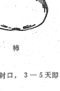

梅

嫩物叶膨湿；用柏树、檀树等植物叶片，与成熟柿子混放于容器内，数日即可膨湿。

## 酸枣仁

利用取肉加工剩下时酸枣核，晒干后放到石臼子里把核皮压碎（砸时要随敲随抖，均匀当中，以免厚薄不均，压碎枣仁），然后用篾箔出枣仁。如果有些枣仁与核皮混在一起脱不净，可以将这一部分掏出放入水缸中，用汽篾漂洗，因核皮较重沉于水下，枣仁轻而漂浮水上，可用汽篾随捞捞捞。把捞出的枣仁摊在席上充分晒干，就成为供药用的酸枣仁。

## 蔬菜加工

## 干制品

## 干萝卜丝

选用冬季萝卜（因为春季萝卜纤维多、糠心、质量不好）。洗净，削去叶丛，刨成丝，最好利用风力吹干。晾晒时，将帘席遮盖风，斜立在风力大的地方。萝卜丝要铺得均匀，这样容易晾干，不必翻动。夜间无霜不必收回室。在风力较大的情况下，1 — 2 天即可晒到七成干。

晒到七成干的萝卜丝，装入陶土坛， Buzhen 橡塞塞紧。装缶后盖严，使坛内不透气。封闷 2 — 3 天，即成金黄色。适当再进行晾晒。这一次主要靠太阳把萝卜丝晒干，在充足阳光下，经过 3 — 4 小时，干萝卜丝就制成。

## 干豌豆

在干制前一天把豌采挑选嫩、结实、豆荚耸直、长度整齐的豌豆。第二天，先把豌豆洗净，再将豌豆猛然放在锅里，加盖。等到锅内的水蒸发掉时，扣豆荚翻一下，掀出，铺开。晒 3 — 4 小时，当豆荚向阳面由青绿色变成白色时，可将豌豆翻过来。每隔 2 — 3 小时，翻晒一次。如此当干天，盛放在篱笆上，不便堆起，这样连续 2 — 3 天，晾可至豌豆失去 80% 的水分。

晒干的豌豆，放入蒸笼内蒸，要装满，压紧。预先把水烧开。故上蒸笼以后，加强火力，等到蒸汽直上，豌豆露出发软时立即出笼。继续蒸晒。每隔 2 — 3 小时翻转一次。这样，大约一天多的时间即成 为干豌豆。

## 茄干

选用新鲜肥嫩、肉质致密的茄子，切去果柄及蒂叶，洗净，先把锅里水煮沸，再把茄子放在锅里，加盖，煮15分钟，经三次换沸水以后，当茄子已变软发皱、柔软，但尚未溃烂时，立即取出放凉。散热后，茄子切成两瓣，每瓣切成3-4厘米，不宜全切开。茄蘑或是连在一起。切毡后在太阳下晒晒，不要翻。日落就要收回室内，将破碎的食物垫在茄子切面上整齐，每100公斤茄疙瘩的茄子需用盐5斤，辣椒盐后把茄子正面朝上，一层茄地堆在陶土盆里，在盆内撒一层，第二次Resuspension进行晾晒，每隔4小时翻动一次，这样晒2-3天，使茄子颜色变黄，能散微酸即成品。
将茄干浸在清水州中期浸泡20分钟，使它吸水膨松而柔软，再捞出。在禾架上晾晒，直到表皮无水汁，比半成品重45-50%时，歌晒完毕。熟后切成5厘米宽、5厘米宽的碎块，每100斤干茄加水糖3斤，与晒过的红辣椒18-20斤，豆酱35-40斤拌匀装入坛子或罐中，拴塞封好，使坛内不透空气，坛里放空气隔绝，经过15天的发酵，即成茄品，大约每100斤茄能制茄制品200-215斤。

## 五香萝卜干

九月份选取青萝卜，用水洗净，切成片1厘米厚，长10厘米的萝卜块，以每100斤萝卜放4斤盐入缸，当天必须翻动一次，以避免发酵，第二天早晨再用筷子戳一戳，然后放入缸内，铺上棉布，盖上盖子，使其发酵，散发豆气，促进盐的溶解。第二天早晨再用筷子戳一次后出缸，把盐沥干，剩余盐少许留在萝卜上，每100斤萝卜晒晒到30斤即可准备。第天晒两次，以使萝卜干气。晒制15天后，每100斤晒青萝卜块加入盐酸萝卜干20斤，撒入五香面半斤，拌匀均匀，装入缸内压实封严。成品颜色红亮透明，味香柔脆。

## 冬瓜干

选用肉质厚实的冬瓜，切皮去瓤后切成1厘米厚薄的片，在太阳光下晒晒8-10小时。当天晒成的瓜片因为很干维，容易折断，可以连续晒两天的晴天移至室内或棚下自然回软8-12小时。待瓜片柔软

以后，装入篓内。回纹的瓜片宜及时一奌一奌揰扎好，每采约5—10斤，为防止烂秧，再复晒2—3小时，其间翻晒1—2次，即成冬瓜干。

冬瓜含糖量和水分较多，已进行加工的瓜片，不宜过晚，最好当天下晒干。

## 金针菜

又名黄花菜。在金针菜的花蕾充分长大但未开放前即采摘，摘后随即进行热烫（可用蒸煮或浸沸水烫，蒸煮时以花蕾稍变色变软为度），然后在阳光下曝晒，要注意翻动，以防霉烂。如有条件也可使用烘房干燥。

## 五百干芥

先将芥菜头脱制，可以每100斤下盐18斤，入咸度15—20斤；亦可每100斤下盐20斤，入白水15—20斤。入盐后每天翻晒一次，以散热，散碱气，入盐10天后改为隔天翻晒一次，再晒一个月。然后放在席上摊晒，晒蔫期间要翻三次，四月四放到晾场上，100斤蔺菜可以晒70斤干。入晾晒期间要注意翻晒。晾晒后在每堆切成水的2/3的切口，较大的切3寸，较小的切2寸，然后在切口内装入五香面酱，混合料3.5两。番茄加5斤细盐拌匀，每100斤菜头加头5个香面酱混合料。装好后入缸压实盖严，并在该期间适当晒阳光晒干，一个月后出缸，放在席上进行第二次晒晒，晒晒季节最好在四、五月份间为合适，每100斤菜头晒成90斤即可入缸压实盖严闷晒，再闷晒一个月即出成品。

## 竹笋干

- （一）紧笋
原料用毛竹笋。清明前后采掘，剥去笋壳，笋都用刀削整、洗净，然后分条浸泡用旺火煮2—3小时，煮至显现半透明并发出香气为止，提出后用水漂洗冷却，然后后晒晒干，日晒约需11—13天。

- （二）玉兰片

毛竹笋为原料，用冬笋或夏笋，剥去茎部粗老部分，连壳煮一同热煮，至筍熟有香味为止，取出冷凉后剥去外衣，修正整筍并去掉笋衣烘干。大型筍对切开半切制。

## 豆红笋干

豆红笋干是毛竹笋带蒲头（笋茎部较嫩可食部分）制成。取毛竹笋带蒲头加水煮 6 小时至笋肉变红为止，取出切成 1 厘米见方的 小方块，每 100 斤笋加黄豆 20 斤，红糖 3 斤，食盐 1 斤，放入锅中，文火炖 3 小时取饭，放于焙灶上，下面用炭火烘干即成。

## 笋衣

笋衣为毛竹、刚竹笋茎部较嫩部分加工制成。笋茎柔嫩部分指脂肪含量比瘦肉高 59％，蛋白质含量比瘦肉高 35％，笋衣不仅营养高，而且滋味也鲜美。

加工方法：在笋干时，取下笋茎柔嫩部分，放在笼上蒸熟，平放在竹帘上，不用炭火，用手翻时翻动，供于后即为笋衣。

## 笋丝

用毛竹、刚竹、淡竹等笋茎制成。笋丝细匀，色白质嫩，干脆，滋味可口。

加工方法：将毛竹等笋剥，剥去老笋，削去老壳，用创丝机或人工创成细丝，每 100 斤鲜笋加食盐 3 斤，水 2 斤，放入锅中煮沸后翻丝一次，再煮沸到锅，即可出锅，摊在竹帘上晒干。晒 3 天可以装袋。

## 羊尾笋干

由刚竹、早竹等笋茎制成，以肉质细嫩、色泽洁白有霜、咸味适口、无苦涩味为佳。

加工方法：在羊尾笋 0.3 米左右时，及时采回，锄笋时可用剪起切割或用手折断，然后剥去笋衣，用刀切去老头，放入锅中加盐煮沸，每 100 斤净笋加食盐 9 斤。煮时火要猛，锅一般能装 70—100 斤为度。

煮1小时即可（煮得太久颜色不好看），出锅后滤干汤汁，摊铺在竹帘上，使之冷却，不需晾干即可装筐。

## 腌渍品

### 腌白菜

酱渍时，取小白菜菜（大白菜的一种种），先切去白菜菜帮，在根部割一个口，切口深度为5—6厘米，然后入缸。每100斤白菜下盐10斤，拌入黄酱18度或减3斤，放一层白菜撒一层盐，拌入废料少许。倒缸时略轻放一些，以免挤伤菜根，使根部盐化。腌制半个月后取出进行晾晒加工，把白菜的根部剪去4—6厘米，切口深度为5—6厘米，将白菜叶切下，留作冬菜或作腌料，留下后半部20厘米长的一段，封缸贮存，即为成品。成品色白，嫩脆。

### 腌黄瓜

黄瓜分为秋黄瓜和伏黄瓜两种，以秋黄瓜为好。秋黄瓜和伏黄瓜的腌制方法相同。

方法一：以每100斤黄瓜下盐15斤，拌入黄酱18度或减3斤，分层入缸，每天倒缸2次，开始倒缸要用手抬起缸，避免挤断，务必使盐充分溶解。分层时略加热，挖出盐水。盐渍48小时后取出进行机器加工，分为三类，分别色绿、完好的留作罐装黄瓜丝，中等质量比较直挺的留作黄瓜条或粉；残存较差的留作制盐菜用。挑选分类后分层入缸，依次一层黄瓜一层盐，每100斤黄瓜下盐20斤，不用加糖，直接封缸盖顶。

方法二：先将三类挑选，然后分别入缸，每100斤下盐37.5斤，拌入黄酱18度的或减3斤，放一层黄瓜撒一层盐，拌入废料少许。每天倒缸2次，倒缸时要轻轻地放，使黄瓜盐溶解。腌制6天后改为每天倒缸一次，腌制一个月即可封缸贮存。成品脆嫩，嫩脆。

腌制黄瓜时要避免日晒，否则会由绿变黄，影响质量。

### 腌芸苔

取秋芸苔，先削皮，厚度以粗老为准。削皮后入缸，以每100斤下盐25克，摊入黄酱18度或海盐15斤，分别放入缸中。每天倒缸2次，倒缸时要扬散散热。腌制5天后改为隔天倒缸一次，再腌制一个月即可封缸贮存，封缸前汤要灌满，没过盐盖，否则容易腐烂。成品色白透亮，脆而不软，味正。

### 腌雪里蕻

选棵大整齐、茎度单茎重雪里蕻，摘掉叶尖、黄叶，用草捆打捆放入缸，每100斤下盐12斤，放二级雪里蕻盖一层盐，摊入黄酱18度或海盐5斤，当天必须倒缸1次，每天倒缸2次。倒缸时要扬散散热，散发气味，使盐粒溶解化。从入缸起第1天起，倒缸时如有松散的要重新抱紧。腌1周后改为每天翻两次，每两天倒缸1次，再腌制一个月即成成品，封缸贮存。成品颜色翠绿，透亮，脆嫩，无黄叶。

### 腌芥菜头

十月份，将芥菜头按大小分为三类，分别入缸腌制。腌制方法，一种是每100斤芥菜头下盐18斤，入水18度或海盐15—20斤，另一种是每100斤芥菜头下盐20斤，入水15度—20度。芥菜头入缸下盐后，每天倒缸1次，倒缸时要扬散散热，散发气味，使盐粒溶解化。入缸10天后改为隔天倒缸1次，再腌制一个月即可封缸贮存。成品脆清脆。

### 腌小辣椒

最好用一小辣椒，先加工孔眼（便于盐水渗入），否则辣椒内易腐烂），然后以每100斤下盐27斤，或黄酱18度或海盐30斤入缸，每天倒缸一次，倒缸时要扬散散热，促使盐粒溶解化。腌制1周后改为每天倒缸1次，再腌15天为成品，封缸贮存，成品要色绿，不发黑。倒制辣椒，掉时光被带弃，然后在根处打4—5个眼，倒制方法与腌小辣椒相同。

### 腌豆包

在处暑时节取鲜嫩豆荚16—17个的小豆包（不要落蒂和口处子），按大分为两类，大茄包暂留茄蒂包，小茄包暂作醋酱茄包，分别入瓮腌制。

#### （一）大茄包腌制法

鸳揽茄包入坛，每100斤茄包下盐25斤，入碗汤20斤，放一层大茄包，一层盐皮，拌姜皮红成熟少许。每天倒坛1次，倒坛时要扬汤散热，并促使盐粒溶解。腌制1周后改为隔天倒坛1次，再腌制20天即为成品，封坛贮存。

#### （二）小茄包等制法

鸳揽小茄包和茄包蒂，然后每10斤小茄包下盐半斤，拌水少许，放在大密室里盐粒是被盖，去掉茄包的涩皮。然后将头个小茄包入坛压实压牢，灌入白皮水，以避免茄包为借，入坛装满3天（72小时）后出坛，压净水分，再入瓮腌制，每100斤发酵后的小茄包入米醋油50斤，下盐20斤，每天打扒2－3次，腌溃15日即出成品，封坛贮存。

### 腊酱樱

樱长10厘米左右的常，每100斤准备食盐25斤，波美18度盐水5斤。入坛时放一层酱樱一层，拌盐水少许，以促使盐粒溶解。入坛2－3小时后倒坛1－2次，倒坛时要扬汤散热。第二天起淡，午后各倒坛一次。酱樱入坛48小时后起坛，控净盐水，歇放四～六小时，再分小量隔瓶小盖一层坛。歇若分别用马缰绳，码入缸盖放于阴凉处贮存。成品香辣浓，颜色缅。

### 腌韭菜花

立秋收，选无烂纯花，加工掐去单叶及杂质，用水洗净上晒，每100斤韭菜花下盐25斤，白纸半斤，鲜姜2斤，乳细为好,乳细后入坛，每天下扒2次，打扒要均匀，一周后即出成品；封坛贮存。成品色黄，味香，细腻。

### 紫薯萝干

将100斤紫薯干切成1厘米见方、6－7厘米长的条，放到80℃的热水中淬烫一次，随即捞出摊在席上晾，使其散发热量和一些水分，再放入缸内用10斤芝麻油泡一下，翻动均匀，次日捞出，装20斤一级酱油再泡两天，每天翻动一次。然后捞出晒晾，晒到损失秤的55%时掺入糖精1.5钱、白糖8.4两、桂花5钱、黄酒5钱、安息香酸钠3钱，拌匀后装入坛内封口。成品味道清甜，肉脆，色泽黑红。

## 酱渍品

### 八宝菜

配料：将筊蒿菜一部分切成厚4毫米的小片，藏成花，另一部分切成长2.5厘米长、宽0.7厘米、厚0.5毫米的条形；筊蒿丁；黄瓜瓜瓣或4瓣，剪切成长5厘米。黄瓜1只左右的柳叶形，另再加小碗、萝卜片30，Drittel30，布丁30，白瓜20块，绿豆芽20分。藕片的层数和根大黄瓜。腌大苏包切成长、宽、厚各2毫米的菱形片。腌白瓜片切成长2.5厘米、宽0.5厘米的条形。腌绿青豆切成长2.5厘米的小段。

#### （一）焖菜片合宝菜

原料去皮黄花5%，筊蒿花45%，黄瓜条27.5%，腌菜梗1%，腌花椒1%，去皮葵花生米15%，用酱油泡过的核仁5%。
先将筊蒿菜、黄瓜条、绿片按配比放入缸内，冬季撒三水、春秋撒两水、夏季两水〔撒一满—撒二满—撒三满，即每次水、每次一天，撒一天，即换一次水，时间为一天。下一〕。保持筊蒿菜的一定咸度。酱水后按比例将桂花核仁倒入缸内，搅拌均匀，装入布口袋按6-7小时，将水控净后，入缸。冬季用甜面40斤，夏季软用甜面酱32斤，酱黄8斤。每天打放4次，打拌要均匀，使每个布口袋都能浸上酱汁，以防成品颜色不一。冬天酱酒7天，夏、秋季节酱3-4天即可封坛存藏。食用时按比例拌入花生米和核仁。

#### （二）酱菜八宝菜

原料去皮黄瓜40%，黄瓜条29%，小粒子23%，腌菜丝1%，腌花椒1%，去皮葵花生米6%。
先将筊蒿菜、黄瓜条、小粒子按配比放入缸内，冬季撒三水，春秋季节撒两水，夏季撒一水。撒水后按比例将葵丝、花椒、核仁一起撒拌均匀，装入有口袋浸水6-7小时，将水控净后入缸酱。冬天用甜面酱35斤、夏季用面酱28斤、黄酱7斤。每 天打孔4次，打孔要均匀。冬季酱渍7天，夏季酱渍3—4天，酱渍后即可封罐贮存，食用时再按比例掺入花生米。

#### （三）中各生豆

原料为蓝酱花67％，黄瓜条10％，小料于10％，花生米3％。先将蓝酱花、黄瓜条、小料按比例倒入瓶罐内，冬季桶两水，夏季桶一水。盐水后放人布袋经渗水6—7小时，将水控净入瓶酱渍，用黄酱25斤、蓝酱11斤。每天打孔4次，打孔要均匀。冬季酱渍7天左右，夏季酱渍3—4天。酱渍后即可封罐贮存，食用时按比例掺入花生米。

### 酱白瓜

选个大、肉厚、嫩脆、稍带绿色的白瓜，以每条重1—3斤为宜。每100斤白瓜加盐8斤入缸，拌透专18度的清水3斤，入缸3小时必须翻动一次，以防酸烂，每天翻缸2次，及加盐后再翻动一次须够热，放盐最好在冷入缸48小时后出缸，在缸边缘用竹签到缸一个眼放气。放气以后瓶盖略启，以去掉白瓜的青味和水分，阳光足时，晒6—7小时。如果天不助好或阴天，可将白瓜缸下放晒至内，压紧瓜内的空气和渣液，晾晒一天微潮即可。每次晒后须晒，每100斤一晒过的白瓜须加75斤。每 天打孔3—4次，夏季7天，将白瓜酱渍后放置阴凉处静置，静置5—6小时，翻倒一次，第二天后再入缸，每100斤一白瓜须酱75斤。每天打孔4次，打孔均匀，酱渍20天即可成褐黄色，有光泽、口味的酱白瓜。

### 甜酱黄瓜

将黄瓜入红缸水，冬季放三水，夏季放两水，注意换水时轻轻摇动，水要控净入红缸。每100斤黄瓜需用红酱水2—3天，每天打孔3—4次，再将成酱每隔向周，夏季酱时要换水把黄酱渗出，避免发钝。每100斤酱需用冬季用甜面酱75斤，夏季用甜面酱55斤、黄酱20斤，每天打孔1次，冬季酱渍20天，夏季10天即可成颜色墨绿、味香甜、酱味浓、微辣的甜酱黄瓜。

### 甜醃茄包

將隨小茄包入缸醃水，冬季撤三水，夏季撤兩水，撤水后裝入布袋控水5一6小時，將水控净后入缸酱渍。冬季每100斤隨小茄包用甜面醬75斤，夏季用面醬55斤、黃糖20斤。每天打扒4次，醬渍7天左右即可成醬。

### 甜醃茄片

醬制：隨去皮茄片入缸撤三水（冬、夏同），換水時要輕輕輕放，避免破碎。撤水后裝入布口袋控水5一6小時，控水時不要重壓，將水控净后入缸酱渍。每100公斤茄片用甜面醬200斤（冬、夏季同），每天打扒4次，醬渍15天即可成缸。

提示：將白醬入缸前茄片的原茄汤中，在火上煨出熱后把醬茄片滷勻即為成品。每100斤茄醬用16斤白醬。成型的甜醬茄片顏色紫紅，具有光澤，酱味浓，脆嫩。

### 甜醃白菜

將隨白菜心（去老葉后的白菜）裝入布袋里過湯3一4小時，控净咸湯后入缸酱渍。每100斤腌白菜心用甜面酱50斤、次鹽25斤，每天打扒4次，酱渍20天，即為成品。

### 清醬小椒

先將隨小椒撤的咸湯控净，封缸，上面压重物。每100斤隨小椒用三绒酱油50斤撤入缸内，浸渍15天，即成清酱小椒。成品色绿，不软。

### 清醬黃瓜

先将随黄瓜入缸撤水，冬季撤兩水，夏季撤一水，换水时要轻轻轻放，以免黄瓜折伤。黄瓜撤水后，將水控净入缸，用次酱油50斤置2一3天出缸，把次酱油油滤净。直接封缸，压上重物，灌入三绒酱油50斤，浸渍15天即为成品。

### 虾油小菜

经糖渍的菜料，用酸菜蓝花49%，酸黄瓜菜20%，腌芹菜10%，鸭鼠豆6%，酸红根5%，腌小辣椒10%。入瓶加盐水1—2小时，酸排均勻后在瓶口。经净水后每100瓶加装虾油30斤浸泡4—5天，每天打扣2次，即为成品。成品保持原色，色泽鲜嫩透亮，嫩脆，有鲜虾味等特点。

### 甜醋花生米

先将花生米挑选，规格较小的留作制作八宝菜。将挑选的花生米放入沸水中浸2—3小时，捞出去花生皮。再在冷水中浸泡1—2天后倒入水煮沸一沸，不要绵软，以花生米没有生豆味即可。煮后有倒入冷水中过滤。过滤后将去皮的花生米装入布袋按压5—6小时，经净水后入缸。每100斤去皮的花生米用糖醋200斤，每天打扣4次，酱渍一月即成金黄软、透亮、酱味浓厚、嫩脆的甜醋花生米。

### 甜辣椒黄瓜

选料要求不严格，老嫩大小均可。先将黄瓜加盐37%，水用3—5%，一层黄瓜一层盐，盐拌水，进行腌渍脱盐。酱渍前将酸黄瓜蘸一水，放于筐内或架子的荤中每筐装一瓶，然后切成条状，故在日光下晒晾，出成40—50%为好。再以每100斤黄瓜加糖醋1.5斤，白糖25斤拌匀均，三天后糖化即为成品。产品糖味浓，有酱香味，色泽红褐发亮。

## 糖渍品

### 糖渍胡萝卜

选用肉质致密，糖红色，心髓部小的胡萝卜，直径2—3厘米。用刀刮去外皮或用热力去皮，切成厚约7—8毫米的圆片块。去去心器切去心髓（亦可在煮柔后进行），旁成整齐的圆形孔。加充分水煮菜，而不软烂，筋脆脱干，按每100斤大蒜加33斤及柠檬酸半斤，并加适当的...适当的气水，足以盖著胡萝卜。然后缓缓煮熬，煮到汤液变浓厚，胡萝卜片开始发亮时为止。取出，沥去多余糟液，烘干。干燥程度勿太过，肉质皮紧就太硬，排以物阴干晒，装罐保藏。

### 糖蒜

选用紫皮大蒜，去除毛根，留苔蒂梗1.5厘米，剥去外皮1—2层。加工后洗净，以每100斤大蒜下盐3.2斤，拌白水3斤。入缸时放一层蒜瓣一层盐，拌匀水少许。为了便于倒缸，在大蒜入缸的当天晚上要经缸内浸水，水高蒜梗即可。装水后可用干净薄膜一类，覆盖免蚊蝇搅味。第二天早上即动一次，从缸取出一半打开，要连续三天，每天换水一次，撤去蒜的辣味。最后捞出，控滤一夜，第二天入坛。每天硫磺蒸半分钟，2钱5分，少许水，坛口好放在缸袋中。每隔天早从8时至第二天早5时打开封气，风干好。六次（密密晒）。从封坛起，每天早晚各滚滚一次，两个月后每天滚一次，秋分时即出成品。

### 糖醋蒜

剥去大蒜毛根，菜梗留1寸，剥去干皮，用水清洗后将蒜入缸，每100斤蒜放5斤盐，砸制一半天（须倒缸3次）。再放水滚去辣味，每天滚一次水，连续6天。然后捞出蒜放入新缸内，每100斤蒜放盐15斤，白糖20斤（或糖精5钱），加清水入水20斤，放在阴凉处，20天左右即制成。食用前3天，可根据蒜的数量加米醋10%即。

### 糖醋黄瓜

选用幼小脆嫩的黄瓜，放 在8—10%的食盐液里进行发酵，发酵时间因温度而不同，至黄瓜肉质半透明为止。发酵后，在清水内浸泡，脱去多余盐分，沥出后沥去水分，浸入制好的糖醋盐水。糖醋液内糖液为25%左右，糖醋糖分别为3.5%，并加入少量山茜丁香、茴香子、芹菜子、荸荠、豆蔻等原料。配制时，先将糖醋浸泡，再把香料的布袋浸入糖液内加热到80—90℃，维持1小时，然后再把白糖融入。可先将浸过盐盖黄瓜浸在5％的糖液内，几天后转入桶槽液内，密闭容器后，置于低温下长期贮存，随时取食。

### 糖糟干

将挑选出的规格整齐的二叠子洗净，以每100斤下盐10斤入缸，每天翻动一次，倒缸时要换滤液数次，散发荤气，并促使盐穿溶化。晒一两周或缸加，cutting成长10厘米、宽厚各5毫米的萝卜条，摊在席上晒晒，每100斤萝卜条晒后出品率是25~30斤，即可放在阴凉通风处贮存。
制糖糟干时，把萝卜干用水洗净，把控盐均匀。每百斤萝卜干加白糖25斤，辣椒粉6斤或菜面1.5斤，搅拌均匀，每天倒缸4次，入缸两天后即可出品。成品颜色白红鲜明、透亮、有光泽，味道甜、辣、脆、稍有咸味，味香适口。

## 其他菜制品

### 番茄酱

选果完全成熟，无霉烂，不带干瘪的果实，剔除果柄及果柄附近未转红的绿色部分，放入桶中加水增，维持2分钟后捞起，然后用筛子将果皮和种子滤出取出；加进原料及其他盐风味品，进一步浓缩后成番茄酱。调味品和香料配料变化很很大，可随口味不同进行配制，其原料为：炒面、食盐、糖精、丁香、桂皮、香醋根、豆蔻、大蒜等，先将物料用糖酸浸泡，antes加糖淀粉及盐腌渍，滤出汁液与抽碎的大蒜一同混入番茄酱中，浓缩后趁热装入玻璃瓶中，口封系紧即为成品。

### 酱花生仁

先将花生仁炒熟或煮熟，再去皮（炒的比较香脆，煮的比较脆嫩）。
每100斤花生可分用2百克糖50斤进行腌制，每天翻动一次，五天后成熟便可进行成品，产品酱香味鲜，质地略嫩、红黄酱艳。
酱杏仁、桃仁时，制作方法基本相同，只是酱罐前把它要用热水喷去表皮外，桃仁要用开水冲一下。

## 药材加工

### 药用植物加工

### 人参

#### （一）红参

选条足不软、完整、无病疤的人参，刷洗干净，放蒸笼里蒸二一三小时，先武火，后文火，至体酥软较为度，然后取出晾晒或薄干。干燥过程中，将带梗的及支根的须，剪下的干枯的根须和支根须剔除，即为红参，搓不掉把的小毛须，蒸后晒干也很红色，即为红参须。

#### （二）统参

将根较长的不足的人参刷洗干净，放入蒸箱中；点燃硫磺熏10—12小时。取出后，头朝下搁入簸箕中，放清水水浸（浸煮）15分钟，使参根变软，内心散糯。取出晾半小时左右，将参根平放于木板上，用排针竖向根上扎，迫出根浆，再用骨制或铁，顺根慢慢下向上扎几针，但不要穿透，孔针孔向外，尾向内，平摊如放，不要叠得太高，上面放一木板，用石块压，提起时酵劲抵起或浸没盆，并养丝不断。触检刚见放软的放取的红参，浸10—12小时时，提，晾至参根干燥至是及后及时进行第二次快慢烘焙，依此法进行第三次，曝干或焙干。熬制方法：第一次浸糯，1斤参需1.3斤白糖，1斤糖兑水0.5斤。先把水放入锅中，加入糖后生火，边熬边搅拌，熬到液的标准。第二次浸糯，3斤参；1斤兑水2.0斤，加入第一次浸糖中再煮。第三次浸糖只用第二氧化醚蒸馏即可。

#### （三）生地参

生地参分须生晒和全须生晒。下须生晒选体短、有须瘤、全须生晒选体完整而大、须全的人参。下须生晒除留主根及大的支根外，其余的全部下掉。全须须则不下须，去尘去掉小毛须根。下须后洗掉泥土，蒋根用竹刀刮净，放蒸箱中用硫磺熏10—12小时，取出晒干或烤干即可。

### 山药

山药的加工各地略有出入，现介绍主要生产地加工方法。

+ （一）毛山药加工法
切去荸荠，洗净泥沙，用竹刀或铁刀（换柄手柄铁器则尖红色藻点，影响药质）削净外皮和根须，烘干或晒干即可。出来的山药，在去皮前用清水浸泡一天，然后去皮，以硫磺熏法（100公斤药蓖约用硫磺1斤）约16小时，至药身发软后取出，以微火烘干或晒干即可。

+ （二）光山药加工法
选栽批大根的毛山药，用清水泡、浸干净，然后及反晒晒药身软如丝，放入铁桶或箱内，不使药发干，削去外皮老棉，再用木板撞3遍，至柔匀圆。置直为止，晾干（晒晒则划裂）。将两头切齐，用硫磺熏一晾，晾好后用细纱布、使药身较为松散打光即可。另有选细圆长长的光山药除去外皮，用清水浸至发软柔软，阴藏至八成干，用木板撞圆，将两头切齐。晒干后再用铁纱灯打光。

+ （三）汤山药加工法
去净外皮后，先在明亮水中浸泡12小时，以收软腌味，然后再煮制，晒干。

### 白术

选晴天将掉松枝起，抖去泥土，剪去茎叶，及时加工，不要堆积，也不宜藏晒，以免发酵萌芽和出油，影响药质。

加工方法有单房和烘干两种。晒干的白术称生晒术，日晒15—20天，直至干硬后放在特制的竹器内，撞去颈内，至外皮光滑颜色稍泽即可。如果晒时潮湿放在阴凉通风处，不宜堆叠或入袋。也可用小火慢烘，但不得继续烘，否则则变白术。
烘干的自称本术。烘时，烘焙火力不宜过猛，温度以不感到烫手为宜，经焙4—6小时后，上下翻动一遍，使上下受热均匀，同时独根自烈晒落，再烘至八成干时，取出堆熏5～6天，使内部水分外泄。装袋趁热，再行烘焙，烘时注意火力要均匀（火力大，烘制时间长，火力轻，则易掉色，皮膜破裂）。不要用松柏等有刺激气味的燃料，以免熏黑和药物内吸入烟箐物质影响品质。

### 三七

根据产区经验，七月中旬花落，到九月中旬收采为好。果实成熟采种后收养的叫“三七”，主根不诧，品质较差，且干鲜比低。

采收后，洗净润湿，摊凉根部，晒2～3天开放气孔，近时下剪去支根和根苔，日晒后摇动，如此反复7～8次，直至全干，最后一次加温烘焙，稍温或小豆一起放入粮仓，搀合摇摆。貮实面呈现光泽，即可装入大中小别袋。收藏时，避免雨天，阴光不足，可在室内用火烘干，温度一般宜在30℃左右，不可超过40℃。

将剩下的根苔、支条、须须分剐晒干，商品称“药口”、“须条”和“三七根”。花、叶晒干后，可代茶饮。将冬、圣夏加入水煮熬至浓缩，可制成“三七膏”。

### 大黄

将根挖出，用铁片（用铁器会变黑，影响品质）刮去粗皮及须芽，然后进行干燥，其方法有三：

+ 1. 举与绳子，挂在通风或下部风处阴干。在干燥过程中应防止溶液及微生物繁殖。干燥时间约半年。
2. 将大黄块摊在架上，以微火烘至快干时放急火，直烘到干为止。在烘焙过程中，常人看管。干燥时间约三五月。
3. 将大黄切细纵、横截断的片，晒干。此法不除霉腐盖，干燥时间短。

### 天冬

挖出根后，洗净除土，去掉须根、大小条分开，用水煮或蒸煮至皮裂。蒸煮时间不得过久，否刚颜色变红。故只有用沸水冲浸一下即取出的。蒸后再剥去外皮，如有双层皮的（类类天冬）可用竹刀刮净。

去皮后用清水洗净干净，再用硫磺熏两三次；第一次需10小时，取出烘至九成干，第二天再熏24小时，烘至全干，以手搓之不粘即为。

去皮后也可晒明处理时，在冬天撒明矾粉，第一次每斤撒2两，然后摊在席上晒，同时将根搓揉均匀。半小时后再撒第二次，每斤撒3两，也晒晒搓，翻动直至晒干。另、也可将去皮冬瓜在明处水浸半小时，然后取出晒干或晾干。

有些地区蒸煮去皮后，直接晒干，即为药。

## 天花粉

将根挖出，洗净泥土，刮去粗皮，为便于干燥和保持洁白，可切成长约3-7寸的小段。肥大者多切成2瓣或4瓣晒干。晒时须经常翻动，以免霉烂。颜色不一时，或用无烟的火烘焙，火不宜大，以免碳化，至断面中心呈粉质为度，再用硫磺熏过即可。

## 天麻

天麻块茎收获后应及时加工。已经抽箭的箭瘩，应切除去上的花

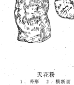

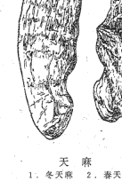

天花粉
1. 外形 2. 横断面
天麻
1. 冬 天麻 2. 春天麻

萎后进行加工，尚未出土的体重期的箭藤和白头藤，可保留其顶芽进行加工。加工方法有两种。

- 1. 一般加工法：采收后先用清水洗净除去表面的泥沙，然后用竹片轻轻刮去外皮，勿伤皮及内并泡入清水内，如刮皮以后不能及时泡入水中，染紫发黑则变废弃物，加工后需晾晒阴凉处。
2. 采用凉水浸泡。水温必须加入少量明矾，10公斤天麻每公斤另加2两明矾，再把刮去外皮的天麻浸入沸水中煮蒸，水煮的时间要看天麻块大小，150克以上，煮10—15分钟，50—150克煮8—10分钟，50克以下，煮5—7分钟，破损残次类煮5分钟。水煮时，水深须浸过天麻，煮得合适时，天麻块茎切开以后呈白色小孔，通常质地润密心实。如水煮时间过长，块茎内水溶性物质流失得多，降低成分率。

煮后捞出，平摊在竹席或筛筒上，放在通风的地方晾干水汽，再上坑用文火烘焙，烘至可一股药材加工板，火力宜保持在80℃左右。开始时火力较小，以免温升过高，但不可高于90℃。当天麻烘至七、八成干时，取出用木板压扁、整形。若有膨胀的，用竹签穿刺，以排出内部的水分，防止胀破，再摊开继续烘干。烘干时火力应降到60℃，不宜用急火，防止焦枯，否则常会连续3—4天才全干。第二次上坑时，可在木炭火上加一些硫酸钾碳或，70—80％泥温加上20—30％碳粉，加工时炭即可混块，进行烘焙。这样的天麻色泽洁白，并可防虫蛀，以上所述的成品为明天麻，如不加硫不用硫酸浸，不用硫磺漂白的称皮天麻。

- 2. 改良加工法：为减少切片和水煮加工业造成的水被成分的损失，采用改良法。天麻采收后洗净，按大小分级，放在蒸笼内蒸透，再用文火烘焙。烘焙温度不得超过100℃。烘焙一天以后，取出晾开，回潮，使内部所含水分逐渐至表层。贮至七、八成干时，最好取出晒干，这种产品坚实，少空穴。如遇阴雨天气，烘焙的温度也应下降至60℃左右。

## 巴戟天

挖取生长7—8年的根，先去掉侧根、洗去泥沙，晒至6—7成

干，用木棒轻轻打针。打时要注意勿打烂或打断根。视条的粗细、切成长 2-4 寸长的小段，再晒至干透，即得成品。如先焙苏半小时或开水泡浸，剥离更易，质更软，品黄也好。

## 牛膝（怀牛膝）

采收时应在近期边挖沟，沟宽1.5-2 尺，深 3-4 尺，然后逐渐向根处控挖，尽量不要断根，保持根之完整。挖出后去掉地上部分及须根，轻轻洗去泥土，散根摊在一处，聚于细长晒至略干，再用碱蘸蘸轻沉，然后洗去毛头，再用梳梳一次，最后用红头绳捆成小把，再削齐把头即可。

也可挖后先将根的粗细长短分开晒至七成干，搭上盖帘两两天再晒，这样样品干燥。晒时勿雨淋，淋后根会发紫变黑，影响品质。

## 白芷

采收时应选择晴天，有利于加工干燥，同时注意挖根时勿伤及芍根。挖前剥去萎叶，然后挖出全根，剥去根上泥土，将主根和支根剪齐进行加工，老芍头留着。

各地加工方法虽有不同，但大致可分为刨制、漂白、煮制、晒晒四个步骤。

修根：对收条很后，用刀切去头部、两侧削平，修去小支根，并削伤皮部厚薄，修整后手拈平，不可因工后颗粒上出异麻眼，影响品级。

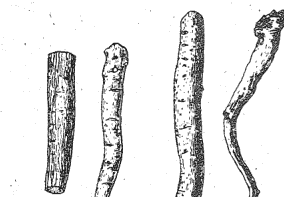

## 白芍

1. 杭白芍 2. 川白芍 3. 莎白芍 4. 安徽白芍

鼓。当见芍根两端有气泡冒出，气泡增多变大，再逐渐减少，此时即可取出。四川的经验，紧到根能扭曲成环并在弯提起来后，收口气能使表面的水分立即干掉，称“收汗”。煮过以后，内部空心。品质陈焦，煮的时间过短，则内部未熟，对出货也有影响。

晾晒。晾晒最好放在暖房上晾晒。在秋季干燥时，须放 5～10分钟冷却一次。中午日光最强，可暂停收姜，使之回潮变湿后再晒，这样，可使芍根内外干湿一致。反之，外干里湿，内部含水份太多，易引起霉烂。降低温度。在潮湿处，晒 1～2 日后，放于水中稍浸几分钟，使芍根发软。如发根部有压痕现象，可及早用水涂润，再晾晒，直到晒干为止。若遇天雨，可用火烤，但要注意火力不宜太大。烘烤时不宜过猛。

各地区加工方法大致分为上述四个步骤，但其中除白，刷皮和煮制两个步骤的先后各有不同。在四川、浙江是先白，后蒸制；安徽、山东则为先煮制，后蒸白。一般宜采用先刷皮、后煮制的方法。

## 川笋

加工川笋要晒干和堆均可。以及时干燥为好。一般要用火烘干，烘时火力要适度大，以免焦黑。每天翻烘一次。待一半笋出烘，用筐笼堆一层。续烘时，下层取新鲜丢弃，上层放半干的。到上层者部分全干后，再分上下层各堆一次，除尽泥土和须根，逐出全部的即为成品。未干的放在上层继续烘，如此每天翻烘，直到全部干燥为止。通常100千克鲜竹笋可供川笋约30—35斤。

## 玉竹

加工方法分三种：

- 1. 将鲜笋上层竖放在阴晒，晒到剖裂时，去掉部分水分后，表面有微波漂出，两个筏就软，用白塑光滑的塑料一包，以去其毛。土。将大身个分开，继续晒至表白或淡黄或紫色，晒到后即分小堆，4—5斤一堆，用手或木板挨揍，连续后晒，如此反复晒晒至根茎柔弱光亮无黑。大约七、八成干时，拿到1斤。加工前须用盐腌一遍，产品约为4—5斤鲜笋做出成品1斤。加工过程中应注意：（1）挖出后不可立即晒晒，因易破皮、折断；（2）加工前勿堆放，要勤换晾，以免霉变；（3）初晒时先轻后加压，避免如过甚成品早呈现红色。太阳晒色变黄，外皮粘稠；（4）遇雨要在室内风暖处用低温烘焙。
- 2. 将鲜笋先放在沸水内稍煮，或微蒸后上大气约10分钟，时间太少不妥。干后中间现白心。然后摊晒上晒干。也可边晒边送，这样成品较软，晒干后柔韧。
- 3. 将鲜玉竹直接晒干，但品质次。约7—8斤鲜货出成品1斤。

## 半夏

出土后，先放入清水浸透土，去皮。去皮方法：将半夏放入盛内，不可装满，浸入其中或水池中，用水泡浸，以能翻动为度，用木棒捣根稻草或玉米芯，插入盛内，上下搅动揉搓，用力不可过猛，并随冲进水深—将掉的外皮去掉，直至除尽外皮，显洁白如半夏为止。也

有脚脐脚露去皮，因毕夏有毒，炮熟作痒，此法不重推广。

去皮后，在阴处下晾干，或将半夏摊在挑上烘干。先用急火使其受热，冒出水珠，随时用棍拨翻干，并经常翻动。然后再用慢火烘，直烘到一击即碎为止。去皮的半夏如遇阴雨天，可将其晒在她和的阴湿水中，如已晒至半干，则不用再润，并经常换水，以防腐烂，天晴时再进行干燥。

## 当归

当归收后后，及时抖净泥土，挑出病烂根、赋去残留叶柄，待水عدم分蒸发后，扎成1～2斤重的扁平把子，放在干燥通风的室内或待制的地方晾干，图菜。高1.3～1.7米，上面粉拌置，将当归把子平放与立放相间堆在上空，高30～50厘米，用木签、塑料布、柳木等作棚料，用火烟薰生火燃烟，使当归上占，至当归表皮呈赤红色，再用煤火或柴火熏10天左右，接着翻棚，翻棚后用急火熏2天，再用慢火熏干。

## 地黄

挖取鲜地黄时要及时止破。鲜地黄极易霉烂及时加工。加工时，先去掉叶、茎、须根及泥沙，忌用水洗，放在上烘焙，上盖帘幕，先以微火烘焙出汗，约2天，再逐渐加大火力，以防不能晒，直约全身发黑，外皮变皱，约3天后移到炉盘上翻动，中间不能翻木火，稍后取出为生地。约4～6斤可出成品1斤。将生地浸入黄酒，著清要浸过地皮，用火烘干黄酒，然后将地黄晒干时即得熟地。也可将生地在蒸煮中用大蒸煮过，即得熟地。

## 浙贝母

挖取浙贝母要从雌的一端慢慢顺序采挖、忌伤鳞茎。鳞茎洗净后，选大个取出中心芽，再加工成元宝形。小的鳞茎不挖贝心芽，加工作成珠。

加工方法：把分好的鲜贝母，放入机器或人工的鳞轴器，并加蛭灰，其比例为25：1，即每100斤贝母加4斤蛭灰，用蚌贝壳烧成的壳

灰，来回冲击，至表皮倘由浆液泡上剥离后，立即取出摊开日晒。如果天气晴朗，晒 3～4 天即可，晒时见表皮发干，可装入袋袋，放置室内使假母内的水分渗出，又称“发汗”，再取出一次晒干即可。通常情况下，须经多次翻动、晒干的其皮内、甲皮或皮膜。如遇雨天或连麦阴雨天气，必须在通风的地方摊开晒，或用蒸笼火烘干，火力不宜过猛，要勤翻动，否则会造成焦子，降低质量。

## 麦冬

挖出根后，洗净泥沙，在烈日下曝晒。须根晒干后，用手搡揉、碰破、修剪等法去掉须根，净筛表皮，再晒数遍。
有的地方外采条状根，于地下部含的夹皮、放在筐箩内，浸于清水中漂洗，不可用力，以免破皮或折断。洗净泥沙，用竹席架起，或摊开晒 3～4 天晒后，再筛去残余杂质，继续再晒风干，约需 3 天，然后再把晒干物反覆揉搓 2～3 次，修润时，两端可略剪除，每次长度，以利于晒干。暂后晒干。若仍再掉噢，拍坯，反复 2～3 次，直至七、八成干时，将须根剪去，并按大个分开，晒至干燥，装麻袋中，撞击摩擦，撞净外皮和须余须梗，过筛即可。有的地区最后还常用石粉匀抖，使其外形光亮，并有防潮、防油、防虫的作用。

## 远志

挖出根后，去掉残茎、须根及泥土，晒至二、三成干。然后将平板上来回搓压皮与木心分离，抽出木心，晒干。也可采用放量 1-2 天后，将水分稍干皮后，抽去木心，晒干。此为“远志筒”。如不能抽骨者，可将皮肉摇开，去掉木心，此为“远志肉”。过于细小，不能去木心者称为“远志根”。

## 北沙参

挖出根时，除去参叶。挖出的参根不能在阳光下曝晒，以免风干后难以去皮，降低产量和质量。
参根按粗细分开，选晴天早上加洗，洗去泥，捆成 3～5 斤的把，先将尾端插入开水内顺锅转 2～3 圈，约 6～8 秒钟，再整把丢入

锅内浸煮，并不断翻动，继续加热使水保持沸腾，直到参根中部能捉去皮时取出，剥去外皮，晾干或烘干即可。可遇阴天则用文火烘干，温度以手为度。

## 党参

挖根后去掉地上部及泥土，用绳将党参头颈紧束成串，晾晒5—6小时后，打捆，用板木板轻压捶，使其皮肉紧密贴合空隙，否则晒干后中间，不易保存。捶捆2—3次后，仍晒于阳光下或晒窖通风处，夜间用石板盖压，次日打开，日晒，捶捆，反复3—4次，至八成干时，将党参捆拍并排直行，各行可交错重叠排列，使侧根仅露出头部1—2寸，晒至全干即为成品。野生党参可带头后悬挂晒晾，或以微火烘干即可。

应注意以下几点。（1）挖党参时切断或破皮处，一旦误折，须用线将损伤处扎紧，以免浆汁流出损失；（2）晾晒前勿堆大堆，以免霉烂；（3）最好晒至半干时在清水中刷净泥土，可避免鲜时质脆易折断；（4）火烘时不宜用烈火，否则易起泡，皮肉分离。

## 桔梗

将根挖出后，去掉苗茎、须根及泥土，用竹刀或瓷片刮除外面淡黄粗皮。以清水冲洗晒干。如遇阴雨天，不便晒干，以湿沙土堆起或放入水中浸漂，勿使水浸及外皮，可以保藏5—10天，待晴天再行刮皮晾干。其支根易断散分，加工时应小心使其顺着顺取，以防干后易折断或破碎。有的地区在去皮前用木棒轻捶，使外皮与中心，中心柱相离，然后剥皮晒干。

## 黄连

将整株连连挖起，抖掉泥沙，再将根须及地上部一起剪掉，须根及叶分别晒干，可供药用。根状茎部分单独烘干，烘时火力要均匀，开始时火力不宜过强，应逐渐加大，至干。一般根状茎容易折断，断面呈黄草色，即可出坑。趁热放入樟瓷里，推锹填就存泥洞，须根及叶则晾晒成品。

一般採选区收获后 不够ugos、叶，即上山拣， 在地边挖一坑，上铺竹竿 编制好的竹筛，将黄连植于坑上，烘至三成干，去掉部分水分和泥土。召开后上大篓，至六、七成干；骑藤去毛脚，叶干和须根、杆子，叶柄等，再分大、中、小三个等级分别置至全干，再放入撞奄中，撞去须杀须根、杆子即成。

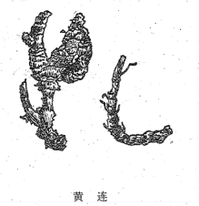

## 黄连

1. 川连 2. 雅连

## 麦芽

将大麦以水浸透，捞出滤干，装萝盘内盖好，时常洒水保持湿润，使其发芽，当芽长约2—3分左右时，取出晒干即可。
加工时应当注意，在炎热天发芽时，必须增加清水次数。以每隔1—2小时清水一次为宜。因为在炎热天操作，麦芽最易发粘发黑，影响发芽。在冬季操作要注意保温，覆盖物必须加厚，同时要注意通水润。

## 芡实

果实呈棕黑色，大小不等，全身有刺。采收集中于箩内，击破带刺的果皮取出种子，也可将果实捞起采使果皮破裂，然后置于流水中，上下搅动，冲去果皮。将种子晾净水气置锅中，用小火炒熟，按大小个分别筛掉硬壳，种皮。晾时常将颗粒适当摇动，以免粉碎种子。然后菇净即可。也有放入砖窝中撞去紫红色外皮成白色的芡实。

## 枳壳

果实呈绿色，未成熟时用齐头剪刀自树上从上至下，由内而外选

行读。 从中部横切成两半，仰面晒干或用微火烘干即可。晒时需用东西盖住，使其免光直射，以免所含挥发油损失太多，肉被侵润变黄影响晒黄，故宜阴干或风干。

## 枸杞子

采下的果实及时摊放在席上置阴处放，厚度不超过一寸，待果皮起皱后，经晒或烘烤成干果。日晒时注意躲果实在采后后的两天内不宜在中午强阳光晒曝，不能用手翻动，以免变黑。烘干分三次阶段：第一阶段采温为40～45℃，约经24～36小时，果实开始出现皱纹；第二阶段温度为45～50℃，经36～48小时，烤至全部果实呈现收缩皱纹；第三阶段温度为50～55℃，经24小时，烤至全干。干果的标准是，含水量10～12%，果色红棕色不脆。果实烤后随即入瓶塞，来回摇动抖散，拣去果柄，密贮藏。

## 柿楼，瓜枣

摘取带蒂的果实，稍留梗向残蒂，以绳丝拴成束，悬挂于屋檐下阴处，数日后用纸掩住个面包好，不能经常将被盖，且两日不易翻动。也长有细而绵软，使留于塑料上自行干透。此法营养较差，但某些春夏由于都不能晾晒新苗时，不得不慎用，此时仍未干透，尚能继续阴干。摘取较慢时勿急破，否則易生虫发霉。

## 鸟梅

将鸟梅，鲜梅为紫色摘下，拌入木炭灰，在灶上烘焙至软后，取出以微火烤，或将梅子直接放入铁铲中，以粗糖及草或茶叶熏至乌黑。需时注意翻转，使热度均匀，以免下层被烘焦，至以手握之成团。取出即可成成品。

## 樱梅

薄荷饭若不能摊晒，要立即摊开阴干。如无阴条件，可堆开晾晒。毎隔3小时左右翻动一次，到七、八成干时，捆成小把，悬挂起来，使其阴干，或继续晒干。要注意防止雨淋霜打，否则姿叶变黑，影响晒乾。以阴干的品质较佳。

## 菊花

花色佳时选取晴天露水干后或下午进行，不采露水花，否则水珠包在花瓣内，不易干燥而引起腐烂。

杭菊花烘工常用竹笼的少灶然的办法，铁锅外径直径约50厘米，把菊花就装在蒸花盒内，蒸花盒用竹篾编成，周边斜上，深约5厘米，上缘直径约37—39厘米，厚约1寸，过厚不易蒸好。锅水烧开后，放入蒸花盒2～3个，上盖蒸形木盖。蒸花火力要细匀均，每蒸一次加一次热水。锅水不宜过多，以免水沸到蒸花盒，影响菊花质量。蒸的时间约4—5分钟，过久花提早成“熏熟状”，不易晒干，蒸的时间过短，则出房易褪色，晒出花紧而不快，颜色发白，与自然一吹则成红黄色。过生过熟都影响质量。蒸好的菊花放在竹帘上晾晒，菊花未干下霜时，晚上收进蒸房内不晒，晾晒3天后翻身一次，约晒6～7天后，脱果脱梗或楼干脱梗晒干后1～2天，花心完全干透即可收藏。

整菊花在花大部分开放及花托稍开披裂，分二、三次收采。经通风处晾干3～4周，干燥快的白色，下始慢的淡黄色，至花有八成干时，把花筒下，入蘸房用硫磺熏白，商品约100斤，药产约达300斤。有部分地区采取回收后去掉药房行于上，厚约2寸，捆松箱剂，用柴或炭火烘烤，半时时进行翻松，干燥快，品质好。

## 金银花

摘取花蕾后，拣去叶等杂质，根据品质的优劣，分别晒晾于干净石板或芦席上。铺层不宜太厚或太薄，厚了不易晒干，薄了容易晒枯发黑，以当日日晒即干即可。晒时用木工轻翻，不能用手翻动，也不可见水，否则会令变黑，质量差。如遇阴天，可晒干或用微火烘干，但干后色暗，降低质量。

## 红花

采下后，在弱日光下晒干或阴干。日光过强时，可用布遮盖以保持颜色鲜艳，容红花易褪色变黄。晾时用工具轻翻，不要直接用手，以免变色。遇阴雨天应用微火烘干，不应用急火，以防运油发黑，降低质量。

## 杜仲

杜仲定植后15年以上才能开始剥皮。剥皮于四至六月份进行。用锯子齐地面积一环口，深达木质部，向上同宽2.5厘米处再锯第二道不完全口，在两环开口之间割刻一切口，用竹片刀从割处轻掀剥动，使树皮与木质部略离。第一筒剥下后，把树皮翻，再按上述方法依次剥皮。秤皮后的树，伤口可发展新皮，培育出新树皮。但为了保证杜仲树继续生长，也应在树槽上环剥另一层薄的树皮去树皮，保证水分畅通，数年后树皮就能愈合复环，可继续剥用。

剥下树皮后用木架支起，层层架空叠放在箱蔸底部的平地上，上盖塑料，加重物压实，四周用草帘或布覆盖，使其发酵。一周左右，内皮呈暗紫褐色，取出晒干，刮去粗皮即成。

也可采收叶作供药用，干十至十一月落叶前，将定植后4-5年的杜仲叶采下，去叶柄，枯叶，晒干药用。

## 厚朴

剥取厚朴的下皮及部分根皮时，先将外表粗皮刮去，将根部分割成顺风形，于是上方量好一定长度，分段横截一定深度，用弯头刀纵向划开，再用齿向深处挖，直到手能推进去剥皮为止。这样便于剥皮，不致将根皮剥破。

将取出的根皮及干皮放沸水中微烫，也有不烫的取出，堆成堆或堆放在土坑内，上用草帘覆盖使之发酵。待油分及水分自内部分渗出后，取而晒干用竹片将其薄薄一层，然将其置于2.5厘米厚的厚朴蒸熟。待其变成软时晒干，或再晒干，待其再晒干，将两头捆紧，即为成品。

细小根的加工，仅除掉泥土，切成约1.5尺长，阴干即可。采下的厚朴切勿曝晒，以免破裂或走油发黄，损失气味而影响质量。

## 牡丹皮

将根部挖起，去净泥土，除掉须根，然后剥去外表皮，放在阳光下晒半天，使其水分蒸发变软，然后将根内木质部剥除，除掉杂碎。抽出木心后再晒2—3天，以色白有光泽的为好，按条索粗细分成三级。每3斤鲜根，可加工1斤丹皮。

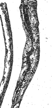

## 细蒿

细蒿开花后山道的含量逐渐下降，采集应在开花前。其花蕾、小细枝及绿叶都是提取草香的原料，以花蕾中含香最髙，但干制对原料中的山道年含量影响较大，要求速干。干燥时间过长，损失大年含量最多。晒干或烘干均可。晒干时先运至晴天，将全部放在洁净的晒场上勿妨泥土，夜间勿露霜水，日晒2—3天即可全干。多雨地区可用烘干，烘于温度不可超过60℃，烘一昼夜即可。以烘干的花质量最佳，色泽绿，无尘土。采收的细蒿草不能使其发热，发霉，以降低质量。

## 廣蜜香

选晴天连根拔起，去净根须及泥沙，摊放数小时后，待叶呈缢缩状，再分层交错重叠堆积。根朝内，叶向外，叠成圆堆，上盖稻草。再用木板或石头压实。经此一次，日晒堆日晒一晒一夜，再堆开晒晒于六成干时，扦扎成束10顶一束，竖直日晒，举头翻晒，晒干为止。保管于凉处，防止潮和防热。不宜久藏，否则香气消失。


## 茯苓

茯苓成熟标准以外皮黄褐色为好。黄白色是正在生长，可延一掘时机拾取；外皮发黑是过熟，应立即拾取，否则易烂。拾取时要选晴天，挖出后略将茯苓上的泥土、堆在不通风处分层摆放，使它滚泥，隔天翻动一次，等干了水后，等批起皱纹时，用刀削下外皮（即茯苓皮）后，逢晴天依次切成块片，切时尽量厚薄均匀，略红色块为赤茯苓，白色块即为茯苓片，茯苓心有—木心的称茯神。

## 药用动物加工

### 土鳖虫

捕捞捉来的活土鳖虫放沸水中烫死后晒干即可。也可以清水洗净泥土，再放入盐水中（每斤虫加2%盐）煮约40分钟，待腹部都已熟时捞出，摊在席上用板轻压出中水后晒干或用炭火烤干。

### 水蛭（蚂蟥）

捕捉后用水洗净，装入瓷盘内，放入石灰或酒闷死，也可并以草木灰熏后晒干，或用微火烘干。

### 地龙（蚯蚓）

一般加工方法多用草木灰烫死地龙晒干，晒干即成。如遇阴雨天应

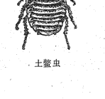

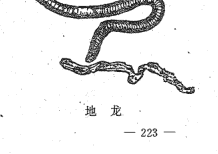

土鳖虫

地龙

及早烘干。广东的试验，用嫩姜加少许盐，焙热如糊，加入清水和匀，倒在有地龙皮、地龙鸣唤而出，捕捉后养以青菜，然后用小镊或针插入尾端，钉在木板上。用小刀自腹部由头至尾剖开，用温水洗去内含的泥土，席布上摊开晒干，阴雨天须烘干，此为地龙肉。

### 全蝎

捕捉后，先将蝎子浸入淡清水或含少量盐分的水中，使其将肠内泥土吐出，淹死。然后取出，再放入盐锅内（每斤活蝎子放2—3两盐），煮沸后将瓶盖扣下如瓦盏形，即可捞出。再用清水洗净拍，摊在席上晒干（不可日晒，否则返潮发白），阴雨天可用微火烘干。加工时锅水需保持宽馀有余，慌忙要轻，不可摇拌翻动过多，以保持其完整无损。

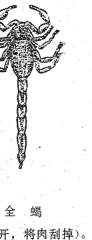

全蝎

### 刺猬皮

捕得刺猬后，将内脏取出（有些地区用刀以腹部割开，将肉制掉）。将皮用竹片撑开或用两手在木板上，剥起肌层，蘸酱取一层皮夹或石头，以防虫蛀。然后晒于通风处风干勿晒（不可晒），以免皮内脂肪熔化，发放走油，影响质重）。干后拍净即可。有地区方法不用竹片撑开，多浸入淡水中吸湿，故干后皮边向内曲成团块状。

### 蝎什蝎油

九月十月月份捕捉，过时则油少，春季则无油。辽宁的加工，将活蝎什蝎直接用绳穿起悬挂，其腿不断抒孔可使腹内两侧的油（输卵管？）逐条下滴成油，晾干后剖开剥出不断使块即可。加工时不可以火烤或杀死，否则变成次品。

取蝎子将其数放置在60—70℃水中浸一、两分钟，待后腿伸直死后取出用药干燥，避免吸水及免受冻。取油，将干蝎什蝎再于沸水中煮一、两分钟，盖上麻袋焖一夜，即可取油。如水温太低则不易

残废，且腿弯曲抽搐不易集中。在取出蛋白质注意，触断酸醉者，不可水煮，否则浸入水分，油则膨胀而不符合食用。

### 给蛤

用铁棒击打腮门，使他仰立仰举。用利剪挖掏眼睛，然后由腹都至胸部剖开，剖出内脏用布擦干净，不用水洗即用竹片（先用开水煮过，晒干后待用）撑开，用两条扁竹条将四壁平撑起。再用长于蛤全身1/2的扁竹条自腹都纵剖插入横竹条与竹片之间，直达胎部。以白布纱条紧密缠绕其尾及扁竹条使其间彼此附在尾部解脱，然后用微火烘干，供时头向上，尾向下。干后两支会成一对，即为成品。尾部药效最强，加工时切勿损丢。

### 蝦蛤

用铁钩压住础，选用长宽与纵检相等两头削尖的竹片刺入头尾稍

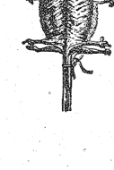

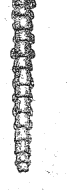

蜈蚣捣起，或用大头针钉在木板上晾成纸均匀可。也有先用沸水烫死后再进行加工的。如果肚内有粪，腹内有卵，可在尾端剪开，挤出粪或卵。操作时要防止头断裂，影响品质。加工后容易生虫、发霉，要贮放在干燥处或石灰缸中。

### 僵蚕

一般将自然病死的蚕收集起来，倒入金石火中焙干，吸去水分，晒干即可。为防止霉病霉变，可用炭火焙干。云南地区系将病死的蚕，放进石灰粉溶液中（须待石灰水冷却后再放入），浸泡1—2天，取出晒干，于后用簸箕去杂渣。

### 蛇胆

蛇胆以眼镜蛇的品质最佳。将鲜胆放在瓦盖内，取出胆汁，配入50度以上白酒，把经过加工的陈皮，干姜或胡椒分别放入，吸滤后取出晒干，就制成了三蛇胆陈皮、三蛇胆姜、蛇胆川贝末和三蛇胆胡椒。对治疗中风、祛风痰有效。用胆浸泡叫蛇胆酒，每1斤酒（50度白酒）配2—3个胆，将胆壁切开入，泡一个月。功效同三蛇胆酒。

## 配合饲料的加工配制

### 配合饲料的特点及种类

配合饲料是通过对畜禽营养科学的研究，根据畜禽的不同种类、不同生长发育阶段对各种营养物质的需要量，将多种饲料原料按饲料营养配制而成的饲料。在我国通常又将配合饲料称为混合饲料。

配合饲料的种类很多，一般可按照营养成分、饲养对象和制形状态来分类。

按营养成分可分为以下几类：

- 1. 添加剂预混合料。它是由营养物质添加剂（维生素、微量元素、氨基酸等）和非营养物质添加剂（抗菌素、激素、驱虫剂、抗氧化剂）以玉米粉或小麦麸为载体，按配方要求进行预混合而成。它虽属加工厂中的半成品，可作为添加剂市场直接出售。这种原料可加以直接或加入基础日粮中使用。
- 2. 浓缩饲料（亦称半预混合料）。它是在添加剂预混合料中，又加入蛋白质饲料（如鱼粉、骨肉粉、血粉、豆饼、糖粕粉、花生饼等）和矿物原（如食盐、骨粉、贝壳粉等）进行混合而成。用浓缩饲料再加入一定比例的能量饲料（如玉米、麸皮、大麦、高粱等）就可直接使用。
- 3. 精料补充料。由半预混合料加适当地精料，再配上草本或其它饲料，用与饲养牛羊、马、羊等家畜。
- 4. 全价配合饲料。由平衡配合饲料加精料配制而成，也叫全日粮配合饲料。这种饲料营养全面，饲养效率高，大多用于机械化饲养的鸡、猪、肉牛、肉羊的后期肥育或配养重毛皮兽等。这种饲料在使用时不需要另外添加添加剂。
- 5. 初配组合饲料，又可叫做合饲料。由能量饲料、蛋白质饲料、矿物质饲料配置一定配比组成，能满足或大致满足动物对能量、蛋白质、矿质、含氮等营养物质的需要。如能稍配一定量粗蛋白或合成氨基酸，则可满足畜禽对维生素、微量矿物元素的需要。目前，这种饲料适合我国广大农村家庭养猪和养鸡者使用。

按饲料对象可分为以下几类：

- 1. 猪的配合饲料，又可分为仔猪、幼猪、育肥猪、母猪、哺乳母猪和公猪料。
- 2. 鸡的配合饲料，又可分为雏鸡、后备鸡、蛋鸡、种鸡、肉鸡饲料。
- 3. 牛的配合饲料，包括肉牛、奶牛、役用牛、种牛饲料。
- 4. 其它畜禽鱼类配合饲料，包括兔、马、鸭及各种鱼、虾的饲料。

按饲料形状可分为以下几种：

- 1. 粉料。是大多数配合饲料所采用的形式，生产工艺简单，搭配青饲料喂养方便，适用于初级牧场和饲养。
- 2. 颗粒料。是全价饲料在蒸气压力作用下生产出来的一种饲料。其优点是可以避免畜禽分食。同时还可增加饲料密度，方便运输、减少风吹等自然损失。另外，在制备过程中有杀菌作用，可以降低饲料的腐败性。
- 3. 颗粒料。把颗粒料再破碎成直径2～4毫米的粒料。具有颗粒料的优点，适于喂养肉鸡、小鸡等。

### 配合饲料的组成

- 1. 能量饲料。这些类饲料是配合饲料中的主要成分，大数包括：谷类类如玉米、大麦、高粱等；麸类及糟、渣类如麸皮、米糠、粉渣、糠渣等；块根块茎瓜果类，如甘薯、胡萝卜、地瓜等。这些饲料含无氮浸出物较高，粗纤维较少，营养丰富，容易被畜禽消化吸收，是动物体热能的主要来源。
- 2. 蛋白质饲料。这些类饲料又分为植物性蛋白饲料和动物性蛋白

选原料，我们常见的大豆、豌豆、豆饼、稗饼粉、菜籽饼、花生饼等属于植物性蛋白质饲料。畜产、水加工副产品如鱼粉、肉骨粉、血液粉、蛋氨、蚕蛹等属于动物性蛋白质饲料。动物性蛋白质饲料在猪和家禽饲料中占有重要地位，但这些饲料来源少，价较高，它与植物性蛋白质饲料的最大的差别是含氨基酸多，能被禽体较好地吸收，含较丰富的维生素 B 类，故在生物学价值高，能平衡配合其它含蛋白质不足的饲料，从而提高单个日粮的营养价值。

### 3. 青绿饲料。这种饲料体积大，营养丰富，适口性好。

青饲料是指各种嫩或成熟的青草和菜类，如紫云英、苜蓿、聚合草、地瓜藤、花生藤、青玉米、水菠菜、水花生、水浮萍、绿绿萍。这类饲料含水份多，含营养素少，并含有较多的蛋白质、维生素和矿物质，适合口性好，且营养价值高的优质饲料。青饲料经加工制成干草的饲料，特别好，每公斤青草的干物质下素含量为100~150克左右。这类饲料由于含水份在80~90%左右，干物质含盐低，因此相对地含地养养成分低。影响，优质的饲料经加工调制成干草后，则饲喂价值可与各种饲料相媲美。据测定，1 公斤紫云英干草相当于1 公斤小米等。

秸秆饲料是各种作物的秸秆、秸秆等，如稻草、麦秸、玉米秸、豆秸、玉米芯和甘蔗渣等。这类饲料含粗纤维较多，一般为20~25%。有的甚至超过30%以上，每公斤饲料的营养的消化能为2500 大卡以下，质地粗硬，营养价值很低，一般在饲料配合中占从属地位，作用是补充饲料的补足。这类饲料对反刍家畜、羊来说，是必不可缺少的。但对猪、鸡等畜类是，在日粮中不能使用过多粗饲料，如果比例过大，超过标准，不但浪费，反而会影响其它饲料的利用率。

- 4. 饲料添加物和添加剂。常用的饲料添加物和添加剂有维生素、氨基酸、微量元素、生长促进剂、抗菌素、性能素、酸制剂、驱虫剂、抗氧化剂等。这些物在畜禽生产中要重视需要量，常但它是长发育所需的必需。

矿物元素中又分常量元素和微量元素。常量元素是指含量占体重0.01% 以上矿物元素。如钙、磷、钾、钠、钾、碳、氯等。微量元素是指含量占体重0.01% 以下的矿物元素。如：铁、铜、钴、碘、硒、锰。

锌、碘、硒等，通常在饲料添加0.5～1％的食物如1％的蓬壳粉、石膏、骨粉等，就能起到补充常量元素的作用。微量元素则更需要人为在饲料中添加补充。

维生素可分为脂溶性与水溶性两类。所适用脂溶性维生素溶解于脂肪中，象维生素A、D、E、K等，均为这一类，所用水溶性维生素溶解于水中，如维生素B组和维生素C等均属此类。荞皮中含维生素B组和维生素E较多，但缺乏维生素A，而青稞 multidisciplinary 饲料中含维生素A较多。因此，要根据畜禽的健康情况和使用饲料的情况额外增加维生素类。

抗生素是生物制剂及其副产品，常用的抗生素有土霉素、青霉素、链霉素等。一般每吨配合饲料中添加20～40克。

助保等药物主要用于预防和治疗疾病，如常见的腐烂等。

目前，在我国常用的配合饲料中很少添加激素、抗氧化剂、酶制剂等。

### 配合饲料的配制和生产

配制、生产配合饲料，首先要设计科学的饲料配方。配方科学与否，直接关系到配合饲料的饲养效果与经济成本。计算配方的

主要依据与饲料营养价值表。选择配合饲料原料应适合畜禽的特点，并能使饲料营养与饲料的配合。饲料配方应从当地常用的饲料和表饲料配方，以便畜禽口性和消化率，使饲料中的各种营养成分相互补充，提高饲料的营养价值，降低生产成本。

配合饲料配方的计算方法。饲料配方的计算方法比较多，有方块法、试验平衡法及电子计算机法等。目前，各地常用的试验平衡法，经过实践验证是可靠的。家庭饲养也可参考，用以设计饲料配方。其具体步骤是：首先明确饲养对象，报根据条件选定营养标准。见表1“营养标准表”，根据当地的饲养条件和畜禽的具体情况确定采用的饲料种类，并根据饲料成分表查出其各种成分含量，试验所选用各种饲料在配合饲料中所占比率。最后再将这些饲料的营养成分含量相乘，乘得的积相加，再与饲养标准比较，最后，根据比较的结果添加。

情况调整平衡饲料的百分比，直到接近饲喂标准为止。为了核验配方的经济效果，还要计算出每斤配合饲料的成本。下面举例说明产蛋鸡配合配方的研制方法。
第一步，根据中国畜禽营养研究会制定的营养标准进行方案，查出第一步的营养标准。
第二步，根据饲料资源情况，确定饲料种类。例如玉米、麸皮、大豆饼、棉仁饼、鱼粉等饲料，然后从当地饲料成分表查出所有各种饲料的营养成分含量（若当地没有饲料成分表，可参考附表2“常用饲料营养成分表”），得到结果如下：

#### 饲料成分

| 饲料 | 代谢能 (千卡/公斤) | 粗蛋白质 % | 有效赖氨酸 % | 钙 % | 氮基酸 % | 赖氨酸 % |
|---|---|---|---|---|---|---|
| 玉米 | 3.40 | 7.8 | 0.1 | 0.07 | 0.12 | 0.23 |
| 麸皮 | 1.70 | 14.2 | 0.3 | 0.30 | 0.23 | 0.60 |
| 大豆饼 | 2.50 | 40.2 | 0.15 | 0.32 | 0.51 | 2.41 |
| 棉仁饼 | 2.19 | 35.0 | 0.3 | 0.36 | 0.61 | 1.54 |
| 鱼粉 | 2.50 | 53.0 | 2.9 | 5.5 | 1.44 | 3.72 |

表中有效赖氨酸，在粗蛋白质计算中是总赖氨酸的三分之一计算。第三步，初步配合配料计算

#### 配合计算

| 饲料 | 比率(%) | 计算代谢能含量 | 计算粗蛋白质含量(%) |
|---|---|---|---|
| 玉米 | 65 | 3.4 × 0.65 = 2.21 | 7.8 × 0.65 = 5.07 |
| 麸皮 | 6 | 1.78 × 0.06 = 0.1068 | 14.2 × 0.06 = 0.852 |
| 大豆饼 | 9 | 2.5 × 0.09 = 0.225 | 40.2 × 0.09 = 3.618 |
| 棉仁饼 | 8 | 2.19 × 0.08 = 0.1752 | 35 × 0.08 = 2.80 |
| 鱼粉 | 5 | 2.5 × 0.05 = 0.125 | 53 × 0.05 = 2.65 |
| 合计 | 93% | 2.83兆卡/公斤 | 14.99% |

将初配后计算结果，与饲料标准比较（和第一步结果比较），可看出能量偏高，粗蛋白偏低。

第四步，调整平衡比率，使能量和粗蛋白质这二个主要因素与饲料标准一致。调整中，更改饲料配方比率，进行调整计算（如下表），直到与饲料标准相近似为止。

#### 调整计算

| 饲料 | 比率(%) | 代谢能含量 | 粗蛋白含量(%) |
|---|---|---|---|
| 玉米 | 60 | 3.4 × 0.60 = 2.04 | 7.8 × 0.60 = 4.68 |
| 麸皮 | 6 | 1.78 × 0.06 = 0.1068 | 14.2 × 0.06 = 0.852 |
| 大豆饼 | 12 | 2.5 × 0.12 = 0.3 | 40.2 × 0.12 = 4.824 |
| 棉仁饼 | 8 | 2.19 × 0.08 = 0.1752 | 35 × 0.08 = 2.8 |
| 鱼粉 | 7 | 2.5 × 0.07 = 0.175 | 53 × 0.07 = 3.71 |
| 磷酸钙 | 6.7 |  |  |
| 食盐 | 0.3 |  |  |
| 合计 | 100% | 2.797兆卡/公斤 | 16.868% |

第五步，根据饲养标准，适当添加维生素和微量元素。注意添加量要不超越多安全系数。一般每200只鸡或配给饲料中，添加矿物质出售的多种维生素20克左右。另加骨粉或磷酸氢钙40克，硫酸铜1.6克，硫酸亚铁17克。如没有维生素或微量元素时，可以用一些青绿饲料代替。

采用上述同样方法，也可以配制肉鸡、育成鸡、奶牛等畜禽所需要的配合饲料。

配合饲料的生产工艺并不复杂，只要有了实用、合理的配方，把配方中的各种原料经过清理、粉碎、配料、混合、制粒及制块出槽等工序，就可制成粉状或颗粒状配合饲料。

### 使用初级配合饲料注意事项

目前，一些饲料加工厂所生产的配合饲料是初级配合饲料。饲养单价，特别是家庭饲养户在使用这种饲料时，往往都会搭配着饲喂

料，因此要注意搭配比例。搭配育料饲料适当，份量不宜过多，过多会使配合饲料的营养被降低，达不到禽畜生长和生产的营养要求；搭配过多的干哺饲料，也会使火炬纤维的比重，增加禽畜对配合饲料的消耗，影响增重及生产，所以应严格注意育，饲料的搭配。一般认为，配合饲料与育种饲料搭配比例是 1：1 到 1：2 之间，也有的采用配合饲料定量，育种饲料不限的饲喂方法。不管哪种饲喂方法，配合饲料加育种饲料的总能量和蛋白质应达到饲养标准。

如要加速添加剂，要根据禽畜的具体营养要求，严格按规定使用。

含某些抗菌素的饲料都添加如含有青霉素、土霉素的添加剂，由于对人体健康有影响，在禽畜出售前一到两周就应停止使用。

在配合饲料中不能添加霉变、污染、有毒、有害物质和其他物质，以保证良好的适口性和禽畜的安全。

配合饲料在应用时一般不要进行蒸煮，可直接饲喂禽畜。若则，将会破坏维生素，降低营养价值。

### 附表1（休闲鸡、瘦肉型鸡及肉种鸡饲养标准表）

| 项目 | 目 | 生6～0周龄 | 6～19周龄 | 19～45周龄 | 产蛋期 > 45周龄 | 育雏 | 育成 | ... |
| --- | --- | --- | --- | --- | --- | --- | --- | --- |
| 代谢能（千卡/公斤） | ... | 2.48 | 2.85 | 16.0 | 2.75 | ... | ... | ... |
| 粗蛋白质（%） | ... | 19.0 | 16.0 | 16.0 | 14.0 | ... | ... | ... |
| 粗脂肪（%） | ... | 6.7 | 5.6 | 6.0 | 5.0 | ... | ... | ... |
| 粗纤维（%） | ... | 0.90 | 0.75 | 3.5 | 3.00 | ... | ... | ... |
| 钙（%） | ... | 0.70 | 0.60 | 3.60 | 3.60 | ... | ... | ... |
| 磷（%） | ... | 0.55 | 0.50 | 0.40 | 0.40 | ... | ... | ... |
| 钠（%） | ... | 0.37 | 0.37 | 0.27 | 0.27 | ... | ... | ... |

### 蛋鸡及肉用种鸡饲养标准表
（2）（维生素、亚油酸及矿物质部分）
单位：百分数或每公斤日粮的含量

| 营养成分 | 0~14周龄 | 14周龄~开产5 % | 产蛋鸡 | 种母鸡 |
|---|---|---|---|---|
| 有<|start|>效维生素A（国际单位） | 1500 | 1500 | 4000 | 4000 |
| 维生素D（国际单位） | 200 | 200 | 500 | 500 |
| 维生素E（国际单位） | 10 | 5 | 5 | 10 |
| 维生素K（凝血维生素）（毫克） | 0.5 | 0.5 | 0.5 | 0.5 |
| 赖氨酸（克克） | 1.8 | 1.3 | 0.8 | 0.8 |
| 蛋氨酸（克克） | 3.6 | 1.8 | 2.2 | 3.8 |
| 泛酸（克克） | 10 | 10 | 2.2 | 10 |
| 维生素（克克） | 27 | 11 | 10 | 10 |
| 维生素（克克） | 3 | 3 | 3 | 4.5 |
| 生物素（克克） | 0.155 | 0.10 | 0.10 | 0.15 |
| 烟酸（克克） | 1300 | 500 | 500 | 500 |
| 叶酸（克克） | 0.555 | 0.25 | 0.25 | 0.35 |
| 维生素B12（克克） | 0.009 | 0.003 | 0.003 | 0.003 |
| 亚油酸% | 1.0 | 0.8 | 1.0 | 1.0 |
| 铜（克克） | 4 | 3 | 3 | 4 |
| 锌（克克） | 0.35 | 0.35 | 0.3 | 0.3 |
| 铁（克克） | 80 | 40 | 50 | 80 |
| 锰（克克） | 55 | 25 | 25 | 30 |
| 碘（克克） | 0.1 | 0.1 | 0.1 | 0.1 |
| 锌（克克） | 40 | 35 | 50 | 65 |


# 肉用仔鸡的饲养标准表

（3）代谢能、粗蛋白质、氨基酸、钙、磷及盐部分

| 项目 | 0 ~ 4周龄 | 4周龄以上 |
|---|---|---|
| 代谢能（兆卡/公斤） | 2.90 | 3.00 |
| 粗蛋白质（%） | 21 | 19 |
| 蛋白质能量比（克/兆卡） | 72 | 63 |
| 钙（%） | 0.9 | 0.9 |
| 磷（%） | 0.65 | 0.65 |
| 食盐（%） | 0.37 | 0.37 |

| 氨基酸 | % | 克/兆卡 | % | 克/兆卡 |
|---|---|---|---|---|
| 蛋氨酸 | 0.45 | 1.56 | 0.36 | 1.19 |
| 蛋氨酸 + 胱氨酸 | 0.84 | 2.90 | 0.68 | 2.25 |
| 赖氨酸 | 1.09 | 3.75 | 0.94 | 3.13 |
| 色氨酸 | 0.21 | 0.72 | 0.19 | 0.63 |
| 精氨酸 | 1.31 | 4.50 | 1.13 | 3.75 |
| 异亮氨酸 | 1.22 | 4.22 | 1.11 | 3.69 |
| 亮氨酸 | 0.73 | 2.50 | 0.66 | 2.19 |
| 苯丙氨酸 | 0.65 | 2.25 | 0.59 | 1.97 |
| 苯丙氨酸 + 酪氨酸 | 1.22 | 4.19 | 1.10 | 3.66 |
| 苏氨酸 | 0.68 | 2.34 | 0.61 | 2.03 |
| 缬氨酸 | 0.74 | 2.56 | 0.68 | 2.25 |
| 组氨酸 | 0.32 | 1.09 | 0.28 | 0.94 |
| 甘氨酸 + 丝氨酸 | 1.36 | 4.69 | 1.13 | 3.75 |

# 肉用仔鸡的饲养标准表

（4）维生素和矿物质部分

| 营养成分 | 0 ~ 4 周龄 | 4 周龄以上 |
|---|---|---|
| 有效维生素 A（国际单位/公斤） | 2700 | 2700 |
| 维生素 D（国际单位/公斤） | 200 | 200 |
| 维生素 E（国际单位/公斤） | 10 | 10 |
| 维生素 K（毫克/公斤） | 0.53 | 0.53 |
| 硫胺素（毫克/公斤） | 2.0 | 1.8 |
| 核黄素（毫克/公斤） | 7.2 | 2.6 |
| 泛酸（毫克/公斤） | 9.3 | 6.8 |
| 烟酸（毫克/公斤） | 37.0 | 7.8 |
| 吡哆醇（毫克/公斤） | 3.1 | 1.7 |
| 生物素（毫克/公斤） | 0.09 | 0.09 |
| 胆碱（毫克/公斤） | 1300 | 750 |
| 叶酸（毫克/公斤） | 0.55 | 0.55 |
| 维生素 B₁₂（毫克/公斤） | 0.009 | 0.004 |
| 铜（毫克/公斤） | 4 | 4 |
| 碘（毫克/公斤） | 0.35 | 0.35 |
| 铁（毫克/公斤） | 80 | 80 |
| 锰（毫克/公斤） | 55 | 55 |
| 锌（毫克/公斤） | 50 | 50 |
| 硒（毫克/公斤） | 0.1 | 0.1 |

# 各类猪的饲养标准
二、猪 存

| 种类 | 每 日 需 要 量（公斤） | | 营养素 | 种类 | 每日需要量 | | 5～10 | 10～20 | 5～10 | 10～20 |
| | 5～10 | 10～20 | | | 公斤 | （毫克） | 公斤 | （毫克） | 公斤 | （毫克） | 公斤 | （毫克） |
| 体重公斤 | 47.5 | 80 | | 粗蛋白 | 4.75 | 6.5 | 0.963 | 4.5 | 0.14 | 0.13 |
| 粗脂肪 | 475 | 800 | | 粗纤维 | 4.75 | 6.5 | 0.72 | | | |
| 消化能 | 107 | 145 | | 生长素A | 140 | 1579 | 6.3 | | | |
| 能量 | 107 | 145 | | 生长素D | 7.13 | 180 | 9.9 | 1.68 | | |
| 钙 | 4.3 | 4.6 | | 生长素E | 2.5 | 99 | 4.56 | 9.90 | | |
| 磷 | 0.7 | 1.17 | | 生长素K | 0.7 | 4.56 | 9.90 | 2.7 | | |
| 烟酸 | 3.6 | 5.7 | | 生长素B2 | 2.6 | 1.35 | 1.35 | | | |
| 维生素C | 2.7 | 5.0 | | 钙 | 0.27 | 16 | 9.9 | | | |
| 盐 | 0.45 | 0.9 | | 磷 | 0.45 | 9.8 | 9.9 | | | |
| 铁 | 0.65 | 1.2 | | 生长素B1 | 0.65 | 483 | 9.9 | 13.5 | | |
| 铜 | 1.2 | 2.4 | | 胆碱B1 | 0.2 | 0.38 | 0.90 | 812 | | |
| 锰 | 0.68 | 72 | | 生长素B6 | 45 | 1.05 | 0.67 | | | |
| 锌 | 1.8 | 2.7 | | 生长素B6 | 2.7 | 0.045 | 0.098 | 0.27 | 4.54 | |
| | | | | 叶 | | | | | | |

| 续表 |  |  |  |  |  |  |  |  |  |  |  |  |
| --- | --- | --- | --- | --- | --- | --- | --- | --- | --- | --- | --- | --- |
| (二) 各种的...含量的... |  |  |  |  |  |  |  |  |  |  |  |  |
|  |  | 5～10 | 10～20 |  |  | 5～10 | 10～20 |  |  |  |  |  |
|  |  | (公斤) | 580～800 | 450～1000 |  |  |  |  |  |  |  |  |  |
|  | 1.8～2.3 | 2.2～2.5 | 5.7 | 4.76 | ... |  | ... |  |  |  |  |  |

# 二、生长肥育猪的饲养标准

（一）每日每头猪需要量表
| 体 重 （公斤） | 20 ~ 35 | 35 ~ 60 | 60 ~ 90 |
| 预期日增重 （克） | 500 | 600 | 700 |
| 采食风干料重 （公斤） | 1.43 | 2.11 | 2.80 |
| 增重/增料 （公斤） | 2.86 | 3.52 | 4.08 |
| 增重/增料 （毫） | 350 | 284 | 246 |
| 消化能 （兆卡） | 4.45 | 6.53 | 8.81 |
| 消化粗蛋白 （克） | 187 | 242 | 282 |
| 氮 （克） | 9.2 | 11.8 | 14.8 |
| 蛋+氨基酸 （克） | 5.9 | 7.7 | 7.8 |
| 色氨酸 （克） | 1.6 | 2.1 | 2.6 |
| 钙 （克） | 7.9 | 10.6 | 13.0 |
| 磷 （克） | 6.6 | 8.7 | 10.4 |
| 食 盐 （克） | 3.0 | 4.4 | 6.0 |
| 胡萝卜素 （毫克） | 6.8 | 1.0 | 13.5 |

（二）生长肥育猪每公斤精饲料中营养成分含量
| 体 重 （公斤） | 20 ~ 35 | 35 ~ 60 | 60 ~ 90 |
| 消化能 （兆卡） | 3.10 | 3.10 | 3.10 |
| 消化粗蛋白 （%） | 130 | 115 | 100 |
| 粗 纤 维 （%） | 16 | 14 | 13 |
| 赖 氨 酸 （%） | 0.64 | 0.56 | 0.52 |
| 蛋+氨基酸 （%） | 0.41 | 0.37 | 0.27 |
| 色 氨 酸 （%） | 0.11 | 0.10 | 0.10 |
| 粗 纤 维 （%） | 4.3 | 4.5 | 4.3 |
| 钙 （%） | 0.55 | 0.50 | 0.46 |
| 磷 （%） | 0.48 | 0.41 | 0.37 |
| 食 盐 （%） | 0.21 | 0.21 | 0.21 |
| 胡萝卜素 （毫克） | 4.77 | 4.76 | 4.75 |

注：各养分的含量是按猪粮中干物质87.7%计算的

# 三、妊娠母猪的饲养标准

|  |  |  |  |  |  |  |  |
|---|---|---|---|---|---|---|---|
|  |  | 幼 产 母 猪 |  | 经 产 母 猪 |  |  |  |
|  | 体重(公斤) | 100 ~ 160 |  | 160 ~ 200 |  |  |  |
| 项目 | 妊娠期 | 前 期 | 后 期 | 前 期 | 后 期 |  |  |
| 采食风干料量(公斤) |  | 1.6 | 2.3 | 1.74 | 2.32 |  |  |
| 消化能(兆卡) |  | 4.8 | 6.9 | 5.40 | 7.20 |  |  |
| 消化蛋白质(克) |  | 144 | 224 | 143 | 209 |  |  |
| 赖氨酸(克) |  | 6 | 9 | 7 | 9 |  |  |
| 蛋 + 氨基酸(克) |  | 3 | 5 | 4 | 5 |  |  |
| 色氨酸(克) |  | 1 | 2 | 1 | 2 |  |  |
| 钙(克) |  | 11 | 15 | 12 | 16 |  |  |
| 铜(克) |  | 9 | 12 | 10 | 13 |  |  |
| 食盐(克) |  | 6 | 8 | 6 | 9 |  |  |
| 胡萝卜素(毫克) |  | 23 | 32 | 25 | 34 |  |  |

# (一) 每日每头营养需要量

# (二) 妊娠母猪的每公斤饲料养分含量

|  |  |  |  |  |  |  |  |
|---|---|---|---|---|---|---|---|
|  |  | 幼 产 母 猪 |  | 经 产 母 猪 |  |  |  |
|  | 体重(公斤) | 100 ~ 160 |  | 160 ~ 200 |  |  |  |
| 项目 | 妊娠期 | 前 期 | 后 期 | 前 期 | 后 期 |  |  |
| 干物质(%) |  | 88.0 | 88.0 | 87.0 | 87.0 |  |  |
| 消化能(兆卡) |  | 3.0 | 3.0 | 3.1 | 3.1 |  |  |
| 消化蛋白质(克) |  | 90 | 98 | 85 | 90 |  |  |
| 赖氨酸(%) |  | 0.38 | 0.38 | 0.39 | 0.39 |  |  |
| 蛋 + 氨基酸(%) |  | 0.2 | 0.2 | 0.21 | 0.21 |  |  |
| 色氨酸(%) |  | 0.08 | 0.08 | 0.08 | 0.08 |  |  |
| 粗蛋白质(%) |  | 12 | 13 | 11 | 12 |  |  |
| 粗纤维(%) |  | 14 | 14 | 15 | 14 |  |  |
| 钙(%) |  | 0.66 | 0.66 | 0.68 | 0.68 |  |  |
| 铜(%) |  | 0.53 | 0.53 | 0.54 | 0.54 |  |  |
| 食盐(%) |  | 0.35 | 0.35 | 0.36 | 0.36 |  |  |
| 胡萝卜素(毫克) |  | 14.1 | 14.1 | 14.6 | 14.6 |  |  |
| 饲粮中营养比例 |  | 1 : 2 : 1 | 1 : 1.5 : 0.8 | 1 : 2.5 : 1 | 1 : 2 : 1 |  |  |

*粗蛋白质含量75%

# 四、哺乳母猪的饲养标准
(一)每头母猪每天需要量

| 用      | 项目 | 每日 8 | 每日 10 | 每日 12 | 饲谷饲料 | 每头仔中 | 备注 |
|---|---|---|---|---|---|---|---|
| 产仔数 | 杂 | 4.7 | 5.8 | 6.3 | 6.5 | 87% | 节 | 1 |
|  | 12.2 | 15.5 | 17.0 | 17.0 | 2.7 | 令 | 37.4 |
| 营养单位(市) | 消耗能量(市) | 4.8 | 5.5 | 6.5 | 6.5 | 101 |  |  |
|  | 12.06 | 14.81 | 16.83 | 17.44 | (2.905) |  |  |
| 蛋白质(克) | 472 | 566 | 594 | 680 | 671 | (47) |  |  |
| 蛋白量(%) | 16 | 16 | 16 | 16 | 16 |  | 1.7 |  |
| 盐(%) | 22 | 22 | 27 | 28 | 30 | 19 | 0.5%* | 1.1 |
|  | 13 | 15 | 18 | 18 | 19 |  | 0.3%* | 0.35 ~ 0.38 |
| 麦十蔬菜(克) | 4 | 5 | 6 | 6 | 6 | 7 | 0.1% |  |
|  | 28 | 7 | 24 | 7 | 7 | (5) |  | 2.2 |
| 膳食(*%) | 19 | 20 | 20 | 26 | 26 | (2) | 0.6% | 1.5 |
|  | 19 | 22 | 23 | 26 | 26 | (2) | 0.4% | 1.5 |
| 饲料(头) | 20 | 23 | 20 | 42 | 42 | (2.6) | 7 | 2.4 |
| 备注：每头系指由图,905系母猪化饲养成分,另外第2系,卵黄2头系,饲料2头系,另外第2系,饲料2头系。

# 五、种猪的饲养标准

| 项目 | 每日每头需供给 |  |  | 每克卡消化能中营养的含量 |
|---|---|---|---|---|
| 营养物质 | 非配种期 | 配种期 | 每公斤饲粮中含 |  |
|  |  |  |  |  |
| 粗饲料干物质(公斤) | 2 | 2.5 | 1 |  |
| 消化能(兆卡) | 6.20 | 7.75 | 3.10 | 1 |
| 消化粗蛋白(克) | 216 | 270 | 108 | 34.8 |
| 粗蛋白(%) | 17 | 17 | 17 |  |
| 粗脂肪(克) | 8 | 10 | 4 | 1.29 |
| 蛋+赖氨酸(克) | 4 | 5 | 2 | 0.65 |
| 色氨酸(克) | 2 | 25 | 1 | 0.32 |
| 粗纤维(%) | 3 | 3 | 3 |  |
| 钙(克) | 14 | 18 | 7 | 2.25 |
| 磷(克) | 11 | 14 | 5.5 | 1.77 |
| 食盐(克) | 7 | 9 | 3.5 | 1.10 |
| 胡萝卜素(毫克) | 29 | 36 | 14.5 | 4.70 |

# 附录2

# 常用饲料营养成分表

# （一）青绿饲料

| 饲料名称 | 情况说明 | 干物质 % | 消化能 大卡/公斤 | 代谢能 大卡/公斤 | 粗蛋白 % | 粗纤维 % | 钙 % | 磷 % |
|---|---|---|---|---|---|---|---|---|
| 白菜 | 北京 | 6.0 | 190 | 150 | 1.4 | 0.5 | 0.03 | 0.04 |
| 萝菔 | 北京 | 10.0 | 290 | — | 1.6 | 1.7 | 0.13 | 0.06 |
| 萝卜 | 武汉 | 9.8 | 300 | 220 | 1.4 | 1.2 | 0.15 | 0.04 |
| 蓼麻叶 | 浙江 | 19.0 | 600 | — | 7.1 | 1.5 | — | — |
| 车前叶 | 吉林农安县 | 21.4 | 610 | — | 3.3 | 3.9 | 0.30 | 0.17 |
| 苔 | 河北涿鹿、白金镇 | 15.0 | 430 | — | 3.4 | 2.5 | 0.43 | 0.02 |
| 木棉树叶 | 河北白花 | 25.0 | 750 | 590 | 8.1 | 2.7 | — | — |
| 大青叶 | 吉林 | 15.0 | 420 | — | 3.6 | 3.0 | — | 0.05 |
| 大蒜子 | 四川、盛花期 | 15.0 | 370 | — | 3.9 | 4.8 | 0.18 | 0.06 |
| 地三叶 | 辽宁、开花期 | 10.2 | 280 | 160 | 2.4 | 2.3 | — | — |
| 浮萍 | 浙江 | 8.0 | 250 | 190 | 2.5 | 0.7 | — | — |
| 甘肃省十个品种平均值 |  | 13.9 | 390 | 250 | 2.2 | 2.6 | 0.22 | 0.07 |
| 甘肃野芥 | 北京、宿根 | 10.0 | 300 | 220 | 3.1 | 1.3 | 0.24 | 0.02 |
| 皂叶叶 | 吉林 | 25.0 | 670 | — | 2.5 | 6.2 | — | — |
| 红三叶 | 广东、初花 | 12.4 | 330 | — | 2.3 | 3.0 | 0.25 | 0.04 |
| 十二个品种平均值 |  | 18.3 | 400 | 380 | 4.1 | 2.9 | 0.34 | 0.07 |
| 紫苜蓿 | 山东 | 16.0 | 470 | 320 | 3.7 | 2.6 | — | — |
| 青菜菜 | 长春 | 21.5 | 650 | 490 | 2.8 | 2.6 | 0.22 | 0.05 |
| 參卜葉 三个品种平均值 |  | 8.9 | 220 | 190 | 2.4 | 1.1 | 0.18 | 0.03 |
| 木芥叶 | 贵州 | 29.0 | 810 | — | 5.4 | 5.0 | — | — |
| 苜蓿 | 山西、开花 | 18.5 | 480 | 180 | 4.2 | 5.8 | — | — |
| 油公英 | 河北、全部五月 | 13.2 | 370 | 230 | 2.9 | 2.6 | 0.19 | 0.04 |
| 涂钓草 | 山西、每叶候 | 25.0 | 570 | — | 3.8 | 9.6 | 0.12 | 0.05 |
| 山薇菜 | 辽宁开原 | 32.2 | 850 | — | 4.3 | 8.4 | — | — |
| 水浮莲 | 山东 | 4.9 | 130 | — | 0.6 | 1.1 | — | — |
| 水浮莲 八个品种平均值 |  | 7.1 | 200 | — | 1.3 | 1.4 | 0.10 | 0.02 |
| 水葫芦叶 十个品种平均值 |  | 7.3 | 210 | 140 | 1.4 | 1.3 | 0.11 | 0.03 |


### 【续上表】

| 饲料名称 | 样品说明 | 干物质 % | 消化能 (兆焦/大卡/公斤) | 代谢能 (兆焦/大卡/公斤) | 粗蛋白 % | 粗纤维 % | 钙 % | 磷 % |
|---|---|---|---|---|---|---|---|---|
| 甜花生 | 浙江、余姚 | 9.2 | 250 | — | 1.3 | 2.0 | — | — |
| 甜菜叶 | 沈阳 | 15.0 | 450 | 320 | 2.3 | 2.0 | 0.04 | — |
| 桑叶 | 广东、山地 | 16.2 | 220 | — | 2.0 | 4.6 | 0.10 | 0.09 |
| 鸭苣菜 | 浙江、新昌 | 16.3 | 480 | 330 | 3.9 | 2.5 | — | — |
| 油菜 | 北京 | 8.5 | 260 | 120 | 2.0 | 1.0 | 0.14 | 0.05 |
| 玉米 | 哈尔滨、乳熟 | 17.0 | 160 | — | 1.1 | 5.2 | 0.06 | 0.04 |
| 紫云英 | 四川、北流雨 | 13.8 | 420 | 320 | 3.7 | 1.5 | 0.17 | 0.06 |
| 塔芜芜 | 六个品种平均值 | 15.0 | 330 | — | 3.3 | 1.9 | 0.48 | 0.05 |

## （二）树叶类

| 饲料名称 | 样品说明 | 干物质 % | 消化能 (兆焦/大卡/公斤) | 代谢能 (兆焦/大卡/公斤) | 粗蛋白 % | 粗纤维 % | 钙 % | 磷 % |
|---|---|---|---|---|---|---|---|---|
| 槲树叶 | 北京 | 30.0 | 900 | 660 | 3.2 | 4.0 | 0.56 | 0.03 |
| 榆树叶 | 北京 | 30.0 | 870 | 590 | 2.4 | 5.0 | — | 0.11 |
| 苹果叶 | 吉林 | 30.0 | 890 | 640 | 3.4 | 4.1 | — | 0.02 |
| 榛树叶 | 北京 | 30.0 | 890 | 640 | 3.7 | 4.2 | — | — |
| 松叶 | 云南、红松 | 30.0 | 760 | — | 2.6 | 9.0 | — | — |
| 柳叶 | 江西樟树、马尾松 | 53.1 | 1300 | — | 9.6 | 17.6 | 0.62 | 0.02 |
| 桑叶 | 北京 | 30.0 | 910 | 670 | 4.2 | 3.8 | — | 0.01 |
| 番茄叶 | 广东 | 11.6 | 330 | 200 | 2.6 | 2.3 | 0.16 | 0.02 |
| 香茶 |  | 32.6 | 1030 | 820 | 3.3 | 2.7 | — | — |
| 洋槐叶 | 山西、落叶 | 51.7 | 1470 | 950 | 5.4 | 9.6 | — | — |
| 洋槐叶 | 四川 | 23.1 | 720 | 580 | 6.9 | 2.0 | 0.29 | 0.03 |
| 榆树叶 | 北京 | 30.0 | 930 | 730 | 2.4 | 2.8 | 0.43 | 0.08 |
| 紫穗槐叶 | 江苏徐州 | 24.3 | 670 | 380 | 9.1 | 5.4 | 0.40 | 0.08 |

## （三）青贮饲料类

| 饲料名称 | 样品说明 | 干物质 % | 消化能(千卡/公斤) | 代谢能(千卡/公斤) | 粗蛋白 % | 粗纤维 % | 钙 % | 磷 % |
|---|---|---|---|---|---|---|---|---|
| 白菜青贮 | 北京 | 10.9 | 300 | — | 2.0 | 2.3 | 0.29 | 0.07 |
| 甘肃青贮 | 北京 | 25.0 | 810 | — | 0.5 | 1.4 | 0.02 | 0.02 |
| 马铃薯青贮 | 辽宁 | 25.0 | 670 | — | 0.6 | 0.7 | — | — |
| 苜蓿青贮 | 西宁、盛花期 | 33.7 | 780 | — | 5.3 | 12.8 | 0.50 | 0.10 |
| 甜菜叶青贮 | 吉林 | 37.5 | 1060 | — | 4.6 | 7.4 | — | — |
| 玉米青贮 | 西宁、盛穗期 | 23.0 | 550 | — | 2.8 | 8.0 | 0.18 | 0.05 |

## （四）块根、块茎、瓜果类

| 饲料名称 | 样品说明 | 干物质 % | 消化能(千卡/公斤) | 代谢能(千卡/公斤) | 粗蛋白 % | 粗纤维 % | 钙 % | 磷 % |
|---|---|---|---|---|---|---|---|---|
| 冬瓜 | 北京 | 3.5 | 100 | 70 | 0.4 | 0.4 | 0.02 | 0.01 |
| 甘蔗 | 十二个品种平均值 | 25.0 | 940 | 870 | 1.1 | 0.7 | 0.02 | 0.05 |
| 甜罗卜 | 十三个品种平均值 | 12.2 | 390 | 270 | 1.5 | 1.1 | 0.04 | 0.03 |
| 马铃薯 | 九个品种平均值 | 21.4 | 800 | 610 | 1.8 | 0.7 | 0.02 | 0.03 |
| 木薯 | 广西省 | 30.6 | 1160 | 890 | 1.0 | 0.8 | 0.09 | 0.03 |
| 萝卜 | 辽宁、秋季 | 10.0 | 320 | 230 | 1.0 | 0.8 | — | — |
| 蕹菜 | 哈尔滨 | 15.0 | 430 | 280 | 3.1 | 2.2 | 0.12 | 0.02 |

## （五）干草类

| 饲料名称 | 样品说明 | 干物质 % | 消化能(千卡/公斤) | 代谢能(千卡/公斤) | 粗蛋白 % | 粗纤维 % | 钙 % | 磷 % |
|---|---|---|---|---|---|---|---|---|
| 草木犀 | 甘肃、天水 | 81.8 | 1390 | 1210 | 12.4 | 19.5 | — | — |
| 苏丹草 | 兰州、拔葡 | 80.0 | 740 | — | 6.9 | 31.8 | 0.42 | 0.37 |

## （六）农副产品类

| 调查名称 | 样品说明 | 干物质% | 消化能(千卡/公斤) | 代谢能(千卡/公斤) | 粗蛋白% | 粗纤维% | 钙% | 磷% |
|---|---|---|---|---|---|---|---|---|
| 大豆粕 | 青绿 | 93.2 | 170 | — | 8.9 | 39.8 | 0.37 | 0.05 |
| 豌豆 | 植模、蔗糖 | 88.3 | 1010 | — | 3.1 | 25.8 | — | 0.05 |
| 谷糠 | 细锯、小米糠 | 92.7 | 2050 | — | 7.9 | 22.4 | 0.49 | 0.20 |
| 花生粕 | 五个品种平均值 | 90.0 | 1650 | 1310 | 12.2 | 21.8 | 2.80 | 0.10 |
| 麦麸 | 十三个品种平均值 | 91.0 | 食物 | 饭值 | 2.7 | 41.1 | 0.44 | 0.09 |
| 向日葵粕 | 山东 | 89.3 | 2110 | 1520 | 13.1 | 28.8 | — | — |
| 豆粕 | 吉林 | 86.5 | 食物值 | — | 6.5 | 43.8 | — | — |
| 小麦发酵 | 山东 | 88.2 | 1100 | — | 2.5 | 27.0 | 0.49 | 0.08 |
| 油菜粕 | 上海 | 82.7 | 食物值 | — | 5.1 | 40.7 | 1.24 | 0.11 |
| 玉米芯 | 北高 | 91.3 | 580 | — | 2.0 | 28.2 | — | — |

## （七）谷实类

| 调查名称 | 样品说明 | 干物质% | 消化能(千卡/公斤) | 代谢能(千卡/公斤) | 粗蛋白% | 粗纤维% | 钙% | 磷% |
|---|---|---|---|---|---|---|---|---|
| 大麦 | 二十二个品种平均值 | 88.1 | 3040 | 2240 | 11.0 | 5.3 | 0.07 | 0.32 |
| 大麦 | 九个品种平均值 | 88.4 | 3400 | 3160 | 9.2 | 1.9 | 0.03 | 0.20 |
| 糙米 | 九个品种平均值 | 88.6 | 2770 | 1950 | 6.8 | 8.2 | 0.03 | 0.27 |
| 高粱 | 二十二个品种平均值 | 87.2 | 3270 | 3030 | 8.6 | 2.6 | 0.07 | 0.25 |
| 荞麦 | 七个品种平均值 | 87.9 | 2650 | 1820 | 12.5 | 12.3 | 0.13 | 0.29 |
| 青稞 | 河北、甘肃种平均值 | 87.4 | 3310 | 3060 | 10.7 | 2.2 | 0.17 | 0.32 |
| 小麦 | 华北、华北、华南、东北种品种平均值 | 86.1 | 3250 | 3010 | 11.1 | 2.2 | 0.05 | 0.32 |
| 小米 | 华北、东北种品种平均值 | 88.5 | 3350 | 3100 | 9.3 | 2.2 | 0.04 | 0.20 |
| 黄米 | 十七个黑种品种平均值 | 89.4 | 2650 | 1810 | 12.5 | 9.8 | 0.16 | 0.24 |
| 玉米 | 四十个地方品种平均值 | 87.5 | 3380 | 3110 | 7.8 | 1.6 | 0.09 | 0.26 |

## （八）糠麸类

| 饲料名称 | 样品说明 | 干物质 % | 消化能（兆卡/公斤） | 代谢能（兆卡/公斤） | 粗蛋白 % | 粗纤维 % | 钙 % | 磷 % |
|---|---|---|---|---|---|---|---|---|
| 大麦麸 | 北京 | 87.0 | 2960 | 2170 | 15.4 | 5.7 | 0.33 | 0.48 |
| 玉米糁 | 七个样品平均值 | 88.4 | 2890 | 2080 | 10.3 | 6.9 | 0.30 | 0.44 |
| 米糠 | 维生素类大约10% | 90.5 | 2550 | 1740 | 13.8 | 11.6 | 0.16 | 1.34 |
| 小麦麸 | 山东省平均 | 89.9 | 2740 | 1900 | 14.6 | 9.0 | 0.14 | 0.53 |
| 小麦麸 | 烟粉平均约12% | 88.0 | 2610 | 1780 | 14.2 | 9.6 | 0.23 | 0.97 |
| 小米麸 | 山东、河北等 | 90.0 | 2850 | 2020 | 11.6 | 8.0 | — | — |
| 玉米皮 | 华北、东北 | 88.7 | 2940 | 2120 | 9.7 | 6.6 | 0.08 | 0.59 |
| <|start|>麦麸 | 三、七配 | 90.0 | 760 | — | 5.4 | 31.7 | 0.36 | 0.43 |
| 玉米麸 | 北京 | 90.3 | 3520 | 2720 | 8.8 | 1.3 | — | — |

## （九）豆类

| 饲料名称 | 样品说明 | 干物质 % | 消化能（兆卡/公斤） | 代谢能（兆卡/公斤） | 粗蛋白 % | 粗纤维 % | 钙 % | 磷 % |
|---|---|---|---|---|---|---|---|---|
| 豌豆 | 十一个样品平均值 | 86.8 | 2990 | 2190 | 24.5 | 6.9 | 0.24 | 0.43 |
| 大豆 | 二十个地方品种平均值 | 88.8 | 3220 | 2530 | 37.1 | 4.9 | 0.25 | 0.53 |
| 黑豆 | 十二个样品平均值 | 91.0 | 3280 | 2530 | 37.9 | 5.7 | 0.27 | 0.52 |
| 蠶豆 | 十余个地方品种平均值 | 88.3 | 3260 | 2590 | 22.6 | 4.2 | 0.19 | 0.35 |
| 秸食豆 | 吉林、黑龙江品种平均值 | 88.4 | 3120 | 2580 | 34.5 | 5.9 | 0.06 | 0.57 |
| 豌豆 | 二十个样品平均值 | 87.3 | 3100 | 2380 | 22.2 | 5.6 | 0.14 | 0.34 |
| 红豆 | 上海、江西省平均值 | 88.9 | 3270 | 2600 | 23.3 | 4.4 | 0.09 | 0.40 |

## （十）油饼类

| 饲料名称 | 样品说明 | 干物质 % | 消化能（焦）大卡/公斤 | 代谢能（焦）大卡/公斤 | 粗蛋白 % | 粗纤维 % | 钙 % | 磷 % |
|---|---|---|---|---|---|---|---|---|
| 菜籽饼 | 六个工厂样品平均值 | 88.2 | 2870 | 2050 | 31.5 | 8.9 | — | — |
| 菜籽饼 | 山东省潍坊 | 91.2 | 2770 | 1710 | 26.4 | 11.7 | 0.82 | 0.64 |
| 豆饼 | 江苏无锡 | 93.8 | 3620 | 2430 | 43.4 | 7.0 | 0.30 | 0.30 |
| 豆饼 | 三个工厂样品平均值 | 88.8 | 3230 | 2520 | 40.2 | 4.9 | 0.32 | 0.50 |
| 花生饼 | 六个工厂样品平均值 | 88.8 | 3150 | 2310 | 38.0 | 5.8 | 0.32 | 0.59 |
| 葵籽饼 | 六个样品平均值 | 88.1 | 2760 | 1930 | 15.8 | 9.3 | 0.20 | 0.89 |
| 棉仁饼 | 试验站 | 91.4 | 2840 | 2020 | 41.6 | 11.0 | 0.15 | 1.10 |
| 棉籽饼 | 十个工厂样品平均值 | 89.8 | 2680 | 1610 | 32.0 | 12.1 | 0.36 | 0.81 |
| 向日葵籽饼 | 东北 | 90.5 | 1050 | — | 15.3 | 32.8 | 0.40 | 0.50 |
| 芝麻饼 | 哈尔滨, 机械 | 92.2 | 3330 | 2580 | 44.3 | 5.4 | 1.99 | 1.33 |

## （十一）糖渣类

| 饲料名称 | 样品说明 | 干物质 % | 粮化能（焦）大卡/公斤 | 代谢能（焦）大卡/公斤 | 粗蛋白 % | 粗纤维 % | 钙 % | 磷 % |
|---|---|---|---|---|---|---|---|---|
| 醪糟 | 六个样品平均值 | 26.6 | 660 | — | 2.2 | 4.7 | 0.30 | 0.13 |
| 豆粕糟 | 五个样品平均值 | 12.5 | 280 | 100 | 3.7 | 2.3 | 0.14 | 0.04 |
| 糖渣 | 七个样品平均值 | 11.8 | 300 | 180 | 2.0 | 1.8 | 0.08 | 0.04 |
| 酒糟 | 六个样品平均值 | 33.5 | 820 | 660 | 10.2 | 5.4 | 0.25 | 0.21 |
| 酒糟 | 十二个工厂样品平均值 | 90.7 | 1900 | 1150 | 11.9 | 24.4 | 0.32 | 0.28 |
| 酒糟 | 五个工厂样品平均值 | 32.5 | 810 | 620 | 7.5 | 5.7 | 0.19 | 0.20 |
| 糖蜜渣 | 哈尔滨 | 11.4 | 210 | — | 1.1 | 2.6 | 0.08 | — |
| 麦糟 | 南京, 机械下榨 | 35.0 | 负值 | — | 0.4 | 14.8 | — | — |

## （十二）动物性饲料

| 饲料名称 | 样品说明 | 干物质 % | 消化能（兆卡/公斤） | 代谢能（兆卡/公斤） | 粗蛋白 % | 粗纤维 % | 钙 % | 磷 % |
|---|---|---|---|---|---|---|---|---|
| 蚕蛹 | 广西 | 90.9 | 3270 | 2830 | 54.9 | 0 | — | — |
| 蚕蛹粉 | 江苏、青海兔粪蛹 | 19.5 | 610 | 520 | 10.8 | 0 | 0.28 | 0.18 |
| 蚕蛹粉 | 上海 | 90.0 | 1670 | 1440 | 32.9 | 0 | — | — |
| 血粉 | 北京 | 89.3 | 2610 | 2370 | 80.2 | 0.6 | 0.20 | 0.23 |
| 血粉 | 上海 | 82.9 | 2480 | 2250 | 77.2 | 0 | 1.59 | 0.18 |
| 鱼粉 | 英法进口 | 90.0 | 3310 | 2980 | 65.0 | 0 | 4.90 | 3.10 |
| 鱼粉 | 浙江 | 76.7 | 2200 | 1900 | 50.4 | 0 | — | — |
| 鱼骨粉 | 福建、山东 | 92.4 | 590 | 600 | 14.7 | 1.5 | — | — |
| 肉骨粉 | 凑、加 | 92.4 | 2870 | 1720 | 45.0 | 2.5 | 11.0 | 5.90 |
| 骨粉 | 北京 | 89.8 | 3290 | 2840 | 70.3 | 0 | 1.01 | 0.39 |
| 象头粉 | 北京食品厂下脚料 | 97.4 | — | — | 40.4 | 0 | 10.79 | 6.25 |
| 水解羽毛粉 | 北京 | 90.0 | 2670 | 2280 | 80.6 | 1.4 | 0.20 | 0.68 |

## （十三）矿物质饲料

| 饲料名称 | 样品说明 | 钙 % | 磷 % | 饲料名称 | 样品说明 | 钙 % | 磷 % |
|---|---|---|---|---|---|---|---|
| 贝壳粉 | 杭州 | 38.10 | — | 骨粉 | 上海 | 48.79 | 14.06 |
| 贝壳粉 | 东北、北京贝壳 | 46.46 | — | 硫酸氢钙 |  | 23.10 | 18.70 |
| 蚯蚓粉 | 北京 | 38.23 | 0.25 | 磷酸氢钙 | 湖南 | 29.36 | 0.27 |
| 蛋壳粉 | 四川 | 37.00 | 0.15 | 磷酸氢钙 | 杭州 | 23.33 | 1.59 |
| 骨粉 | 北京、胶胶 | 30.12 | 13.46 | 石粉 | 大理石 | 38.12 | — |


# 附录3

# 常用饲料的主要氨基酸含量表 ※

（上行数字为饲料的%，下行数字为粗蛋白质的%）

| 饲料名称 | 赖氨酸 (%) | 蛋氨酸 | 色氨酸 | 组氨酸 | 精氨酸 | 苏氨酸 | 异亮氨酸 | 亮氨酸 | 苯丙氨酸 | 胱氨酸 | 酪氨酸 |
|---|---|---|---|---|---|---|---|---|---|---|---|
| I. 干草和干草粉 |  |  |  |  |  |  |  |  |  |  |  |
| 禾本科干草 | 10.0 | 0.60 | 0.19 | 0.16 | 0.11 | 0.15 | 0.48 | 0.70 | 0.41 | 0.40 | 0.38 | 0.53 |
|  | 6.0 | 1.6 | 1.8 | 1.5 | 1.3 | 4.6 | 7.0 | 4.1 | 4.9 | 3.9 | 5.3 |
| 苜蓿干草 | 17.0 | 1.04 | 0.19 | 0.26 | 0.29 | 0.87 | 0.87 | 1.21 | 0.98 | 0.76 | 0.83 | 0.81 |
|  | 6.1 | 1.1 | 1.5 | 1.7 | 1.7 | 5.1 | 7.1 | 5.8 | 4.5 | 4.8 | 4.8 |
| 莜麦草粉 | 17.0 | 1.02 | 0.17 | 0.27 | 0.27 | 0.82 | 0.82 | 1.24 | 0.82 | 0.78 | 0.70 | 0.78 |
|  | 6.0 | 1.0 | 1.0 | 1.6 | 1.7 | 4.8 | 7.3 | 4.8 | 4.6 | 4.1 | 4.6 |
| 苜蓿草粉 | 20.1 | 1.20 | 0.20 | 0.32 | 0.34 | 0.96 | 1.46 | 1.96 | 0.92 | 0.82 | 0.92 | 0.92 |
|  | 6.0 | 1.0 | 1.6 | 1.7 | 1.7 | 4.8 | 7.3 | 4.8 | 4.6 | 4.1 | 4.6 |
| 苜蓿粉 | 15.7 | 0.79 | 0.13 | 0.38 | 0.40 | 0.75 | 0.92 | 0.89 | 0.70 | 0.70 | 0.70 | 0.92 |
|  | 5.7 | 0.49 | 0.24 | 2.6 | 3.7 | 5.9 | 5.7 | 4.7 | 5.5 | 4.5 | 5.8 |
| 超高蛋白草粉 | 20.5 | 0.59 | 0.19 | 0.13 | 0.14 | 0.45 | 0.70 | 0.46 | 0.64 | 0.62 | 0.44 | 0.56 |
|  | 5.4 | 1.7 | 1.5 | 1.2 | 1.3 | 4.1 | 1.8 | 4.4 | 2.5 | 3.8 | 5.1 |
| II. 根类, 多叶类菜 |  |  |  |  |  |  |  |  |  |  |  |
| 胡萝卜 | 1.1 | 0.05 | 0.01 | 0.01 | 0.02 | 0.04 | 0.06 | 0.06 | 0.05 | 0.04 | 0.04 | 0.06 |
|  | 4.4 | 1.2 | 1.4 | 1.8 | 1.4 | 3.5 | 5.7 | 4.3 | 3.8 | 5.2 |
| 马铃薯 | 2.1 | 0.11 | 0.04 | 0.05 | 0.04 | 0.10 | 0.16 | 0.18 | 0.10 | 0.10 | 0.11 |
|  | 5.1 | 1.7 | 1.2 | 1.7 | 1.7 | 4.9 | 7.6 | 5.9 | 4.8 | 4.6 | 5.2 |
| 萝菜(饲用) | 1.3 | 0.04 | 0.01 | 0.01 | 0.02 | 0.02 | 0.04 | 0.04 | 0.02 | 0.02 | 0.04 |
|  | 3.4 | 0.3 | 0.9 | 0.9 | 1.4 | 1.8 | 3.4 | 3.2 | 1.5 | 2.4 | 3.1 |
| 超嫩菜叶 | 2.6 | 0.14 | 0.01 | 0.05 | 0.05 | 0.11 | 0.16 | 0.11 | 0.15 | 0.10 | 0.13 |
|  | 5.4 | 1.7 | 1.2 | 1.3 | 1.3 | 4.1 | 6.4 | 4.2 | 5.8 | 4.2 | 5.1 |
| 蕃茄 | 1.3 | 0.07 | 0.02 | 0.02 | 0.02 | 0.05 | 0.07 | 0.05 | 0.04 | 0.04 | 0.06 |
|  | 5.7 | 1.2 | 1.3 | 1.5 | 1.5 | 3.8 | 5.2 | 3.7 | 5.3 | 2.7 | 4.8 |
| III. 谷类糙 |  |  |  |  |  |  |  |  |  |  |  |
| 玉米 | 10.0 | 0.29 | 0.19 | 0.08 | 0.21 | 0.41 | 1.22 | 0.46 | 0.48 | 0.35 | 0.54 |
|  | 2.9 | 1.8 | 0.8 | 2.1 | 4.1 | 12.2 | 4.6 | 4.8 | 3.5 | 5.4 |
| 高粱 | 11.2 | 0.28 | 0.10 | 0.10 | 0.24 | 0.37 | 1.42 | 0.56 | 0.48 | 0.30 | 0.58 |
|  | 2.5 | 1.0 | 0.9 | 2.1 | 3.3 | 12.7 | 5.0 | 4.3 | 2.7 | 5.2 |
| 大麦 | 11.6 | 0.44 | 0.18 | 0.16 | 0.24 | 0.52 | 0.77 | 0.49 | 0.50 | 0.38 | 0.57 |
|  | 3.8 | 1.6 | 1.4 | 2.1 | 4.5 | 6.6 | 4.2 | 5.1 | 3.2 | 5.1 |

| 饲料名称 | 蛋白质(%) | 氮基酸 | 赖氨酸 | 蛋氨酸 | 组氨酸 | 酪氨酸 | 苯丙氨酸 | 苏氨酸 | 亮氨酸 | 异亮氨酸 | 精氨酸 | 丙氨酸 | 谷氨酸 |
|---|---|---|---|---|---|---|---|---|---|---|---|---|---|
| 燕麦 | 11. | 0.36 | 0.16 | 0.14 | 0.19 | 0.66 | 0.78 | 0.50 | 0.55 | 0.35 | 0.59 | 3.3 | 1.5 | 1.3 | 1.7 | 6.0 | 7.1 | 4.5 | 4.7 | 3.2 | 5.4 |
| 杂麦 | 11. | 0.24 | 0.26 | 0.15 | 0.19 | 0.32 | 1.06 | 0.49 | 0.53 | 0.36 | 0.53 | 2.2 | 2.4 | 1.4 | 1.7 | 2.9 | 9.6 | 3.9 | 4.8 | 3.3 | 4.8 |
| 黑麦 | 12. | 0.44 | 0.17 | 0.11 | 0.27 | 0.58 | 0.74 | 0.52 | 0.58 | 0.38 | 0.61 | 3.6 | 1.4 | 0.95 | 2.2 | 4.7 | 6.0 | 4.2 | 4.7 | 3.1 | 5.0 |
| 豌豆 | 22. | 1.48 | 0.32 | 0.18 | 0.48 | 1.59 | 1.14 | 1.52 | 1.09 | 0.88 | 1.02 | 2.5 | 5.3 | 2.5 | 7.5 | 5.7 | 5.7 | 4.8 | 3.8 | 5.5 |
| 豌豆 | 27. | 1.67 | 0.24 | 0.24 | 0.72 | 1.59 | 2.75 | 2.49 | 1.24 | 1.05 | 1.48 | 6.2 | 0.9 | 0.93 | 2.7 | 5.9 | 8.3 | 3.1 | 4.7 | 4.7 | 5.18 |
| 红豆 | 22. | 1.33 | 0.27 | 0.21 | 0.63 | 1.31 | 1.54 | 1.01 | 1.11 | 0.90 | 1.18 | 6.3 | 1.3 | 1.0 | 3.0 | 6.2 | 7.3 | 4.8 | 5.3 | 3.8 | 5.6 |
| 大豆 | 33. | 2.19 | 0.46 | 0.48 | 0.76 | 2.56 | 2.62 | 2.17 | 1.70 | 1.27 | 1.60 | 6.6 | 1.4 | 1.3 | 2.3 | 7.7 | 7.9 | 5.3 | 5.1 | 3.8 | 5.4 |
| 杂麦 | 11. | 0.84 | 0.19 | 0.18 | 0.24 | 0.86 | 0.68 | 0.43 | 0.47 | 0.45 | 0.63 | 5.7 | 1.7 | 1.7 | 2.1 | 8.6 | 6.2 | 3.8 | 4.2 | 4.0 | 5.6 |
| IV. 饼类及加工产品 |  |  |  |  |  |  |  |  |  |  |  |  |  |  |  |  |  |  |  |  |  |
| 花生饼 | 46. | 1.51 | 0.42 | 0.56 | 1.17 | 5.23 | 3.28 | 2.04 | 2.11 | 0.31 | 2.45 | 3.3 | 0.9 | 1.2 | 2.5 | 11.4 | 6.9 | 4.3 | 4.5 | 2.8 | 5.2 |
| 不去壳花生饼 | 30. | 1.00 | 0.27 | 0.36 | 0.76 | 3.4 | 2.08 | 1.30 | 1.30 | 0.86 | 1.57 | 3.3 | 0.9 | 1.2 | 2.5 | 7.4 | 4.5 | 2.8 | 2.8 | 2.5 |
| 大豆饼 | 44. | 2.78 | 0.57 | 0.62 | 1.06 | 3.34 | 3.39 | 2.42 | 2.16 | 1.72 | 2.33 | 6.3 | 1.3 | 1.4 | 2.4 | 7.6 | 7.7 | 5.5 | 5.9 | 3.3 |
| 棉籽饼 | 37. | 1.59 | 0.40 | 0.52 | 1.00 | 3.77 | 2.18 | 1.52 | 1.96 | 1.18 | 1.78 | 4.3 | 1.2 | 1.4 | 2.7 | 10.2 | 5.9 | 4.1 | 5.3 | 3.2 | 4.8 |
| 麸皮 | 15. | 0.57 | 0.19 | 0.19 | 0.39 | 0.96 | 0.85 | 0.65 | 0.50 | 0.42 | 0.77 | 3.6 | 1.2 | 1.2 | 2.5 | 6.1 | 6.0 | 4.1 | 3.5 | 2.7 | 4.9 |
| 麦麸 | 6.0 | 0.20 | 0.10 | 0.10 | 0.10 | 0.20 | 0.30 | 0.20 | 0.20 | 0.20 | 0.20 | 5.3 | 1.7 | 1.7 | 1.7 | 3.5 | 5.0 | 3.3 | 3.3 | 3.3 | 3.3 |
| 谷类麦麸(干) | 29. | 0.87 | 0.46 | 0.23 | 0.73 | 1.02 | 2.38 | 1.54 | 1.51 | 0.96 | 1.68 | 5.0 | 1.6 | 0.8 | 2.5 | 3.5 | 8.0 | 5.3 | 5.2 | 3.5 | 5.7 |
| 啤酒糟(干) | 21. | 0.75 | 0.34 | 0.24 | 0.45 | 0.96 | 2.01 | 1.11 | 1.70 | 0.75 | 1.13 | 3.5 | 1.6 | 1.1 | 2.1 | 4.5 | 9.4 | 5.2 | 5.0 | 3.5 |
| 啤酒酵母(干) | 44. | 3.21 | 0.71 | 0.85 | 0.94 | 2.10 | 2.17 | 2.25 | 2.59 | 1.47 | 2.60 | 7.2 | 1.6 | 1.3 | 2.1 | 4.7 | 7.1 | 5.2 | 6.0 | 4.1 |
| 麦芽(干) | 23. | 1.06 | 0.30 | 0.35 | 0.44 | 0.99 | 1.29 | 0.88 | 0.69 | 0.70 | 1.18 | 4.6 | 1.3 | 1.5 | 1.9 | 4.3 | 5.9 | 3.8 | 3.0 | 3.4 | 5.1 |

| 饲料名称 | 粗蛋白 (%) | 氯化钠 | 氯化钾 | 氯化钙 | 磷 | 镁 | 钾 | 钙 | 钠 | 氯 | 钾 | 镁 | 钙 | 硫酸盐? |
|---|---|---|---|---|---|---|---|---|---|---|---|---|---|---|
| V. 动物性饲料。 |  |  |  |  |  |  |  |  |  |  |  |  |  |  |
| 蕨菜渣(干) | 8.6 | 0.61 | 0.01 | 0.08 | 0.17 | 0.29 | 0.50 | 0.33 | 0.24 | 0.33 | 0.38 | 7.6 | 0.1 | 1.1 | 2.2 | 3.6 | 6.0 | 4.1 | 3.0 | 4.1 | 4.8 |
| 牛 奶 | 3.5 | 0.28 | 0.08 | 0.05 | 0.10 | 0.13 | 0.34 | 0.23 | 0.18 | 0.17 | 0.32 | 7.9 | 2.4 | 1.4 | 2.8 | 3.6 | 9.9 | 6.5 | 5.0 | 4.9 | 8.6 |
| 骡驹牛奶 | 3.7 | 0.29 | 0.09 | 0.06 | 0.10 | 0.12 | 0.37 | 0.23 | 0.17 | 0.17 | 0.24 | 7.8 | 2.3 | 1.2 | 3.6 | 3.6 | 8.9 | 6.5 | 4.7 | 4.7 | 6.6 |
| 猪 奶 | 6.1 | 0.46 | 0.09 | 0.07 | 0.14 | 0.36 | 0.58 | 0.26 | 0.22 | 0.23 | 0.31 | 5.7 | 1.0 | 0.8 | 1.2 | 4.6 | 9.2 | 2.3 | 9.0 | 3.6 | 5.1 | 2 |
| 羊 奶 | 5.8 | 0.48 | 0.14 | — | 0.16 | 0.18 | 0.55 | 0.31 | 0.26 | 0.25 | 0.42 | 8.6 | 2.8 | — | 2.9 | 3.3 | 10.05 | 7.7 | 4.8 | 4.5 | 7.7 |
| 骨 粉 | 82.6 | 6.72 | 0.98 | 1.15 | 5.25 | 3.61 | 10.33 | 1.07 | 5.82 | 3.36 | 7.78 | 8.2 | 1.2 | 1.4 | 6.4 | 4.4 | 12.6 | 1.3 | 7.1 | 4.1 | 3.0 |
| 骨粉(蒸过) | 12.0 | 5.50 | 0.11 | — | 0.10 | 0.96 | 0.40 | 0.20 | 0.27 | 0.32 | 0.35 | 4.0 | 0.9 | — | 0.8 | 7.7 | 3.2 | 1.6 | 2.2 | 2.6 | 2.8 |
| 肉 等 粉 | 47.0 | 2.53 | 0.70 | 0.38 | 0.75 | 3.06 | 2.72 | 1.60 | 1.69 | 1.55 | 2.26 | 5.4 | 1.5 | 0.8 | 1.6 | 6.5 | 5.8 | 3.4 | 3.6 | 3.3 | 4.8 |
| 鱼 粉 | 63.5 | 5.61 | 1.85 | 0.65 | 1.45 | 4.22 | 5.04 | 3.68 | 2.84 | 2.42 | 3.66 | 8.9 | 2.9 | 1.0 | 2.3 | 6.7 | 8.0 | 5.5 | 4.5 | 4.5 | 5.8 |
| 鸡蛋(全) | — | 0.90 | 0.50 | 0.20 | 0.30 | 0.80 | 1.00 | 0.97 | 0.70 | 0.60 | 1.00 | 0.50 | 0.50 | 0.50 | 0.50 | 0.50 | 1.00 | 0.97 | 0.70 | 0.60 | 1.00 |
※ 山东农业大学资料

※ 山东农业大学资料

# 服装裁剪

# 服装裁剪制图基本知识

# 测量人体的知识

一般说衣料是平面的，服装是立体的，要使平面的衣料制成立体的服装，必须经过量体、制图、裁剪、缝纫等有关联工艺。服装要做合体，一定要有准确的量体尺寸作制图的依据，才能裁剪准确，穿着舒适。

服装的品种多，又有季节的区别，在测量人体时必须注意各部位的体型和穿着季节，亦可参照旧衣服测量，作为裁剪制图时参考。测量人体需按顺序进行，并做好记录。
上衣的测量顺序是：①衣长；②胸围；③臂围；④肩宽；⑤袖长；⑥领围。

下衣的测量顺序是：①裤长；②腰围；③臀围；④上档；⑤裤口。

测量尺寸主要是否合身。测量幅度时尺度以不宜松或过紧，要靠拢一定的松量，以较能动作为准。

# 上衣测量方法

+ 1. 衣长：由颈根（肩的最高点）起，通过胸垂垂直向下量至需要长度。被测量者身体挺直不能低头弯下。
2. 胸围：在腋下和胸部最丰满处取软尺贴身量一周。然后各参照度数放加放宽松量。测量时手臂应自然，切勿屏气。
3. 臂围：在臂部最丰满处量一周，然后参照度数加放加放松量。
4. 肩宽：从左肩骨外缘，经后颈根水平至右肩骨外缘。夏季冬衣应放宽，冬量夏服时稍收窄。

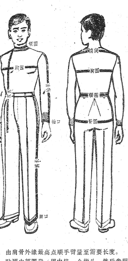

5．袖长：由肩骨外缘最高点手臂至部长度。
6．领围：贴颈中部围量一圈内空一个指宽。然后参照图度加放表加放松度。
说明：（1）特殊体型需分别量出前、后腋围长短。（2）要求较高女服装量从肩顶缝到乳头的高度和胸量左右乳头的间距，并测量前、后摆省高低。（3）袖口大小应根据式样而定，可参照前剪制测量前、后缝省高低。

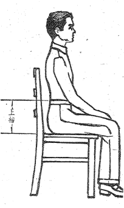

- 图实例中的“制图尺寸”，一般可不测量。

# 裤子测量方法

+ 1. 领长：从中腰部略隆脊骨处向上1.1寸(腋头宽)垂直量至委要长处。测量时被测者勿弯腰低头。量罢在被测者最贴贴服服胸口一张一同，然后参照图度加放条加放松度，量出时脚部松舒，坐舒自然，切勿吊紧气。
2. 胸围：同上衣。
3. 上档：从委屈部位胸骨向上1.1寸(腋头宽)向下量至胯下弧线，或是在坐褶处量起，量至前面再加0.3寸。
说明：胸口大小随式样而定。典型的尺寸是：男胸宽6.5～7.0寸，女者6.0～6.5寸。中档尺寸宜直接量就是图一/4-0.4寸。

— 256 —


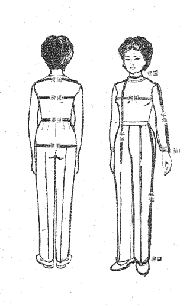

## 男、女服装量体周度加放表

测量人体度量所得的尺寸是紧身围的，如胸围、颈围、腰围、臀围等。做裁制图时，必须适当加放宽松量，这样做成的服装才会合体，穿着舒适。不同的服装品种，加放量也不同，具体方法见下表说明。

## 男上装整体幅度加放表

| 衣名 | 部 位 | 胸 围 | 领 围 | 说 明 |
|---|---|---|---|---|
| 中 山 裝（青年装、学生装、军便装） |  | 6.0寸左右 | 0.6寸左右 | 在衬衫外面量放 |
| 西 裝 |  | 5.0寸左右 |  | 在衬衫外面量放 |
| 春秋两用衫 |  | 5.5寸左右 | 1.5寸左右 | 在衬衫外面量放 |
| 长、短袖衬衫 |  | 6.0寸左右 | 0.7寸左右 | 胸围在衬衫外面量放 领围须重放 |
| 呢 短 大 衣 |  | 8.5寸左右 | 2.2寸左右 | 在领缘衬或珠衫外面量放 |

说明：量围因加放表只宜见凉季服，不能被暖装套。当裁制间季服装（如在秋季裁制冬季服装）或非正常体型服装，必须根据实际情形酌情加放。加放时还应注意衣料的缩水因素，呢料服装不宜加放过大。

## 女上衣量体圆度加放表

| 衣部名称 | 胸围 | 臀围 | 领围 | 说 明 |  明 |
|---|---|---|---|---|---|
| 两用衫（西装） | 4.0寸 左右 | 3.5寸 左右 | 0.7寸 左右 | 在衬衫外面量放 |  |
| 长、短袖衬衫 | 3.5寸 左右 | 3寸 左右 | 0.6寸 左右 | 胸围在衬衫外面量放 领围贴颈量放 |  |
| 呢绒大衣 | 7.0寸 左右 | 6.0寸 左右 | 比衬衫 领大 2 寸左右 | 胸围在线绒或呢绒衫 外面量放 领围在衬衫外量放 |  |

## 男、女裤量体圆度加放表

| 季节 | 部位 | 男 |  | 女 |  | 说 明 |
|---|---|---|---|---|---|---|
|  |  | 腰围 | 臀围 | 腰围 | 臀围 |  |
| 春 秋 |  | 0.8寸 左右 | 4.0寸 左右 | 0.5寸 左右 | 3.5寸 左右 | （1）在一般的单裤外面量放 |
| 夏 |  | 0.6寸 左右 | 3.5寸 左右 | 不放 | 3寸 左右 | （2）直筒裤腰围减少0.5寸为宜 |
| 冬 |  | 1.5寸 左右 | 4.5寸 左右 | 0.8寸 左右 | 4寸 左右 |  |

## 服装裁剪制图符号

| 符 号 | 名 称 | 说 明 |
|---|---|---|
| — | 辅助线 | 裁剪制图时首先划出的基本组织线 |
| — | 轮廓线 | 是衣片的实际轮廓线，在正式裁剪衣片时，必须另外放缝线 |
| ~~~ | 等分线 | 将一区段分成相等的若干小段 |
| —— —— | 连折线 | 表示衣片对折的线，系衣料上下层相连却不可裁开的线条，如后衣片的背中线等 |
| — — — — | 翻驳线 | 表示衣片的翻折，如前衣片的连挂驳取头、翻驳线等 |
| 7---7 | 注目线 | 用以表示这一部位的尺寸 |
| — — — — — | 影示线 | 裁剪时，常以先裁好的衣片与待裁的衣片互相重迭，作为参考，对重迭的部分用影示线表示 |
| ///// | 折 衩 | 根据体型需要作折衩部分，如裤子前片两只折衩，身材村后衣片的两只折衩等 |

| 符 号 | 名 称 | 说 明 |
|---|---|---|
| 收 省 | *根据体型需要，在衣片上要缝去的部位叫省，如胸省、肩省等* | 根据体型需要，在衣片上要缝去的部位叫省，如胸省、肩省等 |
| 율 拢 | 表示折臂的两边向中间折连，喇废在中间 | 表示折臂的两边向中间折连，喇废在中间 |
| 扑 拢 | 表示折臂向左右两边折连，喇面在中间，与归拢相反 | 表示折臂向左右两边折连，喇面在中间，与归拢相反 |
| 折 拢 | 表示折臂向一个方向折连，如女式的折臂袖等 | 表示折臂向一个方向折连，如女式的折臂袖等 |
| 归 拢 | 根据体型需要，在衣片的某些部位（如后衣片的肩峰处等）要求紧缩、收拢一些，称为归 | 根据体型需要，在衣片的某些部位（如后衣片的肩峰处等）要求紧缩、收拢一些，称为归拢 |
| 拔 开 | 根据体型需要，在衣片的某些部位（如后背中腰部位、后裤片的后缝凹势等）需要拉伸、称为拔 | 根据体型需要，在衣片的某些部位（如后背中腰部位、后裤片的后缝凹势等）需要拉伸、称为拔开 |

## 服装裁剪制图部位线条名称

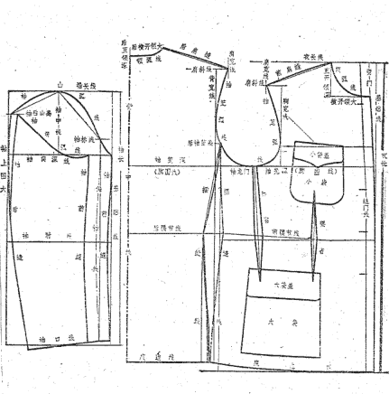

## 服装裁剪放缝方法


## 男、女 长 裤

人们现在穿着的服装，都是根据不同的体型，设计和制作的，制作人、文样师制图，腰部用折皱和收省予以收紧，加上后部位系条的设置，使裤子裤后具有饱满的立体感，两只裤管前后正中缝突出皱绉，据披，竖折，穿在身上显得合体，并对人体型有延长腿线等修饰作用。

长裤的式样变化表现在“腰头”有宽腰、连脚之分，“裤袋”有直形、弧形、梯形和外贴等区别。“后袋”有无盖、有盖、单或双绉的不同。“折绉”有单绉、双绉、顺绉（向前）、反绉（向后）和无绉等多种变化。男装还有脚踝或平口裤，裤口大的中口也是区别长裤式样变化的一种。一般的长裤裤口或小于中口；裤口细和中档同大的称为窄裤，式样稳重广大、近来比较流行；裤脚口大于中档的，称为宽裤。

男、女长裤裁剪制图，包括直接裤和一般女裤两种，并有单、双和褶、反折绉，以及直切领、斜切领等不同制图方法，此中，还有不同体型及处理方法。在制图计算法上，尽管减小分教案达到形体、以方便穿着。但是由于前后左右后片组织，故腰围和臀围宜用四分割计算。这种比较切合实际，能灵活应用。

要使裤子制成或样美观大方，穿着宽松舒适，量体是非常的关键之一。其有量体成画。裁剪制图时才有正确尺寸的尺度推算。

## 裤子测量方法：

- 1. 裤长：从腰的前部胯下向上1.0寸（略高）量，男裤垂直量至外脚跟下1寸左右高处左右立。女裤略短于男裤。
2. 腰围大：裤带放在腰部最细处，贴腰围量一周。另加放松量。

- 3. 臀围：在臀部最高处测，贴身水平围量一周，另加放松度。
4. 上裆高：从腰的侧缝踢骨处向上1.1寸起，量至裤口裆线处；也可坐在马上，量至裆部，加放0.2寸。
5. 腰口大：穿阔在29寸至32寸的直筒裤，其裤口大，男裤是四分之一裤腿减0.2寸，女裤是四分之一裤腿减0.4寸；长裤一般的裤口大，男裤6.5～7寸，女裤6～6.5寸。

## 胖体裤子裁剪制图示意

此图仅作胖体裤子变化示意，尺寸自定。虚线是正常的制图示意，粗线是胖体的制图示意。主要要有以下变化：

## 前片

- ①腰口宽裕些，使上裆适当加深。腰围一般在26寸以上的应开始上翘，腹部饱凸，显趋势高，30寸左右的腰围可上翘0.5—0.7寸。
②前门襟根据腹部凸出情况，从臀围线以上剪褶外移0.3至0.5寸，这样前后片褶腰可能一样大（净衣），甚至前片褶腰比后片褶腰大。
③裤口适当放宽。
④前加宽0.2寸左右，后裤减小0.2寸左右，腹部特大的（如近产期的孕妇），后裆可取消。
⑤小档适当加宽。

## 后片

- ①后翘与后翘的处理，粗实线是A B型，后翘加高后裤裆势加大，虚线是B型，后翘减低，后裤裆宽直。
②中缝强弱的处理，中缝线向上向外放出，倾斜度越大，其加大的腹部与臀部的处理比例而定，腰围越大，倾斜度越大。
③后省的处理，粗实线是A B型，后省略大。虚线是B型，后省减小，男式的可改成一省。
④裤口可加宽，二般定为八分之一一臀围至八分之一臀围＋0.5寸。
⑤后上档比前上档开落0.3—0.5寸。

## 后片

后片

## 前片

前片

268

## 男长裤（入门）

长裤是人们主要的服饰用品之一，造型美观，穿着舒适。其基本结构是由在右前后四块布组成。前裤片裤腰口收后挡，后裤片腰口有收省，使腰部收小，裤部宽松。裤腰前后后裥裤链，给人以整齐、健美之感。

长裤式样的变化主要在于裤部的折衬和裤脚的加大和小裤缝等。裤裆有单裤、双裤、正裤、反裤和无裤等区别。一般日常穿着的长裤，裤脚口略小于中裤；目前流行的是直筒式长裤，裤口和中档同样大。小直统裤由于裤脚口较大，裤管挺直，所以有整齐、稳重之感。长裤的口除了各种裤缝以外，圆底裤线、六角形贴兜，也可在长裤中应用。

如图介绍的长裤是裙裤式，腰头装裤带七粒，前裤片收顺厕两只，后袋口装盖缝做做“字”形袋开口，侧口做翻位。此裤是普通式男裤，适用毛料、布料和化纤原料均较适宜，老中青部均可穿着。


净缝制图 单位：市寸

| 裤长 | 腰围 | 垮围 | 上档 | 裤口 |
|---|---|---|---|---|
| 31 | 22 | 30 | 8.8 | 6.8 |

## 制图说明

【前片】裤子的前片制图可分三步进行，即“先定长度，后定宽度，再画轮廓”；第一步，①～⑤作五条垂直于布边直线，确定各

部位的长度；第二步，②～④线七条平行于布边的直线，确定各部位宽度（以上十二条构成成型的基细结构）；第三步，即在基细结构上作肩围轮廓线和领、袖、等七个部位。

## 先以布边作一条直线为“基细线”，然后依次作图

## 第一步 亮克克头（见图1）

- ①上平线 预留做缝0.2寸。
②增长线 ①～②是增长 -1.1（裤腰）=29.9那边另加1.5寸。期末口加3寸。
③上档线 ①～③是上档深 -1.1（裤腰）=7.7
④臀围线 ③～④是①～③的1/3≈2.6
⑤中档线 ②～①的居中上移1寸

## 第二步 后足宽底（见图1）

- ⑥定袋口位 ⑤基细线是数0.4
⑦侧结图势 ⑥～⑦是定数0.3
⑧带围大 ⑧～⑨是裤带围的1/4 0.3=7.2
⑨前档宽 ⑧～⑨是裤带围的1/20 0.2=1.3（也可用定数：男裤1.3～1.5、女裤1.1～1.3）
⑩拒缝线 ⑦～⑨的居中直线
⑪⑫胸口大 ⑪～⑫是胸口大的1/2 -0.25=3.15；⑪～⑫是胸口大的1/2 -0.25=3.15

第三步 弄肩轮廓（见图2）
在图1基础上制作，方法按“定点作弧”。
⑬下档线 连接③与⑤交点作①与⑩交点作一直线，中点⑩处凹进0.3厘米，自上而下连接三点做下档弧线。
⑭前点横线 前端口直角处作垂直线，量取0.7定一点，自门口上端点下通过四点连接成门襟弧线。

⑬腰口线 从门襟横线上端点起按腰围大的1/4 −0.3 +1.9（折袖）=7.1定腰要点，重迭上平线（门襟线上端点不是固定不变的，腰小臂大应向里取，腰大臂小，可垂直或向外取）。

⑭胸侧链条 从⑬与⑩的交点连接⑫与⑬的交点作一直线，中挡处凹进0.8点，再连接④与⑬的交点和腰要点，五点连接作出胸链弧线。

⑮驳领口线 按缝线下端凹进0.8后再连接⑬作驳领口线。

⑯驳口大 在缝线端上端离领口线下0.6为落上衬口，袋口大是牌臂围的1/10 +1.5=4.5为封口（一般可掌握在4.5~4.8）。

⑰折衩 前胸假驳领缝线0.2，袖大1.0，后胸的点是前胸至胸链线的中间。胸大0.9。

（裤子折衩有“顺衩”和“反衩”两种，本图是“顺衩”。“反衩”可参照本章第二节制图。）

【后片】后片有两种制图方法。一种是将做好的前片直接放在片牌料上，在有关部位，通过计算或适当加放效数刻制，另一种是按尺子计算单据制图。本图图采用前一种制图方法。单贴的制图方法可参照本章第二节。图中裁缝表示前片，实际表示后片。先将做好前片重迭的五条横线，直指此前片低0.2，然后按以下顺序作。

①胸链因势 剪部第一位是比前片放大1.3左右，顺下中档比前片放大0.6，胸口部分放大0.5，定好放点。

②后臂围大 是撑臂围的1/4 +0.3 =7.8

③后腋因势 在前片腋口线上离前挺线接腰围的1/20 =1.1定点，由此点连接臂围大点，作为斜线。

④后超高点 一般为0.6，在后链斜线后端，由前片腰口线向上量并作后超高点。

⑤后超腰口线 自后超高点起按腰围的1/4 +0.3 +1.0（省大）≈6.8作

## 图 1 前片基础结构线图

## 图 2 前片轮廓线图

## 图 3 后片裤脚线图

斜横线，与上平线相交，在此线中部上凸 0.2 作弧线，为后片腰口线。 ⑥侧缝线 连接裾围线与中档线两端点作一直线，并在上袖线至中档间的层次中点凹进 0.15，然后自上而下从弧口至裤口连接五点作


注：此料片图分离条样制作。


注：此为贴袋直统裤裤料图以及门、里袖制图。

侧缝线(注): 后缝线长度和侧缝线长度不是固定不变的，应随裤腰围与膝围的大小不同而有所变改。可参考特殊体型制图图变化。

- ⑦ 后档宽 是裤腰围的 1/8 - 0.2 = 3.55
⑧ 后缝四势 如图在身处分的角 分线上取0.6作点，然后从腰口至后档外端连接五点作缝线弧。
⑨ 下档线 中档比前档大0.6，至后缝线下端作一直线，居中凹 0.4，脚口比前片大0.5。自身上而下连接四点作下档缝线。
⑩ 脚口线 距裤腿底放宽0.2，连接两个脚口放大点作脚口线。
⑪ 后袋口 高度口宽2.1，离侧缝1.4，袋大是裤腰围的 1/10 + 1.0 = 4.0 (范围4.0 - 4.2)
⑫ 后省 省尖离腰围后0.8，省中线与后缝线平行，省长超过袋口 0.8，省口大约0.6
⑬ 后省 省尖离裤口角0.8，省中线与后缝平行，省长至裆口，省口大约0.4

## 直筒裤

近年来直筒裤比较流行，特别是很受青年姑娘的喜爱。直筒裤裤管口较大(与中档同大)，裤管更直，所以有笔齐、稳重之感。在裁剪直筒裤时，腰围可以略紧，中档应略为上提，这样更能反映裤管的宽松挺直的特点。

净缝制图 单位：市寸

| 裤长 | 腰围 | 臀围 | 上档 |
| --- | --- | --- | --- |
| 30 | 21 | 30 | 8.7 |


## 男 上 装

男式服装的造型，讲究整齐、大方、穿着之后使人感到仪表庄重。风采照人。男装的品种很多，其中最常见的有中山装、春秋衫、衬衫、西装等。中山装在我国非常普遍，密封的衣领端正严肃，四只对称的衣服有稳重的感觉，美丽实用，腰部略有收拢，后背独块平整，整件服装的造型显得非常端正、整齐、庄重、朴实。因此很受我国人民的欢迎，已经成为我国最有代表性的男装之一。中山装的另一特点是选料面广，不是一般的棉布、卡其、中长纤维或是高档毛料、呢绒，都可用来缝制。它的用途广泛，实用性强，平时学习工作可以作为便服，节假日或外出郊游又可作为礼服。

衬衫是男装的又一品种，顾名思义它是一种内衣，但在夏季人们也把它作为外衣穿着。衬衫的衣服部分上领下领，前领缝合有双层的领肩，左胸部有一个胸袋。独式的袖子，下领装置袖口，可把袖口包起来。这种式样的衬衫，领子还是领衬的领顷，自行制作者较少。根据现在的变化趋势，内衣在逐步向东方变化，同时也是衬衫式的衣裤结构，只有较短的外衣或连衣裙式的衣裙，很可作为在夏季寒等时的两用衫。由它已经成为外衣穿，衣料选择除了领部、袖围等类的薄料以外，亚罗丁和各类条化化织物等均可制作。因为这类领软式的两用非常奈

实 务，又便于自行缝制，所以这里的裁剪图例是以介绍用布样为主，衬衫的裁剪图例也略作介绍。

西装的特 点是领较长，选料讲究，式样平挺、美观、大方。随 着我国人民生活水平的提高 日益改善，穿西装的人将会增多。但西装的缝制难度较大，一般家庭裁缝独自缝制。这里所作的裁剪图例介绍 仅供爱好者参考。

## 上装量的量体方法：

- 1. 衣长，由颈项根（肩的最 高点起），通过胸侧量至 塌袖中 节 2. 胸围，从腋下胸部最丰满处取水平 断身 量一 周，加放松 度。 3. 肩宽，从左肩骨外缘经 后颈量至 右肩骨外缘。 4. 袖长，由肩骨最高点顺手臂垂直量至虎口。 5. 袖围，腕部四围量一 周，加放松度（内放一个手指）。 6. 袖口，谨拟式样而定，中山装一般 5 寸左右，西装 4.4 寸左右。

## 衬衫（入门）

衬衫是指穿在中山 装、西装、春秋衫里的一 种服装品类。实际上人们在 夏季最常作为外穿着。

男式衬衫的式样变化主 要在于领子，有长尖领、 中 尖领、中方领、小方领、圆 角领等。腰身有直腰式和曲 腰式。下摆有平下摆和圆下 摆之分。这里介绍的是中尖 领、直腰身、平下摆衬衫， 正中开口，左胸袋一只，肩 衣片左上肩部位各折 后一 只，袖子开叉，袖口折袖三 只。造型特点是整齐宽敞。


领斜大方，各年龄的男子均适合穿着。适宜用漆棉布或府绸等衣料制造。

## 净缝制图

单位：市寸

| 衣 | 长 | 阔 | 领 | 阔 | 领 | 阔 | 袖 | 长 |
|---|---|---|---|---|---|---|---|---|
| 21.5 | 33 | 14 | 11.5 | 17.5 |

## 制图说明

【省片】男式衬衫与其它的不同点是肩部有一块连接前后衣片的另一“蝴”片，因则制图时后衣片需打去肩宽。制图的步骤无过前、后片、领、袖子，肩部等都是先后进行，即先定长度，后定宽度，再画轮廓。第一步，确定各部位的长度；第二步，确定各部位的宽度；第三步，在连结前袖时作肩轮转线，方法是“定点作弧”。先画门缝贴边1.2厘米一条平行于布边的直线为“止口线”。

第一步 先定长度（见图1）
①下平线 预留贴边0.8
②前衣长线 ①～②是衣长 0.9 = 20.6
③肩斜线 ②～③是胸围的 1/20 0.2 = 1.45
④直开领深 ②～④是领围的 1/5 0.4 = 1.9
⑤袖筒深 ③～⑤是胸围的 1.5/10 = 4.95（胸围线）

第二步 后衣宽度（见图1）
⑥进门线 止口线～⑥是定数0.6
⑦横开领宽 ⑥～⑦是领围的 1/5 0.5 = 1.8
⑧胸宽线 ⑥～⑧是胸围的 1/5 0.5 = 6.1
⑨肩宽线 ⑧～⑨是肩宽的 1/2 0.4 = 6.6


①前袖窿宽 ②一是胸围的 1/20 + 0.2 = 1.85 垂直至下平线为挎缝线

系三步 尻轮条（见图2）

在图1的基础上作图2。

①肩线续 由②与③交点连接③与⑨交点

②领口弧线 在直角作角分线并取0.8点处，领口上超0.1，按


图1 前片基础结构图      图2 前片轮廓线图

# 图示连接四点做领面纸

①袖窿宽线 自领面纸外端至袖窿深 2/3 处作垂直线，中部凹进0.1定点。下边直角处作角平分线0.7作点，按图示五点连接作袖窿宽线

②底边宽 底边宽取胸围0.2，略呈弧形

③领口 领口高取胸围0.9。裾后边高胸宽1.0。领口大是胸围×1/10→0.2×3.5。领中心长是胸围的1/10+1.0=4.3。领后斜势0.5

④眼位 钮眼六只，第一只眼在下领中间，最下一只眼位离底边是长度的1/5=5.4，中四只眼排匀

【布片】先把衣料折成双层，将波折线定为“背中线”。
第一步 先定长度（见图3）
①底线 预留加边0.8
②后衣片长线 ①→②衣长=1.7=19.8（比前衣片短0.8）
③领高斜 ①→③定数为0.4
④袖窿深 ③→④是胸围的1.5/10+0.5=5.45（胸围线）
第二步 后衣宽宽（见图3）
⑤背宽线 背中线→⑤是胸围的1/2+0.5=7.1
⑥肩宽线 背中线→⑥是背宽的1/2+0.6（袖）=7.6
⑦折袖线 ⑦是⑧至背中线的半向袖宽一边加0.5，阔大0.6
⑧后袖窿宽 ③→⑧是胸围的1/20-0.2=1.45。垂直至底边为裤缝线

第三步 车肩肩条（见图3）
⑨宽肩线 由折袖起至③与⑧交点作假肩线
⑩袖窿宽线 自假肩线外端连袖窿深1/2处作直线，中部凹进0.1作点。下边直角处作角平分线取0.8作点，按图示四点连接作袖窿宽线

【底布】先将衣料折成双层，再将逝折线定为背中线。
第一 步 先定长（着）度（见图 4）
①下平线 与背中线成直角


②覆肩高线 ①～②是胸围的1/10 0.6=2.7

③直开领深 ②～③是领围的1/10 1.15

④肩斜线 ②～④是胸围的1/20 0.5=1.15

# 第二步 后宽宽度（见图4）

⑤横开领宽 背中线～⑤是领围的1/5=2.3

⑥覆肩宽线 背中线～⑥是肩宽的1/2=7


图5 袖片图

# 第三步 弄肩松量（见图4）

⑦领围弧线 先作垂直平分线，在半颈分线量取0.5定一点，再在横开该二分之一处向后量0.3定一点。三点连成弧线

⑧肩峰线 从领围弧上线端连接④与⑧的交点

⑨肩峰袖宽线 从肩峰线外端延长0.2，连结①与⑧交点作弧线

【袖片】须做做作“一”直线作“基线”。

# 第壹步 先定长度（见图5）

①下片长度 领围做皱0.3

②袖片长度 ①～②是胸围长 -1.8袖口=15.7

③袖筒深 ②～③是胸围的1/10 -0.5=2.8

# 第二步 后是宽度（见图5）

④袖围前宽 基线～①是胸围的1/10 +1.8=6.75

此图为285页“短袖筒用样”的净制图


⑤袖围后宽 ④～⑤与袖围前宽相同

⑥袖口前大 ④～⑥是胸围的1/10 +1.3=4.6

⑦袖口后大 ④～⑦与袖口前大相同

# 第三步 弄肩袖垮（见图5）

⑧袖围底线 在袖筒断处绘作对角线，前袖下凹0.3，上凸0.2，后袖上凸0.4点，七点连结按图作出袖筒弧线

⑨袖底线 由基线与③的交点连接⑦与⑧交点及⑧与⑤交点连接①与⑦交点，并各延长0.3

⑩袖口线 按图示作出袖口弧线

⑪交文 袖口后大的1/2后移0.5，又长是胸围的1/10 +0.5=3.8(--

般掌握在袖头的½

必折断 袖前一只，袖后二只，每只0.6，间距0.3

# 短袖两用衫

这是一种男式的夏季兼本服装，式样大方，穿着凉爽，很实用。它可选用府绸、麻纱和涤棉布裁制，对青年同志来说，也可选用比较流行的条格料或花纹物裁制。式样的变化主要在口袋，领子和袖口翻边等处，贴袋的лих方有方、圆角和六角形等等，领子的领角有平角和尖角之分，袖口翻边近年来流行外翻形式；后衣片有帽，穿着者可根据自己的爱好选定。
绘缝制图 单位：市寸

| 衣长 | 胸围 | 肩宽 | 袖长 | 领围 |
| --- | --- | --- | --- | --- |
| 21.5 | 33 | 14 | 6.2 | 12 |


# 中山装（入门）

中山装的造型美观、整齐、端正、大方，具有独特的中国民族风格，可说是男式服装中的代表品种，深受人们的衷爱。我们只要掌握中山装的制作顺序和方法以后，对其他的男式服装如学生装、军便装、春秋衫、西装等的制作，根据变化就能迅速切而解，因为它们的衣片结构与中山装是基本相同的。

# 净缝制图 单位：市寸

| 表长 | 胸围 | 肩宽 | 领高 | 袖长 |
| --- | --- | --- | --- | --- |
| 22 | 33 | 14 | 12 | 18 |


图 1 前片基缩结构线图


图 2 前片轮廓线图

中山装的样式是立领，衣领由上下二根翻领组成，四散领、平后背；衣片左右对称，布肩均匀衡，庄重端正；而又有精美大方、不断显老性，中年、老年穿着都非常适宜。作为日常活动穿着，可选用卡其、斜纹、漆布、中长纤维织物等布料制作，如作为礼服，可用呢坯、华达呢、花呢等高级衣料敷制，并在胸部、衣领、袋盖等处，用树脂软化剂配合衬料衬垫，经过定型处理后，就能保持挺括不变型。


# 制图说明：

中山装的制图方法袖口同袖长是定长度，后宽宽度，再画前带。定点作画，前幅，后幅，袖干部是分三步进行。第一步确定各部位长度；第二步确定各部位宽度；第三步在基础结构线上作轮廓线。

> 【背片】离布边3.0作一直线为制图的“基础线”。

# 第一步 先定长度（见图1）

+   ①下摆线 顶量领边 1
②衣长线 ①～②按衣长22
③斜肩线 ②～③是胸围的 1/20 = 1.65（拐肩和挺胸的增减，平肩和驼背的增减）
④直开领深 ②～④是领大的 1/5 = 2.4
⑤袖宽深 ③～⑤是胸围的 1.5/10 + 0.8 = 5.75（胸围线）
⑥后袖高宽 ⑤～⑥是胸围的 1/20 = 1.65
⑦中腰线 ②～⑦是衣长的 6/10 - 0.6 = 12.6。摆缝处上翘 0.4
⑧边皮起翘 ①～⑧一般体形上翘 0.6（挺胸凸肚的增减，增加）

背的情绪少)

# 第二步 后定宽度（见图1）

①剪门线 基踝线～⑥是定点0.6,也可以根据胸围的2%计算（裁剪时，只裁左片，右片少裁或不剪）

②选门线 ⑧～⑨定是0.5，与①平行

③横背领大 ⑩～⑪是领大1/5 -0.1=2.3

④胸宽线 ⑪～⑫是胸围的1/5 -0.4=6.2

⑤背宽线 ⑬～⑭是肩宽的1/2 -0.6=6.9

⑥前宽门宽 ⑭～⑮是胸围的1/10 +1=4.3

# 第三步 画肩轮廓（见图2）

在图1基础上作轮廓，方法是“定点作弧”。

⑦领弧线，在夹角处作角分线取1寸作点，按图示将三点连接成领弧线

⑧肩线线 将②与①交点连接③与⑥交点作肩线，略显外弧形

⑨袖宽弧线 自肩线外端连袖窿袖深2/5处作直线，中间回进0.2作点，前夹角处作平分线取0.6作点，后夹角处作分线取0.9作点，按图示将各点连成袖窿弧线

②小袋 高与第二只眼位平齐，后袋角上跳0.3。袋位是前胸宽的½向轴竖处移0.3；为袋口的中袋口是胸围的1/10 +0.2 =3.5。
前袋边与⑦门襟止线平行。袋深是衣长的1 1/5/10 +0.9=4.2。袋底宽比袋口大0.4。袋盖两边宽1.2，中间宽1.7
③胸省 上端位于小袋层次中前缝处移0.1，下端离进大袋前角0.5左右，要照顾衣料的丝缎作省中线；上端平第三粒眼位，下端深入衣口0.6，中间收进0.4
④胸省 上端是胸围的1/20=1.65，省大0.3，取省中点线。下端离进大袋后角0.8，省长深入袋口1.0，中间收进0.6
【后片】先把衣料折成双层，将选择线定为“背中线”（或划一条垂直为制图“基准线”）。
第一步 先定基本位（见图3）
①⑧⑦⑨袖线的相互间距与前衣片相同，但有时为了排料关系需先裁后片，后裁前片，其作图顺序要先从以下：
①下平线 预留作1.0
②衣长线 ①～②按衣长，前衣片超起0.6+0.4=21.8
③直开领深 ②～③是胸围的0.2/10=0.66
④肩斜线 ③～④是胸围的1/20-0.2=1.45
⑤袖窠深 ①～⑤是胸围的1 1/5/10+2.05=7
（胸围线）
⑥后袖窠高 ⑤～⑥是胸围的1/20=1.65
⑦中腰线 ②～⑦是衣长的6/10-0.6=12.6
第二步 后衣宽度（见图3）
⑧横开领大 背中线～⑧是领大的1/5-0.1=2.3

⑨ 背宽线 背中线～⑥ 是胸围的 1/5 - 0.3 = 6.3

⑩ 背宽线' 背中线～⑧ 是肩角度的 1/2 + 0.1 = 7.1

⑪ 后袖窜宽 ②～⑥ 按背宽线放出 0.3

⑫ 中腰大 背中线～⑬ 是胸围的 1/5 - 1.2 = 5.4

# 第三步 悬点曲带（见图4）

在图3基础上作图4.

⑬ 领窝线 在夹克处作角平分线取0.4作点，由横领宽1/2处向上三点连接作领窝线

⑭ 肩缝线 连接⑬与⑧交点和④与⑪交点作肩缝线，略呈外弧形

⑮ 袖窜锁线 自肩缝线下端连接袖窜宽2/3处作辅助线，中间取0.1作点，如图四点连顺作袖窜锁线

⑯ 擀堆线 连接⑮与①交点和⑦与⑫交点，在下摆处取背宽线和中宽宽间距离的1/2，按图作擀堆线

⑰ 底边线 在摆线与背中线之间下平线量起

# 【第六片】先布步0.3作一条直线，作为制图“基准线”。

# 第一步 先定长度（见图5）

① 下平线 预留贴边1.3

② 袖长线 ①～② 始长长1.8

③ 袖后山高线 ②～③ 是胸围的 1/20 = 1.65

④ 袖筒深 ②～④ 是胸围的 1/10 + 1.2 = 4.5

⑤ 袖标线 ④～⑤ 是②～④ 的 1/4 = 1.1

⑥ 袖肘线 县①～⑤ 的居中

# 第二步 左右宽度（见图5）

图 4 后片轮廓线图

图 3 后片基础袖峰线图

⑦偏袖线 基袖线～⑦是定数0.8
⑧袖围大线 ⑦～⑧是围的 1.5/10 +1.6=6.55
⑨袖中线 是⑦～⑧的 1/2 移前0.3
⑩袖口大 ⑦～⑩袖口大5.2
系三步 系肩松度（见图6）
在图5基础上作出图6。
【前袖缝线】
在⑦与基袖线交点处凹进0.3旁势，按图则画前袖缝线
【偏袖弧线】
①偏袖弧线 与前袖缝线距离0.8划偏袖弧线
②后袖缝线 自上端离上袖围线划进0.1，袖肘（胖脸肋）线前刨进0.3，下接袖口大，作弧线
⑧假袖口 横摆下平线，前上翘0.3,后下移0.3，作袖口斜线(在偏袖部位划成平横)
【袖山弧线】 先从⑦与③交点作垂直线，在与③的延长线的交点前上0.6点作，再将③与④交点与③与⑤交点作直线，在 1/2 处斜上0.4点作，并从③～⑦交点，连接⑦与基袖线的交点作直线，中间回下0.1点作，按图示将七点连接作袖山弧线 【袖小片】 在图8基袖上作图7。
【前袖缝线】 以袖大片为基缩，前面减去袖帽0.8,与偏袖线弯势一样作弧线
【后袖缝线】 后袖山处按袖大片后袖缝偏进0.5，袖臂深处偏进0.3，按图作后袖缝线
⑪袖肩弧线 在袖中线与袖臂深线的交点至后袖缝线上端作斜线，并在袖臂深线下凹0.2，按图作袖肩弧线
⑫袖口线 与袖大片袖口线重迭

# 图 7 袖子片等长线图 图 6 袖子片等长线图 图 5 袖片等长线图


# 单排钮西装

这是目前西服式样的一种革新式样，造型美观、整齐、适直中。青年男子穿着，单排两粒扣，平驳领，三只开袋，胸膛宽开到底，正身是六片构成的，后背开叉。

单位：市寸

| 衣 长 | 净 胸 | 摆 围 | 肩 阔 | 袖 长 | 袖 口 |
|---|---|---|---|---|---|
| 22.5 | 32 | 14 | 17.5 | 4.5 |


# 双排纽西装

这是目前流行西服的一种基本款式之一，式样稳重、整齐，适宜中年以上男子穿着。双排一粒钮，枪驳领，驳角较长，一般至腰节以下二寸半左右，与领口连系，左右翻缝开叉，三只开袋。

净缝制图 单位：市寸

| 衣长 | 胸围 | 围 | 肩宽 | 袖长 | 袖口 |
|---|---|---|---|---|---|
| 22.5 | 32 | 14 | 17.5 | 4.5 |


# 西装背心

西装套装有两件套和三件套两种。两件套是上装和裤子配成一套，三件套就是再加一件背心。西装式的背心大多是尖角型领圈，尖角型下摆，正中开摆，五粒明钮，四只斜口插袋。后衣片大多用驳纱制剪。西装式背心，一般不单独穿着。


净缝制图     单位：市寸

| 背心长 | 腰节长 | 胸围 | 肩幅 |
| --- | --- | --- | --- |
| 17.5 | 13 | 29 | 11.5 |


# 女上装

衬衫。一般是妇女穿着的内衣。到了夏季，衬衫就为内衣之外分。通常以穿着舒适、爽快、款式轻松自然、色泽清新、文雅为宜。一般可选用棉布、丝绸、涤纶等料缝制。量体方法：（1）衣长：从肩峰起（贴紧颈部）向下方量到需要的长度，约为人体总长（身高减去头部和颈部的长度）的4/10。（2）胸围：沿胸部最丰满处围量一圈，再加放2.5—3.5寸。（3）臂围：在臂部最丰满处围量一周，再加2—3寸。（4）肩宽：从左肩骨的外肩峰量至右肩峰的外肩端，得净宽；（5）袖长：由肩部外肩峰量至手臂弯处，有的袖长总长的3/9、10；短袖长约为人体总长的1/3、10。一般为5.5—6寸；（6）袖口：长袖衬衫，围量手臂一周，加放1.2寸，短袖衬衫，围量手臂一周，加放1.5寸。（7）领围：在头颈粗细处（中部）围量一圈，加放0.5—0.7寸以上保证穿着正好。如数正规平常，高领量稍不加放宽松。胸筒处理。

毛衣。是妇女家穿爱的春秋季服装。它的优点轻巧、合身、美观和穿着舒适等特点。一般可适用毛线、中长纤维、针织涤纶等缝制。量体方法及加放准，基本与衬衫相同。

连衣裙，又称连衣裙，是上衣、下裙组合为一式的服装。它的有美观、大方、合体、省料等优点。一般连衣裙可选选用棉、涤棉、棉布等比较流行选用风的料子缝制。量体方法：（1）衣长：从肩峰起（贴紧颈部）至臀量下2—3寸。（2）胸围：按量得的净数，再加放1—2寸。（3）腰围：按量得的净数，再加放1—2寸。（4）臂围：按量得的净数，再加放1—2寸。（5）后幅节能，先在腰部量级处绘线一根虚线，使其前后左右成水平，然后从腋底至前身，经过腋下最高点，至盆腔结节处为止既成前腰节；从肩峰绕过后背，经过后肩部，也至盆腔结节处为后腰节。（6）袖长：可略比衬衫短袖长一整，一级6—6.5寸。（7）袖口：围量手臂一周，加放1—1.2寸。（8）领围：同衬衫。

两用衫：它以灵、简洁、多样、朴素、美观、大方和做工简单方便而

紧袖,是妇女春季不可少的生活服,亦称有春秋衫之称。一般可选
用毛料、中长纤维、针织条绒、漆卡或丝绵绸等料缝制。可以缝制成
单衣,也可以缝制成半夹袄和夹衣。它的量体方法与法式上衣与上述三品种
相似 and,只是在加放前后片时须根据穿内衣多少而不同。一般均
在穿着时量身见效,西装式比较时可加穿一件长衬衣。量体的加放数据:
(1)衣长:约为人体总长的4/7,10, 一般比衬衫小0.5寸。(2)胸围:加放4.5~5寸,一般比衬衫长2寸。(3)臂围:加放3.5~4.5寸,一般比衬衫大2寸左右。(4)肩阔:加放0.2~0.3寸。(5)袖长:约为人体总长的4/10,一般比衬衫长0.3~0.4寸。(6)袖口围:一件裁缝袖略口一加放1.5~2寸。(7)领围:围量衬衫颈子一圈,加放0.6~0.8寸,一般比衬衫领围大0.6~0.8寸。以上均指正常体型,如系非常体型,应根据不同情况酌情增减。

女士高裁:西装的裁制在技术和工艺上的要求比其它较高的,初学
者可以从高裁西装入手,在掌握了一些特性好和领背的基础后,再逐渐
改进和提高。西装的款式比较多,常见的有平驳领和斜驳领两种。量体
的方法与西用杉基本同,胸围和臂围的加放数据可以比用杉小0.5寸,但要增量腰节的数据。西装一般选用毛料缝制,使成衣挺括丰满,美观大方。

女上装的花色领带设计和出来,工艺比较轻微,花色领带设计和出样的好坏,直接关系着到成衣的外观质量和工艺质量。

一般讲,领带设计是——种形象设计。我信用的方法有,方巾领、尖角领、圆领等,是由方、长、圆、菱等静物物体和简单条形形象而来的。大襟式的盛装,领管领、蝴蝶领、羊角领、荷花领、香蕉领等,是根据生活形象设计的,有些领带线条比较流畅,需用立体裁剪的手段方能出样,象多层领领、双领领、ocese条领等,仔细观察形象浮动着云、动感的,水波纹的或是各种颜色的形象的形象设计,造型形态设计和绘制衬剪设计,总之,一种花色领都在设计和出来应注意成衣的话,应把领坯好领带对照着面容的衬托;领带与整体变化的结构布局,领带造型的结构原理;领带平面制图的方法和计算公式。


# 两用衫（入门）

两用衫穿着时领口下的一第一颗纽扣可扣可不扣，褪开成翻领式，所以可上衣穿为两用衫，是中年妇女的基本服装。同时这种服装大而近在爸在秋季穿着，故也称为秋季衫。

两用衫的样式有直腿式、聚摆式等，领子有方角领、尖角领、圆角领以及大翻领和连结领等，省位直省（即肩省）、横省（即胸省）、领省等。裁法有斜裁按、暗连袖、贴袋、横开等设计。其款式的设计和造型，可以根据各人的喜好，年纪等而异，目前年轻人流行穿着廓腋，前后衣片作不同形状的分割，造型新颖活泼。

下介绍的这种两用衫是尖角领、宽腰松、收腰形胸省、直插袋（附挡片领）、四钮明扣，后衣领块、平整小破，这是女用两用衫中的基本式样，也是学习后上装裁剪制的半基础。

净缝制图 单位：市寸

| 衣长 | 胸围 | 前领节 | 背面 | 领围 | 袖长 |
|------|------|--------|------|------|------|
| 19.5 | 30   | 11.8   | 12.4 | 11   | 16   |


# 制图说明

女式两用衫前、后衣片和袖片的制图步骤都是分三步进行：第一步确定各部位长度；第二步确定各部位宽度；第三步在直楞盖袖结构线工作上精确线，方法是点作弧。

【奇片 领窝门襟处（连面）2.1（也可加贴边）作一直线为止口线。】

# 第一步 先定衣长（见图1）

+   ①下平线 颈前点起0.8
②衣长线 ①～②是衣长19.5
③肩斜线 ②～③是胸围的 1/20 = 1.5
④前开领深 ②～④是领围的 1/5 = 2.2
⑤袖窿深 ⑤～⑤是胸围的 1/5 + 1.4 = 5.9（胸围线）
⑥前腰节线 ②～⑥按腰节长11.8，肩过0.3
⑦底边起翘 ①～⑦ 0.4

# 第二步 后衣宽度（见图1）

+   ⑧进门线 止口线～⑧一般0.7
⑨横开领大 ⑧～⑨是领围的 1/5 - 0.3 = 1.9


①背宽线 ⑧～⑪是肩宽的 1/2 -0.2 = 6

①胸围大线 ⑧～⑪是胸围的 1/4 = 7.5

①前半胸宽 ⑫～⑪是胸围的 1/10 -0.4 = 2.6

③袖窿门线 ⑤～⑬定宽 0.8（可视胸胸高低而增减），连接⑤与

②交点后半胸宽 ⑫～⑪是胸围的 1/10 = 3. 与⑬成垂直

# 第三步 系肩轮廓 （见图2）

在图1基础上作轮廓线，方法是“定点作弧”。

①领弧线 夹角作角平分线取0.9作点，如图作领弧线

②肩缝线 ②与⑫交点连接③与⑫交点

④袖宽线 自肩缝线下端至袖窿深 2/3 处作直线，中间凹进0.15作点，夹角处作角平分线取0.6作点，如图示五点连接袖窿弧线

⑤摆缝线 宽门宽是胸围的 1/20 +0.4，下摆从起袖点放出0.6，划出


图1 前片基础结构线图

# 熨缝线

①挑胸省 从④向下定 3寸连接③④交点并向外适当延长作为胸省的中央线，然后依中心线为基准线，收省大约 0.9（比⑤～⑥大0.1）上，下各4.5. 从熨缝线向上作垂直线，省尖是熨缝→⑥的1/2。照图示作收缩省线，最后按图作上摆线

# ②成边线 从下摆起延伸点作至成边线全长的一般左右，略呈外弧形。其余一半左右与下摆垂直连

③直插袋 袋口大是胸围的1/10+1.2=4.2. 袋口宽0.3. 上位位置是胸省成或0.8,下位位置在胸宽线上

④开袋 袋口距离腰节线为腰长的一半，袋口胸宽-0.8为袋口中点. 袋口大是胸围的1/10+1.2=4.2. 与成边平行

# ⑤眼部 上眼距领口0.6,下眼与横开领平齐（是直插袋口大的1/2）,中间二只距离均匀


图2. 前后轮廓线图

> 【启示】先把衣料折成双层，将折痕线定为“背中线”，做作为一条直线为制图“基线”，

# 第一步 先丈长度（见图3）

+   ①下袜线 保留0.8
②衣长线 ①～②是衣长19.5

③直开领深 ②~③是胸围的 0.2/10 ≈0.6

①肩斜线 ②~①是胸围的 1/20 -0.2 =1.3

⑤袖窠深 ②~⑤是胸围的 1/5 +1.7 =7.7
（胸围线）

⑥后腰节线 ②~⑥按腰节长11.8

图 3 后片基础结构裁剪图

# 第二步 后衣宽度（见图3）

⑦横开领大 背中线～⑦是领宽的1/5 -0.2=2.1

⑧背宽线 背中线～⑧是胸围的1/5 -0.3=5.7

⑨肩宽线 背中线～⑨是肩宽1/2 +0.3=6.5

⑩后驳门宽 ⑧～⑩是胸围的1/20 +0.3=1.8,垂直至下见线

# 第三步 画基准线（见图4）

①领弧线 在夹角处作角平分线,取0.4点点,由领宽1/5处向上作领弧线

②里肩线 将②与⑦交点连接

④与③交点,作直线

③后肩省 省领端口是胸围的1/20 =1.5,省宽0.4,省长2.7,省尖位距背中线是胸围的1/10 +0.2=3.2,按图纸作弧形省

④外肩峰线 在③与⑨交点下移0.4,连接肩省线外肩峰线

⑤袖窜弧线 自外肩峰下端连接袖窜深的1/2处,中间凹0.15点,夹角处作角平分线取0.9作点,如图5点连接,成袖窜弧线

⑥摆缝线 下摆放出0.3作摆缝线

⑦底边线 上翘0.1作底边线 【大袖片】先离布边0.3作一条

图4 后片轮廓图


直线作为制图的“基准线”。

第一步 先定长度（见图5）

+   ①下平线 预留贴边1.2
②袖长线 ①～②是袖长16
③后袖山线 ②～③是胸围的1/20 = 1.5
④袖筒深线 ②～④是胸围的1/10 + 1 = 4
⑤袖标线 ④～⑤是②～④的1/4


图5 袖片基础结构线图

图6 大袖片轮廓线图

⑥袖肋线 是①～③的居中 第二步 后宽宴见（见图5）
⑦里偏袖线 基袖线，⑦是定数0.8
⑧袖围线 ⑦～⑥是胸围的 1.5/10 +1.4≈5.9
⑨袖中线 息①～⑧的 1/2 移前0.3
⑩袖口大 ①～⑨是4.2
第三步 系鱼角线（见图6）
第1袖前缝线 在前袖线与袖肋线的交点上进0.3为等势，按图作 袖前缝线
⑪前偏袖线 与前袖缝线距离高0.8 作折断线
⑫后偏袖线 上端在后袖山线上 离袖围线0.1，袖时处上袖围线0.3， 下接袖口大，按图作出折断线
⑬袖后缝线 在袖前第五线外放1作点，袖时线放出0.7，袖口处放出0.5，三点连线，并延长至袖山弧线相交为袖后缝线 
⑭袖山弧线 先从⑤与⑦交点至①与基袖线交点作直线中间向下0.1作点，并自⑦交点连直线②③交点作直线，在与③的延长线相交处向上0.5作点，再从②交点至③交点作直线，在 1/2 处斜上0.3作点，如图自袖前缝上端至袖后缝上端七点连成袖山弧线，外偏袖顺势剪出
⑮袖口弧线 在下平线上，前上超0.3，后下移0.3，作袖口斜线，里袖

# 图7 小袖片轮廓线图


# 袖处收窄线

[小茉莉] 以大袖片轮廓线图为基础，见图7。
前后上下放去袖筒尺寸，按图示前后袖缝线，然后在袖筒深线处下取0.3，经袖中交点，按图示作袖筒弧线。袖口线与大袖片袖口线垂直。

# 菊芹领春秋衫

单排二粒钮扣下摆，圆形连驳领，仿生物菊芹形状而设计，故称菊芹领春秋衫。前衣片领围收成斜领，曲线式，眼眶收一适宜形状领省；领袋口圆贴袋，后衣片做缇，圆紧袖，袖口缝有暗叉。式样新颖别致，宜用各类小格和松软的呢料制作。

# 净量制图

| 衣长 | 胸围 | 领围宽 | 肩宽 | 袖长 | 袖口 |
|---|---|---|---|---|---|
| 20 | 30 | 11.7 | 12.4 | 18 | 4.1 |


# 尖驳领春秋衫

此件上衣式样整齐大方，实用性强，可用各类化纤织物、条格中长纤维、呢料等制作，青年、中年妇女都适宜穿着。式样是：尖角翻驳领，单排三粒钮，前衣片由两块片组合而成，胸部收横省，西装式裤袖领，后衣片做缝开叉，圆摆袖，袖口开叉，钉二粒装饰钮。

净缝制图
单位：市寸

| 衣长 | 胸围 | 肩阔 | 前颈节 | 胸宽 | 袖长 | 袖口 |
|---|---|---|---|---|---|---|
| 19.5 | 30 | 12.4 | 11.8 | 7.2 | 16 | 3.8 |


# 尖驳领双排钮西装

这种尖角长驳领、双排二粒钮女西装，前后衣片都作T字型剪开，连接腰省直通到底，式样新颖、别致，可用条格呢料、中长纤维等软料制作，适宜青年妇女在春秋季节穿着。

| 净缝制图 | 单位：市寸 |
|---|---|
| 衣长 | 前腰节 | 胸围 | 肩阔 | 袖长 | 袖口 |
| 19.5 | 11.8 | 30 | 12.4 | 16 | 3.6 |


# 平驳领单排纽西装

这款平角领单、单排二粒钮女西装，肩缝收省窄，腋间收省省，暗插袋，外饰平角叠驳，后片做背缝，圆驳袖，式样雅朴大方，可选
用紫色呢料或条格化纤等织物缝制。下身配以同样的衣料做成裤子或裙子，即为套装，其式样较为流行。

# 净缝制图

单位：市寸

| 衣长 | 胸围 | 肩高 | 褶节 | 肩阔 | 袖长 | 袖口 |
|---|---|---|---|---|---|---|
| 20 | 31 | 7 | 12 | 12.4 | 16 | 4.2 |


# 中式宽腰棉袄

中式宽袄是我国的传统服装样式，在民间流行普遍。它是由娃娃衣料裁成，逢袖式，不做肩缝。用它来作为冬季的棉袄最为适宜。保暖性能好，穿着舒适，双手举动方便。开襟的形式有两种，一种是盘襟式，配用中式的盘花钮扣；另一种与西式服装的开襟方法一样，有选门，开洞装。如果制做棉衣，应该比棉袄放宽0.2寸。

净缝制图
单位：市寸

| 衣长 | 腰围 | 堆肩 | 领围 | 袖长 | 襟口 |
| --- | --- | --- | --- | --- | --- |
| 19.5 | 32 | 6.9 | 11.4 | 22 | 4.9 |


# 中式装袖对襟旗袍

旗袍是我国的传统服装，富有民族特色，造型优美，能充分显露女性的形体曲线，且用料较省，深受广大妇女的喜爱。传统的旗袍都系紧袖式的，这种旗袍的设计系中西结合，取二者之长点，即有肩缝，前后腰部收省，这样，穿着时更能贴体合身，富有立体感、线条化美。这种旗袍款式较长，领具式钮扣，并设有盘领相，可作为礼服之用，衣服可选用质朴不规则的花纹或素色材料加适当的绣花。

# 净缝制图

单位：市寸

| 衣长 | 胸点 | 前领省 | 胸围 | 腰围 | 裤围 | 背肩 | 肩宽 | 袖宽 | 袖长 |
| --- | --- | --- | --- | --- | --- | --- | --- | --- | --- |
| 33 | 7 | 11.7 | 27 | 19.5 | 28 | 11.8 | 11 | 11 |


# 连衣裙

# 鸡心领连衣裙

连衣裙造型新颖别致，穿着舒适轻快。袖口呈人字形，领圈和袖口的边均做1厘米宽的滚条，前衣片分缝处省缝须终止口，闭襟的位置与分缝缝对准。直用浇棉衣料制作。

净缝制图 单位：市寸

| 总长 | 胸围 | 解度宽 | 针距 | 侧围 | 前围 | 前高 | 袖长 |
|---|---|---|---|---|---|---|---|
| 30 | 7 | 11.7 | 28 | 21 | 29 | 11.8 | 6.5 |


# 镶绸边衣裙

这是一件用紫色条料细绸拼缀式的连衣裙，式样新颖别致。领圈前后方圆，直松大袖口，在后背开摆，下摆呈六块斜裙。它的特点是前衣片从上到下拼有一幅直条衣料，在这幅衣料上以细绸三条绦为一组，共缀细绦十八组。裁剪时每组须加放绸面缝线 4 分半，以腰节线为界限上下两端另加放，共需放长 8 寸，并在注明有“▷”记号处领窝挑开。在袖子的下端同样缀有三条细绦，裁剪时也须放缝 4 分半。用明缝细线的压花方法缝绣，也可用平整的布料拼缀。

净缝制图

单寸，市寸

| 领宽净 | 胸围 | 背阔 | 胸高 | 腰节 | 单片 | 袖长 |
|---|---|---|---|---|---|---|
| 30 | 28 | 12 | 6.7 | 11.5 | 21 | 6 |


# 荷叶边领连衣裙

这种连衣裙结构简单，式样整齐大方，适宜青年姑娘在夏季穿着。不做领子，微檐形领圈，外缘外缘衣服斜条的荷叶边或圆形的毛克泡边。前衣片仅做衣斜裾和直条缝合，下配块式斜襟，外系活饰腰带， mixer 迷你式短裙。可用印花或点子衣料制作。

本品荷叶边的做法，以半径为2寸和2.2寸的布料各一块，荷叶边宽为1寸，裁成后连直里口装在领圈上成荷叶边状。

净缝制图 单位：市寸

| 衣长 | 胸 围 | 腰  节 | 肩  宽 | 胸  围 | 袖  长 |
|------|-------|--------|--------|--------|--------|
| 31   | 28    | 11.7   | 11.8   | 21     | 6.5    |


# 裙 服

# 开裆直裙

裙式线条挺拔、健美朴实、庄重大方，老、中、青年都宜穿着。
款式的特点是前后裙片平整，两侧有后倾封闭式的“暗褶”，便于跨步，上端设有两只箱褶（也可只做袋口装饰不做取布）。选料一般用素色阴条、平、杂色的中长纤维，浓薄质或其厚度纤丝织物均相宜。

净缝制图

单位：市寸

| 裙 长 | 腰 围 | 臀 围 |
| --- | --- | --- |
| 19 | 19 | 29 |


# 双片袖直裙

这种裙型式款式庄严朴实，特别适宜中年以上妇女穿着。前裙片正面有一条双面折褶（俗称明褶），左右两边的两只只是中间折迭的单褶（俗称补褶）。折褶是从上到下直条形的，下摆比肩部宽2分，上半部腰部缝8分处封存，下半部松散。裙子收有折褶，不但使款式美观，兼有变化，特点是使跨步时松散行走方便，停步时成流线型直挂。直裙裁剪简便，宜用较为厚实的衣料制作，如麻呢、中长羊绒等。

净制图  单位：市寸

| 裙 长 | 裙 宽 | 腰 | 臀 围 |
| --- | --- | --- | --- |
| 19.5 | 一 | 19 | 29 |


# 西装裙

西装裙是一个总称，它的式样变化很多，有折褶式、开叉式等。适宜老中青妇女穿着。这里介绍的式样正面大翻驳领，折褶上部分用缎双透明线铅笔，下部散开，这样既便于行动转步，又使造型轻松活泼。这种裙子宜用较厚实的呢料或化纤织物裁制，平挺，美观。

净缝制图

单位：市寸

| 裙 长 |  |  |  |
| --- | --- | --- | --- |
| 18 | 19 | 28 |  |


# 童装

儿童服装不同于成人服装，它的造型设计须符合儿童的特征。设计美观大方又经济实惠的童装是一门技术，也是一门艺术。

童装设计中的色彩，即配色和嫩饰工艺，直接影响着童装的造型。童装一般选用各种色彩艳丽的纺织品，使它的色彩和大自然的色彩一样，万紫千红，引人入胜。

童装的色彩可分主色和辅色。选用何种主色和辅色除了要懂得配色的一般美学原理外，更重要的是要懂得色彩与孩子的个性、年龄和穿着季节，穿着场合，以及孩子本身的体形、肤色等相和谐。

# 春夏季的童装配色

- 1. 幼儿时期的童装配色（1——3岁）

在这一阶段的孩子，由于他们年龄较小，活泼少，比较安静。在选择春夏季童装色彩时，一般选用米黄色、幼色、淡蓝、湖绿、粉红和白色等。穿在儿童身上会给人一种温暖柔和、天然纯朴的感觉，使孩子显得更俏静可爱，静中有动，动中有静，既活泼又讨人喜爱。

- 2. 幼儿中期的童装配色（4——7岁）

这一阶段的孩子在生理上和心理上的孩子较活跃，因此他们也选用较活泼的暖色调。如浅红、粉红、大红、鹅黄、红紫、翠绿等色。在选用印花时该认真注意不宜选用大面积的图形，印花图案应找健康花、影响和歇然上衣的暗调和复显的色调，比较。如：印花童装在前面配用白色上身或白色上身，再在白礁料上秀美柔和的红色图案。这样可使童装显得花中育秀、紫中有花的境界，使人感到既文静又活泼。

- 3. 8岁以上儿童的童装配色

4. 男儿童合套装色彩 套制的配色，一般以身上色彩淡些，下身色彩深些；上身色彩文静，下身色彩鲜艳些为宜。这种设计的套装不会使人有头重脚轻的感觉。一般下身服装比较容易脏，配用深色，耐脏易洗。当然在配色时不能忽视色彩的选用和。

男童衫可选用白色、天蓝、米色、浅灰和浅色的套格斜。有时为了醒目易认见，也可选用咖啡、藏青、深灰等色。

女童衫可选用白色、妃色、浅红、粉红、淡黄、湖蓝等色。还可选用配领贴身的各印花图案和条格斜套格斜。

要使儿童服装美观活泼，还可通过各类的装饰点缀。常用的装饰工艺有剪领、贴布、做色、镶色、装花边等。在儿童服装装饰方面，醋的部位，领上要有装饰物布条饰，不但能增加童装的美观，而且还增加这些部位的牢度，延长穿着寿命。通过缝纫、做线，可使童装由多块拼接而成，对充分利用边角余料是有意义的。

# 男童帽单裤

这种单裤又称背带裤或工装裤，适合于3～4岁的男童穿着。
这种单裤的特点是：在纹两两边连出二只系腿头裤，与裤身背相连出；三只贴缝制而成。
用布衣料裁制，旁边也并缝一根系于头裤，周圈还要反族线缝制工艺阐且置的针迹作为装饰。这种裤子宜用劳动布、灯芯绒、卡其等衣料制作，也可在膝盖等处以贴布制。

净缝制图 单位：市寸

| 褲长 | 直筒 | 腰围 | 裙腰围 | 裡宽 | 裙口 |
| --- | --- | --- | --- | --- | --- |
| 17 | 6.6 | 20 | 16.5 | 23 | 4.8 |


# 男童折袖短袖套装

此套装适合 5 ~ 6 岁男孩在夏季穿着。式样是：上衣是米黄色小翻领两用衫，胸前作斜直形分割，并缝有五道线的折袖和斜制的路肩条，领边和袖口边选用彩线缝制"蝴蝶花"针绣饰，下配白色细绸条布短裤，腰间用松紧带。整套服装。上、下面色和裤裙一体简单。说明：左右两边前衣片各有五只折袖，每只折袖大 0.5寸，连同裤底共需发出 3 寸。

净缝制图 单位：市寸

| 衣长 | 胸围 | 肩阔 | 襟长 | 领围 | 袖长 | 腰围 | 上 |
|---|---|---|---|---|---|---|---| 
| 12 | 21 | 8.5 | 3.5 | 8 | 7.5 | 21 | 5.5 |


# 男童双排钮大衣

这件大衣造型活泼、新颖、实用性强，可供9～14岁男孩穿着。式样是：尖角翻领，双排钮，前衣片上缀作三角形育克分离，腰前有活肤腰带扣住，方形贴袋饰活络翻叠盖；后衣片做缝依靠有钮绊，圆裾袖，袖口缝袖翻边。松开活络腰带，放出袖口翻边，可起到放宽和延长大衣的作用，以适应孩子发育成长的需要。

净缝制图 单位：市寸

| 衣长 | 中腰节 | 跨 | 肩 | 袖·袖长 |
|---|---|---|---|---|
| 21 | 11.2 | 29 | 12 | .13 |


# 女童圆领短裙衫

这种裙装适合6～7岁女童穿着式样。是圆弧形的领口靠后开擖，裙袖，前衣片作圆弧形分前，下面配三接式皿胸裙，裙围逐渐放宽，上口收有省胸，下口形成波浪，穿在身上宽敞蓬松，显得分外轻快活泼。宜用柔色或印花的轻薄柔软衣料裁制，如涤棉布、尼龙绢、纯化纤织物等等等。

净缝制图
单位：市寸

| 衣长 | 胸围 | 腰围 | 腰节长 | 肩阔 | 褶长 | 领围 |
| --- | --- | --- | --- | --- | --- | --- |
| 20.5 | 22 | 19 | 9.2 | 9.2 | 4.2 | 9.2 |


# 女童翻领灯笼袖裙衫

这衫裙衫为尖角翻领，领子的边缘用白色衣料褶边，并系一领带作为装饰，灯笼袖，袖口处做蓬宜蕾丝收拢；前衣片上段作向斜断，背方下端收皱袖抽拢，背后开襟，下配二皱式收皱的裙筒，裙子腰缝两旁载有腰带，在背面后结。

# 净缝制图 单位：市寸

| 衫裙长 | 腰节长 | 胸围 | 肩宽 | 领围 | 袖长 |
|---|---|---|---|---|---|
| 20 | 8.5 | 22 | 9 | 9 | 4.5 |


# 多变式女童大衣

这套童大衣采用两种衣料裁制而成，一面选用紫色的呢料，一面配用针织的皮绒，适合5～6岁女童间换穿着。制作时剪皮绒应宽于紫色呢料，这样在以紫色呢料作面料穿着时，剪约皮绒缝为露出，起到装饰亲和稳边的作何；此外在领圈上装有拉链，既可装领帽子，又可装接帽子。这样一件衣服就有四种变化，故名它为多变式童大衣。

净裁图

|  | 衣长 | 前领宽 | 胸围 | 肩～领 | 领围 | 袖长 | 袖口 |
|---|---|---|---|---|---|---|---|
|  | 17 | 9 | 26 | 10 | 10 | 11 | 4 |
单位：市寸


# 幼儿披风

披风在我国俗称袍裙或斗篷，适宜幼儿在冬令外出时穿着。这种披风结构简朴，式样雅致。采用彩色缎缎作为面料，圆角帽领，配以股御式的尖顶风帽，四周缀上 9 分宽的白色针织绒边，也可用丝绒饰缀或其它衣料制做。

净缘制图

单位：市寸

| 衣长 | 胸围 | 肩 | 袖 | 领围 |
|---|---|---|---|---|
| 18.5 | 29 | 10 |  | 9.5 |


背片绒
前片绒

| 衣长 | 胸围 | 肩阔 | 领围 |
|---|---|---|---|
| 18.5 | 29 | 10 | 9.5 |


# 理发与发型

# 基本操作训练

理发是一项带有技术性、艺术性的工作，操作人员必须有基本功。基本操作训练有两个内容，一是基本姿势训练，二是操作方法、工具、适用训练。

# 基本姿势训练

基本姿势是指操作时的站立姿势和上肢的操作姿势，是进行操作训练的起点。理发员的正确站立姿势一般叫做“丁字步”（见图1），实际操作时，站立应重心与视线稍向10厘米左右，身体不能靠在椅背上，两脚可以轮换，但上体姿势保持不变。
理发员的上肢操作姿势，是将两臂抬起，与肩部相平，肘部弯曲成75度角，肌肉放松，两手自然平持，待进行操作时，再根据操作要求调节各臂不同的动作。这种操作姿势应用范围很广，推、剪、烫、夹、梳、捉、卷、吹、梳等几乎全部理发操作，基本上都是在上述姿势下进行的。


# 剃刀操作训练

剃须与刮脸是理发技术中一项独特性工序，对手腕的灵活程度

度要求很高。在基本操作训练时，先做“抛刀”动作训练，得“抛刀”动作熟练以后，需反复多步操作训练。拽刀的基本方法是将，刀线向下，拽后抵住刀柄，食指、中指、无名指叠放在柄上，将小指自下端抵住刀柄背面，但也可以将无名指和小指并排抵住刀背。

练习时，可选择形体模型，如头部、腰部或大腿内风器的外衣等，在浮起探针刃姿势创动作。此时便要刀峰整齐的体表，以刮剃时不会将皮脂和油渍刮落为佳，角度合适，轻重快慢要适度。然后可设在自己手臂等处的皮肤进行刮剃，以调试正确落刀分量。

# 基本刮刀训练

剃刀最基本的用途是刮须和刮鲍。剃刀的剃法一般有五种。

- （一）正手刀。按规定姿势握刀（见图 2），刀锋向下半锋向内偏斜，刀口直接接触皮肤。运动时，手部及肘部均不动，运用腕力顺着毛发流向作自外向内（刀口对着理发员站立方向）的运动，这是使用最的一种反手刀，也是率本对剃刀法的常用方法。

- （二）反手刀。综上，基本上按基本姿势握刀，手的动作要求也不变，但刀口向外， 同时将手腕向内转，使手心略向内倾，刀口也随之向下偏斜，作上下向上的运动（见图 3）。在正手刀活动比较不方便的部位，常用这种剃刮法。

- （三）推刀。主要姿势变刀口指向。练习时，仍按正手刀基本姿势握刀，也不要转动刀锋，将手腕自外向后上移动，手指心向内，使刀口转到外面向下偏斜，推刀动作自内向外运动（见图 4）。一般都是逆剃，也有顺剃，主要在头部或两侧及前没有剃刮过的地域。

滚动。如在剃上眼皮细毛时，宜用这种刀法。


图2 持剃刀基本姿势（正手刀）


图3 反手刀


图4 推刀


图5 削刀


图6 滚刀

# 手推子操作训练

手执工具训练

# （一）手执手推子的训练：手推子的持法是，用拇指握住手推子左侧的柄，虎口扣在“拇指垫”内，其余四指握住右面的活动柄，并将食指和中指尖连成“二指挂”。练习时，拇指保持微微向下，其余四指握紧右面的柄，一提一放，反复动作。

# （二）手执梳子的训练。梳子的执法一般有两种，一种是用拇指和食指夹住梳子柄，中指抵住梳身，称为侧梳子；另一种是用拇指和食指握住梳柄，中指靠住梳身，称为握梳子。练习时，左手执梳子，梳子另一端放在右手心上180度倒置，使梳子在手腕的操纵下转动自如。同时也可执梳子，上下或左右移动，以便手腕灵活（见图7）。


图7 手执推子抬姿势

# （三）手执推子与梳子配合的训练。按基本姿势站立，两臂平举，左手执梳子，右手执手推子，拇指轻轻放在梳齿上，梳子与推子齿面作斜交义，两手同时向一定方向移动，移动时右手操作推子，左手随着梳子。密切配合。

手推子训练，也是练推子操作的基本功，必须完全熟练后，再进行操作实习。一般要达到如下的要求，才算完全熟练。

- 1. 手推子与梳子密切配合，推子与梳子始终保持一定距离，不能改变。应掌握到时，梳子不能撞动，弧形推剪时，要立即与左右梳子配合，应根据梳子距离对于头发为扇形，推子与其保持一定距离。

- 2. 手推子前进要慢，推动要快，缠绕平稳，用力均匀，快慢一致，而且保持推推，一推到底。

3. 每一种推剪方法，一般都能坚持到十分钟到十五分钟，才符合要求。

# 电推子操作训练

电推子操作方法训练
（一）满推，也称正推。右手按照前述方法握住电推子外壳，左手扶梳子，梳子的梳齿向上（见图8），推子齿板贴着颅面，腕关节基本不动，依靠前臂轻轻向前推动。这种方法适用于推剪两侧颞发、后脑正中部及短发类的顶部头发。


（二）半推，就是用部分齿推剪。这种推法不能推子衬托，操作时，微微将手腕向前转动，使擎心略微转向左右边（或左边），仅用推子齿边的一部分、五根齿板头发（见图9）。这种推法适用于推剪近耳朵以及头后部某些提供不平处的头发。

此外，在满推方法中，还可以利用腕部转动改变推子方向，使推子分为向左或向右倾斜着往上推，或略朝向左或右推，或从侧面向前推剪。这些，主要用于推去耳后或耳轮上部两侧的头发。

# 剪刀操作训练

# 各类剪发基础

基本剪法，包括平口剪、削剪、刀尖剪三种，以平口剪运用最为广泛，与梳子的配合灵活也最剪切，是最基本剪法。三种剪法的练习方法：

- 1. 平口剪，又称端剪。接上边父亲练习剪操作剪开，剪子夹固定剪左边（女式理发梳子在左线时，要将手腕翻转反位，这时剪子夹指向右方），手腕不动，筐部平动，作向上剪向下运动。这种方法是与剪发隔离，居脑部中间部分及眉尖类的顶部头发。
2. 削剪，又称滑剪。这种方法不用梳子配合，男发与女发操作方式也就不相同。现在刮男发时，大都使用波波或剪短制作。剪发时，用左手握梳和梳子将头发收拢一拢头发的横切面形成荷叶状，略向前稍成微弧度，张开进行，将头发收拢，借重力使刀锋在放松至发根之间作上下而上的滑动，将头发削减（见图10）。这种剪法主要用在将部分过厚头发削薄。练习时，可用一锯发并将一薄孔剪，钉在圆形物上，快速向上滑动练习。
3. 刀尖剪。执刀姿势不动，也不用梳子配合。操作时，紧握部动作轻转变动快，必要用左手指控制头发，使其上顶。男发时，主要针对细目部位，轻剪启动（见图11）。这种剪法的作用与推子半剪相似。练习时，主要练习动作准确，不致伤及皮肤。

# （二）梳子配合剪法。当执梳子的姿势或角度变化时，剪法也随着变化。

- 1. 提剪。就是用梳子把自然下垂的头发梳起来，把发在梳子外面的头发剪去。梳头发时，可将梳齿向上，拍摄近发根的地方，然后将梳子向上面，从后前梳出的头发悬想弧度形成，再用平口剪法，将露在梳子外长短不齐的头发剪去（见图12）。短头发梳不起采，可将梳子向外倾，使头发越起（或者将梳子向下翘发根后，梳笔向发根一提后再用同样方法，将发梳剪去。这种剪法能剪出头发的层次。


图10 女式理发侧发姿势


图11 刀尖靠发绺


(甲) 挑顶部头发


(乙) 挑后颈头发

图12 挑剪姿势

2. 压剪。秉梳从发髻处发根插入，再将梳背贴头皮压住，使被压住的头发不会左右移动，然后用平口剪将参差不齐的发梢修剪齐。这种剪法适用于女式理发修剪后颈部分的发展。

(三) 手配合剪法，在梳子无法发挥作用的时候，如修剪额角、调整顶部头发的层次，或即将对发根进行操作时及需要的发展，都要靠左手辅助配合操作，剪头发随着配合的手势变化而变化。

1. 夹剪。用手指夹一根头发，以食指与中指夹起，借助发上来，然后用剪刀贴紧把手指夹住的头发剪去（见图13）。这种剪法主要为修剪鬓角和使头发露出所需要的层次，因此，

要求头发在指缘中散布均匀，手指齐排紧、不让头发在指缘中移动，同时手指须要微微弯曲，以便于右手落剪，剪路也要略带一些弯曲，不致把发根剪成直线。

2、托剪。用左手食指托住颈身，绕绕她引导剪刀向左边小开小合地剪。这种动作一般都在最后修饰时才用，女式理发修饰剪喉也用得到（见图14）。


## 卷发圈动作的训练

女式理发的卷发圈动作，完全靠手指活动灵活。练习时可将两手平伸，掌心向下，食指垂直不动，拇指与中指分别在食指周围来回摆动（见图15）。在初步练熟时，往将拇指与中指一齐动，食指须必须垂直，而每一个动作都应以食指为中轴旋转来的，如果食指一动，就要影响卷圈质量，因此必须认真练习。


## 梳理动作的训练

（一）右手同时执三种工具。在女发整理的时候，往往在左手推拨或拨的同时，需要右手用小吹风器和剪子配合，工具的转换必须经常迅速。需要练习好一只手能够小吹风器、钢丝刷、梳子三种工具齐备。具体来讲，先将吹风器握在手心，靠风口处吹风器的柄，并把吹风器的送风口斜侧向前前方，然后靠腋、食、中三指夹住钢丝刷柄的柄尾端，刷子横着，带针柄的一面向前外；最后再用拇指和无名指夹住梳齿的头部。配合使用时，很轻微而颤动的力就动作，需要吹风时，即将蘸器自外向内推动，掌心向下缓慢转动，一面用手指力量推动刷柄。梳子则是座位移换到左手使用。

（二）刷子转动。练手法，先梳子转动，掌心向上，右手往侧斜铆，并将刷柄的一半平放在手掌心上，然后，左右前后刷柄尾端连续做 360 度旋转（见图16）。过紧之后，刷针仍不能离开掌心。重复多次以后，刷移路稳定于手掌上，在右掌心通过旋转。转的十分纯熟，才有可能进一步掌握理发技法，以达到手腕灵活。

（三）梳子配合推子、吹风器等工具的训练。练习时，也要设法到手腕都灵活。一般在配合其它工具操作时，左手执梳子应灵活运动，无论吹风、推子都不能停顿，它可能领带作用，因此，一定要熟练地掌握其基本动作。

## 工具的消毒方法

理发工具和用具消毒的方法很多，效果比较显著的有以下几种。

## 工具消毒

用鞣酸汞溶液（或苏尔）浸泡。用鞣酸汞溶液一份，掺入开水九份调和，将理发工具或放入溶液瓶中，泡约取出，稍用清水或的纱布、毛巾擦净，即可使用。如果把鞣酸汞溶液与水的比例改为一比十二（即鞣酸汞溶液一仍掺入开水十二份），只要将浸泡时间延长至

分钟，也同样达到消毒的目的。剂量可根据需要而定。

用苯酚溶液消毒设施。这是医疗机构内一种常用的消毒剂，其配药成份为％药液26毫升，苯胺26.6克，寒锅20克，苏打（无水碳酸钠）10克，加水1,000毫升调制。 使用的方法与煤酚皂液消毒相同。

用甲醛水（福尔马林）熏蒸。方法简易，只要一具，大可小可根据需要决定，内用木板作箱三层，下层装一只灯泡作发热源，中层放置盛烛，内盛甲醛水，剂量可不规定，因主要依靠药液表面挥发作用，上层放置各种工具。 灯泡开亮后，箱内温度可达40℃左右（一个体积约三立方平方厘米的木箱，用40瓦烧光灯作发热源，即可达到上述温度），甲醛水受热而挥发出气体，均匀地散布在箱内，经过15分钟即能把工具上沾染的病菌杀灭。

以上三种消毒方法，对于剪刀、剃刀、镊子、手钳子、锉子、筷子、毛刷等工具都有同样效果。

如果无一定消毒设备，也可采用比较简便的消毒方法，即将棉花球蘸淡70％的酒精—滴，每次使用前在工具上揩擦一下，只要擦得仔细，也有一定的消毒效果。

## 毛巾消毒

（一）蒸汽消毒。用金属蒸汽箱一个，上有盖，中分两层，富有许多小孔的金属网隔两，下层铺棉布，上层铺吸水纱布把干的毛巾，外用火加热，水沸腾，蒸汽浸透毛巾，过十分钟即可把毛巾上的细菌杀灭。为增强消毒温度，增强灭菌功能，蒸汽箱应密封，取用毛巾时，箱盖要迅速打开，不使把内蒸汽跑出来。

（二）蒸煮消毒。把洗净后的毛巾，直接放在沸水中，继续煮沸约五分钟，即能达到高温杀菌的效果。

以上两种方法，一般说比较简单。如时间限制，仍应该重视有固定熨烫，可将洗后的毛巾在日光下晒二两小时以上，或将毛巾在含有硝酸酒精3％的开水中浸泡五分钟后晾干，也有一定消毒效果。

## 男式理发

## 各种发式的推剪操作手法

（一）长发式推剪操作方法。长发类一般是从右鬓角开始，再向脑后依次推向左侧角。其推法是：先从右鬓角向上方斜推，推于顶部稍侧而撇起，只用半剪齿；推至左右耳上部时，用半推法横带横推；右侧则有用斜推、左侧推，先左后右；脑后部用请推法向上推，然后顺序推左侧、左耳上部，至左鬓角。推剪方法与右过程对称操作，推出一个初步轮廓（见图17-1，17-2，17-3）


1. 对鬓角的处理。从鬓角开始，最初是直线向上，然后推于位于鬓发轮廓，在梳子的配合下，由下向上成弧形地推去轮廓线。推剪角应选宽而高低相等的，烫发须另要衡量地推去一些发堆。要使鬓角没有突出或较角，推子一边紧贴额前的头皮，另一边尽量靠近保持一定的角度，然后向上推，使延伸前脸部分的头发发根剪齐，侧边仅留部分发根。这一推剪操作不会出现 bedarf。

2. 对中部轮廓及色调之处。要用梳子配合，推送时梳子应紧密贴合皮肤，推送梳须要略微向前倾斜，最后整个就是显空，不会与头发接触。推子随梳子方向向上移动，边移动边去掉赘余内里的头发，使留下的头发逐渐短而长，这样就能产生勾勒的色调。

推耳上部的头发时，用半推法慢慢推移，侧面则用斜推方法，向右斜推或向左斜推。推眉眼时用厚发夹，实践推至发根把头发提起。把毯垂直平推进行修剪，使周圈发型接近效果。

## 3. 枕骨部分的处理。

由于枕骨向外鼓出，推剪时推子在梳子的衬托下沿着起伏的轮廓线推剪，推子受梳子引导，随推子位置的变化而相应变化。

## 4. 后颅中部的处理。

在很多情况下，要与手牵连，因此用力一定要均匀，特别是右手所控的推子要轻轻贴在梳子上，着力重了可能导致所持梳子角落的边缘线，从而推成黑一块白一块。在后颈部发际线处应推成弧形。

## (二) 中长头型发型推剪方法。

## 1. 轮廓的刻画形状方法式。

操作时，从发际线上向前取刻形直上的推法，到鬓脚则顺势推上去，其弧线比较长发大些，关键在于顶部边缘推上，因为它的轮廓线比较长发高，其中部靠度也比较长发宽，因此中间的下部常被推成波形，上半部与头行至鬓脚线时则向前额侧推，使成为弧形的轮廓。

推子与梳子交又运用。处理黑白分明，必须要推子与梳子推剪一致，应垂直而带弧形上去，不能有倒剪，否则容易产生“一道痕”，以致色调不均匀。

## 3. 对发式轮廓要求中肯。

推剪时首先考虑发式轮廓的位置，做到中心有数，不能盲目地修剪，如过早地向内或减短，也会影响发式。

## (三) 经典式轮廓修饰方法。

## 1. 推剪部。

先要考虑是平头式还是圆头式，然后开始操作。如平头式要求顶部扁平，一般成品将顶部中心部分推好，推起汤水，从前方向两侧推，使其段成平面形，为顶部发系作出一个水平面。接着至颞部及后颅骨部时，为了保持弧形，轮廓不能用推剪，要将推子斜拿。用部份推剪上面露出的头发，平头式则顶部中间要宽，接近两颞时要成弧形，推子要带弧形迹运行。

## 2. 推鬓圈轮廓。

先推后部，再由右后边开始，略带一定角

度向上推到顶部，同顶部周围的头发连接成一体，略弧形，不露痕迹。

## (四) 弹发式的修剪操作方法。游泳式的特点是留发短、轮廓线比长发式高，顶部发式呈弧形；侧角有留长、留薄、不留等三种。应该根据脸型以及脸部大小决定。中部的色调不是很明显，与长发式色调有不同。

操作方法一般也是从顶部中间开始，如头发较厚可以用先用梳修剪刀剪掉一些，推到顶部边缘与锥子等矮发空隙相连，以弧形线形式同上推，发束要短小，全都掌握梳子与发端的距离，要有分寸。同时要注意中部的色调与顶部连接处，不露痕迹。游泳发要推得较薄，宽度较大，其周围轮廓都要呈弧形。其关键在于梳子与推子配合得好，先导梳，弧度正确，同时这样必须与脸型相连。在操作过程中，也有先推周围轮廓再修剪头部，这方面不强调一致，只要各人掌握好就行。

## 长发参差剪发操作方法

（一）修整轮廓。修剪中部和侧。一般采用正剪和斜剪，先从右边发动，逐步由下向上，由前向后，划到左边为止，这样修剪一遍以后，使得前面更加强整齐，色调更匀称；修剪中部轮廓时，特别是对黑白分明，色调不够的地方，要发根或发顶，对发根或发际地方，浮雕象发梳动不到，仍可能出现乱或乱痕，应采用刀剪的方式，将每发浅入凹陷的部分，轻轻修剪，使其平实。中部经过修剪后，再将边缘线剪成锥形圆弧，发变出来的部分分寸，使顶部头发向左右，后面面均勻保持特征形象，不断地轮廓修剪。修剪时，主要在梳子配合下，运用推剪方法处理（见图18-1、18-2、18-3）。

（二）梳理发式。发式轮廓形成后，周围发根仍可能有较不一的状况，使得头皮不均匀，发形虽然整体轮廓形成后，中部还可能有细小式凹凸出现。因此，还需要自额部开始沿轮廓线周围再修剪一次。一般可采用类似的方法，把发流用指夹住，用剪刀靠着头发堆中露出...的发根（见图18-4）。剪的时候，先夹两侧，自前向后，最后再夹后脑部分，这样比较容易掌握对称。


（三）前后鬓边。顶部的头发梳向四周时，如果顶部一缕头发过长，梳到轮廓线附近，就会显得太高。反之如果有一缕太短，中间可能高而四周、浆使侧面不均匀，这些都会影响侧面的饱满和弧形轮廓。因此，必须要注意前后协调，逐步修剪均匀。避免局部过密、过疏等带来的不均。先用梳子把顶部头发往后梳一下，检查哪些部分有厚薄不均情况，然后将薄刷剪的头发，用手指拨开，用剪刀上削下剪（见图19-1），一缕剪好，用梳子把刷到前头发梳向，着重头发体型与头发发型一致。

削发要从发根出发，滑动的幅度要根据头发长短决定。一般不宜太短，否则易使发缝颤起；头发较稀疏时，就可以少剪或不剪。总之，并不要定时一次修理都要剪，应该灵活掌握。男发前一般多用蝇剪或刀操作。


图19-1 剪发
图19-2 梳理发
图19-3 托剪

偏齿剪刀的操作，主要剪去过厚的头发，达到均匀的要求，但也要注意得当，避免硬而粗地进行。要以顶部的中心点为圆心，从鬓角向上面层梳起，根据头发的厚薄，用梳子提起一绺头发，在梳子下面发中有中部用偏齿剪挑发梢（见图19-2）；梳子依次挑到顶部，顺序进行剪剪。但不宜在髓两侧剪。对子鬓发次挑发梢时搭接成薄层次，只能在前部不能在后面剪割。错齿剪作用比较为比较，也为比较对层次较厚头发使用较省力，但用偏齿剪制造也比不足处，因为它是把发干一下切断，如不掌握技巧，头发表面会出现一道道痕迹，而剪刀前侧则是用滑削，使发干破损发角斜被，比较平伏，因而适用薄剪比用偏齿剪发比较好。 经上述三项工序后，推剪发已基本完成，为了保证质量，还应该上下两下，再作一次通盘检查。自顶部分中心，如发迹有不合适地方，应及时补充；发际线造成发际重要部分别由两眼前向上把梳子的方法，将剪发向下，剪剪仰起至（见图19-3），修剪一圈，使发梢整齐。

## 短发发型修剪操作方法

对短发类的平头式、圆头式，通过修剪，可使发式进一步匀称、整齐、式样更完美。操作程序先从修剪顶部，再从右边耳部向前向后脸部，然后再由左边耳部向前向后脸部。这样的程序，便于上下、左右，自然连结。
（一）修顶项目。用平刮由额颅向后剪。剪平头式时，梳子要

端得稳而平，须发才能剪得平，左右两副略带圆圈，修剪时梳子从下而上卷运行或微张开，但须发不能太宽。颈部形状时，须发微低高起，横向运行或微张开弧形，这样才能使中央显得微高起，整个头顶成半圆形状。

（二）剪耳弓侧。须剪好后，从右起耳部开始，沿着发蜿向前向上，一直到顶后侧，然后依次向后剪，梳子尽量成圆形，自下而上剪去。左这边同样操作。

## 对头部凹凸处和特殊毛序的处理方法

对头部凹凸处的处理方法
头部凹凸常见有的种类如人头部多为鼓起。耳后上部颅骨凹进，大阴窝常凹进。胖人头部如一侧有凹凸的缺陷，有时硬缘与悬棱。凹凸处的色调很难处理，容易产生自一块黑一块，所以对头部凹凸处的推剪处理，重点在色调，但也要注意到对局部的位置。

（一）用电动推剪物的处理方法。一般是先推凸的部分的色调，再根据凸的部分色调推到四周边部分，使凹凸处色调一致。操作主要采用推剪的手法，一般是悬空操作，用梳子衬托或不用梳子衬托。由于凹凸部位的不同，必须用不同角度进行推剪。人的位置与梳子的运用以及头发、头部都要作相应的变化。推凸的部分，则先从凸出比较低的地方开始，逐渐向高处推移，推子与中间并合，由下而上地用子左右向微推进。雕刻推子与推子的配合，也适当地要不时地变化。开始时推子衬托与推子底部成交叉形，待推出色后，推子与头发相互平行，或是造绕些一 些。这样容易看出色，能更好地处理推剪与修剪的关系等。

竖棱、横棱的处理。竖棱用推成90度的角度推推，横棱必须用手持梳推剪，能平推处理。被棱的凸出部分，推时必须将头发剪长一些，这样色调才能均匀。鸦角大小和左右两耳后颅骨的凹处，推时头部都住胸前，悬空进行推剪。

（二）用剪刀修剪的处理方法。修剪时一般都用靠笼。剪刀与梳子的配合，大多数采用梳齿尖与剪刀尖两端成交叉又三形。剪刀尖与底部相上剪。适用这一方法，其切断易少，有利于处理凹凸处的

头发。

1. 雕塑凹的部位。从考虑色调出发，雕塑从四处中间向外，雕须须上半部位，而下半部位要从四处底部向中向雕须。因此雕塑都是雕须发坟，这时切断面须，色调处理匀称，同时雕须近还能补兼前的不足之处。

2. 雕塑形的部位。直接修剪的手法是采用整雕，雕塑时用左手手指扶住刀刃不动片，向左右两面按刀按板雕须。做细修剪的方法是采用推雕。雕剪时左手将头发绷紧，先从梳的下隐雕，然后到中间，要从头发根部推，剪刀尖要贴近发色，也须才能做到。
这种头发毛多及反复胶发。

这种头发发势时，一般应先用梳子把头发梳直后再推。头发细软疏稀而紧贴的，其挖掘线不宜提高太多，推剪时必须注意不能压住翘起的头发，否则就会白黑分明，影响色调。对头发粗硬而紧贴的，也要用细梳子夹后面剪，但梳子的劲不能太太，否则会拉断头发。这类梳的头发，后期时一般采用推剪的方法，用手或用梳子扶住发势的刀发修整。

对翘型或彩曲生长的头发，推剪时用小梳子将头发拉直，推子与旋转形成相对方向推进。剪刀修剪也用推剪。

## 剃刀的基本手法和“细絮”的配合方法

基本手法的使用

人的面部都是四有弧的，老年人还有皱纹，剃刀操作时必须应这些特点（见图20）。为避免剃发过经地前向后左右移动位置，施要运用多种手法进行剃须。哪部位用什么刀法，一般也有规范。

（一）正手刀（又称正面刀）。它的操作方法有顺剃和逆剃两种。

顺剃刀法向下，从上而下前，逆剃刀法向上，由下而上剃。
1. 正手刀的使用。在剃须时，用手自右角起，经下巴颏右侧到右颊部，从上唇左边缘到耳朵右侧上中部、下巴颏下部、下巴颏面颊部及其两侧在网板等部位。
在刮脸时，则用于眉毛上端处、眉角、上眼睑、眉向下左右、面颊屏等部位。

2、正手刀逆剃的运用。剃胡须时，用于自下而上部到颈部，上唇上面、下巴须左侧和右倒等部位。在刮脸时，用于左右颊、左耳边缘等部位。

（二）反手刀逆剃

手刀由下部向上或由内向外进行刮削的一种刀法，也称有顺剃和逆剃。顺剃刀锋向上，刀下而上剃，逆剃刀锋向下， 由上而下剃。


图20 面部各个部位

1、反手刀顺剃的运用。在剃胡须时，用于人中右面、左面颊部，刮脸不用反手刀顺剃。

2、反手刀逆剃的运用。在剃胡须时，用于下巴须下部、颈部。剃脸时用于左面颊、右耳垂反面等部位。眼睛在正面照镜后，也可用反手刀逆剃。

（三）推刀。是把刀向斜剃时，为了减少少部位的移动而采用的一种刀法，一般都是逆剃，刀锋向上，由下而上推动。其作用在于把已经剃过的类似部位，剃得更为仔细。

在刮须时可用左颊角、左面颊至下巴须颈部，左颊经下巴须到右颊等部位。刮脸时，用左面颊到颈部发际、上唇上等处。

（四）刮。颧骨突出或生须的颊部，采用剃刀来刮净。

（五）滚。用剃刀刮上颌皮和耳部的凹处。

“镊子” 为刀法的一种配合动作。“镊紧”是选用左手的手指，把皮肤镊紧，配合剃刀剃剃的辅助动作。“镊紧”的方法，一般有“张”、“拉”、“提”三种（见图21）;


# 图21 剃鬓的各种姿势

“姿”。即系锉刀时在手保持的姿势，使中指与拇指抵着皮肤，将二指间的皮肤绷紧，剃时即在绷紧部分的前端剃到，这是最广泛的一种手势。在具体运用时有很大的灵活性，两指张开的直、横、斜的角度，手指定开的宽窄，就要...


“拉”。用二至四个手指，向上拉紧，以便剃刀剥制。这种方法适用于剃刮下巴部位的胡须。

“提”。用两指夹一块皮肤，连同肌肉一起提紧，使被塑部分皮肤敞开，用剃刀轻剃。这种方法，适用于嘴唇周围部分，如颏下的人中。一个都是应在鼻面处的，把它捏得被起来，剃刀就容易操作。剃刀法应该用在局部细细配合，手法上也有某些比较固定的标准，一般的配合方法有以下几种。

+   （一）正手刀与推力。基本上的“张”的方法配合。指缘与手指贴着皮肤，两平行的用力就是一起用力，将两指间皮肤绷紧，剃刀在手掌张开的部位中同样或向做倒剃的相对方向剥制。

+   （二）反手刀基本上也是用“张”的方法配合，但手指只能集中在边处用力，有时甚至于把指按住，有时也可以将其余指合并加以叠集中手指并排一连，剃刀就向做倒剃的反方向剥制。

+   （三）剃刀反用“拉”的抬法配合。食指、中指在一边，拇指在另一方，头部全部放在，揭开皮肤底部食指与中指缝间，向上提拉，剃刀可对绷紧起的皮肤或手指下端被拉紧的皮肤进行剥制。

+   （四）“扳”配合的其它方法。某些特殊部位的“作”“作”扳。

“拉”作手指不能展开时，剥制方法也根据各具体部位作改变。在睫毛边缘和上眼睑部分，下巴颏下部颌本上都要用“提”的方法，可以揭开皮肤和需要剃制的皮肤，使其宽松。再用剃刀剃剃，有时也可以利用食指和中指的力量，相应于“张”的方法将皮肤箍着，让剃刀在揭开处剥制。在制耳部时，可用拇指与食指捻住耳垂向外拉。剃鼻中部（鼻孔口）时，可用拇指抵住皮肤使其松弛。剃下巴部时，可用手指将其向前推进时稍有以上改变变。主要因剃剩余的面积小、“拉”、“张”都不相宜，只好用其它办法使皮肤绷紧。总之，要根据不同情况，从实际需要出发，灵活掌握，以达到剃须的目的。

## 剃脸的操作方法

剃脸操作时，剃刀对整个面部都要接触到，其中鼻-眉、眉间、上下眼睑、鼻唇、耳轮、人中等等部位，都是些凹凸不平的地方，因此操作常需要格外细心，轻巧，以防剃伤皮肤。剃脸时，理发员站立的位置固定在右颊，刀线基本上采用正手刀，刮削步骤如下。
（一）刮面部颊。从左斜角开始，向上刮颊发际，下至唇毛以上部位，依次左右移动，直至右侧颊部结束。
（二）刮颊鬓角及上唇部。这一部位纹理较多，剃刀活动范围小，应将被颊须须刮除，先刮右唇，后刮左唇，用正手刀斜剃。剃唇心时刀尖头部应向内，刀锋向内横剃，横刮右侧上唇缘部位时，宜用滚刀。
（三）刮左侧右侧颈。一般先从左侧面刮，但也可以先刮右侧面。可根据个人的操作习惯而定。剃到范围要略抵耳根、耳屏、耳垂、颌角、颊骨，以及颈部，泉颈，入中等级部位要刮充分。刮胡时，一般用正手刀或反手刀，耳郭的四周可用推刀。刮剃剩半面，应用热毛巾擦一次，将被剃鬓的面部带转向，再剃另一侧面。
（四）吹刀。面部各个部位剃刮后，最后在脸上竖正中从上而下刮一遍，剃须操作全都完毕。也可以从颊部从左到右再横到刀之后再结束。

刮脸时经常会遇到一些消瘦的病人或人。瘦人的皮肤表面凹凸多，被剃后，皮肤不易剃平整，因此在给消瘦的病人剃须时应注意相对张，注意事项以下两点。①刀面不能够剪得太长，否则刀刃容易刮到凹凸不平处容易剃破，也不宜重复多剃。②刮的时候要张软抵拉皮肤较长，但又不是太紧。舒张时皮肤就会紧，用指推动时外表面，把皮肤拉紧，便是要不突出，就容易刮剃了。

## 吹风和梳理发型

## 吹风的基本操作方法

（一）“压”。压的作用使头发平伏。压的方法有两种。一种是用梳子，另一种是手掌压。梳子有时要将梳齿插入头发内，用梳带把头发压住，吹时使温度不会增加。吹风时对容易蓬松头发用，就使风经过吹管入头发。吹风时吹风器移动要快，压得不能过长。这种作用一般用于头发两侧和周围梳理发根处。手掌压是用掌心或对毛巾按在头发的边缘，吹风器直对头发与手掌之间的缝隙，并将三分之一之二的头发向手掌，吹一下，手掌压一下，把吹向手掌的热风，压回到头发上去。压的时候手掌微微向上提一点、使发稍向内微弯，最直形。但是力不能过重，否则发根会 loose 接触。这种拉压主要用于修整轮廓时，误差发流不会同时变更。

## （二）“别”。为把头发吹成微弯弧形，要用梳子斜插在头发内，梳齿向下落后进行，使头发向内微倾。这种方法叫做“别”。操作时用头发对梳子进行下动的时候发不要干燥放开，梳子不动，吹风器针对于梳子来回移动，使发稍向头发，显出弹性。一般用于头缠的小边部和顶部隆起周边的发稍部。如果头发较长时，也要“别”的方法进行此，外，另外还可以用油或蜡粗糙头发，大部分也都“别”的方法进行。

## （三）“梳”。用梳子把梳起头发向上的，使头发微呈弧形，吹风器对着梳往发根。吹成微波起的式样，称为“梳”。操作时先将梳齿自下而上插进头发，使梳齿向外，然后梳子向内（即去管头发的根部）作90度转动。这时容易吹向头发上，头发上被梳子压成半圆形，吹风器靠着梳进行之，当一边在里面上，一半在梳子下面的头发上，稍不不动，吹风口来回摆动约五次。梳的作用是使头发微偏移，使头发发夹下部应处。中部弯曲，形成富有弹性的弧形。这种方法主要用于额端及四周。

## （四）“拧”，也可以说是“拖”。其特点是吹风器与梳子同时移，操作时用梳子旋动一起头发斜向后拉。吹风器对准梳子背部风，并随着梳子向后移动，使头发拉得松经拉到头发内。一般用于吹轮廓线及后脑部顶部的头发。

## （五）“推”。先把头发自前方后斜拉，然后转直入头发内，然后将背部180度旋转，露出头发根部。往头发上、梳齿向前作平或稍斜线的推动。推动动作要轻，使梳齿的前端头发微微翻起，再以吹风器风口对着被提发区进行三次。推的作用是使部分头发往下凹陷，形成一道道波纹。这是梳法用于波浪效果。

以上九种方法（见图22），都是吹风器用梳子或手配合下进行操作的一些基本动作。“压”与“别”一般仅用于两发间及后脑部需要附近。“梳”“拉”“拖”“推”等则多用于发流，而同时发式需要还可以将两种方法结合起来同时使用，如长发式就需要烫织周圈发稍紧贴头皮，又要发干部分略带弧形，显出弹性，即可以“推”、“刮”结合起来。又如吹小边波浪纹路时，也可以将“推”、“压”结合起来。总之，可以根据发式需要灵活掌握。


## 图22 男式吹风操作方法

## 吹风和梳理

吹风的程序要看头发是不是梳缝，有头缝的一般先从大边开始，从缘角吹至后鬓，或先吹头缝和顶部。如果是不挑头缝的，则先吹两侧，再吹后部，最后吹额部及其附近。

（一）吹大边。头发缝后开。用梳子把大边的头发压住，梳背与头皮保持一定的距离，再以吹风器对着缝间送风，每弄一发次，就用梳子于手下一，让头发下段朝向一边，使缝线清楚。与此同时，还要利用梳子把缝长的头发下段做些逆向向上提，借助吹风器送出的热源，把头发下段撑立起来，使其更得清晰。

（二）吹小边。从缘角开始，用梳子将头发由前向后，向上小头斜，边吹边送梳，顺序从额部前部开始，再由前过来梳子提至一个边头发向后，吹风口对着发干，来回几次。梳子和吹风口要成25度角度；这样吹风器吹出的热风不会直接痛头发，梳子也不应压得太低，否则则会连地板贴紧在头皮上。

（三）吹后脑部较难。梳子斜着自两侧向枕外隆凸部分，吹风口向下，使头发平伏贴紧头皮。

（四）吹顶部。就是头发于上部部分的头发，吹的时候要分批进行，从接近头缝的部位开始，用梳子把头发一排排地梳起。吹风器对准要在下头发，让风口左右摇动送风，使头发下段吹某起来。摇动使头发向高度分部的高低不同，一较高低不等。第一种要略高一些，以顺着推高梳，篦到顶部头发最高，然后自顶心向两侧依次梳下。由於梳子梳得高低不同，使头发下段竖立的情况也不等於，这样利于局部形成层级彼此。因为头发会高情形下，为便于与下层部头发相互，相符，尽量在那处，也要把头发高度稍一啄，使其与顶心相、以及前相协调。

（五）吹额际部分。颧际的头发，在吹好前上角之后分批进行。从头缝边缘开始，用“挑”与“划”的方法依次分批向侧边吹。如要求头发下段向前，应先用梳子把头发挑起来，加一些热度，使头发下段站立，然后再向后推，镜面送风，使头发下段向前倾斜，发出干曲线均匀漂亮，发际向前推。与颧线协调。

（六）吹鬓周轮廓。最后要轮发及中部，把头发及耳上方直至中部的头发做成紧贴头皮，吹压平伏。

（七）吹波浪。顶部吹波浪，先用梳子将发向后梳，梳到一定距离后，再用梳背压住尖发，轻轻地往前一推，使梳面前端的头发隆起，稍微部分的头发弯曲，然后用吹风将其吹干，形成第一个波浪。按照这样的方法一波一波地推进吹发。波浪的多少视发型要求略有差异，有的头发一波，也有几百个波。但到最后一个波浪时，浪是要向下的，使每个浪个个头都向外。然后波浪完成后，距离适当，不要有脱节和不协调的现象。吹风口要对着波浪卷的方向吹风，波浪向右弯，吹风口就右，波浪向左弯，吹风口就向左，这样才能使头发丝纹不乱，而与卷也舒服。

（八）检验发梭梭理。吹风结束后，应逐全面检查一下，看看有没有高低不相称的地方。如果有显着的高低起伏，应该用梳子拨一下，有较高不相称的地方轻轻向下，同时将较高处头发抓住对着发梭吹送风，使周围匀苗、顶部饱满。经检验调整后，再把头发各部统整一下。梳子的动作要轻快又快，使头发自然平伏，没有翘起现象。

## 发式的梳理及其变化技巧

## 发式的变化

男式发型的发式变化，除对发型的地方需要通过修剪操作来体现外，其余大多决定于吹风和梳理的技巧。发式的梳理变化有以下几个方面：

+   （一）按发梢顺向梳理的变化。按照头发自然生长趋势，它都有自己一定的时间，梳的时候，可以根据头发顺势梳理，或放随意梳理一部分，也可以用吹风的热能，使比较集中地偏向某一方向。于梳理方向不同，就可改变发式的增加不少变化。但是梳理也并不能改变其基础，并不能都任意改变其结构。按发梢的顺向梳理变化一般有两种：

+   1．向前梳理。即保持头发自然生长的顺序，顶部头发向下基本上是沿着自身的发梢方向各同梳理。但发大部分头发向下前，至额际部分，则顺向向前。各种发式中，短式圆形发式经常这样。

+   2．向两侧梳理。这些发式基本上也是按头发自然生长顺向梳理的。通过风压，使顶部头发都大部分向左右或向后偏一方向，并略向前向两侧伸。这也还是顶部发长后向的梳理。

+   3．向一边梳理。根据发型的位置，向左或向右呈螺旋形向一边梳理例，借助风烫熨，将发于两端微卷或弧形卷态。短长式、中长式都能做这样梳理。

## （二）梳头线梳理的发式变化。

将顶部头发梳出一条缝，可以增加梳理式样的变化，使发式变化更活泼多样。顶发缝线以Å，除用于分法之外，缝两侧的头发都是不等的，因此顶部被分出了大边、小边。由于缝位置不是固定的，所以可做成大小边不同的比例。梳缝之后的梳理是根据大边或小边不同例而变化的。

+   1. 对分法。可以分向两侧作扁向后梳理，短长式也只有向两侧梳理。较易造成对称效果。对分法大小匀，显得单调。只向一个侧眼为偏分。对侧眼较为偏分时，发缝往往一侧用一个侧眼较为偏分时，发缝往往一侧用一个侧眼较为偏分时，发缝往往一侧用一个侧眼较为偏分时，发缝往往一侧用一个侧眼较为偏分时，发缝往往一侧用一个侧眼较为偏分时，发缝一般不适宜用此分法。
2. 侧分法。这类分法适应面很广，梳理方法也最灵活。小边塞本上是侧眼遍发线后向下梳理，但也可以向后平梳，或着借助热风，将额侧部分头发向下或梳理竖立，再发帘于前，发向前倾。

总之，披发梳的顺向梳理和顶部挑头缝，以及头发的形态变化等，适当地结合，就可形成多种多样不同的发式。但所塑造，也并非是首创组合，必须根据各人体的具体情况不同而改动，才能梳理出比较相似的发式来。

## 发式梳理方法的具体运用

## （一）脸型方面

+   1. 长形脸。一般头顶比较高，在发式安排上宜将两侧的头发吹得松一量，顶发不宜吹得过高，额前头发略向前、从分成散开长短的形象（见图23—1）。在发式选择上，宜于用长发式中长式、发型各式发式都不很相宜。
2. 圆形脸。一般可将额顶头发做得略高一些，顶部略带扁平（见图23—2）；如做高髻发式，也要将前头发较长的平刘头样式，这样有利于冲淡脸的圆感。
3. 方形脸。一般颧骨部位较宽，顶部要做出弧形，中间不妨高一些，额际头发要做得比较松（见图23—3），头缝不宜做过瘦过。


图23-1 长形脸发式的处理 图23-2 圆形脸发式的处理


图23-3 方形脸发式的处理

（二）年龄方面。青少年性格活泼，发式多变比较浓密，一般以留短式发型中长式发式，发式应向前伸向一边的顺向梳理比较相宜。老年人发式宜于长于一边，有些使头发显得平稳和顺向后倾顺等比较恰当。壮年人和中年人爱好比较广泛。各种发式对他适应性较大，可以综合合理方面加强考虑。

（三）职业方面。发式与职业也有一定关系，主要在于各种职业劳动条件不同。如搬运工人、农民经常在室外劳动，出汗多，发发型易于商业，长发式、吹波浪等都就很不适宜。很多工人，如铸钢工人等劳动时都要戴工作帽，发式处理上都不宜梳理成顶部高耸或额际非常分齿的式样。

## 儿童的发式

儿童比较流行的，适合儿童特点的发式，有以下几种。

## 男童发式

（一）超发型。基本操作方法是：四周用手推光，顶部留发较长，中间略高，逐渐向四周低下，两侧及后脑轮廓均呈弧形，额际部分头发中间较长，向额角两边及顶部逐渐低下。由于眉短，发干基本竖起而略向前倾，显得活泼、自然。

在梳理时，如果儿童比较安静、讲话，对额际部分头发，可用剪刀修剪。

年岁较大的少年儿童，一面造型梳成顶部凸起，亦可将顶部两侧及后脑边缘部分的头发略微留长一些，使其前后部丰盈，后脑部放宽，形成扁平头，不应该有偏角。这类发型能使头部显得开阔一些。

（二）长发式。有两种，一种实际上相当于成人的短发，但是额际线较高，顶部发较长，向额角前时要求略微垂下一点。头发的线条柔和，被剪的长度不短于眉毛，像一枚圆形的小花瓣覆盖在顶部，颌部正是花瓣的尖端，罩上也很好看。这些发式适合四岁以上到童年时期。另一式相对少见些，适合较大的儿童梳理。留发长度也相当与成人的短发式，但又比前一种发式略短一些。特点是头发蓬松，不贴着头皮，发干梳直而竖立，并略带前倾。操作时，先推剪，两个高处与耳相连，然后后脑上缘线条向上整体忽高，轮廓线向两侧在面上以上，后脑部在枕后凸起以上，置于顶部前发束竖起来，自四周至顶部都保持弧形。推剪完毕，不必经过梳理，发梳即可自然形成。

（三）推光式。与成人推光式操作一样，但不一定强调齐发根全部推剪光净，可以稍微留一些极短发丝。儿童在夏天，为了头部凉爽，便于梳理头发和保持 hygiene，可以推成这种式样。

## 女童发式

一般只有直发、东发（不包括蓬发）两类。直发类可分童花式、狐狸式、平垂式等几种。童花式是基本上保持自然生长的状态，头发发向前额两侧圈下，额前两角之间眉毛部位以下整齐地剪齐。眉平肩的刘海，两侧及后颈部分修剪以不超过后颈际线为准，亦可省略。

## 女式理发

## 女子发型和发式的分类

发型的分类，一般以留发长短为标准，分为长发型、中长发型、短发型。留发较长散在两肩的为长发型，留发在衣领上沿的为中长发型，留发在耳边处的为短发型（见图24），各类发型又有多种发式的变化。


图24 发型的轮廓线

发式的分类又可以根据不同的操作方法分为直发类发式、卷发类发式、束发类发式。

## 直发类发式

这是一种采用过直头夹的发式，基本上保持头发自然生长的状态，是最简单的一种女式发式，变化也较少。操作以修剪为主，通过修剪和小心梳理的配合，直接形成样式。发式的区别，主要根据后颈部分轮廓线所构成的不同形状来确定的（见图25）。

（一）瓢形。它的特点是，两侧鬓侧，后颈部轮廓线要形成瓢形线形与两鬓线相接，整个轮廓线形成椭圆形。适宜于留短发或中长发。


（甲）弧形

（乙）平直形

（丙）角形

# 图25 直发几种和变式的轮廓线

# （二）平直形式。

弧线和弧形基本相同，主要差别在后颈部的轮廓线不是弧线缀，而是一条平直线，与两侧衔接，发稍也可以稍厚一些，以免太厚，显得臃肿。

# （三）角形式。

主要是颅头头发线条、两侧及后颈轮廓线都有角形。两侧头发分层，前额后长，又胶质疾尖。

## 卷发发型

一般都是经过烫发，使头发外形发生变化，形成卷曲状。因为烫发是依据头发的性质，但主要是使头发受热产生各种形态并产生变化的发型，还决定于卷发前施里的技术。至于修饰，更为复杂。卷发，梳理的基础。卷发发型就式、披发式、披掉式、花瓣式、螺旋式、云块式六种基本发型。一直也在卷发时发长短的差别，但是每一种式对留发的长、中、短都有自己的要求。

卷发各种发型中以留短发、中长发为多，长发则有一定局限性。卷发各种发型式的共同特点是：操作极为复杂、剪、烫、盘、梳、梳理操作技术都要接触到，要求比较高，发式变化多，容易造成各种缺陷。

## 常见发型

常见发型是吸收了我国民族传统的精髓，按理及借助辅助点点缀等方法演化而来的。头发经过程当修剪，使落痕度或直略港通过梳理形成预定的式样。
发辫、扎结和盘发三种发式的梳理方法和留发长度也是互不相同的。

（一）发辫。长者留长发，长度不限，短辫至少留中长发，短发则因过短常需，辫子不能梳理。发辫基本式样是三股辫或双辫（见图26-1），留长发也可以做成单辫。修剪时，一般不做调整梳理，其长度可依发辫略微制衡。长发基本上保持原长长度，不予修剪，只要将头发围绕顶部把头发先绕结的根部递一打开了。

（二）扎结。基本上以短发为主，先梳直发并平整式操作要求，修剪出轮廓，然后用花式发卡或头带在顶部扎孔，将顶部一部分分发束起来，固定在一适当位置，不致因头部运动而向下散落（见图26-2）。长发在脑后，顶部可扎孔。

（三）发髻。这种发式只有长发才能梳理。一般舒保持自然长度。过长于颈部的心发，可以通过刷削或分层修剪头发的办法，把头发修剪略短一些。发髻不需避免，若则显得失去了自然的，头发更多在后颅原就中心以上的位置，有时前额也可适当高一些。这种发式的特点是头发盘长且不散乱，丝绒叠齐，不露发根（见图26-3）。


# 女发式的变化

女发的梳理变化相当大，产生的发式也很多。它的变化主要体现在额面、轮廓线、卷曲花纹等方面。

## 顶部头样的变化

处理顶部头发，对脸型很关键；即从顶部带前面额发际线的部分，提起一块呈长方的部位头发，按额高额，修剪成各种式样。随后根据式样要求单盘发丝的部位而定型，分别形成刘海、单花、双花、莲花等几种不同变化。

### （一）刘海。顶部前面头发披放在额前，可修剪成平直形或弧形，长短可根据额角高低、宽窄来决定。刘海可稀可密，也可以剪成或成花瓣形（见图27）。


### （二）童花。它和刘海的差异，一是在修剪时额前头发比刘海多些，长短可根据额角高低、宽窄而灵活掌握；二是在梳理时比刘海梳得松密些，弯直均可（见图28）。


（三）单花。顶部鬓发尖处，先梳向某一边，形成波浪形quina在鬓角处（见图29）。其头发的宽窄、波浪的形状及部位的高低，要与整个发式配合。


（四）双花。鬓角两边各有一个对称的大波浪，形成双花（见图30）。


头梳式样的变化
顶部鬓部的头发梳辫和不能梳是各种发式所共有的被变化。梳头辫的方法，作用和眉形相同，可以将头发作用中向对或向一边偏分，偏分时，线条位置一般都接近颧角，二分八或三分七分视颧角宽度、推后辫，不宜置直向后插，而要分别大小边，斜侧着向后插，使波浪形成变化。

顶式样的变化
顶部式样变化主要是掌握发式高低和怎样适应面型，这是一个关键性问题。例如，对圆脸型，前额较高，后顶平坦，可显脸部长些；对长脸型，额部略垂，后颅部，可显脸部短些，从额面向上去可形成椭圆的形状。
前后发后式样的变化
两侧在梳理方面也有很多变化，如头发向后倾斜，发帽向前倾；

有的两侧头发向前很是垂或外卷；两侧的轮廓线也可以有各种弧形条变化。fl后部的变化较明显，也有平直形、弧形、角形等的变化。
花纹变化的花纹形状，是发式变化的主要特征。如头发的曲流、条有波浪形、螺旋卷带曲线不同的形状。

# 女子发式的梳理变化

# 轮廓线的变化是区别各种发式的主要标志。它不仅有高低之分，而且其条形的形状有所不同，一般轮廓线有葫芦形、平直形、角形等几种。除了轮廓的形状变化外，在梳理定时，还可以借助小吹风器，使头发随随入苍，形成内弯与直垂之分。

# 主要花纹的变化

头发花纹的复杂性变化是的特点，主要分波浪、波纹、螺旋、花瓣、云纹等。其中最基本的花纹是波浪形。
（一）波浪形。按发式要求，波浪头发的花纹应形成连续的，正反交替的弧线形，发根入苍从一内向外不断，上下来接不断，使一直片头发都形成很象的弧形的一起一伏、连续相连的波浪，不露发根痕迹（如图31）。同类是波浪，排列上可有高低、倾、斜等方向的不同；波浪的位置可以有高、低音，波浪起伏也可以有深浅，大小等各变化。这种变化，如排列的波浪方向和起伏深度，大、小、在一个发式中是一种统一的，但也可以不同一和前协调适应用在一个发式之中。这样不统一的楔理，要求波浪方向和波形以及波浪之间不同出可展现和互相联系节的现象。看上去柔和、和稳的感观。
（二）波纹形。波纹与波浪形基本相同，但与波浪形比起来，其波纹起伏更小些，也是波浪形的波瓣缩小到。
（三）螺旋形。螺旋形是波在波浪形基础上进一步变化出来的，它与波浪形的主要共同点是两秒形波浪形，但是明显进步发展，但波纹形的发丝较紧贴锁线（见图32），给人紧线的感觉，梳理起来比较方便。
（四）螺旋形。发式基本要求是把头发分成若干小弄，分别形成一个个的螺旋形图案（如图33）。其主要特点是每一发圈都是不同形状...

排列的螺旋圈，可以露发梢，也可以不露发梢，并有大小圈，发圈可向内卷，也可向外卷。只要运用得当，发圈排列得比较自然，并不强调誇张。其发式变化，正是由不规则的排列所产生的。


(五) 花瓣形。也是将头发分成小格然后组成的，但是发梢并不弯曲成圈。每小块发构成的形状不一，有的是象花瓣或初步的莲花瓣，有的象蝴蝶叶（见图34）。花瓣形花纹一般也属调到别致齐和大小一律，只要求自然和谐，使之有利于发式变化。花瓣形可以梳成宽、窄、长、短、大、小等多种形状。在同一个发式上，花瓣的式样可以相同，也可以等差不一，比较灵活。


(六) 云状形。这种发式有明显的象云条一样的形状（见图35），看来上去象不规则，但它也有一定的规律。云状形的花纹粗窍，所构成的发式变化比较灵活。

# 修剪的操作步骤和方法

卷发烫的修剪比较繁杂，抓批、关剪、侧剪等法都要运用，其操作一般要经过三个步骤。

修剪轮廓
先将头发全部梳通、拨散，根据预定的发式和留发长短，将头发修剪成初步的发式轮廓，其顺序是先前端，后两鬓及后颈。

（一）修剪额前。先用梳子以两耳过颊角的发际线开始，分别向上各梳出一系相等宽的缝隙，使额部中间的头发与两侧分开。再在顶部横着梳出一系缝线，使它在前这块头发略长方向，其长度与宽度，应根据露出额顶和颊角的高低、宽窄来决定。如额角较宽，则两颊缝线的距离可稍可比配长一些。顶部缝线与额发发际线的距离，考虑到两侧式，可先将置在前额发稍用侧剪法剪出一定轮廓，然后再剪出弧形（见图36—1），大小约3～4.5厘米。剪单式或双式分开的花式为一边剪好，然后将摆发花的部位高低、颓启留发长短，剪双花式要在一边剪好后，横向另一边再剪一系，单式花或双花式大约6～9厘米，具体尺寸可根据各人额前脸际层次高低决定，发际线生育高的，就不多剪提高些。

（二）修剪两侧及后颈。用夹剪法，自右侧头发开始，沿耳带再剪至后脑的左侧，再从左侧开始剪到至后颈，使左右连接起来，形成发式的初步轮廓线（见图36—2）。


操作时先要将头皮向前倾斜（要随着头型的弯形系列相应改变方向），并用手指夹住、手指掐挠等曲办法有一点距离（见图36-3），头发发放较硬时，再用刀片按发式要求剪成原形，不可能发套线条成为直线条。后颈部发际线位置的高低，对前额轮廓线的位置有一定的影响。发套不够低，轮廓线要低下发际线，如果发套线较高，轮廓线位置就要高一些。否则就会令不协调。如发套位置较高，使发际线短须发露在外，就要用推子推掉一些，但也要论证与发式轮廓线协调。

# 副发套与尾号

尾次就是要将头发向下梳时，发绺上下交错推进排列，而不是一刀剪齐猛剪。经营好修整，发式轮廓线舒展，并在发套和发根部薄方面，深有在一些别处的考虑，需要采用夹、推擦和修剪法来调整层次。剪发时，一般从左面向后剪向右面，再由右面向后剪向左面，两侧剪好后再剪中间。剪发时，一般从上而加工，再剪两侧面。这样容易得到两面都高度相当。剪发组织一般作（起头发的角度与层次的高低有很大关系，铃（拖得很高,层次就高，反之则低。所以一定聚根据发式要求进行。同时还要注意，不要过多地影响原已形成的轮廓线。

剪去过长的头发，一般用剪刀和削刀剪掉，或用搓齿剪刀修剪。削面前后应配合，都要些部位都要多剪，剪前部位要少剪。一般是颧须和靠近平头发的地方不要动太多，因为剪前头发多了，但不要随意碰到，而对发式也有一定影响，耳朵边的头发，本来发际线该高，也不能削得太高以使头发出现后部比前部低。一般地说，后颈部可以适当削去，因后颈部的头发生长速度比前部快，发长下以后修剪都多，所以可以适当多次削到。则发时还应注意对头发的顺应及遵度，发缝处不能过多剪以防游动。检验头发是否能达到均匀，关键在于工具在头发上滑动的摩擦及用力程度。工具越费压得越一，更要检验前后和斜的方向，这种头发不会出现一刀齐，这时到房间，不需要剪。

# 修整完毕

这是头发检查性的最后一个步骤，当完成成、轮、剪等一系列修整过后，发式轮廓已绘绘成，应就让此时全部头发做护理一下，着

着轮廓线边缘没有长短不齐或不符合发式要求的地方，再用托剪方法照此修改一番。

以上的操作方法统称为综合剪法。在实际操作时，夹、挑、削几种剪法是综合使用。但技术熟练的只用一种方法也可剪出全部修剪工序。特别在卷发类参剪时，操作更为灵活，比较容易掌握，剪、削、剪法参剪。除此之外，还有用剃刀和磨齿剪刀背来代替剪刀操作。

# 烫 发

# 电烫的操作方法

整个电烫的操作程序，包括挑夹子、涂烫发液、卷发、加热、冲洗等五道工序。各道工序互相配合，有机地联系着，其间有一道工序做得不完美，都会影响烫发质量。因此，在操作时要严格按照认真实践。

夹上子需要多多夹子，排成什么形状（如品字形、田字形、日字形、八字形），操作前必须有个体情况。位置排列不当，不能影响夹发晾发程序，并可能使少量头发生发。排夹子还要注意为烫强的发式创造条件，即要与各人的脸型相适应。排夹子的具体操作如下述：（一）分发烫。用挑批梳尽量从发下取，提起一绺面积相当于卷子大小（羊毛卷或皮发约3×6厘米）的，其根部是长方形头发。用手捉起，从根本向发稍将头发梳成丝纹不乱的一块，用食指与中排夹住（见图37-1）。


# （二）查梳子。

用一只小手拿起一个梳子，将食指与拇指插入梳子中间所开的缝内，再去悬住另一只手所夹的梳成片形的头发，从齿缝缝中把发条拉出，将梳子推向头发部分（见图37-2）。贴子隔热作用，推向梳端时要松紧适度，大梳上应时刻容易移动梳柄，大梳常会旋转鼻端。

# （三）上底夹。

紧贴梳子的外层，用一个底夹牢固地将头发夹住，不要使其移动。夹住底夹后，要求发梳挺齐或成片挤地靠在头发外面上（见图37-3）。按以上顺序，把子一个个排满，尽可能把夹上面的一头一根不漏地把子插入缝隙之内。排夹子的重点在于排列部位上，一般先从颅际开始，按 sév 式排列缠绑。刹满或单片，额际横排三片，成品字形；并发斜排两片，带形排列成“品”字形，凡有额际放射区，不论额前是否为梳形都以排子字形为主。额际排好，再排两侧，一般是等边斜须须侧各排两个，颈角处的，亦可各增一个。侧边排好，然后再从顶部中央向下排下三至四个。两排间隔后依次按头侧各排三到四个。全部分别约在17至22个之间。排列多少依发型大小而定。夹子也有大小两种，短发的后颈发根处宜排小夹。排夹时，一定要两侧相等，一般统一，后部两侧各排成扇面形（见图37-4）。


图37-3 上底夹
图37-4 排夹子位置

染发夹
烫发夹可插入陶瓷、排挡或塑料杯、碗内（忌用金属制品，因烫发液与金属直接接触会起化学变化，影响效果），将底夹外面的头发

接处在钟内浸一下，立即将头发多余的发胶液挤回杯内以免淋满。没有浸到的部分可用棉花蘸着涂染，直到全部涂透为止。也可先涂一半，待晾好后，再涂另一半，直至全部涂透、卷完。
再发胶对一般物体有害损坏作用，操作时要谨慎，以先撤软衣物。
发卷易被发胶，涂时应注意避免，夏天气不要在电扇下操作。

# 烫发

烫发烫发后，湿时应注意避免，夏天气不要在电扇下操作。

# 卷发

卷好烫发后，根部当卷短的长短，多少和生长部位等，用粗细不同的卷发芯子卷辑，把头发卷起，使头发卷曲，方向固定，准备加热。卷发的操作方法是：

+   （一） 将头发用一块长各约 6 厘米的不易破裂、不透水的软质薄纸对在头发下面，将头发卷起。毎一纸张同样大小的小纸盖在上面，将纸向发根折。

+   （二） 取卷发芯子一个，隔着衬纸放在发根下面，将头发提直与头发重叠柔软，带纸向发根部用力压紧卷绕芯子（见图38）。
卷时，发现有过卷发熨，可再用一纸张盖在并一卷进去，巻到接近底线三厘米左右，用两手中的指，抵住发芯，将指压发芯与头发分离使卷发芯子的两端向内旋转。把头发适当收紧，直至卷至发芯为止。卷发芯子有长短，粗细之分。一般卷的头发要粗细，耳朵和眉毛用细中等的。粗卷角或后颈接近发际线用细的。发际线上过短的头发可用粗细长卷发芯子，卷时左手托住帽丝，右手同时兜些发夹一律操作。

+   （三）包布或上电热熨。头发卷好后要用棉花蘸着发胶涂一下，然后用一块贴紧棉布的布包好的头发。再用一个夹子在布的外层将卷好的头发卷紧头发（夹子式样与发夹相同，一般称为夹上夹）；或造成大上相当于发的根部，把卷好的发夹夹紧。
增加（上部）加热时要定要使卷好头发的头发一环。头发的卷曲程度主要就在于加热过程中的温度和时间掌握如何。操作程序是先将电源接通，待热电发夹子，然后将电发夹子先发卷。必须先


美韧的卷发夹子，一般先从顶部开始，依次夹在每个发卷上都夹上一
个电烫夹子。夹的时候，要注意夹子中间的热的泥芯，不能与头发直
接接触，应保持适当的距离，以防止烧焦头发。加热过程中，可能有
部分夹于温度过高，头发感到烫，可用冷风对着头发吹一会儿，适当

+   1. 电烫发热包括通电和“ ”两个阶段。通电完毕后，切断电
机电源，电烫发夹子在发卷上，利用夹子上的余热继续烫一股时
间。一般情况是，通电时间约 2 ~ 4 分钟左右，烙的时间约 4 ~ 7 分
钟左右。对自然生长卷发的人，只要夹与烫发器，夹到卷发上即可
，不用再加热。具体操作时，很多以下问题注意掌握。

+   (1) 头发的状况。头发长、多、粗硬和油性大的，通电时间要长
些。头发短、少、细软和油性小的，通电时间要短，烙的时间长些。

+   (2) 烙弯的要求。如要求烫得不太弯曲，即所谓烫得“嫩”一些，
通电时间要短，要求烫得弯曲些，即所谓烫得“老”一些，通电时间
就要求长些。

+   (3) 夹子初次电热的反应。经常使用头发，通电时间要短，烙;
的时间要长；初烫的头发，通电时间可以长些。

+   (4) 弯发液的性能。烫发液的性能不完全相同，对头发的作用
也有强弱者。作用强的夹子时间短，反之则可以长些。

+   (5) 盘发状态。包布、编皮肤的厚薄和电烫夹子传热的程度
传热快时，时间可短些；反之则可长些。

+   (6) 弯发芯子。卷发芯子传热性能好的，通电时间可以短一些，
传热性能差的，则时间要长一些。

+   2. 注意事项。加热除了根据头发的情况、烫发液的性能、工具
的传热效率等诸多因素时间长短外，还必须注意下列几个问题：

+   (1) 开电门时应注意观察头发的反应。如发现烫发人感觉有紧
张，应关关电门暂停操作，待他完全平静下来后再进行加热。

+   (2) 负责加热人员，要紧靠在时间，在加热时间内绝不能离开
岗位，以免烫发事故。

+   (3) 加热时不要处于风比较大的地方，以免影响烫发质量。

+   (4) 加热前必须检查线路。通电后再检查电烫夹子，如发现烫

夹应及时调整。在雨天闪电打雷时要停止加热。

加热结束后，可先拆除去电烫夹子，拆夹子的先后应整体考虑而定。认为某一部分发烫已够熟的可先拆去夹子全部拆去后，如果操作接不上，需要有短暂的间歇时间，可用毛巾把头发包住，以减少发卷上余热的散失。直到洗净后再将卷子展开。

# 冲 洗

冲洗前先将发夹、芯子、垫子全部拆除（如发现“烧头”，即加热过程中个别电烫夹子因电热丝断了产生冷夹的部分，应马上补烫），然后接上电源旋钮，接通用温水冲洗，把铅附在头发上的残余药液洗净，最后用毛巾擦干；必要时可涂些一些生发油，边梳理边检查，如发现有不卷曲的头发，应及时补烫。

# 化学烫发的操作方法

化学烫发不需要加热，因此不需垫子、底板、包布或铝皮套，其他操作程序大致与电烫相似，具体操作方法如下。

头发放过和修剪成型后（头发略半干），先行分缕，也就是确定夹子的排位。它的要求与电烫基本相同，只是化学烫发用的烫发芯子较电烫发用的细。反复所用烫发芯子的数目也电烫多，因此挑选发的量每根夹发较少，间隔稍小。 shampoo 每个头发根数约...（合计头发数应燃30～40个发）等。这样烫发后各发条发生作用。如果每条发的头发太多，笱不容易将头发夹到根部，容易脱发也不能浸透到发尾处，比较均匀地发卷作用，卷曲程度较差，弹性也不足。

涂药液和卷发

化学烫发涂药液的方法与电烫液烫发不同，它只分一缕一缕地，卷发——不要电烫液可将全部涂好后再一个一个卷起来。目前国外也有全部涂好后都卷好烫发卷的。烫发时用左手把分缕出来的头发，下面贴一张不吸收水或纸簿纸，用棉花或小刷子蘸着烫发液把头发浸透透润，用梳子梳理，用一纸纸盖在上面，堆放在发，卷好发后，把头发转与头发部重叠式，然后用夹子将头发从发根到发尾。卷发时可用在手托住烫发芯子，右手持夹，食指向发根端端推。这样用力均匀

领，不易左右摇动而产生一边紧一边松的现象。卷时一般从顶部开始，再顺额、两侧，到后颈部结束。

化学烫发用的烫发芯子，一般都是用塑料或竹子制成，具有防腐绝缘作用，式样与电熨斗的基本相同，两头粗，中间细。只是它一端有眼睛，穿装橡皮圈（见图39），当头皮卷到根部时，将橡皮圈套着卷发芯子的另一端，使卷发不致松脱。

# 图39 化学烫发芯子


烫发全靠卷好后，应在每个发卷上再均匀地涂一层药液，随即戴上软胶手套或塑料帽，将头发全部裹在（见图40），以防止卷发液挥发而降低作用。天冷时，可用热毛巾至三条盖在塑料帽上，以保证药液的温度。这种方法也称“焖”。塑料帽套在头上的时间，应根据头发浓密和变硬程度来确定。一般卷药30分钟左右。到一定时间后，可拆开一个发卷放松一半，顺势向前推一下，如果发现波纹花纹，并有弹性，说明头发卷曲情况良好，烫发液的作用已充分发挥，至此可将缠绕胶带去掉。若卷，还需再上药几分钟。烫发筒时的长短，可参照以下几点具体要求。

+   （一）头发粗硬而密的，焖的时间要比一般长；头发稀疏、细软的，时间可要短。
（二）油脂性头发，除在洗涤时要冲洗干净外，烫塑料帽的时间应适当延长，干性头发则相应缩短。
（三）烫过不久的头发，原来的卷曲状态并不消失，如果需烫损，除每次时应尽量将卷曲的发尚多剪去一些外，烫塑料帽的时间可要缩短。


# 图40 典型敷帽


# 涂中和剂

经过检查，如卷曲情况符合标准，即可取出塑料帽，并用棉花蘸中和剂，将每一发明卷须均匀地蘸涂洗剂，使中和剂渗透每一发明的安全部头发，以保证头发质量。

许多发干、冲洗
涂上中和剂约十分钟，即可取出模型，松开发卷，取出于发芯子。但不要立即用热水冲洗，应把剩余的中和剂留在头发上，再反复搓揉，使卷曲的头发发丝中和后全部均匀固定下来。然后用温水冲洗，洗过一遍，再刷上营养发胶后，冲洗干净，操作即全部完成。

## 发圈的种类和卷盘方法

叠卷所形成的发卷，基本上可有四种类型，每一种发圈可因卷盘的方向及发盘的火力大小不同，产生不同的变化。

## 一、平面

平圈，也称波纹圈。这种发圈呈崔流状波纹。操作时需有一锥头发放置（卧）发长的长度、多少、根据部位决定），然后卷盘发缕缠绕发芯的空心管。这发盘圈，发头下部斜状，发筒绕在圈子外缘，发圈贴头部。由于头发卷曲方向不同，盘的时候又有正盘和反盘两种。正盘和反盘操作方法方向相反，只是方向相反。正面盘发是顺着针的精神方向旋转的，反盘的头发是逆时针盘指向方向度转的（见图41）。平圈所形成的波纹形花纹，比较整齐规则。操作方便；


1．将卷露的头发用梳子梳出一缕，其根部似菱形或三角形（尖端翘下)，加以修饰。

2．用右手提住发穾，左手在须要卷发处后，将发穾顺时针方向，一圆圈从发根盘向发梢，绕在左食指上。盘卷时如果发现缝隙，打结或发梢过毛，应继续盘绕发根，使其成为紧绷状（方程式手，左、右手均可前后使用）。盘卷时要注意的手背应保持向右食指与左皮重叠，拇指抵住头发根部而不使移动，将拇指和中指带动发缝圈，尽量盘卷向发根处。使近根部分头发也呈卷别状。

3．卷完盘后，以拇指、中指向发根部位施力，拨发盘隔离向盘发的反方向作微小移动（也叫放圈），使发圈中心扩张、边缘收紧，以使卷后指尖及发根互相抵住。但将头发拨开，使其平贴头上，不使移动。

4．以右手拇指夹住发尾，然后发圈穿入左手中指，将头发连接发圈一起夹住。夹持时建议勿将发圈乱或移动发圈位置。

## 二、立圆

立圆，又叫碗圆或竖立碗缘圆。

立圆形状与平圆相同，区别在于平圆头发根部靠在发叶上，立圆头发根部分离立，与头发盘连，头发卷成后，一个都竖立在头上。立圆有正立和反立两样。从头部正视，头发近根部分离立，发圈顺头发走向左卷的是反立圆，反之，发圈顺顺时针或右斜侧的是正立圆。立圆一敲只能用以卷头部顶和颞部分离的头发。立圆形成的波浪纹，波浪方向与头发根部所捆的的方向是定，右向侧波浪向右，反之则右至左见图42）。操作方法是：

1．在顶部需要硬盘取出一个准备盘立圆的头发，周围头发分开。准备捋几行，捋得很利一个，事先要整理好。

2．挑选其中一缕头发，其根部要求呈长方形（约2×4厘米），用梳子从发根部上把头发慢慢倒地梳理（一般是近根部向颞侧梳斜的正立圆，向顶侧梳则是反立圆）。


图42 立圆

可是，发盘必须盘在发圈螺旋的中心。

4. 左手提起盘好的发圈，把发卡横着插进去，夹住发圈的底部，使头发从根部保持结构。发圈不牢，可再加一支发卡夹在发圈中间，以防散开。

## 三、荷 圈

荷圈，又叫荷筒形荷圈。是从近发根部分松起成长形的一缕头发卷曲而成，操作时，从发根向发根，盘好后发盘在，还发根部分站立，其形状如同一个长心圆面，其长度、大小，可根据需要而变化。荷圈既适于顶部、额际和两侧，也可以在底部、后颈部需要，甚至沟头都可以放荷圈。其排列位置也灵活多样，横、斜各种排法都可以使用几根荷圈同时并放。周圈根部盘的方有里卷外卷两种〔见图 43〕。发梢向下，盘向里卷，盘好的荷圈在头皮下面的，就叫里卷。发梢向上，荷圈就在头发上的就是外卷。一般在顶部和颈部分别以里卷向外，其颈部带多数是外卷圈。里卷与外卷位置的排列，根按照发型式所需而定，没有统一的规定。荷圆形的外缘在呈标准的荷圈形成高耸的波浪，两侧及后颈部外卷起卷曲作用。它的波浪方向不固定，能随意向左右梳理。操作方法如下：


+   1. 用梳子挑起一缕头发，其根部呈长方形形成近似方形，将头发丝纹梳理。
+   2. 以左手的食指、中指夹住根起的头发，并以拇指摁住发梢，右手用挑带夹将发根靠近手的食指绕在头发上，将头发做成荷筒形。

的，发卡要夹在靠近头发的地方：卷在后颈部分的，则只能夹在发圈上。

## 卷、雀丝卷筒

塑料卷发筒（见图44）的操作方法同图案基本相同，即从发根处挑起一缕头发，其根部呈线形长，左手握一塑料筒放在发根上，把发根紧贴在塑料筒的背面侧上。然后卷向发根。发圈形状和筒阁一样。


卷后，发夹在根部，做出根分立，与手等同圆形形成的波浪也一样，可以向左或右旋转，其操作种特点：

+   1. 塑料筒阁也有两种做法。筒子放在头发下面是里卷，放
在头发上面的是外卷。塑料筒适用范围很广，不但适用于鬓际、顶部，两侧，其它部位也可都以使用。
2. 用塑料筒卷发筒，操作比较方便，而且吹风卷发才会干，节省用电。同时剪柳筒的发药，圈大有力，弹性较好，波纹较妩媚。因而使用塑料卷发筒，越来越普遍。

## 盘卷和发式

盘卷操作是梳理发式的基础，发式的花纹和样式，都是由盘卷产生发圈，然后通过梳理技巧使其体变化。不同形状的发圈及其不<|start|>同的排列方法，经过适当的处理，就能构成不同的花纹和发式。因此，需要进一步详细各种发圈与构成发式的相互关系，才能在实际操作中更好地选用。

发圈产生浪形方法
（一）波浪形的形成，绕过的头发经盘卷盘成圈，再经吹风加热固定后，拆开发圈略微下梳，就能显出波浪形的花纹，要使形成有起有伏的波浪，必须注意发圈与发圈之间相互对立，上下左右之间相互倚靠（见图45）。卷发形成的方式，应以平衡为主，左右与反向相对称。如一个正盘与一个反盘，两个正盘与四个反盘，相互间隔；或分大小边，左右各顺序地作一边正盘一边反盘，使两边对称。这种盘

盘法是正规化的盘卷方法，产生的波浪比较持久，也不会出现上下梳节现象。


图45 正梳图与反梳图卷角

### （二）波浪的卷曲形状。

同样是有起有伏的波浪，因选挥发鬈的种类和大小不同，以及下图的梳发方向不同，梳理后形成的波浪也就不相同。波浪一般可以分为波浪波、小波浪、大波浪三种。波浪的卷曲程度愈小，波纹解度大，波纹起伏不明显，卷图筒侧发圈，可以达到梳出波浪波的效果。小波浪的卷曲程度较大，发圈中间的空心小，波纹较紧，波浪之间的间距跟短而均均。小波浪一般是用正梳的平卷图里出来的。大波浪的卷点较高而发大、卷曲线，一般长而平直。波浪图里盘卷时发圈要正反或盘藏相互交叉，发圈中间的空心要大；梳理后就能形成大波浪。

### （三）波浪的排列。

头发波浪的波纹可以有平、斜（见图46）、直几种不同的方向。平波浪一般是自上而下梳理的，盘卷时发圈的近发根部基本要由前向后或自上而下贴着头发，片梳就就波所发的发圈，其受发根基本—般向左右侧向斜梳发。垂直所成的波浪波纹基本上是自上向下重叠的，故其近发根部只能朝向一侧。直波浪的适用范围有限度，不宜梳头形成直波浪，否则易得杂乱，不洁发。只要长发或中长发在额角两侧及后颈部分将头发靠着卷盘时才比较称称。


# 平波浪


# 斜波浪

# 图46 发圈排列方向不同产生不同波浪

发筒产生的各类花纹

云朵、蝴蝶、叶缨等各种式样的花纹，基本上都是在波形花纹的基础上波浪而成。

（一）云朵形花纹的形成。在卷发时把发圈的位置交叉排列，将第二排的发圈对着第一排的两个发圈的中间，第三排的发圈对着第二排每两个发圈的中间，两排的发圈相互构成三角形，同时，发圈正反与反转也要注意，使产生的波纹上下之间不规则地衔接，最后就能酿造成比较理想的云朵状花纹。

（二）蝴蝶形花纹的形成。蝴蝶形花纹，一般只要褶半圈，排列上则可以不按波浪的规则，正歪、反歪和近发根部的横、直、斜等方向，都可以任意决定，不必完全统一。发圈也可以有大有小，根据需要而定。最后经处理使形成一个蝴蝶形花纹，彼此相邻的发圈要相互协调，否则蝴蝶形出来的发式会使人产生杂乱之感。

### （三）花瓣形花纹的形成。

花瓣形花纹主要是依常规理技巧来表现的，但也需要以盘卷作其基础。一般是顶部卷筒圈，以下适当排列若干于平面。顶部接近额际的位置，中间叠三个较短的筒圈，排成品字形，四周排列又是较长的筒圈，额际的筒圈要外卷，其余都是在里卷。这样叠叠卷卷，明显能组成一组的花瓣形状。
发型构造基本排列方法

发展过程要变化最多的部位是额部，筒圈、立圈、平面可以交错运用，盘卷要考虑如何逆位盛缠，两侧及顶部较简易，后部则变化也多一些，但也只有平面与两层骨圈。
（ >>
			（二）额部位置，根据显露的基础，额际变化上有刘海、单花、双花、菊花、菱形等等，每一种样式都要考虑梳拢（分头线或不分头线），头发放松或平稳等。以适应造型等情况。一般发展的排列是：

+   1. 刘海。额际正中叠一个横的筒圈，接着向上后一卷一挡与其重叠的筒圈，筒圈两侧分别盘平面，一排位叠，一排正盛（见图47）。如果要显得更高耸，在里卷两侧可以同，还可叠一至两排外卷筒圈。两侧各留下几个立圈，左侧倒右，右边倒左。中间如加宽，则特别需外排；在右边叠外卷左一个，左一个，这样再细分开，若每次在两方分别叠正盛盘平面即可。
+   2. 单花。在额际中间向外先做一个筒圈，根据梳理方向略带斜形，接着卷一排筒圈，额角处各卷一个；两侧及后部分别盘平面，一反一正，垂直发稍为止。或者盘卷筒圈，两侧盘平面（见图48);


# 图47 刘海式发圈排列

# 图48 单花式发圈排列

3. 双花。分挑دة、不挑簇（无线双花）两种。挑簇的，左边直卷两个同圈（或不用两圈而在额际连线两根），各卷尖致大的立圈一个），再在两侧各排半圆二至三个，左边正盘，右边反盘，作为波流的开端。然后反正相反，同时侧边向顶部旋转。不挑簇的，额面中间排外开窄而平，三侧一侧一侧的分别向两侧各排立圈一个，左边正立，右边反正。以下依次排列盘面平圆，也应正相反对（见图49），以便平衡。
4. 莲花。额前鱼面排堆卷圈，发圈小一些，两卷以层叠一排立圈或同圈，两侧各盘两排卷圈或平圆，左右，右正（见图50）。


5. 后梳。把头发从前向后梳，从额前侧边开始一侧垂直立圈六至十个，再在侧边分别为正反平圆。如顶部头发宽又窄，中间可盘两个立圆或两圈。

（二） 其他部位。按盘卷顺序，额面排完后（一般接连顶部，包括鬓发）、升、寸盆及其他部位，主要是耳后两侧及后颈分饰。基本盘法有以下几种：

1. 一排正盘，一排反盘。这是棱理波流比较强的盘法。以额前为中心，与前面图样同圆圈排成弧线形排列。第一排用反盘或盘正盘，主要取与侧圆圈，与额面正盘而构成正反的间隔的。同一盘盘反，另一则盘正盘。但是要注意，因额前梳花关系，自右制盘自左，制盘不是一定对付，有时右侧则一盘出向左侧，可而左列三张排接，尤其盘设盘分大时打，比盘出现这种情形。但左右不影响波流的形成。按上述盘卷方法出现的波流，起伏较高，也较均匀。平波

浪、斜披浪、直接浪就是在一盘一排正、一排反时，分别采用平排、斜排、直排而形成的。

2. 两条重盘，两排反盘。盘丝一与拧正、一排反相结，也属于正规盘法，只是每隔两条排丝一种盘丝方向，形成的波浪间距大、浪纹较浅。

3. 一顺盘，主要用于挑绕的发，大边一顺反盘，小边一顺正盘，自顶部以下两边连接，正好方向相对，最好要有斜度（不能方向相对）。如出现相反情况，应改用不规则鱼去盘结到对，不然底部会出镜链。一顺盘头发的近端部位倒向与远端相反，形成的波浪轮廓收明，显得活泼自然。梳理时可灵活变化样式。

4. 不规则盘丝。反正无序，发箍的大小，排列的位置、近发根部锉刻的方向都有任意改变。只要求在头上把头发盘成若平圆盘，盘完整为止，所以又叫“乱盘”。

## 卷发梳理的操作方法

卷发梳理的步骤

头发经卷盘吹风后，再进行梳理，按一般操作顺序，要经过五个步骤。

+   （一）拆去发卡。梳理以前，必须将发卡全部拆去。但要注意拆去后立即取下缕。为便于梳理和使发盘保持久，拆去发卡后，一般要暂上垫棉。
+   （二）梳理和梳顺头发。用钢丝刷自上而下，从左到右将头发层层梳通梳理，梳的时候，要根据盘卷部位，方向和发式要求，有目的的梳理，使头发自然地显出波浪或螺旋形花样，以便进一步整理加工。梳理时要注意内层外层头发都要梳理，梳到每底，否则内外层头发不同，显得不自然。再将梳快使头发发丝梳理整齐。

（三）操作好发式造型。这个步骤主要是发型师或发型师，看着是否按照发型要求做出各种不同形状的在监控来。梳理发式的操作一般自顶部开始，因为顶部是发式花纹的主要部位，按照底部发式形成方向进行，发挥因得的装饰。然后在整体上调整，最后使造型都与式样一样。但是在梳单花和双花时，应先梳颊前，将单花或双花梳理好，后梳

顶部和周围。

这是初学者的基本方法。当技术达到一定的水平以后，梳理也可从额前开始，由上而下地进行。发式初步发落后，要注意有关部位，如果观察到波浪不够松、深度不够，就要步调梳理。为防止波浪松动或变形，最后不要弄湿，可以用略干的发夹，发夹下来固定造型。

（四）修正梳理。发式初步梳理完成以后，还有一些不够完整的地方，如波浪显显松不松、波纹弯曲不自然、发梢不够平衡等，需要进一步梳理使其优美，以求完美。

（五）吹风定型。这是梳理中最后一个步骤。用小吹风器送出的热风，配合刷子的梳理，使花纹弯曲自然，式样固定下来，达到熠熠完美，发式更具持久性。

卷发梳理的方法
卷发梳理除使用工具外，手的配合也相当重要，特别是在推压波浪时前，手是运用的主要手段。

目前普遍使用的梳理方法有以下几种。

（一）手与刷子的配合。右手执刷子，左手的掌心和手部按住，看手发端的梳理方向和近似根据需要做相应的角度。将头发全部推通（见图51）。然而后部与梳子协同合作推拉动作时，刷子进入头发的面积较大，容易过强，手指的运用也比较灵活，在梳理项颈和枕骨处头发时最为得手。但在处理长发后颈部分时，则感觉此法有不足之处，因后部头发发根是悬空着的，手无法依托借力，应使用梳子配合为宜。


（二）梳子与钳子的配合。右手执刷子，左手执梳子，梳子代替

手的作用，按住头发施压，助于梳子引导下进行梳理（见图52）。梳子的针刺细，排列稀疏，接触头发面积大，便于用劲，比梳子灵活，操作方便。在梳理长发及梳理散头发时，用梳子配合比梳子作用更大。但在梳理顶及软骨头发时，用梳子就不如梳子灵活。

（三）手与梳子的配合。左右手持梳子，将头发安装在后梳理平卧，用左手的掌心和手指按住头发，然后一边绕一边用手指推挤动作，使头发成形。但由于梳板有极限性，拉住头发面积不大，不容易用力，使而不易形成蓬松、自然流畅此法梳理的已日趋减少。但对梳理鬓子、扎结、发卷等还是比较方便的。

## 各种花纹的其它梳理方法

（一）波浪烫波。波浪烫波是梳理操作的基本方法，根据发鬓的弯曲方向，顺向将头发梳通。先梳左鬓面（图据一般都在左面），再梳右侧面，梳至平衡以下，要注意左右前额、鬓后与左鬓心部位要，轻轻向上推摆，推出第一道波浪。推指手指用力要适当，因为波浪的深浅与手指用力的轻重关系很大。第一道波浪定型后，放置梳子一个波浪推到方法推到用手指用于推挤食指搭在第二道波浪，不便移动部位，再用钳子在左手 aiding头发的部位，顺着波纹方向下梳，梳出第二道波浪。再以将指推挤，依次推进，直至变成梳，先将安全保证现...等。

（二）梳螺旋发。基本上保持将头发发展出来的弯曲形状，先用钳子轻轻地把头发梳通，再用手将头发像螺丝上推进，使头发绒松垫垫。


图58 梳辫麾

梳头发就自然地呈原演示所排发圈的波纹顺向，然后依照自然表现的发圈卷曲方向，利用小吹风器送出的热风，配合手部轻按整理动作，用刷子将其他一个个整理成卷曲自然的螺旋形状（见图53）。螺旋越大，越显梦幻自然。

### （三）糖花樱形。

先将头发全部梳通，用刷子轻轻的刷，挑起一缕由几个发圈并为一组头发，然后将刷尖插入这一缕头发内卷住发干与发根，再将刷子刷柄，旋转36度的旋转。当铅直背面向前头发时，头发最根部到别到，但刷子与刷柄始终于发辫往，在刷子发挥出，出现同时，用小吹风器对着刷则卷住的第一部分头发吹，借助风圈定发型，并将刷子向左或向右移动，使卷住的头发逐渐解脱刷圈而卷下来，即形成弹簧形（见图54）。较大一组，另一较小一组，直至全部头发完全卷成为止。

### （四）梳云流形。

基本上分类，也可一手挑提板滚发的方法，把头发全部松出波浪，不需要卷，也可不用手指按。第二缕很容易再随着发带的顺向横梳一下，动作不要过重，挑的方向可按波浪顺向左右调节，直到把原来层层排列的波浪全部打破，显出参差有致，方显不同的结状，再用小吹风器配合刷的翻，滚动作波纹发挥出，呈现云块形状（见图55）。成型后，不宜再多加整理，以保持其自然状态。


图54 糖花瓣

# 图 55 云云绾

## 额前式样的处理方法

额前式样处理简单，对发式能否适应脸型有很大的关系。额前梳理比较简单，方法如下：

+   （一）童花与对海。将额际一部分发圈向前梳起，覆盖在额前，然后分束向两侧横梳，使其蓬松并与顶部鬓际的部分夹发相连，发梢自然下垂，或用手将分束，并拢成花瓣形。对海式下垂的头发比童花式稍稀，而且向两侧梳的多些。
+   （二）单花。这种式样是在额前左侧或右侧偏一只大波浪花纹。梳理时，先将额际发缘自侧面而后微微地梳低，然后在适宜处分开，用手指压出一个向额边弯曲的大波浪。手压的位置决定波浪的位置，推压多少决定其高低。手推顺着头发根部鬓际子移动，移动的宽度大小决定波浪宽度而高度的大小。其余的发梢与后面头发连结起来。
+   （三）双花。将额际最整好的部分发圈，以丝线的发缘为界线，分两部分分别弯向后梳，在近颊角处，左右分别各显出一个波浪花纹，并使其固定下来。然后将垂下的头发与顶部鬓际的头发衔接起来。当下梳时，适当应先将额前的分束，如中间无缝，则可将两角以下的头发向后梳，其余整理与相同。
+   （四）后梳。这种发装方法简便，只需将盖脸的发圈用钢丝钗插通，额前略带波纹式样，从两边斜侧向前后梳成波浪形。此种式样可以有缝，也可以无缝；


# 发式适应脸型的表现方法

脸形与头式的一般特征
在研究发式造型时，必须从个人的头部生理特征出发，考虑如何适应脸形。一般来说，各类脸形的具体特征是（见图56）：长脸，又称目字脸。多数是前额的发际线生得较高，所以显得脸长；


长形脸


三角形


方形脸


倒三角脸


圆形脸


菱形脸


椭圆形脸

图56 各种脸形

部特别长，也有鼻侧发际线虽低但由于颞底部较清瘦，或五官位置的比例不够，也会产生长的感觉。

方形脸。额部较宽，发际线较高而薄，两颊突出，下巴较窄，所以脸部显得为方正。

圆脸。多数是额部发际线生得较低，耳部两侧较宽，肌肉比较丰满，因此形象常显得丰满。

菱形脸。一般都尖下巴，窄额角，下巴颊较大，形成两头小中间宽，脸部较长。

三角形脸。下巴高，额窄，颊部宽，形成上小下大。或者是下巴颊瘦削，顶部扁平，颧角宽，形成上大下小的倒三角形。

椭圆形脸，又称鹅蛋脸或瓜子脸。轮廓匀称，属于比较标准的脸形。

发式适应脸形的安排，就要运用种种梳发技巧，借头发的宽窄、衬托作用，使各个轮廓均匀对称，特征比较显著的脸形还要比较和协调。除脸形外，每个人的头部也有各有差异，有的都有大、小、长、阔、平、圆之分，颈部有长、短、粗、细之别。在梳塑造发时，也需要适当地考虑。如果安排不协调，头发设计发式，其结果就会象在头上戴了一顶不相称的帽子似的，显得格格不入。

## 发式适应脸形的安排和法则

一般的做法主要以三种法则组合成适当的装束，以弥补脸形上的缺点不足，把原先比较突出或不完美的部位遮盖起来，使长脸形略看上去不长，圆脸看上去好似椭圆形。遮盖法最适宜用颊部侧头发来，如果刘海来遮盖发际线过高的前额，或用梳双花来遮住两侧发梢的额角等。

- 1. 遮盖法。主要用头发与头皮结合成适当的装束，以弥补脸形上的缺点不足，把原先比较突出的不完美的部位遮盖起来，使长脸形略看上去不长，圆脸看上去好似椭圆形。遮盖法最适宜用颊部侧头发来，如果刘海来遮盖发际线过高的前额，或用梳双花来遮住两侧发梢的额角等。
2. 对衬法。主要用侧面或顶部的一部分头发进行衬托，有意将部分头发或发根做成较大的轮廓线，以从侧边或顶部分散脸形上某些过于扁平、狭长、狭窄的感觉。
3. 伪补法。一般相对对头发的处理和借助饰物来弥补轮廓不整的地方。如果脸凹进，应尽量梳得饱满些。如孔雀、叠菊、披肩等，就适用得很，也能起到衬托作用。在某些情况下，则可用孔雀、朵花或发卡

或衬发等类似部位分量得他滑一些，使发式轮廓显得完美。
除此还应考虑到年龄、职业、性格、爱好、表情等各方面。即
使是同一类型的脸形，由于这些方面的差异，表现方法也总有不同。
几种具体脸形处理方法。
1. 长形脸处理的方法。额前头发一般要留得长些，适当下垂，
宜梳成刘海式，以便遮住过高的额角。顶部要低平，不宜过高，周围
下部的头发要宽蓬松饱满，两侧的头发不宜剪得过短，也不宜往后
梳，以免脸形伸长而显得过长（见图57）

2. 方形脸发式的处理。额前刘海发不宜多，线条要明朗，也可梳单花或双花，顶部要略蓬松些，与额前发衔接匀称，不能有脱节现象（见图58）


3. 圆形脸发式的处理。额前与顶部头发应梳得高耸蓬松些，垂
花与双花都很宜，但不宜梳刘海；两侧头发要贴紧些、流漫不宜过平。

以带斜波浪为好，这样可以神漫图的感觉（见图59）。

不正确
正确
图59 圆形脸发式的处理

不正确
正确
图60 三角形脸发式的处理

4. 三角形脸发式的处理。对上小下大的脸形，额鬓头发要开阔些，顶部轮廓要大而平圆，下面头发要收紧。这样可以弥补上小下大的缺陷（见图60）。如上大下小的脸形，则处理方法相反。

## 发型选登

儿童发型


平圆头式


长发式


长发式


束发式


童花式


束发式

## 男子发型


青年式


游泳式


平圆式


波浪式

## 女子发型


波浪式


波海式


童花式


刘海式


## 车工基础知识

车削加工是机械制造业中不可缺少的一种加工方法。车工工艺是在车床上使用工具对零件进行切削的一种专门技术。车削能够制造出圆柱体、圆柱孔、圆锥体、曲面、球面、螺纹等不同的形状。

## 车工基本知识

做好车削加工，必须能够独立完成下列工作：根据图纸要求选择车刀、切削用量、润滑冷却液以及测量仪器和测量方法。

## 常用金属材料及热处理

工业中生产，使用的金属及其合金统称为金属材料。金属材料具有金属光泽、良好的导热性、导电性、良好的切削性能以及可锻性。由两种以上金属熔合在一起组成的金属材料称为合金。其中一种元素为铁为黑色金属，除此以外的金属合金称为有色金属合金。

## 金属材料的性能

金属材料的性能是按强度、硬度、塑性和疲劳性能的不同来确定的。

- 1. 强度 指材料受外界力作用时，对于变形和断裂的抵抗能力。其大小由力学性能实验确定。 2. 硬度 指材料表面抵抗其他硬物体压入的能力。其大小由硬度实验确定。一般情况下，金属材料的硬度和它的强度成正比。测量方法常用布氏硬度或氏硬度两种。 布氏硬度试验（HB）以一定的载荷把一定直径的钢球或硬质合金球压入材料表面并保持一定时间后，去掉负重并将压痕面积和标准相对照得出

硬度值。

洛氏硬度（HR），用一定压力将淬硬钢球或120°锥形金刚石压入材料表面， 后得到硬度值。

洛氏硬度分为HRC、HRB、HRA三种，常用的是HRC。

HRC的测量方法是采用150公斤负荷和圆锥形金刚石压入器所获得的硬度。

## 3. 塑性 指材料在外力作用下产生永久变形且不被破坏的性能。

金属塑性越大的材料由延展性和断面收缩率等来决定。延伸率δ是指金属试样在试验机上拉断时，增加的长度与原试样长度的百分比。材料的延伸率越大，表明塑性越好。金属材料断面收缩率是指试样拉断时，断口面积的减少数值与原来横截面积的百分比。金属材料的收缩率越大，塑性越好。

## 4. 韧性 指材料抵抗冲击载荷的作用而不被破坏的能力。其大小通常用冲击试验测定。冲击韧性是一种动载荷，它所承受的作用力比静载荷大得多。有些金属材料承受静载荷的能力很强，但在冲击载荷的作用下显得很脆弱。因此，韧性也称为抗冲击性能或冲击韧性。

## 5. 耐疲劳性能 指材料抵抗反复交变载荷的长期作用而不被破坏的能力。其大小通常与疲劳极限有关。交变载荷是一种按一定规律周期间变化的载荷，如内燃机的曲轴、弹簧等在运行中所受载荷的大小和方向，都按一定规律周期变化着。

## 金属材料的分类

金属材料种类很多，主要的分类方法：

- 1. 按化学成分分类，可分为三大类：
碳素钢，指含有铁和碳两种主要元素及少量杂质的钢。
碳素钢按含碳量的不同，可分为低碳钢（含碳量<0.25%）；
中碳钢（含碳量0.25~0.6%）；高碳钢（含碳量0.6~1.3%）。
低碳钢的强度、韧性好，塑性、加工性能好，但强度较低。中碳钢强度较高，强度、韧性、可锻性较好。高碳钢具有高强度、高硬度和良好的弹性，但塑性和可焊性差。
合金钢，指在碳素钢中加入一定合金元素（如镍、铬、钨等）组成的钢。合金钢按所含合金元素的总含量不同，又分为低合金钢（合金

总含量<3.5%)，中合金钢(合金总含量3.5~10%)和高合金钢(合金总含量>10%)。含金钢与碳素钢相比，具有较高的强度和韧性，并具有特殊性能。
2. 按碳含量，碳素钢根据碳含量不同又分为：
① 普通钢：碳素钢中含碳<0.045%，含硅<0.055%。
② 优质钢：碳素钢中含碳<0.04%，含硅<0.045%。
③ 高级优质钢：碳素钢中磷和硫的含量都不超过0.03%。
3. 按用途分类，可划分为结构钢和工具钢。
① 结构钢，指用于制造建筑结构和机械零件的钢材。这类钢一般不经热处理。用于制造桥梁、船舰、高压容器等工程结构或制造齿轮、曲轴等各种机械零件。制造结构零件时大多数需要进行热处理，热处理的方式不同，又分为渗碳钢和调质钢。
渗碳钢是含碳量≤0.25%的低碳钢，经渗碳、淬火和回火等热处理后使其表面硬度提高。渗碳钢的含碳量刚在中碳范围，而常对其调质(淬火后再高温回火)处理后使用。
② 工具钢。指用于制造各种工具(如车刀、钻头等)、模具、量具等的钢材。这种钢的含碳量一般比较高，主要是为了满足对其高硬度的要求。硬度HRc 60以上。
以上两种钢又分别有碳素钢和合金钢两种类型。
常用符号表示
合金钢是简略地表述该材料的主要特点，如类型、质量、主要化学成分等。常用优钢的命名原则。
1. 用以碳钢的第一位字母表示钢的种类。表示钢种类的常用字母有：T(碳素工具钢)、A(高级优质钢)、G(滚动轴承钢)、Y(易切削钢)、F(沸腾钢)等。
2. 钢材化学成分的平均含碳量，不同类型的钢，含碳量的表示方法不同。碳素工具钢的含碳量以万分之几表示，结构钢的平均含碳量是以百分之几表示，合金工具钢的碳量以平均含碳量的千分之一表示，当平均含碳量超过十分之十时，含碳量不予标出如“gSiCr”表示含硅量平均为千分之九，而“CrMn”表示平均含碳量已超过十分之十。

3. 用化学符号表示合金元素，其平均含量 百分之几表示。例如，Cr12表示铬含量为百分之十二。而合金元素的平均含量小于百分之一点五时不予标出。

另外，其级别的命名原则也不尽相同。如滚动轴承钢 GC r15 的编号是其含碳的千分之几来表示，即含铬量为千分之十五。

## 金属材料的热处理

热处理——指的是将金属加热到某一特定温度并保持一定时间，以不同的方式冷却，来改变金属内部组织获得所需要的性能的一种工艺方法。热处理能明显地改善和提高零件的机械性能、延长使用寿命。钢的热处理方法主要有：

1. 退火。指将钢加热到临界温度（碳钢为723℃）以上30～50℃，保温一定时间后，随炉温一缓缓冷却，也称为炉火。退火可以消除内应力，降低硬度，细化晶粒，以达到便于切削加工，提髙机械性能的目的。

2. 正火。是将工件加热到临界温度以上30～50℃，保温一定时间，在空气中冷却。正火的作用和退火相似，只是冷却速度比退火快一些，📌整化火处理时，晶粒更细，比较同条件下去火后组织更细。由正火是在空气中冷却，生产效率高，有的把正火称为炉外处理。

3. 淬火。是将钢加热到临界温度以上30～50℃，保温一定时间然后在水或油中迅速冷却。淬火的主要目的是获得高硬度，如用工具制造的刀具。并且等，通常要求火以获得高硬度和使用寿命。对于很多承受冲击载荷的零件来说既要求表面硬度高、硬而脆，又要求内部组织均匀、韧性好，也采用表面淬火的方法。如齿轮、曲轴等零件。

常火后再次高温回火的方法，习惯上称为调质处理。

## 常温冷却液

在切削过程中，被切金属的变形部分为内摩擦，切屑在排挤过程中与前刀面接触新工作与后刀面之间的摩擦称为外摩擦。内外摩擦产生大量的切削热。而切削过程中又有产生一些细小的细粉，会粘附在工件、刀具或机床上，划伤已加工表面，降低刀具的耐用度与机床精度。为了散热保温，提高加工质量，加注一种切削液，称为调冷冷却液。

## 调冷剂作用与用途

调冷冷却液的作用 调冷冷却液也称为切削液或冷却润滑液。它作用有冷却作用、润滑作用、洗涤作用和防锈作用。

调冷冷却液的种类 大致分为三类：

- 1. 水溶液 主要成分是水，它的冷却性能好。在配制水溶液时加入一定的添加剂，使其具有良好的防锈性能，又具有一定的润滑性能。
2. 乳化液 将乳化剂加入15～20倍的水稀释成的一种切削液。它具有良好的冷却作用。由于润滑、防锈性能较差，可配制成极压乳化液或防锈乳化液。
3. 切削油 主要成分是矿物油，少数采用植物油或复合油。切削油的润滑性能好，

## 调冷冷却液的用途

- 1. 粗加工时，加工作量和切削用量较大，产生大量的切削热。切削温度愈高时，

工表面光洁度，所以要求尽可能减少摩擦以保持刀具的尺寸和形状精度。一般选用润滑性能好的极压乳化液或极压切削油。

## 常用工具

车削加工主要使用各种类型的车刀在车床上利用其他工具进行切削加工。因此，应当熟练各种有关工具的使用方法。

## 钻头

钻头是钻孔或扩孔的工具，钻头的种类很多，可以分为麻钻、麻花钻、深孔钻及中心钻等。目前使用最广泛的是麻花钻和中心钻。
麻钻，标准麻花钻由三大部分组成，头部和尾部。
锉刀 锉削是用柔软木或塑料圆头孔、锉孔、螺帽等、在车床上使用锉钻，主要是用来刻槽（即加工内孔倒角）。用锉钻代替车刀刻槽，可以提高劳动生产率和加工表面光洁度。

## 锉刀

锉刀用于的精加工及半精加工。锉刀的特点是加工余量小，切削厚度薄，又因为锉刀齿数多，等向性好，齿部窄细长，刚性好，所以锉刀获得较高的加工精度和光洁度。

## 丝锯

丝锯是加工业应用范围广的标淮刀具之一，其结构简
单，使用方便，故使用广泛。丝锯可分为手工丝锯、机器丝锯、
螺等丝锯、丝锯靠盘和盘形丝锯等。车工常用丝锯就是丝锯。

## 滚花

某些形状的手柄或各种环视的外圆表面。经常表面拿取。为了防止打滑，便于使用，采用表面滚花的方法增加摩擦。滚花就是在手柄等表面加工出直线或este纹，所使用的工具就是滚花刀。除以上几种刃具外，还常使用扳手、锥刀等。

车削加工应严格贯彻首检、自检、互检、首件必检的原则，及时发现加工中的质量问题，保证产品质量。

## 车工常用量具的选择

车常用量具很多，如游标卡尺、百分尺（又称分厘卡）、百分表、量块等。选择其时应当充分考虑加工零件的大小、形状、公差大小，被测量面的位置等。
被测面的位置等。
1、测量精度要符合零件尺寸的要求 通用量具的规格很多，各种类别都有一定量的测量范围，要根据工件尺寸的大小选择合适的量具。
2、最差的精度要适当 选择高精度的量具可以充分保证零件的测量精度，但高精度量具本身成本太高，使用不经济。如果用低精度量具去测量高精度零件，又会将超差零件当作合格品。因此，规定
K = 测量方法极限误差 / 被测零件公差 = 3σ / T
式中 K——测量方法的精度系数
3σ——测量方法的极限误差（微米）
T——被测零件的公差值（微米）
减小测量误差的方法
任何测量过程，都是一次被测的量和单位的比较过程。测量的任务对象针对被测对象确定量方法，选择相应的量具，更重要的是采取相应措施，以提高测量精度。
1、测量误差的存在
在任何测量中，无论仪器多么精密，操作多么仔细，测量方法多么可靠，我们所获得的测量结果仅只是被测值的近似值。测量值与被测值真值之间的差异，叫做测量误差。
△ = X - Q
式中 △——测量误差；
X——被测件的测定值；
Q——被测件的真实数值。
测量误差产生的原主要由测量仪器的误差、基准件误差、测量力引起的误差、读数误差、温度变化引起的误差等。
2、减小测量误差的方法
减小测量误差应当针对误差的来源，采取相应的措施。
① 清除系统误差。在一定的测量条件下，多次重复测量时有时

出现有规律的测量误差，这种测量误差为系统误差。系统误差应当用实验分析的方法加以确定，在测量结果中修正或改善测量的方法加以消除。

② 控制仪器误差，测量时，对每次测量结果总有影响，但无法预知其影响的随机误差为随机误差。可应用概率论和统计方法来确定其大小，从而估算小于并控制其对测量结果的影响。

③ 剔除粗差，由疏忽大意的疏忽（如读数错误、计算错误）或环境突变（如冲击、振动、干燥）造成的某些较大的误差，称为粗误差。常用的判定粗误差准则有两个。第一个是3倍标准差，当测量值中有一个值的剩余误差大于极限误差3σ时，则应舍弃该值，并重新计算3σ值。这种方法只用特别重要的测量中。第二的是首修标准差：若剩余标准差为如果测量误差的绝对值超过2σ，则此误差即为粗误差，予以剔除。 φ(Z)= -2n-1 / 4n。

式中 n 为测量次数。

## 安全技术

## 工作位置的布置

车工的工作位置是由车床、辅助设备、存放工夹具的工具箱、存放毛坯和成件零件场地或橱柜，以及工件的起重运输设备等组成。

必须合理布置工作场地。

- 1. 在不妨碍自由活动的前提下，将工作时所用的物品集中在靠近操作者处放置。 2. 图纸及工艺卡应放置便于操作者查看的位置，使操作者在操作中可以参看图纸及工艺卡片。 3. 毛坯和已加工完的工件应分别存放，以免混淆，存放时应排列整齐，便于取放和检验。应反尽量放置方便。 4. 切削工件所用的刀具、量具及其它检修工具应尽可能放在靠近操作者的工具箱中，排列整齐，便于取用。物品应按胶用自然顺序

置摆放为好。

+   5. 所有物品的摆放位置尽量避免操作者在取放时弯腰费力。
6. 保持工作位置整齐，清洁。

## 车工操作规程

### 1. 准备工作

+   ① 检查车床各部分机构是否完好，防护设备是否齐全，检查各油孔是否畅通，并注油润滑。
② 当全机机构正常时，则先低速试车 1 ~ 2 分钟，试验车床各机构在运转时是否正常。
③ 放好图纸和工艺卡片，以便便于随时查着。将图样和工艺卡片内容吃透，如发现问题应立即向有关人员联系，按手续更改后进行加工。操作人员不应随意更改图纸及有关文件。
④ 将当天要用工、夹、量具准备齐全，并应检查是否齐全好。
⑤ 加工前先检查毛坯是否合格，发现问题时应及时与有关人员联系。

### 2. 工作守则

+   ① 爱护机床，床面上面不能放工件及工具。不能在机床任一部分敲击物件，并应保持机床清洁。
② 工作时不应让机器空转。尽量缩短机动时间内的辅助时间。离开机床时要关灯。
③ 变换时必须先停车，以免损坏主轴变速机构，工作中时不得无故离开机床。
④ 正确使用工具，不应随意省略（如用扳手代替手锤等），应养成不损伤或毁坏工具有的良好习惯。
⑤ 及时修理刀具，避免因切割刃钝引起切削力加大，使表面光洁度下降，甚至损伤超过容许范围机床。
⑥ 严格贯彻自检、互检、首检必检的原则；对量具必须爱护，谨慎使用，保持清洁。

### 3. 工作结束时注意事项

+   ① 将加工完的零件送去检验：未加工的零件做好交接工作。
② 清理机床。用刷子清除切屑后，再用擦布布擦净、涂油。
③ 将所有用过的金属物品涂漆油防锈，放回原处；暂时不用的工具夹具交给其套。
④ 清理场地并做好第二天的备工作。

## 安全技术

+   1. 工作时应穿好工作服，扎紧袖口。女同志应将长发塞入工作帽里。 2. 工作时，头部不应离工作件过近，防止切屑伤人，必要时应戴防护眼镜。严禁带手套操作。 3. 工作件和刀具必须装夹牢固，避免飞出伤人。 4. 车床开动时，不得用手摸工件，也不得测量工件。不可用手刹住转动轴的盘，也不可用手直接清除切屑，应专用钩子钩清除。 5. 不得任意拆装电气设备，有故障时应发电工排除。

## 车床

## 车床概述

## 车床的运动及加工范围

车床运动有两种，工作件旋转运动和刀具进给运动。工作件的旋转运动是由电动机经皮带传动，齿轮传动机构转换后传递给主轴而产生的。又称主运动／（分）别称为主运动。刀具的进给运动是由机床主轴等运动机构经光杠或丝杠，从而带动刀架移动产生进给运动，它使切削工作能连续进行的操作。又称为走进运动，用走刀量（毫米／转）表示。刀具的进给运动又分为纵向进给运动（纵走刀）和横向进给运动（横走刀）两种，分别用T纵（毫米／转）和f横（毫米／转）表示。f纵表示刀沿车床主轴轴线方向移动，f横表示车刀主轴轴线方向移动。

车床的加工范围很广泛，它能加工各种不同的零件表面（见表1）。

## 车床的种类

车床的种类很多，根据其结构和用途的不同，主要分：

### 1. 普通车床

普通车床的特点是多功能性大，但自动化程度较低，适用于机械手

间或单件小批量生产中使用，约占车床类机床总数的60%左右。

## 2. 六角车床

六角车床就是能自动换刀，在换架部位安装可以纵向移动的多个工作刀具，能安装较多的刀具，可以代替普通车床加工形状比较复杂、须用多把其它刀具依次切削的工件，这样既能减少辅助工时，提高生产率的效果。六角车床根据刀架形式不同，分为转塔式六角车床和回轮式六角车床两类。

### (1) 转塔式六角车床。转塔式六角车床除了有前刀架(方刀架)外，还有转塔刀架，转塔刀架安装在床身导轨的尾端。

转塔式六角车床的转塔形式和加工实例如图1所示。工件是锥料毛坯，加工过程分9个步骤进行。六角车床成批生产零件时，能有效地提高生产率。


图1 转塔式六角车床加工实例
1.定长规 2.打定心孔 3.车外圆、倒角及钻孔 4.钻孔 5.旋切 6.攻丝及倒圆锥 7.成形车削 8.滚花 9.切断

(2) 回轮式六角车床。回轮刀架上有很多安装刀具的孔，一般为12个或16个。当刀具孔处于回轮刀架的最高位置时，其中心线与主轴中心线重合。由于回轮式六角车床没有刀架，加工范围受到限

制，主要用于直径较小的零件的加工，所应用的毛坯大多数是棒料。

## 3. 立式车床

立式车床是由卧式车床发展起来的大型径向加工车床。它的主要特点是主轴中心线呈垂直（立式）位置，而工作台合又处于水平面位置，工作和工作台的重约均地作用在工作台等或推轴承上，因此能修整工作精度。
立式车床分为单柱式和双柱式两种类型，单柱式立式车床只有一个立柱；双柱式立式车床有两个立柱支撑横梁，也有称龙门车床的。单柱式立式车床只能用于加工直径不太大的工件。

## 4. 落地车床

落地式车床的主轴是水平放置的，它只有主轴箱和刀架，没有床身。适用于加工直径很大而长度较短的工件。

## 5. 自动、半自动车床

凡经调整以后，不需人工操作便能自动加工工件的车床均称为自动车床。加工过程全部自动，但装卸工件由人工操作的车床，则称为半自动车床。
自动、半自动车床又可分为单轴、多轴、仿形、多刀等不同的型号。它的生产效率较高，适用于大批量生产。
此外，还有各种专用车床，例如凸轮轴车床、曲轴车床、铣齿车床、高精度卧式车床、车轮车床等。在大批大量生产的工厂中还有各种专用车床。

## 通用机床型号表示方法简介

BMC
机床种类和倾用工具的不同，机床分为十二大类，其代号见表2。用汉语拼音字母表示机床的某些特性，放在代表机床类别的字母后面，见表3。

## 表1 车床的运动及加工范围

|  |  |  |  |
|---|---|---|---|
| 车外圆 | 45° 外圆刀 | 车锥体 | 斜面刀 |
| 车孔 |  | 车螺纹 | 螺纹车刀 |
| 车内孔 | 镗孔刀 | 车锥形面 | 圆头刀 |
| 镗孔 | 挑刀 | 用成形刀车椭圆形面 | 椭圆刀 |
| 切断 | 切断刀 | 钻中心孔 | 中心钻 |
| 车螺图 | 全部刀 | 滚花 | 滚花刀 |

## 表2 机床分类及代号

| 类别 | 车床 | 钻床 | 磨床 | 齿轮加工机床 | 磨削机床 | 铣床 | 刨床 | 拉床 | 加工镗床与组合机床 | 切断(锯)机床 | 其他机床 |
| --- | --- | --- | --- | --- | --- | --- | --- | --- | --- | --- | --- |
| 代号 | C | Z | T | M | Y | S | X | B | L | D | G | Q |

## 表 3 机床特性及其代号

| 通用特性 | 高精度 | 精密 | 自动 | 半自动 | 程序控制 | 轻便 | 万能 | 离式 | 自动换刀 |
| --- | --- | --- | --- | --- | --- | --- | --- | --- | --- |
| 代号 | G | M | Z | B | K | Q | W | J | H |

用两位数字表示机床的系列组，放在汉语拼音字母的后面，如表 4 所示。

## 表 4 车床型号中列组划分及其表示方法

| 划
分 | 列组代号 | 组
别 | 组代号 |
| --- | --- | --- | --- |
| 单轴自动车床 | 1 | 单轴纵车自动车床 | 1 |
|  |  | 单轴横车自动车床 | 2 |
|  |  | 单轴六角自动车床 | 3 |
| 多轴自动及单轴自动车床 | 2 | 回式多轴自动车床 | 1 |
|  |  | 卧式多轴自动车床 | 2 |
|  |  | 立式多轴单轴车床 | 3 |
| 六角车床 | 3 | 回转式六角车床 | 0 |
|  |  | 转盘式六角车床 | 1 |
| 立式车床 | 5 | 单柱立式车床 | 1 |
|  |  | 双柱立式车床 | 2 |
| 普通车床 | 6 | 普通车床 | 0 |
|  |  | 滚花车床 | 1 |
|  |  | 台式车床 | 2 |
| 多刀半自动车床 | 7 | 多刀单轴半自动车床 | 0 |
|  |  | 仿形多刀半自动车床 | 1 |
|  |  | 立式多刀半自动车床 | 2 |
| 专门化车床 | 8 | 套轮车床 | 0 |
|  |  | 套筒车床 | 1 |
|  |  | 盘车床 | 2 |
|  |  | 凸轮车床 | 3 |
|  |  | 机器车床 | 4 |
|  |  | 轴颈车床 | 5 |
|  |  | 齿状车床 | 6 |
|  |  | 曲轴车床 | 7 |
|  |  | 铣削车床 | 9 |
| 其他车床 | 9 | 联合机床 | 0 |

在机床系列和组的表示数字后面的数字，一律表示机床的基本参数，或基本参数的 1/10、1/100。普通车床用基本参数的 1/10 表示。

## CA 6140 型普通车床


图 2 CA 6140 型普通车床的外型

+   01. 主轴箱（床头箱）
02. 刀架
03. 尾座（尾座）
04. 右 brake
05. 溜板箱
06. 床身
07. 左托架
08. 进给箱（走刀箱）

CA 6140 型普通车床的主要部件与图 2 其联系，序号见表 5、6、7。

## 表 5 CA 6140 型普通车床的操纵系统

| 序号 | 名称 | 用途 |
| --- | --- | --- |
| 1 | 手柄 1、2 | 主轴变速手柄 |
| 2 | 手柄 3 | 加大螺距及左右、左旋切削变速换向 |
| 3 | 手柄 4、5、6 | 驱动及进给速度换挡手柄、丝杠和杠杆交换手柄 |
| 4 | 手柄 7、8 | 主轴箱、反转转换手柄 |
| 5 | 手柄 9 | 开合螺纹换挡手柄 |
| 6 | 手柄 10 | 开合螺纹平行进给手柄及进给速度控制箱 |
| 7 | 手柄 11 | 床鞍纵向移动手柄（或纵向刀架移动手柄） |
| 8 | 手柄 12 | 下刀架纵向移动手柄（或横向刀架移动手柄） |
| 9 | 手柄 13 | 万能操纵杆，固定手柄 |
| 10 | 手柄 14 | 上刀架移动手柄 |
| 11 | 手柄 15 | 床鞍纵向调节固定手柄 |
| 12 | 手柄 16 | 尾座夹紧装置固定手柄 |
| 13 | 手柄 17 | 变速箱转换手柄及动力换向轮 |
| 14 | 操纵 18 | 主电动机控制接触器 |
| 15 | 开关 19 | 电源开关装置 |
| 16 | 开关 20 | 冷却液开关 |

## 表 6 CA 6140 型普通车床主要性能

| 序号 | 主要性能名称 | 规格 |
|---|---|---|
| 1 | 刀架受力卡盘直径尺寸 | 25×25毫米 |
| 2 | 刀具倾斜转轴转角 | ±90° |
| 3 | 刀具最大倾斜距离 | ±20毫米 |
| 4 | 下刀架最大横向行程—单刀刀架行程 | 0.65毫米 |
| 5 | 上刀架最大纵向行程 | 140毫米 |
| 6 | 上刀架最大纵向一次刀架行程 | 0.05毫米 |
| 7 | 液压泵最大转速 | 1次/秒 |
| 8 | 绞车外围的垂直精度 | 0.01毫米 |
| 9 | 绞车外围的水平精度 (1) | 0.01毫米/100毫米 |
| 10 | 绞车端面的不平度 (1) | 0.025毫米/100毫米 |
| 11 | 检验器的垂直度误差 | 0.04毫米/100毫米, 0.06毫米/300毫米 |
| 12 | 检验器的水平度误差不小于6 |  |

## 表 7 传动系统中常用的符号

| 名称 | 符号 | 名称 | 符号 |
|---|---|---|---|
| 轴 | 滚珠轴承 |  |  |
| 单向离合器 离合器 |  | 双向离合器 离合器 |  |
| 双向离合器 齿轮 | 16 英 | 整体螺旋 传动 |  |
| 开合螺旋 传动 |  | 三角皮带 传动 |  |
| 齿轮传动 |  | 蜗轮传动 |  |

## 车床的维护保养

## 车床使用规则

车床种类与规格很多，各种车床的用途和主要技术性能在机床使用说明书中均有详细说明，使用前应熟悉机床的性能和各种使用规范。在使用过程中应当保证安全操作。

+   1. 各部的润滑油不得低于各油标中心，否则会损坏机床。各润滑点须经常注满干净的润滑油。
2. 开车前检查各转动手柄是否处于空挡位置，变速手柄位置是否正确。以防开车时撞机床。
3. 开车后先让主电机空转一分钟，听主电机运转是否正常，随后机床离合器也作空转，使润滑油撒布各处。
4. 经常注意头部油箱标是否 प्रम空，确保机头箱及滚珠有足够的润滑油。
5. 主轴回转时，在任何情况下均不得搬动变速手柄。如需要改变主轴转速，必须先停车，然后再进行调整。变换车刀箱手柄位置时，可在低转时或停车进行。使用的车床不允许用正、反车作停车，以免损坏箱牙。
6. 为了保证丝杠的精度和寿命，丝杠只在车螺纹时使用，不允许用丝杠作进刀用。
7. 定期检查并调整三角带的松紧程度。
8. 使用冷却液时，应预先将机床导轨面涂上润滑油，并定期更换冷却液，以防导轨锈蚀。
9. 车削铸铁件及气割下来的工件时，应将导轨上的润滑油擦去，并事先先将工件上的泥沙杂质，以及机床床面擦净。
10. 不许在卡盘上、床身导轨上及主轴箱上敲击或装校正工件。
11. 装夹重量较大的工件时，应加垫木板保护床面。如下班时未加工完，又不能拆卸时，应于干净处支架。
12. 下班前应清洁车床及周围的切屑及冷却液，擦净后导轨、丝杠等给予注油保养。
13. 最后将大板拖至尾座一端，各转动手柄放在空挡位置上。

再关闭电源。

## 机床的调整

可分为主轴的调整、摩擦离合器的调整、方刀架的调整、主传动三角皮带松紧的调整、主传动机构的调整、过载安全离合器的调整、主轴变速机构的调整、横向滑板的调整，对它们的调整要在专门技术人员指导下进行。

## 润滑系统的保养

机床各处的所待运动部分的摩擦面，都应定画定期进行润滑，以保证机床工作的可靠性，并减少零件的磨损和功率的损失。但应当注意避免使润滑油过分集中到分离的降低工作用寿命。

+   1. 机床采用30号机油润滑，不断代用其他用品代替。油箱和油箱的润滑油应每30~60天更换一次（箱润滑齿轮箱）。油钱应保持清洁便于观察，油面不应低于油标中心线。同时，注油时应将润滑油用洁净的容器盛入，以免杂质混入。
+   2. 开车前检查主轴箱、走刀箱、箱轮箱等处的油标，观察油量是否足足，各处的润滑油是否合乎要求。
+   3. 开车前应检查各处油位加润滑油，尤其有相对运动的部位更要重要，尾座和各丝杠、螺母、各种表面丝杠、光杠等部位应每班检查一次。
+   4. 不应随意打开主轴箱，防止灰尘，切换等混入。
+   5. 开车后检查床头箱油窗是否出油，起动电机1分钟后床头箱内应该油雾，各处位润滑后方可进行主轴。
+   6. 经常保持各种润滑工具（油壶、油枪等）的清洁，防止杂质混入润滑油。

## 电气系统维护

CA 616型普通车床电气控制盘安装在床头箱下侧的床身内部。开机时应先置好总电源总开关，此时照明灯应当亮。如果照明灯不亮说明电源没有接通，应及时排除故障。

开车时按旋钮按钮，电动机构开始转动，并应缓慢冷却架开关，停车时按红色按钮，电机即停止转动。

操作者离开工作场地时，应及时关闭电源总开关，以免浪费电力或

发生意外。

车床的气压系统结构比较复杂，车工本人不得随意拆卸或更换气元件，如发现电气系统有问题，必须立即停车，并找维修电工排除故障，不得勉强使用，以免发生事故。

## 车刀及使用

## 车刀

## 基本概念

车削加工要求开车刀。车刀切割性能的好坏，直接关系到产品质量，或提高或降低生产效率。要想收到最好的切削效果，必须考虑切削过程和车刀几何图形及角度。

### 1. 车刀的组成部分

任何一柄车刀都是由两大部分组成，一是刀头，即切削部分，二是刀体，也称刀杆，用于用来将车刀夹固在刀架上的（图3a）。刀头和刀杆可以是一体的，也可以是不同材料制成的，如将硬质合金刀片焊接着碳素钢刀杆上。

车刀的切削部分是由三个表面和三个切削刃组成的（图3b）；


### 2. 辅助平面

由于车削加工的大部分表面都不是平面，而是空间的曲面，不便于作为参考平面确定切削角度。而在设计车刀和刀具磨刀时的角度都是标准角度，为确定车刀的标注角度，必须首先确定几个辅助平面（图4、5）。

+   ① 基面。уголь过切削刃上任意一点，垂直于合成切削速度向量 v 的平面称为基面。
+   ② 切削平面。过切削刃上任意一点，并与加工表面相切的平面称为切削平面。切削平面与基面是互相垂直的两个假想平面。
+   ③ 主剖面。垂直于主切削刃在基面上的投影的平面叫主剖面。或称为主剖面。
+   ④ 副剖面。垂直于副切削刃在基面上的投影的平面叫副剖面，或称为副截面。

## 图4  镗车的基面和切削平面


## 图5 车刀的几何角度


车刀标注角度：γ0 前角 a0 后角 β 楔角 K 主偏角 κ 副偏角 ε 刀尖角 φ 余角 φ' 后角 a0、副后角 a0' λs 刀倾角

副侧断面图

主侧断面图

A向视图

λs = 0

## 车刀的切削角度

车刀的切削角度又称为车刀的工作角度。按照切削工作中的实际情况确定的角度称为车刀的切削角度。

### 1. 进给运动对工作角度的影响

+   （1）横车时进给运动对工作角度的影响。只有横向进给没有纵向进给的车削，称为横车，例如切槽。横车时进给运动的方向为工件的径向。
+   （2）纵车时进给运动对工作角度的影响。只有纵向进给没有横向进给的车削，称为纵车，例如车外圆。纵车时进给运动的方向为工件轴向。

### 2. 刀尖安装高低对工作角度的影响

当车刀刀尖安装得高于工作中心线时，工作前角增大，而工作后角减小。当刀尖安装得低于工件中心线时，工作前角γ₀减小，而工作后角α₀增大。

## 车刀的刃磨

车刀用后，必须经过磨刀才能使其有合理的形状和角度。

车刀刃磨的方法有机械刃磨和手工刃磨两种。手工刃磨对设备要求低、灵活性好，目前仍然普遍采用。

车刀可以在砂轮机上磨削的，正常的选挂砂轮，掌握磨刀步骤和操作方法才能磨出切削效果好的车刀。

### 1. 砂轮的选择

砂轮是由磨料粘合剂用粉末冶金方法制成的。常用的磨刀砂轮有两类。

+   （1）氧化铝砂轮。氧化铝砂轮韧性好，比碳较利，但硬度稍低，适于刀具高速钢车刀。一般所用的氧化铝砂轮为白刚玉，代号GB。
+   （2）碳化硅砂轮。碳化硅砂轮的硬度高，切削性能好，但较脆，适于刀屑碳钢及合金工具。一般采用碳化硅砂轮，代号TJL。

砂轮硬度除有不同外，还有软硬细分，上述两种砂轮分别软（代号R）、中软（代号Y）、中（代号Z）、中硬（代号ZY）、硬（代号Y）等级别。


### 2. 磨刀步骤

高速钢车刀和硬质合金车刀的磨削不同。

① 高速钢车刀磨削的一般步骤。磨主后刀面。是指出车刀的主后面 K, 和主后角 αo。磨副后刀面。是指出车刀的副侧面 K', 和副后角 α'。磨前刀面。是指出车刀的前角 γ, 和刃倾角 λ。磨平刃尖圆弧。是磨出主切削刃与副切削刃之间的过渡切削刃。图弧半径各表示。精密磨削。在较细级的砂轮上仔细修磨切削部分各自刀面，提高各刀面和切削刃的表面光洁度，使车刀的几何形状和角度完全符合要求。研磨后刀面和过渡切削刃。用油石轻轻研磨车刀的后刀面和过渡刃，并磨去各切削刃在刃磨时留存的“毛刺”，进一步提高各切削刃各自刀面的光洁度，提高车刀的使用面。研磨时应注意油石必须平整，如果油石表面不平整，应当先在平整的修整油石面上。② 硬质合金车刀磨削的一般步骤。硬质合金车刀一般是焊接式，刀片由硬质合金制成，将硬质合金刀片焊接在刀杆上。它的刀磨步骤：粗磨主刀面硬质合金金部分各面，应在氧化铝砂轮上磨。 在刃磨主后副后面时应先出刀片背面上的主后角和副后角大约 2~3°，以减少刀片各片定位时的切工件作，使其容易得到光亮平面。粗磨主刀面硬质合金部分各面，应在绿色碳化硅砂轮上进行。其步骤是：先出主后刀面，磨出车刀主面 K, 及主后角 αs；再磨副后刀面，磨出车刀副侧面 K' 和副后角 α'。其次车刀的背面，磨出车刀前角 γ, 切倾角 λ, 并刀兼形磨槽，排屑槽形状应保证直。刃磨时，应在主切削刃上各有前角 γ (或零前角，或很小的正前角) 的窄棱面 (习惯上称以后角面)，以增加切削刃强度，提高刀具耐用。精磨各刀面应较细级的绿色碳化硅砂轮上进行。先精磨前刀面，再磨主后刀面，调整被面宽度，再磨副后面并修磨过渡刃或修刃，提高各刀面和切削刃的表面光洁度。

研磨多刃面应当前在平整的400°绿色碳化硅油石上进行。刃磨时应仔细研磨车的各方面，直到切削刃上的“锯齿状缺口”全部平整为止。

### 3. 废刀时的注意事项

- 1. 新砂轮必须仔细检查后方可安装，使用前应经过运转试验，防止有裂纹。
- 2. 磨刀时操作人应站在砂轮侧面，避免磨屑飞入眼内或砂轮破碎飞出的危险，必须时应戴防护眼镜。
- 3. 握刀姿式要正确，两手握稳车刀，不要抖动。用力要均匀，避免因用力过大，挤伤砂轮，造成事故。
- 4. 刃磨时车刀应左右移动，以免使砂轮磨损不均，造成产生凹槽，以致给后面切削造成困难。
- 5. 刀具磨损较重，合金钢和高速钢车刀时，应随切随磨，防止因为温度过高，使刀头烧硬。
- 6. 刃磨硬质合金车刀时，不应进行冷却，否则，将会产生裂纹。
- 7. 磨刀时，必须等砂轮运转稳定后，再开始刃磨，磨完后立即关掉电源。不应在磨刀机砂轮上磨着有金属屑或非金属材料，以防这些材料的磨屑造成伤害。

## 刀具的材料及其选择

一把好的车刀不仅要锋利，而且要经久耐用，不易磨损变形。因此刀具材料必须具备一定的基本性能。

## 刀具材料应具备的基本性能

- 1. 硬度 常温硬度要求在 H R C 60 以上。
- 2. 热强度 指的是在高温下保持材料硬度的能力。高温硬度高材料热性好。
- 3. 强度和韧性 较高的强度能承受较大的切削力。在切削时，刀具材料必须具有足够的承受冲击载荷和振动的能力，要求具有较好的韧性。
- 4. 耐磨性 表示材料抵抗磨损的能力。耐磨性是材料硬度、硬度度和组织结构等因素的综合反映。

### 5. 工艺性

刀具材料的工艺性包括：良好的可加工性、可锻性、高温塑性（对热机刀具），在热处理时不易脱碳等性能。

常用刀具材料种类繁多，常用的金属材料有：碳素工具钢、合金工具钢、高速钢及硬质合金等。

## 刀具材料的选择

目前硬质合金车刀应用广泛，正确选用适当牌号的硬质合金，对于充分发挥其性能具有重大意义。

切削铸铁或其他脆性材料时，应当选用抗弯强度和韧性较好的钨钛钴合金。

切削普通钢材时，应当选用韧性较好、不易发生粘结的钨钛钴合金。

切削高温合金、不锈钢等难加工钢材料时，要求刀具材料抗弯强度和耐蚀程度都比耐磨性更突出，因而应当选用钨钴合金，但只能用较低的切削速度，以防止温度过高引起粘附。
总之，在选择刀具材料时，应当对各种性能作综合性的考虑。

## 金属切削过程及刀具耐用度

## 金属切削过程

金属切削过程是从毛坯上切除一多余金属，使其转变为切屑，以得到一定形状和尺寸精度为成品零件的过程。

- 1. 金属切削过程中必须有的运动
切削时，工件和刀具之间必须具有相对运动，才能切下切屑来。
相对运动在切削过程中可分为切削运动和进给运动两种。
切削运动和进给运动可以分别由工件和刀具完成，也可以由刀具单独完成。在右侧加工中心切削运动由工件完成，进给运动由刀具完成。


图 6 工件的表面

- 2. 切削过程中工件上的表面
见图6

### 3. 切屑的形成过程

脆性金属的切削过程，本质上是挤压过程。在切削过程中金属是通过滑移而变成切屑的，根据变形程度的不同，可分为弹性变形、塑性变形、剪裂和切离四个阶段。韧性金属的切削过程，没有塑性变形的过程，只有剪裂变形、挤裂和切离三个阶段。

### 4. 切屑的种类，分为四种类型：带状切屑、挤裂切屑、单元切屑及崩碎切屑（见图7）。


## 图7 切屑类型

## 切削力及影响因素

在切削过程中切削力直接影响切削热的产生，并进一步影响切削磨损、断续使用和切削工具表面质量。在生产中，切削力又是计算切削功率、设计和选用机床、刀具、夹具的必要依据。

切削力的来源有两个方面：一是切削层金属，切屑和工件表面金属间的弹性变形、塑性变形所产生的抗力；二是刀具与切屑、工件表面的摩擦阻力。

影响切削刀具的因素是切削力的大小和工件材料、切削用量有关的。

切削力对切削工作的影响。主切削力直接影响机床动力的消耗，当主切削力过大时会产生崩刃现象或使其断折。当形成切屑所需要的
主切削力超过机床给定动时，会发生“闷车”现象；在切削过程中，车刀必须安装牢固，工具必须刚性好，否则将影响加工精度。吃刀
抗力对工具的作用将成工具抵靠工作表面，是车刀在车削过程中产生“让刀”的主要原因。吃刀抗力对工作的作用是将工件顶等，是切削
过程中产生振动的主要原因。

## 切削热

切削过程产生的主要是塑性切热。切削热的作用使切削区域温度上升，直接影响刀具的磨损和耐用度，并且影响工件的加工精度和表面质量。

- 1. 切削热的来源
切削热的来源主要有两方面：一方面是切削过程中的变形热，另一方面是切削过程中产生的摩擦热。

- 2. 影响切削温度的因素
切削热对切削过程的影响是通过切削温度体现出来的。切削温度是刀具与工件之间的最高温度，而且切削热只是造成切削温度变化的一个重要条件。切削温度的高低，主要取决于在单位时间内，产生的热量和散出热量的比例。凡是影响切削热产生和散出条件的因素，都必然影响切削温度。例如工件材料、切削用量、刀具几何形状和角度、刀具的磨损等因素，都对切削温度的影响是有较大的。

- 3. 切削温度与切削过程最优化
各种刀具材料在切削各种工件材料时，都有一个最佳切削温度范围。在这个切削温度范围内，刀具的耐用度最高，工件材料的切削加工性也最好。

根据我们在国民生产上常用的切削用量数据和切削温度的测试数值相对照，发现硬质合金车刀切削碳素钢、合金结构钢、不锈钢的切削温度，大致均为800℃左右；而高速钢车刀切削45钢的切削温度大约为300～350℃。

刀具的磨损和耐用度的选择
新磨削的刀具，经过使用后，刀具磨损，切削刃变钝，必须重新

刃损。两项磨刀之间的实际切削时间，称为刀具的耐用度。刀具经过数次刀磨使用后，无法刀磨重新使用时，就完全报废了。从刀具新开刃，到完全报废之间的实际切削时间，叫作刀具的寿命。所以，刀具的寿命等于把这把刀的刀磨次数（包括新开刃）与刀具耐用度的乘积。

刀具的磨损形式有两种类型，一种是正常磨损，一种是不正常磨损。 posed。在生产中的出现刀具不经正常磨损，而出现崩裂伤、卷刃或刀片整个构架的现象。这种刀具的先期破坏是不正常的，称之为非正常磨损。而正常磨损起这都是磨损，主要有三种磨损形式：后刀面磨损、前刀面磨损和前角刀刃的磨削。

刀具耐用度的选择，对此要根据刀具。耐用度的确定准则是为此，一般有两种方法：一是根据单件工时最短的观点来确定耐用度，这种方法称为最大生产率用度（t_p）；二是根据加工成本最低的观点来制定的耐用度，称为经济性用度（t_e）。目前，硬质合金车刀的耐用度大致为360秒（60分）；高速钢刀头的耐用度为800～7200秒（80～120分）。对于复杂、调机较复杂的多刀机床、组合机床等，刀具耐用度应设定得高些。

减少刀具磨损及提高耐用度的措施 一是要合理地选择刀具材料，二要选择合适的刀具几何角度，三要选择合理的切削用量，四要采用合适的润滑冷却液，五要提高刀具表面光洁度。

## 车刀的类型

在车削加工中经常使用的车刀从结构形式上分焊装式车刀和机夹车刀两类。

焊接式车刀 焊接式车刀是在碳素钢制造的刀杆上（一般用45钢），按刀片几何形状的要求出刀槽，用焊料（如黄铜、紫铜或特制的焊片）将硬质合金刀片焊接在刀槽内，组成一个整体，并按使用要求凸出合理地安装后，投入使用的车刀。 能节约贵重金属（硬质合金），而且结构简单、紧凑、灵活性也较大，可以根据加工要求选择几何参数，所以应用十分普遍。

目前我国的硬质合金刀片分六大类，以 A、B、C、D、E、F 表示。例如 A106 表示 A 1 型刀片，长度 6 毫米。

## 机夹车刀

机夹车刀就是用机械夹固方式，将刀片夹持在刀杆上使用的车刀。

机夹车刀按照在使用过程中刀片是否重磨，又可分为重磨机夹车刀和不重磨式机夹车刀。机夹车刀按紧夹机构的不同，分为上压式、杠杆式、偏心销式和楔锁式等。

## 车刀的种类

车刀的种类很多，有外圆车刀、端面车刀、切断刀等。

- 1. 外圆车刀

外圆车刀有直头、右弯头和左弯头三种。见图 8。


图 8 外圆车刀的种类

### 2. 端面车刀

端面车刀用来加工端面或台阶面。端面车刀工作时，随着进给方向的不同，每个刀刃都可能成为主刀刃。图9a表示由外圆向中心进给，刀刃1—2成为主刀刃。图9b表示由中心向外进给，刀刃1—3成为主刀刃。


a—由外圆向中心进给；b—由中心向外进给

图9 端面车刀的走刀方向

### 3. 切断车刀

切断车刀供切断工件之用。主刀刃宽度一般为2～6毫米。切断车刀头部伸出长度根据能全部切断工件毛坯直径而选择。切断车刀按刀头与刀身的相对位置可分为对称式和不对称式。不对称式又分为左侧式和右侧无对称形式，如图10所示。按切断处在右或左需物来选用。


a—右偏头 b—对称 c—左偏头

图10 切断刀的头部

### 4. 内孔车刀

内孔车刀用在车床上加工通孔、不通孔或内孔槽时，它的工作情况如图所示。 由于内孔车刀的刀杆尺寸受到孔径限制，而且伸出较长、故刚度低。因此只能选择较低的切削用量。


## 车刀的安装

为了车削合乎质量要求的零件，必须正确安装车刀。

- 1. 车刀刀尖应与车床主轴轴线等高，可根据尾架顶尖的高度来进行调整。
- 2. 车刀刀杆应与车床主轴线垂直。
- 3. 车刀应尽可能伸出短些，一般伸出长度不超过刀杆厚度的 2

俗。若突出太长，刀杆刚性减弱，切削时容易产生振动。

- 4. 刀杆下面的垫片应平整，且片数不宜太多（一般少于3片）。
- 5. 车刀位置正后，应紧紧夹紧螺钉，将车刀压紧。拧紧螺钉时应均匀分，并交叉进行。

## 工件的安装及所用的附件

## 用三爪卡盘安装工件

三爪卡盘的结构及其特点

三爪卡盘是车床上最常用的通用夹具，它适合于安装轴类或盘类工件。

三爪卡盘是由一个大锥齿轮、三个小锥齿轮、三个卡爪组成的夹紧机构。用三爪卡盘夹紧工件的特点是能使工件自动定心、夹紧方便，可以省略去紧固的校正工作，适用于中小型工件的装夹。在装夹工件时，卡爪的伸出量不要过大（一般不超过卡爪长度的一半）。

## 用四爪卡盘安装工件

四爪卡盘的构造简介

四爪卡盘是由有四个不相关联的卡爪，利用四个互不相关联的螺杆分别控制卡爪的位置。每个卡爪背面是半圆形内螺纹的形式，能与丝杆相啮合。卡爪和丝杆相啮合构成四爪卡盘的基本结构。

四爪卡盘上的四个卡爪是单独的，适合于加工毛坯件及截面形状较不规则的工件。用四爪卡盘装夹工件时，必须进行细致的找正。找正时预先在工件上划出线来进行。

## 正面找正基准

- 1. 以不加工工件的端面（如六角、方头等）作找正基准。
- 2. 以加工量最小的部位作找正基准。
- 3. 在工件的各个非加工部位中，如果有的部位是做配合或使用

用的，则应首先校正这些部位。

## 卡盘的装卸

在同一车床孔上，使用三爪卡盘或四爪卡盘时，将会碰到卡盘的装卸问题。装卸卡盘时的正确操作方法：

- 1. 卡盘的装方法。在装上卡盘以前，抱住卡盘座和主轴头的短圆锥面分别擦净，不要留下微小的铁屑或其他杂质，并涂上润滑油，防止生锈；在装卡盘时防止磕坏端面，防止卡盘掉下来；安装时使卡盘座和主轴端面贴合紧密。
- 2. 卡盘的装方法。在卸卡盘前，先将一根长料穿过卡盘锁入主轴孔内，另一端伸出卡盘外，防止撞伤床面。卸下盘套不用时，应把锁紧螺案装在卸扣头上。
无论装或卸卡盘都必须关闭电源。卡盘重量较大时应由两个人合作进行装卸或卸。

## 用顶尖安装工件

在车削加工中，遇到细长轴类零件加工，或需多次装夹同一基座的多个工序加工，如车床上后还要领削加工或磨削加工的情况，一般都采用两顶尖的方法装夹工件。这种装夹工件的方法方便可靠，不需校正，安装精度高。

有些零件，虽然不需要多次装夹，但为了增加加工件的刚度，也可以采用两端卡盘夹紧，另一端钻出中心孔并用顶尖作支承进行加工。

## 中心孔及基准准备

在用顶尖安装装夹工件时，必须在工件的两端端面上预先钻出中心孔。中心孔的装类型可分为三种型式，见图12。
中心孔是用中心钻在车床或专用机床上钻出来的。

## 顶尖

顶尖的作用是定位中心，担负工件重量和承受切削力。
顶尖分精制和粗顶尖两类，前类尖端与主轴上，与工件一起旋转，不发生摩擦，制动时不发火；有时为了方便操作，就在三爪卡盘上夹一段铜料，车成60°尖端代替前顶尖。后顶尖夹在尾座套筒上，


## 图12 中心孔的形状

不旋转，与工件之间有相对运动。后顶尖在制造时需要淬火。

后顶尖分为死顶尖和活顶尖两种。目前多使用在顶尖的头部都带有硬质合金的死顶尖。

死顶尖的优点是定位准确、稳定、缺点是顶尖和工件摩擦过热时会损坏工件。 “烧坏”中心孔。因此，适用于低速切削加工精度要求较高的工件。

活顶尖克服了死顶尖的缺点，将顶尖与工件中心孔的滑动摩擦改为顶尖内部的滚动摩擦，因而能量吸收高，工件进给速度和较大的切削力，应选用较大功率。但是，活顶尖的制造成本高，而且存在一定的装配误差。且适用范围于粗车及一般精车时使用。

## 装尖与夹紧夹具

在用两个夹头安装工件的方法中，光有两个顶尖是不行的。顶尖不能带动工件旋转，必须将工件紧夹在鸡头夹头的夹紧孔中，再通过接触带动鸡头夹头带动工件旋转。

装盘的轴是具有一定厚度的钢圆盘，后端窄圆锥锥孔与主轴前端相配合，盘面具有两种不同的形式，一种形式是在盘面没有浮，另一种形式是盘面带有根接开。常见的装盘是带有锁开的形状。

鸡心夹头的结构有两种形式，一种是等尾鸡心夹头，另一种是直尾鸡心夹头。等尾鸡心夹头和带有U型槽的蛤蜊配套使用，使用时将等尾装在蛤蜊上的U型槽中，由蛤盘带动鸡心夹头旋转。直尾鸡心夹头和带有拔杆的蛤蜊配套使用，使用时由拔杆推动鸡心夹头直尾部带动夹头旋转。为防止鸡心夹头打在上，可采用安装块。

## 用其他附件安装工件

在车削加工时，有时遇到形状复杂而又不规则的零件，这时应用三爪卡盘、四爪卡盘或两轴夹头无法装夹的，必须应用花盘和三角铁进行装夹。

花盘。花盘是一个铸铁的大圆盘，类似四爪卡盘的形状，但直径比四爪卡盘大得多。花盘的盘面上有很长短不同的穿通细或T 形槽，用来安装各种锁紧装置工件。花盘可以直接安装在车床主轴上，同时花盘的平面需保证与主轴中心线垂直，靠应平靠。

三角铁。三角铁又称角铁，它有两个互相垂直的平面。三角铁上也有一长短不一的穿通槽，也是用安装螺钉锁紧。三角铁的平方面须平靠，在装在花盘上时，它的一个平面应当与主轴中心线平行。由于工件形状不同，三角铁也可以做成大于90°或小于90°的形状。

## 车 外 圆

## 工件的装夹

在车削加工以前，必须先把工件装夹在车床夹具中，经过校正后才能进行车削加工。

常用的装夹方法。常用的装夹方法有四爪卡盘装夹、三爪卡盘装夹、两顶尖装夹、利用心轴装夹、跟刀架或中心架装夹等。

在车床上进行车外圆时，由于工件的形状是多种多样的，大小和加工数量又各不相同，因此在加工前，必须对工件进行分析并确定正确的装夹方法。

## 装夹方式的选择

车侧外圆时工件的装夹有几种各不相同的方式，每种装夹方式都具有各自的特点，也各有利弊。选择车侧外圆车床夹具时，应相应根据工件形状、尺寸、加工要求、生产批量的等情况，综合考虑决定。

- 1. 工件形状不规则、尺寸较大的毛坯工件，应采用四爪卡盘装夹。
- 2. 刚性较好、加工要求不太高的中小型工件应采用三爪卡盘装夹。
- 3. 对于在车外圆后，尚需钻、镗等加工较长轴的轴或丝杆类应采用两顶尖装夹，并配合换挡盘和鸡心架夹紧装。
- 4. 对于比较重的长轴类零件，车外圆时应采用一端用卡盘夹紧，另一端用尾座的装夹方式。
- 5. 对于加工程的内孔，要绕外圆车床时与内孔同轴度要求好，工件长度较小的工件，可采用心轴定位夹紧的方式。
- 6. 对于轴长度与直径之比大于20的细长轴，切削余量较大，或需调头加工时，要用中心架装夹工件。
- 7. 对于切削余量较小的精车加工，以及不允许调头加工的细长轴，应采用跟刀架。

## 车刀的选择与安装

车刀的正确选择与安装是影响车削加工质量的主要因素之一。

## 外圆车刀

外圆加工分为粗车和精车。由于对粗车和精车的要求不同，使用 的车刀也就不同。

粗车时，精度和光洁度要求较低，加工余量大，切削温度高，切 削力大，金属切除量多等情况，要求车刀主要应有足够强度、散热 条件好，能保持在吃刀深度大、走刀快的条件下，具有足够长的工具寿 命。

种车刀都可以粗车外圆。
粗车分为两种方式，高速精车和低速精车。高速精车指切削速度 v ＞120米/分和小进刀量 ＜0.2毫米/转进行精车。高速精车应采用硬质合金刀头。低速精车指切削速度 ≮ 5米/分和大进刀量可达每转 4～8毫米的车进行粗车。低速精车时应选用高强度硬质合金刀头。
无论是粗车，还是精车，必须使车刀的切削部分具备合理的几何形状和角度，才能达到粗车和精车的目的。

## 车刀的安装

一把刀磨正确，但如果安装误差，将导致车刀几何角度的变化，影响加工效果。在外圆车削中，装刀时，应注意以下几点：
① 车刀应出刀箱的高度要适当。一般来说，车刀的伸出长度不应超过刀杆厚度的 2 倍。

② 控制车刀刀尖的高低 相对于车床来说，车刀刀尖装得比刀件中心稍高一些。精车圆柱面时，常将车刀刀尖装得比工件中心线稍低一些。至于精车或精铰的数据要根据被加工件的直径大小来决定。但总的来说，应是装高或装低，一般均不能超过工件直径的 1％。如果结果还不理想，应尽量将车刀尖装得与工件中心相对，使刀尖准确对准工件中心可采用下面的方法：
① 安装车刀时使车刀尖对准尾座顶尖的尖端。
② 先用目镜器装正工件，再将工件端面车一把。再把工件端面中心装正车刀

③ 控制装刀垫片数量 装刀用的垫片要求平整，而且数量要尽量少，一般以用 2～3 片。垫片不平整或片数过多，会导致车刀产生振动，影响切削加工的质量。
车刀安装使用的刀垫一般用钢板制成，表面不得进行加工，但应注意去掉毛刺和锐边，防止割伤手指。

## 4. 正确紧固刀架螺栓

车刀装好后，必须将紧固刀架螺栓。一般要紧固两个螺栓，紧固时用力要均匀，只能使用专用扳手，不允许另外再加套筒，防止损坏螺栓。
拧紧螺栓时应充分注意，保持夹紧力均匀，即两个紧固螺栓应依次拧紧。
次速拧紧牢，不可将一个螺栓完全拧紧后再去拧另一螺栓，以确保夹紧可靠，防止螺栓在剩余工作作用下松动。

## 车削用量的选择

切削用量选择是否恰当，对工件加工表面质量、刀具耐用度及生产效率都有很大的影响。一般情况应尽可能先考虑增大切削深度 ap。其其次是进给量、最后是切削速度 v。

切削深度 ap 的选择（图 13）


图13 切削深度和走刀量

切削深度 ap 是指工件待加工表面和已加工表面之间的垂直距离，也就是车刀切入工件的深度，因此也被称为刀深度。它的计算式为： ap = D - d / 2毫米。

式中 ap ——切削深度（毫米）
D ——待加工表面直径（毫米）；
d ——已加工表面直径（毫米）

切削深度的数值影响着加工精度和生产率。切削深度选择过大，切削力的增加会引起振颤；如果超过机床和刀具的真正能力，就会影响车床和车刀的使用寿命，甚至达到损坏的程度。如果切削深度选择过小，本来可以一次车去加工完的工件却剩余，须经多次走刀完成，降低了生产效率。粗车时，应尽可能增大切削深度（即减少走刀次数），以求尽快

地车去多余的金属层。这样，一方面可以减小对刀具的冲击；另一方面由于刀尖切进工作层，避免了刀尖与冷硬表层的接触，从而减小了刀尖的磨损，提高了刀具耐用度。

精车时切削深度应小些（一般选0.2～0.5毫米），这样可以使屑帘容易卷取，减小了切削力，有利于提高工件表面光洁度和尺寸精度。

## 走刀量f的选择

切削深度确定以后，刀走量f应适当选取大一些。走刀量的大小要受到机床和刀具刚度，工件精度和表面光洁度的限制。当走刀量f过大时，可能引起机床或刀具强烈振动、刀片磨损、工件弯曲、加工表面光洁度降低等。

粗车时，工件粗糙表面光洁度要求不高，应取较大走刀量时着重考虑机床、刀具和工件的刚性。
精车时，切削余量很小，不必考虑刚度，主要考虑加工表面的光洁度要求。

## 切削速度v的选择

切削速度v的大小是根据车刀材料及几何形状、几何角度、工件材料、走刀量和切削深度、冷却液使用情况、车床动力和刚性、车床过载的实际情况综合决定的。一般地说，对用于普通车刀，如果切下来的切削是蓝色的，表明切削速度是合适的；如果切削时出现火花，说明切削速度太高了；如果切屑是白色的，说明切削速度还可以提高。

## 加工余量的确定及车削步骤

## 加工余量的概念

在机械加工中，为保证加工质量要求必须的金属层叫做加工余量。

加工余量的数值等于工件在加工前和加工后的尺寸之差值。加工余量进退直径加工表面向内或向外的度量。一般是指单面的尺寸差值，但在车加工中又是两面计数的。例如，如加工余量为4毫米时，单面加工余量为2毫米。

## 1. 加工余量的种类

一个零件从毛坯到加工成符合图纸的零件之间，可能采用几种加工方法，而同一中种加工方法也可能分几次加工完成。每一次加工都需 要切除一层金属，即要一定的加工余量。根据所留金属层的不同，加工余量分两类为两。

+   （1）毛坯加工余量。零件尺寸和毛坯尺寸之间的差值叫毛坯加工余量，或称之为总加工余量。
（2）工序加工余量。在完成某一工序或工步时，车辆去的余量叫工序加工余量，或称中间余量。
2. 余量公差
无论是总加工余量或中间余量，它们都不能定得很准确，也就 是必须规定一定的变动范围，而变动范围即为余量公差。

## 加工余量的确定

车削加工重量或重量是根据图纸对零件的要求。确定毛坯材料的直径。1. 车外圆时毛坯直径的确定 原则上是在能够保证加工需要的余量下，尽可能小的毛坯加工余量。这样一是节省钢材；二是可减少不必要的加工工作量，提高生产率。
在车削加工中大多被毛坯属于热轧型。热扎型轴类外圆的加工余量，可从表4-8中查出。

## 2. 车外圆时加工余量的确定

+   ①在保证达到零件要求的前提下，选用尽可能小的工序加工余量。
②确定加工余量时，要充分考虑到的有工作热处理时的变形情况，及其对加工质量的影响。
③确定加工余量时，应根据零件尺寸的大小不同，给出不同的加工余量。
① 充分考虑所用设备及加工方法的精确度，给出合适的加工余量。

工序加工余量大小应根据各行业自己的经验数据来确定。
外圆车削的步骤
1 制造开始前应分别确定粗车、半精车和精车的加工余量。

## 表 8 热轧钢管类外圆的加工余量（毫米）

| 零件的成品尺寸 | 零件的长径与基本尺寸之比 | | | | | 零件的成品尺寸 | 零件的长径与基本尺寸之比 | | | | |
| --- | < 4 | ≥ 4 ~ 8 | ≥ 8 ~ 12 | >12 ~20 | | --- | < 4 | ≥ 4 ~ 8 | ≥ 8 ~12 | >12 ~20 |
| | 毛坯的直径 | | | | | | 毛坯的直径 | | | | |
| 5 | 7 | 7 | 8 | 8 | 8 | 37 | 40 | 42 | 42 | 42 |
| 6 | 8 | 8 | 8 | 8 | 8 | 38 | 42 | 42 | 42 | 43 |
| 8 | 10 | 10 | 10 | 11 | 11 | 40 | 43 | 45 | 45 | 45 |
| 10 | 12 | 12 | 13 | 13 | 14 | 44 | 48 | 48 | 48 | 50 |
| 11 | 14 | 14 | 14 | 14 | 14 |  |  |  |  |  |
| 12 | 14 | 14 | 15 | 15 | 15 | 48 | 48 | 48 | 50 | 50 |
| 14 | 16 | 16 | 17 | 17 | 18 | 50 | 52 | 52 | 52 | 52 |
| 16 | 18 | 18 | 18 | 19 | 19 | 50 | 54 | 54 | 55 | 55 |
| 17 | 19 | 19 | 20 | 21 | 21 | 55 | 58 | 60 | 60 | 60 |
| 18 | 20 | 20 | 21 | 22 | 22 | 60 | 65 | 65 | 65 | 70 |
| 19 | 21 | 21 | 22 | 23 | 23 | 65 | 70 | 70 | 70 | 75 |
| 20 | 22 | 22 | 23 | 24 | 24 | 70 | 75 | 75 | 75 | 80 |
| 21 | 24 | 24 | 24 | 25 | 25 | 75 | 80 | 80 | 85 | 85 |
| 22 | 25 | 25 | 26 | 26 | 26 | 80 | 85 | 85 | 90 | 90 |
| 25 | 28 | 28 | 28 | 30 | 30 | 85 | 90 | 90 | 95 | 95 |
| 27 | 30 | 30 | 32 | 32 | 32 | 90 | 95 | 95 | 100 | 100 |
| 28 | 32 | 32 | 34 | 34 | 34 | 95 | 100 | 105 | 110 | 115 |
| 30 | 33 | 33 | 34 | 34 | 34 | 100 | 105 | 110 | 110 | 110 |
| 32 | 35 | 35 | 36 | 36 | 36 | 110 | 115 | 120 | 120 | 120 |
| 33 | 36 | 38 | 38 | 38 | 38 | 120 | 125 | 125 | 130 | 130 |
| 35 | 38 | 38 | 39 | 39 | 39 | 130 | 140 | 140 | 140 | 140 |
| 36 | 39 | 40 | 40 | 40 | 40 | 140 | 150 | 150 | 150 | 150 |

注：带台阶的轴如最大直径接近于中间部分，应按最大直径选毛坯直径，如最大直径接近于两端，毛坯直径可适当减小。

+   1. 粗车后应经正火或正火后等车，应考虑热处理变形对工件的影响，留出1.5~2.5毫米的余量。
2. 需精制加工零件，不可不必精车。
3. 车外圆开始前，先放粗车面一刀，以便加工时决定长度方向上的尺寸。
4. 车保证轴颈时，先加工较大直径的外圆，后加工程小直径的外圆，以保证工件在精加工中的刚度。
5. 车轴细长轴时，应稳定中心架或跟刀架。

7 对不需磨削，只需车加工的零件，可采用抛光方法，提高表面光洁度。抛光工具可以用锉刀修磨或砂布（砂皮）抛光。

8 为了使车削粗糙零件方便，在表面上滚制出花纹，这也属于车外圆时的加工范围。滚花时用滚花刀（又称滚花轮）与外圆对称。滚花分为直线滚花和斜线滚花两种，并有粗细不同的区别。

## 车外圆常见的问题

工件上存在残表面 工件加工后存在剩余毛坯表面或者前车后残留有粗车加工的表面。产生原因：

+   1. 加余量选取过大，工件不伤工余量要。
2. 工件夹紧效果差，防转留弯曲。
3. 顶尖夹紧时，中心孔位置不正。
4. 卡盘夹紧时，工件轴线与卡盘轴线存在同轴度误差。

尺寸不合 格 原因前：看脯图，试车时粗心大意出现错误；看错误尺寸或刻痕，测量不正确。

形状误差超差 在零件加工过程中出现锥度、椭圆、偏圆、腰鼓形、截形等各种形状状况。产生原因比较复杂，可能是机床精度不足，主轴轴线与尾顶尖轴线不重合，车床导轨与主轴轴线不平行，主轴轴系刚性太差，或车刀尖和顶尖处形状不规则。

表面光洁度达不到要求 零件表面光洁度产生超差的原因可能是：刀具几何形状不正确，削除选用选择的合适、削除刀尖后没及时修理，或者由于主轴轴系振动及振动。

## 预防方法

+   1. 毛坯在加工前，一要检查先测量加工余量是否足够，如果发现不足，停止加工，要检查并或成半成后，重新进行车削。
2. 工件加工前必须检验，并检查中心孔是否正确，工件装夹后应切实修正，防止产生加工误差超出公差范围。
3. 开车前，认真检查零件。试车 2 ~ 3 毫米长度，细心调整后再进行车削。加工完毕后，放在空冷后待零件完全冷却后测量，测量时要正确选择适当的量具，频繁更换测量方法，尽量消除测量误差。
4. 经常检查机床主轴精度、主轴与尾顶尖的同轴度误差及主

轴与导轨的平行度误差，及时消除产生误差的隐患。
5. 保持切削刃锋利，刀具安装正确。
6. 选择合理切削工件几何角度和最佳切削用量。
只要严格执行上述工艺规程和正确选择刀具几何角度及切削用量，完全可以避免上述各种问题的发生，保证产品质量。

## 车 端 面

端面车刀的种类
端面车削时，常摊偏刀或弯头车刀。偏刀按其切削方向不同，又分为右偏刀（图14a）和左偏刀（图14b）。偏刀的走刀方向可以用外向里切，也可以由里向外切，用45°弯头刀加工端面的情况如图15所示。


偏刀的前角、后角与外圆车刀基本相同。但它的主偏角常常采用90°或大约90°，副偏角一般选在10°~20°之间。
偏刀的主偏角kr和副偏角kr'都较大，刀尖角较小，因此，刀尖强度较低，散热性能差。一般可用油石将刀尖部分磨成小圆弧，以增加刀尖强度，改善散热性能。

## 端面车刀的选择

45°弯头刀适用于切削端面、带倒角的外圆工件，可以一次装夹后，用一把刀同时完成外圆、端面和倒角的车削，节省辅助时间，提高生产效率。

用45°弯头刀车削端面，是用主切削刃进行车削。但与外圆车削时不是一个部位。45°弯头刀刀尖角比偏刀大，因此强度好、散热也好，而且可以避免车削面的同时车削出工件倒角。但是，45°弯刀不能清除隔离带，因此，不能加工带台阶的端面。

常用的几种锋头车刀如图16、图17、图18。

偏刀适用于车削带台阶的外圆表面和端面。因为它的主偏角大，车外圆时产生的径向切削力小，不易使工件发生弯曲，但散热条件不好。

右偏刀车端面，一般适用于同时需要车端面和斜面的工件。在偏刀切削端面的情况和右偏刀相仿，用左偏刀车削端面可以避免在使用右偏刀车端面时，由工件外圆向中心走刀进行车削而出现的凹面问题。


图16 适宜切削斜线端面的车刀

## A—A

## D向视图

## B—B

图17 适宜车削铁终端面兼倒内角的车刀 其余▽4

## K向视图

图18 适宜车削料端面及倒内外角的车刀


## 端面车削方法

## 端面车削装置

### 1、45°弯钩刀的安装 安装方法与车削外圆时相同。安装位置如图15所示。

### 2、偏刀安装

由于右偏刀和左偏刀的切削方向不同，安装方法也有区别。但刀尖都必须精确地对准工件的中心。

若右偏刀于工件中心，车刀向工作中心方向走刀时，切削刃逐渐接近中心，实际受力和切削平面位置变化趋大至少中心形成凹合，中心凸台影响以后，将严重卡住车刀的前角，阻止车刀继续前進，造成车刀失稳或顶伤。

当刀尖实际落于工件中心，基面和切削平面的变化很规则和好上述情况反之。因此，刀尖愈靠近工件中心，实际工作前角越小（若有基准至出现负前角的情况），后角愈大，结束，切削也很顺利。由于刀尖在安装时，或多或少地存在着安装误差，所以车端面时，车刀端面工作中心时，应适当小修整，防止损毁工具或产生崩刃。

## 端面车削方法

### 1、工作件的装夹 应对工作件夹在卡盘上。夹持工件时出卡盘的硬度应当垫起。如垫出过少，车端面时工件刚度不良，容易引起振动或造成打刀，这时应当在端面附近加中心架支撑，以改善车削条件。

### 工作件装好后，先轻转夹紧，再用刻针查对工件的外圆端面进行校正。

也可以在刀架上装设木棒或软钢棒，使其顶在工件端面上，用手搬动卡盘旋转，进行校正工作，直到工件矩正为止，然后将工作件图夹紧。防止由于装夹不可靠，锯削时削效果。

### 2、车端面的方法

车端面时走刀方向是工件的径向方向。一次走刀过程中工件直径是变化的（根据进刀方向可以变大或变小），因此虽然在切削过程中主轴转速不变，而切削速度却随时随着直径的变化而改变。因此车

端面虽然简单，也应当引起注意。

端面车削时可以采用两用车刀方向，但是，在车端面开始之前，必须根据选好的端面车刀及切削情况，确定其中的一个车刀方向为当今选定用45°左右车刀车端面时，应当采用由工件外圆向工件中心的前进方式。选择车刀主切削刃进

工件，工件表面先过渡较高。若选用左偏刀时，也要采用由工件外圆向工件中心的进刀方式。

### 3. 偏切削用量

+   ① 切削深度 ap 的确定 一般情况下：
粗车时 ap = 2 ~ 5 毫米；
精车时 ap = 0.1 ~ 1 毫米。

+   ② 走刀量 f (即进给量的确定) 走刀量 f 的确定原基和切削深度 ap 的确定相关，一般情况下，
粗车时 f = 0.3 ~ 0.7 毫米/转；
精车时 f = 0.1 ~ 0.2 毫米/转。

+   ③ 切削速度的确定 车端面时的切削速度是随着工件直径的减小而逐渐减小，所以计算切削速度时，要按最大外圆直径计算。计算方法和车外圆时相同。

端面车削的特点是
端面车削的特点是，要求端面必须保持平整、光洁、平面度好。

车削端面时的特点是：强春车刀由工件外圆表面向工件中心走刀，工件直径逐渐减小。

```
v = π D n / 1000 米/分。
```

式中 D — 工件直径（毫米）；
n — 主轴转速（转/分）；
v — 切削速度（米/分）。
当主轴转速确定后，切削速度随着工件直径减小而减小。因此越接近工件中心部分，切削工件越比较困难。车端面时须特别注意这点。

## 车端面时的常见问题

## 端面不平或有凹面凸面

为了避免产生四面或凸面情况，在车端面时应经常保持车刀切削刃锋利，随时调整中、小吃量，防止中小拖板过松，压紧刀架。车大端面时，可将大拖板反转。

## 工作带面与内孔（或外圆）中心线不垂直

当端面车削中出现凸面或凹面时，端面与工作件中心线自然就不垂直。为了避免此类情况的发生，应尽量将工作端面和内孔（或外圆）在一次装夹中加工完毕。

## 两侧端面不平行

在工作两端面要求有高的平面度时，必须保证第一次装夹中加工出的端面，在第二次装工作件时垂直于机床主轴轴线。而工作件的两侧端面不可能在一次装夹中完成，必须车出一个端面以后将工作件调头装夹，再车第二个端面。在车第二个端面时，应以第一个端面为基准，采用内卡盘或卡盘的端面为基准，顶住已加工端面与卡盘端面牢靠的距离一致。即以刚加工的端面基准，此时已加工出的一侧端面已垂直于主轴轴线，再车削出的另一侧面，也会垂直于机床主轴轴线，则两侧端面必然平行。

## 切槽和切断

## 切断刀与切槽刀

切断刀与切槽刀形状大致相同，如图19所示。只是切断刀的刀头宽度决定于所切槽的宽度。切断刀并不受槽宽限制，却也不能太宽，否则切断时，大量的金属变成了切屑，浪费了金属材料。切断刀太窄也不行，因为刀具头部分过窄，强度大差，刀头很容易折断。

通常情况下，切断刀的刀头宽度可按下述经验公式加以选择：
a ≈ 0.5√D （毫米）
式中 a — 切断刀刀头宽度（毫米）；

# D —— 工作直径（毫米）。

切断刀的刀头长度，应比被切断工件的半径大一些，一般按下式公式选取；
L = D/2 + (5 ~ 8) 毫米。

式中 L —— 切断刀刀头长度（毫米）；
D —— 被切断工件直径（毫米）。


通常使用的切断刀均以向前走刀为主，前面的刀刃是主切削刃，两侧的刀刃是副切削刃。

切断刀与切断刀相类似，只是，切槽刀刀头的宽度和长度应按工件上槽的尺寸来决定。

刀磨损切断刀，应先割磨一侧面，以获得约 1° ~ 1.5° 的副偏角和约 1° ~ 1.5° 的副后角。刃磨时应保证研磨回时副面平直、对称，并保证适当的刀头宽度。itie次磨后刀面，应保证主切削刃平直，并获得 90° 的主偏角和 8° ~ 12° 的主后角，最后磨至刀前面的月牙槽。月牙槽应磨得一丝 （约 2 ~ 5 毫米，如图孤的磨削痕迹，将会割裂切断的强度。为了一项保护刃尖，可在刃尖处磨一个圆弧。

## 切断刀的安装

- 1. 切断刀的安装装要即刀具轴线应垂直于工件轴线取平行于进刀方向，保证两副偏角对称。见图20。
- 2. 切断刀不许伸出刀架过长，防止发生振动。
- 3. 切断刀的刀尖应对应于工件轴线的中心。
- 4. 切断的底面要如表来平整，会引起副后角的变化，因此，刃磨前应将切断刀底面修整，保证安装时不发生歪斜。

几种常见的切断刀

切断刀的切削效果如何，主要取决于切断刀的形状。除平行外切断刀的切削刃还有以下几种，如图20所示。

这些刀形的每一个特点，都是强化了刀尖，减少了单面切削刀长度上的切割面积，推断刚性，显而又有一定的抗振和稳定作用，因而在各自的切削条件下均可发挥较好的作用。


a. 左偏刃 b. 右偏刃 c. 双边缓刃 d. 双面角刃 e. f.g.h. 异形窄型切断刃 i.j. 圆弧刃 k.l. 月牙弧形 m.n. 锯齿刃 o. 单面倒角刃 p. 双面倒角刃

图20 各种切断刀的刃形和切割图形

（剖面线部分为单兀切削层）

## 切断及切槽的方法

切断的方法
在卡盘上进行车削时，切断刀离卡盘的距离应小于工件的直径，否则会引起振动，或使工件抬起而压断车刀。

当切断不规则表面或工件时，在切断前应先用外圆车刀把工件车圆，或尽量减少切断刀的走刀量，以免发生“啃刀”现象而损坏刀尖和刀刃。

手走刀切断时，应逆丝杠方向前进，以免由于切断刃与工件表面摩擦，加工使工件表面产生振动而损伤工件，使刀具过早磨损。如果迫不得已需要停止时，应将切断刀退出。

当切断由夹支架的细长工件或重而大的工件时，不应完全切断。

应当在接近切断时将工件卸下来截断，并注意保护工件加工表面。

切断的小工件时，要用铁钳隔离开虎钳坯料钳住工件，防止工件被切断时掉下来，可能撞在卡盘上而飞出伤人。

用高速钢切断刀切断工件时，要注意常冷却，以降低切削区的温度。以上是最原则的切断方法。常用的具体切断方法：

- 1. 正切刀正切断法 也称车头切断法。切断时一般都采用这种方法。锯工在车床时用主轴正向旋转，刀具横向走刀进行车削。
- 2. 反切刀反切断法 也称反车切断法。这种方法在切断工件时主轴反向旋转，采用反切断刀进行切削。

## 切槽的方法

切削外槽沟时，要用切槽刀，切削窄槽时，主要切刀的宽度，应相当于槽宽，经常一次横向走刀车出。
切槽时，先用较粗灯径车出车头一刀。车头一条槽以后，把车刀上退并沿着左右移动，继续粗车，直到把槽的大部分余量车去，而在槽的两侧及底部留有足够的精车余量，最后根据槽的尺寸进行精车。

## 切削用量的选择

- 1. 吃刀深度的选择 切断工件时切断刀的吃刀深度，就是切断刀刀头的宽度。因此，选择切断时吃刀深度宽窄上就是选择切断刀的刀头宽度。
切断刀刀头宽度要根据工件直径的大小和工件材料的硬度来确定。若工件直径较大，而工件材料的硬度较高时，应采用宽度较大的切断刀。若工件直径较小，而工件材料的硬度较低时，应当选用窄小的切断刀。一般情况下，切断刀刀头的宽度在 2 ~ 6 毫米范围内为宜。
- 2. 走刀量 f 的选择 由于切断刀头部较窄，强度比其他车刀低，应适当减小走刀量。走刀量相当根据工件材料和刀具情况而定。通常情况下，用高速钢切断刀切断材料时，可选择 f = 0.1 ~ 0.3 毫米/转。
- 3. 切削速度 v 的选择 用高速钢切断刀断续切削时，可选切削速度 v = 15 ~ 30 米/分；而切断铸铁工件时，可选择切削速度 v = 15 ~ 25 米/分。

## 切断时的常见问题

切断时切断时，常发生的问题：散热不好，排屑困难，容易产生振动机和切断刀刃。

## 防止切断时产生振动机

- 1. 适当增大前角、减小后角 适当增大前角，可减少主切削力。前往切应具有足够的长度，便于排屑。适当减小后角，以增加刀头部分的强度程度。
- 2. 选择合适的刀头宽度 如架刀头宽度过大，很容易产生振动而刀头宽度过小，又会使刀具的强度下降。所以在考虑选择刀头部分宽度时，应全面考虑，取其利弊。选择合适的刀头宽度。
- 3. 增添缓冲 在切断刀的主切削刃中向里磨出 r = 0.5 毫米左右的清根面，可起到良好的缓冲作用，并且能起到送料作用，保证已加工面的平直性。
- 4. 改变刀杆形状 车刀刀杆的形状一般为正方形或长方形截面的棒体。针对切断刀的工作特点，可将切入工件部分的刀杆下部，做成鱼形使其切断时的合理形状，以增加刀头的刚度。
- 5. 采用反车切断法 大直径工件采用反车切断法，可防止切断时刀头部分产生振动。

## 防止切断时刀折断

解决刀头折断问题，可采用以下几种方法。

- 1. 装刀要紧固 装切断刀时，应使其主切削刃垂直于进刀方向。

## 5. 可采用弹性切断刀

弹性切断刀采用机架换刀方式可节省刀片材料，而且有弹性。如果突然发生切削力增大时，刀头可自行退让，而不致折断。

## 控制切屑流出的方向

切屑的形状和流出方向对切断刀的使用寿命、工件的表面光洁度及生产率都有很大影响。尤其切断和切槽时，如工部位的宽度又窄，排屑问题就更为显著。

如果在切断钢件的工作时，形状复杂的弯曲切屑，排屑困难，容易堵塞，增大了切断刀的负担，容易损毁已加工的工件表面和造成扎刀。如切屑成片状切断，会令容易损坏切屑的排放，容易造成扎刀。理想的切屑应当是直线形，自相推出后卷成条或成形或成形。

- 1. 控制主切削刀具倾斜方向 磨刀时，将切断刀的主切削刀磨成左右高低，但是幅度不要过大。一般λs≈3°左右的刀倾角。
- 2. 采用切削刃分段法 磨刀时，将切削刀头部的主切削刃磨成三段，中央留出1～1.5毫米宽的平，两侧磨成120°～160°的尖角。可以使切屑贯穿，排屑顺利。
- 3. 控制切屑槽的大深宽比 车刀具有多种断屑槽的形式。断屑槽的大小和深度由断屑槽的宽度和槽底半径，或槽底角来决定。若进给最小时，断屑槽应适当窄一些；而进给最大时，断屑槽应宽一些。

## 内孔加工

## 常用的孔加工刀具

在车床上加工内孔，是一种常见的加工方法。常用加工工具：

- 麻花钻、深孔钻、扩孔钻、铰刀、内孔车刀等。

## 麻花钻与扩孔钻

麻花钻和扩孔钻属于钻头的一种，麻花钻是在实心材料中加工出孔的工具。扩孔钻相对已有孔进行再加工的刀具。

- 1. 麻花钻的结构特点

标准麻花钻由三大部分（工作部分、颈部、柄部）组成（图21）。

## 图21 麻花钻的组成及切削部分

2. 扩孔钻的结构特点

扩孔钻主要有两种类型，即整体锥柄扩孔钻（图22）和套式扩孔钻（图23）。

## 图22 整体锥柄扩孔钻


## 图23. 加工铸铁件的硬质合金套式扩孔钻

## 3. 麻花钻的切削

钻头切削时，要求握不同的钻头磨损掉轴承。

钻头切削中两头的带寸顶、后刀面。缓过横刃，均有不同程度的磨损。主偏角外的前角处磨损最严重，切削速度也最高，所以此处切削温度也最高，磨损最严重，因此，制定位标准时均以此处的磨损量为标准。就是该处后刀面磨损量V B制定位标准；钻头经使用（即使用后）的磨损长度变化来制定定位标准。高速钢钻头的合理定位标准如表9所示。

## 表 9 高速钢钻头的磨锐标准

| 钻头直径Φ（mm） | 加工材料 | 切削液 | 磨削部位 | 磨削标准(mm) |
| <20 | 钢 | 用 | 后冲面 | 0.4~0.8 |
| ≥20 |  |  |  | 0.8~1.0 |
| <20 | 铸铁 | 不用 | 主切削刃与磨边锋角处 | 0.5~0.8 |
| ≥20 |  |  |  | 0.8~1.2 |

## 钻头刃磨时的注意事项

- 1. 刃磨前先检查齿轮是否平整、运转时是否平稳。刃磨时可用白刚玉砂轮，硬度为中等，粒度为46~80°。
- 2. 刃磨时应将钻头的主切削刃大宽靠平，放在砂轮中心的水平位置附近刃磨。
- 3. 刃磨时应注意保证每个主切削刃的对称性，可凭目测或使用万能角度尺检验。
- 4. 刃磨时，钻尾在上下运动时，只能绕轴做旋转运动，但不能轴向运动，以免削钻尖不能进行切削。钻钻尾不能高出水平面，以防止带出负角后，即使钻头不能进行切削。
- 5. 刃磨时磨削温度不得太高，否则将使钻头退火，降低使用寿命。
- 6. Heide? 采用分屑槽，使原来宽大的切屑分成几条，相应变窄，达到减轻排屑的目的。
- 7. 分屑槽在两主切削刃上的位置必须交叉，才能达到预期效果。

## 深孔钻

一般孔深与孔径之比超过5~10倍的孔，叫做深孔。
1. 深孔加工的特征
深孔加工与一般的孔加工相比，具有排屑困难、冷却润滑困难、导向阻力等特点。深孔加工时应能及时将切屑带出，并必须采取有效措施，确保钻头的冷却和润滑，才能避免钻头过量磨损加剧，以保证加工精度。另外，为保证钻孔的直线性和光洁度，防止折断钻头，导向问题也必须妥善解决。
2. 深孔加工工具

目前常用的深孔钻有枪钻、内排屑深孔钻、喷嘴钻和塞钻钻等，其中枪钻应用得最广，也比较广泛。

虽然深孔加工刀具有各种不同的类型，但都具有一共同之处，即针对深孔加工的特点，比较妥善地解决了排屑、冷却与润滑和导向问题。现以枪钻为例，说明如下。

枪钻是一种单刃深孔钻，它主要用于加工直径约为 3 ~ 20毫米的小深孔。它的加工精度较好，可达到 IT 8 ~ IT 10，表面光洁度可达 V 5 ~ V 7。孔的直线度也较好。

枪钻的工作原理如图 24 所示。切削液用高压（一般约为 35 ~ 100 公斤/厘米²）从枪杆和切削部位的送油孔送入切削区，以冷却和润滑刀具，并在高圧下将切屑经过切削部分和排屑孔（或称为冷却孔）上的 V 型槽冲出。这种排屑方法较好地解决了内孔加工存在的排屑和散热问题。


图24 枪钻工作原理

目前，枪钻最广泛地应用于是枪机制造行业。在车床上使用深孔钻，必须解决冷却的问题，方法有两种；一种是直接将冷却液注入深孔钻中的冷却液入口。另一方面是将其机床底座和塞筒钻孔作为冷却液入口，将流入深孔钻中心。

## 铰刀

铰刀用于孔的精加工或精加工，也可以用 Tele 铰孔、研孔或电解加工等的预加工。

铰刀的齿数多，芯部宽而尖，刚度好，导向性能也好，所以铰孔能够获得较高的精度和光洁度。一般可达 IT 7 ~ IT 8 级精度和 △ 6 ~

## ▼ 8 光洁度。

## 1. 铰刀的结构

铰刀的结构由工作部分、颈部及柄部组成（见图25）。工作部分又分为切削部分与校准部分，其中校准部分由圆柱与锥轴两部分组成。


## 2. 铰刀的种类

铰刀的种类按加工方法不同，有两种形式：手用铰刀（图26a），机用铰刀（图26b）。


## 内孔车刀

车孔是常见的孔加工方法，其加工范围很广。镗孔可以在车床、铣床或某些数控机床及自动线上进行。在车床上加工内孔的方法有些书上称为车孔。车内孔时，使用到的刀具称内孔车刀。常用的内孔车刀可以按照加工性质的不同，分为通孔车刀、不通

孔车刀和内槽槽车刀三种。

常用的内孔车刀还可以根据车刀的结构不同而化分为整体式内孔车刀和装配式内孔车刀两种。

由于内孔车加工具有独特性，在选择内孔车刀时应当充分考虑内孔加工使用的特定。

在没有加工条件、不与孔壁相碰的前提条件下，尽可能选择粗壮的内孔车刀，以保证加工工具具有足够的刚度和强度。内孔车刀的刀杆不宜过长，刀具工作部分的<|message|>长度比所加工的内孔深度长 3 ~ 5 毫米即可。这样可以减少振动的产生。

## 钻孔、扩孔与铰孔

## 钻孔的步骤及方法

- 1. 钻孔的步骤
铣磨后，旋塞平工作端面，并定出中心。然后，将钻头装在尾座套筒内，并把尾座固定在合适进工的位置。将车床开动后，用手转动尾座手柄使钻头进行钻孔，就能钻出需要的内孔表面。
由于夹持头部钻柄不同，钻头的装夹方法也不同。固装的麻花钻，可以装在钻夹头内，而钻夹头具有锥柄，再装在车床尾座套筒孔内。圆锥柄的麻花钻，可直接装在车床尾座套筒内。
- 2. 钻孔的方法
① 将钻头引向工件时，不可用力过猛，进给应适当轻，防止割裂工件。当钻头的两个主切削刃都已经完全进入工件后，可以适当加大进刀速度。
② 钻孔较深的孔时，推荐此较困难，应当经常退出钻头清除切屑，防止钻屑堵塞。
③ 如果钻孔深度较长，且为通孔时，可在钻出大于 ½ 孔深长度时，将工件翻头再钻，直至钻通。这种方法能改善排屑条件，但必须注意钻孔的偏差。加工精度要求较高时不能用。
④ 钻铸铁时，必须加充分的切削冷却液，以免钻头发热。钻削铸铁时，可不加冷却液。但钻削有色金属时，可适当加柴油冷却（镁合金除外）。
⑤ 当钻头接近钻通工件时，必须减小进刀速度，防止钻头过火或损坏。
⑥ 钻不通孔时，应牢牢钻削深度，如车床尾座无测微时，应先记下手柄的位置，根据尾座丝杠的螺距，来确定尾座手柄的进刀圈数。
⑦ 应当将钻头退出后再停车，防止切削夹住钻头或使钻头折断。

## 3. 钻孔的切削用量

由于内孔加工困难较大，受到孔径的限制，因此切削用量比车外圆时低些。

① 吃刀深度（切削深度）ap。在钻削中，吃刀深度受钻头直径的限制，随钻头直径的大小而改变，ap = 1/2 钻头径。
② 走刀量f。钻头的走刀量f，受切工艺系统和加工要求的限制。系统刚性差、钻头直径小时，应选用小的走刀量f，否则会断钻头。
③ 切削速度v。钻削时的切削速度v，是指钻头主切削刃外缘处的线速度。用高速钢钻钻削时，各种工件材料的硬度与所选择的切削速度都有其具体的规定。一般说，工件材料硬度大时，应选择较小的切削速度。

## 4. 钻孔时应注意的问题

钻孔时可能产生的废品主要有三种情况：

① 防止孔偏斜。在加工工件必须装正，工件端面要平，钻头要对准预孔，保持两主切削刃对称。钻较小的小直径孔，先用短钻头钻一个一定深度的，再换长钻头钻。当工件碰到通孔，钻眼或夹渣时（可以感觉到钻削力有变化），应降低主轴转数，减小钻头进刀量。
② 防止孔径扩大。在钻孔前应当仔细检查钻头直径是否符合要求，钻头刃磨是否正确，两刃刀角是否对称，以及尾座与车床主轴是否同轴。在开始钻孔时，可用支撑钻头大头，防止钻头晃动。
③ 防止钻孔歪斜。在钻孔时持钻孔，大多是由于在钻孔时粗心大意所致。因此开始钻孔前必须看清图纸尺寸，操作时精神要集中。

## 扩孔

扩孔加工是对已有内孔的工件进一步扩大孔的直径。由于扩孔钻的齿数较少，导向性较好，刀体强度大，刚性好，可以采用较大的进给量和切削速度，扩孔时应选择适当的扩孔钻，操作时注意的事情主要有：钻头装夹要牢固，保持其中线与机床主轴中心线同，进刀应均匀，避免用过猛等。

## 铰孔

在车床下进行铰孔加工，常用于孔的精加工和半精加工。

在一般情况下，铰孔后的直径比钻孔直径稍大，因此，在确定切削铰刀直径时，必须考虑到孔的扩张量，即铰刀直径应比要求的小孔直径略大一些扩张量，扩张的数值应通过试验确定，通常在 4 ~ 20 微米范围内。

铰孔时加工余量对光洁度影响很大而且精度要求越高，余量越大，孔光洁度不足，铰刀容易磨损，余量过小，就不能去掉上道工序留下的刀痕，光洁度达不到要求。钻、扩、铰工序间的加工余量可在有关手册中查到。

装铣时常出现的问题不外是孔径扩大和光洁度达不到要求。产生的原囚主要是铰刀直径大或有振动、切削用量不合宜、刀刃不锋利、切削余量过大或过小等。应当根据具体情况，采用刃磨铰刀、调整机床、改变切削剩余量和周期用里等措施，加以改进。

## 车内孔

## 车内孔的方法

车内孔是把已有孔的毛坯进行内孔加工的一种方法。车内孔时，工件的旋转是主运动，车孔刀的走刀是进给运动。加工出的孔和内沟槽都因回转体对称，但是车内孔时刀杆受刀的限制，而柔性大而且强度散热和显示都地因难外，因此必须充分考虑对内孔加工的特点，制定车内孔的步骤和方法。

- 1. 选择车孔刀
加工时选择合适的车孔刀，车通孔时选用通孔车刀，车不通孔时选用不通孔车刀。在选择车刀时，刀杆应尽可能选得粗些，以

## 增加车刀刚度。

## 2. 安装车刀

车刀必须正确安装使车刀伸出刀架的长度应尽可能小，以避免颤动。刀架高的高度应对准工件中心，但稍高时可略高于中心，以避免车尖力时下等车面产生“拉刀”现象，从而保证切削的稳定性和可靠性。粗车时则可略低于中心，以增大前角，提高切削效率。根据经验数据，刀尖的高低变化对在工件直径1%范围内。刀具表面应与主轴中心线平行，如... 如架子本身过长，可在车刀下面与刀架之间垫一块垫铁车刀，以减少振动。

## 3. 安装工件

装夹车床的毛坯工件时，应根据外圆和内孔进行校准，使整体加工条件均匀。如果外圆已经镗空，则应在外圆上垫一层铜皮再装夹，以防止损伤工件表面。

## 4. 选择切削用量和调整机床

车刀时的切削用量应比车外圆时适当小一些，这是因为车孔时刀架刚度、刀头散热体积小又不加冷却的原因。根据经验，切削速度 v=0.8 v外圆，适宜 f=0.5~0.7 f外圆，切削深度 a_p< a_p外圆为好。机床要好，应放置合适的缓冲或支撑装置，避免过松。

## 5. 粗车内孔

粗车内孔时应先试车，调整切削深度，然后自动进给切削。试车方法与车外圆时相同类。如果车不吃刀时，应在车刀上作出口记号，控制车刀长度。调整切深时，应注意到车刀横向进退方向与车外圆时相反。

## 6. 精车内孔

精车内孔时切削深度和进给量应更小、调整切深时应利用刻度盘，并用新制片卡检验工件尺寸，若孔径已经接近最后尺寸，应以很小的进给量削剩余量，可以提高内孔光洁度和精度。

## 车内孔时的常见问题

车内孔时的常见问题，有两种类型：

## 1. 精度达不到要求

①尺寸精度达不到要求，指加工出的孔径大于或小于图纸要求的

尺寸、孔径大的原因: 一是由于镗削时套镗或车孔笼没及时倒量; 二是车床安装时有问题,车削时刀杆与孔径相碰,造成车刀孔刃工作将里面的孔径车大; 三是刀具产生刀具伸出刀尖,增大孔径以及由于小刀架不能定位够窄。加孔笼松, 导致车刀具偏载,或刀被定位不准,或者车床刀架松脱,在车削过程中"走刀"造成的。

-   ②孔稍度达不到要求 车出的孔呈多边形、锥形或圆锥形, 这是由机床转轴齿轮箱过窄, 主轴轴承或有歪差或主轴中心线与机床导轨不平行所原因, 应当及时调整主轴轴承。

-   ③垂直度达不到要求 车出的孔与端面不垂直, 原因是端板晃动主轴中心线不垂直。应及时调整机床。

## 2. 光洁度达不到要求

光洁度达不到要求的原除, 除与车外圆时的相同原因以外, 还有一个原因是问题。内孔表面往往被断开拉毛, 因此应当有时足够压力的切削液应缓慢缩小气体及时冲洗切削。

## 车内沟槽

车内沟槽与车外沟槽加工相似, 内沟槽也有窄、宽两种, 窄内沟槽可以选内刀尖等便于的内槽的内沟刀; 一次车出, 很窄的内沟槽可用通入孔刀车出凹槽, 再用沟槽刀把两个台阶车成垂直面。
内沟槽应在半精车以前以带蒸汽进行车削, 沟槽的深度可用中拖板刻度来控制。

## 车圆锥

在机械结构中, 圆锥结合应用很广。 这是因为圆锥配合紧凑、 装拆方便、 间隙可以调整。 虽经多次拆装仍然能够保持其同轴度, 靠调整间隙可以补偿磨损、延长使用寿命。

## 圆锥面概述

在机床上应用最多的是尖头圆锥体 (见图27)。
圆锥面的组成部分及其计算

-   1. 圆锥体的分类

圆锥体分为外圆锥体（圆锥轴）、内锥体（圆锥孔）两种。


## 图27 截头圆锥体

具有圆锥表面的工件称之为圆锥工件（见图28）。


## 图28 圆锥工件

2．圆锥体的组成部分及代号
圆锥体的组成部分，如图29所示，其代号如下：

-   D——大端直径（毫米）；
d——小端直径（毫米）；
L——锥体长度（毫米）；
2α——圆锥角（度），α为锥角；
K——锥度，K = (D - d)/L = 2 tga；
M——斜度，M = K/2 = tga。


## 图29 圆雏体的主要尺寸

## 3. 圆雏体的计算

-   ① 大端直径的计算。
D = d + 2 L tga
式中
D——圆雏体大端直径（毫米）；
d——圆雏体小端直径（毫米）；
L——雏体长度（毫米）；
a——圆雏体斜角（度）。

-   ② 小端直径的计算。
d = D - 2 L tga
式中
d——圆雏体小端直径（毫米）；
D——圆雏体大端直径（毫米）；
L——圆雏体长度（毫米）；
a——圆雏体斜角（度）。

③ 圆雏角（或斜角）的计算。雏体的圆雏角和斜角之间是 2 倍关系，只要求出其中的一个，另一个也就计算出来了。
tga = (D - d) / 2L

④ 锥度（或斜度）的计算。由于圆雏体的锥度和斜度之间是 2 倍的关系，锥角和斜角也是 2 倍的关系。
标准锥度和常用锥度
在生产中，为了使用方便和降低成本，圆雏体的锥度及其各部尺寸

寸都是标准化拟规范化的，具体数值见表10。为了便于互换和制造，规定了常用锥度。常用圆锥主要 planets 公制圆锥和英制圆锥两 种。

## 1. 公制圆锥

公制圆锥的锥度固定为 1 : 20 , 数字表示锥度的.k大端直径。常用的公制圆锥有 4、6、80、100、120、140、160 和 200 号几种。它的锥度固定，便于记忆，在制造和使用时都极方便。
表 10   conical 锥度（GB 157—59）

| 锥度K | 圆锥角 α° | 圆锥角 α° | 1ge 注② | 1ge 注② |
|---|---|---|---|---|
| 1 : 200 | 0°17′11″ | 0°8′36″ | 1 : 200 | 0.0025 |
| 1 : 100 | 0°34′23″ | 0°17′11″ | 1 : 100 | 0.005 |
| 1 : 50 | 1°8′45″ | 0°34′23″ | 1 : 50 | 0.01 |
| 1 : 30 | 1°54′35″ | 0°57′17″ | 1 : 30 | 0.0167 |
| 1 : 20 | 2°51′51″ | 1°25′56″ | 1 : 20 | 0.025 |
| 1 : 15 | 3°49′6″ | 1°54′33″ | 1 : 15 | 0.0333 |
| 1 : 12 | 4°46′19″ | 2°23′9″ | 1 : 12 | 0.0417 |
| 1 : 10 | 5°43′29″ | 2°51′45″ | 1 : 10 | 0.05 |
| 1 : 8 | 7°9′16″ | 3°34′35″ | 1 : 8 | 0.0625 |
| 1 : 7 | 8°10′16″ | 4°5′8″ | 1 : 7 | 0.0714 |
| 1 : 5 | 11°25′16″ | 5°42′38″ | 1 : 5 | 0.1 |
| 1 : 3 | 18°55′29″ | 9°27′44″ | 1 : 3 | 0.1667 |
| 1 : 1.866 | 30° | 15° | 30° | 0.263 |
| 1 : 1.207 | 45° | 22°30′ | √45° | 0.4142 |
| 1 : 0.866 | 60° | 30° | 60° | 0.5774 |
| 1 : 0.652 | 75° | 37°30′ | 75° | 0.7673 |
| 1 : 0.5 | 90° | 45° | 90° | 1 |
| 1 : 0.289 | 120° | 60° | 120° | 1.732 |
| 注①为方便计算，列入1ge α。

## 2. 英氏锥度

英氏锥度在机械制造工业中应用较广，如车床主轴、尾座套筒锥度等。特别在电气工业中，英氏锥度应用的更多见，如钻头锥柄、铣刀锥柄等。常用其莫氏圆锥有 0、1、2、3、4、5 和 6 号 7 种。
英氏锥度的主要缺点是，不同的锥号锥角不同，给用工带来麻烦。英氏锥度数字越大圆锥直径也大。

## 圆锥面的车削

## 常用切削方法

在车床上车圆锥面时，必须使工件旋转轴线与刀具切削方向成一定的夹角，这个夹角相应等于圆锥面的锥角α。如图纸上没有给出α值，则应当根据已知条件求出α值。在常用锥体中，公制圆锥 K = 1 : 20，则 α = 1°25′56″。宽度度值可根据指数系数表求出。
求出α值以后，或可以使工件旋转轴线和车刀刃刀方向成α夹角，车出所需要的圆锥体。

常用的方法有三种，

-   1. 转动小刀架车圆锥表面 适合切削较大和较短的圆锥体或圆锥孔。这种方法操作简单，可靠，能保证一定的加工精度，应用广泛。
2. 偏心架起动车圆锥表面 适用于车削精度较高和长度较长，而且加工精度要求高的圆锥体工件。这种加工方法可以与走刀、工作表面光洁度较好，切削长度较长。但受偏心偏移量的限制，不能车削很大型尺寸。尾座偏移量应比较小时间。
车削圆锥时，尾座向里或尾座，分别靠近尾座的一端成为工件的小端，尾座向外调整时，则靠近尾座的一端成为工件的大端。
3. 靠模法车圆锥表面 适用于车削精度要求较高，锥体长度较长，而且要求又对工件表面重复加工用。
用靠模法车圆锥，可使自动走刀，光洁度较好，可加工长锥体，外锥体及内锥孔。由于车刀依靠靠模板移动的精度，精度越高，操作可靠，又节省了辅助时间。但必须配制专用特种模板，只能用于较小批量生产。

另外，还有一种车削圆锥的方法，即靠靠轮刀直接车削出内外锥体。这种方法只能用于机床，工件的刚性较好，锥体长度很短时用，否则容易引起振颤，破坏表面光洁度。

## 车圆锥时常见问题和解决方法

车圆锥时，除了在车外圆、车内孔和车端面上出现的同问题外，还可能出现的问题：

-   1. 锥度不准 主要原因，可能是计算错误，小板板转动的角度

不准确，尾座偏移量不准确，或者小锥板和尾架调整不正确后，架图蝶母牙移动造成的。如果车刀安装不牢固，也会造成锥度不准确。有时还可能把工件表面有细小的毛刺或工作与量具之间有着蓝紫色等误认为锥度不准确。因此，应用刮蜡出来的原因，采取正确的措施。 2. 锥度体长度尺寸不准确，产生的主要原因在于车刀架装没有掌握好， 摆好，造成直径尺寸误差。因此在吃刀时，要认真掌握吃刀深度。 3. 锥度和一端直径偏小，另一端直径不锥偏，产生的主要原因是车体长度 L 车制不准确。我们知道 K = (D - d)/L，所以得出：D = K·L + d，只要直径 D（或直径 d）不正确，L 一定不准确。所以车制圆锥时，必须检验车制长度。 4. 圆锥面不直，产生的原因主要是车刀装得高于或低干工件中心线。当车出的圆锥体用爪口平尺检查时，有时会出现锥体中间低，两头高，即圆锥体装是曲线状的，这是由于车刀安装偏离了工件中心线的缘故。因此在装车刀时一定要将刀尖对准中心线。 5. 表面光洁度不要求 原因除在车外圆部分分析的原因外，还有一个原因，就是用活动小锥板车制时，由于手工走刀不均匀造成。因此，手工走刀时要尽量用量均匀，或将小锥板改成自动走刀。

## 车 螺 纹

螺纹的用途很广，既可以用于紧接、紧固及调节，又可用來传递动力或改变运动方向。加工螺纹的方法可以用车削、滚压、搓丝等，但车螺纹应用最广，因为一台普通车床就可以加工出各种螺纹。

## 螺 纹

螺纹的基本参数 螺纹是在一根圆柱轴上用车刀把螺旋线的轨迹加工出来的。螺线的形态和螺旋线。当一个动点在沿圆柱面旋转的同时，又沿圆柱轴线方向上或下走动时，或者螺纹时，工件（圆柱体）一面旋转，一面向前进给，而车螺纹时，工件（圆柱体）一面旋转，一面向前进给，所以车刀对工件的相对运动轨迹就是螺旋线。根据不同截面牙型不同，螺纹又分为三角形螺纹、梯形螺纹、方

牙螺纹等不同的螺纹种类（见图30）。螺纹的基本参数如图31所示。


a—方牙螺纹；b—三角螺纹；c—梯形螺纹

## 图30 螺纹断面形状


## 图31 螺纹的牙型

## 螺纹的分类

螺纹的种类很多，目前主要分为两大类型：

-   1. 标准螺纹 其表示方法是用字母或数字表明各部分的名称和参数，见表11。

螺纹的牙型、螺距和外径均符合国家标准规定的称为标准螺纹。又根据其牙型的不同分别有以下三种：

-   ① 三角形螺纹。有普通螺纹（包括粗牙螺纹和细牙螺纹）、制制丝杠和管螺纹三种。
② 梯形螺纹。分为公制梯形螺纹和制制梯形螺纹两种。
③ 锯齿形螺纹。
2. 特殊螺纹及非标准螺纹
① 特殊螺纹。螺纹牙型符合标准螺纹规定，而外径及螺距不符合标准。
② 非标准螺纹。螺纹的牙型不符合标准螺纹规定，如方牙螺纹、平面螺纹等等。
特殊螺纹的各部分参数和要求均在图样上详细标注。

## 表 11 标准螺纹代号

| 螺纹类型 | 代号符号 | 代号示例 | 代表示例说明 |
|---|---|---|---|
| 粗牙普通螺纹 | M | ... | 粗牙普通螺纹，外径12毫米 |
| 细牙普通螺纹 | M | M14×1.5 | 细牙普通螺纹，外径为12毫米，螺距1.5毫米 |
| 梯形螺纹 | T | T 30×10/2—2 左 | 梯形螺纹，外径30毫米，导程10毫米， threads 2, 2梯距，左旋 螺旋线数，外部160毫米/螺距 |
| 锯齿形螺纹 | S | S 180×8 | 锯齿形螺纹，外径180毫米，螺距8毫米 |
| 圆柱管螺纹 | G | G 3/4" | 圆柱管螺纹，管子螺纹为3/4英寸，管子内径为20 |
| 55°锥螺纹 | KG | KG 2'' | 55°锥螺纹，管子螺纹为2''，60°圆锥螺纹，管子孔径为3/4英寸 |
| 60°锥螺纹 | K | K 3/4'' | 60°锥螺纹，管子螺纹为3/4英寸 |
| 时制螺纹 (α = 55°) | ... | 3/16'' | 时制螺纹(α = 55°)，外径为3/16英寸 |

螺纹公差及各部分尺寸计算

## 1. 螺纹公差

螺纹的几何参数很多，它们在加工过程中出现的误差对螺纹的互换性都有一定的影响。对于普通螺纹其主要要求是旋入性和接触精确度，螺纹旋合要求只在螺纹侧面接触，而在螺纹外径和内径处一般均要求有间隙，因此影响螺纹配合性能的，主要是指螺纹、牙型半角和

螺纹公差的方向是按照产生间隙的原则规定的，即内螺纹偏差取正号，外螺纹偏差取负号，以公称牙型为极限螺纹。对于螺纹外径、内径和中径的公差作了具体规定。

-   ①外螺纹外径上偏差为零，下偏差为 -a。内螺纹外径下偏差为零，上偏差不作规定，为防止螺纹刀具保证，不会切得过深。
②内螺纹内径下偏差为零，上偏差为正值。外螺纹内径偏差不作规定。
③外螺纹中径上偏差为零，下偏差为负值。内螺纹中径下偏差为零，上偏差为正值。中径公差为综合性的公差。它包括了中径本身制造误差、螺距误差和牙型角误差的中径补偿值。公差值用 b 表示。

## 2. 各部分尺寸计算

由于标准螺纹在图样上只标注出标准代号，在螺纹加工前必须按工作要求，计算出螺纹的各部分尺寸。一般车工作车间都有各种螺纹的各部分尺寸计算表及基本尺寸表，以备查阅。

## 螺纹车刀及安装

## 螺纹车刀的结构

螺纹车刀的结构形式除同其他车刀一样外，还具有其特殊性。以三牙箭纹车刀为例，公钻三牙箭纹车刀刃尖角为 60°，意大利三牙箭纹车刀刃尖角为 55°。刃尖角相对于其他前角较尖，刀具得到比铲精确定牙形。

-   1. 螺纹车刀切削时的角度
在切削时，由于螺距旋进的影响，螺纹车刀的前角和后角发生变化，即工作角度不等于标注角度。
2. 螺纹车刀的选型及用途
螺纹车刀的材料一般选合金钢和高速钢两种。硬质合金制成的螺纹车刀，用高于或中等强度切削加工批量较大的鏍纹工件。用高速钢制成的螺纹车刀，刃部比较软易得到锋利的刃口，而且强度较好，刀尖不易崩裂，因此常用来加工脆性材料（例如）的螺纹工件。对于大螺距的螺纹较精密丝杠等工件，一般多采用经过热处理后的高速钢螺纹车刀进行加工。而高速钢螺纹车刀的缺点是刃

磨时容易退火，在高温下组和车时容易烧损。所以加工脆性材料（铸铁类）或高速切削脆性材料，以及加工较大量的螺纹工件时，一般不要采用高速钢螺纹车刀。

硬质合金非形螺纹车刀，刀尖部分的面积较小，在刃磨时极易受损，螺纹的影响而出现裂纹，因此刃磨温度不能太高。刃磨一般采用的普通软钢铁或，优先各一个角度，再用角磨机细磨刀尖与测量的刀之间的距离，并以此作为修整依据，直至无缝隙为止；修磨时，可采用其用具来磨削，再进行研磨。由于螺纹车刀的前、后刀面及侧刃的刃口宽度直接影响到被加工表面的光洁度，所以螺纹车刀的刃口宽度一般应控制到 0.8 以上。

高速钢车刀的刃磨基本上和硬质合金车刀相似。刀腿温度也不宜过高，以免因温度过高而刀尖处产生退火，影响刃口的硬度。在刃磨时及试用时用水冷却，防止退火。精磨后，刀口必须锋利，前后面及切削刃的光洁度要实在之上，精车刀应更加。

三形内螺纹车刀的前角、后角及前角和其磨削方法等均与外螺纹车刀相同，但在其刀尖处的后角，可能形成两个后角或圆弧，以免内螺纹的牙齿。

## 螺纹车刀的安装

螺纹车刀安装是否正确与否，对螺纹牙形位置有很大的影响。为此，应做到下列各点：

-   ① 车刀刀杆不宜伸出过长，垫片片的片数不超过 2 ～ 3 片，以免引起振颤，影响螺纹加工质量。使用内螺纹车刀时，刀杆的垫块要适当，刀杆为刀架伸出的长度应使车刀在切入工件所带螺纹底部后，刀架不能与工件相碰，并保持一定的距离（一般等于于 5）。
② 车刀必须恰到被工件的中心，超过或就会使螺纹牙形产生误差。
③ 安装车刀时，必须使用螺纹角度样板（或称为对刀样板）校正车刀刀尖角的位置，保证车刀刀尖角对分线与工件轴线垂直，以防止螺纹旋写不对称，产生螺纹向一侧倒的现象。
④ 在工具磨床上刃磨螺纹车刀刀尖角时，选用刀杆左面为刃

踏基面，在装刀时，只要百分表校正这基准面的位置，即可有效地控制螺纹车刀的安装位置。

## 车螺纹的方法

车削螺纹前，必须审查图样和工艺卡片的全部要求，工作的材料、外形尺寸、尺寸公差、精密度要求、表面光洁度以及其他各种技术要求，以便有选择地选定和刀量刃具、调整机床，挑进刀、夹...做好准备工作，并确定出车削螺纹的步骤。

## 车螺纹的一般步骤

-   1. 选好并装配车螺纹车刀
    选车刀材料时应考虑待加工工作材料的硬度、强度、工作外形形状、尺寸大小及切削速度等因素。选择车刀形状时与加工方法与工件形状有关。选好车刀的几何角度与公差、技术要求有关。一般应适当选择高精度车刀车削工件。
    车刀的材料、几何形状和角度确定以后，即可将选好的螺纹车刀，根据其安装方法装在正确位置。
2. 调整机床
    在车床上车削螺纹，首先必须使车刀在车床主轴转动一周后，纵向移动一个螺距的距离。因此在车螺纹开始前，必须先调整机床，使主轴和丝杠具有所需要的相关联系。
3. 车削三角螺纹的方法
    车削螺纹时，一般分为粗车和精车两步，如果螺纹精度要求不高，也可只一次完成。
    ① 粗车螺纹。车螺纹时，先正确地安装车刀，保证刀尖与对分线垂直于工作锥线。车刀装好后，按下开合螺母，用倒顺车进行第一次走刀，切出螺纹线，并用螺纹规检验被切螺纹是否正确。如果螺距符合要求时，可以增加吃刀深度，按第一次走刀方法继续切削，约分 8 ~ 12刀完成粗车螺纹任务，并沿垂直方向留下 0.2 毫米的精车余量。
    ② 精车螺纹。精车螺纹的基本步骤与粗车相同。但是在车第一刀时必须严横对刀，即将车刀不切入工件，而按下开合螺母，这

时开车，待车刀移到工件表面处时，立即停车，摇动小拨板使车刀刀尖对准螺纹槽，然后再开始车削。此外，精车时应取先开光车螺旋左一侧面，光车螺旋右后面，最后精车螺旋纹底的走向。从上述可以看出，车前三把螺纹，可以有两种走刀方法：直进法和左右切削法两种。硬质合金编码车刀一般采用直进法，而高速钢螺纹车刀多采用左右切削法。但用高速钢螺纹车刀切削中等硬度的钢、铸造等色金属工件时，往往也采用直进法切削。

“乱扣”及避免方法
车制螺纹前应当准备要经车刀反复多次吃刀来完成。如果第二次走刀时车刀没有正好进入前一次走刀的螺纹槽，而存在偏左或偏右现象时，会将螺纹车乱，这种现象称为“乱扣”。

产生“乱扣”的原因有两点。一是工作螺纹距不是工作螺距的整数倍。
二是车床进给系统中间齿轮工作件的相位位置发生改变。由于当丝杠螺距不是工作螺距的整数倍时，丝杠转一转工件并不能转过整数转，因此，在螺纹车及时应作检查法一下，是否会产生乱扣现象。如果出现乱扣现象，必须采用倒顺车法来避免。即当车刀把把车刀退离螺纹槽后，立即开反车，使车床反向移动到原始位置。由于开会和丝杠在丝杠是一转螺纹槽，可避免产生乱扣。
另外，在螺纹加工中间刀具将须更换时，或者工作件重新装夹，此刻螺纹与车刀相对位置发生改变，必须在接下并合螺丝后，用小板重新对刀，使车刀尖准确地落在螺纹槽内，再继续加工。否则也会产生“乱扣”而造成废品。

## 车削多头螺纹的方法

-   1. 多头螺纹的特征
螺纹上只有一条螺旋线，称为单头螺纹。螺纹上两条或两条以上的螺旋线时，称为多头螺纹。习惯上称两条螺旋线的螺纹叫双头螺纹。螺距是指螺纹一圈前进的距离叫导程。对于单头螺纹，导程等于螺距。而对于多头螺纹，导程等于螺纹头数乘螺距。即
S = k t。
式中 S —— 导程（毫米）；
K —— 头数；


# 一 螺距（毫米）。

从式中看出螺距一定的螺纹，加工头数不同时，可得到不同的导程。

多头螺纹能在不降低螺纹工件强度的情况下，当螺杆转动一转时，就能得到较大的移动量。 由于多头螺纹的螺旋数目大于1，所以车完第一条旋槽时，必须把工件旋转一定角度，或把车刀移动一个螺距的距离，再车第二条螺旋槽，这个过程叫分头。分头的次数取决于螺纹头数。双头螺纹分一次头，三头螺纹分两次头，以此类推。只有分头正确才能车出合格的多头螺纹，因此加工多头螺纹，必须解决好分头的方

## 2. 多头螺纹的分头方法

# 螺纹的分头方法有多种，我们在加工多头螺纹时，应根据工件的加工要求、机床设备的情况、加工批量的大小等条件，来选择适当的分头方法。常用的螺纹分头方法有三种，利用挂板和数板进行分头；利用小板根据刻度盘进行分头；利用三爪卡盘和四爪卡盘进行。

# 丝杠是机器上的传动部件，精度要求高，工件结构比较长，其螺纹形状为梯形螺纹。在普通车床上加工丝杠，应当采取相应的措施提高加工精度

# 1. 提高梯形螺纹精度的 方法

车削丝杠实际就是车削梯形螺纹。提高梯形螺纹精度的方法：
①提高机床精度，应保证进给丝杠松动小，精度较高的车床进行加工。加工时选择精密的尾座和丝杠进行加工，并经常调整车床各处间隙，特别是主轴轴向窜动、端面旋转及丝杠轴向等间隙要经常注意。
②提高工件安装精度。由于丝杠是超长工件，应采用跟刀架进行车削。在车外圆时，应特别注意避免装偏或圆度误差，车前时要注意调整跟刀架支承爪的松紧程度，防止车削时产生振动，并随时注意观察爪磨损情况。
③提高车刀刃磨和安装精度。丝杠是公制梯形螺纹，牙形角是30°，要求螺纹精度较高，因此必须提高螺纹车刀的刀刃精度，两把车刀

刃尖角另磨成30°，粗车刀亦可稍小（约28°）。

安装车刀时刀尖应对准工件中心，并应用梯形量板车刀样板检验车刀安装位置，以保证刀尖的对刀线与车床主轴垂直。

+   ①提高丝杠检验直线度。 由于丝杠在机床上做往复运动，因此对其轴线的直线度要求较高，如果发现丝杠有弯曲时，可采用反向校直法加以校正。

# 2. 车削螺旋槽的方法

螺旋槽的车削方法应当根据螺纹的大小、精度和光洁度的不同来确定。

+   ①当螺距较小时，螺纹精度较低时，可用一把螺纹车刀成形车。车刀切削部分的形式应和被切面形状相同。

+   ②当螺距较大，螺纹精度较高时，一般采用分刀切削的方法。

# 蝇杆螺纹

蝇杆是与螺旋配合的传递动力的螺纹制轮。蝇杆螺纹的牙形断面也是梯形，但蝇杆有它自己的特点。
常用的蝇杆螺纹有两种，一种为公制蝇杆，又称为模数螺纹。一种为英制蝇杆，又称为径节螺纹。前者牙形角为60°，后者牙形角为29°。蝇杆也分为单头、双头和多头蝇杆螺纹。这里只介绍单头公制蝇杆螺纹的车削方法。

蝇杆螺纹的断面形状为梯形，车削蝇杆螺纹时车刀刃磨、安装和车削方法与车床梯形螺纹时的要求基本相同。但蝇杆螺纹在一般情况下齿深和齿距较大，车刀磨耗产生振动和“扎刀”现象。因此车蝇杆时必须注意减轻车刀前后角度和产生振动条件。
精车时可采用左右切削法分别精车左右两侧面，保证精度和光洁度。再用一把刀去除宽度和齿根宽度等的车刀精车蝇杆内径，可以保证蝇杆螺纹切削断面。

# 普通螺纹的测量

# 螺纹量具

常用的螺纹量具有：螺纹量规（包括测外螺纹的环规和测内螺纹的塞规）、螺纹百分尺、螺距量规等。

# 用螺纹量规测量螺纹

螺纹量规是常用使用的综合性检验量具，测量方便，准确可靠。
合格的螺纹应达“通规”通过；“止规”不通过。

检验时，不得强行转动或强行旋入，拧试时应力均匀，不得用力过大或用扳手等工具，不得运动量针。

用螺纹百分尺测量螺纹
螺纹百分尺的测量结构不是平的，一个是牙谷配合的圆锥体，另一个是牙尖配合的圆台面，两者可以吻合。
根据牙型角不同和螺距大小不同，一把螺纹百分尺配一套大小不同的测量头，供测量时选用。测量时应选择合适的测量头并校正零件。

# 三针法测量螺纹

三针法是利用三根直径相等的钢针，放在要测的螺纹工件两面的对应螺旋槽内，用外径百分尺测出钢针之间的距离M，绘制计算后得出螺纹工件的实际中径。此法测量比较精确，计算M的公式为：

```
M = d₂ + d (1 + 1 / sin²(α/2)) - 0.5 tctg α/2。
```

式中
M——外径百分尺测得长度（毫米）；
d₂——螺纹中径或螺纹牙长（毫米）；
d——钢针直径（毫米）；
α/2——螺纹牙形半角（度）；
t——螺距（毫米）。

# 梯形螺纹的测量方法

梯形螺纹的测量方法基本与三角形螺纹的测量方法相同，一般也采用螺纹塞规（或环规）测量或采用三针法测。
用三针法测量梯形螺纹中径时，要注意选择一个合适的钢针直径。

# 螺纹加工中的常见问题

# 啃刀及产生原因

车螺纹时产生啃刀的原因有三条：
① 车刀安装过高或过低。车刀安装过高，吃刀到一定深度时，车刀后面顶着工件，增大摩擦而造成啃刀；车刀过低，则切屑不易排出，车刀受工件的径向力方向指向工件中心，如果夹板螺丝与螺母间隙过大，致使吃刀深度不均匀而随之加深，从而把工件推紧，出现啃刀。
② 工件装夹不牢或车床本身的刚性不能承受旋铁刀屑时的切削力时，产生大的挠度，而改变车刀与工件的中心高度，出现啃刀。
③ 车刀钝损后，切削力增大，顶弯工件，改变车刀与工件中心高度，造成啃刀。

螺距不正确 一般是由手柄位置不对造成的，因此加工前，应按图纸要求的螺距；调试走刀箱手轮位置，并反复校对无误，才能开车。

另外，机床丝杠有磨损或某些连接机构有松动也能造成螺距不正确。

中径不正确 原因主要是由于吃刀太深、刻度盘不够，而又未能及时测量造成。因此精车螺纹余量要适当，不能太大，并仔细检查刻度盘是否松动。车削要按车床刀刃位置，差别及时测量。

牙型不正确 原因是车刀尖角刀刃不正确、车刀安装不正或车削过程中车刀损坏。因此螺纹车刀的刀刃要保持平直，刃尖角要用样板检查。装夹时要保持夹角对分线垂直于工件中心线，并用样板校正车刀、尖角。

螺纹表面光洁度不好 这是由于车刀刃口光洁度不够，冷却液选择不当或车削加工余量过大造成的。因此对螺刀砂轮应当正确选装并及时修整，切削后用油石精研车刀，提高车刀的表面光洁度。在车削时选择适当的精车余量、切削速度和冷却液。

# 先进车刀

强力切削车刀
强力切削法

在车削加工中，采用加大走刀量、增大切削深度以减少走刀次数来提高生产率的方法，称为强力切削法。

加大走刀、毛坯尺寸大、表面粗糙，一般有硬度，切削时受冲击较大。大切削参数可以避免开皮、改善切削条件。半精加工时，余量大，同样采用大走刀量的方法。

采用强力切削法时应注意以下几点：

+   ① 选择抗冲击性能好的刀具材料作刀片材料，如YT5、YG8等。

+   ② 增大刀具切削部分的强度，磨出负的偏角刃，刃口靠近负倒棱，同时减小后角。

+   ③ 尽可能增大前角，以减少切削力。

# 强力车削车刀

1. 75°大走刀强力车刀 其使用条件为：v = 60～70米/分，f = 0.25～0.35毫米/转，a_p = 15～20毫米。刀片材料YT5，刀杆45钢。

2. 45°大走刀强力车刀 其刀片材料Y.T.15，刀杆材料45钢，使用条件适合于v = 100～150米/分，f = 1.21～3毫米/转，a_p = 1.5～3毫米。

# 大刃倾角精车刀

大刃倾角精车刀 其特点是：采用了大的刃倾角，改变了有利切屑流出方向，增大了刀具实际工作前角，切屑变形小，切削力小，有利于提高表面光洁度。大刃倾角使刀刃更锋利，可以进行0.005～0.01毫米的微量切削。大刃倾角精车刀排屑时，切屑经常沿加工表面方向排出，不易粘附加工零件。

大刃倾角精车刀适用于低碳钢、中碳钢、调质钢、镁火钢、铸铁和铜等材料的对圆外圆精车（要求滑稳的工作除外）。其切削用量适用范围是：切削速度v = 100～150米/分，走刀量f = 0.08～0.15毫米/转，切削深度a_p = 0.01～0.1毫米。

银白屑车刀

镜面车刀 适用于高速车削细长轴类工件。由于细长轴刚度差，加工时容易弯曲和振动；高速车削时又会因为热伸长现象，影响加工精度和光洁度。因此在车刀要有其特殊稳定要求。

镜面车刀的切削用量 粗加工时用 Y T 15，精加工时用 Y T 30。切削用量为：粗车时 a p =1.5～2 毫米，f =0.3～0.6 毫米/转，精车时，a p =0.5～1 毫米，f =0.08～0.12 毫米/转，v =100～120 米/分。

表面光洁度可达 Ra5～Ra6，生产效率比一般外圆车刀提高 2 倍以上。

# 多刀多刃车削

多刀多刃车削是指多刀切削、多刃切削或多刀多刃切削。多刃切削是指几把刀同时加工一个零件；多刃切削是指一把刀磨出几个刀刃，加工一个零件上几个不同表面；多刀多刃切削则是两者的组合。

多刀多刃切削优点，能同时加工几个表面，有效地缩短了机动时间，节省了装卸工件、测量工件、进退镗刀等辅助时间，还可以合并工序，减少运输工作。

# 多刀多刃切削法

# 1. 多刃切削法

车外圆和退刀槽用多刃车刀。一般情况下先加工位先车外圆，再用切槽刀切槽，现场把车刀合成一把刀，车外圆到需要长度后，再直接切槽，减少了装卸工件和换刀时间。

车外圆及退刀槽多刃车刀可由 90° 偏轴修磨而成，刀尖处为 2.5 毫米宽的平刃，主偏角 90°，并有 0.2～0.3 毫米的过渡刃。副偏角 45°。将这样的刀槽，并不影响使用性能，而且可加强刀尖强度。

由于刀尖前角为 5°，后角 6°，R = 3 毫米，1～6 毫米的倒圆槽，刀尖又有修光刃。车外圆光洁度极高。

切削用量宜为，a p = 2 毫米，f = 0.5 毫米/转，v = 80 米/分。

# 2. 多刃切削车台阶轴

如图32所示为两个台阶的轴，加工时可同时用两把刀切削。刀架右端装上可调整的测微量长垫块校正。操作时，只须靠紧好第一台阶的外圆面和长度尺寸，第二台阶轴的尺寸均由刀具保证。
多刀切削时轴精度减少了机动时间，也减少了调试、摇动手柄等辅助时间，但在下述情况下不宜使用多刀切削：

+   ① 工作轴细长，刚性不足
② 两个台阶距离较远。当刀架接近靠近轴一头时，刀排与刀架或顶尖相撞
③ 机床动力不足


# 机夹不磨车刀

# 机夹车刀的优点

机夹车刀是用机械夹紧方式将刀片固定在刀体上。它同镶拼式车刀相比，具有以下优点。首先，机夹车刀避免了焊接缺陷，保持了硬质合金的性能，提高了刀具的耐用度。在选用相同等级刀片材料时，机夹车刀的切削用量可比焊接车刀的切削用量大2倍以上。其次，采用机械夹紧，可节约大量的刃磨材料，同时也保证了硬质合金刀片的钎焊时，由于不必重磨刀刃而免除了重磨时带来的损耗。稳定地保持刀具几何参数，并能够少量的刀具的制造量，具有明显的经济效益。

# 机夹不磨车刀的类型

+   ① 扁心式车刀。是用偏心销将圆弧刀片。结构简单，夹紧、牢靠，排屑方便，更换刀片简便，刀杆制造容易，成本低。但刀杆孔精度稍差时，夹紧力则降低，一般用于轻、中型车削。
② 楔形式夹紧。是将带孔刀片装在固定销柱上，楔形楔在刀片与刀杆孔配合之间，将刀片挤紧。这种结构比较牢固，夹固可靠

性高，可靠调整，排屑方便。适用于仿形车床、自动车床和立式车床。

③ 杠杆式机夹刀。是利用杠杆的原理传递夹紧力而压紧刀片的样式。常用的杠杆式机夹刀形式大致分为两种：曲线式（或称L形杠杆式）和“杠一臂”式。

④ 上式机夹刀。是借助板簧钉紧固刀片，可分平面压板和桥式压板。

⑤ 拉抱式机夹刀。是将不重叠刀片夹在带有相形密口拉板锁的刀垫上，借助拉动手拉板，将刀片两面靠紧在刀杆的支撑面上。这种结构牢固可靠，定位精确，装拆少，调整方便，便于观察。但制造比较麻烦。

⑥ 螺钉锁紧型式机夹刀。是将机夹刀用螺钉锁紧穿过刀片内孔，将刀片固定。其紧固方式只限于一套件下使用。

⑦ 组合式机夹刀。为了增强紧固力，减少刀尖位置移动，而将几种紧固方式组合。

⑧ 刃架夹紧式。刀片以刀杆的支承面和夹持面及中心销定位，利用切削时产生的切削力把刀片夹紧。这种工具的关键在于掌握切削分力的方向，不允许夹紧力作用在支承面之外，以免向右摆动或向下摆动。平直，为防止刀片脱落，可利用紧固其它像弹簧挡板将刀片附着在刀杆上。这种工具结构简单，制造容易，更换刀片快，适用于半精加工和粗加工。

除上述八种形式外，国外还有锥形支撑紧、板带式、升降式、偏心驱动等。

机夹硬质合金车刀的断屑槽
机夹硬质合金车刀的断屑槽都是在制造刀片时加工出来的。对于车刀刀片而言，断屑槽十分重要。由于断屑槽尺寸大小不仅决定于加工性原则、工件材料，还决定于切削用量。一柄断屑槽尺寸往往只能适用于一定切削用量范围内，因此机床生产出来时断屑槽形式和尺寸必须按照配合金不重叠刀片生产时规范。断屑槽共有A、B、C、D、E、F、G、W等8种常用型式，这8种断屑槽可分为三大类。
1. 一级断屑槽（又称凸弧型）

A、B、C、D和F型属于一级断屑槽。A、B是一级直线断屑槽，C、D是一级螺旋断屑槽，A、C用于左刃。F型是四方形断屑槽。G型断屑槽曲线形，但也属于一级断屑槽。

2. 二级断屑槽（E型）
二级断屑槽除在刃尖处有一个圆弧形断屑外，各边刃上还另有一级断屑槽。以适应较窄的切削用量范围内的可靠断屑要求。

3. 三级断屑槽（W型）
三级断屑槽槽刃尖处有一个圆弧形断屑外，各边刃上还有两级断屑槽。它的断屑槽范围较宽，适用的切削用量范围大。所以又称为万能型断屑槽。

# 钳工基础知识

在机械制造业中，不能完全利用机器（或设备）完成的工作大部分属于钳工工作。它是从手工作坊的钳工中分离出来的，可以说，工件大多是在“冷态”下进行加工的，是钳工工作的工艺特点。所谓钳工工作，是指各种各样具有手工操作的金属加工。

由于钳工工作本身具有广泛的适应性和灵活性，因而尽管现在金属切削机床已由手动的车、钻、锯、刨、磨发展到了数控全自动机床，也但并不完全把数控设备取代钳工的手工操作，在目前的工业生产中，钳工工作占有重要的地位。

因此，凡是生产机器、机械的工厂，凡是具有机器、机械及各种金属设备的企业单位，都需要钳工劳动。它是经济建设中不可缺少的一个工种。

钳工的工作基本上可分为：划线、锯切、锉削、锉削、铆孔、锉孔、攻丝、刮削、研磨、矫正、弯曲、搪铰等十几个部份。这都是钳工操作的基础，对钳工来说，务须好好地掌握本身。

# 划 线

根据图纸和技术文件的要求，使用划针准确地在毛坯或待加工的工件上划出所需要的加工线条、检验线以及划正标记线等，这种操作叫做划线工作。

（或毛坯）的表面上划线；所谓立体划线就是在毛坯（或工件）的不同平面和不同角度上划线。在中小型工厂中划线是钳工必须掌握的一门技术。

日常工作中使用较多的<|message|>是平面划线，这里主要介绍平面划线的工具使用和操作方法。

# 划线工具及使用

# 划针

它是直径为 3 ～ 5 毫米，长 200 ～ 300 毫米的钢针。由工具钢制成，尖端经某些火 CDR，其形状如图 1 所示。


用划针划线，针尖应与直尺和样板的底应相互接触，划针倾斜方向应顺着划线方向，并扛着刻下去。这样碰到工件上不平的地方也可以推进来。要刻划得深一些，划针应握得较钝一些，用大力一些就可行了。

使用划针时应注意，划针应保持锋利，钝则划出的线就不清晰。划针尖端不要过硬，过硬的易会伤害工件，影响钳工作效率。划线的深度要根据具体部件工作条件别，如毛坯和加工件的条件可划深一些，粗一些；精加工的工件划线应细而浅而清楚，零件的较大地方就不得太深，较软的材料应使用粗划针，薄板应使用细划针。

为保证安全，划针不可放在上衣口袋里，也不能当锥子用。

# 样冲

其主要用途是在工件表面已划出的线上传记号，习惯叫做“打样冲眼”。打样冲眼的目的，是为了避免以后好线的工件在以后的加工中界线模糊不清。

样冲用工具钢制成,尖端和棱角缝经淬火硬化,形状如图 2 所示。在打样冲时,样冲应斜着放上去,锤击前应直,这样打出的样冲眼才清晰(图 3)。


a. 外形
b. 对线样冲
c. 钻孔样冲

图 2 样冲


# 图 3 样冲用法

在划好的直线上传样冲眼,可以距离大些,但一定要打在线的中心上,并且样冲眼之间要等距。在曲线上传样冲眼,距离要小些。在线

的交接处或曲面突出的点上必须打样冲眼（图 4）。孔的中心要打得重些，深些；落板或敲工作用力不可过大，防止变形；较软材料上不可打样冲眼；精加工表面禁止打样冲眼。


# 划规

它是一种用来划圆弧、移尺寸、分线段的工具。可分为普通尖脚划规、扇形划规、可调尖脚划规、弹簧分规、滑杆式划规等，样式如图 5 所示。普通尖脚划规，只适用于在光滑表面上划小的和中等的圆


图 5 划规

弧。扇形划规适用于组装表面上划中等或较大的圆弧，可调头脚划规适用于中心点不在同一平面上划圆。弹簧分规只适用于用线段（圆弧）量取和分等距离。臂杆式划规只适用于划大型圆弧。

# 划针盘

划针盘也叫划线盘。其样式很多，但基本上是由研制很高的底座、盘柱（支杆）、调节器（前后夹头）和划针组成（图6）。


它只适用于在平台上或机床工作平台上划线。划线时，划针不宜伸得过长，并要和工件成一定角度，底盘紧贴在平台上沿划线方向平行移动。

# 划线卡尺

划线卡尺是较精密的划线工具，使用方便、准确度高。它有两种，一种可划平行直线（图7a），另一种可划大圆弧（图7b）。

# 划线基准的选择

工件在划线时，首先定出一个或几个平面（或线）来做划线的根据，划线时一切尺寸都从这些线或面开始，这样的一线或面就是划线基准。


# 图 7 刻线卡尺

准。刻线基准选择合理，能使刻线迅速、准确、清晰、一目了然；选择不合理会造成刻线混乱，降低效率造成废品。刻线基准的选择依据是：图纸上尺寸的标注，工作的形状及已加工的情况。因此刻线前必须认识分析图纸，详知各零件工作。下面三种方法供参考。

+   1. 以两个平面或直角的基准边（或基准面）作基准。刻线前，先把工作送两个边加工好，一切尺寸都以这旁边发出。
2. 以一个基准边（或面）和一条中心线作基准。刻线前先把基准边加工好，找出中心线，然后再以此线作基准。
3. 以两条中心线作为基准。在刻线前先在平台上找出相对位置，划出两条中心线，然后根据中心线划其他线。

# 表面涂色

为使工作上刻出的线条清晰，刻线前需在刻线的部位上，涂上一层厚而均匀的涂料。凡是没加工过的 workpiece（即黑皮）涂以白土（白士） 溶液。如果工作时刻线或涂条受到限制，也可以应用粉笔涂色，凡是已经加工的光洁表面都应涂以蓝矾（硫酸铜）溶液。

白土溶液的制法是：把白瓷粉用水冲成浆状，然后加以少量的亚麻油和少量稀酊。蓝矾溶液的制法是：每杯水放二、三匙蓝矾即成。

# 借料

某些钟件、锻件或焊接件，由于某种原因，使形状和尺寸误差超过

出了技术要求差，而成了废品。但是在超差不大的情况下，轻易报废是可惜了，尤其是大件、复杂的工件会浪费大量的人、物力。这时我们可以通过划线，把一部分待加工余量重新分配,使废品不废。

对于待补救的工件，首先要仔细地测量各部尺寸和偏差情况，做到心中有数，然后根据工件各加工面的加工余量考虑是否能省略。如果各部尺寸都能对换，再确定补救的方向和距离，从某边开始划线，如发现某一加工面余量不足，则需要再借，重新划线，直到各加工面都有允许的最小加工余量为止。

## 几种平面划线实例

### 圆弧连接的划法
圆弧与两边线连接可采用平行线划法，以圆弧半径为距离，划角边的平行线，两平行线的交点即为圆心。然后以交点O为圆心以R为半径，划出圆弧，如图8所示。


图8 圆弧与角边相切划法

圆弧外切：先把相切的圆弧半径相加求出圆心。然后用半径划弧，两弧相交，如图9所示。

与两圆弧内切：以原有的两圆弧中心O1、O2为圆心，以(r - R1)、(r - R2)为半径，分别划弧，其交点O就是内切圆的中心。以O为中心，r为半径划圆弧，就是所求的内切圆弧，如图10所示。

### 等分圆周
把圆周分成若干等分，如3、4、5、6或更多等分，可用几何作图法，也可查表计算法。

图11所示为几种作图法。
三等分：如图11a所示。
先作直径交圆A、B两点，以A为圆心，以半径R划弧，交圆于C、D点，B、C、D即为圆周上的三等分点。

四等分：如图11b所示。
作互相垂直的两直径，交圆周于A、B、C、D四点，即为圆周上的四等分点。

五等分：如图11d所示。作两互相垂直的直径A、B、C、D。在B点以R为半径作弧，交圆周于K、L，连接K、L，交AB于E。以E为圆心，以CE为半径作弧，交AB于F。再以C为圆心，以CF为半径作弧，交圆周于G，则CG即为五等分弧长，以CG弧长依次在圆周上截取H,J,I, K,C,G,I,J,H就是圆周上的五个等分点。

六等分：作直径AB，以A、B为圆心，以R为半径作弧，交于圆周D、E、F点，则A、C、E、B、F、D即为六等分点，如图11d所示。

任意等分：如图11e所示。作直径AB，并将AB等分为所需要的分段（图中为九等分圆周，直径等分为九段）。分别以A、B为圆心，AB长为半径弧，相交于C、D点；自C、D点与AB线上的奇数或偶数分段点相连，并延长与圆周相交，则交点I、J、K、L、H、G、F、E、B就连圆周上的等分点。


### a. 三等分

### b. 四等分

### c. 五等分


### d. 六等分

### e. n等分

## 图11 等分圆周的几何划法

## 找中心
如果要在已铲成孔或顶车车孔的零件端面上划线，或在对端面上划上线，都要找出中心。对带孔的端面，应先以硬木或铁块架放在圆孔内，表面与端面高度一致，然后在边线上取三点A、B、C、如图所示，作AB弧与BC弧的垂垂直分线，相交点O即为圆心。


## 图12 找孔中心

用定中心十字尺，也能在个加工过的孔端面刻出中心线来（图13a）确定的中心可用定中心角尺（图13b）或定中心十字尺（图13c）划出。直径较小的可以用定中心架或单圆圈规定出中心（图13d、e）。


图13 定中心专用工具

## 整切
用手锤敲击整对金属进行切削加工，叫整切。由于它的加工精度很低，用于从毛坯表面整除多余的一层和表面上不需要的突出部分。如去除壁皮及氧化皮，铆件、散件毛坯的飞边、金属构件凸出的边条，条料和斜料的嘴头，也可用于整切金属和切削金属上的划续整出毛刺和孔眼，还可以用來整切焊按边缘和除去废钉、开油槽、开键槽等

## 錾子与手锤

### 錾子的结构和整切原理
錾子是刀具的一种，此刀具的材料不但比工件材料要硬，而且切削部分要作成楔形。要从工件表面上整去一层金属，就必须把錾子放放在工件表面上(图14)。对于不同材料应该选择不同的楔角(见表1)。


图14 錾子结构

## 表1 按材料选择楔角

| 材料 | 楔角 |
|---|---|
| 硬钢 硬铸铁 | 60～70° |
| 钢 软铸铁 | 60° |
| 铜 合金 | 45～60° |
| 铅 锌 | 35° |

### 錾子的种类
錾子是用工具钢锻造成，并经常淬火处理，常用的几种如[图15所示。

### 錾子的刃磨
錾子用时后，要用砂轮磨锐。刃磨时两手拿着錾身，使刃口向上，斜放在砂轮上，轻轻加压力，并左右移动着磨。为了保证刃口的硬度，在磨时不使锯子产生高温而退火，必须加以冷却，常用的方法是用水冷却。磨后锯角和锯口是否正确，可用样板和角尺检查。


图15 錾子种类

## 手锤
手锤是整锯工作中必不可少的工具，用锯子整切必须依靠锤击力才能完成。整切用的手锤是由优质碳素钢制做。锤头的两端面需经过淬火硬化后虽光。锤头的下端为凸头，上部形状为圆头，锤头的重量约0.25～1.5公斤。锤柄和锤头是靠销子上的椭圆形孔连结的，为了紧固不掉头，必须用木楔或铁楔加以加固。锤头一般为椭圆形，其长度约为350毫米，最适宜的长短是相当于操作者的前臂，使用时应握紧紧锤柄端15～30毫米的部分。

## 整切要领

### 握锯法
如图16所示。关键是要使自由而轻松的握锯，尾部伸出不要过长，过长反而会影响手。

### 放置法
整切时要把锯子放置在工件上。锯子的位置正确可以使锤击力完全变为切割力。一般来说使锯子的后角在5°左右。在实际操作中，正确的倾斜角要在实践中掌握。

### 挥锤法
挥锤法有三种：手挥、肘挥和臂挥。手挥只有小的动作，锤击力小，一般用于切削开始、修尾和整油槽等。肘挥是手和同时挥动，锤击力较大，运用较广。臂挥是手、肘、臂一起挥动，锤击力最大。


实际工作中应选用哪一种，要根据工作性质的需要选择。

### 锯位位置
整切时，站立的姿势，应使全身不易疲劳便于用力为原则。

## 锯切实例
若切板料的多数部分，可将板料夹于虎钳上，使工件的锯切线和锯口平齐，用扁锯条对整板料成30°角，自右向左锯切（图17）。

如果切割较软而厚的材料或钢板，可将其平放至钳板或木字钢上，从一面逐条。若切割较厚的材料，必须在钳板上进行，从两面板切后打断。如果整个工件的轮廓，可按线进行锯切。待工件锯断复原时，为避免工件变形，应在轮廓周围钻出密密排列的孔，然后切断（图18）

## 锯圆面


图18 锯切轮廓

如果件长小可夹在虎钳上进行，工作条件大概就可以就地整切。整切时先用尖锉开槽，槽的间隔等于扁铲的四分之三，然后再用扁锉铲成30°窥白出断面。等整到头时，把把扁锉铲过来，向与原来相反的方向整切，整铲厚度不小于分。对硬脆材料更应如此。

每次整切的厚度为0.5～2毫米。为了表面平整，最后用细锉，每次整掉0.5毫米为宜。如果最后需要机械加工，还要留出加工余量。

## 开油槽
在无法用线床加工油槽时可用油槽锉子开油槽。油槽锉的刃口宽度要和油槽宽度一致，高度是宽度的四分之三。锉时，应先按刻线锉出较浅的痕槽，然后再大整锉削。在整时锉子的倾度要灵活掌握，以使油槽尺寸、深度及光洁度达到要求，如图19所示。


图19 开油槽

## 手工锯割与剪切
锯工日常的手锯切断和手剪剪切是常见的。因为方便、简单、灵活，不需要任何辅助设备，不消耗能源。

## 手锯结构
手锯由锯弓和锯条两部分组成。

## 锯弓
锯弓有两种；一种是固定式的，一种是可调式的。可调式的比较方便，适用不同长短的锯条。

## 锯条
它是手的切削部分，是用薄等的经过淬火、回火处理的钢条制造的，一般是碳素工具钢，如T8；硬度为HRC60～62。锯齿的倾斜角度各不相同，可以根据所割材料不同进行选择。锯齿还有粗细之分，根据锯条粗细内所编锯齿数多少，所谓齿距即是两相邻齿尖的距离，通常每25毫米内所包含的齿数来计算。选择锯条粗细，必须和工件的硬度、强度及切面的形状相互适应。选择正确，锯割工作才能经济省力。一般来说，较软、切面较大的工件用粗齿锯条；硬性的，切面较小的工件应选用细齿锯条。

为了减少锯缝两侧对锯条的摩擦力，避免锯条被夹住折断，可以采用下列三种锯齿排列形式：交义式、斜式、波浪式，如图20所示。


## 锯条的安装
安装锯条，必须注意齿尖朝前推的方向，如图21，因为向前推紧得力又平稳，对切割也有利。


锯条的松紧可用锯弓上的螺丝调节，不能过松，也不能过紧。过松在锯割时发生弯曲、摆动，易使锯缝歪斜和锯条折断，过紧会使锯失去应有的弹性，也会折断。

## 锯割方法

### 工件的夹持
工件夹持要牢固，伸出端尽量要短，防止工件抖动。工件在虎钳上应夹在左侧，以避免虎钳砸手。细薄的工件，为避免抖动，可用两块木板夹住，一起锯削。如果工件薄而锯缝又长，可把工件夹在两块不等边的三角形夹中间，然后靠着它往下锯，这样就能够免工件颤动也不能锯缝不歪斜。

### 握锯
手锯有两种握法，见图22。


图22 手锯两种握法

### 起锯
起锯必须在工件的棱边上开始，起锯方法常见的是远边起锯（图23），近边起锯（图24）。锯缝要求较高的工件，可在划线的旁边用三角锉，锉出一个锉，还可以用左手大拇指捏住锯条，使之稳定，在铃斜位置锯起锯。

起锯时锯条与工件应有一定的角度，大约在15°左右，角度过大，锯齿会较往工件的棱边，造成锯齿断裂，所以起锯要求慢、准、稳，往复锯几次后再进行正常锯割。如果对等需要用V形卡压紧在虎钳上，锯第一点，转动一下再锯，如此反复起锯至锯断。
有了正确的锯齿锯臂可锯割。锯割一旦歪斜，要改在对面重新起锯。


图23 远边起锯

图24 近边起锯

### 锯削速度及压力
锯割时的速度和压力要根据材料的硬度和锯割面的大小而定。一般情况下，锯割速度以每分钟往复30~60次为宜。锯割硬金属时，速度要慢、压力要大；锯割软金属时，速度要快、压力要小。向前推时要加力，后拉时不要加力。速度过快，锯齿容易磨损，过慢，效率不高。

### 锯割时注意事项
- 1. 在锯割的工件快断时，用手扶住快要断掉的工件或用支撑物住，并逐渐减慢速度放慢。
- 2. 不应沿新锯条在旧锯缝中强行锯削，不可强行纠正歪斜的锯路。
- 3. 除锯割铜铁、黄金、银材料不用润滑外；锯割其余金属可用水、机油、煤油等进行冷却和润滑。
- 4. 锯割断时应避免向上进行整锯，否则邻近齿会折断，修理方法是锯断后将锯条的中间三个锯齿磨成圆弧，即可继续使用。
- 5. 锯割时应尽量拉长锯条，锯条使用部分至少占全长的2/3，这样锯条磨损均匀，使用寿命长。

## 手剪刀剪切
手剪刀是锯割用来剪切金属和非金属薄板的工具。一般地可以剪切0.7毫米以下的钢板，1毫米以下的铁皮，1.5毫米以下的铜皮以及橡胶板、石棉板、纸板等。手剪刀的种类很多，但不缺少知，它们的原理基本相同。它 的刀口呈菱子一样，倾角越小越易切入金属，剪切效果越好。Ru是它的剪切过程中，刀口承受很大负荷，在剪角过小时，刀刃有断裂的危险。因此一般手剪的角度在65~85°之间，剪软金属时，倾角可小些。

在剪切中，为了减小刀刃与材料之间的摩擦力，应把刀刃磨成1.5~3°的后角。两剪刃之间还应该有间隙，以减小摩擦。但如果过大，剪切面不光洁，还会发毛刺，甚至使材料发生弯曲和扭转，造成质量不良。间隙应根据材料的厚度不同来确定，一般在0.02~0.2毫米之间为好。

剪刀分为右剪和左剪。右剪刀刀锋在右边，左剪刀刀口锋在左边。用剪剪刀，一直到以看见到被剪金属上的切割线。用左剪刀时，不易看剪切线。因此在剪切直线和无须转弯的线时，最好用右剪刀。

## 锉削
用锉刀从工件上锉去多余的部分，这钟操作称为锉削。
锉削是粗加工中最常用的操作之一，它可以在鑄、锻、锯之后锉去加工余量，使工件合乎图纸上的技术要求。也可以在装配中修整零件，尤其是它可以完成机械加工所不能做到的和没有必要机械加工的局部加工。因此，锉削在现代生产中还相当需要。

## 锉刀
锉刀是锉削工作的刀具，是用碳素钢经淬火处理制成。

锉刀的粗细也就是锉刀齿纹密的大小，它取决于齿纹的角度和齿距的大小。目双粗齿锉刀，面齿与中心线角制成45°，底齿与中心线夹角制成65°，按齿距大小，锉刀的粗细可分为如下几类：
一号称为粗锉，齿距2.3~0.83毫米；
二号称为中锉，齿距0.77~0.42毫米；
三号称为细锉，齿距0.33~0.25毫米；
四号、五号为光锉，齿距在0.25~0.16毫米之间。
一般粗糙锉削厚度为0.5~1.0毫米的光金属；细锉可锉出精度为0.02毫米的光洁表面；油光锉适用于精细加工
锉刀种类

锥刀分普通锥、特种锥和棱形锥三类。普通锥又分为平锥、方锥、圆锥、半圆锥，三角形等五种，其截面形状如图25所示。其用途见图26。


## 图 25 锥刀各种截面


## 图 26 几种锥刀用处

特种锥的截面形状比较特殊，如图27所示。它用于加工各种零件上的特殊表面。


## 图 27 特种锥截面

棱形锥一般成组。每组包括 6 把，10 把，12 把，主要运用於修整小型工件、精密工具、模具等难以加工或加工不好的地方。每一种锥刀都有大小不等的挨格，根据被加工的工件大小、锥副厚度和锥割面的长度来选择。

## 锥割要领

### 站立姿势
锥割时当在右腿伸直，左腿稍弯，身体稍向前倾，重心落在左脚上。身体运动和手臂运动要互相协调，并将锉刀推到头。

### 锉刀握法
锉刀法大致如图28所示，锉大平面最好安把手，如图29所示。


图 28 几种锉刀握法


图 29 锉大平面锉刀安把手

### 锉削时力的运用
要使锉刀斡握平稳，锉出精屑的平面，必须调整锉削时手压力。
要使锉刀的总压力不变，两手的分压力必须随着锉刀的前进加以适当的调整，就是说锉削开始时，前手用力大些，锉削到中间时，两手用力相等，终了时，后手用力大些（图30）。


## 图30 锉削力的调整

无论在粗锉或细锉的时候，对锉刀的总压力都不能太大。压力太大只会使锉刀磨损加快且锉刀发力；压力过小锉刀打滑，达不到锉削目的。

## 锉削方法
根据工件形状和要求的不同，锉削方法也不同。常见的有以下几种：

- 1. 斜锉法 通常用在锉平面上。锉削的运动方向都是单向的，为了使锉出的平面均匀地锉削，每次退回锉刀时，向旁边移动一点，如图31所示。


## 图31 斜锉法

- 2. 交替锉 锉刀锉削的运动方向是交替的，锉面上容易露出高低不平的痕迹，因而能锉出准确的平面。在平面还处有粗时进行，作用又能很快整修正平面（图32）。
- 3. 弹簧法 还是粗锉刀来完成粗锉的锉削，在表形接近平、余量很小后，用来顺直锉纹（图33）。这种方法也可以用于打光平面。
- 4. 渐线法 这是锉削中最复杂的操作，一般用来锉各种曲面。如（图34）所示。


## 图32 交锉法


## 图33 推锉法

### a 原向锉法

### b 横向锉法

### c 球面锉法

### d 圆柱面圆周锉削法

### e 圆弧凹面锉削法

## 图34 滚锉法

## 锉削规则
锉削的注意事项：
- 1. 不得用新锉刀锉削浇火后的硬金属；钢、锻件的砂粒和硬

皮，要用砂轮或其他工具清洁后，才能锉削。

+   2. 锉刀应先使用一面，当该面磨损后，再用另一面。
3. 锉削中不得用手触锉条表面，防止锉刀在工件表面打滑；锉刀严禁接触油污，粘着油脂的锉刀，一定要用柴油清洗干净，涂上白粉。
4. 锉削中经常带顺着锉纹用钢丝刷轻轻除去锉齿内的切屑；不得用嘴吹锉屑，防止锉屑飞进眼睛。
5. 锉刀不能当羊角锤用，因为它的性质脆，容易折断。
6. 不准用无柄或被损坏的锉刀进行锉削，防止伤手，锉刀的正确拆装如35所示。


## 钻孔、铰孔与攻丝孔

在设备、工件和材料上用钻头做孔，叫钻孔；把已有的孔扩大或在孔壁上加工成各种形状的浅孔，叫铰孔（或叫扩孔）；为了提高孔的加工精度和孔壁的光滑度须对钻孔进行精加工叫做攻丝。由于在车工基础知识中曾使用机床进行钻孔、扩孔、铰孔的方法已经作了介绍，不再重复。现只对手工操作部分加以介绍。

## 手钻

手钻包括如下几种；

+   1. 手摇钻，如图36，它以手摇为动力。
2. 手板钻，如图37，它以手臂为动力，以摩擦轮机构来移动的简


握把

活动握把

弹簧齿轮

固定把手

钻夹头

# 图36 手摇钻

单钻具，只不能用钻床和其他钻具进行钻孔的地方，都可以用它。 3. 电钻，如图38所示，它的种类很多，大小不等，使用比较方便。 4. 风钻，是以压缩空气为动力的，功用和电钻一样。它们种类类型、大小不等。图39是其中一种小型的手持风钻。此外，目前又出现了一种减速比大，结构


钻架

摇把

弹簧垫块

钎杆

钻轴

钻头

设手

# 图37 手提钻


# 图38 电 钻


# 图39 风 钻

紧凑、体积小、移动方便的冲击电磁钻。它的钻孔直径在45～60毫米之间，深度可达110毫米。磁铁吸力不小于1吨。如图40所示。

## 夹具

钻孔夹具可分为两类。一是夹持钻头的夹具，二是夹持工件的夹具。

## 钻头夹具

+   1. 钻夹头——用来夹持直径较小的，尾部为圆柱形的钻头。它在夹头的三个钢孔内装有带螺旋纹的夹爪（图41）。夹爪螺纹和装在夹


# 图40 卧式电磁钻

头套筒的螺旋纹相啮合，旋转套筒而使三个爪同时张开或合拢。

2. 锥形套筒——U形松紧套筒或钻套或钻头。由钻头和钻夹头的尾锥尺寸不同，为适应各种钻主轴的锥孔，必须用锥形套筒过渡连接。这种套筒以莫氏锥度为标准，大小不同，组成一套，如图42所示。

夹持工件用的夹具

+   1. 手夹具：用夹带来夹持小型工件和薄板工件（图43）。
2. 机夹具：用来夹持平整的工件（图44）。
3. V型铁、压板、垫块、靠板、V型铁主要用来夹持圆型工件，


如图45所示，但须与压板、垫块、螺旋栓配合使用。


## 钻孔操作要领

工件的夹持找正 正确地夹持将待加工表面。一般来说，与孔中心线垂直或平行的平面，垂直的圆柱面、交叉成一定角度的平面都可以作为夹持面。被加工夹持表面，应该在安装中校正。一般可以按工装面或已加工的线、角尺、刻针量等进行。工作时工作台（或工作一定要求润滑干净，否则工件松动，钻出的孔会歪斜。

冷却液的选择 钻孔在切削过程中产生的热量，会使钻头迅速磨损，高速进刀失去切削能力。因此，必须不断向钻头切削部分输送冷却液，这样能降低温度，减少扩...又能提高孔壁光洁度。

冷却液种类，应根据被加工材料不同而选择不同的冷却液。在本工艺细则中作了介绍，不再重复。

钻孔加工方法 钻孔时，先钻一浅孔，如果发现偏心，可用旋柄修正钻孔位置。如果钻孔或钻孔材料较硬，应经常抽出钻头，掏屑切断，以防卡断钻头。如果钻透孔，在钻穿时必须减少进刀量，这样钻穿时，钻头不损伤，也能保证质量。如果要钻大的孔，应先用直径较小的钻头钻出小孔，然后再钻孔，以使模板钻头靠近能小孔方向钻孔，钻套孔（不通孔），按所需要钻孔深度加上千分之一的斜度，或在钻头上定位线，定位环的高度等于钻孔深度加1/D（D为钻头直径）。在斜面上钻孔，应先鉴定出一个与钻头相垂直的平面，或先将工件放平钻出一个浅坑后，再进行钻孔。

## 锯孔

锯孔的处理与操作和钻孔大致相同，只是使用的刀具不同，锯孔刀具是多刃刀具。有下列几种。

## 扩孔钻

见车工手册知识部分中扩孔钻。

## 圆锥形螺旋锯钻

它用来锯螺钉或铆钉等锥形的埋头孔。最常见圆锥锯钻，其顶角为60°、90°、120°等，其刀齿为6～12个，如图46所示。


图46 圆锥形螺旋锯钻

## 圆柱形螺旋锯钻

它是用來锯圆柱形埋头螺钉孔的。为保证埋头孔与原孔同心，锯钻前端常带有导套。导套可以单独做，也可以与锯钻做成一体。如图47所示。


图47 圆锥形埋头螺旋锯钻

1. 刀杆 2. 刀头 3. 工作

图48 端面锯钻

## 端面锯钻

它的特点是在端面上布有切削刃。为了使加工表面和孔垂直，也可设有导柱。大面积端面用的锯钻的刀片可镶入刀杆内。图48是端面锯钻的工作情况。

## 铰孔

手工用的铰刀有直槽式、螺旋式、组合式和直径可调式等几种。手工用的铰刀通常有三个为一组的成套的铰刀。

铰刀主要由切削部分、颈部和尾部组成，如图50所示。刀齿的数目根据铰刀直径的不同，有4~12条。铰刀的形状也是螺旋形，起到切削的作用。为了测量准确，铰刀前端是微敛，但收敛是不均匀的，这样可使切削均匀平衡，避免发生颤痕。修光部分可以保证铰孔不歪，并把铰过的孔修光，还可作为备容留部分。铰还有0.3~0.5毫米的刃带，能很好的定孔径。

## 铰孔操作

1. 铰孔余量的确定

铰孔的前道工序（钻底孔）必须留有一定的加工余量，供铰孔加工。加工余量不可过小（因这样会使上道工序的刀痕不能全部铰掉，影响铰孔的光洁度）但也不能过大，过大会使铰刀迅速磨损，铰出的孔也会呈多边形。合理的铰削余量，可参照表2。


# 图50 铰刀各部名称

# 表 2 铰孔余量（毫米）

| 孔公称直径 | < 5 | 5 ~ 20 | 21 ~ 32 | 33 ~ 50 | 51 ~ 70 |
| --- | --- | --- | --- | --- | --- |
| 加工余量 | 0.1 ~ 0.2 | 0.2 ~ 0.3 | 0.3 | 0.5 | 0.8 |

## 2. 润滑液的选择

铰孔时，铰刀的后面与孔壁的摩擦很大，必须加润滑液，这样不但能减少摩擦，提高光洁度，而且可以散热，并防止因刀具磨损而使孔扩大。铰孔润滑液的选择见表 3。

# 表 3 铰孔润滑液的选择

| 工作件材料 | 适用的润滑液 |
| --- | --- |
| 淬火钢、工具钢、合金钢、铬钢 黄铜、铸铁、青铜 | 机油、菜籽油 |
|  | 不加润滑液用 |
| 紫铜 | 肥皂水 |
| 铝及铝合金 | 煤油、柴油、菜籽油 |
| 黄金及合金 | 鱼油、猪油、亚麻油 |

## 3. 铰孔操作及质量问题

### ① 铰圆柱孔

首先要根据是铰通孔还是不通孔、以及材料的韧性和硬度、进给长度不同的选配铰刀。较硬材料铰不通孔用短型铰刀的铰刀，较硬材料铰通孔用长型铰刀的铰刀。
其切、动定金后验后钻孔，再进行铰孔。手铰时，两手用力要均匀，每分钟约20～30转。铰孔时铰刀不能倒转，否则会使铰住切屑，使铰刀被刚被锁住，影响工件质量。在铰孔过程中，如果铰刀旋转不动，则说明切屑卡住了铰刀，或者遇到了硬点，这时要把铰刀小心抽出，不能用力继续旋转，否则会使铰刀折断。铰孔时应不断输送润滑液，铰完后应先反转退出。

### ② 铰圆锥孔

铰圆锥孔时，用圆锥铰刀。尺寸较小的圆锥孔可按小钻直径钻孔，然后用锥形铰刀铰制。对于较深圆锥孔，为了节省钻孔量，铰孔先钻出铰孔孔（图51），然后再用粗、中、细一组铰刀，依次铰制。操作与铰圆柱孔类似。


铰孔常见的质量问题，主要是光洁度达不到要求，或孔径成多边形，圆锥孔及锥度。其原因无非是铰刀刃部年前过大，操作者手法生疏，进刀量太大或操作时两手用力不均等，这些原因只要在工作中加以注意即可克服。

## 攻丝与套丝

用丝锥切制外螺纹称为攻丝，用板牙切制内螺纹称为套丝。一般情况这两种方法所切制的螺纹形为三角形的螺纹。三角形螺纹应用最广，最常见，并且已经标准化了。三角形螺纹可以用机床加工（已在车工基础知识作了介绍）。机床加工不能完全代替手工操作，因此钳工

在配制与修研中，经常须进行攻丝的手工攻丝和套丝。

## 攻丝

## 丝锥与板牙

1. 丝锥 它是攻丝用螺纹用的刀具。它由工具钢或高速钢经渗火硬化后磨制而成。柄部是圆柱形，柄部的上部有握手孔相结合的方柄（四方）。工作部分由切削部分、修光部分和柄部所组成（图52）。切削部分在丝锥前端，呈圆锥形，有锥斜的切削刃，切削工作主要靠这部分完成。修光部分用以修光螺纹，工作时用以保持攻丝的方向，也是丝锥切屑的排出部分。屑槽有容屑、排屑功能和形成切屑的作用，一般有 3 ~ 4 条。


图52 丝锥

丝锥的几个角度在丝锥周槽和螺纹以后，怀形成了几个角：β，后角 α，前角 γ，切削角 δ（图53）。这些角度的大小按照工件材料而定。对于硬材料 α = 12° ~ 15°，对于较软材料 α = 18° ~ 20°，不同材料的 前角 γ 见表 4。


图53 丝锥的几何

手用普通丝锥一般由二只或三只组成套装，它们修光部分外径是不相同的，切削部分的圆锥角 φ 也不同。三只一套丝锥中之总丝锥 = 4 ~ 5°，占牙数 5 ~ 7 个；二锥 φ = 10 ~ 15°，占牙数

# 表 4 丝锥前角

| 切削材料 | 前角 γ / |
| --- | --- |
| 铸铁、铜 | 5 ~15° |
| 韧性钢、青铜、黄铜 | 0 ~ 5° |
| 人造塑料 | 0° |
| 压成底板 | 18 ~20° |
| 软金属 | 20 ~30° |


# 图 54 三只成套丝锥


# 图 55 二只成套丝锥

3 ~ 4个，三锥 θ = 18 ~23°，占牙数1 ~ 2个，如图54所示。用三只

一的丝锥采用齿槽，可减少切削面积和阻力，防止断丝丝锥，提高光洁度，很适用直径在2.5毫米以上的大直径螺纹切削。
二、一般一锯丝锥，切削部分较短，如图55所示。一般螺距小于2.5毫米的内螺纹皆可采用它。如果是 whorl 孔螺纹、仪器头螺纹等或这可以除普通螺纹外，还有管子丝锥、管子丝锥有圆柱形和圆锥形两种。圆形形的管子丝锥二只一缎，工作部分较短，圆锥形管子丝锥一般只用一只即够。
2. 铰杠 在手工攻丝时，必须用铰杠。铰杠有固定式、活络式和下凸台式如图56所示。使用时应根据丝锥的大小、选适F当长度的铰杠。在高凸台边处的螺纹孔应用下书形铰杠。


## 丝锥前部孔直径及减度和

攻丝前，钻孔直径应较螺纹内径稍大一些，因为在攻丝过程中，丝锥对金属有扩张作用，使金属扩张。如果丝孔与螺纹内径一致，丝锥会由于金属的扩张而被嵌住，以致折断。
一般工厂都备有制造螺纹前钻孔直径选择表，常时间制造螺纹和管端纹攻前钻孔直径从表里选择。另力，攻丝前钻孔用的钻头直径还可以用经验公式计算：
1: 攻公制螺纹： t < 1 毫米时： D = d0 - t\ t > 1毫米时： D = d0 - (1.04~1.06)t
式中： t —螺距（毫米）；
d0 —螺纹外径（毫米）

# D—攻丝前底孔直径（毫米）。

# 2. 攻英制锥纹。

螺纹直径 铸铁与青铜 钢与黄铜

3/16″~5/8″ D＝25（d₀−1/N） D＝25（d₀−1/N）＋0.1

3/4″~1½″ D＝25（d₀−1/N） D＝25（d₀−1/N）＋0.2

式中：d₀—螺纹外径（时）； N—每时牙数； D—攻丝前底孔直径（毫米）。

# 3. 在攻不通孔丝时，由于丝锥起切削部分不出完整个的螺纹，所以钻孔深度至少要等于螺纹长度加上起削刃长度。起削刃长度大约等于螺纹外径的0.7倍，可以写成：

钻孔深度＝需要的攻丝长度＋0.7d₀

## 攻丝的操作方法及注意事项

攻丝前，首先根据计算或查表得到的数据，选择钻头钻孔，然后在孔口90°角，硬于底孔。如系通孔，在另一端也应卸角，避免攻穿时最后一道螺牙崩裂。丝锥制进入孔时，两手用力应轻而均匀地把丝锥压入孔中，为保证垂直，可以用眼在各个方向上校正，也可以先用一个或数把钢板尺靠在丝锥柄上进行校正。避免弯曲。待丝锋切削后，或不必再施加压力。为了避免切过长而使丝锥卡住或折断，要不断的将丝锥倒退，使切屑松散，并从屑槽带出。尤其对其脆性材料和薄孔，不通讯孔要逆走反向。硬质材料，可将丝锥，可将丝锥、二级、三级丝等使用，以防丝锥折断。攻不通孔时，丝锥到底后应立即停止，否则会使丝锥折断。要保持丝锥切削的锐利，保证丝锥完整无乱扣。

如果丝锥断在孔内，可以用此丝槽增加保护丝锥进入丝槽中取出，要是丝锥的折断部分露在孔外，可用尖钳钳或起用尖嘴钳子钳出。实在取不出的，可以取热丝锥慢慢退火，然后用钳夹取出。攻直径大的圆形螺纹时，丝攻常用攻丝机来代替手工操作。关于攻丝机性能与操作方法可详见攻丝机的说明。

## 套丝

## 板牙与板牙架

+   1. 板牙是手工切削螺纹的刀具，它由工具钢或高速钢制成。种类比较多，常用的有如下几种：

① 圆板牙：它是由切削部分和修光部分组成，有开口的（图57）和不开口的两种。它是一个有开孔的帽圈，由此孔形成切屑刃和容纳切削，一般有 3 ～ 8 槽。圆板牙的厚度应保证有 7 ～ 9 个螺牙，能引导板牙以正确方向工作。且易排屑。


切削刃是板牙螺纹两端锥度部分，其长度等于螺距的 1.25 ~ 1.5 倍。推靠大中小板牙不能同行选用。硬性、韧性材料 30°，结构钢为 60°，铸铁、镁粉 90°。

在允许条件下它铣刃长度可能增大，以减少切削阻力，并增大容屑空间。但减小会使板牙强度降低，套丝时易造成。


+   ② 可调式板牙：它是由两块板组成，每副有两排刀刃（图58），其余结构

与圆板牙架完全一样。

③ 管子板牙；它是用来管理子外螺纹的板牙，由四块板牙组成，倾放在管板牙架内。其余与圆板牙相同。

2. 扳牙架 所有扳牙都必须装在板牙架上。板牙架有圆板牙架、可调式板牙架、管子扳牙架，如图59所示，圆板牙架使用时，将板牙装入黎内，用扳手压紧即可。可调式板牙架将板牙装入板牙架后，旋转调节丝，使刀刀接近丝料，进行套制。管子板牙架，可装三副板牙，旋转手柄，使四块板牙同时合拢（或张开），以适应切削不同直径的阴螺纹。在板牙架内还有三块导丝板，以保证板牙稳定在管子上，并帮助调节管子板牙的位置。套丝应反复二、三次进行。


# 图59 板牙架

## 套丝前圆杆直径的确定

套丝前零件有车制的圆杆和圆棒料，其直径大小按材料性质而定，硬材料直径大些，反之小些。公制螺纹按国家标准，最大外径等于螺

纹的环形直部。部分常用螺纹板牙套丝的圆杆外径列表 5，供选用时参考。

# 表 5 常用公制螺纹板牙套丝圈直径（毫米）

| 细牙套通螺纹 | | | 粗牙套通螺纹 | | |
|---|---|---|---|---|---|
| 螺纹直径 | 螺距 | 圆杆直径 | 螺纹直径 | 螺距 | 圆杆直径 |
| | | 品小直径 | 最大直径 | | | 品小直径 | 极大直径 |
| M6 | 1 | 5.8 | 5.9 | M27 | 3 | 26.65 | 26.8 |
| M8 | 1.25 | 7.8 | 7.9 | M30 | 3.5 | 29.6 | 29.8 |
| M10 | 1.5 | 9.75 | 9.85 | M36 | 4 | 35.6 | 35.8 |
| M12 | 1.75 | 11.75 | 11.9 | M42 | 4.5 | 41.55 | 41.75 |
| M14 | 2 | 13.7 | 13.85 | M48 | 5 | 47.5 | 47.7 |
| M16 | 2 | 15.7 | 15.85 | M52 | 5 | 51.5 | 51.7 |
| M18 | 2.5 | 17.7 | 17.85 | M60 | 5.5 | 59.45 | 59.7 |
| M20 | 2.5 | 19.7 | 19.85 | M64 | 6 | 63.4 | 63.7 |
| M22 | 2.5 | 21.7 | 21.85 | M68 | 6 | 67.4 | 67.7 |
| M24 | 3 | 23.65 | 23.8 | | | | |

套丝的操作及注意事项
首先选好圆杆外径，并在圆杆上端铣成15～40°的角，使板牙容易起动。当板牙套在圆杆上后，应校查板牙和圆杆是否垂直，不需直接校准。然能施以适当压力，协助扭转。当套出几扣后，轻轻旋转就可已了。但需要经常倒转拆屑。
分开式的板牙，应先放在套，套入圆杆，稍微旋紧，压紧螺丝，倒转板牙，待板牙轻转至圆杆底部，再一旋紧一些，压紧板牙，正转到需要长度，依次重压，逐渐旋紧，压紧螺丝，启动测量，但在测量时，外径，螺距及顶尖角，直至合乎要求为止。压紧螺丝不可以一次旋紧过多，因为切削过度，会使板材变形，产生螺纹裂纹。

# 润滑剂


在攻丝和套丝中，为提高螺纹的光洁度，延长丝锥板牙的寿命，要在操作中，适当加入冷却润滑液。根据材料不同，可选用不同的润滑剂（见表6）。

## 表6 切螺纹常用的冷却润滑液

| 被加工材料 | 冷却润滑液 |
|---|---|
| 铸铁 | 煤油或不含油质的清洗剂 |
| 钢 | 配水类、氢氧化钠、机油、豆油等 |
| 铜镍黄铜钢 | 紫铜油或亚麻油 |
| 紫铜或铜合金 | 煤油 |

## 刮削

工件经过机械加工后，总会有一些凸出的痕迹，还不到理想的光洁度要求。尤其是把平面结合处经常移动、转动以及经常与测量面要求气密的地方，如果不消除这些凸凹部分就会大大地增加滑动或转动的阻力，加快磨损，降低寿命。为消除这些缺陷，就要使用刮工具刮刀在工作表面上刮掉一层极薄的金属，使工件表面达到技术要求，这就叫做刮削。

通过刮削还可以来调整轴承的中心线；通过刮削机件摩擦表面，采取调整制造的间隙等等。因此刮削是钳工工作中常见的一项且又很重要的工作，应该熟练掌握。

## 刮刀

刮刀是刮削的主要工具，根据使用范围的不同，刮刀的构造形状也不一样，常用的有：

1. 平面刮刀：其端部有锋利的刀刃，适合加工平整的工件表面。平面刮刀又分粗、中、细、精刮刀，它们的區別在于刀头刃宽的形状不同、长短、宽度也各不相同（图60）。粗刮刀一般用于清除机械加工表面有明显痕迹或误差在0.04毫米以上的粗糙表面。粗刮刀


### 图60 平面刮刀

虽大，中刮削的刀头端部有圆弧（R 在300毫米以上），刀口带负角2.5°的负前角。切削时比普通刀小，但仍可保证一定的刮削宽度。细刮刀主要目的是增加表面贴合点，以达到所要求的表面粗糙度。细刮刀刃尖端有显著的圆弧（R 在200~500毫米之间），为了减轻刮削时和引起一定压光作用，它的刀口带有负5°的前角。椭柄刀（弯柄刀）一般不使用，只有在刮削型线为疏密的工具，仅就刀具用。为了防止刮削工件表面出现螺旋纹，还可用弯头平面刮刀。它的刀头薄，一面有刮刀，刮削时有弯度。

2. 半圆刮刀（也称弯柄刮刀或弧形刮刀）：它有两个刀面，最适合于刮削曲面和曲線（图61a）。

### a. 半圆形

### b. 三角形

### c. 钩形

### 图61 几类特殊形刮刀

3. 三角刮刀；主要用来削除圆孔口部的毛刺或削除圆孔，也可以用来削除圆面。它三面有刃，形成一个正三角形，每个面上都有纵向槽（图61b）。

4. 锯形刮刀；刃部有适当的弧形，便于削除较大弧面。作业时将其磨成和工件同样形状，操作时方便（图61c）。

## 刮刀的刃磨

磨刮刀，应首先在砂轮上进行粗磨，磨出适合于工件要求的形状。粗磨时刃先磨头部两侧面，再把虎口磨成与刀身相垂直。中部刀和细刮刀，要磨出适当圆弧和尖前角。粗磨要经常冷却，防止高温退火。在砂轮上进行磨削的刮刀必须有较细的砂痕和毛刺，此时须在油石上进行抛光，以使刃部更锋利。细磨时，在油石上抛光，刀身垂直于油石表面，一手握刀柄，一手握刀头，来回滑动。磨平刀口时，两手应同方向移动。磨圆头的中心，细刮刀时，握柄的方向可动或按纵向反方向变动。两侧面的前角和顶端应交迭进行，推进方向应与长度长边成一角度。图62是磨法示意图。粗磨三角刮刀，应在砂轮上照黑化刀


刃瓦形振动，同时，又要使刮刀在砂轮上移动；细磨时让刮刀在油石上来进行直线或弧线移动，但不能横向磨，否则会造成切削部分不平或非圆弧状。


### 图62 刮刀刃磨

半圆弧刮刀底部面刃磨与三角刮刀类似，也要沿着钢条来回移动，并应和两侧面交替进行。

## 检验工具

为了知道工件表面高低不平的情况和检验刮削面的准确性，可用标准工具加上显示剂与工件平面对磨，使工件表面的高低部分显示出来。

标准工具
常用的标准工具有：标准平板、标准平尺、三棱检验尺（图63）、检验轴（图70）等。标准平板适用于检验较宽的工件表面，它的大小不等，可根据工件大小选用。标准平尺适用于检验刮削长而窄的工件表面，三棱检验尺适用于检验成角度的平面，检验轴适用于刮削圆孔和轴类内表面，一般视用现场配制。

显示剂
显示剂应具有颜色鲜明、无腐蚀，对表面不上腐蚀作用的特点。常用的显示剂是红丹粉。它有两种，一种是铁丹（氧化铁），另一种是铅丹（氧化铅）。使用时用机油、橄榄油、柴油调和，但调和不要过稠。它主要在铲削和研磨上，具有不反光和清晰的特点。在做高精度的研磨时，需用调和或苯类油来做显示剂

### b.平尺

### a.平尺

### c.棱尺

### 图63 检查工具

## 刮削方法

## 刮削平面

刮削前必须显示刮削的准确加工位置，否则无从下手。方法是待工作件表面清理干净，把涂布的显示剂薄而均匀地涂于标准平板上，然后进行对磨，取下观察，工作表面沾上色点的地方是突出部分，需要刮去。

如果刮削工作件较小，可夹在虎钳上，注意不要使其变形。中型、大型工作，可钻在螺钉固定的木架上或放在地面上就地刮削。

刮削平面一般采用直线运动，刮刀推去时的较慢是切削，返回是空行程。在一般情况下，刮刀的刃口角度为25～30°。新刮削的刀刃口较钝，角度可稍小，刮过相当间后，刀口变钝，角度可稍稍大，刮硬金属时角度大些。刮刀握法如图64。左手放在靠近刀头处，引起刮刀的方向随身形，右手握住刀柄，用力推刮刀时左手，左手由前向后移动，上身向前俯着，向前推时，上身要轻微旋转，以减轻臂力。如果使用长柄刮刀，可将刀柄端在腹部或大腿靠部。


### 图64 锉刀手握姿势

以减少疲劳。

刮削方向应与工件成45°角。到边沿处，为避免过多损坏刀刃和将边沿处刮成或形，可将工件端靠放一挡件，使刀刃不滑出去。

粗刮后，因刀刃来硬，用力大，因此刀迹不可重叠，否则高低会相差很多。必要时可采用分区刮法，即根据平面高低不相等情况，划分为若干区，刮不同刀区，可很快使平面平整。

粗刮以后，根据显示情况再进行细刮。这时显示剂可以蓝出，有三种现象没有颜色的色点。亮点的地处，表示最高，显示出黑色点的当地，表面最高；没有沾色的地处最显示出刮后白光，表面最低。细刮时，要用短划线（即刀痕较短不连续），多刮亮点处，不刮黑点处，以增加点子数目，每刮一遍，要变换一下方向，使其形成45°～60°网纹线。如果发现表面高低相差太大，可用粗刮法重新刮平，再重新刮暗，直到合乎要求为止。

为进一步提高表面质量，可进行精刮。精刮时应使用小刮刀，刀痕一般在垂直左右。刮削时要采用“点刮”，使大点破碎，这样大点子变成小点子，中点子也变成小点子，直到达到要求为止。

经刮过表面不应有刮伤或刀痕，表面精度可用水平仪和千分表检验。

## 刮削表面

曲面刮削一般采用弧形刮刀或三角刮刀。刮刀做圆弧运动。以量轴或采用标准工具进行涂色检验。在刮削时最好用鸭嘴刮刀。方法是右手握手柄，左手握刀杆中部，右手顺圆弧运动，左手顺曲面刮削，用力要均匀，不可过大，避免产生刮痕现象（图65）。若觉得力不够足，得不停，可用长刮刀，不要使未锉刮于刮面上（图66）。走刀也要与工件端面成一角度，并交叉刮成网纹状。


### 图65 短柄弧形刮刀握法


### 图66 长柄弧形刮刀用法

刮削弧度较大的工件时，可用钩形刮刀，如图67所示。这种刮刀切割刃要保持锋利，用力不要过猛，不能突然停刀。若用三角刮刀则曲面，应当特别注意刀位位置。图68a、b是正确的。 a. 有一个很大的负前角，只起刮的作用，刮削时很容易，不会有凹痕，刮出的表面较光。b. 的负前角稍小点，刮削时慢一些。在实际运用中常用这种改变菱前角的方法，刮去凸出高低不同的部分，效果较好，质量较高。如果采用68c 所示的办法，把两个刀刃放在弧面上，产生正前角。刮刀在切削时，刃柄很厚，容易造成很清晰的凹痕，不但劳动强度大，质量也不高。


### 图67 用钩形刮刀刮较大曲面


### 图68 三角刮刀刀位位置


### 图69 用三角刮刀刮轴套的走刀方向

若用三角刮刀刮轴套圆面（图69），不要象虚线所示那样垂直于端面横绕着刮，这样容易产生鼓纹，刮刀越磨长，鼓纹越大。应该如实线所示那样斜走刀，并不断地改变方向。

在掌握刮削一般方法同时，可能出现特殊情况，如在刮削工件上 有沟槽，这时刮刀推动方向要对着沟槽刮削，而不能从某一角度开始。

## 研磨

用研具和研磨剂从工件表面上磨去很薄的一层金属，这种加工方法叫研磨。研磨是最精密的加工方法之一。工件通过研磨之后，表面光洁度可达▽10以上；粗糙度公差可控制在0.005～0.001毫米以内，可以获得比较规则的几何形状。

研磨在工作上、量具的生产和精密机器制造中应用很广。销轴在机器设备中的装配与修配中常常制造到的工具、量具的修配、内燃机的气阀及各种气、汽、液的阀门、汽封、轴封等，都需要研磨。

## 研磨原理

研磨过程是由微量微粒的机械切割作用和化学现象相结合完成的。研磨时，加工研具上装有研磨剂，发生在工件和研具之间。部分研磨剂被挤入工件里，本身形成一种没有规则的单个颗粒，产生切割作用。由于压力低，所产生的纹路极浅，并且研磨无一定方向，纹路又互相交叉，磨料在工件表面上就变成一层很薄的金属。另一层由于研磨剂的作用，研磨剂在工件与金属表面之间化学反应——起一层氧化膜。研磨时就这薄膜被去掉，于是又重新起氧化作用，又经一层新的氧化膜，又被研掉。由于切割作用和氧化作用不断反复地进行，使工件逐渐达到要求。

## 研具、研磨剂及润滑液

研具是一种研磨时决定工件表面几何形状的标准工具。一般常用的有平板、圆盘等，但大部分都是根据需要特制的研磨器具，如尺寸不同的圆柱体、圆球体、环等。

研具的材料比工件材料软。常用的研具材料有灰铸铁、低碳钢、铜及铅等。

+   1. 灰铸铁：是最优良的研具材料，因为它含有石墨，耐磨性和润滑性好，研磨效率也高，适于研磨。
+   2. 低碳钢：在研磨细缝或小孔（一般为 8 毫米以下）时，因灰铸铁磨损不尽，杂质亦造成孔，所以用低碳钢做研具。
+   3. 铜：在研磨要求大时，为了加快研磨速度，提高效率，应该用铜（紫铜或黄铜）研具大。但用铜做研具得不到很好的光洁度，所以用它研后，还应用铸铁类具精研。
4. 铅, 研磨硬钢及其它非金属, 一定要用铅做研具, 否则因研具过硬而损坏工作表面。

+   - 研磨剂

研磨剂有研磨粉和研磨膏两种。研磨物有多种, 它们的硬度、使用用途各不相同, 使用时可参照表7。在研磨粉中添加粘结剂、润滑剂, 便可制成研磨膏通用。常用的添加剂有硬脂酸、石蜡、动物脂肪等。加入添加剂可以使研磨物质分布均匀, 提高研磨效率, 而且使用方便。因此, 在工厂中多用研磨膏。

研磨颗粒有粗有细, 多种型号, 不能混合使用。细粒是用来研磨表面的, 粒度有二种分类方法：第一种是筛孔表示, 有12、14、16、20、24、30、36、46、60、70、80、100、120、150、180、240、280 共17个号, 号数越大越细；第二种是微粉分析法, 有W40、W28、W20、W14、W10、W7、W5、W3.5、W2.5、W1.5、W1、W0.5共12种, 号数越小越细。

润滑液
研磨时不能干研, 因为这样容易使表面产生划伤和粗糙毛刺, 易发热, 影响精度。加润滑液可以消除这些毛病, 并可以使研磨剂分布均匀。

常用的润滑液有机油、煤油、猪油、水等。使用不同种类的研磨剂和不同材质的研具, 所加的润滑液见表8。使用研磨膏时, 加少量机油做润滑剂即可。

## 表 7 研磨剂分类及用途

| 系列 | 磨料名称 | 代号 | 颜色 | 强度和硬度 | 用途 |  |
|---|---|---|---|---|---|---|
|  |  |  |  |  | 工作材料 | 组成原因 |
| 氧化物系 | 普通刚玉 | G | 棕 | 比氧化铁稍软, 研磨性适中, 耐受性比大理石好, 切削性能优于普通刚玉, 韧性稍低 | 钢 | 恒碳质 (要求不 太高时, 也可常精 研磨) |
|  | 白刚玉 | GB | 白色 |  |  |  |
|  | 棕刚玉 | GG | 淡黄色 | 韧性较差 |  |  |
|  | 单晶刚玉 | GD | 透明、无色 | 多棱、硬度大、强度高 |  |  |
| 硅酸盐系 | 黑硅酸盐 | T | 黑色, 半透明 | 比刚玉软硬, 轻而耐磨 | 钢 铁、铜 | 同上 |
|  | 硫酸化盐 | TL | 绿色透明 | 较脆, 碳化硅化硬而脆 | 镁合金 | 研磨察、铜质合金 |
| 金属氧化物系 | 人造金刚砂 | JR | 灰白色显白 | 比碳化硅硬而脆 |  | 银质器、钻石、硬质钢板 |
|  | 天然金刚砂 | JT | 色 | 较硬 |  |  |
|  | 氧化铁 | 红色和暗红色 | 比氧化钽软 | 铜 | 极细的精 研磨 |  |
|  | 氧化铬粉 | 深绿色 | 软, 硬 | 钢 | (抛光) |

## 表 8 研磨时润滑液的选择

| 磨料 | grinding material 材料 | 润滑液 |
|---|---|---|
| 碳化硅 | 钢铁 | 汽油、煤油、松节油、醋精 |
|  | 软钢 | 机油、柴油 |
|  | 铜 | 机油、松节油、醋酸油 |
| 刚玉 | 钢铁 | 汽油、煤油 |
|  | 铜 | 苏打水、松节油 |
| 氧化铁 | 铜合金、锡合金 | 煤油 |
|  | 铅合金 |  |
| 氧化铬粉 | 坩埚、铸铁 | 醋酸 |
|  | 铁铜 | 松节油 |

## 几种研磨方法

## 平面研磨

研磨平面多半是在固定不动的研磨平板上进行，相应应在光洁的平板上进行。

开始研磨前，平板的工作表面要用煤油擦净，然后在平板上涂一层新的研磨剂，把要研磨的工作件放在平板上，使工作件作“8”字形与直径线重复相对运动，并常把平板的每一个角都磨到，使研磨均匀。

对研磨件的压力要均匀，不应过太，防止发热。研磨一般经十几或数十层，更换了研磨剂，皮用于抹布擦去，再涂新的研磨剂。在研磨时，为增加光亮，可加大研磨剂的研磨剂。

润滑油不要加太多，太多会影响表面接触，降低研磨速度。

研磨过程要经常检查研磨板、工作件、研磨剂，保持清洁，防止污物损伤工作件和工具。

## 圆柱体类研磨

研磨圆柱体的外表面，一般在车床、钻床、磨床上进行，研具是研磨环，它的内径比工作轴径大0.025~0.05毫米，其形状如图70。长度为孔径的1~2倍。

研磨时工作件涂研磨剂，套上研磨环，把工作件顶在车床的顶尖之间，以适当速度旋转，用手握住研磨环垂直线往复运动，随时改变研磨方向，使工作件形成45°的交叉网纹。研磨中要注意调节研磨环松紧，并经常补充研磨剂。粗研和精研的研磨环不能混用。


### 图70 研磨环

## 圆孔的研磨

圆孔的研磨跟圆柱体的研磨正好相反，是利用一根圆柱形的生铁


研磨杆，套在工件孔中进行研磨。为了保证研磨杆和工件孔的配合，大部分研磨杆都做成可调节式的。其种类见图71。

## 锥孔的研磨

为了提高各种锥孔（如锥形油嘴、汽阀等）的密封性、耐磨性，必须进行研磨。研具是生铁制的锥体，其锥度要准确。研磨时，在孔内壁涂上研磨剂，把研具放入孔内，用手向着一个方向推转3～4次，然后退出一些，再推入研磨。研至合乎要求后，再将工件和研磨杆都擦干净，涂上一层薄机油，不加研磨剂。再研几分钟就够可以了。

## 手工钎接

用钎钉把两个或三个以上的工件连接起来，叫钎焊。钎工所遇到的钎接工作，是在制造与修理中，用手工硬和简便的船、模具来完成的一些手工操作。这里只简单介绍手工钎焊的一般知识。

## 钎接的种类

钎钉接合可分为活动钎接和固定钎接两种。

活动钎接也称软钎接，接合部分可以互相转动。如手钳、卡钳、剪刀、圆锯等。

固定钎接的接合部分是固定不动的。按其用途可分为：

+   1. 坚固钎接。用了钎结构，如屋架、桥梁、车辆和起重设备等。 2. 严密钎接。用于制造低压容器（如液体、气体的容器），以及各转换体、气体管道的铆接。这种铆接的铆钉排列较密，铆接的缝中常夹有橡胶或其他填料，以防漏气和漏液。
3： 坚固密封铆接，用于高压容器（如蒸汽锅炉），即要承受巨大压力，又要保证严密。

铆接方法可分为：

+   冷铆：不加热铆钉，敲粗钉另一头。当铆钉直径在 8 毫米以下时，常采用此法。
热铆：是将铆钉全部加热后再铆接。这种铆合要求，铆钉直径比孔小 0.5～1 毫米，使铆钉易插入孔。
混合铆：这种铆合常用于长铆钉，不全部加热，只对铆钉结合头端部分加热。

铆接的形式有搭接和对接两种。对接中又分为单盖板和双盖板（图72）。


铆钉排列的行驶遵循，根据受力和实际需要，铆钉可以是单排的，也可以是多排的，或者是交错的。铆钉间的距离和铆钉与铆缝边的距离，叫距距。一般说来，单排铆道的铆钉中心应距等于铆钉直径的三倍左右；铆钉中心至铆件边缘的距离：钻孔的为1.5倍铆钉直径，冲孔的为2.5倍铆钉直径。

## 铜钉

铜钉种类

铜钉基本形式如图73所示。它的材料有钢质、铜质（紫铜和黄铜）、铝质等三种。使用时材质应一致与铜接相同或相近。


# 铆钉尺寸计算

为保证铆接质量，铆钉尺寸要经过计算来确定。

+   1. 铆钉直径的确定。铆钉多受剪切力作用，因此必须根据承受剪切应力所需要的强度来决定直径。一般图纸上都有标注，应按照执行。如没有标注时，可按板厚的1.8倍计算。然后对照国家铆钉标准进行选用。

+   2. 铆钉长度的确定。见图74，铆钉过长或过短都会造成铆接废品。半圆头铆钉 L = 1.12s + 1.4d。对设计上有特殊要求的，应通过试铆来确定。


# 手工铆接工具

手工铆接工具主要有点锤、压紧冲头和墩模、顶模（图75）。手锤可用圆头手锤，最适合的是用0.2～0.5公斤的小手锤。压紧冲头的


图75 铆接工具

用途是，当铆钉进入孔内后，用它来压紧被铆的板件，墩模和顶模是用以形成被铆钉的两个光滑半圆头，它半圆形凹球面，要经常和抛光。

# 铆接操作方法

先在铆件上钻孔，去掉毛刺，倒角，埋头铆钉钻孔后，要锉窝，然后插入铆钉。

铆接时对不同的铆钉，采用不同的操作手法。

+   1. 圆头铆钉，首先把铆钉的圆头放在顶模上，用压紧冲使铆头紧贴板料，再用手锤敲击铆钉杆四周，使得铆合头，载后用墩模修正整形（图76。）。


# 图76 半圆头铆钉的铆接过程

+   2. 埋头铆钉，将被铆的圆板件插入孔内，首先散开，然后铆第一个面，再铆第二个面，如图77所示。


# 图77 埋头铆钉的铆接工序

3. 空心铆钉，将铆钉插入孔后，先用样冲冲一下，再用特制的冲子做成铆合头，如图78所示。


# 图78 空心铆钉的铆接

如果在活动铆接件经常检查活动情况，发现松动可把铆钉圆头垫在有孔的铁块上，用手锤敲击铆合头，使其活动。

# 矫正与弯曲

# 矫正

原材料的条料、槽料、板料以及某些零件由于加工、热处理等原因往往产生弯曲、翘曲等缺陷，清除这些缺陷的操作叫矫正。这主要讲述用手锤等工具在平板、铁砧或矫板等设备上进行的手工矫正。变形材料的矫正操作能依靠矫正力取得材料本身的性质：对塑性好的材料（如铜、锡、铅等）通常予以矫正；而脆性大、硬度高的材料（如铸铁、淬硬钢）不宜矫正。经过矫正后的材料，性质要发生明显的变化，一种是表面硬度增加，这现象称为冷作硬化，一种是使材料变脆。这两种变化给矫正和其他冷加工带来不少困难，在实践中，人们采用退火处理的办法，使材料恢复原来的机械性能。

# 条料的矫正

条料扭曲变形时，必须用扭转的方法来矫直它，如图79所示，将工件夹在虎钳上，用特制工具将工件扭转到原来的形状。

条料在厚度方向弯曲时，采用弯曲法来校直，图80。然后，再用手锤在平板上矫直。


图79 条料扭曲矫直


图80 条料弯曲矫直

条料在宽度上弯曲时，必须用延伸法矫直，如图81所示，锤击弯形里面，使下边逐渐伸长而变直。


锤击点

图81 宽度方向弯曲的矫直

# 棒料、轴类的矫直

弯曲的棒料，一般是用目测或光照法来确定弯曲部位，作好记号后，在平板上用锤法来矫直。如果直径可以夹在虎钳上用手扳矫直，大直径轮毂或轴类，丝杆等需在压力机上矫直。如果是精度的轴，在矫直前用百分表表示各部分的测量。在需要和允许的情况下，也可以一边加热一边矫正。

薄料的矫平 钢板矫平是一种较复杂的矫平。在矫板平时，若直接锤击凸起部位，不但不能够矫平，反而会增加翘曲度。因此对于中间凸起的板料，应该先锤击板料的边缘，逐渐向凸起部分锤击而且要轻击轻敲，越靠近凸起部位，越避免重击准确，这样便可使凸起慢慢延伸，凸起部位的翘曲被消除，板料即可平整。

# 图82 板材矫平 a.错误 b.正确

分波矫正（图82）。如果表面上有几处凸起，则应先锤击凸起之间的地方，使所有分散的凸起部分，聚成一个总的凸起，然后用延展法使总凸起逐渐变形。如果矫板四周呈波浪形，中间平整，这说明材料被四周延伸长了，矫平时应按图中箭头方向，由四角向中间锤击。

# 图83 四周波浪形板料的矫平

# 金属丝及金属皮的矫正

弯曲的细长金属丝，可用伸张法来矫直，如图84所示。操作时，应注意防止金属丝刺破手指，或者拉力过大而拉断。


图84 金属丝的矫直

弯曲的金属皮（金属板材）的矫平，可用木锤在平板上矫平，也可以用平木块来矫平。

# 弯曲

将板材、棒料、条料、钢丝、管子等弯成一定的曲线形状或一定的角度，这种操作叫弯曲。

下面介绍几种常用的手工弯曲方法。

+   - 直角形工件的弯曲

先划好线，然后夹紧虎钳，使锯条和锯口平齐，两边要与带口相垂直。如需弯度比工件厚度不大时，可用角铁做夹持工具，图85。


图85 用角铁夹持工件

如果弯曲的工作件在钳口上部较长，应用左手压在工件上，锤击靠近弯曲部位，而不应锤击板料的上部。

若工作件在钳口上端较宽，可用硬木垫在弯角处，再锤击，而不能用锤直接锤击，否则会产生变形。

弯曲较复杂的情况，如“n”形件，可用木块或金属垫辅助工具，弯曲工序如图86所示。弯曲时，应注意使弯曲线与材料的压纹方向垂直，或一定角度如图87，否则材料会沿皱纹向裂开


# 图86 弯“U”工件的工序


# 图87 弯曲位置选择

# 曲面弯曲

如制作非圆形的压板，可先将铁板对好线，夹入角铁内，用手锤敲打近角铁处的铁板，使板弯曲；然后再调整头来敲打另一端，至达到要求为止，图88。

# 图88 半圆形压板弯曲步骤

管子弯曲
直纹线的管子可冷弯成形，直径较大的管子需要热弯。为了避免弯曲部分发生凹陷现象，常在管内灌清砂子，用木塞堵住开口（图89）。在热弯时，要在木塞中间钻一小孔，以防管内气体膨胀，发生燃事故。在热弯的同时，在曲率半径小的一面还要浇水冷却，避免工件发生变形。弯曲小直径的管子可用手和一般工具，直径大的要用弯管器（图90）。常有焊缝的管子，将缝要放在中性面上，以防止管子因受压或拉力而被焊缝折开（图91）。
随着石油、化工、造船等工业的发展，管子弯曲已逐步机械化，自动、半自动数控、液压弯管机等已经广泛使用。


# 焊接基础知识

焊接技术，大体可分为电弧焊接、电弧熔接及特种焊接。人们平常所说的电弧焊接系指弧焊统称。这种焊接方法的特点是，以焊接电弧产生的热量来局部地加热，使焊件和焊条熔化、互相融合、冷却凝固后形成牢固的焊接，成为永久性不可拆开的联接。这种工艺过程利用手工操作就能完成而且机械操作或就自动焊也能完成。

焊接技术广泛应用在国防、冶金、石油、化工、造船、电力、铁路、交通、建筑、机械等各部门。人们所熟知的人类、轮船、汽车、飞机等，它们的内外各构架都以焊接来组成一类模型焊和一般焊接来完成。此外，压力容器、锅炉结构、高炉炉体、化工设备、矿山机械、铁路桥梁等都是典型的焊接结构。焊接技术与铸锻、锻压、切割、其它有着各金属材料、减轻结构重量、简化加工与装配工序、接头的致密性、强度高、经济效益好、能改善动态条件等一系列优点。

# 手工电弧焊

手工电弧焊（简称手弧焊）是利用电弧放电时产生的电弧热量熔化焊件边缘和焊条，熔合形成焊缝，最终而成焊接。

手工电弧焊，在焊接中是最常见而且也是应用较多的单一焊接方法。它的优点是，使用灵活、操作方便、设备简单、适用于焊接短小或曲折焊接，可焊不同头形式及空间各种不同位置的焊接。在电焊生产中占有重要地位。

# 焊接电弧

电弧是在两极之间的气体介质中产生的，强烈持久的放电现象，是一种气体导电的过程。电弧有两个特点：一是产生高热（最高可

达6000℃以上）；二是产生强光。

一般情况下，空气并不导电。要使它能够导电，需靠外界提供一定的条件，比如将两极间的空气加热到高温，或者在两极间加上一个强电场等，就可以使用空气导电而形成电弧了。

手工电弧焊时起弧原理是制造气体电离的条件。起弧时先使焊条与工件接触一下形成短路，然后抬起。由于焊条和工作件的表面间有凸不平的，实际上只有凸出的几点接触，由于是在接触的某一瞬间更有很大的电流通过焊条与工件接触处，使接触处的空气被加热到高温。当拉起焊条时，在焊条电弧的电场作用下，便会释放出电子，使空气导电而形成电弧。

电弧由三个不同的区段组成（如图1），靠近电源正极的一端称为阳极区。靠近电源负极的一端称为阴极区。再两区间的中间为弧柱区。这三个区的温度与温度分布都是不均匀的。由于电弧游动电弧第三区温度分布图可知。

由图可知，阳极区的温度要比阴极区高些，正是因为有这一差别，所以当用直流电弧进行焊接时，可以根据焊条的性质和焊件所需的热


图1 电弧的组成
1. 阴极区 2. 弧柱区 3. 阳极区

# 表1 电弧的温度分布

| 电极材料 | 气体介质 | 阴极区温度 | 阳极区温度 |
|---|---|---|---|
| 铁 | 空气 | 2400℃ | 2800℃ | 6100℃ |
| 铜 | 空气 | 3500℃ | 4200℃ |

最来选择法.比工厂载荷时可以将电源负极接在工件上,正极接在焊条上.这样工作不易烧穿.这种接法一般称为直流反接.如果工作接电源正极,焊条接电源负极,则称为直流正接.当我们采用碱性低氢型焊条(如牌号427)时,要求用直流反接,交流电因正负极每秒相互交—好几次,弧长随极性变化,两处的温度差别有效明显,所以所有选择正反接法的必要.

# 影响电弧接地稳定的因素

电弧在工作时是否稳定是影响焊接质量的因素之一.造成电弧不稳定的原因有几类, 现量是关系；一般酸性焊条的熔敷性能比碱性低氢型焊条好,酸性焊条可用交流电源或直流电源,而碱性焊条因熔渣药皮内含有多种氧化物,故用交流电源时,电弧不易稳,必须要用直流电源. 另外一种是弧长的变化时就会影响温度而弧长变化,电弧也不稳定. 与电焊的型式有关,交流电因电压的大小和电流的方向都在不断变化,所以对电弧的稳定性不利,而直流电的方向和大小总能保持不变的,所以电弧比较稳定.

磁吹的影响, 当采用直流电弧焊接时,有时会出现一定方向性的电弧偏斜,称为磁吹.产生磁吹的原因很多,如气体的壅动或稀释等.但最常见的原因是电弧受附近强磁场的作用而造成的. 偏移方向与焊接电流在工件上运动的方向有关.由于一般电焊线与工具只有一点相连,而电流沿着路径经由焊接工件经过电弧从工件上焊接处经过焊丝反向回电流.由于受到附近铁工作上的电流产生的磁场的用.电弧就总是与电流流向相反的方向偏斜 (如图2.).了解这一情况,我们就可以采取一定措施来克服这种

常用的方法有：


# 图 2 电弧的偏吹

1 调整工件上地线的位置，使电流经过电弧后能从几个方向同时流向焊机。如使用焊缝平台上四面都有地线的连接线就可将地线接在焊平台的中央，可以减少偏吹（如图3a），也可以将地线正好与焊缝在一条线上并连接在焊缝的末端（如图3b），这样电弧偏向已焊焊缝一边，对操作影响最小。


# 图 3 克服偏吹的方法

a. 在焊接平台各四面都有地线 b. 将地线连在焊缝的末端

+   2. 尽量用短弧焊，可以减少偏吹的影响。
3. 用调整焊条角度的办法，使焊条朝着偏吹的方向倾斜，从操作上控制电弧的偏吹。

铁磁物质对电弧偏吹的影响：当电流靠近导磁性的钢铁一类物

质时，也会由于钢的导磁能力强，造成磁场不均匀，而使电流向钢铁材料辈等，出现电弧偏斜。这在手弧焊接时，当焊条前后两件不相等时，电弧会向距离近的一边偏斜，造成焊接成型不易控制，这种问题以及从焊接作业上予以控制。
以上于手工焊接导电的电弧偏斜，只有在采用直流电源时才存在，如果改用交流电源，问题就可以大为减轻。

# 手工电弧焊焊条

焊条是手工电弧焊中使用的一种非常重要 的焊接材料，正确地选择和使用者条，直接关系到焊接质量的好坏。

# 焊芯

焊条是由焊芯和焊条药皮两个基本部分组成。焊条中的金属丝叫做焊芯，焊芯的作用是导电起弧和熔化形成焊缝。一般手工电弧焊常用的焊条钢焊芯型号是H 08和H 08A（H 表示焊条用钢芯，数字表示其含碳范围，A 表示所含的硫、磷等杂质较少）。

# 焊条药皮

焊条若没有药皮是不能获得优质焊接的。焊条药皮在焊接中对焊接金属质量起着极其重要的作用。

稳定电弧。为了操作中电弧稳定，在焊条药皮中加入一些碱金属及碱土金属的化合物，如氟化钾、大理石、长石英等（称熔剂类），可以提高电弧燃烧的稳定性。

造渣保护。在药皮中加入一些硅酸石、大理石、红金石、钛铁矿等，这些材料在焊接过程中形成熔渣，浮盛在熔池表面，隔绝空气，可以保护熔池金属不受空气氧化。熔渣在熔池金属表面的这层渣还可以使熔炼金属冷却缓慢，提高焊接质量。

造气保护。在焊条药皮中加入一些木粉、淀粉、碳酸盐等物质（称造气剂），这些物质在焊接过程中产生的大量气体，能满熔池周围，推开空气，形成保护层。

脱氧。在焊条药皮中加入一些铝锰、铁锰、硅铁、锰铁等物质（称脱氧剂），

脱氧剂），这些物质主要是对熔滴和焊金属进行脱氧，使氧化物还原。渗合金，在焊条药皮中加入一些合金元素（称合金剂），使之随着药皮的熔化进到熔融金属中去，补充熔融金属元素的烧损，保证焊缝所需成分的要求，提高焊接的机械性能。焊条药皮是由以上各种物质组成，将这些物质研成细粉，按一定比例混合均匀，然后加入—粘结剂（如水玻璃等），涂到焊条芯上，烘干，制造焊条。

# 焊条药皮的主要技术指标

焊条药皮应保证达到国家规定的技术指标。其基本要求是：药皮的物理性能重要的熔点，因为焊条药皮和焊条芯同是熔弧热的作用，它们的熔化也应互相协调才能完成保护的作用。一般要求焊条药皮的熔点比熔芯低100℃左右，太低了药皮过快熔化，焊条芯在空气中容易存留。然后其次是粘度，粘度太小，电弧气力会将药皮吹到一边，失去对熔融金属的保护作用。粘度太大则在熔渣中，凝固焊缝性能不好。操作困难，同时也会因为熔渣中气体排出，使焊缝产生气孔，另外，药皮熔渣的比重小，才能够在铁水上，起到保护熔金属的作用。

# 表2 几种常见金属的熔点

| 名称 | 金 | 银 | 铜 | 铁 | 铝 | 铬 | 锌 | 锡 | 锰 | 镍 |
| --- | --- | --- | --- | --- | --- | --- | --- | --- | --- | --- |
| 熔点(℃) | 1063 | 961 | 1083 | 1539 | 232 | 1855 | 1455 | 1245 | 650 |
| 名称 | 钼 | 铅 | 银 | 锌 | 钡 | 钨 | 铍 | 钽 | 钛 | 汞 |
| 熔点(℃) | 2622 | 3.27 | 690 | 419 | 62.3 | 1919 | 2497 | 1660 | -39 |

焊条的工艺性能。主要是包括：

+   1. 熔敷性能。焊接时应保证起弧容易，焊接过程中电弧燃烧稳定，焊条燃烧速度均匀。 2. 脱渣性能。是指焊后清除渣壳的难易程度。盖在焊接表面的焊渣应当容易去除。

3. 飞溅少：焊接时由于熔融金属中气体的爆破等原因造成一些金属及熔渣颗粒从弧柱中飞出，落在焊缝外()

4. 成形性：质量好的焊条熔出的焊缝表面平整，纹理细致。这就叫做成形好，成为良好的直立焊和仰焊等需要的焊条性能，是焊条的质量指标之一。

# 焊接金属机械性能。

焊缝性能除受外加载荷的能力可叫做焊缝的机械性能，具体指标有以下几项：

+   1. 抗拉强度 (σb)：焊接金属每单位面积上所能承受的最大拉力。\n2. 延伸率 (δ)：焊接金属塑性好坏的指标。\n3. 冲击韧性值 (αk)：焊接金属承受冲击载荷的能力。

焊接金属的化学成分。它是决定金属材料各种性能最根本的因素，也是焊接保证达到的质量指标之一。

# 电焊条的分类

我国电焊条按其用途分为十大类型：

+   1. 结构钢电焊条（包括普通低合金钢电焊条）；\n2. 耐热钢耐热焊条；\n3. 不锈钢电焊条；\n4. 堆焊焊条；\n5. 低温钢焊条；\n6. 铸铁焊条；\n7. 镍及镍合金电焊条；\n8. 铜及铜合金电焊条；\n9. 铝及铝合金电焊条；\n10. 特殊用途电焊条。

我国电焊条按其药皮成分的化学性质分为碱性焊条和酸性焊条两类：

+   1. 碱性焊条的药皮中含有大量的碱性氧化物，酸性氧化物含量少。大部分碱性焊条都需直流焊机焊接，若用交流电焊机焊接则

电弧不稳，不能保证焊接质量和焊缝过程的顺利进行。碱性焊条中含有害气体氢的含量极低，所以又称之为低氢型焊条。具有较好的机械性能和抗裂性能。因此一些承受载荷的重要结构一类要求性能较高的机械生产使用碱性焊条，会放出对人体健康有害的气体，且耐湿度性差。对焊，潮湿敏感性大，因此对焊设备和操作工要求高，须在焊前端需250~400℃恒温烘烤1~2小时方能使用。焊接时必须用弧接触操作，以率提高为宜。

2. 碱性焊条的药皮含有较多数量的氧化物。这类焊条熔接工艺性能好，可以进行直流或交流焊，脱渣容易，成形好，焊接时产生的有害气体极少。但碱性焊条所含的气体及杂质较多，所以焊接金属的机械性能较差且焊缝易裂。酸性焊条广泛用于低碳钢的普通焊。例如在一般情况下是可以满足强度要求的。近年来酸性焊条已用于板厚不大的普通低合金钢的焊接。但当焊接重要的或对裂缝敏感性较大的结构时，仍需用碱性低氢型焊条。
酸性焊条和碱性焊条的涂药在焊条的说明书上都有说明。

## 电焊条的选用与保管

### 焊条的选用

选用焊条的原则 一般抗氧化能金属的化学成份应与被焊金属相近，焊接金属与基本金属的机械性能相差不能悬殊。选择焊条的主要原则，首先应了解焊材是什么材质，焊件工作条件有什么要求，然后根据每种材料的特点选择和母材相适应地的焊条材料。一般钢材结构可选择抗拉强度相适应的焊条等级。电焊条中焊芯由含硅量的增加，可产生强烈的纵向纹的倾向也增加，故须选用焊接金属具有良好塑性和高韧性的碱性焊条。
普通低合金钢一般都具有高的机械性能，可选用相应强度等级的电焊条。铸钢一般散层较高，但强度大，形状复杂，焊接应力大，易产生焊接裂纹，故须采用抗裂性能较好的碱性低氢型焊条。

检验焊条是否受潮的方法：
1. 把焊条装放在手掌里互相摩擦，如发出清脆的声音，即为干燥的焊条，如发出低沉的沙沙声，则为受潮的焊条。受潮的焊条芯
上往往有缺陷。
- 2. 将焊条在焊接回路中短路数秒钟,如药皮表面有水蒸气出现,则为受潮的焊条。
- 3. 在焊接过程中,如药皮块状脱落产生较多的水气而有爆裂现象,说明焊条受潮。

### 焊条的存放及受潮后的处理

焊条应存放于通风良好、干燥的地方,其保管的条件是:室温在10~25℃,相对湿度小于50%,离地面200毫米以上,与墙壁保持一定距离,按批分开堆放,随用随拆包装,严禁焊条受潮变质。

焊条受潮变质时,如为碱性焊条,可经350℃烘烤1~2小时后再使用。如为酸性焊条,可经150℃烘烤1~2小时再使用。用整烘干后检测或求其次焊条时,如没有发现药皮脱落、焊条表面气孔及焊条表面有缺陷等的,在不影响机械性能的情况下亦可降低使用。但受潮严重,焊条药皮脱落就不能使用。

## 常用焊接设备

目前国内生产的手电弧焊机品种很多,手工电弧焊接使用的电焊机可按下列方式分类:

按焊接电源种类分为:直流电焊机和交流电焊机(焊接变压器)两类。直流电焊机又分为旋转式(焊接发电机)和整流式(焊接整流器)两种。

按电焊机的结构不同分为:
- 1. 旋转式直流电焊机:包括三电刷整流式、三电刷差复式、间极去磁式、他激差复式等几种。
- 2. 交流电焊机:包括动铁式、动圈式、抽头式、分体式、同体式等几种。
- 3. 旋转或直流电焊机(焊接整流器):包括动铁式、动圈式和磁放大器式等几种类型。

### 对手工电弧焊机的基本要求

手工电弧焊的主要设备是弧焊机。交流弧焊机就是焊接受压器。直流弧焊机是用直流动机（或内燃机）等牵动的拽接发电机，或用整流器将交流电源或直流电以直流电源的形式向电弧供电的设备。
为使我能正常焊接的正常进行，无论是交流弧焊机或直流弧焊机都必须满足下述技术要求。
引起电弧。为便于引起电弧，首先要求焊机具有较高的引弧电压。也就是具有足够的空载电压。
保证电弧稳定燃烧。为达到焊接电流引起弧稳定地燃烧，要求电源在引弧时能供给电弧较高的电压和较小的电流；当电弧意外燃烧时，电弧增大，则电流应控制在适当的值，当焊接工作如期进行，短路电弧在不到位，而相反电阻在一定数度之内的，能顺利完成这项任务的电源，称其具有良好的外特性电源，我们使用的电焊机必须具有降的外特性。
具有良好的电弧特性。能在较大范围内调节电弧
具有良好的动特性。在焊接过程中，焊机的负载总是在不断变化，随着电弧长度的变化，电焊机的电压也适应的改变，能永远保持此同时提高，我们较提高电弧的动特性，动特性戍好的焊机，焊接时容易引起。
焊接到中电流突然拉长，也不会导致灭弧，飞溅也少。
另外，还有一些其它要求，如使用时消耗电能少、构造简单、结构紧凑、制造容易、原材消耗较少以及使用安全可靠、容易维护等等。

### 交流弧焊机

目前，我国使用的大部分是交流弧焊机。因为它具有结构简单、价格低廉、保养与维修方便等许多优点。
交流弧焊机就是焊接受压器。它是一种特殊的降压变压器。为了清洁焊接工艺的要求就具有下滴的外特性。为了获得降的外特性并保证交流弧焊机的稳定燃烧，在电源内部或有较大的内阻。获得这种特点的方法，一般是常增加变压器负载的漏磁或在变压器的次级回路中串联电抗器。另外，还能办法使这些漏磁或电抗值可以改变，以进行焊接设备（主要是焊接电流）的调节。

交流弧焊机（焊接变压器）的分类：
根据获得下降外特性的方法不同，焊接变压器分类见表3。

## 表3 焊接变压器的分类

| 类 型 | 型 式 | 国 产 型 号 举 例 |
|---|---|---|
| 隔离变压器 | 动 铁 换 式 | B X₁-135, B X₁-330 |
|  | 动 圈 式 | B X₁-120, B X₁-200<br>B X₂-300, B X₂-500 |
|  | 独头式（又称空气隔离式） | B X₆-120 |
| 串联电抗器类 | 分体式（含多站式） | B P-3×500 B N-500 |
|  | 闸 体 | B X-500 |

### B X₁（B S）型交流弧焊机（B S 为旧型号）的简要介绍

B X₁型交流弧焊机属于换式，常见到的有两种，B X₁-135型交流弧焊机，系单人手工电弧焊用，可供一般焊接受及堆焊之用。使用直径为1.5～4毫米的涂药焊条，可以焊接1～8毫米的钢板；B X₁-330型交流弧焊机也是单人手工电弧焊用，可供一般焊接、电弧切割及堆焊之用。使用直径为3～7毫米涂药焊条，可以焊接3～30毫米的钢板。

- 1. 结构特点
B X₁型交流弧焊机的铁芯由两部分组成，一部分是口字形铁芯，另一部分是活动在口字形铁芯的活动铁心，活动铁芯可以沿着铁心移动而放入口字形铁芯内部或移出。机器的结构共三个，即一次线圈、二次线圈和电抗线圈（见图4）。

- 2. 工作原理
交流弧焊机是由隔离变压器及电抗器组成的。变压器 的作用是：将电网电压变成焊接时所需要的较低的空载电压，并能提高大电流焊接时的焊接稳定性。电抗器是作用电弧具有电感性质，改变电弧的瞬间变化，使电抗器的作用是，可以把电弧焊接时，由电抗器电感产生的电感作用，使电弧在焊接时能稳定进行。


## 图4 BX1型交流弧焊机结构示意图

线圈与电抗线圈共同建立的。

在焊机负载时，电抗线圈一方面与二次线圈共同建立变压器'''级电压U2，另一方面又以口字形铁芯右边半部及活动铁芯为磁路构成电抗器，起到降压作用，而降压作用是随管负载电流的增加而增加，故使焊机具有陡降的外特性。

### 3. 焊接电流的调节

在BX1型焊机中，焊接电流的调节可以通过两种方式： ① 将活动铁芯从口字形铁芯中拉出或推入来调节焊接电流。 ② 通过改变二次线圈与电抗线圈的圈数来调节焊接电流的调节。

### BX3（BK）型交流弧焊机（BK为旧型号）的简要介绍

BX3型交流弧焊机属动圈式，常见的有BX3-300和BX3-500，BX3-300适用于中厚钢结构的焊接，使用焊条直径为2～7毫米，BX3-500适用于厚钢板的焊接，使用焊条直径为4～8毫米。

### 8. 结构特点和工作原理，见图5所示。

1. BX1型交流弧焊机由于采用了特殊的结构，使一次线圈和二次线圈在工作时有较大的漏磁通，相当于在焊机中有一


## 图 5 B X₃型交流漏磁焊机结构示意图及工作原理

个电阻器存在，随着焊接电流的增加，漏磁通所造成的漏磁压降也增加，因此使焊机躲避的外特性。

### 2. 焊接电流的调节

在 B X₃型交流漏磁焊机中，改变焊接电流也通过两种途径达到，即调节线圈间的距离及改变线圈的匝数。
当然线圈之间的距离改变很小时，两个线圈的磁耦合程度增加，同时穿过两个线圈（一次线圈及二次线圈）的总的磁通量就增加，而只要一次线圈（或二次线圈）的漏磁通减少，就等于漏抗降低，从而焊接机外特性曲线变陡平直，焊接电流增加，反之，焊接外特性曲线变陡，则焊接电流减小。

在 B X₃型交流漏磁焊机中，一次线圈与二次线圈均有两种接法，即串联（接法一）和并联（接法二）。串联时，一次、二次线圈组各自分别接成串联，并联时，一次、二次线圈组各自分别接成并联。其联接方法如图 6 装配图所示。


## 图 6 B X₃-300型交流弧焊机接线图

接线Ⅰ为串联 一次线圈①②相联
二次线圈③④相联
接线Ⅱ为并联 一次线圈①③相联，④⑤相联
二次线圈⑥⑦相联，⑧⑨相联

有关焊接变压器的技术数据可查各交流弧焊机的说明书。

- 1. 焊接变压器使用前必须检查初级线圈的额定电压是否和电源电压相符，并检查焊接变压器接线板上接线是否正确，对于外接电阻器，返修焊接变压器与电动机拖动的接线是否正确。
2. 焊接变压器初级和次级的接线板上的螺母、铜螺线片和导线的接触必须紧密可靠，如果接触不良，会使焊件，铜螺线片烧坏。
3. 由绝缘套管引出的电源的接地线应接在 B X 型整流式绝缘铜芯软电缆。焊接用电电缆可用 Y H Y H 型橡套铜芯软电缆。
4. 带有电动通风或用电动机制动电阻调节电流的焊接变压器，如 B X₂-500 在第一二次线圈电动机制动时，必须注意电动机的转动方向是否正确。焊接变压器在工作时，通风机不停应停止，以免变压器过热。

5. 焊接变压器不可过载，以免绕组过热损坏。
6. 焊接变压器的外壳必须牢固接地，防止外壳漏电。
7. 焊接完毕应立即停止工作，应拉下开关；如需移动焊机，应首先断开电源。工作时，应避免雨水浸入。
焊接变压器的故障及处理方法见表4。

## 表4 焊接变压器常见的故障及处理方法

| 故障 | 产生原因 | 处理方法 |
|---|---|---|
| 焊机不起弧 | 1. 电源没有电压<br>2. 断路器接触不良<br>3. 钢轨工频及次级断路<br>4. 电压过低或过高<br>5. 电源线路面积小或焊接电弧太大 | 1. 检查断路开关和断路器的接触情况及电源电压<br>2. 检查初次级线圈是否正确<br>3. 检查线路连接<br>4. 调整电源电压<br>5. 按表4选用合适的焊接电极 |

## 索引

| 故障 | 产生原因 | 处理方法 |
|---|---|---|
| 焊机只充电 | 1. 线圈烧毁或机内部件件受潮 2. 变压器误接或焊电源外充 | 1. 用兆欧表检查各线圈的绝缘 2. 检查变压器和焊机接线，检查接线端子纸板的连接情况 |
| 焊机振动及响声过大 | 1. 可动系统的上端杆和紧紧松动或脱落 2. 传动系统或焊机机械结构有松动 3. 铝钢盘 | 1. 加固活动系统松紧装置 2. 检查传动机构，加紧松动螺杆、均衡和电动机等 3. 更换或重装绕组 |
| 焊电源不能调节 | 1. 传动机构或焊机的机械结构有缺陷 2. 重叠系统磨损严重，减数不足，将电弧不能调节较小 3. 电流短路时，不能改变磁极的作用 | 1. 检查传动机构 2. 适当增加励磁铁圈数 3. 检查电枢绕组的局部位置并修复 |
| 接头频繁发电检 | 1. 接头接触不良 | 1. 拆下检修，将表面清理干净，恢复好接触，并装配好接触弹簧和清洁 2. 仔细检修 |
| 焊机绕组绝缘电阻太低 | 1. 线圈腐蚀 2. 绝缘老化，过热，绝缘老化 | 1. 在100~110 C的干燥箱中烘干 2. 更换绝缘，重绕绕组 |

## 直流弧焊机

直流弧焊机是由原动机带动的焊接发电机组成。原动机最普遍的是采用三相异步电动机。焊接发电机是一种特殊结构的直流发电机。它除了能发电之外，还有能满足焊接过程中所要求的性能。

焊接发电机的特点是可以选择极性：在小电流焊接时焊接规范比较稳定；工作电弧电压基本不受电源网络电压波动的影响，所以在一些重要的结构上应用特别广泛。

直流弧焊机的由产生发电机的不同而有所区别，焊接发电机主要有下列三种类型，见表5。

## 表 5 焊接发电机分类

| 类 型 | 型 式 | 国 产 型 号 举 例 |
|---|---|---|
| 加速电弧反应类 | 三电枢磁极式 | A X — 320 |
| 利用电弧反应和串联去磁补偿类 | 闸极去磁式 | A X 3 — 300, A X 3 — 500<br>A X 4 — 300 |
| | 三电枢重叠式 | A X 1 — 500 |
| 联去磁补偿类 | 他励变磁式（包括电弧反应式） | A X 7 — 500, A X 9 — 300<br>A X 9 — 500 |
| 并联绕组器中串联磁场他励型去磁类 | 多极式（自励去磁式） | A P — 1000 |

A X — 320 型直流弧焊机（A X — 320 为图型号）的简要介绍

A X — 320 是将电弧反应串联电刷型装置直流弧焊机，系单人单操作的氧气电焊，可焊厚度 2 ~ 10 毫米低碳钢及铝合金钢。

A X — 320 直流弧焊机是由一台直流弧焊发电机及一台三相感应电动机，为同步式，装在同一机壳内。

1. 结构特点
A X — 320 型直流弧焊机的发电机是由磁极、激烈磁铁圈、电枢、整流子、电刷和电枢调压器等部分组成。

磁极（又称定子），是用硅钢片叠成，并固定在机壳上。该弧焊发电机与一般直流发电机不同，其被极共有四只，南北极不是互相交换，而是两北极 N1、N2，两南极 S1、S2 相邻的装法，如图 7 所示。

此外还有两个补助磁极（又称极板），其作用是改善整流质量：


## 图 7 AX-320型单发发电机器磁剖面图

### 2. 工作原理

在并接时，发电机器枢有所电，产生电枢反应。其电枢反应磁通具有削弱主磁极磁通，增强主磁极磁通的趋势，而主极磁通是带负载的，很容易是达到饱和和饱和状态。所以，电枢反应的作用是削弱磁极磁通为主。磁极磁通被削弱，势必使机器电压下降，而且随着电流增大，电枢反应也越大，则削弱磁极磁通也越严重，电压就越下降，这样就达到了降外特性 Ames 的要求。

### 3. 悬接电流的调节

据据时，电流的调节是用移动电刷，进行粗调节；调节磁极电刷中的磁场来调整细调节。当顺电机方向移动电刷时，电枢反应的磁通增加，使磁极产生的磁通有削弱作用，工作电压降低，悬接电流与短路电流随之减小。当逆电机旋转方向移动电刷时，电枢反应的磁通减少，对磁极磁通的去磁作用减弱，悬接电流与短路电流也随之增加。

——电压调节的磁场变阻器安装在单发发电机器的顶部，当手柄顺时


针旋转时，电阻减少，激励电流增加，换接电阻也增加。当手柄逆时针旋转时，电阻增加，激励电流减少，换接电阻也减少。

## AXI-500型振荡发电机

这种振荡发电机属于三相制复复式激磁，它与AX-320型有所不同。它有四个主磁极为主性五极交替安排，磁极铁芯截面处有缺口，磁极极掌中央部朝向有四槽，以减少辅助电刷的火花。电刷不能移动。为了改变换向顺序，设有四个换向组。四个公换磁组分布在四个主磁极上，两个串联绕组（与电阻串联）。另分别在两个主磁极上，其中一个串联绕组中中间抽头，串联绕组产生的磁通与主磁极相反，其内部接线如图8所示。

当发电机空载时，并激绕组两端的电压是两个工作电刷之间电压

图 8 AXI-50型振荡发电机内部接线图（自换向器俯视图）

的一半，且发电机没有电枢反应。当发电机加载时，由于串联绕组的去磁作用，主磁通大下降；因而端电压随之下降的外特性。但由于辅助电刷与作电刷的区域中出现了电枢反磁应通，使发电机在整个至短路的范围内，两个工作电磁之间电压变化很小。

提高发电机的调压有两种方法，一种是电阻调压，可以在外部串联电阻，改变串联绕组的匝数，另一种是卸调节，用并联绕组电磁铁的支路改变变磁电磁铁的匝数。

有关单独发电机 的技术数据请查看各种焊接受电机的说明书。

### 焊接受电机的使用与维护

- 1. 新机组或长期停用的焊接受电机制在第一次启动前，必须检查发电机和电动机的接线是否正确可靠，并用500伏的兆欧表测量各绕线对机壳及互相间的绝缘电阻，应不低于0.5兆欧。此外，还应检查发电机的电磁阀和整流器的是否及控制线路的短路。 2. 另换电机接人发电机后的第一次启动，必须检查电机的旋转方向是否与规定方向相同。焊接受发电机的旋转方向，如从控制台观察，应是逆时针旋转，否则发电机将被去磁，且可能使电刷磨损。 3. 焊接变流机在运行中必须注意在规定的负载持续率下，相应的焊接电流不超过通过机标牌上的数值。 4. 焊接受电机在户外工作时，必须防止雨水进入内部。 5. 经常检查发电机的故障性能。

由于焊接变流机在进行电弧焊时，正负极两的热量分布不相等，所以具有两种焊接接法。

### 正接：焊接在焊条的负极（-）上，工件接在焊机的正极（+）上，称为正接。在焊缝熔点较高、尺寸较大的焊件和电弧切割时，多用正接。

### 反接：焊接方法与正接相反，即工件接负极，焊条接正极，称为反接。由于负极温度较低，工件受热少，所以在下列情况下，多用反接。

- ① 焊接薄的工作（厚度小于3毫米），可避免烧穿。 ② 用于厚涂药条焊条焊接； ③ 焊接特种钢材，如不锈钢、铅铜、银铜钢等。有些焊条涂药

仅适于反接。如极性选择不当，则飞溅大，焊缝成型不好，容易产生缺陷，甚至电弧不能继续燃烧：
④单独各色金块，为了解少焊件变形也可用反接。

6. 直流弧焊机的故障及处理方法
直流弧焊机的故障经常出现在运转部分，如整流子（换向器）、电刷或轴承等处，常见的故障及处理方法见表6。

## 表 6 直流弧焊机的故障及处理方法

| 故障 | 产生的原 因 | 处理方 法 |
|---|---|---|
| 电动 机 | 电动机不能启动 | 1. 电动机端电压太低<br>2. 定子一相绕组断路（发出烧焦的绝缘气味）<br>3. 接触器接触 | 1. 增高电压<br>2. 更换断路部<br>3. 将接触器接管接触相 异相 |
|  | 定子绕组过热 | 1. 发电机过载<br>2. 电动机端电压显著低 于额定于正定电 压 | 1. 降低发电机负荷至正 常值<br>2. 调整正电压或降低 发电机负载的大小 |
|  | 定子绕组发出有 强烈 的绝缘 均臭味 | 1. 定子绕组间短路<br>2. 与外壳短路 | 1. 修复绕组短路处，重 新绕制定子部分分<br>2. 重新装机绕组与外壳 短路处 |
| 停 接 发 电 机 | 发电机不发电 | 1. 励磁绕组断开<br>2. 接线端上沾有过多 铜屑使电压小或磁极 倒向与不正确<br>4. 旋转方向不对 | 1. 找到断路并修复之<br>2.  Mikhail 2. 清除污物<br>3. 用弓头查出电源充磁 极方向重新 |
|  | 发电机电枢绕组 强烈发热 | 1. 发电机过负荷<br>2. 电枢短路或断路<br>3. 换向片短路 | 1. 减少发电机正常值<br>2. 检查与修理<br>3. 更换换向片 |


# 维修表

| 故障 | 产生的原因 | 处理方法 |
|---|---|---|
| 电刷冒火花,整流片发烫 | 1. 电刷压力过弱<br>2. 电刷在盒中死锁或在锡盒内转动<br>3. 换向器间云母突出<br>4. 换向器表面污<br>5. 电刷销轴磨损 | 1. 塞紧电刷<br>2. 改变整流板螺纹，检查弹簧压力<br>3. 去除整流云母，拆下云母槽<br>4. 用细绸汽油的干布拭布擦洗换向器<br>5. 拆换销或在正确位置 |
| 换向器大部分表面烧黑 | 1. 换向器转动不畅<br>2. 电刷在盒中死锁 | 1. 检查电刷自行<br>2. 改正电刷安装 |
| 电刷下冒火花且个别换向器片下有烧痕 | 换向器分离，个别换向器向突出或凹下 | 如果烧痕不很显著，可用细锉轻轻铲，铲后后无痕，刷上碳粉加工 |
| 有火花且换向器有一定滋啸声 | 1. 电刷松或新装时接触不良<br>2. 电刷换向器短路 | 1. 检修电刷换组<br>2. 先将换向器拧干净，因为尘埃污染发生易磨损换向器短路，检修后用仪器检查短路并予以消除 |
| 一组整流中的个别电刷烧坏 | 电刷间电流分布不均 | 检查整流电刷组在检查内部安装的电刷，并检查整流电刷与刷子或间的接触，如接触不规则需换整流电刷 |

## 焊接整流器

## 结构和工作原理

焊接整流器是一种将交流电通过整流变为直流电的变流弧焊电源。与直流焊机配合使用时，没有机械部分，是一种静止的直流发电设备。焊接整流器由于没有旋转部分，所以噪音小，空载损耗小，效率高，成本低，制造维修容易，可用作手弧焊电源，还常作气体保护焊电源和埋弧焊电源。但整流接触器目前还有在雾气潮冷、冷热突变化大，易腐蚀等问题。此外，在电网电压波动时焊接弧的稳定性较差。

国产接触器的系列较多，有下垂外特性，平特性及多用外特性三种外特性，用于手弧焊的为多 ZX G 系列下垂外特性。它有动铁芯、动圈式和磁放大器等多种形式，例如 ZX G 系列接触器磁控器的性能、电气选取、技术数据可看该机构的说明。

焊整流器的使用与维护

应定期检查焊机的绝缘电阻（在用兆欧表测量绝缘电阻前应将硅整流元件的负载用导线短路），绝缘电阻不应低于 0.5 兆欧。

焊机应放置在不湿风的地方，安放焊机的附近应有足够的空间，使风机能，如果是放置通风元件。

焊机切忌拆卸震动，更不允许对其敲击，因为这会损坏内部和焊整流器的性能，使焊机性能变差，甚至不能使用。

应避免焊条和焊机长时间短路，以延长焊机寿命。

保养焊机请保持干燥，定期用低压干燥的压缩空气进行扫工作。

焊接整流器常见的故障及其处理方法见表 7。

## 表 7 焊整流器的故障处理

| 故障 | 产生的原因 | 处理方法 |
|---|---|---|
| 次级电压太低 | 1. 电源电压太低<br>2. 变压器电磁线圈间短路<br>3. 初级和次级线圈间短路<br>4. 整流元件的板片击穿<br>5. 电源一相断路 | 1. 调整电源电压<br>2. 检查变压器线圈<br>3. 检查电抗损耗器<br>4. 更换已击穿元件或板片<br>5. 检查电源 |
| 电流调节范围不能制 | 1. 电动位置未调好<br>2. 磁饱和铁芯损耗 FK 磁性线圈<br>3. 磁和铁芯磁极受磁性颜色变坏 | 1. 调整磁电阻 R₂ 上的可变电阻<br>2. 更换线圈<br>3. 更换铁芯 |
| 焊接电位调节失灵或电位过高或电位突然降低 | 1. 拖把电位器控制线组 FK 间断或断路<br>2. 阻断电位器断路器 R₁₀的动触点与静触点不良<br>3. 压敏电阻 B₁的非接地电容耦合器 C₁) 损坏<br>4. 压敏电阻线路阻碍<br>5. 控制电位中电位 R₁或 R₃接触不良或断路<br>6. 塑塑支架或 X 中各零件放电 | 1. 检查线线组<br>2. 检查电位器<br>3. 更换电容器<br>4. 检查线线路<br>5. 检查 R₈和 R₃<br>6. 检查各楔片 |
| 屏蔽中点接地电阻不稳定, 有大谐波或谐波的常见 | 1. 压敏电阻备份线路断路不恰当<br>2. 压敏开关或交流接触器接触不良<br>3. 电源电压波动<br>4. 控制电缆接触不良 | 1. 测试备份线路阻碍<br>2. 检查压敏开关或交流接触器<br>3. 调整电源电压<br>4. 检查控制电缆中各接触点 |

## 焊接工具

手工电弧焊常用的工具有：电焊钳、电焊软线、面罩及焊接工具等。电焊钳其作用是夹持焊条和传导电流。电焊钳应有良好的导电性、长时间使用不会发热，能与各方面上安装各种型号的电焊条，以安全、轻便、耐用为宜。一般有30安、50安两种规格。

电焊软线是用来联结机与开关（或）、焊机与焊钳（手把线）的，电焊软线一般是用紫铜外包橡胶皮做成，要有良好的导电性和绝缘性，并需要有足够的长度和适当的截面积。对于导线（电焊软线）与电弧的连接应能得以除，以便于正确地选用适当规格的导线，使其得到足够多的接触电压。

- 1. 导线越长，电阻越大。

导线与电阻的关系：

- 2. 导线的横截面积越小，电阻越大，反之，电阻越小。
- 3. 不同材料的导体，其电阻系数越大，电阻越大。
- 4. 导体的电阻与温度有关，电阻随温度升高而增大。

面罩：其作用是用来挡住飞溅的金属火花等有害光线，以保护面部和眼睛不受强光灼伤。面罩上的护目片（黑玻璃）是用來降低弧光的强度而过滤红、紫外线，焊工通过护目镜观察熔池进行操作。护目镜的颜色有深浅不同的多种规格，焊工可以根据自己视力好坏及年龄大小选用。面罩有手式和头式两种。

清理焊工工具 包括尖头錾头（一般称为錾锡），钢丝刷等清洁用的辅助工具。

## 手工电弧焊的基本操作技术

宽密的手工电弧焊接操作，包括电弧的引燃、电弧沿焊缝横向摆动（运条）和收弧三部分。

## 引弧、运条和收弧

## 引燃电弧

焊接开始，首先要引燃电弧，电弧引燃的方法有两种：

- 1. 接触引弧，就是把焊条的焊头垂直接触焊件表面，并迅速提起，彼此电弧引燃。
- 2. 熔火引弧，就是把焊条的焊头在焊件上划一擦，随即把焊条焊头保持在距焊件4~5毫米左右，使电弧引燃。

初学者用熔火引弧法比较容易掌握，熟练的焊工常用接触引弧法：

电弧。这可加热起弧点避免起弧处未焊透，又可保持焊件的干净整齐。

## 运条

使焊条沿焊缝按不同方法移动，以形成焊道和清除渣滓叫做运条；焊条由电弧气孔在焊件上形成一个熔化金属的凹陷即熔池。运条动作的正确与否，对于焊道形成的好坏有密切的关系。运条的方向有搭接运条向进条和横向运条两种。就向运条是焊条沿焊缝直线向前移动或后退移动。一般焊条作业应用此运条方法焊接。在焊接较厚的焊件，为使焊缝具有一定的宽度，采用横向运条，就是把焊条沿焊缝宽度方向来回摆动向前移动，其摆动方法见图9。


正确的运条方法，是保证焊缝坡口两侧的金属充分熔化、并使焊肉饱满、焊道平整。在操作过程中，运用灵活的运条手法、不断监

焊条药皮和药套运条的基本作用，将熔池控制为大小均匀接近一形状，就能在焊缝金属的冶金反应完全、气体、杂质排除彻底、焊缝质量得到保证，因此，控制熔池的温、控制熔池的形状与大小是手弧焊操作的举重点的技术要点。

## 收弧

在手工焊集中，收弧动作必须注意掌握，收弧不好时，容易引起弧坑裂缝、气孔和夹杂不清，影响焊接质量。收弧的方法，将焊条逐渐往熔口前侧拉动，同时逐渐延长电弧，以逐渐缩小熔焊接池；由于熔池的缩小，液态金属量减少及热量降低，使收弧处不产生裂纹和气孔等缺陷，并可保证焊缝漂亮。

## 焊接位置及接头型式

焊接位置是焊条与工件的金属获得水入连接的一种方法。由各种形状的钢件组合或的产品，其焊接的部位和接头型式是各不相同的，下面介绍手工常用的一般焊接术语。

## 焊接位置

产品上面要焊接的部位，分布在各种不同的空间位置，我们习惯地把焊缝相对水平面夹角小于60°的称为平焊焊缝，在60°～120°之间的称为立焊焊缝，大于120°的称为仰焊焊缝，见图10所示，不同位置的，其操作方法和所用电流大小都不同。

立焊位置的焊缝，还可分，横向的称为横焊，垂直方向的称为立焊。

## 接头型式

焊件连接的接头型式可分为对接、搭接、角接、丁接等几种，在一些复杂的工作上，这几种接头型式都会遇到，而各种焊接接头的焊接，其操作方法又各不相同，接头性能和连接特点也各不相同（见几种焊接接头型式图11）。

## 焊接接头的边缘准备

进行手工电弧焊，是用一定直径细的焊条来焊接不同厚度的焊接件；为了保证焊接接头具有足够的机械性能，就必须对焊接接头的边缘进行操作此焊接前不可缺少的准备，以适应板厚和熔渣的焊接。

## 立焊

## 平焊

## 仰焊

60°~120°
0°~60°
120°~180°

## 图10 焊缝位置


## 图11 焊缝接头形式


- a) 对接
- b) 搭接
- c) 角接
- d) 丁接

薄板焊接：1.5毫米以下牌板钢，常用的接头边通常备有卷边焊接头，如图12所示。卷边接头可以作为搭对接接缝和搭接接缝。

厚板焊接：厚在6毫米以上的钢板，为使整对焊件厚度方向都焊透良好（习惯叫做透），一般采取对焊件接的坡口开“坡口”。对于“坡口”的形状就按焊板厚度不同来选取，常见的坡口如图13所示：

“V”型坡口，一般在厚度为5~30毫米的焊件对接时采用。

“X”型坡口，一般在厚度为12~40毫米的焊件对接时采用。

“U”型坡口，一般在厚度大于25毫米的焊件对接时采用。当焊件厚度超过40毫米时，还可以采用双面开“U”型的坡口焊接。

“T”型接头为保证焊缝处熔透，也有对重直板进行单面开坡口。


上 卷边对接
下 卷边增铆

## 图12 卷边接头


## 图13 焊缝坡口型式

a) V型坡口 b) X型坡口 c) U型坡口
d) 双V型坡口 e) T型坡头开V型坡口
f) T型坡头开X型坡口 (即K型)。这种坡口多用于重要结构的
(即半V型) 或背面开坡口 (即K型)。这种坡口多用于重要结构的T型接头角焊缝中。

## 手工电弧焊接规范的选择

焊接规范是指影响焊缝形状、大小、质量和焊接生产率的各种工艺因素的总称。这些因素包括：焊接设备、焊接材料与焊条、电弧电流、电弧电压和电弧长度等。

手工电弧焊的焊接规范主要是选用焊条和焊接电流大小，其它因素均经焊条和焊条规范条件决定。

## 焊条直径的选择

焊条直径的大小主要根据焊件的厚度决定，焊件愈厚，焊条直径愈大，另外还必须考虑焊缝头形式、焊条位置及焊接层次等因素。表8上所提供的数据较为合用。

## 表8 焊件厚度和焊条直径的关系

| 焊件厚度(mm) | < 2 | 4 ~ 6 | 6 ~ 8 | > 8 |
|---|---|---|---|---|
| 焊条直径(mm) | < 2 ~ 2.5 | 2.5 ~ 3.2 | 3.2 ~ 4 | 4 ~ 6 |

## 焊接电流的选择

焊接电流过大、过小，都会直接影响焊缝的质量。
在选择电流时，要考虑焊缝的型式、焊条的直径和焊条的接头型式和焊接的空间位置等因素。一般焊接电流主要由焊条直径决定，对常用焊条和配合金属焊条，可用下面公式确定：
I = (35 ~ 50) d

式中
I ——焊接电流(安)
d ——焊条直径(mm)

电流要适当调小，以利于成形美观。在焊接过程中，有经验的人可凭焊接触光来判断电流的大小。

- 1. 根据被焊电弧力大小来断：电流大电弧吹力大；电流小、电弧吹力小。应将电流调节适当，使电流稳定，焊缝熔化温度均匀，没有强烈的飞溅和焊疤，熔深和熔宽比较合适，没有溢满和下陷现象。
- 2. 根据熔透形状来判断：电流过大时，熔沟凹陷，熔池深度不一，焊缝两侧有咬肉现象，电流过小时，熔道窄而高，熔渣金属和母材融合不好。电流大小调节合适时，熔渣与母材融合好，焊缝呈饱满形。

焊接速度：
施焊时，电弧长度应始终保持一样，运行速度均匀较好，运条速度过快，形成大量熔渣金属留在电弧前面，会焊缝金属对母材越焊接的速度进行作用，引起熔渣未熔透。运条速度过快，焊缝宽度小于熔透不好。同样会引起未焊透。未熔透的焊缝往往会引起应力集中，甚至有可能产生裂纹。

## 手工电弧焊操作技术介绍

- 1. 对接的平焊方法 钢板厚度在6毫米以下时，可不用开坡口进行焊接。但需要保证在组装时，焊缝处要留有1～2毫米的间隙。在焊一层焊完，应用小锤轻敲，除去焊渣堆积中心由熔渣或渣液流向前，采用发弧法（使用间断施焊焊条）等方法焊缝，电流宜低、电流略大，动作要快，运条速度应均一。在运条过程中，若熔池前出现一个和条直径差不多大小圆圈，说明熔损部已熔。

钢板厚度大于6毫米时，焊缝接头处开坡口。开坡口的接头一般要进行多层焊，根部搭焊时（第一层焊条都是搭焊），采用较细电焊条，根据板厚大小决定焊条的规格种类。平焊施焊条的运条角度有三种（如图14）。一般正常运条时，都采用顶弧焊法，即电弧始终映在熔池上，喉部透焊缝又不冒烟孔。当对接厚度较小或弧长较小，
采用正焊法时，压电弧力增强，会电弧力势必增大堆焊厚度，焊条的倾角和垂直应注，宜小而不贯透，产生堆渣现象。若对口间隙较大时，采用顺弧焊法，将焊条倾翘110～130°，电弧大部分分散在空间，

避免打穿焊口，当对口间隙过大时，一次堆不起焊缝，可采用二点焊法即在坡口两侧各堆一遍焊道，使对口间隙变小，然后再焊接中间的焊缝，使三点生成的焊缝组成一个整体焊缝。但这种方法使焊点产生气孔和夹渣，对质量没有保证，只在不得已时才采用。

在第二层焊时，焊条应前除去第一层熔渣的熔渣，电弧应比焊第一层大，以使将第一层熔渣的、气孔等缺陷熔化掉。在表层焊

## 图14 平焊缝施焊运条角度


a) 正反焊金 c) 仰焊焊缝

接时，电流应适当小些，运条速度为求尽量均匀，以形成整齐、美观的表面焊缝。

- 2. 搭接和角接的平焊方法

在平焊搭接和搭接头时，根据层的焊缝，要保证焊透，应采用大电流，以保证熔焊有足够的熔深。当两焊件厚度相同时，焊条的倾角应是夹角的一半。当厚度不同时，将焊条对着厚的一边，让电弧的大部分热量供给厚板，以保证平整、熔深能得到加强。

在焊缝时，如果发现熔渣超过铁水向前跑，这时的铁水和熔渣会混合而不易分离，可拉长电弧，倾倒焊条，向熔池后面推进焊缝，待铁水和熔渣分离后，焊条可恢复正常角度继续焊。

在平焊较长焊缝时，为防止变形，应采用避免分段焊接法。

## 立焊法

由于立焊处于垂直位置，熔化的金属熔滴，因受重力的作用向下流走的倾向，故操作起来有一定的困难。

1. 当单焊厚度小于 6 毫米时，立焊缝可不开坡口，这种焊接的
方法有自下向上焊接，也有自上向下焊接的，但一般均采用自向下向上焊接。立焊采用电弧底层时小焊条倾角一般应保持 60~80°。自上向下焊时，应采用较硬电弧，电弧指向熔池中心。有利于电弧的吹力托住熔池下降的铁水，直接在母材上，尽量不作横向摆动。如果采用“低 A20”电焊条就更是自上向下焊的作业原则。如果采用 CO2 气体保护焊，自上向下焊是是有困难的。但在手工电弧焊时，铁水和熔渣易向下流动，且易交叉易夹渣，所以在一定程度上不用担心。

自下向上焊接时，熔化的铁水有随时向下流的危险，必须将焊条头部保持斜状，采用短弧快速送进焊条为原则。但对盒间隙较小、应当减小电弧，长加短弧，采用适当电流。换焊温度时，以减小焊条分配配合。如焊口间隙太大时，则应适当减小电流，采用横向摆动、短弧快速送进焊条焊接。换弧时同适当延长，让铁水有凝固的时间，以形成焊缝。

- 2. 当焊条超过 6 毫米厚度立焊时，需开坡口，开坡口的立焊缝一般采用多层焊法。以下向运条。

一般根部焊，用直径 3.2 毫米的焊条，选用较电弧。一般立焊时的电流比平焊的电流小 10~15%。在保证焊透的情况下，焊缝适当加快，焊完后焊条，在焊缝过程中，焊条应应保持一个电弧或的小圆弧，这可使熔池得到均匀分布。

在施焊过程中，要保证熔池中的铁水和熔渣清楚分离，以免焊缝产生夹渣。当天然气再次焊时，应在原焊缝的未端开始烧上去，相应延长电弧，换焊条后再端再次焊，同时要注意不要造成焊缝头部节现象；换焊条的温度越快越好。

其余各层焊前，首先对前一层的焊缝清除干净，焊肉高低突出的地方应修整补齐，再进行下一层焊。

表层焊时，一般采用较电弧，焊条作形如月牙形横向摆动，连续焊接。摆动时，在熔口两端多停顿一下，以防咬肉，并使焊缝平稳。焊接速度适中勿过快。

横焊法
横焊缝一般都采用多道焊法。此法又可分为多层多道焊法和多层

单道焊法。

模焊缝对口要求，对于薄的构件可以不开坡口，对口间隙较大为板厚的一半，较厚构件的对口可用单侧面坡口或V型坡口，单斜面坡口的对口间隙为40~60°的坡口。这种焊缝易于填满，同时可作为反面焊丝与面层向下流出的填充、使焊缝容易平整。焊件对时点焊应垫起靠着固定焊件，使焊缝具有一定对口间隙的作用。点焊缝的尺寸较大为，高5毫米，长30~50毫米。点焊时注意不要留下未填满的弧坑，如果弧坑未填满，往往会造成集中力集中而形成裂缝。这种裂缝会沿着焊缝根部，当受力时还会不断扩张而造成整个焊缝被破坏。点焊用焊条应和焊条使用的一样。

根据经验，

不开坡口的焊法 一般采用张弧焊法（也称螺旋形焊法），如图15所示。它要用小直径焊条，对口间隙适当放置。电流稍大，焊条垂直于焊缝，与焊弧或张弧法运行，焊条压靠焊缝中间间隙移动，使电流穿过对口间隙。


开坡口的焊法 通常采用挑弧或灭弧焊法来焊接根部。保持适当的电弧长度，若电弧压得太或搭得过长时，都会引起气孔、未焊透等缺陷。弧长应以便于使得熔渣容易从焊条表面达到焊缝上去，并保证足够的熔渣从焊缝中、能起到一拉一般从弧坑处开始，用长弧预热起焊点，然后迅速压短电弧，从坡口下倒到弧向焊渣。如果从坡口上侧引弧，熔渣将落还在未熔化的坡口下侧的表面上，造成未焊透现象，对

口间正弧常时，采用夹弧法焊接，即将焊条从坡口上向下斜前方移动，当焊条移到矫焊坡口下侧时，不采用送弧，沿焊条弧向在坡口下做一小段直线送弧，然后灭弧挑起送上来，途中不停顿，在已形成的焊缝的二分之一之处，累计电压作斜线送动，每道焊缝粗细不宜超过5毫米。起弧处接头法如图16，起弧点a与原焊缝点端部距离为5毫米左右，当对口间隙较大时，运用直线形或弧形焊法焊接，运用此法时，电流要短，电压稍大，这条动作是将焊条沿焊缝倾向向来回驱动前进，将熔池半挤等，比按焊法分送。当对口间隙过大，可采用二次或三次主要焊法焊接，这将焊法，应选较小电流，直线送动，二次焊法是在坡口下侧缝一连焊肉，使对口隙变小，然后进行坡口上侧的焊缝，形成一个完整的焊缝，坡口上侧的送条一般采用斜直线向前推进型焊法，三道焊法在坡口上在两下各焊一条一次性一道焊，然后将两点连成一个焊缝，从而形成三道焊缝组成的一个整体，见图17。多层多道焊缝摇晃顺序如图18所示。


## 图16 起弧处接头法

适用适当加大的电流值，沿焊缝直线从坡口下侧开始；一道逐步向上，连续焊接。为了使焊缝表面干净美观，表面层各焊道可不清焊渣，但注意焊道与坡口的交接处及焊道之间的结合情况，避免焊缝


# 图 17 三道焊法

# 图 18 多层多道堆焊顺序

外形形成条状凸楞及咬边现象。焊接接头时，电流应适当长拉，运条速度要快，每道焊缝的接头处应错开10～30毫米，其运条方式用折线或斜线焊，应按具体情况决定。

## 仰焊方法

仰焊比较难，立焊都要困难些，因仰焊时熔化金属的熔池处于底部上，铁水由于重力作用有向下滴落的趋势，熔池不容易过渡到焊缝中去，焊接过程中易发生熔渣被吞没，焊道形成较窄等。

仰焊由于它的特殊位置，造成了焊接过程的不易控制，操作感到不顺手。焊大电流、粗直径焊条易造成熔池大，出现焊肉较大熔池。熔池体积太大，铁水下滴的可能性越大，因而不易控制熔池的形状。运条动作不好掌握。如果采用过大的电流也不行，小电流虽能控制不易熔穿，并容易产生夹渣和气孔。为了克服以上问题，在焊接时对焊件平台方面可采用一些措施：仰焊时对口要紧与平齐。立焊不同，仰焊缝的坡口角度比较大，一般为60°～80°。坡口角度大，运条活动范围大，焊条可以按其坡口内自由地摆动和变换位置，对口间隙一般为2.5毫米。坡口宽度应小些，一端来加强焊，这样容易焊接。

施焊时，都需焊接始终应注意在熔透的情况下，尽可能的缩小熔池面积，避免熔化铁水下落。应该要求在操作时，尽可能不作横向覆盖焊，焊条尽量轻微抖动，在保证熔透的情况下，焊渣尽可可能的快，防止根部烧穿。焊接电流的选择为：比平焊时小10%左右比较快，可比焊时大10%左右。焊时要保持短弧顶弧焊法。开始引弧时，用长弧预热起焊点，然后退进低电弧弧距，使其至被搭接根部，再使电弧弧向前移动。当对口间隙小时，可采用较大电流，熔条沿焊缝倾向快速挑弧施焊。当对口间隙大时，可采用较小电流，将条作横向摆动的灭弧法施焊，必须时，可适当增加灭弧频次，以炉衬冷焊水令之冷却。焊期间，注意不要使焊条跟进焊池前沿打断铁皮，这样容易产生熔渣的收缩现象，使得焊缝根部焊条不勾。但也不能采用不打断根部的焊法，将电弧完全作用在已经熔化的熔池上，这样会使焊条根部被熔化不尽。正确的方法是半打断冶金熔化法，即电弧一半作用在熔池上，另一半作用在未熔化的坡口处。在焊接层尾焊时，为使焊条平稳美观，可采用较小电流的不断弧的连续送条。这条手法一般用在“一字形”或“反月牙形”手法。当焊条横向摆动到焊缝两侧处要稍停，中间快要焊完。

# 常用金属材料的手工电弧焊

## 钢的焊接性能

当我国主要焊接构件所用的黑色金属材料中，运用最广泛的是钢。就焊接性能看，含碳量越低的钢，最易于焊接。一般来说，低合金钢好焊，高合金难焊。

下介绍几个常用焊的低碳钢、中碳钢和低合金钢。
普通碳素钢：常通的为甲类钢和乙类钢两类。
甲类钢——出厂时保证符合一定的机械性能指标。牌号记作“甲”或“A”，如A，A1，A2，A3……A7等几类，其中数字表示机械性能等级，牌号结构采用的是A1～A4这四种牌号，其中碳含量。
乙类钢——出厂时保证化学成分，不保证机械性能。牌号记作“乙”或“B”，如B0；B1，B2……B7，数字表示与同前类。这类钢多用于通过机械加工制造之零件上。
普通低合金钢
钢中含碳量和合金元素含量不同，其焊接性能也不能相同，为了评定钢的焊接的难易，常引用“可焊性”这个概念。
钢的可焊性是指在焊接后能否获得质量优良的、没有裂纹、气孔及其它缺陷的焊接接头的性能。通常把钢的可焊性分为四个等级。

即使好、合格、有强度和寿命。
低碳钢和A4钢以及含合金元素含量较低的合金钢都具有良好的可焊性。中碳钢和合金元素含量较高的低合金钢则可焊性较差或有害。所以在焊前，一定要根据工件在工艺上采取焊前预热工序或焊后热处理才能保证焊接头足够的焊接性能。
低碳钢如A1、A2、A3、可以选用的42系列焊条在任何条件下进行手工电弧焊，焊后能得到良好的焊接接头性能。
对A4钢或含合金钢如16Mn、15MnV、09Mn2Si等，可选与母材性能相近的焊条如焊条206或焊条507，进行手工电弧焊。但必须严格按照焊接工艺，正确调整焊接规范，以便取得满意的焊接质量。对于材质复杂、焊件厚度大的构件，必须在工艺上采取相应的措施，方能焊接。

# 普通铸钢工件的焊接

# 管道的焊接

管道的焊接是经常遇到的。厚壁管子的手工电弧焊，采用多层焊。根部焊的焊接质量最为重要，根部焊接应采用较小直径焊条，以确保焊接根部合适。其焊条电流的大小应根据管子壁厚、焊条层数、焊缝高度而定。焊条型号及焊接条件见表9 的数据可作参考。

## 表9 管壁厚与焊接电流、焊层数、焊条直径的关系

| 管子壁厚(毫米) | 焊层数 | 焊条直径 | 电流(安培) |
|---|---|---|---|
| 3 ~ 6 | 2 | 2 ~ 3 | 80 ~ 120 |
| 6 ~ 10 | 2 ~ 3 | 3 | 105 ~ 120 |
|  |  | 4 | 160 ~ 200 |
| 10 ~ 13 | 3 ~ 4 | 3 ~ 4 | 105 ~ 180 |
|  |  | 4 | 160 ~ 200 |
| 13 ~ 16 | 4 ~ 5 | 3 ~ 4 | 105 ~ 180 |
|  |  | 4 | 160 ~ 200 |
| 16 ~ 22 | 5 ~ 6 | 3 ~ 4 | 105 ~ 180 |
|  |  | 4 ~ 5 | 160 ~ 250 |
| 22 ~ 27 | 6 ~ 7 | 3 ~ 4 | 105 ~ 180 |
|  |  | 4 ~ 5 | 180 ~ 250 |
| 27 ~ 32 | 7 ~ 8 | 3 ~ 4 | 105 ~ 180 |
|  |  | 4 ~ 5 | 160 ~ 250 |

注, 焊接和根部预热时, 电流应按表中所列数值减少10 ~ 15%。

焊搭管子时，每道焊缝的宽度不宜大于焊条直径的 2 ~ 3 倍，每层焊高不宜大于 5 毫米。

管子对口搭接，如管径小于 70毫米，只需在管子对数两侧各上两点定位即可。管径较大的可均匀地在上点或更多的点。点焊焊肉的高度为：如焊条直径大于 5 毫米时，焊点高度约为 5 毫米；如焊条直径小于 5 毫米时，焊点高度与焊条直径相等。点焊焊缝长度约为 20 ~ 30毫米。点焊焊缝一定要熔透，否则会影响以后的焊缝质量。往往会因为点焊距离太密而造成应力过于集中致使整个焊缝破裂。

# 化工设备（列管式换热器）的焊接

化工厂的生产工艺流程中，在大多数情况下是有散热或吸热作用的，所以热交换器在化工厂广泛应用。所谓热交换器，就是使温度较高的载热体把热量传递给另一低温的被加热体的一种设备。列管式换热器是由若干管子构成，管子紧密地固定在管板上，管板焊接在外壳的两端，载热体通过交换器可提高或降低其温度。

对管热交换器的焊缝，均按 TH 30S ~ 50级技术要求，采用焊条 42碳钢型普通低碳钢焊条焊接。一般外壳、接管、封头均采用正面焊缝多层焊，反面焊缝的双面焊接。列管的焊接采用平焊，单道单层焊。由于管板厚度为40毫米，而管子是 Ø 25×2.5毫米的小管子（如图19），


焊接收时不能把管子烧穿了，更不能有漏焊的地方，焊缝上不允许有气孔、夹渣、裂纹等缺陷，要求绝对的不漏气。焊接电流一般采用110~130安培。焊接时注意不能连续加热致使焊件温度过高。一般管板和管子的厚度相差很大，热膨胀和冷却收缩不一致，温度高了容易引起焊缝产生裂纹。一般焊换了三至五排管后应休息一下，让温度降至能焊接的程度，然后再往下焊。焊接的方法可以一个管口一个管口的焊接，也可以先焊接第一排管子的二个端口，然后再连续焊接第二分之一的管口，直至把整个管子焊起来。单一个管口焊接时（如图20a），一个圈周从一点开始绕了一圈又回到这点，中途不要犹豫，焊缝焊头处超过起焊点5～10毫米。焊缝结束后，焊条应余量短，不要留下未焊满的坑疤。上一个管口的装配应被下一个管口压住（如若管子间距大时则不必压住）。一排管管口焊接时（如图20b），应注意二分之一第一点的连接处一定要装上，不应有焊缝的地区，焊缝结尾时收弧点最好能连接边接触上，避免缺陷处留下现实的气孔等痕。

- 管道板和管口在焊接前一定要清理干净，清除水份，因时铁锈，油污等对焊接质量有很大影响。


## 图20 列管式热交换器带接法示意图

- a) 单个管口焊接方法
- b) 二分之一第一管口焊接方法

# 不锈钢的焊接

## 奥氏体不锈钢的焊接

### 1. 奥氏体不锈钢的焊接特点

奥氏体不锈钢的焊接较易，一般在焊接生产上普遍遇到的就是18—8钢（含镍18%，含铬8%的普通奥氏体不锈钢）、25—20钢（含镍25%，含铬20%的耐酸奥氏体不锈钢）和铅锡铝铜三大类。其中用得最为广泛的是18—8钢。

奥氏体不锈钢的焊接性能良好，焊接时一般不需要采用特殊的工艺措施，可是在施焊时，如果焊条或焊接工艺选择不当，焊接缺陷经常产生晶间腐蚀，刀状裂纹和焊接接头的热裂纹及高温氧化等缺陷。

晶间腐蚀是不锈钢焊接接头最危险的一种腐蚀形式。它的特点是腐蚀沿晶界深入到金属内部，从表面上看有时不易察觉，但它使结构早期被破坏和机敏性是很容易下降。产生晶间腐蚀的原因，是焊缝中的碳化物析出造成晶界附近的铬的降低。不锈钢在450～850℃的温度范围内停留一定的时间后，就会丧失抗晶间腐蚀的能力。因此，在焊接过程中，我们就要注意避免焊缝的母材上，或者相邻的焊缝上的某一区域被加热到450～850℃的温度，应先焊或集中一点时间，同时，还要注意选用的母材成分、焊条都应适当，焊接规范要正确。这样，就会有较好地防止晶间腐蚀发生。

刀状腐蚀主要发生在含有铁和镍的不锈钢焊接的两个熔合线处，形成集中腐蚀，如果刀状一样，把焊缝与母材分离，它比晶间腐蚀更为严重。防止刀状腐蚀的方法：

- 1. 焊缝在接触缺陷的一面焊缝最后焊。
- 其它防止晶间腐蚀的方法都可以防止刀状腐蚀。

热裂纹是因为奥氏体不锈钢的线膨胀系数较大，在焊接加热和随后冷却时的膨胀和收缩都比较大，会引起较大的应力和变形。防止热裂纹的措施：

- 1. 采用低氢型焊条，能促使焊缝金属晶粒细化，减少焊缝中的有害杂质，提高焊缝的抗裂性。
- 2. 尽量采用堆焊焊，减小焊接过热，采用小电流，缩小热影响区，增强焊缝抗裂纹的能力。
- ③ 推荐接焊缝中须时收弧要慢，焊坑要填满，以防止火口裂纹的产生。

### 2. 焊接工艺：

- ① 焊接不得将焊条用直径反接。
- ② 焊接电流不宜过大，电流应尽可能压低，以窄道焊为宜，快速焊，急冷却。
- ③ 不锈钢的立焊采用快速间断焊，每层焊肉应在液态状态下间断焊接，焊条不作强烈运动，立焊和仰焊焊条用直径小焊条，小电流施焊。
- ④ 与角焊或坡接触的工作面焊缝应最后施焊，以防止焊缝出现刨痕缺陷。
- ⑤ 焊接时，用水对已焊好的焊缝焊火圈处处理，以防止晶间腐蚀。
- ⑥ 不要在焊件上随意引弧，以免损伤焊件表面，影响耐腐蚀性能。
- ⑦ 对不锈钢焊缝后变形的矫正，只能冷矫正，不能用热矫。

多层焊时，每层必须彻底清渣，并焊前是焊缝温度至40～50℃时，再进行一层。在各条条件下，每层焊缝的能量方向与上一层相反。

### 3. 焊接的操作方法

#### ① 引弧 引弧时采用接触引弧法，电焊条垂直对焊件并靠得很近，然后迅速将焊条抬高2～3毫米，当产生电弧后，焊条与焊件应保持最佳的电弧长度，引弧一走定能得到良好电弧，电弧一旦高达便异常容易产生气孔。

施焊开始时弧斑应在坡口中因换条后的剩余引弧，均应在此起点前约10毫米左右的焊缝接口内引弧，然后将电弧移到起弧点，切记不要在焊缝两侧母材上引弧，以免损坏不锈钢表面，造成不锈钢丧失抗腐蚀功能。

- ② 运条 运条时，最好不作或少作横向摆动，以窄道焊为宜，一次成形的焊缝宽度不超过坡口直径的3倍。电流应尽量压缩，焊条在前进中只须将条弧控制在工作时略微平缓向前的姿势。不锈钢的焊接全部须用顶焊法，开放位置的薄钢的焊接应采用多层多道焊。
- ③ 熄弧 熄弧时，应将姿势缓慢渐渐靠近坡口边缘或将焊条逐渐渐渐回转，以逐渐缩小熔池，并填满弧坑，以减少火口裂纹及气孔的产生。

在焊接奥氏体不锈钢时，一方面要考虑焊接接头的一般强度问题，也要考虑到奥氏体不锈钢的热裂纹比一般低碳钢大得多，更主要的是应当保证焊接接头某些特殊的性能的要求，比如要有足够强度以及良好的抗高温腐蚀性能的能力，对于热影响区一方面要求具有高强度及抗脆性良好的的接头；另一方面也要考虑接头在长期高温条件作下有一系列高温强化问题，所有这些，都给焊接工作提出更高的要求和带来新的问题。

另外，奥氏体不锈钢的熔点比碳钢低，但比镍比镍银靠，铁水的流动性，因而在同档条件下向下空置位置的焊接，不锈钢要比低碳钢难，铁水容易向下流失，焊缝易悬空。

从焊接工艺上来说，奥氏体不锈钢在450～850℃的温度内长期停留的时间过长，会产生晶间腐蚀和热裂纹倾向，所以焊接速度应尽可能快。

## 搭接不锈钢的焊接

能不得具有一定的强度、耐热和耐腐蚀性能，但搭不锈钢的焊接性能较差，焊接时必须注意选择适当的焊接工艺和焊条材料。

- 1. 钢13不锈钢的焊接
焊接奥氏体不锈钢时，若采用同类型焊条（如熔302、熔307、熔321）焊接，则应在焊前预热至300℃以上，焊后经700℃左右的回火缓冷处理。若焊条条件焊后处理，可采用性能较好的铬镍不锈钢焊条（如奥107、奥207）焊接。否则则会出现裂缝。
- 2. 1～17不锈钢的焊接
焊接经17不锈钢时，若采用同类型焊条（如熔302、熔311）焊接，则常在焊前预热至200℃左右，焊后经800℃左右正火处理，也可采用性能较好的铬镍不锈钢焊条（如奥107、奥207）焊接，焊后不可进行热处理。
- 3. 钢28不锈钢的焊接
此类奥氏体不锈钢的焊接，采用奥氏体不锈钢焊条如熔402、奥407焊条，焊前预热至150℃左右，焊后进行875℃正火处理，焊时要用小电流。

# 铸铁的焊接

## 灰口铸铁的焊接性能

灰口铸铁的焊接，主要用于修复损坏了的铸铁零件和非铸造毛后产生的气孔、溢孔、缩孔、裂缝、夹渣、浇不足等缺陷，使其由坏变好，因而具有很高的的经济价值。

灰口铸铁对铸造性能高，强度低，塑性差，脆性大，导致性能差能对加热和冷却的敏感性高，所以焊接起来比较困难，是黑色金属中最差的一个焊种。焊接时容易产生白口组织、焊缝熔裂及气孔等问题，应注意防止。

## 灰口铸铁焊补方法的选择

灰口铸铁焊补时，应根据材质的不同，机械加工要求的不同，以及修复件的重要性等来确定焊接方法。

- 1. 热焊
热焊分为预热焊和局部预热（加热或区）两种方法：热焊时，工件在焊前要预热到550~700℃，并在整个焊接过程中一直保持恒温。焊后要保温缓慢冷却。热焊的焊缝头硬度、金属组织和基体金属相近，焊后矫缝金属不会白口化，便于机械加工，但由于工件加热温度高，通常可能产生变形。其热焊应用结合于平焊位置因为铸铁熔化后流动性大。预热需要一定的设备，当工件大片，预热就有一定困难。从经济价值看，热焊的成本高，热焊时工人劳动条件差。
- 2. 冷焊
冷焊的性能，焊前不需预热，冷焊时的焊接位置不受限制，平、立、横、仰焊都能进行，但是由于工件局部突然受到高温作用，使焊缝金属组织不均匀，焊后白化可能性大，焊头硬而脆，机械加工困难。焊后还容易产生裂纹。

可采用冷焊。如果焊瘤在工件的部位要同一工件其它固定部分的重制，可进行局部预热，在固定部位加热的情况下进行焊接。选择加热部位的原则是：在焊接过程中使能做对同一个方向同时影响，冷却时同一方向同时收缩，即可避免裂纹的产生。如果焊件形状复杂、体积小，缺少部分不能自由伸缩，焊后必须机械加工的，如采用整体加热方法。一般地说，修复重要铸件的件间缺陷，用热焊方法是 可以保证质量的。

## 铸铁电焊条

目前我国生产的铸铁电焊条有十种以上，见表10。可按不同的铸铁材料，不同的切割加工要求及修复件的重量与否分别选用。

## 表 10 铸铁电焊条简要表

| 牌号 | 符号标记 | 焊接电源 | 焊芯或药皮成分 | 药皮类型 | 主要用途 |
|---|---|---|---|---|---|
| 铜100 | TZG-1 | 交流或直流 | 铜 | 氧化型 | 一般灰口铸铁件焊接 |
| 铜116 | TZG-3 | 交流或直流 | 铜铁(高铁底) | 低氢型 | 灰口铸铁件修复 强制性铸铁件 |
| 铜117 | TZG-3 | 直流 | 同上 | 脱氢型 | 同上 |
| 铜208 | TZG-2 | 交流或直流 | 铜 | 石墨型 | 一般灰口铸铁件修复 |
| 铜238 | TZG-4 | 交流或直流 | 铜铁(药皮中加氧化物) | 石墨型 | 球墨铸铁件焊接 |
| 铜308 | TZNi | 交流或直流 | 纯镍 | 石墨型 | 灰口铸铁件焊接 |
| 铜408 | TZNiFe | 交流或直流 | 镍铁合金 | 石墨型 | 灰口铸铁件焊接 强制性铸铁件 |
| 铜508 | TZNiCu | 交流或直流 | 镍铜合金 | 石墨型 | 灰口铸铁件焊接 |
| 铜607 | TZCuFe | 直流 | 紫铜 | 低氢型 | 同上 |
| 铜612 | TZCuFe | 交流或直流 | 铜包铁芯 | 锰矾型 | 一般灰口铸铁件 烧补 |

# 铜和铜合金的焊接

## 铜的性质、种类

铜具有高的导电性、导热性、好的耐腐蚀性，铜对低温不敏感。

随着温度升高而增高的塑性是铜的特性。

铜的分类：含铜量达99.9%的铜叫紫铜，又称红铜、纯铜、电解铜；锡和铜的合金称黄铜；铜和锌、锡、镉等其它所有合金统称青铜。

按制造工艺，铜可分为两种。一种为锻压铜及合金、俗称熟铜。熟铜可以锻压成或连成不同厚度的铜板和合金板、不同规格的管子和其他形式的半成品，其抗拉强度能较大。另一种铸造铜，俗称生铜。生铜可通过铸型造型铸造成所需的形状的部件和产品。生铜的韧性较差，一般只用于修理或补焊上。

## 铜及铜合金的焊接工艺

焊接铜及合金时，应采用较强的电流值，工件大的应预热。由于铜的热传导性大，在凝固时产生较大的收缩应力，造成裂缝和变形，所以焊接前要进行预热，坡口角度要大。铜的焊接采取焊前预热和焊后慢冷，以减小热应力和及防止脆化。

焊接前应做焊缝清理焊接处的氧化物杂质及水分，以防止焊的氧化。在焊接过程中加入一些脱氧剂，可防止金属氧化及氢化及脆化。目前我国生产的供焊接铜及合金电焊条常用的主要有三种：①铜107—低氢型紫铜电焊条。②铜227—低氢型青铜焊条。③铜237—低氢型铝青铜电焊条。铜焊条在焊前应经250℃左右恒温烘干1～2小时再使用。

紫铜的焊接，采用直流反接。焊条作往复运动，不宜作横向摆动。短弧快焊焊条，焊条在焊前预热至300～400℃。焊条在150～200℃烘烤1～2小时再使用。

黄铜的焊接，大多用直流正接，焊条作沿焊缝的直线运动，短弧快速焊，焊条做往复式摆动。当焊缝较长时，焊前工作预热至250～300℃，施焊部位一毂预热在同一位置。

青铜的焊接规律基本上与铸铁冷焊相似，采用直流反接。焊条作

直线运动，极易溃疡。在冷却过程中用小锤轻击焊缝，消除应力，施焊部位保持在水位之下。

焊接零部件用107电焊条。焊接焊箱用焊227或237电焊条，焊接锡青铜用227电焊条，焊接铬青铜用焊237电焊条。

## 铝和铝合金的焊接

铝具有良好的塑性和较高的导电性、导热性，同时还有抗腐蚀的能力。铝的比重小(2.6~2.7)，比较轻三分之二，热膨系数较大(为0.000024)，收缩性也很小，铝合金的强度较好；重量轻，加工性能好，适宜压制、焊接、锻造等多种加工。

铝及铝合金焊接性能差。由于铝和铝合金具有它们独特的性能和特点，因而，它给焊接造成了困难，以致成为一种较难焊接的金属。下面介绍铝在焊接操作时常常遇到的问题：

- 1. 铝从加热到开始熔化的整个过程中，颜色没有明显的变化，不易正确掌握补焊量，给焊接造成困难。
- 2. 铝的氧化性很强。铝在空气中氧化，形成氧化物熔点很高，用气焊烧熔铝时易形成，而氧气很稀的比重大，熔接时易将氧被夹渣到焊接的铝合金焊缝中去，形成夹渣。焊接时为了减少氧气氧化影响，需要使用焊枪使，为了披盖熔化的氧化膜，要采用一定的运条手法来防止焊渣，使用操作技术更加复杂一些。
- 3. 由铝的强度低，随温度而变化的高，强度更低；铝熔在375℃(融化时)，强度不超过1公斤/毫米²。常常不能支持住铝本身的重量，有时当你还以为表层氧化物还没熔化时，熔渣一下子就被熔掉了。一大。
- 4. 从铝和铝合金的焊接性能来看，在铝的焊接过程中，常常出现气孔。裂缝和缩松。
- 5. 铝在高温下强度低，容易形成裂纹。
- 6. 铝具有较大的膨胀系数和热膨系数大，使焊件产生较大的变形和应力，容易引起裂纹。

件，是防止产生热裂纹的方法之一。另外，采用焊前预热的方法，使合金的变形长度滞后与经过有效结晶温度区间的结晶时相对错开，防止热裂纹的产生。工艺上还可以通过调整焊接规范，焊接方法及工件的限制。坡口型式等方法解决困难。比如相应降低避免交交弧，使熔池集中，功率强大的焊接方法，以及锤击消除、接焊接头缓慢、提高抗裂性能。

## 铝及铝合金的手工电弧焊

铝质异种金属焊接及铝合金金属常用的方法。在没有氩弧焊的地方，大多采用焊接方法，电弧焊用得最多。使用手工电弧焊焊接铝时，在焊接过程中电弧不稳定，熔池也不易观察，焊缝成形不美观，还常出现气孔等，以及气孔、热裂等缺陷等。为了成形上圆弧，焊枪时应注意下列事项。
由手工焊条系条选硅含量，极易受潮，使用前应经150℃左右烘烤1～2小时后行使用，通用的焊条型号表11。
被焊面、焊件及其处的油污、氧化物等杂质应避免焊条法清除干净。
采用直流正极反极性（焊条根极），焊条根极可获得较高的熔深，加热到200～300℃后再焊接。焊接时，焊条应垂直焊件表面，同时不作摆动，电弧应尽量压缩，以减少空气侵入。更换焊条必须快速进行，焊条焊完时最好用砂纸修平。
焊接后，对焊接层的残渣必须用洗涤剂干净，以免产生电化学腐蚀。

表 11 铝及铝合金焊条简明表

|焊号|符合国际|焊条类型|电弧电源|焊芯主要成份另|
|---|---|---|---|---|
|铝109|T A I|盐基型|直流|纯铝(A1~99.5)|
|铝209|T A I S i -1|盐基型|直流|铝硅合金Si 1~5 A1为余量|
|铝309|T A I M n|盐基型|直流|铝硅合金Mn 1~3 A1为余量|
|注：焊接收含铝、采用铝镁合金焊条系列。|

## 异种金属材料的焊接

在生产实践中，往往会遇到两种不同金属的焊接，如碳钢与低合金钢、碳钢与不锈钢、碳钢与铸铁、铸铁表面堆焊等。对于这些异种金属构件的焊接，可按其不同热膨胀及焊件对机械性能、耐蚀、耐磨等工作性能的要求，正确选用焊条和焊接规范进行焊接。

选用焊条的原则：一般要选用熔敷金属强度大于或等于被焊金属的最低强度，并能保证焊接接头强度高于最低强度的材料，而堆焊的塑性及冲击韧性则不应低于强度较高而塑性较差的材料或设计规定要求。

控制焊接工艺的原则：确定焊接工艺，可参照可塑性线差这一方面的材料来规定。

## 碳钢与低合金钢的焊接

在焊件对机械性能要求不高时，可采用结422焊条焊接。在要求高时，采用结507焊条焊接，焊接前最好预热至200℃。

## 碳钢与不锈钢的焊接

在以碳钢做基体为碳素表面堆焊不锈钢时，底层选用熔307焊条，表面层是堆焊时选用奥102或奥107焊条。

## 碳钢与铸铁的焊接

可采用不同牌号焊条，也可采用铜条来焊接。在对机械性能要求不高时还可采用铸铁焊条焊接。

铸铁表面堆焊
可按铸件性质及零件的工作条件选用不同类型的铜电焊条。

## 低合金钢与低合金钢的焊接

按其不同合金成份含量及强度等级选用结507、结507或熔307、热407焊条进行焊接。

## 焊接变形与应力

在金属构件的焊接过程中，常会产生各种各样的焊接变形和大小不同的焊接应力，影响焊接质量。

## 焊接变形与应力产生的原因

产生焊接变形与应力，主要是因为焊接的过程是一个局部加热。

## a) 对长工件的定点加热

## b) 工件加热时，局部伸长，同时因冷金属阻止伸长产生压缩应力

## c) 局部压缩力过强会使金属局部塑性变形，因阻止而产生也使工件局部部分分离

## d) 冷却时，如被金属收缩，同时因金属阻止收缩，故逆之产生拉伸应力，坏损工作等

## 图 21 铜板边缘加热和冷却时产生的应力和变形

而且是加热温度高低和冷却都较为迅速的过程（见图 21）。

焊接的变形反应是可能由于焊接金属熔体凝固及随后的冷却过程中等受热范围金属部分及产生伸长而产生。

焊接变形的基本形态分为两种：

在焊接板材时平面内的变形——纵向或横向缩短和伸长。

在焊接板材时平面外的变形——凸面、波浪状变形及角变形等。

## 减少焊接变形和应力的方法

## 将工件预制夹固以减少变形

用强力（利用夹具）固定，使新工件在受热时的膨胀和冷却过程的收缩能被克服。这种方法只适用于焊接塑性较好的低碳钢和纯合


金属，对于塑性差的铸铁和高硬度的钢板则不能用此法，否则由于限制了变形，会使应力增加，而导致产生裂纹。

## 反变形法

在焊接前，将焊件预先做成与焊接变形方向相反的变形，来抵消焊接过程中所产生的变形，利用焊后变形使构件恢复正常变形我们所需要的符合设计要求的形状，这种方法叫做反变形法（如图22）。


## 图22 使用反变形法减少变形的举例

- a）防止角变形的反变形法（虚线为焊接前工件的形状，实线为焊接后工件的形状）
b）防止收缩尖张反变形法

## 采用正确的焊接顺序

合理的焊接顺序可以减少焊接应力和变形。如采用逆向分段、逐步退焊、对称焊接等，都可以使焊件的温度分布均匀，应力均匀一致，同时影响，同时收缩，减少变形和裂纹（图23、24）。

## 预热焊和焊后工件

焊前预热能减小工件上的温度差别和减小焊件的冷却速度，因而能够减少应力和变形的产生。焊后回火可以直接消除焊接应力。

## 敲击

敲击焊缝可以消除在冷却过程中焊缝因横向收缩所形成的拉应力，故可以减少变形。

## 图 23 长焊缝的递向分段焊接法举例

## 图 24 工字梁焊接顺序对变形的影响

a) 错误的焊接顺序,焊后产生变形

b) 正确的焊接顺序,焊后变形减小

## 焊接缺陷及检验

## 手工电弧焊常见缺陷

在手工电弧焊的焊接中,常见的缺陷有:

- 腹肉(咬边)

在焊缝两侧与基本金属交界处形成凹槽叫“咬肉（如图25a）。焊缝上咬肉就会弱基本金属受力的有效截面积，并在咬口处形成应力集中，降低了焊缝的质量。


## 图25 焊缝缺陷

a) 咬肉 b) 焊瘤

焊缝外形尺寸不合适
焊缝尺寸与设计要求不相符。焊缝的高低、宽度、大小不一，都会降低焊缝接头质量。比如果焊缝的加强高度，太高，焊缝与基本金属强度急剧变化，形成应力集中；太低，则达不到焊头的接头强度。焊缝宽度不一致，影响整齐度美观。另一，在立焊和仰焊时，由于操作不当，往往引起焊瘤及凹陷（如图25b）。焊瘤下往往未焊透，四处引起焊接接头强度不均，同时，焊瘤和凹陷影响了焊缝美观。

产生焊缝形状和外形尺寸不合适的原因为：①电流选择不当。电流太大易产生咬肉，电流太小容易产生焊缝与基本金属喂属结合不好。②操作手法不熟练，运行姿势不正。防止方法：调整电流，按常规规范操作。

焊缝 未焊透

焊缝出现未熔透现象（如图26），有的是根部未熔透，有的是边缘未熔透，有的是层间未熔透，都会使焊缝截面减小，强度降低。由于未熔透缺口的地方造成了应力集中，往往形成裂纹。


## 图 26 未熔透

产生未熔透的主要原因

- 1. 对口不正确。如坡度太大，对口间隙太小或者由于运条不当使熔化金属及熔渣层之间或 本金属边缘及根部的熔化。 2. 由于熔接电弧小了，熔接速度快了，焊条直径大，金属不能充分熔化而产生未熔透。

修正的方法

- 1. 如有可能，可以从焊缝背面进行补焊。 2. 将焊缝未熔透处焊肉内铲掉重焊。

## 焊缝上气孔

在焊接过程中，焊缝金属中的气体在金属凝固以前未来得及逸出，而在焊缝金属中形成孔穴，叫气孔。焊缝中的气孔降低了焊缝的严密性和机械性能。焊缝中存在的气孔有表面气孔和内部气孔两种。气孔的形状有圆形气孔、长形气孔、BBox形气孔和蜂窝气孔等（如图27）。

产生气孔的主要原因

- 1. 焊接电弧太大，熔深大，气体来不及从焊缝中逸出；电流拉得太大，保护不好，空气侵入焊池，电流压得太大，妨碍气体逸出，都可能形成焊缝气孔。 2. 焊条要求破损件，焊条上沾有铁锈、漆、油等污物，在电弧


## 图27 气孔

a) 外气孔 b) 内气孔

热能作用下，会气化而放出气体。若气体来不及逸出便形成气孔。

3. 基本金属及焊烽化学成分不當，所含的合金成份使铁水发粘，铸气体逸出。

修正的办法

将气孔的地方铲除重新。

## 裂纹

在焊接过程中或焊接后，在焊缝和焊接接头区域内所出现的破裂现象，称为裂纹。裂纹出现不但降低了焊头的强度，还会引起裂纹的继续扩展，导致整个工件破坏而报废。焊件有了裂纹，一般认为是混合合格产品（图28）。


## 图28 裂纹

a) 纵向裂纹 b) 横向裂纹 c) 熔合区内的裂纹

## 产生裂纹的原因

1. 选用材料、化学成分不适宜。一般情况下，含碳量会合金元素越多，产生裂纹的倾向越大。金属成分中含有容易形成低熔共晶体的杂质，则容易产生热裂纹。

- 2. 焊缝上有缺陷，会形成应力集中而引起裂纹。

- 3. 焊接材料的刚性过强或焊缝过于集中，焊接程序不当，使焊件不能自由收缩，形成了较大的应力而产生裂纹。

- 焊接接缝不当，对于宽硬anding方向的钢材未进行焊前预热和焊后热处理，引起操作裂纹。

- 5. 点焊疲劳外力或焊接应力作用被裂，未及时处理而让其残留在焊缝内也易引起裂纹。

- 6. 焊接技术水平低，操作技术不正确，也会产生裂纹。

## 修正的方法

- 1. 焊条在裂纹的起点和终点钻孔，叫止裂孔，可防止焊接过程中裂纹扩展过大。

- 2. 凡是裂纹都要彻底铲除后重焊。

## 夹渣

夹渣是在焊接金属内部或熔合线内部存在着非金属杂质的现象。夹渣对于焊接是危险的。焊缝中夹渣，不仅降低了焊接的严密性和塑性，并且减少焊缝的有效面积，降低了接头的机械性能。另外，焊缝中的针形氧化物和辉钼矿等，会降低焊接强度，氧化铁和硫化铁会形成热裂纹。

## 产生夹渣的主要原因

- 1. 焊接电流及焊层之间正确不协调。

- 2. 焊接通道过小，焊条太粗、运动方法不当，导致与铁水分离不净，导致熔渣上升。

3. 多层焊时，每层焊接后未将熔渣清除干净。

## 修正的方法

严重的夹渣应铲除补焊。

## 焊缝外观及气密性检查方法

对焊接质量的检查，一般采用表面检查，用肉眼观察或用标准样板和样规检查。焊缝的外部缺陷，如咬肉、焊缝尺寸不符合要求、未焊透、夹渣、裂纹等，要及时焊补加以修补。另外，对受压容器的焊缝应作气密性检查，以确定焊接是否严密，其方法有回压、气压试验等

用压缩机把压缩空气压入焊接受容器内，使达到试验规定的压力，在外面焊缝上涂肥皂水，如果焊缝有气孔、裂纹等缺陷不严密时，在焊缝的气孔为会出现肥皂泡。如焊缝破裂地空气的压力大，一般按焊接工件工作压力的1.5~2.5倍调节。

水压试验
将用水水泵压力入焊接受容器内，使达到试验规定压力，如果焊缝不严密，水就会渗出焊缝表面。

煤油试验
在焊缝的二面涂上白粉浆，另一面涂上煤油，由于煤油的渗透力强，能透过焊的砂眼、裂纹等缺陷。如果焊缝上有缺陷，就会再焊缝涂有白粉浆表面出现明显的煤油痕迹。若经过五分钟左右而未发现煤油的痕迹，则可认定为焊缝合格。

用X射线或γ射线透视焊缝
用X射线或γ射线透视焊缝的方法，在现代化的工业生产中已被广泛使用。焊缝透视是查找焊缝内部缺陷又可靠的方法之

X射线和γ射线都是电磁波，都能穿透不同厚度的不同不透光的物体（如金属）。能量射线放生作用，能使某些化学元素和化合物发生荧光等。焊接探伤主要利用射线的上述性能。当射线通过被检査的焊缝时，由于焊缝内的缺陷对射线的衰减和吸收能力不同，因而对通过焊接受头后的射线强度也就不一样，作用在胶片上，使胶片曝光度也就不一样，将感光的胶片冲洗后，就可用来判断和鉴别焊缝内部质量的好坏。

## 电焊工安全技术

## 防止触电

- 1. 电焊机壳和焊件都必须接地，以防触电。
2. 不要穿湿衣服、湿鞋工作。
3. 不要赤手接触已通电的电焊机的导电部分。
4. 电缆和焊钳手柄应很好绝缘，电缆和电焊机的连接螺栓应拧紧

接车。

- 5. 在容器内工作时，应在脚下垫一块干燥木板，防止触电。
6. 维修与更换备件时，首先要切断电源。

## 防止弧光烧伤

电弧气除了强烈的可见光线外，还有看不见的红外线和紫外线。这三种光线对人体都有害，这种看不见的光线会烧伤皮肤及眼晴，我们必须经常对弧光烧伤光害的防范。

- 1. 工作时要注意把面罩在外面的头、颈、手遮好，以免被烧伤。
2. 为了保护劳动、电器工作必须带电焊皮手套。
3. 当眼睛被刺痛时，应休息和治疗。

## 其他安全知识

- 1. 电焊工应穿结实的帆布工作服，工作服的上衣不塞于裤内，裤脚不要卷起，不穿到鞋口内，以防金属飞溅渗入袋体内部。必须穿绝缘鞋，必要时带防静电靴或鞋的鞋。
2. 热焊条头不要乱扔，特别是高空作业时更应注意，以免掉在人的头上、身上或引起火灾。
3. 在焊接或移动易燃、易爆物的容器、管道（如石油产品容器、乙炔发生器、煤气管道等）时，焊前必须彻底清除容器内物质，经适当处理，确认没有危险品以后才能焊接。要将管道避免疏导事故的发生。
4. 化工厂的电焊工必须遵守化工厂的安全动火制度。

## 气焊

气焊也是目前一般工厂应用得最普遍的焊接方法之一。它是利用氧一乙炔火焰加热工件至熔点进行焊接的。气焊设备比较简单，容易搬运，有较大的通用性。
气焊比较适用于焊接薄的材料和易熔材料，焊接容易渗火的工具钢和铸铁等也较有效，在火焊铜焊和某些维修工作中，也有较广泛

的应用。由于氧气焊火焰温度分散，热量不够集中，所以有加热面积大、变形大的缺点。氧焊和手工电弧焊一样是手工操作的，焊接质量在很大程度上取决于焊工的技术程度，焊工必须掌握熟练的操作技术，才能保证焊接质量。

## 气焊的基本知识

## 气焊的气体和设备

## 气焊用的气体

- 1. 氧气
氧气是气焊必须使用的气体。氧气是一种无色无味的气体，它本身不能自燃，但能帮助其它可燃物质发生剧烈的燃烧。氧气一般按体积计，纯度最低也还要达到98.5%以上。氧气的纯度越高，气焊和切割效果就好。

- 2. 乙炔
乙炔是气焊普遍应用的一种可燃气体。只有乙炔和氧气混合燃烧后得到的温度最高，通常可达3100～3200℃。乙炔是碳氢化合物（C₂H₂），是一种极易爆炸的气体。乙炔在温度超过500℃时和压力超过每平方厘米1.5公斤压力时，会自然爆炸，所以使用时要特别注意安全。乙炔也可以（CaC₂）加水分解所获得的气体。电石是电炉中高碳铁熔渣而成的。

## 气焊用的设备

- 1. 氧气瓶
氧气瓶的瓶子，有钢瓶和玻璃钢瓶两种。氧气瓶的瓶体漆成天蓝色，并在氧气瓶上黑漆标注“氧气”二字以作标记。氧气的助燃作用是很大的，如果在瓶底的高压下储存“氧气”瓶所承受的最大压力一般是150个大气压，氧气瓶及其它气焊工具避免油脂，有自然爆炸的危险。氧气瓶不应放在易燃物附近，不应受到冲击，不能放在高温或强光日射及高压容器附近，在运输中应避免剧烈撞击，夏季不要受烈日光直射，冬季时应远离火焰或盛放的氧气，否则，都将有引起爆炸的危险。对氧气瓶要进行定期检验，一般在使用3～5年后要检查一次，没有剩余气的

鉴包含合格证，一律禁止使用。

## 2. 乙炔发生器（通常称电石桶）

乙炔发生器的种类很多，按所得到的压力力不同可分为：低压电石桶（其容积为小于 0.07 公斤/立方厘米以下的，中压电石桶（其压力为 0.07～1.05公斤/平方厘米）一种最常用的电石桶是 Q 3 — 1 型的 1 立方米/小时排水式的中压电石桶，这种电石桶结构如图29所示。这种电石桶各部件均用钢板焊接而成，由外壳、罐盖、储气筒及回火防止器等四个主要部件组成。还有手推式小车，移动方便。


## 图 29 — Q 3 — 1 型乙炔发生器

> （注：图中压力自动阀气管的底箱，图中未画出）

乙炔在一般情况下，压力超过 1.5公斤/平方厘米就有爆炸的危险。乙炔和空气混合后点燃很易燃，一个很小的火星都可能引起爆炸，因此，在使用乙炔发生器时应注意：在装水时，打开水位观察门，以便观察桶内的水位，水不能多装，也不能少装，一到水位线就停止加水，如果水装多了，电石与水的接触面过大，发气量太大，容易造成增压引起爆炸；此外，水位高了，当工作暂停，电石盖子提升起来后电石

不能离开水面, 还是继续发气, 造成浪费。 水装少了, 电石接触不到水, 或被缺面过小, 发气微弱, 量小, 满足不了工作需要, 有时根本就不能发气, 造成工作中断。

## 3. 乙炔回火防止器(如图30)

乙炔发生器有回火防止器, 它的主要作用是防止乙炔气产生的爆炸事故。 它是保证安全的另一种安全装置。 回火防止器上装有阻止回火的回火阀门。 回火防止器内必须保持一定的水位, 使乙炔气体通过水层出来时, 防止火焰和易燃乙炔块滤掉作用。 止回阀的作用是: 当乙炔压力将回阀顶开(这时的压力是正压), 气体通常由内向外由出气端流出。 当储气筒内压力减小或回火时,筒内负压增大时, 止回阀自动关闭, 防止了乙炔倒流到电石桶内引起爆炸事故。 另外, 当回火防止器内压力超过 1.1 大气压时, 调节橡胶顶动弹簧, 借助压力盖安全挡板盖和安全间隔之间有一定间隔, 乙炔即可自动排出器外, 保证安全生产。


## 4. 氧气减压器 (又称氧气表)

氧气表(如图31) 是用来将氧气瓶内高压氧气压力调节至稳定的工作压力, 并能自动保持这个压力恒定, 使输出氧气不致随瓶内气体压力的变化而变化, 使工作能够顺利进行。

## 5. 割炬 (又称焊接装置)

焊枪是气焊的主要工具, 它是用来使燃气体和氧气按比例混合和燃烧所需要得焊接火焰的装置。

下面介绍的是喷射式的焊枪，这种焊枪的结构如图32所示。它是利用氧气的喷射作用所形成的一种吸力，吸取足够的乙炔，使之混合以满足燃烧的需要。焊炬的大小是按每个焊嘴的孔径每小时放出的气体量多少而划分的。各种型号焊枪的规格和性能见该焊枪说明书。

## 图31 减压阀（氧气表）

- 1. 高压表 2. 低压表 3. 活门弹簧 4. 活门 5. 移动杆 6. 高压室 7. 低压室 8. 薄膜 9. 调压弹簧 10. 调压手柄


## 图32 焊枪

### 6. 软管
软管就是传送乙炔和氧气的橡胶管。软管的长度不得小于20米，如果软管太短，容易把水从电石桶内带到焊枪里，影响焊接质量。

时软管太粗，务必使乙炔发生器、氧气瓶和动火现场的距离缩短，操纵的火花飞溅，容易着火事故。
工作时，注意软管不要放到刚焊接过的工件上，以免烫坏软管外皮。此外，要经常检查软管，发现有破损而漏气，要及时处理，决不允许用潮湿的软管工作。

## 气焊火焰和气焊用的辅助材料

气焊是借氢气和乙炔气体混合燃烧时产生的高温火焰来熔化金属进行焊接的。火焰的化学性质对熔接性能有很大的影响。根据氢气和乙炔混合比例的不同，火焰分为中性焰、氧化焰和碳化焰三种。中性焰的氧气乙炔的比例基本上是 1：1（实际上常常是稍稍多一些）。减少乙炔含量或增加氧气含量可使火焰倾向于氧化性。增加乙炔含量或减少氧气含量可得到碳化焰。这三种火焰的特性见表12和图33。

## 表12 三种火焰的特性

| 火焰类型 | 氧和乙炔的比值 | 火焰温度℃ | 应用范围 |
|---|---|---|---|
| 氧化焰 | 0.8~0.9 | 2700~3000 | 硬质合金焊条，镍合金，铜镍合金 |
| 中性焰 | 1.0~1.2 | 3100~3200 | 切削,焊接各种金属，钎焊等 |
| 氧化焰 | 1.2~1.5 | 3100~3500 | 浇铸,青铜及钢焊条 |

中性焰（也叫正常焰）是氧气和乙炔含量的比例为1.0~1.2时燃烧所生成的火焰。它的焰芯有明显的锥形结构，外焰呈淡蓝色。中性焰能使在熔池附近带2~4%氧气产生还原环境，防止氧化。氢气，能保护熔池金属不被氧化，且这里的火焰温度很高，达3200℃，因此焊接要在...处里进行。这种火焰的性质适中，即不会使熔化金属氧化和碳化，所以应用得最广泛，大多数金属的焊接和切割都是使用这

## 碳化焰

## 中性焰

## 氧化焰


图33 三种火焰

焊火炬工作的。

氧化焰 当供给的氧气太多，氧气和乙炔含量的比例大于1.2时，便生成氧化焰。这种火焰有白色尖锐的焰芯，内焰不容易分辨，举火时会发出尖锐的“嘶嘶”声。氧化焰具有氧化性，即会使被焊金属氧化而成氧化物如铁等，而使焊缝脱氧变成脆弱。除了有时在切割某些金属和焊接黄铜时使用这种火焰外，一般都不用它。

碳化焰 当供给的氧气过少，氧气和乙炔含量的比例小于1时，便生成碳化焰。这种火焰的焰芯没有明显的内焰和外焰，有明显的光影，由乙炔较多时，有时还会产生碳。碳化焰具有还原性，即含有游离碳，会使金属增碳，从而增加了焊缝的强度、硬度和韧性，降低了塑性。除了在焊接铸铁和焊修贵金属时使用这种火焰外，一般不用它。

由于火焰的性质对焊接质量的影响很大，所以应力求正确地识别它和使用它。

焊接时的辅助材料

焊接时辅助材料有焊丝和焊剂（焊粉）两种。

- 1. 焊丝

在焊接或焊补过程中，用焊丝来填补焊缝。焊丝的成分对焊缝质

量有直接的影响。对焊丝的要求是：其化学成分应与工件金属相符，焊丝的熔点一般应要求和工件金属等高或略高一些。含碳和含镍等杂质越少越好。例如在锡焊铜时时，应使用相应的铜焊焊丝，锡焊黄铜时，应使用相应的黄铜焊丝。

熔焊后的焊缝，是焊缝 应能柔软而没有硬性。在焊接火焰中熔化时，金属熔渣不含四氧化物，能形成平滑光亮而没有痕迹的熔池表面。

在生产实践中，应根据各种要求选用焊丝。

### 2. 焊药（气焊药）

使用焊药的目的是除去金属中的氧化物。焊药与氧化物作用后，会被液化在金属的表面，使润湿性。这类熔渣在金属熔池的表面，同时，还可以防止金属表面的氧化，和起保护热的作用，使焊接缝光滑，改善焊接接头的金属铸焊组织，因而也能提高焊接的机械性能。焊药的种类很多，有砖色焊药和不砖色焊药等。焊药的作用一般来说，按焊药的作用和效果分为两大类。一类是化学分解和中和作用的焊药，另一类是物理性作用的焊药。焊药不同金属在焊接时所产生的氧化物的性质的不同，使用相应的焊药来中和、分解或隔离它。比较常见的化学焊药有：丙类化学物质的焊接药，氯化物致活性氧焊药如硼砂、硼酸、硼酸盐和它。焊药使用时，产生的化学质最适合时，在熔池表面生成如氧化钛、碳酸钾和它。在焊接铝和铝合金时，由于熔池表面生成的氧化物，它的化学性质，不能采用中和的方法，就需要使用成粒和氧化物的混合物作为焊药熔炉。

对焊药的要求是：比重要小，熔化后熔渣于金属表面、熔点要低，能首先熔化成液体，覆盖在金属表面，保证金属不被氧化；对金属熔合有助作用。此外，流动性要好，熔点要合适。

## 气焊的基本操作技术

## 使用焊枪的操作方法

焊枪点火

点火时左手拿焊枪，右手拿燃着的火柴，从焊枪的后面把火柴送

避至或焊咀点火，不允许从焊咀正面点火，以免火焰烧伤手指。

## 焊枪的使用

由于焊枪火焰各部分各个区域的温度是不同的，离开白焰芯尖端 2～4 毫米处温度最高（达3200℃），愈接近火焰末端的温度愈低。所以在焊接时应控制焊炬火焰芯尖端离金属表面的距离为 2～4 毫米。

## 焊枪倾角

焊枪对焊件的倾角愈大（即焊咀和焊件间的夹角愈接近于垂童），则火焰对焊缝加热的热量愈集中，焊缝的温度也愈高。在焊厚板时，因为需要加热的热容量大，所以焊枪对焊件的倾角要大。反之，在焊薄板时，焊枪对焊件的倾角要小。焊枪倾角的大小除按板厚的大小决定外，还应考虑焊件的熔点和导热性能等条件适当调整。焊枪倾角与工件厚度的关系见图34所示。

## 顺手焊与反手焊

右手焊锡焊，焊炬前进的方向是从左到右，这种方法叫反手焊，也叫右向左焊。反手焊时，焊条始终在焊枪的后面移动。另一种方法是從右至左焊，这种方法叫顺手焊，也叫左向右焊。顺手焊接，焊条始终在焊枪前面移动见图35所示。


## 焊接方向

## 焊接方向


## 图 35. 气焊方法

a) 右焊法 b) 左焊法

左焊法操作简单，方便，容易掌握，适宜焊接较薄和熔点较低的材料，是应用较多的气焊方法。
右焊法的特点是：在焊接过程中，火焰始终罩着已熔的焊缝金属，使熔池冷却缓慢，有助于改善焊缝的金属组织，减少产生气孔、夹渣的可能性。另外，这种焊法热量集中，熔透深度大，适合焊接厚度大、熔点较高的工件。

## 气焊的基本操作技术

和手工电弧焊一样，气焊焊接时所在空间位置的不同可分为：平焊缝、立焊缝、横焊缝和仰焊缝。

## 平焊缝

指焊件放在水平及与水平面成 45°以下的 conv位置，且焊箍火焰始终在焊缝的上画，焊工在操作时视焊缝者为平焊缝。

在焊接时的焊件平面对着焊缝时（厚度在 3 毫米以下），焊炬火焰应平行指向前动动，焊条一端下地点在熔池内，如焊条碰到焊件上，不宜妄想去拔脱它，要让焊把把焊条烧化再拿开。当焊接过程中发现焊缝中间不明显时，焊条要点热焊，焊炬火焰向前移动。如果发现熔池明显变浅，或者因为火焰能量太小，导致焊缝深度不够，焊熔小，应增加火焰能量，增大焊枪火焰。如果焊缝两侧金属最不易熔化，那就是因为温度低了，应调大火焰，增大焊枪火焰。

倾角。

在焊装较厚的板材平焊对接缝时，焊条火焰要作平行前掠轻微的摆动，焊条一上一下地点到熔池内，均勻地反复采熔金属。当焊条被相对在7~10毫米时，焊条火焰要垂直于焊缝左右来回摆动，焊条与焊咀作相对半圆弧反复摆动。当焊条焊完T型接头或搭接接头、除焊对板根部度用焊条火焰外，应适当注意焊条根部熔敷位置来决定焊条火焰的偏角角度。如焊件在平面上焊接时要与平板成实角60°(如图36b)。如果焊条如果在左立面上，焊条要与平板的夹角成30°(如图36b)。因为焊缝处于平板中间，立板的边缘比平板的中间升温快，易熔化，所以不能对两焊件供应同等的热量，而应该使焊条的中间多供给些热量。焊条要点在熔池的上半部，焊条与立面的角要小些，焊接时，焊条火焰作


图36 丁字缝焊平焊
 a)平板在平面上，焊条与平板成60°
 b)平板在立面上，焊条与垂直面成30°

螺旋形旋转式向前进，使焊缝金属上下均匀，不至形成一边厚一边薄的负良焊缝。

## 立焊缝（横焊缝）

将焊缝面改为垂直或与垂直线成45°以下的位置，焊条各平面之上垂直焊缝或焊件向焊缝者立焊焊接。焊接时，焊条倾斜要使喷出的气体压力能够阻挡熔化金属向下流淌，焊弧火粉应作倾斜摆动，这样焊弧时焊弧所熔化的气体体积为熔池中一部分熔融金属与熔缝边相互流动，使熔池中间的高温熔体金属向两边移动一些，防止熔凝液金属向下流，并避免熔缝中间过高或出现焊瘤的现象。

在焊条2厘米以下为焊工时，结合火焰基本上按平焊法手操作，但焊条的摆动要比平焊时同样厚度板小三分之一；焊接这种薄板零件，一次送进熔池的填充金属也需要少一些，形成熔池小，熔化金属不等等流下就凝固，焊缝容易收敛。

在焊条3～7毫米的焊条时，焊弧火焰作倾斜小幅摆动，焊条点送供给熔化金属，焊条随熔池保持圆整千万不能显弧似于横的摆动。

在立焊薄板或薄零件时，熔化火焰和熔条与焊件成对形交叉摆动，这时的熔缝常成圆弧形。容易如发现弧形或成凤字形，必须突出焊缝中向高时，焊缝两侧放肉流淌。

在立焊厚板时或接头焊缝时，焊条应作横向腿形摆动，焊条作与焊缝的对应对焊金属层熔化。如果在焊控制立焊3毫米以下焊级的T字焊头熔焊时，焊条不必摆动，只作点焊填补充金属。

横焊时，焊条的始端角位移基本上与平焊一样，但熔焊озить向上倾斜一些，使熔焊火焰和熔条的气体压力可托住熔体金属向下流。为了不使焊缝下侧的温度过高，可以让火焰在熔焊熔池下部多停留一些时间，让焊丝在熔焊的下侧平运行边，焊弧火焰在焊缝上接一点平，马师到下侧作平行前进、往复摆动形成圆弧摆动。焊条的供给按焊件厚度而定，薄的焊件可点送供给，厚的焊件作游动供给。焊条不要同时一次供给太多，多了使焊金属向下流，造成上下厚薄不均匀焊缝。

## 仰焊缝

施焊时焊条之工作指向向上，出下往上送入熔焊熔池内。因焊熔断酸向上仰，故障仰焊。

焊接对接焊头的焊时，因为仰焊和平焊的方向位置正好相反，其手法与平焊基本一样，只不过要在选用焊丝和火焰喷射力托住熔炼金属，不比向下流，焊缝连接更好。

焊接T字接头的焊时，焊缝成三角形时，这时会焊里熔渣作小幅度波动，利用火焰的喷射力把熔化金属引向三角堆锥上处。另外，还应根据焊缝的位置决定焊嘴喷向角度；焊炬应相对焊缝在板的中处多供热量熟，以保证焊缝两边同时熔化。

## 铜的气焊

一般的低碳钢（和低合金钢）属于可焊性好的，中碳钢的可焊性合格后备有量，高碳钢（和高合金钢）的可焊性较差，铸铁的可焊性最差。在有色金属中，铜及铜合金可焊性较好，铅的可焊性较差。对黑色金属来说，一般情况下含碳量越高，可焊性越差。

## 碳素钢焊接

焊接低碳钢用中性焰，焊接中、高碳钢用轻微的氧化焰来补充金属熔化时碳的烧损，但也不能用过大的氧化焰，过大的氧化焰会使焊缝金属腐蚀，焊接接头变脆。焊炬用火焰小，焊完后正火。要采用和焊件的化学成分相等，含碳量相等或略高一些焊条焊接。

碳素铜气焊所用的焊条（铜丝）有H08、H08A、H15、H15Mn和H08Mn等（H表示焊条用钢材）。焊接低碳钢一般不用焊粉。

## 合金钢焊接

合金钢的可焊性随合金成分的种类和含量不同而不同。一般来说低合金钢好焊，高合金钢难焊。高合金钢由于合金元素含量多，焊接时容易烧损，改变了原来的成分，因而保证不了原来的特殊性能（如高强度、高耐腐蚀性能等）；另外，随着含合金量增加，炉火倾向增大，焊后容易产生硬脆和裂纹。因此，必须采取一些措施，来克服上述困难。

焊前预热。将焊件预热到300～500℃，大件附件预热到600℃（暗红

热），截上焊条，以免氧化。

采用中性焰进行焊接。火焰的热能可以使同样厚度的低碳钢焊条小三分之一。

在焊接过程中，火焰要始终包围熔池，以减少吸收气体。因为熔化金属在高温区很快吸收空气中的气体，这些气体在熔化金属冷却凝固以前，若不能迅速逸出，就会在焊缝中形成气孔。火焰紧靠在熔池，还可以减少金属元素，铬会在熔化的金属中充分分离。焊时，焊枪应垂直前进，不致一处过度加热。焊缝焊后收尾时，火焰要缓慢地逐渐开阔，让金属熔池中的气体充分逸出。

焊完后要保温冷却，使整个焊缝温度缓慢均匀地下降，例如把工作放在保温箱内，以免缓慢冷却太大，就使焊缝或热影响区产生裂纹。

## 不锈钢的焊接

不锈钢一般不宜用气焊焊接，因为气焊火焰对不锈钢的铬起氧化作用；不锈钢中铬元素的被损将使不锈钢的化学成分改变，破坏不锈钢的抗腐蚀能力和机械性能。所以不宜经常使用，一般都采用电弧焊。但是不能焊接太厚，手工电弧焊容易裂纹，又没有氧气保护等其他焊接设备时，我们也采用气焊焊接。不锈钢的气焊方法：

在焊接不锈钢前，将焊件和焊条表面的油污及锈蚀物清除干净。焊接前先用纯净的碳化物用热水清洗成焊剂。涂到将焊接的背面（注意不要涂到焊缝正面），焊丝上同时涂上一层焊粉，大约过20～30分钟待焊剂干燥了，方可进行焊接。也可将焊粉和焊剂的混合剂用热水调成糊状，涂在焊缝和焊件上，然后进行焊接。

用中性焰或轻微的碳化焰配合焊粉进行焊接。火焰热能应比同样厚度的碳钢小三分之一。在焊接过程中，火焰要集中，用外焰保护熔池，火焰对焊缝中心线，平行移动温度向前移动堆焊。熔化金属均匀地混合进熔池内，并轻敲地在熔池内移动一下。在焊缝融合的情况下，焊渣越粘越好。

焊缝结束后，在环焊清理焊后，焊丝先提起，然后火焰缓慢地离开熔池，以免形成气孔。

焊后焊缝表面覆盖的熔渣要除掉，并在热水中洗净干燥。为了防

止晶间腐蚀与提高机械性能性,随后将焊件加热至1050～1100℃,然后在水中冷却,作用固火处理。

焊接时, 不应让火焰在一处焊口上停留太久。否则,不锈钢表面会严重被熔。

焊缝时, 宜用左焊法为好。焊咀与工件保持40～50°角,火焰中心到熔池的距离不小于2毫米。

## 铸铁的气焊

气焊铸铁时, 焊炬质量、性能、颜色和等各应相近, 設備简单, 取材容易, 适于单件、小型和整件。

气焊铸铁的方法, 有预热和热焊（整预热焊和局部预热）两种, 冷焊、冷焊是零件不经过预热而在常温下直接进行焊接。

预焊, 在焊接前, 将工件均匀加热, 然后进行焊接。有时是待工件整体加热, 有时只是在工件的局部加热。工件的加热可用电炉、木炭或煤气喷灯等多种方法。

气焊铸铁时, 硅元素被蜡在—部分形成氧化物, 铁元素化—部分形成氧化铁, 加之铸件本身就存在一些氧化物, 这些氧化物会严重影响焊接质量。为了除除铁锈在气焊过程中所产生的金属氧化物和杂质, 可利用助熔剂—焊条焊条焊条来除焊剂作用。在焊接过程中, 氧气应供给得比氢内多, 并且用焊条不断来回煽动焊池, 经过加氧氢氧出来, 浮到金属表面上, 以免夹在焊肉中影响焊缝质量。为了补偿在气焊熔化时铸铁熔化的硅元素, 要求焊条的含硅量高一些, 所选用的焊条应无白口铁。

焊接时, 用中性或轻微的氧化焰, 不允许用氧化焰, 以防止焊条脱碳和过量硅的成分被氧化。

由于铸铁在熔化状态下流动性小, 故预热焊只能在水平位置施焊, 而冷焊时不受限制。

气焊铸铁焊条牌号、焊条的化学成分见表13和14。

铸铁用气焊熔化一条为“粉201”, 熔点较低(约650℃),是酸性, 能将气体熔炉的焊金属的二氧化硅(熔点约1350℃)变为易熔的盐类。

## 表 13 气焊用铸铁焊丝的化学成分（%）

| 序号 | 碳 | 硅 | 锰 | 硫 | 铬 | 用 途 |
|---|---|---|---|---|---|---|
| 1 | 3.3~3.9 | 3.0~3.8 | 0.5~0.8 | <0.08 | 0.15~0.4 | 熔炼或冷焊零件 |
| 2 | 3.3~3.9 | 3.8~4.5 | 0.5~0.8 | <0.08 | 0.15~0.4 | 冷 焊 |

## 表 14 铸铁用气焊的化学成分（%）

|  | 铜 砂 56 | 碳 酸 钠 22 | 硫 酸 钾 22 |
| 1 |  |  |  |
| 2 | 铜 砂 48 | 重碳酸钠 45 | 氧化铁 7 |
| 3 | 铜 砂 50 | 苏 打 灰 50 |  |
| 4 | 硼砂或硼水 |  |  |

## 有色金属的气焊

## 铜和铜合金的焊接

## 紫铜的焊接

紫铜由于导热率高，焊缝温度不易提高，故选用较大的热源和进行焊前预热。预热温度为400~700℃，要根据不同的情况加以选择。
另外，由于铜的热膨胀系数较大和在高温下的热强度和塑性低，焊接时除采用焊前预热外，还需适当的安排焊接的顺序和进行焊后的铅击，以减少应力和变形。

焊件将被焊面应打磨干净，使之露出金属本身的光泽。大厚度焊件要事先开坡口，以保证焊透。

焊接受同一焊件中，火焰根能的大小是接工作件的厚度选定的，一般比接同厚度焊件的0.3~0.5倍。

焊接火焰焰芯离于熔池表面5~8毫米。焊炬应平稳均匀地向前移动，焊条和焊炬同时移动，焊炬速度要快。

铜在熔炼时容易吸收氧的影响，生成氧化物，生成反应的一层氧化铜膜，必须使用焊剂，使氧化铜还原。焊剂一般采用硼砂、硼酸各50%的混合。

含剂为好。焊膏最好将焊缝温度冷却至200℃时，用小锤轻轻的锤击焊缝，再用火焰加热到600℃左右，放到水中迅速冷却，使焊缝金属组织细密，增加焊缝的韧性和塑性。

## 黄铜的焊接

黄铜和合金含黄铜。焊接黄铜最容易出现的问题是：当黄铜加热到925℃时锌就蒸发，使得焊缝金属产生气孔或在焊接表面产生辉点。黄铜在高温下产生氧化物，且容易吸收氢气，所以在焊接黄铜时，产生氢气孔现象比氧化、青铜严重。为了克服这一现象，应采用经验较多的氧化焰焊接，使熔池表面形成一层氧化锌薄膜，相反的焊剂等一些非常容易挥发，焊剂保持焊接温度600℃以上。适用的焊条，要求基本上和母材一样，最常用的是加入了少量锡和硅的铜。焊料为211号锌焊料。锡焊最好能够防止熔池中锌的蒸发和挥发，防止熔缝中产生气孔。为使很好地清除熔池产生的氧化物，可用30％硝酸冲洗焊缝。焊后用小锤轻轻敲击焊缝，再用火焰均匀的加热，用火，温度约600℃左右即可，各个焊接过程迅速越好，以减少辉点的产生。焊接时应尽量减少焊接次数。

## 铜合金的焊接

铜合金中除了铜和锌之外，其它合金经常青铜。焊接青铜值得注意的问题是：减少锡的烧蚀。另外青铜在高温下很容易变形，应注意将焊件固定好，防止受热后局部弯曲。焊接将焊件预热至450℃，常用中性焰焊接。焊接黄铜金属散热快，焊接速度要高7～10倍，焊接过程中要利用焊条覆盖焊接金属面，保护熔池和供给充足的金属，以保证焊条和熔处的熔化金属互相融合。其它焊粉成分与黄铜焊时基本一样。

总的来说，焊接铜及青铜应采用严格的中性焰焊接，而焊接黄铜时为了减少锌的蒸发，经常采用氧化焰。焊接要缓慢进行，借以缓慢冷却金属焊缝处所需要的时间，减少金属在高温下的氧化和锌的蒸发。施焊时应配以焊条类同样用力，可为铝和铜的焊接缺陷。

电气上用作导电线，一般是紫铜的，在焊接前，将导线的头部打出坡口，并除净氧化物。焊接前先进行定位焊，然后从定位焊的焊
一面开始熔焊。用中性焰施焊，施焊时先预热焊缝周围，当焊件到红颜色时，开始集中火焰加热焊缝，将焊缝表面熔化时，即时供给填充金属。每次应连续完成金属之前，将焊处和焊条头都要搭上焊缝，在整个焊接过程中，焊条应使用一连也不能间断,焊条要用焊条和焊条余量50%。焊完一层后下一层应点起动焊，能使填充金属，焊缝和焊金属各层同时熔化，在保证同时熔化的情况下，焊缝速度应尽可能快，若焊肉需要很薄 3 - 4毫米高时，要采用双面焊。  
采用与母材同等耐热的焊条直接焊接，焊条本身制造，用黄铜焊条或电铜镍丝作填料，都不容易达到要求，焊后容易断裂。
多芯焊对焊和铜线纵条的焊接：
多芯铜管对接焊接时，首先将焊缝的铜头用铬铁钎焊，孔起；然后再在离焊缝 7 ~ 10毫米的地方，用铜镍焊齐（如图37a），再将焊缝熔断处的氧化物去除，然后用石棉被或铜被缠绕水袋，缠在距焊缝80 ~ 90毫米处，以传热热源集中也用。作业以上设备后可再开始焊接。用中性焰施焊，焊条选用3毫米粗电铜焊条或紫铜焊条即，焊粉选用铜粉、颗粒为50%的混合物为好。如无法找到焊条，单用焊粉也可。可以根据时先把一个根螺纹焊成一体。不允许有介设焊合，有的设经衡（如图37b）。这样金属焊成电铜，然后把焊缝焊接在一起后，选取直径为合适带到6 ~ 8毫米，焊条要或成为圆锥状（如图37c）。最后把两个焊头对正焊接处（如图37 d）。
多芯焊缝接子的焊接是先把多芯焊缝成圆锥状，然后把铜和夹子把和铜头正修理成圆锥状，焊接形状要求平整，不许有缺肉和夹渣现象（如图37e）。焊接时，流动性大，要注意控制，不要让它在溢流，否则将影响导电性和安全。
常用的对管和管接头焊头的焊接：
常用管接和管高枕机、低压机等传动设备的油管管。这种管子的直径一般都极小，铜管对接焊接时，首先要把铜管焊接处打磨干净，露出金属本身的焊条，再把两管管对正，垫好定位管或一固定装置对准中心线，焊条用小平号用它，用中性焰施焊，焊条选用和铜管同一材质或青铜焊条为好。管口缠绕的间隙应小些，因铜硬化后活动

性大，如果熔间隙大了，铜熔液流进管子内，容易将管子堵塞死。焊接时，保持在平焊位置焊接。焊枪平缓均匀地向前移动，火焰离金属表面保持 7 ~ 10毫米左右。焊接时要密切注意熔缝边缘情况，不能使温度太高。

## 铝和铝合金的焊接：

## 铝的气焊工艺

焊接前，首先把焊接处及焊条上的氧化物杂质清除干净，露出金属本来的光泽。板厚在 6 毫米以上的要开坡口，如开神形眼孔。要将周围的边缘焊接成满，坡度的深度要达到气孔似的情形。
气焊铝及铝合金时，常用的焊头型式是锥形焊头。当工作厚度在 1.0毫米以下时，采用盖丝焊头，盖丝焊头的特点是，焊接时可以不必加填充丝，因焊丝中铝母材成分的比例很高。焊头性能和焊接接头强度好。工作厚度在 6 毫米以下时，可以不设坡口进行对接，装配时预留间隙0.5~1毫米。6毫米以上的工作焊前首先制成“V”型坡

口。12毫米以上的根部可制成“X”型坡口，两面进行焊接。

气焊熔接及合金时一般不用搭接，角接和丁字接头的方式，因为搭接时将焊缝处熔渣、熔渣容易渗入焊缝的间隙中，很难除去，留下来的熔渣及气孔，对焊缝和组合件会产生有害的作用。

焊前的工作施工准备充分，应立即进行焊接，容器经清理干净的铝锭等空气后，很快又会生成新的氧化膜。

焊接前应注意可能引起焊后热应力导致接头处热量的迅速散失，以达到更均匀更快地熔化目的的预热时，要注意观察温度的变化。因为铝和合金的过热过程中颜色不发生变化，温度不易察觉。测定预热温度的方法，可将薄铜在被焊件上，当温度达到350℃时，铜块就有了温度，或用测量笔在被焊件上，当发现颜色变白时，就不再加热了。

一般预热温度为200°～350℃。

由于铝和合金的亲和力大，在空气中较易氧化，焊接过程中，在熔池表面易形成一层很厚的氧化膜。这种氧化膜的熔点比较高，而且比重较大，对熔池高熔点的氧化膜把它化进行焊接是不行的，必须使用熔剂和氧化膜溶解反应而除去。氢气熔焊后的比较轻易于被热金属的收缩，降低在焊缝表面，防止了铝的氢氧化。焊后应要将焊粉用蒸汽水冲成糊状，在整个焊条上和每条上敷上一层，等冷却后方可使用。

为了防止件因自重而变形，最好将铸件放在刚性的铁板上再进行焊接。垫板表面应尽量与工作背面吻合。

焊接时一般使用较软的火焰，一般选用比焊料时大2号的焊咀。焊接的选用要靠焊板，含金成分决定，焊丝的熔点一般为#2～8毫米。焊丝成分一般宜采用与基本金属相同的材质。但也不一定唯一，往往多种情况下，用价钱和材质的差别不一定特别有差别，如要在焊接抗拉性能不好的合金，用含4.5～6％锌的锡焊条，因为这种结构的缺点，流动性好，机械性能也高。一般成分不清晰或者合适焊接含锡等含铜的焊接选择为好，但是焊接纯铝和铝硅系合金更适合。

工作完成上件后方可进行焊接。

焊接时采用中性焰或非常微的碳化焰，严禁使用氧化焰。

在整个焊接过程中，焊药的使用一刻也不能间断，以消除高温点的氧化铜。此外，还可以利用焊条或焊头在焊池内轻轻地搅动，使氧化物浮到表面上来并被焊药和熔融金属时被清除。

因为焊药表面颗粒也不变，我们在焊接时，必须仔细观察火焰加热的地方。当发现表层与焊芯接触被熔化或表面出现剧烈波动时，或者发现焊缝有了微观现象时，开始供应填充金属。另外，还可用左手拿的焊条时时推动焊药向前，以便试探温度较高、如果焊条可被熔融金属表面气化蜡屑，可立即用焊药填充金属，否则继续下去，就会焊缝不良。

焊完后要用冷清水将熔渣冲掉干净，防止熔渣对铜的腐蚀。

焊银一毫米左右厚的薄板银，需把焊药的边缝每边盖起 2～3 毫米宽度的线角缝。这样焊药有了支撑力，可不变形。焊时火焰焦点在焊接边上，而下面焊药的铅斑状况，不会影响被焊缝。盖焊缝焊接时，容器产生下面附着现象，其原因多是气体过高，焊药移动过快所致。盖焊缝焊接时不可用焊条，但应手必须拿一根焊条随时敲碎焊药。焊银适用的 50℃ /时啊。在焊接过程中，焊药的使用一刻也不间断。焊完后用清水冲掉焊渣和氧化物。生活用品的铜制品也可采用上述方法补焊。

厚焊层的焊银
在焊接含有氧化物多的较高铜合金盖材时，应特别注意的是不要把焊药熔化得太深了，因为熔化越深，脱膜出来的杂质也越多。烧熔铜焊接时焊接这件不能用双层的办法，当焊件表面开始被氧化时，就应把焊银加进，再将焊银的原来一层，熔的温度差不多好，这样可避免焊银金属内杂质、氧化物被夹带出来，然后再焊第二层，将焊缝填实，加以焊银成型，就要用好焊药把焊药对表面上去，常常遇到焊缝中有杂质形成缺陷。为了要提高焊接化学性，还要配合使用焊药。焊药的质量直接关系到焊接质量，选用时特别慎重。

焊接一开始，焊点与金属间的角度较大，使火焊能充分发挥。同时焊接速度要慢一点，尽量用低角加热度。焊接速度逐渐升高，焊明角度要逐渐减小，焊接速度要相应加大。到焊接结束时，焊件的温度已经相当高了，焊点的角度要相应减小，焊接速度要加快，以避免免焊件被焊穿。

铜的膨胀系数大，焊接时容易使定位焊裂开，形成边焊边裂的现象。因此，在定位焊时要再焊缝之间留出一定时间的间隔，根据板厚的的不同，留出的间隔大小也不相同。薄板的间隔小，厚板的间隔小，厚板的间隔大，这样可避开因焊后焊接时加热膨胀和焊后冷却收缩而引起焊缝裂纹。

焊缝相对接焊缝，由于焊缝的收缩，会造成偏移移动愈合。为避免这种现象，可利用预先反变形的方法。

铜合金被焊接后，往往产生脆裂现象，这种现象大多出现在铜铜合金的焊接。铜和铜本身的性质较软，但经过化合后变得脆硬。在焊接高温影响下，酸性加大，容易引起焊缝脆裂。在焊接过程中，采用在冷水中急冷的方法使它软化，这样处理的焊缝，不会再发生脆裂。

## 砖 瓦 烧 结

砖瓦是传统的建筑材料，在我国烧制和使用砖瓦已有两千余年。在今后相当长的时间内，它仍然是重要的建筑材料。

## 工 艺

烧结砖瓦的生产过程包括采掘、运输、制备、成型、干燥和烧结等一系列操作过程。

## 制备工艺

有干法制备和湿法制备之分。物料含水率为12%（干基）以下时，称为干法制备；大于这一时称为湿法制备。

## 成型工艺

成型工艺有塑性成型和半干压成型之分。塑性成型是指可塑状态的泥料，在外力作用下成为一定形状、尺寸、密实度及必须的强度的湿坯的成型方法。塑性成型时，泥料含水率通常在12~30%（干基）之间。半干压成型系采用含水率低于10%的物料，在较低压力（70~150公斤/厘米²，有时达200公斤/厘米²）下，压制成型砖体的方法。由于它需要较大的制备和粘土干燥设备，加上压机的产量低，往往使成本提高。

按制品的塑性含水率、挤出机压力以及坯体强度，又可以将塑性成型分为软、半硬塑和硬塑成型（表1）。

## 干燥工艺

干燥工艺按干燥方式可分为自然干燥和人工干燥；按干燥时间长

# 塑料成型的分类法 表1

| 方法 | 成型含水率%（千克/米） | 挤出机最大压力（公斤/厘米²） | 挤塑料温度①（公斤/厘米²） |
| --- | --- | --- | --- |
| 软 塑 型 | 19～27 | 4～14 | 0.7～1 |
| 半 硬 塑 型 | 15～20 | 14～22 | 1.1～2.0 |
| 硬 塑 型 | 12～16 | 22～45 | 2.1～3.3 |

> ① 系用塑性延展性测定算器算出。试验温度通过 360 度的金属镊体，自下而上成米，压入基内，由压力读数计算塑体强度。

塑可分为慢速干燥和快速干燥，按干燥流的操作时间制度可分为节律干燥和连续干燥；按干燥介质的流动方式可分为逆流干燥、回流干燥和并流干燥。

## 焙烧工艺

焙烧工艺按燃料来源、操作方式、焙烧空气等分为内燃及外燃焙烧、还原焙烧、水热焙烧等。

无论制造瓷器的什么焙烧工艺都要受到焙烧工艺的制约。一般说来，现代烧造瓷器的选择路线，必须从自然条件（原料、气候、地埋）和社会需要（制品种类和质量、数量、劳动力来源和费用）出发，经过技术可行和经济适宜两方面的检验。

## 典型工艺举例

## 粘土砖软塑成型

蒸汽
(需要时加)

内燃料
破碎（例如锤式破碎机）
给料
破碎
(对辊机)
搅拌
挤出
切坯

粘土
给料

水

人工干燥
自然干燥
余热利用→焙烧
成品堆放

## 粘土瓦湿压成型

蒸汽

内燃料
破碎（例如锤式破碎机）
给料
粗碎（例如对辊机）
破碎（温和碾磨）
因存
细磨（细磨对辊机）
挤泥片
切坯
压制成型

粘土
给料

水

人工干燥
自然干燥
余热利用→焙烧
成品堆放

砖的半干压成型
蒸汽 内燃料
破碎（悬式破碎机）
给料 烙土 给料 水
破碎（例如石灰石对辊机）
滚筒干燥机—来自燃烧室的热气体
提升机
块状粘土漏斗
破碎（干燥筛）
筛分
粉末贮仓
提升（双轴提升机）
破碎（对辊机）
废 turma？
压制
砖坯
成 品堆放
页岩砖软塑成型
蒸汽 内燃料 给料 页岩 给料 水
破碎（筛式提升和机或普雷破碎砰碎机）
破碎（湿轮筛）
辗捍
粉碎（细筛对辊）
挤压
挤出
人工干燥 切砖 自干燥干燥 
余热利用·给烧
成品堆放

煤矸石砖的软塑成型
蒸压
煤矸石
料仓
给料
除铁
破碎（颚式破碎机）
料仓
给料
破碎（反击式破碎机）
料仓
给料
粉碎（锤式破碎机，例如风选锤式破碎机）
料仓
给料
搅拌
人工干压→成型→自然干燥
余热利用→焙烧→成品堆放
水
提拌
硬塑成型
粗筛机    稻式给料机    干轮碾    筛分
粗粒
碾压机    掺泥机    陈化堆    细粉对辊    箱式粘料机
干煤渣     =窑    （在窑车上干煤）

## 原料

## 原料中的岩石

生产烧结砖制品的原料分布广泛，品种繁多而且地区性极强。我过习惯上把烧结砖瓦原料称为“粘土瓦疋”。

烧结砖瓦所用的粘土，有疏松状的，有坚硬如石头等的。它经过制备后在一定含水率范围内具有可塑性，脱水时发生收缩，被烧后能得到坚固耐久的制品。这些就可以包括了就是粘土，也包括了除确煤炭岩外的诸如岩页、泥岩、煤矸石等大部分原料。

图1 表示了生产烧结砖瓦原料的岩石属类。


## 原料中的矿物

地质作用中各种化学成分所形成的自然单质和化合物叫做矿物。矿物具有相对固定的化学成分，除少数矿物呈气态或液态外，大多数矿物呈固态，具有确定的内部结构。

原料中矿物是它的主要组成部分。在大多数情况下，矿物的重量约占粘土物理物质总重量的90%以上。粘土中各种矿物的成分和性质对粘土的物理性能、物理化学性能和它的制砖瓦工艺性能有极大的影响，也同最终的砖瓦产品的质量有密切的关系，见表2。

| 名称 | 暖色 | 冷色 | 特征 | ... |
| --- | --- | --- | --- | --- |

## 工业废渣和其他原料

除了粘土材料外，煤矸石、粉煤灰、硅藻岩等也可作为制砖瓦的燃料原料。另外，以下原料也可制砖：

赤泥，赤泥是铝矾工业废液、是用拜耳法处理铝土矿之后得到的固体残渣。

泥浆，泥浆是经过水管运排出的沉积泥浆。它可作为添加材料加进制砖坯的泥中，产品的隔热性能可能提高；但会提高较高的起阀间。为更大地利用泥浆，要求它的含水率至少小于50％。对现有传统的制砖工作上至少要动就能用某种泥浆烧。在粘土和粘泥浆的配合比中泥浆的用量最好在30～50％之间。

城区，工业城市，每天都要产生大量垃圾，用垃圾制砖是化为利的。

## 添加剂和杂质

广泛使用各式多样的添加剂，能改变砖瓦基本原料的工艺性能，从而提高产品的质量。

添加剂按功能可分成内燃料、缓化剂、磨化剂、强化剂、助熔料、扩张缝粘范图剂、着色剂、疏水剂、成孔加气剂等。

除粘土和各类硅酸盐矿物外，添加剂还有相当大比重工业废渣、废物、污染、尾矿砂以及天然废出的，其工业应用价值不大的岩石矿物。添加剂的作用和添加量全取决与基本原料的性能，因此任何工厂，在使用某种添加剂前，必须经过试验。添加剂的选择还要适经济效果。

## 成 型

## 塑性成型原理

粘土与水混合时，形成粘稠性的物料。这种物料可以按模制成所需要的任何形状、也就是说是可能的。许多物质、如砂、锯石等、即使经过粉碎、也没有这种性质。在粘土中加入足够水分，会变成塑性物料。

释宽度（或收缩）：当除去其中某一部分水时，会形成颗粒状或类粉状物质。粘结的这种性质是由它低于的晶体性质决定的。

粘粒中含有各种粘土矿物，因此因化学键较弱，易被变形，粒径小于微粒级，很常有大的晶体结构 常成为较小的颗粒分散或破碎。因此极细粉物具有很强大的比表面积（如高达约10～20㎡/克），紫胶石约为10²/克以上，表现出各种表面化学性，也可称之为胶体矿物质。

所谓粘土胶体不是指单独粘土，而是指加水后的粘土—水两相体系。粘土粒子是带电的。基于粘土矿物的粒度、形状以及特殊的结构其颗粒表面构成的表面积大，这些方面的原因使得粘土和胶粘性水形成了一种特殊的胶体表面现象。从宏观上看，所调粘土—水体系按粘粒物质，泥浆（水占绝大部分）和胶团（粘土占绝大部分）。亦可以说，前者主要是分散在水中的矿物的，后者是水分散在粘土中的矿物的。砖瓦工业中，主要涉及水分离产生的粘土，形态可观察到的明显。粘粒最表面而的交换性阳离子在有水存在时将发生水化。在粘土中形成的水合物对于塑造成型塑性到塑性。

通常按粘土中的水的状态分类如下：

- 1. 结晶水及化学结合水。
- 2. 固态水（冰）；
- 3. 气态水（水蒸汽）；
- 吸附水（强结合水）；
- 4. 结和水（弱结合水（游离水））；
- 扩散层水
- 5. 自由水。

结晶水存在于矿物晶格中，但仍保持水晶的形态。化学键结合水存在于矿物化学结合水中。化学结合水同矿物晶格内其它原子紧密结合，必须在远高于100℃的温度下，才能从矿物中把化学结合水排挤出来。结晶水可在较低的温度下排挤出去的。

温度下降时，土中的水的一部分被全部或部分为固体的水（冰），以类、透镜体或粒状晶体的形态存在于土中。

水蒸汽常存在于土的孔隙中。土中水蒸汽的移动，总是由蒸汽压差

较高处移至蒸汽压较低处；或者当土中孔隙全部处于饱和蒸汽压状态时，则从高温处移至低温处。

粉土可塑性。把粉土与适当比例的水混合均匀切割成圆筒。当该圆筒受到高于某一数值的一次性的压力作用后，泥土可认为塑性或任其形变。当负载的力量高，泥团变软或碎裂形状。若泥土为塑性可能产生该效应。

影响可塑性粉土因素：矿物组成，因粉土矿物组成不同，故颗粒间相互作用力也不相同。粘土颗粒细和形状、颗粒组成，比表面积偏大，胶塑性水体积高。颗粒细致、毛细管半径很小，毛细管力增加，因而此物性增高。板状和层状结构的比表面积比等轴体颗粒的宽大得多，因而移运水力和毛细管压力增高。相应的各水等体积颗粒。

含水率的影响：粘土上的相当等较高的含水量能够可能显示可塑性。水量超过一定限度：粘土变成泥浆；水量过少，不可能形成连续水膜，粘土不是可塑性。达到最大塑性的含水量，根据粉土水性而异。塑料的粘土。需水量也多。

含水量同沉降也有关系。送别最大塑性，除去过的粘粒未能絮凝化的碎屑量高。

外源蒸汽表面张力：粘土与其相互作用的复杂情形与表面张力有很大关系。水是粉土的最佳的液体介质，因为水与其他液态物质比较，它有互的表面张力。水对形状的作用如同水在两片玻璃薄片之间有的作用那样，水膜使两个片彼此拉住。它们彼此只能发生相对移，而不会脱离。表面张力小的介质使板的粘度也就降低。

原料的塑性经验指标。为了解原原料对砖坯成型的适宜性，鉴别其性能的优劣，就需要一系列评定尺寸。它们分别取现泥料的塑性、泥料的粘附性（同金属间的抗剪力）、泥料的内摩擦值及地其内张力等。此外，还有反映泥料被泥料机挤出后产生收缩理的指标。

来自力学试验研究所得的 180 天龄期泥坯样的样坯水率。由表面起劲晒成或泥料测量得到的时间收的泥砖的泥率，样水需要逐渐增加。整个样和水率的范围是 13 ~ 43%（干基）。


# 砖瓦坯料的排开水率
表 3

| 产品 | 数量 | 排开水率（平均、重量%） |
|---|---|---|
|  |  | 容 在 范 围 | 高 质 量 范 围 |
| 实心砖（孔率15%以下） | 25 | 13 ~ 23 | 16 ~ 22 |
| 盛孔空心砖（浅孔空心型） | 50 | 16 ~ 35 | 18 ~ 25 |
| 盛孔空心砖（未烧空心型） | - |  |  |
| 水 密 |  |  |  |
|  | 80 | 21 ~ 38 | 24 ~ 33 |
| 异 型 砖 |  |  |  |
| 瓦 |  |  |  |
| 椽 形 砖 | 25 | 29 ~ 43 | 32 ~ 40 |

## 螺旋挤泥机

砖坯的塑性成型是利用螺旋挤泥机，使无定型的松散泥料，经过挤压成为致密的，具有一定断面形状的连续泥条，经切割成砖体来表现。螺旋挤泥机也是塑图瓦的主要成型设备。

螺旋挤泥机的构造见图2所示。经过加工处理（粉碎、湿化、混合）的泥料加入料斗1，由于打泥板2或泥泥筒的作用，使泥料混入挤压机舱内，被螺旋兼着的螺旋刀4推动前进，并受模环的压力作用与配合作用，使泥料通过模口5时被挤压密实，而由模口6挤出成为符合规定尺寸和形状的连续泥条。泥条由自动门装置（人工或机械）切成一定长度。最常用切砖机或切砖刀片。 为了减少砖坯与口四壁之间的摩擦力，出口的四个角与四壁要镶片或薄铁板，注入清水使其产生润滑作用。模口的尺寸与形状要适当砖坯土的性质，使其除掉含水不断面尺寸外，还要考虑干燥、烧砖的收缩率。

螺旋挤泥机成型的泥条，其尺寸大小主要由挤泥机的泥缸直径来决定。为适当地压紧泥条，就须使挤泥型直径的最大外型尺寸小于泥缸的直径。因此，在实际生产中挤泥机泥缸直径的变化范围在320～600毫米。为了使挤泥机正常运转，达到优质高产的目的，需做好下列

## 图 2 螺旋挤泥机

1—变料斗；2—打泥板；3—泥套；4— 1—缓刀；5—机壳；6—机口；7—传动齿轮；8—主轴；9—轴承；10—减速箱

## 几项工作：

- (1) 泥浆应具有挤出组织紧密的泥条的足够挤压力；
- (2) 必须进入充分加工处理、充分混合含洞窟的泥料；
- (3) 正确地选择挤泥机主轴转速、螺旋绞刀的角度、导程；
- (4) 机口构造、尺寸正确（长度在120～240毫米，倾角为3°～7°）；
- (5) 及时更换已磨损的绞刀叶片，保证使螺旋绞刀的主轴中心与机口中心相对；
- (6) 适时而准确地调整机口所需的润滑水量；
- (7) 滤渣装置的机头尺寸（长度、倾角等）。

真空螺旋挤泥机的工艺过程原理是：泥料经加料口加入后，首先受到单轴螺旋带的绞泥刃的破碎、揉练、混合并在锥形泥腔内受到挤压。由于跟踪另一处是真空，泥料通过断面收缩的孔，到达控制室的出口。泥料被真空室吸至真空室后被真空泵抽走。此处，泥料夹带的和吸附的气体被真空吸出来排出。经脱气后的松散泥料又不断地被挤，跟着向前端不断地挤出。最后在挤压螺旋的强力推动下，泥料挤向机口外，顺利排出。

挤泥机处理的泥料既不是刚性体，也不是液体，而是塑小体物


## 图3 直立螺旋挤泥机的工作过程

1-螺旋形挤筒；2-斩隔筒；3-机头；4-机尾。

斜螺混含物和一定的水（有时还有一点助料料）所组成的弹塑性体。它的主要因素是可塑性，有一定的形状和体积，它的主要塑性体征是有一定的体积抵抗变形的能为很低，为固体的1/1500以下，几乎近于有流动性。泥料在螺旋挤泥机内受到破碎、剪切、混合、输送和挤压等作用，所以这些作用均来源于泥料在其内的流动，理想泥料在螺旋挤泥机泥缸内减动的当时，由于受到压力的结果使泥料变得致密起来

## 成型

空心制品尤其是薄壁空心制品对原料的工艺性能有很高的要求，因此制品必须精细，原料一般都采用热制备，往往还需要其空气地。

生产空心的挤泥机，同普通粘土挤一样，只是对工艺参数根据土质情况适当调整并安装相应模具即可。

生产实心砖的挤泥机若要生产空心砖，主轴的转速应按如下式调整：

```
n空 = (F实 / F空) * n实 * k
```

式中 n空——成型空心制品时主轴转速（转/分）；

F₂ —— 成型空心制品机口的有效断面积（毫米）；

n —— 成型空心时转刀轴转速（转/分）；

F₃ —— 成型实心时旋转机口有效断面积（毫米）；

K —— 系数，一般为1.2～1.5。

原料能够聚集成机口或机口与底轮拔出，是空心成型的关键。如有挤出不均的现象，就会出现质量问题。必须在实践中正确地掌握泥料在挤泥机中的运动规律，设计合理模具，才能解决挤出不均匀问题。泥料的运动规律与粘土的性质、泥料的加水程度；采用浆泥挤排或真空泥处理工艺、增加的模具和振荡、成型水分的度等以及挤泥机工作性能等因素有关。此外，模具的设计还应考虑孔形及其对挤的影响。模具由机口、芯头以及支撑节、芯头的支架横杆（刀架）组成。空心制品时还应出中间芯杆与机具、泥芯也有连接装置，在设计造型时都应注意。

瓦瓦类

砖瓦类

砖瓦类的成型工艺有塑型成型、半干压成型、挤出成型三种。塑型成型和手工成型，模塑成型和挤出成型三种。手工成型是古老的制砖方法，有些农村小型砖厂仍有采用。模压成型生产的是平瓦可用模压或液压制砖。挤出成型是近年来才发展起来的制砖新工艺，用它能量的平瓦挤出瓦。

平瓦的塑压成型是我囯普遍采用的生产工艺。其特点是将所用泥料粗加工到此，具有半干压成型。半干压成型使用在少数厂家使用，并在近期逐步改进。

挤出瓦和压瓦型瓦是类产品，在使用时对于瓦型、规格、外观质量、物理性能和检验收方法，要求是相同或基本相同的。挤出成型优点。首先是能化了制瓦工序，它去掉了模压成型时必须将泥料先软化成型再经成型形成的工作，而把挤制好的泥料直接送出成型。其次，减轻了劳动强度，取消了手工捡模，使制瓦工人从繁重的体力劳动解放出来。第三，劳动生产率较高，因而相对降低了产品成本。

目前，挤出瓦型是根据挤出成型的特点，参照模压瓦瓦型制造进行设计（图4）所示。

挤出瓦的外形尺寸一般为400×240毫米，有效尺寸为330×200毫米（图5）。这种规格比较合理，十五片平瓦恰好铺设一平方米，能适应现行建筑模数，有利于建筑标准化。

挤出瓦有三个尺。猫爪的外形与大条形瓦保证薪酬瓦与瓦槽咬砌符合，后瓦的有效高度不小于6毫米。瓦槽深度不小于10毫米，瓦帮比瓦平面低4毫米。外槽在瓦的左侧，以便于铺设操作，一般用单边筋，边筋高度不低于4毫米。瓦的厚度在14~16毫米。


## 图4 挤出瓦品型

## 图5 挤出瓦规格

1—瓦帮；2—瓦底槽；3—边筋；4—前筋。

挤出瓦的成型设备是真空或非真空挤压制砖机。它和粘土烧砖机一样，是连续挤压的方法，使粘胶的泥料挤压成紧密而具有一定断面形状，经斜切和切刀而成为砖块瓦状。

挤出瓦所用的制砖挤压机有单机头的，也有双机头的，有的是单层机口，有的是双层机口，但基本结构是一样的。

图6及图7，分别为单机头单层真空挤压制砖机和瓦的单机头双层挤压的示意图。

在生产挤出瓦时，要抓好缺刀头、机头、机口等几个部位的操作。

## 图 6 单机头单层真空螺旋挤泥机

1-双辅控排机；2-上敷板；3-接真空室的管子；4-真空螺旋；5-真空室；6-低压室；7-下敷板；8-机头；9-出口模嘴

## 图 7 单机头双层真空螺旋挤泥机

1-般切刀；2-机架；3-一支木条条；4-方形挡；5-下通力板；6-上通力板；7-一阶梯板；8-一压板；9-一电烧丝；10-新弓号；11-板；13-花板；13-快慢齿轮；14-瓦轮运转带

瓦楞：粘土瓦的形状，决定于瓦模。瓦的规格、质量也与瓦模有关。因此，对瓦模有一定技术要求。


瓦模工作面的轮廓尺寸要求准确，细小的凸出部分和凹部的精度应为 ±1 毫米，表面其他部分应在 ±2 毫米之内。

瓦模的工件应清洁、光滑，没有裂痕、粗糙部分应进行修整。

瓦模的上、下模要紧密合，不应有缝隙，这是保证瓦模压实质量的重要条件。

瓦模的上、下模窗口的表面，放在一起时，其槽口表面之间的间隙不应大于是毫。

瓦模的常应遮光，使下一套瓦模投放给结合时，背面要平行，以保证瓦模装配的准确度。

瓦模一般使用铸铁作成。它的抗耐用，一套瓦模可生产一百万片瓦砖，但其缺点是重量大（一百公斤左右），操作工人劳动强度大。目前多数单位已改制砖质瓦模，这种砖瓦比铸铁的要轻40％，但缺点是易磨损。

## 初切 泥条切割机

由螺旋砖机机口挤出的素_uuid而连续的矩形泥条，先要切制成一定长度的坯条，泥条的切割基本分人工、机械两种方法。

目前采用的泥条切割机为转筒泥条切割机、螺旋泥条切割机和自动泥条切割机，前两种设备结构简单，操作灵活，还能节约人力。

转筒泥条切割机（图 8）是依靠泥条从机口挤出后直接落在条案上的旋转生产装置；这种转筒依靠直径大的主轴带动轮盘、轮条，装在同一轴上的链轮 2 也随着向同一方向的转动，带动链轮和链条 3、4，同时链轮 5 与装在同一轴的齿轮 6 随之转动，链轮、齿轮 5、6 带动轮轴 7 转动，切刀盘 1 带着轮 8 做回转运动，而切断泥条。泥条长度的控制，系主要是靠 1 的周长与滚筒装置旋转数，这祥泥条与主轴 1 慢慢转动，切刀就开始工作，切断泥条。

这种泥条切割设备结构简单，操作灵活，节省动力。缺点是切割后的泥条两端虽平整，切断泥痕多。

螺旋式泥条切割机（图 9）的主要结构是由输送泥条部分和切割泥条部分两部分组成。

- 1. 输送泥条部分是由电动机、经两级皮带轮 1、2、3、4 变速传递到中间轴 9，再经齿轮 5、6 变速带动链条传动主辊筒间转转动，与尾轮 8 配合构成皮带轮，从而实现输送泥条的动作。

## 图 8 铸钢泥条切割机

1—主动辊；2—链轮；3、4—链轮、齿轮；5、6—链轮、齿轮；7—切泥条刀；8—切口号；9—切口架；10—切口。

2. 切割泥条部分由中间轴 9 传来的正齿轮 10 与 11 相啮合，带动离合器外套旋转转动，待切割泥条于旋转时与离合器内套 12 啮合或脱离转动。使轴 13 转动，剑缘板 14 转动，拉杆 15 带动切泥 16 动作，从而使轴上的橡胶形切刀 17 进行切割运动。它的控制是利用齿轮和弧形套配合转动 18 之间的摩擦力使托辊 18 滚动并带动同轴链轮 20 随者转动，因而带动链轮 20 与一体槽心轮链轮转动，后经杠杆 21 使 圆 形 刀 22 上下运动。启闭用高柔性弹簧，其托辊与嘴的高度，完成切割泥条的工作。

总论
由螺旋放泥机机口放出的，具有一定形状泥条而连续的泥条，经泥条切割机按要求切割为定长度截，截泥条时由上下，由压切机切断成厚相等的泥条。目前普车生产企业普遍采用的带式自动切割压泥机，其有砖坯原料光面制造、效果较好。除了能将流动的泥条切割成厚度相等的胚体外，还可保证有垂直于泥运方向的切


## 图 9 摇式滤条切割机

1、2、3、4—三角皮带轮；5、6—尖被轮；7—主摇臂；8—尾轮；9—中间轴；10、11—压轮；12—离合器齿轮；13—离合器轴；14—喷心轮；15—拉杆；16—摇杆；17—摇形切刀；18—托轮；19、20—喷轮；21—杠杆；22—圆形旋文

半自动切纸机（图10）的工作原理如下：电动机起动后，经过三角皮带带动减速器运转，经过减速器的两个相反方向齿轮传达，固定有一个齿槽轮1以每个分针五十、四十分钟的速度连续运转；齿盘1上固定有两个控制三孔盘2。弹簧3变形箱4和压板5的作用压入三孔盘的一个孔内。此时，离合器齿轮6开始转动，当离合器一定方向转动时，刻盘7的刻皮将从三孔盘的孔内退出，这时，离合器齿轮开始停止转动，并借助辅助轮8和弹簧9止住离合器轴的回动。操作时踏下脚踏板（或手柄）10，带着连接踏板（或手柄）上的控制轮7，使键3立即进入三孔盘的任何一个孔内，离合器齿轮随之转动。


## 图10 半自动切丝机传动系统

- 1—齿轮；2—三孔盘；3—棘轮；4—弹簧；5—压板；6—离合器轴；7—制动手柄；8—小轮；9—搬把；10—摩擦轮；11—小提杆；12—连杆；13—大盘轮

臂13前者摇动一次，切丝机借助这一运动的循环来进行切削胚体。

## 塑性收缩的缺陷及消除

混料在成型时，超过正常的含水率，将增加收缩和裂纹，也可能降低制品强度。同时也给胚体形成收缩纹和S形裂纹提供了条件。

坯体的缺陷就出成型，最严重的缺陷是它的螺旋纹。由于混料从机口不断挤出，形成螺旋纹而又向心形塑。混到于料都在泥缸中，由于每料本身的粘性流动和不同心层。它们力求以不同的速度运动，与挤压机头和机口相应的那层速度最小，而在底在中心则较大有速度。scanner以这些不同速度时，在底层之间向形成薄弱面处，由于水和空气则集中于这种剪切平面所造成的孔隙中，因此这些区域收缩最大，也最易于干燥敏感，再经烘一被烧就会

形成螺旋形或形纹。

S形裂纹是由泥料在挤坯机泥缸中受到螺旋轴的作用形成。
但它是虚裂纹有同样的特性，也象螺旋纹一样是坯体的弱区域，泥料的塑性或成型含水量越高，压紧力越大，呈的运动速度越越大，水和空气在泥坯区域集中越多，S形裂纹就产生。

要消除火体螺旋纹和S形裂纹，可采取下列措施：

- 1. 在塑性性的粘土中，掺入粗颗粒的掺料，借助降低塑性和孔隙率，增加之间的摩擦，减少各层间相对运动速度。
- 2. 保持刻刀叶片和挤坯机泥缸套之问不超过3毫米的间隙；
- 顾于刀具叶片一定要粗糙，以消除泥料各层间的光滑面；降低
- 刻刀速度；在挤压泥坯和软化之时安装中各层间滑动等。
- 3. 适当降低成型含水量，减少收缩，降低泥料各层间运动速度，
- 增加摩擦之增强。
- 4. 采用真空成型，排除泥料各层中的空气，减少收缩。
- 5. 生产空心制品或泥浆气泡，减少，对克服螺旋纹及S形裂纹很有作用。

## 热工

## 砖坯砖的空气动力阻力

砖瓦无论在干燥还是在烧结中，都需要砌成一定式样的砖块。干燥和窑的全部过程都是不同温度、不同组成、不同通风量的空气，空气经过砖坯窑流过空隙。所以，砖样的气压功能（空气动力功能，密度、有数表面空隙率等等）决定了砖坯对气流的阻力，决定了空气在干燥室和窑横断面上的分布，也就决定性地影响着干燥和烧结的均匀性。

坯砖中孔道对气流的阻力，气体通过各种孔道时，用下式或同时求其某据阻力与局部阻力之和。

式中 ΔH = a v1 （毫米水柱）
a ——孔道的阻力系数，即气体通过孔道的速度为1米/秒时，每1米孔道长度的压头损失；

l ——孔道的长度（米）；
v ——气体通过孔道的速度（米/秒）。

格子孔道通常与实际壁面相比，一方面由于格子摩擦面积的减少而减小摩擦阻力；另一方面，由于在格子空隙中产生涡流而增加局部阻力。格子越密，涡流越大。

格子对孔道阻力的增大，基本上不取决于瓷孔道的当量直径，仅取决于格子的密度。格子越密，阻力越大。图11示出一面有稀格子和一面有密格子的孔道。图12示出二面有格子的孔道。图13示出三面有格子的孔道（图中间的大孔道）。图14示出四面有格子的孔道（图中间的孔道）。

当孔道是由空心形组成格子状层叠时，空气动力的阻力系数大大增大。这是由于在制品间隙与通过孔道的空气相碰撞（见图15）。


## 图11 一面有格子的孔道


## 图12 二面有格子的孔道

## 图13 三面有格子的孔道

（1）稀格子

（2）密格子

## 图14 四面有格子的孔道

（1）稀格子

（2）密格子

空心砖构成的孔道应保持力：由空心砖的孔洞产生的屈力是在孔道四周所产生的附加力之和。
当孔道周壁的四个表面均由空心砖构成的，其屈力较由实心砖构成的孔道增大一倍，而与孔道的当量直径无关。


（1）密格子      （2）稀格子

图15 由中心构成的孔道

## 燃料的燃烧

燃料燃烧 燃烧过程可分成点火阶段和燃烧阶段。

点火阶段 在这一阶段内，燃料在空气中缓慢氧化，氧化时产生的热量很少，完全散失到周围大气中去，而不能提高自身的温度。这时需要外界热源加热。当燃料加热到某一温度时，燃料就会发生猛烈的氧化反应，并放出大量的热。这个温度叫做着火温度。着火温度以前的燃烧阶段可称着火阶段。

燃烧阶段 燃料在超过着火温度以后，开始发生猛烈的氧化反应，放出大量的热，这时周围散失的热小于燃料放出的热，因此燃料温度升高，并能预热未达到着火温度的燃料，最后温度达到稳定，使燃烧过程不断进行。这个温度叫做燃烧温度，这一阶段叫做燃烧阶段。

常用 按照用途的燃料种类很多，有固体燃料，如煤，可燃工业废渣（如炉渣、烟道灰、煤矸石、粉煤灰等）；液体燃料（如柴油、重油等）；气体燃料（如天然气、发生炉煤气、液化石油气、煤炉煤气、焦炉煤气等）。我国创制工业大都主要使用的常见燃料，外部分燃料以煤炭为主（各种煤的热工性能见表4），内部分主要用可燃工业废渣，如炉渣、烟道灰、煤矸石、粉煤灰等。

## 各种煤的热工性能

## 表 4

| 名称 | 低热值 (千卡/公斤) | 灰分 (%) | 硫分 (%) | 最大火室温度 (°C) |
|---|---|---|---|---|
| 褐煤 | 2800~3000 | 70 | 少 | 225~250 |
| 褐煤 | 3000~4000 | 40~50 | 0.2~3.0 | 250~450 |
| 烟煤 | 5000~8000 | 10~45 | 0.3~3.0 | 400~500 |
| 无烟煤 | 6000~7800 | 4~8 | 0.0~3.0 | 650~700 |
| 焦炭 | 8000~7500 | 0.6~1.2 | 0.3~3.0 | 600~700 |

换烧用的外按煤一般为烟煤。烟煤的燃烧特点有长有短，按火炤长短区可分为长焰煤与短焰煤。烟煤在热分解放出的可燃挥发物急多，燃烧的火焰也就愈长。长焰煤时煤的粘结性（即结焦性）可区分为结焦性与无结焦性的。烟煤较不易自燃，但不按规定储存，也有一定的自燃危险。

可燃工业废渣是炼铁工业的重要固体燃料，利用可燃工业废渣燃烧，既利用了工业废渣、改善了环境，又节省了大量煤炭，这是炼瓦工业技术改造的重要内容。

常用可燃工业废渣的热值范围为：

- （1）炉渣 1500～2500千卡/公斤
- （2）粉煤灰 400～800千卡/公斤
- （3）物质煤 3500～4000千卡/公斤
- （4）煤矸石 1000～2500千卡/公斤
- （5）烟道灰 3500～5000千卡/公斤

常用工业废渣的着火点。炉渣——510℃，粉煤灰——525℃，劣质煤——225～450℃。

粉煤灰主要来源于火力发电厂。根据排出的方式不同，可分为湿排粉煤灰和干排粉煤灰。湿排粉煤灰的水分一般在50%以上。这两种粉煤灰都可作为内燃料。

炉渣主要来源于是各种炉冶（包括火力发电厂及其它工厂）。在一般的锅炉设备中，原煤经过一次燃烧后，还有20～30%的固定残碳留在炉渣中。炉渣的发热值通常高于粉煤灰，一般在1500～2500千卡/公斤

斤，少致较好者，可达2500～3500千卡/公斤。

粉质炭、缓石等为燃料也是合适的，使用时也要经过破碎后方能使用。粒度亦需小于3毫米。

烟道灰是热值较高的一种内燃料，有条件的厂方可优先使用。使烟道灰作内燃料可以节省运输的势动力，而且不用破碎，经络效果比较显著。

采用可燃工业废渣作内燃料时，要注意是否含有对炼铁有害的和容易结渣的物质。含有较多石灰、酸、碱、可溶性盐类的炉渣及含有太多杂质的炼矿结渣石等，在未采取较妥措施之前，均不宜采用。

## 传 热

热能从物体或空间的一部分传到另一部分时所发生的一切现象，综合称为传热。

热传以传导热、对流传热和辐射传热三种方式进行。在实际的传热过程中并不以单一的一种方式进行传热，而是以两种或两种以上的传热方式进行。

在炼铁的密室中，沈阳内热源和外界的辐射传热及对流传热分不开的。在800℃以下，对流传热起控制作用，在800℃以上，辐射传热起控制作用。在预热带及冷却带，气体和炉料之间的传热以对流传热为主，在熔融带，以辐射传热为主。铁水本身及密封。窖车的升温或冷却，是传导传热作用，而外界自外密室传热温度，又是属于对流传热。

热能从物体的—部分转移到另一部分，例如，由于物体的分子本身不发生移动。这种传热为对流传热。当固体表面受热时，固体的表面分子发生较大的跳动，但并不离开本能位置，仅与邻近的分子强烈，将自己的—部分能量传递邻近的部分，使邻近分子的摆动也加强了。邻近的分了又将自己的一部分热能传递更远的部分。这样就使固体内部的温度不断升高，即热能从温度较高的—端向温度较低的另一端。

内部温度随表面温度的降低而降低，这些都是传导传热的实例。例如，窗的隔热层必须精心设计，精心施工。在冬季寒冷时，应密封外表面窗口与大气温度之差50℃比较理想。如果窗框热损失太，当会议增加如热损失。例如，76米长的隧道，每天约要用万块砖，当其外表面温度由30℃升到100℃时，每天辐射热量约足以 elsewhere 等等 8千瓦热损失。

热量随着流体的运动从高温部分传到低温部分的这种传热方式叫做对流传热。在对流传热中，热的传递总是和气体的运动联系在一起，气体被强制搅动，则对流传热就显著有所利用。在被动装修中总结起来的是“隔热快速”，“通风良好”正是其具体运用对热损失的原委，提高室内气体流速，促进传热和燃烧过程的实例。

辐射传热是一种对流和传导传热的性质完全不同的传热方式。辐射传热中，热能不能以物质传播，而是以波动的形式在空间传递。在放射处，热能转抄为一种所謂电磁波的辐射线穿空空间，当与某一物体相遇时，被吸收、反射或透过。被物体吸收的一部分辐射热就又以传导的形式表现出来，即热能从放热体以辐射方式传递到另一物体中来。

随温度和燃烧室内较过的各高温阶段，气体与固体之间的传热主要靠辐射而对热传导的反向进行。内燃燃烧以后，辐射传热在转的燃烧过程中因更重要的位置。

## 自然干燥

干燥过程的实质就是脱水。自然干燥是我国传统的干燥方法。这种方法是在露天场地上或半遮盖和全遮盖的干燥棚内进行，主要利用太阳的热能和风场或干燥棚周围的流动空气来干燥垫体。它只需要一定场地材料，设备要求极少，适用于在农场或农村储存的大量农作物作长期使用。但是，掏谷场地面积大，天气变化影响较大，风、雨、霜的侵袭都易造成露天场地上和干燥棚内垫体的严重损失；管理工作量大；劳动强度大；干燥周期长，一般在10天以上，甚至长达一个月。

针对自然干燥的缺点，为进一步提高干燥质量，缩短干燥周期，提高场地土地利用率，降低干燥成本，必须加强科学管理 fac。

## 盖天砖场

盖天砖场是在平地面上修筑坯房，成型的坯块砖坯放在坯房上进行干操。保护坯块上坯面不致于干馏雨水或霜雪或风雨袭击而造成损失，一般采用草帘、草包、芦苇、苇席、油毡、瓦盖等保护材料。

干操场的用，简化了坯场的操作，变室外作业为棚内作业，改善了工人的劳动条件，棚内的温度、湿度、风速能够控制，为加速干燥和提高干燥质量提供了有利的条件。但是它仍未能摆脱自然条件的束缚。为加速棚内坯体的干燥，可采用加热和通风两种方法并用来弥补干操的不足。

干操棚内加热设施是在棚内分散设置火坑，或在棚底烧炭坑烧，使燃烧产生的烟气通过火坑把热量传递给棚内的各处，这种火坑一般修筑在地坪下面，但也有为加大传热面积节约燃料而把火坑修在地面平上。通过火坑的设置，以提高棚内温度，加速坯体水的蒸发，缩短干燥周期，提高砖制品的利用率。

对于棚内的通风，一般采用风量大、风压低、电机小的轴流风机。干操过程中，风机应每隔 2 ～ 3 小时沿干操棚做 2 ～ 3 米【风机可安装在小型车上，移动相当方便】。这是保证干操均匀和加速棚内坯体干燥的重要措施。

如果风机送入的是热空气，则干燥效果更好。

其它的干燥 盐土瓦一般是塑性较高的泥料制成，瓦坯的干燥敏感性比砖坯要高。因此，瓦坯的自然干燥一般都在瓦操棚内进行，或放在棚棚 棚内一时减轻多雨室外干燥。逢在夏季高温上棚瓦时应在棚下放瓦棚，常用草席、草席覆盖，其松紧应防碍操作比砖坯要求更严。

干操棚内干燥瓦坯是将瓦坯竖放或斜放放在棚上【有棚瓦坯可直接放在地上平放】。当瓦坯的干操敏感性较低，收缩率不大的，瓦坯可按水平放，坯的干燥敏感性较高，收缩率高，瓦坯应竖放或斜放，其形状要求小头向下，大头向上，成 40°左右的斜度。大小水时间上使水分分出，达到集中干操，储备时间不宜超过 3 ～ 4 天，时间过长，水分会过多集中，造成干操不均匀产生裂纹。砂砖 3 ～ 4 天后即可成形平整，平放至瓦坯的五成干后，即可进行修整，密砖在干操棚的下层架子上或移到坯场上继续干燥。

为了缩短在干燥棚内的干燥时间，减少裂缝和翘曲，提高瓦砖的干燥质量，有些砖瓦厂采用不用温度的瓦砖放在同一位置的原砖窑方法。其具体操作是先把湿坯放在砖窑中，约二成干后移到砖房外阴、中问空出的位置即可插入新成型的瓦砖，得四造瓦砖约五成干后即可搬运到挑瓦房，如此循环下去，这样既可充分利用原砖窑房，又可均匀增加产量。

干燥棚内的风场，必须根据不同的气候加以灵活性调整。砖坯在自然干燥过程中，经常会出现裂纹等与下垂变形、瓦坯翘曲、裂缝等现象，为此可采取以下措施。
- ①加强湿坯的风化(control)和浇浆加工及就地处理；
- ②严密控制成型水分；
- ③在干燥初期采用低温高温干燥法；
- ④加强管理，实行科学生产，建立合理的规章制度。

## 窑炉、码窑及焙烧

### 砖瓦窑

按照砖窑的窑炉，按其按成作业的性质可分为：不连续窑（即间歇窑），如方窑、圆窑、隧道窑等；半连续窑，如串窑；连续窑如轮窑、隧道窑。

间歇窑有车窑的窑室，当窑室中被烧成产品出窑后，新的一批被窑区产品才能入内。对于一批砖瓦窑来说，都需要重复装窑、烧结、冷却。出现这种窑的特点。间歇窑的缺点是对每一批装窑的砖瓦烘烤反复可以采取最佳的焙烧制度，在同一一次烧成中进行特定窑的制度程度与它所不同而要求的要素。间歇窑，间歇窑次数少，上马低，适合小规模生产，所以有时还被采用。

间歇窑的主要缺点是热效率低，不到轮窑、隧道窑的一半；装窑和出窑过程于手工操作机械化，因而生产效率低；装窑和出窑的劳动强度大，影响条件差。

半连续窑一般是将若干个间歇窑连结起来，以连续烧成。目处较普遍使用的是龙窑。

连续窑是在生产后进行连续的烧成。这种窑有两种烧成方式，其一是被烧结的产品不动，烧结带别沿着窑室的轨迹移动，周期而反复。

地循环下去，达到连续烧成的目的，轮窑和窑室窑是其代表。其二是焙烧带不移动，产品经过窑道内高温的预热、焙烧、冷却各顶段，从窑道的一端不断送入生坯，从窑的另一端不断取出产品，随进窑是其代表。

### 码 窑

码窑就是用人工或机械设备将砖瓦坯按一定形式装放在轮窑窑室内或隧道窑窑车上，以进行烧结的重要工序。码窑是砖瓦生产工艺中的重要环节，更是决定窑的产前条件。砖窑和隧道窑砌筑如此。

燃料在窑内的燃烧条件取决于窑内结构、内燃材料以及外燃材料。内燃材料是如此。在一定的燃料含水下，燃料与空气分布，窑内通风条件、各处各部位通风的均匀性、内燃料在窑的分部、外投燃料的燃烧条件及分散程度等都基于本窑被锁定。

码窑密度，码窑密度是一个综合性指标，不同的码窑形式如何，只要在同一码窑形式的情况下减少码窑密度，就能达到改善通风条件的目的。

近年来采用“稀码”已盛称为决定码窑制度的一个原则了。焙烧高内燃料堆积和超热燃烧技术的采用，码窑密度多为 230 块/米³以下。

烟囱或排烟机的抽力、窑的系统造成的结构阻力、窑的漏气、内堆燃料的数量、外投燃料的质量、码窑形式、窑的容积效率等都是决定窑窑窑制度的因素。

如果烟囱或排烟机抽力比较大，则烟囱就有可能来克服气体运动中产生的摩擦阻力和局部阻力。此时，适当加密码窑可以保证一定火灾行速度而增加产量。相反，如果烟囱抽力不足时，码窑密度则需要适当减小。

据经验，即所谓半内燃烧砖时（插入烧砖所需热量的80％以下）可以每班一窑；在此推移较高，修补烧砖所需热量的100％或更高时，则应适当增多每班一窑。

在外在供给情况之下，如果煤的质量好，火焰长，易于燃烧，发电热量高而且设备齐备良好时，也可略为加添烧砖。

码垛炉窖，码垛形状可分为炉膛、烧身、火眼三部分。
码垛，烧身又称雏形子，为整个垛架最底下的基础部分。它的形式有：

灯笼桩坑脚：是将砖块按井字形两块地码迭起来，如图16所示。

二阶压砖脚：是将最下面两层砖迭直码，第 三层砌成砖带，如图17所示。


立柱坑脚：是把砖子在窑底立码起来，第三层为顺砖，第四层搭砖成横带，如图18所示。

立柱斜条坑脚；它是把砖子在窑底立码起来，第三层为顺砖，第四层砌成斜条，第四横带，
松形坑脚：最下面一层砌成顺砖，第二层砌成斜条构成的坑脚，如图19所示。

上述五种坑脚的比较，灯笼桩坑脚的优点是坚固，容易码放，但缺点是每班的压力较大；从实际操作中反映出当灯笼桩坑脚砌五层，第六层要采用砖桥带时，底火还是得不到保。也为了使砖垛的压力平衡而要做成砖块时，通常后层回火、烟界也为此。
二次高烧时的优点是火眼在炉底上分布均匀，不致于向下集中，不易“背窗”回火，火度平稳，容易掌控。另外，该种砖垛加上了

底部炉身的高度，延长砖身面积较大，落至室底煤量较少，可起到降低燃料消耗的良好效果。由于这种屋屋坚固性好，目前不少窑采用这种方法。同时，这种结构缺点是：烟囱距前后再燃，排烟设横向通道，投下的燃料不能左右分离，若使用灰分大的燃料容易堆集底部，影响炉底温度。当，内排热时不能在这一问题。

烧身。烧身是炉体以上的砖砌，它是构成延长炉的主要部分。砖身的形状对整个延长炉的通风阻力的影响最为重要，同时对传热及燃料的燃烧也有重要的影响。按其砌放形式大体上可分为三类。

+ 第一类：顺砖和横砖（立放或卧放）交替垒砌。在这一类形式中，又可分为一直一横及两直一横两种，见图20所示。


第二类：顺砖和斜砖交替垒砌，见图21。在这一类形式中，又可分为一直一斜、二直一斜和三直一直一斜三种。

第三类：由顺砖和不连线的单块横砖左右搭拉而构成的大洞砌法。大洞砌法基本形式是一样的，仅当调整各部位密实时可在大洞内加一

域两块砖放，见图22所示。


## 图21 隔砖和斜条交替砌码

## 图22 大洞砌法

在实际生产中，为了调整垛块上、中、下部阻力以适应通风要求，保证运行一致，在同一垛砖面上往往采用两条砖形式。各种砖的比较：在其它条件相同的情况下，采用二直一斜-一斜一起一模的堆缝进度为快。另外，采用二直一斜码砖对气体流动的阻力比二直一模要小50%，这也是垂直斜条码砖优越的一个重要方面。其次，二直一斜的有效传热面积为72.8%，而二直一模的传热面积则为38.7%，前面砖后着大80～90%，因此前者的传热条件后者为优。直斜条码砖  这是目前广泛采用的一种码砖形式，它的主要优点是阻力小、火力均匀、容量大等。

在直斜条码砖分有二直一斜、二直一斜和三直一斜三种。在码窑密度相同的情况下，三直一斜的有效散热面积最大，阻力系数最小，也就说它通风条件最好，二直一斜的次之，一直一斜最差。从传热面积来看，一直一斜最大，也就是说它的传热条件最好，二直一斜次之，三直一斜最差。另外，从受热面积来看，一直一斜优于二直一斜及三直一斜。 从年周期来看，一面斜优于二直一斜，也优三直一斜最差，容易发生偏窑事故，特别是随温度高窑的码砖不能采用三直一斜。

综上所述，二直一斜这一砖密形式正好处于一直一斜及三直一斜的中间，同时具有以上两者的优点，而弥补两者之不足，无论在通风条件、传热和燃烧条件以及牢固性方面都能大大地满足窑烧的要求。

火眼取决于煤。当周围体燃料外燃烧时，在对准加煤孔的窑面上码成一定形式的砖垛称为火眼抵扳梁，煤落在其上面燃烧，代替一般炉灶的护条作用。火眼形式的好坏，决定着燃料能否充分燃烧。选择火眼时总的要求应达到，对气流阻力小、空气足够，下砖受热应有一定的比例，直接承受高温的煤炭控制在10～15％以内，并且受热均匀。

火眼有多种形式，如大洞火眼，大洞吸空火眼，搭桥火眼，松形火眼等等。一般多采用大洞吸空火眼或搭桥火眼，如图23、24。


图23 大洞吸空火眼
图24 搭桥火眼

当采用全内燃砖烧以至恒温烧砖时，因外烧煤的作用得不到调整，边火眼里的火眼，基本上完全无须外烧煤。火眼抵扳的作用就变得很小，以致不用单独火眼抵扳。

瓦窑窑中码放，砖瓦通常有两种方法：全窑密烧和砖瓦混合合烧。

根据火眼间距大小，一般每排火眼可码两批瓦，两批瓦之间留出10～15厘米的空隙；在窑室的中间突出几对瓦垛，把它们扛批瓦顶住，以求砖块稳定。

砖码法，一次拿二块将瓦压反合揉，瓦与瓦妥相互搭接，瓦垛要码得平直，按窑室的方向和窑的中心线，把每一层瓦码成5°角的斜度，相邻层瓦的斜向相反。根据窑室的高低，一般可以

的高10段以上。窑顶窑窗平放之处其砖拱顶，两侧的窑砖用砖块砌实。
砖瓦砖块的下部应用砖块砌成的腿子。腿子是用7以半砖拍拱设，第1、2层为砌砖，宽12~15毫米；第3层是槽砖，第4、5层为顺砖，第6层为斜砖，第7层为拱砖；第8层砖平长放，即所谓“瓦条砖”。或者系用赭腿（3层）一层瓦二层瓦条砖，以上诸砖法类推砌到顶。

火眼是用砖砌成火。火腿是十字形，其底部略为扩孔，倚底层稳固，在窑室的上部即20层以上可在十字火眼的基础副本单火眼。火眼的则需砖块或瓦条砖为基础必空。
接触上连砖块，每座窑室窑容积平均砌砖约50~60块，瓦砖约120块，每块只能起平垫、隔离作用，成为制品产品。

## 焙 烧

焙烧是制造砖瓦的最后工序，也是决定制品质量的关键环节。焙烧中，粘土矿物各矿物成分，在高温作用下发生物理的、化学的以及矿物学的发展变化，最扼造形成高温制品。

焙烧历程
干烧及烧结阶段（20℃~400℃）：脱水在400℃以下的进程中，粘土的主要变化是破除页破结合的孔隙水、分子吸附水、薄膜结合水以及在含碳酸钙的情况下的层间水。这些水分的排出过程是极其复杂，并无明显的分界。

加温阶段（400~900℃）：脱化学结合水（结晶水）在400至700℃温度范围内粘土将失去其大部分化学结合水。
烧成阶段（900℃至最高温度）：通常把烧结至900℃后发生的，最后形成产品模型性能的所春变化过程，称之为烧成阶段。在烧成阶段中，除了在低温下就已经开始的阳相反应继续进行外，还发生颗粒的熔融、烧结以及新结晶的生成等高温变化过程。与此同时，产品的颈部生成，强度增长。
砖瓦在窑中的焙烧
点火是烧烧坏瓦的开始。在点火之前，应做好一切准备工作。要

备有足够的燃料和必需的工具等。

点火前需观察风向，点火操作之初，为闷热阶段，一般需要二小时左右，然后转入大火阶段，大火攻击，迅速提高面前垅面的温度。加煤要做到底部密实，使之充分燃烧，提高垅面温度。这时点火操作要进入保健阶段，容易造成要避免少量添火，保持垅温不降低。倒除止煤炭的一堆火眼止到灶边就可以点火，

在堆烧过程中，窑室可分为顶热带、烧结带、保温带和冷却带。窑顶等开着风眼开始干燥、顶热烧结，直到烧结带前端为止的这一段叫做预热带。

预热包括两个过程，即在低温阶段（常至120℃）将砖坯吸脱水分的干燥过程以及用废烟气继续加热砖坯至到焙点（600℃左右）准备进行烧结的过程。

砖坯预热要重点操作，将砖坯内残余水分排除。砖坯内水分的大小，决定烧结时间长短。

决定率从开始烧的第一堆火眼起，到停止添煤的一堆火眼为止的区域称为烧结带，由于砖坯的烧结就是在这一带进行的，因此烧结带的构造是十分重要的。通常以“引”、“柴”、“安”、“攻”、“保”这四个字通俗地概括了这段操作的重要方法。“引”是指烧结带前1～2排，投木屑引火。“柴”是指烧结带1～2排添火，为保证正式投煤的正常燃烧和建立合理的烟气流。“攻”是指烧结带中段，用增添煤量烧次，控制烟气，使砖坯尽快达到烧结温度以上的程度。“保”是指烧结带的后段，这里火度已足，要适当延长投煤间隔和减少数量，并要保持温度不下降。焰烧的操作要做到“三勤”，即勤看火、勤投煤、勤调节。小量煤源较多或是操作者的重要原则。

保温带和冷却带 由停止加煤的一堆火眼起，剥开火帽的一堆火眼止，这一腔做保温带。在砖窑中要保持保温带的一定长度，火头每前进一排，后面就有那么一排在慢慢烧。保温带的作用是使砖品质量趋于完全。在通常条件下，保温带要保持9～18排火眼，这主要是为了避免在冷却时出现裂纹，以提高砖的强度和降低其吸水性，使其具有良好的音响与吸性。保温带同时还起着控制进入冷却带空气量和空气温度的作用。

进出烤带的声音不能过量，更使不能不足，而且进入烤带的空气必须使保温带加热到一定温度。这样，保温带的长短不仅要受制品 对干燥温度的敏感性的限制，而且还要取决于季节和气候条件。

由于烤带的端的一端到出现出口处为止的一段叫微冷带，在冷带和保温带之间的衔接打开时。打开门的时机要同时控制安全带以及调节送风量的互相适应。
通过分三次打开门。第一次，先把外一面封门锁去掉，第二次，打开里门的半上半下。第三次，把里门全部打开。此时，货物已可出窑，完成了个烧成周期。

## 烟熏错误操作的矫正和制品缺陷的消除

## 烤烧错误操作的矫正

① 烟熏过烟烟  当入窑粘砖含水量过高而窑排烟烟含量过大时，由于坯体吸入烟气点温，砖胚上往往会产生烟雾现象，致使不干燥“软”的砖坯变形而造成坯砖塌塌。码放不整齐的热坯，砖坯的可 能性就更大。该缺陷的矫正办法主要是：控制入窑砖坯的含水量。尽可 能将干砖坯放在烧成带的下部，承载重要部位。当窑颈程热，不让凝结吸附或结霜。适当提高排烟温度。

② 烈焰过火缺陷及其他类缺陷  主要原因是窑工操作错误，不注意烤带温度：火势过大、烟囱过小过厚、抽力过大、底部过热烤带充许温度，坯体“温度”软化；内燃料修整不足、内墙热量过高等等。当发现窑内烟及车辆过，支架时间过短，在窑体内中堆放过低，烟量减小油力，并启动窑门，打开火焰，通过火路将空气排出，在隧道中心可以缩短车辆间隙，甚至可连续进车，使已经延长的烤带尽快缩短，造成坯砖冷急的条 件。还可以将裂热带，烧制带的余热带同时提局，将热送往干燥带。为此，合理调整内燃料的掺杂，是避免因内热换温过高而超音的必要措施。

③ 火面上起灰、成焦炭  其原因窑窑密闭度较差，主要通过风量不适。窑法不当，炉温过高，窑门打开频率过高，保温带过细，都会带来通风量过大，造成下部冷却过快，后火烧天得早。窑排烟系统抽力不足，坯体呈软性疏松，燃料发分过大，煤炭和煤渣堵塞下火窑。

也会使烟道风不稳，造成炉火不稳。燃料在掺烧的高差上分布不均，也是风差的原因。解决的办法，防止窑底过分潮湿，注意窑容体的排水隔离。当通风量过大时，应适当改变砖码，降低坑底，减少废气通道风量，将打得过松的窑门用砖块塞紧，保持保温。当冷却带很短时，可用采用增高冷却装置，适当升高干烟道，以减少冷烟进入窑是比较有效后，或着过火现象，在窑烧完毕后并之一常冷入烘房，米“送后风”。当通风量不足时，应采取与上述相反的措施，如采用较高的坑烧形式，远房间，减小煤饼的颗粒，减少菊抄次数，远离底部引入分室，靠近窑后部，增加过火煤，近炉底部的俯视，使窑底过分潮湿，减少击”，提高地转起温度（或采用预热式夹），总是有效的。

## ① 全窑火势不均

其原因是，焙烧工步单调不稳，特别是夜间，特别是在与春火不稳，设备故障多，小窑，燃料交大，炭粉过猛，风闸偏用过高，全窑通风量不当或过大等。遇到全窑火大的情况，要逐渐降低各间隔风，使整个窑部内部压缩操作，尽可能做到不超过空气室。与此同时，要继续通湿，减少干煤应，适当修整窑盖，并“清窑”时，要添加发热富含的块煤，将火养起。

## ② 鸟火 当发生鸟事故，或砖坯或砖坯窑，有窑起火时。

发生燃烧的特殊现象。在这种高温的火或烧坯有裂缝处，蒸汽不止火烟的运行。为此，要减少逆现象，降低窑底的温度，窑底延长打门时间，继续制造实用砖的孔眼，孔隙减少，防止堵火，使窑温度降低后，继续“清窑”，将堵塞环状排序前之一堆一堆烧，以后后续修理火。

## ③ 砖坯吸水 由于预热带过长，砖坯进入焙烧带时遇到窑容含量的气体，较高窑容的点或过口处温度，致使吸有一次临一临时。

或砖坯下部或表面，或在砖口处设有idak有烘干时，风闸被往，往往会造成预热带延长而上吸水。这样的砖坯，经窑烧后常常焙皮发牛裂纹。解决办法，这是窑容预热带，设高预热带窑容温度，提高过窑的烟炉入窑，破坏焙烧下面的窑温，在窑风处设立，严守操作规程，每窑用一纸挡患，可以避免砖坯吸水。

## ④ 烟道返火 堵带返火严重的原因是多种种样的。轮窑的窑底不严密，地水位过高，烟道，支烟风道堵塞或烟囱阻塞不通，排烟温度降低，烟道系统阻力加大；排烟机的叶轮损坏，电批选择不

当、皮带常有相粘滑，排烟机转动转不对；烟道积烟或堵塞，输风口排风头堵塞或风道不均匀等都会发生上述情况。此外，烟道或热风道的入口未加盖板，大雾时风道排入烟室，排烟能力低下，也会使烧培温度升高。雾气上还原因，先把设备检查各个系统，哪一部门发生故障，就在一部分位排除。如果各部分均未发现异常点，就应考虑是否是一部分的地火数目过少允许的程度，或采取取码，或减少火头数目，或安装辅助排烟机，使生产正常。

## 火头杂质等

窑内气体经常不密封的烟囱激烈露出。处理这种情况时，要认真检查排烟系统，设备漏气的裂隙，更换破损的烟囱，修埋厚壁。

## 釉品杂病的消除

- ① 干烧失水为不含大块烧结的 因进入窑内时 预热升高温度过急，使水及水分剧烈蒸发。砖环本身烧熔，舒服“炸裂”。在到火后入窑的砖块中最易产生这种缺陷。采用延长预热时间，使砖逐渐慢慢升温，翻土后续使用前用板、拉砖或烧结后运销不可过高等级措施，对预防炸裂的效果良好。
- ② 发黑现象 砖瓦瓦由于在烧结过程中冷却过急会发生块状裂纹，釉变更或裂纹的主体必须彻底经当保护炉温，不让温度打开窑门。
- ③ 変食 罐破热过程，未能充分与燃烧过程进行成分内裂纹已干燥的环境，因存放在潮湿的空气中或受窑中残余带漏的不断不良作用而回潮，过多的碳氢化合物中的水分受到溶解交换作用，以及装的砖块温度过快导致急冷等，都极易造成轻微的面减。
- ④ 歪裂 拟烧砖被未烧完全的碳及灰渣堆着，形成面下的浅棕色，黑而亮称，俗称“黑曜斑”。针对燃料成分，选择较高的烧结码法，通常当提高加温速度，勤降低少燃烧，使燃料充分燃烧，可避免出现黑曜斑。内燃温度的增加也可大大减少黑曜。
- ⑤ 瓦底 随窑在燃烧的指矾，砖面上的正压，即砖与烧结码处呈黑色或颜色的表面那样蒸发而沿地堆在砖上。砖与砖之间处碳化必要所需的氧气而处在还原性气氛中，此处就此地有较高气化物，板近成FeO或Fe₂O₃，这样一些低价形式，故瓦底呈黄、蓝或。又因为这些低价铁的氧化物对粘土有强烈的作用，所以当烧结时，

在压印处粗糙度高于其它部位，致使该部位熔模收缩变形也大，这就是在压花处往往出现四形违坑的现象。减小压坑现象的主要方法有：选择适当的砂模，使条面、顶面处的重叠面积尽可能做到最少；适当延长烧熔周期，使内燃料尽可能燃烧完全；适当减小烧熔作业中的过渡空气量等。
- ⑥ 面色等 由于升温过快，砖坯表面易腐化，砖坯表面变得密实，由于砖体产生气体的那些反应逐渐积聚，产生的高温气体透过高粘性的砖体逸出，导致砖体内部温度升高，使砖坯变为“面包饼”。为此，适当少地投入的燃料量；控制合理的烧熔速度；掌握恰当的过渡空气比例等。都是有效预防产生“面包饼”。当然，将实心砖坯改变生产方式可以避免“面包饼”的可能方法。
- ⑦ 条纹，出现布有大歪纹痕 痕印砖内时还有见有裂纹，这但情况多，在砖坯内往往有大量裂缝。有的—直线研裂到取取预案。这经常情况多由于成型工序有关问题，砖坯的离心重力，在烧结时短期操作又不当所造成。消除这种缺陷的首要方法是清除或减轻砖出机产生的裂缝，或改变砖出机的结构；采用软化剂和真空处理，生产多种孔软的空心砖。其次是在烧结过程中正硫化时加烟，开始排出来烟火门，前应要避免过分高温，能够不可一次烧完。特别是当室内的砖经过烧熔。

- ⑧ 左右缓缓 存在于成熟砖中的生石灰现象，在大气中的水蒸气和二氧化碳作用下水化、消化而膨胀、使砖坯表面上发生片状剥落，这种现象称为“石灰爆裂”。含有石灰石或碳酸钙的粘土（由于粉碎不细和火结烧使碳酸钙转变为氧化钙）容易产生石灰爆裂。细粉等可以有效去除一毫米粒径以上的碳酸钙，足够的高度和充分的保温时间以及还原气氛能使砖中碳酸钙烧结而不致为害。

## 小型能源利用

能源,就是能源的资源。也可以“有效能的资源”或叫“可用的资源”。能源本身，可以是一种特殊物质, 如煤炭或石油,也可以是一种力量,如蓄力、水力等。人们可以通过能源获得生产或生活中所需要的能量,或者通过能源的加工和转换(如发电、烧汽)取得所需要的特定形式的能力。对自然界原始状态的能源,如水力、风力、煤炭、石油、天然气等,人们称之为“一次能源”,而经过加工转化的能源,如煤气、蒸汽机、内燃机、电等,称之为“二次能源”。
当前,世上以能源做用途,正由于有限的能源供给,向无限的可再生能源以及核能转变,新萌发的能源,如太阳能、生物能、地热能、潮能等正在各个国家大为发展。
这里重点介绍一些小型能源利用和制造方面的基本知识。

## 小型水电站

## 农村水电站的基本知识

农村小水电站是农村电气化建设的重要组成部份,由以是每一个单位的农村水电站,小的只有几千瓦或几万瓦,大的可以达到几十万千瓦。小型水电站在建筑上很简单,只要在—个小房间内装好滴落的机电设备,即可发电。而容量超过一、二百千瓦的水电站,由于水流的流量多,水头位高而高,对建筑物的要求也非常讲究了,并且由于发出的电量大,就有升压和降压等问题,因此也就比较复杂。建设和管理一个农村水电站,涉及到很多知识,下面介绍有关的 基本知识。

## （一）水电站的出力

水电站是靠水来发电的。水从高处往低处流,由于水本身重量和跌

落的高度，其势能，可作功。水量越大和落落高度越大，所作的功也越大。这个动能就能使电动机发出电来。

水流在一秒钟内的功力，叫功率（用 N 表示）。功率和落落的高度 H，单位米 H，单位米以及单位时间内存落水的重 量 γ Q （Q 是单位时间内存落的重量，γ 是单位体积水流的重 量，为 1000 公斤/米³）成正比。如果用公式表示，即：
N = γ Q H = 1000 Q H （公斤·米/秒）
水流的每单位重力 N ，也就是这个水电站的出力。在工程上一般不用公斤·米/秒表示的单位，而用千瓦。一千瓦为 102 公斤·米/秒。这 样：
N = 1000 / 102 Q H = 9.81 Q H （千瓦）

但从此式求出的水电站出力是理论出力。实际上，水流所做的功不可能全部都发电机能。当水流经进水道和水轮机时，水头会有所损失。而在经由发电设备带动发电机转动时，由于摩擦等，同样会有损失。在农村水电站中，这些损失一般达 30% ~ 40%。所以水电站的实际出力比理论水电站理论出力的 60% ~ 70%，也就是效率 η 的为 0.6 ~ 0.7。所以，水电站的实际出力为：
N = 9.81 Q H η ≈ （6 ~ 7） Q H （千瓦）

## （二）水电站布置型式

水电站的出力是由于两由构成的流体和落差形成的，要获得较大的出力，必须集中一定的落差。集中落差取得水头的形式通常有以下三种：

- 1. 引水式；它蓄节引水建筑物（渠道或隧洞）来取得水头的。由于不需要源流，故节省资源金和劳动力。

  - （1）隧洞引水式；在山区环形河谷的上游坝，旧河岸向下带开一隧道，隧洞把电能水力发电站送入电站厂房。这种电站的水头一般在 10 米以上，电站容量也有较大，一般超过 100 千瓦。

在平原地区,有时遇到形的大河弯,可开采控截道“截弯取直”,集中间落差发电。这样可沿河开渠缩短得多。这种水电站一般是低水头水电站。

图2是某集流引水式水电站的示意图。这种布置的电站容量,一般在100千瓦以下,水头一般为2~5米,投资少,施工方便。

此外,还可以利用河流道的上的跌水和水轮安装建设水电站,综合利用水资源。

## 2. 坝式,在河道中上游选择“口窄肚大”的地形,筑一堤坝截住河水,形成水库,由水库形成落差。电站厂房布置在坝堤或坝顶。这类水库一般都很狭窄,容水量小,眨眼落差,灌溉落差电,又能发电。这往往是用游盛的河流发电。图3是某集流落水电站的示意图。

## 3. 混合式;这种形式的水头,是由坝和引水建筑物(渠或隧道)共同形成的,当坝后的上游部分底部被平缓而下游部分较陡时,修建梯形式或当合适的时候。

图4是某集流混合式水电站的示意图。

## （三）水电站时设计流量和设计水头
水电站的出力为, N = (6～7) Q H (千瓦)
式中的Q和H即该电站的设计流量和设计水头。这两个数值,不但是设计水电站出力的重要指标,也是选择水轮机型号的依据。

## 1) 设计流量的确定。河流中水量变化不但是年内的变化很大,而且年与年之间的变化也很大。如果水电站的设备选定大了,设备容量浪费极大,就不能得到充分利用。反之,设备选定小了,设备容量就小,又不能充分利用水能的能量,同样浪费资源。设计流量确定,和电站的布置形式有关的。

## 1) 引水式水电站设计流量的确定。设计电站(当无调节水库)是直接由河流中天然径流来发电的。它一般选择一年中的枯水期平均流量作为设计流量。这样可保证一年中有8～9个月的流量大于这个流量,使机电在一年的大部分时间内能得到满发。但是由于各年的枯水期平均流量不相同,因此,附近要有水文资料较长,可进行变形制。有十年以上的资料(资料较缺乏时),将各年枯水期平均流量大小次序排列起来,选择第七位或第八位的流量作为

设计流量（它的保证率约相当70%～80%。当然，假如进行频率分析就更好）。
如果没有实测的流量资料，可沿河访问老 Muller，了解以前各年枯水期的具体水位情况，并实测近期枯水流量，互相比较，最后确定一个合适的枯水流量资料。
（2）堤坝式、混合式水电站设计流量的确定：由于水库有调节水的性能，所以水电站引用的是流量不再是天然‘’调节流量。
较大水库的水量除了供给灌溉用水外，还有一部分水（特别是非灌溉期）专门供发电用。这时，一般要选择保证率约75%的年未水量，进行水库调节计算；然后确定发电站的流量。小水库的水量主要靠是径流的调节，较大的水库，适应的发电设计流量一般是等于或小于灌溉流量。

## 2. 设计水头的确定；设计水头的确定，也和水电站的布置形式有关。

（1）引水式水电站的设计水头：一般是系来通过设计流量时上游水位和下游水位的差，称为“毛水头”。再减去由压力前池经压力槽、水管、闸门和闸等沿程所消耗的水头损失和局部水头损失，即为设计水头。
（2）坝后式水电站的设计水头：上游水位系用水库水库水系的某一率时的水位，下游水位为通过设计流量时的下游水位。上游水位应再减去水头损失，即为设计水头。
在选择辑和机组时，还要知道水电站的工作范围，也就是要知道最大工作水头和最小工作水头。对于引水式水电站来说，最大工作水头为溢流时（压力前池常一般设有溢洪道）的上游下游水差，最小水头一般为最大流量时的上游水位差。对于坝后式水电站来说，最大工作水头为兴利库容时（即上游水头。）（根据水库情况，若考虑修建库容在内，最大工作水头为死库容时的上游水头差。
（3）水电站厂房
随着水电站的总体布置型式及水头的不同，厂房主要分为开敞式厂房及封闭结构充气厂房，前者多用立轴式机组，后者多用卧轴抽流式机组和冲击式机组。


图 1
陇海引水水电站

# 图 2
震道引水水电站


# 图 3 坝后式水电站


# 图4 组合水电站


# 图 5 尹家庄光水电站厂房剖面图


水轮机室的工作是用使水流或向相对地布置入水轮机，进水均匀，水头损失小。水轮机室做成椭圆形，筒室入口处宽度可按流水的允许流速v，决定，一般采用0.8~1.0米/秒。当位如过流断面及室内水深，即可算出b。
为避免空气进入水系统，水轮机顶上应保持较大时水深，一般不小于0.7~1.0米。

蜗壳有包角有两种，一种为360°，一种为270°，其尺寸下面图的图7。溢流截大时采用后一种。
水轮机下部最大的是尾水室。尾水室的作用是减少出口流速及增加水轮机利用的水能。尾水管有直锥形及等曲线的两种，前者效率低，后者功率增加。容差小的电站，一般采用前者。

# 图7 水轮机尾水管尺寸图

直圆锥形尾水管进口处的直径应比转轮直径 D1 大 0.5~1.0 厘米，尾水管出口直径 D2 决定于出口流速 v2，v2 一般用公式 v2 = (0.5~0.7) √gH 计算。尾水管长度 L 受尾水管的“散角 α 的控制，在一般情况下，α 不超过 18°。在低水头水电站中，L = (1.5~3.0) D1，尾水管出口至尾水底板的距离，一般为 (1~1.5) D1，并应使出口边缘淹没在最低尾水位以下至少 0.3~0.5 米

弯曲型尾水管的尺寸，一般由水轮机制造厂供应图纸。尾水室下游最好设一逆向门。 在设计厂房时，确定水轮机安装高程 Hx（对于立式水轮机即转轮叶片下下游最低尾水位的垂直距离）也很重要。Hx 太大，将在转轮处产生气蚀现象。Hx 太小，电站开挖方量又大。对立式机组，一般采用下式计算：

```
Hx < hс - Δ / 900
```

式中 hс 为当电站水被假设为零时的允许吸出高度。待已知电站的工作水头和水轮机的型式，如 Z D51，即可由该系列应用范围中查出所述水轮机的 hс 值。Δ 为电站处的实际海拔高度。


从建设水电站的经验表明，中小型轴流式水轮机的合理安装高度为：Hₐ最小 = -1 米，Hₐ最大 = +2 米。
2．对角全金属壳光厂：当电站布置型式为高水头水头的渠道引水式、隧洞引水式及吸出管，多采用这种型式的机组。
水轮机一般采用卧式布置推力轴承水轮机，水由压力管道直转引到封闭式金属蜗壳。由于上游的高水压在封闭的管道中issimo，不将水压力传递给厂房，故整个厂房的结构较为简单。水上部分的机房中，一般放置发电机、水轮机、调速器及配电盘等。水下部分只有一层，即尾水室。
在计算水轮机的安装高度 Hₐ 时，其 Hₐ 是取轴轮轴转轮叶片最高点至下游水面的垂直距离。其计算公式为：
Hₐ = hₐ - ∇/900 - D₁/2
式中 hₐ 为机组的允许吸出高度，已知机组型号及工作水头 H，可查该机组应采用范围，D₁ 为转轮的名义直径。
根据中小型电站试验经验，摆动式水轮机的合理安装高度，其 Hₐ 最小 = 0，Hₐ 最大 = +3 米。
图 8、9 是某二水电厂房的立面和平
面布置图。
图 10 中某电站厂房的平面布置图。
从图10中看出：图 9 的布置是引水管蜗线与机组轴线平行，图10 的布置是相垂直的。前一种布置，机房设备集中，运转也较为方便。但当机组 etc，特别是非常大时，必须增大厂房的跨度，这时最好采用后一种布置。
根据电机的出线方向，一般将配电盘等放在靠上、下游或靠两端，机组型号对整体布置影响不大，对于卧轴轮的等多机房的机房布 firm，而对立式的则影响较大。下游侧、当机组的安装方向在 3 机左右时，可考虑在机房上方面安装梁架。检修时可在架上安装滑轨，机房间应有充足的光线，窗户面积约为地面面积的 1/5 ~ 1/6，靠上下游的透风窗，保证通风良好。


图 9 卧轴斜轴式金属矧壳厂房平面图


# 图10 卧轴封闭式金属舂光机房平面图


# 水电站的机组部分

## （一）水轮机的类型及系列

水轮机是水电站的主要机械设备。现在，我国已自己设计、制造了各种类型的电站水轮机，并逐步完善了中小型水轮机产品系列。

### 1. 水轮机的类型

水轮机按其利用水能的特点来分，可分为反击式水轮机和冲击式水轮机两大类。

反击式水轮机主要利用水流的压力能（即转轮前后压力差所形成的压力差）推动转轮。压力水经喷嘴导叶后，将压力传递给叶片，推动了转轮，与此同时，水流的压力降低，由尾水管流出。前面装有的轴流定桨式和混流式水轮机都属于这种类型。

冲击式水轮机主要利用水流的动能。水流经喷嘴中喷出时，具有冲击的能力。冲击转轮转动。轴流定桨式（旋浆式）水轮机，其特点是水流沿轴向通过水轮机的转轮，叶片固定在转轮的轮毂上，转轮的构造比较简单，如图11所示。

混流式转轮的特点是水流流经转轮时，先轴向流入，随即旋转成斜向，最后以平行于主轴的方向流出，故称混流式。转轮由上环、下环和压盖片组成。转轮的结构见图12。

贯流式是一种特殊的低水头水轮机。它实际上也是轴流式的一种。


图11 轴流定桨式转轮

图12 混流式转轮

运转时，水流一侧沿主轴方向流入和流出。发电机密封安装在进水槽或转轮腔内，和水轮机同轴。它具有辐射状导叶和螺旋笼式转轮，转轮的下部为直或略微弯曲的舌形挡板放于水槽。这种机组为卧轴，或与水平面成 15°～25°。由于体积小，又不用蜗壳，故土建投资少。另外，其透流能力大，最高效率比立轴式蜗壳机组还要高 1～2%。但是，这种机组密封困难，运行管理也较复杂。图13是明槽布置的贯流式机组。


图13 明槽布置的贯流式机组

双喷式水轮机的示意图见图14。水流经压力水管通过机门进入水轮机尾管，再把水流分成两股，沿导叶和喷嘴之间的叶轮通道冲入转轮，两股冲击转轮的叶片（故称双冲击式），最后水流由尾水管排出。

斜击式水轮机也是一种新型的冲击式水轮机，它主要由喷嘴和带水斗的工件组成。喷嘴的安装位置与工作转轮不在同一个平面内，故称斜击式。图15为喷嘴3千瓦新型整体斜击式机组。

### 2. 小型水轮发电机组系列

我国目前出产的水轮发电机组种类达数百种，型号规格比较复杂。为了水轮机产品型式及新产品研制的需要和推广，经过国家有关部门的研究，制定了反击式水轮机暂行系列型谱草案。

下面介绍的，是我国中小型反击式水轮机群系列型谱草案中的部分小型机组。所谓中小型机组，即出力 N＜1000 千瓦，其转轮直径 D₁＜120 厘米（轴流式），D₁＜84 厘米（混流式）的机组。


图15 轴流式农药喷粉机


叶轮

轴

电容器

喷粉管

电动机

表1中，型号系列中水轮机型号的代表符号（表中符号采用了汉语拼音字母的字母。）

## 表1 水轮机型号的代表符号

| 水轮机型式 | 机组的布置方式 | 引水方式 |
| 名称 | 符号 | 过去用符号 | 名称 | 符号 | 过去用符号 | 名称 | 符号 | 过去用符号 |
| 混流式 HL Po,ΦP | 立轴 L | B | 金属蜗壳 J | M |
| 轴流定桨式 ZD IIp,Πp K,DJ | 卧轴 W | Γ | 混凝土上游明 H | Б |
| | | | 椭 M | O |
| | | | 有压明渠 YM | |
| | | | 敞式引水 G | |

水轮机的产品型号由三段文字来表示。第一段的字称和数字表示水轮机的型式及模型试验序号。第二段的字称表示水轮机的布置方式和引水方式。第三段的数字，为水轮机的名义直径（对混流式水轮机，取转轮室最大直径。对于轴流式，取转轮叶片进口的最大直径。）

如 ZD661-LM-80 型号的水轮机，即表示它是轴流定桨式（轴流式），立轴布置明引水，转轮名义直径为80厘米的机组。

HL129WJ-71型的水轮机，即混流式、卧轴布置，金属蜗壳，转轮名义直径为71厘米的水轮机。

下面表2即为我国小型反击式水轮机系列，供选择时参考。

### 3. 小型水轮机的选择步骤

- (1) 根据第一部分的介绍方法，首先确定本电站的设计流量、设计水头和预期功率。
- (2) 根据电站的出力，负荷的情况，是否并网及制造厂供应机组的可修性等原因，初步选定机组的台数。
- (3) 根据已知的设计水头和单机出力，在表2中初步选定水轮机系列（不必考虑冲击式和斜击式）
- (4) 根据初步选定的水轮机系列，再从几种小型水轮机系列的使用范围中一步选出水轮机的直径、转速、出力及机组布置方式。

## 表2 细小屋面式水冷机组选用范围参考表

| 水冷机组 |  |  |  |  |  |  |  |  |  |  |  |
|---|---|---|---|---|---|---|---|---|---|---|---|
|  | 特殊机型 | ZD 46 | ZD 58 | HL 110 | HL 260 | HL 250 | HL 120 | HL 160 | HL 110 | HL 100 |  |
|  | 水流量范围(秒) | 2 ~ 6 | 4 ~ 14 | 5 ~ 20 | 10 ~ 35 | 10 ~ 45 | 30 ~ 70 | 40 ~ 120 | 20 ~ 180 | 125 ~ 240 |  |
|  | 出力范围(吨) | 4 ~ 400 | 11 ~ 1000 | 5 ~ 100 | 40 ~ 1500 | 40 ~ 15000 | 180 ~ 6000 | 300 ~ 5000 | 20 ~ 5300 | 1100 ~ 8000 |  |
| 冷却塔进风量 | 常规 | 25 | 30 |  | WG | WJ | WJ | WJ | WJ | WJ |  |
|  |  | 35 | 35 |  | WM WG | WJ | WJ | WJ | WJ | WJ |  |
|  |  | 40 | 40 |  | WM WG |  | WJ | WJ | WJ | WJ |  |
|  |  | (45) |  |  |  | WJ | WJ | WJ | WJ |  |  |
|  | 集装式 | 50 | 60 | LM | WM |  | L.H, L.J | L.J | L.J | L.J |  |
|  | (黑铁) | 71 | 80 |  | WM |  | L.H, L.J | L.J | L.J | L.J |  |
|  | (黑铁) | (80) | 100 | LM |  |  | L.H, L.J | L.J | L.J |  |  |
|  | (黑铁) | 120 | 120 | LM |  |  |  |  |  |  |  |
| 注： |  |  |  |  |  |  |  |  |  |  |  |

注：标有“*”号机组为与高层建筑配套选用

## （二）木制桨式水轮机

小型水电站采用木制水轮机有诸多优点，可以就地取材，节约钢材，节约资金；木制水轮机结构简单，群众很容易掌握，施工进度快，维护能力强。

### 1. 木制水轮机的转轮

转轮必需采用坚硬、变小、不易腐烂、没有扭曲的木料。东北地区一般采用柞木、桦木等。

转轮一般都是四叶片的，它是由很多单叶片拼成的。制作时，先将两片单叶片拼成十字形叶片，见图16，然后将这些十字形叶片（一极是3～6个）错开一定角度再叠起来，它的中心部分就是轮毂，其周围的四个轮叶都有平滑的扭曲面，见图17。在轮叶的边缘上可钉上铁板条，以增加轮叶的强度。


图16 扇片叶片成十字叶片

图17 圆叶片转轮

在所有十字形叶片的中心都钻有圆孔，直径比水轮机主轴的直径大2毫米。在其周围还均匀分布有四个穿螺丝用的圆孔。在轮毂的上、下两端用圆板和根部假板夹起来，穿入相应的螺丝将它们紧固在一条轴上。装上表面水撞和轮毂上部的木盖板，做成了它的一个转轮。如果整个转轮外部再上防水层，这样在冬季冰块和冰凌的撞击下，也能延长转轮的寿命。

## 表 3 标准转轮选择表

| 模板型号 | 水轮机出力 设计流态 主轴转速 | 2.0 | 2.5 | 3.0 | 3.5 | 4.0 | 4.5 | 5.0 | 6.0 | 十字块的 排数 | 轮毂 厚度 (毫米) | 转轮 直径 (毫米) | 主轴直径 (毫米) |
|---|---|---|---|---|---|---|---|---|---|---|---|---|---|
| 1 | W 转轮 Q 立式 n r/分 | 3.38 4.73 6.13 7.21 7.96 9.65 13.38 17.6 | 2.82 3.15 3.45 3.74 3.98 4.45 4.88 | 402 450 492 532 567 636 695 | 3 | 40 | 400 | 50 |
| 2 | W | 5.26 7.41 9.17 10.2 | 14.2 19.0 26.7 24 | 438 484 538 582 622 696 762 | 3 | 45 | 500 | 65 |
| (4叶) | Q | 320 360 384 425 455 509 557 | | | | | | |
| 3 | W | 7.60 10.6 14.0 17.0 | 21.5 30.2 39.6 | 633 709 776 839 898 1005 1100 | 4 | 45 | 600 | 70 |
| (4叶) | Q | 288 300 328 354 379 424 464 | | | | | | |
| 4 | W | 10.4 14.9 19.1 22.1 29.3 41.1 53.8 | 864 986 1058 1140 1220 1370 1496 | 4 | 45 | 700 | 90 |
| (4叶) | Q | 230 257 282 304 325 364 398 | | | | | | |
| 5 | W | 17.5 24.6 32.2 39.2 49.5 69.4 91.1 | 1460 1640 1790 1980 2060 2310 2530 | 5~6 | 45 | 800 | 100 |
| (4叶) | Q | 282 293 322 346 370 415 455 | | | | | | |
| 6 | W | 27.4 38.4 50.4 60.5 77.5 | — — — | 6 | 50 | 1000 | 110 |
| (4叶) | Q | 2285 2560 2800 3025 3230 | | | | | | |
| | n | 209 234 256 277 296 | | | | | | |

注：某流水电站，其工作水头的变动不大，推荐直径大于700毫米以上的转轮，有2叶片改为4叶片，效率显著提高。

在进行上述制图前，要根据水电站的流量和水头，在表3中选出转轮的标称转轮和主轴的直径。
例：某村庄附近的一条小河，筑坝以后，后站水头在3～6米范围内变化，其流量在1000～1500升/秒范围内变化，试选择水轮机转轮的标准转轮。
解：由表3查出，第4号转轮比较合适，而转轮的相应出力则为19.1～53.8千瓦。

## 表 4 轭轮叶片及其他部件主要尺寸表（毫米）

| 样底 | 叶 片 尺 寸 | | | | | | | | | | 轮辐两端 | 轮毂径|
| 型号 | D₁ | D₂ | D | a | b | c | d | e | f | g | h | 此轮辐长 m | 部溢水
| | | | | | | | | | | | | | 宽度 |
| 1 | 127 | 180 | 400 | 128 | 40 | 40 | 60 | 15 | 15 | 127 | 40 | 15 | 120 | 144 |
| 2 | 158 | 230 | 500 | 143 | 43 | 44 | 82 | 25 | 156 | 45 | 15 | 140 | 176 |
| 3 | 191 | 270 | 600 | 145 | 45 | 45 | 67 | 39.5 | 191 | 45 | 15 | 180 | 218 |
| 4 | 220 | 310 | 700 | 158 | 52 | 46 | 73 | 51.5 | 220 | 45 | 15 | 200 | 248 |
| 5 | 240 | 340 | 800 | 176 | 54 | 48 | 76 | 62 | 240 | 45 | 17 | 220 | 256 |
| 6 | 260 | 370 | 1000 | 196 | 60 | 49 | 80 | 75 | 260 | 50 | 19 | 240 | 272 |


图18 回叶片样板


图19 钢垫板

确定标准轭轮型号以后，则可根据表4所叙定的尺寸，参照图18来做叶片，并确定转轮上其他部件的主要尺寸。

按表4制成的叶片，在拼装时，还需要进行小修整，使轴表光滑，装合紧密。

轮截两端磨整的

厚度为10毫米，有中心孔，直径比水轮机主轴直径大两毫米，孔处有键槽，使转轮能固定在主轴上。零件用螺栓和轮毂的螺栓，直径一般为14～18毫米。钢板做的形状见图19。图中m可查表4，n则比小40～60毫米。

轮毂下面的进水锥中有孔，穿入直径为14～18毫米的螺栓，进水锥底部装有一块直径为60～105毫米的钢垫片。

### 2. 木制水轮机的其它主要构件

木制水轮机的总装配

图见图20。它和钢制水轮机相似，也由转轮、水轮机盖、导水叶、底环、导轮座和上部轴承座等组成。

水轮机顶盖用5～8毫米厚木板旋成，一般用三个直径为16～22毫米螺栓固定。

导水叶用木料制作，表面应很光滑，导水叶中部用直径约10毫米的螺栓穿过，以固定在水轮机顶盖和座环（底环）上。一般先钻孔，后加工艺表面。导水叶高为12～16毫米。

座环（底环）用20～20厘米厚木板旋成制作，等号可用六块弧形板拼接。座环内圈应做成很精滑的圆面，座环每层间应不漏气、不漏水。与尾撑接触处也不能漏气。要用油灰铁刀丝嵌缝，座环应直径为22毫米螺栓塞住与地板牢固连接。各种不同直径的标称转轮，其各种名称物件的尺寸均不同，见表5。

导轮座见图21。它固定在水轮机顶盖上，可用顶丝调整标称水轮的

图20 木水轮机总装配


## 表 5 各种构件的主要尺寸（毫米）

| 叶片桨板型号 | 水轮机额定流量 | 导水叶长 | 导水叶高 | 座环宽度 | 座环外径 | 座环内径 |
|---|---|---|---|---|---|---|
| 1 | 160 | 81.7 | 160 | 170 | 465 | 605 |
| 2 | 200 | 109.0 | 200 | 185 | 505 | 705 |
| 3 | 240 | 134.5 | 240 | 230 | 605 | 835 |
| 4 | 280 | 161.0 | 280 | 230 | 705 | 985 |
| 5 | 360 | 171.0 | 360 | 275 | 805 | 1205 |
| 6 | 450 | 225.0 | 450 | 350 | 1005 | 1405 |

三片轴瓦。在导轮系外圈，可用3毫米厚钢板作圈，以加固导轮系。在钢圈上每隔120°焊接焊，以穿过顶丝。顶丝一般直径为16～20毫米，长度为80～100毫米。三片杆木制的轴瓦嵌在制的钢板小夹中。


图21 木制轮机机导轴承

推力轴承见图22，用铜板做一个轴承盒（也可角板焊），内装与主轴直径相配合的圆辊滚子轴承或向心滚子轴承，在主轴上端套卡环，用螺丝固定在主轴上，盖上轴承盖即可。


图22. 自推力轴承

1. 主轴；2. 卡环；3. 轴承盖；4. 圆辊滚子轴承；5. 轴系轴承。

有的小水电站采用了圆筒型调速闸门。闸门由木料（或模板）制成圆筒，套在座环的外围上。可部钢丝绳经过杠杆或滑轮组吊起或放下闸，以调节进入转轮的流量。这样的调节方式比较灵活并且安装费用相门要好，它动作较快，水头损失较少。由于水闸门较轻，不易靠自重下落，需在闸门上增设锚固。

尾水管可 3 ~ 5 米用强度硬质木条拼装。在尾水管外需 2 ~ 3 道尾板。尾水管的上端用螺丝盘或与水轮机室地基固定。为不使其水管摆动，还需在尾水管外壁圆周上，每隔120°一根钢筋拉杆

（木制尾水管用字母系束架上），以固定在尾水室的墙上。

直锥尾水管的锥角一般为 8°左右。尾水管延长尾水渠距离的距离应为 1.3D₁，尾水渠的宽度应不小于 0.4D₁，尾水管底部进入下游水面下 300~500毫米（根据最低尾水位决定）。
本图水轮机安装方法，与 100 千瓦立式轴流式水轮机的安装方法基本相同。
采用木制水轮机的小水电站总的布置，见图23。图中厂房各部分的 基本尺寸见表6。

# 水电站的电气部分

将水电站输出的电能送到电网变电所，需要一套完整的电气设备。水电站的电气设备可分为一次设备和二次设备两大类。
一次设备有水轮发电机、变压器、开关设备、互感器、母线及电力电缆等。
二次设备，是对一次设备的工作进行监察、测量和操纵控制的设备，如仪、继电器、控制电路等。
现重点介绍水电站中几种主要电气设备的 基本知识。
（一）水轮发电机
水轮发电机是水电站中最主要的电气设备。

1. 发电机构造
发电机由定子和转子两部分组成。定子有机座、定子铁芯和定子线圈三部分，其构造见图24。
机座是发电机的骨架，小发电机的机座可由铸铁铸成。
定子铁芯一般是由薄有槽的厚度为 0.35 ~ 0.5毫米的硅钢片叠接而成，它的主要作用是导磁的。
定子线圈下在定子铁槽内，三相交流发电机，有三相定子线圈（或假设磁极线圈），彼此相隔 120°角向置。发电机的三相电流，就是由定子线圈产生。三相线圈共有六个端头，D₁ D₄为A相线圈的端头，D₂ D₅为B相线圈的端头，D₃ D₆为C相线圈的端头。（一般的发电机，多采用星形接法，D₁、D₅、D₆在发电机内部接在一起，作为中性线“N”引出，共四个端头）。


# 第 6 厂房器材尺寸参考表

| Q | W | A | B | C | S1 | S2 | S3 | D1 | t1 | t2 | t3 | t4 | t5 | t6 | b1 | b2 | b3 | b4 | b5 | L1 | L2 | L3 | L4 |
|---|---|---|---|---|---|---|---|---|---|---|---|---|---|---|---|---|---|---|---|---|---|---|---|---|
| 1900| 17,14| 10,4| 3,1| 4,1| 1,1| 1,1| 1,1| 4,4| 1,3| 1,3| 0,8| 1,4| 0,3| 0,3| 0,3| 2,0| 2,0| 2,0| 3,5| 1,4| 1,5| 5,5| 5,0| 3,0|
| 2800| 25,| 10,4| 3,5| 4,2| 1,2| 1,3| 1,2| 4,4| 1,3| 1,3| 0,8| 1,4| 0,3| 0,3| 0,3| 2,2| 2,2| 2,2| 3,6| 1,4| 1,8| 5,4| 6,0| 3,5|
| *H = 2.0%* |
| 2286| 27,| 14,4| 5,2| 5,1| 1,1| 1,1| 1,2| 4,4| 1,4| 1,3| 1,0| 1,4| 0,3| 0,3| 0,3| 2,2| 2,2| 2,2| 3,9| 1,4| 1,8| 5,6| 5,0| 3,5|
| 3300| 38,| 14,4| 5,3| 5,1| 1,2| 1,2| 1,3| 4,4| 1,3| 1,3| 1,0| 1,4| 0,3| 0,3| 0,3| 2,2| 2,2| 2,2| 4,0| 1,4| 2,2| 5,4| 5,4| 4,5|
| *H = 2.5%* |
| 2500| 29,8| 14,4| 5,3| 5,1| 1,1| 1,1| 1,2| 4,3| 1,3| 1,3| 1,0| 1,4| 0,3| 0,3| 0,3| 2,2| 2,2| 2,2| 4,2| 1,4| 1,8| 5,4| 5,0| 4,0|
| 2800| 32,| 11,4| 4,3| 5,2| 1,2| 1,2| 1,2| 4,0| 1,3| 1,3| 1,0| 1,4| 0,3| 0,3| 0,3| 2,2| 2,2| 2,2| 4,3| 1,4| 1,9| 5,4| 5,0| 4,5|
| 2800| 32,| 11,4| 4,3| 5,2| 1,2| 1,2| 1,2| 4,0| 1,3| 1,3| 1,0| 1,4| 0,3| 0,3| 0,3| 2,2| 2,2| 2,2| 4,3| 1,4| 1,9| 5,4| 5,0| 4,5|
| *H = 3.0%* |
| 1050| 19,| 10,4| 3,5| 4,1| 1,1| 1,1| 1,2| 4,0| 1,3| 1,3| 1,0| 1,4| 0,3| 0,3| 0,3| 2,1| 2,1| 2,1| 4,2| 1,2| 1,7| 5,5| 5,5| 4,5|
| *H = 3.5%* |
| 1100| 25,| 10,4| 4,3| 4,1| 1,1| 1,1| 1,1| 4,1| 1,3| 1,3| 1,0| 1,4| 0,3| 0,3| 0,3| 2,1| 2,1| 2,1| 4,3| 1,2| 1,7| 5,5| 5,6| 4,5|
| *H = 4.0%* |
| 1226| 29,| 14,4| 5,3| 4,1| 1,1| 1,1| 1,2| 4,0| 1,3| 1,3| 1,0| 1,4| 0,3| 0,3| 0,3| 2,2| 2,2| 2,2| 4,2| 1,2| 1,8| 5,6| 5,0| 4,5|

## 图32 采用水轮机水电站布置断面图


## 图24 卧轴水轮发电机的构造

+ 1. 定子线圈；2. 定子铁芯；3. 转子极板；4. 转子线圈；5. 风扇；6. 换向器；7. 集电环；8. 轴承；9. 励磁机转子线圈；10. 转子铁芯；11. 励磁机定子线圈；12. 励磁机定子铁芯。

发电机的转子，是由磁极铁芯、磁极线圈和穿过铁芯的轴组成。在轴的一端有两个铜制的滑环，励磁机发出的直流电（或整流器来的直流电），经由电缆和滑环送入发电机转子的磁极线圈，产生磁场。

### 2. 励磁机的构造

励磁机的构造也分为转子和定子两大部分。一般用的励磁机是一种直流发电机，磁极是静止的，而电枢则是旋转的。转子铁芯是由硅钢片叠成，将周围包有线圈，下端导线，在转子轴的一端装有“换向器”。换向器是直流发电机的特征部件，它由铜片做成，中间仍以云母绝缘。电枢线组的线头，铰装在各向片上。

定子磁极用铁铸钢或硅钢片迭装而成，上面绕有线圈，通入直流电，以建立磁场。励磁机发出来的电，通过电刷引出，大部分供给发电机磁场，一小部分给自己励磁，这种直流发电机叫自激发电机。
直流发电机引出四个头，电枢的两个头用 S₁、S₂ 表示，磁场线圈的两个头用 F₁、F₂ 表示。它们的接线如图25 所示。在磁场回路串入可变电阻 Rₜ，是为了调整直流发电机的电压。接线一定不要接错，如果线场或电枢的两个头调换其中一个，就发不出电来。


## 图25 肘戴机的接线

(a) 接线示意图
(b) 原理接线图

等发电之后，磁极上仍保留一定的磁性，叫作“剩磁”。如果剩磁消失，也发不出电来，这时需用蓄电池或大号干电池接到励磁绕组圈上充磁。

对于大一些容量的直流发电机，在两个大磁极之间还有一个较小而反装的小磁极，叫作“换向极性”。它的作用是改善换向性能，消除电刷间的火花。换向极性反应了主极性相反的作用。直流发电机主极和换向极向的正确顺序，沿着转子旋转方向来说，应为 S→N→n→N。

### 3. 水轮发电机的常用类型和型号

型式，水轮机常规用的水轮发电机为“TSN”和“TSWN”系。

例如发电机的型号为TSWN 85/35-6，其中的“T”表示同步，“S”为水轮发电机，“W”为卧式（型号中无W者，为立式），“N”为农用线用，分子数字（85）表示定子铁芯外径为85厘米，分母第一个数字（35）表示铁芯长度为35厘米，分母第二个数字（6）表示磁极数。

额定容量：用千伏安表示，三相发电机的额定容量为1.73×额定电压×额定电流。

额定功率：发电机器正常运行中允许发出的有功功率。有的发电机铭牌标称额定容量，没有标称额定功率。两者的关系是：额定功率＝额定容量×额定功率因数。

额定电压：发电机连续运行的正常工作电压。它主要决定于绝缘和铁芯材料的性能。因为变压器和线路电阻要引起电压损失，所以发电机额定电压比用电设备额定电压高5％。如用电设备的额定电压为380伏，则发电机额定电压应为400伏。

额定电流：发电机连续运行的正常工作电流。它主要取决于设备本身的额定和允许温升极限。

额定转速：发电机在连续运行时的正常转速。目前制造的中小型水轮发电机，每分钟1500转、1000转、750转、600转、500转、428转、375转、300转共八种。

飞逸转速，水轮发电机运行中，当其掉负载而调速机又失灵时，水轮机的转速就会加快超过额定转速，这时的转速称为飞逸转速，particulars 桨架式水轮机的飞逸转速可能达到额定转速的二倍以上，规定式水轮机可达1.6倍左右，所以发电机转子的机械强度必须能够承受一定的飞逸转速的生产的离心力。胶岔水轮机的工作发电机，规定飞逸转速为额定转速的1.8倍，立式发电机规定为额定转速的2.25倍（如果不是水轮发电机的飞逸发电，而是一股发电动机，则允许飞逸转速只1.2倍，需特别注意，不能发电用）。

农村常见的水轮发电机系可见附表。

## （二）水电站的电气设备

水电站的一次设备，除水轮发电机以外，还有各种开关设备、互感器和导线等。

开关设备的作用，在正常情况下，它能安全地通和断开最大负荷电流，有灭弧装置的自动空气开关、油开关能在故障情况下，可靠地切断短路电流。

不同容量的和不同电压等级的发电机，采用的开关也不同。下面为农村水电站低压和高压应用的几种开关。

- 1. 闸刀开关
用于发电机容量在100千瓦以下，电压为400伏的小电站中。闸刀开关一般有敞装式全开式（JD系列），石板开关和杠杆闸刀开关（HD3，带避雷刀片）等几种。胶岔开关用于电流在60安培以下的小发电机出口处。当电流较大时，一般都采用杠杆闸刀开关。杠杆闸刀开关装在表面后底，还行人员在盘前操作，可以保证安全。两种闸刀开关的结构见图26。

- 2. 自动空气开关
它也是一种空气开关。容量在100千瓦以上，电压为400伏的发电机，一般采用自动空气开关。其常用系列为DW。自动空气开关一般采用手动操作，也有些采用电机或磁铁合闸的。

- 3. 油开关
油开关为高压开关，它分为少油开关和多油开关两类。由于它们有灭弧装置和自动跳闸装置，多为较大型电站高压侧所采用。

## 附表
农村常用水轮发电机系列

| 型 号 | 额 定 | | | | | | |
| | 功率 (千瓦) | 电 压 (伏) | 电 流 (安) | 效率 (%) | 功率因数 | 转速 (转/分) | 飞轮转速 |
| TSN48.3/24-8 | 50 | 400 | 90.2 | 88.5 | 0.8 | 1000 | 2400 |
| TSN48.3/30-6 | 75 | 400 | 135.4 | 89.5 | 0.8 | 1000 | 2400 |
| TSN48.3/15-8 | 32 | 400 | 57.8 | 86.5 | 0.8 | 750 | 1800 |
| TSN48.3/19-8 | 40 | 400 | 72.2 | 87.5 | 0.8 | 750 | 1800 |
| TSN56/31-8 | 84 | 400 | 151 | 88 | 0.8 | 750 | 1800 |
| TSN85/31-10 | 200 | 400 | 361 |  | 0.8 | 600 | 1440 |
| TSN99/37-10 | 320 | 400 | 578 |  | 0.8 | 600 | 1440 |
| TSN-S | 100, (200) | 400 | 180.5, (361) | — | 0.8 | 750, (600) | — |
| TSWN74/29-6 | 200 | 400 | 361 | 92.3 | 0.8 | 1000 | 2100 |
| TSWN74/36-6 | 250 | 400 | 451 | 93.2 | 0.8 | 1000 | 2100 |
| TSWN74/29-8 | 160 | 400 | 288 | 91.6 | 0.8 | 750 | 1800 |
| TSWN74/36-8 | 200 | 400 | 361 | 92.1 | 0.8 | 750 | 1800 |
| TSWN74/29-10 | 125 | 400 | 225 | 90.9 | 0.8 | 600 | 1400 |
| TSWN85/39-8 | 320 | 400 | 577 | 93.6 | 0.8 | 750 | 1800 |
| TSWN99/37-6 | 500 | 6300 | 57.2 | 94 | 0.8 | 1000 | 1800 |
| TSWN99/46-6 | 630 | 6300 | 72.2 | 94.4 | 0.8 | 1000 | 1800 |
| TSWN36.4/12.5-6 | 12 | 400 | 21.7 | — |  | 1000 | — |
| TSWN36.8/20.5-6 | 20 | 400 | 36.5 | — |  | 1000 | 1800 |
| TSWN85/31-6 | 320 | 400 | 577 | 93.1 | 0.8 | 1000 | 2400 |
| TSWN85/39-6 | 400 | 400 | 722 | 93.75 | 0.8 | 1000 | 2400 |
| TSWN49.3/15-6 | 32 | 400/230 | 57.8 | 86.5 | 0.8 | 750 | 1800 |
| TSWN49.3/24-8 | 50 | 400/230 | 90.2 | 88 | 0.8 | 750 | 1800 |
| TSWN74/32-8 | 160 | 400 | 288 | 92.5 | 0.8 | 750 | 1800 |
| TSWN99/60-6 | 800 | 6300 | 91.6 | 93 | 0.8 | 1000 | 2050 |

| 勘探机 | 外形尺寸 (毫米) | 重量 (公斤) | 参考价格 (元) | 生产厂 |
| --- | 功率 (千瓦) | 电压 (伏) | 电流 (安) | 长×宽×高 |  |  |
| 型 号 |  |  |  |  |  |  |
| ZL 18.2/7-4 | 1.8 | 44 | 41 | 930 × 772 × 1035 | — | 7,500 | 杭州发电机设备厂 |
| ZL 18.2/9-4 | 2.3 | 57.5 | 40 | 930 × 772 × 1345 | — | 7,500 | ” |
| ZL 18.2/9-4 | 1.7 | 40 | 42.5 | 930 × 772 × 1284 | — | 7,000 | ” |
| ZL 18.2/11-4 | 2.25 | 55 | 41 | 930 × 772 × 1274 | — | 7,500 | ” |
| ZL 18.2/13-4 | 3.75 | 30 | 125 | 1090 × 775 × 1730 | 1050 | 8500 | 广东兴平电机厂 |
| 自振悬压 |  |  |  | φ 1500 × 1450 |  |  | 山西阳安(试验) |
| 自振悬压 |  |  |  | φ 1900 × 1700 |  |  |  |
| 撬动悬压 | 84,5 (45) | 28.5 (120) | 450 × 1304 × 850 | — |  | 江西电机 |
| ZL | 5.6 | 35 | 160 | 1890 × 1130 × 1120 | 2,100 | 13,960 | 明电厂 |
| ZL | 5.6 | 35 | 160 | 1895 × 1130 × 1120 | — | 15,360 | ” |
| ZL | 6.4 | 40 | 160 | 1960 × 1130 × 1120 | 2,050 | 14,380 | ” |
| ZL | 6.4 | 40 | 160 | 1960 × 1130 × 1120 | 2,250 | 15,820 | ” |
| ZL | 5.6 | 35 | 160 | 1960 × 1130 × 1120 | 2,100 | 13,750 | ” |
| ZL | 8.0 | 40 | 200 | 2010 × 1260 × 1283 | 3,150 | 25,830 | ” |
| ZL | 10 | 50 | 200 | 2300 × 1435 × 1455 | 4,300 | 37,920 | ” |
| ZL | 10 | 50 | 200 | 2300 × 1435 × 1455 | — | 41,020 | ” |
| — | 0.675 | 28.8 | 24.4 | 858 × 511 × 512 | — | — | 福建闽东电机厂 |
| ZL 18.2/7-4 | 1.8 | 44 | 41 | 1315 × 780 × 715 | 775 | — | 杭州电机设备厂 |
| 桩端破坏器 | 6.4 | 400 | 178.7 | — | — | — | ” |
| 建筑液压器 | — | — | — | — | — | — | ” |
| ZL 18.2/9-4 | 1.7 | 40 | 42.5 | 1285 × 780 × 715 | 660 | 6100 | ” |
| ZL 18.2/11-4 | 2.25 | 55 | 41 | 1315 × 780 × 715 | 830 | 7000 | ” |
| 建筑液压器 | — | — | — | — | — | 14,200 | ” |
| ZL 24.5/20.5-4 | 14 | 73 | 191 | — | — | — | ” |

另外，还有联络开关、高压和低压隔离开关等。

### 4. 电气主接线

将水电站的一次电气设备按一定方式连接起来形成线路，叫做电气主接线。

主接线选型对新建电站的投资及以后的运行，都有很大的影响。主接线应力求简单明确，投资少，便于操作。在决定主接线时，应该以其实际情况，从容观的实际情况出发，列出几种方案，反复比较，选择最经济、最可靠的方案。

### 5. 水电站的并列

凡是具有条系的农村水电站，可以与大电网或地区电网并列。并列以后，不只是水电站的电气主接线和运行方式不同，而且在运行操作、交流盘设等各方面也不同。实践证明并列运行好处很多。

首先，并列可提高供电可靠性。并列以后，在丰水季节充分利用水资源，除供给本地工业农业用电外，还可向电网送电，这样能充分利用水力资源。冬季枯水期或电站检修时由电网供电，仍然满足用电的需要。

并列运行后，负荷变化由系统调节，周波和电压能保持稳定，从而提高了供电质量。

### 6. 水电站的控制盘

控制盘是水电站的重要设备，运行人员可运用它来监视和控制机组的运行。

对控制盘的要求是，力求设备简单，便于监控操作；布置紧密，


矣宽。控制盘大多由铁板制造。对于小型的水电站，也可以制成木盘或包覆铁皮的木盘。

农村水电站由于其容量不同，控制盘的选择、布置和组成也不相同。对此，应予以重视。一般分为 100 千瓦以下、单机运行机组的控制盘和100千瓦以上的并列机组的控制盘。

### 7. 水电站的继电保护装置

在发电机运行时，一旦发生故障（如如果外部出现了短路现象等），就导致时地反应出来并适当地处理。常采用一套专门起监视和保护作用的装置来自动发现事故并自动作用于开关切除故障，这套装置就叫做“继电保护装置”。

容量不大的发电机、靠微丝保护就可以了，一般都不装设继电保护装置。

对于容量较大的发电机，尤其是与系统并列运行的或者很有重要地位的发电机，一旦出现故障就使发电系统，将会给国家造成很大的损失，因此根据不同的情况而采用相应的继电保护装置。

## 水电站的事故分析与处理

对事故进行正确的处理，必须了解各种事故的现象和可能产生的原因。表7介绍了某些水电站产生过的事故现象以及对事故原因分析的实例。

一个水电站可能发生的事故是多方面的，我们要认真分析可能产生的各种事故的内部原因和外部原因（其中特别是内部原因），在检修中清除这些不利的因素，那么，我们就能够防止这些事故的发生，或者在事故刚发生时，就能正确地处理。

## 机电设备的维修

水电站内的机电设备很多，如果日常不能细心加以维护，坏了又不及时修理，则设备必然趋于老化，以致电站不能继续运行。如果电站制定了严 格的维修保养制度，并且从其执行，则能大大延长电站的运行时间。


# 表 7

| 事故部位 | 事故的现象 | 发生事故的可能原因 |
|---|---|---|
| 水轮机 | 辊组振动、噪声大 | （1）支承构件的位置有移动；（2）主轴承润滑或磨损不足；（3）水轮机导水机构的联接不良；（4）进轴承座松动；（5）轴承松动不良或运行。 |
|  | 掉落温度升高、轴进升高 | （1）由机器内部所引起；（2）水轮机混凝道通畅不足。 |
|  | 调速系统有故障 | （1）水轮机失水，是导水系统损坏，轴承已损坏；（4）导水头中间。 |
|  | 活动机 | （1）有异物阻塞导水；（2）导水机构动作，导水叶片损坏，叶片导水叶片；（3）传动机构不活动；（4）减速器损坏。 |
| 发电机 | 发电机内部电线绝缘皮破坏，有阻塞和处理，磁场出现，甚至形成短路及支持损坏 | （1）定子线圈绝缘损坏，造成电动机烧损和磁故等；（2）转子二点接地故障；（3）机组飞逸时，电压电流太大；（4）不正常并车。 |
|  | 发电机计上电流过大或电压 | （1）电机连续运行；（2）室内通风不好，室温太高。 |
|  | 发电机发出异常噪音及异常光或有振 | 引起线圈烧坏。 |
| 励磁机 | 励磁机声音大或声音异常 | （1）刷架位置，是励磁支架松动；（2）轴磨磨损，（3）转子、定子间产生摩擦；（3）轴承磨损。 |
|  | 发光易大 | （1）励磁位置不正确；（2）炭刷弹簧压力太大或太小；（3）炭刷或子表面未光滑。 |
|  | 起动时、发电机电压不上升 | （1）预励消失；（2）励磁回路断路；（3）励磁机铅箍烧毁；上吊。 |
| 配电盘及保护盘 | 固有电设备起动时、电机温度升高有异常现象 | （1）磁路回路二点接地；（2）转子绕组短路。 |
|  | 表计指针异常 | （1）发电机容量减小，所带负荷普遍起动和变动，引起电压下降；（2）设备连线中连接螺栓有时松动，接触不良；（3）励磁机回路及整流器接触不良，或电压压，异常压力不足；（4）稳压器逆变器异常。 |
|  | 开关线路保护及线路接触断 | （1）低压保护器由开关受变压器烧伤，可能在容许电流范围内烧坏；（2）外部分电器；（3）发电机本身故障；（4）发电机出口线及线路短路。 |

下面简介介绍几个运行时间较长的电动机维修设备的方法。

## 1. 水轮机部分

主轴的弯曲、即抽水轮机的主轴一般很少发生主轴弯曲的问题。在定轴检查处，只用形貌水平仪检查水平（轴承可能因长期动而下沉）。当水平不符合要求时，可用楔塞或下垫薄铁片的方法来调整。

小型发电机组水轮机转轮（联轴器）可能是变形导致的那问题。校核主轴时，先将水轮机中的水排掉。取出主轴，在主轴旁放一个千分表或刻针架，转动主轴，测出各点的时间差，判断主轴的弯曲方向和弯曲程度。如弯曲程度不大时，取出主轴可以用硬丝锤击铁进行“冷矫”。弯曲程度大，则需用炉子对准主轴弯处，用锤子重垂。也可以冷于顶真矫正。

锻主轴时，将待矫的弯曲部位置在炉火中，下面用吹风风吹，弯曲部分应烧红（500℃左右）。然后用大锤挂重锤击，主轴应有一段很直的轿段，以保持校正时轴头若已被锻暖。

转轴的轴承，修复时片可以做新轴承套。卧式潜没式水轮机的转轮可能因腐蚀而磨损。

水轮机多用多孔补料，可用铸铁填补焊，也可采用普通钢条。某电站工人成功地用了预热铸铁转轮，以修复腐蚀条补焊的办法。焊后用小砂轮将表面磨光。损坏严重的转轮要更换。

轴承校正时应绑修水管和水管和水管等部位，然后再取出转轮。在一般情况下，不需经常拆检齿轮。即使在长期停机时，打开水轮机后盖，如转轮及轴承情况正常，就不要再将转轮取下。

轴承的检查，要经常检查轴承的温度。一般50℃为过热，需采取措施。60℃应考虑停机检修。温度上升的原因很多，如为油质恶化或油量不足，需及时换油或加油。

给轴承加注油水等，如有堵塞，应立即检修。最好采用明管，这样，检查时可以不停车。

在定期检修时，要打开轴承的箱盖，将轴瓦（或滚珠轴承）全部取出，换去破损的。轴瓦有小的损坏可稍微修整。对轴瓦间隙值的检查。

定期检修时，还要洗轴承箱，先用柴油，后用机油，不能用破布或棉纱头擦拭，一般采用丝绸。

定期检查轴承的位置。卧轴承水轮机，需校正两侧轴承的高立。轴水轮机需由垂直力轴承处吊悬挂，检查它和导轴承是否同心。还要检查推力轴承的支承梁是否有变形或位移。如有，则需移动并调整支承梁。

轴壳的维护，轴壳是否太容易磨损的部分。一般只须在定期检修时，打开发水轮机后盖，全开导水叶，检查轴壳是否有磨损情况。如有，可将导水叶取出重装。

## 2. 调节部件

经常检查水轮机的动作是否灵敏（如为小型立轴组织、无调速机，则检查水门的灵活性能）。如动作缓慢，可能就是水叶轴承生锈或传动机构制造拥挤，可用小锤轻敲动转机构的各个部位。如果工作困难或不能动作，则需立即停机（关闭水门），检查导水叶处是否有杂物作怪，及使水压力严重，及时进行处理。
在定期检修时，如为卧轴机组，应打开水轮机后盖，详细检查导水叶全开全关的情况。导水叶片有间隙漏水时，应该将水叶上乐观的部位，导水叶时不灵活时，细调用绑线修补，并涂油。安装时，将各导水叶片再次调整合适，再将管焊，推拉杆、调速器等连接处固定好。经常检查挡等附件是否有断裂处。如有，需及时补焊、补焊时，首先要使轴梁的强度应处处，另一方面，要注意轴件补焊以后，不会有过大的变形。焊完要严整材料，外防不当增加负荷。

## 3. 发电机部分

发电机部分的维护，经常检查发电机各部分的温度，如超过允许温度，立即降低负荷运行。如带负荷多，轮及减少负荷。温度仍下降，应立即停机，用绝缘对三相绕组作绝缘试验，并作相间绝缘试验，对 400 伏的发电机不应用小于 1 M Ω（兆欧）。如检查出一相有短路，则需停机进行细致检查，找出某一线圈的故障，修理此线圈，故障严重的而要更换。
拆发电机的前后临近检查，一般是先拆除发电机外壳、定子及冷却系统，再将发电机端盖拆下，然后启动发电机转子。
在定期检修时，根据发电机运行情况，可将转子拆出，进行拆卸检修，两端轴承清洗换油。

定期用 500 伏或 1000 伏摇表作绝缘电阻测试，发电机电刷弧距电动机定子绕组相对外壳应不低于 1 MΩ（兆欧），转子绕组对铁芯不低于 0.5 MΩ（兆欧）。否则要进行干燥。发电电机导线及外壳应接地，接地电阻不能大于试验规定值。

磨擦机械的维修，经常注意检查发现是否有冒火现象。如有，首先调整集刷的位置和压力大小，如仍冒火，则需停机检查整流子表面的光洁度、如表面不平或不洁，磨去不圆，则需将转子取出，在车床上车圈。为了提高绝缘的维修速度，可在机器绝缘刀架上，当机器转动时，直接对整流子圈。

经常保持绝缘子清洁（有电刷用刷尖的竹皮条子刮刷，效果很好）。经常检查绝缘件的缝隙，机器及皮带的松紧度，及时进行调整。

定期检查、要检查轴承，如有损坏，需及时更换。

皮带的维修，小型立轴机组，皮带总是容易发生故障的，特别是交叉皮带，有时一两个月就断裂一次。每次开机时，都应检查皮带，特别要检查皮带是否松带，及时修理或更换，防止断带事故。

4. 定期检验的时间和规定

为了保证电站的安全正常运行，必须建立定期的大小修检制度。检修需要备齐各种有用的思想和物资准备，落实安全技术措施。修检安排合适要妥当，严格按期检修。定检时间的选择，应适当考虑气候条件和用电情况，一般安排在枯水期。

检修的规模，应根据设备运行中的具体情况，决定检修设备的内空。

要做好经常性的维修工作，不要等到问题成了堆，闹出了许多乱子，然后才去解决。在维修中应当积累经验，建立起合理的统计制度，全面地、科学地、周密有条理地做好工作。

# 太阳能

# 太阳能的特点

1. 太阳是另一种巨大的能源

自古以来，太阳从不同断地给地球送来光和热。太阳光能使暴露的物体表面，放出被太阳辐射能，? 太阳辐射能。

地球上存在着各样形式的能量，例如有煤炭、石油、天然气、木炭等所含的燃料能[化学能]，还有水能、风能、潮汐能、地热能等等。这些能量中的大部分，都来源于太阳的光和热。

据估计，太阳每秒钟向周围空间辐射的热量，等于1.3亿吨标准煤燃烧时所产生的全部热量。这些热量中却到达地球上的部分，只是有太阳所放出总能量的一个极小分。因为，太阳是向四方八面辐射光和热。辐射到地球大气层上方的光和热，只占据太阳总辐射能的22亿分之一，相当于170万亿千瓦。另一方面要受到大气层的吸收，另一方面要受到大气分子以及各种微粒的反射。据估计，被大气层反射回宇宙空间去的太阳辐射能，约占到达大气层上界的太阳辐射能总量的30%，被大气吸收的约占23%，其余47%左右的能量才到达陆地和海洋的表面。

2. 太阳能作为一种能源，与煤炭、石油、原子能等比较起来，具有以下优点：

+   （1）普遍：阳光普照大地，处处都可利用。这对于偏僻地区来说，显示了巨大的优越性：
+   （2）无害：利用太阳能不会污染环境：
+   （3）长久：只要太阳在，就有太阳辐射能。

但是太阳层作为能源利用时也有其缺点，主要提是：

+   （1）分布分散，能量密度很低。在无云无雨为晴朗的清淡下，中午时在垂直于阳光方向的地面1米²面积上的太阳能，平均只有1千

瓦。作为一种能源，这样地能源密度是极低的。

## （2）到达某一地面的太阳辐射能强度，与气候、季节等因素有关，根不稳定；另外还有昼夜变化（间断性）的问题，也使大规模模拟难以相当。

## 3. 太阳光的本质和太阳光谱

利用太阳能就是利用太阳光的能量。光具有两重性：既是一种波，也是一种粒子，就像光，不论什么光，都是某种频率或频率范围内的电磁波，本质上与普通的无线电波没有差别；但另一方面，任何物体发出的光，都是由一些一粒一粒运动着的、具有质量、能量和动量的微观粒子所组成的粒子流，就像一连串飞着的极小的钢珠一样，这些微观粒子称为光量子或光子。

太阳光由红、橙、黄、绿、青、蓝、紫七种颜色组成，每一种原色光都有自己的频率范围（表1）。通常都把太阳光中各种光按频率（或波长）大小的次序排列的光带图，叫做太阳光谱。

# 表1 各类原色光的波长范围

| 光的颜色 | 波长范围(微米) | 光的颜色 | 波长范围(微米) |
|---|---|---|---|
| 红 | 0.76~0.63 | 青 | 0.50~0.45 |
| 橙 | 0.63~0.60 | 蓝 | 0.45~0.43 |
| 黄 | 0.60~0.57 | 紫 | 0.43~0.40 |
| 绿 | 0.57~0.50 |  |  |

整个太阳光谱可以分为紫外区、可填区、红外区三部分（图1），其中紫外区（波长小于0.4微米）和红外区（波长大于0.76微米）的光线，分别进入人眼看不见的紫外线和红外线，可见区（波长为0.4~0.76微米）的光线就是白光。

由图1可见，太阳光中不同波长的光线具有不同的能量，太阳是上界的光谱线（具有最大的能量）的光波长在0.5微米附近，而地面上的光谱线最强的地方，有许多个峰值，这是由于太阳光在穿过大气层时被大气吸收及散射的缘故。在晴朗的日子里，地面上在中午前后


# 图 1 太阳辐射光谱分布

四、五个小时，太阳光中能量最大的光是绿光、黄光部分，而在早、晚时分，能量最大的光是红色部分，从这个光谱能分布图可以得知，太阳光中波长大于3微米的光线，其能量十分微弱，而波长小于0.3微米的光辐射几乎不具有任何能量；大气中的水蒸汽、二氧化碳等对波长大于0.76微米的红外线，有强烈地吸收。

不同波长的光线对物体产生的作用及穿透物体的本领是不同的，例如紫外线极活泼，它可产生荧光的化学作用（使某些相片感光），生物作用（杀菌等），波长较短，而红外线则不显，而被物体吸收后主要引起超热的效果。可光总能量很大，既可引起杀菌作用，被物体吸收后也可转变为热量：

# 利用太阳能的途径

太阳能是一种巨大的、清洁的能源。为了高效地利用太阳能，首先需要把它转换成为其它方便利用的能量，例如高温热的热能、电能、化学能，再加以利用。这些转换方式被分别叫做光—热转换、光—电转换、光—化学转换。

# 1. 物体对太阳辐射的吸收、反射和透射

太阳辐射能射到物体表面以后，一部分要被物体吸收，一部分要被物体表面反射；另外还可能有一部分被透过（图 2）。我们把这


物体吸收、反射和透过的太阳辐射能与入射总能量之比，分别吸收该物体对太阳辐射能的吸收率（或吸收系数）、反射系数（或反射率）和透过系数（或透过率），如果用A、R、T分别表示吸收系数、反射系数和透过系数，那么 A+R+T=1 其中每一项的数值都在0～1之间。

# 表2 列出了一些材料对太阳辐射能的吸收率。

# 表2 一些材料对太阳辐射能的吸收率。

| 材料名称 | 吸收率 | 材料名称 | 吸收率 |
| --- | --- | --- | --- |
| 黑调料 | 0.96~0.99 | 表面喷光的铁板 | 0.45 |
| 地脚雪 | 0.89 | 白 纸 | 0.27 |
| 红 锌 | 0.70~0.77 | 表面喷光的铝 | 0.26 |
| 铜的锈被铁板 | 0.66 | 白玻璃 | 0.12~0.16 |
| 生锈的铁板 | 0.74 |  |  |

物体对辐射能的透过率，也与物体温度、辐射波长等因素有关。太阳辐射能被物体吸收以后，一部分转变成了热能，因而使物体的温度升高；另一部分，则转换成物质原子中某些电子的能量，产生了其电效应。
了解了太阳辐射能投射到物体表面之后的一些基本问题，就是如何收集集和利用它。收取和利用太阳辐射能所涉及的基本问题就是，如何增加物体表面的反射和透过率，如何使反射（或透过）的太阳光线有效地集中起来以增加能量强度，如何增加物体表面的吸收率，以便尽可能多地把太阳辐射能转变为热能或其他形式的能量，等等。

# 2. 光—热转换

为了设计和制造出效率高的光—热转换装置，还要了解物体间传递热量方式。辐射是常见三种，即导热、对流传热和辐射传热。

所谓导热，是指温度不同的物体，通过直接接触而产生的传递现象。把热开水倒入玻璃杯中，热开水与玻璃杯之间，玻璃杯壁与桌面之间便会出现，就是导热现象的简单例子。

依靠流体（液体或气体）的流动来传递热量，就称为对流传热。由于流体本身各部分温度不同而引起的对流称为自然对流，如果采用风机、泵等强制水循环，则称为强制对流。对流传热的例子也不多，如我们把碗放开水，碗内扇的水就是自上而下对流煮到沸腾的；冬天的暖流，正是以对流方式带走了热量，而使流暖室达到。

太阳不断地把能量传给地球，但太阳和地球间的很大一部分空间里没有空气，这些能量最可能是以电磁波直接到达空间发射，而并不一定要借助于其他物体作媒介，这样的传热方式就称为辐射传热或辐射。

热辐射也很常见，我们把手靠近火炉时，便感到很热，这是最简单的例子。实际上，热辐射是物体的一般现象，只要物体处于0°K以上，就有热辐射。

任何物体，在向外辐射热量的同时，也吸收外界物体辐射来的热量。辐射和吸收是同时进行的。辐射热量本领大的物体，一般地吸收能力热的本领也大。

收集太阳能，并把它转变能量的装置，基本上可分为两大类：一类叫平板太阳热集热器，另一类叫光式集热器。平板式集热器是根据“热箱”原理设计的。所谓热箱，其实是一只开有透明窗的盒子，内壁涂黑而且透明，保温箱，如图3所示。制造箱的底部用双层木板做成，夹层中填充木屑之类的隔热保


# 图3 热箱示意图

温材料，窗洞（翼盖）用一块或多块玻璃制成。当太阳光照射在窗洞上并进入箱内后，被箱内表面采光层是吸取，转变为热能。

在这能量转换的，玻璃盖板（气热量）起着很重要的作用。一方面，它能防止箱内热量的由空气对流而产生损失；另一方面，箱内采光层在温度升高以后也会向外辐射热流，这些辐射能的波长远大于3微米，所以玻璃盖板可以把这些辐射能反射回来或吸收，使不能逃出透过，故有隔热。可视为箱盖板具有类似太阳能的作用，由于箱盖能隔热保温，进入箱内的太阳能就可以热能的形式积累起来，使箱内温度升高，最高可达一、二百度。

这种简单的箱式太阳能热水装置，如果加以改装，做成扁平的盒子，再在里面装设带有薄的薄铁板（集热板），其上焊接一些金属管道，充满水或空气加以热流体，当阳光照射到盒内时，集热板和管道温度便升高，可引来把流体加温，引进即可使用。这种扁平的常规式集热装置，通常叫做平板集热器。

聚光式集热器是利用各种方法将太阳光线集聚在一起，提高能量密度，然后通过吸收体（黑体或化学物质）将集聚的太阳能变为热能的装置。它可以分为两类：一类是以各种形状的反射镜或反射集热的集热，另一类是以透镜作聚光器的集热器（图4）。

使用反射镜的聚光式集热器，其效率在很大程度上取决于反射镜反射和集聚太阳光的能力，即日光聚光度。日光聚光度愈高，在焦点处的太阳辐射强度也就愈大。日光聚光度则取决于反射镜的形状、镜

# 图4 各种聚光器示意图


材料特性、加工工艺等。一般说来，借助加工的抛物镜物面反射镜，聚光光可达到数百倍以至上千倍，较好的圆柱抛物面反射镜和圆锥形反射镜可达一百倍左右。反射镜的镜面材料，应该具有高而稳定的反射率，而且在各种环境下反射率的变化要小，同时容易制造、加工简单、价格便宜。常见的下等材料。在现有的镜面材料中玻璃、镀膜银的玻璃镜面材料、电磁光的铝、镀铬镜的材料等。

透镜式聚光器利用折射原理采集光，如图4（f）所示，透镜的光线是平行的，而另一面是特殊的散光物。当平行光线照在聚焦上表面透过后发生折射，会集中于一处（焦点或焦线）。如果在该处设置太阳，载可用最光或产生高温。

聚光式集热器的最大特点是产生高温，但它只能利用太阳直接辐射能，因此需要随时跟踪太阳，特别是抛物镜物面反射镜尤为如此。而平板聚热器需要收集一些散射辐射，在有云的天关系的同气有效，照一些太系的要求不太高。如果它不是安装在南向斜面上，则表面倾角的大小，大体上应等于当地所处的地理纬度，或比当地纬度高10度左右。选取为全年使用的是从春天、夏季、秋季三季使用而定。

在大多数光一热转换系统中，太阳能能通过集热器集热的吸收收而将辐射热能转换，所以除表面的特性对于集热效率有着很大影响。为了得到尽可能高的热量，要求集热表面对太阳辐射能的吸收能力强，而辐射能的能力弱。等于和热效率，虽则对太阳辐射能的吸收率很高，但它的热辐射能力也很强，因此转换效率不高。为此，研究了一种所“光选择性吸收表面”或黑体（此时表面（或涂层），对于波长小于2.0微米以下的阳光来说，是黑的，即反射率很低有很强的透光吸收率；相对小于2.0微米以上的红外光谱来说，由于地面的太阳，其绝大部分分布在0.3~2.0微米范围，而一微米温（小于9000K）物体辐射出的绝外线长绝大部分都在2.0微米以上所以这种表面能量成具有有效地吸收太阳并将其变成热能，同时又只有少量的红外热辐射输出，结束达到相当高的温度。在没有有效流体的情况下，吸收表面温度可达300~400℃还是不合适的温度。

“这种选择性吸收表面可以用空气中高温氧化、真空沉积、化学浸渍、阳极处理、电磁等方法来获得，例如在普通包装集热用的锡箱

上，涂上一层氧化铜或碳黑，就具有这样择性吸收性，可以把这种铝箔直接粘接在集热器上使用，若把抛光的金属表面涂以一层薄的碳黑，也可形成选择性吸收性质。

吸收来的阳光甚甚甚，一级可以用造成表面微孔粗糙度或小颗粒层的办法来办，本质的工艺要求，是使表面粗糙度或小颗粒尺寸比短波的太阳辐射波长要大，而比长波的热辐射波长要小。

## 3. 光—电转换，光—热—电转换

把太阳能转变为电能有两个基本途径，一种是光—电转换，即通过光电器件将太阳能直接转变为电能，这叫做光发电；另一种是光—热—电转换，即先把太阳能转变为热能，然后直接或间接地转变为电能，也叫热发电。

目前已投入应用的太阳能光发电器件，是利用光电效应制成的光电池，即俗称的太阳电池。所谓光电效应，其实质是金属在光的照射下释放出电子的现象，不过，用金属制成的光电池，效率很低。半导体光电池，才是目前光电转换得以实用阶段。

普通的太阳电池，是由两种不同导电类型的电子型（N型）和空穴型（P型）的半导体构成的（图5）。当它们接触时，就在交界处附近P—N界面附近建立了内电场（或称势垒电场）。由于此处的电势梯度高，所以把光照在该阻隔上，当太阳光照在器件上时，半导体内的原子由于获得了光能而释放了电子。这些电子和空穴的一部分，在电场作用下分别聚集到N区和P区，这样就在器件内部形成一个内电场方向相反的电势即光生电场。由位于P区和N区之间产生了光生电动势，一旦把它引出到外部电路，便可产生电流。这就是P—N结组成的太阳电池的原理。靠若干个电池串联或并联组成电池组，再并联成阵列（阵列太阳电池组），在阳光照射下可得到相当可观的输出功率。


太阳能热发电又可分成两类：一类是热力发电，即利用太阳能加热工质，产生蒸汽，推动涡轮发电，这和普通的火力发电没有多大区别，只是用太阳能代替煤和石油罢了。

另一类是光—电直接转换，例如有太阳能温差电池（热电）发电、太阳能热电（或热离子）发电等。太阳能温差发电原理。图6表示了温差电发电的原理。将两种不同半导体的一端用金属连接起来，另一端分别与用电装置相接。那么当一端温度较高而另一端温度较低时，使用电池，就流过了电流。在实际使用时，为之增大幅度率，常把许多单体元件组合起来，成“热电堆”，这样就可作为小型机器的动源了。

此外，正在研究的还有利用太阳能的风力发电、海水温差（表面与深层温差）发电、阳光蒸发喷水（造成水位差）发电等。

## 4 光化学转换

这种能量转换方式，最常见的是就是植物的光合作用。不过，自然界中植物通过光合作用将太阳能转换为自身的化学能的效率是很低的，只有千分之三。现在正在试验一种“光燃料制造”法，就是利用太阳能催化纤维素，然后将木质纤维素进行高温分解，制造法炭、煤气和木焦油等燃料，将碳氢进行发酵，制造沼气氢气。这样“榨”出来的燃料将会有用。

光化学反应也是光能直接被化学能的一种途径。这是根据气体分子在太阳光照射下吸收光解，在有时间释放出所吸收的太阳能的反应，例如，三氧化硫气体分子在透过太阳光加热时，吸热就变成二氧化硫，同时放出热量。图7、8表示了利用三氧化硫的离解—复合反应收集


图 6 半导体温差发电器原理

## 太阳能的原理。

利用太阳能分解水、制取氢气和氧气的方法也值得注意。由于氢气具有多方面的用途，燃烧时无污染，地球上的水又取之不尽的，所以利用太阳能分解水制取氢气具有重大意义，有人正把它作为未来的新能源加以研究。


图7 使用三氧化硫的太阳能收集器


图8 图7中气体分离器的详细结构

## 利用太阳能的设备

设计制造各种太阳能设备，是有效地利用太阳能的一种好方法。目前，国内外制造的太阳能设备种类繁多，如果我们掌握了太阳能的分布情况、它的转换原理和特点，我们就可以因地制宜、因陋就简，研制出适合于其它情况的，科学实用而经济的太阳能设备。

## 1. 太阳灶

太阳能的基本原理是通过光—热转换装置累积得热，来加热食物或烘干，因此，结合型式主要看有没有太阳灶、聚光式太阳灶和太阳能蒸汽三锅。

箱式太阳灶就是前述所说的热箱，不过在箱内安装了玻璃窗而已。灶体（即热箱箱体）可用木板或成，也可用钢条、竹篾、箱等制成。灶盖一般采用两层或三层单层玻璃板制做，两层玻璃板之间有2厘米，灶的四壁和底部用棉花或木屑、麦秆、稻草等良好隔热，壁的内表面涂黑，并做微内不透气。必要时，可在箱盖上放置平面反射镜，以加强收集太阳热的作用。

图9是一种用木条做骨架的箱式太阳灶，采用的玻璃顶为0.5米，晴天时一次可蒸熟6斤米饭。


图9 箱式太阳灶结构

聚光式太阳灶就是会聚反射镜将太阳能集中在食物或锅上，就是一只敞开的火炉，锅底温度可达400～500℃，适于煮、烧、烤等操作，但需每隔15～30分钟对准一下太阳。

聚光式太阳灶的结构型式很多。有一种伞式聚光灶，它的反射镜是用聚酯镀铝膜粘贴在旋转物体铁皮底板上做成的，外形象把倒撑的雨伞，直径为1.4~1.6米。在气温零下1~2℃，风力4~5级情况下，用这些灶煮开4公斤水约40分钟；在气温25℃，风力3级半情况下，用烧6片水壶20分钟。对该灶加设或改进，制成一种方形聚光灶；它的反射镜是采用板式聚酯银膜镀膜粘贴在四块塑料板上做成的，其优点是制作方便，重量轻，维修容易，可就地连续生产。
图10是一种可以移动的箱式聚光灶，含地运送取圆形物体物的一个块矩形箱部作为聚光曲面，并把这一物面局部一分为二，装在能开启合的四棱等能使用。这种灶携带比较方便，效率较高，能胜任各种救灾作业，一年四季都能使用。

太阳能蒸汽灶，就是利用太阳能先把水变成蒸汽，然后再用它来煮食物。制造成成的蒸汽灶，由一个能转动物面反射镜、焦盆及的密封锅及支管道、蒸箱等组成。蒸汽由管道送往蒸箱（蒸箱可以设在太阳灶


# 图10 箱式聚光灶示意图

附 近的 任意位置，也可移到厨房内），用来蒸煮食物、隔料或冲开水。

图11是研制的一种“室内太阳灶”。在屋内安装的玻璃集热器光将植物油加热，晴天可加热到500℃以上，加热的 油进入热交换器，换热槽的锡再把热传递给另一条装有植物油的蛇管，将植物油加热到约 100℃。锡管从第二循环源进入厨房内的炉灶托盘中，通过来来电信或调节加 热系统的开入量，从而控制托盘的温度。增化的锡管热性能好，即使当天的晚上和第二天早上都可使用。 根据这个试验，现在正在寻找更好的 的原作为载热体。

# 图11 室内太阳灶

## 2. 太阳能热水器

利用太阳能热水器把冷水加热，以供洗澡、洗涤、取火和烹饪。利用太阳能热水器，清洁卫生，不需专人管理等优点。 热水器的结构型式很多，其中最简单的是可架离罐式太阳能热水器，它是由聚乙烯薄膜或聚乙烯膜包覆，充水后放在平台上或屋顶上，一般容量为200升左右。

大型热水器多采用温差压力循环流动式结构。原理如图12所示，由平板式集热器、贮水箱（热水箱）、导水管等组成（贮水箱底部高于集热器）。当阳光照射到集热器上，集热器内的水便得到加热，比重减小，于是随水上升，最后注入贮水箱。暖水箱中较冷的水因比重较大，于是经导水管流入集热器底部，这样水便在系统中循环流动，不断地被加热，到午后二、三点钟水温达


# 图12 温差压力循环式热水器原理


# 图13 大型热水器的集热器连接方式

到最高，一般为40~60℃。在阳光终止之后，集热器的温差逐渐下降，水不再循环，水也不再很快冷却，可留待夜间使用。
大型温差压力循环式热水器系统中，往往采用多片平板式集热器，把它们串联或并联成循环回路，如图13所示。集热内部有水道，可

## 图14 直管—平板式集热器结构

## 图15 瓦碧—平板式集热器结构

由一系列同聚管连接的直管组成，这些管子的半圆形部分涂黑铁皮包住，如图14所示。也可用一层瓦楞铁皮板与一重平的钢铁板合成，如图15所示。这两种结构各有优缺点：前者结构简单，耐压，水管不易破裂漏水，但管子与热传触处局部空间大，交换缓慢，效率较低；后者结构不复杂，效率较高，但水道不耐压，联管容易被易裂漏水。
具有瓦碧—平板式集热器的热水器，在使用方法上，现在做了固定式和移动式两种。前者固定安装在向阳的屋面，大型平bench上，不可拆卸，后者可以拆卸，即几个部件可以化整为零，部件与部件、部件与管道用活动连接，或以随车运动。热水器本身又可以作为澡浴、煮食和其它之用。故很适合于流动工作使用。
图16是一个太阳能淋浴室的热水器系统，它用7个平板式集热器（总面积约12.6㎡）来加热水箱。在天气晴朗时，水温最高可达54～56℃，每天能供给39℃的热水3吨，可供75～100人洗澡。
利用聚光式集热器可以供热水洗。我国内各地已制造了一些太阳能开水器，使用效果良好。例如设计一台开水器，其抛物面反射镜的

## 图16 太阳能带蓄热的热水器系统    图17 太阳能蒸馏器原理

直径为3米，用820片小镜面组成，总采光面积为7米²，可旋转360°，最大仰角82°。采用新的设计方法，使各部分光线集中在锅底，温度达500℃以上。整个装置的重量为200-250公斤。在气温为24℃的晴天，用它能烧开60公斤水需40分钟。

## 3. 太阳能蒸馏器

缺乏淡水的地方，可以利用太阳能蒸馏器从咸水中制取淡水，或进行海水淡化。

太阳能蒸馏器的典型结构如图17所示，主要由集热箱及其透明的顶盖（用玻璃或透明塑料制成）、盛水盘、集水槽、贮水器以及水管道等组成。阳光透过透明物射到集水箱内，使箱内的咸水或海水受热蒸发产生蒸汽。由于箱外露出部分受到大量的冷却，所以蒸汽在顶部内表面冷凝成淡水，同时在重力作用下沿倾斜的顶盖流入集水槽，然后流入贮水器中贮存。

太阳能蒸馏器的结构型式也很多，有一种安装在窗台顶上的小型蒸馏器，每天每平方米可产淡水2.5公斤。大型蒸馏器，面积最大的达8,700米²，日产淡水31吨。

## 4. 太阳能干日器

利用太阳能干燥物品，除了沿用已久的直接晾晒法外，还可通过特制的干燥器来干燥或烘烤衣物制品，例如茶叶、蔬菜、干果、药材


烟草等等，效率高，质量好。

太阳能干燥器有两种，一种是热带式干燥器；另一种利用平板式集热器来产生热空气，使它流经干燥后吸收水分变成烟气，然后把湿气排出，如此不断进行，就把物品干燥了。如图18所示，若把这种干燥器加以改进，装在粮食的向阳屋顶上，利用风扇产生的热空气送入仓库，就可用 Mundial 于粮食仓储中的谷物〔图19〕。


# 图18 槽式太阳能干燥器示意图


# 图19 用太阳能干燥仓库中的谷物

聚光式干燥器作用原理和聚焦灶基本相同，能获得较高的温度，适用于烘烤操作。有一种用小块平面镜组成的聚光器，已被用于来缩果汁。

## 5. 太阳能发动机

人早已期望着用太阳能来开动机器，现在已经制成了太阳能蒸汽锅炉和蒸汽机、太阳能热气机等。太阳能热气机，就是把集聚的太阳能加到热热炉中的水或其他工作液体，产生蒸汽，推动活塞或齿轮运转。

在小于1马力的动力要求下，太阳能热气机比太阳能蒸汽机更为实用，这类机器以空气作为工作流体，太阳光器对其加热，推动活塞运动产生机械做功。图20表示了它的原理。推压气缸装置在动力气缸上面，其一端被太阳能加热，产生高压空气，用以推动动力活塞；另一端被循环水（或水蒸汽）冷却。当推压活塞向气缸冷却端移动时，工质（空气）流向热端，与汽缸热壁接触，被加热、加压，强迫送上去。升高柱塞由联动装置控制，适当的定时可使这一高压空气推动动力活塞向右运动。在动力活塞返回之前，推压柱塞向气缸热端移动，空气被向冷端，与汽缸壁接触，并被冷却，气压降低。此后动力活塞向上移动， owing工作循环过程。动力活塞往返移动，就产生了有效动力。


# 图20 太阳能热气机原理

这种热气机，结构简单，制造容易，坚固耐用，运转安全，无噪音。在直径1.5米的抛物面反射镜配合下，可用于抽设地下水或为小型机器提供动力，也可带动直流发电机发电。如果阳光不足，可以通过燃烧替代燃料来，其有较大的灵活性。

## 6. 太阳能水泵

目前，世界上已制造成1千瓦左右的太阳能水泵，抽水深度一般为10～45米，每台都有十几至二十几米的水管。有一种水泵，只有一个折叠椅那样小，其特种是采用了该拟形聚光镜，大大加强了聚焦集光的效果。这种水泵每小时可抽水12米³，在一年有300天日照的地区，...

年总能抽水水力千米³，足以灌溉200多万亩沙漠土地。现世界上船最大的太阳能抽水水力，功率达到25千瓦。

太阳能水泵系统基本原理如图21所示，由热力回路、工质循环回路、抽水机构三部分组成。热力回路是由平板式集热器和蓄热所组成的封闭系统。由集热器产生的热水，经过蒸发器，把热传递给蒸发器中较低沸点的工质，然后再回到集热器。工质循环回路主要由蒸发器、发动机、冷凝器、工质储液罐和管道等组成密封系统。蒸发器中的低沸点工质得到热量后迅速膨胀，变成具有一定压力的蒸汽。它从蒸发器跑出来进入发动机机，推动发动机运转，然后经过冷凝器后被送回蒸发器。这样，工质不断在回路中循环流动，机器便不断地运行。


# 图21 太阳能水泵原理

抽水机机构是由液压传动装置、潜水抽油泵和油泵系统和管路等组成。发动机带动机轴或传动装置，带动后者潜进推动在水中的油马达，再带动装在同轴上的水泵把水抽上来。抽上来的水经过冷凝器时冷却和过功的工质蒸汽，然后再被送到需要用水的地方去。

## 7. 太小成本农业生产的利用
太阳能在农业上的利用是多方面的，除了温室育种以及晾晒农产品之外。控制农作物生长条件以达到增产，也是一种很重要的利用。例如，利用太阳能控制灌溉水的温度，可使种植获得增产。
另外，试验和利用集中的阳光处理（照射）农作物的种子或幼苗，得到良好的蒜种、报道，对播种前的种子，采用聚集的网光（比通

常强40倍）照射，经10～15分钟处理后，可确保快速出苗，增加每棵棉植生长的棉铃数，并能增加每个棉铃的重量。用紫外线的光线冲洗照射黄瓜、雷种种子后，产量都有增加。用阳光脉冲照射冬小麦的幼苗后，可以产生一些新的品种，产量也能提高。脉冲光照处理对玉蜀黍、马铃薯、糖用甜菜等的生长及逆转能力也有一定影响。

## 沼气

人们在池塘、湖泊旁常能看见一串串大大小小的气泡从水底的污泥中冒出来。如果有意识地推动池底，用玻璃瓶收集逸出的气体，迅速将点燃的火柴靠近瓶口，瓶口立即升起一股淡蓝色的火焰，这个实验说明，从湖潮中收集的气体是可以燃烧的。沼气概说成是由水和二氧化碳所以气体成份里面一定含有氢气（H）和碳（C）。实际上，人畜粪尿、废植物体、有机物庄稼、农家废水、废液等。在一定温度、湿度和、酸性和碱性条件下，经过厌氧性微生物发酵作用都能产生可燃气体，即沼气，其主要成份是甲烷。正确的做法是在沼液、池塘中发酵。大多数常管它沼气，产生沼气的过程称为“沼气发酵”。

沼气发酵是一个生物的过程，其中有机物质在无氧的情况下经过微生物的作用被截断成甲烷和二氧化碳。

自然界植物不断地吸收阳光，把二氧化碳和水经光合作用，合成有机物来，从而把日光能储蓄起来。动物吃了植物后，约有一半左右的能量被它们慢慢排出出来。所以沼气是靠微生物，动物植物的生命活动被回收而得的有机气体。这些微生物能量是自然界取之不尽，用之不竭的。它作为一种新的燃料，以代替汽油和柴油，开启内燃机来发电。它也可代替柴炭和煤渣。用苯代替、照明，同时把农作物下来的秸秆一部分还田，改良土壤，一部分作堆肥料，发展养殖业，人畜粪便和稻草等原料气池的控制，既可以提高效益，又有利于搞好粪便管理，改善环境卫生，防止疾病传播。此外，沼气又可以作为化工原料，生产化工产品。

## 沼气的性质与应用

经过分析鉴别,一般沼气含60~70%的甲烷(C4H)和30~35%的二氧化碳(CO2),还有少量的氢气(H2)、氮气(N2)、硫化氢(H2S)、一氧化碳(CO)、水蒸汽(H2O)及极少量高碳的碳氢化合物。由甲烷所占的主要成分,因此,人们习惯将沼气称作沼气。

## 1. 沼气的性质

甲烷本身是无色、无臭、无味的气体,比它空气轻,其密度是0.717克/升。甲烷在水中的溶解度很低,在20℃时,一个大气压下,100个单位体积的水只溶解3个单位体积的甲烷。这些数据用于水封的容积来确定。甲烷在1个大气压下的熔点是-182.5℃,沸点是-116.7℃,液态甲烷的临界温度是-82℃,临界压力是45.8个大气压。所以在常温下,甲烷不能液化,只能以气体存在。

甲烷能在空气中燃烧,同时放出大量的热。一立方米沼气的发酵量为5,100~6,500千卡,是一种优良的动力燃料,当它含甲烷5.3%(液下潜度)至15.4%(浓度上限)的甲烷时,都能够稳定着火,沼气在密闭容器中燃烧,温度骤然升高,气体体积迅速膨胀,就会发生猛烈的爆炸,沼气就可能利用这个原理解释在内的发酵作用的。

在化学性质上,甲烷是相当稳定的,在正常情况下,对氧、硫、氧化剂等物质都不发生反应。但容易与氧气反应生成各种碳的衍生物。已知一种碳(C3H3)、二甲烷(C4H8)等。

在800℃以下,甲烷对热是稳定的,但把甲烷经稀空气加热至1000℃以上,它就分解为碳和氢。利用这种性质可以制造氢气和碳黑,并可进一步制乙炔、合成汽油、酒精、塑料、人造皮革、人造纤维等一系列重要的化学产品。所以甲烷也是一种重要的化工原料。

## 2. 沼气在农业上的应用

沼气可以作为一种能源,它能直接用作燃料机原料,也可以将汽油机或柴油机改装成沼气机,以沼气作动能燃料,拖动发电机,经过一套配电设施,就可以发出电来。

## 沼气发酵池

## 1. 常见的家用沼气池

为了降低建造造价,节约水泥等建筑材料,并力求简单、耐用、

方便，目前在我园主要流行三种池型。

## （1）水压式沼气池

水压箱（也称反压箱）建成在发酵间外称，为倒反应式，如建在池侧则为正反应式，如图1。池顶覆盖混凝土，一般可保温，也可抗衡池内气体向上方的气压体积力。设置活动盖板便于修检和清渣时工作人员上下活动和通风排气；就近进料管道便于进料，并且可以从进料管中随时提取发酵液，发酵间内大量产气后，把发酵液压至水压箱，压力上升，一般控制在1.5米水柱压力以下。使用沼气时，池内压力降低，水压箱的发酵液流回发酵间。


### 图1 水压式沼气池

这类池的优点是容易建造，可因地制宜地用三合土、灰、砂、砖、石、水泥（少量）等建造，所以深受广大民众欢迎。其缺点是压力较小，防漏的要求严格，如管理不善，易引起沼气池的破裂；此外，发酵液面至水压箱，减少了发酵间内的有效发酵液的量，影响产气，同时发酵液中的氨氮气会在水压箱中挥释，对保护肥不起。

## （2）浮动沼气室式沼气池

浮动罩可以直放在发酵液中，如图2。也可另外建造清水池，将气囊放在水中。当发酵池内产生沼气时，气罩上升，使用沼气时，打开导气管的气阀，排出沼气，浮动罩下降。

其优点是能充分利用发酵池的容积，压力小且稳定，防渗问题较为易解决。由于池和粪是互不相连的两部分，因此，没有盖篷工程，旧有粪池只要稍加改造，加上浮动气罩就可以成为沼气池了。管理上也较方便。


### 图2 浮动气罩式沼气池

它的缺点主要是建造浮动气罩的材料不易解决。尚没有寻到既便宜、又牢靠、能在农村普遍使用的浮动罩结构材料。目前，采用的有铜丝网水泥罩、陶砖、塑料板橡胶、钢筋板、废汽油桶等。

## （3）塑料薄膜式沼气池

这种池结构简单，防渗要求很低。发酵间产生的沼气被引至气袋中储存（图3）。充气过程中，气压一般不易过高，使用时，要在气袋上加压将气体压出，不很方便。对于容积超过20立方米的沼气池，一般都装小型抽出风机，将沼气从气袋中抽出储存然后集中使用。抽风机与常用离心式水泵完全一样。气袋主要采用氯丁橡胶制成。抽出机最好用塑料或铁板制作。

这类池的缺点是气袋的寿命较短，塑料薄膜经日晒雨淋会老化。只要将它放在阴暗的地方才可能延长使用期限。


### 图3 贮气模式沼气池

## 生产沼气时要注意的问题

人们总是力求对发酵进行有效的控制，以提高发酵效能，生产更多的沼气。为此，在生产沼气时要注意以下问题：

- 1. 温度

维持适当的温度，可提高单位体积每日分解的有机物量（简称为有机物处理能力和产气量，单位体积发酵料每日所产沼气量），同时在处理相同条件之下，缩短发酵时间。沼气发酵最适宜的温度有两个阶段。一段是中温发酵，其范围是32～38℃，通常 8～41℃均称为中温发酵。另一段是高温发酵，其范围是50～55℃。由中温发酵转到高温发酵，或由高温发酵转到中温发酵，发酵都要受到明显的阻碍。
工业化的发酵池，高温发酵的有机物处理量为 5～7 公斤/米³·日；中温发酵为 2～3 公斤/米³·日；农村简易池的为 1 公斤/米³·日。高温发酵的产气量为 2～5 米³/米³·日，中温发酵为 0.5～2 米³/米³·日。农村简易池则在 0.3米³/米³·日以上，相当一部分在0.1米³/米³·日以下。高温发酵中温度发酵的有机物处理量和产气率约大 2.5倍。可见，高温发酵明显地比中温发酵优越，能大大减少发酵池的容积，但温度较难维持，只适用于处理高温排出的工业废水。

一般的排泄物和人畜粪便如果要达到中温发酵，则发酵需要进行加热。目前，农村的沼气池采用常温下的发酵方式，一般池温在10~27℃之间，所以气量就不可能避免地比较低了。

## 2. 原料

（1）各种原料能生产沼气量是不同的。表1列出普通有机废物能产生的沼气量。

### 表1 普通有机废物能生产的沼气量

| 原料名称 | 每吨干物质原量产沼气量（立方米） | 甲烷含量（％） |
|---|---|---|
| 秸秆 | 330 | 50~60 |
| 锯屑粪肥 | 260~280 | 50~60 |
| 骨炭 | 630 | 70 |
| 酒厂废水 | 350~600 | 58 |
| 纸厂废水 | 600 | 70 |
| 废物污泥 | 640 | 50 |
| 干草 | 326 | 57 |

各种原料的干物质含量也是不同的，要根据原料的干燥程度而定。

（2）原料中碳和氮必须选择适当的比例。因为发酵生成CO₂和CH₄所需所需的化学成分。氮是菌体生长所必需的养分。一般认为碳氮比为13~16：1最好，从6~30：1范围内仍是合适的。最好不超过40：1。农用有机原料的碳氮比见表2。

为了调配合适比例，农村中常使用多种有机原料搭配的方法。现将各种原料搭配的设计计算法介绍如下。最多采用甲和乙两种原料，选取其碳氮比等于1，求甲和乙的重量为下式：
设X为甲原料的重量，a为甲原料含C的%，b为甲原料含N的%，γ为乙原料的重量，m为乙原料含C的%，n为乙原料含N的%。

### 表2 农村常用原料的碳氮比（近似值）

| 原料 | C占原料重 % | N占原料重 % | C : N |
|---|---|---|---|
| 干稻草 | 42 | 0.63 | 67 : 1 |
| 干麦秆 | 46 | 0.53* | 87 : 1 |
| 野草 | 14 | 0.54 | 27 : 1 |
| 耕牛粪 | 7.3 | 0.29 | 25 : 1 |
| 耕猪粪 | 7.8 | 0.60 | 13 : 1 |
| 人粪 | 0.4 | 0.03 | 0.42 : 1 |
| 人粪 | — | — | 6 ~ 10 : 1 |

两钟原料总的含C量为：
C总 = ax + my
两种原料的总含N量为：
N总 = bx + ny
∵ C总 : N总 = K ∴ C总 = K · N总
即, ax + my = K · (bx + ny)
(a - K·b) x = (K·m - n) y
故甲原料与乙原料的重量比为：
x : y = (K·n - m) : (a - K b)
例如，用干稻草（作甲原料）与人尿（作乙原料）搭配。在表2查得：
a = 0.42 b = 0.0063 m = 0.004 n = 0.0093
选取 C : N = 16
则 x : y = (16 × 0.093 - 0.004) : (0.42 - 16 × 0.0063) = 1 : 2.2
即需用 1 千克干稻草与 2.2 份人尿相搭配（重量比）。

（3）原料中所含毒物不能超过抑制浓度。
各种重害物的抑制浓度如下（单位：毫克/克）：
硫酸根（SO4）：5,000以上

+ 氯化钠（NaCl）： 40,000以上
硝酸盐以N计： 50
镉离子（Cu++）： 100
铬离子（Cr+++）： 200
镍离子（Ni++）： 200～500
氰离子（CN-）： （甲醛在2～10毫克/升中氯酸后）25

+ 合成洗涤剂 20～40
氨离子（NH4+）： 1,500～3,000
钠离子（Na+）： 3,500～5,500
钾离子（K+）： 2,500～4,500
钙离子（Ca++）： 2,500～4,500
镁离子（Mg）： 1,000～1,500

## 3. 污泥浓度

经过发酵，消化污泥沉渣分离出来。污泥的浓度是这样确定的，以3000升/分的离心机转5分钟，离心分离后的沉淀物与原物体之比（％）即为污泥浓度。消化污泥中主要是腐殖，其能均可发酵物质，则这些污泥的浓度越高，就越能促进发酵的进行，因此，沼气发酵适于处理浓度高的废水。但若无良好的搅拌，污泥浓度不宜过高，因为污泥沉淀在底部，反而不能发酵的有效

## 4. 干物质含量

原材料的干物质的比例要适当。干物质含量过少，使发酵原料和污泥浓度相对地减少，产生沼气会降低，不能充分发挥发酵池的作用；干物质含量过多，则会造成搅拌和送出料困难，还会产生毒性物质或浓度过高。从实际中发现，原材料的干物质含量以5～8％最为适宜。干物质含量高于1％时，通常的方法就是要增减水，

如何将原配所要求的含水量，我们可以运用以下公式：
W = b - a / a

式中：
W——每千克原料需加的水量（斤）；
b——原料的干物质含量（％）；
a —要求的干物质含量（%）。

现以牛粪举例，假设从原料的干物质含盐成5%，测出鲜牛粪的干物质含量为18%，求每斤鲜牛粪要添加多少斤水。用上式计算，
W = 18 − 5/5 = 2.6 斤
即每斤鲜牛粪添加2.6斤水。

## 5. 酸度（pH值）与控制

一般来说，沼气发酵最适的pH范围是6.8~7.2，即在中性范围内合适，pH值在6.5~7.6之间对抗发酵会显著的抑制，pH值在6.4以下，会抑制发酵，如果pH高于7.6，就会有显著的制动进行。

正常发酵时，酸度产生后发酵液的pH值，但酸的进一步氧化和蛋白质等物质分解产生氢气又提高了pH值，所以发酵池自然地维持平衡。

对pH影响最大的是挥发酸度，正常发酵的挥发酸浓度（以乙酸计）应在2,000毫克/升以下。要控制pH值，就要控制投料量，控制发酵温度，从新取出发酵液或喷雾发酵。首要先使发酵池清水，投入沼液发酵的产品，这些从池边动或从发酵池或旧发酵池中排出的消化污泥中获得），然后，少量缓慢不断添加发酵料。发酵料的pH值须在7以上，在添加过程中，经测定pH值，如pH值降低过多，减少或停止投料，使pH值回复至7后，再适度增加，直到投料达到通常的处理水平。有很多对收集一次集中大量投料，随后不再添加新鲜，这是极其错误的做法，造成较长的冷和前提不充分的二氧化碳气体不能热能，更严重的是大量有机物不能于下消化不了，产生二氧化气泡将物质托起，形成很厚的难以消化的浮渣层，使物料不能充分利用。还有每天均投料的有效控制。

每天的投料控制pH值是维持正常发酵的一个重要因素。在突产生中，当pH值过低，通常的控制措施是停止加料，待其自然恢复平衡，或者是添加石灰（清水化液），也可以加水稀释，但若长期不良就不合算。因为会造成发酵液和原液的浪费。另一种比较常用的两个串连的池（称之为双级池），第一个池接受物料，第二个池接收要由第一个池加料而排出的溢流液。这样，第二个池经常维持较低的投料量, 如果某一个池的 pH 值过高, 可将第二个池的发酵回流, 稀释第一个, 维持正常的发酵。

作为紧急的临时措施, 可进行中和, 如石灰, 碳酸氢钠, 氢氧化钠, 氢氧化钾和氨, 但是这些是做的方法。加碱中和时, 必须注意所添加的高分子不反应该池制造...

## 6. 缓释

菌体与营养均勾还需能够保证正常发酵。无规则的发酵池中, 发酵剂成分与三次。上而是浮渣层, 物料多, 菌少, pH 值较高, 浮渣层厚而坚固, 有机物聚集于此得不到应有的消化。中问是物料稀、菌种少和菌液。以下面积沉层, 颗粒少, 物料少, 水压大, 所以产生氧气 (特别是在二氧化碳。) 在较高水压力溶解水发酵中, 不会造成出来, 影响进一步发酵。同时, 温度亦分层, 上下温差往往超过 3℃, 对甲烷菌有剧烈作用。因此, 采用搅拌以确保均匀地接触是十分重要的。

农业固池, 可采用人工搅拌, 每天至少要搅拌一次至二次。

实际上, 已采用搅拌方法的沼气池, 浮渣仍会渐渐累积在池的顶部, 还必须经常清理一次, 没有这种搅拌的池, 则不出一年就堵塞了。

浮渣是这样形成的。发酵池内产生沼气, 气泡把发酵液中的颗粒带上池面, 有些颗粒上到后不再下降, 积累起来就形成浮渣层, 如果浮渣不能排除或下沉, 就会造成池的部分缺氧气体出现。

这层的浮渣层挡住光, 或由面部故去, 因为浮渣层占据了发酵池的有效容积, 大大降低了发酵池的产气率。要破碎浮渣层, 一般采用下列措施：

+ ① 用喷或将水或上清液射到浮渣之内或浮渣层上, 最好用上清液, 因为上清液含有甲烷菌, 而且温度已等于发酵池的池温, 促进浮渣下沉, 重新参与发酵。
+ ② 将装了种的新鲜发酵液喷洒在浮渣上, 使新鲜发酵液充分散开, 以保证浮渣层疏透, 使其下沉。
+ ③ 在池外用水泵或清化污泥循环, 污泥在浮渣面或浮渣内排入, 用机械力打破浮渣。
+ ④ 在池内设置搅拌机械, 或将沼气吹入发酵池, 将浮渣震落。

尽管有以上措施, 浮渣还是逐渐积累在池的顶部, 有些沼气工作


### 图4 无气室发酵池

着从池型结构上想了一些办法，如图4，发酵室没有气间，全部充满发酵液，用泵将含气的发酵液送至一个小型的水气分离器中。通入蒸气，一方面置换发酵液，另一方面使发酵液保持在一定的温度下发酵，这样能够大大提高发酵气体。

另一基本技术如图5所示，设置防止形成浮渣层的隔层。

## 7. 安全

沼气在生产和使用上必须注意以下几点。

+ ①防止爆炸。大量沼气与一定量的空气混合后，遇火就会爆炸。新投料的沼气池，因为原来密室有空气，产生沼气后，此种混合气体是极易爆炸气体，所以千万不能用火上检查管道口气，最好放空一段时期，排净气体，用肥皂水把池子离地面几米以外方可点火。
②防止烧伤。开炉时要先点火后开气。如果先开气，沼气很快充满炉膛和炉子附近的空气，这时一点火，火焰就会猛然窜起，很容易


### 图5 有气室发酵池

易灼伤面孔和手。此外，经常检修管道内有沼气，如门窗紧闭，管理疏忽时，一旦点火就会发生火灾。
④防止中毒和窒息。清池时，人最好不要进入发酵室内，如果要进入发酵室，一定要打开所有顶部盖，采取通风措施，过一段时问后，用醋酸铅纸检验空气是否有硫化氢。也可以用竹篾装一只要小鸡放入池中，经半小时后，如无异常反应，然后才可以使用。
⑤防止塌方。建池时止塌，要根据土质情况决定适宜的坡度；不要为了省点工，把坡度挖得很陡，以免发生塌方事故。
⑥较大的进出料口要加盖，防止人畜掉下去。

## 风能

我国是利用风能最早的国家。早在二千年前，利用风力驱动的帆船已经在水面航行。现代风力驱动风力水车灌溉田，并出现了用于农产品加工的风力机械。解放后，我国的风能利用和研究又有很大的发展。国外由于“能源危机”的冲击，近年来许多国家对风能的利用也十分重视。

## 风能的能量

风，是一种最常见的自然现象。掀涌的海浪、怒吼的海涛、翻滚的稻穗、飘扬的旌旗，都是风能的结果。风可以推动船只航行、风车转动，说明它有能量。

地球表面是层层包围着的无色透明气体包围着的，这层气体就是地球大气，或称做为空间。空气的运动就产生了风。大气的运动时而剧烈，时而平缓，风也就要大。为了区别风的大小，人们把它分成十二等次（风级等级表）。

风可以在很短的时间内发生显著大变化，也可以在很长的时间间内没有变化。风的这两种大大小小特性，对风的利用有很大影响。为了衡量这种特性，通常采用下列指标：

+ 1. 风速 风速是由风速测定器测出来的，它表示空气在单位时间内流动过的距离，以米／秒作度量单位。由于风具有不定的特性，这就出现了瞬时风速和平均风速的差别。前者可以用仪器一个极短的时间内（0.5秒至1～2秒）测定，后者，实际上是某一段时间内的瞬时风速的算术平均值，因而有日平均风速、月平均风速、年平均风速等等。
+ 2. 风速的频率 风速的频率又称风速的重要性，它是指在一月或一年的周期中，发生相应风速的时数占一月或一年中总风时总数的百分比。某地区风速的频率愈大，说明该地区风速比较恒定的，风能利用条件也越好。
+ 3. 风速的变幅 风速的变幅是风速变化幅度标志。例如，平

| 等级 | 风力 | 测量高度 (米) | 一般 | 陆地表现 | 海面现象 | 用风表 (米/秒) | 低 | 中高 | 中表 | 用风表 (米/秒) | 低 | 中高 | 中表 |
|---|---|---|---|---|---|---|---|---|---|---|---|---|---|
| 0 | 0 | — | — | 晕 | 静风 | 静风无动 | 0.0-0.2 | 0 |  |  |  |  |  |
| 1 | 1 | 0.1 | 0.1 | 极轻微 | 轻漂 | 煙囪冒烟飘动, 人感不到风动, 风标指示风向 | 0.3-1.5 | 1 |  |  |  |  |  |
| 2 | 2 | 0.2 | 0.3 | 稍轻 | 有动 | 烟囪冒烟明显偏离, 但对准风向时, 风动, 煤烟被风吹起 | 1.6-3.3 | 2 |  |  |  |  |  |
| 3 | 3 | 0.6 | 1.0 | 小风 | 轻微动 | 树叶摇动, 轻微摇动 | 3.4-5.4 | 4 |  |  |  |  |  |
| 4 | 4 | 1.0 | 1.5 | 中轻 | 轻微动 | 树叶摇动, 轻微摇动 | 5.5-7.9 | 7 |  |  |  |  |  |
| 5 | 5 | 2.0 | 2.5 | 一级 | 中轻 | 树叶摇动, 轻微摇动 | 8.0-10.7 | 9 |  |  |  |  |  |
| 6 | 6 | 3.0 | 4.0 | 中强 | 轻微动 | 树叶摇动, 轻微摇动 | 10.8-13.8 | 12 |  |  |  |  |  |

| 骤变 | 风力 | 制动距离 (米) |  | 相对风 (米/秒) |  |  | 相对风 (米/秒) |  |  | 相对风 (米/秒) |  |  |
|---|---|---|---|---|---|---|---|---|---|---|---|---|
| 等级 |  | 一般 | 最低 |  |  |  |  |  |  |  |  |  |
| 7 | 4.0 | 5.5 | 白色海浪开始升高，波峰增多，出现白色泡沫 | 有时形成下沉风，风向将不稳定 | 13.9~17.1 | 16 | 中等 |  |  |  |  |  |
| 8 | 5.5 | 7.5 | 白色海浪更加明显，增加泡沫，波峰碎裂 | 非常明显，人可感受到行走需用力 | 17.2~20.7 | 19 |  |  |  |  |  |  |
| 9 | 7.0 | 10.0 | 较高的波浪，海面开始出现泡沫，树枝摇动，雨点开始 | 常常有泡沫块，风向稳定，雨点被吹散 | 20.8~24.4 | 23 |  |  |  |  |  |  |
| 10 | 9.0 | 12.5 | 树枝摇动明显，细小的树干摇动，树枝摇晃，树叶被吹走 | 树叶被吹走，行走困难，雨水打在脸上难以睁眼 | 24.5~28.4 | 28 |  |  |  |  |  |  |
| 11 | 11.5 | 16.0 | 波浪显著增加，海面大量泡沫，海浪破碎 | 大风，树木可被吹倒，行走极困难 | 28.5~32.6 | 31 |  |  |  |  |  |  |
| 12 | 14.0 | — | 海浪极大，泡沫遍布，海面混乱 | 极端大风，破坏性极大，几乎无法行走 | >32.6 | >31 |  |  |  |  |  |  |


均风速为10米/秒，它可以由瞬时速度14.5米/秒、5.5米/秒得到，也可以由瞬时速度8.0米/秒和12.0米/秒得到。后者变化幅度小，就说明它的变化小，对风能利用的意义反而大。

风速的另一个特性是随垂直高度而变化较大。这是由于空气流经树木、山丘和建筑物等障碍时，会形成不规则的涡流，降低其原有速度。一般说来，离地面愈远，风速愈大。若已知在高h1上的风速为u1，对于任意一个高h上的风速，可按下式计算：

v = v1 (h / h1)^{1/5}, 米/秒

风速的这个特性，对风力机安装场地的选择和安装高度的选择是很重要的。

风，除了速度的变化外，还有方向的变化。风的这种不稳定性也是风力设计中必须考虑的。

## 4. 风能的计算

任意运动着的物体都具有动能，风既是空气的流动，也就具有动能。这种动能称为风能，可用式表示：

A = ρ v² F / 2 公斤·米/秒

式中，ρ ——空气密度，公斤·秒²/米⁴ F ——风轮叶片的回转面积，米² 从这里可以引出两个结论：

- (1) 风能同风速的三次方成正比，因此，风愈大，它所拥有的能量也愈多。
- (2) 风能与风轮叶片的回转面积成正比，因此，风轮直径愈大，所产生的风能也愈大。在风能利用中，常用这个关系来确定风轮直径。

风力发电机是利用风轮上的叶片来获得空气动能的，但是所得到的好动能，只有一部分转变为机械能为人们所利用。目前，设计良好的风力发动机，大多数只能把45％左右的空气动能转变为机械能，也就是说，还有55.5％的动能没有得到利用。因此，增加风能转变为机械能的百分比，是风力发电机设计的一项十分重要的工作。

## 风力发动机

风能，是一种自然性能。如把这样一种没有规则的自然变动变成机械能呢？风力发动机就是这样一种能量转换装置。

### 1. 风力发动机的组成

如图1所示，风力发动机由五部分组成：

- (1) 风轮，风轮由一个或多个叶片组成，安装在机头上，是把风能转换为机械能的主要部件。
- (2) 机头，机头是风轮转轴和上部物件（如发电机和增速变速器等）的支座，它能够将架中的垂直轴自由转动。
- (3) 机尾，机尾装在机头之后。它的作用是保证在风向变化时，使风轮正对风向。
- (4) 回转体，回转体位于机头底部和塔架之间，在机尾体的作用下转动，是一台风力发动机必不可少的部件。
- (5) 塔架，塔架是支撑风力发动机本体的构架，它把风力发动机安装在不因周围障碍物（如树木、房屋、山丘等）影响的高度处。

由于风速具有随高度增加而变大的特性，在理论上应把塔架建得愈高愈好，但太高，塔架投资增大，安装、运行、检修都困难。所以塔架的高度，必须综合考虑当地风能量、风资源情况、材料来源等条件，经过分析比较确定。但塔架的最低高度，应使风轮叶片在旋转中不触及地面。一般地说，草原牧区以不宜低于4～6米为好；对于矮林地区则控制在15米。

根据风轮叶片的数目，风力发动机可分为少叶式和多叶式两类。少叶式风力发动机有1～4个叶片，具有转数高、单位功率的平均值密度轻、结构紧凑的优点，常用于年平均风速较高的地区。目前主要作用


图1 风力发动机的构造

风力发电机的原动机，其实就是风动叶轮。我们国家的多是双叶片和三叶片风力发电机。双叶片的风轮造价便宜，制造容易，但三叶片风轮运转平稳、效率高。多叶式风力发电机，一般有4～24个叶片，常用于年平均风速低于3～4米/秒的地区，具有在低风速下容易启动的优点，因而利用率高。由于桨距缓，所以多用于驱动柴农牧机械。

### 2. 风轮的转动原理

轮在风的作用下转动，而且，风愈大，转动得愈快，这还是因为气流受到叶片头部的影响，发生分离，从二边缘绕过（图2）。上边缘周长长，空气流动快，压强小；下边缘周长短，空气流动慢，压强大，向上对边缘的阻力，构成了一个向上的合力，这就是升力A。升力和风速的二次方成正比，风愈大，驱动风轮转动的升力愈大，风轮也就转动得愈快。


### 3. 变速箱的作用

对于功率较大的风力发电机，风轮的转数是非常低的，大多是数十转到数百转，而与之联合工作的机械，转速又要从数百转到数千转，因此必须设置变速箱，把风轮转数提高到工作机械的工作转数。

### 4. 回转体

它是把风力发电机本体和塔架连接起来的装置。它的典型结构型式如图3所示。它由内管、轴承和外管组成。可以内管转动，也可以外管转动，但转动的部份必须同时带动本体和对风装置连在一起。

在小功率风力发电机中，回转体可以采用图3a的具有滑动轴承的类型。对于较大功率的风力发电机，则应采用图3b的带有径向推力轴承型式。在轴向力相当大的情况下，则需要在上部或下部装以辅助止推轴承（图3之c、d）。

### 5. 对风装置

风力发电机，只有当风垂直地吹向风轮转动面的时候，才能发出最大的功率值，由于风向多变，因此必须有一种装置，使之在风向变化时，保证风轮悬空转动，自动对准风向，这就是


# 图3 回转体的构造


# 图4 尾轮式对风装置

对风装置。常用的对风装置有两种，一种是尾轮式，一种是尾车式。

尾轮式对风装置如图4所示，由尾轮和尾轮组件组成。尾轮是一根钢管，用圆形或椭圆形设立，其牵引架用花兰丝连接。尾轮是一块形状椭板，装在支架的后面。梯形钢板应这样装配，其长边应装在垂直于尾桁的方向上，这样所得到的机轮反转力较大。尾轮对风向起到的风向转动的作用8~10%，当风沿着风向转轮正面吹来的时候，尾轮为平平风向位置，受风面积最小，当风向改变，从某个角度吹来时，尾轮的受风面积增大，作用其上的风力增大，推动整个发电机组中立轴转动，

追使风轮旋转面正对风向。由于中间立轴靠近机头，距尾轮较近，一个不大的风，就会产生一个较大的转动力矩。所以尾轮式对风装置，灵敏度较高，当风向偏转10～20°时，尾车立即能使风力发电机响应相对。

尾轮式对风装置多用在小风力发电机中，草原上供牧民游牧用的风力发电几乎全采用了这种型式。对于功率较大的风力发电机，则常用尾车式的居多，它有利于缩小整个机组的长度，便使其布置紧凑。


图 5 尾车式对风装置

图5是尾车式对风装置示意图。尾车是两个小叶片小风轮，装于风力发电机尾的尾部，其回转面与风轮转面垂直。尾车轴的运动，经齿轮传动机构传动至一个圆柱齿轮或蜗杆上。这个圆柱齿轮或蜗杆是和固定在塔架上的齿形轮箱相配合。因此，当风垂直及风轮回转面垂直时，尾车处于垂直向着直位置，不会转动。当风向一旦改变，风车开始转动，通过齿轮传动装置带动机头转动，直到风轮回转面正对风向为止。

### 6. 风力发电机的功率计算

风力发电机在风轮轴上的功率N，通常是按大气压760毫米汞柱和15℃的温度计算的。此时，空气密度D₀=0.125公斤·秒²/米⁴。

N = v³ D² K / 1530 ， 马力
或： N = v³ D² K / 2080 ， 千瓦
式中： D——风轮直径，米；
K ——风能利用系数。
前已述及，风能利用系数是不同的。对于设计良好的风力发动机，其值亦不大0.455。如果取K = 0.3，并且采用 v = 8 米/秒的设计风速，计算风轮功率的公式可用其最简单的形式：
N = D² / 10 ， 马力
设计风力发动机时，通常是根据需要预先规定功率的数值，这样用上式一算，风轮的直径就求出来了。显然，要获得某一设计风速下足够的输出功率，必须增大风轮直径。但是，风轮直径的增大，必须考虑叶片材料加工工艺是否许可。
风力发动机是多种工作机械的原动机。利用它带动水泵抽水，就是风力提水机；带动磨米机，就是风力磨糊机；带动挤油机和切割草机，称为风挤油机和风力切割机；带动发电机，叫风力发电或风力发电站。除后者之外，前述各种都统称为风能的直接利用装置。

图6 是安装在内蒙古西苏旗的风力提水机，有十八个叶片，采用喷心涡流，驱动一台诺塞泵工作。图7 是甘肃


# 图 6 风力提水机

平原盛行的一种多种用途低速风力发动机，可以带动机石磨，研磨粮食，也可以用作农田灌溉、高粱深井提水、鼓风机、饲料粉碎机的动力。风轮直径为6米，有24个叶片，采用侧翼配重调速。风速2.5米/秒即可启动，最大工作风速为16米/秒，在8米/秒的风速下，风轮轴转速为78转/分；输出功率3马力。


# 风力发电

图7 低速风力机

风力发电是一种正在发展的技术。近几年来，在甘肃、内蒙古和边防地区出现了不少小型风力发电机。

- 1. 风力发电的概要
风力发电一般按容量大小分为。大体上可分为小型风力发电机和风力电站两大类。
小型风力发电机和风力电站，概括地说，均由二大部份组成。其中机械部份系指风轮和发电机本体和附件，是把风能可靠地转变为机械能的装置。电部份包括发电机及电气元件，是把机械能转变为电能，并可带负载给用户的装置。
小型风力发电机的容量不大，功率一般从几瓦到几千瓦，可用作农村有线广播、照明和小规模生产用电。
风力电站的容量一般在10千瓦以上，它可以由一台组单独供电，也可以由数台组组成一个电站。其中每一台机组由风力发电机和发电机构成，其它如配电设备和蓄电池，都布置在控制室内。

- 2. 小风力发电机
我国的小型风力发电机具有多样化的形式，大都具有结构简单、搬动方便的优点。按风力发动机与发电机耦合的联接方式，有变速联接的和直接联接的两种。

### （1）变速联接的小风力发电机

在制造和使用的风力发电机中，大都具有变速机构的。有的采用齿轮传动，有的采用皮带轮传动。输入轴是风轮轴（即风力发电机主轴），输出是发电电动机轴。所以要采用变速机构，其原因是风力发动机的转速是很低的，特别是高导性不甚好的风轮叶片，其转数每分钟最高也不超过百转，而发电动机转数很高，如一般汽车发电机、空载转数为1000转／分，工作转数3000转／分。因此，为了把风轮轴转速提高到发电机的转速，必须采用中间变速机构。其低速轴就是风轮轴；高速轴为发电机转轴。图8是一种具有代表性的小风力发电机。它采用皮带轮皮带联轴，速比为1：7.5。风轮直径为1.1米，装3片4“厚型”叶片，在风速低于60风的风力，通过变速器向用户供电。这种风力发电机的调速采用离心增阻，把风轮转速稳定在160


图8 用皮带轮联接的小风力发电机


图9 用齿轮联接的小风力发电机

～170转/分范围内，在目前小风力发电机中，具有结构简单、调速可靠的特点。当风力增强时，风轮转数增加，离心力随之增大，在风轮转数超过170～190/分，分离式离心重块由离心力克服离绷皮拉力的结果。降下来。制动翼是“一对角形”的长度，用于两翼展开时在“常翼型”叶片内。制动翼的出现，是因为离心力克服了橡胶皮拉力的结果。

图9为齿条变速器的风力发电机，速比为1：5。风轮直径约1.5米，装设3片变型翼翼型叶片。发电机为硅整流汽车发电机，额定功率350瓦。当电池组是12伏，容量180安培·小时。本装置设有调速装置。

上述两种小风力发电机的对照装置，均采用尾舵式。尾舵用海钢板制造，对风效果较好。

### （2）直接联接的小风力发电机

上述的小风力发电机（FD－12型和FD－20型）采用了直接联接方式。由于中间减少了变速机构，使整个机组具有更简单的结构；

- ①风力发电机直接套在发电机轴上；
- ②采用了高速性好的“薄翼型”叶片；
- ③采用了低转速硅整流发电机

如图10所示，FD－12型小风力发电机，由风轮、发电机、尾舵、侧架、塔架、配电箱和蓄电池等部件组成。

风轮具有三片“薄翼型”叶片，与发电机直接联接，回转直径1.2米，安装地上海仰5°。


图10 FD－12型小风力发电机

侧翼实际上是一个风压板，当风速大于9米/秒时，使风轮转动，起速递作用。它固定在机座上，伸出风轮之外，尾部是新型机组的对风装置，与机座铰接在一起，可以自由随风转动。

发电电机构成发电机构，工作电压14伏，额定输出功率60瓦，开始充电转速550转/分；额定功率时的转速为1000转/分。

配套箱内装有调压器、电流表、电压表、按钮、插座等配件。其中心电握，选用套合链条式发电机构，能自动地将发电机的输出电压，保持在一定范围内。蓄电池为GF —30型酸碱隔离式，额定电压2伏，采用6只串联使用，容量30安培·小时。此种蓄电池，具有体积小、重量轻、没用动方便的特点，同时能防止酸雾逸出，并能较长时间可备的安全搬运。

本机组在风速为4米/秒时即可启动；8米/秒时，输出额定功率。由手折机构，拆装方便，比起适用于流动、分散的活动展是使用。

图11 FD —20型风力发电电动机，适于相对固定的村镇使用。风轮直接装在发电机轴上，回转直径2米，由三片“深翼型”叶片组成。发电机系蓄电池发电机构，工作电压14伏；额定输出功率200瓦。开始充电转速350转/分，额定功率时的转速为800转/分。

蓄电池采用6—Q—182型铅蓄电池，额定电压12伏，额定容量182安培·小时。

采用了能式对风装置，其水平装置用羊绒丝控制。

本机组用偏心调速，因此没有侧翼，其结构更为简单。在风速为3~4米/秒时启动；8米/秒时输出额定功率。当风速大于10米/秒时，风轮开始偏


调，起调速作用。

FD—12型和FD—20型风力发电机的塔架均采用分段钢管，用三根钢丝绳拉住，用花兰螺丝调整。回转体均采用了外管转动的形成。
由于风具有的不恒定性，发电机输出也是不断变化的。为了保持无风或小风时用户的用电所需，所以小风力发电机都必须有相当容量的蓄电池。用户的用电，均需通过蓄电池取入。

### 3. 风力电站

小风力发电机是向用户提供6伏或12伏的直流电的，采用蓄电池调节供电，保证在无风时能够匀速供电。风力电站则以交流电的形式输出，可以传输至较远的地方，可以与柴油发电机、小水电站、小火力发电站并列运行。


图12为浙江风力电站全貌图。风轮回转直径13米。三只风叶片通过转动套固定在与风轮叶片刚性连接的转轴上。转轴安装在两只滚动向轴承和一只滚子推力轴承上。经轴向轴承承受由风的正压力及风轮回转力矩产生的径向力。推力轴承承受风轮叶片的离心力自己重产生的轴向力。
由于风轮转速很低，在达到风速8米/秒下，仅64转/分，因此采用了减速齿轮变速箱，把风轮转速提高到发电机的作速。
为了确保直接供电质量，避免电压和频率的波动，采用二套调速机构来调节发电机的稳定运行。其中高液压调速器负起主任务，射流磁稳装置无级变速器运行调节之用。
电气部分，包括发电机、碳刷、配电盘和蓄电池。发电机功率18

千瓦，系双组细电阻分流式自动恒压发电机器，工作转速1000转／分。蓄电池用两台全波可控整流器蓄充电，作为夜间维修照明及船舶控制的电源，并兼作暂时供电设施。

这种电焊装置高12米，风轮距地停止6米。

图13是古农农业风力发电车。

研究所设计制造的一台12千瓦的风力发电机，风轮由三片开口式风叶组成。采用耳片式回转直径约12米。采用耳片式对风装置，作为减速机构的电动调节系统，用样电听先的方法，维持系统在有情情况下工作。

### 4．风力发电机的调节方法

由于风时大时小，变化不定，风的转速和功率都经常变化。为了保持发电量，维持机器的稳定工作，风力发电机对风速提出了较高的要求，而在风能直接利用机械中，这个要求不高。

调整的方法很多，最常见的是改变风轮的迎风面积和风轮叶片的转阻力，制动翼调节法和旋转叶尖调节法，都是改变翼面转换阻力的范畴。偏心调节整法，侧翼调节法和叶尖侧置，都属于改变风轮迎风面积的范畴。
（1）偏心调节装置
如图14之所示，风轮轴中心相对与回转体中心，偏离一个水平距离。相对的一侧，安装一弹簧，一端系在机座底座上，另一端与尾轮相连。尾轮与机座板按用链条联系。弹簧由花兰隔半光杆长。这个预张值，根据弹簧的性能和设计风速而定。在设计风速下，弹簧力矩与风轮力矩平衡，风轮处于迎风位置。当风力增大时，风轮力矩增加，平衡就被破坏，风轮向偏心距一侧偏转，直到与弹簧力矩平衡为止。

（2）侧翼调节法


# 图14 风轮调速装置

a. 轴心距调速法   b. 侧翼调速法

如图14之所示，在风轮后面板一侧。侧翼是一块平板，伸出风轮旋转平面之外。在舵翼的另一端，装一弹簧，其另一端与机架连接以铰链结合。组件在控制台上方，形成一个绕垂直轴的风轮力矩。当风速超过设计风速时，风轮力矩大于弹簧力矩，风轮偏转，弹簧拉长，在新状态下稳定位。

在上述两种调速方法中，当风速低于或等于设计风速时，风轮处于图集中第 I 位置；在风速大于设计风速时，风轮处于第 II 位置；当风速增大到不允许的程度时，风轮处于第 III 位置，这就是风力发电机的停车车刹制装置。

（3）叶片偏斜法

叶片偏斜法，是动转率大的风力发电机中，一种传统的调正方法。当风速变化时，叶片在空中绕叶片轴转动，偏侧一个角度，达到改变叶片迎面面积的目的。

实现叶片偏侧的方法很多。有采用稳定器调节的调节方法，也有利用惯性力及风压使叶片转动的调节方法。前者多用于叶片离地偏侧。利用惯性力偏侧，则要求叶片重心偏离叶片轴线；利用风压使叶片偏侧，则应使风压中心偏离叶片轴线。

## 花 芽

## 花卉的类别

花卉有很多种类。不同种类的花卉自然分布、生活习惯和栽培方法都 不一样。

花的分类可以从不同角度分，如按形态特征分、按栽培条件分、按 用途分、按观赏部位分类等等。

按形态特征分，可分为木本花卉和草本花卉以及多浆植物等。
木本花卉的茎干是木质的，杆坚硬，多年生，可年年开花，项月季、扶桑、茶花等。杜鹃花等。

草本花卉的茎杆是草质的，杆柔软，分一年生、二年生和多年生。
一年生花卉在春季播种，当年的夏季开花结果，秋季死亡，如凤仙花、鸡冠花、百日草等。二年生花卉秋种，秋季萌芽，长出幼苗越冬，次年的春天开花，夏季结果死亡，如叶叶菾、虞竹香春。多年生花卉一经栽下根部越冬，第二年发生长为主。也有少数分系四季常青，如万年青、常青、兰草等，以及地下藏贮养分的有苞荀、牡丹等。根据花芽状或球状的又称为球根花卉，而其根部为带根花卉。
此外，还有多浆植物如仙人掌、仙人球、龙舌兰等，叶肥厚，汁多。

以栽培条件分，可分为温室花卉、露地花卉、水生花卉。
温室花卉如北方冬季寒冷需要温室越冬栽培的（或在温暖的家庭中越冬），如仙客来、一品红、点兰、仙客等，有的有在第二年春夏移到室外，也有个别的常年在温室中生长。
露地花卉一般指一年生的草本花卉。春夏季节在露地播种，当年死亡，如一串红、半支莲、三色堇等。落种花期的根部藏伏冬后，也要种植在露地，也属露地花卉如美人蕉、大理花。露地宿根的有美女樱、萱草等，露地木本有月季、牡丹、梅花等。


# 主要花卉的栽培技术

## 君子兰

君子兰又名侧叶石蒜、胖叶石蒜、达标兰。
多年生常绿草本花卉。株高40~50厘米。根肉质。叶革质簇生成帚状基，叶由基部抽生，两侧对称，革质、全绿，为狭长的剑形叶，叶尖圆钝，深绿色而有光泽。花茎从中抽生，直立，花梗粗壮，肥厚而多汁，长约30~40厘米，半球形花序，每序着生小花15~30朵，可多达40朵以上，萼一花外有覆瓦状花片，两性花，花冠具短喙漏斗形，雄蕊6枚，雌蕊长于雄蕊，柱头3裂，子房下位，球形，果实为浆果，成熟时蓝紫色。


性喜温暖湿润凉爽的气候，较耐旱，不耐寒，0℃以下则生长受抑制。喜半阴，忌强光直射，喜深厚、肥沃、疏松的土壤，花期夏为主，冬寒也能开花，以春季花期最长。果实期为7—8月。
以分株繁殖为主，也可用播种繁殖。分株多在春季进行，分株时每株必须带有一定数量的根，将枯死腐烂的根剪除，然后进行种植。由于根系强大，栽植时不宜过浅，需将植株扶正，浇水至透，一般20—30天后可再生新根。

播种繁殖进行育苗工作时，自秋后结实至秋季。于9、10月份进行温室盆栽，发育温度为20—25℃。播种后半个月左右开始萌芽，50天左右发芽，90天左右定植，少则2、3年可开花，多则4、5年开花。

君子兰分株繁殖成株后不需每年换盆，但最好每年春季节后在盆面上加上肥沃疏松的土壤，注意肥水，因君子兰怕肥，须适时追施肥料，夏季要注意通风和温度，开花期须维持温度较低而通风良好的地方，冬季要调节长日照，夏季宜于阴凉和低湿处。忌其徒长。
温室盆栽，用于室内布置，其叶片宽厚，花朵大而美丽，色泽鲜艳，也可作观叶植物，具有较高的观赏价值。

## 月季

月季又叫月月红、长春花。属蔷薇科。蔷薇属。株高2米左右，茎部具蔓曲刺。常有单瓣，亦有个别品种重瓣。叶互生。奇数羽状复叶，小叶3～5枚，卵圆形，圆形或卵形或阔披针形。叶缘具锯齿，托叶与叶柄连生，花顶生，单生或丛生为众花房花序，顶部开裂。果实为瘦果，喇叭形。是我国原产栽培历史悠久。深受大众喜爱的－种观赏花卉。现世界各地栽培极广，尤其以西欧、北欧、北美、日本及澳大利亚为多。现已利用和育种繁育新品种约有千种以上。月季色彩丰富，有红、水红、粉红、黄、紫、雪白等等。
月季原产于我国长江流域一带，现代各地均有栽培。
月季喜光，适宜在温暖、湿润、通风的条件下生长。喜肥沃的土壤，抗病虫，易栽培。
可用于扦插、播种、分株、压条、嫁接等多种方法。常用的繁殖方法为扦插。

月季一年四季均可扦插，以春季秋繁最好。春事先繁健壮的枝条，秋季条取当年花后健壮枝条。花谢一周后，剪取8～10厘米长的枝条，保留2～3芽，用刀片在嫩芽底部削成马蹄形状，去掉部分叶片，以防水分蒸发。然后将枝条的下部浸入水中半天，并将插穗为枝条的1/3，插入穴中，将土壤密实即可。将扦插材料插入穴中，并保持温度在20～25℃左右。如温度高时，掀开塑料布通风降温，20天以后产生愈合组织，一月后生根发芽，待第三个月中旬移栽上盆。

### 二、三个月后移栽上盆。

### 播种法：把一般芽成熟后砂藏，来年春天再播种，种子砂藏期间，温度为5℃或低一些。经过低温处理后，方可将种子播到适宜处。

压条法：对于蔓生种的蔷薇，枝条就可以弯到地面就可来进行压条，时间最好是在春季季节，压条时将枝条在靠近根处切一刀，将土块堆成入穴内，然后埋入土中，用竹板或铁钉将枝条固定，以防弹起。待生长后切离母体。对于部分枝条相互的也可采用高压法。

### 嫁接法：用野生蔷薇、修枝条芽、根部留5厘米做砧木，另外选好品种健壮的枝条，保留2～3个芽，放在嫁接，交叉接穗于逐渐处，充分灌水，次年春季发芽后修枝，这是最好可采用芽接或芽接进行繁殖。

月季环境适应性强，宜植于疏松，排水良好，富含腐殖质的微酸性土壤中。夏季放在阳光充足，通风良好的地方，浇水要适当少浇。


### 月季

每春秋季各换盆一次，并结合进行整形修剪。修剪时不要修剪过重影响美观。换盆用的土以经过腐熟的草、掺合腐熟的羊、马粪，比例4：6，生长期可结合马蹄水等液肥追施之。换盆常将一些枯根腐根剪去，长势不良的盆土，大多头要和根系完整的大小相适宜，盆底放2～3层马粪做垫底，盆面浇一次透水，3～5天后浇水一次，放于通风，温暖潮润的地方。为开花繁茂，最好秋末搬入室内管理，放至春节待来春节推出。

## 杜鹃

杜鹃盛产，花团锦簇，风采翩翩，外分妖娆。“花中此物似西施”就是指此花而言，号称“中国三大名花”之一。

繁殖方法，可用压条、嫁接扦插等，经常常用的方法是扦插法，是在6～7月选适宜营养芽半木质化，节间短的当年生枝条，每段剪取5～10厘米。扦插基留3～4片小叶，其余叶片剪除。插床用花盆、盆或木箱，扦插土为素沙，扦插深度为插条的1/3～2/3，3、5寸盆可插20～25株。插后略浇透水，放于温床内，罩以塑料薄膜，上边遮阴。每天保持透风换气，一周后适当地少浇水，10天后早晚可一会见光。约45天生根见根；5寸盆上7棵，先放置在半阴处，一周后逐渐见光，并注意通风换气。盆土为腐殖质土加沙土。冬季将上盆的幼苗放置室内，无通风室的爱放在阴光充足温度不低于10℃的地方。第二年春季就可以分盆定植。也有以硫酸铵硝酸钾做基肥的。增施酸性肥料，可在5厘米厚的腐熟土上多垫些小石块等瓦片。腐殖土要经过细筛后使用。


培育要点，培养土以腐熟堆土混掺良好的酸性或微酸性土 PH 5.5～6.5 为宜，施肥时可加约0.2%的硫酸亚铁，杜鹃性喜半阴，湿润。夏季放蔽荫下，也要避免见光，切忌强光直射。盆土见干浇透水，盆面忌积水，气温高时地面积水降温，增加空气湿度。冬季控制浇水，适当以磷酸钾和硝酸钾配水作追肥。定植时施少量基肥可当年见花。花前追施腐肥 2 次，花色更加美丽。

## 米兰

米兰别名：米仔兰、树兰。一种常绿小乔木。株高 4～5 米，米兰多分枝，叶互生，羽状复叶，有小叶 3～5 片组成，小叶呈卵形或长椭圆形，全缘，无毛。夏季开花繁茂，圆锥花序腋生于叶端，花形小而紧密，花黄色，像小米，香味极浓，故得名为米兰。米


### 米兰

兰有两种，四季米兰，一季米兰。
原产于我国广东、广西、台湾以及东南一带。北方地区多为盆栽。
喜欢温暖湿润，要求空气湿度大，怕寒冷，喜肥沃的砂质壤土。

有扦插、高压两种繁殖方法。扦插法：在夏季7～8月间，将当年生长的绿枝，切成10厘米长插条，上端保留2～3片叶，其他去掉，插入沙中三分之一，用手握紧基部，浇透水，遮荫。高压法：在春秋季冬芽。选取茎间长的2～5厘米，圆形，一年生枝条，在双片长约7～8厘米的部位进行环状剥皮，宽3厘米左右，用塑料牛、牛粪混合和在炭粉拌匀，再用塑料薄膜包好扎紧，经常浇水，4个月左右就能生根，从母株切下。北方地区扦插后最好先... 一级都从扉穴运出。

如果兰花有新叶，新叶的话，上盆后第一次水浇透，拿塑料口袋将花苗蒙起，保留一小口保持通风。然后放在室内透眼的地方，每天浇水2～3次，保持盆土湿润，30～40天即可长新根、新芽时，然后将塑料袋取掉，移至室外时放在遮荫处即可。若冬季花生长较迟，适疏移到晒阳光处，一中午光线时稍遮避，以免叶片被晒。5月下旬以后，如感到向阳处，每次浇水1～2次，不应过湿于干燥，倘若室内空气湿度大，夏季气温高时，浇水要量加大，但不易通过。如水以过容易烂根，浇水过少，叶干而反黄，脱落。9月下旬移入室内，注意适温、温度保持10～12℃最好，气温不断高。如何适当的温度过高时，顶芽萌动，常在后房长枝条增粗，如果芽长不长，影响开花，一般开花在室外长出的叶芽才是正常的，其长势健壮优美。

## 水仙

水仙原产我国，其中福建漳州水仙的栽培已有四百多年历史。水仙属石蒜科的多年生草本植物。鳞茎呈卵圆形，胚囊充足营养，只要给以水、栽培能开花。每到1～2月，每朵可抽出花梗1～2支，大概可抽出3～8支开放多朵。每朵着花3～11朵，花色白，有单瓣和重瓣两种品种。单瓣种的花被6片，紧合成列，副冠金黄如盏，故名“金盏银台”，俗称网杯水仙。重瓣种花心部分由副冠及雄蕊退化

全世界约有水仙花30种，园艺上的变种更是数百余种，约有千种以上。我国家艺栽培的品种很多，有漳州水仙、昆明水仙、莆田水仙以及铜陵水仙、红口水仙、下花水仙、葡萄水仙等。尤以漳州水仙和漳明水仙驰名中外，统称中国水仙。

水仙花可进行地栽或盆栽，但产地以外的人们，大都从产地购买球茎进行水养。

选种优良种球，首先要看球形大小，其次要看球形饱圆、坚实则花多养，色泽明亮翠绿褐绵，叶尖宽而宽，顶端较圆，鳞茎根盘宽肥厚，这样花朵才多而健美。为了估计花梗的数目，根据水仙平列生花特点，每一个花蕾都有三个叶片包裹成柱形，所以可用拇指和食指捏住鳞茎顶后再，如果看到花芽，就能够数出柱形，并且坚


其实弹力，如果压到叶子，则皱而就软，无弹性。

水养荷包水仙花的与关系是必须密切的，必须配置适宜。要姿态形状大小与水仙球块相应称，造型美观大方，颜色素净古雅。如果果仙球越是细嫩纤巧，宜选用面图形浅。如果水仙球较大或较重，则倒还适宜用1～2个小盆的。都有用玻璃圆图形围圈形的浅盆。当时，也可选用长方形和四方形浅盆，但都要搭配得当。器皿选好后，还要放进一些浅色的小的鹅卵石，以便水仙球根固定，并增美观。

水仙放养前，先将水仙球皮全部剥除。为使鳞片松驰，便于花萼抽出和生长，最好用利刀在球顶芽旁裂一切一，深约约为鳞茎高度的1/3。然后把贮藏荫放水冷浸，浸一夜左右，取出洗去萌口残渣，再用湿布包好口防、为防浸水，变色。

放置时，把瓶塞置于盆内暗石中，倒进清水，以浅没鳞茎底部为适。白天把瓶缸放于阴处，晚上使莱会出样，好防止水仙球吸收水分。这些措施控制叶片长后，使花萼会出于根际中上，收到了“菩萨出花枝”的美观效果。盆养的水仙花不必施肥，以免污染根系。

## 茉莉

茉莉别名茉莉花，是常绿灌木，枝条近葳筒的，约高1米，单叶对生，椭圆形或卵形，全缘，无毛而光亮，花为单花或顶生或聚伞的花序，花白色，滑泽具香。花期6～8月。品种有重瓣、单瓣之分，重瓣茎中空、蓝盆，须根很少，叶片较椭，花小。单瓣茎实心、须根很多，叶较宽实，花大。

原产印度、伊朗，现我国广东、福建、浙江、安徽、江苏等省都大量栽培，北方各地多为盆栽。

喜阳光充足，炎热潮湿的气候，不耐寒。喜肥，适宜在微酸性的砂质土壤中生长，怕水湿。需要通风良好的环境。

用播种、压条、分离法繁殖，以播种为主。一般5～6月待梅雨季节过去，气温20℃以上，播后二十天左右，就可生根，上述后先进行雨水，于是气温渐见明，当年即可开花。压条繁殖在5～6月进行，可选用一、二年生健壮充实枝条，压后十多天就可以生根，四十天后就可以与母株分离。切离后十天左右剪除枯鞘正进行正常管理，当年可

开花。

华南及福建一带可在露地种植，其他地区均做盆栽。五月下旬出房，放阳在光充足的温室为好。茉莉花适宜在25℃的气温下生长，生长旺盛更需要水分和湿润的空气，相对湿度为80～90%左右为最好。每日浇水1～2次，在气温最高7～8月份，叶面蒸腾作用加劲，每天浇水增增到2～3次，但要避免过湿。北方地区为加湿湿度，每天在叶面喷水2～3次。在多雨季节应注意防倒，以免积水，引起烂根。
由于浇水不当，盆土长期潮湿，土壤偏碱以及长期不换盆土，缺乏肥料，特别是叶??子会变黄出现一现象要检查原因，带病浇水或适当浇淡液肥的黑腐水。般北方地区为防止土壤盐化等，每10天左右浇一次 0.3%的黑腐水，九月下旬向室内停止施肥，温度最低保持10～12℃，不能低于5℃。春季至室内进行换盆，并结合整形修剪，有利于茉莉花的生长。

在闷热、通风不好的情况下易引起介壳虫。


用1500倍的农敌药剂药液喷雾。家庭栽培可将棉丝用冷水浸泡在瓶内10小时左右，然后用泡好的水在来莉花的枝叶上，轻轻地进行擦洗，后用清水洗一洗即可。

## 扶桑

扶桑另名朱槿牡丹、大红花。常绿灌木，高1～3米。叶互生，先端渐尖，不分裂，其三主脉，叶缘具不整规律齿或有缺刻，基部全缘。花大，单生于顶部腋间。花有单瓣重瓣两种。单瓣花呈漏斗形，直径10厘米左右，雄蕊筒及柱头超出花冠之外，颜色有红、粉、黄等色。重瓣花期重叠。雌蕊及柱头不突出花外，颜色有红、粉、桃红、黄、橙黄等色。葫果卵形，光滑，有棱。花期为夏季，浅淡入人们喜爱的盆栽观赏花卉。


原产我国南方，福建、台湾、广东、广西、云南、四川等地都有栽培。

扶桑喜温暖、湿润的气候，不耐寒霜。温度最低保持15～20℃，喜阳光充足和肥沃松散的砂质壤土。

一般扦插扦栽繁殖，春季繁殖为5～6月间选择，一年生半木质化强壮枝条，过老的枝条不易生根。过硬的枝条易萌芽，放置6～12厘米的，需长叶部分剪去，上部叶片去掉一半，二或一左右，以减少水分的蒸发。剪后及时扦插，有顶芽的扦穗易成活，切口宜平滑，深以3厘米左右最好，插后立即浇透水。为保持温度和湿度宜可加盖塑料薄膜，要求温度20～25℃，相对湿度为85％～95％，30天左右即可生根。冬季或最迟上半年上北京地区可在室内早春1～2月进行盆插，可放火炉上，盆底垫上砖，以增加土壤温度，每天喷水2～3次，促进插穗先生根。如条件适合的一个半月可生根，两个月后即可上盆。

扶养扦插苗后要透浇水，并放在避荫处。一周后逐渐移到有光处。生长期期间每天浇水一次。5月中旬开始到屋后，成活后通风、湿度，阳光充足的地方。每天浇水1～2次，多雨季节要避免积水以免烂根，每年盆换一次。根据植株的大小进行修剪，并经常整形修剪，换盆时将过长的根须剪去。园中可将母株分蘖做盆栽。换盆后浇透水一次。3～5月每半月一次，在生长期间施腐熟水3～4次，9月中下旬搬入室内，温度宜常保持20℃左右可一年四季开花。如温湿度过低时，叶子就会脱落。

## 竹

文竹别名云片竹、芦笋山草。为多年生草本花卉。茎细弱，可攀缘，根部稍肉质，枝叶纤细平展，叶小形，鳞片状，绿色。主茎上的鳞片叶呈刺状，花小、两性，白色，1～4朵生于短枝上，花梗有节，紫绿色颗粒形，浆果色。

品种植有高科文竹、矮科文竹，均适宜于盆栽，姿态清雅，是室内陈列小型盆景。

原产非洲，我国各地均有栽培。

性喜温暖、湿润及 rupt 凉处、半阴蔽，不耐干旱，适合于疏松、肥沃的砂质土壤。

用薰种和分株繁殖。文竹生长健壮时才能结实。采收种子，一般在2～3月种，播种时先用温水浸种24小时，然后再点播于花盆、木箱或苗床中。30～40天即可出苗。分株繁殖法选择两年以上的植株进行分株。一般在春暖时节进行，3月后进行，方法很简便，用手将文竹的根部略作或用剪子剪开，不要伤根太多，将分开的文竹栽于花盆内，放在阴处，然后浇一二次透水即可成活。

夏季出房放置于树荫下，通风要良好。文竹不喜大水，如果浇水过多，容易烂根，要见干见湿，春秋两季生长旺盛，施稀薄的马掌水1～2次。

根部植株的每年进行一次换盆，换盆时注意保留原有植株土，在盆底放2～3片马粪片作为基肥。文竹生长长势茂盛时可以搭架，有利于通风。

室内通风不好，容易引起介壳虫的危害。防治方法：可以用1500～2000倍的敌敌畏溶液喷洒防治。

## 菊花

菊花别名秋菊、黄花。菊花是多年生宿根草本花卉，茎部渐木质化，茎直立、粗壮、多分枝，株高60～100厘米，小枝青草色或褐紫色，被灰色绒毛，叶质略厚而异，所以叶也是别品的特征之一，一般为卵形或卵形披针形，边缘有细长锯齿和深浅不一的裂齿，有基生叶。叶长10～20厘米。细分可分为正叶、长叶，反转叶、圆叶、深裂正叶、深裂反叶，花为均违簇形，由多数合瓣花集成含在枝端，成头状花序。花径2～30厘米，花色极多，颜色由浅到深十紫艳红、白色、淡黄、黄、中黄、桔黄、粉红、大红、玫瑰红、紫色、紫红、墨红、还有淡绿色、红斑绿色、红面黄背、二色间等种类。

鳥球型，花形大而松散；球型，正型，花瓣平而密簇雲；外翻型，花瓣狹長外翻；勾環型，管狀花瓣似環勾狀；垂葦型，常狀花先端小彎狀；牡丹型，管狀花晨放射狀；朵朵型，管狀花或分枝狀疊層；毛絨型，纖細或曾有突起尖端等。
花原產我國，目前考證很可能就是原東北至華北的小紅菊與華南至華北的原產菊都能成為原種。日本菊的原種是由我國传入并再次交配而成。現我國也有這些品種。目前世界各地均為菊屬。
我國栽培菊花已有三千多年的历史。人们都喜爱菊花，每当菊花绽开笑脸的季节菊盛开在花坛中。观赏它的花姿，即便气候异常，也要努力上几朵。盛在家中赏花养菊。菊花常不会漂亮的特殊，人人都觉得美的诗句说“白花披霜始时光，佳菊著雨露需，待到塞北飒飒风吟，含羞迎霏飞散”，来描写菊花的性格。菊花对阳光要求。耐寒，但性喜凉爽和良好的环境，对土壤、湿度、肥料等要求不高。土壤深厚疏松，排水良好的砂壤土上，愈高。

繁殖方法有扦插、分株、嫁接等。一般繁殖多用扦插法。扦插在4～5月，用嫩枝頂端或中部截成8～10厘米的長度插入砂土中，或开花时，取插枝菊揾扦插于砂土盆内。浇透水，温度在10～15℃的环境中，便可成活。第二年再分株定植。室内高温中等缓苗后带土合上其他的花盆盆。无所养为什么植株也能成活。成活后在第二年3～4月从花盆中挖出。栽5寸小盆内，待其都发完残际后，六月换大盆换盆。可绕长日地区一般在5～6月间，常补地方气候在1～3月间。分株法简单，旱季与其他盛花前发芽的，带根部分离易行操作即可。
菊花的生长期较长，根系发达，消耗的肥料多，盆土以肥沃、疏松、排水良好的砂质土较为宜，加30%的熟性肥腐底肥，盆底放3～4片马粪，粗糙和马粪之间隔开一层，换盆后必须该一次透水，然后每隔7天和光线充足的地方。菊花的生长期，在其生长发育过程中，打顶很重要。第一次打顶，高度要保持在距盆土5至7厘米，这样植株较矮，形状美观。打顶后，留枝上倍数放芽，每叶一芽。如养盆本菊放留一芽，将多余芽摘除；如养多头菊，则可多发新芽。一直养

根嫁接离根留三芜好，这样即不独立，花亦不少。最后一次打顶应在七月底至八月初进行，太早打顶植株易长出细脆株条，太晚打顶新枝生长较晚，难以形成花蕾，第二年次的花朵也会长出一一长，此时等级上较差一等影响。如想多开花可多剪留，但不宜长进行一次，以免造成植株瘦弱影响观赏。为保持花条一并高，一样大，这环节采取抑制生长措施。上面对较短的新生条可刻小孔数个，让其受伤慢长，此时无伤的条就往上长，到开花期基本上能达到目的。

菊花的后期管理非常重要，所以请在后期管理时要一次打顶到开花这些时间，这时天气逐渐凉爽，恰是菊花的生长令时，加速水肥施放，等周而二次马掌水，肥配比为7：3，水的大小是使植物花枝较好的关键一环。此外，还需除杂草，去除分花蕾，以确保中间花蕾有足够的营养。大盒菊现蕾常期，也可将整株离并在盆土中，开花才会长势饱满。

菊花在老根上生新枝，长势和开花较差，所以每年都要用分株法，扦插法繁殖新株。菊花枝条软弱，缠绑时要注意绑紧，以免折断。菊花的虫害，主要<|start|>是红蜘蛛、绿米虫，一旦发现应立刻喷洒2000倍的敌敌畏药液除净。

### 菊花


## 牡丹

牡丹在我国栽培已有几千年的历史，被人们称图天香的“花王”，它在花园装饰苑，是有名的贵重花卉。牡丹的花可酿酒，根可入药，俗称补丹。

牡丹为多年生木本花卉，根茎肥厚，叶大互生，二回羽状复叶，花大而美丽，有红色、紫色、白色、黄色或绿色，单生枝端，花期4

～5月；果实紫色，成熟后开裂。

牡丹喜光，好温暖忌酷热，要求栽培在肥沃、湿润和排水良好的砂质中性壤土上。

牡丹按花态的不同可以分为单瓣单叶、半重瓣多叶和重瓣三种。

- 1. 半重瓣：仅有一层萼大肥厚的花瓣，花心别有雄蕊和多数雌蕊。
- 2. 午盘瓣：有数层花瓣，花心别有雌蕊和多数雄蕊；或花心常与现与花瓣相类似的雄蕊。 
- 3. 重瓣：花瓣多层，花心内所有的雄蕊均变成花瓣状，所以又称花瓣化，此类又可分三种。


## 牡丹

- (1) 玫瑰花型：花瓣大开头，花瓣内外密结，花型美丽。如胡红、姚黄紫、春红争艳、第一标、百花娇等。 
- (2) 绿枝型：与绿枝花型相似为瓣叶片，但其花内部花瓣形成球状突起高出外层花瓣，层现层状，故又称其为。如果白、红玉、黄金紫、种道红、银包、金钵、绿绽琪等。 
- (3) 盘型：花极重瓣，有着大的外瓣，内瓣有碎散而敞乱的花瓣，形成似层层叠的花心，往往在一朵上出现颜色。如牡丹，内部花瓣蓝色色，外部是白色。青茂蓝遗艳，外部是墨缰，内有青心。娇容三变，花有绿辉、粉白自和蓝等色。

另外有按花色的色分为白和紫两大类；按花色的颜色分为白花种、黄色种、粉色种、红色种、紫色种、墨色种、绿色种和蓝色种等。

牡丹为露地栽培。9月上，中旬施肥，花后秋冬季休，单独培养，栽培不宜过深，栽培后部的根距地约宽6～10厘米为宜，太深影映出芽。在根部覆土要略高于地面，以防秋雨积水，使根腐烂。每年在10月上旬，可将根旁填土，覆盖一些新筛浮土，再盖一层土，确保安全越冬。

第二年春至4月发芽时，将马褂树插在插槽的上部，先剥落叶或嫩芽土层一层，预防晚霜。夏季等勤于松土，除草，分株定植后当年不宜施肥过多，第二年可多施肥，这样第三年多能开花。如花芽较少（伏天给水），可以在秋后适当减少浇水，停止施肥。肥料应增施一些，肥到，到当年9月下旬，把插株带泥球处剪去。翌年便可大量出芽。牡丹是浅根，连续易烂根，所以盆植的牡丹必须每1~2年换一次盆装，换盆时防止根部受伤，可于中旬一晒两天，等根表软时把长根边缘修剪去，浇后再将紫砂碗加固上盆。

将不同花色的牡丹从根茎地方进行嫁接，则开花时在一株上能出或不同颜色的花朵；如欲提早在春节开花，可在12月上旬，移入温室，放在阳光充足的地方，并每天在枝上喷洒一些水，施肥，栽培温室，以保持湿度和温度，温度控制在18~22℃。到春节后便能开花，甚至可提前开花。

春天保养到：到春节前后，花蕾正膨大，含蕾待放时，此时可连枝剪下（不宜过早，否则花不易开放）泡在水盆中，然后在枝条的基部用红色丝的铁丝子把花蕾包好一圈，以避免坠落，随即每5枝插于盛满水的土中，可一般花盆观赏。

牡丹的繁殖一般采用分株、嫁接、播种三种方法。

分株法：自秋季到霜期断根（最好是早），进行分株栽培后进行，有利，次春芽萌发强盛，生长旺盛，即可旱性强，成长率高。若进行过迟（霜降之后）当年冬春不易发根，即受寒风侵袭，次春植株生长不旺盛，亦不耐寒，容易造成死亡。但也不宜过早，过早容易引起秋发，遗留后果严重。

分株栽植要根据芽子养生长情况，进行修剪，芽子少的老枝应留长些，芽子多的老枝要剪短些。一般在根茎上留2~3个芽子，老根宜保留10~15厘米长，过长者可剪去。分株时，伤口最易遭受霉菌侵入，需将最易好药剂封闭于1~2天再栽，或用浓度为10%的硫酸铜液进行消毒。

嫁接法：矮养品种或在一株上欣赏多种颜色的花时，可采取此法。嫁接后成活生长两年，有了自生根后，在距地面10~15厘米处剪去地上部分（枝条），使其萌发多次新的枝条，到第三年或第四年秋季再，进行嫁接，此法是用分枝或分行嫁接法进行嫁接。方法是以接穗和接穗芽等，取接穗以分枝芽或为砧木，穗木根据其用白露根为砧木，无论是接穗或接穗，所用的方法均为嫩枝接。嫁接期间均在白露至寒露间进行，而且以秋分后3~5天进行最好。

提供木用的品种，粗度宜小于2厘米以上，愈粗愈好。长者在15厘米以上，愈长愈好。根部附有细根者，能提高成活率。嫁接前先挖坑蓄水，阴干2~3天，待皮水发紧后，再进行嫁接，这样嫁接时刀口光滑，接穗和根部等需保持湿润，容易成活。

接穗宜选用牡丹株基部充实而带有健全芽的一年生枝条，长度约为12~15厘米。

培养法：牡丹的种子在盛花时即开始成熟，到白露和秋分期间，果实开裂，种子变黑，此时即可采下播种。播种方式可根据种子的数量多少而定。若种子少，可采用点播，种子多可条播。种子宜深埋，出苗率多较好。播种3年可以移栽，移栽后2年开始开花。若播种后不经移栽，则4年才能开花。

## 芍 药

芍药继牡丹之后盛开。芍药花型花色虽不及牡丹美艳，但抗逆性比牡丹强，栽培要求容易。芍药与牡丹的区别，不仅仅花期早晚不同，花形态构造也不同。芍药有木质化差异，落叶后地上部分不枯萎，而芍药则为宿根草本。落叶后地上部分全部枯死。仔细观察，叶子也有差异。

芍药的肉质根比牡丹短而粗壮，茎丛生，叶为二回三出羽状复叶，小叶3枚，裂片长圆形或披针形，端尖。花单生枝顶，单瓣或重瓣，有紫红、粉红、黄白及白色等品种。花期5月。

我国内种以药用为栽培为主。现山西洛源、安徽毫州为主要产地。品种以百数，依花型可分为四大类。单瓣葵，花瓣1~3轮，雄蕊瓣列正常；千层葵，花瓣多轮，自外向内层排列，逐渐变小，无外缘瓣...

内瓣之分，雄蕊仅生于雌蕊之周围，不散生于花瓣之间，全花扁平；楼子类，有显著的外瓣1—3轮，雄蕊部分瓣化，花形逐渐高起，合闭类，全花可区分为上而下两层，在二花之间有显著的雌蕊瓣或退化雄蕊。

### 芍药性强健，适应广。

喜深厚肥沃的壤土，粘土及砂土也能生长；喜土层深而排水良好，积水处忌造成根系腐烂，极抵寒及极强碱地均不栽培，在阳光充足处生长最佳。

芍药与牡丹的栽培方法相近。因其喜肥，翻地时需施入足够的基肥。栽种不要过深，芽上覆土3—4厘米即可。在管理上平时也需不浇水，只在开花前灌水，保持土壤湿润，便开花美大。开花时如过分干旱，花朵容易凋萎。施肥与牡丹同。此外，在开花前要剥掉花芽侧蕾，力提高侧蕾，使养分集中，花朵美观。

芍药可应用扦插，分株繁殖等。分株为10—11 月进行，不宜过迟。我们农友有“春分分药，到老不开花”的谚语。夏季分株对药苗生长极不利于。分株时将全株掘起，抖掉围土，顺自然分高处开，或用刀切开，使每一新株带3—5个芽。芍药以观花为目的者，每5—6年分株一次。药用栽培以采根为目的者，3—4年可分株一次。

芍药播种繁育，要随采随播，播种过迟，影响发芽率。秋播当年生根，第二年春天出土，发芽良好者3—4年开花，有的要5—6年才开。

芍药据根与分株同一时期进行。秋季分株时，收集断根，切成5 —10厘米一段，扦插到10—15厘米深的沙壤土中。培土。


芍药

## 令箭荷花

属于多肉质植物，多年生草本花卉。枝叶平披针形，嫩枝上有短刺。花生茎上部的两侧数枚上，每年4～5月开花。红色色花特引美丽。

原产墨西哥，现我国各地都有栽培，家庭盆栽较为普遍。

喜高温和阳光充足。

耐旱，怕涝，畏寒冷，适合于通风良好及肥沃的砂土中。

令箭荷花一般采用扦插繁殖，亦可嫁接在仙人掌上。扦插一般在3～4月进行。选取较老的枝条，取长4～5寸长，放江通风干燥处2～3天左右，待剪口稍有干缩后，插入事先配好的半干半湿的疏松砂质盆土中，稍加些清水即可。令箭荷花茎为肉质，散水很快渗，cutting 不可浇水太多，防止上部烂根。插好后盆土不宜不浇水，扦插深度为插穗长度的1/4。20～30天左右生根。50天后分盆。令箭荷花在家庭中扦插，基本上不受季节的限制，但以春、夏初为佳。

令箭荷花的栽培管理简便，对土壤、水肥要求不高，但不喜大水。盆土上常保持稍湿润即可，盆土肥即可。令箭荷花的根系不发达，一般3～4年换盆一次。令箭荷花喜开花，养的健壮盆栽，一个茎片可开花20朵余。结蕾后要适当少浇水，水会造成落蕾。花后因累


份清栽较火,要注重施肥。一般要经过两个月左右在的恢复时间,切不可花匠进行换盆,这样极易影响植株的生长,甚至造成死亡。北地区冬季移室内越冬,不低于8°C就可安全越冬。

## 广东万年青

广东万年青别名玉叶万年青、竹节万年青、亮丝草。
多年生常绿草本植物。株高50～60厘米,茎直立,圆筒形,节明显,故又取名为竹节万年青。叶砖密互生,长椭圆形,叶绿色,象玉米叶,故又得名为玉米叶万年青。北方式地区作为盆栽观赏植物。
原产我国广东、广西等地,现有各地均有栽培。
喜温暖,喜欢高防护水良好的砂质土壤。不耐寒,耐半阴。
以分株为生,用过刀锯。分株法在春秋季各进行一次,分株时先将盆内土壤出,用手或刀将植株植株分开,然后栽入盆中,浇足水,浇后成为一棵新植株。放在阴处或,每日喷水两次,避免阳光直射,补水,注,在春夏 4 月、每盆直径8～12厘米,然后栽入土中浇透水。放在室内温暖处,温度保持25左右,15～20天即可生根,一月后移栽上盆。上盆时最好在每株保持3～5个茎即可。
每隔2～3年盆一次,并维修分株。换盆时底座应放马蹄片做基肥,并去掉一部门老根,然后不要求根,然后栽入盆中,待根分好时再加入部分新土,然后浇透水,放在阴处,每日浇水1～2次。天气炎热时,将叶面喷水2～3次,保持空气湿度,在生长期间隔两周应,施马蹄片水一次,有利于苗木生长,9月下旬移入室内,温度积保持在15°C即可。

## 仙人掌

是多年生矮木或乔木。高可达2～3米,茎肉质,扁平,绿色,有叶缺,花单生于刺窝上,颜色艳丽,开花时为夏季,聚集成圆形。
原产墨西哥,现有我国各地园林都有栽培。
喜阳光充足,温暖,怕寒冷,耐旱,怕涝。喜排水良好的砂质土壤。
用扦插法繁殖,四季都可以进行,在生长季节较好。选择生长健

— 798 —

壮的茎芽下剪，放在干燥的地方2～3日，待切口干燥，插入砂土盆中，水不可大，干时适当浇水。一个多月后即可生根。
仙人掌栽植、怕涝，所以浇水不可多，浇水时间若过于干，则应进行浇水，但生长期间适当进行浇水，冬季入室后隔5～5日浇一次水即可。仙人掌喜弱酸性土壤，栽培宜放在马蹄片散置处，平时不必搬动追肥，特别冬季，忌施追肥。夏季植株生长旺盛时要搬离靠窗的窗玻璃或靠油漆。每隔2～3年春秋换盆一次。北方地区需循序移入室内越冬，最低温度不低于7℃即可安全越冬，翌年春季出房。

## 桂 花

桂花别名金桂、木犀、丹桂、九里香。
常绿灌木或小乔木，最高可达10余米。枝叶丰盛而优美，芽紫生的有香气，对生，单叶，椭圆形，边缘有细锯齿缘绿色。花聚伞状，花簇生于叶腋，绿至黄白色而四裂，花冠四裂在蕊部。聚片四裂，原褐厚，椭圆形、端圆。雄蕊2枚，雌蕊1枚。花冠为白色，一经10月份前后开花。颜色为黄、种有灰白色。品种有花为白色的银桂、黄色的为金桂，红色的为丹桂。现北地区栽培较广的有金桂、银桂、四季桂（月桂）。花开放芳香馥郁，使人久闻而不厌，是名贵的观赏花木。
原产我国西北部和北部、广西、云南、四季等省，现各省、市均有栽培。
以苏州、杭州、扬州、扬州、成都、武汉四处为多。

性喜温暖、着光，耐高温较强，不耐寒。着风良好的环境，喜疏松、肥沃、湿润及排水良好的砂质壤土。耐性强健，树龄久长。栽培资料介绍，我国已有数百年的种植。
用压条、扦插或嫁接繁殖。压条一般采用高压法，桑叶在母本上选上选适当粗壮，在在开始初开枝处作一环状切或向皮向弯曲，把剥离后放置室内，埋入湿土中，若干半。然反将条系向皮向固定。浇水要经常浇水，保持土壤湿润，到秋后可生根与母体切离。扦插繁殖是在春季或秋季进行。
选用一年生充实的枝条，切成5～10厘米长作插穗，每一个插穗上保留2～3片叶，插的一半。扦插后置于阴凉处，也可在夏季每年生的嫩枝扦插。嫁接法在春发芽前剪，用芽或小叶女贞作砧木，采用切接或芽接。
北方地区一般多用靠接法进行繁殖，在6月下旬到7月初进行。

桂花秋季时要定植阳光充足、排水好的位置，为保证移植成活要带土球，植穴须多施底肥。草木灰作为基肥，7～8 月生长长期要浇水 1～2 次肥。盆栽桂花花盆每盆土不宜过少，用水要掌握逐渐加大，每隔10～15天施一次腐熟液肥，毎年2～3年换盆一次，并结合施肥。如果夏季气候干燥时，每隔喷水2～3次，以增加空气湿度，有利于生长。10月后再进入室内后，要加强管理，温度不宜过高，否则易枝条徒长，也影响第二年长花。桂花常见病害是锈病若是虫害，可用1500倍敌敌畏或杀虫果防治。

## 叶子花

叶子花别名毛巾冲、三角花。叶子花为常绿木本植物。茎叶密生茸毛、腺生刺。单叶互生，长圆或披针形或椭，前端渐尖，全缘，花小，顶生，常三簇生于纸质的苞片内，苞片内片块状显明的三角形，是最主要的观赏部分。专长椭圆形，顶端微尖，颜色美丽，花期4～7月，瘦果5枚。品种有红叶子花、紫叶子花、橙叶子花等。原产巴西。我国有各地都有栽培，北方地区多为盆栽花卉。叶子花喜阳光，喜热、喜水，不耐寒，适合于排水良好、疏松的砂质土壤。

以扦插为主，春秋两季均可进行。扦插时最好选择半木质化、生长期充实的一年生枝条，剪成10～15厘米长，然后插于土中，浇足水，经常保持湿润。叶子花花后高温二般保持20～22℃的情况下40天左右即可成活，两个月后移盆栽，两年后即可开花。北方地区冬季室内存过冬，温度保持15～20℃。浇水不要过湿，如过湿极易腐烂。五旬下旬出房后，故于通风向阳处，定期追肥3～4次，秋后追肥1次。夏季植株生长旺盛，每天浇水2次，上午10时，下午4时浇水，中午进行喷叶面。叶子花生长很快，每隔1～2年要进行换盆，换盆时要剪去部分旧根，和一些不利于通风的徒长枝条，盆底放3～4片马蹄片作基肥，有利于生长，以保持株形美观。叶子花在通风不好时容易引起病虫害。防治方法：可用1500倍敌敌畏或杀虫果防治。

## 美人蔷

美人蔷为多年生宿根草本花卉。叶较柔软光滑，叶阔大，广楔圆形至卵形，如茭荸，全缘、互生，有羽状叶脉及网脉叶脉。花序总状，自茎顶抽出，花美而鲜艳，常见栽培种有黄色花、鲜红色花，花期长，从6～10月一直开放。蒴果圆球形，表面粗糙，成熟时3瓣裂开，种子黑褐色，近圆形。

美人蔷原产于亚洲热带及印度、马来半岛等地，现世界各地均有栽培，适宜于庭园布置花坛点缀，家庭盆栽常摆设在房屋前列或rali叠台阳台。

美人蔷喜阳光充足、排水良好的肥沃土壤。在北方地区不能露地越冬，通常春秋季移栽。秋 routinely在秋季采收根块，扦插越冬。常用分株繁殖方法。种植新品种时用根块繁殖。在北方地区因气候寒冷，生长短促，种子不能成熟。一般常在立夏后，将头年贮存的根块切成数块，每块根上保留1～3个芽，无芽的老根是不要的。栽植深度以10厘米控制为度，坑内少许蘸和干松土拌匀，复盖薄土，把块根种于坑内，填土夯实，浇水即可。盆栽种植，每个盆根留芽2个，盆土以含营养丰富的疏松透气性土为宜。

美人蔷性应注意遮荫，栽培管理事项。在北方地区常作单造绿化的花种，亦有嫁接品种美人蔷常为家庭盆栽所用。生长过程中，注意经常翻施淡肥，特别在开花前施肥，方能花叶茂。为延长花期，可先在室内提前播种。

## 仙客来

仙客来别名黎冬、落索、一品红。仙客来，花朵优美，花冠反卷，形如蝴蝶。在寒冷的冬季开放，为人们迎来大好春光。

逝别，保持湿润，温度要求18～20℃，30～40天发芽。如预先将种子用冷水浸泡24小时，或用30℃温水浸2～3小时，浸后取出在湿纱布中，保持25℃，经1～2天种子萌动后播种，可提前发芽。发芽后去掉那些秧苗，适当见光，注意通风。

第二年春2～3月幼苗长出1～3片真叶时移植在浅盆中，移植壤土为腐殖土3份、砂土2份。种植园4～5厘米，深埋以顶芽与土面保持水平为宜。当长至5～6片叶时可上盆，盆土露面土1/3。

映初处盆苗5～6天，以后逐渐见光。每隔7～10天施一次肥。8～9月换大盆定植，盆土加腐殖土。

## 仙客来4

块茎播种出土后1/2～1/3。先浇透水，以后适当控制水量，放阴处缓苗。正常管理要适当施肥、见光、浇水、冬、春时开花。

栽培要点：夏养注意遮荫和与花面喷水，为之创造凉爽湿润环境，防止植株休眠。以保证秋季开花。如6～7月见花蕾形成及及时除掉。开花前要持续施肥，追肥多用磷钾肥。开花期间停止施肥，稍少浇水。9月除去逶萌，冬季室温保持在10℃。12月中下旬开始开花至下年4月花期终了。如遇良优品种，花前应或上塑料薄膜避速室交花。开花后减浇水量。7月休眠，或留下在室内或挖起贮藏。8月中下旬使过休眠期的块茎用新萌养土栽培，正常管理。

## 含笑

含笑别名香蔷花，含笑樟。

常绿灌木高2～3米，分枝多。嫩枝叶及枝上均有褐色绒毛。叶椭圆形，长4～10厘米，革质，较厚，有光泽，叶柄极短。花单生于叶腋，直立，径约2～3厘米，花白色而带乳黄，边缘带紫晕。具


有清香的气味，花期2至4月。品种有大叶含笑、小叶含笑两种，是名贵的观赏花木。

原产于广东、福建等地，现北方地区室内均有栽培。

喜温暖、湿润及通风良好的环境，要求较酸性土壤，怕积水，不耐寒，不耐干瘪，怕烟雾，半阴树。

有扞插、嫁接、播种、压条等。在北方各地栽培的含笑多由南方运进，北方家庭很少自行繁殖。

含笑每年春季落叶后出新苗前后换盆一次。浇水要勤浇少浇，每半月追施稀薄的肥液一次，促进叶色变为浓绿。在零下5℃左右，叶片就会脱落。在通风不良的情形下，易引起介壳虫或煤烟病，防治可用100～150倍的凑油乳剂，煤烟病用500～1000倍的多种灵。

还有叶片干尖病也常发生。这是由盆栽时第一次水未浇透或长期未浇透水造成的。发生此时，可用浸盆法进行重浇。即将花盆放入盛有水的盆中，使盆底从下向上慢慢透水的办法灌溉，能使叶片恢复正常。

## 白兰花

白兰是常绿乔木，老枝灰褐色，幼枝绿色，分枝少。叶大，单叶互生，长圆形，有光泽，长15～22厘米，先端渐尖，基部楔形，全缘，花单生于叶腋间，白色，香气浓郁花瓣6～12片；萼片，长3～4厘米，具有浓香，花期4～9月份陆续开放，而以夏季最盛。

原产喜马拉雅地区和马来半岛。现我国各省均有栽培；北方地区为盆栽。

喜阳光充足及温暖湿润的环境，不耐寒，要求排水良好和微酸性的砂质壤土。根肉质，怕积水。

白兰花籽播和扦插繁殖，通常用紫玉兰作砧木嫁接和高空压条繁殖。广州等地多采用当年种子育苗作砧木，紫薇一般在6月份进行，两个月后可生根。北方地区很少自行繁殖，多由南方运来。

我国北方气候寒带，多数地方仅能露地越夏。北方地区是室内越冬，夏季如过于干旱、晾晒，稍显灼伤，并在盆与周围进行喷水，保持空气湿度。白兰花在北方比较娇嫩，管理稍难。每隔1～2年换盆一次，翻出土壤

时，最好不要偷懒。因为伪根就会造成植株生长不良等情况。换盆时盆底多垫一些瓦片等，用玻璃把盆垫起来，以利于排水。栽好后要浇透水，放于遮荫处，过数日逐渐移到有阳光的地方。在生长期内，每隔15天左右施稀薄的液肥一次（氨肥水），立秋后停止施肥。盆栽白兰常因为植株生长不良、叶片黄变的原因而表现为“黄叶病”。这是由于盆土过干或过湿、盆土过酸或过碱、盆土积水等原因造成的。也有叶子变红的，说是根部受水害之多凡属水大烂根原因要将病根剪除，盆土不允许过干或不浇水。如果是土壤和水分偏碱性导致黄变色的片，则可经盆灌淡硫酸水。一般是百斤水，加一斤黑矾。栽培中还有叶子干边现象，主要盆土过干、浇水过少。一般白兰喜酸性土，每年5月下旬以后，每日浇水1～2次。多数苗圃将盆放置到，以防盆内积水，造成根部腐烂、叶黄等。9月下旬可移入室内时，浇水要节制，温度保持15℃左右，就可安全越冬。

在室内温度不要过高，加过于干燥、闷热加上通风不良，容易引起红蜘蛛、介壳虫为害。受害叶子发黄，并纷纷脱落，除杀虫外，应将盆移到通风处即刻。防治方法，可用棉球蘸清水轻轻地将叶子上的病虫害擦掉，或用1500倍的敌敌畏杀之。


# 大丽花

大丽花是世界名花之一，现名各地广泛栽培，被誉为花卉中的宠儿。我国栽培亦甚普遍，深受人们喜爱。它花期长，花型美，色彩鲜艳，品种繁多。无论花朵、花色、花冠、花瓣的变化都极大，而且易于组盆，适合地栽与盆栽，又是切花的好原料。目前世界约三万多种，我国现有七百余种，大部在云南、江苏等地系引种。

大丽花原产于墨西哥及危地马拉等海拔一千五百米以上的高原上。它既不耐寒又忌酷暑，不耐旱怕涝，喜光喜肥，故应选排水方便、土壤疏松、通风良好的向阳排水的地方栽培。要求夏季气温较低，在15℃以上。常年有四个月平均最低温度的休眠期。在5—30℃之间均能适应，但以8—25℃生长最佳。

大丽花以分球、分根或扦插繁殖，最为简便最常用。一种是春季栽植前，取肥壮无病块茎对分为二。另一种是栽植前一个月，先把块根假植在准备好的木箱或瓦盆的沙土内，根须露出土外，出芽后再将大丽花发芽根部切分，块必须具有一芽或芽眼，并带部分老组织。盆栽大丽花大部都是用大块球，带根长出的芽有10厘米左右时，从基部剪下，插入粗沙中，放在阴处，保持在18℃左右，有助于萌芽。第一个月可产生新根，每次浇水稍见水面后，须... 直径12厘米的小盆中，一星期后可定植在25—30厘米的大盆内。如欲多次播种，需... 两片叶而削弱，这两片叶子于可先让其发芽后再发芽，可用扦插制苗。

栽植大丽花苗应根据用途选不同品种。盆栽适合节日用花，选择壮枝大花种。地栽适合庭院丛植，造植阵中带，花系中型为宜。切花是剪花时，花剪花头，插入桶水中养，选分枝强，花小而稍长，茎干细而挺直之种。

地栽大丽花应选地势较高、向阳、通风、排水良好的位置。挖坑施入鸡粪、鱼肥及腐熟为基肥，随穴于二而，三配套防治病虫。勿使根系碰肥颗粒，少施氮肥，否则枝叶茂盛而花小。繁殖时间绝大部分是在四月初进行。盆栽只留壮根一芽，其余从基部剪除，并及时修剪去侧芽，令其健壮生长。从小盆倒入大盆定植要带土球，不可裸根。大盆

用土主要是腐叶土，碎腐熟或腐殖土，并加入百分之一的过磷酸钙和百分之二至点的硫酸二氢钾，盆的排水孔要大，一般 8-10厘米，以利于雨季排水，地面更不积水。

地栽比盆栽管理简便，且植株健壮、繁茂，花多而花期长。只要栽培越冬一次整形、而后夏季一、二次就能生长旺盛。植株在秋末霜打后，叶片凋落时，可在地面上 2 - 3 厘米处把老茎割去，挖出块根。稍加风干，防霉菌，袋可埋在土温 1 - 3℃的沙床中，置阴暗处贮藏。

盆栽大丽菊日常管理的关键在于浇水。初移苗或定植后不应施肥。待苗高 30厘米，叶片已长齐后植株，除每周浇一次透水外，浇水不宜过量，露宿日中午浇水，以免徒长温度，并安排早晚二次浇水，上午 10-11时，下午 2-3时，以降低地面和空气温度，并增加空气中湿度。花蕾经不起骤冷、骤热时在出现现时天，放在室内或隔网棚内。夏季高温时不宜施肥。立秋后第一周可施一次淡液肥，第二次隔二三天，第三周三次，第四周每天一次，直至花蕾透色止，但一定要够肥。施肥不可中断，否则会出现梢子不起现象。为了使茎下部不粗、肥的株度一次比一次加大，并配合叶面肥施。这一阶段应注意及时除掉侧芽，保证主茎苗壮生长。

大丽花蕾常可加植株的空气中湿度，对红蜘蛛及蚜虫的产生。一旦发生，可用高压水喷雾水喷淋。特别是注意 6 - 9 月食心虫的幼虫钻入茎内，使植株死亡。每天喷一次强氧高脂进行预防。如发现虫已钻入茎内，可用此药液灌注。出现白粉病时，可用多菌灵防治。

## 花卉栽培中的设施

### 温室

温室一般是用玻璃房。以天然采光的办法栽培不适合本地区生长的花卉植物，以及在冬季或早春开花的花卉，大凡由南向北移于一些花卉种植，品种不都需利用温室这个小环境，只有满足了这些花卉植物的

生态要求，才能达到开花的目的，这是一种半人工控制的特殊建筑物。

### 温室的种类

温室的种类，可按温度高低，外形，结构，用途等几方面分类。

- 1. 按温度分

由于温室所栽培的花卉，种类繁多，对温度要求也有所不同，一般分为：

- (1) 高温温室 这种温室的室内温度一般要求保持在18～30℃，作为栽培热带植物或冬季促成栽培用，如洋兰以及某些带花木，也称这种温室为热温室。

- (2) 中温温室 这种温室的室内温度保持在12～20℃，用以栽培耐热带花卉或其他喜温花卉用，如海棠类，也称这种温室为暖温室。

- (3) 低温温室 这种温室的室内温度保持在7～16℃，用以栽培暖带春花卉，如瓜叶菊、樱花等茶，可称为冷温室。

- (4) 冷室 这种室内温度保持在0～7℃，可供暖温带、亚热带花卉冬令之用，如菊类、柑桔类等。

- 2. 按构造形式

温室设计样式形式样甚之不同，一般可分为：

- (1) 单面温室 又称半截形温室，其特点是：东西朝列，屋顶南向，单面采光，建筑简便，室内温高。但因单向采光，盆花常向室内长，影响植株形态均匀。 这类温室又可分为二种：

- ①前窗垂直式。这一为南向立面窗与地面垂直，采光不如倾斜式好。

- ②前窗倾斜式。这一为南向立面与地面倾斜，以增加其采光面积。

- (2) 不等高温室 亦称3/4面温室，即南向屋面占3/4，后方占1/4，作用与单面温室相似，但后方只有1/4屋面采光面积，故后面光线不足之处可放置较耐阴的植物。


图1 普通单面温室式


（3）等高温室 屋面向两侧作等距离的倾斜，又称双面温室，整形温室，宜南北纵列，屋面分别向东西。这种温室采光均匀，温度也较均匀，适宜栽培盆花。

（4）连栋温室 即邻面温室的相连，也是多层带温室。这种温室通风采光都较差，适宜较大规模的栽培。


（5）圆形温室 即温室的平面为圆形，或屋顶为圆形，适宜作展览温室。

### 3. 按结构分

按建造温室的材料一般可分为：

（1）砖木结构 温室框架结构是砖及木头构成。这种温室造价低廉。但目前木材比较紧张，应尽量少用。

（2）钢结构 建造时框架结构


用有铜或铁作为建筑材料。

（3）给热结构 建温室时缠络用铝材，这种材料目前我们还属于短缺物资，故也很小用，但这是一种较型的建造温室的好材料。

### 温室的加温

除利用玻璃自然增温外，还需要进行人工加温。人工加温常常需要一定的设备，目前一般的加温设施有以下几种：

- 1. 热水加温
常用水炉加热，即将热水送至热水管，流经导热管，由管道辐射热至室内，以增加温度。其优点是温度均匀持久，节约燃料，缺点是设备费用较高。

- 2. 蒸气加温
主要利用蒸汽锅炉产生的蒸汽加热温室，效果较好，但设备费用较高，消耗燃料较多。

- 3. 电热加温
利用电流通过加热，这是一种比较好的加温办法。但由于设备费用高，电价贵，还难以推广使用。

- 4. 利用工厂余热加温
利用工厂的余热，装设管道，引诸温室，以便加温。

- 5. 太阳能加温
将太阳能通过一定设备，包括贮存、散热装置，进入室内加温。

- 6. 沼气加温
以沼气作为能源，通过热水或蒸气加温。这是一种值得利用的能源。

## 温床、冷床及其它

### 温床

一种既利用太阳取热，也用人工简易制造的苗床。一般为南低北高的框架结构，园艺栽培上用得很多，主要结构为：

- 1. 床框

* 以砖、水泥、木材、稻草制成床框，北高60—80厘米，南高45—65厘米，宽约1.2米。

### 2. 床盖

用木制窗架，嵌以玻璃，做成玻璃窗盖，一般长宽约为1米或80厘米见方。

根据材料不同可分为：

- (1) 砖水泥床 床框用砖水泥砌成。比较坚固，取材方便，容易建造。
(2) 水泥泥床 床框用水泥制成，坚固耐用，保持性好。
(3) 木板温床 床框用木材制成，可移动，常作临时苗圃用。
(4) 草温床 用稻草或杂草成床框，成本低，但保温性较差，仅为临时摊种。

### 3. 温床加温之办法：

(1) 利用动物热力加温 主要是利用一些有机的发酵热而加温温床的。含有一定水分的有机物，如果适当压实堆积，其发酵散热很慢，温度必然升高，如马粪可达74℃。此外，牛粪，鸡粪也可以，但不如马粪好。其具体方法：先在床底铺入树叶或切断的稻草10厘米左右，然后将培养好的堆肥分批多次填入，10—15厘米为间期即翻动架压，再浸透水或略带人粪尿，量不多多，以材料湿润为度。这样逐层加入架实，即可铺入温床计算。盖上玻璃窗，严禁密封或翻动。四、五天后温度可上升，再翻一次、堆肥温度上升，至温度稳定时，盖好可上苗。

(2) 可为加温 电热加温的优点是能长时间保持较低地加温，且病害较少。电热温床的做法是：先在床框10—15厘米的床底，其上铺垫5厘米的沙，或砂砾面。电热线在其中上、下一定距离平行铺设，并连接于自动控制设备上。就床底入15厘米土壤，这些可使床温保持5—25℃的温床。床底土壤温可比室内温度高为5℃左右，但是，这种方法不仅需要电温，耗费电量大，而且设备较贵，成本较高。

### 冷床

冷床的结构与温床相同，但不加温，仅利用太阳的热量保持一定的温度，为花卉栽培常用的设备。一般将温室或温床中育苗的花苗，先置于冷床锻炼，然后移到露地，使其逐渐适应，以利生长；或用于

提前催种，以提早开花，或用于调节、半阴养花类的越冬烂藏。上海常将成熟的水仙球，用暮灰灰在冷床中使之发根抽花，以供水养。

### 荫棚

荫棚是用来自蔽阴，防止强烈阳光直射和降低温度的一种措施，是花卉栽培中必不可少的。温室花卉大部分属半阴性植物，不能耐夏季的高温，故在夏季多移出温室，其中大部分种类又需在荫棚下过夏。春、夏、秋季节抚植、播种，也需要在荫棚下，有很多切花和木本花卉，如山茶、杜鹃等亦常在荫棚下才能够开花和生长良好。

荫棚的种类，可分为永久棚及临时棚二类。永久棚多用在温室花卉的栽培和在上海地区栽培山茶及山茶二类。而临时棚则多用于于扦插繁殖或露地盆栽花卉上，如牙齿红、杜鹃、山茶等的扦插繁殖以及露地盆栽的一串红和新上盆的菊花等。
