# 冯雪·高尿酸医学课

> 公众号懒人找资源,懒人专属群分享

群友们好，这是小懒人给大家的《通才计划》更新的课程。

得到上 49 RMB 的课程《冯雪·高尿酸医学课》

已整理添加到专属群《通才计划》，几十份付费课程到咱们专属群 Q 群公告自取。

通才计划目录：[`lazybook.fun/#/data/13\_course`](https://lazybook.fun/#/data/13_course)

懒人手册：[`lazybook.fun/#/`](https://lazybook.fun/#/)

懒人专属群：[`lazybook.fun/#/blog/group`](https://lazybook.fun/#/blog/group)

专属群更新记录：[`lazybook.fun/#/blog/record2`](https://lazybook.fun/#/blog/record2)

* * *

## 目录

冯雪·高尿酸医学课  
 目录  
发刊词｜别再说“三高”了，现在得关注“四高”  
01｜本质：尿酸究竟是什么？  
 尿酸究竟是什么  
 尿酸升高的危害  
 为什么保留尿酸  
 尿酸的本质  
02｜代谢：尿酸为什么会升高？  
 尿酸的形成  
 尿酸的排泄  
 基因与环境  
03｜病程：正常尿酸走到痛风，需要几步？  
 痛风有多可怕  
 无症状的高尿酸血症期  
 痛风初期  
 痛风石病变期  
 痛风肾病时期  
04｜预防：如何防止高尿酸和痛风？  
 只调整饮食不可取  
 建议一：减肥  
 建议二：选饮料  
 建议三：摄入膳食补充剂  
05｜综合策略：体检发现尿酸高，怎么降下来？  
 总体战略：生活方式降尿酸  
 心理：一增一减  
 无症状高尿酸阶段  
 痛风阶段  
06｜饮食：怎么吃才能降尿酸？  
 饮食的作用  
 过去的建议：低嘌呤饮食  
 DASH 饮食降尿酸  
 关于“喝”的建议  
07｜运动：运动会降尿酸，还是诱发痛风？  
 运动后尿酸的代谢情况  
 无症状的高尿酸阶段  
 慢性痛风阶段  
 痛风性关节炎阶段  
 男性和女性的运动方案  
08｜减肥：降尿酸最关键的方案是什么？  
 为何减肥如此重要？  
 不能采用的方案  
 高尿酸减肥方案  
09｜药物：高尿酸用药，怎么治标又治本？  
 高尿酸“治本”药物  
 “治标”的止痛药物  
 “稍带手”药物  
10｜展望：对抗高尿酸的未来出路在哪里？  
 高尿酸的预测  
 生活方式治疗  
为什么“四高”总是相伴而生？  
 四高共病基础  
 尿酸和血压  
 尿酸和血脂、血糖  
 四高的共同结局  
“四高”共同防治的终极策略  
 平衡阶段  
 平衡位移阶段  
 明确失衡阶段

* * *

# 发刊词｜别再说“三高”了，现在得关注“四高”

懒人专属群的群友，你好

欢迎来到我的《高尿酸医学课》。我是冯雪，是中国医学科学院阜外医院心脏康复中心的创始人和负责人。

如果你之前关注我，会知道我在得到上开过“三高”系列，也就是

高血压、高血脂和高血糖的医学课程。

但是这一次我必须提醒你，只关注“三高”已经过时了，现在得关注“四高”。多的这个高，就是高尿酸，全称高尿酸血症。

尿酸，你不一定熟悉，你可能知道它有个小伙伴痛风。不过高尿酸这事，远没有痛风这么简单，它是一个系统性的代谢问题。

作为一个医生，我可以很负责任地预测，从现在往后一百年，高尿酸会和其他“三高”一起，构成人类要面对的、最多的死亡威胁。

高尿酸为什么会成为这个新威胁呢？

第一，它过去是“王者之病”，现在却落入寻常百姓家。

高尿酸引发的痛风，这是一种非常古老的疾病，在西方医学界有一个响亮的名号，

The Disease of Kings，

国王得的病。为什么国王会得这个病呢？因为他们吃得好啊。

越是甘甜的水果，越能升尿酸；  
越是醇烈的美酒，越能升尿酸；  
更不要说食物当中那个鲜美的成分，不管是肉里的，海鲜里的，还是像蘑菇这样的素食里的，凡是跟鲜美挂钩的，大多会升高尿酸。

这些过去只有王室才可以享用的美味、水果、烈酒，现在你足不出户、动动手指，外卖就送到家了。自然，过去的王者之病——痛风，也就成了每个人的健康威胁。

高尿酸成为新威胁的第二个原因，是它越来越年轻化。

我们说高血压、高血脂、高血糖的时候也都提到了年轻化，但到了高尿酸这里，这事就很夸张了。

因为前三高是从五六十岁到四五十岁，我们就觉得很夸张了，然而最新统计资料表明，

高尿酸的发病年龄主要集中在 30-70 岁，30 岁已经是患病高峰期了。

如果你是男性，更要注意，因为

高尿酸这事明显更偏爱男性。50 岁以前，男性出现高尿酸的风险是女性的 8 倍，而且患病年龄更早。我在诊室里碰到二十出头就被痛风折磨的男患者，比比皆是。

所以，前面的三高或许你可以在慢慢变老前，一点一点了解。但是高尿酸，可能等不到你有思想准备，随时就出现在你的体检单上了。

你是不是会想，高尿酸来就来了，也没什么感觉，又能怎样呢？这就是我要说的第三点，高尿酸的巨大危害。

高尿酸发展成痛风，有多疼呢？在一项超过 3 万例的痛风患者研究中，90%以上的人，无论男女，都认为这是他们此生经历最大的痛。如果把人类所有的疼痛分成十二等，最高是生孩子的痛，比那次一级的，就是痛风发作。

更不要说，现代医学已经证实，高尿酸和其他“三高”之间有剪不断理还乱的关系

。如果高尿酸合并了高血压、高血糖、高血脂中的一个或几个，那心梗、脑梗找上你的时间也会大大缩短。

要想解决这个威胁，怎么办？告诉你一个好消息，经过最近 30 年的研究，高尿酸从本质到机理、从全貌到干预，有了一系列全新的研究答案。而这些，也给了我做好这门课的底气。

在听这门课的过程中，你会不断刷新自己对高尿酸的认知。

比如你可能听说，高尿酸就是海鲜不能碰、肉也不能吃、酒也不能喝，对不对？

但其实，你的尿酸升高最大的来源不在吃喝。

我们吃进来的尿酸，只占尿酸来源的 20%，80%来自于自身合成。而且，所有这些来源加在一起，也不是尿酸升高的主要原因，尿酸升高的核心，在于排泄减少。

所以你看，关注了半天的吃喝问题，从机理上就站不住脚。关于人类尿酸代谢的机制，我将在第一讲、第二讲中给你呈现。

再比如，你已经知道，痛风特别可怕，各种并发症特别可怕，但是有没有人告诉过你，它们不但有可能治愈，而且还可以在一定程度上预防？

像高血压、糖尿病这些，走到一定阶段，医学就不跟你谈治愈了，只能靠终身吃药来控制。

高尿酸和痛风就不一样，只要不走到痛风性肾病、肾功能不全，就都有挽救的余地。

更不用说，大多数高尿酸都用不到吃药，经过正确科学的生活方式管理，就可以痊愈。

这套方案是怎么样的呢？这门课的三、四、五讲，我给你讲高尿酸从预防到治疗的全套方案。

还有一个好消息是，

根据最新的研究成果，我们已经可以找到美食和尿酸之间的平衡。

如果是 20 年前的营养学指南，会把所有食物中嘌呤高的，直接列个清单甩给你，然后告诉你别吃这个、别碰那个。一顿两顿还行，每天都这么吃，意志力再强的人也受不了。

今天的医学已经证实，苦行僧一样的饮食并不能保证你的尿酸健康。那要怎么做呢？

当然不是让你大吃大喝，但是，我们已经找到了一个舒适的区间。

如何在规定的范围内享受美食？  
如何在限制范围内喝酒？  
如何完成基本的运动要求？  
如何保持合适的体重？  
……

只要这些做到了，剩下都是我们可以腾挪的空间。这些具体策略，我都会在这门课里，详细地给你说明。

如果你身边有朋友，或者你自己的尿酸已经升高，可以挑一讲，赶紧试听起来。

好了，话不多说，现在已经是“四高”时代了。作为一个医生我想告诉你，

如果你在今天多花点心思在健康上，我们才会期待，明天的生命给你对应的回报。

了解高尿酸这个第四高，就从现在开始。我是冯雪，我们课程里见。

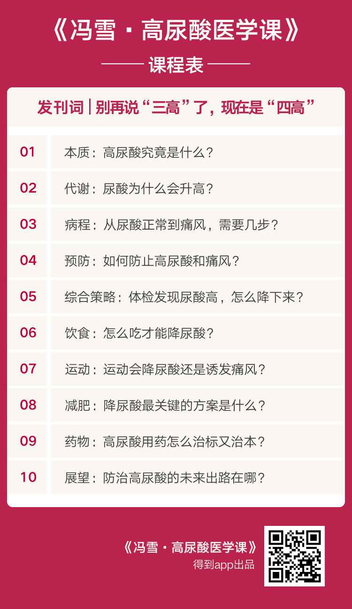  

* * *

# 01｜本质：尿酸究竟是什么？

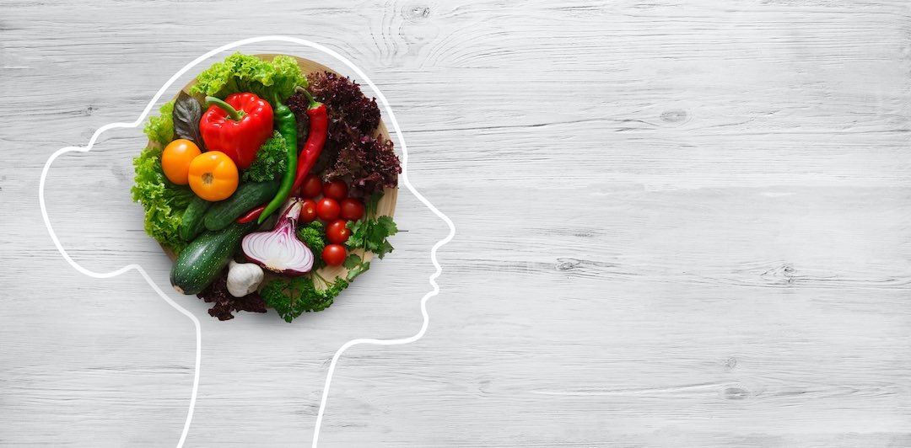

懒人专属群的群友，你好。

我是冯雪。欢迎来到《高尿酸医学课》。

在前面的“三高医学课”里，我们详细说了高血压、高血脂、高血糖的危害和应对方法。这门课，我们就来正式说说另一高，高尿酸。

提到血脂、血糖，你肯定比较熟悉，它们都是人体赖以生存的能量物质，多了当然不好，但如果身体完全没有它们，肯定更不成。

但是高尿酸，高的这个尿酸到底是什么东西？有什么作用呢？不大知道，好像只有体检的时候才会被提起，也没听说谁尿酸少了有什么不好。

这一讲，我们就从尿酸是什么、有什么用这些最基本的问题，来搞清楚高尿酸的本质。

## 尿酸究竟是什么

其实，尿酸是嘌呤代谢的终产物。

那嘌呤又是什么呢？嘌呤就是 DNA 的一部分。

DNA 有一堆复杂的结构，但是真正书写人类遗传信息的密码只有四个，其中有两个都是嘌呤，分别叫

鸟嘌呤 G 和腺嘌呤 A。

除了是重要的遗传物质，嘌呤还是

身体基本的能源传递和细胞调控的信号。

你看嘌呤的这些作用，单看哪个都是至关重要的，但是仔细分析，就会发现一个特点：

无论是作为遗传物质，还是作为能源传递、细胞调控的信号，

嘌呤都只是邮差，快递到了，任务就结束了，它们自己并不会被消耗掉。

既然任务达成了，身体自然就要把它们代谢掉，嘌呤代谢的终产物，就是尿酸。

你不要以为它叫“尿酸”，就一定是去了尿液。虽然，尿酸最早是在尿液里被发现的，但这部分叫尿尿酸，对我们身体影响不大，而

绝大部分的尿酸依然在血液中打转，叫做血尿酸，这才是我们这门课关注的重点。

## 尿酸升高的危害

那么，血尿酸升高以后，给我们的身体究竟带来了什么呢？

第一方面就是，高尿酸作为一种代谢紊乱，会加速高血压、高血糖、高血脂的发生。

先说高血压。实验表明，两组其他条件完全相同的人当中，有高尿酸的那组，高血压的发病风险增加 80%。尿酸水平每增加 1mg/dL，高血压的风险就增加 30%。

即便尿酸水平从体检单上看还完全属于正常范围，我们也会看到，

尿酸水平越高，高血压的发病风险也就越高。

这个情况在年轻人和女性中尤其突出。

医学家们进一步发现，血清中的尿酸水平可以独立地预测高血压的发生，并且这种预测作用在青少年当中更加明显。

如果尿酸水平超过 330μmol/L，患高血压的可能性高达 89%；而如果尿酸小于这个界值，不发生高血压的可能性是 96%。

这就意味着，如果你 20 岁左右，观察到尿酸水平一路升高或者超过正常范围，这代表你离高血压已经很近了。

除了高血压之外，高尿酸对高血糖的预测也很准。瑞典有一项研究发现，高水平尿酸比低水平尿酸那组，糖尿病的风险增加了 5.8 倍。更大规模的研究显示，尿酸每升高 10mg/dL，糖尿病风险会增加 20%。

为什么会这样呢？简单来说，

因为尿酸可以在人体内，会通过各种渠道导致炎症因子升高，而炎症升高对“三高”都有不同程度的促进作用。

比如，炎症会使血管收缩的物质增加、舒张的物质减少，自然就促进了血压进一步升高。  
再比如，炎症会导致细胞的胰岛素抵抗明显，也就是细胞对胰岛素不敏感，于是高血糖就随之而来。  
还有高血脂，炎症会影响体内的血脂运输，加剧血脂在血管中的堆积，产生动脉粥样硬化，进而就是心梗、脑梗。

这其实就是高尿酸的第二大影响，

高尿酸作为一个危险因素，会直接增加心脏、大脑、肾脏疾病的发生。

心脏上，主要是冠心病，还会增加房颤和心衰的风险；  
大脑则是脑缺血、脑中风；  
肾脏上，则会出现肾结石，乃至肾功能衰竭。

再然后的第三个影响，就是咱们都熟悉的，

高尿酸会导致痛风。

升高的尿酸会形成大量的结晶体，沉淀在关节内，为了对抗这些结晶体，人体会发生剧烈的炎症反应，于是红肿热痛也就随之而来。如果反复发作，关节的骨头还将被一点点破坏，留下不可修复的残疾，这就是痛风性关节炎。

高尿酸是导致原发性痛风的直接和唯一的元凶，关于痛风的内容，我会在后面跟你细说。

## 为什么保留尿酸

听起来，尿酸的坏处可真不少，那么人类为什么还要保留尿酸呢？

其实在很久以前，人类的祖先和其他哺乳动物一样，可以分解尿酸，能把尿酸降解成尿囊素，甚至是二氧化碳和水，直接排出身体。

但在距今 1500 万年前，人类突然丧失了这个能力。从那时起，人类的尿酸水平就平均比其他哺乳动物高四到六倍。这难道是人类进化中的一次退化吗？

事实上，这是一次明确的自然选择。

在人类、大猿类、小猿类三个种群中，不约而同地发生了一个变化：没有尿酸分解酶、尿酸水平偏高的种群存活下来，有尿酸分解酶、尿酸水平更低的，却从地球上永远消失了。

经过漫长的研究，科学家发现，选择把尿酸保留在身体里的人类和一小部分灵长类，获得了更高阶的四类重要功能：

第一个功能是，升高血压血脂。

我在《高血压医学课》中曾经说过，人类利用盐来维持更高的血压，以满足身体在直立下行走、奔跑、思考的血压需求。但如果原始人类搞不到充分的盐，那怎么办呢？这时，尿酸就帮了他们一把。

盐分减少后，肾脏会减少尿酸的排出，通过升高尿酸来维持血压。而且除了血压，最近的研究还表明，尿酸也刺激了脂肪的存储。你想，把更多的糖转化成脂肪储存在体内，当然更有利于在艰苦的自然环境中生存下来。

尿酸的第二个功能是，刺激人类神经。

尿酸与咖啡因具有相似的结构，所以能在一定程度上刺激人的神经，使人类反应更敏捷，智力更高。

然后是第三个功能，增强免疫力。

细胞死亡时，它遗传物质里的嘌呤会被降解成尿酸，释放到身体中。如果细胞大量死亡，身体内的尿酸含量就会升高。

你想，什么情况下身体的细胞会大量死亡呢？很可能是遇到了危险。于是这时候，升高的尿酸就会成为一种危险信号，传递给免疫系统，刺激免疫系统更努力地工作。

这种免疫增强，在一定程度上可以避免肿瘤的发生，因为新诞生的肿瘤细胞会被努力工作的免疫系统发现，并及时消灭。

最后就是尿酸的第四个功能了，抗氧化、抗衰老。

我们的身体日常会产生氧自由基，过量的话，就会导致各种慢性疾病、癌症，也会加速衰老。而尿酸和维生素 C、维生素 E 都是抗氧化剂，可以对抗身体的氧自由基。

在生命漫长的演化中，维生素 C 的获取时常匮乏，因此升高的尿酸就可以提高抗氧化功能，进而起到抗衰老、延长寿命的作用。

## 尿酸的本质

听到这里，你可能有些不解：这尿酸，怎么一会儿是促氧化剂，启动了炎症反应，导致了致命的心脑血管疾病和摆脱不掉的的痛风，一会儿又是抗氧化剂，对抗衰老、肿瘤和慢性疾病的产生呢？

其实，这恰恰就是尿酸在身体中的本质。尿酸就像是一把双刃剑：

如果水平正常，它就是抗氧化剂，可以保护我们，增强免疫，对抗衰老；  
如果水平过高，它又会化身促氧化剂，促进氧化应激、启动炎症，进而导致一系列严重的疾病。

历史上，尿酸的升高让人类在进化中取得了至关重要的优势。但这些优势，在今天可能已经变得不明显，甚至起到了相反的作用。

比如，现在我们可以轻松获得充足的维生素 C，起到抗氧化的作用，不再需要尿酸的这个功能了；再比如，现在我们不用高尿酸，血压就已经很高了，脂肪就已经过量了，尿酸的升高，反而让高血压、肥胖等问题变得更加严重。

但这件事，大概就像“欲戴王冠，必承其重”。在进化的过程中，尿酸给了我们聪明、长寿的可能，给了我们站在全世界食物链顶端的荣耀，自然也为我们埋下了大坑。王冠的光荣已成过去，如果处理不好，王冠的重量当下就会把人压垮。

那么，人体内的尿酸为什么会升高，甚至走到高尿酸这一步呢？下一讲，我们详细说说身体内尿酸的来龙去脉。我是冯雪，我们下一讲见。

* * *

# 02｜代谢：尿酸为什么会升高？

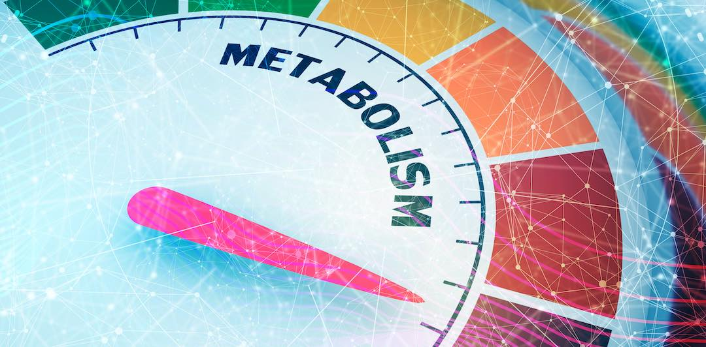

懒人专属群的群友，你好。

我是冯雪，欢迎回到我的《高尿酸医学课》。

上一讲，我把尿酸天使的一面和魔鬼的一面都展现给了你。我们清楚地知道，尿酸不是十恶不赦的敌人，需要从身体里彻底消灭，而是不能太高，太高会破坏健康。所以，

我们的目的就非常清晰了，只要想办法让尿酸不升高就行。

问题来了，人体的尿酸是如何升高的呢？你可能第一时间想到的是火锅、啤酒、海鲜，你以为尿酸高就是没管住嘴，但从医生的角度来看，事实并非如此。

这一讲，我们就详细说说尿酸在身体中的来源和去路，看看尿酸为什么会升高。

在具体展开之前，我要给你一个尿酸范围的全景图，让你做到心里有谱。

人类的尿酸，男性一般在 150μmol/L-380μmol/L 之间。绝经前的女性低一些，在 100μmol/L-300μmol/L 之间，绝经后就和男性一样了。

如果男性和绝经后的女性尿酸浓度大于 420μmol/L，或者绝经前的女性大于 360μmol/L，我们就称之为“高尿酸”。

当然，你肯定也发现了，正常的尿酸是一个范围，当然不能太高，但太低也不行。虽然低到多少算有问题，医学界没有一个公认的值，但如果低到了 120μmol/L 以下，大多数都是由肾脏疾病导致的，也需要引起关注。

## 尿酸的形成

好，回到高尿酸。人体内的尿酸是怎么形成的呢？

上一讲我们说过，尿酸是嘌呤代谢的终产物，那自然，嘌呤从哪里来，人体的尿酸大致就从哪里来。具体来说，人体主要靠两种途径获得嘌呤——一条是外源性的食物。

不只人类会用嘌呤组成遗传物质、传递遗传信息，几乎所有的动植物也都共用这样一套编码系统来储存自己的遗传信息。也就是说，所有动植物细胞的 DAN、RNA 中都有嘌呤。于是当我们吃进这些食物的时候，当然就把它们 DNA、RNA 里的嘌呤一块吃进身体了。这就是外源性的嘌呤。

不过，它们中的绝大部分经过小肠时就会被分解、排出体外，只有很小的一部分会进入血液，成为尿酸的来源。

这部分只占我们尿酸来源的 20%。

那剩下 80%的尿酸都是从哪儿来的呢？其实是我们身体自己合成的嘌呤分解后得到的。

这就是我们要说的第二条途径，也被称为

“内源性合成”。

你想，自己的遗传物质这么重要，当然还是自己合成更放心，所以我们的身体都可以从头合成嘌呤。

所有的嘌呤，无论是内源性合成，还是外源性食物里的，在身体里没有任务了，就会被逐步分解成尿酸。

通常时候，我们身体分解嘌呤、生成尿酸的速度是非常恒定的，大约每天 700mg。这其中，80%是我们自己合成的嘌呤，20%来自于高嘌呤的食物。

听到这里你可能会想：既然自己合成的占 80%，那尿酸的升高是不是我们身体出了问题，合成的嘌呤太多了？

其实不然。

在正常情况下，人体内部嘌呤的合成和分解都处于平衡状态，不会过度增加。

只在极少数情况下，比如患上了白血病这样的恶性肿瘤，细胞大量无序复制、崩解，DNA 进入血液导致血液里的嘌呤增多，嘌呤分解又导致尿酸急剧增加。

你想，合成嘌呤是需要消耗大量氨基酸等营养物质的，我们的身体当然不会平白无故地合成太多，浪费营养物质了。

这么分析下来你就会发现，虽然“吃”进来的只占人体尿酸的很小一部分，但由于内源性尿酸是相对恒定的，一般不会变多变少，

所以在尿酸来源这个问题上，不同的人尿酸水平的差异，还是“吃”主导得更多一点。

## 尿酸的排泄

当然，就算“吃”主导得多一点，也不过贡献了 20%，在尿酸升高这个问题上，好像起不到决定性的作用。没错，

在尿酸升高中，最主要的问题并不是出在尿酸的来路上，而是出在了尿酸的去路，也就是排泄上。

越来越多的研究表明，尿酸水平的升高，只有一小部分人是因为尿酸过度合成了，大部分人都是尿酸的排泄出了问题。

仔细想想倒不难理解，上节课我们说到，人类是在某一次基因突变后开始保留高尿酸的，在此之前，尿酸都是可以被进一步分解。也就是说，生成尿酸这个能力人类一直就有，但是直接排泄尿酸，却是在某个时间点之后突然需要具备的能力，自然也就不那么完备。

接下来，我就带你看看尿酸这两条不完美的排泄通道，一条是

肾脏，另一条是消化道。我们先看消化道。

大约有 1/3 的尿酸会经过消化道，最后从粪便排出。不过遗憾的是，这部分究竟是如何工作的，人类至今知之甚少，只知道和肠道菌群密切相关。

看完了消化道，我们再来看肾脏排泄，大约有 2/3 的尿酸需要经过肾脏。

具体来说，尿酸在肾脏中经历了

排泄、重吸收、再排泄、再重吸收

四步。第一次排泄时，基本上 100%的尿酸都会被排掉，然后有超过 98%的被吸收回来，吸收回来的这部分尿酸又会再次排泄，大概 50%被排出，然后是再重吸收，把里面 40%-44%的重新吸收回来。

这么算下来，

重吸收的效率非常高，最终只有 6%-10%的尿酸被排到体外，其他 90%多又都被吸收回来了。这也是人类维持尿酸水平的独特机制。

而在这个过程中，掌控尿酸最终排出量的是由基因编码的

尿酸转运蛋白。

排泄、重吸收、再排泄、再重吸收，每一步的量都由不同的尿酸转运蛋白决定。

这个过程有点像工厂的仓储物流，尿酸是货物，尿酸转运蛋白是货车，由货车把货物运出去。那你想，如果这些转运尿酸的货车出了问题，导致尿酸运不出去、堆积在仓库里，人体的尿酸可不就会升高吗？

现在问题来了，到底是负责排泄的尿酸转运蛋白出了问题，还是负责重吸收的尿酸转运蛋白出了问题，把排泄出去的又过多地吸收了回来呢？

研究发现，尿酸都正常运了出去，但是重新拉回仓库的太多了。

所以问题的焦点就落在了

尿酸重吸收转运蛋白上。至此，人类终于知道尿酸升高的问题出在哪里了——

由于尿酸对于人体的重要作用，我们的肾脏在漫长的进化中做出了这样的选择，那就是把尿酸的重吸收效率定得高高的，尽可能把更多的尿酸留在体内。于是，只要尿酸重吸收转运蛋白稍微出了点儿问题，我们的尿酸就有升高的风险。

## 基因与环境

听到这里，你可能会有点儿失望：尿酸重吸收转运蛋白是由基因编码的，我也没什么可做的呀。按照这个逻辑，我的尿酸升高与否，不就是基因决定，说白了就是靠遗传，这尿酸升不升高，我命由天不由我啊！

其实不然。当我们清晰地知道，尿酸代谢的关键点在于尿酸重吸收转运蛋白，然后就可以有的放矢地进行干预，让尿酸多排出一点了。

最简单粗暴的当然是药物。医学想找到一些可以抑制重吸收过程中尿酸转运货车的物质，不让这些货车再重吸收尿酸了，从而增加尿酸的排出量，把人体内的尿酸水平降下来。像苯溴马隆、丙磺舒、氯沙坦等，都是这个作用靶点。

更重要的是，从上个世纪开始至今，人类尿酸的平均水平持续走高，尤其是近十年，几乎翻了一倍。这显然不是遗传可以说得清的。

随着研究的深入，我们逐渐发现，生活方式，包括肥胖、甜食、酒精，还有高血脂、高血糖等等，都对这些蛋白的功能起到了很大的影响，使得尿酸排泄不易。

而与此同时，高嘌呤食物，比如海鲜、啤酒、各种红肉，我们获得起来却越来越容易。

虽然这些外源性的食物影响不大，但多种因素叠加，也都成为了压垮人类的最后一捆稻草，让人们的尿酸水平越来越高。

所以，尿酸的升高，说到底还是我们的基因和我们所处的环境不匹配的结果。如果我们能将生活方式中的危险因素消除，就可以最大程度地避免尿酸的升高。

我们分析尿酸的升高，从外源性食物到内源性合成，从肠道排泄到肾脏排泄，最终发现，只要阻止尿酸重吸收蛋白过于高效的工作，尿酸升高的问题迎刃而解。

就像我们说的，有时解决问题只需要 1%的努力，而找到问题的所在则要花费 99%的精力。

按照这个逻辑，如果我们要解决高尿酸给身体带来的种种问题，就应该清晰地了解尿酸升高后，疾病是如何发生、发展的，这样我们就能找到那个要解决的关键节点了。

下一讲，我们继续讨论，看看高尿酸的病程全貌是怎么样的。

我是冯雪，我们下一讲再见。

* * *

# 03｜病程：正常尿酸走到痛风，需要几步？

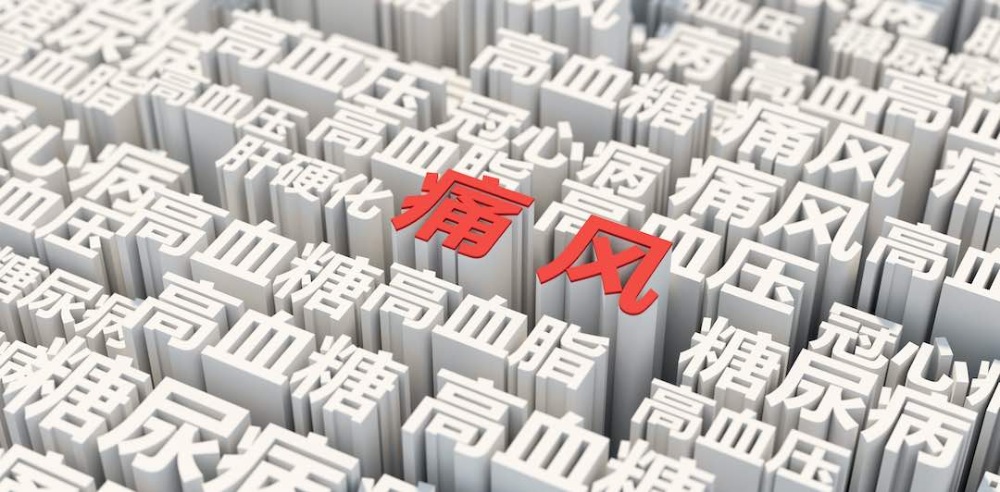

懒人专属群的群友，你好。

欢迎回到我的《高尿酸医学课》，我是冯雪。

听完前两讲，你已经对高尿酸有了一个大概的了解。

那么尿酸升高以后，会发生什么呢？前面已经简单提到过尿酸升高的一系列后果，我们大致可以把它们分为两类：

第一类是间接的，比如高血压、高血糖、心梗、脑梗等一系列风险。为什么说间接呢？因为这些后果是概率性的，不是绝对的。不是说尿酸高了就一定心梗，还要看是否合并了其他的危险因素。

但是这第二类结果，痛风，却是很直接的。

高尿酸直接就可以导致痛风，不用其他因素参与，有点像高血糖直接指向了糖尿病。

这一讲，我就把高尿酸怎么发展到了痛风，再到痛风后身体的各种问题，这一全过程，原原本本地展示给你。

## 痛风有多可怕

在讲理论之前，我先给你讲一个我遇到的痛风病人，小郭。之所以是小郭，是因为我遇到他第一次发病的时候他只有 22 岁，大学还没毕业。

那是我的一个急诊夜班，凌晨三点多，远远地就听，走廊里传来一阵嚎叫，真的不夸张，我觉得当天夜里，所有没昏迷的病人都被吓着了。随着“哎呦，疼死了，快不行了，救救我”  
这样断断续续的话越来越近，小郭被两个同学抬到诊室，指着自己的脚趾头，痛得已经是上气不接下气了。

小郭其实一点也没夸张，也不是他特别怕疼，在那个秋天的急诊室里，我已经遇到了三个要求打吗啡镇痛的痛风病人了。

我赶紧给小郭用完止疼药，他才缓缓神讲清了发病的过程。晚上同学聚会，吃的海鲜烧烤，喝了三瓶啤酒，十二点到了宿舍就睡着了。凌晨一点半，脚趾头就像被无数个大头针扎进去一样，一下子就疼醒了。而且这个疼没有半点喘息，一阵阵越来越重，越来越痛，最后连着整个脚都疼得不能碰。脚趾头肿得皮肤绷得透亮，薄得像一层纸。

用完药没几天，小郭就又活蹦乱跳了。他是那种特别典型好了伤疤忘了疼的主。此后，我们基本每年，尤其秋风乍起时，都要相见。

再后来，小郭研究生毕业，顺利地留在了北京，也过上了老婆孩子热炕头的生活，不变的是他的痛风发作。但他也不来医院找我了，因为越来越有经验，自己吃上药，半天一天也就不疼了。用他自己的话说，痛风又不会死人，日子总要照旧过呀。

我再次看见他的时候，他已经微微有点谢顶，挺着中年人的啤酒肚，拿着一张肾功能严重损伤的检查单，让我给想想办法。他把检查单递给我的时候，手上好几处都能看见明显的痛风石，一种像石头一样沉积在关节处的结节。

他跟我说，他去看了肾内科，医生说离尿毒症要透析已经不远了。他还说他才 40 岁，老婆肚子里还怀着二胎呢，上有老，下有小，全家人生活的顶梁柱，他可不能去透析。

我实在不知该说点什么，因为除了尿毒症，这一次，他也查出了严重的冠心病，只是没有发作而已。

我开始后悔，后悔我跟他说这说那，说怎么管理生活，怎么吃药，怎么就没有好好跟他谈谈，如果做不到，他会有这样的一天。面对他的要求，医学已经显得那么无力。

但“罗马不是一天建成的”，痛风也不是一下子就发展到无可挽回的地步的，我给你讲这个故事，是因为按照今天的医学水平，如果小郭一开始就重视起来，完全有能力把高尿酸留在原地，甚至逆转它。

接下来，我们就从临床上高尿酸进展的四个阶段入手，找到这个病发生发展的规律。

## 无症状的高尿酸血症期

我们先来看第一阶段，无症状的高尿酸血症期。

刚才说了，目前中国高尿酸血症的总体患病人数是 1.8 亿人，大约每 7 个人里就有一个，这个数字还在逐年攀升。

这么高的发病率，高尿酸患者自己知道吗？答案是完全不知道。

我们之前总说“三高”没什么症状，但或多或少可能还会有一点点小征兆。比如高血压，有不少人还是会头疼头晕，比如高血脂，有不少人会长脂肪粒。

但是到了高尿酸这里，高得无声无息，除非发展成痛风，那真的是一丁点兆头也没给我们。

所以，高尿酸只能靠自己去主动关注。关注什么呢？其实也很简单，就是做好体检、会看体检报告就行。

现在，即使最简单的体检也会检测尿酸水平，找到那一栏，看一下，

如果血尿酸超过 420μmol/L，一般我们会再复测一次，无论男性还是女性，如果 2 次都超过了，我们就称之为高尿酸血症。

无感然后被忽略，是这个第一阶段最大的特点。

不仅你会如此，医学家在漫长的时间里也认为，这个时期不会对身体有什么本质的影响，不需要过多的关注。然而，随着新的更敏感、更特异的影像学检查方法的出现，我们发现在这些高尿酸血症的病人身体里，存在着无数微小的晶体。这些晶体是什么？就是导致疾病第二阶段，痛风初期的罪魁祸首，

尿酸钠晶体。

因此，越来越多的医学家开始意识到，

无症状高尿酸血症和痛风之间，可能没有一条明确的界限，二者之间只是一个连续、慢性的病理过程。

所以，痛风的干预要从这个时期就开始，只要保持尿酸水平正常，尿酸就不会析出晶体，也就不会进入后面的阶段。

## 痛风初期

但如果，尿酸还在逐渐增高，这些微小的晶体就会逐渐累积，来到痛风初期这个阶段。

这个阶段，最要命的就是急性发作期了，就是刚才你听到小郭来到急诊的原因。表现也通常特别典型，见一次就终身难忘：

比如发病时间大部分都在夜间或者清晨；  
比如关节突然的红、肿、热、痛，一上来就很急；  
比如第一次发作往往都是脚趾的大拇趾，但大部分一周以内也就结束了。

这个疼痛的来源，就是我们刚才提到的尿酸钠晶体。原理非常简单，就是血尿酸浓度过高，超过了自身在液体中的饱和度，从液体中析出了。这个物理现象叫结晶。

这就类似我们在水中加盐，加着加着，水中的盐超过了饱和度，就出现了不溶于水的盐块。但是尿酸在体内的溶解度可比盐低多了。

当尿酸持续增高，超过了 420μmol/L，这些析出的晶体就会选择沉淀在我们身体的各个部位，像关节、软组织、血管壁等等。

但是沉积也要挑地方。大江大河的主干道，滚滚江水裹挟着泥沙倾泻而下，沉积下来的机会是小的。而进入小溪小沟就不一样了，水流缓了，泥沙也就是这些晶体自然就沉积下来。

人体的小河沟在哪呢？当然就是手脚，脚的末梢循环更不好，这一般就是这些晶体最先找到的沉积点。

这些尿酸的晶体就像水晶簇一样，不规则而且有尖锐的棱角。等到这些晶体长大了，等到某天尿酸突然更高了，比如你喝啤酒吃海鲜，或者等到周围环境合适，比如突然冷了，末梢循环不好了，它们就出来惹事了，和我们巡逻的人体免疫系统打起来，形成炎症，就变成了痛风发作。

急性期发作完之后，就进入了间歇期。这个间歇期，像极了之前的无症状高尿酸阶段，这个时候的痛风患者与正常人完全没区别。

这时候大部分的患者就会觉得，自己好了，没事了，海鲜吃起来，啤酒喝起来。即便如此，有的人也会半年一年甚至好几年都不发作了。就算反复发作，他自己也有经验，会吃点止疼药处理了。

刚才我们的小郭就是这样，觉得痛风不过如此，每当我说要降尿酸、降尿酸，他都觉得这医生怎么又来了，这些尿酸晶体不疼不痒，与我何干？

其实这个阶段，医生担心的并不是你的痛风什么时候发作，而是你的关节会不会因为反复发作而受损。

在痛风初期，如果尿酸成功降下来，这些晶体就可以重新溶解到血液中，达到逆转疾病的效果。

## 痛风石病变期

但是在反复的炎症后，尿酸钠的晶体会被层层纤维组织包裹，形成

“痛风结节”，又叫“痛风石”，这就是疾病的第三个阶段。

这些石头小的像芝麻，大的有鸡蛋那么大，刚开始它们是软的，没过多久就会钙化变硬，而且越来越硬。

可以说，痛风石是“病入膏肓”的标志。它意味着尿酸结晶已经大举进攻我们的各个脏器。

除了不会长到大脑里去，我们全身各个关节，还有肾脏、输尿管、膀胱、皮肤，几乎所有脏器都会形成“痛风石”。

这些小石头的破坏力极其强大，它们不仅会让你的关节活动不自如，更重要的是会一点点破坏组织的正常细胞，损伤肾脏的功能，“吃掉”我们的关节里的骨头，所到之处关节变形、皮肤破溃，久久不能愈合。

到了这个阶段，要想把这些小石头都清除掉可没有那么容易了。

我们要动用一切降低尿酸的方法，而且一定要快，要赶在痛风石还没有变硬之前，让血液中的尿酸水平足够低，才可能将这些尿酸石溶解掉。

如果已经钙化了，即便尿酸水平降低，也不能完全溶解它们，就需要手术切除了。

## 痛风肾病时期

痛风石虽然已经很难搞，但不至于没有一丝希望。这个疾病的致命一击，在肾脏，也就是我们说的第四个阶段，痛风肾病。长期痛风的患者，几乎每一位都有肾损害，只是程度不同而已。

那为什么没有察觉呢？因为我们的肾脏，是所有器官中的孺子牛，从不抱怨，有着极强的忍耐力和抗压性。大部分尿酸都需要在肾脏滤过，重吸收。尿酸增加，就让肾脏长期地超负荷工作，损伤也就日复一日，年复一年。

想要降低损伤，显然还是要降低尿酸，减轻肾脏的负荷。

我见过很多患者，刚开始只是夜里上厕所多几次，后面等到发现尿少了、腿肿了，才到医院，一检查，已经是肾衰竭的终末期了。此时除了透析，就没有什么更好的路了。

讲完了高尿酸病程的四个阶段，你会发现，每一个阶段，我都提到了“降低尿酸”。

没错，这就是根本解决之道。更重要的是，只要尿酸没高起来，你根本就不用进入刚才说的任何一个阶段。

所以，不管你现在尿酸高没高，这都是一个必须了解的话题。

下一讲，我们就先从健康人着手，如果你尿酸还没高，怎么预防它升高呢？好，我是冯雪，我们下一讲见！

* * *

# 04｜预防：如何防止高尿酸和痛风？

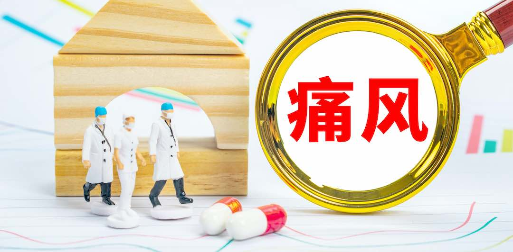

懒人专属群的群友，你好。

我是冯雪，欢迎回到我的《高尿酸医学课》。

在心血管门诊近五年来，我遇到的最年轻的病人就是高尿酸患者，大多都是十八岁的大学生，三十多岁的公司精英们，比比皆是。虽然“三高”的发病也越来越年轻，但像高尿酸这样，大部分患者都集中在年轻人的，也是其他“三高”不能比的。

过去医学界认为，高尿酸患者大部分是中老年男性和绝经后的女性，总之都是上了点年纪的。

但最新的统计资料表明，30 岁是高尿酸的发病高峰期。而且男性发病更早，集中在 18-29 岁。

上一讲我们已经发现，一旦尿酸过高，后续就是痛风，接着痛风石，接着痛风肾。就像一块牛皮糖，想甩掉是很不容易的。但是在尿酸升高之前，我们可以主动做一些事情，避免自己掉入高尿酸的陷阱。这一讲，我就把高尿酸预防领域最前沿的研究结果给到你。

## 只调整饮食不可取

在说具体的预防方法之前，我给你讲一个我的病人邹先生的故事。

邹先生是个港商，30 岁出头，来大陆做生意，有一次因为急性胃肠炎来看急诊，留院观察的时候拿着体检报告，让我给看看。三甲医院的急诊很拥挤，病床上的他却穿着马甲、系着领结，穿戴一丝不苟。我印象很深，他在每一处体检不好的地方都做了标注，详细写上该注意什么。

我扫了一眼体检报告，觉得都还好，只是尿酸有点儿高，到了正常范围的上限了，于是就告诉他，说你注意一下尿酸。他还想再问的时候，我已经被护士拖走，瞧一个消化道大出血的病人去了。

三年后，我在门诊出诊，一个穿着马甲、打着领结的病人很打眼。一见面就冲我喊：“冯医生你真是神算，还记得我吗，我姓邹啊！我今年初高尿酸了，怎么也搞不好，打听了很多人才找到你。”

他说，那次我让他注意尿酸之后，他就开始调整饮食，跟他的厨师讲，每天的肉要定量，2 周吃一次红肉，从来不吃黄豆，吃油一定吃橄榄油，结果还是高尿酸了。

他说一定要来问问我，为什么知道他会高尿酸？为什么自己做了那么多预防，结果尿酸还是高了？

我说很简单，你对预防的概念还停留在毛皮上，只在毛皮上使劲，自然就事倍功半。

通过前面的分析我们知道，人体尿酸的高低，很大程度上取决于尿酸的排泄。

管住嘴当然有用，但尿酸只有 20%来源于经口的食物，所以就算把饮食管理得严丝合缝，也只是对尿酸升高的一小部分因素做了预防，剩下的大部分都没有注意，可不就是事倍功半。

问题来了，如何把剩下的大部分都管起来，预防尿酸的升高呢？经过全世界医生的研究，有确切证据的建议有三类，下面我一一给到你。

## 建议一：减肥

这第一类建议，就是减肥。

减肥对于高尿酸的预防起到决定性作用。

最近一项全美的分析预测，从理论上来说，减肥可以预防 90%以上的高尿酸。为什么这么有效呢？其实是多种因素叠加的结果。

首先，减肥后，身体的能量减少了，合成的嘌呤也会直接减少，嘌呤少尿酸自然就少。  
其次，在人体排泄中，脂肪和尿酸存在竞争关系，脂肪被减掉了，自然有利于尿酸的排泄。  
最后，减肥能改变我们身体的代谢紊乱，打破高血脂、高血糖、高尿酸之间相互促进的局面。

减少合成、促进排泄、切断各种代谢问题的联系，可谓是全面改善。

在你还没有高尿酸的时候，用什么方法减肥都可以。

不管是地中海饮食，还是生酮低碳饮食，只要能减，就都可以预防高尿酸。换句话说，只要能减肥，不管黑猫白猫，抓到耗子就是好猫。

不过，如果你已经高尿酸了，就不是什么方法都有用了，必须得使用针对性的方法减肥才能降尿酸。

这一点，我在后面第七讲详细跟你说。

## 建议二：选饮料

接下来是第二类建议，这类建议都集中在饮料饮品上，简单来说就是，

酒少喝，果糖饮料不喝，牛奶可以多喝。

首先是酒。全球所有高尿酸的指南一致认为，所有的酒，只要是含酒精，就都会增加尿酸水平，增加高尿酸的风险。换句话说，

戒酒可以预防高尿酸。

当然，这句话在理论上行得通，但是在实际生活中可能很难执行。这时候，我们的生活就要有个底线原则，底线你不能碰，剩下的能做好我们鼓励，做不到我们不纠结。

从预防高尿酸的角度来说，底线只有一个，就是掌握喝进去的酒精总量不超标。这个总量，大约是每天不超过 10ml 的酒精，换算下来，白酒就是一两，红酒是一杯，啤酒是一瓶。

这时候，可能有些同学会问：不是啤酒不能喝吗？听说啤酒是高尿酸的罪魁祸首。

确实，很多人回忆痛风发作前，都有那么一出啤酒喝嗨了的戏。因为啤酒不仅有酒精本身的危害，里面还有不少的鸟苷酸，喝进去之后，可以直接升高身体的嘌呤，进而升高尿酸。

但其实，在你还不是高尿酸的时候，只要控制住量，这个增加的部分就并不明显。

所以预防的时候，我们还不需要区分啤酒、白酒还是红酒。

但如果已经高尿酸了，啤酒增加的那一点点尿酸，可能就是导致痛风发作的最后一根稻草。

这时候，尽量不要喝酒，非要喝的话也不要选择啤酒。

其次是含果糖的饮料。

果糖的甜度是蔗糖的 1.8 倍，作为自然界中最甜的糖类，在能够大规模工业化生产之后，已经成为食品、饮料里最常用的甜味剂。

但是，果糖是所有碳水化合物中，目前已知的唯一能够升高尿酸的。而且，它还会增加胰岛素抵抗，影响尿酸的排泄。

研究发现，每天喝 2 杯含果糖的甜饮料的人，与每个月不超过 1 杯甜饮料的相比，痛风风险增加 1.85 倍。

所以，如果你的生活、工作不是离不开含果糖的饮料，我建议干脆戒掉。想喝饮料，我们有很多替代品，比如代糖饮料，比如茶和咖啡，都可以。

最后就是奶制品了。很早之前人们就发现，吃奶制品的多少和尿酸水平正好成反比，也就是说，奶制品吃得越多，尿酸就越低。

为什么？因为牛奶中的乳清酸、乳清蛋白和酪蛋白，可以促进尿酸的排泄。

所以，推荐每天都喝低脂或者脱脂奶制品，可以降低尿酸水平，从而起到预防高尿酸的作用。

## 建议三：摄入膳食补充剂

预防高尿酸，在减肥和饮料饮品上有确切的医学建议，而我要给你第三类医学建议，多数研究也显示都有效果，但具体机制不是那么确切，那就是关于营养补充剂。简单点说就是，我们吃点什么保健品是可以预防高尿酸的？

国内外这类研究非常多，大多数结论还是很一致的，那就是，有三类营养补充剂——

维生素 C、维生素 B（尤其是叶酸）、鱼油，对高尿酸有一定的预防作用。

关于维生素 C 的研究是开始最早的。因为从进化角度判断，尿酸之所以在人体中被保留下来，正是因为当时的人类没有办法获得稳定的、大量的维生素 C 作为抗氧化剂。所以如果我们补充充分的维生素 C，是不是就可以降低尿酸呢？确实可以。综合多个研究的结论，每日如果口服 500mg 维生素 C，30 天，可以降低尿酸 21μmol/L。

维生素 B

也有一定的效果。在一项针对 28000 多名健康人群的膳食调查中发现，凡是维生素 B1、B2、B9，也就是叶酸，摄入更高的人，尿酸水平就更低。至于具体的原因，医学界还给不出确切的答案，但人群中的结果是显著的。

鱼油补充剂

在体外试验中发现，也可以明确减少尿酸转运蛋白的重吸收，从而让更多尿酸排出体外，降低尿酸。

所以对于这三类营养补充剂，我的态度是，如果你的日常饮食不能保证充足的摄入，你可以考虑吃一些，

对于预防高尿酸会起到一定作用。

但如果你已经有了高尿酸，就别在营养补充剂上花心思了，这三类补充剂起不到那么大的降尿酸作用，也不能减少痛风的发作。

这一讲，到这里就结束了。在预防上，我们从尿酸升高的源头出发，找到了日常生活中影响尿酸的关键节点，然后像排雷一样，把它们一个一个摘除掉，既没有影响到你的健康，又能让你游刃有余地享受生活。

但是，如果不幸已经高尿酸了，不要紧，我们还有挽救的办法。下一讲，我们详细说说高尿酸的整体防治策略。我是冯雪，我们下一讲再见。

* * *

# 05｜综合策略：体检发现尿酸高，怎么降下来？

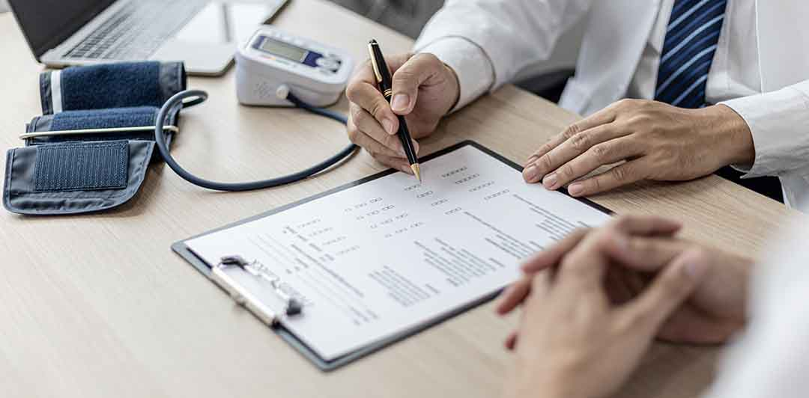

懒人专属群的群友，你好。

欢迎回到我的《高尿酸医学课》，我是冯雪。

上一讲，我们讲了健康人如何预防高尿酸，那么如果体检发现尿酸已经高了，怎么办呢？这一讲，我就带你一起看看当下对付高尿酸的全套策略。了解了全局，无论你站在高尿酸的哪一个节点上，都能做到落子无悔。

不过，我的临床经验告诉我，人无论自己得病与否，都不大关心离自己远的事，尤其是像防治策略这种听起来很空的事。

回忆一下我接待过的高尿酸患者，我脑子里会立马闪现这样一些场景：

比如，他们大多数都爱谈怎么吃，个个都是美食家，同时他们认为只有吃才能改变高尿酸，用药的依从性特别差；  
再比如，高尿酸患者对这个病的了解，总体上远不如其他“三高”的患者，不知道怎么吃药，也不知道除了尿酸这个指标，还要去看看肾脏，看看有没有高血压、有没有心脏病等等；  
还有，相比较其他三高，忽视综合防治策略的高尿酸患者不仅占比最多，而且结局更差。就我观察，他们都很在乎当下降尿酸的效果。一旦尿酸没有很快降下来，他们中的大多数我就只能看到一次两次，再看见他们的时候，不是痛风发作，就是已经合并了其他疾病。

为什么会这样呢？

因为跟其他三高相比，今天我们降尿酸的治疗效果远没有这么好。

只靠某一个单点的战术，比如只靠吃药、只靠饮食，往往不能解决问题。

必须要先有战略，再有多角度战术的全面配合，才能打得好。

既然如此，那我们有必要先看一下降尿酸的总体战略，再细说一下每个阶段的战术。

## 总体战略：生活方式降尿酸

无论是没有症状的高尿酸，还是痛风、痛风反复发作，甚至痛风石、痛风肾，我们的总体战略都是围绕着生活方式进行的。

在西方，医生很早就把痛风称为“The Disease of Kings”，也就是国王得的病。显然他们已经意识到，这个疾病和生活方式息息相关。

虽然今天的医学研究发现，有超过 180 个基因影响着高尿酸的水平，但加在一起也就只占到了尿酸水平变化因素的 8%左右。事实上，中国十年内的高尿酸病人增长了足足 200%，基因不可能短时间内变这么多，原因还是要从生活方式上找。归根到底，高尿酸还是一种生活方式疾病。

既然是生活方式导致的，治疗当然要以生活方式为主，而且要贯穿高尿酸、痛风一直到痛风并发症的全程。

说到生活方式，你可能以为是要从此滴酒不沾、海鲜也不能碰了。其实，好的生活方式管理，从来就不是把你变成苦行僧，只要把最核心的做好，你照样能在生活中自在舒服。

## 心理：一增一减

这些必要的生活方式管理包括饮食、减肥、运动和心理四个方面。前面三个——饮食、运动和减肥，内容比较多，我会在后面的三讲一一为你展开。

但是高尿酸的心理管理，它既是最容易被你忽视的，同时也是整个生活方式管理的前提，我先好好说一说，打好基础。

这里有一增一减两条最简单的经验，可以帮你应对所有问题。

第一，自己在心里，给高尿酸这事加一加压。

如果你体检出来已经有高尿酸了，一定去听听第三讲里小郭的故事，给自己一点压力。有了这份战战兢兢的压力，你就有了降尿酸的动力。

很明确的是，尿酸升高是痛风和所有并发症发生、发展的根本原因。对于高尿酸来说，只要尿酸水平长期达标，不仅可以预防痛风，还能治愈痛风。

所以，无论我们用什么样的方法，目标只有一个，尿酸达标。

根据风险程度不同，我们会将尿酸控制的目标锚定在 240μmol/L-420μmol/L 之间的不同水平。你个人的风险程度越高，尿酸的目标水平就要越低。

如果执行生活方式治疗方案后能达标，就不需要吃药了。

但是如果执行得不好，或者确实没有办法达标，即使走到了终身服药这一步，也得配合医生。

所以，当你在执行生活方式方案没有动力时，你就回过头来，想一想这一点。

第二，把除了高尿酸以外的事都减一减压。

临床里，我碰到很多高尿酸患者都是社会精英，是别人心里的成功人士。但也正因为这份成功，压力和熬夜已经成为他们生活的一部分。

压力对身体不好，不只是说说而已，它会增加机体的应激反应，增加儿茶酚胺分泌，导致 DNA 损伤，然后引起嘌呤代谢紊乱，最终加重高尿酸。

所以，如果你每天也觉得压力很大，可以考虑试一下正念呼吸、冥想、瑜伽、太极，这四种方法，已经有明确的证据表明，它们对减压很有好处。

## 无症状高尿酸阶段

总体战略已经讲清楚了，最重要的就是通过生活方式让尿酸水平达标。之后的战术，不过是在每一个阶段制定更细化的手段而已。

具体战术可以分为两块：一是没有症状的高尿酸阶段，二是痛风。

在没有症状的阶段，如果你两次化验血尿酸都大于 420μmol/L，就需要开启全面的生活方式治疗。如果不努力，留给你的就剩下药物这一种方案了。

还没有痛风，需不需要吃药呢？要判断是否开启用药，医生需要综合三个方面的因素：

第一，是基于你的尿酸水平高低；  
第二，是关于痛风本身，包括是不是痛风，痛风的发作频次，是否存在痛风石、痛风肾，肾功能的损伤情况怎么样；  
第三，也是最容易忽视的，就是要关注到你其他的“三高”，尤其是高血压，还有心脑血管疾病的发病情况。

一般来说，如果已经有痛风，吃药大概率是跑不掉的，但是就算没有痛风，也有可能要吃药。

下面是无症状阶段用药的条件，你可以看看自己有没有中枪：

1\. 尿酸水平>540 μmol/L，开始降尿酸药物治疗； 2. 尿酸水平>480  
μmol/L，但是有下面合并症的其中一种：高血压、高血脂、糖尿病、肥胖、脑梗、冠心病、心功能不全、尿酸性肾结石、肾功能一定损害。

由此也可以逆推，

当你发现自己是高尿酸，在问医生是否要吃药的时候，你要把刚才提到这三个方面的基本情况，全面地告知你的医生。

如果你对比一下就会发现，国内的高尿酸防治指南在药物治疗的开启时机上，确实比欧美的医学指南更严格一点。

这首先是因为，高尿酸非常凶险。尿酸每增加 60μmol/L，高血压发病风险就会增加 1.4 倍，新发糖尿病的风险增加 17%，冠心病的死亡风险也会增加 12%。

另一个原因是，2019 年，一项著名的研究发现，在治疗这些无症状的高尿酸血症后，能够显著降低患者未来心梗、脑梗的发生率，同时也能延缓他们肾功能不全的时间。

考虑到这两个因素，国内指南会规定得相对严一点。治疗的目标，不同的人也不同。普通人群控制在 420μmol/L 以下就可以，如果有合并症，建议控制在 360μmol/L 以下。

除了生活方式和药物，在这个没有症状的阶段我们还有一个小战术，就是碱化尿液，让尿液的 pH 值高一些。这个方案效果挺好，副作用还小，可以说是事半功倍。

为什么要碱化尿液呢？因为尿的酸性越大，尤其是 pH<6 的时候，是尿酸性肾结石形成的重要原因。

不止如此，当我们服用促进尿酸排泄的药物时，尿液当中的尿酸浓度自然就会明显升高，尿的酸性就会更强，也增加了尿酸性肾结石形成的风险。

因此指南建议，如果尿酸已经高了，

尿液的 pH 值最好保持在 6.2-6.9 之间。

怎么做呢？操作很简单。你需要买一个简便的尿 pH 仪器，测量自己早晨尿液的 pH 值，告诉医生。医生听到这个数值后，告诉你怎么使用一点碳酸氢钠来碱化我们的尿液。

这件事一点也不复杂，药物也简单到了极点，但却需要医生和你之间的默契配合，尤其是如果你在服用促进尿酸排泄的药物时，更要重视这一点。

## 痛风阶段

那么，如果已经到了痛风阶段该怎么办呢？

对于这个问题，各国学者的意见基本一致。大家都认为，

此时生活方式必须坚守的，但降尿酸的药物治疗要同步，控制的目标也要更加严格。

就像刚才说的，不同的尿酸水平、痛风发作情况、有没有合并风险等等，都会影响你怎么用药，以及尿酸需要降到多少。下面是

痛风患者用药的条件。你先结合自己的情况看看，跟医生交流的时候，也能心里有数。

1\. 痛风患者，如果尿酸水平>480μmol/L，开启降尿酸药物治疗。 2.  
尿酸水平>420μmol/L，但是有下面任何一种情况，也应该立即开始降尿酸的药物治疗。这些情况包括：痛风每年发作 2 次以上、痛风石、慢性痛风性关节炎、高血压、高血脂、糖尿病、脑梗、冠心病、心功能不全、肾结石、肾功能一定损害，甚至是 40 岁以下发病都算。对于没有合并这些情况的，尿酸的治疗目标是 360μmol/L 以下，合并了，就要控制到在 300μmol/L 以下。  
不建议将血尿酸长期控制在＜180μmol/L 以下。  
举个例子：如果你 38 岁，今年已经发作过两次痛风了，现在的血尿酸是 430μmol/L，那么你就不仅仅只是靠生活方式改善，而是应该开启药物治疗，并且血尿酸要降到 300μmol/L 以下，才能和医生商量是否可以停药。

大量的医学证据都显示，痛风患者的尿酸水平如果降到 360μmol/L 以下，不仅可以使一年内痛风的复发率降到 14%以下，而且还能让已经形成的尿酸盐结晶溶解，晶体数量减少、体积缩小。从长远来说，可以减少痛风患者的心血管、肾脏疾病的发病，降低死亡率。

相反，如果痛风患者的尿酸水平超过 480μmol/L，痛风的复发率就会超过 50%。当然，这样的复发也就必然带来前面我们说的第三、第四阶段、痛风石、痛风肾。到了这时候，情况就严重了。

顺便说一句，就算进入了痛风阶段，碱化尿液依然有效。尤其是如果已经出现了肾结石，它在溶解肾结石上就显得更为重要了。

好了，这一讲到这里就要结束了。

我想再强调一下，由于高尿酸没有什么特效的、立竿见影的治疗手段，所以综合防治策略就显得特别重要。而生活方式，是贯穿全程的核心战略，其中疗效最快的就是饮食方案。

下一讲，我们就从这里入手，我们下一讲见。

* * *

# 06｜饮食：怎么吃才能降尿酸？

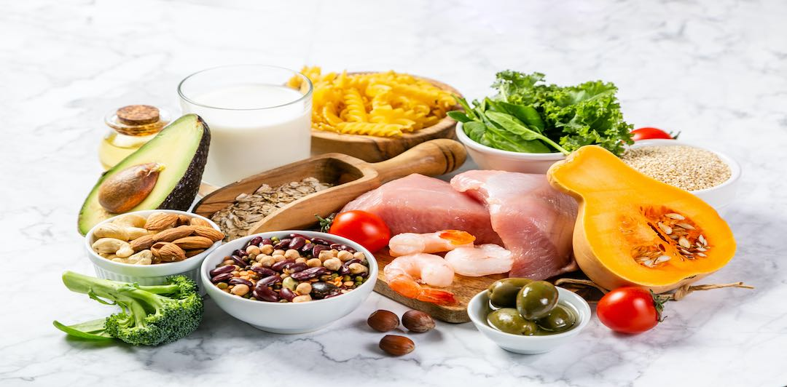

懒人专属群的群友，你好。

我是冯雪。欢迎回到我的《高尿酸医学课》。

对于已经高尿酸的人，调节饮食是所有生活方式里降尿酸起效最快，但也是误区最多的。

如果我一上午门诊有 5 个高尿酸病人，那这 5 个人的说法一定是五花八门。有说吃芹菜、喝咖啡可以降尿酸的；有说不能吃蘑菇、吃豌豆的；有说能喝蛋花汤，不能喝味增汤的；也有说葡萄酒没事，但是果酒不行的……

其实，这并不怪我们的患者道听途说了很多小道消息，而是营养学自身是不断发展的，经历了曾经那样一段让人无所适从的时期后，才回归了今天的正道。

这一讲，我们就回归正途，从前沿的营养学的角度，看看想要降尿酸，饭应该怎么吃。

## 饮食的作用

听到刚才的内容，可能有同学会好奇：为什么饮食是降尿酸最快的生活方式，不是只有 20%的尿酸源于食物吗？

确实，我们在第二讲强调了，身体里的尿酸 80% 源于自己合成的嘌呤，饮食并不占大头。

这一点在普通人中尤其明显——一项 16760 人的调查研究发现，无论你采用什么饮食模式，是地中海饮食还是大鱼大肉，是素食还是高脂肪，对健康人的尿酸影响非常小。饮食里的嘌呤多，排出去的尿酸也多；饮食里的嘌呤少，排出去的也少。

换句话说，尿酸是基因、代谢、生活方式的综合产物。

在健康人的身体里，尿酸的生成和排泄是一个稳定的平衡系统。在你没有高尿酸血症的时候，不必因为担心自己将来高尿酸而纠结吃什么、不吃什么。

那几条需要特别注意的，咱们在

第四讲已经讲过了。

这和高血压、高血脂、高血糖不一样，这“三高”都是只要提早从饮食上注意，就可以在很大程度上预防。

但这是对健康人而言的。

对于已经高尿酸的人来说，就完全是另一回事了。

首先，这 20% 的升高就是压垮人体的最后一根稻草。

你会发现，“海鲜加啤酒，痛风跟着走”，每次高嘌呤饮食，尿酸就会迅速升高，痛风就很容易发作。

其次，高嘌呤的饮食也会加剧肾脏的负担，降低尿酸排泄效率。

这一来一去，尿酸就会飙升。

也因此我们说，对于已经高尿酸的人来说，饮食是降尿酸最快的生活方式。

## 过去的建议：低嘌呤饮食

在营养学家意识到这一点后，就开始建议高尿酸、痛风患者杜绝一切高嘌呤饮食。而且，随着对食物成分、尿酸代谢越来越精细化的理解，我们对饮食也有了越来越明确的区分。

我遇到的高尿酸患者都有一套自己的说法，哪些能吃、哪些不能吃，其实背后的逻辑，就是尽量让摄入的嘌呤更少一点。

根据这个逻辑，营养学家把食物分成了三种不同的嘌呤含量。低嘌呤的食物是能吃并且建议多吃的。高嘌呤的食物是禁止或者不推荐吃的，而夹在两者之间的中等嘌呤食物，可以适量少吃。

高嘌呤的重灾区是什么呢？比如各种豆类，黄豆绿豆黑豆蚕豆；各种动物内脏，猪牛羊鸡鸭鹅的都包括；大部分的海鲜还有河鲜，什么生蚝鱿鱼小龙虾，都得避开。

这个单子很长，我给你准备了一份表格，你可以保存下来做个参考。

表格很长，请拉到本讲底部\*\*

但是，并不用把这个表当作金科玉律。

为什么呢？坦白说，严格执行这个饮食方案，不吃高嘌呤食物，当然不会有什么大问题，但长时间这么吃，你是什么感觉——

复杂、麻烦、记不住、想想就不好吃……

不仅如此，随着研究时间的拉长，研究规模的扩大，医学家还发现了一个更大的问题——吃了这么大的苦之后，我们并不能从这种简单粗暴的饮食方案中获得长期控制尿酸的效果。

原因有两个：

首先是坚持不了。

动物蛋白都不让多吃了，植物里高蛋白的也都高嘌呤，也不让多吃，这饭确实不好吃啊！你我皆凡人，自制力是有限额的。你看低嘌呤那张表，绿叶菜、主食、水果，海鲜也只有几种，每天只吃这些，脸都绿了。

其次，这种严格的低嘌呤饮食，本质上也是低蛋白饮食，会导致碳水化合物和脂肪的补偿性摄入增加。

什么意思呢？就是说，如果你坚持吃很少的蛋白质，需求能量的本能会让你加倍渴望口感良好的精制主食、甜食和各类油腻的食物。

而我们知道，这些食物很可能会引起高血糖、高血脂，反过来加重高尿酸。所以，单纯的低嘌呤饮食降低尿酸水平的长期有效性，是存在巨大疑问的。

## DASH 饮食降尿酸

那该怎么吃呢？医学家又在这个基础上做了大量的研究，最终回到了今天的正道上——

以综合的饮食结构，代替单纯的吃或不吃某个食物。这就是 DASH 饮食。

如果你对我的《高血压医学课》有印象，就会知道，DASH  
饮食是一种用于减少高血压的综合饮食方案，它以丰富的蔬菜、水果为主，主食是粗粮类的全谷物，肉类以鱼虾、鸡鸭鹅等禽类为主，同时包含低脂脱脂奶、豆类和坚果，主要避开的就是高盐、甜食和红肉。

你发现了没有？这是一种很全面、很均衡的饮食，并不太纠结于某一种食物的嘌呤高不高。

这种饮食的效果怎么样呢？有一项全世界著名的研究发现，在对 1731 例确诊的痛风患者随访了 26 年后，明确 DASH  
饮食方案可以降低这些痛风患者的尿酸水平，减少痛风发作。

DASH 饮食方案的胜出，让高尿酸患者终于可以以均衡的饮食结构进食，而不用纠结于某一两种食物能不能吃了。

只要不是急性痛风发作的时候，你的饮食里可以每天都有豆类，每天都有一点鱼虾或者鸡鸭肉，但要保证均衡营养。什么叫均衡营养呢？

简单来说，首先是全谷物的主食，搭配丰富的蔬菜、水果，占我们能量结构的一半多点；其次是蛋白质，像鸡蛋、牛奶、肉类、豆制品都是每天必须的，大约占能量结构的  
1/4；最后再搭配一些油脂、坚果。

关于 DASH 饮食方案的更具体内容，

我在前面的“三高”课程里详细说过，你可以去参考，这里就不具体展开了。

战国的子思在《中庸》里说过一句话：“致中和，天地位焉，万物育焉”，意思就是，如果不偏不倚，万物便生长发育。对于降尿酸，其实道理是一样的——

长期坚持丰富均衡的食谱，也是我们的身体找回平衡，降低尿酸的制胜关键。

当然，这里我还要再多说一句：刚才那个表，也不是全然没用的。其中高嘌呤的食物，能避免的话当然最好，尤其是在痛风的发作期。

但是不发作的时候，只要坚持上面的 DASH 饮食，有时候没忍住，偶尔吃了一两次高嘌呤的食物，只要量不过分，也基本不会有大问题。

## 关于“喝”的建议

关于吃的部分，我们就说得差不多了，但高尿酸同我们喝的东西也有极强的相关性。这里我也展开说说。

第一，高尿酸患者能不能喝酒？

这个要分别对待。

痛风发作的时候，必须滴酒不沾；痛风过去了，最好还是不喝，但如果实在坚持不住，那就少喝一点。

保证每天不超过一杯 150 ml 葡萄酒，或者一两白酒，或者一瓶啤酒。

如果过了这条线，所有证据都表明，酒精的量和尿酸的水平、痛风的风险，都呈现强烈的正相关。

而且，喝什么酒也有讲究。红酒最合适，其次是白酒，最好不要选择啤酒。因为过量以后，啤酒带来的痛风风险是最高的。

第二，喝饮料会有问题吗？

有的。

所有含糖饮料都会阻止尿酸的排泄，从而大大增加痛风的风险，尤其是果糖、玉米糖浆。

如果看见这类添加剂出现在了你的饮料配料表中，就躲得远远的。甚至在痛风期间，我们都不推荐吃含糖量太高的水果。

而且，为了减少尿液浓缩的尿酸结晶，

建议所有的高尿酸人群每天的饮水量在 2L 以上。

第三，推荐喝茶还是咖啡？

如果你听过前面的“三高”课程，可能会记得，好像我都会推荐茶或者咖啡。但那是另外“三高”。如果尿酸还没高，这两个都可以喝。

但如果是高尿酸，我就不推荐茶了，

到目前为止，没有证据证明茶可以降尿酸，反而有不少研究认为，喝茶的量可能和尿酸风险增加呈正相关。

但是，黑咖啡可以推荐给你，它对降低尿酸有帮助。

饮食方案是我们生活方式调整的基础，但从长远来看，对于高尿酸，还有一种效果更持久的方案，那就是运动。

我是冯雪，我们下一讲继续。

中国疾病预防控制中心营养与健康所编著的《中国食物成分表》标准版第 6 版第二册首次收录了我国十七类 490 种食物中嘌呤含量的数据，该数据主要来自哈尔滨医科大学潘洪志团队的科研成果，食物样品大部分来自黑龙江省，少部分来自北京、浙江、广东。  
按照食物嘌呤含量分类制作本表，包括： 绿色：低嘌呤食物（每 100 克食物含嘌呤小于 50 毫克）； 黄色：中等嘌呤食物（每 100 克食物含嘌呤 50～150 毫克）；  
橙色：高嘌呤食物（每 100 克食物含嘌呤 150~1000 毫克）。

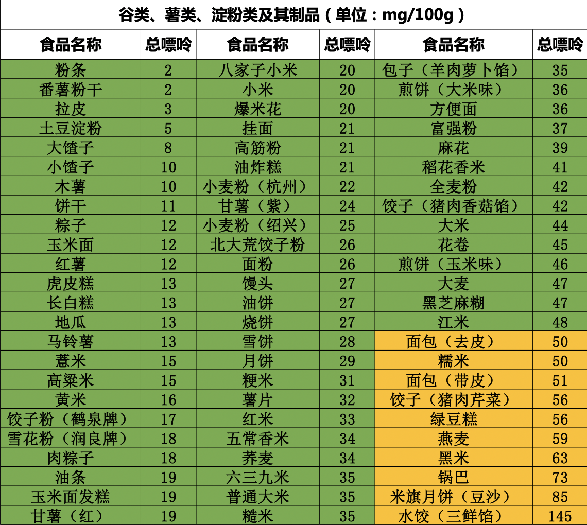  
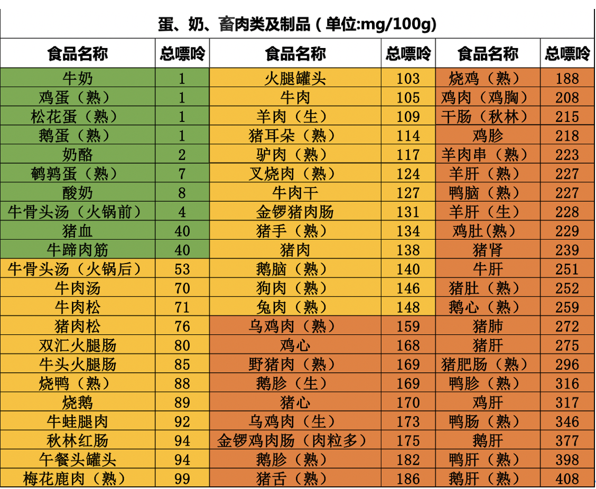  
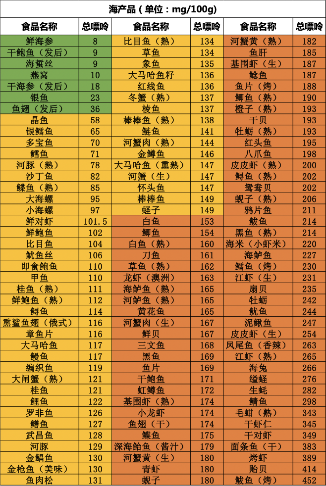  
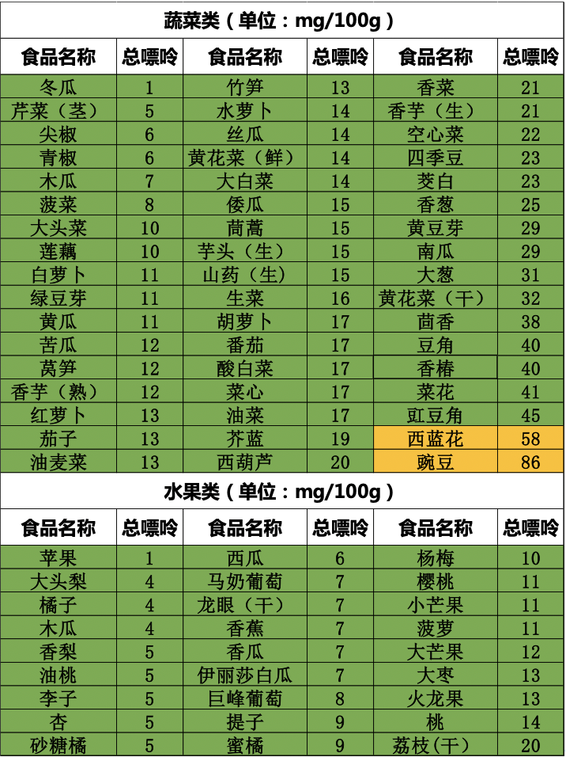  
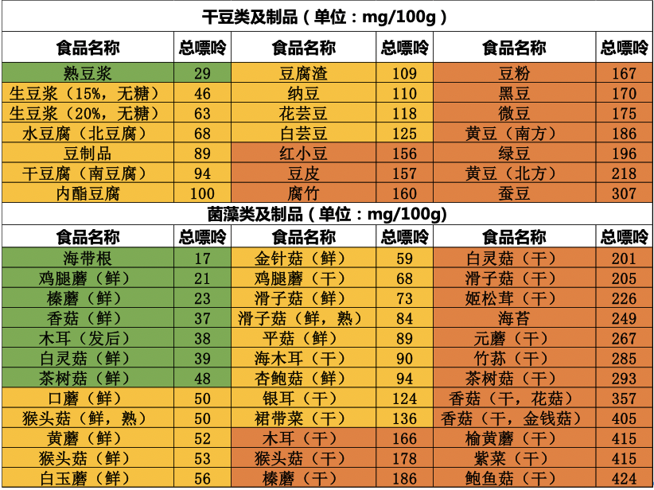  
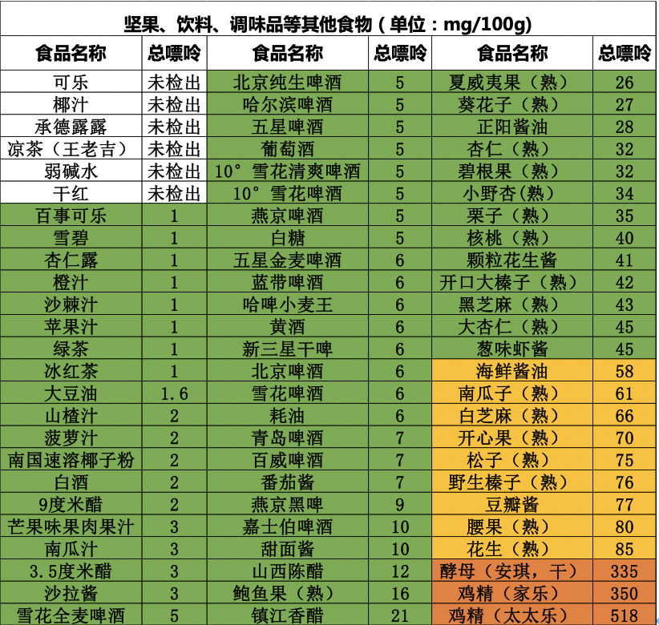  

* * *

# 07｜运动：运动会降尿酸，还是诱发痛风？

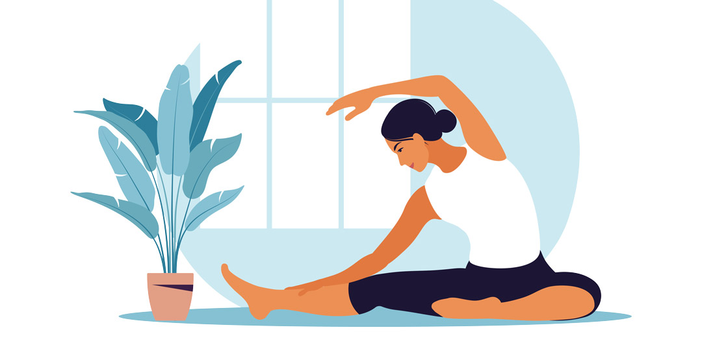

懒人专属群的群友，你好。

我是冯雪，欢迎回到我的《高尿酸医学课》。

前面饮食固然是降尿酸中最快最好用的，那么运动呢？你的想法是不是，生命在于运动，肯定有好处啊。再说前面“三高”课里说过，高血压治疗中运动能当一片降压药用，高血糖治疗中呢，降血糖的效果也是立竿见影。

可惜，运动跟高尿酸的关系没那么简单。 甚至你去问很多痛风的人，他们会一脸痛苦地回忆起，自己去了一次健身房、跑了一次步，回家就发作了。

那么，我们是不是可以得出这样的结论：运动容易诱发痛风的发作，不适合高尿酸？不可以。你要知道，医学不是一个只看现象的经验性科学，如果我们要得出可靠的结论，就需要循证医学来回答两个问题：

第一，是短期，运动的当下，身体的尿酸代谢发生了什么改变？为什么会诱发痛风？  
第二，从长期来看，很多运动的高尿酸人群，他们的尿酸水平如何了？身体如何了？

我先说答案，

运动诱发痛风只是表象，真相是，运动可以降低尿酸，减少痛风发作。

这一讲我们掰开了谈一谈，我们如何用好运动，把不同阶段的高尿酸降下来。

## 运动后尿酸的代谢情况

为什么很多人运动后会痛风发作呢？我们就要看看运动后，尿酸的代谢变化。

如果运动超过了一定强度，我们的身体会大量消耗人体中一种重要的供能物质，叫 ATP。这个 ATP  
分解以后，就产生了大量的腺嘌呤，嘌呤代谢的产物就是尿酸，自然尿酸的来源就增加了。

同时，运动还诱导了一种应激激素，去甲肾上腺素的产生，这种激素也能让嘌呤合成增加，尿中尿酸排泄减少。两边一叠加，就引起了痛风的发作。

那么长期看怎么样呢？研究发现，

这些尿酸虽然在有氧运动后立即增加，但随后会慢慢下降。

如果是多次规律的长期运动，这种变化更为明显。一项有 46 万个样本的观察研究发现，与尿酸水平正常但不运动的人群相比，

无症状高尿酸血症患者进行适度运动，可以增加 4-6 年的预期寿命，而且还可以完全消除高尿酸的死亡风险。

为什么会有这样的效果呢？医学家推测，

可能是尿酸反复轻度增加后，身体受到了刺激，使得自己对于尿酸排泄的能力反而得到增强，因此，尿酸就更低了。

这时候，我们就能得到一个明确的结论，运动对于高尿酸，就像披着灰太狼外壳的喜羊羊。如果用得好，多了解，多长期接触一下，它就会露出喜羊羊的真面目，是降尿酸的利器。如果乍一看到，它就是灰太狼，分分钟就让你的痛风发作起来。

好，我们已经知道，在高尿酸的生活方式里，运动方案不可或缺。那么紧接着的问题就是：究竟要怎么做运动，才算专业和精准的医学治疗？这里需要分开说，因为不同的高尿酸阶段，运动方案差异非常大。

## 无症状的高尿酸阶段

先来看无症状的高尿酸阶段。因为痛风还没发作，这个阶段我们可以发挥得比较多，限制得比较少，但也有几个点要注意。具体来说，你确定好四个维度，包括运动类型、运动强度、运动频次和运动时间，然后按自己的情况去执行就 OK。

运动类型以有氧运动为主，就是快走、慢跑、骑车、游泳、爬山这些，还有

飞盘、球类运动也都可以，但不是为了打比赛。除此之外，也可以加一些小量低强度的力量训练，像是哑铃、推举、卷腹、平板支撑这些。

但要注意，这些力量训练既不能大量，更不能高强度。除了刚才说过的原因，力量训练时肌肉更容易发生无氧代谢，产生大量的乳酸堆积。这些乳酸排出体外时，跟尿酸走的是一条通道，也会大大降低尿酸的排泄。

那么这个强度的界限在哪儿呢？医学家发现，

只要在运动时，肌肉不发生无氧代谢，就不会产生腺嘌呤的增加。对大部分人来说，中等强度就刚刚好，也就是最大运动心率的 70%以内。

如果你没有心脑血管、其他三高等疾病，你可以用这个公式来计算出你中等强度运动的心率范围：

最大心率=220-实际年龄

为了运动安全有效，你可以在锻炼的时候，用智能手表给自己设定这么一个心率区间。

再说运动时间和运动频次。推荐每周定期的体育锻炼在 150-300 分钟，频次你可以自己根据喜好来定，只要保证总量 150 分钟以上，你可以每天 30 分钟，做 5 天，也可以每天 50 分钟，做 3 天，选择能坚持的方式就是王道。

但是，千万别一口气把这 150 分钟都做完。如果一次持续 1.5 小时以上的运动，我们会看到强度越高，血尿酸水平也越高，所以像马拉松、长时间的打球，这些都不推荐。

除了这些规律的运动外，近年来有一种最简单的运动形式，越来越受到医学家的认可，那就是打破久坐。

每天连续坐着工作、学习的时间不要超过 90 分钟，90 分钟后站起来，走走也行，活动一下也好，舒展一下胳膊腿也行，总之就是不能一直坐着。最近，越来越多的研究发现，打破久坐对于高尿酸、高血糖、高血脂这类代谢性疾病效果非常好。

## 慢性痛风阶段

接下来是慢性痛风阶段的运动方案，也分两种情况。

一种是痛风急性发作了，这时候运动显然会增加关节的损伤，不适合任何运动。说实话，这时候我就算给你推荐了什么运动，也疼得完全不可能做吧？就乖乖躺着，多休息为上策。

等急性疼痛消失得差不多了，才需要从非常低的强度开始，站起来，走一走，慢慢增加强度。

另一种情况是没有发作痛风的时候，也就是间歇期。这时候的运动方案和刚才说的无症状阶段基本一致，只不过需要注意一点，

不能诱发过度的应激。

前面我们也说了，运动本身就会引起应激激素上升，导致尿酸合成增多，排泄减少，如果再叠加了其他诱发应激的因素，随时都会有痛风发作的危险。

什么会诱发我们人体的应激呢？你被身后突如其来的老虎吓到，这个肯定会应激，实际一点，和运动相关的，就是脱水和寒冷。

脱水，对身体来说本身就是一个应激的信号，再加上运动过程中出汗，血液浓缩，局部循环减慢，血尿酸的浓度会相对升高，这些都使尿酸更容易结晶，沉积下来。

寒冷也是一个身体应激的敏感信号，尤其是痛风患者，对外界的气温变化极为敏感。同时，越是寒冷的时候，我们身体外周的血管越是收缩，这时身体外周的血液循环速度大大减慢，比如手脚的关节，那么尿酸就有可能在这里开始结晶，导致痛风发作。

所以，这个阶段如果运动，在运动的前中后都要及时补充水分，注意保暖，避开寒冷的环境。

## 痛风性关节炎阶段

最后是痛风性关节炎。这个阶段，关节已经受损，运动即便有好处，也成了一个大难题。

临床上，我们看到许多患有关节炎的人，因为担心关节受损、害怕疼痛，在运动面前望而却步，反过来加重了高尿酸、痛风，非常可惜。

其实，全世界的运动医学都验证了，有规律的体育活动可以缓解成人关节炎的疼痛，就像药物一样有效。此时的运动方案有四个特点：

第一，选择对关节容易的活动，比如步行、骑自行车、水中的有氧运动或者跳舞。

这些活动受伤的风险很低，也不会因为过度扭曲而“撞击”关节。

第二，如果你没有运动的习惯，要从少量多次开始。

例如，每天 2 次，每次 3-5 分钟的慢走，每次只增加一点运动量。

第三，此时的力量训练很重要。

这个力量训练，你不能把它理解成在健身房用一堆器械，而是每个肌肉群在不负重的情况下，简单的训练动作，比如卷腹、深蹲这些，力所能及就好。每周 4-5 次，针对身体主要肌群进行一组 8-10 次的锻炼。随着肌肉变得更强壮，它会为关节提供更强大的支持，不仅能减轻关节的负荷，也能很好地缓解疼痛。

最后，为了保持关节的活动度，需要日常做一些柔韧性锻炼，比如拉伸和瑜伽。

每天，把全身各个关节转一转，每个关节重复 5-10 次。拉伸运动呢，建议每周至少做 4-5 天，每次拉伸保持在一个感受到拉伸的位置 10-15 秒左右。

## 男性和女性的运动方案

除此之外，我还要提醒一件事，就是运动方案对于男性和女性的效果也有不同。

虽然在高尿酸这个问题上，全世界的男性都比女性更容易中招，然而，运不运动这件事，对女性高尿酸产生的影响却要比男性大得多。

是不是很神奇？

具体来说，对于男性，饮食习惯对高尿酸影响更大。对于女性，工作类型、通勤方式和锻炼，这些和运动相关的生活方式因素影响更大。比如，如果一位女性的工作类型是久坐不动，或开车上下班，或每周锻炼少于一次，这些为她带来的高尿酸风险，相比男性都要大。所以如果你是女性，就要更关注运动。

讲到这里，专业精准的降尿酸运动方案，你都已经了解了。回过头你会发现，运动之于尿酸，外表是坏的，内核却是好的。如果不了解本质，你就难免多走弯路。

下一讲，我们来开启降尿酸生活方式里最关键的一个方案，它比吃什么、怎么运动加在一起还要重要。它是什么呢？我是冯雪，我们下一讲揭晓。

* * *

# 08｜减肥：降尿酸最关键的方案是什么？

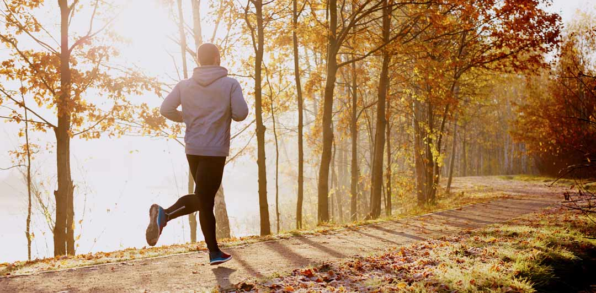

懒人专属群的群友，你好。

我是冯雪。欢迎回到我的《高尿酸医学课》。

前面两讲，我们把降尿酸要用到的饮食方案、运动方案都给到了你。但其实，在所有生活方式中还有一个更重要的问题，比吃不对和不运动加在一起还要重要，那就是“肥胖”。

听过《科学减肥课》的同学可能会觉得，好用的减肥方法那门课里不是都讲清楚了吗？为什么还要专门用一讲来说呢？

这是因为，很多好用的减肥方法，在降尿酸这里就不好用了，甚至用不好，尿酸还有增加的风险。

所以，高尿酸减肥，是个值得单独说说的话题。

## 为何减肥如此重要？

在讲具体的方法之前，我们先解决一个问题：肥胖本身又没有增加尿酸，为什么我却说肥胖是导致高尿酸的最重要的生活方式问题呢？

要回答这类问题，医学有两个方法：一个是做大规模的人群调查，另一个是探究人体本身的机理。

首先是大规模的人群调查。这个并不复杂，大量科学研究表明，体重、体质指数，也就是 BMI，与尿酸水平、痛风发病风险呈正相关。也就是说，

体重越大、BMI 越高，痛风的发病风险也就越大。仅仅超重这一项，就影响了痛风总发生率的 31%。

体重越大，尿酸水平越高，这算是发现了体重和高尿酸之间的相关性。但我们知道，相关不代表因果，它们可能只是碰巧同时出现的两件事，也可能是高尿酸导致了肥胖呢？

所以在发现相关性之后，我们还要更进一步地看看，如果一个人没有肥胖，是不是就没有高尿酸；或者是给胖子减肥，看看他们的高尿酸能不能缓解。如果体重降低，尿酸就下去了，那才说明真的是肥胖导致了尿酸升高和痛风。

这样的证据也比较多。一项针对 12000 多名男性的大规模研究证明，减肥可以让高尿酸男性的尿酸水平接近正常，效果甚至比常规的药物更明显。而且除了降尿酸之外，这些人的高血压、高血脂、高血糖的风险也大大降低了。这就说明了，肥胖是因，高尿酸是果。

说完了大规模人群调查，咱们再来看第二个方法——机理研究，也就是搞清楚肥胖导致高尿酸的机理，看看肥胖到底怎么影响人体，最终导致了高尿酸。

这个机理也已经被揭开了。首先，脂肪组织通过三种途径增加了内源性尿酸的合成。这个非常复杂，咱们就不展开了。其次，

肥胖的人，体内胰岛素水平下降，还会产生胰岛素抵抗，也就是胰岛素对血糖不敏感了，这会严重影响尿酸的排泄，间接促进尿酸水平的升高。

你看，合成得多了，排泄得少了，尿酸可不就升上去了嘛。

两种方法，虽然都是研究这个世界最本质的关系——因果关系，角度却完全不同。第一个是从宏观角度，利用大规模的人群调查，发现因果关系；第二个则完全是微观角度，利用一个人身体的几种细胞、十来个分子，解释因果逻辑。但

殊途同归，都证明了肥胖会导致高尿酸。

## 不能采用的方案

我们言归正传。既然减肥的效果这么好，高尿酸人群自然会迫不及待地用上。然而，高尿酸减肥却远没有你想得那么简单，我给你讲一个真实故事：

小高，34 岁，海归博士，年纪轻轻已经是大厂的中层管理者了，但是严重超重，178 的个子，180 多斤，BMI 高达 28.7，两年前，发现自己的尿酸高了。眼看着自己的父亲就是因为满不在乎才一路从高尿酸、痛风，发展成了全身性的痛风关节炎，所以小高早早就意识到，一定要把尿酸控制下来。

小高毕竟是高级知识分子，一番信息搜索下来，马上确定了减肥是当务之急，然后就开启了自律的饮食和运动控制。来到我这里的时候，他 3 个月减了 10 斤，相当不错了。但是在这 3 个月里，他犯了两次痛风。他说，实在不知道是怎么回事，怎么别人越减肥尿酸越低，到他这里就是越减尿酸越高呢？

仔细询问一番我发现，饮食上，小高选择的是减肥速度相对较快的低碳水饮食，吃的都是高蛋白、高脂肪的食物；运动上呢，小高也很自律，每天 30 分钟高强度运动。当时正值冬天，小高就在下班以后挤时间，每天晚上 10 点多户外运动，运动完洗澡睡觉。结果两次都是半夜痛风发作，被疼醒了以后到医院看急诊。

如果前两节课的内容你都掌握了，我想你已经可以给小高一些初步分析了。哪些是高尿酸人群在减肥时不能做的呢？

第一就是，不能采用低碳水饮食或者生酮饮食。

低碳水或生酮饮食，也就是那种主食很少、肉很多的饮食，会不可避免地使人摄入的能量结构中，蛋白质和脂肪的比例大幅度增加。

这么多的蛋白质食物，必然含有大量嘌呤，于是嘌呤直接升高尿酸，诱发痛风。

低蛋白、高脂肪的食物也不行。因为这样蛋白是少了，但营养不均衡，

大量的脂肪很可能会升高血脂，反过来影响人体的代谢系统，提高其他代谢疾病的风险，其中就包括痛风。

高尿酸人群减肥第二个不能做的，就是不能剧烈运动，尤其是在寒冷的天气里。

这个我们上一讲已经剖析过了。小高就是在北京干燥的冬季，先是寒冷刺激，然后身体在剧烈运动中丢失大量水分，洗澡时身体又丢失一些水分，睡觉前又没有及时补充，睡着后暖气又加剧了水分丢失，所有因素叠加，就导致血液里的尿酸水平直线升高。

所以我们看到，低碳水外加不合适的运动，小高的体重确实降低了，但尿酸的水平却在增加，最终导致了痛风的发作。

这里多说一句。除了上面这两点之外，还有第三个误区是高尿酸减肥时不能碰的，就是快速地节食减肥。

因为我们的身体在过度饥饿的情况下会自己产生酮体，而在肾脏中，酮体和尿酸的排出通道也是一致的，两者有竞争关系。也就是说，如果我们的身体有大量的酮体需要排出，那么尿酸就排不出去，必然会随之增高。所以，

高尿酸人群也要控制减肥的速度，不能瘦得太快，每个月减重 0.5～1kg 就好。

## 高尿酸减肥方案

听完这些，你会不会觉得，这也不行，那也不行，那我这体重还怎么减呢？

其实，原则是一致的，都是打造 500～700 大卡的能量缺口，具体你可以参考我的《科学减肥课》。只是在实现这个能量缺口的过程中，我们选择的方法不同而已。高尿酸人群如果想减肥，完全可以在避开前面的坑的基础上，选择一些事半功倍的方案。这里有两个建议给到你：

第一，首选营养均衡的饮食模式。

对于高尿酸患者，我们不建议通过不均衡的饮食模式来减肥，比如低碳水、高蛋白、高脂肪、低脂肪等等，都不建议。因为从长期来看，这些饮食模式都可能会产生新的代谢紊乱，导致高血脂、高血糖，当然，更有可能加重本身就是代谢紊乱导致的高尿酸。

对于高尿酸人群来说，营养均衡，按照一个均衡的比例搭配每餐的蛋白质、脂肪、碳水化合物，是最健康、减肥效果最好的饮食模式。

你可以使用我们前面讲到的“DASH 饮食”，也可以采用大名鼎鼎的“地中海饮食”。当然，如果图简单的话，我在《科学减肥课》里还推荐过一个方法，就是“四格餐盘”，把餐盘分成四部分，一半是菜，1/4 是肉，1/4 是主食，简单又好坚持，推荐你去看看。

第二个建议就是，一定要配合运动来减小腰围。

不管体重有没有超标，只要内脏脂肪过多，高尿酸和痛风的几率就会增加。医学上，我们经常把腰围当成衡量内脏脂肪多少的可靠指标。

研究发现，腰围每增加一公分，高尿酸发展为痛风的危险就增加 9%。

因此，想要更好地把尿酸降下来，我们必须在饮食管理的同时，配合一定量的运动，把腰围和内脏脂肪降下来。这样一来，即便到头来体重没怎么减轻，只要内脏脂肪和腰围减少了，就一样能收获降尿酸的效果。

想要减小腰围，减少内脏脂肪，最好用的方法就是规律的有氧运动。比如，一周三次以上的慢跑、骑车、游泳、爬山、快走，效果都很好，但是请注意，每次的运动时间要超过 40min。如果再结合一定量的力量训练，尤其是锻炼腰腹部肌肉的运动，比如平板支撑、卷腹、臀桥，瘦腰的效果会更好。

饮食方案、运动方案、减肥方案，到这里，降尿酸最好用的生活方式、方案我就都给到你了。如果这些方案你做不好，或者对你还不管用，别担心，我们还有最后一个杀手锏：药物。这个我们放在下一讲说。我是冯雪，我们下一讲再见。

* * *

# 09｜药物：高尿酸用药，怎么治标又治本？

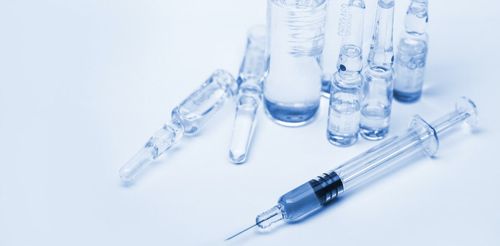

懒人专属群的群友，你好。

欢迎回到《高尿酸医学课》。我是冯雪。

前面我们用了三讲，介绍了降尿酸的生活方式治疗。不管吃不吃药，生活方式都是治疗的基础，不能动摇，但是这并不代表着，它能解决所有的高尿酸问题。当我们用了最好的饮食方案，坚持了运动，也减肥达到了目标体重，如果这时尿酸的水平还是高的，我们就可能需要药物了。

关于什么时候吃药、什么时候停药这个问题，我们已经在

综合防治策略里谈清楚了，你可以翻回去听一听。接下来的问题就是，吃什么药？怎么吃？

痛风作为“王者之病”，也是记载中最古老的疾病之一，人类寻找痛风药物的旅程，已经持续了上千年。这一讲，我们就把降尿酸、治疗痛风的药物从分类到用途，从原理到效果，以及处方药物的策略一一给你讲清楚。

治疗高尿酸和痛风的药物非常多，不过从用途来看，我们可以把这些药物分为两大类，总结起来，就是治标和治本。

## 高尿酸“治本”药物

先说你一定更感兴趣的，治本。我们在第四讲已经反复强调，对于高尿酸、痛风的各个阶段，关键都是降尿酸，治本自然就是要降尿酸。根据

第二讲尿酸升高的机理

，我们可以推断，

降尿酸第一是想办法减少尿酸的合成，第二是促进尿酸排泄，合成得少，排出得多，自然尿酸就降下来了。

先看从来处着手、减少尿酸合成的这条路。其中

最经典的、用量最大的、各种指南一线推荐的，依然是一种 1960 年发明的老药，

别嘌醇。

别是区别的别，顾名思义，就是另外一种长得像嘌呤的物质，它进入体内后，会被身体当成黄嘌呤，被黄嘌呤氧化酶分解成别黄嘌呤。显然，这个分解过程是不能得到尿酸的。

有意思的是，不管是别嘌醇这种药本身，还是它的反应终产物别黄嘌呤，都能够大大降低黄嘌呤氧化酶的功能，从而多管齐下，降低了体内尿酸的生成，效果自然不错。

说完了经典老药别嘌醇，再来介绍一种比较新的、降低尿酸合成的药物，

非布司他。有多新呢？它直到 2004 年才被发现，2018 年才正式进入中国市场。

这个药相比别嘌醇，最大的优势就在，作用靶点更加精准。

凡是作用精准的药物，一般都有两个好处：

一是避免了误伤无辜，副作用可能更小。比如，非布司他就比别嘌醇的肝肾副作用都要小。  
另一个好处是，因为更精准了，达到同样的作用，自然剂量也就更小了。有研究发现，40mg 非布司他的效果，能和 300mg 的别嘌醇效果相当。

听到这你是不是觉得，非布司他什么都好？那第一推荐为什么不是它，而是别嘌醇呢？

其实当年它几乎就要取代别嘌醇了，但是在应用过程中，医生们发现它可能会带来更多的心血管疾病风险，因此在进一步的证据完全出现前，它只能屈居别嘌醇之后，成为第二推荐。

解决完了减少合成这一头，我们再来看看增加排泄这头有什么思路。

其实，答案就藏在课程开头的两讲里。

第一种是，尿酸代谢要经过来回折腾，肾脏上的尿酸转运蛋白会把大部分的尿酸重新吸收回身体里。那么，如果我们可以抑制这种蛋白，是不是就可以增加排泄？

第二种是，既然绝大部分动物都能继续把尿酸降解成尿素，我们可不可以学习这种机制？

答案是都可以。其中研究最多最成熟的，就是尿酸转运蛋白的抑制剂，这类药物的代表是苯溴马隆。这个药物也是降尿酸的经典药物，别嘌醇出现后的 7 年就被发现了。不过，它却一直不得重用，这是因为医学家发现它有潜在的肝毒性，有诱发肝炎的危险。

相比而言，苯溴马隆对欧美人种肝毒性似乎更大，现在美国和英国都没有在使用了，在中国人群中稍好一点，我们至今仍在使用。

除了苯溴马隆，还有另一个抑制尿酸转运的药物丙磺舒，也是药性大，毒性也大，不到万不得已都不是好选择。

增加尿酸排泄的第二条路，就是提取动物体内的尿酸氧化酶，注射进我们人体，帮助我们身体里的尿酸分解为尿囊素，尿囊素就很容易排泄。

在中国上市的有拉布立酶、培戈洛酶。

这种药物的好处是，不管尿酸的量多大，这种药一针见效。坏处也是显而易见，既然是动物身体里的酶，人体对它就有天然的免疫，很有可能出现严重的过敏反应。另外，因为是酶，所以不能口服，只能注射，也比较麻烦。

好，治本的药物基本就介绍完了，我们可选的药物集中在

别嘌醇、非布司他、苯溴马隆这三种。而

治本的用药策略只有一个核心原则，那就是“滴定剂量达标”原则。

什么意思呢？你不难发现，降尿酸的药物副作用多少都有点大，所以医生在刚开始用药时，不管是哪种药，都会选择从最小剂量开始，一点点增加，一旦尿酸能降到我们规定的范围以下，就立即停止，以减少不必要的副作用。

## “治标”的止痛药物

说完治本的药，再来说治标，就是治疗症状，对症下药。高尿酸早期没有症状，痛风发作最大的症状就是痛，所以治标的药物选择，就是要止疼。

止疼药的选择有三类，第一类叫秋水仙碱，这是一种从百合科植物秋水仙里提取的生物碱。根据文献记载，这个药最早在公元 1 世纪就被拿来治疗痛风，据说是人类第一个痛风药。

痛风发作的时候，这个药物可以很好地对抗白细胞在发作部位的聚集，对抗炎症，因而对痛风的疼痛有奇效。很多痛风患者告诉我，秋水仙碱吃下去起效的那一刻，那种痛不欲生的痛觉突然就消失了，就像它从没有发生过一样。

但是，秋水仙碱药效大，副作用也大。医生很早就已经发现，这个特效药的中毒剂量特别低。往往这边效果刚出现，那头病人就开始恶心、呕吐、腹泻，甚至肾衰竭，一系列典型的中毒症状就出现了。

听到这，你可能有点害怕了，你会想，医学都进步两千多年了，我们有这么多止疼药，还是选选其他两类吧？

这第二类，是非甾体抗炎药，也就是你最常听说的芬必得（布洛芬）、消炎痛（吲哚美辛）等等这一类止疼药。这类是 OTC 非处方药，你在药店随时都能买到，非常方便。

但如果拿这类药来对付痛风，要想有效，药量得大，一片、两片、三片，等到起效了，副作用也不小，而且病人常常感觉还是挺疼的。

那来听第三类，也就是激素，糖皮质激素，你听过的强的松，氢化可的松之类。这类药物止疼效果固然不错，但长期应用的副作用，我不说，你也知道，吃完发胖，水牛背、满月脸，还会加重高血压、高血脂、糖尿病，抵抗力也会下降。

听完后面两类，你会发现，一种效果不够，一种副作用可能更大，好像还不如秋水仙碱。

不过有一个好消息是，大量研究一致发现，秋水仙碱的止疼效果，跟剂量没有太大关系，一旦起效，小剂量和大剂量效果一样。

这世间的良药和毒药，有时候就是一线之间。

如今，医学已经可以很好地把握秋水仙碱的纯度、剂量，使它稳坐痛风对症治疗的第一把交椅。  
如果秋水仙碱不耐受，用的是非甾体抗炎药，那么一上来就要用到足量，不给疾病喘息的机会。  
如果是全身多个关节发作，我们就不考虑那么多副作用，直接用上第三类止疼药，激素。

一句话，就是重病还需猛药。

关于止疼药，一是用在痛风的急性期，疼得要命，肯定要救急。二是，慢性期发生骨头损害，出现了慢性疼痛，自然也会用到。但还有一点可能是你没想到的，就是我们可以未雨绸缪，对没出现的症状给药。

这是因为，如果已经有痛风、存在尿酸结晶，在运用降尿酸的药物时，尿酸会从结晶的地方溶解，来到血液里，在还没来得及排出前，血液中的尿酸浓度反而会短暂升高，有可能诱发其他部位的痛风发作，而且这种可能性高达 64%左右，并且反复出现。

显然，每一次的痛风发作都是对关节、对肾脏、对全身的一次巨大的损伤。

既然如此，医生不会等到你痛风发作了再用上，而是为了预防痛风发作，在你用上降尿酸药的时候，就已经小剂量联合给止疼药了。

目前，国内外所有的指南都推荐，患者需要至少联合用药 3-6 个月后，等到身体里尿酸结晶的水平降低了，才会停下这类治标的止疼药，改为单独应用降尿酸药物。

## “稍带手”药物

讲完了所有治标治本的药物，我还要给你介绍一些有意思的“捎带手”药物，这是医学近年来的新发现。

捎带手，就是这些药物原本是用来降血压、降血脂、降血糖的。在应用数年后，发现他们捎带手还能降尿酸，于是反过去重新研究药物机理，发现还真的有不同角度的降尿酸机制。

比如降压药当中的氯沙坦、钙通道拮抗剂 CCB 类，降脂药里的非诺贝特、阿洛伐他汀，除了磺脲类的大部分降糖药，等等。

这样一来，如果你本身就需要用这些药，也要降尿酸，你不仅不用遭受前面降尿酸药的那么多副作用，还能不费吹灰之力，一举两得。

这一讲提到了很多药物品种，我在这里给你列了一张表，治标、治本、稍带手的，如果你有需要，可以保存下来，随时查阅。

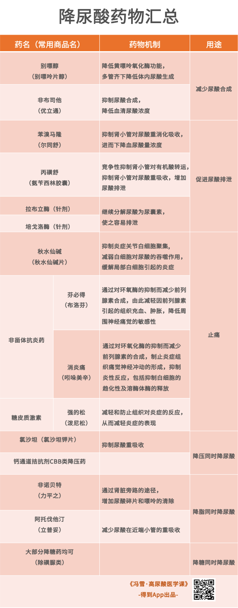

到这里，关于高尿酸的机理、病程、防治、用药，我都已经告诉你了。不过你是不是觉得，好像还有那么一点小遗憾？跟其他“三高”相比，高尿酸医学好像没有那么清晰、那么斩钉截铁的用药界限，也没有立竿见影的治疗方法。

没关系，下一讲，我一起补给你。我是冯雪，我们下一讲见。

* * *

# 10｜展望：对抗高尿酸的未来出路在哪里？

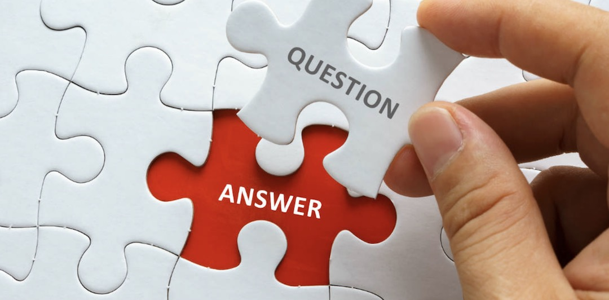

懒人专属群的群友，你好。

你好，我是冯雪，欢迎回到我的《高尿酸医学课》。

尿酸升高在人类进化中的缘起、高尿酸发展的全貌、现代医学抗衡高尿酸的最高智慧，我在前面的课程里都已经交付给你了。但我估计你可能还会有一些疑惑，比如，高尿酸只有 10%-20%的概率发展成痛风，那么到底谁会暴雷谁不会呢？我们有办法提前知道、提前预防吗？再比如，前面说了高尿酸人群的运动和饮食方案，都是针对所有人的普遍方案，有没有基于我们个人的、最高效的方案呢？

虽然目前的医学还不能完全给你答案，但是医学前沿已经触及到了这些问题，并对它们做了大量探索性的研究。这一讲，我就把其中最可靠的、最有可能变成现实的给到你，让你站在未来的视角，审视今天该用什么方法善待自己。

## 高尿酸的预测

概括来说，医学界对这些问题的探索，围绕着高尿酸的预测、生活方式的治疗这两个方面展开。

咱们先看预测，也就是精准地知道高尿酸会在什么时候发展成痛风。

我们知道，大部分高尿酸是没有症状的，在尿酸没有高到一定程度时也不需要用药；而只要进入痛风阶段，无论尿酸水平多高，都要进行药物治疗。于是问题就来了，高尿酸在什么情况下会转变成痛风呢？搞明白了这个问题，我们就能做到精准预测、提前预防了！

有些人可能觉得，痛风，发作一次入骨的疼痛自然就知道了。但我们想做的是事前预测，而不是事后知晓，真等到发作就晚了，就代表我们预测失败了。

事实上，所有指南对于痛风的定义，也都不是非要发作一次，而是身体里有了尿酸晶体就算痛风。有了尿酸晶体，对身体的损伤就出现了，痛风发作是早晚的事。于是，看身体里有没有尿酸结晶，就能判断会不会痛风。

说起来容易，操作起来却是困难重重。我们总不能一遍又一遍的扫描人的血液，随时监控有没有尿酸晶体出现吧？做不到啊！

有些人可能会想到：液体达到饱和浓度就会析出晶体，所以看血液中的尿酸浓度呗？尿酸浓度高于饱和浓度的就有结晶析出。是，理论上这个方法可以，但是血液的温度、酸碱度、有没有炎症等，都会对血液的饱和浓度产生影响，不同的人差别很大。同样这个数字，可能小王是 6.2mg/dl，小李就是 7.5mg/dl。而且，即使是同一个人，今天的身体状况和昨天不一样，这个数字就会改变。这么一来，单纯从尿酸浓度就没法判断一个人是不是会从高尿酸转变成痛风了。

长期以来，这个问题一直没有取得突破。不过最近，中国科学家做了一组关于高尿酸和痛风人群的代谢组学研究，为我们提供了一个非常靠谱的思路——

研究观察到，高尿酸人群和痛风人群的代谢产物明显不同。在所有的 321 种代谢产物中，痛风阶段会发生明显变化的有 95 种，而且所有这些显著改变的代谢物都集中在两个途径。然后，研究人员又使用三种机器学习算法，开发了一个基于七种代谢物的预测模型，可以敏感地区分痛风和无症状高尿酸。

未来，如果更多人可以验证这个模型，我们就可以在高尿酸人群中早早筛查出谁是未来的痛风患者，进而早早进行严格的生活方式和药物干预，避免痛风发作。

## 生活方式治疗

好，说完了高尿酸的预测，我们再来看生活方式的治疗。

大量研究证明，生活方式治疗是极其有效的预防、治疗、防止高尿酸复发的手段，但是在实际操作中，我们会有很多的问题。比如，我们知道要少吃高嘌呤食物，但高嘌呤的食物在人体内会如何代谢、是否真的会导致痛风，我们并不知道；再比如，我们知道运动可以减轻身体的胰岛素抵抗，从而减少高尿酸引起的并发症，但我今天运动了 30 分钟，是不是马上就取得了正向效果，我们不知道；再比如，我们知道改变饮食、正确运动，但一日三餐究竟符不符合标准，今天没有单独做运动，但是爬了楼、打扫了家务，运动量到底达标了没有，我们并不知道。

所以未来，高尿酸的生活方式治疗方案，就要围绕刚才咱们说的这三点困惑来解决，也就是精准的营养、精准的运动和精确的行为记录。

先来看精准营养。

精准营养，并不是很多人想象的给一个精确到吃什么、不吃什么、补充什么元素的菜谱。最近十余年的研究，营养学界已经推翻了这种通过具体某种元素的添加、某一种能量物质的改变，来实现某种治疗目的的营养策略。精准的营养指的是，通过海量的数据，对你的饮食模式以及食物在你身体中的代谢做出精准判断。

医学如何知道你的饮食模式呢？不能依靠你的记忆，回忆自己吃了什么，而是通过身体的代谢产物来标记你吃了什么。这就是精准营养的一个突破点——代谢组学，它也被称为精准营养的基石。比如，通过鉴定餐后尿样本中的关键代谢物，就能区分你吃的是谷物还是鸡蛋火腿。如果在尿液中检测到了高浓度的马尿酸盐，说明你吃了水果蔬菜；检测了二甲胺，说明你吃了鱼；检测到了肉碱，则说明你吃了红肉。同时，来自肠道菌群的数据，又能为这个结论提供很好的补充。比如，多个研究发现，红肉摄入量与肠道微生物代谢产生的三甲胺成正比。于是，通过代谢组学和肠道菌群，我们就能知道你每天都吃了什么。再配合你的代谢数据，就能知道这些食物在你的身体里发生了怎样的代谢反应。这就为精准指导你的饮食模式，进而精准影响你的代谢变化提供了可能。

说完了精准营养，再来看精准运动。

运动显然比饮食好量化得多，也容易给出更精准的方案。精准运动测量的出现，颠覆了以往我们对于运动的一些判断。

比如，以往的研究会集中在运动本身对高尿酸的影响，但随着运动传感计、加速度计的连续佩戴，配合尿酸的监测，医学发现：同样是高尿酸患者，那些全天候忙忙叨叨，经常需要站立、走路的人，远比长期久坐不动、偶尔进行大运动量训练的患者，尿酸要更低，胰岛素敏感性也更好，患有其他心脑血管疾病的风险也低得多。显然，连续运动监测不仅让我们对自己全天的运动总量有了清晰的认识，而且让我们全面、明确地看到了，跑步、平板支撑等运动，或者是做家务、站着办公等不起眼的活动，究竟对我们的尿酸、对我们的代谢产生了什么样的影响。这些都为定制出最适合我们的运动方案带来了可能。

最后，是所有这些行为的精确记录。

运动可能还比较容易记录，但饮食则是一本糊涂账。之前我们很难知道自己吃了多少、摄入了多少能量。但现在，这方面的突破可以说是五花八门，各显神通。

比如，“远程食物摄影法”是目前用得比较多的。基本操作就是吃饭前给食物拍个照，吃完了再拍一张。这些图像可以通过人工智能的方式，计算能量和营养素的摄入量。比起传统的量表，这个方法已经被证实更便宜、更简单，也更可靠。再比如，还有一种基于手腕运动跟踪的方法，可以通过一个可穿戴的手表和一个微型的机电陀螺来监测食物分量，进而获得每餐的能量摄入情况。最后一个更绝，叫作“自动摄食监测仪”，也是一种可穿戴的设备，使用三种不同的传感器详细监控人的进食行为，把你吃零食、夜间进食或周末暴食的数据全部记录下来。

当然，生活方式医学并不是为了监督我们而生的，无论是精准的营养、精准的运动，还是精确的行为记录，都是为了让我们的生活方式治疗更舒适，更高效。

最后我要说，高尿酸的未来，不仅有基因组学，代谢组学、生活方式医学这些医学最顶端技术的参与，还有传感器、信息科技、数据算法的全方位加持。但所有这些，都离不开我们对于高尿酸本质和全貌的认知。“知其本末，则近道矣”，只有如此，我们才能驾驭尿酸，这样一把进化中的双刃剑。

说到这里，高尿酸的课程就要结束了，“四高”系列课程也接近尾声。对于“四高”，如果你还有什么问题，欢迎在课程里留言，我会尽量回复。我是冯雪，再见。

* * *

# 为什么“四高”总是相伴而生？

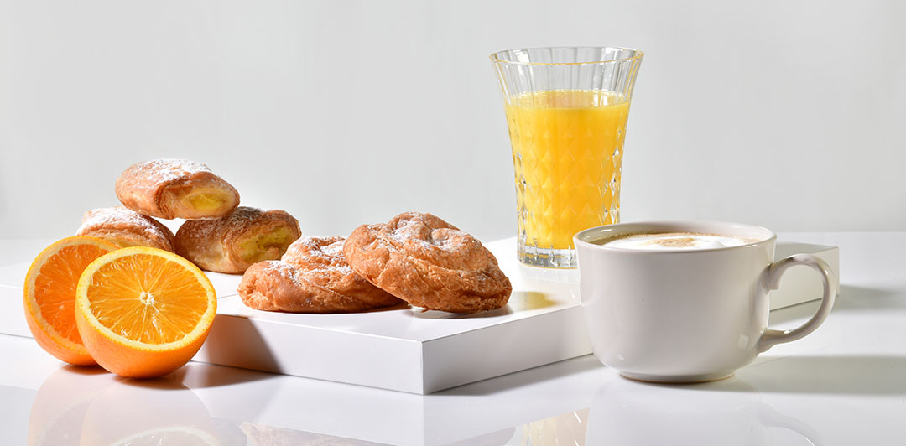

懒人专属群的群友，你好。

欢迎回到我的《高尿酸医学课》，我是冯雪。

“四高”系列医学课，也就是高血压、高血脂、高血糖和高尿酸四门课，已经正式走到尾声了。

“四高”的知识我们讲得差不多了，但是有一个问题我们避不开：

“四高”之间，到底是什么关系？

## 四高共病基础

根据 2021 年《中国心血管健康与疾病报告》，中国目前有 2.45 亿高血压，4 亿高血脂，6.7 亿高血糖和 2 亿高尿酸患者。放眼全球，每年有 70%的死亡都和这四高相关。

“四高”，就是我们长寿路上最大的绊脚石。

这组数据是什么意思呢？表面上看，是目前中国的成年人中，很多都有两高，或者两高以上。

但更重要的是，想想我们自己。按照这个概率，我们很可能在若干年后，在这几高中选择一个，两三年后再合并另外一高，再过两三年再添一高，就像灭霸集齐彩色宝石一样。然后不幸的呢，几年后，幸运的话，数十年后，我们大概率的死亡原因，也是这四高引发的疾病。

那我们就要问：为什么“四高”就像蘑菇一样，一簇簇地生长，摁下一个，又起来另一个？它们有没有什么赖以生存的底层土壤，也就是共病基础？这就是我们这一讲要解决的问题。

但显然，这可不是个容易突破的单点问题，而是个复杂的大问题。

“四高”的源头不同，机制也各不相同，它们纠结在一起的故事，我们讲了足足四门课。

## 尿酸和血压

不过这个问题，特别适合用高尿酸串联着讲。因为高尿酸，它特别容易诱发、串联其他三高，和其他三高交互最多。这个情况在其他三高那里也有，但是在高尿酸这儿，表现得更加突出。

先看尿酸和血压。这里需要复习一下，控制人体血压调节的 RASS 系统。这套工作系统的处理中枢在肾脏，它会接收来自你身体中的各种信号，加工、处理、分析，翻译出来，得升高多少血压才能匹配身体的需求，然后制造出一系列可以升高血压的信号物质，调节血压。

你会发现，RASS 系统就像一座桥梁，把血液的物理变化、化学改变、血压、水、电解质、激素的信号，还有血糖、血脂、尿酸，所有这些连接在一起，完成身体的平衡协调。

尿酸，也是这个 RASS 系统处理的信号之一。尿酸升高，就会搅乱这个系统的运作。不仅如此，升高的尿酸排泄损伤了肾脏的功能，直接影响了 RASS 的中枢所在地。双管齐下，血压自然就升高了。

另外，最近越来越多的研究表明，RASS 的调节是双向的。这些身体的紊乱，既能通过 RASS 来升高血压，血压升高后，也会通过 RASS，反过来损伤肾功能，加重身体的这些紊乱，尤其是需要依靠肾脏来排泄的尿酸。这也是为什么，四高中，高尿酸和高血压的关系最为密切。

## 尿酸和血脂、血糖

再来看尿酸和血脂、血糖的影响，高尿酸是蛋白质的代谢问题，高血脂是脂肪的代谢问题，高血糖是糖的代谢问题。这三者有一片共同的土壤，叫作

“代谢综合征”，顾名思义，就是身体代谢的综合问题。

我们身体里，不同细胞对营养的需求是不一样的，比如，哪些组织抵御寒冷，需要脂肪多一点；哪些需要脑力思考，需要糖分多一些；哪些肌肉生长，需要蛋白质多一些。这样一来，代谢这三大能量物质的通路必然互相交流。

但也正是因为这些交互，蛋白质、脂肪、糖，任何一种能量物质代谢出了问题，其他两个也跟着一起受累。

当你高尿酸的时候，由于尿酸的氧化性能，血脂氧化的概率大大增加。普通的血脂是不会堆积在血管壁上形成斑块的，但是氧化后的血脂就是形成斑块的好手了。这意味着，如果你只是高血脂，形成斑块要五到十年，但要是合并高尿酸或者高血糖，就用不了三五年。

我们还观察到，高尿酸患者也特别容易并发糖尿病。为什么呢？研究发现，高尿酸会使得我们的细胞对胰岛素不敏感，本来 1 个单位的胰岛素可以降解的血糖，现在 3 个单位也不够用，这样就形成了胰岛素抵抗，身体就分泌更多的胰岛素，直到累得干不动了，就成了 II 型糖尿病。

整个“代谢综合征”的关键，就是胰岛素抵抗。

这也不难理解，因为我们身体所有的能量代谢，最终被细胞利用时，都要转化为糖。因此，糖和胰岛素这套供能系统，是每个细胞的底层能量利用系统。任何一种代谢紊乱，最终都会通过胰岛素抵抗，反馈在细胞能量利用上。

无论是尿酸、血糖还是血脂高了，都会导致胰岛素抵抗的加重，然后我们身体的能量利用出了问题，进入身体的能量就不能被转化，成为了身体的负担。更不要说，尿酸本身还是个氧化剂，多了还会增加全身的氧化应激，引发一系列问题。

## 四高的共同结局

总结一下，四高，通过两条共同的危害通路生长出了共同的结局，一个是控制人体血压调节的 RASS 系统，一个是胰岛素抵抗。

什么是共同结局呢？我们的四高医学课，别管是哪一高，提到最高频的结局，都是

心梗、脑梗、冠心病、肾衰。

为什么都是这些呢？其实原因很简单，四高的所有病变，可以分为两大类。

一类是血液的物理变化，比如高血压，这是血液的压力变化；  
一类是血液的化学改变，比如高血糖，高血脂，高尿酸，恰好就是人类的三大能量物质，糖、脂肪、蛋白质过剩引起的代谢紊乱。

但无论是物理改变，还是化学改变，它们都真实发生在血管里，自然，伤害也是由血管来承担。

尤其是血流量大的血管、血流需求高的器官，包括心脏、大脑、肾脏，受到的伤害也就最深。所以这四高，无论增高的具体是哪一高，其结局大多是一致的。

具体是怎么伤害的呢？不管是哪一高，在身体里导致这么坏的结局，都是由于发生了

炎症反应。

这个炎症，不是你想象的伤口发炎，那是外部细菌和身体的免疫系统打架了，这个发炎，是我们身体的免疫系统在和自己的身体打架，明明没问题的地方，免疫系统也去疯狂地攻击。和伤口的细菌打架，打一阵打赢了就不打了，这个和自己身体打架，本来就是内耗，打起来还没完了，你想，这就得两败俱伤。

打架，这是真实存在的，但为什么会打架，这事就有点虚。你不能站在一就是一、二就是二的实体层面去理解，你要跳出来，从平衡的层面去理解。

我们的身体是一个进化而来的产物，我们走到今天，靠的就是对外界环境的适应和应激。适应，帮我们在不断改变的环境中存活下来，而应激，帮我们去应对当下发生的危险。适应和应激都是生命本能的产物。

为什么“四高”会成为一个问题？核心就是，我们昨天的身体，如何适应今天的变化。

我们所面临的应激，无论是身体的还是心理的，都发生了跨越式的改变。

身体上，过去是饥一餐饱一顿，现在三餐能量都过剩了；

心理上，你本来要应付突然出现的一头狮子，现在每天却要应对各种持续的压力。

这种改变的时间之短、变化之大，就像是一眨眼，你之前还在用手摇式电话，睁眼后就拿起了 iPhone 的最新款。身体怎么能反应过来呢？

这些外环境的改变，在身体里转化成了内环境的改变，从你的能量代谢，到神经系统，只要身体还来不及适应的，都要发生应激。就拿四高来说，血压高了，要应激，血糖血脂高了，要应激，尿酸高了，当然还是应激。身体如何表达这种应激呢？就是由我们的免疫系统通过炎症，来保护自己不被伤害。

可是哪里知道，这个外环境的改变，竟然不是一时一日，而是年年岁岁、经久不去的，这时候身体里持续的炎症累积的伤害，终将把我们拖垮。

我学医很多年，一直觉得只有实实在在的科学技术能改变世界，后来才发现，要有一个更大的视角才能找到答案，突破理论，进而成长。

好，现在你已经知道了四高在身体里，互相牵连的桥梁、共同生长的土壤。那么我们就不难想到，四高是一荣俱荣，也是一损俱损。

确实，在现实研究中，我们发现四高的预防和治疗也是相通的。比如，如果我们可以很好地控制高尿酸，那么高血压就很难冒头；相反，如果高尿酸时间一长，高血压、高血脂和高血糖也都不远了。

讲到这里，四高为何相伴而生，成为世纪难题我们基本就搞清楚了。但你可能会有点失望，要解决这个困扰，难道我们要回到茹毛饮血的原始人吗？

当然不是，只要在你的身体和你的环境之间，找到适应的那个平衡点，问题就迎刃而解了。

下一讲，四高的终极防治策略，我带你找。我是冯雪，咱们下一讲见。

* * *

# “四高”共同防治的终极策略

懒人专属群的群友，你好。

我是冯雪，欢迎回到我的《高尿酸医学课》。

上一讲，我们了解了“四高”的共病基础，这一讲，我们来讲“四高”的共同防治。

你可能会觉得，这有必要吗？我在这四门课里，不是说了怎么吃、怎么动、怎么治疗，那合起来看不就行了吗？

但是你看，高血糖的时候我们说可以尽量采用低碳水高蛋白饮食，到了高尿酸，我们就不建议高蛋白饮食；  
高血压时，我们说最好的运动是静力拉伸，这是一种力量训练，到了高尿酸，力量训练就算做，也要被控制在非常严格的范围里；  
高血脂时，我们说喝茶可以降血脂，到了高尿酸就变成了喝茶可能会升高尿酸。

所以，

要想实现“四高”共同防治，这件事情肯定不是简单的合集，而是需要找到一个交集处。

这自然离不开上一讲介绍的共病基础。想要制服“四高”，我们就要在变化的外环境和我们身体的内环境之间，找到一个平衡点。平衡点的寻找分为三个阶段。

## 平衡阶段

第一阶段，是我们没有“四高”，身体相对比较健康的时候。这是一个理想状态，这时候我们的生命和外在世界，是处于平衡状态的。

如何才能在这个平衡停留得更长呢？你想象一个天平，是不是支点越大，这个天平就越稳固？如果你能让这个平衡点的范围扩大一点，那么即便你的生命面临了一些挑战，无论是一场大病，还是创业的压力，你都有良好的应对能力。

为了扩展这个平衡点，科学有两个方向的追求，一是动，二是静。

动，指的是你的心肺功能达到的运动极限。

这个极限当然也不是越高越好，反映在科学上，是通过心肺运动试验测定你的心肺运动能力。医学上基础的四大生命体征是呼吸、体温、脉搏、血压，这个心肺运动适能，也被世界卫生组织和美国医学会认定为第五大生命体征。

高强度运动本身就是一次应激过程，你的身体从心肺功能到微末代谢，都要去适应这样一次应激。如果你日常就可以应对这样的应激，当你遇到更大应激时，身体就不至于过度反应，而是可以适应，最终扛过去。

怎么摸到这个“动”的极限呢？要么你可以去医学中心做一个心肺运动测试，要么你按照公式计算一下：

最高心率=220-年龄。

中等强度运动：最高心率的 40%-59%

高强度运动：最高心率的 60%-89%

然后保持每周 75 分钟高强度运动，或者每周 150 分钟中等强度运动。这样，你就可以把你的“动”的极限维持在一个高水平范围。

比如，你不常运动，跑不了 1000 米，突然让你去跑半马，你肯定跑不下来。但如果经过这样的长期规律运动，你的心肺运动势能就会大大提高，进而能完成这样的高水平比赛。

即便不靠计算，你也应该理解，这个运动绝不是散散步、跑两圈就能达到的，它必须是稳定的、中高强度的运动。

你健康天平的平衡点，一头是“动”能摸顶的高度，另一头是你的“静”能触底的深度。

这个“静”有点抽象，你可以理解成，某种深度的安静状态。

它可以让你的内环境更加稳定，消除你原有的应激的产物，消灭已经形成的伤害。

现阶段，医学还不能准确地用某个指标去检测这种“静”，但我们依然有很多侧面信息可以提示：你的深度睡眠质量怎么样？你的心跳是稳定，还是忽快忽慢？你安静时的呼吸频率怎么样？等等。

虽然检测很困难，想要达到这个深度的修行却有迹可循。目前，有研究证据的训练有三种，包括

冥想、瑜伽、太极。

还有比较简单的行为，我推荐腹式呼吸。安静、专注而深长的腹式呼吸，每天 10 分钟，可以让你得到更深的静。

如果有能力，你可以尝试在做任何事情的时候，无论工作还是学习，吃饭还是走路，都做到专注当下，不想别的事情。

做到这一动一静两头的修炼，可以帮助扩大你的平衡点范围，获得更高水平的健康。

## 平衡位移阶段

前面说的是第一个，健康人的阶段，那么到了第二阶段，就是平衡点已经发生了位移，生命的天平稍稍翘起，但又不至于马上崩塌的时候。

高血压是有一级高血压；  
高血脂是没有合并心脑血管风险的高血脂；  
高血糖是糖尿病前期；  
高尿酸则是尿酸偏高、但没出现痛风症状。

这个阶段，就是我们修复保养的黄金时机，

这个时候，你内外环境的变化主要来自两个方面：

一是身体接受的能量改变和随之而来的代谢改变。  
二是外界压力改变和它带来的心理变化。

这两方面，还可以互相助推，导致身体的应激不断上涨，导致一高又一高来到我们身边。所以，我们的防治也主要围绕这两方面展开。

我们先来看第一方面，找回能量的平衡点，包括两部分：能量的总量平衡以及能量的结构平衡。

总量不平衡，表现得很清楚，那就是肥胖。如果你有肥胖，恭喜你，改善肥胖就可以改善几乎所有问题，具体的方法，你可以参考我的《科学减肥课》。

如果你没有肥胖，总量问题就可以不用管，只需要关注结构平衡。

这么多年营养学的研究，得出了比较一致的结论，那就是要长寿，糖、脂肪、蛋白质这三大能量物质缺一不可，而且要维持相对稳定的比例。

碳水，这个今天已经有点妖魔化的能量物质，要占到 55%～75%，这里面，一定要包含能量密度特别低的蔬菜、水果，主食要以糙米、全麦、杂粮这些为主。  
脂肪，不用害怕，要占总能量的 20%～30%，随便吃。但最好要吃不饱和脂肪酸的油脂，比如鱼虾、坚果、橄榄油，还有中国传统压榨的植物油，占到脂肪总量的一半。  
蛋白质，一般 1g～1.5g/kg 体重。我们吃进去的蛋白质，鱼肉海鲜之类的，一般都会伴随脂肪，甚至脂肪比蛋白质还多。所以，选择食物的时候，如果不让脂肪超标，可以考虑高蛋白、低脂肪的。

怎么选择脂肪和蛋白质呢？方法总结在一起，就是三句话：

跑不动的不如跑得快的，跑得快的不如天上飞的，天上飞的不如水里游的。

具体这个比例怎么操作，简单点，你可以参考“四格餐盘法”。两格菜、一格碳水、一格肉。比较复杂的，你可以记一下

营养日记，计算一下你的现在每天吃进各种能量的比例，然后略略调整一下。

这个阶段，如果“四高”中只有一高，你可以按照课程里我们给出的具体方案去吃。但如果合并了两高或者以上，这是最省事的吃法。在这种均衡的能量下，你的平衡状态也会逐渐恢复。

当然，在这个基础上，要是你还想恢复得更快一些，可以考虑结合轻断食，无论针对哪一高，它都能起到事半功倍的效果。因为我们身体一旦开始失衡，往往会进入恶性循环，而轻断食可以为这个循环按下暂停键，重启身体的修复，更快地回到平衡点。

> > 去复习

在这个第二阶段，除了找回能量的平衡点，我们还要找回心理压力的平衡点。心理压力，远不如能量那么具体，如果不是到了抑郁症、焦虑症，医学上也很难描述压力的大小。但是，压力一定会在你的行为里留下映射。我的经验是，最容易发现的映射有两个，就是你的睡眠和你的精力。

今天的社会，没点压力是不现实的。但是如果压力大到睡眠和精力都很糟糕，那你一定要高度警惕了。比如早醒，原来睡到 8 点，现在 5 点就自然醒了，睡不着，躺床上一个小时“翻煎饼”。再比如，以前同样的工作，做到下午 5 点才开始有点累，现在还不到中午 12 点，就累得做不下去了。

如果发生了这些情况，说明平衡已经打破，你就需要生活方式治疗了。怎么办，我给你一些自评量表，先判断一下需不需要找医生。

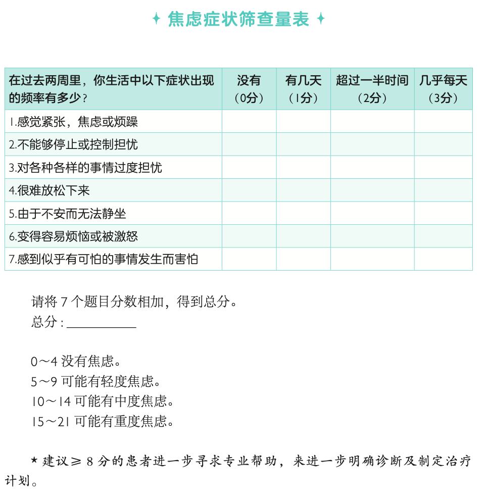  
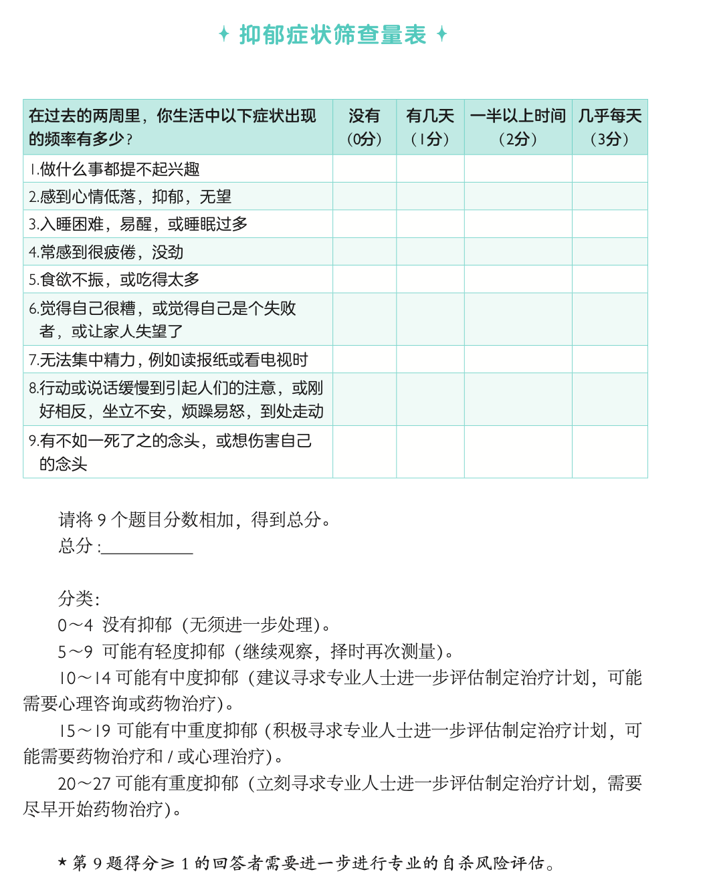

如果不需要，那么规律的运动、正念呼吸，都是你可以去借力的。

额外说明一点，规律的运动在这个阶段，不仅可以缓解你的压力导致的失衡，也可以解决你能量问题带来的失衡。也因此，它不再是第一阶段的强身健体，追求越强越好，去够那个上限，

这时候的运动更像是一种药物，“Exercise is medicine”，需要处方来规定。这个处方需要包括你运动的形式、强度、频率和时间。

针对每一高，我们都在对应的课程里给出了具体方案。

如果你有数高合并怎么办呢？你放心，这些方案不会有太大的冲突，可以选择它们的交集来用。我帮你总结了一下，这个交集就是，

每次 50min，一周 3～5 次，中等强度的有氧运动。这个处方，一般情况都可以使用。

## 明确失衡阶段

到了第三阶段，往往要面临好几高同时出现的境地，又或者是整个心脑血管都已经出现了明确的失衡。

这个时候，想要找回平衡点，就不能单靠你自身的内外环境调整了，而是需要药物。

而这点，用我的临床经验判断，往往是我们的病人最不能接受的。中国人，大都觉得“是药三分毒”，能少吃就少吃。

吃药不达标，或者压根不吃药，是当下国人慢病防治最大的难题之一。

但事实上，到了这个阶段，“四高”之间互为因果、相互增强，如果不严格控制，最后的危害就更大。

举个例子，本来 10 年后才会有的心梗，因为合并了好几高，可能 3 年就发生了。所以，全球的医学指南要求，这时候对“四高”的治疗目标会更加严格。

比如你有高尿酸，本来控制的目标是 360μmol/L，但是合并了糖尿病，就得控制在 300μmol/L 以下，这种情况下，你吃的药势必会增多，而你会觉得，我已经每天要吃一大把药了，还要再加量，不甘心。但其实，在这个阶段，把药吃明白了，是挽救你身体的关键。提高认知，听得懂医生的话，是这件事得以执行的重要前提。

好了，四高的最高防治策略，我就讲完了。如果你有别的问题，也欢迎在留言区跟我交流。咱们的“四高”医学课也告一段落，我是冯雪，祝你健康，咱们后会有期！

* * *