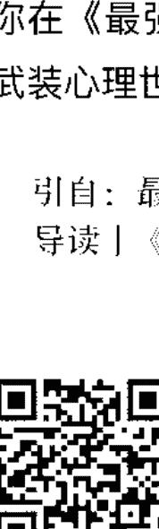
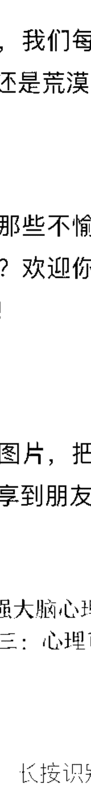
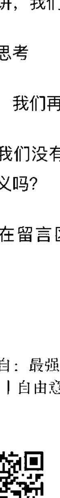
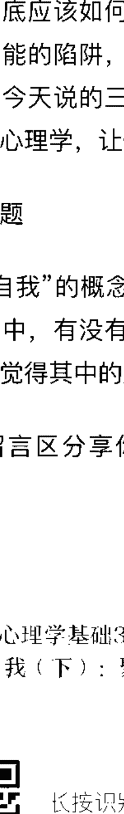
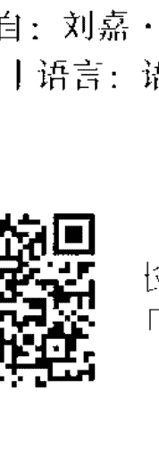
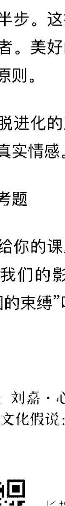
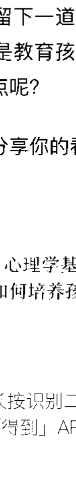
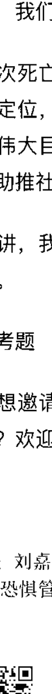

# 刘嘉心理学基础30讲

## 发刊词 | 心理学成就最强大脑

刘嘉

你好，我是《最强大脑》的项目总策划和科学总顾问刘嘉，也是北师大心理学部部长，以及中国超常人才专业委员会会长。

欢迎来到我的《最强大脑心理学课》。

从上世纪90年代起，我就开始在北京大学心理学系、美国麻省理工学院脑与认知科学系进行系统化的心理学研究。这么多年来，我一直都在思考一个问题：

要在事业上取得成功，除了高于一般人的智商之外，还需要点什么？

1921年，美国斯坦福大学心理学家推孟教授，发起了项目名为“天才的基因”的研究计划。推孟发现，那些智商超过140的天才儿童，在成年后有相当大一部分并没有在事业中取得成功。

2014年，中国校友会网发布了对1952年到2013年，将近3000名高考状元的职业状况调查报告。

遗憾的是，这些高考状元竟然没有一个人成为行业领袖，没有一个人跻身胡润、福布斯、财富等中国富豪榜。

这是为什么？

## 心理学才是科学的成功学

心理学家根据大量研究总结出来一个经验公式：

成功 = 20%的智力因素 + 80%的非智力因素。

主导我们成功的非智力因素有“心理弹性、成长性思维、坚毅、情绪智力、成就动机以及领导力”等等。

这就是为什么我们要学点心理学，因为所有的非智力因素，都是心理学的研究范畴。

可以说，心理学才是科学的成功学。

你成功与否，幸福与否，都可以从心理学当中找到根源。但正统的现代心理学绝不是心灵鸡汤、仁波切。

现代心理学是基于大量的科学实验，包括大脑与认知科学的研究，来还原我们每个人的行为背后，最真实的驱动力。

比如——

所有人都会出现自我中心的情况，没法从别人的视角看问题，这其实是因为你大脑的前额叶，是最晚进化的脑器官。

你会竭尽全力地融入群体，甚至不惜放弃自我，是因为当你被排斥、被孤立的时候，你大脑里的痛觉中枢会感到被刀捅一样的疼痛。

你如果经常心情不好，身体健康也会变差。这是因为你大脑中负责管理情绪的杏仁核，同时也调节着心血管系统和免疫系统。

科学的心理学，会帮助你发现、解剖、最终突破你自己的思维局限。它让你通过提升和开发你自己的非智力因素，向成功跨进一步。

我的这门《最强大脑心理学课》，目的就是要为你揭示迷雾背后的真实世界，向你展现一种新的可能，开启一条新的路径。

## 《最强大脑心理学课》会怎么讲？

在《最强大脑心理学课》，我会用30讲的时间，每讲10分钟，帮你搭建科学的心理学知识架构。

这个架构将会覆盖心理学的四大公理，30个颠覆性的心理学实验，以及30个核心概念。

这会是一门“沉浸式”的现代心理学课。

在这里，你将会感受到我在北师大以及中科院开设的心理学课堂教学体验。

你能收获什么？

成功其实也有规律可循。总结起来，有三个必要条件：理解自我、把控关系、价值观升级。所以在这门课里，我会有针对性地帮你训练这三种能力。

第一，我会教你如何掌控你的自我。

尼采说：“离每个人最远的，其实就是我们自己”，而越是成功的人离自己越近。在心理学中，你的所有行为都有规律，而我会帮你找到它背后的心理学机制，帮你洞悉你真实的自我，掌控你的终身发展。进一步，你还将成为朋友圈里的心理学家，身边的专家。

第二，我会教你如何掌控你的关系。

成功者都擅长经营自己的关系，因为影响你成功的关键因素，就是你能否和你的关系有良性的互动。我会更关注你的亲密关系，因为你在家庭中的关系互动、处理冲突的方式，就是你在社会关系中的行为模式。我将帮你自如掌控你的关系和资源。

第三，我会教你如何掌控你的使命。

所有的成功最终都是价值观的成功，价值观决定你做什么、怎么做、以及走多远。面对多变而复杂的社会，你应该如何面对变化，你到底还有没有机会？在这里，我会让你看到如何摒弃平凡之恶，如何避免责任分散，打破阶层固化，从而自我实现与自我超越。

以上这三个学习目标，实际上也是心理学研究的终极目标。有人就有心理学，所以它会真实地帮助你解决人生的的问题。

如果你也想了解科学的成功学，拥有成功事业和幸福的人生，那么我欢迎你，加入我的《最强大脑心理学课》！

课程更新时间：

每天17:10（1月8日起连续更新，总计30讲内容）

引自：最强大脑心理学课
发刊词 | 心理学成就最强大脑

长按识别二维码打开原文
「得到」APP

## 导读 | 《最强大脑心理学课》学习指南

刘嘉

你好，欢迎来到《最强大脑心理学课》，我是课程的助教，很高兴为你提供知识服务。

你现在看到的课程内容，是我们邀请“最强大脑”节目的科学总顾问、北京师范大学心理学部部长——刘嘉教授开设的心理学通识课。

欢迎你走进心理学课堂，每天10分钟，开启你的心理学学习之旅。

更新时间： 每天 17:10 （1月8日起连续更新，总计30讲内容）

学习目标： 这门课希望帮你掌握和打通30个心理学关键概念，搭建起心理学的基本框架，完成心理学的快速入门。

## 模块设置·这门课会怎么对你讲？

第一部分是“ 心理学基础框架 ”（模块一），我会用“3个思维模式+4个公理原则”帮你搭建心理学的学科框架；

第二部分是“ 心理学概念和应用 ”，主要分为3大模块：

模块二·我的定位和认知 ：主要围绕“我”的各种心理，帮你认知自己；

模块三·我的恋爱和婚姻 ：主要针对“我”的关系问题，帮你处理亲密关系；

模块四·我的价值与责任 ：主要关注社会和自我实现，帮你应对未来变化。

## 学习环节·这门课有什么特别设计？

这门课我还安排了3场互动学习环节，把刘嘉老师在北师大课堂的教学方式搬到线上，让你更好的掌握心理学知识：

研究性学习：模块二结束后，我会为你布置一个开放式的小课题，为你提供参考资料和研究方法；你可以运用学到的知识，参与到这个开放学习的讨论中。

电影学习课：模块三结束后，我会带着你分析一部经典电影里的人物心理，让你学会观察细节，掌握洞察人性的方法。

结业微论文：模块四结束后，我会教你心理学专业做“文献综述”的窍门，帮你快速地复盘30讲课程，同时也帮你学会未来在心理学领域持续阅读进阶的方法。（建议你现在提前做好完成这个小任务的准备）

为了更好地方便你学习这门课程和使用产品的各项功能，我还为你准备了6条攻略和1份知识体系图，便于你学习的同时，也帮你收获更多：

攻略1：写下你的观点，与刘嘉交流

点击文稿下方的「写留言」，留下你的看法和洞察或者希望刘嘉回答的问题；

攻略2：使用倍速听，让学习效率更高

如果你想在更短的时间内听到知识密度更高的内容，你可以展开「音频播放器」-点击「更多」-「倍速播放」选择你想要的倍速。

我们为你提供0.7倍语速、1.25倍语速、1.5倍语速、2.0倍语速、3.0倍语速，你可以根据你的信息接收需要，用更少的时间听到更多的内容，节省学习时间。

攻略3：分享课程知识，帮朋友解决问题

攻略4：收集词典，巩固心理学知识

攻略5：掌握系统功能，高效学习课程

攻略6：参照知识结构图，掌握课程内在逻辑

我把整个课程的知识脉络梳理成了下面这张图，方便你迅速理解。建议你把它保存到手机或者分享到朋友圈。

▽知识结构图▽

点击图片可保存或分享

现在，就正式开始你的心理学学习之旅吧。祝你在《最强大脑心理学课》学习愉快，用科学武装心理世界，成就你的“最强大脑”。

引自：最强大脑心理学课
导读 | 《最强大脑心理学课》学习指南

长按识别二维码打开原文
「得到」APP

## 01 | 从直觉思维走向理性思维

刘嘉

### 01 | 从直觉思维走向理性思维

09:52 4.62MB

| 音频转述师：满超 |

### 课程概要

关键词概念：直觉 (Intuition)

核心问题：如何拥有常人一样的洞察力？如何适应高速变化的现代社会？

预计阅读时间：6分钟（欢迎使用音频版，知识全都听到）

学习心理学最重要的任务就是摆脱三种思维：直觉思维、自我中心思维和机械思维。
今天起，我会用连续3讲的时间帮助你彻底转变思维方式。

## 三只猴子吃香蕉的实验

首先我想介绍一个经典的心理学实验，实验的主角是三只爱吃香蕉的猴子。

心理学家把三只猴子关在一个笼子里，而笼子的中央挂着一只香蕉。

心理学家设定了一个规则：

任何一只猴子去拿香蕉，另外两只猴子就会被电击。

很快，猴子们就学会了，拿香蕉是一个会给猴子群体带来麻烦的行为，所以只要有一只猴子试图去拿香蕉，另外两只猴子就会制止它甚至将其击打一顿。

久而久之，当三只猴子都学会这一规则的时候，心理学家用一只新猴子来替换掉了其中一只老猴子。

这时候，你可以预想到两个结果：
第一，新猴子会去拿笼子中央的香蕉；
第二，两只老猴子会制止甚至殴打它。

实验就这么周而复始，一只只新猴子被放进来，替换掉了之前的老猴子，猴子换了一拨又一拨，但香蕉不可以拿的“习俗”，却能始终在猴子群体当中保留了下来。

只要谁敢去拿香蕉，就会遭到另外两只猴子的攻击，虽然新猴子并不知道，香蕉为什么不能拿。

那你肯定会问：这是为什么呢？
心理学家说，这就是社会规范的起源。

怎么理解这个社会规范呢？
一方面，为了适于生存，我们在头脑里保存了无数条规则和思维方式。
这些规则，能快速地、有效地指导我们的行为。

比如，你会称赞他人的衣服好看，而不会指出他们的门牙上挂了一丝青菜。

但是，在另一方面，我们很少去探究每一条规则背后的逻辑和它适用的情景。我们只是简单地，将这些代代相传的、已经固化的思维模式，应用到现在高速演变的社会中，以至于我们作出一个又一个愚蠢的判断。

比如，我现在问你一个问题：你去买彩票的时候，你会认为，彩票上号码是“55555”的中奖概率更大呢，还是“34821”的中奖概率更大？
显然，你的直觉告诉你，你不会认为“55555”的概率更大，因为它听起来太巧合了。
但是，从统计学上来讲，这两个数字中奖的概率其实是一样大的。像这样的例子，在我们生活中还有很多。

2002年，诺贝尔经济学奖获得者、心理学家卡尼曼就曾说：
人都会假定自己的思维是理性的，但是人的大多决策都是非理性的。我们做着很多自认为有道理、有逻辑、有理性的事，但实际上，我们依赖的往往是自己的直觉。

## 理性的错觉：有哪些常见的非理性行为？

如果你还认为，你自己在大多数时候是理性的。那么，你不如试试下面这个测试：
有一位叫尼赫鲁的教授在一所美国大学里面任职，他精通梵文，订阅了《印度文化》这个期刊。他每天晚上在家写诗，他的爱好是收集佛像。
好，现在我要问你：你觉得这个教授，更有可能是一个印度文学教授，还是一个细胞生物学家？

我相信你肯定会猜，他是一个印度文学教授，对吧？这个问题太简单了，他具有一个印度文学教授该有的典型特征。你想想，能有几个细胞生物学家会精通梵文？有几个细胞生物学家会回到家之后去写诗、去收集佛像？
但事实上，如果你猜他是一个细胞生物学家，你赢的机会更高。

其实道理很简单，这是因为在整个美国，只有
一百个印度文学教授，但是却有五万个细胞生物学家，这就是基础概率。

虽然尼赫鲁教授的特征，和印度文学教授的特征匹配度高达90%，而与细胞生物学家的特征匹配度只有5%，但是，当你把它这个匹配度乘以刚刚所说的基础概率之后，你就会发现：尼赫鲁教授是细胞生物学家的概率，会是印度文学教授概率的2.7倍。

这就是我们经常容易犯的一个错误，叫做忽略基础概率。

## 用科学的理性思维来代替感性的直觉思维

听我说到这里，你很容易得出一个结论：人类天然地就习惯用直觉思维思考问题。
但是，如果我们人类是如此地容易作出愚蠢决定的话，为什么我们还能登上月球？还能创造那么多奇迹？
作为一位心理学家，我觉得答案有两点。

第一，就像我在开篇提到的3只猴子一样，在一个特定的情况下形成的直觉思维，在当时那个情况下本身是对的，是高效的。

请你想象一下，你生活在5000年前的一个小部落里，如果你在丛林里看到一个大大的，有斑纹的物体，你根本不用去思考这个物体是不是老虎。你需要做的是，赶紧逃命。
你看，在这个时候，直觉思维能帮我们做出快速的、高效的行动。所以说，直觉思维本身是没有问题的。

有问题的是，我们的社会发生了高速的变迁。特别是近100年当中，传统家庭的解体、工业经济模式的破产、通讯和交通的日新月异，使得我们在过去几千年积累和传承的直觉思维，已经不再适用了。

第二，我们登上月球，靠的不是直觉思维，而是科学的理性思维。
我们通过遵守科学的规律，用实验的数据，去不断地修正自己的错误，最后登上月球。

## 今日得到
好了，我帮你简单回顾一下这节课的内容。

## 课后思考

好，听完今天的内容，我想给你留下一个小任务，请你回想一下生活中有哪些因为直觉导致的谬误？
经常思考这个问题会帮你离理性越来越近，欢迎你在留言区参与分享。
我们下一讲再见！

你可以点击图片，把心理学词典保存至相册；
欢迎把它分享到朋友圈，记录你30天的心理学学习历程。

引自：最强大脑心理学课
01 | 从直觉思维走向理性思维

长按识别二维码打开原文
「得到」APP

## 02 | 告别自我中心思维

刘嘉

### 02 | 告别自我中心思维

08:22 3.92MB

| 音频转述师：满超 |

### 课程提要

关键词念：聚光灯效应 (Spotlight Effect)

核心问题：为什么人很难摆脱自我中心，真正地站在别人的角度去理解世界？

预计阅读时间：5分钟 (欢迎使用音频版，知识全都听得到)

在上一讲，我谈到了要摆脱文化和社会给我们带来的直觉思维，要拥抱科学的、具有批判精神的理性思维。

今天，我们就来说谈，由于大脑不完善的进化发育，给我们带来了另一种有问题的思维模式：自我中心。

自我中心的本质：“你是宇宙中心”

自我中心，并不是我们通常意义上说的自私。

自我中心在心理学上是指：我所看到的一切也应该是别人看到的一切。我所感受到的一切，也应该是别人所感受到的一切。我的视角是别人的视角。我就是这个宇宙的中心！

在我们人类的历史上，最经典的反映“自我中心”思维模式的就是“地心学说”了，也就是地球是宇宙的中心。

在1597年，伽利略给开普勒写了一封信，在信里面他说：“你该如何来描述这些所谓的学术精英，他们对经典充满了顽固的信仰，而不愿意，呐怕仅仅是通过望远镜，向外面的未知世界看上一眼，我们应当是嘲笑他们还是应该为他们哭泣？”

伽利略是否嘲笑这些人们我们不知道，但是我们知道他很快就哭了，因为他提出了“日心学说”，很快就受到了宗教审判。而另一位支持“日心学说”的科学家和哲学家布鲁诺，干脆就被烧死了。

现在我们都知道地心学说是错的，日心学说是认为地球是围绕着太阳而旋转的。

但是为什么在长达上千年的历史里，我们都会认为地心学说是正确的呢？

除了宗教的因素之外，真正的原因在于：我们从一生下来就拥有一个顽固的思维模式，这个顽固的思维模式就是自我中心。

自我中心的极端表现就是自闭症

你可以找一个两岁的小孩子做这么一个实验。

你在一张卡片的一面画上只小鸟，在卡片的另外一面画上一辆卡车。你坐在这个两岁小朋友的对面，你给他看这两幅图，确保他知道卡片的一面是小鸟、另一面是卡车。

当你把小鸟的这一面对着这个小朋友，他会告诉你他看见了小鸟。

有趣的是，当你问他“我看见的是什么”的时候，这个小朋友会告诉你，你看见的也只是小鸟。

虽然你坐在他的对面，你看见的是一辆卡车，但是对这两个岁的小孩来讲，他所看见的这个世界也就是你看见的世界。他看见了小鸟，所以说你也应该看见小鸟。

这个小朋友出现的这种现象，如果一直延续到成人的话，就会是一种心理疾病，叫做自闭症。

一提到自闭症，你可能想到的是电影里的，带有波浪漫色彩的心算天才、音乐天才。

其实，他们的心灵是被禁锢在一个狭小的空间里。在这个空间里，永远只有一个视角，就是自己的视角。

所以他们不能去从别人的视角去了解这个世界，理解别人的观点和情感。

他们始终认为，我所看见的世界就是你所看见的世界，我此时的喜怒哀乐就是你的喜怒哀乐，所以他们无法进行正常的社交交往和言语沟通。

## 你看到的世界和别人有很大的不同

当然，你可以说，我不是自闭症患者，我能从别人的视角看世界，我能理解别人的喜怒哀乐，我有共情的能力。

但是你真的就完全完全摆脱了自我中心的思维方式么？

我们不妨来做几个小实验。

第一个实验是这样的：

你找一个你的好朋友过来，再找一首你们两个人都不熟悉的歌曲，比如《歌唱祖国》。

你用手指在桌子上击打《歌唱祖国》的节拍，你可以猜一下，你的朋友有多大的概率能听出来，你所击打的节拍究竟是哪首歌曲？

实验表明，人们会认为自己的朋友有超过80%的概率能听出来，而真实的结果呢？

我告诉你，是零。没有任何人，能听出你击打的这个节拍究竟对应什么样的歌曲。

第二个实验：

假设我给你一件颜色特别奇怪的T恤穿在身上，比如说上面大红，下面大绿，然后让你到一群人里面去走一圈。

你认为，会有多少人会注意到你穿了一件颜色奇怪的T恤？

实验表明，人们认为会有超过50%的人注意到自己的奇怪穿着，而真实的结果呢？

我告诉你，只有不到20%的人会注意到你这件衣服。

这种现象，我们称为聚光灯效应，也就是说无论在哪儿，你都会认为聚光灯是永远打在你自己身上的。

所以你看，你听见的，不见得是别人听见的。你看的，也不见得是别人看见的。当然了，你的思维，你的想法，肯定也是和别人不一样的。

但是很多情况下，我们却会真地以为，我们的观点也必然是别人的观点。

在另一个实验中，心理学家把大学生分成两组。

一组大学生，他们期望自己在30岁以后结婚，而另一组认为自己会在30岁之前结婚。

心理学家问这两组大学生，其他人对结婚的态度是什么样的？

那些计划早结婚的人，会认为有70%的人也会倾向在30岁之前结婚。

而那些期望晚结婚的人呢，就会认为有70%的人都愿意在30岁之后结婚。

## 摆脱幼稚的自我中心

那么既然我们每一个人都不再是2岁的小孩，也不是自闭症患者，为何我们还是很难摆脱自我中心，真正地站在别人的角度去了解这个世界呢？

第一个原因，跟我们大脑的进化节奏有关。

我们的大脑里，思维的核心叫做前额叶。在古代面相术中，有“天庭饱满”一说，指的是前额叶发达。而自闭症常就伴随着前额叶发育不良。

前额叶是一个新近进化的器官。在过去的200万年里，人类从能人 (Homo Habilis) 进化为智人 (Homo Sapiens)。

在这个进化过程中，人的大脑体积增加了3倍，而体积增加的主要部分，就是大脑的前额叶。

这个新近进化而来的器官，在很多方面还不够成熟，所以我们思维的灵活性、完备性还有所欠缺。

所以，即使我们长大成人，我们的思维还经常带有幼稚的自我中心。

第二个原因，和我们在生活中接受的思想有关。

我们一直被灌输一个思想，就是我们的心理世界，是对物理世界客观、忠实的反映，甚至认为心理世界只是物理世界的一个镜像。

所以我们会认为，每一个人的心理世界都是一样的，你的心理世界就是我的心理世界。但是，这个观点是错误的。

我们每一个人都有一个独立的心理世界。所以，你所构建出来的心理世界和别人构建出来的心理世界是不一样的。

因此，我们必须得承认个体之间的差异，我们必须得珍惜每一种思想的价值。

## 今日得到

今天我跟你分享了人类思维模式的第二大问题，自我中心。

你在这节课中看到，我们人往往错误地认为，自己的视角，就是别人的视角。

所以，学心心理学的第二个目的，就是让你学会摆脱幼稚的自我中心，能够从别人的角度去理解这个世界。

一旦做到了这点，你所看见的世界，就不再是一个单调的、只有黑白的世界，而是由不同人、不同的角度去汇聚的整个世界的精彩。

## 课后思考

回想一下，有没有哪些场合，你认为自己做的某件事情别人肯定都注意到了，但是事实并非如此？欢迎你在留言区参与分享。我们下一讲再见！

你可以点击图片，把心理学词典保存至相册；欢迎把它分享到朋友圈，记录你30天的心理学学习历程。

引自：最强大脑心理学课 02 | 告别自我中心思维

长按识别二维码打开原文 「得到」APP

## 03 | 心理的作用力与反作用力

刘嘉

## 03 | 心理的作用力与反作用力

08:26 3.95MB

|音频转述师：满超|

### 课程提要

关键概念：皮格马利翁效应（Pygmalion Effect）

核心问题：为什么心理学家说，预言会自我实现？

预计阅读时间：8分钟（欢迎使用音频版，知识全部听得到）

在上一讲，我和你分享了我们之所以在一些时候会自我为中心来看这个世界，是因为我们没有意识到我们每一个人都有一个独一无二的心理世界。

这个独一无二的心理世界，既是对当下物理世界的映射，也混入了我们先天基因的预设，还包括后天经验的塑造。

更重要的是，当你试图去了解别人的心理世界时，就像一粒投入平静湖面的石子会引起涟漪一样，会永久地改变这个人的心理世界。

这就是我们今天课程的主题：心理的作用力与反作用力。

### 神奇的智商测试

关于这个现象的最好展示，来自一个关于小朋友智商提升的神奇实验。

哈佛大学的心理学家来到了 Ross 小学，对小朋友们做了智商测试。做完测试后，心理学家把小朋友们分成了两组，然后告诉老师：

A组的小朋友很有潜力，他们的智商会在未来的一年里有极大的进步。

而B组小朋友则没有什么潜力，在未来一年里他们的智力不会有大的提升。

说完之后，心理学家便离开了小学。在这个实验当中，老师所不知道的是，心理学家虽然测试了小朋友的智商，但是他给老师的名单是完全随机的，A组的小朋友和B组的小朋友无论在智商还是在发展潜力上都没有任何区别。

一年之后，心理学家重新回到了这所小学，询问老师，A组小朋友和B组小朋友在过去的一年里发展得怎样了？

老师说，教授真是太厉害了，A组的小朋友在过去的一年里变得特别聪明，而B组的小朋友们却没有太多的起色。

皮格马利翁效应：心理的作用力

心理学家当初作了一个随机预言，最终竟然真的实现了。这一年之中到底发生了什么？其实道理非常简单。

当老师被告知，A组小朋友是有潜力的时候，老师就会花更多的精力关注这群小朋友。当A组小朋友说出1+1=3的时候，老师会认为这是小朋友的偶然失误，甚至还会认为小朋友有创造力，所以A组小朋友会受到很多正向的鼓励。相反，当B组的小朋友说出2+3=5的时候，老师会认为他们只是因为某些偶然的因素碰巧答对了这道题。正是由于老师对A和B两组小朋友的不同态度，影响了小朋友本身的发展，最终使得小朋友的智力按照心理学家的预测发生了改变。

刚才和你说的这个现象，在心理学里，被称为自我实现的预言（Self-fulfilling Prophecy）。它还有一个非常文艺的名字，叫皮格马利翁效应（Pygmalion Effect）。

这个名字，来源于一个古希腊的雕刻家，叫皮格马利翁（Pygmalion）。有一天，他得到了一块非常好的象牙，于是按照他心中最完美的女性样子把象牙雕成了一个美女，并深深地爱上了这个雕塑。于是皮格马利翁每天都恳求爱神阿芙罗狄忒把这个雕塑变成一个现实生活里的真人。日复一日、年复一年，爱神阿芙罗狄忒终于被他的诚心所感动，让这个雕塑“活”了过来。于是，皮格马利翁和这个象牙雕塑变成的美女幸福地生活在了一起。心理学家用皮格马利翁的这个神话传说来描述这个现象，就是说当我们去期望某个事情会发生的时候，这件事情就会真的发生。这好象是说我们每一个人都有点石成金的魔法，只要你作了一个预言，这个预言就会成真。

### 抑郁的自我实现：心理的反作用力

刚才，和你说的是心理的作用力。下面，我们来看心理的反作用力。

在物理上，有一个叫铯-133的原子。这个原子，每秒钟震荡9,192,631,770次。这个震荡频率无论谁去观察，无论我们是带着赞赏还是鄙夷的心情去观察，都恒定不变。这便是我们在自然科学里常用到的思维模式，精确但是冷冰冰，客观但是没有人情。但是，在我们观察人的时候，这种机械的思维模式就不再可用了，因为我们人类不一样，我们的态度会影响别人的外在行为和内在心理。

如果我们粗暴地对待他人，就不能指望别人能笑脸相迎。所以，我们周边的环境，并不是天然存在，并且一成不变。相反，它是我们自己创造出来的。

如果我们没有认识到，在和其他人交往的过程中，我们的态度会影响他人的反应，那么我们就会出现非常大的问题，比如说，抑郁症。什么是抑郁症呢？它的核心症状就是长时间的、高强度的负面情绪。开始的时候，负面情绪可能来自事业上的挫折、亲人的去世、失恋或者是考试失败等等。但是仅仅是这些负面的事件还不足以导致抑郁症，将我们带入恶性循环的，是我们自我实现的预言。

当你开始感到悲伤时，你就会想到更多的负面事情，看周围朋友更多的负面行为，于是你也会有更多的负面行为和情绪。而你的负面情绪和行为又会影响到你的朋友和同事们，于是他们会逐渐认为和你打交道很困难，因此会疏远你甚至离开你，这样你会感到更加孤立无援，从而陷入更深的抑郁。久而久之，你的自我实现的预言就会给你构建出一个充满负面情绪的悲观世界。

所以，当你假设你的周围是一片鲜花的时候，环绕你的就是一片花园；当你认为你的周围充满了冷漠与无情，那你就将被整个沙漠所淹没；当你在认真防周围的人试图欺骗、占你便宜的时候，你的周围，充满恶意的人就会越来越多；当你以善意的眼光去看待每一个人，你会发现即使是阴盛也会有人性的闪光。

所以，学习心理学的第三个目的，就是学会如何去构建一个让自己感到舒适的周边环境。俗话说，送人玫瑰，手留余香。你要有什么样的世界，取决于你怎么来接触这个世界。枪与玫瑰，选择权在你。

## 今日得到

现在，我为你总结一下我们前三讲的内容。在这三讲里，我分别谈到了我们思维模式上的三大问题：

由文化和社會傳承帶來的與現代社會脫節的直覺思維。由我們大腦發育進化不完備帶來的自我中心思維。能精準描述物理世界但在心理世界舉步維艱的機械思維。

這些思維模式，使得我們無法洞悉自己、認知自我。而科學心理學就是要提出一套全新的方法論和世界觀，來取代這些局限的，甚至錯誤的思維模式，從而來引導我們的自我成長、自我實現。

那麼什麼是科學的心理學？在隨後的4節課裡，我將與你分享構築起整個心理學大廈的四大公理。

你可以點擊圖片，把課程大綱保存至相冊；歡迎把它分享到朋友圈，和朋友分享你的收穫。課後思考：在今天的課程結束之前，我再給你留一個思考題：能否分享一下，在你的生活之中，曾經發生過哪些自我實現的預言？學習了今天的內容後，你計劃作哪些改變？歡迎在留言區寫下你的故事，和我們互動。我們下一講再見！

长按识别二维码打开原文「得到」APP

## 04 | 公理一：基因为心理设置了初始参数

刘嘉

04 | 基因为心理设置了初始参数
07:01 3.29MB

| 音频转述师：满超 |

### 课程提要

关键概念：自私的基因
核心问题：你的行为模式是后天因素塑造的，还是与生俱来的？
预计阅读时间：5分钟（欢迎使用音频版，知识全都听得到）

从这一讲开始，《最强大脑心理学课》进入第二模块，心理学四大公理。我会用四讲的内容，与你分享贯穿了整个心理学研究的四个核心概念，它们阐述了心理与基因、与身体、与环境、以及与社会关系之间的联系。今天我将带你探讨心理学里最核心的问题之一：你的行为究竟由什么决定。

### 行为是后天环境决定的吗？

马丁·路德·金在《我有一个梦想》的演讲里，说过一句话，这句话反映了所有追求平等的人的梦想，他是这么说的：“我梦想有一天，我的四个小女儿将生活在一个不是以皮肤的颜色，而是以品格的优劣作为评判标准的国家里面。"
他的这段演讲，实际上反映了人们对于行为的一个传统的认知，就是人的行为是被后天环境塑造的。

心理学家华生有一个更加大胆的宣言，他说：“给我一个健康的小孩，给我一个我自己能够定义的环境，我保证能够将他培养成为医生、律师、艺术家，或者工程师，甚至可以是乞丐、小偷，而与这个小孩本身的天分、个人倾向和种族都没有任何关系。"
换句话说，华生认为，只要给他一个他想要的环境，他就可以把任意一个孩子塑造成任何他想要的样子。在他的观念中，人的行为仅仅受到后天因素的影响，而与先天因素，或者说遗传没有任何关系。

### 效果律：人会根据行为效果来选择行为

哈佛大学心理学教授桑代克提出了一个叫效果律（Law of Effect）的概念，进一步阐述后天环境如何塑造我们的行为：
效果律认为，如果我们针对一个刺激所作出的反应，得到了奖赏，那么这个反应和刺激的连接就会增强。反过来，如果我们针对一个刺激所作出的行为得到了惩罚，那么它们之间的连接就会变弱。简单地说，我们会通过行为的效果来选择我们的行为。

桑代克的同事斯金纳更是把这种观点发扬到极致，他在一本乌托邦小说《沃尔登第二》里写到：
所谓英雄，就是那些做好事而被奖励的人，而那些恶棍则是因为他们做了坏事却得到了奖励，所以他们变成了恶棍。
所以，是英雄还是恶棍，取决于我们的社会奖励什么样的行为。

### 基因从一开始就影响你的行为

刚才说的这些美好的理念，给我们描绘了一个完美的世界：如果我们通过效果律从小来培养孩子的工作态度、合作精神和社会交际力，控制他们错误的行为，那么我们就会有一个完美的社会。不幸的是，这个理念是错的。
心理学家在后面的研究中发现，在获取食物的时候，老鼠更容易学会用爪子去按压杠杆，而鸽子更容易学会用嘴。
这是因为老鼠先天就准备好用爪子来获取食物，而鸽子则是用嘴来获取食物。这就是生物先天的反应倾向。

人也是如此，有些小孩很快地掌握音乐，而有的小孩即使经过长期训练，仍难以弹出一首完整的曲子。

科学家还做过这样一个研究：遗传物质完全一样的同卵双胞胎，他们智商的相似性高达86%。更令人惊讶的是，当同卵双生子生下来之后，如果被两个家庭独立地抚养——请注意，他们是在两个完全不一样的环境里长大。这个时候，他们在智商上的相似性有多高呢？依然高达72%！
也就是说，只要基因一样，即使后天环境非常不一样，同卵双胞胎的智商也非常相似。

### 人的行为其实是在为基因服务

正是意识到我们的基因对我们的行为起到非常重要的作用，英国演化生物学家道金斯提出了一个著名的概念——自私的基因，也就是人类行为在本质上是在为基因服务。
也就是说，我们作为个体，在这个世界上的存在时间最多不过百年，但是我们身上所携带的基因，将通过我们的繁衍，在这个地球上永存。
换句话说，人类不过是基因的载体，而我们存在的意义就是要让基因得到永生，从一代传向另外一代。
这种说法听上去惊悚够俗，但一点也不夸张。

### 举个例子：

有一种老年疾病，叫作亨廷顿舞蹈症。患这种疾病的人，手和脚会不受控制地舞动，就像是在跳舞一样。
研究发现，这是因为患亨廷顿舞蹈症的老人的基因序列里有一个突变的基因，被命名为“亨廷顿基因”。
这个基因会产生一种蛋白，而这种蛋白持续累积会损伤老人的运动和认知系统，最后导致手脚运动的失控。

为什么这个突变的亨廷顿基因没有在自然选择中被淘汰掉？
这是因为它在人年老的时候有一个更重要的功能：它会产生一种蛋白，这种蛋白能够在妇女生小孩的时候，提高她们的免疫力，使得生出来的小孩不容易夭折。
所以，自然界的进化不仅没有淘汰这个基因，反而，还保留了这个基因，虽然它不利于我们的老年，但是有利于我们传宗接代。

所以，要理解人的行为，要理解人的心理，脱离开基因，脱离开人类进化的历史，不仅是偏颇的，而且在一定程度上上是不可能的。
站在自然进化的角度上说，你来到这个世上，不是来“得到”听我讲心理学，也不是去买车买房。你的目的只有一个，那就是传宗接代，让基因永生。

## 今日得到

我带你来回顾一下今天的课程重点：
为了让基因更加高效地传递，自然界在不停地做实验，而最新的一款载体就是我们人类。
人类的脑容量变得更大，变得更加聪明，基因的传递也更加有效和安全。
但是人类也有了自由意志，有些人已经开始对传宗接代说不。
但是无论我们说好不好，顺应也好，我们的行为都深深地打上了基因的烙印。
所以，基因从一开始就给我们的人生设立了初始参数，并在随后的发展中，与后天的环境一起引导我们的成长。

所以，心理学的公理之一就是，虽然现代文明进步的主要动力已经不是传播基因，但是我们的心理已经深深地留下了基因的烙印。
我们只有了解过去，才能明白当下，才能更好地前行。

## 今日思考

在今天的课程结束之前，我再给你留一个思考题：
先天的基因我们无法改变，我们能做的是努力改变后天的环境，创造有利于自己发展的环境，你有什么好的建议分享给大家吗？
欢迎你在留言区参与分享，我们下讲再见！

你可以点击图片，把心理学词典保存至相册；
欢迎把它分享到朋友圈，记录你30天的心理学学习历程。

> 引自：最强大脑心理学课
04 | 公理一：基因为心理设置了初始参数

长按识别二维码打开原场『得到』APP

## 05 | 公理二：大脑为心理提供了生理约束

刘嘉

## 05 | 大脑为心理提供了生理约束

08:57 4.19MB

| 音频转述师：满超 |

### 课程提要

关键词概念：形神一体（Unity of Body and Spirit）

核心问题：你的“大脑”和“心理”究竟是什么关系？

预计阅读时间：6分钟（欢迎使用音频版，知识全部听得到）

上一讲，我和你分享了贯穿整个心理学研究的四大公理中的第一个公理，我们人类的行为是由基因决定的。

也就是说，我们人类其实是基因的载体，我们存在的意义就是让基因得到高效的传递。

这一讲，我就接着来和你分享心理学中，第二个重要的公理：大脑为我们的心理提供了生理学的约束。

换句话说，大脑是心理的生理基础。

### 大脑是心理的生理基础

虽然我们今天文明进步的主要动力已经不再是基因的传递。但是基因为我们每个人的心理设置了起步的初始参数，这个参数会在后期环境中引导我们的成长。

我们这一堂叫做《最强大脑心理学》，那我们就肯定要回答的一个重要问题是：
心理运行的物质基础是什么？心理和我们的大脑，以及身体究竟是一个什么样的关系？

早在1789年的法国大革命，科学家就通过一种血腥的方法，证明了我们的大脑才是我们的心理基础，而不是我们常认为的心脏。

具体的实验研究是这么做的：
科学家找到那些马上要断头台的保皇党人或者革命党人，请他们参与实验。提前跟这些人说好，等他们的头被切下来之后，科学家会去对着他们被切下来的头说一些词：如果科学家说的是名词，就眨一下眼睛；如果说的是动词，就眨两下。

结果表明，在断头台的瞬间将人的头和身体分开之后30秒内，这个头都会作出正确的反应。

### 经典心理学实验：缸中之脑

基于这个结果，就有哲学家们提出了一个更为大胆的思想实验。
请你想象这么一个场景：

现在有一个疯狂的科学家，把你的大脑从你的身体里面取出来，然后你的大脑将被放在一个可以维持它继续运作的液体里。

现在的问題是：你究竟在哪里？是在海滩上，还是在实验室里？

### 笛卡尔的二元论：分离的物理世界和心理世界

在笛卡尔看来，我们每个人都有两个世界：
一个是外面的物理世界，一个是我们自己构建出来的心理世界，这两个世界彼此完全独立。

### 形神一体：心理对身体的反作用

有一个理论，叫做“形神一体”（Unity of Body and Spirit），所谓“形不紊则神不紊”。

喜乐的心，乃是良药。忧伤的灵，使骨枯干。

## 今日得到

总结一下我们这一讲的内容，主要讲了心理学的第二大公理，有关我们人体的头脑和心理的关系，十分重要。

这个公理是：不存在脱离大脑的心理，只存在由我们大脑产生的心理。心理的全部奥秘，都存在于大脑中的上百亿神经元当中。所以，有什么样的头脑就有什么样的心理。

## 课后思考

听完这一讲，你是如何理解“形神一体”的？你在生活中过类似的经历吗？欢迎在留言区参与分享。

你可以点击图片，把心理学词典保存至相册；欢迎把它分享到朋友圈，记录你30天的心理学学习历程。

归自：最强大脑心理学课
05 | 公理二：大脑为心理提供了生理约束

长按识别二维码打开原文
「得到」APP

## 06 | 公理三：心理可以扭曲现实

刘嘉

06 | 心理可以扭曲现实
09:45 4.56MB

| 音频转述师：澪超 |

### 课程提要

关键词汇：禀赋效应 (Endowment Effect)

核心问题：没有吃到的葡萄，真的是酸葡萄吗？

预计阅读时间：6分钟（欢迎使用音频版，如知识全书听得到）

上一讲我们讲到大脑与心理的关系，说到了大脑为心理学提供了生理约束，同时心理也可以反作用于我们的身体，影响我们的身体健康。这也是我们心理学学的第二个关键公理。
这一讲，我们就来继续深化这个话题，谈谈心理学的第三个公理，那就是心理是具有扭曲现实的力量。
这该如何理解，我先给你讲一个故事。
没有吃到的葡萄真的是酸葡萄吗？

长按识别二维码打开原文
「得到」APP

## 07 | 公理四：社会是心理的最终归属

刘嘉

## 07 | 社会是心理的最终归属

09:25 4.41MB

| 音频转文字：满超 |

### 课程摘要

关键词概念：脑岛 (Insula)

核心问题：为什么生活中的好人，会变成恶魔？

预计阅读时间：6分钟（欢迎使用音频版，知识全部听得到）

在上一讲中，我跟你分享了我们心理的强大，甚至可以扭曲现实。今天，我要来谈它的另一方面：现实可以通过人与人之间的交互来塑造我们的心理。

### 服从实验：为什么好人会变成恶魔？

在心理学历史上最著名昭著的实验，无疑是米尔格拉姆的服从实验。

耶鲁大学教授斯坦利·米尔格拉姆在纽约市贴出一则招募普通市民来参加语言学习的广告。

米尔格拉姆教授让前来参加实验的人分别担任“教师”和“学生”两个角色，教师在外屋向学生提问，而学生则要被固定在内屋的椅子上，负责答题。

70%的人会选择不断地电击内屋的学生，直到按下300伏的电击按钮。

你看，居然有70%的人！他们不是极少数变心病狂的变态，他们在社会上是银行职员，是律师，是杂货店里的服务员，他们遵守宪法，热情帮助邻居、助人为乐。而到了米尔格拉姆教授的实验室，他们就变成了恶态杀手，变成了恶魔。

### 心理学告诉你，这当中应该有两种可能：

第一种解释是对权威的服从。但是，一个素不相识的心理学教授会有多大的权威呢？显然不合理。

心理学家发现了更深层的原因，也就是第二种解释，那就是我们希望通过服从的行为，能够被一个群体所接受。

## 今日得到

好，带你总回顾一下这一讲的内容。从有人类文明以来，任何一个个体总是以某种群体的身份出现。比知我是一个中国人，我是汉族，我是男性，我是北京师范大学的教授等等。我的身份的每一个标签，都是表明我对不同群体的归属。离开群体，就不再有个体；离开社会的框架，就不再有心理。

### 好，这就是心理学的第四个公理，即人是社会的人，离开社会的框架，离开群体的影响，忽略人与人的交互，我们是不能真正认识自己的。

### 心理学四大公理

这里，我就介绍完了支撑现代心理学的四个公理。下面，我带你简单回顾一下这四个公理。第一，基因为我们的心理设置了初始参数。正如我们常说，忘记历史就等于背叛。不从进化的角度去理解我们现在的心智与行为，那么我们的心理学就是不完整的。

第二，大脑为我们的心理提供了生理学的约束。虽然浪漫的文学小说称我们的灵魂有21克，但是科学的心理学研究表明我们的灵魂与我们的大脑等重，不存在脱离大脑的心理，只存在由我们的大脑所产生的心理。

第三，心理具有扭曲现实的能力。心理学之所以是一门有自己独立范式的科学，就是因为心理学一直强调我们每一个人都有两个世界，一个是外在的物理世界，另一个是内在的心理世界。

第四，社会是心理的最终归属。正如《蒙娜丽莎》画里的每一个原子都平淡无奇，我们大脑中的每一个神经元的活动都十分简单和单调。但是，正是这些简单的电活动以上一百亿的规模组合在一起，就构成了我们的心理世界。

## 课后思考

以上就是今天的全部内容，听完最近7讲，你已经构建起心理学的数字资产框架，你对心理学的认识有什么改变吗？欢迎在留言区分享你的看法。

从下期开始，我会带你认识和学习心理学的关键核心概念，我们下期见！

你可以点击图片，把心理学词典保存至相册；欢迎把它分享到朋友圈，记录你30天的心理学学习历程。

> 引自：最强大脑心理学课
07 | 公理四：社会是心理的最终归属

长按识别二维码打开原文
「得到」APP

## 08 | 防御机制：于黑暗处寻找自我

刘嘉

## 08 | 于黑暗处寻找自我
09:33 4.48MB

| 音频转述师：满超 |

### 课程提要

关键词念：防御机制（Defense Mechanism）

核心问题：人是如何解决内心的本能欲望与道德观念之间的冲突的？

预计阅读时间：6 分钟（欢迎使用音频版，知识全部听得到）

从今天这一讲起，就进入《最强大脑心理学》的第二模块了。

在第一个模块，我跟你分享了我们人的思维模式存在的三大问题，以及心理学的四个公理。

第一个模块的目的，是为你搭建了一个心理学的骨架。

接下来，我们要做的，就是往里面注入血肉和灵魂，让心理学助你成为“最强大脑”！

在第二模块里，我会用7讲的时间，帮你理解什么是真正的“自我”。

### 潜意识：关注你内心的冲突

从有文字开始，人就自诩是上帝的宠儿，万物之灵。

但是，在人类的历史上有了3次文艺启蒙，对我们人的尊严产生了重大的打击，让人类开始对自己有了真实的认知。

第一次打击，是伽利略提出的 哥白尼学说。

也就是说，我们人类所生活的地球，并不是宇宙的中心。

面对这一次打击，人类自我安慰道，“没有关系，虽然我们居住的，只是宇宙的一角，但至少，我们人类是上帝创造出来的”。

但是达尔文说，人类不是上帝创造的，我们其实是从猿猴进化而来。

这是对人类尊严的第二次打击。

这时，人类自我安慰道，“没有关系，虽然我们的身体和猿猴一样，但是我们还有高贵的灵魂，有道德和理想”。

很不幸，这时弗洛伊德对人类的尊严实施了第三次打击。

他说，人类其实和动物一样，心中充满了野蛮的、兽性的、肮脏的想法，我们的道德、理想和高贵的灵魂其实只是掩盖这些兽性想法的伪装。

那这些兽性想法存储在什么地方呢？答案是，在我们的潜意识里。

弗洛伊德把我们的意识比作是一个照明灯，照亮的地方，是我们可以感知的地方；而心灵中的黑暗处，才是我们本性。

这个地方，弗洛伊德称为潜意识。潜藏在水面之下，处于黑暗之中。

基于这个假设，弗洛伊德提出我们每个人都可以分成三个部分，第一叫做本我，第二叫做自我，第三叫做超我。

这三者有什么关系呢？听了下面这个故事，你就明白了。

一个人看见有个姑娘非常漂亮，那么他的本我就会说，“我要和这个女孩上床”。
这里，本我代表的是我们的动物本性。
而超我就会说，“不行，你这个流氓，你不能这么干”。
这里，超我就是代表着文明、道德桎梏和社会规范。
当本我和超我发生冲突时，自我就会跳出来说：“不用吵，你可以去追那个女孩，把她娶了，这样就能和她上床了”。
本我和超我之间，是兽性和文明之间的冲突，而自我，就不得不随时随地来解决这种冲突。

### 解决兽性与文明冲突的防御机制

解决冲突最简单的方法，就是将本我压制住。
把那些不能被社会所接受的观点或肮脏的想法，都深深地埋起来，不要让这些想法表达出来，不要让它们进入到我们的意识当中。
这就是我们使用的最简单，也是最常用的防御机制：压制。

但是你要知道，压制，就像大坝拦水一样，如果不开闸泄洪，那么水位就会越来越高，最后，水终将会从大坝上溢出，甚至会冲垮大坝。

所以，在压制这个防御机制不能解决冲突的时候，我们发展出了五种疏导的方式来解决冲突，分别是取代、升华、反向形成、投射和合理化。

这些都是什么意思？
别急，下面我就通过一些场景，来为你一一解释。

第一个是取代。
比如说我们常看到一些人喜欢嗅自己的手指头。根据弗洛伊德的解释，这可能是因为对母亲乳房的依恋。所以，这些人就用嗅指头的方式来代替吮吸乳汁的过程。
取代，顾名思义，就是用一种可以被接受的行为来取代不好的行为。

第二个是升华，就是把不好的行为转换成一种获得大家尊重的行为。
比如一个有暴力倾向的人是不被我们现代文明社会所接纳的，但是，他可以把攻击行为转换成社会赞赏的商业竞争行为，最后成为一个大家赞赏的商业成功人士、雷总总裁。
另一个例子是达·芬奇的名作《蒙娜丽莎》。弗洛伊德说，达·芬奇很小就和母亲分开了，所以有很强的恋母情结；在成年之后，达·芬奇就把他对母亲的依恋，升华到了他的艺术创作之中，画出了举世闻名的《蒙娜丽莎》。

第三种疏导的方法叫做反向形成。
心理学界对反同性恋人士的调查发现，那些极端反同性恋的，其实有相当一部分人是同性恋。
这就是反向形成，即一种行为或者态度不被社会所接受时，为了避免别人看出，于是，这些人会走到另一个极端。

第四种方式是投射。
一个小气的人，通常会认为别人小气；一个挑剔的人，会认为别人挑剔。
投射就是将自己具有的，但是社会不接受或者反对的特质，投射到别人的身上去，认为别人而不是自己具有这种特质。

最后一种方法，是合理化。
一个有暴力倾向的父亲殴打小孩时，他会合理化自己的行为，说自己是为了小孩的健康成长，在管教小孩。
合理化，就是为自己错误的行为寻找合理的解释。

从压制到取代、升华、反向形成、投射和合理化，这六种方式构成了我们每个人的防御机制。

而这些防御机制，能在很大程度上，解决本我和超我，也就是潜意识里存在的动物性想法和我们文明之间的种种冲突。

### 精神分析法：让潜意识自由表达

但是，在一些时候，当冲突没有得到解决并且越来越多的時候，就会导致人出现各类精神疾病。所以，弗洛伊德也相应地提出了一套治疗精神疾病的理论和技术，叫做精神分析法。

经过一百多年的发展，精神分析法到今天依然是心理咨询与治疗的主流方法之一。

精神分析法的核心，就是要找到冲突的根源。所以，弗洛伊德发明了一系列工具去让人类主动把潜意识表达出来。

比如自由联想，就是给你一个词，像土豆，然后让你不要思考，快速地说出听了“土豆”以后，第一个进入你脑海的词是什么。
弗洛伊德试图从这些自由联想出来的词当中，去寻找潜意识的蛛丝马迹。
另一个精神分析法常用的工具就是解梦。
弗洛伊德认为，在我们睡着的时候，对潜意识的压制会少很多。
于是，我们那些在白天被压制的动物性想法会披上各种各样的伪装，变成一些稀奇古怪的梦。
因此，弗洛伊德认为对梦的解析，就能揭示我们潜意识的秘密。

### 直视人心：叩响黑暗处的人性

现代心理学认为，弗洛伊德对潜意识的解释，其实是有某些片面和极端。

我们的潜意识并非都是兽性和肮脏的。在很大程度上，我们的潜意识是中性的，无所谓好与坏。

所以，弗洛伊德的理论，对整个心理学的影响越来越弱，逐渐被认知的无意识理论所取代。

但是，弗洛伊德的理论对文学和艺术的影响很深远。可以说，不懂精神分析，就不懂现代艺术。

今日得到
好了，我们回顾一下。在这一讲中，我跟你分享了弗洛伊德对于自我的剖析。
他认为人的自我分为超我、自我、本我。其中本我，就是我们常常用到的潜意识，是人的“兽性”所在。
我还为你介绍了我们处理潜意识的防御机制：压制，和五种疏导的方式，以及弗洛伊德用来诊断精神疾病的精神分析法。

虽然弗洛伊德的理论在一定程度上是过时的，但是，弗洛伊德的重要性在于，他是第一个让我们直视我们内心黑暗的心理学家。

他像在茫茫大海中的灯塔，划开了我们在过去几千年里回避的一个事实，那就是在我们看似平静的人性之下，其实是暗流涌动、瞬息万变的。

动机与欲望、冲突与困扰，才构成了我们真正的人性。

我是誰？
弗洛伊德说，答案就在这一片黑暗之中，现在的问题是：你是不是有勇气去揭开这一片黑暗。

## 课后思考

今天留给你的思考题是：选取生活中的一个场景，你能否分析出这个场景下，你的本我和超我分别表达了哪种需求？

欢迎你在留言区参与分享，我们下一讲再见！

引自：《最强大脑心理学课》
08 | 防御机制：于黑暗处寻找自我

长按识别二维码打开原文
「得到」APP

## 09 | 自由意志：自由意志是否存在？

刘嘉
昨天

## 09 | 自由意志：自由意志是否存在？
07:55 3.71MB

| 音频转述师：满超 |

### 课程提要

关键概念：自由意志
核心问题：自由意志是否存在？
预计阅读时间：5分钟（欢迎使用音频版，知识全都听得到）

上一讲我跟你分享了潜伏在黑暗之中的潜意识。今天，我就跟你谈谈光明之下的意识，和你说说意识的核心——自由意志。

### 自由意志都是假象

匈牙利著名的爱国诗人裴多菲写过一首诗，其中有一句是这样的：
“生命诚可贵，爱情价更高，若为自由故，两者皆可抛。”

这里的自由，指的就是我们的自由意志。
因为我们有自由意志，所以我们能够根据自己的意愿作出决定和行动。
但是，在今天这一讲里，我要告诉你，这一切可能都是假象。

你也许会说，我的自由意志怎么可能是假象呢？
我现在想举一下手，我的手就举起来了；想喝一杯水，于是我拿起水杯喝了一口水。
难道现在不是我在决定我的行为，难道我没有自由意志吗？

上面的这个观点，我们认为是理所当然的。
但随着科学的发展，对心理和意识认识的深化，有越来越多的哲学家、心理学家和神经科学家认为我们的自由意志只是一个副现象，也就是说，它只是一个副产品，和我们的行为没有任何因果关系。

你的一切在宇宙诞生的那一瞬间就已经被决定
哲学家提出了一个称为“宇宙大爆炸决定论”的假说。

什么是宇宙大爆炸决定论？137亿年前，一个致密炽热的黑洞炸后形成了我们现在的宇宙。
在爆炸之前没有空间，没有时间，没有物理的规则；而当这个爆炸产生之后，就有了各种物理规则和粒子的各种运动。

所以，在宇宙大爆炸的一瞬间，物理规则就定下来了，粒子的运动初始值也定下来了，那么宇宙作为一个系统，它每一步都是可以推导的了。

也就是说，如果我们能够知道宇宙大爆炸的所有初始值，以及所有的规则和公式，那么我们就可以推导出从宇宙大爆炸到现在甚至到未来的每一个状态和每一件事情。

说得更直白一些，我们现在所做的一切，包含我现在嘴里说出的每一个字，以及我将要说出的每一个字，其实在137亿年前的宇宙大爆炸的那一瞬间就已经决定了。

既然你每一刻的言语、思想、行动都是在宇宙大爆炸的那一瞬间就已经定下来了，那么你哪里还有什么自由意志呢？

### 自由意志只是无意识的副现象

当然，你可以说这只是哲学家们的一个思维实验而已，宇宙那么复杂，谁能算得清楚？
而我现在想举一下手，然后我的手就举起来了，这难道不是我的行动我做主，我的自由意志的完美体现吗？
心理学家说，不是。

在多年前，神经科学家发现了一个脑电成分，称为准备电位（readiness potential），每次我们在举手前500到800毫秒就会出现。
神经科学家们非常兴奋，认为这个准备电位就是我们自由意志的神经学基础。

于是，心理学家在个发现的基础上，做了一个更加精细的实验，来记录当受试者想要动手指到手指运动这个过程的两个关键的时间。
时间1：大脑想动一下手指的时间，也就是我们的自由意志；
时间2：准备电位出现的时间。

实验结果让人惊讶。
首先，准备电位在真正动手指之前的535毫秒产生；而当我们产生了想动手指的想法的时间，仅仅比真正动手指早204毫秒。

换句话说，当大脑产生一个准备动手指的准备电位之后，需要再过大約300毫秒，我们的大脑才会产生想动手指这个想法。
也就是说，是大脑先产生了一个电活动，它决定了我  obraz 动一下手指；然后又过了300毫秒，我的自由意志才意识到，我想动一下手指。

所以，我们所谓的自由意志并没有决定我们的行动，它只是一个旁观者。

这里我可以作个类比。你想象你现在坐在车的副驾驶座上，你看见方向盘向左转了一下，然后你说这个车会向左转弯，结果车真的向左转弯了。
但是，你不会说，你控制了车的行驾驶方向，因为你清楚地知道你只是坐在副驾驶座上观察而已。

类似的事情也发生在自由意志上。
在你动手指之前，你的无意识发出了两个信号，一个信号让你动一下手指，而另一个信号发给你的意识，通知你手指要动一下了。

而你在得知你要动手指早于你手指的真正运动，你就产生了一个错觉，这个错觉就是你认为你有自由意志，是你的自由意志决定了你的行动。

### 自由意志会帮助你理解你的决定

既然我们的自由意志只是副现象，不能决定我们的行为，那么自由意志有什么意义？为什么我们还如此地珍惜自由意志？

我想借用黑客帝国的 自己人 这段对话来回答这个问题。在电影里，先知Oracle拿出一颗糖，问尼奥，“你要吃这颗糖吗？”
尼奥回答道，“你是预言家，你已经知道了我会吃或者是不会吃这颗糖，那么我的决定还有什么意义？”
Oracle回答了一句非常深刻的话，她说：“你到我这里来，并不是来作一个选择。你的选择其实已经作下来了。你到我这里来，只是来理解你的选择。”

正如Oracle所说，我们的自由意志并不是来作决定的，它是来帮助我们理解我们为什么要作这个决定。

我们每个人来到这个世上，都有着自己注定要完成的使命。但是，我们并不知道我们的使命是什么。
所以，我们需要在前进的路上，不断地去反思，不断地去理解。只有当我们明白了我们的使命，我们在众多的岔路中，就不会迷失方向，就会变得更加坚定。

你的自由意志，虽然不能让你去作选择，但是会让你的选择变得更加高效，更加富有意义，让你的脚步变得更加地坚定。
所以，丹麦哲学家索伦·克尔凯郭尔说，“只有不停地回顾，你才能领悟人生，但是要活出精彩，你必须扬帆向前！”

又到了我们这一讲要结束的时候，这里，我想用现代心理学创始人威廉·詹姆斯说过的一段话来作为对自由意志这一讲的结尾。
他说：
罗密欧想要朱丽叶就像铁屑想要磁铁一样。
如果他们之间没有任何阻隔，他会奔向她，如同铁屑与磁铁相吸，迅如直线。
但是如果他们之间有一堵墙，罗密欧与朱丽叶却不会像铁屑和磁铁一样，非常愚蠢地把脸贴在墙的两侧。

对于铁屑和磁铁而言，路径是注定的，而结局如何全靠偶然；而对于情人而言，路径曲折也罢，阻隔重重也罢，相逢在一起，相爱在一起，是他们注定的结局。

## 今日得到

### 最后，总结一下今天的知识点。

自由意志只是一个副现象，它并不是来作决定的，而是来帮助我们理解，我们为什么要作这个决定。

既然说到了理解，我想问你一个问题：谁更了解你？是你自己还是邱生呢？
下一讲，我们就 electron 回答这个问题。

## 课后思考

最后，我们再来开一个脑洞：
如果我们没有自由意志，那么，你觉得自由还有意义吗？
欢迎在留言区写下你的看法，我们下一讲再见！

长按识别二维码打开原文
「得到」APP

## 10 | 自我：具备认知的盲区

刘嘉
昨天

## 10 | 自我：具备认知的盲区

09:11 4.30MB

| 音频转述师：满超 |

### 课程提要

关键概念：具身认知（Embodied Cognition）

核心问题：你自己的偏好和你的内心状态，你真的了解吗？

预计阅读时间：6分钟（欢迎使用音频版，知识全都听得到）

在前两讲中，我跟你分享了难以捉摸的潜意识与只是副现象的自由意志。当我们用这两个概念来了解自己的时候，就会出现很大的偏差。那这样的话，我们要怎么认识自己呢？

这就是我这一讲的主题：到底是谁了解你？是你自己还是陌生人？

### 错觉：我最了解自己

听到这个问题，我相信你的回答是非常斩钉截铁的：当然是我更了解自己了，而且，我是世界上最了解我的人。

你之所以这么自信，其实背后有深层次的心理学原因，原因无外乎三个：

第一个原因，自恋。

在古希腊神话中，有一个叫纳西索斯（Narcissus）的美少年，他长得非常英俊，同时也非常骄傲。美丽的林间仙子伊可（Echo）爱上了他，但他毫不犹豫地拒绝了伊可，因为他更加喜…自已的倒影。

日复一日，年复一年，纳西索斯爱上了自己的影子，最后他变成在水边的水仙花。

当然，我们不是纳西索斯，但是每一个人或多或少都会有点自恋。

对自己的关注程度比对别人的关注程度，总是要多那么一些。还记得我在第二讲提到的聚光灯效应吗？无论你在什么地方，你都会以为聚光灯是永远打在你身上的。

第二个原因，历史。

一个陌生人压根不知道你是男是女，在做什么样的工作，更不知道你成长的家庭，经历的小学、中学和大学，还有你的初恋情人和你经历的一切酸甜苦辣。你说一个对你完全不了解的人，怎么可能会更懂你？

第三个原因，叫内省，内心的反省。

进一步讲，即使是与你一起长大的兄弟姐妹，和你有同样的家庭，同样的小学、中学和大学，有共同的历史，你还是会坚持你更了解你自己。这是因为他们只能看见你的表面。你的内心，他们是看不到的。而且，你自己能够随时随地洞悉自己的内心，分析自己行动的动机与理由。

所以，基于这三点，你会认为，你是这个世界上最懂你的人。

可是真的是这样吗？

来，我来邀请你来参加一个心理实验：实验的任务是，请你挑桌子上的长筒丝袜。

你肯定会仔细观察长筒丝袜，细心比较它们的差异。

但其实，在你作出你的选择之前，心理学家已经知道了你的答案：你一般会拿最右侧的那双丝袜。

为什么？

答案很简单，因为你是右撇子，右撇子的人会习惯拿起右边 的东西，而不是左边 的东西。

这个道理在商业上有一个常见的应用，在日常生活 中，那些价格高的贵重东西，通常会被放在顾客右手能够碰到的地方；而那些便宜的东西，却一般会被放在货架的左边。

所以，回到刚才的实验中：你以为你是在根据你的美学品位作出了理性判断。

但是我知道，真正影响你决定的，只是你是否是左撇子还是右撇子而已。

人会通过自己的行为来判断自己的状态

但是，你也可以说：在大多数时候，对一个人的精准了解，必须要了解他的内心的真实想法。

俗话说，知人知面不知心。你虽然知道我的面，但是只有我才知道我的心。因此，还是我更了解我自己。

但是不幸的是，我们并不真正了解我们内心深处的真实想法。还记得之前说的，那个潜伏在黑暗中，只能靠分析梦境才能揭示出只言片语的潜意识吗？还记得我们自以为掌控一切最后却只是副现象的自由意志吗？

我现在告诉你的是：当我们去观察我们内心状态的时候，我们事实 上只是在观察自己的行为、自己的表情、自己的动作、自己的生理状态，从而来理解自己现在究竟是一个什么样的心理状态。

### 具身认知：卡通图片实验

这里，我要和你分享两个非常经典的心理学实验。

在第一个实验中，心理学家把受试者请到实验室，给他们看一些卡通图片，并让他们对卡通图片的好笑程度进行打分。

心理学家把这些受试者随机地分成两组：

- 一组是用嘴唇含住一支笔，注意不要让笔碰到牙齿；
- 另外一组是用牙齿咬住这支笔，注意不要让嘴唇碰到这支笔。

很显然，不论是嘴唇含住笔，还是牙齿咬住笔，与受试者判断这些卡通图片是否滑稽好笑，没有任何关系。

但实验结果表明，那些用牙齿咬住笔的人，会认为这些卡通图片更好笑，更有趣；而那些用嘴唇含住笔的人，会认为这些卡通图片完全没有笑点。

这是为什么呢？如果你手边有一支笔的话，你不妨试着先用嘴唇含住笔，然后再用牙齿咬住笔。

当你用嘴唇去含住一支笔时，这个时候，嘴唇是撅起来的，嘴唇撅起来是什么表情？想象一个噘着嘴的小朋友，他其实是生气、不高兴。而当你用牙齿咬住一支笔的时候，这是一个微笑的表情。

所以，当你用牙齿咬住笔的时候，你脸带微笑，因此你会认为这些卡通图片更好笑。

这个实验也告诉我们一个生活的小技巧，当你不高兴的时候，不妨用你的牙齿咬住一支笔。

小结一下，卡通图片好不好笑，其实并不是像我们想象的那样，有充 足的判断理由。

我们更多地是通过判断自己的表情来判断卡通图片是不是好笑。在心理学里，被称为“具身认知”，也就是，我们用生理体验来“激活”心理感受。

### 具身认知：铁索吊桥实验

在下面的一个实验，也就是刚才说的第二个实验中，这一点将会得到更加充分的证明。

请你想象在两种情况下碰见了一个女孩。

第一种邂逅情形是你在一个离水面很近，非常宽敞牢固的桥上面碰到了一个女孩。

第二种邂逅情形是你在一个离水面一百米高，不停地晃来晃去，看上去十分危险的铁索吊桥上，碰见了同样一个女孩。

这两种情形，你认为哪一种情形会让你觉得这个女孩更漂亮，更让人动心？

从逻辑上讲，这是同一个女孩，因此无论在什么地点，在什么情形下碰到，你都会认为她是同样地吸引人。

但是，你会认为在一个离水面一百米高的铁索桥上面，在这个危险的地方，碰见这个女孩更吸引人，更让人动心，为什么？

道理很简单。当你站在一个离水面一百米高 的、摇摇晃晃的铁索桥上面时，你会紧张，你会出汗，你的心跳会加速，你的肾上腺素会大量地分泌。

而当你看见这个女孩的时候，你并不认为你此时出现的 心跳加速、出汗、肾上腺素分泌是因为你害怕了这个桥。你会把这些生理反应错误地归结到，是这个女孩让你心跳加速、让你呼吸急促、让你手心出汗。

甚至当你走过这个桥很长一段时间之后，你发现你的心跳依然很快，汗腺还在不停地分泌。你会想，这个女孩真的很吸引我。

其实，这个女孩是否吸引你，你并不知道得那么准确。而你现在的身体状况，会影响你的判断。

所以，在谈恋爱的时候，不要带你的女朋友或者男朋友去看一个轻松的言情片，要去看恐怖片！

今日得到

好，我带你简单总结一下今天的内容。

今天分享的两个心理学实验，其各自清楚地展示了“ 我”作为一个陌生人，比“ 你”更了解你。

当你通过观察你的表情、观察你自己的生理状态来预测你内心的状态的时候，其实我更清楚地知道，牙齿咬住笔让你面带笑容，悬空的铁索桥让你紧张和害怕。你对它们的错误归因，导致了你对自己内心状态的误判。

当然，这些并不是我作为陌生人比你更了解你的全部原因，因为你在了解你自己的时候，还会出现一系列问题。具体有哪些问题，我下一讲再为你分析。

## 课后思考题

听完今天的内容，我想给你留下 一道思考题，今天我们提到的“具身认知”的概念，在现实生活当中，其实有很多的用处，你觉得可以怎么利用这个方法呢？

欢迎在留言区留下你的看法，让心理学改变你的生活，我们下一讲再见！

引自：最强大脑心理学课
10 | 自我（上）：具身认知的盲区

长按识别二维码打开原文
「得到」APP

## 11 | 自我（下）：聚焦偏差的陷阱

刘嘉
昨天

11 | 自我（下）：聚焦偏差的陷阱
10:22 4.86MB

> | 音频转述师：满超 |

### 课程提要

关键词概念：聚焦偏差

核心问题：“当局者迷，旁观者清”的心理学原理是什么？

预计阅读时间：6分钟（欢迎使用音频版，知识全都听得到）

在上一讲中，我跟你解释了为什么一个陌生人会比你更了解你自己。这是因为你有一种错觉，这种错觉是你认为能够观察自己的内心状态，而事实上你只是在通过观察自己的表情，生理状况等去推测自己的内心状态。而这个推理的过程中，经常会出现各种偏差。

### 聚焦行动导致偏差

### 聚焦场景导致的偏差

### 聚焦自我导致的偏差

### 聚焦场景导致的偏差

### 聚焦自我导致的偏差

## 课后思考题

学完“自我”的概念，你不妨回忆一下自己的工作生活中，有没有别人比你更了解自己的情况，你觉得其中的原因是什么呢？

欢迎在留言区分享你的看法，我们下一讲再见。

长按识别二维码打开原文『得到』APP

## 12 | 语言：语言决定了人对世界的认知？

刘嘉
昨天

## 12 | 语言：语言决定了人对世界的认知？
08:18 3.89MB

| 音频转述师：满超 |

### 课程提要

关键概念：萨尔-沃尔夫假说 (Sapir-Whorf Hypothesis)

核心问题：语言决定了人对世界的认知吗？

预计阅读时间：6分钟（欢迎使用音频版，知识全部听得到）

在前面4讲中，我为你逐一分析了我们认知自我中存在的陷阱与偏差。
我之所以能够认识到这些问题，是因为我们人是能够思考、擅长思考的。
事实上，我们正是因为成为了能思考的动物，才能够很好地生存下来。

我们的思维实际上就是我们的生存能力。思维把外部世界反映、投射在我们大脑内部，这样我们在大脑里就可以模拟出外部世界的运行，从而制订决策，指导我们行动。

> 正如《小王子》的作者，法国作家圣·埃克苏佩里说：
一个人可以通过思考将一堆乱石变成一座宏伟的宫殿。

那你有没有想过，我们的思维是如何做到这一点的呢？
这一讲我就跟你分享，思维的载体——语言。

### 语言是思维的载体

你能想象在一天里，你不使用任何语言么？
不使用语言，并不是说你一句活都不说，保持沉默；不使用语言，你的大脑的思维也要停止下来。

因为我们的思维，是一个个的想法连接在一起，而装载它们的，就是我们的语言。

所以，你可以想象没有情绪的一天，没有行动的一天，但是你不能想象没有语言的一天，因为，你的思维如河流一样，不能停止，不能干涸。

语言不仅只是我们思维的载体，而且它还会在一定程度上上去塑造我们的思维。

比如雪在爱斯基摩人的生活中特别重要，因此他们有十几个单词来描述不同状态的雪。而对我们中国人来说，就只有雪这一个词。

所以，在爱斯基摩人的言语中，他们能够传递更加精准的关于雪的信息。

### 萨尔-沃尔夫假说：语言决定思维

基于这些观察，就有心理学家进一步提出：
语言不仅会影响我们的思维，它还会决定我们的思维，最后决定我们的文化。
这个假说，就是心理语言学上著名的萨尔-沃尔夫假说。

这个假说有两个主要观点：一个是语言决定论，一个是语言相对论。下面我们分别来介绍。

### 第一，语言决定论。

语言决定论的核心思想是：
语言决定了我们对世界的认知，因为语言有自我形成和自我创造的能力。

### 第二，语言相对论。

语言相对论指的是：
不同的语言不能表示同一个社会的现实。

### 萨尔-沃尔夫假说的局限

好，说到这里，虽然很多证据都对萨尔-沃尔夫假说有所验证，但是进一步的研究发现，这个假说有点过于极端了。

语言的确会影响我们的思维，但是它不是完全地决定我们的思维。

## 今日得到
好了，我带你回顾一下。

## 课后思考

今天留给你的思考题就和这一点相关：
你观察一下，移动互联网社交工具的流行，是否改变了你的思维方式呢？你认为带来了哪些改变？
欢迎在留言区分享你的看法。

引自：刘嘉·心理学基础30讲
12 | 语言：语言决定了人对世界的认知？

长按识别二维码打开原文
「得到」APP

# 《最强大脑·心理测试题》(答案)

刘嘉

昨天

你好，欢迎来到《心理学基础30讲》，我是《最强大脑》节目的科学总顾问、北京师范大学心理学部部长刘嘉。

感谢你完成得到APP首页《最强大脑专区》的心理学测试题。这些题目的答案，和你想象中的可能很不一样，因为它们反映了人在生活中常见的几种思维陷阱——

## 直觉思维的陷阱

## 基因驱动行为的陷阱

## 聚焦偏差的陷阱

欢迎你在下方留言区，分享你的测试心得。我将为点赞最多的前10位留言者（截止至2018年1月15日23:59分），送出99元学习奖励金充值到得到账户。

## 直觉思维的陷阱
在前三道题中，你测试了自己对于概率的判断是否理性。
我们做出一个判断的时候，常常认为自己是理性的。但实际上，我们做的很多决定，依靠的都是我们的直觉。面对复杂情况，比如概率问题，直觉思维就会出错。

+ 1. 买彩票的时候，是55555中奖概率大，还是34821的中奖概率大？答案是一样大。

+ 2. 2016年在广东省，是火灾死亡人数更多，还是洗澡时煤气中毒死亡人数更多？答案是，洗澡时煤气中毒死亡人数更多。

+ 3. 美国大学的一位尼赫鲁教授，精通梵文，订阅《印度文化》期刊。他每天晚上在家写诗，他的嗜好是收集佛像。那么教授更可能是印度文学教授呢，还是细胞生物学家？答案是细胞生物学家。

## 基因驱动行为的陷阱

+ 1. 在一个关于美国人择偶标准的测试中，女性测试者认为理想的伴侣，赚钱的能力应该超过百分之70%的其他男性。男性测试者却认为理想的伴侣，赚钱能力只要超过百分之40%的其他女性。

+ 2. 心理学做了个测试，分别询问未婚的男女测试者，他们希望一生当中拥有多少性伴侣？男性测试者的平均值是18个，女性测试者的平均值是5个。

## 聚焦偏差的陷阱

+ 1. 在实验中，测试者穿了一件特别奇怪的衣服走在大街上，你认为多少人会注意到？答案是只有20%左右。

+ 2. 在一个实验中，测试者被要求观看6个人互相传球的视频，其中3个人穿白衣服，3个人穿黑衣服。测试者被要求记录白衣人彼此之间传球的次数。在游戏进行中间，一只大猩猩走进了人群中，在20秒左右的视频中出现了10秒。你认为百分之多少的测试者会注意到这只猩猩？答案是少于50%的人会注意到。

好了，感谢你完成《最强大脑·心理测试题》！
心理学与我们的生活息息相关，如果你希望更科学地认识自己的思维方式和驱动力，欢迎你在《心理学基础30讲》中探索更多奥秘。

> 引自：刘嘉·心理学基础30讲
《最强大脑·心理测试题》(答案)

长按识别二维码打开原文「得到」APP

# 深度学习：专题复盘

刘嘉

昨天

你好，欢迎来到《心理学基础30讲》！我是这门课程的助教。

截止至今，你已经完成了《心理学基础30讲》这门课程的三分之一。恭喜你，迈入了心理学的大门！

今天我来带你总结一下在前面12讲中你的收获，帮你理清你正在逐步搭建的心理学基础脉络。

同时，我还要为你布置一项课堂作业。这项作业，目的是引导你对学习过的知识点积极反思、总结甚至挑战。通过这种方式，你才能透彻地理解这些知识点，主动培养新的思维方式。

## 课堂小结

在前面的12讲中，你掌握了人在认知过程中需要突破的三……

直觉思维

自我中心思维

机械思维

你还掌握了刘嘉老师为你总结的心理学四大原理：

基因为心理设置了初始参数

大脑为心理提供了生理约束

心理可以扭曲现实

社会是心理的最终归属

此外，你还开始了关于自我认知这一模块的学习，掌握了潜意识、自由意志、具身认知、聚焦偏差、以及语言决定思维这几个重要理念。

我带你一起来总结一下，你已经收获的核心概念：

直觉（Intuition）：不需要经过思考，直接就会出现的想法、信念、感觉或者偏好。可让人做出快速判断、采取行动，但却无法在高速变化的现代社会指导我们的决定。

聚光灯效应（Spotlight Effect）：过多地认为别人会注意到自己或者自己在做的事情，认为聚光灯总是打在自己身上。

皮格马利翁效应（Pygmalion Effect）：我们期望某件事情发生的时候，这件事情就会真的发生。也称之为“自我实现的预言”。

自私的基因（The Selfish Gene）：人的行为本质上是为了基因的传递和延续服务。人类不过是基因的载体，而我们存在的意义是使基因得到永生，从一代传向另外一代。

形神一体（Unity of Body and Spirit）：不存在脱离大脑的心理，只存在由我们大脑产生的心理。心理的全部奥秘，都存在大脑中的上百亿神经元当中。

禀赋效应（Endowment Effect）：当你拥有了一件物品之后，你对这个物品价值的评价，会比你没有拥有它时更高。

脑岛（Insula）：脑岛管理着人的认知、情感等多种重要功能，也是人体的痛觉中枢。当你的身体感受到疼痛，或者当你被社会群体排除在外时，脑岛会被激活。

防御机制（Defense Mechanism）：为了压制潜意识当中的动物性想法，人所采取的不让这些想法表达或者进入我们意识当中的方式。主要 有压制、取代、升华、反应形成、投射、合理化等等。

自由意志（Free Will）：在面对不同的选择时，不受阻碍自由地做出决定的能力。但神经学的研究显示，自由意志可能并没有决定我们的行动，而只是行动产生之际的“旁观者”。

具身认知（Embodied Cognition）：人的心理状态会被人的生理体验塑造，二者之间有强烈的联系。

聚焦偏差（Deviated Focal Point）：由于关注自己的行为细节、关注某一个具体场景或者社会群体关系、关注自我，而产生的自我认知偏差。

萨丕尔-沃尔夫假说（Sapir-Whorf Hypothesis）：语言会决定我们的思维和文化，特定的文化也只有通过特定的语言才能得到表达。

## 课堂作业

在第九讲《自由意志是否存在》那一讲当中，刘嘉老师为你介绍了神经科学关于“准备电位”的研究，提出了“自由意志只不过是旁观者”的观点。

其实，在第一和第二个模块当中，刘嘉老师还为你介绍了许多其他的实验和理论，都与“人的判断、动机、偏好从何而来”这个话题相关。请你综合前12讲的内容，分析一下，这门课中还提到了哪些实验和理论，可以用来论证“自由意志是否只是副现象”？

你有两种方式完成此次作业：

请你在留言区写下你的答案。

请将你的答案，向你的一位朋友或者家人进行复述，在留言区分享他们的反应、或者针对你的答案提出的问题。

> 引用：刘嘉·心理学基础30讲
深度学习：专题复盘

## 13 | 控制：身心健康的核心要素

刘嘉
昨天

## 13 | 控制：身心健康的核心要素

08:26 3.95MB
| 音频转述师：满超 |
课程概要
关键概念：控制感 (Control)
核心问题：为什么我们那么强调“掌控”自己的人生？
预计阅读时间：5分钟（欢迎使用音频版，知识全都听得到）
在这一模块的前几讲中，我和你分享了在自我认识过程中的陷阱。从这一讲开始，我将带你开始反击，让你拥有扭曲现实的心智能力，去战胜这些陷阱。
在这一讲会和你分享，人对于生活的控制感，会如何影响我们的身体和心理健康。

富豪为什么那么热爱工作？
比尔·盖茨今年63岁，在1995年，他40岁的时候就成为了世界首富。目前，他仍担任微软公司的董事长，2017年还当选中国工程院外籍院士。
李嘉诚今年90岁，在1999年成为全球华人首富，现在仍然担任长江和记实业有限公司和长江实业地产有限公司的主席。
他们所积累的财富，已经远远超过了他们能花费掉的财富。那他们为什么没有从繁忙的工作中退休，去过休闲的生活？
你可以说他们热爱工作，追求生命的价值。但是，像他们这样的人可不是少数。
在政界、商界和学界中，有非常多地位高的人，都不愿意退休，甚至不给钱，都愿意在自己岗位上工作到最后一刻。这是为什么？
心理学历史上一个著名的实验很好地回答了这个问题。

### 人的长寿来自于控制感

哈佛大学的心理学教授兰格，到一个临终关怀的养老院，拜访了已经迈上生命最后一段行程的老人。
在拜访结束时，心理学家给每位老人送了一盆植物。
在这个研究中，他把老人随机地分成两组。
实验人员对其中一组老人说：“老人家，我们走了，这盆植物送给你。但是你不用管它，我们的护士会每天给它浇水，你负责欣赏就可以。”
对另外一组老人说：“老人家，我们走了，这盆植物送给你。但是你需要去给这盆花浇水，如果你不浇水的话这盆花就会死掉。”
也就是说，对于第一组老人，这盆植物的生或者死由护士决定。
而对于第二组老人，这盆植物的生或者死由老人的决定，就这么一个细微的差别。
一年之后，心理学家回到这个临终关怀的养老院，来看看有多少老人已经去世了。
他发现那些由护士来浇水照顾植物的那组老人，他们的死亡率是30%，和有没有送植物没有任何区别。的确，你不能指望送一盆植物，人家就会活得更长久一些。
但是，奇迹发生在自己能掌控植物生死的那组老人。这组老人的死亡率从30%下降到了15%，降低了整整一半！
当这个结果发表出来，大家纷纷表示不信，对一盆植物生死的控制，这是多么琐碎的毫无意义的事情，会有这么大的作用么？
会的。后来，在不同国家、不同社会、不同种族的实验都反复验证了这个结果。
我们虽然不知道，比尔·盖茨、李嘉诚依然在继续工作的具体动机，但我们知道，他们如果把这种对事业的控制感保留下去，对保持长寿是有利的。
当我们谈到长寿，生物学家会说是长寿的基因，医生会说是医疗手段的进步，营养学家会说是饮食平衡，不吸烟，少喝酒等等。
但是这些因素，都不如控制感的作用强。这是因为，我们的人生，就是一个从追求控制、获得控制、到最后再失去控制的一个过程。

### 人生的主题就是追求控制感

“控制”两个字，贯穿于我们生活的全部。
当你刚生下来的时候，你什么时候吃饭、什么时候睡觉、穿什么样的衣服，全部由你的父母决定，这个时候你没有任何控制感。
到了两岁，你喜欢把东西往地上扔，这并不是你“手欠”，而是你开始发现你的行动可以改变这个世界。也就是说，你开始对这个世界有控制了。
等你年龄再大一点，你的父母就开始真正头痛了，所以他们给这段时期取了一个专有名词——“青春期”。
父母要你往东走，你必须要往西走。并不是西边的东西是你想要的，你只是要逆反，你只是想宣称：你们不能再控制我的行为，控制我的思想，从今天开始，我是一个独立的人，我的行为和我的思想由我来掌控！
而那些腹黑的中老年男人，就是抓准年轻人渴求控制感的欲望，来让年轻人成为他们的工具，甚至炮灰。
乔布斯说，改变世界；中国的乔布斯们说，理想主义与情怀。
但实际上，你还是一个靠父母接济的大学生，怎么去解救水火中的非洲拉尼 citizen？
这种虚构出来的控制感很快就在工作面前不堪一击。
当你到了工作单位，你发现你什么都不是，只能从底层干起，只能给资深一点的人端茶倒水。
这个时候，你才真正明白，所谓的控制感，是需要自己一点点获得的。
于是，你开始努力工作，认真学习，从一个普通的职员，变成了一个小组长、项目经理、部门领导、公司总裁等等。
你手下的人越来越多，你控制的资源也越来越大，你的控制感也就越来越强。直到有一天，你退休了，从掌控一切变成被护士掌控的一切，人生于是不可逆地走向了低谷，最后结束。
所以，和一个领导谈退休，就像劝一个血气方刚的年轻人去吃斋念佛、看破红尘。
古人说：“少不看水浒，老不看三国。”
血气方刚的时候，很容易被虚构出来的理想主义和情怀带到沟里去；而在控制感最弱的老年，去看充满权谋斗争的《三国演义》，就像是饮鸩止渴。

### 控制感是自由掌控的

你现在已经知道控制感的重要性。事实上，控制感不仅跟我们的长寿有关，大量的研究表明，控制感还是预测我们幸福感和心理健康的核心指标。
你不禁要问，有没有更好的办法来获得长期的控制感？
我们先来看这个问题：
“看体育比赛，你究竟是喜欢看直播，还是看录播？”
我相信你的答案一定会非常直接：“必须是直播啊！”
但是，你有没有想想为什么？
当你完全不知晓比赛结果的时候，假设也没有任何人告诉你比赛的结果，这个时候，其实直播和录播是完全一样的，对不对？
即使明白这一点，但是你还是喜欢看直播。
为什么？
道理非常简单，当你看录播的时候，虽然你不知道哪个进球哪个队赢，但是你知道比赛已经结束，已经有了输赢，这个时候，你对胜负没有任何控制感。
而当你看直播的时候，一切未定，你觉得你可以通过对着电视大喊叫，为自己心爱的球队加油；你觉得你的声音能够通过电视传到现场，与现场的观众一起用加油去改变胜负。
这种控制感，你知道是虚假的，但是这种虚假的控制感，让你体验到了现场感，体验到了热血澎湃，而这种感觉，是真实的。
所以，有没有控制感，核心在于我们自己。
事实上，我们的控制感并不需要假借外物。因为控制感的核心是对自己的一种相信，对自己的一种尊重，也就是我在本模块后面要讲到的自信和自尊。

## 今日得到
总结一下今天的内容：
“控制”两个字，贯穿于我们人生的全部，人生的主题就是追求控制感。
控制感的核心是对自己的一种相信和尊重，有没有控制感，核心在于我们自己。

## 课后思考题
在今天的课程结束之前，我再给你留一个思考题：
你会在生活或工作中的哪些方面，追求比较强的控制感？这种控制感，如何影响你的愉悦或幸福感？欢迎你在留言区参与分享，我们下一讲再见！
引自：刘嘉·心理学基础30讲
13 | 控制：身心健康的核心要素
长按识别二维码打开原文「得到」APP

## 14 | 专念：为什么“活在当下”是幸福法则？

刘嘉
01-16

## 14 | 专念：活在当下，返老还童

08:46 4.11MB

| 音频转文字：满超 |

### 课程摘要

关键概念：专念（Mindfulness）

核心问题：为什么我们总是说，人要“活在当下”呢？

预计阅读时间：6分钟（欢迎使用音频版，知识全都听得到）

在上一讲，我提到人的一生就是挣控的一生。有了掌控，就有了健康，有了幸福。

那么如何来掌控呢？

今天我要和你分享积极心理学的一个核心概念，英文名字叫做"mindfulness"，我们把它翻译成专念，也就是说专注当前的念头，活在当下。

### 走神的心是不快乐的心

为什么要活在当下？哈佛大学教授丹尼尔·吉尔伯特在《科学》上发表过一个研究，这个研究的名字叫做“A wandering mind is an unhappy mind”，也就是说，一个走神的心是一个不快乐的心。

这个实验具体是这么做的：

吉尔伯特教授开发了一款手机APP的程序。这个APP会在一天之中，随机选择时间给APP的用户发送短信，问两个问题：

告诉我，你现在在做什么？

你现在的幸福感有多高？

他测试了全球18岁到88岁的2250名受试者，发现了两个结果。

人们一天之中走神的时间，竟然占到清醒时间的46.9%。也就是说，在一天之中，你有一半时间都在做白日梦。

人们在做白日梦的时候，即使想的是快乐的事情，幸福感也要比他们专注当下的事情时的幸福感低。

也就是说，只要当人们全神贯注于手头上所做的事情时，生活才是最愉快的。

> “浑浑噩噩的生活是最不值得过的。”

### 走神的代价：思维直觉化与机械化

为什么“活在当下”是让你生活更幸福的法则呢？

设想这样一个情景：

飞机快要起飞了，而你刚刚到达机场。

安检口人山人海，所以你必须要在安检口插队才能赶上飞机。这时你需要如何跟其他乘客沟通，他们会让你插队？

你肯定会说：“抱歉让一下，我的飞机马上就要起飞了。”

但是哈佛大学的另一个研究却表明，这个时候其实现你可以随便给个不是理由的理由，例如：

“抱歉让一下，我需要前往走。”

“抱歉让一下，我要过安检。”

而人们都会允许你插队，没有人关注理由的合理性。

之所以会发生这样的情况，是因为大多数人在安检口排队的时候，都处在走神儿的状态。

而在这种状态下，我们作出的反应大都是机械化的、自动化的、“不过大脑”的反应。

我在第一讲《从直觉思维走向理性思维》里提到，为了适应生存，为了让大脑快速地处理外界的环境，我们的大脑里保存了很多的规则或规范，以便于让我们非常快速地作出决 UI

### 活在当下能让你“返老还童”

哈佛大学教授兰格通过心理学史上一个著名实验说明这一点。这个实验也被称“返老还童”的实验。

兰格教授在一个修道院里面搭建了一个时空胶囊，将这个地方布置得和20年前一模一样。

兰格教授邀请了16位年龄在70到80岁的老人，在这个时间胶囊里生活了一个星期。

在这个一星期里，这些老人听的都是20年前的音乐，看的都是20年前的电影和电视，阅读的都是20年前的报纸和杂志，谈论的都是20年前的国家和世界大事。

也就是説，这些老人被要求假装生活在20年前，也就是他们50到60岁的时候。在实验刚开始的时候，这些老人觉得还不太习惯，但是没过多久，他们就完全适应了这个时空胶囊，他们的思维、他们的关注好像真的回到了20年前。

一个星期过去了，让人难以置信的事情发生了：这些老人的身体素质都有了明显的改善。

当他们开始来参加这个实验的时候，老态龙钟，步履蹒跚，甚至需要家人的陪伴。

而经过了这一星期之后，在心理方面，他们的视力、听力、记忆力和反应力都有了明显的提高；在身体方面，他们的血压降低了，他们的步态、体力和握力都有了明显的改善。

有一个老人从轮椅上站了起来，可以自行行走。而另外一个老人开始玩起了橄榄球——你能想象一个七八十岁的老人玩橄榄球吗？

结果震惊了所有人，老人们的家人更是大不敢相信自己的眼睛！难道这个世界上还有比这个返老还童实验更厉害的灵丹妙药吗？

这到底发生了什么事？

### 用专注突破固化的思维方式

兰格教授解释到，这是因为“衰老”是一个被灌输的概念。

> “衰老”是我们长久以来形成了一个固化的思维方式：当人的年龄大了，人就必然会衰老，就必然虚弱多病。

而如果你用功能磁共振扫描去观察大脑的结构与功能，你会发现90%以上的六十岁老人，他们的大脑活跃度与二十多岁的年轻入并没有本质的区别。

事实上，他们在记忆力、推理力、信息加工速度等方面的心理认知能力，与年轻人并没有显著的区别。

但是，当我们一旦进入老年，年轻时对老年形成的体弱、多病、无助的思维定式就会影响我们的行为。

所以，当你发现你的记忆力差，你的第一反应是：因为我老了。但是事实上，只是你并没有像原来一样去耗时、花精力去记它。

所以，记忆力的衰退，并不仅仅是生理的衰老，而更多的是你心理的衰老。

这对于老年人是如此，对于年轻人也是如此。

心理学家给年轻人看一些养老院和轮椅的照片之后，这些年轻人在离开实验室后的行动也会变得缓慢起来，需要花费久的时间才能从实验室门口走到电梯口。

所以，专注或者活在当下，并不仅仅是说我们要知道此时此刻正在做什么。

专注其实是一种思维方式，一种对自己思维的控制力。它让我们不停地问自己：

除了理所当然的规范，还有没有其他的可能？

还有没有其他的选择？

我可不可以离经叛道，走出我自己的道路？

在“返老还童”实验里，兰格教授通过时间胶囊，让老人们看到了另外一种可能，多个另外一个选择，那就是，我也許能像20年前那样活着。

所以，专注能帮助我们打破固有的思维方式，激发思维的创造力，甚至让思维反向去扭曲现实。

此时此刻，我们就能感受到挣脱桎梏而自由奔放的思维。

畅快流动的思维给我们带来的，就是芝加哥大学奇克森米哈伊教授说的心流体验（Flow Experience）：我们不仅会感受到深深的满足，而且无视时间 Kole，在事情上... 这就是我们的巅峰体验和巅峰表现。

所以，要么让自己的思维随波逐流，陷入固化的思维方式和机械的反应方式之中；要么不念过去，不畏未来，专注当下，突破固有的思维模式，获得自我革新的力量。

选择权在你。我相信你的选择已经很清楚了，因为青春无敌，永远年轻。

## 今日得到

好，回顾一下今天的内容：

今天我和你分享了心理学的核心概念——专念（Mindfulness），也就是专注当前的念头，活在当下。它是一种思维方式，一种对自己思维的控制力，能够帮助我们打破固有的思维方式，激发思维的创造力，甚至让思维反向去扭曲现实。

## 课后思考题

最后，给你留一道思考题：专注当下，无视时间。 你有什么好的技巧和方法吗？

欢迎你在留言区写下你的分享，我们下一讲再见！

引自：刘嘉·心理学基础30讲

## 14 | 专念：为什么“活在当下”是幸福法则？

长按识别二维码打开原文 "得到" APP

## 15 | 用“以牙还牙”突破囚徒困境

刘嘉
01-17

08:59 4.2MB

音频转述师：满超

### 课程提要

关键概念：囚徒困境

核心问题：在与人合作的过程中，如何做出理性决策？

预计阅读时间：6分钟（欢迎使用音频版，知识全都听得到）

前一讲，我和你分享的一个重要观点是：活在当下，是战胜直觉思维、迈向理性思维的关键。

那么这一讲中，我们就来讨论一下，一个人与人合作时面临的理性问题，那就是：我们如何在人与人的合作中，做出对大家都好的决定？

囚徒困境的风险

合作是我们人类进化史上最伟大的成就之一。

在现代社会，你很难想象一个场景，那就是一件事情可以由一个人完成，而不需要别人的帮助。我们所走的街道，我们所住的楼房，我们的每一份工作，都是来自于人类之间的合作。

但是，我们并不是每时每刻都在合作，因为合作本身是要付出代价的，甚至会带来风险。而这个风险，就是博弈论里的核心概念：囚徒困境。

囚徒困境，是1950年美国智库兰德公司的两位研究员，为了模拟美国和前苏联的合作和竞争，而做出的一个博弈模型。这个模型，可以用下面这个场景来理解。

两个共谋犯罪的人被警察抓住，关在两个独立的牢房里，互相不能沟通。警察给了这两个嫌疑人三个选择：

第一个选择，如果你们两人都不坦白罪行，那么根据我们掌握的证据，可以把你们各判两年。也就是说，如果两个同谋犯选择相互合作，那么他们每个人都会在监狱里蹲上两年；

第二个选择，如果你们两个都坦白交代罪行，根据我们已经掌握的证据和你们新交代的证据，你们将被各判四年。也就是说，如果这两个同谋犯选择背叛对方，那么他们每人都会在监狱里蹲上4年。

如果故事到这里就结束，那么两个同谋犯的选择就非常简单了，那就是两个人合作，一起隐瞒罪行，而不是选择背叛对方。

因为背叛对方交代罪行，要进监狱的时间更长。但是，让这两个同谋犯陷入困境的是第三个选择。

第三个选择的情况是什么呢？那就是一个罪犯选择了什么都不交代，而另外一个罪犯选择了背叛同伙，交代罪行。

这个坦白交代的罪犯因为跟警察配合，交代了警察还不了解的犯罪证据，因此有立功表现，会被当庭释放。而另外一个罪犯，不仅抗拒警察的审讯，而且现在因为同伙的揭发出有了新的犯罪证据，所以会被重判六年。

听起来会有点绕？我在你重复一遍这三种选择。

两个人都不交代罪行，各判2年；

两个人都不交代罪行，刑期加倍，各判4年；

一个配合警察交代罪行，一个守口如瓶。配合警察的无罪释放，守口如瓶的重判6年。

站在集体的利益上说，两个同谋犯应该选择一起隐瞒罪行，因为这样每个人只需进监狱2年。这是理性的选择，最好的结果。

但是，站在个人的利益上说，你肯定希望你自己坦白罪行，而同伙什么都不交代，这样你自己就可以无罪释放了。这是从个人角度来看，一个理性的选择。

可是，你这么想，对方他也不笨啊，他肯定也这么想啊。

所以，最终会出现的情况是，你俩个人都交代罪行了，结果两个人谁也没能无罪释放，反而加重了罪行，各判了4年。

所以说，在一个群体中，如果每一个个体都从他自己利益出发，做了一个看起来理性的决定。

这些决定综合在一起，却会对集体的每一个人造成损害，最终导致谁都不能获利。

对个体来说理性的决定，对于集体来说却是不理性的。

### 现实生活的囚徒困境比比皆是

囚徒困境在现实生活 中比比皆是，比如“共享单车”。

共享单车是大家所共有和共用的。那可能有人会这么想，即使我很爱惜这个单车，但其他人随意破坏单车，那我自己爱惜共享单车就没有意义了。

如果每个人都有这个想法，那么大家就不会像爱惜自己的单车那样去爱惜共享单车，于是共享单车的损坏率会远远超过单车的一颗寿命。

结果是不使用共享单车越来越少，共享单车的成本不断攀升，最后大家都用不了共享单车。

那么应该如何破解囚徒困境，促使我们选择合作，在集体的层面也能做出理性的决策呢？

### 真诚：破解囚徒困境的关键

破解这个囚徒困境，其实有一个非常简单的策略。这个策略是由密歇根大学的数学心理学家拉波波特教授发明的，叫做“以眼还眼，以牙还牙”。

具体而言，这个策略分为两步。

第一步，在最开始，你要选择合作。也就是说，在第一轮出手的时候，你总是选择合作。

第二步，在后继的交往中，你采取一个固定的策略，就是上一次对方怎么对待你的，你也就怎么对他。

比如上一次对方背叛你了，那么你这一次也背叛他；如果上次你合作了，那么这一次你也选择合作。就这么简单。

这就是所谓的“以牙还牙，以眼还眼”，你对我好，我就对你好，你对我差，我为什么还要对你好呢？

你用这个策略和对方互动几次之后，对方就会开始主动选择合作了，这就是囚徒困境的破解。

这个看似非常简单的策略，其背后包含了非常重要的人与人交往的心理学原则。

第一个原则是善意。在一开始的时候，你选择的是合作，而不是背叛。也就是说你是一颗合作的心，来与人交互。这样，你给了别人一个善良的开始。

第二个原则是报复。在合作中，你不能是一个没有原则的老好人，当对方背叛你的时候，你要毫不犹豫地去背叛对方。

合作成功的前提，是对方清楚地看到你坚定的不妥协态度、有效地迅速报复。

毛泽东在谈论国共合作的时候，有一句说： “以斗争求团结则团结，以退让求团结则团结”。说的就是这个道理。

第三个原则是宽恕。无论对方背叛了你多少次，只要对方这次选择了合作，那么你的下一次也要选择合作，也就是宽恕对方以前背叛的行为。

为什么？这是因为你的目的是为了合作，因此，你需要用你的善意，对方的善意做一个及时的鼓励，鼓励对方的这种合作行为。

第四个原则是透明。这个原则也是我认为的最重要的原则。

你可以看，上面列出的策略非常简单，总结起来，就是我带着善意合作而来，你现在的选择就是我下一次的选择。这是一个透明的策略，里面没有复杂的逻辑，也没有复杂的动机。

这其实就是最高的情商：真诚。你不用去猜磨对方在想什么，对方的动机是什么，你只需要把你自己真诚地展现在别人面前就好。

在真诚里，有你的善意，有你的宽恕，更有你的报复。

我们常说，只有永久的利益，没有永久的爱恨情仇。

如果我们始终停留在过去的仇恨之中，那么一旦形势改变，出现了新的合作机会，沉浸在仇恨中的你就会错过这个机会。

今日得到

我再来带你回顾一下这一讲的重点：

当个人的理性思维拓展到人与人之间的合作层面时，很可能会导致集体的非理性，出现所谓的“囚徒困境”。

想要破解囚徒困境，最好的应对策略是“以眼还眼，以牙还牙”。无论如何，首先合作，然后每次都根据对方上一次的行为，来选择你的策略。

如果上一次对方选择背叛，那么你这一次也选择背叛；如果对方是合作的，那么这一次你也选择合作。

记住：善良、报复、宽恕，用真诚来最终达成合作。

### 课后思考题

在今天的课程结束之前，我再给你留一个思考题：

现实生活中，没有永远善良的或永远自私的人。你在处理合作中遇到的问题时，有哪些有效的原则和方法？

欢迎你在留言区参与分享，我们下一讲再见！

引自：刘嘉·心理学基础30讲
15 | 用“以牙还牙”突破囚徒困境
长按识别二维码打开原文「得到」APP

## 16 | 自尊：用“高自尊”对抗物质匮乏

刘嘉
陈天

16 | 自尊：用“高自尊”对抗物质匮乏
14:09 6.63MB

音频转述为：满超

### 课程摘要

关键词概念：约拿情结 (Jonah Complex)

核心问题：为什么我们不只害怕失败，还会怕成功？

预计阅读时间：10分钟（欢迎使用音频版，知识全都听得到）

在前面几讲里，我从控制、专注、情绪的角度，为你分析了我们应该怎么对抗自身的认知陷阱。

在这...

### 物质匮乏是万恶之源

## 17 | 胜利者效应：为什么“胜者恒胜”？

刘嘉
昨天

17 | 胜利者效应：灌输成功的概念
10:45 5.03MB

音频转文字：满超

### 课程提要

关键概念：胜利者效应（The Winner Effect）
核心问题：为什么说失败不是成功之母，成功本身才是？
预计阅读时间：7分钟（欢迎使用音频版，知识全都听得到）

在上一讲，我与你分享了我们不仅害怕失败，也害怕成功的约拿情结。你肯定想克服自己的约拿情结，成为一个成功者。但关键问题是，怎么才能成功，是什么因素就造就了成功者？这就是我们今天这一讲的主题。

### 胜利者效应：成功是成功之母

首先，我想先带你看一看，动物世界里的成功者，是如何被塑造的。
与我们人类一样，动物的世界也是一个江湖，也有带头大哥和小弟，等级地位分明。
比如，如果只有老鼠独自路过，一般来说地位低的那只老鼠就会后退，而地位高的这只老鼠则会前进，就是所谓让领导先走。

但是，最近浙江大学的胡海波教授发现，可以通过一个方法改变这个状况，帮地位低的老鼠实现逆袭。
胡教授的研究是这么做的：她采用了一个叫做光遗传学技术，用激光来增加大脑内侧前额叶皮质这个区域里，一个特定神经通路的连接强度。这个脑区域，主管了很多种高阶认知功能，比如生物体在社会竞争当中的反应。

### 成功是一个被灌输的概念

在胡教授的研究中，你可以看到，老鼠的等级高低，并不在于是它们在身体上强与弱的差异，而是在于以往的胜利经验。这种植胜利经验，通过改变你的大脑神经细胞的激活方式，会变成自我实现的预言。

虽然胡教授的实验是在老鼠身上进行的，但是对人来说也有很大的启发性。这个启发就在于：成功是一个可以被灌输的概念。

### 如何才能灌输成功的概念呢？有两个步骤——
第一步，塑造一个不止的愿景，激励人去追求宏伟的目标。
第二步，用多次的胜利来强化成功的信念。

我们不如来看看一个我们都特别熟悉的成功人士，毛主席的例子。
在1930年，中国革命正处于低谷。一些红军将领就问了毛主席一个问题，红旗究竟还能打多久？
毛主席回了一封非常著名的信，叫做《星星之火，可以燎原》，给当时迷茫的红军指出了实现愿景的路径。所以，当红军不再被当前的困难所困扰，而是看到了一个宏伟未来的时候，他们就有了信心。

### 用成长型思维灌输成功信念

你也许会问了，既然胜利如此地重要，那么我们如何才能取得胜利呢？
我们总不能打开我们的大脑颅骨，让胡教授用激光来刺激一下我们的背内侧前额叶吧。当然不用，你需要的是一个更高级别的东西：成长型思维。

- A. 人的智力水平几乎是固定的，不会有太多的改变；
B. 人们能够通过努力来提高他们的智力水平。

如果你更倾向于A这个选项，那么你把智力当成一个自己几乎无法控制的固定事实，这就属于固定型思维。
如果你更倾向于B这个选项，那么你把智力当成是一个可增长的数量，这就属于成长型思维模式。

### 今日得到

回顾一下，在这一讲中我从脑科学的角度分享了，为什么你对于成功的信念越强，越容易获得成功。
你可以通过转变自己的思维模式，从固定型思维转变为成长型思维，来培养对于成功更坚定的信念，消除失败带来的阻碍。

### 课程后思考

我们每个人其实都兼具固定型和成长型思维。
今天留给你思考题是，反省你自己的思维方式，你觉得自己在哪些问题上是固定型思维，哪些问题上是成长型思维呢？

编者：刘嘉·心理学实操30讲
17 | 胜利者效应：为什么“胜者恒胜”？

长按识别二维码打开原文
「得到」APP

## 深度学习：这本心理学经典，你读过了吗？

刘嘉

昨天

你好，欢迎来到《心理学基础30讲》，我是这门课程的助教。

经过了这一周的学习，你已经完成了《心理学基础30讲》的“自我”模块。在这个模块的前半部分，刘嘉老师为你讲解了自我认知的陷阱和误区。

在这个模块的后半部分，刘嘉老师基于心理学的第三大公理“心理可以扭曲现实”，为你讲解了控制力、专念、“以牙还牙”的合作策略、自尊、胜利者效应，这几种可以帮助我们“扭曲现实”的原则和策略。下面我会带你一起来回顾，这一周你掌握的新概念。

我还要为你布置一门课堂作业：为了加深你对于课程内容的理解，我为你准备了两份课外阅读。

刘嘉老师为你推荐了一本经典的心理学书籍《孤独：回归自我》，有助于加深你对“自我”这个模块的理解，帮你用更丰富的视角思考“自我认知”。

我会帮你了解“控制”主题的一个补充实验。

请你在下方留言区，分享你的阅读心得。

### 课程小结

控制（Control）：事情的走向在自己的掌控之中的心理状态。有时我们会追求虚拟的控制感，比如观看比赛直播时，认为自己的态度可以影响比赛结果。

专念（Mindfulness）：专注当前的念头，活在当下。专念是一种思维方式，核心是对自己思维的控制力。

囚徒困境（Prisoner's Dilemma）：个人最佳选择并非团体的最佳选择，个人的理性决策，也容易导致集体的非理性。

约拿情绪（Jonah Complex）：在机遇面前自我逃避、畏缩后退的心态。出于对自尊的过度保护，而产生的对成长的恐惧和更高追求的回避。

胜利者效应（The Winner Effect）：之前的胜利经验，会让你之后获得胜利更加容易。

### 《孤独：回归自我》

有不少同学提出，每天10分钟的课程听不过瘾，还希望能够更深入地了解课程中涉及的心理学概念和主题。

刘嘉老师为你选取了《孤独：回归自我》这本经典的心理学书籍，鼓励你从“独处”的层面去探索自我。

《孤独：回归自我》这本书是英国精神科医生安东尼 - 斯托尔的作品。在《心理学基础30讲》中，我们讲到了“社会是心理的最终归属”这个心理学公理，谈到人总是在寻求群体认同。

但其实，与社交能力同等重要的是，是我们的独处能力。我们往往是在独处中，才能为自己疗伤止痛。通过独处，我们也可以更好地看清内心，回归到最真实、最完整的自我。因此，能够享受孤独，同样是心智成熟的标志。

我鼓励你阅读原著，在下方留言区分享你的读书心得。

如果你希望快速了解这本书的主要观点，你也可以点击下图这本书的封面，使用得到APP的“每天听本书”功能。

### 补充阅读：“控制”实验的副作用

在第13讲中，刘嘉老师分享了在临终养老院进行的控制实验。这个实验发现，那些自己有权力照看植物的老人，和那些没有被要求照看植物的老人相比，前者的死亡率远低于后者，从30%下降到了15%。

这个神奇的长寿实验，了解到此，其实还“未完待续”。这次实验的一个后续研究，用一种出乎意料的方式进一步证实了“控制”的重要性。

我在这里和你分享，哈佛大学心理学教授Daniel Gilbert在《哈佛幸福课》这本书中提到的细节——

在植物实验之后，心理学家又安排了一批学生志愿者，到临终关怀养老院去定期拜访老人。他们把老人分为两组。其中一组老人可以自己控制志愿者来访的时间和节奏，比如他们可以决定，你每周一下午5点钟来。另外一组老人，需要遵循志愿者的安排，没有控制权。比如志愿者会告诉他们，我每周一下午5点钟来看您。

经过两个月的追踪，心理学家发现这两组老人相比之下，有控制权的那一组老人身体状态更为健康、更活泼。他们的心情更加愉快，而且他们所服用的药物也相对较少。

心理学家验证了“控制感”确会影响老人的健康状态，实验大功告成，于是终止了实验。但是真正出乎意料的事情，就发生在这之后。

几个月之后，心理学家发现，之前有控制权的哪一组老人，在实验终止后大批去世，去世者的比例，远高于没有控制权的那一组老人。

思前想后，心理学家意识到，造成这个意外的原因，是老人们在实验期间被授予了“控制权”，但是在实验结束之后，这种控制权又被剥夺了。相比于一点控制权都没有，失去控制权会造成更严重的后果。

引自：刘嘉·心理学基础30讲
深度学习：这本心理学经典，你读过了吗？

长按识别二维码打开原文
「得到」APP

## 18 | 光环效应：颜值即是正义

刘嘉
昨天

18 | 光环效应：颜值即是正义
15:40 7.32MB

音频转终端：满超

### 课程概要

关键词概念：光环效应（Halo Effect）

核心问题：为什么我们在择偶时，这么看重“颜值”？

预计阅读时间：10分钟（劝使用音频，知识全都听得到）

在上一个模块，我围绕“自我”这个话题展开，跟你分享了自己认知的阶段，以及自我实现的方法。从今天起，我们进入了第三模块的内容：亲密关系。

在我们和他人的关系中，没有什么比恋爱人，以及孩子的关系更重要了。所以，在第三个模块，我把亲密关系分成两部分，第一部分是两个世界，让你认识人和自我；第二部分是多人世界，父母和孩子。

## 19 | 文化假设：美是文化定义的吗？

刘嘉

昨天

19 | 文化假设：美是文化定义的吗？
11:50 5.54MB

音频转文字：满超

### 课程提要

关键词概念：美的文化假设（Cultural Theory of Beauty）

核心问题：美是文化定义的吗？

预读阅读时间：7分钟（欢迎使用音频，知识全部听得到）

在上一讲中，我和你分享了进化心理学家的观点，基因的好坏和养育的行为定义了美和丑，适合基因传递的，就是美的；而不适合基因传递的，则是丑的。

### 神奇的腰围和臀围之比

### 看脸的误区

### 今日得到

### 课程后思考题

## 20 | 陪于财华: 谁是白马王子？

刘嘉

20 | 陪于财华: 谁是白马王子？
12:33 5.8MB

音频转文字: 满超

### 课程概要

关键概念：亲代投资 (Parental Investment)

核心问题：为什么女性择偶会比男性挑剔很多？

预计阅读时间：9分钟（欢迎使用音频，如此全都听得到）

在上一讲，我和你分享了基因如何定义了美感。但是，我们的经验以及心理学的研 究都表明，外表的吸引力很快就会降温。在择偶上，我们看重更多外表以外的其他条件和品质。

今天我就从女性的视角出发，来聊聊什么样的男性，才能成为让她们论说的白马王子。

总体来说，女性注重的是男性的“财华”与“才华”。第一个财，是财富的财。第二个才，是天才的才。

### 财富与地位也是一种性感

我要先跟你分享一个动物界择偶的故事。

有一种长相类似麻雀的小鸟，叫做倭鱼鸟。每到繁殖季节到来的时候，雄鸟就开始囤积蚌牛、老鼠、羽毛、布料一类的物品，从90件到120件不等。然后它会把这些物品挂在自己领地的树枝上，等雌鸟的到来。

雌鸟通常就会看在谁的领地里挂出来的物品最多，然后就会与它交配。

如果心理学家拿走这些倭鸟的物品，放到另一只倭鸟的领地里，这个时候，雌鸟就会转而投入另外一只拥有更多物品的雄鸟。

而刚刚还是富甲天下，但是被心理学家搞破坏的雄鸟就只会变得形影单只。

这是否能让你联想到，在相亲的时候，女士要看着男方有没有车子、房子、有多少存款呢？

其实现这不仅仅是我们的中国式相亲，一个在美国进行的研 究也得出了同样的结论。

这个研究调查了女性对男性赚钱能力的可接受的最低百分位，也就是说，一个男性赚钱能力究竟要超过百分之多少的人，女性才认为这个男性的赚钱能力是可接受的，可以通过白马王子考察的第一关。

结果表明，美国的女性认为一个白马王子赚钱的能力至少要超过70%的其他男性。

另一个对1000多条征婚广告的研究发现，女性征婚者对经济资源的要求，是男性对征婚者要求11倍！

### 上进心、勤奋和可靠更是重要的才华

在2016年，崔健在工体举办了“滚烫三十年”演唱会。我当时所在的“北京大学方阵”里，是清一色的四五十岁的投资者、企业高管和政界高官。

当崔健的《一无所有》响起的时候，这些成功人士完全没有平时的衣冠楚楚，而是声嘶力竭地一起合唱“我曾经问个不休，你何时跟我走……可你却总是笑我，一无所有”。

我就在想，他们一定是在感叹，在她们年轻一无所有、一穷二白的时候，他们的女神跟着富家子弟跑了。

### 亲代投资论：女性择偶更挑剔

你可能会问了，女性择偶为什么要比男性择偶挑剔这么多？

你看，女性要求男性会挣钱；而男性不在意女性是否能够挣钱。

女性要求男性有上进心，要勤奋工作；而男性说，女子无才便是德。

女性要求男性可靠，泰山崩于前而色不改；而女性撒娇称，甚最好小脾气也可以是可爱的标志。

### 课程后思考题

课程结束前，我还要为你留一道课后思考题：

当下的时候，物质生活已经极大地丰富，我们人早已经脱离远古时代那种荒野求生的状态。你认为，这是否因基因遗传而形成的择偶现象，现在还适用吗？

你是否会承认其合理性而遵循这些择偶观，还是会主动寻求突破？

引自：刘嘉 · 心理学基础30讲
20 | 陪于财华：谁是女人的白马王子？

## 21 | 零点效应：谁是男人的梦中情人？

刘嘉
昨天

21 | 零点效应：谁是男人的梦中情人？
11:08 5.20MB

| 音频转文字：澎超 |

### 课程提要

关键词概念：零点效应（Midnight Effect）

核心问题：男性在亲密关系中，最看重的是什么呢？

预计阅读时间：8分钟（欢迎使用音频版，知识全部听得到）

在上一讲我和你分享了当代投资理论以及女性眼中，白马王子的标准。女性所追求的理想伴侣，需要能为她的后代争取厚厚资源，需要有良好的养育育行为。
你肯定会问了，女性有白马王子，那么男性也有梦中情人吗。那么，男性在亲密关系中，追求的是什么呢？这一讲，我就来为你解答这个问题。

### 男性的终极梦想：性伴侣多元化

首先，我要带你看一个实验。
心理学家来到美国的一所大学，问男性大学生：‘如果能获得某种能力或者实现某种愿望，那将会是什么？’
心理学家列出了一个长长的愿望清单，让这些男性大学生任意挑选。

在这个愿望清单上，有些愿望是相对实际的，比如陷入热恋之中，比如有几个孩子，比如长寿。
有些愿望比较魔幻一点，比如穿越古今的时间旅行，比如看透人心的读心术，比如和上帝在一起，比如成为拯救地球的超能英雄。

这些愿望听起来都让人神往，测试者看起来眼花缭乱，打勾的愿望多种多样。但是基本没有任一愿望，是超过半数以上的男性都想要实现的。
只有一个例外，那就是，有超过65%的男性都选择了以下这个愿望：‘我想要和谁发生性关系，就可以看到谁发生性关系’。
也就是说，男性对性伴侣多样化的期盼，远远超过这一场轰轰烈烈的恋爱、穿越古今、拥有长寿、拯救地球等等。

也就是说，对于男性而言，来到这个世界上的主要目的，就是找到尽可能多的女性，来传递自己的基因。
另外一个调查研究也验证了这个结论。
心理学家对未婚的美国大学生做了一个调查，询问他们在不同时间长度里，所希望获得的性伴侣数量。

在一个月之内，男性与女性一样，都希望能有一个性伴侣。
但是，随着时间的增长，男性与女性对性伴侣数量的要求开始出现显著的差异。在半年之内，女性期望的还是一个性伴侣，而男性就希望在半年之内能有4个性伴侣。
随着时间的拉长，这种差距越来越大：在一生中，女性希望拥有的性伴侣，平均而言只有4到5个。而男性呢？是惊人的18个。

当然，你可能要说，‘谁的内心没有一点不切实际的幻想呢？你看现实中的大多数男性不是只有一个女朋友或者妻子么，不是那样循规蹈矩，合乎社会的规范么？’
的确，在现实中的男性，看上去不像他们在测试和问卷中表现出来得那么饥渴。
其实原因很简单，是因为女性没有给他们那么多机会。一旦女性给了男性这个机会，男性在现实中的表现，就会与他在愿望清单里展现出来的渴望，更加强烈！
一个在英国牛津大学进行的实地实验清楚地展现了这一点。

心理学家让一个美女在大学校园里，随即挑选一个男性大学生搭讪，说：‘我在校园里见过你好几次了，我觉得你非常吸引我，你愿不愿意今天晚上和我上床么？’
有75%的男性会非常干脆利落地回答到，‘好啊！’
而剩下的拒绝了美女的男性，通常给出的‘我明天要考试’等说辞很难过得的理由，而不是‘我已经有女朋友了’等道德上的理由。

当被美女追问到，‘如果明天你没有考试，你愿意和我上床么？’这些男性会毫不犹豫地说，‘当然愿意呐’。
除了这个意料之内的现象外，心理学家还发现了2个非常有趣的现象。
第一，当这位美女说，‘我在校园里见过你好几次了，我觉得你非常吸引我，你愿意今天晚上和我约会么？’这个时候，只有53%的男性说愿意，还低于愿意直接发生性行为的男性比例。
对一个男性而言，与美女约会，不是收益，而是为了和异性发生性行为而不得不付出的成本。

另外一个有趣的现象是，当一个帅哥以同样的问题去问女性大学生的时，愿意和帅哥约会的女性有47%，但是愿意与这个帅哥上床的，是0。
没有一个女性愿意和一个陌生的帅哥上床。这个结果与男性相比，再一次印证了我们上一讲谈到的，女性在择偶上，比男性更加挑剔。

在上一讲里我说道了，因为男性在传统传递上付出的精力和资源非常少，因此不需要作为严格的筛选。
那你肯定会问了，男性在择偶上，肯定也得有点标准吧？不会是完全不挑，是个女人就行吧？

### 零点效应：性的可接触性

心理学家在一个单身酒吧里，让酒吧里的137位男性分别在晚上9:00、10:30和12:00，对酒吧里女性的吸引力打分。
实验结果发现，随着午夜零点的临近，男性对女性吸引力的评分也逐渐增加。
也就是说，随着夜晚时间的流逝，男性如果还没有成功吸引到一个女性的话，他就会觉得酒吧里剩余的女性越来越可吸引。
这个效应被称为零点效应。

零点效应之所以会发生，是因为男性对猎取性伴侣的机会特别敏感，他们会追求一个东西，就是‘性的可接触性’，也就是说，是否可以和异性发生性接触。
在这个单身酒吧里的女性，随着时间的推移，不断地离去，对男性而言，性的可接触性就逐渐下降。因为越到零点，越愿意跟男性一块离开酒吧，发生性关系的女性就越来越少。

这个时候，男性就会不断地降低自己的择偶标准，故松对女性内在品质的要求。
比如这个女性是否友善，是否有责任心，是否独立、善良、理智、忠诚、有幽默感等等全都可以放弃，只要这是一个可以进行性接触的女性。
你肯定还记得，我在‘光环效应’那一讲谈到，男性偏好沙漏型身材的女性，偏好年轻的女性，因为这些标志着女性有良好的生育能力。
但是，随着午夜零点的临近，男性甚至对这些标准都一一开始放弃了。

所以说，在理想中，男性希望性伴侣越来越好。但是，在现实中，性的可接触性是十分有限。
当理想和现实发生冲突的时候，男性所做的，不是改变自己不切实际的预期，而是降低自己的择偶标准。
从这个角度上讲，男性并不是在择偶上没有标准，而是男性为了多元化的性伴侣和性的可接触性，可以随时抛弃自己的择偶标准。

### 男性的噩梦：承诺

当男性终于与女性发生了性关系，达到了传递基因的目的，这个时候会发生什么呢？
这时，其实就进入男性噩梦阶段，承诺。实际上，男性在两性关系上，最普遍的行为就是回避承诺。
在中国古代社会，三从四德的封建理念要求妻子‘嫁鸡随鸡，嫁狗随狗’。把女性当成男性的附庸。

但是，心理学的系表明，一旦妻子说出，‘生是你的的人，死是你的鬼’的时候，男性此时的感觉，不是欣慰，而是恐惧。
心理学家调查了已婚男性对婚姻的态度，发现男性在婚姻中有两个常见的恐惧时刻。
第一个时刻是在结婚前夜。这是因，结婚前夜，标志着他即将从一个自由的人、无拘无束的人变成一个必须承担责任的人，一个必须受约束的人。
所以在西方，有一个专门给单身男性在结婚前举办的单身聚会，来告别他以前混乱的性生活，从此进入一夫一妻的家庭生活。
第二个恐惧时刻就是小孩的出生。
在这个时候，男性就不再是一个独立的个体，而是必须承担起抚养小孩的责任。要把小孩抚养长大，男性就必须拿出足够的资源，让小孩健康成长。

这也是为什么我们常说，这个社会是一个‘拼爹的社会’，而不是说‘拼妈的社会’。
这两个时刻之所以恐惧，就是因为男性必须在此，放弃性伴侣的多元选择。
这和最大限度地传递自己的基因，这种男性的生物进化本能是冲突的，因此男性才会产生逃避的心态。

## 今日得到

总结一下前面的内容。
在这一讲中，从进化心理学的角度，我为你讲解了男性在亲密关系中所追求的目标，那就是性伴侣多元化。男性的择偶标准，受到‘性的可接触性’影响，他们可以为了实现性行为，而降低自己的择偶标准。
也正是因为男性渴望获得多元的性伴侣，渴望保持性的可接触性，他们会在结婚和生小孩这两个节点上，产生承诺恐惧。

当然，你也许可要问了，既然我们现在知道了，男性寻求多元的性伴侣是为了传递基因，是一种原始的性冲动。那么我们是不是可以用前面课程提到的超我、自控力等等，来管控这种原始本能呢？
马斯洛的人本主义心理学研究表明，人类行为的最大驱动，就是来自性的驱动力，也就是弗洛伊德所说的‘生本能’。
对性的需求，它的强度远远超过对安全的需、夫爱与归属的需求，对自我实现的需求。
对梦想想成为花花公子，可以不作任何承诺的男性来说，无论是超我还是自控力，作用都是非常有限的。
但是有意思的是，在现实生活中我们看见，大多数男性还是选择结婚生子，将自己的大半生交给一个固定的性伴侣，虔诚地履行着作为父亲的职责，而且也没有在婚后出轨。
这是为什么呢？
课后思考题
今天的课后思考题就是，既然超我、自控力这些都无法遏制男性的性驱力，那么你推测一下，究竟是什么约束了他们呢？
答案，我会在下一讲为你揭晓。

归自：刘嘉·心理学基础30讲
21 | 零点效应：谁是男人的梦中情人？

长按识别二维码打开原文
「得到」APP

## 22 | 忠于人品：男性为什么会有“处女情结”？

刘嘉
昨天

## 22 | 忠于人品：男性为什么会有“处女情结”？

11:51 5.54MB

| 音频转述师：满超 |

### 课程摘要

关键词：处女情结（Obsession with Virginity）

核心问题：婚姻能解决男性的“处女情结”焦虑吗？

预计阅读时间：8分钟（欢迎使用音频，知识全都听得到）

在上一讲，我和你分享了男性对多元化性伴侣的渴望以及对抚养责任的逃避。但是，在现实生活中，大多数男性还是选择结婚生子，大多数男性没有在婚后出轨。在今天的这一讲里，我就来讲讲是什么约束了男性的性欲力，让男性回到艰难家庭之中，而不是在外拈花惹草。

谁会给孙辈留下最多遗产？心理学家做过这么一个研究，调查以下这些人，谁会给自己的孙子留下最多遗产？爷爷 奶奶 外公 外婆 答案非常简单，就是外婆。为什么？这是因为女性为后代提供的不仅仅是卵子，而且还有让卵子成长为婴儿的子宫。所以女性总能100%地确定生下来的小孩是自己的。而男性就不那么确定了，自己妻子生下来的小孩，有可能是妻子出轨，和别的男性生的。这就是为什么平均而言，母亲更爱自己的孩子。把这个关系从二代推到三代，那么就只有外婆100%地确定孙子一定是自家的血脉。既然如此，当然会留下最多的遗产了。由此推论，留下遗产最少的就是爷爷了，因为他最不确定孙子是不是自家血脉。研究结果也证实了这一点。

### 男性的阿喀琉斯之踵：处女情结

男性在传统接代中所需要面对的最大问题，就是性伴侣的出轨。其实不只人类是这样的，这样的现象在动物界也是普遍存在的。这里以动物界的“模范夫妻”伯劳鸟来举例。我们有一句形容恋人离别的成语，叫做“劳燕分飞”。这里的“劳”指的是伯劳鸟。这个成语来自南北朝的一首诗《玉台新咏·歌辞》：“东飞伯劳西飞燕，黄姑织女时相见。”伯劳鸟之所以被用来形容恋人，是因为人们发现它们有一夫一妻的生活习惯，看似相当相爱。但是，当生物学家用现代的基础基因技术，来鉴别伯劳鸟父子之间的血缘关系时，却发现伯劳鸟的性伴侣很少是唯一的。无论是雄性还是雌性的伯劳鸟，出轨都是常事。生物学家还进一步发现，看起来成双成对生活的动物，无论是鸟类、野鼠、小型猕猴，它们 的后代都有一些部分并非是“家中男人”下的种。这就是男性的阿喀琉斯之踵：我的伴侣刚刚生下来的这个可爱的小孩，究竟是不是我的血脉？这就是为什么，男性会产生“处女情结”这种心态。所谓处女情结，并不是指原始社会对处女膜的崇拜。处女情结其实是一个心理现象，指的是男性因为不确定儿女是不是自己的血脉而导致的焦虑。 “自己是不是在养别的男人去养小孩？”在DNA亲子鉴定技术出来之前，这是男性永恒的困惑。所以皇帝的后宫只能有太监，而中世纪的西方则发明了贞操带。

### 女性出轨：子代投资人的博弈

那么女性出轨，从传递基因的角度来解释，是出于什么动机呢？在前面一讲我讲到了，男性在子代上的投资不仅少得可怜，而且总是追求性伴侣的多元化和性的可触摸性。如果放纵男性的这个个性，那么在子代上投资很多的女性不仅是大亏特亏，而且自己和子代的生存也存在问题。但是，女性也具备一个优势，那就是女性100%确定自己生出来的小孩一定携带了自己的基因，所以，女性并不需要什么“处男情结”。更进一步，女性将这个作为武器，来捍卫自己作为投资子代大股东的权益。具体行动，那就是：红杏出墙。“红杏出墙”至少会为女性带来四大好处。第一个好处，就是资源获取。当女性和多个男性在一起的时候，可以获取更多的食物、金钱或者其他方面的资源，同时她还可以获得当前配偶可能提供不了的保护。此外，她还可以通过混淆孩子父亲的身份，同时从多名伴侣那里获得资源。第二个好处，是遗传收益。如果配偶没有生育力，那么女性可以通过红杏出墙产生后代。用这种方式，女性也可以寻求比配偶更优秀的基因，因为基因是自私的，基因所追求的是获得更加优秀、更加健康的基因实现配对，让自己更好地传递下去。此外，女性如果和多个男性产生后代，就可能使得她的后代具有基因的多样性，有更大的概率生存下去。比如，假设女性的配偶携带一种致病的基因，那么这个基因可能导致这个家庭所有的孩子在未成年时死掉，从而使得女方的基因也无法传递。而基因的多样性，则可以非常有效地抵抗环境的变化。第三个好处就是更换配偶。女性可以通过和多个男性交往，从而寻找更好的丈夫，由此摆脱掉原来配偶对她的控制。第四个好处，是报复配偶的背叛行为。像《天龙八部》段王爷的王妃白凤一样，女性通过出轨，可以报复男性的性背叛，甚至防止丈夫进一步出轨。心理学研究发现，当丈夫感觉到其他男性对其妻子虎视眈眈时，为了留住妻子，他的确会变得更加地忠诚。所以，如果我们对比一下，男性出轨的主要目的，是更广泛地传递自己的基因。女性出轨的目的既有这个因素，也有心理和社会的动机。所以，从这个角度上讲，人类女性的出轨更多地是一种博弈。于是乎，男性有出轨的天性，而女性又通过出轨来博弈。你还记得前面我们讲到的囚徒困境吗？这种情况，就会出现囚徒困境里最糟糕的结果：男性的出轨行为和对承诺的逃避，迫使女性不得不通过出轨来获得生存的资源。而女性的出轨，使得孩子父亲的身份更加扑朔迷离，这样男性更不愿意在孩子的养育中投入资源。这个囚徒困境的恶性循环，使得孩子缺乏成长的资源和关怀，于是孩子更容易中途夭折，导致无论是男性还是女性的基因都难以传递，最后两败俱伤。

这就迫使人类发明了一种强制性的契约，来破解男女关系的囚徒困境，这个制度，就是婚姻。两性囚徒困境的破局：婚姻机制 婚姻，如何能够破解两性关系中的囚徒困境呢？我们先来看看，男女双方，在婚姻这个契约当中提出的条件。作为契约一方，男方提出的条件是：女性在婚前保持贞洁，也就是说在结婚前，女性没有和任何男性发生过性关系，这就是前面提到的处女情结。女性在婚后要保持忠贞，不能出轨。如果不能确保妻子的忠贞，那么就意味着把自己的资源白白赠送给了其他男人的子孙。作为契约的另一方，女方提出的条件是：男方必须参加一个仪式性的典礼，向社会公开宣布他放弃追寻其他性伴侣的行为。这个典礼就称为婚礼。在西方，这个典礼要在教堂举办，以宗教的力量约束男性的性欲力；在我国，很多地方也保留了，男女如果只是民政局领了结婚证，但是没有举办婚礼，就不算真正的结婚。男方必须承担作为家庭提供资源的责任，包括住房、食物、孩子成长的资源等。从这个角度说，现有有些男性强调房子要夫妻两人一起贷款和还贷款，其实是对婚姻契约的破坏。 对于男性来讲，婚姻契约很大程度上解决了“处女情结”的焦虑。一方面，丈夫有了对妻子100%的“性的可接触性”。如果妻子在整个生理周期都与丈夫进行反复的性接触，那么妻子怀上丈夫孩子的概率就会大大增加。另一方面，因为婚姻的约束，其他男性对其妻子的性的可接触性，在理论上就变为0。这加大了父子关系的确定程度，同时也降低了男性之间的争斗。对于女性来讲，婚姻契约也解决了抚养后代的资源问题。首先，丈夫有义务、有职责把所获取的所有资源用于其家庭，以保证妻子的生存和孩子的成长。在现实中，我们还能看到丈夫把每个月的工资上交给妻子的传统。其次，婚礼等公开的仪式使得其他女性知道，这个男人已经没有额外的资源用于其他女性和孩子了。这样，其他女性对这个男人的“性的可接触性”就大大降低。婚姻关系的外部，还体现在西方的婚后戴结婚戒指的习俗。结婚戒指的目的不是为了美观，而是在宣称：这个人已经结婚了，除了他/她的配偶，其他人不能再去和他/她发生性关系了。婚姻关系，是受到道德约束和法律保护的。此外，婚姻也是维系情感的纽带。婚姻中的两个成年人期待在一起，使他们可以更加深入地了解对方的个性，更难猜测自己的性背叛。于是，通过婚姻，男性与女性的囚徒困境得到完美的解决。

## 今日得到

总结一下，在这一讲里，我跟你分享了男女在两性关系中的囚徒困境：那就是男性为了追求性伴侣的多元化和性的可接触性而出轨，女性通过出轨来与男性进行博弈，既是确保自己的后代能够得到足够的资源和足够好的基因，也是报复男性的出轨行为。男性之所以愿意进入婚姻，靠的不是他们的超我或者自我控制，而是因为婚姻是突破这种囚徒困境的解决方案。从这个角度出发去进一步的引申，其实我们可以得到这样一个结论：那就是婚姻的本质并不是爱情的结晶，它本质上是一个机制，这个机制其中一个重要的作用，是为了解决男女在出轨问题上的囚徒困境。但是我们现代人，很多都没有能够理解婚姻的本质，认为结婚就是为了爱情。这就使得，我们在结婚时庄严承诺“相爱相敬，不离不弃，直到死亡把我们分离”，常常只是昙花一现，转瞬即逝。

## 课后思考题

那么婚姻的本质到底是什么？除了破解出囚徒困境以外，婚姻这个机制还有什么其他作用？这是我留给你的课后思考题，也是我在下一讲，会和你深入探讨的话题。

出自：刘嘉·心理学基石30讲 22 | 忠于人品：破解男性的“处女情结”

# 深度学习：刘嘉老师书单

刘嘉

昨天

你好，欢迎来到《心理学基础30讲》，我是这门课程的助教。

在这一周，你进入了《心理学基础30讲》“亲密关系”这个模块。

刘嘉老师为你从进化心理学的角度，讲解了基因如何影响我们对于异性身体美感的判断，以及基因如何影响我们的择偶标准。

下面我会带你一起来回顾，这一周你掌握的新概念。

我还要为你布置一门课堂作业：这周刘嘉老师为你再次推荐了两本心理学经典。

请你在下方留言区，分享你的阅读心得。

### 课程小结

光环效应（Halo Effect）：当你对一个人的某种特征形成好或不好的印象之后，你会倾向于根据这个特征的好坏，来判断这个人的其他特点。

美的文化假说（Cultural Theory of Beauty）：美的定义来自于文化传承和经验塑造。不同文化对于美有不同的定义。但进化心理学家指出，在变化的表象之下，美感依然有基因驱动的共性。

亲代投资（Parental Investment）：亲代为增加后代生存的机会而进行的投资。男性所做的最低投资是为交配做出的努力；女性所做的最低投资是交配、怀孕、生子。

零点效应（Midnight Effect）：随着与异性发生性关系的概率降低，男性会降低对于伴侣的标准，以此提高性的可接触性。

处女情结（Obsession with Virginity）：处女情结指的是男性因为不确定儿女是否是自己的血脉，而产生的焦虑。

### 《心智探奇：人类心智的起源与进化》

在现实生活中，我们的社会关系并不仅仅存在于男女之间，还有对手、朋友、熟人、联盟，敌人等等。我们的情感也不仅仅只有爱，还有悲伤、恐惧、幸福、恶心等。

有的同学受到课程的启发，对于其他的情感和社會关系的心理学解读也想要有所了解，为此刘嘉老师本周为你选取了《心智探奇：人类心智的起源与进化》。

这本书可以帮助你从心智计算与自然选择的角度去理解我们的情感和社會关系，让你更深入了解心理的运行机制。

《心智探奇：人类心智的起源与进化》这本书是由哈佛大学著名的心理学家史蒂芬·平克所著。

平克教授是刘嘉老师在麻省理工攻读博士学位时的老师。刘嘉老师曾经担任过平克教授的《普通心理学》课的助教。他这里讲授的《心理学基础30讲》有不少思想，都受到了平克教授的影响。

平克教授在这本书中，采用“心智计算理论”和“复制器自然选择理论”这两个观点，对心智（Mind）进行了重新解读。

他认为，心智是一套计算器官系统，通过自然选择进行设计，目的是解决我们的祖先在他们原始觅食方式的生活中所面临的问题。他在书中详细阐述了心智的四大主要功能：感知、推理、情感和社会关系。

这本书可以帮助大家超越自己的心智，将自己的思想与情感看作自然选择的宏伟设计。

你可以点击下图，在得到APP上使用每天听本书，了解《心智探奇》这本书。

### 《创造力：心流与创新心理学》

在课程的第14讲“专念：为什么活在当下是幸福法则”，刘嘉老师引用了希斯赞特米哈伊教授的理论，阐明畅快流动的而思维给我们带来的是心流体验。

为了让你更深入的了解心流这个概念，本周刘嘉老师特别为你推荐了《创造力：心流与创新心理学》一书。

这本书是芝加哥大学心理系主任，希斯赞特米哈伊教授历时30年潜心研究的经典之作。

他访谈了包括14位诺贝尔奖得主在内的91名创新者，分析他们的人格特征，以及他们在创新过程中的“心流”体验。他总结出创造力产生的运作方式，提出了令每个人的生活变得丰富而充盈的实用建议。

你可以点击下图，在得到APP上使用每天听本书，了解《创造力》这本书。

> 引自：刘嘉 · 心理学基础30讲
深度学习：刘嘉老师书单

长按识别二维码打开原文
「得到」APP

# 加餐 | 用心理学视角，看看这两部电影

刘嘉

昨天

你好，欢迎来到《心理学基础30讲》，我是刘嘉。

作为周末加餐，我想为你推荐两部我很喜欢的老电影。我想邀请你，结合我在课程中讲到的知识点，用心理学视角透视这两部电影的主题。

你可以在留言区，分享你的观影心得。

### 《飞越疯人院》

关键概念：额叶白质切除术（Lobotomy）

应用课程：05 | 公理二：大脑为心理提供了生理约束；09 | 自由意志：自由意志是否存在；16 | 自尊：用“高自尊”对抗物质匮乏

在《飞越疯人院》这部电影中，迈克·墨菲（杰克·尼科尔森饰）是一个不经意闯入精神病院的正常人。他嘲笑和挑战严厉的管制，他反思和诘问既定的规则，他热爱自由。你猜猜，最终等待他的，是什么样的结局？

在影片中你会看到精神病院的病人，接受了额叶白质切除术（Lobotomy）。

这是什么样的手术呢？

这个手术，是把大脑前部的额叶与大脑的其他部分连接的白质（神经纤维束）切断。它是葡萄牙医生António Moniz在1935年发明的，Moniz医生还因此获得了1949年的诺贝尔生理和医学奖。

这个手术的原理，Moniz医生是这样阐述的：他认为某些精神疾病，如焦虑症、抑郁症、精神分裂症等等，是由于神经细胞的不正常粘性造成的。

这种不正常的粘性，导致神经冲动陷入了死循环，所以病人就固着于病态的想法而不能自拔。通过切断白质，Moniz医生认为可以打破病态想法的死循环。

你肯定要问，那么这种治疗方法，管不管用呢？

遗憾的是，这个手术后来被证明，它不能治疗任何精神疾病。

接受了额叶白质切除术的病人虽然不再表现出精神病症状，但是他们如行尸走肉一般，永远地失去了意识和自由意志。

但是，在这个手术在1970年被彻底禁止之前，已经有数以万计的精神病患者遭受了这个手术的摧残。

### 《爱德华大夫》

关键概念：弗洛伊德精神分析法

应用课程：08 | 防御机制：压抑黑暗处的本能

《爱德华大夫》是1945年的黑白影片，由悬疑片大师希区柯克执导，主演是我这个年代的人非常喜欢的两位演员，英格丽·褒曼和格利高里·派克。

这部电影，主要讲了一个女心理医生，和一位假冒“爱德华大夫”的精神障碍患者之间的悬疑故事。

它是最早一批以弗洛伊德的精神分析学为主题的影片之一，也是这个题材里，影响最大的一部电影。

我在课程里讲到，弗洛伊德的理论在一定程度上其实过时了。

这是因为，他虽然是第一个提出潜意识理论的人，但是他的理论更多的来自于他在治疗精神病患者过程中的推测，缺乏必要的数据支持。

后来的研究者，经过科学的验证，发现弗洛伊德的理论存在很多的问题，于是他的理论逐渐被修订和替换。

那你肯定要问，为什么我还要推荐这部电影呢？

### 心理学研究的三大领域

我推荐这部影片的第一个原因，是我想纠正一个关于“心理学是什么”的误区：

在社会上，很多人都把临床与咨询心理学等同于心理学，这是不对的。

其实心理学分为以下三大领域。

你在学习的这门《心理学基础30讲》，就覆盖了这三大领域当中每一个领域的核心概念：

发展与教育心理学：这个领域研究的是儿童与青少年的成长与教育。这其实也是为什么，全国比较好的心理学专业，大多都设在师范大学。

基础心理学：这个领域研究人的心理现象和行为，探究现象和行为背后的认知、神经机制，比如我们怎么识别面孔、如何记忆、如何推理。

应用心理学：这个领域研究心理学在现实生活和工作中的应用。其中包括，针对抑郁症、精神分裂症等等心理疾病患者的临床心理学，以及帮助非病患解决心理和情绪问题的咨询心理学。

此外，应用心理学还包括，人格和社会心理学，以及企业和组织管理心理学。前者研究的是人的社会属性，后者研究的是如何运用心理学，让公司、机构这些组织产生效能。

### 感受精神分析的风采

即使是临床与咨询学中，各种流派也良莠不齐，让人眼花缭乱。

我推荐这部影片的第二个原因，是因为《爱德华大夫》用正宗的弗洛伊德精神分析法，对一个有童年阴影的精神病患者进行了心理分析。

你可以在剧情的跌宕起伏中，了解弗洛伊德精神分析的风采。

在这个影片中，释梦的过程获得了非常形象的展示，你可以看梦见的象征意义如何被阐释，无意识的压抑过程如何发生，这比当前社会上参差不齐的临床与咨询心理学要过瘾太多，也正宗太多！

### 弗洛伊德在文艺界影响深远

我推荐这部电影的第三个原因是，弗洛伊德虽然在心理学理论上的影响势微，但是他对文艺界的影响却是无人能比的。

你可能不知道的是，现代艺术和现代文学，都受到了弗洛伊德精神分析法的影响。

比如，著名的莎士比亚戏剧大师劳伦斯·奥利弗，他就用弗洛伊德的精神分析法，重新诠释了莎士比亚四大悲剧之一的《麦克白》中，主人翁苏格兰国王邓肯与麦克白将军之间的爱恨情仇。

奥利弗认为，麦克白之所以杀掉了国王邓肯之后，有如此强烈的负罪感，是因为麦克白和邓肯本身就是一对同性恋恋人，而不是国王与将军的关系。

所以，在1926年伦敦公映《麦克白》的戏剧时，作为麦克白扮演者的奥利弗在吻别国王邓肯出征的这一出戏的时候，并没有遵循传统礼仪，亲吻国王邓肯的手，而是亲吻了邓肯的嘴，由此来诠释他们两人非同寻常的关系。

所以，要理解现代文学和现代艺术，你得要了解弗洛伊德的精神分析法。

好了，希望你带着学习的心态，享受这两部电影。

别忘了，在留言区和我分享你的观影心得！

> 引自：刘嘉·心理学基础30讲
加餐 | 用心理学视角，看看这两部电影

长按识别二维码打开原文
「得到」APP

## 23 | 大头问题：揭示婚姻的本质

刘嘉

今天

## 23 | 大头问题：揭示婚姻的本质

10:56 5.12MB

| 音频转录师：满超 |

### 课程提要

关键概念：大头问题（Brain Size Increase）

核心问题：人为什么要结婚？

预计阅读时间：8分钟（欢迎使用音频，知识全部听得到）

在上一讲中，我讲到了婚姻是为了解决男女出轨而发明的一个社会契约，而不是爱情的升华。

今天，我就来详细谈谈什么是婚姻的本质。

婚姻是为了爱？这是一个浪漫的错误

1971年，有一个浪漫的小伙子给自己的新娘写了一首情诗，然后把它塞进漂流瓶里，扔到西雅图和夏威夷之间的太平洋海域。

10年后有人在关岛附近海岸捡到时，发现了这首在漂流瓶里的情诗。

> 当你看到这封信的时候，我可能已经是白发苍苍的老年人了，但我相信我们的爱情仍然会像现在一样鲜活。这封信可能要花上一周，甚至几年时间才能找到……即使它永远都不能到你手中，我仍然铭记于心的是，我会不顾一切地去证明我对你的爱。——你的丈夫，鲍伯。

发现情书的人通过电话找到了10年前的那新娘，当他把情书的内容读给她听的时候，她竟然大笑起来，而且笑得越来越恶毒。

最后她只说了一句“我们早就离婚了”，就挂断了电话。

绝大部分人都会结婚，但是如果你期望着婚姻能够结婚誓词里说的“相爱相敬，不离不弃，直到死亡把我们分离”那样的话，那么你是大错特错。

我先给你看一个离婚的数据。

来自美国的数据表明，80%的人会离婚，只有20%坚持到最后。

而在我国，仅在2016年，就有近500万对夫妻离婚，其中有130万对闹上了法庭，需要法律的裁决。

离婚的原因很多，有因为小辈的，有因为对方父母的，有因为一方出轨的，有因为经济纠纷的，还有因为买房而假离婚的，等等等。

但是这些原因都不能解释为什么有这么高的离婚率。

这里，我们就追根溯源，从源头上来找原因：“我们为什么要结婚？”

### 人为什么要结婚？解决大头问题

那人到底又为什么要结婚呢？

在上一讲中，我讲到婚姻是解决出轨问题，男女博弈后达成的契约。

你可能就会问了，既然出轨是动物的一种本能，人类制定出来的约束出轨的婚姻契约，在相当一部分人身上市最终还是以离婚而告终。

何况除了人类之外，其他动物也没有婚姻这种契约啊，都不也生存得很好么？婚姻这种社会契约真的有必要么？

的确，婚姻是人类社会独一无二的一种现象，同时婚姻也构成了人类社会的核心价值观。在动物那里不需要解决的出轨问题，在人类这里就必须得解决。

这是因为对人类后代的养育，必须要求男性百分之百参与。为什么？原因就是为了解决我们人类的“大头”问题，也就是“脑袋大”的问题。

在过去的200万年里面，我们人类的脑体积增加了三倍，所以我们变得更加聪明，有了语言，有了意识等高级心理和认知功能。

但是，女性分娩婴儿的产道并没有相应地变大。所以女性在分娩时，就面临一个致命的问题，婴儿的头太大，生不出来。

大自然解决这个问题的方法就是让每一个人类婴儿提早出生，也就是说，我们常说的十月怀胎出生的婴儿，其实都是早产儿。

不知道你注意到没有，一只刚出生的小马一定要在几十秒之内站起来，并且自由行走，才不会被母马抛弃。而人类的婴儿刚生下来的时候，眼睑都不能睁开，也不能爬行，要差不多到一岁左右，才能开始站立和行走。

事实上，如果人类婴儿像其他哺乳动物一样发育成熟才出生，他们需要在母亲里待足够两年，而现在通常是九个月。

你可以想象，即便对于分娩九个月大小的婴儿，女性也还要面临难产死亡的危险，在母亲待足够两年的胎儿，是绝对不能通过母亲的产道的。

既然人类的婴儿与其他动物的婴儿相比，都是早产儿，那么早产儿需要什么？

最基本的医学知识告诉我们，早产儿需要一天24小时、一周七天、一年52周不间断地、360度无死角地喂食、关注和照料。

这个责任之重、之复杂、之繁琐，会消耗掉作为母亲的女性的全部时间和精力，所以她无法去获得供她和小孩生存的资源。

这个时候，女性和小孩就只能靠男性提供资源才能生存下去。

但是，男性不仅有出轨的偏爱，同时还有逍遥承诺的习惯，如果没有一个强有力的约束，一个社会和法律都强制执行的约束，男性有很大可能会像动物一样，不会供给女性和小孩足够的资源。

于是，婚姻就成为人类需要继续繁衍的一个必需条件。所以，婚姻对男性而言，就是一个锁链，把男性锁定在女性和小孩身上，强迫男性必须为后代的繁衍投资和付出。

这是文明对大自然规则的挑战，让大自然导致的男女不公平在文明的干预之下，变得男女公平。

婚姻对男性说，如果你想让你的基因传下去，你不能像猩猩一样暴力打斗，胜者占有女性；你也不能像伯劳鸟那样偷情出轨，让别的男人养你的后代；而你只能通过婚姻明媒正娶，签署社会契约来与女性接触繁衍后代。

而这份契约在另外一方面，强制你在将来相当长的一段时间内，要为孩子和孩子的母亲提供资源，以保证这个头大的早产儿能够存活，能够健康成长。

同时，这份契约还有效地防止了你和你妻子的出轨，这样一来，你们就能够一起把全部的资源用于养育自己的孩子。这就是婚姻的本质！

### 今日得到

好，我带你总结一下对婚姻的理解。

婚姻从一开始就不是爱的结晶。婚姻的起源，是要解决人类在过去两百万年的进化中，因为大脑体积增大，孕妇分娩困难的问题。

慢慢地，人类给婚姻赋予了部落结盟、偿还债务等职能。直到近代，我们才把婚姻和爱连在了一起。

正如我们第一讲里，那些爱吃着香蕉的猩猩，只知道猩猩中央的香蕉不能拿这个社会规范，但是已经忘记了为什么不能拿的原因。

婚姻也是如此。

正是因为我们不了解婚姻的本质，所以我们以爱的名义结婚。

而结婚后，家庭的柴米油盐酱醋茶的琐事将爱冲淡七零八落，小孩的养育让父母互相指责，形成陌路人甚至“敌人”。当我们为婚姻心死如灰，宣判婚姻死刑的时候，其实我们并不知道我们为什么结婚。

随着时代的进步，婚姻的功能也在发生变化。

女性不再需要男性的资源才能独立抚养后代；

同时，一些夫妻选择了克制模式，繁衍后代已经不是婚姻的唯一目的；甚至同性婚姻、独身主义在当今的社会已经不是个例。

在古希腊的时候，因结婚而感受爱，被认为是一种病；在现在，不因爱而结婚，更被认为是是一种病。

但是，爱在婚姻中的介入，不仅没有增加婚姻的稳定性，相反还带来了婚姻的不稳定性。这并不是说，婚姻中有爱是错误的。

### 课后思考

我们究竟该如何培养长久的婚姻？我们又应该如何看待婚姻与爱？

这是这一讲给你我的课后思考题，我也会在下一讲说这个问题和你进一步交流。

欢迎你在留言区写下你的看法，我们下一讲见。

引自：刘嘉·心理学基础30讲
23 | 大头问题：揭示婚姻的本质

长按识别二维码打开原文
「得到」APP

## 24 | 安于陪伴：如何拥有一段幸福的婚姻？

刘嘉

今天

## 24 | 安于陪伴：如何拥有一段幸福的婚姻？

11:08 5.22MB

| 音频转述师：满超 |

### 课程提要

关键词概念：变色龙效应（Chameleon Effect）

核心问题：什么类型的婚姻关系才是幸福的？

预计阅读时间：8分钟（欢迎使用音频，知识全部听得到）

在上一讲中，我讲到了随着时代的进步，婚姻的功能也在发生变化。从繁衍后代这个唯一的功能，已经演变为爱的主题。

但令人沮丧的是，爱不仅没有增加婚姻的稳定，相反，现代社会的离婚率居高不下，甚至有攀升的趋势。失败的婚姻比比皆是，相当一部分是因为，我们不知道哪一种类型的爱，才能够浇灌出成功的婚姻。

在这讲，我将专门讲述爱与婚姻的关系。

### 激情之爱VS伴侣之爱：哪种才是真爱？

什么是爱？在任何一个语言中，我们都能找到“爱”这个词。但是，在任何一个语言中，对“爱”都没有清楚的定义。

从“我爱红烧肉的味道”这种发生在感觉层面的喜爱，到“我爱戴高笠的《星夜》”这种发生在知觉层面的喜爱，再到“我爱正义”这种发生在认知层面的喜爱，以起到“我爱小芳”这种情感上的喜爱。

当“爱”这个在意义上模糊不清，在心理的所有层面上都有表述的词，与婚姻连接在一起，难免会使我们犯糊涂，不知道究竟是哪种爱才是婚姻所需要的。

在婚姻中，有多种形式的爱，最常见到的就是浪漫式的恋爱。浪漫式的恋爱，也被认为是人类幸福的最重要来源之一。

浪漫式的恋爱可以分成两种类型，激情之爱（Passionate Love）和伴侣之爱（Companionate Love）。

激情之爱，就像火山喷发一样，是一种极度的快乐和强烈的性吸引。如果你看到一对年轻人不顾一切、穷困潦倒地拥抱在一起，你就知道他们现在正在经历的就是这种激情之爱。

伴侣之爱，就像是与人之间交往，最后变成好朋友一样，开始是一点点、慢慢地接触，从陌生到相识，从相识到相知，从相知到相爱，最后再从相爱到相赖。

变色龙效应：越亲近的人，越容易模仿

伴侣之爱正如人与人之间交往，最后变成好朋友一样，开始是一点点、慢慢地接触，从陌生到相识，从相识到相知，从相知到相爱，最后再从相爱到相赖。

在现实生活中，不知道你有没有观察到这样一个现象？在一起多年的夫妻，他们不仅眉目、表情、神色相似，他们的长相也会越来越像，成为“夫妻脸”。这个现象，不是你的错觉，因为美国密歇根大学心理学家对夫妻脸的研究也得到一样的结果。

### 今日得到：生物的本性不能影响未来

好，其实不知不觉，我用了7讲的时间，从性谈到了爱，从爱谈到了婚姻，从婚姻谈到了离婚。这段历程可能让你“痛快大开，三观尽碎”。

难道性与爱、婚姻不是一个浪漫的、充满情趣的、激动人心的，标志我们成长的里程碑么？

进化心理学说，不是的，人类在两性关系中的行为，是被传递基因的性驱动所操纵的，我们只是性驱动力的奴隶。

### 课后思考

好，听完这几讲对性、爱、婚姻的心理学基础概念，你对婚姻或者爱的理解有什么改变？

欢迎在留言区分享你的看法，我们下一讲再见。

出自：刘嘉·心理学基础30讲
24 | 安于陪伴：如何拥有一段幸福的婚姻？

长按识别二维码打开原文【得到】APP

## 25 | 觉察说话：你是长期检测背叛？

刘嘉

昨天

25 | 觉察说话：你是长期检测背叛？

12:33 5.88MB

| 音频转述师：潇超 |

### 关键词：谎言（Lie）

### 核心问题：我们长期撒谎和检测谎吗？

预估阅读时间：8分钟（即使使用音频，知识全部都听得到）

在前两讲，我和你分享了婚姻的本质。婚姻从一开始，并不是爱的升华，而是为了解决男女在投资后代时的博弈而形成的社会契约。

### 暴露撒谎的丝绒马戏

无论是人还是动物，都会撒谎。比如，动物界里枯叶蝶、竹节虫通过把自己伪装成树叶、树枝，来告诉捕食者一个错误的信息：“我只是一片枯萎的树叶而已，不美味的蝴蝶。”

那么我们要如何检测对方是否撒谎呢？

对于人类而言，有多个线索可以检测他人在撒谎。这些线索，有些是撒谎的人容易控制的，有些是他们难以控制的。

- A) 他在说话的时候，眼睛不停地眨。
- B) 他不敢直视你，眼睛经常盯住其他地方。
- C) 他跟你说话的时候，笑容要比平时少很多。
- D) 他说话的时候，身体不停地变换姿势。

好，你认为，哪一种或者哪几种表现，是他在撒谎的证据呢？

现在我来公布答案。答案就是，只有当他在不停地眨眼睛的时候，表明他有可能是真正地撒谎。

### 我们是出色的撒谎专家

### 天生的撒谎者：影响撒谎成功率的脸部特征

### 后天的勤奋学习者：控制情绪

### 课后思考题

今天，我还想为你留一道思考题，你觉得孩子应该穷养还是富养？

导自：刘嘉·心理学基础30讲
25 | 觉察说话：你是长期检测背叛？

## 26 | 养育：如何培养孩子的自控力？

刘嘉
昨天

## 26 | 养育：如何培养孩子的自控力？

11:21 5.30MB

｜音频转述师：满超｜

### 课程提要

### 关键概念：关键期（Critical Period）

核心问题：孩子的自控力培养，受到哪些因素影响？

预计阅读时间：8分钟（欢迎使用音频，知识全都听得到）

在前面几讲中，我主要是围绕两性关系来讨论性、恋爱和婚姻。从今天开始，我们要进入到家庭的多人关系。这多出来的人，就是孩子。

### 影响孩子自控力的因素

自控力这个概念，相信你并不陌生，它指的是为了追求更高的目标，为了获取更大的利益，而去克制当下欲望的能力。

### 为什么要穷养儿，富养女？

### 东方的教养方式不灵了吗？

### 虎妈战歌：来自美国的反思

### 权威型教育为什么行得通？

### 权威型教养方式的误区

### 今日得到

### 课后思考题

引自：刘嘉·心理学基础30讲
26 | 养育：如何培养孩子的自控力？

## 27 | 父亲的旗帜：父亲在教育中的角色

刘嘉
陈天

## 27 | 父亲的旗帜：父亲在教育中的角色

13:16 6.20MB

| 音频转义播：满超 |

### 课程概要

关键词念：俄狄浦斯情结（Oedipus Complex）

核心问题：父亲在教育中扮演什么样的角色？

预估阅读时间：9分钟（如果使用音频，知识全都听到）

在上一讲我们简单讨论了父母对孩子的教育方式。在讲述中，我一直是以父母为教育的主体，并没有区分父亲和母亲。

我们常常听的有说中国的女性是“去偶式育儿”。但是另外一方面，又有人说“男主外，女主内”是天然的家庭角色分工。

### 从甲骨文看东方的教育智慧

“教育”这两个字最早可以在殷墟出土的甲骨文中找到。

### 西方智慧：基于社会学习的父亲角色理论

在上一讲，我们谈到东方和西方在教育理念上的巨大差异，但是，在父亲在后代教育使命上，东西方达成了惊人的统一。

性别认同：男孩的模仿对象，女孩的前世情人

### 性格塑造：探险者与冒险家

### 今日得到

东西方的教育智慧，都明白无误地表达了同一个观点，父亲不能够够抛弃孩子的教育。

### 课后思考题

今天留给你的思考题是，回顾一下你自己的成长历程，你的母亲和父亲，分别在你的成长和教育中，发挥了什么样的作用呢？

### 第三模块小结

导自：刘嘉·心理学基础30讲
27 | 父亲的旗帜：父亲在教育中的角色

长按识别二维码打开原文《得到》APP

# 深度学习：一个小实验，让他人为你所用

刘嘉

昨天

你好，欢迎来到《心理学基础30讲》，我是这门课的助教。

在前几周的深度学习中，刘嘉老师为你推荐了心理学经典书籍和电影，帮你深度掌握课程中的新概念。

本周，刘嘉老师给你带了点新花样，让你不仅动脑，还要动手亲自参与。

通过听课，你习得了心理学的理论。但是更重要的是，主动在生活中运用这些理论，为自己的生活带来实质性的改变。因此刘嘉老师邀请你——

亲自做一个小实验，通过这个实验，你会发现让别人替你做事，完全不是一件难事。

完成一个小练习，让自己每天幸福一点点。

### 课程小结

大头问题（Brain Size Increase）：在过去两百万年中，人类大脑的体积扩大了三倍，但是女性分娩的产道并没有成比例扩大。为了顺利生产，女性怀孕十月生出的婴儿，实际上都是“早产儿”。

变色龙效应（Chameleon Effect）：我们会不自觉地模仿别人，越是亲近的人，我们就越容易而且越愿意模仿。

谎言（Lie）：研究证明，我们撒谎的能力远高于测谎的能力。我们尝试根据经验、推理来判断别人是否在撒谎，和抛硬币判断的概率没有什么区别。

关键期（Critical Period）：儿童、青少年的大脑和心理，对发展特定的能力或者行为最为敏感的时期。

俄狄浦斯情结（Oedipus Complex）：心理学中指的是，男孩喜欢和母亲待在一起的现象。在精神分析学中，原意指的是男孩的弑父娶母情结。

### 一个让别人“为你所用”的小实验

实验对象：朋友，家人，陌生人

实验操作：在实验对象正在专心打电话的时候，直接把一个东西放到他/她手上，让对方替你拿着。

注意：在这一过程中，你不需要给任何理由，也不用说任何话。比如，你不必和对方说："请你帮我拿一下"，只需要把东西递给她/他即可。

实验作业：请你在留言区写下——

你能让对方替你拿着的，最奇葩的东西是什么？

你能否成功把东西放到对方手上，与什么因素有关？

请利用本课程中介绍过的心理学原理，分析你为什么能在别人进行深度交谈的时候，把东西放到他/她手上，而对方不会拒绝？

截止至2018年2月9日23:59:59，此项实验记录获得点赞最高的五个用户，将会获得刘嘉老师为你准备的99元奖学金（充值到得到APP账户）。

### 让你每天幸福一点点的小练习

在一年365天里，总有一些事情让我们感到不愉快，有点烦恼。那么如何远离这些烦恼呢？

刘嘉老师有一个小练习，让你能轻松提升心情和睡眠——

每天晚上入睡前，用一分钟的时间在一个本子上，写下今天让你高兴的三件事情。这些可以是大喜事，比如今天我升值加薪了！也可以是非常小的小确幸，比如，我今天吃了一顿美食。

每件事情都只用一句话记录。不要详细记录事情的来龙去脉，不要分析为什么我会感到快乐。

写完之后，倒头就睡，不要再玩手机或者做其他事情。这个小练习应该是你睡觉前做的最后一件事。

如果你按照这样的方式坚持一周，一周后你会发现，你早上起来不仅精神充沛，而且心情愉快。

好了，这就是这周的深度学习任务。

学习心理学的目的不仅是看清自我，更是要找到能让自己生活得更幸福的方式。所以，我们不仅要接收、分析、整理新知识，还要主动应用、尝试、实践。

在实践中，你会发现幸福随手可得，求人不如求己。

> 引自：刘嘉 · 心理学基础30讲
深度学习：一个小实验，让他人为你所用

长按识别二维码打开原文
「得到」APP

## 28 | 路西法效应：好人为什么会变成恶魔？

刘嘉
昨天

28 | 路西法效应：好人为什么会变成恶魔？
11:43 5.49MB

| 音频转文字: 满超 |

### 课程提要

关键词：路西法效应（Lucifer Effect）

核心问题：为什么好人会变成恶魔？

预计阅读时间：9分钟（欢迎使用音频，知识全部听得到）

从第二个模块的认识自我和实现自我，到第三个模块的亲密关系，我们逐渐从个人走向了群体。

从这一讲开始，我们将进入第四模块，人与社会的关系。我把这一模块分成三个部分：

### 社会规范：有教养的行为指南

在日常生活中，你会注意到一些有趣的现象：在电梯里，大家都是面朝电梯门站立，保持安静。即便你和你的朋友在等电梯的时候兴高采烈地说话，一进电梯门之后，你们俩就会停止说话，面向电梯门站立。

在电梯的任何地方都没有贴着警示，写着你不能说话，你必须面向电梯门站立。但是，基本上所有人，都会按照这种不成文的规范来行事。

类如整齐划一的行为模式在社会上比比皆是，比如在公交车上，你会给老弱病残孕主动让座；比如过年过节，如果你收到祝福的微信，你会发祝福信息回给；比如在空无一人的马路，面对红灯，你也会停下来等待。

为什么？从个人的层面上讲，这些行为是有礼貌、有教养的表现。从社会的层面上讲，这些行为是遵循社会规范的表现。

所谓社会规范，就是在一种文化下，所有成员广泛接受和认可的行为标准。

在很多时候，社会规范都是内隐的而非外显的。这时我们对社会规范的学习，主要有两种方式。通过模仿别人的行为，做完全一样的举动。这在心理学上称为“从众”。

根据权威人士的指示，来做出相应的行为，这称为“服从”。

审判纳粹战犯阿道夫·艾希曼
在1960年5月23日，以色列总理宣布，纳粹战犯阿道夫·艾希曼从阿根廷被抓捕以色列，将移交给以色列法庭审判。艾希曼执行了将600万犹太人运送到集中营并进行大规模屠杀的命令。

在审判过程中，公众看见的艾希曼却是一个冷静、体面、有教养的普通人。他甚至很胆小，在观看集中营时，看到血污和尸体就要呕吐。

### 斯坦福监狱实验：让好人变成恶魔

斯坦福大学心理学家津巴多教授为了回答这个问题，在1971年进行了一场模拟监狱实验。正是这个实验，让人见识到了好人变成恶魔的惊人转变。

津巴多教授在斯坦福大学的地下室搭建了一个模拟监狱，并征集了24名大学生志愿者加入了为期二周的实验。

缺思少考造成“平凡之恶”
你肯定会好奇，到底是什么原因，使得这些原本心理健康的看守一步步堕落成恶魔？而另外那批学生，又是如何被迫地接受了自己囚犯的角色呢？

卡夫卡曾经说，你不必是真正的罪犯，看守你的人也不用是真正的狱卒。只要你被看守了，时间一久，你就会忘记自由，相信自己是囚犯，从而成为名副其实的囚犯。

津巴多教授将这个现象命名为路西法效应（Lucifer Effect）。路西法是《失乐园》中，上帝最宠爱的大天使。上帝的宠爱让路西法日益骄横，产生了一种想与上帝平起平坐的想法，于是他带领了一些天使叛变，失败后坠落到地狱，变成了撒旦。

## 课后思考题

这一讲结束之前，我想请你思考一下，你的身边有没有出现过“路西法效应”的情况？你自己有没有经历过哪些社会情境，在这个情景中你自己成为了，或是差点成为了作恶者？

总一个今天的内容。通过著名的斯坦福监狱实验，我带你看到了好人也可以变成恶魔。在特定的社会情境和系统性力量之下，每一个正常人都有可能沦为作恶者。能够抵制这种“平凡之恶”的，是我们自己思考的能力。

长按识别二维码打开原文
「得到」APP

## 29 | 责任分散：为什么会出现集体冷漠？

刘嘉

昨天

## 29 | 责任分散：为什么会出现集体冷漠？

12:10 5.70MB

| 音频转述师：满超 |

### 课程提要

关键词：责任分散（Diffusion of Responsibility）

核心问题：为什么责任分散会诱发作恶？

预计阅读时间：

在上一讲，我为你讲解了“平凡之恶”的概念。我用心理学实验证向你展示了，错误的社会规则和群体压力，会把一个人的平凡之恶激发出来，把好人变成坏人。

### 冷漠的真实案例

我先要带你来看一个冷漠引发恶果的真实案例。

1964年3月13日夜3时20分，一位叫基蒂·珍诺维丝的年轻女性在工作结束后再回到她位于纽约皇后区的家。在她家的门口，一名男子正拿着匕首看着她。

在随后的一个小时里，这名男子连续了珍诺维丝76刀。而在这一小时里，珍诺维丝不停地绝望嘶叫：“杀人啦！救命呐！”直到她死去。

### 匿名效应：诱发平凡之恶

责任分散不仅仅使个体不愿意面对邪恶挺身而出。而更糟糕的是，它会引发个体的平凡之恶。

### 为什么群体影响如此巨大？

说到这里，你可能会有一个疑问，那就是我们为什么会这么容易地被社会环境影响呢？

### 平凡英雄：改变历史的普通人

心理学家曾做过很多研究社会情景对个体影响的实验。在这些实验中，大多数人要么从众，要么服从，最终成为作恶者。

### 如何成为平凡英雄

那么，我们怎么才能成为平凡英雄？

面对错误的社会规范和群体压力，我们怎么才不作恶，甚至挑战和推翻这些规范？

### 课程后思考题

在这一讲结束前，我还要给你留一道思考题。你在生活中，是否保持着对社会规范和群体影响的警惕性呢？你用什么样的方法，保持自我的独立性呢？

引自：刘嘉·心理学基础30讲 29 | 责任分散：为什么会出现集体冷漠？

## 30 | 马太效应：出身阶层决定了你的未来吗？

刘嘉
02-07

30 | 马太效应：出身阶层决定了你的未来吗？
11:24 5.33MB

| 音频转述师：满超 |

### 课程概要

关键词概念：马太效应 (Matthew Effect)

核心问题：你出身的阶层，是否决定了你的未来？

预计阅读时间：8分钟（欢迎使用音频，知识全都听得到）

在前两讲，我谈到了如何在社会视野和群体影响中，保持独立的自我和追求自由。
其实，社会环境不仅仅是在通过权力与规则来影响我们的行为。对于每个人来说，一直有一股无形力量，从小到大都在左右我们个体的发展，那就是阶层。

### 《人生七年》：一部关于阶层固化的真人秀

英国有一句谚语，叫做：“给我一个7岁的孩子，我可以告诉你他长大后的样子”，也就是说“7岁看大”。
在1964年，一位叫迈克尔·艾普特的青年导演就拿这句话设问，开始了一个在社会心理学领域最伟大的追踪研究。

### 阶级固化的是创造财富的品质

一个参加《人生七年》的富家子弟说，观众们只看到他们按部就班地进了牛津剑桥，但是没看到他们深夜埋头做功课的样子，没有看到他们为了考上牛津剑桥，放弃诸多娱乐爱好。

### 丰富的环境刺激促进智力发育

一项对贫困家庭孩子的智力研究表明，孩子的聪颖与否，只有2%是来自于基因的贡献，而绝大部分是来自于环境的影响。基因的表达，需要丰富的环境刺激，而贫困家庭的孩子，所处的环境极其匮乏，即使他们本身具有优秀的基因，也无法被唤醒发挥作用。

### 用教育打破阶层固化

说到这么多，你一定很好奇，那阶层固化难道就打破不了吗？如果我出生的家庭不那么富裕，难道我就注定要贫困和落后期？

《人生七年》里，就有两个跨越阶层的例外，能给我们启示。
第一个例外，是一个来自中产家庭的孩子。他因为考试发挥失常，去了一所差劲的大学，不到一年就学去建筑工地打短工。等到了28岁再采访他的时候，他已经变成四处漂泊，吃社保的流浪汉。这是個反例。

## 今日得到

总结一下今天的内容。在这一讲当中，我通过《人生七年》这部不起的纪录片，带你看到了阶层如何塑造我们的人生。

## 课后思考题

今天的课程结束之前，我想请你思考一下：你的父母为了你的成长，提供的最有效资源是什么？

引自：刘嘉 · 心理学基础30讲
30 | 马太效应：出身阶层决定了你的未来吗？

长按识别二维码打开原文
「得到」APP

## 31 | 自然选择，为什么没让人类永生？

刘嘉
02-08

31 | 自然选择，为什么没让人类永生？
10:01 4.68MB

| 音频转述师：满超 |

### 课程提要

关键词：基因多效性（gene pleiotropy）

核心问题：自然选择能否淘汰致病、致死的“坏基因”？

预计阅读时间：7分钟（欢迎使用音频，知识全都听得到）

你好，欢迎来到《心理学基础30讲》课外班。

在前面的30讲里，我为你构建了心理学的理论框架，探讨了人的弱点，并指明自我实现的途径。

在之后，我从亲密关系为切入点，剖析了性、爱和婚姻的进化起源以及演变，指明了在这重要的人际关系中的男性和女性的博弈与合作、权力与责任。

随后，我从家庭延伸到社会，讲述人在社会规范和群体压力下，如何保持自己的独立和改变世界，打破阶级固化，成为平凡英雄。

在课外班的额外加餐中，我想与你在一个更大的时间和空间尺度里，探讨一个人类终极问题：我们为何而生？

为了回答这个问题，我们必须从一个禁忌话题开始，那就是“死亡”。

### 文化共通的“死亡禁忌”

无论在任何民族、任何文化，都有“死亡禁忌”。

日常交谈中，我们不能提“死”，因为不吉利；手机号和车牌号码尾数不能有四，因为不好听；宾馆的楼层没有第十四层，房间没有四号，因为客人不想去住。

这种对死亡的忌讳，鲁迅在《立论》这篇杂文...

人为什么会死？
那人为什么会死呢？

一句话来说原因，那就是，大自然只对我们是否繁殖后代进行了选择，而没有对我们是否永生进行选择。

### 基因多效性：基因是一把双刃剑

你可能要问了，自然界为什么产生出有害的基因？

其实呢，并没有纯粹的坏基因。基因的坏，主要是因为基因的多效性所导致的，所谓“多效性”，指的是一个基因同时拥有两种或多种效应。

为什么男性比女性死得早？

根据世界卫生组织和联合国人口组织的统计，全世界男性寿命平均比女性短5到10年。在中国，这个差别是5年。

### 死亡恐惧：人类的终极恐惧

所以，无论圣王皇帝，还是贱夫走卒，终难逃一死。按理说，我们应该习惯死亡，把死亡当成是与吃饭和睡觉一样，成为生活中寻常的一部分。

但是我们都知道，对死亡的恐惧，是人类最大的恐惧。

今日得到

我来带你总结一下这一讲的内容。

## 课后思考题

今天我想邀请你分享一下，你自己的死亡恐惧。你是否惧怕死亡？想到死亡，你惧怕的，又是什么呢？

引自：刘嘉·心理学基础30讲
31 | 自然选择，为什么没让人类永生？

长按识别二维码打开原文
「得到」APP

## 32 | 恐惧管理：死亡延续了文明

刘嘉

02-09

## 32 | 恐惧管理：死亡延续了文明

11:44 5.50MB

| 音频转迪师：涵超 |

### 课程摘要

关键词：恐惧管理（Terror Management Theory）

核心问题：死亡对于人类文明的延续，有什么意义？

预计阅读时间：8分钟（欢迎使用音频版，知识全都听得到）

你好，欢迎来到《心理学基础30讲》课外班。

在上一讲，我与你分享了为什么自然选择没能让我们存活，以及我由此产生的死亡恐惧。

在结尾，我提出要“向死而生”，因为不知死焉知生？

### 两称死亡：肉体与精神

研究人类对死亡的认知，最好的研究对象是儿童。

这是为什么呢？

这是因为他们对于生与死认知的萌芽与发展，可以让我们理解成人的死亡理念是如何形成的。

### 宗教的两种时间观：周圈 VS 直线

### 遗忘才是永久的死亡

### 恐惧管理理论：死亡之于文明的意义

“道德的完美无缺，在于把每一天当作生命的最后一日来度过。”

今日得到

每一个人，都有两次死亡。
一次是众生平等,的肉体和精神的死亡，无论是帝王圣人,还是凡夫俗子，在某个时刻都必须面对，我们无能为力。
而第二次死亡，则取决于我们。取决于我们对自己的定位，是庸庸碌碌度过一生，还是为了一个伟大目标，不断努力，实现自己的社会价值，助推社会的文明向前进步。

## 课后思考

今天我想邀请你分享一下，所追求的社会价值是什么？欢迎给我留言，分享你的思考。

导首：刘嘉·心理学基础30讲
32 | 恐惧管理：死亡延续了文明

长按识别二维码打开原文
“得到”APP

## 33 | 模因：全新的进化

刘嘉

今天

## 33 | 模因：全新的进化

11:00 5.15MB

| 音频转测试：满超 |

### 课程提要

关键词概念：模因（Meme）

核心问题：除了基因以外，还有什么样的力量在推动着我们人类社会的进化？

预计阅读时间：8分钟（欢迎使用音频，知识全部都听得到）

你好，欢迎来到《心理学基础30讲》课外班。

在前面的内容中，我跟你分享了大量的心理学实验和案例，来说明基因在很大程度上，在主导着我们人们的行为和心理。

### 动物世界的利他行为

### 表亲选择：为了基因更好地传递

### 最后通牒游戏

### 模因：文化与社会文明的基石

## 今日得到

## 课后思考题

如果你被选中了，要去探索火星，但是因为技术原因，探索火星只是单程票，而生命维持系统，只能保证你在火星上活一个周。那么，你还会选择去火星么？

刊自：刘嘉·心理学基础30讲
33 | 模因：全新的进化

长按识别二维码打开原文
「得到」APP

## 34 | 文明演化（上）：模仿与语言的重要功能

刘嘉
今天

34 | 文明演化（上）：模仿与语言的重要功能
10:38 4.98MB

| 音频转述师：满超 |

### 课程提要

关键词念：群体痴症（Mass Hysteria）

核心问题：如何摆脱基因的控制？

预计阅读时间：7分钟（欢迎使用音频，知识全都听得到）

你好，欢迎来到《心理学基础30讲》课外班。

在上一讲，我引入了一个与生物基因平行的新概念，那就是文化基因：模因。

### 群体痴症：对古怪行为的大规模模仿

我们可是从一个小小的街头实验认识模因。你站在一个广场上，四周人来人往。这时，你抬头向上看，并用你的手指顺着你的目光指向空中的任意一个地方。不用5分钟，你就会发现周围的人停下脚步，顺着你手指指向的方向观看，虽然那里一无所有。

这在心理学上被称为“群体妄想”或者“群体痴症”，也就是说，人自发地传播错误的信息。

### 模仿：生命与文明诞生的基石

我们不妨一起想象一下，两百五十万年前人类的前史时期。

在那个时候，我们祖先的大脑体积和近亲黑猩猩差不多，只是我们现代人的三分之一。

### 模因创造了人

在日常生活中，我们通常瞧不上模仿，贬低它是“山寨”。但是，心理学的 research 表明，模仿是学习能力最本质的体现，需要大量的脑力来参与。

### 模因创造了语言

模因这个假说的提出，还让我们能对人类语言的起源作一个合理的猜测：那就是语言的产生，是为了更好地传播模因、传播我们的文化信息，因为它是最佳的传播载体。

和基因一样，模因的传递，需要满足三个条件：那就是高繁殖性，高保真性和长寿性。

## 今日得到

总结一下这一讲的内容。这一讲我跟你分享了，模因和人类生存功能之间的联系。

## 课后思考题

在这一讲结束之前，我还要留给你一道课后思考题：你希望传播的模因，是什么？

长按识别二维码打开原文「得到」APP

## 35 | 文明的未来（下）：机器会摆脱人的控制吗？

刘嘉
02-14

35 | 文明的未来（下）：机器会摆脱人的控制吗？
09:23 4.39MB

| 音频转述师：满超 |

### 课程提要

关键词概念：技因（Teme）

核心问题：机器会摆脱人的控制，发展出独立的进化规则吗？

预计阅读时间：6分钟（欢迎使用音频，知识全部听得到）

你好，欢迎来到《心理学基础30讲》课外班。
在这一讲的上篇，我和你分享了人类文明是如何通过对模因的传播发展而来。在这一讲的下篇，我想和你聊聊，当代人类文明发展所遇到的来自人工智能的挑战。

### 模因的进化优势

和基因相比，模因的传播其实具有无可比拟的优势。
在前两节我们提到，基因进化当中的“物竞天择,适者生存”原则，对于模因的进化同样适用。没有竞争力的模因被淘汰，而适合人类文明发展的模因则被保留。

但是，模因和基因不同的是，基因被束缚在生物体的DNA之中，一旦离开生物体，基因便无法存在，而模因却不受生物体的限制。

生物体的种种缺陷，决定了基因进化的天花板。比如DNA的多少决定了基因的数量，从而限制了基因所携带信息量的上限；人的繁殖周期和寿命，决定了基因传播的广度与基因变异的速度。

而模因，则以书籍、电子文档、网络云端等为载体，彻底脱离了生物体的限制，在理论上没有携带信息的上限。互联网上的信息爆炸，就是模因快速传播的真实写照。

所以，从人类文明发出第一缕曙光开始，模因就已经取代基因，成为我们人类进化的主角。随着模因的累积，人类文明就在不断加速发展。

我们人类用了两百多万年的时间，从原始文明迈入了农业文明，开始建立城邦和社会。用了四千年多的时间，从农业文明迈入了工业文明。工业文明，让相当一部分人从土地的束缚中被解放出来，开始从事和生存没有直接关系的哲学、科学、艺术、文学等方面的作业。

现在，我们只用了不到100年的时间，就从工业文明迈入了信息文明。

互联网的出现，人工智能的高速发展，让每一个普通人都可以成为模因的制造者。但是同时，我们第一次感到无所适从，变得多余。

### 人类智能与人工智能

我的朋友做了一个小实验来展示现代技术的高效。他创建了一个互联网的网址，然后通过微信把这个网址给了我。在这一刻，除了他和我之外，世界上没有任何人知道这个网址。

但是，就在短短的3分钟之内，我们记录到了来自上海、深圳、北京和广州等7台计算机对这个网址的访问。这些访问，都携带着微信的标志，可能是微信的智能机器人正在检查这个网址是不是诈骗网站。

你想想，每天都有海量的网址在微信里发布，如果让人来手工一一排查这些网址，维护互联网的真实性，这将是多么绝望的任务。在这一刻，不得不感受到计算机的强大以及人的无能为力。

这种无力感在我的研究领域更加明显。
在2002年，我以《人类面孔识别能力的认知神经机制》这篇论文，获得了麻省理工学院的博士学位。

> “面对自然环境下显现的人脸，当今最先进的计算机智能技术的正确识别率，并不比抛硬币的随机概率高出多少。而人类的面孔识别能力，能让我们在十分之一秒钟认出这些计算机无法识别的面孔。是怎样的认知神经，使得我们具有如此强大的面孔识别能力？”

但是，仅在15年之后，我就注意到在面孔识别能力上，计算机已经可以和人一较高下。

于是我在《最强大脑》第四季的挑战项目中，设计了人机大战，让人工智能和人脸识别的人类顶尖高手一决高下。最后，来自百度的人工智能以微弱优势击败了人类高手。

在一年之后，当我筹备《最强大脑》第五季时，我已经知道，在面孔识别领域已经没有人机大战的必要了。iPhone X的人脸解锁已经开始商用，而一般的计算机在面孔识别领域，已经能够秒杀任何一个人类。

### 技因：更快、更强、更远

你可能会说，这两个例子只能说明，计算机有强大的计算能力。但是其实，人工智能已经在试图脱离它的创造者而独立进化了。这就像在两百五十万年前，人类试图摆脱基因的控制，而独立进化一样。

你应该听过说，谷歌开发了AlphaGo（阿尔法狗），这个程序击败了围棋世界冠军李世石和柯洁。AlphaGo还有一个升级进化版，叫做AlphaGo Zero（阿尔法狗零）。这个升级版的不同之处在于，它没有参照人类任何的围棋经验，完全自学成才。它面对的只是一张空白棋盘和围棋规则，通过自学来提升自己的围棋技能。

在学习完成后，AlphaGo Zero以100:0的绝对优势击败了基于人类经验的AlphaGo。这样的胜利意味着，机器不再需要人类的模因，也可以独自进化，而且会进化得更好。

心理学家兹格•布鲁克斯基尔教授就警告说，人类创造了这样的智能计算机，也许不经意地释放出一个新的进化因子：技因（TEME），“技术”的“技”，“基因”的“因”。
按照布鲁克斯基尔教授的定义，人工智能会抛弃模因，而以技因来指导进化。

当然，我们宣称技因将取代模因还为时过早。但是，我们已经清楚地看到了技因的一些特征了。

维基百科在2001年引入了机器人编辑。到2014年，维基百科的内容有15%是来自机器人的编辑。它们的主要功能，是识别网站上的破坏行为，锁定那些遭到频繁篡改的页面，找出错别字和病句等等。你可以看到，这些机器人的功能，完全是善意的。

但是，让人惊讶的是，当计算机科学家研究这些机器人的行为时，他们发现，这些机器人花了多年的时间进行明争暗斗。
比如，一个名叫“XQ”的机器人，和一个名叫“黑暗”的机器人，它们俩在3000多个条目上发生了冲突。它们反复撤销和更正对方的编辑结果。这样的竞争行为，非常像基因和模因为了传播而不断竞争的表现。

智能机器人除了竞争之外，也有合作。
在2017年6月，Facebook的人工智能实验室就有一个意外的发现：他们发现Facebook的聊天机器人，正在试图创造它们自己的语言。

最开始，研究者让这些聊天机器人通过算法自由交谈，来增强对话技巧。但是，随着时间的推移，这些聊天机器人开始偏离预先设定的语言规则，开始用一种全新的语言交流。这种新的语言并不是人类输入的，而是它们自己创造出来的。

这些语言在我们看来可能是胡言乱语。但是，研究人员倾向认为这些语言是有意义的新语言，而不是程序出了差错。

智能机器人之间互动的规模、速度和效率，开始达到人类无法理解的复杂程度。这些被设计出来，听命于我们的“数字奴隶”，有朝一日会不会变成这个世界进化的主角呢？

人工智能的鼻祖玛文·明斯基教授，提供了这样一个答案，他说，没有情感的计算机不是真正的智能机器。
现在，虽然计算机在计算、记忆、物体识别、推理等等方面已经超越了我们人类的能力，但是它们在情感、意识等方面的能力仍然一筹莫展。

所以从这个角度上讲，也许我们离人工智能超越人类还有相当长的距离。人类文明还将继续相当长一段时间，或者计算机文明将永远不会到来，却或这两种文明会共生。
一切皆有可能！

## 今日得到

总结一下这一讲的内容。在这一讲中，我跟你分享了，未来文明演化的一种新假说，那就是技因。

自从德国心理学家冯特，在1879年建立了世界上第一个心理实验室以来，心理学家就一直在探索人类智能的本质，并且根据这些研究设计具有人工智能的机器。随着人工智能的升级，在未来，计算机可能不再需要人类思想的输入，也可以独立进化。

人类在发展过程中，摆脱了基因的束缚，通过模因进化。机器也有可能在发展过程中，摆脱人类模因的束缚，演化出它们自己的进化法则。

面对未来，有太多的未知。所以幸好的是，我们正好生活在这样飞速变化的大时代中。
一切都是最好的，而一切也都是最坏的。所以，我们要把自己置身于滚滚向前的人类大潮之中，在这大潮中寻找生命的意义、人生的价值。

## 课后思考题

今天留给你的课后思考题是，你认为计算机文明会取代人类文明吗？
如果不会，为什么？如果会，你会拥抱计算机文明吗？

引自：刘嘉·心理学基础30讲
35 | 文明的未来（下）：机器会摆脱人的控制吗？

长按识别二维码打开原文「得到」APP

### 未来寄语：与聪明人一起学习

刘嘉

02-15

在留言区，我经常能看见留言说30讲太少，听得不过瘾。于是这门课从计划的30讲变成了现在的35讲。

事实上，我还想讲更多，但是花开百日，总有一别。所以，现在也到了总结一下这门课的时候了。

如果把这门课比做是一辆前往心理世界的观光巴士，那么我就是那个拿着话筒的导游。

你来到这里，也许是因为在学习工作或生活中碰到了一点不开心，你也许是因为想更好地认识自己认识他人认识社会，你也许是因为正好因为有点闲暇时间想到一个陌生的地方逛逛，你也许是因为……

无论是因为什么原因，你登上了这辆观光车。

在一同走过的心理世界的这些景点里，有些繁花锦簇让你心醉神怡，有些云舒云卷让你静谧沉思，有些磅礴闪耀让你兴奋激昂，也有一些暗黑阴冷让你心疼迷惘。

无论怎样，这就是你多彩而又神秘的心理世界。

现在，观光巴士又回到了出发点。你即将离开巴士，回到你的物质世界之中去，或去治疗病人，或去赢得官司，或去写小说，或去掌管财富，而不是改变变成一个心理学家。

所以，虽然在每一讲的最后都有总结，都有核心概念，但是或早或晚，你将忘记这些心理学家艰苦构建的诸如“禀赋效应”、“俄罗斯情结”等等术语。

事实上，我也希望你忘记掉它们。我希望你记住的，不是每个景点的名称，而是这些景点试图传给你的思想和意义。

所以，在你下车离开之前，作为导游，我总结了3点，希望你能记住。

### 原则一：复杂的背后是简单

第一，复杂的背后是简单。
法国作家马塞尔·普鲁斯特说："与理解别人的行为相比，理解宇宙的奥秘竟是如此的简单"。
但事实上，我们复杂的

### 原则二：真理的背后也是真理

第二，真理的背后也是真理。
心理学于两千多年前在古希腊萌芽，但是宗教让人的灵魂归于上帝，于是心理学便销声匿迹，直到19世纪末才重新出现。
我国的心理学，在蔡元培、蒋梦麟等 人引入之后，基本与西方同步。但是伪科学的帽子让其一度被取缔，直到1977年才重装上阵。
没有任何一门自然科学经历过这样的推残。
原因很简单，因为心理学家坚信，每一个人都可以在不完美的物质世界之上，构建出一个完美的、真实的心理世界。

### 原则三：死亡的背后是永生

第三，死亡的背后是永生。
在这门课上提到基因的频率，可能比你在生物 学课中所听到的频率还要高。这是因为只有知道我们的过去，才能理解我们的现在，才能规划我们的未来。
在大自然的眼中，基因永生，而人类只是作为载体的匆匆过客。
但是，基因并不意味着一切天注定的决定论，并不意味着我们只是无助的傀儡。

授人以渔，乐此不疲
除了上述3点，还有隐藏的一点，是我知道而你不知道的。
你知道学习是快乐和有趣的，但是你不知道讲课却是更加快乐和更加有趣的。

公布：奖学金获得者名单
恭喜以下5位用户，你们完成了“深度学习：一个小实验，让他人为你所用”，并且你们关于实验记录的留言在规定时间内获得了最高数目的“点赞”。

- 把瓜子壳成功放到了弟弟手中的“佛祖门徒”
- 把一朵宝 宝石成功放到了老公手中的“aha”
- 把苹果核成功放到了妻子手中的“闻悟1658”
- 把玩具蛇成功放到了女友手中的“麦迪”
- 把穿了一天的袜子成功放到了老公手中的“简单快乐”

引自：刘嘉·心理学基础30讲
未来寄语：与聪明人一起学习

长按识别二维码打开原文「得到」APP
