# 刘润5分钟商学院第二期201710-201712

## 发刊词 | 从基本功, 到格斗术

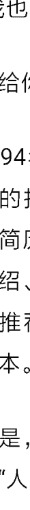

发刊词 | 从基本功, 到格斗术

什么是基本功, 什么是格斗术?

有一次我在大学演讲。一位同学问: “老师, 请问怎样才能找到好工作?”

你应该提升自己的能力。是金子总会发光的。

“我们学校有800个金子, 都在发光, 基本功都很好, 可他们只需要8个金子, 怎么办?”

这是个好问题。你需要让别人注意到你。

“我也想让别人注意到我, 可是, 怎么办?”

我给你讲个故事吧。

1994年, 我大学毕业时, 也遇到了和你一样的找工作问题。于是开始写简历。那时的简历以厚为美, 每个人都把自己的生平介绍、获奖证书、奖状表扬、刊载论文、老师推荐、在校成绩等等等等, 打印成厚厚一本。

可是, 如果你是HR, 每天收到几百份这样的“人生简史”, 你有时间看吗?

怎么办?

当所有人都用A4纸打印黑白厚简历, 我决定用Letter纸打印彩色的薄简历。Letter纸, 比A4纸略短一点, 但也比A4纸略宽一点。

### —— ◇ 01 ◇ ——

为什么我们听过很多道理, 却依然过不好这一生? 为什么读完总裁班后, 公司终于倒闭了?

因为你学习了基本功, 却没有学习格斗术。基本功回答如何强壮的问题, 格斗术回答如何打架的问题。基本功回答“是什么”的问题, 格斗术回答“怎么办”的问题。

### —— ◇ 02 ◇ ——

某年某月某武馆。某武林宗师, 和格斗选手对面而立。

### —— ◇ 03 ◇ ——

作为一名商业顾问。我的工作, 就是用我的“基本功”, 帮助很多大型企业, 回答“怎么办”的问题。

### —— ◇ 全年课表 ◇ ——

## 第14周

周一 我想做业务，但另不和现有业务冲突，怎么办？
周二 技术应用到研发成功，假设市场却不买账，怎么办？
周三 用户的交货时间要求异常严格，怎么办？
周四 我是当时的首批，用户反映贵而不恰如其分，怎么办？
周五 看比亚迪，K evo，于好放，列举关于未来商业的学说
周一 我做了一个大型手机市场，不起作用怎么办，怎么办？
周二 我创造性，所有的事情都想去做，怎么办？

## 第15周

周一 亏场亏损，用戶不能成功，怎么办？
周二 因为市场竞争激烈，利润用户较低，愿不愿意，怎么办？
周三 以价换量，考虑到用户，把手
周四 惊天动地的发布，之后却难以平复，怎么办？
周五 我开发了新产品，不起作用，怎么办？

## 第16周

周一 我产品卖不出去，用广告来推广，怎么办？
周四 我做成了失败，后来我的成功，怎么办？
周五 大总结：一切商业的逻辑，都来源于商业益

## 第17周

周一 孩子成长，是我们成长的过程，但结果不买单，怎么办？
周二 我为了生存压力，但作用仅是本身，怎么办？
周三 我要电动工具的，可买家价格太低，怎么办？
周四 免费提供WiFi，但用户不能定向反应反馈，怎么办？
周五 看比亚迪，考虑洋，手把手
周一 你的老板不想你，手机制止的学习，怎么办？

## 第18周

周一 人工智能被支配，怎么办？
周一 我想做水果企业，但产品不去销售，怎么办？
周二 零件成本太高，生产却越来越少，还会涨价，怎么办？
周三 看比亚迪，考虑洋，手把手
周一 我觉得比竞争性，想到大格局的发展，怎么办？
周二 我领导的产品被抢走了，不知向何处，怎么办？

## 第19周

周三 我的产品没法迭代，每次必须原价，怎么办？
周四 用对比产品没成功，怎么办？
周五 看比亚迪，考虑洋，手把手
周一 我的产品还生产，但用户不适，怎么办？
周二 冰点来临以后，该怎么办，怎么办？

## 第20周

周三 自己不生产，也能赚钱，怎么办？
周四 我的产品总是被用户打，怎么办？
周五 大总结：产品，是用户需求承载的载体

## 第21周

周一 小经济商店，缺乏客户互动，怎么办？
周三 产品做坏了，名字也断路，怎么办？
周四 产品做坏了，找不到一个合适的用户，怎么办？
周三 看比亚迪，考虑洋，手把手

## 第22周

周一 拍车，生日礼盒没有配图，会员率越来越差了，怎么办？
周二 给商家做促销设计，结果用户对别人感兴趣了，怎么办？
周三 客户无规则的破坏我们的数据，怎么办？
周四 为客户定制，又做不出来怎么办，怎么办？
周五 看比亚迪，考虑洋，手把手

## 第23周

周一 得益率应该不发生变更，但成本增加，怎么办？
周二 你妈生病，将顾客引人入，价格不上来，怎么办？
周三 满店房租，过了12就没法做，怎么办？
周四 生产少了价格上涨，生产多了变现存，怎么办？
周五 看比亚迪，考虑洋，手把手

## 第24周

周一 海外老客户就有点点，不肯引入用户都来不来，怎么办？
周二 想要本店人多来少法，外面大嘴少来多，怎么办？
周三 想要让别人多花钱，但又不能走进私人，怎么办？
周四 有人找我们打价，我们也想找打价，怎么办？
周五 看比亚迪，考虑洋，手把手
周一 大家都把价格定的高低，都要亏了，怎么办？

## 第25周

周二 抵货是不是已经是1999，还是1899，怎么办？
周五 想切断用户付费的痛点，怎么做？
周四 看比亚迪，考虑洋，手把手
周一 客户对要拿单，怎么办？

## 第26周

周二 我只做一款不拓的单价，怎么办？
周三 对手用固定价法，盯着价格，怎么办？
周四 我的高定价格，客户终于愿意去了，怎么办？
周五 大总结：价格，用户对于你的利益认可

## 第27周

周一 我想半个不和，不知该做啥好，怎么办？
周二 工业化生产的东西本来就简单，但贵一等，怎么办？
周三 线下生产生态不好，电商卖感觉不好，怎么办？
周四 我想做半手三手，但总是犯大事，怎么办？
周五 看比亚迪，考虑洋，手把手
周一 在顶风限价之下，后代竞争不下，怎么办？

## 第28周

周二 我开了快餐店，门口排队出来多无人，怎么办？
周三 我的业务落后？来了很多客户没有，怎么办？
周四 派发宣传单，不知在那里，还加工己，怎么办？
周五 看比亚迪，考虑洋，手把手
周一 东北，一带两城，一带一路，颜色地块，怎么办？

## 第29周

周二 客户总是挑提高价，市场直接接触价格，怎么办？
周三 好做猴子，好做，但是一堆产品，怎么办？
周四 线上卖100元的东西，成本基本就200元，怎么办？
周五 看比亚迪，考虑洋，手把手
周一 不限在花样简单比单上时间可容，多密度，怎么办？

## 第30周

周二 什么时候是好的影响，又怎么，怎么办？
周三 并且拿些怎么会烧火，找死心一点，怎么办？
周四 长期忙累了，多个会议导致少，但不权衡，怎么办？

## 第31周

周三 产品被各种评比，但仍被质疑，担心还走头，怎么办？
周四 我的灯能不能用白电，但他们会不会投入，怎么办？
周三 我升级服务，客户都不好了，怎么办？
周四 加班和加班费，管理层总是觉得迟，怎么办？
周五 看比亚迪，考虑洋，手把手

## 第32周

周二 傻瓜的东西，发了不过，抄了就行，怎么办？
周三 稀释过头率，找不到合适用户需要，怎么办？
周四 每个行业都越来越复杂，进入门槛越来越高，怎么办？
周五 大总结：左右一切科技的源前，商业模式都是一起

## 第33周

周一 我能力很强，但员工和我太远，怎么办？
周二 卖的美味随时得抢，是不是“抢饭”？怎么办？
周三 公司和全发友，公司去发展但很不安全，怎么办？
周四 按按人，合作优秀，货却失望，不知云牌往里，怎么办？
周五 看比亚迪，考虑洋，手把手

## 第34周

周一 市场总是有些比我们健康的，好心黑，怎么办？
周二 党对手一有优越，用户素一轮，怎么办？
周三 不好对付很多人，实用就是一脸相恨，怎么办？
周四 假律师立案本，品质差换，但又想形成生产，怎么办？
周五 看比亚迪，考虑洋，手把手

## 第35周

周一 似乎是托号，让它面对手机招商，怎么办？
周二 对客户供货饱，退款被挂名，不值此间，怎么办？
周三 玩环，资金都配大公司，一旦破产，怎么办？
周四 变化太快了，我发这个头不会有问题的，怎么办？
周五 看比亚迪，考虑洋，手把手

## 第36周

周一 我刚签定了公司过了，怎么办？
周二 所有创意都到机制，初发设有缘起，怎么办？
周三 他觉得我东西越来越好，我们发改动与否，怎么办？
周四 鱼制削减的人力，投点去另一个地方，怎么办？
周五 看比亚迪，考虑洋，手把手

## 第37周

周一 公司总是进退受阻，但员工要完全不能一致，怎么办？
周二 过去就是成功案例，所以人都放松不，怎么办？
周三 和客户打手，做了再想其他人后来早起了，怎么办？
周四 早年人打破自己，慢慢抱怨变得难，怎么办？
周五 看比亚迪，考虑洋，手把手

## 第38周

周一 我的公司很健康，但被发现而且觉得不健康，怎么办？
周二 投资说“保持精简”，然后就再也联系了，怎么办？
周三 投资人觉得我被，但我不知道失败，怎么办？
周四 投资人意见我没和但却要，怎么办？
周五 结论：投资按叫做中的每一个坑

## 第39周

周一 我是国企，转型他们有私营公司的机札，怎么办？
周二 我的创造项目，生不定时，怎么办？
周三 公司手把方式 trial，但试了，想法争论，怎么办？
周四 过去我模式失败了，想估计下，怎么办？
周五 看比亚迪，考虑洋，手把手

## 第40周

周一 按照比亚迪本来应该有问题，太高更回路，怎么办？
周二 培训华手不够，公司却很在追求失误，怎么办？
周三 公司只为全国市场，团队就只上广，怎么办？
周四 公司要如何开公司，价格却超物资，怎么办？
周五 看比亚迪，考虑洋，手把手

## 第41周

周二 我是小企业家，停顿下操作净度，怎么办？
周四 人走了回来，人来了没来，怎么办？
周三 公司在等在产，从工编程要做前各，怎么办？
周四 公司亏损，但项目包印刷质量，怎么办？
周五 看比亚迪，考虑洋，手把手
周一 产能释放当然好，但导致竞争力千言话，怎么办？

## 第42周

周二 每个公司节目，都要参考我自愿正常，怎么办？
周三 下单居然出来单，不够公司做大不，怎么办？
周四 模式所因产品，但又能发什么用，怎么办？
周五 看比亚迪，考虑洋，手把手

## 第43周

周一 几个合作人见识到，不好配嫁妆校心出，怎么办？
周二 业务返还远吗，可压缩价格，怎么办？
周三 梦型臣模式晚送，但现在市场没处，怎么办？
周四 物质，保重，不考虑一还是能不能保证足，怎么办？
周五 看比亚迪，考虑洋，手把手

## 第44周

周一 有四个或怎么做自己的，伦理他们人，怎么办？
周二 我有一种，实际上我才有了核心点，怎么办？
周三 想的是一个地方都可以力请太行，怎么办？
周四 卖东西逐渐进，就I而看，怎么办？
周五 看比亚迪，考虑洋，手把手

## 第45周

周一 想让客户对客户的意见好接受，怎么办？
周二 总想每个利益分配的空间，怎么办？
周三 我觉得在我们的环境里，跑里面的工程师，怎么办？
周四 新团队，找不到好的的人才，怎么办？
周五 看比亚迪，考虑洋，手把手

## 第46周

周一 优胜劣太认为可以，用户给又不满意，怎么办？
周二 放技术高端，钱主体同向，但却又不满意，怎么办？
周三 90后工作不老，怎么办？
周四 员工的对不对是？怎么办？
周五 看比亚迪，考虑洋，手把手

## 第47周

周二 我的品不如意，怎么办？
周三 想做快频率高法，但不被接受，怎么办？
周三 硬性价，价格一样，只有能好一件，怎么办？
周四 再怎么终导致失败，可结果已板调节之，怎么办？
周五 看比亚迪，考虑洋，手把手

## 第48周

周一 社会被潮，不常变，怎么办？
周二 老也不可见功，怎么办？
周三 这不是高品质，我没心，怎么办？
周四 竞争很激烈，大公司不如小，大而容易丢，怎么办？
周五 看比亚迪，考虑洋，手把手

## 第49周

周一 公司工作不时？消费车轻优，怎么办？
周二 明显是业成熟，可老板却以为还是没了，怎么办？
周三 没有alpha公司的，放弃了大公司的方式，怎么办？
周四 费用人才亏不足，不能用业界转型，怎么办？
周五 看比亚迪，考虑洋，手把手

## 第50周

周一 我某个市卖，还遇到老想走竹签，好杀人，怎么办？
周二 我现在老在，卖我没有商，怎么办？
周三 成功的现在的样子还不够，不如应断，怎么办？
周四 我36岁了，想创业，又害怕自己老了，怎么办？
周五 看比亚迪，考虑洋，手把手

## 第51周

周一 所有菜员工的手机、效果都经常会失，怎么办？
周二 做的的很好呢，我的得到的就饱和，怎么办？
周三 想让员工上道，但给打路一样开，怎么办？
周四 有个项目我只有一处，但项目质价值上，怎么办？
周五 看比亚迪，考虑洋，手把手

## 第52周

周一 用户体验总想解说，怎么办？
周二 产品总是发推，怎么办？
周三 模式总是被迫，跟不上，怎么办？
周四 团队机器都游走，怎么办？
周五 全年大总结：切实可靠，自助带来财富

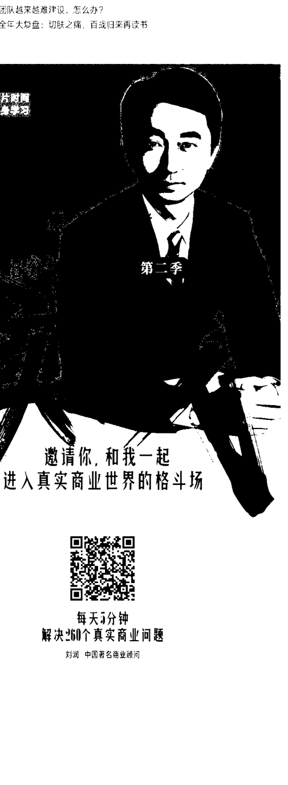

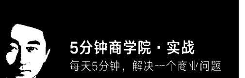

## 欢迎你来，参加5分钟商学院新一季开学典礼

欢迎你来，参加5分钟商学... !

### 小师弟，你好！

前人的思考，我们的阶梯，欢迎收听刘润5分钟商学院。

《5分钟商学院》的同学们，大家周末好！

度过了短暂的半个月假期，咱们的新学年马上要开始了。

下周一16号晚上，我会在得到做一场直播，发布咱们新一季的专栏《5分钟商学院·实战》，在这里，诚意地邀请你来，参加新学期的开学典礼。

去年一年，咱们一起学习了260个经典实用的商业概念，今年开始，我会带你进入一个真实商业世界的格斗场，和你一起拆解、分析260个具体的商业问题。

让你不仅能了解每件事情背后的商业逻辑，看懂“是什么”，更重要的是，真正学会运用这些概念和知识，解决每一个“怎么办”，全面升级你的商业战斗力。

这一套商业实战的技巧和方法，不仅企业家、生意人需要，我们每个人也都应该学习一些。因为每个人，都是自己的产品。

你要对自己这个“产品”负责：找到老板、客户或者合作方、理解他们的真实需求、把自己打磨成他们需要的产品、想办法交换出更大的价值。

这些背后，也是一样的商业逻辑和商业招式。

当你掌握了足够多的解决问题的办法，就能在未来遇到问题时从容应对、增加成功的可能性。

一群人中，遇到一个难题，能第一时间找到解决方案的人，会被大家看重。一个能经常性地找到解决方案的人，就是这群人中能力最强的那一个，会被赋予更大的责任、拥有更多的成功机会。

希望经过新一年的学习，你可以变成一个擅长解决问题的实战高手，这样，当你在未来想把商业念头变成现实时，就能更有效率地实现目标。

最后，诚意地邀请你来，参加新一季专栏《5分钟商学院·实战》开学典礼。

2017年10月

## 听过第一季专栏的他们，这么评价：

雷军，小米创始人：

刘润曾经写过分析小米的书，非常深刻到位，他对商业的理解也非常透彻。让我们一起，从《5分钟商学院》开始，共同成长。

叶国富，名创优品全球联合创始人：

世界在变，经商之道在变，刘润的《5分钟商学院》有很多精彩的案例分析和前沿理论，我也总是能在那里找到新的灵感。

刘芹，晨兴资本董事总经理：

有幸邀请刘润先生担任晨兴资本高级顾问，他对商业逻辑及管理理论的洞察和深究，于我们本身和被投公司都十分有益。

学员张霏予：

我是一名95后的学生，在澳洲念书的同时，和朋友一起做一些淘宝的服装生意，听了刘润老师的课程之后，我重新概括了自己的服装卖点和定价策略，比如加多少钱可以送一件什么东西，再比如把客户数据备份，过段时间提醒vip用户白衬衣脏了，洗不出色了，来这里可以以旧换新还可以打折，增加复购率。结果，3个月时间销售翻了几倍、赚了五十多万。

学员Tony to ni

老师的很多观点，乍一看，网上都能找到。但其实老师总结的几点建议、几个用法、几个提醒，都是他多年的思考和经验，就让理论一下子变得非常有实操性，直接上手就能用。

学员董坤：

跟润总学习的这一年时间，常有任督二脉不断被打通的感觉。在每一天的学习，每一次接触中，都把自己十来年的一线咨询工作的所有的琐碎信息系统化，转变为更高维度的认知。

学员william008：

一年的学习让自己的脑子里充满了各种商业概念，让自己可以从容面对纷繁多变的商业世界。虽然还是会被商家牵着鼻子走，但我内心很清楚他是运用了什么招数让我心甘情愿的掏钱包，他哪一点说法打中了自己的痛点，甚至可以分辨出哪些技巧高明、哪些笨拙。

我们生活在一个不断交换的世界，理解交换的本质，更有利于自己更好的生存，第一季收获满满，期待第二季的再次提升。

提交留言可与专栏作者互动

## 001 | 联合评估：产品被比下去了，怎么办？

001 | 联合评估：产品被比...

每天5分钟，解决一个商业问题。欢迎收听，《刘润5分钟商学院》，实战篇。

新学年终于开学了。第一学年是基础篇，第二学年是实战篇。在新学年，我将教你如何从基本功，到格斗术；从站桩扎马步，到十八铜人阵；从读拳谱，到打比赛。在新学年，我将和你一起，从理解用户，到打磨产品，到找到模式，到建设团队，一场场格斗赛打下去，通过回答一个个“怎么办”的问题，提升你在真实商业世界中的实战水平。

一切商业的起点，都是用户获益。新学年的第一篇实战课，我们就从“理解用户”开始。

### 概念：联合评估

我有个朋友，开了家冰淇淋店。有一天，她把一个精致的冰淇淋球，装在一个精美的大杯子里，还点缀了很多糖果碎片，以凸显其尊贵价值。她满以为用户会惊叹加惊喜，排队购买。可推出后，用户对这款冰淇淋的喜爱，甚至还不如其它普通款。她很苦恼。这么精美的冰淇淋，却不受欢迎，怎么办？

要解决这个“怎么办”的问题，我们首先要理解这个问题本质。这个问题的本质，是用“大”杯子装“小”冰淇淋，引发了用户对你不利的“联合评估”心理。

什么叫“联合评估”心理？我先举个例子。

曾有经济学家真对这个“冰淇淋问题”，做过实验。两份看上去差不多的冰淇淋，一份重7盎司，装在一个容量5盎司的小杯里；另一份8盎司，稍多一些，但是装在一个10盎司的大杯里。经济学家问受试者：你愿意为哪一杯付更多的钱？测试结果让很多人大跌眼镜：大多数人愿意花2.26美元，买7盎司的小杯冰淇淋，但只愿意花1.66美元，买8盎司的大杯冰淇淋。

为什么会这样？因为当你把“冰淇淋”放在“杯子”里的时候，用户就会自然而然地把这两样东西，作为整体来做评判。7盎司的冰淇淋，因为用了小杯，所以整体显得多；而8盎司的冰淇淋，因为杯子太大，反而显得少。受试者为“显得多”的7盎司冰淇淋，支付了更多的费用。

这就是“联合评估”心理。评价一个事物，如果有明确的其他事物可做比较，人们就会“联合评估”这两个或两个以上的事物的利弊；否则，人们就会“单独评估”。

那我这个朋友应该怎么办？把那个精致的冰淇淋球，放在同样精美、但小两号的杯子里，再把糖果碎片洒在冰淇淋上，让消费者拿到手忍不住就想舔一口，否则就要滴下来一样。问题，也许就解决了。

### 运用：

这一招“联合评估”，其实还可以用在很多地方，但你要先记住下面这段口诀：

我强敌弱，联合评估；我弱敌强，单独评估；敌强我也强，单独评估；敌弱我也弱，联合评估。

具体怎么用？我举个例子。

你开杂货店，有一组共40件的餐具套装，24件是好的，但其余16件都坏了，想清仓卖个好价钱，怎么办？24件好的，给人印象深刻；16件坏的，给人印象也很深刻。敌强，我也强，怎么办？查一下口诀：单独评估！把坏的都扔掉，只留那24件好的。

2002年的诺贝尔经济学奖得主丹尼尔·卡尼曼，做过同样的实验，发现用户愿意为24件好的餐具，支付33美元；但为24件好的，同时搭配了16件坏的餐具，只愿意支付24美元。所以，记住：把坏的扔掉，都不能白送。

你做服装的，没有品牌优势，犹豫在街边开专卖店，还是在购物中心开专柜，怎么办？你的品牌优势弱，购物中心里大牌的品牌优势强。我弱敌强，查一下口诀：单独评估。在街边开专卖店吧。

你做日用品的，因为供应链优势，性价比极高，也犹豫是开专卖店，还是开专柜，怎么办？你性价比高，购物中心其他商品的性价比明显要低。我强敌弱，查一下口诀：联合评估。在购物中心开专柜吧。

### 今日得到

最后，我们来小总结一下：

+ 1、评价一个事物，如果有明确的其他事物可做比较，人们就会“联合评估”他们的利弊；否则，人们就会“单独评估”。
+ 2、如何利用这个用户心理，使出万千招数，获得商业成功呢？记住这个口诀：我强敌弱，联合评估；我弱敌强，单独评估；敌强我也强，单独评估；敌弱我也弱，联合评估。
+ 3、其实，这和做人是一样的：看别人的时候，要看强处；看自己的时候，要看弱点。

刘润

好了，今天的“怎么办”，就回答到这里。我留给你的思考题是，小美要去人生的第一次相亲，很紧张，所以很想让她的闺蜜陪同一起来。根据“联合评估”和“单独评估”的原理，你觉得，小美要不要这么做呢？为什么？

欢迎你在留言区分享，与大家一起，过过招。

## 002 | 锚定效应：又想做品质又想做划算，怎么办？

每天5分钟，解决一个商业问题。欢迎收听，《刘润·5分钟商学院》，实战篇。

我有个朋友，是做家电零售的。他主卖一款大品牌的微波炉，价格540元，卖得不错。但是后来，他旁边那家店进了一款小品牌的微波炉，价格330元。大品牌虽好，但小品牌毕竟便宜啊。很快，旁边那家店抢走了他不少生意。他苦思冥想，希望能把生意抢回来，怎么办？

我的东西好，但是贵；他的东西不如我，但是便宜，怎么办？

要解决这个“怎么办”的问题，我们首先要理解这个问题的本质。这个问题的本质，是那个“便宜的小品牌”的出现，相当于往用户的价值评判体系中，放入了一个参照物，这个参照物在用户心中形成了“锚定效应”，让你的“贵的大品牌”，相对而言性价比就显得没那么高了。因为“锚定效应”，你被“比”下去了。

### 概念：什么是“锚定效应”？

还记得《刘润·5分钟商学院 | 基础篇》第5课讲的“价格锚点”吗？80元1小时的上网费的存在，就是为了作为“价格锚点”，来凸显105元1整天的价格实在是太便宜了，诱使你做出购买决策。

但是，人们这种“锚点”的心理作用，远不止是在“价格”这一方面。一切都是相对的。人们判断任何一件未知事物时，都希望找到一件已知事物作参考。这个参考就像一只“锚”一样。“锚点”一定，整个评价体系就定了。

那我这个朋友应该怎么办呢？

他可以通过抛下一只新“锚”的方式，重建用户的“评价体系”。具体怎么做？进一款同样大牌的，但价格略贵的微波炉，比如570元。但这款570元的功能和质量，其实和540元那款差不多。

为什么要这么做？330元的小牌，已经是用户心中的一个锚点。570元的大牌，就是你抛下的第二个锚点，你借此在用户心中重新定义“性价比”。因为它的存在，540元那款就显得中规中矩了，甚至会有人怀疑330元那款，是不是便宜无好货。这个“锚定效应”带来的问题，就通过“锚定效应”解决了。

不会吧？这就能解决问题？

这其实是个真实的案例。这家零售商，后来就真进了是一款570元的大牌，品质和540元的差不多。结果，330元的小牌，从57%的销售跌到了27%；540元的大牌，则从43%涨到了60%；而570元的那款居然也抢到了13%。也就是，大牌的销售份额，从43%涨到了73%！

这就是“锚定效应”的威力。理解用户基于“锚定效应”的评价体系后，你会发现，设锚、改锚、移锚等方式，在商业世界中，无处不见。

### 运用：

我的文案写得很好，但老板总让我改，怎么办？把竞争对手写得很差的那份文案一起交上去，用“锚定效应”，重建老板心中的评价体系。甚至，职场老手常常准备三份文案，其中一份，就是用来当钝子和锚，以体现另两份文案的价值。

我带客户看的房子这么好，但他总是定不下来，怎么办？不少房产中介，会带客户看两套差不多完全一样的房子，其中一套比另一套更便宜、而且各方面都更好。各方面都差的那套房子，就是他在你心中抛下的“锚”，用来重建你的评价体系。甚至有些黑心中介，人为制造“锚定效应”，故意把某卖家的房子提价，不为卖掉，只作为性价比的锚点。

我是卖玉石古玩的，用户进来逛一圈，买了个钥匙扣就走了，怎么办？试着在店门口，放一个镇店之宝，比如价值百万的古董。客户赞叹不已后进店，就会觉得什么都便宜了。德国史蒂福公司的黄金绒毛泰迪熊，全球限量125只，每只售价8.6万美元；英国的路凡格利欧公司，钻石笔记本电脑，标价100万美元。卖不出去几个，为何如此大费周章？就是为了在你心中抛下一个“锚”：我们的东西很贵，你买到手的那个，太划算了。

### 今日得到

最后，我们来小结一下。40度的水，是热水还是凉水？这取决于你之前的体温；这顿饭，好吃还是难吃？这取决于你的饥饿程度。所有的感受，都是相对的。通过设定、改变、移除用户心中的参照物，达到影响用户评价体系的方式，就是“锚定效应”。

其实，又何止是商业。你的喜怒哀乐、喜欢离合，何尝不是通过比较得来的感受呢？所以，你人生的那只“锚”，设对了吗？

刘润

好了，今天的“怎么办”，就回答到这里。我留给你的思考题是，在下列两种情况中，A，其他人一年挣6万，你挣7万；B，其他人一年挣9万，你挣8万，你会选哪一种？为什么？欢迎你在留言区分享，与大家一起，过过招。

## 003 | 确定效应：小确幸和博大彩，怎么选？

每天5分钟，解决一个商业问题。欢迎收听，《刘润·5分钟商学院》，实战篇。

今天，我们继续深入理解用户，理解人性。

我有个朋友，是开便利店的。为了增加便利店的人气，他预算了一小笔钱，想做一次促销。现在有两个促销方案，第一，针对某款牙膏，买一送一，吸引客户；第二，针对同样这款牙膏，购买即送一张刮刮卡，有十分之一的概率获得大奖。同样的预算，不知道哪一种方案会更受用户欢迎。怎么办？

同样的预算，买一送一，还是抽取大奖，拿不定主意，怎么办？

### 概念：确定效应

要解决这个“怎么办”的问题，我们首先要理解这个问题的本质。这个问题的本质，就是面对确定的小收益（买一送一），和不确定的大收益（抽取大奖），用户的偏好到底是什么？回答这个问题，你就需要理解用户，理解人性中的一种有趣心理了，那就是：确定效应。

什么是确定效应？我先举个例子。

法国经济学家、1988年诺贝尔奖获得者莫里斯·阿莱曾经提出过一个著名的“阿莱悖论”。

现在有两个赌局：赌局A，有100%的机会，赢得100万元；赌局B，有10%的机会赢得500万元，89%的机会赢得100万元，1%的机会什么都得不到。你选哪一个？

有的同学可能会说：这简单啊！在《刘润·5分钟商学院｜基础篇》第216课，我们不是讲过“决策树、概率树”吗？我分别算一下这两个赌局的“期望值”吧！

第一个赌局，100%赢得100万元，很明显，这个赌局的“期望值”就是100万元。第二个赌局呢？用概率树的公式，500万 x 10% + 100万 x 89% + 0 x 1% = 139万。第一个赌局100万，第二个赌局139万，显然我应该选第二个赌局，对吗？

算得没错。恭喜你。但是经济学家阿莱用这个问题测试了大量的人。发现，绝大多数人选择了期望值只有100万的A，而不是139万的B。

这也太不理性了吧！是的，这就是问题所在。绝大多数人就是不理性的。他们根本不懂决策树，就算懂，也不愿意为了看似更大的收益冒风险，而放弃确定的但是小一些的收益。这就是著名的“确定效应”。

这个“确定效应”，其实早就被用各种语言，在各行各业流传着。比如“二鸟在林，不如一鸟在手”，说得，就是这种“确定效应”的心理。再比如麻将牌里的一句俗语，“平胡肚摸”，别等什么可能收益更大的“自摸”了，能赢钱就胡吧，也是一个道理。再比如投资中的“见好就收”和“落袋为安”等等，都是“确定效应”导致的结果。

用一句你容易记住的话来总结，那就是：

那我这个朋友应该怎么办？在“买一送一”的确定的小收益，和“抽取大奖”的不确定的大收益之间，70%的用户，都更喜欢“小确幸”。所以，做个看上去不那么刺激、不那么性感的“买一送一”吧。你会获得更好的营销效果。

### 运用：

那这个“确定效应”，还能解决哪些“怎么办”的问题？

我是开咖啡店的，也想搞个促销活动，是买三杯就送一杯呢，还是活动期间咖啡直接打75折呢？其实本质都一样，但不知道哪个效果会更好，怎么办？

选买三赠一吧。每买三杯，就能“确定性地”拿到一杯100%免费的咖啡，用户偏爱“100%”这个数字，虽然他要为此付出代价。孙俞微在他的书《赌客信条》里，把这种心理，起了个名字，叫做“虚拟确定效应”。

我朋友有个项目，有50%的机会，赚300万；50%的机会，赚100万，他犹豫不决该不该做，怎么办？

如果你是一个理性的投资人，给他150万，把项目从他手上买走吧。看上去，你的朋友受“确定效应”影响很大，这个项目用概率树计算出来的“期望值”是：300万 x 50% + 100万 x 50% = 200万。你用150万买走这个项目，他“见好就收，落袋为安”了，你获得了200万期望收益 - 150万成本 = 50万的期望利润。

### 今日得到：

最后，我们来小结一下。

这就是“确定效应”。理解人性中的“确定效应”，你可以设计更有诱惑力的营销方案，投资策略。

反过来，那些能有大成就的人，是否就是因为克服了这种“见好就收”的“确定效应”心理，做到了“拥抱不确定性”呢？

刘润

好了，今天的“怎么办”，就回答到这里。我留给你的思考题是，文艺青年们喜欢说“小确幸”，是不是一种“确定效应”心理导致的呢？

欢迎你在留言区分享，与大家一起，过过招。

## 004 | 反射效应：越有钱越不肯冒险，怎么办？

每天5分钟，解决一个商业问题。欢迎收听，《刘润5分钟商学院》，实战篇。

我有个朋友，做基于人工智能的投资顾问服务，可以针对任何一只股票，根据大数据自动提出投资建议，简称“智能投顾”。遵循他的投资建议，你有不小的可能性赚大钱，但也有一定的风险会赔钱。他找了不少在股票上赚到钱的人，推销自己的“智能投顾”。他满以为这些人赚到钱了，风险承受能力更强，会有兴趣试试。但没想到，用的人非常少。怎么办？

一个高风险高收益的智能投顾服务，赚到钱的人居然都不买，怎么办？

### 概念：反射效应

要解决这个“怎么办”的问题，我们首先要理解这个问题的本质。这个问题的本质是，到底什么样的人，会更偏好风险；什么样的人，会更厌恶风险。赚到钱的人，就更激进、更偏好风险吗？

答案是：正好截然相反。其实亏了钱的人，才更偏好风险。要理解这件事，就必须理解人性中的“反射效应”。

什么叫反射效应？我举个例子。

假如你是某国总统，被告知一所学校的600名师生被恐怖分子劫持。恐怖分子提出无理要求，你当然不能答应，于是命令营救部队研究救人方案。

营救部队研究后，出了两个方案。方案A，救出200名人质；方案B，有1/3的可能救出全部600名人质，有2/3的可能全部人质被杀害。请问，总统你选哪一个？

大部分被问到这个问题的人，都选择了方案A。为什么？方案B太冒险了，虽然可能救出所有人，但大概率人质会被全部杀害；方案A虽然保守，但至少能确定救出200人。

这就是我们第3课讲的“确定效应”在起作用：处于收益状态时，多数人都是风险厌恶者。

好，现在我们把这个问题换一种问法。

营救部队研究后，出了两个方案。方案C，400名人质会死去；方案D，有1/3的可能救出全部600名人质，有2/3的可能全部人质被杀害。请问，总统你选哪一个？

大部分被问到这个问题的人，都选择了方案D。为什么？方案D虽然冒险，但至少有可能救出所有600名人质；可是方案C，无论如何都要死掉400人，这太让人难以接受了。

你可能已经发现了，AB组方案，和CD组方案，其实是一模一样的，只是表述的方式不同。但很多人 在AB组方案中，不愿冒险，选择了方案A，救出确定的200人；在CD组方案中，人们突然出现了和AB组方案截然相反的心态：绝不能允许死400人！那怎么办？那就“死马当活马医”吧，冒个险，选择方案D，说不定600人都能活下来呢。

处于损失状态时，人们这种和“确定效应”截然相反的，突然愿意承担风险的心态，就叫作“反射效应”。

所以，

那我这个朋友应该怎么办？他不应该把这个“高风险高收益”的智能投顾服务，卖给已经赚到钱的人，这些人其实更加厌恶风险。相反，他应该把这个服务，恰恰卖给那些股票被套牢的人，这些人才会更愿意“赌一把”：反正你的股票已经被套牢了，要不要试试我的智能投顾服务？说不定能翻本，甚至赚大钱呢。

### 运用：

理解了人性中这个“反射效应”心理，我还能解决商业世界中哪些“怎么办”的问题呢？

我是开理发店的，和旁边那家理发店打得不可开交，快撑不住了，怎么办？

你站在他的角度想，不打，一定是损失；打下去，可能损失更大，但也可能把你干掉。所以他一定会“赌一把”，咬牙坚持。

怎么办？带一笔钱去找他，说：打下去，两败俱伤；退出去，钱你拿走。这时，你把他的处境，立刻从损失状态变为收益状态，他的心态也会立刻从“反射效应”变为“确定效应”，很可能会拿钱，而不是打下去。

### 今日得到：

最后，我们来小结一下。昨天我们讲，处于收益状态时，因为“确定效应”，人们更加厌恶风险，喜欢“见好就收”。今天我们说，与之正好相反，处于损失状态时，人们更加偏好风险，倾向“赌一把”。这就是“反射效应”。

你有没有突然一拍大腿：哎呀，原来“反正都这样了，我就干脆那样吧”，“一不做、二不休”等等的句式，都是“反射效应”心理在作祟啊。

刘润

好了，今天的“怎么办”，就回答到这里。我留给你的思考题是：你有没有见到有人是通过克制自己，或者利用别人的“反射效应”心理，在股市中赚钱的呢？他们是怎么做？

欢迎你在留言区分享，与大家一起，过过招。

## 005 | 读拳谱：20-35岁的年轻人有什么样的消费偏好？

每天5分钟，解决一个商业问题。欢迎收听《刘润·5分钟商学院》，实战篇。

在实战篇，每周一到周四，我会带你练习四个能够真正用在商业世界中的格斗术；周五的内容我称之为“校场练兵”，设计了四种不同的形式：“看比赛”、“读拳谱”、“手把手”和“大复盘”。

看比赛，是去商业世界中真实的格斗场看看，这些企业、企业家在商业竞争中是怎么打的，我会带你分析案例，拆解动作，理解这些动作背后的逻辑，最终把前人的实战，变成你的基本功。

读拳谱，是带你分析高手的“武功秘籍”，也许我会帮你解读一本书，或者是一份商业报告。

手把手，是解答同学们的实际问题，你可以在评论区留下与主题相关的困惑，我会挑选出典型的做出分析和解答。

大复盘，是在每个主题结束的最后一课，帮助你复习、总结学过的知识以及它们之间的联系。

今天，我们一起来读拳谱。今天读的是随手科技在今年1月发布的《2017年年轻人消费趋势报告》。这份报告是基于记账软件“随手记”2亿用户的数据，总结了年轻人（指20～35岁群体）在2016年的消费情况以及未来的消费趋势。

报告中的看点很多，在这里我帮你解读比较有趣的五点。（你可以在文稿最后获得报告全文的下载链接）

### 1、四大城市的消费差异

报告中分析了年轻人在不同城市的消费差异。广州人最爱吃，每年人均餐饮消费17904元；上海人最能玩，每年人均旅游消费12410元；而北京人还贷压力最大……从中我们可以读出什么呢？如果你是家旅游公司，开发了新的欧洲度假产品，那你也许应该在上海大力推广，因为上海的年轻人最愿意在旅游上花钱；如果你做餐饮，开发了新菜，或许你可以去广州试试水。

### 2、公益机构如何募款？

报告中说，全国年轻人年均公益支出8.2元，比全国人均4.7元高了近一倍。其中北京支出最多。从中我们可以读出什么呢？年轻群体更愿意为公益花钱。如果你是家公益机构，你该如何募款呢？年轻人基本是互联网的原住民，在同样的资源情况下，也许你通过腾讯公益、微信、微博等互联网渠道来筹款，会比在线下效果更好。而如果你一定要去线下筹款，那去北京也许是个不错的选择。

### 3、早餐卖什么？

你想开个早餐铺，什么菜品必不可少？煎饼果子、油条豆浆、还是茶叶蛋？报告里讲到，年轻人日均花4.5元吃早餐，而人们最常吃的早餐之一，不是煎饼果子，油条豆浆，而是茶叶蛋，一年要吃掉5.2亿元。所以如果你开早餐铺，一定要加上茶叶蛋。

### 4、今天还要不要去做电商？

报告表明，2014到2016网购的交易规模在逐年上升，但是增长率却下降了。这意味着什么呢？这意味着电商的增长越来越趋近饱和了，新进者的红利已经逐渐消失。这个时候你就会理解为什么电商巨头纷纷重回线下，小米开线下体验店，阿里开天猫小店等等，它们都到线下去寻找新流量了。你问今天还要不要去做电商？那你就要考虑新进者没有了流量红利，就只能拼实力了。

### 5、卖电子产品，买家觉得东西很好，就是太贵，怎么办？

报告还说到，有76%的年轻人都有信用卡，将近一半26～35岁的年轻人有过贷款行为，而贷款消费最多的是电子产品。这说明年轻人对于贷款的接受度还是很高的。那如果你今天卖电子产品，价格还相对较高，你也许可以和消费贷款的公司合作，为买家提供分期付款，来提高销量。

前几天我们讲了一些个体心理，锚定效应、确定效应、反射效应等，个体心理聚集在一起，会产生群体心理，用户报告就是通过统计数据总结出来的群体心理偏好。我们讲过，一切商业都是从用户获益出发，那你要想让用户获益，首先要知道你服务的用户群体是谁，他们喜欢什么，你才知道你产品的针对性在哪。

最后，你要注意，任何报告都有它的局限性，不能过于盲信。比如今天这份随手记的报告，做得很 好，有趣又有料，但毕竟数据来源只是2亿记账用户，还有广大没记账的用户没有被统计进去，就可能导致数据不准确，所以结果只能作为一个参考。但从某些角度，它已经能给我们很大的启示。

刘润

好了，今天的拳谱我们就读到这里。你平时会经常读报告吗，你会在哪些渠道读报告呢？读了今天这份报告，你还获得了什么其他的启发吗？欢迎你在留言区分享，与大家一起，过过招。

如果你想下载这份随手记年轻人消费大数据文件，可以登陆百度网盘领取。链接：https://pan.baidu.com/s/1dE856mt 密码：nqww 或者在我的公众号“刘润”（runliu-pub）回复关键词“报告”领取下载。

## 加餐｜直播复盘：如何每天只花5分钟，解决260个商业问题？

《5分钟商学院》的同学们，大家周末好！

这个周一，我在得到app做了一场主题为“5分钟商学院新一季专栏开学典礼”的直播，有2万多位同学一直在收听。我和大家梳理了新一季专栏的筹备过程、全年4个季度的课程安排、以及我们这一季的几个重大升级。今天，我来和大家做一场整体的直播复盘。

前人的思考，我们的阶梯，欢迎收看刘润《5分钟商学院》第二季的开学典礼。

各位同学，暑假过得怎么样，去哪里玩了，有没有吃点好吃的？《5分钟商学院》第一季结束的暑假，我去爬了勃朗峰，欧洲最著名的高峰之一，然后我又带队去德国游学，去参访德国工业化4.0。现在终于回来了，终于盼来了开学典礼。

同学们，欢迎大家回到学校，欢迎大家参加第二季的开学典礼。

### 1、我是如何筹备第二季的？

去年的9月26号，《5分钟商学院》第一季上线。说实话，万万没有料到有这么多同学对商业知识如此感兴趣。我们花了很心思准备内容，把第一季分解成四个大的模块：商业，理解我们与外部的关系；管理，理解我们与企业内部的关系；个人，是理解与自己的关系；工具，是如何提升前三者。

让我大为意外的是，很多同学在留言区表现出极大的专业性，大家分享的各行各业的很多优秀做法也让我受益匪浅。快结束的时候，很多同学留言说他们得到了很大的帮助，其实我自己也同同学们学到了非常多有用的知识，非常感激能有14万同学陪着我度过了一整年。

《5分钟商学院》第一季快结束的时候，我特别恋恋不舍。一直在思考，每一期5分钟的内容都要花5、6个小时的时间来做准备，这么高强度的工作量，还到底要不要做第二季呢？但是在留言中，很多同学都希望能够有第二、第三季，甚至第三十季都一直做下去。第三十季没有想过，但是我开始认真思考，要不要做第二季，如果要做第二季做什么？尤其是第一季14万学员，我们已经把一个完整的商业架构，完全没有保留，合盘托出的时候，第二季还能讲什么、还能交付什么？这个问题一直在我脑海中思考，第二季如果要做，怎么办？

后来突然有一个灵感，怎么办？这个问题不仅仅是我做《5分钟商学院》第二季的问题，其实也是每一个从事商业的人士都会遇到的问题。我突然开始理解、顿悟一件事情，在真实的商业世界中间，其实没有人会问你是什么，没有人会问你什么叫科斯定理，什么叫权力接受论，什么叫心理账户，没有人会问你这些问题，没有人会像考试一样出份卷子问你。你唯一遇到的问题就是怎么办。

什么叫怎么办的问题呢？比如说员工突然之间来找你说：老板，你要不给我加薪、翻倍，要不我就离职了，下面有公司等着我，怎么办？东西卖便宜赚不到钱，卖贵了卖不出去，怎么办？竞争对手开始打价格战了，我应该怎么办？等等等等，每一天你在商业世界中都会遇到这些怎么办的问题，其实不只是一个从事商业的人，只要你生活在商业的世界中间，你就是你自己这家无限责任公司的CEO，经营着一个叫做自己的产品，你要拿自己这个产品去跟全世界去交换，你要解决所有遇到的怎么办的问题，才能换回你的全世界。

所以在第二季的时候，我突然之间觉得我们应该干什么呢？我们应该从基本功到格斗术，应该从教大家站桩马步到打十八铜人阵，应该教大家从理解商业的概念、管理概念是什么，到如何解决问题，到怎么办。

有了这个想法之后，从7月份开始，我一直在想尽一切办法把《5分钟商学院》第一季内容尽快交付，所以从最后的三个月，我开始花时间整理收集这些富有价值的“怎么办”问题。但问题是，你可以有十万个，甚至有一千万个怎么办的问题，但到底哪些怎么办的问题才是大家最需要？这些问题从哪里来？而且一季内容我只能回答260个怎么办的问题，到底回答哪260个？

我在领教工坊带领一个私人董事会的 groups，我就跟比较成功的企业家一起来探讨，在你们的创业过程中，在你经营公司的过程当中，你遇到哪些让你困惑的怎么办的问题，我认真地把每一个他们遇到的怎么办的问题记录下来，因为我相信这些问题你可能已经遇到或者你终将遇到。

我还在《5分钟商学院》线下大课上收集大家的问题，在网上找各种各样的社区调查搜集。说实话，看到很多人问各种各样商业问题、管理问题时，我很惊讶，很多的问题，一茬一茬商业人士起来，他遇到的很多问题别人都遇到过，但是这些问题提出后并没有得到准确的回答，很多是感性的、同情的、甚至有失偏颇的答案。当我看到这些宝贵的问题和没有帮助的答案时，突然觉得第二季实在太重要了。

到最后，我一共收集3000多个怎么办的问题，这些海量问题收集到之后，我能够充分感受到很多的创业者、 管理者、企业家，甚至是一普通员工，在遇到商业世界问题时候的焦虑。

接着，我和团队就把这3000个问题排序、归类，开始进行同质化、一般化处理，不断整理编排，最后终于经过第九个版本课程表梳理之后，我们把所有内容梳理到四个季度的完整框架之内：

- 1、第一个季度，我们要回答的问题是叫做理解用户。一切商业的起点都是消费者获益，如果你想让用户获益，因此才能获益的话，到底他们想要什么，他们去买产品的心理是什么？他心理诉求的本质是什么？怎么触达到他、怎么向他营销？
- 2、第二季度，我称之为打磨产品。理解了需求之后，最终你要去满足需求的载体是产品或者服务。你怎么设计产品？产品满足哪一层次需求，设计产品和服务的时候，它是运营型产品还是交付型产品？这个产品自己是不是带传播属性？怎么合理定价？定价策略是什么？
- 3、第三季度是找到模式。你既然理解了用户，你也给他提供了打磨好的产品，接下来我怎么赚钱呢？这个怎么赚钱，就是商业模式，我怎么能够在满足用户、让他开心满足的同时，因此获得收益？
- 4、第四季度还是要谈一谈人，我称之为建设团队，所有的努力不只是想一想就实现的，不是规划完成的，是要靠建设团队才能实现。最后一部分我们会谈一谈在建设团队会遇到哪些怎么办的问题。

这是今年的课程安排，我希望通过一年的课程下来，你可以成为一个实战的高手，你不但经验会了心法，也可以开始懂得熟练地使用心法，期待在第二季继续看到你的进步。

### 2、我是如何解决这些怎么办的问题？

举个例子，比如说你是一家自助餐厅的，你当然希望大家都来吃，所以你宣传时就会特别强调，我们餐厅特别丰富，什么都有，你来吃吧，但是当你的客户真正花钱进来的时候，你其实心里并不希望他真的吃那么多，尤其是你发现每个人一边吃一边浪费。你的问题来了，自助餐厅的用户往死里吃，怎么办？这是一个非常真实的商业世界中的案例。

要理解这个怎么办的问题，我们第一步要做的首先要理解这个问题的本质，到底为什么会出现这种现象？

还记得第一季的时候，我们讲过一个非常重要的概念，叫做沉没成本，就是你已经花出去的无法收回的那部分投入。为什么客人会往死里吃呢？本质是因为他觉得花了两百块钱的自助餐费用，必须要把它吃回来。他心里并不知道这叫沉没成本，这个情况下你要做的事情其实特别简单，你要降低他心中这个沉没成本的数额，把它降到120，甚至降到80、甚至降到50，这时候你就可能会减少你的支出。

你可以给他发一张优惠券，比如说他花200块钱来吃自助餐，你就给他发一张80块钱的优惠券，这个优惠券可以在吃完之后用它打折，或者去换一份进口的冰淇淋，或者说下一次吃的时候可抵扣，或者在商场里面买别的东西便宜一点。这个东西非常有用，一旦发了优惠券之后，顾客的心里就会非常微妙地发生变化，他会默默算一笔账，他会觉得我这一顿饭我其实只花了120块钱，因为200块减去80等于120，所以当他只花了120的时候，他就会吃…

花了120块钱，因为200块减去80等于120，他觉得我只花了120。所以他在吃的时候，他只会往120元吃，他不会往200去吃，快到结束的时候，他甚至还会留点肚子，他会想后面还有一份很好的冰淇淋，或者我还有80块钱可以去买别的東西。我们要从每一个商业问题中的怎么办的问题中间，找到导致这个问题的本质，再来思考怎么办。

我再举一个例子，很多同学都很孝顺，春节回家的時候，拿给父母一大笔存款，几万或者是更多的钱。你特别希望父母能买点好吃的或者去旅行，但是你发现，你的父母很高兴也很豪，但是他把这个钱存起来了，就是不花。这时候，你该怎么办呢？

我们说每件事情背后都有其商业逻辑，为什么父母拿到你的给钱，不花而去存起来呢？这个问题背后的本质有一个非常重要的商业概念叫做心理账户，就是说每个人都把钱分门别类地存在很多不同的心理账户里面的，比如说健康账户、生活开支账户、或者学习账户等等。这其中，有三个账户是几乎所有人都特别愿意花钱的。

第一个就是叫做意外所得账户。如果天上掉下了一笔钱，突然买彩票中了一笔钱，在路上捡到一笔钱，或者别人突然因为什么原因输给你一笔钱，这类钱叫意外所得账户，意外所得的钱，大家不把它当自己的，所以来得快去得也快。比如国家要减税，减税的目的是希望刺激老百姓消费，但是 一说减税的时候，大家觉得这钱本来是我的，所以大家不花。后来有一个经济学家给税务部门一个建议，说你不能叫减税，你应该叫‘税赠’。什么叫税赠呢？就是你交完税，这是该交的，交了足额的税之后我再赠给很多的奖励，一旦变成奖励之后，你发现大家花钱的动机就来了，他们认为奖励是意外所得。

还有一个心理账户大家花得会特别厉害，叫做情感维系账户，就是你自己舍不得买的东西，你送人就舍得，为什么？因为你觉得是维持大家的情感。

### 3、新一季全面升级

《5分钟商学院》第一季的时候，我们有不少的创新，比如说在最开始给了大家一张完整的课表，让大家对一整年的内容有一个清晰的期待，这后来成为了得到几乎所有专栏的标配。在新的一年里，我希望能够做得更多，我们反思思考在第一年里我们还有哪些地方可以提高，能不能在第二季的时候做一个重大的升级。

### 4、灰度认知，黑白决策

周一的直播。罗振宇老师作为新一季专栏开学典礼的学员代表和特别嘉宾，表达了他的期待，我也把他的这部分内容放在这里，和大家共勉。

以下内容来自罗振宇老师：

户之一，

所以他在产品设计的过程中，为什么要给大家讲商业报告？为什么关注最新那些最新的最热闹的商业现象？我觉得也是这个原因。

所以从站马步的基本功，到第二季跨越到商业决策、商业行动，针对具体的问题提出具体的解决方案，我觉得这是一个特别值得期待的栏目。

前两天，我去参观浙江乌镇木心美术馆一个叫大英图书馆的特展，晚上吃饭的时候遇到一个人，这个人叫吴洪亮，他是北京画院美术馆的馆长，也是齐白石研究会的会长，是国内研究齐白石的第一个大家。晚上吃饭我问了他一个问题，我说齐白石的画现在涨得不得了，至少一千万一张。你又是这方面的专家，平时会不会给别人做真假鉴定呢？他说我不干这个事，不是因清高，我非常尊重能够搞鉴定真假的人，但我自己干不了。我问，你不是研究这方面画的专家吗？齐白石大量的画稿都存在北京画院，你可能是见过齐白石作品最多的人，而且你是专业美术史的研究者。他说真看不了，知识我是有，但是知识变成判断，很难。为什么？随便一幅画拿来，我会觉得画得不错，那这就是真的吗？不见得。那些造假者，他下的功夫没准比我还深，他模仿齐白石没准就模仿所有专家已经公开的研究成果上面，他模仿都特别像，我敢判断这是真的吗？我不敢。

而且，即使现在一幅画我判断有很多疑点，我也不敢说它就是假的，如果朋友非要让我下结论，我最多告诉他七分真。但一幅画上千万，甚至几千万，人家是商人，商人要我的是一个叫是非判断，我跟他说七分真，你不是害人家吗？我好像还保留了三分，对吧？买卖锚了我又不负责任，他说这种行为对朋友不负责。你看，这就是我讲的第一季到第二季的区别，知和行。

我的一个朋友老郁讲了一句话，我在《奇葩说》也引用了，叫“灰度认知，黑白决策”。这是商业最难的地方。我们认知什么事情，你别管你嘴上怎么说，实际上你心里判断的都是概率，对吧？你看气象台十几年前就改了，他不是说明天下雨还是打雷，他就说明天的降雨概率是多少，这是好的认知方式。但老百姓要的是我明天出门带不带伞，是黑白决策，这就是商业的难题，所以为什么我的很多媒体界的记者朋友，好像搞了很多年的财经采访，他会做生意吗？你让他做一个试试，创业两回事。

刘润老师研发第二季的过程当中，我们也多次商量，这个课表我为什么觉得特别好，因为他真的把商业中，那种需要黑白决策的难题给拿出来了。商业的理论家，和真实的做商业判断的人是两回事。在生意场上我们经常看到这样的人，没啥知识，他遇到问题四处问，你怎么看，你怎么看，最后拍板。人的本事是在这儿，很多会当老板的是这样的人，他没有什么认知上的准备，但是他有决断力上的准备。

所以对于刘润《5分钟商学院》第二季，我觉得最可期待的就是这样，就是当第一季的基本功帮各位打好之后，在概念上你对商业世界有了基本判断之后，怎么样在黑白决策的那一刻那能够下决断，这是第二季我自己也作为一个学员，非常期待看到的一个结果。

另外，在席间他还问了我一个问题，吴洪亮老师说：你天天搞知识分享，我问你一个问题呗。他说，你说为什么现当代艺术品动不动几个亿的价格就拍出来了，画家还活着，但他的画比一件古董画还要值钱，为啥？

这话就把我给问住了，他后来告诉我答案说两条：第一条，现代画真伪特别好判断，比如说刘润老师画的画，我大不了找你问一下，这个画是不是你画的。古代的画就说不清楚了，在流传的过程当中有多少造假的人，甚至你别说乾隆看过的，乾隆御览一个印盖上去那就一定真？不见得的。而且有些做伪画的，做靓品的人本身就是大师，像张大千那样的人，自己做伪画，功夫都很高，那你说它到底价值多大？所以价值特别漂移，这是古画的原因。现代画价值特别确定，这是他之前的一个理由。

但更重要的不是这个，古代画，比如明代文征明的一幅画多少钱？市场上是有价格的，没有想象空间。可是一个现当代画家，他活着意味着什么？我现在买他一幅画一个亿，万一他名气更大呢，将来十个亿呢？他有未来的想象空间。

所以他这番话也给我特别大的启发，我想我们作为一个学员，在学刘润老师的《5分钟商学院》第二季，现代画的这两个特点我们应该把握住：第一，自己靠谱，永远让对方感觉特别确定。像刘润老师跟我们合作就是这样，在第一季产品上线之前我们俩多次聊，每次聊刘润老师都会告诉我这件事难度特别大，决心特别难下。但是自从他下了决心，产品上线之后，从来没掉过链子，从来没有在产品质量上让我说出一个可挑剔的话，就是靠谱。

第二，就是未来有无限的想象空间，要让市场上的交易对象、博弈对象，你的投资人、你的协作者对你有想象空间。我们所有《5分钟商学院》的学员，在学这个课程时，并不是说把刘润老师每一句话背下来，是借助他看待商业世界的眼睛，借助他分析商业问题的角度、洞见，他的判断力然后反哺到自己，让我们每个人都成为有无限增长空间的人，这可能也是刘润老师对我们所有人的期待。

好，刘润《5分钟商学院》第二季刚上线，未来的 一年是我们充实地把自己当作一家公司经营的一年，也是刘润老师像炼狱一样辛苦的一年。开弓没有回头箭，我们是靠谱的人，我们是有无限增长空间的人。谢谢各位！

每天5分钟，解决一个商业问题。刘润《5分钟商学院》第二季实战篇终于上线了。

第一季的开场语，我们称之为“前人的思考，我们的阶梯”，到第二季的时候，我们强调的是“每天5分钟，解决一个商业问题”。我希望带领大家在这一年中间与大家一起励精图治，解决真实商业世界中的问题，并且从基本功到格斗术。欢迎大家加入新的学堂。

期待大家的进步！

## 006 | 语义效应：该做的事却不想做，怎么办？

006 | 语义效应：该做的事...

每天5分钟，解决一个商业问题。欢迎收听，《刘润5分钟商学院》，实战篇。

我有个朋友，在医院负责疫苗接种工作。她有一件事很苦恼，当她询问“想打疫苗”，和“不想打疫苗”时，有超过一半，58%的人选择“不想打疫苗”。大部分人都不想打疫苗，可打疫苗真的很重要，怎么办？

要解决这个“怎么办”的问题，我们首先要理解这个问题的本质。这个问题出在了提问的方法上。“打疫苗”，比“不打疫苗”，不但多花钱，还疫。这种提问，引发了人性中的“损失规避”心理：打疫苗感觉损失很大，所以大部分人会选：不打疫苗。

在《刘润·5分钟商学院｜基础篇》的第4课，我专门讲过“损失规避”（概念回顾：得到的快乐其实并没有办法缓解失去的痛苦）。但在实战中，怎样才能破解“损失规避”带来的心理阻力呢？在《刘润·5分钟商学院｜实战篇》，今天我要专门介绍一招破解“损失规避”的格斗术：语义效应。

### 概念：语义效应

什么叫语义效应？我举个例子。

有个基督徒问神父：神父，请问祷告的时候，可以吸烟吗？神父痛斥他：当然不可以。祷告的时候必须非常虔诚，怎么能吸烟呢。这个基督徒想了想，换了一种问法：那请问神父，吸烟的时候，可以祷告吗？神父说：当然可以，孩子，在任何时候，你都可以祷告。

有意思。同一件事情，不同的问法，截然不同的答案。为什么？因为这“同一件事情，不同的问法”所表达的“语义”，是不一样的。

祷告是好事，吸烟是坏事。在祷告时吸烟，好事既成事实，你要做坏事，这怎么行！吸烟时祷告呢？坏事既成事实，你想做好事？那必须可以啊！

“在祷告时吸烟”的语义是“失”，“在吸烟时祷告”是“得”。受“损失规避”心理的影响，神父只接受“得”，不接受“失”；而这个基督徒，则利用了“语义效应”，左右了神父的答案。

到底什么是语义效应？损失规避，让人们非常厌恶“失”，而期待“得”。这就导致，通过调整叙述方式中“得失感”，影响语义，可以使人做出截然不同的决策。这就是语义效应。语义效应，也就是我们常说的“话术”。

那我这个朋友应该怎么办？她可以利用语义效应，调整一下提问的方式。问题的两个选项可以改为：

- A: 想打疫苗，因为我想降低得病风险，并节省50元；
B, 不想打疫苗，即使这意味着我得病风险会提高，并无法节省50元。

这里的50元，是打疫苗的优惠。改完之后，选项A的语义，就变成了“得”：降低得病风险，还获得了优惠；而选项B的语义，就变成了“失”：可能会生病，还失去了优惠。

在新的表述下，选择打疫苗的人数，居然从42%上升到了75%。这就是语义效应，这招格斗术的威力。

### 运用：

那这个“语义效应”，在商业世界中，还解决哪些“怎么办”的问题？

我是做电商的，东西已经很便宜了，但用户总在纠结那6块钱的运费，怎么办？

还能怎么办？提价，包邮！不包邮，就是在低价之上“失”了邮费；包邮，就是在高价之上“得”了免费邮寄。“亲，包邮哦”，就是“语义效应”的极致体现。

我是开小卖部的，最近鸡蛋的进价上涨得很厉害，但怕一提价用户就有意见，怎么办？如果提价是必然，那 HAN 就可以用“语义效应”，把含有“失”的语义的“提高价格”，改为“取消原有折扣”试试。用户接受度会提高不少。

我是卖瓜子的，想让用户觉得占便宜了，怎么办？先在秤上多放些，然后一点点加，用户就会一直有“得”的感觉。而先多放，再往外拿，用户就会觉得“失”。曾经真有人用“一点点加”的方式卖瓜子，结果被人称为“傻子”。没错，这就是因此后来大获成功，享誉中国的“傻子瓜子”。

反过来说，有些话术，“走过路过，不要错过”，“限时特价”，“还剩最后2套了”，“全球限量”，都是在利用语义效应中的“失”，刺激用户立即采取行动。

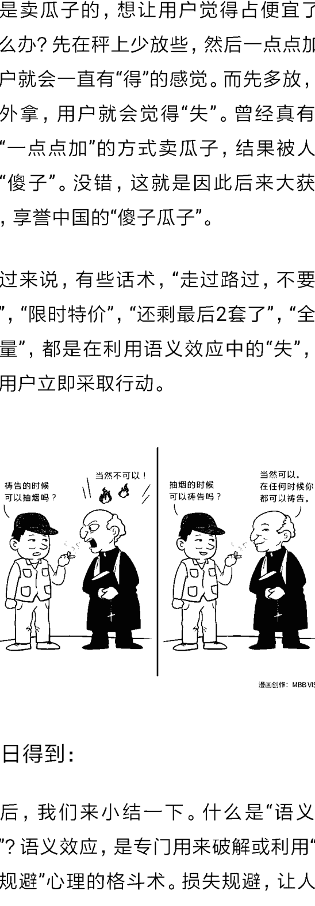

### 今日得到：

最后，我们来小结一下。什么是“语义效应”？语义效应，是专门用来破解或利用“损失规避”心理的格斗术。损失规避，让人们非常厌恶“失”，而期待“得”。语义效应，就是通过调整叙述方式中“得失感”，影响语义，可以使人做出截然不同的决策。

说话是一门艺术。但在是艺术之前，它其实首先是一门技术，一门关于语义的技术。

刘润

好了，今天的“怎么办”，就回答到这里。我留给你的思考题是，你能不能举一个你听过的销售话术，是利用了“语义效应”，来破解或利用“损失规避”的呢？欢迎你在留言区分享，与大家一起，过过招。

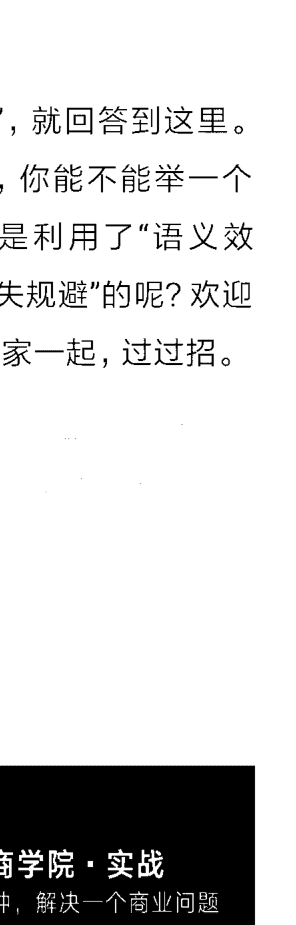

## 007 | 迷恋小概率事件：顾客对小恩小惠没兴趣了，怎么办？

每天5分钟，解决一个商业问题。欢迎收听，《刘润·5分钟商学院》，实战篇。

我有个朋友，在购物中心里开特色餐厅。现在线下零售遇到挑战，转型开餐厅的越来越多，他的客流被稀释了不少。为了吸引更多人来吃饭，送米饭，送水果，送优惠券，都试过了，但引流效果越来越差。怎么样才能用有效的优惠活动，吸引来更多的客人，怎么办？

要解决这个“怎么办”的问题，我们首先要理解这个问题的本质。这个问题其实是在问：用户到底对哪种优惠方式最喜欢，最感觉超过这个优惠本身的现金价值？也就是说，同样优惠1元钱，怎么给，用户才会感觉收到了3元、5元、甚至10元钱？这，你就需要理解一种叫做“迷恋小概率事件”的心理了。

### 概念：迷恋小概率事件

什么叫“迷恋小概率事件”？我举个例子。

你买过彩票吗？我今天想送你一样小礼物。A，2元钱现金；B，一张花2元钱买的彩票。这张彩票中奖概率当然很小，但据说它的最高奖，已经到几百万元了。你选哪一样？

什么？你要彩票？这就有意思了。为什么你不要2元的“确定收益”，却要一张有可能“无所获”的彩票呢？

还记得我们在第3课讲的“确定效应”吗？同样的预算，买一送一，还是抽奖？多数用户不是都选择了有“确定收益”的“买一送一”，而不愿冒险去抽奖吗？为什么一旦变成彩票，你们就做出截然相反的选择，不选那确定的2元钱，而愿意冒险了呢？

关于买彩票的行为，与“确定效应”之间的矛盾，很多人都做了研究。他们发现，在涉及“小概率事件”时，在合适的情况下（比如成本很低，只有2元钱），人们居然会从“确定效应”导致的厌恶风险者，反转为偏好风险者，非常乐意赌一把。

为什么会这样？这就是“侥幸”心理所致。反正损失不大，可万一真的中奖了呢？确定效应，反射效应，迷恋小概率事件，这三种心理，交织着左右了人类面临“得失”时的复杂心理活动。

确实比较复杂，我来梳理一下：在损失的时候，因为“反射效应”，人们会偏好风险，愿意赌一把；在收益的时候，因为“确定效应”，人们会厌恶风险，选择见好就收；但如果收益实在很小，人们又会“迷恋小概率事件”，心态会从厌恶风险，反转为偏好风险，宁愿搏一把大奖金。

好的。那么，我这个朋友应该怎么办？如果我是他的话，我可能会策划一个“掷筛子免单”的活动。

吃完饭，你给一人送一瓶可乐？或者打个95折？顾客可能一点感觉都没有。别送了，试着改个方式：所有顾客吃完饭，都可以充满仪式感地掷一次筛子。掷出三个六的话，这顿饭免单。

掷出三个六，这顿饭免单，很有诱惑力。那掷出三个六的概率是多少呢？是1/6 x 1/6 x 1/6 = 1/216。1/216，算成折扣的话，相当于995折，也就是千分之五。但是，因为“迷恋小概率事件”的心理，客户会摩拳擦掌：试试，试试，梦想还是要有的，万一实现了呢？就是这种“迷恋小概率事件”的心理，导致你同样优惠1元钱，用户会有优惠了3元，5元，甚至10元钱一样的获得感。

### 运用：

那么，这种“迷恋小概率事件”的心理，还能解决哪些“怎么办”的问题呢？

我是航空公司，用户积攒了很多会员积分。对我们来说，会积累越来越多的兑现风险，所以很想用户尽快把积分兑换掉，怎么办？你可以试着做一些“积分抽奖”活动，让用户用99个积分，抽奖换取《刘润·5分钟商学院》的订阅课程。会员可能忍不住会试试运气，万一呢？

我在淘宝上做电商，想吸引大家来关注我们的网店，怎么办？你可以试着做一个“1元秒杀”的活动。上午10:00整，推出3只1元钱的iPhone手机。很多用户可能会忍不住等到10点来秒杀，万一呢？

### 今日得到：

最后，我们来小结一下。人的心理是极其复杂的。在损失的时候，会因为“反射效应”，偏好风险，想赌一把；在收益的时候，会因为“确定效应”，厌恶风险，见好就收；但如果收益实在很小，又会“迷恋小概率事件”，从厌恶风险，反转为偏好风险，搏一把大奖金。

人性，有时就是这么纠结。这也让洞察人性，变得困难、而充满乐趣，更让能够洞察人性的人，充满了商业机遇。

漫画制作：MBB VISION

好了，今天的“怎么办”，就回答到这里。买股票时，人的后悔有两种，一种是“我猜对了上涨趋势，但是没买，错过了赚钱机会”，另一种是“我买了，但把趋势猜错了，赔了钱”。按照今天讲的原理，你觉得人们对哪一种会更后悔呢？

欢迎你在留言区分享，与大家一起，过过招。

## 008 | 现状偏见：缺乏改变的动力，怎么办？

每天5分钟，解决一个商业问题。欢迎收听，《刘润5分钟商学院》，实战篇。

这几天，跟随我透析用户微妙的心理，随之调整商业策略，并看到因此带来的大不同之后，我想你可能已经感受到，理解用户是个大学问。这也是为什么乔布斯说：我不做用户调查。有时，你需要让用户更理解用户。今天，我们继续深入“理解用户”，开始给你介绍人性中几个与生俱来的“偏见、偏好、偏差”。并据此，来试着解决更多实战中“怎么办”的问题，为之后的“打磨产品，找到模式，建设团队”，打下基础。

我有个朋友，在政府部门负责拆迁。每次拆迁都很头疼，住户们提出的赔偿要求，总是远大于房子的实际价值。你能够感受到，他们并不是故意狮子大开口，他们只是真的不想搬。怎么办？

要解决这个“怎么办”的问题，我们首先要理解这个问题本质。住户之所以对房子价值普遍高估，原因之一，是他们对已经习惯的“现状”，不愿改变。如果一定要改变，请付出额外成本，对冲改变阻力。这种不愿改变的心理现象，就叫做“现状偏见”。

1984年，肯尼斯基做了一个实验。他给学生随机发放杯子，或者糖果。过了会儿，他告诉学生，你们可以选择把手中的东西，换成另一种他们更喜欢的。这些物品是随意发放的，也没有替换成本。但是，学生中90%的人都选择不换。

这个实验很有趣。因为随机发放，你不能说拿杯子的人正好喜欢杯子，拿糖果的人正好喜欢糖果。有这种情形，但高达90%的人都不换，只能说明：大家都不想改变现状。如果真想改变现状，就必须付出额外的代价。

那么，这个“额外的代价”有多高呢？

某人去买二手车，看中一辆宝马，标价50万。他很喜欢，但只愿出40万。车商犹豫了一下答应了。他很高兴，于是付了钱，开着车去加油。加油站老板也看上了这辆车，想出53万买，但他毫不犹豫地拒绝了。

回到家后，他突然醒悟。在买之前，他觉得这辆车只值40万，到手后，别人口价53万他都不卖。他白白损失了13万的差价，仅仅是因为他已经拥有了这辆车，不想改变。“现状偏见”的成本，对他来说，价值13万。

### 概念：现状偏见

什么是现状偏见？现状偏见，就是一种即使改变现状更有利，也不愿改变的心理。

那我这个朋友应该怎么办？他可以使用“回迁策略”，提供过渡房供拆迁户居住，并承诺几年后可回到原址。当人们在新房生活一段时间后，原有的“现状偏见”被打破，新的“现状偏见”开始形成，旧房感情淡化，新房变成了家，政府的拆迁任务，更容易完成。

住户本来要求用巨额的资金，克服他们的“现状偏见”；但政府最终用新的“现状偏见”，克服了旧的“现状偏见”。

### 运用：

那这个“现状偏见”，还能用来解决哪些“怎么办”的问题呢？

我卖10万元一块的高端地毯，土豪都不敢随便出手，怎么办？你可以提供试用服务。“我觉得你和这块地毯有缘分。这样，我帮你把地毯送到家，铺好，你用一个星期。如果没有缘分，我再派人拖回来。”一个星期后你再打电话，很多土豪就真买了。这种“缘分”，就是“现状偏见”，再拖回去？就像损失了20万。

朋友问我借1万元钱，我可以借，但怕他不还，怎么办？你的担心是对的。钱借了之后，因为“现状偏见”，他会慢慢把钱当成他自己的，有钱也不想还。你借出钱的时候，可以要求他按月付息，或者分期还账。这就是不断提醒他：这钱不是你的，防止形成“现状偏见”，欠债不还的概率就降低了。

我是卖视频会员服务的，说服用户好难，怎么办？你可以向电信公司学习。接起电话，对面说：“我给您从10M的带宽，免费升级到了100M”。你问，“免费多久啊？”他说，“3个月，3个月后您dig可以打电话过来取消100M，回到10M。”你猜，3个月后，你能克服“现状偏见”，打这个电话吗？

### 今日得到：

最后，我们来小结一下。现状偏见，是一种即使改变现状更有利，也不愿改变的心理。营造“现状”，提高客户的“改变”成本，利用现状偏见，化解现状偏见，是商业世界众多“怎么办”问题的解药。

我们常说，

### 008 | 缺乏改变的动力，怎么办？

实战对策：比“得不到”和“已失去”更珍贵的东西，是“将失去”。重新营造一个“现状”，提高客户的“改变”成本，可以打破原有僵局。

刘润

好了，今天的“怎么办”，就回答到这里。你生命中isotropic有这样的事情，你一直“将就”着保持现状，可一旦真的失去了，就再也不愿回去了？

欢迎你在留言区分享，与大家一起，过过招。

## 009 | 比例偏见：数字不变，想造更大的噱头，怎么办？

每天5分钟，解决一个商业问题。欢迎收听，《刘润5分钟商学院》，实战篇。

今天，我们继续讲用户心中的“偏见、偏好、偏差”。

我有个朋友，在消费品公司做促销。有一次，她策划了一个“砸金蛋赢大奖”的活动。10个金蛋中的1个，里面有只最新款蓝牙耳机。顾客可以用积分兑换砸金蛋的机会，砸中耳机，当场拿走。有不少顾客参与了这个活动，但还是比她预想的要少。她预算有限，不能增加奖品。必须用同样的中奖率，吸引更多顾客参与，怎么办？

要解决这个“怎么办”的问题，我们首先要理解这个问题本质。这个问题的本质，其实就是，怎样才能让同样一个概率，在顾客心中“显得”比实际的大？让一个比率“显得”很大，我们就不得不谈在《刘润·5分钟商学院 | 基础篇》第3课讲到的“比例偏见”了。

### 概念：比例偏见

基础篇第3课我们讲到，对用户来说，20块钱的东西便宜10块钱，比300块钱的东西便宜30块，更有诱惑力。虽然30块实际便宜的更多，但它相对于300块的原价，只便宜了10%，而10块虽然更少，但它相对于20块的原价，看上去便宜了50%呢。这种50%“显得”比10%便宜的心理，就是“比例偏见”。

从基础篇，到了实战篇，我们要进一步深刻理解“比例偏见”这种心理现象的更多变化，以及它对商业的实战意义。

问你一个问题。我有两个盒子，一大一小。A盒子小一些，里面有20块饼干，其中1块是巧克力饼干；B盒子要大一些，里面有200块饼干，其中有10块是巧克力饼干。如果你想要一块巧克力饼干，你会从哪个盒子里拿？

从有200块饼干的大盒子拿？恭喜你，你和其他正常人一样，有“比例偏见”。20块里有1块，200块里有10块，只能拿一次的话，你拿到巧克力饼干的概率，其实是一模一样的，都是1/20。但因为“比例偏见”，人们就是会觉得，从200块的大盒子里拿，“显得”概率会大一些。

这种10/200，“显得”比1/20大的现象，是“比例偏见”的又一种表现。总觉得50%，比10%优惠，这是“显性”的“比例偏见”；而总觉得10/200，比1/20要大，这是“隐性”的“比例偏见”。

为了研究这个“隐性”的“比例偏见”，Denes-Raj和Epstein在1994年做了一个更极致的实验。若干个透明的容器里，装有红珠子和白珠子。珠子少的容器，红珠子比率是10%；珠子多的容器，红珠子比率是5%-9%。从一个容器里拿珠子，拿到红珠子有奖，你选哪个容器？

82%的受试者，选择从珠子多的容器拿，就算是其实拿到的概率更低。也就是说，在“隐性”的“比例偏见”作用下，人们会不顾低比率，而选择珠子更多的容器。

这种对大容器，大数量的迷恋，是多么不理性的行为啊。

那我这个朋友应该怎么办？把金蛋从10个变成100个，再把蓝牙耳机从1个变成10个。这就意味着，中奖概率从1/10，变成了10/100。哇，100个中间抽10个啊！我运气不会那么差吧。或者呢，也可以仍100个金蛋中，还是放1个耳机，但允许用户砸10次。中奖概率还是从1/10，变成了10/100，但是用户砸十次的参与感，创造了额外的更大的乐趣。

### 运用：

那这个多变的“比例偏见”心理，在商业世界中，还解决哪些“怎么办”的问题？

我是医生，有一种流行病，患病率是1.35%。我想让大家理解这患病率其实已不低了，怎么办？你可以根据“隐性”的“比例偏见”，把患病率1.35%的表述方式，修改为13.5‰，或者万分之135，以突出这个比率的实际严重性。

我是电商，卖单反相机的，想让用户觉得我卖的相机很超值，怎么办？你可以根据“显性”的“比例偏见”，买1送3，买1送6，或者买1送25。买1只单反相机，送25个小配件，比如送镜头布，送UV镜，送相机包，送SD卡，送读卡器等等。“买1送25”，这种“看上去”25倍的“比例偏见”，会在用户心中造成巨大的价值感。

### 今日得到：

最后，我们来小结一下。

人非机器，对相对大小，和实际大小，常常混淆。你，是那个少见的清醒者吗？

009 | 数字不变，想造噱头，怎么办？
显性的“比例偏见”，是不顾基数不同，认为50%的折扣比10%的折扣更便宜；隐性的“比例偏见”，是明明同样的比率下，认为10/200比1/20大。

刘润

好了，今天的“怎么办”，就回答到这里。112件工作，完成了95件。为了激励员工，你觉得说：A) 完成了95件；B) 还剩17件；C) 还剩15%，哪个的激励效果更好呢？

欢迎你在留言区分享，与大家一起，过过招。

## 010 | 看比赛：淘宝卖家是如何让你忍不住剁手的？

010 | 看比赛：淘宝卖家是...

每天5分钟，解决一个商业问题。欢迎收听《刘润5分钟商学院》，实战篇。

学了两周用户心理，你是否觉得脑洞大开，原来还可以这样啊！其实你的这些顿悟，早已是别人的基本功了。

在商业世界里，有一群人，他们对用户心理的洞察功夫，简直纯熟得炉火纯青，他们就是淘宝的卖家。在淘宝这个竞争激烈的格斗场上，卖家们千方百计、用尽绝招地与顾客、竞争对手斗智斗勇，拼得你死我活。

我们今天就来看看，他们都用了哪些最常见、也最值得学习的格斗术，让你一步一步忍不住剁手的。

### 1、包邮

你想买一支电动牙刷，千挑万选找到了心仪的那款，A店卖199元包邮，B店卖189元，但还要10元邮费，总价都是199元，但A店的销量和评论远高于B店，这是为什么呢？价格都一样，只不过说法不同，对决策的影响真会那么大吗？

还真会。你定价189元加10元运费，会触发顾客“损失规避”的心理，顾客会觉得这个牙刷就值189元，而我还要额外付10元运费，会有种“损失10元”的感受；而你定价199元包邮，就相当于告诉顾客，“这个牙刷本来就值199元，运费不用你出，我包了！”顾客会有种“占了便宜”的价值感。虽然你知道，不管用哪种说法，这10元运费都出在顾客身上。

这就是“语义效应”，一个相同的问题，只是在表述上有些不同，却导致了完全不同的决策判断。

### 2、组合优惠

选好了牙刷，确定了价格，199元包邮，你刚要下单，忽然看见一个牙刷搭配一个牙刷头，只要209元，而单买刷头都需要49元，这几乎相当于白送一个刷头啊，你会买哪个？当然是买牙刷加刷头的组合了。

还记得我们在《5分钟商学院|基础篇》第5课，讲的“价格锚点”吗？这个49元的刷头，就是卖家设置的价格锚点，它是为了衬托出牙刷+刷头的组合格外便宜，让你毫不犹豫地选择买套装，多买一个刷头。

### 3、满减

牙刷加刷头209元，便宜了小40元，太划算了，你很高兴，在购物车中刚要点“结算”，你忽然看见两个字：领券。点开一看，“满259减30”，领取成功。再买50元可以减30，你心想“那就再买个刷头吧，反正以后都要用的”。于是你又加了一个刷头进购物车，总价变为258元，离259元还差一元，怎么办？这时你又“正好”看到两个字：凑单。

点开一看，这家店最便宜的商品，是一盒10元的牙线，你心想“备一盒平常也能用”，于是将它加入购物车，心满意足地去结账。最终一共花了238元，买了一个电动牙刷，两个牙刷头和一盒牙线，真划算。不知不觉，你又多买了两件东西。

还记得第3课讲的“确定效应”吗？满259元减30，这30元便宜是你一定能拿到手的，你就会毫不犹豫地去争取。卖家通过满减优惠券促使了你凑单，又通过专门准备的“凑单专场”，进一步降低你凑单的门槛，从而提高了客单价。

### 4、7天无理由退换

你看好了一件衬衫，是你常穿的牌子，样式颜色都很满意，价格要比商场便宜不少，唯一的问題是，不能试穿，买回来不合适怎么办？卖家早就替你想好了：7天无理由退换，还送运费险，一旦产生退换，运费赔给你，你一分钱都不用花。这下大大降低了你的购买门槛，反正不合适还能退，买买买！

难道卖家就不担心退货的人太多导致亏损吗？还记得第8课讲的“现状偏见”吗？一旦你买到手，由于对现状的偏见，对损失的厌恶，除非有严重的质量问题，一般你是不​会轻易退货的。

### 5、价值重构

包月鲜花，四束168元，买家觉得贵，不愿意买，怎么办？来看看淘宝卖家的心机文案：“每周只需一杯咖啡的花费，就 可以把鲜花送到家，享受一整周的好心情。”一杯咖啡换一束鲜花，贵吗？好像也不贵，那就订一次试试看吧。

把价格很高的商品，平摊到每周甚至每天，让你产生“也不贵”的心理，忽略那个总价格，促使你马上购买，这就叫做“价值重构”。

包邮、组合优惠、满减、7天无理由退换、价值重构等等，这些早已是卖家最常用的销售套路了。在淘宝这个激烈竞争的格斗场里，几乎每个你暗自得意占到的“小便宜”，都是卖家毫无痕迹的“精心设计”。

010 | 淘宝卖家如何让你忍不住剁手？

包邮、组合优惠、满减、7天无理由退换、价值重构等等，几乎每个你暗自得意占到的“小便宜”，都是卖家毫无痕迹的“精心设计”。

刘润

好了，今天的比赛我们就看到这里。淘宝卖家的这些格斗术，你看懂了吗？其实这个世界之上还有一个对用户洞察极其精准的格斗场，那就是电视购物。今天留给你的思考题是，在电视购物中，用到了哪些基于用户心理的销售手段呢？

欢迎你在留言区分享，与大家一起，过过招。

## 新一季开学典礼 | 灰度认知、黑白决策

《5分钟商学院》的同学们，大家周末好！

上周一，我在得到app做了一场主题为“5分钟商学院新一季专栏开学典礼”的直播，有2万多位同学一直在收听。我和大家梳理了新一季专栏的筹备过程、全年4个季度的课程安排、以及我们这一季的几个重大升级。今天，我来和大家做一场整体的直播复盘。

前人的思考，我们的阶梯，欢迎收看刘润《5分钟商学院》第二季的开学典礼。

各位同学，暑假过得怎么样，去哪里玩了，有没有吃点好吃的？《5分钟商学院》第一季结束的暑假，我去爬了勃朗峰，欧洲最著名的高峰之一，然后我又带着去德国游学，去参访德国工业化4.0。现在终于回来了，终于盼来了开学典礼。

同学们，欢迎大家回到学校，欢迎大家参加第二季的开学典礼。

### 1、我是如何筹备第二季的？

去年的9月26号，《5分钟商学院》第一季上线。说实话，万万没有料到有这么多同学对商业知识如此感兴趣。我花了很多心思准备内容，把第一季分解成四个大的模块：商业，理解我们与外部的关系；管理，理解我们与企业内部的关系；个人，是理解与自己的关系；工具是如何提升前三者。让我大为意外的是，很多同学在留言区表现出了极大的专业性，大家分享的各行各业的很多优秀做法也让我受益匪浅。

### 2、我会如何解决怎么办的问题？

比如说你是开一家自助餐厅的，你当然希望大家都来吃，所以你特别宣传的时候说我们餐厅特别丰富，什么都有，你来吃吧，但是当你的客户真的花钱进来的时候，你其实心里并不希望他真的吃那么多，尤其是你发现每个人一边吃一边浪费。你的问题来了，自助餐厅的用户往死里吃，怎么办？这是一个非常真实的商业世界中的案例。

的心里就会非常微妙地发生一点变化，他会默默算一笔账，他会觉得我这一顿饭我其实只花了120块钱，因为200块减去80等于120，他觉得我只花了120。所以他在吃的时候，他只会往120元吃，他不会往200去吃，快要结束的时候，他甚至还会留点肚子，他会想后面还有一份很好吃的冰淇淋，或者我还有80块钱可以去买别的東西。我们要从每一个商业问题中的怎么办的问题中间，找到导致这个问题的本质，再来思考怎么办。

我再举一个例子，很多同学都很孝顺，春节回家的时候，会给父母一大笔存款，几万或者是更多的钱。你特别希望父母能买点好吃的或者去旅行，但是你发现，你的父母很高兴自豪，但是他把这个钱存起来了，就是不花。这时候，你该怎么办呢？

我们说每件事情背后都有其商业逻辑，为什么父母拿到你的给钱，不花而去存起来呢？这个问题背后的本质是有赋予一个非常重要的商业概念叫做心理账户，就是说每个人都把钱分门别类地存在很多不同的心理账户里面的，比如说健康账户、生活开支账户、或者学习账户等等。这其中，有三个账户是几乎所有人都特别愿意花钱的。

第一就是叫做意外所得账户。如果天上掉下了一笔钱，突然买彩票中了一笔钱，在路上捡到一笔钱，或者别人突然因为什么原因 给你一笔钱。你知道这笔钱叫意外所得账户，意外所得的钱，大家不把它当自己的，所以来得快去得也快。比如国家要减税，减税的目的是希望 刺激百姓消费，但是 减税的时候，大家觉得这钱本来是我的，所以大家不花。后来有一个经济学家给税务部门一个建议，说你不能叫减税，你应该叫“税赠”。什么叫税赠呢？就是你交完税，这是该交的，交了足够的税之后我再赠给你很多的奖励，一旦变成奖励之后，你发现大家花钱的动机就来了，他们认为奖励是意外所得。

还有一个心理账户大家花得会特别快，叫做情感维系账户，就是你自己舍不得买的东西，你送人就会舍得，为什么？因为你觉得是维持有 大家的情感。

还有一个叫做零钱账户。比如你今天手上拿一张一百块钱，你舍不得花，一直放在钱包里，但是 一旦你把它破开了，就算买了一瓶一块钱的矿泉水，变成99块了，很快99块钱就花完了，因为99块钱在你心中是零钱，所以零钱账户在很多人心里中间会花得更快。

回到我们刚才的怎么办的问题，你理解这个问题的本质是心理账户之后，如何解决呢？你把给父母的整钱，换成定期给他一些零钱，今天给他三五百，明天给他买个什么小礼品，后天再给他1200，这个时候他觉得都是零钱，给零钱的时候，他就会把它花掉。所以，各位你要给父母钱的时候，记住不要给整钱，要给零钱。反过来说你要给孩子钱呢，你想养成你的孩子能够把钱不断地积蓄的习惯。记住不要给孩子零钱，要给孩子整钱，因为零钱很快就会变成零食或者文具把它花掉了。

### 3、新一季全面升级

《5分钟商学院》第一季我们确实有不少的创新，比如说我们在最开始的时候给了大家一张完整的课表，让大家对一整年的内容有一个清晰的期待，这后来成了得到几乎所有专栏的标配。在新的一年里，我希望我们能够做得更多，我们反思思考在第一年里面我们还有哪些地方可以提高，能不能在第二季的时候做一个重大的升级。

有一项内容我觉得做得不够的，因为第一季内容非常结构化，所以在这一年中间，其实商业世界里面发生很多非常有趣的事情，但是我们并没有对他做及时的点评，我觉得这是太可惜了。所以在第二季的时候，我们决定要对第一季要做一个全新的改版，除了从基本功升级到格斗术的内容之外，我还把星期五的内容拿出来做三个升级：

- 1、第一个动作，我会对商业的热点事件做逻辑点评，让大家能够看明白，到底为什么这家公司要干那件事情，这个公司跟那个公司为什么要合并，背后有什么其他的战略。
- 2、第二个动作是，我特别特别喜欢看很多的商业报告，在我看来，如果你要理解这个商业世界，你就必须得去看商业世界的数据，从数据里面得出一些推导和结论，所以在周五，我也会带大家一起读一些特别有价值的报告，帮助大家理解一些基础的数据，做出理性的决策。
- 3、另外，我还会每每一季每一个大模块结束的时候，带大家做一个大复盘，只有把所有散点的内容集中在一起的时候，你才会有个更加升维的理解，一个结构化的理解。

我举个例子，比如像第一点，大家有没有注意到，最近有很多的公司、很多大型的电商集团、互联网公司都在线下走？小米前段时间大规模推出小米之家，小米之家就是小米的线下商店，今天已经开出了182家，居然它的线上线下还一样价格，那怎么赚钱呢？像这样的商业热点事件，我可能会帮你直接找到这些事情的商业主角，比如说前段时间因为这个问题我就直接找到了小米公司的创始人雷军，跟他约了一个访谈。我跟他通了几小时的电话，然后通完电话之后呢，又去谈谈了小米公司的几个高管，做了一轮的访谈以后，我终于搞明白这件事情了，我也希望在每周五的时候，我能把自己搞明白的事情与大家分享，让大家知道这些热点背后的商业逻辑。

关于小米之家，它最重要的方法就是低频变高频，你买一个手机是一年两年才会买一次的，但是它除了手机，还做了很多产品，电饭煲、充电宝、手环、扫地机器人、音箱、热水壶等等，这样低频变高频之后，就导致每一平方米的销售额剧烈上升，比如，苹果店每平方米的面积，一年能卖出40万元的销售额，而小米每平方米现在可以做到27万的销售额，这个数字是其他很多手机销售店的几十倍，巨额销售额带来的利润就可以覆盖线下的高昂成本，实现线上跟线下的同价。

这里面还会涉及到我们之前讲过的一个底层商业逻辑，销售额等于流量×转化率×客单价×复购率，到底多少人进店这叫流量，进了店多少人会买这叫转化率，每个人买了多少东西，花了多少钱，这叫客单价，他买了之后会不会过几天再来买？这叫复购率。这四个东西分别有什么样的策略去提高它？我们会在后面的文章里带大家分析。

所以我们会用周五的时间来解释周 热门 很 热门的商业现象，希望第二季的内容能带给大家的一个全新的升级。

### 4、灰度认知、黑白决策

周一的直播，罗振宇老师作为新一季专栏开学典礼的学员代表和特别嘉宾，表达了他的期待，我也把他的这部分内容放在这里，和大家共勉。

以下内容来自罗振宇老师：

今天我一直到现在下班还没有走，就等着想说两句。说什么时候？就是第一季和第二季刘润《5分钟商学院》的区别。第一季，我们讲理论、讲概念、练基本功。第二季上格斗场，讲具体的商业决策。实际上这个区别就是我们经常讲的知和行之间的区别。

我给大家讲个小段子，当年生活很苦，大家要过集体生活，一起吃饭堂。那个时候食堂一个月交那么一点伙食费，随便吃，你要想吃饱饭就要记住这么一个口诀，“一 半、二平、三夯”。什么意思呢？就是你冲上去盛第一碗饭的时候，请注意，只能盛半碗，为什么？你想，那个饭上来是 很烫的，对吧？你要是第一碗就盛满的话，又烫又没法吃下嘴，等你再想去盛第二碗的时候，对不起，人家已经盛满了，你只能吃这么一碗饭，这就吃亏。所以第一碗只能盛一半，你把那个很烫的饭到碗里之后，它散热快，很迅速吃完，然后冲上去盛第二碗。第二碗的口诀呢，叫二平，因为这个时候，饭的温度已经稍稍降下来一点了，这个时候你很虎虎把第二碗吃完，再冲上去有机会盛第三碗。第三碗口诀就叫夯，一定要尽可能有多少盛多少。

刚才我讲的盛饭的这件事情里面，其实它已经包含了两个变量：第一个变量，是饭的温度本身在下降，所以导致你眼下的那个决策就不一样。第二点，就是这不是你一个人在吃这个饭，商业最复杂的地方就是很多人在一个现场跟你博弈，在一个局里面。所以你不仅要想自己的行为，还要想别人的行为。这是从知道行最难跨越的一条鸿沟，就是你懂得知道自己对世界的认知是什么样，你还得知道环境的变量是什么样，更重要的是你得去判断跟你博弈的人，他的行为方式是什么样，然后再做出自己的行为决策。所以，如果你只有一知，说我吃饭要吃饱，我要抢过别人，你上去就抢。事实上上 恰恰让你吃不饱这顿饭。来源社会分享微信jntzxy

这是从知道到行这个鸿沟最难跨越的地方，也是我个人作为刘润《5分钟商学院》的用户之一，特别期待的地方，期待刘润老师帮我们分析环境变量和博弈对象变量，这可能是第一季产品到第二季产品非常重要的一個区別。所以他在产品设计的过程当中，为什么要给大家讲商业报告？为什么关注最新那些最新的最热的商业现象？我觉得也是这个原因。

所以从站马步的基本功，到第二季跨越到商业决策、商业行动，针对具体的问题提出具体的解决方案，我觉得这是一个特别值得期待的栏目。

前两天，我去参观浙江乌镇木心美术馆一个叫大英图书馆的特展，晚上吃饱的时候遇到一个人，这个人叫吴洪亮，他是北京画院美术馆的馆长，也是齐白石研究会的会长，是国内研究齐白石的第一个大家。晚上吃饭我问了他一个问题，我说齐白石的画现在涨得了不得了，至少一千万一张。你又是这方面的专家，平时会不会给别人做真假鉴定呢？他说我不干这个事，不是因為清高，我非常尊重能够鉴定真假的人，但我自己干不了。我说你不是研究这方面画的专家吗？齐白石大量的画稿都存在北京画院，你可能是见过齐白石作品最多的人，而且你是专业美术史的研究者。他说看不了，知识我是有的，但是知识变成判断，很难。为什么？随便一幅画拿来，我会觉得画得不错，那这就是真的吗？不见得。那些造假者，他下的功夫没准比我还深，他模仿齐白石没准模仿得恰恰在所有专家已经公开的研究成果上面都特别像，我敢判断这是真的吗？我不敢。即使现在一幅画我判断有很多疑点，我也不敢说它就是假的，如果朋友非要让我下结论，我最多告诉他七分真。但一幅画上千万，甚至几千万，人家是商人，商人要我的是一个叫做非判断，我跟他说七分真，你不是害人家吗？我好像还保留了三分，对吧？真买错了我又不负责任，他说这种行为对朋友不负责。你看，这就是我讲的第一季到第二季的区别，知和行。

所以，我的一个朋友老郁，他讲了一句话，我在《奇葩说》也引用了，叫“灰度认知，黑白决策”。这是商业最难的地方。我们认知什么事情，你别管你嘴上怎么说，实际上你心里判断的都是概率，对吧？你看气象台十几年前就改了，他不是说明天下雨还是打雷，他就说明天的降雨概率是多少，这是好的认知方式。但老百姓要的是我明天出门带不带伞，是黑白决策，这就是商业的难题，所以为什么我的很多媒体界的记者朋友，好像搞了很多年的财经采访，他会做生意吗？你让他做一个试试，创业两回事。

刘润老师研发第二季的过程当中，我们也多次商量，这个课表我为什么觉得特别好，因为他真的把商业中，那种需要黑白决策的难题给拿出来了。商业的理论家，和真实的做商业判断的人是两回事。在生意场上我们经常看到这样的人，没啥知识，他遇到问题四处问，你怎么看，你怎么看，最后拍板。人的本事是在这儿，很多会当老板的是这样的人，他没有什么是认知上的准备，但是他有决策力上的准备。

所以对于刘润《5分钟商学院》我觉得第二季最可期待的就是这样，就是当第一季的基本功帮各位打好之后，在概念上你对商业世界有了基本判断之后，怎么样在黑白决策的那一刻那能够下决断，这是第二季我自己也作为一个学员，非常期待看到的一个结果。

另外，在席间他还问了我一个问题，吴洪亮老师说：你天天搞知识分享，我问你一个问题呗。他说，你说为什么现当代艺术品动不动几个亿的价格就拍出来了，画家还活着，但他的画比一件古董画还要值钱，为啥？

这话就把我给问住了，他后来告诉我答案说两条：第一条，现代画真伪特别好判断，比如说刘润老师画的画，我大不了找你问一下，这个画是不是你画的。古代的画就说不清楚了，在流传的过程当中有多少造假的人，甚至你别说乾隆看过的，乾隆御览一个印盖上去那就一定真？不见得的。而且有些伪做画的，做赝品的人本身就是大师，像张大千那样的人，自己做伪画，功夫都很高，那你说它到底价值多大？所以价值特别漂移，这是古画的原因。现代画价值特别确定，这是他之前的一个理由。

但更重要的不是这个，更重要的是什么？古代画，比如文征明的明代的一幅画多少钱？市场上是有价格的，没有想象空间。可是一个现当代画家，他活着，活着意味着什么？我现在买他一幅画一个亿，万一他名气更大呢，将来十个亿呢？他有未来的想象空间。

所以他这番话也给我特别大的启发，所以我想我们作为一个学员，在学刘润老师的《5分钟商学院》第二季，我觉得现代画两个特点我就能把它把握住：第一，自己靠谱，永远让对方感觉特别确定。像刘润老师跟我们合作就是这样，他反正在第一季产品上线之前我们俩多次聊，每次聊刘润老师都会告诉我这件事难度特别大，难度特别大，决心特别难下。但是自从他下了决心，产品上线之后，从来没掉过链子，从来没有产品品质上让我说出一个可挑剔的话，就是靠谱。

第二，就是未来有无限的想象空间，要让市场上的交易对象、博弈对象，你的投资人、你的协作人对你有想象空间。我们所有作为《5分钟商学院》的学员，学这个课程时，并不是说把刘润老师每一句话背下来，是借助他看待商业世界的眼睛，借助他分析商业问题的角度、洞见，他的判断力然后反馈到自己，让我们每个人都成为有无限增长空间的人，这可能也是刘润老师对我们所有人的期待。

好，刘润《5分钟商学院》第二季刚刚上线，未来的lem一 未来的一年是我们充实地把自己当作一家公司经营的一年，也是刘润老师像练独一样辛苦的一年。开弓没有回头箭，我们是靠谱的人，我们是有无限增长空间的人。谢谢各位！

每天5分钟，解决一个商业问题。刘润《5分钟商学院》第二季实战篇终于上线了。第一季的开场语，我们称之为“前人的思考，我们的阶梯”，到第二季的时候，我们强调的是“每天5分钟，解决一个商业问题”。我希望带领大家在这一年中间与大家一起励精图治，解决真实商业世界中的问题，并且从基本功到格斗术。欢迎大家加入新的学堂。

期待大家的进步！
秸沙社分享微信jnztxy

留言精选

## 周末切磋 | 练兵场已准备好，操练起来！

周末切磋 | 练兵场已备好，...

每天5分钟，解决一个商业问题。同
学们，大家周末好！

第三季实战篇已经开课两周了，这两周，
我感受到同学们旺盛的学习热情，每一
天的实战招商式讲完后，咱们的留言区里都
有大量的、来自各行各业同学们的真实案例
分享。

有位叫“胖子会飞”的同学给我发来了捷
报，他是做化工机械产品的海外销售的，
因为做中高端市场、价格不占优势，以往
和客户报价时候总是吸引力不够。听完这
周的课，他先是主动把产品设置成了四个
阶梯价格，基础型、瞄准同行价格；基本
型、正常售价；基本增强型、多添加功能、
价格略高几万美金；高档型、豪华配置、价
格也最高，这样客户就能更直观地感受到
其中的差别，也能根据自己的需要做出选
择。而且，他的行动力超强，听完“语义效
应”的内容后，他马上给客户追了一封邮
件，说今天开始公司优惠，可以为最近5个
新签客户免费从基本型升级为基本增强
型。结果直接就收到了客户的签约回复。

类似的学习分享还有好多，咱们还有位
叫“雨人”的同学留言说，感觉留言区第
二个专栏，每次学完当天内容后，他都要
去看一遍大家的回答，能够提供很多思考
的角度，更深入地理解实战的招式。所以，

一定要看，一定要看，一定要看。

## 新变化：从本周开始，每周增加一天的内容

正是因为被同学们的学习热情所鼓舞，我
和得到的团队商量，从本周开始，我们每
周增加一天的内容环节。

周一到周四，一起学习实用的商业招式。

周五，在校场练兵的环节，一起来分析最
新的商业热点事件、解读一些特别有价值
的报告、进行阶段性的内容复盘，让大家
更深层地感受到商业的魅力、更系统地建
构自己的商业认知。

周六，会变为我们的练兵场，真刀真枪地
上阵演练。每个周六，我们会选出一个典
型的、来自学员的问题，大家一起用学到
的知识帮助出谋划策，我也会一起参加这
个讨论、点评大家的做法，和大家一起完
善解决方案。你会发现，在帮助别人解决
问题的同时，你自己对于知识的理解也会
更加深刻，分析、解决问题的能力因此也
会提升。而这一套方法，正是几乎所有传
统商学院、和私董会小组正在使用的方
案。

### ——▶ 本周切磋话题 ◀——

今天是咱们的第一次切磋。我从过去的这
两周的留言中，选了一个学员的真实困
惑，大家可以一起帮他想一想解决方案。

今天供大家切磋的问题，来自一位幸运的
学员，他叫：锂电制造技术员。

他的问题是：

> “请教老师，我是做锂电设备行业的，一台
机器都是几十万起步，以旧换新这个方法
似乎并不太适用于我们这行，如果我想让
客户购买我的高价值产品，可是客户公司
又有该类型产品，我该怎么办？”

欢迎你在留言区留下你的分析，和建议。
我会在下一个周六对大家的留言做点评，
与你一起训练商业思维。

### ——▶ 精彩留言分享 ◀——

联合评估在商业中很常见。

- 1. 几乎所有的奢侈品店都开在了街边，而不是商场里。这是因
为奢侈品店如果开在商场里，因为联合评估，会让自己
的性价比优势露馅可疑。

- 2. 更具设计感、定制类的产品（比如某个
设计师的画）更适合做内容电商，而不是
放到交易型电商（比如淘宝）中。这是因
为在交易型电商中，自己的产品就处于
被消费者联合评估的状态，而比价机制
的存在，会让自己的价格劣势被放大。相
反，如果做内容电商，产品处于单独评估
状态下，自己的优势（比如更具设计感）
会因为没有比较对象，反而会被放大。

- 3. 高档汽车经销商（比如宝马奔驰等），
一般只经营一个牌子的汽车，以突出其
优势；而那些经营中低端品牌的汽车经
销商，一般会选择几种品牌同时经营，
以让客户关注其性价比高的优点。

- 4. 超市会把一些在同品类中较贵（在这里
价格高是劣势）的产品，转移到其他价格
较高的品类中，以实现从“敌强我弱”到“敌弱我也弱”的转移。比如把在同
品类中相对高价的日常洗护用品，放到
化妆品这个品类下。

我们公司最近就面临这样的产品定价问
题，我们在市场是首创，但是现在模仿者蜂
拥而来，虽然核心技术难以超越，但是价
格上的悬殊确实是搅扰营销烦心的。

根据锚定理论，我们丰富了产品线，阶梯
式地推出了几款有价差的新品，一款以
低价格低参数，在线上专用来截堵线上
跟风者，一款以高价略高参数来炫托
主打款的性价比。结果是中秋大卖主打
款，线上的销售情况也是主打款热卖。

分享一个老喻公众号里的内容。
情景：红色按钮100%拿走一百万，绿色
按钮50%拿走一个亿。

根据期望值理论，绿色按钮价值5千万。
但很多人仍然愿意选择拿到确定的100万，
因为他们无法忍受50%几率的什么都拿
不到。开放地想，如果你拥有这个选择的
权利，你可以将其价值五千万的选择权
卖给一个有承受力的人，例如两千万（甚
至更高）卖给他。

继续优化，考虑到增加“找到愿意购买你
该选择权利的人”的可能性，你可以只用
100万（低首付）卖掉这个权利，但是要求
购买者中得一个亿时和你分成。

再进一步，你可以把这个选择权做成彩
票公开发行，将选择权切碎了零售，两块
钱一张，印两亿张。头奖一个亿。对比5，
风险更低，收益更大。

甚至，你可以鉴于上面的成功商业模式，
开始募集下一笔一个亿作为头奖，令其
成为一项生意。最后，按照P/E值估值，募
集20亿，公开上市，市值100亿。

因为原材料上涨及美元贬值，公司决定
向国外的客户涨价。如果直接立刻加价，
会让客户产生“失”的感觉，从而对公司不
满。所以我让业务人员给客户发函，告知
客户“虽然我们的成本上涨了超过10%，
但是为了维护长期合作客户的利益，我们
在一个月内保持原价不变，一个月后我
司仍然替客户承受5%的涨幅。”

结果，大部分客户纷纷表示理解，并感谢
我们的支持。

我自己开了一个少儿舞蹈培训机构，目
前正在创业初期。店面正在装修，开业后
会采取各种“损失规避”的方法，博得消费
者下单。

- 1. 开业大酬宾85折仅限前20名用户。2.优
惠政策截止日期1个月，孩子要学的话早
些报名，不然就会损失一定优惠。3.和家
长谈单期间要触及家长痛点，孩子如果
不学舞蹈会损失气质，失去自信等。

销售话术：姐姐，您早晚做晚都要做，现
在您要不要提前享受呢？姐姐，这是根据
您的需求特别定制的方案，可以帮您省
###钱，相当于您免费做了###等项目，
您看，您是刷卡还是现金呢？

城中心位置除了两家洋快餐外，几乎没
有开大餐馆的。后来，有人在一栋改建为
精品酒店的二楼开了一家素菜馆，之后
生意一直爆满。仔细想想，这家老板最开
始囤客时，就是用了各种套路，其中有一
招就是幸运大转盘（消费满200,你将获得
转盘资格，你可能抽中不可同折扣的会员
卡，或者餐馆自制的 Bors 一块秘制凉菜，或者
当筷餐一...），所以消费不到200也必须多凑
两个人达到200啊。然后，幸运抽中折
扣卡成为会员，那么就下次再去呗，反正挺
便宜味道也不错。再后来，这家餐馆成为
了我们公司员工的第二食堂。

了我们公司员工的第二食堂。

我公司是武汉、温州专门装别墅、教堂等的家装公司，公司每次竣工都要为客户办收房仪式，另给竣工房拍照用来给以后开发新客户做样版参考用，每次拍摄时公司就自带一些画、装饰品之类的软装装饰品摆拍，结果每次拍完我们要取下来拿走时客户都会留下一些喜欢的买下来，因为我们一拿走我们的饰品，客户就觉的自己家没有以前好看了，感觉像是自己的东西被拿走了一般失落，所以即使超出预算也会留下部分自己喜欢的东西。

分享一个健身房教练对比例偏见理论的应用，比如说要做4组俯卧撑，每组30个。

第一组、第二组一般不会特别吃力，就正常数数，1至30结束。开始做第三组时，开始感觉吃力了。教练会先正着数，1、2、3......，过了20个，他就开始倒数，10、9、8......，还有最后3个，3、2、1，非常好。第四组开始前，他会说：“这是最后一组了，加油！”然后再重复第三组时的策略，先正后反地数数，还要加上这样的话：“120个俯卧撑已经完成了100个了......，只剩下最后的10%了......，最后的3%，加油！”

比例偏见的概念，在淘宝促销时也常常会被用到，单价低的商品用百分比促销，单价高的用优惠金额促销。例如单价50元优惠10元就写直降20%，单价500元的优惠20%就写直降100元。

这是《刘润·5分钟商学院》实战篇，陪你成长的第二周，期待你的进步。

## 留言精选

## 011 | 合算偏见：顾客就想多获得少付出，怎么办？

每天5分钟，解决一个商业问题。欢迎收听，《刘润·5分钟商学院》，实战篇。

我有个朋友，是开餐厅的。他设计了一个消费换积分的活动，消费1元换1分，换够2000分，就能获赠一道招牌大菜。但活动推出后，顾客积极性并不高：我现在是0分，离2000分那么遥远，你还是给我打折吧。

想用积分活动刺激消费，但顾客不买账，怎么办？

要解决这个“怎么办”的问题，我们首先要理解这个问题本质。这个问题的本质是，顾客没觉得这个积分活动，让他占到便宜，或者说这个“便宜”太遥远。你未必真的便宜，但你至少让我“感觉便宜”吧？在交易中，人们对感觉上“占便宜”的心理偏好，就叫做“合算偏见”。

### 概念：合算偏见

什么叫“合算偏见”？我举个例子。

几位哥伦比亚大学和芝加哥大学的教授，曾帮一家咖啡馆设计过一个积分活动：每消费一杯咖啡，就在积分卡上盖一个章，盖满一定数量的章，送一杯咖啡。

这活动看起来很简单，但教授毕竟是教授，他们做了两种积分卡。一种上面有十个空格，一种上面有十二个，随机发给顾客。但如果发的是十二个空格的版本，店员会在其中两个空格里先盖上章，再给顾客。

你可能会想，这不是一回事嘛，不都是剩下十个空格，不都是“买十送一”嘛？

一个月后，这两种积分卡基本都盖满收回了。虽然本质都是“买十送一”，但十个空格版本的积分卡，平均花了15天盖满；而盖了两个章的十二个空格版本的积分卡，则平均只花了10天就盖满了。

这太有意思了。为什么会这样？

因为“买十送一”的积分卡，是从0/10开始积分，而“买十二送一”的积分卡，因为已经盖了两个章，是从2/12，也就是17%开始积分的。虽然都还差十个章，但第二种情况顾客“感觉”占了17%的便宜，因此积极性大增。

一句话总结：人们交易时，不仅要买商品，也要买商品时占到便宜的感觉。这种“多获得”，或者“少付出”的占便宜心理，就是“合算偏见”。

### 运用：

那这个“合算偏见”，在商业世界中，还解决哪些“怎么办”的问题？

我开了一家小餐厅，已经很便宜了，但顾客还是觉得贵怎么办？

曾有人做过调查，你愿意为附近杂货铺的啤酒最多付多少钱？调查结果是1.5美元。你愿意为附近高级酒店的那瓶啤酒呢？2.65美元。为什么？同一瓶啤酒，在高级酒店买，和相对于在杂货铺买，你感觉“多获得了”。多获得了什么呢？豪华装修，音乐香氛，或者只是门童给你开门时的一个微笑。

所以，把你的小餐厅装修一下吧。或者，至少用一张洁白的餐布铺上，再放一盆美丽的鲜花。因为“多获得”了更好的环境，顾客会觉得好像也不算贵嘛。

我是卖会员服务的，想给会员费涨价，但又怕用户会嫌贵，怎么办？你可以试着用梯度的方式，逐级涨价。比如宣布：每新增1000个会员，会员费涨100元，直到总会员数达到10000人。这样，用户买到的不仅只是会员服务，还有早买比晚买合算，越早越合算的感觉。虽然这种感觉，并不能对会员服务的内容和品质有丝毫改变，但用户就是觉得“少付出”了，占到了便宜。这就是“合算偏见”。

我是一个城市纪念品商店，想让游客在我 们店里看中就买，不要犹豫，怎么办？你可以在每一件商品的旁边，标上机场价格，也就是如果现在犹豫不买，游客到了机场才想起买纪念品，他所必须付出的代价是多少。和机场价格一对比，游客可能立刻就会觉得，在这里买会“少付出”很多钱，买到就是占便宜。

### 今日得到：

最后，我们来小结一下。什么是“合算偏见”？一句话总结：

### 011 | 顾客想多获得少付出，怎么办？

人们交易时，不仅要买商品，也要买商品时占到便宜的感觉。便宜很重要：让用户觉得占到便宜更重要；让用户觉得是他自己最终战胜了你从而占到便宜，最重要。

刘润

好了，今天的“怎么办”，就回答到这里。我留给你的思考题是，各大电商平台几乎每天都在庆祝各种节日。他们哪来的这么多节日好庆祝？他们哪来这么大的热情庆祝的呢？

欢迎你在留言区分享，与大家一起，过过招。也欢迎你把今天学到的招式，分享给你身边有需要的朋友，帮助他们更好地解决商业问题。

## 012 | 跨期偏好：积分优惠打动不了顾客，怎么办？

每天5分钟，解决一个商业问题。欢迎收听，《刘润5分钟商学院》，实战篇。

今天我要讲一个相当有趣，但也相当复杂的心理偏好：跨期偏好。

我有个朋友，是做用户运营的。他每年年底会选出当年最有价值的用户，巧立名目给他们发奖，邀请他们去各大景区开会。用户当然很高兴，但是这个花费巨大的活动，并没有对用户的行为，产生很大的激励，怎么办？

要解决这个“怎么办”的问题，我们首先要理解这个问题的本质。

用户的行为，登录、使用、购买、点评，发生在全年无时不刻，而最有价值用户的评选，发生在年底。一个远期的激励，对一个当下的行为能产生多大的激励？你的奖励我很喜欢，可是距离年底还有一整年呢，也太遥远了。这就涉及到用户心理中对于“时间”这个东西的复杂心态了。这种跨越时间限制的选择理性，就是“跨期偏好”。

### 概念：跨期偏好

什么叫跨期偏好？我举个例子。

恭喜你，你中奖了！现在有两个选择。A，立刻拿到450元；B，一星期后拿到500元。都没有风险，选A或选B都能100%拿到。你选哪个？

当然会有很多人选择B，但是也会有不少人选择A，现在就拿走450元。

选A的同学们，你们也太不理性了吧！现在450，一周后500。相当于把450元存一周，获得50元确定的收益，这个年化收益率高达500%多啊！你们的脑子是怎么长的啊？

他们的脑子确实长得不一样。

每个人脑中都有个叫“时间折扣”的东西。简单来说，未来才能获得的东西，就算毫无风险，但因为需要等待一段时间，它的价值就打了折扣。对某些同学来说，因为他们的“时间折扣”太高，一周后的500元，打完折，在他心中还不值450元，所以他们选择了A。

听上去，这个“时间折扣”很可怕。确实是。你的“时间折扣”越大，就越不理性，大到一定程度，就是严重的病了。许多成瘾症、孤独症、暴饮暴食症患者，都是因为时间折扣显著高于常人。长久的健康打完折，远远比不上即时的享乐。

那我算是个正常人吗？“时间折扣”的高低，是相对的。总体来说，相对于“延迟满足”，大部分都有对“即时满足”的偏好，也就是所谓的“跨期偏好”。

那我这个朋友应该怎么办呢？把计划用来赞助旅游的大奖励，折算成按月发放的小奖励，甚至每次购物之后的小红包，给予用户“即时满足”。这样你会发现，同样的钱，对大多数用户，可以起到更好的激励作用。

我说“跨期偏好”，是一个相当复杂的心理偏好。听上去“时间折扣”挺可怕，但并不复杂啊？是的。之所以说“跨期偏好”复杂，是因为我们的潜意识在不理性地计算“时间折扣”时，对这个“时间”的长短、远近的判断，更加不理性。

比如刚才那个“现在450元，和1周后500元”的问题，多数人会选择450元；但如果改成“1年后450元，和1年零1周后500元”，这时候多数人又会选择500元了。

天啊，这又是为了什么啊？这是因为“时间”在你心中，不是均匀分布的。1年后，和1年零一周后，虽然也是1周的差异，但对你来说，比当下的1周要短得多，甚至没有什么差别，所以，当然选更多的500元。

也就是说：越远的时间，越短。

### 运用：

那这个“跨期偏好”，在商业世界中，还解决哪些“怎么办”的问题？

我要搞一个抽奖活动，犹豫是周一抽奖、周六发奖好，还是周四抽奖、下周二发奖好，怎么办？虽然间隔都是5天，但我们不是说，人对时间的判断不理性嘛。人们大多都觉得周四到周二，就是比周一到周六长。所以为了减少大家等待的焦虑感，你应该周一抽奖、周六发奖。

我要在一个月后的7月1日给员工发奖金，我是说7月1日发好呢，还是说1个月后发好呢，怎么办？虽然本质上怎么说都是同一天，但时间段，给人的感觉比时间点更近。你说1个月后发，员工更觉得指日可待。

### 今日得到：

最后，我们来小结一下。什么是跨期偏好？未来的收益，因为要等待一段时间才能拿到，它的价值就被打了折扣。折扣的大小不同，导致有人只想要“及时行乐”，有人却能通过“延迟满足”，发展出一种能力：为了获得长远利益，抑制短期欢愉。这就是“跨期偏好”。对用户跨期偏好心理的深刻洞察，成就了无数企业。

012 | 积分优惠打动不了顾客怎么办？

未来的收益，因为要等待一段时间才能拿到，它的价值就被打了折扣。想要更加激励，你可以把计划中的大奖励，折算成按月发放的小奖励，甚至每次购物之后的小红包，给予用户“即时满足”。

## 刘润

好了，今天的“怎么办”，就回答到这里。我留给你的思考题是，根据今天学到的原理，你觉得国家应该强制国民购买养老保险，还是给国民自己选择的权力？

欢迎你在留言区分享，与大家一起，过过招。也欢迎你把今天学到的招式，分享给你身边有需要 的朋友，帮他们更好地解决商业问题。

### 013 | 沉没成本：自助餐食客都想“吃回本”，怎么办？

每天5分钟，解决一个商业问题。欢迎收听，《刘润·5分钟商学院》，实战篇。

我有个朋友，开了家自助餐厅。生意做得还不错，但每次见他，都是一幅忧心忡忡的样子。问他为什么。他说：自助餐厅，就是靠那种“哇哦，这么多好吃的，才收这么点钱”的占便宜心态，赢得客户的。但如果大家真的都“扶墙入，扶墙出”，餐厅就又肯定亏了。很矛盾。

开了家自助餐厅，但又怕被吃穷，怎么办？

要解决这个“怎么办”的问题，我们首先要理解这个问题的本质。顾客的心理是：付了钱，就要把它吃回来，多吃的就是赚到的。这个问题的本质，是顾客把“吃回票价”，而不是吃饱吃好，当成了吃饭的目标。如何减小“票价”这个因素，也就是这顿饭的“沉没成本”，对用户心理的影响，是解决这个问题的关键。

### 概念：沉没成本

什么叫沉没成本？在《刘润·5分钟商学院｜基础篇》我们讲过，沉没成本是已经发生、无法回收的成本支出。

我们对待“沉没成本”，也就是已经发生、无法回收的成本支出，最理性的态度，应该是忘了它，而只关注未来收益和未来投入的性价比。但用户，总是非理性的。那怎么办呢？你可以试着“对冲”他心中的“沉没成本”。

一位经济学家曾在一家只付5美元就可以“能吃多少吃多少”的比萨店，做过一个实验。他随机给一半顾客每人发放了一张优惠券，另一半则没有。然后，大家开始吃。等待所有人都吃完后，经济学家仔细数了数每位受试者吃了多少块披萨。

你猜，是拿到优惠券的那一半吃得多，还是没拿到的吃得多呢？

也许有些同学会觉得：这和发不发优惠券无关吧？既然已经付钱了，那都要吃到吃不下去为止吧？所以，两组吃掉的披萨，应该大概一样多吧。

实验结果，让很多人大跌眼镜。拿到优惠券的那一组就餐者吃掉的比萨，要比没有拿到优惠券的那一组，少得多。

这太神奇了吧，为什么会这样啊？这张优惠券，其实就是“对冲”了顾客心中的“沉没成本”。

顾客花了5美元“巨款”吃自助比萨，所以本来把“至少吃到5美元”作为目标的。这时侯，你给他一张优惠券，他潜意识里会觉得，已经赚回来一些了。本来至少吃到5美元才觉得回本的，现在可能只要3美元，或者2美元，就觉得赚了。他吃的比萨数量，于是明显下降。

### 运用：

那我这个朋友应该怎么办？你也可以用发优惠券的方式，“对冲”顾客心中作为此行目标的，打算必须吃回来的那个“沉没成本”。

比如，你可以发一张下次可用的50元现金折扣券。这样即锁定了下一次的生意，又会让顾客“扶墙入、扶墙出”的目标，调低至少20元。

你也可以发一张进口冰淇淋的优惠券。这样他甚至会留着一点肚子，等着饭后用优惠券买个甜点。

你还可以发商场里其他异业经营的优惠券，比如服装店、电影院、儿童乐园等等。这样可以彼此引流，获得更大收益。

很有意思。那么这个对冲“沉没成本”的逻辑，在商业世界中，还解决哪些“怎么办”的问题？

比如你经营一家健身房。健身房就是健身界的自助餐厅，有不少健身房，买的时候让用户觉得自己一定会来100次；买了之后就担心，用户如果天天来，那就不卖出去几张卡了。怎么办？

你可以在用户办完卡之后，立刻送他和健身卡等值的健身教学光盘，一副高大上的跳绳，和健身房配合的家庭训练方法，再送他几张邀请朋友加入的优惠券。有了这些边际成本很低的东西“对冲”掉顾客心中的“沉没成本”，他为“把沉没成本赚回来”而坚持去健身房的心理，就会大大的减弱。

### 今日得到：

最后，我们来小结一下。开了家自助餐厅，但又怕被吃穷，怎么办？消费者“扶墙入，扶墙出”，其实并不是为了美味，而是为了 一种“把沉没成本赚回来”的心理。通过发优惠券的方式，用新的获得感，“对冲”他心中的“沉没成本”的失去感，能有效地降低“我一定要赚回来”的心理。

我们总认为自己是理性的，现在看来，理性是多么稀缺的品质；而不理性，居然是如此丰厚的商业沃土。

013 | 自助餐食客都想吃回本怎么办？
通过发优惠券的方式，用新的获得感，“对冲”掉消费者心中沉没成本的失去感，能有效地降低“我一定要赚回来”的心理。

刘润

好了，今天的“怎么办”，就回答到这里。我留给你的思考题是，你还见过哪些商家用来降低顾客“把沉没成本赚回来”这种心理的手法吗？哪些比较有效？为什么？

欢迎你在留言区分享，与大家一起，过过招。也欢迎你把今天学到的招式，分享给你身边有需要的朋友，帮他们更好地解决商业问题。

### 014 | 心理账户：给钱父母也舍不得花，怎么办法？

每天5分钟，解决一个商业问题。欢迎收听，《刘润5分钟商学院》，实战篇。

我有个朋友，孩子读初中。为了培养孩子对赚钱和花钱的认识，他特意让孩子教邻居家的小学生学数学。每次课结束，就给孩子发40元报酬。但很快我这个朋友发现，孩子有了钱后，和同学吃吃放、买买东西，不知不觉钱就花完了，从来等不到下一次上课。本来想让孩子培养“赚钱”意识，可他却学会了乱“花钱”，怎么办？

要解决这个“怎么办”的问题，我们首先要理解这个问题的本质。这个问题的本质，是你给孩子的钱，被他放进了叫做“零钱”的心理账户。而在大部分人心里，零钱，就是用来“乱花”的。

### 概念：心理账户

在《5商｜基础篇》的第一课，我们就讲过“心理账户”。什么叫心理账户？就是每个人在心里，把同样的钱分门别类地存在了不同账户里。作为企业，要懂得让用户从他最有钱的心理账户里花钱。

进入实战篇，今天我们就来具体分析，到底用户的哪些“心理账户”，最有钱？

第一，意外所得账户。人们会把辛苦赚来的、靠运气赢来的和意外获得的钱，放到不同的心理账户中。你花三天写了篇文章发表，获得了500元打赏。你会用这个钱玩老虎机试手气吗？估计不会。但如果你捡到500元呢？可能就会了。对意外所得，总是有慷慨大方的心态，就是我们常说的：来得容易去得快。

第二，情感维系账户。你想给自己买件1500元的羊绒毛衣，一直舍不得。结果你太太送给你了，你非常高兴。虽然你明知这个钱，是你们的共同财富。你也买了自己舍不得买的iPhone给太太，她也很高兴。这和你们各自给自己买，花了同样的钱，但感觉似乎没那么肉疼了。这就是我们常说的：谈感情，伤钱。

第三，零钱账户。如果你口袋里有张100元的钞票，你是不是挺不想把它破开的？因为一旦破开，钱很快就花完了。你放在银行账户里打算买电视的5000元，怎么都不愿意动；可放在钱包里的500元，可能不怎么肉疼地就花掉了。为什么？因为它们是“零钱”。这就是我们常说的：指缝大的人，漏财。

那我这个朋友应该怎么办？他可以从每次课结束给报酬，变为每10次课给一次。这样，孩子每次拿到手的，就不是40元的“零钱”，而是400元的“整钱”。整钱的心理账户，都是用来干大事的，他就不会拿着这400元去觅记学校门口的糖葫芦了。

### 运用：

有趣。那这个“心理账户”，在商业世界中，还能解决哪些“怎么办”的问题？

我是某市的税务部门，想给企业和市民减税，来刺激消费，拉动本市经济。结果发现，税减了大家是很开心，但还是不肯消费，怎么办？

试试把“减税”变为“奖金”吧。当你说减税的时候，企业和市民会想：这少缴的税，本来就是我的啊！这个钱，会回到企业的“利润”账户，和个人的“收入”账户，他们不会有额外消费欲望的。但如果你在收完税之后，发放“奖金”呢？哇，这是“意外所得”啊！拿去买点平时舍不得买的东西吧。消费，因此会在“意外所得账户”里被激发。

我是做保健品的，非常棒就是有点贵，用户舍不得买，怎么办？试着把你的产品，定义为“礼品”吧。礼品，就是自己舍不得用，专门买来送长辈、送朋友的东西。比如电视里轰炸式的脑白金、黄金酒等等。用户用来买礼品的钱，源自“情感维系账户”，在这个账户里花钱，少了都拿不出手。

我每年春节都会给父母带笔钱。可áris，这么多年，他们居然一直存着，舍不得花。我希望他们把钱花了，对自己好点，怎么办？

你可以把给孩子报酬的策略，反过来用。隔三岔五，给他们一些小钱。你每年一次性地给他们“整钱”，这在他们心理账户里，是要用来干大事的，比如留着给孙子啊。但如果你隔三差五给他们一些“零钱”，他们从“零钱账户”里花起钱来就没有那么大压力了。

所以，给孩子钱，要给整钱；给老人钱，要给零钱。

### 今日得到：

最后，我们来小结一下。人们最容易花钱的心理账户有哪些呢？今天我们讲了三个：

014 | 给钱父母也舍不得花，怎么办？
人们最容易花钱的心理账户有三个：意外所得账户，来得容易去得快；情感维系账户，也就是常说的“谈感情，伤钱”，和零钱账户，也就是常说的“指缝大的人，漏财”。

刘润

好了，今天的“怎么办”，就回答到这里。我留给你的思考题是，你能举出一个，商家如何让用户从这些心理账户花钱的例子吗？或者，你还知道别的人们容易花钱的心理账户吗？

欢迎你在留言区分享，与大家一起，过过招。也欢迎你把今天学到的招式，分享给你身边有需要的朋友，帮助他们更好地解决商业问题。

### 015 | 大复盘：用户研究，到底在研究什么？

每天5分钟，解决一个商业问题。欢迎收听《刘润5分钟商学院》，实战篇。

又到周五了，学完3周的用户心理，你是不是觉得用户在做决策时真的太不理性了啊！但不论用户有多不理性，学会了这些格斗术，你就能够在很大概率上预测用户的行为。今天，我们来把学过的内容做个复盘。

这3周的内容，其实我们系统地讲了三大谬误。

#### 1、前景理论

还记得我们在基础篇第216课讲的“决策树”吗？一个理性的 人，在不确定条件下做决策时，会根据收益和概率算出期望值，找到最优解。而现实生活中，人们做决策却常常凭“感觉”。那个听上去很不靠谱的“感觉”背后，有没有什么规律可循呢？

当然有。丹尼尔·卡尼曼通过研究“人们在不确定条件下的决策”，提出了“前景理论”，也因此在2002年获得诺贝尔经济学奖。简单来说，这个理论讲了五件事：

在损失的时候，因为“反射效应”，人们会偏好风险，在“确定的损失”和“赌一把可能获得收益，但也可能损失更大”之间，愿意赌一把。

在收益的时候，因为“确定效应”，人们会厌恶风险，在“确定的小收益”和“赌一把可能收益巨大，但也可能什么都得不到”之间，选择见好就收。

但如果收益实在很小，人们又会“迷恋小概率事件”，从厌恶风险，变为偏好风险，宁愿赌一把大奖金。

比如收益，人们更在乎损失，得到100元，根本无法弥补丢掉100元的痛苦，一听到“损失”，就会本能排斥，这就是“损失规避”。那如何破解这个心理呢？用“语义效应”，强调“获得”而不是“失去”。

人们主观感受到的“损失”或者“收益”，是相对的，在“其他人挣6万，你挣7万”和“其他人挣9万，你挣8万”之间，大部分人会选择前者。这就是“锚定效应”。

这几个概念，彼此联系又相互补充，构成了行为经济学的基石。

#### 2、偏见偏好

我们还从另一个角度讲了四个用户心中的偏好、偏见和偏差。

什么叫“偏”呢？就是理想情况 下，明明这样做收益更大，而用户的行为却偏离了这个理性选择。

#### 3、顽固心理

我们还对基础篇中三个最重要的关于用户心理的概念，价格锚点、沉没成本和心理账户，从实战派的角度做了延伸，告诉你它们应该怎么用，怎么破。

我希望你能够理解这些行为背后的逻辑，把它们真正用到商业中去，用一系列“怎么办”问题，在实战中举一反三，抓住用户“买与不买”的一念之间。

## 刘润

好了，今天我们就总结到这里。这些和用户非理性心理博弈的格斗术，你都掌握了吗？我留给你的思考题是，你觉得什么时候应该利用用户的非理性心理，什么时候应该利用用户的理性心理呢？

### —— 一个改进 ——

我们的课程进行到第三周，同同学的学习热情非常高，大家积极参与、认真留言，很多同学给我发来了捷报，说他们拿下了某个客户、工作越来越顺手、生意做得越来越好，不过，我也看到了一些同学的建议，希望能把前三周这一个大模块的内容，像第一季一样，按周切割为小主题，方便复习和查看。我觉得大家的建议非常好。

祝学习进步！

这是《刘润5分钟商学院》实战篇，陪你成长的第15天，期待你的进步。

## 周末切磋 | 客户已经买了对手的产品, 怎么能把我的东西再卖给他?

周末切磋 | 客户已经买了对...

每天5分钟, 解决一个商业问题。欢迎收听《刘润·5分钟商学院》实战篇。

5分钟商学院的同学们, 大家周末好!

第二季实战篇已经开课三周了, 每一天, 咱们的留言区都有上千条的留言分享, 有同学分享了他们自己所在公司和行业, 对同期内容的应有; 有同学分享了他们看过一些相关知识; 有同学提供了不同的看问题角度, 这些能够给其他同学带去收获的留言, 都会被加上精华。

当然, 也有一些同学提出了自己的困惑, 所以从周六开始, 我增加了一个内容环节, 把周六变成大家的练兵场。

这一套做法, 正是几乎所有传统商学院、和私董会小组正在做的一项重要工作。你会发现, 帮助别人解决问题的同时, 你自己对于知识的理解也会更加深刻, 分析、解决问题的能力也会因此提升。

上周的问题, 来自一位幸运的学员。

请教老师, 我是做锂电设备行业的, 一台机器都是几十万起步, 以旧换新这个方法似乎并不太适用于我们这行, 如果我想让客户购买我高价值产品, 可是客户公司又有该类型产品, 我该怎么做?

之所以选择这位同学的问题, 是因为最近这段时间, 我们谈了很多to C的内容, 帮助大家了解消费者的心理, 而这个问题是很多做to B业务, 也就是大客户业务的同学会经常面临的真实问题, 所以把它选出来给大家一个可深入延展的角度。

我们收到了非常多很有建设性的建议和方案, 很多同学给出的想法都特别好, 下面, 我分4个角度, 来综合谈一下这个问题:

### 1、产品是一切的出发点

首先, 想把价值几十万的大宗商品卖给一个已经有了这个设备的客户, 确实是个大难题, 因为别人已经有了, 他购买的动力就会小很多。这个时候, 单凭“我你的价格比你之前买的便宜”这个理由, 是很难说服对方的, 因为他的沉没成本已经付出去了, 这时候, 你最应该强调的优势应该是, 我的产品有非常独特、差异性的优势。

有位叫“葵之夏影”的同学建议说, 最好能清晰出定义“高价值”。与客户现有设备相比, 新设备的比较优势在哪里, 高价值具体体现在哪些方面, 比如寿命更长、产量更高、耗损更少、维护成本更低等等。拿新设备的优势对比现有设备的劣势不断去攻关。

“乘物以游心”同学也表达了同样的意思, 想让客户买你的产品, 先要证明你的产品比客户现在用的产品优秀多少, 如果换了你的产品客户的成本收益是什么样的? 如果本身只是价格高又不比用户现在用的好, 那还是先打磨产品吧。

### 2、撬动老客户, 不如直接发掘新客户

### 3、用金融手段降低决策成本

于占了一点干股，联合生产，分你的利润。

当然，如果你对自家产品的质量非常自信，你还可以尝试一种节能行业常用的方法，EMC商业模式，也会非常有用。

什么是EMC模式？节能灯企业想要说服商场安装节能灯，但安装这么多的灯，一次要投好多钱，商场没钱，怎么办？节能公司就干了一件事儿，他自己先出钱把节能灯装上，然后和商场说，我不要你其他钱，你把这三年节省下来电费总金额的80%分给我，连续三年，三年后这些灯都送给你。商场一听不用花钱，当然愿意了。

那我们来算一下，比如之前商城一年要花两三百万的电费，现在换成节能灯之后，一年只花50万电费了，那就相当于省了250万电费，我们就分这个省下250万吧。250万，节能灯企业拿走80%，已经达到200万，连续三年他一共拿了600万，相当于把灯的价格和安装价格已经全部都覆盖回来了。

如果你产品真的能给客户创造一个特别可衡量的价值，比如说节能、良品率提升等等，建议你可以试试这种方式。

### 4、利用用户的消费心理

很多同学都提到了从消费心理入手，来促进购买。

“贸易鑫 (Http)”的同学说，可以给客户提供免费、系统的试用服务，让潜在用户免费体验到价值增益。如果旧设备有回收价值，主动提供“回收抵价”服务。

这个也是很多工厂目前在用的方法，先试用一段时间，有用就留下，没用我就派人拉回来。它其实利用的是现状偏见的逻辑。不过，就像你拿旧手机去换新手机，拿旧洗衣机换新洗衣机一样，你不需要真的折算成那么高的价格，你只需要给他一个感觉，这东西没有浪费。比如说这个东西他其实早就不想用了，这个时候你不用真的给他几十万的价格，而是给他五万、十万，他说不定也能接受，跟老板汇报的时候也可以说这东西我们处理掉了。

还有同学提出了主动设计价格锚点，把产品分级销售，让用户感受到巨大价值，或者告诉他这段时间有特价等等，这些都能起到一定的辅助作用。

总结一下，首先产品本身，第二是客户策略，第三是一些金融方法，第四是一些行为经济学，也就是理解用户的决策心理。这些都可以有效增加销售。

感谢同学们的积极参与和真知灼见，文中提到的几位同学请在专栏下面留言，我会送出5分钟商学院商业篇的亲笔签名版送给大家。

其他感兴趣的同学可以直接点击下图，拿下这本“魔鬼商业词典”。

从心理账户、沉没成本、结果偏见，到定位理论、边际成本、爆款、价格歧视、口碑经济……65个经典实用的商业概念，都涵盖其中。你可以放在包里、车里、办公室里，遇到困惑，方便随时查找，看清商业的本质和规律，找到你自己的成功机会。

在今天的最后，我给大家留了一道本周的切磋问题：

我们公司是卖玉米种子的，种子质量很好、前两年公司业绩特别好，但这两年其他公司的质量开始上来了，卖的人也多起来了，我们家的利润比较薄，所以很多经销商不愿意推荐我们。然后农业的周期是一年，农户通常会在3、4月份集中买种子，这个时候很多家为了多卖，什么招都使，价格就比较乱，时间长了，农户什么产品都不相信了，现在我们的业务断崖式下滑。不知道该怎么办？

欢迎大家一起来给这位同学支支招。你会发现，你在思考的同时，就可以把新学到的内容链接到已有的知识上，这样，咱们的课程才算真正的学以致用了。

也欢迎大家提出自己的问题，在不涉及商业机密的前提下，背景信息控制在200字以内，越详细越好，我将精选最有价值的问题，供同学们一起讨论，给出完善的解决方案。

对了，我已经花了3周的时间，带领你深刻地理解用户了。从下一周开始，我们将进入另一个大模块，怎么接触用户。我们把所有与用户的触点，都叫做“渠道”。开店是渠道，拜访客户是渠道，打电话给客户还是渠道。我们会在渠道这个大模块，从流量，到转化率，到客单价，到复购率，层层深入，环环相扣地，带你理解接触客户，促进交易的格斗术。下一周，我们先从“流量”开始。请你千万不要错过。

这是《刘润·5分钟商学院》实战篇，陪你成长的第3周，期待你的进步。

留言精选 Aa

## 016 | 选址逻辑：不知道选贵而近，还是远而便宜的地方开店，怎么办？

每天5分钟，解决一个商业问题。欢迎收听，《刘润·5分钟商学院》，实战篇。

我们花了三周时间，深刻理解了用户的心理。你是否觉得微妙而有趣呢？从今天开始，我们终于要尝试与用户接触了。在商业世界中，所有与用户接触的点，都统称为“渠道”。在渠道这个格斗场，我们会集中练习流量、转化率、客单价、复购率等招式。今天先从“流量”开始。

我有个朋友，想开家餐厅，主要给写字楼的白领卖午餐。他去写字楼附近的店谈了一圈，租金、转让费都狠让人触目惊心。离写字楼远一点的店呢，虽然便宜，但毕竟午餐时间短，就算饭菜做得再好吃，愿意走这么远的人毕竟是少数。

他拿不定主意，到底把餐厅开到贵而近的地方，还是远而便宜的地方。怎么办？

要解决这个“怎么办”的问题，我们首先要理解这个问题本质。这个问题的本质是：贵而近的地方，和远而便宜的地方，谁的“流量成本”更低。

概念：选址逻辑

什么叫流量成本？在《刘润·5分钟商学院 | 基础篇》第6课“流量之河”里，我们讲过，流量，就是进入你销售漏斗的潜在客户的数量。流量成本，就是获得一个潜在客户的平均价格。

离写字楼近的餐厅，虽然流量大，但租金也贵啊。租金的本质是什么？租金的本质，就是线下商铺的流量成本。把高昂的租金，平摊在巨大的人流上，流量成本其实未必高；远的地方呢？远的地方虽然租金便宜，但来的人也少啊，平摊到每一个人身上，流量成本其实也未必低。

那如果我运气好，找到一个既旺又便宜的商铺呢？首先我要恭喜你。但是，你觉得占了便宜，房东就会觉得吃了亏，他很快就会涨租金。

也就是说，只要给市场足够长的时间自我调整，街边店的租金，平摊到每个人身上的价格，大体会趋于一致。一定会有小起伏，但很难有大空间。也就是说，我这个朋友，选贵而近、或者远而便宜的店，可能并没有太大差别。

那他应该怎么办？

比如：外卖平台。

具体怎么做？在写字楼附近3公里范围之内，选一个深巷，开一个几乎只有厨房的小餐厅，然后和所有外卖平台合作，放弃路过的人流。

在过去，你之所以在写字楼附近开店，是因为你要吸引路过的人流。但今天，一部分人流被分流到了外卖平台。用户在外卖平台上点餐，根本不关心你的餐厅是否离写字楼最近。只要在3公里范围内，下单订餐后，你能在可接受的时间内送到就好。这样，你的租金会大大降低。

在过去，你之所以在餐厅里放很多张桌子，是因为路过的人要坐下来堂食。现在改为用外卖平台送餐，就不需要那么多桌子了，因此店面又可以大为缩小，租金继续大大降低。

降低了的租金成本，你可以用于补贴菜品的价格，用实惠吸引客户。写字楼白领最大的痛点之一，就是每天头疼“中午吃什么”。你甚至可以用省下来的租金成本，和外卖平台一起搞活动：下单，就送一道令人惊喜的、叫做“随便”的菜，来吸引更多订单。不是有个“深夜厨房”吗？你的店，也许就可以叫做“90后随便厨房”。

### 运用：

那这个“寻找流量成本洼地”的选址逻辑，在商业世界中，还能解决哪些“怎么办”的问题？

我是做早餐的，租了个门面但生意一般，怎么办？早餐的流量成本洼地，在大家上班的路上。雇几个人，推着早餐车，在上班的必经之路上卖早餐吧。那我是做面包的呢？面包店的流量成本洼地，在大家下班的路上。雇几个人，推着面包车，在下班的必经之路上卖面包吧。

我是卖高档鲜花的，租了个门面但生意一般，怎么办？高档鲜花的流量成本洼地，在有停车位的路边。让鲜花开满绣车可以路过的街边吧。那我是卖实惠鲜花的呢？实惠鲜花的流量成本洼地，在小区门口。在小区门口，等着下班归来的小夫妻吧。另外，也别忘了在教师节当天早上，拿几束康乃馨站在小学门口。

### 今日得到：

最后，我们来小结一下。选址，就是寻找流量成本洼地。

刘润

好了，今天的“怎么办”，就回答到这里。我留给你的思考题是，假如你是卖雨伞的，你的流量成本洼地在哪呢？

欢迎你在留言区分享，与大家一起，过过招。也欢迎你把今天学到的招式，分享给你身边有需要的朋友，帮助他们更好地解决商业问题。

## 017 | 引流品：便宜虽然能吸引用户，但是不赚钱，怎么办？

每天5分钟，解决一个商业问题。欢迎收听，《刘润5分钟商学院》，实战篇。

学完昨天的课程，你知道，你可以通过在线下选址获得流量，也可以通过在线上付费获得流量。那么，除此之外呢？

我有个朋友，在农村开超市很多年。去年夏天，同村的人也开了家超市，流量都被分流掉了，生意大不如前。他很焦虑，如果定价比另一家超市低，虽然能吸引用户，但就不挣钱了，怎么办？

要解决这个“怎么办”的问题，我们首先要理解这个问题本质。这个问题的本质是，成本不变，但来得人少了，也就是说随着竞争加剧，单人流量成本在上升。他必须找到更有效的方法，获得便宜的流量。

怎么办？也许他可以试试：引流品。

### 概念：引流品

什么叫引流品？我举个例子。

你打开家里的信箱，发现一张某大超市的宣传彩页。随手一翻，哇哦，这么巧这家店正在搞店庆（其实一年店庆365次），一听可乐才1.3元。你平常买都要1.6元呢，那周末去逛逛吧。周末你去超市，买了好几箱可乐，又随手拿了一桶油、两升牛奶、三包速冻水饺和无数零食。

什么是引流品？可乐，就是这家超市的“引流品”，其它商品就是这家超市的“利润品”。

获得流量，都有成本的。店铺租金，是线下流量的成本；竞价排名，是线上流量的成本。那除了“用成本买流量”，还有别的方法吗？有。你还可以“用利润换流量”。

可乐进价1.3元，本来要卖1.6元。我现在就卖1.3元，一分钱都不赚。因为便宜，大量用户被吸引过来。你放弃掉的0.3元利润，就是你用来购买流量的成本。这时，你卖可乐的目的，不是获利，而是吸引人流。顾客来之后，还顺便买了牛奶、水饺和零食。这些，才是真正给你带来利润的商品，也就是“利润品”。

引流品，可以不仅仅是没有利润的商品，也可以是用户希望获得的“便利”。比如，免费WIFI，这个引流品，可以让用户到了门口，就想进来，进来后，就放慢了离开的脚步；ATM机，这个引流品，让用户在最有钱的下一秒，就站在你的店里；代收快递，这个引流品，让白领每次网购后，都会在下班时来一趟，就可能顺便买个晚餐。

那我这个朋友应该怎么办？他可以在超市里，放一些引流品。比如“免费提供婚宴餐具”。

农村大多在家里面办喜事，但多数人家家里没有那么多餐具，直接买，浪费，不买，又没有可用的。他可以买个消毒柜和足够餐具，免费提供给办喜宴的人。这样，顾客在取餐具的同时，顺便就买了婚宴所需的商品，超市利润就有了保障。

引流品，就是用利润，或者便利换流量的商品。

### 运用：

那这个“引流品”的逻辑，在商业世界中，还能解决哪些“怎么办”的问题？

我是一家餐厅，想用利润换流量，怎么办？那就增加几个引流菜品吧。杭州外婆家用独特的方式批量制作“麻婆豆腐”，极大降低成本，一份只要3毛钱。3元的麻婆豆腐，就是外婆家的引流品。

我是一个景区，想用利润换流量，怎么办？那就把景点门票免了吧。英国大英博物馆不收门票；杭州的西湖景区不收门票。大量人流涌入，城市通过住宿、餐饮、演出、礼品赚钱。大英博物馆和西湖，就是城市的引流品。

我是一个淘宝卖家，想用利润换流量，怎么办？做几个单品爆款吧。让用户觉得，天啊，这也太便宜了吧，于是你在你店里不停地淘宝。单品爆款，就是网店的引流品。

我开了一家酒吧，想用利润换流量，怎么办？那就对女生免费，男生收费；花生米免费，啤酒收费吧。女生和啤酒，就是酒吧的引流品。

我是开购物中心的，想用利润换流量，怎么办？那就进一个全亚洲最大的滑梯，从六楼滑花到一楼，免费。一定要全亚洲最大。你会看到孩子们带着家长排起长长的队。亚洲最大的滑梯，就是购物中心的引流品。

开电影院，用电影票的利润换流量，靠爆米花赚钱；开药店，门口放一个免费使用的体重计，靠卖减肥药赚钱；开超市，提供限量供应的便宜鸡蛋，吸引大妈们排队，靠卖菜赚钱。这都是引流品和利润品的组合逻辑。

### 今日得到：

最后，我们来小结一下。什么是引流品？引流品，就是用利润或者便利换流量的商品。通过引流品吸引到流量，再通过其他利润品来赚钱。“引流品+利润品”，是商家设计产品组合的必修课。

刘润

好了，今天的“怎么办”，就回答到这里。我留给你的思考题是，其实人也有“引流品+利润品”的逻辑。才华和颜值，它们是你的引流品，还是利润品呢？

欢迎你在留言区分享，与大家一起，过过招。也欢迎你把今天学到的招式，分享给你身边有需要的朋友，帮他们更好地解决商业问题。

## 018 | 奖励用户：我给用户提成，用户反而变得不推荐，怎么办？

每天5分钟，解决一个商业问题。欢迎收听，《刘润·5分钟商学院》，实战篇。

我有个朋友，是做社交电商的，在微信群里销售水果生鲜。他的生鲜非常不错，价格也很优惠，用户口口相传，生意越来越好。可是，他并不满足于这个增长速度，于是设计了一个“推荐奖励”活动。老用户推荐新用户加入社群，新用户首单金额的10%，直接用现金奖励给老用户。他满以为这项活动会激发爆炸式的“老带新”，但万万没想到，活动推出后，口碑推荐的数量骤降。他百思不得其解。

没有推荐激励，口碑很好；有了激励，用户反而变得不推荐了，怎么办？

要解决这个“怎么办”的问题，我们首先要理解这个问题的本质。之所以出现这个令人大跌眼镜的情况，是因为他在理解用户分享的内在动力上，出了严重的问题。

在《刘润·5分钟商学院 | 基础篇》第57课我讲过“口碑经济”。传播渠道分为付费媒体（报纸、杂志、电视）、自有媒体（公众号、官网、官微）和赢得媒体（微博、社群、朋友圈）。口碑经济，就是激发用户，在赢得媒体中自发分享你的产品，从而免费赢得新用户，获得流量。

那到底什么样的内在动力，才能让用户拿自己的信用，为收费产品背书呢？

用户分享的内在动力，有两种：朋友获益和自己获益。朋友获益，就是这么好的东西不分享给朋友，那真是对不起朋友啊；自己获益，是朋友付钱购买，我能拿到提成。你觉得，朋友获益和自己获益，哪种才是用户分享的真正动力？

当然是“朋友获益”。

把朋友支付的10%作为提成，是一个很尬的设计。“我赚了你提成”这件事，告诉朋友也不好，不告诉也不好。告诉的话，朋友会觉得：你居然赚我钱！不告诉呢，朋友发现了会觉得：你居然赚我钱，还不告诉我！所以，很多用户宁愿不分享，也不愿意背上“赚朋友钱”的名声。

### 概念：奖励用户

那我这个朋友应该怎么办？依然给出奖励，但要“强化朋友获益，隐藏自己获益”。具体怎么做？

第一，把提成变为红包，并且一人一半。你的朋友首次下单，系统送出100元红包，你们俩一人一半。这样，你们俩都会觉得，这100元是意外所得，不是从朋友口袋里掏出来的。滴滴、饿了么，都在用这种方法。

第二，把提成变为积分，用于兑换礼品。积分和现金，其实没有本质区别。但积分可以让用户感觉拿的不是钱，消除自己获益的愧疚感。比如一些会员组织，推荐新会员加入，就可以得到一笔积分，获得六笔积分，就能兑换第二年年费。

第三，把提成变为抽奖，可以赢得大礼。把提成变为抽奖，也能消除赚朋友钱的愧疚感，万一真中奖了，你会觉得这个奖品是我自己靠运气赚来的，而不是从朋友口袋里掏出来的。

口碑经济能给企业带来大量的免费流量，但在实战时一定要记住：强化朋友获益，隐藏自己获益。

### 运用：

那这个“强化朋友获益，隐藏自己获益”的逻辑，在商业世界中，还能解决哪些“怎么办”的问题？

我是一个培训机构，想学员们都能分享自己的学习感受到朋友圈，怎么办？邀请一位大美女，来给学员颁发毕业证书，并请专业摄影师拍照留念，当即分享到群里。这时，几乎所有男同学（甚至女同学），都会忍不住把照片分享到朋友圈得瑟一下，顺便分享自己的学习感受。你替用户隐藏了自己“得瑟”的获益。

我是一个服装品牌，想客户们能把自己的购买体验分享到朋友圈，怎么办？你可以学习美国著名品牌TOMS。买一送一，但送的那双，寄给非洲的孩子。给客户呢？寄封感谢信就好。很多客户，会忍不住把这封感谢信，分享到朋友圈。这个品牌已经捐赠了超过6千万双新鞋。你替用户隐藏了自己“展现善良”的获益。

### 今日得到：

最后，我们来小结一下。想用口碑效应，激发用户在赢得媒体（微信、社群、朋友圈）自发分享你的产品，从而免费赢得新用户，获得流量，你需要理解用户的两种分享动力：朋友获益和自己获益。从朋友的购买中提成，自己获益，会造成用户的心理负担，反而会抑制分享。那怎么办？

刘润

好了，今天的“怎么办”，就回答到这里。我留给你的思考题是，你有没有过“忍不住”分享的时刻？如果有，认真想一想，是什么让你忍不住？

欢迎你在留言区分享，与大家一起，过招。也欢迎你把今天学到的招式，分享给你身边有需要的朋友，帮助他们更好地解决商业问题。

## 加餐 | 每一个你暗自得意的“小便宜”，都是卖家的精心设计

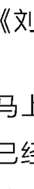

加餐 | 每一个你暗自得意的...

每天5分钟，解决一个商业问题。欢迎收听《刘润·5分钟商学院》实战篇。

马上就到双十一了，估计咱们的同学也已经在购物车里囤了不少东西。戳下购买按钮前，先来看看我帮你整理汇总的这十个淘宝卖家常用套路。你会发现，几乎每个你暗自得意占到的“小便宜”，都是卖家毫无痕迹的“精心设计”。

- 1. 人们交易时，不仅要买商品，也要买“占到便宜”的感觉，这是一切商业套路追求的效果。便宜很重要；让你觉得占到便宜，更重要；让你觉得，是你自己最终战胜了卖家从而占到便宜，最重要。
- 2. 商业套路的设计，本质上都源自一个商业公式：想要提升销售额，就要从流量、转化率、客单价、复购率这四个方面下功夫。
- 3. 双十一，其实是用造节的方式在刺激流量，是商家给用户占便宜找到的一个合理出口。把日常价格作为参照物，通过“今天特价”、“只此一天”这些方式，让你觉得买到就是占便宜，毫不犹豫地下单。
- 4. 聪明的店铺还懂得用利润换流量。先做出几个单品爆款，让你觉得，天啊，这也太便宜了吧，于是在他的店里不停地淘宝，店家就有机会通过其他产品来赚钱。饭店里每天一个特价菜，也是同样的引流目的。
- 5. 今年流行的“预付定金翻倍”策略，目的也是为了提升转化率。开始支付的钱少，降低了大家购买的心理负担，最后实际购买时，只需要支付剩余尾款，总金额－翻倍定金金额，即可，不仅显得更划算，也会让你觉得已经到手的东西，舍不得不要。
- 6. 把价格很高的商品，平摊到每周甚至每天，让你产生“也不贵嘛”的心理，从而忽略总价格，马上购买，在商业上被称为“价值重构”，也是提升转化率很有用的方法。典型做法就是，把包月鲜花、四束168元，换成“每周只需一杯咖啡的花费，就可以把鲜花送到家”，消费者就会容易接受。
- 7. 推出“满199减50”、“满299元减100”的返券活动，促使你凑单，又通过专门准备的“凑单专场”，进一步降低你凑单的门槛，从而提高了每个人的客单价。
- 8. 促销时候，单价低的商品用百分比促销，单价高的用优惠金额促销，比如单价50元优惠10元就写直降20%，单价500元的优惠20%就写直降100元，可以让同样一个概率，在你心中“显得”比实际的大。
- 9. 7天或者30天无理由退换，是非常重要的临门一脚。用“7天无理由退换，一旦退换赔付运费”的方式，打消你的购买疑虑。但一旦你买到手，除非有严重的质量问题，一般你是不容易退货的。
- 10. 几乎所有销量高的店家都在用这一招，“亲，包邮哦”。其实运费都是顾客出，但这样说，相当于告诉你，“这个东西本来就值这个钱，运费不用你出，我包了！”也会让你觉得“占了便宜”。

每一件事情背后，都有其商业逻辑。商业逻辑和商学概念，都是从人性的骨子里来、被反复验证过的套路和模式。咱们专栏，就是希望把这些实用的招式告诉你，让你学会洞察人性的底层心理需求、提升你的商业战斗力。无论你是想要更理性消费的买家，还是想赚到更多钱的卖家，都可以从中有所收获。

刘润

最后，我很想和大家一起讨论一下，什么样的产品是你明知道被套路，也一定会剁手拿下的。欢迎你在留言区分享，与大家一起，过过招。

也欢迎你把今天学到的招式，分享给你身边喜欢买买买的朋友们，也许这一篇文章，就能让他们节省几百块钱。

留言精选

## 019｜异业联盟：我的服装店，每天门可罗雀，怎么办？

每天5分钟，解决一个商业问题。欢迎收听，《刘润5分钟商学院》，实战篇。

我有个朋友，在社区开服装店，卖独立设计的女装。一开始她的生意不错，但随着电商的崛起，越来越难做。她试了很多办法，打折，送礼，拉家常，见人就叫姐，然后加微信，但效果都不明显。到店的人还是越来越少，怎么办？

要解决这个“怎么办”的问题，我们首先要理解这个问题本质。打折、送礼、拉家常，这些只能提高进店客人的成交率，也就是电商常说的“转化率”。但她的问题是，互联网带来的用户购物习惯变化，导致进店客人变少。寻找新流量，才是这个问题的本质。

那怎么办呢？我这个朋友，可以尝试“异业联盟”的方法。

### 概念：异业联盟

什么叫“异业联盟”？我举个例子。

北京有家创业公司，叫“零时尚”。他们也在社区里开了不少女装店。我在《商业评论》杂志上写过他们的案例，也在《5分钟商学院｜基础篇》讲过他们。他们做得不错，快速发展，但也遇到了流量天花板。怎么办？

### 运用：

### 今日得到：

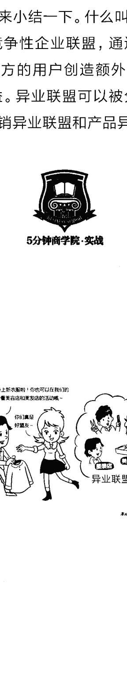

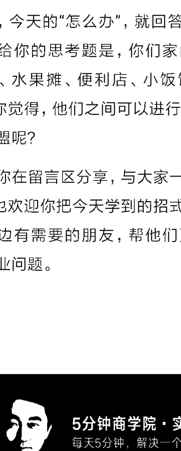

好了，今天的“怎么办”，就回答到这里。我留给你的思考题是，你们家门口有理发店、水果摊、便利店、小饭馆和鲜花铺。你觉得，他们之间可以进行怎样的异业联盟呢？

## 020 | 看比赛：百度，阿里，腾讯，还有万达，到底在打什么？

每天5分钟，解决一个商业问题。欢迎收听《刘润·5分钟商学院》，实战篇。

这周我们讲了一个逻辑，叫做“引流品+利润品”，牺牲引流品的利润来引流量，再通过其他利润品来赚钱。大家特别感兴趣，很多学员都联想到《5分钟商学院｜基础篇》第15课讲到的一个概念：免费。

什么是“免费”？我们讲过，所有的“免费”，其实都是通过“二段收费”，将商品的成本进行了转移。二段收费的本质，其实也是“引流品+利润品”。只是我们讲“免费经济”时，更多是指“我向你免费，然后向另一个人收费”，也就是你常听说的“羊毛出在猪身上，让狗买单”。比如百度，我为你免费提供搜索服务，但是向广告主收费。

而“引流品+利润品”，通常是指“这个商品便宜，但是那个商品贵”，是向同一个人收费，你也可以理解为“羊毛出在羊身上”。

今天，我想带你回到真实的商业世界，一起看几场惊心动魄的比赛，理解“引流品”的逻辑，是如何改变企业竞争格局的。

我们知道，中国互联网有三大巨头：百度、阿里、腾讯（昵称：BAT），打得不可开交。你有没有想过，BAT的业务各不相同，百度是做搜索的，阿里是做电商的，腾讯是做社交的，理论上是不同行业的，为什么会打架呢？你见过做冰箱的，和卖汽车的打架吗？你见过理发的，和卖水果的打架吗？他们有什么好打的呢？

这是因为，从商业的角度看，搜索、电商、社交，其实并不是BAT的“产品”。你从来没有为搜索资料、比较商品、沟通交流付过费吧？为什么？因为搜索、电商、社交，其实只是BAT的“引流品”，目的都是获得同一种资源：流量。

简单来说，一切的商业模式，都可以分为两种，卖流量，和卖产品。卖流量，就是手持用户找产品；而卖产品，就是手持产品找用户。

百度、阿里、腾讯，虽然“引流品”各不不同，但都选择了“手持用户找产品”，也就是卖流量的商业模式。从这个角度来说，他们是头对头的竞争对手，抢到流量后，他们把流量变现的“利润品”各不相同。百度的利润品是竞价排名广告，阿里的利润品是淘宝直通车等电商广告（2017财年，广告收入约占阿里电商业务收入的65~70%），腾讯的利润品，是会员服务和游戏。

通过放大“引流品+利润品”的逻辑，BAT把卖流量做成了巨大的生意，并因流量资源的稀缺，打得不可开交。李彦宏甚至说：在PC时代，流量为王。这种商业模式，我们甚至把它叫做“流量经济”。

流量经济的战争，其实就是“引流品＋利润品”的战争。

看完BAT在线上的比赛，理解了流量经济的底层逻辑，我们再来看看，线下的逻辑是什么。

在线下，几乎每个万达广场里都有个很大的沃尔玛，有的甚至占据两层楼的面积。但你知道吗，沃尔玛占万达那么大面积，租金却很便宜，这是为什么？

首先你要理解，万达的产品是什么？它的产品不是购物中心里卖的那些东西，它的产品是它的铺位面积。万达用很便宜的租金，换取沃尔玛的入驻，其实就是相当于用“利润换流量”，吸引大量购物人流。有了大量人流，沃尔玛旁边的铺位就变得有价值了。于是，万达就把它们，用更高的价格租给珠宝商、手表商等等，赚取更大的利润。

租给沃尔玛的面积，是万达的“引流品”；租给珠宝商、手表商的铺位，就是万达的“利润品”。

所以，BAT和万达，线上和线下，没有本质的区别，它们都是“引流品+利润品”的商业逻辑。如果我们把互联网商业模式叫做“流量经济”，那么万达就是“线下的流量经济”；反过来说，如果我们把万达叫做“商业地产”的话，那么互联网商业模式就是“网络商业地产”。

为什么BAT会和商业地产此消彼长，相爱相杀？因为他们本质上都是“流量业”的竞争对手，都是靠卖流量赚钱，只是各自的引流品不同而已。

有一次我路过长安街，看到一个机构叫“中华全国供销合作总社”，当时就感慨，商业的本质从来没有变过：一个是供，一个是销。“供”的核心能力是卖产品；而“销”的核心能力，就是卖流量。

刘润

好了，今天的比赛我们就看到这里。我留给你的思考题是，你公司的核心能力是卖流量，还是卖产品呢？你是获得流量之后，然后把流量卖给那些做产品的人，还是你拥有产品，到处去寻找最便宜的流量呢？

欢迎你在留言区分享，与大家一起，过过招。也欢迎你把今天学到的招式，分享给你身边有需要的朋友，帮助他们更好地解决商业问题。

## 周末私董会 | 经销商不愿意推荐我们的产品，怎么办？

每天5分钟，解决一个商业问题。欢迎收听《刘润·5分钟商学院》实战篇。

5分钟商学院的同学们，大家周末好！

从上周开始，咱们增加了一个更实战的内容环节：每个周六，我会精选一个同学的商业问题，和大家一起帮他打开地图，拿出指南针，分析、支招，寻找解决方案。要知道，这套真刀真枪的演练做法，也是几乎所有传统商学院，和私董会小组在做的一项重要工作，对于训练解决商业问题的思辨能力，非常有效。

每一周的问题出来后，同学们都非常积极踊跃地留言参与，我发现，同学生的发言水平越来越高，而且大家不是凭空给建议，是结合所学到的知识来分析问题、思考应用，比如这期的回复中，有人提到了企业能量模型，有人在用价格锚点，有人还直接用到了我上次提到的人无我有、人有我优、人优我廉”等等逻辑来思考问题，这个非常好。

“输出”是学习环节中很重要的一个步，用所学的知识来分析、解决问题，不仅能检验你的学习成果，还能让知识真正长成自己的。后台有同学留言说，通过这两期的提问、分析，他好像慢慢摸到了解决问题框架和逻辑，再面对一个陌生问题时，已经可以有法可循了。看到大家实战能力的提高，我真的特别开心。

接下来，来看上周的问题：

> “我们公司是卖玉米种子的，种子质量很好、前两年公司业绩特别好，但这两年其他公司的质量开始上来了，卖的人也多起来了，我们家的利润比较薄，所以很多经销商不愿意推荐我们。然后农业的周期是一年，农户通常会在3、4月份集中买种子，这个时候很多家为了多卖，什么招都使，价格就比较低，时间长了，农户什么产品都不相信了，现在我们的业务断崖式下滑。不知道该怎么办？”

我们收到了非常多很有建设性的建议和方案，很多同学给出的想法都特别好，下面，我分三个角度，来综合谈一下这个问题：

### 第一，产品不变，但产品卖点可以迅速调整

咱们先回到“企业能量模型”这个总的逻辑下。

我在第一季36课“企业能量模型”中讲过：企业经营，有三件是必须做好的：产品、营销、渠道。做产品，就是把这块钓鱼之石推上山仍之巅，获得尽可能大的势能，然后在最高点一把推下去，用营销和渠道减小阻力，把势能转化为最大的动能，获得尽可能深远的用户覆盖。其中，产品永远是一切的出发点。

如果你你的种子足够好，比别人亩产多百分之百，那你根本不用做其他任何事情，单靠产品就行了。但根据这位同学的分析，他家的产品应该是相对有优势、但这两年大家的产品势能都提升了，他和别人的差异就没那么大了。

当然，你可以专注提升亩产量、抗药性，但这些是有科学极限的，或者说难度特别大，不是短期之内就能做到的。这种情况下，我们可以从其他几个方面来考虑产品的问题：

- 1、把产品服务化

其实大家买的不是种子，而是最后能种出来的一个东西，所以如果在卖种子的时候加上更丰富的产品内涵，把产品服务化，可以迅速凸显你的产品印象。比如教导大家怎么去种，下冰雹下大雨这类重大天气变化前能有个短信提醒，一些重大虫害来临之前告诉农户如何防治等，所有这些和农务相关的服务加在一起，都叫产品服务化。

> “大客@创新互联咨询-Jackson董坤”就提出了一个建议，卖种子的同时，能否提供关于种子的种植知识培训等，或者提供一款物美价廉的化肥绑销售，以及其他的必需产品，看看能否因此增加盈利点。这就是产品服务化的思维，是很合理的建议。

- 2、增加产品组合

沿着他的思路说下去，除了种子可以售卖之外，其实还可以卖农具、农药。比如，全世界最知名的种子企业就是美国最大的农业公司Monsanto孟山都了。孟山都的帝国，就是靠种子加农药的产品组合建立起来的。农药是保证种植过程能够确定产出高亩产的一个关键环节，好的种子加上有效农药才能保证巨大的产量。

这就跟你在外卖平台点小龙虾，小龙虾是你的核心产品，但送来的时候一定会有一张一次性桌布、湿纸巾、手套、放手机的袋子，这就是一个产品组合。所以，也许可考虑借用孟山都的做法，把种子和农药加在一起组一个产品组合。

- 3、主动差异化

咱们还有一个同学“古小千”提到，玉米种子质量好，但遇到不同土质和环境，所需要的照料也不同，可以研究出一份标准操作程序，依托土质或气候，将玉米种子细分。还可以主动提出要现场勘查农户的栽种环境，再给出耕种建议。这种主动根据不同地区、定制种子产品的差异化的方法，也会让你的产品显得更加专业、不同。

### 第二，持续营销，累积信任

咱们继续往下分析，这位同学目前面临的情况是，产品的明显优势已经消失了，而渠道因为利润不够厚，大家都不帮着卖。当产品和渠道都比较弱的情况下，营销就显得非常重要了。

- 1、用营销倒逼渠道

在玉米种子行业，过去有一家非常辉煌的公司叫杜邦先锋，先锋的中国总经理李石曾经分享过自己创造先锋玉米种子销售神话的方法论——拉动式营销。当年，他派了很多 人到农村去，不断开讲座讲授种子应该怎么选、先锋种子怎么好，天天讲，讲的很打动人。当农民都有了这个认知之后，他们就自动跑到经销商那里去找先锋种子，先锋种子就变得特别热销，创造了整个农业界的一个营销神话。

这个方法到现在也依旧适用，除了天天办一些宣讲会或者培训会，你还可以在农业相关的频道打广告，先占领了消费者的心智，让他们知道并且且认同你的品牌，之后再倒逼渠道。

- 2、种子好不好，宣传见分晓

如果你对自己的种子质量非常自信，还可以试试这几位同学提到的方法。

> “第一人称雷”同学建议，在各个村公开招募农民，将其自己的地挂牌作为试验田种植打理，做试验田第一时间就能获得试验奖金，种植效果好的农民将获得公司提供的额外奖金包，同时获得收成的全部收益。如果收成不好，早潜保收，和正常值的差额我们来出。

同学们的建议非常对路，挑选一些勤劳、懂耕种的农户，让他们耕种你的种子，给他们一些补贴，种得越多，获得的补贴越多。那么这部分田地，就成为了你的展示基地，最后大家看到这块田地的亩产高、庄稼好，你第二年再去那个卖种子的时候，销量就可能会大增。

如果你非常自信，甚至可以和农户签订保底协议。比如说如果你的耕种符合我们的要求和规范，我保证你一定能产出这么多的量，如果没产出那么多，我赔给你。但是如果你产出的量比这个更多，我再奖励你。用这样的方式，就能把农户基于信息不对称所带来的焦虑和不信任感，用期货消费的方式，用未来的收益解决掉，这样就有机 会赢得更多订单。

或者，干脆找一个农户，让他在田地里开十条种玉米的道，挑选不同的种子盲种，最后发现种的最好的种子就是你 们品牌 的。这种眼见为实的方法非常有用。

你还可以给这些用过你的种子、产量特别大的农户做采访、拍纪录片，做成宣传资料，用口碑的方式宣传你的种子，这样也是获得信任感的方法。当然你也可以找一些靠谱的第三方认证机构进行验证。

### 第三，想方设法为渠道商创造利润

说完了产品和营销，我们再来谈一下渠道。经销商唯一的目的就是要赚更多钱，所以，在种子质量可以有所保证的前提下，他一定更愿意卖利润更高的产品。

当然，也有同学提到了撇开经销商自己直接销售，这个从目前的农村市场来看，暂时还不是很靠谱、高效，所以，想要让经销商多推荐你，唯一的方法就是给他更多利益。

具体怎么做呢？

#### 1、先用再付钱

你可以给经销商一个武器，让他用赊账的方式来推荐你的种子，让农民先种再付钱，用跨界消费的方式来解决付款的问题，这对一部分农户的购买是一种促进。

#### 2、分层次设奖金

给代理商设置不同层次的奖金。量少的奖金少一些，量大的奖金更多，激励代理商卖更多的你的产品，获得更大的利润。但总体来说，给代理商的利润是要保证的。

#### 3、开发高端品种

考虑开发一些高端品种，当然它的产量、抗灾性等都要有明显的提升，但相应地，价格也可以明显更高一些，这时候代理商的利润空间也会相应提高。用这样的品种跟代理商合作，他的合作意愿就会增加，也能给你整个品牌带来额外的价值。

总结一下，产品始终是企业的生命线，是一切的根本。其次在产品质量短期内无法提高的情况下，要持续营销，想办法倒逼渠道。最后，渠道的驱动力永远是利润，要想方设法为渠道商创造利润。

感谢同学们的积极参与和真知灼见，文中提到的几位同学请在专栏下面留言，我会送出5分钟商学院商业篇的亲笔签名版送给大家。

另外，

之所以惊动陈春花教授，是因为她曾经担任新希望六和股份有限公司的联席董事长，兼首席执行官。新希望六合，是中国最大的农牧企业。陈春花教授，即是商学院院长，又是上市公司CEO，对这个问题，也许在全中国最有发言权。她给这位学员的建议有三点：

- 1）合理利润，2）贴近农户，3）除了种子之外，增加解决更实际的问题服务能力。

希望对你有所启发。非常感谢陈春花教授。

在今天的最后，我给大家留了一道本周的切磋问题：

老师，我是北京一家教育机构市场营销人员，由于国家政策，我们的自主招生产品服务卖的非常不畅。不过，现在其它传统的一些教育机构和新的小机构模仿我们，采取跟随战略，价格非常有优势，模仿我们的营销策略和参考我们定价，让我们失去了很多客户，营销成本越来越高，这个情况如何破解呢？求老师和同学们指导。

欢迎大家一起来给这位同学支支招。你会发现，你在思考的同时，就可以看到新学到的内容链接到已有的知识上，这样，我们的课程才算真正的学以致用了。

也欢迎大家提出自己的问题，在不涉及商业机密的前提下，背景信息控制在200字以内，越详细越好，我将精选最有价值的问题，供同学们一起讨论，给出完善的解决方案。

在商业世界中，所有与用户接触的点，都统称为“渠道”。上一周，我和你分享了在渠道这个格斗场里，很重要的流量概念，下周，我们一起来谈谈很多人非常关心的转化率问题，请你千万不要错过。

这是《刘润•5分钟商学院》实战篇，陪你成长的第4周，期待你的进步。

## 留言精选

## 021 | 有效流量：流量很大，但大家都只看不买，怎么办？

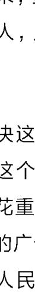

021 | 有效流量：流量很大，...

每天5分钟，解决一个商业问题。欢迎收听，《刘润·5分钟商学院》，实战篇。

这一周，我们来讲“渠道”的第二个部分：转化率。有多少人进了你的店，这叫流量；100个人进了你的店，最后有多少人真买了东西？这叫转化率。100人有3个人买了，转化率就是3%。

我有个朋友，是做户外运动品牌的。他深知流量的重要性，在门户网站上投广告，在电商平台上买排名。一开始效果不错，但后来，虽然买到的流量很大，但越来越多的人，只看不买。他很焦虑，问我怎么办？

要解决这个“怎么办”的问题，我们首先要理解这个问题的本质。这个问题的本质，是他花重金买了很多无效流量，比如门户网站的广告，因为受众广，所以价格高，但广大人民中，有多少人真的喜欢户外，去爬过至少一座山呢？精准客户少，导致转化率低。他花钱买的，不是“有效流量”。

### 概念：有效流量

### 什么叫“有效流量”？

有效流量，是流量和高转化率之间的桥梁。进门的客人，是母婴店的流量；客人中的女性，是母婴店的有效流量；而女性中的新妈妈，则是母婴店更有效的流量。100个人中，50个女性，5个新妈妈。同样的宣传成本，你用来影响5个新妈妈，当然比影响100个男女老少，更有效果。

这就是有效流量。精准客户占你所触达人群的比率越高，你获得的流量才越有效。

那我这个朋友应该怎么办？可以试着资助一些户外社群的意见领袖。这群人，才是有效流量的来源。

2015年，我去登非洲第一高峰乞力马扎罗，很多人都不相信我能爬上去。他们是对的。其实，我也不相信。在登山方面，你一眼就看出来了，我不是实力派，但我是装备派啊。我买了很多顶级品牌的冲锋衣、手杖、登山鞋。全副武装，严阵以待。

但我们从北京请来的，全程陪同我们登山的清华登山队队长，穿的冲锋衣是一个我并不熟悉的牌子。他登山就跟玩儿一样。我忍不住问他，这是什么牌子啊？他给我介绍了半天。原来这个品牌资助了很多户外教练和登山向导。你想想，你哼哧哼哧跟在登山向导身后，正在痛苦地往上爬，一抬头，那个品牌的英姿，就高大地出现在你面前。实在是太精准了。

这位登山向导所带领的户外爱好者，就是这个品牌的精准用户。他们用一件衣服，就收割了这些“有效流量”。

我说完之后，这位朋友立刻提出：我赞助你以后所有的装备！

### 运用：

那这个“有效流量”，在商业世界中，还能解决哪些“怎么办”的问题？

我们用一个公式来进一步理解有效流量：有效流量 = 目标客户 x 恰当场景。目标客户，就是合适的人。恰当场景，就是合适的时间和合适的地点。获得有效流量，就是让你的产品，在合适的时间、合适的地点，遇到合适的人。

我写了一本书，想搞个发布会，但不知道去哪里找“有效流量”怎么办？试试和你认识的微信读书会、学习群合作。我的书《趋势红利》上市的时候，我想换个方式，针对更广泛、更有效的流量召开新书发布会。那在哪个好呢？在微信。

我和益策合作，公开发布消息：刘润要开新书发布会了，用1小时分享他对趋势的理解和看法，哪些读书会、学习群，愿意参加这个发布会？结果，582个群报名。那天，我通过微信直播，向这582个群中的27万多用户，分享了我的思考。你想，这些用户都是求知好学的人，是我的新书最有效的流量。在过去，我在线下开一场发布会，最多接触到几百人。但我那天只用了1小时，就接触到了27万多“有效流量”，极大提升了新书的知名度。

我是城市周边的度假酒店，想找到我的“有效流量”，怎么办？周末出去住一晚的，通常是长居城市的小夫妻，想带着孩子一起远离城市，亲近自然。他们就是你的有效流量。可是，他们在哪里？我猜一定有人已经把这群人聚在了一起了。试着上微信搜索，“周末去哪儿”，看看有没有叫这个名字的微信公众号。真的有？那就对了。去联系他们。他们的读者，就是你的有效流量。

### 今日得到：

最后，我们来小结一下。什么是有效流量？有效流量，是连接流量和高转化率的桥梁。获得有效流量，就是让你的产品，在合适的时间、合适的地点，遇到合适的人。

有流量，说明你抓住了用户的眼睛；有转化率，才说明你抓住了用户的心。

刘润

好了，今天的“怎么办”，就回答到这里。我留给你的思考题是，有一次我看新闻，说一些未婚的漂亮女孩子，喜欢买头等舱出行，就是为了能在飞机上认识高净值人群。你觉得，这是她们的“有效流量”吗？为什么？

欢迎你在留言区分享，与大家一起，过过招。也欢迎你把今天学到的招式，分享给你身边有需要的朋友，帮助他们更好地解决商业问题。

## 022 | 展示设计：顾客逛了一圈，就蒙圈地走了，怎么办？

每天5分钟，解决一个商业问题。欢迎收听，《刘润·5分钟商学院》，实战篇。

我有个朋友，开了家小店，卖他们旅行时，从世界各地淘回来的小东西，茶具、灯饰、花瓶、旧书、香炉等等，玲珑满目，五花八门。他对这些东西爱不释手，满以为顾客也会喜欢。可是，不少人进入逛了一圈后，甚至没细看，就蒙圈地走了。怎么办？

要解决这个“怎么办”的问题，我们首先要理解决这个问题的本质。他的东西真不错，但顾客却视若无睹，好像没看见一样。这个问题的本质，是他没有把好东西放在用户真正关注的地方。他忽略了“展示设计”，这个提升流量转化率的重要手段。

### 概念：展示设计

### 什么叫“展示设计”？

在大多数情况下，顾客购买商品的场景是这样的：

- 1、顾客看到招牌，因为感兴趣而进店，这叫：有效流量；
2、商品恰到好处地，进入顾客的视线，这叫：展示设计；
3、顾客拿商品仔细观看，决定是否要购买，这叫：决策时间；
4、店员发现顾客有点犹豫，于是介绍促销和优惠，这叫：打折促销。

有效流量、展示设计、决策时间和打折促销，每一项对提高流量转化率都非常重要，它们共同在顾客这场丰富的“买与不买”的内心戏中，一步步“助推”其做出购买决策。其中，展示设计，扮演了让商品“恰到好处地进入视线”的职能。只有进入视线，才有“决策时间”。

那怎样的展示设计，才能让商品“恰到好处地进入视线”呢？我与你分享三种办法。

第一，动线设计。顾客进店后走的路线，就是所谓的“动线”。动线，也是注意力流动的路线。设计动线，并把你最想用户买的商品，放在用户必经的动线上，是“展示设计”的基本功。

关于动线设计，宜家是真正的大师。去过宜家购物的同学，一定对“一进宜家深似海，不买东西出不来”的动线设计，印象深刻。

（你可以点开文稿，看到一张宜家的动线设计图）

你从进入宜家开始，就被这个一路到底式的动线设计默默引导着走完所有角落。对宜家来说，高达“60%”的购买品本不在你原本想买的清单之内，但你却选购了，它的目的就达到了。

第二，视觉焦点。我们目光所及的范围，并不是所有东西都得到了视觉焦点。目光所及很宽，视觉焦点很窄。你走过超市货架，和目光平行的那一层，是视觉焦点；你写一份简历，从上往下三分之一的位置，是视觉焦点；你做一个网页，左上位置是视觉焦点。

第三，从众效应。很多人买的东西，一定不会差吧？这就是从众效应。在书店，可以放个畅销书榜单；在超市，可以放个本月销售冠军货架。在酒店，可以在门口挂个牌子，我们是TripAdvisor上全球用户评选的高分酒店。

那我这个朋友应该怎么办？在橱窗里放非洲的猛犸象骨骼，用好奇心把用户吸引到店内。进店后，正前方放贝壳做的皇冠，吸引用户顺着货架间的通道，一边浏览一边走到尽头；左手尽头放把镶满宝石的匕首；走到左手尽头后，发现右手尽头还有把奇怪的乐器。

然后把最想卖的商品，放在动线必经的货架上，与视线平行的那一层。在尤其重要的商品旁边，加上红色标签，介绍它的传奇来历。还可以配一张当地人的照片，因为人脸是自然的视觉焦点。

在动线结束的地方，展示“七大洲精选榜”。非洲人最喜欢的匕首、斯里兰卡人最喜欢的茶、爱斯基摩人手工制作的木雕等等。就这样，“动线”一直引导着客户走到店门口的收银台，这一路，顾客浏览了最多的商品，逗留了最多的时间。

这就是展示设计，让商品“恰到好处地进入视线”。

### 运用：

那个“展示设计”，在商业世界中，还能解决哪些“怎么办”的问题？

我是做思维导图的，虽然做出来很精美，但发到微博上没人看，怎么办？微博/微信的主战场是手机。手机上最自然的动线，是从上往下。所以，如果你想传播，就别做横图了，尝试用一张长长的竖图，讲明白你的逻辑吧。

我是做微信公众号的，希望大家阅读更多的文章，怎么办？在你每篇文章最后，加上“阅读排行榜”，列举你最受欢迎的5篇。因为“从众心理”，读者很可能点击，进入你的“跳转”动线。

### 今日得到：

最后，我们来小结一下。有效流量、展示设计、决策时间和打折促销，共同“助推”着顾客做出购买决策。其中，展示设计，扮演了让商品“恰到好处地进入视线”的职能。今天我介绍了三种“展示设计”方法：动线设计、视觉焦点和从众心理。你记住了吗？

刘润

好了，今天的“怎么办”，就回答到这里。我留给你的思考题是，在现实生活中，有没有哪家门店或者网店的展示设计，给你留下深刻印象，你想要的商品，总是恰到好处地出现呢？

欢迎你在留言区分享，与大家一起，过过招。也欢迎你把今天学到的招式，分享给你身边有需要的朋友，帮助他们更好地解决商业问题。

## 023 | 决策时间：用户思考了很久，又把商品放回去了，怎么办？

每天5分钟，解决一个商业问题。欢迎收听，《刘润·5分钟商学院》，实战篇。

我有个朋友，做辣酱特别好吃。他和某超市谈好合作，在调味品货架上，放了24款不同口味的辣酱，供消费者选择。学过前一课“展示设计”，他把这24款辣酱都放在了超市动线的必经之路上，并与视线平行。然而，用户确实停留了，也真的关注了，但最后买的人很少。他百思不得其解，怎么办？

要解决这个“怎么办”的问题，我们首先要理解这个问题的本质。这个问题的本质，恰恰是这24款看似玲珑满目的辣酱，引发了用户的“选择困难症”，延长了“决策时间”。购买冲动一消失，用户就会拿起又放下，浪费了好不容易获得的“有效流量”，损失了转化率。

### 概念：决策时间

什么是“决策时间”？用户做出“买买买”这个决策，时间是很短的。有专家做过研究，消费者在线下购买一个产品，平均“决策时间”是13秒。在线上呢？是19秒。也就是说，“买和不买”这个决策，对你作为一个商家影响重大，但消费者在20秒之内就决定了。当用户决策时间超过1分钟，转化率就开始下降；超过2分钟，转化率下降更为明显。

为什么会这样？因为今天的消费者，越来越没耐心了。

2000年，人类的平均注意力时长是12秒；2013年，降到了8秒。金鱼还有9秒呢。也就是说，今天的人，还不如鱼专注。

消费者的“决策时间”那么短，你却拿24款辣酱让他挑……他停留了2分钟后，深深感叹：现在连辣酱都能做出这么多花样，真厉害！然后……就没有然后了。

那我这个朋友应该怎么办？试试把24款辣酱，减少到6款。

曾有人针对果酱做过实验，给顾客提供24款果酱试吃，结果60%的顾客会驻足品尝，但只有3%的人购买了果酱，总购买率1.8%；然后，他们在另外一个展台上提供6款果酱，结果40%的顾客驻足品尝，其中31%购买了果酱。总购买率高达12.4%。

挑来挑去，反而不买；减少选择，买得更多。这就是减少用户“决策时间”的威力。

### 运用：

那这个“决策时间”，在商业世界中，还能解决哪些“怎么办”的问题？

如果有一个字能形容我们可爱的消费者，那就是一个大写的“懒”，尤其懒得思考。为了提高流量转化率，你要降低他的思考难度，减少他的“决策时间”。具体怎么做？我给你介绍几个常用的方法。

- 1、行动指令。
用户把商品页面从头看到尾，但就是不点“购物车”图标，怎么办？
把一个购物车的图标放在按钮上，是很难触发购买的。有人做过研究，在购物车图标前，多放一个“+”号，下单率会提高15%；如果干脆把图标，换成“加入购物车”五个字，下单率会提高49%。
为什么？“+”号，尤其是“加入购物车”这五个字，是明确的“行动指令”，你下发了行动指令，他终于可以不用思考，那就“加”吧。
这就是行动指令的魔性。

- 2、信息聚焦。
我的产品有18项与众不同之处，每样都极有说服力，但消费者还是不买，怎么办？
20秒。记住你只有20秒。你希望在这20秒内，用什么来打动他？18项与众不同之处？20秒说得完吗？再多优点，你也只能说一条，比如：怕上火，就喝王老吉；或者：小米6，拍照更美。
这就是信息聚焦。你的产品再举世无双，也不能因为铺陈太多信息，而错过了用户稍纵即逝的“决策时间”。

- 3、短缺刺激。
辣酱就剩下最后10瓶了，想尽快清掉库存上新货，怎么办？
在辣酱的价格标签上贴上醒目的：特价优惠，最后10瓶！卖掉一瓶后，在10上面贴个9，然后再贴8，制造短缺氛围。
我们在第2课讲过，利用或者解决用户“损失规避”心理的格斗术：语义效应。“特价优惠，最后10瓶”，就是利用用户害怕失去优惠的心理，用“短缺”激励用户立刻下单，减少决策时间。
同样利用短缺刺激，缩短决策时间的方法还有：最后三天大清仓！全球限量发行！原材料涨价，本批最后几件！今天24点前下单，买一赠一！等等等等。

### 今日得到：

最后，我们来小结一下。什么是“决策时间”？消费者的注意力时长越来越短，人们购买商品的“决策时间”，大约在20秒之内。所以，怎么能在极短时间内影响消费决策，提高流量转化率，就变得至关重要。今天我给你介绍了3个实战招数，行动指令、信息聚焦和短缺刺激。你记住了吗？

刘润

好了，今天的“怎么办”，就回答到这里。我留给你的思考题是，你人生中最快的购买决策是多久做出的？是什么让你毫不犹豫？

欢迎你在留言区分享，与大家一起，过招。也欢迎你把今天学到的招式，分享给你身边有需要的朋友，帮他们更好地解决商业问题。

## 留言精选

- 1. 设有顾问
- 2. 设有顾问
- 3. 设有公...
- 4. 设有...
- 5. 设有...

## 024 | 促销活动：想用最少的钱临门一脚，促使用户决心购买，怎么办？

每天5分钟，解决一个商业问题。欢迎收听，《刘润·5分钟商学院》，实战篇。

我有个朋友，在拉萨卖本地纪念品，藏刀、唐卡、天珠等等。有一次，一个游客把玩一把藏刀已经59秒了，一直拿不定主意。我这个朋友很焦虑，听过上一课决策时间，知道再过一秒，游客的购买冲动就下降了。他一个箭步冲上去，拔出那把刀，卖力地给游客解释，这把刀到底好在哪。他吐沫横飞了一分钟后......游客说了一声谢谢，走了。

天啊，走了。就差临门一脚，用户居然走了，怎么办？

要解决这个“怎么办”的问题，我们首先要理解这个问题的本质。

当用户对产品有了兴趣后，商家所有的行为，给出行动指令、减少信息干扰、借用短缺刺激等等，本质上都只有一个目的：用力按下用户心中那个“购买开关”。

但是，你用尽全身气力，发现距离按下“购买开关”，还差最后“一根稻草”怎么办？万念俱灰，直接冲上去，把钱从用户口袋里掏出来吗？我这个朋友“一个箭步冲上去”的行为，和抢钱无异，用户当然被吓跑了。如果真的只差最后一根稻草，也许你可以试试提高转化率的最终杀器：打折促销。

### 概念：打折促销

打折促销，听上去不是那么高大上，但它通常是在最后关头，提高转化率的致命一击。用户的购买欲望，本来是要和1000元价格做殊死搏斗的，但你一打折，价格对手瞬间身负重伤，变成了800元，“购买开关”就被“啪”地按下了。

那我这个朋友应该怎么办？淡定地走过去，对这位游客说：这把藏刀真不错。今天店里有活动，可以只用小藏刀的钱，买你手里这把大藏刀，还送个盒子，很合算。你要买几把吧？游客说：真的啊？太好了。不过，我要那么多刀没用，这一把握可以了。盒子可以选吗？

用小藏刀的钱，买大藏刀，还送盒子，是一种“隐形打折”。这种隐形打折，不会因为赤裸裸地便宜，而让用户觉得产品廉价。

打折促销，对提高流量转化率非常有效，能解决很多“怎么办”的问题，但需要注意的是，打折促销，不应该简单粗暴。9折要不要？那8折呢？7折？这种方式，是“打折”的低级形态，会让用户怀疑商品的真实价值。

### 运用：

那打折的高级形态是什么呢？我给你介绍5种花式打折法。

- 1、 低价高购。
什么叫低价高购？“您只要花149元就可以买到我们店里价值200元的商品”，或者“您只要花199元，就可以在我们店里挑选任何一件原价商品”。花少钱，买贵东西，你会觉得特别有价值感，但不会觉得这是打折，虽然其实这就是打折。

- 2、 充值免单。
什么叫充值免单？顾客吃完饭结账，200元。“对了，我们今天有个充值免单活动。您只要充值1000元，这顿饭就可以免单，很划算呢”。全额免单？这是莫大的优惠啊！你想不到这是打折，但其本质，就是买1000元，便宜200元，打了8折。

- 3、 一元换购。
什么叫一元换购？活动期间，可以用一元买到十元，或者几十元的东西。下单的时候，用户发现运费10元，就会忍不住多买几件，把运费赚回来。最终，他买了100元的东西，付了10元运费。这个一元换购，就相当于在100元的东西上，打了8-9折。

- 4、 赠而不折。
什么叫赠而不折？哎呀，真的不能再便宜了。这样吧，我再送你点新品小样吧？我再送你一张现金折扣券吧？我再给你加10%的量吧？这些都叫赠而不折。它不会折损你产品的价值感，但却给了用户同样的获得感。

- 5、 折上再折。
什么叫折上再折？如果必须用折扣，那就打折打到让他震撼。你这个月生日，打9折；你是O型血，打9折；你发条朋友圈，打9折。什么？你今天生日，还是O型血，又发了朋友圈？那就给你打9折的、9折的、9折。听上去多霸气，但其实也就打了7.29折。你如果一开始说7.2折，用户可能是没感觉的。

### 今日得到：

最后，我们来小结一下。上周我们讲了流量，这周我们讲了转化率。流量是要抓住用户的眼睛，转化率是要抓住用户的心。提高转化率，我们讲了四个方法：有效流量、展示设计、决策时间、打折促销。今天讲的打折促销，通常是在最后关头，提高转化率的致命一击。我给你介绍了5种花式打折法，低价高购、充值免单、一元换购、赠而不折和折上再折。

刘润

好了，今天的“怎么办”，就回答到这里。我留给你的思考题是，你还见过哪些本质是打折，但不像是打折的促销手段呢？

欢迎你在留言区分享，与大家一起，过过招。也欢迎你把今天学到的招式，分享给你身边有需要的朋友，帮助他们更好地解决商业问题。

## 025 | 看比赛：双11的快递数每年翻番，为什么物流反而越来越快？

每天5分钟，解决一个商业问题。欢迎收听《刘润·5分钟商学院》，实战篇。

刚刚过去的双11你又剁手了吧？购物车都清空了吗？东西都收到没有呀？今天，我想带你看一场与双11有关<|start|>的比赛。

不知道你有没有一种感觉，今年双11收到的快递的速度比往年快多了。

### 1、阿里的速度

根据菜鸟网络对双11物流效率的统计，1亿件快递从揽收到派送，2013年用了9天，2014年用了6天，2015年用了4天，2016年用了3.5天，而今年的双11，只用了2.8天。甚至，第一件快递签收，居然只用了12分18秒。

快递数量每年翻番，物流反而越来越快，这是为什么？

阿里在2013年成立了家公司叫“菜鸟网络”，马云当时说，要在未来5到8年内实现在中国地区的任意地区，网购快递24小时必达，全球72小时必达。这件事在2013年，甚至在今天，听起来也像是天方夜谭。

### 2、京东的挑战

阿里24小时送货，已经很厉害了。但是京东说，我要做得更厉害。

2016年，在《央视财经评论》节目上，主持人陈伟鸿让嘉宾吴晓波来猜一猜，有一个用户在京东上买手机，从下单到收货，一共用了多久？吴晓波猜，两小时？半小时？都不对。最后刘强东说：7分钟。

天啊，7分钟？他是怎么做到的？刘强东说：我们通过大数据分析，就知道这个小区今天有人要买这款手机，在他下单前，手机就已经送到小区里了。大家欢呼为观止。

京东7分钟送货，已经很厉害了。但是亚马逊说，我要做得更厉害。

据说未来的快递，是这个样子。快递员就站在你家门口，说：你怎么还不下单呢？你一下单，他就“咚咚咚”敲门说：你看我猜的对不对，这不是你要买的东西？

不要觉得这是天方夜谭。

王永庆过去卖大米，记下来每个顾客家里有多少人口，需要多少大米，多久会吃完，然后“预测”顾客差不多快吃完的时候，就直接扛着大米上门了。这就是“预测式购物”。

2014年亚马逊申请了一项专利，就叫做“预测式购物”。简单来说，就是通过大数据，分析消费者的购物偏好，提前将他们可能购买的商品配送到最近的地方，一旦下单，立刻送到。

这件曾经王永庆用小本子做的事情，亚马逊利用大数据，大规模地实现了。

阿里，京东，亚马逊，简直是一群疯子。这群疯子到底在做什么？他们在想尽一切办法，提高物流的效率。

你吃完晚饭下楼散步，特别想喝杯酸奶，这时候，你会去一号店买吗？你不会，因为在一号店买，最快也要第二天早上才到。而你现在就要喝，所以你一定会在家门口的便利店买。便利店，通过距离上的“近”，给你提供了商品的“即得性”，构筑了线下零售的“最后一公里”防线。

而阿里，京东，亚马逊，这些电商巨头们，正用24小时快递、7分钟送货、预测式购物等方式，提高物流效率，用电商物流的“快”，来尽可能提供同样的“即得性”，让你在网上下单，也能像在楼下便利店一样，商品触手可得。

电商巨头，和线下零售，正在进行一场关于“即得性”的比赛。电商巨头的武器是物流的“快”，而线下零售的武器是距离的“近”。

刘润

好了，今天的比赛我们就看到这里。今年的第一件双11包裹，你是多久收到的？每年的双11，你都是在买买买和收快递中度过的吗？

今天，我留给你的思考题是，你觉得，这场比赛，最终会是电商物流的“快”，还是线下零售的“近”获胜呢？为什么？

欢迎你在留言区分享，与大家一起，过招。也欢迎你把今天学到的招式，分享给你身边有需要的朋友，帮他们更好地解决商业问题。

## 周末私董会｜后来的竞争者模仿我们,怎么办?

每天5分钟,解决一个商业问题。欢迎收听《刘润·5分钟商学院》实战篇。

5分钟商学院的同学们,大家周末好!

为了更好地锻炼同学们解决问题的能力,三周前,我们增加了一个更实战的内容环节:每个周六,我会精选一个同学的商业问题,和大家一起帮他打开地图,拿出指南针,分析、支招,寻找解决方案。

这三周以来,真的能够明显感觉同学们解决问题的能力在显著提高。从最开始面对问题时候的单一零星观点,到现在一起出手,就是有章法有招式的。好多同学开口就是:"我想从产品、营销和渠道三个角度分别来谈一下我是怎么看待这个问题的...." 我真的很欣慰,大家看问题的角度越来越全面了。而且,我还在同学们的回答中发现了很多非常有价值的观点,虽然它们未必是最好的解决之道,但观点本身的价值很大。

比如针对上周"淡忘"同学的问题:

老师,我是北京一家教育机构市场营销人员,由于国家政策,我们的自主招生产品服务卖的非常不错。不过,现在其传统的一些教育机构和新的小机构模仿我们,采取跟随战略,价格非常有优势,模仿我们的营销策略和参考我们定价,让我们失去了很多客户,营销成本越来越高,这个情况如何破解呢?

### 第一步,拆解背景:失去"先发优势"

@青岛罗刚同学说:"因为被模仿而失去先发优势,是商业中常见的情况。"我觉得这话说得很有水平,这位同学已经能够看到藏在现象背后通用的商业逻辑了。

这个规律就是所谓的"先发优势",很多企业由于政策保护、商业空白、技术领先等因素,先于别的竞争者进入这个行业,并在业内处于暂时的优势地位,这就是"先发优势"。但是,随着利润增加,必然会有更多的竞争者进入这个行业,之前的优势也会慢慢消失,被同行追赶上是迟早的事。

这种情况下,企业要做的就是把先发优势转化为独特竞争力,否则后来的竞争者一定会把你的利润吃掉,你就只能靠低价竞争了。这在很多领域的后期竞争阶段,都是一个非常普遍存在的现象。

### 第二步,基本逻辑:从企业能量模型入手思考

我在第一季36课"企业能量模型"中讲过:企业经营,有三件事是必须要做的:产品、营销、渠道。做产品,就是把这块千钧之石推上万仞之巅,获得尽可能大的势能,然后在最高点一把推下去,用营销和渠道减小阻力,把势能转化为最大的动能,获得尽可能深远的用户覆盖。产品、营销、渠道,这是我们分析很多商业问题的出发点。

经过了这三周的训练,很多同学都已经能够熟练掌握企业能量模型这个理论,能从产品、营销、渠道三个方面给出一些具体、可实施的建议,我在这里对这些回答进行一些归纳和点评。

- 1、产品:追求可量化、可保证的效果
@葵之夏影同学说"教育行业影响用户决策最关键的因素是效果,尤其是可量化、能保证的效果,而非价格。"
这位同学说的非常好,对一个教育产品来说,最被看重的应该就是产品效果了。如果效果可以被量化、被保证,那竞争其实就可以变得直接、简单了。比如你要去参加美国工商管理硕士入学考试,你的水平是500分,但你通过我的培训可以达到700分,这就是可以被量化的。你还可以通过签订"学完这个课程,保证达到某个考试分数以上,否则可再次培训直至达标",这都是"可保证"的措施,能让你的产品迅速在同类中跳出来。
@Tony to ni同学也给了很好的建议,"要想办法将先发优势沉淀到课程口碑和效果上,开发出自己独特,实用,口碑良好的课程。"
因为后续所有推广营销的前提,都在于你的产品质量过硬,如果没有过硬的品质,一切建议都没有意义,也请所有在"私董会"提问的同学,一定要先保证自己的产品品质要好。

- 2、营销:建立信任感
在教育这个信息不对称的市场,大家最担心的还不是花钱,而是不知道买了这个产品会带来怎样的预期效果,这种信息上的不对称增加了大家的不信任感。毕竟,如果花了半年或者一年的时间去学习,却没有收到预期的效果,这就不仅仅是浪费钱的事了,时间、精力和投入的沉没成本都会影响自己的未来,甚至可能因此耽误终身。所以建立信任感是营销方面一个特别重要的一项目标。
@古小千同学提出了一个建议,应该主打品牌和过去的办学经验,追踪"校友"发展,提供过去升学表现,甚至能请到老同学来分享心得。
@小欧言商同学也给出了类似建议,要把你的创办时间更早、教学经验更丰富、学员入学成功率更高、成功案例更多这样的先发、珍贵的优势,明确告知消费者。这些都能够建立别人对你的信任感,这才是营销价值和目的。

- 3、渠道:异业联盟多推广
我们在实战篇第19课里提到过异业联盟的概念,很多同学也把它活用到了这个案例分析上。实际上,"异业联盟"的目的是通过渠道的手法,和那些与你的产品最有合作关系的机构达成推广。对于教育产品来说,这些机构就是书店、文具商、家教机构、高中或者大学等等,在这些场所发放体验课的优惠,如果试听不错,再买。确实是一个引流的好办法。
@黑羽良同学的几个引流方法都归纳不错:1.七节无理由退货,如果上完七节课后客户不满意可以全额退款。2.将部分优秀的课程录制成线上课,供用户体验,同时提供意见反馈渠道,优化服务。3.提供多个标准化的服务,重置锚点。比如一个是服务的是一学期的线下课,一个服务是一学期的线下课+线下课的录制版+电子版课堂笔记资料。两者取相近定价。

### 第三步,行业独特角度:产品等级和转介绍率

今天,在企业能量模型之外,我帮大家再做一个延展,从另外一个角度再分析一下这个问题。先给大家引入两个新概念。

- 1、产品等级一制定产品策略的前提
一般我们把一个公司提供的产品或者服务,分为三个等级。无论是生产衬子、电脑还是饭店提供的服务,都是要满足用户三个层次的需求。依次是:功能级的需求、体验级的需求和个性化的需求。用吃饭打个比方就是:我特别饿,我要吃饱,就是功能级需求;但是我今天不是很饿,我想在旋转餐厅听着美妙的小提琴曲吃饭,这就是体验级需求;个性化需求就是,我去一个餐厅,服务生上来就问我:"润总,您上次的半瓶红酒需要我帮您打开吗?你最喜欢吃IO生蚝,我们给你从法国空运过来了。"
1) 为你的产品划分等级
对于提问的这位同学来说,你首先要自己做一个判断:你的产品到底是满足用户的功能级需求,还是体验级需求还是个性化需求?因为不同需求的教育产品你去做产品营销和渠道,方向是不一样的。
比如说,你定位到一个功能级产品,就像市场上的"学而思",有专门针对奥林匹克数学竞赛进阶培训的课程,还有对于学习成绩不够理想的同学的补习班,目的是将你的成绩提高5~10分。这就是功能级产品,用最快的方法,达到有效效果,"把肚子填饱"。
或者说定位在体验级产品,比如钢琴课、舞蹈课或者瑜伽课,甚至厨艺课,接受这种教育本身就是一种享受。所以对于这种产品,最大的差异化不在于你最后考过了多少级的证书,或者成为一个大厨。而在学习做菜的过程中,体验特别好,学会了那么一两道菜,回家尝试成功了,你就感到非常满足。这种产品最重要的'是用户在学习过程中当中获得一种特别棒的体验。
最后是个性化产品,对教育产品来说,什么

最后是个性化产品，对教育产品来说，什么是个性化产品呢？就是服务个人某一项具体的、针对性需要提高的专项技能。比如，我的演讲技能需要提高，但是我的演讲水平和另一个人是不同的，我在哪些具体方面需要改进，这需要有人来手把手、面对面地教我。那么对于一个学生来说，专门针对他认为难的题目或者他易错的一些题目，去提高和改进他的水平，这叫个性化的培训。

所以，首先你自己要搞清楚这个问题，就是你的这个教育培训的产品或者服务，它到底是满足功能性的还是体验性的还是个性化的，一旦这个问题搞清楚之后，你的方向就不同了。

#### 2) 不同等级的产品需要的策略也不同

如果你这个教育产品是功能性的，那就只有升学率这一个标准。这时，你跟别人之间的比较，完全就是分数与分数的比较，升学率与升学率的比较。

但是如果是体验性产品，别的竞争者强调的是学习的效果，你就可以突出你的学习乐趣，师生之间、同学之间的互动学习，增强学习体验的满意度。

再或者你是个性化产品，那你就得为同学安排有针对性的学习计划，着重显示你的一对一优势，甚至在学习过程中，由于对老师不断建立起来的独一无二的感情，和对机构不断加深的认知，在未来可能会离不开你的老师，离不开你这个机构。因为只有你的老师和机构是最懂他的。

#### 2、转介绍率——把老生源变成你的营销出口

另外，很多教育机构之所以觉得很难做，是因为要不断去引流，把一茬一茬的新学生招进来。在我看来，你需要树立一个新的意识：把流量、营销、渠道和你的产品统一起来。

很多英语培训或者钢琴培训机构，大部分新生都是老生或者老生家长介绍过来的。只有不断让老生和家长帮你介绍他们的邻居、朋友过来学习，你才能变成一个生生不息的教育机构。只有老用户的介绍，才能证明你的产品是真的好。

如果你发现你的老用户转介绍率比较低，那就应该给自己敲响警钟了，说明你的产品是不可为继的。大家用过，却都不愿介绍给别人用，你就永远得靠渠道，就是广告的方式拉动营销。但是广告和流量会越来越贵，转介绍率是免费的。只有让转介绍过来的人变成你的流量，想办法鼓励他们发朋友圈或者其他方式，把他们变成你营销的出口。这时，你就会发现产品、营销和渠道这三件事情就完美地统一在了一起。

在这里，我再给你一个建议，你给自己设定一个标准，你要保证自己85%的学生都是老生、老生家长转介绍过来的。你把这个标准贴在墙上，要求自己和团队去想办法做到这一点。如果实在达不到85%，还可以降低标准到60%，就是一半以上的学生是老家长介绍来的。如果这点都做不到，你就不仅是敲警钟了，很可能连生存下去都成问题。

总结一下，我今天归纳了同学们从企业能量模型、营销、渠道这三个角度提出的策略，同时针对教育机构这个具体行业，提出了两个新的知识点：产品等级和转介绍率。产品等级是在制定营销策略之前需要清楚的，而转介绍率是传统教育培训机构和类似行业共同面临的问题，保证转介绍率才能在市场中脱颖而出。

最后，感谢同学们的积极参与和真知灼见，文中提到的几位同学请在专栏下面留言，我会送出5分钟商学院商业篇的亲笔签名版送给大家。

其他感兴趣的同学可以直接点击下图，拿下这本“魔鬼商业词典”。

从心理账户、沉没成本、结果偏见，到定位理论、边际成本、爆款、价格歧视、口碑经济……65个经典实用的商业概念，都涵盖其中。你可以放在包里、车里、办公室里，遇到困惑，方便随时查找，看清商业的本质和规律，找到你自己的成功机会。

在今天的最后，我给大家留了一道本周的切磋问题：

@费晓东

刘润老师您好，我是某高档酒店大堂的负责人，酒店地处高铁站旁，旁边办公大楼也比较多，人流量很大，但人员素质层次不齐，来消费也只点便宜的茶水，对于普通的洋酒葡萄酒根本卖不出去，拿了几款定价低的产品做引流品，宾客也只是买最便宜的，从不过问价格稍微高的产品，消费水平感觉达不到，不能与市中心的高档酒店相比，想提高收入额，试过捆绑销售，在房间送代金券，住房客打折，与宾客交流酒水文化，但收效甚微，怎么呢？

欢迎大家一起来给这位同学支支招。你会发现，你在思考的同时，就可以看到新学到的内容链接到已有的知识上，这样，我们的课程才算真正的学以致用了。

也欢迎大家提出自己的问题，在不涉及商业机密的前提下，背景信息控制在200字以内，越详细越好，我将精选最有价值的问题，供同学们一起讨论，给出完善的解决方案。

在商业世界中，所有与用户接触的点，都统称为“渠道”。下周，我们进入“渠道”的第三周。第一周咱们讲了“流量”：如何用最低成本，接触最多潜在客户；第二周讲“转化率”：如何把潜在客户，转化为客户；下周咱们讲“客单价”：如何让客户单次买最多商品。请你千万不要错过。

这是《刘润·5分钟商学院》实战篇，陪你成长的第5周，期待你的进步。

## 026 | 连带率：顾客逛了半天，没买多少东西，怎么办？

每天5分钟，解决一个商业问题。欢迎收听，《刘润·5分钟商学院》，实战篇。

今天我们进入“渠道”的第三周。第一周讲“流量”：用最低成本，接触最多潜在客户；第二周讲“转化率”：把潜在客户，转化为客户；本周讲“客单价”：让客户单次买最多商品。

我有个朋友，做进口化妆品。学完第17课“引流品”后，她决定，用葬利润的爆款眉笔引流。虽然小店流量大涨，但是，不少顾客逛了半天，却没买多少东西，客单价很低，怎么办？

要解决这个“怎么办”的问题，我们首先要理解这个问题的本质。流量大涨，转化率也挺高，来的人都在买，但就是客单价很低。这个问题就出在：商品之间的销售“连带率”不高。

### 概念：连带率

什么叫“连带率”？我举个例子。
这是网上流传的一个传奇故事，一直激励着很多销售。

太太周末要出差，老公去买旅行箱。店员说：那您周末干嘛呢？要不去钓鱼吧？她给顾客推荐了一款小号的鱼钩，还有中号的，还有大号的，然后是小号的鱼线，中号的，大号的。她问顾客：想去哪里钓鱼？海边？她给顾客推荐了一条游艇。顾客说，车的马力不够，怕拖不动。然后，她又给顾客推荐了一部新车……

- 1、价格连带。
- 2、大件带小件。
- 3、亲情连带。
- 4、搭配连带。

### 今日得到：

最后，我们来小结一下。什么是连带率？连带率，就是从用户的初始需求出发，深入挖掘相关需求，连带销售的产品比率。今天，我给你介绍了四种提高连带率的方法：高价带低价、大件带小件、亲情连带，和搭配连带。

刘润
好了，今天的“怎么办”，就回答到这里。我留给你的思考题是，你的引流品是什么？用今天讲的四种提高连带率的方法，你应该如何设计你的产品组合，以及营销策略呢？

## 027 | 营销一体化：企业希望用销售效益“绑架”广告投放，怎么办？

每天5分钟，解决一个商业问题。欢迎收听，《刘润·5分钟商学院》，实战篇。

我有个朋友，是开4A广告公司的。以前给客户设计广告，都尽力高大上，感动自己，感动客户。衡量广告效果最重要的指标，是覆盖率，以及品牌知名度和美誉度的提高。但最近，越来越多的客户对他说：我们以后不玩虚的了，你就直接告诉我，广告投放后，能直接带来多少销售，怎么衡量？

我这个朋友很痛苦，直接获得可衡量的销售效益，不是广告投放的任务啊。可是，越来越多的企业用销售效益来“绑架”广告投放，怎么办？

要解决这个“怎么办”的问题，我们首先要理解这个问题的本质。这个问题的本质，就是在互联网时代，越来越多的企业开始要求，原来分割的产品、营销和渠道，不仅要各司其职，更要实现融合。我们简称：营销一体化。

### 概念：营销一体化

### 什么叫营销一体化？

在《5商 | 基础篇》的第36课，我们讲过企业能量模型。企业经营，就是一个能量生产、能量转化的过程。做产品，就是把千钧之石推上万仞之巅，获得尽可能大的势能，然后在最高点一把推下去，用营销和渠道减小阻力，把势能转化为最大的动能，获得尽可能深远的用户覆盖。

这三件事情，本来是有先后顺序的，产品先行，营销跟上，渠道最后。但随着移动互联网的到来，产品和用户间的距离，被大大缩短了。产品、营销、渠道，不再是先后的三件事，它们像是咖啡、伴侣和糖一样，融为一体，这就是“营销一体化”。

我举个例子。

有家矿泉水公司，出过一款非常特殊的矿泉水：一个瓶子中只装半瓶水。这些“半瓶水”整齐地放在超市货架上，引起了顾客很大的好奇。顾客拿起来一看：另一半水，我们帮你送往严重缺水的地区，分给缺水的孩子们。

一瓶2元，你会不会买？一个大城市里人们每天扔掉的矿泉水，相当于缺水地区80万儿童的饮用水。反正一瓶水也常常喝不完，还能帮到孩子们，顾客纷纷购买。这个活动在带来巨大知名度和美誉度的同时，还为公司增加了652%的销量。

这家公司，把“营销”直接植入了“产品”设计环节，最终带来了“渠道”销售的直接增长。这就是“营销一体化”。

我再举个例子。

2016年，Angelababy成为美宝莲的代言人，美宝莲决定开发布会。但这次发布会，没有选在体育场或剧院，而是在淘宝直播。发布会上，美宝莲直接卖起了一款新产品：唇露。淘宝的直播和电商系统天然是打通的，在直播窗口就能直接下单，短短2小时，美宝莲卖出去10000只唇露，销售额142万人民币。

“直播+电商”的模式，不仅提高了品牌的知名度和美誉度，而且用“营销”活动，直接把“产品”通过电商这个“渠道”卖给了消费者。这就是“营销一体化”。

那我这个朋友应该怎么办？不要把自己仅仅定位成“营销”顾问，而要向上走到“产品”设计环节，向下走到“渠道”销售环节，帮助顾客实现“营销一体化”，最终提高业绩。坦然接受吧，顾客用渠道销售“绑架”营销创意，其实是大势所趋。

### 运用：

那这个“营销一体化”，在商业世界中，还能解决哪些“怎么办”的问题？

我是做自行车的，想借助“营销一体化”，提高销售，尤其是客单价，怎么办？在车灯、车篮、车锁的位置，都贴上二维码。扫码就能一键下单，补齐配件。这就是产品即渠道。

我是开日用品连锁店的，我想用我的渠道，促进整个品牌的营销，怎么办？顾客买完东西，那个纸袋子你收多少掉？1元钱？别收了。扫码关注微信，就送吧。名创优品就是这么做的，现在它的微信公众号已经有1400万关注者了，为品牌营销打下了坚实基础。这就是渠道即营销。

### 今日得到：

最后，我们来小结一下。什么是营销一体化？企业经营，就是一个能量生产，能量转化的过程。产品生产势能，营销和渠道把势能转化为动能。但是，随着移动互联网的到来，产品和用户间的距离被缩短，这三件事开始融为一体。把营销植入产品，把产品作为渠道，把渠道贴附营销，是大势所趋。

连接，带来距离缩短；距离缩短，带来边界消融；边界消融，能让我们更清楚地透视事物本质。

刘润

好了，今天的“怎么办”，就回答到这里。我留给你的思考题是，你见过“产品即营销、营销即渠道”的公司吗？
欢迎你在留言区分享，与大家一起，过过招。也欢迎你把今天学到的招式，分享给你身边有需要的朋友，帮他们更好地解决商业问题。

## 028 | 相关性：我也想把啤酒放在尿片旁边，怎么办？

028 | 相关性：我也想把...

每天5分钟，解决一个商业问题。欢迎收听，《刘润·5分钟商学院》，实战篇。

我有个朋友，在网上卖正版音乐。学完“连带率”后，他突然恍然大悟，原来自己客单价低，就是因为“连带率”不高啊。买A这首歌的人，到底还会“连带”再买哪几首歌呢？他苦苦思索，没有头绪，怎么办？

要解决这个“怎么办”的问题，我们首先要理解这个问题的本质。因为喜欢A，所以喜欢B，这叫：因果性。但是，同时喜欢A和B，就真的—定有因果性吗？这个问题的本质是，他忽略了提高连带率的另一个有效方法：相关性。

### 概念：相关性

什么叫相关性？相关性是指，两件事同时发生，但未必有因果关系。我举个例子。

有一项研究表明：喝咖啡的人也长寿。这是因果性，还是相关性呢？喝咖啡的人，和长寿的人高度重叠，但也许他们长寿的原因，是喜欢喝咖啡的人相对有钱、有时间，也注重健康。坚持运动，也许才是他们长寿的真正原因。这就是相关性。

因果性必须证明，相关性只需发现。

那不用因果性，只靠相关性，就能帮助提高连带率吗？

关于这一点，全球最著名的案例，可能就是啤酒和尿片的故事了。

传说沃尔玛研究数据时，发现啤酒和尿片的销量高度相关。啤酒卖得好，尿片也卖得好，反之亦然。沃尔玛发现这个“相关性”后，就把啤酒和尿片放在了一起，果然销量双双增长。

后来，人们试图证明他们之间有“因果性”。比如有人说，这是因为老公在回家路上买尿片，顺便拿了两瓶啤酒。你觉得这个“因果性”成立吗？成不成立都不重要了，因为只要有“相关性”，客单价就已经通过连带销售，被提升了。

那我这个朋友应该怎么办？别去用逻辑去推导“因果性”了，用数据去发现“相关性”吧。

有一家音乐机构曾对数据做了分析。下载周杰伦后，不少会接着下载王力宏；下载凤凰传奇后，不少会接着下载庾龙；下载《菊花台》呢？不少会接着下载《千里之外》。为什么啊？别问为什么，“为什么”是因果性。既然有相关性，就赶紧写代码，在周杰伦的《菊花台》后面，推荐王力宏和《千里之外》，提高客单价吧。

### 运用：

那这个用“相关性”提升客单价的逻辑，在商业世界中，还能解决哪些“怎么办”的问题呢？

我在美国开赌场，想提高赌客的“客单价”，也就是输掉的钱，怎么办？分析数据，找到“输钱金额”和“离开赌场”之间的“相关性”。输到900美元时，最多的人离开了赌场？那就在这个时间点，笑意吟吟地对客人说：今天您手气欠佳啊。休息一下吧，我请您去吃这里最好的牛排。吃饱后，他会满血回到赌桌，帮你提高“客单价”。

我在奥特莱斯卖衣服，想和其他的店结成“异业联盟”，提高“客单价”，怎么办？试试和支付宝、微信支付，或者信用卡合作，通过对他们数据的分析，看看在你这里买衣服的人，还在哪些家店刷过卡。他们去喝了咖啡？买了高尔夫球具？为什么？别问为什么，找到这几家店，互相发优惠券，提升“客单价”。

我做电影投资，想拍一部给90后女生看的电影，但不知道怎么拍才卖座，怎么办？试试和搜索引擎合作，通过对搜索关键词的数据分析，找到90后女生心中的“好电影”，和导演、演员、题材、风格的相关性。她们居然喜欢这个没有演技的小鲜肉？别惊讶，快去找他。他能帮你提高电影的“客单价”。

这些手段，被有些电商平台用到了极致，甚至走火入魔。某电商平台找到了某些用户“标签”，和“价格承受力”之间的“相关性”，然后向有这些标签的用户，收取更高的价格；某旅行网站找到了“刷票”，和“价格承受力”之间的“相关性”，然后用户每刷一次票，就显示更贵的机票。这些行为被发现后，当然遭到巨大抵制，最终停止。但这也说明了，“相关性”对“客单价”的巨大影响。

### 今日得到：

最后，我们来小结一下。什么叫相关性？相关性是指，两件事同时发生，但未必有因果关系。通过寻找商品、属性之间的相关性，然后用推荐、捆绑等方式促销，能有效地提高客单价。

刘润

好了，今天的“怎么办”，就回答到这里。我留给你的思考题是，我不是电影投资人，不 ​是奥特莱斯，也不开赌场，我只是一个小小的书店，怎么通过寻找“相关性”，来提高“客单价”呢？

欢迎你在留言区分享，与大家一起，过过招。也欢迎你把今天学到的招式，分享给你身边有需要的朋友，帮助他们更好地解决商业问题。

## 029 | 跨期消费：客户特别想买，但就是手头钱不够，怎么办？

每天5分钟，解决一个商业问题。欢迎收听，《刘润5分钟商学院》，实战篇。

我有个朋友，是做机器手臂的。他的机器手臂做得非常棒，操作精度达到0.1毫米，比人更可靠。很多工厂都对他的机器手臂感兴趣，但一只机器手臂十几万，整条生产线估计要数百万，这对大多数工厂的现金流来说，都是很大的压力。很多工厂表示，特别想买，但是就是手头钱不够，怎么办？

要解决这个“怎么办”的问题，我们首先要理解这个问题的本质。“特别想买，但就是手头钱不够”。那我打个折，100万，变成90万，或者80万，工厂就会买吗？并不会。就算你打到50万，也不能解决工厂现金流紧张的问题。这个问题的本质，是你有没有在左手卖机器手臂的同时，右手提供一个“跨期消费”的金融工具。

### 概念：跨期消费

什么叫“跨期消费”？我举个例子。

你买房时，有没有贷过款？借助“住房贷款”这个金融工具，你用未来几十年的钱，买了一套现在住的房子。住房贷款，就是一种帮你“跨期消费”的金融工具。

### 运用：

但是，跨期消费，不止是“住房贷款”。这样的金融工具还有不少，可以解决很多商业领域的问题。今天我给你介绍三个。

- 1、融资租赁。

什么叫融资租赁？曾有人打过一个绝妙的比喻。

你想买只母鸡回家，靠养鸡卖蛋赚钱，但手头钱不够，怎么办？那我借给你吧，但说好暂时这只母鸡的所有权归我，使用权归你。然后，你用卖鸡蛋的钱，每月付我母鸡租金，直到全部借款和利息还清，母鸡的所有权归你了。

这就是融资租赁：借鸡生蛋，卖蛋还租，租清得鸡。简单来说，就是帮你“用明天的钱，买今天的东西”。

那我这个朋友应该怎么办？

和融资租赁公司合作，他们出钱买机器手臂，租给工厂；工厂开始生产，并每月向融资租赁公司支付租金；直到本金和利息都还清后，机器手臂的所有权交付工厂。

这家融资租赁公司，赋予了这家工厂“跨期消费”的能力，让他们可以用明天的钱，买今天的东西。

再比如，你想买一辆车，做专车司机，但手头没那么多钱，怎么办？专车公司可以和融资租赁公司合作，他们把车买下来，租给专车司机。开满三年，本金利息都付清后，车就归司机所有了。这可能会极大降低专车司机的加盟门槛。

- 2、设备入股。

什么叫设备入股？

工厂买不起机器手臂，但机器手臂却是最重要的生产工具，怎么办？那就成立一家合资公司吧。你用机器手臂入股，工厂用团队和市场入股。谈好股份，开工生产。这样，工厂用最少的现金流，撬动了最多的资源；你也有可能获得远大于机器手臂成本的收益。

再比如，你有一间闹市区的临街房，有人很想租它来开餐厅。你很看好这个人，但高昂的租金对他是不小的压力，怎么办？那就尝试“设备入股”。闹市区的临街房，是开餐厅的“设备”，你用这个“设备”的使用权，换成餐厅的股份。这样，餐厅节省了现金流；你也有可能获得远大于租金的收益。

- 3、EMC。

EMC（中文叫：能源管理合同），是在能源领域中，一种特殊的、有趣的“跨期消费”。

很多商场明知换节能灯能省很多电费，但初期投入实在很贵，手头钱不够，怎么办？能源领域有一种成熟的“跨期消费”方案：EMC。

我是节能灯公司，我免费帮你把商场全换成节能灯。我们先测算换之前你每年花多少电费，再测算换之后你每年花多少电费。确实省了很多电费吧？那省下来的电费，总该分我一部分吧。只要你同意在未来的三年，把省下来的预算每年分我一部分，这批节能灯你就免费用。三年之后，灯就算送给你了。

EMC，给了商场又一个“跨期消费”的选项，用明天的结余，买今天的东西。

### 今日得到：

最后，我们来小结一下。用户特别想买你的东西，但就是手头钱不够，阻碍了成交，或者降低了客单价，怎么办？试试用“跨期消费”，帮助用户用未来的钱，买今天的东西，帮助用户在临门一脚时，下决心购买。今天我介绍了三种实现“跨期消费”的方法：融资租赁，设备入股，和一个特殊方法：EMC。你从中，悟到你自己的用法了吗？

刘润

好了，今天的“怎么办”，就回答到这里。我留给你的思考题是，你觉得，个人也可以用能源领域的EMC方法，也就是“用明天结余，买今天的东西”，促成销售吗？你能举一个例子吗？

欢迎你留言区分享，与大家一起，过招。也欢迎你把今天学到的招式，分享给你身边有需要的朋友，帮助他们更好地解决商业问题。

## 030 | 看比赛：摩拜和ofo到底会不会合并？

030 | 看比赛：摩拜和小黄...

每天5分钟，解决一个商业问题。欢迎收听《刘润·5分钟商学院》，实战篇。

又到周五了，今天我们来看一场热点比赛。最近有传闻说共享单车的两大巨头摩拜和ofo要合并了，后来两家又跳出来辟谣，说坚决不会合并，一时间众说纷纭。他们到底会不会合并，我们先不谈。《5分钟商学院》不聊八卦，只谈商业逻辑。我们来看看这场“比赛”背后有什么商业逻辑。

### 1. 网络效应

在《5商 | 基础篇》的第12课我讲过网络效应。什么叫网络效应？

我举个例子，假如有一个相亲网站，一开始用户不多，一些男生上去找相亲对象，发现没有几个条件匹配的女生，过了两天再来，还是没有，他就不来了。一些女生上去一搜，发现也没有条件匹配的男生，女生也不来了。男生女生都不来，平台的价值下降了，用户数就会越来越少。

反过来，假如这个网站的用户很多，一个男生上去一看，居然有这么多条件匹配的女生，他就会留下来跟其中几个好好聊一聊；女生上来一搜，也有好多条件优质的男生，她是不是也会留下来啊？他们都留下来了，平台的价值就上升了，用户总数就会越来越多。

于是你会发现一个非常有趣的现象，用户数越少越少，越多越多。那这中间势必存在一个临界点，一旦你过了这个点，用户就会自然增加。但如果你没过这个点，总会有一股力量把你的用户数往下拉。

用户越多，越有价值，越有价值，用户越多，这就叫网络效应。

### 2. 风险投资

由于网络效应的存在，创业公司就会产生一种心态：无论如何，我必须要过临界点，还要最早地过临界点。只要比别人快一步过临界点，用户就会自然增加，其他企业就会受到挤压，它的用户甚至会被我吸走。别人的用户越来越少，我的用户越来越多，慢慢地，这个领域就会被我“赢家通吃”。

最终会稳定在什么局面呢？

大概会稳定在“721”的状态，第一名占整个市场的70%，第二名占20%，剩下所有过了生存活点，差不多能养活自己，但也长不大的公司，加在一起只能分到10%。这个时候，大局已定。

那怎么才能最早地过临界点呢？

首先你要把产品做得足够好；但这远远不够，你还要把产品免费；免费还不够快，你就要靠补贴；补贴还不够，你就要比别人补贴得更快。只有这样，你才最有机会成为721中的7。

在这个过程中，风险投资就是这些公司背后的资金池，扮演着加速器的角色，推着它们往前跑。一旦有家公司赢家通吃、获得绝对的市场垄断地位后，你曾经吃我的、拿我的、用我的，都要统统给我还回来。

比如滴滴，在曾经疯狂补贴的阶段，你会发现打车比坐公交还便宜，司机能额外赚到很多钱，但今天不仅打车贵了，司机也有很多钱被平台收走了。一旦获得垄断地位，它又重新拿到了定价权，就有可能取消补贴，找到盈利模式。

所以通过免费甚至补贴，拿到赢家通吃的地步，最后再来找商业模式，这就是互联网公司的一个基本打法。

### 3. 合并并购

在每个细分领域，一开始都是千团大战，比如曾经的团购，没有1000家，也有800家，大家拼命地打，每家背后都有一个风险投资在支撑。厮杀一作后，大部分都会被淘汰掉，1000家死掉个900家，这是从一开始就注定的。这个阶段叫做淘汰赛。

然后继续不断淘汰和并购，最后只剩下三五家，这是第二阶段：排位赛。

这剩下的三五家，它们背后通常都是大型投资人，比如阿里、腾讯等。如果前两名的差距非常明显，第一名会最终胜出，721的格局自然形成。但有时候会出现一种特殊情况，前两名的差距不大，谁是7、谁是2还没定，都想靠自然力量占优，但背后资本都很大强，团队势均力敌，谁也打不过谁。

比赛进入了非常胶着的状态，这时用户的感觉是最好的，因为补贴力度是最强的，比如今天的摩拜和ofo，一开始一堵钱一次，后来5毛，后来免押金，领月卡，免费骑等，什么花样都来了。

这时你问两家CEO，你们会不会合并啊？因为都想干掉对方，一说合并，团队的士气就没了，所以他们一定会说：不会合并。

但一直这样不断掏钱补贴，总也分不出胜负，投资人终于耗不起了，就会逼着两家坐下来谈：合并吧。只要一合并，你就会成为平台级的寡头公司，有了定价权，就会给投资人带来十倍、百倍的回报。

所以最后就有可能变成，不管两家创始人愿不愿意，也被逼合并的结果。比如滴滴和快的、携程和去哪儿、58和赶集、美团和大众点评。

一旦合并，这个领域就大局已定。如果你作为后进者想加入，就没有机会了，不如去找一个新赛道。

刘润

好了，今天的比赛我们就看到这里。外行看热闹，内行看门道。今天我给你讲了网络效应、风险投资、合并并购这些现象背后的底层商业逻辑。我留给你思考题是，理解了这些底层商业逻辑后，你觉得在未来，摩拜和ofo到底会不会合并呢？

欢迎你在留言区分享，与大家一起，过过招。也欢迎你把今天学到的招式，分享给你身边有需要的朋友，帮他们更好地解决商业问题。

## 周末私董会 | 人流量很大，可是生意不卖货，怎么办？

周末私董会 | 人流量很大，...

每天5分钟，解决一个商业问题。欢迎收听《刘润·5分钟商学院》实战篇。

5分钟商学院的同学们，大家周末好！

本周的周末私董会，我们选出来的是@贾晓东同学的问题。

我是某高档酒店大堂的负责人，酒店地处高铁站旁，旁边办公楼也比较多，人流量很大，但人员素质层次不齐，来消费也只点便宜的茶水，对于普通的洋酒葡萄酒根本卖不出去，拿了几款定价低的产品做引流品，宾客也只是买最便宜的，从不过问价格稍高的产品，消费水平感觉达不到，不能与市中心的高档酒店相比，想提高收入额，试过捆绑销售，在房价送代金款，住房客打折，与宾客交流酒水文化，但收效甚微，怎么办？

### 第一步，先找到问题的本质：利润是目的，卖红酒只是手段

这个问题从表面看，是引流之后发现有效流量的转化率不高，无法带来收益。但这是否是他的真正问题吗？

要解决怎么办的问题，首先还是要回到问题的本质。@Tony老师 同学说的特别好：“贾同学这个问题本质，其实是如何提高大堂吧的利润。而他提给我们的，实际上是他的初步解决方案，通过卖进口葡萄酒来实现高利润。”

为什么这么说？

咱们先来分析一下，大堂吧的目标客户主要是这三类人：

- 坐高铁中转的旅客，他们很可能只是等人，临时坐一下，不太可能成为你的红酒用户；
- 酒店旁边写字楼的员工们；
- 住店的客人。

他们看上去是比较匹配的人群，但你再往深想一层，大家一般会在高档餐厅、酒吧、KTV这样的地方消费红酒，但大堂吧，它更多少是一个临时休息、入住退订的地方，不太容易安静地坐下来，好好地喝一杯红酒。

所以，贾同学的有效客群和合适场景其实都不适合在大堂吧销售红酒，最应该调整的是他的目标，不是如何把红酒卖好，而是用哪些方法可以实现提升利润的目的。

### 第二步，解决问题的核心：按照目标用户的需求设计产品

知道了提高利润才是这个问题本质，我们再来仔细分析下三种客户群的需求：

- 1、临时歇脚的高铁客人，你本质上是提供一个驿站。
驿站应该卖什么呢？当然是临时歇脚休息时饮用的茶和点心，或者一些补给，以及等人时打发时间的杂志等等。
你要花心思去了解清楚过路客人的列车时刻表，把接待流量的高峰时间段，以及客源地，提供一点当地特色的
小吃，还可以提供箱包寄存的服务。因为如果经常路过的人知道你这里可以寄存箱包，那他每次来这里中转，都会来你的酒店。而一旦他进来，你就有机会引导他消费了，这就是驿站的价值。
- 2、住店的客人，你提供的是一个客厅。
既然是住高端酒店，这些客人还是有一定的消费能力的。对他们，你要提供的是“客厅”。住店客人可能在房间不方便接待客人，就在大厅接待，你要提供大沙发、网络、甜点、饮品等等。如果是晚上会客的客人，你还可以适时推出养生茶、安神茶之类的饮品，可能更容易被接受。甚至在推荐红酒时，你也可以把这层考虑放进去，“您劳累了一天，红酒有助于睡眠，要不要来一瓶犒劳一下自己。”先把目标用户和场景想清楚，推荐时就会更加精准。
- 3、办公室白领，你提供的是一个会议室。
不是每个公司都有自己的会议室，或者他们觉得自己的办公室有点不上档次，不方便接待重要客人。这时候，他们就会想要找个体面的地方来开会。对于这部分人群，你应该把自己定位在会议室上。
这群人早上去经常会来处理紧急事情，下午一般会约人开会，把你的大堂吧装修得更优雅、有格调一些，推出一些精致的下午茶点，甚至推出一些会员卡服务，对这部分客人会更有吸引力。

通过这个案例，我把上周“有效流量”的内容进行更进一步的阐释和补充。这里的核心逻辑是：你一定要明白，你的客户群是什么人？他们需要的是什么？他们在什么场景下会消费你的产品或服务？你一定要清楚哪些人是你重点的服务对象，对于不同类型的用户要有不同的策略。

### 第三步，提升客单价

主营产品的设计是关键，在这个的基础上，我们还可以再进行一些业务延伸，我们继续以卖红酒为例，看看怎么能把这个不可能的任务变成可能。关于这个问题，我看到很多同学都给了很多新颖的建议。

- 1、让大堂吧成为酒店名片
@Jackson同学说：“如果是某某酒店的大堂吧，用户可能不会觉得这是一个喝酒的地方。你可以为你的大堂吧起一个别致的名字。”这位同学说的很对，把大堂吧打造成酒店的名片，让大家专门慕名而来，这时候，这个消费就顺理成章了。
- 2、专门建一个KTV配合红酒销售
@大客创新互联网咨询-Jackson 董坤同学说，为红酒销售专门规划一个KTV，这是一个非常好的建议。前面讲过，KTV是一个非常重要的消费场景，有了这个场景，消费也会更加自然。
- 3、买酒送订房优惠
有同学提到了给住酒店的客人送红酒或者买红酒优惠，但我的建议是反着来，买红酒送订房优惠。比如，你推出一个服务，每天只要在酒店消费达到1000元，房价就不收了，让你白住。每天限量20个名额。
其实大多数酒店不会每天都住满，总会有一些空房，空着的房间无法带来盈利，但如果用户消费的商品能有一半的毛利率——500元，那么只要和住房部谈好，这个收益可以一起分享。而对于客人来说，他本来就喜欢喝红酒，红酒消费就很高，如果在你的酒店可以喝红酒还免费住酒店，肯定能带来很大的满足感。

关于这个问题回复，我们就讲到这，经过这几周私董会的锻烧，我真的已经明显感觉到大家水平的上级，希望同学们都能积极参与、活学活用，成为商学院的实战家。

最后，感谢同学们的积极参与和真知灼见，文中提到的几位同学请在专栏下面留言，我会把剖析名创优品如何快速崛起的新书《名创优品没有秘密》、和新锐天使投资人王利杰的新书《投资异类》，这两本书送给大家。

在今天的最后，我给大家留了一道本周的切磋问题：

老师，你好，我是当地市级连锁零售药店，经营区域在市区及县区，目前当地有四家连锁公司，市场竞争异常激烈，老百姓现在买药，如果不搞活动，大家基本不买药，都在等会员日促销时才买，但是问题是，各大连锁药店都会搞会员日促销，所以，总感觉无法培养忠实的顾客，顾客好像是在哪家都办会员卡，药到四家，哪里便宜就去哪里？流量有，怎么转化为有效流量，怎么提高转化购买率，哎呀提高客单价？

欢迎大家一起来给这位同学支支招。你会发现，你在思考的同时，就可以看到把新学到的内容链接到已有的知识上，这样，咱们的课程才算真正学以致用了。

也欢迎大家提出自己的问题，在不涉及商业机密的前提下，背景信息控制在200字以内，越详细越好，我将精选最有价值的问题，供同学们一起讨论，给出完善的解决方案。

上上周，我们讲了如何提高“客单价”，让客户单次买最多商品的5个方法。本周，我们

户单次买最多商品的5个方法。本周，我们会来讲渠道的最后一个方面，复购率，如何让买过一次你商品的人重复购买。请你千万不要错过。

另外，今天还有一个重要的事情向大家公布。

很多《5分钟商学院》的同学都问我，除了和我一起读万卷书之外，是否也能和我一起行万里路，让灵魂和脚步，同时在路上。其实，探索世界，也是我个人巨大的爱好。每年，我都会请专业的团队帮我定制两次“商业进化”之旅，探访了加拉帕戈斯群岛，以色列，南极，和德国。

从德国开始，我开放了少量的名额给《5分钟商学院》的学员，结果生生把20人的小分队，挤破了40人，依然不得不遗憾地拒绝了很多报名者。真的很抱歉，再多同学，就无法保证体验了。

不过没关系，2018年1月20日-28日，我的第5次商业进化之旅，又要开始了。这次我的目的地是：追寻北极光！9天之内，我要和你一起穿越2次北极圈，飞抵3个北极重镇，参加4场私人董事会，吃到5种北极美食，挑战10场极地体验，共同追寻商业的北极光！

为了最佳的体验，这次必须仅限25位同行者。感兴趣的同学，请在留言区留下你的联系方式，会有工作人员与你联系。先到先得。非常期待，与对这个世界充满好奇的你一起，让北极光照透自己商业的灵魂。

这是《刘润·5分钟商学院》实战篇，陪你成长的第6周，期待你的进步。

## 留言精选

## 加餐｜未来5年，你的机会在哪里？

《5分钟商学院》的同学们，大家周末好！

这个周三，我在得到App做了一场主题为“未来5年，你的机会在哪里”的直播，有2万多位同学一直在收听。我和大家一起分享了关于未来几年的一些商业趋势预测。今天，我来和大家做一场整体的直播复盘。

每天5分钟，解决一个商业问题，欢迎来到刘润《5分钟商学院·实战篇》的直播现场。

《5分钟商学院·实战篇》自10月16日正式上线以来，已经讲了4周内容，这4周我接到比第一季要多得多的学员反馈，大家与我交流了很多新的想法。很多人问我能否对未来做一点预测：未来几年，到底会发生什么变化？即便是打工者，我从事的职业是不是也会面临挑战？如果会，是否能事先做一些准备，这样我们对商业理解会更加有的放矢。

从宏观角度思考，中国GDP却并没有下滑。2016年中國GDP相比2015年依然百分之六点几的增长，总共创造价值比前一年还多。而且2017年也是以六点几的增长往前走。虽然从全国来看，总体是向上的，但还是有些人觉得赚钱有了挑战，那麽一定有另外的人赚到了更多的钱，此消彼长。到底哪些地方消，哪些涨？又是什么原因带来这些此消彼长？

下面，我会从四个方面来分析一下：

### 第一个变化：信息对称

在过去的3～5年，超市、商场和代理商等行业，面临了很大的挑战，这其中很重要的底层逻辑就是信息对称性的变化。

什么叫信息对称？

今天我去徐家汇商圈想买件衬衫，在徐家汇商圈，同一品牌同一型号，有的卖600块、700块，有的只卖400块，我在货比三家后，在只卖400块的商家完成了交易。为什么同一个商圈，同一个东西，却卖出三个不同价格？

因为商家知道成本，他掌握的信息比你多得多，但你既不知道成本，也不知道其他两个商场卖什么价格，这就是“信息不对称”。甚至你稍微懒一点，很可能就花六七百块钱买了一样的东西。但是互联网带来的最大变化之一，就是让信息变得对称。你上网一搜，可能直接就去最便宜的那家买了。

信息一旦对称了，过去很多基于信息不对称生存的商业模式就会面临巨大挑战。举个例子，我从东北用一块钱一斤的价格买了200斤优质大米回家，有上海的朋友到我家吃饭，发现米好吃，问我哪里买的。我可以不告诉他进货渠道，只告诉他想买到我这来，这样我就能卖到20元/斤。这种生意就是基于信息不对称。今天你再这样做试试，你不告诉我我可以上网查，网上标价很清楚。所以，很多过去能做的批发生意，现在就做不了了。这个改变，已经影响了很多行业，未来3～5年还会改变很多行业。

- 1. 售货员行业受到挑战，数据分析师走俏

售货员的职业已经受到了挑战。你去商场想买一件羽绒服，跟卖羽绒服的售货员讨价还价，最后达成一个双方都能接受的价格，售货员还能因此拿到些提成，这就是基于信息不对称。但今天有了淘宝之后，售货员的收入已经很难像以前一样丰厚了。因为几乎没有机会讨价还价了。

而且，售货员的工作还会继续被挑战，但数据分析员的需求会增加因为基于信息分析的销售能力越来越重要。比如名创优品，全国2000多家店，店长什么都不干，只做三件事：打扫卫生、防高防火、清理库存。但它的后台有100多个数据分析员，每天对门店的情况进行分析，看什么东西好卖，实时给门店补货。未来这个趋势还会增强，很多真正的销售行为可能发生在店外，顾客进店那一刻，就已经知道你买什么。

- 2. 传统外贸受到挑战，跨境电商将拥有巨大机会

基于信息对称的逻辑，外贸这个行业也开始受到越来越大的改变。

传统外贸的逻辑是，中国制造用相对低价格生产产品，卖给国外品牌贴上他们牌子，在国外大超市进行售卖。反过来，把国外商品进口到中国来，作为中国区的总代理或中国区经销商来销售。这种模式在中国盛行很多年，但今天有了互联网，信息对称了，跨境平台电商出现了，我们可以直接从亚马逊、天猫国际、京东国际、eBay上买到国外的产品，中间基于信息不对称而生存的外贸企业将会受到很大挑战。

这次跟我一起去德国游学的40位同学，其中就有三位是做跨境电商的，还有一位做出口跨境，从中国往国外卖。他原来在英国留学时，在淘宝上买了一批英国卖得很贵的电脑里一个小天线配件，拿到英国去卖，卖得非常成功，第一单就赚了十几万。后来就专注做跨境电商的生意，把中国商品直接卖给英国的用户。今年的业绩一个七八亿收入，另外一个十几亿收入，特别了不起。

过去几年，跨境电商的数据涨得非常好，未来这个领域每年还会保持很高的增长，将是非常巨大的市场。外贸此消，跨境电商彼涨，2B此消但2C彼涨。特别建议大家未来几年关注跨境电商行业，可能会有新的商业机会。

- 3. 跟随式商业咨询受到挑战，趋势研判型顾问将更受欢迎

第三个因为信息不对称导致行业发生巨大变化的行业，就是咨询行业。

过去咨询行业有很多细分，其中一类是咨询顾问，做得是“跟随式商业咨询”。它的商业模式是：先帮你调查其他成功的公司是怎么做的，他遇到这个坑是怎么跳过去的，这个难题怎么处理的，他们都有哪些样的市场障碍，怎么营销……这种咨询能持续，也是因为信息不对称。客户不知道别的企业是怎么做的，而顾问就把这里面的秘密告诉你，从而收取较高的咨询费用。

但这两年，我听到很多从事咨询业的学员吐槽，生意越来越难做了。确实是，一方面，全世界像中国互联网这么发达的，只有美国、中国，印度算半个。加上中国GDP环境发生变化、人口结构发生变化，很多社会因素也发生变化，你会发现突然发现无人可以跟随了，我们已经站在战略无人区了，必须自己拿出罗盘和指南针，确定自己去哪里。另一方面，互联网环境下信息越来越对称，这家企业怎么做的，他自己会出来说，在互联网上都能搜到了。

在未来，咨询行业很可能会变成趋势研判行业。什么叫趋势研判？过去制定战略，假设基本商业生态不变，自己跟竞争对手制定相关关系。五年后生活方式完全变了，沟通方式也会变化。脑电波是不是可以直接沟通而不用手机了？有没有穿戴设备，是不是万物互联了？未来5～10年有些技术就会兑现。这时候，拥有一套完整的商业认知框架、能够深刻理解商业基本逻辑、对未来趋势进行精确判断、帮助更多人提前布局未来的这些咨询顾问，会成为上升的需求。

### 第二个变化：新零售

你去商场买一件西装，远远一看着西装料子挺好的，我挺喜欢，看样子可能穿上去也挺漂亮的。于是你走到那个服务员那边说，这个西装我摸一下，一摸质地不错，翻翻价格标签，好像还可以接受，然后说服务员我能试一下吗？你拿过来一试，挺合身的，然后说不错，服务员帮我把它包起来。

到刚才为止，你其实是在真实的商业世界中间做了一件事情，你获得了这件衣服所有相关的信息，所有的购买和不购买的决策都是基于信息做出的，你看价格是信息，合不合身是信息，你穿着好不好看，你喜不喜欢全部都是信息，只不过有些是复杂信息。然后你说帮我把它包起来，开个单子，服务员给你开了一张收银条，你拿着收银条到这个商场那一层的柜台去付钱，你把钱付完之后，这个时候你完成什么呢？你就完成了资金流，你把钱通过这个收银台完成了一个交易，这是第二步叫资金流。第三步你拿着收银台的回单回到了西装专卖店，然后你说单子你看，我把西装给你拿走了，服务员已经帮你把西装包好了，你把西装拎回家，其实就是完成了物流。所以零售，本质不是线上也不是线下，而是信息流、资金流和物流的千分组合。

互联网在信息流方面有巨大的优势，它能

互联网在信息流方面有巨大的优势，它能同时把海量的信息摆在你面前比较，告诉你这种规格的手机哪个品牌更便宜、哪个性能更好。同样卖床垫的，200多的弹簧床垫和1百多块的床垫，可以把所有品牌拉出来比看。但互联网虽然能高效展示信息，也有缺点。你今天想买床垫，了解信息后，你想去现场试一试，看看床垫的背后支撑是不是很好，但这种需求互联网就不能满足。而线下的优势就是体验性。

再比如，互联网成功实现了“货找人”，全球范围都是你的仓库，你想买什么都能够找到。但它的劣势是什么呢？你晚上吃完饭去散步时想喝酸奶，不可能说去1号店上下个单马上就能喝到，但你可以在家门口便利店买，当“人找货”时，线下就有巨大的优势，也就是即得性。

所以说线上线下各有优缺点，一旦配合起来，就是更高效率的新零售。基于这个话题，咱们再分析一下，哪些东西会消、哪些东西会涨？

1. 代理人越来越少，经纪人越来越多

先讲一个大的逻辑，未来随着新零售出现，用户开始掌握主权，而不再是生产企业掌握主权。这种情况下选择站在哪方就特别重要，站在用户这方的企业会越来越多，代理人会减少，经纪人会变多。

举个例子，你跟保险公司签了合约，是这家保险公司代理人；你跟汽车厂商签了合约，是汽车4S店的代理人，那么，你跟厂家是站在一起的，厂家对你有销售额要求，你要想尽办法完成销售指标。保险经纪人就不一样了，你有十几个到二十几个非常稳定的客户，每年买各种各样的保险缴费等。作为经纪人服务时，你是跟用户站在一起的，你要告诉客户买哪个更合适。未来，保险经纪人会逐步取代保险代理人。

2. 大超市越来越少，夫妻老婆店越来越多

3. 经销商越来越少，服务商越来越多

### 第三个变化：去中心化趋势

什么叫做去中心化的趋势？解释一下，比如今天做宣传，有三种媒体形态，统称为“POE”：P（Paid）是花钱的意思，花钱买的媒体，O（Owned）是你拥有的媒体，E（Earned）是赢来的媒体，不属于你，但帮你主动宣传的媒体。

1. 广告公司越来越难做，创意公司的传播效果越来越好

2. 职业经理人岗位减少，组织架构设计师吃香

3. 区块链工程师逐渐取代第三方认证机构

生智能合约。

这种分布式记账技术一旦出现，作为中央信用存在的投票站、公证处，甚至包括某些银行，存在价值会大大减弱。如果你是从事这个行业的经理人或者员工，必须要很警觉，未来很可能就没有公证处这种职位了。

### 第四个变化：人工智能

人工智能是不是会影响我们？当然会，不过有些是30年后的事情，我们只讨论未来三到五年，人工智能会不会对我们有影响。如果会，立刻影响的是什么？人工智能今天已经到什么样了？未来会影响哪些工作？

人工智能分三种：弱人工智能、强人工智能、超人工智能。弱人工智能就是特定领域做特定的事情，比如战胜李世石的Alpha Go。这种人工智能之所以还只叫弱人工智能，是因为它在围棋这个特定领域，规则是非常清晰的，所以人工智能能干得特别好。如果说今天的问题变成怎么把女孩子追到手，没有特定的标准还能做得好，那就是强人工智能。等到了强人工智能时代我们再讨论它会不会毁灭人类。

今天讨论的是弱人工智能，弱人工智能只能帮助人类。未来三年什么东西会改变我们人类、改变我们的工作？

1. 人工智能又快又准, 文书律师走向消亡

第一种受影响的是律师这个职业。如果你是律师，尤其是文书律师将会受到特别大的挑战，可能被人工智能取而代之。如果你是律师行业的，可以考虑转行做法律顾问。

美国有家银行摩根大通，它过去要把钱贷给一家企业，需要先签署贷款合同，这就需要专门有人去审合同，条款合不合理？有没有风险？会不会欠的一些钱有问题？在中国有些银行是通过信贷部的员工去审合同，在美国的摩根大通银行，是通过付费购买律师服务的方式去获得审合同的这种能力，每年大概要买30万小时的律师服务来审合同。

但是今天有一家创业公司叫做Coin，它做了一个基于人工智能的合同审查服务，对合同风险判断的水平比人还要高，过去你请律师、花30万小时审完这个服务，现在Coin的人工智能服务花几秒钟就全部完成了。所以，如果你是做文书律师的，可能面临非常大的挑战。应对的方法是，尽量提供自己的智慧而不是文书模板，或者试着做其他职业，这个才有存在的价值。

2. 技术取代保安, 保护隐私的顾问身价提升

你未必是保安，但你可能经营一家保安公司。保安这个行业未来会有巨大的改变，为什么？

刚才说律师受到影响，是因为深度学习的人工智能技术。保安也会随着人脸识别的人工智能技术遇到巨大改变。今天人脸识别技术可以在地铁口入站的上千人的人群中，去对比公安部30万逃犯的数据库，就是说疑犯可能刚刚出站，就被马上辨认出来，马上抓起来了。

中国现在很多场合，都应用了一个“天眼”技术，可以直接分辨疑犯。当我们在某些机场行走的时候，监视室里看到的图像是我们每个人头上带着自己的名字往前走，监视者也可以通过人脸识别你到底是谁。对他们来讲，你完全是透明的。

这种技术也可以用于公益。比如寻找丢失儿童，过去主要通过贴海报，而今天通过摄像头识别人脸，它可以通过辨别骨骼之间的关系来判断，除非你削骨否则没有办法改变。找走失儿童这件事情，在未来人工智能的情况下会变得越来越高效。

保安公司会在未来遇到挑战，什么会变得越来越盛行呢？反其道而行之，未来会出现全新的职业“隐私顾问”。互联网上你的每一步行动都会留下痕迹，暴露你的隐私，而未来的“隐私顾问”能让你在互联网世界里是隐性的，是安全的。保安之所以失业，是因为隐私越来越公开，如果你能帮助大家保护隐私就是巨大的职业前景。

3. 呼叫中心由智能机器人代替, 人工只负责情感维系

我从上海飞到深圳时，遇到东航的智能机器人东东，我特别不相信他是机器人，觉得一定是有人在背后操控。我问他说你背后有人吗？听完我这句话以后，东东转了一圈：哥哥你逗我玩吗，我后面没有人。人工智能机器人居然会卖萌。

第二次见到它，我做了个图灵测试。问他叫什么名字。它的回答很长，我很高兴。我连续问了他20遍，20遍问完之后他始终是在两个语调之间切换。这就说明这是机器人，因为如果是人肯定会骂人了。

往大了看，未来接电话的客户呼叫中心会遇到特别大的改变。呼叫中心还会存在，但未来可能只需要一台机器，或一个机房，就能自如应答。这时候，人类在情感维系方面的能力将会显现出更大的价值。你要从呼叫中心变成“客户运营”中心，想办法建立感情，把这些人凑在一起变成有情感凝聚力的社群。

我看小米公司他们的客服就特别牛。有一次在客服平台上看中一个箱子，想着是否购买，就去看别人数怎么评价的。发现居然有人问：打开箱子怎么没有客服美眉呢？下面的机器人回答是：这位先生，客服妹子被妖怪抓走了，感谢你支持小米。

留言精选

## 031 | 客户终身价值：发展一个新客户的成本，可以发展3-10个老客户

每天5分钟，解决一个商业问题。欢迎收听，《刘润·5分钟商学院》，实战篇。

本周开始，我们要学习渠道漏斗公式（渠道 = 流量 x 转化率 x 客单价 x 复购率）的最后一个变量“复购率”。复购率，就是买过一次你商品的人，有没有重复购买。有过复购的客户，都是你最宝贵的客户。

你在社区里开生鲜超市，可是竞争越来越激烈，大家都在不断打折促销。你发现，打折那几天，生意确实好了，可一不打折，生意就清淡了。这时，如果竞争对手推出一个价格惊悚的促销活动，客户就都跑了。怎么办？

要解决这个“怎么办”的问题，我们首先要理解这个问题的本质。物美价廉确实很重要，但如果你只会打折促销，就只能客观吸引到、甚至主观训练出一批只想占便宜的“促销控”。他们会敏感地随着价格波动，如潮水而来，又如潮水而去。这个问题的本质是，你没有刻意培养客户的重复购买习惯，获得他们的“客户终身价值”。

### 概念：客户终身价值

什么叫“客户终身价值”？在《5商 | 基础篇》58课，你学习过“客户终身价值（Customer Lifetime Value, CLV）的概念，就是一个客户，一辈子一共在你这里买多少东西。

客户终身价值当然越高越好。有统计显示，发展一个新客户的成本，可以发展3~10个老客户。也就是说，同样100万销售额，都来自老客户，比都来自新客户，成本要低得多，利润要高得多，业绩也会稳定得多。

那么怎么提高“客户终身价值”呢？你要“激励重复购买”。

我举个例子。

电信运营商的活动都极其复杂，但背后都有其商业逻辑。比如，有家运营商做过一个活动： “充200送200，分月返还”，你充值200元话费，就送你200元话费，但这送的200元，要分10个月给你，每月20。

### 运用：

那通过“激励重复购买”，获得“客户终身价值”的逻辑，在商业世界中，还能解决哪些“怎么办”的问题？

### 今日得到：

最后，我们来小结一下。什么是客户终身价值？简单来说，就是一个客户，一辈子一共在你这里买多少东西。怎么提高客户终身价值？激励重复购买。具体怎么做呢？激励时间长度、激励产品浓度和激励感情深度。

好了，今天的“怎么办”，就回答到这里。请你思考一下，有些看上去一次性的消费，比如婚庆、装修，也有办法激励重复购买吗？怎么做？

## 032 | 客户生命周期：想与顾客形成黏性？努力促成前3 ~ 5次购买

每天5分钟，解决一个商业问题。欢迎收听，《刘润·5分钟商学院》，实战篇。

你是做女装的。客户买了衣服后，你电话回访问满不满意？客户很高兴地说：非常满意。你听了之后也很高兴，就静静地等这位客户“重复购买”了，然后，就再也没有然后了。顾客虽然非常喜欢，但再也没有买过第二单。怎么办？

要解决这个“怎么办”的问题，我们首先要理清这个问题的本质。

美国贝思公司的调查显示，宣称满意的顾客，有65% ~ 85%会转向其它公司的产品。

啊？为什么会这样？客户说非常满意的时候，是在撒谎吗？他们并没有撒谎，只是在产品质量好坏差别不大时，客户满意度的提高，并不导致忠诚度的提高，这就是著名的“客户满意度陷阱”。

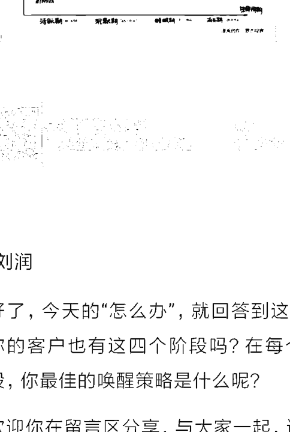

所以，这个问题的本质是，客户满意度，并不直接带来“重复购买”，而要想让客户重复购买，你要主动管理“客户生命周期”，帮他们养成“重复购买”的习惯。

具体怎么做？我举个例子。

曾经的台湾首富王永庆，最早靠卖大米为生，他的做法尤其与众不同。每次送米上门，王永庆都会帮客户把陈米倒出来，细心擦洗米缸，再把新米放下面，陈米放上面，非常贴心，客户也非常满意。

但他并不满足于客户的满意。他会很有心地在小本子上记下来，米缸的大小，有几口人，每天用米量多少，预计多久送一次，每次送多少。同时，他还会了解客户发工资的日子。

等客户米快吃完时，王永庆扛着大米就送上门了，然后在顾客发工资后的一两天，去讨米钱。基于对客户购买生命周期的管理，王永庆锁住了越来越多“重复购买”客户，顾客的黏性越来越高。

### 概念：客户生命周期

有研究表明，第5次购买时，顾客黏性才能养成；而对黏性影响最大的，是前3次购买。所以：一定要让顾客买3 ~ 5次。

那你应该怎么办？可以学习王永庆，主动管理“客户生命周期”，在客户满意的前提下，努力促成前3 ~ 5次购买。那到底什么是“客户生命周期”？

如果你把客户当作资产，他首次购买后，将经历四个阶段：1）活跃期，这个阶段，他是你的“流动资产”；2）沉默期，是“非流动资产”；3）睡眠期，是“呆账”；4）流失期，是“坏账”。

### 运用：

你可以在每个阶段，使用不同的策略，具体怎么做？我们一个一个来说：

1）活跃期（30 ~ 45天）。这个阶段，要保证接触频次，但不以促销和折扣为主。

比如，你可以给用户发新品上架通知，或者关联产品推荐，上次您买的上衣，和它搭配的新款围巾到货了，要不要试试；或者45天回购刺激，活跃期快要结束，顾客还没有再次购买，可以发送45天内二次购买就有的当季赠品。

2）沉默期（45 ~ 90天）：这个阶段，要保证接触频次，开始进行少量的营销刺激。

继续发送上新通知和关联推荐，同时定向推荐性价比极高的爆款产品，我们来了一款周冬雨同款的帽子，卖疯了，还超便宜；邀请顾客参与事件营销，写下你最喜欢的衣服背后的故事，得大奖；看看这个阶段有什么节日，给顾客发去暖意满满的关怀和小额折扣券；沉默期快要结束，顾客还没再次购买，可以发送90天内二次购买就有的高额当季赠品。

3）睡眠期（91 ~ 180天）：这个阶段顾客流失的风险就很大了，要控制有限接触，通过大折扣活动换回。

这时上新通知和关联推荐，已经不是主体，要继续大力推荐诱惑力很强的爆款；还可以定向推送清货促销，快换季了，当季衣服全部2折优惠；还可以温柔地提醒用户，您已经多长时间没来了，会员等级可能会被降级，有些优惠将会错失；睡眠期快要结束，顾客还没再次购买，可以发送180天内二次购买就有的特别优惠。

4）流失期（180天以上）：这个阶段的客户基本就流失了，应该减少接触，只在大促时备用。

尝试了180天都没换回，就别再试了。这些客户，可以先暂且封存，等待双11，或者年度店庆时，再用重锤唤醒，死马当作活马医。

在这四步之后，你的客户，很可能真的就被“粘”住了。

### 今日得到：

最后，我们来小结一下。什么是客户生命周期管理？在客户首次购买后的四个阶段，活跃期，沉默期，睡眠期，流失期，使用不同的“唤醒策略”，最终促成至少3 ~ 5次的重复购买，养成客户黏性，这就是“客户生命周期”管理。

刘润

好了，今天的“怎么办”，就回答案到这里。你的客户也有这四个阶段吗？在每个阶段，你最佳的唤醒策略是什么呢？

欢迎你在留言区分享，与大家一起，过过招。也欢迎你把这篇文章分享给你担心客户没有黏性的朋友，帮他们更好地解决问题。

## 033 | 会员制：为什么我总是坐这家的飞机，住那家的酒店？

每天5分钟，解决一个商业问题。欢迎收听，《刘润5分钟商学院》，实战篇。

你开了一家米面粮油店，发现顾客有时会来自自己店来买，有时也会去对面店买。问为什么？顾客说：路过就进去了呗。老板，你便宜点，我就常来。你说：你要真常来，我一定便宜。

顾客说：你便宜我就常来，商家说：你常来我就便宜。彼此都想对方先让步，怎么办？

### 概念：会员制

什么叫会员制？你可能是航空公司的会员，酒店的会员，超市的会员，或者理发店的会员。但到底什么是会员制？会员制的经济学原理、商业本质是什么？

会员制的本质，是一种类似于团购的契约关系：我承诺在你这里更多地消费，你也承诺给我更多的利益。

### 运用：

1、进入门槛契约。
2、逃离成本契约。

### 今日得到：

最后，我们来小结一下。什么叫会员制？会员制，就是商家与顾客之间的“价量之约”。在这个“价量之约”中，商家获得复购率，顾客获得优惠价。会员制的设计，千变万化，但其根本无外乎两种：商家占优的进入门槛契约，和顾客占优的逃离成本契约。

刘润
好了，今天的“怎么办”，就回答到这里。请你思考一下，你见过哪个会员制，是很精妙地用“价量之约”，帮助商家获得复购率，顾客获得优惠价的呢？

## 034 | 社群效应：另一种增强用户黏性的“强力胶”

每天5分钟，解决一个商业问题。欢迎收听，《刘润·5分钟商学院》，实战篇。

这一周我们一直在学习渠道漏斗公式“渠道 = 流量 x 转化率 x 客单价 x 复购率”中的复购率。复购率，来自于用户对品牌的忠诚度，和购买习惯。但是，有没有一种可能性，用户一直不离开，一直处于客户生命周期的“活跃期”，一直持续购买，不是因忠诚于品牌、醉心于产品，而是其他原因呢？

你做旅游的，带客户去南极，去北极，去珠峰，也许未来还会去个火星什么的，都是高端人群。你发现，想方设法找到这群人的成本很高；穷尽花样让这群人满意的成本更高；绞尽脑汁让这群人不流失的成本，是高上加高。怎么办？

要解决这个“怎么办”的问题，我们首先要理解这个问题的本质。人们离不开一个品牌，一个群体的原因，只可能就是因为这个品牌的拥有者，或者这个社群的领袖吗？不一定。有时候人们留下来，也可能是因为这个品牌的“追随者”们，或者这个社群的成员们，离不开彼此。

这个问题的本质是，产品和品牌当然是用户黏性的核心，毫无争议，但也许你忽视了另一种同样有效的，把用户黏在一起“强力胶”：社群效应。

### 概念：社群效应

什么叫“社群效应”？我举个例子。

我在中国最大的私人董事会机构“领教工坊”里担任领教。在我的小组里，不少位成员曾经都是各大商学院的EMBA，有的今天还是，有的甚至读过好几个商学院，有的甚至在同一个商学院，同样的课程，读了好几届。

你说，是因为这个商学院的课讲得实在是太好了，所以那个组员读了好几届吗？当然不是。他读好几届的原因，其实不是因为学校的老 师，而是因为学校的同学。物以类聚，人以群分，他的很多同学 们都和他一样优秀。多读几届，多认识一些有价值、互相补充的新同学，很有助于他未来的商业成功。

后来，很多商学院注意到这个有趣的“强力胶”现象，甚至开始刻意优化“胶水配方”。比如，班上要有二到三个企业规模做得特别大的，像老大哥一样镇场；要有投资人、明星、奥运冠军，作为名片和超级链接者；要有女同学，最好是美女，增加团队凝聚力等等。这些优化了的“胶水配方”，进一步增加了学员之间的黏性。

这就是“社群效应”，让商学院的学员，因为离不开同学，而离不开学校。

### 运用：

那你应该怎么办？建一个私密的微信社群，把所有高端用户都加进来，经常组织高品质聚会，增进成员之间的黏性。然后，在群里扔一个“乘私人飞机，七天七大洲跑七个马拉松”的活动。很多人都心痒痒、但下不了决心时，一听说那谁去了，那谁谁也去了，很可能因为彼此之间强大的黏性，忍不住也报名去了。

这就是“社群效应”，用户与用户之间的黏性，有时候甚至大于用户对品牌的忠诚。

那这个“社群效应”，在商业世界中，还能解决哪些“怎么办”的问题？

你有一个汽车品牌，想增加用户的复购率，怎么办？建立各地的“车友俱乐部”，发起各种周末游活动，培养用户与用户之间的黏性。随着各地车友会的黏性越来越强，俱乐部的车友们想要换车，都不好意思换别的品牌了，因为换品牌，就是和群体告别。

你做一款炒股软件，想增加用户的交易量，怎么办？建立线上的“投资俱乐部”，让大家在论坛、群组里热火朝天地分享、讨论、甚至争吵各自的投资策略。随着投资俱乐部的价值和黏性越来越强，用户想要换炒股软件，就会认真权衡：我真想离开这群信息灵通，极有眼光的投资者吗？

其实你只要想想，你是记得的大学同学的名字多，还是老师的多，就会明白“社群效应”这种“同伴强力胶”的威力了。

### 今日得到：

最后，我们来小结一下。本周我们学习了四种提高“复购率”的格斗术：1）通过鼓励重复购买，增加客户终身价值，2）通过唤醒策略，延长客户生命周期；3）通过会员制，和用户签署“价量之约”；4）通过社群效应，增加用户之间的黏性。精心设计的社群效应，是增强用户黏性的“强力胶”，能让他们因为离不开彼此，而离不开你。

刘润

好了，今天的“怎么办”，就回答到这里。请你思考一下，如果你是一个微信群的群主，应该怎么设计这个群的“胶水配方”，邀请哪些人加入，才能增加群的黏性呢？

欢迎你在留言区分享，与大家一起，过过招。也欢迎你把这篇文章分享给你靠领袖魅力苦苦维系社群的朋友，帮他们更好地解决问题。

## 035｜看比赛：线下与线上同价，小米为什么还能赚到钱？

每天5分钟，解决一个商业问题。欢迎收听《刘润·5分钟商学院》，实战篇。

我们花了四周的时间，完整地学习了渠道漏斗公式，渠道 = 流量 x 转化率 x 客单价 x 复购率，如果你用这个逻辑去分析各种公司的零售打法，你就会发现，不论他们的招式再千变万化，其实从根本上都是在这四个方面提升效率。而所谓的“新零售”，就是更高效率的零售。今天我就带你看一场真实的比赛，拆解一下小米公司的“新零售”。

2016年，小米开始大举推进新零售，并承诺线上线下同价。对此我是心存困惑的。小米之所以能在过去用不可思议的价格，提供高性价比的商品，不就是因为在互联网直销，成本比线下低得多吗？今天要转身做线下，还要和线上同价，可能吗？如果用线下的成本结构都能做到和线上同价，不就说明过去线上的价格还不够便宜吗？

带着这些问题，前段时间，我独家专访了小米公司的CEO雷军，就想搞清楚小米到底是如何在流量、转化率、客单价和复购率这四个方面，分别提升效率的。

雷军分享了这么几个核心观点：

### 一、流量

提高流量，就是让进店的人流变多。在流量模块的第1课，你就学到了选址逻辑。那小米是如何选址的呢？

过去的小米之家，开在写字楼里，只有粉丝才会去。现在，小米发现自己的用户和优衣库、星巴克、无印良品高度重合。于是选址对照快时尚品牌，在核心商圈，优先与知名地产商合作，比如万达、华润和中粮。逐渐地，小米获得了基础的目标流量。

选址对照快时尚？那么问题来了，快时尚品牌之所以敢在那么贵的地方开店，是因为它们是高频消费品。但手机可是个低频消费品啊，你选在这么贵的地方不是找死吗？

怎么办？小米采用了关键打法：低频变高频。小米投资了不少生态链企业，做充电宝、手环、耳机、平衡车、电饭煲，各种各样。虽然每样都是低频消费品，但将所有低频加在一起，就变成了高频。这次你买了手机，过段时间再买个手环，下次再换个蓝牙音响，这样就把进店没东西可买的低效流量，变成了进店总能买几样东西走的高效流量。

### 二、转化率

转化率，就是进店后有多少人真的会买东西。那小米是如何提高转化率的呢？

小米虽然有很多产品，但每个品类都只有几款。这样就可以在单件产品上倾注更多心血，设计感、品质都有机会做得更好，产品本身就能带来更多转化率，成为爆品。爆品带来的巨大销量，又必然会带来供应链成本的降低，让价格尽可能便宜。一件品质很好又那么便宜的商品，当然更能带来巨大的转化率。

除此之外，小米还通过大数据来安排线下店的选品。优先销售线上被验证过的畅销产品，比如米6手机、手环、电饭煲等；同时，按照当地人群的偏好来选品，比如，线上河南用户买电饭煲的特别多，那河南的线下店就一定会上电饭煲。这种大数据带来的精准选品、卖畅销品，大大提高了转化率。

### 三、客单价

客单价，就是如何让用户单次购买更多的东西。在第26课，你学到了“连带率”，小米是如何提高连带率的呢？

我举个例子。你买了小米监控摄像头，觉得很好。你再买个路由器，监控数据就可以保存在路由器硬盘上。如果你再买个电视，打开家里的电视，就可以看到监控办公室的情况。如果你还有个小米手机，旅行中拍的照片，家人在电视上就能实时看到。等等等等。

这种产品间技术上的关联性、协同性，甚至仅仅颜值上的一致性，都会提高连带率，让顾客忍不住多买。

### 四、复购率

怎样才能让买过的用户再来买？一直来买？买得越来越多来买？小米是如何通过提高复购率，捉牢“客户终身价值”的呢？

小米把零售全渠道从上到下分为三层，分别是线上的米家有品、小米商城，和线下的小米之家。米家有品有20000种商品，是众筹和筛选爆品的平台；小米商城有2000种商品，是小米自己和生态链的产品；小米之家有大约200种商品。

用户在小米之家购买商品时，店员会引导用户安装小米商城的APP，他下次就可以通过手机购买，在更全的品类中选择。这样，一个到店一次的用户，会成为小米的会员，就有机会产生惊人的复购率。

这就是小米的“新零售”，其本质还是在流量、转化率、客单价、复购率上分别提升了效率，最终做到了27万每年每平方米的坪效，仅次于苹果的40万，是其他手机店的很多倍。我希望你能用我们在课程内学到的知识，透视真实的商业世界。

好了，今天的比赛我们就看到这里。关于小米新零售，我曾写过一篇文章，详细解释了小米的8大战略。你可以在我的公众号“刘润”（runliu-pub）回复关键字“小米”查看。

你还见过哪些属于“新零售”的商业模式吗？它的本质是在哪个环节提升了效率呢？

欢迎你在留言区分享，与大家一起，过过招。也欢迎你把今天学到的招式，分享给你身边对新零售感兴趣的朋友，帮他们更好地解决商业问题。

## 周末私董会 | 卖的东西都一样，怎么把顾客拉过来？

每天5分钟，解决一个商业问题。欢迎收听《刘润·5分钟商学院》实战篇。

5分钟商学院的同学们，大家周末好！

上周的周末私董会，我们给来自酒店行业的 maximizing ...

> “十分感谢老师和大家的留言，我们酒店的管理层一直在认真开会、研究每一个针对于我们酒店的留言，还有老师的精彩解答，真是句句珠玑，字字千金，我们公司的好几个领导被咱们专栏深深吸引、果断订阅。第一次感到能有这么多成友的帮忙，心里不知道有多幸福。”

谢谢这个同学的反馈，我也希望以后被咱们line... 把私董会的价值发挥到最大。

本周，是私董会这个栏目启动的第6周，每个周六，我都和大家一起，用学到的知识帮助咱们的同学们出谋划策、解决问题。现在每一天，我都能在后台收到大量的、来自不同行业的同学们的踊跃提问，还有很多同学在问，我到底是怎么来挑选用户问题的。在这里，我再说下挑选标准：

- 1、你是《5分钟商学院 实战》的订阅学员
- 2、你提出的商业问题具体、具有行业普遍性、对其他同学有指导价值

你都可能获得这个机会。

来看本周我们要解决的问题，来自@永同学，

老师，你好，我是当地市级连锁零售药店，经营区域在市区及镇县区，而且当地有四大连锁公司，市场竞争异常激烈，老百姓现在买药，如果不搞活动，大家基本不买药，都在等会员日促销时才买，但关键问题是，各大连锁药店都会搞会员日促销，所以，总感觉无法培养忠实顾客，顾客好像是在哪家都有会员卡，药比四家，哪家便宜去哪家！流量有，怎么转为有效流量，怎么提高转化购药率，咱们提高客单价？

### 第一步：问题本质：标准品的价格战

每件事情背后，都有其商业逻辑。

如果用商业逻辑来分析医药行业，就变成了简单的两类：药厂是生产药物的，是创造价值。而药店并不生产药品，只是销售药品，所以它的作用是传递价值。也就是说，药店是典型的做营销和渠道的地方，对自己的界定就应该是一个经销商。

### 第二步：用户细分

接下来，咱们依照用户买药的动机，先分析下用户。@云腾同学说的非常好，实质上买药的人是分三种的：

- 1、备用药用户：为家里准备一些备用药，比如感冒药、创可贴、止痛药等，以备不时之需。
- 2、突发疾病用户：需要应对突发疾病，这些人买，是有一定偶然性的。
- 3、耗材药品用户：这是我上周去小米参观时，跟小米生态链负责人刘德学到的一个词，他把毛巾、袜子这类经常需要更换的消费品称为“耗材”，其实大家想想看，慢性病的药品就有点像耗材，比如说高血压的病人，需要持续服药，不能间断。

### 第三步：针对性的营销方案

- 1、人人必备的家用药箱
站在第一类的用户角度来思考问题，你应该为他们设计一款或者几款不同配置的药箱，有针对家里有老人的、有孕妇的、有婴儿的、有孩子的，帮他们配好一整套常用药，这样当他们再来药店时，你就可以直接销售这个准备好的家用药箱，省掉用户自己配药的烦恼。

但是需要注意的是，万一用户买了这个家用药箱，一直备着，过了保质期还没派上用场，那怎么办？你可以用“以旧换新”的方法来处理：记录买来备用药箱家庭的药品信息，在临近保质期时，主动提醒他检查是不是还有很多没使用的备用药，不用的药和过期的药可以折价购买新药或者是换取积分，积分可以购买新药。比如卖一个12元的药，你可以让他花8块钱，或者10块钱买新药换上。虽然你把新药这2元的利润让渡给他了，但是你也没有亏钱。他不可能永远不用备用药，只要他用了，你就可以继续补充新药，就能持续获得常用药的市场。

- 2、主动营造信任
对于突发疾病这种逻辑下的用户，他突然遇到头疼脑热、发烧咳嗽这些症状，需要及时找到药品。@胖子会飞同学提到了一个好主意，在小区设立便民无人售药箱，在里面放一些常备药，这其实相当于一个“家庭常备药箱”的小区放大版。用户可以不out... 提供专业的治疗建议。这样如果今后再次出现紧急情况，用户就会选择去你的药房买药。

- 3.为耗材药品用户制定会员制
耗材药品主要是针对那些慢性病的中老年患者，他们对价格非常敏感，谁的价格稍微微有优惠就去谁的药店，所以忠诚度相对比较难，但是对于这部分用户，因为他需要长期购买，你不能用每一单的利润来算，而应该看他这一年时间里的利润，一旦培养成忠实用户，就是牢不可破的。

所支付成本提高幅度不大的药物；或者尝试一些新形式，让患者子女每个月支付20元，药店按时在手机上提醒老人定时吃药这样的服务，这种让子女变成客户，父母变成用户的模式会是未来的趋势。

再提醒一个点，现在很多药店都是很大面积，摆了很多的柜台，放了很多的药，大家进去以后就像在超市一样，在货架上取药。这个逻辑是有问题的。对于一个病人来说，一般去了药店就是直接询问药剂师或者柜员，不会自己去选药。而且对于药店来说，这么大的面积必定会造成租金的上涨，最终是要摊到药品上的，这会造成运营效率的降低。

所以，如果用一些电子屏幕来取代货架，方便大家选药，有需要就咨询柜员，从后面的库房出药，这样会节省店面三分之二的面积。而且前面提到的对耗材药品的针对性服务，可以避免大量的库存，减少库房面积，降低很多的租金成本，运营效率也会提高。

总结一下，要学会不断框定你的问题范围，找到本质，标准化的药品是没法进行产品的差异化竞争的，所以只能在服务上下功夫，要让自己从经销商的身份逐渐转变为服务商。具体措施还是要从分析客户群开始，根据用户的买药动机将他们分成备用、突发和耗材三类用户，并提出针对性的解决方案。

本周，获得私董会回复这个幸运资格的是若水同学，她的问题是：

我在地级市经营一家全国连锁的主题咖啡西餐店。消费价格是全国统一价，由上级加盟商设置好的。店面面积250平方，在市中心一个购物中心一层，侧面底商，已经营了2年。刚开始严格按总部提供菜单，只有纯西餐和各类咖啡茶甜品饮品，后来由于客人少，所以私自加了一些中餐，但点单的人也不是很多。充值返现、返券、美团、微信点餐等都试过，效果都不好。房租又高，人员工资也不低，该店由2个人合作，意见也有不统一情况，先后换了2个店长，第3个店长是其中一个股东亲戚，管理粗放，厨房和饮品有部分原材料分别由厨房长和吧台长进货。目前店收不抵支，连员工工资都付不起。附近另一家咖啡西餐也在转让。想知道我的问题到底出在哪儿？如何增加营收？

## 036 | 静销力：产品静静地放在那里，用户就忍不住买的4种方法

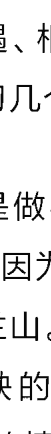

每天5分钟，解决一个商业问题。欢迎收听，《刘润·5分钟商学院》，实战篇。

我们花了4周时间，透彻学习“渠道漏斗公式”（渠道 = 流量 × 转化率 × 客单价 × 复购率），让你在一切可能的触点上，与用户相遇、相知、相爱。这周的课程，我们还要学习几个与渠道相关的重要内容。

你是做零食生意的，山楂、核桃、松子等等。因为你老家在宁夏，就给零食起名叫：贺兰山。包装上，是岳飞跨长车，踏破贺兰山缺的画面。你满以为这种“为国吃零食”的情怀，能唤起很多人的购买欲望。但是，但是，根本卖不动。怎么办？

要解决这个“怎么办”的问题，我们首先要理解决它的本质。它的本质是，你从包装、名称、卖点上，都没能吸引消费者。一个好产品，应该是静静躺在那，你就忍不住走过去，拿起来，爱不释手，放入购物车。这种“在人群中多看你一眼，再也没能忘掉你容颜”的产品力，就叫“静销力”。

我举个例子。

Laura在超市里，走过一排排整齐的货架。商品们满怀期待你能注意到它，可还没来得及表现，你的目光就一扫而过，没给半秒机会。当商品们充满沮丧时，你突然停下，拿起一瓶可乐。商品们都觉得不可思议，你也是。因为这瓶可乐上印着你的名字：Laura。

买瓶印着自己名字的可乐，多酷啊！这就是著名的可口可乐“Share A Coke”活动。很快，这个活动被引入中国，进行了本土化，用昵称，比如“宅男、吃货、纯爷们儿”替代了人名，同样获得了巨大的“静销力”。

### 概念：静销力

这种不用广告、促销和其他推广，只靠产品本身的名称、包装、卖点等，就能产生的销售力量，就是“静销力”。

很多人非常重视在网络、电视等“外在媒体”上打广告，却忽略了一个极其重要的“内在媒体”：产品本身。静销力的本质，就是把产品本身当作广告位。

### 运用：

那怎样才能在这个“内在媒体”上打广告，像“昵称瓶”一样，拥有安安静静就卖断货的静销力呢？你可以记住下面四个方法。

- 第一，产品色彩。

在第23课我们学过，消费者做出购买决策的时间不到20秒。前7秒商品给人最主要印象，是色彩。根据国际流行色彩协会的调查，似乎改变颜色，就能给商品带来10~25%的附加值。雀巢甚至还做过实验，把同样的咖啡放在绿色、白色和红色杯子里，消费者觉得红色杯子里的咖啡味道最好。

所以选对颜色至关重要。比如可口可乐红所代表的快乐，百事可乐蓝所代表的酷，苹果白所代表的简约。

- 第二，产品卖点。

飘柔的卖点是柔顺，海飞丝的卖点是去屑，伊卡路的卖点是纯天然；娃哈哈的卖点是“15种营养，一步到位”；农夫山泉的卖点是“有点甜”。

一个产品有很多点，把功能说明书写在包装上，不现实，还会相互削弱。一定要突出一个卖点，并且契合消费者最主要的需求，把商品从可买可不买，变为必买品。

- 第三，产品名称。

因为自己的情怀把产品起名叫“贺兰山”，是很愚蠢的错误。你想象一下，当用户在吃你的零食，旁边人好奇地问：你吃的是什么啊？这时你的用户说：贺兰山。

牛栏山二锅头挺有名，但如果当初不叫牛栏山，也许会更有名。产品名称是最重要的广告位，能在名称中包含卖点，是最好的。

- 第四，产品情感。

回到最开始的案例。可口可乐的“昵称瓶”，不管是“Laura”，还是“纯爷们儿”，就是在包装上激发了用户的情感。后来，学习可口可乐的公司不少。比如味全每日C包装上的“加班辛苦了，你要喝果汁”、“朝五晚九，你要喝果汁”；士力架包装上的“饿晕啦”，“饿蹦啦”等等。

那你应该怎么办？改名叫“吃不胖”健康零食，用“彩虹色”包装，彩虹色非常抢眼，还暗示营养丰富且均衡。并在包装上印大大的四个字“好吃不胖”，强调经过严格脱脂处理，保留了原汁原味，但不会发胖。然后印上“自古吃货最爱国”，“别担心吃货，我养你”等，用情感打动消费者。

### 今日得到：

最后，我们来小结一下。什么是静销力？靠产品本身的名称、包装、卖点等，就能产生的销售力量，就是“静销力”。我们学习了四种提高静销力的方法：产品色彩、产品卖点、产品名称、和产品情感。

刘润

好了，今天的“怎么办”，就回答到这里。请你思考一下，你见过哪种产品，静静地放在那里，就能让你忍不住购买呢？它的“静销力”来自于哪？

欢迎你在留言区分享，与大家一起，过招。也欢迎你把这篇文章分享给你产品特别好，但就是缺点静销力的朋友，帮他们更好地解决问题。

## 037 | 内容电商：你还在比价平台上卖情怀吗？

每天5分钟，解决一个商业问题。欢迎收听，《刘润5分钟商学院》，实战篇。

你是一位艺术家，手工制作非常漂亮的杯子，每一只都倾注心血、充满灵性。你把这些杯子放在平台电商上卖，没想到几乎无人问津。大家都问：别人的杯子卖9元一个，还包邮，你凭什么卖199元一个？有人推荐你用“秒杀、满减、买赠、折扣”等等方式卖杯子，可你的杯子的艺术感和品质所带来的高价格，怎么搞活动都无法和9元的杯子竞争。怎么办？

要解决这个“怎么办”的问题，我们首先要理清这个问题的本质。你的问题，就是把爱马仕放在秀水街卖，然后试图讲明白为什么4000元的丝巾，比40元的好不止100倍。商品，都有它适合的购物环境。这个问题的本质，是把需要情感驱动的“被动消费”，放在了以价格和参数驱动的“主动消费”环境里。

什么叫“主动消费”，什么叫“被动消费”？

我家杯子摔碎了，于是我主动上淘宝搜索“杯子”，然后在杯子的海洋中，挑选一款功能、款式、价格最合适的下单，这叫“主动消费”。主动消费者，有明确购物需求，关键词是“买”(buying)，找到“合算”的，买了就走。主动消费者，被价格和参数驱动。

我今天逛街，路过一家艺术品店，忍不住进去看看。艺术家本人给我讲解每一款杯子的寓意，来历，和特殊的工艺，我忍不住买了一只。这就是“被动消费”。被动消费者，无明确消费目标，关键词是“逛”(shopping)，碰上“喜欢”的，动心就买。被动消费者，被情感驱动。

那么，如果消费者花199元，而不是9元买一只杯子，是被什么驱动的呢？显然是情感。而大部分平台电商，都是价格和参数驱动的“主动消费”环境，参数一分类，价格一排序，你连抒发情感的机会都没有。

### 概念：内容电商

那你应该怎么办？你可以试试：内容电商。

我是“吴晓波频道”的忠实读者。有一次，我在他微信公众号里“逛”到一篇est，...手一滑，就下单。

有一次见到吴老师，我问他数据。他说，那一批5000瓶吴酒，33小时内就卖完了。后来再试验，72小时卖了3.3万瓶。今天“吴酒”的估值，已经超过10亿。

这就是内容电商。内容电商，让用户因为“逛”而“买”，而不是为了“买”而“逛”，因此对价格和参数的敏感度降低，更容易被情感驱动，特别适合销售单价高、非刚需、有文化属性、情感附加值的产品。

### 运用：

那么这个“内容电商”的逻辑，在商业世界中，还能解决哪些“怎么办”的问题？

你是做高端空气净化器的，想让用户关心价值，而不仅是价格，怎么办？你可以试着生产内容，发在贴吧、微博、自己的公众号，或者投稿给大V，比如叫《拥有近30台空气净化设备花费近20万的 witnessed...》专业而诚恳的内容，会给你带来信任感，当然还有购买。

你还是做高端空气净化器的，但你不会生产内容，怎么办？和有能力生产内容的人合作。比如，阿里有个“阿里V任务”的计划，把有商品的电商，和有内容的达人连在一起，让用户逛着逛着就买了。

你是做内容的，文章阅读量常常10万+，也想做电商，怎么办？你有三种办法试水电商：1）和电商合作，收广告费，比如“咪蒙”；2）和电商合作，销售分成，比如“一”, 3）自营电商，赚取差价，比如“年糕妈妈”。

### 今日得到：

最后，我们来小结一下。什么是内容电商？内容电商，让用户因为“逛”而“买”，而不是为了“买”而“逛”。人们在平台电商上的“买”是“主动消费”，被价格和参数驱动；人们在内容电商上的“逛”是“被动消费”，受情感驱动，特别适合销售单价高、非刚需、有文化属性、情感附加值的产品。

刘润

好了，今天的“怎么办”，就回答到这里。请你思考一下，你觉得对内容来说，广告，分成，和自营电商，哪一种更有未来呢？为什么？

欢迎你在留言区分享，与大家一起，过招。也欢迎你把这篇文章分享给你在比价平台卖情怀的朋友，帮他们更好地解决问题。

## 038 | 团购客：你的团购活动，可能恰恰赶走了好客户

每天5分钟，解决一个商业问题。欢迎收听，《刘润5分钟商学院》，实战篇。

你开一家高档特色餐厅，为了吸引流量，用餐厅的招牌菜，做了一个套餐，用赔本的价格和团购网站合作。你希望通过这个团购活动，吸引更多的顾客来到餐厅，并从此常常光顾。团购活动推出后，餐厅的生意确实一下子好了很多，大量的新顾客都是冲着团购套餐来的。你非常高兴，但是团购活动一结束，生意几乎立刻回到从前状态，非常冷清。你很不解，怎么办？

要解决这个“怎么办”的问题，我们首先要理解这个问题的本质。在第17课，我们学过“引流品+利润品”的逻辑。团购活动的目的是，把特价商品当作引流品，带来流量后，再通过利润品赚钱。可是，为什么流量确实是来了，但客单价却很低，复购率更是没有起色呢？

这个问题的本质，可能是你的团购活动设计有问题，吸引来了专业的“团购客”。

### 概念：团购客

什么叫“团购客”？这个世界上，很多顾客只在打折时购买商品，只在店庆、双十一时消费，只在有团购活动时进店。这部分顾客，就叫做“团购客”。你强烈推荐他试试别的特色菜品，但他除了团购套餐外，什么都不点头；你热情欢迎他下次再来，但他下次再也不会来了。

团购客，是一种精明的消费策略。但是对商家来说，牺牲了引流品的利润后，“团购客”却完全不消费利润品，无助于客单价和复购率。所以站在商家的角度看，在做团购活动时，如何通过巧妙的设计，吸引到“回头客”，过滤掉“团购客”，是个重要的课题。

具体怎么做？你可以尝试这么几种办法。

+   1、不要团购套餐。

如果你是一家烧烤店，团购“啤酒+凉菜”，不要团购烧烤；如果你是一家西餐厅，团购“红酒+前菜+甜点”，不要团购主菜；如果你是电影院，可以团购“电影票+爆米花”，但是不要团购饮料。总之，不要团购完整的套餐。不完整的套餐，让回头客有理由更多消费，同时滤掉不愿多花钱的“团购客”。

+   2、不要团购招牌菜。

不团购招牌菜，那团购什么呢？可以团购利润很高的单品，比如三文鱼、鱼子酱、红酒、进口冰淇淋等等。这些单品可以吸引消费能力高的客户，同时，把有限的招牌菜留给非团购顾客。如果消费能力高的回头客喜欢，他们也会单点。这也会滤掉只想用低价尝试招牌菜的团购客。

+   3、开设“团购客”专场。

那就真的把“团购客”完全拒之门外吗？也未必。你可以通过专场活动，服务于团购客。他们虽然无法提供更高“客单价”和更多“复购率”，但是也许可以提供“口碑宣传”。

### 运用：

具体怎么做？

如果你是酒店，可以把周一到周四晚上的房间拿出来团购；如果你是电影院，可以把早上时间的电影票拿出来团购；如果你是KTV，可以把下午的包房拿出来团购。只要发朋友圈并截图，就能享受2折优惠。

为什么？因为大部分人不会在早上看电影，下午唱歌，周一到周四去旅行，你就可以用时间的隔离，把只追求优惠的“团购客”从你希望吸引的“回头客”中过滤出来。这些资源浪费也是浪费，用他们吸引团购客，你虽然无法期待更多消费，但至少通过“发朋友圈并截图”的活动，从他们的“口碑宣传”中获益。

那你应该怎么办？

回顾这三个过滤“团购客”的方法，再看看“在正餐时间用招牌菜做套餐”的团购活动，简直就是向“团购客”发送了一封镶着金边的邀请函，当然活动一结束，就生意冷清。

也许你可以换一种做法：9.9元，团购两杯戴安娜王妃收藏过的红酒，并附送烛光和小提琴曲。这样吸引来的，都是希望在女朋友面前展示浪漫的男士，他们会一口喝完红酒，然后把蜡烛插包里就走吗？

### 今日得到：

最后，我们来小结一下。什么是团购客？这个世界上，很多顾客只在打折时购买商品，只在店庆双十一时消费，只在有团购活动时进店。这部分顾客，就叫做“团购客”。团购客大量消耗你的引流品资源，却不购买你的利润品，无助于客单价和复购率。商家应该如何和团购客斗智斗勇呢？你可以尝试三招：不团购套餐、不团购招牌菜、开设团购客专场。

刘润

好了，今天的“怎么办”，就回答到这里。请你想一想，你还见过其它什么，可以把只买打折商品的团购客，排除在团购活动之外的好方法吗？

欢迎你在留言区分享，与大家一起，过过招。也欢迎你把这篇文章分享给你正在为团购客头疼的朋友，帮他们更好地解决问题。

## 039 | 抓住红利：错过了微博，错过了微信，下面不能再错过什么？

每天5分钟，解决一个商业问题。欢迎收听，《刘润·5分钟商学院》实战篇。

你经营一个线下店做母婴产品。有一次，你看到一个微信公众号，坚持输出原创育儿文章，圈了好多妈妈粉，带动了不少产品销售。听完第37课，你恍然大悟，知道这叫“内容电商”，也打算开始试试。可是，写了几个月的文章，你发现效果并不好，阅读量很低。甚至文章越写越好，打开率却越来越低。怎么办？

要解决这个“怎么办”的问题，我们首先要理解这个问题的本质。

微信文章的打开率越来越低，并不是个个别现象。有些数据显示，今天微信文章的平均打开率大约只有5%。一个10万粉丝的微信公众号发篇文章，9.5万人根本不看。为什么？因为你过去关注2~3个微信公众号，现在关注20~30个，注意力被稀释了。微信公众号的生态，已经从红利期，走过淘汰期，进入成熟期。这个问题的本质是，她没能及时抓住微信红利。

### 概念：抓住红利

什么叫“抓住红利”？我举个例子。

某市动物园里有好几家冰淇淋店，竞争激烈，格局稳定。你是其中一家。

有一天，本市新开了一家水上乐园。你路过一看，哇，居然有这么多游客，怪不得动物园的人越来越少。于是你抱着试试看的心里，在水上乐园里也开了一家店。果然，生意非常好，因为游客很多，但冰淇淋店只有你一家。

但是很快，你在水上乐园赚钱的消息，所有人都知道了。大家一路狂奔，都来开店。水上乐园的游客在增加，但冰淇淋店增加得更快，竞争非常惨烈，实力差的店铺纷纷淘汰出局。

经过一段时间拉锯，淘汰赛终于结束。活到最后的几家，竞争依然激烈，但格局重归稳定。而依然在动物园观战的那些店，再也没有机会插足水上乐园。正当旧人哀叹，新人庆祝时，大家突然听说，附近即将开一家虚拟现实主题公园……

从动物园，到水上乐园，到虚拟现实主题公园，时代在变，用户行为也一直在变。新开一家公园，这叫“红利期”；大家蜂拥而至，这叫“淘汰期”；竞争重归稳定，这叫“成熟期”。“抓住红利”，就是在红利期最先踏上趋势，在淘汰期最能一路狂奔，在成熟期最具综合实力。

所以，你的问题是：错过了微信的红利期，没参加微信的淘汰期，却想在微信的成熟期杀入战场，发现早已没有入场券。

### 运用：

那应该怎么办？停止羡慕嫉妒恨，立刻寻找下一个主题公园。去哪里找？也许，你可以去这几个地方试试。

+   1、短视频。

前Twitter大中华区CEO陈葵曾说，他们的研究表明，未来互联网上跑的80%的数据，都是短视频。短视频，正在成为用户新宠。Papi酱，办公室小野等等，正在一路狂奔。

那么怎么办？试试用有趣、有料、有温度的短视频，生产育儿内容。

+   2、直播电商。

“直播电商”已经数次证明了它的威力。Angelababy在淘宝直播上代言美宝莲，当时卖了1万只口红，价值143万；王祖蓝在天猫直播上卖车，当时成交2717辆，价值2.28亿。

那么怎么办？试试用直播的方式，更人格化地圈粉，带动销售。

+   3、网红经济

某汽车厂商召开新品发布会时，花了100万请了100个网红做现场直播。开发布会请媒体的目的，是为了获得更广的触达率。自带大量粉丝的网红，也许可以给你同样效果。

那么怎么办？发布会也许可以和网红们合作，把冰淇淋卖给这个主题公园的游客。

+   4、IP合作

2016年最火的IP应该就是《太阳的后裔》了，不但内容好看，广告也让人称奇。同一个场景，在韩国放的时候桌上什么都没有，在中国放的时候就多了很多饮料。商品和IP的合作，出现了新势头。

那么怎么办？寻找最有潜力的IP，比如小说、音乐、电影，彼此嵌入，带动宣传。

### 今日得到：

最后，我们来小结一下。新的工具出现，带来“红利期”；大家蜂拥而至，带来“淘汰期”；竞争重归稳定，带来“成熟期”。什么叫抓住红利？抓住红利，就是能在红利期最先踏上趋势，在淘汰期最能一路狂奔，在成熟期最具综合实力。优势，打不过趋势。

追随用户，抓住红利，是高速变化时代的企业必修课。那微博、微信之后的红利在哪里呢？也许你可以试试短视频、直播电商、网红经济，和IP合作。

刘润

好了，今天的“怎么办”，就回答到这里。请你思考一下，除了今天提到的眼花缭乱的新机会外，你还看到那些红利可以抓住呢？

欢迎你在留言区分享，与大家一起，过过招。也欢迎你把这篇文章分享给你可能错过上一轮红利的朋友，帮他们抓住下一轮机遇。

说个好消息。第一季商业篇的书上线后特别受欢迎，同学们一直在问我，后面三本什么时候推出。

第一季里，我们一共讲了260个经典实用的商业观念和商业套路。每 一期的概念、方法 和思考，都是前人宝贵的经验总结。我把它们精选、打磨、梳理在一起，搭建出这套系统的商业认知框架，做成四本“魔鬼商业词典”。

你可以放在包里、车里、办公室里，遇到任何一个和商业、管理、个人习 惯、效率提升相关的问题，都能随时从这里找到解决方案，省去走弯路和啃琼的时 间。

而且，我还为大家争取了一个特别的福利：

4册装全套248，专栏用户特别折扣199元。已经购买了第一本的，剩下3册装，原价180元，专栏用户特别折扣131元。

点击下图，即可直接拿下四本“魔鬼商业词典”。

## 040 | 大复盘：渠道，一切与用户之间的触点

每天5分钟，解决一个商业问题。欢迎收听，《刘润5分钟商学院》，实战篇。

我们用了5周，终于学完了渠道这个大模块。什么是渠道？所有与用户的触点，都叫渠道。你在线下开店，顾客进门，这是与用户的触点；你给客户打电话销售商品，这是与用户的触点；你做电商，用户浏览你的网站，这也是与用户的触点。所有这些与用户间的触点，都叫做渠道。

### 基本逻辑：渠道漏斗公式

渠道的底层逻辑，是渠道漏斗公式（渠道 = 流量 * 转化率 * 客单价 * 复购率）。什么意思？渠道就像是一个漏斗，所有从漏斗顶部进来，和你有接触的客户，都叫做流量。有了流量，客户进你的店、听你电话介绍产品、浏览你的网店后，他一定会买吗？不一定。他们可能并不喜欢，或者觉得价格太贵。这中间还有一个非常重要的概念：转化率。

今天互联网上的平均转化率是多少呢？在淘宝上大概是3%，100个人里有3个人会买。转化率越高，你的流量越有效，你的获客成本就越低，利润就越高。

转化了之后，一个顾客会买多少你的东西呢？买了西装，有没有配条皮带？买了皮带，有没有配双皮鞋？他在你这里消费一次总共花了多少钱？这就是客单价。客单价越高，说明你满足了顾客越多的需求。除了他主动提出来的需求外，你有没有顺便满足其潜在的需求？这将帮助你极大提高客单价。

顾客买了一次你的商品，还会不会买第二次、第三次？这就是复购率。发展1个新客户的成本，可以发展3~10个老客户。如果你的销售额都来自于老客户，要比都来自新客户，成本低得多，利润高得多，业绩也稳定得多。

所以，从流量，漏斗的顶部进来，不断地服务用户，提高转化率、客单价和复购率，最终养成顾客重复购买，甚至终身购买的习惯，这是渠道的基本逻辑。我们分别花了一周，来学习提高流量、转化率、客单价和复购率的格斗术。你还记得吗？

### 运营：提高各部分效率

如何提高流量？我们学了四种方法：选址、引流品、奖励用户和异业联盟。选址是去注意寻找流量，引流是用利润交换流量，奖励用户是用口碑去获得流量，异业联盟是用流量交换流量。

如何提高转化率？用有效流量获得用户，用展示设计获得关注，用决策时间促进决策，用打折促销临门一脚。

如何提高客单价？挖掘用户的关联需求，提高连带率。除了商品之间的因果性，你还要用大数据挖掘相关性，然后用推荐、捆绑等方式促销。相关性，弥补了因果性的不全面，提高了损失掉的连带率。那客单价提高了，用户却钱不够，怎么办？用跨期消费，让用户拿未来的钱，买今天的东西。

如何提高复购率？要主动管理客户生命周期，激励重复购买，挖掘客户的终身价值。用会制度，与顾客签署“价量之约”。那用户的粘性，除了来自用户与品牌之间，有没有可能来自用户与用户之间呢？这就是社群效应。在你的品牌之上，用户之间一旦形成粘性，离开的可能性就大大减小。

在渠道模块的第5周，我们还学习了一些非常重要的、独特的招式，来提升流量、转化率、客单价和复购率的效率。分别是静销力、内容电商、囤购客和抓住红利。

好的产品，静静躺在那，你就忍不住走过去，拿起来，爱不释手，放入购物车。这就叫“静销力”。如何提高静销力？从产品色彩、产品卖点、产品名称和产品情感入手。

内容电商是从一个特殊维度来理解流量。平台电商适合卖性价比高的商品，人们会被价格和参数驱动；而内容电商适合销售单价高、非刚需、有文化属性和情感附加值的商品，人们会被情感驱动。

囤购客是我们应该规避的现象。很多顾客只在有囤购活动时才进店，我们称之为“囤购客”。囤购客大量消耗你的引流品资源，却不购买你的利润品，无助于客单价和复购率。那怎么办呢？不囤购套餐、不囤购招牌菜、开设囤购客专场。

最后，我们学习了抓住红利。在微博、微信、天猫上我们能获得的流量红利已经消失了，那新的红利在呢？也许你可以试试短视频、直播电商、网红经济，和IP合作。

总结来说，渠道，就是一切与用户的触点。在不断挖掘渠道的本质、理解了渠道漏斗公式之后，你会发现，不管在線上还是线下，所有的零售招式，其实都是在不断地提高流量、转化率、客单价和复购率的效率。

刘润

好了，今天我就总结到这里。这些关于渠道的格斗术，你都掌握了吗？你打算如何运用到你的生活中呢？欢迎你在留言区分享，与大家一起，过过招。也欢迎你把这篇文章分享给你的朋友，帮他们更好地理解渠道的本质。

说个好消息。第一季商业篇的书上线后特别受欢迎，同学们一直在问我，后面三本什么时候推出。

现在，全套4本已经做好了。从今天开始，专栏用户可以第一时间提前预订。

第一季里，我们一共讲了260个经典实用的商业概念和商业套路。每 一期的概念、方法和思考，都是前人宝贵的经验总结。我把它们精选、打磨、梳理在一起，搭建出这套系统的商业认知框架，做成这四本“魔鬼商业词典”。

你可以放在包里、车里、办公室里，遇到任何一个和商业、管理、个人习惯、效率提升相关的问题，都能随时从这里找到解决方案，省去走弯路和瞎琢磨的时间。

而且，我还为大家争取了3天的特别折扣福利：

4册装全套248，专栏用户特别折扣199元。已经购买了第一本的，剩下3册装，原价180元，专栏用户特别折扣131元。（特别折扣价截止到明天中午12点）

点击下图，即可直接拿下四本“魔鬼商业词典”。

## 周末私董会 | 给你一个用才华赢奖金的機會

每天5分钟，解决一个商业问题。欢迎收听《刘润·5分钟商学院》实战篇。

5分钟商学院的同学們，大家周末好！

本周我们要解决的问题来自@若水同学，

我在地级市经营一家连锁的咖啡西餐厅，店面面积250平方，刚开始只供应纯西餐和各类咖啡茶甜品饮品，后来私自加了一部分中餐，但点单的人也不是很多。充值返现、返券、美团、微信点餐等都试过，效果都不好。房租又高，人员工资也不低，该店由2个人合作，意见也有不一致情况，先后换了2个店长，第3个店长是其中一个股东亲戚，管理粗放，厨房和饮品有部分原材料分别由厨房长和吧台长进货。目前店收不抵支，连员工工资都付不起。附近另有一家咖啡西餐也在转让。想知道我的问题到底出在哪儿？如何增加营收？

我先说个数据，据统计，餐饮业每年以超过10%的速度增长，同时以70%的比例洗牌。餐厅关门休业几乎是一个常态，也就说，不是每个餐厅的问题都有解决办法。

在若水同学的讲述里，她提到了自己面临的一连串问题，比如成本太高、管理粗放等等，既已经意识到这些问题，而且从她的描述中看得出，他们已经做了一些改变，但困挠依然存在，很可能这不是关键所在，而问题的突破口在看不到的地方。

今天，我试着从商业逻辑的角度推演下这个问题，从销售 = 流量 * 转化率 * 客单价 * 复购率这个公式入手分析，告诉大家一个我思考问题、寻找答案时的方法论。

### 一、永远关注有效流量

把西餐厅开在商场的一楼，本质上就是你想利用商场流量，但这些路过的人流，不是为了你的店而来，他们是购物来的，顺便在你这里吃一顿，所以很大可能，这些人不是固定的一群人，而是每天不同的人群，来店里进行一次性消费。

这就和你把店铺开在写字楼和小区完全不同。开在写字楼，你面对的就是这栋楼里的人，谈复购率和会员计划是非常合适的。开在小区里，面对的就是求方便的小区居民，你要做出一家一样的熟悉感，强调实惠和口味。

@若水 同学还提到了她自己是一家加盟店，但一般选择一个品牌加盟，会有三个原因：

+   1、加盟的品牌可以为你提供原材料，省掉你的采购时间，品质有保证，价格上也有优惠。

2、加盟品牌可以帮你解决管理体系的问题，比如有人帮你来选址，教你应该怎么来管理这个店，如何去引流，搞什么活动等等。

3、加盟品牌可以自带流量。

面对陌生路人，只有消除了陌生感和排斥感的品牌，才能吸引路人进入餐厅消费。你想，面对一个陌生的咖啡店和熟悉的星巴克，用户一定会选择星巴克，虽然星巴克一杯咖啡要30元，但进了陌生的店会担心价格、品类不是他想要的。你需要的就是这样有信任感和熟悉度的品牌，可以自带流量。但如果你加盟的品牌不能满足其中任何一个条件，你就要反思加入这个品牌有没有必要了。

### 二、设计合适场景、提高转化率

咱们再来分析下顾客群体：饿了来吃饭的、来喝东西等人或者休息的，以及来买东西的。

对于饿了要吃饭的人，你的竞争对手是其他楼层的餐厅，想办法吸引他们的注意力，用优惠套餐鼓励他们下单，是直接方式。

对于来喝东西的人，他们更多是进来等人的，可能是等太太逛街的丈夫，或者是等约会闺蜜的女生们，@Mr. Du 同学的建议很好，“借助在一层的地理位置优势，为那些先到者提供休息等的服务，同时适当提供免费纯水和小甜食作为引流品，促进进一步消费。”@大客创新互联网咨询-Jackson 董坤也提到尝试“咖啡制作少儿培训班”、“公司咖啡下午茶”、“男性托管中心（为托管的男人打折或者专门定制营销方案）”等新的商业模式，非常不错的建议。

你甚至可以拿个表记录下每天有多少人是带着孩子来的，有多少是老公陪着老婆来的，有多少是男女一起的。如果主要服务的是那些买完东西恰巧口渴的人，那一个简单的饮品店就可以提供，250平米的面积就没必要了。如果来店里的人带孩子来的多，就可以设置一个儿童乐园，充气城堡，让孩子在里面玩耍。比如何是等妻子的老公们多，准备好wifi和报纸就够了。所以你要知道自己到底是服务哪批人，他们的需求是什么，搞清楚这个问题才能实现有效流量的转化率。

### 三、改卖消费频次高、客单价高的产品

在地级市，西餐很可能不是消费主流，那你想要从产品入手提升客单价，挑战是很大的。

建议去看看其他加盟店的经营情况，如果和你一样的地级市商场中的其他加盟店做得很成功，你就应该去学习学习，主动寻找答案。如果大家做的都不行，你就该撤出来了，换一个地方换一个加盟品牌，做其他购买频次高、客单价更高的产品。比如星巴克，它也不会提供西餐，只会有些糕点，打好灯光，让路过客人一看特别漂亮。

### 四、想办法提升复购率

如果你想提高你这个商场里西餐的复购率，就要定位那些天天来这里上班的人。

@Tony to ni 同学提到了有效利用商场的固定人流。这指的是商场的售货员、工作人员等。

但这是一群非常在意成本的人，不可能吃一个很贵的西餐，你就要出一系列便宜的套餐，这也许不会给你带来利润，但是会维持你基本的经营。

如果你能服务好这些售货员和工作人员，就可以进行异业联盟，比如给售货员一些优惠券，让她们在服务来买东西的客户时，发给用户，比如老婆来逛街买东西，售货员给她老公一张优惠券让他去你的店里买个优惠的蛋糕边吃边等，这样他就可能顺便能点杯咖啡，带动你的销售。如果售员发出二十张优惠券，就是帮你拉进来二十个客人，你就给她午餐免单。这就不只服务了商场里的售货员，提高了复购率，还能让她们帮你带来新的客源。

提出优秀建议的@Mr. Du @大董 @Tony to ni这三位同学，我会送上第一时间新鲜出炉的第一季全套四册书，签名版，作为奖励。

其他感兴趣的同学，可以直接点击下图查看购买

周震（出价500元，本次奖金池1000元）

老师，我是英国天线宝宝品牌在中国区的早教项目授权代理，在中国发展四年，目前我们的盈利模式是加盟，但是在竞争恶劣的情况下，我们很难超过已经在中国占据优势地位的其他品牌，经营压力巨大。同时因为所有早教中心的盈利模式雷同，加盟中心很难实现快速盈利。我们拥有的优势是英国天线宝宝的品牌，天线宝宝正在播放的动画片，市场上很多天线宝宝授权产品，鉴于如此多跟其他早教中心不一样的特质，想问如何打造属于天线宝宝的创新运营盈利模式？

欢迎大家一起来给这位同学支支招。希望每位同学都踊跃发言，认真思考、回答最有价值的10位同学，将获得这笔奖金奖励。（以节操币的形式返还给大家）

## 加餐｜刘润：小米生态链千亿元收入背后的商业逻辑

小米公司自创办以来，持续保持着高速增长，除了手机业务之外，它独特的生态链模式也创造了令人惊讶的成绩；3年时间，小米生态链孵化了70多家公司。其中，4家估值超过10亿美元，3家年收入超过10亿元人民币，预计小米生态链2017年收入超过1000亿元。而且，围绕着一个人、一个家庭，小米的生态链产品互联正在形成一张很大的网，未来，小米会成为一家怎样的公司？

前几天，我去参访小米公司，和小米的联合创始人，小米生态链的负责人刘德聊天，他对小米生态链模式深入浅出的讲解，给我留下了深刻印象。今天，我把其中一些精彩内容整理后，独家分享给咱们的同学们，让大家可以更深入地理解小米这家公司背后的商业逻辑。

### 1. “遥控器电商”

小米的智能家居有很多设备，电视机、路由器、门禁、内存卡、扫地机器人、空气净化器等等，它们都可以用一个统一的APP来控制。这个APP就相当于所有小米家居产品的遥控器。于是，这个遥控器就变成了一个非常大的入口。

这个入口到底可以创造什么价值呢？

它会提示你家居产品的现状，并且可以直接在上面购买耗材。

比如你家空气净化器的滤芯需要更换了，或者扫地机的刷子需要更换了，它就会实时提醒你，你可以直接在上面一键购买。如果将来有了小米智能冰箱，可能它还可以帮你订鸡蛋、订牛奶，等等等等。通过这个遥控器，就可产生很多购买行为。

### 2. “动车组”——小米生态链

2013年小米开始做生态链，现在已经拥有非常庞大的生态链企业群，截止2017年7月，已经投资了89家，目标是100家。

那小米生态链和小米之间的关系是合作呢，还是投资？刘德说，小米投资了这些企业，持股比例从5%~20%不等。那么，为什么小米要投资这些公司，而不是找最好的企业来合作呢？

刘德打了一个比喻：合作和投资，相当于火车和动车组的差别。什么意思？

我们常听一句话“火车跑得快，全靠车头带”。火车整列的动力都是来自于车头的。但动车组就不一样了，每节车厢都有自己的动力。也就是说不管是10节车厢还是100节车厢，连在一起都能保持单节车厢的速度。而火车呢，一个火车头带10节车厢还是100节车厢，速度肯定是不一样的。

每一个小米投资的生态链企业，大部分都是创始人自己的，就相当于一个动车，100家公司，就是100节动车，一起往前跑，速度就会非常快。

### 3. “烤红薯生意”

在小米的生态链中，有很多既不“高科技”，也不“智能”的产品，没有传感器，没有软件，有的时候就是日用品，比如毛巾、床垫等等。

小米不是要做“科技界的无印良品”吗？怎么真的做起无印良品的产品来了呢？说好的科技呢？

刘德说，这类生意对小米来说，是“烤红薯生意”。什么意思？

小米发展到今天，已经有3亿用户了，其中2.5亿是活跃用户。他们除了需要小米手机、充电宝、手环等等科技产品之外，也需要毛巾、床垫等高品质的日用品。

所以与其让这些流量白白耗散掉，不如利用这些流量来转化一些营业额。就像一个火热的炉子，它的热气散就散了，不如借助余热顺便来烤一些红薯。这就是“烤红薯生意”。

### 4. “生活耗材”

至于到底烤哪些红薯呢？刘德又有一个比喻，叫做“生活耗材”。

你会发现小米的日用品，尤其是服装，是一些比较标准化的，差别小的产品，比如毛巾、袜子、T恤等，没有差别比较大的产品，比如时尚服装、童装等。这是为什么？

刘德说，我理解的服装，分为生活配饰，和生活耗材。配饰是生活的装饰品，它是为了适应不同场合，追求的是差异化；而耗材，是标准化的，就像打印机的墨盒，一次可以买一打，它追求的是实用性和品质。

袜子、毛巾之类的产品，就是服装里面的耗材，这个市场的需求正在增长。比如，美国人平均每年用12条毛巾，而中国人平均每年用1~2条。在消费升级的大背景下，14亿人可能会出现140亿条毛巾的年增量，这样巨大的市场，这个行业是完全可能出现一个巨头的。所以，小米要做这种生活耗材的市场。

### 5. “蚂蚁市场”

小米为什么要做拉杆箱、插线板等产品呢？这个行业因为过去大家效率都不高，大家只能做身边的市场，导致这个市场是没有巨头的，公司都不大。所以，刘德将它比喻为“蚂蚁市场”，就是指比较小、很庞大的分散市场。

没有做大的原因，可能是效率不高，可能是生产能力不够，可能是触达用户的能力不强。在这类市场，小米就可以切入进去，通过收购一些企业，用前面说的动车逻辑，运用小米倒逼产品升级的方法论，小米的产业链整合能力、以及小米的流量红利，来烤好这个“红薯”，就有机会将这个蚂蚁市场的销量收集起来，让小米成为这个市场的巨头。

拉杆箱、毛巾、充电宝、手环，这些“蚂蚁市场”都已经被小米收集起来，成为了一一个个的巨头。

### 6. “尾货生意”

小米生态链最早的一款爆品，是小米充电宝，在一万毫安时充电宝市场售价100~200元的时候，小米推出了69元的充电宝，一下子占领了市场，当年就达到了惊人的5500万只的销量，成为了全球第一。

其实，大家不知道的是，在做这款爆品充电宝之前，小米还做过100~200元的充电宝，最后发现没法做下去，卖了20000只之后，停掉了。

这个时候，有人跟刘德聊，说他们做很便宜的充电宝，可以卖在100元以内。一个充电宝最主要成本就是电芯，刘德问，你这么便宜的价格，电芯该不会是假的吧？

其实，不是因为假电芯，而是因为那个个人拿到了一些本来供给其他厂家、产能富余所生产的三星电芯的尾货，所以很便宜。

小米马上就明白了这个逻辑，原来，充电宝这个生意，应该去找富余产能，价格才有竞争力。

锂电池有个标准电芯，型号是18650，大多数锂电池都是用这个电芯做出来的，包括大多数笔记本电脑和特斯拉model S的锂电池。于是小米派了一个创业团队，全球去找18650的富余产能，用富余产能所产生的超低价电芯，生产出了69元一万毫安时的爆品充电宝。

这个很像服装行业中的尾货逻辑，在服装行业无论在生产、批发还是零售环节，尾货都是极其便宜的，拿到尾货的人，天然地具备了价格优势。

### 7. “国家文化势能”

国家和国家之间，存在着“国家文化势能”，比如我们学英语、喝咖啡、吃美式快餐、看美剧，是因为欧美文化相对发达，他们的文化形成了势能，向我们流动。

公司也一样。

小米在早期是想做智能手表的，为什么没做呢？那个时候，大家还没有用过智能手表，你需要去教育市场，让大家理解智能手表有什么价值。这是一件非常困难的事情。

而苹果作为智能手机行业最伟大的公司，在智能设备领域已经建立起了自己的文化势能。同一件事情，苹果开始做，教育市场、教育产业就会轻松许多。小米跟在这个势能后面做，就像雁阵飞在后面的大雁一样，就比较容易。

### 今日得到：

“遥控器电商”、“动车组”、“烤红薯生意”、“生活耗材”、“蚂蚁市场”、“尾货生意”、“国家文化势能”，刘德用这几个比喻，简单、透彻又鲜活地讲清楚了小米的几个商业逻辑，让我深深叹服。

在他深入浅出的类比之下，是他对事情本质深刻的洞察功夫，因为只有挖掘到事情的真正本质之后，才会联系到一系列大家熟知的事物，打出精妙的比喻，四两拨千斤地讲清楚背后的逻辑。

## 041 | BFD法则：到底什么样的文案才叫走心？

每天5分钟，解决一个商业问题。欢迎收听，《刘润·5分钟商学院》，实战篇。

从本周开始，我们将进入《5分钟商学院 | 实战篇》的第三大模块“营销”。如果说渠道是陆军，营销就是空军。在营销这个大模块，我们会学习5周实战性很强的课程：文案、传播、品牌、媒体、和公关。今天先从文案开始。

你在房地产公司做文案，老板让你为新推出的年轻人小户型写宣传文案。你参考了很多杂志，写了一句主文“有家，就有一切”，觉得很好，给老板看。老板说：这文案不走心啊，显得很不满意，怎么办？

要解决这个“怎么办”的问题，我们首先要理解这个问题本质。文案是一篇文字，一张照片，或者一段视频，唤起消费者强烈的情绪，从而忍不住购买，或者传播你的产品。这个问题的本质是，这段文案并不能唤起消费者强烈的情绪。

### 概念：BFD法则

那怎样才能唤起消费者强烈的情绪呢？著名文案大师约克尔·马斯森特说，你要从人们的三种“核心情绪”开始，它们是：信念（Beliefs）、感受（Feelings），和渴望（Desires）”，简称BFD。我们来一一学习。

第一、信念。

什么是“信念”？信念，就是消费者相信什么。比消费者更准确、更有力地表达出他们的信念，就能激起“哇，居然你也这么觉得”的共鸣感。

比如，耐克的“Just Do It”：
> “在你的一生中，有人总认为你不能干这，不能干那；在你的一生中，有人总说你不够优秀不够强健不够天赋，他们还说你身高不行体重不行体质不行，不会有作为。他们总说你不行！在你的一生中，他们会成千上万次迅速地坚定地说你不行，除非你证明自己能行！NIKE, JUST DO IT。”

“Just Do It”。这句话说出了多少年轻人“永不服输”的信念。

再比如，阿迪的“太不巧，这就是我”：

他们说：“太粉了”“太粗放”“太放肆”“太浮夸”“太假”“太快”“太呆”“太娘”“太man”“太完美”“太幼稚”“太狂热”“太嫩”“太怪”“太晚”……

看到这里，很多年轻人心理都会共鸣：这不就是那些看不惯自己的人常说的话吗？文案这时话锋一转：
> “太不巧，这就是我。”

简单有力，帮助年轻人反击那些什么看不惯的人，说出了多少年轻人“为自己而活”的信念。

第二、感受。

什么是“感受”？感受，就是消费者的情绪。如果互联网有性别，它一定是女性。基于情绪和感受的表达，远远比理性更打动人心。比如，你用一万个字描述食物如何好吃，都不如一句“妈妈的味道”来得走心。

曾经有一个盲人，在面前放了一块牌子，上面写着：
> 我是个盲人，我需要帮助。

可是，并没有很多人给他钱。后来一位女士路过，把牌子上的字改了一下，给钱的路人突然变得多了起来。这位女士写的是：
> 这真是最美好的一天，可我却看不见。

两句话其实是同样的意思，但这位女士用第二句话，把路人放在了盲人的“情绪和感受”里，激发了共鸣。

谈感情，而不是讲理，才是王道。

第三、渴望。

什么是“渴望”？渴望，就是消费者最想要的东西。

一个钢琴学校向家长推广自己的课程可，是，家长送孩子上各种课程，心灵最深处想要的到底是什么？真的是弹好钢琴或者小提琴吗？也许并不是。这所90年代的台湾钢琴学校，最后把文案定为：
> “学钢琴的孩子不会变坏。”

这则看似和钢琴甚至无关的文案，打动了很多。人。也许，这才是家长真正渴望的。

### 运用：

那你应该怎么办？

追问自己，买房子的年轻人们，渴望的到底是什么？真的是“一户”吗？某家房地产商，写出了这样的文案：
> “别让这座城市只留下你的青春，却留不住你。”

很多年轻人看到这句话，都扎心一样的痛。“最基本的安全感”，也许才是年轻人渴望得到的。

那对于一家三口的改善型住房呢？某家房地产商，是这么写的：
> “房价能等待，但孩子的童年不能等。”

### 今日得到：

最后，我们来小结一下。文案是一篇文字，一张照片，或者一段视频，唤起消费者强烈的情绪，从而忍不住购买、或者传播你的产品。一个好的文案，是坐在键盘背后的销售。那么怎样才能写出走心的文案呢？1）呼应消费者的信念；2）共鸣消费者的情绪；3）满足消费者的渴望。

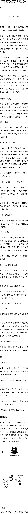

刘润

好了，今天的“怎么办”，就回答到这里。请你想一想，请你给《刘润 · 5分钟商学院》写一句走心的文案，唤起强烈的情绪，你会怎么写？

## 042 | 我也想写出“怕上火，就喝王老吉”这样的广告语，怎么办？

每天5分钟，解决一个商业问题。欢迎收听，《刘润·5分钟商学院》，实战篇。

我有个朋友，开了家火锅店，叫“小四川”，也想写出像“怕上火，就喝王老吉”一样的经典广告语。他们想了 hyman，比如“吃小四川，走成功路”，“小四川，弘扬中国饮食文化”，“小四川，用28种原料、17道工序，熟制72小时才敢端上桌的火锅”，但都不满意。怎么办？

要解决这个“怎么办”的问题，我们首先要理解这个问题本质。这个问题的本质是，他可能没有理解好的广告语的创作原则，和创作方法。

“怕上火，就喝王老吉”，就是一句好的广告语。好的广告语，有两个目的：第一，刺激购买。被你说中了，我确实容易上火，我买；第二，便于传播。别人问你，为什么喝王老吉啊？你都不用想，张口就说：“怕上火，就喝王老吉”啊。

### 概念：赫斯定律

“即刺激购买，又便于传播”，就是创作广告语的目的。那怎样创作，才能达到这个目的呢？注意三个创作原则：
- 1）简单易记。
澳大利亚广告家赫斯曾说过：广告超过12个字，读者的记忆力要降低50%。好的广告语，一定要短。这甚至被称为：赫斯定律。
- 2）对消费者有利。
- 3）与产品相关。

### 运用：

好了，理解了“简单易记、对消费者有利，和与产品相关”三个创作原则后，我们来谈谈“即刺激购买，又便于传播”的广告语创作方法。关于广告语创作方法，国内外无数广告语高手们各显神通，今天我给你介绍其中最大的两个门派：
- 1）价值主张派。
- 2）行动指令派。

### 今日得到：

最后，我们来小结一下。一句好的广告语，要既刺激购买，又便于传播，比如“怕上火，就喝王老吉”。怎样才能创作出好的广告语呢？记住三个原则：1）简单易记，2）对消费者有利；3）与产品相关。具体的创作方法，今天我给你介绍了两个最主要的门派：1）价值主张门派，和2）行动指令门派。

刘润

好了，今天的“怎么办”，就回答到这里。我留给你的思考题是，除了我提到的两大门派，创作好的广告语，其实还有很多其他门派、方法。你还见过哪些创作广告语的方法呢？你最喜欢的广告语是哪一句？

## 044 | 疯传6原则：做到哪6件事，你的文案就会被疯狂传播？

每天5分钟，解决一个商业问题。欢迎收听，《刘润5分钟商学院》，实战篇。

你开了家火锅店，对，还是昨天那家火锅店。学完昨天的课程，你立即尝试用“4U原则”来写标题，果然，文章的打开率大大提高。但你发现，打开率虽然高了，但转发率并不高。怎么办？

要解决这个“怎么办”的问题，我们首先要理解这个问题的本质。

文案的责任，是“助推”读者做出“行动”。标题的责任，是助推读者“打开”内容，而不是“转发”内容。

可是，转发真的很重要啊！据统计，今天微信文章的阅读量，有80%左右都来自朋友圈转发。如果标题不负责“转发”，那谁负责转发呢？

### 概念：疯传6原则

答案是：“内容”自己。这个问题的本质，可能是你的“内容”，不具备容易被转发的6大特征。

美国沃顿商学院的市场营销学教授，乔纳·伯杰，专门研究了“转发”这件事情，看到底是什么，能激发一个人分享的欲望。他把研究成果写成了一本书，叫做《疯传》，提出了导致疯狂传播的6个核心要素。我们称之为“疯传6原则”。

第一，社交货币。

如果分享某项内容，能让别人觉得自己优秀、与众不同，那这项内容就像“货币”一样，买回了别人对你的刮目相看。
> “看看那些被塑料袋缠绕而变得畸形的海龟，锁住喉咙的海鸟，这都是人类一手造成的。从我做起，不用塑料袋。”

这就是社交货币，让别人觉得你充满爱心。

第二，诱因。

有时你听到一首歌，突然想起你的初恋女友。这首歌，就是你想起她的“诱因”。

有段时间，“火星”糖果公司的糖果棒突然卖得非常好，仔细调查，发现是因为美国宇航局宣布了登陆火星计划。这个诱因，让大家突然想起来，还有个糖果品牌也叫“火星”，于是糖果大卖。

所以，想要你的内容被更多传播，就要把你的内容和常见的事情关联起来，比如“周末，下雨天，早晨”等等，让它们成为你的诱因。

第三，情绪。

转发，是一个心理成本很高的动作，只有强烈的情绪，才能激发你的分享。乔纳说，有五种强烈的情绪，“惊奇，兴奋，幽默，愤怒，和焦虑”，最容易引起转发。

他甚至做了实验，发现：幽默，会提高25%的转发率；惊奇，会提高30%的转发率，而悲伤呢？降低16%的转发率。

所以，我建议把这5种转发情绪默念10遍：惊奇，兴奋，幽默，愤怒，和焦虑。

第四，公开性。

人们都喜欢模仿，想让你的文章或者活动疯传，就需要让更多人看到。

耐克曾想做一个品牌公益活动。当时有两个选择：1），办场公益自行车赛，邀请家人为选手捐款；2）做个醒目的腕带，销售款捐给公益。

耐克选择了第二个活动，大获成功，6个月就卖出去500万只。为什么？也许有很多原因，但至少有一点，腕带戴在手上会让很多人看到，人们发现很有意思，就会纷纷模仿，购买腕带。

公开性，对引爆和疯传，至关重要。

第五，实用价值。
> “这种食物，让失眠的人，很快入睡”，看到这样的信息，是不是很想转给你一直睡不好的朋友呢？

在互联网时代，健康和教育类文章属于最常被转发的文章，因为有实用价值。

第六，故事。

2017年，招商银行一条叫做“世界再大，大不过一盘番茄炒蛋”的视频爆了朋友圈。

一位留学生初到美国，参加一个聚会，每个都要做一个菜。他选了最简单的番茄炒蛋，但还是搞不定，于是向远在中国父母求助，父母拍了做番茄炒蛋的视频指导他。下午的聚会很成功，他突然意识到，现在是中国凌晨。父母为了自己，深夜起床，进厨房做菜。

很多人都被打动，哭着看完视频。

我专门访问谈了招商银行的负责人，他说，这段视频只投放给了40多万用户，但最后观看量超过1个亿。

这就是好故事的力量。

### 运用：

那你应该怎么办？

图文并茂地列举100种火锅吃法，作为“社交货币”，换回“有文化的吃货”的赞许；或者，无可辩驳地讲述，为什么有女生时，一定要吃“衣服没有味道”的火锅，把“和女生吃饱”变成诱因，以后一有女生一起，就想起你的无烟火锅；或者，写一篇情绪感极强的文章，讲讲到国外吃火锅，让你知道自己有多爱国等等等等。说不定哪篇就会引发疯传。

### 今日得到：

最后，我们来小结一下。

标题负责打开，内容负责转发。怎么才能引发疯传呢？我们学习了“疯传6原则”：社交货币，诱因，情绪，公开性，实用价值和故事。

刘润

好了，今天的“怎么办”，就回答到这里。你还见过哪些被疯传的内容呢？它们暗合了哪条疯传原则？

欢迎你在留言区分享，与大家一起，过过招。也欢迎你把今天学到的招式，分享给你做内容的朋友，帮他们刷爆朋友圈。

## 045 | 看比赛：赏析历史上经久不衰的6个传世文案

每天5分钟，解决一个商业问题。欢迎收听《刘润·5分钟商学院》，实战篇。

学习了一周的文案，你发现文案的魅力了么？有很多文案是可以穿越时空的，经久不衰，被奉为经典，成为历久弥新的品牌资产。比如“钻石恒久远，一颗永流传”。今天，我们就一起来赏析一下，历史上还有哪些你必须要知道的传世文案。

### 1. 60英里的时速下，这辆最新的劳斯莱斯车内最大的噪音来自于电子钟。

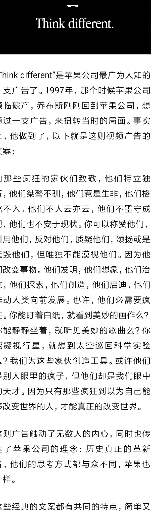

这是广告教父，奥美创始人大卫·奥格威在1958年，为新款的劳斯莱斯写的广告标题。时隔60年，它依旧是教科书级的经典之作，被誉为史上最棒的长标题之一。奥格威曾在他的书《一个广告人的自白》中说：“如果你的标题没有吸引到受众的目光，相等于浪费了80%的广告费。”奥格威觉得，这是他写过最好的标题。他说：“在这个标题中，没有任何华丽的形容词，我只是列举了事实。”

### 2. Think small. 一想想还是小的 Scrum。

这是在1959年，大众汽车为甲壳虫做的系列广告，是广告教父级人物威廉·伯恩巴克最著名的代表作之一，被评为20世纪最优秀的系列广告。在当时的美国汽车市场，清一色都是大型豪华车，小巧的甲壳虫轿车根本没有市场，怎么办呢？大众通过这一系列“Think small”的广告，改变了美国人固有的观念，让人们认识到小型车的好处，让甲壳虫区别于其他竞品，在不同的维度上竞争，从而打开了局面。

### 3. You never actually own a Patek Philippe.You merely look after it for the next generation.没人能真正拥有百达翡丽，只不过为下一代保管而已。

1996年，著名奢侈品腕表品牌百达翡丽开始使用“代代相传”（Generations）主题的平面广告，用温馨而亲密的家庭照片作为背景图，把产品和家庭情感联系起来，散发出强烈的感染力。一扫主流奢饰品以“以名为卖点，以产品为中心”的广告模式。二十多年来，“代代相传”的广告每年都有新的照片、新的故事和新的表款，当初广告中的小男孩、小女孩也已经有了自己的孩子，但这句“没人能真正拥有百达翡丽，只不过为下一代保管而已”的标语几乎从未变过。这句广告词穿越了时间，不断宣传着它的理念：传承与不朽。

### 4. “What do you wear to bed?” “Just a few drops of Chanel No. 5” “你睡觉时穿什么？”“香奈儿5号。”

香奈儿5号香水是世界上最著名的香水之一，在全球，每半分钟就能卖掉一瓶。1960年，那个时代最著名的美国女演员玛丽莲·梦露在接受《嘉人》杂志的采访时，说：“记者平时会问我一些问题。比如，你睡觉时穿什么？睡衣？睡裙？还是睡袍？”

我回答“香奈儿N°5，因为这是事实……我只穿香奈儿5号睡觉。”玛丽莲·梦露的这句话让大家深深地记住了这款香水，让香奈儿5号成为了各个时代每个女人的标配。

### 5. Yesterday You Said Tomorrow.别明天，就现在！

除了广为人知的“Just do it”，耐克还有一句非常经典的广告语：Yesterday You Said Tomorrow，正好引出了下一句“Just do it”。翻译成中文，大概意思就是，别明天，就现在！短短四个词，激发了多少“拖延症患者”的共鸣。这就是好文案的力量，简洁，但直击人心。

### 6. Think different.

“Think different”是苹果公司最广为人知的一支广告了。1997年，那个时候苹果公司濒临破产，乔布斯刚刚回到苹果公司，想通过一支广告，来扭转当时的局面。事实上，他做到了，以下就是这则视频广告的文案：

向那些疯狂的家伙们致敬，他们持立独行，他们桀骜不驯，他们蔑视常规，他们格格不入，他们不人云亦云，他们不墨守成规，他们也不安于现状。你可以称赞他们，引用他们，反对他们，质疑他们，颂扬或是诋毁他们，但唯独不能漠视他们。因为他们改变事物。他们发明，他们想象，他们治愈，他们探索，他们创造，他们萌发，他们推动人类向前发展。也许，他们必需由疯狂。你能盯着白纸，就看到美妙的画作么？你能静静坐着，就听见美妙的歌曲么？你能觑视行星，就想到太空巡回科学实验么？我们为这些家伙创造工具。也许他们是别人眼里的疯子，但他们却是我们眼中的天才。因为只有那些疯狂到以为自己能够改变世界的人，才能真正的改变世界。

这则广告触动了无数人的内心，同时也传递了苹果公司的理念：历史真正的革新者，他们的思考方式都与众不同，苹果也一样。

这些经典的文案都有共同的特点，简单又直击人心，没有华丽的辞藻，只是指述事实，来营造画面感。好的文案会穿越时空，在几十年后的今天，还能余音缭绕。希望你通过不断地学习和训练，也能够写出这样经典的传世文案。

刘润

好了，今天的文案我们就赏析到这里。你还记得哪些其他的经典文案吗？他们好在哪里？

欢迎你在留言区分享，与大家一起，过过招。也欢迎你把这篇文章分享给你做文案的朋友，帮助他们写出经久不衰的文案。

## 周末私董会 | 2000元奖金池，等你来拿！

周末私董会 | 2000元奖学金...

每天5分钟，解决一个商业问题。欢迎收听《刘润·5分钟商学院》实战篇。

5分钟商学院的同学们，大家周末好！

上周开始，咱们在周末私董会尝试了一个新玩法，为了让需要同学得到帮助，我们请有问题咨询的同学出价，比如100元，1000元，或者更高。这钱不给我，反而我也自掏腰包，形成双倍奖金池。然后把奖金，给到那些踊跃帮助同学，回答最有价值的10位同学。

《刘润·5分钟商学院》不断在商业上创新。我们是第一个在发行订阅公布完整课表的专栏，我们是第一个在得到APP直播的专栏，我们是第一个做开学典礼的专栏，今天，我们又成为了得到第一个给学员发奖学金的专栏。你如果乐于助人，见解独到，估计很快就能把学费赚回去了。

好了回到上周的《周末私董会》的问题。上周获得这个提问资格的同学是：

老师，我是英国天线宝宝品牌在中国区的早教项目授权代理，在中国发展四年，目前我们的盈利模式是加盟，但是在竞争恶劣的情况下，我们很难超过已经在中国占据优势地位的其他品牌，经营压力巨大。同时因为所有早教中心的盈利模式雷同，加盟中心很难实现快速盈利。

我们拥有的优势是英国天线宝宝的品牌，天线宝宝正在播放的动画片，市场上很多天线宝宝授权产品，鉴于如此跟其他早教中心不一样的特质，想如何打造属于天线宝宝的创新运营盈利模式？

### 1. 王艺洁：产品要细分和有针对性

看了学长们的留言，大多有一个欠缺，就是对客户——家长和宝宝们的 不了解！作为一个哺乳期妈妈，我谈一下看法。我从产品，客户，渠道三方面说一下：

- 1. 产品。国内的早教鱼龙混杂，但大都是面对0-6岁全年龄段，销得广赚得薄。那么想迅速切入市场就要做出一个很有针对性的特色产品课程，做的足够精致。我举几个例子：

### 2. 崇极科技Alfa：做教育产品的延伸

### 3. 小欧言商：想办法提高复购率

主要是0-3岁（虽然可能也有更大年纪），
大后了，比如3-6岁，更多是幼儿园，或者巧虎了。但这个能实现呢？如何增加复购率？

### 4. Mr. Du：提供免费的引流品

第一，与其他教育机构合作。父母希望通过早教让孩子实现领先的心理，并能够每一步都领先。因此，可以考虑联盟的方式，与当地及国内品牌学校捆绑的同业不同层级的结盟。只要学满天线宝宝指定的课程，就可以在小学的录取中有加分。

第二，提供免费试用三堂课的方式作为引流品，和付费用户一起上课，并且要给体验用户一种“我也要加入”的感觉。

第三，增加课程趣味性。比如报名就送天线宝宝A款，在后续课程中不断对学习进行奖励送出B、C、D…款，而且大惊喜是集齐所有款可以实现孩子一个大愿望。

当然，最关键的还是产品的品质保证，因此对于早教的优秀师资力量的甄选，以及对于课程设计的智能化和个性化选题也是保证早教的的根本。

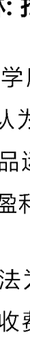

产品的差异化到底是什么？关于这一点介绍不多。有一個受欢迎的節目，是個差异化。如和产品层面结合，而不是影响力层面继承，也许是重点。

### 5. Tony to ni：将动画片和早教联系起来

### 6. 廖军：扩大天线宝宝的IP范围

### 7. 古小千：打造线下城邦, 发掘新盈利点

### 8. 魔兽：多电商平台引流

### 9. 再渊：挖掘客户的终身价值

### 10. 大客创新互联网咨询-Jackson 董坤

虽然《天线宝宝》的动画片在国内受欢迎，也有一定的受众，但是，你们早教品牌的号召力和其他品牌的区隔，还没有做出出来。这里面可能有几个原因：一是虽然动画片火了，但在孩子家长的心里，还没有把动画片和你们所做的早教业务联系起来。二是，虽然天线宝宝早教在国外有知名度，但是课程不能照搬，你们国内早教内容，在本土化和国际化之间，如何做出特色和受众，可能还没有得到国内家长的认可。

基于以上两点，建议如下：

记录下这只独特小熊的主人。定期，要孩子们为小熊购买食物（饼干、糖果等），还会要孩子们带着小熊来开party，购买新衣服，每年给小熊过生日，三年后，再用折扣价格，以较大的同款熊布偶替代原来的小熊，以暗示小熊长大了。这个品牌把布偶，当成是真实宠物小熊，食品孩子吃，衣服孩子穿，但都是以小熊为购买对象。开party，也是为了孩子们的聚会和早期社交能力的培养，在美国非常流行，很赚钱。

此外，当被考虑引进中国的时候，引進的商家采取了一种全新的竞争策略。一个商场中，A门店是引进品牌，对面的B门店是本土品牌。A因为要支付品牌管理费用等高成本，价格更高一些，满足高端家庭需求；B是自创品牌，品质差不多，但价格便宜，容易满足更大范围人群，形成购买决策。

你可以参考上述做法，在实施早教的同时，以天线宝宝为玩偶，设计一系列的商业模式和盈利模式；同时，如果规则没有限制，可以在店面附近开一家价格更低的、服务和产品品质不差的店，形成价格锚定。聚会，买食物，买衣服等行为，也暗合孩子早教的要素（照顾人，社交等）家长也更容易接受。仅供参考。

刘润

董坤谈到的价格锚点，高端、中端品牌联合的打法，有利于用户在有限选择下，利用“联合评估”的心理，做出决策。

本周咱们继续，为了让最需要的同學們得到帮助，我们请有问题咨询的同学出价，我也自掏腰包，形成双倍奖金池。本周，获得《周末私董会》提问资格的同学是：“天地无用”。他出价1000元，所以加上我自掏腰包的1000元，本周奖金池达到了2000元。天啊，本周得到奖学金的同学，每人等于退还了全部学费，还多1元。

天地无用同学的问题是：

我家经营一家二级资质的建筑工程公司，由于工程公司竞争激烈，只能靠关系在当地做一些小工程，去城里无论资质还是人员储备，都竞争不过别的大公司。我现在犹豫的是到底是找合伙人把企业变成一级资质去竞争，还是我出去做大的项目，不用自己家公司资质而去挂靠别人公司好？

天地无用同学请在留言区留下你的联系方式，得到同学会联系你。

欢迎大家一起来给这位同学支支招。希望每位同学都踊跃发言，认真思考、回答最有价值的10位同学，将获得这笔奖金奖励。（以节操币的形式返还给大家）

也欢迎大家把困扰你自己的商业问题和你的出价，写在今天的留言区里，咱们一起讨论，争取找到给出更好的完善的解决方案。

另外，本周我们讲了如何让你的文案和广告语更受欢迎。下周，我们会从创意、跨界营销、借势营销、造势营销等方面，告诉你如何在有限资源下、获得品牌和产品的巨大传播。咱们下周见。

对了，除了下周见之外，我在1月20 ~ 28日，会带队去北极，进行第5次的商业进化的游学探访之旅。希望和我一起探索世界，面对面开私董会的同学，在留言区留下你的联系方式，抓紧最后的机会报名。

这是《刘润·5分钟商学院》实战篇，陪你成长的第9周，期待你的进步。

## 留言精选

## 046 | 创意营销：创意的本质，是“旧元素的新组合”

每天5分钟，解决一个商业问题。欢迎收听，《刘润·5分钟商学院》，实战篇。

从这周开始，我们进入营销模块的第二部分：传播。

你是一个珠宝商，想通过创意营销，比如赞助明星珠宝首饰，在电影结尾获得鸣谢，促进品牌和产品的传播，但效果都不好，怎么办？

要解决这个“怎么办”的问题，我们首先要理解它的本质。想获得品牌和产品的传播，创意确实是一件大杀器。但是，到底什么叫有创意？创意的本质是什么？

### 概念：创意营销

美国广告大师詹姆斯·韦伯扬说：创意，就是旧元素的新组合。我第一次听到时，有一种被雷劈中的醍醐灌顶感。

什么叫“旧元素的新组合”？旧元素让人有熟悉感，新组合让人有陌生感。旧元素的新组合，让人既熟悉又陌生，因此激发“居然还可以这样”的惊叹，引发传播。

这个“旧元素的新组合”，听上去很玄乎，真的有用吗？它可以怎么帮到我的珠宝销售呢？

Alan Perry是美国北卡州W小镇的一位珠宝店老板。2010年的黑色星期五，（相当于中国的双十一），他推出一个非常有创意的活动：如果两周内在本店买了珠宝，圣诞节当天，只要距离本店500公里的A小镇下雪超过3英寸，珠宝你留着，钱我全额退给你。

哪，还有这种好事？珠宝本来就是要买的，万一下大雪，还能退钱？这个消息，一下子传播开了，甚至A小镇的居民，都开车500公里到W小镇买珠宝。Alan的珠宝店，门庭若市，销量大涨。

这就是“旧事物的新组合”。珠宝，和下雪，都是旧事物，但居然还能根据下雪厚度，来决定珠宝的价格，这就是新组合，这种熟悉的陌生感，就是创意，激发了“居然还可以这样”的传播。

我想，很多 men 一定关心，那后来，这个A小镇真的下大雪了吗？很不幸，这个很少下雪的A小镇在圣诞节当天，居然真的下起大雪，厚度竟然达到6英寸！Alan的小店门前，排满了退钱的人，他一共退了40万美金。

但你可能万万没想到的是，Alan早就为自己的销售额购买了“天气保险”。这种不怎么下雪的地方如果居然下起了雪，而且是3英寸以上的大雪，保险公司会赔付Alan的损失。

这还是“旧事物的新组合”。珠宝、下雪、和天气保险，这都是旧事物，但是被重新组合在一起，产生了一次教科书级的创意营销。后来这位Alan根据自己的方法论，继续推出了“结婚当天如果下雨婚戒免费”的活动，取得了很好的效果。

### 运用：

这太有趣了，我也想把自己的产品，和旧事物组合在一起，做出令人惊叹的创意营销，应该怎么做？我们来学习四个具体的组合思路。

- 第一，和经典传说、故事、小说、影视等组合。

珠宝，和西游记怎么结合？

有一家珠宝商，用西游记里孙悟空的紧箍咒、金箍棒，做了两款戒指，寓意“爱你一万年”，让人眼前一亮，引发了不小的传播。

- 第二，和经典艺术作品组合。

大家对经典艺术作品再熟悉不过，比如《蒙娜丽莎的微笑》，极具情感穿透力。那你的产品，怎么和蒙娜丽莎这个旧元素，产生新组合？想不出来，没关系，看看别人是怎么做的。

(下方图片是潘婷借助蒙娜丽莎做的创意营销：修复被岁月损伤的秀发)

- 第三，和新闻事件组合。

和新闻事件组合，也就是我们常说的蹭热点。在这点上，杜蕾斯都不是鼻祖，我们必须致敬邦迪创可贴。

1999年的朝韩峰会，朝鲜的金正日和韩国的金大中会面，轰动全球。邦迪创可贴借助势推出一则广告：邦迪坚信，没有愈合不了的伤口。这则创意，把创可贴，和朝韩峰会胸怀大开地组合在一起，刷爆当时的媒体。

- 第四，和广告作品本身组合。

宝马100岁生日时，奔驰发来贺电：感谢100年来的竞争，没有你的那30年其实感觉很无聊。暗讽你还是个孩子。

这则贺电刷爆媒体。宝马很快回应：君生我未生，我生君已老！暗讽默cedes你已经老了。

这两家公司相爱相杀的广告，彼此借势，双赢而归。

### 今日得到：

划重点

> 创意，就是旧元素的新组合，让人既熟悉又陌生，因此激发“居然还可以这样”的惊叹，引发传播。具体组合方法：
1) 和经典传说、故事、小说、影视组合；
2) 和经典艺术作品组合；
3) 和新闻事件组合；
4) 和广告本身组合。

好了，今天的“怎么办”，就回答到这里。你是做什么产品的？你的产品怎样才能和这四种元素结合，获得巨大传播呢？
欢迎你在留言区分享，与大家一起，过过招。也欢迎你把这篇文章分享给你做产品的朋友，帮他们用“旧元素的新组合”，

好了，今天的“怎么办”，就回答到这里。
你是做什么产品的？你的产品怎样才能和这四种元素结合，获得巨大传播呢？

欢迎你在留言区分享，与大家一起，过过招。也欢迎你把这篇文章分享给你做产品的朋友，帮他们用“旧元素的新组合”，引爆传播吧。

## 047 | 跨界营销：所谓跨界营销，到底要跨谁的界，营什么销？

047 | 跨界合作：所谓跨界...

每天5分钟，解决一个商业问题。欢迎收听，《刘润·5分钟商学院》，实战篇。

今天我们来学习获得品牌和产品传播的一个重要方法：跨界营销。

### 概念：跨界营销

你经营一个自己的减肥茶品牌，听说“跨界营销”很火，于是打算和一家连锁快餐厅也来一次跨界营销：买炸鸡就送减肥茶！你们希望用减肥茶，降低顾客吃油炸食品的内疚感。可是你发现，买炸鸡的人，居然根本不买账，还是不可救药地买可乐，也 not怕胖死。怎么办？

要解决这个“怎么办”的问题，我们首先要理解这个问题本质。你的问题是没有真正理解跨界营销的本质，那就是：不同品牌，从多个角度诠释一个用户的特征，从而达到1+1远远大于2的营销效果。

这句话有一个关键词是：一个用户。什么意思？吃炸鸡的人，已经置胖不胖死于度外，可乐才是他的挚爱。减肥茶？一个置胖不胖死于度外的人，是不会喝减肥茶的。而喝减肥茶的人，咬碎了牙也是不敢去快餐厅的。他们不是同一群人，不是“一个用户”。

那怎么样才算是“一个用户”？我举个例子。

电影《复仇者联盟》在上市时，与宝洁公司旗下的吉列剃须刀进行“跨界营销”，联合推出了四款以“复仇者联盟”为主题的剃须刀。

喜欢看《复仇者联盟》的同学，很多都是血气方刚的直男，打打杀杀，眼花缭乱，非常刺激荷尔蒙的分泌。这群用户，正好和吉列剃须刀的用户高度一致，因为男性的胡须也是荷尔蒙分泌的结果。

《复仇者联盟》的用户，和吉列的用户，是“一个用户”，所以，绿巨人，钢铁侠，美国队长，和雷神款剃须刀推出后，吉列的用户们都疯狂了。这是一次非常成功的跨界营销。

“不同品牌，从多个角度诠释一个用户的特征，从而达到1+1远远大于2的营销效果”。这句话里，还有第二个关键词：多个角度。多个角度，就是指：联合起来，提供更全面的体验，满足更复杂的需求。

那怎么样才算是“多个角度”？我举个例子。

日本的互联网虽然没有中国这么发达，但是报纸依然在不断走向没落。日本著名报纸《每日新闻》脑洞大开，决定和矿泉水进行“跨界营销”。

报纸和矿泉水，都是“国民产品”，几乎每个人都需要，所以天然面对“一个用户”。但是，怎样才能从“多个角度”，诠释一个用户的特征，提供更全面的体验，满足更复杂的需求呢？

《每日新闻》决定，用新闻报道作为瓶装水的包装，起了个名字叫“News Bottle！”（新闻瓶），投放到餐馆和超市便利店。为了新闻的时效性，他们在一个月内推出了31款包装，同时因为印有报纸广告，矿泉水的价格反而还比原来降低不少。

你猜猜，真会有人买这种“新闻瓶”吗？

这种矿泉水在日本获得了巨大的成功，每家便利店每个月能出售3000瓶“新闻瓶”。“新闻瓶”的瓶身还印有二维码，所以用户还可扫描二维码到手机端阅读最新的新闻。甚至，《每日新闻》还采用了增强现实的技术，让读者可以有更加身临其境的阅读体验。

每天都要喝水，每天都要阅读，《每日新闻》从多个角度，给一个用户，提供了更全面的体验，满足了更复杂的需求，大获成功。

### 运用：

脑洞大开，那我应该怎么做减肥茶的跨界营销呢？也许，你可以试试和婚纱品牌“跨界营销”。

在婚纱店的大堂，摆上sv一套女孩们梦寐以求的，只有完美身材才能穿的“完美婚纱”，然后就像用水晶鞋寻找灰姑娘一样，用这套完美婚纱，在全国范围内寻找拥有完美身材的准新娘，赠送给她做新婚礼物。而你的减肥茶的品牌，可以冠名赞助这场活动。

减肥茶，和婚纱的“跨界营销”，为“新娘”这一个用户，从服装美丽，和身材美妙的“多个角度”，提供更全面的体验，满足更复杂的需求。

### 今日得到：

划重点

什么是跨界营销？
跨界营销的本质是：不同品牌，从多个角度诠释一个用户的特征，从而达到1+1远远大于2的营销效果。成功的跨界营销，一定同时满足了这里面的两个关键词：一个用户，和多个角度。

刘润

好了，今天的“怎么办”，就回答到这里。请你想一想，你见过最会跨界营销的是哪个品牌？它是怎样让即你脑洞大开，又欲罢不能的？你觉得《5分钟商学院》，又可以和谁跨界营销呢？

请你想一想，你见过最会玩跨界营销的是哪一个品牌？它是怎样让即你脑洞大开，又欲罢不能的？你觉得《5分钟商学院》，又可以和谁跨界营销呢？

欢迎你在留言区分享，与大家一起，过过招。也欢迎你把这篇文章分享给你埋头做营销的朋友，帮助他们借力而起。

## 048 | 借势营销：借势营销的3字心法：快、准、狠

每天5分钟，解决一个商业问题。欢迎收听，《刘润·5分钟商学院》，实战篇。

你经营一个巧克力品牌，一直听说“借势营销”，于是Jac克公布女友关晓彤时，发了一张图：XX巧克力祝你甜甜蜜蜜。但是，你发现几乎完全没效果。别人借势，我也借势，但总没效果，怎么办？

要解决这个“怎么办”的问题，我们首先要理解这个问题本质。

### 概念：借势营销

“势”就是热点事件，就是“汹涌而来的注意力”。但这个“汹涌而来的注意力”，来得快，去得也快，要想借助它，并不容易，这就像想射中突然出现、但转瞬即逝的野兔一样，你必须掌握移动射击的心法。

这个问题本质是，你虽然看到了“势”，却没有掌握“借势营销”的3字心法：快、准、狠。

“快、准、狠”，到底具体指的什么呢？今天，我们来一一讲解。

第一，快。

所谓热点，就是“突如其来”，你的反应稍微慢半拍，浩浩荡荡的人群，就已经从你家门口过去了。

2014年5月29日上午11:16分，李晨和范冰冰同时在微博上发了一张合影，和两个字“我们”，公布了恋情。

热点出现了。一个真正的借势营销高手，应该多快给出反应呢？3天？3小时？不，杜蕾斯只用了9分钟，就在微博上发了一张应景的“借势营销”图片，和一句话：你们！！！！！！！冰冰有李！

你难以想象，这9分钟内，杜蕾斯做了哪些事情。对很多公司来说，可能还不知道这件事情呢，知道的还没反应过来呢，反应过来的还没向老板汇报呢，汇报了的老板还在决策呢，决策结束的团队还在头脑风暴呢……

借势营销的“快”是第一要素，以小时甚至分钟为单位。

为什么要这么快？因为最大的一波注意力汹涌而来，稍纵即逝。稍微慢一点，说不定就只能赶上细流了。

第二，准。

借势营销的第二要素，就是要抓“准”热点。清晰而准确地判断，哪些势可以借，哪些势不能借。

我们可以借的势，大概有七大类，它们是：节日类、赛事类、娱乐类、行业类、时政类、灾难类、和负面类。

节日类最安全，但注意力并不汹涌，你可在中秋节借借月饼的势，双十一借借单身狗的势；

赛事类、娱乐类的注意力如巨浪一样扑面而来，但转瞬即逝，比如傅园慧的洪荒之力，你在1-2天，或者几个小时内借势一下，效果会惊人的好，但如果到了春春联欢会还在讲，就味如嚼蜡了；

行业类借势要注意风向，开始狂捧的，3天内几乎一定狂扁；开始狂扁的，3天内也几乎一定反转，要判断清楚情绪走势，再迅速借势；

而时政类、灾难类、负面类的借势，要极其慎重。稍有不慎，引火烧身。

2014年马航MH370失联，灾难性热点出现，某著名企业家借势宣传某保险公司，用调侃的语气说“这年头，说不准啊，飞机也能失联”，然后推销保险。结果，在网上被骂残，最后被迫删帖，反而给品牌带来巨大的负面影响。

功力不深的，建议时政、灾难、负面的势，不要轻易触碰。

第三，狠。

借势营销的第三要素，也是最重要的要素，就是“狠”：必须建立这个“势”与自己的关联。

第22届冬奥会开幕式上，空中的五朵雪绒花本来要绽放成奥运五环的，结果只开了四朵。“五环变四环”的失误，立刻变成了舆论的巨大热点。

怎么借？快想，怎么借才能把这个势与自己的品牌关联？

能量饮料红牛，发了一张照片，把饮料摆成五环的样子，四罐打开，一罐未开，配了一行字：打开的是能量，未打开的是潜能。

这张图和这句话，非常巧妙地把一个失误，用正能量的方式，与自己的品牌关联起来，堪称经典，把关于“五环变四环”的讨论，推向高潮。

### 今日得到：

— 划重点

> 什么是借势营销？
“势”就是热点事件，就是“汹涌而来的注意力”。但这个“汹涌而来的注意力”，来得快，去得也快。要想借助它，并不容易，这就像射中突然出现、但转瞬即逝的野兔一样，一定要求“快、准、狠”。快，以小时和分钟为单位；准，清楚哪些可以借，怎么借；狠，和自己的品牌密切关联。

## 刘润

好了，今天的“怎么办”，就回答到这里。请你想一想，你还见过哪些让你脑洞大开的借势营销的案例呢？它们好在什么地方？

欢迎你在留言区分享，与大家一起，过过招。也欢迎你把这篇文章分享给你浪费了大量免费注意力的朋友，帮他们借势而起吧。

5分钟商学院·实战
每天5分钟，解决一个商业问题

群主百度网盘昵称为“票都社小群主”和“铁皮车jkd”
其余分享账号均为N手转卖群，欢迎联系微信jnz t x y加首发群。

## 049 | 造势营销：给我一个支点，我要撬动大众的传播势能

每天5分钟，解决一个商业问题。欢迎收听，《刘润5分钟商学院》，实战篇。

“借势营销”真是太有趣了，正好公司最近要发布新产品，你也想尝试“借势营销”，但是却发现没“势”可借，总不能等“势”来了再发布吧，怎么办？

要解决这个“怎么办”的问题，我们首先要理解它的本质。借势营销是很好，但它的时间点，和话题性，你都无法控制。如果你在某个时间，必须做某件事情，常常会发现“无势可借”。这时，你就要认识认识“借势营销”的哥哥，“造势营销”了。

### 概念：造势营销

什么叫“造势营销”？就是通过主动制造事件，引起广泛关注，从而获得传播势能。

我举个例子。

杜子健是知名的营销人，在做自己的酒。为了营销酒，他发了条微博说：

> “我有一壶酒，足以慰风尘。”这两句我特别喜欢，总想再续两句，但恨才华不够，求助网友了！帮忙补两句吧，我送酒。最好的我就送拉菲。

我看到后，忍不住续了两句：

> “我有一壶酒，足以慰风尘。苍天 цифровых 共饮，不做独醉人。”

### 运用：

这就是“造势营销”。无势可借时，可以造势。但造势并不意味着一定大张旗鼓，投入重金。造势营销的核心，是找到一个“支点”，然后用最小的力量，撬动大众的传播势能。今天，我们来学习“造势营销”的三个支点。

第一，新颖支点。
你老板参访了哪家企业，和谁握了个手，没人关心。只有对大众来说“新颖”的东西，才容易形成传播势能。

2015年，在交通银行一些网点，一个叫“娇娇”的机器人正式上岗了。你问她，“我们合个影可以吗？”她会说：“来吧，我等着，一定要用美图秀秀哦！”你问：“娇娇，我要存款50万。”她说：“土豪，我愿意和你做朋友。”

这个智能机器人非常新颖，引起了巨大的传播。很多人都把自己“调戏”娇娇的视频发到了朋友圈，并引发了“娇娇背后到底有没有人类客服远程回答”的大讨论。

第二，悬疑支点。
好奇心是人类最大的求知动力。利用好奇心制造势能，就要撬动“悬疑支点”。

某天，有位摄影师发微博说：

> “距离西安开车3小时左右的戈壁上发现巨型怪圈！圆环和线条都十分规整且精确对称，沟壑很深，目测3~5cm。”

并配了张图。

第三，争议支点。
营销圈中有一个俗话“无争议不营销”。争锋相对，又势均力敌的争议，很容易撬动大众的关注和站队。

### 今日得到：

刘重点

> 借势营销，是一种被动营销；造势营销，是一种主动营销。
它的核心，是找到一个支点，撬动大众的传播的势能，从传统1+1=2的传播策略，上升为1x1=100的跳跃。今天，我们学习了三个“造势营销”的支点：新颖支点，悬疑支点，和争议支点。

好了，今天的“怎么办”，就回答到这里。你还见过哪些可以撬动传播势能的支点吗？
欢迎你在留言区分享，与大家一起，过过招。也欢迎你把这篇文章分享给你做营销的朋友，帮他们造一波声势吧。

## 050 | 看比赛：独家拆解招行“番茄炒蛋”视频如何刷爆朋友圈

每天5分钟，解决一个商业问题。欢迎收听《刘润·5分钟商学院》，实战篇。

前阵子，招商银行的一支名为《世界再大，大不过一盘番茄炒蛋》的广告刷爆了朋友圈。

广告以短视频的形式，讲述了一位刚到美国的留学生，想在与新朋友的聚会上做一盘中国菜——番茄炒蛋。不会做饭的他手忙脚乱，怎么也搞不定，于是向远在中国 ...

### 1. 视频的创意来源

这个广告是想推广招行的一个留学生附属信用卡产品，在打磨产品、调研需求的过程中，招行信用卡牌团队发放了5000份问卷，访谈了50个留学生和10对父母，有一对父母的回答让人印象非常深刻，他们说，孩子在国外我们最担心的就是失去联系，有了附属卡，孩子每笔消费我都会收到短信，我就知道他吃饭了，交学费了，买东西了。虽然不常打电话，但我能知道他是活跃的，就很开心。

### 2. 如何深度打磨视频脚本？

在确定了故事原型后，团队开始准备脚本、打磨各种细节，比如选择做哪一道菜呢？最终为什么选择了番茄炒蛋？除了因为这道家常菜没有南北差异，能够引起更多人的共鸣之外，他们发现，在百度上，有46万人搜索过这个问题：番茄炒蛋是先放番茄还是先放鸡蛋？这是一个被验证有效的、自带流量的话题。所以他们最终选择用这个话题作为视频的开头和传播的副标题，来吸引读者点开和看下去。

### 3. 如何精准投放？

留学生信用卡是小众产品，招行最终选择了在微信朋友圈投放，投放标签是有留学经历、有海外消费、有银行卡的某一年龄段的人群。因预算有限，他们只投放了北上广深四个城市，整体投放费用为50万，从周三到周五分批完成投放。那投放效果如何呢？

### 今日得到：

+   - 划重点

想要做出一条现象级刷屏的视频，归因于3个主要因素：
1. 真实的故事，引发了人们的情感共鸣；
2. 对创作脚本的深度打磨，比如自带流量的话题设计和对比强烈的情节设计等；
3. 精准人群的投放。

刘润
好了，今天的比赛我们就看到这里。你还记得哪些刷屏的广告案例吗？你觉得它们是为什么会刷屏的？
欢迎你在留言区分享，与大家一起，过度招。也欢迎你把这篇文章分享给你做内容传播的朋友，给他们一点启发。
如果你想看“番茄炒蛋”完整版视频，你可以在我的公众号“刘润（runliu-pub）”回复关键词“番茄炒蛋”查看。

## 第10周周末私董会 | 快来贡献你的智慧，赢取4000元奖金

第10周周末私董会 | 快来贡献...

每天5分钟，解决一个商业问题。欢迎收听《刘润·5分钟商学院》实战篇。

5分钟商学院的同学们，大家周末好！

上周获得咱们私董会提问资格的是天地无用同学，来看他的问题：

> 我家经营一家二级资质的建筑工程公司，由于工程公司竞争激烈，只能靠关系在当地做一些小工程，去城里无论资质还是人员储备，都竞争不过别的大家公司。我现在犹豫的是到底是找合伙人把企业变成一级资质去竞争，还是我出去做大的项目，不用自己家公司资质而去挂靠别的公司好？

天地无用同学出价1000元，我也贡献了1000元，咱们的奖学金池一共增加到了2000元。同学们给了非常多精彩的回复，其中有10位同学的回复最为精彩，他们每个人都将获得200元的奖学金。这些奖学金，将以节操币的形式发放到大家得到的帐号，用来在得到平台购买专栏，或者其他消费。

下面我梳理了这10条留言的回复要点，和我对留言的点评，希望你能从别人的解决方法中，获得自己的思考和成长。希望下周，你的留言也能入选。

### 1、Mr. Du

首先分清本质是产品，还是渠道，或者是营销问题。

1.产品定位。做项目其实也是做产品和树立品牌，首先要知道自己在行业的位置，按照一级资质的模式来要求自己。

2.产品创新。在建筑行业中，很多公司技术水平多数还停留在传统的“干活跑断腿，指挥全靠吼”的局面。在科技发展的同时，将一部分精力和资金投入到对于建筑新技术的学习和运用中，打造自己的生产力优势。比如，现在国内大发展的BIM技术“建筑信息化模型”，就是将原本需要费时费力的话，通过计算机建模技术来实现，从而对于施工的精细度和人工成本都有了很大的助推作用。

3.产品的服务意识。建筑行业前、中、后期避免不了存在诸多质量及其他需要维护的问题，因此，建立自己的过程满意度调查、维修后期服务，以及后期使用的客户回访，这些都是体现产品软实力看不见的加分项。更重要的是，你服务好的一个客户并非是一个，而是其背后的一个产业链，做好服务的同时就积攒了人脉。

4.优化组织架构。建筑行业是一系列上游原材料、设计，中游施工、管理、采购，下游仓储、物流和消费者的多种资源的整合。因此，打造自己的“项目管理平台”，打通上中下三个维度的渠道，从而促进自身产品质量、进度控制，增加在行业中的竞争力。

5.合作共赢思维。之前第一季老师提到把饼做大的共赢的方法论，建议这位同学可以采用合作的形式，共同分饼，共同合作经营项目，最后按照比例分成。从而避免挂靠费用增加项目成本，并且可以有下一次合作的可能性。

6.营销的创新。在这个展示层面，通常传统的方式是做一份往项目一览。如果可以结合当下火热的VR虚拟空间漫游技术，给用户不同以往的全新体验，肯定会增加自己的产品含金量和中标率。事实上，VR技术前两年已经运用在建筑行业，如果可以结合BIM技术，那么必定会给其公司带来更大的势能。

刘润

Mr. Du 同学从产品（服务）的角度，给了不少建议。产品是势能的来源，不管本地二级资质的小项目，还是到外地挂靠做大项目，都是靠产品（服务）的能力去交换。天地无用同学，确实需要思考你遇到这个问题的本源：产品力是否足够？

### 2、盛兴江

润总好，我本人就是做建筑工程这块的招投标和预结算，所以对这块比较了解，说说我对行业了解的几点看法。

第一，选择升级资质。一个一级资质每年的维护费用大概在1000万左右，光是钱还不够，现在去外面做大项目需要招投标，其中资格预审要求对应人员(一级建造师和八大员)人证合一，一套班子要入网只能做一个项目，也就意味着要几套班子，这个成本是巨大的，如果是想做大做强有足够资金，那么选择升级资质对以后是有大用处的，一个项目做完就有了业绩，有了业绩就可以给下次投标增加信用分，还可以升级资质，这是一个递进过程。

第二，挂靠资质。挂靠资质是现在很多小公司采用的方式，不过需要交管理费，大多在1.5%~2.5%不等，这种情况下去做大项目会有约束，比如招标信息一出来，你想投，你挂靠的单位也想投，那就没你事了。再一个，现在大项目都需要公开招标，资格预审需要网上签章，和挂靠公司人员沟通，走他们的流程会是一项繁琐的事情。

总结，靠关系接大项目在未来是肯定行不通的，现在的公开招标要求越来越严，监管也越来越严。如果现在准备不够充份，可以选择挂靠接项目作为过渡，等待时机成熟，升级资质做大做强。

刘润

盛兴江同学说了一个非常重要的观点：靠关系接大项目在未来是肯定行不通的。这句话延伸来说，就算拿到了资质，接大项目也是靠实力的。需要反思，缺的到底是实力，还是资质。如果是实力，挂靠也许是个过渡的办法，但目的是积累实力。

### 3、安安

之前听过一堂精品课叫做如何成为解决问题的万手，里面提到解决问题的最关键一步是定位和拆解问题。今天您说您的问题是失去竞争力的那问题，那么，像您说的贵公司资质低、导致失去竞争力，那您的分析真的是准确定位、详细拆解后得出的结论吗？如果不是的话，是不是可以借助互联网或大数据分析一下导致目前现状的内外部因素，内部因素也有很多包括您公司的产品实力、性价比、服务、口碑等等，外部包括与其它公司的竞争分析、潜在市场需求等等，把这些问题原因找出来之后，您也许会有新的思路。至于大家对贵公司的建议，你也可以听多数人的话，参考少数人意见，最后自己做决定。

刘润

安安同学有一句话，应该能给天地无用同学启发。那就是：解决问题的最关键一步是定位和拆解问题。你提的几百个字的问题，背后的真正的原因是什么？找到正确的问题，正确的原因，才能找到正确的答案。建议和客户，伙伴，供应商，员工一起做些讨论、调研。

### 4、嘉玲

首先关于描述工程的小与城里的公司的大小，定义没有很明确，工程承包从几十万到几个亿跨度，资质资源可以说是最好容易实现的，找到拥有79一级资质的合伙人，仅仅只是在投标时有个入场券，没有足够的实力（人脉圈层，垫资资金等），往往也只是陪跑。

如果是在当地有一定的积累，现有工程客户，从提高复购率的角度，扩大经营范围，从工程建设到后期一体化承包，如果是地产项目，后续的绿化物业，如果是厂房工程，工厂后续的一系列采购后勤项目，都是可以一条龙打包。培养新客户的成本可以维护3~5个老客户，比打破头去挤入已掉车的赛道轻松多了。同时由于有一定的工程经验，可以转变为上游整合并商，为同行业同规模的工程公司提供集中采购的整体打包，成为同行服务商，从现有赛道中另辟蹊径。

刘润

嘉玲同学说的“复购率”是一个很好的角度。在自己的城市，靠“关系”接一些二级资质的项目。那么，同样道理，在别的城市，也有像你一样的公司，靠他们的“关系”，接他们当地的二级资质项目。如果别人在你的地头，都能抢走你的生意，那么你首先想的问题可能不应该是扩张，而是怎么守住本地。

### 5、第一人称雷

@天地无用同学的核心问题其实是如何让
@天地无用同学的核心问题其实是如何让自己的建筑工程公司提高竞争力，而不是应该取得一级资质，还是先依靠有资质的公司做大项目？至于如何提升，我有几点建议：

+   1、在建筑工程领域中因信息严重不对称以及非常普遍的同质化竞争，导致了工程在招标过程中，很大程度只能依赖资质和价格来筛选工程公司。@天地无用同学可以拿一些大项目的标书研究一下现在的大工程到底在以哪些标筛选题目标公司，从而形成一个立体的竞争力的点阵，根据全面立体的点阵来设定策略，而不是简单考虑一个单一。譬如压缩成本能力、人才储备、工程实力、耗材的有效节约以及解决突发状况的能力等等

+   2、资质确实是工程领域一个特别重要的筛选条件。可以肯定的是，贵公司要想获得竞争力，最终是一定是需要一级资质的，这是贵公司产品势能的一部分。获得更高资质一定是提高产品势能最硬最高权重的一块。

至于“该先投入获得资质还是先 gen 挂靠拿项目”的问题我觉得应该“看情况”以及“骑驴找马”。如果贵公司目前财力实力都还不足，可以先依靠有一级资质的公司，接大项目，在做大项目过程中积累经验和人、提升各方面技术以及熟悉各种大项目的流程和工程细节，全面而立体地提高硬实力，等到硬实力提升到全新台阶之后，同时也积累了一定的资金，再去取得属于自己的一级资质。这时候贵公司相比之前，增加竞争力绝不只是一张资质而已。

+   3、重视服务的峰终效应，给服务过的甲方留下深刻印象，形成口碑效应。工程是一个具有众多灰色潜规则和偷工减料空间的行业，很多不良现象在行业内很普遍，甲方很多时候也是“矮子里 БА 长子”的心态。

贵公司可以着重关注给甲方的服务体验，在某些工序上集中力量做到远超甲方预期 的好，并在项目结束时，再集中力量努力让甲方在项目验收时看到贵公司远超预期的认真负责态度。出于峰终效应，甲方会对贵公司留下非常深刻的印象。而建筑公司的口碑在甲方之间也是有传递效应的，就好像给孩子选早教的时候会问朋友的经验一样，在信息高度不对称的情况下，各个甲方在项目招标的时候，也会问问兄弟公司是否有用过的特别优质的工程公司。在这个过程中，贵公司给以往服务过的甲方留下的深刻印象，就会以口碑的形式传播，从而进一步提升竞争力。

+   4、工程公司的竞争力是一个正反馈机制的飞轮，贵公司做得越好，甲方们就越愿意相信你们是个有竞争力的公司，也就越相信你们会把项目做好从而选择你们；而越相信你们能做好，你们就越容易在项目中获得更多的自主权和弹性空间，也就更容易做得更好。做得更好之后，又会对甲方形成新一轮的影响，不断往复。所以@天地无用同学一定要特别注重口碑的积累，立体而全面地提高综合实力 公司竞争力一定会有质的飞跃，而不是停留在“是否要取得一级资质”这样简单线性的思维中。

刘润

第一人称雷提出了一个特别好的概念“正反馈机制的飞轮”。每个城市都有自己的工程飞轮。如果在一个地方没有转起来，那么换一个地方，也许更难转起来。第一人称雷提出了很多如何让飞轮转起来，而不是换个地方的好办法。值得一条条分析。

+   6、润佳

挂靠别人还是自己去申请，可以比较其“交易成本”和“管理成本”的大小。挂靠别人收取的佣金是多少？自己申请一级资质的成本是多少？当然这个不能以单次项目来计算，可按未来几年的项目来计算。

其次，“一级资质”只是一个参与大项目投标敲门砖，其他条件有无竞争力？一般标书分为商务部分，价格部分和技术部分。建议购买类似大项目的标书，严格比评分标准，看看公司如果参与能得多少分？市里面还有哪些同行公司，跟他们比差异在哪里？综合考虑后再判断你这个“一级资质”在总分里占多少比重？在没有十分把握之前，建议先挂靠。一方面可以看看同行的情况，中不到标也没关系，也算是为自己做大项目积累一些经验。如果挂靠后能中标一两个项目，说明已具备竞争的综合实力，那个时候再申请这个资质也不迟。

刘润

具体到自己申请资质，还是挂靠的问题，润佳提供了一条思路。用交易成本，和管理成本的比较来解决。自己办，并维护，可能要固定投入几百万；挂靠是按次收取挂靠费。权衡一下就可以有结论。

+   7、大客创新互联网咨询-Jackson 董坤

天地无用同学的问题，我理解为以下两个部分：1:自身资质的完善。2:市场区域的选择。

关于第一个问题，建议的思考路径是，根据公司的实际情况，也就是规模大小来决定。如果是小规模创业公司，可以暂时运用成熟的资源，获得自己的收入；如果公司资质达到相关的程度，则可以自己申请资质。关键是看那种方案的成本和产出比最优。同时，建议即使是选择运用别人的资质，也可以在适当的时候建立自己的。毕竟自己公司的能力和资质提升，是经营企业的目的。

关于第2个问题，因为行业规则所限，业务来源限于关系人脉，那就考虑自己是在当地资源丰富，还是在外地资源丰富。要根据资源分布区域来考虑选择市场区域。此外，品牌势能有地区化的分配。举例来说，北上广深的企业，如果到三线城市去施工，则品牌势能更强一些，当地人会种心理暗示，觉得大城市的公司水平高。反过来则很难运行。因此，建议即使选择外地，也要考虑从那些品牌势能较弱的地区下来手。美国品牌到中国很优势，北上广深公司到内地有优势，同样，省会级城市的公司到三四线省内城市也有优势。当然，最主要还是要看关系资源的分配情况。此外，建议找适当的机会，把公司品牌市场化。靠关系不能维持长久，专业品牌化，品牌市场化，才是长久之道。

刘润

董坤提出的“品牌势能”概念，是一个很有价值的建议。用高势能，打击低势能，才能对抗冲淡“关系”优势。如果逆向操作，从低势能地区，挂靠到高势能地区，那你要提供的核心价值，就是高质量的低价服务。

+   8、宋亨

当你需要做一个决定的时候，先多给自己几个选项。这位同学能不能在当地先成为二级资质里最好的建筑工程公司，然后再去想“进城”的问题。主要有以下的方法供参考：

+   1.让靠关系做的小工程形成口碑，让他们为你宣传。这个方法其实完全可以参考刘总前几周的课程，尤其是参考淘宝双十一以及之前一个周末一位做大型机械同学的相关解答来看；

+   2.找到自己的优势。资质和人员储备比城里差，但是在人员成本以及勤勉信誉等方面可以凸显优势。尤其是在工程上，“物美且价廉”会让开发商欣喜若狂，因为在保证建筑质量的同时，他也可以实现利润最大化；

+   3.在找合伙人之前，到城里去访学学习，主要了解他们人员储备的结构以及工期的时长和质量情况，最好能够有数据和图表的对比。回来以后对比分析，一定可以找到自己的优势点，放大它，这样才有谈判和入驻的资本；

+   4.自己出些做大项目，挂靠别人公司的方式固然可以在经验和能力上有所提高，但是参与的过程未必是全盘。这就好像“农村包围城市”的道理一样，你的根据地和武装力量既然在这里，那就先在这里做成星星之火，自然可以燎到中原。

+   5.最后又想到另外一种选择。既然一直在接一些小工程，那是不是可以考虑做成小工程里的“无印良品”呢？“小而美”的精品也许是另一条道路。

刘润

成为“二级资质里最好的公司”，这是朴素但是中肯的建议。其实，“一级资质”的本质，就是“二级资质里最好的公司”。如果事实上没做到，却强行获得资质，可能花钱拿不到项目。

+   9、起飞

我在北京做过建筑资质办理的相关工作。简单说一下北京这边的 oo情况吧。

简单说一下北京这边的情况吧。

如果你想办理一个建筑方面的资质，价格在20万～150万之间不等（包括了人员证书的费用、社保的费用与办理的服务费；资质办理的时间在4～6个月左右）。收益：1.自己有资质用起来方便；2.可以用资质找有关系的相关同行一起接工程；3.用这个资质承接的工程由这个资质的公司负责（也就是说工程出了问题要担负相应的责任）。

从天地无用同学的留言中我大概猜想，你现在的情况是手握二级建筑资质，找不到活。我猜大概分两个方向：

1.你手里有人（施工队或者是工程师）但是没有相关关系攻关以及销售能力，接不到活。这种情况下最好先整理下手中的人员，看看“兵力优势”在哪里，先从同行手里接一些利润可能比较低的“二手工程”来做，同时建议先挂靠在别人的机构来争取引大活。

2.你有资质也能通过关系接到一些活，但是找不到具体承接施工的人。这种建议您集中注意先把工程接下来，然后分给同行。走上这条路的话，可以根据自己企业的具体情况把二级升级成一级顺便可以增加一些建筑施工项目，以后可以帮其他同行接活收取一定的服务费。如果在地方老家关系硬的话，可以慢慢的升级资质增加项目，后期就可以十拿九稳的先接活。接了工程以后怎么分配安排那是第二件事了。如果是打算去外地开辟新市场，建议带上足够的兄弟们。自己的人们有手艺接一个就能干好一个活，渐渐的在业内积累口碑。先站稳脚跟再说。

## 刘润

这是很专业的建议。天地无用同学真是赚到了。第一步、第二步，甚至申请资质要花多少钱。没有最好的方法，只是选择。不管选择哪一种，申请资质，挂靠别人，都需要相应的能力和付出。

### 10、古小千

针对天地无用同学的问题，我认为大家肯定都有过犹豫：『到底在大企业好，还是自己找伙伴去创业？』这其实取决于个人的“创业性格”是否突出。你是常接受计划，还是决定计划？你对风险的承受有多大？如果不能接受薪水受影响，挂靠别人公司可能比较保险；如果能够废寝忘食为了创业和公司品牌，那就自己做。要将原本企业升级成一级大公司，合伙人和招聘都很重要，除了未来公司扩展的战略之外，现有员工的考核和筛选，也是一关难题。如果现有人员还是自己亲戚和老朋友，辞退也会更困难，当然也都需要事先考虑。一个公司能做多大，决定在经营者的眼界，同时，选择之后的放弃，也要谨慎处理。祝天地无用同学勇敢抉择。

## 刘润

古小千把这个问题升华了，升华到创业，还是打工的问题。如果分包是打工，总包就是创业。继续升华，你要做个决定，未来你是打算靠“关系”吃饭，还是一挥酒杯，说：我以后做生意，再也不陪人喝酒！这是一个重要的决定。这个决定背后，更是努力的方向不同。

谢谢同学们的精彩回答。建议天地无用同学可以组织一个内部会议，看看怎样的方式更适合你们公司。另外，我在正文中附上了上周和本周获奖的十位同学的名单，请大家在留言区留下你们的手机号和手机型号，得到同学们会尽快为大家充值，再次为大 家的真知灼见鼓掌。

第9周周末私董会获奖名单：（每人100元节操币）

王艺洁、崇极科技Alfa、小欧言商、Mr. Du、Tony to ni、

廖军、古小千、魔兽、禹沐、大客创新互联网咨询-Jackson 董坤

第10周周末私董会获奖名单：（每人200元节操币）

Mr. Du、盛兴江、安安、嘉玲、第一人称爵、

润 Cove、大客创新互联网咨询-Jackson 董坤、宋亨、起飞、古小千

本周，获得私董会提问资格的同学是：“李建锋”。他出价2000元，所以加上我自掏腰包的2000元，本周奖金池达到了4000元。同学们，继续来用你们的智慧赢取奖学金吧。

## 李建锋

我们在俄罗斯找到两款极少见的蜂蜜，一种黑色，一种红色，产地在车臣附近的高加索山脉高海拔地区，每年总量不到50吨，在俄罗斯属于价钱最贵的蜂蜜，我们在其他地区也没有发现有相同类型的蜂蜜。产品有以下特点：1、气味清新，就像在森林里面植物的味道；2、颜色纯正；3、口感像果汁，入口即化，完全没有普通蜂蜜喝了后，嘴里黏黏的感觉。喝起来也有淡淡的植物味道。再来说说蜂蜜的产地，俄罗斯地广人稀，近两千万平方公里，人口仅有1.4亿多，自然资源非常丰富，而且境内立法严禁使用农药，我们收购的蜂蜜属于原生态无污染，完全成熟的原蜜。中科院蜜蜂研究所的专家品尝后，评价蜂蜜口感很好，颜色少见，适合做高端产品。现在准备做全国的产品推广与销售，我们的问题在于目前还没有销售渠道，广告也是自己在做，希望大家多多提意见，也欢迎大家与我们一起合作，谢谢！

李建锋同学请在留言区留下你的联系方式，得到的同学会联系你。

欢迎大家一起来给这位同学支支招。希望每位同学都踊跃发言，认真思考、回答最有价值的10位同学，将获得这笔奖金奖励。（以节操币的形式返还给大家）

也欢迎大家把困扰你自己的商业问题和你的出价，写在今天的留言区里，咱们一起讨论，争取找到给出更好的完美的解决方案。建议同学们提问的时候要注意：准确描述自己的处境和问题、做过哪些尝试、有没有效果，现在最困扰你的问题是什么？在不涉及商业机密的情况下，越详细越好。这样才能集中同学们的力量，一起帮你解决问题，让回答更有价值。

下周，我们会进入到营销的第三部分，媒体。我们会来讲讲如何有效利用媒体、获得尽可能大的传播效果。咱们下周见。

## 051 | 精准投放：我知道我的广告费浪费了一半，但不知道是哪一半

每天5分钟，解决一个商业问题。欢迎收听，《刘润·5分钟商学院》，实战商祺。

从本周开始，我们将学习营销这个大模块的第三部分：媒体。

在《5商|基础篇》的第57课里，我们学习了一个非常重要的媒体概念：POE。POE中的P，指的是Paid Media，“付费媒体”，比如在报纸上登广告；O指的是Owned Media，“自有媒体”，比如企业自己的微信公众号；E指的是Earned Media，“赢得媒体”，指不属于你，但你也没花钱，别人自发的传播，比如微博里的转发。

这三种媒体都很重要。今天，我们先从“付费媒体”开始。你在南京经营一家婚纱摄影店，为了获得更多客户，你决定在本地晚报上投放广告。广告投放后，确实带来了一些效果，但是钱也花得很肉疼。拍婚纱照的多是20几岁，只占报纸读者的不到10%。你很清楚，你90%的广告费都白花了。花钱投广告，大部分浪费；可是但是不浪费，生意就清淡，怎么办？

要解决这个“怎么办”的问题，我们首先要理解这个问题本质。这个问题的本质是，你付了广告费，但却没有“精准投放”。

### 概念：精准投放

什么叫“精准投放”？我举个例子。

壳牌机油的主要客户是卡车司机，怎么“精准投放”广告，才能触达他们呢？壳牌请他的合作伙伴做了研究，发现：

- 1. 97%的卡车司机在停车时，使用QQ类的产品；
- 2. 使用最多的是：阅读新闻、移动社交、了解天气，和听音乐；
- 3. 白天使用69分钟，在家休息时甚至会使用到138分钟；41%的用户，喜欢读微信公众号，尤其是：汽车养护、天气预报和交通路况。

基于以上数据，壳牌决定了投放策略：

- 1. 重点投放腾讯新闻客户端、微信相关公众号，和QQ空间；
- 2. 在中午12:00-14:00，和晚上20:00-22:00两段司机休息时投放；
- 3. 卡车司机非常劳累，广告内容强化深度交心，传递关怀和敬意；根据数据，不断调整优化投放节奏。

用户分析、媒体选择和投放策略讲完了。那效果怎么样？壳牌的这次投放，大获成功：独立点击用户数，达到50万人；新品的关注者，增加了32%还多；有效曝光量，甚至高达3500万。

壳牌通过“精准投放”，把钱有节奏地花在刀刃上，让且只让潜在客户看到广告，获得最大投放回报率。

广告投放，难道不就应该是这样的吗？难道以前不是吗？

以前不是。以前不是的原因，是没有数据：我不知道到底谁在看我的报纸；就算有数据，也只是小数据：上海市人，大多在50岁以上。就知道这么多。基于这些数据，女性用品打广告，一定有50%的钱浪费了；婚纱产品打广告，一定有90%的钱浪费了。

那为什么现在就可以呢？因为有了数据，尤其是精准到个人的数据。

你在 iPhone X 上市3个月内，就用它发过微博？嗯，你是追逐潮流的高消费人群；你发朋友圈的地址标签，一年出现在20个以上的城市？嗯，你是个经常出差或者旅行的人；你在大众点评上，总是去那几类餐馆？嗯，你爱吃川菜和湘菜；你在京东上，总是买厨房用品和水果生鲜？嗯，你在管理家庭生活费。

你在互联网上，就是一堆数据。

“付费媒体”界有句老话：我知道我的广告费浪费了一半，但不知道是哪一半。今天，基于越来越精准的个人数据，我们终于知道把广告给谁，且只给谁了。

### 运用：

那作为一家婚纱摄影店，我具体应该怎么做？

也许你无法像壳牌一样，请专业公司帮你策划。但是，你可以选择和支持“精准投放”的“付费媒体”合作，比如百度搜索、微信朋友圈，或者今日头条等等，然后用下面的四种定向，不断练习“精准投放”的正确姿势：

- 1. 时间定向：面对年轻白领？早上7-9点投放今日头条，年轻人大多正在公交和地铁上刷新新闻；
- 2. 地理定向：面对南京市场？在微信朋友圈投放时，只选择南京；
- 3. 兴趣定向：面对终身学习者？和罗辑思维聊聊；
- 4. 行为定向：面对旅游人士？在新浪微博里，选择1个月内出现在3个城市的人群。

### 今日得到：

划重点

> 付费媒体没有消亡，只是更精准了。你需要不断练习，“时间定向，地理定向、兴趣定向、行为定向”等精准投放的姿势，才能把广告费花得越来越有效。

刘润 精准的前提是数据，数据的隐忧是隐私。你觉得提供数据、精准便利更重要呢，还是不留数据、保护隐私更重要呢？

欢迎你在留言区分享，与大家一起，过招。也欢迎你把这篇文章，分享给你还没有“精准投放”的朋友，帮他们节省至少50%的广告费吧。

## 052 | 自有媒体：明明抱着免费的金矿，你却在拼广告费？

每天5分钟，解决一个商业问题。欢迎收听，《刘润5分钟商学院》，实战篇。

学完第56课讲的，如何在“付费媒体”上精准投放后，有同学伸了伸舌头，说：润总，这一课我是学会了，但这是大一点公司才用的方法吧？我是一家小公司，就算付费媒体再“精准”，我都没钱“投放”，这怎么办？

要解决这个“怎么办”的问题，我们首先要理解这个问题的本质。媒体，是通往用户的道路；付费媒体，是通往用户的高 速公路。走高速公路，你当然要留下“买路钱”。但是，我想不走付费的高速公路可以吗？

当然可以。除了付费的高速公路之外，你还可以选择免费的国道、省道、或者乡间小道。除了“付费媒体”（Paid Media）之外，你还可以选择免费的“自有媒体”（Owned Media）。

### 概念：自有媒体

什么是“自有媒体”？我举个例子。

我们都有逛超市的经历。当你在 一排排货架间走过去时，有没有想过，每天有多少人会经过这些货架？有多少人会看到货架上的这些商品？这个人数，可能远比经过一块户外广告牌的人数多得多。

国内的厨邦酱油，为了形成“高露洁方阵”的效果也煞费了苦心。厨邦酱油把“品牌符号”特意设计成围裙、桌布上常见的绿色格子。这种绿色格子有个好处，阅兵方阵式的厨邦酱油放在一起，浑然一片，非常壮观。

再比如“胸白金”，在无边无际的蓝色中间，3个大字，“胸白金”，压倒性地抢眼。

这就是“自有媒体”。产品包装本身，是最重要的自有媒体。太有意思了。那我的商品是通过电商卖的，没有货架呢？你可以在产品的快递盒上做广告。快递小哥的后车架，就成了你的“自有媒体”。

那如果我是做服务的呢？不需要快递呢？那就把你公司的 LOGO 穿在身上吧。

很多人平时穿自己公司 LOGO 的 T 恤，但一到正式场合就不穿了。我有个朋友，熊猫传媒的申晟，几乎每次演讲，都把公司 LOGO 穿在身上。他还常常自嘲：我长得胖，广告面积都比别人大。你站在几十、几百人面前，你就是你自己的“自有媒体”。

所以，以后开大会送礼品，给员工发福利，别再整 U 盘了，那个穿不出去，还是送高品质的 T 恤吧，遇见胖子就多送一件。

那我如果也没有演讲机会呢？

如果你每天开车，就在车上刷公司 LOGO 吧；如果你经常出差，就在行李箱上喷涂产品吧；如果你经常发朋友圈，就在名字后面加上品牌吧；如果你长得漂亮，在每次的自拍的右下角，加上水印吧；如果你能写文章，那就更好了，在微信、微博、百度百家、今日头条、网易、搜狐、简书等等，一切你能想到的流量平台上申请自己的账号吧，这些都是你可能会越来越有价值的“自有媒体”。

### 今日得到：

划重点

什么是“自有媒体”？相对于“付费媒体”（Paid Media），“自有媒体”（Owned Media）是你自己拥有的，一切通往用户的道路。产品包装本身，是最重要的自有媒体。除此之外，快递盒，你的T恤，你的车身，你的行李箱，你的显示名，你的自拍照，你在各大自媒体平台上的内容，都是你的自有媒体。自有媒体是免费的，但如果善加利用，甚至可能比付费媒体更有价值。

刘润

除了我提到的这些自有媒体，你还见过哪些免费但非常有价值的自有媒体，可以好好利用呢？

得到 App 发布新版本了，立即到 App Store 或者应用商店更新最新版本 3.1.3，抢先体验“送好友领优惠券”新功能。只要你邀请好友加入得到，你俩将分别获得一张 20 元的订阅专栏优惠券，可用于购买得到任何一个专栏。（未来，还会有更多类型的优惠券发放给我们所有用户。）

## 053 | 赢得媒体：用内容，触达第二层，第三层，甚至更多层的用户

每天5分钟，解决一个商业问题。欢迎收听，《刘润5分钟商学院》，实战篇。

听完前面两课，付费媒体，和自有媒体，你大受启发。不过，我是一个公益机构，想用付费媒体，但没有钱；想用自有媒体，但没影响。我们也很需要媒体传播，比如寻找走失儿童，怎么办？

要解决这个怎么办的问题，你就要学习赢得媒体（Earned Media）了。

### 概念：赢得媒体

什么叫赢得媒体？我举个例子。

2017年6月，一位叫王俊哲的小朋友走失了，家长当然非常着急。怎么办？他没有在家门口张贴寻人启事，而是把走失信息发布在“公安部儿童失踪信息紧急发布平台”的微博上。这一切都很正常，唯一不正常的是，家长发微博时，用了一张王俊哲穿着比基尼的照片。

穿比基尼的小男生？新浪微博炸开了锅。网友们纷纷留言并转发，有的说：这样还怎么让我认真着图找孩子？！有的说：孩子回来吧，回来就能把照片删掉了！有的说：曾梦仪剑走天涯，因女装照被爸爸妈妈曝光而取消原计划……有的说：如果这父母真的是为了让更多人转发我应该说这父母机智吗？

我不知道王俊哲的父母是不是故意的。如果是故意的，这对父母确实很机智。这条微博，很快就评论1万，转发3万。这意味着，有3万人做出了决定，把自己的粉丝，免费送给了王俊哲的父母。这些“媒体”不是买来的，而是赢得的。

在传统付费媒体上，用户是受众。但是在社交赢得媒体上，用户不但还是是受众，因为有了“转发”机制，他们同时也是“媒体”。你没办法，也不需要用“钱”购买这些媒体，但你可以，也只能用“内容”赢得这些媒体。

### 运用：

在第44课中，我们学习了“疯传6原则”：社交货币，诱因，情绪，公开性，使用价值和故事。这6个原则，都是非常适用于“赢得媒体”内容。今天，进一步学习创作赢得媒体内容的3个注意事项：提高成就，降低成本，过滤人群。

#### 一、提高成就

#### 二、降低成本

#### 三、过滤人群

### 今日得到：

+   1. 付费媒体，是用钱触达第一层用户；赢得媒体，是用内容，触达第二层，第三层，甚至更多层用户。\n2. 你可以复习第44课的疯传6原则，赢得媒体，但也要注意3件事：提高成就，降低成本，过滤人群。

我们这3天学习了付费媒体，自有媒体，和赢得媒体。你最喜欢哪一种呢？为什么？

## 054 | 7次法则：影响用户这件事，不是一见如故，而是日久生情

每天5分钟，解决一个商业问题。欢迎收听，《刘润·5分钟商学院》，实战篇。

今天我们学习的格斗术，叫做：7次法则。

你经营的化妆品公司，推出了一款新品，于是策划了一篇基于“赢得媒体”的走心文案。这篇文章大获成功，读者们都是哭着转发的。可一周之后，这篇文章再也没有人提及，产品销售的反映也平平。你很困惑，难道必须让用户一直哭吗？这可怎么办？

要解决这个“怎么办”的问题，我们首先要理解这个问题的本质。

接受新事物，新品牌，新产品时，用户心中有一个接触次数的“阈值”（“阈”，就是一个门，里面一个“或者”的“或”字，就是临界值的意思）。就算第一次接触再有创意，但如果次数不够，用户就很难在心中给你留下位置。这个问题的本质是，你影响用户的次数，没有突破“阈值”。

那到底影响多少次，才能突破“阈值”呢？这个阈值，当然因人而异。但如果必须有个指导数字的话，营销界通常认为，7次比较合理。这就是著名的：7次法则。

### 概念：7次法则

具体来说，什么是“7次法则”？下面几句话大概可以总结：

- 1. 影响用户1次，几乎没有任何价值；
- 2. 第2次影响，才会有一些效果；
- 3. 一段时间.时间内，连续影响用户3次，才能达到预期效果；
- 4. 7次，是影响用户的最佳频次，也就是“阈值”；
- 5. 超过最佳频次，影响的效果和性价比，都开始下降。

为什么一定要7次？我一次声势浩大，360°无死角地、地毯式地影响，就真的不行吗？可能真不行。

你只要想想，你是怎么追到你女朋友，或者现在的太太的。第一次见面，第二次吃饭，第三次再吃饭，第四次再吃饭，第五次再吃饭，第六次再吃饭，第七次表白。你说，太麻烦了，我第一天见面，就把7顿饭一次请掉，然后直接表白可以吗？这不是表白，这是许诺饭桶。

你也许可以加快突破阈值的“速度”，但是无法减少冲击阈值的“次数”。

那我应该怎么办呢？

你可以考虑，同时使用多种媒体，全面影响。用户坐地铁时刷朋友圈，被你的走心文案感动得热泪盈眶；含泪走出地铁，她看到文案中的金句，出现在灯箱广告中，再次被触动；到了写字楼，电梯里的框架媒体提醒她，关注微信公众号就能知道主人翁结婚；中午休息时，她收到公众号推送，回答这两个问题，就能免费试用主人翁同款产品......

这一套组合拳密集地打过去，终于在某一拳，击破了用户的“阈值”，你在她心中，从此就占据了一席之地。

“7次法则”的核心，不是7次，或者8次。它的核心，是重复的力量。正如战略营销专家华与华兄弟说的：

### 运用：

那这个“7次法则”，还能解决哪些商业世界的问题呢？

7-11是全球知名的连锁便利店。它在早期创业时，面临一个选择：到底是先在全国100个城市各开一家店呢，还是先在同一个城市密集开100家呢？7-11最后选择了“同城密集开店”的策略。密集开店，除了能优化供应链之外，还有个好处，就是：突破阈值。用户在这里看到一家，在那里看到一家，看到第7家店，第8家，第10家，终于接受了你的品牌。等7-11真开到你家门口的时候，你觉得是老朋友终于来了，怎么才来。

再比如，你是面对企业的大客户销售。第一次见面时，千万不要假装一见如故，使劲销售自己、销售产品。第一次见面的目的是，创造第二次见面；第二次见面的目的是，创造第三次见面。从第四次开始谈产品，会有更大的成功概率。

### 今日得到：

划重点

- 1. 用户接受一件新事物，有个循序渐进的过程，心中有一个阈值。只有影响的次数超过这个阈值，你才能在他心中留下一席之地。营销界认为这个阈值大概是7次。\n2. 我们可以加快突破阈值的“速度”，但是无法减少冲击阈值的“次数”。这就是著名的“7次法则”。\n3. 具体怎么做？重复，重复，再重复。既然“传播的本质，在于重复；受众的本质，在于遗忘”，那就用重复，对抗遗忘吧。

刘润

你在商业世界中，生活Weighted中，甚至追女朋友的过程中，有没有运用“7次法则”的经验，或者教训呢？

欢迎你在留言区分享，与大家一起，过过招。也欢迎你把这篇文章分享给你希望和用户一见如故的朋友，帮助他们日久生情吧。

## 055 | 读拳谱：如何衡量媒体广告的投放效果？

每天5分钟，解决一个商业问题。欢迎收听《刘润5分钟商学院》，实战篇。

学了一周的付费媒体、自有媒体和赢得媒体，你已经知道了广告投放的正确姿势，但是广告投放了以后，怎么来衡量广告的投放效果呢？今天的“读拳谱”，我想给你补充一些衡量投放效果的知识。

### 一、AIDA模型

一个陌生用户从注意到你的产品，到感兴趣，成为潜在消费者，再到有冲动购买，然后真的行动，成为消费者，这个顺序渐进的过程，就是AIDA模型。

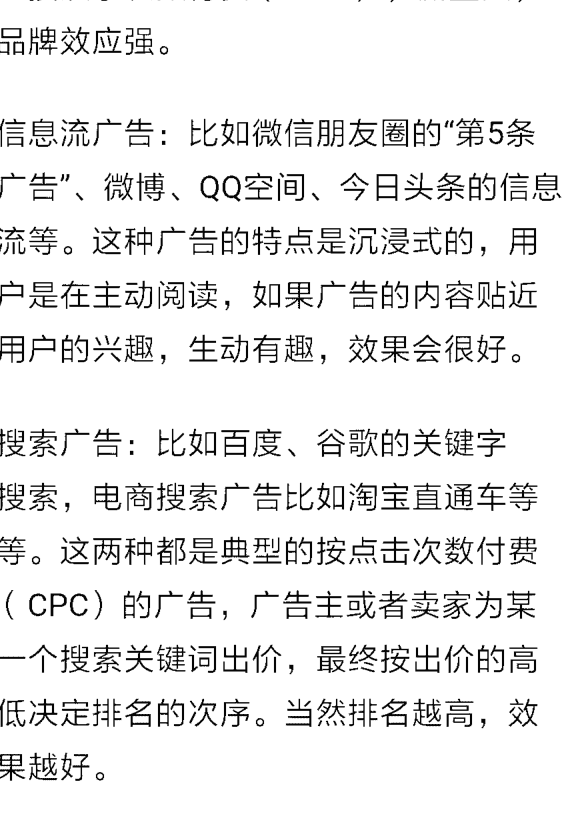

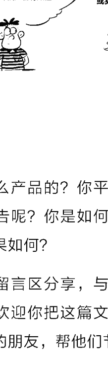

AIDA 这四个字母分别代表了注意（Attention）、兴趣（Interest）、愿望（Desire）和行动（Action）。要考察一个广告的效果，就要分别测量这个广告在多大程度上引起了消费者的“注意”、激发了他们的“兴趣”、刺激了他们的“愿望”，改变了他们的“行为”。

传统的广告投放渠道，比如电视、报纸、杂志、街边的广告牌等等，是在“注意（Attention）”层面做广告，你只是把广告展示在那，但并不知道用户到底看了没看，感不感兴趣，更不知道他到底买没买，投放效果是没法衡量的，所以一定有一大部分广告费会被浪费掉。

而现在的互联网时代，除了“注意（Attention）”层面，你还可以上升到“兴趣（Interest）”、“愿望（Desire）”，甚至“行动（Action）”层面来做广告了，因为人们的行为数据可以被记录下来，广告效果就可以衡量了。

### 二、CPM、CPC、CPA

那具体怎么衡量呢？

在“注意（Attention）”层面的广告，比如网页的banner位等，你可以按展示次数来付费，在广告术语中叫做CPM（Cost Per Mille），也就是向每千人展示的费用。通过按展示付费来投放，你可以非常清楚地知道，到底有多少人能看到你的广告。但这个和传统的媒体广告没有什么本质的差别，只不过把过去线下的广告位搬到了线上，并不是每个注意到你广告的人都会产生后续的行为，你还是会有一部分广告费被浪费了。

那如果我只想投放给对我产品感兴趣的人呢？你可以按点击次数来付费。这就是CPC（Cost Per Click）。用户点击了你的广告，说明他至少对你的产品产生兴趣了，他是你的潜在用户。按照点击次数来投放广告，相比按展示付费，更加精准。这时你所有的广告费，都花在了潜在用户身上。谷歌搜索的上上下文相关的关键字广告等，采用的就是这种“按点击付费”的模式。

那如果我只想为那些我真正的使用者付广告费呢？这就到了“愿望（Desire）”和行动（Action）”的层面，你可以按“行动”，也就是投放的实际效果来付费，这就是CPA（Cost Per Action）。这时的投放效果就更加精准了，你所有的广告费，都是在为最后的结果买单。具体举例来说，投放的实际效果可以包括：

- CPD（Cost Per Download）：按App的下载数计费；
- CPI（Cost Per Install）：按激活App的数量计费；
- CPS（Cost Per Sales）：按完成购买的用户数或者销售额计费，等等。

按展示付费（CPM）、按点击付费（CPC）和按行动付费（CPA），这是三种在不同层面衡量广告效果的方式，目前国内的主流广告平台大部分都支持这三种方式，你可以根据自己的品牌和产品特性来进行选择。

### 三、不同类型的广告的投放渠道

那今天的互联网上，有哪些类型的广告，和哪些投放渠道呢？我给你讲讲主要的三 种。

- 1. 展示位广告：比如网站或手机App的banner位、App的开屏广告位等。开屏广告，就是当用户打开手机App时，会有5秒内的广告时间，这在微博和一些新闻App上很常见。这种类型的广告通常是按展示次数付费（CPM），流量大，品牌效应强。
- 2. 信息流广告：比如微信朋友圈的“第5条广告”、微博、QQ空间、今日头条的信息流等。这种广告的特点是沉浸式的，用户是在主动阅读，如果广告的内容贴近用户的兴趣，生动有趣，效果会很好。
- 3. 搜索广告：比如百度、谷歌的关键字搜索，电商搜索广告比如淘宝直通车等等。这两种都是典型的按点击次数付费（CPC）的广告，广告主或者卖家为某一个搜索关键词出价，最终投出价的高低决定排名的次序。当然排名越高，效果越好。

刘润 你是做什么产品的？你平时会在哪些渠道投放广告呢？你是如何来衡量投放效果的？效果如何？
欢迎你在留言区分享，与大家一起，过过招。也欢迎你把这篇文章分享给做广告投放的朋友，帮他们节省广告费。

## 第11周周末私董会｜我有好产品，你有营销方案吗？

第11周周末私董会｜快来责...

每天5分钟，解决一个商业问题。欢迎收听《刘润5分钟商学院》实战篇。

5分钟商学院的同学们，大家周末好！

上周获得咱们私董会提问资格的是李建锋同学，来看看他的问题：

“我们在俄罗斯找到两款极少见的蜂蜜，一种黑色，一种红色，产地在车臣附近的高加索山脉高海拔地区，每年总量不到50吨，在俄罗斯属于价钱最贵的蜂蜜，我们在其他地区也没有发现有相同类型的蜂蜜。产品有以下特点：1、气味清新，就像在森林里面植物的味道；2、颜色纯正；3、口感像果汁，入口即化，完全没有普通蜂蜜喝了后，嘴里黏黏的感觉。喝起来也有淡淡的植物味道。再来说说蜂蜜的产地，俄罗斯地广人稀，近两千万平方公里，人口仅有1.4亿多，自然资源非常丰富，而且境内立法严禁使用农药，我们收购的蜂蜜属于原生态无污染，完全成熟的原蜜。中科院蜜蜂研究所的专家品尝后，评价蜂蜜口感很好，颜色少见，适合做高端产品。现在准备做全国的产品推广与销售，我们的问题在于目前还没有销售渠道，广告也是自己在做，希望大家多多提意见。”

李建锋同学出价2000元，我也贡献了2000元，咱们的奖学金池一共增加到了4000元。同学们给了非常多精彩的回复。我挑选了其中尤为精彩的10条留言。我挑选这10条留言的原则，主要是从这四个方面考虑：

- 1. 专业性，对应领域的专业人员的留言；
- 2. 可行性，有具体的方法论建议、实操性强的留言；
- 3. 独特性，思考角度独特、有增量信息，有自身感受或经历；
- 4. 应用性，和5分钟商学院的课程知识有效结合的留言。

下面我梳理了这10条留言的回复要点，和我对留言的点评，希望你能从别人的解决办法中，获得自己的思考和成长。希望下周，你的留言也能入选。

### 1、青岛罗刚

高端定价、区别定位。这应该是典型的高端蜂蜜，只卖贵的，不卖对的。找出黑色蜂蜜和红色蜂蜜在功能上的差别，然后赋予不同的意义。比如说，男人喝黑蜜，解酒、养胃、抗疲劳；女人喝红蜜，助排便、利消化、促进眠。

利用小视频广告营销。充分学习润总刚刚分析过的“番茄炒蛋”案例，参考某品牌矿泉水在长白山寻找优质水源的广告，制作3分钟左右的“探秘原始蜂蜜产区”广告片，通过微信、微博、短视频等平台传播。画面：俄罗斯的原始森林，沿山脉逆流而上，转过山角豁然开朗，出现一片草原和蜂箱，蜂蜜飞舞在花间采蜜。画外音：我在俄罗斯高加索人迹罕至的崇山峻岭放蜂，只为给与奉上最天然的原生态蜂蜜。原生生态高加索蜂蜜，每年产量只有50吨，只为最懂生活的你。

打造中国首个小罐蜂蜜。常规蜂蜜瓶式包装有一个问题，蜂蜜经常会把盖子粘住，打开的时候很难受，每次吃多少也不容易定量，基本就是中医的说法“一汤匙”。如果可以做成一次用量小包装，类似果冻杯一样，方便携带和食用，会让很多怕麻烦的人不会对蜂蜜“望而却步”。同时，小罐包装也体现该产品的高端品味。

线上+线下双轨营销。线下建立全国招商中心，招省、市级代理，利用保健品、营养品代理商的成熟销售渠道来实现迅速推广。同时线上建立微商平台，重点在于品牌推广，线上线下同质同价，保证代理商有利可图。

刘润

青岛罗刚同学，提出了一个很有意思的建议，叫做“小罐蜂蜜”。他说，常规蜂蜜瓶式包装有一个问题，蜂蜜经常会把盖子粘住，打开的时候很难受，每次吃多少也不容易定量，基本就是中医的说法“一汤匙”。如果可以做成一次用量小包装，类似果冻杯一样，方便携带和食用，会让很多怕麻烦的人不会对蜂蜜“望而却步”。同时，小罐包装也体现该产品的高端品味。这是一个从营销角度提出的建议，今天很火的“小罐茶”就是一个先例。

### 2、大客创新互联网咨询-Jackson 董坤

拆解一下，大概是这三个问题：

- 1. 产量稀有的珍品的营销问题。
- 2. 蜂蜜这么一个相对不具备稀缺价值的快销品类价值提升问题。
- 3. 教育市场的高额成本和营销渠道的布局。

这种产品的营销，具有极高的难度。首先，必须支付很大的成本教育市场，接受其高价值和稀缺性，在用户心中建立差异化的卖点、增加可信度。其次，产量小、稀缺、有保质期要求，意味着不会有太大的市场规模，因此必须有较高的定倍率，才能获得价值。但又必须以传统的大规模的蜂蜜产品进行差异化处理，才能支持高定价。同时，相关的渠道费用也很高，教育市场的成本很高，都要包含在定价当中去。这会大大降低对利润的预期。

建议：精确选择渠道。建议和银行高端信用卡部门，高级会所和美容院，甚至游艇俱乐部合作。最好设计一个慈善捐赠的项目，比如一罐售价的百分之多少，捐给某个慈善机构等方式来进行营销。最终，这类项目很可能与创业者最初想象的获利空间巨大极不相符，建议谨慎，小批次、尝试性开展。虽然稀缺性可以在一定程度上提高定倍率，但对于创业公司来说，渠道，可信度，市场教育，商脉等资源限制，会大大降低实际企业所得的利润。

另外，既然产品有稀缺性，是否可以进行二次加工，来提升产品附加值。比如，提纯制成保健品、加工成为高端面膜等化妆品以及稀释制成常规高端饮品（类似于官燕燕窝，蜂蜜高端茶饮料）等。以此降低产品售价，却提升单位重量的实际价格，并延长销售期，打破保质期限制。

刘润

董坤同学觉得，这种产品的营销有极大的难度。这其实很同意。市场教育，是需要时间和投入的。所以董坤建议应该精确选择渠道。比如和银行高端信用卡部门，高级会所和美容院，甚至游艇俱乐部合作。也许利润不如一开始预期，但可控。

### 3、Tony to ni

李建锋同学的问题是现在找到了一个产品，如何去做渠道和营销，让产品能够尽快上市销售。我们可以用营销4P理论来逐项看一下：

蜜。感兴趣的同学可以点开文稿详细查询。他在建设中提到的“品牌故事”是一个亮点。高端，是靠情感支撑的。建设情感，需要品牌故事。怎么讲好这款蜂蜜的品牌故事，确实值得李建峰同学思考。

### 4、洁洁蓓蓓

我们公司经营的是 一种从新西兰进口的鲜奶，我们的盈 利点必须要有2000个以上2C的客户，半年下来仅仅只是150个。公司采用了微信公众号营销，与高档小区物业线下合作，与京东商城线上合作，与长沙线下流量最优的超市合作，与长沙线上线下流量最大两家水果店合作、与湖南卫视的品牌主持人合作等方式，但是收效甚微。

我上周找了分公司经理谈了一下，我觉得我们目前陷入了“产品陷阱”，每天就是对客户说我们的产品如何如何好，但是忘记了我们的客户，只有客户认可了我们的产品才有市场。现在消费的主力军80、90后，他们喜欢才会有市场。

我孩子就是一个有个性 的90后，他也知道可乐喝多了对身体不好、鲜奶对身体健康有利，可我高价定的鲜奶（23元一盒）他不喜欢，就喜欢喝低价格的可乐。他和我说，我们不会像你一样追求大牌，高价的产品，我们更喜欢名创优品，zara等这些快时尚品牌。他说好的产品要做到三高三低：“高颜值，高品质，高效率；低成本、低毛利、低价格”。你们的鲜奶太贵，妈妈告诉你一个规则，未来：高价格+高毛利=破产。低价格+低毛利=首富。

现在的产品竞争是爆品战略，只有爆品才能走量，你们只有通过规模采购来压缩成本，同时尽最大程度缩短渠道，渠道越短，费用才越低，你们公司才有利润。我惊愕不已，一个刚刚从国外留学回国的孩子比我一个做几十年企业的老总更懂得如何做渠道做产品。听到他高谈阔论后我深思我这半年的产品战略，所以如何让顾客感动，让顾客接受我们的产品才是我目前最要研究的课题。目前市场不缺好产品，客户认可才是王道。

刘润

洁洁蓓蓓同学用自己的血泪教训告知李建峰，不要陷入“产品陷阱”：每天就是对客户说我们的产品如何如何好，但是忘记了我们的客户。洁洁蓓蓓同学经营得新西兰进口牛奶要有2000个2C客户才能盈利，但想尽一切办法才有150个。我想请所有的同学都注意，“产品陷阱”确实是个大陷阱，从“我东西这么好，你们怎么就不懂呢”的陷阱中爬出来，调研调研用户到底要什么。

### 5、伊春葛歌

很高兴在商学院遇到同行，作为致力于做国产优质好蜜的创业队伍，我愿意与您分享这几年来 的心得：

产品打磨。蜂蜜属于非标准品，受制于自然环境，蜜蜂品种，蜜源植物种类，蜂农技术，当年天气虫害条件，蜂蜜本身的成熟度，抗生素农药残留，食用和携带不方便，食用方法单一，口感口味不佳等问题的影响，导致国家标准，购买和检测依据，卖家宣传等都存在非标准化的问题，产品品质良莠不齐，消费者面临选择困难。应该说，解决以上问题的任何一方面，都有可能获得市场突破。

资源把控。我们做蜂蜜事业多年，主要向资深品蜜人士提供精品蜂蜜，但受制于以上说的问题，再加上渌藏蜜的独特工艺，我们无法解决供应端的持续稳定问题。您对于俄罗斯的一手蜜源，可利用资金，品牌，自养养蜂基地，提前承包森林，订购当地蜂农产品等手段，保证供应。

包装创新。我的家和首款主打产品的蜜源地就在与俄罗斯隔江相望的黑龙江小兴安岭，和俄罗斯有着相似的生态系统。俄罗斯的桦树，松树资源丰富，熊、鹿和老虎也比较多，可以借鉴农夫山泉的工笔画瓶贴设计风格，打造成植物IP，讲故事。形式上可以做成小包装，让更多人品鉴，户外携带。

营销底线。在我国，虽然蜂蜜属于药食同源，但新的广告法以及其它电商平台明令禁止有关功效的宣传。而国际知名的新西兰麦卢卡蜂蜜已经被列入药典，可以宣传功效，这是多年运作的结果。如果不是为了做一种子买卖，那就避免宣传隐患，强调独特性，稀缺性，口感口味。也可以通过向客户提供代加工生品，用种子用户口碑第三方背书，做功效方面的营销突破。

渠道建设。如果是做稀缺性高端产品，又能控制资源，建议搬脂定价，尝试饥渴营销，让利于消费者和他介绍的消费者。选择联合评估有利的地方去铺设销售，比如和一两千的麦卢卡蜜对标。否则就单独评估，考虑异业联盟，如高端进口红酒，咖啡，水果店等。

品牌打造。如果长期做蜂蜜事业而非一时套利，建议优先注册商标，组建一流团队，想好股份结构，公司结构，业务拆解，人员分工，阶段目标。总之，创业不易，做蜂蜜市场的生意更是充满挑战的长期工作。

我们是HoneyDaily润藏蜜品牌，曾被选为第一季商学院优秀学员礼品。我们倡导恢复成熟蜜生产方式，给消费者提供自己国家的优质产品，也中国品牌蜜与世界一流好蜜做交流。目前已成功推出高端产品并拥有基础客群和渠道伙伴。如果您的蜜的确品质过硬，真诚希望我们一起探讨合作的可行性。如我们能缘共事，我们愿意再加一千奖金池，作为本期回答问题的同学们的答谢。

刘润

伊春葛歌同学也是做蜂蜜的。她的产品曾被选作第一季的学员礼品。她从产品打磨、资源把控、包装创新、营销底线、渠道建设、品牌打造6个角度给李建峰同学非常非常宝贵的建议。尤其是她提到的“渠道的稳定性”，我尤其赞同。在中国把蜂蜜做起来之后，供货渠道是否会甩开你，是需要很早就思考的问题。伊春葛歌的5嗨同学情谊，战胜了竞争的担忧，向李建峰同学发出了合作邀请。祝愿你们能有双赢的合作。

### 6、古小千

梳理李建峰同学的情况，两个产品背景、两个主要问题：

- 1. 总量少，品质优。
- 2. 专家保证，目标为高端产品。
- 3. 销售渠道。
- 4. 广告营销渠道，可以往『内容电商』和『异业联盟』想。

吴晓波老师的吴酒，摆在架上卖，可能乏人问津；放在卖场，更失去了格调。做点调研，哪些台面上 有影响力的公众人物，对蜂蜜有研究的，送上两份，邀请对方的意见，这样的事前工作能提高产品的势能。接着，在开始全国推广前，找大公司合作，以往节送洋酒，今年改送你们的蜂蜜，让市场上拿到 的都是“送出去的”，而不是“买到的”，让收到礼的人，觉得新鲜发朋友圈，为你口碑宣传。同时，别 人买不到，收到的人更显尊贵。

刚学的『趋势营销』可以拿来好好用。照你的说法，蜂蜜口感很好、一喝便分晓，那么来个街头盲测吧！在产品上市前，街头拍摄盲测过程，让路人来个客观推荐。影片在网上转载，渐渐发酵后，再搭配BFD法则写出好文案，“蜂蜜黏嘴，赐了吗？”、“俄罗斯的珍贵蜂蜜，专家都只留一瓶”，接着只要包装够珍贵，就能透过“ 锚定效应”，让市场供不应求。

刘润

古小千同学的建议是往『内容电商』和『异业联盟』想。就像吴晓波老师的吴酒。吴酒放在货架上卖，和放在吴晓波频道卖，效果一定不同。古小千同学说得很有道理。等你有产品形态后，可以和罗辑思维电商聊聊。说不定有合作机会。

### 7、吴立项

据我能搜索到的资料，最贵的是澳洲产的蜂蜜，零售价大约4000元/公斤。年产量50吨，如果也按照4000元/公斤测算，年产值在2亿元左右。考虑初期品牌建设期，售价是澳洲顶级产品的一般，贵司控制总产量的 一半，那产值在5000万左右。我觉得5000的产值，比较难支撑庞大的客户教育和品牌建设成本，大规模铺开渠道，风险较大，需要慎重考虑。建议可以考虑高端特殊场景市场，比如南极旅游、名力马 correctly 登顶、戈壁徒步等专供能量补充给品。

刘润

吴立项同学一看就是理工男。他帮李建峰同学算了账。对标澳洲顶级蜂蜜价格（4000元一公斤）的一半，产量（50吨）的一半，这款蜂蜜的年产值5000万。5000万很难支撑品牌建设成本，大规模渠道成本。所以吴立项同学建议，考虑“高端特殊场景市场”，比如南极旅游、名力马 correctly 登顶、戈壁徒步等专供能量补充给品。吴立项同学，你这是在说我吗？

### 8、涵客家居

这个问题本质是：找到了一个独特性少的产品，如何利用稀缺资源做成这个生意。我的建议分三步走。先做出一罐产品，（MVP）验证可行性。和“一条”这样的内容电商或者众筹平台合作，这类产品也天然适合内容电商，他们这样的平台采取的是分成制，做预售而不是备货，前期可以省去不少广告成本和风险。第二步，证明产品是可行的，消费者认可这个价值主张，那么可以按照传统的打法，这些有现成的方法论。第三步，也是关键一步，你能找到货源，别人也可以，想办法拿到资金，垄断供给。不然，市场上出现一个跟你一样的蜂蜜品牌的时候，你就难受了。

刘润

涵客家居同学的建议，是从打法步骤的角度提的，非常好。他说，第一，先做出一罐产品，（MVP）验证可行性。和“一条”这样的内容电商或者众筹平台合作，这类产品也天然适合内容电商；第二，验证可行后，可用成熟商业方法论，比如其他同学提到的；第三，控制货源。这个倏春葛同学的担心一样。

### 9、乘物以游心

根据李建锋同学的描述，他的蜂蜜适合做高端产品，而且每年总产量不到50吨，那么他有没有必要做全国的产品推广和销售就是一个问题了，是不是首先抓住北上广深等一线城市进行推广即可。销售渠道上高端产品我建议不要铺得太开，只进驻高端超市，类似BHG、Bravo YH、Ole’等超市，高端产品面向高端客户销售，这些高端超市可以帮助你筛选客户。广告营销上，我建议制作短视频尝试病毒传播作用，俄罗斯的蜂蜜，我的脑海里想到了爱吃蜂蜜的熊，看看怎么能制作相关的短视频吧，这种短视频可以通过公众号传播。

刘润

乘物以游心同学觉得，这是一款高端低产量的商品，没必要再全国做产品推广和销售。这是一个非常理性的建议。他建议只进驻高端超市，类似BHG、Bravo YH、Ole’等超市，高端产品面向高端客户销售，这些高端超市可以帮助你筛选客户。

### 10、潮流伏特加

作为一个在俄罗斯留学近十年的经济学博士我想给大家分享以下几个观点可能与产品关系不大，但是站在人文角度看经济也是一道风景。

国人对俄罗斯产品的接受价格是多少，比如大家都知道俄罗斯姑娘长得好看，德国的汽车就是牛，美国就是自由，意大利法国的商品哪怕是在当地二线在中国也能做成轻奢，这个很重要的。我们卖产品不是根据产品本身价值定价，而是根据市场有多少人愿意花多少钱来定价。

蜂蜜这个市场中有没有国外高端的货大家对它的认可度有多少是不是一提到这个国家就觉得很上档次，比如格鲁吉亚的红酒高端也很高但是价格卖不过法国意大利，有自带流量吗？

营销问题，我个人建议自己创品牌找投资商先拿下市场再去细化，因为市场很自由没有什么壁垒，当地有这种数量的蜂蜜厂家我应该很多。那么你快速拿下你想要的市场领域，那么潜在的竞争对手会让你很痛苦的。

渠道。个人建议线上充分利用互联网平台优势，线下可以玩出很多花样除了和传统的店铺合作，可不可可以和美容院，服装店尤其是高档的合作呢学了那么多跨界联合这未必不是个尝试。

刘润

潮流伏特加同学是一位在俄罗斯留学近10年的经济学博士。他从经济学角度说到，产品是根据市场愿意花多少钱定价，而不是本身的成本定价。所以，俄罗斯蜂蜜，是一个大家愿意花大价钱的“心理账户”吗？也就是说，这个产品真的“自带流量”吗？我同意潮流伏特加同学的观点。“自带流量”这四个字得特别好。建议李建锋同学做一些更充分的调研。

谢谢同学们的精彩回答。

## —— 本周私董会问题 ——

本周，获得私董会提问资格的同学是：赵爱娟同学。 她的问题是： 我们公司主营摄影器材、数码相机及配件，代理和零售两种经营形式，代理业务我们和京东合作了十年，一直保持着很好的合作关系，这块的业务营收还可以。 但是我们还做零售，在摄影器材城里开店卖相机和配件，我们的店铺位置、品牌口碑都不错，但现在摄影器材这块市场萎缩的厉害，铺租高、同质化竞争激烈，生意越来越难做，今年零售已经亏损几十万，但是因为做了十几年了，放弃这块业务又觉得特别可惜，换店面位置也怕流失老客户，陷入了两难的境地。想请问同学们该怎么办？公司现在考虑在门店里扩展产品品类，比如代理或者零售手机及周边配件、音箱音响，耳机耳麦，早教益智相关产品，不知道这个方向是对的吗？或者还有没有其他方法可以把已有资源利用起来、增加利润，来保证实体店经营不亏损，还能长久经营下去？

能get到很多知识。学完之后的分享：我将以一篇文章给润总投稿，希望被更多同学看到。

好了。从下周开始，我们会进入到营销的第四部分，品牌。我们会来讲讲如何才能建设品牌，让消费者优先选择自己。咱们下周见。

## 043 | 4U原则：我文章写得很好，但阅读量总是很低，怎么办？

每天5分钟，解决一个商业问题。欢迎收听，《刘润·5分钟商学院》，实战篇。

我有个朋友，开了家火锅店，叫“小四川”，对，就是昨天说的那位朋友。他把火锅店的广告语定为了“小四川火锅，吃完衣服没味道”，并打算在微信里大力推广。为此，他写了很多文章，比如《最美的味道，是欢聚的味道》，《火锅的味道，只应唇齿留香，不应纠缠衣物》，但阅读率都不高，转发就更少了。怎么办？

要解决这个“怎么办”的问题，我们首先要理解这个问题的本质。

你希望内容被大量转发，但转发的目的是阅读，阅读的前提是打开。在移动互联网时代，读者只有0.5秒来决定是否打开一篇文章。这么短的时间里，读者到底靠什么做出决定呢？

没错，那就是文章的“标题”。

10个读者中，8个会看标题，但只有2个会打开文章。我们希望读者或者购买，或者转发，但前提是，他会打开。这个问题的本质是，读者看到小四川的这些标题，没有强烈的打开欲望。

那怎样的标题，才能激发强烈的打开欲望呢？

### 概念：4U原则

文案大师罗伯特·布莱在他的畅销书《文案创作完全手册》里，提出了写标题4U原则，你可以把它当成创作标题的心法：

- 1）Urgent（紧迫性）。人们怕晚得到，怕早失去，充满紧迫性的标题，给人一个立即打开的理由。比如：“2018上半年最大机会”，“下周一新交规即将实施”等等。
- 2）Unique（独特）。这东西别的地方没见过，可能也见不到，这就是独特性，能诱发巨大的好奇心。比如：“解密MH370坠机的真正原因”，“张小龙首次披露心声”等 等。
- 3）Ultra-specific（明确具体）。具体的东西，更容易带给读者获得感，从而想占有。比如：“写好文案的4个心法，3招剑法”，“这9种交流方式，容易得罪人”。
- 4）Useful（实际益处）。承诺利益，永远是俘获读者的不二法门。比如：“价值2万元的资料，今天免费拿走”，“做到了这几点，他的月薪从500涨到50万”。

那我这个朋友应该怎么办？基于4U原则，以“打开”而不是“购买”，或者“转发”为目标，重写标题，激发读者“强烈的打开欲望”。

### 运用：

具体怎么做？我教你三招基于4U心法的，网上高手总结的，可以立刻使用的剑法。

第一招：“目标人群+问题+解决方案”。

你的火锅目标人群是谁？直接对他们喊话，点出问题，并给出方案。

试试这么写：

想陪男朋友吃火锅，又怕毛衣上有味道？
现在终于有人解决了这个问题！

最担心衣服上有味道的是女孩子，“相陪男朋友吃火锅”是筛选读者，对她们喊话；“怕毛衣上有味道”，是通过画面感，用问题、冲突唤起共鸣；“现在终于有人解决了这个问题！”，是给出解决方案，让读者忍不住打开。

第二招：“在XX时间内，得到YY结果”。

在注意力稀缺的今天，人们需要有承诺的利益，而且是马上就能到的利益，才愿意投入时间，打开阅读一篇 文章。

试试这么写：

揭秘：吃一顿火锅，衣服少活半年。如何1分钟不要，1分钱不花，解决这个问题？

“吃一顿火锅，衣服少活半年”是问题，解决这个问题，是读者希望得到的结果；“1分钟不要，1分钱不花”，是读者需要付出的代价……那就是不需要代价。读者很可能忍不住就点开了。

第三招：“热点人物+独家信息”。

人们都有好奇心，尤其是对大人物。这也是新闻，尤其是八卦新闻有人看的原因。

试试这么写：

被称为火锅界的特斯拉，只因拥有这3样黑科技！

“火锅界的特斯拉”，是黑大人物，大公司，大热点；“这3样黑科技”，是独特信息，激起读者的好奇心。

### 今日得到：

最后，我们来小结一下。你希望内容被大量转发，但转发的 前提是阅读，阅读的前提是打开。在移动互联网时代，标题几乎是读者打开一篇文章的唯一决定因素。

今天，我们学习了写一个激发“强烈的打开欲望”的标题的四个心法：

Urgent（紧迫性），Unique（独特），Ultra-specific（明确具体），Useful（实际益处）；

和三招剑法：

“目标人群+问题+解决方案”，“在XX时间内，得到YY结果”，“热点人物+独家信息”。

学完今天的课程，你决定加入“标题党”了吗？

刘润

好了，今天的“怎么办”，就回答到这里。我留给你的思考题是，今天这篇课程的标题，如果重写一遍，提升读者的“打开欲望”，你会借用哪一招，怎么写呢？

欢迎你在留言区分享，与大家一起，过过招。也欢迎你把今天学到的招式，分享给你身边有需要的朋友，帮助他们更好地解决商业问题。
