# 刘润5分钟商学院第二期201804-05

## 第24周周末私董会｜传统批发商如何转型，迎接互联网机遇？

每天5分钟，解决一个商业问题。欢迎收听《刘润·5分钟商学院》实战篇。

5分钟商学院的同学们，大家周末好！又到了本周私董会的时间了。

本周获得私董会提问资格的同学是：

润总好，各位同学好。我家目前在四川省成都市某大型水果集散市场经营传统水果批发生意。我们是以摊位出租代码代销的模式运营的。每年的各类水果货物出货量在2万吨左右，在西南地区算排名前三位的水果批发商。近年来各大市场在互联网的冲击下纷纷转型或被降维打击。传统水果批发市场虽然也已被波及但尚未被颠覆。但危机感与日俱增，怕是再不未雨绸缪，到时会欲哭无泪。从经营数据上看，特别是2017年，各类水果货品的出货量较2016年足足少了四分之一。作为95后的我一直想努力稳住并拓展父母辛苦打拼积累的家业。我曾自己尝试开了线下水果直营店，但效果很不理想。目前在思考是否可以追赶互联网的浪潮，利用互联网工具让客户远程下单，建立客户档案，收集需求数据，预测需求趋势，并引入物流环节直接配送。还请老师和同学们替我出谋划策，看有没有更好的商业模式来适应当前的环境和市场变化。当然如果有机会的话也想与各位同学来一次跨行业合作，以成功转型来应对这场迫在眉睫的危机，把资源优势发挥到最大。

刘润

这个问题应该从几个角度来看，首先我们要给这个问题做个定性。以前在私董会中我们不断地复习过一个概念，叫定倍率。（详见底部相关课程）

在定倍率里，我们讲过创造价值和传递价值的概念。果农是创造价值，因为是他们把水果种出来的。那么跑到果农那里去采购的人，无论是大型批发商，还是各个城市的采购商，不管是一级批发、二级批发，还是超市或更小的水果店，这一序列的整个过程、参与的人，我们都称之为传递价值。

采购商到了果农那边，这个水果生产出来的价格我们叫它采购价，采购价假如是1块钱一斤的话，卖到消费者手上的价格可能就是10块钱一斤。这中间的差价我们称之为定倍率。

互联网出现之后，对于传统的商业模式最大的一个改变，是通过缩短中间的流程，提高中间的效率方式，大幅降低了定倍率，让曾经中间的一步一步的环节显得没有那么高效了。所谓中间，指的就是传递价值的效率方式。所以我想在今天给大家引入一个很重要的概念，也是我们对未来新零售的一个判断，我们称之为短路经济。

## 一、认同时代大趋势的方向，主动尝试短路其他人

## 二、把传递价值变成创造价值

## 三、慎重思考To B要不要转成To C模式

自己的套路，有时甚至是靠关系、靠量、靠价格、靠资源控制，有的时候还要考验你公关功能和资源统筹能力，所谓To B的生意就是面对中间商。而To C的生意是直接面对终端消费者，终端消费者才不跟你聊那么多，他只看这个水果好不好，价格便不便宜。所以To C的生意更考验的是面对消费者的能力，每个产品怎么样。所以这两种考验的能力是完全不同的。

我们可以看到很多To B的人是做不好To C的生意，因为他总觉得自己的谈判筹码、销售能力特强，但是在To C的时候其实不需要这个。To C的时候，消费者更看重你对产品的极端品控能力，或者说你面对消费者拥有特别好的服务精神。回过头来说，很多做完To C的人，也是不会再去做To B生意了。因为做To B的时候，你要去跟别人面对面地喝酒、谈判，有各种各样的制约甚至潜规则，可能还要为了笼络关系给回扣等等。

所以To B的生意逻辑和To C的生意完全不同，To B要做To C是很难的事情。

所以你要知道自己过去的能力积累是在哪个环节？如果是供应链环节上的能力，那就是To B的能力。所以如果你想做一些To C的尝试，也可以让别人先做做看。

## 总结

今天的问题不仅是水果批发市场存在的问题，可以说是整个中国所有批发、渠道环节生意的人，都面临的一个挑战和难题。况且现在，就连这些渠道中间也没有多少利润空间。未来随着网络的普及，消费者可以直接下单，供给渠道不断被压缩甚至消失。

传递价值所面临的挑战，其实来源于社会的进步，我们的时代正在因为科技进步，而不断改变、不断迭代。所以此时，我们应该抛开传统的考核方法，因为未来，渠道变得无效率越高，社会更加注重价值的直接传递。

我建议这位同学从这三个方面入手：

- 1. 向下游短路别人，直接跟一些零售商合作，但不要直接面对To C的用户，可以选择跟社群电商合作。
- 2. 从上游入手，把自己从一个批发商变成一个服务商，去把控产品的品质，统一面对电商平台。
- 3. 慎重思考To B要不要转成To C，如果要转成To C开水果店的话，也许可以用孵化的方式来做。

以上就是我给这位同学的回答。希望给大家一点启发。也感谢其他同学提出更多的建议。下面我公布一下这次秒董会问答的10位获奖者，他们分别是：xxx、xxx、xxx、xxx、xxx、xxx、xxx、xxx、xxx、xxx。请中奖的同学在本文文章下方留言中，写下你的联系方式及手机号（每人将获得200元奖学金，以充值的方式返还到你的账户）。

个人认为这是批发商的危与机。

危：随着渠道透明化，物流效率也越来越高。想要继续赚取中间差价会越来越难。零售商会逐渐抛弃批发商，这只是时间的问题。

机：批发商要么往上游走，要么往下游走，好在还有时间。

## 优势：

- 1. 渠道广，品类多元化，质量有保证。
- 2. 体量大，拥有更多的产品定价权。
- 3. 信息量大，拥有大量的历史数据，清晰了解不同产品在不同区域的销售情况。

## 劣势：

- 1. 长期的批发形式脱离零售太久，团队没有零售服务意识。
- 2. 只有大数据，没有小数据，对零售客户的个性需求不清晰。
- 3. 不知道你们是否存在账期问题，会不会在现金流上存在问题。个人建议，不要直接自己经营零售，风险太高，上下游风险都在你这里。最好的方式是投资或入股水果店，或者现在流行的水果拼盘的连锁店、果汁店。绑定利益，锁定下游，先了解，后深入。

同学你好：我先说一下对生鲜市场的理解，万亿级的市场，生鲜消费占据刚需、高频、高毛利等条件，随着互联网兴起，生鲜电商大军滚滚而来，但实际情况是普遍亏损，部分巨亏。线下业务虽然传统，但长期来看，鉴于产品的特殊性，除非电商能实现物流速度超过于社区小店的便利程度，要它地位不可动摇。接下来说一下对您这问题的看法：

- 1. 目标

2017年较2016年少了四分之一的量，涨的可能是线上，也可能是你的竞争对手。您想保住长辈的家业，那定的必然是赢的且目标，即扩大营收规模，接下来展开这个且目标的实现。

- 2. 产品

针对精致的白领人群，做精品水果；针对大妈团购人群，做质量稍差，价格亲民的产品。

- 3. 线下渠道

自己今年也有和朋友聊到水果这块业务，这里讲一个案例。有一个水果店，做的是社区的客户，经营模式是：通过积累社区的客户成团，提前发布鲜果消息吸引客户拼团下单，甩量获得低成本的产品，用低于市场的价格提供高于市场品质的产品，预定的微信解决了资金周转的问题和库存问题，同时店里也备有一部分的水果供微信息下单，收取低于电商平台的配送费（有自己送，也有找骑手合作）。这个方式可以用在协助自己下游，也可用在自己的直营店，作为地区的巨头想必溯源和价格稳定储备很大的优势。

- 4. 线上渠道

一个是做自己的电商，一个是融入已有知名电商，第一个成本太高，强手如云，也没优势，不建议。现在线上的形式是，即使不赚钱，我也得做，因为你不做别人就做了，做了好歹我还能提升库存周转。可以成为，像京东、每日优鲜、易果生鲜等电商的供应商。

- 5. 会员运营

回顾前几篇的内容运营，用自己优质的产品，做内容运营。

青色地平线同学，你好！我是一名中国农业大学的学生，有几个在校好友通过创立“一日一果”微信订阅号，一年时间，粉丝量4000多，购买过的顾客接近3000人，总营业额达到30万元以上。“一日一果”微信水果店基于“一天一果”微信订阅号平台，顾客可发送固定数字选购水果、查看订单等。从营业之初的四种水果，到如今干果、进口水果、烘焙饼干样样俱全，“一天一果”被5个小伙子经营得有声有色。

- 1）创业从微信开始。他们借鉴了较为成熟的外卖订单微信平台经验，通过注册第三方平台，终于创建了属于“一天一果”的微信订阅号。解决完平台问题，货源选择、资金短缺、人力不足等难题又接踵而至。采购、配送、售后等各个环节，他们也只能摸着石头过河。优质的货源是销售的保障，为了找到物美价廉的货源，“一天一果”团队跑遍了北京大大小小的农产品批发市场，经过一系列的比较、分析、权衡利弊，他们最终把进货地选在了北京市交易规模最大的农产品批发市场—新发地。
- 2）诚信“买”人心。有一次消费者订购了1500元的“冰糖心”苹果，可收到货后才发现，每一箱苹果只有最上面的一层是优质品，下面的苹果都有些磕伤，或者果形不好等问题。1500元对于刚刚创业的他们而言并不是一个小数目，但是在金钱和信誉面前，他们选择了后者。“宁可这1500元的苹果都不能用，也不能砸了‘一天一果’的品牌。”不仅在产品品质上精益求精，为了解决同学在选购中遇到的问题，“一天一果”还专门成立了顾客服务团队，专门受理同学的各项咨询与建议。“或许我们不是第一个开微信水果店的，但作为农大的学生，我们不仅要卖水果更要科学地卖水果。”他们的经营目标是颠覆传统的摊位自选水果的方式，将水果进行营养搭配，告诉大家这个季节吃什么最好，什么套餐最健康，甚至会配食用说明讲述套餐中的哪个水果什么时候段吃最好。他们用实际行动，实实在在地诠释了“顾客就是上帝”这6个字。

3）为学弟学妹创立奖学金。创于初具规模后，“一天一果”团队在经营的同时也不忘回馈顾客。3月7日女生节，店铺推出“给女生送苹果”的福利。那天订单特别多，几近爆单。此外，他们还赞助学活活动，并吸收更多同学加入其中，为农大学生提供了勤工助学的机会。今年2月“一天一果”团队在微信上发起了“舌尖上的家乡美食，我为家乡代言”的寒假助学实践活动。报名同学从自己的家乡优选特色美食，经“一天一果”粉丝团品鉴打分后，按评审排名给予参赛同学现金、代金券等奖励。更吸引眼球的是获奖者所提供的产品，在“一天一果”平台销售额的10%将作为奖学金予以回馈。（内容电商、社群效应）

4）除了农大微信店外，“一天一果”最近还创建了北京林业大学微信店铺，另外在农大东校区附近开设了实体店作为线下经营和仓储。全面更新订阅号系统，进一步优化商业模式，争取走向更多的高校。

青色地平线同学，你家是大型市场水果批发商，加上在成都也有很多高校，有很大的潜在市场流量可进一步挖掘。你可以参考我上面提供的真实案例，并结合润总课程中提到的“社群效应：另一种增强用户黏性的强力胶”、异业联盟、视频红利等方法来进一步完善你的商业模式。以上，供你参考，希望帮到你，谢谢！

事实上，我认为解决问题的核心也是最基本的是这一这个方案要适合提问者，也要切实可行，更要考虑成本，而不能天马行空纸上谈兵。新零售固然是一个高大上的话题、一个个人心仪的方向，但其实并不适合所有人和所有行业。很多传统行业从业者受互联网崛起冲击而焦虑时会产生共...

1.原本To B核心业务的客户都是To C的B端水果经销商，本来就和原本的核心客户从供求合作关系变成了竞争关系，这会在很多方面影响原本的核心业务，盈利性增长将面临巨大阻力。

2.水果的特殊性决定了水果市场在现阶段很难被彻底线上化，线下业务依然有很大的生存空间。水果的To C业务，大多需要依赖冷链、生鲜物流，但构建这些的成本极其高昂，而就目前从事相关业务的公司展现的结果来看收益并不理想。

所以我的建议是：不盲目转型To C，在原本核心业务的基础上思考解决方案。

1.用5why法分析业绩下降的根本原因：同学家的销量为何会减少？因为来批发水果的水果商们觉得没以前好了。为什么To C水果商销量下降？主要原因是互联网发展大潮下，各类自发产生的商业模式更多样化了，也不乏成功者。这些成功的尝试者们分走了很多客户的水果消费，而传统水果商们依然然后知后觉甚至缺少思变。

青色地平线同学，你好！定义你的问题：传统水果批发渠道面临电商渠道挤压造成销量大幅下降，如何转型？你的核心竞争力：1.西南地区排名前三，产品和品牌实力；2.代购代销（To B），渠道积累。

生鲜平台合作。

青色地平线同学，你好，我根据自己的经历，给你提一些建议。

## 一、作为一个曾经的水果网店商家，主营场地水果直发，分享一下我在淘宝店、微店、微信朋友圈做生鲜水果的感悟：

- 1. 商品竞争激烈，不仅仅有网店的竞争，还要和超市、便利店、水果摊，甚至小区内微信群商家竞争。
2. 商品同质化严重，几乎所有网店水果都是产地直发。
3. 品质把控难，水果都是自然生长，一致性远比不上工业产品。不仅是大小、颜色，连口感都无法完全相同。
4. 物流把控难，大部分快递都很暴力，运输途中常有碰伤问题。加上运输时间长了，水果容易腐烂变质。
5. 成本高，以前水果批发商各种中间环节的成本，最终都转嫁到了包装、快递、售后费用上，实际成本和当地零售商的成本持平，甚至更高。
6. 单件商品斤数高，为了压低成本，水果奇快递时，至少都要5斤起寄。因为只有量大，快递费才能摊薄。但客户一次性购买的量也相应大了，导致客户有很大的储存压力和变质丢弃的损失。
7. 客户忠诚度低，水果的购买渠道太多，品质差别不大，最终客户就是谁便宜买谁的。

## 二、综合以上的分析，大部分买水果的客户都有哪些特点：

- 1.大部分客户对口感不太挑剔。
2.大部分客户对价格比较挑剔。
3.所有客户都对新鲜程度和碰伤、腐烂零容忍。

## 三、作为水果批发商，你有以下优势：

作为一个前水果人，这里我觉得有几个问题首先要梳理清楚。这位同学做的是传统水果市场，相当于做平台，同时自己也会用几个档口去卖自己弄来的货。但这其实是两个生意：

- 1. 水果市场是平台生意，首先一个生意是确定一时的半会不会有危机，但是就目前而言，所有做水果销售端的公司都开始往采购端，往产地去发展，这是必然趋势，去中介，端到端的模式会在未来对水果批发市场这样的平台造成冲击。
2. 这位同学的第二个模式是水果批发，相当于二道贩。显然从现有模式来看，它受到的冲击会比做平台受到的冲击更大。

然后我们再来看看水果这个产业链：

- a. 采销分离，比如：果农种植各类水果，代办拿货，中间商囤货，之后通过水果批发市场或者KA渠道，二次或者多次转手，一直到最后的销售终端，一般这种多次批发的水果最后基本会通过个体户或其他类似市场最终到达用户手里。这是传统模式，其中的很多环节会不断叠加，层层分利。
b. 采销一体，果农种植，水果商通过承包（或者产地采购）等形式直接拿货，同时通过自有渠道进行销售。这种模式是目前包括百果园、天天果园等所有跨界水果商在做的一种模式。
c. 种销一体，这种模式比较典型的是成都的各种合作社，借助互联网打掉所有中间商进行销售。显然这三种模式中，定倍率是理论上可以逐层递减的，这是这几年水果越来越多，但是总体价格越来越低的一个重要原因。

根据这个价值链分析，其实这位同学还是有比较多的新业务可以做：

- 1. 将平台延伸出去，做水果电商B2B平台，毕竟跑到成都市场去看货，拿货的客户服务半径有限；目前来看，还没有人涉足这个领域；这个模式个人认为成功率极高，优势比较明显，但是也是最需要远见，毕竟这个是典型的长远利益与短期利益的尖峰时刻。
2. 从裁判员变运动员，将档口模式延伸出去，做强两端，前端做好产地控制，后端做好渠道开发（显然线上线下可以同时走），同时做好品牌建设。具体怎么做就不赘述了。这种模式做起来会比较重，涉及冷链、仓储、加工等多个环节，做起来是有难度的，毕竟已经有大品牌公司做了这些东西。以上两种模式有一个共同问题需要解决，就是处理好水果的时令问题，也就是要做就做到全品类，否则只做西南地区水果的话基本有半年左右的空窗期。
3. 前面两种模式都是往大做，所以这第三种，做尾部市场的爆品策略。作为植根于西南地区多年的市场经营者，完全可以做产地，做品牌，具体参考褚橙。总结一下，用润总在第一季里的几个知识点，包括企业价值链、互联网思维、定倍率等结合起来综合参考，寻找出自己的优势与价值点，加以拓展很重要。同时，最后要说的是，水果这个行业值得努力干到底。以上小见跟大家分享！

非常感谢：《5分钟商学院·实战篇》线下大课的第一模块——理解用户深圳站的课程刚刚结束。在这次的课程中，我向同学们详细讲解了“现实自我与理想自我”、“TOFA模型”、“技术采用生命周期”等等这些未能在线上栏目中展开的知识点了。也通过全新的互动形式，将线上私董会带到了线下，逐一解答了大家最关心的疑问。
之所以要举办线下大课，就是希望能够通过立体化运营，让同学们既能听到线上的高效的课程，也能在 线下感受丰富的知识的冲击，打造属于自己的商业兵器库。
现在，第一模块的线下大课还有两站，分别是4月14日北京，4月21日上海站。我依然会用一整天的时间，带来一堂无删减版的线下大课，希望能够帮助大家彻底底全方位了解最终买单的用户。现场席位有限，点击下方的图片，即可报名。得到的用户，可享受八折优惠。
非常期待能在 线下见到大家。

刘润
下一周，获得私董会提问资格的同学是：

润总，您好！我是某大型知名白酒品牌，2018年新品的全国总经销商。经过一年多跟随润总的学习，使我受益匪浅，对传统商模式有了更多的思考，并进而制定了“加强老生态，创建立新生态”的双轮驱动新目标。在老生态（传统供应链）板块，今年我们将在江苏、浙江、河北等传统强省，继续做好渠道的建设、提升工作。在全国其它市场区域，我们希望通过优化供应链的方式，调整代理环节，重构渠道关系，探索建设出一种新生态——让消费者得到更合理的产品价格，让渠道伙伴的市 场份额、利润率得到提高。目前，我们正以消费场景为切入点，寻求与白酒消费的主场景，即与中档餐饮门店的深度合作，我们希望把中餐、火锅品牌商旗下的加盟店家作为我们新的渠道伙伴。他们既可以在店内专卖产品，也可以在当地深耕直销渠道，通过产品直达门店、直通消费者的方式，让店主拿到更具有竞争力的价格，提高利润率，让消费者更易买到真正物美价廉的优质产品，提升消费体验。目前新生态模式已在尝试阶段，以下问题需要请教润总：1.目前探索的方向是否正确，新生态是否具有可行性？2.新生态里，谁会是更好的渠道伙伴？3.新生态里，如何让消费者获得更多的满足感，与消费者和渠道伙伴建立更紧密的关系？4.如何有效地推广和加强我们的 新生态模式，使这样的新生态具有越来越强的生命力？5.新生态发展的下一阶段方向是什么，后续分为哪几个阶段比较合适？

欢迎大家给这位同学出主意，用你们的智慧赢取这笔奖学金，也欢迎你把困扰你的涉及问题，或者实战问题，写在今天的留言区里。我们一起讨论，争取找到更好的解决方案。

## 加餐 | 直播复盘：未来商业，哪些行业最有前景？

《5分钟商学院》的同学们，大家周末好！

3月22日周四晚上，我在得到App做了一场主题为“未来商业，哪些行业最有前景？”的直播，有近3万位同学在线收听。直播内容主要分为三个部分：

第一部分，是和你分享未来什么行业最值得加入，以及判断这些行业的标准是什么？

第二部分，讲的是如今的商业的趋势是什么？哪些行业符合未来的发展趋势？

第三部分，是针对那些对前沿新知不敏感的人，如何才能跟上大趋势？

现在，我来和大家做一场整体的直播复盘。

最近很多朋友找我聊天，说是想跳槽，问我未来应该选择什么行业发展比较好。正所谓金三银四，这确实是很多人选择跳槽和思考未来职业规划的时间点。下面我就来说和大家聊一聊未来哪些行业会有比较好的发展。希望把方法论告诉大家，让大家自己来做判断。

## 一、未来什么行业值得加入？判断标准是什么？

我们应该用什么样的方法论判断这个行业有没有未来呢？判断行业好坏的逻辑到底是什么呢？我先给大家举一个小例子，你可能就会明白这个逻辑是什么了。

比如你家门口有个自由海滩，很多年来这里游泳。你觉得可以卖一些冰可乐给游客。于是你找到一个新行业，而且确实赚了一些钱。可当做了一段时间之后发现张三、李四、王五也开始和你竞争，他们除了卖冰可乐，还卖雪糕和苏打。结果因为竞争，你们的售价和利润越来越低，最后导致几乎所有人都没钱赚。

我相信这是很多人都在面临的一个问题，只要有超额利润的地方大家都会趋之若鹜。然后它就会变成社会平均利润的水平，最后整个行业就都不赚钱了。

没有超额利润时行业就没有生存空间，你要想行业有长期的生存，就要先产生超额利润。当你享受了超额利润，这个行业才会给员工高于社会平均工资的水平。

哪些行业可以创造超额利润呢？

刚才才举的例子，在海边卖饮料创造超额利润很难。因为这涉及到产业经济学一个特别重要的概念，我们称之为进入门槛。什么叫进入门槛？

接着刚才的例子讲，有个老太太也想在这里卖东西给海边的游客，你们卖冰镇饮料，喝了一口之后放在沙子上，但饮料很快就凉了。所以老太太做了一款产品，一头可以插在沙子里里面，另一头是杯托，这样饮料就可以凉得更持久。刚做完之后，后面李四、王五都要来做，老太太就赶紧先申请了一个专利。申请完专利后再去做，果然生意非常好。如果此时张三、李四、王五也想做，那他们就会纷纷收到律师函。结果就是在海边只有老太太在做杯托，每年可以赚取非常可观的利润。

所以门槛到底是什么？哪些行业有门槛？

总结了一下，大概有四个进入门槛。

第一个门槛，我称之为网络效应。什么叫网络效应？比如刚下载微信的时候，你的朋友不多，所以觉得微信没有什么意义，每天打开朋友圈就是你自己在发消息，所以就不想用了。直到你微信里面的朋友越来越多的时候，你发现你每天离不开它了。这时候假如阿里做了一个产品叫来往，它要跟微信竞争时，最大的挑战就是用户发现大部分朋友不在来往上，而是在微信上聊天。所以最后肯定就不用来往了。因为微信有网络效应，用的越多越有价值，就产生了正向激励，有网络效应的产品就会产生事关垄断和趋向垄断。一旦有了这个价值之后，他就有定价权，就有机会给出超额利润。

哪些行业有网络效应呢？

其实很多行业都有网络效应，比如说电商平台有网络效应，或者整个互联网把用户连接在一起的都有网络效应。这也是为什么会有那么多人进入互联网行业，因为互联网行业招人的时候，给的价格特别高，因为它有超额利润。只有超额利润才能给出大学生那么高薪金，而其他的行业却很难给出。所以在准备换工作、找工作的时候，你要研究一下马上要进入的行业本身有没有网络效应存在。能够进入网络效应的行业，可以说对你人生发展是非常重要的选择。

第二个门槛，我称之为规模经济。规模效应又称规模经济，就是因规模增大而带来的经济效益的提高。经济学中的规模效应是根据边际成本递减推导出来的，在生产规模扩大后，单位产品成本越是下降，企业的销售利润率就会上升。

第三个门槛，我称之为无形资产。比如刚才举例的老太太申请的专利就是一种无形资产，如果竞争对手进来，就得付给我专利费，这时候你的竞争对手的竞争难度就增大了。所以，所有拥有专利保护的发明、行业，都有机会享受超额利润。进入行业比选择公司更重要。徐小平老师就说得很好：你首先选择行业，然后选择公司，否则你就是在泰坦尼克号的头等舱，再豪华也最终沉没。

另外，你还应该看看垄断有没有其他的无形资产。就比如银行，它就有一个特别重要的无形资产，这个无形资产就是牌照。银行不是你想开就能开的，这需要有国家行政许可。这个行政许可本身就是一个无形资产，是一个门槛。但是今天已经有越来越多的民营银行加入，所以门槛在不断降低，进入难度也开始降低，今天进入银行业已经不像以前那么好了。但是总体来说，进入金融行业依然是一个有前景的行业。因为金融无论在哪里都是强行监管的行业，这个行业不可能无限地开放，所以只要进入这个行业长久发展，你会成为时间的朋友，也会有机会越做越好。

除了各种许可之外，还有什么是无形资产呢？接下来我要说的是品牌。如果你进入一家公司，你发现这个公司的每天都在往自己的品牌容器里存钱，那么它会越来越好，未来的商品价格就有机会享受所谓品牌溢价。所以做品牌公司比做代工公司更有发展前景，因为品牌享受溢价，后面的公司进来时会发现，用户认知已经被前面的品牌占据。一旦占住了用户的认知，就会享受超额利润。

第四个门槛，我称之为逃离成本。什么叫逃离成本？比如我今天用苹果手机，如果有一天突然有一个朋友跟我说，你不要考虑用安卓也挺好的，小米、华为都是特别好的手机。我也许也想用，但是突然间发现，不行。为什么？我已经在苹果应用商店花了几百块钱了，如果到安卓商店里，我还要再花几百块钱买应用。苹果就所有的用户建立了一个逃离成本，当你想逃离的时候，你所有过去已经付出的沉没成本都是逃离成本。所以很多行业在故意给用户建立逃离成本，一旦建立逃离成本之后，这个行业就会机会享受超额利润。

我家里有很多智能家居软件，它们已经形成了一个大的联盟了。比如我在旅行时用手机拍了一个照，它就会自动传到我家里的路由器上面，当然手机和路由器都是小米公司的。上传路由器之后，可以同步到我家的小米电视上。当我的家人在看电视的时候，就可以看到我旅行时的风景照片。当所有这些东西形成一个生态之后，我想离开它就已经离不开它了。所以懂得建立生态系的公司和行业是未来有机会享受超额利润的行业。

我们今天讲了判断一个行业是不是有前景和超额利润的基础逻辑。那么现在你会不会用这四个方法来判断，你所在行业或者你即将进入的行业是否有前景呢？

我特别希望作为五分钟商学院的学员，你不仅仅看到的是现在已经发生的事情，更重要的是你对未来有一定的预测能力。只有理解了商业的基本规律之后，你才能比别人稍提前半步，只要提前半步就可以掌握商业世界的先发优势。所以理解商业逻辑比跟你解释具体的商业现象更重要。

## 二、未来商业趋势是什么？

最近一段时间我们说人工智能、互联网、移动互联网、大数据、云计算、区块链以及基础技术等等这些话题，都是在最近十年大爆发的。在科技大爆发的时候，我们怎么在焦虑和恐慌之余看清楚，这些到底对商业有什么影响？所以我们现在要懂得把所有商业内容切分为两部分。一部分称之为创造价值，一部分叫做传递价值。

比如说海尔是做冰箱、空调、洗衣机的，所以海尔是创造价值。苏宁是把空调、冰箱和洗衣机卖掉的，是传递价值。今天除了人工智能之外的所有的科技其实都在改变传递价值的行业。

你们可以注意到，现在超市不像以前那么辉煌了，因为现在大家都网购了，直接送货到家更加方便。因为超市是一个传递价值的行业，而最近几年真正受到巨大挑战的公司基本上都是传递价值的公司。商场、广告公司、4A公司、创意公司也不如以前了，因为它们也是典型的传递价值的公司。

但是有些创造价值的公司活得特别好，比如说靠明珠小姐的格力是真正优秀的创造价值的公司，它们就活得特别好。这就是优化传递价值的效率，从而倒逼创造价值不断提升品质。所以你就算要传递价值，也要去高效的传递价值，它会在未来获得巨大的发展。如果你要好的行业前景，我建议你进入创造价值的公司，因为传递价值效率一旦提高，大量的人会倒逼进入创造价值的行业。

创造价值的公司未必是过去的大厂，过去的大厂可能仅仅是大城市旁边一个平庸的厂，只不过离城市比较近所以做得还不错。但由于互联网带来的连接效应，越来越多的小城市小公司会有更好的发展，所以有机会你可以试着加入90后做的创造价值的公司，他们可能会创造你完全不可想象的巨大价值。

计划生育必然导致下一代人数比上一代少，而且少得比较剧烈。如今90后比80后少了44.2%，00后又比90后少了33.7%。80后如果一百人，那么90后是56个人，而00后是37个。那么面对这巨大的变化，对我们来说意味着什么？

如果年轻人越来越少，老龄人口越来越多，在这个大趋势下，我们自然而然就想到服务老年人可能就是一个巨大的机会，使用老年人创造价值也是一个巨大的机会。难道在银行的柜面提供收银的员工一定是小姑娘吗？不一定了，未来的年轻人太贵了，因为年轻人越来越少。你到日本打车，会发现开车的都是老头老太太，因为年轻人不够用。所以，未来服务老年人的行业以及使用老年人的行业都会是一个巨大的趋势。你可以看看自己是不是在这个趋势里面。

## 三、对前沿信息不敏感的人，如何跟上大趋势？

不知道你有没有关注过，中国最有价值的十大富豪中有六七个都是互联网公司的创始人。我今天不想给大家说加入互联网公司就成功，并不是未来的所有行业都要变成互联网公司，也不是所有公司都做人工智能。下面我要给大家介绍一个概念——

我有一个朋友在高中的时候弹钢琴特别棒，画画也特别棒。如果想获得未来大的发展，是发展哪个比较好呢？我一直说每个人都应该学会商业，因为你会发现每个人的选择其实都有内在的商业逻辑。

互联网和音乐领域都是幂律分布的，幂律分布就是会形成赢家通吃的行业。音乐是通过CD和MP3传播的，一个人如果弹得好，他可以卖一千万份。而其他比他只差一点点的人就很难出头。

但画画这个事情是一种状态，我们称之为正态分布。举个例子，挂到我家里面的毕加索的画就没办法挂到你家里面，所以说绝大部分的市场，毕加索是没有办法服务的。毕加索之外还有梵高，而梵高又能画几张呢？在画画这个市场，你可能没有听说太多知名的画家，但是他们活得挺不错的，这个行业正态分布。大多数人赚中间水平的钱，能赚很多钱的人是少数，你说进入这个行业一点钱赚不到，那也是少数的。选择工作其实就是要选择进入一个大部分人都能赚到钱的行业。这时候你会发现，商业逻辑对于你的人生选择特别重要。另外我要说的是有一类行业其实很难被干掉，我们给这个行业起了一个统称的名字，叫做服务业。

如果你觉得自己对前沿新知不敏感，但是也想找到个不错的行业，那么你应该进入服务业。我做五分钟商学院之前，线下有自己的咨询公司，在线下给企业讲课。当我给这家公司讲课时，就没办法给其他公司讲课，因为我的时间有限，我只能服务少量的公司。所以，不管你能力多大，但是你服务的容量有限，于是市场上除了润米咨询，除了麦肯锡之外，还有大量的公司可以活下来。

再举个最常见的例子，理发、厨师，这就是典型的正态分布。再厉害的互联网公司也没法帮人理发，一定要足够的人手，所以你可以选择相对一定时间内稳定可观的行业。

给大家分享一个数据，你们知不知道2010年全球最有钱的388个人所拥有的财富差不多相当于全球一半贫困人口即35亿人拥有的财富的总和，到2014年变成了85个人，2015年这个数字变成了62人，到2017年你们猜猜变成了多少？答案是8个人，一辆商务车就可以装下了。

全球最有钱的8个人的财富，相当于全球35亿贫困人口的财富总和。商业不均等正在增加财富不平等，每个人都应该了解商业世界的底层逻辑。

我特别希望每一位同学，不管未来的你是什么样的，但未来的你一定能感谢今天正在认真学习的你。我更希望带领大家在学习商业逻辑中与大家励精图治，解决真实商业世界中的问题。

期待大家的进步！

《5分钟商学院·实战篇》线下大课的第一模块——理解用户深圳站的课程刚刚结束。在这次的课程中，我向同学们详细讲解了“现实自我与理想自我”、“TOFA模型”、“技术采用生命周期”等等这些未能在线上专栏中展开的知识点。也通过全新的互动形式，将线上私懂会带到了线下，逐一解答了大家最关心的疑问。

之所以要举办线下大课，就是希望能够通过立体化运营，让同学们既能听到线上的高效的课程，也能在感受丰富的知识的冲击，打造属于自己的商业兵器库。

现在，第一模块的线下大课还有两站，分别是4月14日北京，4月21日上海站。我依然会用一整天的时间，带来一堂无删减版的线下大课，希望能够帮助大家彻彻底底全方位了解最终买单的用户。现场座位有限，点击下方的图片，即可报名。得到的用户，可享八折优惠。

非常期待能线下见到大家。

## 121 | 心理定价：利用人类的心理缺陷，让你产生“便宜”的错觉

每天5分钟，解决一个商业问题。欢迎收听，《刘润·5分钟商学院》，实战篇。

定价这件事，不仅和“消费者剩余”有关，还和“消费者心理”有关。价格虽然只是个数字，但不同数字，能唤起不同的心理活动。今天，我们就来聊聊：心理定价。

大家都知道定价要比整数少一点，但有没有效果不知道。于是，北大教授刘德寰博士就在自由市场租了服装摊做实验，60元的牛仔裤他分别卖59、58、57，看效果。结果发现，你说59，他觉得是60，所以还价30；你说58，他觉得是50多，抹掉零头他还价25。最逗的是57，对方晕了，不理解57是怎么回事，觉得肯定是实价，只抹个零头还50。

天啊，为什么会这样？消费者面对价格时表现的智商，实在太“惑人”了吧？

### 概念：心理定价

19世纪，心理物理学家就发现，人们对数字的“相对差异”非常敏感，但对“绝对大小”没有感觉。于是，就催生出一种定价策略：心理定价。

什么是心理定价？你一定听说过，同件商品标价1.99元，比标价2元卖得好。这就是心理定价中的尾数定价法。但心理定价策略，远不止尾数定价法一种。今天，我们就来学习几种最常用的。

- 1. 尾数定价法

1元的东西，标价0.99元，10元的东西，标价9.9元，就是尾数定价法。尾数定价法的目的，就是让你觉得便宜，通常适用于基本生活用品。

很多人都问，0.99元，明显就是1元，消费者不傻吗？这真的有用吗？

美国Gumroad公司做过数据分析，同样的商品，定价0.99元，比定价1元多卖62.7%；定价1.99元，比定价2元多卖117%；定价2.99元，比定价3元多卖63%。

| price | conversion rate | price | conversion rate |
|---|---|---|---|
| .99 | 3.06% | 1.99 | 5.2% |
| 1 | 1.88% | 2 | 2.39% |
| 2.99 | 3.44% | 3.99 | 3.21% |
| 3 | 2.11% | 4 | 2.39% |
| 4.99 | 4.67% | 5.99 | 1.56% |
| 5 | 3.84% | 6 | 1.42% |

那定价3.80，和定价3.79呢？差别就不大。因为人们对小数点后的数字变化，感觉不大。

回到最开始的案例，定价57元时，为什么消费者不好意思还价呢？因为57看上去太“精确”，人们觉得这一定是实价。这不是瞎说，是有研究证明的。

消费者对数字的“相对差异”很敏感，定价专家围绕“比较”二字，发现了如下定价策略：

| 偶数定价法 | 整数定价法 | 招徕定价法 | 分割定价法 | 错误定价法 |
|---|---|---|---|---|

漫画创作：罗永浩界

5分钟商学院·实战 每5分钟 解决一个商业问题 | 来自 得到APP

## 刘润 liù rùn

你中过“心理定价”的招吗？你还见过哪些有用的“心理定价”策略吗？

欢迎你在留言区分享，与大家一起，过过招。也别忘了把今天的文章，分享给你的朋友，也许能够帮到他。

## 军情报：

《5分钟商学院·实战篇》线下大课的第一模块——理解用户深圳站的课程刚刚结束。在这次的课程中，我向同学们详细讲解了“现实自我与理想自我”、“TOFA模型”、“技术采用生命周期”等等这些未能够在线上专栏中展开的知识点。也通过全新的互动形式，将线上和董事会带到了线下，逐一解答了大家最关心的疑问。

之所以要举办线下大课，就是希望能够通过立体化运营，让同学们既能听到线上的高效的课程，也能在在线下感受丰富的知识的冲击，打造属于自己的商业兵器库。

现在，第一模块的线下大课还有两站，分别是4月14日北京，4月21日上海站。我依然会用一整天的时间，带来一堂无删减版的线下大课，希望能够帮助大家彻彻底底全方位了解最终买单的用户。现场席位有限，点击下方的图片，即可报名。得到的用户，可享受八折优惠。

非常期待能在线下见到大家。

8 折特惠 • 北京/上海/深圳 3城连开 • 《5分钟商学院·实战》线下大课 理解用户 回归一切商业的起点 戳此报名

不是暗说，是有研究证明的。

有位美国学者，做了个“我报价，你还价”的试验。我报价4998，你还多少？消费者会还价到4569。那我涨一点，报价5000元，你还多少？消费者会还价到更低的4158。为什么？因为他们觉得，数字越整，水分越大。

| ANCHOR PRICE | ESTIMATED PRICE |
|---|---|
| $4,998 | $4,569 |
| $5,000 | $4,158 |
| $5,012 | $4,578 |

### 2. 整数定价法

不是每件商品，都适合尾数定价法。比如礼品。

你会买99元的礼盒送未来岳父，还是100元的？大部分人会买100元的。因为，这显得你对岳父的重视。100元，就是比99元，高出一档。

再比如奢侈品。一套私人定制的西装，你定价9999.99元，还是1万元？定价1万元，彰显身份。我穿得可是万元西服。标价9999.99，让人感觉急于打折，一定不值钱。

### 3. 招徕定价法

珠海某商场，有一款3000元的打火机。人们都想看看，什么打火机，是不是镶了钻石，居然卖3000元。一看，很失望，没啥特别嘛。可是，这只打火机旁边，3元的打火机，却卖疯了。

这3000元的打火机，就是在用“锚定效应”，招徕顾客。这就是招徕定价法。

### 4. 分割定价法

贵的东西，怎么让消费者觉得便宜？用更小的单位定价。

服务员，这个金戒指怎么卖？如果说：30万元/公斤。顾客立刻就被吓跑了。服务员只会说300元/克。

那只股票现在多少钱？20元一股。这么贵？很多人就不敢买了。那怎么办？拆股。一股拆两股，两股拆四股，四股拆八股，最好拆成100股。这样，每股就只有0.2元。股民会觉得，哇，这股票真便宜，应该有上涨空间，我赶紧再买点。

### 5. 错觉定价法

因为不同的比较，人们对数字很容易产生错觉。

你说“29元70个”的时候，顾客不一定觉得便宜。但如果你说“70个29元”，把价格放在较大的数右边的时候，顾客会产生“好便宜”的错觉。甚至，你只要说已经有“2387名顾客买了29元的这款产品”，这个毫无关联的大数字2387，都会让29元产生“很便宜”的错觉。

### 今日得到

## 122 | 订阅服务：扎心一次，服务一年，让花钱失去痛感

122 | 订阅服务：扎心一次...

每天5分钟，解决一个商业问题。欢迎收听，《刘润5分钟商学院》，实战篇。

除了“价格歧视”这种根据人有没有钱、追不追切，和“心理定价”这种根据人理不理性来定价的策略外，定价，还有其他逻辑吗？当然有。比如我们今天要学的：订阅服务。

小沈开了家花店，花很新鲜，女孩们很喜欢，经常买。有

一天，小沈进了批品质很高的香水百合，一个女孩看到后特别喜欢。他男朋友以迅雷不及掩耳之势，掏出了钱包（显然，他们还处于热恋期啊）。可是，女孩很愧疚地说：“算了算了，前几天刚买过。下次再买吧。”然后，不管小沈怎么打折，她都毅然决然地走了。

明明很喜欢，而且又不贵，可就是不买？怎么办？

要解决这个“怎么办”问题，我们首先要理解它的本质。

“买”这件事，由两部分“情绪”构成：服务的享受，和给钱的扎心。每次“买和不买”的决策，都是这两种情绪的决斗。当享受的快乐，大于扎心的痛苦时，你就买了；但如果扎得太痛，你就倒在血泊中，买不了了。

所以，这个问题的本质是，因为不断地买，不断地买，不断地买，这个女孩一直被不断扎心，不断扎心，不断扎心，终于倒在了血泊中。

那怎么办？试试一种可以“止痛”的定价模式：订阅服务。

## 概念：订阅服务

什么是订阅服务？

在互联网上，有家做鲜花的公司，叫“泰笛绿植”。既然服务是快乐的，给钱是扎心的。那能不能服务次数不变，但减少给钱的次数呢？比如，以前消费者每月买4次花、给4次钱，那我能不能让消费者还是买4次花，但只扎1次心呢？

于是，泰笛绿植推出“鲜花包月”服务：98元鲜花包月、每周一束、买就送花瓶、90后小鲜肉上门插花。这个包月价，平均到每次，比单独买要便宜不少。

包月服务推出后，受到年轻人热烈欢迎，因为每个月，你有4次“哇，又有鲜花了”，但只有1次“唉，又要给钱了”。泰笛绿植因此创造了鲜花市场最大日订单量的记录，2万单，是其他鲜花电商的20多倍。

这种“享多次受，扎一次心”的定价策略，就叫“订阅服务”，它能帮消费者减小痛感，帮自己锁定需求。

其实用“订阅服务”来给消费者止痛，并不是互联网的发明，而是种传统得不能再传统的定价策略。比如，你可以每天在上班路上买报纸，当然也可以“订阅”报纸；你可以每天到楼下买牛奶，当然也可以“订阅”牛奶。订阅报纸和牛奶，给报社和牛奶公司创造的收入，几乎一定远远大于每天的零散购买，因为它“扎心一次，服务一年”。

### 运用：

那订阅服务，还能用在哪呢？

你可以把“买软件”，变为“订阅软件”。

微软公司从创立开始，一直在用叫做“使用许可”（Licensing）的定价模型，你用一个价格，可以“买”到Office 95的永久使用权。

可是，后来微软推出了Office 97，Office 2000，然后是Office 2003，Office 2006，Office 2010，Office 2013，Office 2016。每创Office软件升级，除了功能令人欣喜，价格也令人扎心。

怎么办？2012年，微软推出基于云端的Office 365，把定价策略，从“买软件”，变为“订阅软件”，你只需要做一次“订阅”的决定，之后每个月，“月租费”会自动从信用卡扣除，毫无痛感。

你也可以把“买香水”，变为“订阅香水”。

美国有家可以“订阅香水”的创业公司Scentbird，你可以选择超过450个设计师的正品香水，每个月支付14.95美元，就可以获得一个奢侈的香水瓶，和满满一瓶香水。你尽管用，每个月，Scentbird都会帮你把香水瓶重新填满。

当然，你还可以把“买菜”，变为“订阅菜”，把买袜子，变为订阅袜子；把买牙膏，买音乐，买视频，买云服务，买社交会员，买游戏道具，都变成订阅。所有扎心频繁的服务...

务，都可以通过“订阅”，减小痛感，锁定需求。

### 今日得到

### 划重点

- 1. 服务是享受，给钱是扎心。当享受的快乐，大于扎心的痛苦时，消费者就会购买；但如果扎得太痛，消费者就会倒在血泊中。
- 2. 用“扎心一次，服务一年”的定价策略，帮消费者减小痛感, 帮自己锁定需求，这就是订阅服务。

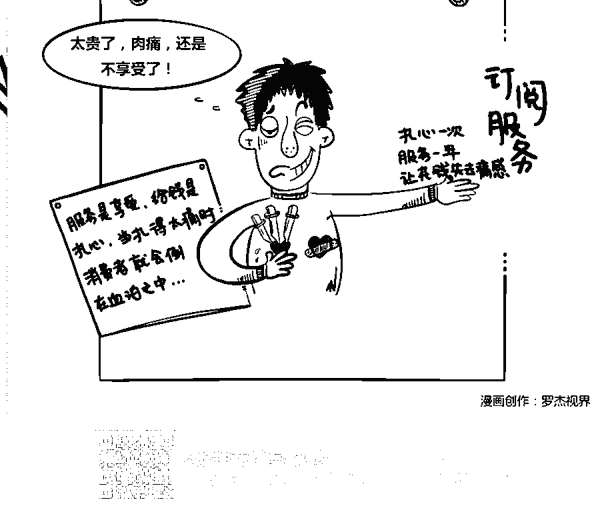

刘润

你有没有通过订阅服务，毫无痛感就花了很多钱呢？你的产品，也可以变成“订阅”吗？

欢迎你在留言区分享，与大家一起，过过招。也别忘了把今天的文章，分享给你的朋友，也许能够帮到他。

## 军情报：

《5分钟商学院·实战篇》线下大课的第一模块——理解用户深圳站的课程刚刚结束。在这次的课程中，我向同学们详细讲解了“现实自我与理想自我”、“TOFA模型”、“技术采用生命周期”等等这些未能在线上专栏中展开的知识。也通过全新的互动形式，将线上私董会带到了线下，逐一解答了大家最关心的问题。

之所以要举办线下大课，就是希望能够通过立体化运营，让同学们既能听到线上的高效的课程，也能在线下感受丰富的知识的冲击，打造属于自己的商业兵器库。

现在，第一模块的线下大课还有两站，分别是4月14日北京，4月21日上海站。我依然会用一整天的时间，带来一堂无删减版的线下大课，希望能够帮助大家彻彻底底全方位了解最终买单的用户。现场席位有限，点击下方的图片，即可报名。得到的用户，可享受八折优惠。

非常期待能在线下见到大家。

## 123 | 动态定价：出租车的价格是恒定的，Uber的价格一直在变，谁是对的？

每天5分钟，解决一个商业问题。欢迎收听，《刘润·5分钟商学院》，实战篇。

我们花了那么多时间研究“定价”，那价格一旦“定”下来，是不是就能去喝口茶、嘴口汽了呢？并不能。价格，从你定下来那天开始，就要准备好随时调整。今天，我们来学习动态定价。

2009年，美国Uber公司成立，让一群普通人开车，服务另一群普通人。这个模式在美国大受欢迎。但是，有个问题一直困扰着Uber团队，那就是供需的不平衡。

什么意思？每周六周日的凌晨1点左右，有大量用户投诉叫不到车。因为这时不少酒吧、夜店打烊，大量客人同时叫车，但Uber司机大多都回家睡觉了。这个“需求激增，供给锐减”导致的问题，还出现在恶劣天气，音乐会结束等等场景，用户非常不满。

怎么办？

亚当斯密说：别担心，市场有一只看不见的手，会通过“价格”，来调整供需关系。可 是，这只“看不见的手”，在哪呢？Uber公司决定不等那只手了，用自己的“手”拨动一下价格。他们调高了这个时段的价格。两周后，这个时段的车辆供给提升了70%多，有效解决了乘客的需求。

这件事情给了Uber极大的灵感。他们专门开发了一套系统，叫“Surge Pricing”，也就是“动态定价”，根据乘车需求量的变化，实时调整打车价格，调配车辆资源。

那实际效果如何呢？2014年新年夜，Uber发生了技术故障，动态定价失灵了26分钟。结果，叫车成功率，降到了平时的25%。这反向佐证了，动态定价确实有用。

## 概念：动态定价

到底什么是动态定价？

平常白菜2元一斤，过年白菜5元一斤，年一过完，白菜又降到2元一斤。这就是动态定价。新品上市时，用户疯抢，一旦对手跟上了，你就降低价格狙击对手。这也是动态定价。当季服装上新，你用原价销售。一旦过季，立刻打折处理。这还是动态定价。

### 运用：

原来如此。那其他行业，也能学习Uber，用科技来动态定价吗？比如……动物园？

当然可以。

美国有家“印第安纳波利斯动物园”，原来只有两个租放的门票价格：冬季10.95美元，夏季17.95美元。2013年，他们请动态定价咨询公司Digonex设计了一套系统，根据动物园容量，游园人数，预购票人数等，自动计算门票价格。新的票价，在8.2到29.95美元间波动。

结果，用户满意度大大提升，因为动态定价起到了很好的分流效果，让怕排队的用户不用排队了，嫌贵的用户可以买到便宜票了，而动物园的收入，也获得了持续提升。

厉害。可动物园只有一个产品，那就是门票。但我就是超市啊，有几万种商品，也能动态定价吗？

当然可以。只要你愿意。

亚马逊是使用动态定价的最大零售商之一，平均每10分钟，商品价格就会刷新一次，平衡买家和卖家的供需力量。亚马逊因此提升了不少利润水平。

美国线下零售商们也不示弱。大约有22%-36%的零售商，用“智能定价软件”系统，每10分钟扫描一次亚马逊的商品，并手动调整价格，提升了10%左右的毛利率。不少零售商，正在把价格标签，从纸质更更换为电子，进一步提高动态定价的效率。

太牛了！可是，如果消费者在货架前，看到薯片是3元，放进购物车时是2.9元，结账时变成3.2元，那不是乱套了吗？价格，还是要有点稳定性吧？或者，至少要“看起来”稳定吧？

这一点，你就不得不向航空公司学习了。

飞机上通常有三种座位：头等舱，商务舱，和经济舱。但你买机票时，却有十几种舱位，D舱，F舱，P舱，Y舱等等等等。通过把三种座位，细分为十几种舱位，航空公司掌握、并隐藏了动态定价的主动权。你买机票时，它会告诉你：“对不起，Y舱卖完了，只有F舱了”，而不会说：“对不起，我涨价了”。

### 今日得到

划重点

- 1. 动态定价的本质，是对供需变化的敏锐反应。
- 2. 互联网时代到来，使动态定价越来越快。
- 3. 动态定价咨询公司Digonex的CEO说：“5年之内，动态定价将成为旅游胜地的常见做法。电影、公园旅行社等很多行业也一样。”

刘润

你觉得，动态定价，和上周学的一级价格歧视（按人定价），有区别吗？出租车的价格恒定，Uber的价格一直在变，你觉得谁是对的？

欢迎你在留言区分享，与大家一起，过过招。也别忘了把今天的文章，分享给你的朋友，也许能够帮到他。

《5分钟商学院·实战篇》线下大课的第一模块——理解用户深栈站的课程刚刚结束。在此次的课程中，我向同学们详细讲解了“现实自我与理想自我”、“TOFA模型”、“技术采用生命周期”等这些未能在线上专栏中展开的知识點。也通过全新的互动形式，将线上私董会带到了线下，逐一解答了大家最关心的疑问。

之所以要举办线下大课，就是希望能够通过立体化运营，让同学们既能听到线上的高效的课程，也能在线下感受丰富的知识的冲击，打造属于自己的商业兵器库。

现在，第一模块的线下大课还有两站，分别是4月14日北京，4月21日上海站。我依然会用整一天的时间，带来一堂无删减版的线下大课，希望能够帮助大家彻底底层全方位了解最终卖单的用户。现场席位有限，点击下方的图片，即可报名。得到的用户，可享受八折优惠。

非常期待能在線下见到大家。

理，在何种程度上影响了你家乡的历史？

请你写下自己的留言，最好是在150字左右。我会把最精彩的留言挑选出来，我们一起欣赏欣赏。

## 知识账本

### 划重点

并不是所有靠近海洋的民族都愿意出海。中国尽管有漫长的海岸线，但始终对出海不感兴趣。这又是为了什么呢？中国自古以来就和东南亚国家有密切的联系，下南洋的华侨不计其数。如果做贸易，中国的商人可以把货物送到马六甲，然后再由印度商人、阿拉伯商人把这些货物卖到非洲和欧洲。然而，从历史上来看，中国保持相对封闭的格局并不是错的，而是一种正确的选择：因为我们要把最主要的精力放在国内稳定和预防北方游牧民族入侵上。

## ——▶ 昨日课程复习 ◀——

## 何以中国2：中国为什么是小农社会（下）

通识日课：

你可能会说，中国早就不是乡土社会了，新一代的年轻人早就没有小农意识了。真的是这样吗？先不要把话说得太满。找找看，在我们的身边，是不是还有一些乡土社会和小农意识的痕迹呢？

农业社会，个人努力对农业产出其实很容易触及天花板，收入是固定稳定的，所以勤俭节约是优良品质。但是现在已经是市场经济了，不在此物质匮乏的年代，衣服不再每次过年买一套，吃也不是吃不饱，想吃啥买啥。可是在人还留着勤俭节约的这个优良品质，家里没人收拾舍不得请保姆，总是希望自己做菜舍不得下馆子，觉得衣服还是手洗的比较干净，洗碗还是要用自己洗。时间总是有限的，你做了这个，另外一些你就没法做了。选择了打扫卫生，就没时间休闲娱乐或者更好的提升自己。这是小农经济对我的影响。时代已经变了，但是生活习惯我们的优良品质没有做相应的调整。

何帆说 另俱乐部

## 125 | 读拳谱：人工智能+内容生产研究报告

125 | 读拳谱：人工智能+...

每天5分钟，解决一个商业问题。欢迎收听《刘润·5分钟商学院》，实战篇。

这两周，我们学习了做产品。做产品这件事非常有挑战，会消耗很多时间，那如何提高做产品的效率呢？在未来，做产品时几乎一定会大量跟人工智能合作，来节省成本和提升效率，尤其是在做内容产品方面。今天我就來读一份关于人工智能+内容生产的研究报告，这份报告是亿欧在2017年12月发布的。

在过去，文章、图片、视频、游戏等内容的生产，非常强调创造性，基本只能由人来完成，那现在，有了人工智能，是否就可以帮助我们做这些创意类的工作呢？如果可以，人工智能能够在哪些方面来帮助我们生产内容，它能够做到什么程度？我们通过这份报告一起来看一看。

## 1. AI+文字创作

报告中提到，人工智能已经可以写诗、编剧、写小说、写新闻稿了。那他们现在能写到什么水平？2017年5月，微软的机器人小冰，出了《阳光失了玻璃窗》，里面有这么一首诗，你们感受一下：向着城市的灯守着我，咬破了冷静的思想，你的眼睛里闪动，无人知道的地方。

在编剧、写小说方面，目前人工智能主要在人的配合下完成剧本创作，题材集中在科幻、恐怖领域。如何配合呢？有几种方式，人创作主线，机器填充内容；或者机器生成初稿，人进行修改；或者人机接龙，创作故事；或者机器提供编剧建议等等。

比如，有一本由人创作主线，机器填充内容的小说，叫《电脑写小说的那一天》。

> "那天，云层低垂，闷得让人透不过气。但房间里却十分舒适。洋子穿着宽松的衣服，坐在沙发上，打着无聊的游戏打发时间，没有和我讲话……"
> 
> "这是人生中第一次，我如此既喜又悲，忘情地写作。计算机写小说的这一天终于来了。电脑可以优先追求属于自己的欢愉，再也不用为人类服务。"

## 2. AI+音频内容

报告中讲到，现在人工智能已经可以生成乐曲、制作歌曲、以及合成说话。

## 3. AI+图像内容

### 今日得到

### 划重点

- 1. 目前，人工智能在文字创作、音频内容、图像内容三个领域已经大有作为了。但是即便如此，人工智能生产的内容，在全部媒体内容中的占比还很小，制作出的内容效果还不是特别稳定，尚处于早期阶段，还有很长的路要走。
- 2. 在小部分领域，人工智能可以实现自动生产内容，但是在大部分领域，人工智能更适合与人协同完成内容的制作。
- 3. 在未来3-5年，也许更久，人工智能会更加成熟，成为人们制作内容的主力帮手。

刘润 如果你想看这份人工智能+内容生产的完整报告，可以在我的公众号“刘润”（runliu-pub）回复关键词“报告”领取。

军情报：《5分钟商学院 实战篇》线下大课的第一模块—理解用户深耕点的课程刚刚结束。

## 第25周周末私董会｜传统渠道商如何发展新生态模式？

每天5分钟，解决一个商业问题。欢迎收听《润湿5分钟商学院》实战篇。

5分钟商学院的同学们，大家周末好！又到了本周私董会的时间了。

本周获得私董会提问资格的同学是：

润总，您好！我是某大型知名白酒品牌，2018年新品的全国总经销商。经过一年多跟随润总的学习，使我受益匪浅，对传统商业模式有了更多的思考，并进而制定了“加强老生态，创建新生态”的双轮驱动新目标。在老生态（传统供应链）板块，今年我们将在江苏、浙江、河北等传统强省，继续做好渠道的建设、提升工作。在全国其他市场区域，我们希望通过优化供应链的方式，调整代理环节，重构渠道关系，探索建设出一种新生态——让消费者得到更合理的产品价格，让渠道伙伴的市场份额、利润率得到提高。目前，我们正以消费场景为切入点，寻求与白酒消费的主场景，即与中档餐饮门店的深度合作，我们希望把中餐、火锅品牌商旗下加盟店家作为我们新的渠道伙伴。他们既可以在门店内专卖产品，也可以在当地深耕直销渠道，通过产品直达门店、直通消费者的方式，让店主拿到更具有竞争力的价格，提升利润率，让消费者更容易买到真正物美价廉的优质产品，提升消费体验。目前新生态模式已在尝试阶段，以下问题急需请教润总：1.目前探索的方向是否正确，新生态是否具有可行性？2.新生态里，谁会是更好的渠道伙伴？3.新生态里，如何让消费者获得更多的满足感，与消费者和渠道伙伴建立更紧密的关系？4.如何有效地推广和加强我们的新生态模式，使这样的新生态具有越来越强的生命力？5.新生态发展的下一阶段方向是什么，后续分为哪几个阶段比较合适？

刘润

提问的同学是一个知名白酒品牌下面新产品的全国总经销，俗称总代理。过去的白酒经销模式是通过层层代理的方式分发到下面，但现在他想做两件事情。

我看了一下一留言，很多同学提出了特别好的观点，有很多都是酒类从业人士给出的专业看法，所以强烈建议同学们不仅收听我的观点，也要看一看留言区被精选出来的留言，都非常有参考价值。下面我从框架上来理清这个同学的问题，未来如果遇到类似的问题，可以用今天讲到的方法来思考。

那么思考这一类问题，我们用的框架是什么呢？今天我们还是用它来解决问题。

首先，我们分析一下这个产品。

这个产品是一个知名品牌白酒的新品类，提问问题的同学他是渠道商，所以说从产品、营销和渠道这三个角度来说，产品不是他做的，营销也不是他做的。要分析他应该怎么给渠道方面做一个新生态，我们从下面几点来说。

## 一、关于产品定位

这位同学有个很好的想法，要把火锅店作为一个渠道去销售。火锅店通常不是商务宴请的地方，而如果你要把商务宴请作为主要营销渠道的话，那你的酒可能也要和其他白酒有一些区别了。大家在商务宴请上喝的比较多应该是茅台、五粮液或者一些已经有知名度的酒。那为什么大家商务宴请喝这些酒呢？真的是因为好喝吗？我们都知道很多人在家的时候，并不喝商务宴请时喝的酒。因为呢？因为商务宴请的酒最大的特质是请别人喝的时候，特别有面子。比如说这个酒里面有金箔，金箔能不能放酒里面喝我不知道，但这个金箔酒就是让花钱的人觉得有面子，喝酒的人觉得稀奇。那么这种酒就比较适合在商务宴请上来做。如今我们纯粹来谈渠道已经变得越来越难了，所以产品一旦跟场景结合，第一步要对你的特定人群精准定位，然后包装自己的产品形态。

当然，我还是想说虽然这个同学对产品并没有直接的控制权，但是如果真的要面对这个渠道，还是应该去影响这个厂家。

## 二、关于营销定位

营销是做宣传、推广。想把一款酒做出名声来，最主要的是靠营销。甚至包括茅台酒，如果不是因为周恩来总理、万国博览会等，不一定会有今天这么大的知名度。当然了，酒与酒之间当然有品质上的差异，但相对营销带来的差异的话可能是十倍、百倍于酒本身的差异。所以营销是酒类产品最大的一个力量。今天大家可能经常讨论的江小白，它之所以获得了比较大的成功还是靠营销。酒类品牌最核心的就是营销，所以当你要去加盟和经销这个品牌的时候，一定要看看这个品牌本身的营销团队够不够强大。因为营销团队的努力又跟产品定位是极度相关的。

## 三、关于渠道的定位。

这位同学做的是渠道总代理，在过去代理的路径比较长，大家都赚不到钱。所以这位同学想缩短这条路径。其实，这个问题和我们上期私董会的问题很像，之前我们也做过相关内容的 Schluss。听过上期私董会的同学应该都知道，我把缩短这条路径的方式称为短路经济。短路经济简单地说就是，把中间环节缩短来提高整个供应链的效率。这位同学他要做的事情是符合这个时代要求的。

但是，如果真的提高了效率，假设之前卖98块钱一瓶，现在因为短路经济可以卖88块一瓶，也不见得能大幅度提高这个酒的销量。因为一瓶酒卖多少钱这件事其实是没有个公允的标准。不像黄金，1克300多块钱是公认的价格，如果把1克黄金的价格从300多降到了200多，那么马上就会有人蜂拥而至去抢购黄金。但当产品的价格没有公允的计算标准时，那么通过价格的变动去影响销量，那么销量不会有很明显的变化。

还有一点，过去这些酒也会卖到中餐馆、火锅店等等场景，只不过以前不是总代理直接卖。现在你要想缩短中间环节的话，除非你有个方法可以提高这个环节的效率。比如说你已经有中国某个城市，或者在中国所有的中餐馆的联系方法，通过电话就能跟他们达成合约。如果这点你做不到，那说不定成本比找一个市级代理商的成本还要高。

另外，把火锅店发展为代理商，我觉得比较困难。我们要想，这些消费者买酒是在什么场合喝。宴请和回家自己喝酒是两个场景，大部分人会觉得在自己家里不用买那么贵的酒，只是在请人喝酒的时候才会喝五粮液、茅台或者剑南春。所以你遇到的问题是从一个消费场景，再跨到另外一个消费场景，其实难。火锅店自己的主营生意是火锅，经营火锅店这件事已经很不容易了，如果你让他放在那里卖，也就顺便卖卖而已。但如果你给他销售压力，需要他专门组力量或者给他设定考核目标，那可能他们没有这样的时间和精力可以做好。

那么在渠道上应该怎么来卖呢？

这个渠道如果真的要拓张的话，也许可以学美国人卖酒。我们比较少看到有人在超市里买洋酒回家送礼，洋酒的主要消费场景是夜场、KTV还有酒吧。很多人在家从不喝洋酒，但是大家聚会、唱歌、聊天就开瓶洋酒，所以这是一种消费场景。虽然中国酒文化源远流长，但基于场景卖酒，可能真的应该跟洋酒去学习一下。那么在特定的场景之下，会有专门的白酒的促销员，就像啤酒或洋酒行业一样。白酒也许真的可以学习一下，在特殊的场景下来促销。

## 总结

今天我们主要讲到了三件事：

- 1. 产品
- 2. 营销
- 3. 渠道

下面我公布一下这次私董会问答的10位获奖者，他们分别是：

请中奖的同学在本文文章下方留言中，写下你的联系方式及手机型号（每人将获得600元奖学金，以充值的方式返还到你的账户）。

## 一、这种新生态是否可行？

直接进入餐厅，无疑提高了传递价值的效率，同时青山同学在构建新生态的地方，不再设立经销商，也是对餐厅渠道的保护，这确实是可以尝试的一种方式。实际上，即使白酒销售渠道的多元化，但是在场景上，有6到7成的白酒是在餐厅完成消费的。所以，有些厂家包括流通商早在2016年开始，就已经开始和餐厅合作，用B2B的方式完成销售。比如酒类流通企业，四川1919企业管理有限公司，在2016年就和成都近千家酒楼，以及全国大部分“海底捞”合作，进行酒水的直接供应。由此可见，青山同学面临的情况是，大的餐饮品牌在地方的门店，可能已经有人进入并且形成合作关系，所以，留给青山同学的是，一些品牌相对较小的加盟店。如果是这样的话，这个新生态中，只有这些加盟门店，就显得太过单薄，还无法称之为新生态。由此就带来了第二个问题。

## 二、新生态还有哪些可能的渠道伙伴？

- 1.新型便利店，新零售物种。比如天猫小店、盒马鲜生、7-FRESH。如果能进入阿里的零售通，给阿里系的便利店，以及盒马鲜生来供货，无疑是一个很好的选择。
- 2.社群经济。找到能直接对接小区消费者，特别是高档小区的社群，和他们合作，直接供货。像虫岛邻里这样社群运营APP，由于和社群终端有很强的链接和信任关系，因此它可以在终端用户处销售很多品类的产品。可以去和这样的社群运营方合作，通过直供给予价格优惠，让运营方和消费者都受益。
- 3.和垂直电商合作，比如京东、酒仙网之类的。
- 4.和团购网站合作，定期进行新品类的促销活动，一是拉动白酒销售，二是实现广告营销。
- 5.在餐厅的2B模式上，打通2B2C的模式，也就是说用户可以在餐厅以优惠价格直接购买白酒。同时，如果能和美团合作，打通线上线下，这样，用户订餐的同时，也可以订白酒，通过美团直接送货上门，实现店面O2O的模式。

你好同学，我们先来分析一下白酒市场主要的消费场景。

- 1.在餐厅聚会、宴请
- 2.在家小酌、宴请、聚会
- 3.在KTV等娱乐场所

## 一、作为年轻人代表的白酒品牌，“江小白”相信你也听说过。

“我是江小白，生活很简单”这句话和他的卡通形象完美地阐释了都市青年的心理，而大家看到这个品牌的卡通形象，就有一种代入感，从而对江小白这个品牌抱有好感。“江小白”创业初期在重庆就以微博为主要的宣传阵地，渠道选择大小的餐厅酒馆合作（初期与燕京啤酒渠道商合作销售），主推“江小白表达瓶”，让白酒代替年轻人阅读表达情绪，在朋友圈、微博爆红。在微博里，我发现只要有江小白的关键词出现的地方，都会有江小白的官方微博回复，这个有点儿像小米手机的发展策略。现在“江小白”有做动画、漫画和电影等的广告，打造“江小白”这个大IP。相信“江小白”在未来随着中国的消费升级，能占据更大的市场，走出国门。

## 二、“老村长”白酒。老村长就是坚持久做大众酒，在乡镇乡村这个市场，稳扎稳打，做深做透。

接下来回答同学的问题。第一，同学这个生态是可行的，能关注到消费场景，相信你营销方面也是有想法的。我可以给你的建议是品牌加入情感链接，对品牌植入感情，在某个消费场景里首先能想到你的品牌，这是白酒业生存发展的先决条件。第二，白酒可以有更多的渠道，首先啤酒和佐酒产品的渠道就是很好的渠道。现在是互联网和新零售的时代，传统的...

## 一、这个探索方向是否正确，其实就是在讨论能否跳过中间的批发商环节，由总经销商直接连线零售商。那批发商的作用主要有哪些呢？

- 1.批发商接触面比较广，常常比生产商更多得到买方的信任。
- 2.批发商可以高效地采购产品，迅速把产品供应给零售商和生产企业，提高顾客的采购效率。
- 3.批发商可以减少生产商和零售商的仓储成本。
- 4.批发商可以迅速发货，并提供相关的运输服务保证。
- 5.批发商会经常帮助零售商改进经营管理。如培训销售人员，帮助零售商建立库存货控制系统。

而现在如果你想跳过中间批发商的环节，直接去面对零售商甚至消费者的話，就需要去考量满足以上作用的成本，如果你公司自己来搞这些的成本更低，效果更好，那你这个方向是可行的。

## 二、谁是更好的渠道伙伴。因为你已经把你的渠道目标定义在中餐厅和火锅品牌身上了，那这里就需要提到消费场景了，也就是你的这款新酒的定位、内涵到底是什么，符不符合你所说的中档餐厅、火锅店。因为您没有细说您的产品，那这里只能分析下中档餐厅和火锅店的消费场景。

中档餐厅一般是聚会的主要场景，家庭、商务都会出现，那如果是酒类产品，一般消费者会选择中高档酒品，内涵要凸显档次；而火锅店是另一种消费场景，也就是小聚、热闹。比较火的火锅场景饮品就是某茶饮品了，那您的产品定位是否符合就需要您的判断了。

## 三、这个问题需要分为两个点给您解答。

### 1.如何增加消费者的满足感？

那就需要与渠道之间签订协议，协议中必须规定加强消费者服务的具体要求，提高服务，另外还要制定与渠道合作进行的有特色的面对消费者的促销活动。如通过买赠、积分奖励等来吸引消费者，让其受益，这样就可以与渠道和消费者建立起更紧密的关系。

### 2.如何和渠道建立更紧密的联系？

您可以与零售商在促销策略、定价与成本控制、商品展示、购销活动等方面协调关系或给予帮助和指导。同时可以在资金金融、技术咨询、管理协助等方面，给零售商一定的优惠条件。

## 四、如何强化这种新模式的生命力。首先您需要做到第三个问题中所提到的事项，以最大程度满足消费者、满足零售商。而具体来讲，包括以下几点：

- 1.进行竞争分析，制定有差异化的服务消费者措施；
- 2.进行充足的市场分析；
- 3.建立渠道标准，筛选并确定渠道，做好布局；
- 4.签订协议；
- 5.做好渠道价值链及管理，统一销售价格；
- 6.制定有效的市场方案。

## 五、下一个阶段应该如何进行。您也提到了，您这个是知名品牌的
ew产品，那已经有一定的品牌知名度，但是它自己还是一个新品，那您的下一步方向就是建立这个新产品的形象，提高市场占有率和销量。具体方法就是：

- 1.优化渠道；
- 2.在渠道中做好品牌宣传工作；
- 3.制定渠道及消费者奖励政策并实施；
- 4.做好渠道管控。

您公司目前是传统生态和新生态的双轮驱动的发展模式。但新生态是什么，如何从传统生态向新生态转型，我想就这个问题和我的一些思考和您讨论一下。

## 一、新生态是怎么来的

我们要了解新生态，就得先了解新生态是怎么来的。我们都知道，现在的新生态、新经济、新零售等等所有的“新”，是因为互联网技术的发展引起的。如果我们从更远的历史去看技术进步和经济发展之间的关系，不难发现，每一次技术进步都会形成与之相匹配的技术一经济范式，同样也会形成与之相适应的组织原则，最后也都会造成消费文化的变迁。也就是说，随着互联网技术的进步，原有的经济范式变了，组织原则变了，消费文化变了，也就意味着过去的经验在未来无法延续了。

## 二、传统生态向新生态转型的窘境

刘润老师多次和我们说过创造价值和传递价值的概念，您作为总经销，您向往新生态，就必须考虑如何提高价值传递的效率，减少中间环节。每多一个中间环节，就多一层价值的消耗，最终都要消费者买单。既要降低交易成本，去除中间环节，又要满足各地各级经销商的利益，同时还要给客户最大的利益，这本身在逻辑上就存在着矛盾，这也是传统业态向新生态转型过程中的窘境。

## 三、关于s2b2c模式的新生态转型的探讨

### 1.s2b2c（ 即 supply to business to customers）是曾鸣教授提出的概念，是供给平台化的模式，也是我认为在当下互联网时代背景下，作为传统供应商的一种可行的经济范式。您公司作为上游供应商面临新生态的压力，您下级的供应商，您的零售终端，也同样面临新生态的洗礼，谁也逃不掉，这就是机会。

### 2.整个产业链都逃不掉新生态的压力，但您的下级经销商，也就是成千上万的小b，他们没有能力，也不知道如何向新生态转型，他们在大潮流下只能随波逐流。您作为S，要帮助您的各个小b实现在线化，所以第一步，就是要给各个小b提供SaaS化工工具，这样您的b就大大提高了效率，与此同时您将拥有这些小b的所有的进销存等数据。您只是这些小b的供应商之一，但却获得了小b的所有数据。当拥有一定规模的小b联合起来就可以进行集中化的采购。

### 3.当您完成了对小b的智能化改造，然后联合众多小b对他们共同所需要的其他资源进行集中采购，降低他们的成本，他们越离不开你。那么产品从生产出来，到各大S，比如您公司，再到下级各个小b，再到消费者，中间除了开始的制造环节和最后的交付环节，其他的环节都在您的掌控之中。s2b2c本质上是网络协同，通过互联网的方式让更多角色参与，共同服务c端。所以参与的角色越多，价值越大。最后，当拥有足够多的數據，您可以反向影响上游生产厂商的生产计划，也可以帮助众多小b制定更科学更个性化的营销策略，这就是数据智能。

## 四、总结

作为价值传递型企业，你和你之下的各层级的小b，转型升级的本质就是降低交易成本和提高效率，这需要借助互联网技术。但小b们做不到，所以需要你们这样的大S来做，你们帮助他们实现转型，给小b赋能，和小b一起服务海量的c。这样，您不只是淘金者，还是那个卖淘金设备的人。《孙子兵法》有言“求之于势，不责于人”。我想这就是您所在行业新生态下一阶段的样子，这就是势，要顺势而为。

同学，你好！首先，对于这个探索方向是否正确的问题，其实就是在讨论能否跳过中间的批发商环节，由总经销商直接连线零售商。另外，青山同学提到 的新生态，其实就是短期前几天讲过的短路经济，通过减少中间渠道去和其他品牌争夺市场份额。渠道商作为传递价值，被短路是时代的趋势。但是我也有一些建议和你分享。

- 1.不要局限思路和销售场景。因为白酒的消费场景，不等同于喝白酒的场景，在餐厅喝酒只是消费白酒的一种形式。很多时候也会在其他场景中可以达到一个理想的销售效果。所以寻找白酒的消费场景不能局限于餐饮。
- 2.你的渠道伙伴在哪里？其实换个角度想，人家为什么会和你合作？那一定是基于你的产品，你能给他提供的价值和利益。人家成为你的渠道商肯定是站在他们的角度上想，而不是从你的角度出去想。所以想办法挖掘你产品的核心价值和营销方向，因为在产品上的附加价值才是你的核心竞争力。

是你的核心竞争优势。

## 3.要懂根据实际情况进行短路经济的运用。

白酒与快消费品销售有很大的不同，它需要更多的信任与沟通甚至是服务，除非你有茅台、五粮液这样的品牌号召力。当然了，他们也是靠营销产生的这种影响力。

## 4.在价格方面要注意价格锚定。

白酒不像其他一些东西，对于一款新的白酒，你很难说清楚这个酒品质值多少钱。由于每个价格带都有不同的消费者聚集，一味地降低价格反而会失去更多的消费者。所以要在消费者心中种下一颗种子，告诉消费者这款白酒就值多少钱，你买了这款酒就相当于买了另一种附加价值，比如面子、高品质、健康。

以上是我的建议。

同学，根据你的问题我做了如下分析：

## 一、人们为什么要喝白酒？

在中国人眼里，消费者对酒的需求的本质是社交，是连接情谊，而白酒相对于其他酒品的优势在于接地气儿、度数高，进入high点快。一般在商务宴请的饭局中，往往有利益诉求，总有一方是略低于另一方的。当白酒的high点上来之后，人的判断力和心理设防都会下降，所以可以更交流情感，以达成目的。

## 二、谁是更好的渠道伙伴？

需要根据你的产品分析适合场景，使用场景和消费场景。然后根据场景和用户，明确渠道伙伴和合作方式。当然了，区域这个因素也是至关重要的，选择开拓新城市时，尽量先选择那些还没有完全被其他白酒品牌深度植入的，一个品牌在人们心中植入之后很难再撼动。

## 三、怎么建立新生态？

要想与消费者建立更紧密的关系，就是让消费者受益。如何降低定价率，降低在流通环节中的成本就是你的目标，这样可以让你获得更多利润并且让顾客获得实惠。建议你可以选一个典型的地区，首先先点爆破，摸清套路后快速复制。

## 四、库存怎么办？

如果全国总经销商能够和所有的线下渠道直接联网，那么势必会有库存方面的问题，当然了，如果经销商在处理库存时能够巧妙运作渠道资源，却可以借此扩大市场占有率。

糊涂青山同学关于新生态的思路，就是润总曾经在五商基础篇讲到的越靠近消费者越有价值的理念。我只说我想到的两点隐忧和三个建议，供糊涂青山同学参考。

## 一、两点隐忧

### 1.由于实行双轨制，势必造成地区与地区之间，新生态与旧生态之间的差异与矛盾。在利益分配、价格、供货和服务优先级等方面的直接或间接竞争，使所有经营者对周边的上下游产生严重不信任感，形成品牌内耗。

### 2.设置的消费场景过于单一，不利于拓展产品的销售，不利于提高产品的市场占有率。三点建议：为了有效地实行双轨生态驱动。

### 二、建议

1.渠道定位要细分，分别满足新旧生态下的需求，不同生态下产品定位一定要差异化。大品牌可以占据大渠道，但无法占据所有场景。双轨制在规划产品时如果可以有所侧重，既有占大渠道的，又有占小场景的，就可以做到通吃了。老生态主打大品牌、大渠道，而新生态主打新潮、前卫、个性等特点。举个例子，把它规划成大品牌下的子品牌，老糊涂，小糊涂，不糊涂，小机灵鬼儿等等。老品牌占老生态，抢大渠道。子品牌，走个性化，成如江小白，或者江糊涂等等。

2.经营产品要根据老生态，新旧生态下所售产品调性完全不同，从而可以发挥新旧生态各自的优势，便于协调管理，同时让不同需求的消费者各取所需。不同生态模式下的各自营销还可以促进整体品牌下不同产品线之间的良性竞争。

3.运营要搞新技术，建设企业互联网思维。即企业以互联网为依托，通过运用大数据、人工智能等先进技术手段，对商品的生产、流通与销售过程进行升级改造，进而重塑业态结构与生态圈，并对线上服务、线下体验以及现代物流进行深度融合。而糊涂青山同学正在做有效的尝试。以上观点供糊涂青山同学参考，祝商安。

糊涂青山同学你好，我之前是在一家酒店专门做大型宴会的，主要是以婚宴为主，其次是大型商务宴请，所以我仅站在宴会销售的角度，分享一些需求方对酒水的诉求点，希望能对你有帮助。

## 一、潜在市场：

我身处一个三线城市，和我业务性质相同的场地至少有80个，按每个场30个座位，每席1瓶白酒，每瓶白酒45元，每年每个场地可以接待100场计算，大型宴会的白酒将会有1080万的潜在销售额，如果是一、二线城市应该更多了吧。以上都是保守估计，实际我在的酒店平均每场50席，每年160场，45元成本的酒水是最低标准。

## 二、酒店对酒水的诉求：

首先，酒店的诉求主要取决于客户的需求，我们接触过的客户99%其实是根本不懂酒的，他们选择酒水主要看两个方面：

- 第一，认不认识（要放心）；
第二，够不够档次（要面子）。

其次，因为现在开始进入90后的适婚期，而90后相对80后的人口少了40%，诸多肉少的情况趋势愈发明显。为了保证业绩，所有酒店都在开始提高优惠力度，酒水赠送必然会成为其中一项，1白1红2喝2饮料都将不会再是客户买单，而是由酒店赠送给客户，也就是酒店出钱。

## 三、酒店对酒水的选择：

- 第一，客户认识，不需要酒店再对你的白酒进行二次营销。因为近几年各媒体对白酒生产企业的曝光，导致客户对白酒的质量问题相当敏感，客户对白酒品牌的质疑经常会影响到酒店的主营业务（这方面红酒要好得多）。
- 第二，批发差价要尽量大。批发价低，酒店才送得起，市场价高客户才会觉得酒店送的白酒有价值（这方面还是红酒要好得多）。

综上，个人认为白酒目前最需要的还是一个品牌知名度，现有全国市面上看得见的白酒千百种，只有提高自身的品牌知名度，才会消除客户的质疑，所以大规模的广告投放还是有必要的。有针对性地设计一些产品我觉得还是有意义的，比如针对婚宴设计一款喜酒。对于宴会这条渠道，发展基层销售基本是没用的，因为是酒店买单，并以销售政策的形式赠送出去，所以一定要找政策的制定者，一般会是营销负责人或者销售负责人，说服他们把你的白酒纳入销售政策，然后维护好就行了。以上是本人的一点点见解，希望能够帮到你。

润总、糊涂青山，你们好看了各位同学的留言，我也想来过过招，和大家探讨一下。我就这一个角度的建议，再提出一段关于产品定位的建议。

## 一、这个项目最大的优势，是糊涂青山同学是某知名白酒品牌新品的全国总经销，拥有很多的资源和渠道。劣势是推的是新品。

大家可能会太低估了推新品的难度。对业务员来说，推大品牌的新品就如同做新品牌。头顶上的大品牌名字，不一定给你带来销量，可能还会带来阻碍。例如可口、百事、统一、康师傅每年都推新品，哪个新品好卖？哪个新品都被自己品牌的原有品牌压着来打。所以，我的第一个建议是，重心不要放在原有的成熟区域。市场越成熟的区域，越难有发展。不要说北上广深生意好做，那是因为人口基数大，你算算投入产出比就知道生意不好做了。现在是小城市比大城市好做，县城比市区好做。越是不成熟的市场，越有缝隙插针的机会。但也要考虑地区的人口基数，虽然

机会。但也要考虑地区的人口基数，虽然苍蝇也是肉，但是打市场，毕竟资源有限，投入产出比很重要，尤其是前期。

## 二、要管理好二级经销商和做好渠道，地推是业务员和二级经销商配合才行的。

一般情况下，经销商不会只要你一个品牌，尤其你的还是新品。经销商会偏重于成熟品牌的配送、推广和维护。所以做好经销商的奖励方案和及时沟通很重要。做渠道要精准，尤其在前期。因为业务员也是人，人都是厌恶失败的，如果定位错误，地推的成功率就会很低，成功率低就容易士气低落。所以要从最容易见效的渠道入手。例如很多同学都提到的餐饮渠道。但是我不建议从海底捞这样的火锅店做起。虽然它们店多，销售大，但是我见过有几个EN吃火锅喝白酒，一般都是喝啤酒的吧。全国情况，我不了解，但是南方的几个省，吃火锅，尤其是川味火锅，都是喝啤酒，还是一定要冰冻的。不如攻一些做婚宴的酒店，南方几个省是这样的，很多婚宴是套餐制，每桌送饮料、啤酒和白酒（羊毛出在羊身上，你懂的）。很多顾客都不会另外买酒了。只要能进酒店套餐，一家店每天二三百瓶是有的。能攻下一定数量的酒店，区域最低销量线就达到了，和经销商，和厂家，和业务员谈判都有了筹码。所以每次区域的情况不同，市场调研很重要，找到目标，事半功倍。

## 三、鼓励资深的业务员做区域经销商。

我见过很多资深业务员改行当经销商的。市场熟悉，又能谈业务，又会做生意，在区域又有Interpret，还对老东家有特殊的感情，业务比新招的经销商好太多了。一线的业务员，最怕坐在空调房的领导瞎指挥。如果实在没有方向，可以第一阶段让大家自己去闯一下，找到做得好的，深入研究，总结成经验推广开来。以上是我的一些浅见，希望和大家交流。

糊涂青山同学，我的建议如下：

## 一、场景：喝酒大部分喝的不是酒，而是情感和氛围。买白酒的人大概分四种，一种是商务请客，一种是送礼，一种是大型婚庆活动，还有一种是自己喝。针对这四种不同的人群，我认为有不同的场景：

- 1. 商务请客。我觉得传统的火锅店、服务员推销的方法不妥，很多重要的宴请是去到现场才找服务员买酒的，一般都是自带。

  - 1）高档酒店。跟餐厅进行联动合作，在电梯里卖广告（最吸引注意力的地方），来一些好的助兴口号。在前台显著地点放置酒的样品，进一步提升逼格。然后，买我的酒，可以送一个小酒杯之类的的小礼物甚至抵扣多少钱，既赚到了面子，又拿到了实惠。

  - 2）私房餐馆。二三线城市的请客会所现在很大一部分从酒店转移到私房菜、农庄等特色地点，直接由地区代理送货到餐馆。送货距离不远，可以很快到达，哪怕再来一瓶也很能满足。这些地方一般不收取开瓶费，哪怕收取，可以提前跟当地所有有名的餐馆做好战略合作，经销商送的酒不收取客人开瓶费，由经销商给饭店回扣。

- 2. 送礼。送礼的人群大多数集中在30-40岁，他们的送礼对象一般是老领导，喜欢喝白酒的概率很大，怎么找到这群人呢？通常仕途的升迁和论文职称的提升是有相关的，通过杂志社找到这群人，toC精准营销；或者和杂志社建立异业联盟，发表论文就送小瓶装精装白酒，试喝觉得好的打折批量出售。注意这个途径卖的白酒，最好配上特别一点的瓶子，拿出去喝有面子，放在酒柜里也不掉档次。

- 3. 大型婚庆活动。通常这种场合，品酒的人少又少，酒品保持中等水平以上即可，关键是瓶子外观，一定要和喜庆沾边，甚至还要来句“喝了XXX，性福胜XX”之类的广告语（对不起邪恶了），总之就是让人看到就忍不住发朋友圈的那种。再和婚庆公司、酒店搞好合作关系，配以合适的优惠和回扣。

- 4. 自己喝。这个目标群体，以年纪偏大，日常小酌，请请老友为主。应打造中端档次、小瓶装为卖点，单次消费不高，以频率取胜。

## 二、可以提高文化体验，建立会员制度，每月88元，送小瓶装新品体验，附赠酒文化化等延伸文化产品；连续订购6个月，送精美礼盒可以将6瓶酒打包送出，提高客户黏性。将白酒的消费的心理账户转移到个人提升账户或情感账户，增加客户购买欲望。

刘润

下一周，获得私董会提问资格的同学是：

润总您好！我就在职于“遛娃团”，这是一个服务社区的亲子玩、学社群，目标是增加父母对孩子的优质陪伴，以0-15岁孩子的家庭为服务对象，解决爸妈们不知道带着孩子去哪里玩？玩什么？跟谁玩？这三大痛点问题。

我们为付费会员提供五大会员权益：产品服务、活动赛事、社群福利、线上课堂、社交圈层，目前已覆盖全国近30个城市。
随着加盟合作团队的不断增加，各地团队运营出现良莠不齐的现象，主要有以下三个问题：

- 1. 团队建设效率低。很多团队是跨行进入的，对于社群模式理解不透彻，总部对其辅导吃力，沟通成本很高。

- 2. 优秀带头人难寻。部分团队首次创业，城市总经理创业经验不足，管理能力不强，团队带不好、业绩上不来。

- 3. 扩张模式未定。业绩比较好的团队，都希望被我们直接收购，但是我们还不打算太快启动收购。

目前，作为初创公司来说，如何稳健快速扩张是我们全国布局工作的主要思路。

问题：
1. 接下来是否应该收缩加盟合作通道，转为以自营拓展为主吗？
2. 对于已经出现疲态的团队，我们是应该启动清退还是继续坚持久协助呢？
3. 对于加盟管理还有什么更好的模式吗？

好消息是，5分钟商学院立体化运营的重要组成部分，商业进化论之海外游学第六期，问道南美即将开始了。在加拉帕戈斯群岛、以色列、南极、德国、北极之后，7月17日-7月30日，我将带领18位同行者，一起飞赴南美洲，探寻亚马逊丛林的狂野之美，马丘比丘的神奇之美，并一路举行四场私董会，享受商业之美。

坏消息是，我在前五期的同行者中公布了这个消息后，18个席位已经全部被预定一空。但是为了让更多5商学员能够参加此次游学，我请合作机构额外申请了2个舱位。感兴趣的同学，

## 加餐｜独家分享：西门子公司全球高管大会演讲

每天5分钟，解决一个商业问题。欢迎收听，《刘润·5分钟商学院》实战篇。

前几天，我从上海飞了13个多小时去柏林，只给西门子公司做一个多小时的演讲。其实对我来说，飞这么远讲课的时间成本太高，平常我是不这么做的。但这次是德国西门子公司全球的高管会议，我作为最后出场的演讲嘉宾，说明他们还是非常重视这件事的。给外国人讲中国商业，我觉得也确实很有意义。今天，我把这次英文演讲的内容整理成中文，独家分享给5商的学员，大家随时随地就可以收听此次演讲的精华，我觉得这是一件非常值得骄傲的事情。

其实讲的很多内容在5商的课程中多次和大家分享过，但我还是想把PPT完整展示出来，也会选取关键内容和大家一起复习。以及最后会分享一个很重要的观点，德国的数字化和中国的“互联网+”之间的差别。

### Transformation to Digital Age
Run Liu

我们第一页的标题叫Transformation to Digital Age。这是什么意思呢？这是美国一个叫麦肯锡的咨询公司提出来的--数字化时代。现在全球的公司都在搞数字化，但是是中国企业很少会听到数字化。所以这是一个很有趣的问题，后面我会详细讲到。

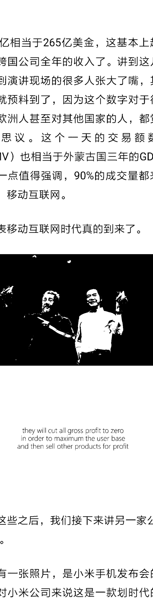

第二页我做了一个自我介绍，我很自豪的告诉大家我是5分钟商学院的主理人，我也让全球的企业高管都知道了5分钟商学院。

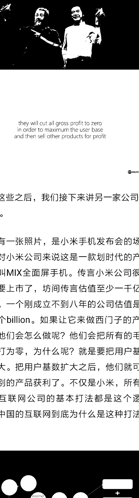

第三页，connection changed things a lot，这是我们在基础篇第11课讲过的信息对称这个话题。比如你通过设备把信息传到互联网上，其他人可以得到数据分享，就是把这个东西数字化或者数字化。但在中国这有点不同，因为大家可以在互联网把东西数字化了，所以在互联网中网站就变成了一个连接器，我们也就发现流量才是连接的本质。到移动互联网时代，我们每天花几个小时在微信上，我们在APP里花的时间，就变成连接器了，时间才是本质的连接。所以连接是数字化带来的结果，尤其在中国。为什么中国连接的效果会那么的明显？

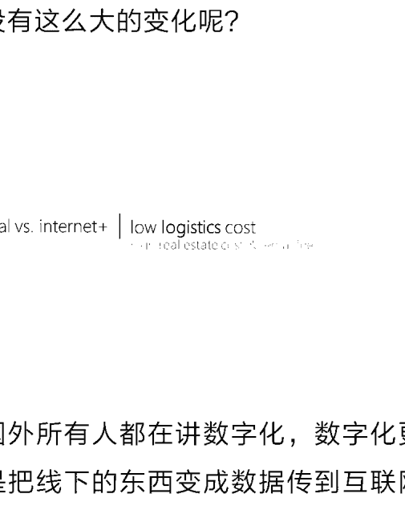

沃尔玛在2014、2015、2016年关了 many 店，今天在中国还在迎接更大的挑战。不仅是沃尔玛，中国有一家连锁超市叫大润发，刚刚被收购了。很多的大卖场都在受到挑战，那么为什么过去很多大卖场会获得成功呢？

其实获得成功的原因，正是过去的连接方式，因为高速公路的发展，你可以开车跑到很远的地方买东西，沃尔玛因为物理的连接，所以变得强大。

为什么天猫在这个时代会获得那么大的成功呢？正是因为天猫在PC互联网到移动互联网的时代作为一种新的连接方式，让更多的人有机会跑到同一个网上买东西。所以在2017年双十一一天就卖了1682亿。

168.2B CNY = 26.5B USD in a single day ≈ 3 x Mongolia GDP and 90% via mobile phone

1682亿相当于265亿美金，这基本上超过很多跨国公司全年的收入了。讲到这里我注意到演讲现场的很多人张大了嘴，其实我早就预料到了，因为这个数字对于德国人、欧洲人甚至对其他国家的人，都觉得不可思议。这个一天的交易额数字也相当于外蒙古国三年的GDP。还有一点值得强调，90%的成交量都来自手机，移动互联网。

这代表移动互联网时代真的到来了。

理解这些之后，我们接下来讲另一家公司-小米。

这儿有一张照片，是小米手机发布会的场景，对小米公司来说这是一款划时代的产品，叫MIX全面屏手机。传言小米公司很快就要上市了，坊间传言估值至少一千亿美元。一个刚成立不到八年的公司估值是一百个billion。如果让它来做西门子的产品，他们会怎么做呢？他们会把所有的毛利率归零，为什么呢？就是要把用户基数扩大。把用户基数扩大之后，他们就可以卖别的产品获利了。不仅是小米，所有中国互联网公司的基本打法都是这个迂回。中国的互联网到底为什么是这种打法呢？

在这个世界上有些公司是创造价值，有些公司是传递价值，比如说海尔是创造价值的，卖海尔产品的就是传递价值的。因为互联网，信息被对称之后，传递价值的那一方就会受到很大的挑战。受到挑战的结果是什么，下一页PPT只有一行字，叫mark-up rate。

mark-up rate

mark-up rate就是定倍率，是指商品的零售价格除以成本价的倍数，我们在5商基础篇讲过这一课。隨著传递价值的效率提高，创造价值的公司可以用更有效的方式来做广告了，定倍率就有机率大幅度的下降。这就是在中国发生变化的一个很大原因，为什么在国外却没有这么大的变化呢？

digital vs. internet+ | low logistics cost real estate ...

在国外所有人都在讲数字化，数字化更多的是把线下的东西变成数据传到互联网上，用数字的方式来描绘现实世界。但在中国我们通常讲“互联网+”，这有区别吗？区别很大，刚才我说了，用数字化的方式来表述，它讲的是一个物体，而“互联网+”讲的是物与物之间的关系。因为数字化使连接效率提高，我们就跟国外就产生很大区别，主要区别有四个原因：

别，主要区别有四个原因：

第一是，low logistics cost，在中国的物流的成本非常之低，但效率非常之高。在2013年双十一的时候，第1亿件包裹，大概八、九天送达，后来变成六天，四天，现在是二点几天。

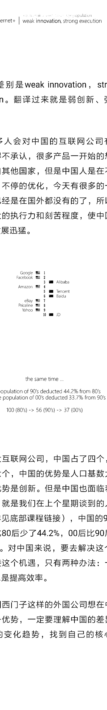

欧洲人的黑色星期五就相当于中国的购物节，很多人从凌晨就开始排队。在今天的中国是看不到这样的，因为中国人买东西都在网上买。为什么会这样呢？因为中国的物流效率很高。快递送到一个住宅区，一栋楼就送完了很多包裹。但在美国不行，尤其是在美国的西部地区，物流效率就很低。所以在中国，物流效率高、成本低导致的结果就是，人们在网上买东西更方便。

digital vs. internet+ | high real estate cost & rental fee

第二个差别就是，high real estate cost & rental fee。因为中国的地产价格一直在攀升，地产的成本都要折到消费者消费的商品价格里。而线上没有这块成本，所以在互联网上发生连接的优势就很大。

digital vs. internet+ | low marginal cost, cos huge population

第三个差别叫low marginal cost，低边际成本。中国的人口区域大，人数众多。这个模式其他国家很难效仿，就是把商品用很低的毛利率，生产巨大的量，所获的利润就很可观了。首先要通过一个商品，把边际利润几乎打为零，积累巨大的用户基数，然后卖别的东西。

digital vs. internet+ | weak innovation, strong execution

第四个差别是weak innovation，strong execution。翻译过来就是弱创新、强执行。

确实很多人会对中国的互联网公司有置疑，不得不承认，很多产品一开始的想法都是来自其他国家，但是中国人是在不断的迭代，不断的优化，今天有很多的一些逻辑，已经是在国外都没有的了，所以中国的强大的执行力和刻苦程度，使中国的互联网发展迅猛。

the same time ...
the population of 90's deducted 44.2% from 80's
and the population of 00's deducted 33.7% from 90's
100 (80's) -> 56 (90's) -> 37 (00's)

全球十大互联网公司，中国占了四个，美国占了六个，中国的优势是人口基数大，美国的优势是创新。但是中国也面临着一个挑战，就是我们在上星期谈到的人口问题，中国的90后总人数比80后少了44.2%，00后比90后少了33.7%。对中国来说，要去解决这个挑战、迎接这个机遇，只有两种办法：一是创新，二是提高效率。

如果德国西门子这样的外国公司想在中国获得竞争优势，一定要理解中国的差异化和人口的变化趋势，找到自己的核心能力。

## 建议：

SoLoMo is the key of mobile internet, especially social.

SoLoMo的意思是，So是社交，Lo是本地化，Mo是手机移动，移动互联网的关键是社交。如果自己公司不做社交的话，我们应该和社交公司去合作，因为这里聚集了最大的用户时间，是公司与用户最重要的连接器。

be really close to customers ...
all far places are challenged by Internet.
community is a solution.

must be very fast to respond to our consumers,
if not,
our competitors are ready to take care of them.

因为中国的企业特别勤奋，反应速度特别快，所以你也要非常快。否则竞争对手，就会照顾你的客户。

transformation to digital age in China
is quite different from WW
localization is the key of globalization.

那个结果是什么呢？就是“互联网+”。

> 例句：'localization is the key of globalization.' 全球化最重要的就是要实现本地化的这个能力。

刘润

在过去我们都是到国外学习，但近几年，都是我去给国外的公司分享中国在发生什么。我今天把面向全球的分享独家告诉你听，希望大家都能够开放自己的全球视野，也希望让全球都在试图了解中国的时候，我们要更加了解自己。

祝愿大家能在5分钟商学院的课程中收获到更多价值。今天的加餐希望对你有所启发。

007 | 哪有什么一分价钱一分货
011 | 在美国，你会吃馍当劳吗？
105 | 看比赛：为什么南京、西安、宁波等城市同时放开了落户政策？

## 126 | RFM模型：不要把公司的存亡，寄生在一两个客户身上

每天5分钟，解决一个商业问题。欢迎收听，《刘润5分钟商学院》，实战篇。

本周是第二季度的最后一周，我们要学习把用户和产品揉在一起的一种商业手法：

李雷是做软件开发的，为企业客户定制信息化系统。因为技术过硬，服务态度好，几年来客户越来越多，利润也越来越好。

他很高兴。但是，突然某个季度，李雷发现收入大幅下跌，又过了一个季度，连续盈利5年的公司，居然开始亏损。李雷大惊失色，赶快调查，发现原来他两个最重要的客户被竞争对手挖走了。而这两个客户贡献了他80%的收入，和120%的利润。

啧？什么叫120%的利润？这就是说，其他所有客户加起来贡献的利润，是负的20%。李雷的公司，在用源自这两家公司的利润，养着其他所有客户。

李雷的公司，一夜之间，从高歌猛进，跌入举步维艰。怎么办？

要解决这个“怎么办”的问题，我们首先要理解它的本质。这个问题的本质是：李雷的用户结构有严重问题。

## 概念：RFM模型

什么叫RFM模型？RFM模型，最早是由美国数据库营销研究所Arthur Hughes提出来的。他们发现，分户并维护健康的客户结构，有三个关键的维度。这个维度是：

- 1. R，Recency，就是“最近一次消费”。你上次跟上一次什么时候发来的交易或升级软件系统的？上一次消费离现在越远，用户价值越小。
- 2. F，Frequency，就是“消费频次”。你买家，一个月，改着一年，在你这里又多少次交易？1次？2次？10次？还是大大多？消费频次越高，用户的价值越大。
- 3. M，Monetary，就是“消费金额”。你的客户一共在你的产品上，花了多少钱？给你贡献了多少钱利润？消费金额越高，用户价值越大。

把RFM放到XYZ的坐标系里，就形成了一张RFM模型图。

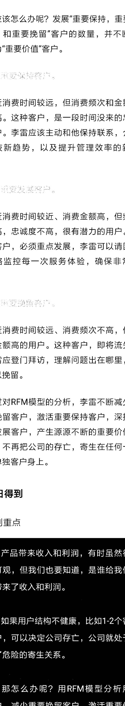

有了这张图，我们就能清晰地把用户结构，细分为8类了：重要价值、重要挽留、重要发展、重要保持、一般价值、一般挽留、一般发展、和一般保持。

回到最开始的案例。对照这张表，李雷的问题是，他只有2个“重要价值”客户，而其他的，都是价值很低的“一般保持”客户。客户结构很不健康，经不起任何流失风险。

### 运用：

那应该怎么办呢？发展“重要保持，重要发展，和重要挽留”客户的数量，并不断转化为“重要价值”客户。

- 1) 重要保持客户。

最近消费时间较远，但消费频次和金额都很高。这种客户，是一段时间没来的忠实客户。李雷应该主动和他保持联系，介绍科技新趋势，以及提升管理效率的新方法。

### 今日得到

### 划重点

- 1. 产品带来收入和利润，有时虽然很可观，但我们也要知道，是谁给我们带来了收入和利润。
- 2. 如果用户结构不健康，比如1-2个客户，可以决定公司存亡，公司就处于了危险的寄生关系。
- 3. 那怎么办呢？用RFM模型分析用户，减少重要挽留客户，激活重要保持客户，深挖重要发展客户，不断转化为重要价值客户。

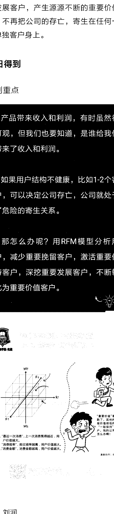

你的公司，失去最大的1-2个客户后，会毫无问题，还是伤筋动骨，或者瞬间崩塌呢？
欢迎你在留言区分享，与大家一起，过过招。也别忘了把今天的文章，分享给你的朋友，也许能够帮到他。

## 127 | 会员机制：谁是会员？奖励什么？如何升级？

每天5分钟，解决一个商业问题。欢迎收听，《刘润5分钟商学院》，实战篇。

昨天我们学习了用RFM模型把用户分为8类。那么，然后呢？然后我们今天接着学习，把这些用户都“管理”起来的实战术：会员体系。

在过去的12年，我每年有一半时间在出差，慢慢在每个城市，都有了自己喜欢的酒店。在北京，出差一天，我喜欢住东面的威斯汀。那出差三天呢？住一晚西面的喜来登，第二晚换到隔壁10米的雅乐轩，第三晚，再换回喜来登住。

为什么咱？连续三晚住一个酒店不好吗？这么折腾干嘛呢？省钱吗？不是因为省钱。我给你1秒钟猜一下为什么……好的，时间到。你猜到了吗？

## 概念：航空、酒店会员

因为威斯汀、喜来登和雅乐轩，都是喜达屋集团旗下的酒店。连续入住3晚威斯汀，在喜达屋的政策里，都只能算1次入住。而3晚换不同的酒店，算3次入住。整个北京，只有喜来登，和雅乐轩是挨着的，所以这两家酒店，就成了“养卡族”用来“刷”入住次数的最佳选择。

算3次又怎样呢？给你发诺贝尔最佳旅客奖吗？诺贝尔不给我发奖，但因为我是喜达屋的白金卡会员，每年要入住25次，才能保留会籍。为了会籍，我已经这么刷了10几年，这就是航空公司和酒店的会员体系。

天啊，润总，你会会员有那么重要吗？

什么叫“至于吗”？哦，允许你刷王者荣耀，就不允许我刷酒店会员？我已经是八年的喜达屋白金卡会员了，再“刷”两年，就是“终身白金卡”了。

估计你听到这里，已经张大了嘴：天啊，酒店到底做了什么，能让你有这么大的忠诚度？

酒店和航空公司的会员计划，确实是其他行业的典范。数据显示，50%的酒店顾客会忠于单一品牌。航空公司也类似。今天我们就一起来认真学习，航空酒店会员的核心逻辑。

### 运用：

航空公司和酒店最有价值的顾客，都是商旅客人。商旅客人的消费模式比较特别，出差的人是员工，付费的是公司。那么，到底谁是你的会员？员工，还是公司？

员工关注的价值，和公司是完全不同的。员工更关注体验，公司更关注价格。员工会为超凡的体验而留，公司会为稍高的价格而走。公司，就是一个价格动物，不是好的会员。

航空公司和酒店做对的第一件事情，是把员工，也就是出差者，发展为会员。这样，员工就会在公司合规的差旅标准内，把体验作为第一要素，而不是价格。

这一点，可以被很多行业借鉴。儿童教育行业，应该把妈妈发展为会员，还是把孩子发展为会员？孩子会为超凡的体验而留，妈妈会为稍高的价格而走。所以，你要把孩子当作会员。

“小朋友，再过三个月，你就能升级为黄金圣斗士了。加油！”孩子欢呼雀跃，你觉得这时候，妈妈会给孩子退学吗？

会员持续消费，消费产生积分。在信用卡行业中，很多银行20元换1个积分，20个积分换1块钱奖品。所以，消费者一算就知道了：每消费100元，能得0.25元。那我消费100万，才能换一个扫地机器人。消费者立刻就没兴趣了。

所以，积分千万不能货币化。积分要兑换无法货币化的，最好是自己能提供的，标价很高、成本很低的商品。比如航空公司的升舱，贵宾休息室，快速办票通道，优先选择座位等等，再比如酒店的升级房间，行政酒廊使用资格，延迟退房等等。

航空公司和酒店，都是免费成为会员。一旦成为会员，就能免费用WIFI，开始获得积分，然后就开始“进一寸，有一寸的欢喜”。

比如喜达屋酒店集团，一年住满10次，恭喜你就是金卡了，延迟退房，积分加速；一年住满25次，哇，恭喜你就是白金卡了，随时升级到套房。

比如东方航空。一年飞40次，恭喜你就是金卡了，贵宾休息室，优先登机；一年飞到90次，哇，恭喜你就是白金卡了，随时升级到头等舱。

进门要容易，升级要频繁，把会员，变成成年人的游戏。

### 今日得到

### 划重点

- 1. 航空公司和酒店集团的会员体系，以及其带来的顾客忠诚度，一直是很多行业的榜样。
- 2. 我们至少可以向它们学习三点：
  1）谁是会员？重视体验的使用者，而不是紧盯价格的付款者；
  2）奖励什么？无法货币化的便利和体验，而不是可以计算出来的微小折扣；
  3）如何升级？像打游戏一样，进一寸，就有一寸的欢喜。

刘润

有没有哪家机构的会员体系，让你欲罢不能，不停惊喜呢？

欢迎你在留言区分享，与大家一起，过过招。也别忘了把今天的文章，分享给你的朋友，也许能够帮到他。

《5分钟商学院·实战篇》线下大课的第一模块——理解用户深耕站的课程刚刚结束。在这次的课程中，我向同学们详细讲解了“现实自我与理想自我”、“TOFA模型”、“技术采用生命周期”等这些未能在线上上档中展开的知识点。也通过全新的互动形式，将线上私藏会带到了线下，逐一解答了大家最关心的疑问。

之所以要举办线下大课，就是希望能够通过立体化运营，让同学们既能听到线上的高效的课程，也能在线下感受丰富的知识的冲击，打造属于自己的商业兵器库。

现在，第一模块的线下大课还有两站，分别是4月14日北京，4月21日上海站。我依然会用一整天的时间，带来一堂无删减版的线下大课，希望能够帮助大家彻底底部全方位了解最终买单的用户。现场席位有限，点击下方的图片，即可报名。得到的用户，可享受八折优惠。

非常期待能在线下见到大家。

## 128 | 互联网会员：积分、等级、榜单、权益、勋章、认证、VIP，总有一款适合你

每天5分钟，解决一个商业问题。欢迎收听，《刘润5分钟商学院》，实战篇。

昨天学习了航空公司，和酒店集团的会员体系。这两个行业之所以能在会员体系，尤其是权益的设计上，花样百出，有个很重要的原因，就是在座位没有坐满，房间没有住满时，就算是免费送，都没有压力。飞机座位、和酒店房间的边际成本几乎为零。所以，他们可以用这两个资源，玩出花儿来。

听到这里，互联网行业哈哈一笑。说起“边际成本为零”这件事，试问，全世界还有哪个行业能和我比？因此，互联网公司，可以在用户权益上，体系设计上，玩到商业想象力的极致。

## 概念：互联网会员

今天，我们就来认真学习，互联网公司是如何设计“会员体系”的。那么，应该怎么学？学些什么？互联网公司的“会员体系”不仅限于权益设计，还有多少个维度：积分、等级、榜单、权益、勋章、认证、和VIP。

下面，我们一个一个来讲。

### 1. 积分
“积分”是互联网会员体系的砖瓦，用来搭建忠实用户的金字塔。所以，在每个能通向“忠实用户”的路径上，都可以铺上“积分”。

比如，我是多看阅读的用户。每日签到，送积分；签到两天，送更多积分；签到3天，获得“再接再厉”奖，再送更多积分；每天阅读超过60分钟，还有“百读不厌”奖，送额外积分。

积分的关键，是把一切通往忠诚用户道路的难度量化，然后用积分鼓励你跳一跳，跨过去。积分的前方，是忠诚；积分的背后，是权益。

### 2. 等级
积分对应权益，等级可以对应荣誉。

对于一些需要用户大量贡献内容的互联网网站，像论坛和社群，等级制度，就是一种荣誉激励制度。

比如著名的论坛天涯。从贫民，到绅士、骑士、爵士、国王，再到皇帝。每个级别，都有相应的荣誉，解锁的特权。

等级的密度，要让用户有不断升级的快感；等级的特权，要让用户有被人羡慕的荣誉。

### 3. 榜单
春节期间，我心血来潮，在明城墙上徒步，走了不少路。好高兴打开微信一看，居然在朋友圈还是只排第137名。

有朋友玩小游戏“跳一跳”。竭尽全力后，一看榜单……居然他“还在我前面”！于是继续接着玩了几局。

榜单，是一种特殊的等级，一种相对的等级。

### 4. 权益
用什么做权益呢？互联网公司，真可谓脑洞大开。

在QQ上，给你一个黄钻。这就是权益。这有什么用啊？别人会觉得你牛。这就是权益。在修图软件里，别人只能用3个元素美化照片，你可以用30个；在文字处理软件里，别人处理完有水印，你没有；别人只能编辑10秒视频，你可以无限制；更多的是，别人要看广告，你的世界没有广告，晴空万里。

互联网公司的权益，大多都是“边际成本为零”的，和用户体验极度相关的内容。设计好的权益，需要洞察人性。值得学习。

### 5. 勋章
高级用户发展到后来，已经很难用“等级”这一个维度描述了。这时候，勋章体系的价值就凸显了。

比如得到。从鼓励学习的维度，有“终身学习”勋章。学习超过50小时，得一级勋章；超过200小时，得二级；超过500小时，得三级。

除了鼓励学习，得到也鼓励分享。于是就有“以德服人”勋章。分享超过10次，得一级勋章；超过50次，得二级；超过200次，得三级。勋章，就是多维度的等级制度。

### 6. 认证
在社交媒体，比如新浪微博，或者微信公众号，“认证”，是一种特殊形式的“会员”。

在全部都是真实用户的线下，大家追求隐藏；在全部都是隐藏用户的互联网，大家追求真实。所以“加V”这个小小的标志，能让用户有真实感、可靠感、和权威感。

### 7. VIP
VIP，是花钱买来的等级，俗称“人民币玩家”。

少数有高货币价值，但是又没有时间的用户，就可以在VIP体系里，给予相应的权利。

比如百度网盘。你可以通过使用，做任务，获得更大的容量。但是，如果你没时间，还可以花钱直接购买VIP或SVIP，获得巨大的存储空间。

### 今日得到

划重点

- 1. 互联网产品的边际成本为零，所以互联网上的会员体系，比线下要复杂得多，也精密得多。
- 2. “积分、等级、榜单、权益、勋章、认证、和VIP”，这7个维度，是互联网公司会员体系的常见维度。
- 3. 每一个维度，都对应一种行为激励的逻辑，建议你仔细研和学习。

刘润
你是哪 些互联网公司的会员吗？哪个会员身份，让你最光荣，最不能割舍？你觉得他们做对了什么？
欢迎你在留言区分享，与大家一起，过招。也别忘了把今天的文章，分享给你 的朋友，也许能够帮到他。

《5分钟商学院 实战篇》线下大课的第一模块——理解用户深圳站已经结束。4月14日北京站的课程，本周六也即将与大家见面。
在咱们无删减版的线下大课现场，我会向同学们详细讲解“现实自我与理想自我”、“TOFA模型”、“技术采用生命周期”等等这些未能在线上专栏中展开的知识 点。希望能够帮助大家彻彻底底全方位地解最后买单的用户。也 会通过全新的互动形式，逐一解答了大家最关心的问题。
由于现场席位有限，北京站只有最后30个名额。最后几天，你还有机会赶上这次线下大课的班车。点击下方的图片就可以报名。得到的用户，可享受八折优惠。
非常期待能在 线下见到大家。

## 129 | 会员经济：关于会员体系，消费者到底是怎么看的？

每天5分钟，解决一个商业问题。欢迎收听，《刘润5分钟商学院》，实战篇。

这一周我们一直在学习把用户和产品揉在一起的商业手法：要理解会员体系，首先你要了解用户的细分结构，如何了解呢？用我们第一天学习的RCM模型；第二天我们学习了...

第三天我们学习了...

学完了这些，今天我们来读一份关于“会员体系”的报告，人类报告，文艺有文艺的会员经济。这份报告是企智帮库在2017年7月发布的，叫做“中国会员经济数据报告”，我为你解读其中的几点。

### 1. 强会员模式和弱会员模式

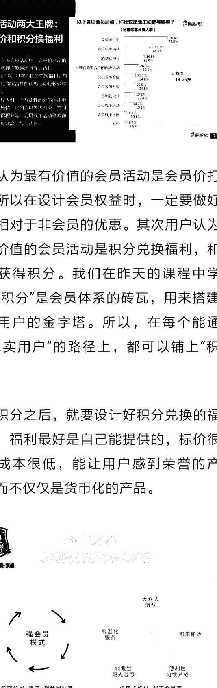

这份报告把会员体系分为了两种模式，强会员模式和弱会员模式。我们前两天学 Additionally,航空公司和酒店，以及线上的许多互联网公司，都是强会员模式，我们希望能用强激励、高标准的服务来长期锁定用户。

比如酒店，有数据显示50%的用户会忠于一家酒店（或酒店集团），用户一旦被竞争对手抢走，就基本不可能再回来了；在互联网上也同样，你是爱奇艺的会员，那你基本不会再买别的视频网站会员了，这就是强会员模式。

那哪些是弱会员模式呢？比如信用卡积分、超市的会员等等，它们最终的目的，都是养成用户的消费习惯。它不会给你特别高标准的服务，你只会在遇到相应消费场景时想到它，但并不是非它不可，这就是弱会员模式。

### 2. 如何吸引用户办理会员？

报告中提到，价格是用户关注的焦点，66.8%的用户办理会员的首要原因是会员价便宜，可以省钱。其次是因为积分可以兑换福利，和一些会员专属的服务。所以，如果你要做会员体系，那你首先要在价格、福利和服务上下功夫。

那面对商家推荐办卡时，用户 lien and attitudes: 51.8%，也就是一半的用户对推荐是无所谓的，持中立态度；35.3%，也就是1/3的用户表示反应；12.9%的用户表示喜欢。所以，对于推荐用户办会员卡这件事情，至少有2/3的用户是不反对的，不要觉得特别不好意思。当然，前提是你真能给用户带来价值。

报告中也说到，面对商家主动推荐办卡时，33.5%的女性用户在大部分情况下会办；而只有19.7%的男性用户会办。所以，针对女性用户的推荐效果会更好。

那些不愿办卡的用户，主要是因为什么呢？报告中指出，超过六成 的用户拒办卡是因为不经常在这里消费。用户不经常在这里消费，可能是因为他没有这个需求，也可能是因为他只是路过，没有机会消费。那如果是后者，你销售会员卡的话术第一句就应该是：“你在附近上班吗？“或者”你住在附近吗？”，而不是上来就直接推荐办卡。

除了不经常消费，用户拒绝办卡的另外两大原因是会员优惠不吸引人，和福利用不上。这再一次证明了会员优惠和福利的重要性，你需要好好研究如何让用户真正获益。

### 3. 用户在使用会员服务时的痛点在哪？

报告中说，在使用会员服务时，用户遇到最多的三个问题是：1）办了会员发现没啥用；2）没体验到更好的服务；3）缺少会员福利提醒。所以，在做好会员优惠和福利的基础上，你还要建立好和用户联系的渠道，及时将福利告知会员。

那目前用户是如何获取会员福利信息的呢？

报告中说，用户获取信息的主要方式是在消费时由商家告知，占比62.2%；其次是通过微信公众号和商家短信，占比分别为35.7%和32.1%。除了微信公众号和短信通知之外，你也可以尝试一些新的方式，比如线上社群等，来做好用户运营，及时告知福利。

### 4. 哪些会员活动，用户觉得最有价值？

用户认为最有价值的会员活动是会员价打折，所以在设计会员权益时，一定要做好会员相对于非会员的优惠。其次用户认为最有价值的会员活动是积分兑换福利，和消费获得积分。我们在昨天的课程中学过，“积分”是会员体系的砖瓦，用来搭建忠实用户的金字塔。所以，在每个能通向“忠实用户”的路径上，都可以铺上“积分”。

有了积分之后，就要设计好积分兑换的福利了，福利最好是自己能提供的，标价很高、成本很低，能让用户感到荣誉的产品，而不仅仅是货币化的产品。

如果你想看这份会员经济的完整报告，可以在我的公众号“刘润”（runliu-pub）回复关键词“报告”领取。

今天的这份报告，对你有什么新的启发吗？欢迎你在留言区分享，与大家一起，过过招。也别忘了把今天的文章，分享给你朋友，也许能够帮到他。

《5分钟商学院 实战篇》线下大课的第一模块——理解用户深圳站已经结束。4月14日北京站的课程，本周六也即将与大家见面。

日北京站的课程，本周六也即将与大家见面。

在咱们无删减版的线下大课现场，我会向同学们详细讲解“现实自我与理想自我”、“TOFA模型”、“技术采用生命周期”等等这些未能在線上专栏中展开的知识點。希望能够帮助大家彻彻底底全方位了解最终买单的用户。也将通过全新的互动形式，逐一解答了大家最关心的疑问。

由于现场席位有限，北京站只有最后30个名额。最后几天，你还有机会赶上这次线下大课的班车。点击下方的图片就可以报名。得到的用户，可享受八折优惠。

非常期待能在线下见到大家。

## 130 | 大复盘：需求，是实现欲望的方式；产品，是满足需求的工具

时光飞逝，岁月如梭，一晃半年过去了，我们完成了“理解用户”和“打磨产品”两个季度的学习。一切商业的起点，都是用户获益，我们必须理解用户需求，才能知道如何让他们获益。理解了用户后，我们学习了“打磨产品”，也就是如何用产品来满足用户需求。

具体来说，第二季度，我们学习了5大模块。

第一个模块，是需求。需求是第一季度和第二季度的连接点，用户有需求，才需要产品。我们学习了如何通过5个玄关：为产品赋予魔力、化解生活中的麻烦、构建完善的背景因素、寻找激发力、打造45°精进曲线、和去平衡化；以及4种研究方法：问券调查、用户访谈、可视性测试、和数据分析。

理解了需求后，在第二大模块，我们学习了产品设计的方法。产品设计分两步，第一步是虚拟设计，第二步是真实制造。如何虚拟设计呢？我们学习了四种产品设计的语法：设计5原则、驯化复杂、设计三层次、和未来设计；还学习了产品设计的打法：设计冲刺；以及一些细节的用法：简约至上、细节设计、布局原则、和上瘾模型。

虚拟设计之后，如何真实制造呢？我们也学了一些基础逻辑：产品化、定义产品、迭代策略、峰终定律、死亡策略、实物众筹以及做产品的组织架构：产品经理制。产品不仅仅包括有形的产品，还包括无形的过程，那就是服务。如何设计好“服务”？我们学习了服务蓝图、黄金准则、排队等待、处理投诉等打法。

除了有形的产品和无形的过程，还有一种特殊产品形态，那就是运营。如何运营呢？做好用户运营、内容运营和活动运营。

学完了产品模块，我们花了两周系统学习了产品做出后要面临的重要课题：定价。

第一周我们学了价格歧视，一级价格歧视，是“按人定价”；二级价格歧视，是“按量定价”；三级价格歧视，是“按类定价”。价格歧视的最终目的，就是要吃掉每个人的消费者剩余。而所有的价格歧视，最终都有可能被套利者用“一价定律”填平。

第二周我们还学了一些其他维度的定价策略。比如心理定价，人们对数字的“相对差异”很敏感，但对“绝对大小”没感觉，于是就出现了基于这种心理的尾数定价法、整数定价法、招徕定价法、分割定价法、错觉定价法等定价策略。

再比如订阅服务，服务是享受，给钱是扎心。当享受的快乐，大于扎心的痛苦时，消费者就会购买；但如果扎得太痛，消费者就会倒在血泊中。所以，你可以用“扎心一次，服务一年”的订阅服务，帮消费者减小痛感，帮自己锁定需求。

那价格定下来后，是不是就能松口气了呢？并不能。价格，从你定下来那天开始，就要准备好随时调整。这就是动态定价，它的本质，是对供需变化的敏锐反应。

在定价时，我们也经常会走进一些误区，比如在价格透明的市场中，区别定价。这将破坏你的整个价格体系，让实际成交价不断走低。

这两周的内容，让我们对定价有了全面的理解。在《5商·基础篇》我们还讲过一些与对手竞争时的定价逻辑，比如渗透定价法、撇脂定价法、组合定价法，你可以点击文稿中的链接来回顾。

最后一周，我们谈了一个看上去很独立的话题，会员体系。为什么要放在这谈呢？因为会员体系是一种把用户和产品揉在一起的商业手法。为了理解会员体系，我们学习了用RFM模型来了解用户的细分结构；学习了会员体系做得最好的行业：航空公司、酒店和互联网；最后还从数据角度了解了真实的会员经济。

好了，第二季度我们就总结完了，其实在这两个季度，我还藏了一条逻辑线，那就是营销的4P理论：Place渠道，Promotion营销，Product产品，和Price的定价，这四个部分，我都帮你一个一个通关了，是不是特别有成就感呢？

下周开始，我们将进入一个全新的格斗场。还记得我们之前讲的“用户、欲望、需求、产品、和商品”的逻辑吗？一切商业的出发点，都是用户获益；如何让用户获益？要满足用户的欲望；需求，是实现欲望的方式；产品，是满足需求的工具；而商品，是有了商业模式的产品。

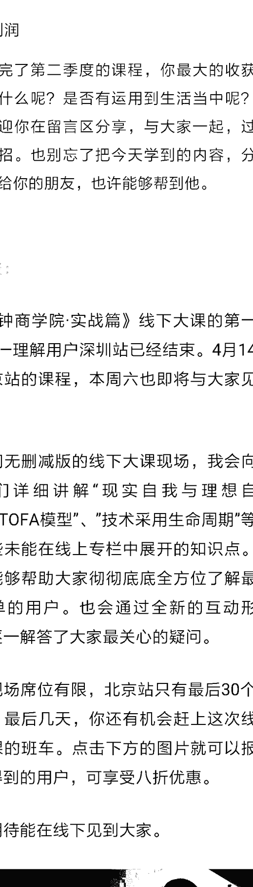

## 刘润

学完了第二季度的课程，你最大的收获是什么呢？是否已经运用到生活当中呢？欢迎你在留言区分享，与大家一起，过过招。也别忘了把今天学到的内容，分享给你的朋友，也许能够帮到他。

《5分钟商学院·实战篇》线下大课的第一模块——理解用户深圳站已经结束。4月14日北京站的课程，本周六也即将与大家见面。

在咱俩无删减版的线下大课现场，我会向同学们详细讲解“现实自我与理想自我”、“TOFA模型”、“技术采用生命周期”等这些未能在线上专栏中展开的知识。希望能够帮助大家彻彻底底全方位了解最终买单的用户。也将通过全新的互动形式，逐一解答了大家最关心的疑问。

由于现场座位有限，北京站只有最后30个名额。最后几天，你还有机会赶上这次线下大课的班车。点击下方的图片就可以报名。得到的用户，可享受八折优惠。

非常期待能在线下见到大家。

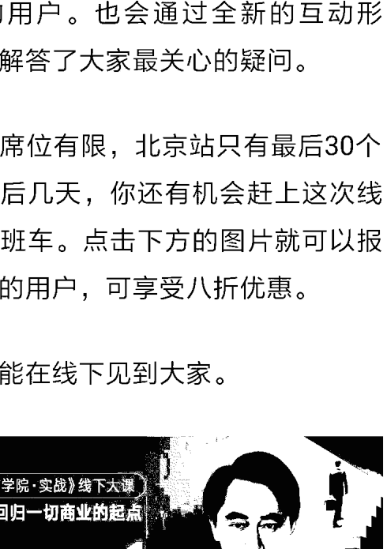

## 第26周周末私董会 | 如何拓展商业地图，将成功模式批量复制？

每天5分钟，解决一个商业问题。欢迎收听《刘润5分钟商学院》实战篇。

5分钟商学院的同学们，大家周末好！又到了本周私董会的时间了。

本周获得私董会提问资格的同学是：

润总您好！我从事于“遛娃团”，这是一个服务社区的亲子玩、学社群，目标是增加父母对孩子的优质陪伴，以0-15岁孩子的家庭为服务对象，解决爸爸妈妈不知道带着孩子去哪里玩？玩什么？跟谁玩？这三大痛点问题。

我们为付费会员提供五大会员权益：产品服务、活动赛事、社群福利、线上课堂、社交圈层，目前已覆盖全国近30个城市。随著加盟合作团队的不断增加，各地团队运营出现良莠不齐的现象，主要有以下三个问题：

- 1. 团队建设效率低。很多团队是跨行进入的，对于社群模式理解不透彻，总部对其辅导吃力，沟通成本很高。
- 2. 优秀带头人难寻。部分团队首次创业，城市总经理创业经验不足，管理能力不强，团队带不好、业绩上不来。
- 3. 扩张模式未定。业绩比较好的团队，都希望被我们直接收购，但是我们还不打算太快启动收购。

目前，作为初创公司来说，如何稳健快速扩张是我全国布局工作的主要思路。

问题：

- 1.接下来是否应该收缩加盟合作通道，转为以自营拓展为主吗？
- 2.对于已经出现瘫痪的团队，我们是应该启动清退还是要继续坚持协助呢？
- 3.对于加盟管理还有什么更好的模式吗？

下面我们来讨论一下这个问题。

其实今天这个问题，是一个被非常广泛遇到的问题。简化一下，也可以理解为我在一个地方的商业模式成功了，如何把这个成功的模式复制到更多地方去。我在实战篇的第三个季度中，有两周的内容是专门对这个话题而设计的系统化课程，今天我们简单地了解一下，详细的内容还是给大家在体系的课程中学习过招。

分析这个问题我们可以从以下几个部分来看：

### 一、什么是加盟模式

加盟模式，简单来说大概有三种模式：1.直营，2.加盟，3.直管。

### 二、如何把单点的成功，变成全面的成功

我们在第一季基础讲管理的时候说过，一个人从个人贡献者变成一个需要管理团队的经理时，这是一个人重大的跃升，之所以称之为跃升而不是提升，是因为我们终于意识到，要克制住自己干活的欲望，转而靠别人来干活。管理就是靠通过让别人干活来达成结果的一种能力。这种能力要想锻炼起来其实非常不容易，因为实现结果的人不是你，但每一个优秀的管理者都必须这么一个跃升。当然，在商业世界里还有另外一个维度，就是如何把自己一个单点成功，变成全面的成功，各地开花。

了，在网上也有不小的 influencia。品牌也是把自己交给消费者手上，如果做得好就可以让这个品牌容器里去积累。所以品牌本身就是过去积累的价值，它不是一个复制的过程，它是让别人来用的过程。如果别人用的不好，其实会伤害这个品牌。所以品牌的核心是让大家共用。

我可以用199元买一个遛娃的护照，这个护照可以在本地的娱乐场所、亲子乐园等地方免费玩，甚至也可以大家网上来聚集分享一些育儿经验。如果这是一套基础理念，那么它实施的时候是很标准化实施的。因为这需要当地的加盟商要有完全独立的经营能力和强大的拓客能力。加盟商要拓展当地的娱乐场所、亲子乐园，让他们去BD护照使用的权利，这是一个难度非常大的独力性工作。这部分可复制吗？很难，因为这部分其实是一个基础的逻辑，是一个目标、框架。所以这位同学，对于你的问题，我总结下来就是这一句话。就是这件事的成功是无法复制的，因为成功是一个结果。

能力内核是导致成功的原因。所以对于这位提问的同学，我觉得她目前要做的最重要的一件事，就是提取自己的能力内核，认真地想清楚到底是什么关键因素使我们获得成功。如果你说因为我们团队特别努力或者长沙这个地方玩的地方特别多，那就糟糕了，说明你这个东西别的地方可复制性不强。或者你一定要找出可复制的方向，比如怎么去找到那些好的商戶，怎么和他们谈，甚至话术是什么，我们这么努力的原因是什么，我怎么去设计一套员工的制度，让每个地方坚决地执行，让员工也能这么努力，那么这些东西是可复制的。

好的产品是不可复制的，而生产好的产品的过程是可复制的。好的员工是不可复制的，让每一个进来 的新员工都变成好员工的制度是可以复制的。如果你发现在你加盟商里面，你不需要奖惩，85%都能做好，剩下来15%的那部分一定是自不努力。如果你发现你加盟商50%以上都做不好，那一定不是加盟商出了问题。所以你千万要注意这个关键的区别，也可能说明你这个模式根本就不值得加盟，你的加盟逻辑还没有想清楚。

总结一下，今天我给出的这几点建议其实并不是解决問題本身，而是回答了问题背后最关键应该想清楚的地方。很多同学的留言很精彩，所以我还是再次强烈建议，所有的学员在听完我的语音之后，能够打开文檔，看看我们的留言，很多非常实战的知识可以从留言区里学到。但其实这些问题的背后都只有一个关键点，就是这个模式是否有可复制性。如果你真的找到了它的可复制性，那么这些問題就自然而然化解了。

下面我公布一下这次私董会问答的10位获奖者，他们分别是：

请中奖的同学在本篇文章下方留言中，写下你的联系方式及手机型号（每人将获得800元奖学金，以充值的方式返还到你的账户）。

今天这位同学的问题是加盟方式的问题。首先，我觉得要先明白自营和加盟两种模式的优缺点。

1.自营模式的优点是可以确保为客户提供服务的品质，确保服务质量输出的一致性，有利于连锁品牌获得良好的口碑。同时，一旦出现状况，全体自营店的统一管理和协调工作比较容易实现。缺点是资金压力大，风险集中，扩张速度慢，市场占有率不容易做起来，不易产生规模效应。这种情况会给竞争对手留下块加盟商业模式的空间。长时间纵下去，容易出现“军阀混战”的局面。

2.加盟模式的优点是扩张速度快，资金压力小，风险分散。较容易形成大范围的品牌效应。缺点就是难以管理，服务质量必定良莠不齐，难以形成统一的战略执行步调，需要大量的协调工作。

明白了这些，再来看你的问题：

第一个问题你应该根据公司战略规划和企业发展现状决定。可以结合来自市场一线的信息，特别是竞争对手信息以及公司的短期、长期战略规划，来决定未来是着重于品牌建设，还是着重于市场规模扩展。如果竞争情况比较激烈，那么建议着重于后者，但要确保服务品质比竞争对手好一点，比如20%。如果已经处于行业领导地位了，则建议着重于品牌建设，建立行业品牌壁垒。

对于已经出现疲态的团队，我建议清退。可以给予类以外企的PPP业绩改善计划，如果到期仍没有达到标准，坚决予以清退。

你应该结合自营与加盟的优缺点，建议公司与专业的金融团队合作，建立全托管加盟方式：把品牌加盟做成金融产品，加盟者出资，获得固定或者其他方式的投资回报，但不参与管理。店铺管理由公司按照直营的管理方式负责，投资者不能参与店铺管理，只是在店铺需要的时候协导入区域性资源。这样，可以兼顾直营和加盟的两种优点。以上建议，仅供参考。

遛娃团李妍同学你好，我个人认为你提出的这些问题，都是因为你们没有设计好自己的扩张模式导致的。因此，针对扩张模式：加盟、直营、直管，必须要有清晰的了解和明确的定位，并根据不同的模式制定相应的运营标准，下面我从能力、品牌、资本三个方面谈谈我的看法。

你们有好的产品、好的团队和管理，也有好的领导力，从以上几方面看，好的产品可以直接复制到下一家店经营使用，但是团队、管理与领导力等并不是可以直接复制的，必须先将这些不可直接复制的能力标准化，把不可复制变为可复制。

无论是加盟店、直营店，还是直管店，都是新店，因此要努力令你们遛娃团这个品牌成为新店的获客能力和运营能力，把产品力转化为品牌力，在用户中形成良好的口碑，使旧用户不断介绍新用户，让品牌具有强劲的获客能力。

每一个扩张模式都有优缺点，加盟店的优点是资金压力小，缺点是对产品质量的监控力较差，不易于控制品质；直营店的好处是对品质有掌控力，缺点是对资金依赖严重；直管店就是有投资人，仍然由你管理，因此也较容易控制品质，但是对盈利能力要求高。综上所述，无论采取什么扩张模式，首先就要制定好标准化的模式，你们现在缺的是一套可供严格执行并能复制的标准化模式，好比肯德基、麦当劳，无论你进入哪一间门店，他们的装修、服务、出品几乎是一样的，在消费者头脑中都是统一的形象。其次要进行品牌建设，让品牌自带流量并且有较强的获客能力和运营能力，在消费者心里中形成品牌效应。

关于扩张模式的选取，目前你们正是采用加盟的方式，这也恰恰是问题的所在。你们对于加盟者的合作条件，其中有两项要求是：有稳定的运营团队和有母婴早教、政府关系或媒体资源优先考虑。我觉得这两项要求阻碍了你们产品的推广和模式扩张。首先，虽然你以加盟方式扩张，但从你们对加盟者的要求看，双方更多似合作的关系。其次，有运营团队的，他们不可能放弃自己已有的经营模式，在经营上必然对你们提供的经营模式造成冲击。

如果你们的品牌建设得足够好，宣传到位，本身就是一个自带流量的品牌，对政府关系和媒体资源的优先考虑可否忽略，改为由总部统一规划安排？因为这有利于保证产品形象的统一。我觉得可以转变一下思路，对于一些没有经验的小白，只要他们有爱心，热爱孩子和亲子教育事业，并且有足够的运营资金，也可以优先考虑，只要培训到位，他们能更好地贯彻落实你们的经营理念与模式，他们也就更容易控制好品质，畢竟你们的创始人也是从小白做起的。如果你们觉得目前加盟模式的品质难以监控，也可以先采取直营或直管的方式稳步扩张，待品牌建设得更好和制定出可供复制的标准化模式后，再通过加盟方式快速扩张。对现有的加盟店展开筛选、评估，对于经营路线出现偏离，团队出现疲态的，如果无法扭转，就坚决清退，畢竟这样的加盟店带来的负面效应是很大的。以上是我的一些思考，供你参考。

对于“逍娃团”这样的创业项目，是非常典型的线下社群的商业模式。说起社群来，是前年特别火爆的商业模式。在我们的耳畔留着的也是诸如小米这样的商业奇遇，但是最近这两年火爆的话题早就转成了人工智能和区块链。对于基于社群的商业模式，我个人是非常谨慎的，原因一方面是因为自己在this方面做过非常多的尝试，最后以失败告终；另一方面是因为经过深刻的思考，而认为这是一件非常难的创业路径，原因是社群模式，尤其是线下社群模式式难以符合大幅提高效率的互联网思维。

线下的社群模式非常难以实现规模化和网络化的效应，一个地方的成功很难带动其他地方的成功。通过提问者的描述，加上我对“逍娃团”这一商业模式的了解，我大致猜到了提问者的团队症结所在。可能问题不在于提问者提出的问题如何解决，而是出在了刘润老师提到的企业能量模型产品、营销、渠道中的产品上，而非提问者提问的营销和渠道问题。

目前来看，各地团队的问题主要是两种：一是运营得好的团队希望被收购，很明显这是因为虽然运营数据看起来非常好，但是利润并不出众，运营者希望尽快实现变现；二是运营得不好的团队，开始出现退缩的情况。

这两者其实都是一个问题，就是“逍娃团”本身的产品不够出色，一方面成功运营难以复制，一方面则是产品的利润不足以支撑长期运作。注意，这里的“逍娃团”产品并非是顾客购买的产品，而是给地方团队的项目指导。虽然“逍娃团”项目团队并没有找到一套具有可复制的运营和销售方式，以此获得可观的利润，并把它教给各个地方的团队。

现在首先需要做的是，总结出一套切实可行的运营模式，方便复制，以弥补线下社群的规模效应不足的劣势。之后通过对模式的推广，从优秀的团队中选择真正的优秀团队，进行再沟通和总结，不断完善产品，并给其他地区进行培训。关于地区团队的扩展和复制，最好从已有优秀团队中进行分裂复制，可以高效地实现规模复制。最后，不建议使用加盟模式，主要原因就是加盟模式的团队无法切实可行地执行这套策略，建议采用直营或直管的模式。

逍娃团李妍同学，我关注你们“逍娃团”项目已经有一段时间了。其实你的问题就是：“逍娃团该不该继续选择加盟模式？”业界一直有个说法，“加盟模式是个坑”，其模式最严重的问题就是管控不足，堪称“加盟企业的世界性难题”，对于非标准化的初创企业更是。对此，我想谈谈自己的观点，以供参考。

理由：品牌价值能够快速推广，体量会更大。与其花过多精力做直营还不如多培养几个加盟商。做法关键词：。
即加盟商的选择。做法：加强培训及监察机制。首先，加强对加盟商的筛选并灌输品牌经营理念。在加盟商的选择上，倾向于价值观趋同、深受逍娃苦恼的，还没有创业的“小白”。因为有过创业失败经历的人，短期目标也许会更高，但这些人在经营过程中更容易跑偏。所有加盟商的前两批员工都要到总部培训，包括统一标识、装修等具体标准规范，以及招聘流程、销售话术等实战演练，将触角直接延伸到加盟商服务场所内。然后是督查制度。要有定期的远程视频、电话检查和沟通，到发展期时，对城市加盟商密集的省会开设加盟机构，安排名调查专员。以此形成“理念灌输+系统控制+巡查监督”的标准流程。最后，也是最关键的，就是让加盟商赚到钱，要有合理的退出机制。如果开业半年不盈利，开业后半年内可以退出。城市复制：以老促新，以老带新。以老促新：扶持省级加盟商开设新的城市加盟商；以老带新：协助省级加盟商说服亲友好友加入。

即加盟城市的选择。做法：用简单表格管理，给意愿加盟商发调研打分表，以“去哪里玩？玩什么？跟谁玩？”三个核心痛点，设定打分指标进行打分，综合判断该城市是否适合加盟。

即只做精品（类似得到栏目）。做法：对加盟城市玩的地方、玩的方式和玩的会员进行严格的挑选。在“去哪里玩”的策略上，尽量拿下该城市市场的“得到”和“混沌大学”，绝不拿其他杂鸡平台。在“玩什么”的策略上，要像“得到”的栏目品控，找比如刘润、薛兆丰、宁向东等等最好的老师，并进行严格的品控。在“跟谁玩”的策略上，类似于得到用留营管理和社群管理的方式，对会员进行目标画像和分层管理。

综上，严格做好选品策略，在短期内或许会增加成本，但这意味着可以规避无序竞争，并借用“品”的势能，推广上事半功倍。同时，在经营过程中，三个策略要不断创新和迭代。

加盟是个坑，用标准化来填充。力争将“逍娃团”品牌在这个非标准的行业做到标准化，并据此实现规模化和品牌影响力。

逍娃团网站：做品牌。品牌宣传，教育用户。做到了线上下单、线下服务。

逍娃团APP或内容平台号：涨知识。做社区运营，纯粹地为顾客提供线上交流和展示场所。拥有一定量用户之后，各平台弱化导购属性，做一个教人育己涨知识的平台。用户生产的质量内容放在APP首页上，在用户中产生羊头。

社群运营：羊群和草地。引导头羊建立属于自己的粉丝群，扶持自组织，利用头羊产生网络效应。

总结：重线下但不代表轻线上。精细选品，精耕用户，利用头羊自组织扩散效应。以上，就是我对问题的几点思考，希望能帮到你。

李妍同学你好，你的问题我理解主要是对加盟团队进行管理，我的建议如下：

## 一、一个加盟品牌的出现有其自身的优势，或是模式，或是产品，或是行业发展期等等。只要是发展起来的加盟品牌都有一个或几个核心的优势在，这是加盟总部或市场环境因素。

从另外一个因素去理解，加盟模式解决了商业合作的两个核心问题：
1.财产及收入所有权问题。 
2.包干到户，自负盈亏。正是解决了这两个核心问题，加盟店主才会全心全意地投入到加盟店的经营与管理中；使出浑身解数提升自身收入。一个加盟品牌的出现有其自身的优势，或是模式，或是产品，或是行业发展期等等，只要是发展起来的加盟品牌都有一个或几个核心的优势在；这是加盟总部或市场环境因素。

## 二、在加盟团队导入管理时要做好五个方面：

- 1.制度上规范。要管理先要有制度，通过制度明确哪些行为可以行，哪些行为不可行，让大家一目了然。 
- 2.标准上引导。要管理就要有标准，总部要有一套可行的符合市场运行的标准，逐步引导加盟店走向总部设定的轨道。 
- 3.培训上指导。有了标准还要有培训，加盟店主素质不一，水平不一，通过培训尽可能地让大家的认识处在相应的水平上。 
- 4.监督上常到。有了规范有了标准，也培训了标准是各自做了，这时候就具有监督，而且是常到常去的监督，落地的监督。 
- 5.政策上鼓励：有了以上四点，还有鼓励，做得好，配合总部工作的，要给予鼓励，梳理典型，引导大众。

## 三、实施上分三步走。

- 第一步：给加盟店画个圈（圈是规范是制度），告知加盟店，以后经营不能出圈，在这个圈内自己自主经营，不干涉；圈是红线不能出，初步建立加盟店的规范意识。 
- 第二步：在圈里画线（也就是出标准），同时，告知加盟店这些该怎么走（这是培训）。 
- 第三步：看看都有谁是按照线走的，谁没按照线走（这是监督），对于按照规定线走的给予奖励（这是鼓励）。通过以上三步

走的给予奖励（这是鼓励）。通过以上三步逐步地引导加盟店按照公司规章去经营，市场会慢慢地理顺，加盟商信心会慢慢地提升，加盟商的心也会紧紧靠在总部。很多总部建设市场管理团队时，招的都是专业团队，市场制度、执行标准、培训体系搭建得很完善，但是，市场反馈却平平，很大的原因在于急于求成，忽略了加盟商的发展历程及发展现状。当然，要做好以上工作还有一个必要前提，总部需要一个专业的经验丰富的团队。

这周的问题刚好可以和西门子演讲的加餐结合起来。逍娃囤的核心竞争力，其实就是本地化，按照润总的话来说就是SoLoMo，这个优势可以说是这个商业模式成功的最大核心。

你们在湖南本地的商业模式貌似已经初步形成规模，但是现在看来不能着急扩张，因为你们的核心优势还是建立在本地化上的，逍娃囤总部对于其他各地的加盟团队，能够给予支持的力度一般。

这也让我想到了最近的滴滴和美团之争。任何一个地方的成功，都不代表全局的成功。现在滴滴在全局上来说还是比较成功的，但是美团可以加大在另一个地区的力度，从单点上干掉滴滴。所以，除非滴滴能找到一种，对目前用户提供全国服务的业务，否则每个局部，都永远处于不稳定的均衡中。当然了，对于美团也是这样，滴滴如果开始开展单点的外卖业务，也会对美团造成冲击。

结合到我们这次的问题上来谈，逍娃囤需要一个具备吸引力和口碑的线上产品，来帮助打开全国市场。麦当劳、肯德基这类洋快餐可以说是全球最大的连锁餐饮机构，他们通过统一的装修、管理、培训，来经营成熟的门店，然后麦当获得超额收益。其实对于你来说，这种模式可以借鉴。你可以运用已有的资源和管理，培养一个相对比较成熟的团队，然后从总部出售整个团队。既可以保证团队品质，又可以保证品牌不断扩张，甚至可以因地制宜发展最核心的竞争优势。

李妍目前希望公司稳健及快速地扩张，这两方面其实是相对的，对于一家企业来说很难同时兼顾。下面我就分别分析下各种扩张模式。

直营就是指由公司总部直接投资经营，这种是以一个品牌为主导，在各地投资设立分公司或子公司的经营管理模式。直营模式是实力雄厚的大型企业通过吞并、独资、控股等途径，发展壮大自身实力和规模的一种形式。

特点：所有权和经营权集中统一于总部，实行统一核算制度，各直营店实行标准化经营管理。

优点：可以统一调动资金，统一经营战略，统一开发和运营整体性事业；在人才培养使用、新技术产品开发推广、信息和管理现代化等方面，易于发挥整体优势；其管理和形象都完全按照连锁企业的标准要求，能够完全体现连锁企业的形象和规范。直营门店直接面对终端消费者，有利于连锁企业直接获取终端市场信息，了解消费者需求，利于连锁企业对市场变化作出迅速反应。

缺点：需要拥有一定规模的自有资本，发展速度受到限制。直营店经营的好坏直接决定了连锁企业的利润，如果经营不好则对连锁企业的风险更大。

代表公司：链家、肯德基。

加盟就是总公司与加盟店二者之间持续契约的关系。根据契约，必须提供一项独特的商业特权，并加上人员培训、组织结构、经营管理、商品供销等方面的无条件协助。而加盟店也需付出相对的报酬。

特点：加盟总部仅提供必要的形象、品牌、培训和管理等支持，各加盟店独立运营、独立承担法律责任。

优点：可以借助加盟者资金迅速扩大连锁店面数量。快速进入全国各地市场，有效扩大连锁网。节约连锁企业资金投入，减少投资风险。通过收取加盟者费用，向加盟者提供产品或服务等方式获取利润。

缺点：连锁企业没有控制权，管理难度比较大。加盟店形象难以保持与直营店完全一致。加盟店缺乏忠诚度，容易转向其他品牌或行业。加盟店出现问题会波及连锁企业整体品牌。

案例公司：全聚德、麦当劳。

根据以上的对比，如果想要稳扎稳打，一步一个脚印走，那肯定是直营方式比较好的，但在资金、人力有限的情况下很难达到快速扩张，而李妍也提到了目前优势带头人难寻的问题。

但如果想快速扩张，那肯定选择加盟的方式，但前提是你的品牌一定要有吸引力，目前来看应该能够满足，但是缺点目前也应该正是李妍所面对的一些问题，比如团队良莠不一等。

其实这里可以参考链家的拓展模式，之前链家一直采用直营的连锁模式发展，但现在链家开始“直营+加盟”的方式扩张，具体操作就是：

- 1. 联合不同区域的中小型房地产中介机构形成合作联盟，以资源共享的形式来进行链接，形成较大的生态圈体系。在此过程中，链家以行业基础设施服务提供商身份，对其品牌、服务、管理、数据，以及流量进行输出，来赋能中小型房地产中介，助其业绩增长。对于中小型房地产中介机构来说，加盟链家生态圈，意味着将直接接入链家信息系统，实现与链家资源共享，打破此前的“信息孤岛”状态，在房源信息和获客量方面均有增益；
- 2. 链家对加盟店和直营店的管理是一视同仁的，即把直营店管理机制复制到加盟体系中；
- 3. 对加盟店的选择上，链家内部制定了具体的“加盟流程”，从店址、店东从业背景、绽效、客户反馈、总经理面试等几个维度做背景调查，同时在体系内部用较高的淘汰率来保证加盟店品质。

通过这三方面，链家可以达到快速扩张的目的，同时又避免了加盟团队良莠不一的情况。但是这种模式的必要条件就是有强大的品牌背景以及可复制的核心能力，比如链家可复制的核心竞争力就是背后庞大的数据资源和服务管理模式。

- 1. 以加盟为主以直营为辅的扩张模式，可以适当将一些团队收购为直营，快速扩张并加以稳固。 
- 2. 建立一套加盟团队的甄选过程，定期对加盟团队进行评估并进行淘汰。 
- 3. 识别企业成功的可复制的核心竞争力并加以复制到各个团队中。

李同学你好，我有几点比较关键的建议想和你分享：
1. 找准核心优势；
2. 找准核心加盟模式；
3. 不要盲目扩张；
4. 创建完善的管理和激励机制。

对于一个初创企业来说，创始团队的管理和激励模式非常重要。你们现在在长沙获得很大成功的原因也可能就是团队的努力，但是不代表你的其他加盟商也能拥有很棒的团队。那么你现在最应该做的就是放慢节奏，对逍娃囤的整个管理模式、人力资源模式、商业模式等等进行全面盘点，梳理出公司的核心能力和优势。同时对现有加盟商的业绩做整体评估，到底有多少加盟商做得好，为什么？多少加盟商做得不好，为什么？弄清楚他们遇到的现实难题和现有业绩差的真实原因，如果是少部分加盟商业绩不好可能是他们的个别问题，如果百分之七十都不好，那就说明是你的产品或者加盟内核出了问题。

另外我建议你不要太着急加盟扩张，可以理解你想要快速抢占市场的心情，不过在此需要提醒你的是，没有梳理清楚核心优势和可复制模式的拓展不如不拓展。因为加盟商打的是你的品牌，这个品牌的声誉是你之前慢慢积累下来的，如果一个...

名声是你之前慢慢积累下来的，如果一个加盟团队在一个地方失败了，那么会对你的品牌有很大影响，大家不会觉得是他们没经验，而是会觉得你们这个牌子的服务或产品不行。那么很可能是这一地区以后也做不起来了。所以在你一开始就要和加盟商达成紧密的联系，一旦失去了这个地区的用户，那么以后再建立这个地区的用户信任是很难的。

还有一点，如果业绩好的团队都希望被总部收购，那么说明你们的利益分配机制还要求调整。现在不知道你们的加盟属于什么样的管理和分成模式，所以也不太好说你们该怎么建立分配制度。但是我知道，如果没有将加盟商与总部的利益有机统一起来，将加盟商的利益与总部的利益深度绑定的话，就很难取得更大的范围的成功。

李妍同学，你好！首先恭喜逛娃团选择亲子这个前景广阔的蓝海市场，并在短短一年多的时间将业务拓展到30余座城市。你提的三个问题，我觉得问题的本质是创业公司如何实现“从1到N”的快速扩张。

## 1.“明战略”

要回答这个问题，首先要明确公司的战略定位和发展规划，掌握节奏，当前发展是否具备实现从“1到N”的条件。逛娃团定位是解决亲子主题社群活动俱乐部，利用社群营销模式解决逛娃娃的问题，可以看出是自带移动互联网属性，但同时逛娃娃也是非常本地化的工作，所以逛娃团的发展注定是具有O2O性质的业务。那作为逛娃团总部到底是侧重线上还是线下呢？我觉得应该在做好以长沙为中心的湖南大本营后再侧重线上，也就是做成一个区域性或全国性的亲子活动平台。在实现“从1到N”之前，首先要做好内功，积累足够数量的用户、形成显著的市场优势和良好的用户口碑、建立清晰的盈利模式。

但从你说的情况来看，总部的培训体系、对加盟商的管控和激励体系都没有完全建立起来。这就出现了业务快速扩张的步伐与总部的管理与支持能力不足的矛盾，最终产生了你所说的问题。所以我的第一个建议是暂时先放慢节奏，对逛娃团的产品运营、人力资源、营销宣传等进行全面盘点，梳理出公司的核心能力和优势（如产品开发、社群营销、逛娃师培训等）；同时对现有加盟商进行分类清理，弄清楚一些加盟商现有业绩差的真实原因，对缺乏创业激情、看重短期利益的加盟商予以清退。现阶段可以以长沙为中心，深耕湖南大本营，占据亲子活动领域的绝对领先优势，赢得广大80、90后父母和孩子高度认可和信任。

## 2.“定路线”

其次，再看直营还是加盟的问题。针对直营和加盟的优缺点很多5商的同学都已经做出了很全面的分析。我觉得直营和加盟只是一种拓展外埠业务的手段，一定要依据行业特性与企业发展的阶段。这方面我建议可以好好参看一下发源于上海的竞争对手“麦淘亲子”，麦淘亲子创立于2014年，从1.0版本的“旅游+教育”、2.0版本的“童趣学院”升级到3.0版本的“儿童场景教育第一平台”，之前一直深耕江浙沪区域，且一直采取直营模式，在积累了良好的输出能力之后，才逐步开始用加盟模式拓展全国市场。

逛娃亲子活动属于服务业，具有较强的地域性，因此我的第二个建议是逛娃团的业务拓展路线分三步走：

- 第一步，在以长沙为中心的湖南大本营建立领先的品牌优势和用户口碑；
第二步，通过输出产品、IP和社群营销模式拓展以武汉、南昌、郑州、合肥等中部省会城市为重点的华中区域；
第三步，建立以各省会、一二线城市为中心的全国业务版图。稳扎稳打，步步为营。具体到直营还是加盟，我的建议是根据城市体量、市场规模、消费能力、战略位置来综合界定。在湖南区域尽量直营模式；湖南大本营以外的区域，一二线城市建议采取直营模式，其余三四线地级市采取加盟模式，这样一来可以占据一二线优质市场，二来通过中心城市辐射周边加盟城市，可以起到示范带动和集聚效应。

## 3.“建机制”

针对如何管理加盟商，关键在于建立管理机制，我的建议如下：

- 1）建立加盟商筛选、评级、退出机制。在选择加盟商的时候要严把入口关，要选择那些有资金实力、对亲子教育有浓厚兴趣、有本地社会资源作为加盟商，优先考虑那些从事传统儿童教育行业、有门店位、自带流量的合作伙伴，对于那些并非真正热爱亲子行业、过度看重短期利益的要拒之门外；同时，像酒店行业一样每年对各地加盟商进行星级评定，对市场业绩、团队氛围、人员素质都好的加盟商要在资源配置上予以重点支持和倾斜。再次，建立末位淘汰机制，通过用户满意度、复购率等关键指标对所有加盟商进行考评，1年不合格予以警告，2年不合格予以清退，或者更换加盟商，形成内部竞争机制。

- 2）建立适应行业、独具特色的培训体系。首先要对各城市加盟商主要负责人、逛娃师等本地团队成员进行加盟培训，使其对逛娃团的经营理念、经营模式、团队管理、服务标准、风险控制等有全面的了解，优势是逛娃团长长，俗话说“火车跑得快全靠车头带”。其次要定期针对逛娃师进行培训学习，让总部的最新动态、产品能够快速在各城市落地，同时不断提升从业人员素质与技能。

- 3）建立分配合理、互利共赢的利益激励机制。业绩好的团队都希望被总部收购，这说明总部在激励机制上还要求调整，没有将加盟商与总部的利益有机统一起来。建议可以采取阿米巴经营模式，对于业绩好的加盟团队可以通过年终特别奖、分成、股权激励等方式，将加盟商的利益与逛娃团的利益深度绑定，这样不仅有利于对加盟的管理，更有利于亲子事业的健康、持续发展。

以上建议，仅供参考！祝愿逛娃团发展得越来越好！

李妍同学你好。说说我的建议：

选择加盟还是直营的发展模式，关键取决于逛娃团对自身产品发展模式定位、市场竞争现状、产业链结构和组成、资金人员几个维度，具体如下：

A.产业链结构：逛娃团的产品从设计、实施、营销、渠道各环节定位谁完成，核心竞争力在哪里？比如：亲子活动线路和内容设计、品牌的统一打造、社群的运营、营销活动设计等，都是由逛娃团总部统一负责，线下只需要营销引流和落地，还是也是需要线下去负责本地线路的一些设计和运营？一句谚语，如果总部能够把产品、营销都搞定，对线下只要要求相对单一的强大的渠道能力，那就更适合加盟，否则地域太多太分散、对管理和成本都会有较高要求，且各加盟商诉求不同，能力不同，效率会有差异就很正常。

B.产品发展模式：客户2B（如学校、社区）为主还是2C为主，正如润总在24届私董会所说，2B和2C对企业在资源和能力方面的要求是完全不同的。如果你的客户是中小学校系，就要有当地校方的关系资源，如果只是零散客户，就需要有很强的终端营销能力和优质的服务，所以，明确逛娃团现阶段的主要用户来源是2B还是2C后，就可以明确现阶段需不需要选择加盟。如果2B为主，就需要寻求本地强大的入校资源，就可以加盟模式合作。如果2C为主，需要有很强的产品设计、营销能力，优质的服务，那就要全部直营，确保自上而下统一的运营思路和服务质量，要么一方面严控加盟渠道质量和管理，另一方面对外的所有产品、培训、宣传、运营全部标准化可复制，确保产品质量和口碑。

C.市场竞争状况：目前市场上类似的业态有哪些，竞争状况如何？按我理解，逛娃团的服务属于模式创新，没有强技术门槛，对于这样的行业一旦被看好，大家蜂拥而入竞争会非常激烈。所以，走在前面的必须加速快跑，占领市场，取得品牌优势和客户优势（类似滴滴）。从这个角度讲，借助当地经销商快速切入市场，这都是合理的选择。比如，进校园这个事，如果已有类似品牌和多数小学达成合作，介入春游等市场，你后续再想介入就很难。

D.资金：自营对于资金和人员的要求都是很高的，但质量和服务也有保障。如资金允许可以在重点城市自营打造品牌旗舰店，在其他二三线城市尝试加盟。

店，在其他二三线城市尝试加盟。

## A.加盟商诉求不一致导致的行为不一致、难管控。

如，出于盈利目的，夸大虚假宣传或者未经允许添加逛娃团服务范围外的产品营销等。针对对于此，逛娃团应该明确对加盟商的定位，究竟需要借助外力补足哪一方面的能力，然后据此，一方面，制定选择标准，优选那些经营理念一致、有丰富运营经验、较强营销能力和本地资源的团队加入；另一方面，制定管控标准和优胜劣汰的机制，哪些能做哪些不能做明确量化，进行严格的培训和考核，保证退出渠道畅通。

## B.除了上面说的优选严进和通畅的优胜劣汰机制外，总部还要做到：

- 1.对外尤其是和用户接触的各场景和节点尽量统一模板和标准，比如：装修规范、针对不同用户的统一的对外宣传口径、活动的统一流程、对外的宣传等，自上而下确保质量。
- 2.对于做得好的加盟团队，看是否能复制共享成功经验，甚至总部帮助其在本地或者附近复制经营，取代那些已经出现疲态的团队，激励好的团队做得更好，逐步形成一个优质的长板联合体。

## C.不断优化产品和服务：不论何时优质的产品和服务都是成功的基础，作为总部最重要且无法被加盟店取代的工作之一就是根据线上线上的用户反馈不断优化产品，加速迭代，尽快在本人行业内树立口碑，做大做强。

刘润
下一周，获得私董会提问资格的同学是：

刘润老师，您好！
我是做青少年跆拳道培训的，目前跆拳道市场竞争激烈，一条街少则三四家，多则七八家，同行价格战非常厉害，获客成本也越来越高。
很多朋友说跆拳道越来越难做了，但我深信这个行业还有巨大发展潜力，一方面是太多道馆经营方式还比较粗糙，另一方面抱怨难做的都是小作坊道馆，而在地方区域内的头部道馆是越做越大，道馆越开越多，慢慢地向周边城市扩散布局全国。
每个区域都有一两家在当地非常有知名度影响力的道馆，他们大多经历了五年八年甚至十几年的沉淀，当然也不乏快速崛起的后起之秀。而对于我这种刚刚切入跆拳道实体不久的新人来说，跟这些区域头部品牌去竞争，比较困难也会非常痛苦。
于是我们变异了产品，我们提出新的产品概念，因为我是退伍兵，非常有军人情怀，所以将“军事”与“跆拳道”相结合，提出“军事跆拳道概念”，好比“枣+核桃”。就这样，全国首家军事主题跆拳道馆就此落地，就跟情侣主题宾馆一样，我们从装修、训练服装、课程设计、组织模式等都渗透着军事元素。
因为师资及产品课程的不成熟，我们并没有选择一开始就在一二线城市开馆，成本太高，而是选择在一个四线城市用低成本来摸索模式，完善师资培训体系及建立标准化课程体系。我们选择目前的城市作为摸索点，是看中这边人口多，家家户户普遍有两三个孩子，另一方面房租成本不高，第三方面是习武氛围比较浓厚。
可正是因为上述原因，这边的跆拳道渗透率非常高，我们出去做推广，孩子要么学过跆拳道要么在学，不学的都报其它培训班了。这边一家头部品牌道馆在籍学员是四千人左右。我们现在试运营三个月了，在此期间，慢慢地完善了师资培养体系及标准化课程体系。关于招生，我们做过三次地推，最开始做过一次收集资源邀约免费体验的活动，来了不到三十个体验学员，接着做了一次寒假活动。寒假是淡季，效果甚微，紧接着开春做了一次室内真人CS引流活动，引流效果不错，活动初见成效，接着还会做下去。还借助微信做了一次微营销，但因为没有老学员基数，有效果但不大。接下来想增加品牌渗透率，通过流动车体广告、喇叭播放等，不断轰炸，让我们的品牌能够走进大街小巷。这是根据我们在地推时，很多人没听过我们，不知道我们在哪决定的。
我的问题有两个：

- 1.如何精准差异化定位，开辟一个新品类：虽然从装修设计、师资、课程体系等方面都凸显军事主题，但是在对外宣传推广上，不知以什么为切入点来隔离竞争对手。如果是以大家都推广的“锻炼身体、塑造性格、素质教育”等为切入点，那我们跟其他跆拳道馆没啥不一样。如何进行差异化定位，开辟新品类，并形成广告语？
- 2.更多招生办法：在当地跆拳道渗透率如此高，又面临着众多本地品牌的影响力夹攻下，有没有更多的办法突破目前现状，提升品牌知名度，实现引流招生？

欢迎大家给这位同学出主意，用你们的智慧赢取这笔奖学金，也欢迎你把 ，写在今天的留言区里。我们一起讨论，争取找到更好的解决方案。

## 加餐｜商业地图：来自世界各地的商业智慧

加餐｜商业地图：来自世界...

《5分钟商学院》的同学们，大家周末好！

春节期间咱们给大家留过一个小思考题，看看大家是否留心观察身边的商业现象。希望你把当地特有的商业现象分享给大家，比如特有的商业模式、特有的需求等等。结合这些商业现象我们可不可以绘制一个国内外商业智慧地图。这个问题提出之后，有很多同学积极留言，我们收到了非常多国内外有意思的商业现象，今天我们精选了6位同学的商业发现和大家在这里分享。

松鼠桂鱼是苏州的招牌菜，可是现在越来越多的苏州人却遗忘了这个味道。于是我们当地得月楼的老板呼吁，这个味道必须要传承下去，于是和当地幼儿园合作，让主厨去幼儿园推广，和小朋友们共同制作松鼠桂鱼，让小朋友们记住这个味道，把这个味道传承下去，《舌尖上的中国》第三季还特意过来拍摄了一些场景。老板说：作为一个苏州人，我们有义务将苏州的美食传承下去。

刘润

这是一种很有趣的商业现象。老一辈总想把“正宗的东西”传承下去。从商业的角度看，所谓的“正宗”，其实是一种记忆，是种习惯，是种时代的偏好。比如京剧，比如手工编制，比如万三蹄等等。人们对这些东西因为时代的变化，会从喜爱，变为猎奇，再从猎奇，变成“非物质文化遗产”一样的保护。之所以成为“非遗”，是因为它已经很难在商界市场流通。

所以，对于松鼠桂鱼，得月楼的老板应该做的事情，不是让幼儿园学习，而是思考如何改进口味，适合今天人的偏好。当然，把和幼儿园合作，当成是一种营销活动，还是有价值的。

对我们自己也是同样。我们不应该总是追问我们的另一半：你怎么变了！结婚前你不是这样的。我们应该思考，每个人都在变化时，如何寻求当下的和谐关系。

去深圳大梅沙发现一个有意思的商业现象：在一个丁字路口不到100米的范围内，开了三家“五谷芳乳鸽王”餐厅，每一家都是几十桌的容量，还在马路上摆满了桌子。

这其实是一家公司的三家店，占据了大梅沙景区一个重要的商业街口的三个街角，自己和自己形成了“三足鼎立”。结果，在大梅沙吃了两顿晚饭，都是在这一家店吃的，红烧乳鸽做得也是的确好吃，走的时候很不得打包回来接着吃。

别人开分店都是去 elsewhere 开，这一家里却要三家开在一起（别的地方也有几家）。我的感觉是在这个游客聚集区，它要象小米一样，“剥夺”顾客的选择权，直接告诉大家“来我家吃就对了”！

另外，它也是通过自己和自己竞争，排挤了其它的竞争者。不远处也有一家乳鸽店，但明显生意不景气。试想想，作为一个陌生的游客，看到这样四家店里有三家是“五谷芳”，你会怎么想？做怎么选择？这个老板够聪明、够霸气。

刘润

肯德基、星巴克开店时，有个标准，就是尽量避免开附近已经有的肯德基、星巴克。但即使这样，在不少特别繁华的商业区，一样经常能看到两个星巴克，三个肯德基。为为什么呢？很重要的原因，是，每个肯德基、星巴克因为自身的容量限制，无法服务所有游客，大量溢出需求，被别人“抢走”了。

一个路口的三个街角都是一家店，还有很多放在路边上的桌子，说明三个店都无法满足顾客需求。如果第四个街角能出租，估计他们也会拿下。

当然，自己和自己竞争，也是很重要的。但同时更多是合作。我估计你去一家店吃，发现满了，服务员可能会说：对面也是我们的，你去那里吧。

个人发展通常也是同样的逻辑：让自己的能力复制到尽可能多的地方，甚至能力之间会彼此竞争，也要深入合作。

在我以往的印象中，我们农村的“物流”搞起来很不容易，因为重庆多山，多斜坡，少平地。以往淘宝后，物流须多派送到城镇一级，想派送到农村某户人家是不可能的，只能是消费者自己到城镇上领取。但是对农村人来说，要是网购后要到城镇上去领一个快递，走到路程(车程)，花的时间总体成本是巨大的。

今年我观察到：我们农村有快递派送点了。(部分时段还送货到门)运作模式如下：主要是农村夫妻店与物流相关机构达成合作，将某一地区的所有货物由一个人承包。而这个人如何盈利。主要是从消费者身上根据“件数”(6-10块)收取一定的派送费。这样一来；消费者既省去了大把成本，又得到了便利，派送人员既有钱赚，又获得了不错的口碑。可谓是双赢。

刘润

商业社会进步方向从来不会变，那就是：提高效率。有快递员直接送货，额外高成本带来的效率很低。但是，只要有问题在，就有利益在，就有更高效的方式会生长出来。农村夫妻店，是一个典型的充利用现有资源，提高效率的方式。

我们平常在做事情的时候，关注创新，总想做出从无到有的东西。但是，提高效率，也是一种创新。我把原来要5步做的事情，3步完成了；需要7个人做的事情，4个人做到了；需要15天交付的项目，9天交付了，都是创新。

提高效率，常常是此从无到有，更普遍地创新。

湖北省潜江市是全国闻名的小龙虾之都。每年小龙虾的出口交易总量站占全国的75%，可以说小龙虾经济在当地是支柱性产业，因此政府和民间围绕小龙虾有着非常密切的商业活动。

潜江早在2000年就由当地人独创了油焖大虾这个菜品，一经推出就迅速火爆餐饮市场，短短几年就风靡全国。到现在油焖大虾这个菜品已经是夏季夜市和酒店主要的餐饮菜品。

前年潜江市政府牵头成立了全国唯一一家小龙虾职业技术学院，对学员进行小龙虾知识以及小龙虾各式菜品的培训，学员毕业后可获得政府贷款，学员在全国各地开小龙虾餐饮店所需的小龙虾以及各种调料和餐具必须要由小龙虾职业技术学院提供。

实际上小龙虾职业技术学院就不是一家培训机构，而是一家有政府背书的小龙虾加盟总店机构！小龙虾职业技术学院也成了一家孵化小龙虾创业的机构，并且可以短时间传遍全国夜市餐饮市场。

刘润

听到小龙虾职业技术学校的诞生，我很 a of 9.0 命名冲动啊。哈哈，开玩笑。但确实是一个小龙虾的狂热爱好者。

小龙虾在全国非常非常火。有数据说，每年中国人吃小龙虾的消费，占餐饮业的10%。我不知道这个数据准不准确，如果准确，这意味着，小龙虾这一个品类，已经是中国第九大菜系。

一旦一个品类火了之后，会自然生长出一个与之共生的生态。小龙虾职业技术学院是其中一个，但一定不是最后一个。我们在创业的时候，可以想想这东西这么火，有什么与之共生的生态可以做呢？这通常是创业灵感的重要来源。

比如，区块链很火。但是竞争太激烈。有什么与之共生的生态可以做呢？从这一点发散开去，我们的思路，也许会被大大拓宽。

在柬埔寨吴哥窟晚上逛夜市，发现一个做“炒冰激凌”的小摊位，被她吸引了。

同一条街上其实有多家类似的“炒冰激凌”摊位，她吸引客户方法：一男一女两个年轻人搭帮，男士收钱，美女操作炒冰激凌，关键是美女将炒冰激凌做成了一套吸引客户的“音乐操”。

炒冰激凌需要两个小铁铲，美女双手操作将翻炒炒冰激凌的动作敲成了类似打击乐的敲打音乐操，在嘈杂的美食街上产生吸引力，诸多 人围观购买，男士快速填单收钱。附近的3-4家摊位前人就零零散散，少有客户。

总结：炒冰激凌本身没有特别特点，不算当地的特色小吃，常规行为人来人往难以吸引注意力，这个小贩把铲子敲打成音乐能够穿越嘈杂吸引注意力，声音好听是她的竞争力，加上美女帅哥配对，动作麻利，自然让人产生猎奇的冲动。

刘润

大家买的其实不是冰淇淋，而是包括冰淇淋在内的“整体体验”。这个整体体验包括口感，包装，和呈现方式。打击音乐这个呈现方式，不是吸引人流的方法，而是产品的一个部分。

这个思路，其实可以应用在很多地方。比如，我们呈现给客户的不仅仅是产品，呈现给同事的不仅仅是能力，呈现给朋友的不仅仅是关心，呈现给家人的不仅仅是责任。你呈现产品、能力、关心和责任的方式，也是你给予的极其重要的一部分。

丹麦有一个特点：每年的重大假日，会短期上市特殊的啤酒。特殊是指从包装，到发售时间，还有啤酒的口味与酒精浓度。

比如在复活节前一周会开始发售包装印有“小鸡图案”的啤酒。而圣诞节前一周则会发售浓度高于平常的啤酒，印有拉雪橇麋鹿的圣诞节啤酒。

每种特殊的啤酒都只会在各大超市销售一个月。再想喝就要等到第二年。于是每年啤酒的发售日，年青人都会外出party来庆祝。

这种营销手段1.给人们制造了预期和习惯。2.同时保留稀缺性。所以每年总有人期待甚至会囤积。

刘润

特别赞的观察。想想看，肯德基出过一个活动“吮指原味鸡 PK 黄金脆皮鸡”。看看你们更爱吃啥。黄金脆皮鸡是个新品，很受喜爱，但是还是不如经典的吮指原味鸡，最后败下阵来，就真的下架了，再也买不到了。

营造一种“过了这个村，就没有这个店”了能给用户制造不断地新奇感，对抗审美疲劳，增加持续的关注。是非常有效的一种营销手段。有时，如果策划得好，它甚至是消化库存的，一举两得的有效手段。

给人突如其来的惊喜，新奇感，对抗审美疲劳，换取持续的关注，是不是也可以用来维护我们的人际关系呢？

### 运用：

你们看，就在我们的生活中，无时无刻都存在着商业世界的有趣现象。生活中的商业思维、商业逻辑不管你有没有发现它运用它，它就在那里。提早发现它的人可能会抢占先机，先人一步获得成功。而运用好这些商业逻辑、商业思维的人，更可以让自己在这个时代活得更加自如。可以说，

不管是第一季还是第二季，我相信都有很多让大家可以运用在生活中的商业思维和逻辑。

希望在这一篇加餐的留言中，各位同学留下自己。 在下周的加餐中，我们会专门做一个专题，选出同学的优秀案例展示给所有人，

希望每个人都能在5分钟商学院的课程中收获到更多价值，管理好自己的人生。

一场5分钟商学院的头脑风暴即将到来，你准备好了吗？

## 131 | 商业模式：商业模式创新，就是优化“交易结构”

每天5分钟，解决一个商业问题。欢迎收听，《刘润·5分钟商学院》，实战篇。

一切商业的起点，都是用户获益，第一季度我们“理解用户”，理解什么才是真正让用户获益；第二季度我们“打磨产品”，产品是让用户获益的工具。但是，怎么让用户获益的同时，我们自己也能成功呢？这个季度，我们将“找到模式”，找到让“用户获益，企业成功”的“商业模式”。

2017年，阿里旗下的生鲜超市“盒马鲜生”一夜爆红，用户非常喜欢，企业快速盈利。很多传统超市前去学习后，颇有感触：他们真会“理解用户”，牛奶只卖当天的，我们要学习；他们真会“打磨产品”，食材都是产地直供的，我们要学习。

这些纷纷学习盒马的传统超市，经过不懈的努力，终于在几个月后......倒闭了。

唉？怎么学先进，学着学着学成了先烈呢？

这是因为，他们学了盒马看得到的用户思维、产品思维，却没学它看不到的“商业模式”。

## 概念：商业模式

什么叫“商业模式”？

商业模式专家，北大教授魏炜说：商业模式，就是“利益相关者的交易结构”；而如何更有效地组织利益相关者，优化交易结构，就是“商业模式创新”。

那盒马的商业模式，或者说交易结构，是怎样的呢？

2018年1月，我带领我的私董会小组，和5商学员，拜访了盒马总部，并有幸得到了很少露面的盒马鲜生创始人，侯毅先生的亲自接待。

侯毅说，盒马还处于筹划阶段时，阿里集团的CEO张勇，就对他提出了四个要求：

- 1）要从线下，往线上导流；
- 2）线上要做到，3公里内30分钟送货；
- 3）线上的收入，要大于线下；
- 4）大到每日至少5000单，产生规模效应。

你可能会奇怪，这四点居然不是“用户思维”，比如：让用户买至如归；也不是“产品思维”，比如：卖最新鲜的产品。

用户思维、产品思维难道不重要吗？当然重要。但是，传统超市，也希望用户买至如归，也希望卖最新鲜的产品，而且他们可能已经在原有的“交易结构”下，做到了“极限”，我们必须、也只能在“交易结构”上创新。

传统超市的交易结构？

店铺租金，一直是传统超市绕不过去的大山，所以他们最看重“坪效”：每平方米的店铺，一年创造多少收入。它的“交易结构”是：

坪效 = 线下收入 / 店铺租金

而盒马呢？张勇提出的四点要求，本质上是把盒马定义为了“被线下门店伪装的生鲜电商”，强调了电商的主体性，所以盒马的“交易结构”是：

坪效 = （线上收入 + 线下收入）/ 店铺租金

在这个交易结构下，如果线上收入真能大于线下，它的坪效就有机会做到传统超市的2倍，甚至更高。为此，盒马创新了很多打法，比如在超市里开餐厅，比如只能用APP买单，比如在头顶上安装传送带等等。

到2018年1月，盒马在全国开了25家门店。营业半年以上的门店，线上收入，真的超过了线下；甚至有些门店，线上收入已经是线下的2倍以上。盒马的坪效，也因此总体做到了传统生鲜超市的3-7倍。

这就是“商业模式创新”，借助一切可能的科技、工具，优化利益相关者的交易结构，让用户获益，让企业成功。

### 运用：

那我也能像盒马一样，通过优化“交易结构”，让用户获益，让企业成功吗？当然可以。

出租车不知道谁要用车，乘客不知道哪里有车，因此，大量出租车在空驶，乘客在空等。这个低效的交易结构，可以被优化吗？当然可以。你可以借助互联网，高效匹配出租车的供给和乘客的需求，减少空驶和空等时间，用优化的交易结构，对传统模式“降维打击”。这就是“滴滴打车”。

过去发射卫星，需要买一枚火箭来运送卫星，火箭用完就扔，太浪费了。这个低效的交易结构，可以被优化吗？当然可以。你可以借助新技术，尝试回收火箭。一旦成功，卫星和火箭的交易结构，就“买转为租”，重复使用，发射费用可能降到原来的十分之一。这就是Space X。

《5商 | 基础》个人篇的线下大课，主题叫做“人生，就是一种商业模式”，有的人换回了全世界，有的人却一无所获。为什么？因为“交易结构”的不同。你“拿什么”与这个世界交易很重要，你“如何”交易，同样重要。

### 今日得到

划重点

- 1.商业模式，就是“利益相关者的交易结构”。
- 2.用户思维重要，产品思维重要，“优化交易结构”的商业模式创新思维同样重要。
- 3.好的商业模式，更有助于用户获益，企业成功。

从明天开始，我们要展开来学习，互联网给我们带来的商业模式创新机会。你见过哪些行业的交易结构，有机会被今天的科技优化吗？这里面有怎样的商业机会？

欢迎你在留言区分享，与大家一起，过招。也别忘了把今天的文章，分享给你的朋友，也许能够帮助到他。

《5分钟商学院 实战篇》线下大课的第一模块一理解用户深圳、北京已经圆满结束。本周六也即将与大家见面。

在咕咚无删减版的线下大课现场，我会向同学们详细讲解“现实自我与理想自我”、“TOFA模型”、“技术采用生命周期”等这些未能在在线专栏中展开的知识。希望能够帮助大家彻底彻底全方位地了解最终买单的用户。也将通过全新的互动形式，逐一解答了大家最关心的问题。

还有最后几天，你仍然有机会赶上这次线下大课的末班车。点击下方的图片就可以报名。得到的用户，可享有八折优惠。

非常期待能在线下见到大家。

## 132 | C2B：这个世界上，为什么会有“砍价师”这个职业？

每天5分钟，解决一个商业问题。欢迎收听，《刘润5分钟商学院》，实战篇。

昨天我们讲到，商业模式，就是利益相关者的交易结构；而商业模式创新呢？就是优化这个交易结构。

从今天开始，我们将学习互联网带来的，三种优化交易结构的模式：C2B，O2O，和P2P，并从中找到商业机会。

北京雾霾很严重，我想买一台空气净化器，可好的净化器很贵。我知道我的同事们、邻居们、朋友们都想买，我们想便宜，厂商想多卖，这中间有没有商业机会呢？

当然有，你可以试着用C2B的模式，来优化你和净化器厂商之间的“交易结构”，让你们能省钱，他们能赚钱。

## 概念：C2B

什么是“C2B”？C2B，就是“Consumer to Business”，从消费者到企业。这和最常见的商业模式“B2C”正好相反，所以又被称为“逆向商业模式”。

什么意思？我举个例子。

建材市场，一直都是从企业到消费者的B2C模式，厂家把地板、油漆、水龙头，通过全国各地的渠道，摆进家居广场，然后用产品等需求。

这个“用产品等需求”的交易结构非常经典，但成本巨大。有些建材店，一天只有几个客人，几天才能卖出一单。那么，最后买了一只油缸的客人，必须在价格中，同时支付这家店几天的租金、水电、人员工资，否则就会亏损。这些都是企业的获客成本。

那怎么办呢？从B2C，到C2B；从产品等需求，到用需求找产品。

互联网的本质是连接，它带来的爆发式的连接效率跃升，导致需求与需求之间，可以瞬间聚集，形成快闪快灭的“消费集团”，对产品方造成势能差。于是，在很多建材网站上，出现了一种代表这些“消费集团”的特殊职业：砍价师。

什么是“砍价师”？

首先，由建材网站出面，邀请大量正在装修的消费者，和一些建材厂商同时到场，参加“万人砍价会”。然后，砍价师登台，代表台下的“消费集团”，向台上的“厂商代表”砍价。

这个砍价的过程，极具表演性。你说砍价师没和厂家事先沟通，我是不大信的，但价格确实便宜。你甚至可以说，厂家台上表演了一个节目，然后乘机给你打折。为什么会有这种事？

因为砍价师，砍的其实不是价格，而是B2C的交易结构，它把建材的商业模式，从B2C，变为了“团购”，也就是一种C2B模式。

当我把两千个需求，通过互联网聚集成为“消费集团”，来同时买你的东西，那你本來计划为这两千个需求付出的巨额租金、水电、人员工资，都可以省下来。所以，你当然愿意把一部分利益让给用户，还留一部分作为超额利润。

这就是C2B模式，它的本质是通过“用需求找产品”的交易结构，提升商业效率，从而我更省钱，你更赚钱。

### 运用：

原来C2B模式这么厉害，除了“团购”外，我还能利用C2B模式，找到怎样的商业机会呢？

如果你是家电厂商，可以试试C2B模式的“反向定制”。某个双十一，海尔和阿里合作，推出一款可“反向定制”的冰箱：你喜欢什么颜色？要不要带烘干功能？一共25个模块可定制。下单之后，海尔才开始生产。B2C模式，用产品等需求，必然会造成大量库存。C2B模式，用需求找产品，完全消灭库存，提升商业效率。所以，用户更省钱，企业更赚钱。

如果你是创业者，可以试试C2B模式的“实物众筹”。你设计了一款产品，很担心用户不喜欢，怎么办？发起“实物众筹”吧。这个产品如果问世，定价200元，但我现在还没做。如果你喜欢，现在预定，只需付99元就够了；预定超过1000人，我就真干；不到1000人呢？钱退给大家，我回家种田。这就叫实物众筹，用真实需求验证虚拟产品，降低公司风险，提升商业效率，可以让用户更省钱，企业更赚钱。

与客户，同事，朋友，家人相处，其实也是一样，终极要义就是八个字：做大蛋糕，舍满取半。做大蛋糕，就是“改善交易结构，创造效率空间”，做得增量的事情，不要做左手换右手的事情；舍满取半，就是“让消费者因此获益，自己同时获得成功”，赚的钱我不能都要，你先拿走一半，剩下的再给我。“做大蛋糕，舍满取半”，就是人生的商业模式。

### 今日得到

划重点

- 1. C2B：就是从消费者到企业，用需求找产品。
- 2. 用C2B来降低获客成本的商业模式，就是“团购”；用C2B来消灭库存的商业模式，就是“反向定制”；用C2B来降低设计失败风险的商业模式，就是“实物众筹”。
- 3. 一切“商业模式创新”，简单来说都是两步：
  1) 改善交易结构，创造效率空间；
  2) 让消费者因此获益，自己同时获得成功。
- 4. 创造价值，分享价值，是商业亘古不变的道理。

刘润

你的商业模式，可以用团购、反向定制、实物众筹，或者其他C2B模式，来优化交易结构吗？怎么做？

欢迎你在留言区分享，与大家一起，过过招。也别忘了把今天的文章，分享给你朋友，也许能够帮助到他。

《5分钟商学院 实战篇》线下大课的第一模块——理解用户洞察、深圳、北京已经圆满结束。本周六也即将与大家见面。

在咱们无删减版的线下大课现场，我会向同学们详细讲解“现实自我与理想自我”、“TOFA模型”、“技术采用生命周期”等这些未能在线上专栏中展开的知识點。希望能够帮助大家彻底彻底全方位地了解最终买单的用户，也会通过全新的互动形式，逐一解答大家最关心的疑问。

还有最后几天，你仍然有机会赶上这此次线下大课的末班车。点击下方的图片就可以报名。得到的用户，可享受八折优惠。

非常期待能在线下见到大家。

## 133 | O2O：线上不会干掉线下，线下也不会绝对反击干掉线上

每天5分钟，解决一个商业问题。欢迎收听，《刘润5分钟商学院》，实战篇。

今天我们继续学习，互联网带来的第二种优化交易结构的模式：O2O。

我有个朋友，开了15年汽车4S店，一直做得不错，尤其是维修。把一辆整车拆散了，配件单独卖给消费者，价格可以买12辆整车，很赚钱。但最近几年越来越难做了，过了保修期车主就再也不来了了，营收急剧下降。怎么办？

要解决这个“怎么办”的问题，我们首先要理解它的本质。

在《5商|基础篇》第11课，我们学过，

配件价格能卖到整车的12倍，你居然不知道？这就是信息不对称；知道这么贵你居然还要去4S店买？因为你不相信街边小店卖真货，这还是信息不对称。

但现在，互联网公司，比如途虎也开始卖汽车配件了。你相信途虎不会卖假货，而它的价格又如此便宜，你当然再也不会去4S店买轮胎了。

那怎么办呢？提升“用户思维”？店员笑得再开心点，无微不至地关怀用户？还是提升“产品思维”？提供额外的洗车、打蜡服务？

## 概念：O2O

这些都无法解决根本问题。4S店面临的，是互联网对线下交易结构的冲击，唯有优化交易结构，才能改善处境。怎么改？用线下优势，反补互联网的缺陷，形成新的竞争力。这就是：O2O（Online to Offline，或者Offline to Online，线上线下融合）。

互联网这么强大，也有缺陷？当然有。

在互联网上，衣服无法试穿，沙发不能躺倒，墙纸不能铺满后身临其境感受效果。这就是损失了体验性。

小米平衡车在网上卖得不好。为什么？没体验过，万一买回来不会骑呢？后来，小米在线下店卖平衡车，卖得非常好：哇，这东西真有意思，这么简单。这就是“体验性”。

我在网上买了只手机，什么时候能送到？这要取决于物流的速度。物流快，早点用；物流慢，多等等，但肯定无法瞬间拿到。这就是损失了即得性。

我做饭时，发现盐用完了。怎么办？让一号店送过来？因为损失了即得性，一号店怎么说也要第二天早上才能送到。所以，我几乎一定会在家门口的便利店买，即便价格比一号店贵。这就是“即得性”。

回到4S店的例子。怎么用线下的“体验性”和即得性”优势，反补互联网的缺陷呢？

用投资1个郊区4S店的钱，开10个社区快修店，然后和途虎合作，让用户在途虎上买轮胎，并配送到最近的快修店，到货后开车去更换。

快修店当着车主的面，拆开途虎配送来的，低价且值得信任的轮胎，然后帮你装上。途虎赚轮胎的钱，快修店赚换轮胎的钱。这是利用互联网“信息对称”带来的价格优势。

我把快修店开进了社区，这是强化了“即得性”。换个轮胎，出门左转，再也不用开几十公里，到郊区去了。这弥补了途虎，甚至是4S店的不足。

换完轮胎，快修店可以推荐一些必须体验后，才会冲动购买的产品，比如高级音响，让用户如痴如醉，忍不住剁手。这就是利用线下的“体验性”优势，成交更多订单。

互联网（Online）的“信息对称”带来的价格优势，加上线下（Offline）的“体验性”和“即得性”优势，优化交易结构，升级商业模式，这就是O2O。

### 运用：

你是家餐厅，想做写字楼午餐生意，怎么办？试试O2O模式，利用互联网优势大量获客，利用线下优势快速送餐。过去你要付很贵的租金，把餐厅开在写字楼旁边。现在，你只需要把店开在写字楼3公里范围内，一条很深的巷子里，并且只留一个厨房。这样，租金成本大大下降，导致价格比别人便宜，菜品还比别人好。这就是外卖O2O。

你开美甲店，小店成本高不赚钱，怎么办？试试O2O模式，利用互联网传递“我会美甲”的信息，和客户Online匹配成功后，到她办公室，Offline提供美甲服务。这样，省下来的租金、管理费，可以让顾客享受 到优惠，自己也赚更多钱。这就是服务O2O。

这场战争，根本不是线上与线下之争，而是高效与低效之争。看清本质，线上和线下就是朋友，而不是对手。

### 今日得到

划重点

- 1. 互联网带来了“信息对称”，但也损失了体验性和即得性。
- 2. 把互联网的信息对称，和线下体验性、即得性的优势互补，用“线上匹配，线下交付”的方式，优化交易结构，这就是O2O。

刘润

你的商业模式，可以用O2O模式来优化交易结构吗？怎么做？

欢迎你在留言区分享，与大家一起，过过招。也别忘了把今天的文章，分享给你的朋友，也许能够帮到他。

《5分钟商学院·实战篇》线下大课的第一模块一理解用户深圳、北京已经圆满结束。成都：4月1日、2日完美收官，本周六也即将与大家见面。

在咱们无删减版的线下大课现场，我会向同学们详细讲解“现实自我与理想自我”、“TOFA模型”、“技术采用生命周期”等这些未能在 线上专栏中展开的知识 点。希望能够帮助大家彻底底层全方位了解最终买单的用户。也 会通过全新的互动形式，逐一解答了大家最关心 的疑问。

还有最后几天，你仍然有机会赶上这次线下大课的末班车。点击下方的图片就可以报名。得到的用户，可享受八折优惠。

非常期待能在 线下见到大家。

## 134 | P2P：不是网络借贷！而是去中心化是不二的法门

每天5分钟，解决一个商业问题。欢迎收听，《刘润5分钟商学院》，实战篇。

今天我们继续学习，互联网带来的第三种优化交易结构的模式：P2P。

我有个朋友，做了一个视频网站。他在全国各地的电信机房，部署了很多服务器，用最近的机房，服务最近的用户，希望让全国用户都能高速观看视频。但是，电信公司因此收取的存储费、网络带宽费真的很高。怎么办？

要解决这个“怎么办”的问题，我们首先要理解它的本质。

几个数据中心，或者就算几十个数据中心，服务几千万、上亿的用户，当然很吃力。这个问题的本质是，“中心化”的交易结构，必然有容量上限，和成本下限的问题。你可以试试，用“去中心化”，也就是P2P的模式，来解决这个问题。

## 概念：P2P

一提到P2P，很多人就会想起网络借贷，比如宜信、易租宝。但P2P这个词的本意是：Peer to Peer，意思是，节点对节点，平级交易，不需要依赖中心化的节点。P2P作为一种“交易结构”，它的使用范围，远远不止是“网络借贷”。

我举个例子。

你有没有用迅雷下载过电影？用迅雷下载电影，电影并不是存在迅雷服务器上的，而是存在我们每个人电脑上的。你想下载的某部电影，假如在300人的电脑上都有，迅雷其实只是帮你从这300人的电脑上，同时下载电影的不同片段，然后在你的电脑上拼成了完整电影。

所以，迅雷其实就是用技术手段维护了一套机制，让用户们自己服务自己，用户越多，你下载的速度反而越快，但迅雷服务器并没有承担巨大的压力。这就是P2P。

所以，P2P不是网络借贷，不是网络借贷，不是网络借贷。P2P是一种用技术手段，让用户服务自己的方式，去中心化容易，效率高，从而交易结构的优化。

回到最开始的案例，那这个视频网站可以怎样借助P2P模式，优化交易结构呢？

2017年，阿里宣布，正式启用PCDN服务，把很多家庭的移动硬盘变成共享存储资源，包月流量变成共享网络资源，然后让用户自己服务自己。阿里通过技术手段，把视频、文件等资料，事先自动分布在了无数家庭的移动硬盘上。某个用户打开视频网站时，给你提供服务的，可能不再是电信机房，而是你的邻居，而且，用户越多速度越快。

P2P的本质到底是什么？P2P的本质，就是我们在《5商|基础篇》第251课学习“去中心化”。用科技，取代过去必须由中心化机构才能提供的“信息中介”和“信任中介”价值，从而优化交易结构，让用户自己服务自己，各方获益。

### 运用：

那么，这个P2P的模式，还能优化哪些交易结构呢？

如果你是做二手商品回收、转卖的机构，可以试着用P2P模式，优化自己的交易结构。能不能让有购买需要的用户，直接找到有出售需求的用户，无需中介，自行交易呢？这样，就能去中心化，让用户自己服务自己，优化交易结构。这就是“闲鱼APP”。

如果你是投票站，甚至承接了美国四年一次总统大选的投票服务，那么你也可以试着用P2P的模式，优化自己的交易结构。你之所以雇佣几千甚至上万人运营投票站，是为了提供可信的唱票服务。试着用“加密的分布式记账技术”来投票呢？每人投票时，都向全网广播，记录不可篡改，这样几乎可以立刻把上万人全部省掉，优化“全美国大面积人工唱票”的交易结构。这就是“区块链”。

很多人喜欢过“大隐隐于市，小隐隐于野”的生活，把自己封闭在自己的物理疆界、思维牢笼里。然后抱怨，我怎么总是怀才不遇呢？打开自己，与这个世界无界连接，金子，才能被别人看到光芒。

### 今日得到

### 刘重点

- 1. P2P的本质，是平级对平级，是“去中心化”。
- 2. 用新的技术，新的手段，高效取代原来中心化机构才能承担的信息中介、信任中介的角色，优化交易结构，升级商业模式。
- 3. 凯文·凯利在他1994年的书《失控》里，预测对了很多今天互联网界的商业模式，很多人把他称为预言家。于...未来20年，去中心化是不二的法门。

刘润

那么，除了C2B，O2O，和P2P，你还见过哪些互联网带来的，因为连接效率的提升，而出现的交易结构优化呢？这些优化，带来了什么商业机会？欢迎你在留言区分享，与大家一起，过过招。也别忘了把今天的文章，分享给你的朋友，也许能够帮到他。

《5分钟商学院·实战篇》线下大课的第一模块——理解用户深...本周六也即将与大家见面。

在唱吧无惧版的线下大课现场，我会向同学们仔细讲解“现实自我与理想自我”、“TOFA模型”、“技术采用生命周期”等这些未能在线上专栏中展开的知识 点。希望能够帮助大家彻彻底底全方位地了解最终买单的用户。也将通过全新的互动形式，逐一解答了大家最关心的疑问。

还有最后几天，你仍然有机会赶上这次线下大课的末班车。点击下方的图片就可以报名。得到的用戶，可享受八折优惠。

非常期待能在线下见到大家。

## 135 | 看比赛：这家电商版的Facebook，是如何做到2年半用户过3亿，成为中国第三的？

135 | 看比赛：这家电商版...

每天5分钟，解决一个商业问题。欢迎收听《刘润5分钟商学院》，实战篇。

你知道吗？有一家电商平台，仅用了2年半时间，用户数就已经过3亿，据说日单量超过京东，估值超过唯品会，成为了仅次于阿里和京东的第三大电商平台，这个速度在中国电商史上是前所未有的。更神奇的是，这个快速崛起的电商巨头，也许你都没有用过，甚至都没有听说过，它就是拼多多。

我第一次听说拼多多，是去年回南京和亲戚吃饭的时候，他跟我说，现在在淘宝买东西太贵了，我在拼多多上买衣服，一件才9块9。

我一听，觉得很惊奇。在过去，大家都认为淘宝是最便宜的，淘宝之上有京东和天猫；京东和天猫之上，有线下的百货商场；百货商场之上，有大型的购物中心，淘宝已经是整个生物链中最便宜的了，怎么突然之间，居然有人说淘宝太贵了？这个世界上还有比淘宝更便宜的地方？

带着强烈的好奇心，我把拼多多下载下来一看，8包300抽的纸巾9块9，10斤装的洗衣液14块9，5斤的海南小芒果19块9...销量很多都是几万、几十万、甚至上百万。每个商品有两个价格，单买价和拼团价。在淘宝卖29元的东西，在拼多多只要19元，如果你能找到5个朋友和你一起买，那就只要9块9，还包邮。

这也太便宜了吧！拼多多是如何做到的？今天的看比赛，我就来看一看，拼多多到底是怎样的存在？它背后有什么商业逻辑？

## 1. 从B2C到C2B

在过去，所有的电商平台都是从一个逻辑出发，那就是B2C。平台通过广告等各种方法，获得巨大的流量，为了让这些集中流量来了之后有东西可买，平台上就得有海量的商家和产品来满足用户各种各样的长尾需求，用户来了之后，通过搜索找到想买的产品。这些平台都是以搜索为核心，用产品去等待需求，这是过去的电商逻辑，我们把它叫做B2C。

但是现在，阿里、京东等电商巨头已经把流量都瓜分完了，作为后进者，就算你产品再好，你想去流量池子里分一杯羹几乎不可能了，那怎么办呢？

拼多多的创始人黄峥说，玩流量经济，你永远玩不过阿里，你得另辟蹊径。于是他想出了一个办法，叫做“C2B模式的社交电商”。什么意思？

还记得我们在第132课学过的C2B吗？互联网的本质是连接，它带来的爆发式的连接效率跃升，导致需求与需求之间，可以瞬间聚集，形成快闪灭灭的“消费集团”，代表这些“消费集团”的职业，就是“砍价师”。

拼多多上的卖家，其本质上就是“砍价师”。淘宝上的卖家，都是代理商，需要自己进货、卖货和发货；而拼多多上的卖家，不进货也不发货，他只是收集起海量的需求，形成巨大的“消费集团”，然后代表这个“消费集团”，去找厂家砍价，团购商品，成交后由厂家直接发货。

这么大的订单量，厂家不用做任何推广和销售，能节省下来不少成本，当然愿意把一部分利益让给用户，最终就能让你以极低的价格买到商品，这就是C2B，它的本质是用需求去产品。

## 2. 以人为中心的社交电商

通过社交关系。在这方面，没有比微信更完美的工具了。

拼多多上的卖家，也就是“砍价师”发布了一款商品后，你可以直接买，比如直接买的价格是19元，但如果你想以更低的价格9块9来买，就得邀请5个或者10个朋友，一起团购。于是你为了更便宜，就把这个商品分享到微信群、朋友圈、或者直接分享给有相同需求的朋友。

这样1个邀请5个，1个邀请5个，迅速裂变，就能在短时间内聚集起无数小团，形成一个巨大的“消费集团”。你也可以把它理解为二级团购。

所以，拼多多是一个完全生长在微信生态上的产品，它获得流量的方式，是以人为中心的迅速裂变，它用商品的便宜，购买了你的社交关系，流量成本几乎为零。

它和传统电商平台是完全不同的逻辑，如果把传统的电商平台，比如淘宝、京东比作是电商版的Google，人们通过搜索获取信息，找到自己的需求；那拼多多就是电商版的Facebook，人们通过分享获取信息，每个人都是一个节点，既创造也加速了信息和需求的传播。

当然，拼多多在迅速长大的过程中，也受到了许多质疑，在商品质量、用户体验、供应链、管理、系统能力等方面，还面临着不少挑战。但我们今天的看比赛，更关注的是它背后的商业逻辑：C2B模式的社交电商。希望你能够通过不断分析这样的商业案例，来培养自己透过现象看本质的底层能力。

你有没有觉得奇怪，我们都在说消费升级，为什么这种“消费降级”的公司，能获得这么大的成功呢？用拼多多创始人黄峥的话说，消费升级，不是让上海人过上巴黎人的生活，消费升级，是让安徽安庆人，能用得上厨房纸。

是啊，我们是不是总是把眼光放在北上广深了呢？也许安徽安庆，或者至少北京五环外，才代表真正的中国。

刘润

你用拼多多买过东西吗？拼多多的商业逻辑对你有什么新启发吗？
欢迎你在留言区分享，与大家一起，过过招。也别忘了把今天的文章，分享给你的朋友，也许能够帮助到他。

## 先生课：

《5分钟商学院·实战篇》线下大课的第一模块一—理解用户深圳、北京已经圆满结束。临近：4月27日上海站实战，本周六也即将会与大家见面。

在咱俩无删减版的线下大课现场，我会向同学们详解“现实自我与理想自我”、“TOFA模型”、“技术采用生命周期”等这些未能在线上专栏中展开的知识。希望能够帮助大家彻底底层全方位地了解最终下单的用户。也将通过全新的互动形式，逐一解答了大家最关心的问题。

还有最后几天，你仍然有机会赶上这一次线下大课的末班车。点击下方的图片就可以报名。得到的用户，可享受八折优惠。

非常期待能在线下见到大家。

## 第27周周末私董会 | 遇到商业问题的最基本思维框架是什么？

每天5分钟，解决一个商业问题。欢迎收听《刘润5分钟商学院》实践篇。

5分钟商学院的同学们，大家周末好！又到了本周私董会的时间了。

本周获得私董会提问资格的同学是：

刘润老师，您好！

我是做青少儿跆拳道培训的，目前跆道市场竞争激烈，一条街少则三四家，多则七八家，同行价格战非常厉害，获客成本也越来越高。

很多朋友说跆拳道越来越难做了，但我深信这个行业还有巨大发展潜力，一方面是太多道馆经营方式还比较粗糙，另一方面抱怨难做的都是小作坊道馆，而在地方区域内的头部道馆是越做越大，道馆越来越多，慢慢地向周周边城市扩展布局全国。

我的问题有两个：

1. 如何精准差异化定位，开辟一个新品类：虽然从装修设计、师资、课程体系等方面都凸显军事主题，但是在对外宣传推广上，不知以什么为切入点来隔离竞争对手。如果是以大家都推广的“锻炼身体、塑造性格、素质教育”等为切入点，那我跟其他跆拳道馆没啥不一样。如何进行差异化定位，开辟新品类，并形成广告语？

2. 更多招生办法：在当地跆拳道渗透率如此高，又面临着众多本地品牌的影响力夹攻下，有没有更多的办法突破目前现状，提升品牌知名度，实现引流招生？

刘润

首先我要表扬一下同学们，我觉得现在大家的水平确实越来越高，很多留言都可以让提问的同学脑洞大开了，很多建议也非常落地。

## 一、产品

在讲产品的时候，有一课叫定义产品。以跆拳道作为一个产品，已经是大家非常熟悉的了。就就是因为太熟悉了，所以很多人就不再思考应该如何定义这个产品。就好像我们上次讲盒马鲜生，他们把线下的门店定义为获得流量的入口，设为交易的起点。

当你对产品的定义不同，它解决的问题是不一样的。我们举个例子，跆拳道到底是什么，看你怎么来定义它。比如说，跆拳道可以定义为预防校园霸凌的手段。如果你这么定义产品，那这个产品就变成一个能解决实际问题的产品。它会教育用户学会自我保护并且不伤害别人。我们还可以把跆拳道定义为帮助女子自我保护的特别工具。很多家长总怕自己女儿被欺负，那你的产品如果能让他们的女儿有自我保护的能力，成为女生的自我的保护伞，那么我相信它也会受到很多家长的欢迎。

等等来举了，很多同学的回答都很好。

所以从产品角度，给你两个框架性的建议，也许能够彻底地打开你的思路：

### 二、营销

接下来我们从营销的角度来看。怎样才能让家长觉得你的产品是有价值的。就是你要去影响他的心智，觉得他的产品是很有价值的。

我有一个朋友，他是做儿童芭蕾舞训练的。我一开始觉得，儿童芭蕾舞训练跟奥数这种刚需的儿童培训相比简直根本不能比。但是人家做得风生水起。怎么做到呢？儿童的芭蕾舞训练和跆拳道正相反，是更加针对女孩子的训练。我的这位朋友有一个非常重要的营销策略，就是组建了一个表演队。这个由小孩子组成的表演队，经常可以有机去各种活动、比赛去表演。有的在国内，有的甚至在国外。很多家长送孩子来学芭蕾舞就是为了培养气质和体形，磨炼孩子的意志。如果他的孩子能够去一些国内外大型的活动表演，那家长肯定会特别高兴，因为这是一件可以让他发朋友圈传播的荣耀的事情。如果别的家长看到了，也会希望孩子能有这样的成绩。所以表演队这件事情就成了培训班的重大推动力。

同样道理，你是不是能组织一个跆拳道的表演队呢？可以在各种各样的商业场合做一些表演，越 irradiation 的商业场合越好，家长肯定也很希望看到自己的孩子能够接触社会，能够做一些这样的社会活动。如果这种场合的表演可以给孩子一点收入，不管多少钱少，孩子用这个钱给家长买点东西，我相信家长一定是会非常感动的。

你还可以在抖音、快手、花椒等视频App注册账号，做一些小视频或者直播。抖音上很多视频非常的吸引人，小孩子如果能有很好的动作其实还是很吸引大家目光的。这个账号一定要是你们机构的，每周发布一个最好的新动作，让孩子学好了这个动作再去拍视频表演，这样可能会吸引很多粉丝。然后可以给家长一个小喇叭帮你传播，比如把小视频发给家长，可以设计一些环节，例如获得点赞最多的视频可以得奖。这时候我相信很多的家长就会把孩子的抖音的视频转发到朋友圈集赞。这个时候就会有更多的人知道，你的学校教得好，也会选择加入。刚刚的例子不管是表演队还是抖音小视频，都是特别重要的营销的方法，也是让用户产生价值感的东西。

## 三、渠道

接下来我们说渠道。其实，营销和渠道是息息相关的。在拉新方面，对于一个教育机构，最重要的是从老学员的口碑中获得新学员。

那怎么从老学员那里获得新学员呢？举个小例子，你可以把学员按照年份或者其他方式分组，你给每个人取一个花名，根据金庸小说或者古龙小说的武侠故事来分组，比如这个组叫“书剑恩仇录队”，那个组叫“天龙八部队”。然后在队里面根据孩子的能力选正组长、副组长，队与队之间经常进行友谊赛。每个组同学的背后都有家长，队与队之间进行比赛就会牵动家长的心，打比赛的时候如果可以增加一个投票环节，让现场所有加入学习的孩子观赛，然后参与投票，就可能为你带来更多的新学员。当然了，我只是随便举个例子，你可以设计一套游戏化的教学方式，用这游戏不断地卷入更多的人。

今天我们从产品、营销和渠道这三个思考维度来解决这个问题，再次和大家强调一遍，商业思维才是解决问题的利器。真的是非常棒。也希望大家能用商业思维解决更多的实际问题。

下面我公布一下这次私董会问答的10位获奖者，他们分别是：

请获奖的同学在本篇文章下方留言中，写下你的联系方式及手机型号（每人将获得200元奖学金，以充值的方式返还到你的账号）。

训会越亦越好。目前你最大的问题是如何精准差异化定位以及提升品牌知名度？
一、如何精准差异化定位。全球定位之父杰克·特劳说过：“把自己重新归类，全世界都是你的合作伙伴”。目前市场上大众对跆拳道的认知基本上是围绕“习武”锻炼身体“塑造性格”等身体素质方面，不管是日式跆拳道、韩式跆拳道还是你的“军事跆拳道”，只要是“跆拳道”，大家对其认知都是一样的。如果想从跆拳道这个大品类中去细分出“军事跆拳道”这个小品类，你依然会面对市场上其他跆拳道的激烈竞争。因此，不如自创一个品类：“小军人训练基地”或者“小小特种兵”。这样你的竞争会小很多，说不定，以前的竞争对手还有可能成为你的合作伙伴。二、如何提升品牌知名度并实现引流 morally？大众从知道一个产品到购买是有一系列流程的，基本上包括对品牌有初步印象并产生兴趣、试用产品、购买产品3个步骤。接下来，我们按照这3个步骤分别讲如何推广。

# 1.对品牌有初步印象。

- （1）地推：最土的办法，是在闹市区做活动，在军事传统节日，如建军节，来一场小小特种兵演出活动。还有最简单也是最有效的方法，是在学校或小区门口发传单，集中一段时间，在当地的知名度不提升都难。

- （2）微信：来一场小小特种兵大比拼，让家长转发到朋友圈对票，对与票数高的学员给予奖状和奖品。

- （3）学校合作：渗透进小学、幼儿园，请一个比较有声的军事讲师进学校给孩子做讲座和军事表演，或者给学校做几场免费培训。

# 2.试用产品。

- （1）培训机构合作：和当地的英语、画画、绘本等文化类培训机构合作，比如给他们招收的新生发你们的试用券。

- （2）摄影机构合作：家长们对于孩子的军装照是相当痴迷的，对于主打军人风格的摄影馆，也可以尝试去合作互推。

3.购买产品。从试用到购买，这个过程是对培训产品、师资力量、学员体验等各方面的考验。所以这个季度总所教授的“打磨产品”至关重要，建议你再好好复盘一下。如何让家长和学生试听课程之后正式购买呢？我觉得你可以从这两个方面去考虑：

（1）设计一堂对孩子有吸引力和对家长可视化的试听课程。什么是吸引力和可视化？我儿子是个活泼好动的5岁男孩，一般试听课上他两分钟后就开始满屋子乱跑，但是我带他去异立STEM试听的时候，下课了他居然都不愿意回家，原因是老师让他水杯里倒钢琴，让他自己做了一个电路板并且让灯泡发亮。这种课程对我儿子来说就非常有吸引力，而对我来说就是非常可视化，我能够看到孩子的进步。

（2）多方面考虑家长试听的体验。最终决策购买的都是家长，你必须要站在家长的角度去考虑他是如何体验试听课的，如果对自己的产品和教师有信心，让家长一起试听会让家长更信任培训的效果。

以上是我的建议，希望对你有帮助，加油！

## 李东锹-军事跆拳道你好，我曾经和朋友一起创业做书法培训，虽然是一次失败的创业，但也对培训市场有了一定的了解，接下来结合我的经历给你提一些建议：

### 一、解读

- 1.竞争对手众多，价格战很负责。每个行业都要经历这么一个过程，初期利润高、竞争少。之后大量商家看中高利润，涌入市场，造成市场过于饱和，于是必然走向价格战。培训行业又属于初期投入成本不太高，租个场地，买一些设施就可以开张，所以短期内有大量商家涌入是很正常的事情。

- 2.很多人抱怨跆拳道难做。我当初做培训的时候，面临的情况和你一样，但你一定要有一个清晰的认识，就是抱怨的人肯定是没有实力的，有实力的根本不担心竞争。我这里所说的实力，并不是指现有的规模，而是师资水平、推广能力、运营能力等等。

- 3.军人情结。我的朋友中没有军人，我对军人的了解仅限于影视和文学作品。军人给我留下的最深印象是从命，所有人的行动都要绝对的统一。我对军人没有偏见，但如果是我孩子，我是不愿意他从小就接受军事化教育。毕竟孩子最需要的不是服从，而是保持自己对世界的想象力和好奇心。我想军事化教育会让孩子失去这些东西。

- 4.开展活动引流。我不知道你的真CS引流活动，只是吸引了关注，还是有真正的学员入学。要把流量转化为客户，才是重点。你想要增加的流动车体广告和喇叭播放。根据我的感受，很少人会真正去注意这些广告。而且车子一开就过去了，我想很少人能记得住你的广告。这类广告很容易被当做背景噪音，被大脑自动忽略。

### 二、建议

# 1.不要为了差异化而差异化

差异化必须建立在充分了解客户需求的基础上，提供差异化的解决方案，是为了满足部分用户的特殊需求。作为一个家长，如果我要送孩子去学习跆拳道，我的理由会是“强身健体，掌握防身技能”，军事主题对我完全没有吸引力。当然也一定会有家长对你的军事主题感兴趣，但这也许只是个小众市场。另外，我感觉你有点陷进了你的军队情结，没有跳出自己的固有思想，站在更高的维度思考这个问题。军队情结是你无法割舍的梦想，这我很理解，但是你不要为了实现军队情结，而忘了商业的本质。我想你也可以试着将“掌握防身技能”和军事主题做一个融合，也许效果会比较好。格斗是军人的一项必备技能，也是你的强项所在。作为一个女孩的爸爸，我对“掌握防身技能”这点是十分感兴趣的。基于这一点，你可以考虑老师可以是清一色的女老师，以“为女生提供防身技能培训”为卖点。以此为特色，你的学费可以较高，甚至可以提供一对一的教学服务。假设我女儿已经进入青春期，我绝对不愿意她的教练是个男人，跆拳道这种训练，难免会有一些身体接触，会存在性骚扰的风险。万一再给我来个师生恋什么的，我会抓狂。这种事情不是没有发生过，在大一学生的军训中，就经常出现这种 ...。

# 2.结硬寨打呆仗

作为一个培训机构，最重要的是核心师资。你要为学生提供德艺双馨的老师，让学生取得最快的进步。首先，绝大多数家长都是无法判断老师水平高低的。我在做培训的时候，也见过一些家长分享的学生字画，水平很一般，但家长自己不知道，还以为老师教得很 好。其次，如何让家长知道你们的教学水平好？我想最直接的办法就是让学生参加比赛，一旦取得好成绩，不仅你的知名度提高了，家长之间也会互相分享，给你带来生源。总的来说，你应该忘记那些招生引流的事情，把自己的教学手艺打磨好，然后形成一套很好的教师培训体系。另外，教师不仅仅教能力要强，品格也一定要好。一个好的师资队伍，是你事业的基础。一个好的教师培训体系，是你未来事业发展的关键。

# 3.忘掉广告

忘掉品牌知名度。我认为在培训行业，品牌知名度是需要的，但不是绝对的。我自己也参加过培训，也看过别的家长是如何选择培训班的。重点就在口碑，而不是品牌和广告。广告是可以花钱打的，广告打得多的，品牌也可能显得比较大。但客户在选择培训班时，朋友的一个推荐，比你的任何广告都有用，如果朋友说你一句坏话，那广告的吸引力直接降为0，甚至为负。我之前开培训班的合伙人，学生资源就是从0开始，完全靠口碑积累起来的。只要你教学质量有保证，生源都不是问题。第一批生源如果你觉得很难发展，可以先从亲戚朋友中找，如果教得好，他们自然会帮你推广。另外，我以前试过以发放传单的方式进行推广，但是收效甚微，虽然能触及一些潜在用户，但是传单的宣传力度太小，很难带来生源。如果你的学生能够拿下大赛的好成绩，那就是最好的广告了。每个家长都希望自己的孩子优秀，如果看到身边人的孩子培训后得奖，一定会去询问是哪个培训班教的，这样就给你带来了生源。在我看来，你有点过于在意广告的效果。你可以看看阿里、滴滴、携程的故事，他们早期的成功都不是靠大打广告，而是靠实在的“地推”。滴滴就是靠一个一个给出租车司机安装客户端，把业务做起来的。

# 4.竞争对手

要有竞争意识，但不要太过于在意竞争对手，会让你忘了自己应该做的是什么。你

手，会让你忘了自己应该做的是什么。你所有的注意力都要放到用户身上，找到属于自己的商业模式，如果你真的能够提供差异化，你和竞争对手根本不在一条赛道上，那么有什么需要担心呢？

总结：对于培训机构来说，师资才是根本，要花最大的力气在建立教练队伍上，虽然这个方法看起来很笨，见效不如广告快，但越是笨办法，才越有可能形成护城河。护城河一旦形成，别

就无法简单地复制你了。关于护城河的概念，张潇雨老师在专栏《商业经典案例课》中，有很详细的解读，推荐订阅。相信这个专栏会对你很有帮助。

## 李东臻-军事跆拳道 你好：

### 一、用户STP分析最开始就是要针对自己的用户进行细分，究竞他们是因为什么而来，根据他们的需求可以调整制定不同的策略。

- 1）把用户细分；2）确定客群目标；3）差异化定位的方法，让自己脱颖而出。

### 二、产品创意就是旧元素的 checking，事实上我觉得军事题材为何不与时俱进，换成小孩子更喜欢的“英雄主题”+跆拳道更合适，比如蜘蛛侠、超人、奥特曼等等更吸引孩子。现在已经定位了英雄+跆拳道结合，首先在产品上已经做了差异化定位。

1.因此你在从装修风格——营销穿衣风格形式——入馆参见——体验服务——购买课程——学生上课——培训课程定制——一段带升级——结业典礼等等都需要紧扣“英雄”这个题材，参考电影、动漫的流程，从气氛管理、动感灯光、激情音乐等等把用户体验地图做到极致。

2.做成父母孩子都爱的好产品

痛点：父母是为了让孩子锻炼身体、塑造性格、素质教育，怕孩子错过好时机，通过你们的专业培训定制课程来实现。

爽点：在此训练过程中每次体能训练过后分泌多巴胺，一身轻松的爽，以及和朋友一起共同进步的“命运共同体”的快感。

痒点：每个男孩子心中可能都有英雄梦，既然在现实生活中实现不了，如何让这样的热血男儿通过跆拳道的学习，塑造出自己坚韧不拔的英雄形象，就可以让孩子们在入校第一天起就给他们每个人建立一个英雄目标形象去追求，让他们实现虚拟自我形象。这样设计“跆拳道”馆直满足了3点，小孩子都会主动去训练。每天能想着通过锻炼，还能成为心目中那个英雄的形象。

3.会员积分制。

会员积分制就是将训练和朋友结合的桥梁，把平时到课率、训练的认真程度、考试晋升等级等等打分，运用积分、等级、榜单、权益、勋章、认证和VIP。

- ● 小小的积分，前方表现为孩子上课的动力，后方体现变英雄的进度条。

- ● 传统的白带——黄带——绿带等等可以加入一些英雄形象附加在腰带上。以此类推，建立一套会员体系，让小孩子真正.Legacy 么，好玩其中，变成游戏，而不是单纯地去为了锻炼而锻炼。

4.跆拳道馆多元化。建议可以多元化，比如一个卖伞的店，不下雨的时候可能就不好卖，假若再多加上太阳镜可能就可以有效地避免淡季带来的损失。旺季做跆拳道学员训练；淡季可以配合各大、中、小学校运营你们的场地搞辅活动。

### 三、营销、渠道

- 1.找到共享流量，比如和上期的“逍娃团”合作，达到双赢的局面。
2.与教育局、体育局合作。
3.与少年宫合作经营。
4.渗透进小学幼儿园，一般模式是免费开课或低价开课。
5.表演队到处表演，增加曝光度。
6.找到一些合适的公众号、微信社群，共享流量。
7.与小孩常去的室内室外的游乐场、电影院等等合作，异业联盟。
8.把转化率和递推奖励模式设置好。

## 李东臻同学你好！

### 一、首先我想说，打磨一个专业性的产品是重中之重。显示出足够专业与强大的综合实力才会让你在趋于成熟的市场中更具竞争力。既然你选择的城市尚武且大都已经了解跆拳道，那么便省去了一科普跆拳道的工作量。而此时此刻你应该把普及跆拳道文化转变为普及生活态度与健康标准。
把宣传力度从传播跆拳道转移到对应课程的收益上，让客户直接看到结果。

### 二、针对现有市场的“假饱和状态”与客户的“潜意识拒绝”，你更应该深入挖掘用户的需求，重新定位客户以及分类自己的产品。

- 1.要把现有课程按照用户年龄做基本分类，根据年龄、学习压力等编排课程。
2.课程可以分成不同阶段，让学过的学员可以二次消费，报名“进阶班”；让初学的学员可以报名“成长班”开启跆拳道之旅，而在学的可以送“体验课”来感受差异化。
3.必要的公开体验环节是引流的手段，CS虽然与军事化相连，但本质略偏于跆拳道，所以这个很难让用户产生场景联想。除此之外，我想你可以针对已经学过的学员举办比赛，以军事化赛制和内容做宣传，军事题材奖品做激励。同时，针对没有学过的学员，“公益”大课的免费体验更是少不了，但你要在课程中不断地渗透你的理念与你的专业，每一次课都要彰显出你的与众不同，课后带有联系方式的小赠品同样必不可少。尤其是这些赠品在生活中可能也会为您造成二次的广告传播。
4.以“明星”或者“明星产品”做爆款。这里的明星不是说要你真真切切地去请来代言，而是利用已有的明星行·、引入当下话题来深化你的产品。比如我们教授的课程就是XXX明星与其子女正在练习的同款，这种跆拳道现在如何如何流行。而所谓的明星产品可以是你店内任何一种特制的设施，比如练习时脚下踩的垫子是来自国际比赛专用特殊垫子，作用如何如何。
5.关于定位，我想说军事跆拳道是特色，也是可能会是限制，不应该把特色打造成制约自己发展的 decisione。针对性的场景或许可以区别于其他商家，独树一帜，但也考虑到用户学习跆拳道的最初目的，基于这个目的你能给他们带来什么？从长期角度来看，你可以分设不同场景化的教学，为军事迷提供军事教育，也可以培养军事迷，而之前突破票房奇跌的《战狼2》很可能成为你的背景题材。除此之外，你的竞争对手永远不止同行业，你应该对整个兴趣培训与亲子教育机构。
 a.跆拳道可以主打“少儿塑形”，在生活条件日益优异的今天，为“小胖墩”的父母排除担忧，与健康理念保持一致。
 b.打造课外团队合作教育、为儿童树立独立性格，把兴趣养成作为通识教育。
 c.也可以形成亲子互动，增加亲子感情，形成一条相互依赖、彼此共存的纽带。
6.完备的基础设施是你的“硬件名片”，这里除了最常规的训练用具，还必须考虑学员与其父母的体验。必须有效解决学员父母接送的不便与等待的无聊。曾经看到一家两层跆拳道会馆，其中一层专门是为了给学员父母休息的地方，并提供多重免费的小食品、饮品。而你所在的城市也可为自己增设一个班车，固定线路，可以最大程度地打破地理障碍，当然收费与免费可以视情况而定，初建时可以以三公里为半径。
7.关于费用，可以使用现在主流的次卡与年卡相结合的方式，利用价格锚点、语意效 运用让用户心理产生损失规避，而趋向年度服务。结合最近的会员体系，打造自己的超级用户。同时你也可以为已经付费的学员提供计课时的“专业课程”与不计课时的“造梦课程”。造梦课程固定时段，按学期不同可以分成组，看看相关题材电影、做团队游戏、性格培训等等。这样一来你就不会只局限于一种方式方法的教学，也会让你的跆拳道课程显得更加专业。
8.关于宣传，广告语要区别于传统教学，比如“做你从未做过的——xxx跆拳道会馆和你有个约定”。你提到的流动车喇叭广播，我想一定要保证不能扰民，否则积极的宣传可能会起到消极的作用。你可以利用网络平台，网络直播，培养自己的网红老师、打造自己的网红团队，打造属于你

老师、打造自己的网红团队，打造属于你的明星学生。也可以利用社群营销把自己线下的门店作为流量的入口。你已经接触了微信营销和地推，地推的频次初始增多，还要如你所说要考虑季节性。

## 9.对于招生，你可以试着与其他行业异业联盟，资源共享。

对于已经失去先机的市场你有两种选择，一个是在现有情况下选择延伸拓展，另一个就是开辟一个新的战场。现在看未来，关注每一期即将成为学员的客户，提前出招，同时观察对手如何招生，找出对手的方法然后按自己能评估是否可以复制和竞争，优缺点各是什么，先模仿再超越。

## 1.明确服务的对象是孩子，而不是家长。

要让孩子喜欢。一切产品的设计都要洞察小孩子心理主题：个人认为军事主题不吸引孩子。

课程设计：让孩子觉得是玩，想来玩。个人觉得少儿跆拳道偏向体验式需求。强身健体等等功能性需求只是助推力不是主因，应多关注体验感。可以在课程设计中加入游戏的概念。比如让孩子打怪升级，每次给小奖励。不只红带、黑带这种官方等级。

## 2.运营方式，课上多给孩子录视频。

一是可以记录他们的进步，让家长知道在你这学习是有收获的。二是，家长们很关心孩子们课上的表现，他们还可以发朋友圈，炫耀自己的孩子，免费为你做了宣传。课外的时间也多和家长沟通，了解关心孩子平时的表现，告知家长他家孩子的优势、劣势，以及平时需要注意什么。与家长建立情感交流，让他们感受到，你不仅仅是为了赚钱才教孩子跆拳道，而是为了孩子的健康，真心替孩子着想。提高转介绍率，老客户介绍来的，新来的报名有优惠，同时介绍人奖励一节课。定期组织学生表演。

## 3.获得有效流量找到新的流量洼地。比如与少年得到合作或在育儿等公众号或社交群宣传。

市场现象分析成因：跆拳道馆是服务提供商，是传递价值的企业。核心的竞争力和就是服务的质量。蹲点观察其他道馆，师资力量，选址地点，场地规模、设施，课程设计，收费方式，引流渠道，客户满意度等各方面，分析竞争对手。哪些是龙头道馆之所以做得好的关键因素，我相信除了资金实力以外，肯定还有很多其他优势。而看那些做得差的道馆，更为重要。人往往喜欢看成功学，却不知道失败才是最普遍存在的，掌握这些失败的因素，更能增加你成功的筹码。

## 一、如何差异化定位

## 1.这里我要先说一下市场定位和产品定位的区别。

应该先进行市场定位，然后才能进行产品的定位，产品定位是对目标市场的选择和企业产品结合的过程。

## 2.你的目标市场是培训市场（体能），目标消费者是青少儿（当然是花钱的是父母）。鉴于现在初中孩子课业压力大，目标消费者可以定位在小学生。体能培训定位在锻炼身体，塑造性格上。真正有几个家长想要培养出一个跆拳道高手，以后走体育的道路，几乎是很小的。所以满足孩子们锻炼身体，课后有个去处，结识小伙伴，就就可以了。

## 3.最近军事题材电影大受追捧，“军事”主题道馆可以借势而为。

a：差异化定位：众所周知跆拳道代表韩国，柔道代表日本，军事道馆正是可以扬我国威。所以你要做的是军事道馆，是包含中国武术、拳法、功夫，有中国特色的道馆。跆拳道之所以备受追捧，绝大多数原因是因为其道服好看。所以如何设计有中国特色，又受大众喜欢的道服很关键很重要。毕竟大家都是“外貌协会”的。

b：其次在教案设计上，要多花心思。不能简单的拿来主义。例如，可以教小朋友五禽戏，寓教于乐。

## 4.如何招生引流。之前做的几个引流的方案都还是不错的，毕竟时间还很短，见效没那么快。我提几个其他引流方法供参考。

a：借助影视效应。不仅仅是国产军事题材，国外的题材我们也可以借用。
b：结合亲子活动的案例，做成父母孩子一起参与的活动。每月举办主题活动，报名学员免费参加，没报名学员第一次免费体验，再想免费体验，可以，只要邀请到其他小伙伴一起来参加，就范围再免费体验。
c：在超市、学校等地设点宣传，增大品牌知名度，混个脸熟。
d：召开武林大会，广发英雄帖，召集你的军人兄弟来站场助威，来一场友谊赛。对学员分年纪，来一场竞技赛。有比赛就有热度，有热度就有流量。这样别开生面的军人实战，怎能不好看，怎能不发朋友圈呢？

练武的孩子学习更坚韧。针对您的问题我谈谈自己的看法，仅供参考。

## 一、市场

## 1.用户少：我在网上查了一些资料，从孩子身体发育等方面分析，普遍认为从七八岁学习跆拳道比较合适，跆拳道教练和跆拳道馆的观点是6岁可以开始学习，而小学三年级功课相对较多，很多家长会将孩子精力放到学习和课外班上。这样的话，大多数孩子会在6到9岁间学习跆拳道，之后还能坚持的是相对少数。这样看来市场容量实在有限，除非新用户不断加入，形成持续的循环，且引流和转化率成本较低，否则从客户生命周期看，应该有更好的生意。

## 2.流量和竞争：您选择的是四线城市，虽然当地习武的氛围好，但从您的描述中可以看到跆拳道馆的密度、流量远远比大城市环境更加困难。在这种情况下怎么办？您也提出如何定位进行差异化竞争。我认为要提出差异化定位，就必须回到客户需求上来，反之先做产品再找用户则不合适。

## 二、需求

孩子练习跆拳道和武术的诉求是什么？强身健体、磨炼意志，那是什么要强身健体、磨炼意志呢？我作为孩子家长的感觉是：保护自己、不易生病、不怕困难、敢于挑战。人生路上会遇到众多的困难和挑战，远的不说，就是小学学习的难度和挑战远大于20年前。所以从小逐渐培养孩子意志力，而不是等到巨大困难来临时，再培养要好，而体育运动是培养孩子意志力的好方法。家长磨炼孩子意志中期是为孩子学习、长期看是为孩子人生发展，所以要紧紧围绕提升学习的坚韧性。在家长眼中，比较起跆拳道和武术，学习更重要，毅力作为学习背后的发动机，培养毅力、形成习惯，其价值就凸显出来了。

### 三、产品

基于前面的分析，我给出一个企业定位作为参考：我们是毅力训练馆，将自己与其他跆拳道或武馆区别开来。

## 1.训练内容：围绕武术、跆拳道技能内容，给出难度等级，列出孩子会遇到的困难点，克服困难的授课方法、不同年龄段儿童需要多久等等；

## 2.训练观察：观察孩子如何克服困难、突破困难时长的，孩子的问题是什么等；

## 3.提升方案：针对孩子的问题给出解决方案，甚至是定制化方案，如：害怕等，帮助孩子实现突破；

## 4.成果和呈现：孩子通过练习克服了哪些困难，取得了哪些成果，要smart化。如：动作难度、时长等，从个人提升角度看变化。

上述内容是针对家长的，家长是客户，孩子是用户，所以孩子的感知、参与积极性也很重要。借鉴互联网的会员制，激活孩子心中的英雄。从孩子练武次数、坚持情况、克服困难等几个维度评价并激发孩子。积分：强调练武次数、不间断次数。等级：强调坚持和克服困难，借鉴王者荣耀等孩子熟悉的，从青铜到王者的等级。勋章：参考英雄联盟中人物，制作蜘蛛侠等勋章，表彰克服困难的孩子。权益：换购礼品，制作英雄榜：练武榜、毅力榜、提升榜等，每周、每月定期组织颁奖仪式，并将孩子照片上榜。

式，并将孩子照片上榜。

## 四、营销

针对您第二个问题如何引流，我在此处进行说明。

起步期：针对此时老学员较少的情况，采用精准营销、传播定位的策略。

找准用户：幼儿园中大班和低年级小学生。

形式：宣传、联合办班。在幼儿园小学附近发传单、与幼儿园办跆拳道、武术课程，第一培养孩子毅力，第二给幼儿园适当增收，第三解决孩子放学早、家长没时间接的问题。

成长期：儿童教育引流最有效的手段是口碑，在老学员逐渐增加的基础上，可以采用口碑营销、传递定位的策略。

形式：家长朋友圈、营销活动等。

整体看：通过运动、宣传、口碑来引流，口碑和体验提升转化率，颁奖、上榜提升复购率和忠诚度。

具体操作见下面说明：1.文案：参考台湾一家教育机构的文案：学钢琴的孩子不会变坏。请考虑如下文案：练武的孩子学习更坚韧，我们是毅力训练馆；xx武馆：孩子学习背后的永动机等等。2.宣传：用户1：学龄前儿童，引流：幼儿园，策略：突出入学前培养坚持习惯的重要性、强调紧迫感。文案：是现在培养毅力还是上学后？用户2：小学生，通过假期强化毅力培训，延长客户生命周期，引流：中小学，文案：学习有休息、坚持无中断。3.活动：组织练武的营销活动，现场请练武的学霸和家长分享练武与学习坚持的关系。4.颁奖、上榜、会员：每周、每月定期组织颁奖仪式，并将孩子照片上榜。同时对优秀或者上榜的孩子制作海报，方便家长在朋友圈一键分享。最后祝成功。

李东臻同学你好，针对你的问题我有以下几点建议。

## 一、首先，从您所描述的情况可以得出，在跆拳道方您的场馆并没有明显优势，所以您已经做出了精准的项目概念定位，即“军人＋跆拳道”，这已经是差异化了，接下来要做的是找准客户群体。我认为您的客户群体可以分为两类，一类是有军人情怀的家长，另一类是志愿成为军人或者警察岗位的孩子，这是您项目所对应的用户心理需求。这个时候您应该进行一个判断，那就是您所在的四线城市，是否有足够的“精准”用户，如果没有您应该考虑是否换一个方向或者换一个地方发展。

## 二、如何找准客户群体？

- 1.您有退伍军人的优势，所以我认为您可以加入一些地方的退伍军人互助联络群，以及把您的场馆设定在军区大院附近（如果您所在的城市有的话）。
- 2.再者就可以像之前您所做的那样设立比赛活动，可以是真人CS，也可以是跆拳道比赛。这类活动有诸多好处，一来可以增加场馆的曝光率，二来可以通过转化率甄别真正客户群体，进一步锁定你真正应该寻找的宣传对象，是小学生还是初中生，宣传时应该攻略父母还是孩子。现在父母是很看重孩子在一个课外活动里是否能够拿到奖章的，如果可以，这种比赛活动应该按年龄分组，让大部分的孩子只要努力就能拿到奖项，这是一种惠而不费的做法。
- 3.另外可以和附近的学校合作，免费帮助他们进行军训，教会他们一些简单的跆拳道操，汇报表演时在家长面前表演一番，应该会有不错的收获。

## 三、口号

其实这种口号您自己才能分辨出哪个才是最适合您的，我在这里想了几个不太成熟的小口号，您可以暂且一看：“学军人拳脚，锻军人体魄”“爱国就把血肉铸成钢枪”“别让你的孩子到了大了还是哭哭啼啼”“只练真拳脚，带你真实吃鸡”。

刘润

下一周，获得私董会提问资格的同学是：

刘润老师好，我主要做奇氏·聚焦山茶油母婴护肤。公司在江苏南京，主要的市场是苏皖，外地没有客户资源，也没有参加展会招商。直到2014年参加上海孕婴童展会后才在自主品牌这一条路上找到感觉，这次展会后重新梳理了产品定位，优化了部分单品，升级了产品包装配方品质。从2015年到现在，产品品质整体反映挺好，但是产品同质化严重，去年下半年考虑产品升级，寻求一个能长期主推的卖点和能讲的故事。我的老家在湖南邵阳县(中国山茶油之都)，山茶油产业是邵阳县支柱产业，邵阳县也是国家贫困县，山茶油是非常安全有效的有机护肤原料。在2015年的时候奇氏推出了奇氏婴儿山茶油霜，反馈非常好，是奇氏目前主打单品。所以综合考虑，我决定把奇氏品牌、品牌创始人和山茶油之都结合起来。作为山茶油原产地的人，能把自己所在的行业和老家山茶油产业结合，推广山茶油产业，我觉得是一件很自豪，也很有价值的事情。

目前渠道主要是线下母婴店销售，主要市场还是在苏皖，发展缓慢的原因主要是产品力不够，没能早点组建优秀的团队。所以这几年发展比较保守，稳健。考虑把京东苏宁店走上正轨再考虑天猫，明年考虑公司升级一般纳税人。目前奇氏正在升级产品提升产品力，提升产品包装配方品质卖点。预计在五月底奇氏产品升级可以全部完成，届时产品端基本没问题了。目前最大的问题是：

- 1.人难找，团队建设不够，如何找到合适的人才？
- 2.不知战略应该线上线下同步推进，还是重点线上？

欢迎大家给这位同学出主意，用你们的智慧赢取这笔奖学金，也欢迎你把这个问题写在今天的留言区里。我们一起讨论，争取找到更好的解决方案。

## 加餐 | 第二模块线下大课来袭：如何打磨好产品

《5分钟商学院·实战》第二季度“打磨产品”的线下大课，终于要开始了。我们说，一切商业的起点，都是用户获益。而产品，是满足用户需求，让用户获益的工具。能力是你的，只有把能力变为产品，才能服务于用户。

到底怎么做？

在这一季度的65期的课程中，我与你讨论了非常多的主题。从需求，到设计，到产品，到服务，到运营，到定价，到会员。这些内容，已经构成了一个非常体系化的框架，一套拳法。但是，在传授你这套拳法时，我依然有大量的内容，因为时间和篇幅的限制，无法全部放入课程。这些内容实在舍不得删除，所以，我打算在线下大课时，分三个部分，向你完成交付：

第一部分，挖掘需求。

我们常说，用户需要不是一个打孔机，而是在墙上有个洞。但是，用户需要的，真的 是墙上有个洞吗？他需要的，可能不是在墙上有个洞，而是把家人的照片挂在墙上。用户需要的真的是把家人的照片挂在墙上吗？他真正需要的可能是美好的生活。那么，到底哪个才是用户的需求？打孔机？墙上的洞？家人的照片？美好的生活？到底什么是用户真正的需求？如何挖掘需求？在这一部分，我将带领你，找到用户真正的需求。

第二部分，设计产品。

在互联网时代，我应该拒绝诱惑，用“爆品战略”，专注把一款产品做到极致，还是应该用“组合策略”，差异化彼此协同，满足用户的不同需要呢？我是应该刺破大众市场，还是应该扎根小众呢？用户到底会为什么样的产品尖叫呢？为什么用户并不为薯片、洗发水、可口可乐而尖叫，却默默地买那么多呢？到底什么样的产品，才能成为用户生活和生意的一部分，而不是偶尔为之尖叫？在这一部分，我将陪你一起，探寻产品的真正逻辑。

第三部分，价格策略。

营销大师科勒说过，营销，就是把价格以产品为载体卖出去。那么，你的商品到底是价格，还是产品？我们打折的到底是价格，还是产品？

提升利润有三种方法：

- 1）控制成本；
- 2）提升销量；
- 3）调整价格。

价格每提高1%，就能获得10%的利润提升。那么，到底怎样指定价格策略，才能让最大化消费者获益，和企业的利润？在这一部分，我将和你一起，从商业逻辑的角度，思考价格就是产品的深刻逻辑。

在这三个部分之外，我会延续传统，提供10个名额，举办“一晚八点半私享会”。我将与这10位同学，共进晚餐的同时，回答每一位同学遇到的真实商业问题，让实战篇的线下大课更实战。

第二模块线下课——打磨产品

|  | 北京 | 上海 | 深圳 |
|---|---|---|---|
| 白天大课 | 5月27日（周日） | 6月3日（周日） | 6月10日（周日） |
| 晚间私享会 | 5月26日（周六） | 6月3日（周日） | 6月9日（周六） |

白天课程：
当天重复时间安排 早8:00点开始签到；上午9:00-12:00，午餐12:00-14:00；下午14:00-17:00。
晚间私享会：下午17:30-20:30。

《5分钟商学院·实战》第二季度“打磨产品”的线下大课即将来袭。为了让大家少飞，我决定自己多飞，将在5月27日于北京，6月3日在上海，6月10日在深圳，三地同时举行。你将接受一场商业知识的盛宴的同时，结识志同道合的朋友，甚至未来的合作伙伴。非常期待，在线下见到大家。在今天加餐的文稿内，有这一期线下大课的报名链接，点击图片就可报名。

另外，上周加餐给大家留的“逆向思维在你生活中的运用”这个话题，本次加餐可以参见在留言区讨论。很多同学的留言都非常精彩，我希望大家能够留心观察，用商业的思维和逻辑帮你解决各种实际问题。

## 136 | 变买为租：把“所有权”，切割为大量的“使用权”

每天5分钟，解决一个商业问题。欢迎收听，《刘润5分钟商学院》，实战篇。

学习了一周“交易结构”，你已经明白，“找到模式”，就是找到“优化交易结构”的机会。本周，我们将从一个具体的领域切入，深入分析，并提升你“优化交易结构”的实战能力。这个领域就是：共享经济。

我有个朋友，做儿童绘本生意。绘本，就是“画出来的书”，有很多漂亮的绘画，和少量的文字。他相信，绘本能培养孩子阅读兴趣，而阅读兴趣能改变孩子一生。但是，绘本印刷成本很高，所以售价也很高，而且孩子没几天就看完，扔在一边了。家长舍不得买，他也赚不到钱。怎么办？

要解决这个“怎么办”的问题，我们首先要理解它的本质。

## 概念：变买为租

这个问题本质是，你其实只需要绘本几天的“使用权”，但却不得不买下它完整的“所有权”。那怎么办？试试“变买为租”。

2016年1月，我在一个TED式的演讲“造就”讲坛上，听到一个疯狂的创业想法。一位演讲者说：100万开车的人中，如果有10万人骑自行车，交通会更好；如果有50万人骑车呢？空气会更好。理想很美好，可怎么实现？他说：我要把自行车“变买为租”。

### 运用：

那这个“变买为租”的逻辑，还能用在哪呢？
我家有一件空房间，基本不用。我能不能把“所有权”，切割为大量的“使用权”，拿来共享呢？于是共享房间，AirBnB就诞生了。
大家的汽车使用率都很低，能不能拿来共享呢？于是共享汽车，ZipCar就诞生了。
我孩子有很多玩具，但都玩不了几次，怎么办呢？于是共享玩具，Pley就诞生了。
我太太有繁星一样多的衣服，可都不怎么穿，怎么办呢？于是共享衣服，RenttheRunway就诞生了。

### 今日得到

### 划重点

- 1. 变买为租，是共享经济的一种。它的本质，是把“所有权”，切割为大量的“使用权”，通过出租的方式，提高资产使用率。
- 2. 绘本，自行车，房间，汽车，玩具，衣服，甚至私人飞机或者游艇，一切有闲置“使用权”的商品，理论上，都有利用“变买为租”，来优化交易结构的机会。

刘润
你的产品是什么？用户买了你产品的“所有权”后，会有大量闲置的“使用权”吗？你的商品，有变买为租的机会吗？
欢迎你在留言区分享，与大家一起，过过招。也别忘了把今天的文章，分享给你的朋友，也许能够帮到他。

## 137 | 分时复用：高频一览无余，中频睡手可得，低频彻底消失

每天5分钟，解决一个商业问题。欢迎收听，《刘润5分钟商学院》，实战篇。

今天，我们学习“共享经济”的另一种交易结构：分时复用。

现在的房子实在是太贵。可是，又能怎么办呢？可以用“变买为租”的逻辑，一辈子住酒店吗？也可以，但你要问问父母娘答不答应；反正我只睡8小时，把另外的16小时租出去吗？也可以，但你要问问老婆答不答应。哎，那还能怎么办呢？

## 概念：分时复用

你可试试“分时复用”。什么叫“分时复用”？我举个例子。

“庆庆哥”的公司有10几位员工，他最近打算换办公室。庆庆哥对办公室的要求是：

- 1) 工位区，60-70平方米，员工办公；
- 2) 会议室，2-3个，共20平方米，平时开会；
- 3) 前台区，10-20平方米，接待访客。

工位区、会议室、前台区，加在一起100-120平方米。按65%的得房率计算，办公室建筑面积要150-160平方米。再按5元每平方米每天的租金计算，每月租金要2万以上。

### 运用：

到底什么是“分时复用”？如果说“变买为租”，就是时间维度上的共享经济，那么“分时复用”，就是空间维度上的共享经济。分时复用的本质，是把可用空间分为高频、中频、低频的使用场景，然后共享中频，尤其低频空间，从而提高空间使用效率。

### 今日得到

划重点

- 1. 什么是分时复用？如果说“变买为租”，是时间维度上的共享经济，那么“分时复用”，就是空间维度上的共享经济。
- 2. 分时复用的本质，是把可用空间分为高频、中频、低频的使用场景，然后共享中频，尤其是低频空间，从而提高空间使用效率。
- 3。办公空间的“分时复用”，就是如日中天的“共享办公”；家庭场景的分时复用，就是异军突起的“空间分时复用系统”。

刘润

你的产品是什么？用户买了你产品的“所有权”后，会有大量闲置的“使用权”吗？你的商品，有变买为租的机会吗？

# 138 | 超级租售比：为什么2万美元的汽车租40美元一天，而500美元的晚礼服租90美元一天？

每天5分钟，解决一个商业问题。欢迎收听，《刘润5分钟商学院》，实战篇。

我有个朋友，想进入共享经济领域创业。可是，做什么呢？共享单车的大局已定，共享办公的资金量又要求太大。怎么办？前段时间，共享充电宝突然火爆投资圈，后来又出现了共享雨伞，共享马扎（小板凳）。润总，这些是共享经济吗？它们背后也有讲得通的商业逻辑吗？

在回答这个问题前，我想先问你一个问题：

为什么2万美元的汽车，租金为40美元一天；而500美元的晚礼服，租金却要90美元一天呢？

你可以先暂停一分钟，好好想想 ...... 好的，时间到。你想明白了吗？

这个有趣的问题背后，隐藏着一个深刻的商业逻辑：租售比。

## 概念：超级租售比

什么叫租售比？租售比，就是租赁价格与销售价格之比。

比如这辆汽车，租赁价格40美元，销售价格2万美元，那它的租售比就是（40 ÷ 20000 =）0.2%。而那件晚礼服的租售比是（90 ÷ 500 =）18%。

这个问题，用商业的语言来问，就是：为什么汽车租赁行业的租售比，远远小于晚礼服租赁行业？

到底是什么决定了行业的租售比呢？大概有3个因素。

第一，拥有成本。

汽车租赁公司大量采购新车，可以拿到很低的折扣，比如6折，所以车价只有（20000 × 60% =）12000美元。

新车的售价虽然是12000，但汽车租赁行业只用它两年，然后以75%的价格卖给二手市场。所以，他这两年的实际拥有成本，只有（12000 × 25% =）3000美元。

而晚礼服呢？小批量，没折扣；穿了就卖不掉，就算是卖掉也很便宜。所以成本还是500美元。

第二，使用寿命。

汽车的寿命，前面说到是2年。
那礼服呢？虽然礼服的使用寿命看上去更长，3年或5年，但礼服越穿越旧，而且每次都要改要洗。两年后的改衣费和洗衣费加在一起，说不定可以买件新礼服了。
所以，我们粗略地假定，汽车，和礼服的使用寿命一样长。

第三，使用频次。

汽车的使用频次很高，7天中，也许能用4天；而礼服几乎只有参加活动才会用。7天中，可能只用1天。所以，一辆车的使用频次，是礼服的4倍以上。

一辆车的拥有成本，是礼服的（3000 ÷ 500 =）6倍。考虑到使用频次的4倍差异，他们使用成本的差距，其实只有（6倍 ÷ 4 =）1.5倍。

另外，客户需要10辆车，我只需要准备20辆供挑选；但客户需要10件礼服，因为款式和身材的不同，我可能需要准备100件。从库存效率的角度看，这又是（100 ÷ 20 =）5倍的差异。

所以，如果均摊所有库存的使用频次，一辆车的使用成本，相当于礼服的（1.5倍 ÷ 5 =）0.3倍。

综合“拥有成本，使用寿命，和使用频次”三个因素，最终我们知道，一辆2万美元汽车的单日使用成本，可能只有一件500美元晚礼服的30%。所以，它的租金只有晚礼服的44%，就不足为奇了。

每行每业，因为“拥有成本，使用寿命，和使用频次”的不同，都有这个行业的特定租售比。汽车租赁业0.2%，晚礼服租赁业18%，但这并不意味着晚礼服租赁，就比汽车租赁更赚钱。

### 运用：

那么，有没有一些行业，它的租售比背后，隐藏着超级利润呢？

有。这就是“共享充电宝”。

一个共享充电宝的“拥有成本”，大约是50元。大批量采购可能还能便宜，比如40元。“使用寿命”呢？大约是3年，很不爱惜地用，估计也能用1-2年。“使用频次”呢？运营得好，一天能用2-3次，最差也有1次。

所以，最好情况，40元的充电宝，用2年，每天用3次，每次的“使用成本”是：（40元 ÷ 3年 ÷ 365天 ÷ 3次 =）0.01元，也就是1分钱。那最差情况呢？50元的充电宝，用1年，每天用1次，每次的“使用成本”是：（50元 ÷ 1年 ÷ 365天 ÷ 1次 =）0.14元。

一个共享充电宝的单次使用成本，大约是1分钱，到0.14元之间。那每次使用的租金是多少呢？1元钱！

成本1毛左右，能租1元！就算加上各种运营成本，也应该是赚钱的吧？我们把这种使用成本，和使用租金间的巨大落差，就叫做“超级租售比”。

回到最开始的问题。虽然随着电池技术的进步，充电宝这个东西，可能最终被取代。但如果这个取代不会发生在未来的1-2年内，那么，共享充电宝，就是一个符合逻辑的商业模式。

做汽车租赁的，看做晚礼服租赁的会觉得：还是你们赚钱容易。你现在知道，并不容易。这种“还是你们赚钱容易”的心态，就源自“隔行如隔山”带来的无知。每一行都有每一行的内在逻辑，每一行都有每一行的挑战。我们要：对商业充满敬畏，对他人充满敬佩。

### 今日得到

### 划重点

+ 1. 商品的租赁价格与销售价格之比，叫做租售比。2. 租售比受拥有成本，使用寿命和使用频次的影响。3. 每行每业，因为这三个要素的不同，都有自己的租售比。

刘润

你还见过哪些存在超级租售比的行业吗？
欢迎你在留言区分享，与大家一起，过过招。也别忘了把今天的文章，分享给你的朋友，也许能够帮到他。

# 139 | 闲置使用权：买辆车开滴滴，拿老房子出租，哪个才是共享经济？

每天5分钟，解决一个商业问题。欢迎收听，《刘润5分钟商学院》，实战篇。

学了三天的共享经济：变买为租，分时复用，和超级租售比，我问我的朋友，你现在找到创业方向了吗？

他还是很犹豫。这三个东西都很好，但都是在做“增量市场”，比如摩拜确实让骑自行车的人“变买为租”了，但摩拜自己买了很多自行车，制造了“增量”。这些增量，不但让道路更加拥挤，垃圾场废铁成堆，更重要的是，占用了大量资金。

共享经济，必须要占用大量资金，甚至带来大量资源浪费吗？我能不能不用“增量”，而用“存量”资源，比如闲置自行车，来做共享经济呢？

听完他的想法，我心头一惊，说：兄弟，不错啊。你知道吗，你想做的事，就是“原教旨主义”共享经济。

## 概念：闲置使用权

最开始的共享经济，是从美国的两家公司Uber和Air B&B开始的。早期的Uber，是公司员工下班时，打开手机，看能不能捎个顺路的人，反正车上有点“闲置”的座位；早期的Air B&B，是看看能不能正好碰到个愿意来住的远方客人，反正家里有点“闲置”的房间。早期的共享经济，非常强调使用“闲置资源”。所以，我们把使用“闲置资源”，而不是“增量资源”的共享经济，叫做“原教旨主义”共享经济。

Uber和Air B&B受到追捧，很大的原因之一，也是因为它们充分利用了，散落在全世界各地的，被浪费了的“闲置资源”。这也是为什么，很多人到今天都不承认，滴滴打车，摩拜单车是共享经济，因为它们消耗新资源，而不是利用旧资源。

但后来，越来越多在上下班路上顺便带人的Uber司机，并没有获得巨大收益，还觉得挺麻烦的。站在打车人的角度看，这些业余司机的服务，很多时候也不专业。所以，Uber平台上慢慢出现分化，利用“闲置资源”的兼职司机越来越少，专门买车，用“增量资源”来开Uber的专职司机越来越多。abang的Uber，或者滴滴打车上，几乎都是职业司机了。

Air B&B也遇到了一样的情况，今天在Air B&B上订房间，越来越多都是专门购置的，只用于出租的房子，是“增量资源”，而不是“闲置资源”。

所以，Uber和Air B&B，这两个“原教旨主义”共享经济的开创者，今天也已经不是“原教旨主义”了，它们也从闲置资源，走向了增量资源。

### 运用：

我的朋友听到这里，有点沮丧。“但是”，我话锋一转，说“今天，依然有很多共享经济的模式，是使用闲置资源的。如果你打算创业，可以深入研究这几个领域。

# 1. 共享停车

今天的城市高速发展，汽车越来越多，停车位越来越紧张。但是，你开车去上班，你家的停车位就闲置了；而同时，别人开车到你家附近上班，却怎么都找不到停车位。所以，一边是闲置，一边是稀缺，为什么不能共享？

停车位，能用“增量资源”来解决问题吗？很难，因为物理空间是有限的。密密麻麻的小区写字楼，新造大量停车位，很不容易。所以，共享停车位，是更适合“原教旨主义”共享经济，利用“闲置资源”的机会。

# 2. 共享WIFI

想让全上海市的人都能上网。怎么办？在全上海布满WIFI吗？这些“增量资源”，耗费巨大，还要维护。

其实，几乎在所有咖啡馆，服装店，商场，游乐场，等等商业设施，都有WIFI。这些WIFI并没有被充分利用，属于“闲置资源”。把这些WIFI拿来共享，就可以充分利用社会资源，还能帮助这些商业机构获得关注。

# 3. 共享经验

我特别想了解，大公司是怎么做品牌管理的。宝洁公司的品牌经理，有丰富的品牌管理经验。我要，你有，为什么不能共享？

经验，我们能用“增量资源”来解决问题吗？很难，培养3000个增量的品牌专家，都无法覆盖需求。所以，一些共享经验网站，比如“在行”，利用“闲置”在别人脑海中的经验，帮助需要的人，也许是更有效的方式。

对于个人其实也同样，你自己有哪些资源，比如知识、能力、人脉、资产，存在大量的“闲置使用权”呢？在追求更多“增量”资源的时候，你有没有把现有的资源用到极致呢？

### 今日得到

### 划重点

+ 1. 什么是“闲置使用权”？共享单车，共享充电宝，虽然分离了所有权和使用权，提升了使用效率，但它们使用的都是“增量资源”。
2. 今天有大量存量资源，正在被低效使用，它们存在大量“闲置使用权”，比如白天闲置的小区车位，使用率很低的WIFI网络，和专业人士闲置的经验知识。
3. 如果能把这些闲置使用权充分利用起来，将可能创造巨大的价值。

你身边还有哪些“使用权”是大量闲置的？用什么商业模式，可以把它们利用起来呢？
欢迎你在留言区分享，与大家一起，过过招。也别忘了把今天的文章，分享给你的朋友，也许能够帮到他。

# 140 | 看比赛：商业模式可以申请专利吗？

每天5分钟，解决一个商业问题。欢迎收听《刘润·5分钟商学院》，实战篇。

4月16日，美国商务部宣布，在今后的7年，禁止美国企业向中兴公司出售任何电子技术或通讯元件。中兴在美国手机市场占有11.5%的份额，仅次于苹果、三星和LG。

这次的禁令，对严重依赖美国芯片，缺乏核心技术的公司中兴来说，可以说是灭顶之灾了。

中兴事件，让很多人开始反思：为什么我们那么擅长外卖，叫车，快递，制造，却不擅长芯片，医药，生物，高科技？我个人认为，最主要原因之一是：知识产权保护不力。

昨天是世界知识产权日，今天的看比赛，我们就来聊聊关于知识产权的话题。我们今天聊的知识版权话题，和本周内紧密相关，那就是：商业模式是否也可以像技术创新那样，申请专利呢？

比如今天我开了家公司叫ofo，发明了一种商业模式，叫“共享单车”，我把它申请专利后，别人就没法再开一家摩拜来与我竞争了。

## 首先，专利所保护的究竟是什么？

专利可以保护的，不仅仅是一个产品、一个发明，也可以是做出产品的某种方法或者过程，甚至是一个步骤。

这个“一键下单”就是亚马逊在1997年申请的专利。具体来说，如果用户已经完成过购物，那么在之后……

其实现在中国已经可以申请商业模式的专利了。2017年4月1日，中国开始实施新版《专利审查指南》，把专利保护范围扩展至包含技术特征的商业模式、和商业方法。

## 第二模块线下大课：如何打磨好产品

一切商业的起点，都是用户获益。而产品，正是满足用户需求，让用户获益的工具。到...

## 第28周周末私董会 | 如何判断商品的线上、线下发展策略？

每天5分钟，解决一个商业问题。欢迎收听《刘润·5分钟商学院》实战篇。

5分钟商学院的同学们，大家周末好！又到了本周私董会的时间了。

本周获得私董会提问资格的同学是：

刘润老师好，我主要做奇氏·聚焦山茶油母婴护肤。公司在江苏南京，主要的市场是苏皖，外地没有客户资源，也没有参加展会招商。直到2014年参加上海海豚童展会后才在自主品牌这一条路上找到感觉，这次展会后重新梳理了产品定位，优化了部分单品，升级了产品包装配方品质。从2015年到现在，产品品质整体反馈短好，但是产品同质化严重，去年下半年考虑产品升级，寻求一个能长期主推的卖点和能讲的故事。我的老家在湖南邵阳县(中国山茶油之都)，山茶油产业是邵阳县支柱产业，邵阳县也是国家贫困县，山茶油是非常安全有效的有机护肤原料。在2015年的时机奇氏推出了奇氏婴儿山茶油霜，反馈非常好，是奇氏目前主打单品。所以综合考虑，我决定把奇氏品牌、品牌创始人和山茶油之都结合起来。作为山茶油原产地的人，能把自己所在的行业和老家山茶油产业结合，推广山茶油产业，我觉得是一件很自豪，也很有价值的事情。

目前渠道主要是线下母婴店铺销售，主要市场还是在苏皖，发展缓慢的原因主要是产品力不够，没能早点组建优秀的团队。所以这几年发展比较保守，稳健。考虑把江苏店走上正轨再考虑天猫，明年考虑公司升级为一般纳税人。目前奇氏正在升级产品，提升产品力，提升产品包装配方品质卖点。预计在五月底奇氏产品升级可以全部完成，届时产品端基本没有问题了。目前最大的问题是：

+ 1. 人难找，团队建设不够，如何找到合适的人才？
2. 不知战略应该线上线下同步推进，还是重在先线上？

刘润

下面我们来解答这周同学的两个问题。

我们在之前几次的周末私董会里，都在帮大家梳理思考问题的框架。今天我们也要带领大家继续练习建立思考问题、解决问题框架的能力。这位同学想问的是到哪里去招人，怎么去招人这个问题。但是我想说的是，能去解决这个问题方案其实有很多，可以说是需要用一个更庞大的知识网络综合来解决的问题。

这个同学的问题很典型，这就是一个很宏观的问题。宏观的问题和具体的问题差别就是，这个问题是不是很笼统，比如未来的商业发展趋势是什么，怎么进行品牌营销之类的。在这里其实更希望同学们能提一些具体问题，因为这才会针对性地解答。宏观的大问题的回答只能是一个教科书式的框架了。所以这次我们还是只能用框架性的方式回答这个问题。

## 一、如何找到合适人才

第一个方法，就是站出来让人来找我们。比如在各大招聘网站上发招聘信息，在自己的微信公众号上发布信息，甚至投网站的搜索关键词推广等，这些都叫做我们站出来，让别人来找我们。如果你想要的人才是社会上有标准工作定义的人才，甚至有标准的价系数的人才，那么这样的人你都可以通过发布消息来找。

他们可能在各个企业的重要岗位之上，也许这些人并没有换工作的想法。如果你从理解用户的角度去理解这类人的话，对这种人才来说，你得去影响他们。可以借助一些专业猎头机构或者圈子里的朋友，猎头今天依然非常重要，之所以重要的原因就是因为有大量的隐性决策的人才，是遍布在各个关键岗位上的。你没法告知他们你要招人，就算你告知他们，他也不知道自己应该来。这时候就需要通过中介、第三方来促成这个事情。所以雇佣猎头，然后把你需要的人才的信息告诉他。当然，猎头今天的划分也越来越精细，有一些是在零售行业的，有一些在科技行业，还有一些是在消费品领域的等等。如果你能找到专业的猎头，我相信可以快速解决你招人的问题。

比如自己多参加一些电商的协会、论坛，多参加电商圈子的讨论区等等。你要招的人才在哪里，你就要在那些地方多交换名片，保持联系等等，这些都是平常做的积累工作。这是一个长期的积累工作，对于创业者来说是始终要把它放在心里面的，因为等到有一天你要招人的时候，再去做这个工作就太晚了。所以在平时你就要重视积累，多认识一些优秀的人。我自己其实就特别喜欢结识优秀的人，觉得他很有才华就忍不住找人约他吃饭，认识完之后经常保持联系然后就会有这么一个优秀的人际网络圈。

以上四点就是你的第一个问题，怎么样系统性地思考招人这件事情。

## 二、如何判断线上、线下发展战略

第二个问题和《5商》实战篇第三季度讲的内容有很强的相关性。我建议你认真地学习新零售相关的这部分课程，关于线上和线下的问题，在课程中会更详细地帮你理清思路。那今天我就简当地回答一下你的这个问题。

具体问题具体分析，比如有的公司线上已经做得非常成功了，像小米这样的可能今后就会往线下发展。而有的公司线下做得很好，像苏宁这样的就可能会往线上发展。对于你来说，无论是线上还是线下，都是你拓展商业版块的一种手段。如果最终成功的状况的话，几乎所有企业都是线上跟线下同时做。因为在未来，线上才是更多发生交易的地方，线下是用来引流的地方。尤其是那些需要体验的产品，比如说鞋子、衣服、香水等等，在线下试完之后觉得不错，再到网上购买。

当然了，也有一些商品会是反过来的情况，比如汽车。这一类商品可能就是在线上引流，线下体验，但可能最后还是会回到线上交易。所以说，线上跟线下最终一定是相互结合的状态。下面我想分享几个营销方面的建议给你。

对于商品来说，判断它适合在线上售卖还是线下售卖，关键要看线上的流量成本和线下流量成本之间的成本差异。在线下开店的话，你需要算出线下每个获得一个顾客的平均成本是多少。然后尝试经营一段时间的电商，看看电商经营的流量成本跟线下流量成本之间的差异有多少。所以我给你的第一个观点是，判断你这个问题很重要一个依据就是，线上和线下谁获得流量的成本更低。重做流量成本更低的那一项。如果有一天，你发现线上跟线下的流量成本差不多的时候，你就要考虑如何将线上和线下相结合了。

很多同学的留言非常具有实操性，建议你好好去看一下。针对不同的产品，其实是有不同的策略的。你的定位错误就是在同质化极其严重、差异化很小的情况下，要尽快占领用户心智。山茶油给孩子用这个理念其实是一个非常好的定位，建议你要在这方面多下一点功夫。利用互联网的营销手段，利用你已有的差异化。这个差异化可能不是你产品的差异化，而是一个品类的差异化，山茶油是个品类。定位好你的产品后，教育用户这件事情其实可以在互联网上完成。

其实我看到你的产品介绍后，第一个想到的就是可以和母婴产品相关联。如果从母婴这个角度切入的话，就是一个很特殊的品类。因为它很注重第一次的使用判断，很多母亲不敢随便给孩子使用一些成人的产品，即使那些产品都很有名气。她们一般都会去买有婴儿专用之类标志的产品。

适环境、达成新任务的人。

## 2.公司外部，也就是行业内可以对标公司现规模的优秀营销人才。

外来的和尚会念经没错，同样重要的是，他的经验给谁听。所以，对优秀的主导者来说，他最关心的是落实“他的优秀”的队伍。如果公司已经有扎实的基础营销队伍，这对有想法 的外部优秀者来说很有说服力，由此可以逆向找到适合贵公司的人。

## 3.为贵公司提供真诚可靠的反馈的超级用户。

营销不存在无功而返，而是常常事倍功半，这就是超级用户在不断升级的团队闭环里的价值。超级，就是他有能超越自己层级的认知能力；用户，就是消费者与使用者是同一个个人。因为有超越的认知能力，所以会有使命感把他作为消费者与使用者的体验第一手地提供给营销提供者，如此把蛋糕越做越大，越做越好吃。这样的超级用户，就是那些特别希望您把事情做成的人，他们在用金钱给您投票，同时也在诉说着自己的追求。

## 二、主攻线 上还是线下。润总在专栏里有一期讲产品的“小步快跑快速迭代与一步到位”模式的选择，具体应用到选线上还是线下这件事上，我觉得选线上更合适，因为准用户已有线上类的丰富的“快速微迭代”的经验储备，相应的方式方法也有相当数量的对比方。我试着用润总在专栏里说过的内容来说说。

+ 1. 像百度智能筷子那样，开发出可以“秀”贵公司的实力、品位、工艺水准的公关产品。
+ 2. 像思考“世界上 的左撇子都在用什么产品”一样思考，运用STP理论，识别、细分出各种对产品各个价值成分选择性需求的准用户。
+ 3. 细分好后，去平均化，摆脱“平均用户”迷思，一次只增加一类用户。
+ 4. 在不断服务更多类型用户的过程中，要“售后服务”好现有用户，运用7次法则，帮助他们常回家看看，日久情更浓。
+ 5. 每一次重新出发、低头赶路，一定要抬头看好路况，确保是走在正确的路上，注重品牌意识，因为2元的品牌溢价，是用户付费了1元的品牌成本之后，确保用户省下了3元的选择成本。
+ 6. 渠道漏斗公式（渠道 = 流量 * 转化率 * 客单价 * 复购率）。发展一个新用户的成本几倍于服务好一个老用户的成本，用户的终身价值的经营，不仅出于公司发展的考虑，也是 在倒逼用户，帮其养成更高价值的生活方式。

## 三、拼多多、传音等公司当下在刷屏，新事物带来新能量。传音有一句话说“要成功，要么做到第一，要么做到唯一，要么第一个去做”，看后触动良多，也希望分享给你。请润总及各位同学指正。

第一个问题，针对人才问题，人员对应的是岗位，岗位对应的是你的公司架构，架构对应的是你的运营规划。要想解决人才问题，首先要把你的公司整体运营规划和部门架构规划好，接下来根据这个架构下的岗位需求去找所需要的人才。还有一点要注意的是，公司在快速发展的时候，在外招人才的同时，也要注意内部培养人才，建设梯队，早做蓄水，而不是急用人的时候再去找。第二个问题的本质是渠道选择，我想从流量、转化，这几个方面综合谈一下两个渠道各自的特点。

## 一、线上。

+ 1.流量：目前来讲，除了个别的小类目，线上线下的流量成本已经趋于接近。从流量成本方面来看，线上线下两者已经没有本质的区别。
+ 2.线上流量相对线下不够精准，转化率低，尤其是移动互联网时代，顾客的注意力很难保持，但是如果你能做到比同行相对高的转化率，那么免费流量在你的流量占比中会慢慢变多，从而降低你的整体流量成本，再配合售后流服务，那么你的流量潜力巨大，也更加容易爆发。尤其是京东、淘宝这种以搜索为主要入口的比价平台，是属于赢家通吃的渠道，没有地域限制。针对这个特点，我认为，如果你有产品力非常强的单品或者组合，可以结合线上渠道打造爆款。爆款一旦成功，高转化和高流量会形成相辅相成的螺旋上升趋势。另外海量的交易数据，评价和晒单，能够帮助你对潜在顾客建立初步的信任，对品牌的建设也会有很大帮助。但是如果你的产品与同类差不多，没有很好的差异化，转化率做不到相对优势，那么单靠运营技巧就很难在 线上渠道做出很大的突破。不建议重金投入，可以利用线上的数据收集和分析方面的天然的优势，利用线上平台做产品开发和测款等工作，稳步投入。

## 二、线下

线下的特点是流量覆盖面小，当然因为有地域的掩护，流量竞争也没有线上那么激烈。优势在于营业员在转化控制上可以有很好的主动权，试图方便，容易和顾客建立信任，对顾客进行深入了解，尤其是母婴这种类目，信任是极其重要的。但是如果你的产品线只是限于母婴护肤这一个类目的话，那么认为你做线下优势就不大。因为这样的话，在流量有限的情况下，你的客单价不会很高，加之这并不是一个高复购的类目，相对来说你的流量成本不会很低，建议先尝试和品牌奶粉（或者其他拥有相同消费者群的类目）的当地线下渠道合作，以品牌专柜的形式开展线下，同时还可以和奶粉渠道做联合促销，流量共享。在此基础上合作做好的话，逐步渗透到全国，丰富自己的产品线，再尝试去做自己的单独品牌店面，经营自己的经销商。

## 三、从我做线上运营一年半的经验来看，如果选择线上平台发展，你的类目建议首选天猫平台。因为京东平台主要做的是标品，拼的是物流服务，选择京东就意味着要批量备货到京东的仓库，对库存管理还是有一定要求的，苏宁流量规模较小，建议先做天猫。

宋同学您好，希望能给您些启发。

## 一、企业战略要制定在不变的基础之上。我总说未来唯一不变的就是变化，但企业的战略要制定在不变的基础之上。在这 个巨变 的时代，在可预见的未来，有什么是不变的？

+ 1.所有的产业都将在线化，只有在线，才有数据，有数据为基础才能进行精准和个性化的服务。这既是变化本身，也是不可逆的趋势，这是不变的。所以，无论是线上还是线下，都要将你的主要业务流程在线化。
+ 2.拼多多的崛起，让我重新审视了消费升级。消费升级是让上海人过上巴黎人的生活吗？或许更有说服力的说法是让更多三四五线甚至乡镇的人都能够用上好的商品和服务。2015年周其仁教授有一篇报告，说从户口上看，中国还有65%的农业户口。这是一个多么庞大的群体。所以，未来，各大平台，上山下乡，深入市场的毛细血管，触达更广泛的人民群众，这是 不变的。
+ 3.互联网技术的进步，供应链效率的提升，线上线下的融合，信息更加开放和透明，这些都预示着客户会愈加理性，低定价策略在未来更加占优。无论时代怎么发展，客户对物美价廉的商品的需求是不变的。总的来说，就是在线化，渠道下沉，低定价率。

## 二、拓展线上渠道。线上渠道除考虑主流电商平台以外，还可以考虑其他电商，比如微商，比如拼多多。之所以这些渠道可以共存，除了同一用户不同场景的需求以外，它还代表着不同的用户群体。只要能触达用户，就是可以选择的。

+ 1.目前您的线上渠道主要在京东和苏宁。但看销量，还是不够的，具体怎么提升，我真不知道。
+ 2.除了以上，还有天猫淘宝，我想这应该已在您的计 划之内。我想做一些补充，拼多多，目前有3亿用户，来自三四五线的用户占比很大，且依托于微信，这个渠道不能放过。
+ 3.云集，这是一家做微商的企业，全国有200万个小店主，他们的运营模式做的还是很不错的，且这些店主以家庭主妇为主。如果说担心会对奇氏品牌形成冲击，可考虑新品牌切入。

## 三、线下渠道的拓展。在当下环境里所谓线下不能和传统意义上的线下等而论之。无论是线下还是线上，主要业务流程在线化都是必须考虑的。

1.从代理加盟向合作模式转变。过去的代理加盟，厂家提供产品以及产品知识的培训。但对于渠道商而言，其 他 的帮助其实

线下都要进行规划。

线上销售首先要有官方店面，我刚才在天猫淘宝并没有搜到咱们的官方旗舰店，所以这又是一个不足之处。官方象征着正品，有保障，能更容易获得顾客认可。线上销售就涉及到如何引流，吸引用户前来购买。

第一种方法是：精准推广，如寻找母婴类的微信公众号，头条号，写软文进行精准推广。

第二种方法是：加入母婴类社群、微信群、QQ群，电商平台内的母婴社区板块都可以进行推广销售。

第三种方法是：设计拍摄吸引人眼球的视频，发布到抖音、快手、美拍等短视频平台，如果拍摄够好，很有可能形成爆品。

如在抖音上火的小猪佩奇、贴纸、玩具等都是强有力的传播。或许你可以鼓励...

## 宋同学，你好！根据你的问题，谈谈我的看法：

## 一、产品

定义婴儿护肤品类，无论从哪个角度，已经是强竞争的局面，如何定义你的产品？有机，代表安全，也是一个概念。母婴行业，需要抓取的是宝宝的痛点，比如，现在大部分宝宝都属于易敏体质，建议你可以把这个痛点重点挖掘，做好产品差异化。树立竞争对手：主打产品是山茶油霜，在奇氏官方店里我只看到一款维肤霜。既然主打山茶油，建议名字更改为以山茶油为前缀更易于搜索。目前在山茶油护肤品类里，松达品牌，诉求可以吃的护肤品，且已经有孕妇和婴儿全系列产品推出，护肤、保湿、洗沐几个系列全包括。产品线方面，建议对标松达，并在基础上优化产品结构与特色。

### 二、营销

举个松达的例子，十几年前，在我们北方小城，松达还是只有一款松花粉的不知名品牌。进城之初，用了最简单粗暴的方式，选择精准渠道，无条件赠送，以此吸引了第一批忠实用户（产品确实好）。特别说明，松达的赠送品与正常商品包装完全一致，但是重量是正常品的三分之一，完全区别于宝妈之前收到的试用装小样的概念。这个方法，在今天同样适用，虽然是试用，但是感觉到的价值是正品，这也是商品价值感的体现，相信宝妈会在第一时间提升对品牌的信任度。

## 三、渠道

你们有参加过童博会，但实际上对于渠道拓展拉动不大，主要市场还在苏皖的线下母婴店销售。从现在是小规模纳税人来看，线下母婴店应该是以单体店或是地区非大型连锁店为主，此类渠道的经营思路和发展速度本身就会限制品牌的快速扩张，除非可以提供老板和导购员足够多的利润空间做主推。

## 四、建议

- 1.线下：梳理现有合作渠道，对于品牌建设无益的母婴店做减法，集中资源与优质和可快速发展为主诉求的母婴店建立深度合作关系，并在其新店开张与大型节日促销做好年度和季度规划，让母婴店选择品牌营销方案时作为第一首选。
- 2.广告：母婴店内主要通道的包柱亮化，收银台后面的液晶电视投放，与店家共同制作手提袋等，全面在会员面前曝光，提升品牌知名度。
- 3.拉新：线下母婴店现在基本上都有服务项目，比如，游泳和月子中心，与店家谈独家合作，无限量免费赠送试用装，成交后如果转介绍可以和新用户共同再得优惠券。这种方式也适用于异业联盟，专业的月子中心及游泳馆，还有如婴保健康院等。
- 4.线上：注册品牌公众号（我尝试查找“奇氏山茶油”公众号，未果），在品牌宣传的同时，可以用H5等一些小游戏与会员互动。特别是你目前以线下母婴店为主的用户，体验最重要，也更需要口碑的传播，但是母婴店真实会员资料，一般情况下，你是无法共享的。而公众号推广可以更好地避免店家的禁忌，比如与店家共同策划免费试用的活动，关注公众号，留言，商品可以去就近的门店领取等，然后在公众号内留二维码进VIP群，这些都是最精准的客户资料，并能最快形成口碑传播，更可以推广你其他的非母婴类商品，提高会员黏性。
- 5.其他合作：如果想要快速发展全国生意，和母婴大号或是网红合作都是不错的选择，比如说辣妈帮、年糕妈妈、汤圆妈妈、蜜芽等，有广告合作，有团购，看贵公司的战略选择。

针对宋海奇的第一个问题，我想做一下简单的回答。“很难找到合适的人才”，其实这个问题范围非常广，因为这个人才可能分很多种，现在归类成三种：

- 1.熟悉某一领域业务的人才
- 2.业务团队执行者
- 3.指的就是partner，可以弥补您个人的不足，并且能够起到一定领导作用的人

## 一、熟悉某一领域业务的人才

这类人主要指的是公司运营人员，这类员工与公司业务关系不大，但又是公司运营必不可少的，如财务、人力、法律，在很多地方可以帮助公司省去很多麻烦，这类员工的价格往往有公允定价，各个水平的人才有明确的价格，公司可以根据自身能力选择。但对于您这种规模的公司，建议您去诸如软件上找一些熟练工，硬件可以不要要求过强，只需要把事情做好就可以了。

## 二、业务团队执行者

这部分人不需要有过硬的专业知识或者业务能力，但一定要清晰和高效。但是招聘者总是会忘记这两条。对于您这样规模不大的产品销售公司，您雇用的任何人都有可能在接下来的三到六个月内从事的是一项全新的工作，因此比起专业，清晰和高效往往更重要，而且清晰而高效的人往往不难找到。

## 三、partner

基本上，这类候选人来源都是朋友或者朋友的朋友。就算您不认为您认识这么多人，请不要犹豫去寻找那些最棒的人。就算只有5%的机会成功，也绝对值得。经常地，为了找到最棒的人才，您必须主动出击。这些人几乎从来不去找工作，所以不要把您的招聘范围局限在那些正在寻找工作的人身上。一个比较困难的问题是您应该这样从熟人圈里去挖掘。不要把您候选人的范围局限在苏杭，他可以在其他地区去找做相似东西的人，而且要知道江苏南京是个好地方，很多人都愿意来的。

建议：1.有些人可能会选择一个很厉害的HR来解决人才的问题。但这种的做法对于您公司...

1.有些人可能会选择一个很厉害的HR来解决人才的问题，但这样的做法对于您公司还不适合，首先，我看目前您公司还是小规模纳税人，所以估计公司的年销售额还不大，没有必要重金聘用一个HR。其次就是如果您想组建一个优秀的团队，还是选一些自己喜欢的人，因此自己主导面试更能满足您的需求。

2.不要去吝惜时间去组建团队，一个优秀的团队是在漫长的时间基础上打造的，也不要狠不下心去裁人，快速的裁掉不适合的人才能为优秀的人才腾出空间。

刘润

下一周，获得私董会提问资格的同学是：

刘润老师您好，我在加拿大创办了一家移民留学公司。主要是和国内的移民留学公司合作，他们提供客源，我为这些客人办理相应的移民留学申请。在客源上依赖国内合作公司比较多，发展不稳定。

我想利用互联网的力量，招募一些国内的独立顾问。我在加拿大提供配套的移民项目，辅以相关培训、文案等方面的支持，加上合理的利润分配机制主导这些独立顾问揽客。但是，我在移民顾问群里尝试邀请，感兴趣的人好像不多。

现在的困惑是：

- 1. 不知应该针对国内市场需求，发展自己的独立顾问团队，还是主做加拿大当地的留学移民市场？还是主要做toB的市场，和国内公司合作，配合他们开发移民留学项目？
- 2. 作为一家在海外的移民留学公司，如何在市场广告纷杂的情况下，有效杀出重围？
- 3. 之前没有涉足过互联网营销，发表过公众号但是效果不理想。如果想从互联网下手，先做哪些方面的准备和动作？

欢迎大家给这位同学出主意，用你们的智慧赢取这笔奖学金，也欢迎你把困扰你的商业问题、教务方式和方法，写在今天的留言区里。我们一起讨论，争取找到更好的解决方案。

## 第28周周末私董会 | 如何判断商品的线上、线下发展策略？

每天5分钟，解决一个商业问题。欢迎收听《刘润·5分钟商学院》实战篇。

5分钟商学院的同学们，大家周末好！又到了本周私董会的时间了。

本周获得私董会提问资格的同学是：

刘润老师好，我主要做奇氏-聚焦山茶油母婴护肤。公司在江苏南京，主要的市场是苏皖，外地没有客户资源，也没有参加展会招商。直到2014年参加上海孕婴童展会后才在自主品牌这一条路上找到感觉，这次展会后重新梳理了产品定位，优化了部分单品，升级了产品包装配方品质。从2015年到现在，产品品质整体反馈挺好，但是产品同质化严重，去年下半年考虑产品升级，寻求一个长期主推的卖点和能讲的故事。我的老家在湖南邵阳县(中国山茶油之都)，山茶油产业是邵阳县支柱产业，邵阳县也是国家贫困县，山茶油是非常安全有效的有机肤肤原料。在2015年的时侯奇氏推出了奇氏婴儿山茶油霜，反馈非常好，是奇氏目前主打单品。所以综合考虑，我决定把奇氏品牌、品牌创始人和山茶油之都结合起来。作为山茶油原产地的人，能把自己所在的行业和老家山茶油产业结合，推广山茶油产业，我觉得是一件很自豪，也很有价值的事情。

目前渠道主要是线下母婴店铺销售，主要市场还是在苏皖，发展慢的原因主要是产品力不够，没有早点组建优秀的团队。所以这几年发展比较保守，稳健。考虑把京东苏宁店走上正轨再考虑天猫，明年考虑公司升级为一般纳税人。目前奇氏正在升级产品，提升产品力，提升产品包装配方品质卖点。预计在五月底奇氏产品升级可以全部完成，届时产品端基本没问题了。目前最大的问题是：

- 1. 人难找，团队建设不够，如何找到合适的人才？
- 2. 不知战略应该线上线下同步推进，还是重在线上？

下面我们来解答这周同学的两个问题。

我们 previous ... 在这里其实更希望同学能提一些具体问题，因为这才会针对性地解答。宏观的大问题的回答只能是一个教科书式的框架了。所以这次我们还是只能用框架性的方式回答这个问题。

## 一、如何找到合适人才

第一个方法，就是让合适的人主动找你。比如在各大招聘网站上发招聘信息，在自己的微信公众号上发布信息，甚至投网站的搜索关键词推广等，这些都叫做我们站出来，让别人来找我们。如果 你想要的人才是社会上有标准工作定义的人才，甚至有标准的 价格体系的人才，那么这样的人你都可以通过发布消息来找。

他们可能在各个企业的重要岗位之上，也许这些人并没有换工作的想法。如果你从理解用户的角度去理解这类人的话，对这种人才来说，你得去影响他们。可以借助一些专业猎头机构或者圈子里的朋友，猎头今天依然非常重要...

## 二、如何判断线上、线下发展战略

第二个问题和《5商》实战篇第三个季度讲的内容有很强的相关性。我建议你认真地学习新零售相关的这部分课程，关于线上和线下的问题，在课程中会更详细地帮你理清思路。那今天我来简单地回答一下你的这个问题。

具体问题具体分析，比如有的公司线上已经做得非常成功了，像小米这样的可能会往线下发展。而有的公司线下做得很 好，像苏宁这样的就可能会往线上发展。对于你来说，无论是线上还是线下，都是你拓展商业板块的一种手段。如果最终成功的状态的话，几乎所有企业都是线上跟线下同时做。因为在未来，线上才是更多发生交易的地方，线下是用来引流的地方。尤其是那些需要体验的产品，比如说鞋子、衣服、香水等等，在线下试完之后觉得不错，再到网上购买。

对于商品来说，判断它适合在线上售卖还是线下售卖，关键要看线上的流量成本和线下流量成本之间的成本差异。在线下开店的话，你需要算出线下每获得一个顾客的平均成本是多少。然后尝试经营一段时间的电商，看看电商经营的流量成本跟线下流量成本之间的差异有多大。所以我给你的第一个观点是，判断你这个问题很重要的一个依据就是，线上和线下谁获得流量的成本更低。重点做流量成本更低的那一项。如果有 一天，你发现线上跟线下的流量成本差不多的时候，你就要考虑如何将线上和线下相结合了。

他们一般都会去买有婴儿专用之类标志的产品。所以想让妈妈给自己的孩子买一个新产品用这件事情的难度非常高。但只要购买之后体验很好，她们的信赖感就会建立起来，也会推荐给她身边其他的母亲，这群人的持续购买能力非常强。母婴这个市场的产品，拉新的难度远大于推荐和保持的难度。所以这个时候你可能要借助互联网社区的力量。比如微信妈妈群、微商的母婴社区、母婴论坛等等。因为第一次当妈妈的人都很喜欢和别人分享，有问题也会在群里求助，这种母婴式产品天然适合社交电商，不局限于淘宝和京东。所以你可以把社交电商当做在互联网上的一种战略尝试。

这是我给的一些建议，留言区的同学们回答都特别好，我认真往下翻了好多条，每一个同学的留言都有闪光点。我觉得大家这种积极讨论互相启发的学习氛围特别好，建议所有同学都认真翻看留言区，不然真的会错过很多精彩内容。

下面我公布一下这次私董会问答的10位获奖者，他们分别是：

请中奖的同学在本篇文章下方留言中，写下你的联系方式及手机型号（每人将获得600元奖学金，以充值的方式返还到你的账户）。

- 1. 人难找，因团队建设不够，如何找到合适的人才？
- 2. 不知战略应该线上线下同步推进，还是重心线上？

我觉得这两个问题的范畴比较大，坦白说应该不算具体问题。

## 一、关于招人，我相信这是目前大多数企业的问题。

适应环境、达成新任务的人。

## 2.公司外部，也就是行业内可以对标公司现有的规模的优秀营销人才。

外来的和尚会念经没错，同样重要的是，他的经验给谁听。所以，对优秀的主导者来说，他最关注的是落实“他的优秀”的队伍。如果公司已经有扎实的基础营销队伍，这对有想法外部优秀者来说很有说服力，由此可以逆向找到适合贵公司的人。

## 3.为贵公司提供真诚可靠的反馈的超级用户。

营销不存在无功而返，而是常常借助功半，这就是超级用户在不断升级的团队闭环里的价值。超级，就是他有能超越自己层级的认知能力；用户，就是消费者与使用者是同一个个人。因为有超越的认知能力，所以才会有使命感把他作为消费者与使用者的体验第一手地提供给营销提供者，如此蛋糕越做越大，越做越好吃。这样的超级用户，就是那些特别希望把事情做成的人，他们在用金钱给你投票，同时也在诉说着自己的追求。

## 二、主攻线上还是线下。

润总在专栏里有一期讲产品的“小步快跑快速迭代与一步到位”的模式的选择，具体应用到选线上还是线下这件事上，我觉得选线上更合适，因为准用户已有线上类的丰富的“快速微迭代”的经验储备，相应的方式方法也有相当数量的对比方。我试着用润总在专栏里讲过的内容来说说。

- 1. 像百度智能筷子那样，开发出可以“秀”贵公司的实力、品位、工艺水平的公关产品。 
- 2. 像思考“世界上左撇子都在用什么产品”一样思考，运用STP理论，识别、细分出各种对产品各个价值成分选择性需求的准用户。 
- 3. 细分好后，去平均化，摆脱“平均用户”迷思，一次只增加一类用户。 
- 4. 在不断服务更多类型用户的过程中，要“售后服务”好现有用户，运用7次法则，帮助他们常回家看看，日久情更浓。 
- 5. 每一次重新出发、低头赶路，一定紧看好路况，确确实走在正确的路上，注意品牌意识，因为2元的品牌溢价，是用户付费了1元的品牌成本之后，确保用户省下了3元的选择成本。 
- 6. 渠道漏斗公式（渠道 = 流量 * 转化率 * 客单价 * 复购率）。发展一个新用户的成本本几倍于服务好一个老用户的成本，用户的终身价值的经营，不仅出于公司发展的考虑，也是对遇用户，帮其养成更高级的生活方式。

## 三、拼多多、传音等公司当下在刷屏，新事物带来新能量。

传音有句话说“要成功，要么做到第一，要么做到唯一，要么第一个去做”，看后触感良多，也希望分享给你。请润总及各位同学指正。

第一个问题，针对人才问题，人员对应的是岗位，岗位对应的是你的公司架构，架构对应的是你的运营规划。要想解决人才问题，首先要把你的公司整体运营规划和部门架构规划好，接下来根据这个架构下的岗位需求去找所需要的人才。还有一点要注意的是，公司在快速发展的时候，在外招人才的同时，也要注意内部培养人才，建设梯队，早做蓄水，而不是急用人的时候再去找。第二个问题的本质是渠道选择，我想从流量、转化，这几个方面综合谈一下两个渠道各自的特点。

## 一、线上。

- 1.流量：目前来说，除了个别的子类目，线上线下的流量成本已经趋于接近。从流量成本方面来看，线上线下两者已经没有本质的区别。 
- 2.线上流量相对线下不够精准，转化率低，尤其是移动互联网时代，顾客的注意力很难保持，但是如果你能做到比同行相对高的转化率，那么免费流量在你的流量占比中会慢慢变多，从而降低你的整体流量成本，再配合售后物流服务，那么你的流量潜力巨大，也更加容易爆发。尤其是京东、淘宝这种以搜索为主要入口的比价平台，是属于赢家通吃的渠道，没有地域限制。针对于这个特点，我认为，如果你有产品力非常强的单品或者组合，可以结合线上渠道来打造爆款。爆款一旦成功，高转化和高流量会形成相辅相成的螺旋上升趋势。另外海量的交易数据，评价和晒单，能够帮助你对潜在顾客建立初步的信任，对品牌的建设也会有很大帮助。但是如果你的产品与同类缺乏很好的差异化，转化率做不到相对优势，那么单靠运营技巧就很难在線上渠道做出很大的突破。不建议你重金投入，可以利用线上的数据收集和分析方面的天然的优势，利用线上平台做产品开发和测款等工作，稳步投入。

## 二、线下

线下的特点是流量覆盖面小，当然因为有地域的掩护，流量竞争也没有线上那么激烈。优势在于营业员在转化控制上可以有很好的主动权，试用方便，容易和顾客建立信任，对顾客进行深入了解，尤其是母婴这种类目，信任是极其重要的。但是如果你的产品线只是限于母婴护肤这一个类目的话，那么我认为你做线下优势就不大。因为这样的话，在流量有限的情况下，你的客单价不会很高，加之这并不是一个高复购的类目，相对来说你的流量成本不会很低，建议先尝试和品牌奶粉（或其他拥有相同消费人群的类目）的当地线下渠道合作，以品牌专柜的形式开展线下，同时还可以和奶粉渠道做联合促销，流量共享。在此基础上合作做好的话，逐步渗透到全国，丰富自己的产品线，再尝试做自己的单独品牌店面，经营自己的经销商。

## 三、从我做线上运营一年半的经验来看，如果选择线上平台发展，你的类目建议首选天猫平台。

因为京东平台主要做的是标品，拼的是物流服务，选择京东就意味着要批量备货到京东的仓库，对库存管理还是有一定要求的，苏宁流量规模较小，建议先做天猫。

宋同学您好，望能给您些启发。

## 一、企业战略要制定在不变的基础上。

我们总说未来唯一不变的就是变化，但企业的战略要制定在不变的基础上。在这巨变的时候，在可预见的未来，有什么是不变的？

- 1.所有的产业都将在线化，只有在线，才有数据，有数据为基础才能进行精准和个性化的服务。这既是变化本身，也是不可逆的趋势，这是不变的。所以，无论是线上还是线下，都要将你的主要业务流程在线化。 
- 2.拼多多的崛起，让我重新审视了消费升级。消费升级是让上海人过上巴黎人的生活吗？或许更有说服力的说法是让更多三四五线甚至乡镇的人都能用上好的商品和服务。2015年周其仁教授有一篇报告，说从户口上看，中国还有65%的农业户口。这是一个多么庞大的群体。所以，未来，各大平台，上山下乡，深入市场的毛细血管，触达更广泛的人民群众，这是不变的。 
- 3.互联网技术的进步，供应链效率的提升，线上线下的融合，信息更加开放和透明，这些都预示着客户会愈加理性，低定价策略在未来更加占优。无论时代怎么发展，客户对物美价廉的商品的需求是不变的。总的来说，就是在线化，渠道下沉，低定价率。

## 二、拓展线上渠道。

线上渠道除考虑主流电商平台以外，还可以考虑其他电商，比如微商，比如拼多多。之所以这些渠道可以共存，除了同一用户不同场景的需求以外，它还代表着不同的用户群体。只要能触达用户，就是可以选择的。

- 1.目前您的线上渠道主要在京东和苏宁。但看销量，还是不够的，具体怎么提升，我真不知道。 
- 2.除了以上，还有天猫淘宝，我想这应该已在您的计划之内。我想做一些补充，拼多多，目前有3亿用户，来自三四五线的用户占比很大，且依托于微信，这个渠道不能放过。 
- 3.云集，这是一家做微商的企业，全国有200万个小店主，他们的运营模式做的还是很不错的，且这些店主以家庭主妇为主。如果说担心会对奇氏品牌形成冲击，可考虑新品牌切入。

## 三、线下渠道的拓展。

在当前环境里，所謂线下不能和传统意义上的线下等而论之。无论是线下还是线上，主要业务流程在线化都是必须考虑的。

- 1.从代理加盟向合作模式转变。过去的代理加盟，厂家提供产品以及产品知识的培训。但对于渠道商而言，其它的帮助其实

训。但对于渠道商而言，其他的帮助其实很少，很多渠道商生存不易。这里的转变，并非是取消渠道商出资订货环节。多数渠道商都是个体户思维，所以能否善用你们的培训体系，赋能渠道商，让他们从个体户的游击队变成有组织有纪律的正规军。这个环节是可以在线上完成的。

## 2.业务流程的在线化。是的，即使是传统渠道，依然要考虑在线化。

这个业务流程在线化，不仅仅是你们和渠道商之间的业务在线化，包括渠道商与下一级，与终端之间的业务流程都要考虑在线化的可能。
这是渠道商无法自己完成的，需要你们来做。市场上前后第三方机构可以帮助你们完成这个环节。至于是否是第三方还是你们自己做，我认为主要有几点考量，一是关键业务环节的在线化，二是数据采集的全面性，三是数据挖掘与提炼价值的能力。

## 3.线下渠道除了要占据传统零售终端以外，社群经济将会是非常重要的一個环节。

线下的渠道商缺乏社群开发以及运营的经验，但你们又不可能自己开发。好消息是，现在的社群正以自组织的方式，自下而上地在全国各地繁衍生息，且这种催生于社区的社群主流群体是以家庭主妇为主。这需要地方开发商的开发以及维护，还需要为其提供高效的供应链体系，以及在线化的工具。综上所述，电商要加大力度，除主流以外，还可以尝试其他电商模式（可考虑新品牌）；渠道下沉，触达更广泛群体，渠道合作以及社群经济是重点。所有的这些都要想办法在线化。以上战略的思考，战略决定组织，战略改变，组织也要改变。说到组织，这就是人的问题了。字数限制，能力也有限，关于人，只能简单地提一些要点。

- 1.组织架构设计要超前一些，让现有的人看到有更高的职位虚位以待。
- 2.销售人员设计多层级的晋升通道，让他们打怪升级。
- 3.为技术人员设计等级制度，等级是荣耀的体现。
- 4.设计灵活的有激励性的薪酬制度，让每个人都有挣更多钱的机会，但要与贡献挂钩。最后，祝愿宋同学鸿业腾飞，所愿皆行！

其实我看了你那么多的描述后，觉得你的问题和你面前的背景介绍关系真的不是很大。你后面提出的两个问题可以说是相当不好回答了，我看很多同学回答的都和你的问题没有太大关系，都是从自己的角度给你开的良方，但也许这些产品设计、营销手段、品牌传播策略、渠道方面的东西和你的问题并没有关系。你提出来的每一个问题我觉得都可以做成好几期课程来详细地讲，所以只能从思路和框架上给你一些建议。

## 一、关于招聘问题有以下几个点需要你深度思考。

- 1.你想要什么样的人才？
- 2.那些人才都在哪儿能出现？是否有想要人才的目标？
- 3.那些你想要的人才都具备什么能力？
- 4.他们为什么来你的身边和你一起工作？你能给他们什么样的收获？
- 5.你怎么才能接触到这些人，找到这些人？

想清楚这些问题之后，你会对于自己想要的人才有一个基本的判断标准和雏形。

## 二、获得人才的方式。

- 1.通过校招、网招，通过各种途径发布招聘信息等。
- 2.和猎头公司合作，精准提出需求，寻求猎头协助。
- 3.通过自己的朋友熟人在你想要的领域内推荐。

## 三、关于线上线下的问题。

- 1.线下渠道不能放弃，要继续经营，但是是否扩张，我建议你先尝试一下线上线下同步，看看情况再说。
- 2.山茶油护肤其实是你的一个很好的噱头，母婴专用或者儿童专用都是很好的宣传口号。我查了一下这方面的商品，在天猫、京东等零售平台都占比很小，所以建议直接把线上的这些平台都上线售卖。检测一下哪个平台流量和销售额更好，然后主要攻打那个线上阵地。
- 3.这个品类目前消费者对品牌认知并不强，原因是山茶油护肤是一个很小众的市场，而消费者需要被教育。如果教育成本不高的话，你很有机会能在这个品类里成为领头羊。可以尝试在小红书、育儿或者母婴类的电商上发表测评、案例等等，利用原产地背靠和山茶油功效等讲故事，先培养第一批用户，让他们在社群里推广你的产品，线上线下互通，一定可以走出自己的模式。

针对线上线下同步还是主线上的问题，我建议宋同学从以下几个方面入手考虑：
一、成本方面

其实不管何种商品的销售，无论是线上还是线下，都是将产品从厂商送到消费者手中的一个渠道。目前来看，两种渠道的成本都不低。而母婴产品的特点就是，用户周期不长，因此各商家都是在不断揽客的过程中，因此您就要考虑了，您在线上获得一个新客户的成本与线下获得一个新客户的成本哪个更低。如果线下较低，那可以做线上线下同步的模式，如果线上较低，您就可以选择适当放弃线下扩张，主攻线上。

# 二、线下模式的可复制性

目前，宋同学的产品市场主要在苏皖地区，那之前润总也讲到了，如何去复制一个商业模式的成功，那您就得分析了，您在苏皖地区的成功的核心因素是什么，这些因素拿到全国其他市场是不是还好用，这些成功因素的可复制性强不强，通过这些分区去判断线下模式还要不要作为发展的途径。如果觉得您在苏皖地区的成功不好复制到其他地区里，那您完全可以放弃线下模式，或只是维持现有线下销售规模，主攻线上。

最后，个人的建议还是主线上模式。

母婴护肤这类产品的价格敏感性不高，同时对购买实时性与近距离接触类产品的需求也不强烈，消费者在购买此类产品中最大的需求就是要保证产品品质，以及关于如何选品的问题。品质推广这一点，在还没有建立起网络渠道品牌的前提下，线下门店会有一点优势。但在未来还是线上优势多一些，原因在于门店选品主要在导购员，先不说导购员的专业素养与消费者对导购员的信任问题，如果要详细地向用户阐述关于选品的各种原则，会是一个非常耗时耗事的事情。但线上有一个优势，可以集中资源请各家专家做权威的商品评测，给用户全面的商品价值分析。

根据你所描述的企业现状与需要解决的问题，我分享一下我的想法供你参考。
一、如何找到合适的人？

你的公司在江苏南京，是个不错的城市，所以相对人才不会少。首先最重要的是专门设立人力资源部门，专业的人做专业的事，效率会大大多提高。其次在各大招聘平台发布招聘信息，拉钩、boss直聘主招互联网方面的人才；其次在58同城等平台发布招聘线下渠道专员，如化妆品、超市、日化用品等行业拥有丰富经验的渠道人员都可以招聘。还可以恰各大高校招聘有能力的学生。

# 二、线上与线下同步推进，还是重线上？

我举一个简单的例子，如我每天要用洗面奶，我买洗面奶绝对是买有知名度的，也就是打过广告的。没有听过别的绝对不买，跟价格没有关系。所以如果你把重心放在线下铺设渠道，那对于公司产品的销量不会有太大的提高，除非你锲而不舍地做广告，那成本代价太大。

所以建议你目前的情况重线上销售。线下也可尝试用不同的方法销售并非只有铺货这一种方式，如在生活中会遇到很多 人拿着藿油之类的产品直接去人流量大的地方或挨家挨户地销售，一天会卖出很多，这 是主动去找顾客。如果铺货在母婴店那是在等顾客来买，而且顾客还不一定会买你的。所以你可以在不同的城市寻找这样的销售人员，可以找宝妈或有相关经验的人。未来肯定是线上线下互补，所以线上线下都要进行规划。

线下都要进行规划。

线上销售首先要有官方店面，我刚才在天猫淘宝并没有搜到咱们的官方旗舰店，所以这又是一个不足之处。官方象征着正品，有保障，能更容易获得顾客认可。线上销售就涉及到如何引流，吸引用户前来购买。

第一种方法是：精准推广，如寻找母婴类的微信公众号，头条号，写软文进行精准推广。

第二种方法是：加入母婴类社群、微信群、QQ群，电商平台内的母婴社区板块都可以进行推广销售。

第三种方法是：设计拍摄吸引起人眼球的视频，发布到抖音、快手、美拍等短视频平台，如果拍摄得够好，很有可能形成爆品。

如在抖音上火的小猪佩奇、贴纸、玩具等都是强有力的传播。或许你可以鼓励大家拍有趣的视频来传播你的商品，吸引很多人评论参与。或者做一个悬赏活动，鼓励国内的宝妈拍摄奇氏产品，只要视频的赞过10万人，可以奖励1000元，20万赞2000元，以此类推，这样可能会有很多宝妈想各种办法拍摄视频。

朱同学，你好！根据你的问题，谈谈我的看法：

## 一、产品

定义婴儿护肤品类，无论从哪个角度，已经是强竞争的局面，如何定义你的产品？有机会，代表安全，也是一个概念。母婴行业，需要抓取的是宝妈的痛点，比如，现在大部分宝宝都属于易敏体质，建议你可以把这个痛点重点挖掘，做好产品差异化。树立竞争对手：主打产品是山茶油霜，在奇氏官方店里我只看到一款维肤霜。既然主打山茶油，建议名字更改为以山茶油为前缀更易于搜索。目前在山茶油护肤品类里，松达品牌，诉求可以吃的护肤品，且已经有孕期和婴儿全系列产品推出，护肤、保湿、洗沐几个系列全包括。产品线方面，建议对标松达，并在其基础上优化产品结构与特色。

### 二、营销

举个松达的例子，十几年前，在我们北方小城，松达还是只有一款松花粉的不知名品牌。进城之初，用了最简单粗暴的方式，选择精准渠道，无条件赠送，以此吸引了第一批忠实用户（产品确实好）。特别说明，松达的赠送品与正常商品包装完全一致，但是重量是正常品的三分之一，完全区别于宝妈之前收到的试用装小样的概念。这个方法，在今天同样适用，虽是试用，但是感觉到的价值是正品，这也是商品价值感的体现，相信宝妈会在第一时间提升对品牌的认可度。

## 三、渠道

你们有参加过童博会，但实际上对于渠道拓展拉动不大，主要市场还在苏皖的线下母婴店销售。从现在是小规模纳税人来看，线下母婴店应该是以单体店或是地区非大型连锁店为主，此类渠道的经营思路和发展速度本身就会限制品牌的快速扩张，除非可以提供店老板和导购员足够多的利润空间做主推。

## 四、建议

- 1. 线下：梳理现有合作渠道，对于品牌建设无益的母婴店做减法，集中资源与优质和可快速发展为主诉求的母婴店建立深度合作关系，并在其新店开张与大型年节促销做好年度和季度规划，让母婴店选择品牌营销方案时作为第一首选。
- 2. 广宣：母婴店内主要通道的包柱亮化，收银台后面的液晶电视投放，与店家共同制作手提袋等，全面在会员面前曝光，提升品牌知名度。
- 3. 拉新：线下母婴店现在基本上都有服务项目，比如，游泳和月子中心，与店家谈独家合作，无限量免费赠送试用装，成交后如果转介绍可以和新用户共同再得优惠券。这种方式也适用于异业联盟，专业的月子中心及游泳馆，还有妇婴保健医院等。
- 4. 线上：注册品牌公众号（我尝试找“奇氏山茶油”公众号，未果），在品牌宣传的同时，可以用H5等一些小游戏与会员互动。特别是你目前以线下母婴店为主的用户，体验最重要，也更需要口碑的传播，但是母婴店真实会员资料，一般情况下，你是无法共享的。而公众号推广可以更好地避免店家的禁忌，比如与店家共同策划免费试用的活动，关注公众号，留言，商品可以去就近的门店领取等，然后在公众号内留二维码进VIP群，这些都是最精准的客户资料，并能最快形成口碑传播，更可以推广你其他的非母婴类商品，提高会员粘性。
- 5. 其他合作：如果想要快速发展全国生意，和母婴大号或是网红合作都是不错的选择，比如说辣妈帮、年糕妈妈、汤圆妈妈、蜜芽等，有广告合作，有团购，看贵公司的战略选择。

针对朱海奇的第一个问题，我想做一下简单的回答。“很难找到合适的人才”，其实这个问题范围非常的广，因为这个人才可能分很多种，现在归类成三种：

- 1. 熟悉某一领域业务的人才
- 2. 业务团队执行者
- 3. 指的就是partner，可以弥补您个人的不足，并且能够起到一定领导作用的人

## 一、熟悉某一领域业务的人才

## 二、业务团队执行者

## 三、partner

建议：
1. 有些人可能会选择一个很厉害的HR来解决人才的问题，但这样的做法对于您公司还不适合，首先，我看目前您公司还是小规模纳税人，所以估计公司的年销售额还不大，没有必要重金聘用一个HR。其次就是如果您想组建一个优秀的团队，还是选一些自己喜欢的人，因此自己主导面试更能满足您的需求。
2. 不要去吝惜时间去组建团队，一个优秀的团队是在漫长的时间基础上打造的，也不要狠不下心去裁人，快速的裁掉不适合的人才能为优秀的人才腾出空间。

刘润

下一周，获得私董会提问资格的同学是：

刘润老师您好，我在加拿大创办了一家移民留学公司。主要是和国内的移民留学公司合作，他们提供客源，我为这些客人办理相应的移民留学申请。在客源上依赖国内合作公司比较多，发展不稳定。

我想利用互联网的力量，招募一些国内的独立顾问。我在加拿大提供配套的移民项目，辅以相关培训、文案等方面的支持，加上合理的利润分配机制主导这些独立顾问揽客。但是，我在移民顾问群里尝试邀请，感兴趣的人好像不多。

现在的困惑是：

- 1.不知应该针对国内市场需求，发展自己的独立顾问团队，还是主做加拿大当地的留学移民市场？还是主要做toB的市场，和国内公司合作，配合他们开发移民留学项目？
- 2.作为一家在海外的移民留学公司，如何在市场广告纷杂的情况下，有效杀出重围？
- 3.之前没有涉足过互联网营销，发表过公众号但是效果不理想。如果想从互联网下手，先做哪些方面的准备和动作？

欢迎大家给这位同学出主意，用你们的智慧赢取这笔奖学金，也欢迎你把困扰你的商业问题、联系方式和出价，写在今天的留言区里。我们一起讨论，争取找到更好的解决方案。

## 141 | 新零售：零售，真的有新旧之分吗？

141 | 新零售：零售，真的...

每天5分钟，解决一个商业问题。欢迎收听，《刘润5分钟商业学堂》，实战篇。

从本周开始，我们学习如何通过优化零售业的交易结构，找到新的商业机会，也就是所谓的新零售。

前段时间，我参加了一个“新零售”主题论坛。有位开百货商场的企业家问：几年的电商噩梦后，大家终于回归线下，回归本质了。百货商场的春天，是不是回来了？

我说：新零售，确实正在回到线下，但一定不是原路返回。要想理解什么是“新零售”，我们首先要理解，什么是“零售”。

## 概念：新零售

那到底什么是零售呢？

从交易结构的角度看，零售，说的就是“信息流、资金流、物流”的万千组合。

我去百货商场买衬衫，摸摸质地，看看价格，试试合不合身。通过这些行为，我获得了“信息流”。

然后我说：服务员，我要买。服务员给我开了个单子，我拿着单子去交钱，这是“资金流”。

我交完钱，服务员已经把衬衫打包好了，我把衬衫拎回家。这是“物流”。

零售，就是“信息流、资金流、物流”的万千组合。

可是，你获得这件衬衫的“信息流”时，你给商场付钱了吗？商场有没有对你说：你摸了三下衬衫，看了两眼价格，试了一件衣服，所以请付钱？没有。

那商场有没有为提供信息流，付出成本呢？当然有。那么大的面积，有租金成本。充足的现货让你挑，有库存成本。水电、消防、工资、损耗、失窃等等，都是成本。

这就奇怪了。用那么高的成本提供信息流服务，却不收费，为什么？

因为商场的交易结构是：用商品差价，补贴信息流成本。虽然我不为信息流收费，但我可以把成本藏在商品差价里啊！

这个交易结构，运行了很多年，一直非常有效，直到互联网出现。消费者摸摸质地，看看价格，试试合不合身，刚要买，心想：网上会不会更便宜呢？

这一搜，完蛋了。真的更便宜。为什么？因为你替他付出了信息流成本，而他直接收割差价，当然便宜。这直接导致了“线下试，线上买”的交易结构的出现，信息流、资金流、物流被重新组合了，商场面临危机。

那应该怎么办呢？骂死互联网吗？新技术带来的趋势，无法逆转。我们唯有优化，甚至重构商场的交易结构，才能获得新生。怎么做？未来的商场里，应该多开“品牌体验店”，

在品牌体验店里，用户还是摸摸质地，看看价格，试试合不合身，然后说：唉，网上更便宜呢。你说：还真是，那您在网上买吧。为什么？因为我是品牌体验店，线下的是我的，网上的还是我的。在线下开“体验店”，就是让你通过摸摸质地，看看价格，试试合不合身，喜欢上产品。至于在哪买，请随意。

于是，商场的交易结构，就因此从“分享代理商商品差价”，变成了“赚取体验店店铺租金”。

很多传统零售人咬牙切齿地说，这个世界上根本就没有什么是“新零售”。实际上它从来没有改变，那就是以用户为中心，做...。我们要尊重他们的用户思维，产品思维，但是，他们显然比较缺乏“交易结构思维”。这个世界上，当然有新零售。

### 运用：

张潇雨老师在他的专栏《商业经典案例课》讲美国零售简史。

1884年之前，美国的零售是一手交钱，一手交货的布店、豆腐店，效率很低。但因为“铁路”的出现，远程购物变为可能，于是希尔斯（Sears）发明了“邮购”这种交易结构，并提供了自由退货和货到付款制度，很快成为美国零售业第一名。希尔斯，19世纪的新零售。

然后，因为“汽车”的出现，在租金便宜的郊区，用大型卖场纵聚大量需求变为可能。于是沃尔玛（Walmart）发明了“大型超市”这种交易结构，并承诺天天低价，也很快成为了美国零售业的第一名。沃尔玛，是20世纪的新零售。

现在，比铁路、公路连接效率更高的互联网出现了，谁会是被这波新技术驱动的，21世纪的新零售呢？

学完今天的课程，我希望你了解“新”和“旧”是先和后的概念，不是好和坏，高和低的概念。你曾经是新人，但很快就成为晚辈眼中的旧人。不要怕新人。你要怕的是，比你更高效的新人。第一...社会会淘汰旧人，但是，高效一定会取代低效。

### 今日得到

### 划重点

- 1. 零售，就是“信息流、资金流、物流”的万千组合。
- 2. 新零售，就是被新技术驱动，对这三种要素的“交易结构”的不断优化。
- 3. 希尔斯的“邮购”是19世纪的新零售；沃尔玛的“郊区超市”是20世纪的新零售。新零售，就是更高效率的零售。

刘润

到底怎样才能走向新零售？从明天开始，我们将具体探讨，新零售的三个核心逻辑：数据赋能，坪效革命和短路经济。

好了，今天我就讲到这里。你觉得哪些零售业的创新，可以算是21世纪的新零售呢？

欢迎你在留言区分享，与大家一起，过过招。也别忘了把今天的文章，分享给你的朋友，也许能够帮到他。

## 143 | 坪效革命：互联网公司关注“人效”，线下零售关注“坪效”

每天5分钟，解决一个商业问题。欢迎收听，《刘润5分钟商学院》，实战篇。

今天我们来学习，新零售的第二大核心逻辑：坪效革命。

我有个朋友，经营手机连锁专卖店。他一直有个梦想，就是像苹果一样，把性冷淡风格的专卖店，开到物欲横流的商业中心。有一次，他机缘巧合拿下...梦想为何如此昂贵。他很苦恼，怎么办？

要解决这个“怎么办”的问题，我们首先要理解它的本质。这个问题的本质是，手机专卖店的“坪效极限”，够不上核心地段的“租金底线”，所以一定会亏。

## 概念：坪效革命

什么意思？

互联网公司的成本结构，和员工人数基本正相关，所以大家非常重视“人效”，就是每个员工创造的收入；而线下零售的成本结构，和店铺面积基本正相关，所以大家非常重视“坪效”，就是每平方米创造的收入。

如果无论你怎么努力，每平方米面积创造的年收入，都扛不上它的租金呢？这就是“坪效极限，够不上租金底线”，那你的业态，就不该出现在这里。在线下，不同的地段，养不同的业态，层次分明。

### 运用：

怎么做？

2017年，一直在互联网上卖手机的小米公司，突然在线下核心城市、核心地段疯狂开店，20个月开出240家，而且线上线下同价，盈利状况还很好。

### 今日得到

划重点

- 1. 什么是新零售？新零售，就是更高效率的零售。
- 2. 新零售的核心，是通过线上线下的 一切方法，优化交易结构，提高效率，突破“坪效极限”。

刘润
你还见过哪些传统零售，受困于线下的“坪效极限”呢？有什么办法，可以帮他们实现坪效革命，优化交易结构呢？欢迎你在留言区分享，与大家一起，过招。也别忘了把今天的文章，分享给你的朋友，也许能够帮到他。

## 142 | 数据赋能：夫妻老婆店，有没有机会挑战零售巨头7-11？

每天5分钟，解决一个商业问题。欢迎收听，《刘润·5分钟商学院》，实战篇。

今天我们来学习，新零售的第一大核心逻辑：数据赋能。

我家小区门口，有个夫妻老婆店，卖日用百货的。夫妻俩很勤劳，男的进货，女的坐店，日出而作，日落而息，但是，他们的生意显然没有旁边的7-11好，生活得挺不容易。夫妻俩挺忧愁，怎么办？

要解决这个“怎么办”的问题，我们首先要理解它的本质。这个问题的本质是，夫妻老婆店的“交易结构”，不如“7-11”这样的连锁便利店。

第一，7-11直接和源头品牌商进货，而夫妻老婆店是到二级、三级批发市场进货，所以价格比7-11高；

第二，7-11选品上架，可以根据全国门店数据，单店历史数据来优化，而夫妻老婆店全凭拍脑袋，所以库存周期（就是进货后多快能卖出去），比7-11长。

在7-11、全家、可的这些便利店的夹击下，夫妻老婆店们之所以还能生存，全凭极低的运营成本。那么，他们夫妻俩，就必须一辈子依靠省吃俭用的“优势”，苟延残喘下去吗？

当然不。他们可以借助新零售的第一大核心逻辑，数据赋能，来优化交易结构。

### 概念：数据赋能

最近，杭州一家已经开了8年的社区小店火了，这家叫“维军”的小店，被阿里改造成了“天猫小店”。

下面是改造的前后对比照。

什么是“天猫小店”？

阿里对零售业“交易结构”优化的努力，除了我们在第131课讲的盒马鲜生外，还有很多尝试，比如收购银泰、大润发、欧尚，比如成立菜鸟网络，比如推出“天猫小店”计划。

### 运用：

### 今日得到

+   1. 互联网开始带来了连接，最后沉淀了数据。2. 数据就是未来的石油。3. 用数据赋能“信息流”（比如天猫小店），“资金流”（比如苏宁任性付）和“物流”（比如阿里的菜鸟网络），是新零售的第一大核心逻辑。

刘润 你还见过哪些数据赋能，带来零售交易结构优化的商业模式呢？欢迎你在留言区分享，与大家一起，过去招。也别忘了把今天的文章，分享给你的朋友，也许能够帮到他。

## 144 | 短路经济：如何把出厂价1元钱，零售价3元钱的东西，卖到几毛钱？

每天5分钟，解决一个商业问题。欢迎收听，《刘润5分钟商学院》，实战篇。

今天我们来学习，新零售的三大核心逻辑：

小王经营一家日用杂货店，每周从批发市场进货。生意本来还可以，但自从有了“万恶的”淘宝，大家就基本不来买东西了。小王很焦虑，上淘宝一看，天啊，淘宝上的零售价，比自己的进货价还便宜。这可怎么办？

怎么办？写信给报社、电视台，痛骂马云毁掉了实体经济吗？这是弱者的表现，强者应该像男子汉一样，起来战斗。既然淘宝用“短路经济”来挑战你，那就你用“短路经济”来回敬它。

我想从上海去宁波，怎么去？上海和宁波都靠海，但正好被大海隔离。在过去，我要先由东向西，从上海开车到杭州，然后再由西向东，从杭州开车到宁波。

从地图上看，上海，杭州，宁波几乎是等边三角形。从上海到宁波的直线距离，真的不远，但被大海隔断；而从上海开车到杭州、再到宁波，距离却远了整整一倍。于是，这一路上高速公路收费者，因为大海，赚了不少“绕路费”。

那有没有办法，短路掉“杭州”呢？这时，航空公司站出来了：那就从上海，直线距离飞到宁波吧，我们在空中建立连接，把杭州“短路”了。

航班开通后，我路上的时间大大缩短，再也没有开车去过宁波。

地面交通哪咽得下这口气啊！你要战，便战。

2008年，杭州湾跨海大桥正式开通，从上海到宁波，直接跨海而过，比坐飞机还快。于是，我就再也没有坐飞机去过宁波。

航班短路了高速，大桥又短路了航班。

回到最开始的案例。面对淘宝这个强敌，怎么办？短路经济。过去，从产品到消费者，有总代理，省级、市级代理，批发市场，你的日用杂货店。你研究一下，能不能把总代理，省级、市级代理，批发市场，全部短路了呢？如果能做到，你的价格怎么可能不比淘宝低？

广州小伙叶国富决定试试。2013年，他创建了一家经营日用杂货的公司，叫名创优品，并很快开了1100家门店。

日用杂货行业，过去1元钱出厂的商品，卖给消费者要3元。叶国富找到厂商，问：我有1100家门店找你进货，你能不能保证品质的同时，把价格从1元压到5毛？这么大的量，厂商想了想，觉得可以接受。

然后，叶国富直接在中国建了7个大仓库，“短路”掉总代理，省级、市级代理和批发市场，只加价8-10%，作为品牌运营费，直接给门店供货；然后，每家门店再加上32-38%的毛利率，卖给最终消费者。

过去出厂价1元，零售价3元。现在呢：出厂价5毛钱，加上8-10%的品牌费，和32-38%的门店毛利，最后零售价连1元都不到。

通过“短路经济”，同品质的商品，名创优品的价格，连别人的1/3都不到。2017年，仅成立4年后，名创优品一年的销售额，就从0做到了100亿。

### 概念：短路经济

到底什么是“短路经济”？

过去，从产品到消费者，要经过一个漫长的过程：D，Design（设计）；M，Manufacture（制造）；S，Supply Chain（供应链）；B，Business（大卖场，超市，连锁店）；b，business（夫妻老婆店，地摊，个人销售者）；C，Consumer（消费者）。

“D-M-S-B-b-C”，每个环节都要加价。

名创优品，从制造商“M”，直连接到连锁门店“B”，从而短路掉了供应链“S”，其中包括总代理、省级、市级代理和批发市场。所以，我们可以称这种短路经济为：M2B。

### 运用：

那我们还能用“短路经济”，优化哪些交易结构呢？

我们在第142课讲的天猫小店，就是用“零售通”这种高效的供应链系统“S”，直接给夫妻老婆店“b”供货，短路掉了中间的批发商“B”。这种短路经济，就是S2b。

### 今日得到

划重点

+   1. 我们学习了新零售的三大核心逻辑：数据赋能，坪效革命，和短路经济。
+   2. 这三大逻辑，都是借助新科技，新工具，优化零售的交易结构，提升效率。
+   3. 新零售，就是更高效率的零售。

刘润

你还见过哪些用“短路经济”，优化交易结构的例子吗？欢迎你在留言区分享，与大家一起，过过招。也别忘了把今天的文章，分享给你的朋友，也许能够帮到他。

## 145 | 为什么做外卖的美团，会和做打车的滴滴打起来呢？

每天5分钟，解决一个商业问题。欢迎收听《刘润5分钟商学院》，实战篇。

美团上线打车产品的那一天，滴滴的程维还和美团的王兴在一起吃饭，当时的程维并不知道这件事，王兴也只字未提。吃完饭程维看新闻才知道，而他只是淡淡地回应：“尔要战，便战！”随即程维也宣布滴滴要进入外卖市场。做外卖的美团，和做打车的滴滴，两家业务毫不相关的公司，为什么会打起来呢？今天的看比赛，我们就来分析一下这背后有什么商业逻辑。

### 1. 美团为什么要发动战争？

美团今天的估值已经超过300亿美金了，回溯美团的发展历程，一开始它是从团购的，每一天一团，巨额补贴，那个时候消费者可以花很少的钱去看电影、吃大餐，千团大战结束后，美团虽然胜利了，但是发现团购这个生意没办法支撑美团长久地走下去，一次团购只能给商家带来一次性的流量，一旦不补贴，流水就迅速下降。怎么办？

### 2. 为什么滴滴要进入外卖？

我们在第30课学过“网络效应”，在互联网的世界里，因为网络效应的存在，每个细分领域最终会稳定在“721”的格局，第一名占整个市场的70%，第二名占20%，剩下的所有占10%。

### 3. 滴滴为什么要打美团？

外卖市场和打车市场，都有个特点，叫做局部网络效应。什么叫局部网络效应？

### 今日得到

+   划重点
1. 最终谁输谁赢我们还不知道，但这对消费者来说是一件好事。
2. 只要存在竞争，消费者就会因此获益。

你觉得美团和滴滴这场战争，最终谁会赢呢？
欢迎你在留言区分享，与大家一起，过招。也别忘了把今天的文章，分享给你的朋友，也许能够帮到他。

## 第29周周末私董会 | 如何找准自己产品的核心竞争市场？

每天5分钟，解决一个商业问题。欢迎收听《刘润·5分钟商学院》实战篇。

5分钟商学院的同学们，大家周末好！又到了本周私董会的时间了。

本周获得私董会提问资格的同学是：

刘润老师您好，我在加拿大创办了一家移民留学公司。主要是和国内的移民留学公司合作，他们提供客源，我为这些客人办理相应的移民留学申请。在客源上依赖国内合作公司比较多，发展不稳定。

我想利用互联网的力量，招募一些国内的独立顾问。我在加拿大提供配套的移民项目，辅以相关培训、文案等方面的支持，加上合理的利润分配机制主导这些独立顾问揽客。但是，我在移民顾问群里尝试邀请，感兴趣的人好像不多。

现在的困惑是：

+   1. 不知应该针对国内市场需求，发展自己的独立顾问团队，还是主做加拿大当地的留学移民市场？还是主要做toB的市场，和国内公司合作，配合他们开发移民留学项目？
+   2. 作为一家在海外的移民留学公司，如何在市场广告纷杂的情况下，有效杀出重围？
+   3. 之前没有涉足过互联网营销，发表过公众号但是效果不理想。如果想从互联网下手，先做哪些方面的准备和动作？

下面我们来解答这位同学提出的问题。

提问的同学在加拿大有一家移民公司，我们都知道移民项目有很多种，比如有投资移民、技术移民等等。从投资移民的角度来说，这其实是资源型项目，而技术移民则是一个咨询型项目。对投资移民来说，这家公司能不能拿到当地好的投资项目，这叫做资源控制的，找到好项目特别重要。第二就是对技术移民来说，公司怎么去帮那个人编写报告，这就是要看公司的咨询功底了。所以对技术移民公司来说，它其实是一个服务方，它提供咨询服务。如果是投资移民的话，那就是一个产品方或者说一个产品的代理方。不管是服务方还是产品方，它有一个成本，就是它的运营成本或者制造成本。同时每一个交易的发生，还有一个成本叫交易成本。可以说，任何产品的成本都分为制造成本和交易成本，这是一个基本框架。我们要用这个框架来回答这个同学的问题。

保证。比 如在投资到加拿大的时候，拿了一套房产或者投资了一个酒店。结果发现本金都拿不回来，更无法交易。这时候就是考验你对产品定义的智慧时刻了，如果你能跟一些公司有保险产品，如果到投资约定的年限之后拿不到本金，那我就用保险的方式赔给你。如果你能对移民投资资金的安全性有极大的保证，那你的获客能力就会特别强。

还有一个你可以发展的优势，就是移民速度。在谈客户的时候你要看他到底是什么，比如成功率、资金安全，还是速度。如果今天这个产品没做到这几点，那么可以首先把这几点提高。

对于你的问题可能不是投资，而是移民这件事情的决策的逻辑是什么。我认为移民这件事情，是一个显性的不熟悉的决策。什么叫显性的呢？就是当一个人有移民的需求的时候，他自己非常清晰，但是以前从来没有干过这件事情。那怎么办呢？第一会想到的是搜索，或者问周围的朋友。一般有移民需求的人，身边通常都有一两个已经移民成功的朋友。这个时候，朋友的推荐就特别重要。一旦你之前的客户移民成功，当别人问他时，老客户能把你推荐给新客户。这样那个新客户基本上不会考虑别人，因为别人的话，这种安全性、信任感很难建立。所以让已经成功的老客户帮忙推荐特别重要。

你怎么让那些老客户推荐呢？比如说首先你身边是不是有成功的案例，请那些人推荐，如果推荐成功的话，给他一些特殊的福利，或者小小的奖励等等。这个时候老用户就会帮你获得新客户的概率就会非常高。

### 1.国内的移民市场现在主要分为两大阵营，一类是传统的移民公司，比如环球、侨外等等，另一类是律师事务所，尤其是在海外有办公室的律所，比如盛科、大成等等。这两大阵营会瓜分国内的客源。但是他们都有一个共同点，就是非常需要“项目方”，你身在加拿大，接触项目方更容易，所以这应该是你的优势。换而言之，你更适合做to B的市场。

还是大力推荐走网络营销。所以接下来就主要说一下如何通过网络营销移民服务。

### 1."线上+线下"模式

首先说一下，就是网络营销，也需要配合线下的辅助。投资移民行业由于其专业性，客户需要和移民公司大量沟通才行，又因为投资移民的目标客户需要投入数百万人民币，所以必须在线下和专业的顾问面谈才能取得足够信任。所以，网络营销基本模式确定为：通过网络和目标客户建立初步联系，取得客户联系资料，然后专业的移民顾问在线下和目标客户再达成成交。

### 2.分析企业自身、确认目标客户

之后，我们就要确定我们的核心优势在哪里？如何通过网络来展现出来？如何超过主要竞争对手？客户为什么选择我们？之前也说了，现在移民竞争越来越大，所以定位自己非常重要，你主打的什么？做什么做得最好？因为现在有移民需求的人还挺多的，所以你只要抓住一类人就可以了。了解了企业自身优势后，就可以确定目标群体了，是投资型还是技术型，是学生还是高薪阶层，之后要看目标客户有上网习惯吗？他们上网有什么行为特征？弄清楚这些问题，那么就能确定选择哪种渠道去做营销。

### 3.网络营销渠道选择

网络推广的渠道数不胜数，按照用户的接触方式可以分成主动渠道和被动渠道。主动渠道即搜索引擎，用户使用搜索引擎都是带很强的目的性，有明确的信息获取需求。微信、微博、论坛、自媒体、平台硬广等，都是被动渠道，这些渠道一般使用频度比较高，拥有很强的流量，适合做品牌曝光。而具体的选择就是看你公司的财力了，一般被动渠道会成本偏低。

### 4.关于具体推广

我做网络营销还是围绕网站和百度来做的。其中网站很重要，因为网站决定了客户体验、转化率等核心问题。网站如果做的不好的话，那么这个行业的网络营销基本要重启，然后采取百度竞价和SEO的方式抢占目标客户搜索关键词的前列。需要注意的是，SEO排名是需要一段时间才能看到效果的，所以一定要坚持，同时很多核心关键词的竞争很激烈，所以需要大量长尾关键词的优化带来更精准的目标流量，而长尾关键词是需要大量资讯的规律更新来实现的。所以网站内部资讯更新和外部链接建设需要同步进行。

张伟同学，你好！你现在主要存在两个问题：

+   1.如何引流，让客源有保证？
+   2.如何做营销，提高品牌曝光度和影响力？

你的第一个问题，就是想要解决流量问题，你的困惑是不知该选择继续跟国内机构合作还是组建自己的顾问团队。你的第二和第三个问题，表面上看是如何投放广告和如果做互联网营销的问题，其实上是在问如何营销，如何做口碑的问题。针对你的问题，根据产品能量模型理论，从以下几个方面，发表一下自己的看法。

## 一、产品

你们的产品是加拿大留学移民服务。服务对象是有留学移民加拿大需求的个体。需要你们服务的人，可能是想要送孩子出国留学的家长，想要去加拿大深造的学生，需要在加拿大工作生活的企业高管，单纯想要定居加拿大的人。他们的共同点都是有一定的经济基础，受过良好教育的家庭或者个人。你可以想一想除了提供留学移民服务外，这些人还有哪些需求是暂时没有被满足的？你能不能提供一些附加服务，满足他们的这些需求。比如说帮助他们快速适应陌生的生活，帮助他们融入当地的华人圈子等等。通过提高服务的广度和深度来增强产品的竞争力，做到产品的差异化。

### 二、渠道

你现在的客源主要靠跟国内的合作机构来获取，但从提问中可以感受到你们有在国内建立自己的顾问团队的实力。既然原有的渠道不能满足自己的需求，那么建立自己的顾问团队不失为一种解决问题的办法。但是想要真正地打通，还是需要直接跟终端消费者接触，才能开发出自己的客源渠道。因此，建议你们在建立自己的顾问团队的同时，也可以继续保持与合作机构的合作。只是顾问团队不是坐等顾客上门的传统经营模式，而是需要打入消费者内部，充份与有这方面需求的群体接触。同时，了解到加拿大的华人较多，也可以进入这样的圈子，与其中的kol合作，一起发展自己的业务。毕竟对于消费者来说，最可靠的还是已经在当地生活的人。

此外你还可以考虑一下，跟你的目标客群重合的其他社群，与他们建立起联系，适时与社群主管合作，帮助开发客源。比如说国际学校妈妈群、加拿大高端旅游群、投资群，甚至购物群，做得比较好的留学移民自媒体等等。总之一切跟你的目标客群重合的机构个人自媒体，都可以多留意，随时寻求合作的机会。解决流量问题，还是要从客群需求出发，主动出击充分链接，流量才会越来越多。

### 三、营销

在这个互联网时代，只依靠传统的广告已经很难打造强有力的品牌效应。建议你可以采用社群营销的方法，来打造自己与用户之间的强联系，一方面有助于你品牌口碑的塑造，另一方面可以进行裂变和营销。可以建立你的老顾客社群、当地华人社群、新顾客社群。同时你的自媒体服务平台，比如说公众号、头条号、微博、朋友圈广告、大的社交电商平台，甚至一些短视频、小程序等等，都可以成为你品牌传播，打造形象，增强曝光的渠道还是建议运营起来。

以上一点浅薄建议，还希望可以帮助到你。

好，还是需要多坚持。

### 张伟同学，你好！

### 1.是发展自己的独立顾问团队，还是和国内公司合作？

其实这是一个渠道选择的问题，这里你只需要去比较你每获得一个额外客源的成本。作为一家企业，经营活动中的某一环节是外包还是自己管理，其中一方面考虑因素就是成本。而对于你的移民公司，不管是自己独立的团队还是国内代理商，其目的都是将你的移民服务销售出去。而我的理解是跟你合作的代理商可以同时跟很多家移民公司合作，你优秀的顾问团队也可以随时跳到其她移民公司，因此在你公司与其他移民公司的服务没有本质区别的情况下，我认为两种方法的成本应该类似。

### 2.如何在竞争对手中脱颖而出？

其实这是个营销的问题。移民在中国目前还是一个小众产业，目标客户少，广泛宣传效果不理想，主要还是靠小型沙龙、口口相传的方式去宣传；而且移民服务是一个高客户价值长决策周期的行业，每个客户前前后后能赚个两三次钱，因此你不需要广撒网，只需要瞄准客户，那么怎么瞄准？一般有移民需求的人的圈子里，肯定还会有很多人有类似需求，你只需要做好做成做好一单，然后通过介绍，慢慢地就会散播出去。那另 一点就是定位，现在随着移民行业竞争的加剧，定位就很重要了。前面也说了，你不求赚取每一个想移民的人的钱，你只要把握住其中的一些，就会有不错的利润，因此精化出你最擅长的移民领域，是投资还是技术，是房地产还是金融等，不断精炼，不断精细你的定位。

### 3.如何结合互联网去做口碑营销？

这里简单说几种你可以借鉴，比如病毒式营销，是一种常用的网络营销方法，常用于进行网站推广、品牌推广等，病毒式营销利用的是用户口碑传播的原理，在互联网上，这种“口碑传播”更为方便，由于这种传播是用户之间自发进行的，因此几乎是不需要费用的网络营销手段。或者利用微博、公众号等定期发布介绍、优秀案例、项目推荐等。最后就是聊天群组营销，是利用各种即时聊天软件中的群组功能展开的营销，比如微信群、qq群等，将一些有共同需求的人集中在一起，一方面可以挖掘客源，另一方面可以让成功移民的人进行口碑宣传。因此我的建议有：去比较各种渠道的成本；定位你的产品；最后通过互联网方式加强口碑营销。

张伟同学的移民顾问公司出现的问题，主要是定位不明确，没有明确的目标市场，对于国内相关市场需求没有足够的了解和调研。

我想，之所以国内的移民公司只让很少的利润给您的公司，也是因为他们合作的移民公司很多。因此我认为，应该首先给自己的移民顾问公司找到定位，想要做成一个什么样的移民公司，甚至于是不是要对标一下新东方的模式。

### 一、明确目标市场，开展市场调研。明确用户需求，了解他们在选择留学移民顾问的时候，最在意的哪些方面的问题。这样才能知道是否要发展自己的顾问团队，如何发展自己的留学移民公司。比如，做一些比较具有针对性的特色项目。据我了解，目前一些加拿大留学移民公司开始开展的在国内建立国际学校项目，对接加拿大的中学和国内中学合作办国际班，给这些学生办理留学。这就涉及到公司资质和国内对于办学的法律规定的问题，如果你想主打这样的业务，就还需要熟悉一下相关政策，根据你自身的资源，来判断是用哪种方式发展业务。

### 二、对于如何Segundo ...

### 三、公众号效果不理想应该是内容不够吸引人，这也跟定位不明确有关。定位明确了，推送的都是相关信息，就会有 人觉得如果想去留学，或者移民，看看这个公众号的内容很具有参考价值，那么关注程度就会有一定的提高，也会被推送到有相关需要的人那里。但是，无论是什么定位，对于当地的法律、风俗，还有其他的实用生活信息，都是想要出国留学或移民的人所特别关心的。公众号运营这方面可以找几本相关的书籍来看，其中会有比较详细的方法。

张伟同学，你好！通过你的问题和介绍，我认为你的问题重点不是定位要主做某个市场又或者通过互联网，而是与公司合作、与独立顾问合作或者在互联网营销宣传，又或者自己深挖渠道等多方途径，解决自己稳定客源的问题。

下面先从几个方面来分析一下：

### 一、客户流量的入口——渠道

你们公司在一定程度上可以成为移民留学产业链的末端，而你们的客户来自于冲在战斧第一线的留学移民咨询公司，而他们前端的客户流量多少以及你和他们的稳定关系决定你客户来源稳定程度。所以你必须深挖你们的客户渠道来源，扩大渠道面，而这些流量入口并不冲突，经管好都是你的资源。如果自己在国内开设咨询公司，不仅成本高，而且会耽误你的精力，所以认为你客户来源主要还是要来自国内移民留学咨询公司、独立咨询顾问、加拿大本地市场、本身互联网宣传、公众号以及学校机构这几个渠道。

### A.国内移民留学咨询公司。一些大型的咨询公司应该来说都有自己固定的合作驻托国外的移民留学团队，他们是国内大量市场资源的主要入口。您要深挖他们国内的公司内部关系，通过朋友介绍认识其中部分负责人，并推出高于市场形成的额外开展合作，通过优质的服务赢得信任，慢慢扩大自己在他们公司的业务占比。如果是小的咨询公司，防分担精力挑选几家优质有潜力靠谱的合作公司重点合作，要与负责人以及明晰咨询建立持久信任的关系，持续展开合作。

### B.独立咨询顾问。当年你想跟具有大量客户资源的独立咨询顾问合作的思路是对的，但人与人的合作是建立在信任的基础上的，要想和他们合作必须与他们建立信任，让他们了解你公司的后方实力。我的建议最快的方式是通过朋友介绍认识，有了中间就有信任的基础，又或者通过微信私聊建立初步的了解，线下见面深聊慢慢建立信任。如果一次没有谈拢，那么就通过多次的交往让他们了解你的为人，最终建立信任。又如阔总今天提到在一些咨询大型活动中，多去认识这些咨询顾问。当时这个独立咨询顾问的价值要和你消耗的时间成本作比较，如果确实是具有合作价值，就要多花时间深挖合作。

### C.加拿大本地市场作为掌握当地资源服务企业，我认为认识一些留学生协会或者在当地工作的中国人并与之保持联系，他们均是你的潜在客户，另外还可以挖掘团体里面的人作为你的咨询代理。

### D.学校或者雅思、托福培训机构中都存在大量的潜在客户，与他们合作，提供相关咨询服务。

### E.老客户转介绍。移民的人周边的 人脉资源也不会差，保持好联系互动，甚至发展成代理为你介绍客户。

### 二、营销

### A.口碑营销

主要的客户来源仍是依托其他公司，作为配套的服务公司，必须做好相应的服务工作，打出服务口碑，建立起品牌标杆。渐渐客户会逐渐找上门。

### B.互联网、公众号宣传

互联网以及公众号宣传。论坛可以作为一个咨询入口，可以在留学移民论坛上发帖介绍；另外可以建立公众号，展开宣传，比如在展开一些咨询活动或者与学校、教育机构展开合作，通过公众号咨询并逐步积累人气，慢慢扩大影响力。当然这个现在做可能比较晚，也未必一下子能获得较多的关注，还可以跟这些公众号展开合作，让它作为一个流量入口。

### 三、产品

没有第一说产品，是因为通过简单的介绍

没有第一说产品，是因为通过简单的介绍确实没法全面了解你们所擅长的特点。简单来说还是要突出优势，打磨好产品，打磨好服务，产品和服务是上述渠道、营销建立稳固的基础。

以上是我的浅见，希望对您有帮助。

张伟同学，你好！我对你的问题进行了一些思考，以下是给你的回答和建议：

## 一、是否应该发展自己的独立团队：

- 1. 我认为你可以好好思考为什么那些顾问会对你的方案没什么兴趣，然后直接和他们沟通，对方案进行有效调整。
2. 你要想好这些顾问到底是以什么样的合作形式和你于，是兼职还是全职。如果是兼职的话，人家肯定没有什么风险，如果没有风险的话，情形就会占据主导，很可能就是没事儿做做，难做的话就不做了。
3. 如果你的公司规模较小，还没有形成品牌效应，还应该是先和国内公司合作做B端业务。因为你要考虑到自己的精力和管理，在国内外来回跑是否能应付。
4. 做to B渠道营销，还是to C自揽客要分别计算to B和to C的单客平均成本和收益。

## 二、在做营销推广之前，我认为你应该首先想明白：

- 1. 具体想移民的客户有哪些需求
2. 你的公司有哪些优势资源，或核心业务能力
3. 你的竞争对手有哪些，他们有什么优势

## 三、如何从互联网上做营销：

所有营销活动的终极目标都是一赚钱，每个公司都希望潜在客户能通过互联网主动找到自己，但这个前提是你能在客户出现的地方做宣传。如果公司营销预算有限，甚至根本就没有营销预算，你就得把目标定得理性一点。基本上所有销售行为，都可以总结为 流量 × 转化率 = 成交量。成交量取决于流量和转化率这两个参数，这个流量可以是商铺的人流量，也可以是互联网上销售页面的访问人数。要提高成交量，可以提升流量，也可以提升转化率，或者两个同时提升。

张伟同学，你好。我之前创业做的是欧洲旅游，与您的业务有部分相似之处，例如低频、客户量小、营销难精等等。创业失败后，从事风险投资工作，工作之余，在知乎上撰写投资专栏并给创业者做创业咨询。下面，我将结合我的创业经历，以及浅薄的投资和咨询经验，说说我的看法。

## 一、主体分析思路：公司的本质，是给包括创始人内在的全体股东，赚取足够多的收益，收益的重要组成部分是净利润，其次是声誉和个人满足感等。利润表，是分析净利润的最快捷的方式。下面做一个简化的分析（针对国内的财务报表，加拿大财报请自行转化）：净利润=收入-成本。要做大净利润，就是要提高收入的同时，降低成本。收入=客户量×年消费频次×客单价+其他收入。成本=营业成本+销售费用+管理费用+财务费用+税费+其他支出。

B.长尾效应：在论坛等相对开放的流量平台开设官方账号，撰写留学移民专栏，开设付费咨询和live，既积累了长尾流量的粉丝，也增加了“其他收入”。

C.老客户带新客户：结合老客户的合作意愿+新客户的付费痛点，设置合理的老客户带新客户的返利方案。

## 3.如何从互联网下手

A.公众号是一个流量相对封闭的互联网入口，建议从论坛等相对开放的流量平台进行尝试。

B.营销方面可以借鉴其他同学的成功经验，我更想提示的是“付费转化率”，不要盲目增加营销费用，更不要盲目相信互联网。

以上是我的思考，仅供参考。

刘润

下一周，获得私董会提问资格的同学是：

润总好！我们是成都一家以预防保健为主的综合性健康诊所，有诊所医疗资质。位置在成都高端小区和商业写字楼附近。

我们有多台高科技含量的仪器设备、全科医生、心理咨询师、运动康复师、营养师等，把每个客户的人体健康状态从时间线（历年体检、数据、病史等）和空间线（情绪、睡眠、营养、运动等及器官功能检测、常规检测等多种方式结合）的结合来立体呈现，解决客户的身心健康问题。

由于前期市场还没有打开，我们决定前期以大家普遍都有认知的“看病、体检、懒人抗衰”这三个点来切入市场。

请问：

1.目前的营销切入点正确吗，是否需要调整呢？

2.如何教育用户，击中客户的痛点，让他们主动来做健康管理呢？

欢迎大家给这位同学出主意，用你们的智慧赢取这笔奖学金，也欢迎你把困扰你的商业问题、经营方...写在今天的留言区里。我们一起讨论，争取找到更好的解决方案。

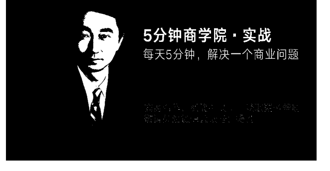

## 加餐 | 坪效高出同行5倍，盒马鲜生究竟做对了什么？

每天5分钟，解决一个商业问题。欢迎收听《刘润:5分钟商学院》，实战篇。

2016年10月13日，两位互联网大佬在两个不同的地方，分别提出了“新零售”的概念，时间相差半天，一位是小米的雷军，另一位是阿里巴巴的马云。

今天，作为雷派新零售的旗舰小米，在以20个月开240家店的速度，回归线下，高歌猛进，攻城略地。为此，我专访了雷军本人和小米总裁林斌，讨论了小米新零售的商业逻辑，并在较早的文章里专门发表。

而另外一边，马派新零售的一号工程“盒马鲜生”，在过去的一年里也是备受瞩目，在新零售的大潮中如日中天。

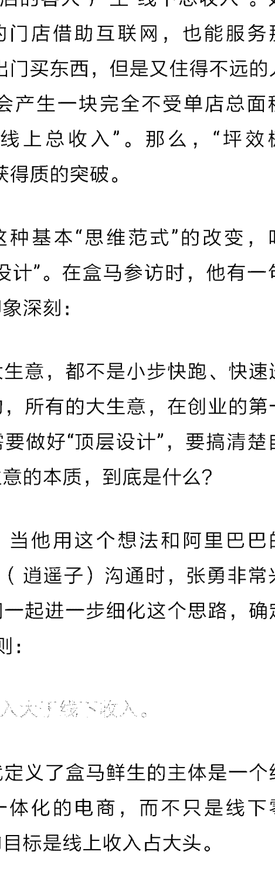

在马云提出新零售的时候，没有人知道新零售应该长什么样子。但是很快，2017年，盒马鲜生的出现，刷新了很多人的认知。

## 坪效极限：传统交易结构的天花板

我们如何来衡量零售企业的经营效率？

在纯电商领域，衡量经营效率的标准，叫做“人效”，即“每个人每年创造的收入”。为什么？因为纯电商企业最主要的成本，是人的成本，所以“人效”做得越高，企业的经营效率越高，盈利能力越好。

那在传统零售领域呢？

由于租金是传统零售最主要的成本之一，因此通常用“坪效”来衡量运营效率。坪效，也就是“每平方米每年创造的收入”。同样，“坪效”越高，则公司整体的经营效率越高，盈利能力越好。

用一个公式来表示，就是：坪效=线下总收入/单店总面积

## 顶层设计：盒马鲜生，被门店武装了的生鲜电商

刚才我们说，传统零售理解坪效，是用这个公式：坪效= 线下总收入/单店总面积

那么，想要提高坪效，在“单店总面积”不变的情况下，只有提高“线下总收入”。而如何提高购物体验（例如卖场的摆放、促销的设计等工作），让人更开心，让人买更多东西，从而提高“线下总收入”，在這方面，传统零售企业基本做到了极致，效率很难再大幅度提升了。

那么怎么办？“坪效极限”就无法突破吗？想要实现突破性的提升，必须突破过去的认知框架。

理成本建立客户忠诚度。

线上线下不是割裂关系，而是一盘棋。用户需求有线上的场景，也有线下的场景，盒马要满足不同消费场景需求，将流量池做大才是硬道理。

通过这几点要求，我们可以清晰地了解到，盒马鲜生本质上就是一个线上线下一体化运营的生鲜电商，一个被门店武装了的生鲜电商。

侯毅分享到这里的时候，我的内心是震撼的。在“盒马鲜生”这个名字还没有起好的时候，基于底层逻辑的顶层设计，就已经如此清晰了，它几乎就是我们现在看到盒马鲜生的运营状态。

有段时间，网上流传着一篇关于张勇（逍遥子）的文章。说张勇在某次演讲的时候，提到过一句话，这句话被当做了很多文章的标题：“战略都是打出来的，别人的总结和你无关。”很多人因此以为，张勇的观点是没有所谓的战略，战略是成功者成功之后自己做的总结而已。

但是，看到张勇和侯毅在创业之前就确定的这四个原则，你就会知道，什么叫顶层设计，什么叫做战略。在第一天，就要想清楚，这件事如果能成，到底借助的是什么样的“势能”？

## “吃-转-送”三步法，重新定义门店

有了顶层设计，接下来要做的，就是怎样实现顶层设计所定义的元素。

既然从顶层设计来看，盒马鲜生是一家“被门店武装了的生鲜电商”，那么它接下来需要做的事情，就是“重新定义门店的价值”，这其实是一个战略选择。

传统的生鲜超市看门店，是把它当做销售的“场”，让“人”和“货”在这里相遇，发生并完成交易。在这个“人-货-场”的交易结构里，门店，是交易的终点。因此，传统生鲜超市的所有工作，都是为了把人拉到店里来。

但是，在侯毅的脑海中，他对于门店的定义非常不同，他认为门店的本质是“流量收集器”，它是交易的起点，而不是终点。交易的终点应该在电商。只要在线下完成交易，就会被“坪效极限”的制约，只有把交易放在互联网上完成，才能突破极限。

所以，线下门店的任务，就是收集流量，把3公里内的人群，通过非常好的体验，吸引到门店来，然后将他们转化为线上会员。消费者周末有时间，就来线下体验；工作日没有时间，就到线上购物。这种崭新的“日销售”（Daily Shopping）对传统零售“周消费”（Weekly Shopping）的巨大升级，新零售坪效比传统零售高出一大截，自然也在情理之中。

怎么做到这一点呢？我总结了一下，盒马鲜生的“吃-转-送”三步法。

## 吃：在超市里吃海鲜，是为了建立信任

跟传统的生鲜超市相比，盒马鲜生第一个重要的不同，就是“吃”（堂食）。

盒马鲜生不但有商品陈列区，它还有一个大大的就餐区，大约占1/3的营业面积，和若干食品加工的档口。顾客在盒马鲜生买到了海鲜，可以送到档口去，支付很少的加工费，就可以请师傅加工成菜品，现场享用。

这种用超市价就可以吃到的新鲜海鲜，体验无疑会是非常棒的，而且性价比相比传统的海鲜馆，有着巨大的优势。

## 转：用APP买单，突破“坪效极限”的神转折

## 送：构造3公里半径的“盒区房”

送到你的办公室或家里了。

"突然想要，就要立刻拿到"。快到这个程度，APP用户才不会觉得在APP上买东西不方便。

可是，30分钟送货，怎么才能够做到？用科技提高效率。

走进盒马鲜生门店，都一定会注意到它的第三个重要不同，那就是在店面的天花板上的"智能悬挂链传送系统"。

盒马鲜生的门店分成为几个区域，每个区域都有一些拿着POS枪的店员在跑来跑去地拣货。店员把本区域的商品拣好、装在袋子里后，挂在悬挂链上，就会被传送到后场汇集。然后，后台打包装箱完成后，交给快递员送货。整个过程不能超过10分钟。

快递员收到包裹后，骑上电动车就往用户家里跑，20分钟之内，从盒马鲜生门店，送到用户家里。

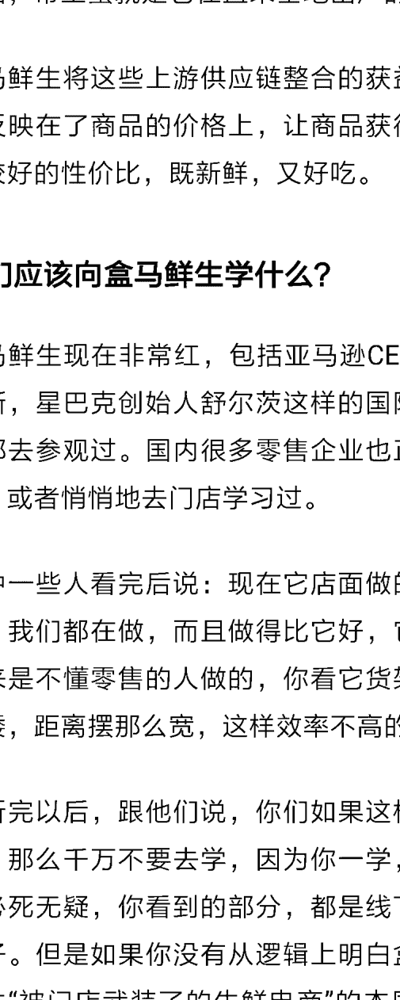

10分钟出货，20分钟送货。一共30分钟。确实快。甚至，有些房产中介公司造出了"盒区房"的概念。什么是盒区房？就是盒马鲜生门店3公里范围内的房子。业务员介绍时会说，这个房子不只是"学区房"，还是"盒区房"，生活品质很高，所以价格贵一点。

## 消费者获益：商业变革的第一推动力

"吃、转、送"，这个变革，是非常困难的。其实所有的变革，都是困难的。想要获得成功，需要找到好的帮手。找谁呢？

## 我们应该向盒马鲜生学什么？

Space X的创始人埃隆·马斯克前段时间，刚刚发射火箭，并回收成功。那么，火箭的本质是什么？火箭的本质，就是一辆“出租车”，把客人送到目的地。但是，哪有送一次客人，就烧掉一辆出租车的？既然是出租车，必须要重用。所以，我要回收火箭，洗洗下次再用。Space X所有的努力，都是为了达成“重复使用”这个目标。

要知道，消费者是整个交易系统 inconveni... 消费者获益。只有让消费者获益的变革，才是有澎湃动力的变革，才有可能颠覆这个市场原有的交易结构。

世界上流传两种商业模式：第一类是将产品利润做高，企业收益扩大，如苹果；第二类是将产品利润做低，让消费者得到实惠，薄利多销，如亚马逊。侯毅更加推崇第二类企业，正在身体力行，通过“人-货-场”的重构，缩短供应链，拉低商品价格，让消费者真正受益。

### 今日得到

### 划重点

- 1. 从“消费者获益”出发，为了突破“坪效极限”，侯毅开创了“被线下门店武装的生鲜电商”这样的“顶层设计”。
2. “顶层设计”又倒通了“吃、转、送”三步法，这就是盒马鲜生的新零售。
3. 这一切的一切，其实都是在告诉你：新零售，就是更高效率的零售。

## 5商学员分享

涵客家居创始人，5分钟商学院学员。从事家具零售6年，经营的“涵客家居”被评为2017年淘宝年度10大特色店铺之一。

## 第一部分：盒马的新零售新在哪儿？

- 1. 不同于传统商超设置强制动线以提高客单价为目的，盒马店铺的动线设计，以方便消费者选择和结账为目的。同时，店内有自动结账机，扫码可以自助付款，但是付款只能下载盒马的APP支付。作为阿里系的企业，甚至连支付宝直接支付都不可 以，更不接受现金和刷卡，这点非常强势。

## 第二部分：盒马鲜生的独特竞争力

每天都会遇到的问题。吃饭本身是个临时起意的事，如果在家做饭，下班以后就要去逛菜场买菜做饭。但是消费者可以在快下班的时候在盒马APP上下单，回家就能收到菜，就不用花时间逛超市。比如，消费者摘菜洗菜会花费大量时间，那么盒马在供应链端就做了改变，消费者买到的菜只要简单冲一下就干净了。同样是基地直采，一般商超可能只是把菜连根带泥包在了一起，而盒马把种地的农民变成了产业农民，他们把菜进行分拣，清洗和包装一并做了，然后也得到了额外的收入。从这个例子也能看出盒马做到了对价值链的重构。

为了“买得放心”，盒马提出了“无条件退款”，起初大家都觉得很难实现，事实上操作下来，退款率一直没有超过1%。侯毅说的是，你选择相信消费者，消费者也会用信任回馈你。

侯毅还特别提到了一点，为什么盒马鲜生不容易被模仿呢？这里涉及到政策问题。做超市的要有超市证，做餐饮要有餐饮证，上海市政府对于互联网企业的支持，两证合一给办了。这个是扶持试点企业给的绿灯，而且可能短时间内不会开放这个政策。所以实力不够的企业拿不到证，暂时是不能去学的。从这里我们能看出，政府也在转变得更包容，从政策上做出调整，以适应新的市场环境而不是束缚企业的创新发展。

## 第三部分：来自刘润老师两个小时的分析。

到了下午私董会成员的讨论环节，绝大多数学员的体会是围绕“以消费者为中心”来反思自己的企业。而刘润老师则提醒大家，参访成功的企业，容易做出错误的归因。“以消费者为中心”是创始人的发心，同时也是从商业逻辑上他们设计的动力系统。接着刘润老师拿出他多次提到的两个公式：

客户价值=创造价值+传递价值

零售=信息流+资金流+物流

来得出一个结论：新零售=更高效率的零售。

刘润老师还剧透了今年会出一本叫《新零售》的书，内容涵盖“坪效革命、数据赋能、短路经济”。从这三个方面，刘润老师把一个立体的盒马摊到桌面上来让我们平视，盒马的底层逻辑一览无余。我听下来内心直呼过瘾，如同三体里写的进入了四维空间可以看到三维空间的“水滴”一样。我相信刘润老师会有文章，对盒马的参访做深度分析。让我们期待尽快读到老师的文章吧。

## 146 | 无人商业：优化交易结构，就是：新增的成本小于节省的费用

146 | 无人商业：优化交易...

每天5分钟，解决一个商业问题。欢迎收听，《刘润5分钟商学院》，实战篇。

我们学习数据赋能、坪效革命、和短路径经济，理解“新零售，就是更高效率的零售”这套逻辑，不仅仅是为了解释过去，更重要的是为了预测未来。这周，我们来了解一下未来新零售可能的发展趋势。今天，我们先从“无人商业”开始。

李雷是做办公室无人零售货架的，在一些公司放个开放的货架，摆上各种零食、饮料。贴上收款二维码。niy可以自助拿走

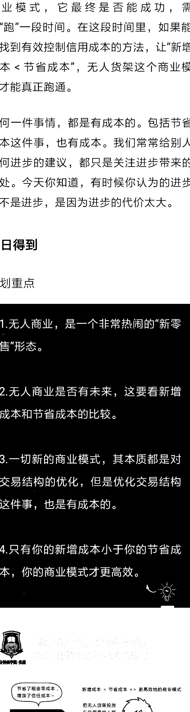

一开始很顺利，他通过扫楼地推的方式，在北上广深投放了几千个货架。可是，一段时间后，客单价逐渐降低，推广越来越困难，甚至一些做无人货架的同行正式倒闭了。他非常着急，和传统便利店相比，我的无人货架离用户更近，而且因为节省了租金和设备成本，售价更便宜，明显是更高效率的商业模式，为什么还是举步维艰？怎么办？

## 概念：无人商业

要解决这个“怎么办”的问题，我们首先要理解它的本质。一切新的商业模式，其本质都是对交易结构的优化，优化交易结构可以节省不少成本，但是优化交易结构这件事本身，也是有成本的。

相对于楼下便利店，放在办公室的无人货架，节省了不菲的店铺租金。同时，简单到极致的货架，没有防盗玻璃、轨道系统、摄像头等等，也不像自动售货机那样，要耗费几万元生产。相对于自动售货机，无人货架节省了不少设备成本。

但同时，它为了节省这些成本，也不得不新增了一些成本，比如：信任成本。

什么是信任成本？

我举个例子。在没有支付宝的时代，在网上购物，买家和卖家彼此是不信任的。是先付钱后发货吗？可是我付钱了，你不发货怎么办？那先发货后付钱吗？可是我发货了，你不付钱怎么办？想让我相信你，我需要承担很大的风险，这就是信任成本。因为信任成本太高，电商发展很缓慢。

后来支付宝出现了。你们既然彼此不信任，那买家就先把钱交给我支付宝，我收到钱后通知卖家，钱我收到了，但先不给你，你把货先发给买家。买家收货后点确认，我再把钱打给你，这样就解决了信任问题。所以支付宝本质上是通过降低信任成本，优化了交易结构，让电商获得极大的发展。

回到无人货架的案例，为什么无人货架增加了信任成本呢？

### 运用：

具体怎么做？比如有选择地把无人货架投放在信用高的人群中。

### 今日得到

划重点

- 1. 无人商业，是一个非常热闹的“新零售”形态。
2. 无人商业是否有未来，这要看新增成本和节省成本的比较。
3. 一切新的商业模式，其本质都是对交易结构的优化，但是优化交易结构这件事，也是有成本的。
4. 只有你的新增成本小于你的节省成本，你的商业模式才更高效。

刘润

从成本的角度来看，无人超市算是一种更高效的零售吗？欢迎你在留言区分享，与大家一起，过过招。也别忘了把今天的文章，分享给你的朋友，也许能够帮到他。

## 147 | 品牌体验店：以后，你可以理直气壮地只试不买

每天5分钟，解决一个商业问题。欢迎收听，《刘润5分钟商学院》，实战篇。

未来的零售会是什么样子？今天我们来继续推演，帮助你寻找商业机会。

小张在商场里卖鞋子。一位顾客来试穿。

试完后，顾客觉得很合适，打算买。他会对小张说：“你看，这鞋子网上只卖700元，你卖1200元，我在这儿也试了半天，你能不能也700元卖给我？”

小张一听，说：“亲，真的不行啊。我的鞋子进价600元，我卖1200元，但每双鞋子，商场都要扣掉30%。1200元扣30%，我还能剩下840元，勉强赚240元付工资。卖你700元，我只能拿到490元，连进价600元都不到啊！真不行！”

顾客根本不信。网上能，你就能啊！别骗我了。我是很想在这里买，但确实贵太多。你不肯便宜，那就不怪不得我了。然后，他理直气壮地离开，在网上买了那双鞋。

这样的顾客越来越多，小张很痛苦，怎么办？

要解决这个“怎么办”的问题，我们首先要理解它的本质。在第141课“新零售”里我们讲过，这个问题的本质是，线上和线下的“交易结构”不同。线下店给顾客试穿，提供了信息流，但顾客却可以在网上完成资金流和物流。线下店当然很难受。

## 概念：品牌体验店

那么怎么办呢？小张也许可以考虑转型，从“零售代理商”，变为“品牌体验店”。把交易结构，从“分享代理商商品差价”，变为“赚取体验店服务佣金”，从而转型。

什么叫“品牌体验店”？简单来说，就是只让你试穿，但不需要你买，这就是“只试不买”。

啊？这也行啊？如果真的只试不买，那赚什么钱 Boss?

赚品牌商的钱。

我举个例子，2016年，荷兰内衣品牌Lincherie在阿姆斯特丹开了家“只试不买”的实体店。为什么？因为在网上买内衣，很难确定大小，所以“试穿”是个非常必要的“信息流”。但在線下开店，又会有巨大的库存和经销商差价。怎么办？

Lincherie在这个“只试不买”的品牌体验店中，安装了高科技的镜子。顾客只要在试衣间，对着镜子照一照，就知道了自己的码数，获得了信息流；然后在电子设备上选择下单，支付了资金流；商品会在48小时内送上门，完成物流。

我再举个例子。

2017年10月，美国高端百货公司Nordstorm，在洛杉矶也开了家“只试不买”的实体店。这个店面积大概300平米，但只陈列少量货物供销售。那顾客来这里做什么呢？设计个人造型，修改服装尺寸，在网上购买后，到这里来提货、退货等。你可以在店里喝着咖啡来享受这些服务。

也就是说，这家店只是体验店，顾客在网上完成交易和物流。

那如果顾客都是“只试不买”，线下的租金、水电、消防、工资，这些成本谁来承担呢？品牌商。因为这时，门店的价值，已经不是商品销售，而是品牌宣传。

### 运用：

真的可以这样吗？我以前都是巧舌如簧地帮助品牌商卖货，现在我能转型帮助品牌商展示品牌价值，不用卖东西了？真的有品牌商需要这样的服务吗？

真有。

根据界面新闻报道，耐克公司在2017年10月正式宣布，要把全球3万家零售合作商，缩减到40个。而这40个伙伴，必须“有能力在自己商场中为Nike建立店中店，也就是特殊的独立空间，并配置由Nike特别训练过的店员。”“然后，耐克的官网和APP，将成为主要销售渠道，实体店，只负责提供更好的体验。

随着品牌商的深入，未来越来越多的品牌，将实现“线上线下一体化销售”，把线下变为“只试不买”的品牌体验店，在线下完成体验；并推动线上和物流体系，完成送货。 同时，零售代理商，也将逐渐转型为体验店服务商。

有时候我们义愤填膺“他们怎么可以这样”时，也许不是他们错了，更不是这个时代错了，当然也未必是我们错了。也许，根本就没有人“错了”，而是我们之间的关系“变了”。适应变化，不争对错，也许才是踏入这个时代的正确方式。

### 今日得到

刘重点

- 1. 品牌体验店，就是“只试不买”的实体店。
2. 品牌商需要通过线下更丰富的体验，给用户提供信息流，但线下代理商却因为成本结构不同越来越难生存。
3. 越来越多品牌商，将选择把线下实体店，变为“品牌体验店”，提供信息流，然后在网上完成资金流，并由物流完成送货，实现线上线下打通的新零售。
4. 这对原来的代理商来说，是转型成为“体验店服务商”的重大机遇。

刘润

如果越来越多的线下店，将不再以销售为目的，你觉得商场，购物中心，这些商业地产会怎么想？他们会欢迎，还是抵制呢？

欢迎你在留言区分享，与大家一起，过过招。也别忘了把今天的文章，分享给你的朋友，也许能够帮到他。

# 148 | 渠道服务化：不可思议，他们居然不让我和老师换名片

148 | 渠道服务化：不可思议..

每天5分钟，解决一个商业问题。欢迎收听，《刘润5分钟商学院》，实战篇。

李雷开了家房产中介，听说新零售要“短路”掉中间环节，忧心忡忡；看到网上“去中介化”的互联网公司来势汹汹，非常焦虑。他来找我，问，我们房产中介，是不是要被互联网公司完全替代了？如果是的话，我该怎么办？

要解决这个“怎么办”的问题，我们首先要理解它的本质。这个问题的本质是，当我们说“去中介化”时，这个“中介”，指的是到底是谁？

## 什么叫“拼缝者”？

十几年前，我通过培训机构，邀请一位老师来做微讲课。讲得不错。结束后，作为主办方，我上前表示感谢，培训机构在一旁很紧张地跟着。我掏出名片和老师交换时，培训机构赶紧递上了一张给我。这张名片上，是这位老师的名字，但却是这家培训机构的电话和邮箱。

我立刻明白，这家培训机构，不希望我和这位老师有直接联系。说实话，当时我是非常震惊的。心想，还有这种操作？这家公司，就是“拼缝者”，靠我不认识这位老师的这种“信息不对称”挣钱。

到了互联网时代，这种事情几乎不会再发生了，因为就算现场不换名片，我只要到微博上一搜，就能立刻找到他。曾经靠信息不对称挣钱的“培训中介”，今天都活得非常艰难。

再比如，你的朋友A，知道你认识B，就请你介绍，说不定三个人能一起合作。你很高兴地介绍A和B认识了，结果他们越聊越开心，一起做了不少事情，都没有带你。你非常恼火，说你们太不仗义了，是我介绍你们认识的，你们怎么可以撒开我。

你介于双方之间并不是创造价值，你只是扮演了“拼缝者”的角色。除了媒合之外，没有其他价值。他们不通过你，也可以通过其他人认识。你如果希望自己参与到合作中，一定要有了除“拼缝”之外的其他价值，而不仅仅是“我正好认识你们俩”。

## 概念：渠道服务化

回到最开始的案例。那房产中介，是不是“基于信息不对称的渠道商”，或者说“拼缝者”呢？

买过房子，或者租过房子的都知道，房产中介，在你们正式签合同前，是不会让上家和下家见面的。为什么？因为担心你们一见面，就会跳过中介，直接签约了。从这个角度来说，房产中介，确实是“基于信息不对称的渠道商”，是“拼缝者”。

但是，互联网盛行了那么多年，线下的房产中介，不但没死掉，反而成长出一些巨头。这又是怎么呢？这是因为房产中介后来认识到，他们所恐惧的“上下家见面”，其实并不是自己的核心价值。

那他们的核心价值是什么？买房子的人，并不知道如何挑选房子，规避风险，签订合同，万一上家拿了订金人找不到怎么办；卖房子的人，不知道自己的房子值多少钱，买家付了定金，但银行贷款办不下来怎么办等等。所以，你让上下家见面，他们多半也是不敢随便交易。

这时，房产中介真正的价值就浮现出来了。那就是提供“可信赖的交易服务”。今天，房产中介，已经不是“基于信息不对称的渠道商”，而是“基于独特价值的服务商”，数字货币不会被短路。

我这位朋友听完，长长地舒了口气。

### 今日得到

### 划重点

+   1. 渠道服务化，就是从“基于信息不对称的渠道商”，转型为“基于独特价值的服务商”。
2. 渠道商的转型方法就是，从“销售商品”的传递价值，转型为“提供服务”的创造价值。

你见过哪些商业模式，属于“拼缝者”呢？他们未来的出路在哪里？

欢迎你在留言区分享，与大家一起，过过招。也别忘了把今天的文章，分享给你的朋友，也许能够帮到他。

明天，也就是5月10号周四晚八点，我要来到直播间做一场直播，主题就是关于新零售的内容，欢迎你预留出一个小时的时间收听。

如果你有朋友也对这个话题感兴趣，或者想要深度全面的了解新零售，也欢迎你邀请他明天一起收听这场直播。我们周四晚八点，得到直播间见。

感谢大家一直以来的支持，我们一起先人一步，全面洞悉未来零售业。

## 149 | 用户代言人：淘宝成功真正的原因为，支付宝

149 | 用户代言人：淘宝成功。

每天5分钟，解决一个商业问题。欢迎收听，《刘润·5分钟商学院》，实战篇。

无人商业，品牌体验店，渠道服务化。新零售的效率，还会催生出哪些值得关注的趋势呢？

小张开了家公司，专门代理销售某著名保险公司的产品。前几年生意还不错，可最近几年，市场上消费者可选择的保险产品越来越多。有些类型的保险，明显是别家的更好，但为了完成销售指标，小张不得不把自家的东西吹得天花乱坠。即便这样，保险还是越来越难卖。怎么办？

要解决这个“怎么办”的问题，我们首先要理解它的本质。

产品是保险公司的，钱是用户的。小张是个中间人。在过去，小张这个中间人，是站在保险公司一方的。小张只有一个目标：把保险卖给用户……不管产品好不好。但是现在，用户懂得越来越多，选择越来越广，他的生意当然越来越难做。这个问题的本质是，当保险公司和用户的利益不一致时，小张选择了帮助保险公司，因此被用户抛弃。

那应该怎么办呢？

## 概念：用户代言人

也许小张可以考虑转型，从“产品代理人”，变为“用户代言人”；从站在保险公司一方，变为站在用户一方。也许小张可以考虑，把他这个“中间人”的交易结构，从分享保险公司的产品差价，变为赚取用户的服务佣金。

什么意思？

在《5商｜基础篇》第39课，我们学过“用户代言人”的概念。用户代言人，就是从首先倾向于卖家，变为首先倾向于买家。

我们举过淘宝的例子。

淘宝早期成功的重要原因之一，是“支付宝”。支付宝的逻辑是，你一下单，货款就打到支付宝，锁死但并不支付给卖家，只有你确认收货后，卖家才能拿到钱。那万一用户收到货说没收到呢？用户就没坏人嘛？当然也有。具体问题可以具体解决，但我首先要倾向于用户。

淘宝转型，成为了“用户的代言人”，并最终获得了巨大成功。

其实这也是为什么，很多制造商、品牌商，包括航空公司、酒店，无法转型做电商平台的原因。

曾经，一家中国最大的制造商、品牌商之一，让我看他们的电商平台。我问，你们的平台上卖竞争对手的产品吗？他们很诧异，当然不卖。我说，那你们就是自己“产品的代理人”，而不是“用户的代言人”。

他们说：我们以用户为中心。

我说，你首先要承认，一定有些产品，你的竞争对手做得比你好。如果你真的以用户为中心，这时候你应该允许，甚至推荐用户去买竞争对手的产品。这才叫做“用户的代言人”。

他们一听恍然大悟，但也大汗淋漓，咬牙说，那我们也卖竞争对手的东西。

我说：竞争对手也不会给你卖，因为担心你会向他们的用户兜售自己的竞品。真想成为“用户代言人”，你必须和自己的产品利益分道扬镳。

### 运用：

今天，几乎所有的互联网公司，都是“用户代言人”。

旅行网站自己没有飞机，没有酒店，这样他们才能像黄世仁一样，代表用户，向航空公司、酒店下狠手；盒马鲜生自己不养帝王蟹，不种菜，这样他们才能像黄荆台一样，代表用户，计较每一分钱的生产利润。

从交易结构的角度理解，“用户代言人”其实就是典型的“反转交易结构”，把零售变成了零买；把代表企业“卖”东西变成了代表用户“买”东西。

我们举过很多次美国会员制超市Costco的例子。

Costco的综合毛利率只有6%，其利润主要来自于会员费。它在美国有2000万会员，每年的会费是100-120美元，续费率达到了90%以上。为什么用户愿意交会员费？因为东西太便宜了，用户稍微多来买几次，会员费就赚回来了。

Costco会员费的本质，是用户付给Costco的代购费：你收了我的代购费，就用心帮我去“买”最优质、最 lowest价的商品。做得好，来年我还续费。

回到最开始的案例，小张应该怎么办呢？

他可以从“保险代理人”转型为“保险经纪人”，不再帮助任何一家保险公司“卖”产品，而是真正站在用户的角度，帮助他们“买”产品，不再赚取保险产品的差价，而是赚取用户的服务佣金。

一切商业的起点，都是消费者获益。人与人之间的交往也一样。一切交往的起点，都是让对方获益。所谓的人脉，不是那些能帮你的人，而是那些你能帮到的人。

### 今日得到

划重点

+   1. 从“产品代理人”变为“用户代言人”，就是从站在企业一方，变为站在用户一方。
2. “用户代言人”就是从帮企业“卖”产品，变为帮用户“买”产品，并提供更好的服务。

刘润

你还见过哪些商业模式，属于“产品代理人”呢？他们可以转型为“用户代言人”吗？
欢迎你在留言区分享，与大家一起，过过招。也别忘了把今天的文章，分享给你的朋友，也许够帮到他。

今天，也就是5月10号周四晚八点，我要来得到直播间做一场直播，主题就是关于新零售的内容，欢迎你预留出一个小时的时间收听。

如果你有朋友也对这个话题感兴趣，或者想要深度全面的了解新零售，也欢迎你邀请他今天一起收听这场直播。我们今晚八点，得到直播间见。

直播中我还会给收听直播的专栏同学独家发放《...》以及《...》作为福利。

感谢大家一直以来的支持，我们一起先人一步，全面洞悉未来零售业。

## 150 | 大复盘：所有的商业模式创新，都是改善交易结构，创造效率空间

每天5分钟，解决一个商业问题。欢迎收听《刘润·5分钟商学院》，实战篇。

学完商业模式和新零售两个模块，今天我们来做个复盘。

我们经常说，一切商业的起点，都是用户获益，那到底什么叫做好让用户获益？就是我们不能只关注自己打算卖什么产品；而应该反过来思考，用户想要买什么产品。从自己的角度，到用户的角度，这个站位的切换，就是第一季度的内容“理解用户”。

当站在用户角度找到他的需求后，我们就终于能够站在自己角度来理解，我们可以用什么产品来满足他的需求。产品，是满足需求的工具，这是我们第二季度的内容“打磨产品”。

那当我们的产品能够满足用户的需求后，我们应该怎么赚钱呢？这就是我们这个季度讨论的内容“找到模式”。

我们把怎么赚钱，放在了满足用户需求后面，是因为赚钱这件事情，是一个 consequence（顺带的结果），而不是 objective（目标）。什么意思？当你把满足用户需求当成目标，把产品当作满足需求的工具时，那么用一套合理的交易结构，赚钱就会成为自然而然的结果。但是如果把赚钱当作目标，你可能反而会越走越远。

在这个季度第一篇文章，我分享了我的理解。商业模式，就是“利益相关者的交易结构”。利益相关者不仅包括股东，还包括员工、客户、供应商，甚至帮你送货的物流。所有与生意有联系的人，都叫做利益相关者。如何把这些利益相关者，用最有效的方式组织起来，让事情达成，这是企业家唯一应该思考的事情。

那什么是商业模式创新呢？商业模式创新，就是优化原有的交易结构。今天因为互联网带来的连接效率的提升，许多交易结构都可以被优化了，我们学了三种模式：C2B，O2O，和P2P。

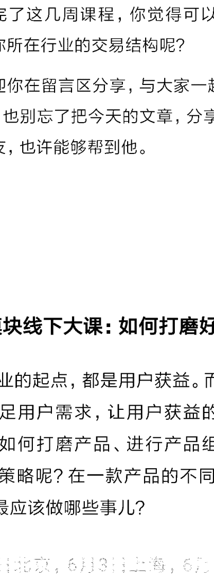

## 第二模块线下大课：如何打磨好产品

一切商业的起点，都是用户获益。而产品，正是满足用户需求，让用户获益的工具。到到底该如何打磨产品、进行产品组合、制定销售策略呢？在一款产品的不同生命周期中，最应该做哪些事儿？

我将在线下大课的现场，向你解答这些问题。

## 第30周周末私董会 | 如何让潜在用户对不熟悉的产品产生消费决策？

每天5分钟，解决一个商业问题。欢迎收听《刘润·5分钟商学院》实战篇。

5分钟商学院的同学们，大家周末好！又到了本周私董会的时间了。

本周获得私董会提问资格的同学是：猫女

润总好！我们是成都一家以预防保健为主的综合性健康诊所，有诊所医疗资质。位于成都高端小区和商业写字楼附近。

我们有多台高科技含量的仪器设备、全科医生、心理咨询师、运动康复师、营养师等，把每个客户的人体健康状态从时间线（历年体检、数据、病例史等）和空间线（情绪、睡眠、营养、运动等及器官功能检测、常规检测等多种方式结合）的结合来立体呈现，解决客户的身心健康问题。

由于前期市场还没有打开，我们决定前期以大家普遍都有认识的“看病、体检、懒人抗衰”这三个点来切入市场。

请问：

+   1. 目前的营销切入点正确吗，是否需要调整呢？
2. 如何教育用户，击中客户的痛点，让他们主动来做健康管理呢？

下面我们来解答这位同学提出的问题。

## 一、用户决策模型

简单地来说，当一个用户产生消费决策的时候，会有两个维度帮助他判断决策。

## 二、隐性决策、显性决策该如何定位和思考

## 三、定位‘慢病转诊’市场

常现象，及时提醒他去相关医院看病。甚至有一种商业模式，就是你把你的客户给哪个医院转诊，那个大医院就会给你转诊的费用。

以上就是我说得慢病转诊。慢病转诊其实是一个能让社区和大型的医疗机构高效衔接的方式，我认为在这一点上，未来有可能是会一个不错的发展方向。你作为一个在高端小区门口创业的诊所，也许可以尝试从慢病转诊开始你的健康管理品牌策略。或者把慢性决策通过一次体检变成显性的决策。所以我建议你把自己的机构定位为“家庭的私人医生”，或者“你的私人健康服务机构”，家庭医生的职责不是来看病，而是来帮你做健康管理的，这个概念可能更容易接受。

以上就是我给你三点建议，供你参考。

下面我公布一下这次私董会的10位获奖者，他们分别是：

请中奖的同学在本篇文章下方留言中，写下你的联系方式及支付宝（每人将获得600元奖学金，以充值的方式返到你的账户）。

另外，公布一下在5.10直播的获奖同学名单，获得10套《5分钟商学院》全套赠书的名单有：

获得20本《新零售》预赠书的同学名单（具体发货时间待定，以新书上市时间为准）：

猫女同学，你好！

根据你的问题，我进一步细分。

+   1.公司定位是否正确？ 2.定位是否需要调整？ 3.如何推广公司的产品？ 4.如何运营客户？

## 一、定位：

公司定位、产品定位、服务定位均决定公司的未来。战略正确，每走一步都是对的。通过你的描述，公司是在高端小区和商业写字楼附近，你们的定位应当是高端人群的健康需求，主打健康服务产品。产品定位建议采用矩阵产品模型。我们应用所学到的心理账户消费，即为健康消费：个人健康档案；为家人健康消费：家庭健康档案；体现企业优质福利：公司员工健康档案等。服务定位：通过服务体现高端。定制健康服务，您的健康管家。服务时长7X24，随叫随到等。

## 二、定位是根据发展的需要适度调整，只要核心定位确定，需要的是战术上的不断调整。

## 三、如何推广公司的产品？

根据产品、营销、渠道三方面来推广。

产品：定位中已经说过，制作矩阵产品（根据客户需求制作系列产品），重点是抓住客户的痛点和错位消费。通过体检延伸健康产品：健康饮食（高端餐饮企业联合），健康保健（高端保健品企业联合），健康锻练（高端健身房提供更有效的健康指导），健康讲座（知名人士讲座或一对一指导），就医绿色通道（知名医院联络）等。还可以根据人群来细分产品：女人、男人、老人、孩子。通过联合更多企业为自己赋能提升保健预防的内涵。

营销：
1.小区免费健康体检（从老年健康体验、儿童健康管理两方面入手），透过人群吸引真正购买者。吸引人群为高档小区中的大叔、大妈，透过他们来营销高端人群。
2.商业区，与企业沟通，免费健康讲座（职场常见病预防、压力释放等企业需要的），建立企业员工健康档案，从体现企业关爱员工和企业福利入手。对CEO等关键人群赠送个人健康产品或优惠。借助产品矩阵进一步吸引客户。 
3.宣传。线下：在小区电梯、物业等位置进行广告宣传，写字楼合作企业设置健康管家公示和宣传板。线上：本地公众号宣传投稿，本地健康类网站。

渠道：
1.健康机构合作，建立合作模式。
2.健康达人合作，健身馆或是健身教练。 
3.高尔夫球馆。 
4.高档美容院。 
5.所有合作企业会员共享。

## 四、如何运营客户？

拉新、留存。拉新，营销过程已经讲过，就是通过运营活动不断吸引更多的客户到诊所来体验。留存：高频服务是最有效手段。如果是现在的看病、体检没有差异化，医院都可以做，并且一年最多2-3次，客户对你们的服务感知的确会随着时间的增长而淡化，内容相同又为什么选择我们的企业呢？增加内容的  多样性，为健康赋予更多的花样，也就是我们设计的产品，从饮食、健身等高频活动入手。尊享服务，每次服务都应该让客户感受我们的优质和贴心，根据客户需求定制不同服务。在客户最需要你的时候能找到你并为他送上你的服务。建议采用会员制，除正常体验，还可以根据客户需要采用定制会员模式，以上内容，请老师和同学批评指正。

猫女，您好。
下面就针对于您的三个产品方向分别说下怎么发展：

## 一、看病

首先是看病，其实这个定位有点太大了。疾病的种类有很多，然而一般会去诊所看的病，都不是大病，病人自己也大概知道病症是什么回事，来诊所只不过就是开个药打个点滴什么的，但这些项目利润率偏低，而且没有竞争力；另一类情况就是专科疾病，比如口腔疾病等，这类目在私人诊所中是比较火的，利润空间比较大。

那如何确定自己的专营项目，您可以对周边进行个市场调研，诊所要想在专科方面有所突破，就必须结合诊所患者的  人群特点来决定所开设的医疗项目。根据医护人员的特点制定不同的管理方法，才能在根本上让诊所盈利。至于如何推广这一块，您可以联系周边的公司，主动去给他们做一些免费的健康课程；去周围的小区，免费做一些简单的医疗项目，当然这个也要针对特定的目标人群类型做不同的项目。

## 二、体检

体检这部分其实更像是一个资源的问题，因为目前国内体检主要还是以公司为主导。目前来看，市场已经被几家大的医疗机构瓜分了，剩下的只是一些中小公司的市场，如果有一些公司的资源，这块就很好做了，如果没有，那还比较困难。那如何抢占这部分市场，体检这件事是公司出钱，员工受益，所以具体服务质量多好其实并不重要了，价格可能是他们考虑的主要问题。

## 三、懒人抗衰

这块不知道是不是医美的一种，如果是医美，而且如果你的这个项目确实很好，需要一定的投入成本，那这块建议您可以发展您的战略合作伙伴诊所。所谓战略合作伙伴诊所就是能认同诊所发展经营思路的，能参与诊所规划的其他诊所。也 就是说，假如你的诊所有一个好的医美项目，那么就可以与其他愿意做该项目的诊所达成战略合作，通过其他诊所得到客源，还可大大减少投资成本，增加利润。综上所述，抓住患者需求、 门槛低、有专精、简约经营和时间快等特点是私人诊所的经营核心，是盈利的必要条件。

混总好！猫女同学好！
我从事医疗健康行业十多年了，现在也是健康行业的创业者，也正在筹备医疗服务机构，所以有很多共同话题，想与你交流一下！我从第一季开始，每年不间断地多

一下！我从第一季开始，每天不间断地多次学习润总的5商，还有一些大咖同学的留言，给我很多的启发与帮助！让我有商业基础知识，用系统的、动态的、整体的框架思维来思考问题，给我很大的成长与帮助！真心感恩润总付出！感恩得到！

大家都知道这个健康行业市场巨大，其实，壁垒也很多，难度也很大。医疗行业是个特殊的市场，行业核心资源是各细分领域的权威医生，猫女同学没有说清楚你的关键资源：是否有医保？规模有多大？设备可实现哪些关键功能？在此基础上大家分析切入点有些草率。其本质问题：你的品牌（包括产品）定位不够清晰，我就从你说提供的资料，用框架的思维发表一些我的基础看法，抛砖引玉！

## 首先，用swto分析法来分析一下：

+   1. 优势：
a.基础配置好：有先进仪器（多先进？与三甲医院、品牌连锁相比如何？）全科医生、康复营养师等；
b.在高端社区、写字楼旁——在用户身边，方便就诊。

2. 劣势：无医保（个人判断可能没有，一般诊所扛不了）市民看病都想用医保报销，没有医保只能看些小问题或服务没有医保的外来人口。

3.机会：高端小区、写字楼区域人员消费能比较强。

4.威胁：同学想以看病、体检、抗衰为切入口，那么看病：请问主诊医生有哪些优势，能看大医院不能看的病吗？体检：业内已有爱康国宾、美年、慈铭，相比它们，您的核心优势在哪？抗衰：是否有治疗手段或产品，与一些美容机构相比，核心优势在哪？在病人认知里：公立三甲医院有政府背书，医生职称在公立医院里考核，还享有政府红利，所以最好的医生、最先进的设备都在大公立医院里，大家挤破了头往大医院跑！

所以从产品、营销、渠道等方面建议如下：

## 一、产品

+   1.能否与三甲医院达成转诊等协作医院协议，或请三甲医院的学术带头人，较知名退休老专家来医院挂名荣誉院长或坐诊为医院背书（至少重金拿下一个）。
2.结合自己的医疗设备，有心理医生、康复医生团队优势，打造一个儿童成长（如小儿推拿）或者高端女性私护保养为特色的养生产品，差异化于医院，做医院没有做或不做的事情，不断打磨，把服务体验、疗效做到极致，实现服务流程标准化，可复制。近期可以增加收入，在本地发展。远期可以把它作为一个商业模式，连锁化经营，不断复制！定位的核心是差异化定位，怎么定位竞争才小，对未来有价值！

## 二、营销：

+   1.公众号：提供养生、康复、育儿等目标用户相关知识等，让顾客来有东西看，有事做做，想走也走不了，并且爱上你。可以通过公众号做些事，让低频变高频，取关也取关不了！
2.周边小区、幼儿园等目标群体地推，不定期请专家进社区，进行义诊等公益活动，推广品牌，提高知名度、美誉度，
3.心理健康、康复等讲座，体验、众筹体检卡，以众筹体检为入口，进行拉新、引流、促活、转化活动，目标是转化为主打产品的会员，关于会员制度，前面有不少同学讲过，不再详述。

## 三、渠道（流量入口）

+   1. 异业联盟（与无竞争行业合作）；
2. 单位团体；
3. 本地大型公众号推广；
4. 微商等直销公司分销推广（把会员卡做成产品进行分销）。

猫女同学，你好。
我谈谈自己的看法，仅供参考。

## 一、问题1：营销切入点

贵公司是做健康管理的，前期市场还没有打开，通过看病、体检、懒人抗衰作为营销切入点是否合适？所以如何找准用户、精准营销、提升转化率才是问题的核心。下面我将从用户画像、文案切入、精准推送三个方面展开说明。

+   1.用户画像通过下面3步来进行：数据收集（行为数据、偏好数据、交易数据等），行为建模（内容挖掘、预测算法、机器学习等），构建画像（基本属性、购买力、兴趣爱好、社交网络等）。经过全面分析后，用户群更加全面，既包括看病的用户、体检发现疾病的用户，他们是被动型用户；也包括：金融/IT等行业精英、管理/骨干等中高级岗位人士，以及其他人群，他们是对健康有着高需求的主动型用户。

2. 打动人心
通过文案、体验、试用的方式，实现从有所触动，到打动人心，最后欣然接受的层层递进营销。

（1）文案提流量。大家都知道健康管理的重要性，但与人的天性相违背，所以需要要用文案、体验等方式，通过亲情连直接击人心，提升流量和转化率。如：岁月带走你的时光，不要再带走您孩子的眼泪。有所触动是第一步，进一步请用户进行体验。
（2）体验获好感。体验的目的是让用户对健康管理有所了解，并增加好感，为后面的试用做铺垫。同时通过用户健康调查，实现健康调查、用户画像、用户需求、体验感知等多重目的。可以考虑免费或成本价的短期试用推广，以低价接洽潜在客户。
（3）试用促转化。通过短期的用户试用，让用户感受到产品价值，同时利用现状偏差，为后续的转化、用户教育等埋下伏笔。

3.精准推送
（1）线下推广可以按照用户画像，线下在高档写字楼、高档小区、医院、售楼处、会所、银行等地推广。
（2）线上推广可以聘请专业公司进行线上的广告投放或推广。
（3）企业市场也可以与金融/IT等中高端、高强度企业合作，做企业市场，或在企业内团购推广。

## 二、问题2：教育用户

大家都知道健康管理的重要性，但为什么还是有很多人不重视呢？因为健康管理和预防要对抗人性，而人性是改变不了的。比较有效的方法是用另外一种人性对抗人性的惰性，同时在产品、营销中体现，从而改变用户习惯，甚至让用户喜欢上健康管理。

+   1.为孩子健康而努力。虽然人性是改变不了的，但我们可以通过其他的人性来对抗另一种人性。比如：老人和父母关爱孩子，甚至牺牲自己很多东西。可以通过智能穿戴、体检结果等手段，让老人和父母绞结为孩子赢取免费的牙齿检查、营养检查等，在个人健康管理的基础上，又增加了一个更有意义的事情：为孩子的健康而努力。
2.绞结还要挣钱。用户交一笔抵押金，如果不坚持绞结或者结果不达标，扣一部分抵押金；坚持绞结不仅能领回自己的钱，还能领别人的钱。用户健康管理的积极性会比较高。
3.产品好。产品要好，好到超乎用户的想象的体验。没有汽车前，用户无法想象还有什么比骑马快。没有iPhone前，无法想象智能手机如此方便使用，一天摸手机的时间，远远超过自己最爱的人。只有好产品才会增加用户对抗自身懒惰等天性的力量，甚至让用户将个人健康转化为更有意义的事情来对抗人性。比如：产品在价值显现、感知知方面，不断向上突破，甚至上瘾。体现差异：让用户感觉到健康管理之前和之后的明显差异，甚至生命都年轻了。连接情感：能将个人健康与家庭幸福、孩子的健康快乐等联系起来，甚至让周边人都能感受到这是一个关爱家庭的父母。
最后祝成功。

作为大健康产业的从业者，对于猫女的问题提出以下建议，供参考。

## 1.目前的营销切入点正确吗，是否需要调整呢？

建议：经过慎重考虑，选择一个切入点，实现单点突破，理由如下：

（1）从经营者的角度来看，一方面企业的人才、资金及创始人团队的精力都是相对有限的，看病、体检、懒人抗衰三个领域对于人才、资金的需求不同……

（2）站在客户的角度，刘润老师也反复强调用户思维，商业模式要优化交易结构。……

## 2.如何教育用户，击中客户的痛点，让他们主动来做健康管理呢？

一方面，不建议你作为单个企业(除非你未来做成平台级)去教育用户，投入比太低。另一方面，健康管理大家都会认为重要……

希望以上建议能够帮到你。

猫女你好，就你提出的问题，来谈谈我的看法。

## 一、目前的营销切入点正确吗，是否需要调整呢？

### A.就目前以“看病、体检、懒人抗衰”这三个切入点，我认为存在一些问题，理由如下：

- 1. 由于综合性健康诊所在当下中国还是有点超前，或许很多的老百姓（包括一部分高端消费者）不一定能够接受。……
- 2. 随着一线、二线城市的医疗资源越来越紧张，大部分患者都会去公立三甲医院看病……
- 3. 你们诊所的优势是有全科医生、高科技含量仪器设备，而患者无需等待。所以针对以上这类痛点，可以采取接入社保系统……

### B.关于“体检”的切入点：可以以亚健康食物跟踪调理、心理关怀作为卖点。

- 1. 体检服务已经被大型综合医院、各类体检机构所包揽，后者很难进入。但他们只管查不管善后……
- 2. 现在很多的白领，普遍都存在亚健康的情况。由于工作压力大、加班严重、睡眠不足、饮食无规律……

### C.关于“懒人抗衰”的切入点：这点是否需要，和前面无关联性，短期内看不到成果，万事请做精，而不要广撒网。

## 二、如何教育用户，击中客户的痛点，让他们主动来做健康管理呢？

- 1. 定位用户。你的消费群体主要是一些高端舍得花钱的人，把健康放在首位以及这类成功人士的家人……
- 2. 异业联盟。可以和大型医院的国际医疗中心合作，一般能够起VIP诊室的，都是不缺钱，而缺时间的那类人……
- 3. 营销企划。由于前期定位于高端用户，他们时间宝贵，很少会看电视，但一般金融类和商业类的杂志或书籍都会翻看……

猫女你好，你的问题我从以下几点分析：

- 1.看病：一般不舒服的话都会首选医院，头疼脑热的可以自己判断的疾病一般选择去药店自己买药。
- 2.体检：现有的体检医院特别多，而且是和企业有合作的连锁体检机构比比皆是多，竞争激烈。
- 3.懒人抗衰：有点类似于美容院或者医疗美容的感觉，所以你的这部分用户群体和健康的用戶群体其实很偏离。

基于你的情况，你优势在于强大的医师服务团队和硬件设备，是否可以考虑仪器设备领先的高端定位呢？先从高端体检开始切入，给周围小区的居民赠送体检服务项目。……

### 线上：

- 1.开发在线体检档案管理和健康咨询平台，类似于蚂蚁森林。用户可以在线上一见看自己的体检档案并且可以直接关联相关健康建议和健康计划……
- 2.积累健康数据，定期回访，把新到店的每一个用户都当成超级用户来服务保持粘性。
- 3.做好线上产品可以把下半年时间充分用来做咨询服务，并且把线上低成本流量导入线下，提升高效。

### 线下：

- 1、你要找到自己的客户群，其实我觉得愿意在保健品、健身、中医养生、按摩、瑜伽、保险、饮食疗法上花钱的客户一定是注重在健康上投入资的。你可以寻找异业联盟，和其他机构达成合作，给他们一定比例的提成。
- 2、做长线业务，不要主推按项目单独收费的，可以主打套卡。一般家庭成员之前饮食习惯、家庭病史有相同性，可以在套餐内一起管理健康。辅助以孕妇营养咨询、婴幼儿营养搭配、青少年成长管理、老年人慢性病管理等……
- 3.让你的客户推荐你的产品，给予他们高额返点。

额返点。

希望能帮到你！

猫女同学你好，很开心看到你的提问，我也在成都从事诊所的营销相关工作，现在根据我们的尝试和思考给你一些小建议。

回复问题之前想先说明一下：

首先，我认为纯医疗这件事情本身，因为它的高信任门槛和高度信息不对称，再加上疾病的低频偶发，是一件非常难以通过营销驱动的。特别是近几年的大背景下，用户对于私立医疗机构的信任值其实非常低，这也增加了难度。

其次，你要保证你的医疗质量是好的，是不违背医疗原则的。毕竟就像润总一直强调的一样，好的产品才是根本，因为医疗行业其实更加依赖于口碑，所以好的产品是前提。

## 关于你的第一个问题。

第一，我认为你们对于诊所的定位不够清楚。根据你描述的服务能力（内容），我理解的是诊所除了提供预防保健服务外还提供全科看诊服务，而咱们的切入点分别是不同定位的医疗机构。

- 1. 产品定位模糊，看病+体检+懒人抗衰，各种器械医生都有，感觉是什么都能做，但其实什么都能做往往就是什么都不能做。
- 2. 从你的问题能看出，你还没有明确你的具有核心竞争力的产品。

## 一、产品

## 二、宣传

猫女同学好！针对你的两个问题，我从产品和宣传两方面进行一下解答：

润总、猫女你们好。我也是从事健康行业，以下是我的一些见解，希望能给你帮助。

上刻意说健康教育，很容易让人理解成“王婆卖瓜，自卖自夸”。

第二，做科学教育的，最好由非商业机构去做。由一个商业机构去做健康教育，其信任的起点就很低。老人不敢说，但一个商业机构去向中青年消费者科普，他们会本能地保持距离。所以这方面我的体会是，教育是要做，但一定要舒服和自然，绝不能将教育与回报率相捆绑。因为健康教育的目的除了提高消费者的意识，就是让消费者能对你的企业或服务有一个好的印象。比如每周定期发通俗易懂的公众号文章，或适当与一些公益活动或权威机构合作，以提高商家的公信力和社会形象。商业形象去掉得越多，正面形象涨得越高。最后在引流方面，国外的保险公司会为他们的VIP客户提供高标准体检等高价值服务，所以怎样与保险公司、高尔夫球会所、高级养生会所或高档生活小区合作开发业务，为消费者赋能和创造价值，也是可以考虑的。希望以上的浅知拙见能给你帮助，商安！

刘润

下一周，获得私董会提问资格的同学是：

我们是一家游戏公司，但最近公司打算开展一个新项目，做一个电商平台。模式打算跟拼多多对标，走拼团购买商品的模式。与拼多多最大的区别在于，我们将会以区域为一个团体来部署团队和商品，比如三四线城市的一个县城，验证商业模式之后，迅速开拓其他的市场，一个点一个点地去打造一个电商系统。商品分为引流品和利润品，引流品会是当地超市和卖场当季的畅销品。至于利润品，我们现在在食品、服装、电子3C等领域中选出100款左右的商品。

现在我们有这样几个问题：

- 1. 限于项目初期的资金问题，这100款商品应该怎么选择？
- 2. 我们注意到拼多多里面有个一元抽大奖的组团，能够造成爆炸性分享，我们如何来借鉴这种方式？
- 3. 除了自营之外，我们之后还需要第三方卖家的进驻，那么如何挑选、识别有实力的第三方卖家，以及何如对这些卖家进行管理，保证产品和服务的质量？

欢迎大家给这位同学出主意，用你们的智慧赢取这笔奖学金，也欢迎你把困扰你的问题思路、联系方式和价格，写在今天的留言区里。我们一起讨论，争取找到更好的解决方案。

## 加餐 | 直播复盘：“新零售”的本质就是定义效率

《5分钟商学院》的同学们，大家周末好！

5月10日周四晚上，我在得到App做了一场主题为“新零售”的直播，有近3万位同学在线收听。直播内容主要分为三个部分：

## 一、究竟什么是“新零售”，它与传统零售的本质差别是什么？

“新零售”是在2016年的10月份首先被提出来的，我在访谈雷军时，他告诉我说是在某一天的早上，他在一个论坛上讲到了“新零售”这三个字的概念。在当天下午，马云在另外一个城市的另外一个会上也谈到了“新零售”。所以应该是雷军比马云更早提出“新零售”这个概念，早了半天时间。

几乎是在同一天，大家都提出了“新零售”。为什么“新零售”突然变得很火？为什么这么多企业都要涌入“新零售”的战场？零售真的有“新”和“旧”的概念吗？

要理解这件事，就要从2015年开始讲起。随着互联网的迅猛发展，很多人认为电商已经在不断吞噬线下零售了。在2012年的12月，央视年度经济人物颁奖典礼上，马云和王健林打了一个赌，还有人记得吗？

这个打赌的内容就是：十年之内电商会不会超过大零售的50%。马云说肯定可以，王健林说：“绝对不可能，不信我们打个价值一个亿的赌。如果十年之后电商收入超过整个中国零售业收入的50%，算我输。”

到了2015年的时侯，很多电商集团就开始发现了一个趋势。这个趋势就是基于互联网买东西的用户数量还在增长，但是增长的速度开始放缓了。整个中国消费品零售业总额，通过电商完成的数量大概在10%~20%之间。

为什么放缓？很大的原因是早期比较容易学习上网购物的人都已经在用网络了，后面还有人陆陆续续上网，但是速度比较慢了。比如说老年人、七八线城市的人群，或者对互联网接触很少的人。这些人还会上网，但可能就需要一两代人才完全接受互联网。一旦速度放缓之后，未来的速度可能就不会更快了。这一点很多的电商机构也意识到了。

定要试过才行。 但实际上， 衣服这个类目在网购上是非常热门、 非常成功的。

到底为什么呢？ 原因是另外一个维度的因素在起作用。 那些新一代的年轻人本来就乐于接受网络带来的新鲜事物， 当他们开始有钱了， 就愿意在网购上花钱， 也愿意花那个时间。 这时候， 这个不能试穿的因素就被克服了， 那么在网上买衣服这件事就能获得成功。

还有就是特别佩服刘润老师， 他告诉我们，要站在信息流、资金流、物流的角度来分析。 比如说他抽象出来信息流、资金流、物流， 然后分析到底有没有产生新的东西。

其实“薛兆丰经济学课”里面有专门的单元讲到这部分的内容，叫最低零售价限制。 就是说为什么要维持线下最低的零售价？ 是为了防止线下零售商之间， 互相在价格上做过多的竞争， 引导他们在服务质量上做一个调整。

如果不这么做的话， 那些不提供线下服务的商家就能赚钱， 因为他的价格有优势。 结果就会导致没有人愿意提供优质的线下服务了， 也就会使得没有消费者愿意在线下买东西了。

其实这种趋势将来一个最好的解决办法， 就是线下线上一体化。 这种情况在当时我们讲的一个案例“马尔斯医药案”中提到了。 1911年美国判的一个案子， 里面的模式跟今天的“新零售”这个模式是一脉相承的。

## 二、“新零售”到底给我们带来了什么样的便利？

谢谢薛老师给我们的分享， 刚才我们花了一些时间与你分享到底什么叫“新零售”。 下面我们就要聊聊未来“新零售”到底给我们的生活带来了什么样的改变和便利， 我相信你应该已经有这样的体会了。

线上会有线上的优势， 线下会有线下的优势。 有些人特别喜欢在线下购物， 他就是不喜欢用互联网， 但是有人觉得互联网今天已经特别便利了。 但你们有没有发现有些线上的做法， 在线下很难实现， 因为线下有线下的特点。 比如我刚才说的买鞋子这件事， 你要亲自试过之后才知道是不是真的好。 所以接下来我们有一个关于体验的问题。

为什么今天有很多线下机构反复说我们要转型， 给用户更好的体验。 体验在互联网上很难完整地给到消费者， 所以对消费者来说， 会发现线下将有越来越多的体验店。 你会发现餐厅的东西越来越好吃了， 购物中心越来越好玩了， 游乐场里面的项目越来越多了， 都是因为互联网把所有容易干的事都拿走了， 线下必须干高体验的事。 这是线下的第一个特点， 叫做体验性。

相比来说， 互联网在信息流上重大的优势， 就是信息传递的高效性。 比如淘宝， 几乎没有搜不到的东西。 过去想在家门口买一个15年前电视机的遥控器， 几乎是不可能的。 但在淘宝上一搜， 几乎都能搜到。 淘宝把几乎全中国的商品信息都汇总起来了。 如果卖遥控器的人在你家门口卖那个遥控器， 说不定10年都卖不到一个。 但是在淘宝上， 说不定一天就卖二十几个。 所以， 互联网通过信息的高效性， 把很小的生意变成走量的大生意。 而线下通过信息流的体验性， 让你深刻地体会到这样东西到底该不该买。 所以线上和线下都给我们的生活带来了巨大的便利。

物流上会带来什么改变呢？ 虽然电商很发达， 但是当你想马上就能喝到一瓶酸奶时， 会去京东、一号店买吗？ 网购的话再快也得第二天送到， 你几乎一定是到家门口的便利店买酸奶。 现如今很多超市活得很艰难， 但便利店越活越好， 为什么？ 因为便利店有一个重大特性， 就是即得性。

即得性的主要原因是， 它离我比较近。 “近”这个特质太重要了， 我们做饭的时候突然发现盐用完了， 让小朋友下楼去买盐， 他一定是去离家最近的便利店。 有些商品立刻就需要， 你想想什么商品有这种特性？ 比如说突然之间感冒了， 这个时候你家门口的药店就显得特别重要。 所以即得性会导致线下店铺越来越向你家靠拢， 这给我们的生活带来了更多的便利性， 会有越来越多的人重视你们家附近的商机， 你们家附近买什么东西都会变得越来越方便。

## 三、“新零售”会给我们什么样的机会？

讲了这么多关于“新零售”到底是什么， 以及它到底给我们带来什么样的改变。 未来它的机会在哪里， 我们应该如何抓住“新零售”这一波红利？ 谁又是“新零售”最终的受益者和受害者呢？

其实， 找到一条主线你就会发现到处都是机会。 这个主线就是： 在线下和线上， 信息流、资金流、物流的效率怎么提高？ 在线下如何做体验？ 在线下如何提高效率？ 在线上如何提高物流的跨度性等等？ 只需要抓住这两个维度， 价差提高效率就好了。

不管谁更重要， 对每一位消费者来说都是便利性的提升和习惯的改变。 今天很多的零售机构都在尝试无人机送货， 如果有一天你要炒菜的时候， 盐用完了也许无人机一分钟就飞到了你家窗口。 物流距离的近和电商物流的快， 这两个要素互相转换、 互相竞争， 最后都会给你越来越便利的生活。

今天很多所谓“新零售”都是围绕这个逻辑展开的。举个例子，很多办公区出现了一种叫做无人货架的商业形式。无人货架首先提高了一定的效率，这个效率就是我们过去到楼下便利店买东西，现在可以不走出办公区就够买想吃的东西。另外节省了租金成本、水电成本和雇佣成本。但是，我们判断它是不是更高效的时候，还要看它有没有带来新的成本，或者说是损耗。

我去过一个公司，这个公司的人说，“我们刚刚装了无人货架，你们随便吃吧”。如果真的把无人货架装到这种公司的话，就等于每个月都白送给人家了。当然了，也有人一扫码发现网络不好，就先拿着吃，过会再来付钱，但是他也许过会就忘了。

所以这也是一种损耗成本，这个损耗成本来自于人与人之间的信任。在这里要提醒的是，判断这个新零售模式是不是商业机会最重要的标准，就是这个标准的新增成本是不是小于我们节省下来的成本。如果新增成本小于节省下来的成本的话，它就是更高效的零售。

那么无人货架到底算不算呢？我认为它得跑一段时间，看一看是不是能找到真正有信用的高素质人群生活的地方来放置，把信用不好的地方的货架撤回来，运营一段时间，根据数据来判断是不是好的方向。

所有的这些新的商业模式到底是不是新零售，现在还不好直接下结论。但这就是我们的机会，如果我们在里面提高了效率，发现用这个方法卖东西就是比那个方式卖东西更便宜，成本更低，获得更好的体验，我们就会创造出一个新零售的商业模式。

在去年的3月8号，阿里搞了一个活动，叫做三八扫码购。拿着你的天猫超市APP，去沃尔玛、家乐福扫条形码比价。你本来想买一桶油，超市里面卖240元。扫完以后发现天猫180元，就不买了，直接加入手机天猫超市了。再去拿一个东西，1.83元，天猫1.82元，便宜一分钱也是钱，于是你走了一整圈发现每个东西都是天猫便宜，手机购物车满满当当装了一堆，而真实的购物车什么都没有，空手就出去了。

黄牛就很聪明，在当天他们做了一件事情，在北京的地铁里面拿着一本小手册，走到别人面前，说要不要看一下我这个册子，今天天猫搞活动，什么都比沃尔玛便宜，一翻你发现果然都便宜。那你要不要扫一扫？那就扫吧，扫之前黄牛告诉你说，你付一块钱好不好，你随便扫，都是天猫超市里面的东西，也不是我卖的。这里黄牛相当于帮你逛了一趟沃尔玛，他把最便宜的商品列了一本册子，这个册子的本质就是信息流，他把最折扣的东西以信息流的形式展示在你面前。当信息流和资金流切开之后，他通过这种方式来提高效率，就赚一块钱，但对你来说扫一下就省了两三块钱，你是愿意付这个钱的。

## 四、总结

在快结束的时候，我想跟大家分享一些我的感受。之所以在这里给大 家做整整两季的商学院课程，是希望能给大家带来一些真实的价值，希望更多的人能够从这个课中获得启发，了解商业世界是怎样的。更重要的是能够提炼一套抽象化的思维方式，能够用商业的逻辑去看待这个世界的本质问题。

每个人都身处在商业世界，不管你是不是真正从事商业的人，我想送你两句话。

在生活中也是一样，我们说一切交往的起点都是对方获益，我们经常也用这个逻辑让大家明白一些我们从商业中学习到的人生道理，就是所谓的人脉到底是什么？人脉不是那些能帮到你的人，所谓的人脉是你能帮到的人。因为只有那些你能帮到的人，你才会对他有价值，因为所有的交换和帮助都是价值的来回。所以，人脉不是那些能帮到你的人，而是那些你能帮到的人。

对我们自己也是一样。我们在做很多事情的时候，要反复思考如何来提高自己的效率，也许你是借助了科技，又或者是加强了时间管理，或者优化了结构。只要你提高了效率都应该欢欣鼓舞，因为你带来了更多的时间，让我们快速提高效率，慢节奏享受生活。

感谢大家，希望你们每一个人都能走在这个千变万化的商业世界的最前端。

## 第二模块线下大课：如何打磨好产品

一切商业的起点，都是用户获益。而产品，正是满足用户需求，让用户获益的工具。到底该如何打磨产品、进行产品组合、制定销售策略呢？在一款产品 的不同生命阶段中，最应该做哪些事儿？

点击下方图片即可查看课程详情，「得到」用户，依然享受八折优惠。非常期待，在线下见到大家。

## 151 | 无形资产：企业护城河中的三只无形水军：专利、品牌和法定许可

151 | 无形资产：企业护城河.. ↓

每天5分钟，解决一个商业问题。欢迎收听，《刘润·5分钟商学院》，实战篇。

一位5商的学员“淡忘”，在“周末私董会”提过一个问题，大概意思是：我们是做教育机构的，依靠“先发优势”在新市场中获得了不错的利润，但竞争对手纷纷跟红进场，利润被很快摊薄，怎么办？

这个问题，值得专门讲一讲，因为它背后，隐藏着“产业经济学”中一个极其重要的课题：护城河。

## 什么叫护城河？

小王在海滩边工作，发现很多人顶着暴晒来游泳，就想，我能不能卖点冰镇饮料给他们呢？他买了个冰箱，批发了可乐来卖，果然生意非常好，赚了不少钱。

可是，好景不长。

原来这也能赚钱啊？于是小李，小赵，小张都买了冰箱，批发了可乐来卖。"冰镇可乐"行业开始拥挤了。小王非常生气，甚至要和他们打起来，但是所有人的利润，因为竞争而不断降低，直到最后无利可图。

## 概念：无形资产

那怎么办呢？著名的投资人，股神巴菲特说：想要获得超额利润，必须为自己挖护城河。

一个公司可以有哪些护城河呢？

- 1) 无形资产；
- 2) 转换成本；
- 3) 成本优势；
- 4) 网络效应。

今天，我们先来学习第一项：无形资产。无形资产有三种：专利、品牌和法定许可。

### 今日得到

划重点

1.根据零利润定理，在所有“完全竞争行业”中，企业的利润最终会趋于零。 2.为了享受超额利润，企业必须为自己挖立护城河。 3.巴菲特说，护城河有四种：无形资产、转换成本、成本优势和网络效应。 4.无形资产这条护城河中，有三支水军：专利、品牌、法定许可。

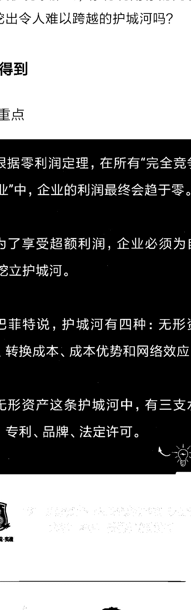

刘润
好了，今天我就讲到这里。你见过哪些公司，充分利用了专利，品牌和法定许可，建立了自己的护城河呢？
欢迎你在留言区分享，与大家一起，过过招。也别忘了把今天的文章，分享给你的朋友，也许能够帮到他。

# 152 | 转换成本：“忠诚，是因为背叛的代价足够大”，真的是这样吗？

每天5分钟，解决一个商业问题。欢迎收听，《刘润·5分钟商学院》，实战篇。

小王做了个本地生活的O2O平台，让用户可以在手机上找到特色餐厅。因为定位独特，获得不少用户。可是，很快，就有竞争对手出现了。用户到餐厅后，问哪个平台有优惠，用户就用哪个平台买单，一点忠诚度都没有。小王很苦恼，怎么办？

要解决这个“怎么办”的问题，我们首先要理解它的本质。

## 概念：转换成本

为什么有些公司，顾客对产品和服务并不十分满意，却一边抱怨一边坚持用；而有些公司，顾客号称非常喜欢你的产品，却说走就走，头也不回？因为顾客对你没有“忠诚度”。那到底什么叫“忠诚度”？忠诚度，其实还有一个“学名”，叫做：转换成本。

我是百度云的用户，把电脑上的资料自动同步到云端，可以跨设备移动办公。一直用得很顺手，所以还付费成为了它的超级会员。后来，腾讯也出了款“腾讯云”，也很不错，也很快速，价格甚至更优惠。但是，我却完全不为所动。

为什么？是因为我对百度忠诚吗？不是。是因为我已经在百度云上有800G内容。我要把这800G内容，从百度云搬家到腾讯云，天啊，这个“转换成本”实在太高了。

在互联网产品界，有个著名的公式：

用户转换产品的动机 = （新产品价值 - 原产品价值）/ 转换成本

“新产品价值 - 原产品价值”，用通俗的话说，就是“受到的诱惑”；转换成本，用通俗的话说，就是“背叛的代价”。用户之所以会说走就走，头也不回，根据这个公式，就是因为受到的诱惑，大于背叛的代价。

原来如此！这就是我们常听说：“忠诚，是因为背叛的代价足够大”啊！

那我应该怎样提高用户“背叛的代价”，也就是“转换成本”，从而提高他的忠诚度呢？

### 运用：

着重提高三种转换成本：程序性转换成本、财务性转换成本、关系性转换成本。

第一，程序性转换成本。

程序性转换成本，是指用户要更换品牌和产品，必须付出的“时间和精力”。

为什么用苹果的很难用安卓，用安卓的很难用苹果？真是因为谁比谁好吗？并不是。这只是因为你一旦熟悉了一套系统的习惯后，迁移到另一个系统上，会非常不适应。你把这种“不同”的差异，当成了“好坏”的差异。你不愿意换，是因为新系统对你有“学习成本”。学习成本，就是一种程序性转换成本。

微软每出一个版本的Office，金山WPS的下一个版本从操作界面上立刻像素级跟进；苹果出了一个“刘海式”全面屏，立刻出现了几十个同父异母的兄弟，都是为了降低用户的“学习成本”。

第二，财务性转换成本。

如果你是航空公司，酒店集团，积分、会员身份，就是顾客的“财务性转换成本”。你想走？想想那些即将过期的积分吧。

如果你是手机公司，用户在应用商店已经购买的APP，就是他们的“财务性转换成本”。你想走？你真的打算到安卓上把所有软件重买一遍？

如果你是胶囊咖啡机公司，净水器公司，饮水机公司，千万不要送，一定要让用户前期买一只漂亮的机器。然后，他每次想换机器时，就会想起买机器花的钱，这就是“财务性转换成本”。

第三，关系性转换成本。

旅行社应该建立客人之间的强关系，你和这一群人一起旅行习惯了，换一个旅行社时的“依依不舍”，就是他的“关系性转换成本”。

你是做大客户销售的，你们每周一起吃饭，每月一起打球，每年一起度假。他如果打算换一个供应商，对你会有一份情感上的“背叛”的感觉，这种感觉，就是他的“关系性转换成本”。

把“忠诚”这个情感问题量化，是一个理性商业人士需要慢慢接受的思维方式。其实，这对个人也是一样。反过来想，企业在谈员工忠诚度时，他对你忠诚吗？老板换掉你的“转换成本”，大于这么干的“诱惑筹码”吗？

### 今日得到

### 划重点
1. 客户的忠诚度，是企业的护城河。
2. 所谓忠诚，就是“转换成本”高于“诱惑筹码”。
3. 企业挖护城河，就是提高：
   1) 程序性转换成本，也就是用户逃离时的时间/精力成本；
   2) 财务性转换成本，也就是用户的资金成本；
   3) 关系性转换成本，也就是用户逃离时的情感/心理成本。

刘润

这个世界上也有一些看似没有建立转换成本的强大公司，比如谷歌。你去搜了，然后就走了，似乎他并不希望你留下，甚至希望你走得越快越好。你觉得这是为什么？

欢迎你在留言区分享，与大家一起，过过招。也别忘了把今天的文章，分享给你的朋友，也许能够帮到他。

# 153 | 成本优势：便宜不是本事，比你便宜还能比你赚钱才是本事

每天5分钟，解决一个商业问题。欢迎收听，《刘润5分钟商学堂》，实战篇。

小李引进了一种来自希腊的机器，可以把酸奶做成冰淇淋，健康新颖又美味，所以虽然价格挺贵，却是顾客盈门。他半年就收回了全部投资，过得非常舒服。

但是，某天有位朋友提醒他，旁边的十几家店都很眼红，打算引进酸奶冰淇淋机。小李补充了一下，一条街上十几家酸奶冰淇淋店的画面，天啊，这可如何是好。他很想给自己挖一条“护城河”，可是，怎么挖？

挖“无形资产”护城河吗？并不能。酸奶冰淇淋机，别人也买得到。那挖“转换成本”护城河吗？也不能。游客的选择完全自由。那怎么办？他可以挖一条叫做“成本优势”的护城河。

## 概念：成本优势

什么叫“成本优势”？就是我成本比你低，所以卖得比你便宜，还能有钱赚。你也降价试试？你一降价就亏损，因为你成本高。因此，你卖贵因为没人买，就会死；你卖便宜因为不赚钱，也会死。这就是成本优势。

### 运用：

成本优势，是商业竞争中，最重要的护城河之一。这道护城河，有四种挖法。

商品的成本，通常包括固定成本，和变动成本。对于固定成本占比很大的行业，可以用规模优势挖出护城河。

小李的酸奶冰淇淋店，固定成本就是机器和装修，比如100万；变动成本是每杯冰淇淋的原材料，比如2元。

小李的酸奶冰淇淋定价12元。那做到多大规模，他才能收回固定成本呢？100万 ÷（12元 − 2元）= 10万杯。

因为整条街只有小李一家在做，他用半年时间卖了10万杯，收回全部固定成本。

这时如果街上开了10家酸奶冰淇淋店呢？这样回收投资的期限，就延长了10倍，变为5年。5年也还不错，估计潜在竞争对手还是会进入。但小李的利润，就会被大大降低，怎么办？

在潜在竞争对手还没进场前，立刻降价。从12元降到7元。这样，如果真有10家要进场，因为毛利减半，他们的投资回收期限，会从5年提高到10年。承担10年的亏损，才能赚钱，大部分人都会选择放弃。

于是，这个市场会只有一家先行者，垄断整条街。别人看着眼红，也不敢贸然进入。小李用最早进入市场而获得的销售规模，挖出了一条只有自己才能赚钱的护城河。

规模优势护城河，在商业世界中无处不见。为什么物流公司竞争者很少，但餐厅竞争者那么多？因为物流业要投入大量固定成本，早期投入者，通过精算的定价策略，挖了一条非常宽的护城河；而餐厅固定成本很低，几乎没有护城河，所有后进者蜂拥而至。

PC时代的戴尔，能把电脑卖那么便宜，就是因为他优化了流程，直接销售给用户。小米公司，通过大量采购生产电脑时富余的电池尾货，改变了充电宝的生产流程。名创优品通过“短路经济”，品牌商直接供货给零售店，改善了供应链流程。这些都是通过“流程优势”，获得的“成本优势”。

流程优势看上去似乎可以复制，但其实很难。因为它建立在强大的管理能力和运营能力上。这种能力，难以复制。

对于便宜但是很重的商品，通过地理优势建立的“成本优势”护城河，很难打破。

比如，以前几乎每个省都有自己的啤酒品牌。为什么？因为啤酒很重，却那么便宜。从一个城市把啤酒运到另一个城市，从成本上来说，很难和当地啤酒竞争。

具有地理优势的行业，还有垃圾运输业，采石业，这些行业因为价格很低，但货物非常重、运输成本非常高，几乎都是本地企业的天下，他们有天然的护城河。

中东盛产石油，所以就是比你便宜。你一点脾气都没有。我这里的树长得特别快，所以产纸量就是比你大。他那里日照充足，所以橙子又大又甜，还不贵。这些都是无法复制的资源优势，而这些优势，最终都会转化为成本优势，成为你的护城河。

### 今日得到

### 划重点
1. “成本优势”就是我成本比你低，所以卖得比你便宜，还能有钱赚。
2. 成本优势，是商业竞争中，最重要的护城河之一。
3. 这道护城河，有四种挖法：规模优势，流程优势，地理优势，资源优势。
4. 便宜，从来都不等于不赚钱。如果你有成本优势，那么越便宜，你可能越赚钱，因为对手被迫退出赛场。
5. 反过来说，我们怪对手扰乱价格，搞得自己不赚钱时，会不会恰恰是因为自己太低效了呢？

栗found社区分享网号为 “栗粉社小群主” “铁皮车jkd” “何以不低调” 其余分享账号均为转发N手，欢迎联系微信jnz txy进首发群

刘润

你觉得，价格战，是一种成本优势吗？欢迎你在留言区分享，与大家一起，过过招。也别忘了把今天的文章，分享给你的朋友，也许能够帮到他。

# 154 | 网络效应：为什么阿里干不掉微信，而腾讯也干不掉淘宝？

每天5分钟，解决一个商业问题。欢迎收听，《刘润·5分钟商学院》，实战篇。

学了三课“护城河”理论后，小张深受震撼，决定也要打造一个有护城河的商业城池。可是，他没有品牌、专利、行政许可等“无形资产”，没有程序、财务、关系等“转换成本”，也没有规模、流程、地利、资源等“成本优势”。他似乎一无所有，就只有力气，只想一锹一锹挖出护城河，有办法吗？

还真有。商业世界中，有一种被施了魔法的、极其特殊的护城河。你只需要拼命挖，拼命挖，一旦挖到足够的宽度，这条护城河，就像变形金刚一样，自我生长，越来越宽，挡住所有强敌。

这条护城河，叫做“网络效应”。

## 概念：网络效应

什么叫网络效应？我们在《5商 | 基础篇》学过，网络效应，就是某种产品对一名用户的价值，取决于使用这个产品的其他用户的数量，用户越多，越有价值；越有价值，用户越多。

尤其，是在互联网行业。

某男同学是婚恋交友网站的付费会员，你猜他希望网站上的女同学是更多，还是更少呢？当然越多越好；女同学呢？当然也希望男同学越多越好。所以，如果某网站男同学、女同学都非常多，甚至是最多的，一位新同学在犹豫把会员费交给谁时，你觉得他会选择谁？多半会选这家。而因为他的加入，这个网站的用户数就更多了，后来的同学就更会选这家。用户越多，就会越多。

所以，如果你打算创业做婚恋交友网站，你需要的最重要品质之一，就是拼命挖，拼命挖，只要你比所有人起得早，挖得快，突破了用户数量的“临界点”，用户数量就会爆发式增长，护城河会甩到别人放弃。这时我们会说，这个领域“格局已定”。

这种先行网络效应，而几乎终将走向“赢家通吃”的行业，在经济学上，我们把它叫做“自然垄断行业”。

回到最开始的问题。小张没有无形资产、转换成本和成本优势，但想挖一条让竞争对手怀疑人生的护城河，那他就可以进入互联网行业。

但是，进入互联网行业的创业者，在进门时都必须穿上一双“停不下来的红舞鞋”。因为这场比赛，不是谁先到终点的比赛，而是谁先过临界点的比赛。最早过临界点的人，网络效应会帮你直接抵达终点。

所以，你必须快，必须非常快。这也是为什么，在互联网的世界里，你经常听说“996”工作制（早9点，到晚9点，一周工作6天），甚至是“7-11”（早7点，到晚11点，全年无休）。

### 运用：

那除了互联网，还有哪些行业，也有这条自我增长的护城河呢？

比如金融业。金融业具有典型的“跨边网络效应”。比如证券交易所，左边上市的公司越多，右边投资股票的人就越多；反过来右边投资股票的人越多，左边愿意来上市的公司也就越多。具有跨边网络效应的，还有信用卡，商户越多，用户越多；用户越多，商户越多。

再比如电信业。电信业具有典型的“单边网络效应”。比如中国移动，加入中国移动的用户越多，加入中国移动的用户就越多。多到一定程度，很多人们会退出联通或者电信。各国在管理电信垄断时，要求各公司之间，必须可以互打电话，互发短信，这个绝对垄断的局面才没有形成。

单边网络效应，在移动互联网社交时代，尤其明显。微信现在已经有10亿的每月活跃用户了，而阿里的“来往”，小米的“米聊”就少得太多了。这也是因为网络效应。但是，如果各国政府像管理电信一样，管理微信，要求微信、来往、米聊，必须可以互打电话，互发消息，刺破网络效应，那新的竞争格局，可能就很难预测了。

你的人生，有护城河吗？创业业，我们的护城河，可能是借助自己的“成本优势”，然后可能是经验积累带来的“转换成本”；再然后也许是信用和影响力带来的“无形资产”；最后多半是庞大的人脉资源带来的“网络效应”。现在你的人生，有几条护城河呢？

### 今日得到

### 划重点
1. 网络效应，是种神奇的护城河。在具有网络效应的行业中，产品对一名用户的价值，取决于使用这个产品其他用户的数量，用户越多，越有价值；越有价值，用户越多。
2. 因为网络效应，这个行业几乎终将走向赢家通吃，形成自然垄断。
3. 所以建立网络效应护城河，异常强大，但它只属于少部分人，少部分最早、最快、最勇猛的人。

刘润

你见过周围有哪些企业，他们的护城河，是让人羡慕嫉妒恨的呢？

欢迎你在留言区分享，与大家一起，过过瘾。也别忘了把今天的文章，分享给你的朋友，也许能够帮到他。

# 155 | 看比赛：有些看起来可以抵御外敌的保护墙，其实只是纸墙，一捅就破

每天5分钟，解决一个商业问题。欢迎收听《刘润·5分钟商学院》，实战篇。

这一模块，我们学习了四种可以带来超额利润的护城河：无形资产、转换成本、成本优势和网络效应。很多学员留言问，那我做出了一个特别优质的产品，我目前拥有很大的市场份额，我们公司有非常卓越的CEO和管理团队......

这些可不可以作为企业的护城河呢？

其实，有些看起来似乎可以抵御外敌的“护城河”，其实只是纸墙，一捅就破，我们把它们叫做“虚假护城河”。今天我们就来说说四种“虚假护城河”：优质产品、高市场份额、卓越管理、和有效执行。我们一个一个来看。

## 一、优质产品

我研发出了一个优质产品，这可以作为企业的护城河吗？

优质的产品虽然可以给企业带来短期的利润，但是优质产品本身，还是很难成为护城河。

我举个例子。在20世纪80年代，克莱斯勒汽车公司推出了第一款小型货车，在接下来的几年内赚得盆满钵满。可是，因为竞争对手蜂拥而至，他们的利润迅速被摊薄，最终只能放弃小型货车和相关配件的业务。

但是 一家叫做Gentex公司就不同了，它是小型汽车配件的供应商，在克莱斯勒推出小型货车后不久，这家公司推出了一款可以自动变光的后视镜。因为Gentex拥有多项汽车后视镜方面的专利，其他厂商根本无法与它竞争。所以即使是在后视镜上市的20多年后，Gentex还是能够从中赚到不少利润。

所以你看，优质的产品本身并不能构造护城河，虽然你作为创新者可以赚取短期的超额利润，但是如果你没有专利等无形资产护城河，你还是会被竞争对手跟进、超越、甚至被打得体无完肤。

## 二、高市场份额

我目前占领了很高的市场份额，这可以作为企业的护城河吗？

一个公司拥有很高的市场份额，当然拥有非常大的竞争优势，但是这种竞争优势真的可持续并且坚不可摧吗？

其实并不是。在竞争惨烈的市场上，领先的优势可能转瞬即逝。

在上个世纪90年代，网景公司推出了一款浏览器叫Netscape，迅速占领了市场份额第一。微软想要收购网景公司，但是当时已经取得先机的网景公司，如日中天又野心勃勃，怎么会同意微软的收购呢？于是两家公司展开竞争，微软投入了20亿美元，在短短一年内推出了一 个浏览器，叫做IE，免费给用户使用，再加上与Windows95捆绑销售，微软仅用了三年，就占据了浏览器市场的半壁江山。最终网景公司被迫放弃了浏览器市场。

这样的例子数不胜数，曾经辉煌的胶片公司柯达、电脑公司IBM、汽车制造公司通用、手机公司诺基亚……它们都曾拥有巨大的市场份额，可是这并没有成为它们的护城河，帮它们抵御竞争对手的攻击。最终它们都被新的技术、趋势所颠覆了。

短期的高市场份额并不保证能让你永远领先，它只是给了你更多挖护城河的时间。你要懂得把市场份额，转化为“成本优势”，或者其它护城河。

## 三、卓越管理

我们公司有一位非常优秀的CEO，这可以作为企业的护城河吗？

我们当然希望公司的CEO越优秀越好，但是拥有一位天才CEO，并不意味着你就拥有了护城河。

你怎么知道三年后、五年后他还会与你并肩作战呢？如果他被竞争对手挖走了呢？如果你把全部的希望都寄托在CEO或者管理团队身上，这恰恰说明你的公司岌岌可危，并没有核心的竞争力。甚至有些曾经优秀的CEO，在变革时，恰恰开始拖后腿。

我提出过企业发展的“千百十个理论”。千位是时代，百位是战略，十位是治理，个位是管理。事实上，卓越的管理对企业的影响，可能并没有我们想象中那么大，它的影响力排在时代、战略、治理等因素后面。

## 四、有效执行

我们公司能比竞争对手更轻松高效地实现经营目标，这可以作为企业的护城河吗？

如果你 的成功仅仅依赖于比别人执行能力更强，也许你可以在以效率主导的行业中取得一席之地。但是如果你不能把你的执行力转化为可复制的流程，让自己拥有成本优势，你还是无法构建护城河，也总有一天会被竞争对手迎头赶上。执行力，要转化为以流程为核心的成本优势。

### 今日得到

### 划重点
1. 优质产品、高市场份额、卓越管理、和有效执行，这些当然都是企业的竞争优势，但是它们并不能够真正抵御外敌的护城河，它们最多只能帮你争取挖护城河的时间。
2. 而要想拥有真正的护城河，你还是要在无形资产、转换成本、成本优势、和网络效应这四个方面下功夫。

刘润
你觉得，你公司的核心优势是什么呢？它是真正的护城河，还是虚假护城河呢？欢迎你在留言区分享，与大家一起，过过招。也别忘了把今天的文章，分享给你的朋友，也许能够帮到他。

# 第30周周末私董会 | 游戏公司选择转型电商应该想透的问题是什么？

每天5分钟，解决一个商业问题。欢迎收听《刘润 5分钟商学院》实战篇。

5分钟商学院的同学们，大家周末好！又到了本周私董会的时间了。

本周获得私董会提问资格的同学是：凌炫炫

我们是一家游戏公司，但最近公司打算开 拓展商业模式之后，迅速开拓其他的市场，一个点一个点地去打造一个电商系统。

商品分为引流品和利润品，引流品会是当地超市和卖场 100款左右的商品。

## 一、思考成功的概率和逻辑

我们看到有一个成功案例叫拼多多，它原来是做游戏的，然后做电商成功了。这点确实应该给我们鼓舞，游戏跟电商看起来八竿子打不着边，但是最后居然在电商领域做得如此成功。在短短几年做到了电商类第二、第三这样的销售规模，这个巨大的成功案例可能也是这位同学的公司有信心来做的一个原因。

## 二、整合

应该整合什么资源，用什么样的办法才能让消费者获益。先想明白互联网的优势是整合什么，线下优势是整合什么。

## 三、按照社交团购的思路来做

今天拼多多做的团购，并不是一个创新，它真的创新是社交团购，其实之前就有一家叫Groupon的美国公司试过了，对商品做大规模的团购来降低价格。这个历史又轮回了，其实美国的Groupon，在中国对应的代表就应该是美团。

有很大区别。再加上本地的限制，更是一个劣势。所以要懂得借助社交工具，这是拼多多之所以能成功的一个重要原因。

对于拼多多，腾讯绝对不承认给了特别的照顾，但毕竟是在腾讯体系里做出来的，这点也算是一个优势。

## 四、品控

如果是自己来做直营，品质我相信是比较好控制的，这也是京东在过去的一大优势。但是京东做了联盟，开始让别的商家进驻来卖货之后，也遇到了很大的品控问题。比如前段时间那个枕头的问题，当然早期的淘宝直营是假货的天堂。包括拼多多今天也有很多人说，是比淘宝更低端的假货聚集地。曾经以为淘宝是品控最差的地方，结果拼多多比淘宝还要差。所以怎么去控制第三方的品质，目前还没有一个绝对的方法。既然京东、淘宝和拼多多这么多的大公司都做不好，甚至到今天都没有解决好，其实就说明品控问题是这个生意最大的难题。淘宝来做这个事情的逻辑是，淘宝无条件地保护买家的权益，一旦买家跟卖家发生了冲突，就首先保护买家的利益。通过这种方法来制约第三方的卖家。

拼多多的品控问题其实比淘宝严重得多，虽然它能获得巨大的成功。但你去网站一查，就能查出很多负面新闻。拼多多会让卖家承担巨额罚款，甚至能罚得倾家荡产。卖家其实也是找厂家进货的，甚至出现了卖家被罚、封店后拿着刀捅死供货商的负面新闻。说明拼多多也没有好的办法解决品控问题，它给出的办法就是一旦发现，就要面对重大惩罚。所以在品控方面我建议你仔细考虑怎么控股。

## 五、如何选品

选品这个事情，我们还是要对标。小米的一个逻辑叫尾货生意。

什么叫尾货生意呢？如果小米他们特意去买充电宝电芯，那这个充电宝一百多块钱一个，根本就做不起来。直到有一天，他们找到了一个办法，发现充电宝生意的本质是尾货生意。做笔记本电脑电池的厂商，到最后一定会有一批尾货没有用完。他们用很便宜的价格把这批尾货买下来，然后装个套子就变成充电宝了。当把充电宝的定位设定为尾货生意时，这个时候它的成本结构才会特别便宜。

此时你再去理解一下拼多多，前段时间我为了研究拼多多，专门在它上面买了一双鞋，18块4毛钱还包邮。简直是不可想象的价格。为什么能做到这个价格呢？我们发现这个市场上有很多卖不出去的尾货库存，甚至马上就要倒到海里或者是扔到垃圾场了。

拼多多之所以能爆发，除了社交当然还有一个巨大优势是极其便宜。而它之所以能极其便宜就是因为这批商品已经处于一种再不卖掉就浪费或者说成本为零的状态了。所以对标成尾货生意的逻辑来看的话，那些卖家基本上是把几乎要浪费掉的东西拿来卖。如果去挑一百个商品，只是想靠量比这个超市更便宜一点的话，你还是没有深刻地去理解拼多多。拼多多的这种价格优势是它能够获得成功的一个很大的原因，并不是因为选了100个引流品和利润品。

好了，这五个点讲完之后，我给你一个总体上的建议。

从游戏跨行业做电商，有成功案例，也有失败案例，但这个不重要。重要的是要真实的去理解电商这个行业。首先有一点就是要深刻地理解拼多多，要花时间对你的对标做更加深刻的研究。还有那些曾经失败的案例，他们到底失败在哪里。做了深刻的研究之后，再去设计你的商业逻辑。我通过你提的问题，感觉你对目前市场上的成功、失败的案例，理解得还不够透彻，这个时候就很容易走弯路，而这些弯路都是你的成本。

以上就是我给你的五点建议，供你参考。希望你能通过我的建议和大家的留言获得更多的启发。

下面我公布一下这次私董会的10位获奖者，他们分别是：

中奖的同学在本篇文章下方留言中，写下你的联系方式及银行卡号（每人将获得200元奖学金，以充值的方式返还到你的账户）。

其实，关于夜未央同学的问题，有一点很令人费解，为什么游戏公司要做电商？公司做电商的初衷是什么？一切商业模式都是以客户受益为基础，在这个前提下，并没有看到同学提问时的描述。此外，电商属于零售。因此，需要处理“信息流”“资金流”和“物流”三个环节。相比之前的游戏行业，增加了 一个“物流”环节。游戏是程序和数据的交付，不需要物流和供应链。而电商则需要解决“物流”问题。

这里的物流，不单单是指从公司到消费者之间的物流，还包括批发商、仓储、库存管理等一系列供应链管理的问题。这会指数级地增加创业的难度。当然，如果已经准备好面对这些困难，一定要进入电商领域，个人认为也 不需要再对标拼多多。拼多多已经形成强大的市场头部效应，势单力薄的创业公司，完全对标它会面临很多困难。

虽然你说会在局部验证商业模式，我理解是用APP在某个地区内做推广。假设公司进行了很成功的区域性推广，那么，区域内的用户群体，很可能会把你的APP介绍给在这个指定区域外的用户。这就要考虑好，如何阻止区域外的用户下单。或者，一旦遇到这样的情况，你如何完成区域外的订单。这可能会给公司带来额外的成本。

此外，你公司希望能以“一个点，一个点”的方式来开拓市场，又希望借靠拼多多的一元抽大奖的营销活动，造成爆炸式的分享，这似乎有很大矛盾。你无法限制“爆炸式”分享带来的流量，仅仅局限在指定的区域范围内。结合上述描述，我有以下建议：

- 1.重新梳理做电商的初衷，找到自己可以为用户创造价值的点。我建议可以发挥公司做游戏的优势和经验，以好玩的游戏，获取流量，为电商店铺引流。也可以在游戏中设计一些元素，软植一些产品广告，然后和大品牌谈合作。举例来说，可以设计某个游戏角色，在酷跑之后，需要补充运动饮料……这样可以参与到电商的领域中去，但不用操心物流。为游戏增加盈利模式，同时与大品牌建立联系，方便日后找机会彻底转型电商。
- 2.对信息流、资金流、物流做深入的研究，组合出适合自己的商业模式。比如可以设计游戏充值到一定数额，加1元换购某个电商页面的产品；或者，通关后，加1元换购某个产品。一来可以培养客户在你的平台上的购物习惯，二来可以仍以游戏为主要盈利模式。
- 3.研究你目前的游戏玩家，了解用户属性后，看看他们会有什么样的差异化实物型产品需求。这样，你可以设计和引进一些游戏玩家最喜欢的产品，满足现有客户的差异化需求，不但可以获利，还可能在游戏玩家当中，建立口碑或者社交性电商。比如，特别适合玩游戏的鼠标、显示器、电脑、手机、人体工学椅子、靠枕等产品。针对游戏玩家的个性化需求，以众筹、单码价的方式达成电商销售。

夜未央同学你好，在我那浅薄的认知里，我认为你们这个想法，成功的可能性实在太低了。我斗胆效仿... 《孙子兵法》说过“胜可知而不可为”, “善战者，求之于势，不责于人”, 希望我的... 是谬论，希望你能成功。

- 1."一败一敌".电商江湖，一直到来不是... 从京东VS阿里，到拼多多横空出世，一直到来，都是腾讯和阿里两强的兵家争夺之地。京东和拼多多能成功，少不了他们老板的英明神武，也不要忘了腾讯这个幕后大老板的支持。就这一点看，你们不在腾讯的战略里。所以，对标拼多多，我认为是不成立的。
- 2."二败一资本". 你们团队似乎游戏出身，无电商运营经验，再者你们对标一个已经成功的国内的案例。一句话来说，就是一个不专业的团队跨界在同一市场内已经成功的企业的跟随者，在资本市场，这不是一个好故事。在融资道路上，你们只能寄希望于有人像魏...的主，这注定是艰难的。
- 3."三败一餐饮". 在你们的品类选择里，有食品这一项，我理解的你要做的食品，应该是餐饮。餐饮是属于三公里范围效应的，作为一个消费者，最关注的是自己三公里范围内是否有足够多的选择; 对于商家而言，最关心的也是你这个平台在他三公里范围内是否给他带来足够的订单。这一点，你就要和美团、饿了么竞争了。

单。这—点，你就要和美团、饿了么竞争了。

## 4."四败一一服装"。你们希望帮助本地商场上线，帮助他们像拼多多一样做团购。但服装和食品不同，服装是属于全国性的规模效应。不难发现，服装电商，无论是阿里，还是拼多多上的卖家，有很多都是厂家直接在做的。因为服装，消费者等得起，也因为当地不能满足他们个性化的、多样化的需求，同时还要廉价。在这里，你们用同城思维去开展一个全国性规模效应的生意，逻辑不成立。

## 5."五败一一规模效应"。在你们的品类选择上，你们没有区分，三公里规模效应、同城规模效应、全国规模效应，而是试图用同城思维来做三个不同层级的生意。三种规模效应，三种玩法，对一个初创公司而言，这是致命的。

## 6."六败一一地推"。这种ToB平台生意，又是区域性的，广告的效果是很差的，需要的是强大的线下团队进行地推。这不是我说的，是关明生当年给王兴的建议。这和你们以前做游戏的逻辑完全背离，我不知道你们是否具备地推的能力。

## 7."七败一一布局"。你们选择的切入点是三四线城市的县城，这是个错误的选择。县城是一个很小的市场，正是因为本地不能满足人们日益多样化的需求，电商在县城才有机会。再者，县城的商家差不多到了商品流通的最后端，商家的利润很薄，且在县城做团购，量也很少。商家很难获利，消费者也很难以更廉价的商品，你们更难从中获益。

## 8."八败一一逆势"。从去年开始，很多大企业都在做渠道下沉，上山下乡，深入市场的毛细血管。腾讯研究院出了一本《分水岭 大时代》，讲了这种现象。最近风头正劲的雷布斯在前两三年面临业绩下滑，但这两年他们在三四五六七线城市，甚至县城，开了很多线下店，小米业绩得到增长，如今马上上市。除了小米，天猫、京东、苏宁等都在布局线下。他们的做法，都是利用自己强大的供应网络以及数据智能，直接触达终端的线下门店。这和你们的策略也是相悖的。

## 9."九败一一网络效应"。细细梳理一下你们的选择，不难发现你们在一些领域是直接和已经形成网络效应（这里又分同城网络效应和全局网络效应）的平台进行竞争，在食品和美团、饿了么竞争，在3C和京东、天猫竞争，在服装和阿里、京东、拼多多竞争等等。你们几乎没有可能比他们做得更好了，也几乎没有激发网络效应的可能。

## 10."一胜一一远离互联网中心，边缘突破"。前面说了九败，这里说说那一胜。你们有一定的技术实力，但缺乏好的破局方向。在这个大时代，机会我认为不再是互联网中心的那那些事儿，就是说不能盯着那些已经做得好的，然后试图去做得更好而越过他们，这种可能性极低。我认为应该用你们的互联网技术去做远离互联网中心的事儿，去做一些巨头们不做的脏活累活，去和一些传统的，有好的前景的模式结合，用你们的技术和他传统商业的运营能力结合。这些可能会更大一些。

总而言之，就是要用互联网技术和思维做远离互联网那个中心的事儿，这就是洋枪洋炮对大刀长矛，你们现在无疑是用小米加步枪对敌人的飞机大炮，胜败可知矣。最后，希望我以上说的都是错的。

润总好，夜未央同学好。

同学的问题非常专业，就您提到的三个问题，我尝试给出以下的建议。

## 一、100款利润品的选择。

我认为这个问题本质是对所在区域，消费者消费习惯的探寻，现在几大电商平台都已经开始用大数据，来分析并确定特定区域的消费者消费习惯，实现相对精准的预判。但对于新开的电商平台，这方面的数 据缺失，而且相同学也无法从其他大平台那边拿到相关的数据。面对这样的情况，就需要考虑其他手段，来相对准确地"猜测"消费者的消费习惯了，因此建议考虑使用"TOFA"模型，同时参考所在区域的人群的年龄分布，阶层分布等因素。

### 1."TOFA"模型，每个地域的消费者都有一些相对特殊的消费偏好。通常来讲，按照对时尚偏好性和风险承受能力的不同，可以将消费偏好分成四个象限，具体为T：保守型；O：乐天型；F：理财型；A：前卫型。夜未央同学希望从试点开始试验模式，因此需要首先了解试点

### 2.所在区域人群的年龄分布问题：随着社会的迅速变迁，区域人口流动的特性越来越明显，这也导致了不同区域的人口结构也出现了一些不平衡分布的特性，并最终导致区域内"家庭结构"有相对特殊的共性。从家庭生命周期来讲，按照不同的时间段，家庭可以按照"单身阶段""新婚阶段""满巢阶段""空巢阶段""鳏寡阶段"。不同的家庭，需求显然也是不一样的，因此同学不妨调查一下所在区域各个家庭类型的比例。由此来作为产品选择的依据。

### 3.阶层的分布：不得不承认，社会是有不同的阶层的，每个阶层的消费能力，消费习惯、偏好都是不同的。因此对于所在区域的阶层判断，对于产品挑选也非常关键。润总上次在线下大课中分享的数据显示，目前我们社会的阶层分布大约是：11%左右为生存而购物的下层人士；38%左右的喜欢折扣商品，且多购买生活用品的劳动阶层；32%左右的喜欢模仿上层人士的中产阶级；14%左右的重品牌，喜欢购买体现生活方式和品位的上层人士。同学不妨也调查一下所在区域的阶层结构。

## 二、如何制造爆炸性分享。

之所以有爆炸性分享，我认为根本原因还在于活动设计满足了以下两个基本条件：a. 让消费者本身获益。b. 给消费者的社交赋能。

润总在上周的课程中提到过所谓的人脉，不是那些能帮到你的人，而是那些你能帮到的人。如果活动能够给消费者赋能，让他们成为能够帮到别人的人，他们就愿意主动地去分享活动链接。因此，同学在设计活动和产品时，需要充分考虑这两个基本条件。个人想以以下方案，供您参考：

### 1.和家电卖场合作，搞全套家电拼团，拼团内容包括了整套家电（比如总共15种商品），拼团开始之后，单个商品下单数量不限，但拼团完成的条件是所有的产品都必须要有至少一个单，这样一旦出现了绝大部分的商品都已经有订单，但还有一两个产品没有订单时，所有的参与拼团的消费者在损失规避的心理下，都会想办法去推这个拼团活动，于是就很有可能产生爆裂式分享。同样的打法可以用在洗漱用品、汽车用品、全套家具等等，按照品类拼团还有一个好处是，消费者在推朋友时，会有意推给那些可能真有需要的朋友，因此会比较精准，给消费者的社交红利就更大。

### 2.挑选和识别第三方卖家。
第三方卖家的进驻，根据平台和第三方卖家的实力对比，会存在两种情况，一种是第三方卖家实力强，平台需要邀请第三方进驻；另外一种是实力不如平台，希望加入平台。对于第二种情况，除了设定必要进入门槛之外，建议再设立保证金制度，让那些真正愿意合作的第三方加入到平台里。当然，不管是第一种还是第二种，都要设定底线制度和红线制度，签订产品质量、服务质量承诺书。如果有第三方触碰了底线和红线，那就不要怪你们不客气。希望这些方案能够让第三方和平台能有共赢的合作。

以上建议仅供参考。谢谢！

夜未央同学，你好！

首先，贵司这个业务跨度着实有点大。我猜测是贵司主营业务利润不错，但已经预见到很快会遇到瓶颈，开始规划转型，因此尝试新项目。

## 一、贵司的转型主要有两大挑战

### 1.基因：从游戏转型向拼团电商，无论是人才结构、管理模式、运营模式，还是资金规模、投入产出周期，都有非常大的不同。能否做好这个跨越，是第一个挑战，也是最大的挑战。

### 2.效率：一个企业的精力是有限的，如果主营业务的多年积累对新业务完全没有帮助，新业务也是很难做起来的。无论是技术方面的积累，还是品牌、渠道方面的积累，都会节省大量的时间和试错成本。因为从0开始需要很长时间，我相信你想做的，也一定会有人想到，并且开始

为从0开始需要很长时间，我相信你想做的，也一定会有或已经有人想到，并开始启动了，那就变成比拼效率。但是，由于没有积累，比拼效率的话你有什么优势呢？所以，你是否能比竞争对手更快，这是第二个挑战。

## 二、个人对这个新项目的建议：

- 1.目标用户选择要清晰。选择从三四线城市启动项目，没问题，但定位的人群比较模糊，你需要有一个目标用户画像，去深挖诉求，设计产品。比如，定居宝妈，这类人群对母婴用品有强烈需求，品质要好，价格又想要便宜，她们会成为高频购买以及容易形成圈子传播。
- 2.产品定位要聚焦。拼团电商是一个早就存在，但近两年随着移动支付的完全普及而引爆，这是一个强运营驱动的商业模式，这点倒是和游戏比较类似。前期为了找到切入点，我们应该选择某些高频的品类来主推，而不是什么都卖。你说的引流品和利润品，范围太大，就像沃尔玛一样什么都有，什么都卖，但你的商品拓展能力、管控能力、周转率等能否有优势吗？到时候引流品未必能引流，利润品也未必能有利润。建议还是先聚焦，做MVP验证，根据用户反馈，去迭代调整。
- 3.供应链要有优势。拼团电商除了运营要强大以外，供应链也是极其重要的。产品是否有价格优势，是否有足够利润是否有过硬的品质。这些对于用户来讲是最大的吸引力因素，否则运营再厉害也很难做到。第三方商家，建议暂时就别考虑了，先把真正的引流品和利润品找到，再考虑平台电商吧。
- 4.运营的目标要明确。刚才说了电商的运营不要太早考虑平台化，我们可以结合自身的优势去运营。游戏的运营是为了更好地变现，基本以卖道具为主。电商则以促成更多成交量为目标，所以，一元抽大奖，答题等运营方式，都是为了实得“多”，这是拼团电商运营的核心目标。再接着举例“宝妈”的市场，现在二胎家庭很多，有一些已经生了老大的宝妈，不但要买母婴用品，他们的老大也会喜欢玩具、动漫、游戏。那么，如果你沿着这个方向去思考，是否可以将你的主营业务——游戏，拓展到线下的、实体的业态，类似迪士尼一样，做成品牌和文化，整成更好的用户粘性？
- 5.用服务建立差异化。用户体验如果仅仅是卖产品，通过价格来锁定用户，那很难建立壁垒，形成粘性。因为你只是一个渠道，跟用户之间不会建立情感。运营效率解决之后，也要考虑服务体验问题。比如通过商品包装、用户运营、活动运营这些渠道，做一些微创新。比如一些走心的文案，一些小礼品赠送，以及打消用户顾虑的售后服务等。
- 6.新项目务必剥离旧体系。另外，有一点特别重要：转型期的业务想要做好，一般要彻底脱离旧有体系。最好的方式就是重新注册公司，搭建新的团队来运作这个项目，独立融资，独立发展。暂时想到这么多，希望夜未央同学根据自身企业的情况，结合大家的留言，集思广益，把新项目前期工作做扎实，执行就会高效和有成效很多。

祝愿贵司新项目一切顺利，找到新的突破口！

润总好，我是从事辅导中小微企业到海外上市的，经常走访很多企业，帮企业做战略分析、商业模式梳理。

## 一、需要思考的问题

- 1.你要做一个电商平台，你的用户在哪里？他们容易找到你吗？在你的电商平台他们能得到什么好处或利益？
- 2.如果你的模式对标拼多多，那么你的天花板就看到了，越不过拼多多，能否选择一种模式拼多多做不到或不想做的？你做好了拼多多要收你的？
- 3.我们很看好三、四线城市的企业，因为有成长的空间和需求，但是你的用户真在 _______？

## 二、我也分享下我的看法和建议

- 1.你的优势是拥有一定的游戏用户，分析一下他们，深挖这些用户的需求，给他们提供他们想要的商品，你比很多创业企业多了不少的流量，如何把这些流量转化，把游戏的用户在游戏中消费，送上他们想要的商品，转化成电商平台的用户；

我的理解：夜未央同学从一家游戏公司要跨界去做电商的项目，是因为他们通过游戏积累了很多粉丝，想把粉丝做更好的转化和变现。

我们思考这个问题的框架是什么呢？

- 1.我们首先要理解电商平台的底层逻辑是什么？淘宝、京东等电商平台本质上都是流量分发平台，他们早期利用人口红利和互联网特别是移动互联网普及而蓬勃发展，形成了头部优势。互联网行业有721定律，老大占70%，老二20%，老三及以下10%，且电商平台大局已定，即使是唯品会、天天果园、聚美优品、当当网等二线平台和垂直电商平台依然被寡头降维攻击，高端打低频，最终选择投靠阿里或者腾讯。而且，消费者已经形成了消费习惯，不大可能去一个新平台购物，就算是你解决供应链、品控、仓储、物流等诸多问题。

## 一、同心圆模式

吴伯凡老师提到过，一家公司必须不断打造自身的核心竞争力使其溢出到新的应用场景才能显现出巨大的能量。作为一家游戏公司，你们的核心能力肯定是游戏的开发设计运营能力，并因此吸引到了足够的玩家。那么何不考虑将电商平台接入游戏之中，和游戏形成天然的链接，那么这个电商平台将完全自带流量。而电商平台

个电商平台将完全自带流量。而电商平台上的商品则以满足玩家日常所需为标准进行挑选商品，可以通过技术手段在游戏中针对你们将要布局的城市进行有针对性的问卷调查，从而通过大数据分析获得该城市的玩家的购物行为，从而进行高效品类筛选。

## 二、造势营销

游戏最大的特色便是在虚拟的世界里几乎无所不能。作为游戏公司，你们完全可以自己给自己造势。比如游戏内定期举办独有的线上公会挑战大赛，获胜的公会会员除了游戏世界的奖励，同时获得电商平台的代金券、折扣券或者超低折扣抽奖机会，此外还可获得邀请码邀请玩家好友共同参与。这一方面提高游戏的热度，另一方面借助游戏玩家本身的群体进行爆炸性传播，为电商平台获取流量，一举两得。

## 三、飞轮效应

罗胖在本周的节目里曾经提到亚马逊的三大业务，其中之一便是第三方商家。第三方商家之所以愿意进驻亚马逊，是因为亚马逊有足够多的会员，销量足够大，从而使得亚马逊拥有极强的议价能力，从而为消费者争取到更低的价格进一步加强用户粘性，与此同时第三方商家在亚马逊上毫无销售之忧，双向互惠互利，共享利益。从中我想夜未央同学能体会到，与其考虑如何挑选第三方商家，不如将重心放在自己的核心竞争实力上。只要能不断推出备受玩家喜爱的游戏，形成极强的用户粘性，为你们的电商平台提供源源不断的有效流量，自然会吸引优质的商家前来洽谈进驻事宜，到时再把‘一切都是为了让玩家获益’这一根本原则，自然能实现共赢局面。

夜未央同学你好，看到你们是游戏公司还有点激动，因为我之前就是做游戏的，后来转做了电商。其实，拼多多最大的优势不是产品多有利润，而是庞大的用户群体，一是拼多多的前身拼好货的基础用户，二是拼多多花重金利用强势IP包括跑男，以及现在的非诚勿扰等拉拢了大量的用户群体且覆盖面比较广，最后加上自身的社交玩法在微信平台上利用用户病毒式的分享裂变，促进了他这套C2B模式循环，所以针对你提出的几个问题，我归纳了一下，并给出一些建设性的意见。

## 一、产品问题

商品选择上，不管是在三四线城市的县城，还是在一二线城市，作为这套商业模式冷启动，其实是没有任何区别的，因为就纯线上电商而言，对于用户，商品的品类和价格是不存在边界的，用户只要能上网，想买个什么都能找到且都可以找到最优惠的，所以产品的选择上不是商业模式的重点，重点是你能提供给用户什么服务，比如我能快速地给你提供去哪里买最新颖最便宜东西且质量最好，在我这买一定是全网最优惠的等等。

## 二、营销问题

你第二个问题，我归纳为营销问题，我理解为你们是考虑如何做一套裂变玩法，扩大用户群。我有一个思路就是为何不挖掘你们的原始竞争力，其实你们在游戏项目上已经积累了用户群，只不过缺少一个桥梁，找到那些在游戏平台的用户是否在电商方面有需求点，利用激励模式把这些用户作为一个踏板，传播给外围用户，达成爆炸式分享的目的。只有积累了一定的种子用户后，才能验证这套模式是否跑得通。

## 三、定位问题

关于自营和第三方卖家的挑选，我归纳为定位问题，拼多多的定位是C2B模式，让用户拿着需求找商家，商家发现用户方有大量的需求订单，那么自身商品的价格就会降低很多达到以量获利的目的。对于我们，我的建议是把我们平台定义为商家推新品的平台，商家进驻的目的是能在我们平台把自己的新品快速有效地推送给用户，通过试用或者免费抽奖的形式，让用户来体验商品，最后发布使用报告，验证商品的质量，形成商家到用户到商品整套系统的正循环，形成口碑，最后的目的才是销售。

最后希望我的想法能帮到你，毕竟现在电商一片红海，能做到与众不同才有成功的可能，祝你们项目可以一帆风顺！

润总好，夜未央同学好！

关于你的项目，其实在小县城做团购还是蛮好做的，因为主要以熟人经济为主，用户一分享几乎全县就会知道了，但是拼团模式已经被炒烂了，所以策划一个适合本地特色的活动可能会最大限度地调动用户的积极性。

前话说完，接下来回答你的三个问题。

- 1. 关于选品，因为你的目标市场是小县城，而小县城的经济结构以家庭为主，那么建议你以家庭常用品入手，价格不贵而且实用，比如锅碗瓢盆，日化用品，粮油；每个家庭都可用的小电器之类的产品为主，推精品。这里还有一个建议，选择标品，也就是标准的产品，不要个性化的产品，比如大瓶可口可乐，既能降低用户信任成本又能大大降低产品成本。

- 2. 关于传播，1元抽奖组团的本质就是利用人们贪便宜的心理，进行有效的传播，比如说1人首先免费送1次，抽完了没抽到，那就在转发朋友圈送1次，还没抽到，那就在转发到微信群再送1次，反正就是利用这个心理最大化地进行活动传播。这里具体的借鉴那就是仔细去研究拼多多这个活动做得好的本质是什么，用自己的号多去体验这个活动，它是产品吸引人？还是活动好玩？还是裂变做得好？既然他好就向他学习并优化他做得不好的体验。

- 3. 关于第三方管理，这个问题就有点太大了，并不是三言两语可以说清楚的。首先识别优质卖家，需要有什么资质，什么样的能力，服务质量怎么样，产品质量怎么样，品牌实力等等，自己制定一套基础标准出来，用一套打分系统，多少分能上，多少分再考察，多少分不能上，把筛选标准化，并且不断优化，当然还得根据每个市场进行差异化。至于管理卖家建议对照淘宝商家管理系统，好好研究淘宝的商家管理制度，比如说分制，产品评论，以及利用数据对商家进行建设性建议和筛选等，实行淘汰制等措施。当然，在管理的同时也要为商家做好服务，为用户做好服务，作为一个第三方的平台，就像润总前面几课讲到的，从一个产品代理人转变为用户代言人，个人用户是用户，商家也是用户，在他们之间权衡好每个角色的利益，或许才能实现你们的目标。

以上建议，纯属个人臆想出来的观点，因为并不熟悉你的具体情况。具体情况也可能只有你们开始做了之后才会渐渐明朗，倘希望，这些臆想对你有一定的帮助，祝你成功！

夜未央同学，你好。

## 一、波特五力模型分析

由于你们是一家游戏公司想要涉及新的电商领域，那么我们通过波特五力模型来分析下你们是否应该进入这个领域及当中的竞争优劣势。

### 1. 直接竞争对手

电商模式打算与拼多多作对标，拼团购买商品的模式。其实你的竞争对方不仅仅是拼多多，而应该把视野放大，电商行业已经跨越了地区性的限制，所以你的竞争对手有阿里的淘宝、主打快速物流的京东、以严品质要求自己的网易严选、主攻女性消费者的小红书。无疑你的对手是十分强大的，由于拼多多原本瞄准的就是淘宝、京东所轻视的三、四、五线城市人群，前期以低价补贴的方式大量拉取用户，而且经过几年的发展，其背后资本雄厚，又有腾讯站台。所以你们如果想要进入这个行业，只能在他所顾及不到的缝隙内求存，不知你所处的三四线城市的县城物流怎么样，如果物流不好的话就是你们生存的缝隙。你们的模式也需要有创新，而不是照搬拼多多的拼团模式，因为主打拼团你们做不过拼多多，主打商品丰富度做不过京东、淘宝。

### 2. 顾客

由于地处三四线城市中的一个县城，所以你的顾客主要是这个县城中的熟人消费者及周围邻城消费者，以熟人经济为主。

### 3. 供应商

由于是从游戏平台转换至电商平台，产品也从虚拟货物转换成本体货物。而前期打算寻找100个左右SKU作为初发产品，分别打算从食品、服装、电子3C等领域选择，那么你所需要的供应商将会是多点的，由于与这些供应商的第一次合作而且起初的试错状态，一次性不会进货很多，所以在价格优势上会有短板。建议首发不要选这么多品类，而是需要做精，主打某一块如电子3C或食品，具体还是要靠你们针对县城的调研，在你们当地消费者缺什么，我们就卖什么。

### 4.潜在新进公司

因为县城的局限性，你们模式出现并有盈利的话，其他公司很容易模仿跟风，所以你们需要构建护城河，由于本身的游戏平台出身，所以对于程序编写是你们的优势所在，这些是无形资产，在对于供应商的选择上面，如果能够形成成本优势，通过营销手段让县城消费者都知道有你们这个电商平台的存在而形成网络效应，通过这三点构建护城河。

### 5.替代性产品

由于以单一模式拼团为突破口，并以当地超市和卖场当季的畅销品作为引流，那么只是作为单一的模式，很容易被模仿和超越。那么能否几种模式同行或融合，比如你们的游戏平台能否与拼团电商合作融合开发一种新的模式作为替代性产品。

## 二、问题回答

通过波特五力模型分析来分析你的优劣势后，再来回答一下你提出的三个问题。

- 1. 限于项目初期的资金问题，这100款商品应该怎么选择？通过筛选平时县城消费者最常购买的产品为主，但是由于没有像淘宝这类大数据赋能，可能先与线下商超合作，从那边拿数据。

- 2. 我们注意到拼多多里面有个一元抽大奖的组团，能够造成爆炸性分享，我们如何来借鉴这种方式？可以借鉴拼多多一元抽奖模式，消费者对于小概率事件的迷恋，总想花个小钱，获得高收益的心理。其次这个抽奖能否与你们原来的游戏平台合作。

- 3. 除了自营之外，我们之后还需要第三方卖家的进驻，那么如何挑选、识别有实力的第三方卖家，以及如何对这些卖家进行管理，保证产品和服务的质量？对于亚马逊和京东等第三方卖家，作为消费者的我是没有信任的，无论是质量还是物流等没有自营这种方式有保证，而且第三方卖家在平台上所作的一切都需要你们作为信用背书。鉴于此，你们可以制定统一框架规范，而且加入保证金制度，并且统一物流保证时效。对于识别有实力的第三方卖家，可以设置准入门槛如针对企业为前提，去年营业额必须大于多少，而且企业开办时间必须大于多久等硬性指标，如果这个第三方卖家在京东或别的电商平台也有店铺，就看其销售情况作为评判标准等。

刘润
下一周，获得私董会提问资格的同学是：David

我来自西安“吉宝宝”科技公司，我们研发了一款智能鱼缸，目前已经有20项国家专利。这种鱼缸主要特点有三个：

- 1. 长时间不用换水和清洗，最长的记录是23个月没换水也可以很干净，适合淡水热带鱼生长。

- 2. 鱼缸精致小巧，集成度高，适合放到办公桌、电视柜上面。

- 3. 鱼缸的水温、灯光、水流、喂食等都可以用手机APP控制，就算是出差或者假期也不用担心鱼的问题。

吉宝宝可以让人轻松地享受养鱼的乐趣，却不必为换水、清洗鱼缸、鱼成活难等麻烦事烦心。目前市面上类似竞品还没用出现，我们产品定价是一千多元。主要面对一二线城市的高端人群、公司白领等人销售。目前困难是，我们作为一家科技研发型公司，并没有成熟的鱼缸销售渠道。

## 我的问题是：

- 1. 吉宝宝该通过哪些方法快速打开一线城市市场？

- 2. 当仿品出现以后，如何减小和防范仿品对我们的冲击？

欢迎大家给这位同学出主意，用你们的智慧赢取这笔奖学金，也欢迎你把困扰你的问题、联系方式和出价，写在今天的留言区里。我们一起讨论，争取找到更好的解决方案。

## 156 | 杠杆理论：成功不可复制，成功的原因为可以

156 | 杠杆理论：成功不可复制。

每天5分钟，解决一个商业问题。欢迎收听，《刘润·5分钟商学院》，实战篇。

韧护城河可以帮你挡住蜂拥而至的竞争对手。但是，并不能帮你自身做大。当你掌握了核心能力后，能帮你复制自身，做大做强的，是另一种神器：杠杆。

我经常被问到一个问题：润总，我开了个舞蹈培训班，开了个健身房，开了个什么什么，很成功，请问怎么才能复制这家店的成功，做得更大？

## 概念：杠杆理论

要回答这个问题，首先你要理解“复制做大”的本质是什么。复制做大的本质，就是找到一个坚实的能够内核心作为支点，然后用更多的资源杠杆，撬动更大的结果。复制做大的理论基础，是“杠杆理论”。

提到杠杆理论，最知名的就是阿基米德的这句话了：给我一个支点，我能撬动整个地球。这句话藏着两个关键词：

- 1) 支点
- 2) 杠杆

什么是支点？在商业世界中，支点，就是你的“能力内核”，我到底会什么？是不是不可替代？它可持续吗？可复制吗？能力内核，必须坚实可复制。

什么是杠杆？就是你“用以撬动更大成功的资源”。你拥有什么资源？可以借助什么资源？团队吗？产品吗？资本吗？影响力吗？资源杠杆，必须充沛而有效。

所以，想要复制做大已经成功的单点生意，你的支点，和杠杆是什么？

我举个例子。

你做饭非常好吃，这是你的“能力内核”吗？它不可替代吗？哦？不可替代？这太好了。那么，它可以复制吗？

精盐少许，这点可以复制吗？多“少许”，叫做少许？油八分热的时候下锅，多少度叫做八分热？色泽金黄时起锅。多少金、多少黄，叫做金黄？这些都无法量化、不可复制。

很多人都说，难道美食大国，居然被洋快餐肯德基、麦当劳占领市场。肯德基在中国开了4000家，就是因为他们炸薯条时，不是以“色泽金黄”做标准，而是在华氏350度的油里，炸2:45秒准时起锅。

而美食大国中国自己，能把餐厅开出这么多家的，少之又少。连锁餐厅中，开得相对多的，可能就是火锅了。那是因为火锅的“能力内核”，“独家秘方”的锅底，已经可以在工厂批量生产了。

成功，是结果；能力内核，是成功的原因。成功，不可复制，但能力内核可以。你从你的成功经验中，像化学家一样，提取出“能力内核”了吗？

回到最开始的问题。你的支点，是你作为老板的呕心沥血、以身作则吗？可是你作为老板，可以在第一家店呕心沥血、以身作则，但你无法在未来每家店都这么做。

你的支点，是你很幸运，有特别好的舞蹈老师吗？可是老师的水平再高，都无法去每家店教所有学生。

### 运用：

那么，到底什么才是你可以复制做大的支点呢？

第一，好产品不是支点，做好产品的流程才是。

很多人喜欢“Home Made”，也就是纯手工制作。这种喜爱，当然有手工带来的价值感，和独特感。但是手工制作，也就意味着，它很难复制。把以技艺为核心的“手工业”，变成以流程为核心的“工业”，是树立支点的关键。

第二，好员工不是支点，产生好员工的制度才是。

一两个员工鞠躬尽瘁，很容易让老板感动。但是，他们鞠躬尽瘁的原因，是偶然原因吗？如果把所有员工都换掉，今天的激励制度，能让新员工一样鞠躬尽瘁吗？把员工动力，从个人感悟，变为系统性的激励相容，是关键。

第三，好用户不是支点，获得好用户的方法才是。

你正好把店开在了全市著名的加班公司旁边，所以健身房生意特别好。这点不可复制。你开第二家店时，如何找到另一个“加班公司集散地”？找到有效流量的方法论是什么？这是关键。

大部分人的单点成功很难复制，是因为没有找到导致自己成功的支点，就直接上杠杆。

老板自己，从来都是不可复制的。把自己当成核心竞争力的老板，都做不大。其实，又何止老板，个人也是一样。如果你沾沾自喜：你看，这件事还是要我来吧？你在享受不可替代的自豪时，也放弃了复制做大的机遇。

### 今日得到

划重点

- 1.杠杆理论能帮你复制自己的核心能力，做大做强。
- 2.利用杠杆理论有两个关键要素：
  1) 支点，也就是坚实可复制的能力内核；
  2) 杠杆，也就是充沛有效的、用于复制能力内核的资源。
- 3.记住：好产品不是支点，做好产品的流程才是；好员工不是支点，产生好员工的制度才是；好用户不是支点，获得好用户的方法才是。

刘润

你的生意可以复制做大吗？你坚实可复制的“能力内核”，是什么呢？
欢迎你在留言区分享，与大家一起，过过招。也别忘了把今天的文章，分享给你的朋友，也许能够帮到他。

## 第二模块线下大课：如何打磨好产品

一切商业的起点，都是用户获益。而产品，正是满足用户需求，让用户获益的工具。到该如何打磨产品、进行产品组合、制定销售策略呢？在一款产品的不同生命周期中，最该做哪些事儿？

5月27日北京，6月3日上海，6月10日深圳，三城连开。我将在线下大课的现场，向你解答这些问题。

点击下方图片即可查看课程详情，【得到】用户，依然享受八折优惠。非常期待，线下见到大家。

## 157 | 团队杠杆：都说咨询行业做不大，可为什么麦肯锡这么成功？

每天5分钟，解决一个商业问题。欢迎收听，《刘润·5分钟商学院》，实战篇。

学习了上一课的“杠杆理论”，我想你已经理解了，复制做大的核心，是支点，是那个坚实可复制的“能力内核”。而一旦有了支点，下面，就需要一条充沛而有效的“资源杠杆”了。

那么，到底哪些东西，可以成为撬动地球的那根杠杆呢？今天我们来学习，你应该娴熟使用的第一根资源杠杆：团队。

我举个例子。

我创立的润米咨询，是从事咨询业的。在咨询业中，有繁星一样多的公司，但做得非常大的很少。为什么？因为咨询业，非常依赖咨询顾问的专业能力，而真正专业能力很强的顾问，是可遇而不可求的，所以一旦做大，人才瓶颈就出现了，很难复制。咨询师和厨师一样，到处都是“精益求精”、“黄金起锅”式的建议，所以做不大。

但是，就在这样一个很难复制、很难做大的行业中，有一家公司却做得非常成功，在全球不断复制自己。这家公司就是：麦肯锡。今天，麦肯锡全球的年收入规模大约100亿美元。它是怎么做到的？

首先，麦肯锡找到了自己的支点，也就是它坚实可复制的能力内核。在麦肯锡，所有曾经服务过的客户案例，都会进入一个知识库。这家企业这么做，成功了；那家企业那么做，失败了；都写下来。同时，麦肯锡还发明和设计了很多咨询的方法论，比如MECE法则，七步分析法等等。

“知识库+方法论”，就是麦肯锡从最有经验的咨询顾问体内，提取出来的“能力内核”，就是那个支点。有了这个能力内核，麦肯锡开始寻找它的杠杆。它每年从全球各个顶尖大学，比如哈佛、斯坦福、麻省理工，招来一大批刚刚从商学院毕业的年轻人。这些顶尖聪明的年轻人，就是麦肯锡充沛而有效的“资源杠杆”。

今天，麦肯锡在全球已经有27000名员工了。这群顶尖聪明的年轻人，用科学的方法论，和被验证的知识库，就可以给比他们年长20岁、30岁、甚至50岁的经验丰富的企业家们，提供战略咨询了。为什么？因为让这些企业家真正心服口服的，可能并不是这些小朋友，他们当然很重要，但是他们只是充沛而有效的“资源杠杆”，真正让这些企业家心服口服的，是那些无比坚实的“能力内核”，那些“知识库+方法论”。

## 概念：团队杠杆

所以，麦肯锡的支点是什么？是“知识库+方法论”。麦肯锡的“杠杆”是什么？是那27000名员工，是团队。

用团队来复制做大，是最基础的资源杠杆，你必须娴熟使用。那么，“团队杠杆”，到底有几种用法呢？大约有四种，我们在《5商 | 基础篇》第78课“组织模式”里专门学习过，它们是：羽毛球双打模式、足球队模式、交响乐队模式，和军队模式。

### 运用：

什么是羽毛球双打模式？

两位羽毛球选手之间没有非常明确的分工，共同为结果负责。把两名队员“黏合”成团队的，是合伙人式的彼此“信任”。

什么是足球队模式？

11个人有明确的战略分工，但是彼此协同。大家不能都去抢球，但遇到风险，必须有人能补位。把11个球员“黏合”成团队的，是343阵型，352阵型式的“战略”。

什么是交响乐队模式？

整个乐队只有一个乐谱，这个乐谱是演奏流程。指挥有微调流程的权力，这样，上百人的演奏，你才会只听到一个声音。把上百人“黏合”成团队的，是“乐谱+指挥”式的“流程”。

什么是军队模式？

在军队中，每个士兵都不了解全局，但都对使命有神圣感，对制度有敬畏感。每个人都是流水线上的一个工种，别和我讨论战略，杀敌就有奖；叛逃必死刑。把成千上万人“黏合”成团队的，是“奖惩”。

### 今日得到

划重点

- 1. 复制做大的关键，是坚实可复制的能力内核，和充沛而有效的资源杠杆。
- 2. 今天我们学习了一种资源杠杆：团队。
- 3. 团队杠杆有四种用法：用信任黏合的羽毛球双打模式、用战略黏合的足球队模式、用流程黏合的交响乐队模式和用奖惩黏合的军队模式。

使用团队杠杆来复制做大时，你必须已经提取出了你的能力内核。那些喊“21世纪什么最贵？人才最贵”的创业者和企业家，很多都是因为没有能力内核，所以一厢情愿地把企业的未来，寄托在找到全知全能、又忠心耿耿的团队上。这样的成长，是不可复制的。

你见过哪些企业，非常长期用团队来复制自己的能力内核，做大做强的呢？他们是怎么做到的？
欢迎你在留言区分享，与大家一起，过过招。也别忘了把今天的文章，分享给你的朋友，也许能够帮助到他。

# 158 | 产品杠杆：为什么麦肯锡进不了500强，而埃森哲可以？

158 | 产品杠杆：为什么麦肯锡..

每天5分钟，解决一个商业问题。欢迎收听，《刘润·5分钟商学院》，实战篇。

上一节课，我们学习了基于“能力内核”这个支点，用团队“资源杠杆”，把自己复制做大的方法。那么，还有哪些杠杆可以为我所用呢？常见的资源杠杆，除了团队，还有产品，和资本等。今天，我们来学习“产品杠杆”。

自从2013年进入咨询业，很多读者都问过我一个问题：麦肯锡和埃森哲有什么区别？为什么麦肯锡那么牛，却进不了世界500强，而埃森哲可以？

能问出这个问题，水平不一般。我说，麦肯锡不是世界500强，而埃森哲是，当然有很多原因。我个人认为，其中非常重要的一条就是，麦肯锡用的是“团队杠杆”，而埃森哲用的是“产品杠杆”。

什么叫“产品杠杆”？

## 概念：产品杠杆

我举个例子。

15世纪的欧洲，抄写圣经是个专门的职业，叫做“誉写师”。一个誉写师，一年大约能抄一本圣经。所以你可以想象，在15世纪，你看上去买的是一本书，但其实买的是一个誉写师一年的时间。你买圣经的钱，实际上是誉写师一年的工资，而这一年的工资，不但要养活他，还要养活他的一家。所以，在15世纪，只有富人才买得起一本圣经。

这就像咨询行业一样。咨询几个月，你最后拿到手的只是一套PPT。你觉得不值。但你要知道，你买的不是这套PPT，而是几十名顾问奋战几个月花费的时间。

一本圣经，要一个人抄一年，那这样还怎么传播圣经呢？欧洲教廷采取了“团队杠杆”的模式，雇佣了大约1万名誉写师，复制做大。

但即使这样，传播效率还是很低。怎么办？

1450年，古腾堡开了一家活字印刷厂，开始用“产品杠杆”，印刷圣经。活字印刷术的发明，使得复制圣经的价格大大降低，速度大大提高，数量大大增加。当时的教皇，还非常生气地写了篇文章，说誉写师是这个世界上最美好的职业，都被印刷术给毁了。结果却是，这篇文章通过印刷术传遍了全世界。

古腾堡，让复制圣经这件事，从严重依赖人类“边际交付时间”的“服务”，变成了更依赖技术和工具，而较少占用人类时间的“产品”。一旦脱离对人类时间的依赖，复制圣经这件事做大的可能性，就大大增加了。

为什么在世界500强里，做产品的公司，要远远多于做服务的公司？因为只有尽量脱离对人类时间的依赖，公司才可能具有不受限制的发展空间。

回到最开始的问题。为什么麦肯锡不是世界500强，而埃森哲是？麦肯锡本质上，是把自己对企业管理的理解，变成了“服务”，用团队交付；而埃森哲，是把自己对企业管理的理解，变成了软件，用“产品”交付。也许名气不如麦肯锡，但埃森哲在复制做大的空间上，具有更大的优势。

### 运用：

那么，我也想使用“产品杠杆”，应该怎么做呢？

比如，互联网创业者姬十三做过一个产品叫“在行”，让有需要的人，可以和专业人士，在APP里对接，然后付费在线下见面。在行，做得不错。但是他出售的依然是“服务”，整个平台的专业人士，本质上都是它的“团队杠杆”。

后来，姬十三做了个新产品，叫做“分答”。让有需要的人付费，向专业人士在线提一个问题。回答后，提问者可以把这个答案，分享出去，“偷听”答案者要付1元钱，提问者，回答者各分一半。这个小小的设计，其实非常了得。因为，“偷听”的逻辑，本质上是把这个专家的回答“产品化”了，偷听产生的额外收入，并不占用回答者额外的时间。在行使用的是团队杠杆，而分答使用的是产品杠杆。

我过去在线下给企业家讲课。虽然收费不菲，但对我的时间占用是非常刚性并且不可复制的。给这家企业分享的时候，就不能给那家企业分享。《5分钟商学院》呢？它是把我的知识，从服务变为了“产品”。每增加一位学员，我花费的时间，并不会增加一倍。《5分钟商学院》本质上是使用了“产品杠杆”，所以在复制做大的空间上，具有更大优势。

有的人一生都在用时间提供服务，有的人一生都在从时间里提取产品。你喜欢麦肯锡式的人生，还是埃森哲式的人生呢？

### 今日得到

### 划重点

- 1. 什么叫“产品杠杆”？当你有了一项坚实可复制的“能力核心”后，你可以试着把它变为“产品”，脱离“服务”这种交付形式对人类时间的依赖。
- 2. 产品杠杆相对于团队杠杆，在复制做大的空间上，具有更大优势。

产品杠杆相对于团队杠杆，在复制做大的空间上，具有更大优势。

刘润

你提供给客户的，是服务还是产品？有机会把它用“产品杠杆”复制做大吗？
欢迎你在留言区分享，与大家一起，过去招。也别忘了把今天的文章，分享给你的朋友，也许能够帮到他。

# 159 | 资本杠杆: “走开走开，放着我来”式的贝恩模式，为什么能成功?

每天5分钟，解决一个商业问题。欢迎收听，《刘润·5分钟商学院》，实战篇。

除了团队杠杆和产品杠杆，这个世界上，还有一个更强大、当然风险也更大的资源杠杆：资本。

什么叫资本杠杆？

咨询业除了使用团队杠杆的麦肯锡，使用产品杠杆的埃森哲之外，还有一家神奇的存在。就是著名的贝恩资本（Bain Capital）。

贝恩资本的创始人，你可能听说过，他就是在2012年和奥巴马对阵，竞选美国总统的米特·罗姆尼。罗姆尼从哈佛毕业后，加入了著名的波士顿咨询，后来成为了另一家咨询公司贝恩咨询（Bain & Company）的副总裁。

1984年，他离开贝恩咨询，创立了贝恩资本。这里有点混乱啊。简单解释一下，贝恩咨询是一家咨询公司，罗姆尼在那里是打工；贝恩资本是一家投资公司，罗姆尼在这里是创业。除了打工和创业的差别，这两家公司还有个巨大的不同：贝恩咨询使用的是传统的“智力杠杆”，而贝恩资本使用的是“资本杠杆”。

什么意思？

## 概念：资本杠杆

常常有很多人质疑咨询业：你们说得头头是道，那你为什么自己不干，只躲在后面给别人出主意，赚那其实并不多的咨询费呢？

- 首先，罗姆尼会关注并挑选一些，经营遇到问题的成熟型公司；
然后，他会派分析师团队，对这家公司进行好几个月的研究，看看还有没有救；
如果还有救，他会向这家公司提出收购邀约，收购的先决条件是，他要对这家公司拥有绝对控股权；
一旦收购成功，他会从内部派遣几十位咨询顾问，前往被收购公司，进行一切相关咨询服务。
最后公司价值大幅增加，罗姆尼出售公司获利。

一句话来总结这个“贝恩模式”，就是：都给我走开，这公司我买了，我亲自做给你看，怎样才能做好一家公司。

那么，贝恩模式的效果如何呢？

- 1990年，贝恩资本投资信息技术研究公司Gideon Gartner，获得了16倍的回报；
1997年，贝恩资本用10亿美元收购了一家消费者信用报告业务的公司TRW，然后该公司转型专注于汽车航天事业，数月后公司转手卖出17亿美元；
贝恩资本还收购过著名的达美乐比萨，玩具反斗城（Toy"R"Us），唐恩都乐甜甜圈（Dunkin Donuts）等等。

因为这个“收购，重组，出售”的贝恩模式，贝恩资本，获得了“破产收购机”的外号。在罗姆尼领导这家公司的14年间，该公司的年投资回报率为113%。

### 运用：

天啊，这也太牛了吧。那我也想用资本杠杆，复制放大我的能力内核，应该怎么办？

收购公司，对大多数人来说，是很遥远的事情。但是，你可以“收购你自己”啊！

但是也要记住，所有资源杠杆，不论是团队、产品、还是资本，它们的作用都是复制放大。复制放大，不必然导致成功。如果你能力内核很强大，通过使用杠杆，你会更快地获得成功。但是，如果你的能力内核很薄弱，杠杆，只会加速你的失败。

### 今日得到

### 划重点

- 1. 通过麦肯锡、埃森哲和贝恩资本三个咨询业的案例，我们学习了团队、产品、和资本，这三种复制能力内核的资源杠杆。
2. 这三种杠杆能起作用，取决于你的能力内核，可以帮助你更快成功，也可以帮助你加速失败。

刘润
好了，今天我们就讲到这里。你正在用哪种杠杆呢？你更缺的是坚实可复制的能力内核，还是充沛而有效的资源杠杆呢？欢迎你在留言区分享，与大家一起，过招。也别忘了把今天的文章，分享给你的朋友，也许能够帮到他。

# 160｜看比赛：巴菲特和埃隆·马斯克到底在吵什么？

每天5分钟，解决一个商业问题。欢迎收听《刘润·5分钟商学院》，实战篇。

前不久，特斯拉的CEO埃隆·马斯克在财报会议上，谈到巴菲特推崇的“护城河理论”已经过时，他说，它们就像一种久远的、退化的方式。如果你对抗敌人的唯一壁垒就是护城河，你坚持不了多久，真正重要的是创新节奏，这才是保持竞争力的核心要素。

而巴菲特却说，近年来技术的突飞猛进，令许多护城河变得脆弱，但护城河的概念依然至关重要，有些公司的护城河比以往任何时候都更难以入侵。

我们刚刚学了护城河理论，今天的看比赛，我们就来分析一下，护城河理论到底有没有过时？马斯克和巴菲特到底在吵什么？难道马斯克就不需要护城河来保护他的企业吗？

在科技行业，最重要的护城河就是专利。市场上每卖一款安卓手机，厂家都要向微软交几美元，因为安卓系统中用到了大量微软的专利。而马斯克的特斯拉公司的电池技术，和SpaceX公司的火箭回收技术，居然放弃了全部专利。

这真是太了不起了。放弃专利，意味着他投入时间、精力和成本研发出来的技术，其他人都可以免费使用，他放弃了科技行业最重要的护城河。可是，放弃了专利，马斯克拿什么来抵御竞争呢？

他说，靠创新。

就在前几天，我和华为的前常务副总裁费敏老师聊天。费敏老师说，华为的护城河是管理，是“以客户为中心，以奋斗者为本”的企业文化，带来的“一路狂奔”。

好。好一个一路狂奔。一路狂奔，是一种保持距离，让竞争对手绝望的，无需护城河的护城河。它不是我站在这，靠护城河让你过不来；而是我一路向前狂奔，让你始终追不上。

我们学过四种护城河，无形资产，是聪明鱼吃笨鱼；成本优势，是大鱼吃小鱼；网络效应，是多鱼吃少鱼；转换成本，是先鱼吃后鱼；而“ 一路狂奔 ”，是快鱼吃慢鱼。没有护城河的企业，必须一路狂奔。华为把一路狂奔，做成了护城河。

而马斯克所说的“创新”，其实和费敏老师说的“一路狂奔”道理是一样的，都是用自己的速度，用不断的创新，保持和竞争对手的差距。

这其实和巴菲特提倡的“护城河理论”并不矛盾。说到这儿，我们先来了解一下一个概念：“熊彼特租金”。

什么是“熊彼特租金”？

熊彼特是上世纪最重要的经济学家之一。虽然创新这个词今天已经被用烂了，但是最早提出“创新”之于企业，之于经济价值的，是100年前的熊彼特。他认为，只有创新，才配叫企业家。

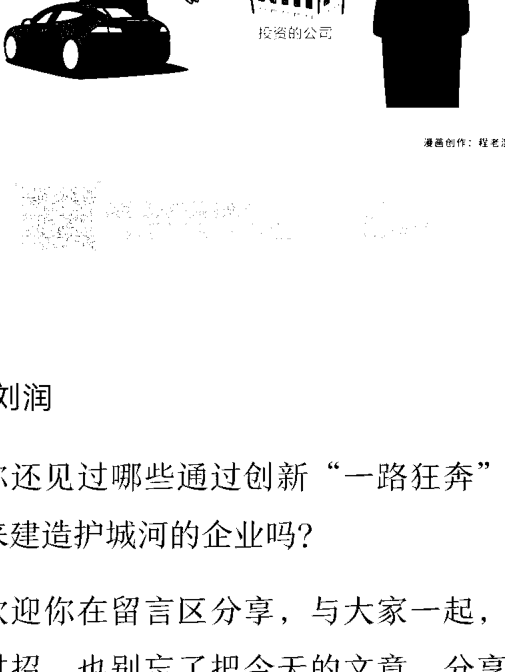

刘润
你还见过哪些通过创新“一路狂奔”，来建造护城河的企业吗？
欢迎你在留言区分享，与大家一起，过度招。也别忘了把今天的文章，分享给你的朋友，也许能够帮到他。

# 第32周周末私董会｜如何减少仿品对自己产品的冲击？

第32周周末私董会｜如何减...

每天5分钟，解决一个商业问题。欢迎收听《刘润·5分钟商学院》实战篇。

5分钟商学院的同学们，大家周末好！又到了本周私董会的时间了。

本周获得私董会提问资格的同学是：

我来自西安“吉宝宝”科技公司，我们研发了一款智能鱼缸，目前已经有20项国家专利。这种鱼缸主要特点有三个：

- 1. 长时间不用换水和清洗，最长的记录是23个月没换水也可以很干净，适合淡水热带鱼生长。
- 2. 鱼缸精致小巧，集成度高，适合放钓办公室、电视柜上面。
- 3. 鱼缸的水温、灯光、水流、喂食等都可以手机APP控制，就算是出差或者假期也不用担心鱼的问题。

吉宝宝可以让人轻松地享受养鱼的乐趣，却不必为换水、清洗鱼缸、鱼成活难等麻烦烦心。目前市场上类似竞品还没有出现，我们产品定价是一千多元。主要面对一二线城市的高端人群、公司白领等人销售。目前困难是，我们作为一家科技研发型公司，并没有成熟的鱼缸销售渠道。

我的问题是：

- 1. 吉宝宝该通过哪些方法快速打开一线城市市场？
- 2. 当仿品出现以后，如何减少和防范仿品对我们的冲击？

下面我打算从四个方面来回答这个同学的问题。

第一点，我觉得这个同学的问题中，有一个非常重要信息没有提供。他的第一个问题是吉宝宝该通过哪些方法快速打开一线城市市场。这么看的话， CQ 提问的同学应该已经开始在一线城市做了？通过哪些渠道？又遇到什么具体的问题？如果只是泛泛地问，如何到一线城市打开市场的 话，我相信他可能是在发展的过程中遇到了挑战。

当然了，我们不知道他的具体问题是什么，可能是产品不被欢迎，如果是这样的话，渠道是怎么反映的，市场上哪些竞品对他有挑战等等，这些反馈却特别重要。如果没有这些信息的话，我们能谈的只是一个泛泛的逻辑，所以我建议以后提问的同学，提供更多的信息。当然了，你要分辨什么是重要信息，什么是无用信息。能帮你解决问题的主要信息包括：1.你的这个想法有没有开始做？2. 如果开始做了的话，遇到什么问题？什么竞争？客户和经销商的反馈是什么？如果还没有开始做的话，你的计划是什么？如何开展？

对于这位同学的问题，他应该已经开始做自己的产品推广了。鱼缸的销售，发展了这么多年一定是有其完善渠道的。虽然提问同学的产品是智能的，但归根来说也是鱼缸类。那些渠道包括花鸟鱼虫市场、专门的鱼店等，这些地方有非常完善的销售渠道。我建议这位同学，尽快把自己的产品投入这些渠道，跟渠道的合作商沟通售卖。只有开始售卖了，你才会找到产品的反馈和问题。如果还没有投放这些渠道的话，应该尽快联系已有的传统渠道去销售，之后你才可以根据合作方的反馈产生判断。

## 一、尽快打开传统渠道，得到销售反馈

我的第一个建议是，尽快打开传统渠道，得到销售反馈。这个反馈真的特别重要，主要是帮助我们了解到到底哪个环节出现了问题。比如定价是否合适？产品功能是否真的是客户需要的？市场上有没有同类竞争对手？他们在功能上和你们差得多吗，价格上又是怎么样定的呢？我们做产品的逻辑可以称之为MVP，是 Eric Ries 在《精益创业》中的核心思想。意思是用最快、最简明的方式建立一个可用的产品原型，通过这个最简单的原型来测试产品是否符合市场预期，并通过不断的快速迭代来修正产品，最终适应市场需求。

简单来说，就是有的新产品不用一下子做到尽善尽美，而是先花费最小的代价做一个产品原型，去验证这个产品是否有价值、是否可行，再通过迭代来完善细节。那么这个最初的产品模型我们可以叫做最小可用品。用最小可用品在渠道里先做起来，得到反馈再尽快调整。

## 二、重新挖掘产品痛点

第二点，相信是很多同学都想问的。认为自己的产品特别好，在市场上几乎找不到竞争对手，但用户就是不知道它好在哪或者不知道怎么卖。

其实每个人在看自己的产品时，都觉得自己的产品90分，但为什么产品卖不好呢？那一定是营销的锅。可是我想反馈的是，在接触了这么多商业案例之后，整体感觉恰恰是问我怎么营销的企业，产品只能打60分，营销可以打90分。大家想尽一切办法去做营销，对产品总是过度自信。对于这个同学，当我看到他说产品市场上没有竞争对手时，我就有些疑惑。他后面又说了自己产品特别好所以定很高的价格的时候，我就觉得这位提问者要非常慎重地考虑它的实际价值了。对于自己的产品，千万不能爱上，这也是为什么会有产品经理的存在。又回到刚才的第一点建议，立刻到传统市场销售试试看，是否能迅速获得客户的认可。

在得到用户反馈的第一时间，我们要重新思考产品，对产品本身要进行深刻研究，比如之前在产品模块讲过的收集用户反馈的四个方法，你可以回去复习一下。我们在做产品的时候，很容易就从技术出发，自嗨感觉这个技术特别好，但是应该首先想到用户在使用这个产品的时候，痛点是什么。当你把这个痛点找出来时，有针对性地解决这个痛点，就

## 三、可以开发哪些新渠道？

因为我自己并不养鱼，所以对养鱼的事情也不是特别关注。传统的花鸟市场是一个渠道，我觉得这可能也是最重要的渠道。因为养鱼这事儿在我个人的理解里，并不是大众市场，而是一个小众市场。所以我们要研究的是，不是我们到哪里去找新渠道，而是这部分人去哪里找产品。我相信其中大部分人还是会去花鸟鱼虫市场找产品的。

线上的渠道，你可以好好发展一下天猫。在天猫、京东等电商平台卖鱼缸，肯定也是一个不错的选择。因为如果大家有需求，肯定会在淘宝或者京东上面搜索。而团购呢，微信可能未必是好的场景。因为微信里拼团的一般都是特别适合大众的产品，就是我一发朋友圈，朋友们都想买，这种更适合大众产品。所以天猫和京东这种传统的电商，我觉得相对于花鸟市场来说，它是一个新的渠道。当然了，还是那句话，如果你没有在产品上下功夫，就要在渠道上下功夫。

另外一个渠道就是在其他相关场景建立体验馆，比如说在卖家具的地方。可能人家只是想去买个沙发，沙发旁边摆了一个你这个鱼缸。买沙发的客人就会觉得这个鱼缸放在沙发旁边真好看，顺便把它买走了。虽然我不养鱼，但也许多有一天，我看到一个特别漂亮的鱼缸，里面的鱼特别漂亮，鱼缸还很方便能自动换水，我就有冲动消费。这些场景可能就把那些非爱好者变成了养鱼的爱好者。从这个角度来看，你的目标用户可能并不是养鱼专业爱好者，而应该是观赏者的冲动消费者。那你就要好好想想看，哪些人对时尚生活有兴趣？比如在宜家门口的精品小店，在那里摆个鱼缸来卖可能是不错的选择。那些对生活品位很有追求的年轻人估计平时很忙也很怕麻烦，但是你的鱼缸能解决这个问题，而且还提升了他们的生活品质。价格相对那些国外的精品也很亲民，可能旁边摆的是几千块的木桌，突然看到一个一千块钱的鱼缸，还这么精美有意思，说不定冲动就买了。所以这些地方，你可以思考一下列个清单，然后跟这些地方沟通一下。

## 四、如何避免自己产品被抄袭？

产品如果被竞争者抄袭应该怎么来解决？其实你的这个问题，就是我们在壁垒理论这部分课程中所学的内容。所有卖得好的商品都会被仿制，只不过有些是被保护的，有些是没有被保护的。所以你要问自己几个问题，如果你的产品被模仿了怎么办？

办？

首先，先问问自己，这个鱼缸到底是个创意还是个技术？如果是一个创意，比之之前的鱼缸都没有这些功能的结合，这回去我把这些功能一结合就变成了现在的这个产品，那么这个叫创意。如果这个产品的过滤水技术，别人根本做不到我的程度，那么这个就叫技术。

如果你你的产品是个创意，而且卖得很好，那么后面如果有人抄袭的话你一定不要气馁。你一定要清晰地告诉自己，想法本身是不值钱的，不要因为想法被别人用了就觉得很气愤。真正值钱的是你用什么方式，让别人不能够卖或着用户比别人更便宜的方式把它给做出出来。

其次，如果你的产品胜在技术，那么这个到底是专利还是技术？如果是个专利，那么就会得到一定的保护。但在这个花鸟鱼虫市场里面，专利可以申请，保护执行起来估计有困难。技术是很容易被复制的，但专利是很难复制的。除非你能把实现同样效果的技术都给注册了，否则依然是可以复制的。复制这件事是商业的一个基本形态，很多企业经常说向别人“学习”了，这个“学习”是打双引号的。所以如果别人“学习”你，真的很正常。

最后我要说的是品牌。品牌就是顾客觉得这个东西特别好，以后都认准这种智能鱼缸。这种对于品牌的认知，就要随着你产品形象的设计、品牌广告，外加对渠道的把握和快速迭代自己的产品，让所有使用的人对你的品牌产生强烈认知。当然，这可能是需要你持续大量的投入和不断经营，才能获得的成就。

如果真的卖得很好，那你就应该迅速地占领更多花鸟鱼虫市场的位置，占领各方位的渠道。走别人的路，让别人无路可走。就算别人模仿你的东西，都没有地方可以卖得好。很多产品会跟渠道签独家销售协议，这个独家销售协议其实就是通过让利的方式，把利益让给渠道方，来争取更长的时间来 锁城河，让品牌有时间可以建立起来。这是一个很好的问题，因为每个和商业相关的人都会问，但我们心里要清楚，仿制这件事只要不违法，它是必然会发生的。所以要好好学习我们壁垒理论这一部分的课程，里面所说的内容会给你很大的帮助。

以上就是我给你的四点建议，供你参考。希望你能通过我的建议和大家的留言获得更多的启发。

下面我公布一下此次私董会的10位获奖者，他们分别是：

请中奖的同学在本篇文章下方留言中，写下你的联系方式及手机号码（每人将获得500元奖学金，以充值的方式返还到你的账户）。

刘润老师、David你好！

## 一、基本信息

- 1.价格分类：大约有71%的用户选择鱼缸的价格是在275元以下，这当中卖得较好的店铺大概每天有100来单，大约有15%的用户选择275~980元的价格区间，卖得较好的单品每天有30多单，月销不超过1000笔，有13%的用户价格选择在981~2300元之间，日均销售不超过30个，月销售不到650个！另外不同的价格段位的转化也是有所不同的。
- 2.使用场景：主要分为客厅、公司、办公室、书房、卧室等。
- 3.材质：玻璃、塑料、实木、陶瓷等。

## 二、SWOT分析

## 1.优势

- a.不用换水跟清洗，水源保持时间长。这个只是外在表现，主要本质解决了潜在用户 Hispanic 想养鱼来装饰自己的家庭、办公室客厅，又解决了用户换水、清洁水缸的“噩梦”！一切商业的本质都是用户获益，通过智能化的鱼缸让消费者获得养鱼快感的同时，又为他们解决了换水跟清洁鱼缸的“后顾之忧”，这是我们异于同行的最大差别。
- b.有一定的智能化属性，这个对于传统的鱼缸而言还是有一定的优势的。在体验养鱼的乐趣的同时，还可以通过灯光、水流等来加强与小鱼的“互动”，增加了更多的趣味性。
- c.专利优势。

## 2.劣势

- a.名称劣势：这个其实是很重要的，尤其是现在通过淘宝搜索“吉宝宝”关键词搜索出来的竟然还是一家母婴店铺。这家店铺已经抢占先机淘宝地址的大部分流量，这对于你后期通过淘宝这个线上渠道做销售会有很多不良影响，甚至影响到你后期整个品牌的进一步线上扩张，所以我斗胆建议你们更换品牌名称如“海豚湾”，一个好的品牌名称往往是自带宣传效果的。
- b.价格劣势：不知道你文章中说的定价是通过数据调查多方对比才决定的价格，还是说因为你们这款产品拥有不少国家专利所以值1千多元的价格。如果我是个人使用，你的小鱼缸符合我的需要，但是你的价格我接受不了，如果我是针对公司布景需要，你的价格我觉得可以接受，但是你的小鱼缸的“小”我 I'm unable to accept.

## 3.机会

现在各种提倡智能家居智能生活，你们的智能鱼缸是可以打这方面的擦边球的。其次，对新事物的好奇、精神享受的追求，也为购买智能鱼缸养鱼，提高自己的“生活趣味”提高可能。

## 4.威胁

你文中提到的你们技术上的智能效果等，我个人觉得可模仿性很强，不太能够长久成为你们的卖点优势，而且就你们目前的现状也应该很难构建自己的“护城河”。

## 三、建议

### 1.产品

不管是线上店铺还是线下店铺，产品永远都分为两种：引流款和利润款。我想咱们这个鱼缸也是可以从这个角度出发，一方面可以推出一些跟市面上销售较好的普通鱼缸的普通“智能款”作为引流款，这样看快速实现单品的曝光以及带动店铺“利润款”及其他产品的流量获取，这里的引流款主打“小跟便宜”。小可以满足个人需求，便宜促使更高的转化，其次，赋予产品更深层次的意义，如：礼物、智能家居等，当然这个主要就是产品外观设计、文案 设计体现为主。

## 2.价格

根据上面给到的从淘宝平台得到的销售数据来看，我更建议主要做价格在980元以下的鱼缸产品，这一价格区间覆盖了大约86%的用户群体，也是很容易通过营销活动实现快速增长的价格区间，这也是你们快速打开市场的一种方法。

### 3.渠道

除了展开线上销售也可以考虑跟花鸟鱼虫市场、商场 soci 等方式，跟其他的家居产品，跟鱼相关的产品形成“异业联盟”，相互推动，实现多渠道多维度的推广与销售。

## 4.促销

通过跟鱼相关的产品：如鱼苗、鱼饲料等形成搭配销售，卖鱼缸送鱼苗、鱼饲料等，利用便宜的引流款鱼缸获取店铺的曝光，从而引导更多的客户购买更高价位、和利润更高的鱼缸。

## 5.护城河思考

你们卖的主要体现在你的国家专利上，但是我想说的是现在应该考虑的是如何在竞争对手还没有快速进入智能鱼缸的时候快速占领市场，不仅是销售额的占领也是品牌心智的占领。只有占领了足够多的市场份额，你才可以更好地利用现有的国家专利技术来阻挡那些想要进入市场的竞争者。

希望我个人的意见能够为你提供一定的参考。

你的问题涉及产品、营销、渠道三方面，可用刘润老师多次提到的企业能量模型来分析，我看到不少同学也是按照这一思路来出谋划策的。

这次我想重点从产品角度，按照品牌、定位、性价比三个维度，帮你提出一些意见

位、性价比三个维度，帮你提出一些意见建议，因为产品的定位和特色，很大程度决定了营销及渠道的问题。

## 一、品牌

建议更换。我在网上搜索了你的产品信息，同样品牌的商品，绝大部分是儿童用品，你的产品信息较少，有几篇推介文章和一个“智能生态盒子”的视频。从名字来看，人们很难将你的品牌“古宝宝”与鱼缸联系起来，“智能生态盒子”又不够接地气，我建议你选择一个更合适的品牌，宣传文章中的“鱼的屋”，以及“智能鱼家”“懒人鱼缸”等，都更合适一些。

## 二、定位

建议细分。你的产品有一定的科技含量，价格也比同类产品高。目标客户可以粗略地分为两类，一类是有一定经验的养鱼爱好者，另一类是没有养鱼经验的普通消费者。对前者来说，你的产品体积较小；对后者而言，价格又较高。可以说，解决了他们的一部分痛点，但也存在尴尬之处。我的建议是，根据不同客户的不同需求，对产品进行改进和细分。针对养鱼爱好者的，鱼缸可以大一些，在APP上增加社交元素，促进他们之间的交流，形成社群。对普通消费者，可以减少一些不常用的功能，鱼缸体积也减少一些，核心是把价格降下来，突出性价比。如果能降到一两百元，对于很多普通白领，甚至女性白领，也会有一定的吸引力。她们在自己的办公桌上摆一个智能鱼缸，和鲜花或盆景一样，既是可欣赏的装饰风景，又不必花费很多时间打理。

## 三、性价比

接近小米？如果是突出性价比，你的产品和小米的理念很一致，跟小米的其他产品也很有互补。建议你争取和小米合作，纳入小米系列，由小米用它的体系来为你赋能。这样的话，渠道、营销、知识产权保护等问题也迎刃而解，你只需专心做好产品，这也是你们这样的研发类公司的长处。以上建议供你参考，请润熏和各位同学多指教。

David同学，看到你的问题，我有一些建议，可以参考。

### 1.产品

一个鱼缸一用就是三到五年，因此其实你的目标客户很多都是新客户，但发展新用户的成本是极高的，那你就不能走薄利多销的路线，一定要不断优化你的产品，提高单品毛利率。

### (1) 产品升级

这里的产品升级包括以下几方面，首先包括了销售鱼缸周边，比如装饰、鱼、药品，这些都是消耗品，因此可以有效在现有客户上提高收入，同时可以把这些消耗品当成是引流产品，以低利润销售，鱼缸才是真正的利润品。

### 2.渠道

### 3.仿冒品

# 品牌

# 产品

David同学，你好！我是成都某专业水族品牌企业的创业者，同时也是一名律师。你所提到的问题我从行业分析和律权现状的角度提几点意见，希望能够帮到你。

## 一、关于产品

## 二、关于快速打开市场

口碑（当然需要品牌方进行统一的管理和培训，建立奖惩规则），从而提升用户体验，同时还能作为其他渠道出产品的sev护常识备军。他们需要的是品牌方的支撑，你需要的是更多的触点。

与优质的水族销售平台合作，提高效率，看薄利润，占领用户心智，建立引流品、利润品的合理配比，做好产品、服务盈利模型的合理设计，想好怎么挣钱。构造场景化消费触点，积极寻求在shopping mall等人流密集的商业体内密集开店或寻求优质合作方，或者赞助、投放产品。与优质水族社交平台合作，在圈内造大咖背书推荐非常管用（当然产品上也要过硬），利用业内资源快速张开；而水族圈的广大进阶级、专业级玩家意见必将给产品迭代更新带来新的改进创新想法，适时分步迭代释放用户具有参与感的产品。

在做好以上工作的基础上，逐步建立社交化产品运维平台，卷入更多的业内外关注力，通过用户间基于产品体验的交互，实现“大明”用户和“ plante” “小闲”用户的通融对接，实现流量放大的红利。

## 三、关于避免仿品冲击

天下武功，唯快不破。作为品牌制造商，最重要的是生产平台、供应链的整合能力以及在渠道端快速张开的能力。在产品的集成化、外观、功能上不断迭代优化，集千钧之力，上万仞之巅，推出具有核心功能的爆款产品，在迭代中反复打磨优化细节；渠道上实现更快更深广的覆盖度，并建立更深入的行业。

David，您好！我主要针对你如何快速打开市场说下。

### 1.渠道。说到鱼缸的渠道，我第一个想到的就是花鸟鱼虫市场了，这里不多说了。

### 2.消费者教育。消费者教育所具有的其他营销无法实现和取代的功能就是，它能建立和改变消费者习惯。那在鱼缸这件事上为什么要用到消费者教育呢？

### 3.产品优化。从您的观点来看，您这个产品非常好，而且市场上没有类似的竞品，有很多的专利，但从您的问题来看，您这个产品应该是在销售上出现了问题。

David同学你好，你公司研发的智能鱼缸让我产生了浓厚的兴趣。像我这样没有时间养鱼，同时也不养鱼，但是很喜欢观赏鱼的人来说确实有很大的吸引力。所以我对你们产品市场前景非常看好，下面针对你提出的问题，我们一起详细分析一下。

## 一、吉宝宝应该通过哪些方法快速打开一线城市市场？

### 1.产品

说到产品，我们要首先定义产品，也就是你打算用你的产品（智能鱼缸），选择性地满足用户什么需求，是美化居室，还是怡情养性，还是风水求财。美化居室，我到淘宝搜了一下你们公司的吉宝宝鱼缸，发现确实精致小巧，形状为25×25×25（cm）的正方体，优点是适合放在办公桌上美化办公室环境，给你清新的感觉，帮助你更加高效地工作。缺点是不适合美化家居，因为太过精致小巧不够大气美观，放在家里的鱼缸适合与鞋柜进行搭配，做成1米起的长方体。

### 2.营销

### 3.渠道

## 二、当仿品出现以后，如何减小和防范仿品对我们的冲击？

这个问题本质就是如何构建企业的“护城河”？说到护城河， recently介绍了四种方法，分别是无形资产、转换成本、成本优势和网络效应。下面我结合你们产品的实际情况，提供三个参考建议。

### 1.无形资产，你提供的资料说智能鱼缸产品已经有20项国家专利，这些专利就是你的无形资产可以帮助你建立第一道护城河，帮助你们抵挡住一部分模仿者。

2.转换成本，提高客户的忠诚度是企业的另一道护城河，可以在你们产品的APP和售后服务上下功夫。例如一是提供会员服务，会员享有定期供应鱼食、死鱼更换、景观生态更换、换办公室免费享受风水服务等；二是APP除了可以控制鱼缸以外，是不是可以加入电商和社交属性，一站售卖鱼缸的配套产品，同时促进用户之间交流沟通。

3.成本优势，就是我成本比你低，所以卖得比你便宜，还能有钱赚。如果有后入者的仿品出现，我们可不可以把鱼缸不当然利润品，直接免费提供给用户，靠卖售后的会员服务赚钱或者把鱼缸当成流量入口，通过卖卖鱼缸的周边产品和吸引广告投资商的方式赚钱。

以上是我的思考，仅供参考。

对于这个同学，我的建议是首先要让清自己的产品到实际价值是什么样的，你设计的产品功能是否... 如何把大家的隐性决算变成显性决策？

## 一、定位：

你的产品优势说可以让人享受养鱼的乐趣，却不必为换水、清洗鱼缸等麻烦事烦心。我查了一下，目前市场存在相同或类似的竞品，比如Biorb鱼缸（外观美、可以半年不清洗鱼缸）、懒人鱼缸、桌上鱼缸等等，很多竞品都可以实现你说的不断水功能。远程喂食的功能，淘宝一搜也有那几种十块自动定时喂鱼器。你的这个产品定价超过1000元，与同类竞品相比其实并没有明显的优势，所以有必要进行重新定位。还记得润总在第一季... 的“现状偏见”“沉没成本”和“损失规避”吗？你... 心里物理学告诉我们，人类对数字的“相对差异”很敏感，但对“绝对大小”没感觉，于是定价专家就专门围绕“比较”二字，发 izm 了“心理定价”策略。建议你好好复习一下刘润老师的定价策略那周的课程。

## 二、营销：

产品做好重新定位之后，来解决你营销方面的问题。你说你的目标用户是一二线城市的白领，那么你就要围绕定位进行线上、线下营销活动。你的第二个问题是如何应对后来的模仿者的竞争。这个问题和营销方面其实可以一起说，根据刘润老师说的四种构建有效护城河的理论，我建议你首先申请专利，通过专利阻断后来者的快速跟进。其次是树立良好的品牌形象，如果能够通过组织养鱼社群、举办线下养鱼比赛等方式，把自己的品牌打造成一个专业的养鱼专业顾问，而不仅仅是鱼缸供应商的话，相信会更容易赢得用户的信任并形成客户黏性。鉴于目前热带淡水鱼饲养还是一个小众的市场，估计要靠熱客带新客的方式，维护你自己的客户圈。

## 三、渠道：

肯定是首先和花鸟鱼虫市场或者养鱼的专卖店达成合作，获得渠道商的反馈后快速迭代产品。可以在线上线下同步进行，线上可以和养花养鸟的淘宝店或者公众号达成联盟，激发更多体验者的购买欲。线下销售渠道可开一些小而精美的体验店，不卖货，只用于观赏和体验，想卖货可以网上下单邮寄到家。但是在体验店可以获得优惠券或者小海草之类的东西。

David同学，你好。

## 一、问题分析

1.行业痛点多。鱼缸在水族行业中占份额为大头。水族行业长期存在几大核心痛点：上下游极度分散、用户触达渠道狭窄、用户教育成本过高、用户养护难度大等痛点。

2.渠道消费品化。由于消费升级，今天更多是无目的性消费，鱼缸产品的销售渠道变成了消费品渠道，而不是传统的花鸟市场渠道。智能鱼缸真正的竞争对手不是水族店，而是智能家居。

3.目标人群门槛高。从传统水族市场来看，原来的市场更多在花鸟市场，它的核心目标人群大部分是专业爱好者。

4.行业难以形成壁垒。大多经销商仍集中在花鸟市场，产品差异化不明显，议价较难。鱼缸产品技术上没有优势，没有壁垒，行业无法形成断层，很分散。自己辛苦教育的用户比较容易被大鲸用资本优势拿走。

5.保证存活率是核心竞争力。由于观赏鱼的特殊性，就是你必须保证它的存活率，并且如果用户想养一种没养过的鱼，也不知道该去哪里学习饲养经验，导致饲养成功率较低。智能鱼缸能不能解决这个痛点是关键。

6.公司的边界选择。“吉宝宝”科技公司是科技研发型公司，没有市场熟悉的品牌，没有成熟的销售渠道，如何进行产品销售？按照内部管理成本和外部交易成本来确定边界。

## 二、问题建议

1.吉宝宝该通过哪些方法快速打开一线城市市场？

（1）定向宣传。瞄准养鱼专业爱好者社区社群，做好定向宣传，开展运营活动，花鸟市场依然是重要的阵地。

（2）全面扩张业务渠道。不断扩展业务渠道，如各大商场、超市，一些电商平台、代理商等。

（3）打造合适的商业模式，给用户提供一整套打包方案，把非标准的（养鱼）产品标准化。

（4）智能鱼缸做成“懒人鱼缸”。帮助终端用户解决了养不活的问题，最终构建了一个垂直水族消费生态。

（5）在大型商场打造线下体验店。鱼缸产品的本质就是体验，体验店是必不可少的。

（6）变卖为租充分满足用户需求。鱼缸作为水景装饰，有很多场景需要，给变卖为租提供了市场空间。

2.当仿品出现以后，如何减少和防范仿品对我们的冲击？

（1）利用技术先发优势增加无形资产。利用好当前专利技术带来的先发优势，持续把技术壁垒做做好，形成绝对优势，用好窗口期，去整合现有的渠道或者塑造品牌。一旦品牌溢价完成了，无论是整合产能，还是整合品类，都能变成一个提供室内生态服务的公司。

（2）提高转换成本。切入水族知识领域做用户教育，搭建了水族咨询社区，非专业用户可在此提出问题，爱好者会对此进行回答。可以通过社区活动提高关系性转换成本；可以通过买鱼缸，赠送养鱼咨询指导服务，提高财务性转换成本。

（3）打造成本优势。通过咨询社区和线下体验店扩展非专业用户，形成规模优势，通过精算的定价策略，挖了一条非常硬的护城河。在咨询社区的基础上，发展社区电商，扩展商品品类，增加产品服务化比重，打造流程优势。

（4）形成网络效应。如果社区电商和线下体验店的O2O局面形成的话，把卖鱼缸变成卖养鱼服务，是可以形成网络效应的，最终建立一条稳固的护城河。

（5）持续设计迭代。所有的设计，本质上，都是基于最新科技的。设计的未来，是“有增强作用的智慧型物品”。那么产品的未来就是要最新科技持续满足用户新需求。护城河也需要持续迭代。

同学你好

## 一、针对你的问题，想要根据产品能量模型从以下几个方面进行分析。

### 1.产品

根据描述可以看出你们的产品确实能够帮助爱好养鱼的人提供很多便利性，让养鱼变得更轻松。对此你们有很强的技术优势。但养鱼是比较小众的需求，你们的鱼缸具有智能家居产品属性。那么可不可以重新定义一下产品，把你的产品纳入到智能家居、家庭景观微生态系统的范畴。从这个层面去切入，增强你产品的使用场景和运范畴。

### 2. 渠道

当扩大你的产品使用范畴和使用场景之后，你的渠道就扩大了。不但可以服务toB的客户，也可以服务toC的客户。你可以根据自己的产品属性，与有流量和产品升级需求的企业平台和组织合作。将他们变为你的经销商和合伙人。比如说家装景观装修设计机构、花鸟鱼市场、智能家居生态系统等。

### 3. 营销

- （1）自有媒体营销。可以建立兴趣爱好平台，不断分享传递相关信息，让用户了解你的产品。
- （2）赢得媒体营销。可以与行业内大咖取得联系，借用他们的讳语权和影响力为产品赋能。
- （3）社群营销。建立和进入相关爱好兴趣群，分享和传播产品和讯息，吸引培养粉丝群体。借助他们的力量来进行口碑传播。
- （4）参加相关行业展会，不断传播塑造自己的品牌。

## 二、接下来针对你的问题进行回答。

### 1. 如何快速打开一线市场？

# 费者消费的欲望？

该同学学出分2000元，外加上我的狗度
约价2000元，本周奖金高达4000元。

欢迎大家给这位同学出主意，用你们的智慧赢取这笔奖学金，也欢迎你把困扰你的商业问题、联系方式和出价，写在今天的留言区里。我们一起讨论，争取找到更好的解决方案。

## 161 | 地头蛇生意：强龙到底为什么不压地头蛇？

161 | 地头蛇生意：强龙到底。

每天5分钟，解决一个商业问题。欢迎收听，《刘润·5分钟商学院》，实战篇。

学完“护城河理论”和“杠杆理论”，你有什么感触？是不是越来越觉得，创业真是九死一生，存活不易，做大更不易？是的。小打小闹，可以上方法炼钢；做大做强，背后一定有系统的方法论。护城河理论，和杠杆理论，就是一套系统的攻守理论。杠杆，是复制做大的“攻”；护城河，是抵御竞争的“守”。

但是，这场攻守之战到底应该怎么打？这一单元，我们来学习，从单点成功，到全面开花，几乎必然经历的一场战争：龙蛇之争。

有一次，一位做工程项目的学员来找我。他在自己城市非常成功，现在想把业务做到全国。然而，在本地顺风顺水的他，到了外地却举步维艰。这让他深受打击，问我：怎么办？

我问了他一个问题：如果外地的工程公司来抢你的生意，你觉得他们有多大胜算？

他微微一笑，说：毫无胜算。

然后我接着问：他到你的城市打败不了你，那你凭什么觉得，你到他的城市就能打败他呢？

他听完我的问题，一惊。他可能从来没从这个角度思考过。

我说，今天你在做的生意，是种“地头蛇”生意。

## 概念：地头蛇生意

什么叫“地头蛇生意”？

你有没有发现，这个世界上有些行业，在每个省，甚至每个市，都有占据垄断性优势的当地企业？比如工程公司、保安公司、医药销售公司。在这些行业，你能找到一些全国性巨头，但屈指可数。这些当地公司，一旦吃掉本土市场，就开始雄心勃勃地扩张到外市外省，但最后大部分都铩羽而归。几次尝试后，他们“躲进小楼成一统，任尔东西南北风”。

这些外地公司很难进入，几乎都是当地公司主导市场的生意，就叫做“地头蛇”生意。

“地头蛇生意”，并不是个贬义词。为什么我们常说“强龙不压地头蛇”？因为强龙有自己复制做大的“杠杆”，而地头蛇也有自己抵御竞争的“护城河”。

### 运用：

我问他，为什么，你觉得外地公司会毫无胜算呢？你列一列，这些都是你这条地头蛇的护城河。同样道理，这也是其他城市地头蛇的护城河。

他说，我们这个城市，就那么几个大的工程客户，我天天和他们泡在一起，我们之间的关系和信任，别人一点机会都没有。这个行业上游下游的关系，错综复杂。除非一锅端，否则外来人根本打不进来。

很好，这就是“关系效应”护城河，确实厉害。

他接着说，我对客户的服务，那可真是无微不至。每家公司的每个特殊要求，我都了如指掌。我们的服务细致到了，客户什么都不做。一旦离开我，客户的天都会塌掉。

很好，这就是“无形资产”护城河，确实厉害。

他接着说，我们还和客户合资成立了公司，大客户甚至在我公司占有股份。他们一旦和别人合作，这个股份就会作废。

很好，这是“转换成本”护城河，确实厉害。

还有，我在本地，不用出差，而外地公司要打飞的过来，还要住酒店。他的成本比我高很多。

很好，这是“成本优势”护城河，确实厉害。

然后，我说，这些护城河非常强大，但你想过没有，这些优势是如何来的？因为所有这些优势，都是基于你与你是本地人，你有更便利的关系网络优势，你有维护人脉网的优势。一旦你到了外地，所有这些优势都会荡然无存。

因为地域优势，能够形成天然护城河的生意，就是“地头蛇”生意。

最后我说，地头蛇生意，不是妥协，而是一种主动的战略选择。你当然可以选择“飞龙在天”，那要记住，你必须把“战略势能”，建立在可以跨“地域”的“杠杆”和“护城河”的“强龙”上，比如技术，效率，而不是关系；如果你选择“深挖洞、广积粮”的地头蛇生意，那也要注意，必须把“战略势能”，建立在外地企业无法跨越的“护城河”上，打造车不可破的城池。

个人其实也一样。当我们“空降”一个新组织时，总觉得自己飞龙在天，能做出巨大改变，但最后往往都是“龙困浅滩”。要学会与地头蛇建立合作关系，最后才能重新一飞冲天。

### 今日得到

### 划重点

- 1. 商业世界中，有些行业，因为地域优势，能形成天然的护城河，这种生意易守难攻，适合本地企业做，所以叫地头蛇生意。
- 2. 在做大做强的道路上，你几乎一定会遇到“龙蛇之争”，在这一场斗争中，你可以选择用“杠杆理论”，形成强龙的攻势，全面开花。也可以选择用“护城河理论”，形成地头蛇的守势，独霸一方。

刘润

你还见过哪些行业，是典型的地头蛇生意呢？

欢迎你在留言区分享，与大家一起，过过招。也别忘了把今天的文章，分享给你的朋友，也许能够帮到他。

## 162 | 流程化：曾经抖的小机灵，要的小聪明，都可能是成长道路上的障碍

162 | 流程化：曾经抖的小机。

每天5分钟，解决一个商业问题。欢迎收听，《刘润·5分钟商学院》，实战篇。

上一节课学习“地头蛇生意”，我们知道了，有些生意因为地域优势带来的天然护城河，易守难攻。比如安保，工程，医药销售。对于这些行业，选择做“地头蛇生意”，不是一种妥协，而是一种战略选择。

这位做工程的学员听完我的分析后，恍然大悟。但是，他很不甘心，说：金鳞岂是池中物，一遇风雨便化龙。润总，如果我想变成“龙蛇之争”中的强龙，应该怎么做？

我说，那你必须补上非常重要的一课：从依靠人，变为依靠系统，完成“流程化”。

## 概念：流程化

什么叫“流程化”？我举个例子。

你是怎么样开发一个新客户的？打电话？还是朋友介绍？你们怎么沟通的？吃饭攀交情，还是开会讲PPT？你怎么知道他们对你的方案感兴趣？约了下次见面？还是眼神的肯定？

### 运用：

比如，看上去最无法流程化的“销售”，也可以流程化。在很多“强龙型”的跨国公司，销售被流程化为九个步骤：

- 1) 客户对项目设想的确定。这个阶段，你要通过市场活动，获得这些需求，并寻求参与机会。 2) 找出潜在支持者。你找到了商务负责人，还是技术负责人？他们谁会是你的支持者？ 3) 完成机会评估。内部评估，这件事是不是我们的机会，值不值得投入精力。 4) 评估方案获得认可。和技术、服务部门一起协作，获得客户高层的认可。 5) 完成获得初步认可的方案。这是下苦功的时候，要完成一份能惊艳客户的报告。 6) 获得书面同意。启动商务流程，把方案最终提交给客户。 7) 获得签约文件。最终，签署合同，完成订单。 8) 产品及方案实施部署。签约不算完，销售要时刻关注项目交付情况，并发现新机会。 9) 完成支持工作。交付部署结束为止，客户一切满意，销售工作才算完成。

有了这张流程图，一个经验未必丰富的新司机，会像看地图一样，找到自己的位置，并采取下一步行动。作为老板，你只要问他和客户见过了吗？报告提交了吗？满意度报告在哪？就基本知道项目进展程度。

### 今日得到

### 划重点

1.流程化，是把企业的成功，从依赖个人能力，转变为依靠系统能力的重 要步骤。 2.人才战略需要流程化，以保证源源不断的新鲜血液供给；产品战略需要流程化，以保证始终能有优质产品提供给客户；甚至销售战略也需要流程化，才能让业绩不依赖于少数超级员工。

你的企业流程化做得怎么样呢？你自己呢？流程化带来可复制性，和确定性时，有没有也带来一些坏处呢？ 欢迎你在留言区分享，与大家一起，过过招。也别忘了把今天的文章，分享给你的朋友，也许能够帮到他。

## 163 | 战略势能：大鱼吃小鱼，聪明鱼吃笨鱼，快鱼吃慢鱼

163 | 战略势能：大鱼吃小鱼。

每天5分钟，解决一个商业问题。欢迎收听，《刘润·5分钟商学院》，实战篇。

提问：为什么IBM，通用电器，西门子等传统外企在中国都获得了巨大成功，而eBay，Uber，亚马逊这批互联网时代的“外企”，大都在中国业绩平平，甚至铩羽而归呢？

要理解这个为什么，我们要继续学习“龙蛇之争”的第三篇：战略势能。

学完上一节课的“流程化”之后，这位做工程的学员终于明白：流程化，是把员工的个人能力，固化为组织的系统能力。做小生意可以靠小聪明，做大事业必须靠大智慧；做地头蛇可以靠“兄弟们，跟我上”，做强龙必须靠建构强大的系统能力。

他接着问：除了流程化，这个强大的系统能力，还有什么呢？

我说，还有战略势能。

### 概念：战略势能

什么叫“战略势能”？战略势能，就是以强打弱，以高打低，以快打慢。

我举个例子。

我参与过很多IT项目的招投标。招投标，就是客户提出需求，若干供应商提出方案和报价，供挑选。IT项目，也是一种类型的工程项目，所以天然容易成为地头蛇生意。甚至，很多大客户都成立了自己的IT公司，比如宝钢的宝信，中国移动的卓望。这些“自己的IT公司”，更是享有得天独厚的优势，各自盘踞着一块“地头”。

但是，在明显属于“地头蛇”生意的IT项目市场上空，却盘旋着三条强龙，被称为：IOE。I，是IBM，提供小型机产品；O，是Oracle，提供数据库产品；E，是EMC，主要提供高端存储产品。

不管你怎么招投标，在真正重大的项目中，都有IOE的身影。因为这些项目太重要，不能开玩笑。而IOE在小型机、数据库、高端存储上的优势，几乎是碾压式的，你不得不服。IOE拥有的“技术优势”，就是空中打击般的“战略势能”：以强打弱。

所以，在过去，同样拥有真正强大技术优势的通用电器，西门子等传统外企，在中国都获得了巨大成功。因为他们的“技术优势”，就是以强打弱的战略势能。

回到最开始的案例。这位做工程的同学需要要理解，真正想把工程公司做到全国，就不能仅仅依靠和客户的“君战优势”了，而要靠更强大的技术，更可测的工期，甚至别人想做都做不到的超高楼宇建设，超深地下施工等“技术优势”，以强打弱。

### 运用：

那么，除了“以强打弱”，还有哪些战略优势，可以用来强击地头蛇呢？

比如“以高打低”。互联网公司与传统企业之间之争，就是典型的“以高打低”。

滴滴是家注册在北京的公司，为什么能强压全国的出租车行业“地头蛇”，不断攻城略地，所向披靡呢？因为过去出租车行业运营的效率相对较低，空载率很高。而滴滴通过互联网和大数据，预测乘客需求的分布，并高效匹配用户和司机，用系统的效率，大幅度减少了所有司机的空载时间，这就是用高效打低效，所以所向披靡。

作为CEO，我们的职责不是责怪员工，你怎么不建立自己的技术优势，以少胜多，以弱胜强呢？作为CEO，我们的职责是，从外部找到系统级的战略势能，让团队在系统带来的高效率下，可以俯冲式的“以高打低”。

可是，为什么IOE那么成功，但eBay，Uber，甚至亚马逊同样为外企，在中国就没有那么成功呢？因为他们是互联网公司。互联网公司相对于传统企业，有模式创新带来“以高打低”的战略势能。但是互联网公司与互联网公司之间呢？模式创新一旦被证明确实高效，一堆互联网公司立刻蜂拥而上，这时比的是“以快打慢”。

和我比别的总不行，和我比快？中国互联网公司集体“呵呵”一笑。也许这个模式是你先想出来的，但我等着啊！我接地气啊！比快、比狠、比不要命，我比你擅长。在这场谁先突破引爆点的速度比赛中，中国互联网公司频频胜出。

“以快打慢”，就是中国互联网公司，相对于“外企”的势能。

对企业，我们常说“守正出奇”；对个人，我们常说“厚积薄发”。你有没有积累“以强打弱，以高打低，以快打慢”的个人战略势能呢？

### 今日得到

### 划重点

- 1. 想从地头蛇幻化为强龙，除了提高组织能力外，还要建立战略势能。
- 2. 强龙的战略势能大约有三种：以强打弱，以高打低，以快打慢。
- 3. 这也是我们常说的：大鱼吃小鱼，聪明鱼吃笨鱼，和快鱼吃慢鱼。用拳脚胜兵器，用魄力胜选择，用战术胜战略，在真实的商业世界中，极少发生。建立战略势能，才是行校天下之道。

刘润

今天我想请你想一想，个人应该如何建立战略势能呢？
欢迎你在留言区分享，与大家一起，过去招。也别忘了把今天的文章，分享给你的朋友，也许能够帮到他。

### 钜情报

《5分钟商学院·实战》第二模块——打磨产品北京站的线下大课刚刚结束，在课程现场，我详细讲解了产品的生命周期，如何从完整的图景去深刻的理解产品形态，打磨产品。希望能够帮助同学们站在更高的维度去思考，实现降维打击。

为了帮助大家在线下学习中有更好的收获，我将专栏中的内容画了重点，可以提前复习：

- 1、066-075需求
- 2、096-100产品化
- 3、102死亡策略
- 4、111-115运营产品

第二模块的线下大课还有两站，分别是6月3日上海站，6月10日深圳站。你还有机会赶上这期线下大课的班车。我依然会用一整天的时间，带来一堂无删减版的线下大课。点击下方的图片，即可报名。得到的用户，可享受八折优惠。非常期待能在线下见到大家。

## 164 | 指数级增长：如何获得一生二，二生三，三生万物式的裂变能力？

164 | 指数级增长：如何获得。

每天5分钟，解决一个商业问题。欢迎收听，《刘润·5分钟商学院》，实战篇。

学完3课龙蛇之争，这位无比好学的，做工程的学员终于明白：

- 1) 地头蛇生意如何利用地域优势 Tuttavia 护城河；
- 2) 强龙如何利用流程化，把员工的个人能力，固化为组织的系统能力；
- 3) 如何建立空中打击段的战略敏感。

他接着问：假如我真的复制做大了，成为了强龙，我到底应不应该压地头蛇呢？

这又是個好問題。我說：如果想要获得指数级增长，也许你最好的策略不是压地头蛇，而是和他们合作。

### 概念：指数级增长

为什么？什么叫指数级增长？我举个例子。

“樊登读书会”的创始人樊登对我说，他有一项天赋，能在飞机上快速读完一本书，下飞机到办公室，画个思维导图，就能对着镜头，一镜到底地讲40-50分钟，特别精彩。

因为这项天赋，樊登成立了“樊登读书会”，每人每年收365元，就可以在线上收听樊登每周一本的讲书音频。

但是，“樊登读书会”这个虚拟产品，严重依赖体验和信任。指望人们花365元主动加入，可能很微小。而在读书分享会上，某个朋友说“这个产品真的很好”，你就很可能当场付钱。

那么问题来了，樊登要不要在每个城市建立线下读书会，来促进销售呢？

一旦建立线下读书会，就有大量运营工作。听书产品的边际成本为零，理论上可以无限扩张；而线下运营相反，严重依赖人的时间。一个城市需要5个工作人员，两个城市就是10个，10个城市就是50个。“樊登读书会”这条轻盈的龙，将被压得飞不上天。怎么办？

樊登决定，和“地头蛇”合作。他开始在全国招募省、市级合作伙伴，然后把会员费中可观的比率，分给他们。对应的合作条件是，所有需要占用时间的，很重的本地运营工作，都由合作伙伴来完成。樊登自己，把精力花在打磨最轻盈的，边际成本为零的听书产品上。

所有重的东西放在地面，由当地伙伴完成；所有轻的东西放在总部，由樊登自己完成。樊登读书会成立3年，在全国发展了300多家城市分会和近10家海外分会，拥有了120多万注册会员，2016年收入过亿，实现了指数级增长。

什么叫指数级增长？指数级增长，就是一种1生2,2生4,4生8,8生万物的裂变式增长。
指数级增长有两个关键：

- 1) 裂变内核，就是一个非常好的，非常独特的，难以复制的资产。比如樊登的听书产品；
- 2) 杠杆资源，就是把所有重的东西，比如人力资本，用轻的方式去外部获取资源合作。比如樊登各地的合作伙伴。

这种“裂变内核+杠杆资源”的指数级增长，对强龙和地头蛇来说，是双赢的。强龙复制不了地头蛇的杠杆资源，地头蛇复制不了强龙的裂变内核，共同获益。

### 运用：

有意思，那这个“龙蛇合作”式的指数级增长，还能用在哪些地方呢？

我有个朋友，是开美容院的，美容院开得越来越多，可增长却越来越慢。怎么办？他决定，先找到自己的“裂变内核”，那就是研发真正有效的，不可取代的美容产品。然后，他决定不再开美容院，而是和有人才和资本这些“杠杆资源”的美容院合作。

于是，他推出了“龙蛇合作”计划。你想开美容院但没经验？没关系，我有，我开过很多年美容院。你的美容院，我投70%，你投30%，但我只分30%的利润，你拿70%。但是，但是，有个条件，你必须用我的美容产品。

过了一段时间，美容院开始赚钱了，你不甘心只占30%了？没关系，你可以用当年的价格，把70%的股份买回去，这样你占100%，利润全归你。但是，但是，有个条件，你要继续用我的美容产品。

慢慢地，我这个朋友越来越轻，越来越轻，只做“裂变核心”，他的美容产品；而他的合作伙伴越来越多，越来越多，都是“杠杆资源”，赚取服务利润。他因此实现了指数级增长。

谁说最后一定要你死我活呢？你和你的对手，如果找到了轻和重，攻和守，能力和资源的内容匹配模式，是否也可以从“龙蛇之争”，变为“龙蛇合作”呢？

### 今日得到

划重点

- 1. 什么叫指数级增长？就是一种1生2,2生4,4生8,8生万物的裂变式增长。
- 2. 指数级增长有两个关键：裂变内核和杠杆资源。
- 3. 强龙轻盈的裂变内核，和地头蛇重要的杠杆资源，正好构成“龙蛇合作”，彼此受益，促成强龙的指数级增长，和大量地头蛇的广泛获益。

刘润

学完了这几课强龙和地头蛇的关系，你现在更希望自己是强龙，还是地头蛇呢？欢迎你在留言区分享，与大家一起，过过招。也别忘了把今天的文章，分享给你的朋友，也许能够帮到他。

另外，给你说个好消息。《马徐骏·新知报告》上线了，这是得到的野性板块第一份报告。这个专栏精筛全球大刊、重要机构报告，把那些最新时事背后“新知”提炼给你。如果你想探探这个世界的趋势运转，如果你想看到不同领域的“新知”洞察，那么，请上车吧，和马徐骏老师一起穿越到世界的背面，看到底发生了什么。

## 124 | 定价误区：营销，就是把价格以产品为载体卖出去

每天5分钟，解决一个商业问题。欢迎收听，《刘润·5分钟商学院》，实战篇。

谈了很多如何定价是“对”的，今天我们来谈，如何定价是“不对”的。

张教授开发了一门面向企业中高管的领导力课程，在HR群里销售。他知道，每家公司规模不同，价格承受能力不同，所以虽然定价3万一天，但心理底线是：只要不低于1万就行。结果，经过七七八八的讨价还价，有的客户用3万听了他的课，有的客户用了2万，甚至有的客户只花了1万。

突然有一天，有家大企业HR非常愤怒地打电话给他，说你也太过分了吧。我老板和另一家公司老板吃饭，他们听你课只花了1万元，而我们却花了3万！老板回来把我臭骂一顿，问我是不是拿了回扣。你让我以后怎么做人啊！

很快，张教授1万元授课的价格，在HR圈子里广为人知。再也没有人愿意付3万，甚至1.1万，请他讲课了。而且就算1万，HR都很犹豫，因为害怕别人只花了5000元。

张教授很郁闷。怎么办？

### 概念：定价误区

要解决这个“怎么办”问题，我们首先要理解它的本质。这个问题的本质是，张教授走入了一个“定价误区”。在价格透明的市场中，实施“一级价格歧视”，按人定价。

什么叫“价格透明的市场”？

你有没有在纪念品商店买过东西？如果你不会讨价还价，你的最佳策略，就是紧跟着一个中年阿姨，在她唇枪舌剑、大战三百回合，终于下手买了件宝物时，你淡淡地说一句：我也要一个。

这就是价格透明的市场。前人的价格，后面的人，是透明的。老板虽然很不情愿，但也只能用同一个价格卖给你，或者推脱说：这是最后一件了，没有了，没有了。

所以：价格一旦透明，歧视不成立。

回到最开始的案例。企业HR的圈子沟通频繁，你给了谁折扣，很快，整个圈子都知道了。所以企业培训市场，是价格透明的市场，你给任何客户的报价，就是给整个市场的报价。

### 运用：

那应该怎么办呢？张教授有两个办法。

第一，终端控价。

终端控价，就是不管是你自己，还是通过合作伙伴和最终客户签约，严格执行同一价格。

著名的营销大师科特勒说：营销，就是把价格以产品为载体卖出去。这句话很有意思。你真正卖出去的主体，是“价格”，而不是“产品”。产品，只是让价格显得合理的载体。

所以，张教授在市场上去卖的是“身价3万”这件事，领导力课程只不过是让3万这个数字显得合理。一旦有别人花了2万，“身价3万”这件事，就像土堆一样崩塌了，显得很不合理。所以，张教授，就算你明天正好有空，就算不接受邀请就只能在家发呆，也不能因为眼馋那1万元，而破坏终端价格。

在透明市场上，价格，才是你的产品。

第二，细分产品。

如果张教授实在很在乎那1万元，苍蝇也是肉，一口不肯丢，怎么办呢？那就要懂得细分产品，让不同价格，对应不同产品。

比如，你可以用行业属性来细分产品。有些公司知道教育行业没钱，政府预算紧张，但又不想放弃这个市场，怎么办？那你可以学学苹果，出“教育版”，或者“政府版”的Mac Book。所谓教育版、政府版这种细分产品的策略，其实只是一种不让其他用户愤怒的打折理由。

再比如，你可以通过团队协作的方式，来细分产品。预算只有1万元？没问题，完全理解。我助理小陈的价格，正好是1万元，他的经验也非常丰富，一定能满足你的需求。这时，客户通常不再好意思说：不，我就要你来，但我只出1万元。因为你已经很友好地给了他选项，这么说，就显得太蛮不讲理了。

如果他真的坚持蛮不讲理，你还可以继续细分“自己”这个产品。我每月会有两次公开课，收费是1000元。如果你的预算有限，也可以暂时不考虑3万元的内训产品。送10个最重要的员工，来参加我的公开课，你看怎么样？

### 今日得到

### 划重点

- 1. 企业获得更高的利润，有三种办法：
1) 控制成本
2) 提高销量
3) 调整价格
- 2. 据统计，每提高1%的价格，可以提高10%的利润。所以，定价，是企业经营中，重要的学问。但在定价中，我们常会走进误区，比如在价格透明的市场中，区别定价。这将破坏你的整个价格体系，让实际成交价不断走低。
- 3. 怎么办？
1) 终端控价，宁愿不做，不能打折
2) 区别产品，区别用户，给打折理由，给用户选项

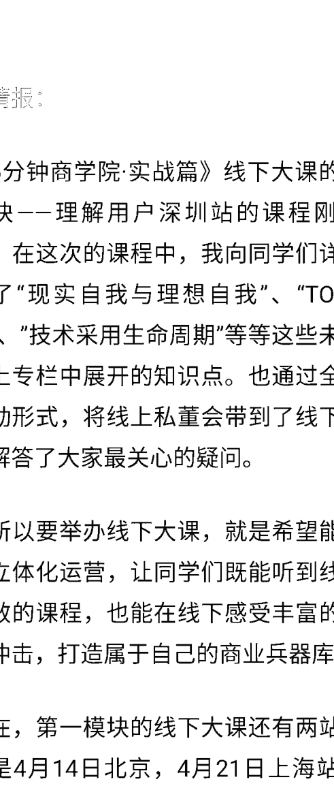

刘润
好了，今天我们就讲到这里。你的市场，是价格透明的市场吗？你遇到过一打折，就再也回不去的痛苦吗？
欢迎你在留言区分享，与大家一起，过过招。也别忘了把今天的文章，分享给你的朋友，也许能够帮到他。

军情报：

《5分钟商学院·实战篇》线下大课的第一模块——理解用户深圳站的课程刚刚结束。在这次的课程中，我向同学们详细讲解了“现实自我与理想自我”、“TOFA模型”、“技术采用生命周期”等等这些未能在線上专栏中展开的知识点。也通过全新的互动形式，将线上私董会带到了线下，逐一解答了大家最关心的疑问。

之所以要举办线下大课，就是希望能够通过立体化运营，让同学们既能听到线上的高效的课程，也能在random线下感受丰富的知识的冲击，打造属于自己的商业兵器库。

现在，第一模块的线下大课还有两站，分别是4月14日北京，4月21日上海站。我依然会用一整天的时间，带来一堂无删减版的线下大课，希望能够帮助大家彻彻底底全方位了解最终买单的用户。现场席位有限，点击下方的图片，即可报名。得到的用户，可享受八折优惠。

非常期待能在线下见到大家。

