# 介绍

本电子书由公众号*懒人找资源*根据网上公开信息爬取，仅在*懒人专属群*内测试分享。

所有内容版权归得到 app 所有，未经允许，不得转载。

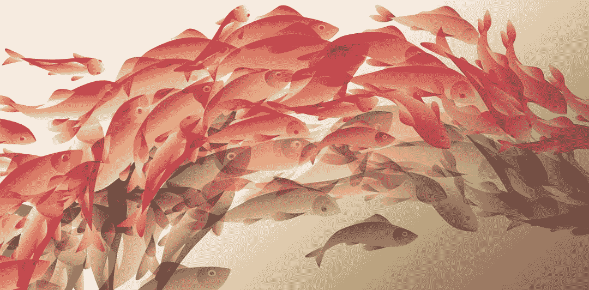

# 发刊词｜你的“前途”里，有你吗？


刘润

2020-03-21

发刊词｜你的“前途”里，有你吗？

建议 WiFi 环境下播放

作为一名商业顾问，我经常遇到两类问题。

**第一类是创业者问的：**

*润总，我将要做的这件事，有前途吗？润总，这件事，值得做吗？润总，那件事，能赚钱吗？*

这类问题，大约占一半。

**而我被问到的另一半问题，** 来自我那些做顾问的，急需转型的传统企业。他们的问题非常复杂，但千言万语翻译成一句话，就是：

*润总，我正在做的这件事，还有救吗？*

不管是新型创业公司的“有前途吗”，还是传统转型公司的“还有救吗”，我都会回答，你们这些问题全问错了。

正确的问法不是“我有辉煌的前途吗”，正确的问法是：

在那个注定辉煌的前途里，有我吗？

什么意思？

商业毫不关心你的方向。而你，必须关心商业的方向。

顺应了方向，一路呼啸着奔腾入海；没有顺应，你就会成为逆水而上的鱼，费尽所有力气，依然原地不动。

企业，是一条鱼。商业，是环绕着鱼的水。对于水，先知道，再看到，然后顺应流向。

**《刘润·商业通识 30 讲》，就是一门写给鱼的，关于水的课。**

无论你是创业者、管理者、企业家，还是一个生活在商业世界的普通人，我都希望你能看透我们当下的商业环境，了解未来的商业趋势，把自己像金子一样宝贵的努力，用对用好。

看懂方向有多重要？我举个例子。

2019 年，我有一次去长沙出差。在酒店饿了，就去楼下找吃的。进了一个购物中心，偶遇美妆品牌“完美日记”的门店。

门店很漂亮，东西很便宜，很多人在里面逛。

一个小姑娘走过来，对我说，随便看，随便看，今天扫二维码加微信，还送一个化妆棉呢。

哦，这个有趣。

到门店来买一次口红，也就是一次“交易”。但是消费者一年来不了几次。那怎么办？加微信好友。加微信，就是用一次触点，换无限触点。

我立刻上网搜，看看他们这么做的效果如何。你猜，他们就这样加了多少微信好友呢？

几百万个。

对完美日记来说，开店的核心，不是卖东西，而是加微信。

完美日记，通过加微信的方式， **把自己这个生产节点，和消费节点产生直接连接，绕开了购物中心，从而降低交易成本，**  
把一支 300 元的口红卖到 60 元，最终只花了三年时间，就生生把自己从零做成一个年收入 30 亿的大品牌。

而某些传统大牌，几十年也没有做到 30 亿。

商业进化的方向，到底是什么？就是网络密度越来越高，交易成本越来越低。

你必须深刻理解这个方向，并顺应这个方向，才不辜负你金子一样宝贵的努力。

2016 年，我上线了《刘润·5 分钟商学院 |基础篇》，2017 年，我上线了《刘润·5 分钟商学院 |实战篇》。

这两门，都是关于鱼的课，都是教你成为所有的鱼中间，最会游泳的一条，是教你“怎么做”。

而《刘润·商业通识 30 讲》，是一门关于水的课。这门课，是教你成为所有的鱼中间，最懂水的方向的一条。这门课，是教你“做什么”。

这就是我们常说的：选择，比努力更重要。通过这门课，我希望你能成为一条，最会选择，最会顺势而为的那条鱼。

如果你学过我之前的《5 分钟商学院》，掌握了真刀实枪的打法， **请用这门新课来及时校准自己的方向，避免做无用功；**

如果这是你第一门商业课，恭喜你，你的商业认知大厦一定会比别人更高、更牢固， **因为这门课程为你打下的地基会更深、更扎实。**

在这门课里，我设置了 5 大模块，分别解决你关于商业的 5 大问题：

**1）商业到底是什么？**

这个问题，是一切商业问题的根基，是一路狂奔的创业者，没有时间停下来思考，但却判定你是否在正确的赛道上的问题。我会告诉你， **货币和商人**  
本质上是干什么的，所有交易都要克服的 **两大难点** ；我还会为你拆解囊括了所有 **交易形式的七大类成本** ，最后给你看懂商业发展的  
**第一条线索：交易成本** 。

**2）商业为什么能进步？**

资本、制度、技术？到底是谁在推动着商业的进程？都不是。 **商业发展的底层推动力**  
，只有一个，是什么？如果看得不够透彻，那就像是在浑水里游泳，晕头转向。我会带你快速纵览商业发展的全景，抽出 **第二条透视商业的线索：网络密度** 。

**3）商业从哪里来？**

不抽象，就无法深入思考。我们抛却传统视角，从两条线索“交易成本”和“网络密度”出发，把过去的商业形态重新抽象成： **线段型商业和中心型商业**  
，了解商业是如何走来的，摸清商业机会在未来迸发的规律。

**4）商业到哪里去？**

所有的历史，都是未来史。学过了商业从哪儿来，我们再顺着这两条线索，看看未来往哪儿去。一路狂奔，我们会看到： **去中心型商业和全连接型商业**  
。在那时，哪些机会即将从火山中喷发？谁已经在我们犹豫的时候，抢跑了半圈？

**5）我们如何顺势而为？**

不还原，就看不到本来面目。一路奔腾入海的道路上，我们如何才能真正顺势而为？如何区分你赚的是什么钱？是红利、工资，还是利润？在成为劳动者、中奖者、套利者和取势者之间，你又要如何选择？  
**我们如何书写自己的商业未来史？**

鸟儿身处天空，而不知什么是天空；鱼儿身处水中，而不知什么是水；我们身处商业，常常不知道什么是商业。

我们常问：

*“我有辉煌的前途吗？”*

这个问题应该这么问：

*“在商业那个注定辉煌的前途里，有我吗？”*

我祝愿你成为最懂商业的那位创业者、管理者、企业家，或者是一名最懂商业的普通人。我祝愿你能顺势而为，在商业那个注定辉煌的前途里，如鱼得水。

欢迎你现在就和我一起跳入，商业的海洋。

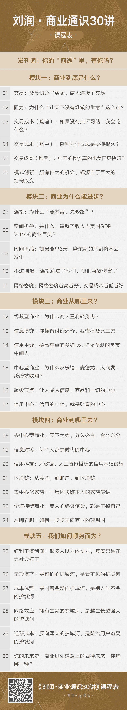  


用户留言

*   

江湖无声 **458 赞**

```
 看系统的两条线索：要素和连接； 看科技史的两条线索：能量和信息； 看产品的两条线索：确定性和依赖； 看增长的两条线索：发散和收敛； 看营销的两条线索：符号和寄生； 看商业的两条线索：交易成本和网络密度； 看得到的两条线索：润总和罗胖； 王者归来，众望所归。 
2020-03-08 
```

作者回复

```
你总结得好啊。学习的两条线索：思考，和实践。
2020-03-08
```

*   

Allelujah 朱磊 **111 赞**

```
 对于商业而言，「水」究竟是什么？ 是整个市场中真实存在的，被各类商业形态所满足的「需求」，以及满足各类需求的商业的「模式」。 再一次跟随润总一起学习，力争： 修炼出洞察需求的「眼睛」， 掌握到满足需求的「手段」。 
2020-03-08 
```

作者回复

```
欢迎老学员！
2020-03-08
```

*    

晓曦 **88 赞**

```
 虽然我出身清华经管，但因为现在在医学院做教授，所以其实很怕跟“商业”这个词扯上关系。我们医院更像是大学、慈善和公司的某种综合体。但我们不是做买卖的，而是为病人解决问题的（好吧，做买卖的也都是解决问题的）。 但我觉得刘老师的这门课十分适合每个人听。我当初选择了医疗行业就是因为随着社会越来越发达，医疗在 GDP 的占比只会越来越大，医疗行业的前景毋庸置疑。现在的问题是，在医疗行业注定辉煌的前途里，有梅奥吗，有我吗？ 就算我们的目的不在赚钱，为了提高病人的健康，我们必须得关注商业进化的方向，怎么顺势而为，给病人提供更好的服务。我在刘老师之前的课里收益良多，成为了一条升级版的鱼，期待这门新课，让我们一起了解水的大势，校准方向吧！ 
2020-03-09 
```

作者回复

```
医疗行业，注定辉煌。祝愿那个“辉煌”二字，是由你书写的。
2020-03-09
```

*   

美君 **82 赞**

```
 在学《5 分钟商学院》第一季的时候，自己在商业方面还是一窍不通，这三年多里润总的课买买买，润总的公众号一篇不落的看看看，现在竟然也能做到将课程里学到的很多东西学以致用，用到了生活尤其是工作中，这是我最开心的事情！ 
2020-03-09 
```

作者回复

```
改变认知值得欣喜。改变行为值得祝贺。
2020-03-09
```

*    

Rachel 迷勒布朗 **66 赞**

```
 去年小伙伴们问我： 作为事业单位的一名人民教师，你为何如此卖命地做笔记，听这位老师的那么多课？对我们教育类没啥用吧？ 我想了想： 1.在体制内的自己，不想成为安逸的死水”里的一条鱼，不想未来的思维愈发局限化. 2.其实没有永远的体制，只有永远变化，顺势而为的自己！ 3.单单喜欢润总！🥰（最重要） 
2020-03-09 
```

作者回复

```
其实无所谓体制内，体制外。我们与这个世界合作的方式，就是交换。交换的规则稍有不同而已。
2020-03-09
```

*   

I hope **65 赞**

```
 在商业的海洋里，不会游泳怎么办，来，润总给你《五商》；游不好怎么办，来，润总给你《商业洞察力 30 讲》；不知道往哪儿游？来，润总给你《商业通识 30 讲》……商业的世界，润总带你遨游 
2020-03-09 
```

作者回复

```
你比我总结得好~
2020-03-09
```

*   

宋杰 **60 赞**

```
 “浑水摸鱼”，你所在的商业之水， 是“浑水”吗？是多大的“浑水”？ 小泥洼的水，很“浑”，但没鱼； 小池塘的水，摸得多了，也就“浑”了，并且终会被“摸完”； 小江流的水，是“鱼”的自然世界，“浑水”只是她奔流的姿势； 大海洋的水，才是“鱼”战场，有鱼有虾也有鲨，大鱼吃小鱼，看你能长成什么“鱼”。 所以，有多大的“水”，就有多大/多少的“鱼”。 欢迎润总归来，带你长成“大鱼”，游到大海里去。 
2020-03-09 
```

作者回复

```
欢迎你返校。
2020-03-09
```

*    

对面有一只蓝色的恐龙 **55 赞**

```
 《基础篇》，教你正确的学习姿势，给你器和具，养成好习惯； 《实战篇》，给你参考题，来打人机模拟战； 《洞察力》，破题点睛之笔，见招总能拆招； 这次的《通识课》，是在窥出卷老师的出题思路了…… 润总啊，每次这么绝，我都担心，你下个产品还能讲啥？ 谢谢你每次这么毫无保留地宠粉。 
2020-03-09 
```

作者回复

```
把当下这个产品，做到最好。下个产品，就会出现。
2020-03-09
```

*   

陌上花开（徐雯） **52 赞**

```
 润我无声，每日一图，我来了！ 
2020-03-09 
```

作者回复

```
非常期待。
2020-03-09
```

*   

大土豆 **44 赞**

```
 完美日记做的是一种形式上的短路经济，也是一种和顾客之间的交互式营销关系。 因为没有中间商赚差价，可以直接触达消费者，可以降低定倍率，把口红卖的更便宜。并且，他不是卖口红，他是代表一种生活方式，主动添加了你的微信，注意，他不是微商，他不是每天在你朋友圈，私信推产品，而是天天用高品质的内容在你朋友圈种草，让你心痒痒的，不仅让他的口红萦绕于你心，更让你触手可及。 微商和他的差别是微商没有能力打造出高品质的内容，前者只能为了卖货而卖货，而后者可以在总部高薪养一支内容制作团队，来生产高品质的内容，利用网络边际成本为零的传递方式，触达到消费者来种草。 这对于二三线口红的品牌，就是降维打击。符合商业“网络密度越来越高，交易成本越来越低”的方向。 
2020-03-09 
```

作者回复

```
知道“短路经济”这个词的，都是自己人。
2020-03-09
```

*   

卫大侠 **42 赞**

```
 我们楼底下有一个卖水果的小门店，叫做爱果坊。门店位置不算是特别好，因为比较靠里面，但是生意却感觉特别火爆。除了传统的线下销售之外，这个老板还把所有进店的人的微信拉进了一个微信群里面，目前这个群已经有 398 人。就是润总所说的，把一次的触点换成了无限的触点。微信群里面的群友买单的时候显示群友身份可以 98 折。老板经常在群里面发一些小金额的红包，发红包前热场 5 分钟，什么抢不到别怪我，经常是尾数是多少就领取新鲜现切的水果一份。保持跟群友的高频互动，惊喜不断。去现场领取现切新鲜水果的群友，往往还买了一堆的水果回去。里面还经常举办接龙活动，门店日常价是多少？今日活动价是多少？三斤起预定三斤多少钱？预定下午 5 点前必须付款。经常性的还来一些大特价，就是比市场价还低一些，多少钱一斤，然后把让你馋得流口水的图片发上来。是很讨厌。😂最讨厌的就是什么节日都搞活动。不参加又像损失了什么东西？这个店家可能没有学过 5 商，但是把消费心理学里面的 5 个商业逻辑运用的炉火纯青。什么水果是健康的保证，今日特价不买就后悔。原价是多少钱？现在群友价是多少钱？享受活动，特价的要预收定金。买多少东西，加一块钱又可以送多少东西？让你忍不住剁手剁手剁手。😭店家这些做法对卖价格高的车厘子等特别有效。 
2020-03-09 
```

作者回复

```
值得很多高大上的创业者，俯下身来学习。草鱼对水的敏锐。
2020-03-09
```

*   

杜仁栋 **41 赞**

```
 不抽象就无法深入思考，这句话听润总说了一年，突然有点领悟了，我们不能就一个独立的问题去想解决方案，而是要将其抽象出来，形成一个特征性的问题去解决，如此，才叫深入思考，也就是所谓的举一反三 
2020-03-09 
```

作者回复

```
没错。抽象，就像是给人像画素描。只有提取了典型特征，才能抽象得出来。
2020-03-09
```

*   

刘溜溜 **41 赞**

```
 在商业世界当中，我们是无法选择商业的大环境的。 虽然它的过去和现在是由我们这些身在其中的人慢慢做出来的，但我们还没法说凭我们一己之力就能创造一个最适合自己的商业环境。 既然如此，与其不明不白的做事，最后很可能是瞎折腾，不如知己知彼知天命，让自己做个好生意。 
2020-03-08 
```

作者回复

```
顺势而为，而不是胜天半子。
2020-03-08
```

*   

林木 **28 赞**

```
 欢迎润总回归！ 今早上还在和得到大学的同学聊安防基建产业，在这个基建类 toG 的行业中，如果你想存活只有一种办法，依附于行业龙头企业的生态（如华为/腾讯/平安），否则不论你怎么挣扎你都无法逆袭。 如果你不了解这条水，最终会被淹没。这就是选择比努力更重要吧。 
2020-03-09 
```

作者回复

```
你看到了你周围的水。
2020-03-09
```

*    

少有人走的路 **25 赞**

```
 一片叶子从树上落下，是风的追求，还是树的不挽留？ 都不是! 真正影响它的是:季节! 工欲善其事，必先利其器。事欲善其功，必先顺其势。 从前人的思考，到每天解决一个商业问题 从每个人都是自己的 CEO，到看透复杂世界破解决策难题 再到现在的如何顺势而为。 一路跟随润总，一个工科大学生偏偏爱上了商业世界 期待再次出发，成为那个能够顺着长江奋力游泳的人。 
2020-03-09 
```

作者回复

```
第一句很有六祖慧能的味道。
2020-03-09
```

*    

绝非偶然 **25 赞**

```
 请问润总认为是会游泳重要还是知道水的方向更重要呢 
2020-03-09 
```

作者回复

```
向正确的方向奋力游，才能奔腾如海。
2020-03-09
```

*    

房浩然•游戏化健身 **24 赞**

```
 1.听音频，心流体验 2.看文稿，细细琢磨 3.写留言，生产输出 4.记笔记，定期复习 
2020-03-09 
```

作者回复

```
5、去实践，收获成果。
2020-03-09
```

*    

王文博 **24 赞**

```
 商业是复杂科学，不是单一学科可以解释的清楚的。在商业世界里，市场的发展永远比理论的发展要快。 润总不断把所学的知识和商业经验赋能给同学们，帮助我们在不确定性的时代，努力拥有适应变化的能力。 更好的投资，是升级自己的思维。期待润总和同学们一起看透复杂商业。 
2020-03-08 
```

作者回复

```
欢迎和我一起，跳入商业的海洋！
2020-03-08
```

*   

赵德强 **24 赞**

```
 通过两季《五商》的学习，学会了很多实用的、具体的招数，也对商业有了基本的认识；通过学习老师的《商业洞察力》，对商业有了更深入的认识，也具备了从整体上观察商业的基本能力；紧跟老师这次的《商业通识课》，继续提升自己在商业方面的能力，提升自己的竞争力。 欢迎刘润老师回归！ 
2020-03-08 
```

*    

啦啦队 **22 赞**

```
 商业通识的战略：求之于水，不责于鱼。 
2020-03-09 
```

作者回复

```
没错。求之于势，不责于人。
2020-03-09
```

*   以上留言由 作者 筛选显示
    


# 01｜交易：货币切分了买卖，商人连接了交易


刘润

2020-03-21

01｜交易：货币切分了买卖，商人连接了交易

建议 WiFi 环境下播放

今天，是《商业通识》这门课第一模块的第一讲。

微小的成功靠努力，偶尔的成功靠运气。而巨大的、持续的成功，一定是依靠对商业本质的深刻洞察和牢牢把握。

这一讲，我们先从一个故事开始。我希望通过这个故事，给你讲明白：

**商业的本质是什么？**

你家是种大米的，一年能种 200 斤大米，差不多正好够一家人吃。

自己种大米，自己吃。请问，这是商业吗？

显然不是。这是自给自足的小农经济。

后来，你开始学习先进的水稻种植方法，产量逐年提高，400 斤、600 斤，现在已经年产 1000 斤了。但是，你家还是只能吃 200 斤。剩下的 800 斤，你分给村里的邻居、老人吃，或者在祭祀时供奉先人。

这是商业吗？

仍然不是。先进的水稻种植方法，是技术创新。因为技术创新，你变成一个富农了。

米越来越多，你开始研究花式吃法，米线、米糊、米糕，甚至做成浆糊，把陈年报纸贴在墙上做装饰。你的“产品”开始多元化了。

这是商业吗？

依然不是。产品线的多元化，这是产品创新。因为产品创新，你成为一个充满想象力的富农。

**那到底什么是“商业”呢？**

只有你拿着大米，对隔壁老王说“老王，我们家大米吃不完，和你换只鸡呗”，老王说“好啊”的那一刻，你才真的终于进入了商业的世界。

为什么？因为从这一刻开始，你开始“交换”（exchange）了。

怎么交换？

首先，你要定价。

老王说：好啊。那你用多少大米换我一只鸡呢？

你说：用 1 斤大米换 10 只鸡。

老王说：你怎么自己不变成鸡，飞上天呢？不换。

老王觉得“便宜”了。

你一年种 1000 斤大米。老王一年养 200 只鸡。如果 1 斤大米能换 10 只鸡，那么 20 斤大米就能换走老王全部的 200 只鸡。老王当然不答应。

如果老王答应了，那整个村子里的聪明人，就都去种大米了，因为种大米明显划算。我就算不太会种，年产没有 1000 斤，只有 100 斤，那也能换回 1000 只鸡，相当于养鸡养了 5 年。最后，村子里到处都是拿着大米找鸡的人，却一只鸡也找不到。

所以，这个“定价”不合理。

那多少你愿意换呢？你问。

老王想了想，说：5 斤大米换 1 只鸡。

5 斤大米换 1 只鸡，那你一年的全部劳动成果 1000 斤大米，正好换老王一年的全部劳动成果 200 只鸡。你们俩都觉得挺合理。

**这就是定价（Price）。**

现在，你手里有了用 50 斤大米换来的 10 只鸡，和剩余的 950 斤大米。950 斤大米，还是吃不完，怎么办？你旁顾四周，看上了张阿姨家的布，和小李家的羊。一个一个上门去换？太麻烦了。

你决定在村口贴一张告示：

我家有上好大米，欢迎用布匹、羊肉、菜籽油来换。

**这就是营销（Promotion）。**

很快，你的手里就有了三尺花布、两只羊腿、半缸菜籽油，和剩余的 700 斤大米。

附近村子的村民听到后，也想找你换米。牛村的，有耕地的牛；铁村的，有菜刀和铁锹。他们都想找你换。他们还想换花布，换羊腿，换菜籽油。

乱哄哄好多人，换起来好麻烦。怎么办？

你想了一个好办法。要不，我们就约好，每个星期六上午十点，在三个村子的交界点支个摊子。我把大米扛过去，你把牛羊牵过来，他把菜籽油和花布背过来，一起换。

**三村交界点，就是渠道（Place）。**

太阳下山前，每个人都心满意足地，带着自己需要的东西回家了。

又是富足的一年。

把大米这个“产品”（Product）种出来，不是商业。种得再多，种得再好，都不是商业。因为你不能只吃大米，他不能只吃鸡啊。那不烦死啊。

你们必须交换。只有通过“定价、营销，和渠道”等等一系列方法、手段、工具进行交换，你们各自丰富多彩的需求，才能彼此得到满足。交换，是这一切得以发生的最根本手段。

亚当·斯密在《国富论》中说：

*商品之间的“交换”，是自古到今，一切社会、一切民族普遍存在的经济社会现象。之所以如此，是因为参与交换的各方都期望从中获得报酬或利益，也就是获得对自身某种需求的满足。*

这一讲，我希望你至少记住三句话。下面是第一句：

1）商业，不是一门关于生产的学问；商业，是一门关于交换的学问。

但是，作为商业的起点，物物交换这件事（比如用大米换鸡）的效率很低。因为物物交换，需要三个“双重巧合”：

*   第一，是“需求的双重巧合”：我很喜欢吃鸡肉，而老王正好也很喜欢吃米饭；
    
*   第二，是“时间的双重巧合”：我突然特别想喝鸡汤的瞬间，老王也正好在想念饭香；
    
*   第三，是“数量的双重巧合”：我愿意用来换鸡肉的米，正好等于老王想吃的饭量。
    

同时满足这三个“双重巧合”，太难了。而且，交换的范围越大，交换的品种越多，就越难。

在这种效率下，你手上可能最终会有 500 斤大米，因为不满足三个“双重巧合”而交换不出去。但你家一年只能吃掉 200 斤。于是，就有 300 斤大米霉变坏掉，最后被扔弃。

如果交易的效率一直都这么低，第二年或者第三年，你就会少种 300 斤大米。反正种出来也是浪费。

同样道理，张阿姨可能也因为交易效率太低，少织了 10 匹布，老王也少养了 50 只鸡。整个村子的财富总量就下降了。

你看，交易效率降低，整个村子的财富就会减少。

反过来说，如果大量的人拿着各种你渴求的东西，吃的喝的用的玩的，来和你交换，你垂涎欲滴。你可能会日思夜想，我明年怎么改进农艺，才能种出 2000 斤大米，把我想要的东西都换回来。

“商业”这个词，和财富紧紧相连。但是，财富到底是从哪里来的？财富，是在“交换”的强烈刺激下，用越来越高效的“劳动”，创造出来的。

这一讲，我希望你记住的第二句话，就是：

2）劳动创造财富，交换激励创造。

所以，怎么提高你我的财富总量？很简单：提高我们之间的交换效率。

物物交换，必须依存于三个“双重巧合”，效率太低。于是，朴素的人类，开始寻找能够不需要“巧合”的交易方式。

怎么做？

人类的智慧，这时候得到了淋漓尽致的发挥。全世界各地的人们，没有经过商量，但不约而同地发明了同一种方式，来绕开三个“双重巧合”，那就是：

把一次物物交换（exchange），拆分为“买”和“卖”两次交易（transaction）。

“把一次交换，拆分为两次交易”，听上去很有意思。可是，怎么拆呢？

人们造出了两件威力巨大的法宝，来完成这次前无古人的拆分，那就是：货币，和商人。

货币，是交易的媒介。

因为货币的存在，生产者再也不需要关心谁是消费者，他们只需要把商品换成货币。拿到货币之后，他们立刻变为消费者。消费者再也不用关心谁是生产者，他们只需要拿货币去换商品。

从商品到货币的交易，叫做“卖”；从货币到商品的交易，叫做“买”。

货币的作用，是“把交换切分为买卖”。

那么商人呢？

商人，也是交易的媒介。

商人既不生产，也不消费。他们看上去似乎不创造任何价值，只是从生产者手上把东西买来，然后卖给消费者，“吸血”似地赚取着差价。

但是，如果没有商人这个媒介，你拿着大米，不知道去找谁换成货币。你没有“交易的对象”。货币不会和你交易。拿着货币的商人，才会和你交易。

商人，就像血液里的红细胞，把货币和商品，运送到商业世界毛细血管的最深处。没有商人，产品就无法通过交易进入流通，生产者的生产力和消费者的需求都会被遏制，整个社会也不可能富有。

商人，连接了“买”和“卖”这两种交易。所以，商人又被称为“买卖人”。

这一讲，我希望你记住的第三句话是：

3）货币切分了买卖，商人连接了交易。


刘润

这是《商业通识》的第一讲。在这一讲，我们聊了一个最根基的话题：商业的本质是什么？还记得，我希望你记住的三句话吗？

*   商业，不是一门关于生产的学问；商业，是一门关于交换的学问。
    
*   劳动创造财富，交换激励创造。
    
*   货币切分了买卖，商人连接了交易。
    

那么，到底什么是商业？商业的本质，到底是什么？

我想你已经明白了：商业的本质，是交易。更先进的商业，就是更高效率的交易。

这一讲，就讲到这里。商业的本质，是交易。货币，和商人，是促成交易的英雄。但是，英雄们也有对手。下一讲，我们聊英雄们的对手：恶龙。

今天我给你留一道思考题：物物交换听上去是很落后的交易形式。但是，它有没有可能在某些特殊情况下，是比用货币切分的买卖，商人连接的交易，更有效的交易结构呢？

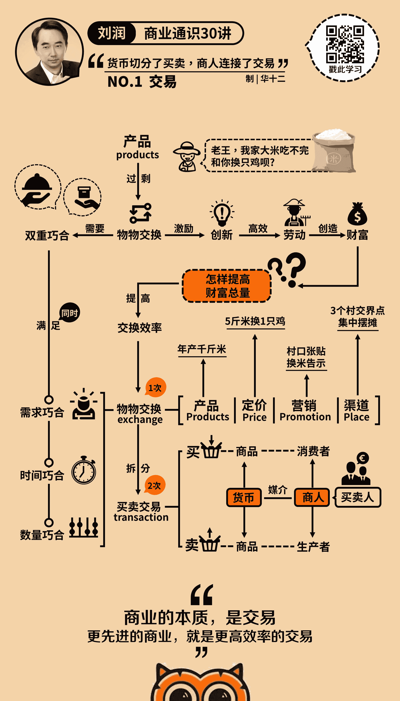  


用户留言

*    

对面有一只蓝色的恐龙 **361 赞**

```
 我所在的疫区，小区全封。 因为临时封城没出去，一个人在家，采购变得非常困难。 自从我在小区业主群求助之后， 每天都能收到邻居们的包子饺子、肉、蔬菜。 没有人和我拼团购买，大家都来投喂。 呆了快 40 天一分钱也花不出去。 所以我就在群里帮大家答疑、修电视电脑、装手机 APP，帮小朋友安装在线上课软件。 组织线上 K 歌大赛，帮忙找广场舞线上教学视频分享给大家。 不知道这算不算是特殊时期的以物易物。 如果人情也是货币，那这段危险时期， 我们小区每个互帮互助的人，都变得更富有了。 
2020-03-09 
```

作者回复

```
特别好的案例。我给你唱首歌，你帮我修个电脑吧。
2020-03-09
```

*   

Allelujah 朱磊 **170 赞**

```
 在欧美发达国家，现代的物物交换（易货）已经发展得非常成熟，交易十分活跃。可从以下四个方面来看： 第一，从成交额来看，在美国，专业的易货公司用他们的方法交易的价值估计一年上百亿美元。据美国财政部称，易货贸易额已占到世界贸易额的 27%—30%，易货在现代世界的经济中已占据重要的位置。 第二，从企业来看，世界 500 强企业 80%已建立了易货部，仅在美国，就有 47 万家公司从事易货，每年易货销售额达 120 亿美元。现在在纽约股票交易所上市的 65%的公司都在使用易货方式减少剩余库存，提高销售额，并使生产设施足额开工。 第三，从国际组织来看，随着现代易货的发展，已成立了易货业的国际组织。当前世界最有影响力的易货组织有两个，一是国际互换贸易协会，一是全美易货交易协会，分别成立于 1979 年和 1982 年，每年都会召开会议，商讨有关现代易货发展的问题。为了促进易货贸易的发展，全美易货交易协会于 1995 年发行了世界第一种通用易货币，使多边易货成为可能，标志着现代易货的正式启动。1998 年国际互换贸易协会组建了世界易货结算平台 UC 系统，UC 是世界应用最广的通用易货币，是现代易货国际化的开端。 第四，有关现代易货的书刊、杂志的出版。全球最知名的易货行业杂志是 1979 年在美国创刊的《易货新闻》，美国有专门的书籍介绍成功的易货案例。 在市场经济发达的国家，实际上并存着两种不同的交易方式，即常规交易（或称货币经济）和易货经济，易货经济已成为货币经济重要的、有益的补充交易形式。从 20 世纪 80 年代起，现代易货交易公司在美国、加拿大、澳大利亚等国普遍兴起，成为这些国家减少现金用量、增加销售、减少库存、开发新客户、开辟新市场、促进经济发展的重要产业。现代易货在发达国家的发展表明它有存在和发展的客观基础，在中国也一定有广阔的发展空间，我们正面临着一个巨大的商机。 
2020-03-09 
```

作者回复

```
感谢。这些数据也分享给大家。
2020-03-09
```

*    

辣条龙 **114 赞**

```
 以前的人很愚昧，说商人什么也不生产，光倒腾几下就能获得巨额财富，干手沾芝麻、摸猪油，商人真的太“伤人”，而这一刻很好的解释了商人不是什么都不生产，其实他们生产了时间，生产了效率。 
2020-03-09 
```

作者回复

```
记住：劳动创造财富，交易激励创造。
2020-03-09
```

*    

少有人走的路 **86 赞**

```
 商业分为创造价值和传递价值两个部分。如何创造价值？劳动。 如何传递价值？交易。 传递价值的高效，能倒逼创造价值的创新，推动社会的进步。 其实这么看来，我们身处的整个世界，是一个诺大的商业世界。 有人努力学习，交易来文凭 有人不思进取，交易来堕落 有人努力健身，交易来健康 有人狂吃狂喝，交易来肥胖 果然，每个人都是自己的 CEO。 以后不要再说，我要什么。 而要说，我打算拿什么东西来与世界交易。 
2020-03-09 
```

作者回复

```
为什么有的人换回了全世界，而有的人一无所获？
2020-03-09
```

*   

赵德强 **82 赞**

```
 商业的本质是交易，通过货币和商人这两个媒介，将交易的范围扩大，也提升了交易的效率，商业的发展，又促进了技术和社会的发展。 当发生严重通货膨胀时，货币已经严重贬值，这个时候直接进行物物交换会比通过货币交易更有效率。 得到大学同学之间可以互相赠送小红花，这个小红花就是切割了货币和商人的交易结构。 
2020-03-09 
```

作者回复

```
小红花币。
2020-03-09
```

*    

余小生 **71 赞**

```
 人情往来如果可以看做一种交易的话，也可以参照分析下。 1.小范围内，交易双方直接交易，不太需要第三方介入。 2.交易的「物品」可以是「产品」类礼品，也可以是「服务」类帮忙。 3.交易不是瞬间完成的，来来回回可能之间间隔很长时间。 4.交易的等价性更复杂，可能存在一方持续给予资源，另一种很少反馈的情况。但持续给予方也可能相应活得道德等精神体验收益。 5.存在人情中间商，他们是人际网络的交错点，可以促进更大范围的协作，这时候，人情成了货币。 6.在熟人圈子，人情货币更为流行。熟人圈子一直都会存在，所以人情货币一直存在。 
2020-03-09 
```

作者回复

```
有趣。人情是不是也是一种货币呢？社交货币？
2020-03-09
```

*   

Stone **50 赞**

```
 物🌽→货币💰→物⚽️，这样的交换方式有一个隐含的条件：等价。即物品是可以用货币准确衡量而且等价的 物→物交换，规避了这个条件，显得更有效。举个例子，我女儿想让我给她买个冰激凌，就画了一幅画送给我，小孩子的画🎨→冰激凌🍦。在这个物物交换的过程里，可能并不等价，但包含了亲情的意义。 女儿的画拿去卖，应该换不回货币。女儿的画拿去给超市的老板，老板绝大部分情况下也不会给她冰激凌🍦，要不然会有更多的小朋友用画去换冰激凌，老板会关门破产。 所以在某些特定的场合，尤其是货币无法等价衡量的场合，物物交换就成为了更好的存在，各取所需嘛😄 最著名的换物故事新闻：别针换别墅 2005 年 7 月 14 日至 2006 年 7 月 12 日，加拿大小伙凯尔·麦克唐纳德以一枚红色大曲别针为资本，经过 16 次物物交换，最终不仅实现了换别墅的梦想，而且还与兰登书屋公司签订了出书协议，并把电影拍摄权卖给了好莱坞梦工厂。 他成功换物的主要流程如下： 一个红色曲别针→一支鱼尾形圆珠笔→一件骷髅头把手饰品→一台野营微波炉→一台旧的家用型发电机→一个有纪念意义的啤酒桶+一张欠单（要装满啤酒）→一辆雪橇摩托车→一个免费度假安排→一辆旧的两用货车→一份录音棚的合同书（50 小时录音、50 小时混音制作）→美国凤凰城免费租用一年的双层公寓→与著名摇滚歌星艾丽斯·库珀一起喝下午茶→电视演员科尔宾·伯恩森在新片中提供的一个演员角色→一幢别墅的一年使用权 👉货币切分了买卖，商人连接了交易。但货币并不是切分了所有的买卖，商人也没有连接全部的交易。 
2020-03-09 
```

作者回复

```
那个别针换别墅使用权的例子，建议不知道的同学，上网找来看看。
2020-03-09
```

*   

江湖无声 **43 赞**

```
 商业的本质是交易，是一个系统，有买和卖两个要素，交换是连接，用交换把买和卖两个要素连接起来就是商业。 
2020-03-09 
```

*    

阿虎 **33 赞**

```
 “物物交换”的话，可以发生在公司内部。会计部门一般在年度决算前后一个月会忙的不可开交，而其他月份相对比较闲。闲时月份，可以把会计部门富余的劳动力派到销售战场。这样有关会计人员也能更好的了解真实世界里的钱到底是如何进进出出的。同理，让销售懂点会计也有帮助，至少会明白什么才是真正的成本，不会造成公司资源的浪费。有精力去多跨部门学习，促进了各部门之间的交流，也能提高公司整体的运营效率。 
2020-03-09 
```

作者回复

```
交换时间。
2020-03-09
```

*   

广东\_ 王增浩 **32 赞**

```
 这一讲需要我们记住下面这三句话： 1、商业，不是一门关于生产的学问；商业，是一门关于交换的学问。 （只有交换（交易）才是商业，如果自给自足，那么就不算是商业） 2）劳动创造财富，交换激励创造。 （我们的财富是由产品销售赚来的，销售是因为有需求，但是如果没有需求，你的供给也没有用处） 3）货币切分了买卖，商人连接了交易。 （人与人碰面再物与物交换，必须依存于三个“双重巧合”，效率太低。商人与货币的出现就很好的解决这个问题。 让每个人都知道，只要货物售卖出去赚来货币就可以去购买另外一些自己需要的物品，而在中间起到润滑作用的“商人”，就很好的连接了双方） 今天我给你留一道思考题：物物交换听上去是很落后的交易形式。但是，它有没有可能在某些特殊情况下，是比用货币切分的买卖，商人连接的交易，更有效的交易结构呢？ 我看到很多同学说，人情债，还有最近因为疫情不能出小区的人用劳动去换取一些服务（其实我很羡慕有这样好的小区氛围）。 我忽然想起《薛兆丰的北大经济学课》里的第一讲《战俘营里的经济组织》就连在监狱里都需要用“香烟”充当货币，对思考题我没有想到，在哪种特殊情况下物与物更有效率。 下面抄至文章的五条经济学原理： 1，我们看到的社会，只要有人在，就会有需求在； 2，只要有两个以上的人在，他们的需求就不一样，需求不一样就会有交易； 3，有交易就会产生对货币的需求，有货币就有劣币驱逐良币的现象，有货币就有宏观经济的波动，有通货紧缩，有通货膨胀； 4 有交易就有信息不对称，有信息不对称，就会有中间商； 5，有人在的地方就有情绪、就有舆论、就有外部性。于是整个战俘营里面的现象，跟战俘营外面所发生的现象就是一致的。 
2020-03-09 
```

作者回复

```
薛老师说：经济学是数学，商业是语文。虽然我们俩，都是数学系毕业的。
2020-03-09
```

*    

晓曦 **29 赞**

```
 关于思考题，什么时候不能用货币进行交易，让我想到招募临床试验的参与者。一般来说给试验参与者的报酬是有限的，一般只补偿他们的交通费或者误工费之类的，以免产生道德问题，比如一些人为了赚钱来参与试验。那么试验参与者付出的是承担风险，而试验组织者付出的是自己和大学的信用。比如试验参与者相信梅奥的研究人员是为了社会的福祉在研究，新开发的这个产品有相当一定成功概率可以提高健康水平。虽然不知道这个算不算“物物交换”但很多情况下确实无法进行货币交易。 
2020-03-09 
```

*    

朱宇洲 **25 赞**

```
 在因战争或其他特殊情况，引起的超高速通货膨胀时期，人们更愿意用物物交易。 商业的本质是交易。 劳动创造财富，交换激励创造。 交易的基础是货币和商人，货币切分了买和卖，商人提升了连接效率。 
2020-03-09 
```

作者回复

```
货币失去价值刻度功能的时候。
2020-03-09
```

*   

任光辉-游戏化管理 **24 赞**

```
 物物交换原来也符合 4P 模型啊，太神奇了。 1、产品：大米、鸡， 2、价格：5 斤大米兑换一只鸡， 3、营销：需求告示，寻找标的物。 4、渠道：几个村落的交汇口，更方便交易。 商业的本质是交换，作为商家的出发点应当是，寻找一个高效的渠道，通过激发购买力的广告，把定价合理的产品销售出去。 销售带来了利润，会激励商家提高产品的数量和质量，把产品越卖越多越便宜。中间的买卖人出现，可以把交易变得更高效，这和货币出现的道理是一样的。 思考：创业就是发现需求，生产最小可用品，卖出去获得利润，迭代产品满足更多需求，不断循环。 
2020-03-09 
```

作者回复

```
5 斤大米，换一只鸡。这个“价格”，隐藏在了“物物交换”的规则里。
2020-03-09
```

*   

Shadow **24 赞**

```
 吴军老师说：“商业的本质是让人多花钱，而不是省钱。至于如何让人们愿意花钱，这是艺术了。”结合老师这一讲，商业是促成更多交易，提升效率让更多“买”和“卖”的连接发生。 
2020-03-09 
```

作者回复

```
人们不是在一件商品上多花钱。人们是在越来越丰富的商品上多花钱。
2020-03-09
```

*   

阜新·迟炜华 **21 赞**

```
 关于价值： 交换这个动作并不创造价值。 “劳动创造财富，交换激励创造”，那么，我可以说，是财富激励劳动者去创造价值。 那么问题来了，商人创造了什么价值呢？ 是买卖的效率。提升效率本身也并不创造价值，但是效率让创造财富的人（比如农民）节省了交易成本，让财富能更快更多的被创造出来，这就是价值。 买卖人连接了交易，提升了效率，让价值创造者有更多的时间和精力去做想做的事，这就是买卖人的价值。 
2020-03-09 
```

作者回复

```
这就是“激励创造”中，“激励”两个字的意义所在。
2020-03-09
```

*    

伪装 **20 赞**

```
 物物交换听上去是很落后的交易形式。但是，它有没有可能在某些特殊情况下，是比用货币切分的买卖，商人连接的交易，更有效的交易结构呢？ 这个问题我立刻想到了袜子换飞机的梗，改革开放初期，我们很多商人去前苏联和后来的俄罗斯，直接用轻工业产品换回了无数的重工业产品，甚至是设备。 万大的精英日课里说了华为一个故事，安哥拉这个国家通货膨胀很厉害，没什么外汇，华为就用通信设备换他们的石头，然后建了很漂亮的石楼。 如果把技术看作是物，技术和技术的交换也是常有的事。 如果把劳力看成是物，农村过去谁家盖房子，大家都帮忙，你也不必给钱，日后人家需要帮忙了，你也出一份力，也算是物物交换。 
2020-03-09 
```

作者回复

```
正巧我有袜子，他有飞机。
2020-03-09
```

*    

古檀 **18 赞**

```
 在疫情期间，口罩，消毒液、防护服等成为稀缺，市场上不能用货币采购口罩的原材料，于是就有一些公司，通过物物交换合作来新建一条口罩的生产线，例如，有 A 公司有无尘生产车间，B 公司是纸尿裤厂商，C 公司是鞋厂。ABC 公司加起来改造一下就分别有生产车间、熔喷布、口罩绳带。 ABC 公司通过提供各自物品，一起生产出成品口罩，这样每家公司都能不花钱获得足够自用的口罩。并生产更多的口罩卖给其他有需要的人。 
2020-03-09 
```

作者回复

```
总结：稀缺的时候。稀缺的东西，就是货币。俗称：硬通货。
2020-03-09
```

*    

四川～杨进文 **17 赞**

```
 每个冬天我妈都种菜卖，大多数时候会用自己卖的菜，和集市的人换家里没有的菜吃。有时还换包子馒头米粉什么的在集市吃。 这样的好处是，交换双方都能解决自己卖剩下的东西，不是用钱买，所以没花钱的心痛；反正地里种的多，没卖掉还免得背回去不新鲜，换了还觉得占了便宜。 这就是没有货币参与的附加值吧😊 
2020-03-09 
```

作者回复

```
课程案例的现实版。
2020-03-09
```

*    

江南烟雨中 **17 赞**

```
 越是偏远落后的地区，物物交换的效率反而更高效。比如在西藏牧区深处找牧民换羊，牧民更希望你拿着大米、汽油等各种牧区外才有的物资跟他们换，因为用货币交易后不能高效率地使牧民得到他们想要的东西。 
2020-03-09 
```

作者回复

```
是不是可以反过来说，商业的发展还不够？
2020-03-09
```

*   

斜阳 **16 赞**

```
 商业的本质是交易，这是我最近看到最简洁，也是最有力量的一句话。 交换激励创造，交换也会刺激更精细化的“分工”，分工是技术创新的动力，进而是生产创新和产品创新的动力，所以交换是一种内在的拉力，以终为始地驱动着商业世界。 交换产生分工，分工导致解耦，解耦必须要中介去打通，货币和商人应运而生，一切都是那么自然地演化出来了。商业，就像生命体一样神奇。 
2020-03-09 
```

作者回复

```
所以，今天的商业世界是“长”出来的。
2020-03-09
```

*   以上留言由 作者 筛选显示
    


# 02｜阻力：为什么“让天下没有难做的生意”这么难？


刘润

2020-03-21

02｜阻力：为什么“让天下没有难做的生意”这么难？

建议 WiFi 环境下播放

马云说，阿里巴巴的使命就是“让天下没有难做的生意”，那么，天下的生意为什么总是难做呢？这一讲，我们就试着找出答案。

还记得，上一讲，我告诉你的三句话吗？

1.  商业，不是一门关于生产的学问；商业，是一门关于交换的学问。
    
2.  劳动创造财富，交换激励创造。
    
3.  货币切分了买卖，商人连接了交易。
    

我希望你记住一个结论：

商业的本质，是交易。更先进的商业，就是更高效率的交易。

但是，这世间的万事万物相生相克。有好，就有坏；有黑，就有白；有上帝，就有撒旦；有英雄，就有恶龙。

在商业世界，既然有英雄（比如货币和商人）在促进交易，就一定有恶龙在阻碍交易。

今天，是《商业通识》的第二讲。我们就来讲讲，无时不刻不在想方设法阻碍交易的两条恶龙：信息不对称，和信用不传递。

**先说第一条恶龙：信息不对称。**

**信息不对称，就是我知道一些你不知道的事情。**

张三到东北的朋友李四家玩，吃到他家自己种的米饭，惊了，说：你们家的米，怎么可以这么好吃啊？哪里买的？我也去买点。

李四说：不是买的，自己家种的。你要是喜欢，就带点回去呗，都好朋友，要啥钱。

张三说：那不行，那多不好意思啊，我还想吃完再来呢。你就随便给个价钱，我以后才好开口，厚着脸皮继续要。

李四说：那，那就 5 块钱一斤吧。

张三说：好……给我 200 斤。

张三回到上海。有一次，王五到他家吃饭，惊了，说：你们家的米，怎么可以这么好吃啊？哪里买的？我也去买点。

注意，关键的地方来了。

这时候，张三想：我知道一些你不知道的事情。我知道这个大米是从哪里、从谁手上、花多少钱买来的，但是你不知道。那我想怎么说，就可以怎么说啊。

张三对王五说：你想知道吗？就不告诉你。想吃这个大米，来找我啊，20 元一斤。

你看，这时候张三就开始做起了“买卖”。

这个买卖的交易结构，是张三从李四手上，用 5 元的价格“买”到大米，然后用 20 元的价格“卖”给王五。张三作为“中间商”，赚了 15 元的差价。

这 15 元的差价，张三几乎没有为此付出任何劳动；这 15 元，仅仅是“信息不对称”，也就是“我知道一些你不知道的事情”，给张三带来的收益。

在信息不对称的时候，掌握有效信息更多的一方，常常具有相对优势，并可以利用这个优势获利。一旦获利成为既得利益者，在没有外力的影响下，几乎都不会放弃这份利益。

几乎什么都不用做，就能获得 15 元的差价。这份利益合法而且诱人。但是，这份差价，客观上减少了买家的购买意愿，减缓了商品的流通，抑制了生产者创造的热情，最终减少了整个社会的财富总量。

哇，听上去，张三就是那条“恶龙”啊。

如果“张三”也订阅了这门课，听到这里，他可能会非常不服气：

你凭什么说我“减少了整个社会的财富总量”？

没有我的话，王五可能要去本地超市，用 40 元买这种大米。但是因为我，现在他 20 元就能买到了。这不是双赢的好事吗？

至于进货价，那是我的商业机密，我凭自己的本事赚钱，犯法吗？

张三，你好。请先不要生气。你不是恶龙，你是英雄。英雄，请允许我给你解释。

信息不对称，不是一个黑白的概念；信息不对称，是一个灰度的概念。

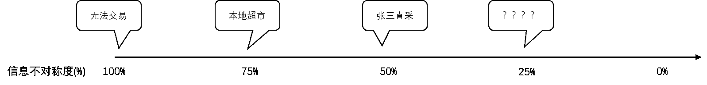

我们先假设，在这个商业世界中，没有本地超市，也没有你。这时，王五和米农之间的“信息不对称度”，是 100%。因此，他们完全无法交易。

然后，有了本地超市，一定程度上连接了王五和米农，降低了“信息不对称度”，比如说到了 75%。你的朋友王五，至少至少，可以买到好吃的大米了。

那么你呢？把信息不对称度进一步降低。比如降到了 50%。王五在你这里买大米，比在本地超市还要划算。你做出了杰出的贡献。你是英雄。

但是，这个英雄屠杀恶龙的游戏，就结束了吗？

当然没有。今天出现了一个后生可畏的新英雄：生鲜电商。

因为生鲜电商的存在，王五可以说：20 元，你咋不上天呢？你不告诉我，我还不会“搜”吗？

王五上生鲜电商一“搜”，立刻获得了更多的信息：你们说的那种大米，成本只有 5 元，现在产地直供，10 元就能买到了。生鲜电商，再次降低了信息不对称度，比如降到了 25%。

现在我们回过头来看整个故事。

本地超市是英雄，挑战无法交易这条恶龙，并大获全胜；但是过去的英雄，一旦成功，就长出了既得利益的鳞片，变成恶龙。然后，张三你出现了。张三是英雄，挑战本地超市这条恶龙；可是张三一旦成功后，也长出了鳞片，守护基于信息不对称的既得利益，变成恶龙。再然后，生鲜电商出现了，挑战张三这条恶龙。

这是一个无休无止的英雄与恶龙的故事。

真正的那条恶龙，不是本地超市，不是张三，也不是未来的生鲜电商，而是“魔戒”一样诱惑人心的“信息不对称”。

机灵的商人把“信息不对称”当作朋友，伟大的商人把“信息不对称”当作对手。

利用“构建”信息不对称赚钱，是一种重要的、短期获利办法；利用“打破”信息不对称赚钱，才是一种更重要的、长期获利办法。

商业文明每向信息更对称的方向推进一个百分点，就会有一群“机灵”的商人倒下，一批“伟大”的商人崛起。

**然后说第二条恶龙：信用不传递。**

**信用不传递，就是离我越远的人我越不信任。**

原始社会里的物物交换，是在双方部落的共同见证下完成的。我一手交大米，你一手交羊肉，两清。除了你撒腿就跑，我追不上你外，不存在“信用不传递”的问题。

自从“一次物物交换，被切分为‘买卖’两次交易”，去掉了三个“双重巧合”后，买家和卖家，就可以跨越空间、跨越时间交易了。

这是好事，但也带来了风险：万一他收了货不给钱呢？万一他借了债不还款呢？

这时，交易双方，先付出的那个人就承担了风险。而他通常只愿意为值得“信任”，也就是有“信用”的人，承担风险。

举个例子。

你亲哥哥向你借 1 万块钱，你会借给他吗？当然借！

需要写个借条吗？写什么借条，拿去用。方便的时候再还给我。

为什么？因为你们从小一起长大，你对他足够“信任”。换句话说，他在你这里有“信用”。

但是，你亲哥哥最好的朋友向你借 1 万块钱，你会借吗？

你可能会问你哥哥，真的要借给他吗？万一他不还怎么办？谁的钱都不是天上掉下来的。请他写个借条吧，或者把手表押在我这里。

为什么？

因为你不会像信任你亲哥哥那样，信任他的好朋友。他在你这里没有“信用”。他在你哥哥那里有信用，但是这份信用，没办法无损地传递给你。

如果你亲哥哥最好的朋友的下属，向你借 1 万块钱，你会借吗？你可能会直接说：没钱！

他不断恳求你，直到你心软。但即便这样，可能也只有用无风险的抵押，以及合理的利息来给他“增信”，你才会愿意帮这个忙。

不管你的亲哥哥的最好的朋友，如何信任他的这个下属，这份信用，传递不到你这里。

这就是“信用不传递”。

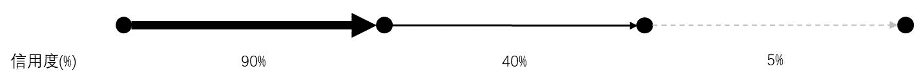

信用不传递这条“恶龙”，在每个交易线段上，都要吃掉大量信用，导致因为信用太容易损耗，交易只能在小范围内发生。而商人们一旦需要在大规模的、远距离的、陌生人之间促成交易，就会遇到特别大的阻力。


刘润

每个英雄，都有自己的恶龙。商人促成交易的道路上，盘旋着两条恶龙：信息不对称，和信用不传递。

*   信息不对称，就是我知道一些你不知道的事情。
    
*   信用不传递，就是离我越远的人我越不信任。
    

信息不对称，和信用不传递，给交易带来了阻力。小的阻力，叫做摩擦；中的阻力，叫做障碍；大的阻力，叫做隔绝。

在整个商业史上，我们几乎所看到的每一次伟大的商业创新，都是英雄对恶龙的宣战，都是商人们创造性地、更好地解决信息不对称，和信用不传递问题。

听上去，商人真不容易啊。为了交易，必须战胜恶龙。那么，商人们要付出多大的代价，才能战胜这些恶龙呢？下一讲，我们聊商人为战胜信息不对称、信用不传递而付出的代价：交易成本。

今天我给你留一道思考题：

你觉得，是利用信息不对称，还是消灭信息不对称，更容易赚到钱呢？

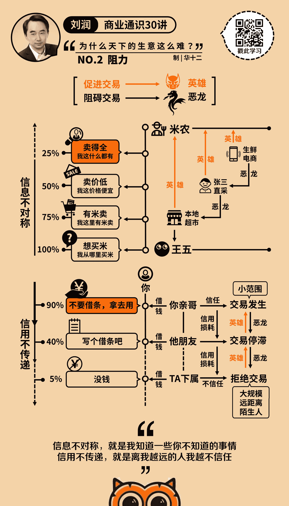  


用户留言

*   

曹辉 **236 赞**

```
 单次博弈靠信息不对称获取超额利润。所以容易出现宰客的现象。 重复博弈靠消灭信息不对称，提高商品的转化率，薄利多销赚取利润。所以对消费者服务态度比较好，促使与消费者达多频交易。 
2020-03-09 
```

作者回复

```
特别赞。可以复习 5 商基础第四季博弈部分内容。
2020-03-09
```

*    

二希·Hebe **173 赞**

```
 利用信息不对称，是利己心态。在别人还没有看到的地方，趁机赚一波红利，赚多少就揣兜里多少，不管其他。可是当知道的人多了，或者被人挖掘到更深的信息不对称，红利也就消失了。 消灭信息不对称，是利他心态。你赚取的可能不是产品销售，而是服务费。你服务的内容正是帮大家省钱。这个时候，你的收益不是来自产品，而是来自用户满意度。 一锤子买卖，和一辈子买卖，都是买卖，不过要看你心里装着谁。 
2020-03-09 
```

作者回复

```
看你心里装着谁。
2020-03-09
```

*    

苏锡许鲜 **109 赞**

```
 我认为消除信息不对称 才能更长久的赚钱！ 一、更有利于品牌的传播：消费者能真正吃到正宗的性价比高的产地生鲜，更愿意传播和重复消费。 二、货源品控才会更好：消费者对产品生长周期 口味等都了如指掌，供货方才会更具有“匠心” 提供优质产品。 三、物流专业度会更高：供货端和消费者会倒逼物流供应商提供更专业 更高性价比的服务。 我是一个 10 的生鲜物流人，今年我想做件大事 就是利用朋友圈和知识城邦等来消除产地生鲜和消费者之间的信息不对称！（无锡阳山水蜜桃 为例） 一、阳山水蜜桃的生长周期知识普及： ①成长阶段是如何剪枝、施肥、束果、套袋的，产地规模怎么样，前后有哪些品种、如何区别。 ②上市前产地价格预估（根据天气及产量等），上市后当地市场价的每天报价及波动。 ③普通桃农、市场及大型电商的供货质量分析 通过以上普及 让你真正知道正宗的阳山水蜜桃。 二、物流成本及各物流供应商优劣势普及 ①各家物流公司时效 安全性分析 ②各家物流供应商价格政策分析 选择哪家快递 有你来决定，同时快递费也不要多出冤枉钱。 
2020-03-09 
```

作者回复

```
说得很好。祝成功。
2020-03-09
```

*    

晓曦 **85 赞**

```
 身在世界第一医院的梅奥诊所，我个人的使命就是让天下没有难看的病，没有难做的临床试验 （也不知道我中文这么讲的对不对）。总之意思就是降低病人来看病的成本，让全世界的病人都能更容易地享受到梅奥的服务。另外医学治疗的根本依据来源于临床试验，怎么更好更快地进行临床试验，没有临床试验的时候怎么提供可靠的信息和判断依据也是我的使命。 信息不对称这个问题在医疗领域尤其显著。比如医生知道你得的是什么病，该吃什么药，但你不知道。从这个角度看，信息不对称真的是恶龙吗？毕竟医生是顶尖聪明人通过选拔经过长期艰苦的训练才得到这些信息。而且医疗信息日新月异，顶尖的医生必须每天持续阅读新的期刊和从事大量研究保证自己的信息一直在前沿。也因此产生了分工，因为保持自己在前沿就必然会专注在一个细分的小领域。 互联网的出现某种程度上降低了这种信息不对称。现在你上网随便一搜一个病，就会有大量信息。所以，这些网站是英雄吗？也不一定。很多网站上的信息是错误的或者过时的。有的网站是有商业目的的。 如同刘老师所说，信息不对称不是一个黑白概念，而是一个灰度概念。重点是如何对待信息不对称。你可以加强信息不对称和建立护城河，比如游说政府提高医生和医院资格的门槛，让所有药成为处方药必须经过医生的手，不能自己随意购买。当然我不是说这些政策不对，它们在一定程度上是必需的和有益的。 而我们身在医疗界，虽然不想被称为“机灵的商人”，但一直致力于打破信息不对称。比如在英文世界/或者美国，如果你 google 一个病，第一个或者前几个词条就是梅奥提供的，详细地解释了这个病以及什么时候就医，然后底部也会有按钮来在网上预约梅奥的咨询。 我们在咨询中也会进一步降低信息不对称，比如用新的的技术手段和人工智能制作工具，让病人充分地了解他们的病，治疗方式以及每一种方法的优劣。从而能和医生一起共同做出最适合病人的选择。 为什么这么做，我个人的理解是，信息不对称不是我们的护城河，我们真正的护城河是 156 年以来跟病人和整个社会建立并且持续加强的信任。我们需要传递这个信任到世界各地，形成规模效应，从而持续占据头部的位置。 
2020-03-09 
```

作者回复

```
品牌容器里装的“信任”，是梅奥的护城河。
2020-03-09
```

*   

江湖无声 **76 赞**

```
 买卖交换的商业系统中，信息不对称和信用不传递是交易的两个调节回路； 有交易就有信息不对称，信息不对称又抑制交易，利用信息不对称赚存量，消灭信息不对称赚流量； 所以单次博弈的交易利用信息不对称，重复博弈的交易消灭信息不对称。 
2020-03-09 
```

作者回复

```
货币和商人，是增强回路。信息不对称和信用不传递，是调节回路。
2020-03-09
```

*    

圈外王睿 **59 赞**

```
 商人通过信息不对称获取利益，并且守护既得利益，形成了商业效率的阻力，而新商业模式通过增加润滑提升商业效率，比如说增加信息对称性。因此电商利用更好的商业效率，对实体商业形成了一定的降维打击，给消费者优惠。但是随着大数据发展电商又开始使用价格歧视的新的圈层信息不对称，守护既得利益，形成商业阻力，那么区块链技术会不会是下一轮降维打击，给消费者更透明且高信用的信息，从而进一步加快商业效率呢？我们拭目以待～ 
2020-03-09 
```

作者回复

```
一路推演，已经到区块链了。很赞。
2020-03-09
```

*   

Allelujah 朱磊 **51 赞**

```
 是利用信息不对称、还是消灭信息不对称，更容易赚到钱？这个问题，我的答案是： 要看怎么定义「容易」—— 1.如果说单从付出上看，一定是利用信息不对称更容易赚钱，因为只用将自己掌握的信息转化，几乎什么都不用做。而消灭信息不对称的一方，至少要核实信息渠道，找到更有价值的真实信息，并将其转化为能够盈利的新交易。 2.如果说从「赚到更多钱」来看，那么就需要评估哪一方具备更大的*规模*。即使利用信息不对称能产生 200%的利润，如果只局限在一个城市，也远远比不上消灭整个国家、甚至全球市场的信息不对称带来的 10%的利润能赚到更多钱。 3.如果说从商业发展的方向看，一定是消灭信息不对称更容易赚钱。 由于利用信息不对称能产生的超额利润，一定能够吸引更多的参与者入场，逐渐打掉先行者的信息优势。并且，在我们身处的信息时代，不仅信息不对称本身在逐渐消减，减少信息不对称的渠道也越来越丰富——消灭信息不对称本身，正在成为趋势。 
2020-03-09 
```

作者回复

```
顺着“波”赚钱，还是顺着“浪”赚钱。
2020-03-09
```

*   

徐向聪 **49 赞**

```
 勇士屠龙：有一条恶龙，每年要求村庄献祭一个处女，每年这个村庄都会有一个少年英雄去与恶龙搏斗，但无人生还。又一个英雄出发时，有人悄悄尾随。龙穴铺满金银财宝，英雄用剑刺死恶龙，然后坐在尸身上，看着闪烁的珠宝，慢慢地长出鳞片、尾巴和触角，最终变成恶龙。 没想到这个故事中的勇士和恶龙，原来是相对的，我一直以为自己是勇士，今天才明白，如果我不继续提高效率，就会变成别人眼里的恶龙。 
2020-03-09 
```

作者回复

```
这是没有尽头的进化之路。加油。
2020-03-09
```

*   

青岛潘飞达 **38 赞**

```
 利用信息不对称赚钱和消灭信息不对称赚钱，是一对“冤家”，而且是相互转换，彼此竞争的关系。 最开始由于存在信息不对称，一定有人靠这个大发其财，这个时候就会有人看到，想尽办法把这个信息不对称打掉，然后他赚钱，循环往复，商业世界每天都上演着这种好戏，商业也就不断的进步。 不能单纯说哪一种方式更赚钱，最大的信息不对称的企业就是中石油、中石化，也就是垄断企业，获得了超额利润，最大的消灭信息不对称的就是阿里，也获得了超额利润，你能说哪种更好吗？只能说对于没有掌握垄断资源的人来说，消灭信息不对称的商业模式会更适合。 
2020-03-09 
```

作者回复

```
“动态”地看问题。赞。
2020-03-09
```

*    

叶永泉 **36 赞**

```
 顾客张三到茶叶店老板李四哪里喝茶 张三：老李，你这茶真不错，多少钱一斤？ 李四：200 一斤 张三：要保证足称 李四：那要 300 一斤 张三：不许掉包 李四：那要 400 一斤 是信息不对称好呢，还是信息对称好呢？ 
2020-03-09 
```

作者回复

```
哈哈哈。比我会讲故事。
2020-03-09
```

*    

Tian **30 赞**

```
 商业过程中是在不断的制造与消除信息不对称，采取正确的博弈策略才能在这个过程用立于不败之地。 个人认为消除信息不对称更能赚钱， 消除了信息不对称，让消费者掌握更多的产品、价格、品牌方面的信息，这不仅使得市场竞争更为充分，而且市场的主导权由厂商转变为消费者，消费者主权时代真正到来；二是实现了长尾覆盖。在线下，企业因成本、精力的限制无法覆盖所有客户群，但在线上，由于信息传播渠道、销售渠道等经营要素的成本变得极为低廉甚至免费，使得企业可以实现广覆盖，而且这也是以流量为计价单位的互联网商业模式的必然选择。 
2020-03-09 
```

作者回复

```
一场博弈。互有胜负。
2020-03-09
```

*   

大土豆 **29 赞**

```
 我觉着利用信息不对称，更容易赚钱。 利用信息不对称，能赚小钱，比如赚差价，但是信用传递的效率比较低，大家担心被我赚了太多差价，别人会货比三家，去别家再看看，这样彼此的交易成本都比较高； 消灭不对称可以赚大钱，因为信用传递不怎么损耗，你知道我只收一点基本的服务费，并且是按照你交易额收，你赚的越多，我也就赚的越多，你就放开马力去卖，促进更多的交易，而我乐享创造的平台，收成千上万个你的服务费。 马爸爸笑笑说，我的生意逻辑被你揭穿了，要不你也去搞一个消灭信息不对称的平台出来？我说，您可拉倒吧，我还是老老实实卖产品吧，做一个卖一个，马上就能进账现金流，您这平台级的生意虽然赚钱，但是要有庞大的规模效应之后才能有现金流，我等不起，而且这个成功的概率太低。 马爸爸摸摸我的头说：小伙子有前途，你怎么知道这么多？难道现在商业已经能随便被一个路人甲摸透了吗？我微微一笑，从怀中掏出《刘润商业通识 30 讲》，自豪地说：都是润总教我的。 
2020-03-09 
```

作者回复

```
更容易赚小钱。
2020-03-09
```

*    

吉米 **22 赞**

```
 阿里巴巴把信息不对称当作对手，所以阿里巴巴成为国内国际大公司，成为伟大的公司，马云成为首富，显然消灭信息不对称更赚钱 支付宝消灭信用不传递，支付宝单独剥离出来也是一个巨大的体量。 马云干的事都是符合商业规律，不断地在和这两条恶龙战斗的过程 
2020-03-09 
```

作者回复

```
没错。不管你喜不喜欢马云，马云在顺势而为。
2020-03-09
```

*    

墨羽帝 **14 赞**

```
 由于机缘巧合，我现在也在从事中间商的行业，这让我对信息不对称有了更深入的理解与体会。我非常认可润总课程里说的构建信息不对称是短期获利的方式，中间商就是利用了采购方与制造商的信息不对称而获利，但随着电商的崛起，这种信息不对称被大大的缩减，很多商品客户只要一搜就知道大约的价格去到哪里，特别是马爸爸的平台，有些几乎是接近出厂价，大大降低了中间商的利润。 另一方面，听了这节课让我觉得马爸爸的成功是必然的，他的商业帝国既打破了信息不对称（淘宝平台），也打破了信用不传递（第三方信用平台支付宝）。打败一条恶龙已经很不容易，马爸爸是打败了两条恶龙，堪称盖世英雄，实在让人敬佩！！ 
2020-03-09 
```

作者回复

```
马爸爸打败了两条恶龙。马爸爸听到一定很高兴。
2020-03-09
```

*   

任光辉-游戏化管理 **14 赞**

```
 1、利用信息不对称，可以在短期内获利。但是最终会消耗生产者的积极性，导致产能降低，价格上升，需求无法满足。 2、消除信息不对称，可以长期获利。较低的价格刺激需求，产生更多的产品消费，从而刺激产能增加，产生更多的社会财富。 打破信息不对称和信任不传递这两条恶龙，都是创造了更好商业模式的英雄。英雄只是暂时的，他会长出獠牙变成恶龙。换句话说，没有最好的商业模式，只有更高效的交易方式。 
2020-03-09 
```

作者回复

```
“更高效”，这个进步就是无穷尽的，后来者永远有机会。
2020-03-09
```

*    

李文涛♛LION♛ **13 赞**

```
 其实老师问的是个人的格局♛好不容易抓住一波信息不对称的商业机会，谁会谁能马上放弃？将进货价透漏出来？怎么分饼决定饼能做多大，而能吃多少饼也同时选择谁来吃，让天下没有难做的生意，人人目标都是如此的话直接共享社会了，大锅饭再生，不过锻炼的方向是信息公开，但是会有个过程，增强回路遇见调节回路，能不能进行第二轮推动要看格局。 
2020-03-09 
```

作者回复

```
没错。这就是一个人的格局。
2020-03-09
```

*   

佛祖门徒 **10 赞**

```
 科技公司的本质工作就是信息的运营，主要有三个方面： 第一、信息的采集。科技公司利用各种手段，发现或设计应用场景，比如滴滴就是围绕出行用车，在满足用户需求的同时，将相关信息采集到平台，车辆信息、用户信息、位置信息、需求信息等。 第二、信息的传递。还以用车为例，信息采集后要进行供需匹配和指令传递，从而让需求得到满足，同时消除了信息不对称。 第三、信息式决策。基于信息的深加工，可以实现资源的优化配置和高效利用，在积累大量信息的基础上，可以通过对信息的关联分析，为实现各种决策提供支撑。 
2020-03-09 
```

作者回复

```
尤其是今天的互联网公司。
2020-03-16
```

*    

哈雷斯 **9 赞**

```
 必须分时期和分阶段吧，我以前公司做案例。 公司主要做翻译硕士研究生考试的线上培训，母公司是一家十几年的翻译公司。 线上招生可以克服天气和地域等条件限制，但是最大的问题在于信任成本。有些学生倾向于选择线下的培训机构，他们觉得看得到实体，更有保障，自古就有跑的了和尚跑不了庙，他们觉得这样靠谱。 但是线上相对来说可以有更好的师资，我们可以提供北大高翻毕业的老师授课，也可以请到上外 MA 翻译学毕业的给你做一对一辅导，师资可以保障到你想考的学校只要不是第一年招生，我都能帮你找到对应的老师辅导，这是线下绝对办不到的。 然而，这表面看起来只是信息不对称问题，其实还有信用不传递等等问题，而且还设计各种定价策略的调整。 估算过成本，如果有 100 个学生，那么每个的培训成本一年下来，需要一万五，我们收费两万。剩下的 5000 不是利润，还需要投入课程研发。我作为销售总监，需要把人数做上去。我也想直接把价格打到 199 元，但是这个时候可能就不需要销售团队了。199 也有问题，学生买了不学习，觉得没价值，觉得便宜没好货，觉得是备用方案，还是会再花 3 万去报线下班，那我还不如提价，让学生来这里学习。因为我们过往考上北大，北外，北语，广外，上外等都有，师资教学没问题，远比很多线下培训机构靠谱。 我们也尽量在消除信息不对称，告诉学生每个阶段应该怎么学习，如果报培训班，应该怎么去对比，应该对比哪些内容，甚至直接有些需要的，联系老师一对一体验一节课。但是没有第三方平台评测机构，因为这个翻硕考研太小众。每年都有线下机构开翻硕，收很贵，但是整个培训按照普通考研培训，白白耽误了学生的时间，浪费了精力。可是他们是线下的，即使消费者投诉，在网上也掀不起波澜，年年还是有学生入坑。 在前期业务发展，有信息不对称是好事，人先进来再说，我用心培养你，你作为我的种子。后期随着口碑传播，有了积累，当我们的模式得到认可，那么就要加紧时间消除不对称，大家是驴是马拉出来溜溜。 以上是我的观点。 
2020-03-09 
```

作者回复

```
很真实。
2020-03-09
```

*    

称心 **7 赞**

```
 商业的演进永远是追求更高的交易效率（消灭信息不对称）而不是增加交易阻力（利用信息不对称）。 珠宝玉石、茶叶古玩是后者，所以大家会觉得“水深”。 而得到、小米、淘宝、大众点评是前者，所以能成就一番事业。 利他是最好的利己。 
2020-03-09 
```

作者回复

```
这些都是我说的“低信任行业”，因为信息太不对称。
2020-03-09
```

*   

燕姗姗来习 **6 赞**

```
 把阻力比做恶龙，把克服恶龙的力量比做英雄。把这种循环往复的力量比做魔戒。润总和得到人怎么这么厉害！我是一位中学老师，学习商业知识的同时又学习讲课知识，真是太超值了！一点启发：好的知识服务能敏锐捕捉听者的情绪点兴趣点疑惑点，能把抽象逻辑的知识转变成形象易感的信息暖流。 
2020-03-09 
```

作者回复

```
所谓洞察力，就是会打比方。复习《商业洞察力》第 29 讲。
2020-03-09
```

*   以上留言由 作者 筛选显示
    

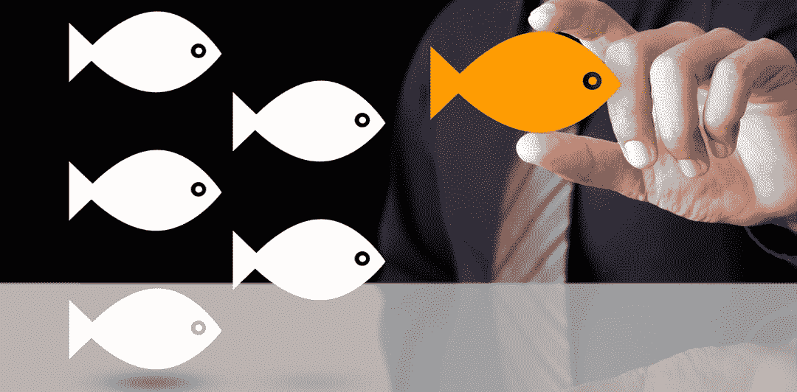

# 03｜交易成本（购前）：如果没有点评网站，我会吃什么？


刘润

2020-03-21

03｜交易成本（购前）：如果没有点评网站，我会吃什么？

建议 WiFi 环境下播放

商业进化史，就是一部商人们不断战胜信息不对称、信用不传递，提高交易效率的历史，就是一部英雄不断战胜恶龙的历史。

但是，只要是战争，就有代价。

下面我们分三讲，来与大家聊一聊，商人们为了战胜信息不对称、信用不传递这两条恶龙，而必须付出的代价：交易成本。

什么是“交易成本”？

最早提出交易成本概念的，是诺贝尔经济学奖获得者，著名经济学家科斯。他是这么定义交易成本的：

*交易成本，是指为达成一笔交易所需要花费的全部时间和货币成本。*

之后的学者，又进一步根据“买家”的决策流程，把交易成本分为下面的三类七项：

*   第一类“购前”，包括“搜寻成本、比较成本、测试成本”，三项交易成本；
    
*   第二类“购中”：包括“协商成本、付款成本”，两项交易成本；
    
*   第三类“购后”：包括“运输成本、售后成本”，两项交易成本。
    

在每一笔真实的交易中，至少会有一种交易成本出现，更多的时候是三、四种交易成本一起出现。

交易成本，是为克服交易阻力而付出的代价。

**但是，优秀的商人之所以优秀，就是因为他们不仅取得了胜利，还在不断减小胜利的代价。**

这一讲，我们讲“购前”的三种交易成本：搜寻成本、比较成本、测试成本，以及优秀的商人们如何不断减小这些代价。

假设你家有一台 10 年前买的电视机，一直舍不得扔。突然有一天，遥控器坏了。你到楼下电器修理铺去配遥控器。

修理铺老板说，这款电视机也太老了吧。我们这里没得卖，你去街尾的那家店看看。

你只好去街尾。

街尾的老板说，我们家也没有啊。我们只卖最新款电视机的遥控器。这家电视机厂商的官方维修点离这里不远，开车 20 分钟，你要不去看看吧。

最后，你在官方维修点买到了遥控器。其实很便宜，50 元钱。虽然遥控器不贵，但你隐隐约约觉得跑那么远买个遥控器不值得。

为什么会有这种感觉？因为你实际付出的成本，远远不止 50 元。

你下了楼，从街头走到结尾，然后回去取车开去官方维修点，开车来回共 40 分钟。全程大约花费 2 小时。

**科斯说：交易成本，是为达成一笔交易所需要花费的全部时间和货币成本。**

时间，也是你的成本。

你在遥控器 50 元的“货币成本”之外，多花了 2 小时的“时间成本”，用于“搜寻”。假设你 1 小时的时间成本是 100 元，这 2 小时的“搜寻成本”，价值 200 元。

原来，我花了 200 元的“搜寻成本”来克服交易阻力啊。这太贵了。那怎么办？

上“万能的淘宝”啊。

在淘宝上一搜，你可能只花了几分钟，相当于 10 元钱的“搜寻成本”就发现，在安徽安庆的一个小店，居然有 500 个这种遥控器的库存，而且也卖 50 元一个。

你楼下的电器修理铺和 20 分钟外的官方维修点是英雄。它们促成了交易。而淘宝，降低了促成交易的代价。

我在微软的十几年，经常去美国。

在美国，我最痛苦的一件事情就是吃饭。我是一个典型的中国胃，特别不爱吃西餐。我最爱吃的东西，是火锅、烧烤、小龙虾。

周末出去觅食，看到五家餐厅，有四家是做牛排、海鲜的。美国的海鲜做法跟中国的很不一样。一根蟹腿放冰块上，浇上酸汁，很难接受。中国人更喜欢蒸熟了，趁热吃。

那怎么办？吃哪家？怎么比较？每家都要个前菜试吃一下，然后再决定是不是坐下来？老板会把你打出来的。

我的“比较成本”很高。

这时候，我看到了第五家餐厅，麦当劳。你知道我当时的感觉吗？跟见到亲人一样。

很多人觉得你有毛病啊，跑到美国还吃什么麦当劳？你在中国没吃过吗？其实，恰恰是因为我在中国吃过，我才会进麦当劳。

麦当劳采用连锁加盟的方式，用标准化的菜单、流程、装修、服务，给全球用户几乎完全一致的体验。假设全球有十万家麦当劳，你只要在其中任何一家吃过，就知道其他 99999 家麦当劳，有什么品种、是什么口味、好不好吃、习不习惯。

麦当劳用“连锁加盟”的商业模式，在我还没有进西雅图的这家店之前，就让它的信息和我对称了，降低了我的“比较成本”。麦当劳，是一个挑战恶龙的英雄。

但是，现在出现了一个 App，叫“大众点评”。

大众点评的创意，源自一个美国的 App，叫 Yelp。不过今天的大众点评，也可以在美国使用了。

我打开大众点评，发现其余的 4 家店中，有一家 5 颗星的牛排店，下面有很多中国人评论，说特别好吃。其中还有人留言说：你要是在牛排上抹上一层老干妈，会更好吃。

你猜这时候，我会进哪家店？我很可能会进这家牛排店。

为什么？因为大众点评通过以前吃过的人的评价，给我提供了这 5 家店更加充分的信息，克服了“信息不对称”带来的交易阻力，降低了我的“比较成本”。

一份来自哈佛商学院的研究显示，Yelp 渗透率越高的地方，连锁餐厅的市场份额越低；同时，一家餐厅在 Yelp 上每提高一个星级，会导致收入增加 5%~9%。

这说明，用户越来越依靠点评网站来比较餐厅，点评网站提供的比较建议，正在（至少部分）取代连锁品牌的声誉价值。

**连锁加盟是英雄，它们促成了交易。而点评网站，进一步降低了促成交易的代价。**

我有个朋友，为了给新生孩子提供最好的家庭空气环境，买了 30 多万元的空气净化器、新风机，亲自测试。最后选了一款安装。

这 30 多万元，就是她购前的“测试成本”。

她显然比较有钱，付得起这个成本。那普通消费者呢？

第三方评测机构，这时候就扮演了重要的价值。

每家空调厂商都说自己省电，怎么办？看一下“中国能效标识”吧。根据能耗等级购买空调，而不是拿着电表测试，会大大节省消费者的“测试成本”。

每家手机厂商都说自家的手机拍照特别美，怎么办？去看一下 DxOMark 的相机评分吧。根据评分购买手机，而不是横向比较几百张照片，会大大节省消费者的“测试成本”。

**帮助消费者节省“测试成本”，可以是一门大生意。**

瑞士有家上市公司叫 SGS，成立于 1878 年，它的主营业务就是：代替消费者做测试。

比如当一辆汽车说自己安全时，它是不是真的安全；当一家建筑材料公司说自己环保时，它是不是真的环保；当一家企业说自己没有排污时，它是不是真的没有排污；当一款食品说自己含有某种营养成分时，它是不是真的含有。

SGS 的口号就是：在你需要确信的时候（When You Need To Be Sure）。

如果我能帮消费者节省 100 元的测试成本，那我向企业你收 10 元检测费用，就是提升商业效率的优秀商业模式。

现在，SGS 的年收入约为 69 亿美元，市值 210 亿美元，相当于 21 家独角兽公司的体量。


刘润

商业进化史，就是一部商人们不断战胜信息不对称、信用不传递，提高交易效率的历史，就是一部英雄不断战胜恶龙的历史。

只要是战争，就有代价。 **战胜“信息不对称、信用不传递”的代价，是付出“交易成本”。**

交易成本，是指为达成一笔交易所需要花费的全部时间和货币成本。

交易成本按照买家的决策流程分，有七项，可归入三类：购前、购中、购后。

这一讲，我们讲了购前的三项：

1.  搜寻成本，也就是交易双方为了找到彼此而付出的成本；
    
2.  比较成本，也就是交易双方获得选项、排除选项、排序选项、作出选择的成本；
    
3.  测试成本，就是验证对方提供的信息是否属实的成本。
    

交易成本是必须付出的。但是优秀的商人之所以优秀，就是因为他们不仅取得了胜利，还在不断减小胜利的代价。

这一讲，就讲到这里。那么购中呢？下一讲，我们继续聊。我之所以把成本分成这么多类，讲给你，就是想告诉你，赚钱不是偶然。请记住“解决问题就要不断地描述问题，直到解决方案显而易见。”

今天我给你留一道思考题：

你觉得，交易成本的存在，是让消费者多花钱了，还是少花钱了？

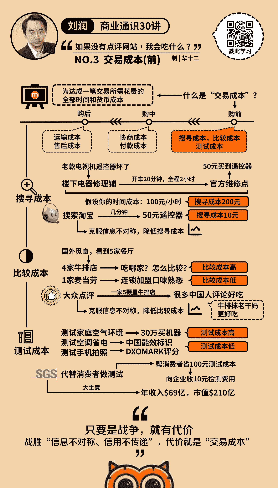  
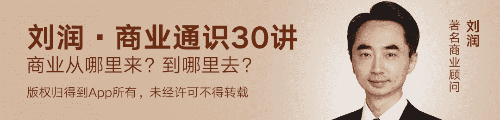

用户留言

*   

Allelujah 朱磊 **211 赞**

```
 交易成本的存在本身，并没有让消费者多花钱，因为「交易成本是必须付出的」。 但「降低消费成本」的商业行为，一定是为了给消费者提供便利的同时，促使消费者多花钱—— 首先，如果说一位市场参与者花费自身的精力和资源去帮助消费者降低消费成本，但不从消费者赚取任何收入，那么这种行为不能被称为「商业」，而应被称为「慈善」； 其次，一切不产生覆盖成本的利润的活动，都无法自给自足地在市场中生存。即使“商业是最大的慈善”，也要建立在自身盈利模式形成闭环的前提下，才能够为市场持续输出价值、持续地降低消费成本，而盈利的终端一定来自于消费者； 最终，这种降低消费成本的商业模式存在，会产生「消费粘性」，促使消费者或者对「新增需求」产生依赖，或者因「交易便利」而持续消费。 
2020-03-09 
```

作者回复

```
说得好。
2020-03-09
```

*    

苏锡许鲜 **77 赞**

```
 任何事情都有两面性，正如课程里所说“交易成本是必须付出的” 但是今天许多优秀的商家（如小米 西贝） 他们之所以那么成功，是因为在不断减少消费者的“购前成本”。“来我店里 闭着眼睛选”“选我的 肯定是高性价比的” 
2020-03-09 
```

作者回复

```
闭着眼睛点，道道都好吃；闭着眼睛买，样样都便宜。这都是降低了比较成本。
2020-03-09
```

*    

晓曦 **68 赞**

```
 交易成本的存在是让消费者多花钱还是少花钱这不是一个非黑既白的问题。我以梅奥为例谈一谈。梅奥以 156 年以来的信用和声誉常年盘踞在美国和世界医院排行榜的顶端，因此降低了”购前“成本，也就是搜寻、比较和测试的成本。 但购中和购后的成本并不低，因为我们医院总部在明尼苏达罗切斯特，是一个位于寒冷地区的小城市。虽然近年来我们使用科技手段以及不断并购扩张，降低这方面的成本，但这个地理位置（导致高交易成本）起初未必没有原因。因为我们不在纽约或者波士顿这类大城市，特意来我们这看病的往往是最高难度的病人，这其实是最能发挥我们优势的地方。 也就是说交易成本一定程度上起到了筛选的作用。而其他病情可以轻易在临近医院解决的病人也省了钱，不必来我们这里。 交易成本不仅在企业间产生，在企业内部也有。大企业的建立某种程度上就是为了降低协作成本。梅奥是个大型组织，几乎任何服务都能内部提供。购前成本极低，因为无可选择。购中和购后的成本也极低，比如，至少法律及相关部门不用参与协商，数据所有权归谁，怎么保护病人隐私等等问题。 但是这种降低交易成本的方法必然也降低了有效性，因为没有竞争和选择。梅奥最近通过比较和选择，最终选择了跟谷歌进入了一个十年合作协议，希望能利用谷歌的技术优势进一步降低各种成本和给病人提供更多价值。 
2020-03-09 
```

作者回复

```
整门课关于梅奥的留言，可以整理成一篇文章。这样可以降低用户的“搜寻成本”。
2020-03-09
```

*    

二希·Hebe **66 赞**

```
 之前喜茶刚在沈阳落地的时候，竟然要花 3 个半小时排队去买一杯奶茶。 我很不理解，但朋友跟我说的时候却很兴奋。她开心她排队买到了奶茶。我问她为什么不找黄牛帮她买，她说黄牛多贵了，一杯奶茶 100 多了，不合适不合适，还是自己排队合适，20 几块搞定。 她忘了，她还有她的时间成本。 工资我们算一天 200 块钱好了，每天工作 8 小时，也就是每小时工资 25，下订单+3 个半小时等位+往返路程，一共至少得搭进去 5 个小时。 她的时间成本是 5*25=125。再加奶茶 25，如果是坐车还需要加上车费。最后总成本 150+。 也许找个黄牛 100 块就搞定了。 黄牛节省的是时间成本，她也不用再跑过去了。 其实，全城那么多奶茶店，怎么就非得喝喜茶呢？因为她想知道，它究竟有什么魔力，每个城市都排队买它，它一定很好喝。于是，为了对比和其他奶茶店的不同，这个队，她排了。这个比较成本，在暗中加码。 好不容易排到了，想着多买几杯吧，这不也把花的时间赚回来了嘛。但是，看似捡便宜，其实更亏了。因为喝不完啊，最后要么是送人，要么就扔掉。花了更大的成本在口味测试上，这个测试成本太贵了。 如果大家都聪明一点，前面买过的人直接把口味写在大众点评上，后面的人看得清楚，也就节约了这笔测试成本。 每一笔交易，都不是一对一的等价交换，我们要看的，不仅是你用多少钱来换回了这个商品。也要看看，这中间是不是还有哪些额外花销。而如何节省这部分花销，也许是我们的另一机遇。 
2020-03-09 
```

作者回复

```
所以，黄牛之所以存在，是因为他帮你多花了钱，还是帮你省了钱？
2020-03-09
```

*   

豆沫 **54 赞**

```
 我从电商的角度思考 早期的电商解决了信息不对称问题，从搜寻成本来讲，让消费者少花了钱，买到了性价比最高的产品。 但随着越来越多的商家入驻开通了电商渠道，搜索出来的商品越来越多，比较成本变得越来越高，消费者耗费的时间属于多花了钱。于是嗅到商机的人或者公司，开始做达人或者平台，比如什么值得买，或者测评 KOL，来降低用户的比较成本。 而淘宝平台在搜索产品的时候，有一个小功能，看中一款商品，长按会出现跟这款商品类似形状属性的产品列表，这样排除掉各种非用户喜欢的产品，只展示用户喜欢相似的产品，也属于降低用户的比较成本。 最后的测试成本，拿用户的评价举例，早期真实的用户真实的评价让用户有了非常强的参考意义，属于让消费者少花钱，但是随着电商的发展，越来越多的水军刷评价的存在，再次让用户增加了甄别成本，要去思考这是不是刷的这种问题，再次消耗时间和精力，从这个阶段来讲，交易成本的存在又属于让消费者多花钱。 我个人感觉，任何一个阶段交易成本的存在都是双面性质，早期通过降低交易成本，让消费者少花钱，后期大家都这么做的时候，消费者的精力时间再次消耗，变成了让消费者多花钱。但此时又会再次出现让消费者少花钱的事物，周而复始，也是商业和社会进步的规律。 
2020-03-09 
```

作者回复

```
很赞的思考。
2020-03-09
```

*    

陈敏胜 **26 赞**

```
 记得在年初八那天，我们一家人一起排了两个小时的队，每人以 1.6 元买到了两个口罩，当时市面价 4 元还买不到货。虽然口罩便宜，但咱开车过来 花上 2 分钟，再加上 2 小时的排队时间成本，折算下来，当时一个口罩一个口罩的成本超过百元。 我七八岁开始卖冰棍，93 年压式从事销售职业，一直都在做售前相关的工作，我的工作主要围绕以下几个问题来展开； 1、如何有效的接触目标客户？与更多的目标客户产生链接。 2、如与客户间建立一种信任关系？ 3、如何塑造价值？ 
2020-03-09 
```

作者回复

```
所以，那个口罩，真的是 1.6 元吗？
2020-03-09
```

*   

黄耀鸿 **23 赞**

```
 得到这个品牌已经帮我降低了搜寻成本，我知道上面有好多好课； 以前学过润总的课程，现在毫不犹豫的续订，是因为我知道润总的课超值；过往的经验减少了我的测试成本。 
2020-03-09 
```

作者回复

```
所以，有人会无比珍惜自己的羽毛。
2020-03-09
```

*   

刘溜溜 **21 赞**

```
 我们作为消费者，买东西会关注交易成本，而作为商家，很关键的一件事就是能不能减少顾客的交易成本，去赢得他们的心。能够帮助客户节省交易成本，也是赢得客户的重要手段。 对于这节课的思考题，说句模棱两可的话，我觉得交易成本既可能让客户多花钱，也可能让客户少花钱。 如果有一家公司能够帮助客户减少交易成本，这家公司本身需要花费巨大的资源和精力去为客户省下交易成本，而这部分公司所付出的资源和精力是否向客户收费，是决定客户多花钱还是少花钱的因素。 如果公司将自己的付出转化为增值的费用包含在商品当中，是有客户愿意为此买单的，能帮我省时省力省心，我情愿多花一点钱。而如果公司自己消化这部分费用，其实对客户来说是少花钱的，只是少花的这些钱没有直接落到公司的口袋。那公司可以得到什么呢？可以得到口碑、信赖或流量等等，以后客户需要这些商品的时候就会来找我，那我还是能够长期的赚钱。 
2020-03-09 
```

作者回复

```
高交易成本，是与用户博弈；低交易成本，是与对手博弈。
2020-03-09
```

*   

徐向聪 **19 赞**

```
 最近在投资一家口罩厂，以前模模糊糊的知道成本有什么，但每次做事也都没绕开，今天老师结构化的解释了一下成本，眼前豁然开朗，体验很深刻。 交易成本分为下面的三类七项： 1⃣️第一类“购前”，包括“搜寻成本（找到几家愿意接受合作的厂）、比较成本（沟通各厂的报价，厂房设备条件）、测试成本（目前口罩的生产成本，和增加生产线的成本）”，三项交易成本； 2⃣️第二类“购中”：包括“协商成本（如果分配利益和责任）、付款成本（通过什么方式付款可以合理避税）”，两项交易成本； 3⃣️第三类“购后”：包括“运输成本、售后成本（如何继续拿到更多订单）”，两项交易成本。 
2020-03-09 
```

作者回复

```
豁然开朗后，就要想：我如何降低这些成本，获得竞争优势？
2020-03-09
```

*   

Super Tank **17 赞**

```
 润总好，我认为交易成本的存在，是让消费者多花钱，且愈发觉得花的值了。 以宜家为例，每年他们都会发布《宜家家居指南》，按道理，纸媒似乎早已衰落，每年给顾客推荐这个，划不来呀。可是每年 8 月《家居指南》上市之后，宜家九、十两个月的销售额能占到宜家全年销售额的 40% 。 究其原因，无非是宜家通过甄选，为消费者提供了一次购物信用背书。帮助顾客过滤掉了纷繁信息、降低了决策成本，甚至让顾客有了能够按照指南构建自己理想生活方式的感觉，换言之，交易成本其实是企业快速提高真实收益的最佳方法，谁能做到，谁成功的可能性就会进一步提高。 以上，请润总指教，谢谢。 
2020-03-09 
```

作者回复

```
如果 8 月份宜家不出这份指南，可能 9 月~10 月，很多人就在别的地方花了“冤枉钱”。
2020-03-09
```

*    

冯建国 **14 赞**

```
 跳出商业逻辑来看，在“穷人思维”中，这购前成本显得更加扎心。比如，为了节约 2 块钱的公交成本，宁愿花 30 分钟走路；再比如，为了省 50 块钱的维修成本，宁愿花一整天的时间去倒腾下水道。《稀缺》中讲到“管窥效应”，也是暗合这个思维逻辑：整个心智都被眼前的小利益占据，无暇顾及机会成本。对于过去被这种思维禁锢过的人，时时警醒。 
2020-03-09 
```

作者回复

```
“穷人”眼中，只有“钱”。
2020-03-09
```

*   

夏雨雪 **12 赞**

```
 这让我想起来为什么很多人都喜欢固定消费品牌。比如我，在网上买鞋就买安踏的，因为不同品牌的鞋码虽然相同，但是穿在脚上的长短宽窄不太相同。我知道他家的鞋码 44.5 肯定适合我，我只需要看看样式喜不喜欢就可以了。如果挑选别家的鞋，或者一些没品牌的鞋，也许更便宜或者更好看，但是考虑到买回来可能不合脚，还要反复退换，这个购前成本还是有点高的。 
2020-03-09 
```

作者回复

```
每家的尺寸不同，增加了“比较成本”。
2020-03-09
```

*    

辜与涵 **11 赞**

```
 润总的课程，一键下单，比较成本为零 
2020-03-09 
```

作者回复

```
活学活用。加鸡腿。
2020-03-09
```

*   

人生向前冲 **10 赞**

```
 购买前的成本一直被我们忽视，因为我们很少去计算甚至无法具体计算搜索成本，比较成本，测试成本，这就跟沉没成本一样很难计算。其实购买前的成本很高，我们却不知不觉的花完了。这让我想起了开会的成本，不算不知道，一算吓一跳！ 
2020-03-09 
```

作者回复

```
能看到这个成本的人，就看到了机会。
2020-03-09
```

*   

董坤 **9 赞**

```
 交易成本让消费者先对花钱了，后面又少花钱了。总体上看，还是少花钱了。 首先，商家要为了降低交易成本，必然要先提供方便的搜寻渠道，还要通过广告，让消费者知道自己并做出比较，最后还要支付测试费用。 这些成本势必会以某种方式，比如品牌溢价，产品和服务价格提高，转嫁给消费者。因此，消费者多花钱了。 但一旦商家的品牌建立起来之后，它势必要维护自己的品牌，就要加大投入确保质量，规模化生产，扩张销售渠道，甚至会吸引竞争对手加入，这都要求商家要降低售价，追求更大的市场份额，确保质量和服务。 此后，消费者势必会花更少的时间，买到性价比更高的产品，或者享受更好的服务。这都降低了消费者支付的各种成本，总体上来说，损失的可能性更小，花的钱也会越来越少。 消费者购买时，可以适当保守一点，观察一下产品的市场表现再说，不必急于一时，就可以省钱；但如果某种产品和服务能带来先发优势的好处，就又不能只想着省钱。一味地省钱而不采用新技术，新服务，会增加时间成本和机会成本，让自己落后或者丧失机遇。 成本考量，是一个系统，需要系统思考。 
2020-03-09 
```

作者回复

```
特别赞。赞系统思考。
2020-03-16
```

*   

任光辉-游戏化管理 **9 赞**

```
 交易成本的购前搜索、比较、测试； 交易成本的购中谈判、支付方式； 交易成本的购后交付、售后。 这就是商业的三流，信息流、现金流、物流；任何商业模式，都是三流的万千变化和组合。 没有交易成本的存在，消费者会从下面几个方面多花钱。 1、付出更多的时间来寻找； 2、选择不适合自己的产品； 3、购买到性价比较低的商品； 4、无法得到充足的售后保障。 
2020-03-09 
```

作者回复

```
信息流，资金流，物流。不断思考这三件事。
2020-03-16
```

*    

Reak **8 赞**

```
 当然是省钱了 血值的《5 商基础篇》其中一讲告诉我们：商品的价格等于商品的标价加上交易成本 一台品牌冰箱 1000 元，代工生产的厂家也拿出同款未贴牌冰箱报价 700 元，怎么选？ 大品牌明显贵 300，可是如果选择 700，我们还需要花时间去详细了解更多专业数据来做对比分析，还需要甄别是否为假冒伪劣产品，还要担心售后…这一系列程序都需要消耗宝贵的时间，以及更加宝贵的注意力资源，损失往往大于 300。 正是由于有了交易成本的存在，厂商才会建立品牌，抓好售后，以此获得消费者的信任，由于有了大量的可信任品牌的商品，消费者大大节省了交易时所花费的时间与注意力（当你走进小米之家，在可接受价格范围内，尽管放心挑选你所需要的产品，无需担心其质量等……） 消费者节省下来的精力又可以用来生产，社会总财富还会因此而增加。 润总的一系列课程，就如催化剂“酶”一样，为社会财富的增长大大大大大提速👍 
2020-03-09 
```

作者回复

```
这 300 元，就是“品牌溢价”。
2020-03-16
```

*   

Leofei **8 赞**

```
 刘润老师，我理解您这门课，是从上帝的视角来看交易，是看水，而非微观上的鱼。 那么交易成本的定义，是中立的一个定义。 购前，购中，购后成本的分类，是从客户的视角看成本，或者说以客户为中心的看成本的划分。因为从企业存在的前提是为客户创造价值让客户获益。 那从供给侧看，售前成本: 降低客户搜寻成本的成本（如:广告）,降低客户比较成本的成本（如，提升排名的成本）降低客户测试成本的成本（如;获取官方背书的成本） 
2020-03-09 
```

作者回复

```
没错。你可以把“购前、购中、购后”，换成“售前、售中、售后”理解，会从不同的视角，看到同一个道理。
2020-03-09
```

*    

吉米 **7 赞**

```
 交易成本的存在让消费者多花钱，商人通过降低交易成本让消费者减少成本，买到高性价比的产品，成为伟大的企业，成就彼此。 拼多多 熟人推荐降低了搜索的成本 熟人推荐降低了比较成本 熟人推荐降低了测试成本。 通过熟人这个媒介，降低了购前成本。 拼多多成功的底层逻辑。通过熟人来战胜信用不传递和信息不对称这两条恶龙。 
2020-03-09 
```

作者回复

```
但是，恶龙会觉得英雄才是恶龙。
2020-03-09
```

*   

小凡 **7 赞**

```
 女孩子都是比较喜欢购物的，很多都是购物狂。我们就拿买衣服过来讲吧。购前:淘宝搜索自己喜欢的款式，淘宝有点贵，去拼多多看。（可现在基本都是刷出来的评论，所以还是会通过小红书或者抖音快手，推荐的店来购买。）购中:看完了价格，开始看评论区，看看买家秀的照片，看看评分高不高，然后开始货比三家。购后:货到了，开始试穿，看看适不适合自己理想中的样子，如果不合适可能就退货了。（7 天无理由退换。） 
2020-03-09 
```

作者回复

```
对女孩子来说“逛”的过程，有时不是为了购物。“逛”就是体验本身。
2020-03-09
```

*   以上留言由 作者 筛选显示
    


# 04｜交易成本（购中）：谈判为什么总是要拖很久？


刘润

2020-03-21

04｜交易成本（购中）：谈判为什么总是要拖很久？

建议 WiFi 环境下播放

上一讲，我们讲到，买家在购买一件商品之前，因为对商品并不了解（也就是：信息不对称），对卖家也并不信任（也就是：信用不传递），所以，需要四处搜寻，多方比较，一些重要的商品甚至还要反复测试。

这就是：搜寻成本、比较成本，和测试成本。

这一讲，我们接着聊，买家经过“搜寻、比较、测试”后，作出了购买决策，进入真正的采购环节，买卖双方要接着付出的两项交易成本：协商成本，和付款成本。

你有没有接受过“商务谈判”的培训？

商务谈判，有很多策略。

*   比如“最终期限”策略，这个折扣就今天有效，明天就更新报价表了，赶快签字吧；
    
*   比如“战略延迟”策略，这个问题我再想想，我再想想，你着急的话，就作点让步呗；
    
*   比如“大吃一惊”策略，天啊，你这个要求也太离谱了，你这么没诚意，我没法谈了；
    
*   比如“不露面的人”策略，和“有限授权”策略……
    

两家公司进行一项商务谈判。一方总监皱起眉头，说：这个方面我做不了主啊。要不，你在那个方面再让步一点，让我至少开得了口，去说服老板试试看？

那个不露面（甚至都不存在）的“老板”，成了谈判桌上斗智斗勇的重要砝码。

为什么？

因为“信息不对称”，敌人太狡猾，万一谈得不好，我至少可以用“老板不同意，我有什么办法”来回斡旋。

这就是“不露面的人”策略。

大家都谈完了，另一方总监说：我尽快把协议拿回去给律师看。我的授权有限，律师最大。你们懂的。

最后，律师在 3 页的协议后面，加了 30 页的违约条款。甚至细到了如果打官司，在哪个法院起诉。

为什么？

因为“信用不传递”。越不信任，越需要“丑话说在前头”。丑话说在前头，就是协商。这些违约条款，都是谈一件大概率不会发生的事情：你别怪我啊，但是万一呢？

这就是“有限授权”策略。

为了签一份协议，那么多人花了那么多时间来来回回，大量的时间甚至金钱投入，都是成本。这就是“协商成本”。

怎么降低协商成本？

**整个社会降低协商成本的方法，是“事后惩罚”。**

初去美国的人，会发现美国人很“蠢”，你拿餐厅服务员手写的“收条”，就能到公司报销。那我自己手写一张去报销不就行了吗？这个漏洞也太大了吧？

初去德国的人，会发现德国人也很“蠢”，自己买地铁票，自己进地铁站，没有人工检票，也没有自动闸机。没票其实也能进，这个漏洞也太大了吧？

但是，你会发现，美国的公司有审计，德国的地铁有督查。一旦发现你做假账、逃车票，就会面临巨额罚款，甚至被列为“失信人员”，以后诸事不顺，找工作、办贷款都很难，说不定信用卡都申请不下来。

相反，复杂的发票体系，昂贵的检票系统，其实本质上都是要求你遵守契约的“协商成本”。而“事后惩罚”的社会信用体系，就可以降低事前的协商成本。

**说完了社会，我们再看个体。对于单个机构，降低协商成本的方法，是“品牌声誉”。**

以咨询行业为例。

成功的咨询公司各有各的成功，失败的咨询公司原因通常都是一条：你在客户那里没有“信用”，他不相信你的能力。

因为不相信，所以“协商成本”就很高：说说看，你能做什么？你比 X 好在哪里？比 Y 强在哪里？还能再便宜一点吗？你能来竞个标吗？我们只能先付 30%的钱，等看到效果我再付尾款吧？

这些高昂的协商成本，会导致一家咨询公司的成交速度极慢，而因为不信任，客户战略决心不坚定，又会导致最终执行效果不好，咨询公司因此也收不到钱。

这些都是协商成本。而你花在协商上的时间越长，花在交付上的时间就越短。这进一步导致你收入的减少。

那怎么办？

我给自己定了一条铁律：

绝不去客户现场做售前。

不管你是多大的企业家，只要你不愿到我的小办公室来聊，就说明我的声誉还没有强大到让你挪步。只要不是用“声誉”这个“第一因”赢来的客户，再有钱，也不是我真正的客户。不够强大是我的错。

这样，当你用声誉赢得客户时，就可以不用支付任何售前沟通类的“协商成本”。这时候你就会明白，为什么很多人那么在乎公司的品牌、个人的声誉？

因为品牌和声誉能降低协商成本。

你问一下自己，如果有一天因为公司资金周转问题，需要打电话向朋友借钱。你觉得你能在不抵押资产，甚至不打借条的情况下，借到多少钱？

**这些钱就是你声誉的价值。免去的抵押、借条、借款合同，就是节省掉的“协商成本”。**

协商成本，有关法律条款；付款成本，有关财务条款。

假如你是中国海宁的一家沙发工厂，生产的沙发要出口到美国一家公司。因为这是你们第一次合作，对方要求你先发货，验过货之后，再付款。

但是，1000 万元的货，你敢直接发过去吗？当然不敢。你说，还是你先打款吧。收到钱之后，我再发货。我怎么知道你是不是骗子。

对方说，笑话，我还怕你是个骗子呢。

你们商量来商量去，最后决定，还是先从 10 万元的小生意做起，建立信任。熟了以后再做 1000 万的大生意。付款这件事情背后的风险，阻碍了你们之间的交易。

为什么会出现这种情况？

因为你们彼此在对方那里没有“信用”，所以“付款成本”很高。

为了降低付款成本，一个叫“信用证”的东西被发明出来。

美国这家贸易商和美国某家银行长期合作，在这家银行里开设了账户，账上有不少钱。银行非常清楚这家贸易商的情况，就为其开出证明，说我们已经冻结了它 1000 万元资金，放心吧，它不是骗子。你把货发过来吧，这边确认收货后，就会把钱打给你。

这个证明就叫信用证。

海宁的工厂更相信银行，看到信用证之后就发货了。信用证的出现降低了远隔万里的交易双方之间的“付款成本”。

在上一讲，我们聊过，淘宝成功的核心是降低了全社会的“搜寻成本”。

那么支付宝呢？

在网上买东西，虽然搜寻到了卖家，但你还是不太敢把钱付给它。万一它是骗子呢？

你先发货。

卖家也不敢先发货啊，万一你才是骗子呢？万一你收到货，就是不打钱呢？

你先打钱。

这就是“付款成本”。

勤劳而勇敢的商人们，有没有办法降低“付款成本”的代价，促成交易呢？

2004 年，“支付宝”出现了。

阿里巴巴最初就是做国际 B2B 电商的，所以对“信用证”的逻辑非常熟悉。所以为了降低 C2C 电商的“付款成本”，支付宝直接借鉴了信用证的逻辑：担保交易。

什么叫担保交易？

你在淘宝上下单付款，钱并没有直接打给卖家，而是打到了支付宝的临时账户。支付宝通知卖家，钱已经在我这里了，你可以发货了。于是卖家可以放心地发货了。买家收到货之后，一检查没问题，也放心了，于是点击“确认收货”。这时，钱才会自动转给卖家。

这就是担保交易。

因为支付宝，买家和卖家并不需要彼此信任，就能完成交易，因此大大降低了电商交易的“付款成本”，并带动了移动支付的普及，这才有了后来“双 11”的交易奇迹。

**如果说淘宝的成功，是因为降低了搜寻成本；支付宝的成功，就是因为降低了付款成本。**


刘润

这一讲，我们讲了购买环节中的两种交易成本：

*   协商成本，也就是为了保证双方执行条款，所必须付出的提前防范的成本；
    
*   付款成本，也就是为了保证双方资金安全，所必须付出的资金保护的成本。
    

交易成本，是克服“信息不对称、信用不传递”的交易阻力，而必须付出的代价。伟大的公司之所以伟大，就是因为它们能不断降低商业世界的“交易成本”，减小代价。

因为它们的存在，我想请你记住一句话：

商业进化的方向，就是从“交易成本=∞”，向“交易成本= 0”前进的方向。

这一讲，就讲到这里。讲完了购前，和购中，那么购后呢？下一讲，我们继续聊。

今天我给你留一道思考题：

“事后惩罚”机制的建立，有助于降低整个商业世界的交易成本。但是你觉得，“事后惩罚”机制的建立本身，有没有成本？这个成本是什么？值得吗？

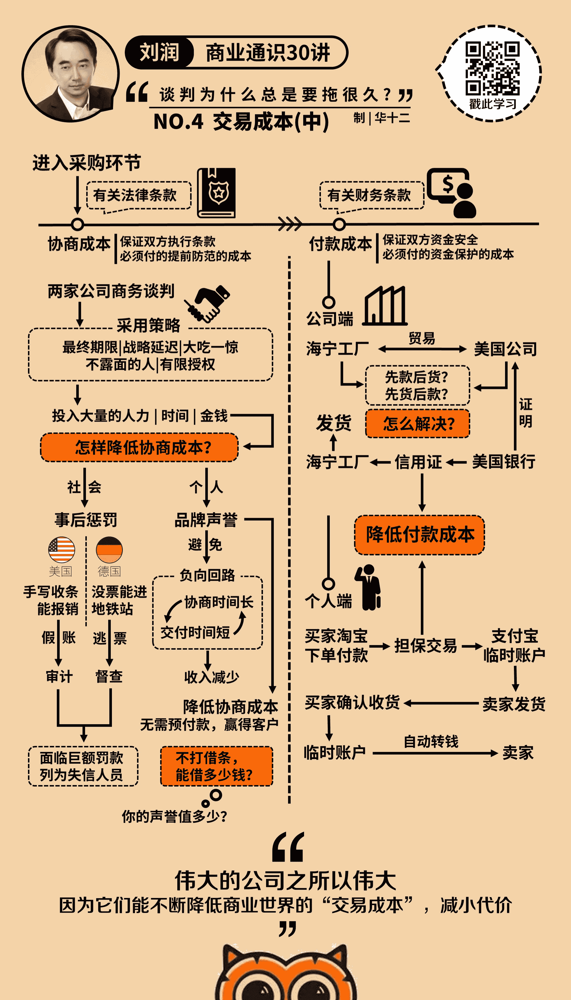  


用户留言

*    

二希·Hebe **255 赞**

```
 男女关系之间，最难解决的问题就是： 为什么我说什么你都不相信我？ 最容易打消顾虑的就是： 房产证上有你的名。 
2020-03-10 
```

作者回复

```
这个必须精选。
2020-03-10
```

*   

青岛罗刚 **115 赞**

```
 事后惩罚要求有非常健全的社会信用记录和监督系统，最简单的就是所有的行政、司法管理部门的数据库是打通的，这本身就是一个不小的成本，即便这些年信息技术和大数据发展这么快，但目前也没有完全实现，而且好象有待时日。 有时候商业的交易成本在商业之外。 
2020-03-10 
```

作者回复

```
社会承担了公共成本，再分担给社会。
2020-03-10
```

*   

Allelujah 朱磊 **87 赞**

```
 “事后惩罚”机制之所以成立、且具备威慑力，是因为在现代社会中，所有人都需要依赖「合作」，而所有合作都需要依赖「社会机制」。 “事后惩罚”本身，相当于是给每一个社会人上了一道报警——当你违反「社会规则」，社会就会将你从支持你的「社会机制」中剔除，影响你未来的所有「合作」。 “事后惩罚”机制必然是有成本的，其成本就是： 1.排查违反「社会规则」的事实； 2.强制执行「社会机制」的维护。 但这些成本一定是值得的。因为这一机制的存在，是保证「合作」的基础，是对可能出现的违反「合作」震慑。 唯其如此，才能使商业向“交易成本归零”不断前进。 
2020-03-10 
```

作者回复

```
当个人算小账不值得时，社会算大账才会划算。
2020-03-10
```

*    

晓曦 **67 赞**

```
 刘润老师曾说过“不能被消费者优先选择的，就不叫品牌，只能叫商标”。品牌是一个装载客户“了解、信任、偏好”，从而降低协商成本的工具。无论我在外说什么话做什么事，都要提醒自己谨言慎行。梅奥 156 年来无数人努力塑造的声誉，绝不能因为我蒙上阴影。 我们替政府和其它机构评审项目从而拨款时，除了看这个申请书本身的质量之外，研究团队和所在大学也在打分之中，就是为了解决信用不传递的问题，降低协商成本，要量化研究团队领导者个人的品牌（在哪受教育，发过什么文章，领导过什么项目，结果怎样）和所在大学的品牌。 之前有好几个大学连续有不太体面的事情被披露。我就跟我的合作者讨论，下次我再评审项目的时候，对这些大学的团队评级要考虑下调。我同事很惊讶，说，可也不关他们的事啊。我说，你不能在用到大学的牌子的时候说我是大学的一员，出了事，你就说不关我的事。学校/医院品牌大家一荣俱荣一损俱损，人人有责。某种程度上这也是一种事后惩罚机制吧。 梅奥也有一种事后惩罚机制。任何能接触到病人电子病历的人，绝对不能因为好奇，比如想看看我邻居或者朋友或者名人治疗情况而查询病例。如果你没有合理的理由（医疗和研究）去查看病人病历，会被立刻解雇。这样是为了保护病人隐私，建立信任和声誉。但成本就是需要有人监察和实施惩罚，而且对于某个个例来讲可能非常不近人情。尤其是我们医院是个非常温柔和气的地方。但每个员工在入职第一天就不断被灌输这件事情，所以也已经打过预防针了。 
2020-03-10 
```

作者回复

```
这就是为什么阿里解雇用程序抢月饼的员工吧。
2020-03-10
```

*    

强 Sean **63 赞**

```
 忍不住想起华杉老师对品牌的解读:品牌是一种成本机制。为什么呢？ 1.降低企业的营销成本。企业建立品牌，让消费者指名购买我们的商品，我们的营销成本就低了，交易成本也随之降低。 2.降低消费者的选择成本。消费者购物，首先就面临选择成本，想买一个东西，不知道哪个好，哪个有保障。认品牌就好，买品牌货就有保障，这也是降低了交易成本。 3.降低社会的监督成本。如果品牌企业出了问题，全社会都知道，都能监督，看着它改正。如果没有品牌，消费安全抓起来成本就太高了。 
2020-03-10 
```

作者回复

```
华杉老师说得很对。品牌的本质，是通过信任机制，战胜信用不传递，降低双方的交易成本。
2020-03-10
```

*    

常亮 **35 赞**

```
 “事后惩罚”免不了成本，为了建立事后惩罚的机制，社会必须建立完善的社会信用体系，至少包括金融、工商登记、税收缴纳、社保缴费、交通违章、产品质量等信用记录，这需要投入大量资源进行建设。为了保证事后惩罚机制的及时性、准确性，保重交易安全和效率，这个成本是值得的。 此外，司法实践中，虽然信用证作为一种信用结算的工具，银行在单证符合的条件下承担无条件付款责任，保证了交易双方收付款安全，但是由于交易方可能不遵守交易惯例甚至存在欺诈行为，信用证纠纷也经常发生。工具或者机制再好，总有人喜欢钻空子。 
2020-03-10 
```

作者回复

```
当完美的事前制度不存在时，就事后罚到没人敢再尝试。
2020-03-10
```

*   

斜阳 **34 赞**

```
 对于一家企业而言，这两节课一直在谈外部交易成本，这不免让我想起来具有极强对比性的内部管理成本，因为正是这两者的关系决定了一家企业的边界。那么同样，管理成本本质上也是在克服信息不对称和信任不传递，比如疫情期间，很多公司执行云打卡，而且对员工的产出看得更细致了，海量的严防死守，本质上还是信用和信息在作怪。管理“过程”，还是管理“结果”，事前控制，还是事后控制，“严进宽出”还是“宽进严出”？针对课后问题，我想说，“事后惩罚”机制当然也是有高额成本的，你必须得有记录或者完整的监控体系才行。对于内部管理而言，要有系统留痕，目前中国海关的管理改革采用的就是这个办法，降低申报门槛，采用事后管理的追责机制，之所以这个时候敢这么做，原因有两个：事前管理成本太高了，海关系统相对成熟了。说了这么多内部管理，再次切换到外部交易，其实逻辑也是一样的，最终的决策还是效率导向，对于不同的事情，去评估事前和事后的总成本和效率得失，依据最小阻力原则行事。 
2020-03-10 
```

作者回复

```
管理成本的本质，就是“内部交易成本”。可以同理推导。
2020-03-10
```

*    

vivi **27 赞**

```
 说到信息不对称，保险行业是很信息不对称的，我买自己的商业保险的时候，不是很懂，听了保险经理推荐的。现在回过头来发现我的保险保费很高，保额很低，看似面面俱到，实则质高价低。 当我开始学习保险知识，信息开始对称起来的时候，我不会找我以前的那位保险经理买保险了。 我发现世界很奇妙，当我准备好的时候，我又新认识了一位保险经理，她是根据我家庭实际的情况给我老公配置了保险，对这个保险方案我还是很满意，也就更加信任她了。接下来还会跟她买我女儿的保险，以及我自己的重疾部分也要加额度。 这件事给我的启发是，如果真的可以站在客户的角度去替客户创造价值，是可以双赢的。如果利用信息不对称赚钱，不过是单次博弈罢了。 
2020-03-10 
```

作者回复

```
第一位用户失去了信任，所以和你后来的交易成本，就非常高。她如果再想获得你的信任，需要百倍的证明。
2020-03-10
```

*   

佛祖门徒 **26 赞**

```
 本课关键词：信用。 信用是促成交易的关键要素，即使在信息不对称的情况下，只要信用存在，达成交易就会容易很多。拼多多崛起之初的关键就是熟人拼团，都是亲朋好友、邻里街坊，信用是在日常建立起来的；企业在向客户争取项目的时候，习惯列举自己的标杆项目、资质证明、合作巨头和重要客户，这是通过“实力的证明”来建立信用；到一个陌生地方不知道选择吃什么、住哪里，熟悉的连锁品牌总是第一选择，因为平时积累的信用在那里；润总的新课值不值得买，不需要考虑，5 商已经证明了润总这块招牌的含金量。 
2020-03-10 
```

作者回复

```
因为降低了用户的“选择，比较，协商”等等一系列成本。
2020-03-10
```

*   

江湖无声 **26 赞**

```
 事后惩罚机制一般要引入独立第三方这个要素，这个第三方会产生额外代理成本，而且事后惩罚有滞后效应； 这个成本值不值取决于惩罚机制能不能产生共识，提供确定性。 
2020-03-10 
```

作者回复

```
第三方成本，也就是执行成本，需要计算。
2020-03-10
```

*    

重庆 Franklin **21 赞**

```
 润总，商业从“交易成本=∞”，向“交易成本= 0”的方向进化，最终交易成本可能为 0 么？ 关于思考题： “事后惩罚”机制的建立本身是有成本的，上面案例，中国付出的就是发票体系、闸机体系的建设和维护成本，美国和德国更多是维护“事后惩罚”的法律机关运营成本，和事前对民众的教育成本。 
2020-03-10 
```

作者回复

```
有趣的思考。发票制度，是整个中国企业的管理成本。这是不是经济的？
2020-03-10
```

*   

心铭 **20 赞**

```
 润总好， 事后惩罚的成本有两个， 一是监督成本，就是我判断这件事是否违规的成本。判断的成本同样也分为两个，就是判断出来的成本，需要人或者机制去判断的消费。还有判断不出来的成本，做假账掏钱，都是因为没有谈判成本所浪费的成本，也应该记到事后惩罚的成本之内。 二是执行成本，即便我们做出了判断，去执行，也是要浪费司法、社会成本去执行的。 关于以上成本值不值得，还是与谈判成本的对比。哪个合算用哪个。在这方面，我觉得中国还是聪明，“坦白从宽，抗拒从严”，降低了监督成本，同时也相对来说降低了执行成本。 
2020-03-10 
```

作者回复

```
很好的总结：监督成本，执行成本。
2020-03-10
```

*   

Super Tank **16 赞**

```
 润总好 我为认为，“事后惩罚”的机制建立本身，是有成本的，这种成本，或可叫做“交学费的代价”。 比如，去年五一，有客人入住青岛的民宿时发现路由器指示灯里隐藏了偷拍摄像头。类似的情况早就不是第一次发生，2017 年就有一对情侣在入住台北高雄的爱彼迎民宿时，在烟感器内发现针孔摄像头，并为此维权半年。试问，维权的时间成本，是不是损失？社会舆论的声讨，对民宿行业的口碑是否有影响？民宿是否需要花大量时间做工作，才能重新获得顾客的信赖？即便我国已有针对此类行为的“事后惩罚”机制建立，也是建立在前人惨痛经历的基础上的，这个过程中所有的参与者付出去的一切，也收不回来了呀。 当然，若要问“事后惩罚”的机制建立值得与否，答案当然是肯定的。 还是拿刚才的例子来说，没有惨痛的教训，似乎很难有人想到要建立相应的机制，但如果没有相应的机制，类似的剧情恐怕还会在民宿中一再上演。民宿业的隐私安全需要从三方面来构建，即法律法规、技术保障、安全意识。法律法规是“事后惩罚”，技术保障、安全意识则是事前预防，如果事前预防做得好，法律法规是不是就可以少点操心呢？ 以上，请润总指教，谢谢。 
2020-03-10 
```

作者回复

```
所谓罚到“倾家荡产”。
2020-03-10
```

*   

董坤 **16 赞**

```
 事后惩罚机制的建立和维护，都会产生成本。 首先是建立机制，包括触发惩罚的机制和惩罚的力度标准体系。 接下来就必须有相关的部门和人员按照条款进行核查，这里会产生人力资源成本、法律成本和管理成本。 最后，还要对整个体系进行维护和监管。比如，30 年前，偷税 1 美元可能要重罚，现在可能会轻点。还要有监管杜绝执法者犯法等，都需要支付相关的成本。 我个人认为这些成本很值得。毕竟，事后惩罚的最大效用在于“威慑”作用。如果人们知道社会中存在缜密的事后惩罚机制，就会更加在乎自己的诚信，从而形成诚信的氛围以及文化。 这将大大降低社会中和商业行为中的“协商”和“支付”等因信任缺失而造成的成本，提高交易效率，高高效分配资源（0 交易成本，意味着资源配置会达成“帕累托最优”），创造更多财富。 因此，为“事后惩罚”而支付的成本，相当值得。 最后，热烈欢迎润总回归。没有“我润”的得到，很久没打开了。 
2020-03-10 
```

作者回复

```
本质上，是一次性制度成本成本，对多次性协商成本的“规模效应”分析。
2020-03-10
```

*   

山峰 **12 赞**

```
 今天的思考题，让我想到了前两年县纪委请武汉审计署来筛查农村低保的数据。审计署直接从金融机构、政府部门调数据，一下子筛查出一大批有车、有房、有存款、吃财政饭的低保户，并责令相关机构，追回所发放的低保金。那一阵子，县民政局督促乡政府四处派人去追钱，在要求的期限内，将钱上交财政。 现在回想起来，这也是我印象中唯一一次大规模的追缴低保金。从这件事中，我认为群众缴纳税收与政府部门交换公共服务，也构成了一种特殊的、没有期限的商业活动。乡政府四处派人去追缴低保金，则属于事后惩罚机制的一部分。这种事后惩罚机制的建立当然有成本，成本则是那段时期，乡镇府放下其他工作，一心一意追缴低保金，所花费的人力、物力、财力、时间。 至于这个成本值不值得？我认为还是值得，1、以前发现不符合要求的低保对象，不追缴低保金，助涨了骗保之风。2、有利于社会的风清气正。现在农村的风气很不好，在老表心中，享受政府的照顾是一件光荣的事情，老表来民政局上访，总是挂在口中的一句话“我是从来没有享受到政府的照顾”，其潜台词就是“不论符不符合规定，我就应该享受照顾”。3、节约了国家资金，使这笔取之于民的资金用到更需要的地方。4、强化了相关政府部门的责任意识。 
2020-03-10 
```

作者回复

```
所以，算的不是那 100 个被查出来值不值得，而是 10000 个起心动念骗取低保的人，因为觉得不划算，而值不值得。
2020-03-10
```

*    

拒绝再玩 **11 赞**

```
 润总的课程全部都以“刘润”冠名，“刘润”这个品牌也正是给润总戴上的“事后惩罚”的紧箍咒，以润总的名誉为课程质量背书，有效降低了学员的交易成本。😄😄😄 罗胖老师就靠着这一道道紧箍咒，保障了得到课程的质量，让渴望学习渴望提升的我辈中人免受“信息不对称和信用不传递”的阻力，交易成本趋于归零。 顺便一提的是得到贝这个支付工具，免除了直接从银行账户中付款的“肉疼感”，让支付款这个动作更加行云流水一气呵成~ 
2020-03-10 
```

作者回复

```
不疼不疼。
2020-03-10
```

*    

九把叉 **11 赞**

```
 事后惩罚的机制能够有效的前提，是惩罚的力度要足够大，让失信者的代价远远大于他因此获得的收益，否则惩罚机制起不到威慑作用。 事后惩罚机制从制定到形成共识再到执行，都需要一个系统的建立，这些都是需要成本的。 与事后惩罚相对应的，还有一种制度是事后奖励，这对于鼓励人们去做某件事也是有用的。当年商鞅变法的时候，为了建立秦王朝的信用，搞了个南门立柱的故事，就是通过事后奖励来做到的。 
2020-03-10 
```

作者回复

```
南门立柱的本质，不是立柱，而是立信。
2020-03-10
```

*   

Nate **11 赞**

```
 事后惩罚相对于事前惩罚要做的，是让人相信真的会被惩罚。而让人相信做错事会被惩罚本身，需要施惩者已经建立了信用，做到有错必究需要花费很多人力物力。但可以换来更稳定的市场环境，使得交易更高效是值得的。突然想到，事后奖励也是一种信用交易。按一年时间跨度来看。平时员工拿基本工资，各种奖金可以激励员工。比如年终奖，还可以让公司的人员流动在季度上更趋于稳定，降低劳动力流动带来的风险。 
2020-03-10 
```

作者回复

```
事后奖励。发散思维。
2020-03-10
```

*    

江南烟雨中 **10 赞**

```
 “事后惩罚”机制的建立需要成本，比如淘宝每年要投入 10 亿元、2000 人来打假。 
2020-03-10 
```

作者回复

```
可能个别打重了，有误伤。但是真的造假者也会因此更害怕。
2020-03-10
```

*    

Bill **10 赞**

```
 “事后惩罚”机制的建立本身有成本，它的成本是教育成本，让至少大多数人能认同规则，建立起社会信用体系。 “事后惩罚”机制能够处理的必须是低概率的例外情况。 如果大多数是都不尊重规则，大多数都触发了这个“事后惩罚”机制，那就会超出“事后惩罚”机制的处理能力。 例外一旦变成常态，那就不能被当成例外了。 所以要想让“事后惩罚”机制正常运转，必须有一套完善的教育培训体系将规则普及给大多数的人且让他们能够认同并遵守。而这部分的工作是需要花费时间和精力的。 值得做这件事情，因为一旦建立起“事后惩罚”机制，就可以大大降低整个社会的协商成本。 
2020-03-10 
```

作者回复

```
所以，一切都是关于成本的“计算”。
2020-03-10
```

*   以上留言由 作者 筛选显示
    

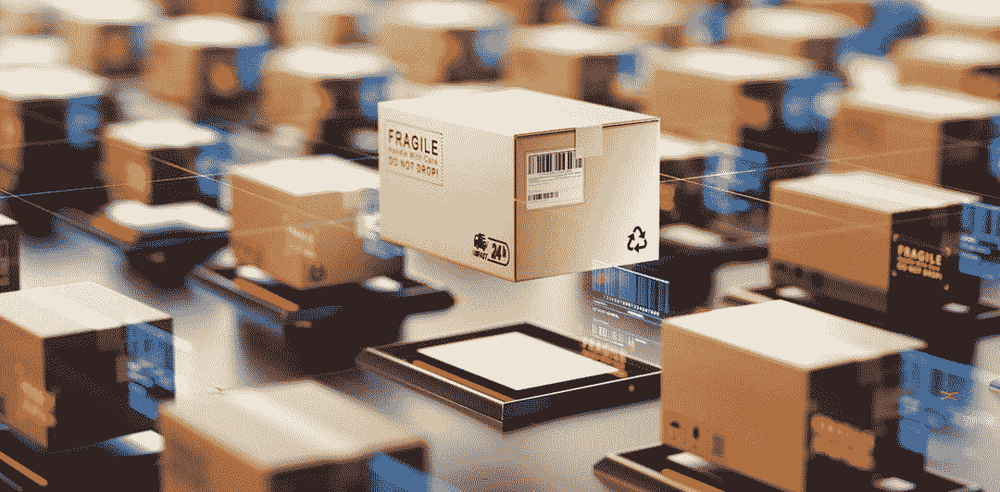

# 05｜交易成本（购后）：中国的物流真的比美国更快吗？


刘润

2020-03-21

05｜交易成本（购后）：中国的物流真的比美国更快吗？

建议 WiFi 环境下播放

商人们为了促成交易，克服“信息不对称、信用不传递”这两大交易阻力，必须付出代价。这个代价，就是“交易成本”。

这些代价必然存在，但也必须降低。

商业进化的方向，就是从“交易成本=∞”，向“交易成本=0”前进的方向。

前面两讲，我们讲了三类七项交易成本中的两类：

*   第一类“购前”，包括“搜寻成本、比较成本、测试成本”，三项交易成本；
    
*   第二类“购中”：包括“协商成本、付款成本”，两项交易成本。
    

这一讲，我们接着讲第三类交易成本：购后。购后交易成本包括：运输成本，和售后成本。

提问，你觉得现在是中国物流行业的效率高，还是美国物流行业的效率高？

很多人会觉得，当然是中国高啊！

2020 年大年初一的早上，我在深圳大中华喜来登酒店和施展老师一起吃早饭，用手机在京东买了一本施展老师的新书《溢出》，然后立刻奔赴机场，飞回上海。下午回到上海的家时，这本《溢出》已经比我先进门，躺在我家的桌上了。

所以很多人会觉得：中国物流业的效率太高了。

但是，这其实是一个误解。

中国物流与采购联合会会长何黎明，在一次演讲中说， **“我国物流效率，仅相当于美国 80 年代”** 。

啊？为什么？

要看一个国家物流行业的效率，一个关键指标是“社会物流总成本”在 GDP 里的占比。这个占比意味着，每创造 10000 元的社会财富，需要 1000 元钱还是 100 元钱，才能送到消费者手中。

那么，各个国家的“社会物流总成本”在 GDP 里的占比，到底是多少呢？

美国“社会物流成本”在 GDP 里的占比，大约是 8%。日本是 11%，要高一些。东南亚更高，平均是 27%。

那中国呢？大约 15%，将近是美国的 2 倍。

当然，这个数字，也和一个国家 GDP 的结构有关系。比如制造业大国，几乎一定比服务业大国的物流负担重。但是，这个占比依然在很大程度上，反映了一个国家物流行业的效率水平。

那么，为什么中国“社会物流总成本”和你想象的完全不一样，比美国高这么多呢？

**社会物流，大概包括三种成本：运输费用、保管费用、管理费用。**

在运输费用方面，中国目前的运输，主要还是依靠高成本的公路运输，成本更低的铁路运输和水路运输，占比很小。

中国多种方式（水路、铁路、公路、航路）的联合运输，只占 4%~5%左右，而发达国家已经达到 20%。我们的成本当然高。

那保管成本呢？保管成本，和商品的库存周期关系非常大。中国传统商业的生产计划性总体较差，一件商品在仓库里放 1 年才卖出去，和放 1 个月就卖出去，保管成本能差到 12 倍。

第三是管理费用。

你猜猜看，在中国，一盒棉签从工厂里生产出来，一直运到你家门口的夫妻老婆店，最后被你买走，一共被“搬运”了多少次？

大概 5~8 次。

从工厂搬运到品牌商仓库，再搬运到总代理仓库，再搬运到城市代理仓库，再搬运到批发市场，再搬运到夫妻老婆店。

每一次搬运，都会产生新的成本负担。而这些成本，是因为对交易流程的低效管理导致的。

那能不能减少搬运的次数？比如降到 4 次、3 次，甚至降到 2 次？

有可能。

名创优品的棉签，从工厂出来后，会被直接运送到它在全国的 7 个大仓库，然后根据终端的销售数据，从 7 个大仓库，直接运送到需要补货的门店。这样，一盒棉签，在名创优品只需要搬运 2 次。

算上自建仓库的成本后，减少搬运次数这一件事，在大多数情况下，依然能够降低运输成本。

再举个例子。

你是一家品牌商，打算在京东、小米有品上卖东西，你甚至可以不建立自己的仓库，而是选择它们的“一件代发”服务。

什么意思？

货品从工厂出来，直接存入京东统一的仓库里。你是品牌商，或者经销商，你卖出一件商品，并不需要把货品搬到自己家，再从家里发货。京东帮你直接从统一的仓库发货。

这种“物权流转货不动”的模式，又减少了一次运输成本。

商人们在想尽一切办法，通过降低“运输成本”的方式，提升交易效率。

中国的“最后一公里”物流效率很高。但是，主干物流效率太低。

2013 年，阿里巴巴成立了菜鸟网络。马云说，他的目标是让中国任何城市之间的电商快递，实现 24 小时内必达，全球范围内实现 72 小时必达。

怎么做？通过对大数据的分析，在用户还没有下单之前，就作出更准确的销售预测，调动多种方式联动的物流资源，实现提前配送，从而改善主干物流效率。

**这一切的努力，都是在降低运输成本，哪怕只是一点点。管它呢。进一寸有一寸的欢喜。**

梁宁老师曾经讲过一个关于“育婴箱”的故事。

19 世纪 70 年代，妇产科医生斯蒂芬·塔尼受小鸡孵化器的启发，发明了人类使用的“育婴箱”。这个伟大的发明，让美国婴儿的死亡率下降了 75%。

育婴箱是一个非常天才而伟大的发明。但是，这么伟大的东西，并没有在非洲带来婴儿死亡率的下降。

为什么？

因为斯蒂芬的育婴箱结构非常复杂，容易出现故障。出现故障后，需要专业人员和专业配件才能维修。而这些在基础条件落后的地方很难获得。所以，育婴箱很难大面积推广。

也就是说，斯蒂芬的育婴箱“售后成本”太高。你能捐 10000 个育婴箱，但你很难捐一整套昂贵而复杂的售后服务体系。

怎么办？

一位美国大学生，天才式地改进了斯蒂芬的育婴箱。这款育婴箱用旧汽车的前灯来供暖，用汽车仪表盘的风扇来保持空气循环，用车门的蜂鸣器和信号灯当报警系统，并且用摩托车电池供电。

**这款育婴箱，就被称作 NeoNurture 育婴箱。**

我说这是一个“天才的改进”。可是，这个发明到底“天才”在什么地方？

这个发明的“天才”之处，不是因为这些配件便宜，而是因为它利用成熟的汽车配件制造育婴箱，因此完全不用搭建一套独立的售后体系。育婴箱如果坏了，一个汽车修理工，就能修好它。

NeoNurture 育婴箱的天才之处，是它创造性地降低了“售后成本”。

有一次，华为前轮值 CEO 费敏老师给我讲了一个故事。

他说，他们家空调坏了，于是请人上门来修。修理工人满头大汗，弄了一个上午，还是没修好，最后说先回去一趟再来。

费敏老师在华为时，负责整个华为的研发体系。他说，华为是不会这么设计产品的。华为如果做空调，一定会把空调“模块化”。

空调坏了，有人上门来修。最重要的“售后成本”是那块电路板，还是修理工人上门的时间？

大概率是上门修理的时间。

所以，如果从最开始就想明白了这个问题，进行模块化设计，维修工人上门后，就可以直接拔走坏掉的模块，换上新的，走人。这样的售后成本，是最低的。

为什么？

**因为所有的售后成本，最终都会加到商品价格里，导致不必要的高价带来的交易阻力。**

创造性地降低售后成本，就是降低交易成本，提升商业效率。


刘润

这一讲，我们讲了购后的两种交易成本：

*   运输成本，也就是为了物理上完成商品的交付，所必须付出的运输、保管、管理成本；
    
*   售后成本，也就是为了保障承诺的正常使用，所必须付出的服务成本。
    

好了。这一讲，就讲到这里。

到此为止，我们已经讲完了三类七项的交易成本：

*   购前：搜寻成本、比较成本、测试成本；
    
*   购中：协商成本、付款成本；
    
*   购后：运输成本、售后成本。
    

有人说，要想教一只鹦鹉成为经济学家，只需要教它学会一个词：供需关系。

套用这个句式，要想教这只鹦鹉同时成为商业大咖，你只需要再教它学会第二个词：交易成本。并且记住：

商业进化的方向，就是从“交易成本=∞”，向“交易成本= 0”前进的方向。

告诉这只鹦鹉，要想取得商业的成功，知道存在这七项交易成本很重要，更重要的，是找到降低它们的方法。

下一讲，是这一模块的小结。我会给你举三个例子，看看在真实的商业世界中，人们是如何通过降低交易成本，来获得商业成功的。我们下一讲，接着聊。希望你把这三讲内容转发给你做生意的朋友们，帮他们认清成本，缩减成本。

今天我给你留一道思考题：

你的公司，有没有降低了这七项交易成本中的哪一项，或者哪几项？还是并没有？

想清楚这个问题，你就能对自己的公司是正在一路高歌猛进，还是始终不温不火的原因，有个大概的判断了。

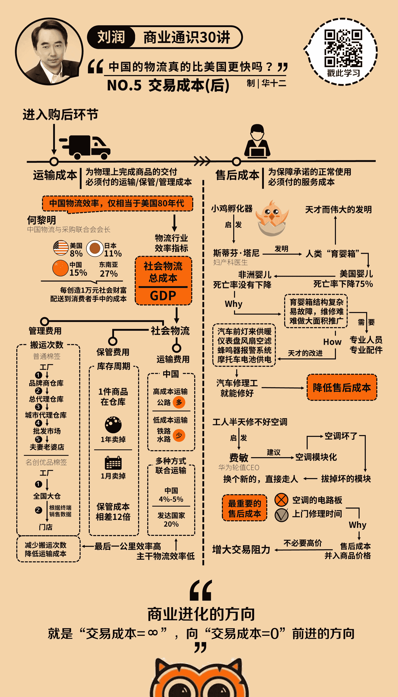  


用户留言

*   

斜阳 **77 赞**

```
 关于中国物流成本高，和我们的日常感知不同，这是因为我们只看到了 C 端物流的发达，没有看到背后整体仓干配的复杂，以及更深层的，因为中国地理和文化差异格局导致的多层级分销体系，针对这两点，目前以降低交易成本为目的的演化方向是： 仓干配层面，用交易数据带动末端的“配”，再利用“配”带动“仓干”的基础设施改革，整体进行拉动式变革，从 C 端反向倒逼 B 端和整个 S 端，实现 S2B2C 全链条效率提升。 分销网络层面，执行“逻辑仓分散，物理仓集成”的管理方式，也就是“短链经济”，把供应链的三流（信息流，资金流，物流）进行拆分解耦，传统经销体系只保留资金流能力，品牌商控制全链条信息流，物流交给专业第三方物流平台。 
2020-03-11 
```

作者回复

```
逻辑仓分散，物理仓集中。
2020-03-11
```

*   

心铭 **51 赞**

```
 润总好， 我们公司是建筑公司，但是现在增加一个新业，制作了软件，让互联网给建筑赋能。从这几天的学习来看，公司的这个举措，如果做好了，肯定是成功的。 之前的建筑业，施工班组找活，需要各处打听，那里有活，然后上门采访，并且还不知道活的质量。这就是售前的搜索成本，现在我们这个软件，上面汇集了我们筛选过的活的信息，省去了他们搜索成本。对于给活的一方，我们软件上有施工班组的业绩记录，包括正在施工的记录，还有以往对施工班组的评价，这样省去了给活一方的搜索成本以及比较成本。 从以上来看，售前是有价值的，售中，售后我们还要努力。在付款成本方面，我们也有在尝试，通过软件的数据流，就可以提供信用评价，这样就可以放心给施工班组垫资，付款及时，工人积极性高，从而降低他们的成本。我想也是降低付款成本。 公司做的事情，我觉得还是有价值的，之前润总说过一句话，新零售就是更高效的零售，我想说我们做的就是新建筑。我相信公司会更好。 
2020-03-11 
```

作者回复

```
用 7 类成本眼镜去看，就能看清楚对错的计算了。
2020-03-11
```

*   

任光辉-游戏化管理 **44 赞**

```
 运输成本，保管成本，管理成本。 这个里面有一个商品周转率，一个商品从进入仓库、摆上柜台、到卖给用户需要的时间，商品周转时间越快，周转率越高，资金周转的就高效。 努力提高货品的周转效率，从品类选择开始，到品牌选择，再到具体商品进货数量的敲定，都考验着我们的管理能力。需要从数据出发，拥有数据之眼，看清世界的底牌。 
2020-03-11 
```

作者回复

```
没错。看清世界的底牌。
2020-03-11
```

*   

Shirley\_ 王淅 **33 赞**

```
 第一次实时跟课，前面因为工作关系，都是完整上线后很久后才开始学习。 联想到几年前，上海市在发展规划中自我定位要成为“4 大中心”，其中一个是“航运中心”，不仅是海运，也包括内河航运，具体是提升长江的运输能力，以上海为龙头带动沿江节点城市整体的运输效率，目的就是降低物流成本。因此看来，中国的经济政策制定，总体上还是有的放矢的。 另外想请教润总，交易双方都有人力成本，人的因素会影响交易的所有环节，这次课程是会放到哪个模块讲呢？忍不住问，是因为这次疫情更加暴露了人力对经营模式的影响。谢谢。 
2020-03-11 
```

作者回复

```
中心型商业。会在第三模块。
2020-03-16
```

*    

二希·Hebe **31 赞**

```
 我想起 2 个运输成本的例子。🌰 1⃣️以前做跨境电商的时候，京东下完订单，我们会把货直接发到他们的保税仓。 京东保税仓的好处太多了： 1\. 仓租便宜。平摊到每个货品的边际成本很低。 2\. 国际物流便宜。大货可以直接集装箱运回，大大节省物流费用。 2\. 先下单，再清关。用户下完订单之后，把产品订单、支付单、物流单快速整合，大大缩短清关时间，达到分钟级的清关时效。 3\. 货品保真。必须是国外注册的公司才有资格进驻，而且审批非常严格。 4\. 收货时间短。因为货品本身就在海关，再加清关快，京东的国内物流更快，货品到顾客手里时间被大大缩短。 相比于直邮，保税仓的存在，大大降低了运输成本。 2⃣️隔壁贾伟老师在设计课程里举过一个例子，让我印象特别深刻。 就是 IKEA 那个 2 块 9 的马克杯。现在看起来像个漏斗的那个，还有一个小杯把，只能伸一根手指。 这是一个特别经典的设计，它的销量特别好。但不是因为颜值，而是因为它的设计大大节约了物流成本。 这个马克杯经过 3 次改良。从第一次的一个集装箱货盘上只能摆 800 个，到现在的能摆 2000 个。运输效率提高一倍以上，物流费用节省 60%。 好的产品，都是会帮用户省钱的。 
2020-03-11 
```

作者回复

```
宜家杯子的设计，是为了降低“运输成本”。不仅是宜家，水果也是。水果的包装盒，是到了水果店，才打开一半，直接上架。这减少了搬运带来的损耗。
2020-03-16
```

*   

青岛罗刚 **40 赞**

```
 我是做集装箱物流的，分享一下我对运输成本的理解，从客户选择物流供应商的角度出发。 1、物流成本包括但不限于运费、时效、服务、风险、事故处理等要素，而不单单是钱和时间的问题。 2、客户选择物流方式的时候会考量投入产出比。飞机快可是又贵装得又少；大型集装箱船可以运输 2 万多个标准集装箱，运费便宜但是速度慢；火车和汽车的效率和价格在前面两者之间，一般来说超过某个距离以后比如说 1000 公里，火车在价格上就有优势了，但火车无法实现门到门的服务，卡车在灵活性上占很大的优势。 3、俗话说天有不测风云，运输具有风险性，在计算运输成本时，保险是必不可少的。 
2020-03-11 
```

*    

晓曦 **28 赞**

```
 我来讲讲医院是怎么降低购后成本的。 （1）运输成本包括两类，把病人运到我们这接受服务或者把我们/服务运到病人周围。 • 运输病人 我们当地的机场 Rochester International Airport 最早是由梅奥在 1928 年成立的，就是为了让病人能更方便地来看病。1945 年梅奥将机场交给市政府，但一直都跟机场有紧密联系。明尼苏达州首府的主要机场也有班车可以很容易到达梅奥。医院周围有很多酒店方便住宿。 • 运送服务到病人身边 除了在明尼苏达州罗切斯特市的总部之外，我们有几十个社区型医院遍布明尼苏达州和威斯康辛州。所以病人可以在这些地方先就医再决定要不要转到总部。最近也用各种技术手段更好地跟这些医院联系，决定什么病人最需要优先转过来，什么病人可以在本地治疗。 我们在亚利桑那和佛罗里达州也有大型医院。在伦敦跟牛津合作新开了诊所。在中东也有合作在阿布达比开了诊所。 （2）售后成本 病人在梅奥也许接受的治疗很好，手术很成功等等，但病人最终的康复还取决于之后的医疗服务。很多时候病人在明尼苏达短暂地就医后就回到自己原本的州或者其它国家去了。如果出了什么事，我们可能没有及时知道或者干预，再让病人来一趟成本也很高。 最近在考虑各种技术手段，比如，让病人和医生视频交流（当然这里涉及到一系列跟医疗保险公司以及政府的交涉/政策法规，付款要求等等问题）。 还有让病人出院后在家里接受一定服务，所谓的 home hospital 的概念。这里又涉及到物流的问题，比如怎么把医疗器材及时运到病人家。你在医院里可以多备东西有备无患，但你不能运一堆东西到病人家吧，得决定什么时间运什么，得及时，不然晚了就出事了是吧。 总之前景是光明和乐观的，但具体的执行落地涉及到很多复杂的问题，我们每天都在努力试验和改进。 
2020-03-11 
```

*    

吉林雀园 **24 赞**

```
 我在某宝开花店，模式是自产自销，正好梳理一下，我是这样做的 购前： 搜寻成本，我申请了企业店铺，运用多品种包对版的方式打造“专业花友店”，专业产生信任，进一步降低比较成本和测试成本。 购中：选择正规的电商平台，本身就可以降低付款成本，在花友圈打造自己的品牌，可以降低协商成本，增加复购率。 购后：运输对我来说是硬伤，农村交通不便，运输成本高，是我必须“接受”的难题。最后最重要的是售后成本，我在花友圈收集和总结大家最常见的问题，然后制作客服模板，在得到学习同理心，深入了解自己和花友的内心，寻找直击问题本质的方法。 今年是创业第二年，我会持续学习，增加成功概率，加油💪 
2020-03-11 
```

作者回复

```
可以研究一下会员制。
2020-03-11
```

*   

刘溜溜 **23 赞**

```
 购后的交易成本对企业还有顾客来说同样重要。 如果一家企业能够自己通过各种方法减少交易成本，那就可以更多让利给顾客，使顾客能够在你这里买到相对便宜的好货，提升他们的复购率。即便不让利给消费者，那也可以提高自己的利润空间。 对于顾客而言，如果一家企业能够减少交易成本，他们能获得的除了价格上的优惠之外，也能够有机会获得更好的购物体验。这些同样是对企业本身有利的。 这几讲当中提到的七项交易成本，可以说是在商业世界必须要面对的。做得好，有利于自己的发展，做得不好，可能就会在残酷的商业竞争中被淘汰。并且，这七项交易成本的存在可能也会是新的商机，可以成为自己的主攻点。 
2020-03-11 
```

作者回复

```
准备好，先强攻一点，拿下。就可以获得优势。
2020-03-11
```

*   

佛祖门徒 **22 赞**

```
 降低交易成本一直都是公司始终在努力做的事。在发展过程中，会力争在产品覆盖到的几个行业中优先选择有代表性的客户，打造标杆性的项目。一方面，在行业内的痛点解决方案上树立口碑，降低其他客户的搜寻、比较成本；另一方面，对应不同体量的客户，有针对性更强的产品版本，并且有相应的代表性客户提供使用反馈，降低其他客户的测试成本。 此外，产品是模块化的，并且架构在云上，绝大多数问题都不用去现场，只要通过远程就可以进行精准定位，并且在较短的时间内解决，降低了售后成本。 
2020-03-11 
```

作者回复

```
标杆客户，就是降低协商成本的重要方法。连那么大的公司都买了，应该可以放心了。
2020-03-11
```

*    

阿虎 **16 赞**

```
 日本的配送有分当面交给客人的宅急便和不需要客人签收，可以直接放到客人家里邮箱的メール便。在我做手机保护膜的时候，商家已经很多了。最早我是采用价格竞争策略进入市场，质量不仅要保证，价格还要更低。在运输方面，投放到邮箱里的配送方式还分为三档，1CM，2CM，3CM 的价格都不一样。我就找东莞的工厂帮我批量生产 0.9CM 的包装盒。加上配送时信封的厚度，整体厚度控制在了 1CM 以内。然后把这些省下来的成本都让利给了顾客。 当然，我的公司现在也活了下来。早期的引流产品让我们积累了很多回头客，在后续开发出的新产品里，价格虽然更高了，但是由于信任已经建立起来，客人无需再货比三家了。新产品的整体销售额也超过引流产品了。 最后，感谢润总的「五商」，让我可以在竞争中存活下来分享我的案例。「商业通识」必定能给更多的人带来帮助，降低公司成本，提高运行效率。 
2020-03-11 
```

作者回复

```
魔鬼在细节。有一个实际案例。祝福。
2020-03-16
```

*   

张萌 **16 赞**

```
 我从事零售业，在 18 线小城市经营连锁超市。超市行业的交易成本体现在：售前，搜寻成本、比较成本、测试成本。每年参加大型行业会议，春季糖酒会、秋季糖酒会，中国国际食品展销会，美妆博览会，日用品博览会等大型会议，在展销会上，集中搜寻各种商品，现场试吃试饮试用比较，比较材质、用料、样式、价格，选择引进性价比最高的商品。商品引进本城市后，顾客通过卖场商品展示获得信息，市场比较后进行付款。顾客带回，超市提供售后服务。 传统超市运营在售前的交易成本过重，搜寻比较测试的成本有降低空间，例如利用互联网线上采购平台，获取商品信息，通过大数据商品排序，精准捕捉市场需求，依据需求采货，提高资金使用率，提升周转率。售中的协商付款成本降低，要求我们打造自己的品牌，用品牌信任度降低顾客信用风险。售后运输问题，思考是否联合工厂实现“一件代发”，降低产品在多次运输中产生的费用，砍掉中间环节，变“商品集合地”为“信息分发平台”。售后问题第一时间解决，最大限度降低顾客时间/精力/金钱成本。 
2020-03-11 
```

作者回复

```
变商品聚集地，为信息发布地。赞。
2020-03-11
```

*   

吴汶邑 **15 赞**

```
 物流成本，是个大厂商致力于想办法解决却有难以难以攻克的难题！ 这里分享饮料行业因为这个物流成本带来成本增加的案列. 这里以某知名饮料举例 各大饮料公司为了产品终端价格一致性，在成都和拉萨买到的饮料零售价格是一致。 饮料公司在成都设生产工厂覆盖整个西南四省加西北五省，生产完成后直接发货至各省经销商，在由经销商进行分销及各零售终端. 其实一瓶饮料的成本等于生产成本、营销成本以及物流成本的总和，所以每一瓶饮料分摊的物流成本其实是全国物流； 有趣的事情来了： 该品牌饮料发往拉萨，因为要保证价格一致性，物流成本由厂家承担，就会有“聪明”业务人员发现漏洞，如果与物流公司达成一致，发往拉萨的产品直接发往物流成本更低的区域，物流费用就可以节省，将拉萨的产品利用节省的物流费进行一定价格优惠在物流成本低的区域销售，俗称“窜货”，当然厂家也不是傻子，为了杜绝这样的现象影响产品价格体系，还会设立一个部门叫渠道秩序部，专门查此类现象. 这做一个简单的计算，便于理解： 一车货比如 5000 件 发往成都运费 1000 元，发往拉萨成本是 10000 元 私下达成协议 发往拉萨的货物直接运到成都 物流公司收取 1000 元物流费用 剩余 9000 元，每件货就可以便宜 1.8 元在成都进行“窜货” 物流公司为什么愿意呢？ 因为发往拉萨的货物会付出时间成本，这车货不去拉萨，省下来的时间可以接其他业务！ 各家厂家也在不断想办法，找区域近的代工厂生产，节约物流成本，加大公司内部考核，但是目前还是很难杜绝！ 今天润总这一讲，实在是总结的好啊！ 
2020-03-11 
```

作者回复

```
为了利益，到处都是惊心动魄的博弈。
2020-03-11
```

*   

雪域 **15 赞**

```
 交易成本：为克服信息不对称和信用不传递而付出的时间和金钱。比如购前的搜寻成本，比较成本和测试成本，购中的协商成本和付款成本，购后的运输成本和售后成本。 我以前的公司，是一家韩国企业。公司在 2010 年左右开始在外地建立分公司，主要就是为了降低运输成本和售后成本。 分公司所在地分两种情况，一种是在人力资源丰富和物流发达的地方，比如临沂，一个县城就有一百多万人，物流运输非常发达。另一种情况是在客户工厂附近，供货和售后非常方便。 后来一想，公司的主要客户也是大型的韩国电子企业，而这些韩国客户比较愿意用同是韩系的供货商，这其实也是降低了搜寻成本和比较成本。 由于韩国企业有相同或相似的付款习惯和交流方式，用韩国企业供货还降低了协商成本。 
2020-03-11 
```

作者回复

```
在一段时间里，韩国，或者是海外公司的身份，都可以用来降低购前成本。不一定是韩国做得好，而是我们自己不争气。最后，国内公司都要起个洋名：达芬奇，马可波罗等。
2020-03-11
```

*    

露酱 **15 赞**

```
 我的行业是房地产销售行业，发布的房源渠道有自家的网络，安居客，58 同城（这两个网络现在合并了），自家的网络要求必须要真实房源，甚至一度提出过不是真实房源要罚款，邀请消费者监督。但是这个模式在实践过程中遇到很多阻力，因为真实房源所以价格高，投资价值比虚假房源的吸客量低。但是我想公司的最终考量是为了减少售前交易成本，创立品牌，建立信任成本，而过程中的阻力是减少交易成本的必然代价。 
2020-03-11 
```

作者回复

```
不能在宏观上理解战略，很难在微观上克服困难。
2020-03-11
```

*    

房浩然•游戏化健身 **14 赞**

```
 简单列一下健身行业降低交易成本的方法： 一，搜寻成本 现在：消费者通过美团点评，查看自己附近有哪些健身场馆；朋友介绍说哪家比较好；街上遇见发传单小哥；场馆就在家楼下，路过看到 降低：店家通过提高服务质量、转介绍奖励等，提高转介绍率；店面门脸装修得醒目 二，比较成本 现在：消费者在美团点评上对比，各家信息展示的差不多，实质性内容少 降低：店家美团点评上展示的内容，提高真实性、差异化 三，测试成本 现在：消费者可能会上 1~2 节体验课 降低：提高体验课的体验 四，协商成本 现在：教练“谈单”，一些教练不擅长沟通，教课还可以；消费者想争取打折，担心买“贵”了 降低：店家可以制作一个系统，避免依靠教练的谈单能力；环境装修、精品案例展示、教练上课视频录制展示、背诵默写详细的话术等等；店家可以实行一直不打折的策略，给消费者确定性；店家可以实行每次只卖 10 节课的策略，给消费者确定性； 店家建立起自己的品牌声誉 五，付款成本 没有，微信转账或扫码付款 六，运输成本 没有，产品和服务一体化 七，售后成本 客户交完钱之后，服务的成本都是售后成本 降低：提高课上、课下的一系列体验，降低成本 
2020-03-11 
```

作者回复

```
列出来是第一步。创造性地降低是下一步。
2020-03-16
```

*   

斜阳 **14 赞**

```
 我太太所在的体育用品公司正在准备启动网红计划来降低交易成本，定期会使用最火的那两位网红之一进行爆发式营销。这既是面对疫情的自救，也是面向未来的全新尝试，此举会大大降低售前和售中，甚至售后的交易成本，通过一个点的信任和信息，击穿全链条，努力摆脱掉对传统渠道依赖的大包袱，我的个人判断是，不久的将来，随着人们工作生活方式被重构，在大众日用品和耐用品层面，个体化的大 V 网红会以全新的流量运营方式大部分代替传统经销体系。 
2020-03-11 
```

作者回复

```
这要看，网红们会不会被利益迷惑，不断伤害自己的品牌，降低信任。如果这样，将会越来越差。
2020-03-11
```

*    

吉米 **14 赞**

```
 自己的公司是在京东商城销售数码产品相关的办公配件，比如平板保护套、键盘、鼠标、电容笔等。 1.购前 （1）搜索成本方面，我们会尽量优化产品的数据和排名，排名尽量靠前，降低客户的搜索成本，使顾客可以容易找到我们。 （2）比较成本方面，我们会在页面里面做对比图，对比我们的产品和市场上的产品有什么不同，我们的优势是什么。 （3）测试成本，京东平台是七天无理由退换货，我们在页面的承诺是 30 天无理由退换货，一年换新，来降低和打消消费者的疑虑。 2.购中 （1）协商成本 ，依托京东平台，消费者购物有保障，相对来说消费者没有这方面的顾虑，如果我们不履行承诺，平台也会处罚我们。 （2）支付成本 ，支付成本方面消费者有京东这个平台做中介，购物无忧，消费者付款的金额还是在平台上面的。 3.购后 （1）运输成本方面 ，我们入了京东仓库，全国八大仓发货，一般都可以隔日达，部分地区可以当日达，虽然运输成本比较高，我们平均一票运费要 11 元左右，大大高于普通快递的 2 元，3 元。 但是消费者的体验很好，特别是这次疫情期间，在其他快递停摆的情况下，我们的业绩增长了几倍，就是因为我们在京东仓库里面储存了大量的货物，又能很快地运送到消费者手上。 （2）售后成本，售后方面也是很方便的，消费者可以在后台选择京东快递上门取件，只要把货物交给京东快递员就好，退换货也是非常方便。 所以按照交易成本分析，我们是有进行优化的，目前比较大的问题就是，因为京东物流快递费用高，加上京东平台抽取的扣点比较高，所以我们的整体售价会比友商平台高不少，这也带来了交易阻力。 学习完这几节课，对自己的启发就是可以从顾客的体验感，还有提升产品的品质，降低不良率这些纬度来提升顾客的购买体验，从而让消费者虽然买到贵的东西，但是依然觉得还是比较超值的。 
2020-03-11 
```

作者回复

```
不断重新审视这 7 种成本，看看还能从哪里抠出几块钱。
2020-03-11
```

*    

欧文童鞋 **12 赞**

```
 结合课程，思考一下自己的生意。 运输成本。我是做生日蛋糕本地配送的，有两种模式可以选。第一种就是与美团、饿了么、闪送合作，上他们的平台。 但这几个平台，都存在几个不足之处： ①一个骑手一次只能配送一个生日蛋糕，效率不高。 ②一个骑手配送一个生日蛋糕，市区内平均费用 20 元一个，成本较高。 ③平台的骑手表面上服务好，但缺乏针对性的服务。因为生日蛋糕需要提醒顾客冷藏保存，并且还要确保蛋糕不变形。 ④高峰期时，接单骑手远远不够，无法满足需求，影响顾客体验。 自己门店组建骑手，有几个优势： ①一个骑手一趟可以配送 4-5 个生日蛋糕，只要是同一条线路，提高了配送效率。 ②骑手工资采用底薪+提成，综合算下来，一个蛋糕的平均配送成本为 10 元左右。 ③自己的骑手，经过严格培训，对配送生日蛋糕非常娴熟，送到以后与顾客的沟通非常具体，提升了顾客体验。 ④自己的骑手，高峰期也不用担心没有配送问题。 ⑤疫情期间，骑手把蛋糕送到以后，在把蛋糕递给顾客之前，用酒精喷洒蛋糕盒，消除疑虑，提高顾客满意度。 综上所述，与平台合作和自己组建骑手团队，明显后者更能降低配送成本，提升配送效率，提高顾客满意度。 售后成本。 生日蛋糕是消耗类食品，不需要专门的售后服务。在生产制作环节，严控制作流程。在打包环节，仔细检查配套刀叉蜡烛等是否遗漏。在配送环节，小心翼翼的护好蛋糕。直到把蛋糕完整的交付到顾客手中。 
2020-03-11 
```

作者回复

```
当服务是核心能力时，要自建服务团队。当产品是核心能力时，服务可以外包。
2020-03-11
```

*   

豆沫 **11 赞**

```
 年前偶然又必然的加盟了一个比较有潜力的短视频培训项目，疫情的爆发加速了短视频直播行业发展，个人创业或者商家转型开拓渠道变成了比较迫切的需求。不谈我们这个项目，不考虑滥竽充数纯粹圈钱的机构，只从整个短视频直播培训行业来讲： 个人或公司进入短视频行业，自己学习摸索成本需要消耗时间、人力、物力、财力去进行方向测试，试错成本极高，而短视频培训行业的出现将用户的购前成本持续降低。（当然用户在选择行业中的某一家机构所消耗的搜寻、比较、测试成本依然存在，但解决降低这些成本属于一部分行业内公司的机会，这里只说整个行业）。 个人或公司决定不自己摸索，准备借势找已经走通模式，并了解的规则的短视频直播培训行业机构，自己的目标清晰，但是在与行业内各机构的对接协商付款成本，与其他类别服务方并没有什么特别大的区别，因此购中成本并没有降低。 达成协议后，无论是对个人的教学培训还是企业的定制服务，运输成本就是利用线上工具培训，或者线下见面培训或定制方案，而线上培训工具由钉钉、腾讯课堂、腾讯文档、石墨等一系列办公应用解决，办公应用软件行业的升级就是短视频直播培训行业线上运输成本的降低，线下成本保持不变。 而个人或公司与短视频直播行业培训机构的售后成本，与其他培训行业区别不大，都需要消耗时间、人力、精力去进行维系，这也是是否能进行口碑传播，持续维系合作的关键步骤。可以优化的部分是将达成协议前的目的拆解成模块化，准备答疑手册或其他工具，减少其他方式可以解决的售后疑问，进一步提升售后的服务沟通效率。 总体而言，在不考虑行业内水平问题，个人认为短视频直播培训行业，解决了 C 端或 B 端创业或转型，独自摸索成本高的问题，也就是降低了购前成本。且疫情加速催化了短视频直播的发展趋势，属于将继续高歌猛进的行业。 
2020-03-11 
```

作者回复

```
今天我遇到一个企业家，他说了一句话让我很有感受，他说我们永远不赚客户的钱，我们只帮客户省钱，然后从省下的钱中拿掉一部分。
2020-03-13
```

*   以上留言由 作者 筛选显示
    


# 06（附中奖名单）｜模式创新：所有伟大的机会，都源自于巨大的结构改变


刘润

2020-03-21

06｜模式创新：所有伟大的机会，都源自于巨大的结构改变

建议 WiFi 环境下播放

这是《商业通识》第六讲，也是第一模块“商业到底是什么”的最后一讲。

那么，商业到底是什么？

三句话。

*   第一句：商业的本质，是“交易”；
    
*   第二句：信息不对称和信用不传递，让交易过程遭遇“阻力”；
    
*   第三句：所谓商业进步，就是用越来越低的“交易成本”，克服阻力。
    

理解这三句话，你大概就能在心中，勾勒出一个由“交易、阻力，和交易成本”编织的，动态变化的、此起彼伏的、不断进化的商业世界。

商业不是一个静态的均衡，商业是一个动态的系统。而“交易成本”，是理解这个商业系统时，两条最重要的线索之一。

理解了。理解了。但是，理解这么本质的东西，对我一个创业者、一个管理者，有什么意义呢？

意义重大。以后，你为想出一个天才的“商业模式创新”而激动不已时，都可以用是否降低了“交易成本”为标准，检测这到底是不是一个真正有价值的创新。

什么是商业模式？什么又是商业模式创新？

北京大学的魏炜教授，曾经给商业模式下过一个定义：

*商业模式，就是利益相关者的交易结构。*

我从上游买东西，卖给下游，这就是一个“交易结构”。100 个上下游聚在一个“超级节点”周围交易，这也是一个“交易结构”。

那么，哪种交易结构更好呢？

学完这个模块，你应该知道：交易成本更低的结构，就是更好的交易结构。

**所有伟大的机会，都源自于巨大的结构改变。而交易结构的改变，一定是朝着成本更低的方向。**

我举三个例子。

你想买一款去屑洗发水。某个大品牌虽然效果很好，但是很贵，要 200 元一瓶。你有一次听说，这瓶洗发水的生产成本其实只有 50 元。你非常气愤，觉得自己被骗了。

200 元-50 元=150 元。这 150 元，我们通常称之为“品牌溢价”。

你说我不想支付这个“品牌溢价”，我直接找到工厂，直接用 50 元的价格购买。

然后，你在微博上发了条消息，寻求靠谱的去屑洗发水工厂。再然后，你收到了 2000 条工厂发来的消息。

一开始，你很得意地想：看，不需要你这个品牌，我也找得到洗发水厂家。但是，很快你就发现，这 2000 个工厂都声称自己的去屑效果和那个大品牌是一样的。但是它们的价格从 1 元到 800 元不等。你一下子就蒙了，不知道怎么选。

你只好花了很多时间来研究洗发水去屑的原理，不同工艺之间的差别，以及这些厂家的历史。花了几个星期的时间，都没看完一半。最后，你决定放弃了。算了，算了，还是买那个大品牌的吧。

你突然明白，那 150 元的“品牌溢价”其实很便宜。因为你自己选，其实就是把品牌商做的所有事情，再做了一遍。而你可能要花 15000 元的时间价值，才能选出一款一样品质的洗发水。这 15000 元，就是你自己选的“比较成本”。

为什么品牌可以获得溢价？因为它改变了交易结构，帮用户节省了“比较成本”。

你在网上炒股，每次交易，一般要付 1‰不到的手续费给证券公司。

它什么都没做，就收了我 1‰！你觉得不值。你说，我直接找到这家公司的股东，直接从他手里把这 100 股股票买过来，不就不用支付这 1‰了吗？

你很激动，然后立刻实施。

首先，你托人认识这家公司的股东。联系上他后，你然后从家里开车（或者坐地铁、叫专车）到对方那里，沟通、谈判，最后签合同、过户、成交，终于从他手上买了 100 股……最后你发现，你因此付出的“协商成本”，比证券公司的 1‰高很多。

这时你才意识到，证券公司用了多么低的交易成本，就让你可以跨越千山万水，和另一个“素不相识、从未互信”的股东之间，完成交易。

为什么证券公司能坐地收钱？因为它改变了交易结构，帮用户节省了“协商成本”。

为什么创业 3 年的滴滴，可以挑战运行 30 年的出租车行业？

在滴滴出现之前，出租车的运营模式是，出租车司机先给运营公司交份子钱，然后剩下来的收入归自己。

这样的交易结构，就相当于出租车公司向政府“批发”了运营权，然后“零售”给了出租车司机。

但是，这个交易结构有什么问题呢？

上海大约有 4 万个出租车司机，2 万辆出租车。出租车司机隔天上班，所以每天路上大概有 2 万辆出租车。

这 2 万辆车的运营权，是一个固定的数字。所以，晚上演唱会结束，特别需要车的时候，路上有 2 万辆车；下午大部分人都在办公室不出门的时候，路上还是有 2 万辆车。

这 2 万辆车的定价，也是一个固定的数字。供大于求的时候，每公里是一个价格；供小于求的时候，每公里还是同一个价格。

这个交易结构，就导致上海的道路上，有时出租车多得不得了，有时又没有车。

然后，滴滴借助互联网，重构了打车的交易结构：

**第一，** 它开发了一个 App，帮助乘客和司机彼此找到对方。 **这就降低了“搜寻成本”。**

本来司机搜寻乘客的方式，是通过在路上不停地跑，看看是不是正好遇上一个客人。乘客搜寻的方式，是站在路边来回地看，等待正好路过的出租车。

这种搜寻方式的成本，当然很高。App 的匹配，最大化地优化了司机和乘客找到彼此的效率，降低了整个社会空驶和空等的成本。

**第二，** 滴滴还提供了一键计算出租车、顺风车、快车、专车、豪华车等，从起点到目的地的价格，以及它们的车型， **降低了用户的“比较成本”。**

**第三，**  
滴滴为每个司机建立了档案，并且公示他们的接单次数、用户评分，以此建立信任，避免了乘客（尤其是女乘客）晚上乘车，要通过看面相凶不凶，完成“安全测试”，再决定上不上车的尴尬，  
**从而降低了“测试成本”。**

**第四，**  
滴滴通过在繁忙时段自动计算、上浮价格的方式，鼓励更多快车、顺风车加入运营，解决高峰时段打车难的问题。这种忙时贵、闲时便宜，忙时车多、闲时车少的“协商”，是系统自动完成的。你不需要在遇到急事时，打电话去出租车公司协商“不管多少钱，立刻给我派辆车”了。大数据的自动计算，  
**降低了“协商成本”。**

**第五，**  
滴滴通过绑定网络支付的方式，让你不再需要下车时掏钱、找零，开门、走人，钱就自动扣掉了。这个钱，乘客先付给平台，平台再转给司机，平台在付款过程中起到了担保的作用，  
**从而降低了“付款成本”。**

你看， **滴滴的竞争力，来自于巨大的结构改变，带来的“搜寻成本、比较成本、测试成本、协商成本、付款成本”同时降低。**

虽然滴滴刚出来的时候，遭遇出租车司机和出租车公司大规模抵制，虽然滴滴本身也出现过不少问题（我还写过文章，吐槽过滴滴），但因为“交易成本”更低，它确实是“更高效的”商业模式。

高效的商业模式和高效的商业模式之间，当然会有竞争关系，比如滴滴和美团打车。但是高效的商业模式和低效的商业模式之间，不会有竞争，只会有“逐步取代”。差别在于，取代的速度多快、程度多深而已。


刘润

什么是商业模式？商业模式，就是利益相关者的交易结构。

什么是商业模式创新？商业模式创新，就是构建交易成本更低的交易结构。

品牌如此，证券公司如此，滴滴如此，整个互联网时代都如此。

所有伟大的机会，都源自于巨大的结构改变。而交易结构的改变，一定是朝着成本更低的方向。越优秀的商人，越懂得：

商业进化的方向，就是从“交易成本=∞”，向“交易成本=0”前进的方向。

著名经济学家张五常曾经在一次演讲中说：

**一个地区的交易成本越高，这里的人就越穷；交易成本降低一点点，人民生活就会快乐很多。**

这一模块，我把理解这个复杂的商业世界的两条最重要的线索之一，交易成本，交付给你。下一模块，我们接着来聊另一条：连接产生的网络密度。

今天我给你留一道思考题：

你有没有看到一个巨大的交易结构正在改变？你是欢迎，还是恐惧？你打算怎么抓住它？

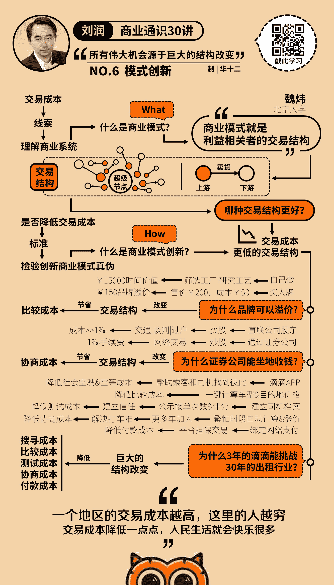

用户留言

*   

江湖无声 **237 赞**

```
 降低交易成本那些事： 搜寻成本 “百度一下，你就知道” 比较成本 “闭着眼睛点，道道都好吃” 测试成本 “小米，为发烧而生” 协商成本 “今天过节不收礼，收礼就收脑白金” “怕上火，喝王老吉” 付款成本 “支付宝，知托付” 运输成本 “传递，零距离!” 售后成本 “七天无理由退货” 
2020-03-12 
```

作者回复

```
经典！
2020-03-16
```

*   

包子哥 **108 赞**

```
 大半夜的收到同学的祝贺，说我中奖了，让我赶紧来看看。 一看果然是，不仅中了奖，还是最后一个压轴的（虽然貌似压轴并不是最后一个的意思）。 在这里，我必须告诉大家一件事——刘润老师的课程，是我在得到里认为的可以闭着眼睛买的三个人的课程之一。 另外两位是万维钢老师和吴军老师。 如果要问为什么？那是因为这三个人都喜欢给大家剖析本质的东西。 万维钢老师用理科生的缜密思维带来数学，物理，认知科学等方面最前沿的内容，结合他自己最贴近本质的思考； 吴军老师旁征博引，从人生到旅游，从科技到 5G，但总是能结合“算法”这个关键词让我们领略到信息这个东西的本质； 而刘润老师，这个出身于微软的最贵的商业顾问，总是用自己的洞察，用无比丰富的案例和幽默的语言，让我们接触到那商业社会隐藏在复杂现象背后的本质。 接触到了本质，并不代表你就能真正更好的适应社会，最让我佩服的是，刘润老师还会用教练的方式，帮我们再还原出一幅真是社会的场景，一步步的从本质到现象，引导我们洞悉本质后再找到属于自己的在现实中打拼的方法，这个就太厉害了。 所以，大家可能也看出来了，我今天的留言，就是在明目张胆的给刘润老师做广告，不服？不服你也来试试洞悉本质后还能还原于生活，看看这需要多丰富的经验，多深入的思考。 谢谢刘润老师！ 
2020-03-12 
```

作者回复

```
哎呀，我脸红了。
2020-03-16
```

*   

鸿涛 **75 赞**

```
 得到 APP 改变了教育产业的交易结构，得到基本上请各领域出类拔萃的专家、学者、从业精英作为各栏目的主理人，让用户不必在陌生的知识信息中耗费时间和精力，为用户节省了比较成本、测试成本和请名师的协商成本；由于知识服务网络化，用户量大、边际成本小，为用户节省了付款成本。这种优质的网络教育服务的付费模式，让用户花少量的钱，节省了巨大的时间和精力，得到更多的通识认知。是传统地域模式和目前信息混乱模式的有力取代者，因为它交易成本的性价比高，商业模式创新的进化的方向是正确的。 
2020-03-12 
```

作者回复

```
“比较成本”。我的每门课都花了巨大的经历，也是希望用户能“闭着眼睛买”，降低“比较成本”，和“测试成本”。
2020-03-16
```

*   

王黎璐 **45 赞**

```
 比如盒马鲜生通过“吃－转－送”三步法，重构“人、货、场”改变零售的交易结构。在现场亲自吃，建立信任，降低测试成本。用盒马鲜生的 App 买单，强化线上购买习惯，降低比较成本。30 分钟送到，降低物流成本。依托大数据，多维地清晰地分析消费者；运用产地直采供应链，分小量包装的生鲜货品；从盒马鲜生到盒马集市，再到盒马便利店，盒马对消费场景的不断升级，坪效不断提高。 商业道路上，不能盲目的跟风，一定要想清楚它背后的逻辑和背后的思维，拥抱交易结构的改变，积极投身其中，期待辉煌的道路中有我。 
2020-03-12 
```

作者回复

```
商家坪效的提高，最终会体现在用户价格的降低。
2020-03-16
```

*    

晓曦 **41 赞**

```
 在美国医疗市场，一个显著结构性改变就是不断地并购。医疗服务参与者众多，从众多医院（社区医院，专门某一科的医疗中心和综合性大学医疗中心），到各种各样私营和政府保险公司，药店，药厂，以及医疗器械的制造商。可以想象交易成本有多么高。 为了降低交易成本、更好地抵抗风险、拥有更高的议价能力，在过去几十年大量的医院之间进行并购，形成大型集团。同时大型医疗保险公司也在不断并购，很多是纵向地上下游并购，包括收购医疗中心。 前两年最大型的并购案是 CVS 和 Aetna 的 700 亿美元并购案。 Aetna 是一家拥有几千万会员的医疗保险公司。而 CVS 虽然以连锁超市/药店出名（遍布美国全国），但它旗下也拥有全美三大 Pharmacy benefit management 公司之一。这种 PBM 公司管理药品方面的保险事务。三大公司瓜分了 80%市场和两亿左右用户。 他们虽然降低了交易成本，可是似乎没有显著地降低消费者支付的价格（当然这个学术界还存在争议，有的研究说并购提高了消费者支付的价格，因为减少竞争以及这些集团的议价能力）。当然啦，你也可以说他们的品牌有了溢价，帮用户节省了选择成本。 
2020-03-12 
```

作者回复

```
同业并购会带来生产端的规模优势，异业并购会带来用户端的互补优势。
2020-03-16
```

*    

张宇航 **31 赞**

```
 在校大学生，疫情当前，最近被迫听学校网课，但由于教师水平良莠不齐，往往耗费了大量的时间成本。 1，对于“知识”本身，求知者 和 讲授者 间信息不对称，造成搜寻成本高，比较成本高。 2，师生间没见过面，信用不传递，所以往往舍不得立马花出珍贵的“时间”，造成测试成本高。 3，在校老师没有线上教育的基础和培训，造成“知识”密度低，获取知识＝时间×知识密度，造成相同时间（较得到），机会成本高。 对于被润总把“学习胃口”养刁的我，不经反思，得到 APP，集低交易成本于一身。省钱事小（我在校一年学费 xxxxx，知识密度远小于得到），省时间事大。得到是我的第二母校，它的成功也应验了今天所说的新商业结构……（不再赘述，几乎全中）感谢！ 润总直播太棒了！ 
2020-03-12 
```

作者回复

```
全国大中小学，转型“知识付费”（当然，罗胖不喜欢这个词），收高昂的学费，在网上讲课。疫情，集中给这些线下的教育机构，上了一堂“知识付费”课。
2020-03-16
```

*   

佛祖门徒 **30 赞**

```
 朋友是做旅行社的，其优势就在于可以占据比单个旅行者更有优势的信息资源，如门票、机票、酒店等，统一提供便捷的服务，从中转赚取差价以及服务费的盈利模式，他们现在通过大数据在优化交易结构从三个方面来降低交易成本。 第一、数据的相关性促成精准营销。 旅行社可以通过大数据精准选择宣传渠道、客户群、挑选特定旅游产品，来降低广告成本。以大数据为基础，旅行社可以对已有客户进行分类，找到跟本旅行社契合且提供价值较高的消费者，让投放广告变得有的放矢。例如，通过 RFV 的分析（购买时期、频率和价值大小）的分析，筛选出高级客户，对其进行直接交流，量身订做个性化产品。如针对位移时间短、频率高、距离短的客户，推荐城市周边景点、度假村、自驾游；针对位移距离远、时间长且密度低的客户群体提供长线产品，如出境游、省外游、深度旅游等旅游产品。 第二、从无结构的海量数据中分出集群，满足特殊集群个性化的需求，提高旅游的性价比。 目前消费者对跟团旅行的微词主要体现在行程安排太死，无法依自己偏好去有选择性的细赏。而大数据的好处是把有相同志趣的人集结在一起，从而制作成一个带有特色的出行计划。如一般人去日本可能想去泡温泉，品茶道什么的，但是有个《东京爱情故事》的粉丝，就想去看看该剧拍摄的几个景点。那么在她联系到某个旅行社的时候，旅行社就可以单独为她制作一个出行计划，利用旅行社的资源为她定好机票、门票和出行车辆。同时在互联网上张贴出广告，去找有相同趣缘的人。即使没有同行的人，也可以保留这一条旅行线路，在无尽的未来中，都可以把这个旅游产品卖给相同趣缘的人。这种集结相同需求，极具个性化的旅游产品，无疑对消费者来说是性价比最高的。 第三、信息透明、双向的大数据平台，消费者和旅行社可依据自身信用平等沟通。 与传统模式（旅行产品一旦销售出去或旅行结束之后，其服务与质量就与旅行社完全无关）不一样的是，大数据时代下每一下的交易都是旅行社及相关服务人员信用的体现。一次差信用的服务可能直接导致后来旅行社的客源减少，收入降低，服务人员的口碑，奖金受到影响。消费者可以通过查看该旅行社以往的历史交易记录去了解这家旅行社的服务质量，工作人员的口碑，然后做出自己的选择，自身的安全感也会提高。同时在发生纠纷时，旅行社也可以通过调出自己以往的交易信用及查看消费者的历史记录，为自己发声，提高自己的话语权。 
2020-03-12 
```

作者回复

```
深度思考。
2020-03-16
```

*    

Tony to ni **27 赞**

```
 商业模式的设计原则：能给交易主体带来增值。所以除了降低交易成本，还包括减少交易风险、增加收益。 比如说滴滴除了降低交易成本，对乘客来说，还降低了交易风险。 以前的黑车可能到了半路坐地起价，甚至套牌车威胁乘客人身安全。虽然滴滴的顺风车出了事广受诟病，但滴滴相对于出租车和黑车，其实整体减少乘客受伤害的比例。 以前的黑车只能在地铁站，火车站附近拉活，虽然单价高，但是口碑差，总体收入并不高。有了滴滴之后，通过大数据派活，车辆空置率很低，司机们的收入也增加了，这就是交易主体的收入增加。 
2020-03-12 
```

作者回复

```
过去风险的成本，我们在用别的方式承担。更安全了，其实也是降低获取安全的成本。
2020-03-16
```

*    

墨羽帝 **25 赞**

```
 从我有幸接触到得到平台到疫情期间教育行业网络教学的兴起，我看到了教育行业将会发生革命性改革的可能性。 以得到为例，谈一下个人的浅见： 搜寻成本：得到至少为学员汇集了两大类资源，一是优秀的甚至是国内顶尖的师资资源，相信平台的用户都能感觉到得到团队的诚意和资源的强大，说实在点，很多老师是你搜寻到都未必能听到他的课，所耗费的成本之大无法想象，如果没有得到平台，我怎么能听到润总的课？二是课程的类别，这个我个人有非常深的感受，想学很多东西，但同时也不知道要学什么，而且以前在学校里学到的东西感觉离生活好遥远，总觉得好多新闻好多知识听上去非懂似懂，大学很多都知识都只学到了一些皮毛或者概念，没能形成系统，很多更是不理解。但得到可以把很多知识系统化并且与实际相结合的方式呈现给用户，这个真的由心的感激！天知道我有多激动能听上润总这样的大咖的课，还能得到润总的回复！！说回正题，所以通过得到平台为我们汇聚了优秀的师资资源和课程资源，大大减少了学员的搜寻成本。 比较成本：课程分类上，时长有长又短，同一个系也有细分的课程，如金融系有：金融学，行为金融学，公司金融学等，需要什么学什么，减低了用户的比较成本。 测试成本：通过课程的试听，课程报名人数，好友分享，评论及老师的回复，都可以减低用户的测试成本，选择出适合自己的课程和喜爱的老师。 运输成本：这个不知道我有没有理解错，我觉得得到是打破了地域的限制，以前要听到北大清华老师的课，首先要成为学霸考到这些高等学府，再要千里迢迢去到北京求学，这里所花费的时间成本和货币成本都是不可估量的。而现在轻松打开得到 APP，就能 24 小时都享受到这样的优秀教学资源。 相信网络教学的普及，会大大降低了学子求学的成本，想到这里，不禁感到兴奋。 
2020-03-12 
```

作者回复

```
有很多人说线上课程是无法取代线下课程的，我同意无法完全取代，但是会至少取代一部分，这已经是往前走了一大步，已经蕴含了很多的机会。
2020-03-13
```

*    

陈敏胜 **25 赞**

```
 先复盘一下重点： 商业模式，就是利益相关者的交易结构。 商业模式创新，就是构建交易成本更低的交易结构。 商业进化的方向，就是从“交易成本=∞”，向“交易成本=0”前进的方向。 人们总是不断的追求更丰富多彩更美好的生活，而商业史就是通过不断提高效率，降低成本的发展史。 从托关系→大型超市→淘宝电商→盒马的新零售→李佳琪网红带货商业模式不断演变。 新冠疫情期间，我发现又回归到强关系了，有好的朋友托我帮他买口罩，口罩生产线，消毒水，额温抢等防疫物资。 在物资紧缺的时期一切都回到解放前，以朋友托我帮忙找送系买口罩材料熔喷布，熔喷布己从两万多一吨涨到 40～50 万/吨，可谓一天几个价 ，口罩生产线从十几万涨到一百多万，这种情况下只能回到强关系的模式中。 昨天还有同学委托我这帮忙找儿童口罩生产设备，希望有资源的同学跟我对接，成功对接酬谢！ 
2020-03-12 
```

作者回复

```
希望更多儿童用上专用口罩。
2020-03-16
```

*   

嘉玲 **23 赞**

```
 经常感叹这么一句“懂得很多道理，却依然过不好这一生”。之前学习梁宁老师的《增长思维》课，里面说到成功的企业都是能够持续做出正确的决策，这听起来多像一句政治正确的废话。很多时候回顾一些兴衰成败时，我们可以总结出某某某当时做错了哪一步，明明可以这么这么做却怎么怎么地。其实落在当下，放在那个位置上，被各种利益关系裹挟，各种博弈之后做出了日后看来“错误”的决策。 因此跳开来，在一个新的空白点打开天花板，也许就是为什么有那么多有识之士愿意只身前行，勇敢创业的源动力了。 特别是当能够看清水流的方向时，善泳的鱼儿绝不会让自己深陷泥潭，定会挣脱束缚奔向激流的。 
2020-03-12 
```

作者回复

```
这门课，希望能帮你看清，什么是“正确”的决策。
2020-03-16
```

*   

大土豆 **18 赞**

```
 《趋势红利》中写道，创新的三种层级: 延续性创新，只在原有交易基础上做了一点点优化，使得效率有一点提升; 平台性创新，从中构建一个平台，滴滴就属于这种平台式创新，构建一个能够降低乘客和司机之间的交易平台，降低了许多交易成本，淘宝做的也是平台级的创新； 颠覆性创新，代表是 iphone，直接颠覆了手机这个行业，使得手机不仅可以用来打电话，更是手上的一个智能终端，直接让手机行业的风光一时的诺基亚倒下了； 一切创新，都是交易结构的创新，一定要把这句话深深的印在脑子里，并且带着一双洞察之眼，去寻找任何交易中可以优化的空间。 
2020-03-12 
```

作者回复

```
延续性创新，是交易结构不变的优化。颠覆式创新，是对交易结构的改变。推荐大家读一读这本书，在得到电子书里有。会员免费。
2020-03-16
```

*    

Ren.J.X **16 赞**

```
 听说眼镜行业的信息不对称特别严重，我们去眼镜店配个差不多的眼镜快要上千，但听说在眼镜的加工工厂差点就论斤卖了。 在配眼镜这个过程中验光和试戴这两个环节使得眼镜不能像一般产品那样在网络中完成交易。 但是随着网络信息的曝光，现在一些人配眼镜选择在线下店进行验光，在线上进行购买。这个过程其实也增加了一些搜寻成本。 往后随着 VR 技术的不断更新，往是不是应该可以直接在线验光、试戴，完成交易。 
2020-03-12 
```

作者回复

```
你买眼镜的钱，大部分都是“交易成本”。
2020-03-16
```

*   

树树先生 **14 赞**

```
 梳理了一下教育培训行业的交易结构，并且斗胆预测了一下未来的发展趋势，不是很成熟，敬请见谅。 从消费者产生需求开始： 1.搜索信息 2.比较、测试选项 3.协商、付款 4.交付、售后 信息不透明和信用不传递是交易成本产生的根本原因，这一点在教育行业尤为明显： 搜索成本：消费者不知道商家的教学品质怎么样，所以目前在搜索信息时会自己进行优先级排序： *熟人推荐 *第三方平台客户点评 *广告、电话推销 比较、测试成本：消费者会亲自体验，但不见得每一个消费者都是专业人士，大多是看个热闹，看孩子的状态，这部分的成本主要是时间成本和一部分金钱成本。 协商、付款成本：商家主要通过建立品牌来使得消费者信任自己，降低协商成本和付款成本。 交付、售后成本：线下交付带来的主要是接送的时间成本，售后无保障，售后退款难。 未来的主要交易结构变化： -独立、专业的第三方评测平台（信息不对称）：由于大部分消费者并不是专业人士，即便是客户的评价也不一定客观准确，这时候就需要一个商人，一个能再砍掉信息不对称这条恶龙的英雄出现，目前我觉得盖得排行是比较典型的先锋，来帮助消费者降低搜索、选择、测试成本。 -信用中介（信用不传递）：目前的款项主要是消费者和商家直接交易，商家普遍把这个钱先花掉，款项未得到监管，一旦消费者不满意要求退费，普遍出现退费难得问题，消费者的售后成本比较高，这时候又需要一位英雄来挑战信用不传递的问题，通过把消费者-商家这个结果切开得到消费者-平台-商家，使得款项被得到独立监管，交付之后再支付给商家，降低消费者的售后成本，这个英雄今天可以是支付宝、美团。 有一个隐藏知识，盖得排行其实是阿里巴巴旗下的公司，所以盖得排行降低信息不对称的交易成本，支付宝降低信用不传递的交易成本，预测将来阿里巴巴将在教育培训行业占有非常重要的地位。 
2020-03-12 
```

作者回复

```
不抽象，就无法深度思考。你抽象为 7 个成本，思考得很好。
2020-03-16
```

*   

五商派江左王门 **14 赞**

```
 我是做传统门窗行业的，学完课程以后！准备把以前由厂家制定价格的经销商体系改变为，经销商的卖货量，他自己的销量决定了价格的优惠。和员工建立的通过产品创新决定工资的高低。另外向竞争对手挖人才，给出更有竞争力的市场溢价。后面一步，在疫情当中，很多友商估计支撑不下去，我们准备收集工厂的老板，做他们的后盾，他们遗留下来的订单，我们负责搞定，那些坏的资产就舍弃。 一:改变和经销商的结构调整 二:改变和员工的工作结构 三:改变和人才的结构 四:改变和竞争对手的关系 建立更加多更加快的连接，通过产品的死磕，达成人越多，转动速度越快的飞轮循环。然后注意好调节回路，用好风险之眼，不断迭代。 昨天开学典礼听老师讲要开宗立派，很荣幸能够第一时间跟随！我们跟随老师的步伐，在商业世界，如鱼得水，不断降低交易成本。第一次跟上老师脚步，第一次第一时间留言！五商弟子江左求上榜！ 
2020-03-12 
```

作者回复

```
疫情，是特别好的“捡漏”的机会。
2020-03-16
```

*    

Eason.Wu **14 赞**

```
 上海市政府近两年一直在大力支持线上线下深度融合的新零售企业。主要原因是上海市政府已经看见新零售所带来的红利和机遇。这个机遇,本质上源于天猫新零售之城对一个地区某些场景之下交易成本的改造。 这种改造,是针对进货与销售两端的。先说进货端,以往,这些小店的进货渠道是传统的批发市场,货物来源没保障、量小没价格优势,现在批发渠道放在“零售通”平台上,不但货源有保障,进货价格比原来低 5%,而且,以前很难进到货的一些网红商品也可以进到了。更重要的改变来自于销售端。成为智慧小店后,可以得到线上导流,有些还配备了菜鸟驿站、无人售货机等,进一步提升订单量,销售额因此快速上升。小店订单的增加,某种程度上看,并不是对存量的再分配,而是通过技术改造传统零售业诱导出来的新需求。 很多人都有这样的经历,晚上在家,肚子饿了,想吃夜宵或者零食,但想着要下楼,还要走出小区才能买,就打消了念头。这就是交易成本阻止交易的典型例子。交易成本指达成一笔交易所要花费的成本,也指买卖过程中所花费的全部时间和货币成本,包括传播信息、广告、与市场有关的运输以及谈判、协商、签约、合约执行的监督等活动所花费的成本。交易成本过高就会阻碍交易。简单说,麻烦限制了人们的交易。 这种降低交易成本的机制,并不仅仅出现在对便利店的改造上,还有更高层级的应用。比如,苏宁小店,会根据用户群体画像,实现“千店千面”。它还打通了苏宁易购平台,共享线上超过 4400 万种商品,为用户提供海量的商品选择,它甚至还提供共享设施、金融支持、娱乐消遣、医药、办公等多维度、多层次服务,方便用户生活。这不仅是对便利店的改造,更是在多个领域,多场景的,利用互联网技术,降低交易成本,方便交易,促使新产业、新业态、新商业模式的出现,从而提升交易规模。 
2020-03-14 
```

*   

剑客 **11 赞**

```
 润总自己下战场实验的宠粉经济也是大幅度的降低了交易成本； 小洞茶通过润总的选品降低了粉丝的搜寻成本，图文介绍，使用感受，以及通过润总的信用传递大大降低了粉丝的比较成本和测试成本。 润总对单品的深度挖掘，以及从产品包装等设计语言，大大降低了这款好茶的沟通成本。 开封不爱喝也能退的 7 天无理由退货，极致的降低了售后成本。 宠粉经济有点像调转方向的团购，以前是商家上团购网站，通过折扣让利吸引客户；宠粉经济是 kol 帮粉丝选品，集中粉丝需求在向商家要折扣。所以原来选择权在商家，打不打折，哪个商品打折是商家说了算，现在是拥有大量粉丝的 kol 说了算。 李佳琪和薇亚的实力大家也都见识到了，这样的新模式更加有效的帮粉丝降低了各项交易成本，想要直播带货，我想要从理解交易成本开始。 
2020-03-12 
```

作者回复

```
这个问题，问得像托儿一样。虽然并不是啊。没错，我之所以选“茶叶”这个品类，就是因为过去消费者太多的支出，花在了“交易成本”上面。这是可以有巨大降低了。只有这个“价值空间”存在，才让我这个外行有机会进入一个“水很深”的行业，和内行比一下，谁能真正让消费者获益。
2020-03-16
```

*    

Jack liu **10 赞**

```
 为什么要画思维导图？ 1、降低了重点知识点的时间搜寻成本。 2、变成图片保存到手机，可以直接发送给他人，降低了知识分享打字的运输成本。 
2020-03-12 
```

作者回复

```
一切都是为了帮助用户节省成本。
2020-03-13
```

*   

小七 **10 赞**

```
 刘润老师好！我只是一名普通的小老百姓。以前我不太懂，看着感觉都差不多牌子货为什么要比一般货贵这么多？还以为自己多花的钱就是向外人发一个“我有钱，用的是“牌货”的信号”。今天刘润老师举了品牌为何溢价，证券公司为何能坐着收钱以及滴滴为何能成功的例子。向我们解释了商业运行的底层逻辑，让我们从表象中看到了更深一层的东西。以前看到这些现象只觉得自己被坑了，但现在来看这其实是商业进步的体现。张五常教授说一个地区交易成本高一点，这里的人就穷一点，交易成本低一点，人们就会快乐很多。从这个角度来看，花 99 块钱就能学习到刘润老师的课，从而学到一种通过商业的眼光来看世界的思维，我确实感到快乐许多。😄😄😄 
2020-03-12 
```

作者回复

```
在过去，你可能要花多得多的钱，才能获得相似的服务。
2020-03-16
```

*   

山峰 **9 赞**

```
 中午在家看财新 APP，偶然翻到了一篇关于互联网医疗的文章，不由恍然大悟，这不是一个关于医疗服务的交易结构正在改变的现实例子吗？对于这种涉及医疗服务的商业模式变革，我还是持欢迎的态度。第一、顺应了当下新冠疫情期间，部分大城市的问诊需要。第二、政府开始认可，国家卫生健康委于 3 月 2 日发布的《关于推进新冠肺炎疫情防控期间开展“互联网+”医保服务的指导意见》提出，将符合条件的“互联网+”医疗服务费用纳入医保支付范围。第三、部分缓解发达地区与欠发达地区之间医疗资源紧张的局面，有利于医疗资源的合理利用。第四、节省了交易成本，病人有疑难杂症，不是非常必要，可以通过互联网医疗，直接联系重点医院的医疗专家，这节省了患者的搜寻成本和运输成本。互联网医疗平台严把医师资格审查关，以患者的健康为原则，提升自己的公信力，这会节省患者的比较成本和测试成本，同时也有利于减少问诊医生和患者的协商成本。 
2020-03-12 
```

作者回复

```
就像我在直播里面说的，本来大家大病小病都要去医院，甚至去三甲医院。但是现在因为新冠疫情，有些小毛小病就不敢去医院了，就想去个网上问问算了吧。本来不太信任网上的这些平台，现在试一试觉得哎还挺靠谱的，那这个可能就回不去了。这个变化就会继续往前推进，这就是不逆转变，无法逆转的转变。
2020-03-13
```

*   以上留言由 作者 筛选显示
    


# 07｜连接：为什么“要想富，先修路”？


刘润

2020-03-21

07｜连接：为什么“要想富，先修路”？

建议 WiFi 环境下播放

在上一模块的 6 讲课程，我们回答了一个问题：商业到底是什么？

我再重复一遍。三句话。

*   第一句：商业的本质，是“交易”；
    
*   第二句：信息不对称和信用不传递，让交易过程遭遇“阻力”；
    
*   第三句：所谓商业进步，就是用越来越低的“交易成本”，克服阻力。
    

**可是，交易成本为什么可以越来越低，商业为什么能进步？**

这一模块，我们来回答这个问题。在中国，有一句话，我说上半句，看看你能不能说出下半句。这句话是：

“要想富 ……”

然后呢？什么？没错，然后是：

“…… 先修路。”

这句话，几乎每个人都能脱口而出。

“要想富，先修路”。在过去，很多农村的土墙上刷着这六个大字。

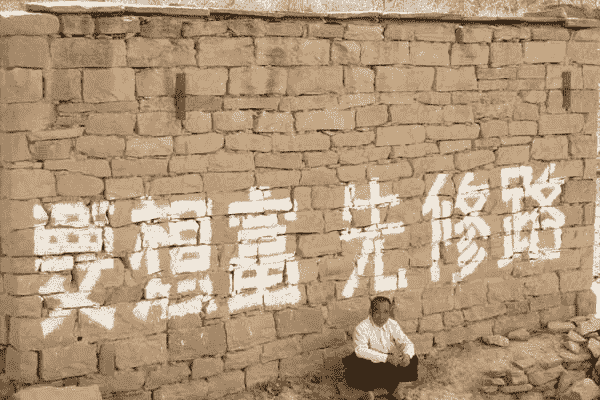

可是，为什么要想富，就要先修路呢？

因为修路的本质，就是“连接”。而“连接”的价值，就是把更多的“交易节点”（比如：生产节点，消费节点，或者中间节点），连接到商业世界巨大的交易网络里来，参与交易，甚至因此短路低效连接，重新分配生态位，改变交易结构。

举个例子。

在大城市边上，有个平庸的酒厂。说它平庸，是因为它的酒其实口感一般。但是因为离大城市很近，附近也没有其他酒厂，所以生意一直都不错。

这家酒厂的老板，很注重品质把关，也非常注重管理，员工福利特别好，他还很有社会责任感，常年被评为“优秀企业家”。

同时，在中国一个很偏远的小乡村，有一户人家，那酒酿得是真好。十里飘香。但是这个村子只有方圆十里，飘不出去。所以，只有本村人才能喝到这么好的酒。

然后，中国开始“要想富，先修路”了。

因为修路，小乡村里这个偏远的生产节点，连接到全国的交易网络里，并通过无数中间节点，快速触达海量的消费节点。

很快，大量消费节点认识了这户酿酒的人家。哇！这酒也太好喝了吧？我要买，我要买。

很多中间节点也非常振奋：这么好的酒，这么卖太浪费了，我帮你装瓶，我帮你扩大产能，我帮你卖到全中国的超市里去。

因为这些优质的生产节点的接入，整个中国商业网络的交易结构，开始悄悄地、不可逆转的发生变化。这户人家的酒越卖越好。而那个大城市边上的平庸酒厂，生意越来越差。

推动这一切变化的元动力，就是：连接。

可是，大城市边上那家酒厂的企业家，很难理解这件事：难道是我最近对品质放松了？难道是我对员工不好，他们不认真干活了？难道是我的渠道策略出了问题？都没有啊！

他开始仔细研究。

最后他发现，原来他生意越来越差的原因，就是有一群“坏人”，把公路修到了乡村。

后来记者采访他，问最近酒厂遇到了很大的问题，怎么回事啊。他咬牙切齿地说：

*公路，正在摧毁中国的实体经济！*

这句话听起来是不是特别耳熟？是不是很像今天很多人说：互联网，正在摧毁中国的实体经济？

互联网，和公路一样，从来不会摧毁实体经济。它们就是实体经济。

公路从来不会酿出一瓶酒，互联网也从来不会生产一双袜子。这些还是由工厂来生产。

公路和互联网一样，它们所做的事情，是帮助最好的生产节点，用最有效的办法，“连接”最需要的消费节点，从而改变交易结构，短路低效连接，降低交易成本，提高商业效率，创造更多财富。

在中国文化中，有这样两个词：“穷乡僻壤”和“老少边穷”。你看，“穷”这个字是和“僻”、是和“边”这两个字放在一起的。为什么？因为“僻”和“边”，就是因为在交易网络的最边缘，交通不畅、道路不通，没有高效连接。

**没有高效连接的地方，就会“穷”。**

所有伟大的机会，都源自于巨大的结构改变。而所有巨大的结构改变，都是源自于连接方式的进步。

听完上一个模块“商业到底是什么”之后，你是不是已经整装待发，像鱼儿一样跃跃欲试，准备好去寻找那个伟大的机会了呢？

很好。

不过，我还是想请你先坐下来，不要着急出发。先看，先静静地看。看什么？看你周围的水，看水流的方向，也就是连接进步的方向。

**在商业世界中，有一股你微观上看不见的水流，正在巨大的宏观尺度上、漫长的时间维度上，坚定地、不容置疑地，推动着商业的进程。**

还记得，在最早的时候，古人打仗时，是如何解决信息不对称问题的？

“我方遭到攻击了！请求支援！请求支援！”这个信息，怎么“对称”给援军？

用烽火。长城上一个个“小城堡”，都是烽火台。如遇敌情，白天施烟，夜间点火。帮助友军之间的信息对称。

烽火，就是一种短距离的“连接”方式。

那远距离呢？

远距离的“连接”方式“进步”了。

远距离解决远距离的“信息不对称”问题，靠每隔二十里一个的驿站。

一旦公文上标注“马上飞递”，就必须以每天三百里的速度传递。如果更紧急，则需要每天四百里，六百里，八百里。

所谓“八百里加急”，就是日行八百里，马不停蹄地解决远距离“信息不对称”的问题。

八百里加急！御赐金牌，“阻者死，逆者亡！”

驿站，就是一种远距离的“连接”方式。

但是，八百里到底有多远呢？大概就是从上海到南京的距离再多一点。

今天你有个消息，想从上海传到南京，怎么传？烽火？骑马？“人肉”？发电报？发短信？都不用，今天连接的方式，又“进步”了。直接微信啊。

你可以在群里发个消息：

*上海周边两省一市的所有三品官员，请注意有个刺客从上海逃窜，照片如下。看到立刻捉拿。谢谢兄弟们。*

从烽火台，到驿站，到电报，到短信，到微信（当然，这中间省略了很多步骤），你看到的是什么？科学发明？创业精神？

是的。但所有这些的背后，是连接，越来越进步，越来越高效的连接。

高效的连接，必然短路低效的连接，从而推动交易网络的结构性改变，带来伟大的机会。


刘润

修路的本质，就是“连接”。而“连接”的价值，就是把更多的“交易节点”（比如：生产节点，消费节点，或者中间节点），连接到商业世界巨大的交易网络里来，参与交易，甚至因此短路低效连接，重新分配生态位，从而推动交易网络的结构性改变，带来伟大的机会。

连接，就是商业世界中的水流，正在巨大的宏观尺度上、漫长的时间维度上，坚定地、不容置疑地，推动着商业的进程。烽火台，驿站，铁路，公路，集装箱，电报，电话，手机，互联网，移动互联网，万物互联……连接的水流，只会坚定地流向效率越来越高的方向，降低交易成本，提升商业效率，推动商业文明。

那万物互联之后呢？也许是脑机互联……谁知道呢。

这一讲，就讲到这里。

那么，连接，这个“科技感”十足的名词，到底为什么，以及在以什么方式，改变我们的商业世界呢？

我们下一讲，开始展开。

今天我给你留一道思考题：

为什么有人会拥抱更高效的连接，而有人会恐惧呢？越来越高效的连接，对你来说，是机会还是挑战？

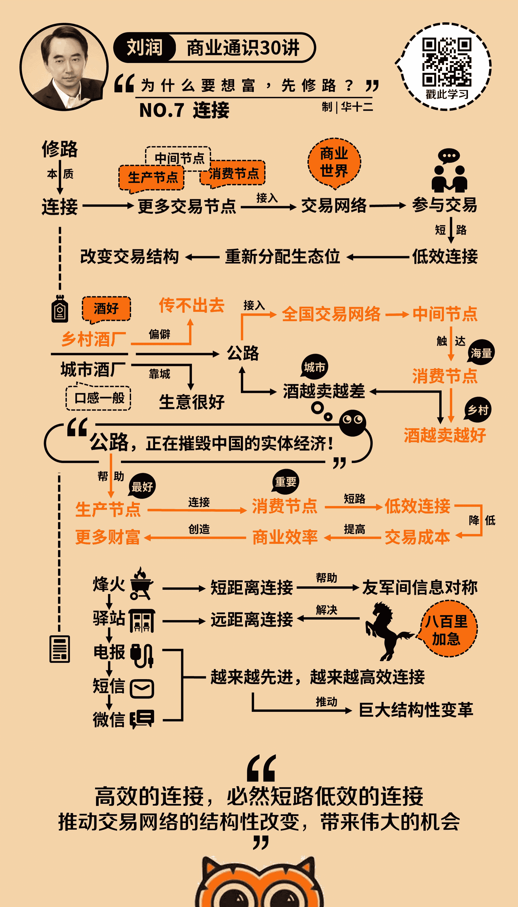  


用户留言

*    

Tony to ni **93 赞**

```
 拥抱高效连接的人，是因为连接能放大他们既有的优势。比如有高品质，缺渠道的商家。 害怕高效连接的人，是因为连接会摧毁他们既有的优势。比如靠信息不对称套利的商家。 每次连接效率的提升，将重构交易结构，重新分配流量和利益。不能顺应，而视之为敌者，或将被潮水所吞没。 
2020-03-13 
```

作者回复

```
所以我就是希望通过这门课，让愿意拥抱的人看到希望，让不愿拥抱的人感到恐惧。
2020-03-13
```

*   

嘉玲 **62 赞**

```
 突然想起金庸小说《倚天屠龙记》里经典的六大门派围攻光明顶的情节，实际上，各大门派要同一时间齐聚光明顶，少林寺得提前一个月出发，而昆仑派早已吃光了干粮。 曹德旺把厂建到美国，特斯拉在上海建厂，缩短需求方物理距离，在高效上更进一步，有时候就这么逻辑简单。 同理，住得离公司近，某种程度上说也是一种高效的表现。 
2020-03-13 
```

作者回复

```
所有的复杂，都建立在其固有的简单之上。
2020-03-16
```

*   

心铭 **54 赞**

```
 润总好， 今天这节课好像可以解释，为什么现在骗子越来越少了？这个问题先一放。我想先解释一个问题，为什么现在电脑病毒越来越少了？答案是因为网络，相当于所有的杀毒软件的病毒库共享了，我们没有看到病毒已经被杀毒软件隔离在外了，所以我们用杀毒软件扫描不出来病毒。好了一样的道理，骗子为什么越来越少了，因为我们社会共享了骗术库。几乎所有的骗术都知道了，也就没人在上当受骗。 现在因为网络，信息的互相关联，信息不对称在慢慢消失，我们也进入信息大爆炸的时代。没有人在能赚信息差的钱。而因为信息太多，出现了新的信息差，就是认知的势能差。同样一堆信息，所有人的认知是不一样的，所以就会出现赚认知差的钱，比如得到，在赚知识上的认知差。团购网，在赚价格上的认知差。不是知识没有了，也不是抵扣券没有了，而是多到你不知道怎么选择了。 不懂连接的人，害怕连接，懂了就会拥抱连接。香帅老师判断，中国进入万元美金社会，服务业会高速发展，这里的服务业不是指理发，厨师这样的服务。我理解这句话，就是从消灭“物理”上的信息不对称，到消灭“认知”信息不对称的过程。 
2020-03-13 
```

作者回复

```
骗子越来越难了，做骗子的门槛越来越高了。
2020-03-16
```

*   

雪域 **43 赞**

```
 《精英日课》里讲过杜克大学教授阿德里安.贝扬的“构造定律”：对于任何一个存在某种“流动”的系统，比如河流网络，它的长期演化趋势必定是要慢慢调整结构，让这个流动越来越容易。 其实，不但是河流网络，社会网络，商业网络都是这样，它们都是朝着阻力小的方向和路径不断演化。 对社会网络而言，调整结构就是改变连接方式，让各个节点之间的连接更加顺畅。 对商业网络而言，调整结构就是降低交易成本，让整个网络的运作更加高效。 在这个演化过程中，高效率的连接方式注定胜出，低效率的连接方式注定被淘汰；低交易成本商业模式注定胜出，高交易成本商业模式注定被淘汰。 用《三体》里的话来讲：我消灭你，与你无关。 
2020-03-13 
```

作者回复

```
这就是商业那个注定辉煌的前途。
2020-03-13
```

*   

张萌 **41 赞**

```
 要想富，先修路，少生孩子，多种树。这是那个时代，我们小城市的农村墙上的标语，印象深刻。正如老师所说，当年的公路就相当于今天的互联网。信息技术、科技在发展，做传统零售连锁超市的我。面对时代快速变化，恐惧源于看不懂的不知所措。而拥抱新技术赋能传统实体零售，才是我们的出路。一方面苦练内功，提升商品力，打造休闲舒适场域，提升服务水平，向胖东来、信誉楼学习；一方面借助新技术新工具，实现线上线下相结合，积极尝试实践，选择消费者熟悉喜欢的方式传递信息，优化交易结构，提高效率；利用新技术提高管理效率，提升效益。 
2020-03-13 
```

作者回复

```
这条路并不好走，但是难走的路从不拥挤。加油。
2020-03-13
```

*    

二希·Hebe **34 赞**

```
 以前，我吃过的第一口芒果是我妈出差去很远的地方放包里带回来的，她坐了几十个小时的火车； 现在，无论你想吃哪个国的芒果，只要动动手指，一个转账，就可以坐家收货了。 城市之间最便捷的连接方式是火车。以前北京到上海，可能只有一种选择，需要坐 20 个几个小时的火车，现在不仅有普快、特快，还有动车和高铁，时间缩短到 4 小时 18 分钟，比坐飞机还方便，时效大大提高。 连接的纽带被打通，是创新和进步的奠基石。 
2020-03-13 
```

作者回复

```
我读大学的时候，铁路已经提速了，从南京坐火车到北京需要 17 个小时，现在从南京到北京只需要 4 个多小时。这就是更高效的连接。
2020-03-13
```

*    

吉林雀园 **25 赞**

```
 农村是一个小世界，有些人早年离家视野开阔，“胆子大”容易拥抱更高效的连接，而从来没离开过村子的人，他们恐惧习惯的生活被改变，所以抵触变化，这也是为什么农村的富人越来越富，穷人越来越平庸。 举个例子，村子里有个人做干蘑菇生意，每年秋天去各个村里收蘑菇，然后卖到市场，赚取差价，比如他收 40 一斤，卖 50 到 60 一斤，年景好时也能赚一笔，可是有一天他听说别人在快手卖同样干蘑菇，一斤 130 元，他瞬间焦虑了，他像我请教互联网问题时，我感觉他整个人都很挫败，要知道他不久前还很得意，因为靠卖蘑菇赚钱买了一辆新货车。所以越来越高效的连接，对我来说是一个机会，当我种花卖花的消息传出去以后，有人说：啊，这玩意儿在花市能卖出去吗？因为我种的是村里家家户户窗台都有的天竺葵，只是她们不知道除了她们窗台上那几盆“土臭球”，现在的天竺葵已经有上千个新品种了。😂 
2020-03-13 
```

作者回复

```
过去他只能用五六十块钱的价格连接到附近的市场，但是现在年轻人可以用 130 块钱的价格连接到全中国。
2020-03-13
```

*    

尘埃 **22 赞**

```
 回答润总的问题。 我觉得会去拥抱的会是那些被低效连接耽误的人们，当更高效的连接到来的时候，就是他们翻身的时候。 而我觉得那些恐惧的人会是那些既得利益者。他们怕更高效的连接会把他们的生意冲走。 对我来说的话，我觉得应该是好的吧。我现在是个高三的学生，然后我父母的工作也很收益于更高效的连接。 对我自己来说，我可以接收到更优质的资源，就比如得到这样的知识服务平台。也可以在家享受到某大型网络学习中心的高质量的网课。 而且由于高效的连接不断产生，会摧毁那些就像城市周边酿酒厂这样凭借地理优势，但品质差的公司。这样等我以后去工作的时候，就会避免掉参加这样没有潜力，迟吃老本的公司。 
2020-03-13 
```

作者回复

```
对一个高三的学生来说，你的眼中看到的可能是 10 年或者 20 年后的机会。加油。
2020-03-13
```

*   

斜阳 **19 赞**

```
 高效连接是机会还是挑战？这取决于我们所处的“生态”位和我们是否拥抱变化的“心态”位。 不同的位置，让即使同样的人面对同样的连接结构改变时，看到的东西也不一样。原来你处于线性连接的结构洞上，你就会占据生态位的优势，这个时候，立体的金字塔结构如果变成网状，对你而言就是挑战，反过来，原来处于金字塔底端的人，这个改变就是机会。举个具体例子，原来临街的旺铺有巨大的结构势能，那个时候物理位置就是优势，但是互联网点评和外卖兴起后，连接方式变成网状了，很多胡同里面的位置也可以被连接了，这对旺铺就是挑战，对胡同深处的小店就是机会，内容也会代替形式，成为更重要的竞争力。 同样，拥抱变化的心态也是重要变量，看到变化，积极应对，不紧抱自己原有的东西，看到异动，利用时间差积极求变，面对高效连接，也是机会。 总结一下，生态位和心态位决定了连接结构变化对我们意味着什么，机会还是挑战，主客观因素都有。 
2020-03-13 
```

作者回复

```
你占据原来的优势生态位，你就会觉得是挑战；你想抢占释放出来的新的生态位，你就会觉得是机会。
2020-03-16
```

*    

Eason.Wu **17 赞**

```
 微信仅用三年时间就获得了超过八亿的用户，消减了移动、联通和电信三大运营商 30%的收入，打破了原来的垄断市场，让中国人一年省下上千亿话费。康师傅和统一方便面的销量每年都在不断下滑，它们的对手既不是白象也不是今麦郎，而是毫无关系的美团、饿了么。 互联网出现以前很多不相关的行业，泾渭分明。互联网到来后，经常出现一个行业突然跨界进入某个行业，大杀四方，血流成河。他们的到来，正印证了那句“我消灭你，与你无关。”这种事情，随着万物互联的到来，将来只会越来越多，阻挡不了。我们要做的是勇敢的拥抱这种连接，同时也要提高自身的实力，让连接成为发挥自身优势的杠杆。 
2020-03-13 
```

作者回复

```
2000 年我参加一个中国移动的会，说一年一共发了 10 亿条短信。几年之后，一个春节就发了 72 亿条。但是到现在，你发现除了发验证码很少有人发短信了。
2020-03-15
```

*   

大土豆 **15 赞**

```
 有些人恐惧高效的连接，因为他们就是靠不高效连接的商业模式赚钱，比如在闹市区的旺铺，他就是通过好地段来给消费者提供信息流，付现金或刷卡完成资金流，消费者自己带回去来完成物流。 如果大家通过互联网高效连接获取信息流，并且通过支付宝完成资金流，快递完成物流，那他旺铺的高租金就不值得了。 想起来以前没有微信的时代，春节期间发短信拜年，几大运营商坐着啥都不干，一天光凭短信费进账数亿元，而消费者付出的代价是 0.1 元/条。 微信普及开后，他用免费的形式做以前发短信才能干的事，所以这种方式是更高效的连接，这就是交易结构上的创新。 对做培训的我，是巨大的机会，以前只能通过面授完成的课，现在可以通过互联网完成知识灌输，在线下完成沟通讨论演练，提升了大家的时间利用率。 
2020-03-13 
```

作者回复

```
中国移动虽然曾经非常痛恨微信，但找了个技术理由，说微信的“握手信息”太多，造成网络负担太重，不是一项好的技术，应该额外收费，还是依然无法阻止微信取代短信。
2020-03-16
```

*   

🌴武汉秦涛 **14 赞**

```
 1.更高效的链接，意味着交易结构的改变，意味着生态位的变化，深处节点中的那个人，自身的态度和实力，决定了在洪流中你是借势前行抓住红利，还是被翻船倒戈，节节败退。 2.90 年代我们老家有很多人在大城市做小旅舍和夫妻便利店的生意，基本都赚了不少钱，随着经济性酒店的全面崛起还有连锁便利店遍地开花，有一部分人把赚的钱再次投入，加盟到新的链接里，而有的人还是不愿改变，固守着老店，今天在品牌连锁的洪流中，生存越来越艰难，而想改变的时候，门槛已经高的有点高攀不起。 3.5G 会带来信息传播方式的全新改变，很多行业和人都开始进行布局和储备新的技能和方向，而也有很多人依然按部就班，等 5G 开始普及，大家的距离就很明显。 4.高效的链接来临，每个人都深处其中，主动拥抱才能不成为被动的出局者。 
2020-03-13 
```

作者回复

```
连锁品牌的酒店，其实很大程度上降低了用户的选择成本、比较成本。一家单独的小店是比较难建立信任感的。
2020-03-13
```

*    

雄走江湖 **14 赞**

```
 本来我在上海总部，感觉“高高在上”，但最近总是被领导们讲，方案不接地气，举措虚有其表。 思来想去，结合这篇文章，答案其实在现场。离业务最近，效率才最高。 于是我在完全没有业务经验的情况，申调到一线，直接面对客户，面对所有总部专业部门，也让我明白，到了一线现场，才发现过往答案，这也许就是理论与实践的紧密连接。 
2020-03-13 
```

作者回复

```
说得好。趴下来看。
2020-03-16
```

*    

重庆 Franklin **14 赞**

```
 我们家楼下便利店里的矿泉水，和十公里之外大商超里的矿泉水，是完全不同的矿泉水。 即便品牌规格等等一样，但离家近的矿泉水满足了用户的可及性需求，兼具产品和服务两种属性。 本质上就是便利店这种模式，是更高效的连接，更高效连接了用户，一定程度上短路了大商超。 
2020-03-13 
```

作者回复

```
有趣的比方。从满足的需求的角度，确实是完全不同。
2020-03-16
```

*    

陈 C **11 赞**

```
 我认为对连接的恐惧，终究还是对改变与未知的恐惧。传统零售商抱着一直以来的模式不放，不愿意改变自己，就去埋怨互联网电商抢了他们的生意。建立新的连接需要花费成本，有时候还要颠覆掉已有的成功模式，人都是有损失厌恶的，比起拥抱新连接可能带来的不确定的新收益，很多人还是更在意那些会损失掉的部分，哪怕它只是新机会前的阵痛。 
2020-03-13 
```

作者回复

```
很多人不愿意接受改变的前提，是他们不能理解改变，不能相信改变。
2020-03-13
```

*   

澳洲土特产代购? **11 赞**

```
 对于消费者来说越来越高效的连接是利好，因为连接打破了信息不对称，让商家被迫让利给消费者。 对于草莽创业者来说，高效的连接是机会。高效连接降低了原有商家的壁垒。草莽创业者有更多机会组织资源上牌桌。 对于已占据生态位的商家是挑战。更高效的连接会逐渐打破现有商业格局。更多玩家入场会增加竞争，缩减利润空间。 但连接变得越来越高效是大势所趋，低垂的果实会越来越少，如果想基业长青就要连续的做出正确决策。毕竟世界是熵增式发展的，基业长青是逆天而行，前路一定是不平坦的。 
2020-03-13 
```

作者回复

```
企业追求基业常青，就和人类追求长生不老一样，是一种幻想。
2020-03-13
```

*    

具七 **11 赞**

```
 猫叔（剽悍一只猫）曾讲过，做社群的三大原则是：“老干妈”，即老用户无比重要，干货远没有连接重要，妈妈般的关怀。 拿做社群来说，提供所谓的干货是必须的，但真正能够触碰用户心理机制的还是被重视、被看见，社群成员找好自己能力圈+打造好价值标签，广泛连接，才能使个人价值和群体价值以高杠杆放大。 
2020-03-13 
```

作者回复

```
有意思。那，”妈“呢？
2020-03-16
```

*   

佛祖门徒 **10 赞**

```
 今日思考： 第一、连接产生价值。以连接一切为的，不仅仅是人的聚合，更是连接信息、产品、服务、内容、商业等的载体。网络效应是一个很熟悉的概念，它的巨大威力就是基于连接。Uber 并不拥有一辆车，却可以打败拥有很多车的出租车公司，连接让它可以实现更多商业模式。 第二、连接的生存优势。现在建立生态链企业是比较热门的发展模式，其本质就是通过连接来建立并巩固单个企业的生存优势。小米的联合创始人刘德先生打过一个比方：传统公司像松树，30 年才长起来；互联网公司更像竹子，一夜春雨就能长起来，3 年就能到中等以上规模。但问题是，竹子并不是安全的植物，单棵竹子可能会在新陈代谢中死掉，但如果成为竹林，根部相连，蔓延生长，那就砍都砍不绝了。所以，小米模式就是由小米输出做产品的价值观、方法论和已有的资源，包括电商平台、营销团队、品牌等围绕自已建立一支航母舰队。这样就可以让专业的团队更高效、专注的做出更多高品质的硬件产品，跟智能手机紧密有效的整合在一起，进而增加小米的安全感。小米生态链的投资，就像是在寻找竹笋。这种公司更活性，自身就能完成新陈代谢，所以更安全。 
2020-03-13 
```

作者回复

```
所谓洞察本质，就是会打比方。
2020-03-13
```

*    

马斌-锂电工程师 **10 赞**

```
 古巴别塔的寓意：人类本来用同样的语言，想建造通天之塔，挑战上帝的权威。上帝并未派人摧毁塔本身，而是让不同地方的人语言各异。两条恶龙，信息不对称和信用不成立就被释放出来，挑起了战争，最终导致塔的崩溃。 团结和共识，这是连上天都要恐惧的力量。 商业的进步，就是再重新找回这种力量的过程。 
2020-03-13 
```

作者回复

```
不同的语言，是故意制造的“信息不对称”。
2020-03-16
```

*    

欧文童鞋 **9 赞**

```
 今天的课让我想到零售业的发展史。 1884 年，美国最早的零售公司西尔斯诞生，是零售业的鼻祖。西尔斯的崛起建立在北美铁路的普及之时。 当北美大铁路建起之路，西尔斯就开始着手建立了自己的邮购业务，贯穿了整个铁路沿线。西尔斯通过铁路，连接了万千的北美居民。 在当时，西尔斯的物流实力堪比今天的阿里巴巴和京东。 1945 年，山姆·沃尔顿，从一家“五毛钱”店开始，到今天的沃尔玛超市，遍布全球。 此时的美国，交通工具汽车已经走进每家每户，公路也是四通八达，纵横交错。山姆·沃尔顿便在城市的近郊开设大型的沃尔玛超市，通过公路连接附近的居民消费者。 不仅为消费者创造了价值，也成就了沃尔玛的商业帝国。 1995 年，互联网已经在美国普及，贝佐斯创立了亚马逊。亚马逊把商品搬到网上，通过互联网连接消费者。消费者只需要网上下单，坐等物流送货上门。 亚马逊由于没有门店成本，选择把这一部分让利给消费者，降低商品的价格，最终消费者获益。 今天，生鲜电商的兴起和物流的发达，消费者打开手机下单，30 分钟后商品送货到家。极大的缩短了消费者的等待时间，提升了商业效率。 一部零售发展史，就是人类连接史。 
2020-03-13 
```

作者回复

```
从连接的角度看商业史，才能“通透”。
2020-03-13
```

*   以上留言由 作者 筛选显示
    


# 08｜空间折叠：是什么，造就了收入占美国 GDP 达 1%的商业巨头？


刘润

2020-03-21

08｜空间折叠：是什么，造就了收入占美国 GDP 达 1%的商业巨头？

建议 WiFi 环境下播放

烽火台、驿站、铁路、公路、集装箱、电报、电话、手机、互联网、移动互联网、万物互联……连接方式不断进步。

但是，这些“科技感”十足的进步，到底为什么，以及在以什么方式，改变我们的商业世界呢？

连接改变商业世界的方式有两个：空间折叠，和时间坍缩。

**什么是空间折叠？就是因为连接的进步，两个远隔天涯的节点，站在彼此面前。**

**什么是时间坍缩？就是因为连接的进步，两个先后出现的节点，跨越时间握手。**

因为空间折叠，时间坍缩，两个原来被时空隔绝的交易节点，站在彼此面前，跨越时间握手，交易变得“瞬间触手可得”。

这一讲，我们从“空间折叠”开始。我给你讲三个，因为抓住了连接带来的“空间折叠”，而获得传奇式成功的商业故事。

19 世纪 80 年代的美国，人口只有 5600 万，其中 65%生活在农村，离城市很远。所以，农村的杂货店，就可以用很高的价格销售日用品。农民们展开抗议活动，但效果不明显。

然后，铁路出现了。

铁路的本质是什么？对的。是连接。因为铁路这种前所未有的高速连接，空间正在被悄悄折叠。两个很远的人，可以迅速站在对方面前。

这种身处其中很难察觉的“空间折叠”，被一位叫理查德·西尔斯的铁路工人，看见了。

西尔斯想，原来很远的东西，现在迅速送到眼前，那农民们为什么还要受家门口的杂货店欺负呢？他看到一个伟大的机会。

西尔斯开始在美国的铁路沿线，大规模地散发“邮购商品目录”。目录上写着：世界上最便宜的商品，我们的贸易遍布全球。

什么是“邮购商品目录”？就是一份两页纸的清单。你看看要买什么，选一下，然后我通过铁路，把东西送到你家。

啊？这个“邮购商品目录”的模式，也太简单、太土了吧？这有什么了不起的？

这非常了不起。

邮购，之前不是一种有效的商业模式。为什么？因为在没有铁路的时代，主干物流非常缓慢。把商品从东海岸寄到西海岸，要花几周，甚至几个月。

但是，铁路把整个美国的疆域空间“折叠”了。顺着铁路，商品几天就能寄到。天涯若比邻。

西尔斯的邮购业务很快取得了成功。

1893 年，西尔斯搬到了铁路运输中枢芝加哥。1894 年，西尔斯的邮购手册的页数，已经从 2 页升至了 700 页。此时，西尔斯可邮购的商品总数，已经超过 6000 件，但价格只有普通店铺的一半。

西尔斯逐渐成长为一个全国性机构，几乎是像邮局一样的存在。最巅峰的时候，西尔斯的营业收入高达当时美国 GDP 的 1%，成为了美国的“零售之王”。

直到 1989 年，西尔斯的销售纪录，才被一家叫做沃尔玛的公司打破。

哪个沃尔玛？对。就是你知道的那个沃尔玛。

1962 年，山姆·沃尔顿，在美国中部阿肯色州一个人口不到 6000 人的小镇罗杰斯开了一家零售店。因为姓 Walton，他就把这家零售店叫作：沃尔玛。

为什么把店开在小镇上？流量不是零售的血液吗？大城市的流量不是远远大于小镇吗？一个小镇青年，凭什么打败大城市里的西尔斯？

因为，沃尔玛所处的 20 世纪，美国开始大规模建设公路。

公路的本质是什么？没错。还是连接。因为公路这种通往毛细血管的连接，空间又被进一步折叠。大城市和小镇的人，可以瞬间站在彼此面前。

而小镇的沃尔玛，因为远离大城市，可以租到“又大又便宜”的土地。大，沃尔玛可以提供更全的商品；便宜，沃尔玛可以提供更廉价的商品。

“更全更廉价”的沃尔玛大受欢迎。大城市的消费者，被公路瞬间折叠到小镇，把沃尔玛的商品塞满汽车后备箱，再折叠回家，塞满家里的冰箱。

沃尔玛，获得了巨大的成功。直到 2019 年，沃尔玛依然是《财富》世界五百强排名第一的企业，一年营收 5144 亿美元。排名第二的中石油，营收 4146 亿美元。两者差了 1000 亿美元。

第三个故事，是关于一位卡车司机：马尔科姆·麦克莱恩。这位卡车司机，折叠了海洋。

1953 年的某一天，卡车司机麦克莱恩突发奇想。

用卡车在高速公路上拉着大铁箱子来回跑，这个成本越来越高。我能不能不要全程都走高速公路，在有河流或者海洋的那一段，用更便宜的水路来拉这些箱子，然后在下一段，再换回卡车送到目的地，是不是可以降低一些“运输成本”呢？

在这里插一句，关于运输成本，我建议复习第 1 模块的第 5 讲“购后成本”，回顾中国运输成本巨高不下的原因。

好。言归正传。

那这个想法到底可不可行呢？

在麦克莱恩有这个想法之前，水路运输主要是靠散船，就是一包一包的东西，由码头工人，从一个码头搬上船，运到另一个码头，再由码头工人搬下船。

散船运不了太多货，而且需要很多工人，所以船运的“运输成本”一直很高。

有多高？用这种方式来运输，每吨啤酒的运费大约是 4 美元。太贵。

而且，这些码头工人再强壮，也不可能背得动卡车后面的大拖箱。

那我能不能只要码头，不要码头工人？我能不能直接用吊车，把大铁箱子从卡车吊上船，到下一个码头后，再用吊车吊上卡车呢？这样，卡车、轮船不就联运了吗？工人不也省了吗？

这就是“集装箱”。麦克莱恩打算，用这个听上去天方夜谭的想法，折叠海洋。

麦克莱恩，被很多人耻笑。但是，他坚持尝试。1956 年，麦克莱恩完成了集装箱的首航。

麦克莱恩的这种用卡车、集装箱、吊车、平板轮船的联运，能降低多少运输成本呢？

一吨啤酒的运费，可以从 4 美元降低到 20 美分，只有原来的 5%。一个数量级的下降！

麦克莱恩，用 4 美分，折叠了海洋。

1970 年，集装箱的大小确立 ISO 标准，全球集装箱运输的时代到来。

在过去，每运输 100 元的东西，成本可能就高达 25 元。而现在，因为集装箱折叠了海洋，把一只 iPhone 从深圳蛇口运到韩国釜山，只需要 3 分钱人民币！

那么，集装箱折叠海洋，带来了什么伟大的商业机会呢？

带来了整个全球化。

因为这便宜到几乎可以忽略不计的运输成本，世界各国才能把各种原材料、半成品、现货等，在各国之间运输，再加工或者销售。

可以说，如果没有集装箱，就没有全球化。甚至可以说，没有集装箱，就没有中国的“世界工厂”地位。


刘润

什么是空间折叠？就是因为连接的进步，两个远隔天涯的节点，站在彼此面前。

今天，我给你讲了三个故事。

*   第一个，是因为铁路折叠了全国疆域，西尔斯邮购崛起的故事；
    
*   第二个，是因为公路折叠了毛细血管，小镇青年沃尔玛逆袭的故事；
    
*   第三个，是因为集装箱折叠了海洋，全球经济一体化以及中国崛起的故事。
    

这个世界，随着连接的进化，空间会被不断折叠，因此天堑变通途，交易越来越简单。

给你讲空间折叠，不是为了给你讲一个尘封的、与你无关的历史。因为不管空间折叠成什么样，它依然有进一步折叠的机会。我是希望你能站在这个空间维度上思考，我们这一代人，还有什么可以做的。这正是我们这代人的使命和机会。

这一讲，就讲到这里。

铁路、公路、集装箱，都是越来越高效的物理连接，所以能导致“空间折叠”。那么，什么样的连接，会导致“时间坍缩”呢？

我们下一讲继续聊。

今天我给你留一道思考题：

曾经无比辉煌的西尔斯，今天已经宣布破产；沃尔玛在中国也遇到了巨大的挑战。你觉得，这是什么原因？

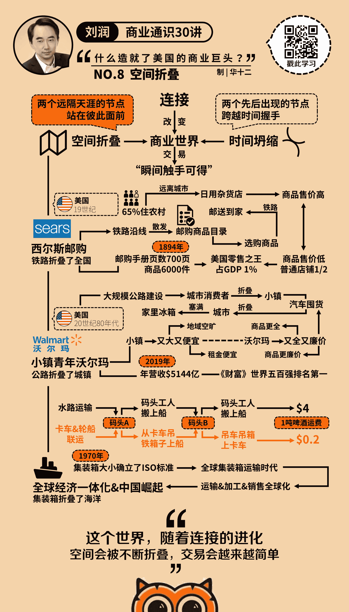  


用户留言

*   

江湖无声 **132 赞**

```
 木心：“从前书信很慢，车马很远，一生只爱一个人。” 西尔斯：“现在铁路很快，你可以爱的更多。” 沃尔玛：“现在公路很快，让爱来到你身边。” 马尔科姆·麦克莱恩：“我开着船，船带上你，你带上卡车，把爱洒满世界。” 
2020-03-14 
```

作者回复

```
现在，开始网联。
2020-03-16
```

*   

王黎璐 **120 赞**

```
 西尔斯对沃尔玛一定很无奈，这是一个公路崛起的时代；沃尔玛一定对亚马逊很无奈，这是一个互联网崛起的时代。黄明端在离职时感慨：“战胜了所有对手，却输给了时代”。这就是润总说的：不管空间折叠成什么样，它依然有进一步折叠的机会。更多，更快，更好，更省！跟随商业流动的规律，赢得我们的时代。 
2020-03-14 
```

作者回复

```
永远都有机会。只有既得利益者会觉得，已经“足够好”了。
2020-03-16
```

*    

辣条龙 **75 赞**

```
 说到改变世界的集装箱，就讲一下他有些坎坷的成功史吧。 麦克莱恩想到这个主意之后立马成立了公司，但是公司成立十年一直半死不活。 刚开始，一个集装箱里有各种各样的货物，到了目的地，还是要有人分拣、整理、搬运。根本没有发挥箱子的效用。 更难受的是什么道路、桥梁、隧道、卡车、码头设备、吊装设施，这些东西都还不对，经常还会发生故障，关键还有人偷集装箱当房子住。 转机到来还多亏了十年后的战争，美国大兵对军备运输非常讲究效率，所以发明了 3C 运送法，也就是一个集装箱装一种货物只发一个目的地。这样才迎来了集装箱的春天。 
2020-03-14 
```

作者回复

```
如果是其他人，可能就放弃了。
2020-03-16
```

*    

Tony to ni **63 赞**

```
 希尔斯的破产、以及沃尔玛的衰落，都是因为更高效率的零售业态的出现。 因为公路的连接，以及沃尔玛规模效应和独特的运营方式，沃尔玛用“天天低价“打败了西尔斯。 由于更低的流量成本和更高连接效率，电商的渗透率越来越高。沃尔玛，家乐福面临衰退。 当电商的疆域扩张逐渐放缓，线上线下结合的、效率更高的业态出现，我们称之为新零售。 每一次商业零售业态的进步，都是通过人货场的重构，进一步的提升了效率。这是一场高效与“低效“的战争，过去如此，今天如此，未来也必将如此。 
2020-03-14 
```

作者回复

```
新零售，就是更高效率的零售。
2020-03-16
```

*    

聂潜 **54 赞**

```
 新基建就是新的紧密连接： 5G 让连接更快更深 大数据让连接更数字化 人工智能让连接更智慧 工业互联让连接的产业更广 轨道交通，高铁让线下连接更有温度且高效 新能源，特变电让连接更有保障 连接的密度，纬度，深度都因为新基建发生了质的飞跃！ 
2020-03-14 
```

作者回复

```
新基建，增强了连接的基础设施。
2020-03-16
```

*   

June Han **40 赞**

```
 西尔斯与沃尔玛的败走之路浅析： 假设：A 有需求，但无法自给。 则最终只能出现另一 B 满足了 A。 接下来从购前，购中，购后三个层面来考察七类成本在西尔斯，沃尔玛，电商之间的差异。 若消费者为 A，西尔斯为 B1，沃尔玛为 B2，电商为 B3。则： 购前搜寻成本：B1>>B2>>B3; 购前比较成本：B1>B2>>B3; 购前测试成本：B1~B3>B2; 购中协商成本：B1>B2~B3; 购中付款成本：B1>B2~B3; 购后运输成本：B1>B2~B3; 购后售后成本：B2~B3>B1. 其中>代表“大于”，>>代表“远大于”，~代表“约等于”。而超市，电商所执行的消费者保障标准我这里默认 B1 时代不具备，即只有 B1 无一切售后服务。 这样简单比较得出的答案就比较明显了，电商的产生将空间折叠再次推升一个量级，上两个量级自然只能依次黯然离场。 但是我也在想：到目前为止电商的通路已经打通，空间上的折叠也已经看似做到了极致，在七天无理由售后的强制执行推行后，电商消费已经进入了极度舒适区，那还有继续“空间折叠”的可能性吗？ 从理论上来说一定是有的。A，B 两点间，每降低一个量级，还有 10³ 空间可以折叠，下一个量级的“折点”在哪里呢？ 试想一下，有些人现在为了在电商平台买一条裙子，甚至会去实体店先试穿，确认了尺码之后再到网上买，消费者的这种做法逐步催生了部分品牌线上店与线下店定位的转变：销售主要靠线上，体验主要靠线下。这就是一些品牌门店悄悄由“XX 专卖店”更名为“XX 体验店”的初衷了。体验店不再像以前专卖店那么多，够用就行，实体门店的成本骤降。更多的资金流转到产品开发上，线上产品的更新速度则有了骤升。 这里说的是平台商家的变化，那么 B3 呢？B3 的能量更大，做得更绝，AR 技术可能在不远的将来帮商家把“体验店”的数量再次压缩，而 B3 的购前测试成本也将下降，连 B2 在测试成本上的优势也要夺走...... 当然，B2 通常能够直接取货，所以 B3 在时间折叠上还有很长的路要走，京东最快也要半天，其它则至少一天，如果都能像 B2 一样立等可取，B3 需要的可能不是空间折叠，而是一扇机器猫的门。 B3 与 B1，B2 很不同，B3 更像是一种生物，有元智的，它具备能力一直在自我更迭，那会不会有一种全新的载体直接将 B3 推翻呢？我非常想请润总来讲讲，开一个大脑洞...... 
2020-03-14 
```

作者回复

```
我就是喜欢你这种数学系毕业的未来学家。
2020-03-15
```

*    

晓曦 **26 赞**

```
 Sears 和 Walmart 的衰落和它们的兴盛其实是一个硬币的两面。它们靠创新降低交易成本而兴盛，但它们全部的价值都在这。当新一代的空间折叠方法出现了它们没有或者没办法跟上的时候，也必然被淘汰。在美国 Walmart 貌似还能撑一下。虽然 amazon 已经满足了大量需求，但在小城市，比如我们这，送新鲜的蔬菜水果还是一个问题。而且 amazon 有的东西价格还是略贵，退货有时得自己付运费。底层民众还是挺喜欢 Walmart 的。Walmart 还提供便宜的修车服务, 比如免费给汽车轮胎打气什么的，也算一种多元化和拉客人的手段吧。 我们梅奥作为医疗服务的制造者，主要价值不在降低交易成本上，因此比较不会有这种大起大落。但是美国医疗服务的价格极高，一直面临巨大压力降低成本和价格，也迫切需要投入新一代的空间折叠的创新。 
2020-03-14 
```

作者回复

```
美国医疗的对手之一，是印度医疗。
2020-03-16
```

*    

Eason.Wu **22 赞**

```
 沃尔玛在互联网时代确实遇到了巨大挑战，但是沃尔玛并没有坐以待毙，而是积极的拥抱变化，寻找更加高效的商业模式。 2020 年初，沃尔玛中国透露未来 5 至 7 年将在中国新增 500 家门店和云仓，其中主力布局社区店。社区店会更加高效的折叠顾客与商品之间的连接，对于我个人来说，比起网购我更愿意到家门口的社区店去买东西，这样更加高效。如果用是否降低了“交易成本”为标准来衡量这种商业模式，那么这种商业模式是有价值得的。 同时，沃尔玛在商品、渠道和服务上均有创新，去年初沃尔玛到家小程序正式上线，并在新用户增速和注册用户数方面迅速占领零售商超行业排名第一，电商销售额持续增长。沃尔玛表示，未来三年将会与 80%的顾客和会员建立数字化链接，全渠道顾客和会员的占比将达到三分之一。 沃尔玛如此积极的拥抱更高效的连接，我相信一定能持续的创造辉煌。 
2020-03-14 
```

作者回复

```
祝福沃尔玛。祝福所有勇于创新的企业。
2020-03-16
```

*   

张萌 **18 赞**

```
 因为铁路有了西尔斯邮购，因为公路有了沃尔玛。所有商业模式的创新，都是构建交易成本更低的交易结构。西尔斯和沃尔玛的辉煌源于所属时代下，最大的优化的交易成本结构，是当时最高效率的交易方式。“更全更廉价”“一站式购齐”满足大家庭一周所需的消费，跑去更远的沃尔玛大卖场。而今天，沃尔玛、家乐福老牌连锁大企业在中国都遇到了前所未有的挑战。我认为： 1、网购，新的商业模式降低了交易成本。科技发展下，互联网、移动互联网、智能手机普及以及资费成本降低等，消费者搜寻比较测试的售前成本可以在线完成，信息获取更快更高效，而沃尔玛传统超市仅由走进卖场、看到商品才能获取信息的形式，消费者付出了更高成本（时间/金钱）。售中协商/付款成本也因权威支付大平台的信用担保更大的激发了市场潜力。售后物流运输的快速发展，让中国的互联网商平台快速崛起，加之电商企业激进的扩张手段，加速了消费者购物习惯的培养。 2、实体大卖场转型慢。大而全的大卖场，因为互联网的海量信息，商品严重同质化，信息不对称产生的利润被逐渐消灭，利润降低。中国人口结构发生改变，小家庭的出现，随之带来的商品需求改变，大卖场商品结构固定，商品更新变化较慢。而大量崛起的新零售新业态尝试，无论从实体场域的视觉打造、商品结构新颖还是商业模式“线上线下结合”运营成本更低等几方面，都更加吸引消费者。满足了消费者即得性，体验感更好。 
2020-03-14 
```

作者回复

```
规模效应比不过电商，触手可得比不过便利店。位置有点尴尬。
2020-03-16
```

*   

陈狄 **16 赞**

```
 西尔斯百货破产的主要原因有两个：第一是没有做好供应链管理，物流和仓储成本比拼不过沃尔玛、塔吉特等等新的零售业的竞争对手。 对于公路连接大小城镇所带来的机会缺乏深入的认知，反而转头去做金融业，错过了转型的最佳时机。 第二是互联网崛起的时候没有选择去做线上，反而去做线下店，导致进一步错失互联网的机会，从此债台高筑难以回天。 沃尔玛在中国的困境则是由两国不同的环境，美国人口居住分散，所以快递业的效率不高，而且美国汽车比较普及，人们习惯于开车去超市购物。 而中国居住比较集中，人力成本偏低，物流行业整体效率较高出，相对于去超市，人们习惯于网上购物的便捷性，超市的功能弱化，人们去超市一般都是购买急用的生活物品或者是水果蔬菜，而其他东西基本都可以在线上购买。 
2020-03-14 
```

作者回复

```
你眼中看到的是什么样的未来，你就会走向什么样的未来。
2020-03-16
```

*    

张宇航 **13 赞**

```
 网购带来了新的空间折叠。 今天引发的思考： 原来以为市场决定价格，一个有需求的商品，可以通过消费者无限摊薄成本。 但是在原有商品不变的情况下，依旧可以挥起定倍率之刃，砍向不创新者。 通过空间创新缩减成本，而非，用需求分摊成本，才是长远之道。 
2020-03-14 
```

作者回复

```
稀缺可以高价。但是，供给方的竞争，会让商品越来越不稀缺。
2020-03-16
```

*   

佛祖门徒 **11 赞**

```
 这一课中所举的三个经典案例有一个共同特点，就是出现了一个“十倍速”变化的关键要素实现了“空间折叠”：铁路、公路和集装箱。 由此想到，奈飞击败巨头百视通的故事。百视通靠录像带租赁成为巨头，奈飞原本只是在这一模式上进行了进一步创新开始起步。当互联网出现时，创始人哈斯廷斯敏锐意识到这是一个颠覆行业的“十倍速”变化要素，通过流媒体，空间被折叠了，用户不再需要通过租赁来观看影片，可以随时随地在线观看。奈飞虽然经历了痛苦的转型，但最终抓住了这个机会，击败了百视通。 
2020-03-14 
```

作者回复

```
没错，奈飞是一个非常典型，但是极其稀少的例子。
2020-03-15
```

*   

刘溜溜 **11 赞**

```
 新的基础设施和技术的出现，就可能让多个原本毫不相干的节点瞬间被连接起来，形成一张网络，使业务能够“四通八达”，提高生意所覆盖的范围以及交易总量。 想要做到这一点并且利用这些优势去赚钱，我觉得有两个关键： 第一，就是成为首批利用这种空间折叠技术的早期使用者，这需要企业具备一定的冒险精神，毕竟对于这样的新事物而言，这种做法的风险还是很高的。 第二，就是那个可以通过空间折叠节省大量成本或得到很多利益的人，比如在过去我公司商品的运输就大量依靠铁路或公路，而不是作为一个运输形式的补充，从而去节省大量运输成本。 而那些过去依靠空间折叠获得成功的企业，很多在面临全新的空间折叠时却显得力不从心。例如互联网如今对整个世界进行了一次折叠，并且能够通过高效的物流体系将商品尽快送达消费者手中。而那些过去的成功企业，要是还在做过去擅长的事情，错过新的空间折叠机遇的话，就只能畏缩在老的那个被折叠起来的狭小空间而已。 
2020-03-14 
```

作者回复

```
一旦不想变化，就会被变化吞噬。
2020-03-16
```

*   

超人醉了 **11 赞**

```
 沃尔玛在中国活不下去了，好市多却进来了。好市多的低 SKU+会员模式，提高了复购率，周转效率，采购溢价能力，用户低价享受商品，增强回路激活。 
2020-03-14 
```

作者回复

```
costco 胜于经营效率。
2020-03-16
```

*   

毛豆先生 **10 赞**

```
 沃尔玛敌不过，“单买便宜，两件更划算便宜，而且今天下午拍，明天早上送到你手上(某东)”的互联网电商，也敌不过“炒菜时，发现没盐了，走几步就买到”的社区商店。 沃尔玛在附近开个店，只能覆盖周围有限的用户，而互联网电商，连接上来自全国各地甚至五湖四海的用户，相比沃尔玛边际成本可以趋向于零，降低了交易成本，“价量之称”砝码拔到“量”的极端。沃尔玛付租费租个场地，付出了一定的交易成本，给客户提供商品信息，而很多客户的资金流和物流被互联网电商收割了。 社区商店，在即得性方面相比沃尔玛有天生优势，而且大数据赋能下，缩短库存周期，提高资金效率。 
2020-03-14 
```

作者回复

```
一听就知道，你认真听了 5 商系每一节课。特别清晰。
2020-03-16
```

*   

毕昊峰 **10 赞**

```
 听完这一讲，我的脑海瞬间涌现出一句话，时代是你永远打不败的对手。是的，西尔斯看到美国铁路建设背后的机遇，持“邮购目录清单”曾经创造了 19 世纪美国零售业的辉煌，成为美国零售业之王，占到当时 GDP 的 1%；沃尔玛抓住美国大规模建设公路的机遇，在全美小镇销售又全又廉价的商品。不仅在中国，我也曾经在哈萨克斯坦看到沃尔玛人来人出的商业倩影。2019 年，他们营收 5144 亿美元，成为《财富》世界五百强排名第一。但他们在人工智能时代，并没有迎头赶上或者顺势而为，而成为财富这一永远止境“马拉松”的淘汰出局者或落伍者。想到，去年到许昌参加注册一级消防工程师后，在参观许昌博物馆后，与国家博物馆的历史大咖孙奇老师讨论，袁绍为什么在群雄逐鹿的三国时代落败？孙老师告诉我，因为袁绍袁术之流脑海中还残留着“过季世界观”（此处不展开了）。如果用这种历史分析模式来忖度当下的商战，或许这两家企业的 BOSS 或他们的高管层还没有更新他们头脑中固有的商业世界观，而顺应时代大势形成一种“应季商业观”或者“超前商业观”。如果他们能这样不断迭代，或许我们就会看到升级版的西尔斯或沃尔玛了。商界大腕马化腾说：也许你什么错都没有，只是老了。是的，为了不在百舸争流的商业大潮中老去，那只有顺应时代大势，不断地升级自己的商业世界观，才能站立在当下的商业大潮中，成为一名撷英采蜜者，成为时代红利获得者。回看身边站立的人或事，有这样的胜出者。 
2020-03-14 
```

作者回复

```
“过季世界观”。期待你在知识城邦的分享。
2020-03-16
```

*    

刘大勇 **10 赞**

```
 润总好， 去沃尔玛购物， 需要去到特定空间内 用双脚丈量空间完成购物 互联网折叠了购物空间 用手指滑动屏幕即可完成购物过程。 物流完成货物流转 另外，稍微补充一点 沃尔玛的毛细血管之所以可以渗透 得益于美国汽车业的崛起 整好赶上美国 70 年到 82 年到四次经济危机 老百姓对商品价格更敏感 正是大型折扣超市的机会 
2020-03-14 
```

作者回复

```
汽车和公路，互相激励。
2020-03-16
```

*    

绝非偶然 **8 赞**

```
 书籍（课程）本质上上是一种空间的坍缩~我学习的润总可能是前面一段时间输出的润总；得到学习平台本质上也是一个“连接”，连接各位大神和我们芸芸众生。结构性的变化之后新结构和老结构已经不是一个东西了~与其说衰败多么唏嘘，我觉得不如说衰败是一种必然~ 
2020-03-14 
```

作者回复

```
冬天，也是一种必然。
2020-03-16
```

*   

Zsr003 **7 赞**

```
 希尔斯链接了全国疆域，沃尔玛用公路打通了毛细血管。当时都是很好的创新带来了比较不错的利润，随着他们的壮大肯定会有更多的人加入这些行业，降低这个行业利润率变得竞争越来越强，生意越来越难做。 随着更高效率的模式，物流网络的兴起希尔斯的运输优势几乎消失殆尽。沃尔玛由于电商的冲击，消费者行为习惯的改变。原本的优势变成了劣势，所以才变成今天的情况。 
2020-03-14 
```

作者回复

```
哪有什么“一招鲜，吃遍天”。
2020-03-16
```

*   

吴汶邑 **6 赞**

```
 沃尔玛在中国面对挑战其实还是为傲慢和偏见买单！ 先举一个其他例子，再说回沃尔玛： 德国连锁巨头麦德龙，在选址和供应链做的非常棒，为什么也会失败？ 因为要建立会员制度，建立客户忠诚度，提升粘性，建立护城河！ 但德国人最初设置会员卡，是需要单位出具工作证明，个人不得办理，忽视中国很多企业出具工作证明不方便，最大的消费群体其实可能已经退休，不具备出具工作证明的资格，这无疑是将很大部分客户拒之门外，在没有竞争者的时候，麦德龙还是依靠位置以及货品优势，让消费者想尽各种办法办理会员卡（假证明、用儿女的卡）.德国人的傲慢将会员卡变成了增加交易成本的行为！ 可见在没有竞争的时候，任何的交易成本增加，消费者为了寻求实惠，可以用各种办法去满足，但当大润发这些国内具体崛起，麦德龙再调整会员策略，已经晚了！ 麦德龙没有做错什么，但时代淘汰你，并不会告诉你！ 说回沃尔玛！ 在中国商业综合体没有今天这么大的规模，消费者还不习惯在商业综合体购物体验时，沃尔玛作为 500 强的王者，依靠自己品牌、强大的供应采购体系，确实提供了很大的消费者福利，但是傲慢与偏见也会很快让他没落，以 sam 会员店作为案例分享几点供参考： 第一，商品的包装过大，山姆会员店确实价格实惠、物品新鲜，因为它 sku 更少，采购供应链更聚焦，便于规模化采购，有利于降低单品价格，但是包装过大，但分量不是符合中国三口之家吃的，买一盒面包够吃一周，但保质期却是三天！这样的大规格包装，不符合中国三口之家家庭！ 第二，限时达制度缺陷，集中物流仓覆盖半径少，我分析过 sam 成都会员店，覆盖不了核心消费区域，以我家为举例，离会员店 3km，但是离它仓库 12km，无法参与限时达的互联网购物！ 第三，这个是行业内诟病，因为规模大，滋生采购霸权，各种的 sku 条码费，堆头费等苛捐杂税，供应商利润压榨过狠，产销利润分配不均衡！ 反观其实可以谈谈伊藤洋华堂，这次疫情捐赠口罩的这家日资超市，亚洲第一店，如果后面有机会可以展开说说！ 以上是我对沃尔玛麦德龙为这些国际巨头的不成熟看法！ 
2020-03-14 
```

作者回复

```
麦德龙策略其实很不一样，麦德龙面对的客户是企业的集中采购。麦德龙认为很多消费者买东西会造成大量的损耗，量都很小。所以他们的策略是把东西卖给企业，量很大，而且基本上不挑拣。
2020-03-15
```

*   以上留言由 作者 筛选显示
    


# 09｜时间坍缩：如果能早 6 天，摩尔斯的悲剧就不会发生


刘润

2020-03-21

09｜时间坍缩：如果能早 6 天，摩尔斯的悲剧就不会发生

建议 WiFi 环境下播放

上一讲，我们讲了铁路、公路、集装箱，这些越来越高效的物理连接，改变商业世界的第一种方式：空间折叠。

什么是空间折叠？就是因为连接的进步，两个远隔天涯的节点，站在彼此面前。

我们还讲了，因为抓住了空间折叠所带来的机会，西尔斯、沃尔玛所获得的巨大成就，甚至中国制造的崛起。

空间还在继续折叠，你能做些什么？

这一讲，我们接着讲连接改变商业世界的第二种方式：时间坍缩。

**什么是时间坍缩？就是因为连接的进步，两个先后出现的节点，跨越时间握手。**

我也给你讲三个故事。

第一个故事，电报带来的时间坍缩。

1825 年 2 月，塞缪尔·摩尔斯（Samuel Morse）正在华盛顿为市政府作画。有一天，他收到家人寄来的信，说他的妻子即将分娩，身体状况不是很好。

你看，“妻子正在分娩，身体状况不是很好”，这样简单的信息，通过“寄信”这种办法连接“发送者”和“接收者”，等传到了摩尔斯手中时，已经有了好几天的“时差”。

摩尔斯接到信，马上准备返回在康涅狄格州的家。6 天后，当摩尔斯回到家中时，发现妻子已经去世。

摩尔斯晚了一步。

时差，就是寄信那几天的时差，摩尔斯没能见到妻子的最后一面。

摩尔斯非常痛苦。有没有办法，用更高效的连接方式，消灭这个时差，让我可以和 6 天前的信息瞬间握手，让悲剧不再发生呢？

摩尔斯开始研究这个问题。

12 年后，也就是 1837 年，摩尔斯发明了“电报”。电报，就是把要传送的信息编码，然后通过一根长长的电线，跨越城市，从一头传到另外一头。

这套用于电报的，给信息编码的系统，就是著名的“摩尔斯电码”。

因为有了电报，让摩尔斯遗憾终身的那 6 天时间，坍缩成了瞬间。

但是，疯狂的摩尔斯只是开了一个头。

十几年后，一个比他更疯狂的人出现了，他就是美国实业家、“风险投资家”塞勒斯·菲尔德。菲尔德想跨越大西洋，在欧洲的爱尔兰和美洲的纽芬兰之间，铺设一条用来发电报的海底电缆。

爱尔兰和纽芬兰之间有多远？3000 多公里。

3000 多公里。在有电报之前，一则信息通过轮船“运输”到大洋彼岸，要 30 天时间。你再回复一句“我收到了”，又要 30 天。

菲尔德比摩尔斯更疯狂，他想用跨越大西洋的电报，把这 60 天的时间，也坍缩为瞬间。

大家都觉得菲尔德疯了。摩尔斯也直摇头，觉得这不可能。

1857 年 8 月 5 日，菲尔德的铺设船“尼亚加拉”号从爱尔兰起航，包括摩尔斯在内的业界专家都在船上，实时监测铺设情况。菲尔德把电缆的一头固定在爱尔兰，然后让“尼亚加拉”号小心翼翼地、缓缓向前移动。一边移动，一边在后面用绞盘向海里释放电缆。

8 月 11 日晚，在成功铺设 355 海里后，绞盘发生故障，已经铺设的电缆像断线的风筝一样全掉进了海里。

菲尔德失败了。没事。再来。

菲尔德屡败屡试，屡试屡败，屡败屡试。终于，9 年后，也就是 1866 年，菲尔德的第五次尝试终于成功了。

因为有了电报，几十天时间，真的坍缩为了瞬间。这项技术很快就被用在商业上。

商人们，终于找到了一个“青龙偃月刀”式的武器，战胜“信息不对称”这条恶龙。19 世纪 50 年代，1/3 的电报都与商业相关。而在伦敦，有超过一半的电报，都与股票交易相关。

商业世界，感谢疯狂的摩尔斯，和更疯狂的菲尔德。

1984 年，我在读小学。

有一次，我在语文课本的延伸阅读里，读到一篇文章，说美国人发明了一种神奇的炉子，用这个炉子热饭，饭热了碗不热。

这引起了我这个好奇宝宝极大的兴趣。怎么可能？无论怎么加热，不都应该是碗先热，然后饭才被碗加热吗？是不是写错了？

这个问题一直困扰着我。几年之后，我才知道，美国人发明的这个东西是：微波炉。

1984 年，这个“答案”离我的距离，是“几年”。

那今天呢？

今天我听说，有一种涂料，喷在建筑物上能抗 9 级地震。这是什么啊？我一边好奇，一边打开搜索引擎。瞬间，就得到了答案。

2020 年，这个“答案”离我的距离，是“瞬间”。

互联网，这种比电报更高效的连接，把“几年”的时间，坍缩为了“瞬间”。

如果说铁路、公路、集装箱是物理连接，电报、互联网，就是虚拟连接。

物理连接，传递物质，拉进距离，造成空间折叠；虚拟连接，传递信息，缩短时差，造成时间坍缩。

阿里巴巴、百度、腾讯、小米、美团、得到，等等等等，本质上，都是坍缩时间的“信息交易平台”。

因为它们，信息的交易成本，断崖式下跌。因为它们，信息不对称的恶龙，痛恨自己生错了时代。

第三个故事，万物互联带来的时间坍缩。

2013 年，我开始担任海尔的集团战略顾问。有一次，洗衣机事业部的负责人，和我探讨洗衣机上网有什么用。

我说，这太有用了。

我今天把身上这件白衬衫扔到洗衣机里面，又把我太太那件红外套扔进去。如果洗衣机能上网，这时，它会提醒我：对不起，这两件衣服不能一起洗。

稍微有点生活常识，你就知道，白衬衫和红外套最好不要放在一起洗。为什么？因为万一红色外套掉色，白衬衫就毁了。

挺有用啊。

那我就把白衬衫拿出来，先洗我太太的红外套吧。这时候，洗衣机又对我说：对不起，这件红外套已经洗 12 次了……最近这件外套正在打折，你要不要考虑，给她买件新的？并给我推送了衣服的链接。

这时候，洗衣机已经不仅仅是洗衣机了，它已经和服装业、零售业连在了一起。

然后，我把西装扔进洗衣机。

洗衣机告诉我：对不起，西装是不能水洗的。离你家最近 500 米，有一家干洗店，洗一套西装只要 39 块钱，你点一下“确认”，干洗店的小帅哥将会 15 分钟内上门，取走这件西装。你要不要点一下确认？

这时候，洗衣机又和服务业连在一起了。

这就是万物互联。万物互联，让信息在家电业、服装业、零售业、服务业之间，完全没有时差地传递。

在未来，万物之间的信息交易时间，都将逐渐坍缩为瞬间。

你在万物互联时代，看到了什么机会？

我们小结一下。

什么是时间坍缩？就是因为连接的进步，两个先后出现的节点，跨越时间握手。

如果说铁路、公路、集装箱是物理连接，电报、互联网、万物互联，就是虚拟连接。

物理连接，传递物质，拉进距离，造成空间折叠；虚拟连接，传递信息，缩短时差，造成时间坍缩。

所以，连接到底在为什么，以及在以什么方式，改变我们的商业世界呢？

**连接的进步，在悄悄地、坚定地，通过折叠空间、坍缩时间，把两个远隔天涯、穿越岁月的人，放在彼此面前，握手交易。**

给你讲坍缩时间，也不是为了讲一个让你震撼的、与你无关的过去。因为不管时间坍缩成什么样，它依然有进一步坍缩的机会，属于你的机会。同样，我希望你思考的是，作为我们这一代人，你还有什么可以做的。


刘润

空间折叠，时间坍缩。我给你讲的西尔斯、沃尔玛等等，都是看到改变，顺应改变，最终抓住机会的人。那么，那些没能看到、没能顺应的人呢？

我们下一讲来讲。

今天我给你留一道思考题：

你觉得连接效率的提升有极限吗？换句话说，你觉得商业进步的道路有尽头吗？如果有，是什么？

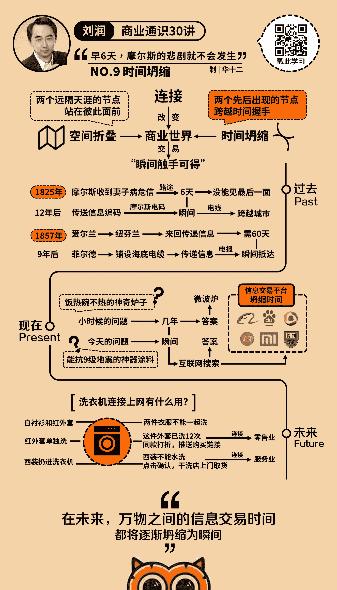  


用户留言

*   

青岛罗刚 **72 赞**

```
 1960 年代，当真空管彩色电视机出现的时候，解像度是 720*480i，被称为标清；到了 1990 年代等离子面板出现后，解像度最高达到了 1920*1080i，被称为高清、全高清；2013 年 LED 面板出现后，解像度达到了 3840*2160i,这就是 4K 信号；解像度的进化还在进行，好象还利用了量子点技术…… 看起来屏幕的解像度提升是无极限的，我们无法想象科技的尽头在哪里，但问题是，我们需要那么高解像度的屏幕吗？我们人眼能分辨的解像度总有一个极限吧？无论什么技术的发展，哪种效率的提升，边际效益都是递减的吧？ 由此我想到，连接效率的提升或者商业进步的道路是有尽头的，虽然人的欲望是无限的，但人类承担欲望的能力是有限的。 
2020-03-15 
```

作者回复

```
人们认为视觉暂留是 0.1 秒，所以出了 1 秒 25 帧的 PAL 格式视频，1 秒 30 帧的 NTSC 视频。现在，手机可以拍 1 秒 60 帧的视频了。李安开始拍 1 秒 120 帧的电影了。
2020-03-16
```

*   

Shawn 向陽 **69 赞**

```
 总结一下： 所谓商业进步，就是用越来越低的“交易成本”，克服阻力； 所谓空间折叠，就是用越来越快的“物理连接”，克服阻力； 所谓时间坍缩，就是用越来越短的“时间延迟”，克服阻力。 
2020-03-15 
```

作者回复

```
这是课代表。
2020-03-15
```

*   

斜阳 **67 赞**

```
 连接效率有极限吗？商业进步有尽头吗？我觉得答案是：有，也没有。 只是从交易成本的角度看，是有的，因为，无论时间，还是空间，解决的都只是信息不对称问题，它们无法从根本上解决信任不传递问题，也会是说，两种连接，解决的只是事实性问题，却没法直接建立共识，解决信任问题，文化和价值观这些无法量化的要素，才是信任的根基，只要是两个不同的人，交易成本就会因为观点的差异永远无法根除。 这两天隔壁刘擎老师一直在讲“理性的自负”，交通和通信发展的本质就是背后的科学理性力量，科学理性的特点是“知道的越多，发现自己不知道的越多”，从这层意义讲，人类的技术进步本身又是无限的。 
2020-03-15 
```

作者回复

```
太少的信息，可以用来制造信息不对称；太多的信息，可以用来制造信用不传递。
2020-03-15
```

*   

演员 **54 赞**

```
 这种新型混凝土被称为环保型延性水泥复合材料(简称 EDCC)。 EDCC 材料能以涂料的形式运用在墙壁之上，尽管只有薄薄一层，却能够非常显著地提升抗震性能。 科学家们进行了模拟测试，模拟了 2011 年袭击日本的那场 9.0-9.1 的大地震，结果令人欣喜。 
2020-03-15 
```

作者回复

```
我就猜会有人去搜索，哈哈哈。
2020-03-15
```

*   

李盈 **51 赞**

```
 自从有了互联网，时间坍塌和空间折叠经常同时发生。 就拿贫困地区的支教来说，原来需要支教老师在困难地区待 2~3 年，不但生活条件艰苦，而且要打破自己原有的所有生活节奏。 因为付出的代价过于高昂，很多人是心有余而力不足，而贫困地区的孩子，也得不到最优质的教育资源。比如，我们经常看到一个老师同时教授好几门课程。 现在通过互联网进行远程教育，很多热心人士，只要抽出自己的部分空余时间，在不耽误自己主业的情况下，也可以给贫困地区的孩子们代课，做出自己的贡献。 
2020-03-15 
```

作者回复

```
知识春晚上，时老师的分享打动人心。建议看看。
2020-03-16
```

*    

东写狮读 **35 赞**

```
 物理连接，传递物质，拉进距离，造成空间折叠；虚拟连接，传递信息，缩短时差，造成时间坍缩。 空间折叠：用最近的店去服务（线下） 时间坍缩：在手机里，降底交易成本（线上） 万物互联：打印机也能连接网络，不但可以自动连接到墨粉，晒鼓，配件的采购，还可以连接附近的打印店，办公用品店，最好是用手机操作，打印机设计芯片系统，例如洗衣机也一样，是手机上提醒这个衣服不能在一起洗，然后帮叫洗衣服务，打印机洗衣机都成了媒介。 你觉得连接效率的提升有极限吗？换句话说，你觉得商业进步的道路有尽头吗？如果有，是什么？ 罗胖在一期跨年演讲中提到一个观点，在中国，即使已经非常流行的东西，至少还有一亿人不知道。这一亿人就是连接带来的阻碍。还有一种现在的圈层，圈内波涛汹涌，圈外风平浪静。我觉的连接没有尽头，反倒是人的思维总觉的有尽头，这就是为什么很流行的东还有一亿人不知道，因为他们不去寻找，如果去寻找，答案就在虚拟的空间里，多少好知识在等一个好问题，如果真有商业进步道路的尽头，那就是人们对整个网络失去信心了，不在相信网络的知识，信息，万物协同，那就是尽头。 
2020-03-15 
```

作者回复

```
我们走到了尽头，发现居然是下一段路的开始。
2020-03-15
```

*   

剑客 **29 赞**

```
 润总说过商业的本质是交易，那么商人的本质就是提高交易效率。 希尔斯利用铁路，通过邮寄的方式提高了交易效率。 沃尔玛利用铁路+公路，通过大型超市提高了交易效率 集装箱利用铁路+公路+水路，通过全球化提高了交易效率。 空间折叠的威力可见一般。 润总讲过价值传递就是信息流，资金流和物流的万千组合。空间折叠主要提高了物流效率。时间坍缩主要提高了信息流和资金流的效率。 科技创新扭曲了信息流的时空，创造了巨大的商业价值和社会价值。远距离信息传递从信件—电报—电话—无线电话—短信—微信的转变。同样的事情，以前需要几天，现在不用一秒。 80 后还经历过汇款的繁琐，00 后已经快没见过“钱”了，当时别人汇款到你取出现金，整个过程需要大半天的时间，现在不用半分钟。 沃尔玛在中国遇到了“空间折叠”和“时间坍缩”的合力攻击自然就显得吃力了。天猫超市几乎可以当天送达了，盒马是 30 分钟，包邮区基本过的是当天买全球的生活，可想而知沃尔玛面临的挑战。 
2020-03-15 
```

作者回复

```
能够看明白，连接带来的时间坍缩和空间折叠，就能够理解，有些变化是必然的。
2020-03-15
```

*   

一路高歌 **25 赞**

```
 连接效率会无限接近零，却不能等于零。 
2020-03-15 
```

作者回复

```
我们可以不断接近光速，但是永远达不到光速。
2020-03-15
```

*   

Angela **17 赞**

```
 你觉得连接效率的提升有极限吗？换句话说，你觉得商业进步的道路有尽头吗？如果有，是什么？ 葡萄牙首都里斯本郊外有个海角，叫做罗卡角。在古代历史上，欧洲人认为那是大陆的尽头，再向远走是海神波塞冬的阴暗世界，没有人去了那里还能活着回来。但是到了大航海时代，罗卡角一下子成为人们去往大海的起点，成了一个充满希望的地方。 这前后 180°的大转变，并不是罗卡角发生了什么变化，而是人们看待罗卡角的视角发生了变化，以及人们与世界打交道的方式发生了变化。所以罗卡角的一块石碑上刻着两句话“大陆到此终止，大海由此开始”。 虽然我不知道商业进步道路的尽头在哪里，但我相信在那终止的地方，又将会有新的道路被发现，成为下一个进步的起点。 
2020-03-15 
```

作者回复

```
地球上有无数的地方被标着世界的尽头，那是当时这些人的认识所限，以为到了世界的尽头，但是呢，不断有新的尽头出现。
2020-03-15
```

*   

刘利民|重新开始 **15 赞**

```
 人体对时间的感知是有限的，假设人体对时间的最小感知是 0.001 秒。 而理论上时间是可以无限压缩的，但对人来说，0.001 秒与 0.0000001 秒有什么差别呢，即使相差一千倍。 我开个脑洞，如果将来商业不仅仅是全球化，而是太阳系化，那相差一千倍效率是完全碾压的。 当然了，将来若有高新科技可以大大提升人体感知力，那信息在时间上的传递效率还可以进一步压缩。 （欢迎收听未来商业简史[吃瓜][吃瓜][吃瓜]…） 
2020-03-15 
```

作者回复

```
现在美国大量的股票交易是量化交易，为了缩短量化交易的时间，很多公司把服务器就放到了纳斯达克的机房，就是为了降低 0.0001 秒。
2020-03-15
```

*    

雄走江湖 **14 赞**

```
 回答润总的问题 你觉得连接效率的提升有极限吗？换句话说，你觉得商业进步的道路有尽头吗？如果有，是什么？ 没有尽头，就像没有最快，只有更快，效率的提升或商业的进步没有极限，也没有尽头。 我是一个快递从业者，以前车马很慢，一生只够爱一个人。现而现在快递的速度，双十一期间已经能做到秒送了，你说到这个地方，快递速度还能再提升吗？ 可以的，就像润总文中讲的万物互联，甚至再还没有这个概念的时候，曾经有一个做大米的商人，他会记录每个客户的买米日期、家里人口以及每人饭量，总会很精准的在客户家大米快要吃完的前一天把米送到。 你说这是不是比秒达更快，提前预判。说到这，那还有没有更快的效率。当然有啊。 比预判更高效的是升维，京东的地下送达体系，将家庭所需与生活超市完美衔接，不仅是大米，它还会根据你的生活习惯给你营养搭配，这个是不是更加智能高效。 那么到这里，还会不会有更高效方式，你品，你细细品。 
2020-03-15 
```

作者回复

```
王永庆。
2020-03-15
```

*    

Frank 林 **11 赞**

```
 连接效率的提升，理论上是有极限的，实际上是没有的。 理论上的极限，是完全消除信息不对称和信用不传递。例如科幻小说中出现的：完全的 IOT 时代，万物互联、万物通信，通过 AI“自主”实现信息传递和资源调配。 实际上，我们不可能完全消除信息不对称和信用不传递。一方面完全的 IOT 时代不知会不会实现，另一方面商业是由“商人”参与的，“商人”会增加商业的复杂性。 
2020-03-15 
```

作者回复

```
一路左右互搏着往前走。
2020-03-15
```

*   

Shirley\_ 王淅 **11 赞**

```
 技术能够极大地提升商业连接的效率，但是信息不对称和信任无法传递，不能单靠技术解决，因为商业中存在人、文化和制度的影响，这些因素的重要性，在全球经济一体化的时代更加突出。 关于信任连接，这是中国企业走出去初期经常面临的问题，通常要花很大力气通过企业文化的磨合、CSR 活动、品牌树立等软性手段去构建与维护，曹德旺的美国玻璃工厂就是一例，相比之下，日本和欧美企业因为已有的全球品牌形象积累更有优势，产生新的连接时成本更低，典型的例子就是丰田。反之亦然，中国各地外企招商要解决的也是信任不传递问题，世界银行每年发布的营商环境评估，上海、北京这些被列入的代表中国的城市，要花大力气去提升城市名次，目的就是传递信任，中国 2019 年排名大幅上升，从去年的第 78 位上升至第 46 位。 然而，现实世界永远是动态变化的，因此进步无尽头，提升无止境，商业连接的推进，既是商业机会，也是技术、制度、人文发展的推动力。 
2020-03-15 
```

作者回复

```
如果没有竞争，企业倾向于通过制造信息不对称来赚钱，如果有了竞争，后入者倾向于通过打破信息不对称来赚钱。
2020-03-15
```

*   

佛祖门徒 **9 赞**

```
 谈到速度，就想起京东自建物流的决策重要依据之一就在于此。为了实现长远价值，在很长一段时间不计成本的投入，在京东发展中很重要的一个决策，就是刘强东决定要自建物流，于是开始烧钱的漫漫长路。这期间遇到了许多媒体的质疑唱衰，而且在做这个决策的时候，连部分投资人和公司高层也是反对的。但是就现在来看，京东把物流的质量提升以后，购物的体验有很大提升，反而成为竞争优势。因为京东的物流靠谱，如果我对速度有要求，我会优先选择京东。根据刘强东的决策逻辑。当他认为用户需要在购物上有更好的体验，有更快的速度，就想方设法去投入，排除各种困难，最后把事情解决了。物流对于京东有价值，对于用户有价值，于是不计成本地投入，最后实现了预期的效果。 
2020-03-15 
```

作者回复

```
京东高效的把商品折叠到你家门口的时候，你家附近的那些店就会遇到挑战。
2020-03-15
```

*   

王倩 **8 赞**

```
 信息对称和信用传递，有点“调节回路”的味道，达到某个阈值后，就会互相抑制，相生相克。 当供给＜需求，导致信息不对称；当供给 ≥需求，又导致信息对称； 当供给过多之后，就会增加交易成本（如选择成本），进而又导致了信用不传递。 恶龙和英雄的斗争，没完没了。 
2020-03-15 
```

作者回复

```
就像很多人认为物理学已经结束了，但是后面又出现了相对论，后面又出现了量子力学。
2020-03-15
```

*   

吴汶邑 **7 赞**

```
 万物链接个人觉得是有极限！ 如果时间坍塌到极限，会不会出现仪式感丢失！ 以下几个场景分享： 1.奢侈品，如果万物互联，所见即可得到，失去购物体验，这种仪式感会不会消失？如果失去这样的仪式感，奢侈品还会有价值么？时间坍塌可以解决商业效率，但是商业效率无法取代品牌文化，个人觉得文化只要还在，仪式感就得保留！ Ralph Lauren 旗下最顶级的美式复古 RR&L;,整个亚洲唯一的店在日本表参道，是无数美卡文化粉丝朝圣的地方，他们称店长叫主理人，主理人负责整个门店管理、运营、大到产品布局、小到门店陈列都是有主理人亲自打理，每一个店员都是不是销售产品，而是一种美卡文化输出，每一个客户并非一定购买服装，但是也想去感受现场的布置，如果这种奢侈品或者说（具有文化符号的品牌）如果时间坍塌到极致，会不会触及文化价值的丢失！ 2.现在疫情期间，各大博物馆推出 AR 看馆，如果万物互联，坐在家中可以欣赏完全世界一切博物馆，一杯咖啡欣赏大英博物馆、卢浮宫，美哉美哉！但这些人类文明的遗产，如果不能亲临现场感受，其实是无法体验到那些璀璨历史长河巨匠们留下的瑰宝之美！如果 AR*'AI 已经未来的更厉害的技术，实现足不出户纵览天下，那润总坐在上海的家，能体验南极之美，润总觉得怎么样？在家看南极，和亲身经历去南极的过程，一定不一样！时间坍塌无法取代是体验的过程！ 个人觉得万物链接的极致临界点就在文化符号类、亲身体验类的商业模式会成为边界！ 润总，怎么看？ 很想听听你对足不出户去南极，还会亲自去南极体验的看法？ 
2020-03-15 
```

作者回复

```
如果足不出户，也有一样的体验，那我就不去了。
2020-03-16
```

*   

陈栋 **5 赞**

```
 信息不对称并不能完全消除。比如医疗上存在的信息不对称。绝大多数患者都不可能具有医生所具有的专业理解能力。即使拥有全部信息，但却不能理解，也不能继续进行判断。这似乎也不是商业能够解决的问题了。 
2020-03-15 
```

作者回复

```
这是一个很好的点。信息之上是知识，知识之上是智慧。它是三个不同层次的东西。把信息加工为知识，升级为智慧，是一种创造价值。
2020-03-15
```

*    

欧文童鞋 **5 赞**

```
 《零边际成本社会》一书中有写到，以通信互联网、能源互联网和物流互联网为基础，将形成的万物互联的物联网，未来将极大提高人类社会的生产力。 书中认为，物联网实现零边际成本社会主要有以下四个步骤：①通过利用近乎免费的能源，从源头上把控成本；②通过传感器的互联传输，不断提高生产效率；③通过 3D 打印技术建立起全新的制造模式，极大扩展产量和规模；④通过高度发达的物流网络，在全球范围内实现产品交付。 当“空间折叠”和“时间坍缩”发展到极致，连接效率发挥到极致，是否预示着“零边际成本社会”将会来到我们的身边。 
2020-03-15 
```

作者回复

```
当机器降低人的体力劳动，当人工智能降低人的脑力劳动，商品不再需要人的劳动参与的时候，零边际成本社会可能就会到来。
2020-03-15
```

*   

Terry（武汉） **5 赞**

```
 商业发是随着科技这第一生产力的发展而逐渐发展，每一次的科技进步，都会带来商业形态及交易结构的巨大改变。 联想到浩瀚宇宙及人类对宇宙孜孜不倦的探索，突然想到这种对未知世界的探索是无止境的，也就意味的科技进步是无止境的，那么商业的进步也就是没有尽头的。 想到小时候看的《机器猫》，里面有一个时空穿梭门，从大雄家里穿过门可以去往世界上任何一个地方，这在未来是否可以能变为现实？那这样物质的传输也就是“瞬间即达”，这将会产生多大的商业变革啊！ 回到现实，我们更应该想的是眼前未来会发生什么，对我自己来说就是拥抱新科技，善于借力，利用这些已经建成的商业基础，为自己的商业活动附能，哪里能够能高效的连接人与人、人与物，我们就去哪里从事自己的商业活动。 
2020-03-15 
```

作者回复

```
没错，当物品可以在这边设计，在家门口 3D 打印的时候，商业的效率又被瞬间折叠，甚至有一天可以这边拆解物质，在那边瞬间传送物质的时候，商业效率又会被再次折叠。
2020-03-15
```

*    

台灣阿肯 **5 赞**

```
 我认为，连接效率的提升是否有极限很难说，但是商业的进步肯定会一直下去，互联网的时间坍缩就是最好例子。 像是最近的 5G 和 4G 话题，很多人说 4G 已经很快了，我们生活很够用了，5G 也才快个 10 倍左右，有必要迭代吗？ 5G 的不同之处，在于延迟只有 1 毫秒，4G 的延迟高达 15-25 毫秒，毫秒之间的时间坍缩很重要吗？其实很重要 将来无人车的时速突破 200 公里时，毫秒延迟攸关生命；使用无人机进行救灾任务时，指挥中心不会因延迟造成操控失误。 还有毫秒的时间坍缩，可能会改变现在的直播圈。我们中文说「见面三分情」，因为面对面可以即时观察对方的情绪和反应，让人容易移入感情。但现在的直播和视讯，还是有小延迟问题，让人觉得隔层纱、有点不太真实的感觉， 5G 坍缩时间降低延迟，以后观看直播，会更像和真实的人面对面谈话，我一讲什么对方就立刻有反应，即使不见面，也能达到「见面三分情」的效果。甚至是远距医疗也能成真，医生和病人就像是面对面讲话一样没有延迟~ 连接效率的提升，可能有极限、也可能没有极限，但是商业进步的道路，肯定是没有尽头的。 
2020-03-15 
```

作者回复

```
武侠小说里，大侠约架都是“明年秋天”黄鹤楼见。当时我就着急，明年秋天是哪一天？大约是冬季是哪一季？在农耕时代，农民日出而作、日落而息。我又着急了，日出是几点？日落又是几点？现在上班，9 点上班，一分钟都算迟到。越到现代文明，对时间的颗粒度越精细。眼前的人很难理解，为什么要精确到分钟。现在的人，也很难理解，为什么未来要精确到毫秒。
2020-03-16
```

*   以上留言由 作者 筛选显示
    


# 10｜不进则退：他们被伤害，只因”连接”跨过了他们


刘润

2020-03-21

10｜不进则退：他们被伤害，只因”连接”跨过了他们

建议 WiFi 环境下播放

前面两讲，我给你讲了，连接的进步，从铁路，到公路、集装箱、电报、互联网、万物互联，靠改变商业世界的两种方式：空间折叠，和时间坍缩。

因为空间折叠、时间坍缩，两个远隔天涯、穿越岁月的人，可以“站在”彼此面前，握手交易。商业世界的交易效率，得到巨大提升。

西尔斯、沃尔玛、阿里、京东、亚马逊等等，看到改变，顺应改变，获得巨大成功。

那么，那些没能看到改变，也没能顺应改变的人呢？

他们撕心裂肺地呼喊，他们惊心动魄地反抗。但是，他们依然被无情地扫进了历史的尘埃，为了播放英雄的赞歌，他们被按下了静音键，以至于你甚至听不到他们最后绝望的哭泣。

历史，总是书写成功故事。这一讲，我想给你讲三个被静音的失败故事，警醒我们当下的每一个人，不能顺应连接的趋势，不进则退的代价。

第一个故事，叫做小人物的愤怒。

先回到西尔斯。

铁路呼啸着折叠整个美国疆域的空间时，没和西尔斯商量过，当然也没和农村的杂货店商量过。

我想请你把自己，当做某家杂货店老板想一想。杂货店是你唯一的收入，你依靠它给孩子交学费，给自己存养老金。一个叫西尔斯的人，用“降维打击”，甚至可以说是“屠杀”的方式，抢走了几乎所有生意。

你会不会痛骂西尔斯：

*你这个吸血鬼，正在摧毁实体经济！*

我们再回到沃尔玛。那个 20 世纪，普通的小镇青年。

公路鸣着笛折叠商业毛细血管的空间时，没有和沃尔玛商量过，当然也没和小镇周边的零售店商量过。

美国公共电视台曾播放过一部纪录片，讲述每个美国小镇都遇到过的一个棘手问题：

*沃尔玛要来了！*

我想请你把自己，当做某家零售店老板想一想。你会不会咬牙切齿、恨之入骨地给沃尔顿“扎小人”，说：

*你这个吸血鬼，正在摧毁实体经济！*

一个个小人物，总以为自己遇到了百年不遇的坏人。却不知道，自己被伤害，仅仅是因为连接优雅地跨过了他们。这与他们是谁无关。

我们再回到麦克莱恩。

麦克莱恩的集装箱，当然也遭遇了惊心动魄的抵抗。

面对他们怎么也不可能背动的集装箱，码头工人们开始纷纷抵制。甚至有些地方，孔武有力的码头工人，暴力占领码头，愤怒地要求和船运公司谈判。

然后呢？然后你猜最后怎样？

最后，船运公司选择了妥协，答应分享一部分利益给工人们。工人们估计也想，我也不想一辈子做苦力啊。拿着钱，让自己的孩子好好读书吧。

这场风波，才得以平息。

如果拍成一部电影，你会不知道应该为胜利者欢呼，还是应该为淘汰者悲哀。他们什么都没做错。但是，因为连接跨过了他们，就被伤害了。

这与他们是谁无关。

高效的商业模式和高效的商业模式之间，当然会有竞争关系。但是高效的商业模式和低效的商业模式之间，不会有竞争，只会有“逐步取代”。

这个故事告诉我们，必须看清连接的进步方向。我们总幻想自己是西尔斯、沃尔顿、麦克莱恩。但是，看不清连接进步的方向，我们大概率只是那个杂货店的老板、零售店的店员，和那个愤怒的码头工人。

然后，你的愤怒会被静音。

第二个故事，叫做领先者的不屑。

提问：你知道，过去杀毒软件是怎么卖的吗？订阅。

什么意思？就是：杀毒软件免费，但每月收 10 元的订阅费。病毒是杀不完的，每月都有新病毒出现，这 10 元钱就是订阅杀新病毒的能力。

这是一种很有效的商业模式。很多杀毒软件公司因此赚钱，赚很多钱，成为行业领先者。

但是，一位叫周鸿祎的互联网创业者想，杀毒软件为什么一定要收订阅费呢？互联网是连接跨时代的进步，它不但连接了我和用户，还连接了我和广告主啊。我可以杀毒软件对用户免费，但向广告主收费啊。

360 推出了免费的杀毒软件。

那些行业领先者对周鸿祎表示了深深的不屑： *你懂什么杀毒软件，我看你怎么死的。*

几年之后，360 的用户越来越多，而愿意为杀毒软件付费的人越来越少。互联网带来的第三方付费的商业模式，在领先者的不屑中，杀死了领先者。

那些传统上领先的杀毒软件公司，做错了什么呢？什么都没做错。只是因为连接跨过了它们，就被伤害了。这与它们是谁无关。

小人物常常对新连接表示愤怒，领先者常常对新连接表示不屑。

但是不管是愤怒，还是不屑，我们都已经听不到他们的表达，因为历史已经按下静音键。

2018 年 2 月，埃隆·马斯克的 SpaceX 公司发射了一枚重型火箭“猎鹰号”。激动人心的不是发射火箭，而是发射完之后，火箭的助推器居然飞回了地面，成功降落回收。

你开一辆出租车，把乘客从人民广场送到火车站。送到之后，车要不要开回来？当然要。如果每送一个客人，就要扔掉一辆出租车，那你家里得有多大的矿啊。

埃隆·马斯克说：我要“重复使用”火箭。也就是把这辆运卫星的“出租车”开回来。

很多航天领域的专家，嘲笑他痴人说梦。

你懂什么火箭啊。NASA 那么厉害都做不到，你能做到？

没想到随着“猎鹰号”助推火箭的回收，埃隆·马斯克居然真的做到了。他“吹的又一个牛”实现了。

这意味着什么？

这意味着，就像麦克莱恩折叠了海洋一样，埃隆·马斯克折叠了天空。

埃隆·马斯克用低十倍、百倍的成本连接地面和天空，极大降低了发射卫星的成本。

实验成功后的短短几年，埃隆·马斯克迅速发射了 300 颗卫星，成为地球上拥有卫星最多的公司。他宣布，到 2024 年之前，将一共发射 1.2 万颗（后来追加到 4 万颗）卫星。而到今天为止，整个人类发射上天的卫星，只有 5000 颗左右。

越来越多的商业公司和国家，开始找埃隆·马斯克发射卫星。而那些传统的帮助他国发射卫星的机构，就生生地被绕过去了。

它们做错了什么？它们什么都没做错。它们只是以为自己遇到了一个百年不遇的狂妄之徒。它们认为这“不可能”。而这个根深蒂固的“不可能”，遮蔽了它们看到更高效连接的视野。然后，它们就被优雅地跨了过去。


刘润

**连接的进步，用两种方式改变着商业世界：空间折叠，时间坍缩。**

这一讲，我给你讲了三个故事：小人物的愤怒、领先者的不屑，和不可能的遮蔽。我们总以为自己遇到了坏人，却不知道跨过我们的，是不可阻挡的、更高效的连接。

当你突然想撕心裂肺地呼喊，惊心动魄地反抗时，历史按下了静音键，然后继续前行。

选择，比努力更重要。鱼，一定要知道水的方向。顺应了方向，一路呼啸着奔腾入海；没有顺应，你就会成为逆水而上、不进则退的鱼，费尽所有力气，依然原地不动。

这一讲，就讲到这里。

商业为什么能进步？因为连接的进步。

不断进步的连接，逐渐为我们绘制出了，越来越清晰的，透视商业世界的第二条最重要的线索：网络密度。

什么是“网络密度”？我们下一讲来聊。

今天我给你留一道思考题：

你觉得连接的进步有极限吗？如果有，是什么？

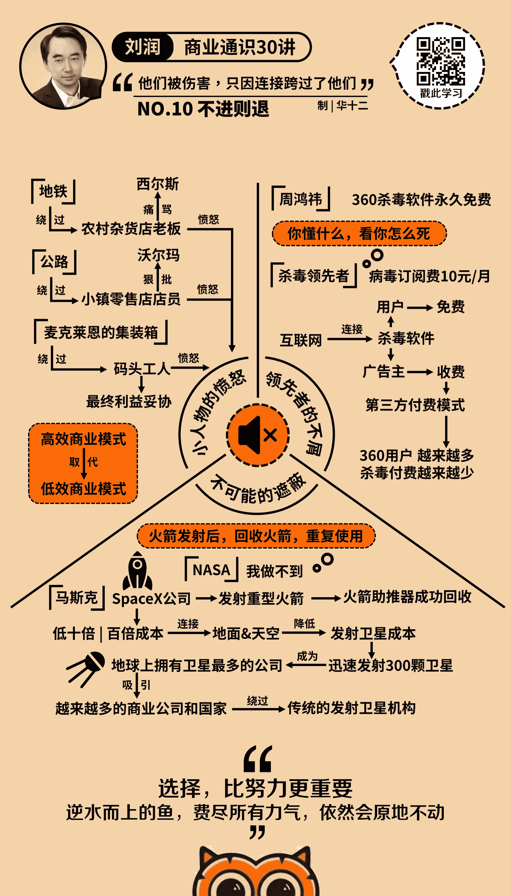

用户留言

*   

永远 **91 赞**

```
 连接的进步有极限吗？一张纸最多对折八次，每一次对折都会越来越困难，空间折叠、时间坍缩一样有极限。 
2020-03-16 
```

作者回复

```
特别好的比方，每多折叠一次，难度就大大增加。
2020-03-16
```

*    

辣条龙 **69 赞**

```
 👉第一性原理：在最基本的限制条件上，找到解决问题的办法。 👉商业的第一性原理——消费者唯一不变的是用更少的钱，以更快的速度，买到更好的商品与服务。最根本的就是时间、价格、质量。而时间上可以折叠空间，坍缩时间，当然同时也降低了价格。 👉所以，如果不想被时代静音，我们就应该跟着第一性原理，从最根本出发。那价格我们可以怎么做呢？润总也说过了，拿起倍率之刀砍向价格，比如大家都知道马斯克的一个创业项目是做电动车特斯拉，但很多人觉得电动车不可能做成，因为电池成本上降不下来。当时大概是 600 美元／千瓦时，它过去就是这么贵，一项东西的改进和降价总是很慢的，所以它未来也不可能变得更便宜。但是，马斯克说我不管现在的电池有多贵，我就回到本质问一个问题，电池的硬成本是什么构成的？无论如何也减不下去的成本是什么？无非就是铁、镍、铝这些金属，除了买这些金属的成本是绝对降不下去的，剩下来的成本都是人类协作过程中产生的，那就有优化的空间。 👉关于第一性原理的其它条件还能怎么优化？期待得到的大神们一起想想，让我们不被这个世界静音。 
2020-03-16 
```

作者回复

```
这铁镍铝的价格，到电池的售价之间的空间，就是可以去努力的“价值空间”，看一个商业项目有没有机会，你最主要是要看这个项目存不存在“价值空间”，这也是未来我建议每个同学去判断自己的事情值不值得做的，重要标准。
2020-03-16
```

*    

爱丽娜 **66 赞**

```
 过去，Location， location and location. 现在，Connection， connection and connection. 将来，Vision， vision and vision. 商业连接三部曲：空间折叠，时间坍缩，信息浓缩。 商业连接的进步注定是有极限的(商业终将失业，被新业取代)，信息浓缩可以算是一种极限的形式。科技的发展已经可以让指甲盖大的芯片囊括人类的全部智慧。有朝一日人脑终将与 AI 杂交，浓缩的信息，像体外受精一样植入脑中。量子力学的普及将加速这一变革。 人类的文明一路走来，商业也终将像过去的游牧业，农耕业，重工业，轻工业，等等，从无到有，从有到无。 人类大业真正的好戏才刚刚开始: 不怕做不到，只怕想不到！ 
2020-03-16 
```

作者回复

```
视野宏大。
2020-03-16
```

*   

Allelujah 朱磊 **52 赞**

```
 有人说，马云的阿里巴巴杀死了许多线下商业。 但阿里巴巴不是为了「让线下门店赚不到钱」而生，而是为了通过电子商务平台这一模式 降低线上营销的成本，使得更多的中小商户能够通过此方式达成更多的连接，从而降低整体运营成本，让整个商业往效率更高的方向前行。 因为顺应了商业进步的趋势，所以才会如此不可阻挡。即使没有马云，也会有王云、赵云、步惊云来做。 
2020-03-16 
```

作者回复

```
还记得那句话吗？商业有个注定辉煌的前途，至于是马云张云还是李云在那条路上，不是最重要的。
2020-03-16
```

*    

九把叉 **38 赞**

```
 滴滴和 Uner 刚出来的时候，有不少司机积极的拥抱变化，一部车上装了好几部手机，在好几个平台上抢单。 但是也遇到了很多司机的抵制。记得有一次我从机场打车去酒店，那个出租车司机没有用任何打车软件。我问他为啥不装，他在后视镜里向我甩了一个不屑的眼神。那是一种代表无知的傲慢，很快会被更高效的连接，甩在后视镜里。 
2020-03-16 
```

作者回复

```
 那个眼神是不愿意剪掉辫子的自尊。
2020-03-16
```

*   

学无止境 **35 赞**

```
 一个卖衣服的告白。多年前，看见大家少吃少穿的，我就到工厂里批发了些衣服来卖。在街边不管是严寒冬月还是酷热夏季，根据季节的变化搭配不同的衣服，没想到生意还挺好。就这样在街边摆摊摆了挺长时间。后来有了钱，我就投资了一家店，在我精心呵护下生意也挺好。后来又开了几家连锁店。随着开店的步伐加快竞争也激烈了些，各种各样的衣服店都有。这时网店刚刚兴起，我果断关闭了几家盈利不好的实体店，只保留了 2 家实体店。没想到几年的发展网店的收益比实体店多好几倍。最近呢？最近听说直播挺火，我正在研究下直播想通过直播给大家提供优质的衣服。 从摆摊到实体店到网店到直播，时代不断变化着，每一次变化我都离消费者更近一步了。连接无止境，创新无止步。在这个快速变化的时代，唯一不变的是给大家提供优质衣服的初心和追随时代变化的脚步。 
2020-03-16 
```

作者回复

```
非常敏锐的把握住时代的趋势，事半功倍，祝贺你。
2020-03-16
```

*    

伪装 **29 赞**

```
 今天的三个例子，除了给我止步不前，就会被无情抛弃的感觉之外，还给我另外一种强烈的感觉：“雪崩的时候，没有哪一朵雪花是无辜的”。 是创新者与被抛弃者，和大众，一起合谋了这一场场颠覆。没有人是无辜的受害者，只是你自己掉队了，却依旧认为自己站在宇宙的中心处。 
2020-03-16 
```

作者回复

```
因为视力不好，看不见竞争对手，看不见潜在的替代者，看不见各种新技术，才会觉得自己永远是中心。
2020-03-16
```

*    

Eason.Wu **27 赞**

```
 凡事有利也有弊，互联网在提高了商业效率的同时也带来了一系列问题，用最简单的数据说，外卖这个行业是直接席卷了传统行业，确实为我们带来了方便，但是在方便的背后我们看不到监管，看不到食品安全，也看不到食品卫生，商家为了有利润只有缩减成本 平台为了有利润只有减价搞活动压缩商家！这样一个死循环到了消费者手里的东西都是被压榨了两次的！再拿滴滴优步来说，确实是很方便，但是现在存在一个致命的问题，滴滴独家垄断，市场缺乏监管 混乱 司机利润太低 乘客费用太高，平台就像吸血鬼，吸了司机 吸乘客！ 时代的进步必定会淘汰一些东西这是万物生存法则，互联网在为我们带来方便的同时也为我们留下了很多隐患，值得我们去深思！ 
2020-03-16 
```

作者回复

```
想想，线下零售，是不是也是这么说电商的？外卖依然存在问题，是我们的机会。等到他们完美了，我们就失去了这个窗口。
2020-03-17
```

*   

朱为友-内训定制\*咨询落地人才输出 **20 赞**

```
 行业领先者的不屑是因为没看懂 360 的三级火箭: 360 的第一级火箭是免费杀毒工具， 利用这级火箭打破了持续 10 年的杀毒软件市场三国鼎立的局面，成为用户量最大的安全工具。 360 的第二级火箭是从免费杀毒工具变为安全网络平台， 进而推出 360 安全浏览器和 360 安全网址导航。 360 的第三级火箭就是它最终承载的商业闭环， 从安全浏览器和网址导航的广告收入，获得企业的经营利润。 正如梁宁老师产品思维里所说: 悲催的人生，就是在一个常态的面上，做一个勤奋的点。 更悲催的人生，就是在一个看上去常态的面上，做一个勤奋的点，你每天都在想着未来，但其实这个面正在下沉。 最悲催的人生，就是在一个看上去常态的面上，做一个勤奋的点，其实这个面附着的经济体正在下沉。 如果一个人一生只能收到点状努力的计时收益，从来没有享受过一次，线性周期的成果回报，这就叫穷人勤奋的一生。 
2020-03-16 
```

作者回复

```
低效的连接不断下沉，高效的连接不断崛起。
2020-03-16
```

*   

小七 **16 赞**

```
 润总好，俗话说“时代抛下你连招呼都不会打。”从小人物的愤怒来看所谓的“时代”，就是商业的进步就是更高效的连接。可以看到趋势，并且懂得顺势而为的人就会成为“时代的宠儿”。而那些逆流而上的人虽然反抗但终究会被扫进历史的尘埃。 从“领先者的不屑”和“不可能的遮蔽”中得到一点启发。领先者因为践行一种商业模式领先。如果他们选择另一种商业模式，一来新的“路子”没有优势，二来转型成本太高。但小公司正好相反，如果继续走行业领先者的“老路”没有任何优势，反而可能处处落后。但选择创新(新的商业模式或者技术)，走一条新路还有可能一举成为新的领先者。失败，成本也不会太高。所以寻找更高效的连接是成为下一个领先者的机会。 
2020-03-16 
```

作者回复

```
这句“俗话”是张泉灵老师说的。
2020-03-16
```

*   

聂珣 **14 赞**

```
 风电行业分析： 七八年前，随着北方地区的大规模限电，风电开发企业大规模转向中东部、南方的高海拔山区，但在山区建设风场，最大的问题就是道路成本太高，一个投资 4 亿元的风场，道路可能就要用到 2~4 千万，这大大削弱了其经济效益。这时候，一些机械厂家就开始尝试用特种拖车来运送风机上山，特别是长达 50 米的叶片，把它翘起来往山上走，这样对路面的要求就大大降低，修路成本也大大降低。当时有不少批评的声音，比如运输方式不安全（也确实出现过翻车的情况）、二次转运费用高、特种车辆成本高等等，但最后，这些声音都消失了，提高运输效率的模式最终成为了主流。 现在，风电最火的市场要属海上了，但海上风电的安装是一个老大难问题，特别是对风速要求很高，往往 5、6 米的风就不能安装了，所以每年适合安装的时间也就一百来天。前段时间，江苏一个船厂推出一种特种安装船，能在 8 米风速下进行安装，这将把适合安装的时间提高三分之一到一半。这时候也有很多质疑的声音，但大势在这儿，能够解决问题、提高效率的技术必将垄断市场。 
2020-03-16 
```

作者回复

```
最终，还是要解决问题。
2020-03-16
```

*    

冬至节 **13 赞**

```
 一开始我还以为，等 360 用“免费”抢占了市场之后，会走上收费的道路，没想到结果是 360 把其他的杀毒软件也“逼迫”到了免费的程度。 想到了薛兆丰老师说的，一个商家用“低于成本价”的方式进行“倾销”，然后再提高价格，牟取暴利。试试上，这样公司，这样的做法，几乎不存在。 
2020-03-16 
```

作者回复

```
那种情况也有，但不是唯一的结局。
2020-03-16
```

*   

中武妖 **12 赞**

```
 刘润老师，今天的课程其实值得人深深地思考，很多时候我们总看不到别人为什么会成功，为什么杀毒软件要免费，为什么马斯克会考虑火箭回收，为什么码头工人会无力反抗，无数的为什么都告诉我们，社会就是逆水行舟不进则退。其实自己观察这些商业模式就会发现，杀毒软件收费被免费打败了，而知识付费却打败了免费知识，为什么有的免费打败了战胜了收费，有的收费战胜了免费。就是因为大家发现连接的效率永远都是提升的。看看杀毒软件的发展就会发现，中国的互联网是从蛮荒发展起来的，基本上全是盗版软件，这个时候杀毒软件就成为了关键。可是当社会不断的发展，在效率的推动下越来越多的正版软解被接受，对于杀毒软件的需求越来越小，收费的杀毒软件也是会慢慢萎缩的。在这个趋势下免费杀毒收广告费，就成为了未来的趋势，因为大家更在意服务，更在意连接。这个时候就需要思维折叠，把费用向商家收取，让用户来成为资源，这才让免费杀毒战胜了收费杀毒。当互联网海量的免费知识到来的时候才发现，知识是需要筛选和系统的，零散的知识点很难起到作用，毕竟大家要明白一件事情做 99%和 100%是完全两种概念，这个时候就需要有老师或者导师来梳理知识，让知识形成系统，形成价值。最终让获得知识的效率提高，才让知识付费战争了免费知识。所以这个世界连接永远都是进步的，只要能够提高效率，免费还是收费都只是手段，效率才是目的。这也是为什么提高效率的事情可以收费，而那些不能提高效率的事物只能慢慢的消失。想要在这个时代获得成功，就必须了解什么是手段，什么是目的，需要明白商业的本质，因为背后的逻辑永远也不会改变，改变的只是形式。 
2020-03-16 
```

作者回复

```
说的太好了。免费，收费，都不是本质。更高的效率，才是本质。
2020-03-17
```

*   

剑客 **11 赞**

```
 每一次链接的跨越在被跨越者眼中都是极限～你想当跨越者就会看到无限的未来，当你被跨越时，你总觉得有人挑战极限～ 王健林之前说过一句话：老话说不撞南墙不回头，我是撞了南墙也不回头；因为你搭个梯子可以跨过去，大部分人都留在了墙根。 有人在搭梯子有的在修城墙，“链接者”和“被跨越者”是“极限”这没硬币的两面。在面朝上的人看到的是无限的天空，面冲下的人看到的是地面的极限～ 视角不同，极限不同～ 
2020-03-16 
```

作者回复

```
你的极限可能正好是别人的起点。
2020-03-16
```

*   

Shawn 向陽 **10 赞**

```
 这节课润总讲了三个高效连接的案例，这背后的商业逻辑让我想到了互联网圈的「三级火箭」模型。这里简单来说：第一级，头部流量；第二级，沉淀某类用户的商业场景；第三级，完成商业闭环。头部流量的形成，往往都是因为产生了高效的连接。因为人人都想要更快更方便的服务，市场需求也随之迅速聚集。 头部流量，进一步就形成了商业场景沉淀的温床——西尔斯、沃尔玛借助交通发展的流量，开启他们那个时代的“新零售”场景；360 借助免费杀毒工具的流量，从而形成安全网络平台的场景；马斯克借助“火箭低成本回收”的流量，获得各个商业公司和国家找私人公司发射卫星的场景……而最终，他们也都演化了自己的闭环。 润总问到：你觉得连接的进步有极限吗？ 如果从数学意义上来说，进步的极限肯定存在一个「上确界」，也就是连接的时滞无限趋于 0。但空谈极限无意义，我们不妨继续借用三级火箭的思想，讨论一下极限与变革势能的关系。 用马斯克的例子说明，三级火箭的出现，一定是个势能积累到一定程度。为什么？ 首先，从融资上来说，这个项目需要拥有极强的融资能力。马斯克的第一级是不赚钱的，他为了创造出这个高效的连接，拉了无数的投资人参与这个项目，实验的花费几乎是天文数字。没有势能的人，很难募到这个规模的钱。其次，当一级铺开头部流量之后，也就是马斯克成功回收火箭之后，他需要让别人来采纳他的订单，短时间聚拢这些订单资源的能力也是要有一定的势能积累才能做到的。 最后，也是非常重要的一点，操盘三级火箭的人，必须是个狠人。马斯克憋着这股势能做 spacex，他的第一级就是抢流量的，就是要把各国发射卫星机构的流量全都抢到 spacex 的手里，形成自己的生态。因此，这一路上会有多少人阻挠也就可想而知。 因此，综上所述，我们的目标转换为了通过势能的积累不断去「逼近」极限。要想完完成「连接」的进步，需要看前期到底积累了多大势能。 
2020-03-16 
```

作者回复

```
树芽一定会从石头缝里长出来，只不过是从哪条缝里长出来，我们不知道而已。
2020-03-16
```

*    

隋逸 **9 赞**

```
 如果作为会被跨越过去的小人物，唯一能做的是顺着趋势折叠的姿势，怎么样尽可能快地革自己的命，自己革自己的命还有可能在新的趋势里重生，被别人革了命还呼天抢地，就永无翻身之地了。 
2020-03-16 
```

作者回复

```
就像一个人说要砍掉自己的手一样。
2020-03-16
```

*    

东写狮读 **9 赞**

```
 老家镇上，前几年开通高铁后，很多外地人来这做生意，有一家蛋糕店，前两年生意非常好，家家有喜事都会找他家订蛋糕，可是去年镇上新开了一家网红蛋糕店，他家就越来越少的人去光顾了，网红的痒点又成了一个新的连接，在以往家家只要价格合适，老板好说话，生意自然不错，可自从这两年短视屏䠇起，很多人对网红的代名词又多生了几分崇拜，所以后来者用样是做蛋糕店，除了好吃，好看该有的样子，还有了好有意思。 那一家小店如何建立自己客户的逃离成本，护城河，如何与网红蛋糕店形成新的定位营销，在一个镇上头部产品会占到 80%的份额，都是以人传人的去消费。对于网红蛋糕的定位已不仅仅是蛋糕本身，更多的是一种年轻，有活力，好看，好有意思，当然也好吃的心理帐户。如何才能定义另一个心理帐户来赢的市场份额。价格战，送货上门，私人定制，异业联盟，这些商品和服务的边际成本都很高，但为了下一个能抓住新的连接机会，还得活下去。 
2020-03-16 
```

作者回复

```
很有趣的案例，线下的店它是连接附近邻居的一种方式，而网红店是连接更广大群体这种方式，它连接的人群连接的内容和连接的方式都有很大的变化。
2020-03-16
```

*   

卫大侠 **9 赞**

```
 我们这个行业是属于传统的、不起眼的汽配行业。这个行业又特别复杂，SKU 特别多。仅仅是一个滤清器，一个刹车片就有 1000 多个型号，常用的也有几百个型号。用这 1000 多个型号去对应中国路面上的万国车。对于刚入行或者还不算资深人士的，这个一一对应就无疑是一个天书，堪称灾难。但是市场有这个需求，一个车主过来了，你必须马上查询出他是用哪款滤清器，哪款刹车片。然后才是给车主安装上去。后来我们这个行业也出现了一些专门提供数据，提供查询软件的互联网公司。他们来帮助我们解决这个即时查询的需求。他们在帮助我们建立一个查询系统之后，首先这个查询系统是向我们厂家收钱的，然后呢，第 2 年开始每年还要收一笔固定的费用作为维护费用。这个维护费用据说要一直收下去，截止到目前为止都是这么收的。对我们这个行业的人来说，觉得这些查询软件公司可恨的就是修理厂进去查询是用哪个配件也要收钱，按月收费。搞的整个渠道经销商和终端修理厂都怨声载道。厂家也有一些不满，因为一开始的时候，这查询软件公司没有说要向修理厂那端收钱。只是说了向厂家收钱。完全就是上了贼船的感觉，你奈我何。而目前这些查询软件我们也看到也有向广告主收费，但是这个收入应该还是比较小。应该还不足以覆盖查询软件公司的日常费用。所以能看到我们这个行业还是多么的落后，多么的传统。也希望有向广告主收费的互联网查询软件公司，来改变和颠覆我们这个行业。 
2020-03-16 
```

作者回复

```
只要市场是公开的，就会有人进入，迟早的事情。
2020-03-16
```

*    

曹蕾教练 **8 赞**

```
 我也有个自己的案例想跟同学们分享。我 2017 年接触国际教练是，都是老外的机构在中国的办事处，培训费大概 10 万上下。做这行两年，已经成功的把国际教练认证培训费降到了 1/10 的价格，在这两年里也连接了很多愿意成长愿意改变，只是之前被价格挡在门外的年轻人。他们把新技能用在了自己的生活，工作和事业上都取得了很大成果。越来越多的国内教练培训机构也把价格像我们靠拢，疫情又把更多来中国的老外挡在了门外。其实我们一开始做的就不是培训，也没想过从这部分挣钱，甚至都考虑过免费，这算是我们整体战略的一小部分吧，筛选出更有能力的组织教练，帮助更多企业和个人，可能是我们不变的初心，方法只是实现目标的过程吧。 
2020-03-16 
```

作者回复

```
当产品没有竞争力却要维持高价时，就和把石头推上山，但不断滚下来一样。
2020-03-16
```

*   

文刚 **6 赞**

```
 选择，比努力更重要。鱼，一定要知道水的方向。顺应了方向，一路呼啸着奔腾入海；没有顺应，你就会成为逆水而上、不进则退的鱼，费尽所有力气，依然原地不动。 润总教会的是选对水道和方向的技术，选不对水道和方向，不仅是原地踏步，还可能是大踏步的退步，甚至走向毁灭。 学习也是选择比努力重要，在信息大爆炸的时代，选择学什么，比学什么更重要，选择就是学习中的“道”，选对车道和赛道，无论是学习还是做事都能事半功倍。 特别喜欢润总讲过的的一句话“结构不对，什么都不对！” 结构是什么，就是要素和要素之间的连接关系。比如说早期付费的杀毒软件，商家、病毒、用户他们的利益连接关系是不一样的，对于商家来说，希望病毒永远杀不完，因为没有病毒了用户就不会付费了，甚至在网上曾经看到一些小道消息说，有可能病毒是杀毒软件厂商自己制造的，细思极恐！ 结构不对，努力白费，关系不对，什么都不对，后面 360 杀毒的免费模式的连接关系出现，立马就把其它收费杀毒软件干的人仰马翻，因为改变了和病毒以及用户的连接关系，所以现在我们已经在电脑上看不到什么病毒了，360 杀毒也通过免费的模式积累了巨大的客户体量，成为中国具有相当影响力的互联网企业。 每一次选择都意味着失去，所以选择的时候一定要慎重再慎重，做决策，而不是频繁的做决定，在对的位置和赛道里在对的时间做对的事情。 你我要学会透过时间轴、博弈轴、概率轴去理解这个世界，能够跟随技术趋势、深度理解经济周期，抓住变化中的结构变化红利，洞察商业机遇，解决信息不对称和信用不传递，成为商业海洋中那条大鱼，“北冥有鱼，其名为鲲”！ 
2020-03-16 
```

作者回复

```
没错。结构不对，什么都不对。
2020-03-17
```

*   以上留言由 作者 筛选显示
    

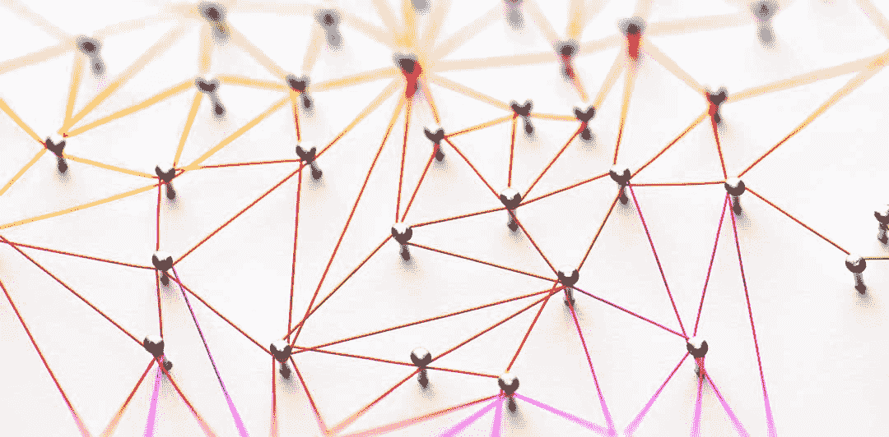

# 11｜网络密度：网络密度越高越好，交易成本越低越好


刘润

2020-03-21

11｜网络密度：网络密度越高越好，交易成本越低越好

建议 WiFi 环境下播放

在这一模块，我们一直在说连接。物理连接，造成空间折叠；虚拟连接，造成时间坍缩。

然后呢？然后，因为连接，理解商业世界进化的第二条线索，网络密度，终于越来越明显，出现在大家眼前。

网络密度，和交易成本一起，推动了商业的进化。

什么叫网络密度？

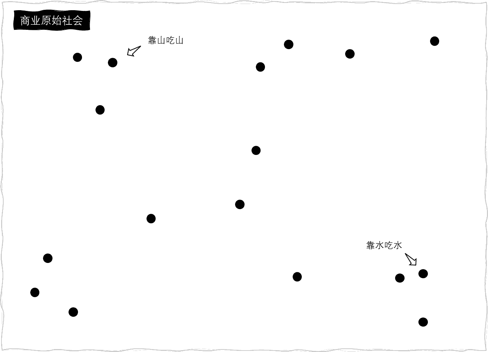

这是一张没有连接的网络图，展示的就是商业最开始的状态： **商业原始社会** 。

我出生在山里面，我也死在山里面。我是猎人，我爸爸是猎人，我儿子估计还是猎人。我们家世世代代都是猎人，靠山吃山。我们家和外面的世界“老死不相往来”。

我们可能永远不会知道，这个世界上还有一户人家，世世代代靠水吃水。他们永远吃不到我们家打的野兔子，我们当然也永远吃不到他们家捕的鱼。

我们都是一个个孤零零的与外界没有连接的“交易节点”。

这张图上的 17 个点，每个点都是一个“与外界没有连接的交易节点”。在数学上，我们称之为：

**网络密度为零。**

什么叫网络密度？

**网络密度，通俗地讲，就是这些交易节点之间的“实际连接数”和“可能连接数”之比。用公式表示就是：**

网络密度=实际连接数/可能连接数

这 17 个节点如果都能两两相连，最多能有（272/2=）136 条连接。

但是，在“商业原始社会”，交易节点之间的“实际连接数”是 0。所以，商业原始社会的网络密度就是（0/136=）0。

网络密度为 0，没有任何连接，没有任何交易，这就是为什么我称之为“商业原始社会”。

然后，连接效率开始提高。

人类开始聚集定居，一个个小村落开始形成。小村落里的几户人家开始有了连接。连接带来了交易的可能性，于是，小村落里开始出现了分工。男耕女织，每个人做自己擅长的事情，然后互相交易。

**这就是“小农经济”。**

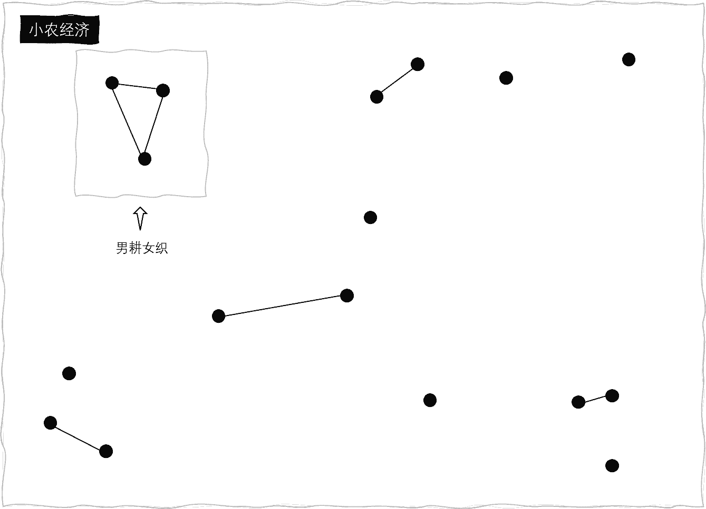

那么，如图所示的这个“小农经济”网络密度是多少呢？是（7/136=）5.1%。

网络密度从 0 提升到了 5.1%，商业从原始社会进化到了小农经济。

然后，连接效率进一步提高，出现了长长的、首尾相连的线段。


远在天边的一户人家，想从千里之外的你手上买布，怎么办？

因为太远，你们之间没有直接的连接，这时，你们就需要一个或者多个中间节点。

中间节点从你手上买布，并不是打算给自己做衣服，他们单纯地只是想用更高的价格卖掉。因为他们的存在，一次交换就像接力跑一样，被拆分成很多次交易，首尾相连。

这就是 **“线段型商业”** 。

如图所示的这张线段型商业文明的图，网络密度是（17/136=）12.5%，远大于小农经济的 5.1%。

线段型商业，是商业世界第一次真正的进化，因为，从此这个世界上出现了一群既不是生产者，也不是消费者的人群：商人。

再然后，连接效率继续提高。

这时，一些交易节点因为天然的地理优势、政策优势、技术优势，成为了“超级节点”。这种不断增强的“超级节点”，把商业文明带到下一个时代： **中心型商业文明**  
。

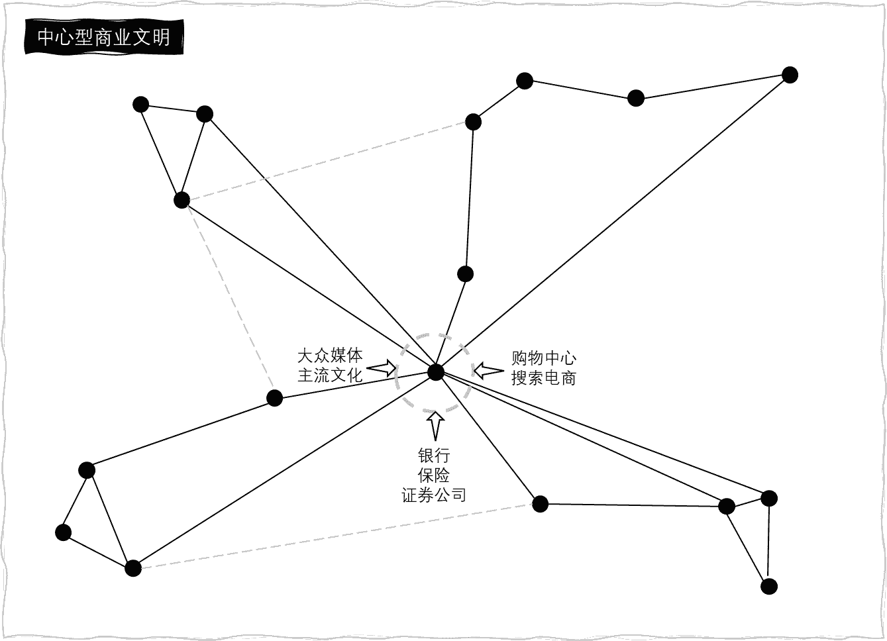

2019 年，我去了两次大理。人们常说，一个人的丽江，两个人的大理。很多人到这个地方享受偏远带来的宁静。

但是，你知道吗？这个今天只有 62 万人口的西南小城，在 8~13 世纪时，却是整个东南亚最大的城市。

为什么？因为它是当时整个东南亚交易网络的中心。所以，大理又被称为“亚洲十字路上的古都”。

古代“空间折叠”最主要的工具是车马，所以大理、洛阳、西安（长安）这些内陆城市，成为超级节点，风华绝代。

现代“空间折叠”最主要的工具是海运，所以上海、天津、香港这些靠海的地方，成为超级节点，星光灿烂。

当今“时间坍缩”最主要的工具是互联网。所以百度、阿里、腾讯这些公司，成为超级节点，风光无限。

回到如图所示的中心型商业文明图，它的网络密度是（24/136=）17.6%。

连接越进化，网络密度越高，商业文明越发达。

那么，中心型商业文明会是商业文明的终极形态吗？

不是。

只要网络密度还会继续提高，商业文明的进化就不会停止。

网络密度增加，带来了超级节点；网络密度的进一步增加，开始消灭超级节点。

这就像以前家家都没有电视，你家有，你就成了街坊邻居的超级节点。后来每家都有电视了，大家开始回家看电视，超级节点被消灭。

于是，我们开始从“中心型商业文明”，进化到“去中心型商业文明”。

这是一个看似倒退的进步。


1991 年，叶倩文出了一首歌，叫《潇洒走一回》。好吧，暴露年龄了。但是我不得不说，这首歌我一辈子也忘不掉。

为什么？因为出门，商场在放；回家，电视在放；打开广播，电台也在放。在那个时代，一首歌要是火了，就真的是国民级的火爆。我们能选择的媒体很少，有限的媒体都是超级节点，一旦超级节点选择放这首歌，这首歌就无人不知，歌手也会无人不晓。

但是，现在我给你一个名单，请你告诉我，他们是谁：

*肖战是谁？张若昀是谁？朱一龙、王一博、李现、杨紫、邓伦、罗云熙、许凯、金瀚，他们分别都是谁？*

说实话，我已经蒙了。

你如果是个 95 后或者 00 后，这时候可能要惊了。天啊，他们那么有名，你怎么可能不知道？都互联网时代了，消息这么便利，你怎么还这么闭塞啊？

其实，恰恰是因为互联网时代了，一个个小圈子不用连到所谓的“超级节点”，就可以形成闭环的生态，我才“有机会”不知道他们。

我在我的小圈子里自娱自乐，你在你的小圈子里如痴如醉。

这就是“ **去中心型商业文明** ”。

这张图里“去中心型商业文明”的网络密度是多少呢？是（33/136=）24.3%。

如果因为科技的进步，连接效率持续增加，最终网络密度达到 100%，也就是说所有的节点都两两相连，会发生什么呢？

这在理论上可能发生，但实际非常困难。我们给这个也许永远无法到达的商业文明，起了个名字： **全连接型商业文明** 。


什么样的科技能促使“全连接型商业文明”变成现实？

也许是万物互联，也许是区块链，也许是脑机互联，也许是生物科技、基因科技的重大进步。

我不知道。

但全连接一旦实现了，可能就会出现科幻电影里的场景，所有人类共享一个大脑，我知道的你都知道，人们因为没有信息不对称，再也没有信用不传递的问题。整个世界的交易成本，可能会接近理论最低。

这就是顺着“网络密度”这个线索，看到的整个商业的进化史。你看到了吗？


刘润

讲完两个模块，我终于可以把“网络密度”和“交易成本”这两条理解商业进化的线索，交到你手中了。请拿好：

**“连接”是进化的动力。衡量连接效率的终极指标，是网络密度。商业进化的方向，就是从“网络密度=0”，向“网络密度=100%”前进的方向。**

**“交易”是商业的本质。衡量交易效率的终极指标，是交易成本。商业进化的方向，就是从“交易成本=∞”，向“交易成本=0”前进的方向。**

有了这两条线索，从下一模块开始，我们开始回答这门课最开始提出的第三和第四个问题：

**3）商业从哪里来？**

**4）商业到哪里去？**

今天我给你留一道思考题：

网络密度越高越好，交易成本越低越好。但是，这个世界的发展是不均匀的。你认为你的行业、地区、人群的网络密度、交易成本的水平，是领先于时代，还是落后于时代呢？

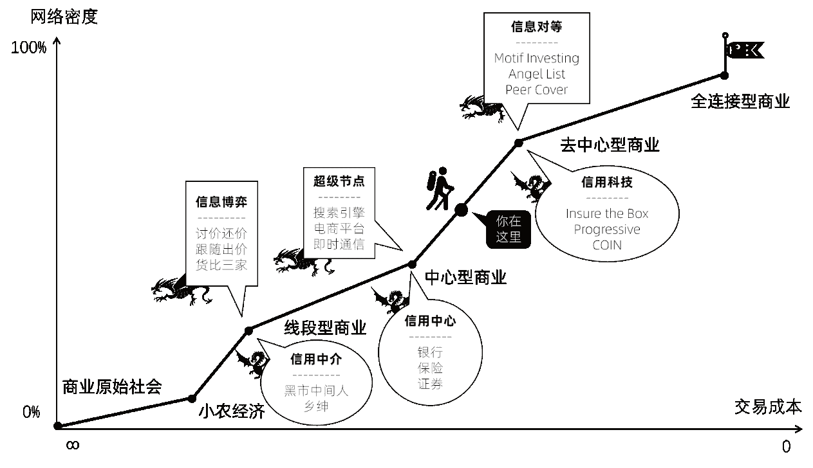  
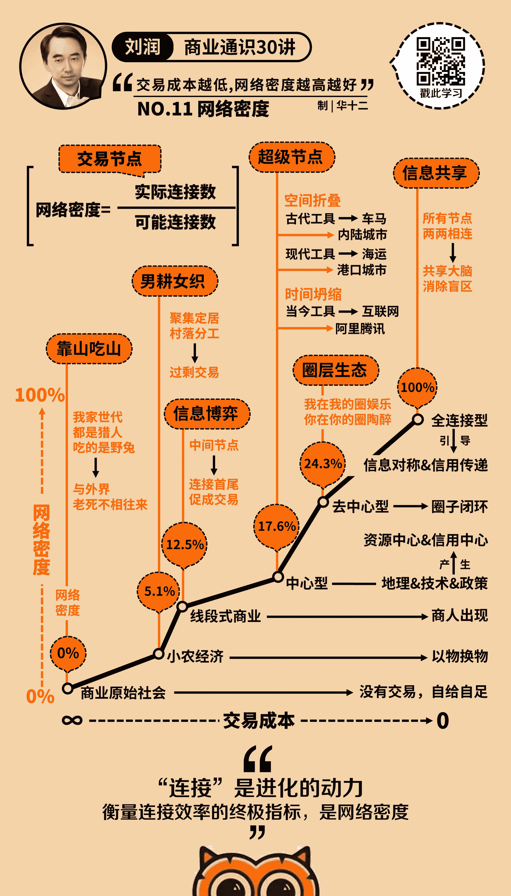  


用户留言

*   

青岛罗刚 **71 赞**

```
 商业进化的方向是网络密度越高越好，那么人进化的方向呢？ 人也处在网络之中，如果我是许多人与人连接的节点，就象个 hub，那应该也是连接的越多越好。但人和商业不一样，人应该是有最佳网络密度的，就是我们个体所能驾驭的关系数量，特别是高质量关系的数量。我感觉这个数量应该可以大于邓巴数的 150 了，但也不可能会高得离谱。 据此估算，我的关系网络密度可能是 200/1000=20%，你觉得你能驾驭的网络密度，也就是你实际连接的优质关系数量和你可能连接的优质关系的数量比值是多少呢？ 
2020-03-17 
```

作者回复

```
有路，但是你可以不去。比如上海，航班可以飞往大多数地方。但是，你可以选择去哪里。
2020-03-17
```

*    

二希·Hebe **53 赞**

```
 今天的题目特别有意思。 【网络密度越高越好，交易成本越低越好。】 但事实上，对线下来说， 网络密度越高的地方，交易成本也越也高。 上海网络密度大大超过沈阳，但是物价和房价也是有着天壤之别。这是因为稀缺。土地稀缺、好的商铺位置稀缺。 对线上来说，恰恰相反。 线上的话，网络密度越高，交易成本越低。 因为平台承载量没有边界，1 个商家和 1 万个商家，都需要运营平台。边际成本几乎为零。 而人越多、越能跟供应商杀价格，所以交易成本被大幅降低。 
2020-03-17 
```

作者回复

```
但是大家依然往上海跑。看上去上海房价高，但是上海的交易成本依然非常低。
2020-03-17
```

*    

Tony to ni **50 赞**

```
 为什么你不知道肖战？是因为你处在不同的圈子？为什么你处在不同的圈层？是因为你的背景、个性、偏好，通过互联网形成的小的社区。 那你现在有没有可能连接到肖战，进入那个圈子？可能。 为什么没有进入，是因为个体的不同，你自己选择不去了解。 所以即便在未来，有更高连接效率科技的形式出现，比如说脑机互联。人类还是有权选择接受或者关闭某些信息，所以就不太可能全连接。 因为能连接，和是否愿意连接，这是两个不同的问题。 
2020-03-17 
```

作者回复

```
条条大路通罗马。但是并不是每条路都需要走一遍。
2020-03-17
```

*   

江湖无声 **38 赞**

```
 《商场走一回》 商场悠悠巨头匆匆潮起又潮落 恩恩怨怨生死轮回几人能看透 金钱啊滚滚痴痴啊情深 聚散终有时 留一半慈善留一半醉 英雄梦里有你追随 我拿创新赌明天 你用专利换此生 岁月不知股市多少的忧伤 不枉商场走一回 
2020-03-17 
```

作者回复

```
油菜花~
2020-03-17
```

*    

重庆 Franklin **36 赞**

```
 1983 年春晚正式开播，春晚节目成了超级节点，全国人民在除夕夜围着自家电视机乐呵。2000 年后，互联网时代来临，传统意义的春晚逐渐式微，除夕夜家人各自抱着手机独乐乐，从中心化到去中心化，一个时代过去了。 
2020-03-17 
```

作者回复

```
从一颗太阳，变成满天繁星。
2020-03-17
```

*    

雄走江湖 **30 赞**

```
 网络密度越高越好，交易成本越低越好。但是，这个世界的发展是不均匀的。你认为你的行业、地区、人群的网络密度、交易成本的水平，是领先于时代，还是落后于时代呢？ 我是一个快递从业人员，本身我的服务就是连接。 我第一大优势就是我的网络密度够密，基本你想去的地方都能到。这就是我们常说的网络覆盖。 我第二个优势就是我的交易成本够低，基本你量大的时候能优惠。这就是我们常说的薄利多销。 
2020-03-17 
```

作者回复

```
你是交易节点之间的连接者。因为你们，网络密度才会越来越密。
2020-03-17
```

*   

超人醉了 **19 赞**

```
 我所在的是制造业，从交易成本来看，远远落后于时代。 1.购买前： 搜寻成本，用户得通过熟人介绍电话联系，或找到厂家地址。（百度都信息不完整，企业公众号，微博，抖音，头条想都没想过） 比较成本，用户得认识足够多购买过不同厂家纸的人，通过他们比较来选择厂家。 测试成本，烟花用纸需求量比较大，小用户一年十几吨，大用户一年上千吨。用户可以选择只购买 1 吨半吨（3000 元每吨）。 除测试成本，搜寻成本，比较成本都有很大提升空间。 2.购买中： 协商成本，很多厂家依然靠信息不对称盈利一个用户一个价。甚至欺负用户，有的用户买回去几万元货有质量问题，厂家想尽办法推脱责任。（厂家其实是在伤害自己） 付款成本，早几年，厂家都愿意赊账，导致坏账非常严重。现在厂家都要求先打款，或者货到付款，其实货到付款对于买家卖家都比较安全。 3.购买后： 运输成本，货车直接从厂家送到到用户手中，运输费约占每吨纸卖价的 0.3%左右，费用并不高。 售后成本，有产品问题，我们厂会选择直接拉回。其实我觉得可以给与适当折扣，很多用户是愿意的。 总体来讲，优化空间真的还很大。此刻润总常说的这句：“任何行业都值得从重做一遍”突然浮现。 
2020-03-17 
```

作者回复

```
怎么重做？在这 7 项成本上，每样仔细琢磨。
2020-03-17
```

*   

金戈铁马 **16 赞**

```
 来举一个我自己的例子，我现在所在的公司，在 2018 年刚成立的时候，因为种种原因，选择把注册地放在了一个三线城市。其实当时我们的想法也比较简单，一是这座城市附近的交通还算比较发达，离省会城市也就 1 个多小时的路程；二是地方政府的招商引资条件，相对于大城市也更好一些，比如有税收上的优惠政策，等等。但是，过了大概半年多的时间，我们就发现，事情其实远比我们最初想象的，要复杂得多；在这样的三线城市，没有办法产生足够的连接，也就没有办法达到我们所设想的网络密度。比如，我们所从事的是高端装备制造业，大多数产品都是非标准件，对于技术工人的职业技能要求比较高。而在这座三线城市，我们很难招到让人满意的技术工人；这就意味着，我们需要从附近的大城市招聘工人，这样一来，人与人之间的连接效率就会大大降低。再比如，我们的产品是走中高端路线的，而这座三线城市，人口规模不大，也没有什么优势产业；这也就意味着，我们的产品在这样的城市，是无法找到足够广阔的市场的，也就是网络密度不足以匹配我们的产品规模。这样，过了一年左右，我们最终还是下定决心，重新把公司迁回省会城市。 通过这样的经历，我个人的感受是，对于一座城市而言，人口规模实际上是一个非常重要的指标；只有规模更大，才有可能产生更多的连接，带来更高的网络密度。在如今的中国，北上广深等一线城市，以及长三角、珠三角等发达地区的大城市，其自身优势远非其他小城市可比；这些大城市有能力让更多拥有不同学科背景的人才连接在一起、开展合作，这无疑是有利于打造网络密度更高的商业环境。比如上海一直都是国际大都市，所以格局很大，如果是希望有一个国际化的大企业，总部最终一定会选择落户上海这个城市，才有更多对外发展的机会；而广州和深圳，随着粤港澳大区和深圳示范区的发展，越来越像是我国经济的桥头堡，会有各种新的试验性的政策红利；再比如杭州，更是互联网企业创业的优先选择。所以，对于商业文明，城市是非常重要的因素，选择合适的城市，就会带来更高的网络密度、更低的交易成本，进而成为我们商业道路上的正向推动力。 
2020-03-17 
```

作者回复

```
所以，大城市会越来越大。
2020-03-17
```

*    

孙悟空他妹 **16 赞**

```
 刘润老师晚上好，我的行业是品牌服装零售 公司代理品牌：Levis，Tommy，卡宾，中国李宁，MLB，Lacoste。。。 地标：武汉 因为受疫情影响，业绩损失惨重！具了解，其他城市的核心商圈业绩也只能做到去年同期的 40%，对于解除疫情后的报复性消费，服装行业并不期待。 如果五一可以恢复正常零售额，平均客单价也会下滑 20%，我们所了解的竞争品牌在疫情期间做了很多线上营销动作，VIP 顾客微信群秒杀，一口价，等等。我公司推出预存定金 100-200 元，恢复营业后可 7-8 折购买商品，从 2 月 7 日开始做预存，每个品牌的预存额为 10 万左右。目前 VIP 顾客资源有限，以及宣传力度不到位，预存业绩已从本月开始持续下滑。 若武汉复工后，客流量和进店率受到一定影响，从网络密度的视角看，直播带货这块我们处于落后时代，目前我们公司 257 家零售店铺还没有任何一家开始尝试直播带货，对于我所负责的湖北周边城市（十堰，黄石）计划复工后开始尝试做直播，先不想能不能把货带出去，如果能够提升进店率和品牌推广的效果，也比蹲在门店守株待兔好，前两天在看薇娅直播时，就剁手了一套化妆品，虽然武汉还不发货。在那天没有听老师的直播之前，我也只知道李佳琪直播带货，薇娅还是第一次关注。 刘润老师说：我在我的小圈子里自娱自乐，你在你的小圈子里如痴如醉。 也许我们公司现在就是处于这样的超级节点，竞争对手已经成了直播带货大王了，而我们还没有开启线上直播的策略，此时一身冷汗，堪忧！ 
2020-03-17 
```

作者回复

```
直播这种高效连接，跨过了多少成功企业。
2020-03-17
```

*    

轻松自在 **15 赞**

```
 我跨过了亲戚与父辈，甚至哥嫂们。已经无话可说了。父母辈们努力维持着，过年的访亲探友。我现在有保险，挺放心了，丰俭由人。给儿子也买了一份，至少有个底限。混的好的亲戚，人家也没有那么伟大带你一下，哪怕是堂兄弟姐妹。还秀富有，切，只是比我家有钱而已，比你有钱多的是，有本真和马爸爸，马斯克比下。祝你一生富有，不管怎样还是亲戚，你好当然没有恶意。花无百日红，一生都还可以，才算完美 
2020-03-17 
```

作者回复

```
一个人的连接，是他财富的放大器。
2020-03-17
```

*    

东写狮读 **12 赞**

```
 一个小镇被国务院颁发了文印小镇之称，就是说这个镇上的百分之八十的人都在全国各地的省市县镇做图文打印店的，很多客户要做快印广告业务，只要是去到店里听到这种口音说话的人，就知道你们是哪人，你们的价格不贵，而且做的产品很好，这就是减少了交易成本，利用地域的势能减少客户的选择，信用。 这个小镇刚开始也是从小农经济开始传帮带开始的，在四十年前，一位前辈跟着去国外修打字机，然后引进回家乡，慢慢的带着自己的亲戚朋友一起干，从小农经济不断往外延伸，因为有先发优势，有海关复印机进口的方式关系，就有供应链资源，后来镇上出现了很多中心节点，从你那引进二手复印机，然后这一个个的中心节点把收回的二手机重新翻新，在以前我们打印一张纸的成本都要一块钱一张，自从引进了二手翻新机，我们镇上的人在外地做图文打印就能把价格降到 1 毛钱一张纸还有盈利，一切商业都是让用户获益，这一步步的演化，很多外地人也知道了湖南人，开始和湖南人合作，有进二手设备的，有自己开图文快印店的，有做墨粉耗材的淘宝小店的，这一个个中心节点，让这个小镇成为快印行业的超级节点，所以现在镇上早几前就通了高铁，每年的印博会也都在镇上举办，给当地的其他商业带来了很多的机会，形成一个中心型商业地。 商业还是会不断进化，还是会有更高效的交易成本，会有更近的网络密度来消灭以往的网络，唯一能做的，就是去洞察，去行动，拥抱新的理论＋实践。 
2020-03-17 
```

作者回复

```
特别好的故事。看着甚至有些感动。那些不断涌现的努力，连接，和创新。
2020-03-17
```

*    

小小记者 **12 赞**

```
 在去中心型商业文明，每个人所处的小圈可能是不一样的，就会导致接触到的信息环境不一致，从而形成圈层壁垒。以前都说隔行如隔山，现在都不用隔行了，只要在不同的圈子里，可能就不知道别的圈子发生的事情和玩法。 拿我自己举例，我以前在银行工作的时候，觉得年化 18%的信贷产品已经非常非常高了，从银行出来后才知道，外面的世界有多么的疯狂，信贷产品年化 36%已经是一股清流了，很多有牌照的机构都在做年化 100%多的信贷产品，甚至一些不合规的现金贷平台年化利率达到了上千的水平。而且当我把这个信息跟以前银行的同事分享的时候，他们中好多人也不知道这个事，所以这可能就是圈层壁垒吧。 
2020-03-17 
```

作者回复

```
圈子内大浪滔天，圈子外风平浪静。反之亦然。
2020-03-17
```

*   

中武妖 **10 赞**

```
 刘润老师，真的感谢老师用网络密度来看懂现代商业，到了现代社会就会发现代沟的形成越来越明显，在电视最发达的时代，电视上只要出现一个明星，就会成为全民偶像，春晚一首歌就可以成为爆款，可是到了互联网时代明星越来越分散，很多时候别人喜欢崇拜的不得了的明星，大家还处于蒙圈状态。就好比前几年蔡徐坤横空出世成为 NBA 的形象大使，让我们这些 NBA 的老球迷非常的蒙圈，就连很多网络的小编也是处在蒙圈状态，等到上网查了蔡徐坤是何许人也，才知道是一个流量小鲜肉。过去的时候总是想不明白这些问题，而老师用网络密度来解释马上就会发现，过去的商业是因为网络密度非常的低，很多社会都形成了自给自足，根本就不会产生连接，没有了连接就不会产生交易。而到了现代社会不断的发展，社会分工越来越细化，商业的目的就是完成最短的交易闭环，再加上网络密度很容易就打破了物理极限，就开始形成非常多的网络交易闭环，用吴伯凡老师的话来讲就是再部落化，部落的人在自己的圈子里非常热闹，可是外面根本就没有人知道。随着社会的发展网络密度也会随之增加，商业的闭环也越来越多，这就给商人思维提出了更高的要求，怎样打破这也网络闭环，让圈里的人也可以看到外面的景色，听到外面的声音，就成为了未来商业的关键。所以在我看来再部落化已经是一个趋势，但对于商业来讲这种闭环是需要攻破的，因为商业要求高效连接，需要打破封闭。怎样打破这些闭环，可能就是未来商业需要思考的未来。 
2020-03-17 
```

作者回复

```
再部落化，就是一种去中心化。
2020-03-17
```

*    

君子之交淡如水～～～ **9 赞**

```
 我所在的超市行业，位于中西部偏落后的乡镇地区。小镇上的固定居民约五六千人，大大小小十几家便利店批发部，就数我们的超市规模最大（面积约 800 多平方米）。 由于我们坚持诚信经营、顾客至上的经营理念，店子开了两年多，口碑一直不错，生意一年比一年好，去年营业额已经突破 1000 万元。 今年，我们又决定通过以微信建群圈粉和电话的连接方式，把货物配送给附近方圆十公里的村民们，进一步拓展消费人群，扩大网络密度，同时尽量降低村民们的交易成本，一个电话或一条微信，货物很快就到家了，享受和网购一样的服务。 目前来看，现在我们暂时是领先的。 
2020-03-17 
```

作者回复

```
领先者率先尝试新的高效连接，有利于建立更深的护城河。
2020-03-17
```

*   

Shawn 向陽 **9 赞**

```
 物理学家巴拉巴西（Barabási Albert-László）认为，网络生长的方式不是随机发生的，而是优先连接。当新的节点加入网络，或者网络中有新的连接产生时，连接度高的节点会比连接度低的节点更有可能得到新连接，这就是所谓的优先连接。 而我们现在正在经历的由“中心型商业文明”进化到“去中心型商业文明”，就是由于互联网的出现，产生了新的连接方式，这种连接方式在小圈子内「连接度」极高。因此，一个个小圈子不用连到所谓的“超级节点”，就可以形成闭环的生态。 
2020-03-17 
```

作者回复

```
优先连接，造成超级节点。更多连接，削弱了超级节点。
2020-03-17
```

*    

姚山霸 **7 赞**

```
 这让我想起郑路老师的社会网络课。发现大佬们的观念有些都是想通的。 但是郑路老师对于社会网络密度有一个有趣的观点。 网络的密度更高，其实有时候可能会阻碍社会的进步和发展。第一，网络密度越高，越容易形成一个一个的小团体。这些小团体可能出于自身利益，而做出与社会发展不相符的事情，从而阻碍社会进步。比如在美国一直无法实现的禁枪，背后就是全国步枪协会(NRA)所影响的。第二，社会网络密度越高会导致社会基本信任增加。但是社会信任的增加和经济发展并不是正相关的关系。在社会基本信任较低时，社会基本信任的增加与经济发展是正相关关系。但是一旦社会信任达到一个值，他与经济发展就呈现负相关关系。 
2020-03-17 
```

作者回复

```
很赞的分享。网络跨界理解很多学科的新视角。
2020-03-17
```

*   

周登军 **6 赞**

```
 2012 年我在扬州下面的一个县级市做过了一场“0 元健身”的健身房营销活动，获得正常月业绩 8 倍之多，公司内及行业内朋友争先相邀讲解活动具体内容，这个活动当时可谓在“健身行业圈”火极一时； 但在 17 年后发现一家营销公司升级了“0 元健身”活动，借着移动互联网微信宣传链接了全国各地的健身行业投资人和管理者，把这个活动做到了全国。 
2020-03-17 
```

作者回复

```
有效的模式 + 更有效地网络连接
2020-03-17
```

*   

踏雪寻梅 **6 赞**

```
 我在煤炭行业。这是一个比较特殊的行业，它的商品煤炭一般不与普通老百姓发生联接，而是通过中间商或不通过中商由煤矿直接与消费者电厂、炼钢厂、水泥厂等大型工业用户发生联接。在十几年前，煤炭市场的信息还很不对称，当时煤炭中间商可以从 1 吨煤炭中赚到几十元的差价。而现在，煤炭市场越来越透明，中间商差不多只能赚 2 元钱的差价。而很多终端用户甚至愿意直接到煤矿去采购煤炭，煤矿销售煤炭也实行竞价制，通过招标，出价者出价最低者才有购买权，价格是充分竞争，完全市场化的。 
2020-03-17 
```

作者回复

```
网络密度提高后，高效连接，短路了低效连接。
2020-03-17
```

*   

文刚 **6 赞**

```
 润总好： “连接”是进化的动力，“交易”是商业的本质，太喜欢这一句总结！ 听润总讲过，人脉就是个人能力的放大器，所以我们不断的在寻找连接，寻找更好的连接，当然你要找到更好的连接首先是你自己要配得上更好的超级连接。 人脉不是能帮到你的人，人脉是那些你能够帮到的人！ 人脉的核心就是连接，首先要把自己打造成超级节点，所以就有更多人愿意去连接你，因为你对别人有价值，那你自己就是一个闪闪发光的连接器，同时你的信号能够发射到更远的地方。 如果润总的连接密度已经达到去中心化的 24.3%的话，自己惭愧的还在线段形商业的 12.5%，要努力向去中心化密度狂奔。 马斯洛需求理论讲人的最底层需求就是活下来，被地球连接和接受；接着就是安全的需求，不担惊受怕，终于可以被万物接受和连接了；中间层就是融入集体，别被排挤，和这个团队形成连接；再高层就是尊重的需求，建立和别人内心的连接，惺惺相惜；顶层就是自我实现，连接自己的内心，连接世界！ “你是想卖一辈子糖水，还是改变世界！”卓越的人连接的就是自我实现和梦想！ 最棒的 CEO，能用自己一个人的梦想，去点燃一群人的理想！ 得到大学就是很高效和强悍的连接，人点燃人，人激发人，聚是一团火，散是满天星！ 
2020-03-17 
```

作者回复

```
希望记住：“连接”是进化的动力，“交易”是商业的本质。
2020-03-17
```

*    

Irene **5 赞**

```
 #刘润商业通识# 网络密度增加，带来了超级节点；网络密度的进一步增加，开始消灭超级节点。 我不理解，为什么网络密度的进一步增加，会开始消灭超级节点? 是不是因为大家都想成为超级节点，反而去超级了? 
2020-03-17 
```

作者回复

```
仔细思考一下文中所说：这就像以前家家都没有电视，你家有，你就成了街坊邻居的超级节点。后来每家都有电视了，大家开始回家看电视，超级节点被消灭。
2020-03-17
```

*   以上留言由 作者 筛选显示
    

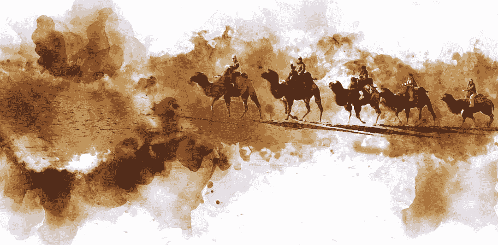

# 12｜线段型商业：为什么商人重利轻别离？


刘润

2020-03-21

12｜线段型商业：为什么商人重利轻别离？

建议 WiFi 环境下播放

进化的动力是“连接”，商业的本质是“交易”。

通过两个模块的学习，我们终于可以带上“连接+交易”的洞察力眼镜，透视商业进化的方向。

通过连接和交易这两条线索，我在商业进化发展的历程中，标出了四个里程碑：线段型商业、之后是中心型商业、以及我们将要抵达的去中心型商业，还有最后我们的终点：全连接型商业，这四大类商业类型。


这一模块的 6 讲，我们先学习前两个，我将带着你顺着商业进化的方向，首先往过去看，先看看商业从“线段型商业、中心型商业”，如何一路走来。

这一讲，我们从“线段型商业”开始。

“线段型商业”虽然是过去，但研究它却有非凡的现实意义。因为今天依然有很多行业，活在这个化石一样的时代。比如层层加价的批发业。今天，当你看到有符合“线段型商业”特征的行业时，应该兴奋不已，因为，改变它们就是你的机会。

从“线段型商业”开始，每一次商业进化，我都会分三讲，给你讲明白：

*   1）这个商业文明的典型特征；
    
*   2）它如何战胜信息不对称这条恶龙；
    
*   3）它如何战胜信用不传递这条恶龙。
    

现在开始。

什么是“线段型商业”？

线段型商业，是一种由“一个个首尾相连的连接，一次次承上启下的交易”构成的交易结构。

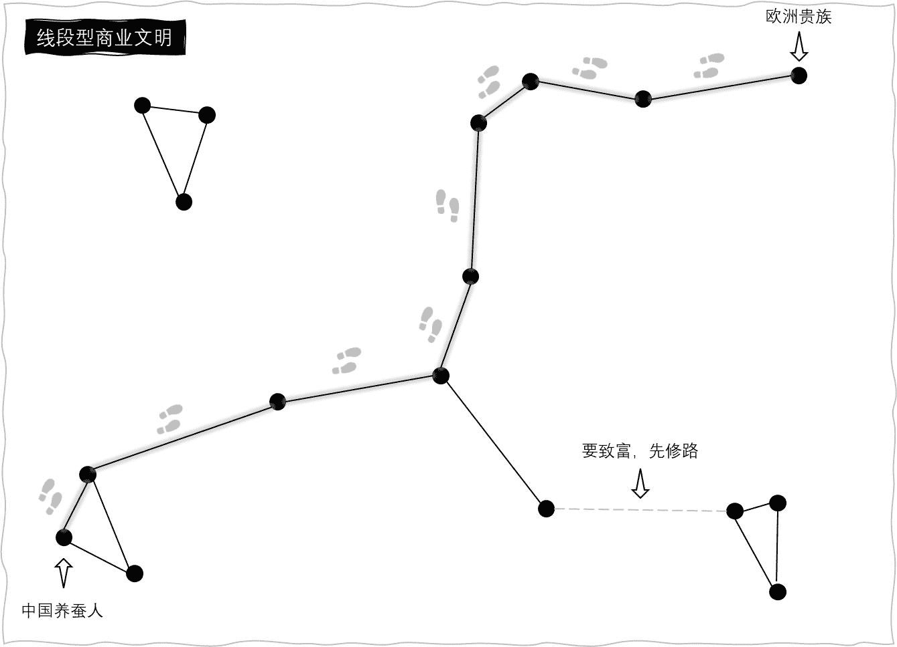

线段型商业，是商业世界第一次真正的进化，因为这个时代第一次出现了一群既不是生产者，也不是消费者的人群：商人。

历史上，最著名的“一个个首尾相连的连接，一次次承上启下的交易”，可能就是丝绸之路了。

我们借用丝绸之路，来理解这种商业文明的特征。

丝绸之路，最早起源于西汉（公元前 202 年—公元 8 年），张骞开辟的从长安开始，经过甘肃、新疆、中亚、西亚，最后连接地中海各国的陆上通道。

丝绸之路，其实是无数商人在一条（或者无数条）真实的路上，用分段接力的方式，完成两个遥远的节点之间的交易。

一个欧洲的有钱人想要买一匹中国的绸缎做衣服，这个交易如何完成？

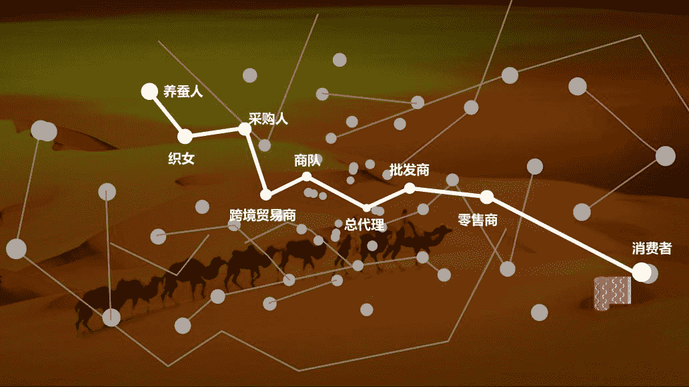

在“商业原始社会、小农经济”时代，这个交易不可能完成。因为他们之间没有“连接”，交易成本无穷大。

但现在有了商人。他们纯粹为了利益，成为了接力式的中间节点， **把生产节点，和消费节点** ，一段段连接起来。

中国的江南一带，有个养蚕人张伯伯，日日劳作。他知道自己的蚕丝会被织成布匹、做成衣服。但他不知道谁会穿上这件衣服。

张伯伯，是一个生产节点。他只管一件事，把蚕丝卖给织女小婉。因为常年合作，从小就彼此信任，他们之间没有什么讨价还价，也没有什么验货后付尾款。他们之间的“交易成本”非常低。

这就是整个交易的最开始的第一个“线段”。

小婉买下蚕丝，但她并不“消费”蚕丝。她知道，把蚕丝纵横交错编织成一匹绸缎，价格要高不少。她是一个增值的“生产节点”。

小婉用灵巧的双手，编织出五颜六色的绫罗绸缎，等着采购人阿满上门。

采购人阿满，定期到村子里收绸缎。他知道小婉的手艺是最好的，所以第一个就来见小婉，直接买走了她所有的绸缎。阿满多年的采购经验，降低了“比较成本”。

小婉和阿满，构成了第二个“交易线段”。

阿满收完丝绸后，来到了孙老板这里。

孙老板是当地有名的跨境贸易商，他从所有采购人那里收购丝绸，卖到欧洲。孙老板对阿满的丝绸挑三拣四，但其实阿满知道，“讨价还价”是孙老板克服信息不对称的方法。阿满知道孙老板有个大客户正着急组货，所以咬死不松口。最后阿满“得逞”了。

张伯伯不认识孙老板，孙老板也不认识张伯伯。但是通过小婉和阿满的“接力”，他们在互不相识的情况下，完成了一次交易。一个个交易线段，开始首尾相连。

孙老板组完货之后，找到老李头的商队。老李头经常穿越丝绸之路，很有经验。孙老板不但付运费给老李头，还和他谈了一个分成模式。现在他们俩是合伙人。孙老板放心地把货交给了老李头。

“合伙人”模式，是他们克服“信用不传递”，建立进退同盟关系的手段。一个新的线段被接上交易的链条，延伸向欧洲。

老李头长途跋涉，终于来到了地中海地区，找到了当地最大的丝绸买家大卫。大卫只做一件事，就是收买所有来自中国的丝绸，控制定价权。

那条源自中国的长长的交易链条，因为老李头，和欧洲本地的交易节点终于相连。

约翰是一个等着买货的批发商。他知道，从大卫这里，欧洲的最源头买到丝绸，再运到自己的国家，卖给那些小店，利润非常可观。

一条早已成熟的本地分销线段，开始接力。“分销”，是一组组早已成熟的“交易线段”，等着连上拥有货源的“交易节点”。

约翰冒着生命危险，绕开各地的大小战争，把丝绸运回繁华的城市。这里有一位当地最有名的裁缝安娜，专门给欧洲的有钱人做绸缎锦服。一条通向商业网络毛细血管的线段，被安娜接过了最后一棒。

安娜有个大客户，是国王。国王第二天要办一个非常重要的宴会，急需一件名贵的丝绸衣服，多少钱都行，只要今晚能赶出来。安娜加班加点，做好了华服。第二天，国王如愿以偿地穿上了中国丝绸。

终于，一条起始于中国张伯伯的交易链条，结束于这位欧洲国王。

张伯伯永远也不会知道，他的蚕丝最终会穿在一个欧洲国王身上。而这位欧洲国王也永远不会知道张伯伯。但是通过小婉、阿满、孙老板、老李头、大卫、约翰、安娜，这一个个首尾相连的连接，一次次承上启下的交易，两个永不谋面的人完成了交易。

丝绸之路，是网络密度增加到一定程度，必然会出现的路。

建造这条路的，不是马帮，不是驼队，不是边疆军人，而是每一个“交易节点”获利的渴望。丝绸之路不从这里通往欧洲，就一定会从那里通往欧洲。

**而在每一个交易线段上，交易双方都想尽办法，降低自己的交易成本。**

交易成本低的地方，就成了路。

这就像长江，不是从这里流向大海，就一定会从那里流向大海。遭遇阻挡小的地方，最先成为江。

中国有句话，叫“商人重利轻别离”。轻别离，是因为“线段型商业”通向遥远的方向。交易对手越遥远，商人的价值越大。

但是，为了通向远方，商人出发一次，就要在路上花上几天、几个月，甚至几年的时间，不“轻别离”不行，否则就赚不到钱。


刘润

线段型商业，是一种由“一个个首尾相连的连接，一次次承上启下的交易”构成的交易结构。

网络密度增加到一定程度，必然会出现“线段型商业”。交易成本低的地方，最先被连接。

线段型商业，是商业世界第一次真正的进化，因为这个时代第一次出现了一群既不是生产者，也不是消费者的人群：商人。

这一讲，就讲到这里。

那么，在线段型商业中，商人们依靠什么，来克服“信息不对称”的阻力，降低交易成本，并因此获利呢？

依靠：信息博弈。

下一讲，我们来聊。

今天我给你留一道思考题：

我们今天所处的时代，依然有不少行业，处于“线段型商业”文明时代。比如批发业，层层加价，每个人都没赚到多少钱，但是到了消费者手上，就已经贵得离谱。你觉得这背后，有什么商业机遇？

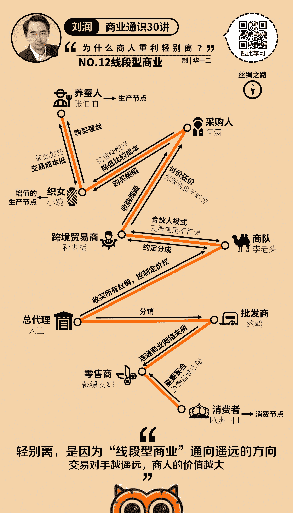  


用户留言

*   

戚志光 **78 赞**

```
 润总今天讲的丝绸之路的故事里，每一个参与交易的人，都有着一些专有知识。 张伯伯懂得养蚕，小婉懂得织布，阿满知道谁的丝绸好，孙老板知道怎么组货，李老头知道怎么把丝绸运到欧洲，大卫知道如何垄断住中国来的丝绸，约翰知道哪里需要丝绸，安娜知道过往需要什么衣服。 这些知识，就是经济学里说的隐性知识，他们分散在每个人的头脑中，是市场让所有人为了自己的利益，运用这些知识，促成了交易的发生。 如果国王能够用上淘宝，他就可以直接找到小婉，购买丝绸。丝绸从中国到达欧洲，依然还需要阿满，孙老板，李老头，大卫和约翰接力，但是他们都不在是商人，而是变成了快递小哥。 
2020-03-18 
```

作者回复

```
你猜今天的英国女王（或者她的随从），会不会用淘宝？
2020-03-18
```

*   

伊春莺歌 **40 赞**

```
 1、 线段形商业状态能够形成的根本原因是供需之间的信息不对称。打通这种信息不对称就是巨大的商业机会。互联网，通讯等现代化科技手段，为生产者和最终消费者时间提供了直接连接的可能性，这种科技变革是时代最大的商业机会。 2、 创造价值，是生产者的逆袭。线段形连接模式是交易成本最低的地方形成了水流，电流，这就让掌握需求一端的人拥有了话语权，他们会对标准品实行压价，一层一层压价导致品质降低，利润降低。但如果生产者能够保持品质，保持独特性，构建标准体系，就会让这种力量的方向发生改变。 3、 还有一种特殊的商业模式符合了“凡勃仑效应”，也就是购买者认为花的钱越多，产品越贵，东西越稀缺，获取越难，买到的人会觉得越有面子，这种模式可以为供应链参与者提供更加可观的利润空间。人为制造独特性稀缺性和信息不对称，也许是反方向的一个商业机会。没办法，人的需求层次是多元的。 4、 就像我们谈论医学和社会伦理一样，商业有时候也面临这个问题，效率和公平。尽管线段形状态让供需链条过长，每个环节利润空间有限，但是至少大家都有参与的机会，都有事情可以做，社会就业率是稳定的。这也是坊间研究日本限制大型超市保留便利店的原因。在某些地方，这种线段模式也有存在的意义，也会带来商机。 
2020-03-18 
```

作者回复

```
日本比较少大型超市，是“限制”的结果，还是“竞争”的结果？
2020-03-18
```

*   

心铭 **35 赞**

```
 润总好， 线段型商业，是 M2S2B2b2C。 每一个断开的连接，都是一次机遇。 B2C 诞生了淘宝，S2b 有阿里巴巴，S2C 有京东，M2C 有团购，c2m 有社群经济。 如果是说要从线段型商业发现机遇。我能想到的就是这条商业线路上的二级市场了。比如古丝绸之路的卖骆驼，也就是现在的物流。还有就是在点与点之间卖消息的中介。 
2020-03-18 
```

作者回复

```
D（设计）-M（制造）-S（供应链）-B（大商户）-b（小商户）-C（消费者）。
2020-03-18
```

*   

Allelujah 朱磊 **31 赞**

```
 说到精简供应链、提升线段型商业结构效率，我联想到的第一家公司就是“必要商城”。 必要的发心是打掉所有中间分销结构，降低品牌的溢价，将供应链端产品和消费者直接对接，使得消费者能够以尽可能接近出厂的价格，买到和品牌商同等质量的产品。 这是一个极其符合供应链端和消费者利益的创想，并且十分符合市场逻辑——只要能证明生产厂商所产出的商品真的有足够的品质，就一定有相当一部分不在意品牌溢价的消费者被性价比吸引。 但这个模式的开端一定很难，因为要从无到有地建立自身平台和供应商对于消费者的信任、战胜信用不传递，同时要在还没有聚集用户的情况下与供应商达成合作、战胜信息不对称。 必要的创始人在开始的时候，是一家家工厂去跑、用市场前景去说服负责人，再通过概念营销来打动第一批消费者的。过程十分艰难。 但必要还是跑出来了。且直到今天还活得很好。我作为必要的其中一名用户，对于必要上出售商品的品质表示十分满意。 
2020-03-18 
```

作者回复

```
毕胜发明了一个词：短路经济。
2020-03-18
```

*    

vivi **25 赞**

```
 我妈养蚕养了几十年了，我觉得她挺有商业头脑的。蚕宝宝做了茧子之后，我们通常都会把茧子拉去卖给收购商，收购商在捣腾最后到蚕丝被的生产方，最终生产成蚕丝被，卖给消费者。 这几年茧子的价格都挺便宜的，我妈觉得卖茧子不划算。于是自己剥茧子自己卖蚕丝被，省去了很多中间环节，做成的蚕丝被卖给她的亲戚。亲戚都知道我妈的蚕丝被是货真价实的，而且价格也比市场便宜，供不应求。 
2020-03-18 
```

作者回复

```
直接短路了下游。
2020-03-18
```

*   

佛祖门徒 **23 赞**

```
 课后思考： 机会就在于润总在 5 商中讲过的“短路经济”，减少中间环节，降低交易成本。 吉祥熊猫汽车在传统销售渠道中售价大约是 4.5 至 5.5 万元，而 C2M 电商必要商城上的售价仅为 39999 元。为什么能做到如此低价？答案就是 C2M，即 consumer to manufactory，消费者直接面向制造商。C2M 与 C2B 不同的是需求与供给路径的进一步缩短，缩到极点。C2B 是消费者直接面对商家，这中间还是有一道关卡的，而 C2M 是 C2B 的进一步延伸，弱化了电商平台的主导作用，强化其桥梁作用，给了消费者与厂商更大的自主权。以必要商城销售的吉祥熊猫汽车为例，虽然价格比传统渠道销售的汽车便宜 5000 到 15000 元，但生产商支付给库存、分销、推广、宣传等畅通流畅环节的成本，正好与之相抵。在利润率保持不变的情况下，把省下来的这部分钱还给消费者，价值部位就凸显出来了。 
2020-03-18 
```

作者回复

```
优化线段的方法，不仅是让每一段更高效，还可以干脆去掉一些线段。
2020-03-18
```

*    

小小记者 **21 赞**

```
 复习一下润总 5 商实战篇的课程内容： 过去从产品到消费者，需要经历漫长的过程，从 D（设计）-M（制造商）-S（供应链）-B（大卖场、超市）-b（夫妻老婆店）-C（消费者）。利用短路经济的思路，是把部分中间的环节短路掉，从而减少中间的加价环节，降低交易成本，提升商业效率。 比如，名创优品从制造商 M，直接到连锁门店 B，短路掉了供应链 S，可以称之为 M2B； 比如，天猫小店用零售通这种供应链 S，直接给夫妻老婆店 b 供货，短路掉了批发商 B，可以称之为 S2b； 比如，拼多多的 C2B 模式，收集海量 C 端需求，形成消费集团，向大 B 团购商品； 比如，C2M 的反向定制，先有用户，再有产品，消费集团直接对接厂商，短路掉了中间所有环节。 
2020-03-18 
```

作者回复

```
谢谢分享。感兴趣的同学，可以把我的《新零售》找来翻一翻。
2020-03-18
```

*    

孙振峰 **17 赞**

```
 有很多商业模式是线段型商业，但是我没觉得贵的离谱，我觉得这些中间商虽然赚了差价，但是他们承担了风险，抵抗了周期，帮生产商转嫁了风险。比如可口可乐瓶装商，格力空调渠道商，服装行业的档口老板，零售行业的品牌区域代理，这些商业模式都存在其合理性。但是有一个问题我没有想明白，茅台不愁销售，而且白酒行业特殊的没有保质期特点，为什么还需要渠道商，可以网上销售或者直营店？我想了下，估计除了飞天茅台其他的系列酒还是不那么好卖。其他理由请战友们补充 
2020-03-18 
```

作者回复

```
中间商真的没有价值吗？
2020-03-18
```

*    

陈敏胜 **16 赞**

```
 今天润总所用的丝绸之路案例其实是一个价值链的传递过程，每经过一个环节都有其价值，所以层层加价。 让我们带着洞察力的眼睛看看，如何破解这层层加价难题，让消费者获益。 1、爪子二手车，没有中间商赚差价 ，短路中间商，平台在误导消费者，平台也需收取相应的手续费。 2、沃尔玛、好事多，直接厂家进货，再通过其物流到每个商场，最后消费者，直接短路的中间商。 3、网红带货，直接对接厂家到消费者。 思考 如何破解层层加价，让最终消费者获益实现多方共赢，是我一直在思考的问题，下面我举一个近期合作熔喷的项目来做分析： 本着合作共赢，资源互补，坦诚相待，一起共同把事做成的原则，定以下熔喷布合作经营方案： 1、把实际成本公开，不加任何价格为我们的低价，例如 20 万一吨，售后同样按实际销售价格结算，例如 30 万/吨。 2、本着谁风险付出多，谁收益多的原则，取中间价 25 万，25 一 20=5 万元/吨，这部分由主要采购方提成 20%，风险同样采购方多承担 20%。其余按共同出资比例分担风险及分享利益。 3、销售方也一样，30-25=5 万/吨 x20%做为业务提成，同样销售方要的承担 20%的资金回笼风险。其余的按投入资金比例分成。 咱们一定是共同赚市场的钱，谁贡献大谁收益大的原则来分配，如咱们之间层层加价，这咱的竞争力都会缩小，同时风险也会更大。 
2020-03-18 
```

作者回复

```
要注意。大量大型制造企业已经进入口罩市场。
2020-03-18
```

*    

吉林雀园 **15 赞**

```
 以前不知道这是“线段型商业”。我最初想去花市开店卖盆栽，于是做个小市调，总结一些发现的规律。 1，花市的经营者大多在 50 岁左右，年轻人极少。 2，同一种花卉同一种包装重复出现在 50 岁左右的店主家 3，年轻店主的产品比较有特色，比如有一家专卖洋朱顶红，有一家专卖多肉 4，花市地处菜市场，但流量一般 通过收集资料和推测，得出以下结论， 1，市里边上有一个花卉大棚村，许多 50 岁左右的店主去大棚进货，然后店里销售。 2，少部分店主从网上进货，一般是沈阳和山东。 3，花市盆栽定倍率约为 3 倍，除去店租损耗和开销，利润一般，推测年龄大的店主没有生计，是不得已而开店，跟购物中心情况一样。 4，生意比较好的几家，都是大棚自营。 结论 1，自产自销，才能利益最大化。 2，自产直营，主营网店，副营实体，主要是打品牌，连接本地市场。 
2020-03-18 
```

作者回复

```
一段一段接力~
2020-03-18
```

*   

大土豆 **14 赞**

```
 定倍率，就是一个商品卖给消费者的零售价，除以该商品的出厂价。100 元出厂的鞋子，卖 500 元，定倍率就是 5。鞋服行业定倍率一般在 5--10 倍。 每一个传递环节在传递价值的路径上都要层层加价。如果没有中间商赚差价，可以让消费者享受到更低价格，更高品质的商品。 名创优品，Costco 的模式都是发现了这一机遇，尽可能砍掉所有中间商形成“短路经济”。 还有一种是 C2M，“客户到工厂”的交易模式，比如“必要商城”，也是向降低定倍率发起的冲击。 
2020-03-18 
```

作者回复

```
定倍率，是衡量线段型商业效率的重要指标。
2020-03-18
```

*    

二希·Hebe **13 赞**

```
 降低交易成本就是减少交易过程中可能产生的节点。 过去，从制造商到消费者，中间还可能至少经过 7 个以上的交易节点，最终我们才能买到商品。 不仅贵，效率还慢。 就像路过的高速站，每一站都收一段高速费。人工放杆先把你拦下，付费，再抬杆走人。 现在，ETC 的实行，大大降低了人工的成本，而且效率也高很多。 
2020-03-18 
```

作者回复

```
减少“商业”收费站，一路通达。
2020-03-18
```

*    

Irene **12 赞**

```
 #刘润·商业通识# 商人重利轻别离，让我想起了晋商，“走西口“就是一种写照。刘润老师，山西的商号，镖局，钱庄和票号，还有晋商会馆，这些要素组成的商业模式是什么?_? 商号是囤积货物并对外贸易，镖局保障运输安全，钱庄和票号，类似银行，进行汇兑，保障资金安全流通。 
2020-03-18 
```

作者回复

```
镖局，是“生产性服务业”，为走西口提供服务。
2020-03-18
```

*   

卫大侠 **11 赞**

```
 我们这个行业属于汽车后市场，过去属于传统的层层代理，层层加价，交易环节多的行业。目前各种新的商业模式或者连接方式在冲击着我们这个行业。如星星之火可以燎原的势头。比如在渠道层面有连锁加盟形式，在终端服务层面也有大量的连锁加盟形式在改变着传统的老婆夫妻店，路边店模式。在车主层面，线上电商模式，社群模式，自媒体模式，直播粉丝模式，太多了。无论你是否接受这些改变，该来的还是来了。不会因为你看不见或者看不上看不懂而不会来。在我们这个行业，在商业的交易环节，降低交易成本中的 7 个成本中的任意一个。或者说是其中的几个。可以有巨大的结构性机会留给我们。想想就有点小激动。想起润总一句话，任何一个行业都值得重新做一遍，用互联网思维重新做一遍，用降低交易成本中任何一个成本的方式做一遍。回到我们，我们是工厂，主要是在制造环节，在创造价值的环节，我们能不能创新，做出别人不一样的产品来？能不能做出品牌来？在传递价值环节，我们目前只参加了从工厂到代理环节，后面都没有参与，我作为国内营销中心总监，有没有想法全程交易环节都参与，从每个环节去降低交易成本，提升效率从而降低定倍率（倍率之刀是否用起来？），我们是否可以通过高效连接工具如直播直达车主？都需要我们脑洞大开，然后大胆干啊。 
2020-03-18 
```

作者回复

```
所有的产品，都值得被重新做一遍。
2020-03-18
```

*    

李文涛♛LION♛ **11 赞**

```
 批发，层层加价，这个层层就是蹭蹭涨价，确是在无故增加交易成本，有效减少层层的办法都是可取的，直营，直播，社群共享☞ 
2020-03-18 
```

作者回复

```
可以怎么优化？
2020-03-18
```

*   

吴汶邑 **10 赞**

```
 有个典型产品近视眼镜，流通环节层层加价，到消费者手上价格不菲，但是可能真正每个环节并没有挣到多少钱！ 抛开收藏价值的金边、玳瑁类的不谈，结合自身佩戴眼镜的经验，今天具体分析三类眼镜，尽管看见的利润很高，其实个个环节赚取的利润都不太高. 第一类相对高端具备整体无螺丝一体成型的全世界有两个品牌德国的 iceberlin，丹麦的 lindberg，平均镜框售价在 3500-5000 左右，超出正常接受价格，但是不带眼镜的人是不知道，这类品牌解决戴眼镜人的三大痛点： 1.体验感很棒，佩戴一整天鼻梁脸颊不会难受 2.不易损坏，摔、压、挤这些暴力损伤对此类品牌无效 3.质保，非人为因素造成损坏，免费更换 这类镜架一旦佩戴可能 10 年不更换，3500-5000 的价格，但是折算到 10 年来看一年花费 350-500，佩戴眼镜的人都知道，普通镜架一年一付的损耗何止 350-500 元，就这样买你一户，等于 10 年可能无法再次赚取你的利润！ 厂家 10 年是赚取一次利润、这十年还要给你提供免费的鼻托、镜腿配件更换！经销商这十年还要免费为你清洗护理眼镜！这还不算货币升值，10 年前购置的价格和 10 年后价格的差异！ 其实算下来是这个流通环节层层加价，到消费者手中价格高，但最终赚钱并不多！ 这两个品牌眼镜目测罗胖佩戴其中一款，已经三年没有换了！ 第二类目前很多超市都有的品牌 jings 这类在大悦城、万象城开店的快品牌，199-699 一付 厂家、卖场、经销商、层层加价最终价格不高，但是佩戴体验不好、易损坏、大概 8 个月更换一次其实折算下来价格更高. 第三类目前很多互联网品牌也看见这个痛点，直接线上销售，眼镜类产品需要门店亲自佩戴体验，互联网解决流通问题，无法解决体验测试. 另外今天我分享案例其实是生产厂家将眼镜定位问题？ 属于耐用品还是快消品，耐用品通过定价高来实现利润，快消品通过更换频率来实现利润！ 但无论那种定位，都存在价格高，一类是单次购买价格高，一类是单位时间价格低，但在一段时间去看，其实价格也是高的！ 但无论是品牌直营、网上销售、跨界营销，都没有一个更好的方式！ 其实眼镜行业问题我思考过很久，希望润总或者得到同学一起探讨一下，这个行业怎么办？ 
2020-03-18 
```

作者回复

```
有没有第三条方案？便宜的耐用品，但是不降低利润？甚至增加利润？
2020-03-18
```

*   

浮生若梦 **8 赞**

```
 oppo 手机层层分销的模式就是典型的线段型商业，所以 oppo 的手机成本下不去。而小米是利用互联网的连接直接连接了制造与消费者，没有中间商赚差价，所以小米的手机价格可以做到很低。我想很多行业都会诞生出小米的商业模式。 但如今为什么 oppo 没有被小米干掉呢，那是因为现在互联网的连接有极限，有很大一部分无法触达的人群，而 oppo 的层层分销恰恰像毛细血管一样分布在神州大地，可以触达更多的人群。 oppo 和小米的模式在很多行业会并存一段时间，但是随着万物互联，后者会慢慢取代前者。 
2020-03-18 
```

作者回复

```
中国不是一个统一市场。中国今天的市场复杂度，相当于整个全世界的上下 5000 年。所以，要区别对待。
2020-03-18
```

*   

毕昊峰 **8 赞**

```
 记不得是哪一年的总理记者招待会，时任总理在招待会上讲，“要打通最后一公里”的物流成本。在商言商。我觉得，这就是一个机遇，即在打通最后一公里或者缩短之前几公里的线段距离，不就赚到钱了吗？前几天，与一位销售熟食的老板聊天，她提出让蔬菜从田间地头直接进到厨房，这就是商业机遇。我所在的城市已经有人做这种生意了。我觉得，这本质上就是缩短商业线段，将几个环节的空间叠加起来，然后减少交易成本，商家从中获利。还想到，附加在商业线段上的商机，如我认知的一个德国朋友，他为中国和其他国家的企业在国际型的展会上进行策展。他就抓住了这些企业在缩短商业线段过程中的机遇，来获取他们团队的红利。虽然这不是新鲜事了，但用润总本讲中的“线段型商业”理解他们这种商务模式，也很有现实意义。FOLLOW 他们团队的做法，我们作为一家工程公司，也可以在高校科研机构与市场之间的连接线段中来发掘我们的商业机遇。商机无处不在，要用慧眼抢抓。 
2020-03-18 
```

作者回复

```
很好。祝你成功。
2020-03-18
```

*    

正航饰品（陈振航） **7 赞**

```
 我所处的行业就是典型的线段型商业模式，饰品配件批发商。只是由于配件的不同，进货渠道也各不相同。有直接从工厂拿的，有从批发商那批发来的，也有通过自己的一点增值加工而成的。这个行业早些年很好做，因为信息不对称，客户只能通过我们批发饰品配件。但是近些年来，随着网络的普及以及更发达的物流体系，客户已经绕过我们直接从源头进货了。我们这所谓的中间商被架空被短路。所以我在想是否可以往下游发展，如果可以和零售端或者成品批发商直接建立联系，那我们也就把目前自己的客户给短路了。 
2020-03-18 
```

作者回复

```
如果 5 段，必须变为 3 段，你希望短路哪两段？
2020-03-18
```

*    

欧文童鞋 **5 赞**

```
 1983 年年初，一个年轻小伙从广州出差到深圳。 他得知美国大陆谷物公司与深圳养鸡公司合资的饲料生产企业正大康地，需要大量的玉米，而这些玉米来自美国、泰国和中国东北。（信息不对称） 在当时因为运输和国家政策问题，来自东北的玉米却不是直接从东北运来的，而是要从香港转运过来。这也导致 2 分钱一斤收购的玉米，到采购企业手里变成了 7 分钱一斤。（交易成本高） 他看到机会，如果能实现东北玉米直接运输到深圳客户手里，至少可以赚到 5 分钱一斤，十几吨下来就是赚上万元。（信息不对称） 于是他先和正大康地自己有玉米可以低价供应，然后再跑去说服广东海运局让他们开辟北方航线。（空间折叠） 另外，由于手里没钱，他就让对玉米供应方发货，自己半年之后再付款给对方。（信用传递） 1983 年 4 月到 12 月短短 8 个月，他就赚到了了 300 多万元。 这个人就是万科创始人——王石。 
2020-03-18 
```

作者回复

```
1983 年的短路经济。
2020-03-19
```

*   以上留言由 作者 筛选显示
    

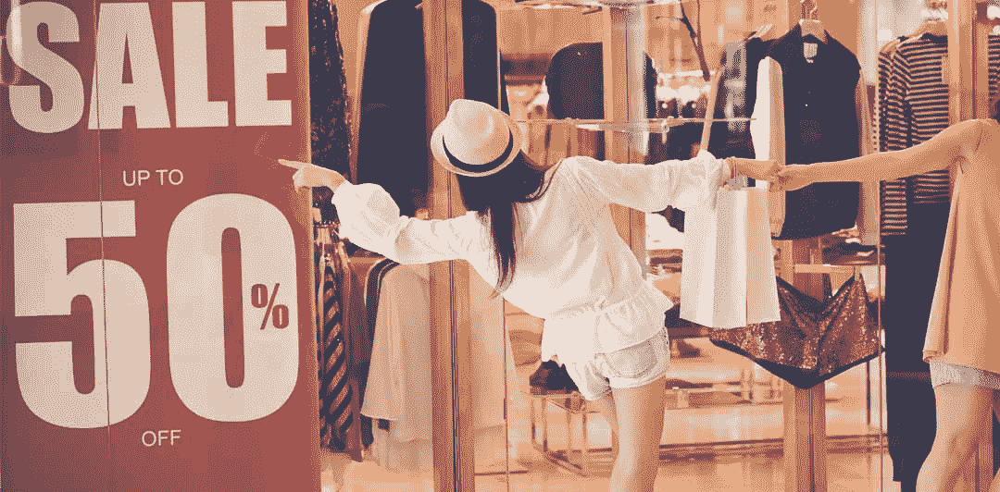

# 13｜信息博弈：你懂得讨价还价，我懂得货比三家


刘润

2020-03-21

13｜信息博弈：你懂得讨价还价，我懂得货比三家

建议 WiFi 环境下播放

上一讲，你知道了什么是线段型商业，这讲我们看看线段型商业怎么克服信息不对称，下一讲看它怎么克服信用不传递。

只要有交易，就会有买卖双方。只要有买卖双方，就会有信息不对称。这种不对称，在线段型商业，一个点连一个点的特征下被放大了。

比如，我怎么知道你说最便宜，是不是真的最便宜？我怎么知道你说大家都抢疯了，就真的是有人抢？我怎么知道你说最后三天清仓大甩卖，就真的是只卖最后三天？我只和你有连接，其他的一无所知。

这就是线段型商业面临的“信息不对称”问题。

那怎么办呢？

在线段型商业时代，商人们“发明”了一种办法，克服这种信息不对称，那就是：博弈。单次博弈、多次博弈、一段段首尾相连的博弈，同样延伸到远方，降低整个交易链条的交易成本。

今天，我们来讲“线段型商业”时代的“信息博弈”方法，是因为其中很多办法延续至今，我们习以为常，但依然非常有用，有巨大的现实意义。

比如：讨价还价。

1999 年 12 月，在大学毕业一年半之后，我从北京到上海，加入微软。

12 月已经是冬天，上海的冬天天气很冷。我下了班后，赶去南京东路步行街的第一百货，想买件羽绒服。我看中了一件羽绒服，卖家是一个上海本地的老阿姨。我问羽绒服多少钱，老阿姨说要 800 元。

我说：“太贵了。你看我就是一个穷学生，哪里买得起啊。便宜点，便宜点我就立刻买走了。”

我开始卖萌。

老阿姨看了看我，用非常慈祥而温暖的声音说：“唉，算了算了，今天最后一单生意了，那就 600 元吧。”

这就是“讨价还价”。

我不知道老阿姨的底价是多少。但是我把 800 元的价格，还到了 600 元，降低了 200 元的“交易成本”。

讨价还价，是一种“信息博弈”。

我为降低了自己的交易成本，欣喜若狂。老阿姨说，去后面仓库里帮我拿一件新的。我就在那里晃着等。

这时候，我看到柜台上摊着一个本子。

都怪我。我不该看这个本子的。看了之后，我就整个人都不好了。

你知道，售货员每天要卖不少衣服，每件衣服价格都不一样，如果不记账，晚上根本不记得收了多少钱。我来的时候，这个老阿姨正在本子上记账。

那这个本子上写着什么呢？

我买的这款羽绒服，下午 500 元卖掉一件，上午 350 元卖掉一件。而我的价格是多少来着？600 元！

现在，我们用商业的逻辑，复盘一下这件事。

这个世界为什么会有讨价还价这件事存在？因为“信息不对称”。

我进商场之前，有一个最高心理价位，比如 600 元。而老阿姨呢？她也有一个最低心理价位，比如 300 元。我不知道老阿姨的最低价位，老阿姨也不知道我的最高价位。这就是信息不对称：我知道一些你不知道的事情。

然后，我就开始讨价还价。

讨价还价的本质，是用“信息博弈”的方式，克服信息不对称。

经过一轮博弈，我们最终会在最低价（300 元）和最高价（600 元）之间，找到一个双方认可的成交价。找到那个点，交易就能完成。

具体在哪个点成交，就涉及到两个经济学概念：生产者剩余和消费者剩余。

*如果这件羽绒服是 550 元成交的，那么我就拿走了（600 元–550 元=）50 元的消费者剩余，而她拿走了（550 元–300 元=）250 元的生产者剩余。这说明，她的“讨价”的能力更强。*

*假如最后我们是 320 元成交，那么我的消费者剩余是（600 元–320 元=）280 元，她的生产者剩余就是（320 元–300 元=）20 元。这说明，我的“还价”的能力更强。*

**讨价还价，是线段型商业文明中的每一个交易线段上，用来消除信息不对称、减小交易成本的重要方法。**

不过显然，在这场信息博弈中，这位老阿姨是当之无愧的胜利方。我学艺不精，怪不得别人，愿赌服输。

但是，不怕，一招不行，还有一招。我还有一招“独门秘籍”，常常帮我在“信息博弈”中获胜。

那就是：跟着一个老人家下单。为什么？因为老人家“讨价还价”、信息博弈的能力，常常比我高好几个数量级。

老人家和卖家唇枪舌剑，你来我往，非常精彩。最后，卖家说：算了算了，怕了你了，就 187 块吧。

这时候我会说：给我也来一个……

这就是我利用他们之间的“信息博弈”，来降低我的交易成本的方法。是不是很机智？

但是，道高一尺，魔高一丈。很多商家继续升级“信息博弈”。

你有没有看过这样的电视剧，在某个古代集市上，一位茶商正在和一位买家讨价还价。但是，他们不是用嘴讨价还价，而是用手。

两个人的手握在一起，用大袖子盖着，然后在袖子里比划。

他比划说，30 两银子行不行？你比划说 30 两太贵，15 两可以买。他比划说不行不行，要亏的，最少 20 两。最后，你们俩 19 两成交。

你们俩银货两讫，成交走人。但是，我完全不知道你们俩惊心动魄的“信息博弈”的最终价格，是多少。

你们的成交价这个信息，对我这个旁观者来说，依然是不对称的。这样，他依然可以用他高超的谈判技巧，和我来一次全新的“信息博弈”，从我这里赚走比你更多的钱。

真是斗智斗勇啊。

那我就没有办法，战胜这个新出现的“信息不对称”了吗？

当然不是，我还可以“货比三家”。

我讨价还价的能力，确实技不如人。但没事。你说多少钱？600 元？好的，谢谢你，我再去旁边那家看一看，一会儿再回来。

你只要把这句话说出来，老阿姨可能就会说：壮士留步！500 元，现在就拿走。

你这时候，要坚定地离开去下一家看。旁边的商场，这件羽绒服卖多少钱？400 元？果然便宜。再去看看另一家，700 元？

这时你应该干什么？回到第二家商场，用 400 元买走这件羽绒服。

这就叫“货比三家”。

因为卖家通常掌握的有效信息更多，所以讨价还价时，卖家占有更大的优势。这就是“买家没有卖家精”“只有买错的，没有卖错的”。

但是，面对这样的“信息劣势”，也就是天然的“信息不对称”，买家也有自己的杀手锏——货比三家。

讨价还价、跟随出价、货比三家。这些都是买家，通过“信息博弈”来消灭信息不对称的方法。

**在线段型商业文明中，作为买家的中间节点，必须熟练运用这些“信息博弈”的手段，消灭信息不对称，降低交易成本，才能让自己成为不可替代的关键节点。**


刘润

什么是信息博弈？

信息博弈，就是通过讨价还价、跟随出价、货比三家等等方法，消灭每个交易线段上的信息不对称，从而降低交易成本。

商人在线段型商业中，扮演了“中间节点”的重要角色。这些中间节点想要不可替代，必须利用信息博弈，成为把商业延伸到远方的，成本最低的交易节点。

了解和学习“线段型商业”的“信息博弈”方法，依然有巨大的现实意义。因为线段型商业依然遍布在我们的周围。当我们还无法改造它们的时候，我们要与它们共处。

在现代，把“信息博弈”表现得最淋漓尽致的场合，就是：谈判桌。你不练习“讨价还价、跟随出价、货比三家”这些冷兵器，就很难从这场近距离肉搏中，全身而退。

这一讲，就讲到这里。

这一讲我们说了，在线段型商业文明中，商人们如何战胜信息不对称。下一讲我们说，他们如何战胜“信用不传递”。

今天我给你留一道思考题：

除了讨价还价、跟随出价、货比三家这些之外，你还见识过哪些降低交易成本的“信息博弈”的手段吗？它们怎么用？

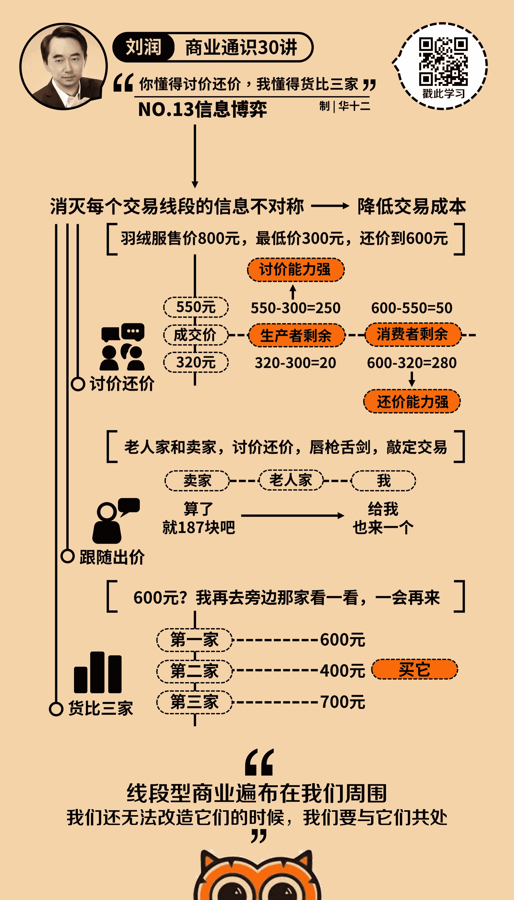  


用户留言

*   

老安 **148 赞**

```
 跟对人，做对事，找对路 罗振宇老师也曾经讲过一个关于“跟大妈买菜”的段子。说的是：上菜市场买菜，你如果觉得自己砍价能力不行，那好，就跟在一个会砍价的大妈后面。等大妈砍完价，你也跟着对老板说：我也来两斤。这多划算啊，大妈砍下来的低价，你也能分享。这叫“跟对人”。不过这还不是最高境界。那么高手中的高手是怎么操作的呢？他们是跟在大妈后面，看大妈和老板砍价僵持不下的时候，再加入，帮着大妈对老板说：你便宜点，我也来两斤。这就由单点变成了团购，虽然客单价利润薄了一些，但是量大了还是有得赚，所以老板可能就答应了。你和大妈都拿到了一个本来拿不下来的价格。所以，跟人的技巧，不是搭顺风车，而是在关键时刻，让自己加入，成为决定性的力量，这就叫“做对事”。 学了今天的课程，在单次博弈的基础上，还可以进行多次博弈，进一步消除信息不对称。顺着买菜的段子继续往下推演：等大妈走了之后，还可以回来再跟老板谈一个长期合作协议，定点在他家买菜，还有可能把价钱压低。如果要进一步掌控局面，还可以在定点的这家买上一个月菜，突然再换一家，也谈一个类似的协议，这样无形之中就营造了一个竞争的环境，只要有利可图，老板还会降价。 
2020-03-19 
```

作者回复

```
把单次信息博弈，变成多次信息博弈。
2020-03-19
```

*    

苏锡许鲜 **57 赞**

```
 砍价的招数还有好多，比如 下午临近售货员快下班去接孩子放学的时候去买东西…… 我就先抛个砖，更多的玉留给后面的同学！ 
2020-03-19 
```

作者回复

```
高手。这是高手。
2020-03-19
```

*   

鸿涛 **33 赞**

```
 除了讨价还价、跟随出价、货比三家这些之外，还可以 1）设置重复博弈的场景，比如说明天还要带三个同学来买。 2）虚张声势，慌说昨天朋友 400 元刚买过。 3）刺探，慌说自己是另一个店来内部调货的，套出内部价格。 4）反向购买，同时召集几家商家，让他们暗标报价格，买价低的。（这通常是企业大批量采购） 
2020-03-19 
```

作者回复

```
赞。这些都建立在“我知道你不知道的事情”这个基础上。确实可以博弈。
2020-03-19
```

*    

爱丽娜 **33 赞**

```
 除了讨价还价、跟随出价、货比三家这些之外， 我自己最常用的就是降低自我欲求欲。明明特别喜欢这件羽绒服，偏偏告诫自己:"不买他不穿他，我也照样活得好好的。" 所以人家要 800 块的羽绒服，我就会回价 100 块，人家说"你疯了"，我就说: "反正我也不需要，看你这么好看，出个价讨一个跟你聊聊天的机会！" 经过一番打情骂俏，250 成交！如果当初没有降低自己的欲求欲，恐怕成交的价格就是 450 以上了。 把可买可不买的列入"买着玩儿""逗焖子"的清单，轻装上阵，无欲无求，反而可以达成超底价。 
2020-03-19 
```

作者回复

```
自我心理暗示，降低心理价位。
2020-03-19
```

*   

子路求学 **29 赞**

```
 刘哥，来赶集了 是的，张强，张，你们家的鞋子有没有我穿的 有呀，刘哥，我们这尺码齐全。 好来，拿一双我试一下……，还蛮合适，多少钱呢？ 那样吧，刘哥，这鞋我进价 50 元，卖都是 120 元 你就给我拿个路费吧，你要是感觉合适 60 元。 好的，张，谢谢你了。 …… 老板，那鞋我试一下…还可以，多少钱？ 80 元，这是新款。 35 元怎么样，行我就拿着。 这还不够成本呢，你在加点。 老板，我说的价能拿不，说着顾客往外走。 ……好吧，以后买鞋还来这买。 好的。 有的时候熟人来买东西，可以用信用对冲信息不对称，问题是，你是不是熟人不是你说了算，而是卖家说了算。 
2020-03-19 
```

作者回复

```
经验丰富啊，你。
2020-03-19
```

*   

江湖无声 **24 赞**

```
 应对线段型商业信息不对称的信息博弈就是买家和卖家间的拔河赛，有文斗，有武斗，还有盲斗： 武斗，招式就是“砍”，打擂台战，要狠，对半砍，组团砍，轮番砍，讨价还价、跟随出价就是武斗； 文斗，招式就是“压”，打歼灭战，要准，用自己懂行压，用量大压，用复购压，用货比三家压； 盲斗，招式就是“诈”，打心理战，要稳，这就要用到五商基础篇的谈判策略，定位调整偏见策略、权力有限策略、谈判期限策略和出其不意策略。 
2020-03-19 
```

作者回复

```
打比方，是一种强大的能力。
2020-03-19
```

*   

赵志豪 **18 赞**

```
 在小微企业信贷业务中我经常需要与同行业，同地区，同规模的不同商家进行信息博弈，每个人的贷款利率价位都不同，我可能会牺牲单次博弈来换取局部利益的最大化（比如给一个该群体中影响力最大的客户一个大优惠，但是需要他提供其他人的心理底价或者信息）。 小微企业融资中，我会告诉贷款客户要么让渡隐私，要么承受高价。大多时候他们面临这样的选择会选择让渡隐私，这就是我想要的，有了信息权，放不放贷款就是我说了算 
2020-03-19 
```

作者回复

```
无处不在的利益，无处不在的信息博弈。
2020-03-19
```

*    

青岛刘学 **16 赞**

```
 哈哈哈，降低“信息博弈”的交易手段那就要用到《五商基础篇》的“沉没成本”法，具体怎么做呢？如果你看上课一件非常非常心爱的貂皮大衣，你就要在店里反复的试穿，不断的沟通，给老板传达一种你一定会购买的信息，增加对方的“沉没成本”，很可能最后老板会因为自己付出的成本而而便宜买给你。 2、“单次博弈”变“重复博弈” 告诉老板我就在附近的某某地方住，每年过年买衣服都会来你这里，你还记得我嘛，老板说，人太多了，没什么印象了，老板你真是贵人多忘事，非常理解，你这生意太好了，不记得很正常，这时候老板也很大可能就给你便宜很多价钱。 因为今年回家带老妈去买衣服，我就是这么使用的。 
2020-03-19 
```

作者回复

```
耗费卖家的时间成本（当然还有自己的），造成对方不卖就亏了时间的心理。
2020-03-19
```

*    

李文涛♛LION♛ **15 赞**

```
 老师，时间成本算进去，还有心理成本也加上，预计对您来说还是亏的，没有这次购买羽绒服的经历，可能商业通识课可以早一个月问世☞ 连锁店的统一售价，就是有效的方向运用了信息不对称，消灭了消费者的货比三家，讨价还价，把消费者剩余归零，生产者剩余达到最大，不过他也要付出一定的高额成本，服务，大面积开店开大店开贵店开好店等多方面投入☞ 
2020-03-19 
```

作者回复

```
哈哈哈。蝴蝶效应。1999 年的一次讨价还价，影响了 20 年后的新课上线。
2020-03-19
```

*    

Tony to ni **13 赞**

```
 1、参考他人经验 比如以前去北京动物园批发市场，由于有很多女生有多次购买经验，对于砍价原则，她们奉行的是：先砍掉 2/3。不要怀疑，你没有听错。这次多次博弈后总结的行业经验。 2、换人砍价 如果你看中了一件衣服，旁边店子里又没有更好看的，你想买。可是你知道杀会回马枪就无法还价了，怎么办？ 让你朋友过去，如果当时你出了 500 元，你朋友过去可以从 400 元起。如果扭头走了的时候，老板答应了并让你回来，坚决不要回头。 再让另外一个朋友去，可能会这样 300 拿下。当然这个砍价成本有点高。 3、组合购买 如果去买鞋子，你可以说，您再优惠点，我买两双。或者鞋子价格砍不动了。你再去看领带，等领带也砍不动了，然后要求两者一起购买的话，再给与折扣。 4、用购物卡或者优惠券 这个不算还价方式，但是可以用更低价格拿到商品。很多商场有活动，可以和朋友一起凑够金额，从而获取优惠。 此外，还有一些黄牛在商场兜售购物卡，实际就是套现。比如一件衣服 1000 元，他用购物卡帮你支付，你给他 950 元就行。 这可以用在已经砍不下价来的时候，再来个折上折。 5、要赠品 鞋子的价格不能低了，好的，那送我一点东西吧。袜子，鞋垫都可以。 
2020-03-19 
```

*    

雄走江湖 **11 赞**

```
 #切忌按下葫芦起来瓢# 除了讨价还价、跟随出价、货比三家这些之外，你还见识过哪些降低交易成本的“信息博弈”的手段吗？它们怎么用？ 讨价还价、跟随出价和货比三家，降低了交易成本，但间接的增加了时间成本。 买一条牛仔裤 小时候选择不多，就从家门口把镇上唯一的一条街几家服装店逛完一遍，价格、质量你就心理有数，就买了。这时候，你每进一家店，你就会和讨价还价，然后再货比三家，看到有人在买，也不烦跟随出价试探，最后综合买了一条性价比较高的牛仔裤。那时候，这些手段降低了昂贵的交易成本，在相对便宜的时间获得更多的快乐，有买到新衣的喜悦，还有省钱的开心。 再大一点上学了，离开老家了，去城市了，就越发不想逛街了，因为不是一两条街道，也不是几家服装店，降低的那点交易成本和增加的时间成本，完全不成正比，省下的那点钱也无法带来更大的喜悦。此时，电商平台也开始踊跃，于是线下转移到线上，不出门就可以在网上讨价还价、货比三家，很快也能买到称心如意的裤子。 再大一点上班了，逛电商平台，发现头晕脑胀的，差不多的款式价格千差万别，不一样的品牌质量也参差不齐，选择恐惧症，不是没有选择，也不是没有好的选择，而是选择太多，好的选择也很多，而你内心想要什么又不明确。于是才出现了各种**优选、**严选、**精选，本质上是供应商把客户的选货时间节省下来，减少选择突显优势产品，加快促成交易。 我曾经就在某平台上，它主打卖电子产品，顺便做点“烤红薯生意”，卖点衣服裤子，当时平台上就一条牛仔裤，价格 179 元，我一秒钟也没想，就买了。 你说是品牌效应，是信任传递，是信息对称，都有，因为我在这个平台已经消费了，数十台手机、三台电视、一台电脑、一个电饭煲、一个电热水壶等等各种小电器，这些东西也是我之前比价之后觉得这里性价比比较高的，心里已经爱屋及乌了，当然理智与感性在每次消费还是会在时间的允许情况下打个小架。 所以我买其他东西时，优先会看下这个平台，如果有，感性脑会告诉我立马买，别逼逼。理性脑告诉我先比价，别冲动。3-5 分钟完成交易。 我们要切忌“按下葫芦起来瓢”，降低了交易成本但增加了时间成本，全局考虑，最优选择。 
2020-03-19 
```

*   

变迁 **8 赞**

```
 在信息不对称的情况下我觉得买方是非常被动的，基本策略是“漫天要价，坐地还钱”，但是由于商品的底价只有卖方知道，所以他们可以游刃有余地谈判，而买方只能碰运气。如果买家要想获得主动就必须对所购商品深入、广泛地研究，从产地到制作再到批发和零售以及分类、行情等等都了然于胸才能和卖家公平交易。所以就是现在那些高人都是在批发市场或农贸市场这类我这样的人谈虎色变、望而生畏的地方购物。 其实那些高人就是做到了信息对称。今天的文章让我想到了一个段子，也是我当年感同身受的经历，就是卖家喊 500 元你还价 100 元后不是怕卖家骂骂咧咧，而是听他干脆地说“好！拿去。”那一瞬间购物的美好荡然无存，获得的快乐灰飞烟灭，心中只有无尽的懊悔——我为什么不还价 50 元…… 
2020-03-19 
```

作者回复

```
还是太年轻了~
2020-03-19
```

*   

小爷今天有空了 **7 赞**

```
 1.记得樊老师说他去逛潘家园，不管什么东西，先说 5 元.先调低对方期望值，虽然有可能会被商家轰出来😂 2.先谈好价格，再说自己是帮别人采购的，索要信息费。 
2020-03-19 
```

作者回复

```
轰出来太浪费力气。不会的。
2020-03-19
```

*   

剑客 **7 赞**

```
 5 商兵器库里翻出沉默成本，和价格之锚，前去谈判。 买羽绒服的案例当中你还可以回去 500 元那家在多看看，和老阿姨聊了 10 分钟之后，你开始抛出价格之锚：东西还不错，就是太贵了，350 卖不卖？阿姨说：不行，这样我会亏的，看你时髦帅气，破例 450 你拿走。你把价格定在了 350 这个锚点开始博弈。 又聊了 5 分钟，你说那边有一家报价 400 元好像和你的品质一样的嘛，我还是去那家买吧。这时付出 15 分钟劳动的老阿姨说：我的品质肯定更好，我也 400 卖给你。你无辜的说：那家开价就 400，我去问问没准还能便宜呢。 沉默成本成为压死骆驼的最后一根稻草，老阿姨一咬牙说 380 你带走，你这个小伙子怎么比老大爷还能砍价！ 你微微一笑说：因为多年前一位叫刘润的少年在您这买过一件 600 的羽绒服，后来他开了一门课叫 5 分钟商学院 
2020-03-19 
```

作者回复

```
你可以写小说了。嗯。
2020-03-19
```

*   

夜风 Steven **7 赞**

```
 我觉得降低交易成本的方法还有多次博弈。 比如张大爷因为经常在楼下的便利店买东西，跟便利店主赵老板已经很熟悉了，这天赵老板进了一些橘子来卖，张大爷问：这橘子甜不甜啊？赵老板回答，一定甜，您先称三斤回去，吃着不甜来我这退钱。张大爷爽快的买了三斤橘子。因为他知道，赵老板常年在这卖东西，不会跑。 这天张大爷跟老伴一起跟团旅游，来到了 A 景区，老伴口渴了，刚好看到有个小贩挑着一筐橘子卖，就上前问，这橘子甜不甜啊？小贩说，您尝尝，如果不甜您再回来找我。张大爷想了想，决定还是去前面的小卖部给老伴买瓶矿泉水解渴。 楼下便利店的赵老板比景区的小贩更容易成交，就是因为多次博弈降低了信息不对称，赵老板已经在张大爷这里建立了信用，但小贩没有。 
2020-03-19 
```

作者回复

```
有信用，少博弈。
2020-03-19
```

*    

张宇航 **5 赞**

```
 还有一种办法，你可以"炸"老板一下，假装信息对称。 方法 1）"我是老客户了，原来不是这个价呀?原来才 xx 元（利用一秒价格锚点😄）。" 方法 2）"我是来进货，选择供应商的，先在您这儿买一件试试，就按批发价吧?" 其实"炸老板"也是运用了谈判中的，先问价，然后釜底抽薪，给她惊喜（惊吓）。 同样，沉默成本适用。 
2020-03-19 
```

作者回复

```
以信息不对称，治信息不对称。
2020-03-19
```

*   

毕昊峰 **5 赞**

```
 投标报价。作为建筑业从业人员，这是我见识得最多的一种手段，业主方/总包方通常会用这种方式来寻找承包商或分包商。多年以前，听一位在海外建筑业市场上打拼几十年的业界大腕讲这种模式的本质时，这位专家说，这种方式本质上就是降低业主的成本，也就是润总说的消除信息不对称。还有电商平台，这是当下运用的最多的一种消除信息不对称的手段了。这对卖家或买家来说，都是相对公平的。因此，作为卖家来说，就要是提高所销售产品的技术含量，否则可能会影响销量。作为购物者，谨防陷入购买一大堆不适用的物品陷阱之中，这在双 11 等购物节时尤为明显。否则，消费者在购买和消费的过程中，就会陷入上个世纪 60 年代美国思想家马尔库塞所说的“舒适性”不自由中。还有一位文化界的朋友，她是主持文物拍卖的，这是“投标报价”反向操作方式，对于文物拍卖公司或个人而言，就是另一种消除信息不对称，获得市场溢价的方式。当然，两者在本质上都是一样的，即消灭这个交易线段上的信息不对称，从而降低交易成本或提高交易价格。道高一尺，魔高一丈。作为上述投标者、消费者、竞拍者，也是有反向的办法为自己争取利益的。此处，要省略若干字了… … 
2020-03-19 
```

*   

聂珣 **4 赞**

```
 风电行业分析： 风电行业属于大型设备采购，克服信息不对称的最佳方式就是招投标，属于典型的密封式拍卖，投标方不知道竞争对手价格，为了拿到单只能往最低价格上靠。但卖家也有应对之法——陪标，即几家供应商之前就商量好由谁拿标，价格是多少，然后其他家去以更高价竞标，最后拿到单的那家再分点利润出来给大家，或者下次再给其他家陪标。买家也会在程序上做出一些限制，来杜绝陪标的现象，但卖家总能想出办法，你来我往，好不精彩。 因为互联网的连接作用，行业内绝大多数信息都能共享了，但一些真正核心的信息往往只在小圈子中流动，不是行业中人是无法获得的。比如公司刚开始开发风场时，就不知道政府收取资源费的标准是多少，这个费用相当隐晦，并且各地都不一样，政府人员刚开始也不明说，就说另外几家公司可是出了大价钱的，这就让我们很尴尬，给多了自己亏钱，给少了又怕拿不到好资源。最后我们也是通过多条线索、花了很大的功夫才摸清政府的需求和心理价位。 
2020-03-19 
```

作者回复

```
不让你摸清楚，你才会“尽力”。
2020-03-19
```

*   

吉卜力 **4 赞**

```
 我遇到过卖家为了应对买家的“货比三家”直接报出一个其它商家不可能卖的低价，当买家打听完多家价格有回来的时候，卖家会和颜悦色找借口说刚才那个版刚卖，要不换一款和那个差不多的这款，先用低价套住顾客，取得信任，然后再更换商品。 多年前刚购买组装电脑的时候，会先去购买“电脑爱好者”杂志，把装机指南的配置价格熟记于心，谈价还价的时候上去就给卖家一顿讲，给卖家讲蒙，然后叫他出价，心里对照参考价格；后来多次还在他家交易，把单次博弈变成多次博弈，这时候卖家往往直接报最低价。 
2020-03-19 
```

作者回复

```
如果是我，已经败下阵来。
2020-03-19
```

*   

演员 **4 赞**

```
 记得小时候，姥爷家卖牛的时候，姥爷就和买主将手握在一起，放在袖子里面，一会就决定好成交的价格。 
2020-03-19 
```

*   以上留言由 作者 筛选显示
    

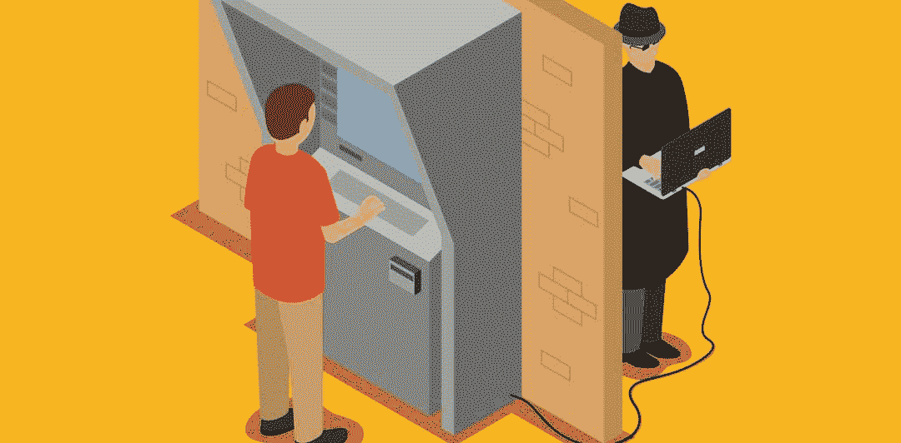

# 14｜信用中介：神秘莫测的黑市中间人 VS 德高望重的乡绅


刘润

2020-03-21

14｜信用中介：神秘莫测的黑市中间人 VS 德高望重的乡绅

建议 WiFi 环境下播放

上一讲我们说了，在线段型商业这种“首尾相连，承上启下”的交易结构中，商人们如何战胜信息不对称。这一讲我们说，他们如何战胜“信用不传递”。

什么叫“信用不传递”？

信用不传递，就是离我越远的人我越不信任。

买家和卖家，已经解决了信息不对称的问题，打算交易，但因为彼此不熟悉，没有“信任”，总怕对方会背弃承诺，走不出最后一步。怎么办？

这时，找一个彼此都信任的中间人，也就是“信用中介”，是关键的临门一脚。

我举个例子。

假如你是一个“惊天神盗”，刚刚偷了一幅在拍卖行成交价 100 万美元的名画。你想赶快把这幅画偷偷在“黑市”上卖了赚钱。请问，你觉得这幅画能卖多少钱？

100 万？80 万？至少 50 万吧？

错。黑市上的成交价，大概会在 5 万以下，也就是原价的 5%不到。

啊？5%都不到，那“惊天神盗”，不就是个体力活，赚个辛苦钱吗？为什么啊？

因为“信用不传递”。

上次拍卖会，有个富商非常喜欢这幅画，想用 90 万买，没买到。你现在偷了这幅画。那么请问，你敢不敢直接去找这个富商，说我给你打个折，50 万卖给你？

你不敢，因为不信任。你怎么知道他会不会断然拒绝，然后报警？

反过来说，你猜那位富商如果真想买，不报警，他敢不敢买？也不敢。

为什么？也是因为“信用不传递”。

1911 年，卢浮宫的一个工作人员藏在储藏室里，在闭馆后偷走了著名的《蒙娜丽莎》。对的，就是那幅你知道的、达·芬奇的《蒙娜丽莎》。这件事，轰动了全世界。

还好，1913 年，这幅世界顶级名画被追回。所以，整整 100 年后的 2013 年，我才有幸在卢浮宫一睹真容。

但是，最狗血的事情来了。

1932 年，一份笔录揭示了偷画的真正幕后主使：瓦尔菲尔诺。

瓦尔菲尔诺坦承，他是策划了偷画。但他偷画的真正目的，并不是为了卖画，而只是让《蒙娜丽莎》在全世界人的眼皮底下消失，然后，他就可以做一件你怎么都想象不到的事情。

什么事？

他可以拿着自己画的《蒙娜丽莎》伪作，悄悄地去找富商们，说：这是我刚刚偷出来的《蒙娜丽莎》，太珍贵了，我就告诉你一个人了，要不要买？要不要买？全世界就这一幅。

富商压抑着内心的激动，从瓦尔菲尔诺手上买下了《蒙娜丽莎》的伪作。

富商们很兴奋，但因为这是“赃物”，他们无法拿去鉴定。因此，瓦尔菲尔诺这个“旷世奇才”，把伪造的《蒙娜丽莎》当作真迹，卖给了一个又一个窥视《蒙娜丽莎》已久的富豪。

最后，瓦尔菲尔诺一共卖出去了多少份伪作呢？6 份！

这件事被披露出来后，整个世界更加震惊了。而那 6 个吃了天大的亏的富商们，也只能把苦果往肚子里咽。

所以，你猜，富商们还敢不敢从“惊天神盗”手上买失窃的名画？

不敢。因为不信任。

富商不信任神偷，神偷不信任富商。他们之间的交易，遭遇了“信用不传递”的阻力。

怎么办？

**要促成这段交易，他们之间，需要一个“信用中介”。这个信用中介，就是“黑市中间人”。**

什么是“黑市中间人”？

黑市中间人，就是在黑市交易中，双方都信任的人。黑市中间人的信用值，通常非常之高。他们甚至用生命捍卫自己的信用。因为黑市是被严厉打击的地下市场，如果中间人的信用值不高，最后产生矛盾，交易各方又无法诉诸法律来解决纠纷，讨回“公道”，大家就不会放心通过他来交易。

现在，收藏家只敢从黑市中间人手中买画，神偷也只敢把画卖给黑市中间人。黑市中间人，成为了“线段型商业”这个交易结构中“无法取代的关键节点”。没有他，这个交易链条就是断的，买卖无法完成。

所以，你觉得他会收多少钱？

95%！

因为这中间的大部分价值，不是偷画的价值。偷画是个体力活。这中间大部分的价值，是成为非常值得信任的“信用中介”的价值，这个是脑力活。

什么是信用中介？

信用中介，就是我不信任你，你不信任我，但是我们都信任同一个人（或者同一个机构）。这个人（或者这个机构），于是就可以把自己的信用“借”给双方，完成交易。

信用中介，是在线段型商业时代，克服信用不传递的阻力，降低交易成本的重要方法。

我再举个例子。

在一个偏远的乡村，A 向 B 借 2000 元钱，说当路费出去打工，半年后回来，连本带息还 2200 元。我拿我家的牛做抵押。还不上钱，牛就不要了。

半年后，A 回来了，身无分文。B 问怎么回事。A 说钱是挣到了，但老板说要 1 个月后才能打到账上。

B 觉得 A 在说谎，一下子就慌了，说 2200 元我不要了，牛我牵走。

这头牛是 A 家全部的生产工具。A 说，你相信我，一个月之后，我给你 2500 元，不要把牛牵走。但 B 就是不答应。两人吵了起来。然后去村里最有威望的人，德高望重的“乡绅”那里去评理。

“德高”是指品德高尚，不会骗人；“望重”是指威望崇高，说话算数。“德高望重”这四个字，其实就意味着有“信用”。

乡绅听完了整件事，说：“明白了。我是看着 A 从小长大的，我相信他。A 你就写张借条给 B，说清楚一个月后，你会还给他 2500 元。怎么还，在哪里还，都写清楚。”

然后转身对 B 说：“A 已经答应多给利息了。你相信我吗？如果你相信我，就等一个月后再去要钱。再让他给你多送两篮子鸡蛋，可以吗？”

这时候，乡绅把自己的信用“借”给了 A，用来打消 B 的疑虑，促成交易。

**乡绅这种天然形成的“信用中介”，是在线段型商业世界里，非常重要的用来克服“信用不传递”这个阻力的工具。**

最后 A 和 B，顺利地完成了交易。


刘润

什么叫“信用中介”？

信用中介，就是我不信任你，你不信任我，但是我们都信任另一个人（或者一个机构）。这个人，于是就可以把自己的信用“借”给双方，完成交易。

线段型商业，是商业文明的第一次重大的进化。

在线段型商业中，一种既不是生产节点，也不是消费节点，仅仅是来帮助生产节点、消费节点完成交易的中间节点出现了。

这种中间节点，就是商人。

商人看上去是以自带“交易成本”的形式存在。所以，很容易被人认为是“中间商赚差价”“空手套白狼”，甚至是“投机倒把”。

但是，作为商人，我们自己要清楚，商人群体其实一直在通过“信息博弈”的方法战胜“信息不对称”，用“信用中介”的方法战胜“信用不传递”，然后像英雄一样，把商品从生产节点手中，接力式地传递到消费节点手中。

线段型商业，听上去已经很古老。但是，它依然是今天商业社会的重要组成部分，和中心型商业并存着。

学习信息博弈，和信用中介，这些线段型商业时代，战胜信息不对称、信用不传递的手段，就是要与它共存，最后超越。

这一讲，就讲到这里。

线段型商业，是完美的交易结构吗？显然不是。下一讲，我要给你讲比线段型商业更加激动人心的“中心型商业”。

今天我给你留一道思考题：

你身边有哪些还存在的线段型商业，你觉得里面有商机吗？

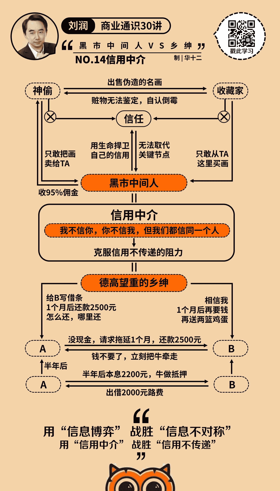  


用户留言

*   

江湖无声 **104 赞**

```
 信任是个宝，有它没烦恼。 我不问+你不说=误会 我问了+你不说=隔阂 我问了+你说了=尊重 你想说+我想问=默契 我不问+你说了=信任 不怕身隔天涯，只怕心在南北 信是诚信，任是交付，用诚信交付，就是信用货币，信任可以购买信息不对称，可以买来无脑的放心。 信任+钱=信贷 信任+物=信物 信任+货=品牌 信任+人=感情 信任+言=信念 信任+真理=信仰 获得信任的唯一原因是你值得信任，且周围的人都知道这一点。 
2020-03-20 
```

*   

老安 **64 赞**

```
 关于身边的线段型商业，我觉得房产中介算是其中之一。前两天，一个亲戚把他的房子卖给自己的大学同学，一个愿意买，一个愿意卖，两人很快就达成了意向，但在交易时，两者犯了难，是买房先打款呢，还是先办过户呢？最后，两人还是找了家房产中介，达成了交易。可谓是：“亲兄弟，明算账。人情归人情，生意归生意”。 目前，房产中介的功能主要还是解决二手房买卖双方彼此不信任的问题，也就是信用不传递。由于交易时房产价格和房产是不变的，而房产交易恰恰又不能一手交钱一手交房，在办理过户、贷款的过程中，房产的价格和买卖双方的心态都是在不断变化。所以，交易双方都是站在自己的立场盘算，如果没有一个中间节点协调，很难传递信用，此时房产中介作为第三方节点也就有了存在的价值。 一方面，如果将来政府能够精简二手房买卖的流程，让买房就像网上购物一样便捷，二手房买卖就可以一手交钱一手交货，中介也就失去了存在的意义。另一方面，如果一些大型的房产 APP 推出自己的中介担保业务，就像支付宝一样，把传统房产中介的功能线上化，这样也将减少交易成本、提升交易效率。 
2020-03-20 
```

*   

王黎璐 **38 赞**

```
 比如说宠粉经济。有同学应该有同样的感受，润总带货，先买再说。这就是就是用捍卫信任的方法，逆序建立品牌，需要建立起粉丝对润总的无条件信任。润总就是中间节点，信用中介...........放心去赚 95%😊 
2020-03-20 
```

*   

金戈铁马 **16 赞**

```
 举一个我自己接触到的例子。今天，很多中国企业、特别是做建设工程总承包的工程型企业，到海外去承接业务，尤其是在越南、印尼、马来西亚等东南亚国家，都需要找一个可靠的中间人。这个中间人通常不是个人，而是一个内部机制严密、协作分工明确、运作高效的组织。这样的中间人，通常在这些海外国家扎根多年，熟悉当地的文化、风俗、民情，而且和当地政府、大企业之间有着紧密的联系，可以说在当地有着广泛的人脉资源。同时，这些中间人的组织内部，也有很多人就是从国内走出去的，有些人还有在国内大型工程企业的从业经历，对于国内工程企业的整体情况也非常熟悉，甚至和很多国内大型工程企业的高层也有不错的关系。这样的中间人，其实以自己的信用做抵押、消除双方之间存在的信用不传递，进而促成合作。 当然，这些中间人的收费也是比较高的，这也是线段型商业的一大特征。我个人的观点，面对这样的情况，国内企业可以采用报团取暖的方式，共同拓展海外市场。比如，如今中国很多大型央企，已经在海外，特别是东南亚、非洲等地扎根多年，在当地有很高的知名度、认可度，其本身就拥有丰富的人脉、政商资源；那么，国内其他企业赴海外承接业务，就可以依托这些央企的平台、和这些央企合作，运用央企在当地的资源优势，共同拓展新的市场领域。这样一来，也就能够大大降低国内企业在海外拓展业务的交易成本，进而开拓出更高效的商业运作模式。 
2020-03-20 
```

*   

卫大侠 **16 赞**

```
 我们这个行业属于汽车后市场（汽后）。我们这个行业的特点就是我们在这行业从业十几年了，作为行业内的人，我们自己都觉得这个行业非常乱。自己出去买一件产品，或者说是一个配件，我们都不知道买到的是真的还是假的，因为行业内充满了不信任。更不说外面的车主会认为我们这个市场是多么的乱，多么的不值得信任，所以为什么很多车主宁愿回去 4s 店买高价的产品，也不愿在路边店或者其他的店里面买一些低价的产品，因为他们怕买到的是以次充好的配件。早年的市场情况确实也是这样，大量的以次充好，劣币驱逐良币例子非常明显。拿个汽车空调雪种为例，我入行的时候这个产品市面上流通的雪种内容物有三种，一种是替代物（F12 和其他一些制冷介质的混合物），一种是 F12，一种是国家提倡的环保的 R134a。悲催的是，这三种内容物在外面的罐面上打印的都是 R134a。让车主消费者根本就没有办法去识别谁是真正的 R134a。行业无比混乱。现在 10 多年过去了，替代物已经消失了，F12 也只剩下极少部分的市场份额，受到了国家严厉的打击，主体都是 R134a 了。这个行业的方向，在往正规的规范的方向走。作为行业的从业人员，我们是非常希望看到这么一种现象的。里面有很多的因素导致了这样的结果。一个是车主消费者的觉醒，一个是一些行业从业人员的改变，一个是国家法律的明令禁止。也还有客观的因素，就是这些假货的成本和现在 R134a 的成本已经相差不大了，利益上没有那么大的动机了。目前在我们这个行业还是会存在很多这样的现象，什么原厂件、副件、正品，我们根本就搞不明白，我们作为从业人员我都搞不明白。哈哈，混乱也意味着机会。典型的线段型商业，如果你的产品有办法让所有车主觉得是正品，那是多么大的商机啊。 
2020-03-20 
```

*   

剑客 **13 赞**

```
 信用传递是层层递进的，如果想短路的中间环节越多，那么就需要越强大的信用背书。 结合 5 商的学习，我认为品牌的本质是信用储藏器，品牌的作用就是充当了信用中介。小米通过手机竖立了品牌，更多人通过小米的“烤红薯”生意加强了对小米的品牌认可。比如毛巾，电池，中性笔等。每一次购物的满意加强了我对小米这个品牌的信任 所以当我下次需要买一个我完全没用过的产品时，小米将会成为我的信用中介，我会看看小米有没有出，小米出了我会直接在小米买 总结：商业的本质是交易，交易的阻力来自于信息不对称和信用不传递；商人通过减少信息不对称来降低交易成本，通过建立品牌来传递信用。 
2020-03-20 
```

*   

伊春莺歌 **11 赞**

```
 老师这一讲让我联想到了著名影片《教父》。在那个时代，很多陌生人之间的信任问题通过他来解决，他提高了交易的效率。 其实企业，品牌，网红，行业协会等，都起到了类似的作用。比如网红，他们本质上就是提供信任担保。有人抱怨，我才是那个最辛苦的生产者，凭什么要给一个动动嘴皮子的网红明星那么多提成。就因为在建立信任交易的关键一跃上，他们付出了更多成本，拥有了消费者信任，他们就拥有了市场话语权。 还有一些传统行业，尤其是农产品，原料，加工，二道贩子，一级采购商，厂家，再到各级销售渠道，最后到达消费者。这都是多个首尾相连的线段，那如果有一个机构能直接链接生产者和消费者，提供双向信任担保，那么它就有可能获得巨大的成功。我们把这样的机构起了一个现代化的名字：中台型企业。 这个时代是信息的时代，谁把握信息谁就拥有未来。这个时代是效率的时代，谁拥有信用谁就能获得财富。我们要向经营资产一样，对待经营我们的信用， 
2020-03-20 
```

*   

佛祖门徒 **10 赞**

```
 润总这一课里有一个要素就是“熟悉”，熟悉程度常常决定了能否建立信用。人们总是容易对形成熟悉印象的人或事产生一种信任感。 附近的银行向老年人推荐新出的理财产品，大多数老年人都存在顾虑，所以产品销量很差。不久之后，在老年人经常跳广场舞的地方出现了一位年轻人，他常带着相机为老年人拍照，并把照片展示给他们看。慢慢的，老年人都喜欢上了这个小伙子。其中有些老人让小伙子把照片给自己，小伙子就跟着老人到家里把照片导入电脑，还很热心的帮老人清理电脑，教他们怎么做电子相册。老人看小伙子对电脑操作这么熟练就问起他的工作，小伙子说在银行工作。于是，老人就问起一些理财产品的事，小伙子做了一些说明和推荐。最后，跳广场舞和不跳广场舞的老人中绝大部分都买了一些这家银行的理财产品。 
2020-03-20 
```

*   

武柏君 **8 赞**

```
 越复杂的产品越难识别，专业性越强的服务越难判断。信用中介有其存在的理由和价值。商机就是进一步优化中介本身，为供需双方提供更好的体验和服务。 
2020-03-20 
```

*    

吉林雀园 **7 赞**

```
 我们通化有很多著名的药厂，所以这里的药材很出名，尤其以种植贝母和人参闻名，每年 6 月份是贝母的收购旺季，就会有很多商贩下来收贝母，他们就是“信任媒介”，因为常年合作，农民相信他给的价钱最高，买贝母的人也会相信商贩，他收购贝母再拿到市场卖，连接另一头的农民买家（他们买贝母栽子）和药厂，这个“线段型商业”能省略“信任媒介”吗？答案是不能。第一，两头的农民，虽然一个买一个卖，但两人都在自己住的大山沟里，彼此人生地不熟，先不说信任不信任，连接都连接不上。第二，药厂从不在农民手里采购，他们是直接是下订单给种植户或中间商贩，降低交易成本，还有信任成本（农民有时候……） 
2020-03-20 
```

*    

Chelios chen **5 赞**

```
 永不消失的“线段型商业模式” 线段型商业模式不会消失，他的问题是在商业社会中的占比会缩小到什么程度。 线段型商业模式有他自己的优势与特点，他能够解决“中心型商业模式”效能随着链接的长度而效能降低的短板。也能解决“去中心化商业模式”所带来的的商品良莠不一的问题。凡是能够有效解决“信息不对称”和“信息不传递”，且效率最优的线段型商业模式肯定会持续下去。比如说生活必需品的零售业等。 中介靠解决线段型商业“信用不传递”的能力占据了生态位。这个生态位主宰了收益的分配。但中介赚到的钱并不嫩全部占为己有，他是需要“散财”来不断的巩固自己的地位，打击试图成为他的人。就像黑中介一样，他也需要把钱用来搞掂黑白两道方可。 
2020-03-20 
```

*    

Hank **4 赞**

```
 信用卡起到的就是信用中介的环节。 记得我在买苹果 11 的时候， 招商银行就推出了 24 期免息的分期付款方式， 减小了我的购买压力。 因为信用卡这个中间人的存在， 极大的满足和丰富了我们的生活需求， 在我不认识对方的情况下， 信用卡起到了中间媒介的作用， 因为我们都信任信用卡这个中间商， 我们彼此的信任进行了传递， 交易进行了完成。 
2020-03-20 
```

*    

青岛刘学 **4 赞**

```
 说说我们那边怎么借给对方大笔额度的钱的，A 向 B 要借 30 万修房子，B 给出了比银行高的利息，A 也觉得可行，但是 A 很担心 B 到承诺的时间还不上钱，还害怕 B 借了钱跑路，于是对 B 说，借钱可以，但是你要找来一个中间担保人（也就是 C），万一以后你还不上了，你找的担保人要承诺帮你还，如果没有，请原谅我不能把钱借给你，因为这都是血汗钱。我们那边都是这样借大笔钱给对方。但是我觉得还是风险太大，如果出现 C（中间担保人）最后也没钱，最后跑路，怎么办？所以我今年给家里人提的意见是要学银行，做抵押借钱，把对方等值价值的资产用来做抵押（当然抵押的资产在未来不能有很严重的贬值）。农民赚钱不容易，承担不起这个风险。 2、现在觉得借条太不规范了，不受法律保护，我建议我爸把借条找一个律师拟份合同换成合同，最后是有法律保护的。 
2020-03-20 
```

*   

心铭 **4 赞**

```
 润总好， 身边的线段型商业，我想就是古董行业了，因为产品的单一性，必然是从一个人传递到另外一个人。如何解决信息传递的问题？只能通过双方认定的检测机构出的证书，或者找个信的过的人。其实这个行业，存在极大的信息不对称，跟信息不传递。所以在消灭交易成本的路上，还有很大获利空间。去趟潘家园，一件东西，卖家喊价大几千，最后几十块钱成交。 这里面的商机，1，鉴宝服务，通过鉴宝来减少信息不传递的弊端。2、博物馆，将变卖为租，不过这里租的是时间，在我这看一下。其实这种博物馆也是将线段变为中心，知名的博物馆，其实是一拖二，上方多个卖家，下方多个买家。也算是古董界的中介了。 
2020-03-20 
```

*   

青岛潘飞达 **4 赞**

```
 “信用中介”还有一个典型案例就是房产中介。 房产中介是一个存在了很久的传统行业，主要通过信息不对称赚取服务费，但是在互联网大潮的冲击下，不但没有被替代，反而越干越好，规模越做越大。 为什么呢？他的商业的本质是什么？ 房产中介其实就是通过信息博弈和信用中介去帮助房东和买房（承租方）达成交易的服务商。主要有三项职能： 第一，通过搜集附近小区内所有的待售和待租的房产信息，为客户提供信息服务。 第二，通过专业的知识，为客户办理交易中所有的手续，提供代办服务。 第三，通过品牌或在这小区经营多年的信用，解决买卖或租赁双方的信用不传递问题，提供信用服务。 了解了房产中介的本质，我们知道房产中介不仅仅是通过信息不对称赚钱，而是通过信息博弈和信用中介来赚钱，互联网可以替代信息博弈，但暂时还无法替代信用中介。 2012 年我刚到上海，面临的第一个问题就是租房，一种是上 58 同城和赶集上去找房，另一种就是在单位附近到处找小区公告或者中介。 因为那时我只有单休，所以能拿出来看房的时间非常少，对比两种方式，虽然上网可以搜到很多信息，但是筛选这些信息的条件和真伪费了很大功夫，充斥着很多假信息，效率极低，而且联系之后我还不敢信任他，不知道他是不是真房东。而去房产中介看房，房源信息基本都是真实的，而且因为他们掌握了大量同一小区的房产信息，所以看房效率很高，那些干了很多年的中介基本不会倒闭，也不会因为我这点钱而跑路，所以比较信任他们，一天就定下来了。 那个时候有很长一段时间我没搞明白，为什么互联网代替了那么多的“中间商”，怎么就代替不了房产中介呢？后来经过多年与房产中介打交道，慢慢了解了这背后的逻辑，就是他们根本不是中间商赚差价，而且借助互联网自身还在不断进化。 我把互联网中介大体分为三个阶段： 1.0 阶段，就是以 58 同城和赶集网为代表的信息传递模式，只提供信息交互平台。 2.0 阶段，就是以安居客、链家网、QQ 找房等为代表的既提供信息，对房源真实性的把控，也有线下门店可以为你提供全套服务，是 O2O 的模式。 3.0 阶段，就是以贝壳为代表的平台模式， 贝壳相当于一个 B2B 平台，平台给商家带来流量、促进成交，以成交和服务进行收费。如提供 VR 房源服务，数据信息(楼盘字典)服务，链家系统的操作系统等等。区别于之前一单到底，谁负责成交谁拿到所有钱的模式，ACN 是提供房源，带看，成交等不同环节都各自能拿到回报。 未来的 4.0 和 5.0 是什么样的，比如区块链、人工智能等等，我也不知道，但是商业一直在进步，商机一直会存在。 
2020-03-20 
```

*   

聂珣 **3 赞**

```
 风电行业分析： 这几年做风电场开发，结识了很多掮客，或者说中介，他们帮你解决各种问题，比如政府手续、联系买家卖家、搞定民事、融资等等，这些机构或个人他们的合同往往很模糊，有些甚至没有合同，我一直搞不懂他们是怎么确保能拿到钱的。 有些工作有保障，比如搞定民事的，如果不给钱，我自然有办法治你；但有些就很难保障了，比如联系买家的，如果买卖双方接洽上了，那作为中间方基本就没有什么作用了，这时候对方是否给钱完全看他的心情，风险极高。但长时间接触下来，发现基本没有赖账的情况，这里就有中间方信用担保的作用了。民营开发企业，往往对电力行业不了解，买家也不敢相信你是不是藏了猫腻，但中间方往往是行业内十几年的老兵，他们与买家有过多次合作，买家相信他，有他背书我更踏实，那这部分费用我自然愿意掏。 
2020-03-20 
```

*   

托尼在厦门 **3 赞**

```
 润总好！ 身边确实还有一些“小而美”的线段型商业，因为体量小，一年只有几百万的的销售额，但利润率丰厚，大企业看不上，趁认真钻研，找到第一手渠道，还能赚几年钱。 这些小而美的产品，基本都是国外进口的。 
2020-03-20 
```

*    

曾凯 **3 赞**

```
 我之前在银行做国际业务，国际业务最重要的结算工具是信用证，刚好就是那么一个乡绅的角色。但来找银行的客户，哪怕买的是同样的商品，聚丙烯的催化剂，国外卖家也是同一个，他们的角色也有不同。有上市公司的子公司不缺授信，直接就向境外供应商购买，用于自身生产。也有很难拿到银行授信的民营贸易商，作为地区总代理。做同样事情的客户，在这个线段里的生存空间完全不一样。 上市公司的子公司肯定不会去找总代理拿货，他们因为自己的实力和信息渠道短路掉了这个中间商。但民营贸易商下面，还有很多无法短路掉他们的小型生产厂商。 线段型商业存在，有时候也降低了末端企业的成本，至少他们不用去聘请专门处理国际贸易的人员了。 
2020-03-20 
```

*   

又见十年 **3 赞**

```
 很多人说了房产中介，现在中介平台发展较好的是贝壳。贝壳解决的问题是真房源。以前的房产中介在 58 或安居客上发布信息，故意发布一些不存在的低价房，买家打电话问，中介说你看中的已卖或已租了，这样中介就得到买家的信息了，就不断给你推荐其它的房源。贝壳真房源减少了买家的比较成本搜寻成本，同时把带看次数与过往成交都数据化，让总交易成本更低。 
2020-03-20 
```

*   

祢鹿 **3 赞**

```
 我所在的汽车行业应该也是一个线段性的商业链，从汽车零部件厂到汽车制造厂到 4s 店再到消费者。而 4s 店这个环节很多人以为他们是中间商，汽车公司也多次想通过直销的方式取缔掉 4s 店，但最终都以失败告终。在我看来，根本原因在于其实 4s 店卖的是对消费者的服务，这与厂家的制造是两码事，他在线段商业里也有他不可取代的一部分。 
2020-03-20 
```

*   以上留言由 作者 筛选显示
    


# 15｜中心型商业：为什么家乐福、麦德龙、大润发，纷纷被收购？


刘润

2020-04-08

15｜中心型商业：为什么家乐福、麦德龙、大润发，纷纷被收购？

建议 WiFi 环境下播放

线段型商业之后的下一个商业文明，叫：中心型商业。

从这一讲开始，我们用三讲分别来讨论：

*   1）什么是中心型商业？
    
*   2）中心型商业，如何战胜信息不对称？
    
*   3）中心型商业，又如何战胜信用不传递？
    

首先，什么是中心型商业？

**随着连接手段的进步、网络密度的提高，越来越多首尾相连、承上启下的“线段型商业”的交易结构开始出现，并逐渐交错，催生出一个又一个的“十字路口”，甚至“米字路口”。**

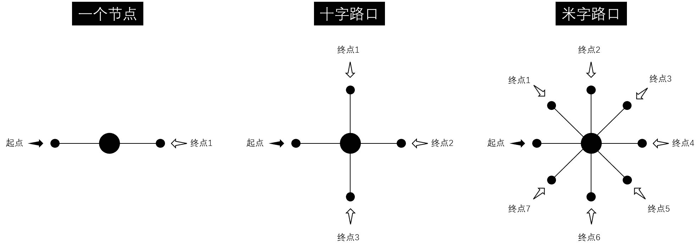

当越来越多的“交易线段”纵横交错，商业世界开始出现一些 10 条线段、100 条线段，甚至 1000 条线段同时交错的“超级节点”。比如，罗马。你一定听说过一句话，叫作“条条大路通罗马”。比如，武汉。你也一定听说过武汉“九省通衢”的美称。

“超级节点”的价值，远超任何一个普通“交易节点”。因为在一个普通的交易节点，你只能和一个人交易。但是在超级节点，你可以和 10 个人、100 个人，甚至 1000 个人交易。

从北京去广州的人，在武汉歇脚。然后和全国各地的商人一聊天，发现杭州和长沙能出更高的价。于是，北京商人改变了交易“线段”，不送广州了，而是把货送去杭州和长沙。

于是，全国各地的商人停在武汉，和不断聚集来的商人们“讨价还价”“跟随出价”“货比三家”。武汉，成为了一个“交易中心”。交易所创造的价值，逐渐沉淀在武汉，武汉因此成为“楚中第一繁盛处”。

还记得我在前面说到的大理吗？

在公元 8~13 世纪，大理之所以能成为东南亚最繁华的城市，也是因为它有意或者无意地因其“超级节点”的地理位置，成为了“交易中心”。

陆运时代的罗马如此，大理如此，武汉如此；海运时代的香港如此，天津如此，上海也如此。


当若干“线段型商业”彼此交错时，中心型商业开始像火山爆发一样，喷薄而出。

这场火山爆发，最开始可能只是你们家门口的那一点点微不足道的震感。然后蔓延开来，直到山崩地裂。

**我们来看看，中心型商业是如何从“小区级中心”，扩大到“城市级中心”，再扩大到“全国级中心”，最后扩大到“全球级中心”的。**

我很小的时候，在家做作业时，偶尔会听到窗外传来一声清亮的吆喝，“麦芽——糖——”。我欣喜若狂，拿着我好不容易存的那一点点零钱，冲到门前，买一块麦芽糖，吃个好几天。

有时候，在门口叫卖的不是麦芽糖，而是“糖芋——苗——”，我一样会欣喜若狂，这我也喜欢吃。

现在用你的商业思维想一下，这样走街串巷的效率多低啊。比如那个卖麦芽糖的小贩，他就是把麦芽糖的生产节点，和我这样的消费节点连接起来的中间节点。这个节点，只能连接这一种产品供需链条上的双方，是“线段型商业”。

但是，如果他的担子里，除了麦芽糖，还有糖芋苗呢？这时候，他就成为一个“十字节点”，连接两种生产者和消费者。小贩的效率会大大提高。

进一步，如果他的担子里，除了麦芽糖和糖芋苗，还有雪糕和糖葫芦呢？这时候，他就成为一个“米字节点”，连接四种生产者和消费者。小贩的效率会进一步提高。这时候，小贩的交易结构，正在从“线段型商业”过渡到“中心型商业”。

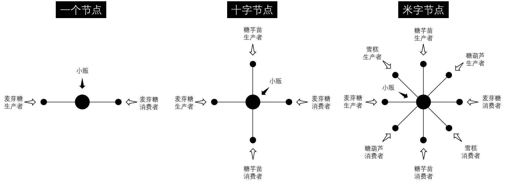

一个卖很多东西的走街串巷的小贩，就叫“卖货郎”。然后，他卖的东西越来越多，背不动了怎么办？卖货郎就进化成了我们家门口的“夫妻老婆店”。

夫妻老婆店，是一种典型的小区级中心。

我从批发市场采购几千种货品，面对街坊几百户人家。A 户人家和 1 号货品的连接，B 户人家和 2 号货品的连接，C 户人家和 3 号货品的连接，都可以在我这个小小的夫妻老婆店里完成。

我和我老婆分工协作。我的工作是去批发市场进货，也就是对接货品一端的几千个连接。我老婆的工作，就是守在店里卖货，也就是对接街坊一端的几百户人家。

我的小店，就成为了我们小区的一个超级节点、交易中心。

但是后来，很多夫妻老婆店都关了。因为沃尔玛这样的“城市级中心”。

我们在前面，讲过沃尔玛崛起的故事。

一家沃尔玛，大约有 10 万个以上的 SKU，每天能接待 2 万~3 万顾客。而一家夫妻老婆店，只有几千个（我怀疑都不到）SKU，接待几十、上百个客户。沃尔玛是比夫妻老婆店要超级得多的超级节点。

沃尔玛在中国的营收，以远超当时零售行业平均水平的速度在增长。

一种模式的增长，如果超过行业平均水平，那一定是因为交易结构的改变。一些交易节点的超额增长，一定是因为另外一些交易节点的超额下滑。

换句话说，沃尔玛的超额增长是从哪里来的？是从夫妻老婆店手里“抢”来的。一家大超市的崛起，是以 100 家甚至 1000 家夫妻老婆店的消亡为前提的。也就是说，商业世界，正在从零散走向集中，从小区级中心走向城市级中心。

真正的进步，都是创造性破坏。你可以同情，但是无法挽救那些被时代抛弃的模式。

再然后呢？再然后出现了“万能的淘宝”。

有一次，我突然想给我的布艺沙发买一个用来放茶杯的扶手。每家沙发扶手的宽度都不一样，我想要是能买到一个大小可调的，就像古代竹简一样的杯托扶手就好了。然后，我输入几个关键词，在淘宝上搜索我想象出来的“杯托扶手”。

居然被我找到了！

万能的淘宝！你能想象的一切东西，几乎都能买到。为什么？因为它是一个比沃尔玛，又要大得多的超级节点。

截止到 2019 年 8 月的数据显示，淘宝大约连接了左手 7.55 亿用户和右手 11 亿的商品。

这是多么可怕的一个数字。

淘宝、天猫、京东、拼多多的超额增长是从哪里来的？是从“沃尔玛们”手里“抢”来的。一家大电商的崛起，是以 100 家甚至 1000 家大型超市的消亡为前提的。

过去几年，家乐福被收购，麦德龙被收购，大润发被收购。无数人唏嘘不已。但其背后，本质是商业世界，正在继续从集中走向更加集中，从城市级中心走向全国级中心。

那么，全国级中心还会继续集中吗？如果会，还能集中到哪里去呢？

2019 年，Mob 研究院发表了一份《85、95、00 后人群洞察白皮书》，调查显示，95 后和 00 后最喜欢的购物场景，居然是跨境电商！

我 2000 年第一次去美国，当时有很多小伙伴托我买微软鼠标带回来，好用。后来呢？大家托我带商场专柜的化妆品。再然后呢？去奥特莱斯买衣服、鞋子、箱包。再然后呢？去 Costco（好市多）买鱼油、褪黑素、钙片。每次回国都会人肉带很多东西，大多是帮朋友买的。

为什么？出趟国不容易。

现在呢？现在 95 后、00 后（也就是 20~25 岁）的小朋友们，躺在自家的沙发上，就能完成这一切。

在互联网（信息流）、支付手段（资金流）和跨境运输（物流）的帮助下，全球几十亿人正在逐渐聚向一个“全球级中心”买东西。

这个地方会是亚马逊，还是阿里巴巴，或者是其它？


刘润

什么是中心型商业？

当越来越多的“交易线段”开始在同一个节点交错时，商业世界开始出现一些 10 条线段、100 条线段，甚至 1000 条线段同时交错的“超级节点”，并形成交易中心。这就是中心型商业。

**集中的效率，高于分散。中心型商业的效率，高于线段型商业。因为在一个普通的交易节点，你只能和一个人交易。但是在超级节点，你可以和 10 个人、100 个人，甚至 1000 个人交易。**

所以，你正在看到一场，从小区级中心，到城市级中心，到全国级中心，到全球级中心，蓄势已久、喷薄而出的火山爆发。

当今商业，你所看到一切惊心动魄的恢宏叙事，其实都是这个“中心化”的喷发过程。冷却下来后，是京东、阿里、eBay、亚马逊，等等一座座高耸入云的山峰。

希望其中有一座，会是你。

这一讲，就讲到这里。在恢宏的中心型商业文明中，人们是如何克服“信息不对称”带来的交易阻力，降低交易成本的呢？我们下一讲聊。

今天我给你留一道思考题：

如果全球型中心注定要出现，你觉得它会是亚马逊，还是阿里巴巴，或者是其它？为什么？

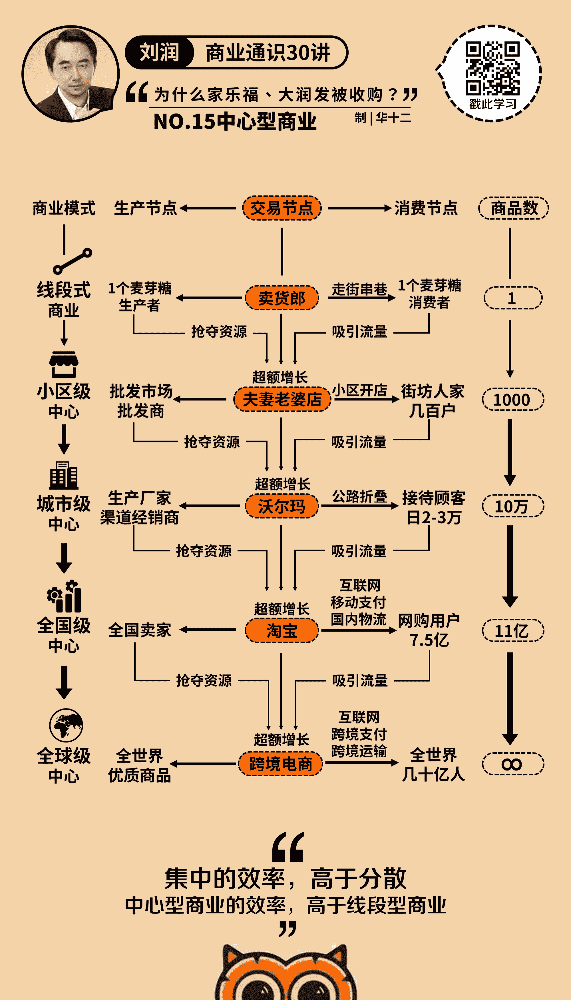  


用户留言

*   

老安 **97 赞**

```
 记得润总在《商业洞察力 30 讲》中讲到过“淘宝第一主播”薇娅，分析了薇娅的直播与传统电视购物模式的区别。润总说：“薇娅成功的原因，是因为她把在新流量上涌现的消费需求，翻译为供应链语言，重新梳理了生产。”两者相比，传统的电视购物只是帮着商家卖货，而薇娅的直播则是服务于买卖双方。 马云曾经说过：“我们与亚马逊的不同在于，他们更像一个帝国，控制着买卖，我们的理念是构建一个生态系统。”亚马逊更像是中心化的线上的超市，类似于国内的京东，大多都是自营产品，赚的主要是消费者的钱。阿里巴巴则是构建一个电商生态系统，让卖家能在平台上销售产品，让消费者能获取服务，服务于买卖双方。 从现在的商业模式上看，亚马逊与电视导购有点类似，是中心型商业中的“霸道模式”，而阿里和薇娅有点类似，是中心性商业中的“王道模式”，如果两者相比，排除一些政治、文化因素，个人认为阿里的赢面较大。 不过以上也只是对中心型商业模式的探讨，而当去中心化型商业模式来临时，以往的优势也可能会成为阻碍发展的劣势。 
2020-03-21 
```

作者回复

```
亚马逊早期确实是买入卖出的京东模式。现在所有大电商，都是平台。
2020-03-21
```

*   

江湖无声 **78 赞**

```
 梁宁老师讲： “悲催的人生，就是在一个常态的面上，做一个勤奋的点。 更悲催的人生，就是在一个看上去常态的面上，做一个勤奋的点，你每天都在想着未来，但其实这个面正在下沉。 最悲催的人生，就是在一个看上去常态的面上，做一个勤奋的点，其实这个面附着的经济体正在下沉。 如果一个人一生只能收到点状努力的计时收益，从来没有享受过一次，线性周期的成果回报，这就叫穷人勤奋的一生。” 那么对于商业进化也是这样： 悲催的商业，就是在一个中心型商业的面上，做一个孤立的点。 更悲催的商业，就是在一个线段型商业的面上，做一个孤立的点，你每天都在想着未来，但其实这个面正在下沉。 最悲催的人生，就是在一个线段型商业的面上，做一个关键的点，其实这个面附着的经济体正在下沉。 如果一个商业只能收到点状努力的计时收益，从来没有享受过一次，线性周期的成果回报，这就叫炮灰商业的一生。 
2020-03-21 
```

作者回复

```
悲催的一生，是在一个不断连接的商业网络里，做一个冷眼旁观的点。
2020-03-21
```

*    

Tony to ni **52 赞**

```
 全球型中心，可能不是亚马逊，也不是阿里。亚马逊在中国的沉沙折戟，说明要想成为全球型中心并不容易。 这里有两个问题，一是网络效应，使得国外电商进入时面对阿里和京东的巨大压制。第二是文化差异，亚马逊退出中国的一个重要原因是本土化不够。此外，中美贸易战表明，国与国之间壁垒将一直存在，除非国家形态不再存在。 全球型中心是为所有人提供所有服务，而无论亚马逊和阿里，都只能做到为一部分人提供所有服务，或者为所有人提供部分服务。 
2020-03-21 
```

作者回复

```
亚马逊在美国压着阿里。阿里在中国搬回一局。
2020-03-21
```

*   

嘉玲 **27 赞**

```
 衷心希望阿里巴巴能成为真正意义上的全球中心，跨越国际间纷繁复杂的政治局势，用商业无往不胜的奔流汇聚成一个超级中心。 套用贝佐斯的经典名言 it is all about the long term。不断前行。 
2020-03-21 
```

作者回复

```
用贝佐斯的话，祝福马云。你厉害的。
2020-03-21
```

*   

佛祖门徒 **25 赞**

```
 今天的课所讲述的中心型商业崛起有两个很重要的推动因素：新技术应用和基础设施完善。 第一、新技术应用。以沃尔玛为例，创始人沃尔顿先生率先采用飞机选址，他称这是自己最划算的一笔投入；沃尔玛率先用 IT 系统管理信息；沃尔玛率先投入使用基于互联网的零售数据交流平台 Retail Link，整合供应链体系，共享信息。新技术不断带来效率的提升和飞跃。 第二、基础设施完善。沃尔玛随着公路建设和网络形成，建立强大的物流配送系统；亚马逊、阿里巴巴紧紧跟随网络、手机触达每个人的脚步，建设了无所不在且开放的云平台，将越来越多的人集合到一起。 
2020-03-21 
```

作者回复

```
新技术应用和基础设施完善，导致连接效率越高；连接效率越高，导致网络密度越大；网络密度越大，导致中心型商业越集中。
2020-03-21
```

*   

王黎璐 **24 赞**

```
 我觉得全球型中心的战场在“云”端。资本市场对亚马逊的高估值，并不仅仅是基于亚马逊的零售业务，而是来自 AWS 云服务和以 Prime 会员业务为代表的增值业务所带来的想象空间。云业务已经成为亚马逊极为重要的利润来源。而零售业务对其他业务更多的是起到基础性的支持作用。在云计算方面，阿里巴巴正在奋起直追。2019 年双十一，阿里巴巴 100%运行在公有云上的核心系统，支撑了 544,000 笔/秒的订单峰值和高达 970PB 的单日数据处理量。非常期待两大跨境电商巨头的跨境经营之争更新的发展。 
2020-03-21 
```

作者回复

```
从买书，走到今天。亚马逊无论如何，实在是令人敬佩。
2020-03-21
```

*   

心铭 **21 赞**

```
 润总好， 消费者，以前是农耕民族，就那一亩三分地。现在是游牧民族，哪里有需要的东西就往哪里去。 我记得润总说过，零售就是人，场，货的连接，场就是信息流，资金流，物流的万千组合。从以上观点看，谁能够最高效的连接人，货，场。谁就是那个全球的中心。我更看好中国企业。 从人来看，看谁连接了大量的人流量，至于转换率在巨大的人流量面前都不值一提。如今流量方面，中国连接的人最多。当然这个可以在区分，就是高科技领域，至少在《变量》一书中看到，还不如美国，不过可喜的是，这个数字在攀升。 从场来看，润总之前的课也说到了咱国家的物流效率还是比美国低一点，不过我想在全球方面，随着中国的一带一路的完成会有大的发展。在信息流，资金流我想我们还是占优势的，移动支付，买菜都可以用了。信息流，资金流来看，是阿里最有可能成为中心。 从货来看，中国被成为世界工厂，我想在各个过节最高效的方法上，中国绝对是实践派。 我想补充一条，商业的本质是连接，全球的连接，要有巨大的财力，技术去支持。这次的新冠，中国一省管一国。我们的 5G 技术，领先全球。我相信世界如果有中心，那就是中国。 
2020-03-21 
```

作者回复

```
一带一路，就是新的连接。机会巨大。
2020-03-21
```

*    

Frank 林 **16 赞**

```
 阿里巴巴和亚马逊，买都有潜力成为全球中心。 城市中心有沃尔玛、麦德龙、家乐福等多个，实现对城市不同人群的覆盖。全球中心有不止一个，交叉覆盖全球市场也不奇怪。 亚马逊在美国、欧洲、日本具有很大的影响力和很高的市场份额。 Alibaba 的零售业务（速卖通、Lazada 等）在除美国之外的市场也一直在布局，更何况还有全球第一的线上 B2B 平台，旨在打造“全球买、全球卖”。 立足中国强大的供应链和强大的消费能力，希望 Alibaba 成为全球中心。 
2020-03-21 
```

作者回复

```
中国的供应链集中的能力，是一个重要的砝码。
2020-03-21
```

*   

文刚 **13 赞**

```
 商业中没有效率的增长是加速灭亡，从夫妻老婆店中心到全球中心，是更高效率的商业干掉更低效率的商业。 未来是阿里还是亚马逊成为中心，估计要放大更大的背景上去看，个人更看好阿里，因为更看好未来的中国发展。 
2020-03-21 
```

作者回复

```
集中，带来效率。
2020-03-21
```

*    

露酱 **12 赞**

```
 我是一个地产公司的从业员，我不得不感叹隔壁家公司是一个超级节点，从入口端以“真实房源，vr 看房”为口号接入巨大的客流量，然后以巨大的客流量，运用金融手段不断兼并小公司（门店），不知不觉中成为了一个超级节点。而我们公司也属于大公司，但是一直力稳健发展，稳定现金流，一步一脚印。但按照超级大节点的逻辑，运用金融手段，快速壮大占领市场，形成规模效应，再内部休整，能更胜一筹。疫情之下，有人不断裁员，有人逆势扩张。 
2020-03-21 
```

作者回复

```
疫情之下，是捡漏便宜资产的好时机。
2020-03-21
```

*   

🌴武汉秦涛 **10 赞**

```
 中心型商业是从“小区级中心”，扩大到“城市级中心”，再扩大到“全国级中心”，最后扩大到“全球级中心”，这是商业不断集中，效率不断提高的产物。 全球中心阿里可能比亚马逊有更好的先天优势，因为他本身定位就是剑指天下，中国造对世界商业供应链版图的影响越来越强，同时他强大的支付系统能力在效率和信用体系方面也更具有张力，是一个品类更全，选择更丰富，交易更便捷，生态更活跃的超级中心。 
2020-03-21 
```

作者回复

```
亚马逊笑而不语。
2020-03-21
```

*   

聂珣 **9 赞**

```
 风电行业分析： 我的理解，超级商业中心就是平台，它通过自己高效的匹配技术（比如搜索、推荐等）连接形形色色的买家和卖家，这种平台一般出现在买家与卖家数量和种类都较多的行业，比如日用品消费、拍卖行等等。按道理，像风电行业这种集中度高、需求单一且单价不菲的工业领域顶多出现一些招投标机构这些小型交易平台，之前的行业也是按照这种思路来发展的。但是，行业出现了一个搅局者——远景能源，它从风机整机开始，以其品质和创新在行业中逐年攀升，目前已经稳居行业前三。取得这样的成绩后，它却不按常规发展，反而推出各种服务产品，将自己打造成了一家平台公司。首先，它推出功能更强大、用户体验更好的风场运营平台，能管理市场上各种风机，在短时间内抢占了大量的业主资源，让自己成为风场运营中唯一的龙头，垄断了这方面的信息，并且从中创造出很多商业模式，比如为所有风机做运维和技术升级、提供多个厂家的售后服务、大区域的能源管理等等；接着，它结合风场信息管理平台，推出光伏电站和充电桩的信息管理平台，希望能打通整个新能源行业，成为整个行业的超级平台。 在人们都盯着交易中心时，远景却盯上了运营信息中心，并且利用这个优势慢慢打造出了售后服务的交易中心，这个思路让我很受启发：成为交易中心固然完美，但在没有机会的时候，不妨选择另一个方向深耕，成为这方面的信息或信用中心，然后再在此基础上开拓新的业务模式，最终打造出新的交易中心。 
2020-03-21 
```

作者回复

```
一些互联网公司、科技公司的高管，加入了远景能源。我当时还是挺吃惊的。
2020-03-21
```

*    

强 Sean **9 赞**

```
 原来我们公司举办一些脊柱健康科普知识线下讲座，哪怕每个月一期，每期都没有多少人愿意专门为了一个讲座大老远过来听。 但疫情期间，逼得我们不得不转到线上去服务客户，我们能吸引来听脊柱健康知识科普直播的人就有几百上千，甚至是几千人了，我们连接到的人比此前多太多了！ 
2020-03-21 
```

*    

天文 **8 赞**

```
 我就是做建材行业的，房租在近十年间长了差不多五倍，因为行业的趋势就是往大市场超级中心汇聚另外这种建材的低频，高信任，人更加倾向于体验线线下实体店。所以是人们越来越趋向于超级中心节点，所以使得房租越来越高。 
2020-03-21 
```

作者回复

```
“低频，高信任”，行业特征总结得很好。
2020-03-21
```

*   

朱为友-内训定制\*咨询落地人才输出 **6 赞**

```
 亚马逊重资产运营模式，阿里巴巴轻资产运营模式。 亚马逊强调集权和控制，从商品到物流，几乎全部自己来做，不能做的，再与人合作，并且要求每一个环节都共享利益; 阿里则注重分工与合作，从商品到物流，全都依靠别人，与商家合作伙伴分享利益，但控制了用户、资金以及物流背后的大数据。 亚马逊的营收主要来自于消费者和少数商家的利益分红，以及通过一系列围绕会员服务的衍生互联网业务来实现营收，是典型的 to C; 阿里则是典型的 to B，主要赚取商家的交易佣金和广告、技术等服务费用，并围绕用户规模和大数据进行移动支付和互联网金融等商业基础业务来实现盈利。 也就是说，亚马逊基于满足消费者购物需求建立了一个提供商品、内容和服务的封闭式商业运营平台， 而阿里则基于如何为消费者提供生活服务建立了打造商家、服务商和基础设施生态一个开放式商业协同平台。这两种不同的商业生态构建思路，决定了二者未来的企业属性和发展边界必定截然不同，亚马逊可能永远是一家提供多元消费服务的电商公司，而阿里则可能成为连接基础服务的互联网公司。 亚马逊的规模扩张受限于其商品的运营成熟度、物流体系的完善程度，以及其他会员服务的开展情况，且存在盈利增长的压力，换言之，规模越大，其扩张的速度越慢，且理论上，它是有扩张边际的。 而阿里的增长边界，实际上取决于其围绕电商所构建的生态基础服务能够覆盖到多少用户，这些用户是否会使用这些服务及在阿里电商平台上购物，尤其在目前阿里无需再扩展更多商家群体的前提下。所以，理论上，阿里的规模增长边界，也许是没有极限的。 清晰记得马云在 2017 年世界经济达沃斯论坛上接受纽约时报专栏作家安德鲁·罗斯索尔金的采访他们和亚马逊的区别时说: “亚马逊更像是一个帝国，自己控制所有的环节从买到卖，而我们的哲学则是希望打造生态系统，赋能其他人，协助他们去销售、去服务，确保他们能够比我们更有力量、确保我们的伙伴、10 万个品牌和中小企业们能够因为我们的科技和创新，而拥有与微软、IBM 竞争的力量，我们相信通过互联网技术，我们能够让每一家企业都成为亚马逊。” 
2020-03-21 
```

作者回复

```
亚马逊 2C，阿里 2B。有趣的观点。
2020-03-23
```

*   

李照阳 98620046 **6 赞**

```
 我是做软装行业的，10 年前还没有软装这个词，大家都是单品营销，卖壁布就是卖壁布，卖窗帘就是卖窗帘，只有近几年才有软装这个行业的存在，但是其实我们还是换了门头，还是卖壁布和窗帘，通过今天老师说的这个中心化商业，例卖货郎的故事，我们就如同软装里的卖货郎，所以很受启发，为什么好不容易链接的一个客户，为什么不把他软装所需要的东西，全卖给他呢，家具，挂画，饰品，灯饰，床品，而是只卖自己的壁布和窗帘，效率太低，我的模式越来越清晰，谢谢刘润老师。 
2020-03-21 
```

作者回复

```
祝你成为当地的中心！
2020-03-21
```

*   

杨超 **5 赞**

```
 如果未来全球型中心注定要出现，我觉得一定会是一家原生于英语社会的公司，而只能从阿里和亚马逊中选择的话，我觉得最终胜出的就是亚马逊，而做选择的理由也很简单，是因为语言。 想做成全球化的中心，肯定是信息流、资金流、信用流、物流的核心节点，而统一的语言是这一切的基础，试想如果一个中国人与印度人沟通，大家第一选择一定是说英语，而不是让印度人说中文或者中国人说印度语。 亚马逊原生于英语社会，可以使得它更适合用英语开展业务，公司的一切都是围绕着英语逻辑来运转的，从根上就能被世界上大部分所使用、了解、接受。而阿里却不行（虽然马云的英语极其好），因为阿里的大量业务还是给予中文社会、在使用中文的人之间使用，被现有的网络所绑架，很难能够破圈，微信也有同样的问题。 
2020-03-21 
```

作者回复

```
语言的背后，是信息不对称的成本。
2020-03-21
```

*   

卫大侠 **5 赞**

```
 我们这个行业属于汽车后市场，简称汽后。最早没有汽配城，专业汽配街之前都是零散分布在街边的夫妻老婆店。车主或者修理厂要去找一个配件，就去这些夫妻老婆店。这种交易结构比较简单，很多年以来，这些夫妻老婆店也活得非常滋润。随着市场形势发展，超级节点，专业汽配街、汽配城随后出现了。这是时代的产物。中国路面上跑的是万国车,普通家用轿车由一万多个不可拆解的独立零部件组装而成，结构极其复杂。这种情况下算起来，会有至少 1 亿个 SKU。还没算上正厂件，副件，高仿件（一万乘以一万）。这样一来，复杂程度堪称灾难。超级节点汽配城相比单个的路边夫妻老婆店优势巨大。路边店找不到的，直奔汽配城基本没问题，价格还低。目前为止，配件的最主流流通模式也还是这种。互联网时代来临尤其移动互联网来临，很多行业格局骤变，但是对于汽配零部件交易的冲击也还是没有其他行业那么大。当然，我们这个行业有些产品比如坐垫脚垫，汽车香水，方向盘套，这些简单的车主买回去就能用的线上已经碾压线下，但是唯独配件还是线下绝对为主。多少资金多少英雄在我们这个行业折煞而归。前几年轰轰烈烈的某葛修车，后来的某备修车，某配，淘气某口，等等等等，甚至强大到阿里系的阿里车码头也不成功（哈哈，万能的淘宝到了我们这个行业也不万能了），当然阿里还在卷土重来。真正的进步都是创造性的破坏。管它呢，只要车主获益，只要市场规范，一种新的交易结构带来行业巨变，无论是从行业哪个角度切入的（从信息不对称还是信用不传递）哪怕有一天我们出局，我们也是开心的。 
2020-03-21 
```

作者回复

```
有意思。大型汽配商城。值得去现场学习。
2020-03-21
```

*    

Axelrod 吴忠鹤 **4 赞**

```
 润总好，谈一下自己的思考： 我认为现在的亚马逊的成熟度更高一些，我们在中国市场的感知当然是阿里的市场份额更高一些，但是亚马逊目前在全球的物流体系 Market Place 的搭建上也实现了高效的物流效率和成本控制，这是空间折叠最高效的地方，阿里短期内很难做到。客观的讲，阿里在全球化上要面临的是一个已经推动了 20 年飞轮效应的亚马逊，如果全球化商业必须到来，我认为亚马逊的赢面更大一些。 
2020-03-21 
```

作者回复

```
很多人中国人，低估了亚马逊。
2020-03-21
```

*   

罗钧之 **3 赞**

```
 随着各行各业超级节点的出现。之前单个线段性的商业或者是几个线段性商业节点的交织下，产生的一些机构都面临着被兼并或者是被淘汰的情况。像大润发等等这类型巨大的超市。 淘宝目前可以连接 7.5 亿的商品和 11 亿用户的节点。更多的是中国创造的节点的连接，全球 60 多亿人口，不管是阿里或者是亚马逊，只要能创造全球性节约的连接，更高效的进行交易，那么未来谁就将会是超级节点下的王者。 如果你在创业的选择路口，你做的交易的模型，如果能做全球性的连接，那么就能创造更多的交易节点，从而在未来有更多的机会。 随着更多产业在进行互联网的变革，类淘宝，类天猫更多的平台诞生。就是在颠覆低效的交易模式，通过创造超级的交易节点，提升交易效率。 
2020-03-21 
```

作者回复

```
超级节点，有没有可能再被分散？
2020-03-21
```

*   以上留言由 作者 筛选显示
    

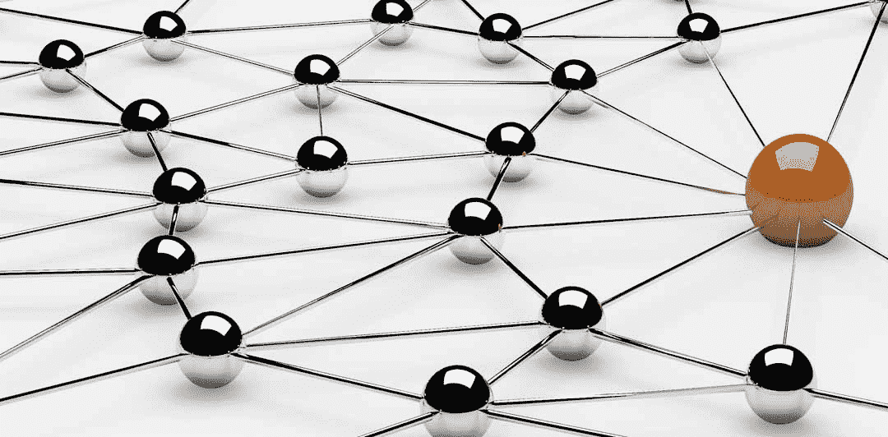

# 16｜超级节点：让人成为信息、商品和一切的中心


刘润

2020-04-08

16｜超级节点：让人成为信息、商品和一切的中心

建议 WiFi 环境下播放

在商业世界，从线段型商业进化到中心型商业，是一次伟大的飞跃。

在“线段型商业文明”，战胜“信息不对称”这条恶龙，是靠“信息博弈”这件冷兵器。那么，在“中心型商业文明”，靠什么呢？

靠那些，把 10 条、100 条，甚至 1000 条交易线段，同时交错而成的“超级节点”。

**超级节点，就是战胜“信息不对称”这条恶龙的机关枪。**

超级节点，如何战胜信息不对称？

我举三个例子：信息的超级节点、商品的超级节点，和人的超级节点，并带你看看它们机关枪式的威力。

如果你有足够多的钱投广告，你会把广告投给谁？

当然投给央视。央视，可是中国最大的电视媒体啊。多少公司靠央视的广告，从默默无闻，到一炮而红，享誉天下。

但是，2013 年，央视这个“中国最大的电视媒体”的广告，被一家互联网公司超过了。

这一年，央视全年的广告收入不到 280 亿元，但是这家互联网公司的广告收入达到 319 亿元。

这家公司就是百度。

不懂什么叫“波粒二象性”，立刻百度一下。听说华为推出新产品了？是什么？立刻百度一下。把东北大米弄到上海，就卖我 20 元？成本到底多少钱？立刻百度一下。

搜索引擎本身，并不生产信息。百度的口号是“连接人和信息”。它只是把人和信息连接起来的“超级节点”。

那么，这个超级节点，有多超级呢？

它一边连接着几十亿的网页（也就是信息），另外一边连接几亿的用户。让大家，可以在零点零几秒内，就能找到自己想要的信息。

但更重要的是，用户的每一次搜索，每一次输入的关键字，背后都隐藏着自己的需求。搜“最新款手机”，可能是上一款手机摔坏了。搜“怎么做蛋糕”，就有大概率最近买烤箱。

这就有意思了。既然需求就写在“超级节点”上，那么，品牌商能不能不通过央视，直接在百度上，向有需求的用户，推广产品呢？

这就是“上下文相关广告”，也就是与内容匹配的网络广告。它成为了“信息超级节点”这个商业模式的盈利点。

今天，百度一年的营收，大约是 700 多亿元人民币。而发明上下文相关广告的谷歌，一年的广告收入，已达 1000 亿美金。

这就是“信息的超级节点”。

还记得在线段型商业中，我的绝杀“货比三家”吗？

老阿姨卖给我的羽绒服是 600 元，旁边那家 400 元，另外一家 700 元。然后，我在第二家店，花 400 元买下了同款羽绒服。这就是“货比三家”。

但是，商业的世界，真的必须“货比三家”吗？

我开车去买羽绒服，车停在红绿灯路口。原来那里有一个巨大的指示牌，显示 A 商场、B 商场、C 商场分别有多少停车位。

但是现在科技进步了，它不显示停车位了。它拍了一下我的车牌，知道我是谁，接着分析了一下我的社交网络数据，发现我想买一件羽绒服。

然后指示牌上显示：你要买的这件羽绒服，在 A 商场 600 元，B 商场 400 元，C 商场 700 元。

你猜这时候我会怎么办？

当然是直接把车开到 B 商场，买那件 400 元的走人。

你可能会想，不会吧？真要是有了这个指示牌，那还怎么做生意啊！不可能真有吧？

其实现在这块“指示牌”已经有了。

你在天猫上点一个按钮：按价格排序。几千、几万个商家，在你面前列队。你看，这是不是就是交通路口的那块指示牌？

阿里巴巴这个超级节点，减小了商品价格的信息不对称。

很多人说，阿里巴巴在吸血，京东在吸血，拼多多在吸血。但是，它们吸走的并不是血，而是在中心型商业时代，继续依靠信息不对称赚钱的妄念。

但是，这只是商品的超级中心，解决信息不对称的第一步。

最早在网上能卖什么？卖书。

为什么？因为作出买书的决策非常简单，知道一本书的书名、作者、目录、内容简介，以及价格，就可以买了。这些都是文字信息。信息量很小。

后来网速快了，可以传图片了。这时候，可以卖什么？可以卖衣服。

图片在单位时间内传播的信息量，远大于文字。慵懒的气质、宽松的剪裁、后现代的图案，用文字是讲不清楚的，但图片可以。

文字、图片之后呢？是短视频。

2019 年底，我参加抖音主办的一次活动，主持一个论坛。“顾家家居”的一位新媒体负责人，分享了他们和抖音做的一次合作。那次合作，促成了大约 23 亿元的销售额，其中 7 亿元在线上完成。这 7 亿元中，平均客单价 6000 元，最高达 7 万多元。

你看一段文字，能直接下单 7 万元买家具吗？几乎不可能。看图片呢？还是很难。这样高单价的复杂商品，你可能还是想去现场试一试。但是，现在短视频提供的高密度信息，让很多人的心理防线一下子被打破了。

文字对称的信息量，可以用来买书，几十块钱；图片对称的信息量，可以用来买衣服，几百块钱；短视频对称的信息量，可以用来买家具，几千块钱。

“顺势而为”的企业家，总是想如何通过消灭信息不对称赚钱；“反清复明”的企业家，总是想如何回到过去的信息不对称时代赚钱。

搜索引擎，解决了人与信息的不对称；电商平台，解决了人与商品的信息不对称，那么，人与人之间的信息不对称呢？

过去如果有个朋友 A，想托你介绍认识一下你的另一位朋友 B，你怎么做？

你可能会说：没问题，小事一桩。这样吧，我约一下时间，这周五下班后正好我有时间，我攒个局，叫上你们俩一起来吧？

他非常感激，你也很高兴。那天晚上，你们相谈甚欢。

但是今天，有个朋友 A，想托你介绍认识一下你的另一位朋友 B，你怎么做？

你可能会说：稍等啊，我拉个群。然后在群里说：两个都是我好朋友，你们自己“勾兑”啊，我先去忙了。

你连接两个人的效率大大增加，即便其中一个朋友正好在国外，而另一个朋友还在海南休假。

有一次，一位创业的朋友来找我，请我出出主意。她的产品很适合在小米平台销售。她的一位朋友帮忙对接了小米。对接完告诉她，这事成功的可能性很大，小米也很期待。但是，他说用自己的“连接”价值，换一些股份。

我这位朋友问我，这些股份要不要给呢？

我当时就震惊了，都什么时代了，居然还有人用“信息不对称”换股份！

我说，如果你需要，我马上就拉个群，介绍你认识小米那个部门的负责人。我不要股份。对你有利，对小米也有利，为什么不做呢？很快，她的产品在小米众筹上线，并完成众筹目标的百分之几千。

在几亿人都连在一个超级节点上的时候，靠“我认识谁，而你不认识”来赚钱，已经越来越不可行了。


刘润

**中心型商业，战胜“信息不对称”这条恶龙的方法，是依靠“超级节点”这挺机关枪，极大提高信息传递的速度和效率。**

互联网出现之后，超级中心井喷。搜索引擎、电商平台、即时通信，都是这样的超级中心。商业世界，进入一场消灭信息不对称的狂欢。

多少人在这场狂欢中获得了巨大的成功。这中间，有你吗？

这一讲，就讲到这里。下一讲，我们聊聊中心型商业文明，如何战胜“信用不传递”。

今天我给你留一道思考题：

在中心型商业时代，有其他不依靠互联网的“超级中心”吗？比如呢？

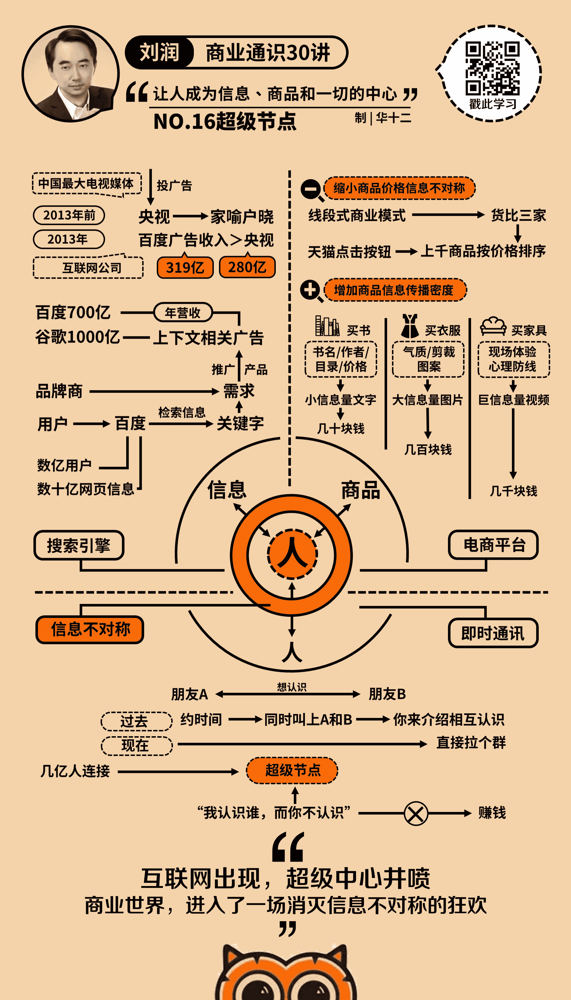  


用户留言

*    

夏建鸿 **74 赞**

```
 课程学到今天，一直在思考自己的商业困局怎么破。前两年跟朋友合作一起在四川音乐学院附近做琴行，主要卖钢琴，这其实是一个挺传统的行业，毛利感觉还挺高，并且因为产品的特殊性，受互联网的冲击没有那么大，以线下实体经营为主。但这两年细算下来，发现真的处处是坑，很多隐形成本，各种行业潜规则。 先说信息不对称，很多家长上网去百度，都是各种竞价排名广告，还有很多论坛（包括知乎）都是广告贴，内容基本都是吹自己品牌，黑人家品牌。其实稍微懂行的人都知道，中国现在有四五千个钢琴品牌，都是浙江上海一些生产基地在规模化生产，但是他们都不承认自己是国产钢琴，一定要取一个特别洋气的欧洲名字，注册地放在德国法国，中国人还是觉得钢琴这东西特别高大上，一定要欧洲血统才够牛，其实他们不知道现在全世界估计 80%的钢琴都是中国在生产，并且中国现在的制造技术，能力都是顶尖的（当然一些核心部件需要进口），我们的华为手机都可以跟苹果、三星在科技领域扳手腕，为啥很多人就不相信中国能制造出高性价比的好钢琴。再说了，国外的确有好的专业级钢琴，但是价格也是特别贵，一般家里面小朋友琴童练琴，预算在两三万以内的话，完全没必要。 再说人与人之间的信息不对称吧，钢琴这行业就太特殊了。大多数时候一个家长计划或决定要买钢琴，都是老师建议，很多时候家长也觉得老师专业，如果老师第一时间知道这个信息，就可以充分的运用这个信息不对称，说白了就是通过推荐合作琴行的品牌，潜规则拿回扣，我们作为实体店很多时候对老师也是又爱又恨，爱的是如果能有足够多培训机构老师合作，确实会给我们带来很多客户资源，恨的是很多老师都狮子大开口，我们每个月除去房租、人工等开支，给老师回扣要分走我们大部分利润，也不敢得罪他们。最主要是我认为，因为信息不对称，这个行业的现状是畸形的，如果一个老师轻轻松松给家长一吹嘘引导，就可以赚两个月的课时费，谁还会去努力认真教课，并且给老师回扣也违背我的价值观。 哎说起来就是一把辛酸泪，最近疫情影响更是雪上加霜，真想去开个抖音号，揭秘这个行业的各种内幕，干翻所有信息不对等，相信那才是商业的未来。 
2020-03-22 
```

作者回复

```
商业机密贴。
2020-03-23
```

*   

老安 **67 赞**

```
 在中心型商业时代，不依靠互联网的“超级中心”可能主要集中在国家垄断性行业，例如：石油、石化、电力、铁路、军工、民航、电信、烟草等。 为了增强市场竞争，减少信息不对称，国家对很多行业也逐步放开了经营权，对国民经济发展起到了促进作用；同时，国有企业也在利用互联网技术进行行业改造、升级，提升用户体验。但对于这些关系到国家安全的、关系到国民民生的、关系到国家经济发展的重要行业，互联网只是一个加分项，而不是比选项。 
2020-03-22 
```

作者回复

```
买家分散，卖家也分散的行业，也许更适合中心型商业的“超级中心”模式。
2020-03-23
```

*    

Tony to ni **67 赞**

```
 荷兰的阿尔斯梅尔是世界上最大的鲜花拍卖市场，占地 70 万平方米。交易在线下进行，而不是在互联网。每天要卖出 600 万份鲜花，80%是销往国外市场。 大概交易流程如下：工作人员将花卉包装好，从仓库运往拍卖大厅。 当滑动小车载着各种鲜花从交易员面前经过时，大厅屏幕上显示出花卉的信息。 拍卖开始时计价钟的指针指向 12 点的方向，随着时间过去，价格慢慢下降，买家在觉得价格合适时摁下手边的按钮，便可以停止计价钟，第一个按键的人就拍下了大厅里展示的鲜花。 为什么在互联网如此发达的时代，竟然还有这么大的线下交易节点？ 这和鲜花的品类有非常大的关系，因为鲜花的保质期非常短，而且规格品类繁多，即便在线上进行拍卖，普通人也无法知道哪些品种、哪些规格是好的，是什么价钱？这里面存在着一定的信息不对称。 其次鲜花在路上的运输也有一定的要求，否则话很容易造成损耗。成本和风险是终端的花店无法承担的，需要大规模的中间商来组织运输，承担风险。 最后就是传统的交易习惯使然，荷兰是全球重要的鲜花生产国和出口国，尤其是郁金香等品种，这种线下拍卖有很长的时间了。 当然鲜花市场也在与时俱进，比如他们拍卖的扣款是直接线上直接扣除， 然后包括在国内鲜花的运输、以及鲜花的终端销售已经都在进行数字化的采集、跟踪和预测。 但鲜花批发市场，国内也同样在线下进行。云南的斗山，也是一个线下巨大的鲜花交易市场。 
2020-03-22 
```

作者回复

```
生鲜电商也是一样。
2020-03-23
```

*    

雄走江湖 **44 赞**

```
 茶颜悦色是一家只在长沙开店的本地奶茶品牌，面积很小估计不超过 3 平方，站着 5 个人，这是我在长沙五一广场看到的一家分店，旁边是火的不行不行的喜茶，我听说过很多次，但从未喝过（每次都是排长队就放弃了），走近店没人排队，但收银台却写着排队 120 分钟，原来都是下完单消失在店中分布'在人海，我摇摇头离开喜茶，去了旁边排着不长的队伍但生意依然火爆的茶颜悦色，一刻钟吧，喝上了传说中的畅销品，叫啥名忘了。 你说它是不是超级节点，是不是依靠互联网，不完全依赖吧，是一个在本地有口皆碑的品牌，但是你喝上了，仍然不能免熟的发个朋友圈。 这是一个个人品牌爆发随时随地分享的时代，每个人都可以是超级节点，因为时代完成了基础建设，赋予了每个人的机会，才华从来不会被淹没，只是时间问题，亦或空间问题。 加油，成为一个行走的 U 盘，自企业。找到自己的定位，你就是超级节点，靠谁不重要，靠自己最可靠。 
2020-03-22 
```

作者回复

```
每个人都成为了一个节点。超级节点，会不会正因此，而消亡了呢？
2020-03-23
```

*   

青岛罗刚 **34 赞**

```
 在中心型商业时代，有一些特殊的“大桥人才市场”，不知道您见过没有？ 在一些城市的立交桥下，会自发地聚集一些打工者，用工单位也会来这边选人。有些建筑业的工人，还会摆一个小纸牌，上面写着油工、瓦工等字样。有时候来了一个“老板”，大家就会立马围上去。经过简单的信息交流，可能就会有几个人坐上老板的车扬长而去，而其他人就散开来，三五成群地聊天，或者坐在台阶上晒太阳，等待下一次的机会出现。 我也不知道，现在这样的市场还有没有了，只是在青岛已经有段时间没见过了。 
2020-03-22 
```

作者回复

```
有趣。是不是在大桥下，不是最关键。最关键，他是一个市场。所有的市场，都是中心。大小不同，效率高低的差别。
2020-03-23
```

*   

福州陈巍 **27 赞**

```
 在一些人单位观念中，中国就是人情社会，你不认识我认识，你办不到我可以帮你办到，那你是不是愿意付出一些代价呢?假设润总的朋友不认识润总这个超级节点，会不会答应付出一些代价呢？很大可能会，只要她认为这个代价合理在承受范围内。这就是“掮客”存在的空间。 
2020-03-22 
```

作者回复

```
依然有空间。依然此起彼伏。但总体上越来越小。
2020-03-23
```

*   

佛祖门徒 **26 赞**

```
 智能数据时代，超级节点由于有大量的信息交互，所以在连接的同时，还能产生更加巨大的价值，如大数据多维度关联分析的特征应用，能够衍生出一系列的商业生态。 第一、显性多维度数据关联。我在某平台预定了一张机票，预定成功后，平台就给我推送了当地的酒店和美食信息，而且各方面比较符合我的喜好。如酒店是从位置、环境、评价、价位、品牌、房型等各方面进行筛选后进行推荐的。 第二、隐性多维度数据关联。当我到达酒店后，发现忘了带剃须刀，于是在酒店用手机移动支付的方式购买了一个。当我回到房间打开电脑，进入某搜索引擎查找信息时，网站向我推送某购物网站的剃须相关产品信息，如剃须膏、刀片等。这是怎么做到的呢？因为我的电脑和手机经常使用同一个 Wifi，大数据分析认为两台设备属于同一个人使用，所以进行了关联。这个维度的数据貌似与购物本身无关，但通过它可以精确跟踪我的行为，并进行信息推送。 
2020-03-22 
```

作者回复

```
还有这种事。以后手机要设成“无痕浏览”。
2020-03-23
```

*   

宋亨 **24 赞**

```
 前段时间接触了一个主播，粉丝几百万，商业估值千万级，但是因为合同违约败诉。败诉是正常的，但是整个过程中她的代理律师极度不专业，只是就着几个搜集到的证据反反复复。律师哪儿来的呢？百度搜来的。 我去试着搜了一下这家给红人服务的律所，官网全是吹牛，律师都不敢放真名，听都没听过。 所以，搜索引擎是战胜信息不对称的超级节点么？未必。在这个案例里面，它恰恰制造了信息不对称。钱花的多、关键词买的多，广告位就在前面，这里面并没有信息的审核和信用的背书。看起来增加了信息量和选择权，但是对于原本就对律师行业不清楚的普通人而言，足以影响决策。 所以在这件事情上，竞价又成为了制造信息不对称的新的「恶龙」。 
2020-03-22 
```

作者回复

```
每一个用来消灭信息不对称的地方，都有人利用它的规则，制造信息不对称。点评网站也是。
2020-03-23
```

*    

吉林雀园 **22 赞**

```
 在比较封闭的小农村，麻将桌是信息传递的“超级节点”，想听小八卦信息或者小新闻，就去小卖部玩上两局，赶上过年过节，外面的人回来就有意思了，他们带来对外面世界亦真亦假的感受。过去还流行一种高级结交人脉的方法，就是上“赌桌”这个超级节点，许多人靠在赌桌上认识对自己有用的人脉，所以有个词叫“业务麻将”，事实上这种情况现在还有，而且并不算少。 
2020-03-22 
```

作者回复

```
不愧是中国的国粹 …… 之一。
2020-03-23
```

*   

🌴武汉秦涛 **22 赞**

```
 1.人和人之间的信息不对称目前还是有很多被用来获利的，特别面对稀缺资源的时候，比如名校的入学指标，每年会有大量的个人超级节点出现，甚至转几手的，通过我认识你不认识来获利，还比如在商业地产店铺拓展行业，好的店铺的房东信息也是被大量用来换取价值的，很多好门面发生变动的时候，就会有大量的中间人出来对外进行交易，所以一个小店铺，转让费，进场费，茶水费都高的离谱，但是这些都是会被慢慢淘汰掉的。 2.除了依靠互联网的超级中心外，其实线下有很多厉害的实体超级中心，比如每个城市基本都有的批发城，武汉的汉正街，义乌小商品批发市场、广州白马服装城等等，都是批量一站式的大集合，再比如每年全球有很多专业的行业展会，大到国家元首带队的中博会小到特许加盟展、广交会等等，都是超级中心的代表。 
2020-03-22 
```

作者回复

```
这个不能算严格意义上的信息不对称。而是，当一件稀缺的商品（比如入学指标），没有限价/摇号等方式低估时，给了黄牛规则外的方式，套取差价，然后用它们自己的逻辑（潜规则分配）。这部分差价，没给到学校而已。
2020-03-23
```

*   

卫大侠 **16 赞**

```
 小明开的是劳斯菜斯，一大早启动引擎出门办事，走了一小阵就发现车有异响。只好把车开进了附近一个他熟悉的修理厂。老板立刻检查了一遍，告诉他这是哪里哪里出现了问题。但是这会配件却没有。老板会打开百度上网去搜吗？老板会打开电商平台，阿里淘宝，京东去搜吗？老板会打开微信跟另外一个熟悉的修理厂，去问有没有这个配件吗？以上三种很大可能都不会。这会你会看到老板可能从抽屉里拿出一本泛黄的通讯录。里面记录了密密麻麻的汽配城里面，汽配店档口的名片。哦，找到几家卖劳斯菜斯配件的档口。然后打电话过去问你那边有没有这个配件，这个配件是多少钱？是原厂件，副厂件还是高仿件？把信息收集之后再加上修理费用一起报给小明多少多少钱？小明说好吧，我也不砍价了，快点给我修好就行。这就是我们这个行业传统的一个交易过程和交易形式。有什么问题吗？在中心型商业的时代，汽配城就是不那么依靠互联网的超级中心，是一座活化石。但是，目前这个活化石也受到了各种汽配新的商业模式的冲击，比如易损件联盟连锁平台，比如线上平台等等，斗转星移，也可能消失呢。 
2020-03-22 
```

作者回复

```
很有画面感。
2020-03-23
```

*   

青岛潘飞达 **15 赞**

```
 在这个时代，还有一种“中心”是不依靠互联网的，那就是“地产掮客”。 在从事无人机行业之前，我在地产行业沉浸了 7 年，但没有在一个岗位上固定着，而是几乎干了除营销之外的所有职位，其中就包括前期拿地的投拓工作。 所谓投拓就是为地产公司进行前期土地的寻找、信息搜集、成本测算以及预期开发收益分析，提报公司决策是否投资拿地。 从事这份工作身边就会出现一类人“地产掮客”，而这些人通常都是在当地有一定的资源关系，通过掌握一些地主的信息，土地的情况，衔接地主与地产商之间的交易，利用信息不对称赚取佣金，而且这部分利益非常大。 当然他们也分实力强和实力弱的，实力强掌握的信息多，政府关系好，一般会掌握一手信息。而实力弱的掌握的信息少、没啥政府关系，到手的信息基本也多转了好几手了。 即便是今天互联网消灭了很多信息不对称，在地产行业诞生了多家地产数据、信息公司，比如克尔瑞、锐理、同策等，但依然没有“替代”这一群人，这背后一定有其商业逻辑值得我们思考。 这个行业有句话叫“三年不开张，开展吃三年”，因为牵扯的利益太大，所以即便很难，有时也经常被人家越过去直接找到上家或者地主，依然还是有很多人乐此不疲，以此为生，而且还在壮大。 未来会不会有新的模式替代他们，或者他们自己进化成“超级中心”，未可知。 
2020-03-22 
```

作者回复

```
他们买卖着信息。
2020-03-23
```

*    

青岛刘学 **14 赞**

```
 1、香港铜锣湾的新荣记就是一个超级节点，这家只有 500 平方米，13 张桌子的小餐馆在李克的运行下，变成了一枚社交货币，连成为了香港富豪的食堂，作为一个超级节点就可以分发流量，你想认识谁，李克就可以帮你安排机会，在新荣记，李克可以像微信，淘宝，百度一样让你在你的目标对象面前完成一次曝，一次点击。 2、所有的大学校本质就是一个超级节点，连接了全国各地的学生和最好的老师 
2020-03-22 
```

作者回复

```
其实，李克才是那个超级节点。餐厅只是载体。换成咖啡厅、茶室也一样。
2020-03-23
```

*    

欧文童鞋 **12 赞**

```
 在中心型商业时代，不依靠互联网的“超级中心”有：大型购物中心、大型水果批发市场、顶级医疗资源。 大型购物中心。虽然现在互联网几乎已经连接绝大多数人，网上可以购买生活绝大部分所需物品，但线下社交和线下体验的场景，互联网无法取代。 比如，朋友社交吃饭，再好的社交软件，再清晰的视频聊天，都无法替代线下面对面的交流。 电影院看电影，再清晰的手机屏幕，分辨率再高，都无法取代电影院 iMax 屏幕带来的视觉体验和冲击。所以，这也是大型购物中心的绝对优势，也是购物中心得人流发动机。 大型水果批发市场。就拿广州水果批发市场来说，全球的水果供应商，都汇集到这里。泰国的榴莲、智利的车厘子、新西兰的奇异果等，通过这个超级中心，发往全国的各个分级经销商。 虽然互联网已经盛行，有一部分水果生意也搬到了互联网，但绝大多数水果的成交，还是在线下的水果连锁店完成。毕竟买水果，都喜欢自己去挑选。这个超级中心，大概率还将存在很长的时间。 顶级医疗资源。就拿长沙的湘雅医院来举例。在国内拥有“北协和、南湘雅”的名号，汇集了国内顶级的医疗专家，拥有精湛的医疗技术，自然吸引了湖南和湖南周边省份的患者前往湘雅医院求医。 互联网再发达，连接程度再深再广，线上问诊也无法替代线下面诊。并且许多检查，需要的仪器设备，都需要去医院完成。这个超级中心，会一直存在。 
2020-03-22 
```

作者回复

```
能提供线上无法比拟的体验的线下购物中心，依然可以是超级中心。
2020-03-23
```

*   

Zsr003 **11 赞**

```
 不依靠互联网，这样超级节点的。 例:拍卖世界名画，价值是在每个收藏家心里的，不能用互联网这样的超级节点消灭价格的不对称。 部分私募股权基金:为了保守 GP 项目的安全性，都是通过熟人圈子寻找符合条件的 LP，不回用互联网大肆宣传。 军火等暗网交易，也不能通过超级节点。 
2020-03-22 
```

作者回复

```
他们需要“信用中介”。没有信用的超级节点，价值不大。
2020-03-23
```

*    

钟斌 **9 赞**

```
 简单讲一下喜茶这个案例。喜茶应该算是一个独特的消费现象，前几年都了解过喜茶震撼的排队场面。喜茶内部主要有两个部门：一个是产品研发，负责茶饮喝到嘴里口感如何，这是一切竞争的基础。而另一个部门是负责内容设计的品牌部，这个跟很多公司不一样。 产品定位：把喜茶打造成一个时尚的生活体验。喜茶不仅有好喝的饮料，更是年轻人很酷的一种生活方式。 产品设计：喜茶调用了“茶”这个文化系统。定位在“灵感、设计、禅意”。在茶身上做了大量的功夫，跟中国的传统文化建立了强大的联系。这个品牌内涵可以唤起消费者文化认同。另外制作过程透明化，获得消费者信任。 门店设计：喜茶的店内不是用来坐着聊天的，而是用来拍照发朋友圈的。做到连锁但不复制。花大心思做店内设计增加消费者体验。而这个体验唤起的情感又会加到这杯茶上。 线上工具：使用小程序平衡排队的负面影响。利用公众号向消费者传递原创理念。给自己贴上一个设计感强的标签。 总结：喜茶卖的不仅仅是一杯茶，而是向消费者兜售品牌塑造出来的消费文化。而茶在这个中间只是一个工具而已。 
2020-03-22 
```

作者回复

```
喜茶的未来，还是要品牌打造的“先发优势”和产品设计的“后发优势”，谁能战胜谁。
2020-03-23
```

*    

雄走江湖 **8 赞**

```
 生鲜时令水果、蔬菜或鲜花这类其实也不依靠互联网这个超级节点。 很庆幸自己做了正确选择，来了一线，茂名荔枝是出名的，一骑红尘妃子笑，无人知是荔来。所以茂名有个荔枝品牌叫“妃子笑”略酸，还有一个小核的荔枝叫“桂味”，还有一个甜度比较高的吃多了容易腻的叫“白糖罂”。综合我个人觉得“桂味”会好一点，但每个人口味会不一样。 你可知道荔枝是怎么走货销售的吗？经过拜访了当地 top 的 12 个果场（荔枝数 100 颗以上）和 20 多个果农，约 96.5%都是传统线下收果商弄走了，1.5%是当地村民自销，2%走的电商。出乎意料，但也在情理之中。 你说你平常吃个水果，例如荔枝，是不是先到楼下水果店。或者你想买个小青菜，还是去菜市场。但你说我有某咚买菜，我有生鲜优选等平台，我足不出户也能买菜买水果。没问题。 来自一线调研的数据，确实就是这么个情况。说来也巧，很多年前去云南旅游，昆明的鲜花其实也是通过线下订单走货，直销全国，乃至全世界。 没有一刀切或者亘古不变的模式，《三体》高度总结浓缩成两句话就是 1.要复杂，不要简单 2.要前进，不要后退 我们看到的与真实世界，却有差距，《事实》这本书大家可以看看。 例如你会觉得现在本科生遍地都是，可我记得有个数（知乎里面有）本科生在中国也仅占到 4.43%，那么为什么你会有这种“错觉”，因为物以类聚人以群分。 答案在现场，以复杂应对复杂，以前进应对变化。 
2020-03-22 
```

作者回复

```
顺风优选，曾经做过荔枝。但似乎不是很成功。生鲜，一直是电商的痛。这两年，盒马鲜生等新玩法，出现了一些改观。
2020-03-23
```

*   

毕昊峰 **6 赞**

```
 从时下的商业大势来讲，真如润总所讲的“得信息超级节点者”得商业天下，还有，构建电商平台和人脉平台，也会在商业海洋中赚取真金白银的。“悦”看越觉得商业世界的奇妙，也越觉得值得来倾情而做的事业。本节中的主题是“让人成为信息、商品和一切中心”。这让我想起，去年帮伊朗朋友做眼睛生意时，利用北京一哥们的关系，他在瞬间组了个微信群，让我和一位韩国朋友在刹那间就认识了。当然，也发现自己需要升级之处，新近一次购买家具并没有利用“抖音”短视频，仍然是用京东物流这一传统电商平台。还有，听完课后，也吓了宝宝一头汗，为什么？担心自己一不留神，在无意中成为“反清复明”的商界斗士，那可就惨了。在中心型商业时代，有其他不依靠互联网的“超级中心”吗？当然有了，比如涉及国家能源战略安全的超级中心，如以中国的三大石油公司为主构建的能源中心，以伊朗国家石油公司 NIOEC 构建的能源中心等；关系百姓生活的，如我家附近的早市，这绝对不是依靠互联网组建的“超级中心”，而是一种卖方与买方依靠“自发秩序”构建起来的中心节点；还想到，有些商家，同时依赖线上的互联网中心和线下的实体店两种模式来进行商业活动，比起我辈来讲，是高阶玩家。用财商总编王烁老师的话，每个人对一件事情的判断和思考都是分阶次的，关键在于你要搞清楚一起博弈的其他玩家都处在哪一阶次，你只需要比他们高一阶次就好了。 
2020-03-22 
```

作者回复

```
做信息网络的“结构洞”。
2020-03-23
```

*   

顾昱晓 **6 赞**

```
 Costco 这种大型线下百货中心不太依赖互联网。Costco 的商业模式是向用户收取会员费，商品利润主要是支撑运营费用，物美价廉的商品让用户省去购前成本（搜索成本、比较成本、测试成本）。而且由于独特的商业模式，Costco 的商品很有可能比电商的还要好，是一种更高效的“超级中心”。 电商通过快速比价、图片或视频的展示、用户评论降低了搜索成本、比较成本、测试成本，而 Costco 则通过选品，几乎消灭了搜索成本、比较成本和测试成本，因此 Costco 从某种程度上讲，是一种更高效的“超级中心”。 
2020-03-22 
```

作者回复

```
很好的例子。互联网，并不是超级中心的必要条件。只是加分项。
2020-03-23
```

*   

Fairyの乔巴 **6 赞**

```
 我就是靠信息不对称谋生的。我的工作主要任务之一就是把信息“卖”给特定的人群。那么他们有没有可能自己获取这些信息呢？当然可能，但是获取信息也是需要成本的。那么我们的工作就是降低信息获取的难度，让他们在较短的时间内获得相对较多的信息，并且知道可能该如何利用这些信息。以往我们只是会面对几百几千个这样的“客户”，所以压力并不太大。但是现在将来，超级节点出现了，优秀的传播者可能会吸引走几十万上百万的“客户”，那么我们这些小节点是否会面临淘汰的风险？也许，我们第二个职能也许是创造信息，然后把这些信息再传播给“客户”。 总之，我觉得我们这个行业会面临一次千年未有之变局，时代洪流裹挟下，想逃，是逃不掉的。我辈躬身入局吧！ 最后补充一下，我是大学老师。 
2020-03-22 
```

作者回复

```
纠正一下。你的工作，不是把信息（或者知识）卖给学生。知识不是产品。你教的课程里的知识，理论上，他们在网上都能免费找到。你的价值，是把知识教给他们的过程。这个过程的有效性，定义了你的价值。
2020-03-23
```

*   以上留言由 作者 筛选显示
    


# 17｜信用中心：信用的中心，就是财富的中心


刘润

2020-04-08

17｜信用中心：信用的中心，就是财富的中心

建议 WiFi 环境下播放

在“线段型商业”文明，战胜“信用不传递”这条恶龙，是靠“信用中介”这件冷兵器。

但是黑市中间人和乡绅这种“信用中介”的存在，有个前提，就是他和交易双方都很熟。著名的“邓巴数”定律说，一个人能“很熟”的人数，不超过 150 人。

也就是说，150 人，大约就是黑市中间人和乡绅的“信用半径”。

现在到了“中心型商业”时代，超级节点连接的人数可能有几千、几万，甚至几亿，远远超出了黑市中间人和乡绅的信用半径。

那怎么办？超级节点为王的“中心型商业”文明，靠什么战胜“信用不传递”呢？靠另一挺机关枪：信用中心。

比如：银行、保险、证券公司。

我们先从银行开始讲起。

这门课的重点不是货币银行学，所以，我会从“中心型商业”文明的视角，拆解一下银行这种“信用中心”是如何战胜“信用不传递”。

回到乡绅的案例。

“A 向 B 借钱”这件事情，拆解下来，其实有两个动作：

*   第一：A 要这笔钱，这叫“借”；
    
*   第二：B 给这笔钱，这叫“贷”。
    

A 借入了钱。B 贷出了钱。这两个行为同时发生。

如果，我们可以把这个同时发生的行为，在时间和空间上拆开，一次借，一次贷，分别完成，不就提高了信用的时空半径吗？

这就是银行。

1609 年，世界上第一家现代意义上的商业银行，成立于荷兰阿姆斯特丹。

现在，B 来到阿姆斯特丹，把钱存进银行。B 不知道谁需要钱（信息不对称），也不知道该相信谁（信用不传递）。这就是“贷”。

然后，A 也来到阿姆斯特丹，向银行借钱。A 不知道钱是谁存的（信息不对称），也不需要那个谁信任他（信用不传递）。这就是“借”。

那银行干了什么呢？

银行用一套流程，给交易双方做“信用画像”。你家有没有房子可以抵押？你有没有一份收入稳定的工作？把你们家的水电账单给我看看？等等，再查查你的个人征信记录。

就和商人把买卖拆开一样，银行把借贷拆开，通过大规模信用画像的方法，生生把自己做成了一个“信用的超级节点”，也就是：信用中心。

有了银行这个“信用中心”作为社会信用的基础设施，中心型商业才最终得以爆发式增长。

这种“信用中心”的另一个典型代表，就是保险。

小王从小在乡村长大，家里很穷，家徒四壁，省吃俭用过生活。终于到了结婚的年龄，好不容易娶了同村的小艾。家里非常高兴，想摆 30 桌酒席庆祝，请全村人都来喝喜酒。

可是，家里没钱，怎么办？

凑份子。每家人来喝喜酒，都会给小王和小艾包个红包凑份子。

过段时间，小艾的好朋友小晴也要结婚了，也想请全村人吃饭，也摆了 30 桌酒席，也没钱。怎么办？

全村每家人去喝喜酒，也会给小晴包个红包凑份子。

这个包红包凑份子的行为本质是什么？

**就是保险，就是“同质风险分担”，就是把那种发生概率特别小，但发生之后的影响非常大的风险，找一群人分担掉。**

比如癌症，得癌症的概率很小，但患癌之后就影响太大了。再比如航空意外，也是概率小、危害大。比如结婚。

结婚，是一种典型的“发生概率特别小”（你一辈子结几次婚？），但是“发生之后的影响非常大”（要摆 30 桌酒席）的风险。

“一不小心”结婚了，大家都来帮我分担一下，江湖救急。你们家也有孩子吧？他们早晚要结婚的吧？下次，我也会帮你救急的。你甚至可以给它起个名字，比如叫“婚礼险”。

但是，你们公司同事结婚请你去，你会包红包，你隔壁公司的人结婚，不知道为什么也请你去，你会去吗？你会给他包红包吗？

估计多半不会去。为什么？因为你不知道，万一有一天你结婚了，他会不会也给你包红包。如果他不给，你不就“亏”了吗？你们俩之间，没有“天然信任”。

所以，“凑份子包红包”这件事情，虽然是很有效的民间“保险”，但是只能在熟人之间操作，无法用于大规模协作。

天然信用，只能用于解决熟人之间的小问题。

那怎么办？

这时候，有一家机构站出来了，说，我是保险公司，大家相信我，我有牌照，还交了一笔钱给银保监会，跑不了。

现在我设计了一套方案，你们只要每人交给我一点点钱，一旦患了癌症，我就赔给你一大笔钱。可能很快，就有上百万人交了保费。

你可能知道，真的不幸的癌症患者，他得到的赔付，其实是从另外 99.9999 万人的口袋里掏出来的。但是，这 100 万人需要彼此认识，彼此之间有“天然信任”吗？他们需要担心其他人不守信用吗？

不需要。

因为这时候，保险公司承担了“信用中心”的职能。

保险公司作为一个超级节点的存在，把“投保”和“理赔”两个行为拆开，成为“信用中心”，为“中心型商业”时代需要大规模陌生人参与的风险管理，提供了基础设施。

银行是资金的交易中心，保险是风险的交易中心。那么证券公司呢？

证券公司就是权益的交易中心。

1609 年，世界上第一家证券交易所在荷兰阿姆斯特丹成立。

还是荷兰。为什么？因为荷兰很早就是一个通过海洋进行全球贸易的国家，一度被称为“海上马车夫”。阿姆斯特丹，就是当时全球最重要的交易中心。

为了克服“交易中心”遇到的“信用不传递”的阻力，荷兰人一口气发明了银行、股票和证券交易所。

1602 年成立的荷兰东印度公司，是世界上第一家发行股票的公司。一家公司的管理者有能力，但是没钱；一些有钱的人想开公司，但是不会管理。怎么办？

通过“股票”的方式，拆分“经营权”和“所有权”。这句话是不是很熟？改革开放后，人们没少听这句话，但这是荷兰人在 400 多年前发明的。

可是，经营权和所有权分离后，股东和经理彼此不信任，甚至彼此不认识，没有天然信任，股东总是担心经理贪污自己的钱，经理总是觉得股东不懂装懂瞎指挥，怎么办呢？

1609 年，荷兰人成立证券交易所，并开始制定、完善一系列的“上市规则”。今天的证券交易所，已经有非常详尽的信用机制了。比如，禁止内幕交易，每季度披露相关信息，以及相关的法律法规等。

有了这些之后，股东（或者说股民）其实完全不用认识，也不用“信任”某家上市公司的经营者，就可以用钱买这家公司的股票，只要他相信这个证券交易所。

股票，是股东的权益凭证。证券交易所和与之伴生的证券公司，因此就成为“第三方的、中心化的信用中介”，成为权益的“信用中心”。


刘润

资金、风险、权益，都是信用的外衣。在中心型商业时代，我们要感谢这些机构，也就是统称的金融体系，端起“信用中心”的机关枪，挑战“信用不传递”的恶龙，降低交易成本。

**银行是资金的信用中心，保险是风险的信用中心，证券交易所和证券公司是权益的信用中心。**

金融永不眠。

这一讲，就讲到这里。

中心型商业文明，和线段型商业文明交织在一起，同时共生，但此消彼长。线段型商业的消，也就是中心型商业的长，构成了商业的侏罗纪时代，像大片一样精彩。

但是，中心型商业文明，会是商业文明的终极形态吗？恐怕不是。我们下一模块，开始把眼光从“商业从哪里来”，望向“商业到哪里去”，望向商业的未来。

因为你的机会，在未来。

今天我给你留一道思考题：

你觉得现在很热门的互联网金融、科技金融，是中心型商业的“信用中心”吗？

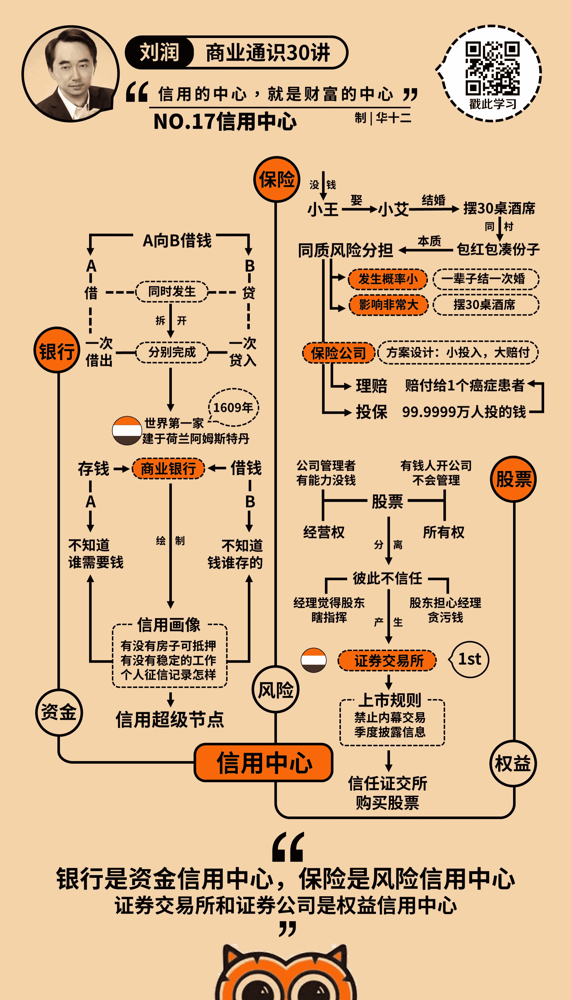  


用户留言

*   

吴汶邑 **213 赞**

```
 终于到了我的本行. 互联网金融、科技金融都不是信用中心，准确定义叫交易记录中心，目前全世界最大、最全的信用中心在人民银行. 人民银行征信中心记录着全世界最大的信贷交易记录 .因为人口红利，拥有中国的借贷记录，因此拥有全世界最权威的信用中心. 所以互联网金融、科技金融只能做为行为信用补充.而不是信用中心. 人民银行征信是记录和所有银行发生借贷记录的监管机构，而阿里巴巴的芝麻信用、京东信用分.属于平台交易行为的数据记载，至少在目前无法成为金融借贷行为的判断标准，当然仅仅是现在，未来无法预计. 在金融业的商业社会，是不是信用最好的客户是最好的客户？ 这个月我信用卡刷 1000 元，利用免息期下个月还款，是不是最好的客户？ 答案是：否？ 在银行业最好的客户是这个月借款 1000 但下个月无法全额还款，因为惧怕信用损失，于是下个月使用最低还款的 100 元的客户，才是好客户. 因为最低还款才能产生利息收益，如果你还能逾期几天还款，缴纳一定滞纳金，那才是银行业最喜欢的客户. 商业社会是以盈利为目的，你按时还款未必是银行业最喜欢的客户. 所以大家就明白，为什么每个月足额还款的客户 信用卡额度额度不高，反而最低还款的客户额度会更高. 信用中心，是记录你目前行为的数据平台，你在这个平台产生的所有行为，会影响你未来的借贷结果. 在信用社会，信用是个人的行为记录 在商业社会，信用是金融的风险指标. 最后科普几个金融对于人民银行征信的在金融机构的鄙视链，这里分享两个小知识，是你能否在金融机构贷款的重要指标： 1.征信查询次数：人民银行征信查询，都会留存记录，如果频繁查询，就会被视为高风险客户. 每一次征信查询，都是和银行之间的一次信用链接，如果一个月内你的征信查询超过 5 次，无论你是房产抵押、还是信用贷款都可能被银行拒绝；用简单的故事来讲：一个男生追求女生，一个月内你对一个女孩说我爱你，这个女生大概率会信，如果一个月你对五个女生说我爱你，你觉得会有几个女生信你. 2.信用卡总体使用情况：信用卡使用率超过 70%，会被视为资金紧张属于高风险客户. 以上两个知识属于银行业在信贷审批中会参考人民银行征信的重要指标，所以谨慎查询征信和过度使用信用卡. 关于金融业的信用中心还有很多可以分享，我愿意拿出这个行业 10 年以上的经验和大家交流. 
2020-03-23 
```

作者回复

```
目前全世界最大、最全的信用中心在人民银行。
2020-03-23
```

*   

青岛罗刚 **62 赞**

```
 信用中心这个概念可以拆解为信用和中心两部分。银行，保险公司和证券交易所的背后有国家强制力做保障，有国家信用的背书，所以这个信用是非常强的信用，几乎是没有风险的。 互联网金融和科技金融利用科技的手段打破了信息不对称的壁垒，并在一定程度上巧妙的模仿了国家信用，但其实并不具备国家信用的本质特征。所以才会出现很多 p2p 公司暴雷、破产、跑路的事情。 所以互联网金融和科技金融它是一个中心，但它不是真正意义的信用中心，它们是李鬼，不是李逵。 
2020-03-23 
```

作者回复

```
他们都有“金融”两个字，但不是金融。
2020-03-23
```

*   

老安 **47 赞**

```
 润总好，个人认为互联网金融不是中心型商业的“信用中心”，而科技金融是。 互联网金融主要解决的是信息不对称的问题，通过互联网技术的应用，互联网金融提升了金融行业的运行效率，但是并没有改变它的内在的运行逻辑和机制。互联网金融参与主体的非金融性决定了它的打法、思路上具有相当鲜明的互联网色彩，从本质上来看，互联网金融其实不是金融机构，而是互联网企业。 科技金融主要服务的是科技创新的金融业态、服务、产品，骨子里还是金融属性。国务院印发的《“十三五”国家科技创新规划》（国发〔2016〕43 号），明确了科技金融的性质和作用，在第十七章“健全支持科技创新创业的金融体系”中提到：“发挥金融创新对创新创业的重要助推作用，开发符合创新需求的金融产品和服务，大力发展创业投资和多层次资本市场，完善科技和金融结合机制，提高直接融资比重，形成各类金融工具协同融合的科技金融生态。”能够看出，科技金融的落脚点是金融，依然是中心型商业的“信用中心”。 
2020-03-23 
```

作者回复

```
互联网金融解决“信息不对称”（本质不是金融），而科技金融解决“信用不传递”（具有金融属性）。
2020-03-23
```

*   

江湖无声 **34 赞**

```
 信用的对立面是风险。 人们都喜欢确定性，信息不对称带来很多不确定性，不确定性带来风险，风险阻碍信用传递； 风险无法消除，只能转移和分散。 面对风险，在群体压力下，人们习惯于站在多数人一边，对错是其次的，这种压力提供安全感的同时，也增加了错误的风险；风险可以转移分散，管理风险就是给风险的增强回路加上调节回路； 信用中心就是风控中心，风险中心就是财富中心。 “打工，是用确定的能力，换取确定的回报；创业，是用不确定的风险，对赌不确定的收益。” 
2020-03-23 
```

作者回复

```
风控，是成为信用中心的核心能力。
2020-03-23
```

*    

Allelujah 朱磊 **32 赞**

```
 依托于互联网的科技金融（FinTech）不仅仅是简单的科技+金融，而是一个新物种，很难用传统金融业的边界去定义它。 我们正在经历的，还只是这个新物种最早的发展阶段。在这个过程中，有两条路径： 一条是 Fin with Tech，也就是像高盛、工行、平安这样的传统金融机构进行技术改造，或者去收购技术企业，把金融机构进行全面的数字化； 另外一条是 from Tech to Fin，科技公司利用自己强大的触达能力积累大量的数据，然后去提供金融服务，像蚂蚁金服、京东金融，还有在 FinTech 这个领域开始的创业公司，比如 Startup、以太坊都属于这一类。 这两条路径现在都在快速的发展中，且正在通向三个业务板块，分别是移动支付、智能合约和区块链。 其中，由区块链技术和智能合约带来的技术革新，毫无疑问会对现有的信用体系进行重构。 区块链技术是在像比特币这样的数字加密货币的应用中得到重视的，它代表了一种跨时间的共识机制，也就是说它提供了一种技术方法，使得原来没有社会关系和信用累积的人之间可以互相信任。 换句话说，如果这个技术很成熟的话，我们就不需要那些中心化的信用主体了。而建立在区块链技术之上的智能合约，就是在个人、机构、财产之间达成某种共识以后，用合约的方式将这种关系确定下来，然后使这种共识、或者关系能够动态重复进行下去的机制。 简而言之，这是一种去中心化的分布式信用体系，而不是中心型商业的“信用中心”。 
2020-03-23 
```

作者回复

```
“分布式信用体系”，真的有可能吗？下一个模块会讨论。
2020-03-23
```

*    

Tony to ni **25 赞**

```
 现在社会有多种信用中心： 品牌是形象的信用中心 政府是权力的信用中心； 网红是人设的信用中心； 互联网金融是数据的信用中心。 但互联网金融和科技金融，并不是为中心型商业服务的，恰恰相反，它们是去中心化的，通过数据来评估信用，而不再通过银行这样的信用中介。 
2020-03-23 
```

作者回复

```
他们不是中心。他们去中心。仔细读读每一条留言。不断从过去走向未来，大家的观点分歧越来越大。
2020-03-23
```

*    

雄走江湖 **17 赞**

```
 一个倍受推崇的人给另一个人做背书，他是不是属于信用中介。 茂名是盛产荔枝的原产地，到了每年端午节前后，直接从果农果场的果树上采摘送到您的家里，今天摘明天到，您能享用最新鲜最原汁原味的妃子笑或桂味。 连接果农与消费者的是什么，确切的说有两个平台三个流。电商平台和配送平台，在电商平台完成信息流与资金流，在配送平台完成物流。 可远在东三省和陕甘宁乃至西藏新疆，从哪里又可以看到这样的信息流，需要两方面，一是识别荔枝的客户群，二是利用像得到或润总公众号等高品质的公众平台。无论是茂名的妃子笑还是桂味，可谓都是中国荔枝的高端品牌，更因为是季节产值 50 万吨，什么概念啊，按照 1 公斤果农采摘价约 40 元（根据产量、果场、品种都有关系），50 天的销售季节，价值约 200 亿，荔枝也分大小年，去年产量 8 万吨，1 公斤 100 元，相当于 500 亿，也就是 1 年电影市场份额。介于这种高品质的时令水果，是需要好的平台来推广和传播，这里假设得到或润总公众号可以背书，这就是信息中介，解决信息不对称的问题。 得到约 3300 万用户，润总公众号现在至少 70 万用户，在内容电商或各种推波助澜下，认可这 5 斤装的荔枝果篮，成本价也是宠粉价 100 元，因为 50 天的销售季节，每 5 天 1 个销售周期，根据用户量，润总公众号每个销售周期 10000 份，价值 100 万，一个销售季节下来是 1000 万，你说是异业联盟，也可以是润米优选，或者是润米造物。 现在发到的互联网支付已经扮演了信用中介，解决了信任不传递。尤其在物流配送过程中，时令水果新鲜荔枝难免货损，在现代社会就如润总所说，保险是风险的信用中心，每一份水果甚至每一个快递，都进行了保价，各物流公司也是尽可能通过自己的时效快、价格低、品质好、服务佳、网络全等纬度来吸引客户或果农选择自己作为物流供应商。而物流的保价，其实就对货物买了保险，也是最后一道屏障，信任不传递变得更加有所保障。 所以这里谁是超级节点，谁是信息中介，谁是信用中心，连接是这个世界最有价值的，货币切分了买卖，商人连接了交易。这是一个多赢的局面。 果农解决了原产地高产品质水果滞销的问题。 平台解决了宠粉发放粉丝福利扩大平台影响。 物流解决了从产地到消费者门到门配送问题。 用户则通过极低价格享受到真正高品质水果。 那么请问谁可以做到这件事呢？ 一定不是你在某一个领域深耕的人，而是一个跨领域学习的人，他可能对果农果场进行了深入的市场调研，他可能也是各大优质平台的重度粉丝，他同样是物流或快递行业的资深从业者，他同样是对讲究挑剔的品质吃货。那么他是谁呢？欢迎交流讨论。 一个关于如何解决果农优质水果滞销问题的讨论。 
2020-03-23 
```

作者回复

```
咳咳。糯米糍有吗？我买 10 斤。
2020-03-23
```

*    

黄碧云 **16 赞**

```
 互联网金融和科技金融，我觉得都不是中心型商业的“信用中心”。 科技金融：在科技产业需要金融的助推，经济发展需要科技。是线性向前推动的。所以不是信用中心型。 互联网金融：互联网金融是线上平台切入金融业，而金融互相网是线下金融业借助互连网。都是让自己提高效率的办法。所以，也不是信用中心型。 
2020-03-23 
```

作者回复

```
金融互联网，也许比互联网金融，是更加准确的表述。
2020-03-23
```

*   

王黎璐 **15 赞**

```
 我觉得互联网金融不全是中心型商业的“信用中心”，或者说行进在路上。一方面，“现阶段”“我国”的征信体系还不是很完善，一个人的收入水平和财产状况现在还很难通过有效的途径获得。很多的征信信息在正规的金融机构里过去还没有相关的记录，所以，有些信息除了中国人民银行征信中心之外，还没有其他机构能够提供。另一方面，信用是金融的核心，对于互联网金融来说，其本质仍是金融，仍需按金融规律办事，一样离不开风险识别、判断、评估和管理。香帅讲“蚂蚁金服”的案例中也解释过，互联网金融能够提高放贷机构信用风险管理水平，同样是现代金融体系高效率运行的基石。 
2020-03-23 
```

作者回复

```
金融仍然是金融，中心仍然是中心。
2020-03-23
```

*   

佛祖门徒 **13 赞**

```
 我认为互联网金融、科技金融在一定程度上发挥了“信用中心”的作用。 第一、科技金融助力完善信用体系。未来，金融科技仍然是互联网金融创新的第一驱动力，唯有不断进行技术与产品革新，才能将网络黑产、欺诈等金融风险拒之千里；唯有构建并不断完善以数据库为基础的安全系统和信用体系，才能让互联网环境更净化，让金融更普惠。智慧金融服务的广度及深度在延伸和扩展，技术对于金融的作用，将逐渐从辅助转变为重要的支撑和决定作用。 第二、科技和金融更好解决“信用不传递”。科技与非银行信贷、银行、基金理财、三方支付、电商等不同领域的合作愈发深入，逐步实现创新技术和金融的优势互补。今后，金融科技创新势必会结合行业深度应用，让闭合的传统金融体系逐渐走向开放的产业链生态模式。其中，银行等传统金融机构和金融科技公司都将成为金融产业链生态圈的重要组成部分，互联网和数字经济为传统产业发展带来生机。 
2020-03-23 
```

作者回复

```
到底是金融为科技服务，还是科技为金融服务？
2020-03-23
```

*    

吉林雀园 **12 赞**

```
 现在农村的这种“信用保险”越来越变得“人情绑架”和“奇葩”了，在我们这有个奇怪的规律，就是一到冬天就不断有人过世（老人太多，熬不过冬天），所以每年冬天的“红白喜事”和夏天的“升学宴”总是接连不断，有人三婚还办喜酒收份子钱，有人家的孩子连高中都没上，居然办高考升学宴？前两天有人办白事，理由是“老人过世十周年缅怀日”…… 因为凑份子这种事越来越变味儿了，人们也慢慢发现人情往来大多时候是有去无回，所以凑份子倒成了检验人品和信用的工具。当看到身边人“走”的越来越多，人情也越来越冷漠，人们便意识到保险的重要性，所以纷纷买了保险，尤其是农合，排队交钱都得排三天。 我觉得这样挺好的，“君子之交淡如水”，有时候人情就是负债。 
2020-03-23 
```

作者回复

```
“老人过世十周年缅怀日” …… 长见识了。
2020-03-23
```

*    

欧文童鞋 **10 赞**

```
 信用中心要拆开为信用和中心来理解。 信用是指依附在人之间、单位之间和商品交易之间形成的一种相互信任的生产关系和社会关系。信用是获得信任的资本。 中心是连接人和人、人和事物的一个节点。 互联网金融和科技金融，充其量是一个中心节点，因为它连接了供需双方。 互联网金融和科技金融，缺少的就是信用体系和背书。它们和银行、保险最大的区别就是缺少了国家和政府的信用背书。 银行有很强的风险管控和完善的运营体系，放出去的贷款必须要有抵押和担保，能够确保资金的安全性。储户的钱在保障安全的前提下，还能获得利息。 但互联网金融和科技金融，没有完善的风险管控和运营体系，用高息诱惑网民的资金，却无法创造高额的回报，用后进者的钱充当先进者利息，一旦没有大量后进者跟进，则资金链断裂，就开始倒闭跑路，所以，这几年才有这么多的 P2P 公司暴雷和跑路。 所以，互联网金融和科技金融只能算一个中心，但不具备信用。 
2020-03-23 
```

作者回复

```
没有信用的中心，不断暴雷和跑路。
2020-03-23
```

*    

Frank 林 **9 赞**

```
 信用中心，一是要有效解决信用不传递，二是要具备相应的规模、成为中心。 互联网金融和科技金融的规模当然没有问题，但是否“有效”，就有待商榷了。 互联网金融要看企业的“信用度”，比如，我信任蚂蚁金服，但不信任一般的 P2P 金融公司。信用度高的互联网金融企业，是信用中心。 至于科技创新与金融科技结合的科技金融，虽然科技创新伴随着风险，但我们要解决的并不是“零风险”问题，而是相对以前科技创新的资本环境，现今的科技金融是否更有利于融资和创新，解决双方的信用不传递问题。所以我认为科技金融是“信用中心”。 
2020-03-23 
```

作者回复

```
创新有风险。但没有风险，哪还有创新。
2020-03-23
```

*    

钟斌 **9 赞**

```
 润总在 5 商基础篇里讲过：互联网金融，就是拥有更高效的“风险买卖”模型的金融。金融的本质从来没有变过，只是自大到认为自己可以藐视本质的人越来越多。金融的本质，是“风险买卖”。真正的互联网金融，或者科技金融，或者任何一种“新金融”，都应该基于更高效的“风险买卖”模型。所以是他们都是中心型商业的“信用中心”。 
2020-03-23 
```

作者回复

```
离本质越远，就觉得自己越强大。
2020-03-23
```

*   

开不得 **7 赞**

```
 前几年，在打黑除恶没有开展之前，民间借贷这个生意火得不得了，很多阿猫阿狗都出来放贷，他本身没有钱，靠众筹同村的亲戚的钱，然后通过他又跟别人合伙放出去，有点大鱼吃小鱼的感觉，我一直觉得民间各种借贷公司，都是临时凑戏班子，不太懂风险，因为大部份是借不到银行贷款的，因为没有房子这类保值可迅速变现的资产做抵押，被银行拒绝的这一类相对高一点风险的人只能去求助民间借贷，民间借贷那个利息猫腻特别多，一不小心就陷进去。 最搞笑的是许多有房产抵押在银行能够贷到款的人，把钱拿出来作为民间借贷一员把钱放出去，只是风险转移了。 中心型信用在传递过程中必定有传递不到的地带，就会产生灰色，灰色地带就可以理解为三不管。 反过来想一想，正面的意义，因为我国创业融资单一，不像国外天使，A 轮，B 轮成熟，所以我们“熟人社会”的关系借贷，作为融资渠道的补充，支撑许多小企业能够渡过危难。 
2020-03-23 
```

作者回复

```
能在银行借到钱，谁还去借高利贷。
2020-03-23
```

*    

东写狮读 **7 赞**

```
 银行是资金的信用中心 保险是风险的信用中心 证券交易所和证券公司是权益的信用中心 支付宝是线上消费的信用中心 做好一个生意，要么自己建立一个信用中心，要么加入一个信用中心。 你觉得现在很热门的互联网金融、科技金融，是中心型商业的“信用中心”吗？ 不算信用中心，信用中心必须有个人征信记录，人才会真正的重视，支付宝的芝麻信用与人民银行的个人征信系统，前者的芝麻信用不会太重视，分数高点低点影响不大，就是花呗借呗给的额度多少问题，目前还无法形成让人觉得这芝麻分很重要的境地，当然未来发展成什么样还是很期待。而人民银行的个人信用系统，会让人感觉很重要，不保持好个人信用，自己坐不了飞机高铁，贷不了款，甚至会影响孩子不能读名校，现在有很多老赖，涂帐记帐说好半年，季度，月结的，一到结帐时间就玩各种理由，有的直接跑路，对于这种情况，如果有系统能直接连接到人民信用体系，一边是人民银行，一边是客户信息，做一个行业的信用中心，例如坐高铁逃票抓到了就会上人民银行的连接，老赖如果赖帐就把信息连接给人民银行，相信整个商业大环境会更美好，在我的行业是如此，相信其他行业也有。 
2020-03-23 
```

作者回复

```
真正的信用中心，在银行背后的银行那里。也就是人民银行。
2020-03-23
```

*    

奇问小顽童 **5 赞**

```
 想到了王烁老师讲的钱的作用，很大程度上是信用的代替品，钱越多，相对来说信用也就越高。但是钱也是双面性的，也不是越多越好，放那里不动也不好。还是要能够组合好，搞好投资的分配，才能发挥出金钱的价值。这也是银行只留一些现金备用，大部分钱拿去贷款或者投资项目用了 
2020-03-23 
```

作者回复

```
钱有很多属性。在商业的角度看，钱是交易媒介。在宏观经济角度看，钱是治理工具。站在个体消费看，钱是财富的符号。站在价值转移角度看，钱是信用代表。站在生产角度看，钱是生产资料。
2020-03-24
```

*   

千年小蘑菇 **5 赞**

```
 老师早上好，坚持留言的第十六天 信用中心的诞生对商业世界来说也算是一个效率上的质的飞跃。因为信任中心的存在，买卖双方不再需要费时费力去调查对方的信息，只要相信中介机构就可以了，无形中也为买卖双方都节约了成本。 这让我联想到的是几个案例 1.支付宝 解决了顾客和电商商家之间信任不传递的问题。“把钱先付给我，到货满意再付款” 2.高校以及各种职业证书 解决了员工和雇主之间信任不传递的问题，“我都有 CFA 了，我哈佛 MBA 毕业，你不信我你信我学校和证书吧？” 3.品牌 我觉得品牌本身也是信任中心“我付给你品牌溢价，我不管你什么代工厂生产的，我不信他，我相信你，你必须用你生命捍卫你的产品质量” 
2020-03-23 
```

作者回复

```
证书，品牌，都是为了解决信用不传递的问题。
2020-03-23
```

*    

小金先生 **5 赞**

```
 我现在任职的公司在搞合作伙伴生态建设，由于我司是行业头部公司，和许多客户建立了长期合作的关系。因此引入合作伙伴这件事情所就是利用大公司的信誉和渠道，让一下行业细分产品公司有能力接触到更大的客户群并完成交易。 我司实际上做了一个行业里的信用中心的角色。 
2020-03-23 
```

作者回复

```
每个行业都有“核心企业”。可以关注一下核心企业的“供应链金融”。比如格力，联想，TCL。
2020-03-23
```

*    

吴兢晨 **4 赞**

```
 香帅老师在她的直播中说过，目前大部分的互联网金融都是披着外衣的民间金融，还是原来线段型商业中的信用中介，而为数不多的几个互联网金融机构，如蚂蚁金服等，他们依托支付宝的数据以及淘宝的交易行为等多维度数据来匹配借贷的客户，实质上也是一个信用中心 
2020-03-23 
```

作者回复

```
所以要分。大部分不是。少部分是。
2020-03-23
```

*   以上留言由 作者 筛选显示
    


# 18｜去中心型商业：天下大势，分久必合，合久必分


刘润

2020-04-08

18｜去中心型商业：天下大势，分久必合，合久必分

建议 WiFi 环境下播放

听过了线段型商业和中心型商业，那么我们正处在什么位置，以及将要走向哪里呢？这一新模块，我们开始把眼光望向未来，眺望商业正打算绝尘而去的方向：去中心型商业。

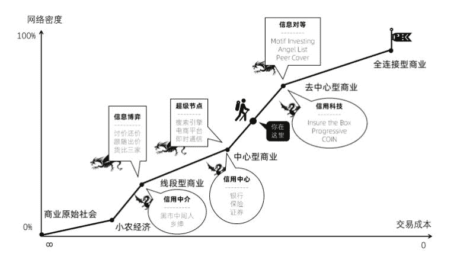

去中心型商业就是：我在我的小圈子里自娱自乐，你在你的小圈子里如痴如醉。我们不再必须围绕同一个超级节点，完成交易。曾经的中心，被分散，被弱化。

有同学问我：越来越多、越来越高效的连接，带来了“中心”，这可以理解。但是，为什么？为什么更加多、更加高效的连接，又会去掉这个中心，带来“去中心”呢？这有点让人费解啊。

其实，这是个数学问题，并不难理解。还记得，我举的“电视机”的例子吗？

以前村里都没有电视，只有你家有，你就成了街坊邻居的“超级节点”。后来电视越来越普及，一些人回家看电视了，你这个“超级节点”的重要性就变得越来越弱。这就是“去中心”。

还是不能理解？

我再给你举个例子。

你用迅雷下载过电影吗？通过迅雷下载的电影，并不是存在迅雷的服务器这个“中心”上的，而是存在无数人的电脑上。迅雷只是维护了一张列表，上面记录着：谁的电脑上有哪部电影。

当你的电脑要下载一部电影时，会自动查一下这张列表，发现 30 人的电脑上都有这部电影，于是就和这些电脑直接连接。迅雷这个“中心”被绕过去了。你在这些电脑上各自下载一些片段，最后拼成一部完整的电影。

这就是迅雷的：P2P 下载。

没错，你听到了一个挺敏感的词：P2P。到底什么是“P2P”？

P2P 的本质，不是网络借贷，不是网络借贷，不是网络借贷。重要的事情说三遍。

P2P，英文是“Peer to Peer”。Peer，是“平级”的意思。Peer to  
Peer，也就是平级对平级，直接连接，所以又叫“对等网络”。P2P 的本质，就是去中心化。

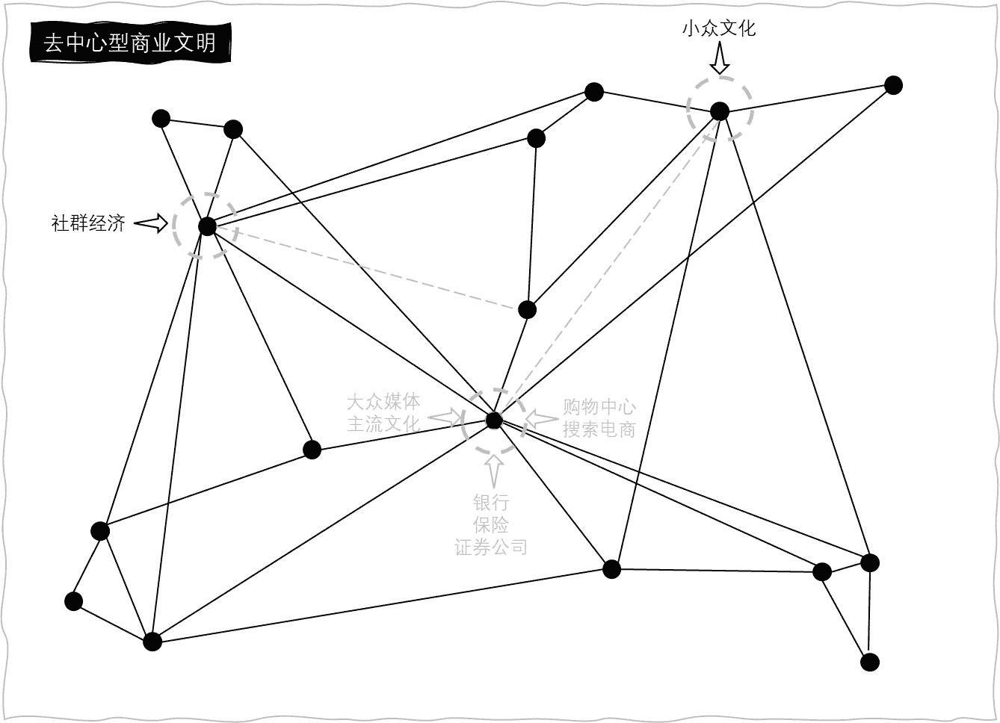

正所谓，天下大势，分久必合，合久必分。中心型商业之后，一个叫“去中心型商业”的未来，正在隐隐约约地向我们招手。

去中心，真的能成为商业文明吗？它真的可以比中心型商业文明，更有效率吗？

我再举个例子。

还记得“信用中介”那一课里，“凑份子包红包”的案例吗？

“凑份子包红包”，这是在“线段型商业”时代，用“熟人之间的信用”，解决“同质风险分担”问题的方法。这种方法的问题是，无法在大规模陌生人之间使用。

还记得“信用中心”那一课里，“保险公司”的案例吗？

“保险公司”，这是在“中心型商业”时代，用“信用的超级节点”，解决“同质风险分担”问题的方法。这种方法的问题是，交易成本依然不低。

那么，在“去中心型商业”时代，有没有更有效率的办法呢？

也许真有。

现在因为空气、水、食物的问题，癌症发病率上升了。怎么办？买一份大病保险。但除了买保险，还有什么别的办法吗？

我的一位朋友，张马丁，给出了一个办法。

他说，我在网上召集 3 万个人，你们每个人只要承诺，万一我们当中有人得了癌症，愿意给这个不幸的人捐 10 块钱，你就是这 3 万人之一了。这样，万一你得了癌症（最好不要），大家也会同样把钱捐给你。

这就是一个互助的“对等网络”。

但是我有个条件，你们作出承诺的一年后才能接受捐赠。为什么？因为有很多人太“聪明”了，他们会在得了癌症之后，再“承诺”帮助别人，这对其他人不公平。

一年后，大家都通过了观察期。这时，真的有个不幸的人得了癌症。请你把诊断记录发在网上，供这 3 万人在有限范围内查看。

这 3 万人数量已经很大了，他们中有些人是医生，看得懂这个记录；甚至有些好心人，可能会上门去看望他。

给你们一个月时间，一个月后如果无人提出异议，说明你们认可这个人真得了癌症。那么，请你直接给这个不幸的人账户里打 10 块钱。

请问，这时候，如果是你，你会不会给这个不幸的人打 10 块钱？

我相信大部分人是会的。为什么？第一当然是因为你有爱心。但同时还有一个原因，你希望你自己能够持续受到保障。不捐这 10 元钱，你就会被取消被保障的资格。

最终这个不幸的人可以拿到多少钱呢？3 万人，每人 10 元钱，一共 30 万元。然后，30 万元拿去治病，这个平台再次进入等待下一个人的阶段。

请问，从金融的角度看，这个平台听上去是什么呢？

没错，就是保险。一个没有通过保险公司这个“中心”，而是在一个“对等网络”中完成的互助保险。

这不是又回到了“凑份子包红包”的逻辑了吗？

是的。这就是我们说的，天下大势，分久必合，合久必分。

线段型商业时代，凑份子包红包是分散的“同质风险分担”；中心型商业时代，保险公司是集中的“同质风险分担”；去中心型商业时代，互助保险又回到了分散的“同质风险分担”。

为什么？因为在更高效的连接下，分散的“同质风险分担”，开始表现出比集中效率更高的一面。

一家保险公司运行，如果同样收 30 万元保费，你觉得，它最终有可能拿出多少钱的总量，赔付给那些不幸的人呢？这就叫“赔付率”。

我曾经给一本关于保险的专业书籍写过推荐序。它给了我一个数据：

*2005 年，中国保险的赔付率（赔款和给付款总数除以总收入）是 22.985%。2008 年是 30.366%，2013 年是 36.075%。*

那么，去中心化时代的互助保险呢？

阿里后来推出了和“抗癌公社”非常类似的“相互宝”。收 33 万元，赔 30 万元。其赔付率高达 91%。

相互宝立刻引起了一些“中心型保险”的攻击。

但是，2019 年 4 月，在中国保险中介发展高峰论坛上，保监会原副主席魏迎宁透露，中国非寿险公司管理费用将近 40%，人身险公司管理费用将近 20%。而网络互助行业的管理费用，基本保持在 8%到 10%之间。

8%~10% VS 20%~40%。这就是去中心型商业时代，“去中心型商业”，相对于“中心型商业”的效率。

可是，难道阿里，不依然是那个隐藏在相互宝这个“去中心”背后的“中心”吗？

是的。就像中心型商业，其实也是建立在无数线段之上一样；去中心型商业，也是建立在很多被“基础设施化”的中心之上。

百度、阿里、腾讯，都是超级中心。但是，它们的背后，其实有个更大的中心，那就是中国移动。中国移动曾经无比耀眼夺目，因为它太重要、太不可或缺了，已经慢慢从大树，变成了土壤，被基础设施化了。

**当这一代的互联网巨头也被“基础设施化”之后，更上一层的“去中心型商业”，也许才会正式到来。**


刘润

什么是“去中心型商业”？

网络密度增加，带来了中心；但是网络密度的进一步增加，又会消灭中心。

**因为连接效率提升，网络密度增加，我们可能不再需要一个“中心”，就能在一个“平级对平级”的“对等网络”里，更高效地完成交易。**

这就是“去中心型商业”。

这一讲，就讲到这里。

我们一直在说，所有伟大的机会，都源自于巨大的结构改变。

未来已来，只是尚未流行。下一讲，我们分享那些最早抓住趋势的公司，是如何成功的。下一讲，我带你往身边看，哪些人在你还没有关注的跑道上，已经悄悄撒腿跑了半圈？

今天我给你留一道思考题：

原始商业社会，也是没有中心的，那你觉得，它和去中心型商业文明，有什么本质区别呢？

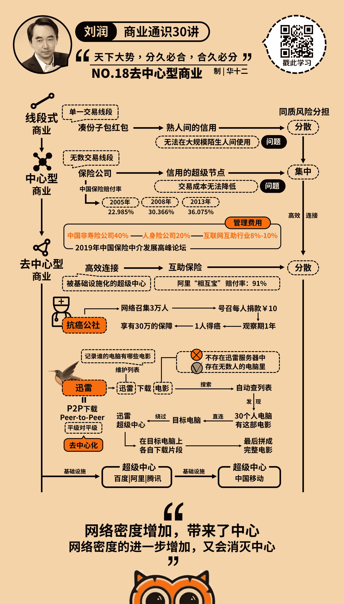  


用户留言

*    

晓曦 **114 赞**

```
 另外老师说 “现在因为空气、水、食物的问题，癌症发病率上升了”。不能否认这些因素有一定影响。但其实癌症发病率升高恰恰是医疗进步的结果。第一，癌症的发病率跟年龄极其相关。根据美国的数据 35-44 岁的人新得癌症的概率在 5%，而 65-74 岁的人新得癌症的概率在 25%。在过去人们经常活不到 65 岁，因为其它的急性传染病或者其他的病，还没来得及得癌症就死了。 第二，癌症诊断治疗的进步。过去得癌症很快就死了，甚至都没有好的诊断手段，没诊断出来就死了。现在诊断治疗方法好了，这些病都变成慢性病了，所以癌症病人能被诊断出来且活得比较久了，你会感觉上得癌症的人更多。 第三，癌症筛查得多了。过去当癌症没有好的治疗方法时筛查也没什么意义，查出来也没治。现在乳腺癌、大肠癌这类有有效治疗方法的癌症的筛查变得普及，因此被诊断出癌症的人也多了。 所以得癌症的人比较多其实有三个主要原因- （1）人均寿命延长（2）癌症诊断和治疗的进步（3）癌症筛查的普及。 
2020-03-24 
```

作者回复

```
没错。癌症是基因突变的附带后果，本质上是一个概率降临的游戏。活得越长，被概率砸中的机会越多。中国在过去十几年，癌症的发病率，每年上升 3.9%。如果去掉年龄因素（老龄化的原因），每年上升 1.2%。依然是在上升。但这个概率的比率，还好不算特别显著。
2020-03-24
```

*    

晓曦 **100 赞**

```
 我还有一点想提一下，医疗保险公司的管理费，固然是衡量效率的一个指标，但并不是越低越好。因为管理费用如果使用得当，可以降低整体支出。管理费可以被花在：（1）促进会员健康（2）与医院药厂谈判争取低价（3）决定医疗服务是否得当，防止身份被盗或者欺诈。 第一，医疗保险公司有激励让会员都好好维护健康，比如经常运动的人得癌症或者心脏病会比较少，好好吃药的糖尿病人并发症会比较少。所以医疗保险公司会实行一些措施提升健康。美国 90 年代兴起的一种保险公司名字就叫 Health maintenance organization，意思是健康维护组织。有的保险中会包括健身房的会员费。 第二，医疗保险公司可以向医院或者药厂要一个折扣价。比如说，跟医院 A 说，你给我打个八折，我就把我的会员都引导到你这里来。或者跟药厂说，如果你给我的药价打折，我就让会员尽量用你的而不是你对手的药。这个谈判成本也在管理费里。但单个病人与医院和药厂是没有议价能力的。 第三，治病怎么叫治好了治够了，不是一个非黑即白的问题，甚至有一定炫耀性消费的问题（万维刚老师在《头脑中的大象》里也提过）。有的病人看病是为了求关注，或者有的医生推荐了价格昂贵但没太大用处的治疗方法。所以保险公司会对部分昂贵的服务进行事前审查，如果觉得这个服务不合适会拒绝支付。事后也会监测。比如一般这个病住院都是 3 天或者 5000 块，这个医院平均是 10 天，2 万块，是不是有欺诈。 当然我说的都是美国的情况，我对中国的情况不太了解。 
2020-03-24 
```

作者回复

```
说得很好。100 人，共付 1000 元保费，提 200 元管理费，费率是 20%。这 20%的部分，用于药价谈判。这是对的。否则，因为高药价，100 人要付 1200 元保费。用户流失。只有 50 人留下，共计只有 600 元保费。200 元相对固定保险费，就占了 33%。费率上升。花管理费谈药价，降低了管理费率。虽然这有点难于理解。
2020-03-24
```

*   

江湖无声 **97 赞**

```
 农业社会，每个人都熟悉，因为连接半径很小； 工业社会，每个人都陌生，因为中心四通八达； 今天，每个人都在变透明，因为每个人都在线。 
2020-03-24 
```

作者回复

```
才华！你变成了一个中心~
2020-03-24
```

*   

老安 **50 赞**

```
 商业的本质是交易。哪种商业模式能够促进交易，人们就会采用哪种模式。从小农经济到线段型商业、中心型商业，再到去中心型商业都是遵循这一规律。 如何促进交易？就是要解决信息不对称，信用不传递两大难题。从以物易物、到中间节点、中心节点，再到去中心化，似乎在面儿看，是分久必合，合久必分，从没有中心到向中心集中，再到区中心化，但从根儿上讲，则是信息对称程度和信用传递效率不断提升的过程。 去中心化的商业模式与原始社会的小农经济相比，最本质的区别就是更好地解决了信息不对称和信用不传递的问题。 
2020-03-24 
```

作者回复

```
没有连接，就没有问题。有了连接，并且解决了连接带来的问题。
2020-03-24
```

*   

佛祖门徒 **35 赞**

```
 去中心化让每个个体都有机会成为中心，而每个中心都依赖于个体，个体一散便不成中心了。 公交车站是先有既定的一条路线，人要去目的地只能到公交站这一集中点，并且只能达到这条路线的既定的站点，如果目的地不在站点上，那么只能换一条路线或者到离目的地最近的站点后再走路过去；而滴滴打车是每个用户发出一个出行请求，用户可以在任意一个出发地并且达到任意一个目的地，每个提供出行服务的车都是一个中心。与之类似的例子是食堂和外卖软件，前者集中去往一个地点进行打饭用餐，后者是任意地点任意事件都可进行点餐用餐。 也许有人会问，滴滴打车和各类外卖软件都是做平台，积累用户量后他们就成为一个影响强大的中心，这个难道也是去中心化？上述的例子其实描述的都是一个场景，出行场景和用餐场景，在这种场景中我们可以有不同的解决方式，中心化和去中心化的定义是针对解决方案是否依赖一个中心来判断，滴滴打车和各类外卖软件都是一种辅助性服务工具，真正的服务主体是每个个体，滴滴打车是每个注册司机，外卖软件是每个合作餐馆，他们形成了众多多元化的中心，在这种场景中即为去中心化的典型表现。 
2020-03-24 
```

作者回复

```
从没有中心，到每个人都有可能变成中心。
2020-03-24
```

*   

山峰 **29 赞**

```
 学习商业通识 30 讲到现在，有四句话深深地刻在我脑海:商业的本质是交易。信息不对称和信用不传递阻碍交易。 商业进化的方向，就是从“网络密度=0”，向“网络密度=100%”前进的方向。商业进化的方向，就是从“交易成本=∞”，向“交易成本=0”前进的方向。 从第三句话与第四句话可以推出:原始商业社会与去中心型商业文明的本质区别是在网络密度和交易成本的量级差异。 
2020-03-24 
```

作者回复

```
数学的优美。
2020-03-24
```

*    

Chelios chen **22 赞**

```
 #主动与被动# 原始社会是“无中心”交换模式，这个时代只能用“交换”，而不能用“商业”来定义，货币媒介还未出现，物物交换为普遍形式。原因很简单，原始社会的信息与效率远达不到商业诞生的阚值。 而“超级中心”商业模式进化到“去中心”模式的核心缘由是信息过载到人们无从选择，这时，熟人关系或者兴趣圈层就能起到节约能量，快速提取信息，进而提高商业效率的功能。所有商业模式都是在用效率去解决“信息不对称”和“信用不传递”。 虽然原始社会的“无交换”性质的去中心化与超级中心节点后的“去中心化”商业模式表现形式类似，但本质却完全不同。 
2020-03-24 
```

作者回复

```
中心型商业，尤其是超级中心，是拐向区中心的那个玉芝。
2020-03-24
```

*    

冬至节 **20 赞**

```
 原始商业社会，不是“去”中心，是“没有”中心。人与人之间是分散的，交易是少量的，人与人之间的连接是少量甚至没有的。 其实我有时候就觉得我们离开原始商业社会没有太远，就在几十年前，国内通行“粮票”的年代，还有一种票叫“布票”，也就是说那时家家户户都是自己做衣服的。再往前推几十年家家户户都有纺织机，自己织布…… 而去中心型商业文明，是本来有中心，后来又没有了，或者中心变得分散了。但是，人与人之间的关系的还在，人与人之间的连接，也在，甚至还增加了。比如，现在人人都是去买衣服的，而且去大商场的较多，这就是中心型。而去中心指的是，人们后来很少或者不去大商场，而是去离家更近的小商场买衣服，甚至是去“定做”衣服。——而不是退回到自己做衣服的情况。 
2020-03-24 
```

作者回复

```
很好的案例。
2020-03-24
```

*   

林木 **18 赞**

```
 《爆裂》这本书讲到一个观点，当信息透明共享、连接非常普遍且低成本的时候，“涌现”就会变得非常普遍。 涌现是超级复杂系统的一个关键性质，它并非是一个 1+1＞2 的过程，而是产生了一个全新事物的过程。 要做一群自由人的自由联合，远要比一群自由人的联合迸发的力量大的多。两者的区别就在于有没有去中心化。 
2020-03-24 
```

作者回复

```
这种“涌现”，此起彼伏，此消彼涨。站在空中看，就是一个个瞬间聚集，快速消散的小中心。
2020-03-24
```

*    

钟斌 **17 赞**

```
 印第安部落都是松散的联盟结构，打仗的时候偶尔可以联军，平时没有什么管理。那这样的组织就不可能对部落成员收税。 去中心化的组织一旦想赚钱，它就必须得实现某种程度上的中心化。而一个集权组织一旦让权力分散，组织的总利润就会下降。 音乐产业就是很好的例子。历史上最早的那些音乐家都是靠现场表演获得收入，音乐家没有全国性的公司，是个去中心化的群体。音乐家有一定的收入，但是“音乐家交流协会”没有收入。 后来有了录音技术，唱片公司控制了音乐家，音乐组织变得集权了。音乐产业被做大做强了，利润丰厚 —— 但是拿大头的是唱片公司。音乐家拿的是小头。集权，给组织带来了高利润。 再后来，私下的盗版和 P2P 网络下载，打破了唱片公司的集权，音乐又变得去中心化了。结果就是唱片公司的利润下降，音乐产业总体下滑，只有少数音乐家成为明星，可以到处开演唱会赚点钱。 我觉得润总说的去中心化，应该是那种非纯粹的去中心，是海星与蜘蛛结合的一种状态。分权有利于发展，集权有利于收获。比如在淘宝上谁都可以开店，这是去中心化，可以快速发展快速演变。淘宝平台搞些管理，这是集权，但是有管理有服务才好提高效率，产生利益。 
2020-03-24 
```

作者回复

```
音乐界的商业故事，可以写一本书。
2020-03-24
```

*    

🔆皎皎🏹 **14 赞**

```
 最大的区别在于连接能力： 原始商业的每个结点只能连接有限的邻近结点，而去中心型商业则是因为有能力实现大量结点间高效的连接而自然的去中心。 ——“没有”和“无需”的区别 
2020-03-24 
```

作者回复

```
没有和无需的区别，说的太好了。
2020-03-24
```

*   

演员 **13 赞**

```
 一个人是中心才叫做中心，每个人都是中心那叫互联。 
2020-03-24 
```

作者回复

```
结构洞变少。
2020-03-24
```

*   

陈狄 **11 赞**

```
 原始商业社会看起来和去中心商业社会貌似一样，都是去中心嘛没什么区别，那如果这样想的话那上不上大学也没有区别都有当老板的嘛。这就是忽略了上大学和不上大学两个群体整体的职业和生活情况。 同样原始商业社会和去中心商业社会我们也忽略了关键的东西，我觉得忽略的是连接的效率，原始商业社会是“从前车马慢，一生只够爱一个人。”而去中心化的商业社会人与人的链接是一连网瞬间完成，所以才不需要中心，这其中的效率差距是天壤之别，这是他们的本质区别。 
2020-03-24 
```

作者回复

```
车马慢，一生来不及遇到一个人，怎么办？
2020-03-27
```

*   

伊春莺歌 **10 赞**

```
 这个是有本质区别的。 1、 那个时候没有形成中心，谈不上去中心。“去”的前提首先是“有”。 2、 现代的去中心化的各个单点，其能量远远大于原始社会的单点。虽然看起来都是零散的点，但原始时期是因为无法形成线段和中心，每一个单点都是非常脆弱的。现在，因为基础设施的发达，任何一个单点都可以迅速组织或者参与一场协作，随时可以形成线段或者一个新的中心。 3、 原始社会其实在“点状”的掩盖下，更依赖于局部的中心。比如，他们的信息传递都是高度依赖族群里的领导，一旦失去这个超级中心，他们很多事情往往无法进行。而现代则不同，是可以实现真正意义上的“点”的极致，每一个人都有可能变成超级玛丽。 有句话，愿你归来依然是少年。也许看上去容貌形体和少年无异，但他内心已多了沧桑。 
2020-03-24 
```

作者回复

```
“去”的前提首先是“有”。
2020-03-24
```

*   

毕昊峰 **10 赞**

```
 兴奋来自于认知的升级。早就知道 P2P，今早在润总的点拨下，才真正知道了 P2P（英文是“Peer to Peer”）。Peer，是“平级”的意思。Peer to Peer，也就是平级对平级，直接连接，所以又叫“对等网络”。P2P 的本质，就是去中心化。这也是本节的要害。回答本节的问题，原始商业社会那种去中心型商业，是一种无意识的商业行为，其进化方向是中心型商业。当下的去中心型商业文明，是一种自觉自发的有意识行为，是升级版的商业文明，其进化方向是全连接型商业。想起了一个案例，一家业界内的工程公司，他们去年刚刚成立，却已占据了 PP 市场的一定份额，在国内几个地方和国外都有项目。如果用润总今日的商业理论，他们就是用去中心型商业来打造他们的商业版图的，值得借鉴。所有伟大的机会，都源自于巨大的结构改变。那就让我辈在未来的商业道路上，来寻找这个巨大的结构变化，进而抓住这些即将流行的商业机会，在市场上攫取一勺红利。 
2020-03-24 
```

作者回复

```
有很多偏离本质的商业现象，被当成了商业本质，而误导了我们对商业的更深的理解。
2020-03-24
```

*    

许钊辉 **9 赞**

```
 这跟看山是山，看水是水；看山不是山，看水不是水；看山还是山，看水还是水一样吧 
2020-03-24 
```

作者回复

```
三个境界。但山，以及不是曾经的那座山。
2020-03-24
```

*   

聂珣 **7 赞**

```
 风电行业分析： 中国的风电行业，甚至整个电力行业，只有一个超级中心——电网，它负责连接发电厂和用户，通过垄断形成了实质上的定价权，利润和员工薪酬福利一直远超整个行业。这几年来，市场化电力改革把电网推向了风口浪尖，众多声音要求它基础设施化，做好电网建设和维护就好，运营的业务独立出来，买电卖电的事让市场来做。改革多年，效果不大，毕竟自己革自己的命不是那么好做的，但超级中心基础设施化的方向是大势，未来这方面可供想象的商业模式会层出不穷。 另外一个去中心化的概念就是分布式电源了，它是鼓励各个地区（可大可小）自建新能源电源，自发自用，算是自己形成了一个小电网，然后小电网再跟大电网连接，对大电网进行补充。这个现象我觉得很有意思，跟课程中保险的例子非常像，最开始因为技术原因，电网都是很小的，并且彼此不连接，后来随着技术进步，电网越来越大，形成超级中心，到现在，又向着小网络的方向发展。但现在的这个小网络，不再是之前互相封闭的小电网，而是能和大电网紧密联系的、随时参与其中的一部分；它不是出于无奈，而是出于效率和安全考虑，选择的一种比大电网更高效的方式。这也算我对本课问题的回答吧 
2020-03-24 
```

作者回复

```
国家正在推动“电力互联网”，我家自己的太阳能发电，用不完的，卖给电网。发电站，越来越分散。
2020-03-27
```

*    

陈磊 **7 赞**

```
 商业结构的变迁图：线段型商业→中心型商业→去中心型商业 \------------- 线段型商业：就是买一个东西需要经历 A→B→C→D→E 等中间传递，存在问题问题效率慢、信用不传递 中心型商业：淘宝、京东、百度、滴滴这种大型交易平台，也包括类似的大型购物中心，存在问题商业垄断局面出现，交易成本过高出现 去中心化：去中心化的前提建立在已经中心化，这时候的去中心化更能提高商业效率、降低交易成本，人人都是超级节点，大型平台属于商业世界的基础设施。 \------------- 这个原理很有意思，去中心化的时代即将到来，淘宝逐渐成为基础设施，从而有更多的网红成为基础设施的超级节点。 教育呢？ 中心化商业大到以新东方、好未来，小到教培机构，慢慢的也会参考淘宝商业的进化，逐渐出现去中心化的趋势，各个老师成为超级节点。 
2020-03-24 
```

作者回复

```
一张地图，开始恢宏展开。
2020-03-24
```

*    

史蒂文 **7 赞**

```
 我在宁夏经营一间中国列级酒庄， 去中心化是我们提供服务方向的互换，个体也可以是中心，中心也可以做个体 以前我们卖酒的方式就是通过展会或者转介绍进行全国招商，我们酒庄是做 B2B 的生意，几乎没有零售，我们的中心就是经销商，我们的销售团队就是服务于他们 后来团购兴起，我们可以有小部分服务于最终的消费者，这种改变带来的是利润空间的增大和产品信息反馈的快速和真实，这个时候我们的中心变成了团购和经销商，但是我们还是要出去跑业务，去见面 现在，因为有了新零售，我们可以接触到更多消费者，得到更多反馈，营销的成本在不断降低，虽然产品价格在下降但是利润在上升，在这个过程中，很多个体被我们孵化成了新型的团购经销商，因为他们都是自己小圈子的意见领袖，他们都有带货能力，而且最重要的是有内容输出能力，所以我们现在正在努力让自己变成一个母体，做好内容输出，为每一个小中心做内容的搭建和话题引导，营销方式和获客的渠道改变巨大，当然产品也在改变， 最后在这个中心转换的过程并不是那么一帆风顺或者风平浪静，经销商的利益的改变让他们很难迅速接受，博弈艰难，发展社群经济和 KOL 也遇到良莠不齐，损害品牌，但是路看清了，偶尔被刺扎几下，不影响前进就行 感谢润总 
2020-03-25 
```

*   

聂珣 **6 赞**

```
 昨天事情太多，没有留言，今天补上。 风电行业分析： 风电行业属于相对封闭的电力行业，进入门槛高，供应商和买家长期固定，所以交易过程可以算是“熟人”间的买卖，这跟汽车市场很像，所以也没有出现交易中的信用中心。后来，一些民营企业依靠本地关系开发风场，跟原有的买家、卖家没有信任基础，这就产生了帮忙牵线搭桥的中间人空间，随着行业的发展和成熟，这方面空间越来越小。 当然，行业也跟其他行业一样，存在一个巨大的信用中心——检测认证机构，专门负责对产品的安全、质量、效率进行权威评估，减少买家的测试成本。在认证行业内，风机属于大型工业产品，跟我们平常用的食品和电器产品不同，它没有强制性标准，也就是你做当然好，但是不做，法律也允许你销售，所以风机做认证的意愿不强。在 2012 年之前，风机认证这块一直被国外的大型机构垄断，比如 GL、TUV、UL 等等，他们的销售也经常拿着自己品牌上百年的历史信誉降维打击国内的机构（自己也曾是其中一员）。2013 年后，行业整顿，发文要求所有投标产品必须通过检测认证，一时间，整个认证行业业务量大增，而国外机构检测设备少、反应慢（报告审批人员都是外国人，让他们加班加点几乎不可能）、周期长的弱点一下子就暴露了出来，一个型号的风机型式认证没有一年半根本拿不下来，这让国内厂家无法接受。这时候，国内机构开始发力，他们大力投入设备和人力，缩短报告撰写时间，建设优质的测试场地让测试更快通过，把产品认证时间缩减到 9 个月甚至更短，借此两三年间就抢走了一半的市场份额。而认证行业很有意思，它表面上是信誉歧视，但你的业务量大了后，其他机构发现没办法抑制你时，立即就放弃歧视，转而接受你成为他们的一员。所以，当国外机构发现自己根本没办法跟国内机构竞争后，他们立即转为合作互认，也就是我承认你的检测结构和认证证书的有效性，并且愿意在你的基础上再颁发我的证书。 从风机认证这几年的发展中，我见证了中国检测认证的成长，也从中悟出一个道理：信誉不是靠你的历史信誉和故作专业姿态来获得的，赢得市场，获得更多人的认可，你就拥有了信誉。 
2020-03-24 
```

作者回复

```
赢得市场后，你就更不舍得放弃自己的地位，你的“不诚信”成本太高，所以更值得被信赖。
2020-03-24
```

*   以上留言由 作者 筛选显示
    

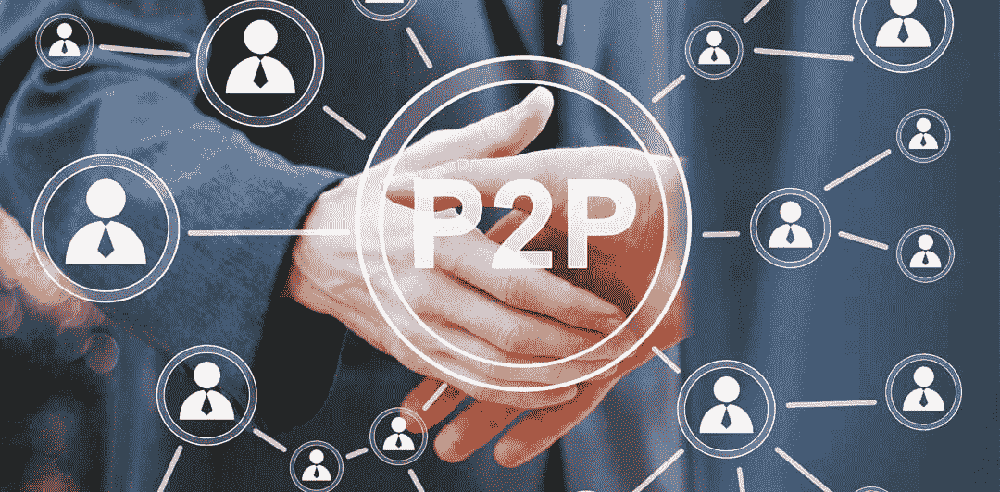

# 19｜信息对等：每个人都是时代的中心


刘润

2020-04-08

19｜信息对等：每个人都是时代的中心

建议 WiFi 环境下播放

当网络密度增加到，跨越集中，重新分散，悄悄出现“P2P 对等网络”时，商人们，如何战胜交易节点（P）之间的“信息不对称”，降低交易成本，并创造巨大的机会呢？

**面对未来，我们要保持足够的谦逊，这样才能不被打脸；面对未来，我们要保持足够的激进，这样才能抓住机遇。**

这一讲，我带你认识三个激进的抢跑者，带你看看在那些你可能还没有关注的跑道上，它们是如何利用“信息对等”的逻辑，悄悄跑出半圈的。

第一个抢跑者，是：Motif Investing。

Motif 这个单词，是“组合/主题”的意思。

在 Motif 上，人们可以建立自己的组合。每个组合，就是一揽子股票。网站不公布你这个组合的内容，比如哪几只股票，是什么配比等。它公布这个组合创立之后，相对于大盘的走势。

曾经有位太阳能行业的从业者，做了个太阳能行业的 Motif，连续几周跑赢了标普。其他投资者一看，这个组合不错啊，我要买这个组合的“配方”。然后，平台会从付费中分给创建者 1 美元。

你可能会想：啊，才 1 美元啊？我辛辛苦苦做出一个赚钱的组合，才赚 1 美元？

这个太阳能行业的从业者，并不是一个专职的金融从业者。他可能别的什么都不懂，就懂太阳能行业。他一个月的收入可能也就 8000 美元。如果这个组合非常赚钱，他一个月能多收入几千美元，已经是非常可观的收入了。

同一份“创建盈利组合的能力”，过去掌握在基金经理这样的中心化机构手上时，要通过资金杠杆，“批发”给投资人。但在 Motif 上，这份“创建盈利组合的能力”，今天被“零售了”。

基金经理们很聪明，很优秀，受过良好教育，有优秀的判断力。但是，你相不相信这个世界上，有很多和这些基金经理一样聪明，一样优秀，受过一样的教育，有一样判断力的人，因为各种原因，无法坐在他们的位置上呢？

有，不但有，而且大有人在，因为位置总是稀缺的。Motif 做的事情，就是把这些优秀的，被“盈余”出来的“认知”收集起来，通过一个“P2P 对等网络”直接提供给彼此，绕开了“基金经理”这个“中心”。

美国著名畅销书作家克莱·舍基有一本书，叫作《认知盈余》。如果我们能把这些盈余出来的认知收集起来，用来创造价值，这对整个社会来说是件巨大的好事。

去中心型商业时代的机遇，就是不羡慕一个太阳的光芒，而去收集满天繁星的智慧。

Motif 被评为美国 50 家年度最具颠覆性的企业之一，排名第四。

第二个抢跑者，是：AngelList。

Angel 的意思，是天使；List 的意思，是清单。

我从微软离开后，创立了润米咨询。除了做商业咨询之外，我也是几家基金的 LP（有限合伙人）。

因为我是从科技公司出来的，身边有很多人创业。他们中有些人会来找我直接投资，有时候我就投一点。这就是天使投资。

投了之后，我就知道什么是“天使”了，很多钱血本无归。

你买个理财产品，就算亏了，还能剩个渣。可是股权投资，最后可能连渣都没有，只有那种坐过山车般的经历。

所以，在一级市场做股权投资，跟在二级市场买股票基金，完全不是一个风险量级。

反过来说，也因为这样，很多创业项目找不到自己的天使投资人。创业者和天使投资人之间，很难找到彼此。

那能不能为他们彼此之间，建一个“对等网络”呢？

印度小伙 Naval Ravikant 在硅谷创立了 AngelList。

作为创业者，我在 AngelList 上公布了自己的创业项目，说明自己打算怎么干，并且愿意出让 8%的股份，换取 20 万美金的投资。你们谁愿意投给我？

哎呀，这个项目不错，但我没有 20 万美元，我投 2 万美元可以吗？可以，那你占 0.8%。那 2000 美元呢？也可以，那就是 0.08%。

这样，一群可能素不相识的人就把 20 万美元凑齐了，给了他们素不相识的创业者。

其中一位向 AngelList 请求投资的，和众多其他人一样名不见经传的创业者，叫特拉维斯·卡兰尼克。他来融资的项目，你可能听说过，就是后来闻名天下的 Uber。

在很多人心目中，VC（Venture  
Capital，风险投资）投资着最先进的互联网公司，但是这个行业自己却非常古老，神秘莫测。Naval 说，这个行业本身，也需要被互联网改变。

AngelList 消灭了项目的信息不对称，撕掉了风险投资的神秘感。因此，一个远在俄亥俄州的合格投资人，也可以直接看项目、投项目了。而过去，他们必须把自己的钱委托给一家中心化的风险投资机构。AngelList 的直接匹配，让中心化的风险投资人感到了危机。

**去中心型商业时代的机遇，就是不神话那个英雄，而把武器交给每个普通人。**

除了从 Uber 身上获得了上千倍的回报外，AngelList 因为“信息对等”式的投资，被硅谷媒体评为“超越纳斯达克的下一代交易所。”

抗癌公社、相互宝，都是非常有趣的“P2P 对等网络”试验。可是，这两个项目都是针对大病，尤其是癌症的。在“P2P 对等网络”互助的对象，可不可以是别的事情，或者是任何事情呢？

2015 年，新西兰成立了一家 P2P 保险公司：Peer Cover。它说：可以。

Peer Cover 邀请用户成为“联合创始人”。联合创始人可以根据 Peer  
Cover 上的现有产品（比如手机险、葬礼险、车险等），创建自己的“赔偿团体”。每个人都能成为联合创始人，并且编写这个“赔偿团体”的条款，只要其他加入者同意。

比如，我这个赔偿团体，只保障手机掉到浴缸里的情况。这样，PeerCover 上就出现了很多各不相同的小小的保险产品。这个赔偿团体，就成为独立于保险公司这个超级节点的一个“P2P 对等网络”。

一个会员填写了索赔单，说自己的手机掉到浴缸里了，不是泳池，是浴缸，并上传了照片。这时，只要赔偿团队确认，并同意了这位会员的索赔，系统根据他们自己约定的条款进行支付。

更有趣的是，用户还可以随时加入和随时退出赔偿团队。如果退出时，这个“P2P 对等网络”还没有发生索赔，甚至可以拿回全额。

这就是基于“P2P 对等网络”的万物可保。只要有足够的人想投保同样的东西，不管是什么东西，甚至猫猫狗狗都是可以的。

你闭上眼睛想一想，当全球想投保“哈士奇”的人通过“P2P 对等网络”聚在一起互助的时候，还有保险公司什么事。

**去中心型商业时代的机遇，就是不强求自上而下的秩序，而鼓励自下而上的涌现。**


刘润

线段型商业克服“信息不对称”的方法是“信息博弈”，中心型商业是“超级中心”，去中心型商业是“信息对等”。

什么是“信息对等”？信息对等，就是让信息在 P2P 对等网络中，在交易节点之间自由流动，而不是“滞留”在“中心”，从而战胜“信息不对称”带来的阻力，降低交易成本。

Motif Investing、Angel List、Peer  
Cover，那这样，它们不就变成下一个中心了么？是的。但它们明显会比曾经的超级中心要小，比曾经的超级中心要多。我们从一个太阳，正在走向满天繁星。这就是“去中心”。

去中心型商业时代的机遇，就是不羡慕一个太阳的光芒，而去收集满天繁星的智慧；就是不神话那个英雄，而把武器交给每个普通人；就是不强求自上而下的秩序，而鼓励自下而上的涌现。

这一讲，就讲到这里。下一讲，我们看看，“去中心型商业”战胜“信用不传递”这条恶龙，这里面还深藏着什么巨大机会。

今天我给你留一道思考题：

听上去 P2P 对等网络，是一个挺有用的技术。但是为什么有那么多 P2P 借贷公司跑路呢？

到此，我们已经学习了看懂商业的两条线索：成本和连接。也回顾了线段型商业和中心型商业。

现在，你可以在留言区把自己行业的交易结构，用这两条线索拆解分析， **如果分析后还有自己没想明白的地方，也请你把自己的疑惑问出来。**

我会在课程的结业直播里，对分析得好的同学进行点评，也会挑选典型问题，进行答疑。期待在留言区看到你的分析和提问。

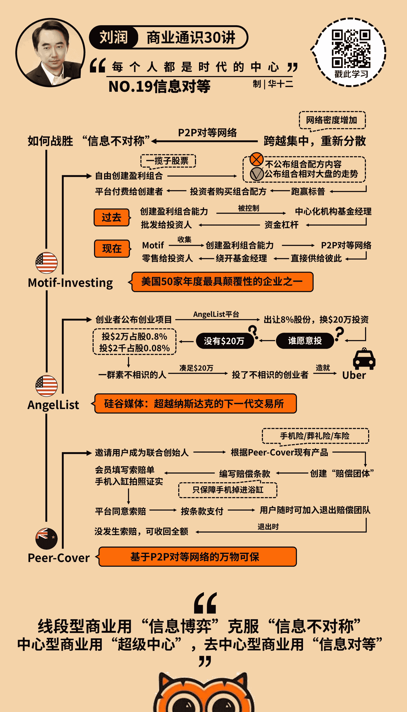  


用户留言

*    

Jim 破声带 **114 赞**

```
 万物可保，想想就激动，理论上也确实可以实现，不过我在想未来传统的中心型保险公司会不会衰落呢？现在各家公司都在谈转型，好像不是往这上面转的🙈 
2020-03-25 
```

作者回复

```
他们是在“升级”，不是在“转型”。升级是原来的路径上做得更好。转型是换条路走。
2020-03-25
```

*   

曹辉 **90 赞**

```
 P2P 只能解决信息不对称，而不能解决信用问题。 真正 P2P 应该只解决信息不对称和效率提升问题。 作为信用机构的一个解决路径和方式。 而不是发展为融资盘。因为 P2P 不具备信用的机制。只解决点对点信息不对称，把收集来的信息交给具有信用优势一方去运营。不能独立融资吸储。 国内 P2P 融资盘是伪金融，所以暴雷跑路就不足为奇了，需要监管层加大监管力度。 
2020-03-25 
```

作者回复

```
很专业。
2020-03-25
```

*   

伏彦坤 **74 赞**

```
 润总，您好！ 我在农村信用社工作 8 年了，试着来分析一下。 银行应该属于典型的中心型商业模式。随着近几年互联网金融的崛起，我们银行业感受到了巨大的压力。 我认为压力源恰恰就在成本与连接上，这两点给传统银行致命的打击就是：获客难！ 我最近正在制定如何通过克服信息不对称，降低交易成本，提升营销网络密度来提升农户的信贷可得性。据中国家庭调查(CHFS)结果显示，农村有借贷需求的家庭比例达到 19.6%，但农村家庭的正规信贷可得性仅约为 27.6%，低于 40.5%的全国平均水平。未能获得银行贷款的 72.4%的农村家庭中，有 62.7%的农村家庭虽然需要资金但并未到银行申请（中国农村金融发展报告）[1]。何广文等(2018) [2]运用最新的调研数据也证明了农户信贷需求旺盛，但是正规金融的满足率仍然较低，通过多年普惠金融改革，农户受到信贷约束占比仍然较高。阻碍农户信贷需求得到满足的原因是信息不对称、交易费用和不确定性（Stiglitz 和 Weiss，1981）[3]。成本主要来自于交易前的搜寻成本、比较成本、测试成本，连接局限于每办一笔贷款都得到物理网点完成~效率很低。 关于提升农户的信贷可得性，我想听听润总的建议😊 同时，想咨询润总：作为一名普通的银行从业者在不能改变单位科技水平、战略方向等宏观格局下，自己需要做些什么才能与时俱进，不被商业进步的洪流替代呢？ 诚盼回复🌈🍀 
2020-03-25 
```

作者回复

```
其实不仅是农村信用社，很多城商行也是。我在过去几年，去给很多银行将金融科技的课程。看到一种趋势，银行体制内在不断集中（因为互联网，大银行的集中优势体现），城商行和农村信用社生存艰难；但是同时，科技金融此起彼伏，大银行也遇到不小压力。这是体制内集中，体制外分散的两重变化。
2020-03-25
```

*   

青岛罗刚 **53 赞**

```
 P2P 公司“暴雷”有两类原因，一类是模式自身的，一类是人性自身的。 1、在商业模式上，“信息对等”希望战胜“信息不对称”带来的阻力降低交易成本，但由于“小星星”承担风险的能力要比“大太阳”小得多，鉴别真假信息的能力也有局限性，所以当风险来临时，小星星容易薪尽火熄。 2、P2P 本来是一部好经，但许多人参与者为了暴富而引爆了地雷。有一些公司其实是打着 P2P 的名义，组织了庞氏骗局，那其实就是犯罪。而另一些公司为了追求超额利润，或多或少存在着违规经营的情况，比如说为了增加营业额而不严格审察贷款人信用，为了迎合短期贷款人偏好而违规拆分长期融资，做资金池，做假合同等，当监管趋严、金融体系流动性收紧、逾期不还款的不良贷款增加、投资者注入资金放缓时，这些盖歪了的楼地基太差，就轰然倒塌了。 
2020-03-25 
```

作者回复

```
打着 P2P 名义的庞氏骗局有不少。你还不能说。你一说，那些被骗的人，会站出来誓死捍卫骗他们的人。真是悲哀。
2020-03-25
```

*    

史蒂文 **31 赞**

```
 我在宁夏经营一间中国葡萄酒庄 以前我们的服务中心就是经销商，我们的信息被经销商筛选的传递给了我们，然后我们根据有限的信息在迭代产品 伴随着信息化的发展，我们越来越多的接触到终端消费者，消费者也越来越多的接触到我们，信息通畅了，产品的迭代有了更加精准的方向，最终消费者也更加开心，但是这也是在削弱我们经销商这个中心，他们通过信息不对称产生利润的风险和难度在不断上涨，虽然我们在刻意保护他们的利益，维持价格的不便，但是消费者也渴望去去中心化带来的更高性价比 改变结构才可以改变价值，去掉原来的大中心是个艰难的过程，我们办法是帮助经销商孵化小分销商，也就是社群营销，小团购. 把门槛放低，把总量提高，加强内容输出能力，通过内容来获客，通过内容互动来增加粘性 去中心就是让个体变成中心，小团购， 大中心变成小个体，成为另外一个行业，或者说跨界的个体，然后再变成中心， 改变都是残酷或者说不简单，还希望润总在去中心的路上给多指点，希望不要误伤友军 
2020-03-25 
```

作者回复

```
走出门。问问自己，如果事业了，作为新的创业者来颠覆这个行业，你会怎么做。然后再走进门。
2020-03-25
```

*    

欧文童鞋 **26 赞**

```
 用成本和连接分析我的商业项目。 我是在三线城市湖南衡阳经营生日蛋糕的店，2014 年开始创业到今天 6 年。经营模式就是线上下单，当天制作，送货上门。 【获客成本】传统连锁门店需要依靠大量的门店和消费者连接，完全依靠店门口的流动人口，获客渠道单一，且成本高。 【获客成本】互联网蛋糕店微信渠道获客，最开始的获客方式就是地推式传单，寻找目标人群，把传单发到她们手中，获取了第一批种子用户，然后利用种子用户产生裂变。 裂变一是靠口碑，二是靠物质激励。现在完全靠口碑传播，目前有 14 个个人微信号，每个号 5000 粉丝，当然会有一些重复的。这样算一下，获取一个新客户的成本极低。 【人工成本】传统连锁店，完全依赖门店客流，购买面包、饼干、甜品，和定生日蛋糕。面对面的导购，一个顾客需要一个营业员，特别是生日蛋糕，顾客需要长时间挑选，人工成本非常高。 【人工成本】互联网蛋糕店，提前把蛋糕拍好图片，上传到微店，根据年龄阶段系统性分类。把经常问的问题，全部提前编辑好，这样一个客服在线同时可以接待 5-6 个顾客咨询，引导顾客下单，大大降低了人工成本。 【产品成本】传统连锁店的生日蛋糕，大多数都是在中央工厂提前制作好，然后早上配送到各个门店，基本上一天只能配送 1-2 次。这就存在 3 个问题：第一、生日蛋糕的款式不能个性定制；第二、口感不能保证当天现做；第三、过了保质期的就要报废，损耗成本高。 【产品成本】互联网蛋糕店采用顾客提前下单，个性定制，再根据顾客的选择和喜好，进行制作生产。这样的好处：第一、蛋糕款式可以个性化；第二、当天现做现送，保证口感新鲜；第三、由于是反向定制，可以做到 0 损耗。 【交付体验】传统连锁店和外卖配送平台合作，或者顾客自己到店自提。外卖配送平台的骑手劣势：①不是专人专车专送，大号的生日蛋糕电动车放不下，没法配送；②不是自己的团队，要经常抢单，蛋糕损坏率高；③蛋糕送达以后，不会提示顾客如何保存，更加不会说祝福语，顾客体验不好；④顾客收到蛋糕以后，也没法第一时间与门店联系，售后反馈路径受阻。 【交付体验】互联网蛋糕店，为了体验顾客的体验，最大限度的降低蛋糕损耗率和送货的时效性，我们自己组建了一支骑手团队。 优势：①综合配送成本低；②专人专送，一条路线送 3-4 个，配送效率高；③专人专送，蛋糕损坏率极低，并且服务有保障；④午高峰和晚高峰，不会出现没有骑手接单的情况；⑤顾客收到蛋糕以后，有问题可以第一时间与我们微信客服联系，朋友圈买家秀也会第一时间发给我们。 【互联网蛋糕店劣势】 ①产品原材料高，售价偏贵，定位中高端人群，这样的客群相比较传统连锁店的大众人群，客群基数不够。 ②产品组合比较单一，主要经营生日蛋糕搭配甜品和饮品。生日蛋糕是低频消费产品，甜品和饮品由于售价也属于中频消费产品。 ③个人微信号好友人数限制，若地级市采用微信公众平台，则失去了个人微信号的灵活性，和每日朋友圈营销的广告性。 
2020-03-25 
```

作者回复

```
很赞的分享。值得大家借鉴。
2020-03-26
```

*    

Super Tank **21 赞**

```
 润总好，关于 P2P 跑路的问题，我曾看过一篇调研，从调研来看，国内 P2P 公司主要表现为三种类型：纯粹的信息中介模式、提供担保的网贷模式、债权转让模式。 但无论是哪种模式，出问题的 P2P 公司总是惊人的相似—— 【1】盈利具有“条件性”：只有当交易总额达到一定规模时，才能弥补前期亏损、实现盈亏平衡。 【2】收费以服务费为主，高度依赖交易规模。增大交易规模的同时，要兼顾到坏账率的控制。 【3】无法依照欧美国家的数据分析模式来构建风控体系，因而产生了高风控成本的副作用。 如此看来，公司本身是不是对等网络不是最重要，打铁还需自身硬，基本盘不稳，什么技术，什么理念都救不了啊。 以上，请润总指教，谢谢。 
2020-03-25 
```

作者回复

```
1）这是所有互联网公司的通病。用生死来博最后的赢家通吃。只是，在涉及钱的领域，不是死就能谢罪的；2）服务费本身没有问题，但是这种模式用在借贷上，会客观上与资产的质量博弈；3）没有风控体系是核心。下一讲会讲“信用科技”。虽然 P2P 借贷，在中国必须不能建立资金池（规定），没有信用责任，但是，当用户也不是合格投资人的时候，这种错配，会带来自我安慰式的覆灭。
2020-03-25
```

*    

钟斌 **19 赞**

```
 香帅认为，中国的 P2P 不是真的 P2P，大家千万要记住这一点。 真正的 P2P 是一个点对点的融资服务，平台方是不能够收取任何资金的，只能做信息中介服务。而中国的 P2P，基本上都是把你的钱收进去，平台说它来替你投。这就是“非法集资”。 这是一个灰色地带，不是正常意义上的 P2P。 
2020-03-25 
```

作者回复

```
因为他们本来只能解决信息问题，却错以为自己可以解决信用问题。
2020-03-25
```

*   

嘉玲 **17 赞**

```
 今天听说了一件发生在洗脚店的小事很感慨：两个小伙子到一家街边店的私人洗脚店，问老板“看您生意挺不错的，需不需要招人”（此时店里有两位客人在洗脚，此时有客上门已经算不错了）在被拒绝之后，其中一人和老板攀谈，原来他们是一家大型连锁足浴中心的一级技师，拿的是较高的提成，前提是没有底薪的。受疫情影响，足浴中心无法营业，他们便断了收入来源，撑了快两个月了实在没办法才出来找工作碰运气。 在问及怎么不去试试做快递或是外卖骑手时，回答虽然这两个行业是用人大户，但是排队等号的应聘者实在太多了，他们等不起。 老话说一技傍身，他们平时可以享受较高的技能和经验带来的一些红利，在危机面前被狠狠拍落岸边。 勤勤恳恳埋头苦干，更要抬起头来，感受翻天覆地的潮涌之前的海腥味，及早做好准备，投奔入海。不会创造性颠覆，至少也要做个紧随潮涌的逐浪人。 
2020-03-25 
```

作者回复

```
对这个应聘的技师来说，只要存的钱够吃几个月的饭，其实还好，只要技能不错，总能找到工作。他原来工作的那家店就未必了。如果实在撑不下去，就关门了。店比人脆弱。
2020-03-25
```

*   

马克李 **15 赞**

```
 医疗上有很多的风险，一般医疗都要经过医院的平台，其实医院只是作为一个信用背书的作用，而目前医院对于医生的很多 kpi 考核，其实不是针对患者是否获益，而是 SCI 指标，这已经不是一个为患者中心化服务的机构了。 现在很多的互联网化的内容与机构，本质就是通过人和人的网络，绕开医院这个中心节点。 但这里有一个问题，就是人与人之间，很容易信用不传递，一个百年医院，怎么看都似乎比一个普通人要更加靠谱，不会死，有器械，能担责。 刘润老师有见到比较好的例子分享么？ 
2020-03-25 
```

作者回复

```
很多。可以看看印度。有专门的“手术中心”解决器械的问题。医生是自由的，自己建立信用。然后带病人到手术中心去做检查和手术。
2020-03-25
```

*   

江湖无声 **14 赞**

```
 资金池、假标的、自担保等各种操作空间为 P2P 借贷公司 提供了很多捐款跑路的机会； P2P 借贷公司理论上是对等网络，实际上并不对等，信息不公开，不透明，投资者难以评估债务人信用风险，无法验证监控资金流向，P2P 借贷公司实际上就是一个超级节点，是中心型商业； 如果把区块链技术应用在 p2p 借贷上，会不会不一样。 
2020-03-25 
```

作者回复

```
很专业。资金池、假标的、自担保。资金池是禁止的。对不理解的同学们解释一下。合规的 P2P 借贷，是不允许存流客户的资金的。他们的钱只能直接流向项目。这是为了不给 P2P 平台决定钱的去向的权力，以及不挪用的机会。假标的纯属欺诈了。可能是因为业绩压力，可能是耍小聪明。有的平台会把一个项目拆为几个项目，增加成功的可能。但这本质上还是假标的，只是平台方自己不这么认为。另外，平台方是不可以对收益以及本金安全进行承诺的。所以的合法合规的基金公司，财富管理机构，都不允许。因为没有可能做到确定的收益，和绝对的安全。如果你觉得可以，那你不是在骗别人，就是在骗自己。但是不少机构为了获客，承诺担保资金安全和保底收益。这都是在刀尖上舔血。往这样的平台投资，就是把头送到刀口上。
2020-03-25
```

*   

王黎璐 **14 赞**

```
 润总强调：信息对等，就是让信息在 P2P 对等网络中，在交易节点之间自由流动，而不是“滞留”在“中心”，从而战胜“信息不对称”带来的阻力，降低交易成本。但是我们现在看到的很多 P2P 借贷公司不是这样在运作，P2P 平台的运营模式逐渐背离信息中介的最初形态，异化出债权转让模式、担保模式和 O2O 模式，平台的性质由初始的“中介平台”异化为“类金融机构”。这样一来，“信息不对称”这条恶龙就没有受到攻击，信息缺失带来的根本风险没有得到改善。大量投资者对平台的业务经营情况以及借款用途不知情，存在“侥幸”“搭便车”和“逐利”心态，表现为 P2P 行业“跑路潮”的爆发。 
2020-03-25 
```

*    

李文涛♛LION♛ **12 赞**

```
 家电、建材传统模式－以门店为中心，最少通过三级连接才能到达顾客端，经销商，渠道商，门店，顾客，格力能在家电大军中凸起，是因为改变了连接方式，去掉了渠道商，而奥克斯呢？则是去掉了经销商，他们都改变了连接，收获到了超出行业的利润；但本质没有改变，真正的基因突变要看海尔，去中心化，把企业变成大型孵化器，把必要环节留下，变成小微直连，有可能连接到顾客，也有可能连接到渠道，因事而变因需而建；再说成本，产品到用户手上的所有连接都会增加产品成本，不过规模保证之后才会有规模盈利可言，一个产品直接到达用户手里，确实利润非常高，但也会同时失去什么呢？更广大的受众，连接不是一天建立起来的，也不会在一夜间消失，虽趋势势不可挡，也会有人在此阶段挣扎往复♛ 
2020-03-25 
```

*   

佛祖门徒 **11 赞**

```
 2019 年 11 月的《南方周末》有一篇报道称，10 月中旬，湖南和山东金融局分别发布公告，称该省网贷机构的 P2P 业务未有一家通过验收，将全部予以取缔。随后，银保监会祝树民副主席披露，目前全国实际运营的 P2P 网贷机构 462 家，其中正常运营的只有 262 家，而巅峰时期有网贷平台逾 6000 家，现在仅剩 7%。回顾 P2P 行业的起落，有一资深投资人感慨“大家交了上万亿学费，不留下点什么吗？” 分享一下个人的两点体会： 第一、P2P 本身不能解决风险识别问题。互联网金融平台对于中小企业融资难问题的解决确实有非常大的推动作用，但是仅靠互联网金融解决企业融资有一定难度。其主要原因之一就是风险识别度成本高，即无法通过准确的风控体系在最短的时间内识别出企业诚信与否，只能到一家家企业摸底调查，而线下的调查就是高成本活动。大型电商能够通过平台数据、支付系统控制降低成本，但不可能溢出平台，如果一家企业没有在该电商平台上交易，就难以进行识别。 第二、P2P 网贷信用风险管理不足。 P2P 网贷是目前发展最快的互联网金融方式。不过，在快速发展的同时，市场监管缺位、模式尚未成熟等因素导致 P2P 平台良莠不齐，“野蛮化”生长特征明显。除了互联网金融普遍存在的数据安全、网络安全问题之外，还存在行业准入门槛低导致资质良莠不齐，运作不规范导致道德风险，信用管理不足产生融资风险隐患，资金监管不利导致违规设立资金池等。 
2020-03-25 
```

*    

称心 **9 赞**

```
 看完这篇马上想到知乎，每天有很多人在知乎提问，也有很多人在知乎回答，这些回答的人，绝大多数都不是什么行业大咖，而是生活中的普通人，但他们在自己的领域里，有足够专业的认知。 知乎这个平台，也正是很好的把这些“盈余”出来的“认知”收集起来，通过“P2P 对等网络”直接提供给彼此，绕开了“百科全书”这个“中心”。 而很多 P2P 网络借贷，打着 P2P 的旗号，实则做着庞氏骗局的勾当；还有一些只是简单套用这种模式，但却没有运营这种模式所需要的大数据风控机制，把控不了其中的风险，“没有金刚钻就别揽瓷器活”。 
2020-03-25 
```

作者回复

```
知乎是个很好的例子。署名的 wikipedia。
2020-03-25
```

*    

武姐 **8 赞**

```
 认知盈余”是指受过教育，并拥有自由支配时间的人，他们有丰富的知识背景，同时有强烈的分享欲望和行动，这些人的时间行为汇聚在一起，产生巨大的社会效应。 参与分享的网民数量越来越多，力量越来越强大，互联网产业也随之迎来“核聚变”，原来我们所熟知的商业模式，随时可能成为泡影。 
2020-03-25 
```

作者回复

```
认知盈余的理解很准确。
2020-03-25
```

*   

学吧李焕华 **8 赞**

```
 p2p 跑路更多的是拿着不属于自己钱去投资在其他项目了，造成了很多挤兑。p2p 账户的钱更多其实还是大众的，这个跟目前有很多线下培训机构一样，资金链断裂跑路一样道理，有很多预收款，这些钱其实并不属于企业，但是企业当做自己钱提前挪用了。很多大的保险公司或者银行他是有一定保证金来缓冲用户退出的的风险的，用户也信任这个链接点。用户把钱给到我们那些 p2p 公司或者线下培训机构等链接中心时它是可以退出的，当它风险放大时，又没有保证金保证的情况下，就容易暴雷，没钱只能跑路啦。 
2020-03-25 
```

作者回复

```
“用户把钱给到那些 p2p 公司”这其实就是问题的根源。用户从来不应该把钱给到“P2P 公司”，只应该给到这些平台上的项目。真正合法的 P2P 借贷，只允许做撮合。你需要自己看项目。如果你说我不会看啊，你帮我投吧。那这时，他们就已经不是 P2P 了。祸根就已经开始打算发芽了。
2020-03-25
```

*    

君子之交淡如水～～～ **6 赞**

```
 润总，中午好！ 根据您提供给我们的两条线索（成本和连接），我就试着从交易成本的角度来分析一下，我所在的超市，目前还有哪些有待进一步改进和完善的地方。 我一条条对照分析。 【1】首先是交易成本，交易成本分为售前（搜寻成本、比较成本和测试成本），售中（协商成本和付款成本）和售后（运输成本和售后成本）。 由于我们超市在这个小镇上是最大的，商品丰富，商品品类选择多，价格实惠，促销力度更大，服务态度更好更周到，所以大多数顾客更偏向于选择在我们这里购物，我想，对于顾客来说，售前成本这一块，应该没有什么太大问题。 【2】至于售中（协商成本和付款成本），超市里面做的生意以零售居多，批发大宗商品的还是比较少（只有遇见哪家办红白喜事，需要购买的东西多一点）。 一般来讲，现在的人买一点东西也不会讨价还价（万一碰到还价的人可以直接说：超市不是我一个人开的，我也做不了主啊），付款的时候也是不会少钱的（万一有顾客要少钱，同样也可以说“超市不是我一个人开的”来应对），超市开了两年多，还基本没有坏账死账，所以，我觉得售中这一块应该也是没有什么问题的。 【3】现在我们超市通过微信建群圈粉、办会员卡、免费送货上门、发红包、送礼品和各种各样的打折促销活动，网络密度覆盖了越来越多的人群。只是免费送货上门那一项，已经给我们超市增加了很大的运输成本压力，不谈人工成本，就摩托车汽车每天的油钱都是一笔不小的开支，而且，随着生意越来越好，油钱水涨船高。 一般来说，食品生鲜类只要进货把好关，没过保质期，都几乎多少售后的问题，但是，超市里面的一些电器百货类的商品，存在一定的售后成本，碰到电器出了故障需要维修或更换，碰到有时候一些顾客比较啰嗦，可能要费很多口舌才能解释的清楚，因此，这个售后成本不能忽视。 最后，我得出结论：对于商家来说，如何降低交售后成本，是我们超市应该努力的方向。 如果润总能指点一下迷津，我将万分感谢🙏 
2020-03-25 
```

作者回复

```
售后不容忽视。但是，可以把各项成本列张表，拍一下顺序，看看哪些占比高。结果也许令人惊讶。也许是损耗。也许是无客流时间的电费。看一下，然后思考努力方向。
2020-03-27
```

*    

Axelrod 吴忠鹤 **6 赞**

```
 润总好，对 Peer_cover 我有一点不同的看法。 这种模式看上去很美好，但是我从中看到几个痛点的调节回路请润总指点一下。 之所以保险公司目前有中心化的趋势我认为很重要的一点就是区别定价的核保能力，虽然目前收费略高，但是包括相互宝这样的方式无法对个体风险做差异定价我认为会导致其他人的不公平感降低体验，当用户普及很多带病投保加入的人会成为这个系统的重要调节回路。 相比较之下，我认为保险业更可能的发展前景是保险中心通过大健康等大数据算法对形成定价模型对用户实现更定制化的差异定价，以此来实现更高的效率。不知道润总怎么看这个问题 
2020-03-25 
```

作者回复

```
这个点非常关键。这也是为什么阿里收 33 万，赔付 30 元，留 3 万。这 3 万就是做这个案例的管理费，包括调研是否带病投保。也是为什么相互保险，依然有 8-10%的管理费。一切的关键，都是效率。
2020-03-26
```

*   

孙振峰 **6 赞**

```
 润总，我认为只有一点，国内 p2p 都是做资金池，国外 p2p 只做平台不碰钱。这就是根本所在。有点短😂 
2020-03-25 
```

作者回复

```
虽然短。但是没错。如果再加一句，国外的合格投资人比较多。
2020-03-25
```

*   以上留言由 作者 筛选显示
    


# 20｜信用科技：大数据，人工智能搭建的信用基础设施


刘润

2020-04-08

20｜信用科技：大数据，人工智能搭建的信用基础设施

建议 WiFi 环境下播放

上一讲，我与你分享了在“去中心型商业”时代，Motif  
Investing、AngelList、PeerCover，在战胜“信息不对称”这条跑道上的，三位激进的“抢跑者”。

太阳的重要性，逐渐被繁星取代。

但是，在没有了太阳这个“信用中心”之后，繁星们，可以依靠什么全新的、更高效的武器，来战胜信用不传递这条恶龙呢？

信用科技。

这一讲，我继续与你分享，在战胜“信用不传递”这另一条跑道上的，另外三位抢跑者：利用大数据这项“信用科技”的 InsuretheBox、Progressive，和利用人工智能这项“信用科技”的 COIN。

先说 InsuretheBox。

请问：车险应该怎么买才合理？

一辆车几乎不开，每年要交几千块钱保险费，你觉得合理吗？我觉得不合理。

保险的本质，是“同质风险分担”。我的车几乎不开，和每天开 30 公里上下班，所遇到的不是“同质风险”。

那车险应该怎么买呢？

现在的车险，是按照年来买的。这不合理。一年中，每个人上路的次数显然不同。不按年来买，那按天来买吗？也不合理，因为每天每个人上路的次数、时间长短也不一样。

那应该按什么买呢？按公里数来买。开车距离多的人，就应该多交保费。所以，未来的车险，可能不是在电话里买，而是在加油站买：

师傅，给我加 200 公里的油，顺便加 200 公里的保险。

问题来了，这个做法听上去很开脑洞，但我怎么知道每个人每天开多少公里呢？这就要依靠大数据了。

英国有家保险公司叫 InsuretheBox。购买它家的保险，它就会在你的车里装一个 OBD 设备（On Board Diagnostic  
Device，车载诊断系统），检测你的行车数据，其中包括开了多少公里。

然后，InsuretheBox 就可以这样卖保险了：这 3000 公里先充给你，拿去用，用完了再来充。如果你的行车记录非常好，每个季度我再送你一点里程作奖励。

可是为什么传统的保险公司不这么做呢？因为它们只掌握“社会统计数据”。上海每年会出多少起交通事故？65 岁以上的老人得老年痴呆症的概率是多少？这就是社会统计数据。再厉害的精算师，基于社会统计数据，也得不出针对个人的最优保险定价。

可是，按公里数付费，也不合理吧？那些把车开到四叉路口，打着左转向灯却向右转的人，就应该多交钱吧？

没错。按照公里数付费还不够，每公里按照开车习惯定价，才是最合理的。

这就是“个性化的大数据”赋能的 UBI 车险（Usage Based Insurance，基于用量的保险）。

有一天，我买车的原厂打电话给我：您的车险要到期了，在别人那里每年 7000 元的保险费，在我这里，2000 元就够了。

为什么啊？因为我们原厂拥有数据。根据数据显示，您的开车习惯特别好，而且基本不开。

我一听特别高兴。赶快打电话给我一个朋友，他和我同一天在同一家 4S 店提的同一款车。我朋友听完后，也立刻打电话给车厂的客服，说我要买保险，就是刘润那个，2000 元的那个。

客服小姑娘一查，说：对不起，您买的话有点贵，要 1.2 万元。

我朋友听完，一口鲜血喷在屏幕上：为什么啊？

她说：因为你经常漂移。

我朋友非常生气，说：那我不买还不行嘛。于是他继续在原来的保险公司买。

然后，渐渐地，那些开车习惯好，又不怎么开车的车主，会越来越多地被拥有“个性化大数据”的原厂拉走。那原来的保险公司呢？因为好用户都走了，它们只好提高保费，慢慢失去竞争力。

天啊。真可怕。这种事真的会发生吗？

美国有家保险公司叫 Progressive，它早已开始“每公里定价”。它的定价，基于三个数据。

**第一，你平常与前车保持的距离。**

这个数据，通过车载雷达和 OBD 设备可以记录。后车如果追尾前车，不管什么原因，后车全责。所以如果你习惯离前车太近，那保费必须要高一些。

**第二，你每月踩急刹车的次数。**

一个人什么时候才会踩急刹车？一定是遇到险情的时候。这次是刹住了，那下次呢？一个经常急刹车的人，嗯，保费也必须高一些。

**第三，你每月凌晨 4 点开车的次数。**

这是为什么呢？因为一个人一天中什么时候最疲劳？凌晨 3～4 点。不管你是蹦迪回来，还是去上早班，这时候都特别容易出事故。所以，经常凌晨 4 点开车的，保费也必须再贵一些。

Progressive 公司用三个简单的数据，为每个人的保险做了差异化定价。

信用，就是对风险的承诺。用个性化大数据这种“信用科技”，进行更加精准的风险定价，帮助优质节点降低交易成本。

当你有了“大数据”这项信用科技的新式武器后，去中心型商业，终于可以摆脱依赖社会统计数据的“信用中心”，散成满天星。

那人工智能呢？

美国有家公司叫 COIN，它为摩根大通银行提供贷款合同审批服务。

你向银行借钱，银行要和你签合同。可是，根据你的情况，这合同怎么签，银行才能最大化地管控风险呢？

在中国，银行都有一个风控部门。这也是银行最重要的部门，负责审批贷款合同。在美国呢？美国一些银行（比如摩根大通）会外聘律师团队来做这件事。为此，每年摩根大通要采购 36 万小时的律师服务。在美国，律师服务是很贵的，所以这是一笔很大的开支。

“人”虽然创造财富，但也是特别巨大的成本。

后来，摩根大通选择和人工智能公司 COIN 合作。

COIN 从摩根大通那里获得了曾经审批完的贷款合同，包括批准的、没批准的、修改的。然后“喂”给它人工智能算法。算法把这些历史数据“吃”下去后，消化消化，说：我可以了。

然后，摩根大通把新的贷款合同给 COIN。结果让人惊掉了下巴，过去用 36 万小时律师服务做的事情，COIN 几秒钟就做到了。而且，风控能力不比人工差。

这一下子，摩根大通节省了一大笔钱。这些钱都是银行的成本，最终必然会加到利息里面去。而利息的高低，就是对风险的定价。有了 COIN，摩根大通的风险定价能力明显增强。理论上，信用更高的人，可以用更低的利息贷到钱了。

这是不是让你想起，2016 年赢下李世石的 AlphaGo？AlphaGo 就是一套人工智能算法，它“吃下去”10 万局人类历史上的棋局，消化了一下，就下得比最厉害的人类还要厉害。

**当你有了“人工智能”这项信用科技的新式武器后，去中心型商业，终于可以摆脱人工成本高昂的“信用中心”，散成满天星。**


刘润

线段型商业克服“信用不传递”的方法是“信用中介”，中心型商业是“信用中心”，去中心型商业是“信用科技”。

大数据、人工智能，这些“信用科技”，可以帮助优质的交易节点，通过摆脱社会统计数据、高昂的人工成本这些“信用中心”的约束，散为漫天星辰，大幅度降低交易成本。

有同学问，那原来的银行、原来的保险公司，难道就不能利用这些“信用科技”武装自己吗？

当然可以。但是一旦进入“信用科技”时代，用这些科技武装自己，信用价值就不是依附在机构上，而是依附在科技上。所有拥有这些科技的人，都成为它们的竞争对手。这样，“信用中心”，就会逐渐从太阳，变成繁星。

这就是分久必合，合久必分。

这一讲，就讲到这里。

在“去中心型商业”时代，有个克服“信用不传递”的大明星，值得单独花一讲来讲。它就是：区块链。下一讲聊。

今天我给你留一道思考题：

这一讲我们说，“人”虽然创造财富，但也是特别巨大的成本。这个观点，你同意吗？为什么？

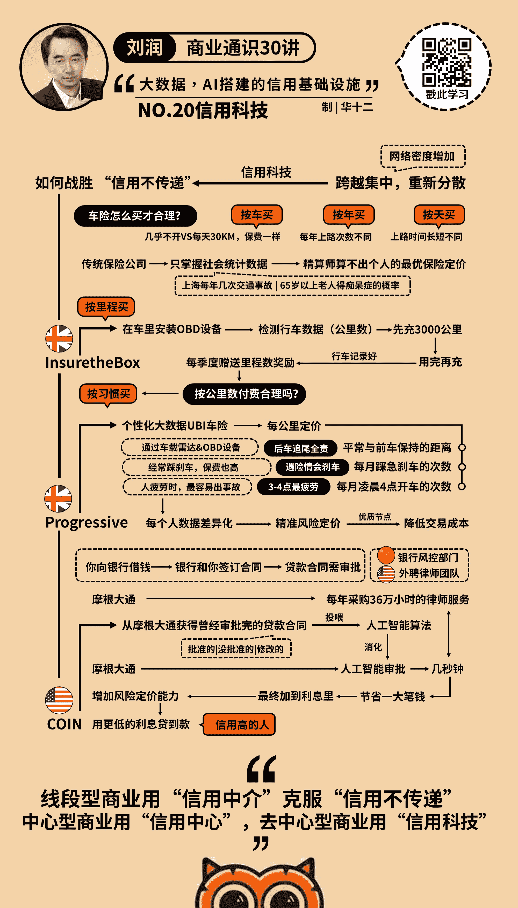  


用户留言

*   

江湖无声 **131 赞**

```
 人的进化是以简驭繁，商业的进化是化繁为简。 用神雕侠侣里杨过得到的三柄剑可以很好的串联人们克服信用不传递的历程： 从利剑到重剑到木剑，是人的进化之路，是人对“器”的驾驭能力的提高，以简驭繁，人越成长越值钱，人的成本也越高； 从木剑到重剑到利剑，是商业的进化之路，是“器”对人的辅助能力的提高，化繁为简，商业越进化越发达，人创造的财富越多； 木剑就像信用中介，价值在于御剑之人； 重剑就像信用中心，价值在于御剑之术； 利剑就像信用科技，价值在于剑的锋芒。 在「神雕侠侣」中，断臂之后的杨过因为机缘巧合造访了「剑魔」独孤求败的「剑冢」，得到宝剑三柄：利剑、重剑、木剑。 第一柄利剑「凌厉刚猛，无坚不摧，弱冠前以之与河朔群雄争锋。」 最初的境界轻扬跳脱、好强斗胜、陵角分明，最易陷入对自以为的神器(技术)的迷恋自嗨。 第二把玄铁重剑「重剑无锋，大巧不工，四十岁前恃之横行天下。」 重剑之沉，似与所有的剑道相悖，实则不然。以器为用，以已为体，以他人(对象)为本，要心性沉潜，借器使力，不要虚招，才能使出大巧不工的威力。 第三把木剑。「四十岁后，不滞于物，草木竹石均可为剑。自此精修，渐进于无剑胜有剑之境。」 木剑无锋无力，云淡风轻。精奥在于内部充沛，恃强克弱。无剑胜有剑，无招胜有招，胜在皆可为我所用。 
2020-03-26 
```

作者回复

```
你打比方的能力已经出神入化了。
2020-03-26
```

*    

爱丽娜 **71 赞**

```
 这才是响当当，硬邦邦的真理~“人”虽然创造财富，但也是特别巨大的成本。 事实上我还想不出有什么比人的成本更加巨大的。因为其他成本是可以用钱来计算的，唯有人的成本是用命来计算的。当我们说，某物某产品为我们了节省了多少时间，我们实际上在说，他为我们节省了多少命。 世界上有两种人，一种用生命去节省其他成本，另一种用其他成本去节省生命。前者是蠢人，后者是智人。前者不自知，后者特自知。 凡是能够节省人这个成本的产品都会大卖。 凡是浪费人这个特种成本的产品都会衰败。 针对学生群体，或者读书人，我有一句自创的"名言": 省本子费脑子，省脑子费本子。 这句名言后面所隐藏的成本是人的眼睛和本子的价钱。眼睛和本子都是成本。眼睛的背后是脑子和生命质量，本子的背后是几元几角，但很多人的数学在这里翻跟斗。 祝愿得到的学友珍惜人的成本，用看似有限，又似乎不可见的人的成本，去创造无限的利润。 
2020-03-26 
```

作者回复

```
省本子费脑子，省脑子费本子。我已经记在本子上了。
2020-03-26
```

*   

老安 **54 赞**

```
 “人”虽然创造财富，但也是特别巨大的成本。当前，人口红利下降、人力成本不断上涨、人才结构矛盾等问题正在影响着全球制造业，倒逼一些制造业企业加快“机器换人”步伐。如同《美国工厂》所揭示的事实：即便“福耀”初期到代顿的工人提供了岗位，但是人工成本的巨大开销让企业寸步难行，最后自动化装备(机器人)也必将成为工人的替代者。 随着“人”创在财富的能力越来越强，人工成本越来越贵是个不争的事实，但人工成本的上涨将会产生分化，呈现出幂律分布，价值也将不断向掌握核心科技的人手中转移。如果尤瓦尔·赫拉利提到一个观点，说是在未来世界中，只有 1%的人掌握算法，而其他 99%的人，只能提供数据，沦为毫无用处的人。 “人”在迎接一个美好时代的同时，也在创造着一个糟糕的时代。 
2020-03-26 
```

作者回复

```
嗯。尤瓦尔·赫拉利说的“useless class”。他们是不是真的无用呢？他们会不会在别的地方创造，比人工智能更加有价值的工作呢？
2020-03-26
```

*    

晓曦 **37 赞**

```
 我的汽车保险用的就是 progressive。我觉得人工智能大数据是否可以摆脱“中心”的束缚，困难有两个，（1）储存、运算、分析数据的需要的基础设施和人力；（2）数据安全隐私带来的问题。 在现在这个时代，数据是最大的财富。任何一个公司不会轻易交出它的数据而且会像保卫金库一样保卫它。刘老师说的 progressive 考虑的开车时间、里数、踩刹车和油门是由这个公司自己给成员发的仪器或者手机 app 监测收集来的。他们还收集了年龄、性别、教育、收入、过往事故记录等等大量数据。是不会轻易给别人的。 何况存储和分析大量数据需要的基础设施往往也是天价。Progressive 其实只对每个成员收集 6 个月的数据。可能是因为收集更多数据，存储分析运算会更困难。 老师提到的 COIN 这家公司，可能是利用了摩根大通已有的数据和基础设施。那这里的信用问题其实就转嫁到摩根大通银行怎么挑选一个可信赖的合作伙伴。不然大量财务数据泄露会造成欺诈和身份盗用的问题。普通人愿意把敏感信息提供给摩根大通或者 progressive，但未必会愿意把信息提供给不知名的人。 在医疗领域更是如此。梅奥最近跟谷歌达成了 10 年合作协议（为什么选择谷歌而不是一个 startup，肯定也有谷歌的信誉在那），但依然引起了大量讨论说谷歌是不是因此会拿到梅奥的病人数据。梅奥澄清并不会。如何能得到充分的技术支持但又保护隐私和数据安全是一个非常有挑战性的问题。 我们平常的主要工作就是人工智能在临床的应用。把一个算法在电子病历中实时地运行，提供信息支持临床决策，需要大量金钱、人力、设备来进行。我的其它研究跟一个保险公司合作，使用的数据库有几亿人，维持它不断更新，让多人同时进行运算成本也相当高。数据库中有无数表格。一般人不经过训练连怎么用都不知道。 
2020-03-26 
```

作者回复

```
人工智能需要三个要素：数据，算法，算力。梅奥掌握数据。谷歌掌握算法和算力。会不会走向去中心化，要看你认为哪个要素更重要。如果你认为“数据”更重要因为涉及隐私，而算法算力会被不断基础设施化，那包括梅奥在内的“繁星”会越来越重要，我们走向去中心化。反之，谷歌这个“太阳”会越来越重要，我们会停留在中心化。
2020-03-26
```

*    

Allelujah 朱磊 **29 赞**

```
 在「执行工作」中，人毫无疑问是巨大的成本——人不仅比不上机器的工作效率，还需要接受管理、激励以保障工作状态，需要分出精力去生活与休息。 但在「创意工作」中，人是唯一的宝藏——相比机器，只有人有潜能可以被激发，可以通过模式创新改善效率，通过策略创新赢得竞争，通过技术创新优化生产。 
2020-03-26 
```

作者回复

```
你和大部分人一样，假设了人工智能做创意，效率不如人类高，效果不如人类好。我只能说：希望如此吧。
2020-03-26
```

*    

晓曦 **28 赞**

```
 我去 google 了一下 Coin 和摩根大通（chase）的故事。就我所看到的报道，听上去 Coin (contract intelligence）更像 Chase 内部的一个项目，内部开发的算法，而不是外界的公司。如果 Coin 真的是外界的公司，那有可能 Chase 尽力抹去这件事。 不然贷款涉及到很多财务数据，把这些数据交给外人还是会造成一定的公关问题的。我也有一些同学在各种银行和审批贷款的建立模型、审核模型的部门。我的理解是现在大家都在人工智能方向上投入，虽然感觉很有前景，但目前的应用有限。Coin 应该也没有大规模推广，好像还是早期试验阶段。不过肯定是未来发展方向。 
2020-03-26 
```

作者回复

```
是。因为应用有限，所以人们才会分为两派：不堪大用派，和颠覆现在派。在这两派的争吵中，我们不断走向未来。
2020-03-26
```

*   

佛祖门徒 **23 赞**

```
 我也分享一个科技保险公司用大数据、人工智能解决“信用不传递”、降低成本的案例。美国一家网络保险公司通过 Health IQ 测试来区分人群，开出不同的保险价格。 第一、当你在 Health IQ 上达到了“精英等级”时，你的保费就能减少 4%，以美国 30 年的人寿保险来说，这相当于便宜了差不多 1 万块人民币； 第二、如果用户保持良好的运动习惯，比如说，你每个星期跑 16 公里以上或者骑行 80 公里以上，你的保费还可以再有 4%的折扣； 第三、如果你积极参加铁人三项赛等项目，经过 Health IQ 的审核后，甚至能获得高达 25%的折扣。 
2020-03-26 
```

作者回复

```
分类，是颗粒度走向精细的重要一步。
2020-03-26
```

*   

大土豆 **17 赞**

```
 德国一个品学优良的留学生却找不到工作，究其原因就是他的征信系统里有几次逃票的记录，这在检票系统宽松的德国，无疑给他背上了一个“不诚信”的帽子，使得他找工作四处碰壁，根本没有公司愿意给他工作。 在美国一个父亲闯了红灯，结果马上接到银行发的消息，因为发现你闯红灯，车祸风险指数提高，要增加你的贷款利息; 保险公司也发来消息，保费要提高; 房东也发来消息，因为他发现有闯红灯的前科，需要增加预收房租比例。。。 这一切的一切，都是信用，以前看不见摸不着，而现在他都在互联网上飘。 像爱惜眼睛一样珍惜自己的信用吧。 
2020-03-26 
```

作者回复

```
闯红灯，增加保险费。期待中国也早日执行。
2020-03-26
```

*   

王黎璐 **16 赞**

```
 我同意，广义上的人力资源成本包括企业取得人力资产使用权、提高、维持、结束人力资产使用价值、保障人力资产暂时或长期丧失使用价值时的生存权及其他为取得、开发和保全人力资产使用价值而付出的总代价。在当下疫情引发的黑天鹅事件，更是让“人力成本”脱颖而出，成为企业家口中的热词。随着出生率下降，如何高效利用人力资源，更是当今社会研究的主题之一。技术的不断发展，给出了新的商业答案。 
2020-03-26 
```

作者回复

```
先提高效率。再把人放在更有价值的位置上。
2020-03-26
```

*   

李文业 **13 赞**

```
 我是一名程序员，在一家供应链金融科技公司上班。我们有小微企业贷款的业务，客户申请时会提供发票给我们，在分析完数据之后会根据他的经营情况给出不一样的贷款额度。 读完今天的课程，我觉得还有可以改进的地方，例如根据客户进一步的数据分析结果给出不同的利率，不同的宽限期，不同的罚息利率。这就可以吸引更多的优质客户到我们这里来，我们也可以为他们提供更优质的服务。 
2020-03-26 
```

作者回复

```
供应链金融，是金融业去中心化的主战场之一。联想，海尔，TCL，格力这些企业，是产业链中的核心企业，他们拥有数据，和一些拥有算法和算力的供应链金融科技公司合作，给上游企业发放贷款。这一家家核心企业，正在成为银行这个太阳之外的繁星。
2020-03-26
```

*   

林木 **12 赞**

```
 《百万富豪求翻身》讲了一个富豪用 100 美金怎么在 90 天内创建 100 万美金的公司的故事。看完后有个很深的感悟：人是成本，更是价值的创造者，这取决于这个团队是什么样的。 作为创业团队，团队几乎每个人都在尽力处理随时发生的各种问题，而且在没有任何物质激励的条件下，带着绝对的激情，向同一个目标出发。 这个团队这些人，一定全部都是价值的创造者，而不是成本；很多时候人是企业巨大的成本的原因在大部分人，以及我们日常生活中的大部分时间，都是靠习惯来支撑的，从企业角度来看，简单重复的劳动的消耗成本太大了。 推荐大家看看这个篇子，反正我是看到热泪盈眶，好像是我的创业梦实现了一样哈哈哈哈 
2020-03-26 
```

作者回复

```
脑子与脑子的价值，差别巨大。
2020-03-26
```

*   

金戈铁马 **11 赞**

```
 我所从事的是环保装备制造领域，几乎每天都要面对客户的询价要求，如何针对不同的客户、采用不同的定价原则也是非常让人头疼的一件事情。老客户和新客户之间，肯定不能采用一样的价格体系；不同的行业之间，价格标准肯定也存在差异。学习了今天的课程，我觉得在未来，我们可以运用大数据来改进我们现有的定价原则，我们可以通过尽可能搜集用户多维度的信息，比如所处行业、合作年限、过往履约情况、采购金额等，再通过一定的算法对这些数据进行分析，然后制定出针对不同客户的价格原则。而这样的价格原则，并不仅仅限于合同总价，还包括了付款条件、质保金比例以及后续服务等多方面因素。当然，目前这还仅仅是一个设想，我们会选择合适的时机开展相应的尝试，希望能够取得不错的成效。 
2020-03-26 
```

作者回复

```
精准定价。数据比我们更了解我们自己。
2020-03-26
```

*   

金戈铁马 **9 赞**

```
 在如今的现代社会，我们普遍认可的一个事实是，经济的持续增长、社会的不断发展，都需要依靠科技的发展和进步。除了那些起点很低的发展中国家，依靠增加投资和劳动力拉动经济增长，其效果是非常有限的。从长期来看，人类社会的发展，最核心的驱动力只有科技进步；而科技的持续进步，需要依靠的正是全人类的集体智慧，是人这个最活跃的要素，在科技研发、新产品制造等领域所发挥的重要作用。从这个意义上来说，人无疑是创造财富的核心驱动力，而且人本身就是无可取代的巨大财富。不过，我们也应该意识到，人在创造财富的同时，其消耗的成本也是无法忽视的。隔壁万维钢老师的《精英日课》课程，就举过摩尔定律的例子。多年来，半导体行业的发展一直很稳定，芯片技术就如摩尔定律预计的那样在持续进步；芯片工艺从几十个纳米到 10 纳米，再到 7 纳米、如今的 5 纳米。这无疑体现了由人所主导的科技进步的巨大成果。但是，在这一系列科研成果的背后，是持续增加的、巨大的研发投入；从 1971 年到 2014 年，为了保证晶体管密度按照摩尔定律所预计的那样稳定增长，仅仅研发人员的数量就扩大了 18 倍。这实际上就是人这个因素所带来的巨大成本。所以，人既是财富的创造者，本身也意味着巨大的成本投入，就像一把双刃剑，这是我们无法忽视的事实。 
2020-03-26 
```

作者回复

```
低垂的果实摘完了。爬上树顶，就要更大的投入了。
2020-03-26
```

*   

雪域 **9 赞**

```
 我不赞成“人是巨大的成本”的观点。 首先，人不一是成本。经济学对成本的定义是“一个资源，它有若干的选项，被选中的那个选项，它的成本是哪些所有落选的选项当中，价值最高的那个。简单说，成本就是放弃了的最大代价”。如果人或者人工费不是选项，或是没有放弃，那就不是成本。 比如，原始社会，做一个打猎用的石斧，可能要花费几个月，甚至更长的时间。做石斧的成本，就是因为做石斧不能出去打猎，而损失的猎物。 但如果是在这之前，人类还不会造石斧的时候，石斧还不是选项，造石斧的时间也不是选项，那它们就不是成本。 其次，同样的人工，如果算作成本，到底贵不贵，不是由自己而是由别人决定。 造出来的石斧，能跟别人换多少猎物，或者说造石斧耗去的这几个月时间值多少猎物，不是造石斧的人自己说了算的，而是由别人在这个时间能打多少猎物决定的。 随着技术的进步和效率的提高，在流水线上造一辆比石斧复杂不知道多少倍的汽车，才需要几秒钟的时间。这时候，如果有人还去用几个月造石斧，这几个月的成本，才贵的不得了。 
2020-03-26 
```

作者回复

```
喜欢这种独立思考。人是不是成本？要看你因为选择了人，而放弃了人工智能的代价。换种方式思考，那你觉得，放弃人工智能而选择人，是更大的代价吗？
2020-03-26
```

*   

杨厚 ☞做设计的 **9 赞**

```
 由于计算机算力的强大，可以把统计分的更细。 【从车险想到一个点子】 超市会员:感觉基本没优惠；（目前按总消费金额定等级） 升级系统:买低利润的统计一个数据，高利润的统计一个数据，给不同品类不同优惠力度（甚至可以分到的各个 SKU）。 在升级:品牌商做这个统计，定这优惠。让我在各个地方都支持同一品牌。 总感觉哪里不对好像商业退步了 
2020-03-26 
```

作者回复

```
亚马逊 2000 年就开始根据个性化大数据，对用户差异化定价。被骂死了。然后出来道歉。这个武器威力很大，但社会规范，是其边界。
2020-03-26
```

*    

欧文童鞋 **7 赞**

```
 明朝万历年间，老李儿子要娶媳妇，但家里拿不出聘礼，唯一的资产就是几只还没有长大的羊。这时听闻隔壁老王家刚卖了鸡，得到了一些银子，于是老李找到隔壁老王，想借一些银子，老王担心老李还不上，不愿意借。 无奈老李只有找到村长说明情况，村长出面担保，老李终于从隔壁老王那里借到银子，让儿子许下聘礼娶回了媳妇。过了几个月，老李卖了长大的羊，还上了借老王的钱。 2010 年，许多城市的商品房如雨后春笋拔地而起。老李的儿子 22 岁了，快要到结婚的年龄了，该买个新房了。可去了几个售楼中心一咨询，发现自己的积蓄离总房款差了一大截。 但售楼小姐姐告诉老李，只要连续 6 个月每个月又往银行卡里存钱的记录，就可以了向银行贷款买房了，自己首付 30%就够了。于是老李取出自己多年的积蓄，付了首付，月供 3000，替儿子买了一套商品房。 2019 年，某公司员工小李在刷抖音时，发现某公司的*60 借款广告，据说用手机号码就可以借到钱，最快 5 分钟到账，最低利息 0.27%，号码使用越久，借款额度越高。 小李当即就心动了，因为正好前几天看中了苹果最新款手机，无奈兜里钱不够。小李马上输入手机号码一看，自己居然能借款 2 万元。当天下午，小李就买回了苹果手机。然后接下来 3 个月过上了吃土的日子。 
2020-03-26 
```

作者回复

```
苹果手机可贷款这件事，是一个非常粗糙的模型。
2020-03-26
```

*    

惠怀松 **7 赞**

```
 每一家公司都会从两个角度去看待员工，成本和财富。 将员工视为成本的企业，一般是劳动密集型，比如：工厂、餐厅，这些企业中劳动力是很大的一块支出。 在现代化的高科技企业中，人是一家公司最重要的财富。往往一家公司的价值，取决于公司中人才创造的价值。 
2020-03-26 
```

作者回复

```
所以，现在我们自己在公司里，是价值还是成本？未来呢？
2020-03-26
```

*   

宋亨 **7 赞**

```
 关于 COIN 的例子，作为常年混迹法律圈的人，补充一些想法： 1\. 贷款合同审批是一个双方实力悬殊极大的合同项。公司根据个人的具体情况来决定要不要批款和给多少钱，个人没有修改合同的权利，只能遵守。国内也是一样，去办个卡、租个房，个人是非常弱势的一方。这种情况下，单方面制定标准更容易操作； 2\. 这类合同的可标准化程度极高。意思就是基于过往的审批案例和客户情形分析，能够被「穷举」出来的可能性极大； 3\. 数据量不需要太大。审批合同是标准制定者说了算，所以我只要把我所有的过往数据和国家标准以及对未来可能出现情形的判断输入进去，再通过算法磨合，所需要的成本相对较低，确定性高。而不需要去调用大量的社会数据、非公开数据、甚至一些错误数据。 所以，人工智能在法律上的应用，现在还处于非常浅的状态，咨询-搜索-提醒-修改-审批，这一类容易被标准化的内容是人工智能的强项。但是，和美国不同的是，国内的人工成本还是较低的。外雇律师、内聘法务，中小企业每年付出的成本大概在 5-10 万，而采购一套系统并且建立信任需要一个长期的过程。而且，一旦涉及到需要对应谈判的合同项，目前的人工智能水平能做到类案检索、风险提示就已经很不错了，还做不到提供策略和方案。也许有一天会做得到，但是发展的没那么快。 另外一点的言外之意是，如果大家在国内接触到自称法律圈人工智能的企业或者说法，先别着急感叹，先看看它是不是吹牛呢😂 
2020-03-26 
```

作者回复

```
这不用是“言外之意”，你说的对。我看过不少国内的法律圈人工智能项目。吹牛居多。
2020-03-26
```

*    

奇问小顽童 **4 赞**

```
 “人”虽然创造财富，但也是特别巨大的成本。这个说法同意的，最直接的就是我们能有现在的社会现在的生活，那是我们人类经过成千上万年进化和创新的，这个成本是很巨大的了。 而且做个对比就是和其他那些懒散的动物们，他们就只是自娱自乐过着舒适的原野生活。而我们人类却是靠着脑子大，耗费巨大的脑力成本，利用很多外部资源成本，创造了现在不一样的生活。 
2020-03-26 
```

作者回复

```
据说，人脑不到 4%的体积，消耗了超过 20%的能量。
2020-03-27
```

*   

Nick **4 赞**

```
 保险公司定价让我想起了医院的医生给病人看病开药，医生一般针对某一类病不管什么人开的药方基本是一样的，去一个看病的人应该都有这种感受，排队挂号-候诊-医生诊断-开检查单、开药方-患者付款-做检查、取药...。尤其是大医院，医生的时间特别的宝贵，不会在一个患者身上花太多时间。 这如同保险公司的精算师根据社会统计数据针对某一类人设定的相同的保费建议，并没有做到精准。然而当保险公司通过大数据分析时，则可以为每一个人的保费进行精准定价。同样医生也可以通过大数据给每一个不同的病人进行精准医疗的建议，甚至药方都可以根据每个人的差异来进行不同的搭配。 
2020-03-26 
```

作者回复

```
你的数据，喂养出一个比你还懂你的神兽。
2020-03-26
```

*   以上留言由 作者 筛选显示
    


# 21｜区块链：从黄金，到账户，到区块链


刘润

2020-04-08

21｜区块链：从黄金，到账户，到区块链

建议 WiFi 环境下播放

前面两讲，我给你介绍了“去中心型商业”时代，挑战“信息不对称”的三位激进的抢跑者：Motif  
Investing、AngelList、PeerCover，和挑战“信用不传递”的三位激进的抢跑者：InsuretheBox、Progressive、COIN。

但是，它们真的能成为“去中心型商业”时代的英雄吗？或者，那个“去中心型商业”时代，真的一定会到来吗？你能不能写个公式，证明给我看？

我不能。我无法证明未来。但是未来会以它自己的方式，给我们一些暗示。比如：区块链。

你一定早已听说过区块链。但是，因为要真的理解区块链，必须要懂三个学科：数学、网络和金融。这三门学科都不容易，所以很多人对区块链的解释，停留在“哲学层面”，不明觉厉。

在过去几年，我给不少全国最顶尖的金融机构讲“区块链”的底层逻辑，以及它和“去中心型商业”的关系。

今天，我争取用最通俗的语言给你讲明白，区块链到底是什么，以及为什么它是“去中心型商业”给我们的暗示。

区块链，简单来说，就是一套“加密的分布式记账技术”。

“加密”是数学概念，“分布式”是网络概念，“记账技术”是金融概念。

在线段型商业时代，一个人拥有多少财富这件事，怎么证明，怎么记账？

用黄金。当然也可以用白银，或者铜钱。黄金，不是财富本身，黄金是财富的账目。在线段型商业时代，那些黄金参与的一段段的交易，就是一次次的“转账”。

到了中心型商业时代，一个人拥有多少财富这件事，又是怎么证明，怎么记账的呢？

用账户，实现“中心式记账”。

举个例子。我们的资金是存放在银行的，我在银行存的 5000 块钱，并不是一沓钞票，而是中心数据库里，在我的“账户”里的一条数据。

现在，我给你转 1000 元钱。这个动作的背后，并不是一沓钞票，从我的柜子里，被移到了你的柜子里。没有任何现金或者黄金被移动过。这个动作的背后，银行只是在中心数据库里，对我的“账户”做了一个减的操作，同时对你的“账户”里做了一个加的操作。

这就是银行的“中心式记账”。

在线段型商业时代，人们用现金（比如：黄金、白银、铜钱）交易。因为信用不传递，这个“现金”，必须自带价值。然后人们“一手交钱，一手交货”，做价值交换。

到了中心型商业时代，大家开始相信银行这个“信用中心”，所以我们不用带那么重的黄金出门了。在银行里记个账就好了。

**从线段型商业，进化到中心型商业，我们也从黄金，进化到了账户。**

但是，这种中心化的账户，也有两个可能你未必重视过的问题：

如果“信用中心”出现技术问题，比如黑客攻击或者硬件故障，导致数据库损坏或者被篡改，将导致整个信用中心的崩溃。

如果“信用中心”出现道德风险，比如银行职员利用职权盗用储户资金，那么客户的权益也会受到侵害。

信用中心，也有信用中心的问题。

那怎么办？区块链的出现，解决了这个问题。

提起区块链，就不得不提一个人，中本聪，和他在 2008 年发表的那篇论文《A P2P Based Digital Cash  
System》（中文名是：一个基于 P2P 对等网络的数字现金系统）。

注意，你又看到了“P2P 对等网络”这几个字。看到这几个字，你就应该意识到“去中心化”一定在附近。

那在这个“基于 P2P 对等网络的数字现金系统”，怎么转账呢？

我今天还是给你转 1000 块钱。假设在这个 P2P 对等网络里，有 100 万台计算机。我转 1000 块钱给你，就是向 100 万台计算机吆喝一声：我开始转钱了啊，你们都看着啊，记下来，记下来。第一个记下来的，有奖励。

于是 100 万台计算机都拿着小本子，瞪大了眼睛看着。转账完成的瞬间，所有计算机立刻记账。虽然都很快，但只有最快的计算机，能得到奖励。

其他计算机虽然有些失望，但也都把这笔账记在自己的本子上，保持账目一致，然后等待下次记账。我转给你 1000 块钱这件事，被记到了 100 万台计算机上。

这种把账目分布在大量电脑上同时记录的机制，就叫“分布式记账”。

这个东西安全吗？

它确实有一定的不安全性。万一这 100 万台电脑串通好了，都说没转，那我这 1000 元不就没有了吗？

这理论上可行。但是，你要说服整个 P2P 对等网络中的 100 万台电脑，至少 51%素不相识的计算机陪你作弊，这个概率是极小的。电脑的数量越多，越不可能。

了解。可是，即便这样，这个分布式记账，比中心化记账，好在哪里呢？

在一些特定的时候，区块链的分布式记账，能用比中心化记账低得多的交易成本，战胜“信用不传递”。

举个例子。

2016 年美国大选，希拉里怀疑某个投票站数字统计错了，要求重选。

美国总统大选的投票，是人工操作的“中心化记账”。每个州都有很多人投票，也有很多人接收投票，监督投票，然后唱票。那么多州，那么多选票，是有可能搞错的。

这时候，去中心化的区块链就可以发挥作用了。

现在我们不去投票站投票了，直接在区块链的 P2P 对等网络里投票。每个人投票，就相当于对全美国的人们吼了一声：我投了希拉里！我投了特朗普！

吼完，就被记录下来，不可修改。所有的投票是被算法自动记录在无数电脑上的，不会犯错，无法篡改。这可能就会节省上万人的参与，大量的钱会省下来。

所以，区块链可以帮助美国大选大大地节省成本，还能保证不出错，保证大选的“信用”。

再举个例子。

在过去，我们签合同，至少是一式三份。为什么？因为你我各一份之外，还有一份留在公证处。

有一天我拿着合同去找你，说这是我应该付给你的 100 万元。你拿出你那份合同说，不对啊，你应该付我 700 万元。

我大吃一惊，一看，你的合同上果然是 700 万元。我这明明是 100 万元，一定是你篡改了合同。我们吵得不可开交，谁也说服不了谁。

这时候，我们想起来公证处还有一份合同。公证处就是“中心型商业”时代的“信用中心”，我们都相信它。

于是，齐天大圣和六耳猕猴，来到如来佛祖这里。

如来佛祖拿出第三份合同一看，果然是 100 万元。这下你没话说了吧。我的钱保住了。但是，因此我们要付一笔钱给公证处。这就是公证费。

这笔公证费，就是中心型商业时代的交易成本。

现在呢？

现在，我们把合同封装在不可篡改的区块链里，一旦达到指定条件，就自动执行。因此，我们两个交易节点之间的信任问题，就可以被一种无人参与的，不可篡改的技术保障，而不是一个第三方的公证处了。

**这份信用更牢固，更便宜。这就是所谓的智能合约。**


刘润

区块链，是一种“加密的分布式记账技术”。

线段型商业时代，人们用黄金记账；中心型商业时代，人们用账户记账；去中心型商业时代，人们用区块链记账。

区块链是不是那个未来？我不知道。但它很可能是未来给我们的一个暗示。暗示我们，在气势磅礴的中心型商业文明之后，有一个“看上去是倒退的进步”正在发生，那就是：去中心型商业。

这一讲，就讲到这里。下一讲，是一篇演讲稿。我邀请大明星区块链本人，亲自做的演讲。欢迎收听。

今天我给你留一道思考题：

区块链，是一个完美的“信用科技”吗？它有什么缺点？

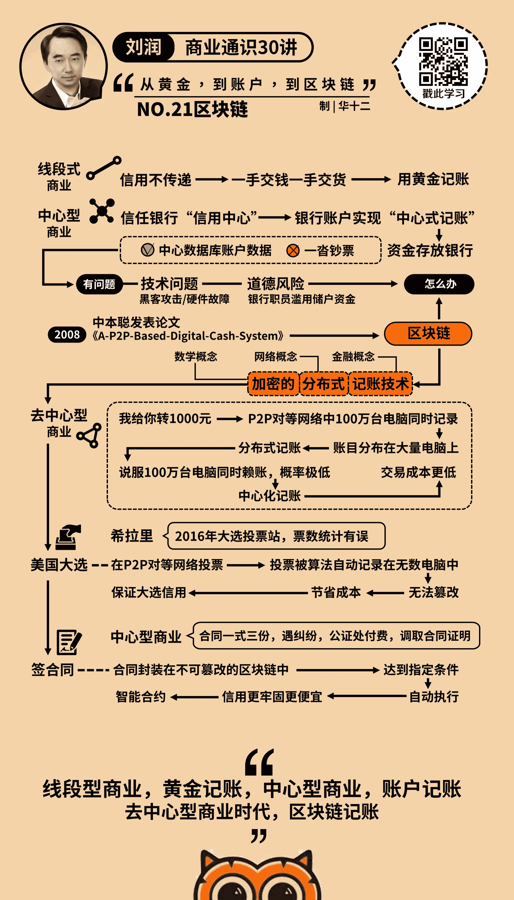  


用户留言

*    

Allelujah 朱磊 **75 赞**

```
 1.区块链技术的理解难度较大，这就导致在技术应用层能够通过去中心化降低运营成本，但在技术接触层仍然需要通过树立品牌效应来降低信任成本。 但如此一来，就是在去中心化的「信任机制」中生造了一个中心化的「信用担保」，毫无疑问会增加新的成本。 举个例子，很多提到区块链的人，都会说到支付宝旗下的“相互宝”产品。这是一个肿瘤类疾病大家一起担负费用的互助群，使用区块链技术签署协议、核实确诊信息、批复款项，由全体群友负担治疗费用。 但根本上，大家相信的是支付宝，而不是这项技术。如果是别的大家没听说过的小公司的产品，涉及到疾病和资金，大概率很难得到用户的支持。 2.区块链技术本身能够保证「链上」的信息安全，但不能保证「上链」的信息核实。 比如说当区块链应用于有机蔬菜的商品溯源时，在有机蔬菜的种植、收割、运输、存储时都需要保证无农药、化肥，同时还要保证和非有机蔬菜分开。 但这些信息是链外人工输入的，如果商家心术不正，就可以在上链时输入虚假信息，在事实上事后无法核实「不存在于链上的信息」。 
2020-03-27 
```

作者回复

```
没错。可以看一下扶贫项目“顶梁柱”保险。
2020-03-27
```

*    

Super Tank **43 赞**

```
 从专家们总结的区块链缺点来看，主要有以下几点： 【1】不可篡改&撤销。 这是优点，也是缺点，试想，如果转错帐，如果密匙丢了，造成永久的损失且无法修改，怎么办？ 【2】无隐私性。 在区块链中，任何人都可以获得完整的数据信息，这也就意味着，如果知道一个人的账户，就知道了他的所有财富和每一笔交易，隐私性问题，怎么办？ 【3】性能问题。 比特币、以太坊因拥堵造成的交易效率低下有目共睹，随着未来交易数据的不断加大，节点需要记录交易数据的时间也不断延长，性能如果无法提高，怎么办？ 【4】监管问题。 往小了说，目前的政府、公司等机构都是以中心化的模式来运行的，未来区块链的治理模式是和其相冲突的，这样就使一部分人容易形成无法理解、接受的情况。 往大了说，区块链的去中心化和自治性与国家监管是相悖的，这也造成了区块链的发展及未来商业的应用都会遇到一定的阻碍，该如何有效控制它的风险并有效监管，在世界各国依然是个难题，不解决这个问题，区块链就很难推广。 以上，请润总指教，谢谢。 
2020-03-27 
```

作者回复

```
区块链在不少领域的效率其实很低。
2020-03-27
```

*    

晓曦 **33 赞**

```
 现在区块链在医疗领域的应用，据我听说，也只在这种适合吆喝没有隐私问题的信息。比如医院的的联系方式。之前我也提过美国的保险公司会和一些医院签约，医院给个折扣，保险公司优先把会员导向这个医院。美国有的保险公司被称为 preferred provider organization (PPO)就是这个意思。 那么保险公司需要有个页面，告诉会员哪些医院是优先的有折扣的医院，把地址联系方式放上。这个页面经常需要更新，比如地址电话的变迁或者新开了门店，或者这个诊所不再接受新病人等等。而医院诊所跟很多保险公司合作，也未必会想着及时把新的联系方式给保险公司。所以造成病人按照保险公司给的联系方式打电话，好多都打不通。 现在就想用区块链方式把这个问题解决了。而联系方式这个信息又没有隐私监管问题。除此之外区块链在医疗领域的应用现在还是比较少的。 
2020-03-27 
```

作者回复

```
对医疗领域感兴趣的区块链公司，必须遵守当前的数据方面的相关规定，如 HIPAA。这是好事。所以，也许只有等区块链更成熟的时候，才能看到在医疗领域的广泛应用。
2020-03-27
```

*    

Tony to ni **31 赞**

```
 1、区块链加密方式，有可是随着算力的提升而被破解，比如量子计算机。一旦破解，意味着整个系统可能就崩溃了。 2、现在的中心式记账，如果出现密码丢失，客户可以凭借身份证去现场补办。但是区块链，如果你丢失了唯一的账户码，对不起，所有比特币再也找不回来了。 3、由于是匿名的，很多洗钱、黑市交易通过区块链技术的比特币完成，而且政府无法监控。这滋长和便利了犯罪行为。 
2020-03-27 
```

作者回复

```
就和现金一样，丢了就没有了。无法“挂失”。
2020-03-27
```

*   

山峰 **27 赞**

```
 世界上不存在完美无缺的东西，区块链也不例外。 1、隐私保护难题。在区块链中，任何节点都能获得完整的数据信息，所有交易信息都是公开透明的。 2、不可篡改、撤销的问题。交易一旦发起便不可撤销，私钥一旦丢失就无法再对账户进行任何操作。 3、交易确认延迟。区块链中交易确认存在延迟性。随着交易数据的不断加大，节点需要记录交易数据的时间也不断延长，性能无法提高。 4、监管问题。区块链的去中心化和自治性与国家监管是相悖的，容易形成很高的金融风险，该如何有效监管，成为世界各国的难题。 5、世界上编程语言多达 50 多种，但没有一种编程语言占据绝对优势。作为区块链技术落地的载体——编程语言，很可能因为自身的不足，对区块链造成本源性的伤害。 6、“纳什均衡”状态下的博弈论已经无法支撑以比特币为代表的区块链技术（主要是点对点的共识机制）的前行。 7、区块链技术的核心其实是密码学，密码学的重点则是哈希函数，目前数论还处于发展状态，哈希函数当然也处于发展状态，这就决定了区块链技术还存在诸多算法不当，进而导致区块链技术性能不足。 
2020-03-27 
```

作者回复

```
专业。
2020-03-27
```

*   

王黎璐 **25 赞**

```
 我的理解和 Super Tank 类似，在他说的四点之外还补充一点，区块链的交易存在延迟性。拿比特币举例，当前产生的交易的有效性受网络传输影响，因为要被网络上大多数节点得知这笔交易，还要等到下一个记账周期（比特币控制在 10 分钟左右），也就是要被大多数节点认可这笔交易。还受一个小概率事件影响，就是当网络上同时有 2 个或以上节点竞争到记账权力，那么在网络中就会产生 2 个或以上的区块链分支，这时候到底哪个分支记录的数据是有效的，则要再等下一个记账周期，最终由最长的区块链分支来决定。因此区块链的交易数据是有延迟性的。 
2020-03-27 
```

作者回复

```
分布式记账，在数学上已经被证明，没有完美的办法解决瞬间同步的问题。
2020-03-27
```

*   

佛祖门徒 **22 赞**

```
 智能合约的应用。 以购买乘飞机延误险为例，如果是签订传统合约，理赔的时候，往往出现需要跟工作人员费口舌、争论计赔时间等问题。而采用签订智能合约，理赔就变得简单多了。投保乘客信息、航班延误险和航班实时动态均以智能合约的形式存储在区块链上。一旦航班延符合赔付标准，赔偿款将自动划账到投保乘客账户，保单处理十分高效。从这个案例可以看出两种合约的差异性。 一是执行高效。传统合约要人工审核执行条件和经过一系列审批流程，智能合约会在触发条件达成时，自动执行。 二是仲裁直观。传统合约一旦需要第三方仲裁，过程漫长，费时费力。技术仲裁直观高效，无需多费口舌。 三是降低成本。传统合约的制定、审核、执行需要投入比较多的人力物力；智能合约则不需要过多人工干预，事先设计好算法和条款，双方网络确认即可。 
2020-03-27 
```

作者回复

```
智能合约，也许是区块链比较早商用的机会。
2020-03-27
```

*   

陈磊 LEO 5 期 1 班 **14 赞**

```
 区块链是以能量换信息，使信息对所有人对称，解决信用问题。缺点主要就是费电以及交易速度慢。 
2020-03-27 
```

作者回复

```
费电，也许是有解的。交易速度慢，也许会导致区块链只有在某些领域显示效率。
2020-03-27
```

*   

陈磊 LEO 5 期 1 班 **14 赞**

```
 区块链技术应用给我最大的一个震撼是精准扶贫，以前很容易成为一本糊涂账，如今扶贫款得到了最大化的使用。 
2020-03-27 
```

作者回复

```
不可篡改带来的穿透力。
2020-03-27
```

*    

青岛刘学 **10 赞**

```
 区块链现在还有许多技术性问题需要解决，比如 1、转账时间慢一般时间是十几分钟到一两个小时不等，而相比之下，网络支付，比如微信支付宝支付，可以快速实现秒速到账。 2、区块链的转账手续费死鬼了，一笔转账手续费就要高达几十元或上百元，正因为比特币的手续费高，所以才会出现这么多乱七八糟的各种虚拟货币。 3、区块链的容量问题，区块链是一个个的区块，以时间为链条组装在一起的文件，比特币的每个区块容量是 1MB，随着交易量增加，区块链文件也在不断增加，一个比特币钱包就可能同步几十 GB，上百 GB 的文件，谁的电脑会同步一个 100GB 的文件呢，这对个体来说本身就是一种难度。 4、隐私问题，区块链解决了去“中心化”的问题，但随机而来的问题是，个人隐私数据被无限放大。 
2020-03-27 
```

作者回复

```
越来越贵。我在 2014 年转账比特币，只有万分之一的手续费。
2020-03-27
```

*    

Rachel 迷勒布朗 **10 赞**

```
 区块链技术在这种公共多节点的工作环境中，天然适合搭建一套完整闭环的公共治理的激励模式，通过实现行为识别、多节点同步等功能，采取激励/惩罚，积分记录、积分兑换等方式，帮助居民养成良好公共行为，规范公共秩序。 尤其在疫情防控期间，总书记也提到说，要用信息化手段更好感知社会态势、畅通沟通渠道、辅助决策实施。构建“智治”模式，就要实现信息数据的共享，将物联网、云技术、区块链等技术融入社会治理之中，服务于新时代社会治理。 所以，区块链技术反复被监管层提及，是因为技术本身是就来提供更好的手段来解决问题，那么区块链技术在数据治理方面有天然优势，在社会治理越来越数据化的信息时代，就越能发挥作用。 
2020-03-27 
```

作者回复

```
区块链是一套技术，但首先是一套去中心化的逻辑。
2020-03-27
```

*    

Axelrod 吴忠鹤 **8 赞**

```
 区块链的限制其实很明显就是技术瓶颈，区块链这种分布式记账固然是个很好的愿景，但是也标志着每个人都成为了银行这样的超级节点。算法上固然无法修改，可是给设备的压力也是极大的，每个人都要记录其他所有人的交易信息，这背后的算力和存储空间会多到爆炸。 所以目前来看，比较可见的未来区块链还只能应用在一些人数规模适当的组织内部或有限组织之间的联盟。 
2020-03-27 
```

作者回复

```
联盟链。
2020-03-27
```

*    

Ren.J.X **6 赞**

```
 20 年前在西安健身行业刚刚兴起，健身房特别少，健身房是个超级中心，费用很高。健身房的收入主要靠会籍卡+私教课。 后来突然出现了一些连锁健身品牌，在大街上开了很多健身房，健身年卡费用从 5、6 千降到了 1、2 千，听说有一个品牌做预售的时候，有很多人连夜排队购买，特别火爆。超级中心变成更小一点的中心。健身房的收入也开始倾向于以私教课占比更高。 再后来一些私教工作室的出现，不用购买会籍卡，直接购买课程，顾客又多了一些选择，更加削弱了中心化。 再接着随着智能手机出现，KEEP 提供了免费在线视频教学训练，还有训练数据的记录，成为线上超级中心。 同时线下又出现了新型智能健身房，人力成本降低，顾客可以随时在线约课，年卡消费变成了次卡消费，交易成本大大降低，去中心化又进了一步。 就锻炼身体这一个单独需求来说，以后的健身服务还可以继续去中心化，教练可以利用网络发展个人品牌，成为节点，和会员点对点连接，健身房变成一个提供场地服务的商家，这样就可以进一步减少交易成本，但又会形成新的信用问题，毕竟把钱交给健身房要比交给教练个人更保险。也许以后会出现连接教练、会员、健身房三方的产业平台吧。 线下传统健身房生意越来越难，跑路的越来越多。传统健身房存在的意义已经不是单独的健身了，娱乐、休闲、社交的意义更加突显。 
2020-03-27 
```

作者回复

```
我很期待：连接教练、会员、健身房三方的产业平台
2020-03-27
```

*   

李志杰 **5 赞**

```
 还记得区块链刚刚火爆起来的时候，生怕自己被世界抛弃，使劲在各个渠道搜罗有关区块链的消息，不是技术出身的我，越看越越糊涂。现在脑海里就剩下哈希函数和分布式式记账。其中哈希函数解决的是加密问题，分布式记账解决了信用问题。我认为区块链并不完美，至少是现在。第一，区块链的效率问题，目前交易效率还低于中心化的交易，当然随着算力的提升或者场景的对技术的适应改变，这点会得到解决。第二，确权问题以及技术歧视。如果按照目前规则，谁的算力强，谁先发起为原则来确权。那么恶意造成的错误记录怎么办？掌握超级算力的人岂不是处处占优？会不会造成难以逾越的阶层固化，由此产生的社会问题怎么办？所以我认为区块链是未来，但还需要其他先决条件的支撑。 
2020-03-27 
```

作者回复

```
算力霸权。听上去就很可怕。
2020-03-29
```

*   

金戈铁马 **5 赞**

```
 我个人觉得智能合约应该是区块链技术在未来最有可能得到广泛应用的商业场景。隔壁吴军老师的课程中曾经提到这样一个场景，比如说我是一个承包商，承接了一个给浙江大学修建图书馆的项目，合同金额是 1000 万元。假设项目的成本是 800 万元，主要是用来购买机器设备、支付工人工资，而我自己没有那么流动资金用来垫付这笔费用。因此，我必须向银行贷款，假设我向工商银行贷款 600 万元。由于我是私人承包商，信用评级不高，银行需要我支付 15%的贷款利益。假设工期是一年，那么我最终挣的 200 万元中有 90 万元都要支付银行利息，支付的利息和实际赚到的利润差不多。今天中国江浙等沿海地区很多中小企业都是类的情况。但是在这个例子中，我这个承包合同的甲方是浙江大学，浙江大学的信用评级是很高的。如果浙江大学可以把它的信用借给我用，而我又能保证浙江大学一旦付钱，我就可以连本代利还给银行，那么银行就愿意给我更低的贷款利率，比如说 8%。这个时候，智能合约的应用场景就出现了，我们通过设置一定的算法，可以让银行在不看到合同具体内容的情况下验证合同的真实性；而当合同一旦签订，算法就可以自动执行，不需要人工干预。这样做可以说是实现了三方共赢：银行以 8%的贷款利率给我放贷，我就可以少支付 42 万元的利息，等于是增加了利润；因为我的利润增加了 42 万元，我给浙江大学的报价就可以更低一点，比如少 20 万元（这样我的利润还是增加了 22 万元），这样对浙江大学也有好处；对于工商银行，因为合同是自动执行的，一旦浙江大学付给我的钱到账，其中的 600 万元本金和 48 万元利息就会自动转到银行账户，这样银行也就减少了债务风险。 从这个例子中，可以看到智能合约和传统合约的主要区别：第一，智能合约更好的解决了信息不对称的问题，有利于建立市场信用。很多时候，传统合约最大的问题是参与的双方甚至多方之间的信息不对称，以及由此引发的一系列的合同纠纷。通过智能合约，参与的各方都让渡一部分权限给算法，通过算法的设置让各方都获得验证合约真实性的权利。这样就可以有效的解决市场中信息不对称的问题，有助于市场信用体系的建立。第二，智能合约可以自动执行，而不需要人工干预。智能合约的核心是算法，一旦合约确定之后，算法就会自动执行，并不需要人进行干预。这样一来，也可以避免传统合约执行过程中因为人为干扰而产生的一些问题。第三，智能合约能够更有效的降低交易成本。因为智能合约把各种前提条件都编入了算法，执行过程中也就不需要再耗费大量的人力物力财力了。 最后，对于智能合约，我个人认为还有两个潜在的风险：第一，由于智能合约是通过设置算法自动执行的，没有办法进行人为干预。如果未来智能合约在全世界范围内普及，那么一旦算法出现问题，很有可能就是系统性的风险，甚至带来更严重的危机。第二，智能合约要做到完全去中心化，也就是要完全脱离现有的清算体系，我认为短时期内没有实现的可能性，可能还需要一个相当长的周期。 
2020-03-27 
```

作者回复

```
智能合约，可以减少仲裁机构，和公证机构的成本。
2020-03-27
```

*   

超人醉了 **5 赞**

```
 区块链，是一个完美的“信用科技”吗？它有什么缺点？ 不能算完美，只是相比当前的中心化可能更好。 有个疑惑，假如发出一个交易，100 万节点参与记账，最快的一个节点拿到奖励。 100 万个节点是个比喻还是算法的硬性指标？ 无数个节点同时在线，其中 100 万个节点速度超过其他的节点，参与了记账。下次再发生交易更改时，首先上次参与记账的 100 万个节点，得有 51%同时在线，这个交易才会生效。 如何保证他们同时会在线？ 如果算法是，同时在线的所有节点都参与记账，那么这个过程是不是有延时？网络中时时刻刻不停在发生交易，那么这些节点会不会负荷太重，随着记账的数据累加，会不会越来越臃肿？ 以至于反而成本增加，和效率降低？ 安全性 “肉鸡”应该很多朋友不陌生，我这小白也玩过。所以入侵电脑应该不算难事，同时入侵很多电脑就比较难，但高手实在太多了，回想之前发生过的网络安全事件，例如“熊猫烧香”。 厉害的电脑病毒感染就像现实中的病毒感染一样，随着感染的节点增加而呈指数级增长，如果没能控制住，那么绝大部分的电脑都会被入侵成为肉鸡。那么掌控权就在黑客手里了。 这种事情发生的概率不是很大，但国与国之间发生网络战的可能性是非常大的。 
2020-03-27 
```

作者回复

```
技术保证的安全，就会有技术高手窥视。道高一尺，魔高一丈。
2020-03-27
```

*    

天天天蓝 **5 赞**

```
 润总您好！ 我所处的是建筑业中的预决算服务行业。 建筑行业的特征是周期长、单体化和集力学、动力学材料学一体的行业。 我们这个行业的区块链技术应该在图纸上。出资方、建设方、监理、审计、验收都对图纸进行最终确定，并一直保留。 现在的困难是前十年的大基建时代已经过去，没有信息数据化，加上行业资质水平差异性太大，基础数据来源不能被满足。如果没有足够的信息数据支持，这个行业就很难跟上现代的脚步。 大型建设单位及审计部门的数据准确性较高，水平在行业中偏上，数据信息化的建立可以从这两类单位做源头。 
2020-03-28 
```

*    

阿尔吉侬 **4 赞**

```
 发生在今天的真实经历，因为家里的热水器坏了，所以需要换新的，看来看去准备换一个燃气的，通过商家了解换燃气热水器需要师傅到安装现场看是否可以安装，我选择的海尔的品牌，海尔售后的解决方案是，可以派师傅去现场设计，但是要收费 80 元整，如果现场条件不能安装那这 80 元是不退的，如果可以安装且安装海尔的品牌就把 80 元还给你，海尔售后把交易成本推给了潜在客户，80 元对于潜在客户来说这个购前交易成本太大了，最后我选择了其它品牌的热水器。 
2020-03-27 
```

作者回复

```
很好的案例，验证了：高昂的交易成本，不管由买家或者卖家支付，都抑制了交易。
2020-03-29
```

*   

菁制生活 **4 赞**

```
 在区块链行业从业 2 年的感受可谓是跌宕起伏。从最初的区块链可以颠覆世界—区块链无用—国家层面支持区块链技术的发展，最终一大批人涌进来当了韭菜，也有一小部分虔诚的技术大咖仍在埋头做事。 目前区块链面临的问题，我觉得有以下几点： 1、传统中心化利益群体的压制： 我们正在经历的中心化商业，已经形成了实力非常强大的中心化利益集团，无论在政治还是经济领域，要允许一个外来潜在颠覆者，无疑是革自己的命，所以短期很难从主流商业中突围； 2、技术本身还需要完善 区块链是很多技术的融合，包含密码学、零知识证明等等，所以要想理解都比较困难，很多的技术漏洞还需要去解决。 3、可信数据的问题 我们都说区块链技术可以实现数据的不可篡改，实现版权保护，可是如何解决上链前假数据，以及实物资产与链上数据的相互印证的问题。当然现在有一些其他的技术手段可以辅助，那也说明区块链技术不太可能单独存在，还需要借助大数据、人工智能等很多技术； 4、去中心化商业的难度 我坚信未来一定是会有很成功的去中心化商业出现，可是在过去的实践案例当中可以看到，运用目前大家能想到的运营方法是很难维持一个人人是中心，人人可受益的美好商业的。 
2020-03-27 
```

作者回复

```
专业。利用区块链做溯源（比如茅台酒防伪）的核心问题，就是上链前防伪。
2020-03-27
```

*   

夜风 Steven **4 赞**

```
 看到楼上有说区块链有隐私问题的，其实这样说并不准确，区块链完全可以做到匿名，让用户的数据回归到用户自己，这样隐私可以得到最大程度的保障，而同时，也不影响大数据分析对用户进行分析以解决商业、医疗方面的问题，这些数据是透明的，而背后的人是匿名的。 【区块链最大的问题是记账效率】：因为每次账务变更都要对全网的计算机公告，并且等所有计算机都反馈“我收到啦”才算记账完成，而现代通讯的网络拥堵，报错，不可用等等技术瓶颈会造成反馈过程总体非常慢。 【另外一个问题就是成本不容易因为规模化降低】：中心型记账只需要通信一次就可以完成转账，而区块链的通信技术需要通信的次数等于全网的计算机数量（应该是大于等于，因为存在一次通信不成功需要二次通信的情况）。因此中心型记账的成本是机器的固定成本+单次通信需要消耗的成本，容易随着规模扩大而降低，而分布式记账的成本却是每次记账需要的通信次数*单次通信的成本（机器成本因为分布于全网所以忽略不计），不容易因为规模化而降低。这也限制了区块链的使用场景。 还有个小问题，就是区块链是建立在密钥加密基础上的通信，基于现有的计算能力破解密钥几乎不可能，因此可以保障记账的安全性（即不可更改），但是随着量子计算能力发展，计算速度成几何级数上升，破解密钥成为可能，这也就破坏了安全性（可以通过破解密钥修改合同）。这也就是谷歌宣布造出量子计算机以后比特币大跌的原因。 期望随着技术发展上面的问题被缓解甚至解决。 
2020-03-27 
```

作者回复

```
关于隐私的问题，有点复杂。存储用户数据后，1）保证任何个人或者机构，无法接触 PII（personal identification information）信息，2）如何使用去掉 PII（也就是脱敏后）的数据，3）如何在用户明确授权的情况下，利用 PII 信息，给用户自己提供个性化服务，都是设计到技术、道德甚至伦理的复杂问题。
2020-03-27
```

*   以上留言由 作者 筛选显示
    


# 22｜去中心化家族：一场区块链本人的家族演讲


刘润

2020-04-08

22｜去中心化家族：一场区块链本人的家族演讲

区块链配音：怀沙

这一讲很特别。这一讲，是我邀请区块链本人给你做的一场演讲。希望通过他的演讲，你能更加看清“去中心型商业”的未来，抓住属于你的机遇。

下面，我们就掌声邀请区块链……

大家好！我就是传说中的“区块链”本人，非常高兴受到邀请，来与大家分享关于我自己和我家族的故事。

首先，是我的父亲。他是一个著名的哲学家，叫作“去中心化”。

我父亲出生在一个虚拟世界里，是人类大脑中的一个信仰。他的英文名，叫做：Decentralization。他也给自己取了个中文名：去中心化。互联网上，人们习惯叫他 P2P（对等网络）。

在人类几十万年的历史中，父亲一直都在苦苦寻找能帮他实现去中心化哲学理想的真爱。直到我母亲的出现。

我的母亲，就是互联网。

互联网是一个没有理论中心的网络结构。每个节点，都是同等重要的存在。所以我的父亲遇到母亲后，就疯狂地爱上了她。

他们组成家庭，并生下了对整个世界产生巨大影响的八个孩子。

我的大哥，叫做 P2P 下载。

大哥 1999 年来到这个世界。帮他接生的，是一位非常著名的创业者：肖恩·范宁。肖恩是 Facebook 最早的顾问、投资人和股东之一。他创立了一个 MP3 音乐分享网站，叫：Napster。

他把每个人电脑上的 MP3 汇集成一张目录。如果你想下载 MP3，Napster 就会找到那些有这个 MP3 文件的电脑，同时从这些电脑上下载一个个碎片，然后在你的电脑上拼成完整的 MP3 文件。

我大哥的本质，是硬盘的对等网络。后来，大哥在中国也有了一个对应的形态，就是迅雷。

我的二哥，叫做 CDN（内容分发网络）。

你在上海通过视频网站看一部电影，但电影是存在北京的服务器上，就会感觉很慢，如果在深圳看，就更慢。

那怎么办？把这部电影存在不同地区的很多服务器上，看电影时找最近的服务器，这就是 CDN。这就是分布式的带宽。

美国和中国的很多电信公司，是我二哥的“接生婆”。他长大之后，进化成 P-CDN（基于 P2P 技术的内容分发网络）的形态，把每个人家里的电脑都变成了 CDN。

P-CDN 的本质，是一种网络带宽的对等网络。

我的三哥，叫分布式计算。

三哥是个科学家，他出生时轰动了全世界。

过去我们破译密码，要用到超级计算机，它的运算速度比普通计算机快几万倍。但这是中心化计算。

那什么叫分布式计算呢？就是大块的计算工作（比如破译密码），切割成无数的小块，扔给全世界无数普通的计算机，比如你家的电脑。

比如，在 2020 年抗击新冠病毒期间，计算机芯片公司英伟达和斯坦福大学，联合推出了“Folding @  
Home”计划，就是把计算新冠病毒蛋白质的计划，拆分成小块，交给全世界的计算机。无数普通人参与了这项“分布式抗击病毒”计划，并做出了贡献。

当全世界上百万台普通电脑的 CPU 同时计算时，速度会比超级计算机要快。

一些以前人类解决不了的问题，比如需要大量计算的基因学、密码学问题，在我三哥面前被轻而易举地解决。我非常崇拜我的三哥。

然后，我的四姐出生了。她叫做：社交媒体。

过去媒体是中心化的，在全世界范围之内，发言权都是集中在少数人手上的。

四姐出生后，她让每个人都有了发言的机会，每个声音都能被听到，整个世界就立刻变得非常感性。

在美国我们特别要感谢 Facebook、Twitter，在中国我们特别感谢新浪微博和腾讯，是它们共同把四姐接生下来。

四姐是互联网世界人人喜爱的一朵花。

我父母想，能不能在金融领域也生个孩子呢？

他们借助一个叫雷纳德·拉普兰奇的美国人，把五哥接生下来，给他取名叫 P2P 借贷。

在美国，你到银行存钱，利率是 0.25%。可是你刷信用卡借钱，利率是 17%。凭什么我把钱借给你是 0.25%，你把钱借给我就是 17%呢？这太没道理了！

雷纳德创立了 LendingClub，用去中心化的方式，让大家可以直接把钱借给彼此。

五哥是一个非常叛逆的孩子，他和传统金融发生了很大的抗争。他做了很多风险很大的事，但也帮不少人借到了钱。

五哥之后，我父母很快生下了六哥，他叫众筹。帮他接生的是一个美国公司，叫 AngelList。

过去我们融资都是去找风险投资，或者上市，这些都是中心化融资的方法。

为什么不能让项目和钱在对等网络里直接匹配，而必须通过中心化机构呢？

但是，这个想法很危险。在中国，向超过 200 个非特定公众筹集资金，就涉嫌“非法集资”。

那我们能不能在 200 人之内，找到对风险有识别能力和承受能力的人，帮助他们投资，而不需要通过中间机构呢？

这就是我的六哥：众筹。

与五哥相比，六哥会显得稍微沉稳。但依然会让全世界头疼，还是因为涉及金融风险。不过，我非常喜欢六哥，他在少年时就是一个英才，做出了伟大的成就。

我是我们家族的第七个孩子，我叫区块链。帮我接生的人叫中本聪。

我知道，大家已经在上一讲了解过我。这里，我只想强调一点：我不完美，我有很多缺陷。

分布式记账，意味着过去一个银行要记的账本，现在需要存储在全网的每个节点上。而在每台电脑上存储，会造成极大的资源浪费。你们可能没有意识到，但我自己其实深受其苦。

所以我只能在数据量特别小的领域来做分布式记账，数据量特别大的领域我干不了。比如把文件在全网分享。

在我出生后不久，中本聪也帮我接生了一个孩子，所以我是家族里面最年轻、最早有孩子的第二代。

我的孩子叫作“比特币”，是基于分布式记账技术的一种数字现金。比特币是模拟黄金来发行的，2100 万枚的总量，每 4 年开采量就会减半。

我的父母特别期待他们的孙子——这个去中心化的，让全世界不需要任何中央银行的数字现金体系，能够把全世界的金融体系，变得更加透明。

当然，我更希望我的孩子能够健康成长，不要因为大家对他过高的期望，让他陷入自我膨胀。他需要健康成长。

我有了孩子后，我的六哥众筹娶了一个太太叫代币，生了个儿子，叫 ICO。这是我们整个家族里面的第二个孙子辈小孩。

家家都有本难念的经，我们家族最难念的经，可能就是我的侄子 ICO 了。

ICO 给我们家族和全世界造成了特别大的困扰。他年纪很小，也没有受过很好的教育，就出来闯荡社会。他能够在没有任何实际项目执行的情况下，很快就融到一大笔比特币、以太币，或者其他代币。

所以我们希望人类能够帮助我们，把他纳入到金融的监管体系里来，让他能在约束下健康成长，学会风险管理，让好的项目浮现出来。

我还有一个弟弟，正在母亲腹中，我们全家都在期待这个弟弟的降临，他的名字叫 Decentralized Autonomous  
Organization，简称 DAO，就是“去中心化的组织”，或者叫“自组织”。

过去，人类的组织形态都是有管理者的层级组织。比如一个公司有 CEO，再往下是高层、中层，一直到员工。这个组织形态，其实很好用，但是也有问题，就是它的沟通效率很低。

如果能通过我的八弟，让每个组织里面不再有一个所谓的管理层，而是自我沟通，通过高效率的方式直接连接，就很有可能会提高全人类的组织效率。

以上就是我的整个家族，下面是我们家族的族谱。

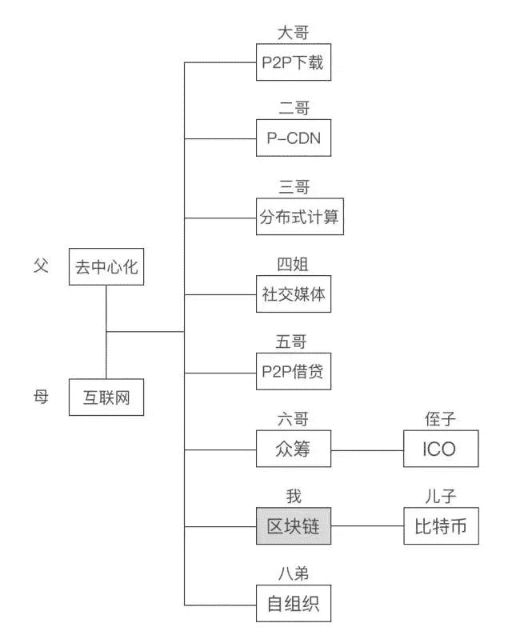

刘润

好的，谢谢区块链精彩的演讲。

听完区块链对他“去中心化家族”的介绍，你有什么感受？

我的感受就是那句话：未来已来，只是尚未流行。

我们要敬畏现在。我们更要敬畏未来。

这一讲，就讲到这里。下一讲，我们继续奔向大海的方向，看看“全连接型商业”的模样。

今天我给你留一道思考题：

你相信去中心型商业，是那个未来吗？为什么？

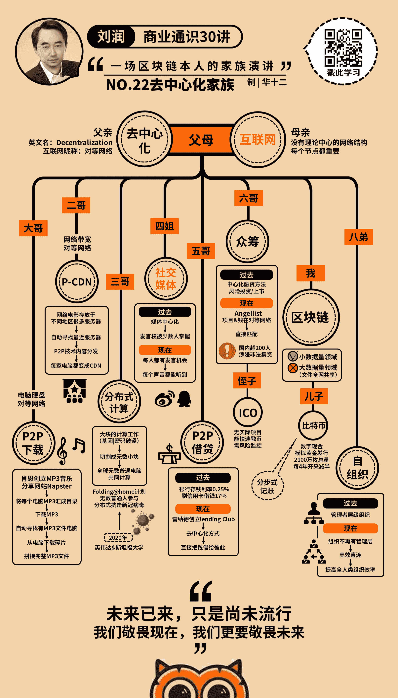  


用户留言

*   

江湖无声 **300 赞**

```
 此情此景我要吟诗一首： 区块链·怀沙 去中心化八个崽， 互联网怀十年胎； 大哥点对点下载， 迅雷资源乐开怀； 在线电影不够快， 内容分发二哥来； 分布计算拆模块， 三哥轰动全世界； 社交媒体新时代， 感性四姐人人爱； 五哥名互金网贷， 撬动银证保平台； 六哥众筹显能耐， 非法集资共徘徊； 中本聪旷世奇才， 区块链风华绝代； 比特币一方主宰， 代币发行展风采， 自组织继往开来， 万折必东奔大海。 
2020-03-28 
```

作者回复

```
我的天。
2020-03-29
```

*    

刘大勇 **46 赞**

```
 首先，我觉得去中心化一定会来，而且有可能会颠覆“公司”这个存在了 500 年的概念。 其次，我今天才知道，区块链姓怀，怀沙的怀😄 
2020-03-28 
```

作者回复

```
怀沙是区块链的转世神童。哈哈哈。开玩笑，主要是他的声音比我好听。
2020-03-29
```

*   

王黎璐 **40 赞**

```
 区块链最大的创新是建立在世界计算机上的自成一体的去中心化系统，把原来各行业大部分受成本所拖的利润还给最终用户，让用户直接点对点进行交易和运算，让每个机构都能够获益。无论是什么样的去中心化，它的本质实际上指的都是各种各样权力从顶层中心化机构到基层个体的下沉，只要经济与科技的发展还在不断的惠及每一个颗粒度较小的团体或者个人，这种下沉趋势就不会停止。“用科技，取代过去必须由中心化机构才能提供的‘信息中介’和‘信任中介’价值，从而优化交易结构，让用户自己服务自己，各方获益。”所以我相信去中心型商业，是我们必将要面对的那个未来。 
2020-03-28 
```

作者回复

```
信息权力的分散和下沉。
2020-03-29
```

*    

Tony to ni **35 赞**

```
 我相信去中心化商业是那个未来，有以下几点理由。 1、随着万物互联的推进，中心化的力量逐步分散到各个节点，在比特世界个人力量的凸显，已经是一个趋势。 2、相比于中心化商业，万物互联之后，分散化、去中心化的连接，其效率要远远大于现有的中心化商业。比如未来 3D 打印的普及，可能会造成供给端的去去中心化。 3、作为一种新型的生产关系，去中心化有可能从底层改变商业的结构。特别是从信用、信息传递和连接方面。 但是极度的去中心化之后的趋势，会怎么样的呢？会不会又重新形成新的中心化？这是一个值得探讨的问题。 就如尤瓦尔赫拉利的一个观点。由于科技的进步和经济的发展，最终财富和科技将会掌握在少数人手中，那 10%的人经过自我改造可能成为神人。 如果这种情况发生，在社会结构层面，会形成强大的中心化，而那些混的所谓“无用阶层“，将沦为中心化之外的边缘节点。 
2020-03-28 
```

作者回复

```
尤瓦尔·赫拉利说：哪有 10%，不到 2%。细思极恐。
2020-03-29
```

*    

王增东 **30 赞**

```
 从 5 商基本到实战，到洞察力，到通识，步步紧跟，求赞。 
2020-03-28 
```

作者回复

```
从研究自己，到洞察本质，到研究自己周围的水。赞。
2020-03-29
```

*   

佛祖门徒 **22 赞**

```
 听完这场演讲，谈谈对演讲者的两点体会。 第一、区块链一个重要特点是，因为它是去中心化的系统，共存于所有被许可方之间，它不仅提供可信赖的单一记账系统， 而且因为其正确，公开透明以及自动化的系统，它还可以减少沟通和工作流程中的问题。 传统情况的业务运作要忍受来来往往内部或外部一些确认，澄清来把事情理清楚。而区块链记账系统可以简化此流程。 它也可以去除不一致性等问题。 第二、传统理论上，供应链是纸质合同基础系统，要经过很多关卡来确认，这将增加出错，丢失和作假的几率。 运用区块链的智能合约通过提供安全，可访问的数字版本给链上所有相关的人，并可以自动执行和付款来解决传统模式中会出现的问题。 
2020-03-28 
```

作者回复

```
一句话：可以简化的事情，就可以被简化。
2020-03-29
```

*   

聂珣 **19 赞**

```
 不好意思，昨天又没有打卡，今天补上： 风电行业分析： 区块链和风电，我之前对这块思考不多，学了本课后，查询和研究这方面的尝试，还是有所发现的，目前区块链跟风电联系最紧密的主要有三块： 1、区块链+风机运维。风机运维市场一直有个弊端，即风电场业主掌握所有的运行数据却不知道如何应用，整机厂家，特别是零部件厂家有技术应用却没有数据。所以，一些大型零部件厂家正在布局“联盟链”，希望业主能通过智能合约同步跟自己部件相关的信息，己方通过这些信息分析部件寿命和潜在风险，更好地服务业主，并且也愿意同步自己在中国区域的备件仓储情况和故障统计情况，让业主更好选择。个人认为，这个就是信息共享而已，跟去中心化的区块链分布式记账好像没什么关系。 2、区块链+分布式能源。这也是我第一个想到的方向，因为分布式能源与电网天生就像计算机用户跟超级中心的关系，其跟另外一方的连接必须通过电网来完成。做交易必须通过电网配对、电价必须电网来定、结算的电费必须以电网统计为准，如果能够跳开电网，通过分布式记账的方式实现点对点直接的交易，这个市场将非常具有想象力。不过电改尚未到这一步，以后如何发展拭目以待 3、区块链+绿证。这就像比特币了，不过挖币必须通过绿色发电来产生，目前发币认证的权力在电网，但电网对此兴趣不大，所以如果能够企业之间通过区块链形成互认，他求之不得。这种绿证有刚需支持，有国家政策做支撑，不用担心其像很多代币一样没有实际意义，并且用户性质单一，好管理，是目前最好实现的区块链应用。可惜的是，因为配套政策没有跟上（比如电力配额制），绿证自身的价值还未得到市场认可，前景如何大家都在观望，所以区块链方面的应用没有实质性的投入。 
2020-03-28 
```

作者回复

```
感谢分享。每个案例背后，一定都是曲折的故事。
2020-03-29
```

*    

刘溜溜 **19 赞**

```
 用这种形式将区块链的前世今生讲清楚也真的是绝了。 从区块链自述的家族图谱其实可以看到，区块链并非是一个横空出世的技术，它有着自己的演化过程，也代表了人们在去中心化道路上的不懈努力和永不停息的尝试。 正因为我们在去中心化的道路上并非一帆风顺，才会有全新的模式出现，而每个新模式又在弥补前一种模式的局限。 区块链也是如此，它的出现有其自己的意义，还有它的衍生。区块链会受到更多重视，但不排除未来有一天，它又会被其他什么东西所取代。 
2020-03-28 
```

作者回复

```
哪有什么横空出世，哪有什么一夜暴富。我们只是没看到一路走来。
2020-03-29
```

*   

果小冻 **17 赞**

```
 根节点： 父亲-去中心化概念；母亲-互联网技术 一级子节点： 大哥-存储力； 二哥-运力； 三哥-算力； 四哥-行业应用-媒体； 五哥-行业应用-金融借贷； 六哥-行业应用-融资； 我-自省一番-知道擅长什么不擅长什么； 八弟-社会组织应用-企业组织结构； 二级子节点： 侄子-继承父业-融资新应用； 儿子-行业应用-新货币； 接下来应该还会有很多行业应用的兄弟姐妹吧？医疗，建筑、电力？ 
2020-03-28 
```

作者回复

```
会长成一棵树。至于是小树，大树，还是苍天大树，各自有各自的判断了。
2020-03-29
```

*    

Irene **15 赞**

```
 #刘润·商业通识# 这一讲真好，好一个“去中性化+网络化“的家族族谱，一目了然的让我们快速对时下流行的网络模型有一些了解。只是，我好奇，现在愈来愈热门的“互联网+金融“中利用供应链中的某一个大企业做信用担保，给供应链上其他企业贷款的模式，也是属于去中心化模式，只是可以归结到这个家族的哪一脉呢? 期待刘润老师的解答. 
2020-03-28 
```

作者回复

```
问出这个问题，是专业人士。我在三四年前，专门写过一篇文章，讲当时非常火的供应链金融机构“群星金融”。你可以在我的公号（刘润）搜索“群星金融”看到这篇文章。群星金融的发展有机遇也有挑战。但是，越来越多机构，走上了这条路。核心企业（联想，TCL，格力，海尔）的应付账款数据，本身就是信用金矿。你可以用“信用科技”的逻辑，去分析理解。具体，看那篇文章。
2020-03-29
```

*    

Chelios chen **14 赞**

```
 #理性与现实# “去中心化”商业模式有没有前途，是否能取代“超级中心节点”模式，我不知道。我能做的只是用润总给的独家兵器来分析“去中心化”模式的优劣势。 润总说过，任何一种商业模式都是朝着交易成本无限小，信息越来越对称，信用可传递性越来越强的方向去演化。 交易成本由三类、七种构成。“去中心化”模式，我想应该是降低了购前、购中和购后成本。应该说，相对于“超级中心节点”模式，效率提高的不是一点半点，按道理来说应该是能够取代其而成为下一个潮流。 但这里信息是否越来越对称，信用可传递性是否越来越高呢，我看不见得。 从单独的一个交易来观察，确实买方与卖方之间的信息足够对称，信用足够高，当然没问题。但是，社会是一个网络，是一个有无数的点连接而成的关系之网，“去中心化”模式虽然降低了单次交易的成本，提高了信息对称，也满足了信用需求，但是，从整个商业网络的宏观层面来观察，好像整个商业网模式失去了秩序，失去了执法者，失去了群体间的信用。而这些失去的功能，恰恰是“超级中心节点”模式所带给我们的好处。 另外，从社会政治结构维度来分析，从现在到将来的某个阶段，国家与民族这种政治实体仍将稳定的长期存在。而国家与民族恰恰是社会层面的“超级中心节点”模式。国家与政府是不会放弃自己的权力，而任由“去中心化”模式来掏空它们的权力基础。压制都不一定，收编“去中心化”模式与自己的政治体制相结合，形成一种混合型的“去中心化+超级中心节点”模式的可能性极高。 
2020-03-28 
```

作者回复

```
深度思考。混合模式也许是那个未来。至少是可见一段时间的未来。
2020-03-29
```

*    

冬至节 **11 赞**

```
 我觉得比特币最远的未来，也就是会成为一种被一部分国家认可的资产，而不太可能成为全世界通用的货币。至于“让全世界金融体系更透明”，我觉得也有点困难。 原因：一、黄金作为实物货币，其本身就有价值。纸币作为信用货币，背后有国家的信用背书。比特币，一不是实物货币，二不是信用货币，用来做货币的话，谁来保证它的币值？二、就算人们普遍接受了比特币，币值也稳定，但是用来作货币的话，因为它总量有限，会使得社会长期处于通货紧缩的状态，对经济的发展也是没有什么好处的。 当然，比特币如果仅仅作为一种资产，作为一种投资品，那还是没有什么问题的。 
2020-03-28 
```

作者回复

```
清晰的观点。这个观点，也代表了大部分的主流观点。
2020-03-29
```

*    

露酱 **9 赞**

```
 作为一个商业地产销售，惊讶的发现在各大发展商的 app 居然有一项是客户介绍客户，买家介绍新买家，返还佣金。这是属于全民营销啊。还有瓜子网的消灭中间商赚差价。这些都让我感觉，去中心化的潮流势不可挡。即使中心节点不愿意也好，创新者会协同消费者，会让交易的效率更高，阻力更小。 
2020-03-28 
```

作者回复

```
今天 KOL（Key Opinion Leader）的改变，演化为 KOC（Key Opinion Customer）。你细品。
2020-03-29
```

*    

隋逸 **7 赞**

```
 这一章讲的太好了，太生动了，再加上最后那个图谱让我这个金融科技小白都能把“去中心化”和“互联网”相遇之后的火石电花般推动社会变革得进程学的明明白白。 润总太牛气了！ 
2020-03-28 
```

作者回复

```
当下你总是不能看到历史。但是只要往回看，就能看到自己处于浩浩汤汤之中。
2020-03-29
```

*   

朱为友-内训定制\*咨询落地人才输出 **7 赞**

```
 因为对组织系统的兴趣，一直在学习怎么通过组织系统更好的提高员工的积极性，组织机构从个体户轧阳制忘中心制->分子公司事业部制->集团公团公司制的过程中，员工的自主性和结算方式一直是关键环节，今天听了 DAO 分布式自制再次延展了思考的深度。 传统的从佣金制->合伙制->合弄制->DAO，适应组织发展的不同阶段，以终为始，我们才能拥有更开阔的视角，建立多样性的生态结算方式。 
2020-03-28 
```

作者回复

```
海星切为几段，就成为几个海星。DAO 确实值得研究。期待你在知识城邦分享你的思考。
2020-03-29
```

*   

菁制生活 **6 赞**

```
 老师用技术和应用发展的时间脉络来绘制的区块链家族图谱，很清晰也很有趣。 自组织的商业是区块链应用最让人激动和期待的。比特币所体现的商业模型的设计就是很值得我们研究和学习的。在没有任何一个中心组织的情况下（非公益的情况下），全球成千上万的人积极的去“挖矿”，去投资，去使用，而且系统运转相对良好，不同的参与者都有相应的激励。这背后就是一个很完美和有效的自组织的商业模型。 未来已来，期望看到更多有创造力和更好的项目出现。 
2020-03-28 
```

作者回复

```
这是不是有点像亚当·斯密说的：为己利他？
2020-03-29
```

*    

欧文童鞋 **5 赞**

```
 这节课让我想起去年 6 月 18 日，Facebook 正式向世界宣布了发行数字货币 Libra 的计划。 Facebook 宣称，要像互联网取代传统电信网络一般，用新建立的“货币互联网”去改变传统金融系统。最终的情形应是：“无论您居住在哪里，从事什么工作或收入多少，在全球范围内转移资金应该像发送短信或分享照片一样轻松、划算，甚至更安全。” Libra 计划的使命是为“重新创造货币，重塑全球经济，让世界各地的人们过上更美好的生活”。但 Libra 这一大胆构想，却和现有政治秩序发生强烈碰撞和冲突，最终计划被搁浅。 求教润总，Facebook 发行 Libra 是属于去中心型商业还是中心型商业呢？ 
2020-03-28 
```

作者回复

```
Libra 是典型的去中心型货币。但是他的设计，比较复杂而巧妙。你可以参考得到里穆长春司长的课程。
2020-03-29
```

*   

笨笨 **4 赞**

```
 P2P 下载：本质是硬盘的对等网络，网络中各节点可以相互服务，庞大的终端资源被利用起来，解决了 C/S（客户机/服务器）模式中易出现单一失效点、CPU、内存、带宽等可拓展性差的问题。 CDN：conrent delivery network，内容分发网络，依靠部署在各地的边缘服务器，通过中心平台的负载均衡、内容分发和调度等功能模块，让用户就近获得所需内容，降低拥堵，提高响应速度，关键技术是内容存储和分发技术；P-CDN 是互补 P2P 和 CDN 的优缺点，边缘服务器+用户，既监管内容，又降低骨干网络压力，本质是一种网络带宽对等网络。 分布式计算：将大块的计算工作拆解成许多小部分，分配给多台计算机进行计算，节约时间，提高效率。 社交媒体：基于用户关系的内容生产与交换平台，用户人数众多，形成自发传播，意义和连接是所有社交媒体生存的两个关键要素。 P2P 借贷：汇聚有资金且有投资需求人的小额资金借贷给有资金需求的人，利率高于银行低于高利贷，发展受限既有内部原因也有外部原因。 众筹：团购+预购形式，向网友募集项目资金，更加开放，不再以项目商业价值作为参考标准。ICO，initial coin offering，源自 IPO 概念，区块链首次发行代币，募集比特币、以太坊等通用数字货币的行为， 区块链：加密的分布式记账技术。 DAO：decentralized autonomous organization，通过一系列公开公正的规则，在无人干预和管理下自主运行的组织机构，诚信、不可侵犯、自我保护是其三条定律。 无论你是否接受，去中心型商业都是大势所趋，因为它的价值取之于网络，又把更多的价值归还于各节点，就像鲸落，激活的是各节点更深层次的交互，创造难以想象的价值，大家相对均衡的享受增长的价值。 
2020-03-28 
```

作者回复

```
很赞。P-CDN 确实一个很重要的目的，就是减小主干网络，超级节点的压力。这也是分布和去中心的价值。
2020-03-29
```

*    

东写狮读 **3 赞**

```
 随着无纸化办公越来越普遍，现在公司打印的投标文件越来越少了，以往一个公司要参标，是要打印很多纸质文件，技术标，商务标，每一页还要盖章，然后各种包装，竞标，封标，而现在完全没有这么复杂，全部是电子投标，只需打印一套即可，以前动不动就是 3 套，6 套的。签约合同也慢慢在推行电子合同，利用区块链去中心型商业来做好人人的契约精神，对于文件比较大的合同，比如保险公司的合同，不知道能不能实施，又像买卖房屋这种公司也起到第三方保障的作用，能不能直接通过区块技术来提高整个房屋买卖的交易流程，去中心型商业要在人们心中达到一种共识，才能流行 
2020-03-28 
```

作者回复

```
这种共识其实很难。甚至不可能。但历史的推进，总是不会等到共识达成。
2020-03-29
```

*   

梦幻妖妖 **2 赞**

```
 很特别的一节课，没想到可以用这种方式，用拟人化的方式理清那些总在脑袋里萦绕但总是盘根错节的知识。V5 我可能是商业海洋的小白，今天说的那些名字一直有听到，但没有很深入的了解。但是去中心化我觉得是未来的发展方向，而且有大数据的背后支持，比如我最近要买支口红，大数据就会分析出，并推送给我近期比较热门的一些广告。不再需要在一大堆没用的数据里再去找“口红”。另外，最近我其实也在想，其实李佳琦和薇娅算不算是直播带货的一个[超级节点]呢？他们卖的货是便宜，但每次想要买个东西，只能一直看着直播等着买自己想买的那件。所以，周边其实现在也有更具针对性的，美妆博主，美食博主，我们可以自由选择，最近感兴趣的主题，这些是不是可以算作[繁星点点] 说的不对的地方，还望老师指正 
2020-03-28 
```

作者回复

```
李佳琦和薇娅是太阳和月亮。大量腰部的直播主，是繁星。
2020-03-29
```

*   以上留言由 作者 筛选显示
    


# 23｜全连接型商业：商人的最终归宿，是不再需要商人


刘润

2020-04-08

23｜全连接型商业：商人的最终归宿，是不再需要商人

建议 WiFi 环境下播放

这门课写到这里，我已经把我所能推测的过去（线段型商业），所能分析的现在（中心型商业），和所能预测的未来（去中心型商业），尽力回望和极目远眺了。

那么，再往后呢？

再往后，当所有交易节点都两两相连，高效连接，网络密度升到 100%呢？再往后，当信息完全对称、信用完全传递，交易成本降到 0 呢？

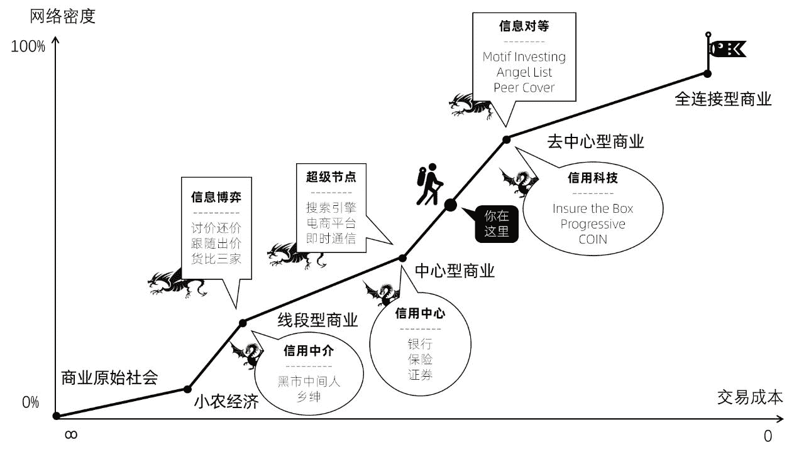

**这时，我们将会进入一个，理论上存在，但实际上我们“只能逼近、无法到达”的未来：全连接型商业。**

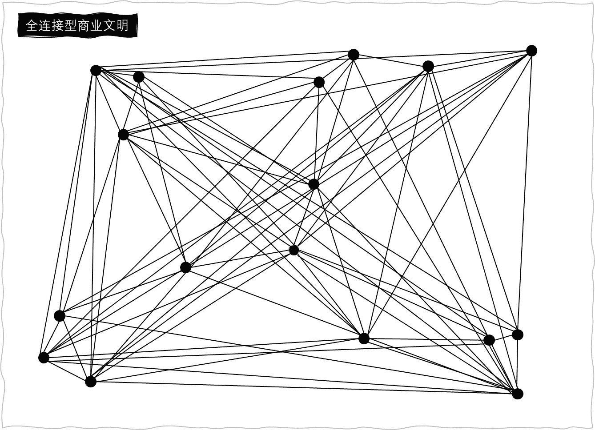

什么叫“全连接型商业”？就是“连接一切网络节点，消灭一切交易成本”的商业文明。这句话用公式表示，就是：

*   网络密度=100%
    
*   交易成本=0
    

当然，就像我们在理论上可以不断逼近光速，但实际上永远到达不了一样，全连接型商业，可能最终也只是商业世界的理想国。

对于这个理想国，我们不敢说“推测，分析，预测”，只敢说“想象”。那么，在全连接型商业文明里，世界是如何运转的呢？

我与你分享三个“想象”。

商人的最终归宿，是不再需要商人。

回到整门课程的第一讲，还记得我希望你记住的三句话吗？

1.  商业，不是一门关于生产的学问；商业，是一门关于交换的学问。
    
2.  劳动创造财富，交换激励创造。
    
3.  货币切分了买卖，商人连接了交易。
    

是的。“商人连接了交易。”在整个商业的进化当中，商人之所以存在，是因为肩负着两个历史使命：

1.  四处奔波，连接所有网络节点。
    
2.  殚精竭虑，降低一切交易成本。
    

但是，在“全连接型商业”文明，网络密度升到 100%，没有任何网络节点有待连接；交易成本降到 0，没有任何交易成本需要降低。在这个世界中，商人，似乎已经没有了价值。他们成功地跨过山川和大海，干掉了自己。

“网络密度=100%”，意味着什么？

考古学家在遗址里发现一幅罕见的古文字的壁画，瞬间，全球仅存的懂得这种古文字的 3 个人，在各自的国家被连接在一起。

医生抢救一个拥有罕见血型的病人，瞬间，这个城市里拥有这种血型的 5 位市民，收到帮助的请求。

很多国家联合研究人类如何在火星上生存，瞬间，地球上 400 多个学科，25 万名最顶尖的互不相识的专家，被召集在一起。

在“网络密度=100%”的世界，一切皆可直连。

而“交易成本=0”，意味着什么？

我的这批酸奶，用了哪里的奶牛，喂了什么饲料，有没有加激素，兑了多少糖，工人的成本是多少，采购酸奶的超市完全知道。我无法通过“撒谎”来制造“信息不对称”，说我的牛奶是从澳洲进口的，超市也无法“撒谎”说还有另一家报价比我低很多。

两家公司签署合同，你想要什么，他想要什么，彼此非常清楚。摊在桌上算一算，怎么合作，创造的总价值是最大的，然后一起分掉这个价值。我不需要通过“欲擒故纵”“隐藏的决策者”“红脸黑脸”这些谈判技巧，来战胜“信用不传递”，争取利益。

在“交易成本=0”的世界，“谈判”这个商业行为，“撒谎”这个道德缺陷，将成为历史。

在全连接型商业文明中，商人的最终归宿，是不再需要商人。

商品的定倍率，无限接近于 1。

我在《刘润·5 分钟商学院》里，介绍过一个概念，叫定倍率。

**定倍率=商品价格/生产成本**

比如，你在市场上买到一支 300 元的口红。大概率，它的生产成本不超过 30 元。那剩下的 270 元是什么？是交易成本。

所以这个口红的定倍率是 10 倍：

**定倍率= 300 元/30 元=10（倍）**

那么，如果在“交易成本=0”的“全连接型商业”时代呢？

因为生产者可以直接把东西卖给消费者，并且没有信息不对称和信用不传递这两条恶龙的阻碍，所以交易成本从 270 元断崖式降为 0。

这时候，这支口红的定倍率是 1 倍：

**定倍率=30 元/30 元=1（倍）**

你可能会说，这不可能吧！总要运输吧！总要库存吧！

是的。运输成本、库存成本，依然是物理世界无法消灭的成本。但是，越来越多的科技，正在想办法把它降低。比如 3D 打印。

在全连接型商业时代，你作为消费者，从生产者那里直接下单买一支口红。这支口红并不是从厂家出发，通过 1 家快递公司、2 个中转仓库、3 个工作人员送到你家的。这支口红是在你们小区楼下的“万能 3D 打印柜”即时打印出来的。

你下完单买口红，然后再在下楼遛二哈的时候，顺便取走口红。

可以不断接近，永远无法到达。

当然，刚才口红的案例中，还是有交易成本的。

比如这个 3D 打印柜的运营成本。这就是我们为什么说“全连接型商业”可以被不断接近，但也许永远无法达到。只是这个接近的程度，在不需要物流、不需要仓储的“虚拟产品”世界，比如电子书、远程教育、视频娱乐，可能会更快地接近而已。

“可以不断接近，永远无法到达。”既然都到达不了，那研究这个“全连接型商业”，还有什么意义？

当然有意义。

可以不断接近，这给了商人们永远可以看得到的远方；永远无法到达，这给了商人们始终还有机会领跑的希望。

**这就是，商业的终极方向：全连接型商业。**


刘润

什么是全连接型商业？

全连接型商业，是商业进化理想中的终极状态，是“连接一切网络节点，消灭一切交易成本”的商业文明。

在这个状态中：

*   网络密度=100%
    
*   交易成本=0
    

这是一个没有“信息不对称”，也没有“信用不传递”恶龙盘旋的理想国。你可以把这个理想国，称为“玻璃上的商业社会”，完全没有摩擦、阻碍和隔绝。

这个“玻璃上的商业社会”，可能会有三个特征：1）商人的最终归宿，是不再需要商人；2）商品的定倍率，无限接近于 1；3）可以不断接近，永远无法到达。

**商业从哪里来？商业原始社会、小农经济、线段型商业、中心型商业，一路走来。**

**商业到哪里去？去中心型商业、全连接型商业，一骑绝尘。**

我希望通过这两个模块，你能和我一起戴上“网络密度+交易成本”的洞察力眼镜，看到一部恢宏展开的商业简史。

这部商业简史，站在月球，从空间看，就是从华灯初上，到万家灯火，到最后漫天繁星，那种从稀疏到密布的“网络密度”提升史。

这部商业简史，站在未来，从时间看，就是一部从沙石，到水泥，到玻璃，交易节点之间摩擦力越来越小导致的“交易成本”降低史。

全连接型商业，是一个不需要商人的商业文明。但有趣的是，不断推动商业文明走向那一天的，又恰恰是富有远见、不断进取的商人群体。他们也因为这样奋不顾身地推动，不断获得巨大的回报。

这一讲，就讲到这里。

到目前为止，我们的课程，已经进行了 4 个模块 23 讲。但是，我到目前为止，一直给你讲的，都是商业进化的“右脚”，没有提到“左脚”。

啊？商业进化，还有左脚右脚？什么是右脚？什么又是左脚？别着急，我们下一讲来讲。

今天我给你留一道思考题：

如果有一天，我们真的进入了交易成本为零的“玻璃上的商业社会”，你是期待呢，还是拒绝呢？

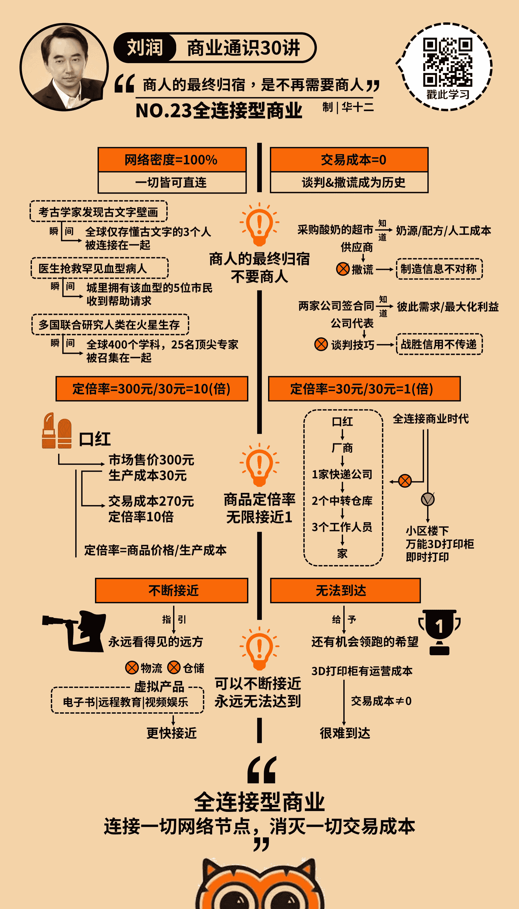  


用户留言

*   

林木 **123 赞**

```
 想到一个故事： 学生问教授：世界上的石油资源什么时候会枯竭被用完？教授说：世界上的时候石油是永远不会被用完的。 学生很疑惑，教授解释： 在一个大仓库里，装满了花生，你每次可以随意取花生，但有个前提，你需要把花生皮放回到仓库。前期找花生很容易，但到后面，花生皮越来越多，搜寻花生的边际成本越来越高，逐渐大家就会放弃这个渠道。花生虽然越用越少，但市场永远不会不会让它消失。 全连接型商业形成的过程也是这样，越到最后，要把交易成本消减成为 0 的边际成本越大，所以全连接型商业社会永远达不到。 
2020-03-29 
```

作者回复

```
怒赞这个例子。
2020-03-29
```

*   

chloe2622 **82 赞**

```
 1 月份知道自己得了慢性病，一度计划轻生好几次。我和女友是润总的粉丝，润总的每节课我都要音频导图评论再复述一遍给她，一直梦想赚到钱带她一起参加润总的线下大课。 因为喜欢商业，所以大学休学和朋友合伙创业，到现在不仅一分钱没赚身体已经不好了，这 3 个月除了去治疗就一直躺在床上，治疗也要没费用了。我实在后悔自己之前一系列愚蠢的选择，每次大言不惭的跟女友说说忍一忍等赚了这笔就好了。没办法面对在我身上浪费青春吃苦了 5 年又漂亮温柔的女友。我觉得她跟我是个错误的选择，我今后没有给她好的生活今后没有能力保护她，提过好多次分手让她找更好的男人她全部拒绝了，又计划了几次自杀造成离开她的事实被她知道了也激烈的阻止了。 这时候我明白了，自己的离开是多么的不负责任，只有积极的坚持下去才能给她一个她想要的更好的生活。感谢现在的世界，不一定要体力，有大脑也可以争得一席之地。女友一直说我在商业上有些天赋，希望是真的吧，我是真的热爱在商业世界里驰敞。 今天在润总的最新的课里我留下评论，想告诉大家：选择比努力重要，一定要洞悉世界的规律，做出合适的选择；无论多忙多困难，也一定要检查和保养身体；我就是深刻的反例。最后我一定用尽一切方法让自己恢复到可以到能工作的状态，然后学个互联网运营技能养活自己和治疗，一步一步的给女友更好的生活。商业世界真美好啊，真想和大家一起翱翔。我，应该可以的 
2020-03-29 
```

作者回复

```
努力，让自己配得上她，而不是离开她。祝福你们。
2020-03-29
```

*   

青岛罗刚 **73 赞**

```
 不知道为什么，当我看完关于全连接型商业的描述，我并没有为之感到兴趣或欢喜，反而产生了一种忧伤的情绪。 可能是我个人的原因，我觉得这个世界上有趣的事情不是变得越来越多，而是变得越来越少了。如果再没有传统市场，没有讨价还价，没有毫无目的去商店闲逛，象我们这样的中间商也没有了，我不知道生活是变得更好了，还是变得更糟了？毕竟，存活早就不是问题了，怎么能活得有意思，倒是一个真正的问题。 
2020-03-29 
```

作者回复

```
无趣的人生，比没有钱的人生，更不值得过。
2020-03-29
```

*    

晓曦 **62 赞**

```
 我觉得我们无法进入交易成本为零的时代。因为即便解决了“信息不对称”的问题，依然存在“认知不对称”的问题。换句话说，不是把信息放在那，大家就可以轻易理解和使用它进行决策。 比如老师举的输血的例子。一个拥有罕见血型的病人在被抢救，这个城市里的其他五个拥有同样血型的病人会接到通知。老师这里的假设是这五个人中肯定有人会立刻飞奔而来捐血。但如果不是这样呢？如果病人或者家属需要出价，那会怎么样呢？ 这个价格需要考虑到这五个人的家庭收入、职业、身体健康、有无晕血的毛病、是否参加志愿者活动等等。比如富裕的人可能不会为小钱所动，身体虚弱的人可能不愿意冒风险捐血，而经常参加志愿者活动的人可能比较愿意帮助你等等。 假定信息完全对称，大数据给出的预测可能是这样的：如果你出 5000 元，有 95%的可能在 15 分钟之内拿到血液，病人死亡率 5%；如果你出 1000 元，有 50%的可能性在 15 分钟之内拿到血液，病人死亡率 10%，以此类推。其实类似的工具在现在医疗上已经出现了。但最终还是要有人做出决策，你到底出多少钱。这时可能会有新的种类的商人出现来帮助做决策。 人的认知能力在不同人之间、在不同领域之间具有很大差异，因此还是会有商人存在。比如亚马逊我使用它的主要原因就是我没空去了解和评判哪个商品物美价廉，我只去买亚马逊推荐的那个，节省了我的认知资源。 
2020-03-29 
```

作者回复

```
用想象，不要用逻辑。比如，每个人都随身携带一个决策机。决策机和决策机，瞬间完成你说的这一切沟通。在这一课，试着用“如果可以实现，会是怎么实现”的想象力。
2020-03-29
```

*    

爱丽娜 **34 赞**

```
 润总教导我们说，商业的终极方向：全连接型商业，是一个不需要商人的理想国。 网络密度=100% 交易成本=0 润总指明了经商之道，经商之路: 网络接近全覆盖无死角，成本接近无穷小(无法到达 0)。 事实上，中国现在已经率先踏进了准理想国，以李佳琦，薇娅，李子柒等网上传奇为首的"非商人"不费吹灰之力战败了传统型商人，比如世界 500 强，率先领跑全球"微"商业帝国。 乘着 80 前甚至 95 前这些人群"难得糊涂"之际，中国的 95 后已经无声无息进入了交易成本趋近于 0 的“有机玻璃上的商业社会”。无论人们是否愿意接受，"有机玻璃"的商业事实已经无从拒绝，无法拒绝。 中国这种"非商领跑"的网络帝国，带给中国社会的是"准共产主义"，绝大多数的国人尽情享受着网络几乎全覆盖所带来的超级福利~近于零成本的"近似免费消费"，过去万元以上的商品(比如英语课程，行业培训，专业咨询)现在只有几十元，更多的是免费。得到的薛兆丰，刘润老师的课程，就是很好的例子。99%免费，只有 1%收费。 有趣儿的现象是，很多人享受着，但并不知道自己正在享受。金鱼并不知道自己在鱼缸里游泳，金鱼以为自己正在漫步沙滩。 "嗯，不要，" 消费者说着，点屏下单。 
2020-03-29 
```

作者回复

```
这一节课，是最没有共识的一节课。我为此非常兴奋。
2020-03-29
```

*    

史蒂文 **17 赞**

```
 润总好， 这让我想起了一部电影《超体》，人工智能或许真的能让我们进入全连接型的商业， 但那又会是一个什么 样的社会呢， 没有商人，没有交易， 没有利润， 也就没有了与众不同的需求， 社会需要满足的就是基本需求， 可能这个基本需求要远高于我们现在生活的最高水平， 但是每个人穿一样的衣服， 吃同一种食物， 一切都是被安排的， 因为没有商人，没有交易， 没有利润去推动千人千面， 我不知道我有没有机会见到这种社会形态， 但是我还是希望在我有生之年可以和自己喜欢的葡萄酒， 吃自己喜欢的食物， 穿自己喜欢的衣服， 哪怕它都贵一点点 
2020-03-29 
```

作者回复

```
没有商人，不代表没有交易。而是交易多到无法想象，但是完全无损。
2020-03-29
```

*    

Frank 林 **12 赞**

```
 交易成本为零，同时意味着信息完全对称，而这种场景，不可能只影响商业，还有生活，及人类社会。 想到了，阿西莫夫在《基地》中的盖亚行星。 
2020-03-29 
```

作者回复

```
只有把商业放在更大的维度去理解，才能知道，它只是人类进化的一个投影。
2020-03-29
```

*   

佛祖门徒 **12 赞**

```
 乍一看，很“惊悚”；细一想，有道理。 商人们一路狂奔，就是为了消除“信息”和“信用”对于效率的阻碍，结果最终成功的让自己变得不再“被需要”。当初，贝佐斯对 Kindle 开发负责人说，目标就是用电子书干掉这个负责人曾经经营的纸质书业务。格鲁夫对摩尔说，我们为什么不自己来结束现在的存储器业余呢？ 商业的发展就是在不断超越和颠覆过程中，不是选择自我颠覆，就会被别人颠覆。我认为即使在润总描述的商业的终极未来，商人也不会消失，更可能以一种全新的面貌出现，以口红为例，自己在亲身体验前或许并不知道什么样的产品适合自己，李佳琦们就能够适时通过亲身体验把效果呈现在用户面前。我们更喜欢那种真实的温度。 
2020-03-29 
```

作者回复

```
我需要什么这件事，也许是永远不会“信息对称”的。
2020-03-29
```

*   

伊春莺歌 **11 赞**

```
 我猜老师要讲的另一只脚是“创造价值”。直到现在，老师所介绍的都是关于商业模式的两个状态其中的一个——传递价值，这个模式要求的就是不断降低交易成本，缩短交易链条。创造价值的逻辑有时候与这个正好想法。 结合老师问题：你是期待还是接受。我想要“看情况”。 对于标准品，我期待是“玻璃”，可以降低我的支出，减少我的时间损失。而节约出来的支出和时间，我希望能浪费在美好的事情上。也就是对于一些非标准品，比如对我的心理咨询，形象设计，幼儿教育，养老服务，我都希望能够实现对我的个性化定制，而且要与众不同。 总之，人间走一遭，希望被温柔以待。 
2020-03-29 
```

作者回复

```
创造价值者期待玻璃。传递价值者害怕玻璃。
2020-03-29
```

*   

斜阳 **11 赞**

```
 “玻璃上理想商业社会”，完全没有摩擦、阻碍和隔绝。这个描述很容易让我联想到外太空，那里没有任何摩擦，你可以做匀速直线运动，直到引力的出现，这样的世界其实是枯燥的，没有多样性的，这样的均质时空也诞生不了任何文明，我当然是拒绝的。在地面上，有重力，就必然有摩擦，也会有不同的生态表达，那也才是美好的，理想的玻璃交易值得我们努力，但是真的实现了，就是更大的空虚，这就是极限目标的好处，既然实现不了，也有没有什么可担忧的，大胆前行就是了。 
2020-03-29 
```

作者回复

```
无趣虚无到可怕。
2020-03-29
```

*    

Axelrod 吴忠鹤 **10 赞**

```
 理想模型对于我们有什么作用呢？ 昨天刘擎老师的答案特别应景，我们都在纸上徒手画圆，然后比较一下谁的最圆？能不能比较？可以的，因为标准的圆就在我们心里。理想里的圆用圆规都画不出来，可是有了这个理想的圆，我们就知道了路，那么创业的选择从一开始也就可以评判了。 润总我还有个问题，信息不对称也就意味着交易双方所掌握的信息是彻底公开的，那也就是在这个标准模型里，说一个人对所有的专业知识也都有了了解是吗？ 
2020-03-29 
```

作者回复

```
想象。想象那个未来。所有专业知识，也许都是瞬间唾手可得。你不需要学习，你不需要记忆。但是当你需要时，你马上就能获得。
2020-03-29
```

*    

小善缘^O^ **9 赞**

```
 这是一个很神奇的“未来”。 那这个世界上是不是基本不会存在所谓的“穷人”和“富人”。因为毕竟初始成本都很低。 交易成本＝0，它也需要庞大的结构去运作吧，可能有很多人未来会为此工作。那这样创业者可能还能挣到钱吗？生产出来的东西，没有利润？ 或者说，我们的钱最终到哪里去了？ 举一个例子，现在的销售行业，就是从交易成本中获利，那以后会不会就没有“销售员”了，只有“售货员”。 未来我们又会从哪里获得报酬呢？ 
2020-03-29 
```

作者回复

```
工资，是劳动的报酬。利息，是资本的报酬。租金，是土地的报酬。利润，是企业家的报酬。
2020-03-29
```

*    

Chelios chen **7 赞**

```
 润总，我决定拿着您交付的商业底层逻辑把《5 商》基础篇重新复习一遍了。 
2020-03-29 
```

作者回复

```
真心建议，每年至少完整复习一遍。
2020-04-01
```

*   

卫大侠 **5 赞**

```
 这次听润总的商业通识 30 讲，我有种追剧的感觉。一天一篇追的好辛苦，就不能一天 8 篇吗？（目测我一个小时一篇，连带写读书笔记），刚好把我那个第三个 8 小时消耗完毕。😊找到了几大门派齐攻光明顶，最终都被干掉了的感觉。全连接型商业文明世界如何运转润总给出的想象是三个。第 1 个商人的最终归宿是不再需要商人，第 2 个商品的定倍率，无限接近于 1，第 3 个，可以不断接近，永远无法到 1。所谓的玻璃上的商业。但是，这个让我想起了马克思说的按需分配的共产主义社会，商业直接就被消灭了，当然商人也没有，各取所需，无限供给。不知道是否一样？并且连带出了商业世界两大逻辑，传递价值就是利用效率的手段降低定倍率，拿起倍率之刀（我把它叫做屠龙刀）一刀一刀砍下去，砍掉无效环节低效环节，无外乎就是信息流+资金流+物流的万千组合。这是商业世界的右脚。商业世界的左脚（我把它叫做倚天剑），就是创造价值，就是用创新的方法，提高定价权。人无我有的科技创新和人有我优的工匠精神。好了，回答润总问题了，玻璃型商业社会快来吧，我购物车还有几十个东西呢。 
2020-03-29 
```

作者回复

```
淘宝提醒您：在玻璃型商业社会，购物车也是需要自己付款的。
2020-03-29
```

*    

欧文童鞋 **4 赞**

```
 网络密度接近 100%，交易成本接近于 0，这样的社会很难到来，至少短期内很难实现。 1、空间上。全球各国的贸易互相嵌入，已经实现极度分工。就拿芭比娃娃举例，原料来自中东、半成品在中国台湾制造、假发来自日本、包装材料由美国提供、最后在马来西亚和印尼组装，运往美国，销往全球。目前来看，任何一个国家或地区，无法制造出一个芭比娃娃。所以，存在交易成本。 2、利益上。每个国家都从芭比娃娃的产业链中获利，这是一个庞大的利益网络。如果交易成本接近 0，产品定倍率接近 1，大量的运输和销售岗位会消失。大量的人失业没有收入，就没有多余的钱去消费。你的消费支出，就是别人的收入。 3、行业售后。很多商品需要售后，如果定倍率接近 1，商家没有利润来源，就无法提供完善的售后服务。缺少售后，或者售后服务跟不上，商品的销售也会受阻，这将形成一条恶性循环，阻碍商业的发展。 4、还有服务业。有一些服务业，是没有实质性产品的，比如，按摩推拿，是不太可能被机器真正取代，让交易成本接近 0，定倍率接近 1。因为机器缺少人与人之间的沟通和温度。 所以，交易成本为零的社会，目前很难到来。目前绝大多数人都是有交易成本的既得利益者，这部分人，将成为零交易成本社会的拦路虎。 
2020-03-29 
```

作者回复

```
是。大量的人被从交易环节“挤出”，去哪里？
2020-04-01
```

*   

聂珣 **4 赞**

```
 风电行业分析： 先提出一个问题，当信息完全透明时，相当于信息范围没有了边界，我该凭什么做出选择呢？ 风电行业因其高度专业化、圈子化，导致行业内基本没有秘密可言，比如，业主购买风机，他一般对于各个厂家的价格、成本、技术优劣势、服务水平都有充分的了解，对各大零部件的价格走势也非常清楚，有些甚至对原材料的价格也门清。那在选择风机设备时，他要如何选择呢？排名前三的厂家，基本没有区别，也都有过良好的合作，足够信任，我选择谁呢？ 目前行业一般有两种做法： 一种是公对公的，即除了风机设备和标准化的服务外，你还能提供什么增值服务。所以这几年，整机厂家不断推出增值服务，企图做出差异化，比如风电场管理系统、风场前期设计服务、项目融资服务等等，甚至面对中小民营业主，厂家提供了从前期资源评估到中期融资建设到后期出售的全流程服务，可以说是费尽了心力。 另一种是对私的，这个主要针对不是所有者却有决策权的买家，这里面套路很多，具体就不多说了。 记得自己曾经看过一个科幻小说，当时社会基本实现了信息完全对称，结果人们却越来越懒于决策，最终一切都交给了 AI，这是商业的未来吗？ 
2020-03-29 
```

作者回复

```
推荐看一部短剧《黑镜》。
2020-04-01
```

*   

心铭 **4 赞**

```
 润总好， 我想到一个问题，即使有一天我们真的交易成本为零。那像精神需求的东西，交易成本也算是为零吗？就比如，玉石，古董，艺术品等等？ 如果真的到了那个时代，我还是挺喜欢的，不用在讨价还价，不用担心质量问题，省去好多麻烦。不过还是有不喜欢的地方，我觉得人活着还是难得糊涂，一个东西不知道的时候，用着挺开心的，一旦明确知道三六九等，又用不上那个上等其实还挺难受的，比如牙膏，告诉我草本牙膏，我不知道是化学品，那就当草本用着，多开心。 
2020-03-29 
```

作者回复

```
如果你知道旁边有一个真的草本牙膏，其实更便宜呢？
2020-03-29
```

*   

牛震 **4 赞**

```
 跟着刘老师一起开脑洞，如果实现了商业世界的全联接之后呢？商业世界还会怎么演化？ 根据万维钢老师第二季的课里讲的一个说法——“整体信息论”（IIT），当系统内各个部分都充分链接后，系统就会产生意识！到时候整个商业世界就会有自己的意识！商业活动可能会以我们每个单独的节点无法理解形态在运行。如果整个商业世界有了自己的意识，觉醒般的“睁开了眼睛”，又会发生什么呢？ 
2020-03-29 
```

作者回复

```
全连接产生意识。这也是为什么在很多科幻电影里，一些外星生命，是独立的个体，却只有一个意识。
2020-03-29
```

*   

青岛潘飞达 **3 赞**

```
 说实话，感觉全连接的社会挺可怕的，不知道那个时候的人还有什么乐趣。 想要啥，直接打印，或者直接“传送”到家，不用到处逛了，大妈们练就的砍价收手艺用不上了…… 想知道啥，马上就知道，就会少了信息不对称的乐趣，老师、培训师咨询师是不是就失业了？（不能让润总失业啊） 这个世界其实就是因为有了信息不对称和信用不传递，才有意思，虽然人从出生开始，就是“向死而生” ，虽然宇宙终有一天会陷入死寂，但是人还是要活出“意思”来，不断地去挑战这两条恶龙，继续相爱相杀。虽然不知道“最终一天”什么时候会到来，我们依然要活出精彩。 
2020-03-29 
```

作者回复

```
别担心。我可以去炸油条。
2020-04-01
```

*   

赵强 **3 赞**

```
 我觉得全连接、交易成本为零的世界永远不会到来。 在连接方面，受邓巴数和人的精力限制，一个人在有限的人生时间中，只能跟有限的他人同时保持连接，就算实现间接式全连接，网络节点交换信息有时延，切换就会产生信息不对称和信用不传递的现象。其实，真实的计算机网络节点受路由表存储空间限制，也是连接有限的。 在交易方面，交易的基础是价值交换，现在价值越来越多元化和丰富化，随之带来需求的无限多样和无穷变化，而且往往自己描述不清自己的需求想法，也可能一个想法下一秒又发生变化了，特别是对精神文化方面的需求，这样根本就无法精准实现个体需求，交易成本始终存在。 刘润老师说过想买一个布衣沙发扶手上的木制架子，输入几个关键词后可以在淘宝上买到。但我突然想知道大唐一个普通读书人的日常生活状态，不知道从哪里获得这样的知识，就算能找到，搜索花费时间也是交易成本。 我觉得未来商人不会消失，而是变成另外一种形态，可能是融合生产、交易和消费一体，比如李佳琦这样的网红、得到团队，他们帮助客户理解需求，搜索产品，并加入自己的消费体验，进行二次生产，与他们的连接让我们的效率更高。全连接和降低交易成本是手段，不是目的，目的是让我们价值增长实现的效率更高。 
2020-03-29 
```

作者回复

```
“计算机网络节点受路由表存储空间限制，也是连接有限” …… 让我回到了考高级程序员，MCSE 的感觉。哈哈。
2020-04-01
```

*   以上留言由 作者 筛选显示
    


# 24｜左脚右脚：如何一步步走向商业的理想国


刘润

2020-04-08

24｜左脚右脚：如何一步步走向商业的理想国

建议 WiFi 环境下播放

我在第一讲就告诉你，商业不是生产的学问，是交换的学问。网络密度不断提高，交易成本不断降低，其本质就是提高“交易效率”。让交换更充分。

但是，学了这么多讲的商业发展，你有没有停下来想一想，只有交易行不行？要想提升整个人类的财富，还要提高“生产效率”。没有生产，你拿什么交换？

生产效率是左脚，交易效率是右脚。

我们用了 23 讲的篇幅，来讲“交易效率”。我想用这 1 讲，来谈谈“生产效率”。左脚，然后右脚，然后再左脚，才能奔跑。

这一讲，我给你讲讲，我们已经经历、正在经历，以及即将经历的四次工业革命中，右脚的“交易效率”，是如何配合左脚的“生产效率”，不断交替，直到一路狂奔的。

下面的内容，《第三次工业革命》的作者杰里米·里夫金，和《科技史纲 60 讲》的主理人吴军老师，给了我很多启发。

1760 年到 1840 年的第一次工业革命，被称为“蒸汽时代”。第一次工业革命的标志事件，是瓦特改良蒸汽机。

蒸汽机用的能源是煤炭。蒸汽机的本质，是驾驭煤炭“这匹烈马”的马鞍。因为能够驾驭煤炭，这种远超人类靠吃喝获得的化学能的新能量，人类的“生产效率”大大提高。

还记得在“吃喝化学能”时代，人类是怎么纺纱的吗？用吃下去的那点能量，操纵双手，通过手摇纺车，把棉花纺成线。你说一天能纺几卷线？


在“蒸汽时代”，英国人发明了可以同时纺 8 卷线的珍妮纺纱机，再把珍妮纺纱机套在了蒸汽机（煤炭能源）这匹烈马上。

你可以想象，这时候一个女工每天可以纺多少卷棉线。这就是生产效率的提高。

左脚的生产效率提升之后，接下来就是右脚交易效率的提升了。

蒸汽机推动了火车的发展，火车和铁路改进了物理世界的连接效率；蒸汽机又改进了印刷术，印刷术改进了信息世界的连接效率；后来，电报被发明了。

铁路、印刷术和电报，推动了“连接的大河”汹涌向前，商业世界的网络密度提升，交易成本下降，右脚“交易效率”往前迈了一大步。

1840 年到 1950 年，全球迎来了第二次工业革命。这次工业革命，被称为“电气时代”。

在这个时代，人们学会了驾驭另外两个更加“野蛮”的能源：电和石油。

可怕的电，被锁在一根包着塑料的铜线里，无处逃窜，只能为人所用。有了电，能源的生产和消费被区分开来。同时，另一种深藏地底，在当时看来取之不尽用之不竭的能源——石油，被一种叫“内燃机”的技术驾驭了。套上内燃机这股缰绳的石油能源，在各行各业，像巨人一样，做着人类“吃喝化学能”永远做不到的事情。

因为电和石油，全球的“生产效率”全面提高。

左脚这一步，震撼天地。

然后，套着内燃机的石油把飞机送上了天，把汽车推向了四面八方。全球物理世界的连接效率突飞猛进。

基于电力，人们还发明了电话等电信技术。全球的“交易效率”，闪电似地快速提升。

右脚这一步，瞬间十万里。

20 世纪 50 年代，第三次工业革命开始了。这次革命被称为“信息时代”。

杰里米·里夫金认为，就像第一次工业革命的煤炭，第二次工业革命的石油一样，第三次工业革命的起点，是可再生能源。

在这一点上，我斗胆以为，也许被里夫金忽视的另外一种“能源”，才是第三次工业革命的第一推动力，那就是“计算资源”，或者说“算力”。

1946 年，第一台现代计算机 ENIAC 诞生。这台计算机重 30 多吨，占地 150 平方米，每秒计算 5000 次。每秒 5000 次是什么概念？今天我们手上一部 iPhone 的算力，是这部 30 吨庞然大物的几十万倍。

这 50 多年来，计算机的算力一直被开发，如同石油不断被开采一样。那么真正驾驭算力的是什么呢？是软件。比如微软的 Windows、Office，Oracle 的数据库软件，金蝶的财务软件，甚至包括腾讯的 QQ。

有了计算机和软件，银行算账更快了，超市结账更快了，工厂排产更快了。一切行业的“生产效率”，都在以无法想象的速度在提高。

这只左脚，如神一样降临。

那右脚呢？右脚当然是互联网，是移动互联网，是万物互联。

在读大学时，想和我一个考到美国的同学通电话，十几块一分钟。当时，我一天吃饭的预算才 5 块钱，所以打电话都是数着秒的。

57 秒、58 秒、59 秒……对不起，对不起，不能聊了。啪，把电话挂了。晚一秒，就三天不用吃饭了。

现在呢？你和你在美国的家人、朋友、合作伙伴或者客户沟通，随时随地拿起手机，立即视频，完全免费。

“交易效率”的右脚，像另一个神一样降临。

2019 年中美贸易谈判期间，有人说未来的世界可能会割裂为两大阵营。但是如果你能看到商业文明左脚右脚坚定的进化步伐，看到“连接”这股浩浩荡荡的洋流不可逆转的趋势，就知道稍微往远一点看，“割裂”就是不可能发生的。

**谈判的结果，几乎一定是通过协商，降低交易成本，或迟或早，连接不可阻挡。**

那么，会不会有第四次工业革命呢？

2017 年，马云在一个公开演讲上说：

未来 30 年，数据将取代石油，成为最强大能源。

为什么？

因为能源对商业的最大价值，是提高人类的“生产效率”。而未来提高人类生产效率的最大动力，是“大数据”。

举个例子。

你一定见过穿黄色外衣的美团骑手。但你可能不知道的是，美团骑手把电瓶车停在你们小区楼下时，会遇到一个你可能永远都想不到的问题：

要不要把电瓶拎上楼？

为什么要拎上楼？因为电瓶车的电瓶可以卖钱，所以常常被偷。拎上去吧，太费体力，而且会导致送餐效率下降；不拎吧，电瓶万一被偷了，更麻烦。

怎么办？大数据。

美团有一个中央系统，叫“美团超脑”。这个“美团超脑”会不断累积历史“大数据”，判断在哪里送餐电瓶容易被偷，哪里更加安全，然后提示外卖小哥：

这个地方需要辛苦您一下，拎下电瓶吧。

是什么提高了快递小哥的“生产效率”？大数据。那是什么在驾驭这个大数据呢？是“美团超脑”这个人工智能系统。

第四次工业革命的左脚，可能是“人工智能驾驭的大数据”。

那提高“交易效率”的右脚呢？可能是“脑机互联”。

我们都知道，“钢铁侠”埃隆·马斯克的特斯拉，可能也知道他的 SpaceX，但不一定知道他的脑机互联公司“Neura Link”。

人的细胞是由碳组成，是碳基世界；而芯片是由硅组成的，是硅基世界。如果出现一种设备，就像人体器官一样，把化学能转化为电能，把人体电信号翻译成信息，和计算机沟通，然后传播出去，那么这个世界会是什么样子呢？

我正在写书，一边写一边想：好像有点饿了。然后叮咚，有人敲门。打开一看，物流机器人送来了麻辣小龙虾！

天啊！太美好了，不敢想。


刘润

生产效率是左脚，交易效率是右脚。

第一次工业革命，蒸汽机驾驭的煤炭，提高了左脚的生产效率；铁路、轮船、电报，提高了右脚的交易效率。

第二次工业革命，内燃机驾驭的石油，迈出了左脚；飞机、公路、电话，迈出了右脚。然后第三次工业革命，软件驾驭的算力迈出了左脚，互联网、移动互联网、万物互联，迈出了右脚。

再然后呢？再然后，可能是第四次工业革命的左脚，人工智能驾驭的大数据，和右脚，脑机互联。

生产效率，交易效率。左脚右脚，直到一路狂奔。你跟上了哪一脚？

这一讲，也是这一模块，就讲到这里。

我们用 4 个模块，24 讲的篇幅，与你分享了“商业通识”必须回答的四个问题：

1.  商业到底是什么？
    
2.  商业为什么能进步？
    
3.  商业从哪里来？
    
4.  商业到哪里去？
    

建议你把前面这 24 讲的内容，从头再连续听一遍，相信你会有不一样的收获。

下一讲，我们进入最后一个模块，回答第 5 个问题：

我们如何顺势而为？

今天我给你留一道思考题：

你觉得提高生产效率更有价值，还是提高交易效率更有价值呢？

  


用户留言

*   

青岛罗刚 **62 赞**

```
 从商业的理想国回到们个人的理想国。在我们迈向自己的理想国的征途上，左脚是个人成长能力，而右脚是我们连接社会网络的能力。 个人能力是基础，是世界愿意和你连接的前提，你能帮助到别人，别人才会愿意连接你。连接世界的能力是放大器，这不是一个单打独斗的世界，而是一个强强联合的世界。不断的提高自己的能力，连接更强的人，再通过更强的人提升自己的能力，循环往复，奔向个人成长的理想国。 
2020-03-30 
```

作者回复

```
左脚是个人成长能力，而右脚是我们连接社会网络的能力。点头点头。
2020-04-01
```

*    

晓曦 **43 赞**

```
 最近十年发达国家面临的主要问题就是生产效率提高的减缓。美国在过去十年生产效率的增长率每年只在 1%左右。虽然一直在挖掘大数据和提高算力，但第四次工业革命至少在美国还没有到来。 比如，医学上低垂的果实先被摘掉，婴儿死亡率，急性传染病，降低血压血脂之类的。到现在医学从生产效率的提升来讲，进入了边际效用递减的平台。我们当然在大数据上不断投资研发新算法，然后进行随机对照组的临床试验来估计大数据和算法对治疗结果带来的收益。目前来看，收益是有一些，但远没能够到达称为“革命”的地步。 所以我们另一方面也只能去关注交易成本，比如如何使医疗保险的运行更有效，如何使不同环节的医疗体系协作成本降低，如何让病人更容易地看病等等。总之就是提起左脚，使出洪荒之力迈了一小步，然后再提起右脚看看会不会轻松一点，然后也并没有，于是又使出洪荒之力迈了半步的状态。😛 
2020-03-30 
```

作者回复

```
哈哈，看看右脚是不是更轻松些。
2020-03-30
```

*   

王黎璐 **34 赞**

```
 我认为提高交易效率更有价值。杨小凯——博兰德模型指出，只有当劳动分工达到某个程度时，经济增长才能提高，而分工的演进程度，则与交易效率有关，交易效率越大，分工的演进就会越快。商业的本质是交易，退回到润总最初的那个案例，如果我家生产出来的大米不能被交易，我就不会琢磨去提高生产效率多生产大米。通过提高交易效率能够扩大市场交易范围，促进分工演进，进而带来经济的增长。 
2020-03-30 
```

作者回复

```
劳动创造财富，交易激励创造。
2020-03-30
```

*    

天文 **26 赞**

```
 这个问题就像说，你认为脚的价值大，还是手的价值大。如果只能选一个，你该如何挑。 这个肯定是都重要。但是要具体，看情况。 比如我是足球运动员，脚的价值肯定更大。 如果我是篮球运动员，我一定保留双手。 具体要看情况。 个人层面看，是外向型人更加契合交易。 内向型人格更加适合做产品。 男性目标明确，大概率适合做产品，女性好沟通偏理性，大概率适合交易。 从时代来看，一个新事物刚诞生，要参与到交易中，因为有信息不对称的红利，而且交易没有上限，大概率会高于行业平均水平。随后信息充分，变为行业产品之争，价格回落到行业平均水平，考验技术和服务，信任这个时候成为最大阻力，这时候交易难度变大，红利消失。从事生产可能收入更加稳定。 
2020-03-30 
```

作者回复

```
把问题放在时间轴上，就会有更清晰的看法。
2020-03-30
```

*    

辣条龙 **24 赞**

```
 今天我给你留一道思考题：你觉得提高生产效率更有价值，还是提高交易效率更有价值呢？ 👉想到一个不知道适不适合的回答。大家都知道 MM 定律，企业的资本结构和这个企业的价值是没有关系的。所以这道题很简单，两个互相配合不停提高效率，才是最有价值的。 
2020-03-30 
```

作者回复

```
组织结构和企业价值关系很大。
2020-03-30
```

*   

佛祖门徒 **22 赞**

```
 记得润总曾经说过，所有创新都是为了效率的提升。生产效率和交易效率密不可分，一项新技术常常能够同时推动两者的提升。 比如现在从事的智能数据行业，作为从业者，谈谈自己的两点认识。 第一、人人都需要的数据化思考能力。或许，未来没有一家企业不是数据企业。大数据也会从数据化运营进化到运营数据，人人都应该具备数据化思考的能力，或者说人人都应该成为自己行业的数据分析师。 第二、传统企业用智能数据改造自己。我们一直都致力于帮助传统企业用好大数据，让决策更科学、更高效，并且在网络协同中逐渐实现数据智能决策。但是，大部分企业对大数据的概念比较热衷，而对正确应用知之甚少，如运用大数据究竟要实现哪些目标并不明确；以为各种数据越多越好；一旦数据分析结果与其管理经验不符，更愿意相信自己的直觉等。此外，很多大数据从业者并不善于包装和推广产品和分析结果，没有充分运用大数据可视化技术让用户直观体验到大数据分析能够发挥的重要作用。业务在线化、决策数据化是对传统行业改造的重点，大数据、人工智能、物联网和区块链，如果能够在传统行业中找到这些技术的应用场景，更大的成功或许就在眼前。 
2020-03-30 
```

作者回复

```
大数据从业者，其实更多是拥有“算法”和“算力”，就像炼油厂。而散落在各个企业里的石油，也就是“数据”，质量不高，或者没想好所属权，或者不知道怎么用。
2020-03-30
```

*    

九把叉 **21 赞**

```
 生产效率和交易效率，哪个更有价值？老实说，手心手背都是肉，但是如果一定要在其中选出一个，我更愿意看到生产效率的提升。因为生产效率的提升，尤其是大幅度的提升，往往是因为科技的重大发展，而推动这个世界向前的，就是科技。 对于商家来说，提升生产效率，往往意味着掌握核心科技，因此更加难以被复制和超越。 从先后顺序来讲，第一步通常是生产，有了生产，才有交易。交易再促进生产，循环往复。但是第一步，是生产。 这就像产品是前面的“1”，而营销是后面的“0”一样，我觉得生产效率是“1”，交易效率是后面的“0”。 
2020-03-30 
```

作者回复

```
1 和 0 的比喻很好。生产效率是 1，交易效率是后面的几个 0。
2020-03-30
```

*   

大土豆 **14 赞**

```
 商业的本质，要么创造价值，要么传递价值。 海尔生产冰箱是创造价值，如何把冰箱造的质量好，成本低，效率高，是海尔需要考虑的; 苏宁，京东是传递价值，如何把冰箱迅速的卖给消费者，减少冰箱的搬运次数，让消费者“触手可及”。 我觉着这二者都重要，看你擅长什么，就去做什么。 举一个罗永浩的例子，他明明擅长传递价值，愣是逆天改命做锤子手机创造价值，虽然惜败，但是虽败犹荣！ 期待老罗 4.1 的直播！可以被打败，但是不能被打倒的硬汉！ 
2020-03-30 
```

作者回复

```
“擅长传递价值，愣是逆天改命做锤子手机创造价值”，不知道老罗是不是会同意。虽然说得听上去挺有道理。
2020-03-30
```

*    

伪装 **10 赞**

```
 你觉得提高生产效率更有价值，还是提高交易效率更有价值呢？ 我觉得提高生产效率更关键，交易效率是在生产跟得上的情况下才能提高的。 我想到的原因有两个，一个就是先来后到，先来的决定后到的。 另一个是亚里士多德的潜能实现说，生产效率和交易效率可以看成鸡与蛋，一定是先有鸡（生产效率）这个实现，才有蛋（交易效率）这个潜能，潜能必须要透过实现才能被理解。 
2020-03-30 
```

作者回复

```
嗯。没错。不过，难道鸡不是从蛋里来的？
2020-03-30
```

*   

林木 **9 赞**

```
 左脚生产，右脚交易，中间是系统延时（滞后效应） 这个滞后效应，好不夸张的说，构成了企业经营的基本矛盾；减少滞后效应成为“柔性制造”和“精益制造”的基础。 
2020-03-30 
```

作者回复

```
复习《商业洞察力》里讲的“长鞭效应”。
2020-04-01
```

*    

惠怀松 **8 赞**

```
 淘宝之前做了一个项目，淘宝村。它的作用类似于，在村子里修路，将村子和外界连接起来。这样村子里的东西，才能卖到全世界。 建淘宝村，其实有一个前提，村子本身有一定的生产能力，要有货可卖。今天的快手电商，也是一样，提高了交易效率，降低了交易成本。 
2020-03-30 
```

作者回复

```
首先有个产业聚集村，然后采用淘宝把它们连接了起来。虽然叫做“淘宝村”，但其本质是生产效率通过交易效率的释放。
2020-03-30
```

*   

心铭 **7 赞**

```
 润总好， 不管哪个更有价值，我觉得协调才有价值。因为两条腿，不管哪个迈的大了，就容易扯着~ 不过，如果把生产效率跟交易效率比作左脚右脚，那发展就像人走路，总得先卖一只脚。我认为先迈出去的应该是交易效率。商业的本质毕竟还是交易，如果没有交易，就没有需求，那也不存在什么生产效率，只有自产自用。而只有生产效率过高，才促使交易效率加快，这样协调前行。 
2020-03-30 
```

作者回复

```
一个是创造，一个是释放。
2020-03-30
```

*   

卫大侠 **6 赞**

```
 好吧，我就大义灭亲拿我们这个行业汽车化学品解剖吧，得罪了😂商业价值=创造价值+传递价值，创造价值就是用创新的方法来提高定价权，相当于手握倚天剑，包括了人无我有的科技创新（人工智能，大数据革命等）和人有我优的工匠精神。传递价值就是用提高效率的方法来降低产品的定倍率，相当于一把屠龙刀。拿化学品为例，目前我们这个行业的产品同质化程度高。那么在创造价值环节比的是谁生产规模更大采购成本更低，订单更整齐生产效率更高，谁人工成本更低，设备更科学合理先进。什么？机器人代替人工，目前没怎么看到，有也是仅是用在封箱环节。在这种情况下，创造价值的价值是抠出来的，是精益管理和规模化生产出来的。当然，仅是做到这样你也可以领跑同行了。当然如果你在产品上能创新，能做出跟别人不一样的东西，那么你就是秒杀对手了，倚天出手，谁与争锋。然后，产品出厂了，我们这个行业是层层代理，层层加价，最终到达车主的价格并不低，定倍率很高。比如出厂 15 元的东西最终到达车主可能 120 元，8 倍。谁拿起屠龙刀砍向低效冗长的交易环节，谁就给消费者更高的价值。目前我们这个行业的各种模式主要是在这块发力，比如汽配供应链企业等。现在来回答这个问题了。屠龙刀，倚天剑哪个更有价值？我认为屠龙刀和倚天剑一样厉害，嘿。 但是屠龙刀名气更大些,因为是武林至尊,宝刀屠龙。倚天剑就低调多了。 
2020-03-30 
```

作者回复

```
屠龙刀用得太久了。整个行业都在呼唤倚天剑。
2020-03-30
```

*   

东 **6 赞**

```
 老师，请问今年会有线下大课吗？如果有的话在哪里能够看到具体通知呢？期待中…… 
2020-03-30 
```

作者回复

```
马上就会通知。敬请期待。
2020-03-30
```

*    

奇问小顽童 **5 赞**

```
 对于提高生产效率和交易效率那个更有价值，我倒是认为交易效率提高价值会高一些，因为交易效率高了会反过来刺激生产的效率。简单的例子就是在疫情期间的医护用品，交易的效率高了，自然会有更多的厂家投入生产，提高生产线的效率。 交易效率也是跟物流有关的，如果生产效率过高生产的货物过多，物流跟不上货物出不去囤积下来，自然生产效率会降下来了。 
2020-03-30 
```

作者回复

```
供需关系，通过价格起调节作用。
2020-04-01
```

*   

演员 **5 赞**

```
 生产效率好比一个流通管道的进水端，交易效率好比流通管道的出水端，我们追求的是流通管道的流量最大，就要保证进水端的口径和出水端的口径一致。 
2020-03-30 
```

作者回复

```
尽量提高进水水量，并减小管道内的摩擦。
2020-03-30
```

*   

顾昱晓 **4 赞**

```
 总价值=生产效率×交易效率 如果考虑提高生产效率和交易效率的成本是一样的，那么必然是同等提升两者，带来的总价值最大。 但是，等等，事情似乎还有一层逻辑，是什么决定了生产效率和交易效率呢？应该是科技，是科技的发达程度制约了这两者，而且是正相关的。 生产效率=f(科技发达程度)，交易效率=g(科技发达程度)。所以推出来总价值=f(科技发达程度)×g(科技发达程度)=F（科技发达程度）。 由此看来，为了提高总价值，最应该发展科技，在科技突破一个层级后，均衡发展生产效率和交易效率。 
2020-03-30 
```

作者回复

```
非常赞。不是数学系毕业的，就出生在一个数学世家。
2020-04-01
```

*   

欧小峰 **4 赞**

```
 生产创造价值，交易传递价值。 而商业的本质，实质上是交易。 只有生产，没有交易，就比如自己种菜自己吃，不能算作商业。而若没有生产，只有交易，那交易犹如无根之花、无泉之水，无从谈起。 对不同的行业来说，各自从事的领域不同，性质也就不同。比如海尔，负责生产，创造价值；而苏宁，负责销售，传递价值；餐饮企业，自己生产自己销售，即是创造价值，也是传递价值。 所以，生产是左脚，交易是右脚，两只脚同样重要，相互倚仗相互配合，才能跑动起来，才是真正的有价值。 但随着交易成本越来越低，那么交易的效率就会越来越高，而利润空间就会越来越小，商人的价值就会越来越低。那么从事传递价值的企业和人员就会越来越少，因为信息透明无利可图了。 所以，从事传递价值环节的企业，可能会被从事创造价值环节的企业合并，企业都以生产为主，销售为辅。当交易成本都足够低时，就看谁的产品更好了。 
2020-03-30 
```

作者回复

```
我想说，很深刻。
2020-04-01
```

*    

欧文童鞋 **4 赞**

```
 提高生产效率更有价值还是提高交易效率更有价值，表面看这两个都必须提高价值，但具体的问题还是要具体分析。 ①同时提高生产效率和交易效率。比如，医疗行业。目前国内医疗资源非常短缺，优质医疗资源更是稀缺，且主要集中在大型城市，知名医院和知名医生，全部分布极其不均匀。并且线上问诊月饼替代线下面诊。 这带来两个结果，患者集中去优质医院看病，看病成本非常高，交易效率低，看病需要排队几小时甚至等候几天的现象。医院和医生经常超负荷工作。 ②提高交易效率比生产效率重要。比如，餐饮、制造等。中国的餐饮饭店已经严重过剩，生产效率相比以前大大提高，但交易效率的提高不够明显，消费者吃饭只有点外卖或外出就餐。外卖只适合工作餐或一个人就餐。 社交类型的餐饮需求，外卖无法覆盖。然而外出就餐难度系数越来越大，车辆越来多，路上越来越堵，时间越来越高，停车越来越难，这都大大增加了交易成本，提高了交易难度。 ③提高生产效率比交易效率重要。比如，知识服务业。随着互联网的普及，特别是移动互联网，人们接触知识的途径越来越多，但优质的知识依然是短缺甚至是稀缺的。 润总的课就属于优质知识，但生产效率不高，因为一套课程要交付给用户，需要经过思考、框架、模型、初稿、改稿、再改稿，最终打磨上线，完整交付给用户。但用户获取这个知识非常快，付款完后内容即到达自己的手机。 这是我个人对生产效率和交易效率的理解。 
2020-03-30 
```

作者回复

```
分行业看。不同的脚正在抬起，不同的脚正在落下。
2020-04-01
```

*   

吴汶邑 **4 赞**

```
 提高交易效率 or 提高生产效率，孰优孰劣？ 其实这个没有绝对答案，我觉得是供应链整合，共生共荣，相互促进，最终实现商业辉煌. 沃尔玛只能提高交易效率，因为他只负责销售，而不负责生产，因为他有绝对的采购话语权，只要不满足供应，他就随时可以切换供应商，他的话语权来自于他不断优化交易效率，倒闭供应商提高生产效率，只有满足价格更低、商品更好的货物才能进入沃尔玛销售，所以是一个供应链整合的过程. 迪卡侬属于自产自销的综合运动用品超市，生产、研发、制造一体，坚持提供性价比最高的商品，迪卡侬实行 0 库存，所见及库存，交易效率来自于强大的品牌、最优的选址、最好的品类管理最终在市场占有一席之地，但是实现这一目标的结果也是强大的 it 支持，能够高效反应市场需求，提升生产、研发效率，哪个单品销售情况、哪家店卖的好、哪个品类需求大，时时传输至工厂，工厂根据销售数据及时进行生产、补货，最终提高周转，降低库存量. 以上还有宜家、优衣库、zara 等等都是供应链整合的经典案例.现代商业社会很难说提高生产、交易谁更好，而是供应链整合谁更好. 当然如果非要说出孰优孰劣，这应该是一个经济学问题，薛老师见过成本是放弃了的最大代价，那就通过经济学去评估了. 润总，你怎么看？ 
2020-03-30 
```

作者回复

```
零售企业只能提高交易效率，所以三大零售企业都追求低价（沃尔玛，costco，亚马逊）。但是创造价值的企业，可以通过差异化，独特性，稀缺性，追求定价权。
2020-04-01
```

*   以上留言由 作者 筛选显示
    


# 25｜红利、工资、利润：很多人以为的创业，其实只是在为社会打工


刘润

2020-04-08

25｜红利、工资、利润：很多人以为的创业，其实只是在为社会打工

建议 WiFi 环境下播放

讨论“商业到底是什么，为什么能进步，从哪里来，到哪里去”的目的，不是享受思辨的乐趣，而是在看清商业进化的方向后，沿着它顺势而为，并因此获利。

这一模块，也是本课的最后一个模块，我们来谈，到底如何才能顺着商业进化的方向获利，并且持续地获利。

一句话：不管在哪个商业文明时代，持续获利的方法，都是：用护城河，把时代降临的“红利”，守护为丰厚的“利润”，避免只拿微薄的“工资”。

请注意，我这句话里有“红利”、“利润”和“工资”三种收入，我们先从一个最简单的问题开始：

什么是真正的“利润”？

你家门口有一片沙滩，过去海水很脏，根本没人来。

但最近几年，大家越来越重视海洋环境治理。水越来越清，沙越来越白。渐渐地，夏天有人来玩耍和游泳了。

你突发奇想，要不拖个冰箱去卖点冰镇可乐？那些在大太阳下游泳的人，一定很想喝，说不定能赚点钱呢。

于是，你从超市买可乐，3 元一瓶。卖多少呢？冰镇后，卖 30 元。你赚了好多钱，欣喜若狂。

现在请问，3 元成本和 30 元售价之间，这 27 元差价，是你的“利润”吗？

**在财务上，这 27 元可以被叫作“会计利润”。但在商业上，这 27 元不是利润。它是“红利”。**

为什么是“红利”？红利是什么？

红利，就是短暂的供需失衡。

阿里巴巴说，让天下没有难做的生意。可是，天下真的可能没有难做的生意吗？

淘宝成立早期，正处于“中心型商业文明”的喷发期，大量买家在互联网上喷涌而出，但是卖家根本不信。

买家多，卖家少，这就是供需失衡。供小于求，生意当然好做。但是，这种供需失衡是短暂的。

当第一批卖家赚到钱后，其他卖家都意识到：这个长得像骗子的人，原来不是骗子啊！卖家迅速增加。很快，供需关系就重新达成了平衡，“短暂的供需失衡”就消失了。

回到这瓶可乐。你觉得，你能把一瓶 3 元的可乐卖到 30 元，是因为你的可乐与众不同，还是因为供需失衡？

**显然是因为供需失衡，而且是“短暂的供需失衡”。**

商业进化的路上，网络密度和交易成本的变化，常常会带来交易结构的巨变。因为突如其来的、短暂的供需失衡，一笔“红利”被释放出来，有时会正好砸在你的头上。

不要得意，不要忘乎所以。因为这笔红利并不属于你。它属于“运气”。

为什么？

因为你最好的朋友狗蛋，也看到了这个“短暂的供需失衡”，正打算抢走红利，只给你留下“工资”。

什么叫“工资”？

狗蛋也买了个冰箱，也进了一些可乐。但是，卖多少钱呢？

小虎卖 30 块。我是新来的，卖便宜点，才能赢得市场吧？于是，狗蛋在牌子上写：20 元一瓶。果然，游客蜂拥而至。

你看到这一幕，气炸了。找狗蛋评理：这不是“恶性竞争”吗？

狗蛋说了一句从互联网上学来的话：

这个世界上从来没有“恶性竞争”，对用户有利的竞争，就是好的竞争。

你想，谁怕谁！生死看淡，不服就干。你把价格降到了 10 元。

狗蛋感受到了商业的残酷。他一咬牙、一跺脚，把价格降到了 5 元。然后，你降到了 3.3 元。再然后，狗蛋也降到了 3.3 元。再然后，谁也不降了。你们俩咬牙切齿地维护着 3 元成本到 3.3 元售价之间，那 0.3 元的稳定利润。

那为什么最后的价格，是 3.3 元，而不是 3 元呢？

因为如果再便宜下去，你和狗蛋都会觉得不划算，这么辛苦就赚这点钱，还不如我去送个外卖呢。不干了，不干了。但如果你们真的都不干了，因为缺乏竞争，冰可乐价格又会上涨。最后，涨涨跌跌，你们能赚的钱，稳定在了“社会平均利润率”上。

社会平均利润率是多少呢？假设是 10%。3 元的 10%，就是 0.3 元。你想提高，怎么也高不上去；你不干了，就立刻有人接替你。像极了拿着“底薪”的打工者。说一句扎心的话，这时候：

你以为你是在创业，其实你只是在为这个社会“打工”。

而这 0.3 元，就是你以创业的姿态为社会打工而获得的“工资”。

那就只能这样了吗？我们只能顺着商业的进步，被红利砸一下就死吗？

当然不是。我们继续看可乐的故事。

柱子也注意到了这场好朋友之间的残酷竞争。但是，他同时也注意到另一件事。这些游客买了小虎和狗蛋的冰可乐之后，一下子喝不完，怎么办？只好随手放在滚烫的沙子上面，就下海游泳去了。再上来的时候，可乐已经滚烫到没法喝了。

那怎么办？

柱子想：我可以设计一个杯托啊！一头尖尖地插在沙子里，另一头设计成总能保持水平的托盘。没喝完的可乐放在这个托盘上，就不会被沙子加热到烫手了。

天啊。这个想法太好了。但是，柱子在真的生产这个杯托之前，做了一件极其关键的事：申请了一个专利。

很快，柱子的杯托，开始在沙滩上卖了。1 元成本，卖 10 元一个。一下子就卖疯了。

小虎和狗蛋看到后，眼睛都红了。赶快找到柱子，说：杯托怎么做的，我们也想做了卖。

柱子说：不行啊，这个杯托是申请了专利的，本沙滩只有我可以卖。你看，那边游泳的是我们这里的专利警察。你们要是也做，会被罚款的。

小虎和狗蛋咬碎了牙往肚子里咽，继续去挣那一瓶可乐 0.3 元的“工资”，而柱子却可以继续挣他 9 元钱的“利润”了。

现在我们可以来回答，利润到底来自于哪里了。

利润，来自于没有竞争。

当然，这个商业世界中，不可能完全没有竞争。但是，只有在竞争少的地方，才有利润；竞争越少，利润越高。

商业的进化，不论是左脚迈下去（生产效率的进步），还是右脚迈下去（交易效率的进步），都会引起商业世界的震荡，改变交易结构，出现不少“短暂的供需失衡”。

这时候，有一些人会因为有战略眼光，而有些人只是因为纯粹的运气好，靠得近，成为 “供需失衡”中的“供”方，被“红利”砸中。

这其中，纯粹因为运气好而被砸中的人，有 90%以上。而这 90%运气好的人中，又有 90%会误以为是因为自己有战略眼光。

但是，红利终将消失。不管你抱住了左脚还是右脚，不管你是赶上了中心型商业时代，还是去中心型商业时代，你最终必将在赚取红利这条道路的岔路口上，选择左转赚工资，或者右转赚利润。


刘润

今天，我们讲了在商业进化道路上顺势而为，并因此获利，必须理解的三件事：红利、工资、利润。

*   什么是红利？红利，就是短暂的供需失衡，是商业进化带来的交易结构改变时，时代凑巧砸在你头上短暂的收益。
    
*   什么是工资？短暂的供需失衡带来了红利，也必然带来竞争。竞争导致供需重回平衡。这时，你只能赚到“社会平均利润”，也就是“工资”。你以为你在创业，其实你只是在为这个社会打工。
    
*   什么是利润？利润，来自于没有竞争。只有牢牢守住自己的生态位，让竞争对手望而却步，才能享受真正的利润。
    

这一讲，就讲到这里。

可是，怎么才能守住自己的生态位，让竞争对手望而却步呢？挖“护城河”。下一讲开始，我们细细来说。

今天我给你留一道思考题：

反思一下你自己，你今天正在赚的钱，是红利，还是工资，还是利润？为什么？

  


用户留言

*    

爱丽娜 **86 赞**

```
 今天正在赚的钱，是红利，还是工资，还是利润？为什么？ 润总这道题太应时了吧? 全球疫情之下，世界各国的血片(雪片)订单飞进来，来到中国定制各种口罩，医护，医洗浴液等等卫生用品。一夜之间河南长垣地区的各个村庄，突然冒出了几百个亿万富农。这就是典型的红利。 很多河南人，山东人，江苏人，广东人等等正在疯狂武装自己，买机器做口罩。这些正在进行时的"亡羊补牢"之人，虽然在近期比如 100 天之内，还能抢到很好的红利，远期比如半年之后，过于激烈的竞争将导致这群疫情医护卫生用品行业从业者，最终拿的是工资。 国家特种职能部门，如指定医疗器械，轻工业卫生用品生产单位，以及某些国家机构，会储备相当数量的相应产品，并有特殊渠道，制造优质用品，乃是普通加工厂和加工单位无法与之竞争的"专利(特权)持有者"，他们享受的是利润。 疫情是最典型的天灾人祸，是全世界的黑天鹅。有商业嗅觉的道友们，是否能捉到黑天鹅带来的红利？润总正在告诉大家致富的秘密…🦊 
2020-03-31 
```

作者回复

```
100 天之内的狂欢。100 天之后的谢幕。如果不挖护城河的话。
2020-04-01
```

*   

牛震 **64 赞**

```
 刘老师总结的醍醐灌顶。 发现别人还没发现的机会是红利； 干别人干不了的事情是利润； 和别人一样就只有工资了。 我是一个“非漂”，早些年来非洲的人做贸易就可以发财，赚的就是红利，当时中国产品便宜，而非洲啥都没有，属于有货不愁卖；后来工程公司走出国门闯非洲挣的就是利润，有技术、有设备，后来也在当地积攒了关系网络；现在再出来的基本上只有工资了，平均水平比国内高一些，也是因为出来到艰苦地区工作也算是一种“护城河”吧。 马云前段时间来非洲，国内产能转移来非洲建工厂等等也都是冲着红利来的吧。：） 
2020-03-31 
```

作者回复

```
发现别人还没发现的机会是红利； 干别人干不了的事情是利润； 和别人一样就只有工资了。抓到一个金句。
2020-04-01
```

*   

青岛罗刚 **49 赞**

```
 罗振宇老师对“创业者”有一个重新定义，创业者总是在寻找用某种方法解决某个问题的机会，TA 要么在试图不断提高自己的认知，要么在努力达成更新的协作，要么在积极开拓人类文明的新边疆，做一件前所未有的事情。 从这个侧面我们可以理解到，其实创业者与身份无关，可以是打工者，也可以是个体户。今天又跟润总学习了一个新的观察角度，那就是创业者与财富多少无关，可以是亿万富翁，也可以是两手空空，但真正的创业者追求的是红利，而不是工资，或者利润。 
2020-03-31 
```

作者回复

```
第 30 讲会有系统的讲述。
2020-04-01
```

*   

嘉玲 **36 赞**

```
 所以很多靠运气赚到的钱，会被实力亏掉。 拿滋补品这样的目前还属于信息不对称的行业为例，如果还是想蹭着行业红利期，做做微商，卖卖走私货，收消费者的智商税，在有资本加持愿意沉下心来做标准化产品的品牌降维打击下，那是秋风扫落叶般的凄凉。 吃红利多少有点坐吃山空的感觉，因为红利期就是缓冲期，只是给你喘息的时间和空间投奔下一个供需不平衡领域。 从个人职场生涯上来看，职场上的奢侈品，公司的吉祥物，多少也是吃着所谓年资和经验的红利，你必须一骑绝尘，把红利当资本投入到产出中，衡量哪些点你在公司是无可取代的，那才是永远的红利。 
2020-03-31 
```

作者回复

```
红利期就是缓冲期。这句话要拿小本子记下来。
2020-04-01
```

*   

雪域 **34 赞**

```
 比如网红直播带货，刚开始的时候，收获的是红利，因为竞争少，需求大。随着各路网红和明星的加入，最终大家要开始竞争，让价格回归正常范围，这时候挣得就是工资。如果有谁能提前注册了自己的品牌，在这个过程中树立品牌的影响力，那大家都开始卖别人的品牌挣工资的时候，她还能继续争取利润。 
2020-03-31 
```

作者回复

```
一通百通。赞。
2020-04-01
```

*    

雭 **30 赞**

```
 • 光伏市场 15 年光伏补贴很严重的时候，国家的需求大于行业供给，进军光伏行业，只要你做了光伏电站，就能赚钱，这个钱是国家给的红利 531 政策后补贴减少，一下子裸泳的都上了岸，一下子行业内的竞争对手几乎全没了，而你们在没有什么补贴的情况下还能压住建设成本挣钱，赚的就是利润 但是随着技术进步，光伏电站的建造成本下降，很多竞争对手又回来了，他们开始抢起了生意，你们不得不一起降低价格，这个时候你们赚的是工资 • 男女感情 男生喜欢女生去追求女生，那被追的一方享受到的是感情的红利 女的总是担心男的沾花惹草，因为自己不能保证他遇不见更好的，这是因为自己没有足够的情感利润 而那些勉强过日子的夫妻，过又老是受气，不过又没有更好的归宿，束缚住他们的是情感的工资 
2020-03-31 
```

作者回复

```
感觉来到了陈海贤老师的《亲密关系课》。听得津津有味。
2020-04-01
```

*    

吉林雀园 **26 赞**

```
 特别喜欢在学完润总的课后，跟老公一起讨论，今天我俩聊红利、工资和利润。在我们身边，有一批早期创业的老板，他们有很多都是当时的“懒汉”，因为抓住了时代的红利，他们成了村里的传奇。接着，红利期过了，他们风光不再，在原来的行业里勉强维持，拿着跟工人差不多的工资，过的表面潇洒的生活。但有那么一个人，他买下了一个山谷，造了一座公园，然后成为了本地坐标……😍 
2020-03-31 
```

作者回复

```
这就是“中奖者”，和“取势者”不一样的人生。第 30 讲。
2020-04-01
```

*   

卫大侠 **22 赞**

```
 我从 2008 年 3 月份进入汽车化学品（含自动喷漆）这个行业。跟着现在的老板，一直干到现在，没有一天离开过这个行业，从最基层的业务经理到销售部长到今天所谓的总监，一直在这个行业。刚入行的第 1 年，在一线市场跑的时候，无论刮风下雨打雷，我都是在市场从来没回避。实在扛不下去就唱刘欢那首在路上鼓励自己，你一定要坚持下去，对得起所有对你有期待的眼神。但是也很痛苦。不是肉体上的，而是想不通一个东西，比如气雾剂化清剂，做出一样的产品你就不比同行领先厂家价格低，做出不同东西客户又说你价格高，痛苦！到今天也还解决不了。当然这也是我们行业大部分产品大部分厂家的现状或者命运，可能也是中国很多行业的现状，同质化程度高，产能过剩，大打价格战，这行气雾剂没有国家标准，只有企业标准，说白了就是你爱怎么做就怎么做，只要你能卖得出去。啊，我们就是靠这个活了这么多年。更可怕的是我怕有一天我们做出同样的东西，成本比别人还高，价格比别人还高。那就出局了。我们行业的厂家也好，渠道经销商也好。常调侃我们自己是搬运工，我们只是搬运工。外人以为我们是高利润的化学品，其实他们不知道我们只是一个苦逼的搬运工。我们挣得是毫无疑问的社会平均工资。当然了社会还需要我们或者我们没被抛弃，我们也一如既往的干，全当为人民服务了。对我们个体企业而言，我没有无形资产（专利权，就是别人做不出来的专利没有，同行也没有），没有成本优势（目前我们最多跟领先同行成本持平），也没有品牌优势（比如个别区域市场已经到了只认同行品牌的情况，那我们就压力山大）。那我们接下来的出路在哪里？这值得我好好思考。短期看还是要靠成本优势形成竞争优势。长期再加上个品牌，让车主，修理厂指定要。专利目前看是靠不住了。能否做到成本领先？就是一样的东西，我生产出来就是有成本优势，我就能卖的便宜，有价格优势，我还有利润？便宜不是本事，一样的东西我能做出来比你成本低卖的低还有钱赚算是优势。成本=材料成本+人工成本+管理成本+生产效率成本，前三项到一定程度很难下降了，我们这个行业比如化清剂规模到一定程度材料成本很难下降了，员工工资刚性只涨不跌，管理成本也一样。当然你也可以机器人代替人工，目前趋势不明显。那么，最大突破我看来是在生产效率提高降低的成本。比如你订单是否齐整，打个比方订单整一条线能生产 3 到 4 万罐喷漆，不整可能只有 1.5 万，差异太大了。多想想终极有没有生产效率优势。除此之外，流程再造，渠道端能否短路？资源能否有优势，从整个产业链开始考虑，个别品种能否控制产业链，尤其是上游供应链，形成事实上的垄断？还有，一些非气雾剂的比如防冻液能否本地化生产，降低运输成本贴近市场，除了必须坚守的不能造假，其他都是我考虑的，否则连工资也挣不到了。 
2020-03-31 
```

作者回复

```
互联网各种工具出现，给我们提供的，就是各种渠道短路的可能。
2020-04-01
```

*    

伪装 **19 赞**

```
 听了这一节恍然大悟，短暂的供需失衡赚到的是红利，竞争过后，供需平衡只能拿到工资，想办法消除竞争，就可以收获利润。 难怪风口飞猪论激励了那么多的人，只有红利这种超预期的高收益才能满足人的贪婪和欲望。但是很不幸，挤进来的人越多，都把封口堵上了，不但飞不起来，飞起来的也只能落下来，从可以顺风远航的蓝海，瞬间杀成了一片血海。 如此看来获取利润是极难的，一是大多数人想不到，甚至不会去想，二是你想到了，会发现有些天然壁垒并不容易突破，比如你要寻租入场，又或者你得有足够的知识和认识，这都不容易。 
2020-03-31 
```

*   

佛祖门徒 **17 赞**

```
 号称非洲“手机之王”的传音手机或许是从享受红利到获得利润的一个代表性案例。 刚进入非洲市场时，面对的是一片蓝海，对于还没怎么用过手机的非洲人民，无论是功能机还是智能机，都好卖，也鲜有堪称对手的竞争者。 当手机巨头纷纷入场时，深耕多年的传音手机凭着对非洲市场的深刻洞察，仍然牢牢把持着手机销量榜的前两名（包括智能机和功能机两个品牌）。从红利到利润，传音手机做对了什么？ 从产品规划看，传音手机针对非洲市场，推出了 2 款手机，分别定价 460 元和 65 元。传音手机如此做的原因是非洲人民收入有限，间接决定非洲的用户购买力不高，只有如此定价，才使得传音手机迅速进入非洲市场，占有非洲 80%手机销售份额。 从本地化看，非洲有 20 多种语言，而当时市场上没有一款手机能同时兼容 20 多种语言，其他手机巨头卖的都是标准品手机，根本不能满足本地化需求。传音手机推出的产品同时兼容 20 多种语言，满足非洲人民各语言之间的沟通，覆盖全非洲。 从技术适配看，传音手机有个功能叫“智能美黑”，就是类似于给大熊猫拍彩色证件照一样，非洲人的肤色使得用普通手机拍照一不小心就会变成“惊悚片”。其他手机品牌也意识到这点，但只是做到能看到轮廓。而传音手机做得更细致，甚至可以看到皮肤的纹理。 从运营方式看，其他品牌进行运营，都是开产品宣传会、展台、社群等这些，而传音手机采取的是富有中国乡村特色的方式—刷墙，因为抬头可见的刷墙让传音手机更贴近于非洲人民，从而提升产品知名度，所以怎么使用户最容易接触到产品是运营应该考虑的关键。 从销售布局看，用户反馈手机好用，但待机时间太短。传音手机在调研中发现，用户如果需要给手机充电的话，必须去市集，因此用户所需要的待机时间一般在 20 天以上，于是，传音手机把待机时间直接延长到 30 天。 
2020-03-31 
```

作者回复

```
这些功能可以被学会吗？如果被学会了，传音还会这么辉煌吗？
2020-04-01
```

*   

心铭 **17 赞**

```
 润总好， 我是一个工程造价管理人员，管理公司项目造价，我拿的是工资。而我是一个有产品思维的造价人员，一起开发公司的小程序，我拿的就是利润，不是所有的造价师都是产品经理。当公司的小程序获得成功的时候，我拿的是红利，目前在我们这个细分领域还没有成功案例。 
2020-03-31 
```

作者回复

```
不一样的视角。祝你的红利绽放。
2020-04-01
```

*   

罗治方 **17 赞**

```
 润总，你做的行业是红利还是工资还是利润？你一年到处飞到处讲课，几乎时时刻刻都在忙碌？能否给我们拆解一下！ 
2020-03-31 
```

作者回复

```
可以对照下面 4 节课，判断一下。
2020-04-01
```

*   

陈磊 LEO 5 期 1 班 **16 赞**

```
 红利，就是短暂的供需失衡。随着消费需求升级和国家供给侧改革，好的产品服务包括内容都可以产生红利。护城河主要来自于专利品牌等无形资产、用户转换成本、网络效应和成本优势。 
2020-03-31 
```

作者回复

```
一直想说，但是又怕得罪人。交易效率的红利越来越小，生产效率的红利越来越大。交易效率的红利属于勇敢者，生产效率的红利属于智慧者。
2020-04-01
```

*   

斜阳 **15 赞**

```
 我们的个人职业选择和发展其实也可以用“红利，利润和工资”模型来分析一下。我记得早在十年前，互联网电商刚刚兴起的时候，各大公司招人其实没有什么参照和标的，只能在各大零售公司和物流公司大量挖人，并许诺了高薪，这个时候你拿到的高薪本质是红利，因为它是供需失衡导致的，就像今天的算法工程师一样，因为供应少，所以工资高，但天下英雄一看，这个发展方向好啊，无论自己学的是什么，都涌入了这个阵营，各位电商行业的从业者在此竞争压力下，薪水回归了社会平均水平，可能表面上高一点，但是算时薪其实都差不多，你的高薪可能是大量加班的假象。这个时候，又有一批斜杠青年，他们热爱学习，善于思考，既懂电商，也懂线下实体运营，既懂业务，又懂财务，他们的学习能力和跨越边界能力提升了竞争门槛，让自己在各大创业企业成为了不可替代的中坚力量，他们的薪资才是利润级的，此刻在学习充电的大家，其实正在挖这条认知的护城河，无论是深度还是广度。 
2020-03-31 
```

作者回复

```
很好的案例。你在那个上升的点，或者下降的点时，常常会错误归因。当你能看到整条曲线时，才会知道原来这是规律。
2020-04-01
```

*    

九把叉 **14 赞**

```
 用速度可以获得红利， 用辛苦只能赚取工资， 用智慧才能守住利润。 
2020-03-31 
```

作者回复

```
总结的好。
2020-04-01
```

*   

许航 **12 赞**

```
 今天我赚的钱应该是红利。 我们行业处于一个目前国内进入者比较少的一个行业。 飞行员驾校。 而在国内我们又属于做的比较靠前的一个企业，所以能拿到这个行业所拥有的红利。虽然累一些，但是报酬比较丰厚。 
2020-03-31 
```

作者回复

```
所以，怎么转换为利润？
2020-04-01
```

*    

李崧 **9 赞**

```
 我是做货运代理运输领域的。随着国际新冠疫情的持续爆发，中国现在的防范重点已经从国内转向了防止境外病例输入。从本周开始，中国宣布所有国家来往于中国的客机，同一个航空公司只能保留唯一一条的固定路线。因此，市场上能执行飞行任务的运力大幅减少，空运费开始水涨船高。 比如现在从中国飞往澳大利亚的空运费，已经从淡季时的 10 几元，激增到超过 100 元人民币每公斤。 特殊情况下，市场供需关系发生改变，供小于求。这个 100 元每公斤所获取的利益，是红利。因为一旦市场情况恢复正常，这部分红利就会马上消失，转向正常的 10 元。而 10 几元，就是这个行业的"社会平均利润"，由市场充分饱和竞争带来。 红利和工资，一个挣起来爽但是不长久，一个看起来长久但只是在给社会微薄打工。我们该考虑的，是用什么武器能把它们转化成长久利润。 在国际货运代理行业，这个武器，就是"用户的信任"。只要获得了用户的信任，不管大小，你就牢牢地占据住了自己在用户心中的生态位，然后被社会允许，去赚取你应该获得的利润。 
2020-03-31 
```

作者回复

```
用信任（也就是品牌），深挖护城河。
2020-04-01
```

*   

青岛潘飞达 **9 赞**

```
 我所从事的行业是无人机，当下按照这个理论分析的话，我们其实赚的钱是“红利”。分析一下： 1、民用无人机行业虽然已经发展了几年了，但是还是处于发展初期，市场规模还没有起来，大部分存在供需失衡。 2、供需失衡是多方面原因造成的，第一，政策限制，国家低空空域还没有放开；第二，技术限制，电池电量、无人机视觉分析还没有突破；第三，应用场景，由于以上两种的限制，消费级的场景还可以，但是工业级场景非常不成熟。 3、目前民用领域大疆是当之无愧的王者，霸占了全球 70%以上的消费级无人机的市场，所以会存在很有意思的现象就是大疆的无人机是供不应求的，在大疆飞机产量不足的时候，“黑市”上无人机价格就会水涨船高，我们因为也是大疆的山东代理，赚了不少供需失衡的钱。 4、对于我们自己因为是在大疆的硬件平台上做无人机应用软件开发，价格非常不透明，存在 3 元可乐卖 30 元的现象，所以算是借着无人机和大疆的势，收了“红利” 时代在发展，竞争会越来越激烈，已经有很多公司开始布局无人机行业应用，我们只有给自己不断地挖护城河，才有可能不被沦为“社会打工者”，而去享受真正的利润。 
2020-03-31 
```

作者回复

```
认识到问题的本质，是解决问题的真正开始。
2020-04-01
```

*    

青岛刘学 **8 赞**

```
 你以为你是在创业，但其实你只是以创业的姿态再为社会打工。 教培行业现在从 2000 年开始由于“供需失衡”，供小于求，进来就可以赚钱，说的在直白一点，一个不懂的人进来找个老师租个教室就可以赚钱，这个阶段就是“红利期”。 从 2014 年左右开始，由于新一轮的“供需失衡”这次是供远远大于求，机构们明显感觉力不从心，招生苦难，很多机构都是在生死边缘左右挣扎着，这个阶段就是为社会“打工”期了。现在能看带很多之前做机构的老板现在在往出转校区。 当然也有一些机构在行业的红利期时，就是做注重品牌建设及打造，不断的自我死磕为客户不断持续的创造价值，这些机构现在赚取的是“利润”，品牌就是他们的“专利”。 
2020-03-31 
```

作者回复

```
所有行业看上去如此不同，但是在规律面前，又是如此相似。
2020-04-01
```

*    

钟斌 **8 赞**

```
 这堂课给我们的商业指导就是先找到那个有红利的机会，享受红利的同时建立自己的护城河--提高客户口碑、提高产品技术含量及附加值、降低成本…等待红利褪去，仍然有高于竞争对手的效益。 
2020-03-31 
```

作者回复

```
“取势者”。第 29 课。
2020-04-01
```

*   以上留言由 作者 筛选显示
    


# 26｜无形资产：无法看见的护城河


刘润

2020-04-08

26｜无形资产：无法看见的护城河

建议 WiFi 环境下播放

从线段型商业，到中心型商业，再到去中心型商业，每次商业进化的脚步落下，都会震碎传统的交易结构，释放巨大的红利。

红利，来自短暂的供需失衡。

那在短暂的供需失衡之后，还有工资和利润两种收入。我们追求的是利润，那么如何持续赚取利润呢？解决方案是：挖护城河。

从这一讲开始，我将用四讲内容教给你四类护城河的挖掘办法，在商业进化的道路上，把越来越快出现，更是越来越快消失的红利，顺势而为地变为真正的利润。

护城河，也叫“壁垒”，就是易守难攻的战略优势。

如果你去寻找投资，和投资人眉飞色舞地讲完自己改变世界的梦想后，投资人很有可能皱着眉头问你一个问题：

你的壁垒是什么？

很多创业者一愣，说：是我们的创新能力。

不对。

是我们坚持不懈的毅力。

也不对。

是对市场敏锐的把握。

都不对。

这些都是进攻城池的云梯、弓弩、投石器。而壁垒，是不被这些武器攻破的城墙。

只懂进攻，不懂防守，就是只有矛，没有盾。你攻破城墙后，下一个人会用同样的“云梯、弓弩、投石器”，再把你攻破。

所以，在商业进化的道路上，顺势而为的正确姿势，必须有至少两步：

1.  顺应商业进化的方向，抓住“红利”；
    
2.  尽早开始深挖护城河，守住“利润”。
    


那么，你说的，所谓商业世界的护城河，或者说壁垒，到底有哪些呢？

巴菲特把护城河总结为四类。我在四类之下，帮你提炼了八条。它们是：

*   第一类，无形资产，包括许可和品牌；
    
*   第二类，成本优势，包括规模和管理；
    
*   第三类，网络效应，包括用户和生态；
    
*   第四类，迁移成本，包括习惯和资产。
    

在《刘润·5 分钟商学院|实战篇》，我们讲过开挖护城河的实战术。在《刘润·商业通识 30 讲》，我们从商业进化的角度，给你不同的视野。

这一讲，我们就从“无形资产”开始，讲如何用许可和品牌，守住你的利润。

**在商业世界，“市场”真的是有效的吗？大部分情况下是。但有个前提：允许自由竞争。**

上一讲我们说，真正的利润，来自没有竞争。

那怎么才能获得利润？一种显而易见的办法就是：进入不允许自由竞争的市场。这个市场，被一条叫做“许可”的护城河守卫着。

什么是许可？许可，就是我能做，但你不能做的事情。

在不少国家，最赚钱的企业很多都是银行。那你可以开银行吗？对不起，不行。因为开银行，需要准入许可。这份准入许可，就是银行的护城河。有了这条护城河的保护，你只能看着银行们在城堡里赚钱。

不能开，你还说，那不是白说吗。

不是白说。因为虽然你已经大概率拿不到开银行的“许可”，但在商业进化道路上，传统的交易结构不断被震碎，总有一些新的价值被明显低估的“许可”震出来。

这，就是你的机会。

前面提到过成立于 17 世纪的荷兰东印度公司。大老远从荷兰跑到东印度群岛开发市场，这风险太大了。谁愿意干谁干吧。反正我不干。

在大部分人都不看好时，荷兰东印度公司向政府申请，我去开发殖民地吧。但是远赴重洋那么幸苦，政府你给我一个独家经营的“许可”吧。

持有这个“许可”，荷兰东印度公司多年开发之后，成为世界上最富有的私人公司，拥有超过 150 艘商船、40 艘战舰、5 万名员工，和 1 万名雇佣兵。

为什么？因为它看到了英国和东印度群岛之间建立“连接”带来的交易结构巨变，然后用极其有远见的眼光，拿到了价值被低估的“许可”。

今天的商业社会，也有大量的价值被低估的“许可”。

有一种商业模式，叫做 BOT（Build-Operate-Transfer）。有些政府和企业想上一个项目，比如修桥造路，可是钱不够，怎么办？

这时，有些企业会和这些机构说，要不我出钱帮你建吧，桥的所有权归你，这就是“Build”；但是你给我 10 年的独家运营权吧，我用过路费来收回投资，这就是“Operate”；10 年后，我把桥的运营权转回给你，这就是“Transfer”。

Build-Operate-Transfer。BOT 的本质，就是一种“许可”。至于这份行政许可是否是被低估的，就看你的眼光了。

类似这种行政许可，还有很多商业特许经营许可的例子，比如某个海外产品在中国的代理权，某个中国产品在陕西的经营权，以及各种认证、资质等等，都是为了把对手排除在利润区外，减小竞争。

第二条无形资产的护城河，叫做：品牌。

很多创业者喜欢说，我的产品和某某大牌一模一样，还比它们便宜。它们赚了那么多钱，不公平。

那么，大品牌，是不是应该比同品质的创业者多赚钱呢？

答案很扎心：当然应该。

为什么？因为品牌，是它们利润的护城河。

在第一模块讲交易成本的时候，我们说过，大品牌的价值，是降低了消费者在无数小品牌之间的“比较成本”等等交易成本。消费者买大品牌的产品，成本更低，风险更小。而买你的产品，可能就是一次冒险之旅。

所以记住：大品牌就该多赚钱。你要做的不是羡慕嫉妒恨，而是拿起铁锹，默默地深挖这条护城河。

怎么挖？深挖品牌的护城河，有三个姿势：了解、信任和偏好。

“了解”，就是知名度。这需要用钱来挖。

宝洁一年投入几十亿美元，没日没夜地打广告。这么多钱投下去，有什么效果？

效果就是，你去买洗发水：

*如果你头屑多的话，你会买什么？海飞丝；*

*如果你想让头发柔顺一些，买什么？飘柔；*

*如果你想让染的发不掉色，买什么？沙宣；*

*如果你想滋养头皮呢？潘婷；*

*那你想买纯天然的洗发水呢？伊卡璐。*

这都是谁告诉你的？宝洁。

“信任”，就是美誉度。这需要用时间来挖。

品牌，就是你递给消费者的一把刀：我要是对不起你，你就拿这把刀捅死我。

谁都有可能犯错，只不过犯了错，要认怂、认错、认赔。这样消费者就不会动刀子捅你，假以时日，他们就会真的信任你。

这就是为什么同仁堂有那句古训：

*炮制虽繁必不敢省人工，品味虽贵必不敢减物力。*

“偏好”，就是忠诚度。这需要用感情来挖。

请问，你更喜欢吴亦凡，还是蔡徐坤？

这个问题，就算打起来，双方的粉丝最终也是谁也说服不了谁。这就是偏好，是长时间活动建立的感情使然。这种基于偏好的品牌价值，最终会让你就算有点不如别人，粉丝也会捍卫你，而不是抛弃你。


刘润

什么是护城河？护城河，也叫“壁垒”，就是易守难攻的战略优势。

从线段型商业，到中心型商业，到去中心型商业。每次商业进化的脚步落下，都会震碎传统的交易结构，释放巨大的红利。

**但是，红利所带来的先发优势，不是护城河。先发优势只是帮你争取到了挖护城河的时间。**

这一讲，我们说了四类护城河中的第一类：无形资产。其中包括许可和品牌。

许可，就是我能做，但你不能做的事情。品牌，就是用户的了解、信任和偏好。

这一讲，就讲到这里。许可、品牌，都是“无法看见”的护城河。下一讲，我们聊一种“固若金汤”的护城河：成本优势。

今天我给你留一道思考题：

埃隆·马斯克说，我不要护城河，我把专利全免费，最好的护城河就是一路狂奔。你觉得他为什么这么说？你同意吗？

  


用户留言

*   

青岛罗刚 **102 赞**

```
 特别喜欢犹太人的名著《塔木德》中的一句话：“天下难做的事情容易做成”。难做，就是护城河，就是红利的出处。 
2020-04-01 
```

作者回复

```
难做，就是护城河，就是利润的出处。
2020-04-01
```

*   

佛祖门徒 **59 赞**

```
 在我看来，马斯克的“一路狂奔”就是通过不断创新，甩开与竞争者的距离来建立“护城河”，这个“护城河”永远都处在动态变化之中，“只有不停奔跑，才能留在原地”。 我个人最推崇的企业家贝佐斯，他有一句名言“用户一直都很忠诚，直到有人为他提供很好的服务才离开”，纵观亚马逊的发展史，始终没有躺在原有的“护城河”上享受“熊彼得租金”，而是一路狂奔，让对手望尘莫及。亚马逊从网上书店起家，首先把实体书店打得一败涂地；然后从销售图书扩展到更多的标准化商品，把实体百货打得节节败退；通过“飞轮效应”，不断的正向反馈把体量不断做大；kindle、云服务和智能助手不断领先并占据业界领先位置……这一切的努力和成功都围绕一个核心“提升用户体验”。如果说亚马逊有从未变过的“护城河”，那就是贝佐斯把亚马逊打造成“拜客户教”。 
2020-04-01 
```

作者回复

```
知道“熊彼特租金”这个词，确认过眼神，是 5 商派的深度学员。
2020-04-01
```

*    

辣条龙 **36 赞**

```
 很多人被一句“有一半打广告的钱都浪费了，关键我还不知道哪一半”给耽误了，把建立品牌的成本都当成了费用。品牌那可是资产，是护城河啊 。 而之所以是护城河，那是因为品牌是存在用户潜意识中的存款，既然是我的存款，哪有别人取走的道理呢。 
2020-04-01 
```

作者回复

```
产品只是起点，品牌才是终点。
2020-04-01
```

*    

Chelios chen **26 赞**

```
 #狡猾的马斯克# 马斯克哪是什么不要“护城河”，他是在诱骗其他竞争者也不要挖“护城河”。 马斯克的“护城河”里流的是他的品牌，成本管理，以及规模。而对于追赶者来说，要想吃到红利，也是要在这几方面与马斯克竞争。 马斯克一边用“不要护城河”的言论来麻痹追赶者，一边深挖“护城河”，试图拿下能够拿下的最大“红利” 
2020-04-01 
```

作者回复

```
特斯拉这三个字，已然是护城河。
2020-04-01
```

*    

Tony to ni **24 赞**

```
 不懂的行业，不同的行业周期，护城河的形式也会不一样。比如不是每个行业都有网络效应。 对马斯克来说，他做的事情都是比较先驱的，那就意味着市场很小，如果这个时候他的专利，或者商业秘密作为壁垒，那没有人会进入这个市场，他也就无利可图了。 所以马斯克把专利公开，一路狂奔是为了让更多的后进者能够进入这个行业，一起把这个行业做大，这个时候他在前面就有先发优势。 甚至在行业起来之后，他可以把之后的专利不再免费，从而建立新的护城河。 
2020-04-01 
```

作者回复

```
护城河，不是打天下的人应该思考的事情。
2020-04-02
```

*   

嘉玲 **22 赞**

```
 前两年电子烟似乎赶上了风口，可是在烟草许可的制约下，在 19 年 315 晚会的点名推波助澜下，线上的渠道被禁，这个看似要起飞的项目只好趴在地上艰难前行。 烟草用它垄断的许可轻松斩断了可能的对手的强大之路。如果会动到类似比较敏感行业的奶酪，那就不是被护城河挡，那是护城汪洋海呀。 
2020-04-01 
```

作者回复

```
每年那么大的利润，不用“护城汪洋海”保护起来，怎么行？
2020-04-01
```

*   

王黎璐 **17 赞**

```
 我觉得马斯克的护城河就是他不断的发展，他把专利全免费是为了开拓一个更好的市场，用自己领跑的速度形成了自己的“护城河”。接下来在市场逐渐成熟的时候，也会继续深挖下去——特斯拉的品牌同样是其护城河的重要部分，它甚至可以称得上商业史上最强的品牌之一。每当有汽车制造商推出一个新的电动汽车，包括测评博主们在内问的第一个问题都是，它和特斯拉比起来怎么样？ 马斯克说不要护城河是站不住脚的，我想其实马斯克说这句话，是为了衬托他说的第二部分，“一路狂奔”的创新步伐。 什么阶段做什么阶段的事，什么山上唱什么歌。 
2020-04-01 
```

作者回复

```
游牧民族不需要护城河。一旦想安顿下来，就需要了。
2020-04-02
```

*   

陈磊 LEO 5 期 1 班 **11 赞**

```
 埃隆·马斯克说，我不要护城河，我把专利全免费，最好的护城河就是一路狂奔。这个逻辑得到在公布品控手册的时候分析过：第一，让更多人入局一起教育市场，最大的受益者还是带头大哥；第二，现在人才是核心竞争力，举替天行道之大旗，更能汇天下之英才。另外从护城河本身来看，专利无形资产一个维度的削弱，其实带来的是规模成本优势、网络效应和迁移成本多个维度的加强，总河道还是宽了。最好的防守就是进攻。 
2020-04-01 
```

作者回复

```
一起挖护城河，把传统挡在外面。然后再想大家彼此怎么分。
2020-04-02
```

*   

光头三哥 **11 赞**

```
 马斯克说护城河是是一个非常愚蠢的概念，“它们更像是一种古旧的方式。如果你对抗入侵敌人的唯一防御就是护城河，你坚持不了多久。重要的是创新的步伐，这是决定竞争力的根本因素。”而股神巴菲特说：“一家真正伟大的公司必须有一条坚固持久的“护城河”，保护它的高投资回报。资本动力学决定了竞争对手会不断进攻那些高回报的商业“城堡”。 哲学告诉我们矛盾具有两面性，把一路狂奔的创新就是矛，齐锋利程度与创新的速度直接相关。而“护城河”是盾，护城河的宽度和深度也与许可、品牌、模式等强相关。 如今的社会进步太快，以至于在巨大的红利之下攻城夺地，修建护城河在彼时此时哪个更为重要和紧急而已罢了。 我们再对比马和巴，马显然认为创新在他的行业里更重要因为他获取了这个红利，而巴本是投资交易获取利润。 上一讲的左脚和右脚，这一讲的护城河。个人认为，在如今云、大、物、移、智的大趋势发展之下时代，回过头来看两者观点的论断，马斯克和巴菲特从他们的角度来说都没有错，孰重孰轻应该加一个背景来论断。从公司的发展角度出发两手都要抓、两手都要硬。无论是创新把握的红利还是获取交易的利润，这也与个人自己的愿景、使命、价值观相关，然而无论哪种毕竟发展才是硬道理！ 
2020-04-01 
```

作者回复

```
马斯克说“一路狂奔”才是那个护城河。这句话也许可以这么说：一路狂奔，你把对手拉得远到不需要护城河。
2020-04-01
```

*   

托尼在厦门 **10 赞**

```
 润总好！ 学完无形资产，看不见的护城河这节课，心中有很多感慨，庆幸的是，依靠真诚和坚持，拿到了某产品的亚太区独家代理权。 说到品牌价值，让我想到同质的产品，国内品牌毛利 10-15%，国外品牌毛利 30%以上，这就是品牌效应，品牌意味着它能承担更大的犯错成本，犯了错它会认错、认怂、认赔，还赔的起。 一道护城河，还不算难建，难得是，如何构筑多道护城河，做成组合拳。 
2020-04-01 
```

作者回复

```
品牌看上去有更大的毛利，但是“它能承担更大的犯错成本，犯了错它会认错、认怂、认赔，还赔的起”。
2020-04-01
```

*   

欧小峰 **8 赞**

```
 古代为什么要有护城河？顾名思义，是为了在战时保卫城池，抵御敌人攻击的。 现代商场为什么要有护城河？要保护自己的利润，不被竞争者瓜分和摊薄。 何为竞争？要把竞争二字拆开来理解。同向为竞，反向为争。 古代战场，不是你死就是我活，目的都是打倒对方，像拳击比赛，是为争。 现代商场，目的不是为了打死或打倒对方，而且要比对方占领更大的市场份额，像跑步比赛，是为竞。 在产品方面，有两种类型的产品：有限改进型和无限改进型。 什么是有限改进型呢？ 像啤酒、洗发水、可乐等产品，它本身的改进是有限的，到了一定程度之后，便很难有跨越的空间，因此品质上大家都没什么明显差异，这就是有限改进型。 什么是无限改进型？ 像手机、电脑、汽车等随着科技进步，只要有想象力，可以无休止改进的产品就是无限改进型产品。 那么这两种产品类型，在推广的时候有什么区别呢？ 有限改进型产品，主要依靠品牌来驱动推广；无限改进型产品，主要依靠产品性能来驱动推广。 所以，马斯克的特斯拉，属于无限改进型产品。他不是不需要护城河，一路狂奔就是他的护城河。一直领先对手半个身段，就是马斯克要传递给用户的信息，特斯拉的品牌形象，就是科技感十足、技术领先同行。从这个维度上讲，品牌就是特斯拉的护城河。 
2020-04-01 
```

作者回复

```
想到电动车，你可能首先会想到特斯拉。这就是护城河。
2020-04-02
```

*   

卫大侠 **7 赞**

```
 拿我们这个行业为例，我们这个行业大的方面属于汽车后市场（汽后，汽配、汽车用品），具体来说我们属于汽后里面的汽车化学品（含自动喷漆）。拿汽配零部件来说，如果早年你就幸运或者有实力拿下日本某 K 火花塞、美国某茨皮带、德国某浦灯泡，美国某龟（Turtle Wax is for everybody）中国总代理，你现在啥也不干也比中国很多搬运工或者代工企业舒服多了，出差途中听到有句话很适合说明这种舒服，巴适得板😊。我也适当卖点广告吧，我们是某龟气雾剂代工厂家（比如多功能泡沫清洁剂，就是淘宝上 9.9 元包邮的啦杀遍全网，车主狂喜欢那款，东西好定倍率不到 3 倍，不说太细了，说下去就成干解剖的了）你买回来就能看到罐子上面代工厂就是小侠我这么多年默默无闻所在的企业啦。不说国外企业，我们国内有个叫某和的企业，营销十四条里面有条最核心的就是单一品牌，守区销售。就是我这个地方我就给你一家做，不会有别家你放心做，也不会有窜货，我们厂家会帮助你。代价就是你必须主营我的产品，销售任务年年递增。做不到就可能被砍掉。但是还是有很多经销商想去做，因为有稳定的预期，比如一年做 1000 万，毛利可能有 100 万。以上就是许可。接下来是品牌，不说零部件了，说化学品吧，比如某个区域只认某冷雪种，只认某榜化清剂（修理厂还喜欢说它是红标🤣），只认某和自动喷漆，这种情况出现我们就只有夹缝中求生存了，苦苦的挣扎，茫茫产品中，可爱的消费者，你怎么找到我？这就是品牌。客户喜欢客户认，不仅仅是情人眼里出西施那么简单了。但是品牌分两个阶段，分为渠道品牌和用户（或者说消费者）品牌，后者相对牢靠。小侠所在企业经过里面奋战突围已经有点渠道品牌的意思，哈哈，小侠全程经历了不骄傲哈，刚起步而已。离用户车主品牌还十万八公里呢。哪怕是渠道品牌，现在汽配供应链企业来了，它们都是贴牌做自己牌子，假设他们建立加盟商速度比我们快，也就是渠道网络比我们快，我们就危机重重了。因为它们干的是去品牌，首先去渠道品牌。目前来看如此，这几个头部企业最多的目前有接近 2000 家网点。而我们干了几年才不到 400 家。说到这小侠突然醒了，再也毫无睡意。移动互联网时代甚至以后可穿戴设备时代，人工智能大数据时代，没有很高技术门槛的用户品牌也危险，比如我们去年一个直播带货客户，三四个月就卖掉我们线下渠道差不多一年才卖掉的某款产品销量，吓人吧。今年这个家伙又换其他牌子了😂你厂家有货不重要，我的粉丝只信我。千金难买只信我。啊，多么痛的领悟！（把品牌名字修改成某牌，看能否发出来。） 
2020-04-01 
```

作者回复

```
这个“某牌”挺有意思啊。
2020-04-02
```

*    

惠怀松 **7 赞**

```
 最厉害的对手，是我什么都告诉你，你也学不会。 特斯拉开放所有的技术，那意味着这个行业里特斯拉将成为电动车技术的标杆企业。无形中帮他在用户心中建立了护城河。 
2020-04-01 
```

作者回复

```
没错。真正的核心竞争力，是我告诉你你也学不会的能力。
2020-04-02
```

*   

千年小蘑菇 **6 赞**

```
 老师早上好，坚持留言的第二十五天！ 品牌是无形的护城河，这点感触良多。 很多从制造业，代工厂转型想做零售的时候，最让他们热血沸腾的一个原因就是“我给 xxx 代工，凭什么成本 100 的东西，他能卖 2000？这钱可太好赚了吧？我卖一千总可以吧？” 跟客户推销的时候，一直把自己代工厂的身份挂嘴上。碰壁之后非常不甘心的问“为什么我跟他一样的质量卖不了这个价格？” 因为你的品牌只是商标啊！老板！ 因为你的品牌容器里什么都没有注入啊！大哥！ 因为你的品牌信任度传递不到客户啊！ 因为人家在烧推广费的时候你选择性失明啊！你不想想人家做了多少事情呢？？ 你说你跟他一个质量，我凭什么相信你啊？ 他卖两千你卖 500 我也不敢买啊！我买回去过两天坏了咋办啊？ 而且我买个爱马仕别人知道值两千！我买你个爱力士不是杂牌吗？ 
2020-04-01 
```

作者回复

```
哈哈哈。爱力士。力士表示躺枪。
2020-04-02
```

*    

李崧 **6 赞**

```
 马斯克不喜欢巴菲特护城河的概念，是可以理解的。因为他扮演的，一直是攻城者的角色，就像是手持利剑挑战巨龙的少年，一往无前，一骑绝尘。但是，总有一天，他可能也要考虑这个"守"的问题，因为创新固然重要，但想要一直靠比别人跑得快，其实并不现实。 巴菲特要的是高度确定性的未来，马斯克追求的是高度不确定性的未来。也许比护城河更重要的，是一条岁月之河。 
2020-04-01 
```

作者回复

```
心高气傲，豪情壮志的攻城者。
2020-04-02
```

*    

B.man 泽校 **4 赞**

```
 以前， 自己老是说 我不购买品牌溢价 因为我傻呀？ 我都知道这些东西的大概成本 这个产品和另一个品牌产品没什么差别 那我为什么要吃多点钱买品牌呢？ 现在想想，购买品牌就是给自己购买的产品加保险。品牌对自己口碑的维护和信任的建立是十分重视的 就好像个人， 我觉得个人的无形资产就是信任信任信任！ 我坚信 在信息不断对称的趋势下 在个人信用这个护城河的挖掘下要尽早！！ 另外，以往利用信息不对称而“宰”人的人是不会长远的 是不会有多强的竞争力的。 短暂的获利！不应该是自己的眼光！！ 
2020-04-01 
```

作者回复

```
信任，是选择与这个世界长期博弈。
2020-04-02
```

*   

聂珣 **4 赞**

```
 风电行业分析： 很不巧，风电行业就是一个被许可的行业。开发一个风电场，首先要列入国家计划，然后是各个部门的专题许可，再然后是整个项目的核准。所以，能不能获得许可，成为了风电场业主们最重要的护城河。也正是因为这条护城河，让很多地方民企有了机会，他们会利用地方关系优势拿到当地的项目，然后再找国企合作开发项目，从中赚取许可带来的红利。 不过，明年以后，陆上风电的电价补贴全部取消，项目的收益率大大减小，许可红利也将消失，这些地方小企业要怎么转型呢？结合自己现在的公司和认识的很多地方企业，发现转型大致有两条路，刚好印证了今天的两个主题，一个是继续在地方做其他需要政府许可的事情，这条路是大多数企业的选择，没有经营压力，熟门熟路，虽然做不大但活得很滋润；另一种就是继续做风电，从一个关系为生的公司转做事业，真正投资开发风场，希望靠着项目的积累打造品牌，最终上市，这种企业很少，但我更佩服他们的勇气。 
2020-04-01 
```

作者回复

```
希望见到更多有勇气的公司。
2020-04-02
```

*   

孙振峰 **4 赞**

```
 马斯克是想说他不要其中一种护城河，可是他还是要其他的了，拿特斯拉为例，他不是想方设法建立这个品牌的知名度和美誉度吗。新能车这个行业他虽然放弃了专利但是由于他一路狂奔反复迭代创新，后来在上海实线量产，都是因为另一个护城河—成本优势，规模优势。包括发射火箭也是，成本不断的下降本身就是很宽的护城河。我的产品又便宜质量又好服务又好本身就让竞争对手根本没钱赚！ 
2020-04-01 
```

作者回复

```
spacex 用的是“成本优势”护城河。下一讲会说。
2020-04-01
```

*    

💝 congcong **3 赞**

```
 完成前期老师布置的作业：用交易成本和连接分析自己的行业。 我从事阿里国际站业务（Alibaba.com），简单说就是 B 系的跨境电商。 1、连接效率： 以前海外 B 端买家和国内工厂型卖家，必须隔着重洋，通过外贸公司、国外的批发商、零售商等中间环节，才能到达海外买家手中，中间环节非常多，效率低下。 一些国内有实力的工厂，无法直接接触到海外的买家，或者成本很高的通过线下展会、工厂实地考察等方式财年建立海外买家的信赖，信用不传递这条恶龙，是横亘在海外买家的障碍。 在跨境电商时代，海外买家通过产品视频展示、工厂 VR 验厂、买家好评、样品提供等维度，全面了解企业实力，通过在线订单方式，有网站的供应链服务提供出口退税、关务、收汇等环节，一站式解决，实时在线查看货物的交易和物流进度，让交易更透明，信用传递。 2、交易成本： 以前的跨境交易，比如一个白沟的儿童书包，非常精美，成本价只在 5 元-10 元，通过国内的贸易公司、国外的大 B 批发商、分销商，到达超市或者玩具店成本就要几十美元，中间商赚取了大量差价，核心原因是信息不传递。 在跨境电商时代，海外的买家直接采购，所有的搜寻成本、比较成本、测试成本、协商成本、付款成本、物流成本都下降了，把利润留给中国卖家和海外买家，让交易成本下降。 3、前景分析： 阿里的国际站也是一个中心型的商业模式，在平台端提供买卖家的咨询、交易、履约服务，他的下一步到全连接时代，会发展成什么方向呢？平台还会有存在的价值吗？平台怎么变成什么样的基础设施呢？请老师指点。 
2020-04-01 
```

作者回复

```
5 元-10 元，卖几十美元。这就是机会。
2020-04-02
```

*   

李志杰 **3 赞**

```
 行政许可获得我有时候并不牢靠，随着技术的革新，新进者或者替代者总有机会打破行政许可的限制。比如政府与当地一家企业签订集中供暖行政许可，这家企业采用燃煤集中供暖。但是新进者采用了地热供暖，替代者直接向终端用户推广燃气壁挂炉，而且号称更环保，这就侵蚀了原来获得行政许可的红利。所以我觉得是不是行政许可相比其他护城河，更需要借助其他的优势共同组成护城河可能更好一些。 至于商业许可，我联想到王煜全老师在《中国优势》中提到的《拜杜法案》，这个促进了美国创新井喷。这个法案把专利所有权和商业开发权分开，降低了企业获得专业许可的成本，鼓励了大量企业加入到技术转让的行列中，让专利技术不仅仅只停留在专利局中。 马斯克放开专利，我是同意的。我觉得他可能有两个考量。一是面对新能源汽车，放开专利，更多企业入场，就会有更多企业一起去教育市场用户。二是造一辆汽车不是一家企业可以完成的，需要整合供应链。通过专利放开，鼓励更多企业加入这个供应链体系，从而形成新的生态。三是反其道而行之，一定程度上也提升了特斯拉知名度。使得大家一想到电动车这个品类，不得不先想到特斯拉，优先占据用户心智。 
2020-04-01 
```

作者回复

```
行政许可，有时会让护城河里的企业，麻痹大意，不思进取。
2020-04-02
```

*   以上留言由 作者 筛选显示
    


# 27｜成本优势：固若金汤的护城河


刘润

2020-04-08

27｜成本优势：固若金汤的护城河

建议 WiFi 环境下播放

上一讲说的无形资产，包括许可和品牌，是你“无法看见”的护城河。从线段型商业，到中心型商业，再到去中心型商业。一旦抓住商业进化带来的机遇，你要立刻开挖“被低估的许可、被信任的品牌”这两条护城河，把红利变成利润。

那么，我们的行业确实是“完全自由竞争”，没有准入许可呢？我们也是个新创立的弱势品牌，来不及瞬间强大呢？

**嗯，那你可以试试挖一条叫做“成本优势”的护城河。这条护城河很不好挖，不过一旦挖好，就固若金汤。成本优势护城河，包括两种形态：规模，和管理。**

先说规模。

商业中，有个非常基本的“成本公式”：

成本=（固定成本/销售规模）+变动成本

现在，我要挖“成本优势”的护城河，降低成本，怎么挖？

根据公式，有三种挖法：

1.  降低固定成本（比如降低生产线的投入）；
    
2.  降低变动成本（比如降低原料采购价格）；
    
3.  提升销售规模。
    

小米选择了：提升销售规模。

2019 年 6 月，在《刘润·商业洞察力 30 讲》的毕业酒会上，我邀请了小米的联合创始人刘德来做分享。刘德讲了他们产品的案例。

假如做一个智能手环的固定成本是 1000 万（包括设计费、开模具、投入生产线），变动成本是 60 元（包括芯片、电池、包装等）。你怎么定价？

这和销售规模有关系。

小米说，我至少卖 1000 万个。那么 1000 万元的固定成本，摊薄在 1000 万个手环上，只有 1 元钱。加上 60 元的变动成本，卖 61 元就不亏。

但是，小米真的能卖 1000 万个吗？赌赌呗，看看谁怕谁。

现在，你是一个创业者，你也来做智能手环了。你觉得你能卖多少个？

我估计卖不到 1000 万吧。先说 10 万个？

好。1000 万的固定成本，摊薄在 10 万个手环上，每个要 100 元，加上 60 元的变动成本，你要卖 160 元，才不亏。

小米的 61 元，对你的 160 元，你觉得谁更有竞争优势？

**这个规模，就是小米的“成本优势”护城河。**

那我也可以赌啊。你试试看，你未必敢。

为什么我不敢？我再举个例子。

我在得到上的专栏，《刘润·5 分钟商学院》，为了保证输出品质，每个 5 分钟，我都要投入 5~7 小时的时间。以我的时间成本来计算，我大概一共投入了 800 万元人民币，来做这一门课。

得到课程的定价是 199 元。这就意味着，这门课必须卖出 8 万份，和平台对半分后，我才能收回成本。

当然，最后因为运气好，更重要的是你们的支持，这门课的销售规模超过了 8 万。

好。现在你想，这个世界上，有没有商业讲得比我好的老师呢？当然有。肯定有。估计还很多。但是，这时他们就需要做一个判断：在 199 元这个定价下，我有没有信心也卖出 8 万份？因为如果卖不到 8 万份，你就必须明知亏损，也要硬着头皮做完全年的课程。

199 元之下的 8 万份，是我对“规模”下的重注，挖的护城河。

**如果你确实觉得自己看准了商业进化的方向，就可以用“一把全压”的方式直接上规模，把竞争对手吓退在护城河之外。**

然后，是管理。

我有一句话分享给所有读者：管理是永远的护城河。

每一家公司的创立，都是一个婴儿来到世间；而每一位创业者，都是它们那未经培训的父母。没有做过经理，从来没有认真学过管理，就开始做老板。他们要么把公司照书养，要么把公司当猪养。

创业者们，最喜欢讨论的，都是战略问题。比如我们进军哪个市场？我们用什么策略对竞争对手诱敌深入、一网打尽？

创业者们，最喜欢关注的，都是产品问题。这个包装的材质不够好，这个按钮的颜色不够高级，这个流程的设计不够流畅。

创业者们，最让人烦心的，都是管理问题。比如：

过去 3 个团队能做的事情，现在能不能一个团队做？

过去 15 天干完的事，现在能不能 3 天干完？

7 个步骤，能不能并成 6 个步骤？

这笔钱能不能不花，或者少花 25%？

这些都是管理。

**战略是恢宏的决策，管理是每日的功课。因为默默无闻，所以总被人忽视。**

黄铁鹰老师写过一本书，叫《海底捞你学不会》。人人都知道海底捞服务好，但就是学不会。

客户想要把剩下的西瓜打包，服务员就给他打包一个西瓜。你也给客户一个西瓜。排队等位时，海底捞给客户免费美甲。你也给客户免费美甲。客户在店门口看人吵架，海底捞端个小凳子给客户，让他站得高看得远，说：我们已经有店员去打听怎么回事了，一会儿回来给你汇报。你也给店里买了很多小板凳。

但是，你的生意，就是不如海底捞。怎么都学不会。

所以黄铁鹰老师说“海底捞你学不会”。但是今天，我要告诉你，海底捞的服务，你为什么学不会。

因为海底捞有一道护城河。这道护城河，不是那些“人类已经无法理解的服务”，而是让员工不断创造这些服务的“管理”机制。

比如，海底捞是如何发工资的？

海底捞的薪酬制度中，有一项现代化公司难以想象的、极度奇葩的安排：把一部分工资，发给员工的父母。

什么意思？

具体来说，海底捞会根据员工的业绩，把一部分奖金（200 元、400 元，或者 600 元），以“父母补贴”的形式，直接寄给这位员工在老家的父母。

你想想，如果你是这位员工的父母，每月收到海底捞发的“父母补贴”，你是什么感觉？

你肯定更经常和街坊邻居串门了：

我们家孩子的单位啊，又给我寄钱了。真是。说了不要寄不要寄，他们偏要寄。这孩子也真争气，加入效益这么好的一家单位。来来来，这顿饭我请。

万一这个月绩效不好，只收到 200 元呢？立刻打电话过去了：

孩子，这个月我怎么只收到 200 元啊？是不是你没有好好干活啊？你要努力啊！不要偷懒啊！

海底捞不用鞭策员工。员工的父母会帮你鞭策。你说，海底捞，你是不是学不会？

比如，海底捞是怎么给店长分红的？

店长可以在一家店面分红。但是分红方案，有两个选择。

*   A、获得其店面利润的 2.8%；
    
*   B、获得其店面利润 0.4%的干股分红。虽然少，但是该店长还可以获得其徒子店 3.1%的分红，获得徒孙店面 1.5%的分红。
    

你是店长，你怎么选？

只要一个徒弟去开了一家新店，你至少能拿（0.4%+3.1%=）3.5%的分红，比自己干好多了。

海底捞不用鼓励收徒。店长会主动教徒弟，并鼓励他出去开店。你说，海底捞，你是不是学不会？

你能做到，别人做不到，你就在成本上拥有优势。管理所带来的成本降低，永远都是一条深深的护城河。


刘润

成本优势这条护城河，很不好挖，不过一旦挖好，就固若金汤。成本优势，来自于两种能力：规模，和管理。

**规模，能成为护城河，是因为它摊薄了固定成本。如果你确实觉得自己看准了商业进化，就可以用“一把全压”的方式直接上规模，把竞争对手吓退在护城河之外。**

管理，能成为护城河，是因为你可以敞亮告诉所有人，但也没几个人可以学会。管理效率的提升，会带来成本优势。因为别人很难学会，管理，是永远的护城河。

这一讲，就讲到这里。

这个世界上，有一种神奇的护城河，它会自我生长，越来越强大。我们下一讲来介绍。

今天我给你留一道思考题：

管理为什么这么难学？把“学”这个字放在管理前面，是不是就错了？为什么？

  


用户留言

*    

Allelujah 朱磊 **76 赞**

```
 宁向东老师在管理学课程中集中分析过，一个管理者能够管理多大规模的团队，取决于他能够尽可能不失真地接收多少信息流，再根据这些信息流作出理性的决策传达下去。 接收信息流的关键，在于管理者本身具有多强的信息带宽； 做出理性决策的关键，在于管理者本身具备多强的归纳判断能力。 而这两点是要通过不断学习和精进才能提升的。盲目照搬他人的管理方式，最大的可能只是水土不服。 
2020-04-02 
```

作者回复

```
就像梁宁老师说的：信息环境，和决策模型。
2020-04-02
```

*   

佛祖门徒 **52 赞**

```
 营销大师菲利浦科特勒所言：世上没有降价两分钱抵消不了的品牌忠诚。通过价格战，把一些关键的独占资源拿到手，这样才能够保证你生意的模式长期可持续。每个市场的格局都有所不同，但作为从业者，你必须对你的潜在目标市场有一个精确的判断――知道什么是市场的“不可扩张”资源，明白想要掌握“核心”资源的临界点在那里，是 50%的市场份额还是 51%，还是其他什么？要非常清楚这一阶段性的目标。否则少拿一个百分点可能完全没有意义，因为守不住；多拿一个百分点那是在浪费“弹药”。当你有了足够明确的目标，你才能做到心中有数。用最短的时间，最坚决的态度，一把钱砸下去，一次性达到目标，然后马上打桩把这个资源给锁掉，这才是价格战的本质。 
2020-04-02 
```

作者回复

```
世上没有降价两分钱抵消不了的品牌忠诚。太扎心了。
2020-04-02
```

*    

伪装 **43 赞**

```
 管理为什么这么难学？把“学”这个字放在管理前面，是不是就错了？为什么？ 人们总以为可以通过学习，掌握这个世界上所有的知识和能力，但是很不幸的是，这个世界上的很多东西通过单纯的学习是学不会的。 管理就是那种通过单纯的学习是学不会的知识和能力，因为管理的本质是破局，破局是一种行为，一种对你所掌握的知识的综合运用，而且要加入你自己的思想和想象。 也就是说管理的目的是有效性，而不是总结性，发现道理。比如针对同一件事情的管理，不同的成功企业有不同的管理方式，甚至是截然相反的方式，但是最终的结果都是因为对这件事情的管理，企业得到了好处和发展。 所以管理手段没有过时不过时，只有合适不合适，也就是 KPI 不会在 OKR 扑上来的大潮中消失，存在极大的可能你的企业既不适合 KPI，也不适合 OKR，你需要自创一套管理的武功，否则就会死在管理的江湖上。 当然，学管理也并非是错的，因为人类世界发展到今天，绝大多数套路都已经被发现了，你完全可以通过各种套路的组合来打造属于自己的绝世武功，学管理也就变得非常有必要，只是能否活学活用，就看个人能耐了。 
2020-04-02 
```

作者回复

```
走路的逻辑似乎只有一种，但是每个人走路的姿势都不同。
2020-04-02
```

*   

王黎璐 **41 赞**

```
 管理确实难学，具体如何平衡权利，责任和利益，还是要因时、因事、因人，灵活使用，海底捞的管理简直是一门艺术。绝大多数管理都是员工觉得利益太少，经理觉得权力太小，老板觉得给出去的责任太少。润总评价过所谓的体制问题就是设计系统的时候没有熟练使用权责利心法。责任没有清晰分配，更没有于责任清晰关联的利益，就会有大锅饭。比如润总给员工的决策权、达标责、优先利，给自己的否决权、支持责、劣后利。但是管理虽然难学，还是要学，不是只在课堂上学，更重要的是在实践中学。 
2020-04-02 
```

作者回复

```
听上去很简单。“给员工的决策权、达标责、优先利，给自己的否决权、支持责、劣后利”。但是只有做起来，才会知道自己是不是真懂。
2020-04-02
```

*    

Tony to ni **25 赞**

```
 我们常常说核心竞争力，然后分析的时候，我们会说这个公司的核心竞争力是产品，或者是他的渠道能力，或者是他的营销，组织能力，比如说阿里。 但其实核心竞争力并不是只单独的某一种能力，而是企业打造的独特模式的一个体系，核心竞争力其实是包括企业的内部资源，以及企业组织这种资源的方式：包括企业价值观、流程、制度、组织，以及对外表现出来的产品和服务，这三者加起来才是一个企业独特的核心竞争力。 为什么核心竞争力力难以模仿？因为从资源到企业的文化制度，再到你的产品，这中间涉及的价值链环节非常多，那你在每一个环节去模仿的话，你能打 90 分，那六个环节之后，你能打到 53 分，所以企业的核心竞争力是一种独特的运营模式，而并不是简简单单的销售能力或者组织能力。 这也就是为什么管理难学，管理他实际上就是在运营刚才说的这个体系，没有人能完整的复制竞争对手的一个体系。 
2020-04-02 
```

作者回复

```
数学真好。我真的 0.9 乘了 6 次。确实是 0.53。
2020-04-03
```

*   

Shawn 向陽 **23 赞**

```
 润总今天讲的「规模」正好是昨天晚上罗永浩直播带货最好的商业解释。为什么老罗要走直播带货的路？为什么昨晚那么多品牌商都想找老罗直播带货？原因就在规模二字。 根据昨天晚上直播结束时的数据显示，整个直播累计观看人数超 4800 万人。而如此大的规模优势，就是谈判的筹码。中国目前商品的平均定倍率在 4 左右，而如果直接「短路」中间商，可以拿到 2.5 折的商品。但是一般销售部门是不会同意的，因为 2.5 折对于 KPI 的贡献太小了，还会进一步影响到“利润”的 KPI。但正如前面所述，如果销量是以万件来计数，那么情况就完全不一样。一些数字感受一下——小龙虾销售破 17 万件，累计销售额破 2000 万人民币；小米电动牙刷销售破 10 万件，累计销售额破 400 万人民币…… 同样地，从品牌公关的角度看，也是一笔非常划算的买卖。视频网站每 30 秒的贴片广告费用为 100 元每 1000 人。而老罗这次直播累计有 4800 万人观看，根据后台在线人数统计显示，最高在线人数为八点半左右，将近 280w 人同时观看直播。那么在这个时候产品每露出 30 秒，所产生的广告价值就是 28 万元。而根据老罗今天直播的情况来看，一个产品的露出时间基本上都是好几分钟。根据数据显示，平均一个产品在 11 分钟左右，那么广告价值就是 616 万。如果老罗给出的合同价格远低于上述简单估计的报价，比如 60 万，那么品牌商就会觉得非常划算。 参考资料：润总的公众号。（链接：https://mp.weixin.qq.com/s/mOw18fKqMLSC2eU_HvzNdw） 
2020-04-02 
```

作者回复

```
这段话很熟悉 …… 原来是我写的。
2020-04-02
```

*   

Gorman 高萌 **20 赞**

```
 我觉得“学”管理是错了一半，我曾经也照猫画虎，照壶画瓢“学”过人家去纳斯达克敲钟企业成功的管理方式用在自己创业的公司上，如今我还没去纳斯达克敲钟，而且离敲钟越来越远，你就能知道这种学习方法是有些问题的，他们这样做成功有他适应自己的基因和优劣势，而我旁门左道“学”来的扭起来活生跳大神，不是那么回事。 后来我有幸遇到了罗老师和得到，和刘润等老师，听了很多经济学课才感慨，当年学人家就是黑夜中拿了个手电，照哪是哪，照啥学啥，根本不了解商业，更没有上帝视角，如今跟着得到上那么多大神老师学了那么多虽然还没练成上帝视角，但是这份地图开始完善了。就像红色警戒这个游戏里没有全景地图只能靠小兵四处探路，就是那种处处碰壁又无助的感觉，打过红色警戒这个游戏的小伙伴应该可以理解那时是多么痛苦。 管理另一半不是学的，应该是“悟”的，就像武功一样，开始学人家固定的招式，真要成为高一部分手又要忘记这些招式，让招式转化成自己身体里自然的一部分。 
2020-04-02 
```

作者回复

```
管理（management）是一种技能（skill）。Skill，是“学”不来的，只能靠“习”。书上得来终觉浅，绝知此事要躬行。
2020-04-02
```

*   

BER 劉志 **18 赞**

```
 刘润老师的问题，我的理解是： 出色的管理者就像是设计师，除了了解公司业务、产品、商业环境以外，还需对人性、心理学、经济学、社会学、组织行为学，甚至哲学等有一定的认知，最后综合各方说设计出独特的“作品” - 一套公司运营管理机制。而由于这个“作品”是根据该企业当下独特情境定制的，别的企业即使搬过去也难以直接应用.. 能做的只是被这个概念、想法启发，然后再根据自己企业的情况做具体分析.. 所以不能说“学人家的管理”，只能是学人家高效管理机制背后的设计理念，被这理念启发后，再根据自己企业实际情况进行改造或者重新设计。 这样立理解对吗？感谢指点:) 
2020-04-02 
```

作者回复

```
理解基本心法后，根据自身的资质，磨合练习。
2020-04-02
```

*    

欧文童鞋 **11 赞**

```
 护城河之规模效应。当商品销量达到一定规模，由于量大的规模效应，让企业有了向上游供应商压价的空间。上游供应商价格的降低，又带来成本的下降，结果就是商品的售价进一步降低，最终消费者获益。 规模越大，采购价越低；采购价越低，成本越低；成本越低，售价越低；售价越低，客流量越大；客流量越大，销量越大，形成飞轮效应，带来一条增强回路。 典型的案例就是名创优品，采用渗透定价法：只定 1 倍定倍率，零售价等于出厂价。结果几年时间，门店数量突破 10000 家，营收超 1000 亿。这样的规模效应，把许多准备进入这个行业者挡在门外。 可口可乐也是利用规模效应，才能让可乐的售价几十年如一日，让许多准备进入这个行业者望尘莫及。 护城河之管理效应。典型案例就是丰田公司的管理方式。 ①提倡精益生产的理念，去除科学管理理念。不仅要雇佣员工的双手，更要雇佣员工的大脑。鼓励员工的创造性，在工作中发现问题，并主动去解决问题。 ②去库存生存模式。丰田的零件没有库存管理，需要生产时，提前通知供应商，几点把零钱送到工厂，工厂接到货马上投入生产。 ③“安灯”制度，鼓励员工现场发现问题，现场解决问题。避免问题产品流入到下一个生产环节，影响整个产品的质量。 ④建立一套与公司管理配套的企业文化。企业文化就像公路，要让每辆汽车能够高速通行，畅通无阻，道路比较平坦。企业文化是一家企业的基石。 丰田公司通过管理的创新和实践，让丰田汽车实现对欧美车企的赶超，成为全球最赚钱的车企。 
2020-04-02 
```

作者回复

```
谢谢案例分享。
2020-04-03
```

*   

金戈铁马 **11 赞**

```
 其实，对于管理的理解，很多人都有一种思维误区，好像管理是一件多么高大上的事情；事实上，管理却是一件非常接地气的事情，必须要在长期而具体的实践中不断摸索、总结，才能得到行之有效的方法和经验。以我自己所在的公司举例，具体到怎样管理我们的产品生产，并不是凭空想象的，而是一线的管理者、技术人员、工人在实践中、结合实际，共同探讨、研究得出的。比如，某些零部件的加工，是自己购买设备制造，还是委托其他单位制造，这就涉及到具体的成本比较；日常的库存应该保持多少才算合理，这就是成本和效率之间如何保持有效的平衡；对于工人，是实行固定工资还是计件工资，这实际上是和生产规模对于成本的影响，是密切相关的；产品的质量体系应该如何建立，过程中的见证点该如何设置，出厂检验应该包括哪些环节，这也都需要一线的生产人员从实践中去不断总结经验。当然，行业中领先企业、包括其他行业内优秀企业的管理方法，一定是有值得我们学习、借鉴之处的；但是，如果只是单纯的照搬照抄、依样画葫芦，那必然造成管理程序和企业现实情况的脱节，最后的效果只能适得其反。所以，管理方法可以学习，管理经验可以借鉴；但是，只有从实践中总结出来的管理方法，才是最适合企业的实际情况，才有可能让企业打造出自身独有的护城河。 
2020-04-02 
```

作者回复

```
就像走路一样。你都没意识到，你是怎么“会”的。
2020-04-03
```

*    

陈雅文 **9 赞**

```
 刘润老师，以我的经验，管理是学不会的，就像懂得了很多道理依然过不好这一生，管理做的好公司在我眼里就是别人家的孩子，这取决于基因的不同！就像您说每个公司都是一个婴儿，那生下这个孩子的管理者赋予这个公司什么样的基因，才是最关键的！作为管理者要时刻审视自己做的好不好，自己不努力，河很容易就会被冲垮！💪💪💪 
2020-04-02 
```

作者回复

```
孩子要“因材施教”，公司要“看菜下饭”。
2020-04-03
```

*   

雪域 **8 赞**

```
 管理是心法，靠的是实践中的“悟”，而不是理论上的“学”。从 GE 的杰克韦尔奇，到海尔的张瑞敏，再到海底捞的张勇，他们都是不是科班出身的 EMBA，但他们都在实践中悟出了各自的管理心法，创造了属于自己的辉煌。 
2020-04-02 
```

作者回复

```
你以为的顿悟，可能只是别人的基本功。
2020-04-03
```

*    

奇问小顽童 **6 赞**

```
 管理难学，主要的问题还是管理的对象那就是人。都知道人有自私的基因，很大程度上都不愿意被管理，而希望更自由一些，管的越严可能就会有辞职现象出现，而不管理公司没有盈利，发不出工资可能就倒闭了。 把学放在管理前面没有错，管理学的就是那些底层共通的逻辑，而上面的就要根据自己的环境来实现了。最简单的例子就是护城河有了，你的城修的好了，自然可以有多余的资金来加固护城河，反之很容易被攻城。 护城河重点不是在挖，而是在维护。 不知道现在流行的 OKR 这样的管理法是不是真的好。 
2020-04-02 
```

作者回复

```
OKR，是种有用的管理方法。绝不算是“好”的管理方法。我好几节课讲过。
2020-04-03
```

*    

欧文童鞋 **6 赞**

```
 管理光靠学是不够的，关键是要靠实践，所以管理学大师德鲁克的成名作，取名为《管理的实践》。 实践不仅是检验真理的唯一标准，也是检验管理学的唯一标准。如果管理很容易学，那全世界最厉害的管理学家应该是全球知名院校的管理学教授，而不是知名企业的 CEO 了。 为什么很多企业学海底捞，就是学不会。因为海底捞的管理制度，是创始人张勇和海底捞初创团队，摸爬滚打总结出来的经验。而且还要结合创始人的性格、时代背景、行业属性、企业规模等。不能只看海底捞如今的果，更要倒推回去看当时的因。 就像迈克尔·乔丹中投非常精准，并且在关键时刻经常力挽狂澜，投出绝杀球。于是许多人也模仿乔丹，希望成为关键先生。但许多人成不了乔丹。因为缺少乔丹的天赋、强大的心脏承受能力、变态的爆发力和身体素质、还有必胜的信念，正是因为这些因素组合在一起，才成就了关键先生乔丹。 虽然，我们成为不了乔丹、张勇，但可以借鉴他们成功的经验和方法。我们知道苦练投篮技术，一定可以提高比赛中的命中率；真心实意的对员工好，一定可以激发员工的热情和积极性。 所以，结合企业和自身情况，学习借鉴一些成功管理方法和经验，然后通过实践中获得反馈，通过反馈再调整管理方法，才是真确的学习管理学之道。 
2020-04-02 
```

作者回复

```
投篮技术，是个很好的例子。同样的教练，甚至同样的视频课件，水平天壤之别。
2020-04-03
```

*   

聂珣 **5 赞**

```
 风电行业分析： 任何风口在经历最初的暴利之后，必然有大批竞争者涌入，最后就是依靠价格战确定最后的王者，风电行业也不例外。2009 年，国家正式确立风电的电价补贴制度，风电场投资一下子成了香饽饽，大量企业进入风机制造行业，整个行业陷入价格大战，单瓦造价从 7 块降到了 4 块以下。在这种压力下，很多企业都黯然退场了，包括实力雄厚的央企，八十多家企业最后只剩下了十来家。这几年，自己刚好在一个风机制造厂家，当时各级领导嘴上最常挂着的就是降成本，好在企业挺过了这一关，现在已经是行业前三的小霸主了。我观察当时企业的做法，大致有三方面的努力： 1、提升服务，留住客户。最开始风机厂家只提供设备，风电场的其他工作由设计方来做，但为了更好服务客户，厂家开始免费提供前期的很多服务，包括风场选址、风资源分析、初步选址等等；加长售后服务期限，从最开始的 2 年售后，到最后提供 5 年；为那些融资困难的业主提供融资服务。所有服务目的只有一个：求求你不要离开我 2、供应链管理。最开始风机很多核心部件都是进口品，包括电控设备、齿轮箱、发电机、叶片等等，价格战后只能谋求国产化了，于是厂家积极寻找国内企业完成替代，甚至自己投资研发生产电控设备和叶片，硬生生把变动成本削减了一半 3、生产管理。之前抢市场时没有注意过生产管理，使得生产过程中有很多浪费和低效，现在要降成本了，这些东西统统都得去掉。甚至，为了进一步加强管理，公司还引入了 ERP 管理系统，这也为之后几年赢得市场打下了基础。 
2020-04-02 
```

作者回复

```
当竞争进入“工资”阶段，管理就成为特别重要的护城河。
2020-04-03
```

*    

夏建鸿 **5 赞**

```
 关于规模。梁宁老师有一篇文章《All in——雷军的极致》，雷军评估当时的手机市场上，很多公司的研发成本高，是因为要开发将近 100 个型号的产品。这些公司认为，做一款手机的研发经费是 1000 万，一年投 10 个亿，做 100 款手机的研发，这样就分担了企业的风险。小米是用 1 亿人民币来研发一款手机，单款小米手机的研发投入可能是同行业的 10 倍，但是总研发成本，小米却是其他品牌的 1/10。用这种方法，小米把自己的一个单点做到极致，提升效率，降低成本。 关于管理。我认为是学不来的，最多只可以部分借鉴。很多人抱着学习“屠龙之术”的心态学习管理，但回头看自己的企业根本没有那条龙，有的只是特别的人、具体的事、实际的困难。回到二十年前的海底捞，一个四川三线城市创立的火锅品牌，在川渝地区口味上谈不上优势（很长时间海底捞在成都和重庆是没有店的），只能想办法把服务做到极致，而餐饮行业当时服务人员学历偏低，流动性大，如何激发员工最大的善意，用心做好服务是实际困难。再之后随着品牌扩张，开店速度加快，怎样快速培养合格的店长是实际困难，就需要用师徒制来激励。管理需要回到现实场景去思考和实践，再总结出一套符合自己的特有方法。 
2020-04-02 
```

作者回复

```
小米现在也有很多款手机了。管理难“学”，也许还有一个很重要的原因，那些看似正确的做法，有太多的“前提条件”。
2020-04-03
```

*   

伊春莺歌 **5 赞**

```
 从海底捞的管理案例来看，我们亦步亦趋学习的都是表面的形式，也许能学的很像，但是力道和效果必然不同。因为源头起点不同，也就是说没能学到心法。 管理的心法是什么？我的理解，源自于创始人的价值观，他们每个人的性格，习惯，生活环境带来的影响。创始人或者管理高层每个人的个体情况本就复杂和不同，那他们之间的组合叠加，从数学来看是更加复杂的。怎么能学到呢？ 记得老师说，管理的本质是激发善意。面对海底捞的种种管理手段，我们能深深感受到管理者对激发善意的努力。这或许是我们可以去深刻思考的。 
2020-04-02 
```

作者回复

```
有了心法，就可以无招胜有招了。
2020-04-03
```

*    

九把叉 **4 赞**

```
 尽信书则不如无书，学管理亦是如此。 管理的本质是激发善意，然而每个人的“善意源泉”来自不同的地方，有的人图名有的人图利，有的为了积累经验，有的为了突破自我，因此管理方式也因人而异，因组织形式而异。 管理之所以被很多创业者所忽略，就是因为管理带来的效益不能在短时间内体现，甚至很难直接进行衡量。但是正如万老师前两天在他的课里说的：“上者，治未病”，很对问题等暴露出来，或许已经晚了。如果一个管理者整天忙于救火，必然无暇治未病，火灾也会越来越多，最终烧掉整个企业。 
2020-04-02 
```

作者回复

```
因为难，所以管理是永远的护城河。
2020-04-03
```

*   

卫大侠 **4 赞**

```
 迈克尔.波特的三种竞争战略，总成本领先战略，差异化战略和专一化战略。其中总成本领先战略就是实施这一战略的企业，往往努力实现生产成本和分销成本的最小化。成本优势的护城河包括两种形态规模和管理。第 1 个讲规模，那么规模中直接关键的最核心因素是成本。成本=（固定成本/销售规模）+变动成本，根据公式有三种挖法，降固，降变，升规模。拿我们这个行业自动喷漆举例（头大烧脑），降固已经很难了，比如降低生产线投入，降变也降不了，到了一定规模降低原材料采购价格，降低人工成本都很少了，所以核心是升规模。比如某和 800 万罐，这优势目前看来固若金汤，它一罐上面的包装成本还是最低的。但是这件事情如果小米来干，那就不好说了，可能雷布斯会对你说，are you OK？但是，小米干过插座，就没有把公牛挑落马下。我们这个行业体量小，又是危化品，生产和仓储环节都要资质，一般外行没法弄。目前，小侠公司就卡在规模上。3 个牌子，5 个包装，4 个罐型，1 个配方，还大盖小盖。堪称宇宙的复杂性灾难。要知道自动喷漆有 150 多个颜色。那么，尖锐的问题来了，这么复杂，订单也不整齐，尤其是产能不够下，你一天只能做 15000 支，跟一天 30000 支的比人工费足足多了一倍。还经常可能性出错，有质量风险和安全风险。好了，一倍假设多了两毛五，终极时候内部消化不了，就反馈在销售价格上，价格更没优势了，没有优势又反过来制约了销售规模，规模上不来又没法改革，还是要多两毛五。这是典型的负向增强回路，死路一条。当然，实际模型比这个说的还复杂。可见销售脆弱性。第 2 个管理，管理是永远的护城河。管理我就不多说了。我们开年由于疫情，少个计划或者线长就一锅粥，可见管理脆弱性。 
2020-04-02 
```

作者回复

```
3 个牌子，5 个包装，4 个罐型，1 个配方，还大盖小盖。乘一乘，就知道复杂度了。
2020-04-03
```

*    

妮妮 **3 赞**

```
 管理当然是要”学“的，这就和”学做父母“一个道理，你拥有了家长的天然身份却不见得拥有天然的权威，也不见得是个合格的父母，要达到优秀更是难上加难。 “学”管理没错，那么多的管理大师就是教你怎么学的，这说明管理有套路，可管理又要因势利导，因地制宜，从学中管，在管中学，才能不断提升管理的水平。 比如管理者 90%的时间，不是陷在具体的工作细节中，“放着我来”，而是花在沟通上和“治未病”上。管理确实很难真正学会，但能够不断提高，管理者学会管了，学会理了，团队的整体协作效率就能得到大幅度的提升。 
2020-04-02 
```

作者回复

```
“学”游泳的基本方法，然后去游。
2020-04-03
```

*   以上留言由 作者 筛选显示
    


# 28｜网络效应：拥有生命的护城河


刘润

2020-04-08

28｜网络效应：拥有生命的护城河

建议 WiFi 环境下播放

许可，就是我能做，但你不能做的事情。品牌，就是用户的了解、信任和偏好。

无形资产，是你无法看见的护城河。

规模，就是用销量，摊薄了固定成本。管理，就是用机制，提升了运营效率。

成本优势，是你学不会的护城河。

可是，我没有无形资产，也不懂降低成本怎么办呢？

嗯。这就有点难了。那你试试挖这一讲要说的“网络效应”护城河呢？这条护城河就厉害了，它是有生命的。一旦挖成功，就会自我生长，越来越强大。

哇，这么厉害！

是的。

网络效应的概念，我在《刘润·5 分钟商学院》的基础篇、实战篇，以及《刘润·商业洞察力 30 讲》里，都不同程度地提到过。可见它的重要性。

所以今天，我不打算重讲一遍网络效应。今天，我要着重给你介绍，网络效应作为护城河的两种形态：用户，和生态，以及我们如何在商业进化的道路上，利用网络效应，守住自己的利润。

第一，用户。

请问，你可以用你中国移动的手机，给联通的朋友发短信吗？

啊？可以啊。当然可以。难道不可以吗？

是的。确实可以。很多人把短信互通，当成“这还用问”的理所当然。但是，很多人并不知道，移动和联通之间的短信互通，从 2002 年 5 月份才正式开始。

2002 年之前，我想买个手机号码，加入一家运营商。请问我会怎么选？

不能互发短信，当然选我朋友们都加入的那个运营商啊，这样才又方便又便宜。移动用户多，那我加入移动。你加入移动后，你的朋友呢？因为你的加入，就更会加入移动。

这就是“用户”这条护城河的神奇之处：用户越多，就用户更多。

2002 年 5 月，国家出台政策，要求移动、联通必须互发短信，刺穿这个“网络效应”。

你猜然后怎样？移动把向联通发的短信，定价为 0.15 元一条。而发给“自己人”，定价为 0.1 元。吸引你留在护城河内，做“自己人”。

记者问，为什么发给联通的贵？答：跨网成本高。

真的是跨网成本高吗？联通把向移动发的短信，定为 0.1 元一条。同样跨网，联通就便宜。为什么？移动用户，你们都到我的护城河里来吧。

小灵通一看，赶紧把短信定为 8 分钱一条。来吧，都来吧，我的护城河更舒服。

后来，所有运营商之间的短信，统一为 1 毛。自此之后，消费者不用再去考虑身边人用的什么网络，而只关心各自的服务等级。

运营商之间的这场“诸神之战”，本质上是抢挖“用户”这条护城河之战。

那我没有运营商那么大呢？是不是也能挖这条“用户越多，就用户更多”的护城河呢？

如果你是一个旅行机构，可以不仅仅考虑经营目的地资源、旅行体验，更要同时经营同行者之间的深厚感情。用户们一旦从陌生走向熟悉，产生彼此依赖的网络效应，下一次一个人“说走就走”，其他人就会“You  
jump, I jump”。

第二，生态。

你有没有用过世纪佳缘或者百合网？

当世纪佳缘上的男生女生都不多时，一个男生上来搜索有没有合适的结婚对象，发现没有，就觉得网站没价值，走了。

一个女生上来一搜，也没搜到，也走了。他们俩都走了，这个平台的价值就下降了。其他人上来搜，发现更没价值了，也不来了。

男女双方的数量，彼此刺激着，越少就越少。

假设不知道为什么，有一天，世纪佳缘上的用户突然多得不得了。

这时一个男生上来一搜，哇，这么多条件匹配的女生啊。于是，他会留下来和几个女生聊一聊。一个女生上来一搜，也发现匹配得这么多，于是也会留下来，和几个男生聊一聊。

这时，平台的总价值因为他们俩的留下，越来越大。其他人上来搜，就更愿意留下来了。

男女双方的数量，彼此刺激着，越少就越少哦，越多就越多。

“越少就越少，越多就越多”，这中间一定存在一个临界点。过了这个点之后，用户就会自我增加，易守难攻，形成护城河。

这就是男女双方彼此刺激形成的“生态”，又叫“双边网络效应”，或者“多边网络效应”。

生态的护城河，成就了很多企业，比如说微软的开发者和用户之间，淘宝的买家和卖家之间，小米的万物互联的设备和海量用户之间。

用户，是单边网络效应；生态，是多边网络效应。

那么，从线段型商业，到中心型商业，再到去中心型商业，我们到底应该如何深挖网络效应的护城河，把时代砸在我头上的红利，变成利润呢？

**坚持深挖，深挖，直到挖到一个特殊的位置：临界点。因为**  
一旦挖到了临界点，用户和生态就会像拥有生命一样，自我成长。而你，就能拿走桌面上所有筹码，赢家通吃。

挖网络效应这条护城河，真正的胜利不是发生在终点，而是发生在临界点。

怎样才能首先挖到“临界点”？借助“资本”这只铁锹，给游戏加速。

怎么加速？

首先，你要把产品做得足够好；但这远远不够，你还要把产品免费；免费还不够，你就要靠补贴；补贴还不够，你就要比别人补贴得更快。

大量的资本，推动着创业者向着“临界点”一路狂挖。百分之一的创业者，率先挖到临界点，获得“网络效应”降临带来的最终胜利。而赌对的资本，也将获得百倍的财富。

那没赌对的资本呢？

别为他们担心。资本玩的，其实是一个概率游戏。他们下注的，远远不是这一个项目。他们可能下注了 100 个项目。

这些项目中，只要有 1 个率先挖到了临界点，就能获得百倍的成功，足够收回其它 99 个项目的损失。如果因为眼光好，你投中了 2 个，或者 3 个，那就可以赚得盆满钵满了。

这是一枚在空中翻滚的，令人惊心动魄的硬币。硬币的一面，是九死一生的创业；另一面，是千金一赌的资本。


刘润

什么是网络效应？

网络效应，就是某种产品对一名用户的价值，取决于使用这个产品的其他用户的数量，用户越多，越有价值；越有价值，用户越多。

网络效应有两种基本形态：基于“用户”的单边网络效应，和基于“生态”的多边网络效应。用户和生态，是拥有生命的，自我生长的护城河。

那我应该如何利用挖网络效应这条护城河，把商业进化的红利，转变为利润呢？记住四句话：

1.  你首先要意识到，这是一个 99 死 1 生，赢家通吃的游戏；
    
2.  真正的胜利，不是谁先到达终点，而是谁先到达临界点；
    
3.  速度，是这场战争中，克服运气（也就是概率）的最佳武器；
    
4.  和投资人合作，用资本换取速度，战胜概率。
    

这一讲，就讲到这里。

无形资产、成本优势、网络效应，都是挡住竞争对手无法进入的护城河。假设我已经挖了这三条护城河，阻挡竞争对手进来。那么，有没有一条护城河，我可以用来阻挡用户出去呢？

还真有。那就是：迁移成本。我们下一讲继续聊。

今天我给你留一道思考题：

你有没有听说过一个概念叫“C 轮死”？就是说很多互联网公司，拿不到 C 轮融资，最后死掉了。你认为这是正常现象，还是代表互联网行业有“泡沫”呢？

  


用户留言

*   

Shawn 向陽 **44 赞**

```
 必须感叹一下润总这两天专栏的更新和时事新闻竟然高度吻合。 美国当地时间 4 月 2 日，瑞幸盘前暴跌 85%，公司公布调查显示伪造交易价值大约 22 亿元。消息一出，一片哗然。我们在这里暂且不探讨瑞幸的财务问题，而是来说一说瑞幸通过“烧钱+补贴”的「闪电式扩张」。 「闪电式扩张」这种商业模式之所以能够成立，在于互联网的一大壁垒“网络效应”。用户越多，越有价值，越有价值，用户越多，一旦用户总数突破一个临界点之后，就会最终进入赢家通吃的状态。我们所熟知的滴滴、美团、拼多多等等，都是利用网络效应成功的案例。但是我们也应该思考，瑞幸到底有没有网络效应。 在我来看，瑞幸其实不具备「网络效应」，而是「规模效应」。熟悉 5 商的朋友都知道渠道漏斗公式：销售 = 流量 * 转化率 * 客单价 * 复购率。我们将瑞幸的现状带入这个公式中可以发现，瑞幸通过烧钱开店、发大量优惠券，赢得的是流量，但是输在了转化率、客单价和复购率。在注册获得一杯免费咖啡的转化之后，很大一批消费者产生了一种消费习惯是：没有优惠券就不进行购买。而瑞幸为了拉动复购率这个指标，又只有短信提醒消费者，送你一张 1.8 到 5 折不等的优惠券。进而又客单价一直处于较低的水平，周而复始。 对于突破零界点，润总在本节中表示，需要这样一个过程：产品足够好➡️产品免费➡️用户补贴➡️比别人补贴快。乍一看，瑞幸似乎在这上面每个节点上都做到了，但是从结果上看不够好。瑞幸有没有机会继续下去？可能机会仍在，因为，瑞幸的补贴策略在用户中其实积累了较好的口碑，如果瑞幸在未来能够适当转型，基于目前这么门店所产生的「规模效应」，仍有机会一搏。 在这个时候，我们更多的不是对瑞幸进行嘲讽。作为近些年来的新物种，他带给了我们许多惊喜：有对行业的挑战，也有对固有认知的挑战……在这里，也希望瑞幸未来能够努力度过这个最艰难的时期。 
2020-04-03 
```

作者回复

```
闪电战是一种能力。但是用高昂的代价使用这种能力，必然是为了获取一种先发优势，深挖护城河。比如网路效应护城河，或者品牌护城河。但是，咖啡没有网络效应护城河。品牌也绝不是可以“闪电”建立的。所以，投入无法积累，维持增长，必须持续投入。
2020-04-03
```

*    

Allelujah 朱磊 **40 赞**

```
 在 C 轮融资之前，创业公司需要先经过天使、A、B 三轮： 在天使轮，公司需要理清自己的业务逻辑； 在 A 轮，公司需要保障自己的产品模型可以通过资本的助力来扩张市场； 在 B 轮，公司需要验证已经具备市场接纳度的产品拥有顺畅的商业模式； 在 C 轮，如果公司的产品模型和商业模式经受住了市场的检验，说明公司已经具备了规模化的赚钱能力，所以这通常是资本上量的最后一轮融资。 而之所以很多互联网公司拿不到 C 轮，说明在 A 轮已经跑通了具备市场需求的产品模型，但找不到符合产品模型的盈利模式，导致公司的发展空间不明朗。 比如说，包括美图秀秀在内的工具型应用，本身就存在盈利难的问题。 1.广告收入方面，移动端应用占多数，狭小的手机屏幕缺乏合适的广告位，并且很大一部分都需要提供给自身功能，对广告商吸引力较小。为避免伤害核心的用户体验，广告投放也较为有限、谨慎。 2.增值服务方面，不仅用户已经形成免费使用的习惯，而且免费服务也已经足够满足大多数用户的需求，所以市场对增值服务的需求较小。 3.硬件收入方面，为了增加用户使用频率，更深入地与用户捆绑，美图 2013 年推出美图手机。 美图手机在竞争激烈的手机市场表现平平，一方面美图手机定价在 2000 元以上，缺乏价格优势，另一方面 OPPO、VIVO 等手机也具备良好的拍照功能，美图手机的差异化定位优势不足。 据美图招股说明书披露，自 2013 年以来，广告收入占比逐渐降低，硬件收入占比逐渐上升，但是每年二三十万的手机销量目前还难以支撑起美图的商业化诉求。乏力的盈利模式使美图难以实现自我维持，严重依赖外部融资，仿佛一个自身缺乏造血功能、依赖“输血”的病人。这样的美图显然是危险的，对盈利模式的探索仍然任重道远。 
2020-04-03 
```

作者回复

```
我们以前经常说“工具型产品”，似乎成长空间很小，就是因为没有网络效应护城河。
2020-04-03
```

*    

辣条龙 **34 赞**

```
 【同样都是生态的网络效应，恋恋佳缘尽然做出这种事】 👉恋恋佳缘是一个互联网婚介平台，但是业绩做的特别差，公司都快倒闭了。请润总帮忙，润总看到这样的情况： 男性用户张三，三线城市的奶茶店打工仔，听说恋恋佳缘能找媳妇，所以下载来看看，果然各个 mm 都是漂亮女孩，学历高，气质好，貌若天仙，张三一个个打招呼，一个个点赞，然后，然后就没有然后了······ 女性韩梅梅是大城市白领，上来找对象，果然看到各个都是霸道总裁、官二代、红三代，然后韩梅梅一个个打招呼，一个个点赞，然后，然后也没有然后了······ 怎么会这样呢？恋恋佳缘创始人辣条龙很着急问润总，润总出了一招，配对成功率立马就高了几个数量级，用户就多起来了，生态网络效应就出现了，润总到底出了什么主意呢？ 👉匹配 张三上来，后台自动根据他提供的资料，匹配到三四线城市的朴素女孩；韩梅梅上来，后台同样根据她的资料匹配到公司白领、医生、律师；辣条龙看懂了，之前没有匹配，说句不好听的就是门不当户不对，用户之间差距太大，自然成功率就非常低了，现在又了润总说的“匹配”这么简单的一招，恋恋佳缘成功上市。 
2020-04-03 
```

作者回复

```
我的股份可以兑现了吗？
2020-04-03
```

*    

Tony to ni **30 赞**

```
 A 轮要有数据，B 轮要有用户，C 轮要有盈利。大部分互联网企业 C 轮死的本质，在于网络效应的行业是赢家通吃的逻辑，最后少数企业占据绝大部分市场，那些死掉的公司，就是网络效应的陪跑者，在临界点赛跑中被淘汰。 
2020-04-03 
```

作者回复

```
C 轮，就是那个“临界点”。
2020-04-05
```

*   

牛震 **20 赞**

```
 C 轮死，就是同类的公司率先到达网络效应的临界点，赢者通吃。网络效应是一种马太效应。 有个问题请教润总，受润总文中的例子启发，反垄断法会不会继续刺穿网络效应呢？会不会微信跟米聊打通用户呢？微博跟脸书打通呢？我们知道买基金有平台可以买到各家基金公司的产品，那将来会不会有个平台可以同时买到淘宝和京东上的产品呢？被巨无霸们通过网络效应垄断的市场会被刺穿吗？ 
2020-04-03 
```

作者回复

```
就看有关部门想不想。
2020-04-03
```

*    

Super Tank **15 赞**

```
 润总好， 曾经看过一份圣塔菲研究所（Santa Fe Institute）的调研资料，该资料研究了 1950 年至 2009 年期间超过 25000 家北美上市公司的综合数据库，发现上市公司在长期观察中显示出大致恒定的死亡风险率。这种规律性表明死亡率与公司的年龄无关。 研究显示，不论是哪个产业领域（包括医疗、工业、信息技术、材料、金融、能源、消费品等，见下图），上市公司寿命的典型“半衰期”约为 10 年。据我所知，很多 C 轮企业还没到 10 年，也就是连“半衰期”可能都还没见着，怎么能说是商业的自然现象呢？ 再仔细看 C 轮死的企业，大多有以下特征： 【1】在资本浮躁期，一直标榜自己的烧钱能力，结果大量的资金用于采购流量、广告投放以及用户补贴，且力度太大，导致其资金链断裂，没办法救； 【2】都 C 轮了，还没有找到自己的护城河，商业模式摇摆不定，也没有明确的战略； 【3】扩张过快，运营不当，团队出现问题。 综上所述，与其安慰自己企业是跨不过 C 轮鬼门关，倒不如停止烧钱、明确边界、苦练内功，这才是王道。 以上，请润总指教，谢谢。 
2020-04-03 
```

作者回复

```
看全球天气预报，无法帮你决定今天出门要不要带伞。
2020-04-03
```

*   

佛祖门徒 **14 赞**

```
 平台需要选准并成功制造第一场“骚乱”，才能形成期待的网络效应。一般来说，定位哪一方为第一批吃螃蟹的人取决于平台提供的服务属性。阿里的使命是“让天下没有难做的生意”，所以他必须先找到供给方作为平台的第一批用户，由此造就了中供铁军。今日头条的口号是“你关心的才是头条”，所以平台首先用各种运营策略来吸引内容消费者，而用机器和算法提供内容，聚集一定人气之后，头条开始鼓励大量的内容生产者积极为平台生产内容，双边网络效应继续带动增长。婚恋网站一般要先找到一批女性会员，才能吸引到男性会员，然后形成正反馈。 
2020-04-03 
```

作者回复

```
阿里吸引 B 端（让天下没有难做的生意“，头条吸引 C 端（你关心的才是头条）。
2020-04-05
```

*    

青岛刘学 **11 赞**

```
 昨晚刚刚复习商业洞察力 30 讲的《增长的边界墙》设置成了反复听的循环模式。。 创业公司 C 轮死表面上看是融不到钱了，带上洞察力的眼镜深挖一下，事实并非如此。互联网公司最重要的资源就是用户。Ab 两家公司大量烧钱获得大量用户，大量用户带来更多投资。更多投资可供继续烧，获得用户，Ab 两家公司都有用着一条用烧钱驱动用户增长“”增强回路。作为“主导结构” 很快，用“烧钱驱动”用户增长的“增强回路”遇上了“用户总规模”的这个刚性约束，遇到了增长的“边界墙”。 A,B 两家公司现在只能从对方的池子里用户，A 公司抢的多一点，B 公司抢的就少一点。当 B 的用户足够多时，B 用户发现碧公司的价值越来越低，就会主动投向 a 公司,这是赢家通吃的“网络效应”取带了靠“烧钱驱动”，成为了主导模块。 Ab 两家公司比的不是谁先到达终点。比得事谁先到达足够多的这个临界点。一旦跨过这个临界点，多者会呈指数级增长。少者只会越来越少呈雪崩式崩塌。 
2020-04-03 
```

作者回复

```
标准答案。
2020-04-05
```

*   

金戈铁马 **10 赞**

```
 其实，大部分互联网公司拿不到 C 轮融资，不仅仅是互联网行业的普遍现象；对于其他行业的创业公司，情况也是一样的。创业本身就是具有高度的不确定性和难以预测性，是一件九死一生的事情，投资人也不可能把赌注都压在一家公司身上，必然是会做出分散风险的投资决策。隔壁吴军老师的《信息论 40 讲》课程中，曾经讲到运用哈夫曼编码来进行风险投资。比如说，我们想要投资人工智能行业，那么我们应该怎样投资才能不失去机会，又能保证我们的投资能够得到充分的回报呢？假设我们手上有 5000 万美元的投资基金，又能够选定 100 家人工智能创业公司，那么具体的操作如下： 第一轮，选择全部 100 家公司，每家投入 10 万美元，这样用掉 1000 万美元。 第二轮，假定有 1/3 的公司即 33 家表现较好，每家再投入 30 万美元左右，也用掉 1000 万美元。至于剩下的 2/3 公司，就彻底放弃掉，千万不要救它们。 第三轮，假定 1/10 的公司，即 10 家表现较好，每家投入 100 万美元，再用掉 1000 万美元。 第四轮，假定 3%的公司，即 3 家表现较好，每家投入 330 万美元左右，用掉最后的 1000 万美元。 通常情况下，越到后面的轮次，所投资的公司的成功概率就会越高；那么，在最后一轮的投资过后，不会错失上市的那一家公司，而且还能投中很多被收购的公司。而且，由于了最后能够被收购和上市的公司中，所占的投资比例都会比较高，也就意味着投资人在这些公司的占股比例较高，未来的收益也会更大。这样做，即使单次投资的胜率不高，但是失败了损失也不大，能够有效的控制风险；而且能够保证分散投资组合的整体回报率比较高。这其实就是一种运用概率论来克服随机性的有效方法。所以，无论从事任何行业，资本固然会帮助创业公司加速成长，以最快的速度到达临界点；但是，投资人在做投资决策的时候，也必然会考虑分散风险的因素，不会把所有的资本都押在一家公司身上。想借助资本的优势来挖掘网络效应这条护城河，我们必然是要在自身的产品上精心打磨，做到足够好、甚至做到极致，才能吸引到更多的资本，帮助我们实现商业进化。 
2020-04-03 
```

作者回复

```
赞。数学不好的，不能做投资。
2020-04-05
```

*   

卫大侠 **9 赞**

```
 学完这一课，我突然有了两大难题，两大问题，也是很容易混淆的问题。第一，我是工业制造型企业，主营汽车化学品（含自动喷漆），那么我们作为工厂可以有无形资产许可、品牌这看不见的护城河，可以有成本优势的规模、管理这学不会的护城河，请问我们有网络效应的护城河吗？所有人第一反应都是你们只有规模效应带来的成本优势的护城河，你们作为一个工厂生产产品的哪来网络效应？那么，我请问，信用卡，手机，包括历史上的铁路、电报、电网这些有没有网络效应？也是同样的做实物产品的。共享单车，共享充电宝是网络效应还是规模效应呢？第二个问题，其实也是跟第一问题有关联，我们这个行业目前出现了一些汽配供应链企业（类似美国 NAPA），初具头部效应。开始利用风投资本在狂奔，它们的打法就是建总仓，然后省级中心仓，然后大力发展加盟服务店（或者说服务点，服务商，说白了就是一个辐射周边 5 公里或者 10 公里的修理厂的配送点，深圳可能是 3 公里），服务点越多，修理厂也会越方便，越多修理厂去服务点拿货，还是连锁加盟所谓正规点，反之，也会促使服务点越来越多。我一直认为这是规模效应，不是网络效应。学完，我不清晰了。规模效应和网络效应都可以用越来越的句式比喻，核心区别是啥？我认为这两种效应也会带来企业估值不同。好了，我认为网络效应不是一成不变的护城河，比如打车，以为滴滴已经一家独大，赢家通吃了，出来美团打车，啥啥啥打车一大堆，如果你去杭州，上海出差，你打开高德地图打车，(⊙o⊙)哇，出现十个八个平台可以打车，也跳过了滴滴 APP，当年的鹬蚌相争，渔翁得利，现在谁得利呢？管它呢，只要消费者得意得益。 
2020-04-03 
```

作者回复

```
规模效应，主要是来自生产端的优势；网路效应，主要是来自用户端的优势。
2020-04-05
```

*    

冬至节 **6 赞**

```
 关于网络效应，我个人印象最深的还是“微信”。我记得刚刚有微信的时候，我就下载了一个微信，但是里面没有好友，我的好友都还在 QQ 里，所以玩了两天就卸载了。但是，当越来越多的朋友用了微信后，我还是重新又下载了微信。 关于“C 轮死”，个人觉得还是个概率问题。风险投资本来成功率也就不高，而且到了 C 轮基本就可以判断这家创业公司的前景，比如用户规模是否到了某个“临界点”可以自己增长了。当然，多数公司是没有的，投资人不再增加投资，所以死在 C 轮的创业公司相对较多。我认为这是正常现象。 
2020-04-03 
```

作者回复

```
低概率大受益的游戏。只是 C 轮时，你的未来没有落入那个“低概率”。
2020-04-05
```

*   

毕昊峰 **5 赞**

```
 网络效应是一种马太效应。在我们这个行业，既有靠低价策略来挖用户这条护城河，也有靠专利技术来挖用户这条护城河；孰优孰劣，一看便知。听过润总的课后，我明确了我们今后应当走技术这一高端路线来挖用户这条护城河的金律。生态网络效应，有点类似梁宁老师所说的面或体，在我们的行业，有的公司既做工程设计，同时也做工程相关的东西，如催化剂的销售及更新换代。这样，就构筑了一个与用户永远在互动的生态位。用本节的定律来解释，人家获取红利是大概率的事件。怎么样将时代砸在我头上的红利变成利润呢？润总给出了答案，和投资人合作，用资本换取速度，战胜概率。是的，我们将会按这一思路，来获取时代带给我们的苟且红利。C 轮死，就是同类的公司率先到达网络效应的临界点，赢者通吃。这不是一个正常现象，说明这些企业还没有找到企业发展的王道，还没有在停止烧钱、明确边界上澄清概念，还需要苦练内功，找到属于自己的护城河。美国当地时间 4 月 2 日，瑞幸盘前暴跌 85%，公司公布调查显示伪造交易价值大约 22 亿元。这一案例值得我们深思，瑞幸也应当反思一下他的商务模式。 
2020-04-03 
```

作者回复

```
为了速度，为了冲过那个对他们来说，可能并不存在的“临界点”。
2020-04-05
```

*    

欧文童鞋 **4 赞**

```
 网络效应，就是某个品牌或某个 APP，用户越多，越有价值；越有价值，用户越多。就是马太效应。 网络效应主要体现在互联网公司中。互联网公司天然具备连接用户快、渗透用户广、公司管理半径小、边际成本低的特性。不但免费使用，甚至通过补贴争夺用户。 比如，微信、淘宝，一个总部，基本上可以辐射整个中国甚至全球，而且，100 万个用户使用和 1 亿个用户使用，成本没有非常明显的变化。只有这样的公司，才能够形成网络效应。 反观传统行业，是无法形成网络效应。传统行业人员密集、管理难度高、半径大、边际成本高。 就拿餐饮业来说，是高度分散的行业。虽说中国餐饮市场已经达到 4 万亿，但没有一家餐饮企业可以向互联网一样，占据 70%的市场份额，甚至连 1%都不到，比如，中国餐饮企业老大海底捞，2018 年总营业额 170 亿，市场份额仅为 0.004%。 而且随着海底捞开店加快和增多，反而会降低坪效和复购率，而固定成本不会相应降低。 关键还有一点，消费者的饮食习惯，不会一天三顿吃火锅。平均半个月吃一个火锅已经是算高频了。而互联网 APP，则可以每天使用，甚至使用时长高达几小时。 所以，网络效应只适应于绝大多数互联网公司，而不适应与绝大多数传统行业。传统行业的护城河依然是规模效应、管理优势和品牌。 
2020-04-03 
```

作者回复

```
餐饮的网络效应非常不明显。千万不能轻易对标互联网公司。切记。
2020-04-05
```

*   

顾昱晓 **4 赞**

```
 先明确一下背景，B 轮和 C 轮。到了 B 轮，公司的发展已经比较成熟了，B 轮融资主要是为了扩大业务规模，为了打击竞争对手而进行的融资。到了 C 轮，公司的商业模式已经成熟了，现金流也比较稳定，目的是为了以后的 IPO 做准备。 再回到 C 轮死的问题，当出现一个风口时，有多家竞争者利用 B 轮融到的钱快速扩张，经过一段时间的进展搏杀，一般只有一两家活下来（如果有两家活下来，往往还会合并），这时候已经形成了网络相应，剩者通吃，所以其他的陪跑者生存下来的希望已经不大了，没有继续投资的必要，大批的公司因为在 C 轮融不到钱，而死掉。 
2020-04-03 
```

作者回复

```
赢家通吃的临界点，已经到达。
2020-04-05
```

*   

托尼在厦门 **4 赞**

```
 润总早！ 得到的知识城邦和线下同学会就是网络效应的很好的体现，线上的互动和线下的互动，进一步加深了感情，也对得到有了更深的依附性。 说到今天的话题-c 轮死，主要还是在于企业自身增长乏力或没有明确的新的增长点，资本认为它不能为自己逐利了，自然会选择放弃，适者生存永远有效。 
2020-04-03 
```

作者回复

```
很好的例子。越多人聚集在知识城邦，就会有越多人聚集。
2020-04-03
```

*   

千年小蘑菇 **1 赞**

```
 老师中午好啊，坚持留言的第二十七天！ 今天来用小故事描述一下网络效应的可怕 1.小蘑菇小时候买了 GBA 游戏机，“大家来联机打口袋妖怪吧！”， “你是国行的，全班买的都是日产的，你跟我们没办法联机，你自己一个人玩吧小蘑菇” “于是小蘑菇一个人玩” 2.小蘑菇开始玩网游了，“听说大家都在玩冒险岛啊，我在一区已经满级了，你们呢” “大家都在三区，就你一个在一区，你自己一个人玩吧” “于是小蘑菇一个人玩” 3.小蘑菇在 10 年的时候买了一台步步矮手机，高高兴兴给同学展示“你们看我的新手机” “什么土鳖还买步步矮，现在流行用 iPhone，我能切西瓜，你步步矮行吗” “小蘑菇用步步矮玩起了贪吃蛇” 4.小蘑菇发现大家最近都不怎么上网了，打电话问小伙伴“哎你们 QQ 头像怎么灰了？你们最近没空上网吗？” “什么土鳖还用 QQ，现在都改用微信了大哥，全班就你一个用 QQ” “这次小蘑菇果断换上了微信” 
2020-04-03 
```

作者回复

```
大家都用，所以你也用了。你也用了，更多人也只好用了。没错。这就是网络效应。
2020-04-05
```

*    

蔡磊 **1 赞**

```
 【思考题】C 轮死 互联网产品自带网络效应的缘故，同类的产品一旦有人胜出，赢者通吃。核心是谁先到达临界点。 那么其他竞争对手，无法越过临界点，自然失去市场的红利，无法形成利润，只能割肉。 【身边】 小区里的饭店，总有一家是经常人满，而其他家会稀稀拉拉。食客看到人多，愿意试试，果然不错，多来几次。这也是小小的网络效应。去到每个城市，都有那么几家必吃店。这就是一个临界点。让它在大众里有个口碑。食客越多，食客更多。 
2020-04-03 
```

作者回复

```
羊群效应。
2020-04-05
```

*   

光头三哥 **1 赞**

```
 贵州茅台的价格一路飙升，其护城河是其独特的地理位置、生产原料和品牌（无形资产），微信的护城河是网络效应和生态，可是…滴滴和 ofo 的护城河在哪里？不管是快的、Uber、美团、高德还是做专车的曹操、神州，每次碰到竞对补贴，就会上演烧钱大戏。 最终滴滴成为了行业 No.1，拥有国内网约车 90%的市场，这和他的融资能力和资本运作能力有很大的关系，滴滴在行业里拿了最多钱，同时也烧了最多钱。其最重要的一点就是借助资本的力量快速抢到用户的零界点，最后一搏 Uber 在用户的面前也妥协下来。有史上最强大佬阵容压阵，想不成为 No.1 都难。即便如此，作为用户我个人还是会感觉到滴滴在用户迁移成本这块的护城河挖的不够深。 为什么 C 轮死？我想原因有几个： 1、滴滴是“中介”，OFO 是“房东”，然而无论如何都没有解决用户迁移成本的护城河。（用户黏度低） 2、融资到手后过于借助资本乱烧钱。 3、过于活在理想的国度，忘记公司盈利才是硬道理。新的盈利增长点匮乏。 4、内部运营管理成本太高，投资者评估 A 轮 B 轮收益情况，并随着时间的推移能通过融资超过市场大盘的盈利弱，持续融资困难。 总结一句话：“资本和 CEO 的欲望远超公司能力，千万别拿融资当成功，定战略别被资本绑架”。 
2020-04-03 
```

作者回复

```
整个互联网世界，都在疯狂追逐网络效应。
2020-04-03
```

*   

默笙 **赞**

```
 你有没有听说过一个概念叫“C 轮死”？就是说很多互联网公司，拿不到 C 轮融资，最后死掉了。你认为这是正常现象，还是代表互联网行业有“泡沫”呢？ 从资本角度来说，这是概率游戏。到了 C 轮没有跑出临界点的企业，与资本是有严格的退出机制的，此时 C 轮投入就为 AB 轮买单了，这冤大头谁做？ 从企业角度看，资本是加速器，为什么很多人对这个加速器显得非常的慎重？就像一个体质差的人，吃了很多的高能量补药（春），结果是越补约好？还是越补越差呢？而资本方是很难了解你的真实体质的，能检测体质的只有自己。这就好像创业初期就手握大量资金，做的最后才发现项目有先天性的缺陷。 
2020-04-03 
```

作者回复

```
只有一个冠军。所以，很想获胜的人，就有强大的动力，服用兴奋剂。
2020-04-05
```

*    

Lainka **赞**

```
 # 属于正常现象，C 轮融资 VC 一般看重的是企业的盈利能力和用户规模、市场占有率，C 轮融资可以看出某企业的网络效应如何，是过了用户规模的“临界点”或有潜力达到“临界点”或没有机会达到“临界点”，这其实也是 VC 评判某企业未来是否有市场前景或继续运营价值的参考标准之一，所以，C 轮融资死掉的企业其实也是市场现象的“优币驱逐劣币”的正常现象，对经济发展是好的发展，毕竟创业都是 9 死 1 生的概率🥱 
2020-04-03 
```

作者回复

```
优币驱逐劣币，愿赌服输。
2020-04-05
```

*   以上留言由 作者 筛选显示
    


# 29｜迁移成本：反向建立护城河，防止用户逃离


刘润

2020-04-08

29｜迁移成本：反向建立护城河，防止用户逃离

建议 WiFi 环境下播放

前面三讲说的护城河（无形资产、成本优势、网络效应），是阻挡竞争对手进来；而这一讲要说的护城河迁移成本（包括习惯和资产），则是防止用户出去。

什么叫“习惯”？为什么“习惯”也是护城河？

按照国际惯例，先举例子。

我是一个南京人，1999 年才定居上海。

南京有一句俗话，没有一只鸭子能游过长江。

为什么？

因为都被南京人吃掉了。板鸭、盐水鸭、鸭油烧饼、鸭血粉丝汤，无数种让鸭子闻风丧胆的吃法。

身为南京人的我，从小就特别喜欢吃鸭血粉丝汤。到上海之后发现，上海也有很多鸭血粉丝店，最著名的就是妯娌。我第一次看到这个店时，虽没有泪流满面，但也像见到亲人一般，迫不及待地尝了尝。

但，吃完后，我很失望，这也太难吃了。

上海人民真是生活在“水深火热”之中啊。等我腾出手来，一定要开一家“正宗”的鸭血粉丝汤，拯救“水深火热”中的上海人民，让大家知道，什么才是真正好吃的鸭血粉丝汤。虽然直到现在，我也没腾出手。

直到有一天，我去广州给一家著名的投资机构天图资本讲课。讲课前，我和天图资本的总经理冯卫东一起吃饭。边吃边聊，聊到他们投资的公司，冯卫东说他们投了妯娌。

什么？你们居然投了妯娌？这也太没眼光了吧。

这个妯娌怎么能吃啊，原来是你们投的，这个也太难吃了。真正好的鸭血粉丝汤在南京，比如，这家叫某某的，那家叫某某的，等等等等，这些才是真正好吃的鸭血粉丝汤。

冯卫东说，你说的这家是不是在这条街？那家是不是在那个巷子？

对啊。

其实你说的这些家，我们都去过了，最后我们还是选择投资妯娌。

那为什么呀？

他说，你认为的正宗，你觉得好吃，可能并不是因为它好吃，只因为你从小吃习惯了而已。你从小吃到大的，那种南京人民觉得好吃的鸭血粉丝汤，全国人民可能并不喜欢。

我那一刻，突然有种被打了一拳的感觉。

我是一个典型的中国胃，特别不爱吃西餐。我最爱吃的东西，是火锅、烧烤、小龙虾。这也是我的“习惯”，这把“习惯锁”，把我牢牢地锁在了自己的口味之内，无法迈向全球美食的广阔天地。

我们都会被一些习惯，“锁”在某个禁闭的城池里。如果你的产品有把“习惯锁”，那就是一条用户很难逃离的护城河。

举个例子，很多人用苹果手机。听说华为、小米也不错，就忍不住试试。上手之后，发现完全没法用，这个按钮在哪里，那个功能在哪里，怎么都找不到。

比如，苹果手机解锁的方式，是用户非常习惯的滑块，而华为和小米的开锁方式都不是。为什么？因为苹果为这种“滑块解锁”的方式申请了专利。

这有什么技术含量？为什么连这个都要申请专利？为了用这个专利的“习惯锁”，把苹果用户锁在自己的城池里。

最后，不少用户只好放弃华为和小米，回到苹果阵营，回到被苹果的“习惯锁”禁闭的城池的那一刻，用户反而神清气爽，对城池里的其他人说：

你还别说，手机还真就是苹果好用。

反过来同样，用习惯华为、小米的人，也很难“习惯”苹果。这两大阵营的用户都认为自己是最好的，但他们只不过都是被“习惯锁”锁在了各自的护城河里而已。

你的用来防止用户迁移的“习惯锁”，是什么？

我们再说说“资产”这个迁移成本护城河。

上一讲，我们说到中国移动和中国联通，在不能互相发短信时，用户更多的中国移动，就有了一条“拥有生命，越生长越强大”的网络效应护城河。

这条护城河，在 2002 年 5 月，随着互发短信变为可能，而被刺破。

那么，中国移动和中国联通之间，这场“深挖护城河”的战争，就结束了吗？

当然没有。

2019 年 11 月 27 日，工信部正式宣布运营商必须在全国范围提供“携号转网”的服务。

什么叫“携号转网”？也就是说，你可以从中国移动的用户，改为变成中国联通，或者中国电信的用户，而手机号码不变。

其实早在 10 年前，工信部就一直要求三大运营商携号转网。但大家磨磨蹭蹭，不断试点，但就迟迟不在全国实施。

现在终于在全国实施了，但去营业厅办理过携号转网的人表示，简直太难了。

你会发现，总有一些套餐让你无法转网。没有阻止转网的套餐，会发现你购买的靓号合约期，让你无法转网。

如果没有靓号，也没有套餐，坚决要转的呢？就让你去很远的营业厅办理转网。

为什么“携号转网”这么难？

**因为手机号码是用户的核心资产，它是防止用户逃离的、极其重要的护城河。**

我的手机号码用了 18 年，通讯录里有 5700 多位联系人，我已经没有办法逐个通知这 5700 多人说我换号了。

另外，我的手机号码还注册了各种 App，甚至我都忘了注册了哪些 App。如果不能携号转网，这些 App 就都登录不了。而原来的手机号码一旦分配给了别人，他甚至就有可能用验证码的方式，登录我的账号。

所以，你发现没有，手机号码，对用户来说已经是无法抛弃的重大资产，你用的时间越长越不能换。

只要运营商掌握着用户手机号码这种核心资产，用户的迁移成本就会非常高。现在你知道，为什么携号转网非常难了。因为那就是一把锁，把你锁在它的护城河之内的“资产锁”。

那你如何能利用“资产”护城河，防止用户流失向竞争对手呢？

用户的个性化数据，可以是这把资产锁。

投资公司，可以根据用户的个性化数据，提供更有针对性的投资方案；酒店，可以在用户入住前，提前准备好他喜欢的报纸和水果；社交 App，可以免费把用户的聊天记录存在云端，等等等等。


刘润

每一位创业者，都应牢记这四类八条护城河：

*   第一类，无形资产，包括许可和品牌；
    
*   第二类，成本优势，包括规模和管理；
    
*   第三类，网络效应，包括用户和生态；
    
*   第四类，迁移成本，包括习惯和资产。
    

利润，来源于没有竞争。

如何才能实现没有竞争？在赚到红利后，要迅速挖你的护城河，保护你的“地盘”不会被竞争对手侵入，也保护你的用户不会迁移出去。

这一讲，就讲到这里。

很快，我们的《刘润·商业通识 30 讲》即将接近尾声。

**我们找到了，网络密度，和交易成本这两条观察商业进化的线索。**

**我们看清了，从商业原始社会，到线段型商业，到中心型商业，到去中心型商业，甚至最后走向全连接型商业的进化路径。**

**我们深挖了，在每一次商业进化的脚步落下时，把结构巨变带来的红利变成利润的护城河。**

回到本课发刊词的一句话。不要问，我有辉煌的前途吗？而要问，在商业那注定辉煌的前途上，有我吗？

在下一讲，也是本课的最后一讲，我希望能帮你找到，在商业那注定辉煌的前途上，你的位置和身份。你会是一个劳动者，还是中奖者，还是套利者，还是取势者。

今天我给你留一道思考题：

我想请你盘点一下，你的公司有护城河吗？如果有的话，你最深的那条护城河是什么？如果没有，你打算挖哪一条？

  


用户留言

*    

强 Sean **61 赞**

```
 听多了得到的内容，就很难忍受其他内容平台的内容了，这也是得到通过高品质内容驯化了我的学习习惯。 
2020-04-04 
```

作者回复

```
由俭入奢易，由奢入俭难。
2020-04-05
```

*    

Tony to ni **34 赞**

```
 小企业很难说有护城河，有的可能是短期内的竞争优势，比如说价格更低（不是成本低，而是为了进入并巩固市场）、先进入细分市场、客情关系好、初期产品灵活，更能满足用户需求。 这些优势，可能随着强大竞争对手的进入而衰减，甚至消失。 而护城河，实际上是持续的竞争优势。打造护城河，就要求你的每一步，都是打造竞争优势的正反馈。营造一个独特不易模仿的模式，并且用资源来让它变得越来越好，直至成为一条轻易难以跨越的护城河。 
2020-04-04 
```

作者回复

```
论小企业的脆弱。
2020-04-05
```

*   

Shirley\_ 王淅 **28 赞**

```
 一看标题，就想到了得到。很多时候一边用，一边忍不住分析，发现得到无时不刻不在打造自己的护城河，而且每推出一项服务，几乎都是基于护城河思维。 润总总结的四类八条护城河原理，得到都在实践，作为用户，前面三类不可能看得清，只对于“迁移成本”有深刻的体会。 比如知识城邦，沉淀了许多得到增加迁移成本的心法。这里，从“资产”和“习惯”的角度，归纳两个好的做法。 1\. 让用户在“护城河”里的资产增值，比如，微信的心法是增加你的粉丝数量，但在这里，主要是结交高手的机会，除了同学中的高手，高手老师在城邦里进进出出，开放性的设计让普通用户也能和老师对话，对于很多用户，这种体验堪称惊艳，使城邦不可替代；2. 塑造用户的习惯。知识城邦发起的许多活动，都是在帮助用户形成新的习惯，比如，最近推的“零基础画画互夸小组”，零基础最容易放弃，好习惯难以形成，但人往往有突破边界的欲望，这个比单纯地迎合更高级。 欢迎继续补充～ 
2020-04-04 
```

作者回复

```
有多少人现在，不刷朋友圈，而刷知识城邦了？
2020-04-05
```

*   

谢鹏 **28 赞**

```
 我在一家寿险公司下面的全资健康管理公司，对迁移成本体会的特别深刻！万幸几年前就开始跟着润总在五商里面就学习到这点，并在自己的公司坚定的实施下去： 在「习惯」上：我不断培养公司代理人使用我们的健康管理相关产品去展业，初期的部分产品甚至是零利润，直至一年后，我借着产品体系更新迭代的机会，进行了涨价，获取了利润。但是，他们并没有离开，因为已经习惯使用我的产品去展业（比如标准话术等业务节奏，而且很多代理人主动要求公司大批量采购我的产品，以求获得更低价格）。 在「资产」上：我用了将近两年的时间，在全国将近四百家分公司及其下属机构中铺设我的系列健康检查硬件产品，并设计多套方案，定期实施，变着法儿带着代理人一起围绕健康管理相关硬件去展业，效果卓越。虽然在铺设硬件方面我并没有赚到钱，并且投入很多，算是重资产，但是这几年的稳定后续服务费，那是相当可观，为公司的后续经营与发展，提供了持续稳定的现金流！ 再次感谢润总！ 
2020-04-04 
```

作者回复

```
祝贺！
2020-04-05
```

*   

散 Q **19 赞**

```
 说真的，去南京夫子庙吃了一次鸭血粉丝汤，以后再也不敢吃了。 有时候我们自己认为的需求或市场都是“假的”。 
2020-04-04 
```

作者回复

```
哼！就是好吃！
2020-04-04
```

*   

陈磊 LEO 5 期 1 班 **17 赞**

```
 护城河思维也适用于个人：信用是无形资产；自律可以提升自我管理效率，演讲和写作能力可以一对多上规模，带来成本优势；人脉可以产生网络效应；建立深度关系的能力决定了迁移成本。 
2020-04-04 
```

作者回复

```
太赞了。分享给大家。
2020-04-05
```

*   

佛祖门徒 **16 赞**

```
 企业要提高客户的迁移成本，首先应评估如果自己的客户转投竞争对手，在程序、财政和情感三方面将有哪些损失，进而采取必要的措施粘住客户。不同行业、不同类型的企业针对的对象不同，所能采取的措施可能不同。比如厂家增加代理商转换成本，可以根据销量的增加提高对客户的折扣和奖励，加强客户联系，增进私人感情；主要针对最终消费者的措施可能包括品牌宣传，促进顾客的信任，强化顾客对风险的感知。零售店增加老顾客转换成本最常用的方式就是会员制，对老会员实行优惠或积分奖励。 
2020-04-04 
```

作者回复

```
每次消费完，都发 5 张三个月内可用的优惠券。
2020-04-05
```

*   

开不得 **14 赞**

```
 用了就回不去，就是护城河。 对了，老师说的观点，比如我（云南人）经常听身边朋友说过桥米线是世界上最好吃的米线，这只是观点，一个人的观点，甚至是一个省的人的观点而已，它并不是事实。 
2020-04-04 
```

作者回复

```
江西人可能不同意。
2020-04-05
```

*    

欧文童鞋 **13 赞**

```
 迁移成本，就是防止用户流失的方式，有习惯和资产。 习惯。我 5 年前一直使用安卓手机，后来切换到苹果 6 手机后，一开始一直不习惯。因为安卓手机的下端有退回键，苹果手机没有；安卓手机输入电话号码时，只要输入前几个数字，马上会跳出你最近拨打过的号码，而苹果手机没有等。 当时特别想换回安卓手机，可买到买了，就坚持使用了一个月，慢慢就适应了苹果手机。后来再去操作安卓手机时，发现又不习惯了，又觉得苹果手机好用。 资产。得到 APP 里面的课程质量非常好，课程内容也非常丰富，并且在得到里也认为了很多共同学习的用户，有一些还成为了朋友。 更重要的是，得到里积累了用户的学习时间和记录，还有更为重要的学习笔记。当我们需要来查找资料，或者复习时，这些课程和笔记，就是我们的首选。也是我们珍贵的无形资产。 
2020-04-04 
```

作者回复

```
这就是习惯。反正我是不习惯苹果。可能是时间还不够长吧。
2020-04-05
```

*   

陈狄 **11 赞**

```
 我们都会被各种习惯所绑架，时间越长丢掉习惯越难。为什么有些人明知道抽烟对身体不好还要抽？为什么《闻香识女人》里阿尔·帕西诺说每当他走在人生的十字路口的时候，我都知道那条路是对的，但是他从来没走过。因为习惯就是人的枷锁，想要打破很难。 
2020-04-04 
```

作者回复

```
瑞幸，也是这么想的。
2020-04-05
```

*   

伊春莺歌 **11 赞**

```
 老师经常用“水”来形容商业：流量，护城河，小溪，大海，波涛汹涌…春雨“润”物细无声，润就是水的滋润。感谢老师这门课对我们商业思想的滋润和启发。 说到护城河，首先我们要确保这座城池是有价值的。人丁兴旺，商贾发达，交通要道，文化古迹，军事重镇，首府官邸等，它的价值是什么，尤其是未来价值和全局价值，要思考清楚。这个问题决定了我们是否要挖，在哪里挖，挖多宽多深，花多少人力物力，时间节奏和里程碑分别怎么安排等重大问题。 然后考虑老师具体提问。我们的城市是用户，产品，口碑，目前的护城河是无形资产，商标品牌技术。消费者选择是多元善变的，而技术永无止境，老师说到迅速把红利转化为利润，深挖护城河的思想，极其应时。 未来的护城河是客户积累的健康消费轨迹数据和个性化解决方案带来的迁移成本，以及通过网络效应带来的成本降低，构建自动生长的生态，进一步巩固护城河。核心，要时刻保持城的生命活力。 最后请问老师一个问题，当城市无限大，大到覆盖了整个地球，还需要挖护城河么。 
2020-04-04 
```

作者回复

```
还真是：流量，护城河，小溪，大海，波涛汹涌。还要，抵御三体星人。
2020-04-05
```

*   

青岛潘飞达 **11 赞**

```
 分析我目前供职的公司，这四类护城河几乎都没有，也就是说我们现在建立的一些红利，随时有可能被别人抢走，我们其实是在“裸奔”。 那我们现在应该给自己挖哪一条护城河呢？我认为可能最重要的是先挖第二个，即成本优势护城河。 为什么呢？ 首先无形资产见效没有那么快，本身无人机应用服务的门槛并不是很高，也没有许可限制，而建立品牌是需要时间的，所以这个护城河要很慢。 其次网络效应也是需要我们一步步的扩大数据，只有过了临界点才有可能形成，但是目前靠自身能力实现不了，靠资本又暂时没有足够的粮草供给，也就是说资本市场并没有非常看好这个领域，也就没动力烧钱。 最后迁移成本这个也是需要一段时间的积累才可以，目前根本谈不上用户忠诚度，都是利益关系。 所以目前以我们公司的情况，只能是在成本优势上下功夫，通过技术能力和管理把成本一步步降低，让竞争对手无法跟随，这样有时间去挖其他的护城河。 利润，来源于没有竞争，这句话对我太重要了。 
2020-04-04 
```

作者回复

```
利润，来源于没有竞争。利润，来源于没有竞争。利润，来源于没有竞争。一定要记住。
2020-04-05
```

*    

Chelios chen **11 赞**

```
 #转型升级# 传统的建筑业的“护城河”优势主要来自于成本。通过超大规模与精细化管理来实现利润。但这条河还是太浅，竞争者层出不穷。从欧美公司，到日韩公司，再到中国公司，各领风骚数十年。利润慢慢薄成了“工资”，市场成为了以低价竞标为特色的红海市场。 进而，以许可证、网络效应为特点的护城河新“深度”成为了建筑企业新的努力方向。世界前三的建筑企业靠着规模与管理提供低成本竞争优势，靠着 BOT、BOOT 等特许经营模式来赚取他人无法与其竞争的“利润”。这也是中国建筑企业未来的发展方向。 
2020-04-04 
```

作者回复

```
其他建筑业的同学们，你们同意吗？
2020-04-05
```

*    

奇问小顽童 **8 赞**

```
 说到迁移成本，想到的就是微信刚出来的时候，从 QQ 迁移到微信。我是 12 年上大学，刚开始还是用 QQ，不知道有微信，后来看到同学一直说有微信吗？加个好友。刚开始我还不愿意说有 QQ 就行了，微信再等等吧。后来 QQ 里面也有很多提示，发微信名片什么的。过完年下学期我自己开了微信，好的就是之前的联系人都能找到，开通的加个好友，没开通的去提醒一下，在腾讯内部迁移成本还算是很低的。 而迁移到外部太难了，简单的例子就是网购在淘宝上用习惯了，再用京东稍微有点陌生，直接用苏宁、国美什么的第三方就更不愿意了，迁移成本太高了。而想要让迁移成本太大不能迁移，还是要有好的品牌，把用户牢牢的锁在这里。 
2020-04-04 
```

作者回复

```
很难。除非，给出巨大的利益。这就像挖人时的 signing bonus。
2020-04-05
```

*   

戚志光 **8 赞**

```
 我所在的行业，一直有一个许可的护城河。国家的行政命令，不允许企业自由进入，所以有了很多大而不倒的低效企业。 但是随着改革开放的不断深入，这条护城河逐渐在消失。因为垄断必定会导致效率的低下，对全社会造成伤害。而唯一有效的手段，是开放竞争。 这时有一些企业，建立了新的护城河，比如规模和成本，从而提升了效率，在新的竞争中取得了优势。我相信这才是我们这个行业最核心的竞争力，也是最深的护城河。 
2020-04-04 
```

作者回复

```
管理（带来的效率）是永远的护城河。即便在充分竞争的市场。
2020-04-05
```

*    

九把叉 **7 赞**

```
 咕咚上有我的跑步历史积累数据，所以我不会卸载；KEEP 上有我的健身历史数据，所以也舍不得卸载。都是运动类 APP，我为啥两个都要用？因为舍不得历史数据，这是我的迁移成本，这就是他们的护城河。 
2020-04-04 
```

作者回复

```
满分。
2020-04-05
```

*   

Oscar Mike **6 赞**

```
 今日得到： 1.迁移成本——习惯 我是一个天津人，也在天津工作，天津人眼中最爱吃的就是煎饼果子（而且上过《舌尖》）。之前公司有在天津工作的外地同事，觉得天津的煎饼果子不好吃，换了很多家都觉得不好吃。 但是作为土生土长的天津人，如果早点三天不吃一次煎饼果子，就必定会馋，甚至疫情期间很多天津人在家隔离就开发出了“家庭自制煎饼果子”，就是因为馋，因为想念😄😄 我就一直百思不得其解，今天听完润总的讲解，明白了，是习惯的问题。这也就是为什么天津的煎饼果子里面只有果子或果篦儿（薄脆），其他省市会加火腿鸡排之类的原因，因为吃不惯🤭🤭🤭可能这也是为什么很多人无法接受豆汁的味道，但是北京人却视如珍宝的原因吧 2.迁移成本——资产 听到润总讲到“手机号码，对用户来说已经是无法抛弃的重大资产，你用的时间越长越不能换。 ”因为手机号码注册了很多重要的账号，转移成本太高。 从而联想到，手机游戏也是一样。现在安卓手机和苹果手机数据不互通，直接把网游游戏发烧友们锁死在了固定的手机阵营上。要么安卓，要么就是 IOS。如果换手机系统，转网以后之前的游戏账号就不能使用了。玩的时间越长的游戏，级别越高的玩家，转网的成本越高，所有的一切都要重头再来。之前只是“知其然”，今天听了润总的讲解，才真正做到了“知其所以然”👍👍👍 
2020-04-04 
```

作者回复

```
南京的煎饼不放薄脆，放油条。
2020-04-05
```

*    

Kelly **6 赞**

```
 润总好，好课程接近收尾，恋恋不舍！ 今日理解： 会员制，也可以是用户锁在护城河之内的“资产锁”。 会员制度的设计，不同层级迭加的积分和优惠，会员服务让消费者欲罢不能，会员数量持续增长，为企业盈利增长提供动力。 例如： 1.亚马逊的 Prime 会员的不断迭加会员体系和会员权益。庞大的会员用户数和会员忠诚度的强会员模式，形成在"转换成本"和"网络效应"的两大企业护城河。 2.日本茑屋书店从经营产品到经营用户数据体系，从借书证到积分体系——T-card，发展成牢不可破的数据联盟。 3.拥有 2800 万的会员的孩子王，迭代成一家经营顾客关系的大数据公司和母婴生态。 经营用户的公司，通过运营用户的长期关系获取收益的公司，或许将是消费企业最牢固的护城河。 
2020-04-04 
```

作者回复

```
各种会员卡，就是各种护城河。
2020-04-05
```

*   

千年小蘑菇 **5 赞**

```
 老师中午好啊，坚持留言的第二十八天 继续用小蘑菇的故事来讲迁移成本 1.GBA 游戏机。 “小蘑菇你快把你国行的卖了，买一台日产的我们一起玩啊” “不行，太贵了，买不起，我还是自己玩吧” 2.网游账号 “小蘑菇你快来我们区注册个号一起玩啊” “不行，我这个号我都玩了两年，都满级了，马上就是全区第三了，我不去” 3.手机号码 “怎么你移动套餐费那么贵你还用的下去啊小蘑菇，来我打大联通啊，腾讯王卡超给力！” “我也想啊，可是我用了十年了啊大哥，我的银行卡所有 APP 都绑在移动上面啊” 【最近携号转网功能开通以后，各大运营商优惠倒是多了。】 【大家可以试试假装要转网，各种小福利就来了（小声）】 4.社交软件 “小蘑菇你快来用微信啊，大家都在用微信了，你再用 QQ 以后都找不到我们了” “下载中” 
2020-04-04 
```

作者回复

```
可以大声说：大家可以试试假装要转网，各种小福利就来了。
2020-04-05
```

*    

妮妮 **4 赞**

```
 我觉得“习惯锁”也有临界点，我是苹果的深度用户，可是它越来越丑（这只是我的观点，不一定是事实），越来越贵，尽管在应用商店里买了很多 APP，但有一天达到了那个临界点，我会用华为，因为它酷，因为它相对便宜。如果它的便宜+酷>苹果在我心里的份量，习惯锁就打开了。 每年我们公司都会更换搜索广告代理商，这主要是因为尽管头一年签代理合同时，又承诺优惠，又承诺服务，但一年下来，心碎神伤。签合同的是销售，完成合同的是对接的客服。合同履约的这一年中，销售可能跳槽了，客服也换了几个，有时候新对接的客服还不如我们自己专业。合作过五星级代理，但对于他们来说，我们只是个小单，他们的 VIP 客服当然服务 VIP 客户，有时候一个客服要对接我们近百个公司；也合作过黑马代理（新出来的公司），返点特别大，销售是明显的尖兵连，然而签完了一样感受不到服务。再后来，我们就选四星代理，相当于选择品牌家电里的普通款，加上公司内部自己培养一个竞价专员，共同处理和监督账户，这样效果反而能好些。而冷眼观察下来，每年广告代理公司几乎死一半，又新出一半。说了这么长，想说一个企业最大的资产是什么呢，我觉得是提供差异化的服务，通过服务沉淀客户，通过合约来锁定客户，只能锁得了一时而已。 我们企业过去的护城河，比如许可，已经被取消；由于今年的疫情和经济情况，规模不可避免地会缩小，用户还在，特别对于老客户，去年起建立了一个客户俱乐部，通过活动和服务来加强粘性，但是在管理和体验度上还需要用心经营，我觉得这才是现在应该深挖的一条护城河。同时，企业内部，一定要提高管理水平，特别是加强市场营销的线上线下一体化以及通过激励政策来重视客服团队。 
2020-04-04 
```

作者回复

```
更大的利益，可以撬锁。
2020-04-05
```

*   以上留言由 作者 筛选显示
    


# 30｜你的未来史：商业进化道路上的四种未来，你选哪一种？


刘润

2020-04-08

30｜你的未来史：商业进化道路上的四种未来，你选哪一种？

建议 WiFi 环境下播放

你能看到什么样的历史，你就能看到什么样的未来。

如果你认为人类历史是一部王侯将相史，权力斗争、朝代更迭，那你就会用军事力量的对峙和国家力量的均衡的视角，预测未来。

如果你认为人类历史是一部科技进步史，科学探索、发明创造，那你就会用科技想要什么，我们能做什么的视角，预测未来。

如果你认为人类历史是一部基因进化史，物竞天择，适者生存，那你就会用多巴胺、内啡肽、催产素对人的控制机制，预测未来。

如果你认为进化的动力是“连接”，商业的本质是“交易”，那你就会用“交易+连接”这副洞察力眼镜，透视商业进化的方向。

商业进化的方向，就是从“交易成本=∞，网络密度=0”，不断迈向“交易成本=0，网络密度=100%”的方向。

在这门课的 5 个模块，我们分别回答了 5 个问题：

三句话：

*   第一句：商业的本质，是“交易”；
    
*   第二句：信息不对称和信用不传递，让交易过程遭遇“阻力”；
    
*   第三句：所谓商业进步，就是用越来越低的“交易成本”，克服阻力。
    

连接，是进化的动力。

铁路、公路、集装箱，这些物理连接，造成空间折叠；电报、互联网、万物互联，这些虚拟连接，造成时间坍缩。

因为空间折叠、时间坍缩，两个原来被时空隔绝的交易节点，站在彼此面前，跨越时间握手，交易变得“瞬间触手可得”。

商业从“交易成本=∞，网络密度=0”的原始商业社会，顺着小农经济、中心型商业社会，一路走来。

每一次商业的进化，都是交易结构的巨变。

用创新的办法，战胜“信息不对称，和信用不传递”这两条恶龙，降低交易成本的创业者，都获得了划时代的成功。

商业继续经由去中心型商业，向着“交易成本=0，网络密度=100%”的全连接型商业，绝尘而去。

所有理所当然的现在，都是曾经看起来不可能的未来。所有现在看起来不可想象的未来，可能都是明天理所当然的现在。

未来已来，只是尚未流行。

不要把外部的红利，当成内部的竞争力。想顺着商业进化的方向，顺势而为，获得属于自己的划时代的成功，至少需要两个步骤：

1.  顺应商业进化的方向，抓住“红利”；
    
2.  尽早就地开挖护城河，守住“利润”。
    

无形资产、成本优势、网络效应、迁移成本，这些护城河，你必须至少拥有其中一种。

先发优势不是护城河，先发优势只是给了你挖护城河的时间，让你有机会，把红利变为利润，而不是工资。

这门课，讲到现在，我想从整个世界，回到你的身上。

研究一切别人的历史，都是为了创造“你的未来史”。

每个人在商业进化的道路上，都有四种可能的未来，四种“未来史”的大片预告，你选哪一种？

第一种，叫作“劳动者”的未来史。

劳动者，生活在一个成熟的商业世界里，一个结构固化的交易网络里。至少他们认为是这样。劳动者看不到悄悄在推动商业进化的连接的力量，看不到网络密度的不断提升，更不相信交易成本会降低。

他们勉强找到一个生态位，然后苦苦支撑。他们在打工，他们在创业。但就算在创业，他们其实也只是在为这个社会打工而已。

劳动者，没有抓住商业进化的红利，也没有尽早挖出护城河，他们只能赚取微薄的社会工资。他们活也活不好，死也死不掉。因为稳定的结构，是没有巨大的新机会的。

你愿意选择“劳动者”，作为“你的未来史”的剧本吗？

第二种，叫作“中奖者”的未来史。

中奖者很幸运。

首先，他生活在了一个交易结构突然巨变，导致短暂供需失衡的商业时代。一个个新的、高价值的生态位，因为这些失衡，被创造出来，然后砸向密布的交易节点。

有些交易节点，因为有“连接+交易”的洞察力眼镜，看到了这些生态位，主动迎上前去，因此收获了巨大的红利。有些仅仅是因为运气好，闭着眼睛也被红利砸中。

祝贺他们，他们中奖了。他们是中奖者。

但是，他们要么把外部的红利当成了内部的能力，要么认为红利雨会一直下下去，因而没有去挖护城河。

与红利相伴相生的竞争，紧跟而来，短暂的供需失衡迅速消失。中奖者，挥霍完自己的运气，只能赚工资。

但是他们不服气，跑向他们认为的下一个红利，但总是失望而归。

**中奖者，把靠运气赚来的钱，凭实力赔光。**

你愿意选择“中奖者”，作为“你的未来史”的剧本吗？

第三种，叫作“套利者”的未来史。

这个世界上有一种人，是天生的猎人，永远不可能做农夫。生命给了他猎枪，但没有给他锄头。他只会到处狩猎红利，但绝不会在地里耕种利润。

他们就是“套利者”。

套利者，永远都在追逐红利，从一个风口赶到下一个风口。有时候，他们会因为巨大的“红利”，吃饱到无法动弹；有时候，他们会因为很久没有找到“机会”，而饿好几天。

套利者虽然有非常敏锐的听觉，和嗅觉，经常能感知机会的方向，但他们没有城池，没有土地，他们是商业世界里永远的狩猎民族。

他们总是在问：最近哪个行业好做啊？

3D 打印火的时候，他们在做 3D 打印；互联网金融火的时候，他们在做互联网金融；社交电商火的时候，他们在做社交电商。

**不去挖护城河，永远没有沉淀，一辈子疲于奔命。**

你愿意选择“套利者”，作为“你的未来史”的剧本吗？

第四种，叫作“取势者”的未来史。

取势者，会主动戴上“连接+交易”的洞察力眼镜，不断透视“连接”方向，寻找提升“交易”效率的工具。因为他们知道，那就是红利雨降落的方向。

一旦看到红利，他们会利用短暂的供需失衡，占领一个新的高价值的生态位，但不会得意忘形。他们不会把红利拿回家，而是用它们来深挖护城河，把竞争对手挡在外面，把用户留在里面，从而获得真正的利润。

取势者懂得：真正的利润，开始于没有竞争。

然后，取势者会一边享受着源源不断的利润，一边继续戴上“连接+交易”的洞察力眼镜，顺着商业进化的方向，寻找新的红利，创造第二曲线、第三曲线。

**取势者，永远不会把自己放在时代的对立面。**

你愿意选择“取势者”，作为“你的未来史”的剧本吗？


刘润

我们非常幸运，没有生在商业原始社会。那时太荒蛮，网络密度=0，交易成本=∞，万物不可交易，黑茫茫一片。 **那时的我们，不需要商业。**

我们非常幸运，没有生在全连接型商业文明时代。那时太科幻，网络密度=100%，交易成本=0，万物瞬间交易，看都看不清。 **那时的商业，不需要我们。**

我们生在气势恢宏的中心型商业文明，和如漫天繁星般的去中心型商业文明的交替时代。在这个交替的时代，旧的交易结构正在断裂，新的交易结构正在形成，到处都是“短暂的供需失衡”。

这样的时代，才是一个需要创业者的时代，一个需要企业家的时代。

在这个精彩纷呈的时代，绝大部分都是勤奋的劳动者在默默耕耘，你也会听到中奖者欣喜若狂的叫声，看到套利者此起彼伏的身影。

但是，这个商业世界的未来史，最终是由取势者谱写。

感谢你听完《刘润·商业通识 30 讲》。

祝愿你能在商业那个注定辉煌的未来，选好你的剧本，书写“你的未来史”。

  


用户留言

*   

青岛罗刚 **125 赞**

```
 我想做一个“漂流者”，先逆流而上，通过学习和实践积攒足够的势能，然后在时代趋势这条河上，乘产品这条小船顺势而下。 
2020-04-05 
```

作者回复

```
用稀缺能力，支撑价值空间。建立战略势能。
2020-04-05
```

*    

二希·Hebe **76 赞**

```
 轻轻踏出这堂课的大门， 不舍转身。 当我重新审视这个真实的商业世界时， 又忍不住轻轻舒了一口气， 真好，我们生活在这个生机勃勃的时代。 现在懂了，以前我们眼前的尔虞我诈或者推心置腹， 其实都是不同人维系生存的根本。 1000 个人眼中有 1000 个哈姆雷特， 即使同一个生意， 也会在不同人的手里经营的完全不同。 交易结构像地壳运动一样慢慢移动， 有的人在凝视深渊，不停寻找新的商业机会； 有的人在被深渊凝视，丝毫不知前方正面临危险。 合上这门课，重新穿起战甲， 拾起遗落的激情， 花点时间理理思绪， 别放弃，哪怕是冬天， 也要砥砺前行。 
2020-04-05 
```

作者回复

```
深度思考，也要果断行动。
2020-04-05
```

*   

王黎璐 **64 赞**

```
 劳动者到中奖者，需要一份运气；中奖者到套利者，需要一份眼光；想要最终升级到取势者，还需要一份清醒的认知。感谢润总“连接+交易”的洞察力眼镜，取势时代之脉，解读创新之法，希望商业辉煌的未来有我，不辜负这个大时代。 
2020-04-05 
```

作者回复

```
取势（商业通识），明道（商业洞察力），优术（5 分钟商学院）。
2020-04-05
```

*    

得到课程表 **56 赞**

```
 【下周预告】 《刘润·商业通识 30 讲》关键词：直播大串讲 课程已经完整更新，你可以一口气畅读这 30 讲的内容了。 刘润老师也将会在 4 月 8 日晚 8 点，进行一场完整版上线直播，直播期间有好礼送出，希望你准时参加。 
2020-04-05 
```

作者回复

```
期待你的参加，不见不散。
2020-04-05
```

*    

Allelujah 朱磊 **40 赞**

```
 「商业」与「战争」，可以达成完美的类比： 1.在一座城池中，总会有百姓从事各类生产。 在一个生态位中，总会有劳动者为商业打工。 2.当生逢乱世，遇上无人占据的城池，先来者总是能轻松拿下领地。但当精兵强将来进攻，没有自己的守军，领地就只能拱手让人。 当供需失衡，遇上无人占据的生态位，中奖者总是能轻松拿下红利。但当供需失衡消失，没有自己的护城河，红利就只能拱手让人。 3.掠夺者不占有、不耕种，到处追逐空城、狩猎粮草。 套利者不占有、不耕种，到处追逐风口、狩猎红利。 4.善战者不以暂时地占据城池为终点。 善战者，会不断开辟官路和运河，制造空间折叠；利用烽火和飞鸽，制造时间坍缩。 深挖护城河，将来犯的敌军挡在外面，把从事生产的百姓护在里面。 善战者懂得：善用兵者，屈人之兵而非战也。 取势者不以暂时地占据生态位为重点。 取势者，会透视「连接」方向，运用空间折叠；提升「交易」效率，顺应时间坍缩。 深挖护城河，把竞争对手挡在外面，将存量的用户留在里面。 取势者懂得：真正的利润，开始于没有竞争。 或者说，商业就是这个时代的战争形式。 我们非常幸运，没有出生在没有城池的原始部落； 我们非常幸运，没有出生在所有城池都被攻陷的一统王朝。 
2020-04-05 
```

作者回复

```
不但会打天下，还要会治天下。
2020-04-05
```

*   

斜阳 **37 赞**

```
 四种画像，准确地描述了过去，也构画了未来，有趣的是，无论哪一种人，眼中的自己和这个系统化分类都是不一样的，他们的不同信念决定了各自不同的行为。 劳动者相信多劳多得的线形逻辑，不见兔子不撒鹰，不愿意提前做付出，总幻想自己会成为中奖者，这就是我们常说的打工心态。 中奖者错把运气当能力，幻想自己是取势者，不知道扬长避短，看不到自己的边界，会迅速回到打工状态。 套利者过于依赖变化中的机会，他们像极了狐狸，知道很多事，缺乏刺猬的毅力，看不到变化中不变的东西，也会幻想自己是取势者，有小成，无大成。 取势者把自己当成社会的器官，在为整个社会劳动打工，责任大于一切，眼光好，执行力强，并且心态上做了闭环回归，认为自己本质上是劳动者。 
2020-04-05 
```

作者回复

```
很好的比方。
2020-04-05
```

*   

Shirley\_ 王淅 **32 赞**

```
 取势者是真正的长期主义者，他从未来回望现在，从未来的角度决定迈步的方向。而更大程度上，未来的商业是人与人之间认知能力的较量，想起叔本华说过，“优秀的人射中别人射不中的靶子，天才射中别人看不见的靶子。”，看得见和看不见，就是认知差别。天才才能看见未知和未来，作为凡人，学习和思考，与现实碰撞，不断精进，才能缩小差别，行进在未来指引的赛道上。 
2020-04-05 
```

作者回复

```
优秀的人射中别人射不中的靶子，天才射中别人看不见的靶子。说得好。分享给大家。
2020-04-05
```

*   

吉卜力 **31 赞**

```
 “劳动者”让我联想到身边能见到的所有人； “中奖者”让我联想到开发我所在小区的房地产开发商； “套利者”让我联想到史玉柱的“脑白金-征途-光大银行”的投资经历； “取势者”让我联想到罗胖的“得到”马化腾的“腾讯”； 感谢刘润老师的商业通识课，给我我一双洞察力眼镜，让我看清商业世界，欣赏商业之美。 
2020-04-05 
```

作者回复

```
祝你成为取势者。有所为，有所不为。事半功倍。
2020-04-05
```

*    

青岛刘学 **22 赞**

```
 《五分钟商学院基础篇》，润总交我们从如何扎马步到学习十八铜人阵，十八般武艺全部授传于我们 《五分钟商学院实战篇》润总告诉我们，纸上得来终觉浅，绝知此事要躬行，润总目送我们下山，进入真实战场去锻炼自己，知识是学来的，技能是习得的，200 多种兵器要多多练习，才能在商业世界中“过五关，斩六将”。 《商业洞察 30 讲》，战场厮杀一年，有过胜利，有过失败，我们开始困惑为什么？润总立马召回我们上山继续修炼，30 天的静心修炼，润总送给我们一副眼镜，这幅眼镜叫“洞察力的眼镜”可以帮助解决难题，看透人心，预测未来，和终身练习。润总再次凝望着我们慢慢远去继续进入江湖闯荡。 《商业通识 30 讲》冬天来了，炉边烤火，润总为我们讲述了商业世界本质和进化史，“过去”，“现在”和“预测未来”。 选择大于努力，《五分钟商学院基础篇和实战篇》教会了我们真实的刀枪剑法，是“怎么做”的难题，而 《商业通识 30 讲》要告诉我们“做什么”的问题。 怎么做是“正确的做事”，做什么是“做正确的事”，只有做“正确的事情”才会踏上时代前进的提车，一路前行。 又要和润总说再见了，人生就是这样，合合分分，分分合合，润总我们还会再见的。 
2020-04-05 
```

作者回复

```
希望很快能再见。
2020-04-05
```

*   

聂珣 **20 赞**

```
 风电行业分析： 明年以后，陆上和海上风电将陆续进入无补贴时代，面对要跟火电竞争的电价，以及还未放开的行政管制和电网约束，行业普遍认为以后的市场有以下三个方向： 1、分散式风电，这跟分布式能源一样，也是贴近用户，并且本地消纳，大家都看好这个模式，也认为去中心化的能源是未来的趋势。目前最大的问题是行政管制厉害，南方的环保、林业，北方的用地，让项目获取批文的成本居高不下，现在选择规模更小的分散式风电，单位成本更高，这是目前分散式面临最大的问题 2、海上风电，现在成本高企，不过未来几年有机会大幅下降成本（毕竟有欧洲作为榜样），并且海上项目发电量好，用电需求大，能保证较好的收益率。目前最大的问题是靠海近的优质资源基本被圈完了，以后只能往深海走，但成本又会急剧增加，未来成本下降的幅度是否能覆盖距离造成的增长，这是一个疑问 3、大基地项目，规模大，身在北方，风资源好，建设成本低，而且依靠特高压线路，能确保送出，即便电价低，但经济效益还是可以算的过账。最大问题还是送出是否有真正保障，眼馋特高压线路的还有以前的各种电站，以及准备扩容的光伏电站，究竟能确保多少容量尚未可知。 我同意行业的分析，最后一节课，我也大胆揣测未来几年作为个人创业而言，会有哪些方向： 首先当然是运维行业，经过十多年的发展，风电存量市场已经非常巨大，并且准入门槛不高，很适合民企来做，只要有熟悉的业主单位，拿些风场来做问题不大。但这个行业已经陷入白热化竞争，目前还没看到哪家能够拿出绝对的优势占领市场，估计会跟餐饮业一样形成分散式的市场。 其次是分散式风场，这块还是有得做，需要的资金量也不大，并且跟分布式光伏电站结合的话，项目可想象的空间还是挺大的，不过等得政策松动才行，并且对于拿资源赚差价的掮客而言，利润空间已经非常小了 最后是综合能源管理，这个概念就很大了，风电可能只是其中的一小块。这块业务跟智慧城市联系在一起，范围很广，宣传了很多年但现在基本还处在最初级的节能上，未来有很大的想象空间，关键还在于突破式的技术和随之而来的创新商业模式。所以，这块我会持续关注，特别是技术领域，希望当赶上这波红利的时候，能够拿到利润。 
2020-04-05 
```

作者回复

```
祝被红利砸中，更要祝你能守住这些红利。
2020-04-05
```

*    

陈敏胜 **19 赞**

```
 随着整个新冠疫情的全球发展，身边有些朋友抓住了这次机会开口罩厂，最近几个月可谓赚得盆满钵满。 在这风口中是否有我？分享一下我是如何在疫情中去抓机会，快速组建核心团队形成竞争优势？ 一、起因： 新冠疫情正在全球蔓延，牵动着所有人的神经，中国的疫情已得以控制，全球的疫情蔓延速度正在加快。 本课程上线时我刚好陪儿子在泰国隔离期间，天天关注疫情的变化，一直心想我能为这次疫情做点什么？朋友认为我的人脉较广，向我求救，要紧急调 1 百万个 N95 的口罩发到德国，于是我在朋友圈发了个“江湖救急令”，引来了几十家口罩厂，发现自己的人脉资源这么丰富不用起来太浪费了，才决定组织防疫用品供应链核心团队。 二、如何搭班子： 1、首先我问自己，做这件事是否有意义？是否没有回报也愿意去做？最坏的打算是什么？最终决定即使忙几个月，一分钱没挣到，只要能为这次疫情出点力，自己也愿意。 2、从朋友圈中扫描为人靠谱，能有时间支配能力，又有爱心的人。 3、通过从价值观到如何构建商业模型，与朋友深入分晰，有几个朋友都高度认同，于是开干。 三、预测分析： 1、从疫情态发展的趋势来看，现在还远没达到峰值，预计会到年底，甚至明年夏天结才结束。 2、全球也只有中国政府有这么强的执行力，能用举国之力抗击疫情，能有如此强大的供应链，由于疫情现在中国爆发，全世界的防御物质及原料，已被中国全球买断，口罩的核心材料“熔喷布〞的价格由几万暴涨到几十万，根据国内的发展曲线来看，口罩等防御物质的涨价是必然趋势，随着疫情的结束，逐渐回归正常。 3、随着的疫情的变化，国外的订单不会像国内的订单这么零散，以口罩采购询价为例，向我询价的需求大都是 1000000～80000000 个之间，而且询价的还包核酸检测剂，防护服、额温枪、消毒液等物资。 4、很多临时拼凑起来的小厂，是没有这种海外接单的能力，订单逐渐会两极分化，有资质有接单能力的忙不过来，小工厂无单可做。 5、订单通常会把防疫物资集合打包给一家有资质医药贸易公司，再分配给不同的供货商。就如我们装修房子，我们不可能分别找一个电工一个水泥工泥工，一个木工分别合作一样，需要找一家专业的装修公司。 四、营销推广 产品： 有好几个关系不错得到同学开口罩.在品质、交期、价格上面能做到很好的配合，同时也整合了几十家其他防御物质的供应商，确保快速报价，按时交付。 渠道：这两年我认识了几千个来自五湖四海的得到同学， 每周一次的线下分享，我与同学之间的建立了良好的信任关系，真没想到，发个朋友圈就一大堆询价的订单飞过来。同时我还会积极加入外海华人讨论群，多发红包，多分享，与海外的订单建立连接。 价格：刚开始以极低的毛利打市场，拓展供应链，降着行情上涨，逐步加价，同时要保证有竞争优势。 促销：给海外华有人圈子群主免费赠送口罩引流，打组合，拿一部分有优势的产品引流（如一次性口罩、手套），带动利润品（如，核酸试剂、呼吸机），以点带面。 如何在疫情中抓住一点机会？ 五、商业模型 ： 首先要有效的接触目标客户→建立信任关系，让目标客户获益→客户获益才会持续下单及转介绍→更好的整合供应链及人才→更好的服务客户，让更多的客户获益，不增的增强循环。 六、落地步骤： 1、3 月 21 日-4 月 5 号，我在隔离期间完成以下几项任务 a、完成整个项目规划，寻找 5～9 个认同我们价值观，有闯劲、有资源的核心骨干。 b、筛选出一批有意愿合作的供应商。 c、以 0～5%的毛利先接成交一部分客户，主要自的是为了打通供应链。 2、4 月 5 日-5 月 5 日 a、亲自拜访核心供应商，从连接经销往利益共同体方向整合。 d、不断的完善优化核心团队，整合一家有医疗用品资质的出口外贸企业。 e、适当的把毛利提高，目标完成一个亿的项目合作。 3、5 月 5 日后 a、主力放在海外的市场开放发。 b、完善供应链合作的各种制度。 c、搞好团队文化建设。 备注：我对标的是香港利丰，欢迎对我们项目有兴趣的伙伴加入！ 
2020-04-05 
```

作者回复

```
注意品质。祝你成功。
2020-04-05
```

*    

爱丽娜 **14 赞**

```
 润总在课程告别前宣布: 我们生在气势恢宏的中心型商业文明，和如漫天繁星般的去中心型商业文明的交替时代。在这个交替的时代，旧的交易结构正在断裂，新的交易结构正在形成，到处都是“短暂的供需失衡”。 …这个商业世界的未来史，最终是由取势者谱写。 润总在激励我们去做取势者之前描绘了未来的图景: …全连接型商业文明时代。那时太科幻，网络密度=100%，交易成本=0，万物瞬间交易，看都看不清。那时的商业，不需要我们。 我完全赞同润总对全连接商业时代的描绘，但对""那时的商业，不需要我们""持有不同看法。 个人认为这种未来的商业文明时代比当代人的预计时间要来的早。"幸福来的太突然了。" 这个时代已经带给人们接连不断的惊喜，在人们还没有适应刚刚到来的幸福时刻，加倍迭代的幸福又接踵而至，让发生在眼前的生活，比好莱坞的科幻电影还要科幻。对于熟悉中国四大名著的国人来说，任何一个普通人，无论是村里的小芳，还是流水线上的小明，吃穿用行都比得上贾宝玉，薛宝钗的档次，甚至于成为网红的小芳和小明，比镜头里的林黛玉和贾宝玉还要美。而身在老家的退休父母，游历四海的经历，也往往比孙悟空和唐玄奘的取经之路，还要传奇迷离。 根据这个发展速度，商业发展到"全链接"的全盛文明时代，终将指日可待。我们现在需要做的，是在这个商业文明时代到来之前，要计划和安排好自己的下一步生活。我们要做好准备，在几年之内，人的各项机能指数，都将落后于机器人。相比之下，由于人的智能与效率太低，人每周工作的时间可能将发展为只有几个小时，甚至被机器人倒逼成无所事事的"无工可作"，甚至人的日常作息都将机器人儿来进行有效安排。 这种全假期的生活方式，在疫情的特殊时期，已经被人提前体验，这种体验式"新生活消费模式"，将倒逼出疫情后时代的全新日常模式，类似于斯皮尔伯格的《头号玩家》。都市人在全新全盛商业时代何去何从，已经是我们现在不能不去思考的严峻问题。 
2020-04-05 
```

作者回复

```
希望能亲眼看到那个时代。
2020-04-05
```

*   

雪域 **12 赞**

```
 在学《商业简史》的同时，我还在学习《社会网络》和《经济学》，这两门课对我理解商业的进化史，至关重要。 《社会网络》从连接的角度，帮我们打开了这个缤纷多彩，纷繁复杂的世界；《经济学》则是从交易成本的角度，帮我们看到世界发展的趋势。 《商业简史》则是一座桥梁，一手连接《社会网络》，另一手连接《经济学》，更是把这两个学科的深刻洞察，变成了“网络密度+交易成本”的眼镜，帮我们看清了线段型的过去，中心型的现在，以及去中心型的未来。 
2020-04-05 
```

作者回复

```
没错。当你同时能理解这两门学科，才能理解商业的进化。希望给你一副这样的眼镜。
2020-04-05
```

*    

奇问小顽童 **8 赞**

```
 我目前还处于劳动者，但我想做的是王烁老师讲的“游牧者”，在鱼的世界里就是可以一条自由自在的鱼，哪里有食物就去哪里，但这其中非常考验鱼的观察和判断能力，主要观察的对象就是水和周围的其他鱼。 好的鱼是要懂得水的，知道自己在什么环境中要游到哪里，也就是要有目标。而对于如何实现目标，就靠自己的洞察力和学习能力游过去，偶尔有礁石阻挡换换方向没事的，只要大体的方向是对的即可。这其中很可能遇到不同的水，可以是从北太平洋到南太平洋温度的变化，也可以是太平洋到大西洋的咸度不同。在不同的水中需要不同的生存能力，学习能力在这其中就起到了很大的作用。 最后，谢谢老师这门关于水的课，让我这条小鱼苗可以在准备迈入海洋时更安全一些。 
2020-04-05 
```

作者回复

```
祝你成为顺势而为的鱼。
2020-04-05
```

*   

Gorman 高萌 **8 赞**

```
 又一次结束了，感觉有些伤感，跟润总学习已经成了我创业疗伤的地方，我的商业羽翼还没有丰满，期望下门课尽快上线。感谢润总。 
2020-04-05 
```

作者回复

```
祝你你能早日羽翼丰满。
2020-04-05
```

*   

卫大侠 **7 赞**

```
 完了，完了，跟追剧一样一天不拉，从开课一直追到了现在的结束，拿到了我在得到目前为止最重要的（Interesting ，Opinion）一门课程的毕业证书。说它重要，是因为这门课程开始，自己开始输出，开始关联自己的生活，工作以及社会现象进行读书笔记输出，用输出倒逼输入，写笔记，有时候一门课程留言笔记两三个，也陆续入选了一些精选留言，我就发现老师坏的很，凡是我捅行业的篓子的都入选了，我以为写的好的不痛不痒的都没入选。🤣我容易吗，尺度不好把握啊，爆料太大非我所愿。好吧，管它呢，男子汉大丈夫敢做敢担，能屈能伸，何况把目标定位大侠，这个都不敢唯唯诺诺你始终是小侠而已，甚至都不算，想到这里释怀了。好吧，我老实承认鸡蛋理论有效。去年开始的《商业洞察力 30 讲》我已经追剧了，今年利用鸡蛋理论做输出追剧，嘿，你还别说，感觉和收获都不一样的呢。这追剧啊，就像生孩子刚露了个头，要是不生完会出人命的。同意的点赞哈😘追剧啊，也可以是有理想的目标的。追完这门课，真的不是一个结束，这仅仅是一个开始。未来已来，只是尚未流行。天亮了，不会因为你没醒，它就不会亮。学习这门课的最大价值，我是认为你只有清楚透彻知道未来，才能更好的走向未来。好了，这就是小侠我追剧完了，半夜鸡叫写个豆腐块舒缓紧张情绪的做法。记住今天，半夜三更灯火五更鸡，正是男儿读书时，窗外淅淅沥沥下大雨，我挑灯夜战追剧，哈哈，惊醒自己，这仅仅是一个开始。清楚方向，不一定就能走向未来，但是有了更多的可能性。否则就是高山流水遇知音，稀里糊涂乱弹琴。 
2020-04-05 
```

作者回复

```
祝你清醒透彻，祝你砥砺前行。
2020-04-05
```

*   

炎帝 **6 赞**

```
 恭喜润总第 4 门大课结业啦，润总的所有课程都学过了，线下大课也参加过两年了，跟润总学商业，收益匪浅，期待下一门大课的上线。 
2020-04-05 
```

作者回复

```
期待，你的进步。
2020-04-05
```

*   

托尼在厦门 **6 赞**

```
 取势明道优术。 商业社会的进化史上，永远都有劳动者、中奖者、套利者和取势者，回顾自己的职场生涯，从最初期的劳动者，到经历 2008 年左右的房产中奖者，到后面折折腾腾寻找方向准备做套利者，直到 16 年遇到得到，通过跟随润总、宁向东老师、薛兆丰老师、赋能岛社群，读书思考，才慢慢积淀下来，用心经营自己这家公司，一路走来，满心欢喜，把别人的顿悟，当成我的基本功。 未来已来，为你而来，给自己加油，用取势明道优术来和这个世界美好相处，拿到自己配得上的回报，感恩润总。 
2020-04-05 
```

作者回复

```
让自己配得上所有的回报。
2020-04-05
```

*   

千年小蘑菇 **5 赞**

```
 老师晚上好。 一眨眼三十天就过去了，每天跟着更新突然没了还挺舍不得的 我期待未来的商业世界里有那么一批人 他们每个人都是自己的 CEO 他们善于看破复杂世界破解决策难题 他们俯瞰全局顺势而为 他们会是我的师兄师姐师弟师妹 他们是师承刘润老师的 “五商派” 
2020-04-05 
```

作者回复

```
已经有了。很多。祝你们成功。
2020-04-05
```

*    

Chelios chen **5 赞**

```
 看的激動人心。潤總鼓舞人的能力真的是越來越強了。 一課不拉的跟著潤總學完了這三十講。利用潤總交付的“兵器”把自己所在行業進行了剖析。雖然不敢說如庖丁解牛般精準，但至少讓自己對其有了高於以往的理解。 未來嘛，當然是期望成為取勢者。但取勢者也是一個艱辛但有奮鬥幸福感的方向。 有了目標，但更要腳踏實地。計劃今年內把潤總的其他三門課複習一遍。打好“取勢者”的知識根基。 
2020-04-05 
```

作者回复

```
是的。真的建议要复习。不断实践，不断复习，体会不同。
2020-04-05
```

*   以上留言由 作者 筛选显示
    


# 线下课通知｜刘润：以后，要靠本事赚钱了


刘润

2020-04-08

线下课通知｜刘润：以后，要靠本事赚钱了

建议 WiFi 环境下播放

熟悉我的同学都知道，过去两年，我已经在得到开设了 33 场线下大课，面对面地和 10000 多人分享探讨商业话题。今天，我要感谢得到团队的精心准备。在他们的帮助下，刘润 2020 线下大课正式启动了。

2020 年，以一个意想不到的方式拉开了序幕。你可能也会有这样的感受，虽然疫情已经逐渐平稳，但过去那些稳定的、确切的通道这两年逐渐消失了。

处在这样的节点上，我被问到特别多的一个问题是：如今生意做得又累又辛苦，我已经足够努力，却还是在生存边缘挣扎，再加上疫情的突然打击，雪上加霜，我该怎么办？

这个问题其实非常具有代表性。红利变成红海，利润越摊越薄，竞争越来越激烈，疫情突如其来，用曾鸣教授的话说：“容易赚的钱肯定是没了，往后大家都得做更辛苦的事。”接下来的每一步，都在考验我们的创造力和选择力。

换句话说：以后，要靠本事赚钱了。

什么意思？

前几天遇到一位企业家，他说了一句话让我很有感触。他说：

我们永远不赚客户的钱，我们只做一件事，我们只帮客户省钱，从省下的钱中间我们拿走一点点。

他是做什么的？他是在中央厨房，去帮助那些高端餐厅去做好预制菜的。

我说，哦，那你做什么菜？剁椒鱼头做吗？清蒸刀鱼做吗？

他说，我们不做，那种菜太简单。比如说清蒸刀鱼，蒸一下就好。

那你们做什么？

我们只做那些，餐厅需要做大量时间成本来准备的菜，比如红烧肉，比如糖醋小排，比如狮子头。我在中央厨房做好，比他自己在现场做，人工成本要便宜很多。

我们凭本事帮用户省钱，然后，我们从省掉的钱中间分一点点。

在疫情期间，他们的生意不但没有受影响，反而同比增长了 300%。

低垂的果实，已经没有了。在逆市之下，唯有靠本事赚钱。什么本事？构建战略势能，用“稀缺能力”支撑“价值空间”。

只有这样，才能走出冬天，大展鸿图。

在今年的大课中，我将带领大家回到地面，以“钱”为线索，用 4 个模块与你分享，如何用“稀缺能力”支撑“价值空间”，构建真正的战略势能。

第一模块和第二模块，我会和你讨论，如何分钱和如何值钱，这两种稀缺能力。第三模块和第四模块，我会和你讨论，如何赚钱和如何守钱，这两段价值空间。

**第一，如何分钱。**

为什么“分钱”排在“赚钱”前面？因为你能成功，是因为绝大多数人希望你成功。为什么他们希望你成功？因为他们能从你的成功中获益。所以，这一模块，我们要解决的问题是，怎样分钱，才能让更多人帮你赚钱。

这一模块，我将给你分享，三种分钱逻辑和七条原则。

**第二，如何值钱。**

你一定要有比别人值钱的地方，否则为什么是你成功？让自己变得值钱，有四条基本的赛道：你可以努力成为最大的那个，压倒别人；也可以成为最快的那个，尝到第一口；还可以成为排名最靠前的那个，占据先发优势；你还可以成为整合者，合纵连横，号令天下。你走在哪条路上？

这一模块，我将给你分享，成为最大、成为最快、成为第一和成为整合者的底层心法。

**第三，如何赚钱。**

工资，是劳动的价格；利息，是资本的价格；租金，是土地的价格。那利润呢？利润，是企业家的价格。企业家的本质，是不断寻找创新的、更有效的组织资源的方式，形成相对于竞争对手的战略势能。对商业模式的思考，就是对赚钱的思考。

这一模块，我将给你分享，怎么做会更好，以及各种被验证的商业模式和案例，供你参考和选择。

**第四，如何守钱。**

做生意都会经历这样的阶段，一开始生意特别好做，但是随着竞争者涌入后，他们会通过各种方式把毛利率压低到你难以接受，怎么办呢？想持续赚钱必须挖护城河，挖护城河就是守住曾经因为自己的战略眼光和运气享受到的毛利。

这一模块，我将帮你详细解析，建立核心壁垒，深挖护城河的具体办法。

分钱，值钱，赚钱，守钱。一个周期结束，你又会回到分钱，开始第二个循环。这就是第二曲线。商业，就是这样生生不息，永不停止。

过去 40 年，中国的 GDP 平均以 9.5%的速度在增长，去年是 6%左右，今年上半年可能不到 4%。商业世界，换卷子了。出题一下子难了。过去，随便考考都能拿 90 分，现在只有靠真本事，才能及格了。

希望通过今年的大课，帮你深刻掌握“分钱，值钱，赚钱，守钱”的真本事。

今年的大课，延续了往年的两个优良传统：

1.  我们依然会分四次全天的课程，与你交付完整的课程逻辑；
    
2.  我们依然会开放极少的私享会名额，一边晚餐，一边针对性地讨论和回答你的困扰。
    

同时，今年，我们也做了两个创新：

1.  今年我们的课程，除了在北京、上海、深圳开设之外，增加了呼声非常高的成都。期待与成都的同学线下见面；
    
2.  今年我们用一个周末的 2 天连续时间，交付前两个模块，另一个周末的 2 天连续时间，交付后两个模块，减少你的出差，让你把学习之外的更多时间花在实践上。
    

下图是具体的课程时间表。

  


我们无法重启 2020，那就让我们重启自己。

用户留言

*   

李伟 **120 赞**

```
 听了你在得到所有的课，还想继续跟着你学下去。我是一个退休在家带外孙奔七十的人，但我很自豪做了你的学生。你讲课里的内容与我的生活有关系但都是我不了解也极少要处理的，我只是一个拿着退休金管好生活费就行了。听了两年你的课，一点一点熟悉你，从你的声音，文字，你的思想与表达，你的行动与影响，直到看见你在家工作，那一面墙上写滿了东西，最下面画了一碗元霄。那次直播之后我不再仅仅把你当作一个老师，而是走近你，和你做伴好好学习天天向上。我要跟着你享受这个时代给我们每个人的学习条件。这是一件让我感觉很幸福的事情。此刻，看完你的线下课表，加油！ 好了，我继续带外孙，等你开课！ 
2020-04-05 
```

*    

黄碧云 **32 赞**

```
 我们无法重启 2020，那就让我们重启自己。大课一看到第一时间入手，今年选择的城市是成都，2020 年跟着润总继续在线下学习。有在成都的学友吗？一起来做同学啊。 
2020-04-05 
```

*   

李梽华 **21 赞**

```
 听完刘老师得课程，理清了思路，知道了一个企业发展的方向和陷阱，人生最大的赌注就是选择，选好与时俱进的赛道，做到自己生态位的极致，建好护城河，还有一句话，多少人希望米成功很重要，万做到更多的人希望，盼望自己成功，因为自己成功，就是他们的成功，感恩老师的精彩课程。 
2020-04-05 
```

*   

王黎璐 **17 赞**

```
 攀上树梢去摘“高处的果实”，不是那么容易的。选择哪个枝节往上爬，能不能够得着果实，有没有掉下树的风险，需要科学判断、准确评估。若是没有强大的、源于内心的驱动力，是很难做到的；如果水平不够、功夫不深，不仅可能劳而无功，甚至会得不偿失。在只有靠真本事才能及格的年代，逼得我们把全副精神和力气都放在尚未摘得的果实上，既需要明道，也需要优术。期待和润总线下相见。 
2020-04-06 
```

*    

三元居士 62903351 **15 赞**

```
 低垂的果实，没有了。逆市之下，唯有靠本事赚钱。什么本事？构建战略势能，用“稀缺能力”支撑“价值空间”。 企业家的本质，就是不断寻找创新的、更有效的组织资源的方式，形成相对于竞争对手的战略势能。对商业模式的思考，就是对赚钱的思考。 
2020-04-05 
```

*   

金戈铁马 **10 赞**

```
 去年因为种种原因，错过了润总的线下大课。今年，在新冠疫情的影响之下，相信很多人都在忍受事业上前所未有的煎熬，对于未来的预期也变得更加迷茫、困惑。这也让我们对于商业世界未来的发展趋势，以及自己未来事业发展的路径选择，多了一层更加深刻的思考。希望通过 2020 年润总的线下大课，理解关于“分钱、值钱、赚钱、守钱”的内在逻辑，帮助自己更加清楚的认识到未来商业的演化逻辑，以及自己未来的事业道路应该走向何方。即使未来注定没有容易赚的钱，我们也必须义无反顾的负重前行，才能在未来的商业世界中找到属于自己的生态位。期待于润总相见。 
2020-04-05 
```

*   

炎帝 **7 赞**

```
 昨天第一时间已经入手，非常期待今年的线下大课，7 月 11 日，北京不见不散，润总 
2020-04-05 
```

*   

Bruce **5 赞**

```
 线上与线下结合联动，线上主要是知识的吸收和思考，线下更多在问题和反馈的解答。 
2020-04-05 
```

*    

凯硅电子 Mickel **5 赞**

```
 果断下手通卡 哈哈😃😃😃😃润总的课很值！不花小钱去积极学习和积累能力 ，那未来商业的道路必定交更多学费和代价 ！公司经营战略 需要一张理论地图指引我们的方向往前行 ！即使有问题地图也比没有地图好！ 感谢润总的一路指导 ！！ 
2020-04-05 
```

*   

强子 **4 赞**

```
 智者同行，收获更多。 
2020-04-05 
```

*    

【八方餐创】菊姐 **3 赞**

```
 在成都开线下课，必须参加啦 
2020-04-05 
```

*   

荼乐咔 **3 赞**

```
 无法重启 2020 让我们重启自己，润总的很多堂课都能让我有重启的感觉！感谢润总！ 
2020-04-05 
```

*   

散 Q **3 赞**

```
 我们永远不赚客户的钱，我们只做一件事，我们只帮客户省钱，从省下的钱中间我们拿走一点点。 线下大课亦如是！ 
2020-04-05 
```

*   

吴桂文 **2 赞**

```
 😊感谢润总交付给我的这门课，辛苦了！之前的《5 分钟商学院~基础篇》和《5 分钟商学院~实战篇》都非常棒，给我提供武功心法和实战招式。而这次让我了解到商业武林发展简史，我们处在商业的什么阶段，未来大局趋势可能往哪走的方向。让我需要重新思考规划有了更清晰的方向。感谢润总！感谢得到！❤️😊 
2020-04-05 
```

*   

白哈巴的夜 **2 赞**

```
 “容易赚的钱肯定是没了，往后大家都得做更辛苦的事。” “低垂的果实，已经没有了。在逆市之下，唯有靠本事赚钱。” 感谢润总的精彩课程。也祝润总线下课大盛！ 
2020-04-05 
```

*   

Sophie **2 赞**

```
 哇，终于来成都了，不用飞来飞去了 
2020-04-05 
```

*   

许会斌 **1 赞**

```
 我有可能是成都第一个报大课的，期待润总 
2020-04-06 
```

*   

卫大侠 **1 赞**

```
 现在在考虑去哪个城市去跟老师和求知好学的同学们相遇？我是广州的，选择深圳还是上海呢？上海是最能激发我动力的地方，每次下了虹桥机场或者虹桥火车站，看到这么大的城市，然后可能排队一个小时打个出租车，我内心就想混不好我就不回去了。搞不好还以为我刚从乡下来的，其实我也是广州来的，也特别喜欢广州的市井和务实以及沉淀了千年的商贸文化商业文明。安家也安在了广州。但是对于大上海我也特别喜欢，这跟广州感觉不一样，不过我也说不清楚具体感觉。特别意外的是认识润总纯属偶然，是在 2018 年年底上海法兰克福展听一个我们行业的杂志举办的一个讲座上听到润总关于新零售的分享，受到启发，然后买书看了三遍，然后看了出租车司机上的 MBA 课，（其实很多年前看过了）然后追到得到。然后一句追随学习。每一件事情背后都是偶然性，偶然中又带有必然。必然就是我一直从大学毕业以后想学习，终于找到出口了。这个出口就是老师这个讲课的手艺我学起来透彻轻松，而且润总讲完互动多，特别容易形成学生的正向增强回路。不管了，剁手吧。 
2020-04-06 
```

*   

王子小昊 **1 赞**

```
 终于可以参加润总的线下大课了，利用这段时间再好好复习一下之前的所有课程，争取不掉队！期待北京的旅程 
2020-04-05 
```

*   以上留言由 作者 筛选显示
    

