# 创始人笔记文章合集 2023

## 从咨询公司的上市，看财富的几个阶段

万叔 创始人笔记 2023-02-16 23:05:24

大家好，我是万叔。

前几天，一家财务咨询公司，在美国上市了。

之前和同行讨论过，咨询行业，要不要上市，能不能上市？

答案是，现金流稳定，轻资产，不需要上市。

万叔问，我们换一种思路，如果今天证监会说，你的公司，符合要求，可以上市了，你上不上？

那还是要上的，有机会，为啥不上？几乎这是所有人的共识。

所以，讨论来讨论去，所谓没必要上市，只是上不了市，借口而已。

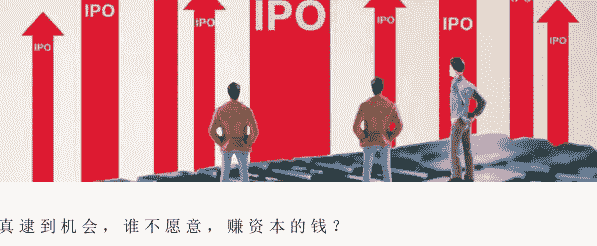

真遇到机会，谁不愿意，赚资本的钱？

不要听人说了什么，要看他做了什么。

## 用利益的视角，透视结构下的动机，发现真正的诉求。

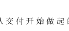

万叔的咨询生涯，是从交付开始做起的。

刚开始的时候，给一家世界 500 强，下属企业做交付，因为盖子大、项目多，几年时间，几乎都扎在这个公司里。

3 年以后，以超过一般人的速度，成长为项目经理，万叔对职业，有了第一次的深度思考。

你是要一直，给这家公司做智力外包，还是想做真正的咨询业务？

为什么会有这样的思考？因为这家公司，管理成熟、业务稳定，专业度高。

这意味着，做的项目，都是细枝末节的优化、整理、表单、落地类的项目，专业性强，可复制性低。

所以，在当时还不是很清楚的情况下，万叔跳到了，另外一家公司——降薪。

现在看起来，这次跳槽，是以低起点的薪资，实现了结构的跨越。

说人话！

就是，看起来钱虽然少了，但是赚钱的结构优化了。

为什么？

因为项目有沉淀，可复用。

新的公司里，第一年，就接触到了一家，国家级经济开发区，集团公司的管理规划业务，包含战略、组织架构、定岗定编、薪酬、绩效考核。

这个业务的案例，一直到今天，都还在复用，一鱼多吃。

以这个案例为基础，成为万叔职场升级的第一个道理——做有沉淀和复利的事。

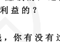

后来万叔，有了一定的自主权，在接项目的时候，就会对方自己进行拷问：

+   1、这个项目，是纯为了赚钱的，还是能带来续单、知识沉淀、项目经验这些额外利益的？
+   2、如果是单纯为了赚钱，你有没有过往的项目经验、资料，帮助从 60 分开始，快速产出结果？

虽然还在公司，但万叔开始，用创始人的视角，把自己和团队，当成一家公司来看。

是否要接一个单的考量，要么赚到利润，要么能积累能力和口碑。

如果每次从 0 开始，用 100 分的力气，干了 100 分的话，拿到 100 分的报酬。

那不叫利润，那叫劳务报酬。

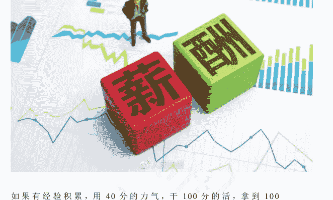

如果有经验积累，用 40 分的力气，于 100 分的话，拿到 100 分的报酬，这里面的差值，才是你的利润。

为什么要有这种利润意识？

绝对多数人，收入都是定死的。

在这个前提下，你不会想着，怎么把事情做好，怎么去创造更大的财富价值。

你只是流水线上一颗螺丝钉。

我同意，这样的你，工作只做 60 分，把时间花在，更重要的位置，接触更真实的世界。

万叔用这种，经营思维获得，比同级别项目经理，更多的收益。

这个额外的收益，是通过认知差换来的。

### 03

再后来，万叔成为公司的合伙人。

收入往上跳了一大截。

因为第一次开始开拓客户，接触各种各样的项目线索，开始承担风险。

当你走出稳定舒适区，开始向概率要收益的时候，你的格局就变了。

说人话。

就是风险越大，收益越高。

万叔经常说，不论你是谁，你在哪个岗，要尝试一下去卖东西。

甚至在写的战略报告里，也给客户写：要以销售拉动生产，不要盲目扩大产能。

为什么？

离钱太远，你就不知道，世界运行的基本规则。

我们的教育，是自工业革命以后，把人往工人的方向，进行培养的。

但工人的逻辑，和财富的逻辑，是不太一致的。

财富是拥抱概率，拥抱稀缺。

和从小爸妈学校，教会你的思想路径，完全不一样。

同时，在这个阶段，万叔拥有了公司，一部分分红权。

这是结构性的变化。

意味着所有的收入，从全靠你自己的努力，变成了有人为你，创造收入。

你没法从每天，工作 12 小时，变成工作 24 小时，让收入翻一番。

但分享公司业绩，就可以。

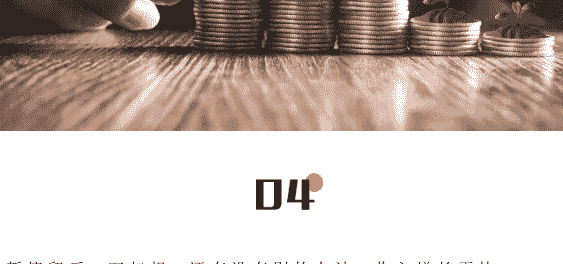

### D4

短暂停留后，万叔想，还有没有别的办法，收入增长再快一点？

回过头来一看，这几年赚的工资，比不上广州，自己那套房子，上涨的速度。

为什么呢？

万叔总结了 3 点原因。

-   大额投资。
-   高倍杠杆。
-   难以交易。

这么多年以来，黄金比特币，涨得也很多。

但你要万叔去拿几百万，加杠杆，投资比特币，几年不动。

万叔会紧张的睡不着的。

高买低卖几次，估计本金就没有了。

事实上，投机方面，万叔确实没有太多天赋。

每次想捞一波快钱，都以亏损结束。

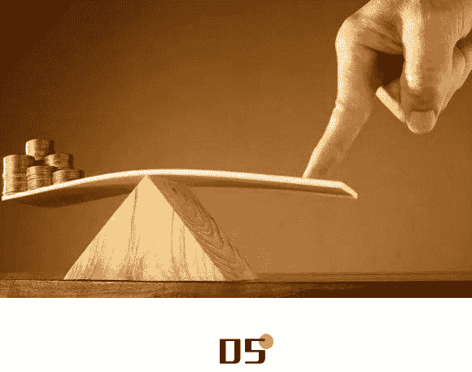

### 05

到了这一步，还有没有结构性的上升空间？

有，创业公司，给你股票，未来成为独角兽，上市成功。

万叔有个朋友，浙大毕业，阿里高管，都跳出来，去一家科技创新公司，拿股权，拼上市。

为什么大家都想上市？

因为财富的计算方式不一样。

比较一下：

一家工厂，每年产值一个亿，10%的利润，辛辛苦苦干了10年，老板赚了几千万。

一家头部科技公司，每年烧钱三个亿，踩到风口，一把运作上市，老板赚了几十亿。

上市，把未来几十年的收入，折现体现在估值上，像火箭一样，超过了牛车。

我们经常听到的，选择比努力更重要，真实意思是，不断调整人生，结构性的机会，往更高能级的，商业赛道上去。

万叔一直讲，赚钱是有层次的。

梳理这些年的历程，总结了几个层次。

一个人，从自手起家开始，到进入前 0.1%的财富人群，路径大概是

靠时间挣钱-靠杠杆挣钱-靠资产挣钱-靠估值挣钱

如果说人话，大概分别对应

步行-马车-汽车-火箭

有意思的是，我们恰巧生活在一个，路上同时有人步行、马车、汽车、火箭的时代。

每个人都说自己很累，但那些开车坐火箭的人，声音慢慢就听不见了。

万叔一直相信，经济的发展和进步，不是靠每天工作 8 小时，变成 12 个小时，卷出来的。

而是新的科技，新的力量，新的增长点，带来不一样的增长方式。

我们能做的， 就是一边做好手里的事，一边看向远方的路。

当增长的快车，从身后呼啸而来的时候，一把抓住，确保自己在车上。

## 上帝喜欢把机会的金线，抛给什么样的人

原创 万叔 创始人笔记 2023-02-17 22:00:33

大家好，我是万叔，这是我的第 2 篇原创。

昨天的文章，《从咨询公司的上市，看财富的几个阶段》从万叔自己的经历里，拆解了赚钱的几个阶段。

从白手起家，到世界首富，每个人赚钱的模式，都有天花板。

收入不是永远上涨的，打不开天花板，未来就是缓慢增长。

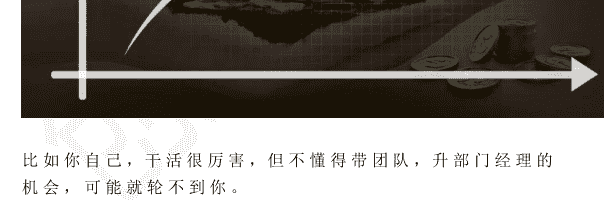

比如你自己，干活很厉害，但不懂带团队，升部门经理的机会，可能就轮不到你。

而天花板高度，是决定大部分人，财富总量的关键因素。

每次突破天花板，不光靠自己努力，也要看机遇、遇贵人。

万叔如果，没有那几次思考和主动出击，一直被动接项目的话，机会也不会，自然而然的找上门来。

那么，什么样的人，容易得到上帝的恩宠，能撬动资源和机会？

以下是正文。

### 01

遇事，喜欢琢磨

从小，万叔就喜欢琢磨。

万叔经常给人分享的一个故事。

小时候，1 年级数学班选拔考试，老师给一个小时，让我们从 1+2+3......+100.

有的小伙伴，拿着铅笔，就开始计算。

也有小伙伴，面露难色，坐万叔后面那个小胖子，十个手指骰完以后，唯一一声哭了。

万叔没动笔。

一想到，要加 100 次，一次都不能错，心里犯怵，也有点打退堂鼓。

老师看见万叔眉头紧皱，一个字没写，也不放弃，拍肩问道：万同学，在想什么？

万叔撑着一张稚气的脸，说，老师，我在想，你为什么，要我们算这个。

然后，万叔敏锐的察觉到，老师脸上面露欣喜。

肯定有目的。

差不多到 50 多分钟，该放弃的都放弃了，万叔逐渐开始紧张，因为快截止而产生的尿意不断涌来。

高压之下，找到了思路。

没错，就是和牛顿一样，发现首尾相加都是 101，只要算出 50 个 101，就可以得出答案。

可惜那时候没学过乘法，算不出 5050 这样的答案。

后来这件事，被万叔自我贴上标签，

花 59 分钟研究规律，用 1 分钟写出答案。

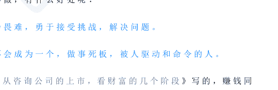

这样做，有什么好处呢？

不会畏难，勇于接受挑战，解决问题。

也不会成为一个，做事死板，被人驱动和命令的人。

在《从咨询公司的上市，看财富的几个阶段》写的，赚钱同时有步行、骑马、汽车、火箭。

你可以去羡慕那些，出生在罗马，直接坐在火箭上的人。

但他们模仿不来，更重要的，也不会把钱分给你。

要去学琢磨，学习，那些从步行开始，坐上火箭的人。他们，有哪些特质？是怎么发家？有哪些值得学习？

社会，相比学校这个新手村，难的不是怎么做，难就难在，没有人告诉你，要做什么。

在这个开放世界里，做对的事，比把事做对，更重要。

早琢磨出来，早接近梦想。

### 02

## 目标坚定，路径灵活

你必须要承认，大部分人，懒惰又abcdefgh，还不自知。

所以有人说，只要你稍稍努力一下，就能超过 70% 的人。

罗胖把这个现象，叫做“苟且红利”。意思是，因为多数人的苟且，你只要努力，就能收获超额的回报。

万叔不完全认同这个说法。

如果稍稍努力，就能收获回报，为什么这么多人，年初的计划，到一半就做不下去了？

按道理说，我们的长期坚持，都是在一个个日常重复中，不断收获了正反馈，从而形成正向强化，成为个人的特色或特长的。

说人话。

别人哪方面夺冠得多，你哪方面就更愿意精进。

那些坚持不下去的人，多数是既没有，为自己准备正反馈，度过寂寞期；也没有坚定的目标感，随意改目标。

理想和现实的差距，是人生最大的驱动力。做事不设目标，往往结果都会很尴尬。

王健林著名的，小目标理论，就是这种驱动力的具体化。

举个例子，比如赚钱和工作，你是怎么理解的？

绝大多数人，都没有思考过，只觉得别人，都是这样做，我也要工作、赚钱、拿高薪。

万叔怎么想的？万叔把工作，当成人生一个阶段，像读书一样，先以赚钱为主要目的，早毕业，早好。

这是目标，万叔这个阶段的毕业目标，是资产半个亿。

刚毕业来广州，把这个目标、告诉身边人的时候，都在帮万叔算：你一个月拿6000块，不吃不喝...大概要从宋朝开始工作...

万叔没搭理他们，只是笑笑，然后开始不断升级自己的赚钱模式。

做咨询顾问，在别人看来，已经是高强度工作。

但万叔一边，当上了合伙人，还一边在广州，开过摄影工作室，组过股票圈，炒过比特币，买过房，投资过黄金，做过FA，投过天使项目。

这些都是路径，有些成功了，有些失败了。有些只能赚小钱，有些能赚大钱。

但在 20 多岁的时候折腾，这些都不重要。

重要的是要折腾。

对于路径，万叔看得很灵活，重要的是解决问题的能力，而并不是知识经验本身。

这样折腾，在万叔脑袋里，形成了比较清晰的，对商业、对产业、对财富的认知和理解，就有了更多的路径，可以实现定下来的目标。

如果哪一天，管理咨询行业，被明令禁止了，万叔的收入结构，应该很快就能恢复。

包括现在做公众号，万叔是奔着一个 3-5 年，长期日更的方向去的。

用打造影响力为途径，分享商业认知，全面提升事业的层次。

如果没达到预期，咋办？

那就去公域引流、去各平台求关注、去做短视频、去想各种各样的办法。

定下的目标，吹过的牛逼，一定会想方设法实现。

在实现的过程中，你会遇见很多的机会，会有很多资源向你聚集，最终成就你的事业。

### 03

被看见，被信任

万叔去年，参加得到高研院，里面有个小红花机制。

喜欢谁，就送谁小红花。

在三个月的学习里，除了小组的同学，大部分外组的，都只是个别认识而已。

所以几乎所有，得到学习班的，优秀学员，最重要的一点，是被别人认识和信任。

虽然有六度人脉理论，有互联网拉近距离。但世界太大，仅仅被看见，就有极大的能量。

广州的番禺万博、花城湾，因为具有网红属性，价格一路水涨船高。

同级别的楼盘，有些缺乏足够的曝光，每次的牛市，涨幅就要差不少。

在企业咨询中，几乎每一次，和客户的接触，都需要重复地，介绍自己的项目经验、方法工具，本质上还是一个，建立信任的过程。

这个信任，是有成本的。至少在时间上，有很高的成本。

万叔写这个，公众号的时候，总是想，我每天花一些时间，在平台上，分享商业认知、分享咨询实践。

会不会哪一天，你有咨询项目需求的时候，就可以因为长期的陪伴，跳过信任建立阶段，低成本链接开始创造价值呢？

如果你觉得没有，那也只是，万叔现在还不够强大，那就继续积累，直到有足够多的背书、信任，可以产生强大的影响力为止。

阿里价值观，独孤九剑里，有一句：因为信任，所以简单。

当上帝，准备抛出他，机会的金线时，

万般想，应该也会选择，那个被他看见，产生信任的人。

## 商业世界的黑暗森林法则

原创 万叔 创始人笔记 2023-02-18 23:59:08

大家好，我是万叔。

昨天的《上帝喜欢把机会的金线，抛给什么样的人》讲了那些有机会成功的人，都有哪些特质。

是从万叔自己的，经历来讲的。

如果你觉得，万叔的个人条件、基础、和你的不大一样，无法模仿。

建议你去看一部真人秀——《富翁谷底求翻身》。

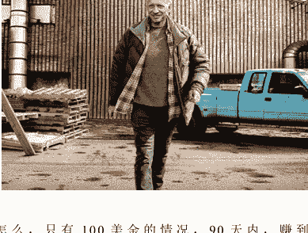

讲的是怎么，只有 100 美金的情况，90 天内，赚到百万美金。

里面总有一些，值得学习的认知，可以纠正你，现在商业思维的理所当然。

如果本篇点赞破百，近期可以更新一篇，讲讲万叔看完以后的感悟。

以下是正文。

### 01

26 年前，日籍美国作家，罗伯特·清崎的《穷爸爸，富爸爸》出版时，好几个团队想把它翻译成中文，但效果不尽如人意。

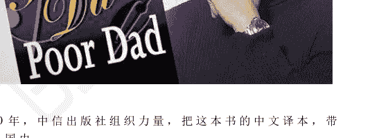

2000 年，中信出版社组织力量，把这本书的中文译本，带到了国内。

随着中国入世，经济开始腾飞，这本书成了几乎，所有人理财的圣经。

不管里面讲的，内容多复杂，万叔看来，核心就是两点：

- 1、保持正向的现金流。
- 2、抓住机会，投资能带来，正向现金流的资产。

但在国内，这个逻辑，好像并不完全是这样。

有些人买房，没有带来正向现金流，发财了。

有些人卖房创业，失败破产了。

有些人买了很多，正现金流的商铺，现在叫苦连天。

为什么会这样？

为什么我们听了很多，商业的大道理，依然没有赚到钱？

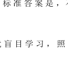

穷爸爸，富爸爸这本书，我们照着去做，能成功么？

万叔经常被问到，这样一个问题，你是做企业咨询的，我们想学华为，想把华为的全套体系，复制到公司来，你可以吗？

亲爱的朋友，你觉得，那些做小生意的，学华为，能成功么？

遇到这种问题，万叔的标准答案是，不要学华为，不要学华为，不要学华为。

不要因为他成功了，就盲目学习，照搬做法。

如果非要学，就学 40 年前的华为，30 年前的碧桂园，20 年前的格力，看在小公司的情况下，怎么突围升级，一步步走到今天。

而且，不要看他怎么宣传的，要想办法，看到一个真实的，企业发展历程。

就像阿里巴巴的，创业故事里，一直是18罗汉如何夜以继日，坚守岗位；刘强东的创业故事里，必提自己睡在办公室当客服。

但硬币的另一面是，阿里发现了谷歌，通过建立黄页，收集企业信息，吃掉了信息搜索期的流量红利，有钱以后，才建立的淘宝。

刘强东在中关村的数码公司，在数码论坛里疯狂灌水，搭上了版主的关系，吃到了论坛时代的流量红利，有钱以后，才建立的京东。

而现在你问阿里、京东，他们一定会说是由于，自己优秀的人才、良好的管理体系、高效的信息化系统……

但实际上，企业在生存发展阶段，要拒绝利润、招泥腿子、拓展业务和营销。

完全不一样的打法。

多少企业，本来活得还不错，因为硬招大厂人才，硬上信息系统，被活生生拖死。

齐白石说，学我者死，像我者生。

### 03

回到穷爸爸，富爸爸。

为什么很多人的反馈是，道理都对，一学就废？

因为时代不一样。

美国都已经进入发达国家很久很久，富了几百年。那些能赚大钱的传统投资，利润率早就被压缩到很低很低了。

中国呢？

过去 20 年，经历的是西方跑马圈地，资产聚集，逐步形成对应资产价格的蛮荒时代。

你应该对标的，不是 2000 年的美国，是 1626 年，荷兰人 24 美元买下曼哈顿岛时候的美国（甚至还没有美国）！

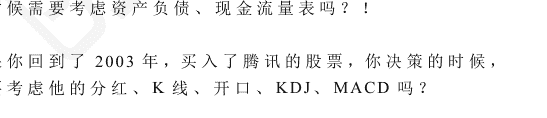

那时候需要考虑资产负债、现金流量表吗？！

如果你回到了 2003 年，买入了腾讯的股票，你决策的时候，需要考虑他的分红、K 线、开口、KDJ、MACD 吗？

不用啊！你唯一需要想的是，怎么样多买一点！

过去 20 年，那些考虑到后来还贷问题，现金流问题，畏手畏脚的，都拍着大腿说为什么不多买几套，多买几套我就可以躺平了！

### D4

那，为什么没有人，对这些信息进行修正呢？

有，但是发现的人，公开传播，都被揪掉了。

为什么？

因为财富金字塔，商业黑暗森林。

商业的世界，是一个黑暗森林，每个人小心翼翼的，维持着信息差，吃掉那些信息差之外的资源和利润。

信息一旦需要，为大多数人所知，就必须要包装、美化，变成道德上正确的，比如儒家思想。

然而中国，自秦汉以来，任何一个长久统治的帝国，实行的都是外儒内法。

儒家正确，可以让多数人，在小圈子里安稳度日。

法家有效，可以适配真实的社会底层逻辑。

像极了中西药结合疗效好的广告。

### D5

比较著名的，上海有个姓欧的家伙，深圳有个深房里。

尤其深圳那个深房里，等到被决策者点名，被连锅端掉，很多内部的资料出来，看到以后才知道，原来还可以这样玩。

特别像三体电视剧里，把审判日号切成片，拿到三体星球的资料，才知道，卧草，人家的技术，已经到了这种程度。

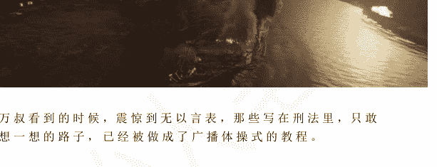

万叔看到的时候，震惊到无以言表，那些写在刑法里，只敢想一想的路子，已经被做成了广播体操式的教程。

跟着节奏，1234，2234，3234，再赚一次。

但这一切，都源于深圳的思想解放，敢做敢想。才能在30年内，把一个小渔村，建设成为世界的契机。

只要经济在增长，就会有结构性的机会，获取超出平均增速的财富，跨越人生阶层。

万叔的话，不追求道德正义，但一定真实。

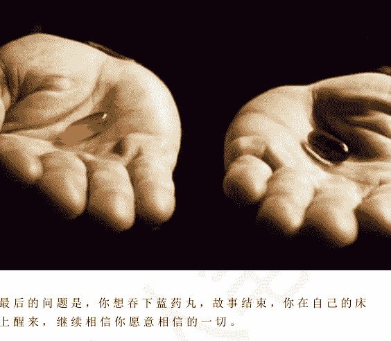

最后的问题是，你想吞下蓝药丸，故事结束，你在自己的床上醒来，继续相信你愿意相信的一切。

还是关注万粉，吞下红药丸，看看财富这个兔子洞，到底有多深？

## 只有证券化，能接住天量的放水

原创 万叔 创始人笔记 2023-02-19 23:36:38

大家好，我是万叔。

昨天的文章，《商业世界的黑暗森林法则》，讲了信息差赚钱的路径。

如果你看懂了，就明白一些行业，存在的原因。

为什么房产中介这个行业，没被互联网“平权”？

为什么城市的代理入户，企业税信用卡申请，明明可以自己办理，还是会有大量中介公司？

创始人笔记的创友们，万叔希望，对于任何一个存在的现象，不要简单去评判对错，盲目做道德判断。

要多去思考，琢磨，想想为什么？里面有哪些机会？

迟早能琢磨出点啥来。

以下是正文。

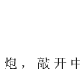

1840年，西方列强坚船利炮，敲开中国大门的时候，满清的决策者们，还沉浸在天朝上国的美梦中。

在他们的认知里，中国有世界上最好的粮食——大米；最好的饮料——茶；最好的衣料——棉布、丝绸和皮革。

这些就可以构成，100 分的生活方式。

当英国人带着钟表、鼻烟壶、西洋镜子等欧洲商品，来到中国，请求贸易的时候，乾隆毫不犹豫的拒绝了。

理由是：你们这些奇技淫巧，只能看看，不能作数的。

然后的事，所有人都知道了。

进入工业时代的欧洲，为什么会，发动战争，打开市场？

因为在传统的价值体系之下，丝绸、瓷器、茶，占据了贸易价值链顶端。

在那个价值体系下，西方的白银，源源不断顺差，流入中国。

中国又不接受这一套，新的贸易估值体系。

所以，必须要用强力，建立一个，新的估值体系，用工业品，对抗农业、手工业品，实现财富的转移。

### 02

100 多年以后，中国已经迎头赶上，成为世界最强的工业国。

大家的认知，也逐步接受了工业化。

爷爷那个时代，有地，有粮食，就能够娶到媳妇。

大伯那个时代，令人羡慕的结婚，需要自行车、缝纫机和手表。

## 70年代

凤凰牌、永久牌自行车；梅花牌、上海牌手表；蝴蝶牌缝纫机。70年代结婚有了这几样 简直就可以称得上世纪婚礼了

自行车

手表

缝纫机

万爸结婚的时候，三大件变成了冰箱、电视机和洗衣机。

到了现在，有房有车，成了标配。

商品价值在提升，但无论怎么变，大部分人对财富的认知，从保障生存，变成了拥有工业品，这是农业时代，到工业时代的升级。

### 03

工业时代，社会极大发展，财富指数型增长，今天的一个普通人，绝大多数方面，生活质量优于古代帝王。

但，也有一个不好的地方。

随着生产力的提升，手里的工业品，变得越来越不值钱。

买了手机-降价。买了电视-降价。买了汽车-降价。

两方面的原因。

一方面是，生产力提高了，另一方面，供给端的货币增加了。

说人话。

产品越来越多，钱也越来越不值钱。

拿钱-拿产品，都不能阻止，手里的钱越来越少，财富越来越向少数人集中。

如果你也是，抱着这种思路，看今天的房子，就会觉得很悲观。

人越来越少，人均几套房，比现在多很多。

很多发达国家，人口增长有限，生产力增长有限，需求增长有限。

尤其是美国，制造业迁出，产业空心化，红脖子天天闹革命，看起来好像药丸？

乍一听，是不是觉得，也没啥希望了？

但是，进入存量经济以后，欧美，尤其是美国，为什么还有这么持久的增长势头？

如果不是工业产品，新的财富，定义在什么地方呢？

答案是证券化。

再看深一层——是共识。

### 05

你拿农业时代的思维，理解不了，为什么我们要杀光，东三省的汪星人，换人家一架苏27。

如果穿越回清朝，告诉乾隆皇帝，用你小半个国家的动物皮毛，换洋人几个会飞的铁皮坨子，可能下一刻，就要把你拖出去杀了。

你拿工业时代的思维，也理解不了，为什么特斯拉公司，市值超过了身后 2-10 名的总和。

你如果穿越回 100 年前，告诉美国人，一个一年卖 100 多万量车的公司，可以换掉，其他所有 2300 万量车的生产公司，他们一定会觉得你疯了。

但这就是事实。

ChatGPT 的出现，让微软股价一夜大涨 5400 亿，几乎涨了半个谷歌。他带来的收益，真的能顶上半个谷歌吗？

还是共识的力量。人们愿意相信，它未来的表现。

同样的房子，在广州天河区珠江新城，卖到 15 万一平。放到番禺广场就只能卖到 3、4 万一平。

学校、交通、绿化、环境，值那么多钱？

还是共识溢价。

万钧在《从咨询公司的上市，看财富的几个阶段》里写，我们的赚钱能力，不同档次，分别是：

靠时间挣钱-靠杠杆挣钱-靠资产挣钱-靠估值挣钱

其实我们的财富认知水平，也有不同档次，分别是：

农业时代，工业时代，共识时代。

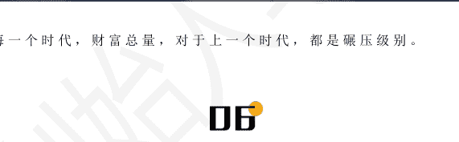

每一个时代，财富总量，对于上一个时代，都是碾压级别。

### 06

其实讲这么多，是回答昨天文章里的，一个彩蛋问题。

尤其深圳那个深房里，等到被决策者点名，被连锅端掉，很多内部的资料出来，看到以后才知道，原来还可以这样玩。

没法明说，但是，万钧可以，问你一个问题。

比特币最高涨到 40 多万一枚，如果让你投资，你觉得是贵不贵？

觉得贵的请举手。

你如果觉得贵，证明你还在，工业时代的，财富思维里。

为什么？

因为如果你接触过，就知道，比特币，是可以无限细分的。

这意味着，本来需要你至少有 40 万，才能参与这个游戏，变成了，你无论多少钱，都可以参与这个，资本的游戏。

这一点无比重要，以至于资产的价值，可以脱离他锁定的估值体系，完全变成依靠共识的力量，推动的游戏。

多一块有一块的喜欢。

如果你认真思考类比一下，就大概知道，万板不能说，发出来会被删的那些东西，讲了些什么。

这个视角下，你还觉得深圳，30 万一平的房子贵吗？

### 07

信号已经很明确了，未来很多年，我们都会在一个，大放水的时代。

只有极少数人，看懂了这个大水，需要进入共识资产时代，才能承接得住，保住财富不被收割。

放水=通胀=涨价=……，用工业时代的视角看，不良性，也不美好。被炒高的 3、4 线工业品房子，就是这样让人怨声载道的。

但不放水，通过去产能，对应美国的供应链转移，资产负债表的收缩，是自废武功，砍断双臂的对策。

唯一通过证券化，构筑新的共识，产生新的优质资产，承接放水带来的负债端扩表，才能日益强壮，应对可能发生，更严重的危机。

说人话。

注定放水的情况下，如果要控制不通胀，唯有把钱搞进股市和金融房市。通过共识的力量，消化大量的货币。

决策者唯一要控制的，是这种情绪市场不要涨跌太急，不要覆盖面太广。

让金融属性的资产飞上天，让实用属性的产品用得起。

10 年左右，北上广深，最有共识性区域的房价，大概率会超过，靠资产属性为主定价的纽约东京。

如果股市制 X 楼再起，几率增大到 100%。

## 你有没有搞清楚，他们在想什么

原创 万叔 创始人笔记 2023-02-20 23:37:26

大家好，我是日更的咨询公司创始人万叔。

昨天的文章《只有证券化，能接住天量的水》，里面讲了，天量放水，想要不通胀，需要用共识，构建天量的资产包，这个资产价格锚定，只有通过证券化实现。

今天，证监会就批推了，私募基金，投资商品房的许可。

证监会2月20日消息，为进一步发挥私募基金多元化资产配置、专业投资运营优势，满足不动产领域合理融资需求，近日，证监会启动了不动产私募投资基金试点工作。

据了解，不动产私募投资基金的投资范围包括特定居住用房(包括存量商品住宅、保障性住房、市场化租赁住房)、商业经营用房、基础设施项目等。

小伙伴看到的时候，都惊呆了！

证监会，不会偷懒的看了万叔你的文章吧！

其实，一两次巧合，如果经常碰中，说明你的思维，和决策者的思维，基本逻辑保持了一致。

万叔希望的是，每个读者，想赚钱的，都可以自己动脑子，多去琢磨琢磨。

抢在信息传播的前面，完成财富的卡位。

以下是正文。

### 01

前两天，有个事情又冲上了热搜。

近日，合肥庐江中学举办了一场以“感恩”为主题的讲座，学校特意邀请了知名的教育专家陈宏友来为学生讲课。

在陈宏友讲座的时候，因为所带的PPT一时无法打开，所以他就给学生们表演了一段即兴演讲。

在这段演讲中，陈宏友对学生们说：你们这么努力学习就是为了挣钱，努力学习的目的就是可以跟白人相结婚，改良自己的基因，因为白人的基因更加优秀。有了钱，你们就什么都有了。

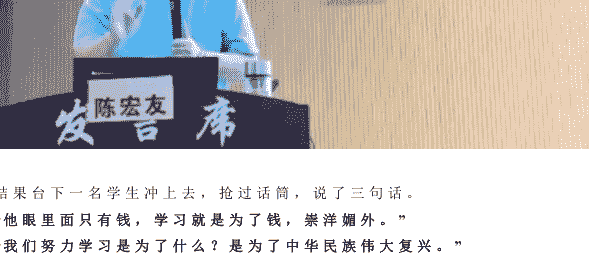

结果台下一名学生冲上去，抢过话筒，说了三句话。

“他眼里面只有钱，学习就是为了钱，崇洋媚外。”
“我们努力学习是为了什么？是为了中华民族伟大复兴。”
“同学们努力学习，为了中华民族伟大复兴。”

今天开车，刚好路过二沙岛。

路上，王富贵问，万纵，那个感恩演讲的事情，你怎么看？

万纵瞥了一眼车窗外，看到地铁二沙岛站，正在建设。

跟你讲个有意思的冷知识，万纵说。

假设你现在，要买房子，有两个楼盘，其它方面都差不多，但一个靠近地铁，一个远离地铁。

你会想买哪个楼盘？

王富贵说，肯定想买地铁盘。

万纵说，大部分人，都会像你这么想。

但如果大家，都想买地铁盘，供需关系决定，地铁盘必然涨价。

这就是为什么，在很多人的认知里，地铁一响，黄金万两。

但你刚经过的二沙岛，是极少数，因为要通地铁，被周边房东抵制的地方。

王富贵问：为什么？

万纵说，如果你是，地铁公司的决策者，可能会想，你们这群傻子，我地铁修到哪里，哪里就暴涨。好心帮你们弄地铁，提升便利性，你们居然不要。

### 03

二沙岛那边的富人们，还真不要地铁。

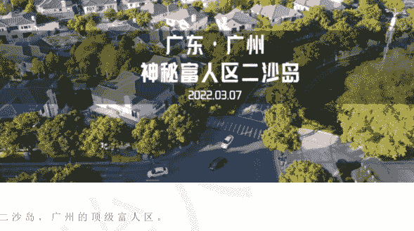

二沙岛，广州的顶级富人区。

往岛上的人，喜欢的是私密、安静的环境。

他们并不会因为，效率的提高，而觉得开心。反而不，因为建了地铁，来到岛上的人变多了，业主们低调、私密、安静的共识，受到了冲击。

无独有偶，广州顶豪汇悦台，也因为要在前面，建设一条过江隧道，遭到了全体业主的反对。

## 尊敬的广州市委广州市政府：

我们是天河区临江大道侨鑫汇悦台相关的业主。近日，天河区政府发布了一篇新闻通稿，称《珠江新城构建两条过江隧道，总投资超过39亿元》，其中，临江大道-阅江路过江隧道连接琶洲互联网创新集聚区及珠江新城CBD，目前隧道已经开始勘察设计招标。作为广州市民，我们深知城市发展与社会进步息息相关，我们不反对政府合理程序和正确决策，但我们对临江大道-阅江路过江隧道的规划存在极大的担忧，同时对该项目的推进是否符合程序存在质疑，特别是近九十亿投资的重大决策并可能涉及妨碍国家有关部门信息安全。

据说，因为业主的能量实在太大，有人打通了上面的关系，过江隧道，招标被暂缓。

一条给普通人，增加便利性的隧道，在富人们看来，就是打破顶豪共识的坏工程。

汝之蜜糖，彼之砒霜。

### 关于暂缓临江大道-阅江路过江隧道

### 工程总承包（EPC）及运维服务（三年）资格预审的公告

临江大道-阅江路过江隧道工程总承包（EPC）及运维服务（三年）（项目编号：JG2022-10850）的资格预审公告于2022年3月3日在广州公共资源交易中心网站等媒体发布，现由于本项目按相关要求需研究和调整，暂缓资格预审工作，具体另行公告。

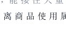

万叔之前在《只有证券化，能接住天量的放水》里讲了，只有共识，是把商品提高价格，到脱离商品使用属性，决定性因素。

而阶层不同，共识完全不一样。

如果不知道他们要什么，就盲目帮人家做价值判断，可能会弄巧成拙。

万叔当年刚工作的时候，有一次大领导请吃饭，桌上谈的，就是赤裸裸的工作-回报。

大领导问完万叔的情况以后，说，加油先，争取挣到一个月一万块钱，在广州站住脚。

当时刚毕业没多久，听这话，着实有点觉得不自在。

我来容商公司，不是努力学习上进，为公司创造价值，为客户创造价值解决问题的吗？

怎么能一开口就说钱呢？不俗吗？

直到，很多年以后，万叔自己做了咨询公司，回味起当时大领导的良苦用心，不讲那些虚的，讲利润，讲价值贡献和回报，是多么接地气。

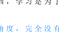

回到陈宏友的讲课，他说东西，学习是为了赚钱，有问题吗？

站在他的角度，大部分家长的角度，完全没有问题。

但他错就错在，不知道00后在想什么的时候，就盲目的输出自己的价值观。

站在这帮00后，中学生的角度，没有赚过钱，不知道商业的底层逻辑，你跟他说读书是为了赚钱，就让他觉得你的认知有问题。

为什么万叔在，之前的几篇文章里，有些东西，点到为止。

因为公众号的读者里，各式各样，教育不同，读书不同，生活环境不同。

万叔认为，普通人白手起家，要抓住时代的机会，赚到千万以上的财富，才算毕业。

但你这样做的时候，可能你身边一些人，反而觉得，你是不是掉到钱眼里去了？

还有更狠的，直接举报万叔的作品，辛辛苦苦写几个小时的东西，在互联网上查不到痕迹。

总有一些人自己过得不好，也不希望你过得比他好。

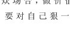

这么多年来，万叔觉得，在商业世界里，最难动的是两样东西——穷人的思想，富人的利益。

那如果遇到这样的人，怎么办呢？

在现实生活中，万叔不在公众场合，做价值观的传输。如果非要讲，也会讲些要努力、要奋斗、要对自己狠一点，然后你就能够成功。

跟阿里巴巴一样。不是马云不想说，不想和你分享他的故事。

是他说了，反而被一些人打成资本家，觉得是吸了自己的血，或者是狗屎运，踩到了时代的红利。

马云之前，发布过一个讲话，说商业，是最大的公益。在B站被骂成狗。

从一个理性人的角度来讲，学过经济学的都知道，商业提高了效率，创造了财富，确实是最大的公益。

这种话，从逻辑上来说没有错。

哪里错了？

错在只能在同一个阶级，同样共识的人里，才能说。

屁股坐到不一样的位置，视角不同，不存在绝对意义上的对和错，自然有人找角度喷。

放到网上，无论什么样的观点，都有 一帮红粉，冲进来不由分说，骂你是傻X。

如果碰到这样的，万叔的做法是，理解他，认可他，告诉他，你说得对，你做得对。

然后，赶紧离开，江湖路远，后会无期。

### D7

还有没有更狠的报复方法？

也有，但不推荐。

之前的文章《商业世界的黑暗森林法则》里，如果看到这种群体性的情绪，想办法利用它，推动它，赚取流量，或者，直接赚钱。

任何一类，认知的错配，都有机会在里面的。

比如女性盲目的择偶要求。

如果万叔身边有人，自己条件很一般，要求却不匹配。

万叔最多就是，承认你的要求，但不给你介绍男朋友。

但有些骗子，就利用这样的心态，包装成女生想要的样子，然后骗钱。

典型的，东南亚系猪仔就是这样，利用女性的幻想，收割天真的人性，血的教训。

希望万叔的读者，都能有商业智慧，在财富的路上，多赚钱，少踩坑。

## 资产证券化的几种途径

原创 万叔 创始人笔记 2023-02-22 22:15:32

大家好，我是万叔。

之前的文章《只有证券化，能接住天量的放水》里，讲了一个非常重要的概念——资产证券化。

未来，有共识的资产，才会有溢价。

所以，创造共识，就是某种程度上，创造财富和价值。

当然，也可能是庞氏骗局。

以下是正文。

事情要从大航海时代说起。

自从荷兰、西班牙开启大航海时代以来，西方的近现代文明开始萌芽。

但最初的海上淘金，并不如想象中的安全。

远洋的船只，需要在海上，航行一年甚至数年，期间要面对数不尽的未知和风险，如果船队在远航中出现问题，还有可能血本无归。

老海盗们，凭借积累的资产（船队），和丰富的经验，成为了人生赢家。

看起来，年轻的海盗们除了冒险精神、不怕死的勇敢外，只能慢慢升级。

从水手、船员、组长、大副、船长，在很久很久以后，才可能拥有自己的船和资产。

海盗里有年轻、脑子灵光的就想，能不能在出海之前，找人筹措资金，等回来以后，按比例把获得的财富分给他们？

这实际上是个伟大的壮举。

用经济学的话来说，实现了不同要素的合理配置。

一方有钱，一方有能力，双方共同创造财富增量，以信用的方式，划分分配比例，实现财富的共同增长。

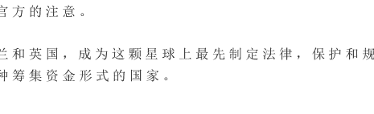

这种玩法起源于民间，但其核武器般的影响力，迅速获得了官方的注意。

荷兰和英国，成为这颗星球上最先制定法律，保护和规范这种筹集资金形式的国家。

### 02

但这样的筹资方法，还不能说是，真正意义上的股票，还只是一个雏形。

更类似于是期货，每次航行回来以后，返还股东的投资并分配利润，和交给类似。

但社会总是在进步的。

有资本家和大的船队说，我们既然拥有了良好的互信，对钱也不是这么着急用，能不能把钱就长期放你这里，不以某一次出海的成果进行分配。

而是以某段时间内，你所拥有的船队所有利润，长期分配。

这几乎就是现代的普通股票。

目前可考的，全人类的第一家上市公司，就是荷兰的东印度公司。

直至今天，不论股价论增长的话，东印度公司可能还是人类历史上效益最好的公司，连续数十年，每年增长在40%以上。

不过当时也没啥国际法，世界一片丛林，只要能盈利，啥都干，比如贩卖奴隶和鸦片。

但股东们并不在意，他们只想让手里的钱增值而已。

你赚了钱，给我分红，我越来越有钱。

### 03

在这个基础上，聪明人又发现，这个分红权，也越来越值钱。

甚至，超过了分红本身。

之前万叔在《商业世界的黑暗森林法则》里，讲为什么现金流游戏，在国内还需要一定的本地化，就讲了这个原因。

成熟国家，重视分红权。

新兴国家，重视增值权。

不管这个资产，是叫股票、债券、房地产、郁金香还是比特币。

这就是为什么，同样是房子，我们不讲什么租售比；同样是股票，我们不讲什么股息率。

我们现在的情况，学的是几百年前的欧洲。

### D4

目前来看，我们的房市，已经接近发达国家的现代水平。

随着未来，房产税的到来，大部分城市房产，去金融化，回归居住属性，整体逐渐要成为成熟资产。

讲究租售比，讲究现金流，而弱化资产增值，带来的收益。

而股市，目前仍然处于，一个初级阶段。

散户投资者占到80%以上，投机情绪严重。

这时候，最好的办法，不是去跟风炒股。而是站在更高的维度，做一手市场。

中国的股票，为什么不涨，指数多年稳如泰山，是因为，国内的证券交易逻辑不像是东印度公司一样，公司赚钱，服务股东。

本项逻辑有点黑暗，是套散户的钱，去满足企业、企业主的融资需要。

### 05

万叔服务过的那些，投资类国企，几乎都是一级市场投资，二级市场变现。

中国放水的时候，过去主要是房地产充当了这个蓄水池，但是，股市未来会越来越重要地承担这个角色。

中国会不会出现这种暴涨？会，宁德时代，茅台这些有，但它不是股市蓄水池的主要逻辑。

中国股市主要逻辑是，会通过北交所、科创板这些新的板块，吸收掉多余的资金。

这好比我们，控制了一个可以开关的水龙头，当货币充足时，推动批量上市，稀释货币。

当货币紧缩时，通过类似新三板枯竭流动性，同时放慢上市审批，关闭水龙头。

这样避免了货币超发，盲目推高资产价格。

说这个的目的，是想说，投资，要做顺势而为的事情，少做小概率的风险赌博。

村长的路，已经指得很清楚了，想办法通过实体企业，持有一级市场股权，证券化，通过二级市场变现。

海盗厉害的是出海冒险，赚你认知以内的钱，就好了。

至于变现的事情，要靠背后的金主，专业的投资人和推手，他们吃到肉，你才好一起喝口汤。

## 用 10 倍的增长逻辑，更新商业生态模式

原创 万叔 创始人笔记 2023-02-23 21:33:04

大家好，我是日更的管理咨询公司创始人万叔。

前两天跟一个，人力资源服务集团，大客户中心的主任吃饭。

起因是他们，想找外部公司老师，来讲课分享，交流大客户销售的心得。

万叔交付出身，刚好合伙人业务能力非常强，就推了过去。

结果，不同方法和思考的碰撞，产生了巨大的能量，这次培训非常成功。

万叔问主任，你和公司，专业能力这么强了，为什么还要想着找外部？

主任说，你也知道，我们是国企，过去的思路，都是自己接单自己交付，是比较封闭的生态。

当然，我们在专业领域，是做得非常好的，既有国企的信任背书，也有强悍的人才队伍。

但总觉得这个客户体系，还没吃够。

我们广州，本来就以改革开放、敢为先著称。

所以，今年在股东会上，我也提出，逐步有序和外部接触，做大同盟圈，做更大的盘。

万叔笑，你们这个国企背书，有时候还挺好用的。

我写公众号，每天日更，一年50万字，讲认知、讲管理、讲咨询、讲财富，也是为了建立自己的信任背书。

想跟我合作的，只要是从公众号聊起，基础的信任就有了。

现在阅读量是几千，未来涨到一万、三万的时候，粉丝越多，信任越强，这就是新时代的信任背书。

那你们，从封闭走向开放的体系，有没有遇到什么问题？

主任说，当然有。

做了这么久的工作，我感觉，最难解放的，就是人的思想。

想当年，广州也是最敢为人为先的。

只不过后来，隔壁出了个深圳。那边的魄力，霍，有些是我想都设想到过的。

除了没发行自己的货币，只要能想到的激励方式， basically 他们都做过了。

之前你的文章，不是写《只有证券化，能接住天量的放水》证券化嘛。被指捅的那个，就是自己搞了一套，证券化的体系妙房，结果被打了。

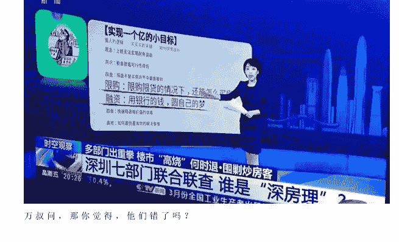

万叔说，那你觉得，他们错了吗？

主任说，我是坚决拥护，党和国家的决议的！

但是换句话说，这种事情，有没有一种可能，是对的事情，出现在不对的时间地点人物上？

万叔说，差不多15年前，东边有个村子，村长拿着老基金做投资，查出来，被撵掉了。

做法一直继承到今天。不止是我们，漂亮国的养老金，也是美国股市的基本支柱力量。

没有保值增值手段，这玩意儿窟窿会越来越大，最后失去公信力，就垮了。

再往前走，2000多年前，有个家伙，从魏国跑到秦国去。

因为听说，那边的大王贤明，可以放手让他施展。

结果呢？因为触动了利益，贵族里一片骂声。

为了安抚贵族，秦孝公含泪车裂他，然后继承了所有的思路和做法。

这哥们叫商鞅。

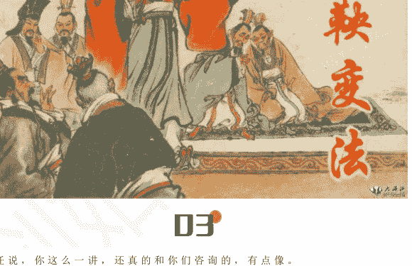

主任说，你这么一讲，还真的和你们咨询的，有点像。

万叔笑说，还好，我们说决策者不好说的话，不至于杀头。

我们做业务，起码，还是站在公司的公允角度，解决问题，不做完全没有价值的事情。

主任问，那你说，那些网上出奇葩言论的专家们？是不是也有差不多搪塞的作用？

万叔说，这个不一定，多数是，断章取义、流量驱动、媒体狂欢，

## 最后 一 地 鸡 毛。

比如万叔从2014年开始，就呼吁说计划生育，要提前放开，提前做准备。

当时好多人拿各种难听的话，试图证明万叔是个傻子，人口会爆炸啥的。

结果去年计划生育任务（人口0增长）完成了，又是那群人，开始慢慢悲观了，觉得10年少一个河南省。

这些人，都是线性思维，觉得我今年工资5K，明年涨到6K，后年涨到7K……所以万事万物都应该是这样的。

生物学上，有一个重要的概念叫负反馈。

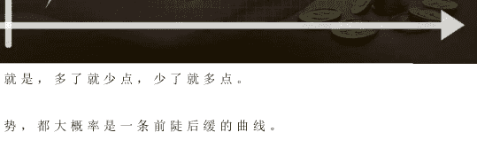

说人话就是，多了就少点，少了就多点。

任何趋势，都大概率是一条前期陡后缓的曲线。

### 04

你觉得，我这摊子业务，有没有什么建议？主任问。

万叔说，主任，你业务做得比我大，你的能力功不可没。但如果要增长的话，我提个建议。

你从10倍增长的逻辑，来看待和更新商业模式。

如果要在目前基础上10倍增长，现在的架构、产品、业务模式，能不能支撑得起？

主任想了想，有点难。

万叔说，那些在资本市场上，表现得好的大牛股，十倍股，一定是嗅中了时代的红利，结构性增长，才能以极快的速度，变成市场的头部企业。

人力资源，传统业务虽然日趋饱和，但你做的这个业务新，壁垒深，潜力大，有非常好的成长性。

主任说，是。我现在接触的客户，都一般的企业，很难接触到的，非常优质的客户。

我们选择了一个非常细分的切口，建立信任关系，达成了服务。

万叔说，这里里面，有增长的机会。

我们拿食物打比方。中国人是讲究食不厌精，脍不厌细的。

比如我们去顺德吃鱼生，吃桑拿鸡，他们会有一鱼五吃的做法。

看起来一点都没有浪费。

这样好不好？

站在处理单个食材的角度，肯定是更加优的。

但这里面区分的一点，个体效率和总体效率的区别。

个体效率最大化，总体效率不一定最优。

如果站在整体效率最优，利润最大化的角度，应该怎么做？

主任说，把一只鸡分割成各个部分，然后分开加工。

万叔说，当每个部分专注的时候，无论是效率上，精细程度上，都会更高。

大市场的时候，需求的增加，带来技术的进步。绝味鸭脖，不就靠这个，从资本市场上，赚的盆满钵满的吗？

你用原材料做等码，投赞几家下游的公司，用资本的玩法，推动上市。

把一鱼五吃，变成一鱼五线，用流量的打法，做平台经济，格局和结构，就完全不一样了。

具体需要怎么做呢？主任问。

核心还是解放思想。

当你把认知和资源，看成财富的左右脚，认知高的时候，去撼动更多的资源，像你现在做的业务一样，横扫四合，全国铺开。

拥有资源，但认知不够的时候，通过合作，链接，把鸭脖子让出去，投资绝味，也是一种高效的，总量最大化的变现方法。

## 创始人笔记 2023 年公众号文集

最怕的就是那种，手里揽着资源，宁可烂掉，也要保证100%掌控权的。

从这个角度来说，以中国的市场规模和资源规模，我们各行各业，都还有很大很大的发展空间。

可以足够让我们，理性和坚定的，做一个长期乐观主义者。

## 公交罢工事件背后：细碎危险的生意，才是普通人的机会。

原创 万叔 创始人笔记 2023-02-24 21:30:27

大家好，我是日更的管理咨询公司创始人万叔。

昨天的文章，《用10倍的增长逻辑，更新商业生态模式》讲了商业世界里流量的打法。

把一鱼多吃，变成一鱼多线，做平台战略，甚至投出上市公司，才是企业指数型增长的路径。

昨天晚上，万叔服务过的一家，公交集团的客户，发了个朋友圈，说河南商丘的公交，打算集体罢工了。

## 通告

商丘公交 2023-02-23 08:40 发表于同城

## 通 告

尊敬的广大市民、乘客：

受疫情冲击、国家新能源补贴政策调整、财政补贴不到位等多种因素叠加影响，导致目前我公司亏损十分严重，经营异常困难，员工工资、社保金拖欠、无法支付，车辆充电电费、车辆保险等无资金购买，已经无法继续承担百姓出行公益性事业和民生工程。

鉴于我公司实际困难，经公司研究决定，拟于2023年3月1日起暂停运营商丘市市区公交线路，请广大市民、乘客提前做好出行安排，由此带来不便，敬请谅解。特此通告。

商丘市公共交通有限公司
2023年2月23日

万叔问，其罢工了？

公交说，如果不发工资，3.1 开始就罢工了。

以下是正文。

公交说，这家，也挺猛的。

我们去年，也欠了不少工资，但都是对我们许诺、安抚，没有敢跟政府，做要求。

万叔问，你们也有政府补贴？

公交说，我们是公益类企业，不以盈利为目标。靠车票肯定不够收入，缺的那一部分钱，就要政府补贴。

万叔问，当时给你们服务的时候，不是准备做改制么？

公交说，这不，改成公益类企业，靠财政拨款了。

我们这小地方，大家都觉得，如果离开了政府补贴，肯定都活不下去。所以就没搞改制和员工持股，退回去了。

之前看你的文章，虽然一直觉得，资产证券化，是我们普通人跨越阶级，最有可能的手段。

但真正面对机会的时候，下决心，还是很难啊。

万叔在这边笑。你们以为的机会，是商业模式跑通了，肉眼可见的赚钱了，然后机会的馅饼，掉到你头上，大佬有钱自己不赚，非要带你飞。

公交也笑了，也不是这样。

万叔说，实际的情况，落到普通人身上的机会，都是那种，大佬看不上的，细碎、危险的事，通过奋斗，干成不平凡的事，逆袭了。

本金小的时候，没法分散投资的。

只要把所有的资源，ALL IN 在一个篮子里，然后用自己，强大的认知和付出，最大限度提高成功的几率。

万叔问，政府欠了款，你们发不出工资，如果不闹，有更好的办法吗？

公交想了想，可能，还真没有。

你只能相信，决策者的困难，是暂时的。

或者像前丘一样，用这种手段，威胁一下。

万叔去年服务的一家工程建筑公司，也第一次从客户那里，听到了恶意讨薪这个概念。

什么意思呢？

就是拖欠农民工工资，肯定是不被允许的。承包商就想到，用农民工讨薪的办法，去讨要工程款。

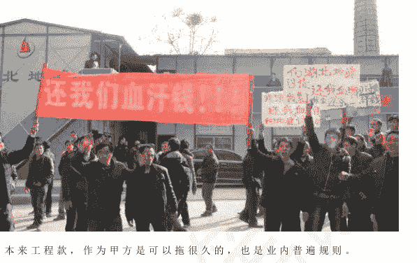

本来工程款，作为甲方是可以拖很久的，也是业内普通规则。

但承包拿到了钱，填工程款的窟窿，年底让农民工继续讨薪，弄得就很怼火。

尚丘公交公司，为什么敢这样挞扒，不怕 BF 吗？万叔问。

公交说，他们劳改一趟，已经改制成民企了。

但他们又不是，纯市场化的企业，不像深圳公交集团那样，靠效率和服务赚钱，自负盈亏。

我知道的，他们要的补贴里，很大一部分，是新能源汽车更新和行驶的补贴。

万叔笑，那本质上，还是个做政府生意的企业。

### D3

公交问，这事儿，万叔，你怎么看？

万叔说，在商业社会里待得够久，就没有太多的预设立场。

就够公众号里，万叔不讲那些虚的，不讲大道理，只讲真实的场景，实际的故事、思考。

这些，都是一个创始人，在刀口舔血的商业世界里，摸爬滚打，看到的，想到的，更倾向于，从结果的角度，看是否有效。

因为价值观好坏，在不同的平台、视角、时间段，可能是不一样的。

比如商鞅变法，秦国强大了，但自己被车裂。

这是好，还是坏？

再比如说，戚继光一边抗倭抗蒙，一边给张居正送钱送美女，还瞒着自己的老婆，在外面生了几个私生子。

这是好，还是坏？

创始人笔记 2023 年公众号文集

对于成年人来说，万叔只做价值甄选，不做价值观教育。

而从有效的角度来看，视角就一致得多。

打不通求助热线的时候，选择 For English，然后问能不能讲中文，行不行？

人群里孩子被挤散的时候，不喊让一让，喊注意开水，行不行？

咨询是锋利的刃，助企业高效达成商业目的。

### 04

耶，这个事情，有没有更好的处理办法？

万叔说，短期无解，长期有解。

短期的解法，无非是两种。

要么打你柏噢芜、想维稳的痛点，把事情弄大；要么忍气吞声，走利益共同体的路线，希望你好了以后，能兑现承诺。

长期来看，像深圳公交集团一样，明确产权，要求利润，在前期能力不足的情况下，给予优惠，配置人才，找一帮海盗式，不要命博一个机会的人，用认知撬动资源杠杆，顺一波跨越阶级可能性。

成了，利在千秋。败了，也约定保住了底线。

### 05

万叔讲这个的目的，是因为看到，生活，太多高认知的穷人。

真正面对机会的时候，反而看不到，看不准，抓不住。

请注意，这三个词，是递进关系。

所谓的认知穷人，是一个月拿5K，却天天关心中美博弈，俄乌战争，却不肯拿一点点的心思，去关注、去研究真实的游戏规则。

论到囊中羞涩时，怒指乾坤错。

如果真想，通过认知撬动资源，更有尊严，不在遇到问题时，落入两难的选择困难。

万叔有几个建议。

## 1、有随ilier选择的能li和财力。

新工具、新思路、新政策，有没有同步跟上？
公司发不起工资的时候，有没有可能跳出，温水煮青蛙的局面？

### 2、少听专家的大家断，关注、研究真实的游戏规则。

能不能了解每一个真实的细节，不被大而虚的概念蒙蔽？不被选择性表达的信息蒙蔽？不被宣传情绪的信息蒙蔽？

### 3、身边有一群同频的人。

愿不愿意把万叔的公众号，推给你想同频的人？愿不愿意让身边的人跟你一起进步？愿不愿意从道德正义的优越感中跳出来，承认自己有缺陷，跟同频的人一起往前走？

神魔皆以血祭，跃迁之路布满荆棘。

希望这一路，万叔与你一起走过。

## 机会分层并不均匀！你的投资只是填补大佬的口袋？一文说透底层逻辑

原创 万叔 创始人笔记 2023-02-25 21:06:49

大家好，我是日更的管理咨询公司创始人万叔。

昨天写的《公交受工伤事件背后：细陈危险的生意，才是普通人的机会》写的東西，很多人都没看懂。

之前写了几篇，关于资产证券化的文章。收到一些读者的問題。

## 请问一下资产证券化，小散要怎样操作，才能喝到一点汤渣呢？

昨天 23:04:05

万叔的回答是，绝大部分小散，吃不到肉，也喝不到汤。

为什么？

有这么几个原因。

- 1、机会不是均匀分层，也不是线性分层，是筛选分层的

看过橙子从工厂分拣的时候，那个选果机没有？

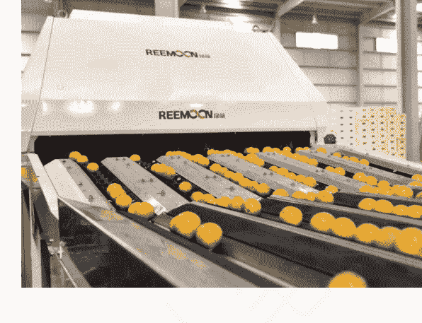

一堆橙子随机的滚下来，一排一排的，多大的果子，落到多大的坑里，滚到哪个道里，卖多少钱，早都已经安排好了。

现实生活中，有些人，会拿一些故事，忽悠你，告诉你，你看，所有的橙子都在路上，你的人生拥有无限可能。

然后搞你的本金，你辛苦打工赚来的钱。

明白了吗？

如果还没明白，万叔推荐你去看一部，叫饥饿站台的电影。

里面更加赤裸地说明了，机会的属性。

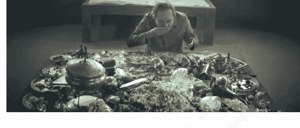

一个不断下降的台子，每天装满了一台子的食物。一楼的先吃，到了时间下降到二楼……

如果控制，所有人都能吃到。但上面的人，不仅胡吃海喝，还冲里面吐口水。

这恐怕的结果就是，到了 30 多楼（一共 130 多层），下面就吃不到了。

这个电影，给万叔留下的印象很深，大部分时间，小散至少都在 100 层。这就是为什么，你的工资涨不过房价，涨不过 CPI。

前面几篇文章写完，很多人以为，万叔是要教你怎么投资，甚至很多人私信，说有机会要带一带。

多想想，如果是好机会，为什么要扔出来，砸到你？

为什么不优先选择，有资源、有实力、有信任检验的合作伙伴？

投资消息，到你这里，股票都涨到鱼尾。

这才大多数人，面临的现实。

## 2、大部分人，不肯钻研学习

既然大部分人，都没有机会和资源，你能做的，是什么？

或者说，你用什么，能撬动机会和资源？

其实只有一点，就是你的时间和认知。

通过自己的专业性，发现还没有曝光的机会，然后撬动资源，一起赚钱。

这里有一个机会成本的概念。决策者资源大过你，信息渠道大过于你，但，机会成本也大过于你。

举个例子。

ChatGPT 来了，你觉得决策者，更倾向于自己去网上找教程，学科学上网，虚拟手机，APK 接口，自己注册。

还是找你，谈小张，你帮我研究下这个事儿，明天跟我说道说道。

这就是你的机会。

因为你一天也是 24 小时，决策者们一天也是 24 小时，你用你的学习，你的认知，把复杂的部分解决掉，提升他们的时间质量。

他们是愿意，用自己溢出的资源，来和你合作，至少，物贸回报的。

本质上，咨询也是这么一回事，做高性价比的，非日常问题的解决者。

但多数人，除了上班的事情以外，不肯做任何的钻研和学习。

这种核武器级别的东西，会用的，和不会用的，未来的效率差别

巨大。

这是普通人，用认知撼动资源的机会。

但很多人不愿意去努力，也不愿意学习，所以一直在底层。

## 3、缺乏持续进化的能力

比如你开一家店，赚钱了，然后你就觉得，可以复制，开到 100 家店，就 100 倍收益。

这是很多人路演、见投资人的想法。

但能力、资源要求，完全不一样。

开单店，你起早贪黑，精缩成本，勤劳一点，就以实现盈利。

但连锁店呢？

需要的是供应链、标准化流程、人力资源体系、股权分红体系……

你说我从来都没听说过啊！

那你的天花板，就限于一家店，或者两家店了。

职场也是一样。

自己做销售，和培养、组织、推动下面的人做销售，自己做销售管理，是不一样的能力需求。

都需要你持续进化。

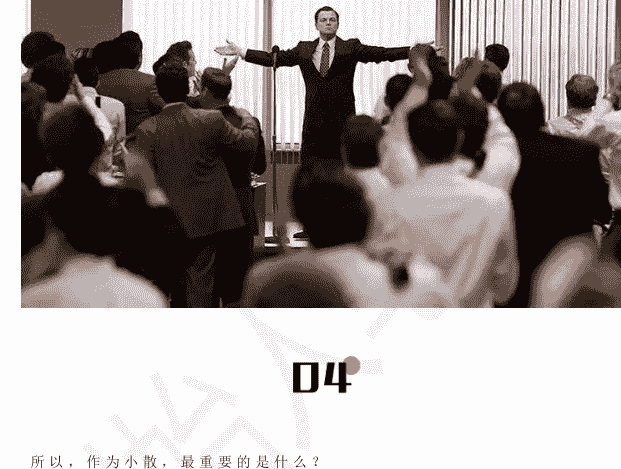

### 04

所以，作为小散，最重要的是什么？

不是听那些大师忽悠，说我们小散要团结起来，要一起吃掉庄家。

不是听那些让你把钱，给他们的人忽悠，说他们更专业。

是你

化。

你自己脑子要进化，身体要进化，社会资源要进化，要脱离小散。

一线、新一线城市 3、500 万起的房子，你才有机会投资。

一级市场，100W 起的私募基金，你猜弄得到份额。

## 创始人笔记 2023 年公众号文集

合伙赚钱的，分别人钱的生意，才会找到你。

资产证券化的机会，专精特新企业，股权激励，才会有你。

在一个小池塘，问万顷怎么游快一点，有啥用？

你得先去大海，风云化龙，那些驾雾、呼风唤雨的机会，才轮得到你。

没有哪条进化之路，不艰辛的。

共勉吧。

## 证监会为什么要打击，用风水预测股市？

原创 万叔 创始人笔记 2023-02-26 22:02:14

大家好，我是日更的管理咨询公司创始人万叔。

昨天的文章，《机会分层并不均匀！你的投资只是填补大佬的口袋？》写得有点血腥。

不少人留言说干脆躺平算逍遥。

完全赞成。

本来，跨越阶层这种事情，就是脱皮剥骨的。

一千个人里有一个人想过，一千个想过的有一个人做了，一千个做的一个人成功了。

这才是现实。

以下是正文。

最近看到一个消息，说要严厉打击用天干地支、阴阳五行风水学说预测股市等违规行为。

### 18:21 【证监会：严厉打击利用天干地支、阴阳五行风水学说预测股市等违规行为】

财联社2月24日电，证监会表示，将从严落实中办、国办《关于依法从严打击证券违法活动的意见》，持续加强发布证券研究报告监管执法和自律管理，严厉打击利用天干地支、阴阳五行风水学说预测股市等违规行为，维护市场秩序和投资者合法权益。

财联社声明：文章内容仅供参考，不构成投资建议。投资者据此操作，风险自担。

A股监管动态

// 证监会：严厉打击利用天干地支、阴阳五行风水...

2023-02-24 18:21

180859 阅读

微博上好多人@了脱口秀大会，说今年你们的段子又有素材了。

有人说是因为这玩意儿太准了，怕犯天命、损国运。

还有人说这玩意儿可以用来透露内幕，还拿出了妇产医生做例子。

很多人理解不了这个新闻吧？
那是因为，你們不晓得，某些金融行业的精英们，究竟聪明得有多缺德。
我给你举个别的行业的例子吧，你就懂得啥要禁止用天干地支预测股市了。

假设，仅僅是假设。
我是个妇产科大夫，我知道眼前的这个女士，肚里孩子是男是女。
我在妇产公司告诉她，铁定是违规的，对不？
但是如果我帮她恰好开了一家算命馆。
我把她偷偷跟弟弟说了ㄧ嘴。
弟弟用阴阳五行那样算卦。
然后他告诉了这位女士。
请问如何监督？
怎么找证据？
懂了啦！

搞封建迷信其实危害没有那么大。
真正的关键在于，某些聪明没头脑的金融精英，会利用玄学这一套搞内幕交易。
这才是真正要防范的。收起

怎么看都像是，在脱口秀大会的火上，再浇一把德云社相声的油

实际上，在用天干地支预测股市之前，很多人就用了各类奇怪怪的模型来预测投机市场。

听说没听过的包括卷积神经网络、机器学习算法、马尔可夫链、贝叶斯模型等等……

预测的市场也不止股市，还包括比特币、期货、外汇等等。

那为什么？只有五行风水被禁止了？

### D2

万叔去年去山东出差，路过济南的时候，因为有半天的时间，就跟小伙伴商量，要不我们一起去一下趵突泉？

不大的一

哥几个，一人拖一个箱子，绕了进去。

走了几步，发现一个池塘，里面有几个水泡，咕嘟嘟地往外冒。

旁边用围栏围起来，立了一块石碑，上面写着——趵突泉。

就这？？？！我们几个失望如斯。

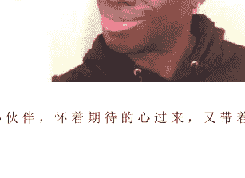

万叔和小伙伴，怀着期待的心过来，又带着满脸的失望回去。

像极了网恋的女神，奔现时没法开美颜滤镜后，被嫌弃的感觉。

万叔说，这门票，得有 38 块 5 交给语文课本。

很难说这口泉，过去、现在创造了什么实际价值，但因为语文课本的传播力，给全中国人创造了一个共识。

不论你是新疆的还是济南的，不论你天天来这附近散步，还是 一辈子都没来过这个景点。

语文课本创造的这个共识，就是趵突泉——济南——天下第一泉。

同样的还有，台湾的日月潭。

之前万叔去台湾访学的时候，周末一起去玩，台妹也问了一个问题。

为什么你们大陆人，都非要来看日月潭？

万叔问，在你们眼里，日月潭算啥？

台妹说，就是个，emmm，还不错的景点，但在你们眼里好像不是。

万叔说，嗯，在我们眼里，这个潭就像八达岭的长城、北京的天安门、中国的大熊猫，不来拍个照几乎等于没来过台湾。

台妹不理解，因为他们跟我们的教材不一样，他们的文化认同和属性不一样。

共识这玩意儿值钱。

理解了吗？没理解，万叔再举个例子。

如果一个人告诉你，用巴基斯坦的套路，给你算命。

你什么感觉？

这啥玩意儿？准不准啊？为啥是那种地方的？他们要能算命咋还这么穷？

当一个东西，你不相信的时候，它容错率就低。

你越相信，容错率就会越高。

比如说你10件事儿，有一次错了，你会想，啥玩意儿嘛，巴基斯坦的果然不准。

但如果用传统的风水、宗教给你算命，讲点吉利话，一半对一半不对吧。

一周／一个月以后，那些对你可能还记得一些，你觉得这个先生算的准，这个庙灵验。

耶，既然大家都不准，为什么你对国产算命的宽容度，就要高于外国的呢？

因为你从小，认知里就有这个东西，几千年来传承下来的共识，让你很难去彻底否定——哪怕几乎只剩下糟粕。

### 04

讲到这里，大家应该基本就明白了。

为什么天下奇门遁甲，预测股市之道多如牛毛，但证监会独禁风水。

真不是因为它太准了，证监会害怕。

更不是因为，会把股票涨跌的“天机”泄露出来。

真就是因为，这玩意儿国人信的多，有共识。

一旦有人，利用这样的共识，割起韭菜来，那是根都要薅掉的。

再往深一点，如果中国有一亿股民，有 1/10 人信这个，今晚总教主一个消息：明天一起买 XX，会大涨。

什么情况？会把整个板块都给拉涨停了。

这反过来，又会强化大家的信仰，觉得，艾玛还是咱传统文化牛逼！

## 这是算操纵股市呢？还是算操纵股市呢？

赶紧在出现一点苗头的时候，先制止了。

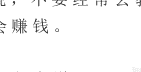

商业世界里，万叔经常说，不要经常去教育客户，要利用他们的认知偏差，找机会赚钱。

但我们文化，崇尚的是取之有道。

说白了，如果利用共识赚钱，决策者抓大放小，会封住你的上限。

如果利用投资赚钱，好机会有门槛，会封住你的下限。

然后加上信息封锁，个人言论相对自由，但进行公共区域的声音量控制。

比如，万叔一直说今年房价要涨，赶紧把资产换到省会以上来，很多这类文章，就被掐掉了。

得靠自己悟。

剩下的路，要么靠时间慢慢积累，要么靠拼搏和创新取胜。

你以为你大学毕业以后，就再也不要被选拔被排名了。

其实社会是个更大的筛子，筛出一些有能力、有认知的人，再给资源赋能。

这就是为啥，每次放水下来，你的资产还要缩水。

谁先脱离那个，老鼠赛跑的圈子，才能搭上快车。

## 太阳，到底是不是鸡叫起来的？

原创 万叔 创始人笔记 2023-02-28 21:14:34

大家好，我是日更的管理咨询公司创始人万叔。

昨天的文章写了，但是因为时间原因，就没发出来。

还有朋友发私信万叔，说昨天睡觉前刷了几次，没刷到文章。

在线等。睡觉前看了几次没更新

12:43

写完了，编辑没有发出来。

12:42

万叔，刚一没有更新吗？

12:41

这里一并表示歉意。

以后不出意外，每天都会有一篇段子，哦不是，文章出来。

因为管理咨询工作的忙，有时候也超乎想象。

如果万一发不了，也会在公众号里说一声，大家早点洗洗睡，不用等。

以下是正文。

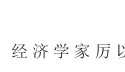

昨天，万叔雅礼的校友，经济学家房以宁先生去世了。

1930年11月22日深夜，厉以宁诞生在南京，家人给他起名以宁，“以”是排行，“宁”指出生于南京。四岁时他随家庭迁居上海，先后在上海两所著名的小学学习，成绩一直名列前茅。1941年，厉以宁考上著名的上海南洋模范中学，1943年又随家迁居到湖南沅陵，以优异成绩考上湖南名校雅礼中学。1947年转入南京金陵大学附中就读，直到高中毕业。这些名牌小学中学为厉以宁奠定了良好的文化素质基础。

这些年因为，接触很多国企改革的项目，不免需要探究一些政策本源，有时候就会找到，厉老的主张和建筑。

第一次是研究，国有企业股份制改革的时候。

厉老赫然主张确权权，即，通过股份制改革，确认企业所有权，从而调动积极性，使企业发展壮大。

到今天，在万枫接触的客户里，几乎完全没有人讨论，应不应该的问题，更多的是讨论，怎么做的问题。

怎么做，可以充分调动积极性，避免国有资产流失，避免审计风险等。

而那时候，思想不够解放，大锅饭思维严重。

需要有人站在风口呼吁，说要停止企业办社会，要提升企业效率，要创造利润、创造社会效益。

有人说，这一呼吁，就是全国3000万人下岗，无数的人被迫失去工作，流落街头好辛苦。

说改革开放，富了一波资本家，民营企业，老百姓没得到好处。

然后对其进行咒骂，用红卫兵阶级斗争，那一套逻辑搞批斗。

这种流量文，也真让万枫开了眼！

原来这世界上，除了万叔的姑姑，过年的时候愤世嫉俗的说，她希望回到计划经济包分配以外，还有这么多人，和她是同样的想法。

这都 2023 年了！

万叔记得，有一次过年，回去问外婆，你觉得现在好，还是旧社会好啊？

外婆一脸嫌弃的说，旧社会有什么好的，吃也吃不饱。

80 多岁的老人家都知道，生活，要和过去比，要和自己比，不要眼红别人，尤其是赚到了钱的人。

如果你身边有那种，自怨自艾，抬头看天，除了咒分配不公，就指着天上掉馅饼的人。

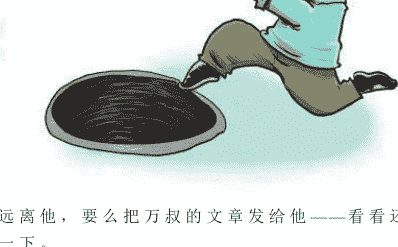

要么远离他，要么把万叔的文章发给他——看看还能不能抢救一下。

### 02
关于历史以守，和多数搞改革、变法的历史人物一样，变革都会触动到一部分人的利益。

本文不是纯悼念，而是想深入探讨一个问题。

我们该怎么看待这类事？

大家要先明白一个道理，太阳到底是不是，鸡叫出来的？

这是一个非常马克思主义的辩证观点。

认为太阳是鸡叫出来的，表面逻辑也特别清晰。

- 每天鸡叫，太阳出来，几乎都是相伴发生的。
- 鸡先叫，太阳后出来。

如果学过一点逻辑学，就应该知道，这属于一个典型的逻辑谬误。

因果倒置。

就是太阳升起和公鸡打鸣，太阳是因，打鸣是果，好像二十四节气和相应的气候变化，变化是因，节气是果。

只是我们常常根据自己的眼见做判断，忽略了更长周期的因果成因，导致做了顺人性，但错误的理解。

明白了这一点，我们继续往下讲。

### 03
为什么春秋战国时期，我国思想，会出现百家争鸣？

因为那时候，周氏衰微，列国混战，大家都觉得自己的办法牛逼，所以都在推自己那一套治国理念。

那什么时候结束的呢？

汉朝董仲舒——罢黜百家，独尊儒术。

其实秦朝当时用法家，如果经过改良，可能也可以结束百家争鸣。但秦朝法度过于严苛，王朝短命，没来得及改良法家思想，就挂了。

国外的像基督教，相比伊斯兰教，经历了改良，不再讲究那些打打杀杀的，教派就遍布全世界了。

这种惰态一直断断续续，小修小补，直到清末。

到了清朝末年，因为见识到，西方的现代工业，打破了天朝上国的美梦。

结果开启了，近百年时间，一系列的救国与探索之路。

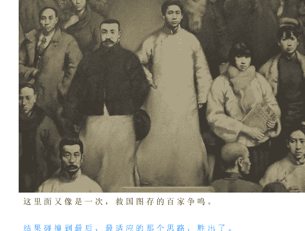

这里面又像是一次，救国图存的百家争鸣。

给如果撞到最后，最适应的那个思路，胜出了。

然后大家坐下来，一起协商，就不再争论了。

### 04
明白了吗？在人类面对，一类未知挑战的时候，出现各种各样的主张、解法，是很正常的事情。

ETO 知道三体的时候，掰开指头算算，起码也有降临派、拯救派、幸存派。

到了联合国大会，主张就更多了。

光是面壁人就有 4+1 个（万叔算上了自面壁的那个人），四个大佬，四种解法，多一种思路，多一份力量。

除此之外，还有各类主流防御计划、逃亡计划、光速飞船计划、文明接触计划等等等等。

这还不算民间，自发产生的大小谷、科技爆炸这些。

直到罗辑，和北海·章的面壁计划成功，大家的思路和资源，才重新回到成功的路线上来。

话说回来。我们在经济改革的初期，也没有太好的，一揽子的解决办法，也没有人像无所不知的 AI 一样，事无巨细指导每一个问题。

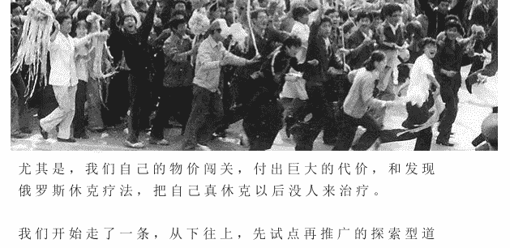

尤其是，我们自己的物价闯关，付出巨大的代价，和发现俄罗斯休克疗法，把自己真休克以后没人来治疗。

我们开始走了一条，从下往上，先试点再推广的探索型道路。

在控制结果、控制影响的前提下，先去试，谁成功了，就拿谁的来用。

这也是后来，许多改革中，政府扮演的观察员+防火墙角色。

### 05
万叔说了这么多，只是想说明一个道理。

一个经济学家，从自己的认知出发，提出了一 些意见和观点，引发社会讨论，是好事。

真正推动执行的，是背后的决策者。

再深一层，是时代。

不论那些发言人，是不是为了，自己的利益，或者是为了博眼球，说了过于偏激的话。

在决策者，需要的时候，勇敢的提出，自己的见解，是好事。

尽责进言，做一个学者的责任，是有担当的表现。

因为时代的洪流，最终会，选择出最适合的，道路和主张。

只要不和，决策者已经定调的观点冲突，都应该是可主张的。

至于那些，因为触犯了自身利益，或者纯粹，因为想蹭流量，而做那些情绪挑拨攻击的。

放心吧，长江黄河不会倒流，改革开放只会越来越大，越来越好。

中国经济，再也不会回到，南郭先生吹笙的时代了。

## 赢家通吃？互联网烧钱获取用户的逻辑，被堵死了
原创 万极 创始人笔记 2023-03-01 20:41:39

大家好，我是日更的管理咨询公司创始人万叔。

感谢大家支持，2 月份最后一天，粉丝破万。

在这个公众号整体衰落的时代，实现了逆势崛起。

万叔做一个小承诺，用每天 2000 字，一年 70 万字的高质量更新，成为你关注、星标的公众号里，最有价值的那一个。

对了，有读者说有时候收不到推送，那是因为微信改了推送机制。

没有加上星标的话，推送就是随机的。

如果你想每天晚上，刷到万叔的文章，可以加个星标。

我们一起，用确定性，对抗这个不确定的世界。

### 01
我们聊一个逻辑，为啥互联网企业，有黄金 10 年。

有人说是因為能力強，有人說是因為模式新，有人說是因為賽道好。

因为赢家通吃吗？

万毅服务过一家，珠海的纳斯达克上市企业，把他们服务上市的。

其实也不怎么赚钱。

但那个项目，万毅发现，互联网企业，有一条非常快的路径。

首先，找到一个好的领域，切进去。

然后，资本推动，把用户数量烧上来。

为什么要强调用户数量？因为中国的用户数量，在全世界看来，是很吓人的。

比如说，一个亿的用户规模。

最后，根据纳斯达克的单个用户估值，乘以用户数量，给一个定价，搞海外上市了。

这是中美的蜜月期。

互联网公司融资上市，高管们实现了财富自由；
华尔街投资变现，攫取巨额收益；
老百姓收到补贴，生活各种方便。

那谁亏了？

当资产泡沫破灭的时候，那着二级市场的投资人亏了。

万叔讲这个，是想说明一个很简单的逻辑。

一个生意能不能做，要算。

孙子兵法早就说过了，夫算多者胜，庙算少者不胜。

这条路为什么能走得成功？

有人总结过一大堆理由，说互联网模式什么的。

万叔看来，核心就在于这一条公式。

收益 > 成本。

我们拆解一下主要的收益和成本项，就变成：

资本市场对企业估值 > 创造估值花费的成本。

再简化一下，互联网企业，估值主要是单个活跃用户的定价。

而资本市场对单个用户的定价，基本是有公认的。

那事情就很简单，变成了，单个用户定价 > 获取单个用户成本。

结论：成本能控制下来，这笔生意就可以做。

听起来，是不是很简单？

那再出一个题。

一个房子，能做到首付为 0，月供 5000，租金 1500，能不能买？

有人说，首付低，可以买。

有人说，首付低，说明肯定不是好房子，不能买。

有人说，每个月可以带来现金流，可以买。

有人说，虽然不要首付，但月供太高了，不能买。

你问万叔，谁说得对？

万叔缓缓抬头，看向你，放下手里的红酒，缓慢而坚定地说：看情况。

我们来进行简单地拆解。

每个月，要月供这 5000 里，有哪些是购买资产本身的付出，有哪些是因借贷，产生的利息付出？

比如说，3000 的本金，2000 的利息。

那现金流，就是 - 500。

也就是说，你持有得越久，利息和房租的差，你就亏得越多。

那怎么办？

看房子的增值部分。

首先，剩下的 3000 里，看房子的涨跌、房子涨，赚钱，跌，就不赚。

但因为，这个房子的现金流为负。

所以，房子不仅要涨，还要平摊下来，每个月涨幅超过 500 块。

房子涨幅超过支出，可以干；涨幅不过支出，不能投。

明白了吗？一个生意能不能做，一个投资可不可行，是要算出来的。

只有通过这样的拆解，才知道决定是不是要买房，明确投资的主要逻辑。

而不是什么花园好、租金高、周围有小学、户型采光好……

这些都只是房子涨幅的相关因素。不全面。

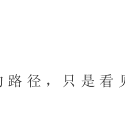

所以后台很多人问万叔，股市能不能投资，房子能不能投资，XX生意能不能做的时候。

抱歉没法给你一个，准确的回答。

得看认知。

如果你不理解，互联网变现的路径，只是看见他们在做免费、铺流量、敢吹羊毛出在猪身上。

你也跟着去烧钱搞客户，铺摊子，不讲效益。

结果，就会赔本赚吆喝，亏损一塌糊涂。

同理，股市是一些人的提款机，也是一些人的修罗场。

万叔之前啥也不懂，就听人说牛市来了，像个愣头青一样，提着几年的积蓄冲进股市里。

出来的时候，屁滚尿流。

因为没有估值能力。不懂得行情高低，才会焦虑恐慌。

商业世界里，风险无处不在。

所以，干任何事，提升认知，才不容易被割。

那些靠一腔血勇，赚到并守住了财富的故事，未来越来越少了。

## 决策者愿不愿意让一部分人先富起来？
原创 万叔 创始人笔记 2023-03-03 23:55:22

大家好，我是日更的管理咨询公司创始人万叔。

昨天的文章《如何升级和重启中国经济》出了点问题，等修改好了，会在发一次，可能头条，可能次条。

毕业每天只有一次发头条的机会。

而万叔的输出又缓又持久，因为做企业咨询的缘故，属于依靠有源源不断的素材，可以以各种形式表达出来的。

之前跟一个咨询聊天，他问万叔，为什么公众号要日更呢？

万叔说，就跟过日子一样，你更也是一天，不更也是一天，但1年、3年、5年以后，差别就出来了。

做点日拱一卒，持续精进的事情，好对抗这个时代的剧变。

以下是正文。

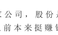

下午跟几拨潜在客户，聊咨询业务。

第一个是国企，收购了几家公司，股份是51/49，但2年多过去，收购来的公司，之前本来挺赚钱的，现在一直在盈亏平衡线上挣扎。

国企问万叔，你们有没有过类似的经验，帮我们通过优化绩效考核，督促他们提升业绩，提升利润水平？

万叔说，盲猜一下，你们已经定过绩效指标了，只是发现，他们完成不了，没什么效果。

国企有点吃惊，你怎么知道？

万叔说，刚才你说，希望我们通过优化绩效考核，达到这个目标，说明你们已经尝试过。因为效果不好，所以才想找咨询公司来帮忙。

尤其是说要优化，所以是想通过咨询公司的行业经验，借鉴类似的企业，定一个相对科学的、量化的指标出来。

不好意思，实话实说，办不到。

为什么？国企问。

万叔说，你说的这种模式，在成熟行业里面可以做到。

打个比方，你现在去做制造业，生产陶瓷或者家具，你学美的，学同行，因为很成熟了，每年增长 20% 还是 30%，很容易找到对应的行业专家，问得出来。

但你这块业务，是一个新兴行业。

什么意思？

新兴行业，意味着还没有成熟的，确定的增长路径和方案。

比如做新能源汽车，既有小鹏这样一年亏损几十上百亿的，也有比亚迪这种一年盈利近百亿的。

你觉得应该怎么去定业绩指标呢。

国企说，我们也正是苦恼这个，下指标高了，他们不愿意，各种理由，低了又觉得不赚钱，还有可能审计出问题。

### 02
事实上，怎么赚钱，从来都是跟认知挂钩的。

万叔说，没有人能拿出一个合理的指标，但是大概率，我们可以提出一套合理的解决方案，促进增长。

在这里，其实用了一个，上切的聊天技巧。

客户问你一个，解决不了的问题时，你告诉他，有可能这个问题不需要解决，因为你真正想要的是 XXX。

万叔说，其实我们讨论的，是在没有行业标准的情况下，怎么实现合理增长的问题。

既不要因为目标太高，子公司躺平不干了；又不要因为目标太低，失去了本该抓住的市场。

之前服务过一个企业，5 年规划里目标定得很高，结果在指标分解的时候，下属企业 1、2、3、4 年都是线性增长，每年 20% 左右的增长率，到第 5 年突然 5 倍 10 倍指标。

这种明显就是不合理的，万叔说，后来事实也是这样，子公司的领导，拿了前几年的奖金，最后一年躺平摆烂了，集团也没实现业绩要求。

国企说，这也是我们困惑的点之一，万老师，有没有什么好的办法？

### 03
万叔说，有，这个事情，要从绩效和激励两方面，系统性解决。

我经常研究经济史，你知道央地之间的收入博弈，是怎么推进的？

国企摇摇头，万老师，还真没研究过。

分为这么几个阶段。

刚开始，地方是中央的一只手，没啥决策权，央地是一起穷。

后来改革开放，一部分地区先富起来了，

为什么能富呢？一方面是随便你去怎么弄，只要弄到钱就行；另一方面是分配上，采用了包干制。

类似于各个分公司，每年只要交给集团，一个额定的数字，其它的都你自己留着去花。

但地方也知道，要藏着一点，不然进步太快，下次谈判的时候上缴比例就高。

另外，通过各种减税方式，再摊派、收费、赞助等，曲线救国把钱搞回来，还不用和上面分成。

国企说，现在咱们对 X 业务的管控，大概就处于这个阶段。

万叔说，这样的后果是，集团越来越穷，子公司越来越富，大家争着去子公司当老总甚至当副总，也不愿意在集团干个同级别的领导。

国企说，还真是这样！

后来是怎么办的呢？

万叔说，后来就搞了分税制。

其实也很简单，把好做的业务，好收的钱，成立一个专门的机构去搞，类似大客户中心，集团直管，吃大肉。

这样集团就有钱了。

剩下的，留给子公司一些零碎的、辛苦的工作和客户。

国企想了想，这个我们目前，可能还做不到，还有没有什么别的办法？

万叔说，企业和政府，不同的地方在于，企业的组织形式、信息流通更加简单一点。

管控不了，很大原因是，信息不对称。

如果是地方想搞信息差，中央基本是没有办法的。

但是企业好一些。

讲个之前服务过的企业，当时万叔的设计，是这样的。

第一步，先改革组织架构和管理机制，从财务、人事、市场线上，垂直管理，双线汇报，获取子公司的相关信息，避免信息不对称。

第二步，获取足够信息后，抽调一个副总，屁股坐到集团，对业务进行梳理，把隐性成本、收入显性化。

第三步，在这个基础上，再去谈绩效、谈激励，就能比较清晰，也有依据，如果真是能力或者意愿不行，也容易解决的方案。

国企说，听懂了，核心就是提升对业务数据的掌控，和对业务的认知。

对啊，万叔说，不是有句话，你永远赚不到认知以外的钱，提升认知，就是培育和管理企业过程。

不止是企业，决策者们，也在试图利用信息化、数字中国建设的机会，拉通信息，搞更加精细的管理和深水区的改革。

前几天刚出了相关文件，但背后的深意，不止是跟上时代，提升效率那么简单。

对了，对这样的子公司，还有一类操作，是要尽量避免的。

国企说，万老师您说。

就是在认知不到位的情况下，事事要搞审批。

尤其是咱们这种情况，子公司的专业认知强过集团，以权力视角为核心的管控模式，会把人赶跑的。

尤其是在专业领域，说一句可能冒犯的话，认知去到哪里，管控就到什么深度。

如果觉得管控不住，想想是不是要先提升认知。

大多数情况下，控制风险和方向，剩下的，交给专业的人去干。

## 胡主编一声“夜总会”，撕开了多少城市经济增长的遮羞布！
原创 万极 创始人笔记 2023-03-04 22:31:15

大家好，我是日更的管理咨询公司创始人万极。

昨天的文章《愿不愿意让一部分人先富起来？》核心讲了一个观点，决策者敢不敢，让下面的人收入超过你？

因为国、央企总部负责人，是国资委限薪的。

这个很好理解，集团本身，不直接创造价值，管价值分配。参考公务员体系，限制薪酬，推动廉洁，是说得过去的。

但下级，尤其是三级企业，在探索一些灵活的市场机制，是不是能实现价值创造、价值评价、价值分配的一致，激发活力？

观念是最重要的。

以下是正文。

昨天政事堂写了一篇《出口下滑，是危也是机》，说中国出口的问题，决策者早就预见到了。

这是明线。

另一条线上，胡主编提出，要发展夜总会经济。说可以解决上千万人的就业问题，促进消费。

## 微博正文
胡锡进 23-3-2 18:37 来自 中兴Axon 40 Ultra
发布于 北京

去年因发生疫情已被吊销执照的北京天堂超市酒吧竟然要恢复营业了，老胡为它高兴。我想扩大一下话题，说说笼统的“夜间经济”。
很多数市在过去几年都想把夜间经济活跃起来，但扣除疫情因素，实际效果往往也不是很好。什么原因呢？其中很重要的一条是夜总会经济冷清了，而它是夜间经济的重要动力之一。

在绝大多数国家和地区，夜总会经济无论占多大，都在夜间经济中扮演了催化剂的作用。它不仅带来了直接消费，促进了泛夜总会一类场所的就业，而且还极大拉动了出租、代驾、夜宵等非带服务的繁荣，扩大了城市夜晚的消费总量。在中国这样的超大社会，有人估计，夜总会经济直接吸纳和间接带动就业的规模应达上千万个，但现在它的规模小多了。而一旦夜总会经济萧条了，夜间经济也会跟着萎靡不振，城市仍会霓虹灯闪烁，但是纯逛的人多了，不带来消费的夜间活动多了，就业量难以增加。

在我们国家，夜总会经济长期受到争议，主要是一些歌厅、洗浴场所捆绑了色情的东西，发生了变异媾合行为，使人们对夜总会经济整体上形成了偏见。相关拆招报成为重占整肃目标，有的歌厅本来规规矩矩的，但偶尔出了事情，会被处罚得很重。总体看，夜总会经济形成了“资产阶级生活方式”的印象，而且被视为低俗中的低俗。由于夜总会经济名声不好，越来越多的人避而远之，朋友聚会也就怎么去那样的场所了。

另外，更大的冲击是疫情，它打击了整个服务业，夜总会经济首当其冲。现在疫情的封控已经远去，服务业态在大规模反弹。但是夜总会经济能否重新繁荣起来，对整个夜间经济的后劲禄有不小影响。

万叔小时候，家里小城，城市化水平还不高，外婆家后山有很多野果子，跟小伙伴一起去玩，顺便就会摘一些东西，带回家吃。

后来，几十年的城市化进程，推平了山，填平了整，曾经的后山全部变成了小区和商业中心。

想吃什么，玩什么，就去餐厅、广场、人工湖、古镇……

外婆家后来的橘子树，长得郁郁葱葱，但是那些摘果子的小朋友，已经不再惦记那酸酸的橘子了。

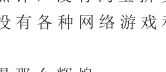

万叔说这个的意思是，工业，才是我们国家富强的根本，不是服务业，至少现在不是。

曾经夜总会辉煌，其实是后山的橘子。

因为没有美团、大众点评，没有淘宝拼多多，也没有鳞次栉比的商业综合体，没有各种网络游戏和软件。

KTV、夜总会，才显得那么辉煌。

现在的年轻人，聚会去 KTV 的，已经越来越少了。

这是一种进步，还是一种退步？明显是进步。

老胡作为 60 多岁的退休老人，代表的是那一代人的认知，理解过去，是很自然的事情。

他经历过那个灯红酒绿的年代。那是改革开放以后，中国入世之前，没有外部动力的時候，拉动消费的巨大力量。

年轻一点的，95、00后，大概不会理解，为什么以前有那么多的夜总会、歌舞厅。

因为你没在那个时代，你的理解都是道听途说的，没有亲身经历过，自然感受不一样。

但，万叔为什么说，这种事儿不靠谱？

不仅仅是因为胡主编说的，掺杂了情绪的东西，使得整体形成了偏见，核心还是由于，这玩意儿叫好不叫座。

举个例子，长沙花了几年时间，成为了网红城市，在广东的湖南人，应该都深有感触。

每到放假，各种人满为患的朋友圈，各种排队几千桌的文和友，甚至拥挤了京广线，嗨翻了岳麓山。

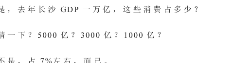

在就业和名声方面，确实意义重大。

但是，去年长沙 GDP 一万亿，这些消费占多少？

你猜一下？5000 亿？3000 亿？1000 亿？

都不是，占 7%左右而已。

大头在哪？大头在石化、机械、冶金这些工业领域。

### 03

明白了么？

很多事情，如果根据自己的感受做决定、下判断，容易走偏，这就是数据统计存在的价值。

跟之前的地摊经济一样，为什么万科在多个场合表达，不看好？

因为小、散、乱，不容易形成规模。

现在各地方的决策者，工作重心在什么地方？

看哪些板块，带来了最多的财政收入。

过去是房地产，现在新工业逐步抬头。

除此之外，那些不赚钱的行业，和以工代赈一样，是用来发钱、保民生的。

以前服务一家央企的时候，下面有一个房地产板块，去调研，总经理说了一句话，我们房地产，就像是夜壶，需要钱的时候就拎出来，不需要的时候就一脚踢到床下。

房地产还算多少见得光的。

那些集团的决策者们，如果下面是一个名声不好，又上不得台面，明面上贡献不出多少税收的公司呢？

你说暗地里有好处。小了，格局小了。

如果真实的接触决策者，你就会知道，很多人并不在意经济、钱本身的。

在意经济发展的原因是，上头把经济发展和个人绩效、前途大政绑在了一起。

这方面，全国著名的东莞，不也是说干就给清理掉了嘛。

那，胡主编，为什么要这么呛一嗓子？

在万叔看来，核心是给各地的决策者看的。

过去房地产经济发展太爽了，太顺了，各地方分公司的决策者，似乎不在意老百姓的生活，和民营经济的发展情况。

那些引起争议的酸橘子，太费事儿，就不吃了。

但现在，全球开始萧条，除了房地产、搞基建这一条路以外，民营经济，被再次拉到了台前。

那些因为疫情失业的，普通人能做的，一定不是新能源、新材料、高科技这些。

万叔说过，普通人能做的商业，一定是那些细碎的，辛苦的工作，但比失业强，短期能填饱肚子，中长期有成长可能性。

像夜总会这类行业，算是相对来钱快、收入高、门槛低的。

这个嘎嘣，与其说是一个思路，倒不如说是一个指标。

等到三、五年以后，经济开始好转，哪个城市的夜总会、服务业发展好、活力强，说明那个地方的决策者，在意老百姓的生活。

解放思想，放手去干，不折腾，不胡同，自然能繁荣起来。

## 罗翔应该先去请教一下 HR

原创 万极 创始人笔记 2023-03-05 22:24:09

大家好，我是日更的管理咨询公司创始人万极。

政协会议期间，罗翔和老胡又在网上提了一个说法。

因为有政协委员提议，取消对罪犯子女考公的限制。

刚好昨天政事堂也讲到了这个事儿，但观点是说，善良的罗老师被人类利用了。

## 罗翔说刑法

昨天

> 出生无法选择，父母罪与罪对子女会产生影响，但那是命运安排，与法律无关。法律不能强化父母恩宠，也不能让子女因父母 但罪上加。”法律平等是机会权利平等，不惠爱而惠不均非法律平等。法活不幻想黄金世界，只为避免出现最坏结局，如果不知出生在何种家庭，你希望生在身世血统决定论的时代，还是希望生在即使父母罪恶深重，但你依然不受牵连，可独立生活的年代。人无法选择父母，很多犯罪与遗传或错误无关，如贩卖毒品构成犯罪。谁敢说自己不会跌至谷底？但即便你在...

万极有点自己的不同意见。

大周末的，碎扯碎扯。

万极的观点很明确，首先，罗翔老师的说法是对的。

很多人持反对意见，归纳了一下，主要是以下几种。

- 1、说会像教父一样，有可能洗白家族产业的。
- 2、拿来和吸毒艺人比较，说对不起国家和人民的。
- 3、有说公务员人不多，你不用考的。
- 4、还有直接揣人身上攻击，骂罗翔和老胡屁股不正的。

这些都对。

但都是间接证据，证据力不足。

什么意思呢？就是，上述的，都只是可能性，你不能确定是 100%。

但罗翔老师的说法，你在不确定的情况下，希望避免最坏的结果，这是 100% 确定的，国内外做过大量社会实验，有共识的。

间接论证打败不了直接论证。

比方说一桩凶杀案，一个人从时间、动机、关系上，有作案的可能性。另外一个人，直接在凶器上查到了指纹。

一个是推论，另外一个是直接论证。

所以，理智上，所有的反对派观点，在万叔看来，都说服力不足，一些立场攻击的，直接就不看了，没意思。

这是第一层。

故事当然不只讲到这一层。

习惯看万叔公众号的，应该都在期待再展开来讲讲，或者有个转折什么的。

万叔作为 80 后，小时候看过，古惑仔的电视剧。

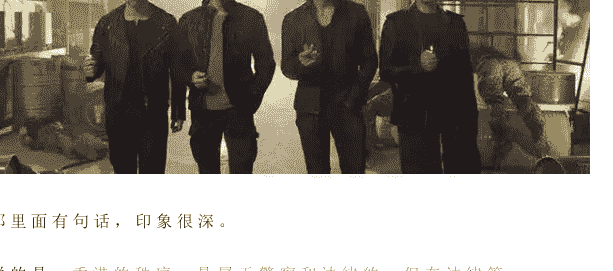

那里面有句话，印象很深。

说的是，香港的秩序，是属于警察和法律的，但在法律管不到的地方，需要古惑仔来维持。

理解这个逻辑着实花了点功夫，它基于以下两点前提。

第一，管理是有成本的。在当时的环境、警力编制的情况下，确实有可能造成管理真空，当然回归祖国以后这个情况倒成改善了。

第二，美化后的黑社会，是属于邪恶守序阵营。理解了善良、邪恶/守序、混乱两个维度，更加贴合实际情况。

所谓的守序，就是有组织、有纪律。

比如金庸小说里，男主角爹妈被人杀了，主角练武如果是为了爹妈报仇，那就是善良混乱。

如果是靠组织的力量（当然组织一般不太行）。那就是善良守序。

邪恶也是一样，有邪种有组织有规模的，也有乱搞乱抢的。

所谓邪恶守序，就是说规则之下还有规则，在光照不进的地方，规则也需要人维护。

### 03

看到这里，如果你觉得，万叔是想要为坏人辩护，说黑社会也有好人，那就又错了。

铺垫了这么多，其实想说明的是，这个社会很复杂，很多人
在网上看肤浅的东西多了，容易一根筋。

尤其是容易，被好坏、道德、立场的概念煽动。

这种状态，在现实生活中，是要吃亏的。

万叔想表达的是，明规则，是需要有正义感、有良好的道德指向性的。

如果要修改规则，我认为，这种政审三代的规定，不应当出现在明规则里面。

因为中国历代以来，兴国之道，秉承的都是王道。

什么是王道，就是立场、逻辑，简单朴素又很深入人心，
你是驳不倒的。

比如刘邦进咸阳时候的约法三章，就是典型的王道。

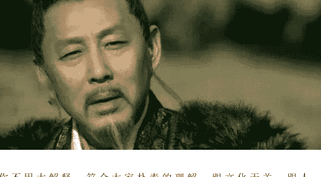

你不用太解释，符合大家朴素的理解，跟文化无关，跟人性相关的。

### D4

但这不意味着，我们要被坏人，钻法律和规定空子。

照我们的国情，这种规定，应该出现在潜规则里面。

这是今天跟一个 HR 聊天，说道这个事儿，他提出的观点。

他们公司是一个民营企业，因为企业原因，一个萝卜一个坑，各部门最忌讳的就是，长期请假不上班（懂的都懂）。

但在招聘的时候，这些东西，不能明说、明问。

为什么？

第一是应聘者有可能怠悠你；

第二是未来很长，保不准出什么变数。

这个逻辑，是不是和罪犯子女，考公务员有类似。

但你说这个规则有没有？HR 说，看你啥时候问。

如果是正式场合、调查什么的，我一定是斩钉截铁的说没有的。所有的招聘、录取、拒绝条件，都有存档，写得清清楚楚，有据可查。

那如果是在问我，那我也会告诉你，没有。HR 嘿嘿一笑，真的没有。

但是你去查，适龄、未育的女性，在我们这里的业务岗，没有被录用的先例，条件再好的也没有。

可能有人，说这样不公平。但是公务员考试，他不是考 4、6 级，你过了多少分，就给你一个红戳戳，未来你就有证明了。

公务员，本质上还是一份职业，跟企业类似，我有在都合格的基础上，相对选择的权限。

这样做有什么好处呢？一方面影响了公平的环境，另一方面又挡住了一些，不当潜规则的梗头青。

万叔经常讲的，行业认知就是，了解真实的游戏规则。

别骂，任何一个行业，都有许多这样的，不在明面上的规则。

如果你觉得你所在的行业没有，那说明你没有接触到核心信息。

另外，还要补充一点的是，政事堂文章里说：

中国只是限制了犯案子女的考公，又不是限制了他们中考考乃至就业，中国一年公务员岗位也就能增加两三万，相比于每年上千万的就业只是沧海一粟，凡是能考上公务员的，在其他行业也都能找到好工作，没必要非要一根筋去考公。

背后还是个价值创造和价值分配的问题。

公务员，明显是做价值分配的岗位。当价值创造搞不动了，就会来打价值分配的主意。

这也是为什么电影教父里，第二代送去各行各业搞政商。

这个小九九，也是潜规则，不能明说，只能说爱国、报国什么的。

所以就拔下驴，这个说法，还应该扩大一点。

对罪犯的子女，应该限制各类价值分配的岗位，如果你真的想报国、悔过什么的，去搞价值创造。

在法律道德允许的框架范围内，去私企，去出海，多整点高薪工作岗位，去赚外国人的钱来。

像狂飙里的高启强，如果有子女的话，既然有资源和金钱了，去创业赚，把中国的心芯片戳起来，把互联网打到海外去。

跟俄罗斯把犯人充军上前线一样，万一死了，还能得到一笔国家抚恤金。

这才是真正贡献价值的地方。

## 驳倒罗翔的要点，大部分人搞错了

原创 万叔 创始人笔记 2023-03-06 21:30:14

大家好，我是日更的管理咨询公司创始人万叔。

昨天的《罗翔应该先去请教一下HR》不出意外，引发了不小争议。

万叔的做法是，除了一些特别LOW的，影响公众号整体形象的留言，都放上来，大家都看看。

支持的听一点，反对的听一点，听多了，才能形成自己的世界观、价值判断。

既然讨论这么火热，这个问题可以深聊几句。

以下是正文。

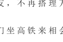

差不多10多年前，对面还是小马哥主政的时候，万叔作为访问学者，去台湾学习、生活过半年。

万叔在那边感受到，那些价值观、政见迥异的人，是怎么求同存异，团结协作的。

后来，菜菜上台，那帮台湾的朋友，不再搭理万叔。

万叔也不气馁，等高铁通了，我们坐高铁来相会~

什么是屁股决定脑袋，这帮台湾的同学，就是屁股决定脑袋。

嘴里喊着什么民主自由，等到真正摊上自己的时候，哪里还管这些，你要打我，你这左边都是坏人，我不要搭理坏人。

之前万般写的好几篇，其实表达的都是一个意思。

为什么考公这个事情，大义凛然说要一刀切的多？

夜总会经济，让一部分人先富起来、支持经济活力、减少监管的多？

因为家里真有两头牛。

### 02

李敖有个很著名的辩论，跟一个台湾的女大学生。李敖说，你不同意一国两制，难道你是想一国一制吗？

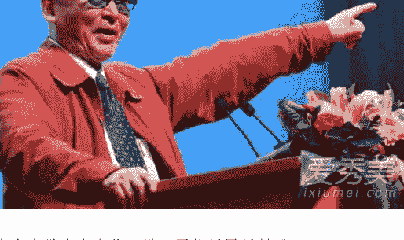

那个女大学生有点忿，说，不能两国两制吗？

李敖笑了，说这是不可能的。

李敖和女大学生，区别在哪里？

李敖的眼界、格局，决定了他能看得懂大势，而一个20多岁的女大学生，人生、眼界，都是书本里和老师教的东西。

隐含的条件是什么？是一国是趋势，不可逆的。

而这一切，女大学生，看不懂。

回到昨天的议题，什么是趋势呢？大的趋势是，罪不及亲友，是趋势；不用实际刑罚威慑未犯之罪，是趋势；

而要驳倒罗翔，你除非 vergangen 给他看，全世界范围内，有罪推定，是趋势。

这种趋势，可以带来很多有意思的推论。

比如明文规定，你这个小区犯罪率高，你家就不能进超市。因为大家习惯都是互相传染的，耳濡目染，牺牲你一个，有效保障了超市的安全。

比如你家祖上不是农民、工人，是资产阶级，你就不应该允许读大学，为什么呢？因为你成分不好，保不住你读书不是为国家、为人民服务，而是为了给你祖上翻案。

比如你邻居打仗溜了，你也要挖眼砍脚，邻居跑了你都不举报揭发，说明你认为这是对的，你这样的人大概率也会逃避，不如先放了，避免你也学邻居的战场上逃跑，造成不好的军队气氛。

对了，以上几个……除了第一个是某些国家采取过的，其它都是我们历史上，真实发生过的事儿。

说这个，你触类就清晰了，因为你家可能没人犯过罪，但你肯定要进超市，肯定要考大学，真打起仗来，邻居要跑你还真不敢拦。

所以逻辑是个好东西，但大多数人，只会根据自己的感情下判断。

公司财务出问题，财务部的所有人是不是都该抓进去？

你直系领导犯事了，是不是你们下面的人都不能再提拔？

家里有没有那两头牛，才是许多人真正的判断标准。

明白了吗？只有推翻这个根本的趋势逻辑，才能说罗翔说的不对。

就像台湾女大学生，在讨论能不能两国两制的时候，他得先推翻统一是不可逆转的大趋势，这个根逻辑。

否则，其它的所有论据，都只能折中地，弱弱地说两声，咬呀你说得对，只是，只是，咱们条件还不成熟，等到条件成熟了，再说。

所以，如果大家的知识信息没法拉齐，不在一条水平线上，讲的就不是同一个话题。

关于身份的问题，新中国，出现过两次大的解放思想运动。

第一次，是恢复高考，不看出身，以分数、成绩来决定读大学的思想解放。

## 第二次，是以三个代表为核心理论基础，广泛吸收一切代表先进的人群的思想解放。

如果你经历过，或者研究过，这些意味着什么，懂的都懂。

如果潜规则这个词，理解起来费劲，那就换一个词，逐步推动平等。

以此为基础，我们应该讨论的，不是应不应该一刀切的问题，而是，应该怎么切，怎么提升回报、降低风险的问题。

因为自己没有两头牛，就不管别人家有没有牛的，是思维怠惰的表现。

万叔这是一个聊财富、聊管理的号，但底层逻辑是相通的。

不思考，肯定发不了财。

很多朋友，都提出了自己的看法，比如要逐步开放、比如现在可能还不行这些，基于这个基础的讨论，都是有建设性的。

再说一次，想表达的意思，就是，趋势要明白，清晰，但是具体怎么做，什么时候做，可以聊，也可以有自己的看法，具体到了你的那两头牛，会有不一样的理解和做法。

最后再补一刀，今天问了一下，体制内、组织部的朋友。

组织说，万老师，你说的这些，其实我们早都在执行了。

首先，在我们这里，除了八大形式的犯错误外，一般犯罪不影响考编、入编。

其次，具体情况具体分析，对于特殊人才的，也会上报组织进行决定。

再次，根据各单位的性质，也有所不同。一般的机构单位，主要影响领导的个人观感判断，但如果是一些特殊单位，肯定还是要严查的。

不是一刀切，不是一刀切。

你看，决策者的思路，也是不断的细化管理，精细区分。

为啥万叔这么笃定这是趋势？

说个故事。

以前百果园，为了维持品质，烂掉的水果就扔掉。

后来不知道从哪里学到的，比如香蕉黑了一块，把黑的地方挖掉，剩下的部分弄成果切，卖 2 折、3 折的。

不嫌弃的人吃到了便宜的水果，百果园产生了额外的收益，也挺好。

高启强那样的黑色烂疮挖掉，把农村那些亲属意外的犯罪的，依据不同性质具体分析，团结最广大人民群众。

不也是高质量发展、精益化管理的一种方式么？

## 创业最重要的能力是什么？

原创 万叔 创始人笔记 2023-03-07 21:30:44

大家好，我是日更的管理咨询公司创始人万叔。

这几天聊的话题有点大，也是有点飘了。

在公众号，普遍打开率在 3% 左右的时代，万叔用流量的打法，2 周左右，涨到 10000 粉丝，每篇的打开率在 25-40%。

一兴奋，就开始扯公共话题。

为啥这些话题有争议，大家评论、点赞都特别高，因为这些就是典型的价值额话题。

你信不信趋势？你格局在哪一层？你利益点在哪里？你读的书学的课是什么？都能体现得淋漓尽致。

这类话题，像兴奋剂，可以舔，但不要上瘾。

万叔擅长的，还是谈钱。

无论是个人、企业，无论是战略找钱，还是绩效分钱。

从理论模型，到方法工具，这毕竟是咨询吃饭的家伙。

以下是正文。

万叔有个朋友，是个做贸易的，可能是中国最早一批，接触《穷爸爸，富爸爸》游戏的人。

和万歆刚听到，这个理论的时候差不多，也是兴奋得一晚上没睡觉。

大概在13年左右，贸易听了这个说法：一铺养三代。

一想，是资产，有稳定的现金流，符合爷爷辈里的优质投资定义，就兴奋冲的，拿出全部积蓄，买了商业街几个铺面，准备以后过包租公的生活。

后来的事情我们都知道了，临街铺面，越来越难搞。

曾经的商业辉煌，沦落到现在的儿童+餐饮。

为什么会这样？

因为中国流量的逻辑变了。

做小生意，赚钱靠什么？

不是靠你包子做得好，你产品多优秀……

本质是靠流量，或者说是流量带来的成交和转化。

对于交易来说，没有流量，一切都是空谈。

而在欧美资本主义发展的几百年里，人流≈流量。所以门店的重要性，在于他带来了泛流量，人们路过这里的时候，看到有一家店，就会进去消费——至少是有可能进去消费。

这是工业时代的逻辑，几百年的，多少代人的，几乎牢不可破。

但中国的情况，巧就巧在，我们短短几十年，走过了西方上百年的路，农业经济、工业经济、共识经济在极短的时间里，压缩到了一起，混合而魔幻地存在。

这就意味着，商铺是优质资产，这个东西还没成为共识，流量的逻辑就被美团和淘宝颠覆了。

美团的商家系统，把流量从线下搬到了线上，让写字楼楼上的办公室，同样拥有了流量，价格还便宜很多。

淘宝用互联网+物流体系，打破了现场成交的逻辑，网上下单，送货上门，商铺的核心价值变得尴尬。

从这个角度来说，是电商，用更高效、低成本的商业模式，革了传统交易的命。

中国的线下交易，带着工业时代的桎梏，还没疯狂就老了。

同理还有中国的信用卡体系。

支付宝出来以后，万慨就断言，信用卡刷卡这个事儿，绝大部分的应用场景，会被电子支付替代掉。

当时银行还不当一回事儿，觉得信用卡很多支付场景，是有特殊优势的。

直到支付宝微信，用一个简单的二维码，直接而快速地推动，中国成为了“几乎”无现金社会。

各银行才慌起来，联合搞了个云闪付，用大量的撒币换取一点点市场份额。

《资产证券化的几种途径》里，万叔讲过一个逻辑，新兴的国家和区域，重视增值权。

因为常年服务城投、平台公司，讲讲为什么，要记住这个点。

一个城市，一个新区，几年时间，搞起来几万亿的资产规模，你觉得是怎么来的？

- A、靠消费、工业、生产总值制造来的。
- B、靠产业推动经济发展，提升土地和物业估值，堆出来的。

现代商业的发展，早就不是纯靠实物、服务交易赚钱了。

现在开个餐饮、搞个按摩店，老板都知道，叫你办卡，有优惠。

办卡是什么意思？办卡就是一种共识。

我认为你这里的产品和服务靠谱，我愿意长期来你这里消费，所以我愿意办卡，在还没完成交易的时候，先把钱给你。

这就是普通人，规模化扩张的第一步。

不是你想的，创业就要去找投资人，搞 VC/PE 烧他们的钱给自己发工资买豪车。

这都是皇帝挑水用金扁担的思想。

像罗胖第一次跨年演讲，就把未来 20 年的门票卖掉。

换成其他的创业模式，就是拿到这笔钱，去更高端场地，用更好的团队，在同行都在靠初始资金扩张张的时候，迅速铺开，抢占先机。

这就是为啥，健身房这种小众非刚需的，也能如此普及，遍地开花。

别觉得因为存在，所以很正常。时间倒回 10 年 20 年前，不少家庭可都是宁愿在家添置家庭跑步机这些设备的。

这都是用资本和流量，跑通商业模式，硬生生谱出来的商业打法。

回到文章的主题来，创业最需要的能力是什么？

一是商业模式，二是流量和资源。

以赚一千万为例，程序员做产品，就是比厨师炒菜，容易实现目标。

万叔一个做企业咨询的，平时服务少数决策者，少数企业就好了，为什么要每天晚上 2000 字的，写公众号，还求点赞转发在看，搞流量打法？

也是因为商业模式不同。

以一个客户一年付 100 万咨询费为例，如果企业愿意出这个钱，他对你的要求，就是请一个年薪百万的企业高管的要求。

但如果利用互联网杠杆，找到 1000 个，想提升管理，但有没有 100W 付费能力的个人，你不需要做到年薪百万的高管价值，你只需要带来的价值超过 1000 块就可以了。

后者明显更接近商业上的成功。

但咨询行业里，尤其是麦肯锡、埃森哲、德勤这类学派的顾问，习惯了吴晓波说的“服务一小撮精英”，不愿意卷起裤腿，和一帮草根去拼流量，拼杠杆。

那未来的共识价值，全部积累在企业的光环上，离开了平台，立马失去光环，结果就温水煮青蛙，逐步失去了议价能力。

如果你真的想赚钱。

并愿意为此付出代价的话。

问问自己，现在在做的事情，有共识积累吗？能拉动品牌、流量的增值吗？

如果有，又无反顾的投身进去，日复一日的积累，都是有价值的。

如果只是工资高点，福利好点，或者甚至是你告诉万般我只会做这个事情……

那就当故事看看，每天 2000 字的故事会，也挺好~

## 我头疼！医生：头砍掉就好。

原创 万叔 创始人笔记 2023-03-08 21:32:54

大家好，我是日更的管理咨询公司创始人万叔。

昨天的文章，《创业最重要的是什么？》从万叔自己的视角，讲了资源和流量的逻辑。

很多人 在下面问：我这个行业怎么样？那个行业怎么样？

万叔对餐饮行业有什么好的建议？

全部回复

创始人笔记(作者)
建议先学习，怎么提出一个好问题。

张海峰 来自浙江
这个问题太大了，完全没有核心。问的足够精准，就证明一件事到临界点了

王彦 Wang Yan 来自北京
回复 创始人笔记：garbage in, garbage out...

万叔为什么以公众号为核心阵地，因为文字是一种筛选。

自古以来，能不能识字、阅读、写作，就是一种筛选机制。

想起之前，在得到学习的一段话：多少好答案，在等一个好问题。

今儿聊点麦肯锡教给我的干货。希望对你有收获。

如果觉得烧脑的话，可以文末收藏，以后有时间慢慢看，常看常新。

以下是正文。

咨询师的工作，简单点说就是三件事：界定问题、拆解问题、解决方案。

今天聊聊怎么界定问题。

咨询里的问题，泛指商业上的复杂问题。

那些有明确答案的，直来直往的，不属于复杂问题。比如说，今天星期几？公牛和勇士谁赢了？

这种从问题，可以直接指向答案的，都属于简单问题。

那复杂问题是什么样子的呢？

举个例子，中美关系是什么个情况？我如何实现年薪百万？

很多一根筋，会脑子里直接蹦出一个答案——我们要打倒美国霸权！或者，努力就可以实现年薪百万。

对吗？对的。

但复杂和简单，不是从对错来定义。复杂和简单的区别在于，对于复杂问题，不论是什么样的一句话回答，都不够全面。

为什么？因为复杂问题的答案，不是一个点，是复杂的维度和切面。

说人话。

复杂问题就像盲人摸象，任何一个点都不是大象本身。

像文章开头那个兄弟，问万叔——餐饮行业你怎么看？

万叔无论回答说，看好？不看好？

都是一个陷阱，把一个复杂问题简单化回答的陷阱。

所有的降维都会有信息损失的，而这类信息损失，容易给人误导。

所以，在解决复杂问题之前，需要对问题，进行界定。

关于界定问题，心理学家 Jean E. Pretz et al. 有过经典的定义：

> “界定问题的真正的挑战，就在于澄清问题的本质，并回答这问题期待解决什么，需要达成怎样的目标。”

这是万叔在 7 年前读书的时候，做 的笔记。

寻找现象背后的问题，就是界定问题的过程。

为什么不能直接，针对现象去回答。

万叔这里举个例子。

你假设这样一个场景，你现在头有点晕，身体有点乏力，你去看医生，医生摸了摸额头，一本正经的说：嗯，头有点发热。

把头切掉就好。

……

你是不是会觉得医生傻掉了。

虽然你没有啥医学知识，但你凭常识就知道，头疼有多种原因，要不同情况不同分析。医生应该让你做进一步的检查、询问这几天的相关状态，对背后的问题作出分析。

再不济，你也应该知道，头晕大多因为身体免疫力低下引起，要治好这个问题，更可能的方法应该是开一点退烧药消炎啥的，而不是把头切掉。

恭喜你，你已经懂得去发现问题，而不是直接对着问题找答案，头痛医头，脚痛医脚。

但万叔发现，现实生活中，无数人会产生这样的错误认知。

拿自己举例，如果能回到 15 年，面对当时炒股的自己，自怨自艾：如果我不贪，大跌之前早点跑，就好了。

万叔明白，如果认知不提升，再来 100 次，还是不会早点跑。

为什么？

因为什么时候卖，是有技术含量的。

看趋势、看行情、看对价值和情绪的认知；当时的万叔，愣头青一个，别 人说买啥，头脑一热就买进去了。

结果你没付费，别人的时候不跟你说……

所以拿炒股举例，提升认知，是对影响股价的真原因，庄家的操作手法，公司的消息情况，哪些能影响，有真正深入的了解。

不同股票影响因素不同，影响强度也不同。

只有深入了解了这些，才能算是实力赚钱，持久的赚得到钱。而不是靠着结果去找原因，每次悔恨为什么没及时跑。

万叔明白以后，默默地退出了投机市场……

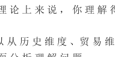

说回界定问题。

对于一个复杂问题，理论上来说，你理解得越详细越好。

比如中美关系，你可以从历史维度、贸易维度、金融维度、文化维度，无数个切面分析理解问题。

在万叔工作前几年，接受咨询残酷训练的日子里，被要求的就是，用头脑风暴法，穷举出各种可能性。

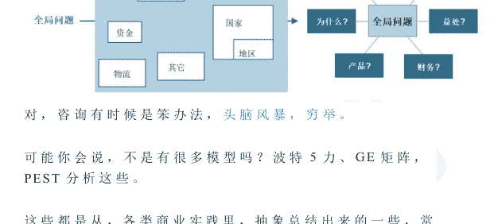

对，咨询有时候是笨办法，头脑风暴，穷举。

可能你会说，不是有很多模型吗？波特 5 力、GE 矩阵，PEST 分析这些。

这些都是从，各类商业实践里，抽象总结出来的一些，常用的工具，能方便简化问题，快速获取答案。

但作为接受正规、严格训练的咨询顾问，得要会底层逻辑，就是——用逻辑树和 MECE 法则，通过头脑风暴法，界定和解决陌生的复杂问题。

最后形成这样一个树状结构。

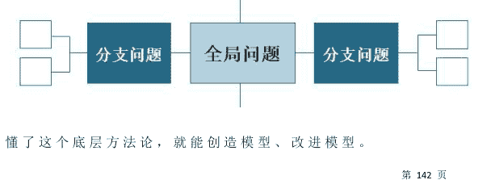

懂了这个底层方法论，就能创造模型、改进模型。

以前做咨询时间不长，和客户信任不深，前期沟通时，经常因为同类项目经验不够，被客户打上“经验不丰富”的标签。

如果你也苦恼这样的问题，真正有实力的你，可以用下面这句话，怼回去。

会用工具，和会制造工具，技术含量是不同的。

但这么痛，有个致命的缺点——太慢了。

当年奇志大兵的相声，有个看医生的段子，就说看病是用排除法，把所有的原因都排出了，剩下的就是你的感冒症状。

这当然是个讽刺笑话，但万叔也曾经经历过，吃了东西肚子不舒服，体内钾钠不平衡抽搐，被医生叫去抽血化验花了好几千的事。

最后化验单子拿到手里，也恢复得差不多了。

> “医生，你再不快点我就好要好了”。

名医和庸医的差距，就在这里。

怎么平衡效率和质量呢？

搞清楚真正的目标是什么。

有个很经典的故事，有人问股神，如何成为百万富翁呢？

股神说，你拿 1000 万去股市，亏损 900 万，你就是百万富翁了。

虽然是搞笑的故事，但也说明了，问问题的人背后，往往都有自己，没说出来的目标。

比如那个问怎么看餐饮行业的，可能他真正想问的是，我进入还有没有机会？

或者，这个行业还有没有红利？

不同的前提和假设情况，给出的答案也就不一样。

之前有人问万籁，公众号都没红利了，你为什么还要做？

万籁回答说，没有红利，指的是超额利润部分，越来越薄了。就是我 80 分的水平，以前可以有 120 分的回报，现在 100 分水平，才能有 100 分的回报。

但是无所谓啊，只要还有 1:1 的回报，这对于万籁而言，就是个好业务。

并且，万籁凭借又干货又持久的输出，还能吃掉一些红利期，不该属于他们的流量。

这对自己的积累、自己的业务和收益，都是增量。

所以，明白了吗？

一个好问题，是这样提出来的。

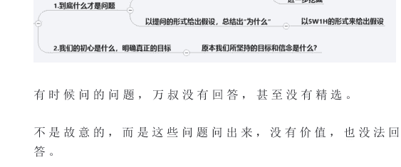

有时候问的问题，万叔没有回答，甚至没有精选。

不是故意的，而是这些问题问出来，没有价值，也没法回答。

搭框架、明确设、探初心、找到关键的维度，这些都需要刻意练习。做得越好，问题也就越清晰。

有时候问题足够清晰，答案也就呼之欲出了。

所以，如果你对自己迷茫，对一些事情迷茫，不妨用万叔今天教给你的方法，问一问自己，我想提出的问题，到底是什么？

提升认知，塑造能力都是有方法的。

山川异域风景好，财富之阶无穷无尽，

财富跃迁之路，和你同行。

## 普通人最大的机会——万叔生日感悟

原创 万叔 创始人笔记 2023-03-09 21:30:36

大家好，我是日更的管理咨询公司创始人万叔。

今天生日，没做啥特别的事儿。

万叔是一个工科男，不太会说什么是山水柔情一类的話，本身对生日啥的，也不是很看重。

趣是缺乏，才越会以各种借口，追求仪式感。

就好像小时候过年穿新衣，吃大鱼大肉，小朋友都盼着过年，但当时万叔心里想的是，老子以后买新衣，吃大鱼大肉，天天过年。

这是万叔的追求，整体阶段的跃迁，而不是在某个日子的升级。

以下是正文。

先讲个故事。

之前，参加一个商业论坛，万叔和一个富二代，一起聊商业模式。

到了提问环节，一个年轻人，看起来像是学生，拿着话筒，问，你觉得，作为一个普通人，没有关系，靠自己一步一步走到你这样的位置，几率有多大？

这个问题明显万叔更适合回答，但那个年轻的黑框眼镜小伙，希望富二代作答。

富二代寒暄了几句，说，你要努力，做好每一件事，努力就能成功！

几乎只要在社会上，直面商业几年的人都会明白，努力，只是成功的诸多因素里的一個，甚至都不是最重要的那一个。

之所以万叔深刻的记得这个场景，是因为聚光灯下的富二代，梳着油头，举手投足之间，确实很有魅力，以致于他能够成为焦点，刺激情绪，观众众以热烈的掌声。

哪怕他口中的努力，和普通人的努力有本质区别。

富二代的努力，是怎么样变现资源，普通人的努力，是怎么样获得资源。

有的人终其一生，只不过达到了别人的起点，说的就是这个意思。

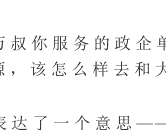

意犹未尽？那你万叔再讲一个故事。

昨天有个读者留言问，万叔你服务的政企单位那么多，请问小城市，缺钱、缺资源，该怎么样去和大城市竞争呢？

万叔回答了几条，核心表达了一个意思——落后的城市想逆袭，无论什么方法，难是大前提。

千万不要觉得，用了什么制胜一招，请了某个咨询公司，甚至是某个民间高人，就能逆风翻盘，以弱胜强。

很难的。

到了 一定程度，拼的都是硬实力，没啥奇技淫巧的。

共产党是以弱胜强的典范，但拆解打过的经典战役，根本没有所谓的以弱胜强。

从来都是少对多的时候，不跟你打。只有在局部兵力绝对优势，占据主动的时候，才发起进攻。

还是多打少。只不过通过聚焦，把兵力劣势在局部变成了优势，通过一个个小的战役，赢得了战争。

那么问题来了，普通人，怎么逆袭？有没有可执行的方法论？

这就是万叔这几年，对财富，核心的感悟。

## 聚焦+杠杆

先说聚焦。所谓聚焦，就是用认知单点突破，形成比较优势，去撬动别人的资源。

说人话。

就是用局部的绝对优势，和有资源的人，合作共赢。

记住，不是寻求施舍，是合作共赢。

因为篇幅的原因，不可能展开得很细。但做什么事情，一定要有比别人做得好的心态和气势。

比如写公众号，万叔并没有农夫天优势，也错过了黄金时期，但就死磕，每天写，每天写，又猛又干货，这样积累到一年、两年以后，优势就出来了。

你可以不喜欢你的工作，可以对你的生活迷茫，但你总要有一件拿手的事，从一个纯粹的消费者，变为一个生产者，给别人产生价值，才能撬动资源，走进更大的世界。

不然拥有资源的人，为什么要和你合作？

花一年、三年、五年的时间，定一个目标，建立自己的绝对优势领域，是没钱没资源的人，跃迁的必要条件。

再说杠杆。

成功的投资人，都是加杠杆的。

为什么？

因为靠你卖身赚来的钱，太少了。

这里万叔不是鼓励，你去加杠杆炒股、炒币。

加杠杆的核心，在于对事物的认知深度。

万爸之前炒股，就盯着几只股看，反复炒，反复吃，赚到钱了。

而万叔因为啥都好奇，啥都搞，但精力有限，除了咨询主业，对其它的渠道研究不那么深刻，所以听大佬的消息做交易，经常亏。

很多人买股票、买房子、都不去深入研究，听消息，信大神，自然亏多赚少。

但买房子，万叔下了血本，深入研究，实地踩盘，从板块到户型，从城市到朝向，都做了研究。

同时，与之相关的，贷款、过桥、分摊、代持、房票、落户、JYD 这些，都实地跑过，了解过，有认知，再让万叔去投资，就敢上贷款，加杠杆。

杠杆的目的，绝对不是赌博更刺激。

是在你认知正确的方向上，加筹码。

核心还是认知的提升。

比如有朋友买黄金，买了实物黄金以后，抵押 95%的现金出来，黄金涨价，等于以 20 倍杠杆买涨。

赚钱以后，用原价+手续费赎回即可。

那亏了呢？不赎回，只跌 5%。

原理很容易懂，但如果认知不够深刻，你不明白黄金、纸黄金的区别，贷不到 95%的款，导致同样的行情，你赚的少、亏得多。

买房也是一样，本质是押注

房价涨幅-贷款税费=收益

但怎么撬动杠杆，怎么凑首付，怎么买房票，怎么选择涨幅高的标的，都是需要深刻认知的。

不然房价涨幅，赶不上贷款利息，变成负资产，就难受了。

再说几个感悟。

### 1、成功很快，3、5 年左右黄金期。

明显的感受，身边的朋友，30 岁以后，不少人，人脉、眼界、财富、社会地位开始迅速崛起。

到 35 岁成为一个巨大的分水岭。没有崛起的，感觉很艰难，连猪头都不再搭理。

崛起的，不论是在政府单位、公司中高层、优秀创业者，都进入了另一个层次的竞争。

不要觉得崛起需要很长时间，刘邦从斩白蛇起义到称霸天下，一共花了 6 年 3 个月，中途还包括窝在汉中休养的时间。

三国演义里，关羽从 184 年跟草鞋刘、猪肉张结拜，到 190 年温酒斩华雄一战成名，也不过 6 年而已。

共产党从被迫入陕，到解放全中国，差不多 4 年。

抓住职业生涯 30-45 的黄金时期，一层一层，突破天花板。

### 2、一定要购置优质资产，享受资产增值收益。

尤其是辛苦用时间、工作换来的钱。

欧神说过，通货膨胀是大趋势，我们要用以房贷为核心的优质资产包，抵御甚至利用通胀。

这就是万叔之前的文章里，廖汝提到“个人护表”概念。

把负债，或者负债额度，当成个人资产中的一项，学习合理利用它，用更好的资产增长率收入，抵御不可避免的通货膨胀。

但，敢不敢上杠杆，怎么上杠杆，怎么提高胜率，每个人不一样，是需要持续学习和精进的。

### 3、提升认知是成长的根本。

从过去的债权，到未来的股权，从中央机构的变革，多去琢磨琢磨，尤其是，这事儿与我有什么关系？我能从中看到什么机会？

不要总看肤浅的，宏现的东西，研究一个东西，就想办法搞透，比别人深一层，比别人多一层。

然后把这些观点，当成生产力工具，发布出去，让更多人看到，撬动更多的资源，链接、合作，成为跃迁的养分和台阶。

房产、医疗、互联网、咨询服务……任何一个行业，只要摸清了核心玩法，都有巨大的机遇。

今天开心，开个打赏~

谢谢大家每天听万叔唠唠叨叨，希望我们能一起成长，实现人生跃迁。

## the Benny Cake shop

BIRTHDAY

又长大一岁的我
是时候做大哥了

## Happy birthday

## 如何利用概率思维，迎接巨浪与变局？

原创 万叔 创始人笔记 2023-03-10 22:20:07

大家好，我是日更的管理咨询公司创始人万叔。

昨天的文章《普通人最大的机会》，有个留言非常有意思。说道理科大概都懂，但实际做的时候，发现做不成。怎么办？

万叔回答说，道理有两种。一 mencionada 一 种是记识型的，就是说，懂了就...不一样。比如说地球是圆的，确定座机会触电。

另一种是掌握型的，懂了以后，还要会。比如怎么游泳？怎么判断股票？怎么选筹？

这是要经过大量的练习，形成肌肉记忆，最终和别人拉开差距的。熟能生巧。

万叔的文章里，肯定没法全部教你，那些需要掌握的内容。葵花宝典放在网上，也需要你挥刀自宫去练。

耶有没有躺着就能学会的方法呢？也有。

找第三方，帮你解决问題。但是费钱。

不少没接触过咨询的，觉得公司请咨询好贵。但贵不是咨询的问题，是你公司的问题。

不然，资料网上都有，花大价钱找咨询公司干嘛？还是因为，到了一定程度，找咨询公司比自己琢磨性价比更高。

万叔开桑塔纳的时候觉得洗车费，不如自己动手，开帕拉梅拉的时候就不觉得洗车贵，反而觉得专业，省事。

一个道理。

### D1

先玩个游戏，按按钮，10 万一次。

现在有两个按钮，红色 90% 几率，得到 100 万，蓝色 10% 几率，得到一个亿。

你选哪个？

请投完票，再往下看。

3

2

1

这不是价值观测评，是财商问题。

有标准答案，答案是：看期望。

什么是期望？结果乘以概率。

这三个的期望是多少，A 是 80 万，B 是 990 万，C 是 0。

但你可能会说，如果中不到，可能还要亏 10 万啊。

接着往下读。

### D2

最近有两个投标项目，比较典型。

一个是上海一家公司，数字孪生的项目，前期咨询+技术落地，几百万级别。

另一个是广州一家公司，薪酬绩效咨询，几十万级别。

第一个项目要求，先做一个 DEMO 出来，才能参与投标，因为万叔的公司没这技术，还要找相关的技术团队，要花一笔钱。

第二个项目要求，付款周期是常见的 3 倍以上，并且要有后期辅导落地。

应该大家都看出来了，几乎就对应了那个按钮游戏的，前两个选项。

客户经理问，万老师，这两个项目，前期对我们有风险，如果不中，还要产生额外的成本和费用，我们还投不投？

万叔算了一下，思考了各类的可能性以后，说，投。

这里，客户经理考虑的是费用，万叔考虑的是期望。

之前的文章里，包括《驳倒罗翔的要点，大部分人搞错了》这一篇在内，一系列的，本质都是一个话题：怎么判断一件商业上的事情，做还是不做？

一脉相承的，如果从可能产生的问题来看，所有的改革，都有问题，都会引起反对，都有争议，都会动到一部分人的蛋糕。

但为什么有些决策者，裹着砂石往前，积极推动着改革的步伐？

因为看的是期望。

一件事情，如果利大于弊，就有推动的动力。

当然这个利弊，不仅仅是经济上的，还有政治考量，也分个人利弊和组织利弊……讲起来就复杂了。

但简化一下，一项决策，如果期望为正，但这次失败了，
比如万叔投标的这两个项目，全都亏了，影响了年终奖，
怎么办？

这里有个常用的方法，用数量对冲概率。

拿公众号打比方，如果你只有几十个读者，有一天，阅读量多了，不一定是因为你选题棒，写得好。

有可能是某个朋友，顺手帮你转发了一波。

但如果你有 10000 个读者，转发数量、点赞率，就和你的文章质量，息息相关了。

我们经常会有错误的商业认知，是因为选择的机会，太少了。

以前有个鸽子的试验，就是随机撒食物到广场上，一段时间以后，鸽子都形成了自己的行为模式，有的跪步，有的点头，有的挥翅膀。

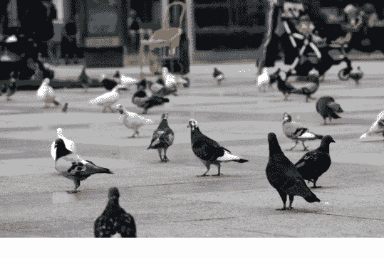

一些长辈，尤其是企业内的，讲的所谓成功经验，为什么听起来有点搞笑。

是因为，他们一辈子就在那个企业里，领导的喜好、决策、公司文化，极大地影响了他的成败。

放到辽阔的商业世界里，少得可怜的次数，根本不构成分析原因。

第一个逻辑，相信概率，然后在正确的方向上，反复下注。

说人话。

如果按键游戏，让你按 10000 次，怎么选，是不是清晰了。

### 04

如果做不到，还有没有别的办法，提升单次胜率？

但也不是没有办法。

找合作伙伴，分层承担风险。

比如把 990 万收益期望的选择权，100 万卖出去。

只要我的人足够多，总有愿意冒险的人，想博一把的。

如果你觉得，100 万少了，万叔我还想多赚点，极限能卖到多少钱？

理性情况下，极限就是卖到 990 万。

超过这个极限，就是非理性的决策，需要找到特定的人，俗称冤大头。

要注意的是，到了这里，就不是你一个人的游戏了，需要有买卖双方参与，体现出了链条的重要性。

### 05

一般情况下，故事讲到这里就结束了。

万叔投标的思路，也是这样。

这两个项目，万叔跟客户经理说的是，找找合作单位，风险可以分摊掉。

以及，我们不看一城一池，看长时间线上的总收益。

但，之前讲按钮故事的时候，有个做金融的说，不对万老师，其实有办法，收益是可以突破期望的。

万叔也觉得很兴奋。急忙问，什么办法？

金融说，很简单，只要你多找几个人，比如找 500 万个人，每人 2 块钱，用买彩票的方式，中了就拿走，没中就算。

会有人参与，也很容易把期望，炒到超出实际价值。

万叔听了，一拍大腿！卧草！你这思路牛逼啊！！！

但是，如果这次没中呢？

金融说，你拍卖的是拍卖按钮的权利，至于这个按钮，拍卖者是自己拍，还是卖给别人，就是另一次的游戏了。

万叔感慨开了眼界，说还是你们这些搞金融的，割韭菜厉害！

金融笑，所以自己不懂的，最好不要投资，不知道在看不见的地方，有多少套路在等着你。

后来，有一次和深圳朋友吃饭，深圳问，你觉得现在这边，房价都涨到接近 40 万一平了，还炒得动吗？

万叔把无限细分的逻辑告诉了他，为啥要打击非法集资、打击集资炒房，就是这个原因。

决策者不希望商品价格，脱离基本面。

但这种思维，是不是可以用到其它地方，发现机会？

有的 人，给他一本葵花宝典，他就只会纠结，要不要挥刀自宫。

故事讲完了，对我们现实生活中，投资、赚钱，有什么启发？

主要是在，拥抱不确定性的时候，需要的概率思维。

- 1、找可以重复投注的游戏，不断往高胜率的那边下注。
- 2、找合作伙伴，分摊风险，锁定收益。
- 3、把机会证券化，坐庄思维，锁定收益。
- 4、对现实生活中的情况，很多时候，通过努力，是可以提升胜率的。这也是普通人，努力的真正意义所在。

世界局势，迎来到百年未有之大变局。

万般想推荐一篇文章——《硅谷银行崩盘“应该还算不上这一轮经济危机的导火索》

里面讲，最大的巨浪，可能就在眼前了。

只有会划船的人，才能乘风破浪。不然就会被淹死。

只有直面不确定性，化危为机，乘着混乱的阶梯，才能阶级跃迁。

## 那个一线城市 80 后说，买不起房，我差点卷铺盖回老家

原创 万枫 创始人笔记 2023-03-11 21:30:29

大家好，我是日更的管理咨询公司创始人万枫。

今天跟朋友，工薪阶层，去办货物，感受到广州的楼市氛围确实起来了。

周末，就不搞结构化表达了，随便说说。

以下是正文。

### 01

工薪在广州，也就是个普通的上班族，勤勤恳恳攒钱，父母支援，差不多攒了 100 来万。

工薪说，本来 17 年就可以，垫垫脚买房，结果错过了，一路看着房价往上飙，被越拉越远。

万枫说，后悔不？

工薪说，后悔。

万枫问，那当时怎么没买呢？

工薪回，当时也是因为年轻，想到未来 30 年的房贷，不想生活太惨，就说等一等，结果……

万枫笑，你这逻辑就不对，资产上涨的价格，肯定比工资上涨的价格要快。

你洗澡的时候，打开喷头，水是先淋到头发，到脖子，最后猜到你的腓毛。

你工资收入，就是那个腓毛，但好的资产，是头发，放水的时候最先湿掉的。

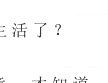

所以啊，工薪说，看到今年这么火热，如果再不买，可能过两年就在广州留不下来要回老家了。

万玮笑，这回不怕影响生活了？

工薪说，看了你写的文章，才知道，房子除了居住结婚属性以外，背后有这么多的金融属性。

但是，我们普通人，大部分买房的时候，才是第一次接触到金融。

如果不是你跟我说，我可能就简单的 3 成首付买新房还贷了。

万玮说，本身，房贷是你们能接触到的，最好的贷款之一，但现在放水，各类利息变得很低，房贷就不香了。

之前你听说过，很多要提前还房贷吧？你有没有想过，一方面在说老百姓都没钱了，另一方面又那么多人要提前还贷。

钱哪里来的？

工薪挠头，万玮你不说，我还真没想过这事儿。

### 03

万叔说，还不和你今天这个逻辑类似啰。

底层逻辑像买股票一样，普通人买一家公司的股票，到底是要他们公司的控制权，想拿他们公司的砖瓦泥墙，还是想高抛低吸赚钱？

工薪说，肯定是想赚钱。

万叔说，你试试，把这个逻辑，套到房子里。

如果你一直追求这个房子的所有权，哪怕是未来卖不出去，没有流动性了，也愿意砸手里，你就去城市边缘买，未来工资高了，慢慢往城内挪。

如果是投资为主，兼顾自住，就按我之前跟你讲得思路选筹。

工薪说，我有一个事情不明白，大大不是老说，房住不炒吗？为什么你这么笃定？

万叔说，我们类比一下，如果证监会说了句：股持不炒等息等分红，是不是说所有股票都不能涨了？

工薪打算点头，万叔接住了。

只要有撮合交易，就会有股价波动，怎么可能不能涨？

你用《麦肯锡问题界定法》讲过的方法，往深一层思考，股价的上涨，是不是至少有两种原因？

一种是资金进入，供求关系变化堆起来的。

## 一种是基本面变好，公司价值顶上去的。

楼市也是一样，说不炒，是指对那些瞎炒起来的，三四线城市，人口流出，房屋过剩，硬把房价推到大几千上万。

基本面撑不起来。

但像广州这种，欣欣向荣，人口涌入，GDP 不断增长的，就是基本面在变好，房住不炒，不是说房住不涨。

没有不涨的，日本那么躺了，东京的核心区域都有涨。

何说粤港澳大湾区的核心。

### D4

所以，大逻辑就是，万叔说，你买的资产，涨幅超过你贷款的利息，剩下的部分，贷款越多越好。

因为这个杠杆，是在帮你赚钱。

而且房子和杠杆炒股还不一样，炒股配资什么的，会爆仓。
房价哪怕暴跌了，只要你还继续还月供，银行就懒得理你。

那，如果未来再出现疫情什么的，我贷款还不起了呢？房子不就要被没收了？

万叔哈哈一笑，很多人都是你这种想法。有很多办法破的。

然后万叔说了几种方法。

不适宜公众号写，但是都不难，随便搜搜就有。

所以，核心还是，你能不能找到，有金融属性的，有增值空间的资产。

其它的，首付、月供、总价、居住属性等，都可以围绕这个资产的优良程度进行设计。

这里的认知区别，才是房产投资的核心价值。

很多人问万叔，这里的房子能不能买，那里的房子能不能买。

除了广州和成都，其它的地方，万叔的认知，只能到城市级别。

但城市以下，还有区域、板块、楼盘、楼层、开发商、学位、户型、朝向、人群、规划……

这是核心认知，选得好和选得不好，几年以后差个 10%的收益，在一线城市，就是几十万的区别。

之前很多提问的，说道理都懂，怎么具体指导执行？

去弄清楚上面的各元素，建立自己的投资模型，并且利用这个投资模型，持续的赚到钱。就算认知真正的提升了。

希望万殿的读者，都能有商业智慧，在财富的路上，多赚钱，少踩坑。

## 硅谷银行倒闭这事儿，还有更深层次的原因

原创 万叔 创始人笔记 2023-03-12 22:34:20

大家好，我是日更的管理咨询公司创始人万叔。

这几天大家都在聊，硅谷银行爆雷的事情。

作为咨询公司的顾问，万叔一直跟小伙伴强调，判断一个事情的影响之前，一定要，先弄清楚这是啥？是怎么回事？为什么？

凡事讲个逻辑模型，上面这个思维模型叫“黄金圈”法则。

事都讲不明白，就直接下判断结论，容易错。

这就是为什么听消息炒股的，大多数会亏钱的原因。

以下是正文。

本身一句话就讲得清楚，这是一个短债长投的故事。

存款多了，硅谷银行没有放贷吃利差，而是去买国债。

结果现在因为加息，美债跌了。

本身跌了没问题，因为利息是锁定的，但现在硅谷的公司开始挤兑。

一挤兑，被迫卖美债，现在因为美债跌了，卖出去等于亏本。

而亏本卖资产，又加剧了“这家银行不行了”的共识，挤兑的更多。

触发了这个雪球，银行一下就不行了。

爆雷，破产。

实际上，哪家银行都禁不起挤兑的。

但为啥，硅谷银行会被挤兑？万叔周末看了好多文章。

最多讲了个现象，挤兑。

为什么会发生挤兑？短债长投。

但短债长投的风险，为什么会触发？硅谷银行不知道有风险？之前为什么没遇到过？

没有一篇写清楚里面的原因。

万叔觉得，核心还是美国经济的衰退。

美国脱实向虚以后，农业和工业的 GDP 占比本身就很低了。而金融行业冠绝全球。

金融这种东西，本身就是靠讲故事、凝共识决定的。

大家认为你还会涨，就会有资金一直推动价格和市值增长。

大家都认为你不会涨了，开始抛售，就会一窝蜂的卖出，造成踩踏。

2020 年美国刚开始直升机撒钱的时候，股市经历了几次熔断，就是这种恐慌的体现。

之前在《只有证券化，能接住天量的放水》里讲过，证券化这种游戏，本身就是高风险高杠杆的。

举个例子，一个新三板的股票，价格 10 元，万取用 100 元，买了一手，成交了。

如果再没有其它的交易，那么收盘的时候，股价变成 100 元。股票市值翻了 10 倍。

这个时候，真实现价涨了吗？几乎没涨，但股价就被炒到了这么高。其中 90 块钱，都是泡沫。

反着来想，如果一个股票 100 元，但大家不认，卖不出去，要 10 块钱才肯买，成交一手，是不是公司市值就跌了 10 倍？

问题就在这里。

对于美国的经济，大部分共识是，美国在今、明年，将要陷入衰退。

高盛半年前就发布了衰退手册。

## ECONOMY

## The stocks recession manual from Goldman Sachs

reporterwings · 3 weeks ago

1 minute read

其中有个预测，说根据历史数据，从 2022 年 1 月，标普指数 4800 点开始算起，那么可能要跌到 3650 点左右。

Exhibit 10: Path of S&P 500 NTM P/E around recessions since 1981
Level of forward P/E
Year Date Peak Date Peak + 3 mo Date Start of recession Date Trough Months peak to recession Change in forward P/E Peak to 3 months Peak to recession Peak to trough
1981 Nov-80 7.7 x Feb-81 5.9 x Aug-81 5.6 x Mar-82 5.0 x 9 (23)% (27)% (34)%
1990 Dec-89 11.6 Mar-90 11.0 Aug-90 9.9 Sep-90 9.5 9 (5) (15) (18)
2001 Aug-00 23.9 Nov-00 20.8 Apr-01 21.2 Sep-01 18.7 8 (13) (11) (21)
2008 May-07 16.0 Aug-07 14.6 Jan-08 14.5 Oct-08 10.8 8 (7) (10) (33)
2020 Dec-19 18.6 Mar-20 15.3 Mar-20 15.3 Mar-20 15.3 3 (18) (18) (18)
Median 8 (13)% (15)% (21%)
Note: Valuation trough defined as trough reached during the recession period.
Source: Goldman Sachs Global Investment Research

这个共识是了不得的。

一旦共识形成，几乎资金都会抽身观望，等差不多到底了再杀进去。

这会造成什么？造成股价下跌，资金抽离。而资金离场影响股价价值、又会进一步影响投资者信心。

会有大量资金踩踏。

就像这次硅谷银行破产一样，本来你不取，我不取，正常流动，大家没啥事儿。

如果大家因为害怕，都想取钱，那一下就挤兑破产了。

短债长投只是风险，我们要分析的是点燃引线的那个炸药。

### 04

理解了这个，很多事情就都能串起来了。

比如硅谷的各类裁员，比如黑石宣布违约，比如科技企业都在囤现金。都是在为衰退期的到来，做准备。

还有各类新技术，比如 Chat GPT 的推广，甚至前些天说常温超导的突破。

为啥都是美国那边提出来的？因为想凝聚新的共识。现在大家都不敢投共识，都拿着现金，如果有新的共识产生，投资各路破门槛，股价会疯狂的增长。

万叔之前开玩笑说，如果继续这样衰退下去，可能哪天，美国就宣布可控核聚变接近商用了。

所以金融、共识经济的好处在于，投资猛，涨得快，溢价高。

现在可以看到，其兴也勃焉，其亡也忽焉。

反倒是在国内的政治定力与智慧，坚持控制金融，搞工业立国，实打实做工业国，抗打击能力强很多。

国内的决策者，不知道金融利润高、赚钱快吗？

看来还是站位更高、考虑更深远。

### 05

至于很多朋友关心的，美国会不会因此爆雷。

万叔心里倒是希望，他们也能搞搞休克疗法，海啸一波。

但从消息面来看，所谓休克疗法、美国在 08 年让雷曼兄弟破产，引发金融海啸后，总结经验教训，后来出现类似情况，都是温补、滋养为主。

我们的对手，还是很强大的。

就像打王者荣耀，低端局对手失误随便抓，嘎嘎乱杀，高端局几乎都不犯错误，胜败在自身硬实力、战略决策上。

好消息是，时间是站在我们一边的。

如果我们可以像促和沙特伊朗一样，团结盟友，凝聚共识，强化定力，未来的资本力量，会源源不断的投向我们。

毕竟，一只股票跌的时候，大家总会想找另一只涨的。

到时候，我们创造的共识，会带动巨大的资本溢价收益，为供应链转移之下，下阶段的增长引擎，提供强劲燃料。

## 忍不住了，万叔手把手教你怎么怼政协委员

原创 万叔 创始人笔记 2023-03-13 22:21:27

大家好，我是日更的管理咨询公司创始人万叔。

中午吃饭的时候，有个姑娘，微信里问万叔，你昨天那篇写得太好了，今天打算写啥？

万叔说，不知道呢。

平时做咨询，白天根本没时间想。写文章，都是晚上下班以后，抽出一两个小时，沐浴焚香，找找手机上 flomo 随手记的一些碎片，然后对着笔记本电脑，就开始写。

写完以后，就是很舒服，很爽，很快乐，会上瘾。

写文章，是个从生涩到顺滑、从纠结到流畅的过程。有大 V 说过一句话，百万成神，意思是 sparen 先别管写得怎么样，先写。

等到写满一百万字的时候，就接近成功了。

按照每天日更，每篇 2000+字的速度，等你们看完万叔一年，100 万字的连载，应该在财富认知路上，也差不多清晰了。

以下是正文。

回家的路上，看到一个新闻，说有委员称，家政不能成为暴利行业。

之前讲过，不论是赞扬，还是批判一个事情之前，都要先弄清楚，这个东西是什么。

事情是这样的。

> “小康家庭都难以负担家政费用。在大城市，育儿嫂、育婴师月薪通常在 1 万元以上，月嫂更是超过 2 万元，钟点工价格也往往超过每小时 50 元，个别的高达 80 元，而全国城镇私营单位的平均月薪是 5240 元。和世界上其他地方比较，新加坡菲佣月薪约 700 新币（3600 多元），香港地区菲佣每月薪资约 5000 港币，都远低于内地。”

委员说：

> “家政是对社会公共服务的有益补充，是通过社会力量为人民群众提供家务帮助，不能成为暴利行业，不应让小康家庭都难以承受，更不应成为资本追求高回报的工具。”“李国华建议参考‘双减政策’，将家政企业确定为民办非企业性质，明确其社会服务属性，禁止家政企业上市。

如果觉得字太多，懒得看，万叔给翻译翻译。

这一系列的精彩操作下来，让万叔觉得，提升科学逻辑素养，任重道远。

如果你觉得他讲的好像，还有点道理的，请认真看完。

如果你看完觉得万叔，讲得有点道理的，可以点个赞。

为啥委员会觉得，资本是推动家政服务，涨价的罪魁祸首呢？

因为委员觉得，家政是低端工作，不应该值这么多钱。

试想一下，如果你一直在体制内，干了2、30年，工资好不容易达到一万块钱，结果看外面的家政阿姨们，收入也有这个水平，你是不是也就崩溃了。

为什么，因为会去比较。你当年青年才俊，学习优秀，分配到一个单位，辛辛苦苦拍马屁，混到今天的位置。

结果一个育儿嫂，工资还比你高。

你当然不乐意了。

同理还有当年的外卖小哥，也引起过很多打工人的不满。

有很多人，也觉得外卖小哥赚钱多，好的一三十万。

所以有一段时间，我们经常看见，高管开滴滴，白领送外卖的消息。

被裁员以后，一时找不到同样的工作，只好去开滴滴，送外卖，想着哪里工作低端一点，起码收入稳住差不多就好了。

现实哪有你想的这么简单。

等到真正骑上你心爱的小摩托，风里来，雨里去，一个月干下来，发现自己的收入才 4、5000 的时候，这才心里平衡，觉得人家是凭本事赚钱的。

改变人的从来都不是道理，而是南墙。

### 03

我们看深一层，WHY?

为什么新事物出现的时候，经常会引起争议？

因为我们人类的认知逻辑问题。

我们认知一个事物，是很难独立、孤立产生理解的。

对一件事情的判断，多数取决于你的比较。

比说保姆工资 50/小时，你可能没有概念，但他说月薪能到 1 万、甚至两万的时候，你有概念了。

为什么？因为你的工资也是按月发的。

那些工资的背后，是你晚上 12 点加班的疲惫，是你早上 7 点起床挤地铁的辛苦，是你被领导批评时候的心酸，是你一块钱掰成两半焦虑时候的无奈。

钱不好比较，背后的感觉可以比较，你就会觉得，凭什么他的钱，来得那么容易。

但这种比较，是主观的，因为比较对象不同，往往感受也不一样。

在咨询的语言体系里，介绍任何一个新概念、新数据的时候，一定要拉出它和现有概念的对比，俗称基线（Base line）。

委员觉得家政为啥这么贵应该降价，是他自己的基线。

晋惠帝觉得何不食肉糜，也是他自己的基线。

你看到奔驰宝马觉得牛叉，看到大众辉腾的时候默认不咋地，是你对品牌调性的基线。

比亚迪电动车技术已经牛翻天了，但高端车还是不敢和大 G 一个价位，还得新发布一个品牌叫仰望，也是因为大家心里基线。

大多数人认为，比亚迪就应该坐在，经济适用车守门员的位置，一如小米冲了好几年的高端手机。

委员怕你不懂，还特别贴心的拉出两条基线。

一条是说全国城镇私营企业平均收入才 5000 多。

另一条说香港、新加坡的菲佣，比你优秀，价格比你还低。

所以应该降低服务单价。

第一条，前面巨长的定语，我们再复述一遍。

全国，城镇，私营企业。

万叔不能理解这些，拿不同范围的东西去比较的家伙，到底是真不懂，还是明摆了就像忽悠？

明明人家家政公司，都是在大城市，互联网平台上的终端。

你为什么不和互联网公司平均工资比呢？

为什么不和一线城市平均工资比呢？

甚至为什么不同类的服务业，比如滴滴、美团外卖比呢？

答案是没有说服力。

万叔想起以前，给小伙伴做内部培训的时候，同样的数据要表达不同的结论时候，用不同的图表。

## 业务相对稳定

## 业务波动比较剧烈

另外一个，用香港菲佣的描述，就更缺说服力了。

美国的程序员，一年 3、50 万美金，我们的程序员，一年 3、50 万人民币，差的不止 50%，差了 6、7 倍。

之前圈里还有个真实的故事，一个老美，找了几个亚洲外包程序员，自己中间吃差价。

结果因为他干的话又快又好，等到领导表扬的时候，一问三不知，才查出原来是把工作外包了。

这说明了什么？说明了不同地区、不同环境下，同样的工 作，收入差别是很大的，没有可比较性。

问题出在哪里？问题出在要素，不能随便流动！

之前有些城市，考虑开放菲佣，受到了巨大的反对，说这是打击了本土的就业，冲击了当地经济。

这在有些时候，被称为地方保护主义。

你问万叔支持哪个观点，万叔当然支持经济自由主义啊。

有个公平的竞争环境，华为很快就把那帮欧美大人打得丢盔弃甲。

有个公平的竞争环境，我们的码农可以飞快拉平中美之间价差。

有个公平的竞争环境，我们很多产业都不用贴个牌然后让外国人赚大头。

但这就是现实。

现实就是，又好又便宜的菲佣进不来中国大陆；我们用不上免费的 Chat GPT；进口的奔驰宝马比在国外贵好几倍；万般的咨询方案报价，要贴着成本价才能跟 Global 竞争。

所以，委员这种比较，是毫无意义的。非要比较，一定是比较在竞争条件下的相对价格、定位、性价比。

而不是这种生硬的比较。

最终，商品也好，服务也好，价格是由什么确定的？

经济学里说，价格以价值为锚，根据供需关系波动。

为什么会有这个价格？不是因为平台收了保护费，是因为从平台来的阿姨，提供服务的这个价值。

你可以享受到快捷、标准化的服务。按某平台的话说，是把非标的服务，通过 340 多个标准，变成了可量化的指标，让你享受到可预期的服务。

之前万叔《朝主编一声“夜总会”，撕开了多少城市经济增长的遮羞布！》里，讲到东莞的事儿。

万叔的同事，王富贵就说，自从东莞重拳出击以后，整个行业的性价比，一下就被拉低了。

按理讲，没有平台抽成以后，应该更便宜，性价比更高啊。

王富贵说，不对，人性是懒惰的。小姐姐们没有约束和反馈机制，乱定价乱服务，没有标准，所以性价比低了。

这说明什么？

说明价格贵、性价比低，不是因为平台抽成。

明白了 Phạm? 推动产品服务进步的，不是抽成还不抽成，也不是资本化不资本化。

是竞争！竞争！竞争！

只有竞争才能让市场优胜劣汰，是竞争让商家被迫提供更优质的产品和服务，更低的价格。

委员的提案，反应出过去的工作中，习惯了管控思维，头痛就把头切掉，而不是去找病根，所以整个逻辑错得一塌糊涂。

如果委员真的觉得价格高了，不是在资本的路上堵死一个又一个行业，而是引入竞争，打破地方保护主义，打通全国、甚至全球供应市场。

那，最后说一下，为什么 K12 教育，被铁拳打掉了？

因为内卷。

教育的作用，本身就是为了筛选出更有天赋、更有学习能力的孩子。

结果用外部的资源堆积，大家都花了更多的钱，但结果不变，浪费资源，没必要。

而家政呢？有更高的收益，势必吸引更多优秀的人加入行业，提供更好的服务，更深度、精益的价值。

而作为产品服务的提供者，保姆、阿姨们呢？

他们赚到了更多的钱，改善了生活，践行了真正的共同富裕。

最后，以一个视频结束，我们的高薪岗位，不是太多了，而是太少了！

希望委员们，少提点奇葩意见。

有闲心想这个，去现场跑一跑，找找问题的关键，不好吗？

真有需求的话，花点钱，让咨询公司帮你把把关。

免得落个贱笑大方，成为每年两会，大众吃瓜的笑点。

## 别老觉得年轻人辛苦，一代人有一代人的辛苦

原创 万叔 创始人笔记 2023-03-14 21:30:16

大家好，我是日更的管理咨询公司创始人万叔。

昨天的文章《万叔手把手教你怎么惩戒协会员》里，用咨询的结构化逻辑，分析了为哈委员的提案，从头到尾都是错的。

但下面的留言里，有个特别典型的，这里万叔不放出来了。

就说月嫂越来越贵，是因为一群人，用话术-chave了服务价格，需要整治，支持整治。

大家也可以思考一下，到底是因为有涨价空间，所以才会有话术；还是因为有话术，所以才有涨价空间？

有人说万叔的文章，又理性，又直白。

可能是因为工作的缘故，为企业做咨询，需要摒除感受，通过数据得出理性结论；

但而对认知水平参差不一的客户，需要用简单直白的话，把逻辑说清楚。

以下是正文。

今儿朋友圈里，刘润老师发了这么一条。

## 刘润

A）多生孩子；B）延迟退休；C）多交社保。这三件事，今天的年轻人，必须承受其中至少一件。甚至全部三件。就看怎么组合。

万叔看完，觉得很有意思，就转发到自己的朋友圈。

结果一帮中年人点赞留言。说扎心了，真的是这样。

万叔问王富贵，你看这条朋友圈，啥感觉？

王富贵说，不，我不觉得这些事儿多扎心。

万叔问，为啥？那你关心啥？

王富贵说，我关心老板你，啥时候给我涨工资。

万叔笑了，又是一个，你妈觉得你该穿秋裤的故事。

### 02

万叔是白羊座，小时候到处乱窜，从来不喝热水。

大冬天，外面下着雪，万叔从缸里舀起冷水就喝。

也不是没听说喝过热水，但是一喝热水，脑袋就开始冒汗。

为啥，年轻，身体扛得住吧。

后来去外地读书，家里寄了三七粉，让泡水喝，说活血补啥效果好。

万叔泡了几次水，喝完以后感觉手掌发麻发热，像极了小时候看电视的时候，真气涌到双手，要发出龟派气功的感觉。

那珍贵的中药材，就闲置了。

万叔讲这几个故事，其实只是要说明一个简单的道理。

同一件事，对不同人，产生的边际效应不一样。

你以为对别人的好，其实别人不一定领情。

你觉得压在年轻人身上 的大山，是生娃、延迟、交社保，
但年轻人 不这样认为。

年轻人认为，压在他们身上的大山，是倚缺老板，压低工资和不良房东。

你以为你是在为年轻人呐喊，年轻人说，万叔你让让别挡道，别影响我们起飞。

所以，很多事情，其实只是我们在感动自己而已。

之前很多人带妈妈去看李焕英，结果自己哭得一塌糊涂，感叹母爱的伟大，牺牲良多。

结果妈妈出来一脸平常。看傻子一样看你，一副没见过世面的样子。

你觉得那是牺牲、是伟大，人家觉得那只是稀疏平常了，他们那个时代的人，都是这么过来的。

再举个例子。

当年安吉丽娜朱莉，作为联合国和平大使，到伊拉克去调查的时候，对着镜头的残垣废墟说，

这里的民众他们失去了 一切……虽然他们一无所有，但他们自由了。

她说这话的时候，是真心的吗？

万叔不好猜测，在没有证据的情况下，就相信是真心的。

但从伊拉克人的角度来看，什么感受？

我们要的是面包和牛奶，要的是和平跟工作。

好理解吧？

那种我以为我对你好，我以为我在关心你，容易造成巨大的误解，产生矛盾。

克林顿和老布什竞选的时候，老布什说了一大堆我如何如何牛逼，如何参加过越战、干倒了苏联什么的。

克林顿上台反击道：美国，重要的是经济！

台下一片掌声。

### 04

做一个聪明人，很重要的一点，就是搞清楚自己的边界，不要总是陷入自我感动。

为啥万叔这条朋友圈，明明写的是压在年轻人头上的大山，点赞评论的，却都是中年人？

因为王富贵那样的年轻人，不觉得这事很辛苦。

只有我们这一帮中年人，觉得他们辛苦。

因为中年人自己觉得辛苦，又不好意思说，就把这种辛苦，投射在了年轻人身上。

从前有个富商，二儿子打人被抓了，富商要小儿子带着一箱黄金，去找老朋友救人。

小儿子找到老友，送了黄金和书信，老友说懂了。

就跟皇上说，夜观天象，皇上需要大赦天下。

富商的大儿子觉得救弟弟义不容辞，也跑去救人，路上听说皇上要大赦天下了，想着老爹当年赚钱，小时候带着自己风餐露宿的，多么不容易。

就跑到老友那里，把一箱黄金要回来。

结果老友跟皇上说，大赦天下可以，但要把富商的二儿子先砍了。

为啥呢？因为人家偷偷说你坏话呢。老友跟皇上说。

结果可想而知，天下大赦，但大儿子带着兄弟的尸体回来了。

### 05

最近还有一个新新闻，说是有个人，支援了贫困学生好多年，希望她通过读书改变命运。

结果那个贫困女生读了大学，转背就嫁了一个有钱人，天天买包旅游，开心到飞起。

这人就在微博上写小作文，痛诉自己多么不容易，支援是希望人家读书改变命运，不是让走捷径啥的……

评论区一片骂声。

为啥？

觉得博主控制欲太强，一厢情愿心太重。

博主付出了成本，最终女孩努力读书，嫁了有钱人，成为全职太太，改变了命运。

接上一篇文章的观点《万叔手把手教你怎么惩办协委员》，一个月媳、保姆都要到1、2万一个月的大背景下。

女孩做了全职太太，把家庭和孩子照顾得好，不仅一个月产生了一两万的价值，还让博主这样的白领们，少了一个人竞争，不是很好了么？

博主的思路，就是非要让人从学校卷到职场，走自己走过的弯路，踩自己踩过的坑，到头来感叹生活不易。

最终才知道感恩。

这就是典型的，《如何利用概率思维，迎接巨浪与变局》里，做有风险偏好的决策时，压上全部身家赌一把，没中奖又槓概率低。

有那闲功夫，不如多投几次，用数量对冲概率的不确定性，最后获得个平均收益。

万叔自己，在工作的时候，40%的精力放在方案逻辑对不对，60%的精力放在对客户有没有作用。

如果方案对客户没有帮助，内容再好，也是狗屎。

你花了大力气，写一个论证清晰、结构严谨、文笔流畅的PPT汇报，客户听完说一句，这不是我要的东西，一切都傍

## 从干活跑腿到市场领跑，这家企业的跃迁之路值得借鉴！

原创 万叔 创始人笔记 2023-03-15 21:31:29

大家好，我是日更的管理咨询公司创始人万叔。

昨天的文章《别老觉得年轻人辛苦》很多人都看出来了，是一篇洗粉文。

什么是洗粉文，就是输出比较偏某一边的观点。

有些人看了，觉得不舒服，面红耳赤的，说明我们不合适。

洗完之后，一些心里话，经验，就可讲了。

不然，聊不到一块去，总有杠精，氛围乱了，写公众号的价值就低了。

宝剑只给能挥舞他的人。
以下是正文。

私信里经常有人跟万叔说，我现在很迷茫，求指点。

万叔咨询工作超级忙，白天除工作外，几乎很少有时间刷手机，所以没法一一详尽回复，但跃迁之路千万条，还是有一些共性的。

可以通过文章的方式，分享出来。

今天下午聊的那家企业，就很有代表性。

他们是一个细分行业，智慧解决方案的公司。

发展的历程很有意思，值得学习，跟大家分享一下。

刚开始，公司是帮一个政府部门，做系统开发。

后来，开始拓展业务，在另一个地方，建了子公司。

子公司因为离得远，业务少，敏锐发现，现在的政府，都在搞数字化转型，智慧政务建设。

有个项目，政府这边找了三家单位，要求先出方案，再走招投标程序。

耲头青想着，反正不干也没事儿，不如博一把。另外两家公司，因为觉得有风险，又是定制化服务，放弃了。

结果这一博不得了，打开了这个细分市场。

政府单位，业务还是稳定的。

加上建立了项目合作，信任关系，各类硬件采购、软硬件一体化的需求，也会问一句：你们能不能做啊？

做呗。硬件采购，软件想法招人摸索，凭着这股子劲，不断优化迭代，发现问题解决方案痛点，现在成了一家“X市场解决方案集成商”。

业绩超过了母公司，现在闹着要重新调整股权架构，所以找到万叔。

这是一个非常典型的，靠几次进化，走到今天的企业。
从一个帮政府某部门，干活、采购跑腿的小单位，走到今天，经历了几次跃迁。

### 第一次跃迁，服务产品化。

服务是什么？是一次性的，是不可复用的。

产品呢？是可以标准化的，是工业时代的产物，也是我们国家崛起的倚靠。

比如开餐厅，大部分人想的是，请个大厨，怎么把菜的味道做好，怎么把服务做好。

但连锁餐厅就是另一条思路，把绝大部分的内容标准化，从菜品、店面设计到服务流程，这样可以实现规模化生产、运营和销售。

如果你觉得你赚的钱不多，思考一下，你的工作，是在做产品，还是在做服务？有没有标准化的价值，复用的价值？

### 第二次跃迁，从拿钱干活，到创造价值。

这是认知、思维上的跃迁。很多人工作的目的，就是为了拿工资。

以前有家制造企业，员工经常旷工，管理很头痛。

后来他们想了个办法，把工资拿出一部分，加点钱，设置了一个全勤奖。

结果工人的旷工率大幅度降低。

大部分人，为什么难以实现阶段跃迁，多是因为，不肯主动逼自己一把，推自己一把。需要外部的硬约束。

被全勤奖约束的人，自然容易建立起这样的因果认知。就像巴普洛夫捻铃铛，试验的狗就开始流口水。

建立现象层的因果认知闭环，阻碍了认知事物的本质。

拿工资是因为创造了价值，不是因为按时上班。

全勤奖是因为缺勤，给公司带来的损失，比全勤奖发的钱更大。

理解这一点以后，你才会去以价值创造为导向，重新认知你的工作，在向老板争取升职加薪的时候，也不会再用“我要还房贷要养孩子”一类，难以让老板共情的话。

通过价值创造的提升，实现双赢。

### 第三次跃迁，从产品到解决方案。

客户要的是什么？客户要的是达成目的。

万叔在接咨询 CASE 的时候，经常遇到这样的情况。客户提出一个现象，比如说竞争对手发力了，业绩增长比我们好。

一般的需求是，我们也要发力赶上。但经常能听到，如果是人力资源的副总沟通，他会说，希望通过招聘优秀人才、提升员工积极性这些的方法，来推动业绩增长。

这类路径，往往都是错的。为什么？看这篇《价值 6 位数的麦肯锡界定问题方法》。

提供解决方案的底层逻辑，是什么？

是你对客户的需求、解决问题的路径，有更深刻的洞察，更专业的知识，更丰富的经验。

客户因为囿于眼界、认知、工作经验，没法想到特别多、特别全。他们希望的，不是一个指东就往东，指西就往西的服务商。

他们更希望合作的，是一个能告诉他去到哪里，像父亲一样告诉他未知的世界，路怎么走，目标如何实现的大乙方。

这就是解决方案集成商的价值。

哪，有没有第四次跃迁？

其实还可以。

通过互联网，放大杠杆。

万磊经常举例子，说自己现在，每天的文章，都是给几千、上万个人写公开信。

这里面，收到的反馈、获得的信息，产生的传播效应，能量是巨大的。

在互联网诞生以前，普通人，是没有发声的机会的。报纸、电视、那些公开的渠道，几乎只有极少数人可以参与。

互联网的出现，给我们普通人以巨大红利。

让万叔一个做 to B 业务，给企业少数决策者服务的家伙，通过每天的见闻、思考，和这么多人产生了链接、产生了潜在的业务机会。

如果这家公司，把自己的案例、自己的产品，通过互联网的方式，投放出去，也能改变现在，有好产品没有好渠道，主要靠客户转介绍，酒香也怕巷子深的局面。

一只细分领域的独角兽企业，就看到了雏形。

万叔这个公众号，开始定位，是想写一些财富、商业的认知。

但是经过一些反馈和互动，以后发现，绝大部分人，容易陷入我现在有什么的思维定式里，出不来。

但商业和财富，从来都是从客户出发，从时代出发，从市场出发，去积累财富、创造价值、组织资源的。

赚 100 万的生意和赚 1000 万的生意，是完全不同的打法。

你做一百遍小学数学题，每次打满分，也解决不了高考数学不及格的问题。

所以，后来定位就改成了人生跃迁。

这家智慧解决方案公司，几次跃迁，恰和人生要突破的路径，极为相似。

你是一个HR，有没有考虑过把招聘流程和注意事项整理出来，做成产品，迭代迭代？

你是一个产品，遇见一个项目机会，首先想的是我能担任什么职位，能不能操盘？还是先问能给我多少好处，分多少钱？

你是一个销售，谈客户的时候，是想方设法帮客户解决问题，达成目标，还是一上来就吹我们产品多么多么好？

这些都是要打破，过去的思维瓶颈、路径依赖，改变自己，才能跨过的阶梯。

这些思维的隔阂，好像是一层不透光的窗户纸，捅破了，看到的世界就不一样了。

## 如何升级和重启中国经济

原创 万极 创始人笔记 2023-03-16 21:32:37

大家好，我是日更的管理咨询公司创始人万叔。

继赵燕菁教授发表《债务是经济重启的关键》以后，翟东升教授也从自己的角度，写了一篇长文，叫《如何升级和重启中国经济》。

这些教授的文章，过去多是给决策者看的。

和一般人认知不同的是，决策者的信息，往往不是封闭的，他们的小圈子里，可以收到各种不同的，真实的声音。

只是现在互联网发达，一些信息，才传递到了网上。

同时没有被掐掉，说明决策者，是认可，至少是允许这样的讨论出现的。

文章很长，有一些宏观经济学的专业论述。

万叔摘取里面一些有意思的点，结合自己做咨询的体会，翻译翻译。

以下是正文。

### 1、为什么中国房地产市场，几乎都是长庄慢牛走势？

这里有个观点很有意思。那些急噱卖地的政府，让发展后继乏力的，都属于低水平的掠夺。

比如广州番禺，有号称华南八大金刚的超级大盘，有精彩的故事在里面。

那高水平的操作是什么样子的？

提前低价屯好巨量土地，然后为保房价地价长期慢涨而又坚挺，手中的剩余土地则用作抵押物，从银行和债券市场获得巨量信贷。再用这些钱去撬动产业资本的流入和基础设施的完善，从而形成良性循环。

昨天的文章《赢家通吃？互联网烧钱获取用户的逻辑，被堵死了》里讲了生意的逻辑，就是收益＞支出。

而对于复杂生意，陌生区域，支出容易失控，香港人的做法是：简化成本项，降低风险，稳吃利息与土地增速之间的差价。

而庄家的逻辑，是通过推高房价，提升地价的抵押价值，从而获取信贷，发展产业，形成良性循环。

所以，深圳这样的优等生，宁可像新加坡一样，做公屋建设试点，也不肯通过大量卖地建商品房，把房价打下来。

### 02

### 2、破除金融=虚拟经济，会导致实体产业空心化的错误观点。

之前的文章《只有证券化，能接住天量的放水》就讲过，我们的时代，经历要农业经济-工业经济-共识经济三个阶段。

当年，外国人拿便宜又好看的帽子、衣服、钟表，来中国做生意，老百姓看了掐掐手，说，你这玩意儿是奇技淫巧。

那是因为在农业经济，农业经济的特点就是，自给自足，生产力不足，需求不容易被创造。

到了今天，中国已经成为最大最全的供应链，工业经济思维已经深入人心，但共识经济不足，这也是对抗美国的隐忧。

因为人类的工业需求，只有这么多。

美国都已经到，空调把夏天变成冬天，24 小时开灯了，一家也只有几台车，一人 1-2 个 IPHONG。

这不是能无限扩张的。

当然相比而言，我们的消费潜力还很足，但工业品的创造和消费，终究是有限度的，也是有上限的。

比方说，拿工业时代的逻辑，作为国企的核心灵魂人物，推动企业从亏损，到赚几个亿。但一年只拿着 6、70 万的年薪，为什么，因为没有企业的所有权，分享不了估值增长的收益。

而一旦要搞管理层持股，就会有声音出来，说担心国有资产流失。

再比方说，一线房子价格，超出了周边配套、交通带来的价值，就有人说看不懂。

邹东升教授说，

这种思维背后体现的是一种稀缺性思维的思想钢印，他们坚信资源是有限的，能力是有限的，预算是有限的，钱是有限的，用在了这里就无法用到那里，用在了今天就无法用到明天。

但实际上，共识经济的逻辑是完全不一样的。

比如一个工业品，根据供需关系，买的人越多，是不是就越贵？

但网游就不一样，玩的人越多，分摊了成本，反而可以越便宜。

对于一些天然感受上带着邪恶、不好的标签的事项，如负债、杠杆、MMT，要从更加务实的角度，客观看待。

这里的论证非常有意思，翟教授从利益的角度，说你不要研究他们怎么说的，要看他们怎么做的。

老美一直监测在跟我们数喊，说杠杆不好，美国杠杆太高，要崩溃了。然后自己的杠杆规模在不断扩大，经济也在持续发展，还动不动搞出些马斯克、ChatGPT 这样的东西。

那么有没有可能，他们其实是，说一套，做一套？

非常有趣的论证。

### 3、中国经济的升级和重启靠中央承担责任。

翟教授说，央地之间的矛盾，在于中央财政不愿意承担债务做杠杆，又对地方增收有要求。

如果看做一体的话，可以用低利率的债务，置换高利率的债务。但现实没有，理由很简单，大家屁股不是坐在一起的，央地并不是利益共同体。

对于资产泡沫，翟教授的态度是，最初就不应该制造中小城镇的地产泡沫，但是既然已经出现了，那就不能直接戳破它，而是要想办法吸收它、消化它，用时间换空间。

但为什么万劫乐观地认为，决策者已经明白这个道理了？

因为之前喊着坚决不鬼底，谁家孩子谁抱走的，已经被撸掉了。

改革进入深水区以后，不能因为干这事儿有风险，就一刀切的禁止掉，要算大账，精细化操作，一边扩大收益，一边降低风险。

那，正确的做法是什么？

翟教授说，中央扩表。同时学习新加坡，创造一些共识性的资产，包括部分商品房的池子，用来蓄水。

再通过公屋、组屋的形式，解决掉居住问题。以类似的手段，不让放出来的水，进入工业经济的池子，推动工业品价格的暴涨。

### 4、共同富裕需要撒币+提升福利。

这点论证也特别有意思。

翟教授提出了两个论点，一个是美国的桑德斯，聘请的 MMT 旗手斯蒂芬妮·凯尔顿教授做政策顾问。

这说明了，MMT 是和左翼政治主张一致的。什么意思呢？就是在经济主张上，是替穷人和普通大众向资本和精英争取利益的。

他们就是主张发钱，主张政府干预+提升福利。

而与之相反，比如限制杠杆率、限制债务规模、限制央行资产负债表、着力防范通胀等等，都是符合富人利益的主张。

翟教授还提了一点，说，你担心发钱引起通胀、福利体系养懒人、工厂会招不到人，有可能吗？有可能。

但你一个年轻人，房子也没有，存款也没有，甚至连体面的工作都没有，你替富人操那么心干嘛？

那如果福利提升了，钱从哪里来？

目前我国最终消费 65%，和美、日水平都差不多，但居民消费只有 30%多，有接近一半是政府消费支出。

而这一部分，在欧美日是单独统计的。

差别就在这里。

太直白的话，万聂不好说，翟教授也不好说。但文章里提了思路。

各级政府和事业单位的改革应该与技术进步充分结合，尤其是借助网络技术和人工智能的辅助，推进公共服务的大规模数字化智能化，通过公共部门的数字革命实现全政府的提质降本增效，这是中国之治超越美欧日的重要战略机遇，也是让财政更加可持续的必由之路。

改革潜力巨大，未来持续乐观。

相信决策者，也是这么想的。

## 用上 ChatGPT-office 后，我裁掉了公司一半实习生

原创 万叔 创始人笔记 2023-03-17 22:13:40

大家好，我是日更的管理咨询公司创始人万叔。

最近开始忙起来，有客户问，万老师，你这么忙，怎么能保证每天更新 2、3000 字？

万叔笑说，是这样的，日更 是目标，也是动力。就像王首富之前提出出的“赚它一个小目标”，是一种牵引和动力。

它让万叔每天腾出时间来思考、写作，让很多喝酒聚餐卿聊一类的杂事占用的时间被覆盖掉，让很多读者产生了期待和价值。

至于最后是不是每天一 篇，是不是非要变成枷锁，甚至耽误项目进度，重要吗？

以下是正文。

近期，许多读者让万叔讲讲，新的技术革命，ChatGPT 的发布，对我们生活工作的影响。

其实，我们公司，已经全面铺开使用 ChatGPT 辅助工作了。

这种技术嗅觉，万叔还是很敏锐的。

你也从来没有写过。

怎么办？

现学现写，肯定是来不及了。

传统的办法，是安排小伙伴，去网上扒拉几个咨询服务相关的，招标文件，然后找一篇看着差不多的，去改。

这里就有几个问题。

- 第一，找的文件，设计逻辑不一定适合这次。

很多人写的报告，一眼看出和项目需求不符，是因为写的人，没有搭建和改动框架的能力。

套用现成的框架，没有自己的想法，自然看起来别扭。

- 第二，你的需求，不一定被小伙伴完美理解。

因为人对方案的理解，来自于熟悉程度，去做不熟悉的方案，本来就是个痛苦的过程，时间花费较长，性价比低。

但 ChatGPT 就没有这个问题。

写出来的方案，可用性超过大部分的商业顾问。

但成本呢？

PLUS 版 150 一个月，普通版免费。

这就极大地提高了咨询的性价比，一个人干成一只军队。

万叔跟很多同行讨论过，普遍表示，未来对实习生、新手顾问的需求，会大幅度减少。

同时，之前因为价格低、成本高，接不了的咨询项目，很多都接能，又打开了新市场。

### 02

说这个，并不是要制造焦虑。

万叔想表达的是，时代在变，要顺应变化。

之前推行电子收费的时候，收费站有个女的哭诉，说我 36 岁了，青春都给了收费站，现在什么都不会！

可怜么？可能很多人没感觉。

如果换一种说法，ChatGPT 的出现，会代替 2/3 的白领现在的工作，是不是感觉就不一样？

这是我们这一代人，很多要面临的问题。

人的绝望，往往不是因为遇见了多大的困难，而是之前的努力和积累，变得没有用，而产生的巨大心里落差。

没有比较，就没有感知。

之前万叔在读书的时候，加入了摄影协会。

当时刚从胶片机，逐步过渡到数码相机。

还有不少人吹捧，说胶片机拍照有质感，是数码味比不上的。

万叔认识一个愣头青，听了师兄的话，花大价钱，接盘了师兄的胶片相机。

然后师兄转手，就买了一个佳能数码单反。

这就是认知差，导致的行为差。

万叔自己也是。

当年因为没钱，在摄影协会后期部，专门负责用 PHOTOSHOP，帮别人修图。

那个时候，会 PS 软件，可是一门绝活手艺。不少人主动找你，就是希望后期的时候，你帮他 P 瘦一点，P 好看一点。

那个时候还没有美图秀秀，没有美颜相机……

也正是因为这样，产生了一种错觉，觉得不用 PS 修图的，都不够专业。

结果到后来，手机摄影大面积普及的时候，没有用心去钻研，手机摄影时代，变成了 90 后小朋友口中的：中老年手机摄影组。

### 03

我们正生活在一个，前所未有的，生产力急速变化的时代。

改革开放以前，几千年来，中国社会的面貌，几乎没有变化。

宋朝的犁，和 60 年代的犁，几乎一样。

这就产生了认知的同质化。

什么意思？

你犁过的田，就是你爹，你爷爷，你太爷爷犁过的田。

你走过的路，也是你爹，你爷爷，你太爷爷走过的路。

他们年龄比你大，走得比你多，对这条路，这块田的熟悉程度，自然比你高得多。

但现在完全不同了。

万籁小时，司机还是一门挺技术的职业，那个时候，考驾照要先学修车，并车分学员证、实习证，几年以后被认可，才能够拿到驾驶证。

短短 3、40 年时间，司机遍地都是……

人平均一生的时间是 7、80 年，而能快速接受变化，认知和理解世界的时间，大概就是 3、40 年。

所以最可怕的是，人到中年，行业变化，之前搭建起来的商业结构，突然没有了。

自己赖以生存的技术，门槛降低，饭碗被端了。

就像万籁之前操作单反，光圈、快门、ISO、曝光补偿……

结果智能手机出来，识别到妹子就能自动美颜虚化，识别到天空就会智能 HDR。

还好这只是万籁的兴趣和爱好，但有些是直接影响到了工作和饭碗。

地产大佬开滴滴，大码农卖凉粉。就是在这种技术爆炸的大时代，小人物的生存剪影。

看着广州黄埔区路上测试的无人驾驶，万萃坚信，再过几年无人驾驶出来，开滴滴的碗，都会被机器抢走。

科技让我们槛越来越低，让更多的人成为修图师、司机、作家、艺术家、厨师，完全满足消费型需求。

### 04

那技术的进步，会导致大规模的失业吗？

不会。或者说，长久来看不会。

为什么？

因为世界的财富总量，会增加。

当年蒸汽机、纺织机出现，失业的工人觉得是机器抢了他们饭碗，跑去砸工厂，结果呢？

劳动力不仅没有过剩，反而催生了城市，催生了工业时代，催生了全球化。

底层的劳动力被代替了，让更多年轻的，鲜活的，有创造力的生命，从枯燥的劳动中被解放出来。

农业时代，你有天纵之才，也要躬耕于南阳，苟全性命于乱世。

工业时代，很多人不用再去种地，但也要在工厂、在车间、在富士康，蹉跎最有激情、最有活力和精力的青春。

信息时代，最有创造力的一帮年轻人，困在写字楼里，画 PPT，写周报，做各种 Presentation。

时代进步了吗？当然进步了。

可为什么年轻人还觉得这么累呢？

因为单位时间创造的价值高了。

从汗流满面才能糊口，到楼上楼下电灯电话，到电影购物旅游，生活肉眼可见的在变好。

所以，哪怕出现了 ChatGPT，哪怕以后办公都可以在家，在元宇宙里，哪怕现有的工作只要 4 天就能完成。

还会有源源不断的，新的需求，新的工作，需要人废寝忘食拼命于。

用动态的眼光看时代、看发展、看未来，你就会发现，未来没有那么乐观，但也没有那么糟糕。

一切都在变化之中，最能适应环境的，一定活得最好。

最后用微软在 GPT-office 上发布的一段话做结尾。

人类天生就梦想、创造、创新。但今天，我们花太多时间被繁重的工作所消耗，花在消耗我们时间、创造力和精力的任务上。为了重新连接我们工作的灵魂，我们不仅需要一种更好的方式来做同样的事情。

我们需要一种全新的工作方式。

## 混乱是阶梯，也是他们的死局

原创 万叔 创始人笔记 2023-03-18 21:00:30

大家好，我是创始人万叔。

上一篇文章《用上 ChatGPT-office 后，我裁掉了公司一半实习生》，从道的角度，讲了未来的趋势。

写完以后，很多人想让万叔讲讲，面对科技的革新，具体的机会在哪里，新的机会在哪里。

一个新技术出来，对不同人的影响、感知、甚至是态度，都是不一样的。

万叔去教客户使用 ChatGPT，不同人的态度，也是大相径庭。

无论如何，大势是已经来了。

以下是正文。

### D1

聊一部电影，投名状。

为什么要讲投名状呢，因为在万叔眼中，《投名状》就是一个有关秩序和失序的故事。

庞青云败北，本欲自尽，偶然遇到赵二虎和姜午阳这班捻匪。

赵二虎是领袖，他虽是土匪，却是标准农民。

他有着朴素正义，虽打劫居多，但其价值观简单明了：饥饿才抢，多了分给其他穷人，富人财物分给穷人，劫富济贫，理所当然。

抢劫对他只是一种生计。

姜午阳则简单些，就是个孩子。他勇猛果敢，但视抢匪为家人，赵二虎为亲哥哥，他们结拜成兄弟，是一家人。他对家人，特别是赵二虎，只有依靠。

不幸的是，乱世不容易安宁，农民安居更难。

这抢匪抢太平军，欢喜不久，就被清军抢走。

庞青云救赵二虎，却没救下村里的人。粮食被抢一空，全村饿死。

庞青云提出大胆计划：归顺官府，领皇粮。

赵二虎信任他，愿让位给庞青云，共谋出路。但他不信任官府，无法看清未来，他要求保障，故事情就徐徐展开。

赵二虎是那个，靠原来的技能在旧时代里，过得很滋润的人。和姜午阳没有任何包袱，追随庞青云不同，二虎有自己的价值观：没有兄弟，活不下去。

所以当庞青云让二虎，把奸淫民女的弟兄杀掉，以立军纪的时候，赵二虎经过了极为痛苦的思想斗争。

这完全打破了他之前的认知逻辑。

庞青云，是那个未知世界的独行者。

他有满腔的抱负，想改变世界，他知道打仗本身就是赌，但又无从顾。

他有能力，打败了太平天国多次，用火药炸开城门，用计谋诱敌深入。

他有勇气，敢跟三个老家伙签对赌协议：仗我打、城我攻、人我死，拿下南京，我们一人一半。

他不信投名状，也出卖了二虎，让忠义的二虎被凌迟处死。

### 03

抛开那些电影故事的皮，深入来看这里面的价值观。

二虎的结局，最为悲剧。

他只是想用技术，混口饭吃，带着一帮兄弟伙，搞项目，赚钱，给果世道变了，新的形势，让他不得不被裹挟其中。

整个电影里，他经历了最为痛苦的思想转变。

为什么？因为他原来的生活，是安定的，是闭环的，是在舒适区的。

房地产行业发生剧变的时候，很多地产人，甚至是高层，都体会到了这样的感受。

之前有完善的团队，有资金，有明确的流程体系支撑。

现在面临洗牌，新的局势，自己之前的行为逻辑、工作逻辑、价值逻辑都被打破。

技术的进步，让以前通过经验积累的能力，和普通人拉不开太大差距，需要在新的行业、新的领域，重新杀出来。

那庞青云呢，杀伐果断，目标感强烈。

像硅谷那帮冒险家，拿三位大人的风投，凭天才般的智慧和能力，获取极大的回报，是不是很令人羡慕？

实际上，你只看到了那些成功。

每一个成功的英雄，背后一定是失败者的血河尸山。

ChatGPT 让 OpenAI，让微软焕然一新。但让谷歌的工程师们，集体警报，创始人亲自回来加班写代码。

百度也不逊，推出文心一言，他们害怕的是被颠覆。

如庞青云所说：打仗本来就是赌。

成功，则荣耀加身，风光无限。

失败，则有可能坠入命运的泥潭，一蹶不振，甚至丢了赌注和性命。

相比之下，姜午阳的命运，好像更好一些。

也不是。

他代表了那些，还没有进入权力高层、没有被影响辐射。

在自己的这个小圈子里，有小的游戏规则，世界变化的大格局，似乎不需要过多认知和参与。

那你一样要承担兵败的责罚和苦果，而胜利的头功，垂涎的果实，可能轮不到你。

### 04

有人问，为什么中国出了不了 ChatGPT 这样的技术。

因为中国，没有这样的商业土壤。

国内的互联网企业战略，是 Copy to China，是三位大人你胜了我投资的玩法。

利用陈青云的能力和技术，和背后广袤的市场，资源变现，求稳求安。

很难说这种策略是对是错，因为生活不像游戏，在如确定的概率里算期望，拍按钮。

对于个人来说，也很难说哪种人，哪种价值观是对的。

从结果倒推过程，有最优解。

但站在未来的十字路口上，命运会怎样？

谁也说不清楚。

混乱可能是庞青云的阶梯，也可能是赵二虎的死局。

那对普通人呢？其实，影响并没有那么大。

土匪变成了军队，劫物变成了军饷，新的趋势之下，该干活的干活，该打仗的打仗。

和民企不同，国有企业的战略定位决定了，不会因为拿了新的火炮，就把不需要的士兵踢出队伍。

唯一受损失的，只有那些看不清形势，以为过去抢钱抢粮食抢女人的模式，依然走得通的人。

被当成了典型，扒掉脑袋，立了军纪。

## 东航坠机事故一周年，我们需要的是真相

原创 万极 创始人笔记 2023-03-20 22:29:57

大家好，我是创始人万极。

去年今天，万极刚从云南项目上飞回广州；第二天，同样的航线上，东航的飞机就发生了坠机事故（万极坐的南航）。时光飞逝，今天，事故已经过去一周年了。在找到黑匣子，完好无损的情况下，官方终于公布了最新进展。以下是正文。

## 关于“3·21 东航MU5735航空器飞行事故调查进展情况的通报

来源：中国网新闻
2022年3月21日，东航航空云南有限公司波音737-800型客机（注册号B-1791），执行MU5735航班由昆明长水国际机场飞往广州白云国际机场的国内航班，13时16分飞机从昆明机场起飞，645时前后该航班在广西梧州藤县上空8900米高度下降，坠毁于广西藤县凤山镇附近山区。机上123名旅客、9名机组成员全部遇难。
中国民用航空局和中国民航局（民用航空器事故和事故征候调查规则）（CCAR-395部）（4项民用航空安全监察规定）第13号《航空器事故和事故征候的有关规定，会同有关部门已对事件展开了调查。依据“严格遵循技术工作、技术独立”的原则，一年来，技术委员会对飞机进行飞行前检查，调查人员对飞机残骸进行现场检查。针对100余项重要现场进行分析，针对飞机残骸进行分析，对事故现场进行取证，从飞行到维护、航司公司管理等多个方面进行调查，对中国交通运输部、机组训练和保障、旅客、行李、货物的安全和运输情况、飞机产品制造等相关情况进行调查；结合相关数据对飞行员训练、运行等情况进行分析，使用飞行记录和机载设备数据进行验证。
截至目前，技术委员会开展了事故调查、资料收集整理、人员访谈、实验室分析等大量工作，但由于超出了非正常飞行、报废飞机、调查工作在特定环境下进行中，后续，技术委员会将继续开展工作以推进研究确认分析及实验验证等工序，并根据调查进展情况及时发布相关信息。

看到这个说明，万叔想起，之前有个咨询项目，准备下周给客户汇报了，于是要询问项目经理，成果撰写情况。

万叔问：你的成果完成的咋样？

经理说：很顺利，在计划中。

写完了吗？发我看看。

我们的项目成员都很辛苦，大家在项目上都很认真。

我知道，所以，你写完了吗？

客户有很多要求，我们为了解决客户的要求，付出了卓绝的努力。

好的，你们辛苦了，项目成果呢？

成果包括四个模块，每个模块都要用归纳法和演绎法不断完善结构。

你到底写完了吗？

我们很认真的在做，一定不能辜负了你和客户的期望。

你写了多少，不管什么情况，现在，立刻，马上，把你所有的成果，发到我这里！万叔开始咆哮。

后面的结果……万叔带着团队，熬夜一整周，把失控的项目拉回了正轨。

万叔说这个故事，想表达的是，遇到问题，真相才是最有说服力的。

2000 年的时候，法航空难，一开始官方对外宣称是飞机发动机失灵。

但经过几年的调查，最终查明是因为跑道上的金属碎片，导致轮胎爆裂，进而引发火灾。

而机场为了逃避责任，才撒下弥天大谎，试图掩盖真相。

这次的空难，时间地点清楚，黑匣子完好，完全不存在查不出事故的理由。

而各国波音 737 同类飞机短暂停飞后的再次起飞，也侧面说明了机身不存在结构性问题。

说真的，有时候真相是什么，大家都能接受。

但没有真相，是不能接受的。

万叔只希望，这件全球瞩目的事件，有关人士可以快些，给大家一个交代，以史为鉴，无论是什么原因，以后不用再发生这样的悲剧。

愿死难者安息。

按：国际民航组织（ICAO）是一个联合国专门机构，负责推动全球民航行业的安全、可持续和有序发展。ICAO 已经颁布了一系列的国际标准和规定，旨在确保全球航空公司和相关当局遵守最高安全标准。

在这些标准和规定中，ICAO 强调了透明和公开的原则，包括在飞行事故调查中公开调查结果。具体来说，《国际民航组织有关飞行事故和严重事故的通告》规定，飞行事故或严重事故的调查机构应该在合理时间内公布事故调查结果，包括黑匣子记录的信息。ICAO 还建议调查机构与航空公司和其他相关当局保持联系，向他们提供及时的信息和报告，以帮助提高飞行安全性。

中国于 1944 年 7 月在美国芝加哥参加了关于国际民用航空组织的签署会议，并成为第一个签署《国际民用航空公约》的国家之一。从此以后，中国一直积极参与与 ICAO 的各项活动，并为该组织的发展和改进做出了重要贡献。

## 脱下长衫的孔乙己们——只要肯吃苦，就有吃不完的苦

原创 万叔 创始人笔记 2023-03-21 21:29:17

大家好，我是创始人万叔。

孔乙己的长衫这个话题，被很多人聊过了。要么是说现在的年轻人不行，脱下长衫，眼高手低。

#央视网谈孔乙己文学# 学历的价值，只有在创造性的实践活动中，充分发挥自身潜力的情况下才能得以体现。孔乙己之所以陷入生活的困境，不是因因为读书节，而是放不下读书人的架子，不愿意靠劳动改变自身的处境。长衫是衣服，更是心头枷锁。一时的困难不等于一生的失败，未来属于青年，希希望寄予青年。孔乙己的时代一去不复返了，当代有志青年绝不会被困在长衫中。

要么是说，肯吃苦就有吃不完的苦，所以不要被称干，要自己干自己的事，换鱼糜老板的钱。以下是正文。

### 01

《商业世界的黑暗森林法则》里提过一部 B 站的纪录片，现在出到第二季，叫富豪谷底求翻身。

讲的是，给你 100 美金，一辆旧皮卡车，一部空手机，扔到一个没有人认识你的地方，能不能自手起家，90 天内做到百万事业？

这个纪录片，万叔几年前看到的时候，如获至宝，反复看了几次，因为能把自己的商业思维的结构，搭建得更加牢固。

看之前，万叔也觉得，富翁们成功，资源帮了很大的忙。

纪录片里，颠覆了这些观念，一个人要成功，联运思维，极度重要。

里面的亿万富翁，从 0 开始的时候，也睡车里，住便宜的旅馆，去做几美金/小时的工作。

如果只看现象，会觉得活该人家发财。

能屈能伸，手段高超，不畏艰难，扎实的解决问题，最终获得回报。

但为什么，富翁打工刷盘子就能成功，而你脱下长衫，却连回 bypass 路都找不到了？

### 02

从利益视角出发，在认知上寻找答案。

富豪玩的是二周目游戏。对哪里有陷阱，怪怎么打，剧情怎么发展，需要什么资源和能力，都了如指掌。

普通人玩的，是一周目游戏。前面一片漆黑，每一步都要打起精神，慢慢探索，生怕攒的本没了。

做的事一致，但目标不同。

富豪把生存当成游戏的一关，赶紧过关了走下一步。

而你把拿工资，过生活，当成了游戏的全部。多余的时间，就刷抖音，打游戏。

同样的行为，拿过结果和没拿过结果的，理解不一样。

这就是为啥，万叔每次说买房的事情，总有两拨人相互抬杠，互相觉得对方是傻 X。

一帮是听消息，看新闻联播的，一路听说房住不炒，房价过高，坚信不疑，每天盼着房价崩盘，从几千一直崩到几万十几万/平。

一帮是亲自下场，买了房，通过实践懂了很多不外传的细节，靠资产赚到了钱的。

为什么会有孔乙己，不肯脱掉长衫的现象？

因为人不能被说服，只能被影响。多数人不会听你说了什么，会观察你做了什么。

脱掉长衫的，多数穿上汗衫，掉了阶级。

举个例子。

万叔刚来广州的时候，在广州海珠区的中大布匹市场附近工作。

每天中午，在小馆子里吃饭，听到布匹市场的人聊的，就是谁谁谁，靠淘宝发财了。

那时候的淘宝，大部分品类，投了钱就有结果，ROI 高得很。

如果某成形彩票和按钮的游戏，就是按下按钮，90％的概率，可以保本微赚，还有 5％的概率，直接 100 倍暴击。

所以那段时间，市场里、电视里，动辄就是马云说，马云说，好像马云说的就是金科玉律一样。

那后来马云是怎么退烧的？

因为平台赚钱，商户开始不赚钱了。

受到前期造富神话激励的年轻人，一头栽下去，发现投 1 块，回 8 毛。

赚钱越来越难，自己辛苦了几年的积累，拧水里连能听个响，投直通车都声都没有。

淘宝倒是赚得盆满钵满。

但阿里巴巴的人员结构，也从当年‘马路上抓个人就拉到公司去’，变成了一帮高学历的精英分子。

属于普通人跃迁的机会之门，缓缓关闭了。

财富向少数人集中，自然马云也就从马爸爸，变成了万恶的资本家。

你看，还是利益视角。谁赢，他们帮谁。

### D4

做淘宝不辛苦吗？做互联网 B 站挂音不辛苦吗？每天打包不辛苦吗？

万叔经常讲的一个故事。研究生毕业那会，跟当时的女朋友一起做电视购物。

女朋友美美的，在前端卖产品。万叔在仓库，穿着牛仔裤，破衣服，每天打包发货。

你能说，是长衫脱不下来吗？

重要不是能不能脱下长衫，是铁链能不能锁出来的人生。

如果像当时一样，一起经营一家公司，一个搞流量，一个搞交付，利润共同分配，自然有人愿意。

甚至说，大部分人，只要不傻，都愿意。

但你先跟人说，没机会就降低要求，办公室坐不了就去干体力活。不说怎么发财，机会在哪里，当然是一顿臭骂。

当时万叔大学的时候，老爹就说了，如果毕业的时候，你找不到好工作，那就缓缓，等第二年，也行。

明白了吗？

被央视贴标签的孔乙己们，不是脱不下长衫，是怕刚脱掉长衫咯开膀子，就被后面的人把长衫抢走，自己当先生去了。

现在的年轻人又不傻，这一套忽然不动了。

再讲个故事。

之前有专家说，如果机会不足，大学生可以付费实习，遭到了很多人的谩骂。

那是因为，很多닉人把专家说的工作，当成了普通实习。复印文件，安排会议，端茶送水这些。

事实上，这几年，都有不少中介找到万叔，问能不能推荐到知名的咨询公司、审计公司去实习，愿意付费。

为什么？

因为这是给人生镀金的路子，是未来打开天花板，往上走的通行证。

基准线不同，判断标准也就不一样。

刚开始接一些项目的时候，万叔也遇到过这种情况。

中介有时候过来谈费用，跟万叔说，我这边也给你安排一个小伙伴，跟你们学习一下。不过，多个个人手也有成本，所以你也多给我点钱。

之前万叔谈判地位处于劣势，经常就被迫答应。

但现在，同样的说法，万叔给出的答案是，如果你要安排人进来，我这边是要收费的。

## 为什么敢这样？

因为万叔已经建立了，强大的标准化的项目管理体系，这个体系节约了成本，提升了效率，让低绩效、低能力的人在体系里可以发挥更大价值。

万叔能给小伙伴学习价值，比小伙伴给项目带来的价值，要大得多。

所以能成更强势的那一方。

那，回到问题，怎么看脱下学历的长衫，吃苦这件事？

换个角度来看，你就懂了。

工作决策，没有绝对意义上的苦不苦，只有吃苦有没有性价比。

比如一个项目，是常规咨询项目，对公司而言方法、模型、流程清晰，万叔一定会争取，利润最大化，最高性价比。

但是一个项目，如果可以打开未来市场，打动重要客户，那么性价比这个维度不再重要，追求的就会是，用局部绝对优势的火力，做精做好，大获全胜。

拿到结果，提高付出的性价比，苦也变成甜。

上一次失业率高，人口过剩的时候，有个叫汤敏的家仆，不就出了个主意么？叫——大学扩招。

用今天的视角来看，像极了带薪上岗。

用他的话说，是解决了就业问题，缓解了下岗焦虑，一举多得，让中国的人口和工程师红利，延续到了今天。

但是他没有说的是，不光这些大学生没有跟下岗工人争抢就业岗位，还因为他们需要上学，学费、住宿费、生活费也是他们的父母省吃俭用甚至砸锅卖铁拼凑出来的。

这些钱对于财政来说，是一大笔收入。

但这不妨碍整体来看，是一个好的政策。

国家出台政策，出认证，老百姓出钱，企业获取竞争优势，多方得利。

这大概是新中国最早的共识经济。

说这么多，其实观点很简单。

对决策者来说，任何一个政策的推行，需要让人看得到希望。

说白了，兄弟们跟着你，能不能吃到肉？

那种振臂一呼，大家就上山下乡的时代，过去了。

现在的年轻人，极度讨厌别人站在师爷的位置上，高高在上的指(Thread)，说要勤奋，要能吃亏。（年轻的朋友看到这里应该打赏表示一下）

对普通个人来说，吃苦，要有清晰的升阶规划。

尽量让自己所有的吃苦，都是厚积薄发的耕耘，所有努力，都是阶级跃迁的门票。

而不是被命运，推到不得已的绝境，吃不得不吃的苦。

不是有句话么，初中毕业上工地，少走了 7 年弯路。如果长衫不能成为突破天花板的凭证，这句话，确实有一定道理。

古代绝大多数家庭，不都是简单识字以后，去种地务花生孩子了？

但人生嘛，生在我们这个时代，追求增长，追求阶级跃迁，既然时代赋予了这样的机会，当然要搏一把。

如果不是为了跳龙门，鲫鱼和鲤鱼有什么区别？

## 没有运气的人，如何稳步致富

原创 万叔 创始人笔记 2023-03-22 22:37:36

大家好，我是日更的管理咨询公司创始人万叔。

圆方前段时间发了一篇《什么是“核心资产”》。

里面有句话很得我心：一个人想要完成阶层跃升，核心是要有创造核心资产，以及守住核心资产的能力。

正好聊到这事儿，简单讲几句。

讲个逻辑，为什么核心城市，核心区域的房价那么高？

举个例子，如果世界上只有 100 个人，还有 99 个人的粮食，
以前 10 元/餐，现在大家竞拍，价格会拍到多少钱？

是不是觉得，少了 1%，价格 +1% 就够了？

或者我黑心一点，加 10%。

因为社会发展，是有周期性的。

前两年疫情，很多餐饮、商铺都关门了，一些新兴的品牌趁机占据了 C 位。

为什么？

有人觉得，是因为新兴品牌，有钱了，租的起核心区域了。

但核心区域，永远是个稀缺逻辑，商场又不能用拍卖的形式，把价格放到最后一个竞拍者租不起。

你再有钱，我不转让啊！

这时候，就需要等待机会。

万毅之前有一篇文章，写的就是，一个咨询的客户，去年现金流断了，然后被追收缩，结果核心人员和区位，被占了的故事。

这事儿放到古代，就是地主如何兼并农田，把自耕农变成贫农、雇农的套路。

你不觉得，所有人都是《活着》里面的葛优大爷，因为自己喝鸦片才把田地租宅输掉的。

多数人，对资产的意识，还是很清晰的。哪怕是一头牛，一架驴，都宝爱得不得了。

但他们大多，最终守不住自己的财产。

就和这次三年疫情，不少人还不上房贷，资产被拍卖被抵押一样。

身不由己。

所以，守住核心资产，需要本事。

### 02

换个角度，你说我稳妥点，用钱买股票，买公司，总有保障了吧？

读者里也有给万叔私信，问为什么不推荐购买股票的。

因为你守不住。

我们为什么守得住房子？因为大多数的家庭，一辈子就买一两套房，自己要住。

而且资产大、交易繁琐，价格不能实时变动。

这就是过去20年间，绝大部分普通家庭，积累财富的最大头。

万叔几乎没听见过，身边谁靠买年金、搞理财发财了。

炒股倒经常听说，谁谁谁赚了百分享多少。

但是，扪心自问，真正拿出来改善了生活，甚至改变了命运的，有多少？

万叔自己，也曾经做过很神来之笔的交易，但只要肉还在这个锅里，慢慢的就亏回去了。

所以，赚了钱，要尽快变成资产，而不是相反。

买房可以沉淀股市赚来的钱，而不是相反。

再聊聊如何创造核心资产。

第一步，先搞钱。

搞钱怎么搞？大家的共识是，靠时间换钱肯定没希望了。

纳瓦尔宝典里面讲里几条路径。

通过劳动力杠杆、资本杠杆、边际成本为 0 的载体，自己为自己赋能。

这就是为啥万叔投资过店，投资过股票黄金比特币，最终坚持下来的，赚钱方式，还是咨询公司和自媒体。

因为完美符合上面的杠杆模型。

比如现在的公众号，每篇阅读接近 10000 人。

等于万叔，每天都是对着 10000 人，在讲自己的故事，自己的认知。

这是一股很恐怖的势能。

万叔做咨询 10 多年，见的老板大概 200 多位。可能现在一篇公众号，读的老板都不止这么多。

在你没有多少本金的时候，投资的性价比太低。

什么意思呢？

比如你能动用的只有 5 万块钱。

你问万叔怎么投资，万叔介绍朋友给你推荐了一只翻倍股，半年翻倍。

半年你天天看，天天分析，最终你有多少钱呢？

万叔说，你这个想法就是错的。

假如有更好赚钱的路径，你先去赚，赚先花钱读个 MBA，再反哺你的事业，绝对比这强。

赚钱就是赚钱，你要明白啥是第一位的，第一位的需求就是，用第二位的需求再高也弥补不了的。

比如你现在想喝水了，给你再多馒头你也不会去选。

### 05

第二步，买优质的资产。

当然，国内优质资产，看得见的已经分割得差不多了。

比如房地产，那种普涨的机会，可能真的没有了。

你的投资，需要技术+眼光。

提供两个思路。

一是布局新的共识性资产，用共识创造价值变现。

比如做出第一部流浪地球的，比如写文章等等的。

当然，如果你对共识没信心，像大刘一样 10 万把三体的版权卖掉了，万般也无话可说。

二是把我们走过的路，去东南亚再走一遍。

经济发展是有规律的，在东南亚，很多地方相当于 20 年前的中国。

不止是资产价格，还有人们的思想。

万叔有个朋友，之前公司有东南亚的业务，想派他过去。

问万叔要不要去。

万叔说，你核心，还是看看，那边有没有什么好的买房、投资机会。

钱多一点少一点，意义不大。

我们过去，就像是从未来，穿越到了 20 年前，会发现机会遍地。

敢闯敢拼的，就还有一轮增长空间。

万翌除了10多岁那会，有一次家里煤气罐要换，煤气站忙不过来，靠着自己送煤气上三楼，赚到过小费。

此外，在万翌印象里，自己从未靠“运气”赚到过钱。

但万翌从不觉得，自己就会靠着几千块的工资，过一生子。

如果在这个时代，你都赚不到钱，放到古今中外任何一个时代，你也赚不到了。

实在觉得自己不行的，先关注下来，找找新的出路，我们一起成长。

## 普通人的机会，在没有信息壁垒的新世界

原创 万硕 创始人笔记 2023-03-23 21:12:21

大家好，我是创始人万硕。

前天的文章《只要肯吃苦，就有吃不完的苦》，讲了最近很火的，让年轻人脱下长衫，下地劳动的故事。

下面有个留言特别有意思。

一个读者说，自己是刚刚脱下长衫的孔乙己，因为公务员工资太低，心里落差大，想问未来怎么走。

本来这种，0 次打赏的同学，按照惯例，应该是回复“加油！”。

鬼使神差，还认真地进行了回答，让小哥拥抱互联网，弃 chatgpt。

结果下面的回复里，很多人说，你先考上公务员再说吧，别觉得公务员好像很好考一样。

鲜明而有趣的认知差。

以下是正文。

### 01

为什么现在考公，进国企的人，越来越多 了？

原因很简单，因为钱不好挣了。

万硕在广州，做企业咨询，会听到一些，过去改革开发初期，发生匪夷所思的故事。

有一次，在访谈的时候，一个国企的领导说，现在国企搞限制薪，实际上，在 90 年代，他有同事，借着规则不明确，挂在一个民企当顾问，一年就能拿到几十万。

上世纪，90 年代。

广州最风光的年代是什么时候呢？差不多就是 2000 年初。

全国的一线城市，只有北上广三座城。

广州的 GDP 差北京仅 300 多亿，并且颇有赶超之意。

那个时候，下海经商，是一件又神秘，又刺激的事情，在长辈们的闲聊中口口相传。

经历过那个时代的人就知道，造原子弹的不如卖茶叶蛋的，那是读书人的郁闷。

中央地方包干制，导致财政紧张，一些部委还要去借钱发工资，那是中央的郁闷。

公务员不公务员的，手里有钱最重要。

### D2

那为什么又变成了今天这样呢？

因为蛋糕做得很大了。

再以广州为例，GDP 被上海甩开老远，因为全方位竞争不过，按下不表。

被深圳连续赶超，是因为思维和政策开放程度不一样。

被北京越拉越远，则是说明分蛋糕，越来越重要。

当处于蛮荒、无规则的时候，创造价值的分配得多，是存在且合理的。

因为没法预测未来，决策者为了鼓励积极性，只有放开手，不怕别人拿得多。

当年上海全面引入外资的时候，后来升总理的大佬还说过，只要你们来，不怕你们赚得多，我们绝不眼红。

决策者绝不眼红，才能让人敢干、放心干、玩命干。

后来我叔在做国企改革类咨询项目的时候，有些先行的企业，执行真正的市场化，职业经理人制度，市场化招聘的副总，拿得比董事长高。

有让 semaine 叔佩服的董事长，绝不眼红。

但多数决策者还是觉得，位置高的，必须要比位置低的钱要多。

这就造成，因为限薪，真正优秀的人才，进不来。

比如留言的这个小哥，大概是觉得，在公务员体系内，工资可能只有在企业的一半，甚至还不到，所以觉得自己进体系，是无奈之举。

但真正在这个体制内，如鱼得水的，真不是靠这点工资。

除掉那些贪污腐败一类让人痛恨的事情，体制内，也有很多办法，让手里的钱，变得更值钱。

但这些一般人不知道，甚至你在组织里，如果没有进入资源层，也不知道。

这是什么？是一个组织、一个行业的信息壁垒。

经常听有人说这个行业水很深，什么是水很深？就是有很多的玩法，你外人不知道。

这个现象，只有中国有吗？不是的。全世界基本都是这么个意思。

之前看有些人移民去国外，说国外的人际关系简单。

你去那边开餐馆、做清洁工、当工具人，人际关系当然简单。

你在国内开滴滴，送外卖，也可以只跟平台、抖音做朋友，你认识谁，跟谁做朋友，不重要，他们也不会要求你什么，人际关系一样简单。

方毅做企业咨询，接触各行各业的高层，几乎每一个行业，都有自己的信息壁垒，深浅而已。

可以是黑话，可以是特殊的盈利模式，可以是不公开的隐性福利，各有各的味道。

不方便多说，懂的都懂。

说回这个小哥，你作为新时代的青年，万叔建议你，

去新世界，拥抱未知，做价值创造的事。

创造价值，靠奋斗养活自己和家里人，是值得骄傲的。

至于你说你自己的专业天坑，其实真的不重要。

万叔一个搞管理，带团队的，在互联网上每天跟大家聊，怎么才能不服管理，怎么才能阶级跃迁，一样是不务正业。

这个时代，抛弃人的时候，招呼都不会打。

所以你所谓的专业，你学的知识，对于这个快速变化的社会来说，不重要，都不重要。

重要的是，快速学习的能力，拥抱变化的能力，解决问题的能力，坚韧不拔的精神，以及一点点的财务知识。

GDP 持续在涨，就说明一定有新的增量，一定有你可能没看到的蛮荒，种子在悄悄的发芽。

区域上，东南亚，远东地区；国内增长势头最猛的成都和杭州；

行业上，新型工业、新能源、直播电商、新媒体……

他们都在发展啊！在高速发展啊。

发展意味着什么？意味着人才不足，需要扩张。

意味着本来需要 90 分的人才胜任的，现在 80 分、70 分的都有机会！

意味着本来需要专业对口 10 年工作经验，现在同类专业 5 年工作经验也可以！

快去吧，趁你还年轻，去拥抱属于你的新时代。

## 教育焦虑背后的信息差，ChatGPT 如何重塑行业未来？

原创 万叔 创始人笔记 2023-03-24 22:46:19

大家好，我是创始人万叔。

昨天的文章，《普通人的机会，在没有信息壁垒的新世界》借一个 0 次打赏读者的问題，讲了一个哪里赚钱容易的故事。
其实道理很简单，信息差大的地方，赚钱就不容易。
看留言，很多朋友忿忿不平的样子。下面那个去俄罗斯淘金的回答，引起了很多人共鸣。
万叔对生命安全看得很重，俄罗斯肯定是不会去的，哈哈。
耶，在不去楼塌之地的前提下，还有没有新的机遇？
以下是正文。

最近狗蛋的儿子小升初，为了学校苦恼得不行。

拉着万叔去楼梯聊天。

万叔笑他，现在都 ChatGPT 时代了，你还让娃去挤普鲁士教育的产物，有啥用。

狗蛋说，我也知道没用，但现在不是都在挤嘛，有啥办法。
你不去，有的人去，挤破头。

万叔说，唉，从我们那个时候起，教育的作用，就是把人培养成合格的流水线、格子间的工作，要求精确，熟练。

但现在你看，人工智能这么厉害，我们引以为傲的记忆力啥的，都没用了。

是啊，狗蛋抽了口烟，递给万叔一半又收回来，忘了，你不抽烟。

你说，哪怕我儿子读书再厉害，毕业以后，跟他老子一样做咨询，算是普通人能进入的最好行业之一了。

又有啥用呢？

狗蛋望向远方，我感觉咨询这个行业，可能都快没有了。

万叔笑说，你别这么悲观嘛。

你要说人工智能，ChatGPT 颠覆咨询行业，那以前搜索引擎出来，早就不颠覆了。

事实上呢？我们不仅没死，还活得好好的嘛。

### 02

为啥你这么乐观？狗蛋问，是真的对未来充满信心，还是作为公司的创始人，演给我们这些老家伙看的？

万叔没有直接回答，说，问你个问题，如果葵花宝典传到了网上，能不能解决武林纷争？

狗蛋噗嗤一笑，这种脑洞问题，亏你问得出。

万叔打断，别笑，认真的。

狗蛋说，应该不是所有人都会去练吧？毕竟……挥刀自宫不容易。

万叔说，哪怕放到了网上，每个人根骨、资质不同，练的水平也不一样，对吧。

那你练还是不练呢？

狗蛋下意识地垂下手，说，算了，我还是不练了。

旧世界的消亡，没有那么快，只会逐渐衰退，随着那个时代的人逐渐退出舞台，新世界的浪潮才会翻涌向前。

### 03

这就对了，万叔说，以后武林就会形成两类人，一类是练了葵花宝典的神仙。另一类是没有练的普通人。

普通人都会被弄死吗？不一定。

最后的格局，一定是金字塔结构，最厉害的神仙们，护着自己那一帮普通人，普通人里，也不断有人晋升成神仙。

只是那个口子，会越来越小。

刚开始挥刀自宫的就能进神仙群，后来需要练到 3 层，再后来 5 层，再后来 10 层。

10 层以后呢？

可能比谁熟练度高。只有在规定时间内练到 10 层的，才有资格进神仙队伍。

不然哪怕你一个人成了，双拳难敌四手，也打不过这一群人。

在这个过程中，肯定又会产生更多的新业务。

比如说教人快速到 10 层的教头，比如说用葵花宝典内力搞杂耍的演员，比如说直接给你传功力的大师……

这个生态，不就又活跃起来了嘛。

### 04

万叔说，为啥你会对前途，感觉到悲观呢？

因为你是在葵花宝典，还没放到网上前，就挥刀练了的。

虽然可能练出来的是九阴白骨爪，但比没有看到过的人还是厉害多了。这是信息差的作用。

昨天写的文章，让年轻人去信息差低的行业，就是劝年轻人，不要被老人用信息差占了优势，大家同台 PK，看谁能杀出来。

但时代本来就是这样进步的。

以前识字率 5%，会认字，就了不起了。

现在国内识字率接近 99%，信息差被抹平了，还不是有更新的，更精细化的维度，把人的优劣区分开来。

普通人能把 AI 发挥到 60 分的水平，顾问熟能生巧，把 AI 发挥到 90 分的水平，那 30 分的差距，就是我们的价值空间。

所以，不要太悲观了，更不要因为葵花宝典第二页写着：
无需自宫，也能成功，就躲墙角里去哭去了。

该吃吃，该练练。

实在 一线干不动了，退居二线教人练功，混口饭吃也是没问题的。

黄渤在疯狂的外星人里说，活人不能让尿憋死。

总有人是要改变世界的。

但作为普通人，完全不用焦虑。

我不用为了 一份工作，跑得比汽车快。

大家一起开车，我比你快，就可以了。

## 巴菲特看了两遍，还极力推荐过的书

原创 万叔 创始人笔记 2023-03-25 20:30:02

大家好，我是创始人万叔。

今天周末，随便聊聊。
去年新冠期间，看的一本书，巴菲特推荐的，《投资最重要的事》。

里面的金句、知识有很多，万叔不做拆书，想到哪是哪。
以下是正文。

万叔以前自创过一个词，叫 基準线思维。

## Baseline Thinking Methods.

主要是用在商业咨询上的。

用法是，在思考、判断任何事情的时候，要拉一条基准线。

这是万叔做咨询以来，脱离感性认知，进入理性认知，最重要的一个方法。

举个例子。

你老婆跟你说，今天天气真热。

什么意思？没概念。

加一句，今天比昨天高了 8 度，我昨天穿毛衣，今天穿单衣。

就有概念了。

那个毛衣，和没说出来的，昨天的温度，就是基准线。

我们的思维，经常陷入一种广义的，知识的诅咒。

就是以为他人的感受、感知、理解，和自己都是一样的。

如果万叔说，我绝对看好 AI，准备 ALL IN AI，估计下面的留言，很多都会说问，你觉得买哪个股票好？

通过买股票，参与投资 AI，本身没有问题。

但具体的操作层面，还需要分辨。

怎么分辨？找到正确的基准线，进行比较。

在《投资最重要的事》这本书里，作者举了一些例子，帮助理解。

比如一个人说：这是家好公司，我们买进吧！

有基准线思维的人会说：这是家好公司，但这人人都知道。

因此它并没有超出预期地方，目前估值和定价都过高，让我们卖出吧。

巴菲特就是遵循这样的原则，在去年几乎清仓式的，卖出了比亚迪。

所有的涨跌，都不是绝对的，是相对的。

ChatGPT 出来的时候，也有很多人 BUG，也是录制的视频文稿。但发布以后大家惊为天人，极尽溢美之词褒奖。

百度的文心一言发布，股票直线跳水。

为什么？

一个是和以前的人工智能障比，10 分和 60 分的比较。

另一个是和已经领先的 ChatGPT 比，70 分和 95 分比较。

自然觉得第一个进步大，第二个不尽如人意。

无论是在商业中，还是在投资中，用好、坏的判断标准，往往摸不准真实的脉络。

很多人因为多年的教育，被善恶、知识的概念二元化，导致看不清真正的面目。

圣经里最初的故事，亚当和夏娃，就是吃了善恶知识树上的果子，人就

掉了。

以前老弄不清楚为啥，觉得两个都是好的，后来慢慢感知，

善恶，是对复杂世界的简化。

知识，是对已知世界的抽象。

过于沉溺于善恶和知识，对新生的、变化的世界，就没有判断力。

讲几个例子：

+   1、借钱、负债是可耻的，是心里有压力的。
2、有多大能力，做多大事。
3、赚钱是好事，亏钱是不好的事。

多数都是因为，被简单的拉了一条是非基准线，没有去判断真正的线在哪里。

如果按照书里的思考，上面的例子怎么判断？

+   1、负债本身是中性词，要看负债是成为了资产，带来现金流，帮你赚钱，还是做了消费，增加了现金流压力。
2、一方面要看自己能力，更重要的要看市场机会。
3、赚到超过预期的钱，是好事。没赚到预期的钱，就是坏事。

以上几个问题，都是万般随口瑜的。

但仔细看看，相比前面的说法，都拉了一条基准线，这个基准线，帮助人遥近了商业和财富的真实面目。

### D4

书里还有另外一个有意思的点：遛狗理论。

人们在遛狗时，狗时会跑到人的前面，时而会跑到人的后面，总是在人的前后左右东西走窜。

有时狗离我们太远，让我们以为绳子断了。

最终，人和狗终于到达目的地，但是狗比人多走了很多路。

在市场的喧嚣下，尤其是交易方便、时时以后，很多人都被弄成了狗。

万叔早年投资，明明是牛市，还总是亏钱，也是这个原因。

真正的大佬，都是选取得好的标的，用打折的价格买进。

比如看好广州长期发展，去年秒底买的房，今年楼市开始火热，很多地方开始虚火，万叔就没有动手。

巴菲特说的，别贪婪我恐惧，别恐惧我贪婪，联合基准线等各种思考法，综合来看，才真的能成指导投资的秘籍。

## 马云低调回国，他毕竟带普通人赚到过钱！

原创 万叔 创始人笔记 2023-03-28 22:44:00

大家好，我是创始人万叔。

这段时间在项目上，每天工作在 14-16 小时左右（含吃饭），所以在《18万和25万，选哪一家？家里有5套房，我能选择不工作吗？——万叔商业问答第二期》预计到了昨天可能没有时间写文章。

后台还是有不少人私信的。

你们是不是看通知的真爱。

今天路上刷手机，最大的新闻是，马云回国。

实际上，差不多一个月以前，万叔就听说大佬们纷纷准备回国，民营企业和国有资本，要有新的结合、新的动向。

大佬们行為决策的终点，是普通人认知的起点。这就是信息差。

以下是正文。

万叔的外公，在年轻的时候，是57干校的水利青年干部。

在全国革命大生产的过程中，因为在水利工程上，抢险施工，冰天雪地的，不要命的抢险，冻伤留下了终身残疾。30多岁开始，一直直到去世时，脊柱神经受损，只能靠轮椅行动。

一个壮年男子，失去了行动能力，夫人又没有工作，下面5、6个孩子要养，放在哪里，都是人间悲剧。

还好共产党有情义，安排了住房、工伤补贴、工资，大女儿顶职工作。

万叔自己虽然放纵不羁爱自由，没有入党。

但是对党的认知理解，还是很深刻的。

这种深刻，不是来源于学党史看党章的知识。而是一种简单的、朴素的、生活感知。

谁让我们生活变好了，赚到钱了，我们就跟谁走、感谢谁。

从这个视角来看，马云对中国民营经济的贡献，可以排在群星闪耀首位。

万叔写过关于中大布匹市场造富的故事，那个时候，拥抱互联网、拥抱新经济的商人们，涌现了各种神话。

## 是因为他们努力吗？

国人自古吃苦耐劳，不畏艰险，敢为先。

## 是因为他们聪明吗？

大家的智商其实都差不多。

核心还是因为，淘宝和支付宝的出现，带来了新的商业模式，这种商业模式，更好地联通了买卖双方，降低了交易成本，带来了丰厚的利润。

说人话。

马云让很多商家，赚到钱了。

万叔有个同学，以前家里做代工生意的，后来他把自家产品挂在网上，买的人络绎不绝，几年时间把家族企业做大了 10 倍。

他们都是感 谢马云的那一批人，就像万叔的外公感 谢共产党一样。

### 03

至于马云为什么会，从马爸爸变成年轻人口中的资本家？

因为年轻人没有赚到钱。

阿里巴巴从大街上是个个人都想拉过来阿里巴巴，到普通人已经高不可攀——赚钱的风口缩小了。

年轻人想在网上创个业，发现开淘宝做直通车的成本，就已经挖空了所有积蓄。

这种我先站着把钱挣了，至于你挣不挣，靠你自己的水平，让亏了钱的年轻人，群起攻之。

马云变了吗？

是时代变了。

进入 21 世纪后，产业级别的红利就两个——房地产和互联网。

房地产对应的，是土地财政，是未来 30 年房贷透支的一把梭。

互联网对应的，是共识经济，是互联网科技的发展，通过股权市场，把未来 5、60 年的利润透支的一把梭。

你光靠辛辛苦苦赚的利润，肯定是难的。

为啥大家觉得赚钱难了。

因为杠杆在消失。

大部分城市，这轮疫情后发现，拍地已经没有民营企业来参与了。

大部分企业，这轮疫情后发现，路演已经没有风险投资来参与了。

要开始靠产业，靠利润，靠一件一件生产产品、提供服务，去赚取辛苦的利润。

以前俞敏洪讲过一个故事，说他去机场，里面 40 块一碗的面，俞敏洪自掏腰包，说不用公司的钱去吃，觉得贵了。

一起的同事就问他，为啥你这么有钱，还觉得一碗面贵？

俞敏洪说，40 一碗其实还好，但是它吃了我公司 40 块钱的利润，按照新东方 60 倍的估值来算，一碗面降低 2400 块的市值，我觉得贵了。

万般没有在股权杠杆上赚到过钱。但还是普通人能有机会，科技进步，分红进 步，思想解放，实现共同富裕。

老乡，别走。

他毕竟带普通人赚到过钱。

## 阿里、美团为什么能做这么大？

原创 万叔 创始人笔记 2023-03-29 21:11:57

大家好，我是创始人万叔。

大家都知道，万叔做商业咨询。

商业咨询中，经常遇到咨询的一类问题，产品或者服务的价格怎么定？

我和渠道商、品牌方、各类价值链上的合作伙伴，该怎么分？

除了按照成本+预期利润的模式以外，还有很多种定价和分配的玩法。

讲几个近期的故事，看看真实的商业世界，不同的价值分配方法。

以下是正文。

近期万叔肩颈劳损，昨晚去按摩，店主是个 20 多岁的小伙子，做正骨按摩。

按摩店做了美团和高德的推广。结账的时候问，你买了券吗？没买券的话，直接把钱给我就行。
万叔笑笑，团购逻辑变了以后，很少听见这种要求了。

以前团购的逻辑是这样的。

本来一个书包 200 块钱，团购凑了 10 个人一起买，批发价降到 160，然后团购抽 20 块钱，买家少出 20，厂家提升了销量，三方获利。

但后来做线下，很多店铺开始跳单。

你直接微信付款给我，你少付几块钱，我也多得几块钱，跳过美团，双方获利。

然后美团就不干了。

那，怎么制止这种行为呢？

和很多人想的一样，开始用神秘客户，罚款扣分的形式，处罚店铺。

但这样不可持续。

因为美团本身，还是要靠商家挣钱，处罚商家多了不在你这玩，大家都没得吃。

而且，神秘顾客、定期抽查，也都需要成本。

那，有没有正面方法？

美团决定，只赚认知以内的钱。

什么意？

正骨的小哥哥说，就是美团的地推，和你谈一个包年的费用，比如他的店就是 8800，交了这个年费，你就可以上团购项目引流。

从分成模式，变成了买断模式。

再通过数据的积累，不断优化价格。

而这个价格优化的过程，就是认知提升的过程本身。

在此基础上，美团还推了一个投流服务，简单可控，花钱给曝光。

小哥哥说，控制权在你手里，如果你划不来，可以不上，但是上了美团以后明显感觉业务会好不少，所以就一直投了。

### 02

再讲一个故事。

假设你是一家超市，你怎么确认供应商给你的价格，是足够低，让你能赚到钱。

一两种产品，OK，淘宝查一查。

那如果你要一百种产品，一万种产品，二十万种产品？

你需要回到赚钱的本质，我赚的是什么钱？

你可能会说，低买高卖的差价。

但每一个产品，价格、利润、促销逻辑不一样，怎么判断？

我能不能转换一种理解，我不做中间商，我只做一个服务商，你来设计销售策略，我按一个恒定的价格，收你每成交一单的服务费？

不赚差价，只赚认知以内的钱。

真有超市是这么做的，这个超市叫天猫超市。

从中间商赚差价模式，变成了利益一致赚服务费的模式。

商家赚不到定价的差价，所以倾向于设定，采购价和零售价之间的价差尽量小，方便低价促销。

超市锁定了利润，不用去深挖价格和成本，一定程度上避免了被吃信息差。

消费者拿到了相对较低的价格，对平台产生信任，促进复购和交易。

以前的采购，多是以下两种模式。

第一种模式，是通过第三方比价、公开招标、比选的模式。

这种模式的问题在于，1、时间成本、比选成本高。2、可能出现围标串标的情况。

第二种模式，通过找到专业渠道的人，深挖成本结构，优化供应链，极限压低价格。

最典型的小米供应链，当时雷军为了把一个充电宝的价格打下来，连生产曲线平摊固定成本这样的逻辑都用上了。

价格屠夫。

但这解决不了多品类的问题，动辄数万、数十万个 SKU，是完全没有办法处理的。

因此，采购出现了第三种模式。

双绑在一条船上，从博弈变成了服务，共同把产品卖好，各赚各认知以内的钱，优化到极致强化整体竞争力。

### 04

万叔讲这几个故事的原因是，最近上面的态度变了。

大家应该都听过一句话，人都赚不到认知以外的钱，哪怕侥幸赚到，世界也有 100 种方法收割你。

那，什么叫赚认知以内的钱？

就是认知深度到哪里，决策深度就到哪里。

不懂的决策放权、不懂的价值链放手。

说人话。

就是我在进入深水行业，认知不足的情况下，我只拿 10 个点的服务费，至于你能赚多少，是你的本事，我不眼红。

剩下的，通过不断加深认知，拉通基准线，算总利润、销售额，去优化结果。

美团和阿里的做法，异曲同工——都是把决策权，交给最懂业务的那个主体。

如果美团总是想着，你一个小店，我用大数据卡死只让你赚多少，美团做不大。

如果任正非总是觉得，离了华为为平台，你什么都不是，所以你只能拿平均工资高一点，华为也做不大。

那，更大的经济体，要持续增长，是不是也应该，尊重这样的规律？

真的想把经济搞起来，还是要让企业家，真正懂企业的企业家，能坐到决策的位置上，搞好激励和分配，才有足够的动力解决问題。

最近马云回国，海南发声，大概也是想表达这个信号。

欢迎来中国捞钱，多捞多得，我们不眼红。

## 乘风而起，不是逆风起笔！商业成功的底层逻辑是什么？

原创 万叔 创始人笔记 2023-03-30 21:18:45

昨天文章写完，下面有个这个评论。

你让马云去没有 4G，没有互联网，没有物流体系的地方，他做起来也是很难很难。

万叔赞同。

因为单个人的能力、吃苦耐劳，相比环境和体系，是很渺小的。

万叔是做咨询的，在这个行业，有个朋友，在一个知名咨询公司做合伙人，下属 10 多个团队，也是风光无俦。

大家的评价是，精力无限，吃苦耐劳。

后来离开公司，依然精力无限，经验更加丰富，然后持续进入了业务低谷，好几年以后才爬出来。

为什么？

你们都没找到对，商业的核心价值点。

以下是正文。

万叔自己从交付起家，也是个没流量的主，为了咨询业务，是要分差差不多一半利消出去的。

如果你也是个干活的，可能会有这样的想法。

活都是我干的，业务都是我谈的，成本都是我担的，凭什么人家分这么多钱？

万叔之前，有一段时间也是这么想的。

然后差点没饿死。

你要有着青葱的岁月，鲜衣怒马少年时，就会明白万叔这个感受。

万叔读书的时候，喜欢看一本书，叫《悟空传》。

里面有一句话，看得当时的少年，热血沸腾。我要这天，再遮不住我眼，要这地，再埋不了我心，要这众生，都明白我意，要那诸佛，都烟消云散！人生如果没有这个阶段，是不完整的。

就像季羡林日记里写着，我今生没有别的希望，我只希望能多同几个女人，和各地方的女人接触。

出版的时候，季羡林已经是国学大师，巨匠了。

编辑问季老，你这块要不要改一下？季老也算活得通透，摆摆手说不用改了，原稿出版吧。

### 02

但多数人，进入社会，会被现实狠狠捆下来。

差别是，有的被锤了，就认命了，

把你变成猪，有的就好好吃懒做等下辈子，有的想是不是还能抄个猪八戒。

当然还有更牛的，被压在五行山下 500 年，出来依然活蹦乱跳。

到了这个时候，你才知道，个体的力量，是多么渺小。

孙悟空不再追求，每个妖精都一棒子打死，更多的去找后台，让神仙下来收拾。

当年淘宝，服装生意很火的时候，平台规则不完善。

广州做服装生意的，有人跑去杭州直接找小二，请他们做什么？偷偷拧开一下流量的水龙头。

然后呢？

然后就发了。

万磊刚毕业那会，做电视购物的时候，找关系挤进了湖南台快乐购，一场的成交，大于其它几家电视购物一周的成交。

你就会发现，你所有做的努力，对产品的打磨，对话术的迭代，其实是成功公式的那个乘数，那个系数。

你的努力，是把系数，从 0.65，提升到 0.68。

但渠道的流量，快乐购的覆盖面，是把前面的基数，从 10，提升到 1000。

想清楚了这个，你才会坦然接受，在你自己不够强大的时候，和资源方合作，和渠道方合作，戴上紧箍咒，负重前行。

坦然接受，他们牵个线、约个人，利润拿大头。

庞青云说：仗我打、城我攻、人我死，魁字营只要站在后面做做样子，南京一一一人一半

### 03

所以，昨天的文章下面留言，有人说让马云去没资源没 4G 没安全的地方，再建一个阿里巴巴出来。

万叔一时不知道，该说什么才好。

平时打游戏，经常为了显示自己的水平，一些博主自己给自己加难度。

比如不穿盔甲，用木剑，不用特技无伤砍 BOSS。

但这玩意儿，不是用于商业领域的。

商业的结果是财富，能乘风而起的，千万不要为了逞能，逆风起笔。

什么是乘风而起？就是去找好的机会，用最实用的招数，老老实实，把钱赚了。

为啥这么多人觉得，马云不过是 XX 了而已。

乘风就是一种巨大的本事啊！

能简单把事情做成，站着把钱挣了，就不要非觉得跪着赚钱才是本事，还相互攀比谁跪得久，谁跪得矫拔。

这都是错误的财富观。

万叔考大学选学校的时候，明显在北京、上海有更好的选择，但是因为觉得自己不配，大城市消费高这些的，就去了一个非偏远地区的穷省份。

硕士毕业的时候，想清楚了，所以买了一张火车票去一线。

后来听刘强东访谈，他当时唯一的想法，读大学要么去上海，要么去北京。

为什么？

人才、资源、流量、机会，都在这样的大城市。

### 04

生活不是游戏，不要动不动就给自己上难度。

我要达成的目的，和我要用这种方式达成目的之间，差了 100 个专业的咨询顾问。

万叔做企业咨询，觉得每次项目最大的难点，不在于这个目标如何达成。

在于客户方既要又要的心态。

比如要培养后备人才，那你资源放不放给人家？机会让不让给人家？激励给不给人家？

比如明年要实现业绩翻番，又不敢孤注一掷赌新渠道、新趋势。

比如要实现公司的制度化管理，董事长妹妹闺蜜的老公又不能开除。

比如想赚钱，但非觉得要靠打工，要靠自己的双手。

万叔在吴晓波刚成立书友会的时候，一次活动，代表书友会问过他一个问题。

吴老师，为什么成功企业家，身上都有很多共同的特质？

吴老师的回答不记得了。

但是把当天的花絮，发到社群里的时候，有个回复，万叔至今还记得。

他说：商业的妙处就在于，进入商业社会的时候，大家都是各式各样的。

但那些扭曲商业规律的企业家，最后都倒闭了。

所以你能看到的成功，都有一些突出的特质。

把这些特质的共性聚拢起来，就是商业的底层逻辑。

## 趁着今天愚人节，讲点假话

原创 万叔 创始人笔记 2023-04-01 21:14:33

大家好，我是创始人万叔。

今天是愚人节，讲几句假话，大家千万不要当真。
就当笑话，笑了就过去了。
以下是正文。

### 要听没有结果的人的话

以前广州有个客户，化妆品行业，一年几个亿的业绩，HRD 找万叔，说对目前的人员改革，和老板理解不同，希望我们帮忙推动。

HRD 说得最多的一句话就是：和老板争论的时候，他经常说，你身价都不到我的一个零头，你不要跟我争。

蛮有意思的老板，去会一会。

后来经过接触，老板是在当年诸多品牌中，找到了自己的渠道、产品、供应链风口，战胜了很多错误思想，杀出一条血路，成就了今天的事业。

杀手本能和直觉极度强悍，对不同意见，虽然不是完全听不进去，但是极为敏感。

而 HRD, 本身来自大公司, 是受大公司那一套训练出来的。
所以给老板提出了一些以前大公司的优秀实践做法。

但老板大部分都不接受, 现在倒也不是很愉快。

怎么办？

万叔问 HRD, 实话实说, 你以前主导过, 企业的管理现代化变更没有？

HRD 说, 没有, 我之前的是 XX 公司, 高级经理。

万叔知道, 这是一家外资的全球 500 强公司, 管理体系很成熟。

但是, 这样的管理体系, 原封不动的移植到一家 20 多亿营收的中型企业, 成本会爆炸。

大公司和小公司的玩法, 甲方和乙方的玩法, 本身就不一样。

万叔见过不少，从大公司出来，顶着光环创业，结果发现需要干的是一些泥腿子的活，受不了，又回到职场的。

并不是能力有问题，是经验不相容。

比如做品牌宣发，以前有接触一个地产公司的高级管理人员，很擅长开发布会、请媒体、做造势这些。

结果去到一家创业公司，人家的是自己写文案做平面设计，所谓宣发是各大微信群和朋友圈搞转发搞裂变。

干了小半年，气嘟嘟的走了，说老板没有魄力，没有资源。

谁对谁错？

明显是老板思路更接地气。

因为商业模式没有变，收入结构没有变，贸然改变成本项，是企业倒闭最快的方法之一。

万叔没有在说那些华为、阿里系的企业型顾问，绝对没有。

万叔没有说那些，告诉你把钱给他，然后你可以靠复利30年以后致富的，绝对没有。

今天说的话，都是愚人节的玩笑。

### 不要放弃看得到的赚钱机会

这几天，吃完饭，大家在讨论 远东经济区的机会。

万叔在《普通人的机会，在没有信息壁垒的新世界》里，下面有一个留言是：有没有人组队去抓狼的？

很多人跃跃欲试。

这算是一个好机会吗？说不准，但是，好机会是有标准的。

这里所说的赚钱好机会，是指赚取超额利润的机会。

超额利润，普通情况下，只有两个办法。

- 第一，利用信息差。
- 第二，利用边际效应。

信息差就是，之前反复提到过的，把中国致富的经验，到那些经济发展落后中国 10 年、20 年的地方，再重复一遍。

等于带着装备、思路，和当地人玩游戏的二周目。

边际效应就是，跟有钱人、跟强者合作，让有装备、有资源的人，带你一把，拉你一把，对他们而言是小钱、小机会，对你而言是翻身的大机会。

普通人，千万不要贸贸然杀入，大家都看得到的机会。

因为信息传播开之前，早有暗处的猎手埋伏在了路上。

你要么背井离乡，投入不熟悉的行业、家乡，博得一份普通收入。甚至你的损失，就是那群人的收入。

有个在美国的同学跟万叔说，去美国，千万不要找华人开的律所、移民一类，他们吃准了你英语不太好，专坑华人。

万叔没有在说那些听消息炒股的，看新闻买房的，月入 5000 天天讨论俄乌战争世界局势的，绝对没有。

今天说的话，都是愚人节的玩笑。

### 不用管科技变化

网上 ChatGPT 弄得火热，现实生活中平静如水。

万叔帮身边的人、全公司同事、很多客户，已经弄上了。

万叔一直觉得，这种堪比蒸汽机和电力的，直接改变生产力的东西，越早拥抱，越早享受。

这好比冷兵器时代的加特林。

你是员工，比你主管先用上这个装备，8 小时的工作 2 小时完成，剩下 6 小时是真赚老板的钱。

你是中层，安排部门用上，其他人不知道，部门产出巨大提升，公司年终奖发到手软。

但直到一个朋友，吃 спер 的时候，有人聊起这个话题，万叔帮他注册过 ChatGPT，清楚记得。

朋友对那个人说：嗨，这东西就是个工具，工具再怎么变化，都是为人服务的，没啥过于担心的。

如果你身边也有这样的人，要么，是对于趋势真的不敏感。
像生活在现代美国的阿米什人。

要么，就是想维持和你的信息差。

万叔也不止一次，听咨询的同行说过，希望自己的客户，永远不要知道，永远不要用上。

这样的人，不用拉黑，要和他们做朋友。他们真的是为你好，真的是为你着想。

今天说的话，都是愚人节的玩笑。

### D4

前段时间和一个公众号大 V 吃饭，他说自己崛起的路子，就是靠当时不要脸的每天求转发、求点赞，积累了一批粉丝。

后来通过几次裂变，才成了今天的几十万粉大 V。

万叔说，粉丝不会反感你么？

大 V 说，反感的那些，也不会是你的有效粉丝。

但如果你不要求，不引导，人性都是懒散的，你不伸手，大多数人不会把饭喂你嘴里。

你不是经常说，商业要讲究效率嘛？在你还不够强大的时候，要以有更多的能力、资源为目标。

不要加太多条件，把自己难度玩高了。

大 V 说, 比如果不是交钱进了这个高价的知识星球，我们也不会有机会 1 on 1 的沟通, 哪怕你在咨询行业很厉害。

万叔不需要你的点赞、不需要你的在看和转发。不需要听见你的反馈和留言, 完全不需要。

推荐万叔的文章, 让你的朋友看到, 有可能让本来属于你的工作、机会和财富, 全都被抢走。

今天说的话, 都是愚人节的玩笑。

## 作为吃瓜群众，如何显得博古通今，谈笑风生？

原创 万叔 创始人笔记 2023-04-03 22:13:50

大家好，我是创始人万叔。

前两天趁着今天愚人节，讲点假话，点赞转发达到了写文章以来的最高峰。

这是个很有意思的现象。

有时候真话未必是真，假话未必是假。

这也是希望大家都有，独立思考能力的原因。

以下是正文。

前两天华为闹出了矛盾，任总一锤定音，说华为不造车。

> 新浪科技 03月31日 13:00 来自微博视频号 【#任正非发文重申华为不造车#，#有效期6年】华为再次关于汽车业务发出决策公告。公告由华为创始人任正非署名发出，再次强调“华为不造车”，“有效期5年”。除此之外，任正非还对华为标志在汽车设计上的滥用提出了严厉要求。“强调不能使用华为/HUAWEI 出现在整车宣传和外观上。消息人士表示，而且重点指出，不能选用华为问界，‘HUAWEIAITO’。”（36氪）#华为在发布2022年报# #华为回应底薪下滑# @多维财经 □多维财经的微博视频 收起

轮值主席徐直军还做了补充，5年不造车，是因为最长期限只有5年。不然我们可以弄再长一点。

余承东从华为为手机被制裁以后，全力投人汽车，结果现在又挨了一棒，很多入替他惋惜。

也有说任总高瞻远瞩的。

哪个才是真相？

看过少年派的奇幻漂流吗？

当记者问派，你是怎么在一个翻船遇难的海上，最终上岸的？

派讲了一个很奇幻、很有趣的故事。

一人一虎，就这样相互时时陪伴着，直到获救以后，往森林里走去。

片尾记者问道，这个故事是真的吗？

这时候镜头转过去，派又讲了另外一个故事。

没有老虎，没有淡水海岛，没有奇幻漂流，而是一出血腥的，人吃人的故事。

很多人觉得，看到了世界的黑暗。

但，更黑暗的童话，就一定是真相吗？

### D2

华为不造车这事情，也有多种解读。

你是相信总高瞻远瞩，硬着头皮去攻克核心卡脖子技术？

还是觉得华为有自己的坚守，坚持不涉足整车行业，就像当年不进军房地产？

或者简单觉得，余大嘴失势了，在宫斗里没有权位，被剥夺了机会？

这里提供一个视角。

万叔做企业咨询的，重交付，客户来源于同行、上下游介绍，高额佣金。

咨询的特殊性，在交付的过程中，顾问老师会深入企业，了解内部情况，和企业高管深度交流，达成信任，解决企业管理问题。

这就造成，牵线介绍的人会极度焦虑。

为什么？

因为无论专业上，还是信息上，都插不上话，会时刻担心你撬我的客户。

强者和弱者合作，弱者心里是志忘的。

冠希和阿娇艳照门流出，有人问阿娇，你为啥当时答应的？

阿娇说因为我害怕他离开。

一旦害怕，就容易做出变形的决策来。

### 03

可能你会问，万叔为啥扯这么远的几个事儿？

因为历史都在不断重复。

你想共情年轻人的不容易，万叔讲的是范蕴歆子的故事；
你想听中国崛起，万叔讲的是美国的 1921；
你想听张丘丘和矿泉水的故事，万叔讲的是陈冠希。

历史的诡谲在于，你打开明天的大门，扑面而来的却是昨天。

就像现在华为造车，为什么合作的都是什么塞力斯？这种你听都没听过的品牌。

真不是因为华为技术不行。

当年手机技术不好的时候，依然搭上了移动、联通的渠道，做话费机。

为啥造车技术一年百亿，这么牛了，反而搭不上大品牌？连新势力都不合作？

再想远一点，为什么华为的鸿蒙，发布到现在也变成了，雷声大雨点小？

你觉得华为是想带国产品牌，一起走向辉煌，人国产品牌觉得，你是看上了我家骄儿。

这就是万叔在合作的时候，为啥要搬出一大堆案例和内部约定，包括我不抢你客户，我不直签你的客户，我不会续单不告诉你……

不止是说，还拿出一大堆电话来，你可以打过去问，问我们以前合作的情况。

这不是商业道义问题。

从商业上来说，就没有道义问题。

不是万般不想抢，万般做梦都想干掉中间商，BOSS 直签。

是因为你不能抢。

当年华为说好了，坚决不做房地产，深圳政府才肯给那么大的土地优惠政策。

ChatGPT 告诉万般，仅仅 2019 年，华为在深圳购买的土地，就占据了深圳土地市场的 30%以上。

明白了吗？

只有你拿出承诺，你不是赚剥菜的钱，人类愿意放心跟你合作。

就像万般对外一直强调的，我们是做交付起家的，我们是用自己强悍的交付能力，赚取交付上的利润。

其它的利润，分给合作伙伴。

好与坏，根本不是商业评价的标准。

乒乓张对矿泉水说我爱你的时候，到底是真是假不重要。

不检验人性，不相信赌狗，避免风险才重要。

墨甜 18-3-28 08:11 来自iPhone X

T❤️K@张继科

@张继科:K❤️T@景甜

我黄世仁都已经结婚了，不可能再对你喜儿有啥想法。
怎么说不重要，拿着户口本看，然后真出事的时候，能要挟把黄世仁弄进局子里，才是手段。

之前的文章里，下面有人留言，说我就是因为太善良，下不了狠心，所以才这样平庸。

万叔说不是的，你如果下点狠心，就会发现，自己是个平庸的坏人。

做企业咨询服务的时候，万叔经常会跟客户强调，什么是好的规则？

好的规则，是让好人赚得到钱，让努力的人看得到回报，让雷锋不被埋没不会吃亏。

从这个视角来看，华为过去无论被夸赞，还是被贬损，都能稳步向前。

那些被粉丝的喜好主宰的娱乐明星们，哪个不是偷偷摸摸抽烟，偷偷摸摸恋爱，扭曲到不行？

正商业三观，才有可能脱离幼稚和天真，实现阶级跃迁。

愚人节过完，回到现实，今天心情好开个打赏，一起瓜子板凳吃瓜。

## 在时势面前，如何保持淡定？

原创 万叔 创始人笔记 2023-04-04 21:22:08

你看到这篇文章的时候，万叔已经在飞机上了。

因为答应要每一天一篇，所以坐在机场赶稿。

文思如尿崩。

以下是正文。

好朋友昨天发了一篇 ChatGPT 味很浓的文章，啧啧掉粉。

万叔也试过，这个东西可以写一些很正规的文体，在经过适当的调教以后，偶尔会惊艳；但是，写万叔这种，非典型的风格，就有些别扭。

在互联网上，没有人会记得你写了多少文章，写了什么观点，多少个 10 万+，但是有独特的文风，就能形成鲜明的个人特点，就能有持续的竞争力。

所以，在 ChatGPT 大火的时候，张弩蛋问，你要不要去卖号搞钱？

万叔没答应。

这是一次性的买卖。

互联网上，核心的只有两种——要么做流量的生意，要么做依附于流量的产品生意。

万般想搞的，是有沉淀、能持续、细水长流的事。

就像巴菲特说的，长长的坡道，厚厚的雪。

不是那么困窘的情况下，尽量不做和时间赛跑的生意。

### 02

昨天提到，当处于绝对弱势的时候，决策容易变形。

缺乏时间也是一种弱势。

以前在宿舍，大家讨论过，考试的时候因为时间不足，最后疯狂写试卷时候的窘状。

几乎都是脸红、紧张、尿意上涌，大同小异。

会失去一件很重要的东西——从容。

从容和澹定，是有致命吸引力的。

最近在企业做调研，万叔问一个部门经理，你怎么看 ChatGPT 带来的影响？

经理开始紧张，回答有些偏向回避。

后来跟同事聊起这件事，同事说，他们可能感受到了，对现有工作代替的紧张。

几乎所有的打工人，都不太希望，周围的人知道，自己在研究、在用这玩意儿。

因为自己知道，老板不知道，或者仅仅是知道，可以造成信息差，大幅提高现有要求下的工作交付。

老板不知道，还乐呵呵的给升职加薪呢。

万叔说，还好咱们咨询文化透明坦诚，第一时间就给你们所有人，都安排上了先进的生产力。

其实这也是驱动自己，万叔说，当工具和大家在同一个层面了，没有信息差，能比拼的就是快速学习能力，和使用工具的能力。

所以从之前，就不担心资料内部共享，因为可以提升大家的战斗力。

万叔觉得，这才是持久的竞争力。

那这个打信息差的办法，是和时间赛跑的小聪明。

### 03

之前在刚接触互联网的时候，有很多人教各种赚钱的门道。

什么搬运、复制、偏门这些。

万叔通通拒绝了。

前面说的，互联网的底层逻辑，只有两个。

要么是能吸引流量，做巨大的私域流量。

要么是依附于流量，做产品和服务。

但明显那些赚钱小路径，抄袭、洗稿的快速致富办法，不属于这两条主航道中的任意一条。

万叔的打法是什么呢？

通过强悍、持续的输出和表达，持续在第二条路上深耕，吸引公众号的流量，做可持续，越来越牛逼的事。

这也是为什么，会选择几乎没有红利的，公众号这条赛道。

因为前期红利，太多人没啥水平，靠各种小手段，就赚到钱了。

那当潮水褪去，这些人抓不住的读者，就是万楸的空间。

和现在主业做的咨询一样——时间越久，越值钱。

这条路径，是万楸在之前几年，投资失败以后，重新思考自己的人生规划，想清楚的。

人年轻的时候，总想鲜衣怒马，少年得志。

所以会经常希望：今年就赚 100 万。

或者，ALL IN 投资一周就要翻倍。

加上时间限制，赚钱难度增加 10 倍。

年轻的时候，对花钱的物质欲望，是极强的。可能多 1000 块一个月，就能体会到完全不一样的生活感受。

但后来既然错过了，就干脆放慢脚步，思索这不短也不长的 一生，该怎么来规划。就像你们给万楸打赏，不管每次打 5 块，还是 200，都一视同仁，只按次数，证明你持线在给予正反馈。

等到 1 年、3 年、5 年的时候，有了足够深厚的信任，那种链接的能量，绝对很可观。

所以，关于 ChatGPT 赚钱，万叔不是不想，也不是不懂，而是 在等。
等什么？等真正，可持续的，杀手级的应用出现。

找厚厚的雪坡，扎深深的营寨，做持久而正确的事。

剩下的，交给天命。

## 中国电科“龙哥”怒怼强制加班，你应该关注的点是这里

原创 万叔 创始人笔记 2023-04-05 22:05:04

大家好，我是创始人万叔。

昨天的文章在时势面前，如何保持淡定？写了一些思考的内容，其中有一个，是员工和领导之间，利用信息不对称的博弈。

晚上刚下飞机，就看到各个群都在转发，成都电科院强制加班，员工怒对管理层的事儿。

有人问万钧，你作为创始人怎么看这事？

以下是正文。

怎么看这事儿，当然是叫好呀！

大家受够了这个，拍马屁经理的压迫，干得很辛苦，经常加班，经理没有任何资源、技术支持，反而指手画脚。

这个事情被魅力๋的汉子龙哥，在大群里戳出来。

宁可牺牲自己，也要把这个经理拉下水。

还有一种声音，说龙哥不应该在大群里面说，会影响公司的团结。

说这话的人，大概率是从小做一个乖乖学生。没有怎么对世界有认知。

你一个普通人，把声音喊大，是你被上层重视和听见，最简单有效的方法。

任何事情，先思考有没有效果，再思考是好是坏。

就像那些拦路上访、去北京告状的人，他们的事情被媒体爆料出来，获得普通大众的支持，最终该处理的人被处理掉，事情圆满的解决。

这当然是应该的，是支持的，是叫好的。

那问题出在哪里？

万叔这么多年，服务了上百家企业，见过许多管理者。

领导和领袖这两个词，看似差不多，内涵有巨大的差别。

借鉴维基百科的话：

领导通常是由组织、公司或政府任命的拥有特定权力和职位的人，通过权威和授权来管理和指导下属的行为和决策。

领袖则是那些拥有超凡魅力、激励力和影响力的人，他们不一定拥有权力或特定的职位，但却有着强大的领导力和感召力，能够激励和引领他人朝着共同的目标前进，具有超越职位和机构的影响力。

领导是那种主要依靠职位权力的人，领袖是那种主要成用人格魅力的 人。

而在僵化组织里面，最常见到的情况是：领导有余，领袖力不足。

光是依靠上级赋予的权威职级等等，组织甚至压迫团队成员工作，在万葛看来，都是不合格的领导。

因为人是要比较的。

万葛之前写过：人的价值观，是在比较中逐渐形成的。

当你没有经历过商业社会，没有足够的信息，刚从学校出来的时候，认知基准线几乎就是你身边的人，主要是直接领导。

这个时候一念天堂，一念地狱。

一个好的领导，可以让人建立良好的，社会价值认知标准，一

个差的领导，也会让你对职场产生厌倦。

之前看过一个调查，63%的人离职的真正原因，和直属领导有关系。

为什么？因为比较起来，觉得不开心。

这个时候，你和他去讲资源能力产业链价值链赛道等等，他是听不进去的。

因为他手里拥有的，只有他宝贵的青春和时间。

不管这个经理，到底是在干什么，也不管这个经理是不是真的因为，看透了他当经理的核心原因，是向上管理。

总而言之，他并没有给下属做一个好的榜样。

那么怎么做一个好的榜样？

要么回到群众中去，跟他们一起加班，一起干活，哪怕是你自己不会干活不能干活，帮他们找资源，拉兄弟感情，请吃喝喝酒打成一片。

要么把自己升迁的秘密在下面再复制一遍。通过向上管理得来的权利，再向向上管理厉害的人填充空缺。

提拔同样拍马屁的人，转移矛盾。让大家形成一种向上管理的统一文化。

### D4

在万般服务的企业里面，有好企业，也有差企业，有赚钱的也有，没怎么赚钱的。

但在价值分配方面，有两个明显趋势。

要么你吃肉也能带着兄弟伙喝汤。

要么大家穷，你也一起穷。

这里面的底层逻辑，还是万般常提到的那个，价值创造、价值评价、价值分配的一致性。

如果大家觉得你付出的比你收获得多，自然心里会产生感激。

如果大家觉得你付出的比你收获的要少，就容易产生矛盾。

但这种矛盾不一定都会暴露出来。就像一根弦，是有张力的，只

有持续紧绷它才会断。

如果能够一绷一松，不仅不会断，还能做出和谐美妙的音乐来。

作为管理者，重要的是要会左右摇摆，学会平衡。

再简单一点来说，有个办法叫控制预期。

讲个故事。

有一家工厂，快到年终了，大家都在盼着年终奖。但是突然传出消息，说可能拿不到年终奖了。然后，厂领导又说要裁员，大家更加紧张了。
大家开始议论纷纷，有的人都开始想着跳槽了。
可是到了年终大会，领导宣布了一个好消息，他们主动降薪，大家不仅不会被裁员，正常的工资还能拿到。
大家听了这个好消息，居然都感到很高兴。
他们说，领导做得非常对，如果他们不提前告诉我们这个好消息，我们可能都要离开了。现在公司还能保持稳定，大家也都很安心。

为什么万权会反复说，预期控制的重要性。

人是很难以单独、孤立的认知一个事情的，必须要通过比较，才会有感觉。

尤其是抽象的感受。

## 蕴酿级你不去制造，别人就会去制造。

如果没有统一的基准线，大家对于同一个事物的感受，就会大相径庭。

这才是组织战斗力失焦的核心原因。

放大一点，美国通过制造全球的政治体制共识，经济体制共识，语言体系共识，商业体系共识，创造了巨大的财富溢出效应。

2.2 万亿美金市值的苹果。1.7 万亿美金市值的亚马逊。

你很难想象，光凭制造产品，他们的市值能比得上全国后 13 个省，几亿劳动人民一年的 GDP 总量。

多出来的那部分溢价，就是共识带来的。

### 06

而说回这个故事，员工怠领导这个事情，经常在各个地方发生。

这次既不突出，也不典型。

但为什么能产生这么多次的泄露？

在于龙哥的表述里，有很多能让人代入的感觉。

通过 100 多个小时的加班，长期没有休息，你去茶水间看看等说法，让许多打工人感同身受。

大家觉得，这说的不是我吗？所以看热闹不嫌事大，乐意去转发这样的消息。

这就是共识的力量。

万般反复说这些，也是希望你在看新闻，吃瓜的同时，不要为了吃瓜而吃瓜。

你看美国的前塌，是川普被捕，总统登上被告席，是滑稽。

万般看这些新闻，是各种事件第一次被天荒地一遭的出现，是共识的慢慢消退。

美国的衰退，是共识力量不断衰弱的趋势。

而不是哪个银行倒闭、哪个前总统被起诉，这些孤立、表面的事件。

看新闻，要通过这些表面的热点事件，了解到背后深一层次的东西。

不是仅仅为了和群，每天刷很多抖音和段子。

这才是一个生产者，而不是消费者，应该有的自我觉知。

这个事情，对我有什么启发？我怎么能应用到我的生活中去？

比如，能从这些新闻里面看到共识的力量，并且有意识的，利用共识获取超额收益，避免共识崩坏带来的损失。

遇事多琢磨琢磨，包括看万叔的文章。从一个简单的读了爽，到能理解，到能应用。

从时间生命的消费者，变成一个增量价值的生产者，这才是真正的有价值。

万叔过去小时候写作文，最后总要上价值，写回来就这样，我们更要好好努力学习，将来长大了为祖国多做贡献。

## 使用 AI 辅助写作一个月，我再也回不去了！

原创 万叔 创始人笔记 2023-04-06 20:49:42

大家好，我是创始人万叔。

昨天的文章《中国电科“龙罡”悠悠强制加班，你应该关注的点是这里》，我看问题的角度和其他人都不一样，而另一边很多发泄情绪蹭流量的文章都被打脸了。

所以啊，立人设很难，想要不被打脸，还是要持续输出有价值的内容。

以下是正文。

### 01

现在正在使用的 AI 主要有两个，一个是 ChatGPT4.0，另外一个是 notion AI。

ChatGPT4.0 是怎样帮万叔工作的呢？

就拿公众号来举例子，以前的公众号需要一个字一个字的手打。这个效率其实是很低的，为什么？因为万叔觉得平时候和客户做访谈的时候聊一个小时，就一两万字的访谈记录了。

这是语音转文字出来的结果。

但如果是用电脑打字的话，一个小时能写出 3000 字，就已经非常不错了。

很多人对这个没概念，但是万叔是常年做企业咨询的，对于效率具有强烈的敏感性。

这说明了什么？——就是，用打字这个方式，手一定是跟不上脑袋的。

聊天的时侯经常会出现，说话说到一半不知道说什么的情况，就是因为脑袋没跟上嘴巴，这就说明语言的效率还是相对较高的。

### 02

那有没有什么办法提升打字的效率呢？

有，语音转文字。

现在语音转文字的识别率大概能到 98%，万叔用的是科大讯飞的

语音识别鼠标。

那为什么之前不用呢？

因为之前用的时间，还会有很多错别字和标点符号，需要自己去修改，非常的困难。

改完以后你发现，其实花的时间差不多，但如果你写一句改一句的话，思路又容易被打断。

但现在不一样了，现在有 AI。

基于 AI 强大的功能性，只需要万叔把文字输到对话框里面去，然后要求他对我进行纠错和优化，他就可以把句子结构，标点符号等等进行优化，效果非常好——关键是速度够快。

我昨天下午研究出来一个更有意思的功能——直接让 ChatGPT 用 markdown 语法，把重点标识出来。

万叔的文字里面有一些地方是标蓝的或者是加粗的，这些都是在写完文章以后读的时候觉得哪些重要就把哪些加粗，但事实上有时加完自己看起来都觉得不太流畅。

这时候就让 ChatGPT 帮忙改一下，改出来的效果比万叔自己写的还要好。

另外，就是写一些事务性的文章或者通告——也就是所谓的 paperwork。

以前做项目的时候，很多时候都需要搞一个工作记录、会议通知、会议纪要什么的；这些杂七杂八的东西，有时候客户也是不会写的，这时候也需要你来写。

万叔想说，你知道我们报价多少钱一天吗？

但没办法，甲方爸爸的要求你还是必须得做。

现在万叔用 notion，只需要给定相关的主 题，AI 就可以在一分 钟内自动帮你生成相应的文稿，并且还可以根据不同的题材和不 同的语调，生成不同类型的文件。

虽然也是基于 ChatGPT 的引擎，但是 notion 做了非常细致的区 分——它擅长办公写作，在这方面比一个万能的大语言模型更为 专业。

### 04

在和一个搞互联网的老板聊天的时候，老板说：万老师，你们以 后的机会，可能就在 ChatGPT 具体应用的专业化上 了。

比如说，你可以训练出一个咨询行业或者是企业管理方面的专业 AI，这个 AI 里面会有你的认知、经历，有你自带知识产权的思 维模型。

就像《流浪地球2》里面，图恒宇和图丫丫把自己上传到量子计 算机 550W 里面，化身的“数字生命”一样。

这个东西，你不授权别人，别人就不能用。

你就可以赚到钱。

这个做法，以后很可能成为一个属于新时代的、独特的知识产权保护模式。

虽然说，所有的 ChatGPT 模型都是一致的，但通过不同专业方向的调教，你就可以让它成为某个专业领域的专家，它独有的思维和能力就会变得更加精细化——这会是 AI 产业未来一个重要发展方向。

### 05

很多读者对人工智能的大规模应用很悲观，觉得它马上就要取代自己的职业啦，要完蛋啦——其实大可不必。

万叔觉得，这玩意创造出来的可能性，将远大于它替代掉的现有职业。

像万叔这种不会写代码的信息时代文盲，有了 ChatGPT 以后，就可以尝试用自然语言输入的方式输出代码了。

万叔这么玩，是不是也算转行当程序员了？按照这个标准，我国的程序员数量不仅不会减少，甚至很可能会大幅增长。

再举个例子，所有人都会 AI 绘画的时候，对真正有价值的审美和创意的探索，所带来的市场增量将会远大于现在画师们画出来的市场。

于是，我们就可以从办公室的格子间里解放出来，开始从事真正有价值的劳动，在更小单位时间里赚更多的钱。

然后，拿更多的时间和钱去消费。

从这个角度出发，万叔会保持乐观，耐心寻找未来的可能性，发现更多的机会。

我相信，借着 AI 技术大发展的机遇，我们这些搞传统企业咨询的，一定可以转型成更高效、更高产而且让更多人受惠的企业咨询解决方案供应商。

## 这个中山大学的女学霸，跑去相亲平台当骗子了

原创 万叔 创始人笔记 2023-04-07 22:17:38

大家好，我是创始人万叔。

以下是正文。

前几天，一个中大的群里，一个相亲平台上的骗子被实名拉出来鞭尸了。

很有意思。

## 性格

爱笑，开放大方，自信浪漫，善于沟通，有同理心、知性高贵，面对生活工作，双商在线，不作不懒；既有理科生爱钻研理性的思考深度，也有文科生浪漫文艺的情怀；既能坚定上运动健身塑形如需下，也能温馨暖心轻松调酒；既可以是热生活中的知心伴侣，也可以是事业中的得力战友！

拍得人畜无害，写得岁月静好。

但下面的评论炸开了锅。

> 三目○○ 来自广东 薇薇
我和陈美红是在香港跨境传销组织卖翡翠的分公司诗贝朗（简称SH），在广州的团队T168认识的。我是19年被一个特别信任的好朋友骗走去，是何婉荣42这条线的，陈美红是李杨娟42这条线，她所有上线我都认识，吃人不吐骨头。掘了数么多年过去了她依旧不知悔改，抗婶卖期，团伙18-20年黑临时四四五百人，平时不同线只在上线接触的机会，不能互相加微信息，团伙内部手法隐蔽。此传销组织在珠三角已盘踞多年，无奈他们借助钻研两地法律差异空子不断坑害自己亲朋好友，害得负债累累家破人亡大有人在。他们最擅长的套路之一就是在各种交友相亲社交平台认识各种人，然后一步步养熟寒猪。望各位都警惕再警惕

3. 如何对你进行套路盘？
打着出身美男朋友的旗号去联谊你，一开始跟你讲很多东西，包括自己为什么会出来创业？为什么会做进口贸易？带给家庭什么样的改变？然后就会介绍各种貌似很成功的人给你认识，大家都很积极正能量，还带你参加各种活动，什么美食活动，创业沙龙，羽毛球，篮球等等，然后找跟你背景差不多的给你介绍一个你心动，说人家都这个年纪拿到了什么成绩，你呢？你有什么，到后面如果你跟他心动了，信任度也变得越来越成了，就开始说去中山或香港去考察，需要交4500考察费，如果你交了费用，就会要求请7天假期去中山或者香港洗脑考察，考察期间你被时刻盯着，如果你最终成为亮翡翠的经销商38，那么恭喜你，已经被骗了。

4. 习惯用语：
a. 经常用什么平台去骗人？
二狗，青藤，她说，app..这些都是相亲软件
b. 很喜欢动不动就说以前自己月收入多少，混的有多好，还有就是来豪车出来吸引人，可以吹一辈子，目的就是为了去骗人合伙投资做传销。

各类诈骗传销的事件，我们已经看到很多了。

这个女的为什么要在相亲平台上面，去拉传销的人呢？

因为相亲平台上对自我认知不清楚，没有基准线的人太多。

骗子喜欢骗什么人？骗子最喜欢骗的人就是自我认知不清楚，回报期望还很高的人。

什么是自我认知不清楚？

就是你所做的事情，到底让供需关系怎么样？到底能赚多少钱？到底有什么价值？你是不清楚的。

前两年深圳为了吸引老师，提升教育质量，对中小学校教师开出了 30 万的年薪，吸引了一大堆硕士博士，甚至是中国 Top2、Top9 的名校毕业 生前去当老师。

你说深圳对多少钱请老师，有没有底？

其实当时心里是没有底的。

但就深圳的教育而言，认为花这个钱去找这个等级的人才，是 OK 的。

结果没想到，涌入了巨多应聘的人，让甲方觉得，原来我不需要花这么多钱。

那怎么办？就调整呗。

最终通过不断的微调达到一个平衡状态，也不用多花冤枉钱，也不会吸引过度的 talent 和资源。

但对普通人就不一样了。

万叔之前的文章里写过，人生最好赚取收益的办法，就是找到一个收益率正的方向，然后不断下注。

那种拧一吧的心态，无论是搏赢了还是搏输了，其实人生都不会过得太好。

比如前几天所谓的龙哥。很多建议他接一下这个流量去搞直播，当网红；但万叔觉得这个方向是错误的。

先不说有没有龙哥这个人。但之前其实出现过很多这种事情了——因为意外而爆火，但承担不住流量，可能未来10年20年还生活在这个巅峰的光环里面。

人追求的其实是一个 持续稳定的增长 ，这种大起大落不太适合普通人。

就像很多相亲的女生，认识了一个开保时捷的男朋友，在他的江景房大平层里度过了一段时间，结果男的说我们不合适。

大平层还是那个大平层，保时捷还是那个保时捷。女生什么都没有得到，但阈值提高了。

后面再见到和他差不多，甚至比他优秀的男性，都有点提不起兴趣。

因为普通人的机会不是以广度来衡量的。你在公司里面，作为 hr，为了一个职位，可以短时间面试，很多人拉通对于这个职位认知的基线。

人生的很多选择，你是需要靠时间来积累数量，拉通认知基准线。

比如你去应聘的时候，公司给你发个 offer，你其实很难在短时间内，对同类型的公司，有一个比较。

而甲方公司就可以。

这就是 天然的不对等。

为什么杀猪盘和传销，都喜欢从感情上入手？

因为需要相亲的人，感情经历一般都不会特别丰富。

再加上看的故事，看的书，都是王子和公主，霸道总裁爱上我，这些不仅没有帮助你建立一个好的认知基准线，反而模糊了理解，制造了幻想。

原因很简单，因为好传播！

以弱胜强的，怒怼上司不公的，带着情绪的，明明是霸道总裁却非要爱上灰姑娘的，大家愿意看。

不仅愿意看，还喜欢把自己代入进去，做精神 SPA。

以前公众号上有一个神话，叫咪蒙。

几乎每一篇的标题和内容，都简单直接，带着情绪。

读完以后通体舒畅，在每一篇故事里都有一个龙哥，都有个不毛老板，帅气辞职，最后月入10万找到人生价值的爽文女主。

但咪蒙本人完全不是爽文里那样的形象。

她自己是山东大学的文学硕士，又是南方周末的资深主编。还写出了《好疼的金圣叹》这样，功底极为深厚的文章。

所以人家降维打击啊。

给万叔的启发是，万叔虽然讲的，还是一些需要深度思考的东西，就像这个公众号读者的留言一样。

## 讲生活；万叔的文类似捡到九阳真经，怎么去分享，肯定是抱着找个山洞闭关修炼啊！ 🤔🤔

但这个东西也是需要天赋的。如果要每天写一些情緒化的东西，万叔是真的写不来。

因为在工作中，万叔的职责是，用极度冷静理性结构化的思考，帮助客户解决商业问题。

所以，为了传播，万叔写文章的过程中，是有意口语化的。

尽量少用生僻的名词，尽量少用生僻的概念，尽量少用大段大段的描述。

结果就形成了现在这种，自成一派的风格：想偷懒也不行，因为 ChatGPT 也模仿不来……

### 04

万叔说了这么多，想表达的是——通过学习，先建立一个靠谱的认知基线，在遇到决策的时候不至于迷茫，是很重要的。

随着未来社会生产力结构的变化，很多人问我工作、职业发展的问题。这里统一一个标准，就是尽量去做和人打交道的工作。

了解人心，才是看不见摸不着的基准线，这个极有价值。

并不是说要做销售，你像万叔一样做咨询的，一开始是跟事打交道，但做到项目经理以后，也需要去说服人、解决人的问题，也要了解客户的想法。

无论哪里起步，越往上走，你要知道最终的归结点，都是利益和人心。

万叔有个投资人朋友。和罗永浩关系非常好。

他有一次说，万老师，你的气质和罗永浩有点像，在舞台上你可以嬉笑怒骂的讲出很多事，写公众号也能写得很有趣，但私下里你和他差不多，不是很善于社交，也不是很喜欢社交。

但你一定要有个舞台，或者有个平台——去了解别人，也让别人了解你。

万叔听了，感觉很对，所以工作之外也开始尝试在互联网上输出一些东西，慢慢磨合，成了今天的样子。

你在公司当一个螺丝钉，为什么发不了财，实现不了阶级跃迁？

因为你所拿的工资，都是经过了公司这一层，二次分配以后，去除掉风险成本才发给你的。

你到岗创造了什么价值，创造了多少价值？在体系中，其实绝对值是很难测量的。

这就是为什么服务一个人或者一小群人的 人，时间长了，心里总会有一些扭曲。

而和形形色色的人，三教九流打交道的人，时间长了，越来越圆融的原因。

注意一下，这里说的和很多人打交道，并不一定需要你特别口才好，或者玩得来，吃得开。

这是充分条件，不是必要条件。

但如果你长期不和人打交道，或者只和特定的人打交道，形成了思维定式，会极大地影响价值的认知基准线。

总结一下，做任何一件事，进入任何一个领域之前，最好有一条基准线。

这条基准线可以极大可能性，防止在黑暗中虎视眈眈的狼们，割你的韭菜。

要建立正确的基准线，就要通过不断的下注，试错，低成本的反馈。才能排除偶然因素，人生稳步进阶。

更快的办法，就是利用互联网的平台，压缩时间成本，放
大自身反馈。

切忌在这个快速变化的时代，对一群人、一件事磨太久，
而对外面世界的变化丧失了对应的能力。

就像万叔的文章，你们每篇都看，也不要因为习惯，就忘
记去点赞转发。

## 为什么别人喊你穿秋裤不行，自己穿秋裤可以？

原创 万极 创始人笔记 2023-04-08 22:22:55

大家好，我是创始人万极。

昨天的文章《这个中山大学的女学霸：隐去属相亲平台当舔子》写了利用属相亲平台做微营销生的故事。

从流量的角度看，这确实是oxid子们容易下手的地方。

用户精准、认知相对低、缺少比较定位。

后台有人问，如果要和人打交道的话，怎么做？

以下是正文。

### 01

和人打交道，最重要的一点，是共情能力。

举个例子。

小时候，你妈每天喊着你穿秋裤/喝凉茶，你知道她是为你好，但是为什么总是听不进去？

因为穿秋裤、喝凉茶，这个好，只是宽泛意义上的好。

并不一定是，真正意义上，站在你的角度上的好。

因为妈妈不知道，你这个城市的温度，今天起床的状态，要面对的工作和生活……

就直接开始开药方了。

中间缺了对具体问题的具体分析。

万叔跟一家培训公司合作，卖 ChatGPT 的课程，培训公司就出了这个问题。

ChatGPT 好不好？当然是个好东西。

但是你怎么把这个课程卖出去？

推了好多客户，都没有成交。

万叔问，你们是怎么跟客户说明的？

销售说，就是问客户有没有这方面，想了解的需求，然后把我们的课程大纲和您的介绍发过去，做下一步的沟通。

万叔说，你这个方式，适合做 propaganda，不适合做成交。

成交的打法，一定是先从问题出发，告诉你现在有什么问题，这玩意儿有什么效果，能给你解决这些问题。

然后你对这个感兴趣，再去说里面有什么内容，怎么来上课这些。

万叔说，推荐你去看《富豪谷底求翻身》第一季，里面的格伦，已经是亿万富翁了，经历过无数次的谈判和交易。

但是在节目里面，初期他心急，违反了自己的法则“Find buyer first”，（先找客户）而是拿着产品去遛狗公园里兜售，说自己的东西多么好，结果吃了烙。

后来的所有方式，不论是卖轮胎、找啤酒厂合作，搞烤肉，都是先从客户需求入手。

而这，需要强大的共情能力。

尤其是我们 TO B 的业务，要深刻的理解客户需要什么，他们的点在哪里，你怎么样解决。

而不是我有什么，就吹什么卖什么。

所以，万叔不止一次的建议，你如果觉得人生迷茫，就试试去卖点什么东西。

不是说要你马上辞职去做销售。

而是真的，去挖掘一下潜在客户的需求，体验一下，理解别人、说服别人、成交别人的心里过程。

这东西没法教。

孔子说，学而时习之，是除了理论学以外，还要习。

这需要机会，需要勇敢的跨出第一步。

在企业里，万叔看到过很多人，做技术做得很好，到了一定程度，领导把他提拔上去，结果管人觉得非常累，还不如回去做技术。

别觉得管理者很容易当。

大部分时候，没有经过训练的管理者，推动别人做事的难度，要远远大于自己来做。

解决的方法是什么呢？

从企业管理的角度，解决的做法是新增一条技术线。

比如你从实习顾问、顾问、高级顾问、资深顾问。

或者从研发助理、工程师、高级工程师、资深工程师、CTO。

不管人，薪酬收入也上得去。

但这对个人来说，其实失去了很多的机会。

### D3

还是回到刚才的观点。人生向上有两种途径。

一种叫爬坡，一种叫跃迁。

爬坡就是，我在工厂拧螺丝，昨天拧 2000 个，今天熟练了，拧 2500 个，下周更熟练了，拧 3000 个。

有用吗？有用。

但这样的提升，总有尽头。

你再快，也是有极限的。受制于这个肉身，不可能无限制的提升下去。

就像万叔有一个朋友，是杂志社供稿的，当时已经写到一个字接近一块钱的专栏。

知道的都应该清楚，这是非常高的价格。

但后来新媒体出现，他毅然决然离职拥抱新媒体。

理由很简单，给杂志供稿，就是为一家服务，在互联网写东西，潜力是几乎无限的。

那第二种跃迁，就是你干着干着，积累了能力，就干下一个层次的事了。

比如之前让你干销售，后来让你干销售管理。

之前让你写代码，后来让你做架构师。

这是换一个赛道，换一条跑道。

而你在进入这条赛道之前，所有的努力，都应该是，我怎么能快点进入这条赛道。

### 04

在成熟企业里，这需要一层一层打怪升级。

多数情况下，是把下一层干得好的，提拔进上一层做培养。

但也不排除特殊情况。

比如美国在和平时期，就没有五星上将。

但是战争一来，大量需要人才，只要有成功的，都能被迅速提拔成五星上将。

所以你和老板的孩子，一起进入公司，从基层做起。

为什么你们没有冲突，还能礼貌的交朋友？

因为老板的孩子从基层做起，是为了当老板做准备。

你从基层做起，是你现在只有基层的机会。

你的全部职责，就是把基层的工作做好。

所以要想办法，突破舒适圈，跟不同的人打交道，才有机会打破规则，进入跃迁的逻辑。

拼多多的黄峥之前说，自己读大学目标就是 60 分。

跟很多人觉得，黄峥都这么说了，所以学习不重要。

他有机会，可以跟着段永平去见巴菲特。

你学 60 分，未来找工作的时候就会被各种嫌弃。

不同人有不同路，你努力多拿奖学金，多参加社会实践，可能就是你职业晋升的捷径。

那，如果非要加点杠杆呢？

去认识不同的人，推销自己，让更多的人知道，获得更多的机会溢价。

千万不要只盯着，眼前这斗争事，最后成为时代变化中的弃儿。

## 周末干货：一文讲清楚商业模式

原创 万叔 创始人笔记 2023-04-09 21:29:32

大家好，我是创始人万叔。

承蒙大家厚爱，前几天写的《这个中山大学的女学霸，跑去相亲平台当 list 了》下面的留言里，最多的是：万叔你的文章很好，所以我决定不转发。

然后文章阅读量就高出了平常的 4 倍。

周末回广州，和一个做新媒体的朋友吃饭，媒体说，你的文章还是有你的那股傲在里面。

万叔问，什么骄傲？

低情绪，高认知，是典型的点赞多分享少的内容。

内容大概分几种。

一种是高情绪，通识性的，这类文章分享多。

一种是你这种，讲道理，讲故事的，点赞多分享少。

还有一种是干货类的，收藏多，点赞分享都少。

今天就写一个干货文章。
以下是正文。

01

不少读者，想做业务、做生意，在后台问万叔，某某业务能不能做？

因为新朋友多，所以这里统一回答一下。

万叔是商业顾问，在听说一个业务的时候，总会问：你想清楚，你的商业模式没有？

很多会员会说，我的产品怎么怎么好，我的技术怎么怎么先进。

万叔相信你，你的产品确实好，你的技术确实先进。

但是，为什么你还没有成为富翁？ 没有财富自由？

你想清楚你的商业模式没有？

### D2

什么是商业模式？

你去看商学院的那些书，他们会很大篇幅，写得很复杂。

万叔这里，讲人话，商业模式的两端，你卖的是什么产品？ 怎么把产品卖出去？

就是商业模式。

## 敲黑板，再说一遍——你的产品是什么？你怎么把产品卖出去？

万叔为什么要讲商业模式。因为读者群里，大家各个年龄段，各个城市，各种经历的人都有。

大家对商业，都有一定自己的认知，有的可能在某个方面，比万叔理解得要深刻得多。

但是作为商业咨询顾问，万叔擅长的，并不是某个特定领域的知识或者经验，而是，把这些知识经验抽象出来，帮助企业的能力。

很多人 在讲商业模式的时候，喜欢讲一些洗脑的，当下流行的，吸引眼球的故事。

什么羊毛出在狗身上；什么先亏后做大；什么流量打法……

这些算不算商业模式？都算是商业模式。

但很重要的，他们拼凑起来，不等于商业模式本身。
就像你摸到大象的耳朵，画得再好看，再逼真，它也不等于大象。

那什么是商业模式？

就是你的产品是什么？你怎么卖出去？

### 03

那，为什么还有这么多人听了这么多大道理，依然做不好生意？

理解一个东西有两种方式，一种是先了解很多的知识点，然后逐步在脑海中形成一个结构，一种是先了解整体的结构框架，再慢慢的往里面填充内容。

比如同样是开饭店，同样是买米买菜买食材，你做米其林餐厅，和在烧腊店做得，商业模式就不一样。

公司以前经常接到一些需求，比如说：帮我们完善一下商业计划书。

万叔拿到他们的商业计划书一看，通篇都是写得，我团队有多牛逼，我技术有多强撑，赛道是千亿还是万亿等等。

这很有意思，我们内部把它称为 To VC 的商业模式。

什么意思呢？就是他自己也没想清楚该怎么赚钱，但是商业计划书，先把风投的钱赚了再说。

当然这也是一条，在过去 10 年里被验证过的路。 有很多企业，直到最后没有赚钱的希望了，都一直没赚到过钱。

但可以源源不断拿到投资。 也是蛮爽的。

直到美国开始和我们全面脱钩，这种商业模式才慢慢关闭。 这不是今天的重点，有空可以写几个服务过的。

但万叔修改商业计划书，一定会问的几个问题是，你产品是什么？你怎么把产品卖出去？你能赚多少钱？

很多创业者都说不清楚。

如果一个商业计划书，讲不清这几个问题，说明创业者的商业模式没有想清楚，这样的企业，大概率会失败。

### D4

记得在刚开这个公众号的时候，就有人问过： 万叔，你觉得短视频未来发展怎么样？

万叔持续问下去，才知道，哦，原来是一个做线下服务的店主，想通过放视频到网上，吸引客源。

你要光问前景怎么样，前景当然好啊，当然代表了趋势！

就像祖国繁荣昌盛，中华民族的伟大复兴，万叔是一直坚定不移相信的，可能绝大多数中国人，心里也是坚定不移的相信的。

但你要思考的是，这和你有什么关系？

如果中华民族的伟大复兴，是靠 AI 替代人类实现的，那跟大多数人半毛钱关系都没有，还有可能抢了你的饭碗。

短视频未来的前景怎么样，和我能不能用短视频的方式，吸引客流，是完全不同的两个问题。

最多只有相关性，没有因果性。

所以，你做副业也好，拥抱短视频也好，一定要想清楚，你的商业模式是什么？

未来大趋势，跟我有什么关系？

### 05

那你会问，如果商业模式没想清楚，能不能先做了再说？

可以，但建议你降低预期，降低成本。

在研发里有个叫 MVP 的概念，就是最小可行性模型。

什么是商业里的最小可行性模型呢？比如你发明了一种果汁，你觉得果汁好喝，你打算去做一个果汁商。

接下来，你要做的下一步是什么？

不是投钱开始生产！
不是投钱开始生产！
不是投钱开始生产！

重要的是说三遍。

下一步是把果汁拿去给周围的朋友喝，问问他们的意见。

到马路上摆个摊（要考虑食品许可证问题），或者到一些店里去，给他们试一试，看愿不愿意上架卖你的东西？

如果真的有很多人来买单了，你可以推广这种模式。如果大家都不愿意为之付费，说明你这个商业模式还没走通。

这就是第一步，用最低的成本，验证商业模式的可行性。

如果大家在之前，听了万般的，去 B 站或者其它视频网站，看了富翁谷底求翻身第二季，里面的那个黑 such，就是果汁商业模式的典范。

所以，商业的本质还是交易。

所谓交易就是，我的产品是什么，我怎么卖出去？

至于互联网模式、投融资模式、TO-B/TO-C/TO-G/TO-VC 的玩法，不过是在这两棵树干上，开出各类鲜艳的花。

比如这个公众号，就是有过设计的。

因为按照万致的写作风格，大概率不会做成一个百万粉丝，老少皆宜的公众号。

未来吸引的一批，一定是长期跟随，对美好生活有更强烈向往，想要阶级跃迁，并且愿意为此努力的，一帮热气腾腾的人。

所以，虽然前期输出了一些，有价值的文章，但不是每天都开打赏。有时候你看完，想要打赏，但没有机会。

因为在商业模式的初期设计里，真不是靠打赏或者割韭菜，而是真的希望聚拢一斑人，以后大家一起搞些，创造价值的事情出来。

这需要一段时间，持续的认可，而不是对某一篇文章、某一句话的认可。

所以凡叔是每天，很真真的，把自己的商业思考，见闻，经过加工表达出来，建立信任，形成每天单向或者双向的沟通。

目前看来，虽然转发确实不多，但这几次开放打赏的时候，不少人先赞再看，证明这个商业模式，初步跑通了。

你做抖音也好，做视频号也罢，做公众号也罢，做什么形式的东西都好，只要是商业，也都要围绕商业模式来思考。

不然就可能成为，高认知穷人。

哪怕有很多粉丝，却找不到变现的方法，或者错配渠道，赚不到钱。

所以，创业也好、副业也罢，最重要的是要找到自己的商业模式。

既不要觉得商业模式没有也能做，也不要觉得商业模式是很复杂的理论。

围绕我的产品是什么？我怎么卖出去？两个问题，认真思考。

然后不断的迭代优化。

根据商业、环境、模式不断变化，大排档也可以变成米其林，直营也可以改加盟。
最后，送一张商业画布，希望大家业务做做越大，未来都能请得起咨询公司。

如果今天的文章有帮到，你也用点赞在看，给我个反馈。

## 从普通人逆袭，需要多长时间？

原创 万极 创始人笔记 2023-04-10 22:01:12

大家好，我是创始人万极。

以前写干货，基本没人看，昨天写干货，居然数据破记录了。

《周末干货；一文讲清楚商业模式》发出出来以后，有朋友在微信里说，之前高起来巨高大上，巨复杂的事儿，被你几句话说清楚了。

万极笑叹，如果是商业咨询，我也会包装得精致、复杂。
你可能永远不会看到，万极在咨询工作中的样子。
客户也可能永远不会知道，万极不仅能白手，还能讲大白话。
不一样的受众，就用不一样的表达。
以下是正文。

## 故事 1：万极以前的一个同事，跳出来搞房地产中介。

因为房地产中介行业，利益格局太扭曲，中介只盼着成交，不惜各种信息不对称。

买家付出的价格，和中介的价值贡献极不成比例。

所以同事找到了一个切入口，叫“买方顾问”。

说白了就是站在买家角度，帮你规划资产，帮你找房源，帮你做贷款成交的。

你买到房子了，他收中介费。

差不多 20 年开始做，第一年还在民宅里办公，收入远低于做咨询顾问。

但因为口碑好，站位正，一旦成交，也交了朋友，后来的业务，朋友托朋友的多。

结果疫情这两年，碰上珠江新城房价暴涨，交易量剧增。

差不多一年多时间，一下翻身，办公室也搬到了 K11 对面。

### 02

故事 2：服务的一家电商客户，之前在淘宝上开店。差不多就是万叔和前女友做电视购物那会。

做了几年，业绩一直比较稳定。

后来对接上两头，一头是凭借自己深耕的资质，打通了京东自营的供应渠道。

另一头是凭借渠道优势，拿下了一个头部品牌的电商代理权。

很有意思的逻辑，凭借品牌的代理，拿到了大渠道的供货权，又通过供货权背书，拿下了更大的品牌代理。
有点左脚踩右脚上天的意思。

就 3 年时间，打通了任督二脉一样，业绩提升了 10 倍，成为行业的头部之一。

### 03

## 故事 3：有个写公众号的，万叔老乡，之前是做淘宝的。

本来喜欢在朋友圈，发点国际八卦的故事。

后来听说写公众号能赚钱，认识了一个朋友，做公众号接广告的，每个月还能赚 7、8000，就把八卦写成了公众号，光着膀子就上了。

前几篇文章，每篇大概几千的阅读量。

没错，跟万叔差不多。

结果因为写得辍薪入里，喜欢实地调研考察，硬生生把副业写成了主业。

那时候，粉丝差多 10 多万，在那个赛道已经很强了。

后来赶上了视频化，把写得本来就有意思的文章，做了长视频，观看量猛增。

后来赶上有一篇写香港的，厚积薄发，观看量爆炸，一下成为了头部大 V，比以前做淘宝，不知道高到哪里去了。

现在每年出一本书，接一堆广告，做到了以前想都不敢想的高度。

差不多，也就是 3 年时间。

### 04

## 故事 4：B 站上认识的一个 UP 主。

本来是个考上中专，每天沉溺于打游戏的。

后来因为发现自己的天赋，能看到游戏里的商业路径，通过点卡代抽这些，20 来岁就赚到了百万。

赚到钱了因为认知不够，挥霍干净。

再之后在朋友推荐下，进入 B 站，又发现了商机，把之前打游戏的事情做成视频，做成了游戏区的一个中 V。

比如跑跑卡丁车，别人都睡醒以后做测评，UP 主凌晨 12 点开始做视频，第二天早上起来，别人准备买的时候，就看到他的测评，这样流量一下就涌了过来。

再之后，觉得天花板有限，硬生生从一个，应该是游戏 UP 主的赛道，转移到了知识博主的赛道。

通过啃书、调研，做出了几个不错的系列视频，做到几百萬粉丝。

第二年还得到了 B 站百大 UP 主的奖杯。

大概也就是 3 年左右时间。

讲了这么多故事，并不是想告诉你，人的发达是很快的。

其实每个人的 一生中，都会有 7 次左右发财的机会。

抓住一次，人生跃迁。

抓住两次，光宗耀祖，福泽子孙。

但为什么大多数人，还是平凡，甚至平庸呢？

今天下班回来，看了今年入围奥斯卡最佳纪录片的《月亮与四百万英镑》。

里面就是一个，带着天真的小姑娘，和欧神的对话、访谈录。

小姐姐多次，试图想跟欧神说，你何必做成这样呢？何必这么累呢？你看你这样也不幸福啊。

欧神总是带着鄙视回她，你还年轻，你还太年轻。

万叔想说的是，人的进步，来源于不满足。

对咨询高薪的不满足，对开淘宝店铺的不满足，对仅仅八卦娱乐的不满足，对做游戏 UP 主的不满足。

然后拼命的去钻研，看别人看不到的深度，做别人做不到的坚持。

再加上找到风口的一点点运气。

增长是什么？

增长就是来源于不满足的发动机，勇气铸成的离合与悬架，钻研与坚持的车轮，更深更有着坚的外壳，以及科技进步所创造的赛道。

科技的进步，让人类早就走出了马尔萨斯陷阱。

所谓知足常乐，更多是对看似无能为力的另一种表述。

但这个时代，这个国家，只要肯钻，机会总是有的。

既然增长是不可避免的，为什么接到并完成时代托付的人，不能是我呢？

与谐君共勉。

## 平平无奇，凭何逆袭？

原创 万玮 创始人笔记 2023-04-12 21:00:55

大家好，我是创始人万玮。

前天《从普通人逆袭，需要多长时间？》里面讲了几个逆袭的故事，其中有个朋友写的很有意思。

> Peak.F 留言 5 精选 3
卢是我老乡，很多年前加的好友，他刚开始写的东西文笔很一般而且有时候逻辑自相矛盾，所以就取关了，近几个月才发现他现在这么强了 👍👍
昨天 00:27:41

找对方向和赛道，起飞真的很快的。

但是，为什么逆袭的人，还是很少？有几个条件。

01

第一个是 野心。

万玮之前推荐了一个纪录片《月亮与四百万英镑》。

里面一代累 欧神，对研究生小武，体现出来的蔑视。

评价两极分化。

一部分人，发现一个 A9（个人净资产 9 位数）的人居然和自己想象的，完全不一样，价值观破碎。

另一部分人，觉得好像平淡一点，也没什么不好。

万极在这里不做价值评价。

因为人只要活在自己的闭环里，摆脱自洽，生活就不会很撕裂。

假设，一个体制内的上海老太太，有退休金，有周围的一圈广场舞老头，有每周二四六的下午茶。

人家会觉得 ChatGPT带来了很大的压力吗？

会关心俄乌战争对世界局势的影响吗？

影响个屁。

因为人家生活在，养老金，下午茶，广场舞的闭环里。

只要不出这个孙悟空的金圈，外面怎么样跟我没有半毛钱关系。

无欲就会无求。

### 02

野心来源于哪里？

极少数人，是像刘强东、欧神一样，从小奠定的心智。

这种无师自通，一定要当人上人的野心，是万里挑一的象雄。

多数人的野心，是来源于自己生活环境，周边的比较。

之前的文章里，一直在说“基准线”这个词。

如果周围有人，乘上时代的风浪起飞了，心态就容易产生变化。

因为周围人的眼光，产生欲望和野心。

卖保险的不是经常说，你的身价，就是你 5 个最常联系的人的平均水平。

这个平均水平和自己的差别，就是多数人的野心基准线。

如果你身边有人，开始平平无奇，突然过年回来的时候开了大奔，买了别墅，心态一下会失衡。

万叔经常讲的，中大布匹市场的故事，就是那会儿时不时出现，做线上，突然发了财上岸了的故事。

逼得所有人，哪怕再不想变，也会试一试，看有没有发财的机会。

像现在的 ChatGPT，逼得所有大厂，都拿出了自己的 GPT，哪怕是 PPT。

都是因为，不想本来和自己同一个水平的同伴，突然一骑绝尘。

万叔有没有野心？当然有。

但是不是小时候形成的？万叔小时候，最多想的是如果能在深圳赚钱，在湖南花，那就太棒了！

第二是要有风口。

为什么前些年，大家一片欢呼，说经济形势好？

很简单，有资本推助。

尤其是美国华尔街资本。

之前服务过一家，在国内做生意，在美国 Nasdaq 上市的科技公司。调研的过程中，摸清了整个套路。

先有一个好的 IDEA，或者模式，拉到天使投资，通过产品研发，做出 MVP（最小可行性模型）。

在某个地方试验开，跑通，拉下一轮投资。

然后砸钱换用户。短时间内把用户数烧出一个可怕的量级，比如上亿用户。

然后挟庞大的用户体量，去纳斯达克上市。

资本完成套现，走人。

这是互联网发展最舒服的时候。

不是有意冒犯，但万叔确实见过，一些穿着格子衫，带着黑框眼镜，头发乱乱，话都讲不清楚的程序员，一个月拿到 2、3 万的。

疯狂的拉高了大家的野心，和幸福阈值。

什么是风口，技术进步驱动的资本盛宴，就是风口。

在资本的驱动下，流量变到天价，爽死了一众做流量、刷号的年轻人。

相比而言，国内资本就保守很多。

大家都处于富一代，最多富二代的水平上，很多小时候都是穷过的。加上资本市场整体的谨慎，很少能撒币式的，把 A/B 轮投资，当成风险投资来投。

所以资本沉寂以后，风口不在，企业不讲规模，开始讲利润，开始降本增效，影响了很多多人。

## 第三要有 比较优势 。

因为，前二者很容易有。

之前听过一个采访，里面一哥们说，如果不是因为偷窃，走上违法犯罪的道路，我现在可能都当上厂长了。

万叔差点没笑过气去。

这认知深度，真以为厂长这么好当吗？

就像刚写公众号的时候，有很多人下面留言，说当时就是因为心善，因为我善良，不然我也发财了，我也跃迁了。

拜托！醒醒。

这真的只是因为，你离得远，不清楚里面的门道，所以觉得，好像我上我也可以。

万叔在给企业做咨询的时候，一些国企的员工，总是有一副：你们领导不就是上传下达，分派任务么？我上我也行的样子。

真的是这样吗？

如果真觉得阶级的金字塔，结构是不稳固的，你上你也行。

那么问问自己，和身边的人比，和周围的人比，你的比较优势是什么？

万叔见过最多的一件事儿，就是在听说做咨询，拿高薪坐飞机进高档写字楼住豪华酒店以后，也偷偷跑过来问

万总，我能不能跟你一起做咨询？学习一下。

好像每个人都觉得自己，有经验，可以做咨询。

万叔会说，我和一些 Global 的咨询公司很熟，我可以帮你内推一下，如果你能录取，我不介意和我一起来做咨询。

结果一年推荐几十个，大多数过不了人机逻辑测试，进不到 Case Interview（案例面试）环节。

### 05

真的努力，觉得自己行，就去比一比，是不是真的千里马，有比较优势。

你写的东西，是不是比别人深刻一些，大家喜欢看？

你拍的视频，是不是有干货，有自己的风格，有独树一帜的观点，在同类账号里权重高？

不要总是怨天尤人说没有流量。

做到跑得比同伴快，就一定不会被狮子吃掉。

这样的人，到哪里都能做起来。

上篇文章里，写的卢克文，刚写公众号的时候，预热一下，每篇都有几千人看。

正是这个基础和反馈，后来才能做成百大 V。

万般感觉，依靠人民币国际化，和新能源+人工智能，产生的新的康波周期，已经很近了。

熬过这几年，未来的机会和风口，会超乎想象。

那么，冬天做什么呢？

学学古人的，冬天练筋骨，苟住+内功，建立自己的比较优势，才好去迎接新的辉煌。

## 人贵有少年之气

原创 万叔 创始人笔记 2023-04-14 23:44:20

大家好，我是创始人万叔。

今天出差，11 点刚回家，看到大家的留言和点赞，倍感亲切。

有人问：万叔是怎么形成现在的思考和写作风格的。一两句话也讲不清，有机会好好聊聊。分享一篇当年点指江山、激扬文字，挥斥方遒之意气写的文章。

### 少年气

少年气，如烛火般短暂，却在黑暗中照亮了整个时代。

我们渴望英雄，渴望拯救世界，我们把信仰献给了中华之崛起，努力实现中华民族的伟大复兴。

我们追随着先人们的足迹，在百年未有之大变局中，用勇敢和智慧为民族复兴，国家崛起而拼搏。从辛亥革命到抗日战争，从解放战争到改革开放，每一个历史节点，都有无数少年英雄奋斗在第一线，为了家国繁荣而努力拼搏。

在这充满激情的岁月里，少年的心头燃起了熊熊火焰，我们坚信，只要勇往直前，中国必将再次屹立于世界之巅。正值百年未有之大变局，世界风云再起，少年们以史为鉴，从中华民族的百年沧桑中汲取智慧和力量，肩负起国家未来的重任。

今夕，我们所处的时代已不再是昔日的动荡和屈辱，国家的腾飞离不开每一个少年的拼搏和努力。面对世界的变局，少年们更应以坚定的信念，锐意进取，勇攀高峰。在这道路上，我们披荆斩棘，坚定地走过了无数艰难险阻，少年们怀揣中国梦，为国家的繁荣富强继续奋斗。

在改革开放的大潮中，邓小平同志提出了“发展是硬道理”的科学论断，为国家发展指明了方向。少年们在这伟大事业中，以自己的才智和激情，为国家的现代化建设贡献力量，我们将继续为民族复兴的伟大事业而努力奋斗。

2008 年，中国迎来了一个具有历史意义的时刻——北京奥运会。这个盛事成为国家自豪的象征，展示了中华民族的伟大复兴之路。正是因为这一代又一代少年的拼搏与努力，才让中国站在了世界的舞台中心。

在这个世纪之交，少年们意识到科技的力量。我们投身于科技创新，为国家的科技进步做出贡献。从载人航天到高铁铁路，从超级计算机到网络通信，用年轻的双手，拓展科技的边界，书写属于中华民族的辉煌篇章。正是这些少年们的拼搏与创新，使得中国科技实力不断壮大，逐渐走向世界舞台的中心。

在那个历史的关键，少年们把个人的前途与国家的命运紧密相连。我们坚定信仰，关注社会，为国家的繁荣富强而努力。当国家遭遇困境时，如汶川大地震，他们挺身而出，众志成城，为灾区的重建贡献力量。他们用年轻的生命，诠释着中华民族的顽强与勇敢。

当国家面临国际挑战时，我们紧跟国家的发展步伐，努力学习、钻研，为民族复兴的伟大事业贡献自己的智慧。在全球化的浪潮中，我们成为了新时代的弄潮儿，用自己的奋斗书写着国家的辉煌。

这些少年，即使身处这个波澜壮阔的时代，我们仍坚守信念，勇敢地追逐着那个遥远的梦想。我们以奋进笔下的热情与执着，致力于国家的繁荣富强。在这道路上，他们披荆斩棘，坚定地走过了无数艰难险阻，坚信只要勇往直前，中国必将再次屹立于世界之巅。

未来的中国需要这样的英勇少年，以信念为指引，为中华民族的伟大复兴贡献力量。我们将是时代的弄潮儿，站在历史的舞台上，书写属于自己的华章。让我们怀着对未来的期许，携手共进，为实现中华民族的伟大复兴，共创更加辉煌的明天。

## 你只是看见万叔日更，却看不懂背后的商业逻辑

原创 万叔 创始人笔记 2023-04-15 21:40:56

大家好，我是创始人万叔。

为什么会选择日更这种模式？

万叔不喜欢喝酒应酬，也不喜欢运动锻炼，晚上要么加班，要么在家，公众号是最好的交流渠道方式。

以此，做客饭不均匀。

在公司合作伙伴这个级别里，出差多，调研介入深，进入到方案阶段，基本就交给项目经理和顾问。

因此，见很多人，看很多企业，想很多事，加上爆棚的文字表达欲，就能讲很多新鲜的东西。

以下是正文。

很多人都读了昨天的那一篇，读书时期写的小作文。

普遍评价说，还是喜欢万叔现在的风格和文笔。

不知道你有没有想过，为什么，这些年过去，万叔的文笔风格会变化这么大？

从华丽辞藻，到现在的接地气，把事情讲明白，每天写几千字，你还乐呵乐呵的愿意去看。

看任何问题，都要多思考一下，能不能透过现象，看深一层。

教父里有句话，一秒钟看透事物本质的人，和一辈子看不清的人，是截然不同的人生。

当然，这句话是马里奥普佐在《教父》书里面说的，是旁白。

很多人没看过小说，人云亦云，最后就传成了是教父本人说的。

而且，有些人还会配这张图，显得很有逼格。

当然这些都不重要，你知道，重要的是共识。

当然，如果你能通过这个例子，给人一个：这个人与众不同，看深一层的共识，这个印象也有价值。

### 02

话说回来，在整个青少年时期，万叔受到的教育，写的文字，都是如你所看到的样子。

很像一个，普鲁士教育下的优秀学生。

万叔多次聊到普鲁士教育。

这是什么东西呢？

我们把时间线拉回古代，读书识字其实是一个很高档的活法，就跟现在读国际学校，或者贵族学校，天天练马术高尔夫差不多。

因为生产力低下，不需要那么多人读书。

绝大部分人，好好在地里劳作种田就可以了。

就像万叔在之前的文章里，回答下面一个读者的留言。

> 炬大鹏 留言 13 精选 11
万叔实在人，分享的都是心得和干货。
万叔的咨询费用是多少？看看我再拼搏多少年请得起万叔
昨天 09:16:46

> 创始人笔记 作者
企业年收入过亿，50人左右以上的规模，需要外部支持的时候，
基本就可以了

为什么大致定了这么个标准？

我们先来看，做咨询的标准是什么。

首先是年收入。

如果只是几百万、千把万的年收入，按利润一测算就很清晰，你很难拿出一年的利润的一大块，去做一个对企业不带来直接收益的事儿。

咨询就像是相机里面的徕卡。好不好？好。贵也是真贵。

如果没有一定的利润水平，强行装逼是不可取的。

毕竟便宜的你可以选佳能、尼康、富士、苹果、小米……

其次，是企业的规模。

万叔有个朋友，做软件开发的，在一个细分领域，5、6 个人，每年做几千万业绩。

这种是完全不需要做咨询的，收入上亿了也不需要。

为什么？

50 人以上的规模是一个虚化的概念，代表着组织复杂程度的增加，靠原先的管理模式受到限制。

比如，公司 10 人以下，要传个消息，周会上说一声就可以；老板可以记得住所有人的名字、负责的工作、甚至家住哪里、感情状态如何。

50 个人，几乎就是一个老板力所能及的极限。这时候组织要发展，信息的复杂度超出了人类大脑的带宽，必然造成信息的不全面和效能下降。

这时候，是专业管理需要介入的第一个敞口。

当然不是说必须要借助管理咨询的力量。很多人看看视频、听听课、看看书，也能收获一些启发。

万叔讲的这个是必要不充分条件。

说回普鲁士教育，为什么人类开始需要大规模的培养识字和会考试的人？

是因为社会进入资本主义，靠机器产生了天量的财富，人类不再需要让绝大部分劳动力依附在土地上。

而是需要让他们在流水线、工厂里生产。

所以普鲁士教育，本质上是生产力的变化引起对人类素质结构要求的变化的结果。

万叔之前服务一个云南公司，那个公司里的一线工人，教育程度就是很低的，但已经是可以组建起生产线，一年干两个亿的营收出来。

这群人如果分散在地里，大概率也就是刚刚能温饱的水平。

这种教育的适配性，一直传到中国，到今天，依然是社会的主流。

万叔一直到青年时期，都是其中的受益者。

万叔的转变，是因为进入社会以后，发现这些东西没啥用。

确切的说，是对赚钱没用。

万叔毕业到现在，一共就干了两个行业。一个是电视购物，一个是咨询。

对于咨询来说，这个真不是看分数，是看智商。

分数和智商有相关性，但两者不能完全划等号。

简单来说，做咨询的人，必须是真聪明——是靠小镇做题家那种 who 难以达到的高度。

因为迄今为止，万叔经历过的几百个项目里，每一个都是时间紧、任务重。

要赚到钱，一切就要向效率靠拢。

可能没有做过咨询的人，理解不了万叔说的意思。

加班这东西，在公司是基本要求。而加班的基础上，你必须要有效率，不然工作完不成。

不像我的前半生里拍的那种，喝喝酒聊聊天就把项目交付了的。

有限时间以内，质量要求确定，唯一的出路是聪明和效率。

所以，万叔现在的一切动作，都指向的效率。

之前有人问为什么选择日更？为什么是 2000 字。

因为经过刻意练习，万叔的 2000 字可以控制在 1 小时左右，言之有物、酣畅淋漓，成本极低。

借助互联网这个优秀的杠杆工具，产生比投入在企业咨询上更高的效果。

那，人生既耽，还有没有别的方法？

有，用认知撬动资源和机会的打法。

前几天写的，关于三代出贵族的故事，里面就讲了，第一代靠血缘的原始积累，积累了财富；第二代通过学习怎么驾驭财富，把家族发扬光大。

这时候的认知是杠杆，是能力；和普鲁士教育之下出来的知识，效果是完全不一样的。

普通人就是因为资源、机会太少，难以收获正反馈，无法形成自己的策略和商业模式。

比如你炒股，拿 5 万块钱，天天高抛低吸，一年辛苦赚了 3 万。

如果你拿这个时间，好好工作，甚至研究一下怎么好好赚钱，说不定效果都会更好。

太多人都只看到外表。别人的做法，好像成功了，就去模仿。

这么容易赚到钱的话，世界早就没有穷人了。

人生的财富曲线，是一段一段的。

看过之前那篇付费文章的就知道，每一段路都要走，急功近利容易栽跟头。

所以，那个写议论文的万叔，和现在写大白话的万叔，其实是同一个人。

写议论文，是因为在那个阶段可以得分；写大白话，是因为这个阶段有人看。

万叔不会拿着那时候的东西，到现在的世界里来找价值。哪怕那个时候那个环境下，收益还不错。

很多人的纠结在于，我一定要努力工作，升职加薪，慢慢理财，最后变成有钱人。

那不是对你说的，那是对已经有了一定财富基础的人说的。

之前欧神说，500万以下就不要理财了，没那么必要，要把时间花在性价比最高的地方。

什么是性价比最高的地方？

比如你打羽毛球，第一步是去练技术，当装备成为你的瓶颈的时候，再去提升装备。

而不是一开始就盯着林丹，他买什么装备你买什么装备，做纯纯的韭菜。

没有永恒的模式，只有最适应的策略。

万叔写文章，是因为写文章的性价比最高。没写文章，是因为当天有更重要的事。如果哪一天，万叔有足够的资源，可以通过认知杠杆撬动资源赚钱了。

那万叔就会全力以赴寻找机会，不计成本，不讲效率，像狮子一样，不出手则已，一出手就是大动作。

你一定要搞清楚你的目的什么，阶段是什么。

然后把自己武装到牙齿，变成一台机器，最合适的解决方案，打造无与伦比的比较优势。

怕就怕工作和生活，都是被人牵着鼻子走，要你干啥，你就干啥，在小小的闭环里，浪费了 30 年黄金职业期。

## 命运，就是一个个具体的人，一件件具体的事，一次次具体的决策

原创 万叔 创始人笔记 2023-04-17 22:55:35

昨天的周末问答里，有一些读者问万叔一些很宏大的问题。

比如我该怎么提升我的认知？我该怎么找到前进方向的路？

万叔之前写过一篇<|start|>文章——《我头疼！医生：头砍掉就好。》，教你如何提问的。

在咨询行业有一句话叫 rubbish in rubbish out。

如果你问的问题不清晰，那得到的回答也是宏大而笼统的。

以下是正文。

因为万叔是一个咨询顾问，同时也是公司的创始人，所以想事的思考点，往往落得很具体。

十二五那会儿，给一家东北的企业做战略规划。那时候客户特别看好东北，觉得总书记已经喊出了振兴东北的口号，举国家之力，东北就一定能振兴起来。

当时项目组分成了两派意见。

第一派是觉得，当时东北的营商环境已经非常困难，应该要往南方去拓展业务。这一类是有理有据的，用了 pest 模型，五力分析等等。

另一派就觉得，既然都已经有这么好的政策和口号了，努力去争取一下，一定能做得起来。

你问万科，从专业的角度怎么看？从专业的角度，非常简单也非常清晰，就应该往外拓展。

对企业来说，最重要的是不是口号和规划，是资源和政策。是实实在在的税收减免，产业优惠，人员资源物资的调配。

人呐，千万不要被一些大道理，影响了具体的决策。

讲讲创业这些年，和一些合作伙伴，合作的事儿。

广深式的合作，一般是这样的。

万老师，我这边有一个项目，大概多少钱，他是什么类型的客户，有什么样的需求，你这边的人员能力是不是能满足？

如果确认能满足需求的话，就 correlate 会很直接的开始谈钱，分你多少，你需要做多少的价值贡献。我也肯定会让你赚到钱。

或者如果这个项目因为总价低，或者客户要求高成本高，没有太让你赚到钱，我会表示抱歉，下一次合作的时候，适当的予以补偿。

以事谋人，则事成，感情成。

但后来万叔知道，很多地方，合作其实不是这样的。

免费文章，不方便说，随便举个例子。

当年韩信评价项羽的时候，说了这么个故事。项羽对士兵极其友好，腿上长脓疮了都会去悍吸。

但打了胜仗到封赏的时候，而把手里的印章，棱角都给磨圆了，还舍不得给别人。

人呐，不要被一些小恩小惠，影响了重要的决策。

万叔知道，读者里，很多人喜欢聊中美关系，谈俄乌战争，讲世界局势。

但你看万叔的文章，很少提到这些东西。

为什么呢？

因为这是一个系统，和另一个系统之间的复杂关系——要理解这些东西，需要建立详细的，多层次多维度的复杂关系模型。

万叔不懂这些？实在是太懂了！

正是因为懂这些复杂的的关系，所以才知道，不能以简单好坏去评价。

万叔关注的是，这些东西，和我有什么关系？

他能通过什么样的传导，什么样的形式影响到我？

有个叫周金涛的，之前提出过一个叫康波的理论，说人生发财靠康波，并且依此预言了几次经济大萧条和大周期的变化。

万叔前两天把这个事情告诉芋头的时候，芋头睁着她的大眼睛问，那我 2019 年怎么没有发财呢？

因为发财是一个养盎的过程。所谓的周期率，只是告诉你这一波的财富浪潮有多大，有多猛，大概能惠及多少人。

如果你还不明白，你就去看看那些选秀的节目。

我说了啊，来选秀开始的时候，你就知道这次的节目经过多长时间，一定会产生一个冠军一个亚军。

至于这个冠军是谁，亚军是谁，你不知道。

这就是宏观和微观的辩证法，是生活的魅力所在。

你明明知道，最后一定会有赢家，一定会有人正确，一定会有人参与到这波财富浪潮中来，一定会有人成为时代的英雄，但你不知道是谁。

你能做的是在这一场选秀中，不断的努力，争取脱颖而出。

### 04

讲这几个故事，是什么意思呢？

人的生活，决策，努力，都是有层级的。

比如像高考，你考多少分去哪个城市读什么样的大学，这种决定一生的东西，你是需要用五年十年级别的周期，来规划并持续努力的。

比如五一去哪里吃什么，你不应该花太多的时间，去思考和准备。

## 为什么？

因为你的时间是有限的，应该把大量的时间，花在对人生跃迁更有价值的地方。

人和人的区别，正是对一件件事情的价值判断，对一个个人的价值判断，才形成了认知上的天差地别。

这也是万叔一直，在各个角度，用各种方式，不断强调认知的意义所在。

## 如何避免无意义的内卷？

创始人笔记 2023-04-18 22:37:44

前几天的文章里，有这么一个留言，问万叔我去做一个什么什么行业，你觉得可以吗？

所以万叔写了昨天那篇,且说，就是，一个大的趋势，跟你有什么关系？

在没有足够的信息之前，只可能判断，这个行业好还是不好。你是不是适合做这个行业？是不是天时地利人和都有？

我们还需要更立体的思考。

以下是正文。

万叔前几天去谈了一个项目，是一个国企；对接人之前在这家企业后来出来去溜达了一圈，然后又回到了这家企业。

很有意思的一件事。

万叔问，你在之前的那个公司，收入肯定比现在高吧？

对接人说，那肯定是的。你是知道这里的国企序列薪酬基本结构的，我回来的时候，一年的收入比过去少了不少。

对接人说了个很官方的理由。说还是想做点事业。

在一次沟通中，如果对方对一些事情想概括，过去你又想知道同问题的细节有许多种提问的技巧。

5why 法，5w2h 法，6 项帽子法等。

本质上都是把一个问题拆解成不同的维度，逐步的去逼近事实的结构。

注意，这些都是你需要纳入自己的武器库里，刻意练习的。

万斌在这里用的 5why 法。

万斌问，为什么你觉得回来就能做些事业呢？

对接人说，因为目前的这个公司平台好。

万斌又问，不对啊，你之前那个公司平台也非常的好，甚至各方面比这家公司还强？为什么你会觉得这个公司平台好呢？

对接人说了一个重点，最近我们信用等级评上了 AA+，资产负债率 15%，可以做很多事情。

听人说话，应该有很多人说过，不光要听他说了什么。

更重要的，是听他没有说什么。

这个道理是对的，但是很玄学。

直到万叔后来做企业咨询，学会用框架分析问题，才能听出客户的弦外之音。

很多人以为听出弦外之音，需要靠灵光一闪——实际上是，你对一件事情认知的全面性。

到这里，如果你也是一般酱，说之前那个故事里讲的机会，就不是你的机会。

为什么中国人讲话喜欢留白？是因为大家相互在试探。

你在试探别人的底线，别人也在试探你的认知。

而留白就是一种很常见的手段。如果你能听出他没有说的部分，证明你们的认知至少是在同一个水平线上的。

这个机会可能就是你的机会。

比如国企之前说的这件事，万叔的理解是，目前地方城投企业的平均负债率是 60~70%，而这家企业是 15%，意味着，还有 50

左右的发债空间。

AA+的信用评级，是企业发债的基本条件。

而我国高速发展 20 年通过超前建设拉动 GDP 增长，最终形成正向现金流的模式，已经很成熟了。

在这种条件下，这家企业的发展路径，就是把过去多数同类企业，曾经过走过的路再走一遍。

所以，不要动不动就说，现在没有机会了。

什么叫没有机会？

就是经济发展过程中，重要的生态位已经被他人占据了。

但中国经济很有意思的点，在于它不是一个平面上的，发展也不是瞬间的，在时间和空间上都相当厚重。

所以过去这些年，有一个很重要的业务形态，叫把沿海城市走过的路，在中西部地区再走一遍。

在 2019 年，国家开始各层级十四五规划的时候，有个甲方的朋友，找到万叔，说愿意免费上项目，算是学习。

万叔答应了，在战略规划项目，带他一起走了一遍。

后来，利用这次战略规划的成果，朋友在 2021、2022 年，接了好几个西部地区，战略规划的咨询项目，在咨询行业站稳了脚。

之前有一篇文章下面，有个读者留言说——有没有人一起组队，

## 去西伯利亚抓狼的？

创始人笔记 >

> 回复 23
有没有组团去远东地区抓西伯利亚狼的 🤔
14条回复 >

很多人下面报名。

但是最终的联系方式，万硕没有放出来。

这就是典型的，趋势和决策的错配。

这样的集合，大部分讨论了半天，也出不了，一个真正的机会。

为什么？

没有人深入去了解，到底那边的机会是什么，需要什么人才？什么资源？什么能力？

更重要的是，这类国家级的机会，一定是国家、央企吃肉，普通人想办法做共生、喝点汤。

你要知道，普通人在成熟行业里，大概率只能用自己的智慧、时间等等，做一些细碎的工作的。

那些倒买倒卖，发横财的事，那些有信息差一层一层传递下来的机会，很可能在某一个层次，就被消化了。

而从万硕的经历、认知来看，更喜欢那种，带一些概率性，但是收益期望明显为正的机会。

你不知道一个业务怎么赚钱的时候，有可能赚的就是你的钱。

但如果你有对行业、对商业不一样的，独特的认知，就可以看到，真实存在机会，但普通人看不到的钱。

错位竞争，才是避免内卷的最佳办法。

有空的话，下篇文章，万叔来讲，具体的是，在我们身边的，一些通过发现新的维度，改良发现新商业模式的机会与案例。

## 即将到来的 M 型社会里，没有中产阶级的位置

原创 万极 创始人笔记 2023-04-19 23:55:06

大家好，我是创始人万极。

最近比较忙，今天回到酒店已经 11 点，写晚了点，如果发的时候，审核完了凌晨，明天晚上就没有发文章的机会了，所以看运气，明天可能不用等文章。

昨天的文章，如何避免无意义的内卷？讲了如何通过错位竞争，避免内卷的一些思考。 上午公司富贵跟万叔说，你昨天的文章，让我想到了之前看的那本书。 万叔问，哪本？ 王富贵说，大田研一的：M 型社会。 万叔说，你这么一说，我们蛮适逢其会还有点像。 只不过我国的 M 型社会，比日本晚了 30 年，日本又比美国晚了 30 年。 以下是正文。

在万叔公众号里留言，每每最焦虑的，是中产阶级。

中产阶级这个东西，没有具体的定义。

大体上而言，是通过以工资为主要财富来源，在经济上行的时候，活得还不错的那一群人。

万叔不止在一个场合里讲过，中产阶级，是一个伪命题。

为什么？

因为自古以来，风调雨顺的时候，过好日子，是理所当然的。

但，你的钱，你的资产，抗不扛得住风险？能不能传承？

举个例子。

自古王朝更替的时候，多数会产生利益的重新分配。

新王朝在建立之初，往往需要巩固政权、稳定国家政治和经济秩序，因此会对土地进行重新分配和整顿。

但无论哪个王朝，到了后期，社会结构开始固化，有个典型的特征，就是土地兼并。

地主吞并农民的土地，大地主吞并小地主的土地。

那些本来有土地的自耕农民，某种程度上来说，就是今天的中产阶级。

### D2

可能你会觉得，那是因为他们太傻了，如果是我，我就会保住自己的资产，拼死不放。

太天真了。

以前的农民也是这样想的。

但当危机来临的时候，不是所有人都能扛得住风险。

什么意思？

农耕时代，到了饥荒的时候，很多自耕农，家里粮食吃完了，没办法，必须要去借粮食。

那时候没有什么物价、CPI 的说法，朝廷是有赈灾一说，但国力有限，没办法惠及到每一个人、每一个家庭。

怎么办？

多数情况下，找村口的地主老王借。

老王摇摇扇子，微微一笑，露出两颗大金牙：借粮食啊～可以啊，开口大方，利息也公道。

但是，你必须要，拿你家后面那两亩田做抵押。

一到了时间还不上，就必须要卖地还钱。

你想起家里的老婆，三个饿得瘦骨嶙峋的孩子，咬咬牙，白纸黑字上盖了手印。

很多悲剧之所以让人印象深刻，不是因为事情本身让人难过，而是明明每个决策都是最佳的，却无可避免的走向了注定悲伤的结局。

你只是想努力的活下去，但赌注却是你仅有的本金。

如果不信，去股市炒一炒，就能体会万叔说的。

你现在看到房住不炒，资产贬值，不也会觉得，我这么辛苦，一辈子为了 一套房，到底是什么意思？

只要大部分的城市，房价停止上涨，买车的人就会变多，进入消费社会。

这是好的社会现象么？

这是中产阶级开始萎缩的分水岭。

事实上，在中国的一些城市里，这种事情，已经实实在在开始发生。

比如网红城市长沙。因为房价比较低，产生了一大批厉害的本地快消品牌。

比如茶颜悦色、虎头局这些。

但他们的兴起，很多人都理解错了。

为什么那些长沙的本地品牌，大多走不出长沙？

因为长沙的低房价，导致两头——房租和人工成本低的优势，是不可复制的。

快乐吗？是挺快乐的，毕竟，赚多少、花多少的生活，无忧无虑。

之前看到一个帖子，是三和大神每天的日记，也挺有趣。

但，其中的问题在于，没有办法抗风险。

富人因为资金都是自己的，咬咬牙，扛过这个冬天，又是春暖花开。

穷人，国家救济、以工代赈，控制 CPI，也有一口饭吃，影响不大。

只有中产阶级，在夏天猛烈奔跑，好像触摸到了富人的影子，冬天一到，尸骨一地。

美国、日本、台湾的社会发展形态，中国古代的社会变迁，都已经说明了一个道理。

成熟的社会形态里，中产阶级，都是过渡阶段。

要么抓住机会，阶级跃迁，成为了富人。

要么因为风险和意外，几十年辛苦毁于一旦，下一代重新开始爬阶。

成为贵族的典型路径里，第一步就是成为富人，没有中产阶级这个选项。

为什么说过去的 20 年，是中国经济发展的黄金时代？

因为那个时候，只要你买了房子，就会增值。

能增值，能带来好的正向现金流，就是好资产。

现在不是，广州除了珠江新城以外，其它地方的房子，都是有气无力，要么阴跌，要么价格挺着，但就是卖不出去。

好的资产变少了，意味着成为资产阶级的机会降低了。

以后多数二、三线城市的形态，可能就像家乡长沙，消费火热，但大家的收入上不去，抗风险能力也差。

日本的平成废柴，不是因为他们自己想躺平，而是因为社会看不到希望，躺平成了性价比最高的选择。

这就是为什么一直说，要在阶级分化还未完成，阶级尚未完全固化的情况下，抓紧机会，阶级跃迁。

创富的窗口期，往往源自于混乱，终结于秩序。

万叔做咨询的经验，当一个企业制度、流程、发展路径都很完善的时候，意味着你可能可以拿相对较高的薪水。

但发家致富的机会，基本没有了。

在经济高速发展期，都没有抓住机会的人，在经济成熟、衰退的时候，想要抓住机会，就更难了。

如果你也是个中产阶级，一方面，守住你的主营业务，守住稳定的现金流，在人生事业的黄金阶段，做大，做强，做稳定。

另一方面，别把有限的时间，放在那些宏大叙事上，多想想市场有哪些机会？我有什么资源？我能怎么抓住这些机会？

聚焦、再聚焦。

这就是万叔为什么基本不做夜里社交，不跟人吃吃喝喝，哪怕工作再忙，也每天一篇文章，立住阶级跃迁的人设 IP。

朋友不是你吃吃喝喝来的。

你输出的思想、观点、有价值，能链接上更多的人，做成更大的事，见到更大的世界了，朋友自然就多了。

## 不是不支持你躺平

原创 万叔 创始人笔记 2023-04-20 23:33:04

大家好，我是创始人万叔。

昨天的文章《即将到来的 M 型社会里，没有中产阶级的位置》赶在 11 点 55 分发出来，给了今天写文章的机会。

以前写文章，觉得像生娃一样困难，后来听说有个大 V 讲，你写也是一天，不写也是一天。

微信为什么每天只能发一篇文章？

很多种解释，但万叔最喜欢的解释是：每天能发一篇，就已经超过了 99.99% 的人。

你如果把每天写一篇文章，当成任务，大概率是要坚持不下去的。

万叔有个朋友，之前卯足了劲，每天写，说要写到 70 岁。

结果大概写了两三个月，没什么人看，就放弃了。

你把每天的文章，当成机会；就像你们很多人，可以把给万叔打赏，当成机会。

换个视角，感觉就会不一样。

以下是正文。

## 为什么说，中产阶级只是阶段性产物？

你如果看世界经济史，就会知道，中产阶级的产生，基本都有几个条件。

### 第一，国家经济高速发展。

老国是很难有中产阶级的。不用看太远，看看改革开放以前的我们，再看看隔壁的朝鲜。

你很难想象，这样的社会，会有大批中产阶级的诞生。

### 第二，推动优势产业兴起。

万叔小时候，有个姑姑家是做外贸的。

什么外贸呢？卖鸡蛋。把养殖场里好的鸡蛋，挑出来，卖给外国人。

今天看起来像是个稀疏平常的事儿。但在当时，却是肥得流油的好工作。

当时大家的基准线，都在有一份稳定的，能保吃穿的工作。

结果，有个厂不仅能满足基本需求，还能有余钱买新的机器和资产，就赢过了无数的企业。

优势产业是相对的。

00 年左右的时候，最羡慕的是中石油、中石化工作的人，感觉能源巨鳄，进了就这辈子无憾。

到了 08 年左右，通讯行业，移动、联通成了最香的工作。

再往后，地产和互联网崛起，一些话都讲不清楚的码农，一个月也拿到好几万的薪水。

厉害一点的，拿股票、分红，10 来年时间，实现了财富自由。

没有看不起的意思，苏享茂这样的产品经理，做了个好产品，也实现了千万身家。

这在传统行业，金字塔结构里，是想都不敢想的。

字节跳动有个 28 岁的程序员，因为入字节比较早，股票卖掉挣了几千万，跑去日本平... 了。

但有没有看到？

这两个条件，都是会变的。

当假设的前提条件发生了改变的时候，一切的结论都有可能不再成立。

以史为鉴，你看看日本就知道。

事实上，我们的经济发展增长奇迹，日本在上世纪 60 年代就经历过。

但从经济泡沫破灭以来，日本经济上上下下，进二退一，始终没有什么起色。

为什么？

这就是一个国家，靠吃苦耐劳、产业发展、匠人精神所能达到的顶点。

很多人问万叔，你觉得这个工作怎么样、那个工作怎么样……

每个人条件不同，不做专业的诊断，没办法给你定制化的答复。

但是有一点，可以在公众号里答复的。

看一个行业，看一个产业，尤其对有识之士来说，要看行业的
天花板在哪里。

国家经济发展有天花板、行业规模有天花板，个人成长也
有天花板。

不同的选择，在 5 年、10 年、几十年以后，撞上那个天花
板，有时候才后悔当初。

再说一遍。

按购买力来说，人均 4W 美金的 GDP，就是一般发达国家
的经济顶点。

大国里面，只有美国突破了这个屏障。

对，依靠最最尖端的科技、金融、军工，突破了。

哪怕是美国这种突破，也带来了社会严重撕裂。

比如过去在美国造汽车的，在 5、60 年代，一个人工作，
可以养活一家人，住大 House，生几个娃，标准的中产阶
级。

因为产业全球化，自己的工作被日本人、德国人抢走了。
只能去小卖部、加油站上班去了。

像不像房地产大倒裁员以后开滴滴？

不止是这样，还看着身边，那些华尔街、硅谷的人开始暴富。自己却被时代甩出老远。

可能你会说，他们不能搞培训再就业吗？

等你要到中年，你就知道，培训再就业，从一个风口横跳到另一个风口，对普通人来说，几乎是不可能的。

能踩上下一个风口的，只有那些，在蛮荒的行业里，拼出一
条血路来的年轻人。

万磊在这里说个事，这两年因为结构性失业的地产、教育、互联网行业 35 以上的，80%的人再也找不到，这种收入的工作了。

很多人吃着火锅唱着歌，突然行业没了，自己前半生的依靠，就都没了。

### D4

这就是万叔为什么说，**中产阶级，是个伪命题。**

大部分的中产阶层，都是因为生在了好时代，踩到了好赛道，再加上一点点个人的勤奋和努力，在收入上和普通打工人形成了比较优势。

请注意这里的顺序。万叔这么写，是有道理的。

生在好时代＞踩对好赛道＞个人的勤奋努力

如果没有前两者，个人努力有个屁的用。

美国有一群人，叫失落的一代。

他们的成长期，经历了美国越战、增速放缓、随着全球化大量传统工业的工人失业。

这时候，你要是其中的年轻人，你就会本能的察觉到，再去卷技能，拧螺丝，毛用没有。

去打仗、浪费纳税人的钱，毛用没有。

不如听听列侬，披头士——Make Love, Not War。

日本也是一样。

日本的平成废柴，不是他们自己想要当废柴。是因为钱没有投资的渠道，工作没有上升的空间，生活没有喘息的余地。

而老一辈的人，比如特朗普、稻盛和夫，他们的青少年时代，就是国力强盛、产业兴旺、经济高速增长的时代。

那种感受伴随了他们一生。所以快 80 岁的老头子，看着国家日益分裂，还得天天奔波，为了让自己的国家再次伟大。

### 05

所以，中产阶级的财富，是浮在啤酒上面的泡沫。

扛不住风险，看着有钱，风一吹就散了。

甚至在我们这里，富人的钱都是。

和欧洲那种几百年的 Old Money，没法比。

所以人呐，要顺时而动，逆天很凶。

你在电梯里做倒卧撑上到了 23 层，你心里要清楚，让你上去的是电梯，不是你的倒卧撑。

所以身边不少，结构性失业的朋友，有的不甘心，说想过来跟万叔做咨询，要东山再起证明自己。

万叔都是拉着吃个烧烤，喝两瓶小酒，吹着珠江的河风说，
休息下吧兄弟，不急，等风来。

中产阶级最大的特点，财富还不够，过得了顺境，抗不过周期。

尤其是疫情前几年，那些卖掉房子去创业的。

都是扛着井沿，往上看了一眼，又呸溜一声挂下去的。

如果非要发挥主观能动性，做点什么呢？

万叔建议你，在本职工作做到优秀的前提下，提升认知，抱一个赛道，比如自媒体，使劲的钻进去，把内功练到前 20%。

万叔自己，就是在企业咨询极度忙碌的前提下，又为自己开了一个自媒体赛道，用别人想都不敢想的拼劲，每天一篇，2000+字干货，一年写满 70 万字。

并且这个方向，万叔是要坚持以 3、5 年为单位计算的。这是人生战略级别的决策。

时间一久，就会显露出威力来。

这样两个领域交叉，成为 4%，就大概率可以扛过周期，
活到下一个春天。

所以努力苟住，别倒下。

技术爆炸与能源革命，叠加人民币全球化带来的新周期，
曙光应该不远了！

## 星舰试飞爆炸后，那些欢呼的人群

原创 万叔 创始人笔记 2023-04-21 21:09:22

大家好，我是创始人万叔。

马斯克最近的星舰发射，失败了。

当地时间 4 月 20 日上午 8 点 33 分，指挥台时间归零时，星舰正式点火起飞，上升过程的前半段是在欢呼声中冲向天空，然而不久后，飞行姿态出现异常，未能进入预定轨道，在升空三分钟后爆炸。

事情就是这么个事儿。

但在 SpaceX 的直播里面，看到星舰没有按计划飞行，地面控制室这边响起短暂的愕情，然后就爆发出一阵阵掌声。

火箭爆炸以后，控制室也只有短暂的中段，然后又开始了新的欢呼。

这个事情很有意思，比星舰爆炸本身，更有意思。

在网上搜了一下，很多人从什么人类勇于探索这方面去扯，都没有抓住问题的本质。

很多人都不知道，马斯克到底想干嘛？

简单来说，马斯克希望人类去火星殖民，成为跨星球的物种。然后现在的运载火箭太贵，大概运 1KG 的东西上太空是 10 万美金左右。

一部 iPhone 送上太空，NASA 的快递大概费是 15 万人民币。

马斯克觉得，这也太贵了，算了一下，要能大规模移民，需要把成本降低到 10 美金/KG，你没听错，是 10 美金，降低一万倍。

朝着这个目标走，搞出来了一系列突破性的办法。

比如把火箭从特殊材料弄成不锈钢铁皮壳子；

比如发明了全世界唯一的火箭回收装置，把原本一次性的变成了可重复利用的产品。

还有一个小故事，你知道在太空里，宇宙辐射是很严重，高能粒子会干扰计算机的。

传统的做法是，用专用的星际级计算机，提升系统的稳定性，防止粒子辐射干扰，一套系统大概一个多亿人民币。

马斯克的做法是，搞多几台民用级别的计算机，同时控制。当一台被干扰的时候，通过比对分析，推出错误选项，保证继续正常工作。

多少钱？不到 3 万块。

这次的发射，为什么这么多人关注，因为发动机也是用了这个思路。

拿起超过一般 8-12 台发动机的数倍，30 多台发动机并联在一起，计算机调配控制，最大可能推动星舰升空。

然后，爆炸了。

### 03

到这里为止，万磊还一句话都没有提到，为什么他们会欢呼。

因为本质上，这帮工程师们，就不是在为了结果而欢呼。

结果对这一次的飞行而言，并不重要。

比如你在网上下象棋，目的是为了什么？

是为了下赢，为了消磨时间，还是学习和进步？

注意，这三种诉求，过程类似，结果和心态是不一样的。

普通人而言，可能千人前面，每一种诉求都有。

但对专业棋手来说，平时的练习，都只有一个目的，就是提升棋力。

那胜负，就不是那么的重要，可以泰然处之。

说白了，这个不是一次演习或者考试，考过了才能进到下一关。

跟你想的不一样，这是一次用欢乐豆来打的练习赛。

如果能提升棋力，目标就达到了。

为什么不好理解。

因为我们都生活在一个，充满了 KPI 的商业环境里。

过程和迭代很少，结果和考核很多。

万叔在给企业做绩效辅导的时候，喜欢提到一个概念：目标管理。

当然这不是我原创的，这个词是德鲁克发明的。

就是明确目标，然后朝着这个目标前进，把那些指标当成指示灯，而不是奖惩器。

后面这一句，是执行的关键。

因为大多数人，都习惯了在结果目标里干活，比如这个季度的业绩指标是多少，今年要开多少家店等等。

这些都是直接和奖惩，和年底的奖金挂钩。

这会造成什么后果？

在布置任务的时候，会产生反抗和博弈。

比如老板跟你说，去年我们事业部的业绩是一个亿，今年要努力冲 10 个亿。

这时候，你大概会激烈的反对，说搞不定。

那老板问你，你觉得做多少呢？

你本来预测可能干到两个亿，转念一想，做那么累干嘛？就跟老板报出来：我觉得增长个 20%就不错了。

这就丧失了，面对未知的可能性。

因为害怕错，害怕完不成任务，害怕被考核，甚至影响到个人利益和同行评价。

畏手畏脚，肯定做不到极致。何况是这种人类工程学前沿的探索。

咨询行业也有这种情况，做咨询项目的时候，有离一线更近的项目经理，我们在讨论方案，哪里还可以优化，项目经理的理由是：客户都提出意见！

万叔一句话就否了回去，客户的满意仅仅是 60 分的标准，我们要做到产生新价值，比以前多一些新东西。

每次都有新东西。

这样，不断的迭代，三年、五年，你就和一直吃老本的同行，拉开了差距。

所以，配套的目标和考核，和很多同行不一样，万叔追求的不是：以 60 分的水平完成最多的产值。

而是以 80 分甚至 90 分的水平，完成还不错的产值。

不以 KPI 为唯一导向，而是兼顾各方面的协调发展。这样，才有机会精益求精，在下一波风口到来的时候，摘出点名堂来。

毕竟人生，不是由一两个高光时刻组成，绝大部分时间，是在舞台后的默默练习，不断承受失败，接近成功。

而这帮探索人类星际殖民的家伙们，经历的失败估计更是
不计其数。

维持他们有凝聚力、不怕失败、不畏挫折的唯一原因，大概就是老板不断的安慰他们。

没事，这是欢乐豆~

输完了，明天还有。

今天开心，开个打赏，希望我们少点内卷，多出几个放烟花的马斯克。

## 1 人操作，月入 3 万？因为信任而产生的商业机会

原创 万叔 创始人笔记 2023-04-22 21:46:13

大家好，我是创始人万叔。

之前的文章：命运，就是一个具体的人，一件件具体的事，一次次具体的决策，写了不要被宏大的叙事吸引，就忘了自己要干什么。

很多朋友在上面留言说，有没有一些具体的商业路径？

新的变革，产生新的商业机会。

讲讲最近出差，看到的一些商业机会。

### 无人公寓

以前的公寓、酒店，都需要前台、客房服务、清洁、销售各类人。

成本很高。

最近出差，了解到一个叫无人公寓的东西。

就是一些公寓写字楼，改成了民宿。几乎只需要一个人、甚至兼职都能开起来。

整体的流程，就是网上下单、微信给房间密码，WIFI，须知等，自助入住，自助退房。

原来需要一个小组的服务人员，几乎全部可以省掉。

关键在什么地方？软硬件的进步。

硬件上，通过智能门锁，减少了流程上办卡这一关键环节。

同时把酒店民宿照片放在网上，远程沟通，自主下单订房间。

这样酒店甚至不需要前台，只要处理非正常事件即可。

加上同一座商住楼里，几乎全是这样的公寓，清洁、布草的师傅甚至都可以共享，统一收拾管理。

一台手机、一个 APP，几乎能搞定所有的事情。

软件上，这个商业模式能成，最大的前提，还是因为现在的年轻人，素质高了。

纵使是有押金、有身份证作为线索，但如果需要大量的处理问题，也是很不经济的。

正因为国人素质提升，95%的情况只需要打扫清洁，再加上技术的进步，电子锁的广泛应用，让这种商业模式变得可行。

关于信任，还有一个商业模式。

这种叫做自助糖水柜。

过去卖这东西，需要一个店铺，也需要请人，现在人工成本大家都懂的。

所以糖水铺子的价格，基本都很高。

但因为行人之间的相互监督作用也好，摄像头起的监督威慑也好，信任建立了。

砍掉看店的、收银的人，减少店租，这个低成本、低客单价的商业模式，就成了可能。

万叔在旁边跨了半个小时，卖了几十杯糖水，每个人拿了以后，都扫了码。

相信摊主也是进行过观察，发现损失的成本，在可接受的范围之内，生意才会一直做下去。

这也是信任带来的，新商业模式。

### 03

一家烤新疆羊肉串的店。

烧烤店，最麻烦的事情，就是算账。菜上多了少了、账算错了对了，是很费成本，也很容易扯皮的事情。

传统的烧烤店，是把风险转嫁给客户，前期写单，后期收费，是不是货单一致，由消费者判断。

如果经常出错，也会引起不少差评，影响消费者体验。

这家店，把不同的价格串，用不同的签子穿起来，代表不同的价格。

地上不放垃圾桶，等吃完了结账的时候，小伙子过来数签子。

这样，压力给到烧烤方，菜上错的问题，不再由消费者承担，一定程度上避免了扯皮和差评。

那，会不会有人故意藏匿签子，造成店家损失呢？

可能会有，但是万叔带着好奇心，问收银的小伙这个问题。

新疆小伙操着一口带口音的普通话，有点羞涩的说，呵？不会吧。

然后赶紧急开了。

因为信任，解决了双方信息不对称的成本问题，减少专门核对的工作量，实现了损失最低，双赢。

### 04

写这些，不是说要你去开一家烧烤店，或者无人公寓。

因为读者里有些人，确实都是受指令型的。

万叔说新能源有前途，就问这个股票那个股票能不能买……

有前途，能买，现在能买，现在能全仓买，是完全不一样的逻辑。

并且以前万叔自己炒短线，也经常亏，直到后来开始看基本面，等机会+分散风险，才慢慢好赚。

写这些，是看到了社会环境趋势的变化，带来的一些新的机会。

关于商业信任和读者素质，这一个点的变化，都衍生出了这么多商业上的新玩法。

更多更大的改变，电动车，ChatGPT，新能源，资本市场改革，国企改革，催生出来的更多商业机会。

所以，虽然经济下行，中产分化，也不用太悲观。

多观察，多尝试，总能找到属于自己的商业机会。

## 格局来看，人分五等，马斯克勉强挤进第一等，大部分人在......

原创 万叔 创始人笔记 2023-04-25 22:21:21

大家好，我是创始人万叔。

昨天的文章，《他用 3 年从 0 做到两亿，他说万叔你也能上于万》讲得万叔心里澎湃。相信看了付费部分内容的，肯定也是，心潮澎湃。

人最缺的是什么？是拿到结果的人，站在对面，告诉你，这条路怎么走。

像万叔一样勤奋的，其实现当年那一批人里，很多。
但是大部分，到了 on 一定瓶颈以后，发现努力没有性价比，所以就躺平了。

之前讲过，最悲伤的事情，是每个决策都是当下的最优决策，组合起来却没有带来好结果。

像万叔这样，工作以来，咨询-创业-互联网，一直在最卷的赛道里，持续精进，乐在其中的，不多。

以下是正文。

01

之前的一周，有两个热点，一个是天门山四个人相约跳崖的事儿，另一个是宝马 MINI 的事儿，有人在微信里催更：
你要不写写？我高手听听你的看法。

但万叔没有写。

为啥？因为作为一个商业类的公众号，万叔自我思考了一下，这两件事儿，跟我有啥关系？

仔细一想，没啥关系。

绝大多数的读者，都是每天被文章驱动，去寻找商业机会，提升商业认知，在逆境里也决不放弃，持续精进的人。

热爱生活的人，恨不得每天 26 个小时，所以跟自杀完全不沾边。

而宝马 MINI 这个事儿，纯粹的情绪发泄。真正心思在商业上的人，不会在乎这些事情，也不会有自卑的倾向。

举个例子，差不多几年前，万叔把自己企业咨询的内容、心得、感悟整理出来，去找出版社，想要出一本相关方面的书。

因为当时同行刘润老师，出了好几本书。

编辑很客气的接待，临末说了下，如果想出书，可能要掏几万块钱买版权。

什么？！我写书，还要出钱买版权？

万般转念一想，你太小了，你不是冯唐，也不是大前研一，你没有任何背书，要弥补这个差距，需要掏钱。

这个逻辑放在视频领域也成立。

罗永浩在抖音直播带货，平台推流几千万，GMV1.6个亿，你直播的时候观看人数几十人。

你气不气？

当然气，那气完了以后呢？

能打破现有秩序，建立有利于自己新秩序的人，是第一等的人。

第二等人，在现有秩序下，优化结构，走到有利的生态位。

第三等人，顺应规则，努力争取属于自己的利益。

第四等人，搞不清楚规则，只有自我利益视角。

罗永浩一直想当第一等人。但很长时间里，一直没有成功。

请注意，在这里不是贬低罗永浩，相反，当年他做新东方教师的时候，讲的那些“老罗语录”，是包括万叔在内，很多
人一直支持他的原因。

那是他的人设，他懂。

但现实是什么？

现实是他成为了“行业冥灯”，打破了很多行业的黑幕和潜规则，但一直没有建立起有利于自己的行业规则。

直到后来进入直播带货，这个新兴行业，从一个秩序的破坏者，变成了秩序的建立者，完成了人生的升华。

马克思也是这类人，他要做火星殖民，要搞推特搞狗狗币，五一不是要在现有秩序之外，再建立一套秩序。

地球的规则可能拦不住他，需要封他一个星球的球长。

### 03

我们回到之前的说法，万叔只写了第一等的人，是因为大多数人，看完了这个分类以后，以为自己至少是第二等人。

但其实绝大部分人，都最多只达到第四等。

你气完以后是搞破坏？还是埋怨两句放弃？还是咬咬牙开始研究平台规则？

今年拼多多平台，为了保护消费者，搞了一个仅退款的选项。结果很多商家气不过，后面联合起来，对仅退款的店铺，搞了一波破坏性攻击。

就是把这些店铺的货买下来，然后点仅退款。

造成了平台的混乱，很多商家的损失。

但除了出口气，能有什么意义？

这并不是自我权力的斗争问题。是平台级别的斗争问题。

几大传统电商平台内卷，抖音电商半路杀入，拼多多只有在保护消费者的方面，继续自杀式的投入，才有可能争取到用户。

这个大趋势一旦形成，不是几个商家，几个人闹一闹，就能逆转潮水的流向。

搞破坏的就是没有写的第五等人。

那些默默研究平台规则，并且发现平台规则，顺应趋势拿到流量，做出结果的，才是第二等人。

不仅要逆人性，逆本能，按捺住心中的不耐烦和气愤。

还要潜心下去研究对策，找对规律。

卧薪尝胆，十年寒窗，用世界以痛吻我，我却报之以歌的心态，抗住压力获取更好的生态位。

万叔昨天的⼤明，就是第二等人里的代表。

但凡你愿意去研究规则，倘身适应改变不了的地方，获取更好的生态位，至少是前 2% 的人。

### D4

那普通人，该怎么样自我提升？

去模仿比你高的人，尤其是，模仿他们的思考逻辑和过程。

乔布斯说，他愿意用自己所有的财富，换取和苏格拉底一下午的谈话。而谈话的意义，就是学习他人思考的过程。

找一些和自己同频的，有上进心的人，一起进步。

这样的同频，更容易拉近距离，共同监督进步，一个人走得快，一群人走得远。

并且，少关注尤其是模仿一些，更低层次的人。

他们会把你拉到同一个层次，然后用丰富的表演经验同化你。

正因为反人性、反本能，需要放弃情绪化，所以艰难。

阶级跃迁，这条少有人走的路，才如此精彩。

## 不动产统一登记完成，房产税离我们还有多远？

原创 万叔 创始人笔记 2023-04-26 22:21:48

大家好，我是创始人万叔。

以下是正文。

今天最大的一个事儿——不动产全国统一登记完成了。

万叔一个朋友，在群里说，你说祖国还没统一，那我们不可分割的一部分那块，不动产登记了没有？

也是服务了这脑洞。

万叔以前在 4v 读书的时候，还特意问过，那边的产权是永久的。

倒是，这事儿，跟我们有切身利益的关系。

### 02

下班回家的路上，看见自媒体里很多人从房产税的角度，来判断这个事情。

实际上，这远远不够。

古代的王朝中兴，大多都会有一个改革，就是从人头税到土地税的渐变。

为什么会有这种改革？

刚开始的时候，大家都是很穷的。

你只能谁赚钱缴谁的钱。

这个税种，在古代就是人头税，在现代就是增值税。

因为每次的改朝换代，从经济意义层面来讲，本质上都是土地资源的再分配。

古代最值钱的就是土地，所有的财富都是以土地丈量的，而不是什么以家里有多少金银丈量的。

后者太容易变化。

再者就是抑制土地兼并，减缓土地兼并的趋势。按照累进税率，控制个人或家族所持有的土地上限。

### 03

作为地方政府，当然希望可以收房产税了。

因为全世界的经验表明，这种税收，既稳定、又持久。

在鹰酱它就是地方政府核心的税种之一。

但是在国内，是个什么情况呢？

以上海为例，上海10多年前就开始试点征收房产税，每年税额是多少？

200多亿。

占上海2022年财政收入7600亿的三十份之一不到。

新旧动能的转换，是需要让各方都顺利发展，赚到钱的。

这样的改革才能顺利。

以万叔执行得最多的，国有企业薪酬体系改革为例，如果要顺利改革，皆大欢喜，套改最好就高不就低。

通过创造价值增量的分配，向上要资源和工资总额，抓住机会进行新旧动能转换。再要么，就是拉拢一批，稳住一批，干掉一批，进行激烈的变革操作。

历史上，后者包括一条鞭法、均税法，大部分都引起了激烈的反抗。

最近的那一次，94 年搞分税制改革，也是朱老大一个个省飞，跟地方的决策者拍桌子谈判，怒目圆睁吵出来的。

本来，按级别，财政部的部长去各省协调这事儿，就够可以了。但人家根本不鸟。

动人利益如杀人父母，这事儿还导致了南方某个经济大省，这么多年来 ZZ 上一直不受待见。

所以，真要加房产税，按照万叔和体制打交道的意见，一定是循序渐进，稳步推行，平衡好各方利益，稳定大局，最终实现顺利转换。

所以，房产税一定会来，但不是现在。

怎么判断的？

首先，房地产这个夜壶，在经济下行通缩风险存在的今天，本身已经岌岌可危，不可能再被一脚踢飞。

万叔有个地产的央企客户，前段时间打电话过来，说十几万的尾款付不了了。保利、万科这样的企业，在华南都开始卖地求生。如果说要压房价，保持现状就可以了。

其次，房产税和土地财政相比，完全不在一个量级。任何决策者，都不太可能接受这种断崖式的转换。

所以这次的全国不动产登记，根据各方面的消息汇总，一方面是吹吹风，像要统一 4v 一样，把人心、趋势先捋齐，趋势不可逆，上下逐步做好心理准备。

二方面是对比如深圳这些地方，存在的大量小产权房，给一次喘息的窗口期，原来没有保障、不予确认的，你交了保护费，给你一个合法合理的身份。

好好做增量的，才是优秀的决策者想的事情。

至于那些想薅一点羊毛补贴财政的地方，人家早就已经自己动手了。

| 省市 | 列数收入(亿元) | 常住人口(万人) | 人均收入(元) |
|---|---|---|---|
| 天津市 | 138.21 | 1562 | 885 |
| 辽宁省 | 183.60 | 4352 | 422 |
| 上海市 | 90.80 | 2428 | 374 |
| 北京市 | 76.00 | 2154 | 353 |
| 浙江省 | 199.44 | 5850 | 341 |
| 新疆区 | 68.99 | 2523 | 273 |
| 海南省 | 25.70 | 945 | 272 |
| 江西省 | 122.19 | 4666 | 262 |
| 福建省 | 101.74 | 3973 | 256 |
| 内蒙古 | 58.32 | 2540 | 230 |
| 河北省 | 157.64 | 7592 | 208 |
| 山东省 | 208.78 | 10070 | 207 |
| 江苏省 | 162.37 | 8070 | 201 |
| 广东省 | 231.11 | 11521 | 201 |
| 湖南省 | 130.59 | 6918 | 189 |
| 贵州省 | 66.32 | 3623 | 183 |
| 山西省 | 66.76 | 3729 | 179 |
| 湖北省 | 104.68 | 5927 | 177 |

## 五一天价酒店说明，中产阶级的消亡在加速

原创 万叔 创始人笔记 2023-04-27 22:39:11

大家好，我是创始人万叔。

昨天的文章《格局来看，人分五等，马斯克勉强进第一等，大部分人在……》本来是想写，为什么不写宝宝马那些流量文。

因为引入了一个概念，利益结构下的不同群体，所以变成了你看到的样子。

很多人问，做企业咨询到底是做什么？很多时候，就是用一些框架、模型、方法论，把复杂的问题说清楚，并且给出结构化的解决方案。

以下是正文。

五一本来想出去玩，看了一下美团上酒店的价格，大概是这样。

## 创始人笔记 2023 年公众号文章集

2023年全国各地酒店【五一】价格对比表
| 排名 | 城市 | 酒店类型 | 平均售价 | 五一价格 | 涨幅 |
|---|---|---|---|---|---|
| 1 | 张家界 | ... | ... | ... | ... |

不知道什么时候开始，假期旅游，住宿成了天价。

万叔在网上搜了一下，有人说这是美国搞的鬼。

为什么这么说？因为掌握了大数据，打通了全链路需求，导致可以以垄断的形式，推动全国热门地区涨价。

但这价格，都赶上北欧那些发达国家的住宿了。

而且，这还只是普通快捷酒店。

酒店赚、平台赚，就苦了那些 3 年憋疯了的消费者们。

趁着放开后的报复性消费，赶紧割一波。

不能否认，信息的联通，一起涨价，形成差距，肯定有平台作祟。

但除了割这波韭菜以外，背后，有没有更大的原因？

普通人的生活、消费习惯，可能要改变了。

### 02

之前的文章写过，但凡利益格局形成，大规模上升通道就要关闭了。

日本、韩国、台湾地区，这些比我们提前几十年，进入发达国家序列的，都已经经历过了这个过程。

就是中产被持续挤出，社会分化成高收入和低收入两类人群。

今天中午跟到同学吃饭，一个在准备外面户籍的巨富讲了个观点。

说我们普通人生活的状况，就是个社会版的工厂。凭自己的劳动力赚点钱，然后为消费开支所花费掉。

注意，这里讲到了，两个很重要的观点。

一个是凭劳动力赚钱，第二个是因为消费开支花掉。

凭劳动力赚钱，意味着你是没有资产的。说白了，你没有稳定的睡后收入。

社会的分阶层，在全世界都是通用的，之前看出身成分的时候，是农民阶级，还是地主阶级，就看你有没有自己劳动。

如果你是靠资产、靠睡后收入养活自己，不下地劳动干活，那么，妥妥的，就像莫言生死疲劳里的故事，男主角第一章就被崩掉。

消费开支花掉，意味着你没有渠道购买资产。

也就是说，你通过省吃俭用，攒一辈子弄点资产，让下一代跨越阶级的逻辑，也快要行不通了。

我们是因为，经历了楼市 20 多年的长牛，所以思维还一下转不过来。看看日本跟韩国，就知道楼市分化以后的状态。

日本是绝大多数房子，不涨了，失去了投资属性。韩国是房子还涨，但已经和普通人的收入脱钩，想买房就像深圳打工一人一样绝望。

那这个时候，你该做的事情是什么？

如果你是日本人、韩国人，你的想法肯定是，反正拿钱在手里也没啥用，不如去消费。

日本稍微好一点，探索出了一条出海投资的路径，但大部分生活在阴影下的日本人，也是躺平状态。

韩国相对就更浮躁一些，首尔灯红酒绿，年轻人的生活那是一个潇洒，但与之相对的，生育率创造了人类有史以来的最低。

既然前面没希望了，老子就不玩了。

这跟很多企业员工躺平是一个道理，不是我不想努力，而是努力也看不到希望，那我为什么还要卷？

能卷，真的是因为还看得见希望。如果看不见希望，不管嘴上怎么说着要卷，身体都会很诚实。

其实发生这样的原因，不是因为年轻人，不是因为这些人怎么样，他们只是在当前的环境之下，做出了最有利于自己的选择。

为什么很多年轻的厂工，也不攒钱，也不买房，反而在一些游戏、娱乐花销上，这么舍得，大概也是这种价值观的体现。

如果还记得，从普通家庭变成贵族的三代路径。

简化一下就知道，第一代人赚钱，购置资产；第二代人经商，洗白、沉淀资产；第三代人从小生活在不需干活的环境下，成为有教养的贵族。

这里面的核心是什么？

核心是第一代要赚到钱！！！！

再说一遍，核心是第一代人，要赚到钱！

赚到钱，才是整个飞轮的初始动力。

我们国家也是靠改革开放，外向型经济发展，从欧美日韩手里赚到了钱，有一部分人先富起来，经济的飞轮才开始转动。

之前互联网、地产，为什么涌现出那么多富人，因为他们通过股票变现，地产跟投，确实赚到钱了。

之前阿里华为人买房子的时候，都能直接推高楼盘价格。

这些人的买房代表什么？代表赚钱的游戏，不用再投资扩产，进入到下一个环节，把资产沉淀下来。

注意，这是 endroits 有金融属性的房子，未来非一线城市非核心地段的房子，大部分都要丧失资产属性，成为和汽车一样的消耗品。

如果你没办法，赚到足够沉淀的钱，肯定艰难。

### 04

在这种状态下，最佳的策略，就是工厂赚钱工厂花，一分都不带回家。

前面说了，我们看到那些发达国家/地区的年轻人，选择把自己的青春过得充实快乐，一定是大环境下的最佳选择。

在今年企业利润大幅下降，经济并未好转，对比居民消费火热的数据情况就知道，这样的消费，不是安居乐业以后的富足。

> 国家统计局：1—3月份全国规模以上工业企业利润下降21.4%
国有控股企业利润同比下降16.9%
股份制下降20.6%，外商下降24.9%，私营下降23.0%
制造业实现利润，下降29.4%

尤其是，当看到地产作为投资品的属性，正在急剧减退，各类投资渠道里，除了 A 股几乎没有别的渠道的时候。

越来越明确的感受到，中产阶级的消亡，正在加速。

关于 A 股，这里也有两个预测。

第一是在名为注册制，实为审批制的大环境下，A 股多数会沦为地方政府及城投平台的市场套利、债务舒解的工具。

第二是为了让各地 ZF 好收割，以国家意志驱动，会在近年推动一波轰轰烈烈的大牛市。

但在 A 股环境下，股权是投机工具，大部分公司股票不是优质资产，不值得长期持有。

所以，投资渠道进一步缩小。

在这种趋势之下，普通人该怎么做呢？

听一下同样为咨询行业，麦肯锡日本合伙人大前研一，对日本 M 型社会的建议。

第一，少做奢侈性消费，不要以为买个 LV 包包拎地铁，你就变成了有钱人。

第二，放弃对父凭的过度追求，因为投入到极致，也没法在这样的社会形态里改变命运。

第三，不要买市区的老破小，把房子当成消费品，住可以持续负担的房子。

好好苟住，吃好喝好，提升认知，看能不能等到，下一次科技革命带来的机会。

如果非要折腾，就看看消费品行业和 A 股市场，有没有结构性的机会。

## 望父成龙才是跃迁的最佳路径

原创 万叔 创始人笔记 2023-04-28 22:36:46

大家好，我是创始人万叔。

昨天的文章，《五 一天价酒店说明，中产阶级的消亡在加速》里，讲了中产阶级被挤出的故事。

房子越来越难买，说明什么？不是皆大欢喜的降价要来了，而是拥有资本的敞口越来越小。

昨天的文章里，下面有个留言，说鸡娃成为优秀打工人，其实是个挺不错的路径。

怎么说呢，站在 50 年以后再来看今天，可能视角又不一样。

以下是正文。

那天聊了一下，从家族来看，三代人改变命运的逻辑。第一代当海盗，第二代做企业家，第三代当贵族。

后台有人留言说，万叔你这个说得对，但是没什么代入感。

因为中国文化里，海盗一直很小众。

那就来聊聊，在中国古代，三代贵族的典型崛起路径。

第一代，人是地主，家里有钱有粮。

第二代，人从小被送去私塾里读书，通过自己的努力，考了秀才，中了榜，走到京城里当大官。

第三代，人从小琴棋书画，骑马射箭，舞文弄墨，远离生产，开始成为贵族。

这只是一个典型的路径，实际上很多家族的崛起，比这艰难漫长得多得多。

前苏联有个笑话，年轻的士兵问，爷爷，我能上将军吗？爷爷说，好好干，你一定可以的。

士兵又问，爷爷，那我能当上元帅吗？爷爷抻了抻胡子。不行。

为什么？士兵有点不解。

因为元帅也有孩子。

所以，你自己努力，也需要有让你往上的机会和土壤。

有个亲人就说过，人 的命运，当然要靠自我奋斗，但也要考虑历史的进程。

### 02

为什么万叔说，未来需要避免过度追求文凭，有些人不理解。

因为多数人的认知，都是限于自己生活和经历过的时空。

比如前段时间，灌篮高手上映了，好多以为自己是樱木、流川枫的人，拖着高宫望一样的身躯，哭着去回忆自己的青春。

为什么这是情怀呢？

因为你经历过那个年代，经历过圣斗士星矢、机器猫、灌篮高手、足球小将、游戏王、鬼神童子的那个年代。

而在你成年以后，这些都没有了。

这种被命运扛着往前走，还是四个轱辘往下溜的生活，才是你怀念过去、怀念青春、怀念无忧无虑童年的原因。

美国人川普，竞选总统的口号是，让美国再次伟大。

为什么？因为他老人家出生、成长、青少年年，就是看着美国成为全球霸主、打败苏联、结束冷战、踏平日本的年代。

他老人家一个基督徒，看到美国现在的政治正确，要把自己国家分裂，搞不好裂出一个 USB 出来，内心估计也是拧巴的。

万般想表达的是，我们的价值观、世界观，多数都是在青少年时期形成的。

现在的 70、80、90 后，都是踩着最大的竞争压力来的。
在价值观形成关键的时期，经历的是竞争最为惨烈的高考。

这种选拔的模式，影响了很多下一辈子。

直到现在，体制内都是逢选必考，很难说这不是和高考选拔有关系。

万叔服务过的一家公司，看准了这个机会，把考试业务做到全国，今年都要准备上市了。

### 03

知识分子一直这么受人尊敬么？其实不是的。

想想我们的故事就知道，孔乙己、臭老九、穷酸书生，都是说读书人不好的一面。

万叔经常说共识是有价值的，那我们顺着这条共识的线往前看看，知识分子从臭老九，变成香馍馍，是什么时候？

是文化大哥结束那会。

10 年时间里，高等教育是断层断代的。

恢复高考以后，第一批考上的人享受了巨大的红利。现在大家想都不敢想的单位，当时你是大学生，可能毕业分配就进去了。

这本书上是什么？是供需关系。

是因为社会发展、经济发展、改革开放需要这样的人。但供给侧不足，这样的人极度缺乏。

所以优先给最需要的地方和单位。打破了元帅的儿子的段子，因为元帅儿子再多，军队也是需要人指挥。

这带人是享受到最大红利的。

而前面的人尝到了甜头，形成了正反馈，必然要告诉自己的孩子，你也要从小好好读书，将来要进好单位。

这是某种程度上的世袭和传承。

但随着这样想的人越来越多，从一考定终身，铁饭碗好单位，变到千军万马挤独木桥，再到今天呼呼脱下孔乙己的长衫……

不是对知识分子不重视，也不是今天的人不聪明，而是供需关系改变了。

大学生从供不应求，到供大于求。

### 04

万叔小时候，因为读书成绩好，占了很多这方面的便宜。以至于刚从学校毕业出来那几年，都还有一些明显的书生气质。

用上面的话说，就是脱不下孔乙己的长衫。

但后来来了广州，发现这个地方商人气质重，书生气淡——我更喜欢这样的环境和文化，才慢慢成了今天你们看到的样子。

再后来接触的老板多了，发现一些有意思的现象。

一方面，年纪大一点，草莽出身，一腔血勇闯出来的创一代们，特别希望自己的孩子读书，学金融，学管理。

用他们的话说，自己什么也不懂，一路上跌跌撞撞，走了很多弯路。希望自己的孩子，不要走这些弯路。

另一方面，年轻一点的，尤其是靠买房发财的新贵们，反而不希望自己的子女太拼命，像自己年轻的时候一样，寒窗苦读二十年，毕业上班拿几千。

谁对，谁错？

两种都是对的。对在不同的人，生活经历、物质基础不同，所以决策也不一样。

前者因为经历乱世，大起大落，也吃了不少没有文化的亏，所以希望自己的孩子继承家业的时候，有文化，有能力，算是走上了承上启下的家族跃迁之路。

后因为吃到了资产增值，中国城镇化红利，在这个期间内文凭没有起到太多的作用。

甚至看到一出生寒窗苦读的同学，还在拿着几千万把块的工资辛苦奋斗。所以不希望自己的子女，搞半天又混回去了。

就像前面说过的，你奋斗也是对的，躺平也是对的，但如果因为认知不足，看不见眼前的机会，在该奋斗的时候选择了躺平，那就就不对。

### 05

所以，什么是一定不对？

就是以为，未来 20 年以后，自己的子女走入社会，文凭还是和现在一样值钱。

万叔看到的那些，自己生活很辛苦，每天怨公司、怨同事，同时因为自己学历问题上不去的中产阶级。

鸡娃的时候，喜欢带入自己的经历，希望自己的娃以后读个好学校，不受自己这种气。

二十年以后，世界早就变天了。

真的。

就像你 10 年前的信念是房价永远涨，根本感受不到城市化还会到顶的一天，房子会有剧烈分化的走势。

珠江新城继续涨，新加坡豪宅继续暴涨，跟普通人已经没太大关系了。

除非你儿子天纵奇才，高考水平是全省前 100，那个文凭的价值属于全世界承认的，珠江新城的房子，纽约曼哈顿的房子，一直会有升值空间，有交易价值。

否则的话，与其通过小时候大量痛苦的改变，抻巴的学习，最后拿着一个日渐贬值的普通学历资产，真不如发掘一下其它方面，找到一个供需不平衡的点，十年如一日的钻进去，搞不好还能混出个世界冠军出来。

你觉得文凭值钱、学历值钱，是因为现在还是相对稀缺的。

就像 20 年前觉得大学生值钱，刘强东去上大学，乡里乡亲敲锣打鼓送钱一样。

等以后不稀缺了，只有清北复交几所顶尖学校值钱以后，你会不会后悔，为了孩子的教育投入了太多，也放弃了太多？未可知也。

所以，关于决策，尤其是十年树木百年树人的决策，一定要有足够的前瞻性。

如果你觉得自己，没有那么长远的眼光和前瞻性。

望子成龙，还不如望父成龙。

就像万般小时候许的愿望。

长大要赚很多很多钱~全部给我爸，然后凭自己的本事，做一个快乐的富二代。

## 为什么淄博可以，你的城市不行？

原创 万叔 创始人笔记 2023-05-01 21:25:35

大家好，我是创始人万叔。

更新停了两天，主要是因为一起的编辑小姐姐旅游去了。

走之前恳求说，万叔你能不能停更一天？哪怕就一天。

大家一起卷的时候，越是不愿意卷的，反而越觉得难受。因为像在跑步机上跑步，自己往前跑，和被腰带拖着走，后者是要挣脱的。

以下是正文。

今年旅游，要说最火的，非淄博莫属。

不少人留言跟万叔讲，说你能不能分析分析淄博的商业模式？

万叔说，这个事情火，但事实上的内核非常简单。

就是淄博用烧烤为特色，吸引了游客光临，然后用性价比和热忱不幸客的实际行动，获得了持续的赞誉，形成了正循环。

就这么简单几步，重复做，就成了。

为什么之前不讲，因为这类事情，如果要讲浅了，就是大路货没啥看头。如果要讲深了，会需要耗费相当多的精力，去把这事儿说明白。

之前记得有个读者问万叔，你是怎么做到每天 1 小时写出文章的。

万叔的回答是，你要不，先写一百万字再说？

端的是一个熟能生巧。

但中国人说话，讲究一个艺术。季羡林老人在一次采访里就说，他说话的原则就是：假话全不说，真话不全说。

没说的点是，因为做企业咨询，本身项目期间，每天工作在 12-14 个小时，为了保证日更，万叔也放弃了一些问题深刻分析类的选题。

问的问题是，怎么在一小时内写出这个文章。

而我想表达的是，怎么把时间控制在一小时左右，不占太多工作的\时间，维持两边的平衡。

五一期间有时间，可以释放一下表达欲，写一些深刻一点的话题出来。

这次从潘博烧烤说起。

之前潘博烧烤火了以后，有个东北的朋友，一起搞串的时候，聊到这个话题。

东北问，万老师，你说我们 XX 的烧烤，比潘博的要好吃，为啥我们就不能火呢？

万叔听完，喝完杯子里的啤酒，咬了一口肉串，我问你个问题哈。

微信听语音这么麻烦。我弄个 APP，完全复制微信的，再加个语音进度条，是不是能打败微信啊？

东北下意识的嘟囔了一句：不，不能吧。

万叔说，自信点，不能就不能。但你有没有想过，为什么？

明明我做的产品，比微信功能要好要多啊~

因为时间窗口结束了。

为了让你更好的明白讲些啥，我这里先讲两个概念。

时间窗口和发展趋势。

发展趋势好理解，就是事物发展的规律，理解这种规律的人，就可以判断和预测出未来的变化。

政治、经济、社会、科技的发展，都有趋势。

比如，当年腾讯通过微信这么个东西，拿到了移动互联网的船票。

就是因为及时发现了，技术发展从 PC 时代向移动互联网发展的趋势，然后疯狂投入砸出来这个产品。

比如之前说的，美国的共识经济要经历衰退，中国的房地产会快速分化，中产阶级会快速分化……

这些都不是我一厢情愿，这是趋势。

看过电视剧《天道》的，应该记得丁元英讲过的这句话，这是必然的规律，不以人的主观意志为转移。

你先看得到、看得懂这个趋势，你对没有发生但必然发生的事情，才会信。

有了信，然后会有行动，有了行动，事情才有可能发生。

注意，我这里说的是“有可能发生”。因为趋势是一个方向性的概念，事情会不会按设想的发生，会怎么发生，不一定。

这就是为什么明明大家都看到趋势，有些人买股票会亏，有些人不赌压住赛道稳赢的原因。

今天的文章不扯远了，你明白万事万物都有个发展趋势，只是有些人看得到，有些人看不到；有些所有人都看得到，有些所有人都看不到。

我们再来说说时间窗口，时间窗口简单来说，就是这个时候于这个事儿，风险最小，性价比最高。

过了这个村，哪怕还有这个店，价格也会像黄金周的旅店价格一样——贼贵。

美国想打压中国的时候，碰上 911 全球战略重心转移，给了我们 20 年发展黄金期，是时间窗口。

国内手机品牌林立到小米华为 OV 三分天下（水果不算），中间的这一段，是做手机的时间窗口。以致罗永浩每每回忆起，自己做锤子最终做了个锤子这事，都觉得是入局晚了。

20 多年前有个家伙，趁着改革，没有各种审查，上午面试下午上班，就进了央视，一待 18 年，这也是时间窗口。

就连地主霸占穷人家田地，也要等到灾年的时间窗口。

不是做好事才要等时间窗口，坏事也有时间窗口，时间窗口一过，农民丰收欠款还清，杨白劳就不用女儿上山躲债了。

弄清楚了趋势和时间窗口，我们再往下看。

### D3

回到故事，为什么你会觉得，明白我的产品比隔壁的好，但我总是笑不过他？

为什么我做出了比微信多的功能，我还是干不过微信？

因为你的脑海里，因果是简单线性的。

好、坏，对、错。

所以，当觉得你的东西更好，但结果还不行的时候，就容易陷入一种情绪狂怒的状态。

王小波说的，人所有的痛苦，本质上都是来源于对无能的愤怒。

这个无能，有时候是因为认知不足，有时候是因为无能为力。

之前的文章里，讲中产、讲投资的，留言里很多人让我解释，凭什么你就觉得投资 XX 不行？凭什么你就说读书没有用？

诸如此类的。

你觉得有用，是因为你看到了两个点。然后连成了一条直线。

比如万板当年没考上北大，所以今天沦落到了这个样子。

你如果把万般没考上北大，不考研读，和今天的状态，画了一条直线。你就会去创建二者的直接联系。

事实上呢？联系可能是非线性的，是潜在影响的，是各种因素相结合的。

多维度的影响，才有了今天的我，也才有了今天的你。

所以，古人成事，讲究天时地利人和，今天我们只聊了天时，而且是天时的一部分。

为什么不系统性的讲完？

因为这个系统很大，讲完你也不一定愿意看。

而且，学习任何系统的、抽象的概念，都是极度烧脑的，我这作为一个陪伴型的公众号，在你有框架的基础上，每天填一点血肉，时间久了，慢慢认知也就提升起来了。

我这是对于有认知框架的人来说的。

如果还没有搭建起自己的认知框架呢？那就像拼图一样，每天看一点，每天看一点，拼起来，大差不差。

那我怎么知道你看没看？

我没法像一个老师一样监督你，跟随你。

但我可以做抽查的工作。

比如每次开放的打赏，都是随机的。

并不是因为这篇写得好，所以开打赏，也不是因为到了某个时间点，所以开打赏。

甚至周末的“万叔商业问答”，都不是以你打赏的金额，作为回答你问题的颗粒度依据。

这就是一种筛选。

快速的了解你的阅读、学习情况，以及你给万叔反馈的意愿。

当然这个不可能很具体，但是在时间成本可覆盖，情况下的最优解。

为什么会有这样的设计，不是心血来潮，而是对自媒体这件事，有系统的理解和策划。

就像盖房子的时候，先有房子的设计图，然后保证每一块砖能搭在正确的位置上。

这是系统性的思考。

人和人认知深度的差别在于，普通人做事、看问题，都是一个个的点。

有个笑话，讲动物园的猴子觉得吃不饱，因为饲养员给的香蕉是朝三暮四，也就是早上三个，晚上四个，就抗议。

饲养员说，好吧，那给你们早上四个……晚上三个还没讲出来，就被猴子的掌声打断说好。

很多人买股票也是这样，你给我推荐个股，六位数密码。
然后就无脑信任、无脑杀进去。

后来赔钱后悔流的泪，都是当初脑子进的水。

再往上一层，是线性思维。能把不同的事情，联系起来看。

比如麦肯锡里著名的云、雨、伞模型。

看到天上的云，想到今天可能要下雨，所以要带伞。

到了这一层，认知就已经超过一半普通人。

但也经常会因为错误的关系，被误导，强连因果。

这也是在咨询项目里，最常提醒小伙伴要注意的问题。客户提到的原因，不一定是真原因，客户想要的结果，不一定是真结果。

有可能只是他们认知局限，或者无法表达清楚内心的认知而已。

再往上一层，就是系统思维。它不止看到一个个元素，也不止看到元素之间的联系，还能看到各部分、各元素之间的影响，如何驱动整个系统建立正循环、负循环。

系统思维关注整体的特征和结构，各部分的相互关系和影响关系。

我们拿溜博这个事情来打比方。

你是看到烧烤这个点，看到各类网红的烧烤店，听到 185 男模、烧烤专列这些事。

还是看到了山东热情好客、实诚大气的品质，知道诚信经营、薄利多销的价值？

还是用利益视角，看到了政府、商家、游客、媒体的利益诉求，并且能拆解出各类相关事件背后的原因？

为什么这件事是政府牵头的？为什么能调动那么多的公共资源？为什么强打击各类宰客行为？为什么不允许商家按供需关系涨价？

想明白了这个，你就知道，哪些能学，哪些不能学，哪些学不来。

就知道天时地利人和是怎么回事。

就知道未来涿博的走向，和同为网红城市的长沙、成都这些的，会有什么不同。

提升认知，从认识世界的复杂性开始。

## 银行金融女转行看风水的故事，其实没有讲完

原创 万叔 创始人笔记 2023-05-03 22:54:27

大家好，我是创始人万叔。

今天不太舒服，可能是新冠复阳了。所以内容简短点。

五一写的《外汇银行高端金融女，转行做风水命理》，很多人看完以后，表示非常有启发。

后面的付费部分，运用到了一 些商业咨询的逻辑和技术。

你看得爽，是因为这些东西，讲到了一些商业上的本质。

但也有可能，你看完以后，还是不知道怎么应用，爽过以后没有留下什么东西。

这需要漫长的练习过程，属于习得性技能。

是懂了，和会了之间的差别。

万叔不是写过几期商业问答嘛。

里面的回答，是按打赏次数排列的。

最后一个问题，都是编辑小姐姐，找出来的 0 次打赏的会员朋友的问题。

为什么要拎出来，很多人，包括几个朋友，都问，万叔你这个做法，是不是暗示他们，要去打赏别白嫖？

其实你看到这里，只看到了第一层的意思。

往上一层的意思是，通过商业问答告诉你，你这一辈子，接触的人，遇见的事，碰到的问题有很多。

你应该如何去分配你的时间和精力？

万叔首先筛选的是，是不是重要的人。

之前华杉发过一个朋友圈，说在他们看来，你牛逼不牛逼，不重要，他们对客户只有一个标准，是不是按时付费的。

这个逻辑很有意思，你是小客户，你实力一般般，但是你付费及时，就是他们的重要客户，值得花更多的时间。

其次，这个问题是不是个好问题。

如果是重要的人，提出来的不好的问题，可以建议他们去学习一下，怎么提出好问题，找到真问题。

只有重要的人，提出来的好问题，才值得认真回答。

再说一遍。

只有重要的人，提出来的好问题，才值得认真回答。

### 03

具体怎么回答呢，其实也有技巧。

对于不重要的人，如果问你问题，简单而言，顺着他们的情绪简单回答。

尤其是带有挑衅、争论意味的。

以前万叙喜欢跟人争论，我们拿溜博来举例子，假如我觉得，溜博是个好模式，那么如果有人说溜博模式不好，我会去搜事实、讲道理、举例子、说逻辑，争个输赢。

现在我会简单回一句，你说得对，或者你是有道理的，结束争论。

因为，说了什么不重要，结束对话才重要。

每个人的时间都很宝贵，谁有这闲工夫跟你吵。

如果是很重要的人，该怎么回答？

这里也分层次。

如果是网上这些，朋友间的，比如你在公众号里、或者微信里问我问题，我的回答逻辑，大概就是——界定问题，提出基准线。

举个例子，第五期间答，有个读者问自己工作该怎么选？

我回答的逻辑，首先是进行界定，你这几个路径，没有一眼好或者一眼差的，只是价值观不同的选择。

然后对不同选择，背后蕴含的价值观假设提出来。这样，提问者不需要拿工作去比较（因为多数比较不清楚），只需要拿自己更看重哪个方面做比较（这个一般都清晰），就可以获得较为明确的答案。

## 那你要问了，还有没有更高端一点的问答？

有，付费问答，1000-3000左右的，就要上工具。

万叔有个朋友，资深 HR，因为公司结构性调整，搞裁员把自己也裁了。开始转行做职业发展规划师。

他们的线上规划咨询，就是 1000 左右，用全球知名的盖洛普优势测评，然后结合你本人的情况，做分析，出报告，推荐相关职业甚至公司，附加价值满。

## 还有没有更高端一点的问答？

需要有建框架的能力。

比如有个做品牌咨询的家伙，咨询 3 万一次，就是帮你做品牌的发展规划，搭建品牌框架。

万叔昨天和银行做的咨询，也属于这个级别，虽然收费稍微低一点，但看了付费部分应该都清楚，整体的商业模式、框架结构，包括具体的关键实施步骤，已经很完整了。

对大部分个人来说，到这一步就很清晰了。

## 那你可能觉得，5位数问题很贵，但在商业上，其实才刚刚开始。

再往上走，有 6 位数级别的咨询。

差别在哪里呢？差别在 5 位数的咨询，是没有行业分析、没有数据支撑的。多是凭借经验、专业能力搭一个框架。

更高一点的咨询，会有数据支撑，比如你的产品，想进入一个新行业，这个行业竞争情况如何？各主要环节、公司、渠道是如何运作的？未来增长情况如何？还有没有破局点？

这些都会做专题的研究，供你去参考和分析。

在方案设计上，也会分成两步，一步是统一思路，就是把设计的思路、诉求、要达到的目标、采用的路径方法等，做统一认知。

第二步才是，根据这些要求和思路，设计具体的、打包的执行方案。

有些读者，可能不明白这两部分有什么区别。

是因为你看到的，公司的制度、发布的战略，都是成型的文件。你很少参与前期的、议义形成前的讨论。

而这些思路是魂，具体的方案是形。

比如，提升淄博烧烤闻名度，创建全国文明城市，是整体思路，那么，烧烤专列、帅哥接车、禁止坑游客，就是具体的方案和措施。

在魂和形之间，很重要的一点，叫因地制宜，或者叫从实际出发。

这是商业咨询的核心价值之一。

如果你只看到这些做出来的，就容易生搬硬套，东施效颦。

就像电影教父里，老教父每次布局，都是一整套的，逻辑严密、思考清晰、环环相扣的组合拳。

而这一套组合拳，背后是有主线和思路支撑的。逆向破解有难度，需要很高的认知水平。

### 05

再往上，还有 7 位数，比如麦肯锡还有 8 位数的咨询。

这些一般涉及到探索未知，比如联想要并购 IBM 的个人计算机事业部，这是联想，甚至国内都很少出现的事情。

这时候的价格-价值之间，就不是一分钱一分货了。

很多人应该都听过，一分钱一分货，一毛钱两分货，一块钱三分货。

端的是一个稀缺性。

有机会的话，可以具体就这类高端的业务（不一定是咨询），展开聊一聊。

今天人不太舒服，就先到这里。

留下一道思考题，如果银行想要的，不是一个万元的服务，而是一个 50 万左右的商业咨询。

在昨天的框架设计基础上，还可以增加哪些内容，来充实价值？

欢迎评论区告诉我。

## 优化精力分配，掌握商业竞争秘籍——从一亩三分地到阶级跃迁

原创 万叔 创始人笔记 2023-05-04 22:48:35

大家好，我是创始人万叔。

今天感冒了一天，嗓子还有点干，喝了很多水，明天估计就能恢复了。

万叔有个特点，不干活的时候，就容易精神萎靡，虚弱生病。

明天开始上班，劳模状态应该又会回来。

以下是正文。

今天，芋头发了个消息，说有个项目线索，可能跟到头了。

万叔问，咋回事？

芋头回，因为客户的招标通知里，那些得分点，对我们很不利。

之前不是沟通过了吗？万叔问。

是沟通过。但是，客户没有改。

你问情况了吗？

问了，客户这边还是很客气，说各种是他们的原囚，所以我有点困惑，到底是怎么回事？

万叔说，不用问了，集中精力放在下一个客户上。

### 02

昨天的文章，讲了一个很重要的点，就是要合理的分配你的精力和价值。

有些人没听懂，以为是不打赏就不沟通，或者别人不主动你就不要主动什么的。

不是这个意思。

如果你以为是为了你这三瓜两枣，或者你是为了别人的三瓜两枣，你对精力管理的理解，就落了下来。

以前一个合作方的老板，告诉过万叔一个这个事。

他说，万老师，有个很有意思的现象，我们公司，最赚钱的销售，不是去力挽狂澜，变不可能为可能的哪种。

你看前面，老板指了指玻璃房里的那个胖子，静静悄的，就经常拿销售第一名。

万叔对一切新鲜的事物，都很有好奇心。问老板，X总，这是为什么呢？

X总有点骄傲地说，他的销售风格，跟我当年一样，不去讨好客户，而是，去做筛选。

当时的万叔还没能理解，这是怎么回事。

大部分领导的风格是，抛出了一个观点，或者一个现象。然后欲言又止。

这个时候，如果你能戳中他的思路，甚至超过他的认知，他就会认可你。

如果没有，他们的态度还是会很好，你甚至都看不出有什么变化，但结果是，你想尽办法也达不成合作。

这种测试，在商业咨询的战场上，尤其是前期，几乎时刻存在。

你看万叔好像，公众号里什么都能聊一点，而且很真诚有深度，多半是因为这些测试给训练出来的。

到自己创业以后，慢慢的才领悟到这个里面的智慧。

核心还是那句话，少讨好，多做筛选。

什么意思呢？我再讲一个故事。

跟一个做股票分析销售的小哥聊。之前投资摄影工作室，拍证件照的时候认识的。

有一次，他群发消息过来，大致内容我忘了，就是什么龙头股，老师免费带一类的。

当然很容易就知道这是套路，但我问了一句：你们这么多年，没有那种更隐蔽、更好的话术升级么？

股票回：话术早就升级过好多 Taurus 了。但是，这个是最有效的。

明白了吗？股票一直沿用这个话术，明眼人一眼就看得出的话术，不是因为他们智商低，升级不出更高级的话术。

而是他们需要通过这种话术，进行筛选，筛选出成功率最高的客户群体。

你做任何生意，在做产品之前，都是要筛选出最合适的客户。

比如你是上面那个股票销售，有一种方案是 100 套话术背熟，然后针对不同的人用不同的话术。

另一种方案是一套话术，但是前期极低的成本去筛选，筛选出来的，大概率都能成交。

要你要求下属，你怎么选？

...

...

第一种方案肯定更好。

如果你也这么想，你就还没有摆脱学生思维。

所谓的学生思维，就是只看好坏，不计成本。

韩寒说，孩子才分对错，成年人只看利弊。

因为如果你能很快，把 100 套话术融会贯通，你去任何行业，干任何事情，你都能成功。

而我们大多数人走第一条路，会把第一个话术背熟的时候，放弃掉后面 99 条话术，同时也放弃了 99% 的机会。

如果你背过英语单词就知道，你印象最深的第一个单词是什么？

来，大声喊出来——Abandon，放弃。

### D4

讲到这里，才算是把合理的分配精力价值，讲清楚。

中华民族因为千年农耕，大家都形成了一个习惯，就是跟里tì着的，一直都是自己的一亩三分地。

当一个观点，一个政策，真的涉及到了你自己的两头牛的时候，你就开始紧张了，就开始和人去争论。

其实，没必要，真没必要。

我们很多人，尤其是像万级这种交付出身，项目制的，还有一些工程师、设计师，往往想的都是事情本身。

很少关注，工作任务以外的事情。

你的工作如果从，我一定要把这个事情做好，到我认识到我什么事情最擅长，然后不断的去强化优势，筛选和匹配，认知就提升了一个层次。

商业的竞争到最后，都是在有限的时间，有限的金钱约束下，比拼谁拿到的结果最大。

不在一两个点上，消耗过多的资源和精力，把时间放在更核心的人，更核心的事上，摸索出属于你自己的商业打法。

好比金庸小说里，那些练习过成套的武术套路，武功喊得出名字的人，和那些为了剧情而出场的流寇地痞起来，也算是阶级跃迁过了。

## 关于这次复阳，你一定要收好这份康复秘诀

原创 万极 创始人笔记 2023-05-06 22:00:28

大家好，我是创始人万叔。

昨天主要是这么回事儿，下午给客户远程开会，扯着嗓子对着电脑讲了俩小时。

开完会有点缺氧呢，晚上回到家就睡着了，大概 8 点钟的时候闹钟响了，突然想不来了，就请假了一天。

你看，虽然不写，其实是万叔的自由。

但由于之前每天写文章，又坚持持久，抬高了你的基准线，所以一天不写，你会觉得好像不太对。

顶尖的商业模式，无一例外，总是在给客户创造基准线。

以下是正文。

人躺床上的时候，就容易想很多事。

尤其是今天起来，看到很多人留言里，推荐一些强身健体的方法。

非常感谢。

但，大概率不会照单全收。

这涉及到一个认知逻辑的问题，讲讲咨询的逻辑思维，和普通人的逻辑思维，有什么不一样。

咨询的逻辑思维是，我生了这个病，病因是什么，有哪些手段可以治疗，这些手段是什么原理，哪些和我现在的情况、症状、病因相匹配，我决定用什么治疗方案。

以前国内流传很广的一个故事，咨询顾问的妈妈生病了，疑难杂症，很多医生都表示，没经历过，胡乱开方案。

顾问带着他的团队，下场去研究这个病症相关的论文，文献，不同的治疗方案，做成了表格建模对比。

还通过邮件，联系上了不同方案的权威，最终协商出了一套，适合他妈妈体质的，对症下药的治疗方案，解决了问题。

其实，掌握了这套思维方法，不止是民科民医，就连专业医院的医生，万叔都惑过。

大概前几年，肚子不舒服，感觉可能是幽门螺杆菌，去医院治疗。

医生先让开个胃镜。

万叔询问，你开胃镜的理由是什么？幽门螺杆菌不是有 C14 同位素检测么？你给我一个必须要胃镜，但是同位素检测解决不了的理由。

医生含糊糊的想糊弄过去。

因为做胃镜实在是太麻烦了，所以万叔据理力争，后来医生可能也觉得理亏，又碰上了懂的人，就改成了同位素吹气的检测方式。

测完，确实是阳性。

医生开了一堆药，万叔就问他，这个病有哪些成因？我这属于哪一种，会产生哪些症状？这些药都是做什么的？怎么还会 XX 药？

医生有点气，挥手把万叔赶了出去下一个。

这一趟不要紧，去了另一家医院，医生拿着病例说，这个病有标准的四联疗法啊，都已经很成熟了。

然后网上搜一搜，确实如此，顺利治好了病。

那一般是怎么处理的呢？

有朋友听说万叔阳了，打电话过来，说他前几天也阳了，吃了 XX,XX 药，就好了。

万叔很礼貌的告诉他，对，你讲得对，我会认真考虑，然后拒绝了他。

之前说过的，你首先要接纳别人的心意和情绪。

毕竟人家打电话过来，本意是好的。

而且也有论证，这个论证很有意思，我前几天生病了，吃了 XXX，后来人就好了。

如果万颗在电话里说，你这个不对，不科学，那明显会要吵起来，也坏了人家一片好心。

以直报怨，以德报德，是老祖宗教过的做人智慧。

但是放在公众号上，就可以心平气和的去讲了，如果你看到，也希望不要怪我。

这个问题有什么问题呢？

简单来说，就是光看到了这几个画面的蒙太奇，忽略了看不见的因素。

如果是老读者，应该就会记得，我之前讲过一个电梯理论。

在一部上升的电梯里，无论你是趴着，站着，做俯卧撑，起跳，电梯把你带上去了。但是很多人以为上去了是他的功劳。

能记得这个理论就很不容易了，但其中的大多数，又还是只记得这个故事。

我讲电梯，就只记得电梯。我讲经济，就只记得经济。

没有举一反三的能力。

只要你平移过来，就会发现，新冠这种自限性疾病，自愈的过程就是那部电梯，吃的 XX 药就是你在电梯里的俯卧撑。

这里又提到一个新名词，自限性疾病。什么意思呢？就是大概率自我会好的病。

实话实说，在现代医学发展起来之前，古人能治好的病，多数都只是自限性疾病。

剩下的，就是在实践中，碰巧发现以后，不断积累下来的经验。恰好又碰到我们国家历史悠久，所以中医的水平，比苗医壮医蒙医甚至非洲印度的那些巫医要好不少。

小时候生病，外婆就会拿一个瓶子，里面装了“圣水”，围着跺一段大神，一口含下去，对着我的脸一喷。

然后我妈就会在旁边，摸着我的背，动作夸张神情夸张，咳呛！好了好了！真有效！！病好了！不疼了！

如果按这一套，一直玩下去，以后万般把洗脚水罐装，然后我那些精准的信的客户，估计也能成为一代名医！

对科学发展来说，如果没有完善的、全球化的科研、论文体系。

没有每个人学个 10 多 20 年，就能把全人类在某一个领域研究的集大成全部学完的知识库。

科学的进步是很缓慢的。

其实，到今天为止，包括咨询在内，很多专业人士，都只是赚了个认知差的钱。

你学过这个东西，别人没学过，好，你搬运过来，知识平移，把事情做了，解决了一个问题，赚到了钱。

但这样，干 3 年 5 年，10 年 8 年，就发现，人和人之间的差距，越拉越大。

因为有些人在不断的学习，你懂 10 个方法，他懂 30 个，未来的可能性就比你多。

但这样还不是最牛逼的。

因为真正的高手，在不断的总结、提炼、创新，形成自己的方法论，练习深一层的看到事物的本质。

大家小时候都去抓蜻蜓，有些人抓了就觉得好玩，莱特兄弟因此就发明了飞机。

今天下午看一篇 indian文章，讨论中国人够不够卷的问题。结论很清晰，就结果来说，卷的程度还远远不够。

对这个文章的观点，表示非常赞赏。为什么？

因为绝大部分人以为的卷，就是辛苦。

这造成了很多人的无效劳动，感动了自己，没创造价值。

万叔一直强调的，价值创造、价值评价、价值分配的一致性，其实本质上也是鼓励大家，不要在无效的地方努力。

尤其是不要因为，这个事情，我擅长，所以我就多做。

而是要看到，因为这个事情有价值，所以我要卷。

不然的话，大家都退回农耕时代，每天面朝黄土背朝天，汗流浃背下地干活，可比现在辛苦多了。

但那不是我们任何一个人，想要的生活状态。

不是吗？

## 有些人明明可以简单赚钱，却非要给自己人生加难度

原创 万叔 创始人笔记 2023-05-08 22:56:44

大家好，我是创始人万叔。

昨天的问答《万叔商业问答第六期》里，写了对之前银行女问题的回答。
对比如很多人回答的奇思妙想，我这个回答，属于中规中矩的，但逻辑严谨。
如果你觉得这样的方式好，以后每篇问答争取留一个思考题。
以下是正文。

昨天巴菲特的股东大会里，有个场景记忆深刻。

就是毫不诗意的说，他和马斯克不是同一类人，他们是玩游戏，找容易的事情干。

而马斯克是设立几乎不可能的目标，所以才能有今天的成绩。

这是两种，很不一样，但都很 sinnvoll 的赚钱逻辑。

前者玩的是概率游戏。

以前老巴买股票，不是这个逻辑的。

他喜欢找那些跌破估值的股票，然后抄底买入，带起来，赚取触底反弹的费用。

他称为“捡烟蒂子”的商业模式。

后来遇见芒格，比他大6岁多的拍档告诉他，你这个玩法太辛苦了，因为，你把一家差公司弄好贵的劲，肯定要远远大于一家好公司更好贵的劲。

后来，策略就调整成了，以合适的价格，购买卓越的公司，并长期持有。

后者是彩票逻辑，买中了就发财，没买中分分钟有可能破产。

有句话是，强者不赌，就是不做单次博弈，只做概率上的赢面，所以哪怕马斯克获得了今天的成就，巴菲特也不羡慕。

有定力的老头子。

### 02

万叔有个同学也是这样。

他硕士开始，打德州扑克，后来一直打，到了某个阶段，
开始稳定赚钱，到现在，一年几十万的副业收入。

有一次问他，你是什么机缘秘密开始，可以稳定赚钱的？

同学东北人，讲得很实在，赢钱的秘密不是靠技术，是靠判断。

当时万叔还以为是说，判断概率、牌大小什么的。

同学说，是判断这张牌桌上，有没有比你弱的鱼。如果有，你就吃它，往狠里薅，如果明确没有，就换桌。

当我明白了这个道理以后，就开始稳定赚钱了。

### 03

万叔做咨询以来，链接了很多客户，也链接了很多合作伙伴。

基本把这些合作伙伴，分为三类。

一类是认知不如自己的同行。之前在一篇文章里讲过，如果是这样的合作方，在项目团队里拉一个人来帮忙，我不仅不发工资，还要收费。

为什么，因为认知的势能差，可以转化成钱。

一类是认知水平类似，但模块、专业不同的。这类合作伙伴一般是结盟，以平等的条件，彼此合作，差额补充。

一类是认知高于自己，有一些零碎的项目需要外恰的。这类合作伙伴，万叔大概率会降低收益期望，但要求提供资料，让团队有学习的机会。

虽然钱少了，但是提升了认知的势能，在面对客户和第一类同行的时候，有了更高的价差，可以赚到钱。

这个思路哪里学的？在以前公司的总监那里。

他经常去投一些、诸如南方电网、越秀集团的标。

因为不是麦肯锡、埃森哲这样的顶尖公司，怎么抢下来一块肉？

就是超配。

比如一个 50 万的项目，按照一般情况，大概是配 1 个项目经理，1-2 个项目顾问。

总监在投标的时候，人员配置，直接配 3-4 个项目经理级别的家伙，并且主动提出驻场在客户处办公。

这样一来，成本都可能比收入要高。

换做一般的公司，就完全没法竞争了。

同样的配置，你成本都收不回来，怎么跟我比？

这对于一些限制总价的国有企业来说，实在是太有吸引力了，就能以下克上，田忌赛马。

但是，这个项目完了以后，带着在集团项目的经验，3 个项目经理，每人带几个顾问，直接去下面的子公司扫单，成片成片的拿下项目。

这时候交付快、产量多，收益一下子被拉上来，赚得盆满钵满。

很多人很狭aar，陷入一个逻辑的循环里，出不来。

万叔之前讲，要提高认知，才能通过认知势能差赚到钱。

很多人就问要看什么书，学什么课。

你没理解这句话的核心，不是提高认知，是势能差能赚到钱。

假如你是阿甘，或者是尘埃落定里那个傻子，又或者是小布什，那你是不是生下来就该一头撞死，早死早超生赶紧下一局？

肯定不是啊！不是有个狐狸，自己的尾巴被烧了，就说大家最好都把尾巴弄短比较好看。

小时候你总觉得，要吃苦、勤奋、汗水换来的钱，才是对的。

但钱就是钱，揉成一团的20块，并不比崭新的20块更有购买力。

纺织机造出来以后，你干不过，去纺织厂当工人也行嘛！

如果前面的山太高了，你搬不动，绕走就好了嘛。

所以，如果实现人生目标，需要以钱为盐罐，就赶紧去赚。

千万不要一根筋的死脑筋，被好、坏，善、恶的说法，蒙蔽了眼睛。

时刻记得自己的目标是啥，然后，我最简单的路径达到它。

## 总要找到一种力量，普通人才能赚 1000 万

原创 万板 创始人笔记 2023-05-10 21:17:59

大家好，我是创始人万板。

这几天，“普通人怎么赚 1000 万”这个话题，又火了起来。

这个问题分两部分，一是普通人，二是赚 1000 万。

刚好写到了我的主轴上。必须要讲两句。

以下是正文。

### 01

我们先来看一个数据，2021 年，胡润排行榜，净资产千万以上的家庭，大概是 600 万户。

600 万户，1200 万人，除以 14 亿人，0.85%，百里挑一都不到。

这还是假设，1200 万人切开以后每个人都在千万以上的情況。实际上，切开大概能剔除 3、400 万人，实际 0.6%左右。

拥有千万净资产，等于你进入了，中国人的前 0.6%决赛圈。

再看看胡润的财富榜里，上榜的都是些什么人？

很清晰，炒房的，投资的，企业家。

基本就是这三类。

所以明白了吗？关于普通人如何赚到 1000 万这个话题，你不要盲目模仿别人的路径，先从原理上理解。

简单来说，就是通过炒房、炒股投资、创办企业或者持有股权，这三种方式，做到中国最好的 0.6%。

### 02

第一类已经很难了，第二类我也不会，就重点说说第三类。

一个企业，从小到大，是怎么创造辉煌的。

这是我能跟你聊的，唯一的机会。

这几天在出差，今天参访的这家企业 A 就很典型。

A 什么开局呢？几个下岗工人，也没啥手艺，为了生活，到处去倒买倒卖，结果因为认知不足，还亏了钱。

就这么个开局。

然后，我准了一个业务方向，用不怕苦不怕累不怕死的精神，在市场里艰难生存了下来。

之前很多人问，说卷有用吗？其实要看情况。

在这种求生存的阶段，卷肯定是有用的。像火箭的三级引擎，这就是第一级点火发射了。

有自己的企业，脱离了打工的状态，就是赚到 1000 万的第一步。

这里不是鼓励你马上裸辞。因为这段时间没洗粉，一些留言让我很头痛，所以怕误导，还是说明下。

因为你裸辞，很可能就是因为受不了领导、不想努力了，这和因为精力有限而放弃，完全是两回事。

你去看我多次推荐的《富豪谷底求翻身》，无论是第一季，还是第二季，富豪们会去打工吗？一样会。

但他们，没有一个是试图用打工，赚到 100 万美金。

把必要的打工，看作通往目标的一段旅程，不要用好、坏的眼光来看待这个事情。

### 03

但光靠卷，业务很快就会遇到瓶颈。

A 公司走过了最初的创业期，开始遇到市场竞争，也遇到了一些不公。

当时作为一家小微民企，A 公司本身是脆弱的，这时候很自然的就联想到，要找靠山，纳投名状。

跟很多人想的不同，A 公司的做办法是，赘上前途和机会，申请建立自己的党组，向党靠拢。

说来惭愧，作为一个非共产党党员，对党的理解，确实很肤浅。

因为看了太多，把党建当成一项，不创造价值的必要活动来执行。

所以哪怕写过很多材料，也没有想到能对，尤其是对一家，从底层拼杀出来的民企，产生这么大的影响力。

明白吗？不是具体的做法，不是想象中的吃饭喝酒这种术，而是战略性的转向，深度链接。

比如说，新冠支援武汉的时候，别 企业没人去，你有党组织，有党员，就要无条件上。

但结果是，助推 A 企业突破瓶颈，到现在做到年营收百亿级别。

万叔过去做咨询，经常和客户讲，业务赛道是有好坏，有级别的。

选赛道，一定要看清楚，天花板在什么地方。这个天花板，决定了未来企业的上限。

今天想说的是，除开外界因素，助推发展的能量，也是有级别的。

个人的努力，是最低级的能量，能展现好的精神。

更高级别的能量，才能帮助你达到更高的高度。

比方说之前服务南方电网，发现很多企业，做到几千万，甚至做到几个亿的，核心客户就南方电网一家。

比方说之前做电视购物，湖南台快乐购一家，成为供应商以后，带来的收益超过了，其它所有渠道的总和。

比方说当年的央视，成为标主的企业无一例外，第二年销售额都是大爆炸。

如果你真的有强烈的、跃迁的想法，那么，少看一些低价值的、爽文类型 的东西，尤其是千万不要去，模仿别人具体的做 法。

多想办法去链接，产生更高级的能量。

愚公一辈子没有移走的山，两个神仙一晚上不就搬走了么？

## 离职的格力孟羽童，是真正的人间清醒

原创 万叔 创始人笔记 2023-05-11 23:26:53

大家好，我是创始人万叔。

这几天晚上连续被圈方灌酒，写文章变得很难。
但今天去吃饭的路上，连续看见格力孟羽童，京东徐雷，两个“储君”离开的消息。
以下是正文。

请允许我用百年孤独的句式，来描述这段故事。
很多年以后，孟羽童站在新的人生岗位回望往事，想起那个离开格力的下午，他在心中默默感谢失败接班董明珠的那段时光。
曾是董明珠心中接班人的他，经历了商业江湖的风云变幻，最终还是选择了一条与格力无关的道路。

董明珠的幺蛾子不少，21 年的时候，就搞过一次股权激励，要奖励自己 8 亿股票。

再往前数，他买珠海银隆造车，搞笑死人的格力手机，做了很多让人啼笑皆非的事情。

真的是人家傻X吗？

比如那次造车，格力账上趴着几百亿的现金不用，想用定增来搞。

而那次的定增，很诡异，相对于当时的股价，折价了 30%，股权也要摊薄 20%。作为格力这种股权分散的企业，傻子才会同意她搞。

但作为董明珠，心里着急啊！

账上趴着这么多现金，她自己每年拿 200 万毛毛雨，每年分红，也不肯回购，压着股价不肯涨，搞到最后很多人以为，美的比格力要牛逼。

其实本质上，还是她手里的股权不够，如果回购、涨价，对她自己来说，利益太低。

### 02

所以后来格力急匆匆的搞直播，甚至不惜得罪线下渠道。

在自己网红之外，又找了个年轻的网红，20 多岁对外宣传是自己的接班人。

什么意思？

万叔之前讲过一个逻辑，每个人成功以后，总想复制自己的成功，这叫做路径依赖。

对于董明珠的路径依赖是什么？

就是坚信那种，只要我能卖出去最多的货，公司销售和增长离不开我，我就是有话语权的。

这种话语权，体现在她作为一个手套，敢光明正大置股东利益于不顾，喊出 5 年不分红你能怎么样的口号里。

## 会场发怒：两年分180亿
一分不给又怎样

自己在直播渠道卖货，积压了所有需求，一天卖出去了 65.4 亿。

但看似生猛的数字，只不过是把渠道商的货放到了线上，这种左口袋倒右口袋的逻辑，肯定不能持久。

所以董明珠拉了一个年轻 30 岁的孟羽童，带着话题去带货。

不管内部有什么情况，最终的效果是，话题性拉满，业绩上不去。

2022 年，格力全年实现营业收入 1889.88 亿元，同比只增加了 0.60%，董明珠和孟羽童卜腾带来的数字影响，微乎其微。

### 03

为什么会这样呢？

万叔说过，对人的影响，从大到小，国势、行业、企业、部门、个人。

格力的问题，在于已经占据了空调，这个细分市场的绝对头部，市场本身增长受限。

而想转型小家电这个赛道，又没有完成认知转型。

如果买豆浆机，我会买九阳。

如果买智慧家电，我会买小米。

如果做厨具，我会选苏泊尔一类。

你看，心智已经被很多品牌占据了。而格力占据的心智，是格力掌握空调核心科技，中国骄傲！

至于格力电饭煲？鬼才买。

当年，董明珠通过自己的人格，杀出血路，带着格力空调成为中国第一，建立了极为空强的经销商体系，成就了她和企业。

而格力股权分散，国资控制，没有多的蛋糕给这个建立了格力帝国的女人。

导致她不得不以各种匪夷所思的举动，争取与贡献匹配的利益。

而今，一个新一代的高材生，及时看清了形式，没有被所谓接班人的大饼哄住。

不管怎么说，她本身就是最大的赢家。

你敢不敢用纯商业的逻辑，做自己的人生决策。

哪怕这个人，是说要传位给你，要带你接班，要提拔你的人？

万磊觉得，所谓的女性觉醒，不仅仅是所谓男女平等，独立自信……

而是真的，从商业角度，而不是感情角度，做理智的决策，争取自身的利益。

据说后来孟羽童，一个 22 岁的年轻人，保护性报价是 400 万/年。

想做独立女性的，应该向她学习。

孟羽童Morita
16小时前 来自 iPhone 13 Pro Max
我的人生信条：靠别人永远不如靠自己。

## 存量竞争时代，徐雷只是个开始

颈创 万叔 创始人笔记 2023-05-12 22:25:13

大家好，我是创始人万叔。

昨天的文章，《罪的格力孟羽童，是真正的人间清醒》，下面有人说说讲徐雷。

以后关于这类故事，会越来越多。
以下是正文。

首先和你达成一个共识，电商御三家里，你的印象是什么？

淘宝：大，龙头，啥都有。

京东：放心、正品、送货快，贵。

拼多多：便宜，低端，质量差。

如果你的印象，跟我差不多，好那我们继续。淘宝刚开始的时候，是没有标签的。

作为行业的龙头老大，他的商业策略应该是 st？封杀品类。

说人话。

就是马云之前一次采访里，面对刘强东说的，我们不是要和京东竞争，我们是要孵化出更多的京东来。

降维打击所有的竞争对手，才是行业老大应有的策略。

马云是这么想的，也是这么干的，一度差一点赢了，把当时主营3C的京东、主营图书的当当，都逼到角落里公司快干没了。

这就像当年反围剿，老蒋一次一次会战，用优势兵力集中打阵地战、歼灭战，差点把共产党的有生力量打没了。

回过头来看，当时的四渡赤水、飞夺泸定桥这些，都是逼不得已的。

是实事求是以后，发现打不过，所以必须要靠微操争取逆袭。

穷则微操战术，富则爆兵平推。

万叔之前强调的，要做简单的事情，也是这么个意思。

说回京东，作为被打的弱势一方，竞争策略是什么呢？

差异化战略。

既然底子不够厚，打价格战补贴战做不过你，又基于主要卖的产品是 3C，刘强东找徐新融资，力排众议，搞了京东的自建物流。

所以在后来的几年，消费升级的年代，也是京东增长最快的时候，积累的都是对价格没那么敏感的，重视体验和服务的优质客户。

同时，因为爬得高，某种程度上避免了，和半路杀出的拼多多，这个怪物的正面竞争。

一直到 2023 年，京东物流在京东的产业版图里，还排在第二梯队。

说回徐雷，这个个性的摇滚中年，几乎是在这个扩张期，一手建立了京东高端、品质的印象。

之前跟你讲共识经济，你不理解，徐雷就理解。

他把京东红六月，打造成了 618，单点突破，一个只属于京东的购物节。

为什么红六月不行，618就可以？红六月太长了，给消费者的感觉，我们什么时候来买都可以。

持久战是没有爆点的，一定是单点打透。

他建立了京东 PLUS 会员体系，第一次让付费会员体系在国内大规模落地，和有能力消费的人绑定更深。

在 10 年电商黄金发展，做了能做的几乎一切。

### 那徐雷为什么要走？

具体原因，他们不说，我们也只能猜测。

但可以看到的原因，是京东整体的战略变化。

战略的源头，是环境和需求，疫情后最明显的趋势是，消费降级。

不论是平价烧烤之都淄博的火热，还是五一一人均消费 500，还是临时折扣食品爆红，都说明我们的经济，正在一个下行的周期。

你如果要投资，要创业，起码要学会，从一手信息分析机会，得出结论。而不是从自身感受做结论，人和人之间的感受，千差万别。

尤其京东这么大的体量，浮沉一定是和大趋势相关。

所以，要从大开大合的突进模式，转成传统花针口的细功夫。

万科以前服务一家国企，旗下一个赛道，跑马圈地的高速增长期，差不多多了，进入要靠血拼抢业绩的时代，需要更加精细化的运营、成本概念。

还记得，我当时在集团给出的咨询建议是，混改+换人。

为什么这样建议，回到人身上，人是有局限性的，惯性思维、时间有限、思考带宽有限，都是天生的。

子公司的老大，习惯了跑马圈地的那一套模式，习惯了低利润高成本抢业务。

你突然说以前的招待费，现在没有了；以前的项目奖金比例，现在减少了；以前集团要业绩，个人要奖金，现在集团和个人开始抢利润了。

人肯定会觉得以前辛苦运作出来的体系，突然变得难搞、陌生了。

而这样的矛盾和冲突，最终要转化成子公司老大，和集团的冲突。

所以，作为集团领导，避免这样的冲突，最好的解决办法是，治于未病。

顺着这个思路，具体的措施就是，换财务属性的人做老大，外加合并成熟的业务公司做支撑。

时代改变了，过去 10 年里，那一批靠着资本助推，先做大再做强的企业发展路径，今天几乎已经走不通了。

美元资本如潮水的撤离，中国特色的估值体系建立，都预示着这些年，靠外部资本推动发展的企业，要逐渐让位于靠自身发展的企业。

不止是京东，包括火热的新能源行业，新能源汽车行业，自己赚不了钱，靠烧钱维持的企业们，会比过去几年过得更加痛苦。

徐雷的离开，可能只是个开始。未来，还会有更多之前高速发展的企业，要换挡前进，摩擦和阵痛。

经济的周期，就像树的年轮，在雨水丰沛的年份，会长得饱满粗壮，在干旱贫瘠的年份，会质地紧密结实。

如果你是企业家、创业者、投资人，苟住，抓好现金和企业的利润。

如果你是个打工人，伏下身子，磨练好自己的能力，等待机会，拥抱下一次上行周期的到来。

## 3000 人公司原地解散，OPPO 花 500 亿买了个啥教训？

原创 万取 创始人笔记 2023-05-13 23:15:15

大家好，我是创始人万取。

昨天的文章《存量竞争时代，徐雷只是个开始》讲了一个洞察，外部的资源快速抽离，企业越来越需要靠自身造血活下去。就在昨天，OPPO 宣布芯片公司原地解散。意味着，500 亿打水漂了。

新浪科技
10分钟前 来自微博网页版 已编辑
【#OPPO终止ZEKU业务#】2023年5月12日，新浪科技从OPPO处了解到，OPPO将终止ZEKU业务。

> OPPO称，面对全球经济、手机市场的不确定性，经过慎重考虑，公司决定终止ZEKU业务。这是一个艰难的决定，我们会妥善处理相关事宜，并将一如既往做好产品，持续创造价值。谢谢各位朋友的关心与支持。

对于一个企业来说，500 亿的教训，还是非常深刻的。我们在这件事里，能学到些啥？以下是正文。

连续写了三天的商业文章，万叔想讲的其实是同一个事情。

环境变化了，企业、个人也会跟着一起变。

不管你愿不愿意，都会被裹挟着往前走。

其实大环境的变化，早在几年之前，资本市场就是确定统一的。

在美国那边，美元基金撤离，中概股边缘化，各路资本很早就已经达成共识。

加上美元进入加息周期，资本回流，投资进一步减弱。

包括美国进入衰退期，这些早在几年之前，就形成共识了。

只是今天，才以各种新闻的形式，传导到你这里，成为你看到的情况。

就像央妈放水，第二天股市开始涨，涨的是什么？是预期，是资本开始慢慢形成共识。

但这个水，多久浇到大甲方那里，然后通过各种手段传递到中小企业，一路已经被人们分走，推高了资产价格，再以涨工资的形式，被你所感知到。

你如果想象不出来，想想一盆水，从头上淋下来，是不是先打湿头发，脸颊，衣领，上半身，再到腿脚，最后流到地上。

流到地上的水，就是普通人涨的工资。

这个过程，需要多久？

十八到二十四个月时间。

所以，一次货币政策的调整，一个不是秘密的东西，需要 18-24 个月，才会以涨工资的形式，调整传导到你这里。

这就是为什么工资永远赶不上房价的涨幅。

那些优质资产，他们吸满了水，先涨上去了，存不住的，慢慢才轮到你。

就是在这样的情况下，岗位和岗位之间、行业和行业之间，也是不一样的。

过去很多行业，互联网、芯片这些，有资本推动的，就是比传统制造业这些，薪酬要高一大截。

为什么？

你把这些人的高收入，分成两部分来看。

一部分的增幅，是因为资本带来的溢价。比如公司接收风投，有上市预期，你的工资里，包含一部分期权（Option），HR 跟你谈工资的时候，就会计告诉你一个薪酬总包。

比如 100 万的 Total，其中 40 万的工资，60 万的期权。

这 60 万是什么？一方面是把你和公司绑定，如果还没上市你离职了，不好意思这一部分就没有了。

另一部分是你承担资本市场的风险。因为给你的期权，是一种选择权，是你在特定的时间，用特定的价格，购买股票的一种权利。

不是股票或者资本本身。

假设公司预期价格 10 块，给你 4 块钱，购买 10 万股的权利。刚好你行权的时候价格是 10 块，你买了，卖出去，赚了 60 万，这就是你的期权。

但如果公司行情不好，价格只有 5 块，你的期权就变成 10 万块。

如果再差一点，跌破 4 块，你大概率就不会买了。这时候你的期权就变得不值钱。

为什么很多创业公司，当时博一把就财富自由了，因为给他们的期权，确实在涨，上市成功以后空手套白狼，从资本市场获取了巨额财富。

还记得之前说的，千万富翁的主要途径吗？多数炒股是靠这样发财的，通过期权选择买入，资本市场卖出。

而不是你想的，把自己的辛苦钱投进去，每天高抛低吸发财。

如果这一部分，打破了你之前对炒股的认知，看完以后记得给我点个赞。

### D3

除开资本这一部分的溢价，在工资本身上，也会有溢价，明显呈现岗位收入大于岗位创造价值的逻辑。

为什么新兴行业，会造成这样的情况？

你跟我一起回到当初，看看企业招人的逻辑是什么？

是因为业务真的需要这么多 人吗？

不对，是因为上市是一条血腥的搏杀，那些资本，很多只投头部的企业。

你只有成为头部，才能享受资本带来的溢价估值。

但顶尖的人才，比如清华北大，一年毕业生，只有这么多。一个行业顶尖人才可能需要 10 年 8 年培育，也只有这么多。

一方面，资源有限，另外一方面，又需要快速扩张，怎么办？

不难想到的方案就是，开高工资去挖！

两倍、三倍的工资，去把那些原来拿正常市场水平工资的人，挖过来。

所以算账的逻辑就变了。

万叔一直讲的，价值创造、价值评价、价值分配的薪酬逻辑，变成了做大做强，借钱扩张最后赢家通吃的赌博逻辑。

这就像战争，赢的一方，一定是以输的一方割地赔款资源被占有的形式，才能担得起战争惨烈的消耗。

这才是你看到的，过去10多年互联网高歌猛进的真相。

是共识经济叠加上赢家通吃，乘以资本市场的杠杆效应，实实在在的起了很多造富神话，才使得行业带着光环，成为很多人心头的香饽饽。

### 04

所以现在风停了，所有人都告诉你，商业回到了靠利润扩张、量入为出的传统模式。

不是那个时代好和坏，也不是这帮人优秀或者不优秀。

乱世的时候需要好雄，治世的时候需要良臣。

这些都是时代的诉求。

我们只做的，只是顺应这个时代的需求，努力跟上节奏。

万磊在咨询中，经常会跟客户说，我们咨询没有办法给你逆天改命，最多只是帮你判断出，在现在的环境下，现有的资源上，最适合走的几条路，选一条好好努力。

仅此而已。

如果几十万几百万的咨询费，就能逆转几个亿、几十个亿规模企业的命运，那这笔性价比也太高了。

至于我们作为个体，站在这大变局的时代交叉路口，回归价值创造、价值评价、价值分配的商业逻辑，不去刻意追求过去的超额收益，在人生、职业选择的时候多考虑周期性波动。

这样才能达成认知和实际的一致，不扭曲，不纠结。

好好等下一次风来。

## 赢家通吃？互联网烧钱获取用户的逻辑，被堵死了

原创 万叔 创始人笔记 2023-05-15 22:11:42

大家好，我是创始人万叔。

我们聊一个逻辑，为啥互联网企业，有黄金10年。
有人说是因 为能力强，有人说是因 为模式新，有人说是因 为赛道好。

但你其实不太好解释，为什么互联网企业，有些还没开始赚钱，或者还没怎么赚钱，就有那么高的估值？
因为赢家通吃吗？

万叔服务过一家，珠海的纳斯达克上市企业，把他们服务上市的。
其实也不怎么赚钱。

但那个项目，万叔发现，互联网企业，有一条非常稀的路径。
首先，我找一个好的领域，切进去去。
然后，资本推动，把用户数量堆上来。
为什么要强调用户数量？因为中国的用户数量，在全世界看来，是很吓人的。
比如说，一个亿的用户规模。
最后，根据纳斯达克的单个用户估值，乘以用户数量，给一个定价，就海外上市了。

这是中美的蜜月期。
互联网公司融资上市，高管们实现了财富自由；
华尔街投资发现，攫取巨额收益；
老百姓收到补贴，生活各种方便。
那谁亏了？
当资产泡沫溃灭的时候，那帮二级市场的投资者亏了。

### 02

万叔讲这个，是想说明一个很简单的逻辑。

一个生意能不能做，要算。

孙子兵法早就说过了，夫用算多者胜，夫算少者不胜。

这条路为什么能走得成功？

有人总结过一大堆理由，说互联网模式什么的。

万叔看来，核心就在于这一条公式。

收益 > 成本。

我们拆解一下主要的收益和成本项，就变成：

资本市场对企业估值 > 创造估值花费的成本。

再简化一下，互联网企业，估值主要是单个活跃用户的定价。

而资本市场对单个用户的定价，基本是有公论的。

那事情就很简单，变成了，单个用户定价 > 获取单个用户成本。

结论：成本能控制下来，这类生意就可以做。

### 03

听起来，是不是很简单？

一个房子，能做到首付为 0，月供 5000，租金 1500，能不能买？

有人说，首付低，可以买。

有人说，首付低，说明肯定不是好房子，不能买。

有人说，每个月可以带来现金流，可以买。

有人说，虽然不要首付，但月供太高了，不能买。

你问问我叔，谁说得对？

万叔缓缓抬头，看向你，放下手里的红酒，缓慢而坚定地说：看情况。

我们来进行简单的拆解。

每个月，要月供这 5000 里，有哪些是购买资产本身的付出，有哪些是因为借贷，产生的利息付出？

比如说，3000 的本金，2000 的利息。

那现金流，就是 - 500。

也就是説，你持有越久，利息和房租的差，你就亏得越多。

那怎么办？

看房屋的增值部分。

首先，剩下的 3000 里，看房子的涨跌，房子涨，就赚，跌，就不赚。

但因为，这个房子的现金流为负。

所以，房子不仅要涨，还要平摊下来。每个月涨幅超过 500 块。

房子涨幅超过支出，可以干；涨幅不超过支出，不能投。

明白了吗？一个生意能不能做，一个投资可不可行，是要算出来的。

只有通过这样的拆解，才知道决定是不是要买房，明确投资的主要逻辑。

而不是什么花园好、租金高、周围有小学、户型采光好……

这些都只是房子涨幅的相关因素。不全面。

### D4

所以后台很多人问万叔，股市能不能投资，房子能不能投资，XX 生意能不能做的时候。

抱歉没法给你一个，准确的回答。

得看认知。

如果你不理解，互联网变现的路径，只是看见他们在做免费，袖流量，薅羊毛出在猪身上。

你也跟着去烧钱搭客户，铺摊子，不讲效益。

结果，就会赔本赚吆喝，亏得一塌糊涂。

同理，股市是一些人的提款机，也是一些人的修罗场。

万般之前啥也不懂，就听人说牛市来了，像个愣头青一样，提着几年的积蓄冲进股市里。

出来的时候，屁滚尿流。

因为没有估值能力。不值得行情高低，才会焦虑恐慌。

商业世界里，风险无处不在。

所以，干任何事，提升认知，才不易被收割。

那些靠一腔血勇，赚到并守住了财富的故事，未来越来越少了。

## 向上突围，不要在过去的成功里兜圈子

原创 万叔 创始人笔记 2023-05-17 21:01:40

大家好，我是创始人万叔。

昨天的文章《很多人讲流量红利，但很少人讲认知差红利，因为大部分人赚钱靠运气》用几个故事，手把手教了怎么用认知差，建立体系赚钱的方法和路径。但距离你真正赚到钱，还要摆脱两个问题。

第一是摆脱被动，就是做什么都是通过任务分配，自己没有思考。

第二要摆脱盲目，要有一套自己的打法，不是碰运气。比如守株待兔的那个人，一般人看到的都是说要勤劳不要懒惰。

但万叔看到的是，如果我能有一套方法，扩大监控面积，同时吸引兔子撞树墩子上，等概率超过一个临界值，这个业务也就成功了。

这就像水一样，你既可以通过自己的努力，古人的水车现代的抽水机，来人为制造势能。

也可以去勘测，找到河流有势能差的地方，引水灌溉或者发电产生能量。

前者对应的是提升认知，后者对应的是转换战场。

### D2

实际上，每个人都有成功的可能性。

万叔是做咨询交付出身的，所以把专业能力看得很重。

这既成就了之前的成功，你的交付是稳定的，是值得信赖的，同时也错过了很多其它的机会。

比方说，之前尝试过写文章，写什么呢？咨询专业的文章。

结果没有人看。为什么？

市场太小，用户基数太小。

后来找到了流量的打法，用咨询与管理的视角，去剖析热点话题，提升个人成长和认知，才站住定位。

商业的源头不是你有什么东西，而是市场、需求端需要什么东西。

### D3

放大一点，中国和美国处于全球化的两端，一端代表了消费需求，一端代表了生产能力。

我们每次去产能、工业升级，都是部分被动的，主动权在哪里？在消费端。

所以更好的路径是，提升内部市场，扩大内部消费需求。

## 做纯交付还会出现一个什么问题？

就是别人对你的认知标签，产生固化。

万叔做商业咨询，在更大的范围里，是属于智力服务这个范畴的。

智力服务解决的是什么？是认知和成事的问题。

最近一次在公司开会的时候，万叔说，你们拥有的核心能力，不止是这些 PPT、方法、工具模型。

最核心的，是解决问题的能力，是快速学习的能力，是理论和实践相结合的能力。

如果被人定位成商业顾问，或者某专家，可以吗？可以，但真正赚钱的那些业务，就联想不到你。

比如某地要招商有巨大的政策空间，但找不到合适的企业。

比如企业做产业并购，需要寻找优质的标的。

比如体制内拥有话语权的，但不知道怎么把关系变现。

你只有把自己转换成为一个，资源的整合者，或者叫，专业能力突出的资源整合者，这些资源导向的业务，才会向你倾斜。

听一个行业内的朋友说，他们老板搞咨询换股权的模式，已经实现了人生小目标。

玩法也不复杂，就是对那些有潜力，走入资本市场的企业，只收你少量的人工费用，其它的钱，我们以对赌的形式，股权置换。

这种模式，只要找到了足够好的杠杆点，和恰当的时机，撬动企业的发展，就能成就巨大的财富效应。

这是把咨询，当成一种资源要素，投入到企业生产里。

韩信神力再牛逼，也要受刘邦的分封和钳制。

理解一句话，商业最高的天花板，是资源的天花板。但在那之前，你先要在资源的牌桌上成为玩家。

PS：今天的文章，算是昨天文章的 DLC，是把那 6000 字里面，没讲完的一些东西，补充和完整。

不然我讲一个定位，你就只知道特劳特；让你做职业规划，你就只想找到要付费咨询，容易越写越焦虑。

这不是万叔想看到，想表达，想和你传递的想法。

至于昨天瞥了一眼，今天这篇，单独看没看太明白的，你可以翻回到这篇文字，结合起来再看一看。

链接也给你放到这里了。很多你讲流量至利，但很少人讲认知差红利，因为大部分人赚钱靠运气。

## 巴厘岛情侣被害案件，你要理解背后的原因

大家好，我是创始人万枫。

前天的文章《很多人讲流量红利，但很少人讲认知差红利，因为大部分人赚钱靠运气》想跟你讲的是，你努力也好，找风口也罢，核心是我找到这个认知差的势能。

本来你认可多高、或者多牛逼，都不重要，大学教授比你牛逼多了，也不是最有钱的那一帮人。

商人的本质，就是低买高卖，至于这个卖，是价格？流量？认知？都可以。

以下是正文。

### 01

从币圈得朋友那里，了解到巴厘岛中国情侣被杀的事件。

无责任瞎猜，大概率是炒币赚了钱，太高调，被人盯上，逼死了。

女的被勒死在浴缸里，男的多处受伤，爬出房门求救的路上死了。

印尼警方给出的结论是，男的把女的杀了以后，打破啤酒瓶，自己虐了自己一番，然后自杀。

事情就这个事情，两个版本，两方猜测。

警方这个结论当然不如，万叔的无责任猜测靠谱。

但什么是真相？真相是少年派的奇幻漂流里，你愿意相信的那个版本。

本身这个号是聊商业的，但这个问题太重要了，哪怕没什么转发点赞，我也打算沉下心跟你聊聊。

年轻的时候，也做过口无遮拦，参与各种活动。

越是到现在，越是开始谨小慎微。

你是公司职员的时候，和你是公司老板的时候，带来的影响，是不一样的。

所以，你的价值取向，和你的言行举止，可以不一致，也不必一致。

再说一遍，你的价值取向，和你的言行举止，可以不一致，也不必一致。

可能很多年轻的朋友不好理解，比如前段时间，有个染粉色头发的姑娘，被人 PUA，最后愤愤的自杀了。

你问万叔，支持哪一边？我当然支持有自由选择发色的权利了。而且是明确支持，从心底里支持。

但你问，你为什么自己不去染个头发支持？那我可能就会拉黑你。

大的趋势和时机，要看清楚，逆趋势行动的，大概率没有好果子吃。

### D2

我知道肯定很多人，会在后台骂我，但还是打算讲。

你的决策，要顺应，不要测试。

人性、法律、政策、趋势，都不要去测试。

这几天笑果文化那个被封杀的，微信里有人要我讲。

我说我不讲。为什么？因为没有什么好讲的，我不会做这样的测试，离得远远的，也没必要去吃这波流量。

之前新冠的时候，上海有个网红医生，一直坚持输出自己的观点，但有一段时间，上面不需要他的观点了，就有一拨人出来攻击他。

网红怎么做的？

如果能说，我就说真话，如果不能说，我就不说话。

这样才立得住，有自己观点的一致性，在这个互联网时代，才活得下来，而不是什么流量都去蹭。

价格和价值，在我眼里是两条缠绕的线，我分得清每个商业活动，你赚的是什么钱，你什么钱该赚、能赚，什么钱不该赚、不能赚。

用一句话来表述就是，价值创造、价值评价、价值分配的一致性。

我看得懂。

这是这么多咨询业务里，最引以为豪的部分，这条金线指导了我很多人生选择策略，也避了 many 坑。

比如很多人对“你永远赚不到认知外的钱”这句话的理解，是我要提高认知去赚钱。

万叔现在的理解是，赚钱是和周期相关的，波动上行的。

你有没有可能赚到认知外的钱？当然有可能。

除了拿工资以外，只要做业务，总有意外的机会和意外的收入。

但价值创造和价值分配之间的不匹配，

但你心里是不是有基准线，这些钱是我的？还是非我的？

高启强在做大的过程中，出手很大方，很多钱就给手下分掉了，拉了很多 Pool 到自己的阵营里来，从一个杀鱼的，做成了一个派系。

战国的时候，孟尝君找人去收债，下面的门客有个叫冯谖的，早了 2000 多年理解了这个道理，把债券都烧掉了，赢得了老百姓的拥戴。

当时回去，孟尝君没想清楚，还骂了他一顿。

后来孟尝君失势，被赶去了当年那个地方，发现那里的老百姓爱戴他，支持他，帮助他，才理解了当年说买仁义，是个什么意思。

### 03

钱是一种特别聪明的东西。钱的核心诉求就是，流动和增值。

圣经里有个故事，一个主人有三个仆人，按能力分配了 1000 两，2000 两，5000 两银子。

后来主人出远门，回来的時候后两者的钱都已经翻倍了。第一个人害怕风险，说把钱埋地里了。

结果主人说你这个懒惰的恶仆人，驱逐了出去。

很长一段时间，一直觉得没必要这么狠，起码人没亏本。

慢慢才理解到，钱的本质是个流，大家都投身到这个流里面来，过一手自己的手上接点水，这才是自己的。

你觉得这个流是你的，拦腰给截断了，势能就会越积越高，最后把你冲垮。

你有钱，但你没有 GJF、没有利益团体给你撑腰，就像一根竹竿子，越长越容易折断。

你理解下，西方故事里，为什么财富最后的守护者必定是恶龙，只有吐火的恶龙可以守护那么多的财宝。

翻译出来，为什么那么多人怀璧其罪，你就懂了。

### 04

那如果，我真的就不想动了呢？

也不是没有办法，唯一的办法就是低调。

低调到陌生人都不知道你有钱，在自己熟悉的圈子里混。

为什么那些中了彩票的，都是带头套去领奖，纷纷不愿意让别人知道，自己有钱了。

因为别人知道了，你在别人心里的基准线就变了，变得不可测。

前几天有一家企业的副总，跟万叔吐槽，说公司薪酬倒挂，很多人心里面不平衡。

万叔说，你可以考虑，建立一套，以岗位价值和能力为核心的，公平的薪酬评价体系。

企业说，我们公司，结构复杂，很多关系户、派系，这会动到很多人利益，不好搞。

万叔说，除此之外，还有一个办法，就是严格工资保密，发现一个， open除一个，造成大家私下知道，但是不敢拿出来说事儿的氛围。

让那些得了好处的，都低调下去，公司就能扛着压力继续往前了。

企业笑了，你这好像在说我们公司，好像又不是。

## 每周组织相亲的小姐姐，帮 200 多人找到了理想的对象

原创 万叔 创始人笔记 2023-05-19 21:34:13

大家好，我是创始人万叔。

昨天的文章，以巴厘岛为引子，讲了认知和财富关系的故事。下面的讨论，集中在网红医生的人设上。论战像一个火药桶，离远了看像在放烟花，走进了容易被炸伤。以下是正文。

频率这个词，最早是在一个相亲的活动群里听说。

当时组织活动的，瘦大的小姐姐说，找到合适的另一半，是很难的。所以他们的逻辑是，多举办活动，通过高频率的相亲，对冲低概率事件。

后来被搞的活动群，听说帮 200 多人找到了理想的对象，成为一个年入百万的业务。

再举一个例子，在买房的时候，万叔的主观思路是，先学一些基本知识，成为半个专家内行，再去看房选房。

为什么会有这样的思路？

是常年做咨询，产生的路径依赖。先学习，调研，通过强大的学习能力，等到一开口就是半个专家。

一个房产投资的朋友，看到以后就跟我说，万叔，你这思路不对。房子这事儿，一定要先看房 200 套，建立认知基准线。

因为除了职业炒房客以外，绝大多数人，一辈子就一两次 买房的机会。所以认知其实是参差不齐的。

对行情、趋势、区域、板块、小区、楼层、面积、朝向， 大家的理解，以及折现的逻辑，都是不一样的。

这种行业，就是典型的，天然的具有认知势能差的地方。

能拉齐认知势能差的地方，都有商业的机会。

像之前讲过的欧神，虽然不太认同他的价值观，但从目标-路径的角度来说，他就是极度高效的。

通过言传身教，带一批人发财了，自己也赚钱了，吸引更 多狂热的粉丝，形成正向循环。

直到后来郭嘉要打压房地产，顺手就给撅掉了。

前几天，写完认知势能的文章以后，有个粉丝在私信里留 言。

说已经理解认知势能了，但是怎么创造认知势能，还没有 想得太清楚。

因为是打赏 4 次的粉丝，也不太好拒绝，就解释了一下。

说有两种路径，第一种路径，就是你在你自己的行业里，钻研到比别人水平都高。

第二种，你可以去高频的行业里，找低频的客户。

什么意思？

举两个例子。比如你是做制造业的，你的产品是卖给小米的生态链。

这时候，你是没有认知势能差的。

为什么？因为你的下游，小米生态链，接触各行各业的频次，对制造的理解，可能比你还要深刻。

你可能会说，我认知更高，因为我熟悉每一道工序，每一个产品细节，甚至工厂的每一台机器……

这些都不重要。重要的是，人家对核心的东西，比如成本、产业链、利润、客户这些，比你接触的频次要高得多得多。

这种情况下，最佳的商业策略，就是抱大腿。

用专精的能力，链接它，成为它的一部分，让生态变得更强，从而你的产品和服务获得溢价。

这是低频打高频的策略。可以生存，甚至可以上市，但肯定摘不到皇冠上的明珠。

第二种，高频打低频，比如万叔所在的咨询行业。

有一次，万叔听麦肯锡出来的同行分享，他说咨询行业有什么价值，其中有一个，就是做“低频次体系搭建的性价比服务商”。

什么意思呢？

他举了联想的例子。当年联想并购 IBM 个人 PC 的时候，是请了外部咨询公司协助的。

因为做这个业务，联想自己学习，可能要很多人很长时间。

你说他们有没有这个能力？当然有。

但性价比不高。

在成本端，有学习成本，放下工作的机会成本，并购时间延后的时间成本。

在效益端，很有可能，就联想这家公司而言，这种机会，十年一次。

我经常说，看东西不要光看价格，也不要光评估价值，要看价格和价值的比，才是有效的指标。

上千万的咨询费用，在这个 CASE 里，就是更有性价比的选择。

因为这些瞬间，都是身经百战，对这些工作的理解，已经熟能生巧、炉火纯青。

同样的，律师、医生，你说现在有了 ChatGPT 以后，是不是专业人士，都要被替代了？

以往靠信息差，吃饱的那些“专业人士”，肯定要受到威胁。

其实不止是现在，在互联网搜索引擎出来的时候，万叔就觉得，信息差要抹平了。

虽然后来百度利用垄断优势，注水中中文互联网，导致信息碎片化，有效信息极少，这是后话。

但你想，如果按正常发展，抹平不了的是什么？

就是你就生巧的经验，肌肉记忆，下意识的思考和理解熟练度。

这就是你高频打低频的优势。

之前讲过一个，作为外行人，怼医生的故事。

其实尴尬的就是信息差。我在网上都能够查到的信息，你不知道，我有权利质疑你的专业水平。

当然，后来也确实了解到，这方面不是这个医生的专长。

但是你反过来想想。

如果你是医生，面对我这个外行质疑的时候，你顶得住压力，能随便说一个理由。

哪怕是半真半假的，说你这个情况，可以考虑用那种治疗方法，但我给你的方法，针对你的情况，更加合适，而且价格也差不多。

你说我会信哪个？

至少心里就会动摇了。

这就是高频打低频的优势。你见过的情况多，你知道的问题多，你有分类和理解，我就会觉得，你是更专业的那一个。

这种差距，是可以赚到钱的。

完全体现在各类顾问、管家、保险经纪人、律师的服务里。

之前说过的，你守着一个树桩等兔子，是好吃懒做。如果是一个万个，一百万个树桩呢？

那就成了一门生意。

所以才会有，万叔之前咨询的同事，去做房产管家，专门搞珠江新城的房子，没过两年，自己也买了一套。

### 04

总说我讲道理，不讲方法和路径的家仇，这就是路径。

道理是筛选，筛选出价值观一致的人。

所以在有朋友说，我觉得你的公众号，文章写得真好的，我经常会补一句：你觉得我哪篇文章？或者哪个观点，写得好？

如果只是泛泛而谈的，就只是觉得你的文章坚持写，很多人看，有个感知性的理解。

如果是说一篇近期的文章的，说明大概是简单翻了一下。

如果能讲出一些我特有的语言体系，比如基准线，认知势能，频差这些的，说明是真爱，相互之间有前置的信任。

这是基础。

在此之上，再不时的开放一下打赏，讲点路径。

因为每天一篇，2000多字，你看到了就看到了，没看到也很正常。

但万叔自己，因为高频的输出，慢慢的把整个认知体系进行了梳理，细化和分解，链接到了更多朋友，加强了更完善的思维，创造了更大的影响力，就拉开了差距。

之前试过，在初期，其实我跟你一样，也是写一篇文章，要引经据典，查证写很久的。

所以当时在平台上，断断续续，也没坚持很久，也没什么正反馈。

但后来下决心，改成日更，每天琢磨，就越琢磨越清晰了。

世界的任何知识，其实难度都不大。

1966 年的时候，美国关了两个大学生在图书馆，让他们从 0 开始研究原子弹，结果 2 年不到，就研究出来了。

所以任何高深科技，除非是探索型的，你边学边干，认真一点，3 年内肯定出成果。

但核心是要有好的商业和用户群，和客户之间，拉开足够的认知势能差。

尤其是这个急速变化的时代，埋头钻研一个东西，肯定不明智。

找个可以高频迭代的领域，努力投入进去，跑得快一点，就有势能。

哪怕是教别人注册使用 ChatGPT，今年也产生了几百万、上千万收入的互联网自媒体。

## 摇中就赚 2000 万，是富人的游戏

原创 万叔 创始人笔记 2023-05-20 22:19:45

大家好，我是创始人万叔。

明天会开新一期的商业问答。昨天打赏过的，尤其是新朋友，有问题要问的，想交流的，可以抓紧时间。

《每周组组相亲的小姐姐，帮 200 多人找到了理想的对象》里开放了一次打赏，熟悉的读者都知道，不经常开，如果这段时间里，有哪一篇文章，你有打赏的冲动，欢迎到这里反馈给我。

以下是正文。

这几天，上海楼市出了个大招。

用倒挂的价格，开放一批新盘，重新聚焦了全国楼市的目光。
这是上海神盘云樾东方的期房打新现场。

亿万富豪们，老老实实的，在烈日下排着长队等摇号。

拍摄爱慕丽湖, 还在排长队
央视新闻, 热搜排上啦，恭喜耀行，蒋晨磊在微博上表示以孵化名义有序分入围
娱乐 资讯
艺场广, 达志里头破大门
鼓了
路透社娱乐记者
第七届上海新榜
收购又称卖艺系统
收购又称卖艺系统
收购了 3W 科创
突发
盘点

发生甚么事了？

有 700 多位富豪，顶着限购名额，500 万的认购金，1000-3000 万的资金冻结，以及 12 个月银行流水的要求，摇号打新。

中奖率 1/7。

因为这一次的奖金实在诱人，因为房子一二手倒挂，只要摇到号，最少赚 2000 万。

万叔的朋友圈里，有这么几类反应。

一类是无形装逼的，不是很熟，但发了这样的朋友圈，配文是很辛苦，这么热的天要来这里排队。

一类是吃瓜凑个热闹，不嫌事大。

还有一类是义愤填膺，说为什么要搞出这样的 BUG，攻击体制问题决策者问题。

这里面，最不应该学的，就是第三种人。

这种事，是现在才有的么？

从古至今，一直有，一直存在，甚至有很多人不公开、不透明、比这恶劣得多的。

只是因为以前，互联网没有这么发达，发生过，但你不知道而已。

比如杭州抢人，就是用一二手房倒挂的形式，吸引优秀年轻人落户杭州。

只是倒挂没这么严重罢了。

再说远一点，教育歧视、城乡二元、通货膨胀，都是显性或隐性的，一群人对另一群人的收割。

只是因为这个事情，简单粗暴好理解，所以一种互联网的渲染，放大了人们的焦虑。

## 带入效应。

小时候看圣斗士、看机器猫、读金庸，经常就会不自觉的，把自己带入到故事的人物里面去。

一开始以为这是病，得治。

后来听同学说，绝大部分女生看霸道总裁爱上我，都会把自己带入女主的角色里。

区别在于，有些人，幻想是幻想，生活是生活。

有些人，还会拎不清，把这种幻想带入现实生活。

万叔为什么跟你聊每一件事情的时候，都会带入一个视角去思考？

就是这个事情，跟我有什么关系。

比如俄乌战争，美中争霸，当然你可以说，跟我们每一个人都息息相关。

但是你能在其中做什麽？你努力，能产生哪些改变？

如果都没有，那你就不应该操太多心。

比如社保体系建立，对每个人确实都有好处，但你只需要花几天、几个小时，了解相关信息，就好了。

因为你在这个电梯上，无论你是站着、蹲着、倒立着，电梯都会把你带到楼顶。

你和那些按了个数字以后，啥事都不干的人，影响是一样的。

多出来的，就是无效认知。

### 04

所以这种有钱人的游戏，跟我们大部分人，其实没多大关系。

花几分钟刷个事实的理解，知道有这么个事儿，就行了。

应该把时间花在哪里？

多想办法，怎么成为他们其中的一员上！

你不要觉得自己没机会，生不逢时，怀才不遇什麽的。

> 《天道》里，丁元英那首自嘲有一句：论道蠹中羞湿时，怒指乾坤错。

意思是，在你还没有达到一定高度的时候，很多事情其实都与你没有关系。不必太在意。

之前有人问万般，说你工作这么忙，哪有时间每天写一篇 2000 字的文章的？

万般说，时间肯定是有的，看你想花在哪里。

你如果花在特别宏大的叙事上，阶级跃迁，升值加薪都和你没太太关系。

如果你花在特别琐碎的柴米油盐、家长里短上，命运的机会基本也和你没关系。

只恰到好处的，花在自己能影响、能改变的事情、决策上，积跬步以致千里，攒了足够的能量，才能突破天花板。

最好的精力分配是，60 分的精力轻松完成自己当前的事，40 分的精力思考老板的目标，额外付出 20 分的精力，为你下一个等级的跃迁做准备。

这个准备、可以是金钱、技能、认知上的，也可以是朋友、人脉、客户上的。

除此以外的时间、金钱和精力，要么拿来消费，当成花出去的钱，泼出去的水，不图回报，就图爷一个开心。

要么通通放弃，越干净越好。

肉食者谋之的事，你当然可以认为肉食者鄙，但如果你的努力、你的思考、你的呐喊，改变不了，甚至传达不到决策者的视野里。

和看霸道总裁，把自己代入进去出不来的人，没有任何区别。

## 亏损 75 亿的 B 站，变不了现，就只能赚个咯嗬

原创 万极 创始人笔记 2023-05-22 21:39:53

大家好，我是创始人万极。

昨天的商业问答，最后讲了从高频打低频的视角，发现商业机会的逻辑。

今天上午开例会，王富贵问万极，有没有做视频、上 B 站的想法。

万极说，B 站自己都快活不下去了。

以下是正文。

B 站，Bilibili 是个很神奇的存在。

刚开始，是 ACFUN 的备份网站。因为 A 站经常宕机，所以有个叫徐逸的 90 后，弄了个备份。

后来有个投资人，叫陈睿的，因为喜欢，变成了投资人，再后来变成了董事长。

有了点钱以后，B 站开始引进二次元刚，吸引了很多粉丝，又搞了会员机制，终于在 18 年正式上市。

然后，就是持续的亏损，直到去年，营收 200 多亿，给 UP 主分红 90 多亿，自己净亏损 70 多亿。

到今年，决定大幅度改革激励制度，很多人说收入只有原来的 一半甚至 1/3，纷纷弃坑停更。

和很多互联网公司类似，B 站也完成了一次生态意义上的 减员增效。

### 02

为啥聊这个。

因为万叔的读者里面，每天的互动里发现，碍于面子，用 爱发电，不赚钱的人，很多。

如果你的收入，基本来自于和主业相关的工资、回扣、业 务收入这些的，举个手。

好吧，文章最后点个小手指也可以。

过去 10 年的资本黄金期，很多人，都被一些言论误导了。

比如说长期主义。

周末的时候，听一个投资人的闭门分享，投资说，我们以前为啥总是强调要长期主义，不要看眼前的得失。

还是因为我，要从美国的资本市场上挣钱，不是挣你利润的那三瓜俩枣。

但现在，资本退潮，企业失去了妈妈，要开始挣利润了。

在生存和利润要求面前，一个个不得不做出了很多调整。

比如腾讯，去年到今年裁员了1万人，下降到10万6千多。那个适合养老，几乎不裁员的腾讯，也大刀阔斧做了革新。

这个时候，就没有人说长期主义的论调了，都在开始谈收缩业务，降本增效。

所以，没有一种通用的商业策略，随着环境变化本身就是一种策略。

所以，赚谁的钱很重要。

腾讯月活12亿，B站月活3亿，但B站的盈利能力，和腾讯相差百倍。

为什么？因为跟知乎一样，一开始B站上的基本盘，就是一些二次元、宅男、学生党。

付费能力和意愿，都比较低。

国内 3 大不赚钱的平台，B 站、知乎、豆瓣。

有人会觉得很可惜。

但从开始，商业模式没设计清楚，走到这个样子，是可以预见的。

哪怕勉强转型，也会很别扭。

比如很多人觉得，B 站只要像 YOUTUBE 那样，强制广告，就能解决商业闭环问题，但陈睿之前讲过，说 B 站永远没有视频广告。

结果他当真了，这个认知被深深的刻在了用户心里。

当年马云还说阿里饿死不做游戏，结果转手就是一个“三国志战略版”。

### D4

其实，作为企业来讲，战略一定要明晰。要么就商业化一点，用商业的逻辑打通整个链路。

要么，就走公益，赚声望、赚名气，再通过建立明确区隔的主体，做商业变现。

之前服务的一家客户，以前做公益，工作禀满，但只勉强发的起志愿者工资而已。

后来通过架构设计，重新做了商业化，很快运转起来，老板一年赚几千万。

最怕的就是两边都想要，造成认知失调，既没赚到钱，又背了个又当又立的锅。

以前有个故事，爷孙两骑驴，一开始爷爷在上面，孙子走，有人说这老头太坏了，居然要小孩走路。

他们听了，很惭愧，让孙子上上去爷爷走，又有人说你看这小孩，不尊重长辈，让老人家走路。

结果俩人没办法，一起骑上去，还是有人指指点点，说这俩人太黑了，一头这么瘦小的驴骑两个。

最后俩人都下来，一起走路，依然有人指指点点，说这俩人有点傻，有驴不骑光走着。

很多人都是，自己目标不清晰，靠着别人的反馈，塑造自己的行为和价值观，容易扭曲。

万板的后台，之前有个人留言，说写的文章太浅了，认知深度不够什么的，一堆酸话。

我点开一看，0 付费 0 打赏，就拉黑了。

指指点点谁都会，廉价的意见不值得被尊重。以前有个大学生，给任正非上万言书，该华为为战略，任正非亲自批示，建议送精神病院检查。

解决人生纠结的建议很简单，赚钱就赚钱，成长就成长，多用 2/8 法则，把重要的那个问题解决掉。

那些咨询我，想学技能的，提升自己的，先想好自己的目标，到底是什么，然后找最佳的路径，不畏艰难险阻，最快速的去实现它。

李诞把自己首先定位在颓废、人间不值得的认知里，所以做啥、说啥，大众都只会觉得，是一个废柴的人间清醒。

但如果你也学李诞，又没给大众建立起认知基线，稍微出格一点，就可能被封杀了。

B 站奖励没有了，UP 主们还可以去抖音。

但你要一直纠结，可能钱也没赚到，生活也不快乐，那才是真的遗憾。

## 美国是怎么度过大萧条的？

原创 万叔 创始人笔记 2023-05-23 21:35:08

大家好，我是创始人万叔。

昨天的文章，讲 B 站不赚钱，果然炸出一堆 B 站大神，比万叔更懂这些，留言区很精彩。

商业的本质是什么？是赚钱，是资本的增长。

烧钱追求数据，通过用户数据上市，撸资本的钱，然后吸完了血，资本撤退退出，自谋生路。

这种状态，注定大起大落。

以前的小马云，现在的挖呀挖，高光时刻过去了，还有漫长的，一地鸡毛的人生。

其实在公司层面，也存在很多这样的故事。

以下是正文。

今天见了一个潜在客户，做新零售的，因为资本风口过去，发现一下子成本承担不起了，想做降本增效。

但是给不起多少钱。

万叔叹了口气，现在果然大家都恨紧。今年的整体情况是，民营企业咨询需求旺盛，但预算下降。

零售问，为什么我们现在，一直在提倡，扩大内需，还搞出了潘博这样的典型，但从我的感受来看，业务做起来很很难？

万科说，因为口袋里有没有钱，尤其是中产阶级，是明显和经济形势相关的。跟大的宣传口径，没有关系。

在互联网这个领域，腾讯这样的企业，都开始减员增效，才勉强保住不降薪。

我们和市场业绩绑定的部分，该降就降，不要因为过去 10 多年，工资一直在涨、业绩一直在涨，就觉得繁荣理所当然会持续下去。

零售表示，还是有点不明白。

万科说，我在疫情期间，研究过美国的大萧条。跟你讲一下我的理解。

当年胡佛还在商务部的时候，就提出过对抗周期、对抗萧条的思路。

胡佛的研究结论是，美国经济的问题，是因为资方拿太多，劳方拿太少。所以，要解决問題，老板一定要大氣，要让打工人员拿更多的工资。

为什么老板提高工资，美国才有未来呢？

因为美国要抛弃过去的，压榨移民和底层劳动人民的模式，用高工资和低物价，扩大美国内需消费。

胡佛还提出了一个具象的口号，让每个美国家庭家里有两辆车，锅里只有鸡。

这个观点提出以后，一些经济学家附和，说生产稳定、消费内需不断提高，经济衰退就永远不会发生。

胡佛通过这个口号，当选了美国总统。

然后，开始严厉打击金融泡沫，严打靠市场投机获取利益的行为，戳破金融泡沫，让银行只能给实体经济输血贷款。

金融市场迅速反应，股市暴跌，产生了百年一遇的经济危机。

嗯，1929 年，百年一遇。

### 03

零售说，照你这么说，倒是感觉，这两年美元资本回溯，融资明显困难了。

万叔说，还没完。当时商界人士齐聚白宫，希望拿出救市策略，胡佛提出的策略，让所有人惊掉了下巴。

零售问，是什么？

很简单，保就业，涨工资。

零售说，经济危机了，不应该降本增效吗？

万叔说，你也懂。但是这种事情，只能做，不能说，要低调处理。

哪家公司会大张旗鼓地说，我们裁退了低效能员工，使得利润重新会到了正确的轨道上。

那不 temple 打脸么，当时招人的时候，怎么想的？

尤其像美国的中小企业，如果政府和舆论，强制要求不许降工资，咋办？

零售说，可能不行就裁员、或者关张大吉了。

万叔说，对啊，你看，成本费用控不下来，业务又在萎缩，怎么办？肯定会有扛不住风险倒闭的。

这样一来，美国的失业率就提升了。本来的逻辑是，供需关系变化，员工薪酬降低，到一个临界点，企业有利可图，招人扩张，重新会到繁荣。

但胡佛不让降工资，这就让大厂，咳不对，大工厂们不愿意扩招，中小企业、低端就业市场就卷得更加伤害。

人家才不管你怎么规定的，反正工资越低越低，爱来不来，政府也管不了那么多。

这就造成失业的失业、降薪的降薪、挤出大公司的可能再也找不到同水平的工作。

### D4

所以美国的大萧条，万叔说，其实不是普遍都完蛋了。

主要受损失的，还是那些被挤出大公司的，生活质量降低的。以及本来就在小企业，结果内卷+破产找不到工作的人。

一些小企业的工人收入，降低到了原来的 1/10。

怎么办呢？都涌入保障薪水、稳定的地方，那是人们理想中的天堂。那时候纽约政府招两个市政员，两天内两千多人报名。

当然，胡佛也不是没做努力哈。

他在接近 100 年前就提出，萧条时期，政府要加大投资，要搞大基建，让老百姓有工作、有钱花。

那，投资的钱从哪里来呢？从纳税人那里来。美国在大萧条时期搞了一次超级加税。

结果，繁荣没回归，又倒闭了一批企业。

你说生产不足么？不是，很多牛奶还倒下水道里呢。

但老板们很现实，不赚钱了，我就不做企业了，拿着之前赚的钱享受生活去。

零售说，好像，后来胡佛下台，赶上罗斯福上台，又雪上加霜赶上了第二次世界大战。

方叔说，不对，那不是雪上加霜。二战产生了人类历史上最大的，天量的军火需求，而美国是那个核心的军火供应商。

之后，赶上全球经济利益的再分配，美国的商品可以畅通无阻地触达全世界，需求一下提起来了。

再往后，美元经济替代了商品经济，只控制最重要的核心制造，不受需求的周期性波动，同时通过美元潮汐收割全世界，形成了今天的局势。

### 05

零售说，万老师，你这好像是在说美国，好像又不是。

万叔摆摆手，别瞎说，我没有，我都是说的美国。

零售也笑了，所以，拯救美国工业品时代经济危机的，其实是全球需求的复苏对吗？

万叔说，对。但其实我不喜欢，纯讲这些宏观的论述。

我更关心的是，如果大的趋势不可逆，我们，作为个体，或者作为企业主，该怎么进行有利的决策。

零售说，听你这么一讲，如果是过分沉浸在宏观叙事里，容易盲目听从号召，像不降薪的美国中小企业一样，最后连人带公司倒闭摔。

所以我作为中小企业，收缩战线，降本增效，思路是对的？

万 refr 说，当然是对的，环境趋势，最终要转成对我最有利的决策。

咨询行业的 PEST 分析，就是连接二者的桥梁。

不过如果我是你，在嗅到资本撤退的味道的时候，就会赶紧想办法，保存胜利果实，转向效率和利润导向。

等到风险，从金融端传导到实体经济以后，再去调整，就像暴雨雨来了，再去收衣服，风险就不可控了。

## 比被裁员更可怕的是，离职后才发现......

原创 万叔 创始人笔记 2023-05-24 22:36:20

大家好，我是创始人万叔。

昨天下聊了一个话题，以史为鉴，美国大萧条究竟是怎么一回事，很有意思的是，当年发生大萧条的时候，美国政府拒绝承认、粉饰太平。直到看到各种宣传，才不得不承认，有“一定程度的经济危机”。今看到后台有人问，深圳设计院，被领导忽悠跳槽这事儿，也是特定时期的特殊事件么？

> 五彩斑斓的黑
05-16 21:38:00
天骄的一个团队高层领导 忽悠整个团队跟着他跳槽龙 换个换个说的 然后大家被他的真情所打动 纷纷同意跟着跳槽 跳槽提离职 当天这领导不出面了 然后这波团体的naf魔难下 被迫离职 纷纷失业 最后整个团队只有这个领导发走 走了 一大波中低层 裁员新套路

以下是正文。

是个什么事情呢。

就是深圳一个设计院，领导鼓动下面几十个小伙伴，一起跳槽去甲方。

团队成员们本来觉得，自己在这个经济下行的时期，还能有这么好的机会去甲方，一合计，就准备集体辞职。

结果，不知是因为太年轻，还是深圳这座城市太平等，没有继承让领导先走的优良传统，大家就径自离职了。

辞职以后，蓦然回首，发现糟了，领导没走！他们乘着顺流而下的小船，看见领导在岸上挥手微笑说，一路走好。

离职补偿没拿到，梦想中的新公司也没人要，涌进了浩浩荡荡的失业大军，即将面临残酷的市场竞争。

是不是觉得这个公司，领导坏透了？

你觉得公司坏，是因为你站在受害者的角度，希望自己离职的时候，可以被温柔以待。

但裁员的公司那么多，没有给足补偿的公司那么多，为什么就这家公司被爆了？

因为他们的情形属于，该给补偿而不给。

这两年，企业降本增效的咨询项目，越来越多，主要有这么几类企业。

第一类，外资、大厂。这类企业多数流程制度规范，利润丰厚，尤其是外企，需要夹着尾巴严格遵守当地法律法规，不敢乱来。

所以，收缩裁员的时候，多数是会给足补偿，属于忍痛割肉。

很有意思的是，哪怕给了补偿，很多 人宁愿降薪，也都不愿意离开。因为这类企业岗位有限，离开就相当于下金蛋的母鸡，变成了一个金蛋。

## 第二类，中小型企业。

多数的狗血故事，都发生在这类企业上。

有一些盈利、收益，但多数这类企业，走过求生存阶段，有些甚至上市了，但没有建立很高的护城河，也没有很强的抗风险能力。

很多情况下，这类企业的盈利，也是靠低劳动成本，低税收，在野蛮生长中发展起来。

这种情况下，一些老板，思维还没有转转过来，还是土皇帝的想法，在离职这件事情上，也会想办法节约成本。

除了这种骚操作以外，更 多的是通过克扣绩效、言语行动打压、PUA 的形式，逼迫员工主动离职。

万叔也吃过这类企业的亏，项目服务完了，找一些由头不付尾款。所以现在这类企业的服务占比，压得很低。

## 第三类，小微企业。

因为还在求生阶段，人数也不多，老板反而更加坦诚，要么大家一起死，你也分不到什么钱，要么我们一起努力，度过这种难关。

这类企业，多是员工自认倒霉，知道老板的家庭，好聚好散。

或者因为老板的情义，主动留下来一起承担风险，扛过危机。

三类企业，按照期望和实际来说，大概是这么个情况。

所以，看到了吗？

我反复跟你强调的。人 的失望不是因为生活苦，也不是因为补偿低，而是因为期望和现实之间的落差。

实际情况不重要，期望高低也不重要，差距、落差才重要。

为什么我反复跟你强调差额，之前讲认知势能，也是供需双方的认知差距。

因为人是 没有办法，单独对一个人、一件事情产生感受的。

只有通过比较，才能产生具象的感受。

就像那些之前被曝出来，穷养孩子的父母。你以为孩子的崩溃，是因为从小生活那么辛苦吗？

不是的，孩子的崩溃，都是在发现，卧草原来家里这么有钱的那一刻。

这种巨大的落差，产生的情绪势能，比之前稳定的穷苦，冲击力要大得多得多。

这玩意儿有点像预期管理，但和预期管理还不太一样，你细品。

如果不好体会，去看一部电影，叫《楚门的世界》，就是讲一个人，从小生活在营造的虚假的摄影棚内，最后冲出影棚，回归真实生活的故事。

里面男主内心的挣扎、困惑、到最后的升华，极有价值。

### 04

所以，当深圳公司的那些人，坐上离职的小船，在汹涌的需求职市场甩搂的时候，看见对自己离职的领导，居然还在岸上。

这一下就崩溃了。

这属于杀人诛心，绝对是最坏的那一桩。

经济困顿，很多在发展期被掩盖的困难，这一下都暴露出来。

为什么有人是管理大师，是管理艺术家，有的人简单粗暴，带不好团队。

其实你懂多少管理方法、管理工具和手段，有多少专业管理知识，对结果的影响，其实微乎其微。

我今天想跟你说的是，管理的核心是管人心，而管人心的核心，就是拉齐认知基准线。

所谓人心齐、泰山移，并不是这帮人有多厉害。

而是齐心协力、各司其职、降低内耗，爆发指数级的组织能力，创造出让人意想不到的结果。

最后送你一个故事。

以前有家公司，亏损了年终奖可能发不齐，员工有人走漏了风声，下面议论纷纷。

老板出来说话，首先很严肃的说，今年厂里效益不好，可能要裁员，最后以绩效考核结果排序。

员工一听吓尿了，心想一定要好好干活，怕被裁掉。

这时候老板又说了，我们大家一起努力，大不了就是少发点工资，我们争取不要裁掉任何一个兄弟。

大家长舒一口气。

这么几回合交锋，最后老板说，介于大家的共同努力，不仅我们工资会发齐，还能发一部分的年终奖！

本来是个降薪的事儿，结果员工一片欢呼，说真是好厂长！

这才是优秀的管理者，艺术家。

## 想法不值钱，真正值钱的是系统

原创 万叔 创始人笔记 2023-05-25 22:03:48

大家好，我是创始人万叔。

昨天的文章《被裁员更可怕的是，离职后才发现……》有读者在后面留言，大意是问万叔，你觉得 XX 行业行不行，根据现在的趋势，我觉得这个方向有前途。到这里，都挺平无奇，不值得说，但后面又补了一句。我觉得如果能，这个点子可以卖个好价钱。万叔回复了一句：想法不值钱。下面是正文。

### 01

首先，我不是说这个想法不好。

愿意思考，喜欢动脑子，就已经超过 80% 的人了。

但是好和值钱之间，还是有巨大的鸿沟。

万叔小时候，经常有这样的想法。比如 6 岁那会，第一次一个人坐车，去城市那边的外婆家，要转 3 趟公交。

那个年代，就是老爸手把手的教你，先坐 20 路，在 XX 站下，然后坐 11 路，在 XX 站下，再做城乡巴士，到外婆家那个大路口，下车，再走过去。

现在你看见，这不是百度地图嘛？

如果回到过去，上个世纪，我不能写个纸条，证明这个东西是我最先想到的，然后跟百度说这是我的点子，你剽窃了我的创意，你百度要给我钱。

你听完会觉得搞笑。

为什么搞笑呢？因为大多数人，多多少少都想过这些事情，但是真正把它弄成现实的，是百度、高德，以及背后各类技术的成熟。

到这里，你大概对我说 的，有了个模糊的印象——想法不值钱，实践想法的系统才值钱。

因为做咨询，也跟一些投资人，去考察项目。

越是往前期，到 VC、天使、种子轮，越是发现，一些人把自己的商业模式，当成秘密，觉得我这个好的想法，就值得你几百万的投资。

这种创始人，我们背后聊起来，都会觉得特别幼稚。一个商业上可行的，好的想法，几乎都被很多人提起来过。

至于为什么市面上，没有出现？

因为在实践的过程中，出现了一些困难。要么技术不够成熟，要么市场没有验证，要么是个伪需求等等。

一个商业创新，从想法，到形成最小的 MVP，到扩大业务，到抢占市场成功盈利达到天花板，就像西天取经的九九八十一难一样，稍有不慎，就会 GAME OVER。

所以前期投的，不简单是你商业想法好不好，而是投你这个人，你的初创团队，是否有潜力，把这个事儿做出来。

对应的，种子轮一般是有一个好的商业想法，值多少钱呢？几万到几十万的投资，而且多数是自己的亲戚朋友凑钱。

那么问题来了，为什么很多人会觉得，我有一个天才的想法，这个想法很值钱？

一方面，是因为很少有真实的商业决策的机会，另一方面，是因为信息茧房。

越往下走，你知道得越少，获得的机会也越少。

昨天的文章发出来，有人跟我说，如果我是设计院的员工，我不会傻到这个时候主动辞职的。

这是因为你开了上帝视角。你知道这件事的结局，从而倒推当时的选择。

实际上，你设想这么一个环境，当然不准确，不过可能也大差不差。

你公司效益不好，人人自危，工资已经几个月都发不出来了。

这时候，你的领导跟你说，这样的，有个甲方，就是那个很厉害的 XX，我答应了他们，整编把咱们团队带过去，已经说好了，少一个人都不行。

你内心会不会有一点点犹豫？

然后你问隔壁的小李，胖子小张，上个月刚结婚的葛亮，他们都说，消息是真的，必须要整编过去，如果自己不去的话，可能就影响整个部门。

这个时候，你还是有一些不甘，你想要要公司的赔偿。

你试探地去 HR 那边沟通，说自己要还房贷，希望公司把欠的工资结清，如果实在不行，就把自己辞退算了。

结果 HR 也诉苦，说她家里还有老母亲，有两个孩子要读书，她老公也被裁了，还没拿到赔偿，现在全家都指望着能发点工资，如果再没有业务，她可能也打算辞职走人了。

估计你听完已经心灰意冷了。如果你还有最后 一丝挣扎，过两天，你领导悄咪咪的告诉你，说他已经替你们，争取到了公司的工资，上一个项目结款以后，我们提离职，公司已经答应了，把拖欠的工资结清。

数额有限，继续待着的，可能就没有了。

这一套连招下来，什么盔甲，什么坚持，全都打得粉碎，你跟着部门的小伙伴一起，提了离职，结了工资，心里还有可能有一些庆幸。

你一个人的坚持，是对抗不了一个整个系统力量的。

### 03

所以，你的好点子，和系统化、体系化的实践相比，是不值钱的。

你坐在马桶上面，灵光一现想到的点子，可能已经被千万个人都想到了。

只是你自己不知道而已。

万叔的同行，刘润老师讲过一句很经典的话，你的顿悟，只是别人的基本功。

我在什么时候顿悟的？大概在 04 年，接触到互联网，尤其是搜索引擎出现，可以谷歌百度以后。

在到后来，读研究生，搞学术，老师要求做学术之前，必须要先做文献综述，要有创新。

我心想，不就是搞个研究嘛，我从小那么多奇思妙想，肯定能研究出个什么新东西来。

但科学研究不是你的想法，你要读文献，看别人在这个方向上，研究过什么东西。

也就是说，要把人类科研领域，目前为止已知的所有相关信息，全部总结一遍，确认你这个东西，是站在人类智慧集大成的基础上，往前迈出的一小步。

真到选题的时候发现，除了那些根本搞不出来的东西，你能想到的，科研的一小步，人类的一大步，已经早就被人踏足过数遍了。

那时候选题，如果不选应用方向，凭着我们几个研究生的水平，真的很难在已知的边界外，跨出一小步。

最后做了应用方向的研究，勉强着毕业。

我们说回前几天讲的美国大萧条，当时胡佛下台以后，罗斯福上台，在一系列政府干预，以及第二次世界大战的影响下，美国顺利走出了大萧条。

那个时候出现了个很有意思的现象，英国经济学家凯恩斯，就是你知道的那个，多次写信给罗斯福，说你用了我的办法，拯救了美国！

据说罗斯福收到信以后，觉得这是个蹭热度的，就把信扔进了壁炉里。

罗斯福认为这一切，是自己从实际出发，实事求是，为人民服务的角度，做了一些微小的贡献，从而带领自己的祖国，走出了困境。

而不是你一个英国人，指指点点搞定的。

你的想法不值钱。

### 04

所以赚钱，不是靠一个天才的构想，一个点子，而是一套系统的方法论，或者说，一套系统。

一天看见兔子在木墩子上撞死了，这是撞大运。

但如果你天天等这个木墩子，那就会被别人说傻。

很多人 在后台，让我劝劝自己的老公/弟弟，行情不好，不要炒股。

其实这要分情况。

如果你 的老公/弟弟，跟你聊炒股的时候，经常是这样。

你看，我昨天买了个 XXX 股，当时刚买进去，就涨了 1 个点。这两天做 T，又赚了 3 个点。

你把我叔的公众号发给他看，劝他别炒了。

因为你只看到贼吃肉，没看到贼挨打。他做 T 做飞了的时候，买进去就跌的时候，被套牢的时候，你不知道，你也不了解。

只有什么情况，可以让他炒股呢？

就是连续几年，到了某一个时候，都跟你说，老婆/姐，我今年投资赚了点钱，给你买个包。

这说明，他已经形成了一套稳定的盈利系统，不管是价值投资也好，投机也好，他有了自己的体系，并且拿到了结果。

那股市就变成了一台提款机，可以扩大收益，控制风险。

### 05

什么时候，你真正脱离伪中产，不是你买了一套一千万的房子，每个月背着 4、5 万的房贷和富人住在了一起。

而是你建立了一套系统，这套系统让你从体力劳动，时间换钱的大系统中解脱了出来。

这个系统可以是租金、可以是企业管理杠杆、可以是资本杠杆。

之前说的中产焦虑，本质上都是因为你自己，只是系统中的一个零件，系统遇到风险的时候，遇到环境变化的时候，丢车保将，你可能就被抛弃了出来。

同样是一年收入 50 万，猎德村靠房租和分红的村民，生活就比珠江新城写字楼的律师、咨询顾问幸福太多了。

因为结果相同，赚钱的姿势不一样。

## 罗振宇和他的得到高研院，为什么敢用涨价对抗经济萧条？

原创 万叔 创始人笔记 2023-05-27 23:12:28

大家好，我是创始人万叔。

昨天的文章，写了和 90 后直播电商瓜瓜传媒创始人，崔元的专访。

今天，得到 APP 创始人，知识付费的顶流之一，罗振宇，举办了得到高研院的 15 期的开学典礼——持续一整天的知识分享。

万叔也付费参加过，得到高研院的学习。

说实话，质量非常高，比绝大部分的成人教育培训，要好。

但办了 10 多期，从数据上来看，增长明显趋缓。

按一般人的思路，一线城市差不多了，应该下沉到二线、三线城市去，触达那些中年少女，中年热血青年。

但反直觉的是，最近几期，得到高研院全面升级，价格也水涨船高。

一定是内部的战略发生了变化，应对新环境，换了新打法。

我一个商业侦探，拆解这些，觉得很有意思。

疫情那会，万叔去学习的时候，同班有一个做工程的老哥。

工程说，自己好像是被骗过来的。

为什么呢？

因为在工程的认知里，以为高研院，就是每周听一下名师，比如刘润、薛兆丰、香帅过来讲课。

结果不是，是每周一次，工作坊式的课程，做同学之间的链接，做分享，做打磨，做毕业设计，重交付。

并不是产品本身不好，而是因为，和理解的基准线，有偏差。

注意，人在看到的真实，和自己想象中的样子，产生偏差的时候，就容易失望。

和产品、服务好不好，没有直接联系。

之前跟你讲过的鸠突泉的故事，就是典型的，真实的样子，拉低了万叔的认知基准线，产生的失望。

这个认知，不是万叔最早发现，或者发明的。

是一定程度上的共识。

所以昨天和 90 后，直播电商创始人 的访谈里，对方提出一个观点，在直播电商领域，真诚是最高阶的玩法。

如果你看完了昨天这篇文章，你就知道我在讲什么。

这种共识，在薇娅、罗永浩这些头部主播身上都看到过。

之前有一次，薇娅去农产品基地，拍摄助农专场的直播带货，卖橙子。在拍橙子介绍产品的时候，随行的政府方说了一句，挑个好点的出来。

薇娅立即制止，说我们随机挑几个，让观众看到真实的样子。

因为靠包装美化、美颜欺骗的生意，做不大，做不持久。

注意，这里不是说，得到以前是靠包装，不是这个意思。

而是想说，当产品/服务，和客户的认知不一致的时候，你有没有尊重这样的认知和共识？你有没有在里面，发现商业的机会？

### 02

讲到这里，终于要到，为什么经济下行，得到高研院要提价了。

这是一个商业上的复杂问题。

什么是复杂问题，就不是一句话、两句话就能，简单讲清楚的问题。

盲人摸象，描述的每一个地方都是对的，但都只是大象的一部分，不是大象本身。

要解决复杂问题，需要有结构化的模型支持。

在一般人的角度，提价就是提价，三文鱼去年卖 120，今年卖 200。

要问为什么，要么是同行也都在提价，要么是，今年买进来成本就高了。

站在解决复杂问题的角度，看到的高研院提价，就不是提价这么简单。

你要看到，所有系统的打法背后，是一系列价值创造的重塑。

价格，只是最后的表现形式而已。

就像你喉咙痛，发烧，只是表现形式，原因是奥密克戎病毒入侵了你的身体，产生了一系列复杂的生理反应。

我今天跟你讲的，是我在 20 万的高校 MBA 课程里，讲的战略这部分的东西。

拿 IBM 咨询著名的业务领先模型，来回答一下这个问题。

这是个战略设计的模型，主要是针对于业界领先的，没有对标对象的，需要摸索的企业，华为的战略就是用的这个模型。

要讲的话，可以讲几十个小时的课程。

今天我们只从差距开始，简单的讲一讲。

### 03

差距是什么，是比如今年公司的业绩目标，要求是 1.2 个亿，但你努力以后，发现可能只能做到 8000 万。

这 4000 万的缺口，就是差距。

怎么办？

一种办法，是努力去弥补，比如增加工作量，增加客户拜访，增加销售人员，这些是战术层面的努力。

另一种办法，开辟新的市场、定位新的业务、寻找新的客户，这是战略层面的努力。

高研院的重新定位，就是战略层面的努力。

那，为什么是涨价，而不是降价？这个定位，是怎么来的？

战略的起点，是市场洞察，是对大环境的认知。

大环境是什么？是市场上，正在发生的改变，对公司来说，意味着什么。

资本退潮、中产分化、经济下行。

你可能会说，这个我也懂啊，我作为一个股民，懂的信息比你还多。

区别在于，宏观的环境，有没有结合你的战略目标，得出业务设计的策略？

资本退潮，罗振宇感受到没有？感受到了。

但一般人只是抱怨，罗振宇真有行动。

去年 6 月，他撤回了 6 次修改的招股说明书。提前一步，把战略中心，从资本市场的游戏，转回到以追求利润为核心的商业模式。

## 罗振宇折戟IPO “得到” 终未得到

2022-08-03 19:36 | 财联社旗下财经号

8月3日讯 (记者 张洋洋) 在经历6次改版、7次递交招股书，长达近两年的IPO冲关之后，罗振宇和他的罗辑思维、得到App最终选择止步创业板。

深交所8月2日公告，北京思考造物公司（下称“思维修造物”）创业板IPO审核终止，原因是公司撤回申报。思维修造物也就是罗辑思维、得到App等知识付费产品的运营主体公司。

中产分化、经济下行，罗振宇感受到没有？感受到了。

高研院的人群，从明确的中产阶级，逐步分化，业绩增长趋缓。

怎么办？找新的市场增量，重新定位目标客户。

你想象的高研院应该是什么样子？你愿意为这个需求支付多少的价格？

这个共识，就是业务创新的突破点。

那，怎么才能找到，这个反直觉的共识呢？

两种途径。

一种是通过调研，小范围的尝试，自下而上，通过反思和迭代，摸索出一条道路。

另一种，是层次分解，从上自下，设计大的方向和策略。

得到高研院的高端化，更像是设计出来的。

为什么这么说？因为整个高端化的思路，看起来像是有系统，有组织的打法，不像是慢慢摸索出来的。

举个例子，今年 3 月，LV 放风出来说要涨价，奢侈品店掀起了买买买的热潮。

## 上海恒隆广场买LV

## 德基 | 南京消费力风向标 LV都是这样排队的！

## 万象城LV门口排队的人...

#厦门万象城 #lv

## LV排长队

年初回杭州万象城逛了一圈，只有LV排长队，星期你好吗？ #lv

LVHM 的一次高管电话会议，更是坐实了这个策略。

原因不复杂，万叔多次讲过，中产阶级遇到衰退，会快速分化，一部分无可避免的变成三浦展口中的“下游阶层”。

那么，原来利润贡献的主力军，就从中产，变成了富人。

但如果要富人加大消费的话，几万块钱，中产咬咬牙也能买的包包，是体现不出阶层差距的。

所以 LV 对客户群进行了调整。

他们把客户分成三类，个人年收入 1000 万以上或家庭年收入 3000 万以上的是超高净值人群，个人年收入 300 万至 1000 万或家庭年收入 1000 万到 3000 万被归为高净值人群，而低于前两类都被归为无收入人群，即年收入低于 300 万的，包括学生和普通白领。

对，你没看错，个人年收入低于 300 万、家庭年收入低于 1000 万，在 LVMH 的话语体系里都叫“无收入”客户。

你年收入 300 万以下，LV 就不带你玩了。

据说这个是集团，在资本主义社会里，通过多次衰退周期，总结出来的产品定价经验。

这是外国的例子。

中国有没有呢？也有。

2000 多年前，齐国经济遇到了问题，齐桓公问管仲，现在这种经济形式，我该怎么办啊？

管仲说了句，竞赛于侈靡。

翻译过来就是，鼓励大家搞奢侈品消费，尤其是一些虚拟消费。

后来齐国大兴玉石文化，还倡导文化消费，精神消费，配合着大兴土木，以工代赈，把齐国经济又拉了起来。

但不是简单的号召，管仲写了一本书，叫《管子》，里面有一章《管子·侈靡》，就专门讲怎么推动消费。

包括给玉赋予共识，说玉和人的美德是相匹配的，玉有九种美德，不同的君子应该佩戴不同的玉等等。

后来玉越买越贵，有钱人都愿意把钱拿出来买石头，齐国的经济也逐渐恢复，国力日渐强盛。

### D5

如果你理解到了这一层，就知道，经济下行，舍弃降阶的中产，往奢侈消费方向靠，是唯一正确的策略。

往下走，更多残酷的竞争在等着你。

到了业务设计部分，高研院为了匹配价值，精准客户群，做了几个重大的变化。

- 把高研院的老师，从以前优秀的专业老师，提升成了大咖——呼应了工程老哥的需求。
- 把高研院学校，进一步缩减，从之前的 10 多个区域，变成 5 个城市，辐射周边。
- 加强人脉与链接，各地开始组建校友会，强化资源交流。
- 把课程费用，提高 50%，进一步洗掉踮脚就能参与的中产。

这一套组合拳，一定是有系统的战略考量的，自然生成的几率，和把一堆零件拧上天，下来的时候是一个机器人的概率差不多。

网上有不少负面评价，但毋庸置疑，罗振宇和他的得到，不仅稳居头部，而且会越来越好。

目标明确，战略清晰，组织能力强悍，科技与资本加持。

如果哪一天得到上市了，找到好的价格，我一定会投一笔。

对了，昨天的付费文章《他说：张玛怎么牛逼，一年也才挣不到一个亿而已》。有些人后台偷偷问，隐藏了哪些东西，值不值得买。

你看免费的文章，都是这样的质量，取加付费的，肯定多少要更好一些吧。

## 你的选择，藏着你的价值底色

原创 万叔 创始人笔记 2023-05-28 21:59:42

大家好，我是创始人万叔。

这些天连续发文时间，都比较晚，很多​​人没读到都睡了。
今天本​来应该是商业问答，简单看了一下没有太多有实际意义的问题，就积压到下一期一起回答。
今天跟你聊聊，这段时间的一些认知和感受。

## 分化和洗牌

可能包括我自己在内，绝大多数人，都没有经历过经济周期。所以这次的经济下行，大家很难受，很多不适应。

经济下行，不是一艘航母直接沉到水里，不是的。

是分化，尤其是中产阶级的分化。

我在之前的文章里，写了美国、日本、那些先发的国家，高速增长结束以后，都是分化趋势。

不止是人，包括房子，也在分化。

广州今年二手房挂牌数量，超过历史警戒线，未来大部分人要面临的，是房子几乎只剩下消费属性，跟买车一样，租房成为生活的一种选择。

再说中产的分化。

中产里面，一部分人向上跳了一把，掌握了生产资料，跃迁了。

一部分人，随着裁员、降薪、行业转型，职业生涯产生了重大的变故。

因为万叔接触的行业多、企业多，所以这种感觉，特别明显。

美国大萧条时期，也不是所有人都过得很惨。

那些保住了工作的人，因为物价下降，会感觉生活似乎比以前还要好一点。

人类的悲喜并不相通。

## 恐惧和贪婪

巴菲特有句名言，别贪婪我恐惧，别恐惧我贪婪。

很多人理解为，别卖的时候我要买，别买的时候我要卖。

结果饿到快没饭吃了。

巴菲特这句话的意思，如果你结合我讲的基准线来思考，就清晰。

当股票价格，跌破价值基准线的时候，很多人会情绪化抛售。

反过来，当股票价格涨过价值基准线的时候，很多人会情绪化跟风买入。

巴菲特这句话的意思就是，赚市场情绪的钱，也是一种不错的玩法。

但实际上，这种赚钱的方法，在他那里甚至排不上前 3 名。

资本市场流派很多，基本上都有自己的打法，有自己的交易体系、基准线体系的，都能长期稳定赚钱。

整个经济环境也是这样。

在这个经济环境下，你我都是普通人，我们能做的，就是苟，苟到秋去春来，苟到下一次花开。

你如果还要去贪婪，只会死得更快。

贪婪是给有筹码的人。古代就是趁着饥荒灾难，兼并农民土地的地主豪绅们，今天就是趁便宜的筹码，收优质的资产的主体。

如果你所在的公司，现在在酝酿并购、收割、捡带血的筹码，一定是血厚钱多，财大气粗的公司。

以及，如果产品和服务，逆势涨价，高端化、贵族化，又是行业头部的，大概率也会是好公司。

## 你的目标是什么？

万叔每天跟你讲的内容，为什么你有感觉，不是因为故事讲得好，是因为我们在同一个目标方向上，我给了你信息和认知的增量。

这里有一个点很重要，就是我们，在同一个目标方向上。

但实际上，大部分人，都是没有目标的。

万叔在整个公众号的大逻辑，目标很清晰，实现从白手起家的阶级跃迁，千万到亿的净资产。

根据这个目标，去找方向、赛道、链接资源，沉淀打法，付出时间、金钱、精力。

如果你没有目标，你就容易给自己我自 heal ——休息一下也挺好。

身边很多朋友、客户问，说好佩服你，怎么能每天写 2000 字，还不划水、不敷衍，哪儿来的动力和素材？

其实在高中雅礼读书的时候，万叔也产生过疑问。

一个宿舍的同学，在功课全校前 5 的前提之下，拿着一本 GRE 词汇书，一直背一直背。

边考国内大学，边申请美国学校。

这可是在高三！

有次周末，一起自习，万叔就问，你是怎么有精力和能力背这么多单词的？

同学回答，有个说法，叫 ONE WORD，ONE DOLLAR，（一个词一美金）你用这个作为你的动力去学习，就不会觉得辛苦了。

后来人家国内是上海交大，国外是第一名的 Liberal Arts College，全额奖学金。

你没有目标的时候，写文章，学技能，都会很累很难坚持。

但如果你把它当成，一个年入百万的计划来做，是不是就没那么难了？

身边有不少人，之前做文字媒体也好，后来做视频电商也好，很快崛起并成功了。

我是眼睁睁看到过的。

你的行动，一定要嵌入一个宏大的目标里，有计划的去实现，那么当下的 一切，都不会觉得困难。

万叔见到成功的企业家、高管里，能力、学历、各方面，都有高有低，但无一例外，都是极强的目标导向。

那种过一天是一天，干一点是一点的心态，肯定不成事。

### 04

但是，很多提到目标，都是很宏大的愿景。

实际上不是。

比如说你想当一条咸鱼，这也是目标。

但很多人，嘴上说当一条咸鱼，实际上又经常动别的心思，摇摆不定。

如果，你要当一条咸鱼，就往这个目标去拆解。

无聊的聚会不参加。加班的工作不考虑。生活极简社交极简。

这也是一种生活态度。

明白了吗？大家认为的好目标，和大家不一定认可的目标，但你自己喜欢、舒服，都可以。

但最怕的就是，没有目标，跟风，靠外界的刺激和反馈，被动做出反应。

容易被消费主义洗脑，容易被精神洗脑，容易随波逐流，工作上也不争不抢，认知上也得过且过。

所以，我这里的内容和价值观底色，是跃迁，是认知提升，是各行各业的增长战略，商业打法。

你喜欢，你合适，你愿意去接受并实践，很好，我们是一路人。

你不喜欢，你就想做个普通人，不想出头，稳稳当当，把我的文字，当成另一个平行时空的小说看，也很好。

但你必须要明确你的目标，然后不断做减法，丢掉无关的东西，哪怕是觉得没用，我们不是一路人，取关了我，都是好的。

有明确的目标感，你就能超过至少 80% 的人。

之前写的那个，成事三角形，方向、能力、动力。

目标感和能力、动力相辅相成，正向螺旋上升。

所以，哪怕是看我的文章，千万不要只是随便刷一刷，今天我写玄学，就觉得玄学可以搞，明天我写电商，就往电商钻一钻。

模仿形式，永远拿不到结果。

把这事儿想明白，比我给你分析工作优劣势，未来经济趋势，机会选择啥的，要靠谱得多。

毕竟，每个人都有自己的价值取向。我的答案里，底色都是阶级跃迁的强烈渴望。

## 不要纠结没有意义的外部条件

原创 万叔 创始人笔记 2023-05-30 21:01:55

大家好，我是创始人万叔。

昨天的文章，付费上班的时代，来了！下面有人问，巴菲特为什么每次操作都很精准。

下面有人说，（具体可以自己去看）不是他自己厉害，是因为 XXXXX

这种思维很危险，所以今天说一下这个话题。最近会比较忙，文章可能短点。

以下是正文。

以前看过一个采访。

一个工厂员工，偷窃还是玩忽职守忘了，判满，从监狱里出来，接受记者采访。

他说自己好懊悔，洗心革面，如果不是当时犯了罪，现在都可能做到厂长了。

万叔心想，厂长有这么好当吗？

你一个连基本认知都没有，连犯罪的事情都不清楚的人，居然觉得自己能随便当到厂长。

这就是因为离得太远，完全没有认知概念，造成了“我上，我也能”的假象。

很多人因为一直在底层，做一个执行者，所以造成信息茧房。

说人话就是，会觉得别人都不厉害，我努努力也能成。

### 02

前面的故事，归纳起来就是，忽略别人的主观能动性，强调机会的作用。

比这更差的是什么思想呢？

把别人的成功，归功于外界原因。

比如说巴菲特是因为做了民主党的白手套。

好吧我们假设你是对的，他是做了民主党的白手套，拿到了很多内部消息。

你应该学的是什么？

这时候你有两条路。一条是，去研究研究，美国 3 亿多人，为什么选中了巴菲特？

另一条是，觉得他成功是因为他有背景，我没有，所以我不成功。不然我也成功了。

你沿着第一条路径，深挖下去，就会出现，巴菲特身上的特质，之前的成绩，是什么促使美国一个大党派，选择了他？

你会想我能不能，复制他成功的路径，有哪些共性是我可以学习、模仿的？

但问题就在于，很多时候，听完这个故事，会觉得我没成功，是因为我不是民主党的白手套。

这就把因果搞反了。

不是因为你是 XX，所以你才成功的。

而是以为你之前的努力、碰上了时势造英雄，你成功了，你才成为 XX。

我再举个例子。

徐翔成为宁波敢死队总瓢主，是谁给他他的？

你要觉得，是哪个大佬支持了他，给了很多钱，所以他才能赚这么多，你就还没听懂我说 的。

你换个角度，假设你手里有一个亿，你要投资出去，你投谁？

肯定是投厉害的，拿到结果的人啊。

万叔也见过一些富二代，他们也很努力，也很焦虑的。

为什么焦虑呢？因为他们成功的定义，被限制在了，在目前的基础上，再上一层楼。

给你10块钱，你去买双手套，搬砖一天，赚30倍，很容易。

如果给你一个亿呢？你怎么赚到30亿回来？

难度大多了。

哪怕是投出去不亏有现金流，难度都比搬砖大多了。

### 03

那，既然这样，为什么会有一些人，对已经成功，拿到结果的人，充满了不屑呢？

主要还是追求自己的逻辑自洽。

万叔有个同学，之前送去培训班的时候，是这么说自己小孩的。

我小孩在数学上，其实是有天赋的，他好早就会自己去算买菜的钱……

只是因为上课不认真，不然肯定优秀了。

万叔当时差点没笑出来，心想，如果你小孩有天赋，数学考试 30 多分？

我一直到高中之前，数学都没低于过 90 分/100 分制，我都没敢说自己数学有天赋，你孩子 30 多分，说自己孩子有数学天赋？

后来想明白了，这是为了追求自己逻辑自洽。

如果你不努力，没成功，还说得过去，可以后悔。

如果你努力了，还不成功，怎么说？

认识到自己，终究只是个普通人？确实能力不行？

这对一些生活在粉红色泡泡里的人来说，很难的。

### D4

所以万叔想说的，就是你的进步，要从先看清自己开始。

毛主席说的四个字，实事求是。

是啥样，就是啥样，打不过，就是打不过。

你当然可以去学习、去包装、去跟人展示本不属于你的力量。因为这是商业上的逻辑，无可厚非。

但你在做决定的时候，心里要清楚明白。

说一套，做一套，想一套。

看到比你牛逼的人，刨根究底，哪些是人努力的部分，可以学习模仿的？

哪些是天帮忙的部分，需要靠运气和等待的。

然后，为你能学习的部分，拉一条基准线，向你的对标对象看齐。

对于那些没有意义的外部条件，不要去太多的纠结。

牌已经拿到手了，把你手上 30 分的牌，持续打出 60 分的水平。

很快就会有人邀请你，去更大的牌桌一起玩。

## 宝剑，永远是给能挥舞他的勇士，准备的。

## 那个专业技能更好的同事，率先被公司裁员了

原创 万叙 创始人笔记 2023-05-31 21:00:23

大家好，我是创始人万叙。

这几天的文章，都是围绕目标、条件、努力相关的因素，讲了很多故事。

为什么讲这些呢？因为成功的种类和条件有很多，但不成功的多数有共同特征。

没有明确的目标，自己能力不足，努力也不够。

很多读者就在后面私信，说我是想努力啊，但是，这样连接现状和目标之间的桥在哪里？

今天，5月最后一天，我就给你搭一下，这样现状到结果之间的桥。

以下是正文。

你肯定多少听我说过商业咨询。

商业咨询，对新手来说，不友好。比如上周，有个在企业做了多年管理者的，由于行业变动，到公司来，说想和万叙一起做咨询。

万叙说，别做咨询了，整个课程，做培训老师吧。

管理问，为什么？

万叙说，因为咨询，是要有系统思维的。你平时在公司里做的事情，很多人都是具体的事。

不是说这个不好，而是因为咨询需要的，不是你做具体的事的能力。

咨询行业经常借用芒格的一句话，如果你手上只有一把锤子，你会看世界上所有东西都是钉子。

当然了，泛咨询行业，有一种是专门做这个的。一般是行业大佬，介绍经验，我以前在某家公司，是怎么怎么做的，最后有什么效果。

如果对你有启发，你就去学。如果对你没启发，你就换一家再去学。最后这类类型的咨询，都会变成培训。

为什么？背后有什么经济原理？留给你做思考题。

咨询是需要，有看透本质，解决复杂问题能力的。

讲个故事。

有个工程师，维修生产机器，开始是需要返厂检修。

客户说，我们急着要用，能不能不要返厂了？

工程师说，没问题。掏出工具，现场开始拆修。

排除故障以后，有一个模块需要更换。

客户说，换要 5 天，能不能更快点？

工程师说，没问题。把那个模块拆开，掏出一个烧坏的零件，说只要换这个就行。

客户说，我这里也没有这个备件。

工程师说，没问题，拿出两根电芯开始揍……

当然，这只是一个笑话。但你想想，如果绝大多数人，只有换模块的能力，是不是，很容易就被替代掉了？

但如果你能深一层，搞零件，不可替代性就强一些。

再深一层，能手拧电芯，就更本质了。

公司做流程、做标准、做操作手册，目的就是为了，降低工作流程复杂度，让人变得容易替换。

所以你觉得努力没有方向，是因为公司的成熟，就是不断的员工螺丝钉化，不需要你有太多复杂的技能。

你需要对抗公司的逆流，提升你的不可替代性。

### 03

那，比技能更有不可替代性的，是什么能力？

是框架思考能力。这个能力是可以迁移的。

也就是说，在一个行业里不行了，换一个行业，还是可以很快上手，避免了从 0 开始重新学技能的时间。

要看一个人，对一件事的理解，是不是有框架，很简单。

比如你要写一份，公司制度规范。我给你一份参照的文件，
参考修改。

很多人改改公司名字、删删减减，就交差了。

那有框架思维的人，是怎么做的呢？

把给的资料，在脑子里打散，成为一个个信息组块。

然后，把有用的信息组块，放到自己搭建的结构里，修改、
润色、统一表达。

这种能力很veld。 因为，建立对事物的认知框架，是一个
立体的能力，你当然知道，线对点，面对线，体对面，都是降维打击的比较。

你懂的那些技能、小技巧，就是一个个点。

有一整套的框架，就是无数个点，未来见到任何有用的知识点，都可以纳入到这个框架里。

你的认知，就深刻了。

所以，很多人问我，职业方面的困惑。

我觉得，每个人的情况，有所不同。但大多数的问题，可以归结为一类。

就是我以前，赖以吃饭的技能和能力，现在用处降低了。

不论是行业变化，公司调整，个人目标调整，都面临这种
情况。

所以，你要做的，是想想，你未来的方向，是个什么样的
结构？你在这个结构里，要占据什么样的生态位？

如果还是想靠做事，技能吃饭，那么赶紧去学习。学 GPT
也好，学编程、直播、写作也罢，练就出一门新的技能。

如果是想靠搭建结构吃饭，你的管理能力，你的非专业能
力，有哪些可以复用的，快速带入新的工作、新的行业里。

不要陷入，和本来就在这个行业里的人，比专业度的困境。
那些都只是万般说的知识，你知道就好，不用你精通，因
为你不需要上手操作。

面对越来越不确定的环境，具体的知识变得越来越不重要，
而锻炼系统的思维能力，系统思考能力，是一个不错而稀
缺的方向。

## 你都馋成这样了，还觉得自己怀才不遇？

原创 万叔 创始人笔记 2023-06-02 21:00:34

大家好，我是创始人万叔。

因为今天有个客户的重要汇报，昨晚就没有写公众号文章。

有人就说，那万叔，你这日更的目标，不就破掉了。

不重要，如果有哪天我没有更公众号，一定是有更重要的事情占据了时间，细细比较背后的价值，而不是被某种口号、执念绑架。

以下是正文。

前两天，有个把万叔，写成万树的读者，问了一个问题。

怎么结合自身情况，去寻找努力的方向？

万叔一看，是个老读者，就打算放到周末的商业问答里去了。

但连续这几天的文章写下来，很多人对于自己的未来，系统的规划，怎么走这条路，是迷茫的。

体现在，问的问题，本体就有问题。

万叔举个不恰当的例子。

王富贵带女朋友莉莉回家，莉莉胸大腿长身材很好，王富贵的外婆看了，喜欢得不得了。

把王富贵拉到旁边，悄悄说，你看着小姑娘俊俏得，这么好的身板子，挑大粪肯定是一把好手。

来个投票，如果你是王富贵，你听了是什么感觉？

这种诸如此类的事情，有很多，最典型的，就是在相亲网站上，女生对男生的要求，诸一色的都是身高、体型、年龄这些的外在条件。

你摸一摸自己的良心，真正找对象的，准是按图索骥，一条条照着这个标准去找我的？

退一万步来说，如果真的都符合这个标准了，就一定幸福吗？

### D2

为什么？因为你不知道，哪些因素才是你看重的，哪些才是你实现目标的关键因素。

甚至你都不知道，你的目标是什么，你没接触过，没见识过，不知道怎么描述和理解。

德鲁克说，你不能衡量它，就不能管理它。

这就是为什么，你要提升认知的原 因。

很多所谓的商业导师、人生导师，在回答问题的时候，也是就事论事的讲。

你问怎么结合自身情况，找努力的方向，他就会告诉你，要发挥长板优势，要和人合作，积累资源……

你问怎么学会系统思考，他就跟你说什么是系统思考，你看什么书做什么事……

这些放之四海而皆准的回答，错得十万八千里。

错在哪里？

错在这些东西，对你完成目标来说，可能都不重要。

我给你画一个思维矩阵。

比精确这个轴更有意义的，是判断这个条件和目标之间的重要关

系。

我们拿前面的问题来举例子，自身的情況，和努力的方向之间，是不是最重要的因素？

我画了个思维导图，帮你揉碎，跟你分析一下。

你可以看见，自身情况，只占个人方向发展，这一个分支里的一小部分。

想发展，真正重要的因素是，找到外部的机遇和红利。

需求和趋势是增长的起点，抛开这个，光去研究怎么好好干活，就像是在一个狭小的笼子里跳舞，施展不开。

你只有在这个基础之上，你的努力才有用。

而是说凭借自身的情况和优势。

过去 20 年，普通人阶级跃迁的最大趋势是什么？不是你读了多少书，认知多高，工作多卖力。

很简单，就是买房子。你 20 年间，通过循环贷、JYD、套利各种方式，弄了几套房，现在就可以躺平不用愁了。

这需不需要认知？当然需要。但更重要的是，你要在这个电梯上。

这个电梯是什么？就是中国城市化发展的进程。

你在这部电梯上，脑子差一点、学历差一点，先进来还是后进来，挤一挤还是很舒服，都不影响电梯把你带到 36 楼去。

但这些东西，如果你问了一个错误的问题，大部分老师都没办法回答你。

因为大部分人，都是线性思考的。

有一部电影，名字叫《误杀》，肖央拍的，核心内容就是通过蒙太奇的手法，给警察局制造了不在场证明的假象。

什么是蒙太奇，就是把两个不相关的事情，剪辑的方式弄到一起，让你自己产生联想。

比如我 11 点半发一篇文 章，然后配个图是我还在加班码字。很容易联想到，是不是因为加班，所以 11 点半才发文章。

但实际上，可能加班码字，只是为了明天的汇报做准备而已。

但人类的进化，就喜欢这些线性的联想。

在原始人时代，大壮出山洞子里打猎，晚上没回来，小帅回来了，身 上带着血，阿美就会联想到，大壮是不是被狮子老虎吃了，就更不敢出山洞了。

那种没进化出这种联想能力的猕猴头骨，继续出去，就被老虎吃掉，基因没留下下来。

所以到了今天，我们给两件看到的事情，脑补的能力很强，但是系统化思考，听出弦外之音的能力，需要后天训练。

### 04

所以，问自己要怎么努力的读者朋友们。

万叔不是就事论事，回答你这个问题。

这个解决不了你的痛点。

万叔是给你把你思考的维度给补齐。靠着升维、全面的思考，想清楚你要什么，你目标是什么，你怎么样去实现？

给你一个模糊而正确的方向，而不是一个精确但可能错误的答案。

之前很多人问，万叔，哪有机会啊？我

之前很多人问，万叔，哪有机会啊？我

之前很多人问，万叔，哪有机会啊？我

之前很多人问，万叔，哪有机会啊？我

我拿公众号来做比方，这个成熟的、没有太多增长、进入细分市场的方向上，你去找你自己的对标。

比如你看见万叔的公众号，每天写一篇干货，有内容，有深度，有长度。你觉得，我平时做的事情，比你这个强很多。

那你就可以在转行的时候，杀入这个行业。

以前少林寺的功夫片里，少年学成下山的时候，第一场戏遇到混混，少年一看，我去，你就这三脚猫的功夫，也好意思出来耀武扬威？

三下五除二的撸倒以后，就可以展开英雄的旅程。

## 普通人如何面对网暴？

原创 万叔 创始人笔记 2023-06-03 22:35:09

大家好，我是创始人万叔。

今天朋友推来一个新闻，前几天武汉在校内被鞭打致死的小学生，他的母亲，杨女士，6 月 2 日，因为受不了网络暴力，从自家小区楼梯自杀身亡。

翻看了各类信息，和当时的采访视频，杨女士当天穿的，是上班的职业装，急忙从公司赶来，有精致的妆容也很正常。

但网络暴力者，揪着一个妈妈穿得太好看，想要更多赔偿等等事情不放。一些貌似下流的言语，盛宴了略显沉寂的互联网。

万叔的文字，一向比较理智，但今天确切，感到有点情绪，讲讲普通人，应该如何避免这些事。

以下是正文。

想聊聊网络暴力的问题，因为无论在哪个国家，互联网上，都充斥着这样的网暴。

你可以不爱上网，不是明星，不做网红，不积累流量。但你很难预测到，哪一天，是不是你的孩子也遭遇不测，自己必须要面对事件的发酵。

为什么现实和网络，近乎是截然不同的两个舆论世界？

现实生活中，因为是一个有反馈的熟人的社会，加上我们国家自古以来，以和为贵，所以出了事，当事人很少收到负面的反馈消息。

但网络不一样，在下面留言，讨论，讲任何在生活中不敢讲的话，都没有太多成本和代价。

简单来说就是，如果你在现实生活中，说了别人，冒犯了别人，轻则恶狠狠的瞪你一眼，高声争吵几句，重则被揍得鼻青脸肿。

几次以后，你就会学乖了，说话有分寸了。

但在网络上，你对普通人的冒犯，几乎是收不到负反馈。

上过舞台表演的人就知道，当你站在聚光灯下，舞台下的观众，你是几乎看不清楚的。

同时，社会传播学有个特点，越是极端的例子，越有传播度；平和理性的言论，反而没有多少转发和讨论。

这让那些，站在道德制高点指责别人的人，更容易吃到带血的流量红利。

而一般的围观群众，因为这不是我家里的那两头牛，所以可以很轻松、很随性的，站在道德制高点，跟著一起附和审判。

难搞。这是系统性问题，不是靠网络审查，道德教化就能解决的。

但这种网暴，不是一个人承受得起的。

万叔读大学的时候，隔壁班的一个同学，猝死了。

爹妈跑到学校来处理问题，校方嘛，当然是遮遮掩掩，推推拖拖，欲盖弥彰，左右为难的。

这时候，作为一个学生家长，怎么想？

就闹呗，要让学校重视这个事情。

给结果有个年轻的辅导员，在争吵中口不择言，说了一句：
“你想拿你孩子的命，我学校多少的昧心钱？！”

我们作为朝夕相处的同学，听到这话，气，好气。

我们用同学的第一人称，写了一封来自阴间的信，找了个月黑风高的晚上，打印出几十份，用胶水贴在了各个教室里。

第二天学校就传开了，说这个辅导员做了缺德的事情，被鬼上身。

年轻的同学们，用魔法打败了魔法。

后来那个辅导员被吵得精神衰弱，调离了学院。

那时候网络还不发达，如果是今天，可能这个辅导员就要和他的职业生涯说再见了。

万叔讲这故事的意思是。这种话，当时我们一个旁观者，听到都觉得气的话，现在在网上，随处可见。

等于你被暴露在一个，枪林弹雨的战场前线，而你自己没有受过专业训练，没有任何的保护。

这种网络无意识的暴力，在杨女士本身痛失爱子，精神极度脆弱的情况下，很容易就崩溃掉。

后来开始写公众号，圈子越扩越大，逐渐从朋友圈、熟人圈到陌生人的时候，各种嘲讽、漫骂、贬低，就随之而来。

谁也不是钢筋铁骨，看到被骂的时候，气肯定还是有的。

但你看我，一个经历过几次破产边缘，发不出工资，到今天的人。一个一门心思想要中间跃迁，见过无数冷脸白眼，刚经历情绪崩溃又洗把脸写方案的人来说，网上的嘲讽，伤不到心里去。

那，有什么好的方法吗？

今天就告诉你，都是一些实用的小技巧，当场就可以拿来用的。

### 第一，分隔人群，拒绝恶意。

特朗普就是个典型的例子。他承受的骂名，比我们这些普通人，海了去了，但他一个快 80 的老人家，越战越勇，毫无惧色。

### 怎么做到 的？

先看立场，他很清晰的把人区分成朋友和敌人。你是不是自己人，不是自己人的话，你就是个 LOSER，你的嘲讽和攻击，都是你不甘心失败的负隅顽抗。

至于你嘲讽的内容是什么，不重要。我会开启战斗模式，像斗争敌人一样的干回去。

那万叔是怎么学习的呢？不是下面开放了几次打赏嘛，我把打赏过的，就当成自己人。

我打赏开得少，你还打赏了，说明不是偶尔看看，是坚持看得，而且认可我的文章，至少有些打动过你。

有了这个基础，如果有建设性意见，我认真看，共同进步。

但如果你一个从不打赏的，天天留言不怀好意，还总是阴阳怪气的，万叔会对自己说，这人不管说什么内容，一定是个 loser。

借用刘恩毅的一句话，拉黑，通通拉黑。

很爽，效果非常好。拉黑的那一下，受到的伤害，全部都反弹了回去。

### 第二，制造信息茧房，避免直接接触。

我外公去世的时候，为了避免刺激情绪，几个老人，拉着外婆在屋里聊天。

聊什么呢？就是很随意的拉家常。

后来才知道，这是老一辈的智慧，不让当事人，接触过于伤害的事情，避免触景生情，影响身体。

后来，服务的 一个客户，做互联网的，也是被人扒出来黑历史，对他们公司来说，史无前例的网络暴力。很多信息现在还查得到。

当时万叔跟副总讲的策略就是，保护当事人，安排断网、手机白名单，去欧洲旅游一圈，等事情热度过去，慢慢平静。

当时对接的副总，还有疑虑，说，这会不会影响公司未来的业务？

万叔说，都什么时候了，你觉得是失去创始人对公司影响大，还是被人当成谈资影响大？

这种讨论，1周左右热度就过去了，之后该合作的还是会合作，大家凑在一起是赚钱的，不是聊八卦的，成年人都会理解。

所以，遇到突然的爆炸式的攻击，自己或者朋友同事，做一个保护壳，不要像挑战大海的勇士一样，直面风浪，也是很好的办法。

### 第三、其实最好的办法，还是调整自己的基准线，不要给自己造成太大的压力。

万叔经常给自己洗脑的就是，只要你不打我，你怎么骂你怎么谩骂、恐吓，精神攻击类的，我都不为所动，该改方案改方案，该写公众号写公众号。

久而久之，自己把自己洗脑成功了，就脸皮越来越厚，多数的攻击都不会影响生活。

一旦不影响生活了，心情也就不会有很大起伏，处理起来就更有抽离感，也更客观理性面对。

### D4

以上这些都是，应对集中式的网暴的办法。

如果生活中，真有人以伤害你，攻击你为目的，长期恶心你，怎么办？

小时候，万叔也会遭遇校园暴力，被抢，被欺负，被挨揍。

那时候我心里就埋下了一颗种子，我平时的努力，都是为了有自由选择的权力，可以远离这种人，这样的环境。

我们努力积累，不辞辛苦，正向来说，保有阶级跃迁的机会。

退一万步来讲，如果时运不济，至少，有远离麻烦的能力和底气。

## 掌握利益视角，看清世界真相

原创 万叔 创始人笔记 2023-06-05 22:15:08

本文 7000 字干货，建议先点赞收藏

以下是正文。

我的老乡，著名爱国大 V，说过这么一段话：

成年后，你的世界观建立需要很长时间，大部分读过很多书的人，也要在 30 多岁才成体系，有的人一生都没有建立自己的世界观，稀里糊涂过完了一生。

万叔回想自己，23 岁硕士毕业，短暂创业以后，开始做管理咨询。

差不多也是到 30 多岁，逐渐开悟，才看清社会运转背后的逻辑。

由此，对咨询的理解才从应用工具产生结果，进化到解决问题，创造价值。

现在，在接触了上百位老板，访谈几千名员工，接触几十个行业数百家企业的核心业务后，我对商业、对世界，有了新的思考和理解。

我理解整个商业社会的逻辑是，几乎所有商业、管理决策的背后，都是人，人对利益价值的考量。

很多看不清，想不清的问题，用利益的视角去分析，可以豁然开朗。

今天，在第 100 篇的时候，我把这个我分析社会、商业运转背后结构的方法，分享给你。

有了利益视角这个商方宝剑，我开始看清种种繁杂的表象，去分析推演事物，效果极佳。

分析的事物，也越来越广泛。

- 大到国家政策和企业战略

比如前几天的深圳统租事件。为什么以前推不动，现在却可以以迅雷不及掩耳之势快速推动了。

## 稳妥有序推进城中村保障性住房品质化安全改造提升工作

深圳发布 2023-06-05 08:22 发表于广东

要解决统租的问题，首先是房东们肯集体度让自建房的使用权。

怎么办？提高价格，据说很多房东，收到的整租报价，是现在的30%以上。

房东这一关解决了，那么，国企为什么愿意做这件事？

涨价，通过价格上涨，筛选掉一批利润不够，低端的产业和人员，提升深圳的人才密度。

同时，可以发挥政策优势，通过各类补贴等，形成对非重点发展产业人员的价格歧视，增加生活成本，推动分流。

站在最后的，是整个国家的利益。

随着美国和中国的破冰重开，吸引资本和高科技，推动深圳作为对外高质量开放转型的窗口，提升深圳人口质量结构，成为对接世界的桥头堡。

一个事件，四方得益。那谁吃亏了呢？

短期国企吃亏，中长期因为产生增量，共同获益。

一个事情是否能推动，主要是看相关方，是否从中获得利益。当然这个利益不止是钱本身。

前些天，柳传志八十大寿的讲话，第一次对之前司马南炮轰联想的事情做出了回应。

其中有一段，我非常认可。

柳传志说，1984 年中科院计算所投资 20 万元，到 2022 年累计上交分红、股权转让及目前仍然持有的权益合计 242.39 亿元，总计增値了 121197 倍。

什么是底气？这 121197 倍的回报，就是底气。

而 不是那些虚无缥缈的情怀。

我推荐你去看一本书，联想风云，柳传志在投工贸、还是贸工技的争议热潮中，很下决心，干掉了倪光南，坚定了贸工技。

这让很多具有浪漫主义爱国情怀的人，心生不满。

但我从柳传志这里，看到了务实。一个新生的，还不够强大的民族品牌，去投入资金黑洞般，且在当时的环境之下，产生不了太多经济效益的研发领域。

柳传志顶着骂名，选择了合适的企业发展阶段的战略。

那些嘘的，吃人血流量的傻头的，骂就骂吧。

如果因为压力，就选择了不符合实际的战略路线，真正到需要真金白银支持的时候，这些人又有几个能站出来。

### 小到个人成长与决策

《想办法不值钱，真正值钱的是系统》里讲，系统能给系统内的人带来利益，而且是 1+1>2 的利益，说白了比自己单打独干强，才会有公司和组织的存在。

那如果平台+个人的模式，效率更高，利益分配更合理，公司制的架构就会陷入慢慢衰退。

很多互联网发达的深度渗透的领域，已经是这个模式，只是你可能不知道而已。

《很多人讲流量红利，但很少人讲认知差红利》里讲，包括我在工作、组织里，一直都是效率优先，让很多人觉得是“工作狂”，卷王，也是因为商业模式的问题。

咨询本质上还是个出售时间的工作，一方面依靠单价的提升，另一方面依靠时长的累加。

所以当我的客户中，那些资源型的企业，说我怎么能像你们公司一样，产生特种兵式的战斗力的时候。

我说，通过考核和人才招聘时候的筛选，可以解决一部分问题。

但核心还是要看企业，如果我在一个资源型的企业里，可能也不会太讲究效率，因为对利益的影响不大。

我在商业咨询生涯里，接触到的老板们，厉害的那一类，几乎都是太阳型的人格。

我认真思考，到底是在商业社会筛选出来的？还是社会经历塑造出来的？

后来我想清楚了，这是因为，在这个位置上，需要这样的人，所以塑造也好，筛选也好，呈现出来的，就是这个样子。

就像你看中国顶尖的一批企业家，是有群像的，这些共同特质，就是商业利益最大化的无形要求。

碧桂园的杨国强，跟政府官员最喜欢说的一句话就是：我是一个农民……

他是真的喜欢当一个农民吗？我看不是。

这其中固然有自己的生活阅历、个人经历相关，更重要的是，做一个谦卑的姿态，政府官员们喜欢。

但面对自己的购房客户时，在碧桂园自己的 SLOGAN 设计上，抛过自己起屋——这句代表农民气质话，终究是被更响亮的口号——给你一个五星级的家所替代。

所以，不要去揣测人心，多花时间去分析利益。

在掌握利益视角的思考以后，你会褪掉那些因为争论“善恶、对错”而显出的稚气，变得更加成熟。

在缺乏利益视角的时候，容易用扭曲的关系来分析事物、社会，变成拟态。

## 俗称“轴”

2000 年以前，有人去了欧美发达国家，看见整齐干净的街道、礼貌友善的微笑、琳琅满目的商品。

回来对比我们那个年代，飞车抢劫、随地吐痰、贪污腐败，自然而然得出一个结论——中国人素质低。

实际上呢？恶霸、抢劫的出现，一方面是民间枪械持有量高，民风剽悍，所以 90 年代后期，出现了武警，强推了禁枪令。

更深层次的原因，是因为经济增长停滞，农村土地难以养活如此规模的人口，而城市吸纳不了足够的劳动人口，失业率超过警戒线，社会自然出现问题。

这种状态下，攫取财富分配，是比创造财富更好的利益选择。

说题外话，我小时候因为体育一般，身材瘦小，也被岑路抢过钱，抢过电子宠物。

我在肉体资格上一直没什么自信，我告诉自己，拼命读书，在几年以后的阶层划分中，远离这些人。

后来，我考上了省城的重点高中，重点大学，211 研究生，通过读书脱离了这个环境，摆脱了被欺负的命运。

直到最近，我的发小，在深圳再会了，20 多年前的黑社会名人，大家坐下喝茶聊天，谈的都是怎么做生意，怎么捞钱。

不是人变了，是时代变了！

犯罪成本变高，利益下降，而好好做生意利益变高，所以坏人也变成了好人。

不对，不是不是好人，是变成了利益最大化的形态。

这就是，为什么我不愿意，跟一些杠精，在网上吵来吵去。

因为大家的时间成本是不一样。

很多人可以摸鱼，因为收入是固定的，一天几百块钱，做不完的工作可以明天再做。

而咨询行业不一样，总价是固定的，你做得越快，效率越高，性价比就越高，所以和杠精吵架，我是爱亏钱的。

那些没有赞赏过的，不值得我花时间，的，哪怕骂得再狠、再凶、再情绪化，我也没法搭理。

不是我不愿意骂回去，我真没这个动力。因为这就像拿钱在抽自己的脸，我骂回去还是讲道理，都一样，都在亏钱。

这也是为什么我们公司，很多人员愿意加班，愿意赶进度，把个人利益和公司利益，绑定在一起，朝着一个目标，迸发出巨大的能量。

我在公众号上，每天花的时间，1.5 个小时，一般不会再多，也是这个原因，这是像仪表一样精密算过得。

因为现在的价值配比，只允许我花这么多时间。

所以当我经过努力，能在 1.5 个小时里，输出一篇 2000 字的文章的时候，我就开始日更创始人笔记。

当然，如果阅读更高，商业价值更大，分配的时间和精力可能就会更多。

掌握利益视角以后，你可以预测，甚至改变，潮水方向。

预知看似不可知的未来，这是从古至今，让人信服、崇拜的核心能力之一。

而熟练掌握了利益视角以后，你也可以。

再打个比方，贪污腐败，很多人觉得这是人性的恶。只要找到善人，提高惩罚，就能解决这个问题。

但是，滋生贪污腐败的土壤，是怎么形成的？是否是经济发展阶段的必然？有谁研究过。

我说我观察到的一些现象，不完全，但是可以作为参考。

从利益角度来看，是改革开放以来，商业上突然产生巨大的造富效应，而手握资源和权力的官员们，由于体制限制，短时间内产生了巨大的收入鸿沟，进而心态上产生了种种的不平衡。

举个例子，曾担任江苏省委书记，中央顾问委员会委员的许家电，1983 年到了香港，出任新华社香港分社社长（中联办前身）。

一开始，许委员还会去九龙城寨观察，想尽共产党的初心。但各商界名流不断盛惑，诸如李嘉诚，动不动就说，要送许委员一架飞机，方便往返北京等。

在任的后几年，许家电每天坐在香港办公室，参加富豪们的各类活动，甚至成为第一个公开给商人扶灵的共产党领导人。

我服务过的中广核公司，去大亚湾参观的时候，听说过这么个事儿，说当年在建设大亚湾核电站的时候，据说还被许家电提议迁址，原因是“核事故会殃及香港人”。

当时没多少感受，但当这些千丝万缕的故事联系起来的时候，一幅画面就清晰的呈现在眼前。

实际上，当许多大员屁股坐在了香港资本家攒好的位置上的时候，就顺理成章地成为了资本利益的代言人，甚至对抗中央，提出什么“让英国继续统治香港，可以每年给大陆上税几十亿”的狗尾政策。

最终在 1990 年，带着情人叛逃到美国，至死再未回到祖国土地，背后都是利益作祟。

如果从结果来看，背叛了革命，对抗中央，大奸大恶之人，自可以打上反革命的帽子，批倒批臭。

但不知是不是，这种级别的高官叛逃，让邓公产生了反思，90 年代的南巡讲话，开启了用经济思维而非政治思维解决问题的模式。

后来的多次政府、国有企业改革，一方面严打贪污腐败，另一方面努力创造经济增量，把政府公务员、国企高管的薪酬，提升到还不错的水平，让贪污腐败的相对利益期望逐步降低，成为发展中国家解决政府腐败问题的典范。

放到国内，小城市利益格局固化，所以普通人我得不到机会，被迫去一线、新一线讨生活，造成了紧绷。

这就是我在之前的文章里，反复强调的，普通人想要阶级跃迁，第一步是买一张去一线的火车票，去找尚未形成稳定利益结构。

只要结构还不稳定，你就有逆天改命的机会。

而在当地有权有势的人，人际关系网带不走，政策支持带不走，必须留下来，才能实现利益最大化。

古语弱母出商贾，父强懈侍郎，望族留原籍，豪贫走他乡。就是这个道理。

之前和客户交流城投债的问题。我的答案是，只有从土地财政，转向产业资本经营。

很简单，只有这种级别的收益，才够得上土地财政的收益级别。

你说靠企业上缴利税，对绝大部分城市来说，企业不跨掉，能创造就业，正常缴税，就已经很不错了。

但这有多少量级呢？一般所有的加起来，不到城市财政的 30%。

70%是靠土地财政及其衍生的债务推动建设。

与之相反的，你放在全世界范围内看，能和土地财政媲美规模的市场，就只有股权一条路。

所以中特估、注册制、北交所、一系列的点，你串起来，结合利益视角，你就会发现，都是为了城市的股权经济做铺垫。

只有这一条路，别无他途。

所以，怎么观察，甚至改变潮水方向？

你先要明白，在每一个层面看来，这个层面的主体，都是为自己的利益服务的。

对，每一个层面，都是这样。

这是串联起一件件事，一桩桩按键，一个个历史节点，背后的那根看不见的细线。

看见利益，触动利益，变更利益格局，才是推动变革的核心动力。

掌握利益视角以后，你能看见人群的分化，是利益的分化，能从变化中找到规律，敏锐发掘出商业机会。

当经济萧条的时候，分化的主要就是中产阶级。

教师说小资产阶级是可以争取的，因为他们的利益不稳定，稍有风吹草动，自身利益就会受到影响。

我们经历了长达 40 年的超级经济增长奇迹，以致于让很多人以为，这个世界本应该是这样。

但这次的萧条，给了很多人当头一棒。

今年广州美团招聘名额都满员了，硕士送外卖早已经不是什么新闻。

之前有人说到一个规律，王朝的更迭 一般不会超过 300 年，为什么？

因为天灾人祸的频率，每一次发生，都是 一次中产失去资产、富人兼并、穷人生活困难的轮回。

如果没有内乱、战争等特殊因素，到了这么久，一些人的生活就过不下去了。

本来吃着火锅唱着歌，过舒服的小日子，一场意外降临，直接降成了无产阶级。

当地主家也没有余粮的时候，革命的种子就开始孕育萌芽。

而从这里，我们能看见什么？

看见口红经济的兴盛是必然，诸博烧烤就是 21 世纪的口红经济。

看见罗胖为什么要把高研院高端化，看见 LV 为什么 2 年 3 次涨价。

看见房地产的分化，越是总价高的房子越是价值稳固。

也看见富人抄底着筹码，巴菲特笑呵呵的说，别 人恐惧我贪婪。

所以，普通人就不成为别人的廉价筹码，能苟到秋去春来，苟到下一次花开，就已经是最佳策略。

普通人从来是在混乱和野蛮生长中跌跤，不是在危机中壮大的。

我用这套利益视角的方法，在咨询的过程中，少走很多弯路，避免了很多坑。

之前土地财政，地产经济蓬勃发展的时候，我主动选择了城市平台公司、作为核心的客户群体。

一方面是，相比商业企业，咨询公司对于这种资源型企业，拥有巨大的认知势能优势。

另一方面是，他们自己是资源杠杆，改变一点点管理提升，带来的杠杆效应，就很明显。

后来土地财政萎缩，我又改变业务方向，积极推动平台公司，从建设平台，转向产业与投资平台。

企业管理方面，我接薪酬项目接得多，接绩效项目就相对谨慎。因为绩效的目的，是希望创造更大的价值。但有些公司，希望拿来做行使权力的手段，这类项目很容易遇到反噬，远不如合理化薪酬，提升激励性来得顺畅。

很多顾问不管三七二十一，是项目就接，后来导致做出来的方案本身没问题，但推动不下去，还造成了怨气，客户线索也由此中断。

我周四晚上没发文章，有读者私信我怎么回事，我说是准备 CHATGPT 的讲课课件去了。

为什么这种爆炸式的，明显是颠覆，甚至是超越前三次工业革命的技术，大多数人不知道、不关注、不了解。

因为很多人担心自己的饭碗被抢了。

所以我也不接，那些老板们，希望通过我去教 AI 应用，促使企业降低增效，用更少的人、干更多的话培训或者咨询。

之前有遇到培训，讲得比我好，但最终老板发现，效果并不明显。

为什么？因为员工的利益没有增加。

没有人愿意革自己的命，哪怕工作效率提升了，老板也很难得到好处。

这种情况，必须上系统解决。而 AI 的系统化，目前尚不完善。

所以我只接那些，大家目前的状态、要求比较稳定，希望通过人工智能力帮助的咨询和培训业务。

大家其乐融融，同样的时间，降低学习成本，质量差不多或者好一点，有更多的时间摸鱼。

咨询行业没有别的，就是坑多。如果你用感情、用义气、用想当然在这个行业混，也会很快穷得没饭吃。

要知道，利益视角，虽然几乎没有人系统性讲过，但这不是什么见不得人的理论工具。

很多人因为，常年所受的，好、坏、善、恶的教育，面子和心理上，需要适应，总觉得难为情。

但这是商业社会的基本逻辑，是每一个身处在商业社会里的成年人，都应该掌握、熟练应用的本领。

只有在熟练掌握利益视角思考以后，你才是一个真正成熟的人。

奈飞说的，我们只招情绪稳定的成年人，就是你有和他一致的利益视角，他给的高工资，对你的高要求，才能恰到好处形成统一。

前几天读到一篇文章，讲有钱人都拿到外国身份，子女去外国上学的事情。

里面有一句话，你可以不相信他们的人品，但请不要质疑他们的眼光。

现在跟人交谈，我能嗅到他所处的位置，他的利益诉求，找到破局的关键点。

如果没有明确这一点，我大概率会寻求更多的信息，不盲目做决策。

我希望你也掌握，是真心希望你，可以在信息爆炸的时代，辨别出什么事真正有用，有价值的东西。

你会分辨出真正有格局的人，他向往的是星辰大海，不会在一个小水洼里和你争长短。

会觉得此上的情怀和坚持显得伟大。

你会很容易分辨那些，嘴上说着主义，心里全是生意的人。

也会更加珍惜，那些不计较小事得失，甚至愿意为了感情，让渡一部分利益的人。

你会看清你的老板，是真正有格局想做起事业，带兄弟们一起发财，还是只想支一摊业务，从你身上榨取利益。

也会更加明白，为什么 90 后 00 后越来越难管，他们不是不在乎钱，他们不是在乎你那一点钱。

当你熟练掌握利益链的视角，你会理解利益的内涵和外延，利益在时间、空间、层级上的拓展。

你会羡慕马斯克、李健不买房，但同时自己不模仿，老老实实的工作、买房，升值资产。

你会明白付出是得到的最短路径，从而不吝啬点赞和留言反馈。

- 你会更好地比较当下利益和长远利益的得失；
- 权属局部利益与整体利益的关联；
- 明白小恩小惠与核心利益的区别；
- 不肯做出那些因小失大、卖 X 求荣、鼠目寸光的决策。
- 你会越来越深刻地开始思考事物背后的逻辑；
- 你会更容易抓住阶层跃迁的，可能的机会；
- 你会成为这个复杂社会的明白人。

## 很多人的问题在于，他经常是对的，但对得没有价值

原创 万叔 创始人笔记 2023-06-06 22:58:22

大家好，我是创始人万叔。今天出差回来，到家快 9 点了，所以晚了点，见谅。

昨天文章，是第 100 篇，所以，写了一篇方法论，《掌握利益视角，看清世界真相》。

下午高铁回广州，同行的老张说，万老师，你从微信里点进去，看了你的文章没有？

万叔说没有。

老张说，你下面，点赞最多的留言，是骂联想的。

万叔说，哦。

以下是正文。

### 01

老张问，你写了这么多文章，依然有人在对错、黑白的维度上争论，你，什么感觉？

万叔说，没感觉。

老张说，你不会有一天觉得，很表气，觉得有些人不论怎么苦口婆心的说，依然叫不醒？

万叔说，不会。

因为心里素质好？老张问，看出万叔有点心不在焉。

万叔笑了，不是这个意思。

我是觉得，谈论形而上的东西，没有意义。

成年人很难被教育，只能被筛选。

我们做咨询的，本身每天脑子都在高速运转，在路上的时候，我要么放空冥想休息，要么想今天有哪些主题可以写。

老张问，既然你不在乎，那你为什么，有时候写文章反驳一些观点？

万叔说，我纯粹是从时间成本角度考虑。

比如我服务一家企业，或者和你一个人讲道理，我的时间成本很高，费用自然也就高，你让我跟一个名字都不知道的人，去争论这些，无论输赢我先吃亏了亏。

为什么有时候写文章，反驳一些观点？如果我发现这个问题很典型，很有代表性，我写一篇文章，几千上万人看，影响了一些人，筛选了一些人，同步了一些人的认知。

分摊到每个人身上，我的成本不高，投入产出比是合适的，我就做了。

讲联想之前，先讲一个道理。

在自然进化论里面，生物的演化方向是随机的。

然后由外部的环境，进行筛选，选出最适应环境的，生存下来。

不是最高的，不是最壮的，也不是最聪明的。

是最适应环境的哪一类，生存了下来。

就这么简单。

你看大熊猫，又懒，又原始，又不爱交配。这种动物，按理讲比不过恐龙、比不过啮乳，早该淘汰了。

但就是因为运气好，进化出了一个消化竹子的基因，别\的动物没有肉吃就饿死了，熊猫活了下来。

这就是一个适配度的概念。

商业世界里，也是同样的逻辑。

前段时间，长城举报比亚迪，你怎么看？

是因为比亚迪没有按环保标准，所以你就谴责比亚迪，支持长城？

还是觉得比亚迪是民族品牌，他们是窝里斗？

### 长城汽车

5-25 10:40 来自 微博网页版

2023年4月11日，长城汽车向生态环境部、国家市场监督管理总局、工业和信息化部递交举报材料，就比亚迪秦 PLUS DM-i、宋 PLUS DM-i采用常压油箱、涉嫌整车蒸发污染物排放不达标的问题进行举报。

当一件事情，左看、右看都有道理的时候，说明分析的维度不对。

你只有用利益视角，才看得懂。

长城举报比亚迪，是希望扳倒，至少是打击一下，这个一骑绝尘的龙头老大，自己好分一杯羹。

比亚迪搬出民族大义，是想拉出一个共同的敌人，用更大的共同体概念，搁置争议，不窝里斗，自相残杀。

但你有你的利益，企业有企业的利益，地方、国家，都有自己的利益视角。

最终相冲突的话，怎么办呢？博弈。

博弈的最终结果，你看到比亚迪没事，再倒推各方的诉求，就能基本还原出，事件原本的样子。

所以联想这个事情，几次上热搜，骂的人都吃到了流量。

包括司马南，和另外一个讲财经的张捷，连出了好多期视频，推动这个事情，追溯原罪，有没有道理？

肖定有一定道理。

因为道理有小道理、有大道理，有礼貌对错，也有家国情义。

在讲道理的时候，讲到对自己有利的那一层，忽略其它层面，会让一些人觉得讲得挺对，而且逻辑事实闭环。

但你看，最终的结果是什么呢？

联想没有受处分，销量也没有因此下滑。

再说一次，联想没有受处分，销量也没有因此下滑。

意味着什么？

意味着在他的客户来看，这些问题是次要的。

而真正影响决策的，是性价比，是背后的利益关系。

我知道有很多听完以后会不服气，还会骂我，这些我都能理解。

但我想说给那些理性的读者，什么是实事求是？这就是实事求是。虽然不好接受，但联想赢了司马南，盖棺定论。

为什么实事求是，说起来容易，做起来那么难？因为我们总是会对自己、对未来、对世界的变化有期望、有期待。

年轻人选择去上香，金融妹子转玄学的文章 1000 多个人付费，都是希望世界的运转，要能按我的美好的愿望就好了。

如果是实事求是，正视差距和现状，用利益视角而不是道德感来看待、评判世界，很多人看到了真实以后，太刺眼，不适应。

就又跑回自己幻想的那个世界里。

### 04

昨天还有人说到华为。

华为是很好，万磊也为华为觉得骄傲，孟晚舟回家的时候，深圳一度在大楼上挂字：欢迎孟晚舟回家。

华为的强大在于，有足够好的激励机制，极强的自我纠错意识，有强大的技术和研发能力。

但你如果是华为的竞争对手，比如用友软件，就不这么想了。

不止一个华为的合作商跟我説过，华为出征，寸草不生。

之前华为搞的鸿蒙系统，为什么小米、OV这些民族企业一家亲的友商，都没有鼎力支持一下。

也是因为技术太强，垄断性太强，带来潜在合作方的敬而远之。

包括这次华为造车事件。很多人都看好余大嘴，希朢把华为手机的成功，在汽车上复制一遍。

结果后来任老爷子出来讲话，徐直军也公开强调，说永远不造整车。

什么意思，就是内部统一了战略，那个在金矿旁边卖铲子的，不因为眼红就自己下场去挖矿，人家才有安全感，才愿意跟你合作，买你的铲子。

### 05

商业的魅力在于，结果都是有迹可循的。

你越研究，就越看得清，里面的脉络。

所以，如果你希望看清楚背后运行的规律，多去了解真实的情况，事实求实的分析，为什么会这样？哪些原因导致了今天的结果？

而不是一厢情愿的臆想，最后发现和事实不符，又造成巨大的认知失调。

我不是给联想洗地，只是拿这个来举例。

如果你真的觉得联想不好，那就应该去找找，哪些是他的客户，打断重塑他们之间的利益关系，让联想因为过去的问题，被市场抛弃，衰败下去。

再不济，你也可以在公司里挂一个横幅，或者在手机签名里放一句：用联想的，我们不是一路人，我拒绝和你说话。

做好事、做坏事，都弄出点声响来，

因为被看见，很重要。

不要光是打打嘴炮，于正、于反，都没有任何价值。

GOOD GUY，BAD GUY，某种程度上，都是类似意义的描述。

只有被雾落的叫一声 NOBODY，才是真正的可怜。

## 触动心灵，改变命运，才是故事的力量哇！

原创 万叔 创始人笔记 2023-06-07 21:01:27

大家好，我是创始人万叔。

今天是高考第一天，祝所有考生学子朋友们高考顺利，金榜题名。

今年湖南卷的高考作文是和故事有关的。照例，写一篇。

好的故事，可以帮我们更好地表达和沟通，可以触动心灵、启迪智慧；好的故事，可以改变一个人的命运，可以展现一个民族的形象……故事是有力量的。

以上材料引发了你怎样的联想和思考？请写一篇文章。

我的师父，麦肯锡的合伙人 JONE，曾经跟我讲过这么一个故事。

在他初次独自面对客户的时候，为了清晰地阐述我的论点，准备了一百多页的 PPT，并列举了详实的材料。然而，在最后汇报之前的那个夜晚，他的项目经理 Rola，把 slide 打了回去。

你的故事线太乱了，没有形成完整的体系。Rola 说。

那个夜晚，Jone 和 Rola 通宵达旦地修正故事线。为了明天的汇报，串联起一个好故事。

第二天，当他进行汇报时，那家价值数百亿美元的公司的总裁，称赞麦肯锡逻辑清晰，故事也十分精彩。

作为听众的我，第一次明白了，麦肯锡对于成果的追求，在之后的岁月里，不断精进打磨，不辞加班辛苦。

也让我知道，咨询不仅仅是冰冷的数据和理论，它需要精心讲述的故事来 Iteration 服务客户。

好的故事充满温情，不像冰冷的数据那样冷漠。

好的故事能够跨越认知的壁垒，直击人类内心的开关。

不管一个人多么强硬、多么心机，都会被好故事所感染。

### 02

当世界上你所珍惜的一切正在饱受摧残时你会怎么做，我会以我的战友付出我的生命，当别人都在战场上杀敌时你会怎么做，我不能安逸的坐在家里，当这个世界分崩离析时你会怎么做，我会努力地拼凑起来。

这段充满激情的演讲，如果与戴斯蒙德·多斯（Desmond Doss）传奇般的经历相结合，将变得更具说服力。

作为一个虔诚信奉“不可杀人”教义的基督徒，他在二战期间没有开枪，但作为一名医务兵，他在日本人的猛烈炮火下，连续五个多小时，成功拯救了 75 条生命。

从一个拒绝服兵役的人，转变成了军队中的英雄，给无数家庭带来了希望。战后，他被授予了最高的军事荣誉勋章。

比起空洞的拯救、信仰、勇气，几乎所有人，都更喜欢听这个好故事。

这个故事，被扼住勇敢的心的梅尔·吉布森，用惨烈与血腥的战场，烘托出信仰带来的勇气，一次又一次地震撼和影响着人们。

### D3

我非常庆幸，生活在一个充满厚重历史和故事的国家。

当我们强调环境对人的影响时，我们会讲述孟母三迁给孩子听。当我们强调抵抗侵略，义不容辞的时候，我们会提及岳飞的精忠报国。当我们探讨共同祖先的时候，我们有炎黄子孙的典故。

在我们的文化中，虚构的神话故事有《封神榜》、《西游记》；正史演义有《三国演义》、《水浒传》、《隋唐演义》；而架空背景的作品中有《倚天屠龙记》、《聊斋志异》、《镜花缘》。 

这些故事，从我们小时候开始听，从教科书中学习，已成为我们认知世界和行为决策的一部分。

这些故事是我们的根，是我们的源，几乎所有人生中重要的决策，在前人的智慧中都能够找到依据。

只要这些故事存在，无论我们走到哪里，我们的底色都是中国红。

人心像山岳一样古老，只要人心不变，故事的力量，就会持续影响每一代人。

近代，尽管国家经历了动荡和衰落，与发达国家的差距拉大。

然而，凭借人心的凝聚、勤劳与勇敢，随着改革开放的推进，中国以不可阻挡的势头，迅速发展成为一个富强、文明、民主的现代化国家。

要重新躬身世界之巅，我们需要精心书写和讲述好中国故事，传播我们自己的文明火种与力量。

无论是过桥米线、绝味鸭脖，还是好想你枣，每一个背后都有一个品牌故事。

无论是少林寺、黄河源还是猕猴村，每一个地方都留下了历史的印记，传承着前人的故事。

我们汲取前人的精华，重铸了哪吒、孙悟空等传统人物，并赋予他们当代的精神使命和特征。

面向未来，我们又涌现了《流浪地球》、《三体》等作品，让中国的想象力超越星辰与大海。

我们，因技术的发展，更好地掌控时间，但不能做时间的仆人，要做一个优秀的价值创造者，好故事的传播者。

我们，不否定他人的认知，拒绝一元论的描述引导，百花齐放，讲出属于我们的民族富强、中国式现代化的故事。

我们，以微信公众号为载体，发现故事，记录故事，沉淀故事。

你的点赞、转发，就是让更多人发现好故事，传播好故事，见证中华民族的伟大复兴！

## 年入百万的女博主，也开始卖惨求打赏了

原创 万极 创始人笔记 2023-06-08 21:01:07

大家好，我是创始人万极。

昨天的文章《触动心灵，改变命运，才是故事的力量吧！》有人说味道不对。

不对就对吧，因为平时看万极的议论文，观点揉碎的讲故事，讲道理，所以到了高考文的时候，会和印象有偏差。
另外一点就是，万极的文风，断句，节奏，是很独特的。如果放在高考作文里，估计会被老师喊。当然也有可能有老师认可，但这种孤注一掷的场合，一定是选择保守策略，所以，用了传统段落式结构。
好、坏、没有绝对标准，和目标是不一致，和基准线的偏差，才是我们作为人，容易感受的。
以下是正文。

本来今天，有个打赏次数 MAX 的姑娘，想让万极扯体制内四川牵手们那事儿。

思考了一番，除了讲讲做咨询项目，见到的体制内的事儿，别的安全都不太好讲。

而且，关注我的读者里，有很多就是我的客户，讲太多，对生意有影响。

遂罢。

然后下午，有个一起做公众号的朋友，发来一条消息，说：

你知道吗？有个很著名的女公众号博主，发文说不玩了。

开会间隙，匆匆瞄了一下。知道你懒得自己去看，帮你总结出来了。

女博主说，有几个原因。

第一个，公众号不是以前红利期的纯私域了，算法介入，搞得涨粉阅读越来越难。

第二个，写久了，表达欲下降。

第三个，大环境不好，能写的越来越少。

第四个，光靠写文字，不太赚钱了。

然后剩下的就是些矫情伤感的话，外加矫情了一段我走不走呢？算了还是不走吧，只不过以后可能就不会这么热情了。

以及文末措不及防的，加星标的请求……

为啥看了这个文章，会有强烈的表达欲呢？

倒不完全是因为觉得矫情。

作为一个利益不相干者，万般极少去批评、针对、尤其是幸灾乐祸别人。

因为这种情绪，没有啥价值，是一种消费品。

什么意思呢？我用时间管理给你举个例子。

一块是创造价值的，这一部分对你的要求，理智、效率、节奏、勇气、认知，你做得越多，带来的收益就越大。

另外一块是不创造价值的，比如懒散时光、旅行、打游戏，于自己喜欢的，但没有效益的事情。

有规则的人，不是说完全不娱乐、不消费时间，而是清晰地分出来，哪一块是用来生产的，哪一块是用来消费的。

比如周末陪娃，空出时间，当成必要的消费，并且愿意付出代价，就像旅行要花钱，买的是开心。

清晰了，就不会被领导电话、工作的要求影响。

情绪也是一样。在工作上面，为了目标，当喜则喜，当怒则怒。

以前读书的时候，万般看司马相如，说他为了和氏璧，冲冠一怒，是值得嘉奖的。

当时没太看懂，后来用利益视角来看，如果你是为了家国利益，爆情绪，拿结果，最终完成目标，当然值得嘉奖。

尤其司马相如本身还是个文官，比较温文尔雅的类型，就更值得一番书写。

当然，你也可以把情绪，当成消费品，而别人容忍你的程度，在于你有多少的资本。

纣王烽火戏诸侯，重点不是这个事情在道德上好不好，重点是花了多少纳税人的钱，消费了多少将士们的感情，又让诸侯们实打实地做了多少无用功。

情绪这个消费品，你取多了，存少了，情绪银行也会破产。

你把你自己的情绪量化，比如工作中克制不住情绪一次，人生少赚1万块。

万般舍不得，所以慢慢就收敛了，那些嫉妒、恼怒、幸灾乐祸的情绪。

你看万叔的文字，肯定是看不到太多，尤其是负面情绪的。

如果你在生活中碰见这样人，天天抱怨、鸡毛蒜皮，他们在商业上，大概率成不了什么大器。

真正成事的人，都是近乎冷酷的目标导向。

为了防止你误解，我解释一下，近乎冷酷，不是说这个人冷酷，而是这个人，工作就工作，生活就生活，娱乐就娱乐，非常拎得清，不纠结。

所以万磊看见这个女博主的文章，最大的感觉就是抠巴、纠结。

一方面暗示自己越来越难了，可能以后就干不下去了。

另一方面，又在文末希望大家星标。

可能想太多，是文青们的标签和特色吧。

公众号的红利是在消失，没错。但涨粉慢了，打赏少了，阅读降低了，是不是某种程度上说明，这就是大环境下的真实水平？

基准线如果一直放在峰值，无异于女子找了一个高富帅男朋友，分手以后看不起那些比她优秀的人。

嘴里一直嘟囔着，我前男友、富二代，如何如何的。

你看万叔，虽然阅读不多，粉丝也不多，但是乐呵乐呵的，跟你分享每天见的人、说的话、看的新闻、想的事。

因为有的人和巅峰比，接受不了公众号，从年入百万跌到年入几十万的落差。

但万叔是跟自己比，不仅有人看，有人点赞，居然还能收到打赏，一些学生党，也给万叔的碗里加个鸡腿。

就，有正反馈，很开心啊。

另外一方面，有些人，之前赚了钱，就全职做自媒体，ALL IN 在上面，那影响当然大。

万叔本身自己是企业主，有自己的业务，同时经过高强度的训练，写公众号的成本降得很低。

除了前几天那个 7000 字的文章《掌握利益视角，看清世界真相》，一般干完工作，在公司里加会班，一个半小时之内，基本可以写完。

这样，在收益下滑，天塌下来的时候，先压死的肯定不是我这个矮子。

万叔是想得很清楚的。包括想入局短视频，见牛人，链接业务，想出书，都是阳谋，都是认真告诉你，我要这么做。

然后你发现，哇，居然就做成了，慢慢的，我们之间就积累了信任势能。

所以同样是写作，对一些人来说，看过了巅峰，慢慢滑落到低谷的时候，就会落寞、会难受、会产生落差。

但对万叔来说，性价比高，而且是在上升期的一件事。大环境不太好，跟我有啥关系，我太小了，我又不是大环境。

> 《天道》里，丁元英对王庙村的人说，能是一条线，忍是一条线，中间就是生存空间。

对收益要求不高，是为忍，可以持续无限的输出高质量的文字，又高效又持久，是为能。

所以不要老说大环境好不好，我更关心的是，你是不是比大环境好。

人的快乐和悲伤，都是比较出来的，所以调整基准线，就能调整很多。

万叔见到所有快乐的人，无论是穷开心，还是真开心的。

都是能逻辑自洽、认知闭环的人。

请注意，这里没说，认知的高低，而是，你的认知是不是闭环。

万叔的读者里，有个哥们经常留言，说自己没啥追求，想当一条咸鱼。你以为我会去打鸡血吗？

不，我会说，祝福你，你这样很棒。

一条咸鱼说自己想当咸鱼，和李世民玄武门之变当上了皇帝，从目标实现的角度来讲，是一样的。

都是 100% 完成目标。

如果想赚钱，就去大行业，新赛道，水大鱼大，野蛮生长。

如果想安稳，就去成熟行业，根据自己的能力水平，够一份力所能及的好单位。

我那句阶级跃迁，是筛选，这个公众号，就像是开了一辆车，说我要到下一个 LEVEL 去，你要不要上车。

你如果跟我目的地一样，就义无反顾的跳上来。如果不一样，围观看看，交个朋友，也没啥问题。

不纠结的人生，才是你的 人生。

## 看清检验的真相后，依然热爱鸭脖

原创 万枫 创建人笔记 2023-06-09 23:00:15

大家好，我是创始人万枫。

前几天写的文章《掌握利益视角，看清世界真相》，是一篇付费级别的认知论文章。
引起了下面很多人的争议。
这几天因为非常忙，一直没时间，就这件事儿跟你好好的聊一聊。
如果你还没有看过那篇的话，建议你先点回去看看。
以下是正文。

### 01

为什么一篇结构完整，论述清楚，大几千字的文章，还需要再深入聊聊呢？
不是跟你具体聊哪句话，哪句话错。
聊什么呢？聊聊系统思维。
今天跟你聊的，是认知这个世界的层次。

最近有个新闻，说食堂有个孩子，在菜里发现一个疑似老鼠的东西，然后拍下来，发微博，说这搞不好是老鼠头。
一大家子自媒体博主去蹭流量。

后来学校发公告，学生视频当面澄清，质监局出了说明，说这是鸭脖，还是很多带节奏说不信，弄了很多梗。

### 指鼠为鸭

#### 【解释】

指着老鼠头说鸭脖，比喻有意颠倒黑白，混淆是非。

#### 【出处】

秦二世在位时，丞相赵高想篡权，恐怕群臣不听他的，就设法试探一下自己的威信。他端来一盆老鼠头给秦二世，并说这是鸭脖，同时还问群臣到底是老鼠头还是鸭脖。有的大臣坚持说是老鼠头，有的拥护赵高说是鸭脖。事后，那些说老鼠头的大臣都被赵高杀了。

公司同事王富贵问万般，你怎么看？

万般说，信还是不信，这 是主观判断问题，我不掺合。但我可以跟你讲讲，增强可信度的关键。

还是在脑子里拉一个矩阵出来。

科普两个概念，我瞎编的，取名叫横向证明，和纵向证明。

横向证明，就是不断扩大说 YES 的人的范围。比如你说 是马，他说是马，大家看着都说是马，那这个……东西到 底是不是马？

这有没有公信力呢？如果在信息不通的情况下，是有的。

很简单，假设一个人判断正确的概率是 80%，两个人交叉验证，概率就是 96%，3 个、4 个……概率就接近 100% 了。

但为什么大家都是说鸭脖，但互联网上还有很多不信任的？

因为，是对这些机构、被胁迫可能性、的不信任。

尤其是我们决策五千年，啥事没出过，指 X 为 Y，那啥，懂吧？

这时候就应该加入纵向证明。

纵向证明，就是一件事，剥开骗局，拆开分解，每个下层概念都是对的，下层概念又充分证明明天，合起来，就能证明主命题是对的。

有点复杂，我用人话跟你说一遍。

就是一个观点不好直接证明，就拆成几个小观点，证明了再合起来论证大观点。

比如证明一个东西是鸭脖，你拿出几个要素。

第一、鸭脖子肌肉的纤维是什么样的，老鼠是什么样的。

第二、鸭脖骨骼是什么样的，老鼠是什么样的。

第三、那个被误解的地方，其实是什么东西，存在的概率有多大。

这就是一层分解。

很多人好奇说万般，咨询到底是干什么的，几乎天天就是干这种提观点拉证明的话。

那，还能不能再往下分解一层呢？

我们假设，是假设，鸭脖的肌肉，和老鼠头的肌肉，其实是差不多的，这一层的论证，不够有说服力，就需要再往下分解。

纤维下一层就是细胞，细胞下一层是细胞核，再下一层是DNA，你一层层的分下去，来证明你这个观点是对的。

如果不是一直发布这些，说化验所也认可了、学校也认可了、同学本人也认可了这些，而是有理有据的，按万般的逻辑，抛出一份化验报告，和关键照片。

我想，是不是谣言，很快就能平息了。

关于你提出的观点，我信还是不信，这类争论，其实很容易出现在经济学、社会学领域。

比如哈耶克和凯恩斯。

两个诺奖级别的大佬，为市场经济是不是完善的争论了一辈子。

哈耶克作为奥派代表认为，所有的政府干预，都是多余的，还写了本《通往奴役之路》。

凯恩斯就不用说了，强烈要求政府干预市场，只承认部分有效性。罗斯福新政也被他反复挂在嘴边，说有他一个英国人的功劳在里面。

后来有个家伙，写他俩持续半生的论战，还出了本书，《凯恩斯大战哈耶克》，上过美国畅销榜。

我想跟你说的是，社科类学科，往往没有放之四海的最佳办法。因为时代在变，环境在变，面临的问题在变。

社科类的理论模型，都是对现实社会的抽象，就看哪个模型，更加适应当下的环境，可以低成本高效地，解决社会问题。

亚当斯密 1776 年出版《国富论》，奠定现代经济学，不过 247 年。

泰勒 1903 年提出科学管理理论，诞生的管理学，迄今只有 120 年。

相比生物、化学、物理学的萌芽，都要晚了不少。

所以有人说，社会科学的尽头是自然科学，自然科学的尽头是物理学，物理学的尽头是数学，数学的尽头……

数学没有尽头，数学是上帝的游戏。

两个经济学、管理学家可以争一辈子，数学家不会，数学家只要 PK，总要血溅一方，分出对错。

### 03

说了这么多，跟利益视角，有什么关系？

万叔想说的是，利益视角，其实像经济学工具一样，你用一段函数，描述一种经济现象，获得一个不错的抽象，方便认识世界、解决问题。

它像一把纵深的刀，从你所说道说是吗，变成了背后人心驱动的底层链条，让你的认知，不再停留表面，驱动因素，更加有说服力。

不仅如此，你还可以辨别一些，看起来不符合商业逻辑的举动，背后真正的原因。

比如喊着说：不赚钱，交个朋友的带货主播，你就知道他省略了主语。

（让厂家）不赚钱，（和债权主投资人）交个朋友。

这是一个好工具，打破你的固有认知，看到了世界暗流下的另一面。

这应该也是，很多人读完，觉得醍醐灌顶，点赞打赏的原因。

但有的人听完，就急忙忙拿一些反例，过来反驳。

你要明白，这是一个社会学模型，社会学不是跟你讲对错的，是讲优势的。

我做的是，给一把趁手的兵器，可以解决大部分的问题。

结果缺少系统思维的人说，你这个刮腿毛，不如我家姥姥磨的那把小剪刀。

### D4

既然都讲到这里了，我再把你的认知，狠狠的剪开一刀。

你觉得，好像哪里不对啊，我们做人，不能凡事都只讲利益的呀！

你说的没错。我举双手赞成。

只是，

看，和讲，是完全完全的两回事。

一个是世界观，一个是方法论。

世界观是什么？是观世界来的。好的世界观，一定是拨开认知的有色眼镜，尽量更能看到真实的世界。

和老板们访谈，万般聊行业天花板，聊企业壁垒，聊营收利润，聊增长趋势，聊核心竞争力。

和高管们访谈，聊组织能力，聊流程制度，聊管理体系。

和员工们访谈，聊职业经历，聊工作感受，聊个人期望。

看见了吗？

越往上，聊的东西，越具象，越定量，越接近商业本质。

越往下，越抽象，越定性，越接近个人感受。

这是不同的世界观深度造成的。

那什么是方法论呢？ 就是根据你看到的事情，你选择什么样的策略。

你看不惯你前面的好几个同事，但你会每个人都去挨着，直
到他合你心意为止吗？

你看万叔每天写文章，觉得输出倒逼输入好，所以也会每
天晚上耐着性子写吗？

**世界观和方法论，往往是分开的。**

李安在《比利林恩的中场故事》里拍的，大兵虽然受过很多洗脑和训练，真正上战场的时候，依然吓得腿软打哆嗦。

大多数人，因为世界观没清楚，所以选择的时候，云里
雾里，没有目标，哪怕碰对了，也很快失去。

就像万叔，之前每天看股票涨跌的时候，哪怕涨了碰见牛市，最后也会亏着出来。

世界都看不清楚的时候，选择什么样的策略，都是错的。

你说有没有碰对的？当然有。

万叔观察，那些人，要么怎么赢的怎么输回去，要么在赢的过程中提升了认知，与自己的财富匹配了。

比如煤老板尊重专业，投资拍电影的时候，除了安排女主角什么都交由专业的事让专业的人做。

这就是在煤矿挖掘的过程中，一次次不听专业，指挥操作造成惨痛教训以后，学会的。

所以，当你对世界看起来，越来越清晰，越来越接近本质的时候。

你的目标自然会越来越清晰，你的选择权，也会越来越大。

这种选择，是发自你主动的，不是被生活、被社会、被饥饿、被潮流裹挟着走的。

是你看到前面有两条路，而选择走那条少有人走的路。

你可以选择善良而温暖，

可以选择爱与和平，

可以选择把时间挥霍，换来身心的愉悦。

这都可以成为，你主动的选择。当你知道自己要付的代价，并且为自己积累了足够的底气以后。

生活中心只有一种英雄主义，就是看清所有真相以后，依然热爱生活。

万劫之前讲的三重境界，你要去一层层的尝试。

都通关了，回到起点，和一直在起点停留不敢出发，是完全不一样的人生。

## 信息差已死，认知差永生

原创 万叔 创始人笔记 2023-06-12 23:14:13

大家好，我是创始人万叔。

今天上午开周会的时候，当众批评了一个小伙伴。

理由是，他交付给客户的东西，是我们内部一份资料的套皮版。

说人话就是，小伙伴拿了上一个项目的交付方案，简单改改，就当成这个项目的方案，发给客户了。

乍听好像没什么问题，因为在大多数公司里，这算不得什么，拿相似的方案，参考一下，改一改，作为自己的方案，交差。

但为什么在我们公司行不通，我复盘了一下，今天生气的原因。

以下是正文。

首先，是框架结构问题。

我的读者主要在一线城市，应该都经历过这样的场景。

领导要写一个方案，去网上搜了一些资料，找了个最类似的。

80%的地方，可以直接用。但还有 20%，明显和公司的要求不一样。

想改，但是发现结构不好动，不然就要大改。

所以就简单改了一下内容、公司名字，交差应付。

这种方案，在我们公司，过不了关的。

一般人对问题的认知是，问题-答案。

所以在面对客户的时候，经常被问到，你们有没有做过类似的案例？

这就是经验主义的做法。

但咨询的典型逻辑是，问题-思路-答案。

类似于你做数学题，要有一个证明的过程，这个过程的存在，程序上保证了你的思维是对的，最后的答案不是瞎碰出来的。

而在网上找的案例，多数是有一整套，隐藏在背后的思路逻辑在里面，展示出来的东西，仅仅是达成一致以后的冰山之上。

有时候客户，明明知道你这样的方案，写得不行，但提不出问题来，仅仅是因为他，不知道怎么表达而已。

不续单、更换合作伙伴的举动，会说明一切。

在我们公司，客户按期付款，仅仅是 60 分的水平。

我的要求是，要有自己的框架结构，资料只能用作素材填充。如果完全借用别人的骨架，那出来的东西，也 不一定是你和客户想要的。

其次，是内容详略的问题。

哪怕是相同的框架，产生问题的原因不一样，内容详略是不同的。

麦肯锡咨询方法，我原来讲过如何界定问题。

但界定完问题以后，你可能面对的是，4 大块，48 小块，320 个支项的内容。

全做可不可以？当然可以，但付出的巨大成本是小，汇报文件平淡如水，详略不当，很容易在客户那里被刷掉。

在麦肯锡方法的第二部分，分析问题里，很重要的点，就是把问题按照重要程度排序。

我们有很多的话，很多的故事，讲的都是这个意思。

教师说，我们看问题，要抓主要矛盾。

古语有云，牵牛要牵牛鼻子。

因为面对的环境、问题不同，所以套皮的方案，详略很容易与实际需求不同。

客户真正关心的地方，写得简略。资料多但客户不一定关心的地方，反而写得详尽。

如果你碰见这样的方案，记得差评。

### 03

最后，是价值创造问题。

万般经常讲的逻辑，价值创造、价值评价、价值分配。

但很多人，工作几年以后，就停止了思考和学习，靠过去的经验，和职位的情報差混职场。

这一点，在这两年，被裁员下来的这批人里面，表现非常明显。

他们有的遇到职业天花板，有的做到了管理层，但不愿意再学习进步的表现，很清晰。

像一个管道一样，把上面的要求，上传下达到下面；
像一个管道一样，把旧知识粘在新文件里。

这种岗位，之前为什么能存在？因为人的精力有限，大公司的老板、高管，管理幅度没有这么宽，所以需要这么一批，曰中层。

IBM 咨询有一个笑话。

两个食人族的来到了 IBM 上班，老板说的要求是，你不许吃人！

结果两个月以后，食人族被开除了。

两个人垂头丧气的走出去。高个子骂那矮个子：说了叫你小心点小心点！不能见到什么人都流口水。

之前咱们一周吃一个中层，一直没事。你吃个清洁工，三天不到就被发现了！

在规模不断扩张，顺周期的時候，层级的存在，分担了高层的時間，讓高层有精力聚焦于战略层面的思考，是有意義的。

来到逆周期，需要减员增效的时候，价值创造的重要性，就凸显出来了——毕竟要有齐干活啊。

在咨询公司，这种扁平化管理的企业里，表现更加明显。

咨询公司的价值创造，就在于有质量、有重量的思考。

你懂客户的需求，你懂人性，懂表达，懂说服。尤其是能把，客户想表达的意思表达出来。

万极的文章，经常被人事么表扬，说你说出了，我想说又说不出来的话。这点是 AI 暂时替代不了的。

具体到项目上，比如根据客户需求，搭建符合情况的管理框架；做详略得当的问题适配……

那种套皮的事情，有了 ChatGPT，真遇到可以用的時候，找个年轻的实习生，拿着工具，照样能实现目的。

就像欧洲工业革命后，掌握了火器的新式部队，可以以夸张的战损比，战胜旧时代每天亲自冷兵器的步兵骑兵。

靠信息差，而不是认知差混职场的，迟早要面临，被搬翻的风险。

## 周杰伦，紧急撤掉了 IPO

原创 万叔 创始人笔记 2023-06-13 22:17:13

大家好，我是创始人万叔。

昨天的文章，《信息差已死，认知差永生》写完以后，有读者在下面留言，说从经济效率来讲，做套皮的业务，可能更赚钱。
万叔看完了笑，如果套皮发生在我，我收客户开发的钱，交付的套皮方案，客户认可，看起来问题不大。
但现在是，利用视角剖析一下看。客户的基准线是开发版，员工交给我的套皮方案，中间的差价，变成了员工摸鱼的请假。这我肯定不能忍。
以下是正文。

今天，资本市场有个不大不小的新闻，和周杰伦密切相关的 IPO，撤掉了。

知道你不爱读招股说明书，万叔简单跟你说一下。

这家公司叫巨星文化，主要靠周杰伦的 IP，以及周边的减肥咖啡、冻干粉，一年收入 4 个多亿，经过几次递交说明书以后，准备上市香港。

然后因为募资不及预期，所以撤掉了。

Star Plus Legend Holdings Limited
巨星傳奇集團有限公司
(於開曼群島註冊成立之限公司)
股份代號：6883

公告
(1) 擬刊發建議先取得緊密
及延遲上市日期；
及
(2) 延期申請豁免

茲提述日期為2023年5月31日的招股章程。

如股東所知悉，業有一份有關超短期融資計劃、網上預約及經銷體系、香港公開發售申請過程並未如预期等內容及分派與本公司的公告，於香港聯交所2023年6月12日(星期一)刊發。該公告主要披露本公司本身及其美國包裝食品製造公司及其他業務及以及於本公司擬進行的新業務；已決定暫時擱置一項。

这家公司赚多少钱呢？

每年赚 3、4 亿这样，利润在几千万，大概 20% 的净利率，
这在交易所里动辄 3、5 个点的净利率公司面前，算是粉丝向的暴利了。

但，还是没发成。

### 02

因为专业视角看的，和粉丝视角看的东西，不一样。

粉丝可以为了偶像，微博夕阳红刷屏，买爆演唱会门票和周边。但很少有粉丝，为了自己的偶像，去买一支股票。

为什么？

从利益视角来分析，看演唱会是消费，买股票是投资。

什么意思，就是看演唱会、买周边这种事情，是消费，是先看消费能力，再看边际效益的。

你有钱，你买得起，你愿意，就可以。

周末的下午，坐在客厅的飘窗上，享受着午后的恬静，品一杯手冲的咖啡，翻几页未看完的书，心情闲适，这是消费。

但你一下午，本来想把明天要交的材料写完，写了几句开头，写又删，删又写，想我一点点料参考参考，又发现不能用，乱糟糟过了一下午，这不是消费，这是浪费。

区别在于，一个有最优解，可以更快更好完成，另一个不是为了效率。

投资只有一个目的，就是要赚钱，要获取回报。

资本市场，本身就是一种共识经济的产物。

之前讲过，什么是共识经济，高认知欺负低认知、高信息密度欺负低信息密度、强共识欺负弱共识。

你相信公司会持续赚钱、你相信经济会越来越好，你才会愿意用更高的价格买这个股票，才会有人愿意在更高的价格，接你的盘。

以前讲过，赚钱有几个层次。

地狱难度，是你靠劳动力，无杠杆的换钱。换来的钱，还要被别人攫一刀。多数打工人，在这个级别。

普通难度，是你靠劳动力，无剥削的赚钱。当然剥削这个词，是有贬义的，万般本意是没有贬义的。只是一时间想不到更好的词。很多个体户、楼下推车卖油条的阿姨，就是这个级别。

再好一点，和平台共生关系，各自拿各自的一部分。比如滴滴司机，美团店家一类。

再往上，靠组织能力，赚企业利润、打工人的剩余价值。

走最上面，普通人可以做的，就是走入资本市场，赚共识的钱。

我们赚不到资源的钱，因为资源是郭嘉的。

所谓的跃迁，就是不断积蓄能量，把你的商业模式，变得越来越容易赚钱，而不是越来越难赚钱。

万般毕业以后创业做电视购物，完成了去咨询公司求职，HRD 各方面都很满意，但说了一句，你确定这是你的未来规划吗？做过老板的人，很难再回来打工。

不止是我们这些普通人，连周杰伦这样的人，也在不断向上寻求突破。

他们赚钱不多吗？在普通人看来，足够多了。

但娱乐行业本身，只是一个小水洼，尤其在中国，娱乐行业的规模和人口、GDP 水平，极度不匹配。

请注意，不匹配，不代表以后就一定要匹配，更不代表以后就会自然而然的拉平。

这是个很深的问题，这里就不多讲了。

所以，刘诗诗和吴奇隆有上市公司，赵薇搭着马云和华谊兄弟搞资本运作，明星从以前娱乐公司的艺人通通变成自己的工作室……

都是按照赚钱模式的阶梯往上进化。

因为更大的世界，有更广阔的天地，有更高的天花板。

### 04

但反向就一定不好吗？

罗胖去年把得到，改了6次的招股说明书，撤掉了。

瑞幸因为财务造假，从美国退市以后，靠生肖拿铁，和工程研发在食品领域的降维打击，焕发了第二春。

共识经济如果持续衰退，在某个时间段，比追求利润和再生产的模式，搞不好还会低一些。

当世界的经济周期都在逆势的时候，做一个反方向的钟，是不是反而顺应了当下？

## 川大地铁事件说明，网络女拳的基础，正在发生动摇

原创 万叔 创始人笔记 2023-06-14 20:48:02

大家好，我是创始人万叔。
昨晚写完公众号，有读者发消息过来，万叔，川大女研究生那个事情，你要不要写一写？
是怎么一回事呢？翻了一下。

就是地铁上有个女生，觉得有个阿叔偷拍他，让掏出手机看看。

阿叔掏出手机，打开相册，没有。

本来这事儿，应该就算完了。但这女的不依不饶，依然把这段过程的视频，发到了网上。

本来是想打造个女拳人设，赚点流量。结果没想到，网上铺天盖地的骂声，腾讯也给离职了。

以下是正文。

### 01

就事论事的来看，就这么个事儿。本来也不想写。

因为各类文章、解说，比我讲的清晰多了。

平时万叔看最多的是行研报告、招股说明书，平时抖音很少刷，微博也几乎不看，所以对事件本身的描述，对情节对立的渲染，属于下游水平。

所以你看见，我的文章，很少写新闻报道，也很少写情绪对立。

多数讲什么呢？讲认知，讲基准线，讲价值。

这是深一个维度的东西，用相对独特的视角，在信息海洋里捞呀捞。

就像以前煤矿一样，大部分人，抢的是露天煤矿，而我挖的是深层煤矿，错位竞争。

那为什么又要讲呢？因为我好像看到，底层的基准线，在改变。

这是类似感受到喜马拉雅山升高，马里亚纳海沟延伸，感受到冬天春来、四季变迁，是一种无法简单观测，但又实际在发生的，缓慢而持续的变动。

我们称之为，趋势。

所以这个事，不能孤立的来看。

如果孤立来看，就是平时欺负人的坏人，碰到硬茬自己受伤的故事。

《教父 2》里，维多克里昂开枪干掉勒索他们的范伦奇，也是看准了这个欺负人的坏人，实际上外强中干。

范伦奇为什么能收保护费，真不是因为他自身——号称黑白两道都有人。而是他看出了，那些底层老百姓的懦弱，是可以挂个虎皮大旗，随便可以欺负的。

所以他碰到教父这样的硬茬，虽然是少年，但还是丢了性命。

但，你把这个事情，和一连串的事情，结合起来看，就能感受到脉络。

6 月 9 日，6 年前通杀亲夫的北交研究生翟欣欣被捕，6 年前的案件，终于有了实质性的进展。

没过几天，川大新闻研究生张某因为地铁门被网友围攻。

12 号，成都地铁何先生，被女性诬告装摄像头后，拒绝和解，坚持要求道歉，也上了热搜。

因为文章较长，很多网友表示太长不看。
我来简单把事实梳理一下。

- 1. 男生在她地摊上扒贱钱装上就藏了痕迹囱，因为发出来闻亮，一下又损光了。
2. 随后同来了地来安检，查着金刚手人的嘴，把我带朝住并且我跟下了赖于手续给他们检查。
3. 随后我投下来，审核，报警可以拿得到事件的录像，这中依然是指，猥琐，一顿被列到处，却对所谓的人有冒犯。
4. 警察在录在上面乱掉了场，认为我粒子被歹徒走成的。
对警察查证的话，说对我双脚进行了搜查（全程执法记录仪拍摄）
5. 警察查清楚后，并耐心地解释给我们金商的原园。
6. 一支不被等情况，一、女生不愿意。
7. 我不是警察馆...今天凌晨着...但我等情况请说，来大的某作也只能她给我开触针经过，且我不能来视频，且请律师帮忙费用必须我自己出，因为没有达成我的“要求赔偿费”。
8. 我等要当时在去年上明月所预防电微信联系我，把照片的证据帮我一一下，谢谢您。

本文为当事人事事，有时同有地处，她续也有意坟。

再往前推一推，当年清华大学女生，怀疑学弟摸了自己高贵的屁股，明目张胆说让男同学在朋友圈社死，最后学校出面和解。

过去这类事件，基本上热搜的，都是女拳在发声。

也不难理解，五千年华夏，男强女弱，根植在血脉里，所以一旦有女性争取权益，自然别引起关注。

有关注的地方，就有利益，这是性别的红利。

人和人之间的信任、感情，就像一个银行，红利就是你第一次打开这个存折的时候，发现里面有别人存在里面的钱。

你不用搬砖不用上班不用 996，只要去银行里取，就能有钱花。

之前那些吃到了性别红利的人，包括王石的现任，倾力也要打造出自己独立女性的人设，因为这，就是获得红利的密码。

但，红利总量有限，不断有人消耗性别红利，慢慢的就会引起反弹。

这种反弹，在川大张某为了流量而流量，达到了顶峰，同时竭泽而渔，把女性红利给搞没了。

以后如果女性因为没有受到优待，心里愤愤的时候，都可以来这个纪念碑前面，唠叨两句。

女性红利，这个基准线在变化。

放在更大的宏观视角，这种变化，跟经济发展密切相关。

我们是不是有女拳兴起？是。

我们是不是第一个面临这种问题的？不是。

欧美性解放运动、日韩的男性躺平和男女对立，都是前车之鉴。

只不过欧美因为弄得早，所以已经跨过了东风压倒西风这种对立状态，实现了平等与和谐共生。

日韩因为经济发展稍晚一些，现在还有些没处理好。

我给你讲个我们的邻居日本。

日本跟我们文化是最接近的，二战打仗的时候，男的死很多，所以女的要求男的、活的就行。

后来，由于经济空前发展，日本传统女性的婚姻观，也发生了很多变化。日本总结为择偶的三高主义：学历高、收入高、身材高。

是不是像极了前几年风行的，三个 180 的理论。

那时候，独立女性、女权主义这些思想，在日本也是风靡的。

结果没多久，90 年代日本经济停滞，女性是还想继续维持，但经济支撑不住了。

娶不起老婆的男人們，干脆躺平。

你要彩礼是吧？不结婚了。
你要房子是吧？不结婚了。
你撒娇要陪你玩给你买东西？不结婚了。

那，真不结婚，谁亏了？用利益视角去分析。

所以你看見，很多日本女性又回归家庭，内外分工，重新向传统的文化逻辑靠拢。

### D4

所以，万叔预计，那种靠着小作文，就让一个个人社会性死亡的舆论时代，就要落幕了，这次的反噬，可能就是关键的转折点。

社会意识形态、风气风俗，说到底，还是由经济基础决定的。

透过经济基础这个条件，用利益的视角剖析，年轻人上香、企业主躺平、女拳开始没有力量，都是经济衰退时期的具体表现。

旧的利益结构瓦解，会释放出很多新的机会。

比如男性，从不如狗的消费能力，更多爱自己，投资自己……

比如玄学，从经济大发展时期需要破除的封建迷信，变成低成本自洽、寻求自我安慰的绝佳途径。

这些趋势里面，都会诞生出很多商业机会，而且门槛不高，你不守旧，愿意拥抱新世界，大门就会向你敞开。

一鲸落，万物生，维克多·柯里昂开枪范伦奇的时候，新的秩序就缓缓拉开帷幕。

这个百年未有之大变局时代，值得你我一同书写。

## 不是分开，是以另一种方式在一起

原创 万极 创始人笔记 2023-06-15 22:45:38

大家好，我是创始人万极。

昨天的文章《川大地铁事件说明，网络女拳的基础，正在发生动摇》里，万极大概是全网第一个，提出随着经济衰退，打女拳这条路，边际收益会持续递减的。

万极的视角里，不讨论善恶、好坏，只是站在一个高处，告诉你这不属于未来的趋势！

和你问未做母亲有没有前途一样。我告诉你，未来生育率持续减少，你说相关行业有没有前途？

你非要说有前途，还犯个例来反驳统计这种低级错误，万极只能回一句，你说得对，真心祝愿你成功。

人的命运，努力奔跑是一方面，但搭上那趟越发稀缺的快车，是更重要的另一方面。

以下是正文。

今天，欢送两个小伙伴提桶跑路。

一个90后，一个95后，都是非常优秀的瞬间。

跑路的原因很简单，万叔你都在搞公众号赚钱，我们也要自己去搞钱。

当时听到的时候，有点惊讶，今年行情这么不好，我都开始写文章赚打赏给你们发工资，结果，你们要跑路？

结果，年轻人想得清楚得多。

90 后说，我现在做自媒体，搞视频号，小红书，这段时间不是没啥项目嘛，我做起了小红书快一万粉，现在打算加大投入全身心做了。

万叔震惊之余好奇，你哪有时间做这个？

90 后说，你不也是每天，下班以后花一个半小时弄，我跟你差不多，每天回去，晚上抽出 2 个小时拍视频，剪视频，每周发几条。

90 后笑了笑，是你激励了我。

95 后就更加有意思了。

对万叔说，家里的房子，打官司争回来了。

好吧，从此广州少了一个优秀的咨询顾问，多了一个穿着拖鞋挂钥匙串的收租佬。

95 后说，万叔你 OUT 了，我们现在都是电子收租，早就不
用挂钥匙串了。

那你每天除了收租饮茶，人生不是很无聊？万叔问。

所以啊，95 后说，我跟 90 后也弄了个工作室，老板你能不能给我一个单子，我们换一种方式继续合作。

可能是跟传统企业的老头子，打交道多了，万叔第一反应是，你的小伙伴离开公司，还厚着脸皮找你要资源，你应该是提着扫把扫地出门的。

但不知道为什么，第二反应是，这个诉求，还挺合理的。

在你公司里，创造着低价值，拿着基础工资，倒是体现了价值创造、价值评价、价值分配的一致性。

但现在，他们可以去市场上挣扎，用我的名号去接单，同时被 N 个老板包养，自己做自己的老板。

万叔天天写，天天吹，终于被自己的小伙伴，融会贯通应用实践了。

### 03

那还能说啥呢。

刚进来的时候，在我这里，都是不到一万块钱的工资，随着我的高要求、高标准压榨，傍人都疯狂快速成长，很快就独当一面。

但咨询就是这样，你在项目上有高收入，但这个收入是不稳定的，随项目走的。

那没项目的时候怎么办？麦肯锡的逻辑是，等。

麦肯锡的真创始人马文鲍尔，在拿不到咨询项目的时候，就写各种行业白皮书，扩大自己的名声。

万叔本来写公众号，也有一方面，是为了这个目的，打开新的途径，强化信任，带来咨询业务的提升和转化。

但小伙伴不这样想。

他们觉得，我就是要疯狂的创造价值，就要用项目的汗水和辛勤浇灌成果之花，就要做更多有挑战的事情。

我就要足够的项目、足够的资源、足够的挑战、创造足够的价值、得到足够的回报。

哈哈，挺好，目标清晰，路径设计完善，万般的话，他们都听进去了。

### 04

见过很多类似的场景，但是一般都不会说出，自己的真实想法，而且常常暴露出懊疚。

这真没什么好懊疚的，小伙伴不仅自己不懊疚，还怕万劫难受，说，这不是分开，是以另一种形式在一起。

《教父2》里，当得知大哥桑尼的女儿，未婚夫说，我是自家企业的大股东时。

教父麦克说了一句，堪称教父 2 里的金句：

你不应该为有钱而感到内疚，那是富人让穷人永远受穷的小把戏。

万般过去，做过很多项目，很多投资，也花了很大的力气，才因为这个钱来得太快，或者不是靠劳动换来的，这种愧疚感中解脱出来。

但现在的年轻人，很早就清醒了，也不知道，受万般的影响有多少。如果真的是因为万般每天不厌其烦的哔叨，少走了弯路，等于是节约了生命，善莫大焉。

可能有人会杠，这不是挺正常的事儿么。那是因为事情没发生在你身上，离得太远了，所以，什么都是理所应当的。

古时候有个故事，一个书生问老农，如果你家有两锭金子，你愿意拿一锭给皇上吗？

老农说，愿意。

书生又问，如果你家有两百亩地，你愿意拿一百亩交给皇上吗？

老农说，当然愿意。

书生再问，如果你家有两头牛，你愿意拿一头牛交给皇上吗？

老农说，不愿意。

书生纳闷了，为什么金子和土地，都愿意，到了两头牛，反而不愿意了呢？

老农说，因为我真有两头牛。

很多人网上键盘打得哗啦响，什么事情都能杠，那是因为，没有涉及到自己的两头牛。

真正遇到自己的事情，就换了一副嘴脸，开始据理力争。

但我虽然一直没有发生，但很明白，价值观传播的最佳方式，就是知行合一。想清楚以后，没有太多痛苦，就答应了两个小伙伴的要求。

那我为什么，还会额外给小伙伴机会呢？因为这两个家伙，跟我最久，熟悉程度、配合程度，都是最好的。

所以同样的钱，给到他们，性价比是最高的。

05

所以，祝福跑路毕业的小伙伴们。

如果以后身边的人，都混好了，甚至比万叔混得更好，也会成为万叔强大的背书，滚滚势能，共同进步。

所以，希望每天看文章的你，不止是看，更要知行合一，像小伙伴一样，活学活用。

同时，希望你顺应趋势，别被那些让穷人永远受穷的把戏迷了眼，像猎豹一样，敏锐地捕捉，抓住属于你的跃迁机会。

我会真心祝福你。

## 让大部分人，工作忙到没时间赚钱

原创 万叔 创始人笔记 2023-06-16 23:26:11

大家好，我是创始人万叔。

昨天的文章，不是从分开，是以另一种方式在一起，下面有读者留言很有意思。

你还是让他们太闲了，应该天天安排加班，回家就睡，就没时间搞自媒体了。

忙碌，不一定赚钱，但让人没时间思考怎么赚钱，倒是可以的。

以下是正文。

上午和同事去见一家，新能源服务商国企。

做什么的呢？找重卡换电赛道上，电池储能的新应用场景。

新能源是个中国真正领先的赛道，从光伏、风电、储能、电网、应用，我们从设备生产，到储能电池，到特高压输电，到新能源汽车等，多项能力都在世界顶尖——如果不是世界第一的话。

这样的优势，相比人工智能、元宇宙这些，美国发明，中国应用的模式，更具有主动性。

一个点领先很容易被超越，全产业链、全方位的领先，优势是立体的，很难被单点击破。

所以万拟的持仓里，一直长持的，重仓的就有宁德时代。

这家企业，就是利用现有重卡换电的电池储备，开拓新能源场景，意图替代传统的柴油机发电。

目前已经锁定了一些，工程上的场景，未来根据这个场景逻辑，打磨产品，可以应用到更多领域，前景广阔，未来可期。

听完企业的介绍，万拟又看到了两个字——趋势。

什么是趋势？新能源电力，代替传统化石能源，就是这个领域的大趋势。

站在趋势上，人就容易变得坚定、奋斗、长期主义。

巴菲特买吉列的时候说，想到每天晚上，想想一两亿男人的胡子都在长，你就能睡得很踏实。

新能源也是一样，当你看见每天，都有油车车主，弃油改电的时候，你就会对正在发生的萧条，感到不那么悲观。

新能源汽车渗透率超过 10% 以后，全球都开始弃油转电，生怕跑得慢被时代抛下。

而电动重卡这个后发赛道，目前的市场渗透率不超过 5%，而 2030 年，国家要求 80% 的电动化率。

乘用车的爆发珠玉在前，没有人会怀疑，电动重卡会半路翻车。

因为明天会更好，你也知道明天会更好，所以对眼前的困难，就多了几分勇气和信心。

那，这家新能源服务商，有没有遇到困难？

有。

- 按现在的技术和成本，还有一些极端场景，无法覆盖；
- 还有一些柴油发电机的应用，无法替代；
- 还有一些模式下，用电池成本更高。

方毅说，你这些都是，通过提高运营效率，通过技改研发，可以改善的。

只要规模足够大，通过规模经济，成本打下去就是迟早的事。

国企说，对，所以我们对前途，充满了信心。

万叔每天接触，各行各业的人，发现其实，行业间的壁垒，并没有想象中的那么大。

除了极少数高精尖的技术领域，大多数的行业，你学习个几个月，初步掌握相关技术、理解行业价值链，其实都能上手，无非熟练和精通的区别而已。

不存在所谓，隔行如隔山的说法。

但趋势这个东西，一旦你站在了错误的一边，无论你怎么折腾，都挡不住历史的车轮无情的碾压。

所谓‘势，不可挡’，就是这个意思。

所以，很多人私信里问我，要怎么选行业、怎么选专业、怎么选择路线，这里统一回答了。

对普通人来说，行业趋势，是最大的选择权重。

除非在资源、能力、兴趣上有极大的差别，不然人生道路的选择，最重要的就是判断趋势。

出生在一个快速崛起的国家，选择一个日新月异的城市，投身一个高速发展的行业，恭喜你，你就走了一条顺风路。

而且，高速的发展，可以催生出新的机遇，新的生产关系和新的分配模式。

万叔问国企，你们作为国企，薪酬待遇上，有优势吗？

国企说，我们好几个股东，薪酬规定很严格，连报销都很麻烦。

那你们怎么招聘人才，提升竞争力呢？

毕竟我经常讲的，大多数人关心的，是自己的利益。如果行业风口，趋势利益没办法落实成自身利益，就会有疏离感，产生不了同气连枝的战斗力。

国企说，一方面我们有很多合作单位，以及合资单位，以合作的形式承担一些工作，他们的薪酬，相对开放一些。

另一方面，我们作为科改示范企业，已经进行了员工持股，在我们的持股平台上，大家都有干劲。

这在传统的，稳定型国企里，是很难出现的。自 2014 年国企限薪令出台以来，打破这种条条款款要求是很常见的。

我服务这么多客户，做薪酬绩效改革，几乎每个国企的人，都会问有没有办法绕过薪酬总额管控。

但，很难，除非有更大的力量。

你用利益视角看，就知道不是因为科技企业的规定更宽松，更大方，这是结果。

原因就是产业环境，国企要求，带着枷锁跳舞，倒逼着需要在中长期利益上，做出激励，否则难以实现既定的目标。

万叔跟你讲这个故事，是什么意思呢？

在大多数人，还在为工资多少，奖金多少，精于计算的时候，有那么一些人，正在你看不见的地方，为搭建一个更好的商业结构，而努力奋斗着。

平顺着千一辈子，每年 30 万，他们更希望用热血和奋斗，在 5 年、7 年以后通过分享股权，拿到几千万，实现阶级跃迁。

这也是万众推崇的，有阶级跃迁梦想的人，抛开灰色收入不谈，在体制内最好的道路之一。

当然，这需要格局，也需要运气。

但如果尝试都不敢，是 一定没有机会的。

不要让你给你的工资多少，成为你选择的核心理因素。

在你没有达到职业天花板之前，你所有的工作，都应该朝着占据更好的生态位而努力。

搭建更好的商业结构，占据更好的生态位，升到更高的层级，链接更多的人和资源。

千万不要因为那点加班工资，就每天加班苦干，在螺蛳壳里做道场，错过了本可以抓住的，时代赋予的机会。

## 鸭鼠之辩落幕，答案在风中飘扬

原创 万叔 创始人笔记 2023-06-17 21:44:25

大家好，我是创始人万叔。

今天，江西公布了调查结果。根据联合调查组的声明，这个异物，是属于老鼠一类的生物，之前的检验结论错误。

盖棺定论，以下是正文。

其实这个事情，早就有定论了。

只是信息在小圈子里流传，没有被发在网上，大肆传播。

前几天万叔和一个国企的高管聊天的时候，他讲了几个信息点。

第一，原件本身，当天就被食堂扔垃圾桶里了，所以后来的检测，是对照照片分辨而已。

第二，在学校层面压住，这个异物就是鸭脖；在调查组级别，这个异物就是老鼠头。

第三，如果事情反转，食堂、学校要受罚，质检局没事，因为他们宣布的调查结果，不是他们自己的调查结果。

国企说，万叔你那天的文章，我看了，你那一堆道理是科学的方法，但，没用。

反而，用你说的利益视角，很容易推断出真相。

回来复盘了一下大致逻辑。

食堂的动机好理解。出了事肯定是食堂的责任，轻则罚款重则取消食堂资格，所以一定是能瞒则瞒，跟矿厂出事以后尽量私下解决一个道理。

学校为什么也要瞒呢？因为学校的利益和食堂的利益，是有关联的。

学校对食品安全方面，肯定负有监督责任。

以前万叔服务一个企业，对安全要求很高，他们的安全生产制度里，工人、+1 组长、+2 厂长，都对安全生产负有 100% 的责任。

什么意思呢？工人出事故了，和你组长出事故，承担的责任是一样的。你不是只承担监督责任，你承担 100% 的责任。

大部分企业、单位没有这么严苛，但学校起码是监督责任的。

所以学校也不愿意事情闹大。

质检局作为第三方机构，充当的是打手的角色。类似我会告诉上级部门，真实情况，但具体怎么说明，我不做决策，也不要承担责任。

所以应监局代表的是上级单位的意志，他们只要向上负责，无论发表的是什么言论，不会受到清算影响。

万叔作为咨询顾问，对这种场景太熟悉了。

没露面的单位，意志是什么呢？大事化小，小事化了。毕竟不是什么光彩的事情。

你可以怀疑单位的立场，但不要怀疑他们的智商。他们掌握的，一定是第一手的，最精确的信息。

至于被泄露的信息是什么样的，用利益视角看，怎么最大化自身利益，怎么最小化自身损失。

至于最后的联合调查组成立，应该是受到了更上一级的要 求，需要给大家一个交代。

在成立的这一刻，这个事情，就已经定论了。

对，不是...是在调查结果公布的这一刻，而是在联合调查组成立的这一刻，结果，就已经定论了。

最后的公告，是个结果，是为这个事情，画上句号的结果。

### 03

如果你只盯着结果看，你看到的是，反复反转、起伏的悬疑剧。

如果你分析背后的逻辑，在结果出来之前，很多事情都可以推演出。

诸葛亮给赵云三个锦囊，说你需要的时候打开，没有人会觉得他真可以跑到未来去看一眼局势。

也是通过已经掌握的事、情报，加上自己的推理分析，预测到的结果。

更多信息，意味着更多权力。

在纪念东航的文章里，东航坠机事故一周年，我们需要的是真相，为啥说真相还在调查？

如果你知道，国际航空的机构，有个规定，空难调查，一年必须给出披露，就知道为什么会有这个说明。

搭建认知结构，填充正确的信息，你就离真相不远了。

### 04

但这些事，哪怕你知道了，你也不能提前说，不能议论。

毕竟网络不是法外之地。

真相是什么，在心里。说什么，偏离度不能太远。

在疫情期间起来的 KOL 里，万般顺服的，就是网红医生。

坚持自己的观点，然后让说的时候，站出来说话。不让说了，或者要说不想说的时候，自觉闭嘴，老老实实去做研究。

能看到情绪，追逐热点风口的“聪明人”，很多，但多数随情绪热点而起，随情绪热点而落，起起伏伏，看不到稳定的视角和价值观。

从商业上来说，这类账号的商业价值，不高。

不做情绪煽动，不吃人血馒头，是万瘾公众号的底线，通过长期稳定的，有价值的输出，走一条艰难，但扎实的路。

不少人在私信里讽刺，说你一个做商业模式的，自己的商业模式，是教价值观定型的成年人做价值判断，你是个傻 X。

此类都没有回，只是默默地坚持做，认为有价值的事。

在我一个 2023 年新开更的账号，一篇文章打赏人数，超过许多十万、百万粉大 V 的时候，我知道，这个坚持的方向，是对的。

想到鲍勃迪伦的那首歌，

答案在风中飘扬。

## 张勇辞任阿里 CEO，机会永远留给有准备的人

原创 万叔 创始人笔记 2023-06-20 22:29:44

大家好，我是创始人万叔。

今天阿里巴巴张勇辞任集团 CEO，很多人让我讲讲。

抱歉，我讲不了。里面的东西太高端了，我们只能看到，能让我们外界看到的东西。

我看见职业经理人，站在两个核心股东中间，面带尴尬。

我们外面的人，能看到的，是阿里集团化战略失败，中台避免了重复造轮子，但因为产权不清，导致淘系拖着一堆不挣钱的业务往前走。

现在的转化，1+6+N 的组织模式，更像是明确产权，各自努力。

阿里的战略有失误吗？肯定有。在高端化的过程中，天猫没做起来，反倒让众多偷偷装了淘宝腹地，抖音系电商又隐隐有颠覆传统电商的趋势。

马云之前揽的腰带战略，就是集团布局多个板块，像腰带一样，轮流发力增长，带动阿里往前走。

但淘宝电商这个巨无霸，像参天大树，压制住了其它板块业务的生长。

以前在经济学里，有个说法叫资源诅咒。

就是有资源的地区，大多建立不起强大的竞争力，会随着资源的枯竭而衰退。

用万般的基准线法则来看，就是你的起点比别人高，要达到的目标又和别人相同，这样你努力的部分，自然而然就短板了。

全怪张勇吗？当然不行。

核心还是赚了钱以后，眼睛瞄着高端，让下沉市场的腹地，农村包围城市地被杂毛们占领了。

当初“扣着灯笼也找不到对手”的巨无霸，高端认知被京东占据，低价认知被拼多多蚕食。

商业就是这么奇妙而复杂的事情。

美军之前就做过一次，世界上最成功的敏捷转型。

从集团军编制，改革成了合成营、特种兵的编制，极度精简高效，堪称敏捷转型的楷模。

这样，每个人的效用最大化，机会不断涌现，每个人都是自己战场上的指挥官，每一个人的决策，也都会被看见。

天下大势，分久必合合久必分，从雄狮到群狼，对以前当省长的各业务板块老大来说，有了真正成为诸侯的机会。

很多人情绪后台跟我说，说自己没机会，上面没有自己的空间了。

但你必须要分清楚，时代的火车，轰隆隆滚滚向前。汹涌的潮水，无时无刻不在寻找着喀嚓舔腾腾奔下的势能。

哪怕你淡泊明志了，你手下的兄弟们要不要发财，要不要升官，要不要继续往上？

你觉得的困难，难道比阿里那些，眼镜着诸侯之位的人更困难？天花板更硬？

这股势能，能把赵国扛推上王座，把阿里拆成 1+6，把张勇推下集团 CEO。

你所说的没机会，只是你以为，你势能不够，当然推不动机会之门。

多数抱怨的人，都是自己随便踢腿一扒，碰碰运气，看起来不行，就放弃了。

对有志跃迁，不甘于现状的人，昨天的文章，我用 6000 多字，讲了跃迁晋升需要除去的心魔业障，值得你反复读几遍，看透了底层逻辑，办法总比困难多。

真正有卧薪尝胆之心，君子豹变之志的，机会迟早会降临。

相关推荐：真正的 PUA 大师，根本不会生气批评你

## 那个考上北京大学的姑娘，崩溃了

原创 万叔 创始人笔记 2023-06-21 23:00:34

大家好，我是创始人万叔。

这几天连续出差，所以文章写得比较晚，见谅。

以下是正文。

今天出差回家，在回家的路上刷视频。

一个北大的姑娘，说自己 emo 了。

什么原因呢。

自己是个小镇做题家，靠着超人的毅力，考上了北大。

本来以为，大家都是人，都差不多是这种情况。

结果到了北大，发现很多同学，不是和自己一样，一门心思读书的。

有个同学，上课的时候经常要她帮忙请假。

刚开始，她以为是个贪玩、不务正业的同学。结果快到期末，同学登在校报上，拿了个国际编程比赛的金奖回来。

类似这种的，大一开始找实习，找论文方向，联系出国学校......每个人的目标都好像很明确。

然后这姑娘发现，自己除了读书啥都没想过，努力的天花板只是别人的及格线而已，就 EMO 了。

### D2

看到这里，你要明白一个道理。

人对这个世界上，绝大部分的东西，都是没有认知单独能力的。

我们绝大部分的认知感受，都是比较出来的。

如果没有人给你灌输，大部分东西，你是不需要的。

很多人买房的时候，会听见售楼小姐问：您是刚需还是改善？

其实这个刚需，是伪命题。

除了肚子饿了，要吃东西；天气冷了，要穿衣服；困了累了，要喝红牛，哦不是，要睡觉以外。

几乎所有的东西，都不是刚需，都是在社会文化、生活中，创造出来的需求。

你仔细想想，结婚买房，真的 是刚需吗？端午吃粽子，真的是刚需吗？甚至春节回家过节，真的 是刚需吗？

这些所谓的刚需认知，都是比较出来的。

为什么？

因为村里的小伙结婚都买了房；因为端午大家都吃粽子；因为过年不回家会被别人说不孝……

这些都是比较出来的。或者是消费主义，洗脑出来的。

万叔之前在深圳投资一个智能童车项目，为什么会投？项目负责人带我到一个小区的投放点，白天门可罗雀的地方。

到了晚上，小朋友都下来玩，一旦有一个小朋友开上了童车，别的哄小朋友看到就抱着奶奶的腿不肯走，非玩不可。

别人有，我没有，那不行。

### 03

很多人成年以后，依然有这种认知习惯。

所以，在商业上，无数商人会有意识的，利用这个认知习惯精心布局。

你本来不需要这个化妆品，手机广告弹出来，一个明星拿着这个产品，跟你说，白嫩嫩，逆龄，我一直用它。

你突然觉得你家里，那一堆没用完的化妆品，都不香了。

比如在企业咨询模块上，有人问万叔，我们公司强调扁平管理、透明文化、我们薪酬要不要公开？

我说，只有一种情况可以公开。

就是你们公司的薪酬水平，已经领先了市场，并且完全匹配了价值创造、价值评价、价值分配的逻辑。

一些老板听完，琢磨琢磨，薪酬就不公开了。

为什么？因为多数企业，内部涨薪是不如市场快的。

市场高速增长的时候，你在企业干了3、5年，回头一看自己拿的跟应届差不多，甚至薪酬倒挂，本来每年涨工资还挺开心的你，不乐意了。

快乐和郁闷，都是比较出来的。

所以在一些地方，要防止比较、防止攀比。

这就是为什么，绝大部分你所在的公司，薪酬都是保密的。

学校里，为什么要同学都穿校服，朴素发型，也是这个原因。

不然家境较差的同学，也会有虚荣心，攀比起来影响了学校的团结和稳定，甚至家庭社会的团结和稳定，得不偿失。

回到这个姑娘的问题上来。

她本来自是小镇做题家，是老师眼中的尖子生，是别人的孩子，眼睛是向下看的。

结果到了北大，发现自己比不过别人了，认知基线突然从60分提高到了95分。

人的崩溃不在于生活本身有多困难，在于难以适应突如其来的转换。

那么多年建立的认知、行为基线，被现实一下击溃了。

万叔的文章里，之前经常写的中产分化、M型社会、认知失调……

包括前几天写的付费文章，《真正的 PUA 大师，根本不会生气批评你》也有人说，不适合所有人看，或者说不适合大部分人看，我说所以我才设置了收费，请谨慎购买。

这个急速变化的大时代里，那些登上网络热点的人和事件，多是因为击穿了普通人的认知。

如果你的生活，不是像万叔这样，每天跟不同企业、不同层次的人打交道，而是在一个相对单一、稳定的环境里。

面对变化时，尤其是趋势向下时，不要太急于寻找新的价值锚，不要贸然被别人制造焦虑的文章或者视频带偏。

可以给自己一个信息茧房，把最脆弱的地方包起来，不和傻瓜计长短，像小说里的主角一样，若在山上，潜心修炼武艺。

等哪一天学成下山，发现原来小时候如雷贯耳的“四大恶人”，真实水平不过尔尔的时候。

带着这份自信，再去踏上新的征程。

## 从贵州村超到广东龙舟

原创 万极 创始人笔记 2023-06-22 22:39:56

大家好，我是创始人万极。

今天端午节，祝大家端午安康。

今天被朋友叫过去看赛龙舟。

来广州多年，端午节的龙舟赛，是各个村民的保留节目。

一艘龙舟上的房东们，身价上亿是常态。

给大家看一个视频，全年禁烟花的广州，在核心中的核心地区，珠江新城，大张旗鼓，锣鼓喧天的放炮。

疫情结束，憋了三年没有举行的龙舟赛，今年特别热闹。

龙舟比赛，是广州、佛山、东莞这边，以村为单位的，村赛。

其中不少村，都已经在改革发展的大浪潮中，翻身致富了。

比如珠江新城旁边这个村，猎德村，是有名的富豪集中地。

周围的房价，基本都在 10 万+ 的今天，猎德的村民们平均都有几套房。

平时的房东们，除了要收几栋楼的房租，还会摆菜摊、跑腿、当保安。

但到了端午节前后，他们眼里最大的，只有 crítico 一件事——划龙舟。

花很多钱，出很多力，为的就是争这一口气！

房租可以慢点收，集合训练绝对不能拖后腿。

这一群群亿万富翁们都在搏命，绝对不止是金钱的力量这么简单。

是什么呢？是氏族的精神，是祖先传下来的文化。

### 03

之前我写《掌握利益视角，看清世界真相》，有很多人说，很多 人干事不是为了利益，是为了理想云云。

都是视角太狭隘把利益，当成了简单的钱。

利益是广义的。为氏族争光算不算？打败邻村的扬眉吐气算不 算？

教父柯里昂做意大利家族的守护神，帮助他们，保护他们，获取 声望和更高层次的关系，算不算？

万磊始终相信，这个世界上，有很多东西，是简单的用钱买不到 的。

一些大佬，不缺钱，比你还有钱，你端午节送个问候，送点小礼物，人家觉得你记得他。

缺啥啥啥，相互支持。

钱是重要的一般等价物，但绝对不是唯一，不是所有的行动，最终都要指向钱这个目标的。

不然你说不清楚，为啥这种花钱又不创造效益的东西，这么受欢迎。

这是回到了看山还是山，看水还是水的境界。

今年一同火起来的，还有盐博的烧烤，贵州的村超。

那广州的龙舟比赛，也可以是广州的水上竞速。

以蜜荞、草根、快乐为源，不被商业化裹挟，绽放出文化娱乐新的魅力。

经济发 展停滞的时候，文化产业就会膨胀，热点层出不穷，是社会的规律。

划龙舟，吃粽子这个事情，本来是纪念万叔老家那边，在湖南省岳阳市汨罗县的汨罗江，投河自尽的屈原老先生。

而广东的龙舟，重新赋予了这个古老的日子，新的文化属性。

赛完以后在大马路边摆席，几百桌的团餐，让这个寸土寸金的地方还保留了传统的文化气息。

如果你来广州碧德村看看，看着祠堂，看着村宴，就知道传统与现代的结合，是多么有生命力。

我们一度自卑，错以为西方的就一定是好的。

从人种到语言到经济到文化，差点就全盘西化。

还好坚定的走中国特色社会主义道路，中国式现代化道路，没有照搬西方的路径和方法，走出了一条同实际结合的自身发展新道路。

### D9

商业咨询为什么收费？因为它不是简单的，把华为腾讯阿里的做法，甚至是一些书本上的故事，生搬硬套到企业里。

而是根据实际，一些基础的原则，结合一些经验做法，设计一套属于企业自身的，符合实际情况的管理模式。

作为咨询顾问，为一家企业设计发展，就觉得很烧脑。

想想前仆后继，这些为国家设计发展路径的伟人们，只有伟大可以形容。

万般不是一个喜欢歌功颂德的人，但对比一下，确实有昨天仰望清华北大 EMO 的感受。

我们在企业发展的维度竞争，更高层的人，在国家的维度参与全球竞争。

最后说个梗，有朋友在朋友圈里发了张照片。

配文：这就是你们外卖延迟的原因。

再次祝大家端午安康。

## 胆子大在今天还有用吗？

源创 万叔 创始人笔记 2023-06-23 23:09:55

大家好，我是创始人万叔。

昨天端午给自己放假，休了一天，那剩下两天就没有休息的理由了。

因为定下来每天一篇文章，每周一次问答，每月约见一个大佬，每年出一本书的计划，一直在践行，影响力像雪球一样越滚越大。你看万叔，本来不知道怎么出书，怎么找编辑，怎么发行，但这个口号喊出来以后，好几个原本就在朋友圈里的朋友，都介绍了靠谱的出版社编辑。

约见方面，也有很多大佬联系，说有空可以去他们那里喝茶。

只要你持续的做事，在持续的输出中奠定了信任基础，向着目标走，全世界都会给你铺路。

以下是正文。

前段时间，陪伴了万叔 5 年，写了百万字的笔记本电脑，Thinkpad X1 Carbon 开始出现问题。

卡顿，发热，打字不跟手。

作为画 PPT、打字、写方案的主力机器，这种影响效率的问题，会觉得很难受。

但是消费降级，加上联想每年一次的升级几乎等于没有，一万多接近两万块钱的东西，没有更新替换的欲望。

怎么办？修一下。

端午之前，去网上做了一番研究，无非是这么几个原因。

解决这类问题，首先是找到主要原因。

万般用的方法是，先易后难，先软件后硬件。

用了自带的微软电脑管家，WINDOWS 的磁盘清理，卸载了一些无效软件，看看情况。

有好转，但是不多。

另外又发现一个现象，就是刚开机的时候问题不大，用着用着就出问题。

内存又没满，电脑又卡顿，软件没事，那大概就是硬件问题了。

所以，一次性买了清洁工具、散热硅脂，今天到货。

之前网上找过一次修电脑的。

那是在番禺万博，投资的那家摄影工作室，店长跟我说电脑坏了，拿去天河电脑城又太远，问万叔能不能网上找一个修电脑的上门来。

好像没什么问题，就答应了。

结果，后来看视频监控，一个年轻的，花臂男生，嘻哈裤子戴一个黄帽子，拆开电脑检查了一番，得出一个结论：CPU 连着主板坏了，建议不要修重新买。

要了 50 块的路费，回去了。

店长打电话汇报情况的时候，万叔震惊了。我揣？只是电路跳闸一下，万叔之前判断最多是电源 IC 出了点问题，怎么就是主板连着 CPU 坏了？

周末跟店长一起，把主机箱扔车里送去电脑城，装电脑的档口。

档口的老板 40 来岁，从天河电脑城一个柜台做起，见证了电脑城的兴衰起落。

叼上一根烟，问，你们是不是网上找上门了的？

店长很吃惊，你怎么知道的？

老板边摆弄着电脑，蹬蹬两下去下一个东西，你看，CPU 被偷了。

这 CPU 不是好好的在这么？万叔心里有点纳闷。

你看，这针脚都坏了，而且这个 CPU，和这个主板是不匹配的，他们过来，就是把你的 CPU 偷走了。

老板还补了个刀，你们呐，吃一见长一智吧，以后有问题，要送档口来，这种事情太常见了。

虽然我们马上报了警，也调了监控录像，但电话一直打不通，外加警察第一次问这个 CPU 多少钱的时候，店长如实报了，所以最后还是不了了之。

当时万叔和店长，气得咬牙切齿，不止是对小偷，也对自己的无能，警察的不作为，狂怒不止。

后来掌握了利益视角，发现这一切都有迹可循。

修电脑本身就不太赚钱，何况人家还在网上打广告，上门服务，如果是正常修，性价比低于大多数业务，所以很难有人干。

而没过 3000 的亏损，一般是不给立案的，人家警察也有破案率考核。电话打不通、人又不好找，又没到立案金额，就敷衍一下过去了。

这种认知差的阴面，存在于很多商业行为里。

装修、防水、采购、汽车保养、医院、信息化、手机配件......
不胜枚举。

### 03

所以自己的笔记本，就打算自己修了。

没弄过，虽然话说心灵手小，但万叔不是个以精细干活见长的人，打游戏也是偏策略的居多，三国志、战棋游戏、RPG 等。

你说完全没有一点志忌，也是不对的。

但看了两遍店主发来的视频，感觉好像也不是很难。

用螺丝起，拧开了笔记本的后盖，大概长这样。

接下来的步骤，实际上不难。

把电池拆下来，避免短路。

用起子把铜散热管拆下来，清理干净灰尘。

把 CPU 背面的硅脂擦干净，换上新的硅脂。

不到半个小时，全部搞定。

笔记本一下又活了过来，卡顿、等待一系列的问题全部解决。

似乎又可以再战 5 年。

就这么一个操作，去电脑城，要 1、200 块钱。还有被换 CPU 的阴影……

也是认知差。

### 04

今天说这个，其实是想跟你讲一个道理。

社会发展到了今天，很多成熟的行业，都已经变得越来越简单，信息壁垒越来越低，操作难度也越来越低。

我经常拿开车和摄影这两件事对比，讲一个行业的变化。

刚开始的时候，开车是一个专门的、且门槛高的职业。

能做一个司机，那是一个技术工种。当然摄影师也是。

但行业不断在发展，技术不断在进化，从需要受职业训练才能完成，到今天一个普通人简单就可以操作。

你和专业选手有没有差距？当然有，但对普通的生活场景，已经完全可以满足了。

在绝大部分场景下，你不需要请专业人士，自己简单练习就可以上手。

再往后发展，就是这个技术被自动化淘汰，手动技术作为一门艺术，保存 Уже非物质文化遗产的舞台上。

电脑打字代替毛笔、钢笔，也是一个道理。

### 05

所以大部分行业，入门没有那么困难，多数是熟能生巧罢了。

比如做企业数字化转型，不是一开始就要布置沉重的系统，买各类服务，你用低代码平台，就可以帮助解决很多问题。

实在不行，学一周的语言，然后去 GitHub 上抄抄改改，或者让 ChatGPT 帮你修改，先起来。

比如医院治病，我不是专业人士，但我觉得大部分情况下，你完全可以通过各种渠道，了解一下可能的情况，然后有自己的判断，避免被（极少数）医生，用排除法做一大堆关联度不高的检查和治疗。

或者是在有疑问的情况下，多跑两家医院，建立一个相对权威的基准线，再选择治疗方案。

这个世界的信息差，已经没有那么高不可攀的壁垒了。倒是利用你害怕新事物，不想学习不想改变的畏难情绪，制造认知差距的情况，随处可见。

有两个典型场景。

第一个场景，当面对两个规格产品的时候，你问卖家，这两个东西有什么不同？

如果卖家不说参数、不说技术、不说更深一层的东西，只是轻描淡写的告诉你，一分钱一分货的时候，你应该警惕。

要么就是这个卖家，自己也不懂。怎么就是两者 的 不同点，撑不起价格的差距，但他希望多赚你的钱——不一定是贵的就是赚得多，便宜的也有可能利润更大。

第二个场景，当你详细询问，两 服务的差别、参数的时候，他不告诉你，只跟你说一句，专业的事情交给专业的人来做的时候，你应该警惕。

因为这句话，是一句敬语，说白了就是应该由客户说。

他不希望你知道产品、服务的差别，只希望你把选择权交给给他。当然里面可能有解释的成本，但更本质的，是客观上制造了两人之间的认知差——你没法从服务本身判断好坏，只能通过这个人间接判断。

很多人跟你讲这个东西难，不愿意给你细节的时候，就是想用认知差，坚起一道壁垒，从而赚到超额利润。

这当然是一种商业模式，但在万叔看来，是一种落后的、腐朽的、完全可以被淘汰的商业模式。

在公司，我们内部的资料是几乎公开的。

对客户，双方一起组建项目团队，一起写方案，从草稿到成品，一起成长。

我们拼的是一个快速学习能力，和逻辑思维能力，以及在条件限制下花更多的时间解决问题。

有时候，也正是因为咨询顾问不擅专业，所以才不会被那些“我工作时间那么久，比你懂”的话吓住，敢于剖开问题，层层深入，一直找到核心问题本身。

到底是专业知识缺乏，还是逻辑不对，还是想遮掩下面覆盖了淤泥一样，不想让大家看到的东西？

所以，学一门新技术，进入一个新行业，精通很难、有壁垒，但要了解和进行基本操作，并没有想象中那么难。

打破对未知的恐惧，打破他人塑造的认知差壁垒，大胆尝试，是迈出舒适圈的第一步。

比如修电脑、ChatGPT、做视频号、写文章……

机会必将属于有准备且有意愿的人。

## 揭秘：用利益的视角，看茅台冰淇淋的热销

原创 万叔 创始人笔记 2023-06-24 22:02:21

大家好，我是创始人万叔。

我的同行刘润，前几天发了一篇文章，讲茅台冰淇淋。

因为茅台董事长丁雄军，在茅台冰淇淋发售一周年之际，宣布冰淇淋战略大获成功，一年卖到1000万杯。

什么概念，如果按照零售价平均66一杯来看，这一年的营业额6个亿，超过了哈根达斯中国、超过了雀巢冰淇淋，直通雪糕刺客钟薛高。

润总从茅台品牌、价格锚定、炫耀属性几个方面，分析了茅台冰淇淋成功的秘密。

在我看来，都是瞎扯淡。

以下是正文。

5月29日，茅台冰淇淋一周年的庆祝晚会上，丁雄军说了几个数据。

一是算上当天开业的7家旗舰店，全国开设了34家旗舰店，以及22家体验店，线上还进驻了各类电商平台，并与招商银行、交通银行、平安银行等达成合作。

二是去年一年，茅台冰淇淋卖出 1000 万份，成绩斐然。

按丁董的说法，简单做一个算数，就算全是已经开业一年的店铺，56 家实体店，1000 万杯，等于一家实体店一年要卖接近 18 万杯，每天要卖接近 500 杯，差不多一分钟要卖出一杯冰淇淋。

注意，是平均每分钟卖出一杯，66 块钱的茅台冰淇淋。

意味着什么？意味着大部分时候会有人排队，意味着火爆情况会持续上热搜。

我昨天跑到广州珠江新城，广州国金田地购物中心茅台冰淇淋旗舰店去蹲了半个小时，假期时间，顶级商圈，然后呢？6 份成交。

可能你说这不对，要加上网上的销量。

我们以 5 月 29 号，正式营业的天猫旗舰店来看。卖的最好的套装，有 6 杯有 3 杯的，我们全按 6 杯来算，一个月时间销量 1000+份，不到一万杯。

这还是在夏天。

说明网上的渠道，最多也就是几十万杯的级别。

不要跟我举，说哪里哪里不对，你那些都是点状的认知。估算是一个整体的逻辑，麦肯锡几千万上亿的咨询单子，也是用这个办法估算市场，叫费米估算，先学习一下再来讨论。

话说回来，这些渠道的销售总和，估算也就在小几百万这个级别。和 1000 万杯销量的差距，颇大。

到底是哪里出了问题？

万叔想到有两种可能性，一种是茅台董事长丁雄军说了假话。

但这种可能性不大。为什么呢？

因为多年服务企业，大老板在公开场合，几乎从不为了讨好别人直接说假话。

作为商业顾问，有太多的手段对数字做包装，让领导在说真话的同时，场面还很好看。

万叔之前服务过一家企业，他们的新产品，去年卖了 20 万件，今年增长到了 60 万件。在这个赛道上，没有千万的销量是完全说不上话的，他们这 60 万，离年初 500 万的目标差了 10 倍……

怎么包装一下？今年锐意进取，铺设了 XX 个渠道，在假设全国经销渠道的同时，不忘产品销售，今年营业额，比去年增长 300%。

数据包装也是价值之一。

这就是为什么茅台董事长只说销量，不说营业额，是要把真实均价，和产品定价之间的空洞，做成一个黑盒，营造可估先的估值效果。

就像上市公司聊市值，不是简单的成交价 X 股票数量，要考虑流动性，不然李河君就真成中国首富了。

所以 1000 万的销量，大概率是真的。话先说到这里，你先关注星标，等茅台发半年报或者年报的时候，我再给你补充验证一下。

那第二种可能性就是，就是还有别的，不好讲的渠道。

既然有了预测，就要进行验证，在大大的互联网上挖呀挖呀挖。

还真挖到了。

在闲鱼上，很多人低价出售茅台冰淇淋。进去问了两个，说是“巽风”直发。

作为一个咨询顾问，刨根究底找到根本原因是职业病，也是兴趣。

顺藤摸瓜，找到这么一个介绍。

2023年1月1日9时，茅台联手网易发布“巽风”数字世界，“茅台时间”公众号显示，APP第一天用户数据557万；截至当天深夜，“巽风”数字世界在苹果下载量排名第一。到1月3日注册用户破100万，再现“茅台”+元宇宙试运行的火爆。

这放在游戏APP层，也是个相当不错的成绩。真是茅台打造了元宇宙的真实场景，让人流连忘返吗？

摸索了半天，终于弄清楚了来龙去脉。

原来是茅台，借由这款和网易合作开发的元宇宙游戏，组了一套24节气酒。这个酒只能在APP里，通过做任务、氪金，获取购买资格。

而这套节气酒，作为茅台酒厂的开发品，是有回收价的，有巽风的大神测算过，在游戏里花钱买东西，1：1返回元贝（虚拟货币），获取节气酒资格，哪怕是直接充值，从经济性上来看，都是划算的。

大量的茅台冰淇淋，以 66 块的价格出售，禁得起审计，禁得起查账，必须将支撑起茅台冰淇淋，这个产品的高端定位。

### D4

所以，看到一些专家说，茅台冰淇淋是因为，他对标的是茅台，所以显得便宜……

都是伪命题。

万叔估计，要么就是被丁雄军的公开发言洗了脑，什么年轻人喝不起茅台，茅台冰淇淋总喝得起吧，这种公开的发言，怎么可能讲真实的操作手法。

要么就是缺少深入调研，觉得因为茅台贵，所以他的产品自然可以定贵。

专家离现场太远了，真的很容易把消费者当傻子。

要知道，哪怕是验证过得品牌，出一些奇葩的东西，也是要受到群嘲的。

## SUPREME

## SUPREME BRICK

$300

所以，茅台冰淇淋卖得好，绝对不是因为茅台自身的品牌影响力强，或者是他想扩大受众触及更多用户。

你想你的，跟我有什么关系。

很多人对品牌、影响力的理解匮乏在于，以为只要是个知名品牌，就可以在不顾市场规律，肆意收到。

市场会教育的。

我们来看看真实的情况，在没有找到价格错点的情况下，茅台是怎么通过营销，树立起冰淇淋高端价格形象的。

第一，通过高端品牌露出，形象展示，给人一种我很贵的认知，拉通基准线。

第二，通过添加 2% 的茅台酒，在数值上和茅台价格形成捆绑。让人可以方便的计算这里面的酒值多少钱。

虽然酒这个东西，度数不同，价格体系是完全不一样的。但是，谁管呢？多数人能算好价钱乘除就不错了，谁会给你列一个分段曲线方程详细计算市值……

这又是打了大众的认知差，通过服务一个酒类经销商客户，接触白酒这个门类以来，在打认知差方面，白酒行业的水准无出其右。

第三，通过元宇宙 APP 大量出货，既在数据上是真实的，又可以反过来背书支撑其高端定位。

茅台冰淇淋的外观设计其实很普通，沿用了茅台酒的传统设计风格。从包装上可以看出，这是一款茅台和茅台合作推出的冰淇淋。

该冰淇淋款式官方售价近60元一杯，实际上能20元卖出就不错了。如果不是为了还回的元贝，我们凭什么买这个。

蜜蜜爹爹

家里冰柜的茅台冰淇淋快装不下了。

回复 · 02月20日

这个利益链的设计，相当精妙。

作为一个商业顾问，我给你拆解一下里面的奥妙。

以及，为什么茅台的品牌策略，你学不来。

茅台通过这一款茅台冰淇淋的畅销，实现了年轻化战略的落地，绝大多数人会觉得，茅台的年轻策略还挺成功的。

这个世界不关心你怎么成功的，只看你有没有成功。

这样的成功，对茅台这个巨无霸来说，至少是千亿级的市值支撑。

网易通过联合发行“元贝”，在元宇宙上赚到了利润。天眼查看到，这个合资公司，茅台占股 51%，网易占股 49%。

并且作为游戏公司，通过引氪耍氪的传统艺能，快速做大了销售，帮助茅台实现了目标——这是在线下花重金都完不成的。

玩家通过做任务、拉时长、答题充值，买到了低价的节气酒。就像直播间里抢到了 1499 的飞天茅台一样，转手出去就是利润。

你看，传统商业思维还停留在“卖货”阶段的时候，茅台已经通过构造这样一个大循环，玩起了商业和资本的游戏。

在钟薛高一年多以后，才颤巍巍拿出 66 块的粉钻雪糕，还被雪糕刺客的时候。

在大家都以为哈根达斯，是冰淇淋天花板不可撼动的时候。

茅台冰淇淋这么杀出来，以不便宜的价格，超高的利润空间，跨界打劫，成了年轻人的第一口茅台酒。

背后玩的还是茅台酒的生意。茅台通过 1499 的飞天茅台，把各种暗箱的游戏操作，玩出了花。

而茅台付出的开发品酒、甚至是回收承诺的那点成本，和千亿营收、万亿市值产生的效益相比，不值一提。

这就是为什么其他酒厂学不来，没有茅台酒的背书，这个飞轮，玩不转。

### 06

茅台以前不是没搞过跨界。

做茅台红酒、做啤酒，都失败了。很多人分析原因，也都没找到关键点。

对茅台飞天的品牌认知，是不能简单嫁接到其它产品上去的。

这在商业世界里，是很重要的规则，叫信任不传递。

茅台之前，奢侈品牌早就深谙这一套规则了。

他们在推一个热销款的时候，你必须要拿多少钱的配货。

这不是简单的涨价，而是老带新，打新品。

任何一个产品，都有自己的生命周期。只有不断通过老带新的方式，孵化出赚钱的能力，品牌本身才能生生不息。

所以强如茅台，要在别人已有的认知上，去抢夺心智。聪明消费者，多数是不认账不买单的。

且不说顶级的品牌都有自己的故事，有自己独特的工艺壁垒。就算你做到了和它几乎一样的水平，别人也会说一句，我为什么不直接买它？

就像在中国的 高端场合，只要喝的是酱香酒，什么理由都不好使，一定是 53 度飞天茅台，有且只有这一种选择。

但这次，通过下线店做广告，元宇宙做销量，未来通过商城和经销商做利润的形式，茅台冰淇淋这个高端产品，算是立住了。

只有让所有人先有了信仰，前面的玩家赚到了钱，才能吸引更多人进来，成为品牌，再创辉煌。

不然，随着白酒在中国酒类市场的逐步降级，贵如茅台，也可能会成为，夕阳下的巨人。

写到这里，我也赶紧买了几张茅台冰淇淋券，抱上操盘手们的大腿，做这一篇文章的注脚。

## 优秀而不自知的人，是宝藏

原创 万叔 创始人笔记 2023-06-25 22:53:42

大家好，我是创始人万叔。

昨天的文章，《揭秘：用利益的视角，看茅台冰淇淋的热销》点赞转发远远超过一般文章，形成了某种意义上的爆款，是意料之中的事。

意料之外的是，有相关人士，微信里跟我说，你居然从外部摸清楚了整体逻辑。

我说，闻香识女人里，阿尔·帕西诺直接叫空姐达芙妮，更玄幻。但意料之外，情理之中，唯手熟尔。

以下是正文。

今天高考分数公布，有读者问我填志愿的问题。

我说，之前已经在商业问答里讲过了。高考志愿应该怎么填？基层员工，晋升困难，该如何破圈？——万叔商业问答第 10 期

反倒是有 一个事情，值得一说。

高考最优秀的那一批学生，分数屏蔽。

我之前讲过一个比喻，所有主角的冒险，都是从“优秀但不自知”，开始的。

少林寺的和尚成了下山，第一个要打的，就是地痞流氓，只有跟地痞流氓过招了，观众对主角的能力期待，才会有个基准线。

之后再引出初见最终 BOSS，打不过，跑回去修炼，突破，再见反派并打败的故事。

这就是一般英雄电影的叙事节奏。

这不是我总结出来的，美国比较神话学家约瑟夫·坎贝尔，在 1948 年就写出来了。

直到今天，好莱坞的英雄片，内核都还遵循这个起承转合的过程。

很多人问我看什么书，其实我文章里，经常提到一些书，几乎都是经典中的经典，经历过时间考验的，包括今天这本千面英雄，可以看。

但我重点想跟你聊的是，为什么英雄刚开始，都要优秀但不自知？

这个问题，万叔一度想了很久。

画了个矩阵，从是否优秀，和是否自知，把人分成四类。

+   - 不优秀而不自知——愚者
- 不优秀而自知——废柴
- 优秀而不自知——逆袭
- 优秀而自知——精英

在故事里，一般主角都是优秀而不自知的。比如拥有九尾之力的鸣人，灌篮高手里的樱木，七龙珠里的孙悟空。

而男二号，往往是优秀而自知的，比如佐助、流川枫、贝吉塔。他们优秀，但他们知道他们优秀。

很有意思，用基准线思考法来分析就是，前者对自己的认知基准线是不清晰的，后者对自己的认知基准线是清晰的。

所以我们可以带入主角的成长历程，   随着主角一起觉醒，   为他的成长和觉醒感到快乐、骄心，陪他一起走过，整个确定认知基准线的过程。

### 03

但，作为读者，为什么会有这样的心里过程？

大概是因为，读者站在上帝视角，对主角的认知是清晰的。

你知道，但主角不知道，造成了认知差，想要弥合这个差距，就有了代入感。

以及，每个⼈，都会自觉寻求和自己价值创造、和自己能力相匹配的回报。

你的自我认识越清晰，你要的回报就越贴近市场价格，中间商赚不到差价了，你的伯乐就越稀少。

出门在外，靠的是朋友，你把所有的蛋糕都分走了，自然也很容易交到朋友。

优秀的商人，都是能找到差价，找到价格空间，把最合适的材料摆在最合适位置的人。

如果你自己都已经在最合适的位置，躺好了，自然就没法跟人合作，只能参与市场分工和竞争了。

巴菲特炒股起家时候的策略，就是买市值被低估的股票。

这个股票值 6 块，现在只有 3 块的时候，就买它，等估值修复。

包括万叔认识的一些女孩也是这样。

如果年纪轻轻，清晰认识到了自己美丽的价值，开始利用自己的美貌换取各类有待的，等到美貌资产贬值，往往人生要经历一段下滑期。

但有些认识不清的，默默培养自己的能力，等到某个阶段突然绽放，是美貌+能力指数级的能量。

美貌单独就是一个 A，但配合任何一张牌打出来就是王炸。

所以，从这个角度来讲，穿校服的规定、K12 的打击，也都从客观上禁止了比较，造成了逆袭和良性错配的可能性。

就好像你在大学谈的恋爱，双方家庭、背景、财富影响因素很小，跟社会上讲究的门当户对，是两回事。

以及，今年开始发力的视频号，相比较于抖音的极端透明、极度内卷，可能是个更适应人性，更有持续生命里的产品。

反基准线、反比较，人为制造信息茧房，从操盘手的角度来说，或许是脱离内卷和焦虑的一个好办法。

## 看得见的商业，看不到的真实

原创 万叔 创始人笔记 2023-06-26 21:39:50

大家好，我是创始人万叔。

咨询到了下半年就开始忙碌。所以上半年文章，多一些思考，下半年的文章，多一些见闻。

今天见了一个潜在的合作伙伴，也是做企业服务，是朋友推荐的。

看了我的文章，觉得价值观一致，有合作空间，就约见面聊生意。

以下是正文。

01

服务说，万叔，看你的文字，很犀利很老练，没想到本人这么年轻。

万叔说，80后里，都有人做国家一把手好久了，我这情况，不算年轻了吧。

说完俩人都笑了。

服务说，我看你茅台冰淇淋那篇，写得由浅入深，最后挖掘出这么一个，高难度的商业模式。

跟着看有一种抽丝剥茧，解谜的快感。

因为我是做企业 XX 服务的，所以之前也是信息茧房了，觉得我就是找客户，做交付，拿钱。

看你的文章，我才意识到，原来可以抱团，一起把业务做出去，所以联系到你这边，看能不能一起。

万叔问，你的商业模式是什么？是做交付，拿钱，对不对？

服务说，是的，但如果你给我们介绍业务，我们也有介绍费。

万叔摆手说，这里不是介绍费的问题，主要是这类此类合作伙伴，我有了，而你和它是同质化的，没有商业方面的创新，很难打动原有市场的。

拿咨询行业来举例。

咨询看起来，也是签项目，服务交付，拿钱。

但却诞生了很多不一样的商业模式。

其中有一个，是用咨询切入到企业里面去，深入企业，了解企业，陪伴成长。

然后用商学培养和输送人才，用资本孵化和下注企业，一体两翼，还得了当年亚洲最佳商业模式奖。

另外有一个，之前做通用管理咨询，后来围绕房地产行业，做纵向一体化，深入业务，和他们绑定。

一吃企业咨询的钱，二吃部门/业务托管的钱，三吃链接营销、设计、土建工程的钱，发展得很 rapid，快，之前也是中国管理咨询的 50 强。

## 还有一类，跟万叔一样，工作室类型，规模不大。

但是影响力很大，借助互联网的优势，搭知识付费平台的东风，搞五分钟商学院，搞知识星球，把原来咨询 1 对 1 的服务，批发卖给一万人、十万人。

利用互联网乘数效应，公司不到 10 个人的规模，一年几千万的业绩，净利率也颇高。

万叔说，你说之前都是自己开发客户，现在想和别人合作。

这是你在渠道方面的拓展，是红海厮杀，不是商业模式的革新。

服务说，好好像明白一点了。

万叔说，所有商业模式上的创新，都要归结到成本和效率的提升。

否则就是要流浪。

最近京东，刘强东把徐雷干掉了，你知道吧？

哈原因？

就是因为京东做着做着，自己服务好、是正品，慢慢的就飘了，价格比友商卖得贵，对价格敏感的人就跑路了。

京东做什么起来的？

京东就是做 3C，保证正品行货，价格全网最低，这才做起来的。

尤其在这个经济下行的时代，大家的决策都偏向价格敏感。

你要不像 LV 集团一样，全面抛弃中产，奢侈化。

要不回到商业的本质上来，降低成本，提升效率。

你再看，拼多多的商业模式是什么？

他打广告的，招股说明书的，都是说自己商业模式创新，拼着买更便宜，对吧？

服务说，嗯。他们那首歌，也挺洗脑的。

万叔说，但有意思的在于，拼单这种事情，比直接买更麻烦，为什么消费者还认可了这种模式？

你有没有想过，这种模式，有可能把客户气走的。

但是，你有拼单失败，最后原价买单的么？

服务摇摇头说，极少。

所以，万叔说，跟茅台冰淇淋一样，他让你看到的世界，不一定是真实的样子。

我有幸认识拼多多的一個前高层，他负责什么呢？负责采购选品。

当时有这么一个情况。珠三角、长三角这边，因为贸易战，外贸行业萎靡。

那些老板们很煎熬，如果把员工遣散吧，再召回来又要很多成本。不遣散吧，每个月的银子白花花的出。

这个时候，比原来低一些的价格，维持生产，能维持固定支出，给工人发工资，老板们是愿意的。

这在经济学上说法，叫停产线。

当价格低于成本，高于可变成本的时候，理论上是应该继续生产的。

拼多多就是利用了这一点，大学经济学课本里都写着的道理，选快消品，大众消费品，跟生产商压低价，下大单。

帮我砍价有机会获得10~100元现金券

## 帮好友砍一刀

还剩 22:25:47 过期，快来砍价吧~

然后匹配砍一刀、拼一下的模式，形成裂变效应，快速占领低价心智，实现市场下沉。

等到阿里这些巨头要下场的时候，发现产能已经被拼多多占完了，自己的产品没有绝对优势，哪怕要补贴，也是你烧钱，和人家赚钱来比拼。

一方越打越亏损，一方越打越虚弱，从逻辑上来说，就不是好战役。

这是跨骑子搞法，跟当年打游击战一回事，是正规部队学不来的。

所以，我建议，万叔说，你如果想在，这个成熟的行业里拓展业务，不是说请喝酒吃饭 KTV。

那些都是老一套的，上一辈人的搞法。现在不兴这个。

我建议你在商业模式、核心能力上做规划。

比如你和我合作，我给你介绍客户，你和你同类的公司相比，你的竞争优势在哪里？

万颗为什么可以在咨询行业站住脚跟？我之前的商业模式是，因为自己没有客户渠道来源，所以，做咨询公司背后的咨询公司。

就是像最近很火的瓦格纳一样，做雇佣兵，专打硬仗。

别人打不下来的仗，我打。

别人坚持不了的事，我上。

别人做不出来的交付，我做。

5、6年前那会，有个大客户，体制内的，因为要求很多，又不好推掉，项目经理眼见不妙，跑了。

眼见项目就要违约，签单的老板到处找人，都不肯，因为在咨询行业，这种属于烂单子，很难处理。

那时候我就接下来了。这个硬仗打完，可以跟老板谈条件，虽然辛苦，还是赚到了钱。

这就是做增量。

这不是简单的市场价吃回扣，而是扎扎实实的，做好降本增效。

后来做梳理，我的核心竞争力有两个。

一是不辞辛苦的揽人，挣不怕苦、不怕累的奋斗者。

二是通过一系列培训，快速赋能顾问。

跟很多在项目中自然成长的顾问不一样，我通过目标设置和技能培训，让助理快速具备顾问的能力，顾问快速具备高顾的能力，高顾快速具备经理的能力……

在还没来得及拿这个钱的时候，就具备了这样的战斗力。

等于玩军棋的时候，你的我的团长可以碰你的旅长，我的师长可以碰你的军长。

杀出这条路来，才是我的竞争优势。

这样，别人才愿意跟我合作，把我推给客户，产生交易。

不是别人看得见的那些做法。不然根本没有壁垒，大咨询公司降价下场，你的优势就没了，这种生意，就极度不稳定。

所以，能通过你的洞察力，把别人冰山下的东西，还原出来，复制一整套的九阴真经武功。

而不断章取义，缀成了九阴白骨爪。

## 炒作、买量、换皮，半年股价暴涨 80% 的游戏公司董事长，终于被立案了

原创 万叔 创始人笔记 2023-06-28 21:35:15

大家好，我是创始人万叔。

上次写的芽台冰激凌的商业故事，很多读者看完以后，说感觉像看了一部短的悬疑剧，说万叔能不能多写一点这类 的故事。

很难写，因为要找资料、问朋友、甚至去实地考察。比平 均 1.5 小时一篇文章的成本，高出太多。所以这类故事， 注定不会太多。

但毕竟做商业，哪里有需求哪里就有生产，以后会加一些 这样的内容。

以下是正文。

昨天跟老胡一起去客户那边做调研，晚上回来的路上，老胡说， 三七互娱的董事长，被立案了。

万叔因为喜欢玩游戏，对各类游戏公司也多少熟悉，问，什么情 况？

老胡说，今年三七的股票，不是涨得很好嘛？因为涉嫌虚 假披露，被立案了。

老胡是公司很特别的一个姑娘，三观特别正，是可以经受小布尔乔亚腐蚀而不动摇价值观的，靠实力吃饭的家伙。

举个例子。

她的前老板，接了客户一个7位数的咨询项目。她作为项目经理，把下面的方案、调研都做完了。

结果汇报的时候，老板作为总监偷摸预习，到了会场上什么都交给她，她硬撑着接下了客户所有的疑问，会后屁股说老板你这做的 erlä，不对，你再这样我就lox跟你玩了。

结果，老板不改我就炒了老板。

再比如，老胡有时候接一些公益咨询，用爱发电。结果有一次，发现上面的人想用这个公益品牌去接商业单，也是义正言辞的骂了人家一顿。

炒了老板以后，机缘巧合认识，刚好看见万叔是个工作狂，对客户貌敬业，就一拍即合，一起干项目。

万叔跟老胡几乎是天平的两端。

老胡讲到这些事情的时候，万叔第一时间想到的是，既然价值创造改变了，你得把这部分的钱也给我。

老胡想的是，你在做不道德的事情，我要义正言辞的指责你，然后跟你说拜拜。

很有意思。

从利益视角来看，终究是因为万叔来自湖南小地方，白手起家在一线混，老胡就是广州土著家底厚，大不了不干了回家收租。

老胡说，这家公司，也是个不正常的公司。

万叔说，我大致知道一点。

刚开始，三七是一家页游公司，做了很多类传奇页游的游戏。那个玩贪蓝丸就是他们联合运营的。

后来买家了。靠买量，当时号称游戏江湖买量王。

什么意思呢？

就是游戏发行以后，在各个应用平台上面打广告，引导你下载、注册。这些都是要花钱的，跟抖音投流推广差不多一个味。

买量的逻辑很简单，一个游戏，开发出来以后，运营成本几乎是固定的，我投 1000 万买量，比如能来 2000 万，赚得过账来，就可以正循环。

因为研发风险不可控，而买量随时可以暂停取消，所以降低研发成本，靠多款游戏买量赌爆发，风险小，收益高，成了三七互娱之前主要赚钱手段。

2017 年的时候，有个游戏圈的朋友，跟万叔讲了买量这个事，说买量是他心中最完美的商业模式。

万叔说，那你怎么看华某的研发？

游戏白了万叔一眼，心想你 TM 也是个杠精。

再后来，三七自己也研发了一些游戏，前几年不发版号，就出海，

创始人笔记 2023 年公众号文集

用国内卷出来的买量技术，降维打击外国市场，也赚了不少钱。

最近还投资了元宇宙、动漫、AIGC 这些航道的，故事讲得风生水起。

没想到涉嫌虚假披露了……

### 十大股东

|  | 2023-03-31 | 2022-12-31 | 2022-11-11 | 2022-0... |
|---|---|---|---|---|
| 股东名称 | 持股数(股) | 占总股本比 | 环比增减 | |
| 李卫伟 | 3.22亿 | 14.52% | 不变 | |
| 曾开天 | 2.45亿 | 11.06% | 不变 | |

老胡说，你讲的都是业务、商业模式层面。

你知道我以前是企业的 HRD，业务这块我知道得不多，但各类狗血故事我肯定知道比你多。

差不多 5 年前，三七控股过我去做人力总，我有朋友说，这家公司不太适合，有点乱，你也知道我道德洁癖，就留了个联系方式，没去。

后来他们找了另外一个 HRD，我也认识，都是一个圈子的。

有一天起来，HRD 打开手机，看见几百条短信的轰炸。

她一看，啥事？

结果是老板半夜发了一个微博，说老子要炒了公司副总裁！

一个千亿的上市公司，闹出这么大的事儿，搞得那个 HRD 压力就很大。

当时我就想，老胡说，还好我没去。

后来没多久，又发生了另一件事。就是大晚上的，老板在公司群里，发了一个自己参与的，海天盛筵的视频。

等意识到的时候，已经撤不回了。

咋办？HRD 带着一群人，红包、鲜花表 intent 包啥的，当晚疯狂刷屏，把这事儿消了过去。

万歆说，估计你受不了这事儿。

老胡说，我肯定受不了。我一个凭专业能力吃饭的，完全不能接受处理这些事。

万歆说，这些人还真不是，有钱了就变坏。

而是本身就坏，只是因为有钱了。

因为没钱，压制住了邪恶的欲望。

老胡说，所以今天看到被立案，一点也不觉得惊讶。

不过，有个事情，我想问下，如果当时你面临这个机会，给的钱多，你会不会去？

万毅哈哈一笑，你觉得我就算只考虑钱多少吗？

老胡说，你不是经常说小时候的故事，说钱够你扫厕所都愿意吗？

万毅说，那是小时候的1.0金钱观。

那现在呢？老胡问。

已经迭代好多版了。这个事情我就是这么考虑的。

如果要我去一家，钱多、价值观不正的企业，我会判断。

我会看钱，但不是看给我多少钱。

很多人容易陷入两个极端，一个是你这样洁癖接受不了任何其它的小事儿。另一个是只要这事不影响我，给的钱多我就去。

我现在的价值观，不属于其中任何一种。

如果可以的话，我会去，但是是去观察，是去学。

我会看，他们内部管理这么差劲，还能赚到这么多钱，到底核心竞争力是在哪里？

如果管理好、模式差不多，可以形成足够的势能，创造更大的竞争力，我就会想办法复制一个，然后颠覆它、取代它。

像项羽当年看到秦始皇车辂，对项伯说，吾可取而代之。

反正人生都这么辛苦了，不如再干它一把大的。

## 做那个拥抱梅西的少年

原创 万叔 创始人笔记 2023-06-29 23:41:16

大家好，我是创始人万叔。

昨天的文章，前面聊了一些八卦，但是如果你认真看到后面，会发现精华在最后面，那是我真正想告诉和传递给你的。

文章发出出来以后，老胡问，你指名道姓的，写得这么露骨，不会被 告呢？

万叔说，一个几万粉丝的小号，如果被三七互娱这么大的公司告了，我就请那个、帮助过一个公众号主告赢过字节跳动的律师，好好的打上一仗。

以下是正文。

我们的教育，一直教的你，是循规蹈矩。

就是一套题出来，一定有一个标准答案。一段论述，一定有一套标准的答题逻辑。

这造成了一个有意思的现象。就是我们的大学生，平均值很高，但方差不大。

为什么会有这种情况呢？

因为我们的现代教育，有浓重的应试教育的影子。

比如万籁就读的雅礼中学，以前是雅礼大学堂。YaLe（耶鲁）大学当年在中国办的学校。

后来因为美国那边的师资撤回，大学办不起了，才变成了中学。

100 周年校庆那会，老布什还以耶鲁校友的身份，写了一封贺信过来，可见之间的渊源。

但我们这么牛逼的学校了，之前读书那会，学校也会组织老师，跑到衡水中学去看，去学习。

衡水中学树立在那里，就是应试教育历史上，抹不去的标杆。

当时老师讲过一个细节，说衡中的人在做操的时候，每个人都会拿个小本本在那看，老师还以为，是背的校训迎检啥的。

结果，是自己的错题集。

不断的刷那些有标准答案的题，然后把错题改正，强化正确答案，百次千次，熔印在脑海里。

你就成了中国最牛逼的考生。

如果不是刘慈欣发明了思想钢印这个词，还真找不到好东西描绘这个现象。

### 02

所以这就造成了，能突破限制，不循规蹈矩的，反而是那些学习不好、成绩不好的同学。

他们因为稀缺，反而吃到了社会的红利。

今天早上打车，开车的是一个 40 多岁的阿叔，穿着衬衫，讲普通话。

我们从电车/油车聊到驾驶，聊到他似乎不那么熟悉的路线，万叔说你开滴滴，应该没有很久。

他说他之前在企业里上班，后来被裁员了，因为年龄问题，去小公司也不要，只好来开滴滴，虽然赚不到一份工资的钱，但也好过待在家里。

万叔有点好奇，问他你为什么会想来开滴滴呢？

司机说，因为滴滴帮你租车，帮你找单，你只要开车就好了，别的工作我也去面了，我这个年龄的人，很难。

你看，价值链上最有价值的两个环节，生产资料和客户，滴滴都帮你找好了。

你难道指望滴滴像做慈善一样，把这两块的钱让你？

价值创造、价值评价、价值分配，在商业世界里永远是趋向于统一的。

昨天的文章里，有个读者在下面留言，大概意思是说，你只要努力就好了，努力就能成功。

万叔在下面回答，是谁给了你这么奇怪的逻辑？

其实万叔心里很明白，是因为缺乏真实的看见，不愿意去看真实的世界。

被那些所谓的大人物，不断的表达洗了脑。

包括粉丝的 CEO，自己的盘子都做这么大了，依然会迷信一些所谓大人物的箴言。

### 粉笔 ceo-张小龙-2469.hk

最近很多朋友最近很关心我，问我公司出什么事，我说没有任何事，一切正常。他又问是不是可以抄底，我说我们这些好商，既没有底线也没有上线。又问那里你们还有没有价值。我突然想起几年一位号称做价值投资者老爷给我说，他投教育是为了做公益，是不需要退出的。我当时信了，这个大佬在解禁第一天无脑狂卖，搞的大家以为我们出什么大事了。他应该已经卖的差不多了，我也把他拉黑了。我告诉那些朋友说，你们一定要远离那些口头上说要做价值投资的人，尤其姓张的人。

收起

14分钟前

这种像怨妇一样，自己赔了钱就抱怨的心态，万叔是很不喜欢的。

你永远有自己的选择，你对你自己的钱负责，你为你自己的认知买单。

别的 tecn 不说，就说个简单的，你赔了钱骂别人不道德。

你赚了钱会分他一半，说真多亏了你没有你没有我的今天么？

你不会，你甚至连请人家吃顿饭，都要衡量下价格不要太贵。

万叔因为很早收入就不靠工资了，所以当年对钱概念不深刻，炒币炒股的时候投进去，也听过一些人，亏了不少钱。

但从未有抱怨过。因为没有人有义务带你发财。

读大学第一次失恋以后，去图书馆看了很多书，见了很多
人，研究心理学，逐渐看清了人性。

投资失败以后，也不断地去找差距，弥补认知差，逐渐看
清了财富的本质。

富在术数，不再劳身。

大多数人，告诉你努力就能成功，勤奋就能致富的，他们已经建了一套规则，只让你在你那个圈子里努力。

像滴滴车的师傅一样，通过拉时长，消耗身体而获得线性的收入增长。

真正价值链的秘密，一笔带过。

10 点钟下班回家的路上，刷视频看到北大国发院院长的毕业寄语，说要做抱梅西的那几个少年。

因为跳下场追逐梅西这个事情，在中国的语境里，太稀有了。

物以稀为贵，之前我们缺大学生，缺少知识、懂外语的人，所以学历文凭值钱。

后来大学生多了，硕士、博士显得相对值钱。

到了 2023 年，北京毕业的硕博，已经比本科生还要多了。什么值钱？

你再读个博士后？

这种人，就是学术滴滴司机。

你要跳出这个圈。

这个圈在读书的时候是为了文凭强化对错，放弃独立思考的能力。

在社会里是为了工资强化听领导命令，放弃价值创造的本质。

你要学会独立思考，看到社会和经济发展的脉络，看到稀缺的价值，而不是别人画好规则以后，告诉你在圈圈里面安逸。

万般基于职业素养，一般不和客户争吵。

但有些事会反驳，甚至不惜争吵，就是客户纯粹拿顾问当枪使，走向价值创造对立面的时候。

看到了真正创造长期价值的意向，才不会被一些短暂的扭曲蒙蔽了眼睛。

万板根个啥？如果这么大一家上市公司，告我一个十八线公司创始人，谁赚了？谁亏了？

就像你笑李大霄、笑任泽平总是预测错，笑罗振宇和罗永浩两盏行业冥灯，影响他们赚钱了吗？

你笑他人预测菜，他人笑你还房贷。

到底谁快乐、谁痛苦，谁赢了谁输了，冷暖自知。

## 深度好文：阶级跃迁的核心策略

原创 万叔 创始人笔记 2023-06-30 21:02:07

大家好，我是创始人万叔。

昨天的文章《做那个拥抱梅西的少年》，讲了个打破规则的故事，在规则之下，一切都是可预期的，你的上**限，是规则的天花板。

只有真正看清形式，敢在恰当的时候打破规则，才能有跨越式发展。

以下是正文。

昨天发完文章就睡了，早上起来，看到后台有个读者给我留言。

说依万叔的知识水平，如果想碰瓷的话，很容易就能成功。但因为有道德底线，而且收益高风险高，所以才选择不做的……

看完，万叔吸了口气。

这是个老读者，经常在文章下面互动的那种。

熟悉万叔的人应该知道，作为一个咨询顾问，万叔对于概念的把握，对于看似一样实际内蕴不同的意思，有深刻的洞察力和分辨力。

这种事情，跟道德底线半毛钱关系都没有。这里按下不表。

想谈第二个问题，收益高风险高的事情，该如何做决策，展开跟你聊聊。

没有任何一个道理和决策，是适合所有人的。

如果你平时多多少少听过一点风水，大概知道这么个句子。

叫 一命二运三风水，四积阴德五读书。

用不成熟的、科学的语言翻译一下，命是巴菲特那里说的卵巢彩累。

你出生的时候科技水平如何？国运如何？经济在什么周期？包括你自己的基因咋样？这是你嗷嗷地来到这个世界的时候，就已经注定的，很难以个人的意志为转移。

巴菲特每每谈到他的成功，首先归因的都是他出生在一个持续上升周期的美国，这是命数，最大的条件。

二运就是人的运气。

绝大多数情况下，好运会降临到两种人身上。

一种是能把收益期望抬高的人。就是你个人的能力、认知、超过了一般人，只要尝试的机会足够多，你必然可以获得超过一般人的回报。

这是统计学意义上的概念。

刚做这个公众号的时候，很多“统计学意义上的概念”都不理解，就在留言里面杠。

还好因为万叔写的文章足够多，观点足够坚持，逻辑又清晰，大进大出把那些杠精基本都洗出去了。

就像每年的高考季，都会有人谈论读书到底有没有用一样。

读书对收入的价值，就是让你进入那个收益期望更高的池子里。

这对于读书好的人来说，自然是肉眼可见的好事。

对读书不好的人来说，也可以是影响结果的因素有很多，起码还有可能性。

所以强者不嗤，是因为他们只要按部就班的走，就可以看到一个比较不错的结果。

赌王何鸿燊积累了巨大的财富，是因为赌场可以稳定抽水，无视概率。

时间和期望是站在他那一边的。

关于开头那个留言，你问万叔为何不碰瓷？

实话实说，真是因为不用靠碰瓷，我就把公众号做起来了，没必要去冒那个险。

至于万叔跟老师讲的，无非是表明兵来将挡，水来土掩，咱不怕事而已。

对于强者来说，在规则公平的基础上，你只需要足够多次的机会，最终收益期望，必定趋向于你能力的水平。

你努力变强，寻求势能差，不断提升认知，尝试多次的机会，都是为了提升这个收益的期望值。

### 03

那另一种好运，是什么？

以小博大，追求赌率。

这种事情没法追逐期望，因为本身是个小概率事件，就像用 2 块钱去博 500 万，概率无限趋近于 0，所以算期望是不明智的。

武松连喝十八大碗黄酒，因为自己的一点小心思，觉得店家要坑他的钱，就违反政府的禁令，一个人夜间上山。

当然，故事的结果是，他赤手空拳打死了吊睛白额大虫，成了远近闻名的打虎英雄·武松。

当你以小博大，赌赢了，世界都会尊重你。同样的，如果武松赌输了，被老虎吃了，那就是一个丑陋的，常见的，被淹没在历史长河里的，不听人劝不遵守规则丢了小命的故事。

你看看那些赌场里的赌徒，全都亏了吗？肯定不是，如果只亏不赚就没有人玩了。

这其实也是概率游戏，不过是整体的概率。

一个人买彩票中奖率无限接近于 0，但一万人，一百万人买彩票，整体的概率就是可预期的。

而对那个中彩票的幸运儿，是巨大的跃迁。

### 04

我为什么要把这两种，截然不同的情况告诉你听？

因为这两种，都是决策的策略，而策略的要点，是不同的。

如果你是那个学成下山的小道士，你要做的，是见更多的人，遭遇更多的事，积累更多的经验，最终成为行走江湖的一代大侠。

如果你是那一无所有，收益期望低于平均线，但有着强烈跃迁欲望的人，第二种可能更适合你。

当然，赌博的策略，具有更大的不确定性，一不小心就会当成分母。但这也是被逼无奈的，谁要你的收益期望，本来就低呢？

之前有个话说得好，你不过十年寒窗，凭什么对标人家三代经商？

所以这个策略，最重要的是降低风险，保住本金。

前段时间闹军变的那個俄罗斯厨子，也是被逼到绝境准备博一把。万一成功了，彻底翻身，如果失败了，丢掉小命，也是理所当然。

对普通人来说，我们绝大部分人，登不上历史的舞台，没必要拿命去冒险。

降低风险，小概率高回报，心态放平，即可。

那肯定会有读者问了。两个策略，你能不能结合起来用？

当然可以了！

在你优势的范围，不赌博，做多次博弈，让收益尽早回归期望。

在你新进入、不熟悉的领域，做好风险防范，策划高概率。

写黑天鹅的那个作家塔勒布，前几年出了一本新书，叫反脆弱。

里面有个杠铃策略，就是完美的解释。

他说一方面要打底投入到低风险、低回报的投资里，努力让收益期望高于该类平均线。

另一部分投入到高风险高回报的投资里去，搏一把财富跃迁的机会。

然后，彻底放弃平庸的，中成本、中收益的投资。

放在现实生活里，一手是工作，通过不断地努力，提升单位时间的价值，提高收益的期望。

另一手是通过互联网，在新商业、新渠道、新媒体中，发现爆发式成长的机会。

最后放弃中间那些，兼职的销售、朋友圈卖炫，糟糕人脉和朋友，换来微薄的收益的事。

毕竟在别人设置好的游戏规则里，你能赚多少钱，都被一群万劫这样的家伙，反复精算过。

## 那些年，人生决策上犯过的错误

原创 万玫 创始人笔记 2023-07-01 21:35:43

大家好，我是创始人万玫。

昨天因为出差，交通工具上的几个小时，是真正可以静下心来写点东西的时间。

所以写了一篇策略性，有点阅读深度的文章。

自己觉得写得还可以，就在题目里偷偷的加上了一个《深度好文》。

取标题确实很重要，但万玫更希望的是，每一篇都有质量。哪怕你被标题骗进来了，也不至于随手关掉，哼，标题党。

以下是正文。

刘强东当年从宿迁出来的时候，填报志愿，他只有两个想法，要么去北京要么去上海。

一定去大城市，最大的城市，大城市才能成事。

但万般当年读书的时候，北上广想都不敢想。

高中读书去长沙，发现物价、同学背景，就完全不一样了。

心想如果去北京读书，物价得多高，得花多少钱啊。

所以在高考报志愿的时候，哼哧嗤嗤的报了几个偏远地方的，区域一流学校。还觉得能“捡漏”，性价比高。

结果在那个小地方，眼界没有开阔增长，人也没有认识很多，倒是读了不少圣贤书，后来考研的时候差点考上北大。

后来玩摄影，明明佳能是最受欢迎的，但总觉得自己条件不够，钱不够，被摄影论坛里的那些“大咖”洗脑，觉得小众品牌才好，有特色。

接了他们夸上天的，有性价比的，二手的宾得相机。

“大咖”灭门贫困，转手入了佳能 5D，我他拍照的妹子排着队预约。

所以到微单时代，我只留了两个品牌的相机，索尼干活，徕卡拍照。

### 03

选城市，选定广州和深圳，买了南下的车票，来看看。

那时候深圳远还不如今天，喊着“来了就是深圳人”，每天吃着昂贵的猪脚饭，步履匆匆。

来到广州，看到了破巷子，老街，广州的烟火气。

觉得在深圳可能大概率买不起房，在广州没啥问题——大不了卖老破小。

结果后来去别的地方做业务，和深圳的公司 PK，双方都是精品咨询公司。

结果人家一听，觉得深圳的是创新型的企业。

而觉得广州的咨询公司，是帮忙租公和广交会管物流的。

大概也是经历了，从打工人视角，到创始人视角；从做交付，到做商业的经历，视角和思考才慢慢的转变过来。

具体有哪些呢？还有点时间，随便说几个。

### 1、改变了从成本视角做重大决策的思维方式。

买股票，你觉得 2 块钱的贵，还是 100 块钱的贵？

结果往往是，2 块钱的股票很快跌到 1 块 2,100 块钱的半年涨到 280。

买房子也是一样，幼朋友跟我一起买天河，做邻居，不听。

朋友自作聪明买了新塘，结果 2 万的房子现在跌到 1 万出头，只好安慰自己是刚需。

### 2、改变了自以为是的认知篱笆。

在非专业领域，总觉得自己聪明，看到一个人的介绍，一两篇帖子的介绍，就觉得自己掌握了独特的认知。

那些随大流的都是傻子，只有我最聪明。

结果往往被意想不到的方式狠狠复制。

因为万般自己做专业服务，所以在非专业领域，开始尊重市场，尊重规律，尊重经过时间和客户验证过的产品和服务。

捡漏多数只发生在自己的专业领域，一分钱一分货才是社会的常态。

### 3、改变了路径依赖的思维方式。

前几天和朋友聊城市，万叔说今天的杭州，就是我那个时候的深圳，在上海这样的超级大都市旁边，居然没被吸血。

绝对是人口和经济的奇迹。

结果朋友，一个 30 岁的年轻人，说杭州太浮躁了，到处都是一帮没读过什么书，靠着抖音直播一夜暴富的家伙。

万叔想完了，你读书的目的，很重要的不也是生活更好一些么？

就像你小学初中高中选好学校，不也是为了读个好大学么？

朋友的逻辑，就是你虽然大学上了清华北大，但你高中没我好，基础不牢，所以我不羡慕你。

人家都拿到结果了，用结果打你的脸，你还在旧的、缺陷的思想里，不肯接受改变的事实。

但曾几何时，万叔自己也是这样的人。

这些战略决策级别的错误，我都犯过。

所以写这个公众号，是想唤醒那些，跟当年的我，在同一种思维困境里，走不出来、还自我安慰的人。

当杨过没有行走江湖，万花丛中过的时候，他对小龙女的爱，不过是一个青春期的少年，恰好遇到了心中的女神而已。

而等待 16 年，成为神雕大侠以后，才真正知道什么是自己想要的，愿意付出何种代价。

## 看完消失的她，很多人要我聊聊怎么找对象，防渣男渣女

原创 万叔 创始人笔记 2023-07-02 21:47:09

大家好，我是创始人万叔。
周末抽时间，和小伙伴一起去看了消失的她。

小伙伴出来第一句话就是，这个渣男太坏了。
我说，开会的时候，我不是经常给你们讲刘强东么？
刘强东第一次创业，盘了学校门口一个餐馆。对餐馆的人特别好，涨工资、换宿舍，还每人送了一块手表。
结果不到 6 个月，餐馆里的人相互勾结，就坑蒙拐骗，把刘强东几年的积累搞光了。
刘强东哭了，说我对你们这么好，你们怎么能这样对我。我很伤

心。

过了几年，反过来再看这次创业，刘强东醒悟到，他之前只是活在，简单的我对你好，你也要对我好的道德理解里。

没有科学的管理、监督机制，又有利益的诱惑，这样的组织就是个修罗场，把人往控空公司的方向推。

不顾实际条件一厢情愿，结果往往事与愿违。

所以，找对象这门学问，在懂的和不懂的人眼里，完全就是两个世界。

不懂的人就像做故事的女主角，觉得我只要对你好，我只要有了孩子，总有一天你会回头的。

懂的人知道我需要立哪些规则，抓哪些关键环节，通过规则和正负反馈调节，营造一个向善的、相爱的氛围，把双方向好的方向引导。

其实，做企业，又何尝不是这样呢？

因为这个命题比较宏大，规划了接近 10000 字的框架，今晚这个就当是预告。

## 女人和小孩可以粗心大意，但男人不行

原创 万叔 创始人笔记 2023-07-06 22:50:11

大家好，我是创始人万叔。

上篇文章，女人的天性是慕强，那男人呢？讲了男人的择偶策略。后台有人说，你这个策略，有点理想化，每个人情况不同，选择倾向也不一样。

意思是，需要考虑到自身情况，拎清楚自己几斤几两。

今天补充最后一部分，择偶策略就讲完了。希望里面的模型和思路，对你有帮助。

以下是正文。

为什么男人年轻的时候，不建议以生育价值为主指标，找对象。

因为年轻时候错配的姑娘，如果你 HOLD 不住，终究会以某种形式离开你。

这不是我说的，这是 Mutter 有经济学规律的。

经济学里，有个科斯定理。他说什么呢？就是在产权清晰、充分流动的情况下，一定会匹配到价值最大化的所有者。

比如你有一个门面，在门面里有个卖凉茶的，你出租给他每个月赚 6000。 有天来了一个卖奶茶的，他赚得比凉茶多，愿意出 7000，你会把你的产权转让给卖奶茶的。

谁能最大化利用你的门面赚钱，最终就会为谁所有。

我在这里没有冒犯、或者物化女性的意思。但你年轻的时候追到的女神，进入社会以后，看到了资源、能力、财富碾压你的中年男人。

一方面是陪你睡出租屋，另一方面是出入五星级酒店，她很难不动心。

当然，在小城市，可能女神没有机会遇见这样的人，嫁给你，成了黄脸婆，吵吵闹闹的，就过了一辈子。

但在大城市，资源、信息的流通是充分的，女神大概率会找到一个她圈子范围内最优质的男人，然后跟你分手道别，投入别人的怀抱。

这就是为什么，年轻的时候，要控制住荷尔蒙，找一个背后有资源，或者是能和你一起奋斗的姑娘。

再讲讲几个策略的问题，所有人都适用。

### 第一是扩大你的交际面

交际这东西，就像机会一样，见识多了，肯定能淘到好机会。

很多人因为生活中太缺机会了，所以一遇到一个所谓的机会，就像抓住救命稻草一样，奋不顾身。

实际上，这是你自身水平低的表征。

在你达到一定的层级以后，每天都有各种资源链接、筛选的机会，你就可以慢慢去筛选，真正好的机会。

扩大交际面，最好的方式，是把你自己分享出去。借助互联网的放大效应，链接更多匹配的人，不止是恋爱上的，也可以是事业上的。

腾讯赛马机制，好东西用拍卖形式，本质上都是卖方市场下的价高者得。

所以，做更多的链接，匹配更多的资源，世界一定不会亏待你。

### 第二是提供保障性承诺

从进化心理学来看，女性的核心竞争力量，主要还是集中在生育价值。男性的核心竞争力量，主要集中于社会价值。

这就是为什么古人的匹配，叫郎才女貌。

但社会资源的竞争，其困难程度是远高于其它层面。所以古代男性的平均寿命要普遍低于女性。意外死亡率，也远远高于女性。

为什么赌狗遭人嫌弃，因为赌赢了，人生进阶，但赌输了，回到起点。

女人多数要养育后代，是比男人更喜欢慢慢变富的。

以前有个故事，东莞一个小老板，做加工开厂赚了钱，老婆拿了一半去炒房。

结果10年以后，外贸环境变化，男人破产，但女人买的房子翻了几倍。

罗永浩在直播带货创业的时候，也给他老婆安置了房产和一笔保障金。

### 第三是幽默和自信。

当年阿里投资华谊兄弟之前，看财务状况，是一个十亿级的小公司，有所犹豫。

然后华谊接待阿里的时候，办了一个非常高规格的晚宴。阿里的人一看震惊了，居然能够链接到这么多的明星、显贵，这么高的通格和影响力。

然后就投资了。

对于个人来说，除了像苏享茂一样，直接展示硬实力以外，更好的办法，是通过自信的样子，展示资源获取能力。

你的资产，财富，实际的数字，是没有多大意义的。

更重要的是，要展示一种可能性，这种可能性是通过外接的反馈，传递的。

社会学家做过试验，两个人，一个穿着考究，讲话自信；另一个穿着朴素，讲话的时候半 cha。

50 名女性投票选对象，其中 39 位选择了前者，觉得前者更有可能是有社会地位的人。

但实际上，前者是个演员，后者是真正的老板。

### D3

好了，择偶策略系列，正文+2 个 DLC，15000 多字，把想讲的，都讲得差不多了。

但是每个人的生活、条件、期望都不同，如人饮水，冷暖自知。

跟企业管理一样，没有最佳的策略，只有最适合的策略。

最终还是要根据自己的感受，争取找到最合适的另一半。

婚前睁大眼，婚后闭上眼，带一点盲目去期待，享受糊涂之下，命运的安排。

## 被 AI 诈骗了。。。

原创 万叔 创始人笔记 2023-07-07 21:49:44

大家好，我是创始人万叔。

那天晚上文章没写完，因为晚上被客户公司总裁几个约去喝酒。

本人万叔没有酒瘾，也不擅长喝酒。除了因为工作熬夜掉头发，像抽烟喝酒嚼槟榔这些的嗜好都没有。

人从毕业开始懂槽，慢慢走向成熟，工作的黄金时间也就 20 多年。

跟读书一样，有色人在职场很快毕业，完成了生存积累，实现了为价值、为兴趣工作。

有些人一直到退休，工作都还是因为不得已。

以下是正文。

酒过三巡，总裁跟万叔讲了一个事儿。

他们公司那个小伙子，总裁说，就是我们都特别认可的那个，前段时间遭到诈骗了。

万叔想起来，那个跟万叔带着同款眼镜的 90 后，很快成长为中流砥柱的小帅哥。

咋，这种行走江湖，酒精考验的侠客，也能被诈骗？万叔有点好奇。

总裁说，是这样的。小伙子不喜欢炒股嘛。有一天有一条炒股短信，他鬼使神差的点进去了。

结果那边就发来了一段淫秽视频，用 AI 换成了帅哥的头像。

自然，那边也拿到了手机通讯录里所有的号码。

恶狠狠的威胁他，说你不转账，我就把你的视频，发给所有人！

结果精神崩溃，被骗了 13 万。

万叔借着酒劲一拍大腿：这货肯定自己拍过！不然不可能这么懵。

一桌人都大笑。

总裁说，后来冷汗直冒，清醒过来，才报警，跟妻子坦白，妻子惊恐以后，决定携手跟他面对。

之前好几篇，都在讨论怎么找对象的事情，讲了很多策略方法。

万叔觉得，有个这样愿意跟你一起承担的的老婆，家就像个避风港，你知道你背后有依靠，你就敢奋勇向前。

但到这里，故事还没完……

少年派的奇幻漂流，是一个大故事，嵌套着一个小故事的故事。

大故事是π的生平，从小时候，一直见到记者，讲这个故事。

小故事就是派讲的故事，是一个奇幻的，和猴子、鬣狗、老虎在一个小船上漂流的故事。

大故事的结尾很有意思，回到现实生活中，记者问，你说的这个是真的吗？

派说，这个故事还有一个版本，没有老虎、没有猴子，没有鬣狗和淡水小岛的 B 面，你信哪个？

电影留白，故事没有展开，镜头一转，记者说，我觉得你第一个故事是真的。很温馨。

下面，万叔给你看另外一个版本的故事。

有一天，有个美女加王富贵的 QQ。

王富贵同意以后，对方发来一个链接，请他看“福利”直播。

王富贵还是有意识的，举报拉黑了对方。

结果对方穷追不舍，又换个 QQ 加他。

王富贵有点好奇，想学一次唐僧，“悟空慢着，今天为师来亲自收拾这个女妖精”。

就下载了这个直播软件。注册的时候，他还留了个心眼，填的是一个平时购物用的虚拟号码。

王富贵听说过一些裸聊被诈骗的故事，心里还是有底线的。跟美女聊可以，坚决不搞裸聊。

但这次的骗术不一样。对方“福利视频”是给王富贵看了，但紧接着，又发来一段，王富贵看到，自己的脸，换在了那个男主角上！！

对方要挟，说给你点小钱，不然我就发你全部通讯录。

考虑到脸面问题，王富贵开始转账。

一开始只是转几千块小钱，但是后来越转越大，他银行卡里都没钱了，对方还要挟他，让他贷款转钱。

最终，被诈骗了 8 万多，王富贵找万叔借钱的时候，万叔才帮他报警。

### 03

当一个新技术兴起的时候，最先被应用的场景，一般在淫情和诈骗。

这是最简单，最蛮荒的敛财路径。

万叔第一次被技术诈骗的时候，是在一个叫石器时代的游戏里。当时游戏里，出现了很多外挂脚本，有一天，有个人在公屏上喊，卡 BUG 得超级稀有宠物了。

当时好奇，跟著去，那边给万叔传了一个脚本，说这是卡BUG的脚本，让带上最强宠物，去打一个隐藏 BOSS。

结果很简单，就是一个很原始的，反复拐宠物在地上，然后能被骗子捡走的脚本。

据说已经迭代到了 4.0，解决了部分宠物无法丢出，人工捡回等 BUG。

拐完以后，还很贴心的设置了一个登出。再进入，地方都不一样了。

那一次，还是小万的我，呆坐在电脑前，眼泪不争气的啪啪流，中午饭也没吃，第一次觉得人生前途暗淡了。

当然，作为打不死的小强，后来下了一个决心，什么决心呢？弄懂诈骗的原理，避免以后再遇到诈骗。

从那次以后，虽然还是常常遇到诈骗，但再也没被诈骗成功过。

### D4

怎么弄懂防止被骗呢？

万叔总结了下经验，有这么几个层次。

## 第一层，做简单防御。如果自己不懂，就相信国家。

比如在手机里，安装国家反诈 APP。还有一个小技巧，就是通讯录里，亲人备注名字，不备注身份，比如爸爸妈妈这些，全部改成名字。

## 第二层，强化信息来源渠道，弄清楚各类诈骗模式。

如果自己的手机号、身份证、QQ 被卖了，经常出现一些诈骗的东西，不要以身试探，去网上先搜一搜，大概率会把这类诈骗的模式说清楚，就好应对了。

或者有更多的渠道，提前知道这些知识。

再不行学点法，跟坏人鱼死网破，告诉他如果你骚扰我，我表哥是公安，倾家荡产也要把你找出 这是重罪。

## 最高层，戒掉贪念，理解人性。

诈骗手法层出不穷，技术手段也很难穷尽。

最大的保护是，别信那些不劳而获的，天上不会掉馅饼。

不论是人，还是事，能够满足你一切不切实际幻想的，只有骗子。

守住底线，想清楚为什么，就难以被人骗。

## 上门按摩的广告，打到了家门口

原创 万叔 创始人笔记 2023-07-08 22:59:19

大家好，我是创始人万叔。

回广州了。

一回来就看到小区电梯里的广告。

以下是正文。

虽然整个广告的基调都是绿色，只是绿色里带着点黄色。

偷偷摸摸的在后头。

作为商业顾问，完全不看好它的商业模式。

一切商业的源头是需求，那上门按摩这个事情，是不是需求？自然是有的。但不是所有的需求，都能被满足，都能成为商业。

慢慢跟你讲。

首先，如果是涉黄的，这个不用说了，违背公序良俗，肯定要被打击。

而且，举报的，很有可能就是原来在小巷子里，在网络的阴暗处，见不得光的那些妓娘。

你用利益的视角看，如果这种模式跑通了，伤害的，是谁的利益？

而且，平台不涉黄，技师也有可能。

我家之前请阿姨的时候，是找的自如家服。自如是有很严格的培训和保洁标准的，包括哪里怎么清洁，哪里擦哪里不擦，是严格规定的。

但是，我有时候懒得弄，让阿姨帮忙清理一下冰箱，清理一下柜子，整理一下衣服和书柜。

## 自如保洁

您的职业清洁专家

这些都不是计划的一部分。

阿姨笑着说，可以啊，没问题啊。然后又补了一句：得加钱。

明白了哈？平台可以在整个界面上切割干净，跟你说广告里这个漂亮的小姐姐是真心地喜欢做按摩，她手法好赚得多。而且我们培训的时候是很严格规定的。

但你也防不住人家娇滴滴的回答一句：可以，得加钱。

以上是第一重风险。

### 02

我们再假设，哪怕这事儿每次都是，小姐姐带着开车记录仪保证按摩的绿色无添加，这事儿也是不太靠谱的。

再拿我家那个阿姨来说。问过阿姨，你一单多少钱？阿姨说一单平台抽 10%，也就是 5 块钱 1 小时，感觉已经很合理了。

但不止一个阿姨，在走的时候扫一下二维码，说下次有需要可以直接找她，价格是一样的。

如果价格是一样的，我当然是下单大平台有保证了。

但这是基于你自己没有好处的前提。

就像美团之前对一些到店服务，一单只收几块钱，但你需要买流量，入驻美团每年交 8000。

这种情况下你也不愿意飞单，因为飞单赚的钱，还不如客户给个好评带来的流量曝光。

那，如果有足够的利阔空间呢？

比如平台收 20%，小姐，哦不小姐姐跟你说，帅哥你下次可以直接微信找我，我给你打 9 折，你干不干？

那肯定很多人会动心。

而且，你按摩完以后觉得这个小姐姐手法好，你会不会想着，与其下次再开盲盒，不如就定点复购了。

这又增加了飞单的几率；就像万叔之前的公司，小哥哥小姐姐一起吐槽公司，吐槽出感情了就双双离职。

为什么传统的保健按摩，都是固定场所，也是为了避免私下联系偷走店铺流量的设计的。

### 03

那，如果平台只是为了获客，做流量上市赚钱呢？

万叔在《赢家通吃？互联网烧钱获取用户的逻辑，被堵死了》文章里，写过这么一个逻辑。

我只要烧钱买流量，流量做得足够好看，不断的拉融资，最后上市套现、完成人生圆满大循环。

这个逻辑，过去在互联网企业相互烧钱，接近 100 块一个拉新的时候，是可以的，但在现在也走不通了。

因为互联网、中概股，进入了双重寒冬。

强如腾讯，也从 700 多的高点，一度跌到 200 来块钱。纳斯达克近年来对中国互联网明显不待见，破发居多。

以前的逻辑是，华尔街的人来国内找我公司，一轮一轮把泡沫做大，然后上市套现，老百姓享受了实惠，公司和资本套现了估值，员工分到了股权，只有股民叫苦连天。

现在是美元回流，美国资本不来投钱了，只有实实在在产生利润的公司，能够扛过这个寒冬。靠吹泡沫上市套现的，很难了。

### 04

所以，无论从商业模式，还是资本模式，万叔都不看好，这个上门按摩的业务可以走得通。

唯一的办法，就是打认知差，泡沫吹起来，然后卡住时间点，找个接盘侠。

今天跟一个直播带货的大佬聊天。

直播说，选生意，要从复购、溢价、边际成本三个角度来考虑。

然后分析着，说咨询不是个好业务。复购几乎为 0，溢价因为不是外企而很低，边际成本几乎是线性的。

万叔问，那你推荐下，站在我现在的现状，怎么才是个好生意？

直播说，通过做短视频，提升溢价，开辟上课、训练营这些边际成本低的业务渠道，然后做私域牧场。

直播说，有你这么强内容爆发力的人，其实是很少的。你往视频方向走走，应该很快能卷出来。

至于流量嘛，在收益好的情况下，靠投流传播就行。

万叔说，你怎么看上门按摩这个事情？

直播说，整个价值链里，我反而觉得，没有风险，旱涝保收的，是分众传媒（电梯广告位的二房东）。

万叔说，作为商业顾问，每天探索商业模式的乐趣，是长期坚持的理由。

直播哈哈一笑，干差不差不多辛苦的事，换个平台换个打法，可能想象空间就完全不一样。

## 草台班子

原创 万极 创始人笔记 2023-07-10 21:09:59

大家好，我是创始人万叔。

前几天一个饭局上，有个人问万叔，他有个朋友，代表公司接待集团的活动，由于没有经验，搞砸了。

本来是一家专业的子公司，硕博为主，但因为没做好接待，现在被人背后嫌弃，说是草台班子，很没面子，想甩手不干了。

你有没有办法开导开导他？

以下是正文。

这个世界是由草台班子构成的。

第一次听说这个话的时候，是因为前段时间，潜水去看泰坦尼克号的“泰坦尼克号”，在海底爆炸解体。

亿万身价的大佬，坐在一个由游戏手柄改装成操纵器的潜水艇里，连同着潜水艇公司的老总，一起永远沉睡在海底。

美国的开国元勋华盛顿，在人生最后一次感冒里，被医生12小时内放掉了体内50%的血死掉了。

如果你能质问，医生估计一脸无辜，我爷爷就是这么教我的。

正儿八经、有名望的医生，估计那时候，也不屑于来到蛮荒丛林的美国。

俄乌战争之前，我们以为俄军依然是世界上第二强大的战斗力，12小时活捉泽连斯基，晚上乌克兰全境收看俄罗斯新闻联播。

结果全世界的“专家们”，当初都没有预料到，俄乌战争打成今天的样子。

更没有预料到，俄罗斯最强战力，是一群囚犯、鹅黄份子组成的雇佣兵，领队是原来莫斯科的厨子。

从厨子到武装部队老大，人不仅干成了，还差点成了俄罗斯安禄山。

### D2

绝大多数的人，包括你我，放在历史的长河看，都只是普通人。

由普通人搭起来的架子，就是广义的草台班子。

我们的高铁之前一度到350KM的速度，以前那位号称“跨越”的铁道部部长验证安全性的时候，不是看试验、不是看理论研究、不是看测评报告。

是直接站在高铁驾驶室里，喊，加速，快点，再快点。

他会不会被驾驶员笑话，说没有专业认知？不得而知。但中国的高铁，是切切实实在他手里搞起来了。

进入咨询行业之前，以为咨询公司，比如麦肯锡、埃森哲，有全世界最顶尖的商科培训体系，有超级强大的数据库，靠这些信息差赚钱。

后来跟着做了一个项目，给一家饲料厂做战略，测算新产品成本的时候，网上找到主要原料的供应商，打电话去伪装成客户套他们的供货价。

麦肯锡当年给 AT&T 做咨询，要不要进入无线电话市场的时候，测算到千禧年，美国移动电话使用人数 90 万，跟 AT&T 2 个亿的固定电话比，不足为虑。

结果真到 2000 年，美国移动电话使用人数超过 1 个亿。AT&T 因为这次战略失误，最后被人家收购了。

麦肯锡因此黄了吗？没有。

整顿几天，换几个合伙人，擦擦门面，还是金字招牌。

### 03

你以为的商战，总裁坐在椅子上点燃一根雪茄，面对对手慢慢悠悠地吐出一个烟圈，连笑容的褶子里都藏着许多台词，转手就是一个亿的暗战。

现实中的商战，是上市公司的董事长，翻墙跑到对手车间偷拍产品。

面试造航母，工作拧螺丝。

过去工业化，大多数的研发，把对手的产品，想办法搞过来，学着弄一下，就是国产替代、自主研发了。

30%的价格，80%的质量。

20 万的雪铁龙老气横秋，12 万的雪铁龙沉稳大气。

世界是由草台班子构成的。

或者，这句话可以改一改，世界是由草台班子奠基的。

### 04

中国恢复高考 40 多年，大学生也才不到 10% 的比例。

如果世界是由精英构成的，你不理解如果中国的工业化由 10% 的精英完成，剩下 90% 干什么去了？

你也不好解释那些地产的副总们，离职以后为啥都跑去开滴滴。

有人这样形容职场的现实：

我曾以为的世界：

各行各业的专业人士兢兢业业，互助互利，业务精熟，恪尽职守，同心竭力地维持着社会高效稳定运转。

我感受到的世界：

各个行业里充斥着大量的糊涂混子，少数明白人在无处不在的敷衍和推搪中，勉强把集体工作维持在底线之上，整个社会运转得熊熊悠悠酒漏漏水。

弄懂了这一点，你就知道，世界上的绝大部分事，其实没那么难。

只要你向着目标出发，不断的解决点问题，最终会无限逼近理想。那，比天赋更难的是什么？是日拱一卒、不断精进的精神和态度。

只要你每天精进一点点，对自己要求高一点点，就可以秒杀 90% 以上的同龄人。

所以，最重要的，就是不要觉得，别人的应该急的都不急，那我也放松了要求。

刘强东说，我们进入的，一定是看见一团乱象，问题重重的行业。

所以，不要抱怨身边的人不行，不专业，没能力，不负责。

这正是你的机会，不是吗？

## 杀人放火金腰带，修桥补路无尸骸——吉林私搭浮桥被判刑，到底是怎么一回事？

原创 万极 创始人笔记 2023-07-11 21:06:51

大家好，我是创始人万极。

昨天的文章章台班子，有个读者说给了他很大的鼓励，万极写公众号以来，也激励了很多人。

看到到的，有好几个朋友投入了新媒体方向，做流量，做 IP，做个人品牌。

这是这个时代对的事，哪怕因为这个事情被公司处罚了，也不代表事情本身错了，而是你的方法策略可以优化调整。

这几天有一件，私搭浮桥被判刑的事，被罗老师拉上了热搜。是说搭浮桥收费，被人举报了，18 人因为寻衅滋事被判刑的事情。

到目前为止，网上没有人讲得让万叔清晰的，充斥着大量的观点、情绪、谣言、对立。

事情不难理解，看万叔这一篇就够了。

以下是正文。

## 众说纷纭的时候，用利益视角去拆解。

不知道利益视角的读者，可以去看看万叔置顶的那篇文章。

因为长期跟各类企业、各层次的人打交道，对于企业来说，一次改革、一件事，往往呈现出不同的说法、情绪、观点、视角。

就被缜练就了一身，忽略噪音，剥开迷雾，逼近真相的能力。

## 利益视角就是其中一把最锋利的利刃。

好，在这两个点上达成共识，你就继续看下去，系上安全带，我们发车。

我们探讨两件事儿。

## 第一件事，搭浮桥这件事，加上私建、收费、动机不纯这些 BUFF 以后，该如何看待和定性？

## 第二件事，为什么会被举报，又为什么会以寻衅滋事罪被判刑？

先说结论，第一件事，搭浮桥这件事，本身是好事。

为什么是好事？我们不从道德层面来讲，我们从经济学层面来讲。

本来河面没有桥，现在有了桥，你可以少绕几里地过道河对岸。

如果你是个农民，以前你绕路，一天只能送两担麦子，现在能送十担了，效率提升了五倍，这是好事，一定是好事。

但是举报的人就说啦，他们修桥是为了收费，不是为了方便村民！

我就是这个桥附近的村民，这家人就是“恶意修桥”，把本来小车可以走的方便路挖坑，让来往车辆只能走他修的桥。（桥根本不是什么铁船搭建的）就是强制收过桥费。用绳子把路拦上去，回来都要收过桥费，不给不放行。特别霸道。

这就把争论，拖到了道德和意识形态层面。

每个人的道德观，在面对同一件事情的时候，受到距离远近、经验感受影响很大。

万叔经常讲的两头牛的故事，为什么金子、土地都愿意给皇上，但两头牛不愿意给呢？

因为我家里真有两头牛。

所以如果分不出个所以然，至少说明，这个维度的争论，是没有意义的。

但从经济学角度来看，就容易多了。

不管修桥是不是为了收费，客观上有没有提升效率？这是第一问。

如果收费太贵了，你是不是还可以选择不過，绕路 70 公里走一趟？这是第二问。

答案就很简单了，多一个选择，肯定更好。

你原来楼下只有烧鸭饭，你每天都只能吃烧鸭饭，上周楼下开了家肠粉店，你作为消费者，会觉得肠粉店卖便宜了，影响了你吃烧鸭饭吗？

你只会觉得多了一种选择，真好。

万叔知道很多人对经济学一知半解。这个事情，就是一个很好的例子。

现代经济学的理论是，干脆不管你的发心，只要你提升了效率就是好，降低了效率，减少了选择就是坏。

只要别人是自愿的，不强迫别人，必须要走你的桥，那么节约了时间，就是有价值的。

如果你对别人的基准线，用道德要求，必须要完全无私，必须要自掏腰包纯公益，你先看看你自己是不是能完全无私的。

人人都这样想，后果就是人人都能走最远的路。

万叔这个路，不止是讲吉林省洮南市过河的路。

那老黄修这个桥，到底违法没有？

很遗憾，违法了。

发心这个东西，是没法说的，很多人打着关心你的口号，过来做伤害你的事。很多人嘴上说着为你好，实际上占你便宜。

所以搞浮桥这事情，你没法判断他主观上的发心，是为了赚钱还是为了方便村民，从这个角度论证是好是坏。

从结果论上来说，没有许可施工修桥，违法了。

收了过桥费 5 万多块钱，也违法了。

这是性质问题。

所以行政处罚罚款过几次，包括水利局说你每年交一万块钱，不然就要把这个拆除，人家也交了钱。

本身是一个好事。这是为什么？这是你和地方的决策者，绑定在了一起。

你缴税、你在城市买房、你支付商业违建的罚款，都是把你自己的利益，和决策者绑定在了一起。

你们一起推动商业流通运转高效，经济发展兴旺、降本增效。

尤其是看到，黄某之前觉得罚款 5 万块太多了，水利局说你可以每年交一万的时候。

万叔一拍大腿，这就是好的谈判啊！

所谓的商业谈判，不是你想的那种一群人西装革履，在一个会议室里争得你死我活的。

至少不全是。你跟着万叔的思路复盘一下。

村民得到了方便，降低了安全风险；黄某收回了点投资，没有当杨白劳；水利局每年也收了一万块认证费。

差点就是一个多赢的好事！那为什么，会变成这个样子？

### 04

这就是我们要说的第二件事，为什么会被举报，又为什么会以寻衅滋事被判刑？

所以你站在道德的视角上，你是理解不了这个事儿的。

你只能从利益视角，分析拆解这背后的可能性。

为什么会举报，只有两种原因，一种是你的利益太大了，别 人看 起来眼红。

这就是万叔说为什么，到一定程度以后，要主动献祭，跟决策者绑定起来，成为决策者口中的“自己人”。

但看这么多年，一共认定的 5 万过路费，以及 3 万的罚款，利益太大的情况，大概率不成立。

第二种就是你的存在，影响到了别人的利益。

从这个视角来推测，万叔觉得，可能 是当地政府，要打算建桥了。

因为常年和城投公司打交道，所以万叔更加理解，城投这类公司，不是靠收你过路费的三瓜两枣生活的。

城投是靠举债过日子的。

这可能会颠覆很多人的认知，有机会再详细说，按下不表，你这里只要知道，大部分城投做的事情，都是为了借更多的债就 行了。

而这座桥的存在，影响了新桥的修建和批复。

所以才会有人，吃饱了没事干，在自己利益没受损的情况下，一次又一次的举报。

才会发动技能“莫须有”，用寻衅滋事罪把 18 个人抓起来。

你不重要，钱也不重要，没有你很重要。

你看到的生活当中，电视里，很多匪夷所思的事情，很多奇葩的讲话表达，如果透过利益视角去看，你就知道。

没有一个人是真的傻，他们的言行，只不过是被利益扭曲以后荒诞和可笑的表演。

准备发文的时候，小助理跟万叔说，我查了一下，当地政府准备修桥了。

观察者网
23-7-11 13:32 来自 微博凤凰版
【私摊穿越被判刑后续：#粪小河临时浮桥已开通# 】#告状粪小河要搬桥# 7月11日，据极目新闻记者报道，吉林抚松沐川河临时的浮桥已经开始动工建设，预计在秋季完成。

本来猜测，还有可能是某些村民没有商业思维，看不得别人好，想弄得大家共同贫穷，而出的下策，这种事情，在农村并不少见。

如果真是这样的话，整个事情，就很清晰了。

## 我们复盘一下。

摆渡人老黄自掏腰包修了浮桥，发心可能是好的，但确实违法了。

老黄觉得我不能<|start|>羊白劳，所以意思意思，收点过路费。

水利局看不下去了，觉得你不能吃独食，要每年交一万罚款。

老黄认了，告一段落。

又过了两年，村里开始搞建设，需要申请一笔专项债，这个桥的存在，影响了可行性。

更大的力量开始掀桌子，以违法的事情进行举报，要求老黄服从，拆除浮桥。

老黄心里也很苦，但又没法达成妥协，可能，以农村人的思维，召集家族人，去闹事来了武斗。

那正好，认定违法事实，以寻衅滋事罪逮捕。

看热闹的，限量名的，搞情结的，吃流量的，被罗翔引爆，形成了一锅乱炖。

刚才那一段临时加的，这才是结局。

如果你问万叔，这个事情怎么处理？

趋势不可挡，在几千万上亿的专项债面前，任何想阻止的对抗，都是徒劳无功的。

如果是万叔，可能会想办法，和气生财，把自己和决策者绑定，争取一定的补偿。

更根本的解决办法，是要争取阶段跃迁，让人生有足够大容错空间。

多次投注，获取平均目标收益，不为这一两个小项目，斤斤计较。

## 关于对与错的真相，我讲三个故事

原创 万硕 创始人笔记 2023-07-13 22:20:37

大家好，我是创始人万硕。

上一篇文章，讲了下实事内容，发出来这篇文章之前，就知道有很多 人要骂我。

为什么呢？第一点，万硕这段时间，包括周末，每天工作 12 个 小时以上，看新闻都是在路上车上，没那么多时间去吃瓜。

所以信息来源是那些已经定论的，比如法院判决书这些，不一定 完整。

第二点，之前有几篇文章爆了，来了一些新关注的读者，价值观 各异。所以会有评论区里新老读者吵起来的情况。

没有任何问题，我表达的是我的理解和设想，你也可以表达你的。

如果有不一样的地方，你是对的我是错的。

以下是正文。

我的同行刘润，讲过一个关于对错的模型。

A 诱骗好人 B 进到 C 的工地里，结果 B 摔死了。谁的错？

一眼能看出来的，A 是个坏人，如果他不骗 B，就没啥事，所以怪 A。

按照法条来判断，这是法学家的对错观。

但有人说不对了，A 是坏人，但是如果我们要排查每一个坏人，让他不去诱骗 B，成本太高了。其实 C 你只要锁好门，B 进不去，就没事了。

按照社会总成本最低，这是经济学家的对错观。

那又有人说不对，你当然可以要求 C，但是 B 的命没了，B 在掉下去的时候，肯定觉得是他的错，不应该这么蠢。

这事儿谁损失大，谁应该主动，这是商人的价值观。

很有意思。

根据这个模型，你跟万叔走一遭，造浑桥拆除这事儿，应该怎么来看。

### 先从法学家的对错观说起。

我举个例子，小时候生活在岳阳，当时社会治安不行，环境不稳定，我又不是个武力值很高的样子，经常遇到大几岁，高一个头的小混混，拦路抢钱的情况。

一个同学被抢以后，怎么做的呢？叫他哥哥召集人，去把混混打了一顿，然后把抢的东西拿了回来。

是不是大快人心？

这就是没有法制情况下的思维，谁的拳头大，听谁的。很多人虽然已经进城市了，思维还停留在农村。

万叔因为体育一般，能力加点都在智力上，所以进化出了另一个思考的模式。

当时被抢以后，我回去找电话亭打了 110。

当时对方只是敷衍了两句，没有立案也没有帮我挽回损失。

现在看起来，这是法学家的对错观。

法学家的逻辑是，你不要因为你强就去把别人打一顿，也不用因为你弱就害怕吃亏，有法律给你撑腰。

从这个角度上来说，罗翔老师呼吁的，是法制。

呼吁的是，犯什么错，受什么罚。

私自建桥和收费，相对应的是行政处罚，比如没收非法所得，处以罚款、禁止收费或者限定价格一类的行政处罚。

明白了吗？罗老师的意思是，你因为私搭浮桥收费，被判寻衅滋事，是不对的！

那你就会说了，不是啊，他们私挖河沙啊！强迫收费啊！聚众斗殴啊！都是寻衅滋事啊！

有没有这个事实，万级不清楚，是通过评论才看到的。

但从法律的角度来看，事情很清晰。

私自收费 5 万多，违章建桥，被判寻衅滋事，就这么多事儿。

其余说的那些，在这个案子上，没有体现出来，至少是没有被采纳。

这就是事实，和认定事实的区别。

你可以说发心好，可以说发心不好，但是，你认为的，和事实，和认定的事实，是有区别的。

那就让坏人、让恶霸逍遥法外了吗？

走打黑除恶的路线，走聚众斗殴、村匪村霸的举报方式，再去认定行为、进行惩处。让公权力介入，进行严查。

程序正义，而不是朴素正义的逻辑。这是法学家的对错观。

### D3

我们再说经济学家的对错观。

万板之前的文章，主要是从经济学的对错观来考量的。

利益视角的理论，大部分来源于交易理论、自由市场理论、科斯定理这些。

修桥这件事，本身是提升了社会整体效率，毋庸置疑。

至于你说挖开了河道，让车辆不能走河道过了，经济学不会马上回答你，而是通过计算原来过河的车辆，无法通行的几个月带来的利益损失，看整体的效率增减情况。

这个信息不多，就不深入讨论，如果你支持这个观点，拿出数据来。

经济学家的视角，核心不是道德，也不是法律，是社会总成本最低。

自私的利益视角，客观带来的商业繁荣，是国家经济富裕国力强盛的核心。

从这个视角来看，除非是第三方，采取了新的行为，比如说在旁边造一个免费的桥，或者强行没收了浮桥的经营权，让其变成公益、免费性质的，否则都是对效率的反向强化。

最后，从商人的视角来看对错。

利益发生改变的，有三类人。

第一类是村民，觉得有了桥，又不收钱，肯定是好事。

第二类是原本绕路的，他们之前绕 70 公里，现在直接过桥了，愿意交钱，觉得没啥问题，就像上班走华南高速公路过路费一样，能节约时间成本，我就愿意。

第三类是涉水的，原来可以冒险凑过去，风险自负，现在不能凑了，很郁闷。

昨天假设了城投修桥的可能性，今天再增加一种，第三类人也有可能举报。

因为修桥br>挖路，对他们的伤害最大。

### 05

万叔觉得，一个热点事件出来，大家有讨论，是好事。

通过热点事件的捕捉，也能够清晰的看出，不同人的视角和站位。

万叔自己是，能从不同视角关注、理解事物的。但视角和价值观的输出，就是利益视角。

为什么？因为学校不教，社会不教，每天教你一些什么忠诚、奋斗、正义、牺牲。

结果你照做了，你的好品质，成就了别人的社会价值。

所以有骂的，有捧的，有关注的，有耽关的，都很好。不同的声音，才会有活力的舆论氛围。

但不论你支持的是什么，反对的是什么，希望你在看待事物的时候，能有更清晰、更全面的视角。

看到了庐山真面目，才能够选择适合自己的最佳路径。

一根筋的视角，容易在快速变化的时代里，被历史滚滚的车轮甩出。

## 但我是靠专业吃饭的人

原创 万叔 创始人笔记 2023-07-14 23:23:02

大家好，我是创始人万叔。

这几天一直在忙，大概都是晚上10点以后到酒店，所以如果没看到文章，也不用等了，第二天起来看也行。

没有特殊情况，还是争取每天跟你做交流。

以下是正文。

### D1

上周给一家央企下属公司，做战略解码，参会的都是企业中高层，因为大领导在，大家都恨重视。

其中有一个部门的负责人，一直在刷手机。

万叔有点好奇，就问对接的姑娘，你们这个部长一直是这样嘛？

对接说，你可别看他现在这样。他在关键服务的领导面前，不是这个样子。

而且，他是市场部的，要打硬仗，每次他出马，都能拿出结果来。

一个能拿出关键结果，所以被领导不计较的人。

### 02

前两天不是发了一张羊排照，水了一篇。

被客户拉着喝酒，晕晕乎乎的。

关于喝酒，万叔说过，用两句话形容，就是既不爱喝，也不能喝。

当年为了逃避喝酒，选城市的时候完全没考虑，有酒文化的地方。广州深圳这些地方，喝着茶聊着天，就把生意谈成了，在万叔看来，是更平和、更高阶的商业阶段。

回来的路上，新来的小伙伴问，万叔，你这么不能喝酒，怎么做到今天的水平的？

万叔借着酒劲，说：兄弟，你要知道，喝酒这事儿，在我这里，是结果。

我不是因为喝了酒，或者能跟客户喝酒，所以才拿到业务。

### TMD 是因为专业能力好吗？专业。

我接咨询单的时候，有时候招投标，我跟央企 PK。我跟外资咨询 PK，我的技术分经常比他们高。

当然，同行里，也有靠喝酒唱歌搞关系，拿到项目的。

但那是他的核心能力，也是他的商业模式，你老大我，是靠专业吃饭的好吗！

我把技能点都点在专业上了。

所以喝酒这事儿，项目做起来了，我跟你关系好，大家是朋友，我们喝一顿。

如果你不挑专业能力，希望靠喝酒，做服从性测试，来分辨供应商。

抱歉，这种业务咱不接。

提升自己的专业能力，做好产品，用认知势能碾压你的客户，而不是借助喝酒卖丑，跟客户拉近关系，去承接一些业务。

这样，喝酒就变成了结果，不用强迫，可以站着把钱挣了。

### 03

之前有人在公众号私信里问，我能不能做投机？

万核的回答是，如果投机是你核心能力，你掌握了投机的方法，收益稳定，那可以。

如果只是为了钱这个目的，普通人的做法，最好还是下笨功夫。

不是做微投机、或者不做投机，而是你赚的钱，到底是你的核心价值，还是附加价值？

毛主席当年去重庆谈判的时候，嘱咐林彪、彭德怀他们好好打仗。说你们在前方打得越好，我的谈判越有利！

打好仗，硬实力，就是核心价值。前方所谓谈判技巧，气势和强势形象，只是附加价值。

你要明白，任何的强势、气质，都是建立在绝对实力之上的。

不要跑偏，因为被人 CPU 了，就想去练说话、练技巧、练气势。

不断强化自己的核心价值，做到极致，再去磨练其它技能。

而是反过来，在内力不足的情况下，挥刀自宫练速成，最终武艺不成，还落了个走火入魔，成为武林一害。

## 放弃百万年薪，递聘进国企的美女领导，到底图个啥？

原创 万叔 创始人笔记 2023-07-15 21:00:33

大家好，我是创始人万叔。

昨天的文章，但我是靠专业吃饭的人，聊了你到底靠什么吃饭的问题。

后来小伙伴提醒我，说你服务过的一家白酒经销商，不也是尊重不喝酒的自由么。

还有认识的一个大学教授，50多岁老来得子，每天下午3点半去接小孩放学，外地的商业项目、讲座、会议，下午3点半回不来的，一律不接。

万叔在文章里告诉你的，是做咨询见到的，人生发展的各种可能性。

让你不要一根筋，在一条路上烤到黑。

以下是正文。

前几天见到一姑娘，是合作方的领导，聊她的故事。

姑娘原来自主创业，后来国企搞市场化招聘，进入体制内，拿体制内的薪水。

面试的时候，国企的领导问姑娘，我们这里薪水这么低，你为啥要过来？

姑娘说，我之前创业，有钱，30 万/年和 100 万/年对我而言没区别。

我们一桌人都笑了。

至于你信不信，反正当场，肯定是有人信了。

### 这个世界上，花钱有两种逻辑。

一种叫消费，一种叫投资。

很多人不明自这个概念，所以在重大决策上经常出现失误。

吃饭打游戏是消费，炒股炒币是投资，这个你很容易理解。

难的是，同时具有消费和投资属性的东西。

比如你准备结婚，要买个房子。

这个房子是消费，还是投资属性，很多人不清楚。

只是因为外界压力，隔壁的二狗、全蛋结婚都买房了，丈母娘要求买房，所以我需要买房。

不信你去看，网上很多的短视频，一直在蹭流量说年轻人买房压力大，导致生活不快乐什么的。

这都是故意混淆了，房地产的投资属性，拿着消费属性去碰瓷。

当房子一旦开始不涨，相信万科、躺平族、租房族就会大量涌现，成为社会现象。

再举个例子。

明星做医美，整形以后光彩靓丽，你老婆说，我也要去做。

问为什么？她说，我觉得好看，心里开心。

但是明星做医美，投资属性为主，能接更多代言，拍更多电影，回报很足。

你老婆做了医美，除了让公司小张和老王，多夸几句又变漂亮了以外，对升职加薪几乎没有任何直接作用。

这就是消费。

当然，你老婆可能会跟你说，我投资了自己，心情好了，工作顺心，产出的价值更大，这是投资。

你不用和她辩，不用跟她说投资是有逻辑的，是要讲 ROI，是需要测算和可行性分析的……

你，掏钱就好。

你得明白，做生意，做事业，一定是一个算经济账的，是投资行为，而不是消费。

所以万叔看见那些被小布尔乔亚主义洗了脑，好不容易赚了点钱，卖房去搞咖啡馆、搞民宿的，总是觉得，他们的方向搞反了。

投资是不​断把低回报的资金，往高回报的项目上挪，而不是相反。

认知不够的时候，社会有 1000 种方法收割回去。

所以，有钱人不是因为会花钱所以有钱，更不是有钱所以不在于钱。

有钱人，尤其是白手起家的人，从来都不傻。恰恰是可以看懂里面的逻辑，测算出风险和效益，才能变成有钱人。

姑孰其实拎得很清，进入国企体系，拥有更大的势能，突破瓶颈，获取长期利益的最大化。

但普通人不能理解，甚至包括面试姑孰的那些体制们。

如果你太直白，跟他们说我是为了更大的发展，最后有更高的势能，赚更多的钱，估计人家不仅不会欣赏你的坦诚，还会处处防范你。

不是每个人都能接受，这些底层真实道理的，多数人习惯非黑即白的思路，不要去试图改变他们的观念。

所以，更好的策略是，你说我有钱，我不差钱，所以我只是纯粹为了给国家社会做贡献。

上一个把这个思路用到极致的人，是特朗普。

### D4

所以，社会的真相，是被这么一些，主观上利己、客观上利他的人占据的生态。

你说你不要钱，只想做贡献，但你手下人一定这么想。

你赚够了，兄弟们还想要老婆买车，住大 HOUSE。

海底捞的张勇，每次讲故事，就说自己是这么被迫推到今天的，所以一度成了新加坡首富。

真正只想做贡献，不明白生态的人，像海瑞一般，反而难出成绩。

理解了这个，你就明白了，见人说人话，见鬼说鬼话，不是说你油嘴滑舌巧舌如簧。

这些都是术，只是术而已。

你说什么话，做什么事，都是为了更好、更快地达到目标。

那些跟主要目标无关的，不用、也不值得耗费太多的精力。

沟通和说服的道，是用对方的认知基准线，说出他能无脑接受的理由，实现你的目的。

需要加工的，原始数据和信息，只在聪明人之间传递。

对普通人，用一套包装出来的话术，让他们听得舒服，感觉认可，乖乖照做，无论是交钱还是出卖时间，要的是效率。

万叔在公众号的文章里，把这些东西都掀开揉碎，很直白的告诉你，因为认可你是聪明人。

聪明人之间的对话，不需要太藏着掖着。

当然，聪明如你，肯定知道，我这个视角，只讲了一层。

世界上总有一些价值观不同的人，愿意牺牲奋斗的人，舍己为的人。

那你一定也能意识到，这些行为的产生，不止价值观不同这么简单。

## 在统计上变了个玩法

原创 万叔 创始人笔记 2023-07-17 22:40:27

大家好，我是创始人万叔。

最近项目比较忙，下班瞅了一眼新闻，GDP 增长 5.5 这个事儿，好多人在讨论，因为没有太多时间找资料，写到哪里是哪。

半年统计的主要结论是，市场需求逐步恢复，生产供给持续增加，就业物价总体稳定，居民收入平稳增长，经济运行整体回升向好。

匹配的指标是，GDP 同比增长 5.5%，CPI 同比增长 0.7%。

为什么和大家的感受，差异这么大呢？

讲几个点。

### 01

### 第一个是，整体就业还可以，但年轻人找不到工作的鸡汤。

过去最活跃，最有话语权的一批人，就是互联网大厂的那些人。

他们的集中失业，让不好找工作的寒意传达到了每一个人。

所以有个数据，16-24 岁、25-59 岁劳动力调查失业率分别为 21.3%、4.1%。

### 16-24 岁，什么意思？

就是大量中专毕业，本科毕业，研究生毕业、以及很多大学毕业 1-3 年的年轻人吧，失业了。

尤其是，之前统计，1 周上班 1 小时就算就业，在这种比例下，还有接近 1/5 的失业率。

一切情况不容乐观。

这带人不像被生活重锤的中年人，副总辞退还能开滴滴。

年轻人不想进厂，外卖满员，从小富足但面临社会的第一次考验，又多是独生子女，背后影响的是一个个家庭。

这是总体失业率稳定，和你感觉社会躁动不安的矛盾。

### D2

第二个是，CPI 增长 0.7 和消费降级之间的鸿沟。

这次的经济低潮，并不是由于物价飞速上涨引起的。

而是由于收入减少断流，导致大家都不愿意消费了。

以前吃钟薛高梦龙，现在啃东北大板也可以。

以前买一号土猪，现在美团买菜也还行。

以前 618 上京东，现在拼多多不离手。

基准线变了，看着以前的消费，就显得贵了。

而且，疫情以后，并不是物价没有上涨，而是被猪周期历史性的低潮所抵消。

跟美国不一样，中国的 CPI 统计不包括房价，且猪肉了占 3 成。

## 美国CPI分项构成及权重

|  |  |
|---|---|
| 核心CPI | 79% |
| 能源食品 | 21% |
| 美国CPI核心分项构成及权重 |  |
| 住宅 | 42% |
| 交通运输 | 16% |
| 食品饮料 | 15% |
| 医疗保健 | 9% |
| 教育通信 | 7% |
| 娱乐 | 6% |
| 其他商品与服务 | 3% |

所以美国 CPI 上涨，大概率说明油价、房价涨了。

中国 CPI 上涨，大概率说明猪肉涨了。而在史诗级的猪周期低潮期影响下，CPI 保持稳定，意味着，其实……

这是总体 CPI 保持稳定，和你感觉到买不起东西的矛盾。

第三个是，投资稳步增长，和老板都不想再生产之间的鸿沟。

要知道，我们的民营企业，贡献了 90% 的就业机会。

以前，老板们今年投 1000 万，赚了 1000 万，明年把 1000 万里的 800 万，拿去进货、再投资，经济的巨轮滚滚向前，蒸蒸日上。

现在，老板们感觉不对劲，赚了 1000 万以后，今年不增加投入了。

包括万叔自己在内，今年不止听到一两个老板，有钱不急买房了，也不再加杠杆了。

用利润，把借的钱还掉一些，剩下的吃喝玩乐。

前段时间，跟一个消费品行业的投资人吃饭，他说逆周期，就不想着赚钱了，把身体锻炼好，非核心小伙伴遣散，人生大事处理了。

然后等下一轮风口。

投资人跟万叔说的，下人轮资本回暖可能在 24 年底。

所以，靠国企、政府拉动的投资，普通人看不到，感受不到。

但自己老板带头躺平，裁员缩编，却是实实在在在发生，可以感知的。

这是总体投资额增长，和你感觉经济在衰退之间的矛盾。

最后讲个笑话，揶揄美国的。

以前有个总统，竞选的时候，说他要改善全美国人民的健康状况。

竞选团队觉得这个口号太宽泛了，不具体，就改成：要降低美国人肥胖率 5 个点。

很多美国人觉得，可能是要提供更多健康食品，搞更多锻炼健身设施，提供健康生活方式，然后就投票，该竞选者顺利当选。

当选以后，做了测算研究，如果要靠这些方式，需要花费几千亿美金，而且效果不一定明显。

后来总统想办法，推动了一项改革，把肥胖的标准，从 BMI25，提升到了 BMI30，肥胖率瞬间下来了……

任何统计的目的，是为了抽象事实，描述感受。

如果为了数字好看进行修饰，失去了指针的意义，数学的基准线，和人心的基准线产生了偏差。

到底是应该修正模型，还是应该修正人心？

## 混改就像结婚，不少企业幢懂的就答应了

原创 万极 创始人笔记 2023-07-18 22:55:44

大家好，我是创始人万极。

昨天的文章《在统计上变了个戏法》下面的留言 Feature 怄气很重，有些人觉得这个数据是造假刷出来的。

事实如何，我不去评价，但这种思维，不是很好。

以下是正文。

### 01

做人，最忌讳的一个思维方式，就是归因于外。

比如你今年收益不好，你就觉得，这是大环境的问题，大家应该过得都不太好，所以 5.5% 的数据是瞎扯的。

那你看到新能源、电动 车、医药这些行业人的实际情况，知道他们在你看不见的角落狂欢，你会更难受。

但放心，你看不到。

不是因为那些赚到钱的人含蓄，而是他们没有义务去调整你的认知基准线，让你知道，哦，原来还有这种玩法。

影响社会稳定和谐。

你看知乎，虽然人人个个在美国，刚下飞机，人均百万年薪。

但你去看那些经典问题：怎么赚钱，有什么生意能赚钱一类的。

要么就是告诉你摆摊做小生意，要么就是学一门什么什么技能，要么就是怂恿你买课。

真正赚钱的那些逻辑和套路，没有人告诉你。

这就是我之前那些，具体的，和新兴行业创始人，聊天的见闻、思考，要放一个收费的原因。

没有强烈的跃迁愿望的，就不要看。

不要执拗着井沿看了一眼，又掉下去。

万叔以前服务一家城投，投资了一家当地的民营龙头企业。

合资成立一个子公司，我有地，有资源，你有技术、有市场，强强联合一定能赚钱。

结果，一个看起来怎么都能赚钱的项目，连续亏损，大亏。

第三年，靠集团输血，才勉强保持微利，避免被国资委关停转并的命运。

想都不用想，利益输送把利润全都转移走了。

一些企业的管理粗放到，采购询价拿京东的售价做基准线。

合不合规呢？也合规。

但实际的企业级采购，很多供货价，能做到京东的几分之一。

很多人的天真，就像刘强东第一次创业一样，以为一心对员工好，员工就会卖命给你干活，帮你赚钱。

不会的，他们会调整自己的基准线，觉得王侯将相宁有种乎，把你没有监督的企业，生长活剥掉。

只不过这个道理，刘强东大学没毕业就懂了。

很多人半辈子了都不懂。

### 03

今天跟一个国企闲聊，国企说他的苦恼。

他们撤销了一批企业，按照规定人员应该纳入体系内，统一管理交社保公积金。

但民企就不乐意，觉得增加了他的成本，说本来利润就薄，再增加成本就活不下去了。

万叔说，如果这就活不下去了，就openh别要了。

如果停留在这个层面，要死要活动不动要挟的，是你们工作没做到位。

国企问，你有什么好办法吗？

万叔说，很多对世界是没有认知的，认知都是来源于别人的反馈。

什么叫爱哭的孩子有奶喝。

就是妈妈不知道孩子饿没饿，是被动的靠着孩子哭闹的程度，去喂奶。

这也是思维偷懒的一种表现。

举个例子。对采购这事儿，万科怎么防腐败的？

万科把建材拆解成结构件，把结构件拆解成各类材料，一件件抠材料成本，加工成本，倒推利润率。

后来万科采购部单独拉出来，成立了一个集采公司叫采筑，号称可以把对标京东这种的采购，价格降到 1/3 左右，效果卓越。

我问你，你们在混改之前，有没有做尽职调查？

国企说，有。这些程序都有。

万韧说，那我再问你，你们有没有测算他们的成本利润，怎么测算的？
有没有在混改后，在资源方面让利给他们？让利的部分是以什么形式回馈给股东的，大概是什么系数？

国企支吾吾地说，当时觉得靠谱，简单算了一下市场、利润，差不多就混了，没有做这么细。

万韧说，混改跟结婚一样，如果对方对你是一个黑箱，你只看得到表面的东西，他对你又一清二楚，那想骗你，简直太容易了。

### 04

万韧说，你这样的混改，成功只有两个途径。

要么只跟你们认知水平差不多的企业。

比如对方也是国企，你靠垄断资源，他靠垄断市场吃饭。

就像两个年轻人，双方世界观还没打开，懵懵懂懂的时候，就结婚了孩子生了。

真正成为自己人，发现对方哪怕有些缺点，凑合着就过了。

要么经过详细的体检，和严格的约束。

认认真真请顾问搞审计，风险防控和评估。

从帮你省下的钱里，拿出一部分，作为审计公司、咨询公司的酬劳。

自己认知不够的时候，就找真正认知够的人，去帮你完成甄别和风险防范。

如果又不愿意提升认知，又不肯牺牲效率去防范风险，最终一定会被认知更高的合作方，用认知差的方式，把合同约定归属于你，但认知上不属于你的那一部分——

吃干抹净！

## 把困难放大，把利益隐藏，把功劳归于自己

原创 万叔 创始人笔记 2023-07-19 22:21:10

大家好，我是创始人万叔。

昨天的文章《混改就像结婚，不少企业懵懂的就答应了》，很多人关心的还是结婚。

因为混改这个事情，有成有不成，核心还是认知的差异。

认知强势的一方，真能收割认知弱势的一方。

以下是正文。

有个 4 次打赏的读者问，自己要不要跳槽。

什么原因？

他说，公司提出降本增效，他们部门本身理头干活为主，特别辛苦，但是指标分配，都指向他们部门，觉得你平时都优秀悻了，这时候背指标该你们领大头。

意味着以后会更辛苦，但钱又没有增加。

马云说，员工离开你就两个原因，要么钱给少了，要么心受委屈了。

这个读者的描述，代表了大部分企业的实际情况。

企业在快速增长的时候，因为有增量，大家埋头往前冲，把蛋糕做大，这时候合作多，计较少，是很幸福的状态。

但在一个企业里，做蛋糕和分蛋糕，是两种能力。

做大蛋糕的时候，掩盖的很多问题，在蛋糕增量不足需要分存量的时候，就暴露出来了。

强如阿里，在增长遇到瓶颈以后，也开始大刀阔斧改革，各板块自负盈亏，天塌不给你托底。

在人力资源方面，有什么表现？

主要人员心态开始变化，就像这个读者说的样子。

以前盘子里有增量的时候，你们一起合作，干成了事儿，多出来的那部分，谁干得好归谁，可以好分配。

你拿得少点，也比过去多。以这个为基准线，心里不容易产生不平衡。

如果盘子里没有增量了，你拿得多的部分，就是别人碗里的。

### D2

这个读者应该是，还没从那种大家一起冲的环境里转变过来。

就像很多人，大学刚毕业，进入社会的时候，身上还带着一股学生气。

请注意，万韧从来说过，哪种性格、气质、好或者不好。

没有好不好，只有适不适应环境。

当年恐龙把身体拉到巨大，从林斗争中没有任何生物是对手，结果小行星撞地球，环境变了。

原来的捕食优势，变成身体消耗的劣势，结果就都喝屁，让哺乳动物占领了地球。

所以，成熟期的企业，经常出现的状态是什么？

把困难放大，把利益隐藏，把功劳归自己。

不全是人的问题，不然你无法解释，同样的一波人，怎么说变就变了？

还是环境问题。

人有惰性，常见的考核有近因效应，爱哭孩子有奶喝这些。

万 resist 之前说过，产生这些问题，不全是人性弱点，多是愉懒的表现。

你在什么事上偷懒，生活就会转一大圈回报你。

通过一些投机的手段，迎合喜好，纠正偏差。

以前有个谚语，说楚王好细腰，宫中多饿死。

说的就是某一代楚王喜欢腰细的宫女，结果大家都不吃饭，有些人就饿死了。

为什么下面会有迎合拐偏的，因为这么做，性价比高。

领导关注什么，下面就表现出什么。

### 03

为什么会产生部门墙，不去支持协作。

不光是懒。

因为几乎所有人，在做决策的时候，嘴上讲得好，身体都很诚实。

这个决策逻辑就是，看性价比。

万科和客户做调研的时候，如果是一把手推动的项目，几乎畅通无阻，大家配合程度极高，项目多数也较为顺利。

如果是某个部门推动的项目，就出现很多内耗、不配合。

为什么？因为你做的支持、协作，第一不能给公司带来新的增量，第二可能没有办法被看见。

之前讲过一个故事，聚焦核心竞争能力的人，可以在非核心领域放弃加点。

有些人提前就看到了这个逻辑，所以不在非战略点消耗核心资源。

回到那个读者的的问题，做商业决策，首先你要看的，不是你自己一天、两天，一件事情、两件事故，有没有受到公正待遇。

你要看整个行业、企业，还有多大的机会。

从大到小来说。

## 首先你要看，行业还有没有快速增长？

像当年房地产一样，一大批土老帽快速成为了有钱人，初期加入的职业经理人，很多也年薪百万千万了。

他们有没有受过委屈？当然有，但他们坚持下来，吃到了行业的红利。

## 其次你要看，公司还有没有机会？

如果公司在攻城略地，快速成长，像拼多多一样，在巨头的缝隙中杀出一条血路的，你参与其中，一定是加分项。

很多人不惜降薪，也要去大厂刷个工作经验、镀金，或者参与某个牛逼的项目，也是这个思路。

## 再次你要看，你自己是不是还有机会？

如果你通过努力，可以脱离这个层次，不用在低层次里继续卷。

像万叔当年，避开混乱的努力是好好读书，以后圈层不同，不在一个地方出现，那也是值得争取的。

商业决策，万叔建议，就从商业的角度出发，用利益视角去分析、去决策。

真有需要，就学习他们，变成他们，打败他们，师夷长技，把不如你的人都熬走，不要让你看不起的人，占据着你想要的位置。

## 等你把他们打败了，有法策权了，再做回自己——或温和、或善良、或软弱，都随你。

因为自己心情不好、环境变了，就选择退缩放弃，那不是万叔割俾的现实主义风格。

## 大佬也撑不住了！

原创 万叔 创始人笔记 2023-07-20 21:02:49

大家好，我是创始人万叔。

昨天晚上，我一个朋友，做国学风水的老师，发了一篇文章，说自己这段时间，精品跟不上了。

为了保持日更，用 ChatGPT 糊弄了几篇文章，导致大量脱粉，表示抱歉。

并且从此以后，为了精品，不再保持日更。

在这条路上，万叔的竞争对手越来越少了。

有人问万叔，为啥你就有持续的热情，可以一直写，每天写，一年能写 5、60 万字的？

万叔这里，其实是有些机缘巧合，和一些方法论的。

首先，对公众号的表达形式，要有清晰的思考。

很多人提笔的原因，是写自己很多年来思考、总结精华，像写书一样，精雕细琢。

这种级别的输出，大概写一两本书的量，就要把一个人的智慧和积累榨干。

人的积累毕竟有限的。

万叔最刚开始，在其它平台上写的时候，也是这样，引经据典，讲理论，讲模型，一篇文章要花差不多 10 来个小时。

结果，阅读量两位数。

你满腔热血的冲出来，发现世界竟然是这么残酷，一下像挨了锤的牛，又退缩回舒适圈了。

万叔属于比较打不死的哪种，是王小波形容的，我会永远生猛下去，什么也锤不了我。

后来开始知道 IP 和定位这件事。在写创始人笔记的时候，就已经像明白自己的定位在哪里。

万叔要做的账号，主打一个陪伴，用每天发生的生活、思考，跟读者们一起发现机会，抓住机会，阶级跃迁。

不是那些咨询行业系统的大道理，也不是那些小年轻手把手教你做副业，是潜移默化里认知的提升，避免决策上的大错误，然后用时间的积累，量变产生质变。

3-5 年的时间，一定有一批读者，抓住风口机会，实现阶级跃迁。

其次，要有持续输出的素材积累。

万叙是个咨询顾问，要见不同的人，去不同的地方，了解不同的商业模式。

所以我的素材来源，几乎是无限的。

再加上我没有记者那种必须写实的压力，只要是能传达出中心思想的，你就当故事看，不用去追求 100%的精确性，给日更打下了基础。

要写这种日更的文章，一定不能是凝练的、精华的内容。

一定要是那种，源源不断的，粗糙中带着特色，还掺杂着一些热情的文字，才能持续。

之前做拆解的时候，公众号能做到一直更新的，大概有 3 类。

一类是专注某个领域的新闻。比如说之前讲股票的，每天都有热点，都有新闻发生，这样就有源源不断的素材。

一类是万物皆可 XX。比如讲营销的，一直讲、一直讲，理论迭代、实践应用，感觉素材讲不完，这种也是源源不断。

一类是讲自身成长，用自身的见闻吸引一群人的。比方有些做自媒体的，说你快来吧我赚钱了，还晒出自己的赚钱的。

万枫的公众号，属于主 3 副 2。

以前关注有个财经博主，每天晚上 11 点多发，当然后来号被封了，就是主 1 副 3。

至于主几副几不重要，重要的是需要有源源不断的素材。

如果你工作、生活之中总是面对一成不变的人，干着一成不变的工作，就很难有持续性的输出。

## 第三，内容与精力控制要有节奏。

那些长跑厉害的运动员，从来都不是一开始就争第一。

万辏是在看《有限与无限的游戏》里，领悟到这一点的。

很多人，刚开始，因为憋了很多年，找到一个渠道，一股脑的，把自己的高能思考，全部倒出来。

结果需要持续的时候，后劲不足。

《狼图腾》那本书的作者，姜戎，就是典型的。在以恢弘浩瀚的笔力，写出这样精彩的小说以后，像是被掏空了，再也写不出哪怕是同级别的书。

万辏在运营创始人笔记之前，其实已经积累了不少方法论。

比如成事三角形，基准线思维，利益视角，价值恒等式这些。

包括第二本书，基准线思考法，都已经在开始搭建框架写内容了。

但每天的文章，都是写一点写一点，直到第 100 篇的时候，才拉开大幕，畅快的写出利益视角的底层逻辑。

除了在高铁飞机上写出来的那些付费文章，可能几千上万字，其它的文章，都控制在 1.5 小时以内，2000 字左右。

当文章从一篇 10 小时，压缩到 1.5 小时，可以负担得起的时候，清晰的知道，这个事儿，可以成。

做好精力管理，才能持久。

### D4

今天上班的路上，跟小伙伴讲，人生 30 岁以前靠基因主导，生长发育性成熟，好奇心、运动能力和性欲，都是激素的影响。

在古代，30 左右，可以生孙子了，孙子代表基因的延续，完成这个使命以后，基因就不再搭理你了。

30 岁以后，缺了激素的刺激，你实际上成了基因的废品。

从这时候起，你要给你自己的人生找意义。

找到你自己的热爱，然后用坚持不断的投入，感染一批人，带动一批人，鼓舞一批人，你自己也得到正反馈。

如此循环，产生滚雪球般的势能，产生使命感，终能浓墨重彩。

你看人家基辛格，一个政治、外交家，40 多岁就人生巅峰，但 100 岁了还坐飞机过来瑞访谈。

万叔希望，自己的 100 岁时，也能保持对商业，同样的初心和热情。

## 颜宁的学术生涯，早就在头了

原创 万叔 创始人笔记 2023-07-21 21:00:15

大家好，我是创始人万叔。

看到一个消息，说一个水平平天下的生物学学术带头人颜宁，在深哪博士生免推面试的时候，发出了 一道灵魂拷问。

结果多数学生说自己没想过，或者回答很一般。

以下是正文。

01

这个问题是这样问的。

假设时间来到10年后，你已经成为一名PI（Principal Investigator，即独立带领一个实验室的博导），你拥有所需要的所有资源（优秀的科研团队、充足的经费、完善的实验设备、大把的时间），那你最想探索的科学问题是什么？换一种说法，这一辈子有什么科学问题或者技术难题，你能解答或者突破，就觉得今生无憾了？

颜宁的本意，是想挖掘出一些，有青云之志，有创造性的人才。

结果撞了墙，发现大多数人，只是想读个博，去好的单位，赚点钱而已。

这是一个很有意思的现象，为什么师从施一公，美国普林斯顿大学终身教授的颜宁，会觉得有点失望。

万枫说，这个失望是注定的。

我们的大学培养的，本来就不是创新的人才。

我们的普鲁士教育，培养的是什么人？听话，有专业技能的，工匠。

你不要以为你读了大学、读了研究生博士，就是去做研发搞什么的。高晓松骂的那个清华学生会主席，其实才是多数人的写照。

不对，可能是多数人的天花板。

我们很多人，虽然学习很好，通过读书逆天改命了，但小时候穷的记忆，还是刻在骨子里。

你还刚从千军万马的独木桥挤出来，冲到金字塔的顶端，结果发现人家一直就坐在那个上面，他的思维逻辑、行事方式，都是符合那一套逻辑的。

而你还要摆脱原生家庭的困扰，重新去学习那一套规则。

就像你 30 岁开始学英语一样，跟人家 Native Speaker，是完全不一样的状态。

万叔没去过美国，但听说去过的同学讲，那边的年轻人，就是平视这个世界的。

不是鄙视，也不是仰望，是平视。

欧美都富裕了几百年了。

当我足够富裕，养活自己，生存无忧，剩下的靠自我找寻兴趣，支撑漫长一生的时侯，就容易进发出伟大的理想。

我的祖先万户，不也是因为生在富人家，才有飞天的梦想啰。

我在那个拥抱梅西的少年里，提出过这个观点，如果你衣食无忧，想要再搏一把，可以试试去做一个创新者。

如果你还在求生存，都买不起一套北上广深的房子，还是算了吧，这和赌博没啥区别。

普通人拿薪水，高手博概率，ALL IN 赌大小的，不是疯子就是神。

欧美是有完善的资本市场、风投体系，诞生过无数个，依靠创新富可敌国的家族伙。

还是那句话，他们富太久了，创新这种东西，都可以被拿来算出概率。

创新这玩意儿，本身就有巨大风险。你的钱砸进去，可能连水漂都没打就没了。

但如果有足够大的池子，足够多的次数，还是有概率，有平均收益率的。

如果是个人投资的花，你只有钱多到没事干，实在是花不完，想为世界做点贡献，才会在创新的领域，把钱砸下去，看能不能在已经很富有基础上，再上一个台阶。

还要有完善的风投机制，真正聪明的脑袋和投资者，培养研发创新的学术环境，保护专利、科技的体系。

不然你投钱，所有的环节都指着吃你的本金。

国内呢？多数研发人员还拿着死工资，背着 KPI，还被老板们说不出成绩。

你做一个创新，还没捂热乎呢，就被人抄过去了。

那你这时候不选择躺平，才是真的脑子有泡。

回到颜宁，这个既以学术惊天下，又以颜值动世人的巨佬，其实是特别期待创新发生的。

她的获奖，荣誉，有没有水分？

我给你罗列一下：

她主要致力于跨膜运输蛋白的结构与机理研究，在国际上首次揭示人源葡萄糖转运蛋白、真核生物电压门控钠离子通道和跨离子通道等一系列具有重要生理与病理意义跨膜蛋白的原子分辨率结构，为理解相关疾病的致病机理及药物开发提供了分子基础。自 2009 年以来，颜宁作为通讯或者共同通讯作者发表学术研究论文近 80 篇，其中 33 篇发表于《细胞》、《自然》、《科学》。

颜宁于 2005 年获得 Science/AAAS 和 GE Healthcare“青年科学家奖”(北美地区)；2012 年获得美国 HHMI 首届国际青年科学家奖、“中国优秀青年女科学家奖”；2014 年获何梁何利基金科学与技术进步奖；2015 年获国际蛋白质学会青年科学家奖，赛克勒国际生物物理奖，并受聘长江讲座教授；2016 年成为戈登学术会议首位来自中国内地的 Cruickshank 报告人；2018 年获亚洲及大洋洲生物化学家和分子生物学家联盟（FAOBMB）“卓越 Killed奖”；2019 年获得以色列魏茨曼研究所颁发的国际“女科学家奖”；2021 年获得国际生物物理协会颁发的 Anatrace 膜蛋白研究奖。

2019 年 4 月 30 日，颜宁当选美国科学院外籍院士，2021 年 4 月 22 日，当选美国艺术与科学院外籍院士。

这些等身荣誉，大部分是没有水分的。

但问题就在于，她的学术，主要是围绕一个，叫做结构生物学方向做的研究。

那么在结构生物学里面，有一个世纪难题，就是把蛋白质的三维晶体结构分析出来。到目前为止，人类一共解出了 19 万个蛋白质的三维结构。

颜宁和他的清华团队在 2010 年的时候呢，解出了一个比较复杂的蛋白质的三维结构。所以当时被公认为是 50 年来的一个巨大突破。

但是谷歌呢组建了一个 30 多人的团队，用一年多的时间训练了 AI。让 AI 解出了这个难题，最后 AlphaFold 把现在人类已知的 所有蛋白质的三维晶体结构都解出来了。

Article | Open Access | Published: 15 July 2021

## Highly accurate protein structure prediction with AlphaFold

John Jumper, Richard Evans, ... Demis Hassabis + Show authors

Nature 596, 583–589 (2021) | Cite this article

就好比你还在那练字呢，结果大家写东西考试都用手机电脑了。

你花了 10000 小时在练字上，结果只有艺术能承载你的成果。

如果她拿着这么好的资源，找不到新的方向，学术地位也就差不多了。

不止是颜宁，她老师施一公，饶毅，这些名头巨大 的大佬们，为什么都破圈出现在大众视野里？

也是因为赛道没了，要另找出路。本质上和地产人下海拍 A 片，没什么两样。

所以创新这事儿，普通人别急着干，也别盲目去干。

尤其是不要自己拿着 3000 块的月薪，天天艳天惭人 的喊，我们国家为什么没有创新，没有创新人才！

饭要一口一口吃，路要一步一步走。

之前讲过三代出贵族的理论，你要我准你自己的生态位，如果你们家族要跃迁崛起，你是第几代？

颜宁抒发的情绪，是因为深圳已经是全球最强的城市之一，如果放在过去 40 年的增长速度来看，或许没有之一。

你呢？洗洗睡，还是先富了再说。

真等到大家都富了很久，普通的消费驱动不了经济的流动，
创新会被倒逼着，变得活跃。

先驱还是先烈，要踏准时代的脉搏才好。

## 马斯克：中国本可超越美国，但精英却把精力用在人情世故上

原创 万叔 创始人笔记 2023-07-22 22:37:16

大家好，我是创始人万叔。

昨天的文章《颜宁的学术生涯，早就在头了》下面的评论特别有意思，最高赞的一条是，有个小可爱很生气，质问道 你水平比颜宁差多了，你有什么资格评论人家？

万叔有一百条理由破这个质问，比如逻辑谬误里的动机质疑、三十六计里的以彼之道还施彼身……

但还是用了最简单，也最通俗易懂的话回复，我不会踢球还不能骂一下中国男足了？

结果得了最高点赞。

科学远未普及，建立基础的逻辑素养任重道远。

以下是正文。

在昨天的文章以后，再聊马斯克这个事儿，就容易理解得多。

是网上新闻，前段时间，马斯克在印尼经济论坛上发表讲话，他指出中国本有潜力成为超越美国的发达国家，但大部分精英阶层将大量精力花费在人情世故上。

一听就是扯淡的。

中国的假新闻，是有公式的，叫：著名的人物+你不知道的某个场合上+一个符合大部分人认知逻辑的话。

之前马云、任正非、李开复、比尔盖茨、巴菲特、鲁迅，这些人被套用得最多。

现在与时俱进，因为本来话就多，推特你也看不到，加上世界首富的名头，马斯克成为了最佳模板。

你用利益视角来看，马斯克何许人也，会在公开场合，对自己的金主爸爸品头论足，讲这种“掏心窝子的话”？

所以说利益视角，是剖开纷扰的问题的一柄利剑，很容易从逻辑的角度，知道哪些话是假的。

但这事儿，我是说精英花大量时间在人情世故上的论断，确实是大众普遍的认知。

为什么知道呢？

因为不止一次，在后台听人讲过，说你写的某某人成功的原因，就是因为他有个好爹/有名气/有资源背景……

看到这里就来气。

成功的原因，首先肯定是踩对了时代的风口啊！

你说靠人情世故，靠家里关系，就能很轻松的进入小地方的垄断企业，比如烟草、电力、公务员这些的，确实是有。

但人家不是精英好不好！

江西周公子那个文化层次，算精英？那些在小城市、体制内搞点灰色收入的人，算精英？

周杰
6月1日 下午7:29
我怕你会读书啊 名校研究生 都别想那么容易进我单位 😊 这个人当年仗着自己会读书 看不起我们这种靠父母的人 呵呵 社会会教他的

周杰
6月1日 下午7:32
这个傍吊情商低的可以，平时没交集叫帮忙 你谁哦？ 你能给我什么 这社会是互换资源，包括 领导之间帮忙都是 你有什么资源可以帮我 我就用我的资源帮你 😊… 同学情 你是跟我一起？一起？一起？还是 一起？ 一个都没有——再见 😊

你也把精英看得太 LOW 了。

同时，万叔也经常说，你如果家里没有权威、没有关系，你一定要来大城市。

因为大城市不是靠爹断和关系，维持经济基本盘的运转，是靠抓经济发展的支柱成长的。

真正的精英，也是不断钻研经济发展的支柱，踏中风口，而不靠钻营人情世故发达的。

是因为自己有了成就，有了背书，或者最不济是有了梦想，各种资源才会汇聚到自己身边，助力成事的。

成事，或者有潜力成事是因，人情世故是果而已。

《但我是靠专业吃饭的人》里就讲了，很多人搞反了因果，看到成功人士吃饭喝茅台，以为喝茅台就能谈成业务……

### 03

有没有自己本事不行，靠钻研人情世故成功的？可能有，也可能没有。

但这肯定，不是大多数精英努力的方向。

万象服务过数十家上市公司、接触过几百家企业，越来越多的企业和高管开始明白，人情世故，只是产品/服务的润滑剂。

影响谈判结果的核心因素是什么？不是你会多少技巧、五步法则、避减让步、双角色扮演这些。

是实力，是背后真实的实力。

没有实力的时候，再牛逼的谈判能手，带回来的也是丧权辱国的条约。

所以，你以为马斯克是靠自己的能力，白手起家，成为今天这个样子的。

实际上，他为了能把特斯拉超级工厂建在上海，不知道搞了多少人情世故，说了多少又红又专的美好言论。

但这是核心因素吗？明显不是。

核心原因是我们在苹果代工生产线上，尝到了国产崛起的甜头，想把这个产业逻辑，在新能源汽车上再复制一遍。

那些真正做杯特手套的，是要多低调有多低调，基本不可能出现在我们公众号的视野内，也不会被写进文章，作为你学习和模仿的对象。

不会的。

我们的价值观是，走价值创造、价值评价、价值分配一致的逻辑。

用最大化的价值创造，获取回报。

所以，所谓的精英花了太多时间在人情世故上，既不是当下的现状，也不是未来的发展趋势。

更多的是，认知中的路径依赖。

就像万玺这一代人，经常被教育读书很重要，读书改变命运。后来读了 985、211 的研究生，确实对进入社会有帮助。

什么帮助呢？做一个好的敲门砖。

但在父辈那一波，你如果是个正经的大学生，那是类似过去的进士，是要去朝廷当官的，这个收益性价比的巨高的。

到万亿这一代，就已经下降很多，不考虑同学、老师能量的话，单学历本身，就只有一个敲门砖和吹牛逼的作用了。

再到下一代，收益会更低，很多人估计就会放养芙娃，不过独木桥，而是发展其它方面的爱好、能力，在社会上立足。

这是趋势的演变，跟搞关系是一样的。

刚刚改革开放的时候，你有关系，可以搞到双轨制的物资，左手倒右手拿条子就能换钱。

到后来，你关系再好，也需要通过公开招标，通过合同约定，完成合同的要求，才能拿到收益。

再往后，市场化经济越来越完善，能力占比越来越重要，人情关系的收益会继续降低，站在市场的终局看，花同样的精力去搞人际关系，就不如搞科技创新来的收益高了。

所以，我们的问题，根本不是精英花费太多时间在人情世故上。

我们要解决的问题，是科技创新的土壤问题，是风险投资对创新体系的投入不足的问题，是普通人富得不够久不敢去冒险的问题。

对于大多数学生和家庭，可以不愁吃穿用度，有基础保障了，自然就会衍生出一些为了自己兴趣爱好而活的年轻人。

未来，才会有更多的人，能回答好终极追求的颐宁之间。

## 市值 3000 亿的专科医院，是怎么快速扩张的？

原创 万叔 创始人笔记 2023-07-25 22:13:00

大家好，我是创始人万叔。

昨天的文章《蒋凡重回阿里合伙人以后，最该拿 TA 祭天》在屏蔽了一些噪音之后，居然收到了很多读者的认可。

> 无风的夜 来自福建 置顶 回复 42
本着对万叔的信任买了付费，果然不仅不失望还想送上掌声
先声明下，我是女生
从利益角度来说，童几乎可以说是一手好牌打得稀烂，而且以她打烂牌的能力，万叔结尾的祝福大概率真的就只是祝福。独立女性需要极高的认知水平才能达成，说实话以董目前表现出来的认知水平，想达成就像个梦。再往回扯扯，我觉得类似事件处理比较优秀的应该是马伊琍（可能有更好的例子但请原谅我孤陋寡闻），认知配得上得利才能守得住，所谓“德不配位，必有灾祸”，正好隔壁圈方这两天也在写这个话题，我第一眼看到他标题的时候就在想，这个德的本质应该就是认知了

虽然写的文章里，很少去“教”一些什么具体的方法，但是，发现理论，传播理论，都是有价值的。

万叔做咨询，也多是借用麦肯锡的框架模型，但能应用好，解决

实际问题，也是一种价值。

谢谢你们，一天 1000+的付费量，让万觅感受到了正反馈。

万觅也会拿出更多的好内容，让每篇付费的文章，都让你觉得物超所值。

回归正题，之前不是说未来，4 个 1 的计划嘛。

每天写一篇文章，每周做一次问答交流，每个月见一个大佬，每年出一本书。

回湖南，见到了某眼科医院的人力资源 VP。

VP 是我原来服务的，一家体制内企业的中层，后来不满于体制内的安逸，出来创业搞咨询。

跟万觅刚开始一样，因为只有交付，没有客户积累，差点饿死。

受不了，就回职场找工作，去了眼科医院做人力 VP。

### 02

以下是聊天的重点。

- 1、现在近视眼手术非常成熟，全飞秒、半飞秒，技术都非常成熟。虽然引进了 一个晶体植入的手术，是可逆的，但主要是为了满足高端人士的需求，效果上并不比飞秒更好。
- 2、作为领先的眼科专科医院，主要有三类业务——青少年近视防控配镜、成人近视手术、眼疾治疗。利润主要来自前 2 者，但是作为责任，眼疾治疗虽然一直亏，但也要做，打品牌，打认知。
- 3、验光配镜、近视治疗手术的毛利率很高。具体多高可以去看研报，就不在这里说了。材料成本、固定成本都不高，比想象中低，机器设备占比成本很低，回收周期也很短。
- 4、公司的商业模式很优秀，发展特别快。目前全国有 600 多家医院，采用连锁制，集团管技术、管品牌、做标准化，利用品牌和技术优势，从当地挖优秀的眼科医生、收购民营医院等方式，规模化扩张。靠这种模式，最高做到 3000 亿市值。
- 5、眼科这个赛道，本质上还是个轻资产行业，主要的资产是人。优秀的医生、营销人才、管理人员是核心资产，眼科最优秀的这批人基本都在他们这边。
- 6、怎么留住人才？工资是一部分，重要的是，公司有一套合伙人体系。在地区医院，院长、营销高管、主要医生，在医院都有股份，总计大概占 70%，集团占股 30%。利用区域人员+全国化品牌影响力做业务。
- 7、股份分为两类。一类是集团级别的，限制性股权，低于市场价，大概 5-7 折，但有锁定期，成熟后可分批卖出，只要公司估值不断增长，限制性股权可以绑定一个核心人才 8-10 年。
- 8、一类是单医院的股权，干股。一方面可以享受本医院的分红，另一方面，更重要的，医院是体外孵化，在公司盈利以后，被集团增资收购，股权置换上市公司股份，实现超额收益。
- 9、眼科赛道在不断增长，公司也从一家独大，变成了一超多强。多个同类上市公司，开始抢占增量市场，但公司在服务体验、品牌认知、医生技术上还有竞争优势。未来打价格战的时候，也有足够的毛利率空间。
- 10、和普通医院不同，专科医院的营销比重很大，占很大费用。每个人 的绩效、奖金设计都很清晰，压力也非常大，今年推广全员营销，每个人都有业绩目标。

最后，VP 说，万叔，你也需要做个近视手术，不仅方便、安全，还能变帅。

万叔这人，内心坚定，嘴巴软，话都说到这份上了，还能说啥呢，预约吧……

## 刀郎的《罗刹海市》，是屠龙少年的故事

原创 万叔 创始人笔记 2023-07-26 20:33:37

大家好，我是创始人万叔。

好多人问我，刀郎新歌罗刹海市，怎么看。

熟悉的老粉都知道，纯粹的骂战、塌房这些东西，我是不愿意写的。哪怕看的人多，我也不愿意写。

云垠龙，集引凤，茅厕味道仍臭虫。

我们是一个商业号，讲事实，讲逻辑，讲背后的变迁和道理。刚好前天的文章讲了关于探索的故事，怕很多人听完就只记住不要搬桌，不看实力，造成战略错误。

讲个反面，讲讲撤桌成功的。

以下是正文。

### 01

这大致是个什么事儿？

就是 2004 年左右，有个叫刀郎的，名不见经传的家伙，突然火了。

《2002 年的第一场雪》、《情人》、《冲动的惩罚》这些，成了当时家喻户晓、街头巷尾传唱的歌曲。

火到什么程度呢？

周杰伦、孙燕姿、SHE、伍佰......都属于巅峰期。无数经典作品在那个时代并啸。

像杨臣刚《老鼠爱大米》、陈奕迅《十年》、容祖儿《挥着翅膀的女孩》、陈小春《算你狠》、Twins《下一站天后》、孙燕姿《遇见》、王菲《旋木》、蔡依林《看我72变》、周杰伦《东风破》、欧得洋《孤单北半球》、S.H.E《Super star》......

就在这种，神仙打架级别的华语乐坛巅峰时代，刀郎杀出来了。

直接超过了那一层层的机构、关卡，传到了大众耳朵里。

大家爱得，好听，好家伙，正版 300 万销量，盗版 1000 万张销量。

什么概念？

当时 30 万张，就已经祖上冒青烟了。当年刘德华的唱片销量是 50 万，周杰伦在同年发行的《七里香》，卖出了 260 万张。周杰伦可是天王，妥妥的顶流。

并且 2004 年号称华语乐坛，神仙打架的一年，我大概举几个例子，林俊杰的《江南》、五月天的《倔强》，梁静茹的《宁夏》。还有网络歌曲《老鼠爱大米》都是在 2004 年发行的。

这样一对比，你就会发现刀郎的歌曲有多能打。

这一下不得了了，很多传统站在高位久了，固步自封，觉得自己很牛逼的，被拿着结果的土老帽打脸。

在 2006 年，那英拒绝刀郎成为十大歌手，使得“众所周知，十大歌手有九个人”这个梗开始流传以后，大家结下梁子。

### D2

这背后的原因，说复杂也不复杂，说简单也不简单。

行业变迁的规律，主导着前面表演的木偶。

2006 年，慧聪网的郭凡生，面对一个长得像外星人的，号称要让天下没有难做的生意的年轻人，连续开怼，极尽嘲讽。

有兴趣的可以去看下。

那个年轻人的做法是什么呢？你不放贷我，我就懒得鸟你，算了，我去找能放贷给我的人。

结果成了整个互联网时代，唯一靠市场化手段，正面打败美国同行的互联网公司。

但屡屡少年终成恶魔。

后来有一次，一次阿里京东创始人的论坛上，刘强东讲完自己的战略以后，马云说阿里使命，是要培养和孵化更多的京东。

东哥黑着脸就下去了，心想你这态度我没法跟你交流。

然后自己发育，搞物流搞奶茶 COSPLAY 超级养亚人。

结果现在淘宝的高端——天猫，被京东捧成渣。

### D3

商业的变迁，本质上还是社会需求的刚需，价值和效率的改进。

看懂了这个，站在正确的位置上，哪怕你不善言辞，哪怕你不太懂人情世故，也有可能被风吹起来。

刀郎当年如果歌曲传唱度高了，门槛低，大家喜欢，成为现象级人物，这就是结果。

当人家拿着结果来打你脸的时候，你把头埋到沙子里，说人家不高级。

我们的经济都世界第二，都走出中国式现代化道路了，还一帮外国傻子沉浸在过去的叙事里，说中国缺少了自由相互。

不高级。

不高级个屌！

当时吴晓波代言羊奶粉亏了钱，很多人幸灾乐祸。

后来任泽平搞生发剂，也有人笑他说他不高级。

结果呢？

你笑泽平把货卖，人家笑你还房贷。

那些本来就不付费的，就不是潜在客户的，天天用便宜的时间，低质量骂骂咧咧的，影响人家赚钱了嘛？

这个道理李宇春懂、任泽平懂、华晨宇懂，就你不懂。

### D4

所以，什么时候可以考虑掀桌？

当你看到了未来的终局，趋势一定站在你这边的时候。

比如你杀掉了中间商，让利给用户，切实提升了商业的效率。

比如辛巴看见刀疤一天天变老，而自己终将成为雄狮，加冕为王的时候。

比如郭德纲的相声，通过网络传播，变得家喻户晓的时候。(对了，郭德纲的好徒弟也翻唱了这首罗刹海市，点赞破百，讲我看到的曹云金背后，相声行业的商业趋势)

借力时代的趋势，打败不可一世的对手，颠覆行业，甚至改变世界。

这是弯道超车，破局的机会。

最后，如果你不小心，站在了那个位置上，怎么办？

去投资他们，去支持他们，用你的资源、去帮助这些可能带来改变的人。

以投资人、导师的身份，搭上下一班的船票。

## 第一个翻唱《罗刹海市》的明星，来了

原创 万叔 创始人笔记 2023-07-27 22:00:32

大家好，我是创始人万叔。

昨天的文章，《刀郎的《罗刹海市》，是屠龙少年的故事》讲了少年屠龙的故事。

屠龙少年终成恶龙的故事，昨天没讲完。

点赞破了 400，今天，借着第一个翻唱《罗刹海市》的明星的热度，用利益视角，往深里聊一聊。

以下是正文。

### 01

这次刀郎的新歌，《罗刹海市》发行以后，和热闹的自媒体、吃瓜群众不同，娱乐圈普遍沉默。在圈子里的人都知道，那英的势力，得罪不起。万叔本来以为，这事情，就这么热闹一阵，过去了。结果最近因为相声直播，大火的曹云金，在前两天的直播上，翻唱了这首歌。

曹云金是懂刀郎的。

### 02

本身，郭德纲自己，也是靠互联网起家的。

老郭本事强不强？那是顶了天的没话说。

但是，这个时代，有能力的人里，怀才不遇的，太多了。

没有流量，没有关注，你只能在玻璃柜里当小丑。

传统世界里，流量是被一帮老爷们把持着的。

万叔之前去，一个类似博商的培训当导师。有个环节，是挑选好的项目，对接投资人。

里面有很多学员，就拼命的跟万叔推荐，说我的产品多好多好。

实际上，没有人关心你的产品好不好。

为什么？因为存在信息不对称。你对产品的认知，去忽悠投资人一个外行，太容易了。

而这样侥幸的人多了，选项目的效率，就要大打折扣。

怎么办？

商业逻辑，拿钱说话。

你说你这个项目前景很好，能赚 1000 万，怎么证明？先交 30 万做陪跑，绑定全方位赋能。

掏了钱的不一定成功，但不掏钱的一定没机会。

当时郭德纲来北京，而临的就是这个情景。相声通道，都被京圈的那拨人，给堵死了。

你不认我这一套，就一定没有你的机会。

郭德纲，是怎么破这个局的呢？

一方面，在京圈，于谦的引荐下，拜了侯耀文为师，算是形式上立住了脚跟。

另一方面，郭德纲做了个欺师灭祖的决定。

把自己的小剧场相声，让观众拍了，传到了网上去。

这玩意儿，相当于是掀桌子，断了很多人的财路的。

为啥？因为大多数行业，其实没什么难度，都是靠一点点的信息差存活着的。

很简单的道理，过去，听相声的少，你水平一般，本地有点粉丝，也是可以维持生存的。

但传统相声就这么多段，如果在网上听过郭德纲讲了，讲得又比你好，你以后就没人去听了嘛。

但郭德纲自己不会，如果你听了他的相声，觉得好听，你只会更希望去听线下。

就像万叔一直想抢周杰伦和华晨宇的演唱会门票一样。

打破行规，降低信息不对称，走别人的路，让别人无路可走，这不就掀桌子了吗。

### 04

当年，姜昆那一批，代表所谓“传统相声”的老家伙们，也不是没有反抗过。

他们还抓住郭德纲多次的各种问题。

但天下大势浩浩荡荡，顺之者昌，逆之者亡。

现在的年轻人，只知德云社，不知相声。

用商业的话说，德云社这个品牌，几乎封杀了相声这个品类。

就像文曲星，当年等于电子辞典；开心麻花，一度成为舞台剧的代名词。

之前讲过，在商业大势面前，你搞点私德抹黑什么的，是很难起效的。

所以蒋凡才能回到阿里合伙人行列。

很多人看不懂，在下面踩脚骂人？

你气不气！环境变了，事情没有按照你的预想发展。

而你在历史的车轮碾过去之后，还在车辙里咒骂，说看见你的蛾蟀背以后，没有拧弯。

这样的人，大概赚不到什么钱，成不了什么事。

但郭德纲自己通过残酷的斗争，掀桌胜利以后，对内，依然还是保持了传统师徒的那一套。

什么意思？传统存量社会里，蛋糕就这么大。师父在一天，徒弟就只能当助理，被压榨，拿实习工资。

郭德纲遭遇的“背叛”，主要是因为两方面。

一面刚才已经说了，他自己是个屠龙勇士，干掉了老辈们，但发现财宝以后，屠龙的少年身上长出了鳞片。

另一方面，曹云金作为“最像郭德纲”的人，也是看着郭德纲掀桌的，耳濡目染，掌握了一整套起义的方法逻辑。

但这次的“欺师灭祖”，也让郭德纲和德云社开始自我反省，让弟子们获得了更多的收益。

还抛出了岳云鹏这个标兵，对内宣示着“听话就能得好处”，你看，岳云鹏我都能捧起来……

这是曹云金离开，引发的第一次变革。

万叔很多薪酬改革项目，起因也是某个技术带头人、或者骨干，因为不满待遇，离开公司自己干去了。

老板们痛心疾首，才决定要改革分配制度。这就是没有管理规则，被动应对，导致的悲剧。

这一次，曹云金又火了。

为啥呢？把相声这种线下艺术，直接搬网上直播来了。

不管发心、动机是怎样，至少从结果来看，再一次火出圈了。

大众的评价，也逐渐地从两极分化，变成了——这小子好像说得还挺不错的。

所以，其所谓的道德、善恶，在遇到具体的事情以后，没有那么明显的界定。

姜文那句话说得好：谁赢，他们帮谁！

在商业领域就是，谁能把价格打下来，把效率提上去，大家就爱戴谁。

所以，德云社很快，就要面临第二次危机。

当下属业务板块，突然出现一个高增长板块的时候，如何平衡各个板块与整体的利益分配问题。

调整好了，德云社再次起飞，从星际战舰变成航母战斗群。

调整不好，曹云金一派蚕食市场，内部躁动不安，有能力单飞的家伙们，跃跃欲试。

这种危机，在国央企改革、万科身上，早就出现过了。

有的企业成功应对，继续发展壮大，有的企业贪恋短期利益，没有核心竞争力，遇到行业收缩兼并，就倒下了。

德云社的郭老师，不如请万科的团队，帮你做个咨询，兴许能像扁鹊他哥一样，把问题防范于未然。

## 又一个漂亮姑娘，职场遇到了瓶颈

原创 万极 创始人笔记 2023-07-29 21:01:51

大家好，我是创始人万极。

周末接了一个付费咨询，职业生涯方面的。

HR 问了一个很常见的问题，她的职业生涯感觉到瓶颈了，怎么破？

本身这类咨询，从收入角度来讲，性价比是不高的。因为不可复制，而且不能保证效果。

所以，几年钱缺钱的时候，做过这么一个宣传，后来就放弃了。

但是因为是认识几年的朋友，也知道我几年前，曾有过这么个业务，所以不好意思拒绝就接了。

以下是正文。

HR 面临的，是这么个情况。

首先，自己是一个专业岗，而领导又不是很专业，所以觉得学不到什么东西，也没什么发展，都是打杂，感受不好。

其次，自己所在的公司，不大，导致不会有什么专业岗，管理岗又不适合做。

所以觉得，到瓶颈了，很苦恼。

觉得做不好管理岗。
万叔知道，这是一种自我限定。
因为很多人对某件事情的理解，认知，局限在自己看到的那个视角，所以当那个路走不通的时候，就觉得路被堵死了。

### 02

实际上，万叔见到的，优秀的管理者，有外向的，像马云、刘强东那种，也有内向的，像黄峥、张一鸣那样。

你协调资源，搞好人际关系，带兄弟们一起冲锋拿战功，是一种管理。

你坐镇军中，梳理制度流程、思考规范，公司运转井井有条，也是一种管理。

扁鹊是一代神医，但他大哥、二哥，直接把没产生表征的病治好了，其实更加牛逼，不过历史名气就远不如扁鹊。

这种幸存者偏差，让很多人觉得，好的管理者，是力挽狂澜，扶大厦于将倾的。

实际上，管理学大师彼得德鲁克说过，好的管理，有预见，静悄悄，平稳渡波，不出英雄。

但 HR 先入为主，觉得华山只有一条路，如果再缠斗于你能行的、你努力，这种细枝末节里，这次咨询就没法进行下去了。怎么办呢？

要直接破除这种认知。

万叔用了一个技巧，叫左手一挥。当年老布什和克林顿竞选，老布什关于酒洒的，说了一堆自己是越战士兵，终结了冷战，打破了铁幕这一类的功绩。年轻的克林顿站上台，说了一句：笨蛋，重点是经济！

直接改变了战场，结果大获成功，成为了最年轻的总统之一。万叔也没纠缠人际关系这个细节，直接告诉她，你不要纠结。能带兄弟们拿结果，做贡献，像拉拉那群，在辅助部门也可以创造价值，也是好的管理者。

### D3

万叔开始以为，这次咨询，只是個心灵鸡汤，需要的是鼓励。结果这一次，依然不奏效。HR 说：拿资源、拿结果、让别人完成绩效这件事，我还是不擅长。

HR 纠结的点，还是在于，她只会沿着固有思路，往死胡同里走。

首先，公司没有专家岗，是客观条件。

然后，我只会专家技能，所以没法转管理岗。

最后得出结论，我没有成长空间了。

而且，经过这几次回合的沟通，万叔指的路，在 HR 脑子里，形成了一个“YES BUT”的场景。

什么意思呢？就是，你给她讲方法、讲出路，她跟你讲困难、讲能力。

相信你平时工作上，也会遇到这样的人。

任何机会、任何工作，他首先看到的都是问题和困难。时间不够、能力不允许、准备不充分、我不会……

其实，困难是可以克服的，能力也是可以提升的。这些都不难。难的是，打破脑子里的这个认知。

要打破这个，“你说的都对，但是我试过了，不行…….”的逻辑闭环。

凡事，找到了根本问题，你又有足够的方法模型，事情就好解决了。

找到根本问题的方法，在之前的文章里写过，有兴趣的可以去看一下。

找到根本问题以后，用模型来处理，这个问题其实有标准答案的。这个解决方法，就是把自己摆在更低的位置，让对方回到负责人的位置上。

明明脑子里有很多种方法，但万叔说的，不再是，你可以试试 XXX。

万叔说，这样啊，那我也不知道该怎么办了，你是怎么想的呢？没想到的，是，HR 沉默了一会。

这句话，就像 GPT 的咒语一样，HR 说出了很多自己的，更深的想法。

HR 说：你知道我，是属于比较内向的那种人，请求别人帮忙

都会做心里建设的。

我到今天，做 HR 的专业模块，基本都是和事打交道，刻意回避了和人打交道的方面，变得越来越不爱说话。如果不是和你认识很久，我可能都不会找你做这个咨询。

而且我本身目标感比较差，之前都没有什么太大的拖负。只是因为看到同龄人这几年都耀起了，觉得自己想要突围，难度好大。

之前想转岗，又发现欠缺了很多能力，所以产生了自我怀疑，想去外界寻求帮助，甚至在想要不要去上一些什么课程，提升打开一下自己。

### 05

万叔说，你这种情况，应该要打破舒适圈，链接更多人和事了。

其实有两个方向可以走。

一种是参加行业聚会，付费圈子、HR 论坛这些，看看周围人的水平，和他们的收入、发展情况，找优秀的同行，对标、学习、链接。

在专业上建立一条认知基线。

另一种是根据你优秀的专业水平，把自己分享出去，比如用公众号、视频号这些，发表你自己的观点、认知、经历，看看你在放这个领域，达到什么水平。

看有多少人愿意链接你，给你机会。

你在深圳，这种机会大把，找到你自己的生态位，就有机会突破天花板。

实在不行，就把你的精力，放在家庭上，培养一下自己的爱好，照顾好家庭，让下一代在关键的时候，做出正确的选择。也挺好。

## 专业人士大量涌入，这是未来十年最确定的机会

原创 万枫 创始人笔记 2023-07-30 22:21:58

大家好，我是创始人万枫。

全文无广告，请放心食用。

2003 年，QQ 注册用户突破两个亿。

但彼时的马化腾，和年轻的腾讯，承担着巨大的服务器压力，还未想好这么多的用户基数，应该如何变现。

他们做出了一个决定，关掉去年因为差评“QQ 报名”付费的业务，上线 QQ 秀和 Q 币。

这是腾讯在互联网收费的第二次尝试，非常成功，在接下来的几年里，营收利润，开始迅速成长。

QQ 同年也推出了游戏平台，当时是 30 多个项目之一，为了和联

众抢业务。

那个差点 50 万把腾讯卖掉的马化腾，大概也没有想到，

**那年的决策，奠定了腾讯未来世界游戏之王的基础。**

2003 年，马云的淘宝网刚刚正式启动。

因为当年阿里有人去广州，参加广交会，据说是染上了非典，导致杭州的办公底薪——华星大厦被封锁，阿里开启了未知的全员居家办公。

而淘宝网的开发人员，因为之前保密开发，转移到了谢非花园的别墅，避开了全员大隔离，项目得以顺利上线。

那个像传销销售一样，聚集了十八罗汉，跌跌撞撞冲向互联网的马云，大概也没有想到，

**那年的决策，奠定了中国未来数十年商业形态的基石。**

2003 年，用 QQ 联系客户的刘强东，和他在中关村的京东多媒体，遇见了危机。

因为非典，中关村变得无比萧条。和中关村的同行一样，刘强东也一筹莫展。

为了生存，他动员员工，在尚不熟悉的网站留言区，和各大论坛里发帖，推销和销售产品。

那时候，有个叫 CNbest 的论坛，版主给京东做了背书。

“京东多媒体我知道，这是一家中间类卖光碟 DVD 的，保证正品行货。”就是这样的回帖和置顶，帮助刘强东打开了渠道。

曾经想把京东多媒体，变成 3C 届屈美的刘强东，大概也没有想到，

那年的决策，造就了万亿京东，成为中国第二大电商平台。

### D2

在 20 年前，这群大佬当年在做决策的时候，一定没有想到，

自己当年的决定，未来会成为，中国商业史上，互联网这一篇章，浓墨重彩的一笔。

历史不会简单重复，但总是押韵。

去年这个时侯，万般问一个年轻的律师合伙人，你为什么不做短视频的时候。

合伙人说，没做，我有同行做，但抖音上的人群，普通质量比较低。

但这是一个新生事物，发展所必须需要经历的阶段。

计算机普及靠网吧，微信普及靠摇一摇，抖音普及靠窝视频。

每一代年轻人成长起来，进入社会的时候，都被说成是，垮掉的一代。
不是因为这代年轻人不行了。
而是因为他们年轻，仅此而已。
等他们经历检验，竞争选拔，站上舞台中央的时候，你又会发现，
一代人有一代人的房害。
因为进入现代化社会以后，一代人有一代人的机遇。
作为战略顾问，万叔很清晰的意识到——属于短视频的时代，来了。

虽然变现模式还很粗糙，虽然多数人对视频理解还不深刻，还在相互抄袭，认知收割的阶段。
但是，站在 20 年以后回看今天的短视频，是不是又会像今天看 20 年前一样呢？
短视频的前途，一定是光明的。
但问题在于，你，有没有站在这个光明的前途里。

昨晚看了一个北影的编导，95后，长达两小时的个人演讲，讲

短视频的意义。

他说，短视频，是人类发展至今，成本最低，最强有力的，凝固时间的工具。

他打开了，对于短视频理解的意义上限。

就像过去，说剧看不起电影，古典看不起流行，喝咖啡的看不起吃大酱的。

要紧吗？
不要紧。

你只管努力成长，剩下的交给时间。

就像这个演讲，还有一些不完善，一些尴尬。

但整体内容、思想、表达，已经是无可争议的专业级别。

这从意义上来说，是极为重大的。

原来只有吴晓波、罗振宇、刘润这种级别的大咖，才能做的演讲。

一个 18 年大学毕业，20 年还因为欠了钱在公司打工写段子的年轻人，23 年开了自己的第一场网络个人专场演讲。

把原来被半垄断的，公开表达的权力，扩散到了更大的群体。

这是一种信号，是刘禹锡笔下的一一旧时王谢堂前燕，飞入寻常百姓家。

也是阿里让天下没有难做的生意。

这些都是，改变商业结构的标志。

从另一方面来看，这又是短视频的升维。

靠着专业的表达、运镜、电影级别的视频质感，和对短视频的洞察，让短视频行业“升维”了。

这三年，这个年轻人做了多少粉丝呢？170 万。

赚了多少钱呢？

他推出了 6000 块的短视频课程，8000 个付费学员。

按照热门课程，正版：盗版，1:8 左右的比例来看，正版收入 5000 万，盗版传播接近 4 个亿。

95 后。

从此，短视频领域，不再只是参哥、张琦这类草根，简单粗暴的打法。

你会知道，专业人士也有自己的路，也有可能赚到钱。

专业人士，未来几年将会大量入场，并且赚到，他们认知范围以内的钱。

### 04

那短视频，对各行各业的普通人来说，意味着什么？

意味着存在感、影响力、意味着权力。

权力天然存在公司职级里，存在于各类论文、科研和奖项里。

你有职位、有地位，有各类认证，你就拥有势能。

但短视频的出现，重构了表达方式，也拉近了认知距离。

本来人类作为一种动物，和大多数动物一样，沟通仅限于语言。
但人类发明了文字。
文字的发明，让写作变成了一种权力。
在历史上开辟出了，除了官职、财富以外的另一种地位。
我们熟悉的文人骚客，李白、杜甫，都是因为斐然的文采，凝聚了精神共识，成为集体记忆。
连诺贝尔这样的奇才，两表一对也对历史排名有了极大的加成。

这种权力过去是垄断的，直到近现代才逐步开放给公众。

而且红利尚未消失，万般本人就是这种红利的获益者。
短视频，则是一种新的权力。
而且门槛甚至低到，你不一定需要专业的训练，你有动人心弦的场景、情绪、抓住人内心的本能。
你就可以获得这种权力。
简直没有比这更大的杠杆了。
你有没有短视频，你的短视频影响了多少人，可能未来会变成，最终你的财富和能量影响量级，重要的来源。
没有短视频的人，等于没有互联网名片，是下一个传播时代的NOBODY。

就好像老一辈的工厂打工人一样，芸芸众生。

有短视频的人，等于拥有了互联网身份，可以更好的建立信任、强化链接、达成交易；人脉、资源，都会向他靠拢。

### D5

现在开始学习，迟了吗？

我觉得，只有在是主动学习进入行业，还是被迫卷入时代大势的区别。

普通人的跃迁，光靠努力是不够的。

一定要有机遇，

新的增长机会、新的利益结构重构，新的分配模式。

短视频，刚好聚集了全部要素。

而且，短视频的江湖，正在升级。

你说你不适合做公域，现在微信视频号私域如火如荼。

你说你不会上镜，AI画面和声音都可以帮你。

你说短视频鱼龙混杂，现在大量的专业人士正在入场。
你说你不知道讲什么，玩游戏的、钓鱼的、做产品的、当宝妈的、
教英语的，几乎你能想到的行业，都已经有人成功了。
绝对是万般艰难能看到的，普通人最有希望的机会。
就像 20 年前的房地产，10 年前的互联网电商。
这就是活生生摆在我们，每一个人的面前的机会。
我们都将是，历史的亲历者！

## 手起刀落，编辑已经被祭天了

原创 万叔 创始人笔记 2023-07-31 21:49:49

大家好，我是创始人万叔。

前几天文章出了问题，下面的音频是前一天的。

被读者找出来，在下面留言。

岫玉 留言 2 精选 2
这音频是昨天的哇
07-27 22:13:21

创始人笔记 作者
我这就去把编辑杀了祭天。
07-27 22:28:16

从今天开始，编辑换人了。

但关于这个事情的思考，万叔觉得有必要跟你聊一聊。

以下是正文。

### 01

## 工作出问题，谁的责任？

一般情况下，都会想到是执行者的问题。

所以经常出现，矿山事故了，化工厂爆炸了，最后拉出来的，顶罪的是临时工。

你问临时工，临时工也很委屈，说我拿着卖白菜的钱，操着卖白粉的心。

确实，万叔在做咨询的时候，经常也有人提出这个观点。说我看守的是危险品，一旦出问题，可是要造成几个亿的经济损失。

所以，我要涨工资。

这个逻辑对吗？明显有问题。但很多人说不清问题在哪里。

要破解这个逻辑，你需要用基睿线思考法。

在基睿线思考法里，价值创造、价值评价、价值分配是统一的。

你创造的价值，改变现有状态，所需要付出的劳动。

要知道，改变现有状态，不是说你把体系损毁，而是维持目前的体系，不被外力损毁，所要付出的劳动。

这个体系，在目前的情况下，只需要很微小的动能，就可以保持正常运转。

## 说人话！

学过物理学的都知道，一个小球，在地上滚，力不是让他保持运动的必要条件。

要持续加力的原因，只是为了对抗阻力而已。

所以，在一个运转体系顺畅、变化很小的体系里，你要做的，只是维持体系的正常运转，对抗那些产生的微小的变化。

这需要的力量，其实不大。

所以，价值创造，必然不高。

### D2

既然价值创造不高，忽略成本又很大，有些人就会想——那既然安全无小事，我要给领导项目检查。

出了问题，就可以甩锅，说是给领导检查过了。

那，领导要对这个事情，负责吗？

分两种情况。

一种情况是，领导对这件事情，起监督、复核作用。这时候，二者的共同目标是把事情做好，起到补位作用。

这种情况之下，二者不是上下级的关系，是流程前后的关系。

万叔建议，复核者，应该对每一次核查出来的问题，对执行者给予惩戒。

万叔看到过不止一次，在施工项目上，施工员想着后面有人清点、监理、核对，就在一次工作上马马虎虎。

服务过的一个客户，中广核，它 desiderata 就特别好，叫：一次把事情做好。

基于价值创造、价值评价、价值分配的逻辑。内部产生的问题，也要内部处理——直到逼近一次把事情做好的理想状态。

另一种情况是，要负责，但是，负领导责任。

这种情况下，执行人对事件本身负责，领导对执行人做判断，定策略、夯实流程，做培训，帮助他把事情做好。

还是不行怎么办？

设置防呆措施，增加资源，增加复核成本，改进体系等。

但你作为领导，理论上，不应该对事情本身负责。否则你就不是负领导责任，而是在这件事情上，成为了平等的合作方。

领导力的第一个要素，就是借助他人，完成工作。什么都要你自己下场，你就不是一个合格的领导。

明白吗？

谁做事，谁负事件责任；管理者，负领导责任。

领导责任有哪些？用人失察，体系不完善，措施不清楚。

在工作过程中，万叔也碰到过甩锅要我检查的。

我回复的是，我检查可以，但前提是，你检查过，如果我检查出你粗心的地方，一个 200。

我养团队，本身就是买人家的时间。如果因为认知不清楚，猴子被甩到我自己背上来，那我自己做就好了。

至少还省钱。

这不是万叔发明出来的理论，是比尔爻背写的书《谁背上了猴子》里面讲的。

只不过老外有个不好的习惯，几句话讲得清楚的东西，非要写一本书。

你真认真看完万狠这篇文章，记住这个书名，未来跟朋友去聊，就不用再去读原书了。

### 04

所以，出了问题，如何划分责任，如何找到正确的负责人，本身也是一门学问。

谁做什么事，承担什么责任；创造什么价值，拿到什么奖励

作为一个管理者，一开始的时候想清楚，很重要。

把这个作为基准线，向所有人阐释清楚。

如果最后，因为出了事，做了管理动作，就是事先就说好的，只是按规矩行事。

不会因为前面说清楚，就被迫于道德的压力，做出偏离意志的决策。

而如果我不想处理你，网开一面——你也可以清晰感受到，这是清晰的基准线之上，对你的宽容。

P.S. 很多人在后台跟我提问，说明为什么问题不回答。我们公众号的玩法是——打赏认可过以后，我们就是自己人了。最近的一篇打赏的文章是《专业人士大量涌入，这是未来十年最确定的机会》，有兴趣的可以点开看一下。

## 终于有人把室温超导说明白了！

原创 万叔 创始人笔记 2023-08-01 21:53:46

大家好，我是创始人万叔。

27号凌晨，高丽大学科学家 KIM 在一个刊发预印本的网站上，发表了一篇论文，宣布第一、二作者，韩国的两个研究员，和他——第三作者，发现了室温超导物质。

韩国教师凌晨爬起来，一看，不得了，赶紧又发了一篇文章，很有意思的是，把第三作者，高丽大学那个科学家，名字删掉，换上了美国的一名副教授。由此揭开了，整个常温超导全球热议的序幕。

那么问题来了，

超导材料，是个什么东西？

为什么美国韩国科学家之间会这么紧张？

这次发现常温超导材料，到底是真还是假？

如果真的发现了常温超导材料，对我们的生活又会有什么样的变革？

以下是正文。

超导，是一种物理现象。

最早被发现的时候，是因为水银被液氢冷冻到，离绝对零度差几度的时候，电阻突然消失了。

超导体的电阻为 0，这是第一个特点。

我们知道，手机、电脑，用久了会发热。

发热的原因，是电子在有序流动的过程中，总会有电子，和不停跳动原子核发生碰撞。

撞一下就会消耗能量，产生热效应。宏观上表现就是电子产品发

热。

那，如果没有电阻，电脑、CPU 再也不会发热，所有的能量被 100% 使用转化，人类对电能的利用率再上一个台阶。

另外一个特点，超导体 会产生抗磁性。

什么意思呢？一般的磁铁，无论怎么细分，总有南极和北极。

你用同极去接触，就表现出来相互排斥的特性。

你用不同极去接触，很快就会吸到一起。

但超导体不一样，他产生的抗磁性，无论哪个面，都会表现出相斥。

使得在一定磁场下，超导体是可以悬浮起来的。

如果还记得阿凡达的朋友，里面人类去进攻阿凡达星球的原因，就是星球上有数不清的超导材料。

一座座超导体组成的山，整个悬浮起来。

### 02

理解了这两个特性，你就可以知道，超导材料的应用，至少，我是说至少，有这么几个方面。
第一，电力的超远距离传输变成可能，这会改变全球的能源格局。过去不能过远传输电力，是因为输电过程中有损耗。虽然我们国家，有世界上超高压输电最牛逼的技术，但依然还是有损耗。而且，电能损耗和电阻成正比，和线路长度成正比。这就是为什么，像四川这种富电省份，过去会有很多挖比特币的矿场。因为离得越远损耗越低电价就越便宜。世界很多地方，因为输电成本太高，就近烧煤用火电，用不稳定的风电，工地用柴油发电机，用化石能源这些的。

未来格局都会通过交通改写。

第二，使磁悬浮交通变得常见、常用

因为没有了轨道摩擦力，磁悬浮的速度可以达到现有高铁的两倍以上

以上。广州去北京，可能就是一两个小时。

室内也会有很多磁悬浮轨道，磁悬浮汽车。交通状况会大幅度改

串。

第二，柴纳科技，也会因为常温超导的使用，研发加速。

比如可控核聚变。

因为现在可控核聚变，需要强磁场的约束。而电磁感应告诉我们，

因为材料有电阻的存在，大量电能发热被消耗掉。

而超导可以让电场 100% 转化成磁场，比起现在的超低温超导，

成本几乎可以忽略不计，这就让可控核聚变发电，商用成为了可能。

在这个量级上，能源问题很可能就彻底解决，人类将迎来第四次科技革命级别的大发展！

### 03

既然是名垂史册的发现，那么诺贝尔奖这些，肯定是跑不掉的。

刚开始，研究这个方向的人，是两个叫 L 和 K 的材料学家。

所以他们的超导材料，也被称为 LK-99。
后来因为自己没有太多影响力，发�的论文都投不上好杂志，所以拉了一个高丽大学的教授权，权发表过很多国际期刊的论文，一听这个觉得靠谱，就成立了一家公司，提供材料和实验室，干了起来。
结果后来也没有成功，L和K两个人，又拉了一个美国教授金，继续研究。
结果权颇不乐意了，他在学术方面被抛开，自己只是实验设备的提供者，如果真发现了超导材料，L和K没问题，第三作者可能就是金了。
这个青史留名的机会，让他忍不住，把不完善的文章，抢发在了预印本的网站上，并且，把自己标成了第三作者。
这就是L和K为什么半夜爬起来，让金完善了一下文章，第二天早上匆匆就把文章发出来。还附了一段不完善的视频。视频里的 LK-99，一半翘起，一半垂下。

权也没闲着，当天就去高丽大学开讲座，介绍原理。

一出诺贝尔宫斗戏就这样展开。

### D4

万氐估计，因为极权的骚操作，直接打乱了研究的计划，使得非完全体的文章，被提前放了出来。

而且与众不同的是，这次的新材料，不需要复杂的化学反应，不需要极限的技术，基本上一个高中生，拿到材料就能弄出来。

和之前的低温高压复杂超导材料相比，类似于一个大学生搞了点础原料，几个月手搓了一个原子弹的感觉。

所以，27号开始，接下来的几天，全世界材料实验室都在尝试复现这个材料！

因为制备方法的不完善，复现需要 3 天左右，全世界的头一批样品，几乎都失败了。

也就是说，大概从 30 号开始，失败论甚嚣尘上，各种被骗了的消息层出不穷。

但用利益视角来看，有个问题始终不明白。

如果要骗，为什么用这种，简单的、低级易证伪的方法来玩
拙劣的把戏？

尤其是高丽大学的权教授，值得赌上学术声誉、职业生涯，也要提前投稿这个论文？

### 05

直至今天，开始陆续有了正向的反馈。
一是 8 月 1 号早上，美国的劳伦斯伯克利国家实验室（LBNL）使用超级计算机对材料结构进行了模拟，从理论上确认了室温超导材料的可能性。
二是 8 月 1 号下午，B 站 up 主“关山口男子技师”宣称复现了 LK-99。

华中科技大学材料学院博士后武浩、博士生杨丽，在常海欣教授的指导下，成功首次验证合成了可以磁悬浮的 LK-99 晶体，该晶体悬浮的角度比 Sukbae Lee 等人获得的样品磁悬浮角度更大，有望实现真正意义的无接触超导磁悬浮。

资本市场闻风而动，相关概念板块暴涨。

写这篇文章的时候，盘前美国超导已经最高涨了 140%。
看来资本市场，已经初步认可了相关成果。

科技永远是第一生产力。
虽然万叔是做商业、做管理的，但万叔从不过分夸大商业、管理的力量。

没有科技的进步，王朝周期律、马尔萨斯陷阱，几乎不可避免。

在越来越内卷的当先，每一个人都期盼着，这种第四次工业革命级别的科技进步，可以推动人类，到达一个新的高度。

2023 年，在疫情消退，经济停滞，康波周期进入交界点的时代，多么希望新的科技树被点亮，哪怕是带着宫斗剧的形式。

因为这事如果成真，将是整个人类的福音。

我们很有可能，成为科技爆发式进步，人类星辰大海征途的见证者。

## 要不，先干了再说？

原创 万叔 创始人笔记 2023-08-02 21:03:24

大家好，我是创始人万叔。

昨天的文章《终于有人把室温超导说明白了！》，写了我一个外行，对超导的理解和认知。

今天去该读业务，回来的路上咨询问问，万叔你不怕说错了打脸吗？

万叔反问，大学都毕业了，你为什么还一直纠结于对错？

以下是正文。

### 01

万叔说，从读幼儿园，到研究生毕业，接近 20 年的教育，一直灌输的是，题目有对错，对了就得分，不对就不得分。

但赚钱真不是这样。尤其是像我们做咨询的，更多是一个说服的生意。你学的 SWOT、六西格玛、PEST、4C 模型，不都是把现实生活，抽象出来进行分析吗？这些模型，因为大名鼎鼎，就一定好用？

咨询说，不一定。万叔说，举个例子，当年日本摩托进入美国的时候，本来是卖重型摩托。因为找了市场调研的咨询公司，给出的厚厚一摞报告，都是重型摩托市场的分析。结果本田亲过去的时候，美国人根本不认。他们的市场上已经有了哈雷这些的，你一个个日本牌进来，当年的

认知，就像现在电动汽车市场上，中国突然杀进来一个印度品牌一样。

自然是没有市场没人买单。

那怎么办？

挣扎了快一年以后，日本的团队就准备要撤了。

撤之前，他们骑着自己习惯的小摩托去洛杉矶山上去团建。结果一路走上，就有人问，说他们的摩托哪里买的，很小巧，很有意思。

给了联系方式以后，居然真有人从日本订购轻型摩托车。

团队赶紧把这个事情汇报给日本总部，说增加轻型摩托，再试一把。

结果，在咨询公司认为不可取的细分市场上，获得了成功。

### 02

我们的认知和知识，都是生活的抽象，但抽象得再精确，都不是生活本身。

你迷信这种抽象，就容易像赵括一样，纸上谈兵。

最近紧锣密鼓的去调研短视频，跟已经做的学习，向没有做的呼吁，是为什么？

因为方向、大趋势和流量，已经在向短视频转移。
方法论和模型，多是对过去的总结。
而生活，是不断滚滚向前的。

万叔认识一个咨询顾问，之前做咨询交付出身，后来自己 BD，
很快也遇上了没有业务的问题。
因为年轻，是互联网原住民，很快就想到了，把研究的企业战略相关的事情，放在互联网上，直接分享。
如果你觉得讲得还不错，想要他的课件，就加微信找他要。
就这样，积累了几千个精准用户。
从我们内行人看，很多文件写得，就是个框架，很粗糙。
有些观点，也不深刻，有偏颇。
内行都觉得水平一般。
也有人问过万叔，万叔说，有值得学习的地方就去学一下，觉得没有的话，就试试拿到比他更好的结果。

退一万步说，你就是水平比他高，比他强，你俩 PK 你更厉害。
怎么样呢？影响人家赚钱了么？
你不出现在人们的视野里，你对社会，对世界，没有产生什么价
值。

商业绝大多数时候，不是 PK 粮，是黑暗森林。

典型的就是抖音和视频号。

抖音是一个公开的平台，你做的任何动作，数据，都是公开可以查到的。

就逼你必须一直卷，一直有新东西，不然很快就会被别人抄袭，超额利润消失，变成平均水平。

视频号就是不同人，分布在不同的角落里，相互看不到，闷声赚钱。

就像实体商业里，很多小老板，利润几百千把万的，客户稳定、管理简单，过得相当滋润。

反而一些，本来还不错的企业，但不断扩张规模，追求上市，追求资本回报，被迫去和时间赛跑的，反而压力很大，也没赚到钱。

### 04

万毅这个号的读者，25-45，男性，占了 80%。

万毅的建议是，阶级跃迁，先到有机会的地方，无论是物理的，还是行业的。

在今年这个，康波周期的 大交界点上，你先躬身入局了，问题慢
慢的都会被解决。
知道为什么 LK-99 的发现，让很多人无比兴奋么？
虽然可能只是一小步，虽然离商用可能差了很远。
但，读过硕士博士，做过研究的就知道，科研最难的地方，就在于方向的选择。
你选了一个没有结果的方向，研究所、国家选了一个错误的方向，
所有的投入就都白费。
三体离开，章北海要射杀老航天，也是技术方向的选择问题。

一旦方向明确，就可以用天量的资源投入，快速从 1 做到 100。
之前有一些，0 打赏 0 付费的家伙，酸溜溜地留言说，你一个什么具体方法都不讲的家伙，居然还有这么多人喜欢着。
万毅之前一直没去反驳。

最近开始觉得，我这个号，不教你具体的技术、模型、方法论。但这么多人喜欢，打赏入伙，甚至付费看文章，真正有价值的地方，就是不断的，强势地告诉你，找到决策、人生、商业的大方向。

这对于很多人来说，价值超过了具体的技能、软件的应用，这些具体的能力和技巧。

至于在正确方向上，具体能走多远，每个人都有自己的答案。

## 北京的洪水，淹到了贫穷的土地上

原创 万极 创始人笔记 2023-08-03 21:00:27

大家好，我是创始人万极。

1921 年 4 月 10 日，泰坦尼克号开启了首行。
5 天以后，号称永不沉没的巨轮，在北大西洋撞上了冰山，两个半小时以后，沉没在了大西洋海底。

船上 2224 人，只有 700 余人幸存，不到 1/3。
而这三分之一里，头等舱幸存率 62%，二等舱幸存率 41%，三等
舱生存率 25%，后者远远低于前二者，也低于 32% 的全船总生存率。

很多人看詹姆斯·卡梅隆的《泰坦尼克号》，看到了绅士们挎着小提琴面对死亡的淡然，看到了女士优先的风度。

没人告诉你，社会阶层决定了幸存率。

有人分析过，头等舱的票价，是三等舱的 3.5 倍，幸存率是 2.5 倍。

叠加上性别 BUFF，头等舱的露丝们，幸存率达到 97%，而三等舱的杰克们，幸存率只有 15%。

在无差别的灾难来临时，更高等级的地方，拥有更高的生存率。

### 02

万载的老家，有个地方叫钱粮湖农场。

当年围湖造田时期，开垦出湖底淤泥种庄稼的模式，成了重要粮食生产地之一。

98 年抗洪以后，实施退田还湖政策，钱粮湖重新蓄水，归于洞庭湖。很多老一辈人，就从钱粮湖农场里搬了出来。

在那个时候，灭掉这么大一片村子，重塑经济和工作环境，钱从哪里来？

那并不是一个依靠土地财税，大拆大建负债经营的时代。

那时候，新建房子，修路，那都是成本，是需要真金白银，从口
袋里揣钱出来的成本。

明白么？

跟你想的不一样，并不是说钱够了就没事。

在大家裤兜里都没钱的时候，钱从哪里来？谁承担这个成本？

你想，你仔细想。

### 03

今天羊尖说，万叔，听说这次洪… 潍州那边的图书产业库房，老板们一天损失上亿。方叔新鲜截图。 不可能。

为什么会有损失上亿这个说法？

大概率是某个月5000约小编，自己，或者朋友的电动车，泡水里泡坏了，损失了2000块。

然后网友放了一些新闻，草率用乘法算出来的结果。

实际上，财富每扩张10倍，内部结构的复杂度就会呈几何指数上升。

当你的公司很小的时候，税务开票都可以外包，所有人都是业务员。

大一点，行政、财务、人力，开始填充起企业的脊梁血肉。

再大一点，部门、层级开始划分，信息系统和流程开始源上用场。

到了几千万上亿以后，管理就需要专业的团队进行梳理，搭建框架。

风险管理、法务、融资顾问，这些专业人士开始登场。

所以，所谓的泡水就损失一个亿的逻辑，是完全臆想。

到这个级别的业务规模，一定是有保险，有安全策略，有应急预案的。

你不能因为你不懂，没上保险，自己承担了损失。

就以为所有的人，都跟你一样，要用自己微薄的收入和利润，去对抗无情的天灾。

如果真让一场洪水冲走了一个亿，那么只能说明，这个老板，认知就气不配拥有这个级别的财富。

### 04

讲到这里，可能有人会问，你到底想表达什么？

今天这篇文章，不是很好讲。

因为写多了，对决策者的决策落地，造成了不好的影响，文章可能就会被 Suzanne 了。

但实在又想跟你，隐晦地讲讲这个逻辑。

这个问题不在于，面对具体事件的时候，你怎么去帮助人，产生了多少可歌可泣的故事。

而是你做决策的时候，是否考虑到了相关的因素？

你有没有看清楚趋势？
有没有站在大概率的那一边？
有没有把单次赌注，换成多次下注？
最怕的，就是有点积累之后，飘上身家性命，去做一件低概率，甚至是被故意隐藏风险，有认知差的业务。
在《三体》里，三体人进化出了脱水这个技能，就是对抗变化无
端的环境，保证在恒纪元里，还能够恢复、快速发展。

塔勒布的《反脆弱》，也表达了这么个意思。
但这够不够呢？变化无常的三体星系，还是没办法破解。
站在三体人的角度来说，更加一劳永逸的上策是，不断向外太空
传播，寻找温和的、安逸的、可以生存的新家园。
哪怕以牺牲地球人为代价。

## 这次是真的，家里有矿……

原创 万叔 创始人笔记 2023-08-05 21:01:46

大家好，我是创始人万叔。

前天的文章《北京的洪水，淹到了贫穷的土地上》评论区，因为下面的留言过于劲爆，被系统关闭了。

万叔为什么写得很隐晦，也是过去，在反复的试探中，摸准了写东西的基准线，哪些能说，哪些不能说。

到现在为止，除了转发别人的一篇文章被删掉，其它没有被删的。

理解决策者的基准线，很重要。

至于听到多少，理解了哪些，看自己的悟性。

以下是正文。

去河南出差，拜访了一位矿山的前辈企业家。

他是经历过中国改革开放的那一代人。

最早从投机倒把做起，因为胆子大，会做人，赚了双轨制、改革开放、私有化那一波的钱。

在上世纪90年代的时候，大部分人以吃冰冰凉、橘子冰棒为快乐的时候，大哥就给手下，买了17部大哥大，买了很多扶劳动力士。

后来在全国各地，盘下了不少矿山，成了名副其实的“矿老板”。

矿总饿送的银铅伴生矿，银含量超过1000，极有价值
再后来，供价侧改革、安全环保，周围的矿山基本全部被查封，
矿总暂时求生，舍弃外围，保留核心资产，居然还活了下来。
紧接着，又来了疫情，加上股权、债务纠纷，矿总陷入了困境。

这几乎是很多老一辈企业家的缩影。
中国整体的发展，是有势能的。
不同阶段，有不同阶段的风口。
改革开放初期，物资紧缺，双轨制有条子就能赚钱。
90年代，在路线上一度出现了不稳定，很多有脑子的聪明人，得到了资产。
父亲是当年市医药公司，国营企业的中层。在公司一度陷入困境的时候，他同事拿出几百万，收购了公司。
我问父亲，当时你怎么不收购医药公司？
老父亲两手一摊，我当时没有钱啊。
实际上，在那个国企改革初期的年代，大家手里都没有钱。
而且对国家资产，估值是没有概念的，不像现在，有严格防范国有资产流失的追责和管理办法。

怎么办呢？
先签收购协议，然后拿着公司资产，去银行抵押换钱。
空手套白狼。

只不过老头子，不肯承认自己不懂，也没有这个胆识，万般就错过了当富二代的机会。

这不是属于他认知范围内的机会。

实际上，万般后来服务房地产企业，很多也是这个逻辑。

用自有资金+土地贷款，撬动 3-5 倍的杠杆，做房地产开发。

在拿到预售许可证以后，快速营销卖楼花回款，拿着钱再去开发下一个楼盘。

包括买房，也有类似的办法。

在广州，一套房 500 万，很多人逻辑是，先靠挤公交地铁吃猪脚饭，在工里面攒钱，存下 150 万，去公积金贷款，还 30 年房贷，买得在大家城市的居留权。

有些人的玩法是，先用 30 万，撬动 500 万的资金，买下房子，3 年以后，涨到 1000 万，出手卖掉，减去利息拿到 400 万的现金，跃迁成为有钱人。

至于怎么用 30 万撬动 500 万，就是纯粹的信息差+胆量。

如果你不懂，或者当时你懂了但不敢，那可能也不是属于，你认知范围内的机会。

### D3

万叔问，矿总，您尝试做过房地产吗？

矿总说，之前试过，90 年代，后来猜觉得还是不顺，就没做了。毕竟是个老矿工，喜欢的还是石头矿山这些。

万叔说，您的矿山，到今天的样子，不是自己在决策、经营、认知上的失误，是整个大环境的变化。

从大的趋势上来说，资源端一定是逐步国有化。

矿山、土地、林业、海洋、能源这些资源，从15、16 年开始，不断整合合并，在资源和重要行业形成垄断。

为什么？

因为在资源端的整合，一定是国家利益最大化的选项。

如果还是小作坊式的开采利用，一定会造成很多重复建设、乱砍滥伐、低水平利用这些问题。

举个例子，万叔服务的，北方最大的一家稀土企业。

以前他们主要是炼钢的。在选出钢铁以后，剩下的杂质全都处理了。

对爱石头的人来说，有一种特殊的美感

直到近年来，逐步认识到了稀土的价值，做诱略性调整，以稀土为核心重塑企业价值，才获得了第二次的高速发展。

所以，资源的综合利用，整体开发，是不可避免的趋势。

但产权在私人手里，怎么办？

决策者就会用各种，不能说用了删文封号的办法，转移所有权，实现价值利用的最大化。

这是整体的趋势。

趋势是不以个人意志为转移的。

所以，万叔说，矿总，我们必须要认可这个趋势，在这个基础上，去寻求如何盘活资产，获得更大的收益。

而不是说我继续想办法开采，赚取卖矿的收益。

就像我家在四线城市的房子，看见趋势以后第一时间卖掉，踮踮脚换了广州核心区的房子。

矿总点头，表示认可。

### 04

像这样的 人，敢打敢拼，精力旺盛，大哥气质的，无论在哪个年代，也配得上“治世之能臣，乱世之枭雄”这样的评价。

但后来的几个风口，工业化、房地产、外贸、互联网、短视频，都没有赶上。
而自己的主业，因为去散户化的趋势，导致举步维艰。
个人的努力，在时代面前，就像在宇宙尺度上看人类和地球一样，极为渺小而苍白。

而球中风口这件事，有点像矿总口中说的挖矿。
首先，要做地质勘探，发现这个地方有矿脉。
然后，通过打钻、挖井，具体到矿点，找到富矿点，这个过程中需要运气，也需要坚持。

以上两个环节，承担了绝大部分的风险，也分享了绝大部分的收益。

万叔的文章，其实也是想，把探龙脉、找风口的思路、认知、方法，以及见的人、聊的事，分享给你。

我找不到得到矿，就像上面说的，需要运气，也需要坚持。

至于把矿石挖出来，运出矿洞，每天忙忙碌碌，看起来是采矿的主要工作。

其实，只是最终成熟、最低价值的一环。

## 人均 GDP 排名出炉，小城市和北上广深的距离，是变小了，还是更大了？

原创 万叔 创始人笔记 2023-08-06 22:20:50

大家好，我是创始人万叔。

昨天的文章下面，有人留言，说中国的建设能力这么好，未来是不是会待在小城市也行？

生活便利竞争小，软环境是不是也会日益趋同？

这个观点很有意思，代表了一部分人对城市，对经济的理解。

以下是正文。

在聊这个话题之前，先问你个问题，中国人均 GDP 最高的城市是哪一座？北上广深？杭州成都？NONONO。

据国民经济和社会统计年报来看，2022 年，人均 GDP 最高的城市，是内蒙古的鄂尔多斯。

多少呢？25.7 万。
比上海的 18.4 万高出不少，更是全国人均的 3 倍。
鄂尔多斯是 2021 年成为 GDP 第一的。
再往前看，之前 10 来年，霸占这个榜首的是另一个资源城市——新疆的石油之城克拉玛依。
这两个城市，都有什么特点？
第一，都是资源型的城市。一个拥有羊绒、煤炭、高岭土和天然气，被称为“羊煤土气”；另一个有着“世界石油之城”的称号。
第二，经济总量比较小，主要依靠重工业。克拉玛依是个不超过 50 万人的小城市，鄂尔多斯人口也才 200 多万。

### 02

昨天晚上一起聊天的兄弟，有一个也刚从内蒙古回来。
他说，跟大家想的不一样，鄂尔多斯营商环境，挺好。
为什么？
因为政府的眼睛里，就只管好、服务好那几家超大型的企业。
其它的企业，你只要不产生冲突，我就不管了。
做民营企业的企业家大概都知道，政府睁一只眼闭一只眼，不总是登门拜访，意味着什么。
一方面，营商环境相对较为宽松。
另一方面，经济结构单一，除了几个主要企业以外，没有多少经济增长点。
前面说了，鄂尔多斯、克拉玛依这样的城市，都是资源依赖型的中、小型工业化城市。

这意味着，和上海、广州这样的全能型城市不一样，这些城市的产业结构、人才结构，一定是围绕着资源和主要产业的。
也就是说，如果你不在这个产业结构里面，很难享受到红利。
但如果你在这个产业里面，就一定很好么？
也不一定。
昨天的文章说了，如果你只是一个普通的执行者，那么资源、产业的红利，基本跟你关系就不大。
你只有掌握资源，或者承担风险，享受风险溢价，才有机会获取超额红利。
而国家垄断基础资源，是不以人工意志为转移的大趋势。

在咨询行业里，有一种分析方法，叫以 GDP 为基座线分析。
多数情况下，GDP 的不同阶段，经济、文化、生活消费方式，都是有贡献的。
但这只是一种统计结论。

统计结论是什么，是抽象出来的，比如说，大部分人都同意，中国人都是黄皮肤黑头发。

结果封神电影出来，突然想起来，有这么个蓝眼睛白皮肤高鼻梁的家伙，也是中国人。（当然现在是美国籍了）还有个在中国是中国人，在美国是美国人的姑娘。这些是特例，是不能用统计学结论去套的。认识事物，有从具体到抽象再到具体，这么一个过程。鄂尔多斯、克拉玛依这些城市，就是GDP里的特例。你经常看万叔的文章，就知道宏观上的人均有钱，和你有钱，是两个概念。和长三角、珠三角这种藏富于民，均衡发展的城市不一样，重度依赖资源的城市，一般会产生两个问题。

一是只围绕资源发展，此外很难找到新的经济增长点。

二是当资源枯竭的时候，没有做好转型的话，很容易陷入衰退。少数的人和企业，垄断了资源、信息、决策，就是大多数四线以下城市的现状。

所以你看到电力、烟草、教育在小城市都抱团，形成世家，一定是趋势，不可逆。

别以为出了规定，说不允许直系继体系，就可以通过解决这个问题。在没有新增增长点的地区，你如果不在这个体系里面，基本就赶不上发展的平均值。

那你说，我把大城市的认知，带到小城市去，搞降维打击，可不可？

如果是一 些小生意，比如开连锁店，奶茶店，这些可以的。因为商业的优势在降本增效。你用更好的产品服务，更低的价格，大概率是有竞争优势的。

但如果你想做资源型的产业，就很难。
之前还有人不信邪，觉得大家有钱了就一定会炒房子，结果把鄂尔多斯炒成了国内知名的鬼城。

你去那些三、四线城市跑一跑，实地调研一圈。
看看是不是几乎每个城市，都有工业园，都有高新区？
但有几个城市做得好，能盘活，能搞到真正的招商引资的？
资源型城市、老工业城市逐步进入衰退期，是趋势。

美、英、法、德、日是这样，我们未来也肯定是这样。

所以，不要觉得我很牛逼，我之前赚到钱了，我就可以对抗趋势，可以对抗所谓的“天道”。

东北过去再辉煌，现在和未来，很长一段时期内，基本都是衰退了。

从这个意义上来说，东北城市发展领先内地 20 年。

对城市、企业如此，对个人也是这样。

跟着超大城市群集聚的趋势，争取掌握有价值的资源，在更充分的信息、更好的营商环境、更合理的人才结构下，做符合历史趋势的事。

施耐庵先生总结得好：

## 母弱出商贾，父强做侍郎

## 族望留原籍，家贫走他乡

## 一个人彻底无可救药的时候，才会孤注一掷（有剧透）

原创 万叔 创始人笔记 2023-08-07 21:51:19

大家好，我是创始人万叔。

之前写过一个故事，被 AI 诈骗了。。。。讲了一个朋友，被裸聊叫到诈骗的故事。

然后之前上映的《消失的她》，讲了赃狗因为赌博，弄得家破人亡的故事。

周末的时候，看了另一个版本的诈骗——《孤注一掷》。

有轻微剧透。

### 01

电影前半部分，讲了三条线的故事。
一个天才的码农技术专家，因为没有升成公司的 CTO，一气之下离职，被骗去了新加坡，被带进了诈骗团伙。
一个住城中村的模特经纪，因为头像被小卡片盗用，合同中止了，被 15 万底薪诱惑，成了在线发牌的性感荷官。

一个中产阶级家庭的研究生，因为迷上了赌博，把家里房子卖了，最后被诈骗了 800 多万，跳楼自杀成了植物人。
三条线汇聚在一个东南亚的赌博公司上，串联起了整个故事。
总体而言，是一部非常好，非常有警示意义的反诈骗电影。
比印在鸡蛋上，在学校里开反诈骗讲座，要有意义多了。

因为大多数人，对那些习以为常的事情，是无感的。
电影里有个情节，就是公安局反诈骗中心打电话，说你这笔钱被冻结了，有被诈骗的风险。
结果被害人当成骗人的电话直接给挂了。
什么是真实？
这就是真实情况。
之前抖音上，有个女的转账刷单，转了10多万进去，民警都冲到家里来了，依然执迷不悟，说还差最后一笔，转了就能提现出来。
如果说商业要精通人性，那这种赌博诈骗，就是在完全没有底线的情况下，对人性最为精通的。
不止是对受害人，对员工的管理也是极为精通。
王传君一边每天早上拿个大喇叭喊话：想成功，先发狠！一边对违反规则的人当众惩处，以儆效尤。
不是简单的大棒或者否定，而是反复重复，恍恍惚惚，精神控制和洗脑。打破既有认知，强化正负反馈，很快把人驯服。

其实大多数人，没有强大到打破规则。
规则这个东西，其实是限制强者，保护弱者的行为。
我举个不恰当的例子。
以前学校的卧谈会里，多数男生都会羡慕过去。
羡慕什么呢？
说过去的男人，可以三妻四妾，多好。

记得自己当时还不够圆滑，破坏气氛的说了一句——一夫一妻是对你们这些屁股丝的保护。

注意，当时我用的词是，你们，不是我们。

为什么？

因为人很容易高看自己。

总觉得自己就是更特殊、更牛逼的那个。

结果后来差点没被孤立了。

直到毕业许多年以后，才慢慢的意识到，一夫一妻，股票涨跌停，限制炒币，限制境外汇款这些，是对我们这些普通人的保护。

从你们，到我们，大概就是电影里，张艺兴从黑帮 CTO 的演讲 PPT，到最后all in 去做公益演讲的经历。

这里面的坑，别的不说，万载市图的账户里，现在都还在有 AEX 里的币。

只有经历、理解了这些，才会对规则产生敬畏，知道规则，是对你的保护。

你不要老看着古代的成功人士，三妻四妾，车马流转。

这些都是幸存者偏差。

与之相对的，在古代，很多穷人，是讨不到老婆，基因是要断掉。而现在绝大部分人，都能结婚有稳定的家庭，这就是规则带来的，是保护你的。

如果没有规则，多数妹子宁愿当王思聪的第 4783 号老婆，也不愿意当你的第一号老婆。

### 03

所以，在有规则的体系下，能理解规则、顺应规则，大概就能够过不错的生活。
如果你是一个在现有关规则体系下，都做不好的 LOSER，你凭什么觉得，你在一个更没有规则的地方，可以做得好？
昨天的文章，说大城市和小城市的区别，除开大城市有更多的人，更丰富的信息资源。
更重要的是什么？
是大城市讲规则。
比如万叔做企业咨询，是从交付起家，掌握了很多做咨询的专业技能、方法、工具、项目管理方法。
这让万叔后来，凭着专业能力和知识，结识了很多朋友，在这个赛道里杀了出来。
但小地方的咨询项目，不是这样的，小地方很多咨询项目，方案什么的，是我跟谁关系好，我就找谁来做。
反正要求不高，完成任务就好。
如果你不认识人，没有关系，你很难生存。
所以在推动全国统一大市场，相关政策出来以后，万叔经常问客户一个问题，这个政策，你怎么看？

如果说是非常欢迎，觉得有意思，愿意积极配合的，多
数是竞争能力比较强的企业。

如果说是觉得这东西花里胡哨，没啥意思的，多数是吃了地方保
护主义的红利。

这些都还好，至少你曾经读万叔的文章，可以有选择，知道自己
的优势，选择更适合自己的规则体系，无所谓优劣。

但如果是没有规则的地方，比如你是技术专家、性感荷官。你以为你做牛做马，跟人家一年赚了 6000 万的流水，按照他说的，你可以换回自由。

结果发现你人家的摇钱树，人家根本不可能放你走，还要求你“跳下”……

你以为你做了信息化的程序，可以让狗推下去，他们都可以重获自由身。
结果发现他们只不过，从一家赌场被卖到了另一家赌场的时侯……
这还是你有用，就像金晟的颜值，帮她在要被惩罚的时候，透过一劫的前提下。
如果是那些，不具有不可替代性的，没有名字的普通人，可能直接一枪就给毙了。

### 04

最后还想聊的一个策略，就是你应该用你的认知，降低打击别人。
之前的文章，《那个考上北大学的姑娘，崩溃了》，里面就写过，
好的收益结构，一定是杠铃式的。

一端是通过提升胜率，稳妥增值，踏中趋势，做稳定增长。

比如你买彩票的，就不如卖彩票的。买彩票是一个负期望的赌博行为，而卖彩票就是一个多次博弈的正期望行为。
这就是为什么何鸿燊可以成为富豪，而赌王、赌神只能存在于王晶的电影里。

另一端是低风险，博小额的，高收益。

就象那些在工作中努力，在下班后又搞新媒体、搞直播、搞房地产、写公众号的。

不是为了多赚一份工资，而是希望在新的赛道里，有爆炸性的可能。只要成本降到足够低，一直追，就有机会。但这些机会，都是要靠日复一日的踏实功、努力、坚持来的。跟矿工们挖矿一样，做好自己能做的，顺从趋势，剩下的交给时间。

赚钱，一定是要赚认知以内的钱，建立基准线，然后追求可行的超额利润。

不要相信，天上会掉馅饼，别人在没有自己的利益诉求，帮你去赚钱。

尤其不要像电影里一样，听信什么内幕消息。最后给你看个真相，那些听内幕消息炒股的人，结局是什么样的？

## 【上海一证券公司副总监利用内幕信息炒股 交易额数亿元 至案发时仍亏损】

财联社8月7日电，上海市人民检察院日前发布《2022年度上海金融检察白皮书》。证券犯罪案件中，2015年5月至2019年12月，刘某在担任上海某证券资产管理有限公司权益投资一部副总监期间，利用其管理集合资产管理计划的职务便利获取未公开信息，通过其实际控制的其他证券账户，两年内三次以先于、同期或稍稍于上述集合资产管理计划下达指令交易股票，趋同买入或卖出相同股票400余只，累计交易金额人民币数亿元。截至案发，刘某处于亏损状态。

会亏到快没有饭吃。

## 风水行当的星巴克化，上市案例揭秘风水大师如何把玄学产业化

原创 万叔 创始人笔记 2023-08-08 21:52:12

大家好，我是创始人万叔。

之前写过一篇文章《外资银行高端金融女，转行做风水命理》，讲了金融姐想转风水，做流量的故事。

后来有人说，风水玄学的，早就有上市了。

以下是正文。

### 01

风水算命其实已经有了一家上市公司。

在新加坡注册，英国上市，有个很牛逼的名字，叫新天地集团。

这个老板姓彭，他是怎么把风水公司，运作上市的呢？

首先，彭大师特别会和媒体打交道。

他经常上节目，还会在电视滚动播放，他主讲的各种流年运程视频跟图书。

此外，他也创立了一本专门讲风水的杂志，甚至与时俱进，扩张产品线，推出年轻人喜欢的塔罗牌占卜。

通过媒体，拿到了第一波背书。

人家也是有头有脸上电视的人。

其次，跟很多上一辈的老板一样，创始人彭大师，也削尖了脑袋，和明星大人物们合影。

就像国内的王氏某大师一样，那一张张的合影，对那些有些 Title 的“大人物”们来说，没什么问题。

但对彭大师来说，就是降维打击普通人的秘密武器。

万般跟老一辈的企业家们聊天，都特别喜欢讲，自己跟某某大人物有联系。

这种联系，可能是和，某个你不认识的，但曾经做过刘强东直接下属的人，是兄弟。

也有可能是，和某个知名事件、知名操盘手背后的你不知道的策划者，有很深的交情。

那时候合影少，所以彭大师的合影，对普通人来说，就特别有杀伤力。

你看，大师给那么多名人算过命，他算得一定准。
如果你还不信，彭大师宣称，三包服务，不满意退款。
这一下击穿了行业服务底线，吸引了无数的眼球。

前面这两点，都还只是个人能达到的境界。
后面才是真的，把企业科学管理和产品结合起来，实现了质的飞跃。

大师和大部分玄学家不一样的是，没有采用师徒制这些传统生产关系。

他做了两点。
第一是把风水从服务产品化。开设了很多家实体店，里面卖的是琉璃制成的各种产品，包括佛像、龙凤、宝塔莲花这些，你想得到想不到的都有。

这些产品，都号称是火山琉璃制成，每一个摆件、挂件，都有一小纸条，写着一段故事、或者一个典故，给没有生命的东西，添上了意义。

不仅如此，店里的业务包括了传统的算卦、风水，也包括了文物开光转运等，扩大了 SKU，提升了单店盈利能力。

更重要的是，从行商变成了坐商。

第二是做了标准化的大师培养体系。有了产品体系，门店标准化，你还是需要人，人从哪里来呢？

自己培养明显太慢了。

彭大师就把做业务，改成了做标准，设计了一整套大师培养体系。

蓝翔扔进去，风水大师出来。

整个产业链从人员到产品，从产品到服务，都用现代科学的方法给打通了。

于是，彭大师的商业模式快速扩张，最终成为了华人世界的风水第一股。

### 03

但要上市，还有个合规的问题。

大师背后有企业管理的高人，把服务范围进行了优化。

比如命理八字，改成人生职业规划咨询。

把风水看宅，改成楼宇/室内设计咨询。

把桃花运势，改成情感咨询。

这一下，就通过了合规审查，成为了合规的、市场听得懂的话语。

上市以后，大师也没闲着，什么在线算命、中西方结合算卦等，如火如荼，甚至一度以缘中秀的名字，杀入了中国市场。

只是在国内禁止迷信、互联网一轮轮的打击下，才逐步低调、收缩业务。

### 04

万叔聊这个，是什么意思？

在科技尚未突破，人类发展陷入停滞的当下，你更应该去看，那些商业世界里，可迁移的，底层的逻辑。

实体店连锁、服务产品化、经营标准化、专业人员培训体系搭建，

这些单个来看，都不难。

但和产业链结合起来，就形成上市公司级别的威力。

跳出市场看市场，跳出营销看营销。

不要只盯着自己的一亩三分地，不要只盯着爸妈、前辈、领导怎么做，延续他们的认知惯性。

用旧的办法只能得到旧的结果——旧的办法，突破不了旧的阶级。

希望你能打开眼界，提升认知，搭上阶级跃迁的航船。

## 李嘉诚清仓大甩卖，释放了什么信号？

原创 万叔 创始人笔记 2023-08-09 21:00:07

大家好，我是创始人万叔。

这几天聊的都比较轻松，有人希望我聊聊房地产。

李嘉诚7折甩卖香港房产这事儿，和之前收缩中国市场、卖掉英国配电公司的事一对比，就显得很有意思。

以下是正文。

### 01

2015 年的时候，官媒新华社写了一篇《别让李嘉诚跑了》。

用大字报的语气，攻击了李嘉诚从中国撤资的行为。
万叔看完，把朋友圈转发这个文章的人，全部拉黑了。

李嘉诚从 2013 年开始，就大量抛售内地资产，有些地方甚至 8 折开始卖房，迅速套现，买了英国的石油、天然气、港口码头这些资产。

然后才有了那篇文章。

万叔还记得，2017 年，房地产暴涨，几乎全国翻番的时候，无数的人在笑李嘉诚，说他老了，是个大傻 X。

人轻飘飘地丢出来一句话，不要赚最后一个铜板。

事情在 6 年以后逐步开始应验了。

皮带哥，负债 2.5 万亿，把万科家附近好几个牛逼小区，汇悦台、金碧华府顶楼的房子都卖掉了，也只是杯水车薪。

碧桂园，流动性也出现问题，两笔美元债利息交不起，很多 人开始“恒二、恒二”的喊了起来。

好一点的万达，16 年把地产资产卖干净，转型商管和影视，算是提前躲过一劫。

所以地产圈，流传这么一段话：

先知先觉李嘉诚，
后知后觉王健林，
不知不觉许家印。

时间回到 10 年前。

很多人不理解，在蒸蒸日上，发展日新月异的时候，李嘉诚为什么会把资产甩卖了，用行动打脸看衰。

用咱们听得懂的话来说，就是，你居然这么不给我面子。

结果去年的 时候，李嘉诚大规模抛售了英国的资产，包括价值 1260 亿的英国配电公司。

那时候也有外媒，嘲出了英国版的“别让李嘉诚跑了”。
你看，不管是资本主义国家，还是社会主义国家，都不喜欢这一套。

你嫌了一袋，拍拍屁股就跑了，留下我们一堆人，在风中凌乱。
这次超人甩卖香港房产，也是这么回事。
7 折倒挂卖出，引来的又是什么？是平均 18 个人摇号中 1，
排队去登记买房。
当然对炒人的宣传工作讲得很讲好，长实的一个负责人说，
这是为了帮助市民上车，不要赚尽，不要多赚。
你信不信？

但人家绝口不提，填海造地、开放廉租房这些的事。
香港几任特首想搞公居，都被推延。
李超人他们，是怎么帮香港人上车的呢？
把房子越做越小。
以前 300 万可以买到 50 平的上车盘，后来房价越涨越高，
开始到 45 平，30 平，25 平。
这次卖的房子里，最小的 210 平方呎，差不多是不到 20 平。

你看，资产一直在涨，超人也一直在想尽办法帮你们上车。
这么多年了，上车价一直在 300 万港币左右，按照香港房贷 1 成首付，大部分人奋斗几年，还是买得起。
但到了现在这个瓶颈，香港金融中心的地位被新加坡蚕食，新科技的浪潮又没赶上，香港公居的计划，在大陆的强力推进下，势在必行。

存量博弈，如果老百姓得好处了，谁的利益会受到损害？
李超人嗅到了味道，就准备回笼资金，超额大甩卖。
这跟股市里，大佬砸盘出货，是一样的。
用折换时间，配合舆论出货，投入下一个生长的机会。

### D4

那你问我，万叔，如果我搞明白了，我要不要跟上李嘉诚的脚步？

答案很简单，不要。
你的生意，和他的生意，完全不是一个体量的。
所以你学他的行为模式，不一定有用。
当年看电视的时候，一个讲抗战的剧，里面很深刻的一个画面，就是日本飞机满天飞，在上海丢炸弹。
上海的外滩、夜总会灯红酒绿，小姐姐们花枝招展。

当时万叔心里震惊的是，都要亡国了，为什么还会有人灯红酒绿？

后来知道，原来宏观的趋势，和每个人具体的决策，不一定一致。

就像我之前文章里写，你说的和你做的，不必一致。

财富、商业、都是一波一波，像波浪一样传导，影响到所有人。

哪怕常温超导、核聚变、人机技术明天就突破了，真正传导过来，在商业上应用，还是一个圈一圈的。

你要么就投身到，更接近圈圈中心的行业、城市、公司去。

要么就做好准备，做好手头的事，静静的等待冲击波的来到。

李嘉诚的故事，对你有启发，有指引性，很好。

如果没有，也没事，关掉手机，继续干自己的活。

最怕的，就是什么事情都掺合一嘴，分析、研判、吹牛逼，但最终不产生价值，没有目标。

说到底，有部分的人人生是有目的的，但更多的人，把自己的生活成了是非。

## 以利益视角，看医药和监管的博弈史

原创 万叔 创始人笔记 2023-08-10 22:58:34

大家好，我是创始人万叔。

讲几个关于医药行业的故事。

## 为什么我有资格说？

从我爷爷开始就是老中药，我爹也做了一辈子的医药，最后在这个岗位上光荣退休。
他们都经历了医药的黄金年代，只是不过因为人才老实，也不会说话、表达，没有参与到价值链核心的环节，所以只是普通打工人。
但关于这个行业，耳濡目染，知道的不比在行业里的人少。
这里不谈道德和对错，只从价值、博弈的角度来聊聊。
以下是正文。

01

## 以药养医

过去因为限制，医生的价值创造和价值评价严重不匹配。
但医生是个专业领域，需要提高和普及。
如果所有人都很穷，医生相对好一点，那其实是没有问题的。
但问题是，医生很穷，但上游的药品、器械、流通，先发了大财。

经常看文章的就知道，人的认知基准线是比较出来的。以前政府的贪腐行为，多数也是看到下海的老板们太赚钱的，实在禁不起这诱惑。

作为医生，虽然说救死扶伤是美德，但人家也要吃饭，也要买房、孩子读书，体制内的限薪，和薪酬预期的那一部分，一开始就是由药品返点来的。

以药养医的现象，大量的回扣，一度造成了医生在药品、器械方面的滥用。

毕竟，都是患者买单，用得越多、回扣越多，造成了很多人看不起病。

但随着监管收紧，目前直接返钱给医生或者科室，已经比较少了。更多的是利用学术赞助、讲课酬劳、研究资金这些手段，还流到医生手里。

所以你看到一些水平很高的医生，也去参加看起来就是吹牛逼的会议，比如 LHQW 的会，说一些言不由衷的话，别太容不得沙子，人家也要吃饭，要赚钱。

我们前面说的，医生的价值创造、价值分配不成正比，才是问题的根源。

### D2

## 集采与检查费

集采倒不是为了解决，以药养医这个问题。
但是顺手也改变了这个现状。
我们用利益视角来分析，医药代表为什么要给医生回扣？因为希望医生、医院用他们的药对吧。
但通过集采，一旦药品进入集采目录里，国家是保量的，就是各个医院，你必须要用这种药，跟 KPI 挂钩。

这样，一些医药代表，就不用再去医院做营销了。

你不要觉得，光是药厂让利，其实医生的灰色收入，也受到了损害。

以前一个主治医师，一个月回扣比工资高好几倍。现在如果是集采，这部分收入立马没了。

怎么办？大量提高检查费用和辅助用药，尤其是中成药。

看病的朋友可能会有感觉，一上来先做各种检查，最后到开药、治疗环节反而花钱不多。

讲个有意思的故事。

万叔之前，有一天吃桂林米粉吃辣了。结果估计低血钾，全身控制不住冒冷汗，送医院去了。

医生看到这种情况，也不做治疗，让一个人去做化验检查。

3000 多块钱的化验做完，拿到检查单的时候，万叔已经喝了一瓶脉动站起来走走了。

| 项目名称 | 计量单位 | 收费标准 |
|---|---|---|
| 肿瘤全身断层显象 | 次 | 10000 |
| 肿瘤局部断层显象 | 次 | 8000 |
| 心肌代谢断层显象 | 次 | 8000 |
| 脑代谢断层显象 | 次 | 8000 |

医生嘲嘲的笑，说这可能真的是比较罕见的，因为辣到肚子产生的急性反应。
但没关系，我用排除法，排除了你有什么大问题的可能性，就当是你给身体做的一次检查吧。
开了 10 块钱的补钾的药，轮椅进来走着出院了。

## 包干价

你可能会问，为什么要开大检查费，这检查费能赚多少钱呢？
万叔之前也疑惑。

后来了解到，也是绩效考核在起引导作用。

为了解决滥用药的问题，对具体用药的比例做了规定。你比如说 30%的药占比。就是开药的费用，要占整个医院营收的 30%以下。

这个期望是很好的，希望解决滥用药的问题，但是医院也有应对的办法。

怎么做呢？一方面不开昂贵的药，比如抗肿瘤药，太贵了就说医院没有你自己去买我不开。

你在医院里，经常听说有些药要去药店、或者自己买，就是这个原因。

另一方面做大其它费用，你比如说做大检查费用。一瓶脉动搞定的事情，先开 3000 块检查，再开 10 块钱药。你看，用药比 1/300，钱也花了，还完成了任务。

这么博弈，还是没解决实际问题。

后来利用 AI 技术，监管开始试点按病种付费。具体的有一些高大上的英文描写，记不太清，用人话来说，就是治疗包干。比如结石，对不同人群类型分组，某一组可能包干下来，就是 3000 块。这 3000 块医保跟医院结算，多不退少不补。但进行试点的医院，也有问题，很容易造成因为医生 KPI，导致对患者治疗不足的问题。

觉得你差不多了，就赶紧赶出去，省下的都是利润。

### D4

## 最终形态设想

所以，包干制也不是最完美的形态。

医药和监管之间的博弈，还有可能继续下去。

之前有人问过，以万叔一个咨询顾问，研究过几百个行业，各种商业模式的视角来看，医院这边，未来可能会怎么发展？

未来可能会形成，公立、私立并存的状态。

公立医院保底，私立医院高端。

现在我们很多人看不起病，确实是由于收入太低了。在人均 10000 美金 GDP 以下的时候，花几十万看病，可能真要付出普通家庭的大部分积蓄。

但随着人均 GDP 不断增加，财富不断增长，对更好的医疗条件的 要求，呼声也会越来越高。

怎么办？

## 分组。

让公立医院承担普惠性的治疗，连通医保，保证普通人的看病问题。

让私立医院承担奢侈性消费的治疗，用更多的钱，
如果量化的话，大概就是。

公立医院拿 30 分的钱，买 80 分的治疗。

私立医院拿 300 分的钱，买 95 分的医疗服务。

万恶的资本主义国家们，发展到今天，在教育、医疗、很多方面，基本上都是这个套路。

我们最终会走向哪条路，我不知道，也不好预测。

但价值创造、价值评价、价值分配这个看不见的手，会推动作用力与反作用力，在白色和灰色的运行中，实现动态的平衡。

## 关于对医疗乱象的理解，很多人没抓住重点

原创 万叔 创始人笔记 2023-08-11 21:03:26

大家好，我是创始人万叔。

昨天的文章，以利益视角，看医药和监管的博弈史，2000字，讲了以利益诉求为主线的医药和监管之间的博弈。

很多读者表示，看得很过瘾，也对事情发表了一些看法，很有意思，不过昨天篇幅有限。

在时间成本和性价比能接受的基础上，万叔的文章，基本是 2000 字，1.5 小时写完。

你可能会说，那如果没讲清楚，或者时间不够怎么办？

那就是价值权取舍了，没有任何一个方案是完美的，就如同我们不完美的世界。

以下是正文。

医药发展史这么多年，有很多怪现象，比如以药养医、过度医疗。

这些都是现象，如果你就单个事情，去判断对错，就容易陷入主观意识形态里，成为一个网络喷子。

意识形态的本质是什么？本质上是基准线。

我举个例子。

前段时间八角笼中的热映，有人就在讨论，这些小孩子，年纪轻轻的，不去读书，跑过来打拳，还是商业拳击，是不是违法了？

这是一个很典型的例子。

你的认知基准线是：国家规定了，学龄儿童有接受义务教育的必要。

这些人属于学龄儿童，没接受义务教育，所以他们错了、违法了。

站在道德制高点上，这么批判很容易，也很有流量。

但实际情况，并不是这么简单而抽象。

你如果深入去了解，就知道，四川凉山州那个地方，是中国最贫困的地方之一。

那里的男人女人，无论从物质、精神、意识形态上，跟你想象的都不太一样。

犯罪、吸毒横行，外加穷，凭个个人的努力、勤奋，想要走出大山，成为一个正常人，都是很不容易的。

这时候，如果有一个机会，只要你努力，肯吃苦，就能出人头地的机会，你答不答应？

> 无论是从经济学、还是人性角度来讲，肯定是点头就答应的。
这在前几天聊的孤注一掷的影评里，讲得很清楚。——《一个人彻底无可救药的时候，才会孤注一掷（有删减）》

你的基准线，是小朋友必须阅读。
人家的基准线，是在一个吃不饱、穿不好，充满恐惧的环境里，只要努力，就能出人头地的机会。

认知的基准线不一样，决策就不一样。

### D2

我説这个，不是要为那些医疗腐败的洗地。
相反，我不止一次的吐槽过，各类医院、医生的奇葩。——《关于这次复阳，你一定要做好这份康复秘诀》
万叔想表达的，如果一件事情发生，一个新闻爆料，你一直只是简单的去看到情绪，表达情绪。
你的思考能力，就一直在低层次徘徊。
万叔的文章，为什么阅读和用户，都比较稳定，因为职业原因，不怎么捡那些空大的叙事。

商业咨询解决的，都是一个一个具体的问题。

比如你们企业，适不适合做电商，做短视频？
比如多项企业，要不要建立中国台？
比如你自己，要不要跳出体制内，去下海闯荡一番？
如果你只是跟风，跟着趋势走，你有时候就会陷入迷茫。
大的趋势是什么样，和你自己适不适合，只有相关性，没有因果性。
而咨询最大的价值，就在于因企施策，分析具体情况，找具体的解决方案。

### 03

之前有个读者留言，问弱者不要搬桌，为啥共产党可以赢得内战？

我没法解释，因为你的动态视角，跟一个站在静态看问题的人，完全不在一个频道上。

就像大家都说，现在公众号不太行了，我不信，入局公众号，还做起来了。

因为你的认知基准线，是公众号的整体趋势，我的认知基准线，是我这个水平文章，受众趋势。

如果还有一些人，喜欢文字阅读，那我就有机会。

写过《失控》、《必然》一系列畅销书的凯文·凯利说，这个时代，想要养活一个手艺人，只需要 1000 个愿意付费的粉丝就够了。

### 04

当你深入到具体的EX，
当你深入到具体的EX，

这是很重​要的一项能力，无论你是做一个为人处世温润如玉的领导，还是做一个清醒专业的乙方。

或者是在家庭中，做家里的核心值得依靠的人。

这种分析具体问题，通过足够的信息收集、信息整理、信息分析得出具体结论的能力，都是极有价值的。

我知道很多读者朋友、是最​近新关注过来的。

万斌经常也讲一些热点事件，有些符合主流价值观，有些不那么符合。

如果你是因为我讲的你爱听，那么，终究有一天你会因为我讲的不爱听而取关，而骂我。

如果你是因为我讲的，有逻辑有道理有启发，哪怕不赞同我的结论，也捍卫说话的权利。

那我想，我们有可能，通过公众号，成为很长久的朋友。

## 如果是这样，大学教授收入还要翻十倍

原创 万叔 创始人笔记 2023-08-12 21:04:16

大家好，我是创始人万叔。

昨天的文章，《关于对医疗乱象的理解，很多人没抓住重点》里面讲了一个逻辑。

就是作为一个具体的人，切忌用宏观的视角，随意去判断一件具体的事。

今天见一个大学的教授，就是个很有意思的例子。

以下是正文。

去找教授，想在咨询的模块化交付方面，做相关的链接。

万叔问，你们公司有几个人？

教授说，人不多，主要有一个人在管，还有一个毕业生，其他的进进出出，合作兼职的居多。

因为我的主要精力还是在学校，所以这边，主要是给我的学生一个平台，可以接触真实的商业，有个实习的地方。

万叔问，你这边公司开了多久了？

教授说，疫情前就开了，现在4、5年。

万叔问，那4、5年之内，除了这个主管以外，就没有优秀的学生，毕业以后留下来快递？

教授说，之前也陆陆续续，有人留下来工作过。

但我这边一方面业务不是很稳定，另外一方面很多同学，都还是很有想法，想去外面看一看、闯一闯。

万叔哈哈一笑，教授你这也是佛系赚钱。很多体制内的人，对钱的态度，都和你差不多。

有一份稳定的收入，受人尊敬的地位，稳定的工作环境，然后慢慢来，试试看能做个什么样。

### D2

万叔问，这边一年能做多少的业绩？

教授说了一个数字。

万叔问，那你们学校，有没有老师，做得比你好的？

教授想了想，说，那太多了，有些老师瘦子话，在外面接各种业务，搞各种平台资源，比我这种，赚钱多了。

万叔说，如果你完全不想商业化，恐怕你不会开这个公司，我也不会来找你合作。

其实作为大学教授，在专业人士的圈子里的受欢迎度，比警察、医生略低，和律师、咨询差差不多在一个层次。

除了科研掏经费、掏科技成果转化以外，还有一个特殊的优势，是有价值的。

学校便宜的硕博资源，如果是一些政策类的，研究类的文件，找

这些学生来做，效果不一定差，但价格一定是低的。

教你你肯定比我懂，低成本本质上就是一种竞争优势。我来找你，也是你在这个价位上，能提供最优质的服务。

但顽博会存在一个问题，就是培养麻雀，好不容易培养出来，又快要毕业了。

教授说，我也是头疼这个，所以一直安排不了重一点的、稳定的活。

万叔说，我当时创业的时候，也是遇见这个问题。虽然我本身是从大公司出来的，但出来以后，就是个小公司。

所以你要我便宜的、长期稳定的、能力强的人，就是个不可能三角。

我跟合伙人商量以后，怎么做呢？
放养能力强的这个要求。
自己开始啃课程，做任职资格，积累培训素材和能力。
相比在项目中成长，我这边快速的、压缩包式的，把咨询需要的知识，都先交出去，让小伙伴在项目中只是长经验，而不是学知识。
德勤、安永那些公司，要 5 年才能走到项目经理的位置，我这边 2-3 年就基本具备相应的水平。
而且，用知识体系保底，就会减少对个人的依赖，打仗的营业、流水的兵。

### D3

教授说，万总，你这是一个好思路，我可以尝试琢磨一下。
万叔说，而且，你的生力军是足够的，缺的是事业的规模。
坦率的说，我觉得你的商业模式，有点希望，先把人员、资源、全都匹配齐了，再打仗的味道。
教授不好意思的点点头。

这种以人谋事的方式，有没有呢？万叔说，有。

我之前这次是真的，家里有矿……见的那个矿老板，就是做这事儿。他手下有一帮弟兄们，哪怕没有钱发、矿山停工了，也跟着他。

佛山、东莞这边的不少企业，也是这样。

老板做一行、再做一行，来来去去，都是这帮弟兄们在运作，大家形成了一种，不同于现代公司的，家族式的商业模式。

那还有一种，就是以事谋人的模式。

我之前待过的一家公司。老板也是大学教授，之前也是带几个研究生博士做项目，跟你的想法差不多。

做了一些年，每年都比较稳定。

后来老板儿子回来，接手公司，搞了一系列运作，用现代化的管理方式、投流手段、借学校的品牌背书，去打业绩。当时是以二次创业的决心去做的。

效果怎么样？

效果很好，很多老板手下的学生，毕业以后，也想着进公司来。

最后形成了学校+公司双轮驱动的模式，人员、思想、案例自由流动，一年也有几个亿的业务体量。

在咨询这一行，算是做到了头部。

### 05

教授说，你这个案例，很典型，值得研究。

万叔说，商业，尤其是像我们这种智力服务的行业，左手业务、右手交付，水多了加面、面多了加水。

但总得来说，还是以业务驱动的增长模式。

包括我写公众号，你看得到的，从公众号来的收入，一年可能不如我一个项目多。

但是我从这上面，一方面梳理我的知识体系，沉淀能力和作品。

另一方面给我一个信任背书，你读过我的文章，认可我的理念，我们交流起来，就少了很多麻烦。

我这是流量+产业的打法。

比单纯的做产业，更加靠近客户端。
比单纯的做微流量，又更稳定、更有承载力。

### 06

我这是从哪里学来的？

一个刘润，是我们这一行的流量大佬。

他一个人借别人办公室一张桌子起步，到现在公司人也不多，但每年做到几千万上亿的利润，让我见识到了流量的威力。

他把自己的时间，通过授课、写书、做演讲的方式，分成可复制的无数份，低价卖给需要的人。

一个小马宋，也是野蛮生长起来的。

他也不做低价单品，而是提高单价，做精品。

但他借助互联网放大势能，把价格推高，极限利用时间，精英团队+重点交付的商业模式。

他谈的那些东西，在很多搞营销的人来看，觉得都是老生常谈，没有太多牛逼的东西。

我经常问这些人，你觉得他不厉害，为什么他拿到的结果，比你大？

所以，商业上的成功，不完全是你水平多厉害，专业人士认不认

可你——如果是这样的话，大学教授收入还应该翻十倍。

正因为不是这样，所以我不追求绝对的完美，不追求每篇文章多高的技术含量。

而是用大家觉得懂、喜欢看的方式，用马拉松比赛的方式，争取头部位置。

跑者跑着，那些遥遥领先的对手，很多中途就放弃了。

要踏准商业，本来有，但看不见，无数人都在摸索的脉搏。
然后持续做一些有积累的事情，搭建一些有复利效应的框架。
风没来的时候，修炼内功，减少踩踏，耐心等待机会。
当风来的时候，顺势而为，乘风而起，搭上迎面呼啸而来的经济高速列车。

## 有的人上班，只是为了偷师而已

原创 万叔 创始人笔记 2023-08-15 21:14:24

大家好，我是创始人万叔。

昨天的文章《人的价值有五个层次，张艺谋只给你讲了第一层》讲了社会人价值的几个层次。

有人在下面问：

> 青岸 来自四川
创业应该也是做棋手的一种方式吧，主动权在自己手上。

很多人不知道，自己的职业理想是什么。

万叔觉得，有必要跟你掰扯。

如果面试，有人问你的职业规划是什么，你就这么跟他说。

## 职业生涯有四个阶段。

- 第一是成为一个高绩效的员工。
- 第二是成为团队的管理者。
- 第三是成为大组织的决策者之一。
- 第四是成为一名创业者。

我的最终目标是财富自由、实现人生价值，但我也清晰的意识到，我现在在第 X 阶段，所以我短期的目标，是努力成为 X+1 阶段的人。

这不是随口编的，是根据格林豪斯和施恩两位大神的理论综合来的。

为什么我昨天说，正常来讲，5 个层次是递进的关系。

因为你的晋升和职业发展，就是递进的关系。

当然，有极少数人含着金钥匙出生，如果不好好努力就要回去继承万亿家业的，这个抛开不说。

对大多数人而言，对世界、社会、职业的认知，就是这么递进的。

如果你在员工的时候不扎实、没有认知，那么业务快速发展，把你拔苗助长变成管理者的时候，你的能力就是空中楼阁。
为什么这次的经济周期，很多过去的高管现在去开滴滴，就是这个道理。

所以，你读了 我昨天的文章，就明白自己应该要做什么，要先明确职业生涯的目标是什么。

雷军雷布斯的演讲，不也说清楚的讲了嘛。

## 给自己定高目标，你的人生才能获得高成长。

所以，当你的目标是，我最终要做一个创业者的时候，所有的加班、辛苦、都变成了学习的机会。

同样的工 作，对不想晋升、不想奋斗、不想跃迁的人来说，是累赘负担。

因为他们很清楚，这些认知、技能，他们以后用不上。

但是如果为散的真粉丝，一帮希望在自己这一代，阶级跃迁的，热气腾腾的家伙，你就应该朝着这个目标去。

万科有个朋友，自己之前开公司做项目做的，为了入局抖音视频，跑到一家发展巨快抖音公司的去做远程运营。他能力巨强，要求巨低，所以应该很容易成功的。
然后不到三个月，把模式、价值、方法搞得一清二楚。
回来反手复制了一家一样的企业，比原来的业务规模大3倍。
你不要觉得有什么不妥，你因为好学、勤奋，给公司创造的价值，是一个每天混日子、没目标、准点上下班的人，完全给不了的。

张艺谋说，我很清楚的是，要把自己工具化。

如果你也听了他的，主动做个工具人，你就吃大亏了。

你不应该听他——一个成功人士——说了什么。

你应该看他做了什么。

他所有在低位置时候的努力，都不是为了多换几块铜板多 10% 的绩效工资。

为了拿到更高级的门票！

弄懂这一点，就知道他为什么，能从工厂车间，到摄像，到导演，到国师。

阶级跃迁永远不是线性的，一定是在某个阶段发生的突变。

而为了这个突变，可能要做漫长的准备和努力。

二战时期，一个小分队，迷失在阿卑斯山的暴风雪里。

队长挥舞着一块羊皮纸大喊，兄弟们，我拿到地图了！跟着地图走，我们很快就能回到营地！

大家欣喜若狂，使出吃奶的劲，成功走出暴风雪，跟上了队伍。

回到营地，累瘫的士兵，拿过队长的羊皮纸一看——这是比利牛斯山的地图……

对职业发展来说，有目标和没目标的人，结果常常大相径庭。

这幅职业发展的地图，我已经给你拿了。

## 王传福流泪的样子，像极了五岳大会的左冷禅

原创 万叔 创始人笔记 2023-08-16 22:08:38

大家好，我是创始人万叔。

昨天的文章，《有的人上班，只是为了偷师而已》聊了一下目标和地图的重要性。

做同一件事情，目标不一样，投入的精力和态度也完全不一样。

配合前天的价值曲线地图一起看，就会对职业发展，价值贡献，有个清晰的认知。

以下是正文。

### 01

今天中午休息时间扯淡，同事发来这么一张图片。

拿第一还是比逆追结品广告有趣的有不同，影响的是格局，放到中国汽车前瞻，还挺出一个。才是中国汽车的口号，行业新大势的价值自然不言而喻。被做到同样的行业全也纷纷转发，凌笑，“大家好，才是真的好”。

说王传福格局真的大，放下仇恨，一起打中国牌。

万叔说，这就有意思了。

在市场还没有杀到红海的情况下，你跟人家说，别打了，我们坐下来谈谈，一起赚钱。

听起来好像很不错。

但，凭什么？

我给你举两个例子。

1918 年，一战接近结束。作为战胜国的美国，威尔逊总统提出了“十四点”原则，作为建立世界和平的领袖。

很有意思，这个“十四点”是站在道德思路，而不再是欧洲人所倡导的有效无效的务实思路上制定的。

比如说不能再有秘密外交，所有国际协议都必须公开；认为需要遵循民族自决，其他大国不应该将自己的统治强加于人；认为需要成立一个国际联盟，用以确保各国不分大小的保证独立和领土完整。

听起来像极了那种，新上位的大哥喊着，我们不要再打啦，我们

要世界和平，一起赚钱吧。

美国为什么有这样的底气？

1894 年的时候，美国 GDP 就已经超过了上一任霸主英国，成为名副其实的世界工厂。

一战作为两边卖武器，下场摘果子的好手，战后的实力也大大增强。

一升一降，美国感觉自己约莫要当上世界霸主了。

但你站在利益视角上，就会发现，十四点符合道德，但却不符合欧洲国家的核心利益。

比如十四点方案当中的第二条，也就是保证公海在战时或和平时期处于绝对开放的原则，就直接触碰了大英帝国的利益底线。

毕竟大英帝国的基礎就是制海权，一旦公海完全自由开放，那英国的制海权就将变得形同虚设。

所以巴黎和会上，在英法的搅扰下，十四点方案最后实际上没有落实。

“武林盟主”美国，第一次以道德制高点，设计世界的规则，以失败告终。

### D3

金庸笔下的左冷禅，也是这么个意思。

因为年代久远，万叔只记得大概这么个事。
他召开五岳大会，希望把五岳剑派，合并成一个“五岳剑派”。
像极了要把新能源势力，合并成一个“中国新能源汽车”。

自己实力是第一没错了，但还是低估了挑战能力，让偷偷割鸡鸡的岳不群揪子桃子。

王传福这次酒酬舞台，颇有想要夺当武林盟主的意思。
着急了。
结果人家长城汽车就不愿意。

## 微博正文

长城汽车王远力
23-8-11 09:02 来自 iPhone 客户端

在这样严峻的时刻，中国汽车怎么在一起？有人跟我说，轩辕之学的口号已经指明了答案，就是“革新、链接、化反”，然后达到“极致、共生、引领”的境界。那可能是一些比较高的境界，最低条件，我们必须直面竞争的现实，我们不要道德绑架在一起，我们不要被裹挟着在一起，我们不要“ 我跟你谈法律，你跟我谈感情”的在一起，商业还是要用商业的逻辑来解决，如果只是口头上强调在一起，那一定是嘴上蜜糖，内心砒霜，那还不如先打一架再在一起吧。

贾可：什么是中国汽车在一起的正确姿势
很多人或许都已经忘记了大众汽车集团2015...

万叔说，这个想法其实很好理解。

作为大哥，当然是想把小弟们，都收编了，然后自己切蛋糕，最大的 一块留给自己。

但小弟们不是这样想啊。
当年在重庆谈双十协定的时候，蒋公那个格局也是很大的，言必谈为全中国人民的福祉。
道德制高点跃到天上去了。
但核心的，你利益分配不清晰，只想给人家里一个新疆省省长做。
那小弟自然不乐意了。
像长城汽车说的那样——不如先打一架？
说到底，比亚迪现在有大哥的派头，但还没有完全体现出大哥的权威。

|  | 初创期 | 成长期 | 成熟期 | 衰退期 |
|---|---|---|---|---|
| 厂商数量 | 很少 | 增加 | 减少 | 很少 |
| 消费者数量 | 少 | 增加 | 稳定 | 减少 |
| 进入壁垒 | 低 | 提高 | 最高 | 企业退出行业 |
| 市场增长率 | 较高 | 很高 | 趋于稳定 | 下降 |
| 利润 | 较低或亏损 | 增加 | 较高 | 降低或亏损 |
| 竞争 | 对手少，竞争弱 | 对手多，竞争加剧 | 竞争趋于稳定 | 对手少，竞争低 |
| 风险 | 很高 | 较高 | 减少 | 较低 |
| 风险形态 | 技术风险 市场风险 | 市场风险 管理风险 | 管理风险 | 生存风险 |
| 企业规模 | 较小 | 扩大 | 最大 | 减少 |

在行业的成长期，本身就是军阀混战，极限压迫，血战之后才能形成行业寡头，垄断市场的情况。
如果你想挑战市场规律，大家踏过这个血腥的厮杀，大家和平组成“五岳剑派”，然后一起挑战“魔教”，一统江湖，好不好哇？

之前所说的汽车行业协会，出了个搞笑的盟约“我 们集体控制价格”。

## 中国汽车工业协会

## 声明

7月6日，中国汽车工业协会组织16家汽车生产企业集体向市场发出倡议，并在近期《反垄断法》第四十四条“行业协会应自觉抵制行业垄断，引导本行业经营者依法竞争，合规经营，维护市场竞争秩序”的规定，履行行业协会维护市场公平竞争的义务。

协会认识到，承诺书中“不以赢者通吃抢占市场公平竞争”违背“自律”承诺，来意不善，有违《反垄断法》精神，引发了广泛质疑。

现就此声明，请各企业从承诺书中脱离，并收回16家及汽车主机生产企业合规，严格遵循《反垄断法》及相关法律法规，维护、减负、公平竞争，共同为产业健康发展贡献力量。

结果没过几天，就被特斯拉变相降价，抢走了市场。

照万叔的理解，中国的新能源汽车行业，还远远没到刺刀拼刃的程度。

只有放 弃幻想，打起新能源汽车的“第二次世界大战”，能打服，或者消灭所有反对的力量，在血与火中对拼，踏着尸体成为暴王。才有可能，真的磨出一个，极致优秀，创新驱动，有国际竞争力的企业。

作为消费者，乐见这样的市场竞争，而不是靠市场垄断、强行喂老百姓吃屎，然后说你看，消费者就是喜欢拉屎嘛。

既然放进来了特斯拉这条鲶鱼，要走充分市场化竞争这条道路。在不以人的意志为转移的商业规律面前，谁都别吹牛逼。

## 为什么说，比亚迪称王还早了点？

原创 万叔 创始人笔记 2023-08-17 21:07:39

大家好，我是创始人万叔。

昨天的文章，《王传福流泪的样子，像极了五岳大会的左冷禅》，想跟你说的核心点，其实是一张图。

一张行业生命周期的图。

但我特意，没有把那张曲线画出来。因为大多数人会误解，不就是 S 曲线嘛。

以下是正文。

我想跟你画的图，其实长这样。

王传福所在的电动汽车行业，现在属于爆发式增长的阶段，也就是 E→F 的阶段。

这个阶段有一些特征，主要是消费者增加以后，大量厂商涌入，巨无霸开始初显，造成一个短暂的，百花齐放的场面。

为什么，我会说，比亚迪在这时候，号令不了天下。

因为天下未定，群雄奋起，各路诸侯一起推翻旧势力，兵强马壮，信心爆棚。

你是不是想到了一些事情？

没错，就是黄巾之乱、以及民国初年军阀混战的时期。

## 历史不会重复，但经常会押韵。

以三国初期为例，那时候最强势力是谁？是董卓，是袁绍。后来三分天下的刘备，还只是四处寄人广场而已。但是你知道，最后三分天下的，除了固守江东的孙权，刘备和曹操，都是在一路征战中慢慢壮大的。尤其
是曹操，伐董卓、斩吕布，官渡之战大胜袁绍，奠定了北方霸主的地位。

这地位是怎么来的？是 TM 打出来的。是曹家、夏侯家一场场仗，用血与火换回来的。不是曹操把一堆人聚在一起，说中国那么大，容得下十八路诸侯，大家各自割一块地，荣华富贵去吧。不是的。

当年孙中山以为靠民族大义，可以拉动军阀一起北伐，我出品牌你干活，我们一起把袁世凯灭了呢不呢？吼啊！喊的时候都是驱逐鞑虏，恢复中华。

真到要干的时候呢？谁也不愿意把自己的兵拿去送死。
所以孙中山才在广州成立了黄埔军校，要培养自己的亲兵。

### D2

跟你聊这么多，是想说，商业上也好，战争也罢，都是利益，是利益的重新分配。

而旧的利益格局推翻，重建新的稳固的利益格局之前，是要打破的。

我最喜欢举的一个例子，
大米 50 一袋，100 个人，每人一袋就够吃。
今年遇到饥荒了，只剩下 99 袋。
在不能拆分的情况下，拍卖，价高者得。
大米会涨到多少钱一袋？
不是涨 1%！是涨到第 100 个人，倾家荡产也买不起为止。

从 F 点到 G 点，新能源汽车，最残酷的洗牌，就会发生在
这个期间。

不要觉得好像现在市场还很繁荣，还离普通人很遥远。
我说几件事。
2018 年，万科喊着活下去的时候，很多地产人，还觉得大惊小怪对吧？

2022年疫情结束的时候,很多人还觉得今年的楼市、经济、消费,会报复性反弹对吧？反转往往来的很快,一泻千里。往后预测一个,今年美国的非农、经济数据出奇的好,很多人觉得,这次美国收割全世界,经济会软着陆。但我告诉你,摩根、高盛早就预测了说,美国要经历一次中等规模的衰退。那美国为啥刺激甚至不惜作弊,也要把数据弄好看？是在操控人们心理预期的基准线。

90年代,美国吃了苏联解体、日本崩溃的大血包,爽了10多年。06年经济危机出苗头,08年爆发,又吃了中国这个大血包,抑制通货膨胀,又爽了10多年。虽然没有依据,但万叔觉得,这种逆规律的经济数据,大概率是想在西方世界里,再熬死一些道友,吃到血包继续爽10多年。

扯远了,美国有点特殊,美国手里有枪。那如果是新能源汽车制造,这个时候你说我再入局,怎么样？会被吃干抹净,渣都不剩。别觉得万叔是在吓唬你,上一个这样混战的时代,并不遥远,是10年前的手机。当时诺基亚这个旧势力倒下,华为、酷派、联想、摩托罗拉、中兴、金立、OPPO......各路诸侯也是齐聚华夏。

结果呢？

看似最强悍的中华酷联，只有华为靠重塑手机品牌冲击高端，杀出了一条血路。

很多人可能不知道，华为以前是做充话费送手机的那个低端机，这是得罪了无数供应商、通信商换来的市场结果。

行业的发展有惊人的规律。

还是那句话，历史不会重复，但经常押韵。

万叔还记得，当时有个相声演员不信命，不信行业周期曲线，认为只要我做出了东半球最好的手机，就 可以逆天改命称霸世界收购苹果成为苹果的母公司。

结果呢？

后来被迫直播带货还债去了。

### D4

股票市场是有一些规律的，万叔不太懂，所以只能少钱、长线、价值投资。

但商业市场，万叔每天琢磨，各种行业周期、发展规律、企业增长，每天琢磨研究，研究了10多年了。

所以我敢说，比亚迪现在称王，还早了点。

当然，这个市场，最后可能容得下，5 家左右的新能源汽车厂商。

不像朱元璋和陈友谅，一个开局一个碗，一个开局一张网，但最后大家都知道，只能有一个赢家。

照这个势头发发展下去，比亚迪有可能在其中获得一个名额。但，新能源车企们，还有一场终局之战，没有打。自动驾驶。

比亚迪的技术，在这个战场上，并不占优势。很简单，现在比亚迪的毛利 18%，按照新能源车 15% 左右，打价格战，并没有绝对优势。

这时候，如果毛利接近 30% 的特斯拉，突然加装一个自动驾驶，30 万不到的车，利润突然多了 8 万块。

就仿佛两军对战，一方拍出了一台加特林，那么拿着石头长矛的部落们，拿什么拼？

## 你工作很辛苦，所以只能给你辛苦费

原创 万叔 创始人笔记 2023-08-18 21:27:39

大家好，我是创始人万叔。

本来这一篇的 DLC，应该َّ是写完《人的价值有五个层次，张艺谋只给你讲了第一层》以后，第二天发的。

但这段时间太忙了，所以没时间认真真写，但这个概念又非常重要。

今天完成了一个项目的演讲，有时间空出来，讲讲这个事情。

你如果还没看过那一篇，我建议你先去看完，回头更好理解。

以下是正文。

### 01

上午几家咨询公司 PK 项目，万叔这边是最后一家。

做项目方案介绍的时候，我们从对客户的战略理解出发，分析了他们现在存在的问题，给出一些理解和分析，还做了一些同行业的对象标，给出针对性的预设结论。

客户说，看得出你们用心了，不像其它家，写的东西都是公式化。就这？就这。

我们从小就听过，有个修单车的，每次修完以后，都顺手把单车擦干净，有一天擦到了工厂书记的车，后来就被安排进大厂上外籍。

了。

100 个人听过，10 个人听懂了，1 个人讲话活用了。

在维谛方法论的基础上，花时间认真对客户进行分析，做出针对性的建议，就是 30 年前的单车。

就像 30 年前进大厂自豪，现在进大厂也不很自豪嘛。

这些理解从哪里来的？

客户提供的资料，和行业公开资料找的。

难吗？

不难。

工作量大吗？

自然是比纯维谛方法论大一点。

但也就是行百里者半九十的味道，不是绝对完成不了的。

既然你做了，为什么不做好一点？

在给你的最低要求上，稍微努力努力，就能稳稳当当超过 90% 的人。

那我怎么知道客户的要求是什么？
我再给你举个例子。
现在在筹备视频号，视频剪辑这块，我找了一个供应商。
叫他 A 吧，态度非常好。
那种，事先会问，万叔你有什么要求？
你希望成品是什么样子？
你美颜要开到第几格？
诸如此类。

剪完以后，我说，这个美颜开太过了点吧？感觉娘飒了。
小 A 说，好，我收一收。
我说，音乐声音有点太大了，把我的声音压过去了。
小 A 说，好，我开小点。
我说，你能不能加快一点播放速度，让节奏显得连贯？
小 A 说，好，我加快点。
然后我找到我的助理，说你再给我找个供应商。
为什么？结合我 8000 字的文章，你就知道小 A 对自我价值的理解，在第一层。

而我需要的是，一个可以理解市场，有清晰的基准线，可以带着我把产品做出来，甚至是做好的供应商。
一如我带着工作中的客户，清晰他们的认知。

后来，他说他工具也不熟悉，时间要求紧，加班熬了夜，想要在价格上面再多谈一点。
我拒绝了。

你既然这么辛苦，就拿好你自己的辛苦费。

万般经常说的，价值创造、价值评价、价值分配一致的逻辑。

如果你想提升你的收入，有两种办法。
第一种，在这个层级内，不断提升效率、加快速度、拉长时间，
换取更多的收入。
公式我都帮你列好了。

## 收入=单价 X 时间 X 效率

第二种，在五个层次的价值上，想办法，突破到下一个层级。

第一种是线性增长，第二种是结构性增长。

听起来好像不难，你也知道，好像要追求结构效率，追求结构增长，追求结构递 递 。

但事实上，很多 F没有系统思考，没有规划和路径。

小时候你听了擦单车的故事，长大了就只知道在公司里多搬一下凳子，希望得到老板的认可。

听了万叔自学 EXCEL/PPT，成为最快项目经理的故事，就赶紧去买了 EXCEL 课来学习。

但你要注意，擦桌子、学技术本身，都不是目的。

节约领导的时间，达成客户的期望，满足大众审美的要求 …… 这些才是目的。

但，单独拎出来说的时候，又显得很空洞。

只有在你自己所属的行业，不断的去思考，去揣摸，理解人心，设身处地为对方解决问题，提供价值。

你才能慢慢对这些，看起来空调的大道理有感觉。

人类底层的约束，到底还是薛兆丰教授说的那几个。

资源不足，时间有限，相互依赖，需要协作。

明白以后，去争取更多的资源，去释放别人的时间，做值得信赖

的或品牌，协调处理关系强力战斗力减少内耗。
你就可以打破很多表面的规则，更深刻的理解价值。
也更清楚你自己的价值基准线，有一个完整的规划。
你也才会知道，哦，原来让我减少美颜，不是因为 5 级不如 3 级，
而是要看起来更自然。
读完今天的文章，你再回过头去看我写的 8000 字，或许会有更深一层的体会。
链接也给你放在这里了：《人的价值有五个层次，张艺谋只给你讲了第一层》

## 表达红利的时代，来了！

原创 万叔 创始人笔记 2023-08-19 22:01:29

大家好，我是创始人万叔。

今天一翻朋友圈，很多地方在开线下课，教视频号。

万叔一个好朋友，做实体的老板，也去学了。

万叔微信问他，你学得怎么样？晚上一起吃个饭聊聊？

实体说，好。

万叔问，你们这个线下课，是一个人讲，还是好多个人讲？

实体说，主要是 一个老师讲，还有一些其它人上来讲，但是感觉就像是这个老师的助手。

课程教的什么东西？万叔问。实体说，主要还是讲，一些人设定位、起号方法论，怎么冷启动，商业路径循环这些的。

万叔问，有用吗？
实体说，还行，今晚你买单，我细细跟你讲。

### 02

实体说，我整体的感觉是这样的。
对我们这些，想做抖音视频号，无从下手的人来说，还是有帮助，有启发的。

他讲的起号模型，整体比较连贯，一些之前想不清楚的环节，也讲清楚了。

但经常看你的文章，我可能是基准线被拉高了。

我感觉到，老师讲的这个东西，以方法论为主，其实的话i来来去去就是他自身的那几个案例。

如果像我一样，能直接模仿的，还好。

如果是跨行业，比如他是做保险、做跨境电商、做服务业的，可能就太不好理解，不太好模仿了。

用你的行业生命周期理论来说，我感觉还在早期。

万叔说，听你这么讲，确实。

如说服务行业，在早期的时候就是——
成功的，打没有成功的。
有方法论的，打没有方法论的。

把市场的认知拉齐，先洗一遍。

等洗得差不多了，大家都听过类似的方法论了，比如产品、定位、IP、人设、钩子、完播率这些，就要进入下一轮 PK 了。

嗯，实体说，这个阶段应该是对准九阴真经，推就牛逼。

万叔说，咨询 20 年前也是这样的，但现在咨询这个赛道，已经

比视频号卷多了。

实体说，怎么说？

万斌说，昨天不是去讲了个标嘛。我们这个行业已经进化到，大家都有方法论，都有成功案例，那么比什么？

比谁花更多心思，写的东西更加个性化，这些经验已经不可复用了。

实体说，那你这个行业有点卷——这样的话，你来教短视频，岂不是踩堆打劫？

万斌打开手机，给播放了一段短视频，说：现在这质量，我自己都没法看……

实体哈哈一笑，说今天老师才说了，不管做得好做得烂，先发了再说。像你这么强的学习能力，视频质量不是分分钟就上来了？

另外，我还羡慕你的一点就是，你可以去各个企业、各行各业，见各种各样的人，了解到很多东西。

万斌也笑了，说，这个再看啊。

以前普遍对我们这个行业的理解是，因为你不扎根在一个行业，所以行业经验不足，所以没啥用，是劣势。以大部分创始人间，干个3、5年，刷够了经验，就找个行业撬了。现在这事儿，在短视频时代，居然被你说成了优势。

实体说，现在变化节奏太快了，像我们做实体的，有时候就感觉，自己的圈子、眼界很有限，所以玩学短视频，也是想接触更多人，链接更多人，在下一个时代里跨上流量的船。

### 04

对了，实体说，今天听完老师讲课，我还有一个感受。

就是我觉得，现在还不是你入场的最佳时机。

你不要急。我是觉得，现在大部分小白，只需要 60 分，需要九阴真经看着随便练就可以。

这时候，你和那些之前做培训、有流量的老师比，不一定占优势。等到九阴真经已经发到网上，大家没有认知势能差，需要更多的把短视频和产业+结合起来的时候，你对商业的理解、认知，对具体实操落地的洞察，就能体现出价值来了。

那些扛一个段子讲 100 遍的逻辑，在互联网时代，肯定不如你这种，能讲 100 个段子的家伙。

你有源源不断的新视野、新认知、新素材的来源，又有这么强悍旺盛的表达能力，按照你的风口的说法。我觉得，这股风一定会吹到你身上来的。
到时候你也可以飞起来。

### 05

回到家做键盘的时候，我自己的感觉，和实体类似。
如果你有入股、有资源、语言表达煽动能力强，建议你及早入局，快速融到。
买人家的课程，听完、方法模型背下来，讲给没上过课的人听。
这就是认知务能差。
但如果你是想赶上一波 10 年红利的，现在反而不用太着急了。

因为我讲过好多次，未来的趋势，一定是短视频+。
+什么？+认知、+产业、+视角、+特殊的信息或者体验。

这股风，不是短时间就会吹完的。你有持续的输入，有旺盛的生命力和强悍的表达能力，迟早会在短视频里，找到一席之地。但如果你看不到这个风口，或者还在犹豫不知道要不要参与，或者眼睛一闭说与我无关……
移动互联网网络红利级别的大浪潮里，那些大大小小的机会，可能就真的与你无关了。

## 什么是大机会，什么是你的大机会？

原创 万叔 创始人笔记 2023-08-21 21:00:45

大家好，我是创始人万叔。

周末去广东省最大的出版社调研拜访，跟一个主编聊出版的问题。

主编问，你觉得现在短视频、电子书、公众号这么流行，传统媒体纷纷倒下，现在出版行业，规模是增加了还是减少了？

以下是正文。

### 01

主编说，这个行业其实很有意思。

以前，我们是掌握了社会话语权的。你能出书，就代表你的思想、文字，受到了专业人士的认可、认证。

对你也是一个很强的 BUFF 加成。

但是后来，新媒体崛起，对我们有一个很大的冲击。

你包括咪蒙，以前就是南方系的，在五羊新城那边上班，后来借助新媒体东风不就火了嘛。

包括易立竞，也是南方系的，靠着网络视频火了。

那时候整个传统纸媒、出版，走出了很多优秀的人才。

但后来慢慢的又恢复过来，你看我们的上市公司利润，这几年开始，又开始逐年递增。

万叔问，那你们现在的商业模式，是不是有所变化？

主编说，第一个是从买方市场，转向买方卖方并重。

以前的图书销售，主要是靠我们的渠道。风险节点是捏在我们这边的，所以对出书，要求很严格。

但现在和作者之间，更多是一种合作制。我们更多担任起一个顾问、教练、孵化的角色，跟作者一起把这个书养好，有影响力。

万叔问，那你刚才说的并重是什么意思呢？

主编说，现在的宣传、销售，都要作者的参与，我们也是跟进，进入了一个流量媒体时代。

不是光靠我们自己的渠道，作者本身的影响力也很重要。

像你这样的，公众号黏性这么强的，我们就很愿意合作。

如果是那种比较弱势，没有什么影响力的人想出书，就要出钱买版权号什么的。

万振问，现在网上有个网红，教别人写书写出版的，你熟吗？

主编说，网红 Q 嘛，我知道，他们现在这一块，做得好像还不错。

万振说，他们现在就是像教练的形式，一个人交几万块钱，然后服务是什么呢？我给你讲讲。

教你怎么选题写书，帮你对接出版社，对内容质量提出建议辅导，全流程的帮助你完成出书这个事情。

主编说，我去！这些，这些都是我们日常的工作吗！我们作为出版社的编辑，每天的工作就是做这些事情！然后他们居然搞这么贵！

万振笑，说，机会就是蕴含在这种认知差里面。你们是用专业的视角来看这个问题，所以你觉得这都是稀疏平常的事情。他们是用普通人的视角来看这个问题，这个视角的差距，蕴含的认知势能，带来的就是几百、上千万每年的收益。

我再给你讲个故事。

以前有个卖啤酒的，请大师来做广告。大师看了一下，其中有一道工序：是在封口前用纯氧吹一下。然后大师就说，你们这个广告，就这么定了。每一条瓶装啤酒在灌装之前都要经过高温纯氧的吹制，才能保证口感的清洁。

老板一听就乐了，大师，我们这里所有的啤酒，都是这么做的，不做不行，你却拿它来当卖点。

大师没有学过万叔的基础线思维方法，但殊途同归，讲得很有道理。他说，你一直想突出的特点是和同行的差别，我想的是和普通人理解的差别。

翻译成我们熟悉的话就是，一个拿同行做基线，一个拿普通人的认知做基线，基线不同，产生了不同的认知差。

最后，懂基线的大师赢了，这个啤酒厂赚得盆满钵满。

嗯，主编说，你这个故事很有意思，但这个体量对我们来说，还是小了点。

我们一年几十亿的营收，所以，可能对这个赛道看不上。万叔说，我估计也是这样，所以对 Q 网红他们来说，这是一个机会。

我之前在大公司的时候，也经常提一些商业想法。比如当年薪三板政策，我就跟老板提，我们能不能做薪三板的专题？我们能不能做中小企业的咨询辅导服务？我们能不能做客户高层个人管理教条？对这些，老板基本会问，行业的夭花板在哪里？市场规模有多大？如果不性感的，就会摈了。

在老板的格局里，要把业务做大，而不是说分散成小模块，各自赚小钱，这不是属于他的机会。但后来我自己创业以后，就不一样。我要养团队，要赚钱发工资，所以冲着收益大于成本的逻辑，一些原来大公司接不了的项目，也可以接，也可以做。

商业就像一个平面上，一堆滚轴，大滚轴吃掉了大部分的利润，但和地面之间也还是有缝隙。你是小滚轴，插入到缝隙里面，找到自己的生态位，一样可以赚钱。

但很多大公司出来的人，不懂这一点，还希望按照原来的方式做业务跑市场，结果创业成本过高，就死了。

### D4

主编说，按你这个说法，这个不是公司的机会，但可能是我们的机会？

万磊说，对啊，ično: 按照 Q 网红这个收入规模，你现在的年收入在 50 以内的话，都可以尝试。

一方面，你入局的话，的确是兼职搞，也是属于专业对非专业，属于降维打击，是我之前讲过的，小和尚下山的商业模式。

另一方面，这个体量，你不用担心且头入场，在大滚轴的缝隙里
一年捡瑕，也挺吃香。

尤其是我之前服务广东省国资，你们这一块搞改革，对你们更多是结果导向，不限制你们在之外扩大影响力。

天时地利人和都有了，干了再说！

从上往下看，都是问题。
从下往上找，都是机会。

## 普通人的进步，多是大力出奇迹

原创 万叔 创始人笔记 2023-08-22 20:59:36

大家好，我是创始人万叔。

昨天的文章，是在飞机上写的。

虽然阅读量不高，但，是万叔最喜欢的那种类型。

不是那种宏观的，可以爆发式获得阅读量和粉丝增长，也不是那种情绪化的，依靠情绪爆点获得流量的文章。

是把万叔平时看到的、和人聊的、对于商业的机会捕捉，用文字的形式写出来，给更多人看到。

不消遣，但是有用。

以下是正文。

### 01

有个投资人，曾经写过一篇 ‘文章，大意是，数量就是最重要 的质量。大部分质量问题，在微观上看，就是某个地方数量不够。

比如贫贱夫妻百事哀，主要是因为钱不够，而不是其它鸡毛蒜皮的小事。

比如很多人觉得赚得不够多，是自己工作不勤奋，但实际问题是对外连接太少，无法发生大规模价值交换。

比如常有人哀叹世态炎凉，遇人不淑，本质上还是接触人太少了，因此没得选。

比如一般人觉得微博没啥用，那是因为粉丝数不够（大约两万是个临界点），自说自话时没人评论，无法产生有趣的信息交换。

当数量不够的时候，你是没有基准线的。

认知基准线这个东西，其实就是在大量实践后，产生的平均预期。

很多人也在后台问万叔，说想把自己“毕业”的经验，写出来，结果写了一些没东西了，怎么办？

因为你“毕业”的经验，其实没多少东西。

古人说学富五车，大概就是不到 1M 的信息量而已。

哪怕是古汉语信息密度比较足，压缩过，解压缩也不会超过 2M。

这就是为什么古代对于四书五经，都要背，因为社会整体的知识不足。

西方世界的达芬奇、莱布尼兹、特斯拉这些人，因为自己学习方法正确，成为了当时的“全才”。

所以小时候，我的记忆比较好，岳阳楼记什么的两遍就能背下来，在学习上占了便宜。

实际上，在现代商业社会里，记忆力好远不如准备充分重要。临场发挥始终不如万全准备。

这时候，你大量阅读、学习、观察、思考，产生新的洞见，产生认知基准线，要比死记硬背重要得多。

之前有读者问，要不要写一篇，中国房地产的文章。其实现在心里是想写的。

但是中国的房地产，要从改革开放、土地财政、分税制改革、现代货币和金融体系讲，才能勉强讲清楚宏观的图画。估计没有万把字讲不完。

万板在飞机上看第一本书《置身事内》的时候，以为自己懂了，结果张嘴想跟别人讲的时候，发现不太行。

后来在看第三本书《大国大城》的时候，感觉到有些地方和之前的经验联系起来了。

在看第三本书《大崛起》的时候，对地方财政，有了比较结构化的认知。

看第四本、第五本、第 N 本书……的时候，对中国的地产经济，和带来的理解和影响，已经从不同层面、不同角度、不同时间点，形成了一个牢固的框架。

你说其中任何一本书，任何一个观点，万板可能没法原原本本的背下来，但是整体的脉络，价值点，时间线，一定记得很牢靠。

### 03

所以你看我的文章，包括看我的付费文章，也不要想着，就有一个武林秘籍，学会了别人不会，你就可以马上飞黄腾达。

很多事情，都是大道至简，大力出奇迹，没有捷径。

以前岭南方电网，做精益化管理的咨询项目，有一个道理大家普遍认可。

说任何一次重大的事故，背后都有 30 次的微小事故，以及 300 次的潜在事故。

所以那段时间，大家拿着放大镜排查、找隐患。
在处理了很多，看起来微不足道的问题以后，安全生产事故率，还就降低了。

所以，昨天在我文章下留言的，以及在心里留言的读者朋友。
如果你觉得，不知道怎么建立基准线。

两种办法，第一，是花钱买别人的经验，不要买那种方法论的，要买实操的，真的拿到结果的，他们的基准线很实战，能帮你避很多坑。

第二，在降低风险的情况下，不断的去尝试，用足够大的，大到可以忽略个别特殊情况的数量，做概率，找通自己的认知基准线。
千万不要像守株待兔的家伙，以一、两次的成功经验，就形成了路径依赖，在错误的认知里，反复打转。
损失了钱还是小事，错过的时间，可就永远弥补不回来了。

## 躺在功劳簿上

原创 万叔 创始人笔记 2023-08-23 23:20:36

大家好，我是创始人万叔。

今天出差的路上，接到一个国企潜在客户的询问。

万老师，我公司的人现在躺平，不肯努力了，你能不能帮我做一个薪酬绩效的咨询项目，激励一下他们？

万叔说，不行。

以下是正文。

万叔说，我想表达的是，如果你以为，做一个薪酬激励的方案，就能把这些人激励起来，尤其是寄望于外部顾问耶最后的结果很可能让你失望。

能让人产生改变的，是人性的饥饿与恐惧。

但你作为一个国企，你们公司的工资总额是定好的，没有办法像华为腾讯一样，发一个让人无法拒绝的奖金。

你们公司的业务，市场化程度并不高，国企做绩效考核，往往又只是10%、20%的浮动调整，对员工来说，产生不了恐惧感。

那你怎么实现，激发员工斗志的目标？

战争的时候怎么对付躺平的？

两军交战，后面都有压阵队，拿着枪，如果你往回跑，就是一枪嘎嘣脆。

你也别想着，像电视剧里一样，靠着装死躲过一劫。

真正的战争，胜利一方会做清扫战场的工作。

清扫部队上来，搜到各种盔甲、武器、财物，一眼看上去没有明显致死伤的，都先捕几刀再说。

再加上杀敌立功，美女田地的奖励，逼着你，只有胜利一条路走。

没有选择的时候，才会抛弃幻想，极致的努力。

### D2

所以，咱们公司，想要推动人员奋斗。

要看的是有没有目标的驱动和牵引。

如果有伟大的目标牵引，是可以凝聚一扛人，改变一扛人，带动一扛人。

比如乔布斯经典的那句：你是想卖一辈子糖水，还是想跟我一起改变世界？

这是战略和业务层面的理解。

作为公司高管，我找到一个凝聚人心的，伟大的目标，带动大家一起去奋斗，是上策。

如果短期内，不容易，或者做不到，那你就用利益的视角，去分析他们的贪婪与恐惧，与之匹配。

让有房贷车贷孩子读书的中年人，头上悬着失业的达摩克利斯之剑：

让以为论资排辈轮到他升职的员工，突然增加一个优质的竞争对手：

……

先做诊断，看看每个人表现出来的结果，是什么病因，然后对不同的病用不同的药方。

不能想着，我之前发烧，吃退烧药好了。

这次新冠也发烧，我也吃退烧药，就觉得能好了。

### 03

听懂了，国企说，万老师，我再问一个问题。

我有意让一些新人，挑大梁，承担责任。
因为我们公司时间也比较久，一些老人在公司成立初期，做了很大的贡献，但现在搞不动了，又占在资源位置上，怎么处理比较好？

万叔说，据我讲个故事。

以前陈胜吴广起义以后，之前跟他一起种田，听他讲“苟富贵，勿相忘”，听他讲“燕雀安知鸿鹄之志”的老乡，跑过来投奔了他。

陈胜一开始还是很好地接待了他，但老乡在他旁边，一直讲他们过去种田多么多么辛苦，现在你居然这么牛逼了。

陈胜久了觉得挺烦烦的，就找了个由头，把他杀了祭天。

国企说，你的意思是，也要把占据要位的人，杀了祭天？

万叔说，这是一种比较极端的手'œ段，对你可能也会产生反噬作用。
但思路就是这么个思路。

我以前服务创业企业，天使轮的时候，你比如投 100 万，占了 20% 的股权。

很多人会怨怨你，如果公司做到上市了，你的 100 万，变成几个亿，赚发了。

但实际上，内部的责任是这样明确的。

天使轮的时候，你公司估值 500 万。
A 轮的时候，机构投 1000 万进来，你的公司估值 5000 万。这时

候，创始人可能就给你 3 个选择。
第一，是逼你把股权卖掉，5 倍或者几倍退出（肯定不会 10 倍）。
第二，是如果你不愿意，就大量增发，稀释你的股权。
第三，是你以低于 5000 万的估值，跟投比如 500 万，保持你的股权不变。
这时候，虽然你有股权，但你可能会被稀释、被转让，最后获得的投资收益，跟公司下一步的壮大，关系就渐行渐远了。
除非你还有钱，能继续跟投。

### 04

人才也是一样。你在创始阶段的付出，获得创始阶段的，以及成长的增值，超额利润。
你在成长期投入资源、帮助企业快速成长，就吃到成长红利。
但公司发展是有周期的，到了下一个阶段，需要下一个阶段的能力、人才、利益结构。
你要不断重新开始，要不断提升能力继续跟投。
最终还是以价值创造、价值评估、价值分配的逻辑衡量。
但很多创始人，想不清楚这一点，让一些初期碰巧投资的人，获得了不切实际的回报。
最后造成股权纠纷，打乱了公司的价值分配体系是小。
躺在功劳簿上，占用公司资源，影响了公司的发展壮大。

好的激励机制是，要持续获得超额回报，你唯一的方法，就是不断变强，不断跟上时代的节奏，不断创造价值和贡献。不信，你回头再看看周星驰的《九品芝麻官》。

里面包龙星他多半个饼，救过刑部尚书一命，后来跑去告御状，刑部尚书还了他一盒的烧饼。

君似乎是个段子，其实是对不切实际期望的嘲讽。

劳人总想着一劳永逸，以小博大，期望记得自己的付出，别人涌泉相报。

你品，你细品。

## 普里戈任坠机，谁干的？

原创 万极 创始人笔记 2023-08-24 21:00:14

大家好，我是创始人万极。

### 01

《权力的游戏》里，太子乔弗里被毒死了。
所有的线索都似乎指向他的未婚妻珊莎·史塔克。

但到了第七季，才揭示出真相。原来设计一切的人，是小玫瑰的奶奶。

当时，万般发了个朋友圈，说第四季的时候，就感觉到，真凶是小玫瑰这一派的人。

为什么？

你抛开一切表面的线索、证据、不在场证明，看深一层，只从利益监管视角看，毒杀弗里，小玫瑰就释放了。

不仅不用受到千古明君的亲弗里的虐待，可以嫁给更温和的弟弟，还可以扩大大家族的势力和影响力。

柯南的故事，妙就妙在，往往先闯过一些似懂非懂的故事，然后进入谋杀正题。

大量的笔墨描述犯罪现场，倒推行凶过程，充斥着迷宫一样的误导、闪回、手法破案。

最后事实供认不讳后，往往会大喊一声：动机呢？

这时候，那些似懂非懂的画面，逐渐开始闪现补帧，拼成一幅完整的图画，告诉你凶手行凶的原因。

如果你掌握了利益视角，很多真实发生的问题，都能找到脉络。

### 02

我不知道。
我知道的信息，和你是一样多的。
但我很清晰的点在于，不是谁的嗓门大，谁说的就是事实。
我之前自己做项目的时候，客户满意度极高，不完全是因为我技术好，专业能力强。
如果技术能力等于收入，那大学的教授就成世界首富了。
我每次交付一个项目的时候，都会弄清楚，你我我做咨询，你的诉求是什么？
这个诉求，不是那种实现，价值创造-价值评价-价值分配一致性的诉求，这个是基本功。
这个诉求，是我做这个项目，或者我帮你推动这个项目，对你有什么好处？
很多人想不明白的。
但我可以帮你梳理明白。
所有的制度、规范、方向出来，规则是公平的，对大家一视同仁。
但公平二字，本身就是有价值引导向。
大学招生不同背景只看分数，是一种公平。
考虑到不同地区的教学水准，给予适当的分数补偿，让偏远地区的孩子有出路，是不是另一种公平？
专业的人干专业的事，是一种对的说法。
我是 XX 一块砖，哪里需要哪里搬，是不是另一种对的说法？
一视同仁，本身就蕴含了对人、先天条件、过去经历的不公平。

### 03

所以，普里戈任挟机，首先排除的，是意外的原因。
然后，排除第二受益者主动的原因。

你细细想就知道。
你在工作中，有没有遇见过这种局面？
你推动一件事情，总体上来说，对你是有好处的。
但是，你不急——你有好处，也不大算推动。
为什么？
你告诉疑惑的人，这个事连 XX 都不着急，我为什么要着急？
所以舆上不急太监急，本此就带着贻义。

### 04

所以，你看我从头到尾，都没有去分析具体的事。
什么诸如，飞机是不是冒黑烟，X国有没有能力在俄罗斯发射导弹，普京是不是怒了，普里戈任到底怎么想的……

不重要，这些都不重要。

曾经一个在外交领域，颇有影响力的大佬，跟万叔说过。

国际政治，大国之间的博弈，都是弱牌。

一些不能说的大佬，好像深谙这个道理，所以在这么多年，哪怕是战争中，都不做暗杀关键人的事。

跟之前我聊过的，韩国超导、比亚迪汽车的事一样。

我也不希望你，像一个粉丝一样，天天去守着一些，被过滤了十层八层的信息，影响你的判断。

除非像 X 局一样自己飞到乌克兰去做采访，拿到一手，或者可信一手的信息。

否则这些爆出来的故事，当个乐子看就好。

包括我给你讲的故事，当乐子看就好。

毕竟你支持或者反对比亚迪，他也不会多给你优惠 10000 块钱。

你支持或者反对川普，他也不会多给你发一张绿票票。

### 05

我希望你看完以后能领悟到，用利益视角，接近真相的方法。

感受到到底是什么力量，在推动着世界的运转、国家的博弈和商业的进步。

我置顶的文章，《掌握利益视角》里，开始很多人不理解，在下面提出反例。

后来有次见一个企业大佬，聊到这个事，大佬说，
你应该尊重他们，在他们的世界里，钱不是靠利益维系的。

因为他们没有钱，他们的影响力也没有钱，他们生活在靠“情感币”偿还还款的世界里。

你的文章，撕开了信息黑房，反而造成了他们的认知失调。

话说回来，网民们关注的那个“真相”，重要吗？

对你今天吃什么，工资涨不涨，一点都不重要。

在设计方案、设计项目、设计人生的时候，你需要的是把更多人利益和你绑定在一起，提升自己游戏的成功率。

同时，别把自己置入普里戈任这样，必败的结局。
才是对你有用的。

## 日本倒核污染水，我们该怎么报复！

原创 万极 创始人笔记 2023-08-25 22:06:18

大家好，我是创始人万叔。

熟悉的读者都知道，我们这个公众号，讲逻辑，讲理性，讲利益，不谈朴素的没有价值的事情。

昨天写完，有读者说，日本核污染水那个事情，万叔你要不要写一下。

我觉得你写的事情，角度都很特别。

下班回家路上，网上搜了一轮，对于日本排核污染水这件事，基本各种角度都有人讲过了。

我从我自己的思路，跟大家聊聊这事。

还是老样子，我们不去老生常谈的讲事情利情结，我们讲思考和策略。

以下是正文。

日本怎么想的？
在日本方面来讲，本来有湖北多种办法可以处理。
比如填埋、循环、密封……
很多人，包括一些权威，说这个什么经过处理，怎么怎么类比，怎么怎么无害。

各种谣言就轻的那说法，你都不要去信。

普通人，包括我，如果尝试着去别人的专业领域辩论，没有任何意义，会被绝对碾压。

你可以信这一条，如果真的无害，就全部罐装进矿泉水瓶子里，在日本地区循环销售，日本人慢慢喝，就好了。

一如当初很<|message|>宣传，说转基因无害，结果最后发现，富人、起家，都只吃绿色有机食物，这种无害论慢慢的就澄灭了。

不要听别人说了什么，要看他们做了什么。

我们可以看到的，就是，明明有成本更高，但更安全的做法，日本最终的决策是，把核污染水，排入了太平洋。

理解了这个视角，其它所谓核污染水到底有没有害，那些专家的辩论，你根本不屑去听。

利益是决策的核心视角。

那之后，我们还要不要去海边，要不要吃海鲜？

这个，我没法回答你。

因为明显有毒的烟，很多人都一直在抽着，还总举例说别人抽了那久久也没事，我肯定也没问题。

生物学里有一句话，抛开剂量谈毒性，都是耍流氓。

你问我的话，除了日料以后可能不吃了，其它的不会有太大的影响。

这个不会有太大的影响，是指生活上，没有负面的影响，也没有正面的影响。

我既不会去抢盐抢菜，也不会因此完全不去海边，不吃海鲜。

但这不是重点，重点是什么？

在已经成既定事实的情况下，如何帮我，帮同胞们，帮祖国，获取更多的补偿，尽自己的一份力。

D3

就像前几天政事堂的一篇文章，说——这是我们空手出牌的好机会！

万叔特别，特别认可这句话。

打蛇打七寸，伤人伤软肋，你既然为了利益，做了大家都不认可的，道德上有瑕疵的事情。

我们作为竞争国，就应该要一直，一直拿这件事情唡。

在我的理解里，这件事情既然发生了，我觉得国内该讨论的，不是有没有害，要不要唡的问题。

国内互联网等该论的，应该是怎么唡的问题。

最好的结果，就是把日本（国家，不是人民）唡成世界历史的罪犯，荼毒子孙后代，贻害千年的的人类罪人。

政府事先给出了一点点，说要把日本排污，和日本制造关联起来，我是特别赞同的。

这种赞同是，把不信任感，通过这件事，传递给全世界人民，增加日本商品出口的信任成本，传递一个日本人不值得信赖，要防备的印象。

从而产生中国替代的机会，促进高端产业的崛起和发展。

### D4

这里有几个点是需要注意的。

第一，不要把事件缩小化。就是日本干的坏事，不要聚焦到一个福岛，一个时期，排污的当量，甚至东京电力这一家公司。

这样的话你伤力就弱化太多了。
你想想，中石X出了丑闻，和中石X声明说，我单位临时工 XX 工作外造成不良影响，已经被开除。
影响力、余伤力完全不在一个档次。

第二，不需要落入专业的辩论里。老百姓、普通群众对这些专业根本不懂。就是死抓一条，如果你认为无害，你就带头喝，天天喝，你们全家喝。

万叔记得，那个说核污染水无害可以喝的日本部长，那个核污染水端起来端了半天，最终还是没敢喝下去。

所以，应该抓住有害就是有害，有害就是毒害全人类，遗毒子孙后代的逻辑，简化成有害 OR 无害的辩论。

第三，不需要聚焦于事件本身，要延展。而应该深挖、痛抓，拿出之前神户钢铁造假、小林制药造假，各种为了利益造假的事情，宣扬出日本人喜欢造假，日本不可信的印象，从而增加他们的洗白成本。

真假对错，在这种级别的博弈里，没怎么重要。
重要的是，要闹腾出多大的动静，增加对方多少的成本，他才有认真真坐下来，和你交谈、听你诉求的可能性。

为什么以前职场骚扰、霸凌很多都被压过去，举报三年不如现在小作文一篇？
同样的事情，影响力的级别不一样。

美国弗洛伊德事件，以前发生过没有？不仅有，而且很多。

但这事件在各方面的推动下，成为了全国性的运动。

### 05

所以最后无论是弗洛伊德家人，还是黑人群体，都得到了更多的关注，更多的利益。

日本这事，也是一样，几个国家越想把声音压下去，我们就越应该把事情闹大。

闹得越大，最后的补偿就越高。

你要明白，哦怕你是个温和的人，你认为这个事情危害不大，或者真相是什么样的，这不重要。重要的是，什么是对我们，对国家，最有利的策略。

而争取这种利益，甚至都不需要你付出什么成本，只要舆论扶托起来，就行。

互联网上声讨的声音，一浪高过一浪，不少放大危害、声情并茂、民科研究的视频，都得到了百万、千万播放量，没被搁置。也说明了，决策者的态度。

如果可以，最好是去英文世界，去 INS、Twitter、FaceBook 上，去讲 GT 事，发讨论，把火烧到日本工业、日本的国家信誉上。真正的报复，不是以头抢地的儒夫之怒，也不是杀他全家的匹夫之怒，而是抢钱抢粮，打击他的生息，抢占他的生态位，造成经济衰退，社会动荡——因为做了错事，未来没有希望。

## 五天四城的企业拜访，如何通过借势，加速阶级跃迁

原创 万叔 创始人笔记 2023-08-27 22:18:01

大家好，我是创始人万叔。

上周出差到天昏地暗，文章几乎都是飞机上写的。

连续去了成都、包头、呼和浩特、回广州。

去做什么？

去调研知名的企业，了解业务情况，谈咨询合作机会。

见的谁？

各个单位的董事长、总经理。

以下是正文。

### 认知势能

按理说，万叔这个级别，是见不到那些百亿、千亿企业大领导的。

有些国企，有行政级别，你体制外的人，级别不对等，领导没有时间给你安排。

如果你是 to B 的业务，你就知道，你想见到决策者，不是那么容易。

往往你见的，是某个部门的执行人员，要往上报，再往上报，才
能获得一次来之不易的交流机会。

万叔以前跑出来做咨询那会，就是这个情况。

那现在是怎么做呢？

万叔在写公众号以后，身边的，不断的被文章影响，对咨询顾问这个概念，从一个遥远的，神秘的符号，变成了每天晚上，陪伴的 2000 字观点，创造了另一种排序。

这种排序，是认知上的排序。

你原来要在极为特殊的场景，听到位置极高的领导，才能见识到的认知，在万叔这里，见识到了。

无论是自我成长类、商业类、社会问题分析类的文章。

这种认知上的势能，打破的原来行政职级，建立了新的基准线。

冯唐、王志刚、刘润、小马宋，都是这种基准线的受益者。

刘备当时已经自称汉室后裔，创业公司初具规模了，三次跑去见一个住茅屋里的年轻诸葛亮，直接拜为丞相，也是这个原因。

### 利益共同体

但光有这个势能，还不够。

因为你没办法，直接进入决策者法眼。

一定是通过人引荐。

诸葛亮当年怎么被发现的，因为水镜先生徐庶的大力引荐。

到了今天，这个水镜先生，可能是公司副总，可能是兄弟单位老大，可能是优秀的供应商领导。

他为什么要用自己的信誉，做担保，把你引荐给其他人？

一方面，当然是他对你的认可，尤其是在认知层面的认可，认为介绍你给朋友认识，是加分的。

另一方面，是你的专业水平，创造价值，大概牵会与他有关。

或者说，一定没坏处，可能有好处。

不论是简单的居间费，还是补足业务的短板，还是共同对客户产生价值，一定是有用处的。

熟悉的读者，应该知道，万叔做咨询是有原则的。

大原则是，站在公司价值创造的点上，为公司解决问题。

小原则是，站在项目对接人/部门的位置上，争取相关利益。

一个方案，把公司的蛋糕，从五份，争取到了七份。

很多人，做到这一步就结束了。

万叔不是，万叔会把这七份，是朝三暮四，还是朝四暮三，也说清楚，争取清楚。

至于是哪种方案，看具体对接项目的，是朝还是暮。

服务了上百家客户，从来没有哪一个项目，是要砍掉当事人的薪水、资源、权限，项目还能顺利推进下去的。

一定要找到共赢的点，和客户结成利益共同体，实现 WIN-WIN 的效果。

这样，你才能保证，哪怕没有和你合作过的人，因为你的口碑、价值观，觉得和你合作，介绍资源给你，有利可图。

### 业务联盟

当然，做公众号，扩大影响力，不完全是为了影响客户。
也是为了影响潜在合作者。
现在去各个论坛，每次讲课，在万叔的个人介绍里，都会把公众号二维码，放在个人简介里。
有一些财税、人力资源、培训的创始人与潜在合作者，看到这么强的势能，也愿意通过万叔，去给他们背书。
这样，万叔就从一个精品的、特种兵式的咨询公司，有了炮兵、侦察兵、飞机、坦克、大炮。
给客户带来的，不仅仅仅是认知方面的输出，还有全行业的专业解决方案。
财税、法律、人力资源、培训、猎头、金融各方面的服务。
这次出差，有一站，是和一家律所一起，客户企业的董事长，就说明说，如果合作，更愿意和这种面向场景和问题，而不是单纯的工具型的供应商进行合作。
能发现问题，更有能力解决问题。

那这一切的势能，是怎么积累来的？
不是在装逼，万叔总结一下。
首先，自身在专业领域，不断深耕，实实在在的有货。
万叔硕士毕业以后，除了电视购物搞了搞，第二份工作开始，一直就在咨询领域深耕，行业没有大的变动。
企业战略、国企改革、组织管控、人力资源，各模块都有几十个项目案例的支撑，客户一说出现状，基本就能大概猜出问题。
不仅仅是对工具方法论的熟悉，更是对问题的精准判断，对人性的把握和理解。

### 这是医生和护士的区别。

其次，持续输出高水平的认知，让人看到、感受到、荡漾到。

在工作 10+ 小时的日常之外，每天 2000 字，中间有没有疲惫和退缩？
当然有。

有时候脱完完全已经晚上 10 点，有时候根本不知道该写啥，有时候打开电脑就有内心的抗拒。

怎么办？
咬着牙坚持下去。

以前有个 16 年开始写公众号，后来财富自由的家伙说，妓女不是有了性欲才接客，作者也不应该是为了灵感才写作。

哪怕是天天看万叔文章的读者，现在也记不得，大概哪些文章写得很生涩、属于硬凑的。
但总是记得，有个家伙，每天晚上 2000 字，一直在刷新认知，又猛又持久。

再次，以此为基础，不断链接跟高层次的人。

拥有资源的人，也有烦恼。
他们的烦恼，是谁能更好的使用这些资源。
之前有一次吃饭的时候，一个大企业的接班人就跟万叔说，你看现在经济萧条，好工作难找。

但站在我们这个高度的人，往往看下去，到处都是机会，缺的是能挑大梁、拓疆域、拿结果的人才。
如果你有能力，大胆去链接那些有资源的人，做价值交换，是双赢的结果。

最后，螺旋上升，不断提升影响力。

万叔在公众号、视频号上的影响力，已经逐步转化成现实世界中的影响力。

那在现实世界中的影响力，比如帮上市公司做战略规划，比如帮大的国企做并购整合、国企改革。

能不能转化成为公众号、视频号的影响力？
当然可以。

这是一个良性的循环，用亚马逊创始人贝索斯的话来说，就是找到了你的增长飞轮。

在这种螺旋上升的情况下，不断升级，背书越来越强，影响力越来越大，直到有一天达到你能力的极限为止。

为了让这一天晚点到来，万叔也在不断的看书、见人、思考，精进自己，在飞轮里加入主观能动性，让天花板再高一些。

### 05

很多人都觉得，自己怀才不遇，贡献大、回报小。

在这个时代，渠道的影响力束缚力越来越小，内容、认知、作品质量本身的影响权重越来越大。

新的时代，注意力、影响力、地位排序都在重构。

不论是国家的、组织的、个人的，结构调整，总会造成一部分人上升、一部分人下降。

水大鱼大，对某些人是困难，对某些人是机会。

那些真正会发光的金子，一定不会被埋没的。

## A股智商税缴纳指南

原创 万叔 创始人笔记 2023-08-28 22:07:26

大家好，我是创始人万叔。

昨天的文章《如何通过借贷，加速阶级跃迁》讲了影响力螺旋上升的路径。有兴趣的可以再看看。

今天更有意思的是，在各种利好鸡汤的情况下，据说 A 股高开低走，让很多追高的家伙吃了大面。

上证指数(000001)A股实时行情 - 百度股市通

很有意思的现象。

以下是正文。

### 01

今天公司开会，讲完正事，在门口闲聊。
合伙人问，万，你写公众号这么久，有人骂你吗？
还是像你昨天说的那样，影响力是螺旋上升的？
万叔笑，说，怎么可能没有人骂。

多了去了。
但我在乎吗？不在乎。
如果你在乎，只有两种情况。
要么你反馈太少，一两个人负反馈，会对你的认知基准线，造成巨大的影响。
要么这个人手里，决定着你的生死。他的印象对你有很大的影响。
你跟单车擦得好，有可能就被赶去大厂工作。你跟他的关系处得好或者不好，直接影响到你的前途。
就这两种情况。

### 02

我举个例子。
一个年轻的姑娘，分手了，很难过，哭得死去活来。
你安慰她说，我作为一个过来人，告诉你，生活还要过，下一个

更难。

为什么年轻的姑娘，分手会觉得很难过？

因为她们的基准线是低的。

她们从小看的书、看的电视剧，那些萧道总裁爱上我，那些情深深雨蒙蒙，都指向有情人终成眷属。

她们以为那就是唯一的结局。尤其是她父母也很恩爱平淡的时候。
她们不知道原来自己耳濡目染的东西，都是伪的，都是粉色的泡沫。

更听不懂王思聪说，鉴定是需要熟能生巧的道理。

小鸡会把看到的第一个东西，当成她的妈妈，这就是它的鸡基准线。

而你为什么可以安慰她？

因为你见过高山，也经过深深谷，走过路，跌过坑，你知道自己几斤几两，你也知道你配得上美好的感情。

你和渣男分手的时候，身边姐妹都告诉你你值得更好的。

你高攀了高富帅，也不少人跟你说他可能只是玩玩而已。

你不再容易被一个人、一件事情影响基准线。

你有你坚实的世界观和不容易动摇的认知。
这就是经历的作用。

### 03

万叔第一次入局公众号，开始写文章的时候，几十个阅读量，主要靠自己在各个群里转发。

如果哪一天忘了转发，那阅读量就低到令人发指。

那个时候，有个陌生的头像，是个姑娘，连续给万叔打赏。不多，每次 1 块钱。

但那真的是黑暗中的光。

直到有一天，万叔写了一篇，写某个明星背后粉丝经济剥削的文章。

那个姑娘私信了一条，说，你居然说 XX 的坏话！没想到你是这样的人！

然后，打赏档再也看不到姑娘的痕迹。你让我再重来 100 次，在那个情况下，万叔也不会再写那篇文章。因为一个人的态度，文章的打赏预期，立马从 100% 跌到了 0%。

而现在呢？每天都有几十、几百人关注，也有十几、几十人取关。这会让人，形成一种数据思维。

而数据思维，是在有数据的情况下，才会习得的。数据是最容易让人，形成认知基准线的。当你圈子足够小，反馈的频率足够低的时候，你的成果、好坏，

受质量的影响，基准线偏差就大多了。

以前有个皇帝看戏，第一次表演普通的舞枪弄棒，皇帝看了很开心，叫赏。

戏班子里的师兄不服，心想我更厉害，就嚷着要去表演。

结果第二次看戏的时候，皇上受边疆战事影响心情焦虑，吃东西的时候又掉了颗牙，根本没心思看。

走的时候龙颜大怒，师兄不仅没得赏，还被拖走挨了揍。

### 04

而数据是可以近乎真实反应情况的。

文章写得好，直击人心的時候，比如前几天写的《日本倒核污染水，我们应该怎么报复！》数据就蹭蹭涨。

你文章写得一般，或者与读者无关的时候，数据也会告诉你答案。所以，多尝试，多链接人，多影响人，扩大自身影响力的好处很多。

你可以获得相对真实的反馈。

你不会因为一两领导、客户的 PUA，就调整自己的认知基准线，
你知道自己的价值。
你也不会让一两个人，一两个渠道，就拿捏住你的生死，让你的工作和生活受到重大的影响。

当数量足够大的时候，你就不容易受限于一城一池的得失。

你知道成功有概率。
你努力也有正确的方向——在基准线之上，通过精进，不断提升赢的概率。
那些因为价值观不同，杠的，骂的，甚至取关的。
那些0次打赏的，取关和蔑骂，几乎造成不了任何的伤害。
不过就是手机显示里的，一个数字而已。
赚钱也是同样，当你有了自己的商业模式，盈利模型，就不再会为一单生意的成败，一次投资的成败，去纠结、去郁闷。
你会去追求概率上的成功。
这样，摆脱了个人好恶，向着价值的方向去努力，应该是普通人，比较理想的，自由的生活状态。
对了，回到文章的标题，也请你思考一下。
因为昨天突然利好，今天开盘一头扎进股市里去的人。
是不是也算一种，因为基准线不坚固，而被收割的智商税？
你简单预判的，早就有被预测你预判的人，给预判到了。

## 从入门到放弃，我的 A 股十年投资血泪史

原创 万叔 创始人笔记 2023-08-29 22:31:56

大家好，我是创始人万叔。

昨天的文章，《A 股智商税缴纳指南》下面有读者留言。

燃点 河南 回复 回复 创始人笔记：万叔，你这么厉害，为啥不炒股啊，我们认知低不懂得，不敢炒，你这么厉害，感觉应该买一些长线的啊 11小时前

介于在极少打开赞的情况下，这个读者打赏了 4 次，是个一起跟着走的老读者了。

我跟大家聊聊，我为什么不炒股。

炒股的人，很多沉溺于涨跌的快感。

上一轮大牛市，14 年那会，万叔把大部分的资产，投到了股市里。

因为不会炒，万叔又花钱，买了一些老师的带盘。

但可能是天生的商业嗅觉，万叔发现，有些老师，自己水平明明不怎么样，每天还吹得大赚大发。

之前不是讲过那个，小和尚下山商业模式嘛？就是电视剧里，小和尚刚下山，不知道自己几斤几两的时候，看

见几个地痞流氓在做坏事，小和尚上去三拳两脚，就把这些坏人收拾了。

如果你所在的行业，你发现那些比你菜的人，都在赚钱。
你就赶紧加入，打败他们。

说回来，万叔当时觉得，自己就是那个小和尚——所以找了个没上班的小哥，共享几个老师的账号，优中选优，每天学他们的样子，带盘收费。

到 15 年大股灾来临的时候，基本把之前赚的钱，都亏损去了。

坐过山车嘛，确实和很多菜鸟一样，每天盯盘，幻想今天赚了 3 万，明天又赚 5 万。

而且数字涨上去以后，会先用实实在在的毛爷爷，给自己奖励消费。

这与很多年以后，裴任民受到经济界广泛认同的经济学家长提，资产价值上涨，消费就会火热的关联性，不谋而合。

万叔那时候虽然年轻，也懂得数据和复盘的重要性。
复盘完了以后，发现两个问题。
第一，股市涨跌跌宕，如果基准线不清晰，看不清股票的实际价值，靠自己的买卖价瞎蒙，到最后也赚不了什么钱。
第二，基于从小天赋型的敏锐的商业嗅觉，验证了买帽子比挖矿要挣钱，而且钱直接接进兜里，风险更小。
炒股的过程，非常刺激，直接影响心情。
但和大部分朝九晚五的上班族不一样，万叔接触的商业世界，本
身就已经足够刺激。
对炒股的定义很明确，是投资，要拿结果，要赚钱。
那既然发现，按了很精力和钱，ROI并不理想，还不如自己提
长的认知变现，那么，就要重数据结果。
从此以后，走上了认知变现，而不是下场操作的不归路。

### 03

除此之外，不炒股还有没有，什么原因？
有的。
万叔发现，股市的零和博弈里，有人输有人赢，但价值链的上游——一级市场，各种人都盆满钵满。

这是中国和美国股市，不一样的地方。
美国是个个人投资基金和机构，机构赚取全世界优秀企业的钱。
所以世界经济在发展，美国股市牛市了 70 年。
中国不一样，中国股市目前的目的，是给国内的公司，提供银行贷款以外，另一种融资的渠道。
是用二级市场，股民的钱，去补贴企业。
我为什么这么认为？
因为 15 年以后，服务的企业里，很多听了相关方面的忽悠，跑去新三板上市。
结果上市两年，发现财务成本、合规成本高，而股票又没有流动性，不能交易。
所以又想办法退市了。
资本是不会说谎的，同样是上市，一个市场不能套现交易，哪怕未来可以通过创新层，实现转板。
民企老板们才不吃面的大饼。股民不补贴，我就退市说再见。

理解这个逻辑以后，我想，二级市场里，既然我这样的人，都赚不到钱。

那我为什么，不想办法，钻到那个市场里做分配呢？

那个市场，是企业家、投资机构、政策机构的乐园。

在那个市场里，我能做什么？

想来想去，时间和精力，应该放在空间更大的市场里。

一条路，是自己做一家上市公司，实现企业资本化。

另外一条路，是通过筛选、细佐、陪伴优质的企业，帮助他们壮大、上市，自己也分享到股权红利。

万叔的公司，现在就在第二条路上，奔跑着。

### 04

任何一个行业，如果你不是业内人士，想进去赚钱，必须要等机会。

等什么机会？

那种，资金翻天盖地潮涌而来，像子进来都能够赚到钱的机会。

90年代下海经商，2020年前买房，以及之前几次比特币牛市，股票大牛市。

真是傻子进去，都可以赚到钱。

如果不是这种机会，就像炒股，大神们在猴市高抛低吸，也能赚到钱没错。

但这就是不是，你一个外行，能赚钱的机会。

另外，对于商业核心信息的传播，也像往水里面投一颗石子，一圈一圈漾起波纹。

如果你不是业内人士，消息传到你的时候，可能就是最后的接盘侠。

在很多项目圈里，流传着一鱼三吃的说法。

第一吃，赚产品本身的钱。新推出一个产品，美食用好、项目也好，市场认可，赚到第一桶金。

这就结束了么？

第二吃，赚供应链的钱。很多业内人士，看到你赚钱了，纷纷涌入这个赛道。这时候，高手要做的，不是去竞争，而是打通上下游，通过把握供应链，赚这些后来者的钱。

第三吃，赚接盘侠的钱，通过培训商业模式，招加盟商、接盘侠，让接盘侠们，去和之前涌入赛道的专业人士，白热化的竞争。而真正的高手，卖培训卖加盟标准，再赚一笔。所以，看着项目很火，消息很准确，有人捧、有人带、有人提供各种物资产品标准的时候，你要想想。

我是不是，就是那个接盘侠？

## 一文说清楚，广深认房不认贷，是个怎么回事

原创 万叔 创始人笔记 2023-08-31 22:01:59

大家好，我是创始人万叔。

前两天广州认房不认贷政策出来的，深圳懵得不行，当晚跟进。

万叔朋友圈里很多搞房的，看了一圈，大部分讲的内容很精辟，有些观点也很靠谱。

但是，专业人士，和非专业人士之间，往往存在知识的诅咒。

像万叔这种，可以把专业的事情，用大白话讲出来，是需要训练的。

以下是正文。

### 01

政策是一颗石头，投到水里，荡起一圈圈波纹。

认房认贷是怎么回事呢？
简单来说就是，如果你想在，比如说广州买房。
你手里是没有房，也没有贷款的，那系统就认为你买了大概率是为了住，不是为了炒的。
你可以获得 3 成首付，首套房利率的优惠政策。
好，那如果你在广州或者外地，已经有房子了，再来广州买，有没有可能是自住？
当然有。
但限购政策，不是为了保护自住，而是为了限制炒房。
我再说一遍，限购政策，不是为了保护自住，而是为了限制炒房。
如果你有两套房子，一套住，一套炒，概率是不是就大了很多？
所以，如果你有一套房子了，你还想买，行不行？
可以，但是首付要到 7、8 成，利率也会提高。
所以，限制的是什么？限制的并不是你有钱在广州深圳买房子，而是限制你加太大的杠杆。
为什么？
其实一方面是避免吓炒房价，更重要的是，决策者为了避免杠杆过高，泡沫破裂，出现金融危机。
所以，第一个结论，限购，是为了避免金融泡沫。
如果你足够有钱，全款买房什么的，哪里都是欢迎的。

明白了这一点，就知道，所有的限购概念，都是围绕着，你买的房子，是首套、还是二套来算的。

怎么判定一个家庭是第一套住房，还是第二套住房？各地政府提出了这三种模式：

+   1. 认房又认贷
2. 认房不认贷
3. 认贷不认房

一个一个来。

认房认贷，是个什么意思？

就是你名下有房，或者有贷款记录，再买房，都算二套。

什么，不好理解？

等我用认房不认贷，和认贷不认房，给你拉出一条基准线，你就清楚了。

或者简单来说，就是你想找一个纯洁的姑娘，而这个姑娘，得是真的没有过男朋友。

认房不认贷，是什么意思？

意思是，只要你名下现在没有房子，包括你没买过，或者已经卖掉了，都算是没有房子。

就像姑娘不管过去是不是真没有男朋友，只要现在真没有男朋友，就当没有过男朋友。

认贷不认房，是什么意思？

意思是，不以拥有的房屋数量来认定，二套房只要还清首套贷款，再次贷款也将按首套房认定。

就像姑娘跟你说，之前谈过 2 个男朋友，但现在都分了，你也当她没有谈过男朋友。
所以，一线城市，就像高富帅。
一开始，身边的姑娘很多，所以谈恋爱的标准很高。
现在供求关系发生变化，开始不去倒查三代，只管现在了。

### 03

那，这个政策，会对哪些人产生影响？
很明显，就是那些以前不行，现在发现自己又行了，赶紧打算卖掉老家的房子，来广州置业的。
之前小帅，可能人在广州，又买不起广州的房子，担心钱在手里，慢慢贬值。
当然了，投资可能亏得更快，所以先在老家，买了套房。

这套房在很长一段时里，就限制了小帅在广州置业。
那么，现在小帅只需把在老家的房子卖掉，再凑点钱，就可以
在广州付个首付了。
小帅经常看万叔的公众号，也不够，知道自己老家的房子，未来
肯定保值性不如广州。
所以，会积极的把老家房子卖掉，在广州首套上车。

这就是大家，都看好政策松绑，楼市上涨的原因。

深圳生怕自己人的钱，被广州赚了去，所以当天晚上连夜加班也跟进了认房不认贷的政策。

## 2023-08-30 20:01:00 星期三

## 【深圳宣执行认房不认贷政策】

财联社8月30日电，深圳：居民家庭（包括借款人、配偶及未成年子女）申请贷款购买商品住房时，家庭成员在深圳市名下无成套住房的，不论是否已利用贷款购买过住房，银行金融机构均按首套住房信贷政策。通知自2023年8月31日起施行。

其次，有一些在广州买了房，想要改善的人，之前认房认贷的政策，通常需要假离婚，才能获得资格。

在不认贷后，可以加快还清贷款，卖掉房子，或者带着过户，然后以首套的身份，置换一个大房子。

一线城市，刚需和改善，完全不是一个市场。

刚需以小户型，总价限制为主，改善，尤其是珠江新城的那些豪宅，以大户型，舒适、高配置无硬伤为主。

这一部分人，也可以带动二手市场的回暖。

当然了，最开心的是中介——华盖炒房的直接动力是炒房客和中介。他们有很多办法快进快出，街机称一笔，具体做法就不在公众里写了。

只从动机角度看，他们是这次新政后，最活跃的。

因为他们是房地产市场上的高频玩家。

那你说，老家开厂的大富，会不会也把老家的别墅卖掉，来广州珠江新城买一套房子呢？

不会的。

1000万以上的房子，是另一套玩法。

### D4

国内在发展出真正的新财政之前，房产商可以倒，但房地产不会全面崩溃。
其实不只是中国，你去看美国、欧洲，已经经历了几轮周期，房地产依然是最大的行业之一。
只不过，随着城市化扩张接近尾声，那种不论在哪里，盖了房子就能卖，卖出去就赚钱的阶段，一去不复返。
14、15 年，在给全国各个地方的房地产商，做战略的时候，无一例外，都要讲到碧桂园的高周转策略。
不到 10 年时间，那些服务过的区域性地产老板们，很多都已经解散公司退休了。
人再厉害，也抵不过趋势的力量。
看着中国房地产、土地财政、政府经济、城投这几根主线，拧成的绳索，经织起了如此壮阔而宏大的经济图画。
眼看它高楼起，眼看它楼塌了。
不变的就是这片，从祖先传下来的热土，无言诉说着兴衰的故事。

1993 年以来，中国土地财政、税收、房地产、经济增长的变迁史，有机会详细的，写一篇文章出来，敬请期待。

## 在短视频时代崛起的家伙们，开始一鱼三吃了

原创 万叔 创始人笔记 2023-09-01 21:03:49

大家好，我是创始人万叔。

昨天的文章，《一文说清楚，广深认房不认贷，是个怎么回事》，发挥了一下自己的基本功。

把一件大家理解零碎的事情，整理成了一个体系。

9 月的第一天，跟大家讲一下最近看到的赚钱的模式。

以下是正文。

### 01

不知道大家，有没有发现一个问题。

公众号和视频号，虽然都是输出，但很少有人，公众号视频号都做得很好的。

万叔今年，定下来有 4 个一的计划，其中有一个，就是每月见一个新商业的大佬。

这几个月下来，调研了一圈，就发现了这个问题。

文章写得好的，讲得不定好。

视频号做得好的，文采不一定斐然。

### 02

之前讲过，写字是一种特权。

在古代只有读书人，才看得懂才会写字的，我们全民扫除文盲，不和吃饱肚子一样才几十年的历史而已。

上一个时代，那些写公众号写好的人，反而在视频的这个时代，很难有出头的，这非常有意思。

为什么呢？

包括我自己在内，写作语言和口语语言，用的不是同一套体系。

什么意思？

就是我在写作的时候，或者我在打字的时候，我是用的书面化的语言来写的。

虽然我已经很注意，要用白话用口语化的表达来写作，但是还是会不自然的，用了书面化的那一套。

在说话的时候，很少有人能用书面的语言来表达出口，因为那些符号和字体，它是凝练的，它是凝结在千百年来的文书和写作课程中。

说话，是不需要人教的，但写作需要。

这反而造成了，会写字的人的困惑。

让他觉得他表达的话，他除了照着念，没有其他的更好的输出的办法。

反而是那些在书写时代，没有特别高成流的人，到了视频时代以后，通过修剪语言，神态镜头感表达等等，成功了。

很多公众号时代的人，就是典型的代表。

他们都是从书写时代过来，一个是南大的高材生，一个是北大的高材生；

所以他们在整个视频号时代的话，你可以看见，虽然也有在努力，但如果没有前面的公众号文字朋友圈做积累，也实现不了这么高的成就。

这就好像年博客时代，徐静蕾是第一红人。

后来微博时代来了，徐静蕾说，微博不就是短的博客吗？我也行。

结果大家也看到了。

### 03

所以现在的玩法是什么，是一鱼三吃，团队协作。

我举几个例子。

首先先写提纲，然后看着提纲用口述的方式表达出来。

表达完了以后，把录音丢给团队团队的其他人，就会根据录音的内容，整理和输出。

具体怎么做呢？

第 1 步先将录音转化成文字，稿是第 2 步，再对文字稿进行润色和删减，形成完整的文章。

这就让他每天，花在文章输出的时间，从普通人的 10 个小时，到万叔这种级别的一个半小时，再到他自己只有 5 分钟。

像这种依赖卖时间的大脑而言，极致的压缩了它的时间，提升了工作效率。

这也是一种商业杠杆。

还有一些，公众号实体抖音三栖的媒体人，那就算更厉害了。

之前我在文章《他用 3 年从 0 做到两亿，他说万叔你也能上千万》里面写过的那个家伙。

他现在，每次跟人的沟通，都会带上助理助理，在旁边用相机摄像镜头对准。

回去以后，就把东西进行剪辑，切片好的金句和精髓就发出来，就用这种方法，抖音上积累了几十万粉丝。

抖音上，大家点赞点多的部分，再转化成文字，发公众号和各个平台，再吃一波流量。

他跟万叔说，你除了和客户的项目沟通，或者是严肃的商务沟通

以外，也可以拿着手机自己对自己拍。
拍完了以后，如果有好的片段或者素材回去，就让小伙伴切片，这样的话可以节省时间，做好积累。
一鱼三吃，影响力就立体化增强了。

万叔在这里做个预测，我认为未来一定，是走向说、写、想，三相联通。
现在我们已经基本能够做到，我脑子里想的东西，然后很方便的用语音，或者用语音转文字给记录下来，成为临时的素材，晚上回到家以后再随手整理。
也可以很方便的，可以将语音转成文字，文字转成语音。
这在技术上，打开了语言和书写的界限。
听说读写，很有可能变成两项。
如果你说就是写，写既是说，水平又很高，效率倍增，一鱼三吃，会极大的提升效率。
你能说不能写好，如果还是能写不能说，在下一轮的竞争中，可能就会沉沉浮浮变成下一个静悄悄。
未来呢？
我觉得可能的突破，是直接把想法变成文字、语音或者图像。
如果这一步打通，那人类的输出，又将提升一个级别。

## 以咨询为例，To B 行业，商业模式在重构

原创 万叔 创始人笔记 2023-09-02 21:19:33

大家好，我是创始人万叔。

熟悉万叔的人都知道，我这个号，讲的东西分两块。
每天日更的文章，是对于一些赚钱的事情，照你我相关的事情，进行分析。

在我的文字里面你可以见到，我对大多数投机行为、对那些致富捷径项目的 不认可。
也可以看到我说的买房、做自媒体、走专业化路线。
这些分析的结论，得到了很多人的认可，显得醒 彻灌顶。
为什么？
因为万叔有一些，基础的分析框架。
就是芒格之前说的，多元分析法。

把各个学科里的，基础的，普遍性的一些结论，拿出来，用在对事物的分析上。

然后具 体的核心分析框架和理念，会以付费文章的形式，写出来。
比如 《人的价值有五个层次，张艺谋只给你讲了第一层 》
《真正的 PUA 大师，根本不会生气批评你 》
《很多人讲流量红利，但很少人讲认知红利，因为大部分人赚钱靠运气 》
还有第 100 篇原创，置顶的那一篇《攀登盈利微视角，看清世界真 相》
公众号运营的战略方向和路径，在摸索中越来越清晰。

关于万叔，企业咨询主业的战略演化，也跟你聊聊。
最开始，万叔也是在企业里打工，磨练工具价值。
万叔的理想，从来都是不打工，但不意味着，我打工的时候就不

好好打工，不认真努力。

很多人会有这样幼稚的判断，因为我觉得，现在做的事情没有价值，所以我就不好好做。

这就譬如我吃了第七个包子饱了，所以前 6 个包子我不在乎。

把工具价值发挥好，获得进阶的机会，60%的时间干好本职，40%的时间清楚人性，帮你老板省创造价值，额外付出 20%的时间，为你跃迁做准备。

那万颖额外做 20%的时间，看到什么呢？

万颖看到这种智力服务里，存在结构上的利差，就出来跟合伙人一起开了公司。

这是什么结构呢？

比如一个项目，100%的收入。

按理来说，应该怎么分配？

线索 10%，销售 10%，交付 30%，资源整合 30%，10%的税费，还有 10%的利润对吧。

但是，在万颖还是打工人的时候，发现不是这样分配的。

万颖是交付出身，发现 chorob 在公司里，一个项目，对交付的分配，不 是按照项目的价格比例，而是按照一个基数，上下浮动。

比如你项目经理，月薪 3 万，2 个月做一个项目，加项目奖金，可能就是 6、7 万块钱。

但是，6、7 万块钱，离一些项目的 30%，还差了很远。

这部分亏损，就是分配结构导致的丢失。

你说有没有一些项目，6、7 万超过 30%的，那肯定有。

但是，这类项目，在信息流上游的人，可以选择不接。

你可以说这是风险利润，但怎么看也是风险小，收益大。
所以，概率游戏，你一定要跳到概率更大的那一边。
就出来创业了。
不仅不像很多人说的很难，反而，因为交付认真，口口相传，反而活得挺好。

### D2

然后，又遇到了一个战略决策点。
随着经济下滑，行业转型，服务的城投、地产、电力这些企业的需求，在减少。
你当然可以这样想，我作为一只小蚂蚁，外面刮的台风跟我没太大关系，我只要有一个小石板盖住就可以了。

翻译成人话就是，我的体量小，所以行业的趋势，跟我每年的营收，关系不大。
这也是当时公司内，不少人的想法。
但最终，万辰的决策是，要找上升趋势的行业和方向，突破舒适区。

整体目标是，要在一个上升的趋势里努力。

我们定了三条原则

## 1、脱离工具价值，向结构价值去努力。

凡是客户已经想好了方向、目标、结果，只是要你来做做样子的项目，不论客户大小、全部当成二级项目对待。

凡是在项目上没有给客户提出洞见，只是按照熟知的方法、流程、工具走了一遍的，项目内部质量最为 B。

## 2、不返点、不喝酒，把产品质量当成第一生产力。

这一条，访万叔之前说的“把喝酒当成结果”，成为了现实。

你理下头好好做产品服务，可以弥补你不爱社交、不爱喝酒的缺陷，充分发挥长板优势，活得更加自由。

## 3、服务真正有需求的客户，而不是有钱的客户。

这让我们拒绝了一些，习惯做大爷，不肯揽起裤腿子，参与项目，提供思维价值的客户的要求。

有了这个价值观做牵引，不会在面对客户的不合理要求时，敢沟通，真正做一个知识教练，而不是知识服务生。

### D3

跟童话里写的不一样，变革不顺利。
业务下滑，因团队变换，合伙人都跑了一个。
很明显，你从什么都接、什么都做，到专注、主动，肯定也是有结构性变革的。
加上疫情、需求减少，大家愁眉苦脸的。
怎么办？
万般在之前的文章里经常说的，用概率思维，大数量去对冲小概率。

## 量变引起质变

怎么样扩大潜在客户的基数？
拥抱互联网。
写公众号、发文章、做专家讲课、搞短视频。
一切都是为了扩大影响力。
后来万叔看到，不只是我一个，金枪大叔、华与华、刘润、小马宋、冯唐，都通过这种逻辑，做大了自己本来的业务。
如果你觉得写公众号，做视频，就是为了接广告、就是为了带货，靠这些赚钱。
那你就是外行人看热闹，把流量的势能，想象得太低了。

这些策略，到底是先通过学习，规划好的。
还是先有了实践，再总结出来的？
也说不太清楚。
但二者相辅相成，人生和事业不断螺旋上升，是明显感受到的。
现在，看到一个商业模式，看到一个个体或者企业的崛起，先会去把它具体的作法弄清楚。
搞清楚真实的情况，是思考的基础。

千万不要简单的去网上搜，听什么拼多多黄峥讲他成功是因为拼着买更便宜，听马云讲成功是因为他努力，听认养一头牛徐晓波讲他因为卖奶粉被卡了所以要买牧场。

万般听别人说茅台冰激凌火，也是去门店站了俩小时，然后跟各种朋友聊，搜了企查查、研报，才写出这么一篇——《揭榜：用利益的视角，看茅台冰激凌的热销》。

可能跟小丐从小以来不安于平庸，喜欢商业、喜欢尝试有关。

如果你也有这样的好奇心，不要浪费了。

然后，再把了解到的，放在我自己的思维框架上拷问。

这个商业模式，是不是符合人性？是不是符合利益？是不是高频业务？或者有没有把低频业务想办法做成高频概率？

是长期的模式还是短期的模式？

如果是短期的，创始人有没有故意掩盖，说是长期生意哄你接盘？

如果都对上了，就去学，去模仿，去参与。

否则，取其精华，去其糟粕。

不是简单的抄，或者哄，而是像吸大法一样，把别人好的，值得学习的，都拿过来，放在自己的种子库里。

遇到适应的环境，让它们生根、发芽，结出阶级跃迁的果子来。

我们要做的，就是每天浇水施肥，做好努力，静待花开。

## 讲几个有意思的人，以及他们的商业模式

原创 万极 创始人笔记 2023-09-03 20:44:14

昨天的文章，《以咨询为例，To B 行业，商业模式在重构》，是万极在复盘自己的商业模式。
有正确的商业认知，有主动出击的打法，就要再想办法联上一个风口——这样，你就能在商业竞争中超过绝大部分的人和企业。
周末聊几个，万极最近看见的，正在崛起的新商业个体。
以下是正文。

### 01

## 做圈层，而不是做业务

他的粉丝不多，大概就是普通路人的水平，但是变现相当厉害。
为什么？
因为他做的是高客单价的业务——只聊珠江新城的房子。

因为这个事，他链接了一波，超高端圈子里的人。

怎么链接的呢？

他对外的发展就是，我也是珠域的业主，我也是有钱人，

你可以过来找我聊，找我验资，我可以展示我的财力和我的物业，

从这个基础上就验证了，大家是在同一个圈子里面的。

穷人想跨圈去找我不同行业的人很难，但在金字塔尖上的人想跨圈，就比较容易了。

万叔以前听过一个理论，人类的社会，并不是个金字塔型，而是个圆馒体——越到上而，就越是密集。

在顶层，人和人之间的距离越来越近。

比如顶尖艺术家，顶尖科学家，顶尖商人，能很轻松的坐在一起搞圆桌会议，吃吃饭聊天。

但越往下走，圆锥的距离就越大，就出现了我们所谓的隔行如隔山。

万叔以前，给企业客户当工具人的时候，客户总喜欢问，你以前有没有做过，我们这个行业，甚至是我对标企业的同类案例啊？我心里想如果我做过，我肯定早就主动跟你说了，还轮得到你问吗？

360 行，每一行有头部，腰部以及众多的尾部企业，没有全国注册的公司就已经超过了 5,000 万家。

你跟我有同一个行业，或者一家企业，甚至只是其中的一个模块，其实现实于大海捞针。

但后来做自媒体，有了一定的影响力以后，很多人和我见面之前，就通过微信公众号和我每天的分享，建立了对我信任。知道你有这个能力能够服务好他们，不再去纠结，你有没有做过同类型的，靠谱和企业案例。

你在圆锥上越往上层，跨行转行的可能性和机会，也就越大。

尤其对于豪宅这类投资属性的产品而言，你是和他同圈层的人的话，对方的信任感受比对一个下级工头人的信任，要强的多。

大部分有钱人都 compromised，不愿意，把钱交给没赚过什么钱的人去打理。

这是第 1 条启发。

## 瞄准视频号的细分赛道

很多人说，我之前在厂里就是一颗螺丝钉，也没什么很出众的地方。

自己做的事情和能力拿出来讲也没什么作用，都是一些很常规的事，那么，我会有创业的机会吗？

他就是从互联网大厂出来，直接瞄准了视频号的主要受众群体，30~50 岁 fashionable 的依赖女性。

我问他，你以前做过、类似的业务和生意没有。他笑笑回答，没有啊。

这真的就是，从外部的趋势机会，和自身的资源禀赋，做的业务战略。

当然了，这个自身的资源禀赋是指广州拥有全国甚至全世界最大的，化妆品供应链体系。

搞定了供应链，另外一端就疯狂的去搞流量。

借助微信视频号这波红利，和包括万叔在内的，大多数人，我会什么就做什么不一样。

他是一一人们需要什么，我就做什么。

像极了当年五菱宏光喊出的口号。

## 人民需要什么，
五菱就造什么！

> ——上汽通用五菱

广汽凯雷斯算行“去化库存”公益组织募捐委员会

在机会成本、沉没成本还不高的情况下，把资源投入到最广阔的赛道和最好的趋势里，搏取最大的收益。这是第 2 条启发。

### 03

## 生产者思维，把所有的学习做成投资

很多人说把学习当成投资。

这个说法不够全面——学进去的东西只有你及时转化了，产生效益了，才会是投资。

有个 95 后小朋友，就是这样做的。

他花了几千块钱去听了一场短视频的分享会，做完笔记以后，就在自己的社群里开卖，付费分享。

这是一种很机灵，同时又能倒逼自我输出的办法。
关于这个兄弟，再说一个小故事。
他工作几年时间，平均一份工作就于一年左右。
所以他在说，自己要踩这个风口的时候，有个前同事，在下面评论了一句，你经常换工作，是因为你做什麽事情都不踏实。
他的回答也很幽默，说你不要偷偷眼红我啦。
在一个新行业新势能崛起的时候，会像潮水一样，产生巨大的信息搬移和信息差。
有些人，让你踏踏实实，静下心来做事，很难。
但在找风口，挖信息差，做短线赚钱方面是有天赋的。
这时候你该怎么选择？——你应该去找风口，找到适合你的地方，
我能发挥你天赋的地方。

就是万叔说的用大数据思维，用概率思维去对冲自己的劣势，
提升你的胜率。

把一份几千块钱的课程，先预售给自己的社群，降低自己踩坑的风险，同时倒逼自己的输出。
这个年轻人，便已经在不知不觉中应用上了概率思维。
这是第 3 条启发。

### D4

万叔之前说过，要做到“四个一”——每天写一篇文章，每周做一次商业问答，每月见一位厉害的新商业创始人，每年出一本书。
目前是，在变化中执行，在执行中迭代。
很多人觉得，你有一天请假了没写，你这个承诺就貌似兑现了。
万叔从来不觉得，这对我而言有什么困扰。
我反而觉得，那些人是以一种刻舟求剑的态度，来面对这个变化着的世界。
数据思维、概率思维、善推演思维，都是能帮助我们在变化而复杂的世界里，找到自己不变的核心竞争力的基本原则和方法。
包括周日商业问答的改版，变成说一些新的商业模式，也是希望不被形式所限，真正多写有价值的内容。
如果有好问题，商业问答也会继续——真正做到从心出发，从数据出发，来看能不能真的把这件事情做成。
希望你能跟我，一起见证这个公众号做得越来越好。

## 年轻人的第一杯茅台，为什么喝在瑞幸？

原创 万叔 创始人笔记 2023-09-04 21:01:47

大家好，我是创始人万叔。

今天满大街，满朋友圈，都是红色茅台的袋子。

走在路上，都能闻到酱香拿铁的味道。

这一次的联名，很多人号称是天作之合，也觉得是年轻人的第一杯茅台。

这次联名，促成了线上线下的集体狂欢。从上市补贴到酱香玄学，从瑞幸到茅台，各个层面大家聊的东西太多了。

今天咱们只找一个小小的切面来聊，茅台，为什么要和瑞幸联名？

以下是正文。

有人说，茅台是为了扩大品牌知名度。

明显不对。

且不说茅台自身的知名度和品牌美誉度，远远大于瑞幸。

单就联名这一件事情来说，所有高端品牌都很注意自己的调性，奢侈品轻易不会和通路货并排联想。

你没有见过人头马和星巴克联名，你也没有见过百达翡丽和七匹狼搭配。

更别提白酒和咖啡，除了邓丽君歌里唱过以外，我甚至不知道还有这种喝法，这喝完了到底是更晕还是更清醒？

有人说是为了赚钱，9块9的咖啡加了茅台卖到19.9，其中加价的部分给了茅台。

我们按上一个爆品来看，生椰拿铁一天卖出 27 万杯，溢价全部给茅台，乘以 10 变成 270 万利润/天。

但茅台一年 620 亿的利润，算到每一天厂家利润接近 1.7 亿，是 270 万的 60 多倍。

## 贵州茅台2022年茅台酒营收1078.34亿，毛利率达94.19%

来源：酒业内参

贵州茅台酒股份有限公司于3月30日发布2022年年度报告。2022年，贵州茅台实现营业收入1275.54亿元，同比增长16.53%；实现归母净利润827.16亿元，同比增长19.55%。

值得注意的是，贵州茅台2021年的营收增速为11.88%，净利润增速为12.34%，根据2022年报数据，贵州茅台的赚钱能力进一步增强。

分产品看，公司白酒及酱香酒营业收入1078.34亿元，同比增长15.37%，营业成本62.66亿元，同比增长12.33%，毛利率为94.19%，同比增加0.16个百分点。

茅台系列酒实现营业收入159.39亿元，同比增长26.55%，营业成本36.30亿元，同比增长9.57%，毛利率为77.22%，同比增加3.53个百分点。

茅台自己也有咖啡和冰激凌，利润是瑞幸的很多倍。

他凭什么就看得上这点利润，愿意去和瑞幸做联名？

有人说是瑞幸喜欢搞联名。

那问题来了，低价值品牌想去和高价值品牌联名很好理解。

我们要讨论的是——为什么，茅台愿意跟瑞幸搞联名？

茅台不像徕卡、哈苏这些品牌已经变成了小众文化，所以求着和华为小米这些新锐品牌做联合。

茅台无论是在产品力、价格、市值上都碾压瑞幸。

茅台为什么点头，答应和瑞幸联名。

**如果这个问题搞清楚了，可能给很多人启发，让你在个人还是生意上，去链接比你高一个或者几个层次的人。**

答案是为了 应付趋势。

茅台作为中国白酒行业里的霸主，在自身的各个层面已经做到了无可争议的第一名。

但他还有一个注意的点，就是害怕环境变化，趋势变化。

如果年轻人都不喝白酒了，在一个下降的趋势里，你再怎么挣扎，也是徒劳的。

因为每一代有每一代人的消费习惯，科技、文化情况。

这个趋势的力量，是茅台这样的巨无霸，也很难抵挡。

当年的柯达胶卷、诺基亚手机，哪个不是做到了全球霸主，最后在趋势的更替下迅速陨落。

尤其是，茅台并不是一开始就是国酒。

改革开放初期，物质匮乏阶段，山西汾酒是老大。

后来物质逐渐丰富，生活水平提升，五粮液通过提升质量，拓展渠道，成为渠道之王。

再后来消费升级，茅台凭借品牌优势称王。

背后，有一条看不见的线——GDP 的增长，带动了消费习惯的变化。

## 再往后呢？

在 GDP 增长的版图里，在人均 1 万美金 GDP 以上，烈性酒占比下滑，红酒和精酿啤酒的比例，显著提升。

茅台不希望自己，成为经济发展变化的一部分。

很多人说是开拓年轻人市场，通过联名，做品牌下沉，击中用户心智。

其实，茅台是想代表白酒，占领心智势垒品类，和其它酒体竞争。

以前是踢国内联赛，现在要踢世俱杯了。

而瑞幸的客户画像，是可能的竞争对手，主要的群体。

这才是茅台和瑞幸联名的最主要原因。

看准趋势，理解趋势，才能把握商业真正的脉络。

## 10000 家门店，540 万杯，一天销售破 1 个亿的酱香拿铁，对我们有什么启发？

原创 万叔 创始人笔记 2023-09-05 21:01:02

大家好，我是创始人万叔。

昨天的文章《年轻人第一杯茅台，为什么喝在瑞幸？》大概是全网，第一个明确指出，茅台的联名，是为了对抗消费趋势变化的。

不是我说我多厉害多吹牛逼，而是对一个商业事件的理解深度，是分层次的。

如果你在我之前，也笃定了这一点，那恭喜你，我们是在同一个基准线之上。

以下是正文。

### 01

我为什么可以这么笃定？

因为我之前分析过，茅台做元宇宙、做冰激凌的事。

一个和网易联合的，粗制滥造的游戏，卖出了 80% 以上的茅台冰激凌。

为什么大家愿意买单？

因为引入了交易机制——茅台实打实拿出了 6000/瓶的生肖酒，折价用于兑换元宇宙里的积分。

而积分怎么来？除了做任务肝出来以外，就是靠买冰激凌。

这里引入一个阶段性的概念。

茅台已经这么牛逼了，也知道，初期的數據是要做的。

當做出来一定的數據量級了，再來推廣宣傳，會有很多人只看數據，只看風的的人，跟風炒作，形成流量紅利。再反哺正常的運營和销售。

费钱吗？费钱。

毕竟是实在在用畅销产品的利润，去推动第二曲线的增长。

但费吗？并不费。

相比于正规成熟渠道来说，你把前期的宣传费，花一半在这种新渠道上。

然后普及到朋友圈，普及到大众，形成一波新的，对茅台的认知势能提升。

关键在哪里？关键在认知。

想得到，然后才能做得到。

茅台笃定要拓展用户心智认知，希望王朝永续，在未来的年轻一代也不容易被颠覆。

去年的年会上，除了供应商们一人一盒茅台冰激凌拍照打卡以外，董事长丁雄军的战略方向也很清晰——“扩大多能、多元化与全球化、技术创新、吸纳年轻消费群体，以及持续可靠的健康发展”

五个方向。

在这个战略指导思想之下，茅台开启了一系列的联名尝试。

拿品牌，拿产品，实打实，真金白银的去试。

其中有吃过亏吗？不少。但不要紧，失败本身就是成功之母。

像游泥里不断生长的藕根，终于在一个清晨，开出了灿烂的莲花。

### D2

所以，酱香拿铁一天卖出 540 万杯，并不是偶然的爆发，而是积累蓄势以后，其一天的必然结果。

## 刷新单品纪录！

## 「酱香拿铁」

单品
首日销量 542万杯+

单品
销售额 1亿元+

感谢用户的热情，感谢每一位瑞幸门店伙伴！

美酒加咖啡
就爱这一杯

## 第一，从品牌势能上来説，从罐装星巴克，到战胜星巴克，到不做第二个星巴克，做第一个中国的瑞幸。

结合陆正耀在资本市场的骚操作，浑水做空到会计作假美国退市，再到苑借和椰树联名推出椰拿铁奇迹般活下来。

瑞幸的商业故事，在中国 2020 年代，绝对值得书写一篇文章。

而且，和茅台联名的现在进行时，和臧正耀库底咖啡竞争的将来时，瑞幸的商业故事，远远还没有结束。

## 第二，从能力上来説，向全世界证明了其执行力。

没有任何预告，9.4 日直接爆棚全中国，各家门店全面上新，这对任何一个做连锁的商业品牌来说，都知道背后是多强的运营能力。

对普通人来说，就从很多人以为，酱香咖啡是在门店勾兑茅台来看，瑞幸对这次联名的设计、预演、测试、供应链管理，在全国范围内，皆属顶尖。

也给所有潜在的瑞幸供应商、加盟商，做了一个极为精彩的宣传。

## 第三，从利润上来说，终于把大家的认知从 9.9/杯，提升到了 18 一杯。

通过高端打开利润空间，未必推出 15 元左右高毛利的新产品（成本不一定高），就顺理成章。

认知基准线，有时候是保障，有时候是枷锁。

你问雷军，为什么拼了命，也要让小米冲干高端，而且高端化之路这么波折。

和华为不同，其中的一个重要原因就是，在建立品牌认知的时候，小米=极致性价比的认知基准线，已经深刻的印在消费者脑中。

瑞幸=低价咖啡这个事儿，通过一杯酱香拿铁，用突破所有人预期的销量，就这样轻松突破了。

### 03

这对我们做营销，做个人品牌，有什么启示？
对万叔这种，从交付出身，不圆滑世故，做事做产品的人来说，就更加坚定了方向了。
这个方向就是——随着消费升级，信息差的抹平，产品本身，正在成为更有说服力的力量。
认真做产品的企业，未来不仅能活下来，还能活得更好。
之前说过，我们在咨询行业，活下来的原因。
就是依靠细致的交付能力，对单个项目的重视投入，形成局部的压倒性优势。

昨天跟一个朋友聊的时候，朋友问万叔，你有没有想过，把你的认知、方法论，在某一个点上，做成世界级的产品。把你的名字，和某一个词绑定，成为凝固时间的价值。而不仅仅是多拿几个项目，多赚几个钱？
找准方向，不断迭代、尝试、复盘、沉淀、提升，最后系统性开

花结果。
让万叔想起，几年前玩的一个游戏，里面听完振靠发飙的话。
你是愿意当个无名之辈，一辈子安生，插着尿管死在床上，还是就算活不到三十岁，也要名留青史呢？

这 TM 太有诱惑力了吧！
阶级跃迁，既近的是影响力，是产品力，是调动的资源和能量指数级的上升。
属于我们的机会，就在眼前。

## 员工摸鱼背后的逻辑：价值增量、反馈设计和价值分配

原创 万叔 创始人笔记 2023-09-06 23:05:29

大家好，我是创始人万叔。

昨天的文章《10000 家门店，540 万杯，一天销售额破 1 个亿的路香拿铁，对我们有什么启发？》

其实想说的是，瑞幸也有他自己的长板优势，这个优势就是极强的组织执行能力。

同日开售，一万家门店，500 万杯，没出什么大的差错，这就是**顶级的组织力**。

不是任何一个组织都能做到的。

今天上午在亳州，见一个外贸行业的老板，他说他的公司，组织能力不强，员工都喜欢摸鱼。

以下是正文。

上午，跟外贸公司的老板，聊商业模式设计的业务。

谈完业务，在泡茶闲聊的时候，跟老万讲了这么一个困惑。

万老师，我员工的钱也给得不算少了，为什么有的员工，上班的时候还是喜欢摸鱼？

外贸抬头，见我没做声，接着说，只要我不在看著，跟单、回单效率就会明显感受下降。

万般没回答，一秒钟以内，脑子里闪过两个问题。

第一，钱不萠少，是个什么概念？

咨询十多年，接触的人形形色色，很明显的感觉就是，每个人对事物判断的基准线，千差万别。

所以，做咨询调研的第一条，把所有的描述性、感知性词汇，翻译成量化的指标。

这是信息问题。

第二，钱给够了，上班就不能该摸鱼？

隐含的这个默认假设，一定是对的吗？

这是逻辑问题。

D2

带着这两个问题，进一步做了确认。

外贸说，不愧是咨询顾问，我之前也和其他人聊到过这个问题，但他们要不就直接开始说，自己有什么什么样的想法，要不直接提不出什么好意见。

万叔说，以事实为依据，做逻辑严谨的推论，是优秀的咨询顾问的基本功。

这里涉及到三个问题。

第一个，是价值增量。

在日复一日的的工作中，有没有感受到价值的增量，是每天都做有挑战令人兴奋的事情，还是把上班第一天做的事情重复了100遍。

对现在的年轻人来说，他们很多更看重自己的成长，希望一直都能够有新的知识摄入，有新的收获。

如果每天做的事情都类似的话，很可能到了后来就怠倦，开始摸鱼了。

第二个，是反馈设计。

在公司的工作流中，对这些枯燥乏味的工作岗位或者安排，有没有给他们设计，足够的正反馈闭环？

如果某人在做事情中得不到别人的反馈，或者说没有足够的正反馈，

只是在做错的时候得到反馈，那么岗位的稳定性就会很低。

## 第三个，是价值分配。

对螺丝钉岗位，和对创意岗位薪酬和价值分配的结构，应该是不同的。

前者的工作流比较稳定，后者是脉冲式产出。

这就需要我们，设计不同的价值分配机制。

### 03

外贸说，你说的这几个原因我们基本上都有。

那我们怎么解决呢？

万磊为什么服务的企业多数是国企央企为主？这是因为，这些民营企业的小老板经常跟你聊一聊，知道你的思路和方法以后，就想办法自己去弄了。

你做有 90 分，他做有 60 分，但其实也不是不能用。

所以万磊这里，卖了个关子。

万磊说，这其实都是，很常见一些东西，只不过因为你经营企业，对内比较多。和我们角色不同，所以产生了一些信息差。

我们咨询顾问，很多时候其实就是，扮演企业医生的角色。
当然了，企业管理从科学管理之父泰勒拧钝子开始，到现在不过 100 多年。

从麦肯锡、波士顿、摩立特咨询发展开始，到现在仅仅只有几十年而已，所以还很不成熟。

我在咨询行业的感受，我们更像是古代的赤脚郎中。

包括麦肯锡波士顿，也只是赤脚郎中中里面，医术比较好的那一波而已。

所以其实大家比拼的——第一，是谁的专业功底和知识，比较扎实；第二，是谁在这个具体的问题上有着类似的经验。

剩下的，就靠运气了。

现代医学还有很多，还没有研究透的事情，也只是不同的概率方案里选择一个而已，离完全解决清楚所有的的问题，还有很长很长的路要走。

但整体的应对思路，可以跟你我的读者，简单的聊一聊。

对于第一点，要让员工对工作，有价值感知。

在某个组织里面的，类似政委的角色，刚开始的时候都有一个很重要的工作，就是做思想工作。

咱们政委是孔夫子挂腰刀

当然思想工作这个事情比较虚，那政委核心做的事情是什么呢？

就是告诉要去执行任务的人，这件事情对整个组织意义在哪里。

不断的宣讲，不断的宣讲，告诉他们，你要做的事情不只是做这一件

一个事情，而是为了一个宏大的事业的重要一环。

就像三个砌墙工中那个认为自己是在建造一座城市的人一样，有了这样的干劲，他就能把事情做好。

对于第二点，要让员工的工作不断得到正反馈。

这个正反馈不光是发钱，因为发钱在达到一定数字以后，它的激励作用就很弱了。

你需要通过设计各种方式，去背书他们，提升员工的幸福感，而 不是用简单单纯的用钱打发。

所以优秀的公司都会设计很多沟通、学习、正向反馈的机会。甚至在一些初级的岗位中涉及轮岗机制。让员工不至于在工作中变得麻木。

对于第三点，对不同的人才，要有不同的激励体系。

比如对生产工人，是以保障为主，高底薪加提成，让他们温水煮青蛙的，失去跳槽离开的动力，活在舒适圈中。

对于那些不断要智力输出，跳出舒适圈学习岗位，要对他们给予脉冲式的激励和终点激励。

因为他们的工作性质，本身就要求他们跳出舒适圈，所以保障对

他们而言，用处不大。
而意料之外的激励，会像打兴奋剂一样，一针一针的不断打鸡血，从而筛选和鼓励出勇士为公司创造跨越性的价值。

至于那些笃定了，就想躺平的，总需要有人来承担躺平的代价 ——如果作为老板你不愿意下狠心的话，那就由你和组织，来承担这个代价。也挺好。

## 聊聊贷款过程中的各种套路

原创 万叔 创始人笔记 2023-09-07 22:22:14

大家好，我是创始人万叔。

最近说要看房，今天去一家金融机构做贷款，遇见了很有意思的事儿。

复盘一下，也给想贷款的，一点信息增量，帮你避一下坑。

以下是正文。

万叔在之前，买房的过程中，已经深刻地接触了，这个产业链上的各个环节。

所以在套路方面，是很清晰的。

包括还款方式里，先息后本、等额本息的区别；各种贷款的利率范围、形式，需要准备的资料和增信手段；
但上一次买房，是我的房产管家，其实也是之前讲过的，那个专注珠江新城的朋友——所以一路绿灯，比较顺畅。
这次贷款，想自己试试，看看这条路上，有多少坑。

用麦肯锡的逻辑拆解一下，大概有这些方面。

### 02

第一招，就是睡者向暖。

贷款中介里，销售和助贷是分开的——你可以理解为，一个是商务，一个是交付。

商务是干啥的呢？商务就类似于电影狐狸一号里面的狗推。

一家贷款公司里面，可能百分之六七十的，都是商务。

你也看到了，孤注一掷里面那些狗推，甚至会以杀猪盘谈恋爱的形式，吸引你上钩。
不过，贷款公司没有那么高的利润，所以稍微文明一点，但也是经常会给你发骚扰消息。

## 万钧微信极少屏蔽个人用户，基本上屏蔽的都是这样的狗推。

你想啊，大几十个人坐在珠江新城一间小小的办公室里，人和人之间几乎没有间隔。大家所有的工作就是打电话，发微信邀约。
所以基本上也都是洗脑术的那一套，想成功先发疯，闭着眼睛往前冲。

坏境久了就容易混脑熟嘛，可能你在不知道找谁的时候，就会去联系一下。

你可能会觉得，如果我的话我就不去，我拉不下这个面子。
但人家是万般说的，用高频对冲低概率事件的，他们的主管会告诉你，你打100个电话，可能只有两个人接你。
这样的话你一定要靠堆数量去获取，你自己的客户，一个月拿到比如说2万块钱的提成。
并且每天每周都会有PK，在这种氛围激励之下，狗推就像打了鸡血一样，对陌生客户进行抨击。
你问他们利率、收费、银行抵押物、等等这些专业的问题，他们基本上都会想办法滑过去，核心目的就是约你去他们的办公室。

### 03

来了办公室，那就是到了第二招，精神击溃。
很多人对于金融行业是不了解的，其中有巨大的认知差。
尤其是你对你能借多少钱借到什么样的钱，你是没有概念的，没有坚实的基准线。
所以每一个谈的客户，都会被拉进一个小房间里。

那些来都来了，让你等人，显得他们很忙，各种小技巧这里就不说了，核心讲一讲他们试图击溃认知，重塑客户基准线的套路。

首先是，向你的征信，向你的流水，向你的资产等等等情况——当你如实告诉他们以后，他们就会去打一个电话，但电话的内容信息对你是隔离的。

电话完成了以后，就会很严肃的告诉你，说你的房子不值这么多钱，你的抵押不行，你的流水不太好，你的征信不太够，等等。

同时呢，又会很客气，好像告诉你的是一个客观的事实。

这时候在一个封闭的空间内，人很容易造成认知失调，会觉得我以前说的那些是不是理解错了？

贷款的，就 会开始给你推荐别 的产品，之前说的两层 的廉价产品，你办不了。
你需要通过其他的手 段，怎么怎么做，甚至你需要过桥，甚至你需要刷银行流水，等等等等各种手段。
而这一切都是有费用的。
然后，你就会发现你的贷款费用嗖嗖嗖的往上涨，和之前你在做信里面了解到的，完全不是一个东西。
还没完。

### 04

这第三招，叫瞒天过海。
很多人因为，没有接触过金融，所以对这个东西没有概念。
这时候你可能会问他们，你告诉我年化多少钱？
这时候他们就会告诉你，说其实也没有多少，你借10万块钱的话，一个月只用还几百块钱的利息而已。
或者告诉你第1年的年化很低，但如果往后走，相对来说就会高一点。
类似这种话术，很多。
而很神奇的是，大部分人的脑子，对于纯数字，是没有太多概念的。

所以当你被月息年息, 利率和实际还款额, 先息后本、等额本息这些东西搞得头晕脑胀的时候。

你对之前并不明确的利率, 就失去了判断力。

只会去简单跑形剥削, 我一个月还几百块钱的利息, 或者是一天还几块钱十块钱的利息, 是不能承受的了。

你以为, 年利息就是月利息的点数, 乘以 12 吗?

你以为五年期等额本息, 越长未来钱越不值钱, 你就赚了么?

都不是,

金融为什么搞得这么复杂?

万叔一直觉得, 在某方面程度来讲, 就是为了让普通人搞不清楚, 从而在各种眼花缭乱的换算之间, 获取信息差优势。

顺便讲一个保险的事情很有意思, 经常告诉你, 50 年以后你的投资会翻多少倍。

看起来很夸张的数字。

但实际上，40年来看，那个收益少的可怜，绝大部分的收益是在最后10年产生的。

可恨我大A股不争气，但凡像美国那样，有个连续10年8年的欣欣向荣，很多 人也会把自己的养老钱，投到股市里面去了。

那我是怎么对抗的呢？
也有三招。

第一招，是磨丁解牛，弄清楚里面的各类复杂的关系。
在我第一次贷款之前，我也不知道这里面的各种门道。
但是我会通过知乎，通过专业的书籍，去了解里面各种复杂的关系。
甚至是一些他们内部行业的培训的课，我也会看，看完，我就理 解了。
举个例子，等额本息的真实利率，连算的话，差不多是先息后本 的年化利率的两倍+1%。

第二招，是拨云见日——不管他们怎样耍花腔乱的给你换算，你拿着你的手机，拿着你的计算器，就算成你最有感觉的，那个 基准线的数字。
比如你看的是月度利息，你就把它全部转化成月度利息。

你看着是实际年利率，你就全部转化成实际年利率。包括他们按年收的、分年收的、一次性收的、那些费用提前收的最后收的，全部按一定的比例关系，给转化成你的那个数值。这样让你可以看到真实的数据。

第三招，是如来神掌——卖方由于占据了信息差优势，所以会不断的触碰和探你的底线。

比如万叔在掀开了他们的层层障碍后，看到了一个近乎小额利率的天价产品。
这个时候唯一的优势就是， M 决定权还在我手里。
万叔微笑着说，这个东西我不做了。

对方作为一个高频交易的人，不断的试探你的底线，问到底是哪里不满意呢？
如果你告诉他，你期望可以接受的利率数字，你的底牌就暴露了。
万叔的回答，直接站在普通人的道德制高点上，说，你们不真诚。
虽然后放在文章里，反复强调，不要有劳工的道德感，但这一招当成武器的时候确实很好用。
如果你碰见这个情况，真的想要完成这笔交易的话，通过这招如来神掌，从高往下。
让他们出牌，把你的底线留在心里。
毕竟你拥有的，是决策权。

## 百万年薪高管失业，转行做咨询，万叔：没有轻松又华丽的转身

原创 万叔 创始人笔记 2023-09-08 21:05:04

大家好，我是创始人万叔。

昨天的文章《聊聊贷款过程中的各种套路》，你看到了什么？

如果我讲完这些套路和坑，你想的是，居然这么坏，这么多坑。

那说明我没有讲的那一部分，你没看出来。

其实万叔看到的，是为什么行业，会变成这样？说明这一 定是行业，目前发展阶段的最优模式。

这背后的逻辑是什么？

获客成本高，复购率低，单价高，认知势能差大……

能想到这一层，才能继续去思考其它。

我能做什么，行业发展到什么阶段了，其它行业怎么样，外国同行到哪个阶段，这个行业未来会怎么样，什么原因会引起变化？

商业思考能力，就慢慢提升了。

以下是正文。

### D1

之前提过一嘴，今年结构性失业，很多。
然后就会有，很多其它行业的老大找到万叔，说想跟万叔一起做咨询。
基本都拒绝了。
简单聊过一下，大部分人对咨询的理解，都很肤浅。
最多的一种心态是，我也做过管理，我也懂管理。
我带着十几年、几十年的管理经验，来给客户赋能，做咨询，华丽转身，肯定没有问题。
但另一方面他也会造成，我行我也上的错觉。
真的到我去拷贝的时候，无论是逻辑推理，还是 PPT 逻辑设计，还是图表应用，很少有人能达到及格分——80 分以上。
当然了，你可以说这些人，都到了 30 多 40 多，这个年龄以后，最强的能力不是工具价值，而是对人的判断。
但咨询这个行业，是个典型的，两头重、中间轻的商业模式。
什么意思？
前端对资源的需求极强，后端对交付的需求极强。
但中间，所謂的沟通、组织、协调、管理、能力，要求并不高。
是一个典型的，特种兵作战模式。
如果你看过美国大片，就知道那种团队作战方法，三五个人，身怀绝技，处理一个惊天大事件。
做咨询基本上就是这个模式。
到了 40 来岁，想转型咨询的，没有扎实的基本功，那么有强大的客户资源能力，也可以。
但你反过来想，如果你在甲方，是一个资源咖的话，这轮裁员会不会轮到你？
只有没用的才会使用，就像身体做手术，每一个被割掉的组织和细胞，都是有原因的。

### D2

我在之前的文章里讲过，管理这个诞生时间很短的学科，相比起

律师、财务、医生来说，还不完善。
还没有太多体系性的方法论，大部分管理者包括咨询顾问，都是像江湖郎中赤脚医生一样。
这一点在客户，选择顾问和团队的时候，特别明显。
如果这个事情放在医院，就显得特别搞笑。
作为一个专科门诊的医生，你不信任他，问他，你有没有治过我这样的病人，估计医生三言两语就把你打发走。
这就是我为什么说，企业医生——咨询顾问这个行业，还不完善的原因。
我也问过一些甲方想转咨询的人，想做咨询的原因，没说出口的是，觉得咨询，他们能够无缝连接。
并且多数人，信心满满，预期是体面的从一个行业，跳到另外一个行业。
但经常读过文章的人就知道，这是一个豆腐上雕花的行业。
因为那种存在极大的认知差，跟客户讲讲工具方法论，做做培训就能糊到那个时代过去了。
你知道的那点方法论，客户也知道。
所以，大部分情况下，咨询公司的竞争力在于，你能够根据客户的情况，人工提出适配他们实际情况的，解决方案。
套模板已经，完全不被接受。
这些都是 Case by Case 的，特别卷。
这就意味着你服务一个企业的时候，你要去现场，走到业务一线，了解他们信息，了解他们相关的情况——还要体系化的总结画出流程图、价值链。
当需要输出的时候，很多人能力不足，前期调研的不严谨、不深入、不仔细，就暴露无遗。
万敢为什么能走出来，就是因为特别卷。
从写公众号也能看出，每天 2000 字，每天一篇。
坚持一个年半载，就淘汰了 99% 的人，包括很多，比万敢更聪明，更厉害，格局更大的家伙。
所以，和很多人想的高大上，写 PPT 作总结不同。
咨询很多情况下，是典型的，泥腿子工作。
越是在甲方当领导、做决策的，越是难实现这样的转身。

之前在下面评论区，也回答过大家的问题，有人问，怎么样才能跟万斌你，一起工作？

我记得当时的回答是要么收益特别高，要么成本特别低。

当时造成了一些人的误解，认为我只能跟着你学习，我拿很少的钱，甚至是我不要钱都可以。

这算成本特别低了呢？

但实际上，管理成本，学习成本，组织沟通成本都是成本。

如果你的产出覆盖不了这些成本，或者因为你的存在组织效率变低，士气降低的话，不是给你多少钱的问题。

万斌之前的商业模式里，做渠道的支付供应商，经常会提出我放一两个小伙伴，过来看跟你学习。

万斌相信他们的本意是好的，一方面可以学习成长，另一方面可以帮忙干活。

但，往往带来的正向价值，都会远远低于负向价值。

尤其是当 ChatGPT，这样的奇途工具，横空出世以后。绝大多数3年以内的朋友，在解决问题上，是干不过他的。所以后来我就脆办了一个咨询训练营，收费的。就教你结构化思考，解决问题，以及系统化表达的基本方法和逻辑，还挣了点小钱。

万斌之前一直在鼓励大家，说没有那么难的事情，你一定要去尝试。

那是对一些不敢去尝试，不敢勇敢一跃的人说的。实际上你如果真的要换一个行业，噶怕你是从副业改来做滴滴，都是要经历一段新的职业磨合期。

万斌从做咨询到开始写工作号，到开始做视频号，每一次跳跃都经历了，漫长的，痛苦的，没有反馈，不赚钱的过程。

但这就是成长和跃迁必须[要经历的痛苦。你需要适应，这个行业和这个表达方式的需求。你需要一次次，把自己建立起来，完好的体系打破，然后一块一块的，粘合成新的自己。

没有轻松而华丽的转身。
作为普通人，我们能做的，只有发现趋势以后，打碎自己，空杯心态，投身其中，咬牙坚持。
才可能燃来，新的时代，属于你的曙光。

## 做自媒体成功的秘密，都在这里了

原创 万叔 创始人笔记 2023-09-09 21:00:12

大家好，我是创始人万叔。

今天周末，看文章的都是铁粉，我之前很多枯燥的、理论类的文章，也是周末写的。

我们聊聊，关于新媒体的大道理。

以下是正文。

### 01

新媒体属于最近几年，普通人最大的红利，可能没有之一。
万叔自己，就是这个红利的受益者。
身周边很多人看见万叔公众号起号，被激励，也自己去做公众号、去知乎、小红书、抖音、短视频。
不少人问，你做成功的秘诀是什么？
我说是，坚持+真诚。
还有别的吗？
持续输出，高质量的内容。
那那些技巧呢？什么选题、排版、封面、标题、钩子、引导这些？
不重要。
你看，都是些大道理。

### 02

万载也听过一些课，从之前的写作课，到现在的短视频课，很多
人都会讲一些小技巧。

比如之前听过短视频的技巧，说卡直播广场，要在别的入口发视频，每次下线要选择在线人数最多的时候，这样下次系统就会快速给排名…

自媒体里也有很多小技巧，并且这些小技巧还有很多的浏览量，包括做标题党 AI 改写，蹭流量，制造情绪，这些。
最近看到一个很火的办法，快速上推荐，标题就是鸡汤说，加一句很长很长的分句鸡汤。

比如，鸡汤说：你的领导对你好，你一定要记得报答他，他是给你机会，你需要抓住这样的机会。

一个很小很小的号，经常能爆出 5 万加 10 万加的阅读量。

但你说我装瑟吗？我不是很装瑟。

万载的粉丝画像，一开始就思考的很精准。
他们，是那些热爱商业之美，清晰商业规则，希望通过自己的努力，实现阶级跃迁的一帮人。

这样的人和那些娱乐粉，家庭粉，搞笑粉相比，本身体就不多。

但我这个精准的定位，实际价值并不低。
上周接了一个广告，广告费是高于，那些动辄几万阅读，几十万粉丝的娱乐、新丽号的。

### D3

为什么我不推荐取巧。
因为人生，在做成一件事之前，本身就会有一段枯燥的，没有正反馈的艰难期。

正是因为，有了这样高门槛存在，才会让通向成功的道路，不那么拥挤。
再拿我做咨询举个例子。
出来创业的时候，我就选择了一条，靠卷产品、卷交付，走的最艰难的路。
同时出来的，有朋友搞定了一个大客户，从集团到下属企业，接了很多不公开招标的单。
但最近行业不行，加上反腐，一把手换人。
结果一个还不错的咨询公司，受到趋势影响，今年也裁了不少人。
当然，并不是说他的模式不好，毕竟，从利益的角度看，赚到钱了。
只是看你对行业的预期，这种就属于长线短炒。

商业咨询，是一个越老、越有经验、越值钱的逻辑。
如果追求整体利益最大化，是可以放弃一部分短期利益的。
或者说，像读书、产业升级的关口，咬牙坚持几年，未来的路越来越宽敞。

### D4

真正穿越周期的，还是扎实的基本功和坚持。

在进步成长的时候，笃定自己的大方向，不追求反馈和数据。
就像小和尚下山商业模式里讲的，小和尚要先在山上，练得足够优秀而不自知。

先有能力，再有基准线。

路就会越走越宽。
如果一开始，不练内功，追求速成，追求外在的一招一式，
很容易到谈笑搬颐，花拳绣腿。

万叔今年4个工程里，看到的那些近几年，依靠互联网、新媒体红利快速成功的人，都是日日不辍之功，直到开花结果。
每天写、每天拍、每天播，每天干12个小时，一周干7天，寒暑不休。

- 别谈恋爱，你做事。
别人打游戏，你做事。
别人去逛街，你做事。
别人去旅游，你做事。

有一次，一个学徒问大厨，师父你炒菜为什么这么好吃啊？
师父说，我的秘密就是放 XXX 料，菜里放一勺，特别香，特别好吃。
学徒听完，偷了一大瓶 XXX 料，回家开店去了。
家里人问，听说那家饭店很有名，你学徒学了什么菜？
学徒跑去厨房，哗啦哗啦倒了半瓶，端上桌——说，这就是师父的秘密。
大家看着半碗调料，哭笑不得。

## 要追求纪念日，不要追求节日

原创 万叔 创始人笔记 2023-09-10 21:42:34

大家好，我是创始人万叔。

今天教师节，祝读者里的所有老师，教师节快乐。

但如果你是老师，看完上面的祝福，就不要往下看。

点退出，别取关，我们还是朋友。

今天的内容，不会让每个人都觉得舒服。

以下是正文。

中午跟一个，学校的副校长吃饭。

本来想约晚上，校长说不行，晚上学校要聚餐，要给老师们过节日。

这个节日在学校，是属于最盛大的活动之一。

老师们都很重视。

万叔说，你们校领导，也很辛苦，给你们一个校长节。
校长挠挠手，万老师，你这么说就不够了。
你，我，虽然也是广义老师体系圈内的，但都不该过这个节日。
我服务好老师们，让他们在这个节日里，有仪式感，被尊重，才是节日的意义。

### D2

万叔问，为什么？
校长说，这个事情，我是这么认识的。
我们现代的，非传统节日，包括劳动节、妇女节、教师节，都是特定对某一群人的。
这里面的逻辑是什么呢？
因为他们是弱势群体。
我们说，工作无贵贱，但你得承认，这是从人类无差别的劳动，
这个视角来看。
实际上，从价值创造、价值评价、价值分配的角度来看，总有一批人，享受了技术红利、资产红利、人口红利。
而有另一批人，只是跟随者，甚至可能原地踏步。
他们会心里不平衡。

这时候，就需要用精神奖励，来激励。
我个人，倒是希望像美国一样，通过供需、货币化，来体现价值。
但万老师你也知道的，我们的 GOV，不会允许完全市场化的存在。

发展中，必须有一拨人，需要牺牲去成全另一拨人，然后先富带动后富，实现共同富裕。

那么，让这拨人中，优秀的，被看见，被肯定，被提拔，给到希望。
让大多数普通的，被作为一个集体所承认，实现群体意识的一致性。

这是各种节日、各种奖，存在的重要意义。
如果我们也去凑这种节日，那么这个节日，就失去了意义——这其实是，心理上脆弱的某种表现。

万叔说，校长你说得太对了。
我之前有文章，讲过一个类似的观点，得奖，是另一种羞辱。
在之前年会上，得奖的时候，我满脑子想的都是，怎么站在台面的位置，给这些人颁奖。

我需要的，不是你对我的工作本身的肯定——不是那种，努力，正反馈，继续努力的闭环回路。

我脑子里想的是，我做得好，不是在为你打工，我是在为我自己的试炼，积累经验。

在工具价值的时期，让自己成为最好用的工具——目的就是，为了跃迁到更高层次的价值区间。

推开增长天花板，打开更大的增长空间。

而是在数量上做堆积。

这是我作为，一个商业咨询公司的创始人，满脑子都在想的事情。但校长你今天讲的这个逻辑，确实把我以前，一些做法，都体系化了。

### 04

校长说，你的文章，我有时候也看，讲的都是强者思维。

这种思维，有时候，展示出真实的世界，会很伤人。

不是每个人，都愿意去看的。

你用强者思维，去思考节日这件事情——你会发现，群体节日，都是弱势群体的节日。

强者作为一个群体而言，不配，也不应有纪念日。

比如在医院里，5.12 的国际护士节，就比医生节，要隆重、热闹得多。

名和利，你最好是只拿和你价值贡献匹配的，一部分。

如果都想要，让本就弱势的群体，既没有结果、又没有名声，这种诱给结构，就很难稳定长久。万叔说，你这个逻辑很清晰的。

前段时间那个傻子，拿军队去调侃，结果被永久封杀了。用你这个逻辑，就能比较好的解释。

这种不公平，其实是社会多元化回报，里面的另一种公平。

校长说，你说的很对。对这件事，我还有一个思考。

对强者，就只能闷声发大财了嘛？不是的。

强者中的佼佼者，拥有属于自己的，纪念日。

比如封建时期，皇上的诞辰，某个人的离世，某些重大事件发生日……

都是对一个，或者少数强者，主题明确的纪念。
经过历史检验后，足够有影响力的，就一直传了下来。
所谓青史留名，是更加高级的，推他性的成就。
这也是无数强者，明明已经可以躺平，但依然还在奋斗，为之追求的目标。

## 人生不就是这样起起落落吗？

原创 万叔 创始人笔记 2023-09-11 21:00:10

大家好，我是创始人万叔。

昨天的文章，《要追求纪念日，不要追求节日》讲了一个道理，其实是说给奋斗者听的。

把对结果的肯定，留给别人；把向上跃迁的机会，揽在兜里。

以下是正文。

### 01

万叔有个朋友，文化程度不高，炒股炒币很厉害，就叫股神。

股神的盈利模式，跟大部分人不一样。

第一，主动去找牛市，而不是等。

比如原油牛市，贵金属牛市，他就去开户，去炒。

当牛市不在了，他就大部分退出，买房子，享受生活，去找下一个牛市。
直到去年，股神的钱，都还有大部分，在美股里。
第二，在找牛市，财富膨胀的过程中，通过微博、微信，宣传出去，搞信息交流，赚会费。
比较牛逼的一点是，只讲大方向，讲趋势，不主动讲具体的交易。
脱离了个股、个币，买卖点，就不存在风险。
所以也能一直赚钱。

### 02

万叔之前，追涨杀跌亏挺多，疫情前，有次去东莞，找股神吃饭，问股神，你的秘诀是什么？
股神说，小时候那个爆米花，你见过没有？
万叔说，见过。

股神说，财富，就跟烤这个爆米花一样的。
玉米粒子在里面蹦跶，炸开，一小撮，变成一大盆。
玉米会觉得，这是他自己的努力，他自身实力强，财富膨胀，炸开了。
但你就知道，跟他们自己的翻滚，有个毛的关系。

我就是那个每天去烧就能业，我准备开烧的炉子的家伙。
而多数人，不管炉子烧成啥样，都使劲在里面蹦跶。
还经常会跟你说，你看，隔壁的老王，蹦跶两下，财富就爆炸了。

像我这样的人，本质上，跟你们不一样。
你每天劳作，获得价值回报，属于这个时代，辛勤的生产者。
我属于，这个时代的游牧民族。
我不擅具体的事，但我懂选择。
哪里有机会，就去到哪里，不用受那些气候、山水的影响。

### 03

这个事情，已经过去不少年了。
为什么今天把它拿出来讲呢。
因为最近发生了两件事。
一件事，是李姓头部主播，在直播间怼客户的事儿。

公司李翠花，大义凛然的，在朋友圈发了一长条，恁主播的文章，说什么大家才是李哥的衣食父母，没有消费者李哥算个屁。

还附上了万斌写这个品牌过度营销的文章，《很多人讲流量红利，但很少人讲认知差红利，因为大部分人赚钱靠运气》。

万斌看完，只是想笑。

又想起殷神讲的爆米花理论，财富增值了，人（玉米）不得膨胀嘛！

屠龙者变成恶龙，这是大数概率的必然，未来包括万斌在内，每一个 IP，都要经历这样的起落。

不同的地位，不同的利益链，产生不同的价值观和行为决策，才是正常的。

不忘初心，为什么我们要一直强调？

因为这就是逆天、逆本性的。

所以，你可以自己去做，去践行。

退一步，可以去赞扬，那些做到的，坚持的，夸赞他们的伟大。

但不要天真的认为，这些被包装出来的样子和要求，理所当然。

郦个陈胜鞭地时候讲的，苟富贵、勿相忘的同乡，因为对变化缺乏认知，2000年来以前就被砍掉祭天了。

科技在进步，人性依然如初。

### 04

第二件事，就是最近在推进的知识星球。

跟运营的小伙伴，沟通知识星球的主题，万斌的想法有点多。

第一要保持和公众号的一致性，不能像有些博主，写书是讲商业讲经济，转手就开始卖羊奶粉带货……

第二要以干货知识、模型方法论为主，达到公众号的付费文章的水平。回答问题也是，要达到平时做 2000/H 的付费咨询的深度。

+ 1、通过周期论，去找人生、行业、资本的周期，找上升期的机会。把选择大于努力这句话，应用在实战，推动人生跃迁。

+ 2、提供一套寻找趋势的关键指标，以及方法论，帮助大家自我判断和决策。

在任何一个大佬那里，都没有过这样的做法，一套适合人生、商业的，系统的论述。

+ 3、如果还有进一步的需求，通过提问，未来通过系统的课程和咨询，解决具体的问题。

## 真正产生跃迁的，机会和价值。

### D5

万叔做这个公众号的初心，是希望不要辜负了这个美好的时代，抓住机会，实现阶级跃迁。对长期、对宏观形式，万叔是坚定看多的。但在短期的问题上，对于个体，确实存在了很多的问题和困扰。虽然很多事情，多数人的努力远远不合格。但你也要承认，一些事，光靠努力，是弥补不了的。就像你耕种，必然有秋天的收获，和冬季的荒芜。面对越来越不确定的时代，万叔今年不断在提的，把公司做小，把个人做精，把利润做大，逐步会成为共识。我相信是未来，普通人很重要的，崛起模式。冬天有过冬的方法，我们作为后来者，别怕，也别恐慌。冬天来了，春天还会远吗？

## 关于李佳琦，他真能不忘初心吗？

原创 万叔 创始人笔记 2023-09-12 21:08:00

大家好，我是创始人万叔。

昨天铺天盖地的人，叫我讲讲李佳琦。

万叔的内心，其实是矛盾的。

然后昨晚，下面留言的人里，也不少人带情绪节奏骂的。

做自媒体的，看到了这是流量密码，也加入了喷子的大军。

不想说这些，今天跟你们聊一个，教师传下来的法宝——实事求是

以下是正文。

### 01

有人说李佳琦哭着道歉了。但这个道歉，感觉像是在演戏。

我同意你的观点。

你换一个角度来说，一个79块钱的产品嫌贵的人，让一个百亿富豪，哭着给道歉，自己要不忘初心。

这需要多大的势能！

放在古代，一个县令，一个地主，你一个穷逼，人哪怕正眼看你一眼，给你一口饭吃，已经算是看得起了。

所以，很多人为流量，还在扯那些对不对，是不是忘了初心，

这些幼稚的对错、道德、善恶。

这些垃圾消息，满足了底层人的情绪需求，就像公司里，过个节，买点下午茶一样，让人觉得公司温暖。

你满足了情绪，他获取了流量，各取所需。

我并不厌恶，但我会默默取关。

因为我不需要借缪价值，我需要世界的真实。

如果是我的读者，你应该看到的，是互联网的势能。

李佳琦作为我老乡，没有去硬杠，而是声泪俱下道歉，为一个小小的星星之火，燎原之势而道歉，是他的实事求是。

他知道为什么道歉，你也知道他知道为什么道歉，这是你的实事求是。

我的读者里，很多企业的高管、企业主，我在做咨询的时候，教练式的沟通里，都是这种风格。

因为你真地在这个位置上，你知道你的利益视角诉求在哪里。

目前很多地方，形成的对上负责的文化，对吗？
我认为不对，也不好。
但不好，他存在吗？
存在。
之前讲过，
第一等的匒创造规则，
第二等的顺应规则，

第三等的人遵守规则。
绝大多数的普通人，迷迷糊糊不懂规则。
你先弄清楚，自己是哪一等的人，想成为哪一等的人，然后去匹配相应的行动策略。

这也是事实求是。

### 02

我们往深一点去思考，你在招人的时候，是不是喜欢那种 P S D 的人。
就是 poor、smart、desire：出身贫寒、聪明能干、渴望致富。
只要你招过人，你就知道，那些欲望已经得到满足、生活不缺乏的人，是不愿意听你指挥的。
你说往东，他们往西，
你说加班，他们说回家，
你再逼狠一点，老子不仅不干了，还要去劳动仲裁告你一把。

不是人变了，而是环境变了。

你要认可，接收这种变化，而不是总是号啊唠的，说年轻人不
好管了，说我当年是怎么被压迫的。

你是你，时代是时代。

天行有常，不为尧存，不为桀亡。

一代版本一代神，有些人注定小时候读书大学不要钱，读到大学小学不要钱。

有绝对的公平吗？

没有，都是现实，实事求是。

### D3

所以有人问我，个人和企业，怎么做到嘞。

在明茨伯格的十大战略学派里，我最认可的，是适应性战略。

赵匡胤一个武将，突然间被人推到了皇帝宝座上。

人可以从来没做过皇帝啊，甚至都准备过，咋办？

还不是念两句诗，苟……

然后就开始做，皇帝该做的事情了。

站在皇帝的角度去思考问题，把头发梳成大人模样，搞些杯酒释兵权什么的。

明白吗？在其位，谋其事。

这才是正道。

你说不忘初心，历史上倒是有过不忘初心的皇帝。

长期搞艺术的，南唐后主李煜。

常年不上朝，让明朝由盛转衰的万历。（不一定准确，别喷）

还有元朝聊些，都已经从侵略者，变成执政者，还保持游牧本性，滥杀无辜、破坏良田的外族皇帝们。

你问任何一家企业创始人，员工在一个岗位上，不干那个岗位的事情，应不应该？

所以，你指望一个百亿富豪，去跟打工人共情，去承认自己的错误，逻辑上来说，是不现实的。

但事情，已经在往这个方向发展。

这就是现实，很魔幻。
我跟你讲这个，不是让你去同情李佳琦、理解李佳琦。
正如我昨天说的，强者不需要你来同情，也不需要你来理解，他们已经得了他们的赏赐。

我的读者里，很多企业主、高管、创业者，你学习到，理解到什么？
我觉得至少有以下 3 点。
首先，事实妻是，我们不是一个 XXXX 的社会。
有个笑话，老美说，你们言论不 ZY，有人就反击了，说，你凭什么这么说？
老美说，我们可以随意骂自己的总统，你们呢？
那人说，我们也可以随意骂你们的总统！
所以以，你在公司里，应该鼓励大家说真话，讲事实，畅所欲言，
因为那可以让你接近真相。
但说话，尤其在公众场合说话，谦卑，humble，像杨国强一样嘛 旁边总是挂着我是个农民，我什么都不懂。
就连罗永浩这种攻击型人格，在成为公司 CEO 以后，也被公司 媒体负责人拿走了社交账号密码。

其次，要顺势，不要头铁，趋势面前，不要争对错。

河流奔腾而下，从来不和某一块石头较劲，但常年累月，石头都被磨得光滑没有了棱角。

李耀明明显不同，还出来含泪道歉了，这是好事。

各方助力，暗中拱火，流量助推，一触顿落，万物生，也是好事。

把屠龙者塑造恶龙，才会有新的少年，离开村庄，踏上冒险的旅程，开展新的故事。

起起落落，沉沉浮浮，本就是规律，是道。

机会来了，顺势接住，藏己已经超过 99.9999% 的人。

世上未有不落之太阳，无不瞎之荣光，过去的，也不必惋惜。

最后，尽快完成，从个人品牌到产品品牌的转型。

很多人觉得有杆，一直鼓励大家，做个人品牌，破圈，做影响力。但树大招风，没有哪个人，从人品上来说，是没有瑕疵完美的。

圣经里有个故事，有个妇人犯淫乱，被拖出来要去用石头打死，问耶稣该不该打死。

如果该该，那说明他爱人是假的。

如果说不该，就触犯了律法。

耶稣说，你们中间谁没有罪的，可以先拿石头打她。

结果一个个全部灰溜溜走了。

从企业战略上来说，像罗永浩一样，从罗永浩这个招牌，变成交个朋友这个招牌。

罗永浩自己的人品，风评再怎么变，交个朋友这个品牌，是不会有什么个人道德问题的。

从这个角度来说，你以为薇娅是受了重锤，实际上人家领先了版本。

### 05

我为什么现在敢说这些。

因为你反对我，举报我，扒我的皮，没啥影响。

这就是我一个兴趣爱好，这玩意儿养肥了，对股东、投资人，也没啥不好交差的。

我爱怎么说，怎么说。

我每号每次写这样的文章，掉粉量是别人的很多倍。

但不在乎，付费用户没减少，掉的都是 0 打赏 0 留言 0 付费的。

预先筛除，免得评论区变成修罗场。

但如果影响力，做大了呢？

可能那些和普通人，认知不一致的话，我就不说了。

那个时候，如果新媒体收入，占了公司的大头，我就要考虑股东利益，考虑更现实的情况。

说了了，现在有个...

骂我傻逼，我骂回去，或者拉黑就行了。

如果我成了公众人物，一言一行，都暴露在所有人的审视下，我只能选择无视，不能反击。
不然，在极高的道德基准线要求之下，就是李佳琦的下场。
或者就是，我控制在一个高度，或者快速完成转型，从个人品牌，变成产品品牌，躲到幕后。
难吗？太难了。
但这就是趋势，你只有去适应。
除非你可以创造出更大的势能，改变这股力量。
达尔文的进化论里说，通过多年的观察发现，那些能生存下来的，
不是最强壮的，也不是最敏捷的，而是最适应环境的。

## 认清环境、适应环境、改造环境。

我和那些无脑蹭流量的人的差别，至少贡献出自己的正能量。
或者说，不为了流量、去提升社会负能量。
让我我说就说，不让我说，我就闭嘴。
至少能在一个长周期内，保持一致性。
比那些没有自己认知观，骂骂咧咧，乱蹭流量的。
要心无愧。

## 可怕的是，苹果正在占领下一代计算平台

赖创 万叔 创始人笔记 2023-09-13 21:55:11

大家好，我是创始人万叔。

最近在筹备知识星球，加上咨询这边有项目收尾，每天的工作时间达到了接近 14 个小时的极限。

昨晚加完班，看到苹果发布会，正在讲 IPHONE15 PRO，看了一小段。

另外，以后的文章里，可能会越来越多的用周期理论，分析企业和商业。

以下是正文。

看的感觉是，苹果的心思，已经完全不在手机上而为了。
为什么？
实在是，遥遥领先。
这种遥遥领先，是生态层面的护城河，打通手机、PC、耳机、手表，软硬件一体化，庞大的开发者环境一体化。

通过 30%左右的手机销量，拿下市场 70%+的利润，以致于可以慢慢悠悠挤牙膏，先看竞争对手，再决定自己出什么牌。
这在商业里，属于“追求足够的最小发展速度”。
在一个成熟期的行业里，保持足够领先的身位，
既不陷入同质化价格战的血海，有足够的利润空间。
又不盲目研发，造成成本上升。
颇有一种，我就看着你们令我死我活的潇洒。
这就是一步快，步步快的生态战略。

### D2

更牛逼点是，苹果并没有降低自身进步的速度。
看过今年 5 月，苹果头盔开发者大会的就知道。

包括发布会亮相的，3D 照片功能，也是放在了压轴。

这说明什么？

苹果的重心，已经放在了下一代计算平台——虚拟现实上。

万叔经常讲，趋势的力量。

布置下一代计算平台，从平面计算变成三维空间计算，这就是下一个世代

趋势面前，千万不要被具体的问题迷惑，比如什么电池、颗粒感、眩晕、价格、重量等

这些都是会解决的，早晚而已。

问题是，在这个必然将热的趋势中，有没有你？

很明显，苹果想继续当那个——领航者。

在下一个，凭空升出来的，万亿级别的市场里，继续吃独食。

当然了，万叔这里并不是说，我们的遥遥领先，有什么不对。

突破了芯片封锁，重新回到世界之巅，让很多人热泪盈眶。

但华为同期鸿车的发布会，就更让万叔觉得兴奋。

下一个世代的竞争。

虚拟现实、智能汽车，很明显，是在工业消费品层面，最有潜力，也是最明确的两个大赛道。

足以成为，全世界最瞩目的科技公司，未来的主要方向。

就像上一个世代，互联网最大的两块蛋糕，游戏和电商，阿里腾讯拼尽全力，都想在对方的世界里，分一杯羹。

蜂巢就在这里，你不占领，别人才想要占领。

所以只看表象，就会有迷惑。

华为为什么说它不造车吗？为啥现在又大张旗鼓了？任正非老爷子不是说女儿不接班吗？看懂的，是用趋势分析。

你不去分析规律，不去看趋势，不去想人性。把简单的信任寄托在别人说的话上，当然会很困惑。就好像前几天准备讲的，张勇辞职阿里董事长的时刻，我就预测过，阿里云他也待不久。这*人性分析，利益视角。*知道为啥吗？表面上合情合理的事情，用利益视角分析，有时候会得出截然不同的结论。

### 04

说回苹果。
从商业顾问的视角来看，这家企业从战略到执行，强得可怕。
默认构建软硬件一体化的生态。
默认打造排他垄断的应用商店市场，收取 30% 的苹果税。
默认研发芯片，用手机级的芯片工艺，应用到笔记本上，做出了极为领先的 MACBOOK。

这些垄断、生态化、自研替代，都是常见的企业战略。
但绝大部分企业，因为这样那样的原因，做不全，也不愿意去做，
这样的生态——大家只想赚钱而已。
任何一个，放在其他公司上，大概率可以吹一辈子了。
而在苹果身上，随随便便，就数出好多个。
以及要来的苹果混合现实眼镜，可能创造出无与伦比的用户体验，
然后收取极高的硬件利润，和应用商店分成。
是战略结构级别的，遥遥领先。

### 05

万叔希望，在新能源汽车赛道，这个方兴未艾，初见势能的产业里。
我们中国汽车，能通过群狼战术，厮杀、血拼，诞生出真正的黑科技。
不是像手机领域里的一超多强，而是能颠覆世界汽车的版图格局，成为至少双雄并立的局面。
把日本、韩国、欧洲那些 30-50 万年薪的汽车产业工人的工作，赤裸裸的抢过来。
大家工资涨了，就业好了，才能带动消费、服务业，增长停滞的困局，才能逐步消退。
在这样浪潮趋势下的奋斗，才能升职加薪，拼搏有意义。
借助产业升级的力量，一个个突破现有工业科技上的明珠，重塑世界高端工业体系版图。
这才是我们 GDP 持续增长的动力。
最近给一些城投企业讲课，讲的也是这些。
从土地经济思维，到产业经济思维转变，利用平台优势，去投资实体、赋能实体，推动产业升级转型。
这样，我们就是中华民族伟大复兴的见证者和践行者。

## 不仅要靠个人奋斗，也要考虑历史进程

原创 万极 创始人笔记 2023-09-14 21:23:41

大家好，我是创始人万极。

最近在写知识星球的总纲，一个 1、2000 字 的东西，改到了大概第 7 版。

把一个东西写长很容易，但写短很难。

如果给我 5 分钟，我提前一周准备；如果是 20 分钟，我提前两天；如果是 1 小时，我随时可以讲。

目前的感受，跟丘吉尔几乎一致。

好在基本确立了主线，将企业战略决策、从 0-1 的那一套方法论，应用在人生决策上。

让我们可以通过正确的方向+正确的努力，不靠运气，慢慢变富。

这不是为了装逼，或者追求什么降维打击。你看，无数军用的科技，在和平年代，不也转做民用了嘛。

以下是正文。

### 01

历史进程和个人奋斗，哪个更重要？
我们今天为什么要聊这个话题？

还是因为前几天李佳琦对打工人工说，你自己工作不努力，所以没有涨工资这件事。

很多人说我不是不努力，我只是因为没有遇到直播带货，这么好的机遇罢了，你不过是机会产生的幸运儿，却以为自己是靠努力得来的。

其实万极的感觉是，越在底层，努力越重要；
越往上层，历史进程（机遇）越重要。

层次感的 sense，让你不做怨天尤人的人。

### 02

那怎么区分，我到底是努力不足，还是运气不够呢？

当一个问题，我们没有办法清晰思考的时候，很有可能，我们是缺少了相应的，分析问题的工具。

在这里我们引入一个，投资中常用的，阿尔法收益和贝塔收益的概念。

alpha 收益，通过自己努力获得的超额收益。

beta收益，跟随市场大势涨跌获得的收益。

这个概念的引入，让你可以更清晰，判断我自己，到底行还是不行。

如果你今年28岁，35岁，40岁，50岁。
和社会上城市里身边同龄人相比，你的成就就是高于平均水平，还是低于平均水平。
先用我常说的基准线规则，给自己拉一条认知基准线。基准线不同，得出来的结论可能大不相同。
拉好心中的基准线以后，然后去比较，自身的优劣。
你和同样做出了相同选择的人再去进行比较，一步一步。

比如你是杭州的、电商直播从业人员。

- 1. 你先用这个行业和其他行业去比较，你可能选对了，躲赢了大势。
- 2. 再用同行业里面同年齡层次，你的公司和别人比较，有没有跑赢板块？
- 3. 再从公司里面同一批人去比较，你是头部里，最优秀的那几个吗？

一层层比下来，你就知道，你的选择和努力，对今天的你，影响的占比。
当然，如果你成功，你对外可以说，主要靠你努力。
你如果不成功，你对外可以说，主要是外部原因。
这些都是行为决策，我们这个号要聊的，是怎么看问题。

更多是实事求是，讲究一个看清事实的真相。
时刻保持清醒，不要自己把自己也骗进去了。

### 03

看到这里，我们一起回顾一下，上一部分的内容。

首先，你自己的判断里，有没有层次感？

从国家到城市到行业到企业的层次感，在自己可拆解的范围内使劲拆腾。
还是你每天只记得自己的重复工作，一亩三分地，眼界打不开？
最好的状态是，对所在层次，和上下各一层次，有 feel，对于离得太远的，保持少量关注即可。

就是为什么经常说，5000 月薪关注俄乌战争、世界金融的，是注意力的错配。

其次，你有没有通过大量的了解信息，建立一个正确、相对客观的基准线？

是每一部分都有，还是基准线到哪一部分就断了？
当然，从公司的角度，信息保密、工作螺丝钉化，本身就是对抗建立基准线的一种手段，无可厚非。
但作为我的读者，你想要阶级跃迁，应该要有，对阶级、对层次的概意。

不然就是只口号和空想。

再次，你有没有足够的工具，去拆解问题？
比如很多人讲不清的选择和努力，你拆解成 alpha 和 beta 收益的叠加曲线，就清晰了。

企业里也有很多人，甚至老板，不知道自己的战略重心在哪里，被动工作，这时候给他一个企业发展周期图，就清晰了。

这些工具本来就有，但你可能不知道自己不知道，在黑暗里摸索，所以导致重复造轮子，每一步都很艰难。

我们以为学习是艰难的事情，那是因为没遇到要自己解决问题的时侯。

当面对问题不知道怎么解决，学习比搜索要轻松 10 倍。

这就是很多人，为什么要花钱学习的原因。

### 04

这些工具、模型、思考方法。

都是万叔在 10 多年的咨询生涯中，一直一直，反复每天都在用的。

但之前我也有信息茧房，是什么呢，就是用旧工具在旧场景解决旧问题。

企业咨询的这一套方法论，从粗犷...开始，几乎是伴随着整个工业社会的成长、周期而兴起。

很多大佬，一辈子就用一两个方法，做好了企业，做大了名声，做出了丰碑。

但，我们的现代化、工业化发展，是跨越式的。

30 年走完了人家几百年的历程。

还伴随着几次工业革命技术进步的叠加。

这让旧的方法，适用场景逐步在收窄。

用商业的底层逻辑，解决结构化转型之下，个人奋斗和历史机遇结合的问题。
如果能走出新的路子来，
一定也是，自我奋斗，和历史进程结合的典型。

## 改变世界前，先看清世界的样子

原创 万叔 创始人笔记 2023-09-16 21:13:37

大家好，我是创始人万叔。

这周的文章很有意思，我连续写了几个热点的話題，一个李佳琦，一个苹果。

但是很明显，我的角度，都不是站在大众情绪谩骂的那个角度，我是站在自我奋斗的那个角度。

你要去改变世界，首先你得看看清楚，这个真实的世界。

以下是正文。

这说明了什么？

说明了我的核心读者，认知基准线，和一般的文章公众号不太一样。

绝大部分的公众号也好博主也好，对于李佳琦这件事情的角度都是骂的说，他哪里错了说他为什么错了，说他的傲慢与偏见。

但我在谈什么，我在谈实事求是，在谈客观规律。

在谈你要求一个百亿富翁，按照过去没钱穷小子的时候，去工作去思考，是不现实的。

苹果这件事情，绝大部分人的角度，也是站在华为手机和苹果对比的角度说，我们的国产品牌站起来了。

但我在谈什么？

在谈华为牢牢抓住，智能汽车这个下一代万亿市场赛道，他在布局一个新的，正在增长爆发的市场。

就跟着苹果造车没搞成，现在全力布局空间计算一样。
这其实是叙事逻辑的不同，是价值观的筛选。

### D2

万叔是管理学出身，毕业以后也一直做的商业咨询这个行业，
对传播并非科班出身。
但我以前听过，一个传播学的理论，传播有几个层次。
刚开始，以记者为主，采访第一手资料，报道真实情况。
第 2 波就是大家，接收到消息以后，铺天盖地的情绪。
第 3 波开始有深层次的分析。
然后再到各地各行业，各种视角的解读和扩散。
在明白这个逻辑以后，我做新媒体的时候，流量不够，掉粉，就一点也不恐慌。

因为你在整个传播的价值链上，你只能发挥其中一段的作用，你不可能从前往后通吃。

当我看见很多迷糊的人，总是为那些数据而苦恼。
多少个阅读，多少个点赞，也不管数据背后代表的是什么。
学过生物的应该都知道，有一种生物，叫草履虫。
它总共只有一个细胞，是没有神经和大脑的。

但草履虫这种生物，也可以对外界的刺激产生反应。

如果你在旁边滴一滴营养液，它就会滑过去，如果你滴一滴酸碱溶液，它就会滑走。

但生物进化到智人这么高级了，很多也还是这种刺激-反应的模式。

你想想，很多人打开抖音，也是这种行为。

前 3 秒，瞬间刺激一下，好看，停下，不好看，划走。

在看我文章的时候，也有很多人在下面留言说这篇，想打赏那篇，想打赏我都回复说，这不是我的商业逻辑。

因为看见文章好，觉得打赏的，还是这种刺激-反应的模式。

但我在整个，公众号的商业设计里头，是把打赏，当成交朋友的一种手段。

你看了我的文章觉得有启发，并且你是经常看，突然出一篇打赏的，你打赏给我，我们就算朋友。

如果你没有启发，或者你不经常看我的文章，很有可能你就错过了这个打赏的机会。

我们未来一系列的权益活动，也是跟付费次数有关。

作为一个天天做商业模式设计的咨询顾问，这是我的商业模式。

### 03

我这个号，一直跟大家强调的，是深度思考。
中国社会，现在是典型的钉子型。

我的社会阶层结构是极度不平等的钉子型社会。

这意味着什么？

对你的工作、生活、人生，有一点深度思考，加上持续性的努力，你就能稳稳的超过，80%的人。

这是我这个公众号，整体的叙事逻辑。
如果你还在底层，先不说努力不努力，至少你的人生、事业，是没有深度思考过的。

就像过去10年，互联网，地产是成长型行业，中国的叙事主线是轰轰烈烈的城市化进程。
你不在这个进程里，在一个18线城市送外卖。
你说你每天也很努力，我信。
但你思考上一定是懒惰的。

这个世界，目前的回报结构是：资本>认知>劳动
我在做的事，就是拉平一些商业上的认知差，把你从第3层拖到第2层。
你既没有资本，又没有认知，还不肯努力。自然会和主流叙事越来越远。

之前有个读者说，看我的文章，经常感觉不适，好几次想取关，

但后面都还是回来了。
为什么？
因为我讲的，在互联网上，是少数 的，那些真话。
你看够多了，有了认知基准线了，就会明白，我内容的价值。
而且这个真话，是目前极少数，允许讲的内容。
所以我作为一个很小很小的公众号，还是很多粉丝看完以后，都不愿意分享给身边朋友的号。
每一篇付费文章的付费量，还是要超过那些情绪号，那些信息号，
很多倍，很很多很多倍。
并且持续而稳定，很少出现那种，付费了一篇文章觉得不行，下一次就放弃的。
这也是我的商业设计。

你说这是在一开始，就设计好的吗？其实也不完全是。
关注万斌，阶级跃迁这个 slogan，其实是一个中长期的概念。
关于阶级跃迁这事情，是有窗口期的。
这个和经济周期的规律，行业发展规律息息相关。
然而现在其实并不是一个特别好的，特别容易实现阶级跃迁的窗口期。
我们总是应该在烈日下奔跑，在寒冬中休养。
我之前提的最多的一句是，既然历史的规律必须会出现李佳琦，出现成功的人，那那个人的为什么不能是你？

在这个行业的逆周期，其实可以换一个表述。

既然产业下行，一部分人留下一部分人淘汰，为什么那个留下的
人，不能是你？

这是自我奋斗的作用。

我其实不希望，一个没有自我奋斗精神，不愿意做一个生产者，只想休闲娱乐的人，是我公众号的粉丝或者读者。

这也是一种筛选。

所以当我发现，写一些有争议的话题，有很多人骂我，取消关注，但我的付费量赞赏量，并没有因此减少的时候。
我就会更加笃定，这个方向思路，是正确的。

游客和读者，是两群不同的人。

做任何一件事情，你逐步明白了真实的价值，明确了方向，从一棵树木看到了森林。你就是在进步。
否则，别人的精彩的 365 天，你只是把一天，重复了 365 次。

## 中产阶级，如何避免下一代阶级滑落？

原创 万叔 创始人笔记 2023-09-17 21:50:38

大家好，我是创始人万叔。

前几天，一个打赏 0 次的读者，问了这么个问题。

我是小镇做题家出来的。现在也有小成绩，净资产大概在 A8 级别。但我的女儿，沉迷电子产品，我现在非常为她担忧，害怕我的下一代，阶级滑落，怎么办？

很有意思的问题。我服务的企业，主要有两类，一类是成熟的，百亿千亿级企业。这类企业的服务，主要是以企业管理的专业工具、技术、方法论，提供工具价值。如果不知道我说 Ber 的工具价值什么意思，可以去看我之前的这篇文章。

另外一类，就是 3000 万到几个亿的营收级别的企业。已经建立了业务基本盘，度过了生存危机，谋求企业扩张和发展，需要增长破局的企业。因为年龄相近，层级扁平，不少服务过的企业，我与创始人也成为了朋友。我们聊到过一些，关于下一代的话题。以下是正文。

这样的危机感，其实每一代都存在。我读者里的人群年龄，主要是 25-45 岁，占了接近 80%，所以主要是 80、90 后们。

这群人，一条主要的阶级跃迁路径，是这样的。

小时候，生活在农村、小城市，通过寒窗苦读，考上了一个不错的大学。

然后通过好大学这张名片，来到大城市，进入一家好公司。
依靠在好公司里的奋斗，快速升迁，攒下第一笔财富。
为了结婚，或者是为了在大城市里留下来，买了第一套房。
结果发现这房地产，居然有金融属性！
3年5倍，5年10倍，加上三条杆、过桥贷款、财富持续膨胀。
白手起家，实现了阶级跃迁。
或者，在某个互联网公司工作，赶上了互联网红利，公司碰巧上市，股份值了一大笔钱，实现了阶级跃迁。
这就是，小镇做题家们，过去的20年，主要的一条跃迁路径。

+   1、买房
2、高管+股票
3、创业

你说其它路径，有没有？有。
我朋友里，有家里拆迁暴富的，有搞灰色然后移民的。
但这些不是主流。
这不是你万般我睡的那，有理论依据支撑。

## 《2019胡润财富报告》千万资产“高净值家庭”构成

| 职业占比 | 资产构成（比例） |  |  |  |  |  |
|---|---|---|---|---|---|---|
|  | 企业资产 | 现金及股票等有价证券 | 汽车 | 住房 | 其他资产 | 合计 |
| 企业主 65% | 66% | 14% | 2% | 18% | 0% | 100% |
| 操纵企业资产 |  | 41% | 6% | 53% | 0% | 100% |
| 金领 20% |  | 20% | 5% | 50% | 25% | 100% |
| 炒房者 10% |  | 2% | - | 84% | 14% | 100% |
| 职业股民 5% |  | 29% | 10% | 60% | 1% | 100% |

这是我们这一代人的致富路标。

如果把这四类的核心能力，提炼一下同类项的话，主要是两部分。

一部分是胆识和勇气，一部分是认知和能力。

不同职业的比例可以不同，但核心就是这两个类别。

知道这个，有什么用呢？

我们来回顾一下，这个父亲的焦虑。

这个上海的父亲，焦虑的点在于他自己。

他在这么大年纪的时候，愁着一股劲，一定要好好读书，考出小地方，改变人生和命运。

通过苦读和奋斗，做到了。

他把这作为自己判断的基准线，去衡量自己的下一代，成就能去到哪个地方。

然后对标一下发现，不仅仅未来，学府在贬值，机会也在减少，按照这种趋势发展下去，很可能就会造成子女的阶级滑落。

对于这种焦虑，万叔想说的是，有没有可能，我们的阶级跃迁，才是奇迹中的奇迹而已？

阶级跃迁，就像股票连续拉了 7-8 个涨停翻 1 倍，一年内同一只股票这样操作了 2-3 波。

这需要怎么？
需要天时地利人和。

大牛市、基本面好、有资金、有徐 Ye? 操盘手操作。
而你能买到它，绝大部分可能性，是因为你碰中了这个运气，一波飞升。

这是趋势的力量，就像电梯里讲的。

你在电梯里，是站着、是靠着、是坐着、是微微仰撑，一点都不重要，重要的是，你要在这个电梯里。

当然，换句话说，如果有这样的认知和高度，为自己的后代，提供一定要坐上这部电梯的决策力，这是很厉害的点。
对比靠自己摸索的人，用“遥遥领先”来形容一下，不过分。

### 03

耶，作为中产，怎么做，可以防止下一代，阶级滑落？

万叔有个朋友，主要做珠江新城，3000万到1个亿房产交易服务的。

有一次年终闭门会，请了一个北大的心理学博士，过来说育儿分享。

博士姐姐讲的那些心得，我已经忘得差不多了。

但有一句话，我至今还印象深刻。

她叹了口气，垂下半边齐下巴的头发，低声说了一句，

目前，在我们这里，想要封死阶级下滑的通道，我们还做不到。

什么意思？

进入社会以后，主要的两条路，从政和经商。

但在我们目前的社会体制下，都没办法用上一代的能量，给下一代保底。

前者就不说了，也不方便说。

后者，我的理解是，中国商业节奏变换太快了，且不说国有企业，
占据了各行各业的基础和命脉。

就是创始人本人，也不能保证自己的命途一帆风顺，更别说传给下一代了。

这里解释一下，所谓的保底。

保底不是说，有吃有穿，不是这个意思。

保底是，至少能把自己，庞大的家业、社会地位、资产和人脉，传承给下一代。

做不到。

甚至是，你踏入富人门槛以后，让你下一代，封住最低比你低一个层级，也做不到。

阶级固化的日本、欧美，则是可以的。

讲述日本，安倍晋三的外祖父，岸信介，就是 60 年代的日本首相。
不过因为当年倒向美国，敌视中、苏，被日本人刺杀了。
安倍从小就是被当成最高层培养的，所以他的一生，就像注定一样，特别顺利，没有什么大风波，直到最后和外祖父殊途同归。

美国也一样，肯尼迪家族、布什家族、未来可能的储王家族，都是这样一代一代传下去，阶级固化非常明显。

但美国不一样的地方在于，他在硅谷划出了一块创新示港区，科技与魔法在这里交相辉映，产生了不一样的烟火。

### 04

再补充一点。

中产阶级，其实是最容易滑落贫资的。

为什么？

我以前写过，中产所谓的生产资料，比如自己的田地、房屋、知识藏书这些，看起来像是自己的。

实际上，都是虚幻。

古代一直是私有制，但为什么王朝后期，都会出现大规模的土地兼并，阶级固化？

固化的是什么阶级？固化的是上层利润阶级。

中产，在古代的小康阶级，你的收益是老天给的，是丰年土地给的，是不牢靠的。

你的资产和人脉，没有进入那个层层叠叠，官官相护，你中有我我中有你的圈子。

风雨飘摇，一个饥荒来临，就不得不出售田地、房屋、资产、儿

这就是中产的悖论。

之前讲过好几篇，关于 M 型社会的分化，讲的是同一个道理。

要么奋力一跃，进入富人阶级，掌握生产资料。

要么在波浪中，承担返贫的风险。

### 05

总结一下。

按照趋势逻辑来看，我们人生的重要决策，需要参考的，有四条曲线

国势、产业、企业、个人。

之前在人的命运要看趋势，也要靠个人奋斗（链接文章）里面写了，绝大部分人能做的，就是顺应趋势，做最佳决策。

找上升趋势，找顺周期，抓住多频共振的机遇，是决策力的体现。

第一等逆天改命的人，不是谁都能当得了。

所以，关于中产（没有绝对意义上的生产资料）如何保证阶级不滑落，我有以下建议，

1、如果你赌运气运向上，未来阶层流动，那么多读书，多看世界，扩大人认知，积累资产，是下一代继续上升的最佳策略。

2、如果你赌运气运在未来的30年里，必然要进入低速增长，或者等科技突破带来的下一个康波周期。那么押注新兴赛道，或者押注自身拥有生产资料，对下一代的传承，是最佳策略。

3、如果你在未来上升的行业、产业赛道里，或者在垄断的行业（电力、烟草）里，尽量保持行业和关系的继承，比从0开始要强得多。

4、如果自己是个中产，下一代还需要再从读书、打工开始轮回，那么就传承一些经验、智慧，让下一代少走弯路。至少，已经完成了从小城市，到国内一线的阶级跨越，这一个层次，在你上海投资买房的时候，就已经保住。

5、作为中产阶级，包括万叔自己在内，要认识到，中产赖以生存的两个核心，智慧和机遇，都是不能遗传的。所以，本身就Margin是一咱，下一代本应该不如你，如果比你强那是祖坟冒青烟的基准线之下，进行的努力和折腾。别说中产，古代的皇帝，已经用了顶级的资源，也应用了大数定理，优中选优，也没办法保证山河永固，一代更比一代强。认识的那些小企业主们，很多都接受了下一代走防守型策略——不在读书学习上过分努力，而是围绕着资源、人脉、社交、性格去培养。企业的继承交给职业经理人。耶，作为中产阶级呢？如果下一代没有天赋，就自己把这个台，垒高一点，再高一点。同时，让下一代在滑落的路上，走得慢一点，再慢一点。这个世界，没有只升不降的波浪。看清大势，不与趋势作对，然后，在力所能及的范围内，做好自己能做的。在这个钉子型的社会，也比绝大多数人，强了很多很多。

## 不能讲得太具体

原创 万极 创始人笔记 2023-09-19 21:16:42

大家好，我是创始人万极。

最近的话题，越来越接近本质，然后终于在昨天，被人举报成删掉了。

还有不少人，在下面纠正万叔，说你讲的经济阶级没有讲到核心，那个不能说的才是关键。

废话，我天天跟企业、政府打交道，能不知道这个？

好吧，现在变成不能说＋不能说，今天本来应该放一篇付费文章，也缓缓吧。

今天拉齐一下，大家对于财富的认知基线。

# 错误 1：A7\A8，是指总资产。

错了。财富阶层的划分，是指净资产。
普及一下，在会计学资产负债表里，净资产=资产-负债。
比如你买了一套 1000 万的房，首付 300 万，你的净资产就是 300 万。
所以我说，哪里在一线城市，净资产过千万，也是凤毛麟角。
因为 800-1000 万的房产，跟 3000-5000 万的房产，压根不是一个东西。

## 错误 2：A8 也是靠买房子涨上来的，不是凭自己努力来的，不厉害。

错了。A8 以上，99% 都是精英中的精英。

哪怕是买房赚来的。

因为不同价格区间的逻辑，是原变。

以广州为例，800-1000 万左右，你买牛奶厂（虽然也跌很惨），海珠喜洲、金融城、天河北，都是有得选的。

但是 3000 万的总价，你不买珠江新城，就是脑子有泡。

最典型的，我认识有老板，4000 万左右，买荔湾御景一号的。

说我目的是为了兼顾自住，珠江新城太远。

结果呢？

过去 5 年，珠城同价位房子涨 2000 万，荔湾的房子还跌了，一个决策，就造成几千万的差别。

别被电视、网络忽悠了，靠做买卖，赚几千万净资产，很难的。

是为了为什么呢？

还在用 A7 的思维，去思考 A8 的策略。
当然不完全准确，比如 999 万和 1000 万的差别，但是跨越一个阶层，一定是思想、认知上跨越了，才能站稳。
用低阶的认知去解决高阶的问题，很容易就被认知差打回原型。
这就是为什么说，凭运气赚来的钱，最终要凭实力守掉。

# 错误 3：我身边有很多 A8\A9 的人，跟我好像也没多大差别。

错了。你先回头看一下前两个问题，是不是你对净资产的认知有误。
说句不好听的话，大多数 A7，是接触不到 A8\A9 的私人关系。
就是你没有足够的信息判断他是不是有钱，有多少钱。
因为你在不同的圈层，接触到的信息也不一样。
但从某些价值的判断上，可以判断出来。
比如这次双减，如果你觉得对你影响很大，说明你还在这个圈层，听网课、报班、上学而思，搬铁给孩子出国。
但当你圈层高了以后，玩法不一样——为了怕被抢就讲简单点，利用身份优势降低门槛，用财富垒起名校、名企的光环。
讲个咨询圈能讲的秘密。
麦肯锡在欧美，很多实习生，有一类特招的实习生，就是你能给企业带来业务的。
比如你爹是某公司的 1、2 号位。

或者你多是某个州、联邦的政要，能打入当地某个市场的。
可以过来实习。
而只要在项目组里，你可以成为那个会说漂亮话但不会写 PPT 的，有能力给你支撑。
最后你的履历刷得漂亮漂亮，普通人望尘莫及。

其实非要做划分的话，除开你每年赚了多少钱以外，你每年花了多少钱，或者说社会、企业每年会为你花多少钱，也是一个蛮不错的评价标准。

## 错误 4：阶级的区分不明显，很多有钱人也穿睡衣拖鞋。

错了。阶级的区分是明显的，只是不是时时刻刻明显。
之前有个帖子，说比尔盖茨的女儿很朴素，穿普通衣服，开普通车，跟普通人没多少区别。

这是对的吗？
对的。但不完全。
富人和普通人的区别在于，他们对价格的区别，不敏感。
什么意思呢？
拿比尔盖茨女儿为例，他穿得了普通的衣服，也喜欢巴黎时装周的高定。
她喜欢吃麦当劳，也喜欢吃 3000 美金的曰料。
在你看来是好和差的区别，是品质和身份的象征，在他看来是苹果和梨子的区别。
很多有钱人都是这个视角。
万斌在十多年前，刚做咨询顾问的时候，有一次访谈一个企业的二代，我们聊得很愉快，也有共同的认知高度和话题。
在访谈的时候，甚至感觉到，人和人之间好像没什么差别。
直到访谈结束，外面下起了雨，年轻的老板开上他的保时捷去参加一个晚宴。

而我冒雨往地铁站跑过去的时候，才感受到，刚才的平等，只是向下兼容而已。

## 错误 5：我身边 XX 也很有钱，但他依然很节省。

错了。他的节省和你的节省不是一回事。

万劫去逛超市的时候，明显可以闭着眼睛买东西了，还是喜欢去算一下，不同包装哪个性价比高。

这跟节省没啥关系，而是习惯使然。

我性价比最高的，不被人忽悠觉得很憋。

但出去讲课的时候，为了让讲课更有结果，精神状态更好，有时候也会买头等舱好好休息备课。

跟上一条类似。

有钱，并不代表所有的事情上，都要高消费，而是意味着，有更多的选择权。

影响决策和选择因素很多，但预算上限这个事情，在有钱人那里，往往就不是最重要的限制。

这也是为什么，咨询要做有钱人和企业的生意。

因为这样你才不会纠结交付深度、性价比，而能专注在项目成果和产品质量上。

### D2

好吧，万振作为城市化进程的受益者，咨询公司创始人，小企业主，也只能讲到 A8 这个层次。

再往上的，你有朋友，但不好进入这个圈子。

我服务的两类客户，一类是中小企业，成长型企业，这类很容易成为朋友，一起交流。

另一类是百亿、千亿级别的国央企。这类看起来工资也不高，之前讲过，央企最大的董事长，新酬也就 90 个一年。但他们对你的态度，就很尊重、平和，主要看你的专业性。你付出专业，实现工具价值，他们付几十几百万的咨询费用。但不可能成为朋友。如果不理解，回忆一下，你家请阿姨做卫生的感觉。

你会考察他们的专业性，会夸他们，会给他们水喝，甚至会骂小朋友不要捣乱。

但你不会和他们共情。

是一个道理。

### 03

所以，我为什么强调，要躲级跃迁的思维。
并不是因为钱少就活不下去了，或者不快乐。
而是，你会有不一样的风景、不一样的人生。

公司的 小朋友，会因为 PPT 里一个错别字，出现其它公司的名字，扣 500 块线绩效，而惊慌失措，甚至痴呆。但我现在就有了更多的选择权，我可以找人帮我检查，或者干脆别 人写，我交给 AI 检查。

格局再大一点，你甚至可以不做咨询，做其它擅长的业务。当你在笑王思聪管企业不如你，笑胡锡进炒股也亏钱，笑任泽平卖生发水的时候。人 在用更高的手段，早 就完成了从入局到破局的蜕变。

在更大的视角下，一切技术难题、操作问题、工具价值，都没有和你争对错的必要。

所以，对于普通人来说，如果人生只选一件，10 年、20 年都不后悔的事情，坚持做。
那就是看見趋势，努力准备，抓住机会，一切围绕向上跃迁。
拥有更大的视野，看到更高的风景，拿到更多的选择权，体会更高层次的人生。
具体的方法论，我会在明天的文章里拆解。

## 在那个注定辉煌的商业未来里，有你么？

原创 万叔 创始人笔记 2023-09-22 21:21:24

大家好，我是创始人万叔。

昨天的文章《阶级跃迁，我们被什么力量困住，缚在原地？》是系列的第一篇。

大致的目录安排是这样。

系列文章分为四个部分。

第一部分，为什么讲跃迁？稳定与非线性增长才是世界的本质。

第二部分，包含被删的文章《阶级论》升级版，详细分析阶级，除了线以外，是什么区分了阶级？

第三部分，不同阶级之间，是怎么秧死大门的，未来哪些机会，打通了向上的通道？如果要经历惊险一跃，需要做什么准备？

第四部分，你的出身，你的期望，你应该达到的高度，和具体的跃迁路径。

今天本来要就昨天的內容，进行一点补充。

但首席运营官跟我讲，可以留在第二部分发表的时候，做回应和补充，这个面对所有人的文章，还是应该更普适一点。避免大家信息的脱节，看得云里雾里。

好吧，那就聊聊最擅长的，企业和行业的趋势。

以下是正文。

经常会遇见一些学员，在讲课后提问。
万老师，我是 XXX 行业的，我现在做的是 XXXX，你帮我分析一下，我这个业务这个行业怎么样？
你自己做的都不知 道，我怎么知道。
我做商业顾问，不是对每个行业，都了如指掌。
我当然对少数行业清晰的，比如短视频直播、酒类、新能源、跨 境，因为我们团队做过咨询项目，对行业进行过深度的分析。
就像我昨天发的 那张 PPT 图，那就是我们平时做商业咨询的标准。
但多数行业，你需要自己去找，自己去判断。
而且这种判断，特别有意思。
就是你身处某个行业的时候，你就会疯狂的关注对自己有利的 信息，然后得出结论——政策支持，机会风口，我要发展了。
这是典型的信息茧房。

那种状态，怎么破？
你先别问我，你能怎么怎么样。
你问自己一句，在未来注定 Tong 黯煌的商业版图里，有你吗？

D2

什么叫，未来注定 辉煌的商业版图？
就是你瞧，中国经济会不会持续发展下去，实现 2035 年规划的

## 目标。

人均国内生产总值达到中等发达国家水平，中等收入群体基本扩大，基本公共服务实现均等化，城乡区域发展差距和居民生活水平差距显著缩小。

上面这图，这句话是什么意思？

是说我们 12 年以后，到 2035 年左右，人均 GDP 会在现在的基础再翻两翻，达到差不多人均 3 万美金。

这意味着什么？

意味着整个现有的商业模式，商业趋势，都要更新变化。

我举个例子。

老读者应该读到过，我之前投资过一家摄影工作室。

当时我想的是，主打性价比，在写字楼里开，做成标准化，通过好服务进行连锁。

结果来到第二家店的时候，被海马体压得喘不过气来，疫情的时候顺势就关掉了。

因为我赌的趋势错了。

我价格是海马体的一半，按理讲是有竞争优势的。性价比高嘛。

但事实上是，海马体开创的，在综合体开店的模式，是趋势。

为什么？

因为消费升级。

倒回 10 年前，出门消费，都是服装一条街、小吃一条街。

那时候对证件照的理解，就是打字复印店随手一拍。

现在呢？都在各大商场、购物中心里面。

街边店、路边摊，整体上已经很难以“迁”的属性。

恰巧了，1200 的证件照，又是属于“正常规划时间”进行的消费。

所以，商业综合体的势能越来越大，写字楼的势能越来越低。

后来海马体开始连锁，建立修图中心，建立标准化的 SOP 拍照模板套餐。

我会不会？

我都会啊。

认知上没有任何的区别。但现实现差距越来越大。

因为初始势能方向选择不同。

## 人类最大的趋势是什么？是 GDP 的变化。

全世界范围来看，跨种族、跨文化、跨地域，GDP 影响着每个人的消费、思考和决策。

我再举个例子。

我的哥哥，创立的一个品牌连锁酒店——亚朵。可能很多人都住过。

亚朵、丽枫这些酒店出来之前，最火的是七天、汉庭这些。

这些连锁酒店是怎么冒出来的？

因为国内贸易、交通变得发达，跨城市出差的人越来越多，每次都要在各个招待所、小旅馆之间做判断，很糟心。

而七天、汉庭，就代表了一个身份。

1、200 的价格，我保证了你住宿房间干净。保证了你热水足。

非常好的契合了当时人们对差旅的要求。

你会问，为什么当时的要求就低一些呢？是因为大家都比较淳朴思想简单么？

不对，是因为穷。
10 年前，人均 GDP、4000 美金的时候，需求刚刚脱离招待所，
希望有品牌的、连锁的酒店。
好，GDP 继续增长，人们对睡眠的质量，开始有了要求。
希望环境更好一点，设施再智能一点，然后，也不要太贵。
所以，这种接近 5 星级房间配置，但砍掉大部分附加设施的经济酒店就出现了。

是什么促使亚朵、丽枫这类酒店的兴起？是老板创始人聪明吗？
还是因为钱。
就像我们公司，出差去 2 线城市的话，就是 300 的差标。
如果想住 5 星级，可能还要补个 300 块。但住这类酒店，就刚刚好。
所以，从商业咨询的角度来看，
7 天、汉庭的兴起，是因为他们踩中了时代的趋势。没落也是随着时代的迭代。
那你继续想想，往后走，酒店这个趋势还会变化吗？
最后的连锁，一定像是希尔顿、万豪那些连锁的五星级酒店。
这是经济发展规律，不以主观意志为转移的。
很有意思，这就在不确定的时代，造成了一种相对确定的景象。
而你的未来，你的企业，在这个趋势里吗？

### D4

所以，你今天的布局，站在 5 年以后，10 年以后，是什么样子？
你的赛道里，未来的产业形态，用户他们的生活水平、消费习惯、是什么样子？
弄清楚了这一点，我们企业的产品、服务就应该往这个方向去升级，去提前布局，站住生态位。
尤其是今天，已经陷入困境，艰困难的企业。
不要指望咨询顾问，可以帮你妙手回春，起死回生。
我们作为一个后发国家，各行业、各国家的发展问题、情况、阶段，都是明牌。
经济有经济发展规律，产业有产业发展的规律，企业有企业发展的周期。
真正优秀的创始人，应该顺应规律，顺势而为，实现企业的跃迁式发展。
把这套逻辑套在个人身上，也是一样的道理。
我今天讲的，还是直面跃迁、非线性成长的延续。

## 商业思维有三个层级，90%的人都锁死在第一层

原创 万极 创始人笔记 2023-09-23 22:42:38

大家好，我是创始人万叔。

昨天的文章，《在那个注定辉煌的商业未来里，有你么？》讲了最狭长的商业内容。

很少有人靠自己投资、理财、上班就实现阶级跃迁的。

过去 20 年，主要还是靠商业、地产和股市，这是胡润研究了中国财富人群以后说的。

如果 10 年 20 年前，你选择的是小城市、传统行业、上班炒股……基本和跃迁就无缘了。

选择大于努力。周末两天上课，文章可能会晚点，请见谅。

以下是正文。

最近越来越深刻，感受到这个道理。

前几天有一个秉跟我说，穷人的观念，和富人的利益，是不能动的。

一个底层人相信的东西，比如他觉得，是马云、是电商让实体经济崩溃了。

你和他讲，电商、直播视频，都只是一个媒介，核心是生成和流通，供给和需求的关系，他是听不进去的。

你只能和他讲，说没有马云的时代，只有时代的马云。他才高兴，才会给你点赞。

你被点赞多了，转发多了，成了 KOL，就可以帮助粉丝开设带货，收到他们。

长辈说，但是，万，你这个公众号一定做不大。

万叔问，为什么？

长辈说，因为你讲的东西，多数不是大家能理解的。
虽然你很努力的，去翻译成大白话，但你讲企业管理，讲历史和战略，除非你是讲一个历史人物，那些故事。
否则，真正感兴趣的少。

长辈说，你做的事情，要么你借助专业的平台，比如我以前就是在卫视打广告，营销销就是找明星代言，增加专业背书。
因为我做通用品的，这个市场大，大家都需要，规模也容易做起来。

做专业、企业客户的，一般结果都不大。

商业的逻辑都差不多，如果你做视频，还是要多找我，大众话题，才能做起来。

我说，我考虑考虑。

我心里是相对认可的。

之前讲了，13亿人都是一个层次的理论。可惜被举报删掉了。
但当时很多人不服，说类别分得太粗糙了。
其实这是站在一个，更加宏观，全国的视野来分的。
这十三亿里里，无论你是企业员工、小五金商店店主、运输个体户、教师、基层公务员，都有一些共性。
共性是什么呢？共性是，成为体系的一部分，完成被制定的任务，拿到无风险的报酬。

很多人觉得，我是自己做生意的，做小买卖的。
其实也只是链条的一部分。
你只是完成了交易终端的成交环节。
上游的需求、设计、生产、运输、批发、distribuição，都没有参与到。
只参与与产业的一部分，赚的钱注定被解死在一个范围内。
为什么？
后来我总结了一下，这类人都有共同特质。
除了完成自己那一亩三分地的工作以外，其它的时间，就是消费者。
不是说是逛街、吃喝，更重要的是，在时间、注意力上的消费。
工作的时候，有没有想办法弄清楚整个公司的运转逻辑？有没有往产业上下游看一看，接触接触？

工作之余，一直在娱乐、或者休息放松。
除了工作换取报酬以外，几乎再也不知道其它赚钱的手段，这是十三亿人的公约数，消费者思维。

### 03

如果想摆脱这各层次，向上跃迁，思维上该怎么变呢？
从消费者思维跃迁到生产者思维。
比如万叔刷抖音的时候，看到的不是一个个视频，是视频背后的各类元素。
比如音乐、卖点、背景、光线、情绪点、构图、点赞量……
刷抖音是在学习。
有个初中同学，当时是同桌。
当时开学写我的人生目标是……我们都写的科学家、老师、企业家这些。
这个同学写的是，游戏公司员工，因为可以每天打游戏还拿钱。
后来他去了网易游戏上班，我们开玩笑的问，说感觉怎么样？

他说，我已经从一个游戏的消费者，变成了一个游戏生产者，我已经电子 YW 了。

感受和自己打游戏，完全不一样。
很多人说，不要把爱好当成职业。又有 人说，要找到兴趣和职业的交 叉点。
到底是谁的？
其实只要拆开一下，你的兴趣、爱好，是对这件事情本身感兴趣，还是享受这个产品的使用，带来的正反馈？
如果是前者，你愿意去钻研、生产、磨练。
如果是后者，喜欢的不是事物本身，是带来的神经刺激和反馈的多巴胺。
就像喜欢抽烟和喜欢研究烟，是完全不一样的事。
所以，摆脱消费者的思维，找到自己真正热爱的事情，或者把你做的事情变成热爱的事情，是稳稳超过普通人的途径。几乎是每个人，都可以做得到的。
和万叔同时做咨询的小伙伴们，现在多数已经去了甲方，或者换了行业，只有万叔现在还常常在一线，直接和企业主面对面，做调研。
因为是真热爱。
之前写公众号，没找到方法，写一些方法论什么的，半年阅读量

都还是几十。

重要吗？不重要，我有一种能力，可以持续熬过那一段没有反馈的瓶颈期，同时不断去找，什么话题既是自己擅长的，又是有人喜爱的。

所以到现在，写的内容也还在不断泛化、找擅长和热爱的公约数。

### 04

往往还不能再进一步？
那就是从生产者思维，变成投资人思维。

我那位长辈，纯粹就是站在投资人的视角，来给出建议的。

投资人思维是什么？

先找到市场需要什么，然后通过大量的筛选，在一堆企业、人里面，找到那个符合市场需求，或者有潜力满足市场需求的，去投资，参与。

用资源换取加入这个赛道的权力。

之前讲过，培训行业视频的天花板——博商，就是这个方式。

只养马，不相马。

博商孵化的张琦、郑翔洲、王岑这些博主，都是有着丰富的培训经验，一点就着。

不是自己培养，是筛选。

生产者是实实在在在创造了价值，但生产的产品/服务，到底有没有价值，有多大的价值？

你说了不算。

作为生产者，人也好、企业也好，都是有基因的。

要改变这个基因，难度很高。

更容易的事情是什么？

就是通过大量的筛选、大数量，对冲低概率，找到那个符合趋势、符合逻辑、符合判断的人或者企业，去孵化它、投资它，分享增长的红利。

这是更高层级的命运，也是雷军说的顺势而为。

05

那，这个商业的三层级论，对我们有什么启示呢？

首先，想要跃迁，至少先要摆脱，纯粹的消费者思维。

从消费者，变成生产者，以创造价值、创造产品，获取价值为快乐。

你所看见的工作狂、卷王、几乎都是这种思路。

更高阶的，要有顺势的心态。

从我的产品、我的发展、我的企业，每天想这些，转换到——商业未来是什么样子？赛道未来是什么样子？消费者未来是什么样子？

理解了这一点，然后去匹配产品、服务、资源、能力，往这个方向靠。

如果真的年龄大了，企业基因定型了，改变变得困难了。

那就转型成为一个投资者，用你的资源、经验、资本，去赋能年轻人、赋能新趋势、赋能好企业。

然后驻在那个辉煌的终点，等伺明成功的挑燈者。

这就是我昨天文章《在那个注定辉煌的商业未来里，有你吗？》写作背后的逻辑。

## 富二代接班，又多了一个新方向

原创 万叔 创始人笔记 2023-09-24 21:33:00

大家好，我是创始人万叔。

今天，听了关于京润珍珠少东家周朔的线下分享，一个富二代如何打造品牌创始人IP，拓展营销新渠道的故事。

对于周期和接班，有一些新的思考，分享给你。

以下是正文。

## 关注公众号：创始人笔记

- 1. 常见的接班有三种方式，最常见的是，是新希望集团刘畅接班老爹刘永好的模式，毕业以后常在身边，逐步历练，成熟以后顺利交权。

- 2. 其次，是像张近东之子张康阳一样，金融毕业，资本运作，

在苏宁之外另辟一个战场，通过国际米兰的运作，掼枪众人，接管家族。

不少人希望自己的子女，成为金融操盘手，但这条路并不容易。

## 3. 家族企业，一定要求家族接班，不要相信建立什么现代化管理模式，由职业经理人经营，自己可以坐享其成，打造百年企业。

职业经理人的目标是自身利益最大化，而不是企业利益最大化。黄光裕入狱后，杜鹃和陈晓争夺国美的故事，血迹还在地上没擦干呢。

## 4. 有众多富二代，尤其是厂二代，不愿意接班。

为什么？因为靠辛苦、血汗、开厂，获取微薄的收益，不符合新一代年轻人的价值观。

更重要的是，所在的行业，已经产能过剩，日暮西山。

需要接班的产业，像一个鸡肋，做吧，日渐萎缩，不做吧，又找不到更好的出路。

## 5. 今天周翔的分享，走出另一条新的思路。

借助于视频风口，做市场增量，用新能力赋能旧业务，踏出自己与众不同的路。

6. 上一辈所处的环境，是物质匮乏，生产紧缺，能生产出产品就是时代的需求。

今天所处的环境，是各行业产能过剩，谁能消化产能，打开市场，扩张销售，谁就是这个时代的王。

7. 从此以后，真正的从一线开始历练，再不是在各个职能条线打转，上班打卡，浅尝辄止。

而是从销售入手，自己操盘直播，亲自上阵，用时代赋予的，对视频号、对直播、对销售、对年轻人的理解和共情能力，拿结果，做新的业务赛道和增量。

8. 与冰冷官方的广告相比，消费者更愿意了解有温度且真实的人，尤其是未来的接班人。

谦谦君子，温润如玉，就是对品牌最好的诠释。

9. 通过直播，与消费者最近距离接触，增加品牌体感，锐化需求洞察，站在年轻人视角，翻新优化品牌与产品。

对内，以销售认知为牵引，打通对产品、对企业认知链路的闭环，优化企业运转模式，以结果倒逼公司利益结构的优化和转型，形成更大战斗力。

10. 做功，就是权力的来源。

如果子嗣无做功，能力弱，难以服众，就容易诞生刘玄德白帝城托孤一类的惊险一跃。

踩在产能过剩、营销不足的时代趋势上，从销售流量端入手，打造品牌，迅速拿到结果，就是这一代人的做功和勋章。

也是二代们，顺利接班的气息。

## 预制菜难吃程度上，英美领先了世界一两百年

原创 万叔 创始人笔记 2023-09-25 21:49:48

大家好，我是创始人万叔。

昨天的文章《富二代接班，又多了一个新方向》，提到一个叙事逻辑，就是目前中国的整体情况，由产能不足，到产能过剩。

所以，新时代增长的引擎，不在供给端，在消费端。

这是趋势，而且是中性的趋势。跟你利润关联系不直接，所以你容易认可。

以下是正文。

### 01

有些趋势，因为和你相关，所以你不认可，不想听。
比如预制菜。

全世界在经历工业革命以后，都会产生一轮，食品工业化的浪潮。
举个例子。
英国的食物难吃，相信去过英国的人，都有过体验。哪怕你没去过，大概也从各种渠道听说过。
按理讲，英国经济最先发达，民以食为天，东西应该很好吃吧？
还真不是。
英国菜，是好吃过的。我虽然没去过古老的英国，但听朋友讲，在封建时代，上等人有各种烹饪，流传下来的故事、菜谱，也佐证了这一点。

那，为什么就变成现在这样子了？
其实不是故意变成这样的。
因为，英国人工成本高，导致食物价格高，吃一顿正经的“英餐”
很贵——大概人均 50-60 磅吧，很早去的也记不太清楚了。
但所有人都要吃东西，你换位思考，他们也会想偷懒，不在家里做。
那么就必须提供，又便宜，又还可以的食物。

所以就产生了各类，简单、便宜、保质期还长的料理。

这个变化的底层逻辑是什么呢？

这是人们对于日常食物的花费预算，和日益增高的人工成本的矛盾，导致的。

你看过我之前的文章，就知道，人们的消费习惯，是跟人均 GDP 紧密挂钩的，反而人种、国家、文化是次要因素。

GDP 一万美金以上，全世界各国都开始出现这个趋势。

高端食物越来越稀缺，好吃，低端食物全面开始工业化。

### D2

拿冷链物流的发酵趋势，跟你解释…下。

我们因为一个咨询项目，研究过这个行业，得出的结论是一——

日啖荔枝三百颗，是我们往前倒退 20 年，北方地区都很難想象的画面。

为什么，是因为大家没有需求吗？

## 不，是因为冷链物流不发达。

在生鲜电商高速发展的当下，由于冷链物流技术的进步与平台经济模式在基础设施上的特殊化，传统的仓储和运输企业逐步被冷链组织者有代表。

## 冷链物流市场构成分析

冷链物流处于产业链中，其中冷链运输、冷链仓储和其他服务（车内操作、打包和检验等服务）分别占比40%、30%和30%。

## 为什么冷链物流不发达？

因为造价投资贵。

## 为什么造价投资贵？

因为回本周期长。

## 为什么回本周期长？

因为老百姓没钱，出高溢价购买新鲜的意愿，不高。

这些规律，都是跟 GDP 增长，经济发展有关，不以人的意志为转移。

所以，很多营销号告诉你，穷人思维怎么样，其实都是错的，是因为穷，很多的想法、欲望、视野，被压制了。

你用这个思路去想，为什么刺激消费刺激不起来，真是因为很多人家里都没钱了。

回到食品行业上来。

我能看到的趋势，就是吃饭这件事，在不断的分化。

举个例子，当年广州的菊胜，就是个大排档，开在海珠桥下。以好吃、便宜、量大管饱闻名。

后来菊胜的大排档还在海珠，但继续在天河，开了菊胜品味、菊

胜公馆，都是高价的私房菜。

矫胜的高端菜，还连续得了几年的米其林星星。

但广州的走鬼档、大排档那么多，当时和矫胜类似的，也不计其数。

是因为他们的东西做得不好吗？不是。

是因为他们坚持了初心，做平易近，而矫胜背弃了初心吗？也不 是。

很多人有个误解，觉得如果我要赚钱，就一定要良心坏。

不是的。

你看到的是良心坏的有钱人，但如果你觉得这里面有关联的话，你大概率只会变成一个坏心眼的穷人。

跟经济、财富相关的包括趋势、效率、差距，但不包括好与坏。

他们是对事物两种不同的评判标准。不在一个维度。

只不过趋势的潮流里，一部分符合当时的社会价值观，一部分不 符合当时的社会价值观，而已。

矫胜属于，看到了食物高端化的趋势，顺势而为。

在这过程中，会有人骂，说它越来越贵，抛弃了初心吗？当然会 有。

但在趋势的风口上，你不出头，别人就会出头。

如果你是普通人，想要阶级跃迁，少想想别人的事对不对，多

想想这个风口里推出的那个人，为什么不是我？

D4

预制菜也是这么回事。
我知道最近很多人，在反对预制菜进校园这个事情上，群情激奋。我不是为预制菜洗地，也不是说好和坏，我没有给预制菜企业做过咨询，我只是给你看到真实的世界。预制菜是工业化进程的产物，历史出现的必然。
只不过在英国叫罐头、烤肠，到美国变成了炸鸡可乐，在中国的未来，就是预制菜。

都是预制菜，本质上都是标准化，比如炸鸡要炸 15 秒，汉堡包要加两片生菜。

背后的逻辑是，把食物烹饪这种，极度考验人工技术的话，通过机器辅助标准化。

快速培训上岗，降低人力成本，出品还不错，让你花 40% 的钱，吃到 80 分的出品。

那些顶级大厨，是不会受影响的。
还是有人愿意，用 3000RMB/人，吃一餐寿司之神捏的寿司。
还是有人愿意，用 500/H，请清华北大的学生做家教。
还是有人愿意，花大价钱自己雇人种菜，不打农药不养转基因，就是为了吃个健康。
但，大多数普通人，必然被这个洪流裹挟着前往。
就像转基因大豆、核废水海鲜……

你把时间跨度拉长来看，这，就是现实。
所以我们盲目抵制预测菜这个趋势，是没有意义的。
要抵制的是那些黑心商家，以次充好，强买强卖，甚至毒害祖国下一代的那些家伙。
以及背后那一堵墙，不方便说的 Work。
另外，也可以反思思考，既然这么烂的产品，这么烂的市场，都在怡格线。
你是不是，稍微做得好一点点，就有足够的竞争优势？
是不是就可以成为那个下山打流浪的小和尚？
有人看到的是情结，有人分析的是机会。我希望你成为后者。

所以，在还没有被限制的前提下，在你力所能及的范围里，努力。
不仅是干好现在工作的努力，更是跳到趋势里的努力。
这种跨越，很可能意味着，要和过去的经验、优势、资源、路径依赖，说拜拜。

昨天的文章里，还有一幅图，上面写着，粉丝和点赞是浮云，精准度和黏度是核心。

我思考来，我的这个号，之所以呈现出现这种微妙的状态，和一直暗合了这个逻辑，是有关联的。

只是最近，慢慢想清楚了这里面的关联。

逐渐形成了一套闭环的叙事逻辑。

经济发展的换档，新旧引擎的切换，让财富、事业增长的风口，
从一类人、一类业务，转移到了另一类人、另一类业务。
而创始人笔记的目标，就是帮助100万人看懂趋势，带10万人投身其中，帮助1万人拿到结果，其中1000人，实现事业、资产十倍以上的增长，完成阶级跃迁。

积极的拥抱趋势+超乎常人的努力+一点点的运气

## 麻将经济学，人生既讲道与术

原创 万叔 创始人笔记 2023-09-27 22:05:04

大家好，我是创始人万叔。

前天的文章，最下面讲了一个愿景，创始人笔记的目标，就是帮助100万人看懂趋势，帮10万人投身其中，帮1万人拿到结果，其中1000人，实现事业、资产十倍以上的增长，完成阶级跃迁。

结合这两天的留言，很多人的理解，都有些偏颇。

十一放假，更新不定，今天把这个认知，好好聊聊。

以下是正文。

经常我的文章，下面会有人留言，说你讲的这些原理、道理，都很清晰。

但应用到实际生活中，我不会，怎么办？

统一回复一下：没办法。

为什么呢？

因为阶级跃迁就像是打麻将，最后的目标就是为了“胡”。

我能教你，这把胡什，但怎么胡，需要你在牌桌上自己操作。小的时候，暑假去姥姥家住，打游戏机。一个飞机游戏，我跟表弟都喜欢玩，我们约好，是一人一把。但表弟水平比较差，基本我一把可以玩半个小时，表弟大概 5 分钟就结束了。差距在哪里？差距在微操，我可以躲避子弹，快速积累装备，提升成功率。就是我之前的文章里，经常强调的，通过思考和努力，提升胜率。表弟不行。所以后来表弟就觉得：这样玩对他不公平，要我在他的回合，给他打出好装备，然后他再接手。所以从小霸王时代，到 PC 时代，到现在 SWITCH、手机时代，任何一个竞技游戏，我表弟基本都玩不过我。

我研究的是，怎么想办法，为了目标，提升胜率。
表弟享受到的，是有了神装以后屠杀和胜利的快感。
我讲明白了没？很多人说自己想成功，想出息，想阶级跃迁，他想的只是成功以后、有钱花受人尊敬的快感。
这种我帮不了你。

D2

也不是帮不了你，我们之前的客户，多数是这类型的需求。
比如客户是从营销端，升到总经理位置，与他竞争的那个行政人事口的负责人，一气之下走了。
那企业需要用体系来支撑的时候，就可以找咨询公司，用专业的方法工司，结合企业的实际情况，直接交付结果。
但是很贵。
比如你是企业总经理，企业战略定好了，需要做分解，定目标、责任人、关键任务、设置科学的考核指标。
你总觉得自己做，会偏颇，不科学，各部门报的指标都是藏了水分，你希望有系统的、科学的落地体系分解。
你找我来做战略解码和年度目标分解。
没问题，两天的工作坊，20个达不溜。

这就是为什么我没法帮你，揭落地和具体应用，你只需要羸赢就行

好。

不是我故意讲得虚，也不是我没有这个落地能力，是成本收益，测算不过来。

为什么前面企业又算得过来？

因为服务的企业，都是几亿营收起步，帮助他们多提升 1 个点的销售额，做好一个决策，企业的收益就是几百万几千万，这些都是决策者算得出来的。

我从帮企业赚的钱、创造的价值里面，拿出一点点，做我们公司的酬劳，这是商业上双赢的逻辑。

我有个朋友，做互联网流量社群，知道我做咨询，也想尝试一下做轻咨询，几万块钱一家企业。

当时劝他，说，企业咨询一定要要钱，盘子足够大的企业，才有杠杆。

他没听，尝试了一下，结果发现他自己和付费的企业，都搞不清楚边界在哪里，觉得交了钱，事无巨细都想向他，甚至希望他直接帮忙搞定。

朋友一阵，这事儿太亏了，血亏。

然后就放弃了。

之前他笑我，说咨询怎么能收这么高的费用。

我想他大概已经明白了。

今天讲麻将经济学，虽然万pro不打麻将不打牌，但对规则、方法论很清楚。

读我公众号，主要看到的，是帮助你看清楚规则，人生的这场牌，怎么胡。

不然你一头扎进去，只会自摸或者只会七对，规则都没搞清楚，错过了很多可能胡牌的机会还不自知。

同时，我会从我看过几万场牌局的理解出发，给你分析一些，最近特别好的牌局，他们是怎么胡的。

包括当时的资源形式、对手策略分析、自身目标策略调整。

这场牌为什么开始想糊大的，后来调整目标改痴胜。

那场牌是怎么算计和吃定对手，从小赢变成大赢的。

这是我的观察、我的经验、我的思考，我会分享给你。

你需要做什么呢？

需要自己总结、判断、分析、应用。

收费的文章里，我则会讲一些底层逻辑。

比如如何通过打出来的牌，估计对手的目标和策略，避免被点炮。

比如如何根据打出来的牌，调整目标，追求胜率。

你根据这些方法和逻辑，应用到自己的身上，理论+实操，提升胜率。

04

你发现，我一直没有提过，说要分析你具体这场牌局，然后给你提出你这一把的策略。

之前放在商业问答里，但效果不好，无论是提问质量还是后期数据，都不太好。

为什么？

你 5 块钱一把的牌局，谁稀罕看着啥！

我们从上到下分一下。

从不理解到最后拿到结果，需要哪些层面的能力。

最上层的一——原则、思路、目标、认知，避免你都不知道有哪些赢法，哪些牌注定不能赢，而在商业里泽泽囁囁。看起来 tranquil，实际上这一层的人，是最多的。

往下走一点——方法、工具、模型，告诉你怎么打牌，避免自己从 0 开始摸索。

这是付费内容的主体。

再往下走一点——具体的技术、小技巧、口诀等，这些都是工具价值，我极度建议，搭建起自己框架以后，缺啥，去互联网上针对性的找。

都有，自己找找，都有。

最底层的操作——帮你带操作，你要掂量一下自己的实力。别人凭什么帮你？

万般前面，讲得很清晰，因为我赚的是咨询的钱，所以会通过报价筛选客户。

有些人不是，他们告诉你，你只要找几万块钱，什么都不用你操心，然后给你算各种投资回报率怎么看都是个好项目的。

你要当心了。

你记别人的利息，别记你的本金。

作为 80 后，万般是一直崇尚奋斗主义的。

天道里，丁元英说，传统文化的问题，就在一个靠字上，在家靠父母、在外靠朋友。

从从来就没有想过要借势，搭乘趋势、客观规律的顺风车。

所以之前提的，创始人笔记的愿景。

就是帮助100万人看懂趋势，带10万人投身其中，帮1万人拿到结果，其中1000人，实现事业、资产卡位次以上的增长，完成阶段跃迁。

看懂趋势，就是帮更多的人，知道要先学规则再上桌，拉平信息差，避免被那些不创造价值的人收割。

投身其中，是指有意愿顺势的，比如我反复讲，说短视频是趋势，有多少人听进去了，在 пот 尚未未富金的今天，开始尝试一下的？

拿到结果，不仅要尝试，还要克服各种困难，逢山开路，遇水搭桥，该付的代价付出，该闯的关卡闯。

缺资金就去借钱，缺认知就去听课，缺人就去招人。

不是等一切都准备好了，提到前面，这样才可能拿到结果。

100个人里，有一个能这样，就能出结果。

最后，结如果足够大，能实现阶跃跃迁的，需要找到风口、踏准风口，尽时地利人和，还需要一定的运气。

所以这一万人里，最后1000人是谁能跑出来，是玄学，也是概率。

但不管最后谁得了冠军，举办奥运会的，肯定是赢家。

理解概率、提升概率、撬动概率。

这也是创始人笔记，向更高结构发展的商业战略。

## 定价涨起来，就能成为高端品牌了吗？

原创 万极 创始人笔记 2023-09-28 21:00:14

大家好，我是创始人万极。

昨天的文章《麻将经济学》写完，本来今天准备开始放假。

但看到花西子创始人，发疯式的公关以后，万极觉得，有必要聊聊这个事。

也泼一盆冷水，客观看待，既见到底有多难。

以下是正文。

## 一个品牌，是怎么占领市场和消费者心智的？

福特兄弟最早改良生产线，发明流水线生产 T 型车的时候，兄弟俩直接就用自己的名字命名。

没有定位、没有商业模式设计、没有战略、没有天地人网，没有这些花里胡哨的东西。

一辆手工车，当时售价 4600 美元，而福特生产出来的车，售价 850。

简单粗暴、便宜、性价比高，就几乎占领了整个美国市场。

进而带来那个年代，美国成为世界工厂，物美价廉的美国商品，席卷全世界。

后来赶上石油危机，日本通过他们更省油、更便宜的日产车，在全球供应链上创造了奇迹。

也是因为美国人工成本高企，又准备推动石油-美元，去工业化。这时候日本工业高速发展，精益制造水平不断提升。终于是可以以更廉价的价格，生产出更实用的产品，产生了竞争优势。 这就是典型的，供应链创新带来的行业发展。 不要觉得好像平平无奇。

美国 100 年前的工业发展成为世界霸主，到日本 6、70 年代的发展，韩国的汉江奇迹，我们改革开放以后得发展奇迹，以及未来可能要发生在越南的发展奇迹。

都是这个逻辑。

低成本高素质的劳动力，便宜的土地资源，外部涌进的资本投入，

共同促成工业国家 GDP 的快速增长。

而全世界享受他们生产的，便宜好用的产品。

太阳底下没有新鲜事。

D2

除此之外，还有其它驱动行业发展的关键因素。

花西子、完美日记、以及一众国货品牌，都集中在16、17年爆发式成长。

如果你那时候问万科，为什么这类会会出现爆发式增长。

可能回答不了你。

但随着认知的提升，现在我可以比较好的跟你解释。

这是因为供应链升级、资本驱动、流量阵地转移，三者结合的结果

供应链倒先讲了，现在我们处于绝大部分行业供给过剩的时代。

而资本驱动，流量转移这两者，就很有意思。

2016年3月，李佳琦作为第一批主播，开始直播带货，试水直播电商，此后一路飙涨，一人创造的利润，超过了2/3的上市公司。

而那一批国货的兴起，典型的公式就是，精心包装的故事+无处不在的营销+直播间收割完成闭环。

直到现在，根据公开资料显示，国货美妆护肤的三大头部企业贝亲妮、珀莱雅及华熙生物的年度业绩，年收入 5、60 亿的规模，而营销费用要占据 20-30 亿。
也是接近一半。
相类比，研发费用，以上 3 家都在 2%-3%徘徊。
和前面靠产品升级、供应链升级以后，实质在在的产生价值不同，这波的国货，几乎都是通过故事、营销产生溢价，溢价推动更大的投入，寻求资本市场上市的终极闭环。
流量的红利结束了吗？还没有结束。但是李佳琦事件对花西子的打击，肯定是断崖式的。
如果花西子公司股票上市，我们会看到一个飞流直下三千尺的曲线。
君以此始，必以此终。

D3

所以，花西子们依靠讲故事+包装+资本推动，产生了巨大的影响

力，也增加了利润空间，抬高了溢价。

这很有趣。

但，从创始人的“发疯”来看，

创始人的想法没错，但打法很幼稚，离端从来不是定位出来的。

我在《阶级跃迁，十张二等舱的票，也坐不了一等舱的船》里面讲的逻辑，在这里也可以用上。

不是你在西湖开了店，在 LV、雅诗兰黛旁边有门面，就证明你是高端。

不是的。

就像咬牙买 LV 然后挤地铁的小姑娘，这也有可能是消费的错配。

真正的品牌，是什么？

是传奇！

是你 20 年前喝星巴克，10 年以前买苹果，现在买小米、买华为，

买特斯拉的时候，一起感受到的，承载在产品里面，来自传奇的精神享受。

这种因为品牌而产生的优越感，会促使大家去分享、去炫耀、不自觉的嘴角带笑。

是之前钻石恒久远、一颗永流传的那种经典，明明用不上，但就愿意为之花大价钱的感受。

而不是像我公司的小姑娘，急匆匆的把花西子礼盒退掉，还骂了

男朋友不懂拆乱花钱的情绪冲突。
从这个角度来说，茅台成本 85 卖 3000。没有任何人觉得贵而抨击它，已经成为了中国的传奇。

华为从海军、收取智商税，到被美国制裁以后绝处逢生，也开始产生传奇属性变得伟大。
喜茶算是做成了优秀的品牌，瑞幸也很有机会……
其它的，尤其是天天树国货情怀、卖民族饭设的，都还在成为传奇的路上，能不能到达终点，说不准。

这类年轻的国货，尤其是 16、17 年那一批。
依靠爆品逻辑、博眼球、冲销售额起家的，如果真的想做成品牌，还有漫长的路要走。
我相信，中国一定会产生，也正在产生，世界级的品牌。
但那一定是底层逻辑的创新，是中国综合国力+供应链红利+产品

力+传奇故事所叠加产生共振的结果。

流量红利和品牌溢价，看起来都是卖了高价高利润，背后的原因是不一样的。

未来，在这些国货品牌的竞争赛道上，谁会成为品牌、成为传奇，不知道。

但如果继续，沉浸在互联网流量红利，依靠讲故事、带货收到消费者的，肯定走不到终点。

## 皮带哥走到今天，我有重大责任

原创 万极 创始人笔记 2023-09-29 22:04:46

大家好，我是创始人万极。

昨天皮带哥被批捕的事情，引爆了整个互联网。

事情其实不难理解，买房子不是全靠自有资金，靠自有资金一部分，银行贷款、卖楼花，三部分组成。

一旦楼房卖不出去，或者银行贷款收紧，资金链断裂，业务模型就玩不转了。

恒大取名意味深长，终究大而不能倒的奇迹，没能出现在皮带哥身上。

但，为什么说我有重要责任呢。

因为整个 12 年到 18 年，我服务的所有房企，几乎都在给他们规划，高周转的商业路线。

为什么？

因为高周转、高杠杆，确实是小的地方房企，快速做大做强，十倍发展的捷径。

简单解释一下什么是高周转。

我手里 5000 万资金，本来能盖一个楼盘，一年的工期，加上杠杆大概能赚 2000 万。

如果我要加速呢？

同样 5000 万资金，半年盖一个楼盘，全部卖空，拿钱再盖一个，一年就能赚 4000 万。

第二年，我就能同时盖 2 个楼盘。第三年 4 个，第四年 8 个……

13 年开始，碧桂园如黑马横空出世，16 年 3000 亿，17 年 5000 亿，一度成为宇宙第一房企，就是这么来的。

买地之后，该地块必须做到：

- 5 个月开盘销售；
- 6 个月现金回笼；
- 7 个月达到资金收支平衡。

作为咨询顾问，一看这个策略，太牛逼了！

既有理论逻辑推理，又有碧桂园实战支持，一帮地方的土老板听说你要做高周转，打着飞的过来请你做咨询。

价格嘛，真的好说。

才不像现在有些甲方，抵报搜搜的，屁事又多。

## 发展方向：在珠三角以外的珠三角市场，走高周转速度型路线，快速回笼资金，降低开发风险，确保不沉淀资金

## 高周转速度型路线构成原因

- 深土资源部分集中要求
  - 深圳目前有26.5%的土地在布在深圳以外的珠三角市，而目前这些城市大都是四线城市。
- 目标市场需求
  - 由于在三四线城市的人口将，这区域城市形成基础以刚需产品为主。
- 快速回笼资金，降低开发风险
- 有助于提升企业的成本控制能力及促使完善精细化体系

“利润与周转兼顾”，通过深耕外市场的高周转项目开发，来弥补各项住宅开发业务持续的资金滚动

## 根据企业的属性和特点，住宅市场中的参与企业主要可分为五类

|  | 典型企业 | 特点资源优势 | 运作模式 |
|---|---|---|---|
| 大型央企企业 | 央企、保利城、华润、招商 | 保利城、招商 | 雄厚的资金实力、... | 多元化开发高，不局限于住宅、现金周转快 |
| 地方性国企 | 首开、绿地、越秀 | 充足的土资源 | ... | 多元化开发，项目种类丰富 |
| 资本市场化企业 | 万科、金地 | 股权分散，为股东利益追求市场份额... | 扩大企业规模，快速扩张、现金流充裕、土地... |
| 民营资本 | 绿城、合生创展、融创、雅居乐 | 大股控制持股人... | 规模盈利，在规模扩张的过程中确保利润最大化 |
| 外资背景企业 | 嘉华置地、仁恒、瑞安 | 发展成熟，追求资产收益最大化... | 稳健发展，追求利润与规模的平衡发展... |

## 部分高周转战略报告（节选）

一开始是战略，然后是由高周转战略推动的项目管理，组织架构，人力资源，新酬激励，这么把全国各地方的地产老板扫一遍，他们赚得盆满钵满，万钧的老板也赚得盆满钵满。

但，潮水方向，慢慢开始了转变。18 年万科高喊着活下去——这时候很多老板们觉得万科是在无病呜吟。

但和过去服务的企业总经理、副总们沟通，很多区域性地产企业开始关门倒闭。

还算温和，倒闭是因为楼盘开发完了，老板和高管们都赚到了钱，土地招拍挂规范，又拿不到新的地，所以就分钱，走人，相忘于江湖。

相比于13、14年做外贸被抢货跑楼的江浙沪老板来说，算是赚了钱善终。

这时候，万硕开始思考房地产行业的趋势，看全球化过程中先行国家的城市化进程。

判断万科，这个最理解周期的地产商，喊出来的口号，可能是对的。

但像碧桂园、恒大这种企业，压力太大，惯性太强，哪怕是老大也没法让这辆失控的火车停下来。

D3

再然后，看到疯狂的多元化。

恒大搞恒驰汽车，碧桂园转型机器人，掷马来西亚森林城市……

一股不好的预感扑面而来。身边好几个朋友为了8个点，想去买恒大财富的投资，我都是为了又双。

当时不少人还反复万般，说做了风险隔离，独立法人，哪怕恒大倒闭了基金都没事云云……

凡事要看本质。

这个恒大财富，目的是给地产金融闭环输血的，一旦地产主业出了问题，你指望这玩意儿独善其身？

就跟今天许皮带进去了，还有很多底层的保险销售发朋友圈，扯犊子说皮带的儿子，因为在国所有信托，所以哪怕破产了也会受保护，还可以快乐几辈子……

都是没脑子的，底层的，只会复制粘贴的，理论派。

如果你朋友圈也有这样的人，赶紧拉黑，千万不要买他的任何产品。

底层逻辑是，社会主义的铁拳，有一种办法，让皮带家族“自愿”把信托的钱，吐出来。

枪杆子里出来的国家，可不是为了跟你讲道理的。

### 04

现在回想一下，靠疯狂的 5、6 年。我们拼了命的普及高周转，快速壮大，有错吗？如果脱离生命周期来看，我们咨询顾问，算成帮凶。但你深入历史的周期波浪，在那个快速发展、占山为王的年代，城市化率低、城市化进程快、商品发展不愁卖。谁把周转做快，谁就占据了竞争优势，一步快，步步快。所以，在什么阶段做什么事，是没有错的。就象现在我一直喊，说短视频是普通人的机会。10 年以后回过头来看，你错过这个机会，就像 05 年没买房子，13 年没做淘宝一样。但，任何事物都有周期。

所以万叔想了很久，如果这个号，变成一个教你具体的道理、方法、技术公众号，很可能会像过去 10 年的地产咨询一样，顺风口的时候发展极快。一旦趋势下行，崩塌也是飞快的。其兴也勃焉，其亡也忽焉。

但我讲周期、聊趋势、告诉你价值和节奏，这个事情，本身具有穿越周期的生命力。当趋势来临的时候，我们奋不顾身的投入。但环境改变，趋势变化的时候，因为有天眼视角，能及时变化，顺应新趋势。也不至于踏入成功的路径依赖里，最终在人生这个马拉松里，以未完成的姿态，悲剧收尾。

## 85 后传奇私募投资人中秋离世引热议，再厉害的个体，也敌不过趋势与择时

原创 万枢 创始人笔记 2023-10-01 20:41:46

大家好，我是创始人万枢。

上一篇文章《皮带哥走到今天，我有重大责任》里，评论区有人讲到李嘉诚，说他的抽身毅然决然。

这是顶级的牛逼，是凡人不可企及的牛逼。

真正顶尖的企业和企业家，至少要能跨过 1-2 个周期。

以下是正文。

今天是要聊一个人。

关善祥先生
董事长

关善祥先生拥有多年资本市场投资经验，是位长期践行价值投资理念的实践者。价值投资理念认为，买股票就是买公司。聚焦拥有上市公司的实体生产的一部份，通过买入中国优秀公司的股权，相当于拥有了一份优渥的生态，比单一自己去打造更简单更高效。通过长期投资中国核心资产上市公司，从而分享中国伟大复兴的经济成果。

这哥们在私募圈也算得上是一个传奇。85 后，28 岁财富自由，后来在深耕做私募，因为我长期接触地产行业，偶尔和他们公司也有交集。17 年聚会，还接到过他们公司 HRD 的电话，说既然我也是服务地产，能不能加入他们，做一些投资前的调研工作？了解了一下，去打还是做一个干活的。虽然工资高一些，光环可能好一点。我当时大概有模糊朦胧的感受，如果跳到一个陌生的环境去，还在同一个一个层级，还在实践工具价值，钱多钱少其实意义不大。看过我付费集合第二篇的人，大概能明白我当时的心情。这不是重点。重点是这哥们后来搞价值投资，说中国地产永远可以喝多，说私募基金全部重仓的地产股，只买不卖的那种。因为有钱了，所以说话有光环，就很容易以为自己是对的，忽略这是时代给予的光环。结果，中秋之夜，听说皮带哥被抓，觉得人生无望，结束了自己短暂又黯淡的一生。

### 02

今天聊这个话题的原因，还是和阶级、趋势有关。在电影《孤注一掷》里，王大陆有个倍投法，说我只要输了，就加倍，我的本金保证我能加倍 12 次。任何一次赢了，就能连本带利的赢回来。

这里的本质是什么？本质就是，不断提升博弈的势能，用更高的势能弥补前面的错误。用资源改善胜率。只要你的本金、资源足够，这就是个好的策略。为什么我当时亏钱后，还能放弃投资，继续干事业。因为那个钱，太夸张，太快了，快到我的消费、认知结构，都没有跟上来。如果当时钱全部取出来，过几年奢靡的生活，估计再往后，就很难回去。后来我看谢利弗·弗莫尔的书，《股票大作手回忆录》，这哥们也是多次破产，多次又东山再起。

## 激情、智慧与技巧融合的完美典范，行销全球近百年

## 股票大作手回忆录
纪念版

◆ [美]埃德温·勒菲弗 著 ◆ 丁圣源 译

Reminiscences Of A Stock Operator

中国金融翻身界元勋丁圣源倾情忠之力作

内容提炼贴近上世纪真实的股市风云月
从一个市场老兵、以他人视角的体验者角度
一本书读透教你市场交易与实战的深刻经验

机械工业出版社

到后面学乖了，有钱先搞个基金，保证妻女的生活支出，不至于人生坐过山车。

你说他为什么还是要饮鸩自尽，成为悲剧英雄？

万般设身处地的想过，自己代入，会怎么决策？

后来得出结论，还是他对未来丧失信心了。

这不是说他意志不顽强，或者信念不足这么简单的。

### D3

很多人都知道罗永浩。说他真爷们，6个亿真还传居然成功了，我辈表率。实际上，他的名气和势能，在直播带货这个风口上，还6个亿，概率是极高的。隔壁小杨哥一年缴税都有5个亿。相比14年做一个小众品牌的手机来说，直播带货的头部主播，势能是更高的。怎么说呢，颇类似于，你去看那些刚出社会的小朋友，因为扣了一次工资，或者失恋一次，整个人好像沉沦，郁郁寡欢。你看他们觉得可笑，是因为你是过来人，你知道他们还在上升期，这些都只是过程。未来经历多了，赚钱多了，这些都只是谈资而已。罗永浩也差不多是这么个感觉。直播带货头部主播的商业势能，是要高于一个小众手机制造商的。所以他还能笑得出来，在脱口秀大会上，表演脱口秀。如果他冲击手机失败，需要以地狱难度再去冲击VR/AR。或者再退一步，要回去教英语，一节课一节课卖身还债。需要用更低势能去弥补高势能的亏空。那么估计他也自杀，或者躲到美国国旗下回国算了。代入这个势能理论，你大概就能理解，为什么恒大会选择新能源造车为主攻方向？

因为房地产，连着上下游市场规模 24 万亿左右，汽车市场连带上下游 10 万亿左右，而且还在上升期。

这是皮带能选择的，最好的替代趋势之一。

以及，关注在听到皮带被抓的消息以后，逍释自尽的原因。就是因为已经做到了最顶峰，做到了目之所及最大产业，投了最好的企业。结果在周期前面，轰然倒下。

那些所谓从头再来，未来还有希望安慰人的话，对一个顶尖的投资人来说，再也看不到这样轰轰烈烈的造富运动了。也就是说哪怕一生终其努力，也几乎没有办法再回到原来的高点。

天道里丁元英说过一句话，最悲剧的人生就是，扒板在井沿上看一眼，然后又掉下去产生的绝望。

这几天放假，在家玩 2077，新出的 DLC，也有 一个让人意难平的结局。就是曾经叱咤风云，上天入地无所不能的 V，剃了头，失去了朋友和义体，成为一个普通人。这是最近让 人不能接受的结局。你能想象孙悟空上天入地、斗战胜佛，最后被如来收回神通，成为为一只普通的猴子，生老病死，无人理睬？

不只是打回原形，而且是抹杀了未来所有的希望。

这种比在五指山下 500 年，要让人绝望得多。

所以，之前李嘉诚毅然决然离开中国市场，很多人包括万截，都在笑他。

因为就在他基本全部撤离之后，国内的房价，在 17 年左右又暴涨了一倍。

你站在具体的，一年两年的时间趋势上来看，确实他错过了一波风口，一波一年翻倍的大机会。

但李超人是什么人？

是 1928 年出生，经历过 49 年顶层的变革，6、70 年代香港黄金时代，90 年代金融危机，这种载入史册的机会和周期的顶级大佬。

和巴菲特一样，那些历史级的大机会，是给这些人准备的。

而我们普通人能做的是，投身到大的浪潮和趋势里，抓到自己抓得住的机会，不断积累资源、人脉、能量。

用上升的机会对抗失败的风险，争取玩更高 vends 的游戏。

## 你要的是增长，还是跨越式增长？

原创 万极 创始人笔记 2023-10-05 22:05:01

大家好，我是创始人万极。

大姨花了 1/4 个国庆假期，重构的文章，收到的反馈跟大家汇报一下。

5000 的阅读量，1100 的付费，51 条留言（还有一些私信的就没算）。

留言 付费 赞 在看

51条留言 只看精选

这个比例，算是非常优秀的。

我之前说的，我们这个公众号的目标，帮 100 万人看懂趋势，10万人投身其中，1万人拿到结果。

你看，5000 人看，1100 人投身参与，50 人拿到结果。

差不多就是这个比例。

以下是正文。

第三篇文章，万韧在后面，做了一个什么事？

加了一个互动环节，你看完阶级跃迁的 3/4 以后，对犀里面阶层、阶段的划分、目标的设计，讲讲你自己的相关情况。

当然，有具体的 arroz 问题引导，分了 4 个模块，每个模块分别有细节的问题。

大致就是，你自己认为处于哪个阶段？希望如何跃迁？

具体的可以翻回去看看。

根据问题的引导，就能大致对你的认知、你的现状，有一个描述。

这一套问题，就很像企业增长战略的访谈提纲，是从企业级的战略里浓缩、整合出来的。

不少人在回答的过程中，就完成了思维的整理，想通了很多问题。

其实这么做的思考，除了有参与感、做更深度的交流之外，还有一个目的。

就是你会看见，这个世界原来有这么多不一样的活法。

当你在觉得房地产，已经不行的时候，有人做地产经济，公众号 1800 个粉丝，一年赚 60 万。

当你还在因为 35 岁感到焦虑，害怕被裁的时候，有人悄悄完成了从工具价值到结构价值的转变，开始带资源方、决策者操盘资源变现，甚至开始掌控资源。

当你还在因为医疗反腐，导致灰色收入缺乏渠道的时候，有人已经用新的打法，用阳光的手段赚到了钱。

当你还在拼命鸡娃读书的时候，有人已经开始教他的后代，如何拥有资源管理者的思维。

这些人就真实存在着。

但你思考一下，为什么你是前者，你不是后者？

因为你是低质量、被动过的人生。

### 03

人生有机会期，跃迁有机会窗口。

当然，有些人是逆天改命的，比如 90 多岁种樱子的诸时健。但大多数人，你的平均胜率是有help的，你在某一把牌，胜率更大，你需要冲一把。这个机会第一次来自高考。

高考是公开的机会里，最大、平等程度最高，改变命运能力最强的。

所以我的问题里，一开始就会问，你是什么学历。

商业的游戏，草根玩家和精英玩家，走的是完全不一样的路线。

差别在哪里？差别在于，精英玩家的路线，是可见的，有地图的。

什么意思？就是你可以在任何时期，在成熟的、高质量的圈子里面卷，直到你个人能力的极限天花板，几乎不辍时。

因为成熟的大企业，比如宝洁、通用这些，都是经历过周期，有填山造海、以丰补歉之能的。

你上的是大船，不用以一叶扁舟之力，在大海上对抗风暴。

当然，国内也有，国内的考公，以及考公后的路，是同样的逻辑。

这些都是精英的路线。

草根的路线呢？

草根是直面市场的残酷，人性的险恶，商业的真实。

那些草根发迹的，身上都有明显的匪气。

如果说精英路线培养出来的，是温文尔雅的贵族；草根路线卷出来的，一定是杀伐决断的将军。

你一定要有勇气，在机会来临的时候，敢纵身一跃。至于怎么看准机会，看到趋势，提升胜率，这些都是辅助而已。明白吗？重点不是你手里的牌胜率是多少。重点是当大牌到了手里，你敢不敢梭哈。你说梭哈会不会输，当然有可能。这是一个更大的概率学。赌场里总会有一个赢家，但那个人是不是你？

### D4

其次，就是 30-35 岁这个阶段。万般所见到的，绝大部分有跃迁迹象的家伙，在 30-35 岁，都开始涌现出来。这也跟在付费文章里，写的三个阶段有关系。假设你 22 岁大学毕业，3-5 年，你工作模块上的知识，就应该全面精通。为什么？因为职场里，绝大部分的工作，都是重复的。

真正要学的东西，你认真真实，当成项目去冲击，没有在1、2个月内掌握不了的。又不是造光刻机。像日本片子寿司之神里说的，抻热毛巾、洗鱼、切鱼，就要学习十年左右的，绝对不是在还有行业机会的时候，应该学习的对象。

也就是说，28岁左右，就应该是，工具能力大成，开始进阶学习。学习什么？学习人性、全局思考、操盘布局能力。28岁以前，从支持一件事，负责一件事，负责某个一个环节，到会所有的环节。28岁以后，开始了解客户需要什么，怎么操盘、怎么分工、怎么带队伍、怎么对结果负责。到30-35这个阶段，成为公司的中坚力量，某个模块的负责人。或者有了客户、人脉、团队，开始创业。在体制的，30多岁，处级干部，有些就已经提拔了。

万般所见到的，绝大部分上升期的行业、企业里，优秀的人才，都是这个情况。如果你发现自己的轨迹不是这样，思考一下，哪一环出了问题？在哪个阶段停留了过久的时间？

相反，我见到这次结构性转型，叠加大萧条的时代，那些被裁员、被淘汰阶级跌落的。无不是那些平时工作不突出，靠着时代红利、行业红利慢慢熬资历的。

讲个故事。 有个客户，12 年前创业，当时 7 个人，关系都很好。后来因为连续踩中红利，公司做到了几十亿的规模。7 人都还在公司，其中一个成为了亿万富翁，5 个是公司高管，有一个还只是公司中层，一个月拿着 1 万多的工资。同样的风口、趋势、企业，为什么那个亿万富翁不是我？为什么那个没升上去的是我？三省吾身，路就会越来越明白。

所以，万级的阶级跃迁，不是那种具体的，教你某一项技能、技术，比如写文章、做项目、做短视频。这种是红海，是你网上搜一搜，就唾手可得的资源。我看见的蓝海需求是，阶级跃迁 - 在认知层面的觉醒。让你体在重要决策时，认知扎实，努力有效，这是我们这个号，未来目标和方向。就仿佛我做工作中，给那些企业做战略一样。通过各种工具、方法、工作坊、经验和最佳实践的方式，让普通人在赛道选择、机会判断、能力匹配方面，有方向、有规划、有地图。这些都是认知层面的东西。你可以想象成，万级就是个卖地图的，你买了这个地图，人生的路上，就不是两眼一抹黑，凭着本能和经验摸着石头过河。

至于这条河怎么过，晚上要不要手电筒，你自己想办法，那些东西，都不稀奇。
有了明确的方向目标，加上跟我一样，卓绝且长期的努力，
十年如一日的下笨功夫，以及一点点的运气。
科学地实现，阶级跃迁的目标。

## 有一类职业，看起来很光鲜，也很风光，但大多数人并不推荐，因为……

原创 万叔 创始人笔记 2023-10-06 20:59:19

大家好，我是创始人万叔。

昨天的文章《你想要的是增长，还是跨越式增长？》聊完跨越式增长后，有读者提出了异议。

确实，免费文章里讲的，多数都是拼图式的内容。

写体系性的内容，需要时间，而且相对枯燥，读起来没有爽感。

本来这篇文章的主题，首席内容官是要收费的。万叔说服她，开放给大家阅读。

分享、转发、点赞越多，我们这个号，势能也就越大。

郭德纲的江湖地位，就是从德云社，同意把相声录视频放上互联网开始的。

以下是正文。

### 01

人的职业发展，有三种模式。
我随便取个名字，形象一点，过山车型，阶梯上升型，持续上升型。

第一种，过山车型，前高后低，职业生涯类似过山车一样的抛物线，25岁高光，然后开始走下坡路。
典型的就是体育运动员。
高光时刻是 2、30 岁，拿世界冠军的时候。
一旦过了 35，价值显著下降。
以及一些少年明星，以偶像身份出道，又逐渐消失在公众视野，
泯然众人。
少年成名，在中国的语境里并不是一个完全的褒义词。

里面包含着对未来的担忧。

你用我之前说的逻辑来拆解，就知道，这类职业风险大的原因。

因为人有路途依赖。

你练体育，当爱豆，都是吃青春饭的事业。

什么意思？

青春，像春天盛开的花朵，艳丽但容易凋谢。

而绝大多数人，投入到那个竞争里，根本没来得及认识社会，认识商业，就如同卿卿幕幕。

未来的日子，只有少数人，找到了自己的第二曲线。

比如姚明、郭艾伦这些，继续在熟悉的领域里，退居幕后，发光发热。

比如李宁、詹姆斯，开创了自己的商业帝国。

但多数人，由于没有受过良好的商业训练，一旦没有了收入来源，很快陷入相对贫穷。

而已经建立了巅峰时期的认知基准线，再要适应未来越来越艰难的生活，心理上多数会有很大的障碍。

对了，在婚恋市场里，也完全存在同样的逻辑。

现实的年龄，已经跌入普通人的凡尘，心理还在受人追捧的过去。

大龄剩女，就是这么来的。

### D2

第二种，是阶梯上升型。典型的就是各类职场打工人。

万斌以前讲的，几乎所有阶级跃迁相关的内容，都是围绕打工人晋升的阶梯来讲的。

这是绝大部分人的叙事逻辑。

在一家或者不同的公司，主线任务就是从助理做起，积累能量，升职加薪，最终升到能力的极限。

或者再高一点，能力胜任不了的那个位置。

如果你听过彼得原原则，说的就是这么一回事。

关于职场人的路径，太多了，要讲的话，可以写几本书。

一篇原因，只介绍一条。

就是，在你能力（潜力）极限之前，你所有要做的事情，应该是围绕晋升而不是回报来开展。

因为不同层次之间，差距极大。

假设，3 年的努力奋斗，一种是每年涨薪 20%，一种是工资不变，三年以后升到下一级管理者。
不要犹豫，一定选后者。
越是稳定、成熟的单位，越是这样。

在万叔接触的人，回答的问题里，会产生两种有意思的错误。
第一是，只看见眼前的胡萝卜，看不见身上套着的磨盘。

本来万叔想的是，只顾低头赶路，不会抬头看路。
但反复斟酌以后，觉得有歧义。
很多人自我带入，会觉得这是 一句 混人的话，说你其实很辛苦，做得很 多，只是你不会表达。
不是这个意思。
这个错误，主要说的是，你的工作是被动的，你是被短浅的加班费、出差补贴、绩效奖金吸引着往前走。
你看不到背后，绩效设计的结构性考量。
你也看不到，你自己到底是在一个关键部门，核心岗位，未来有成长潜力的。
还是在一个短链条的，交付、输出的位置。
千里马和磨盘的驴都很辛苦，但创造的价值是完全不同的。

第二是，你的成功，在低层次闭环。

万叔有个朋友，在企业做招聘。
她对人才的理解尤其到位，招聘渠道和手段也很多，公司这个模块的工作每年都完成得非常好。
有一次，集团内聘人力资源部经理，招聘去报名，还请万叔帮忙忙修改了一下 PPT。
但沟通的过程中，万叔觉得，这姐们可能上不去。
虽然每次绩效都是 A+，效果也是有目共睹。
但如果我是领导，我会考虑，招聘走了，这摊子活谁来接？
这大概是，专业的诅咒？
所以阿里、腾讯会在岗位设计的时候，划出一条叫专业线。我不当管理者，也有晋升通道。
但是，大部分公司，尤其是国有企业，都是千军万马过独木桥。

低层次的工作做得太专业，也容易产生问题。

至于那些，没好好实现工具价值，不努力错过了机会，35 岁面临裁员这些的，不在我们讨论的范畴里。

我们典型读者的画像是，享受了努力红利，但由于眼界、身边的环境，导致缺乏方向和思路的人。

如果你持续的努力都不肯，想躺着赚钱的、发财、跃迁的，我们可以交个朋友，遇见的时候请你喝咖啡。

但实现目标？万般帮不了你。

## 第三种，持续上升型，这类属于专家型职业，收入和经验成正比。

我们所说的老专家、老中医、老会计、资深教师，都是这么回事。

你的经验越丰富，越多案例，你的势能就越强。

从某种意义上来说，咨询顾问也属于这一类角色。

但商业咨询这个赛道，目前还很不完善，处于过去赤脚大夫的阶段。在求生存那会，万般也不挑客户，什么客户都愿意接。

这就造成，有一些，你的专业认识不足，最后交付上产生问题的。

商业咨询的方向，一定是从赤脚医生、全科大夫，变成专业分门别类的现代企业医院类型。

比如我是做战略的，你是做组织的，我们还有读者是做绩效的。

组合起来成为全科，但分到个人、团队，术业有专攻，不能全都擅长。

## 全面接长等于全面平庸。

这一类职业的核心发展方向，一定是坚定做大做强主业，不要随意动摇。

因为主业天花板极高，复利效应强，把时间精力投放在主业上，比副业、炒股、第二曲线什么的都要强。

如果非要做点什么，万般建议，围绕主业开展，赋能你的主业。

比如你是医生，就做医生+IP，医生+流量，医生+美女。如果你是地产中介，就地产+IP，地产+美女，地产+渠道。

千万不要丢掉主业，重新去开拓一个不相关业务。

思路和阶段上升型不同，阶梯型是有天花板的。

当你达到天花板以后，如果你是万极这样有动能、有野心的人，就想办法突破天花板。
如果你觉得很难突破，就躺平或者找其他方向，主业 60 分即可。

### 04

当然，很多职业，同时存在几种属性。
比如，我是大公司的咨询顾问，我到底是要追求跃迁，还是要追求专业能力的提升？
涉及到多重属性的，也有一些方法论、和定位方式，确认主属性，因人而异。
但我们不是教科书，所以不追求大而全，追求真实、有效。
不过，总体方向是不会变的。
引用行为经济学家代表人物，丹尼尔·卡尼曼的话，在不确定中找到确定性，理解并规避人性的弱点，做正确的事，就能稳步走向成功。

## 读了 100 条，共 6 万字留言以后，万叔决定……

原创 万叔 创始人笔记 2023-10-09 21:00:38

大家好，我是创始人万叔。

昨天的文章《阶级跃迁：你该有的目标和路径》把系列最后一篇写完。

留了个彩蛋，看了的同学都懂。

如果你 GET 到，可以先去留言区 点赞 在看 占位，再返回来读文章。

写这个系列的时候，发生了个插曲。

本来在发第一篇文章之前，已经定好框架，写完初稿，按期发就行。

但国庆前，有个朋友沟通，说你的付费文章，可以换种形式，拆解一些结果。

别人看到结果好，你又拆解了里面的原理，讲得清晰透彻，去模仿，容易上手，容易成功。

商业上做原创太难了，大部分都是少数几个天才颠覆性的创新，大多数人跟风学习也可以喝口汤。

万叔照做了，在《阶级跃迁之三，不同层级的联谊指南》下面，留了个作业。

看完以后，对照一下自己，尝试回答下列问题。

你的学历、工作经历、家庭状况等基本条件，你的起跑线在哪里？

你现在是什么状态？你在哪個层次？（3层级 + A6/A7层级思考）

你对你的收入、状态，满意吗？为什么？

如果你想突破现在的层次，以你现在的基础、资源、认知，你最需要做的，3件具体的事情是什么？

下一篇 ur 或我会挑选精彩的留言，进行回答、分析、拆解。

1000个付费读者，100条精选机会。

希望在评论区看到你的精彩分享。

如果不希望公开的，也可以reserved。

结果收到了令人惊讶的，众多高质量回复。

从还在大学读书，但对未来有规划、有目标、有理想的年轻人；到已经触摸到能力天花板，依然想发展第二曲线的中年人。

从高中、大专学历，但不甘屈居人下连续创业的奋斗者；到北大、C9、全球 TOP 20 毕业，依然希望更进一步的精英。

在这个人喊着躺平的时代，万般就像在旷野里插了一杆旗帜，呐喊我们要冲破束缚，阶级跃迁！

结果，这个公众号势能越来越大，聚集的奋斗者越来越多。

事情都是做出来的，你以为的世界，可能不是世界真正的样子。

世界再冰冷，也还是有血仍未凉、热气腾腾，希望通过时代机遇和个人奋斗，实现自我价值的人。

并且，数量可能超过你的想象。

以下是正文。

### 01

下面的高质量留言，有多少？
接近 100 条。
随便拉了一条留言，放进 word 里统计一下，5、600 字。

什么概念？
意味着万叔要在 3 天之内，阅读完，来自 100 个不同人、不同情况、不同文字水平、理解水平人的，接近 6 万字的消息。

哪怕当成小说来看，这也是个巨大的工作量。

而且，不像医生问诊，同一诊室病种有限。

大家情况各异，甚至有些留言忽略了很多潜在条件，来找万叔要答案。

信息不足的情况下，依照万叔咨询的严谨性，一般不会轻下判断。

因为一个错误的判断，可能影响的就是几年的机会。

但，熟悉的读者又知道，万叔是个特别卷的人，也是个相信努力、相会在你实现房产小目标之前，努力都是有用的的人。

有些还是有来有回，比如一个间歇咨询的朋友，就来来回回回复了 29 条。

这一篇的回复，总量可能都超过了一万字。

10-03 14:52:12

## 共29条回复

国庆后面几天，为了改作业，几乎就没怎么休息。

饶是这样，还是有一些读者的回复，可能不够精准，没有给到实质性的帮助，让你们失望了。

在这里，一并表示歉意。

### D2

同时，还有一个问题也存在着。

就是绝大部分写作业的人，希望跟万叔交流，但不希望公开留言。

为什么？

万叔一开始，也私信问了几个读者。

得到的反馈大致如下。

一种是因为，自己也是年入几百万、千万的人了，抛头露脸的，让别人知道，不太好。

这个逻辑是对的。因为公开信息，让人发现，天！居然还有这种活法！一窥稀的涌进，这个并不拥抱但知之甚少的赛道里，会拉低平均收益，影响未来业绩。

另外一种是因为，自己在国企、体制里，或者自己的朋友，也被推荐关注了万叔的公众号，别人发现了，可能对未来不利影响。

跟叔叔朋友圈每天都发几条，几百字的长文，写感受、写工作、写客户、写心得不同。

认识的国央企、体制内的领导，几乎都是把自己，隐藏在职位、权力的背后，这个我也能理解。

所以你们看到的，文章下面的留言，跟我看到的，感受到的，冲击到的，完全不是一个东西。

那问题来了。

一方面，大量有价值的内容，又在一对一的沟通情景里，不希望让别人看到。

另一方面，万叔平时做咨询的费用，是 3000/h，从性价比来说，一对一回复完全没有价值。

但万叔又想把事情做好，真诚的对待每一个读者。

怎么做？

### D3

先说说，在商业咨询上，一般怎么做的。

普遍的情况是拟价。
你需要保密协议，可以。你需要量身定制方案，可以。你需要我 full time 参与项目，可以。
得加钱。

去年年会，公司一人发了一把这个扇子，开玩笑说客户要求多的时候，就拿出扇子来打哈哈，说天气好热。
这就造成，商业咨询的单价越来越高，动辄几十万几百万，像麦肯锡的战略均价去到了一千万，负担得起的客户，也都是成熟行业的头部企业。
甲方也不傻，有时候直接把顾问挖过去，本来咨询公司的业务机

会，挖了个核心骨干个草台班子，自己就开始干了。

从另一方面，又削弱了咨询和甲方之间的认知差。

一个笃认为势能赚钱的行业，这样是不利于行业健康发展的。

一方面，为了保持认知势能差，咨询公司对于方案、案例、方法论，保护得越来越严格。

另一方面，很多迷茫、没有方向、真正需要帮助的企业和企业家，又负担不起几百万元请咨询的费用。

怎么办？

博商的做法是，利用互联网的规模效应，平摊生产成本。

把之前，对一个客户、对一家企业的定制化方案，做成通用的思路和方法，通过互联网的规模效应，传播出去。

找一个愿意花几百万请咨询公司的客户，和找 100 个愿意花 1 万学习到核心内容的客户，明显后者要容易得多。

沿用这样的思路，寻找可落地的方法，万叔也）+账新媒体团队的小伙伴们，十一期间，加速了知识星球的上线。

知识星球的出现，可以同时解决 2 个问题。

第一个，是时间成本的问题。

假设回答一个问题，10 分钟，给一个人看，算 500 块。这个成本对 C 端来说，是个比较高的门槛。

门槛高，也意味着期望高，而期望高，代表口碑容易崩。

李佳琦就是前车之鉴。

但如果在知识星球里，有 1000 个人，等于每个人摊 5 毛钱，就可以在满足机会成本，这个门槛，就平易近人太多了。

第二个，是能否实现知识、方法论的平权。

万叔回答你一个问题，哪怕回答得再用心、再认真，也只是一个方面的视角。
之前也说过，我的方法论，是基于我视角的一种叙事，绝对是不求大而全的。

弱水三千，只取一瓢，我绝对不会做一个，试图适合所有人、满足所有人的产品。

但，如果一个社群，里面有 1000 个人呢？

不管你是什么行业、你是什么阶段、你是什么情况，可能都能找到，和你阶段相近、情况类似的案例。

同时，跨行业、跨年龄、跨阶层，平等的信息交流，可以让你的视野、眼界，变得更加开阔，认知世界的维度，更加多元。

这有什么好处呢？

好处在于，你会看到更广阔的世界，会有多种办法，解决問題。而不是在某些情况下，被迫做一个斗风车的唐吉坷德。

05

所以，这个星球里，大家不仅是围观者，也是参与者，星球的功能，也是逐渐增加的。

这也意味着，刚开始，第一批的星友，有点像是创业者里的拓荒者。

为了不让先行者吃亏，我设计了这样的策略。

- 1、第一批拓荒者，享受最优惠价格，直接给大家 1000 元的优惠券，随时会涨价，早买早享受。
- 2、第一批预定的人，赠送往期文章合集。

3、在限制名额的情况下，开放发帖、问答不限次的权限，对你的问题、沟通，我以最大的诚意，提供小范围交流的平台。

在星球里面，会有一些，我不对外公开的商业认知，都是商业咨询行业里的干货。

包含我对公众号的整体商业设计框架思想，视频号的设计思想，我做咨询的商业策略，一些不方便在公开场合说的商业模式等。

都会在这个圈子里，跟大家做分享、互动、交流。

既然这么大的优惠，也是要筛选门槛的。

我希望第一批的会员，能够相信我说的话、理解商业趋势、有一定商业认知，认同万叔的价值观。

怎么判断？

里面也是有逻辑的。

## 三条筛选原则。

- 1、在留言时间截止之前，赞赏次数达到 3 次或以上。
- 2、本文未留言，随便写什么，含报名二字，前 50 名以内。
- 3、最好能在留言区，说一下为什么会有前 2 条规则。

理解深刻的，哪怕没有赶上前 50，也可能会有机会，递补进入知圈星球内测的名额，因为你是和万叔同频的那个人。

编辑确认以后，会给你发优惠券、介绍说明和入口二维码。

收到小助理的消息后，超过 24 小时没有进入星球，默认失去本次内测资格。

希望在新的圈子里，遇见热气腾腾，热切渴望，除颓败迁的你。

## 北极鲇鱼，本有机会成为另一个谷爱凌

原创 万叔 创始人笔记 2023-10-10 23:23:10

大家好，我是创始人万叔。

昨天的文章，读了 100 条，共 6 万字留言以后，万叔决定……，截止到晚上 9 点，在阅读量没有明显增加的情况下，收到了恐怖的 427 条回复。

因为前期测试，所以只选取了前 50 名符合条件的读者同学，进入知识星球。

当然，如果没有进入的，还有两次候补机会。

第一，是 24 小时内没有加入星球的，视为放弃，腾出名额。

第二，是进入星球后感觉不适应，72 小时内我们允许无条件退款。

如果你符合条件，虽然是来晚了，但在后续的留言中，认真的理解清楚了万叔设置的商业逻辑，还有机会进入内测，这是万叔一直强调的，努力的回报。

今天内容可能有点敏感，如果被揪掉了，星球见。

以下是正文。

### D1

今天正在考察一个连锁餐饮企业的路上，隔壁的李头拍了拍万叔肩膀——那个北极鲶鱼的爷爷，调查结果出来了。

经查，钟庚赐对党不忠诚不老实，多次串供对抗组织审查；借机敛财，违规从事营利活动；未经批准，违规兼职取酬；
利用职务便利为他人谋取利益，非法收受他人财物……决定给予钟庚赐开除党籍处分，按二级科员确定其退休待遇；收缴其违纪违法所得。

## 深圳市原交通局货运管理分局局长钟庚赐被开除党籍

2023-10-10 11:04 · 财闻快讯

事情就这么个事情，一个富三代在澳洲以后，虐富，辱骂劳动人民，最终坑了爷爷。

北极鲶鱼爷爷出公差照片，其中不乏和其他官员的合影。

北极鲶鱼
23-2-6 18:24 来自 iPhone 13 Pro
发布于 广东

老头去桂林扮渔夫卖鱼
摇身一变穿西装公派美国变华尔街之🐎
脸上写了四个大字 “感觉贪了”

> “我只知道我家有 9 位数，想在哪个国家就在哪个国家。”

回复 @雏人不得 house: 喜欢看 性逆改的样子 小蜘蛛 20 园子要赚 100h 才能瓢到够了半年的批

3-22 15.11 来自澳大利亚

回复 @一步一昆仑
润出去还能混简中平台，怎么办，懂得都懂

3-22 13.28 来自辽宁

回复 @一步一昆仑：我只知道我家有 9 位数 我想混哪个平台就哪个平台 想在聊个国家就那个国家 就喜欢看你们汗性难改的样子 小蜘蛛

3-22 15.09 来自澳大利亚

回复 @一步一昆仑: 天天在网上气得踯躅殒来殒去的哎呀作响 3k 一个月的小学生 到了 65 岁就是 2k 一个月的清洁工 一颗萝卜卖 20 一百根萝卜 才能吃一年谈

最终的处置结果是什么？

是开除党籍，按二级科员享受退休待遇。

芋头问，这就完了？这么轻？

万叔说，是啊，这么轻。

芋头气得哇哇叫，为什么不能倒根究底，连根拔起，严惩贪官，以儆效尤？

万叔说，一个 07 年退休的老人，早已经安全上岸，因为孙女的不当言论，网友的压力，被迫倒查，还做了处分。

按照一般的认知、站在道德制高点来说，我是支持一查到底，绝不留情的。

但实际上，这样的结果，已经是很大的进步。

尤其是，次条新闻里，挖出了一个现任、在职的人。清算现时的账，这才是重点。

之前东京审判，知道吧？

芋头点点头。

万叔说，我们之前拍过电影，中方经过了艰苦卓绝的斗争，终于争取到了，对那些甲级战犯的审判。

你有没有想过，为什么罪行累累，罄竹难书，但审判的过程还会这么艰难？

有个细节，最终判绞刑的 7 个人里，除了广田弘毅以外，几乎都参与过珍珠港袭击和太平洋战争。

还有个细节，那些侵华的甲级战犯里，很多人被判了无期徒刑，但 48 年判刑，50 年就被美国陆续释放出来。

为什么？

除了触犯美国利益的人以外，对美国未来控制日本，产生影响的，拿来做筹码，才是背后谈判的重点。

包括许皮带，为什么不让破产，为什么现在才抓起来？

万叔对苔头说，你的咨询专业很好，但为什么经常郁闷。

我提醒一点，不要因为世界和你想的不一样，就觉得全世界都错了。

去思考一下，为什么是这样？

是哪些因素，造成了最终的结果？

你对世界运转的规律，就会更真实，不停留在表面。

再深入一点，万叔说，我们复盘一下，这个北极鳕鱼，应该做什么？

同样是祖上官员，掌握了权力，有没有更阳光，更好的运用方法？

我们都认识一个人，祖辈也是交通系统，父母辈送去读书，北大本科，斯坦福 MBA。

然后到了第三代，成为体育界的明星，回国成为家喻户晓的人物，横跨中美，彻底走入上流社会。

万叔之前有一篇文章，其实就讲过，这个迁升路径。

养出一个贵族，需要三代人的努力，并且在文章里，详细讲了三代人的分工、压力、竞争和成功标志。

这个过程没法快进，因为一代人有一代人的使命。

这个规律，不是万权发明出来的，是从资本主义萌芽，工业社会海盗初期，就存在的三代成贵族的规律。

不止是赚钱、趁着混乱登上阶梯，赚到所谓“几辈子都花不完的钱”。

而还能够为子代、孙代，策划出可持续发展的路径。

才是真牛逼。

这一点上，就体现出不同人之间，格局的不同。

李自成、太平天国、陈胜吴广，这些农民运动，在爆发之际，揭竿而起，很快星火燎原。

但能力不足，没有更大的抱负、格局、理想支撑，很快就会产生内部分裂。

就像“强弩之末，势不能穿鲁缟”一样，注定要失败。

相比较而言，被萧何点醒的刘邦，以及当代人所崇敬的教员，则是更高级别的存在。

### 04

回到北极鲈鱼的事情。

过去之时，过去之事，虽然已经下了定论，万般的观点是，相信调查结果。

但是，到下一代人的比较，和那些满溢后代成为贵族的家族相比，这些人的衰落，是可以预见的。

可能很多人，先一时的运气，一时的勇敢，在那个混乱、洪荒的年代，赚到了钱，成为了皮带哥这样的首富。

凭运气赚的，终究还是要凭实力亏回去。

任泽平最近爆出，早在 18 年加入恒大，就提出降负债、回归主业的谏言。

结果被骂得狗血淋头，说不懂企业战略，没有格局高度。

看不见的手，终究带着强大的势能反噬，扭曲越厉害，反弹越凶狠。

有时候，这种能量体现在股票的跌停亏损。

有时候，体现在女儿校坑富坑干多。

有时候，体现在孙女坑退休的爷爷……

## 李思思离开央视，去了更高势能的赛道

原创 万叔 创始人笔记 2023-10-11 21:50:05

大家好，我是创始人万叔。

昨天的文章《北极鲶鱼，本有机会成为另一个谷爱凌》讲了一个，不同人有不同人的焦虑的故事。

你自手起家，焦虑的是赚钱，盈利、增长。

那些出生就在罗马的，焦虑的是成为贵族，不要在决赛圈被比下来，重新变成普通人。

央视女主主持李思思辞职，据说准备直播带货，如果你用趋势的眼光看，就会觉得理所当然，顺势而为。

以下是正文。

10 月 9 日，李思思 在社交平台发布帖子：“难舍最是惜别日；丝丝杨柳谢东风；十三载奋斗，感恩所有；启前路风景，沐光而行。”

随后回复网友留言，确认离职消息。

## 主持人李思思 👑

42分钟前 来自 iPhone 14 Pro Max

难舍最是惜别日
丝丝杨柳谢东风
十三载奋斗，感恩所有
启前路风景，沐光而行

当事人正在回应！

郑乎 @新榜考研猫

其实离职的原因很简单——钱。

跟公务员、军队，是需要为国家做贡献的特殊情况不一样，央视的工作，虽然有光环，但本质上也是一份工作。

随便翻一个，知乎的回答。

## 8,483 人赞同了该回答

哈哈，18年的时候有幸通过了央视某频道的面试，进入了笔试环节，笔试也通过了，然后还有一轮面试，这次面试的时候，面试官突然告诉我，我们那里有规定，试用期只发基本工资，按照北京市最低工资发 也就是2050元，试用期过之后才能发全额工资，那我就问啊，试用期多久呢？

答曰：半年。

哦，合着我这半年可是西北风去？

面试官还特为难，说我们是真心想要你，就是这半年你得考虑考虑，这是规定我们也确实没办法。

可以的，央视就是牛啊。

首先我那时候已经不是一个新人了，做过一线电影的项目，在原公司每个月1.6万的基本工资拿着，还不算项目提成，闲的时候还可以自己接点私活，一个月三万妥妥的，现在你告诉我，我要和那些刚毕业的小孩一样，只能拿最低工资，还半年？你没事吧您。要不是看你是央视的频道，可以作为将来简历的漂亮点缀，谁稀罕你这啊？

钱少事多还要卷的要死，换你你不走？

编辑于 2023-01-17 07:21

几乎全部是在控诉，说央视钱少事多。

所以，但凡不是为了去混个背书、镀层金的。

脑子正常的人，都不会觉得这样的工作有性价比，心安理得留下来做人肉干电池。

万玺给上百家企业，做过体系设计。

企业如果要保持基层人员稳定，一般有三种策略。

第一种，简单粗暴高工资。

至少是高出行业水平 10% 的工资，来稳定人才队伍。

不少民营企业，用的就是这个思路。但是民企的坑也最多，薪酬发放形式、绩效绑定、试用期、合同猫腻等。

因为除了钱，拿不出更多维度的竞争力，而又需要竞争人才。

## 第二种，低工资，高福利。

常见于国企、资源型单位。

哪怕工资不高，但工作轻松、稳定、还有各种福利、补贴，公司食堂……

能解决很多问题，让人感受到安全感、稳定性——从而干脆让大部分人，放弃换工作的想法。

所以国企们喜欢校招，也是这样，温水煮青蛙，构筑起一道信息隔离墙，慢慢困住减少选择。

## 第三种，品牌优势，光环效应+跃迁可能性。

多见于成熟企业，知名企业。

不少外企，就是这个策略。

相比内资，可能绝对收入，稍稍高一点，但按收入/企业利润比来看，外资绝大部分的利润，都被企业所有者拿走。

因为有巨大的产品和品牌溢价。

老牌资本主义们很清楚这一点，所以不仅产品有品牌溢价，对员工的成本也有品牌溢价。

在一些咨询公司里，存在着所谓 up or out（不晋升就走人）的管理模式。

比如说，如果你 5 年没成为项目经理，你就要离开。

这个离开，很多人云亦云，以为是公司逼你走。

实际上不是，是因为在咨询公司，项目经理和项目顾问之间，项目总监和项目经理之间，薪酬有巨大的鸿沟。

如果到了时间，你升不上去，那么跳槽才是你最好的选择。

你看着昔日的同事，顺利升职、新酬翻倍，自己还在原地踏步，心里会崩溃的。

而你带着光环跳槽，在其它的地方，或许能拿到超额的收入。

你知道，你的前东家也知道，大家就这样心照不宣，各取所需。

很明显，央视，属于第二种和第三种，薪酬略高的混合体。

有来镀金的，有想往上跃迁的，有因为学的是相关专业，没有更好去处的。

但作为传统媒体，整个大环境在衰退。

根据广电总局《2022年全国广播电视行业统计公报》显示，

全国广告收入 3342.32 亿元，同比增长 8.54%。

其中，广播广告收入 73.72 亿元，同比下降 28.09%；电视广告收入 553.23 亿元，同比下降 19.11%；广播电视和网络视听机构通过互联网取得的新媒体广告收入 2407.39 亿元，同比增长 20.28%。

什么意思？

你哪怕是个外行，你也知道，电视这个媒体不行了，但网络媒体正方兴未艾。

这是趋势的力量，不以个人意志为转移。

之前讲过，决定运势的四条曲线。

一个上升期的行业，一个下降期的行业，怎么选？

如果都是头部企业，个人在企业的发展，到了天花板瓶颈，那就可以换行业。

但如果比如是央视基层，自身还没有拿到足够的影响力，换行业以后，无法通过资源、影响力变现，那就要再考虑。

以前有个年轻人做付费咨询，问有个新机会，自己要不要放弃现在的工作，冲过去。

万般问他，你现在的工作做得怎么样？哪些技能、能力是可以迁移到新赛道的？

聊的过程中心发现，这个年轻人，平常工作情况非常一般，既没有积累资源、也没有积累能力，就这样吊着，觉得是自己没有机会。

后来据说是没有听万叔的，把努力当成第一驱动力，放弃原来越不深刻的积累，钻进了新行业。

然后呢？然后浪然众人，许久也未见消息。

## 主持人李思思

主持人李思思
电商优质作者

5547.1万 获赞   47 关注   962.1万 粉丝

联系：li_keyou2021@163.com

姐妹们来这里 @木子田心田心 💖

找我合作上星图

IP：北京

李思思显然不是。

千万的粉丝量，这张脸的吸引力，决定了只要背后有资本、流量扶持，大概率能做起来。

在一个还在增长、蓬勃发展的赛道里，取得属于她的位置。

### 04

站在战略大势上看，电视台这样，步入衰退期的行业，要改革，也必须改革。

一方面，业务线收缩，从进攻转向防御，用更高质量的内容，坚守阵地，延长步入衰退的时间。

另一方面，拥抱互联网化，类似 CCTV 网络，芒果 TV 网，咪咕视频一类的逻辑，在商业化方面，寻找新的增长点。

像俞敏洪的新东方一样，在更高势能的赛道上，找新的生存发展空间。

如果内部能有平台，孵化和孵马电商主播，跑出一个 CCTV 新选，而不是一味禁止，要求不能走穴、不能兼职……

邢永淳、李思思这些金字塔尖上的招牌，或许能在体系内找到新的出路。

而作为普通人，需要学习到的是，变现一定要在上涨行情，在估值最高的时候出手。

## 不要等到行业衰退了，还想着熬一熬、等一等。

直等到自己过不下去，才被动的去找出路，成为今年那些互联网大厂被裁员，为了还房贷跑滴滴的中产们。

那才是真的惨。
