# 前哨第二期201708-10

## 抢先订阅 | 前哨第二季来了！

你好，我是王煜全！

经过3个月的筹备和打磨，你期待的《前哨·王煜全》(第二季) 将在7月31日正式上线。现在你就可以点击下方的图片，提前进入第二季：

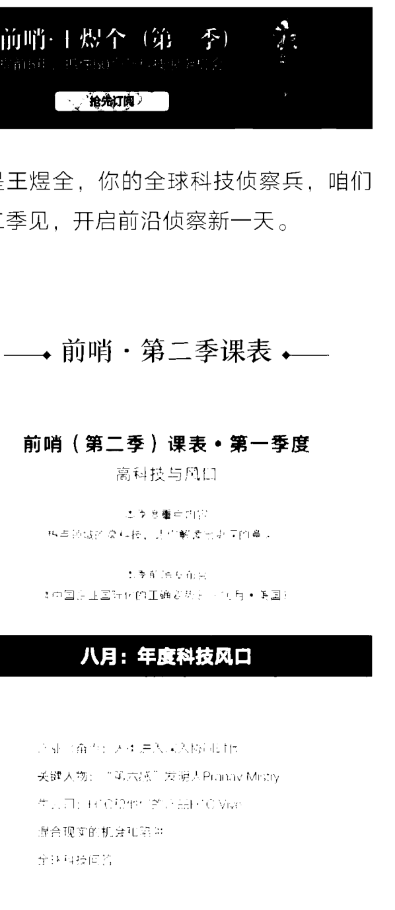

## 第二季有什么不一样？

### ◆ 更全面

第一季，我是你的全球科技侦察兵，第一时间报道全球科技新动向；第二季，我会提前准备好行动计划，为你更全面的扫描和同步科技突破和产业发展情况：

### ◆ 更立体

### ◆ 更系统

全年4次季度复盘和专题课：

全年4场前哨发布会：

## 我还为你准备小礼物

## 订阅提示

## 兑换流程：

## —— 前哨·第二季课表 ——

## 前哨(第二季)课表·第一季度

## 八月：年度科技风口

### 九月：智能产业

### 十月：医疗健康产业

## 前哨・第一季度行动地图

## 前哨（第二季）课表・第一季度

高科技与风口

本季度重点内容
热点领域的科技，让你解读出更深的意义。

本季前哨发布会
《中国企业国际化的正确姿势》（10月・美国）

## 八月：年度科技风口

- 产业兴奋点：人类进入深入协同时代
关键人物：“第六感”发明人 Pranav Mistry
牛公司：HTC和他们的产品HTC Vive
混合现实的机会和陷阱
全球科技问答

- 产业兴奋点：改变各个产业格局的超级武器
关键人物：Geoffrey Hinton
牛公司：DeepMind（揭秘战胜李世石的公司的幕后故事）
人工智能的机会和陷阱
全球科技问答

- 产业兴奋点：大航天时代来临，将极大拓展人类的疆域
关键人物：Burt Rutan
牛公司：Bigelow Aerospace（世界第一家商业空间站公司）
航天产业...
全球科技问答

- 产业兴奋点：也许是下一个大泡沫
关键人物：中本聪（神秘的比特币发明人）
牛公司：以太坊（极大普及了区块链的应用）
ICO与企业投资领域的机会和陷阱
全球科技问答

### 九月：智能产业

- 产业兴奋点：你将越来越多地与机器人打交道
关键人物：Cynthia Breazeal
牛公司：Hanson Robotics
商业机器人领域的机会和陷阱
全球科技问答

- 产业兴奋点：智能可穿戴使我们真正开始了解自己
关键人物：可穿戴之父、MIT媒体实验室教授 Alex Pentland
牛公司：Active Protective
智能可穿戴领域的机会和陷阱
全球科技问答

- 产业兴奋点：4级自动驾驶有望在2020年上路
关键人物：谷歌无人车之父 Sebastian Thrun
牛公司：Mobileye
自动驾驶领域的机会和陷阱
全球科技问答

- 产业兴奋点：下一个互联网巨头的大机会
关键人物：Dag Kittlaus（苹果的语音互动Siri的创始人）
牛公司：亚马逊
人工智能入口领域的机会和陷阱
全球科技问答

### 十月：医疗健康产业

- 产业兴奋点：人类将突破自然进化的局限
关键人物：George Church
牛公司：Editus
基因工程的机会和陷阱
全球科技问答

- 产业兴奋点：“量体裁衣”的个性化医疗时代的来临
关键人物：Craig Venter（首次完成人类全基因组测序）
牛公司：Vertex Pharmaceuticals（精准治疗药物研发者）
精准医疗领域的机会和陷阱
全球科技问答

- 产业兴奋点：癌症不光可以治疗，还可以预防了
关键人物：2011年诺贝尔医学奖获得者 Ralph Steinman
牛公司：Dendreon（推出了Provenge前列腺癌疫苗）
癌症疫苗领域的机会和陷阱
全球科技问答

- 产业兴奋点：小型医疗器械是大利
关键人物：Jonathan Rothberg
牛公司：Intuitive Surgical（首台商用手术机器人制造者）
小型医疗器械领域的机会和陷阱
全球科技问答

- 掌握科技风口出现的规律
了解各个风口领域的具体产业链和生态
找准自己在科技风口中的定位
为风口的出现做好准备
总结+发布下一季度课表

## 混合现实｜把真实世界叠加进虚拟世界

混合现实｜人类进入深入协同...

王煜全

你好，我是王煜全。

今天是我们前哨（第二季）的第一天，第一周我们要介绍的是现在还没有引起太多关注的“混合现实”产业，为什么要把这个产业放在第一个介绍呢？因为它非常重要，而且它很快就会成为热点，带来巨大的商业机会，但是大部分人又没有看到，所以我希望我们前哨的用户能够成为先行者，把握住这个窗口机会。

### 一、什么是混合现实？

我们首先要对几个术语做个解释，不然像听绕口令一样，你很快就会晕了。

#### 1. 虚拟现实：把虚拟世界呈现到你眼前

虚拟现实（Virtual Reality），简称VR，就是把虚拟世界的东西呈现到你眼前，让你以为是真实的。其实游戏世界就是典型的虚拟现实，只不过现在大家约定俗成，都把那种戴着头盔的、沉浸感更强的、眼界里只有虚拟场景的应用叫作虚拟现实。

#### 2. 增强现实：把虚拟世界叠加到现实世界

增强现实（Augmented Reality），简称AR，就是把虚拟世界的东西叠加到现实世界里。去年日本任天堂公司推出的Pokemon Go（中文名称“精灵宝可梦Go”）手游就是运用AR技术，玩家可以通过手机屏幕在现实环境里发现精灵，然后进行捕捉或者战斗。比如你面前是一片真实的海滩，但透过手机屏幕，你能看见一只小精灵在海滩上；把手机移开，其实还是只有海滩，这就是增强现实，把虚拟的叠加到现实里。

#### 3. 混合现实：把真实世界叠加进虚拟世界

混合现实（Mixed Reality），简称MR，相对于AR把虚拟的东西叠加到真实世界，混合现实则是把真实的东西叠加到虚拟世界里。听起来好像是差不多，反正都是把现实和虚拟混到一起，但其实差别大了，因为把虚拟叠加到现实里比较容易，你看现在连游戏都有了，就是在真实的画面上显示虚拟的东西就好了。

但要把现实叠加到虚拟里，可就比较难。因为首先你得把现实的东西虚拟化，也就是得用摄像头捕捉画面，但我们都知道摄像头捕捉的画面都是二维的，也就是画面是扁平的，没有立体感，所以还得把二维的图像通过计算机形成三维的虚拟图像，这叫3D建模，只有这样虚拟化之后，你才能把它很好地融合进虚拟的3D世界里面。

如果你觉得这么说还是太理论了，我给你举两个例子就比较好理解了：

比如修汽车，有些老师傅身怀绝技，但毕业人数有限，而汽车故障可以发生在任何地方，你无法保障每个修车点儿都有特别优秀的技师，自然服务质量也无法保障。现在有了混合现实工具，现场的技师就能把车况拍成三维的虚拟图像传给老师傅，老师傅根据看到的就是非常真实的现场情况，他在判断出问题后能直接给出修理建议，而且还能在三维的虚拟实体上把每一步都指出来，现场的技师只需要照着做就行了。

再比如：

假设有一天，你老公不在家，你家里的某个电器又坏了，但平常都是他处理的，你不会，那怎么办呢？用混合现实工具就很简单——摄像头拍着这个电器，马上3D建模，发给你老公，你老公就好像在家里一样，手把手教你怎么修理了。不过，到那个时候，也许你也不用麻烦你老公了。直接发给厂商售后，专业人员马上教你解决问题，总比等着他们客服人员上门要快多了。

小结：

虚拟现实就是你看到的东西都是虚拟出来的，也就是都是假的；

增强现实是把虚拟的东西叠加到现实的东西上；

而混合现实是先把真实的东西虚拟化，然后叠加到虚拟世界里。

### 二、混合现实技术将提升人类复杂协同能力

咱们首先一起思考个问题：人类为什么会成为地球上最强大的物种呢？

答案是：因为人类拥有强大的协同能力。

那么什么是协同能力呢？有三个考核标准，分别是：

- 规模
- 复杂度
- 实时协同能力

比如非洲大草原上几十万只斑马迁徙，都奔向同一个目的地，每一匹斑马只需要跟着大部队走就行了，不用于别的，所以这是大规模的复杂度很低的实时协同。

还比如娱乐节目《奔跑吧兄弟》里面，几位“跑男”一起做一件事情，人数虽然后少，但却需要复杂的实时配合，这是小规模的复杂度高的实时协同。

而人类社会的商业系统，就是大规模的实时的复杂协同。

有一本我非常推崇的书叫做《超级合作者》，就认为地球上的任何一个其他物种的协同能力和人类比起来，都相当于小筷和摩天大楼的差距，复杂程度是没法比的。其实，人类的进化过程，就是协同能力不断提升的过程，语言、文字、货币、宗教、城市、国家等等，都在推动人类协同能力不断提升。

回想一下刚才才修汽车和修家电的例子，其实就是说明混合现实技术在进一步提升人和人之间的复杂协同能力，而且那还只是冰山一角而已，规模还很小。随着它的发展，未来的社会、生活、工作、教育、医疗等方方面面，其实都在它的提升范围里，存在着巨大的商业机会。

### 三、混合现实未来的机会巨大

“混合现实”很快会成为热点，能带来巨大的机会，而且绝对大多数人还没看到。

说一个并不新鲜的新闻：2017年6月6日，苹果召开了全球开发者大会（WWDC）。苹果每年会通过这个大会向开发者们展示最新的技术和软件，因为苹果是全球市值最高的公司之一，而且也一直被认为是科技的引领者，所以WWDC的关注度非常高。

但是这次的大会普遍认为是缺少亮点，很多人评论说：苹果已经不是以前的苹果了。但是，我要说：伟大的革命往往是静静地发生的，并且当时不为人们所理解。比如当年苹果推出“Siri语音助手”的时候，大家都不重视，甚至有很多负面的声音，说技术不成熟、不符合用户使用习惯等等。可是今年，语音互动大热，甚至会成为互联网的新入口，亚马逊、谷歌都推出了语音互动设备，苹果的独立的语音互动设备也要推出了，这些都证明了苹果当年的远见。

所以，别着急说人家没新意，要看看自己是不是能看得懂。

回到我们今天介绍的“混合现实”。今年的苹果开发者大会，其实隐藏的最大亮点就是苹果推出的“增强现实平台”（ARKit）。

此次苹果开发者大会上演示的，是用肉眼看着明明是一个什么东西都没有的桌面；可到了手机屏幕里，桌面上就出现了一个杯子、一盏台灯，甚至一个可以供游戏对战的城堡，这其实是增强现实，跟刚才提到的手游“Pokemon Go”好像也没太大区别。但很多人没注意到，苹果在增强现实平台的展示中，随意拖动真实桌面上的虚拟台灯、虚拟茶杯，它们的影子其实也会随之变化，这就需要摄像头对真实的桌面要进行实时的3D建模，说明苹果平台中已经具备摄像头的3D建模能力了。

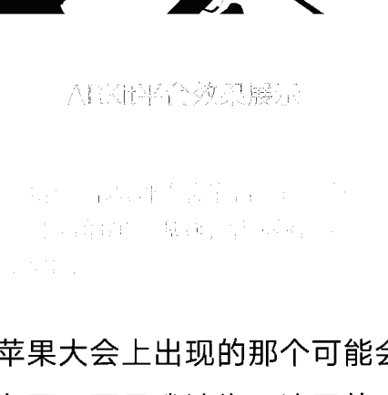

这才是苹果大会上出现的那个可能会改变世界的东西，而且我认为，这次的“混合现实”会来势凶猛并且影响深远。就像苹果推出Siri是万能语音助手，但最普及的却是亚马逊的智能音箱一样，我认为苹果这个增强现实平台会带动的，其实是混合现实的腾飞。

## ｜今日小结+预告

今天给你介绍了一个静静悄悄来临的可以改变世界，能够极大提升人类协作能力的混合现实技术，现在，它的技术已经具备，而且拥有巨大的市场潜力，至于这个产业的历史沿革、产业链特征，尤其是产业的具体机会，我会在本周的后几天为你介绍。

### ｜今日思考题

假设混合现实技术已经成熟了，请你可以想象一下，哪些产业会发生革命？哪些产品和服务，会面目一新？你所在的行业，有没有混合现实技术的使用空间呢？

欢迎你在留言区分享你的观点，我会和你一起参与这场科技前沿的讨论。

## 前哨历 7月31日

### 我的今日知识清单：

- 1. 混合现实(MR)是把现实世界叠加到虚拟世界里的技术。
- 2. 协同能力有三个考核标准：规模、复杂度、实时协同能力；依托混合现实技术能够实现大规模的复杂实时协同，提升人类复杂协同能力。
- 3. 伟大的革命往往是静静悄悄发生的，并且当时不为人们所理解。

「得到」专栏《前哨·王煜全》
抓住5年，抓住50个前科技浪潮机会

王煜全

第二季的前哨，我会为你准备3件“秘密武器”：

- • 每天一张“前哨历”，总结自己的知识清单，期待你每天都有进步；
- • 每月一张“科技创新地图”，及时掌握自己的学习动态；
- • 每季度一张“行动地图”（课表），你可以在发刊词中查看。

欢迎你把这3张图分享到你的朋友圈，记录一下你一年的学习成绩，和你的朋友同步学习进展。

我是王煜全，你的全球科技前哨侦察兵，明天上午8:30见！

## 参考资料包：

- 1. 前哨第一季度课表 (点击查看)

http://www.iqiyi.com/w_19rtrwa17x.html

### 前哨留言精选

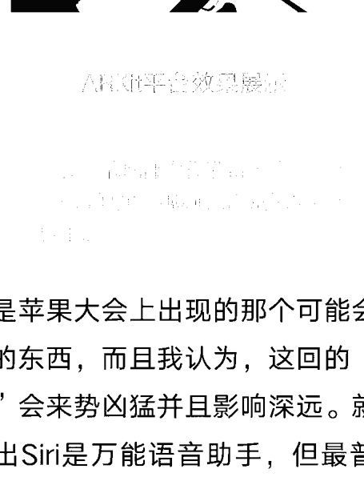

这才是苹果大会上出现的那个可能会改变世界的东西，而且我认为，这次的“混合现实”会来势凶猛并且影响深远。就像苹果推出Siri是万能语音助手，但最普及的却是亚马逊的智能音箱一样，我认为苹果这个增强现实平台会带动的，其实是混合现实的腾飞。

## ｜今日小结+预告

今天给你介绍了一个静悄悄来临的可以改变世界，能够极大提升人类协作能力的混合现实技术，现在，它的技术已经具备，而且拥有巨大的市场潜力，至于这个产业的历史沿革、产业链特征，尤其是产业的具体机会，我会在本周的后几天为你介绍。

### ｜今日思考题

假设混合现实技术已经成熟了，请你可以想象一下，哪些产业会发生革命？哪些产品和服务，会面目一新？你所在的行业，有没有混合现实技术的使用空间呢？

欢迎你在留言区分享你的观点，我会和你一起参与这场科技前沿的讨论。

## 前哨历 7月31日

### 我的今日知识清单：

- 1. 混合现实(MR)是把现实世界叠加到虚拟世界里的技术。
- 2. 协同能力有三个考核标准：规模、复杂度、实时协同能力；依托混合现实技术能够实现大规模的复杂实时协同，提升人类复杂协同能力。
- 3. 伟大的革命往往是静悄悄发生的，并且当时不为人们所理解。

「得到」专栏《前哨·王煜全》
抓住5年，抓住50个新科技浪潮机会

# 王煜全

第二季的前哨，我会为你准备3件“秘密武器”：

- · 每天一张“前哨历”，总结自己的知识清单，期待你每天都有进步；
- · 每月一张“科技创新地图”，及时掌握自己的学习动态；
- · 每季度一张“行动地图”（课表），你可以在发刊词中查看。

欢迎你把这3张图分享到你的朋友圈，记录一下你一年的学习成绩，和你的朋友同步学习进展。

我是王煜全，你的全球科技前哨侦察兵，明天上午8:30见！

## 参考资料包：

- 1. 前哨第一季度课表 (点击查看)

http://www.iqiyi.com/w_19rtrwa17x.html

### 前哨留言精选

## 发刊词 | 提前5年，抓住50个新科技浪潮机会

你好，我是王煜全，海银资本的创始合伙人，我的投资方向是带着中国的钱投到国外的高科技。

我们正在面临一个全球风口，科技形成的新一波创新浪潮正在席卷世界，这又是一次历史性的时代机遇。科技正在为产业和个人赋能：

科技在推动产业转型：很多企业在提“夕阳产业”。其实，从来就没有什么是传统产业只有传统的企业。放眼望去，转型是持续性的过程，每个行业都在因科技而发生改变。

科技让神话变成可能：过去的两年，中国平均每天新增200个千万富翁：20年前的马云，10年前的刘强东，5年前的雷军，还有现在的你……这个时代从不缺少机会，科技在帮你打破阶级，改变你的命运。

当然，科技还带来巨大的不确定性：过去的经验正在失效，未来的预测很难精准，我们只有关注当下，聚焦科技领域的发展趋势，才能不被浪潮淹没。

2016年，我带着“改变未来让更多的人爱上科技，掌握科技”的发心开启《前哨（第一季）》。

未来一年，我将继续作为你的全球科技前哨侦察兵，用我20年的实战和研究，每年5个亿的科技投资经验，深入科技创新的行业最前沿，系统扫描全球科技趋势。

未来一年，我将从科技的最新突破出发，聚焦技术的最新变化，系统分析产业格局和变化，为投资和创业提供咨询建议，帮助你建立对科技的完整认知。

### ｜前哨将为你提供什么？

- 1. 四大科技领域知识模块

全年的内容将分为：“高科技与风口”、“高科技与生活”、“高科技与社会”、“重大科技突破”四大知识模块，帮你建立起对全球科技的系统认知和知识体系，帮你建立对热点科技话题的深刻认知，理解科技在工作和生活中的渗透和变化，把握个体利用科技发展的可能，介绍未来科技领域的突破方向。未来一年，希望你能成为朋友圈里科技领域的专家。

- 2. 每周理解一个科技行业

前哨将每周发布一份全景式的科技报告，从5个板块着手，每天10分钟，帮你理解和掌握一个时代机会：

- 周一·行业概述：我将提纲挈领地介绍最新的技术，包括基本概念、核心技术和价值趋势，帮你掌握科技的框架性认知；
周二·历史沿革：我将从产业最出名的牛人入手，揭示行业的发展脉络和背后的发展规律，你将对科技的趋势有自己的理解；
周三·产业链拆解：我将介绍产业内最有代表性的公司，还原技术产业化的过程，你会看到到底如何把握行业机会；
周四·机会与陷阱：我将为你揭示这个产业到底有哪些机会？机会会出现在什么地方？可能有什么陷阱？让你在把握产业机会前做足准备。
周五·问答和补充：我将回答你对科技的问题和疑虑，让观点和想法在这里碰撞，让知识真正变成你的见识。
周六·前哨团：邀请各路科技大牛包括创新企业家、黑科技实践者、科技研究者和行业从业者等科技极客组成前哨团，不定期地向你汇报科技资讯和动态。

- 3. 4次专题复盘和4场前哨发布会

科技领域的变化每天都在发生，我将在每个季度发布一次新课表，聚焦3个月中的最新科技动态，第一时间报告全球科技动向；每个季度内容结束后我将用一周的时间为你进行一次系统的专题梳理和复盘，帮你找到行业之间的关系，发现科技发展的共性和规律，构建知识体系。

### 全年4次季度复盘和专题课：

- 第一季度：如何把握科技创新的风口？
第二季度：传统企业如何运用科技？
第三季度：如何建立未来思维，掌握自己命运
第四季度：科技产业趋势与机会

### 全年我还将开展4场前哨发布会主题活动：

- 秋季：中国企业国际化专题，指导你如何抓住风口
冬季：拉斯维加斯CES展现场报道，同步消费科技领域最新动态
春季（前哨大会）：年度全球科技大盘点，梳理全年科技大事记
夏季：最新科技概念股发布，发布改变生活和未来的科技榜单

- 4. 不定期的全球科技报道

未来一年，全球科技领域必然会发生一些大事，我将第一时间以加餐的形式在专栏发布深度的解读，实时同步全年的全球科技动向。

### ｜你在前哨将收获什么？

- 1. 对全球科技前沿发展有个全景式的认知。你将理解科技发展的来龙去脉，学到科技领域的前沿知识，掌握用科技和技术视角看世界的方法，提前预知未来可能的走向。

- 2. 通过读懂各个行业的科技，进而读懂各个行业；通过读懂各个行业，进而读懂全球未来发展。你将发现未来改变你生活甚至是你命运的机会，从而更从容地面对未来的事业道路和职业选择。

- 3. 你将跟上科技发展的步伐，成为时代的领跑者。未来，对新技术不敏感的人将会被时代抛下，成为现代社会的穴居人；而你因为今天的正确选择，将成为未来机会的主导者。

作为科技领域的投资人和科技行业的长期观察者，在人工智能、无线充电等概念进入公众视野前，我就已经完成投资布局，拿到行业的门票。而这正是基于我对科技趋势的判断，并且用真金白银为我的判断买单。

作为投资人，我还有个小野心，我不只求赚到钱，我还希望能够推动中国科技的发展，最有效的方法就是能让更多的人了解科技、使用科技，抓住时代机会一起行动。所以，在接下来的一年，我会把我的见识和我用自己投资的脚步踩出的全球科技的“创新地图”毫无保留地分享给你，让你也能用知识的积累形成超强判断力，每天10分钟时间，帮你看懂未来，抓住50个新科技浪潮机会。

总之，我希望这个专栏能够帮助你打开另一个视野，看看全球高科技领域的发展，预知科技对你工作和生活的改变，看到未来的产业趋势和正在变化的社会形态，从中也更清楚地看到自己的优势和可能性，从而找到属于我们的新机会和更加美好的未来。

### ｜前哨·第一季度行动地图

### 前哨（第二季）课表·第一季度
高科技与风口

八月：年度科技风口

### 混合现实｜黑科技离你还有多远？

关键人物：“第六感” 发明人

# 王煜全

你好！我是王煜全。

昨天我们介绍了一个悄悄地来临的巨大机会，叫作混合现实。你听完肯定有这样一个疑问：你说这是大机会，它是怎么突然出现的呢？以前的人难道就没有看到这个机会吗？

### 一、混合现实不是突然出现的

其实坦白讲，这个机会早就有人看到了，而且也有相关的产品研发出现。

2009年的时候，那个具有全球影响力的专门传播有价值的创新思想的论坛，叫作TED大会，就专门请了一个演讲人，介绍了他的发明产品。这个产品其实就是用混合现实思路实现的一个产品。

这个产品叫“第六感”，实际上是一个用技术把现实和虚拟在某种程度上融为一体的产品。

整个系统由一个戴在头顶上的小型摄像头和一个戴在胸口的便携式投影仪，还有四个套在手指上的彩色标记环，以及一台便携式电脑这四部分组成。

在工作的时候，它们的摄像头会追踪眼前的图像，尤其是会追踪标记环的运动，并且反馈给电脑。电脑系统处理之后，再把结果投影仪投放到合适这个显示界面的显示位置上来。这样，人不必坐在电脑桌前，不用面对一个固定的显示屏，就可随时地实现人机交互。

我们昨天其实讲过，现实和虚拟的叠加可以极大地提升我们的效率，这个产品就是用于这个用途的。

举个现实的例子，我们买书的时候经常都会碰到这种情况：

很多人买书还是希望去接触到真实的书，去书店里面前后翻翻页，找找感觉，所以愿意去线下的实体书店。

但是，线上书评也会给我们很多的启发，某人说这本书好，或者这本书不好，很容易影响我们的决策。在实体书店当中，很难同时看到线上书评，也就是现实和虚拟是割裂的，不能整合起来。

如果你戴了“第六感”去书店，拿起一本书的时候，你的摄像头就会读出书皮上的书名，进而到互联网上去搜索有关这本书的书评，然后用投影仪把相关书评投影到书的封皮上来。这样，你举着这本书的时候，读贴身上的相关书评就可以决定是不是要买这本书了。

我相信，听了我的描述，你肯定也有冲动，想试一试这个产品，因为这真的是把现实和虚拟结合得非常好的一個例证。

### 二、牛人Pranav Mistry

Pranav Mistry，他是1981年生人，是一位印度的发明家，是印度理工学院（IIT）工业设计专业的硕士，IIT在印度的地位相当于美国的麻省理工学院（MIT）。之后他也真的去美国的麻省理工学院读书，而且是进了大名鼎鼎的媒体实验室（Media Lab）去读硕士，所以他读了两个硕士。他在媒体实验室的前人的开发基础上做了改进，最后推出了这个完善的“第六感”系统，所以也得到了发明家的称号。

当然，他确实是个了不起的发明家，因为不光这一个发明，他后面也连续发明了不少的产品。

比如像隐形的鼠标、智能贴纸、用眼球控制的机器人等等。因为他在发明上的成就，他也获得了一大堆的荣誉。

2009年，也就是他推出了“第六感”的当年，就获得了《MIT技术评论》这个杂志推出来的“35岁以下的35人”的称号，简称TR35。

2010年，他又被《创造力》杂志评为“全球的创造力50强”之一。到了2013年，他又被世界经济论坛评为“青年全球领袖”。

2012年，他正式加入了三星，现在已经是负责战略发展和产品设计的三星的全球高级副总裁了。

### 产业思维：

### 产业思维：中国企业需要转变创新思路

祧开一点话题：

熟悉我们前哨的人都知道，我们17年1月份的时候组织过中国企业的家代表团访问过伯克利，在访问里的一站我们介绍过伯克利有一位著名的华人教授叫张翔，他有很多了不起的科研成果。但是有不少的科研成果都是和三星合作，也就是说最后知识产权都授权给三星了。

我们中国人有这样一个习惯性的思路，我们也知道要到全球找人才，但是我们始终是在全球找华人。华人在国际上主要是在学术圈子里很不错，在产业界相对弱不少。所以，我们中国的企业家出去往往都是到各个高校去找华人帮自己提升技术能力。但这一点上来说，实际上是有很大困难的。

第一，你需要有很强的研发实力，才能和国外的高等学校去对接，我们中国的企业往往研发实力比较弱。

第二，也不能保证你在每一个你想有布局的领域都正好有华人能支持你。

所以，我们认为中国的企业其实应该向三星这样的更加国际化的企业学习，三星不光在伯克利和华人教授合作，也从MIT挖来了这位著名的印度发明家，所以它是一个真正全球化的组织，它不根据种族来布局，而是根据它的技术需求来布局自己未来的发展。

我们希望中国的企业家在全球化过程中中，也逐渐地摒弃那种只和中国人打交道的习惯，真正变成全球化的企业，让全球的人才都为我们的企业所用。

我们前哨也正在做一个摸底的项目，去调查了解全球的优秀的年轻的发明家和企业家，做成真正的全球创新地图，我们希望以此和中国企业对接，使我们中国的企业家真正可以在国际上去找到最优秀的人才合作，找到最先进的技术，找到最先进的企业和自己的企业形成长期合作，这是一点题外话。

### 三、先進科技發明一般都出名门

“第六感”这个产品其实也验证了我们以前一贯的观点，就是先进的科技发明一般来说都是系出名门，这个发明也一样，它出自于大名鼎鼎的MIT的媒体实验室。

媒体实验室，我相信大家都不陌生，它是MIT里一个独立的不从国家要资助，主要是和企业合作来获取自己科研经费的这样一个机构。很多世界前沿的科技发明，追溯源头都是媒体实验室推出来的。

其实这个科技产品，也不是从Pranav Mistry才开始做的，因为之前的工作是媒体实验室的另一位科学家叫Steve Mann，在1997年就做出了原型，Pranav Mistry只是在这个基础上做了改进。

Steve Mann本人其实也是一个了不起的发明家。媒体实验室的创始人，也是本非常著名的著作《数字生存》的作者，同时也是搜狐公司的第一投资人，大名鼎鼎的尼葛洛庞帝教授，就曾经这么评价Steve Mann，他说Steve Mann的工作给媒体实验室的可穿戴计算的未来发展种下了种子，也就是说，他认为整个媒体实验室可穿戴计算领域，其实应该都是Steve Mann奠基的。你会看到原来这个人有这么强的背景，当然，也是依靠媒体实验室这么强的学术背景。

### 四、应用创新需要软硬件的支持

不过，我想你肯定有一个疑问，就是说这么牛的人，这么牛的背景，做出了这么牛的产品，怎么我们没在市场上见到过呢？

因为这个产品确实还没有市场化。道理其实也很简单：

第一，媒体实验室只负责想主意，不负责产品化，所以他们有很多发明都是最早的，但是最后未必形成上市的产品，当然很多产品的思路后来也被吸收到了和他们合作的公司的产品设计里，所以这就是为什么有大量公司愿意资助他们。

第二，因为这其实是应用型的创新，应用创新是否能实现，要看软硬件能力能否支持，这个产品由好几部分组成，每个组成部分都需要很强的技术来实现，比如说它需要有足够强大的图形识别能力、文字识别能力来处理摄像头的信 息，它也需要足够强大的投影能力来支持投影。而且，一般来说投影耗电，还需要有足够大的电池才能维持整个产品的运行。所以，一个新产品开发当中，有数个难点需要去攻克，当然就不容易成功了。

比如我们海银资本（我作为创始人合伙人的投资基金）原来投资过的一个能让盲人重见光明的设备叫BrainPort，产品思路在2004年就有了，但一直到2014年才开发出第一代产品。

有人就问，为什么要花这么长时间开发一个产品？

这个公司的CEO Bob的回答是，如果2004年我们就开发出了可用的设备，会要求盲人背着一个至少10公斤重的大箱子才能支持我们所需要的计算能力。

但是随着IT技术的进展，最近这家公司又开发出了第二代产品，直接就只是一个眼镜，它需要的所有计算能力都被内嵌到眼镜腿里了。

其实这对我们中国人来说有一个重要的启示：因为中国最常见的还是应用创新，没有硬件软件支持的应用创新是很被动的，因为会被软硬件拖后腿，所以中国要成为创新大国，软硬件创新的能力必须要搞上去。

我们之所以认为今天混合现实市场成熟了，其实是因为苹果的软硬件平台已经把技术问题给解决了，苹果的产品都支持这个混合现实的技术。

也就是说，你作为一个开发者，一下就拥有了几千万的潜在用户，只要你能把应用开发出来，这几千万人都可以立即享受你的服务。

### ｜今日小结

今天通过介绍牛人Pranav Mistry和他发明的“第六感”，其实是给大家介绍了混合现实发展的历史当中的一个小片段。通过今天的介绍，我希望你能理解以下三点：

第一，任何的技术都是有明确的发展脉络的，而且越来越多的技术都是系出名门，跟 踪到所有技术的发展，你就不会有太多的意外。

第二，技术到产品有很长的距离，这个工作叫产业研发，往往需要专门的企业来完成，高校无法直接做出成熟的产品，所以要和高校对接，要看看你自己有没有足够强的研发实力。

第三，做产业研发的企业也需要结合当时的软硬件技术进展，尤其是偏应用的技术，如果支持性的软硬件技术不到位，就无法成功地产品化。

我们会在前哨里不断给大家总结科技产业的规律，只要抓住规律，你就能够很好地识别科技革命是否到来，我们也一直强调，不讲产业化时点的黑科技都是要流产，因为只有时点明确，你才知道如何积极参与，才能真正从科技潮流当中受益。

### ｜今日思考题

混合现实技术的应用还有很多，发布一个小任务：你不妨搜索和查找一下资料——在混合现实领域还有哪些牛人，还有哪些牛发明，分析他们的商业化之路顺利吗？为什么？我们一起用行动加深理解。

欢迎你在留言区分享你掌握的信息，或者留下今天你的心得和困惑，我会和你一起参与这场科技前沿的讨论。

王煜全

我是王煜全，你的全球科技前哨侦察兵。我们明天上午8:30见。

### 前哨历 8月1日

### 我的今日知识清单：

- 1. 任何的技术都是有明确的发展脉络的，而且越来越多的技术都是系出名门。
- 2. 技术到产品有很长的距离，这个工作叫产业研发，往往需要专门的企业来完成，高校无法直接做出成熟的产品。
- 3. 一项技术的软硬件条件都成熟，才能实现产品化，迎来真正的市场机会。

摘自：《混合现实 | “黑科技” 离你还有多远？》

「得到」专栏《前哨·王煜全》
践行5年，甄选50个科技产业机会

参考资料包：

https://www.ted.com/talks/pattie_maes_demos_the_sixth_sense/up-next

### 前哨留言精选

## 003 | 把握现实需求抢占混合现实的风口

关键公司：HTC和他们的产...

王煜全

你好！我是王煜全。

今天是周三，我们继续来介绍混合现实产业，昨天我们说到，应用的创新往往需要软硬件领域的支持，在混合现实领域，除了苹果这样的平台支持，往往还需要其他相关设备的支持，今天就给大家介绍这样一家混合现实领域很重要的硬件企业——HTC。

### 一、HTC的转型：从手机到布局虚拟现实

HTC很多人都会有印象，台湾的IT企业，好像是在做着一个二三流手机的品牌。但实际上你可能不知道的是，HTC已经在悄悄地转型了。

2017年1月5日的CES展（国际消费电子产品展）上，HTC推出了一个叫做Vive追踪器的小东西。这个是什么东西呢？简单地说，就是这个小的设备装到任何东西上，比如说装到手套上，或者装到头盔上，就能把物体的运动轨迹完整地描画出来，也就是说对运动的位置的追踪成为可能。所以简单地说，它可以把任何物品变成一个虚拟现实的手柄。这个东西为什么重要，因为它又是一个可以把现实变成虚拟的设备。

HTC推出这个Vive追踪器以后，一直在持续地推广，在2017年上半年的各个大小会议上都在推这个追踪器。

为什么花这么大力气来推追踪器呢？我们要从HTC的历史沿革说起：

HTC中文名叫宏达国际，是由台湾的合塑集团创始人，被称为台湾经营之神的王永庆的女儿王雪红在1997年创立的。

这家公司在创立之初就很辉煌，如果熟悉最早的移动通讯，对那个时代的IT设备了解的人一定还记得，最早的产品叫PDA，也就是手持式的计算设备。当时有一个公司叫康柏（COMPAQ），就是后来被惠普（HP）公司收购的那家，推出一款叫iPAQ，是最早的手持设备。（注意，不是iPad，是iPAQ）

iPAQ最后一个字母是Q，因为是康柏公司的词尾来的。这个设备就是由HTC来帮助它生产的。能够成为大名鼎鼎的康柏公司的移动设备代工厂，让HTC很风光一阵。但是，随着iPAQ后续乏力，慢慢就风光不。

### 二、条件已成熟，虚拟现实即将重新大热

### 三、构建产业链，实现全球虚拟现实产业布局

为什么Valve公司那么重要呢？

### 四、虚拟现实和增强现实的产业链重叠

#### 1. 感知系统

#### 2. 开发工具

叫Unity 3D，是由Unity公司推出来的。
所以，Unity公司应该在未来有很大的成长空间。这家公司也被很多中国公司投资了，包括华山资本、掌趣都投了，所以也是中国在全球游戏产业上有全球性布局的一个范例。

#### 3. 显示设备

我们容易习以为常地认为不管是增强现实也好，还是虚拟现实也好，都需要在头上戴一个大的头盔，戴一个大显示器。因为不管是虚拟现实的Oculus，还是增强现实的Mata，都是这么个设备。但实际上苹果做了一个很好的示范，就是手机本身就可以是一个显示器。我们自然可以想到，iPad也可以是个显示器，而且苹果这次是下定决心用Pad来实现所有的移动计算能力，使它未来成为移动笔记本电脑的替代品。

你可以想象Pad未来的能力会很强大。所以，也许下一次到你家来帮你做电器维修或者疏通管道的那个工人随身就会带着个Pad，照着你的设备，然后和他的师傅远程交流来解决你们家的现实问题。

当然，不管是手机还是Pad，手持总是过去不了方便。所以，像“第六感”（昨天的内内容介绍的现实和虚拟融为一体的产品）那样的可穿戴，也就是说手势可跟踪这样的设备还会出现。

比如说在你家里帮你维修的这个师傅，他手上的每一个动作都被传到他师傅那里去，他的师傅就很容易判断他的维修方式是否正确，进而作出正确的指导。

所以我们认为，在这个混合现实的潮流当中，还会涌现出大量的可穿戴设备，也许原来没有实现产品化的"第六感"在这个潮流当中会实现产品化，尤其是在一些行业专用的可穿戴系统会大量出现。

#### 4. 底层技术

我们曾在今年的CES展上专门给大家介绍了高通推出来的骁龙835芯片，基本上已经能够解决虚拟现实、扩展现实的计算需求了。

从带宽上讲，4G覆盖得越来越完善，5G也呼之欲出了。所以我们可以看到，虽然混合现实和虚拟现实产业链有点不同，但基本上还是重叠度很高的。

### 五、混合现实将会比虚拟现实更快成熟

因为虚拟现实还是以游戏需求为主导，所以需要更加清晰的显示，也要耗掉更大的带宽，也需要更强的建模和计算能力。

而混合现实是以解决现实问题为主，只要能够解决现实问题，清晰度是可以妥协的。

比如说到你家里来修下水道，我建的模型就可以各种各样地专门针对这个行业的压缩算法，能够实现极大的带宽的节约。

所以我们的判断是整个产业链的角度上来讲，虚拟现实可能还要两年。但是混合现实已经完备了，尤其是随着苹果的大力推广，这个产业会加速成熟。

不要忘了，苹果已经说了，它推出来这个增强现实的系统，形成了世界上最大的增强现实平台，几千万的苹果用户瞬间都变身为增强现实的平台用户了。所以，这个风口会迅速形成。

如果你对商业足够敏感，我建议你现在就可以行动了。但是再强调一下，未必是苹果自称的增强现实市场，未必是苹果演示的游戏应用，能够做得很大，在解决人际的复杂协作的混合现实领域，才有真正巨大的市场。

### |今日小结

我今天讲的重点是：

一个产业链往往需要硬件软件等的成熟才有应用创新的机会，而硬件软件一旦成熟，有现实需求的应用很容易成为下一个风口，这种时候一定要果断介入。

### |今日思考题

你能为混合现实的体感追踪器想到哪些更多的用途呢？也许这中间就酝酿着你的创业机会。

欢迎你在留言区分享你掌握的信息，或者留下今天你的心得和困惑，我会和你一起参与这场科技前沿的讨论。

王煜全
我是王煜全。你的全球科技前哨观察兵。咱们明天见。

## 前哨历 8月2日

### 我的今日知识清单：

+   1. 少则一年，多则两三年，虚拟现实一定会重新热起来，焕发它的活力。
2. 从产业链的角度讲，混合现实比虚拟现实的发展条件更完备，尤其是随着苹果的大力推广，产业会加速成熟。
3. 产业链的硬件和软件等成熟后，才有应用创新的机会，而有现实需求的应用很容易成为下一个风口，这种时候一定要果断介入。

> 摘自：《003 | 把现实需求抢占混合现实的风口》

## 004 | 混合现实产业有哪些机会？

前哨洞察：混合现实产业的...

王煜全

你好！我是王煜全。

我们本周给大家介绍了混合现实的机会，也介绍了混合现实的历史沿革和产业链结构。

我们的结论很清晰，就是这个技术的产业链已经成熟。

又由于苹果强力推出了增强现实平台，所以，市场已经准备好了。应用应该有机会被起来了。

到底机会在哪儿？这是我们今天要讨论的话题。

### 一、要在应用领域里面找突破口

我认为，尤其是很多非技术公司，要是希望利用成熟的技术来实现自己企业的升级，或者实现创新的话，一定要尽量去选那些相对成熟的技术，在应用领域里面找到突破口，这是大多数中国企业可以做的事情。

应用领域，我们认为有三个机会是值得探讨的：

+   - 第一个是：实体培训的虚拟化；
- 第二个是：远程指导；
- 第三个是：远程协同。

#### 1. 实体培训的虚拟化

混合现实的优势是把现实的东西虚拟化，这样原来很稀缺的现实资源就容易被大量共享了，而且可以还原到现实场景中，取得真实动手的效果。

比如教育培训，我们原来也介绍过，现在美国的教育上一个趋势叫做STEAM，就是科学，技术，工程，艺术和数学的英文首字母组合。简单说就是综合利用各种的科技手段，实现让任何一个学生都能够当发现问题的时候，不是停留在那儿等着别人去解决，而是自己把问题解决掉，甚至在他自己解决问题的过程当中，也为全社会提供了一个很好的方案，使得整个社会都会受益。

自然，STEAM教育就需要有大量的动手培训。但问题是这会给学校带来很大的负担。

比如说你要组装机器人，学校就要采购各种各样的机器人的零件设备。所以实际开展起来非常难。

但是有了混合现实系统，学校就可以进行大量的虚拟实验。

比如说在STEAM教学课的时候，戴上混合现实的眼镜，利用混合现实里提供的虚拟的工具，来真实的操场的草坪上组装一台火箭。如果组装得好的话，一切就绪，可以发射升空。如果组装不好，可能还没发射就爆炸了。当然，一切都是虚拟，所以爆炸也没有危险，更别说不需采购这么复杂设备带来的巨大的成本了。

这样的例子还有很多，比如医学上的手术教学。所以我认为这种虚拟化的动手的实验教育会成为未来的主流。

#### 2. 远程指导

这个机会的核心是，因为有了这样的远程协作工具，所以一个最牛的核心团队，甚至大概只是一个人，也可以指挥一堆的多面手，一堆的地面部队，去完成原来这些多面手们做不到的复杂任务。很多的远程维护、维修的场景都是这样的范畴的。

比如我们周一举过的修车的例子。当然了，不光修车，还可以修飞机。不光维修，还可以维护。比如说市政，电力水管系统的维护，往往需要很多人深入到一线。那么话又脏又累，甚至又苦。如果想找到足够多的技术水平很高的人去做这样的艰苦工作，肯定非常地难。但是如果你让次级的人去做，他又缺乏足够的技能。这个时候，你用远程协作的方式就能顺利地解决这些问题。

所以，凡是需要远程指导的维修服务业都会有类似的机会出现。

#### 3. 远程协同

上面说的远程指导，是一个牛人作为核心，支持一群人。远程协同是一群牛人，大家各自牛的领域不同，就像我们一直在提倡的新木桶理论一样，每个人有不同的长板，每个板都很长，大家组成一个新木桶，在不同的地方，借助虚拟的协同平台来合作。

这里面最典型的场景就是产品的协同研发和生产。

我们一直跟大家强调，现阶段的科技产品开发最主要矛盾就是一边希望能够有大众的广泛参与，而另一边研发的门槛却越来越高，门槛高就高在很多产品不是单一的研发能解决的，往往需要多个团队来协同研发。

比如手机，你不光要保证它的芯片运算速度好，你还要保证屏幕的显示分辨率足够高，你还要电池的耗电低，甚至要为很多应用做优化。所以，往往需要不同能力的人一起来协作。

我们说，以前的协作，要么大家物理地聚在一起，因为远距离就很难协作了。要么就只能变成一个流水线，你做完了我再做，不是实时的，不同步，这样当然会极大地影响效率。

随着工业自动化、尤其是智能机器人的普及，未来的发展趋势必然是研发和生产逐渐一体化。我们讲以前在所谓的车库创业更多是做软件，做互联网。但是未来，车库创业真的可以把你自己的家改装成一个小型的生产车间，一个小工厂。而同时，尤其是未来的电子产品，有一个明显的趋势是会出小批量，多批次的生产，也正好能适应车库式的生产。

而且，我们说工程和设计结合未来会越来越紧密。原来技术公司的人专注于技术，做出来的产品，功能可以，但是缺乏美感。

人人家里都有WiFi，但是你那个路由器往往很丑，尤其是现在国内有个潮流，就是为了显示你的路由器的接收信号会很好，把天线设计的从一根加到两根、到四根、到八根，长得像个螃蟹一样。

按理说路由器这样的设备应该躲在家最显眼的地方，才能形成很好的接收效果。但是这样的设备长得如此之丑，你只好把它拽在墙角，结果接收效果还是不理想。那未来，我相信由于混合现实创造的虚拟研发环境，能让不同分工的人可以更容易地协同，更多的功能性产品设计感也会得到提升。

比如WiFi的路由器，就可能被设计成埃菲尔铁塔、中国的长城，甚至熊猫，各种各样不同的艺术造型，你就会愿意把它放在屋里比较醒目的地方，它的效果自然就好了。

所以我们说，未来的大量电子产品会个性化，会艺术化。那么未来的产品协同研发的需求也是非常强大的。

小结：以上就是我们认为混合现实未来的三个主要产业机会：虚拟培训、远程指导和远程协同。

### 二、谁会成为受益者？

#### 1. 底层技术的开发者会受益

像我们昨天介绍的HTC，它的VIVE头显和VIVE追踪器，这种硬件的周边需求都会有所增加。另外，尤其是本身就是做协同的企业，它利用了这个工具就使得自己的协同能力增强，也会有很大的机会。

比如说我们在前哨第一季里介绍过的从做绘图软件逐步进化到提供协同研发工具的企业Autodesk，它本身就在利用各种的虚拟系统来形成大家更强的协同研发能力，一旦和混合现实结合，一定会如虎添翼。

#### 2. 行业应用的开发方会受益

每个行业都可能因为利用了这些新的协同工具而出现新的大企业，比如新的教育培训机构，新的修车公司，新的电器维修公司等等。

#### 3. 有地面队伍的企业会受益

有一个有趣的现象，就是远程培训和指导需要一个非常牛的核心。但被指导的人往往不需要那么专业，他就可以是多面手。所以一个人有了混合现实的指导，可以既是帮你修电器的工人，也是帮你疏通水管的水管工，甚至本来是帮你打扫卫生的清洁工。

另一方面，远程指导毕竟需要有地面部队的支持，所以这种远程支持方的企业如果能够及时地和基于混合现实的技术服务企业对接，也会实现华丽转身。

我们可以设想，比如说现在在各地都有地面队伍的公司，比如像顺丰一样的快递公司，或者像美团一样的地推公司。如果他们将来和混合现实结合，就能够利用他们在各地的队伍，给用户提供各种各样的服务，不光卖产品，还能卖服务。

### |今日小结

我们认为，所有的抓住机遇的成功者，都是提前做好准备的，事先站到风口，当台风来的时候才能乘风翱翔。

混合现实的大潮马上就要来了，我们也给大家分析了机会来自哪里。如何把握住机会就看你能否把产业理解转化为行动了。

### |今日思考题

请大家发掘一下，混合现实的潮流到来，中国的股市上有哪些上市公司会因此受益，为什么？

王煜全

我是王煜全。你的全球科技前哨侦察兵。咱们明天见。

## 前哨历 8月3日

### 我的今日知识清单：

+   1. 混合现实未来的三个主要行业机会分别是：虚拟培训、远程指导和远程协同。
2. 除了应用开发者会受益，底层技术开发者、行业应用开发方、以及有地面部队的企业都将受益。
3. 所有抓住机遇的成功者，都是提前做好准备的，事先站到风口，当台风来的时候才能乘风翱翔。

> 摘自：《004 | 混合现实产业有哪些机会？》

「得到」专栏《前哨·王煜全》
提前5年，抓住50个新科技浪潮机会

### 用户留言

## 005 | 问答：先人一步把握混合现实产业机会

问答：先人一步把握混合现...

# 王煜全

你好，我是王煜全。

今天是我们全球科技问答时间，未来每周五我都会对一周的内容进行扩展和答疑，帮助你更好的建立对科技产业的认识。

在开始这周的问答之前，先给大家透露一下，明天，也就是本周六，会有第二季的第一篇加餐，内容是刚刚在日本名古屋举办完成的“机器仁世界杯”活动，忍不住跟大家分享一下，我们中国队在比赛里又取得了不起了成绩，具体的内容我明天详细给你说。

所以你可能已经听出来了，今天的音频有一定的背景噪音，因为我还在日本的考察活动行程里，请你见谅。

王煜全：把握混合现实产业...

下面言归正传，进入本周的问答时间。

### 全周总结+拓展

我们本周是从苹果推出增强现实平台开始，介绍了一个马上将会到来的大机会：混合现实。

其中有几个重点：

+   1. 增强现实是把虚拟的东西放进现实环境里，混合现实是把现实的东西虚拟化，这样可以放进虚拟环境，也可以进行远程的虚拟处理，这两者区别大家要花点时间去体会，没有搞清楚，就不容易理解为什么混合现实是一个会改变社会的巨大机会。

+   2. 虚拟现实和增强现实最大的市场机会是游戏，因而需要很高的硬件配置和带宽，现在都还不完全具备，因此离市场爆发还有一定距离；而混合现实最大的市场是toB，也就是行业应用市场，比如培训、远程指导、远程协同，因此不需要这么高的硬件条件，但关键是对具体应用的支持。

+   3. 混合现实市场现在还没有爆发，因此市场还没有这类应用，但爆发速度会超过虚拟现实和增强现实，因为：一是产业链基本完备，就像我们在之前的节目里介绍的，混合现实和虚拟现实、增强现实产业链的复合程度很高，不需要单独的产业链；二是混合现实的需求有强大的市场基础，人类进化的历程就是协作加深的过程，混合现实将会极大地加强人类的协作深度。

+   4. 我们前嗅不是事后的新闻报道，等到潮流来了再来附和，而是根据市场的本质特征和趋势先判断什么是下一个潮流，这样你才能撕开机会，因为任何被炒得沸沸扬扬的所谓机会，对普通人来说都不是机会了。只有先人一步，普通人才能真正把握住机会。至于如何把握，我们会在全年的内容里反复探讨。

### 用户答疑

用户戴逸问：王老师您好，我想请教老师，中国的混合现实产业发展到了哪个层次？目前为止，市场上还没有见到这个东西。如果要介入是要去国外引进吗？

# 王煜全

就像我上面讲到的，如果市场上已经见到了MR应用，其实说明这个机会已经在减弱了，如果市场上已经有大量MR应用，大家就会说潮流来了，但这时对于新进入者来说恰恰是已经没有机会了。

所以我们一直强调，任何先进科技都有一个很长的研发期。你在市面上看到了应用，说明人家已经研发好几年了，所以要看到真正的机会，不仅能看市场，还要深入到创业者、企业家和科技人员的群体里，深入到产业链的动态中，“春江水暖鸭先知”就是这个意思。

至于如何去找那些还没有冒头的企业？要熟悉产业链规律，知道什么是产业链关键环节，就知道到哪里去找了。昨天周四我们就给大家从产业链的角度分析了未来机会，希望对你有所帮助。当然更重要的是，你要对产业动态一清二楚，这并不容易，需要在产业中浸润多年形成知识、人脉甚至信用，这也是我们反复强调四五十岁的资深创业者最容易成功的原因。

用户荣灿问：煜全老师讲的MR是将现实的东西进行建模变成虚拟的东西、再和现实图像进行混合。而目前的产品我并未见到“将现实的东西进行建模变成虚拟的东西”这一环节。是在技术上发展还未成熟？还是我的理解不到位？期待煜全老师进一步的讲解。

# 王煜全

应该说不是和现实图像进行混合，而是和其他虚拟物体混合或者做虚拟处理，比如3D的旋转变形加工等等。

目前这么做的方法有两种：
一种侧重硬件，用专门的激光扫描设备，这种设备原来看很大、很贵，精度很高，主要是专业用，现在已经有不少创业公司做出了更便宜更轻量的设备，有的上了国外著名的产品众筹网站，有的已经公开售卖了；
另一种是侧重软件，就是用光学摄像头收集到的数据进行3D建模，也有专门的多摄像头设备，也有直接用手机摄像头的，虽然精度没第一种高，但门槛更低，已经应用到了量房的时候建立房屋的3D模型上。下一代手机普遍是双摄像头发结构，无疑会使利用手机摄像头进行3D建模更加精准。

所以，了解一个产业的动态，不光要有理论基础，更重要的是要有足够深入的了解，我们虽然在科技产业干了很多年，还是不敢有丝毫懈怠，每天就需要地反复扫描科技前沿，希望不放过任何新的突破。当然，我们也会通过前嗅，把我们了解到突破带给大家。

我们做的科技特训营就聚集了一批国内科技前沿的人才，今年的科技特训营第二期，学员里就有运用“摄像头+算法”对真实物体做3D建模的创业团队的CEO。他们现在可能不出名，因为潮流还没有来，但是在一年之内潮流就会来，这些人就会出名，你就会突然发现身边原来有很多人混合现实技术和业务的专家和团队。但是，如果等到他们出了名了你再介入、往往就晚了，所以这就要求你有超前了解、超前理解的能力。

### 用户留言点评

最后，我们对用户留言做个简单的点评。

本周我收到很多嗅前嗅的用户在专栏中的留言，表示对第二季的期待，以及分享自己一年的学习计划，感谢你对前嗅的关注和支持。

本周我们还留了几道思考题，比如周一的问题，哪些行业会因为混合现实技术发生革命？有很多用户也参与了应用创新的预测，比如在军事、医疗、教育培训等各个领域应该如何使用混合现实。

用户刘翔就判断，未来医疗急救就可以利用MR技术，第一时间让医生在远程给出急救指导，第一时间抢救伤员。

用户光牧就直接给出了远程手术、远程办公、远程建筑、高危生物化学物理操作、亲人远程陪护等一系列的方案。

远程医生吗？
- 远程办公：解决电话、邮件和视频会议无法做到的远距离办公，但这个场景真的很有必要吗？
- 远程建造：以后开发公司对总包单位和现场的监督，是不是可以通过这种方式来执行？《清单革命》里面提到了建筑场景里面两个冲突问题的解决，我认为倒是可能有理，但增加的成本能应付过来吗？现在建筑行业的利润已经被压到很低了。
- 高危的生物化学物理操作：如辐射装置、高爆装置的处理，但这个难道要用囚犯来操作吗？用机器手能不能做到？

### 实时交流：

- 跟亲人互动：养老院，远程送去一个拥抱 恩？难道指导护工怎么抱抱老校长？？

还有用户从自己的行业出发，给出MR和行业需求结合的设想，用户doreen就给出了一个完整的服装店利用MR技术提高用户体验的方案。

doreen
你好，我是做服装行业的，听过混合现实后，个人觉得将来可以非常好的应用于服装领域，特别是零售实体店，如果应用好了，应该是一把锋利的匕首去对战网购，会大大增加实体店的体验性及成交率。当服装实体店销售人员面对顾客销售时，其中重要的一点就是要让顾客感受到这件衣服的应用价值，并通过配饰及整体搭配的效果让顾客更深的感受到穿着带给她的愉悦感，但由于地点的局限，更换衣服的繁复，缺少尺码颜色等不可抗拒的因素，会大大降低成交率，如果能把混合现实恰到好处的应用进去，可收到意想不到的效果，具体方案如下：1:顾客进入店铺后，可以先照张正面全身照（VIP顾客会保存此资料），并录入电脑。2:顾客在大屏幕前选中喜欢的衣服并拖动到自己身上，电脑马上会跳出顾客穿着此款衣服的动态图，动态可以是自由的奔跑在草原上，在上班的路上，开车的场景等等。3:动态的背景必须为此款衣服量身定做，（比如沙滩度假 工作区 家里 甚至是从客厅走到房间 和狗一起躺在舒服的床上等）。而且任意选择一件衣服，会出现整体的搭配，包括配饰。这样做可以给顾客一个概念，目的性更强，更加沉浸其中，增加穿着愉悦感。场景和搭配可以是一组或多组。3:顾客穿着的衣服也是她自己选择的尺码，如果S穿在身上就会是贴身的，稍紧的，那么可以更换M，顾客就可以自己看到效果了。当然想法还有很多，但具体是否行的通，还的看实践，不管怎样，本人的消费观念，特别是服装，还是更注重体验的感觉，网购服装真的很苍白，面对冰冷的屏幕和文字介绍，有时还失真的图片，哪里有愉悦感呢？如果颜色有色差，尺码不对等问题，在调换又很麻烦。其他行业不谈，但就服装而言，个人仍然坚信体验大于一切。谢谢阅读！

# 王煜全

感谢以上用户的参与。

### 欢迎你积极参与到我们每周的话题讨论，我会在留言区和你实时互动。

我是王煜全，你的全球科技前哨侦察兵，我们下期见。

### 前哨历 8月4日

### 我的今日知识清单：

- 1. 任何先进技术都有一个很长的研发周期，如果市面上已经有应用，说明机会已经没有了。只有先人一步，普通人才能真正把握住机会。
- 2. 要看到真正机会，不能只看市场，还要熟悉产业链规律，了解关键环节，深入到创业者、企业家和科技人员的群体中。
- 3. 混合现实产业的大机会马上就要到来。

> 摘自：《005 | 问答：先人一步把握混合现实产业机会》

「得到」专栏《全球创新260讲》
挺过5年，抓住50个新科技浪潮机会

### 加餐｜第21届机器人世界杯现场情报

加餐：第21届机器人世界杯...

# 王煜全

你好！我是王煜全。

今天的这一期内容是前哨·第二季的第一篇加餐，未来说我会不定期地为你解读全球科技领域发生的大事、有意思的事，让你在专栏里有更多超值的收获。

7月29号到31号，我和我的太太、女儿，以及二十多位前哨用户的家属一起在日本名古屋参加“机器人世界杯”的活动。今天的内容其实在活动现场就已经录制完毕，但是因为录制条件的问题，所以今天为你重新呈现。

### 一、机器人世界杯的历史

机器人世界杯其实是在1997年就开始办的，目标也异常明确，就是希望在2050年之前，能够制造出战胜人类足球世冠冠军的机器人队伍。当然，到现在已经过了二十年，今年其实是第21届机器人世界杯。

第1届发源于日本的名古屋，到了第21届又重回名古屋来举办，回到了当初开始的地方。不过，比赛的规模已经壮大了许多，从第1届的时候只有40支球队参赛，到今年有40个国家的400支球队参赛。

值得说到的一点是：中国在比赛中取得了很不错的成绩。

中国从2000年开始参加机器人世界杯。到了2006年，中国科技大学的队伍就取得了一项冠军。

2010年，北京信息科技大学的代表队，取得了其中最重要“中型机器人”足球世界杯比赛的冠军，而且在2011年还卫冕了，到了2013年，后面2015年，连续几年都拿到了世界冠军。

### 二、现场观看的感触

主要有三个方面：

#### 1.主办方非常地用心，做到了寓教于乐

#### 2.未来属于人工智能，属于机器人

#### 3.中国人要多出来看看，多开拓眼界，多扩展视野

### 三、产业思考

#### 1.小型机器人正在崛起

整体战略的契约。可以说，机器人世界杯队友之间是完全默契的。现在这种默契就正在被运用到仓储物流系统当中。

所以，我们说小型机器人正在崛起，它的量产能力正在被逐步解决，它的应用也在逐渐地展开，这个是一个非常好的消息。

#### 2.探索空间非常地大

虽然应用在展开，但是我们认为应该还有很多新的空间还没有得到充分地探索，目前的探索相对还是比较粗浅，就是对各个领域如何运用小型机器人的探索空间非常地大。

一般来说一个产业将要爆发的前兆，就是这个产业的科技问题已经解决了，应用问题需要去探索。那往往，因为科技得到解决，利用这种科技探索各个行业应用的人会爆发式地增长，而产业就会随之被带动起来。

想一想人工智能就能理解，2016年初的时候，AlphaGo刚刚战胜李世石，但是现在人工智能在各个行业的应用已经呈现出燎原之势了。

所以，我认为结合了人工智能的自主学习能力，机器人，尤其是小型机器人产业，将会迎来一个爆发期。而且这个爆发期不会太远，应该就是两年的事情。

### 总结+预告

在这里我还想和你说一下我们的特点，在接下来的一年里，我会为你系统地介绍各个行业里的科技机会，让你能够跟上科技前沿。

我每天就会像今天这样，和你从现象中一起探讨本质，一起讨论各个产业的机会什么时候到来，如何到来，产业的产业链结合是什么样的，有哪些机会，有哪些陷阱。

目的很明确，就是希望作为前哨用户的你能够真正地把握住科技发展给你带来的机会。

我们说这个时代不懂科技一定会落伍，懂科技你才能真正抓住机会。

当然，除了听节目，认知升级以外，我们还非常主张出去走走，出去看看，出去长见识。

所以，接下来这一年里，我们也会继续安排几次海外的游学考察活动。

除了此时此刻的日本机器人世界杯的游学团，我们还会在10月中旬带一小批企业家到美国去看高校里选拔出来的真正最科技前沿的好项目，好公司，我们帮助大家识别并且投资这些世界最前沿的项目。

2018年1月我们还会第二次带大家去美国的消费类电子产品展也就是CES，去学习，去看展览，一起来把握全球科技脉搏。

顺便卖个关子，就是2018年1月份的时候，还有几位重量级的嘉宾和我们一起同行，至于是谁，到时候会揭晓。这两次游学活动的消息我们都会第一时间在前哨节目里通知大家，如果你感兴趣，请留意我们后续的内容。

王煜全
我是王煜全，你的全球科技前哨侦察兵，我们明天见。

### 前哨历 8月5日

### 我的今日知识清单：

- 1. 孩子天生就不怕挑战，他们怕的是枯燥、无聊、创造力被束缚，寓教于乐是最好的教育方式。
- 2. 机器人未必一定长得像人，但是又必然从人身上学习人在进化当中得到的各种优势。
- 3. 这个时代不懂科技一定会落伍，懂科技你才能真正抓住机会。

> 摘自：《达奇 | 第21届机器人世界杯现场直击》

「得到」专栏《全球创新260讲》
社5日，社在50日 科技与机会

用户留言

### 预告+礼品 | 人工智能的风口已经过去了？

### 下周预告

现在各个领域的诸多名人都声称人工智能是未来的大机会，更有科学家和科技领袖忧虑人工智能在未来会毁灭人类。

但是，我要说一句，凡是认为人工智能马上就要超越人类智能的，他们一定都不懂“认知科学”，即便是伟大的科学家或者伟大的企业家。

另外，我们反复强调，当一个产业被炒得沸沸扬扬的时候，那些所谓的机遇对于普通人来说已经不再是机会了，只有先人一步，普通人才能真正把握机会。那些能够抓住机遇的成功者，都是提前做好准备，事先站在风口，当风来时才能乘风飞翔。

下一周，我会从历史沿革、产业链、应用市场等多个角度，给你详细分析“人工智能”领域的风口到底在哪，又该如何去把握。

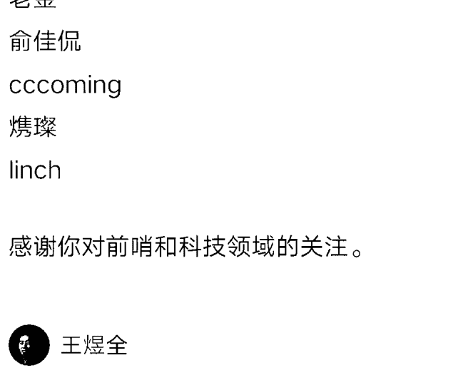

### 直播预告

顺便跟大家预告一下，下周三（8月9日）晚上8点，我会在得到给大家做一场直播，直播的主题是《抓住改变你未来命运的5年》，我会用1个小时的时间为你解析，未来5年会有那些改变，你又应该如何应对？

如果你有希望我在直播解答的问题，欢迎在留言区告诉我。周三晚上，不见不散！

### 获奖名单

前哨第二季上线一周，提前预定期间，在第二季发刊词《提前5年，抓住50个新科技浪潮机会》这篇文章中留言：“哨友报到+你对第二季的期待”的哨友，我们抽取了30位赠送我亲笔签名版的《全球风口》。

以下是获奖名单，请名单中的各位在本文下方留言，填写自己的姓名、通讯地址、邮编和电话号码，「得到」的工作人员将尽快把礼物送给你们。

注意：请大家填写自己的真实姓名，以方便礼品能够顺利送到。

获奖名单：

- 宝钡大人
- Clark
- 木头
- MrBoomba
- 正方形的太阳
- 鱼儿sylvie
- 刘萍
- u&n
- MR.Z96124143
- 水中鱼
- air爱儿
- 唐振杰5679341
- 咏翌
- 郭庆
- 今天就是明天
- 吴硕
- 飞鸿雪泥
- 吴立项
- 孙宇鹏
- 氖
- 大橘子
- 徐进昊
- 马兰新
- 菜籽坞
- danieltang
- 老金
- 俞佳侬
- cccoming
- �czyk
- linch

感谢你对前哨和科技领域的关注。

王煜全
今天上午10:30，是前哨第二季开播以来的第一期前哨团供稿时间，题目是《虚拟现实技术在视觉训练领域的应用》，对于理解“虚拟与现实”的关系有很好的启发，希望你去阅读。
我是王煜全，你的全球科技前哨侦察兵，我们明天见。

### 用户留言

## 006 | 人工智能：一件人人都可以获得的先进武器

产业兴衰点：改变各个产业…

# 王煜全

你好！我是王煜全。

今天是周一，我们开始新一轮的产业介绍，本周介绍的是人工智能产业。

### 一、不要迷信人工智能

一说人工智能，你肯定会说了，人工智能是未来的巨大的风口，这还用你说呀？

连杨澜都说了。

那我想跟你说的恰恰是连杨澜都说了的科技领域，还能是风口吗？

所以，首先别迷信。

过去一年里，我们都知道科技界最火的产业就是人工智能。有人说，人工智能是革命，有人说人工智能会毁灭人类。但，不管说是革命的，还是说毁灭人类的，其实有一个潜台词，就是人工智能超级重要。而且，这回人工智能风口来了，世界都要被改变了。

### 二、人工智能从风口变标配，必须掌握

我们一直在讲，这一次的人工智能主要有三个方面的特点：

#### 第一：计算能力要很强，要用GPU（图形处理单元）来做处理。

#### 第二：算法。

#### 第三：数据。

那肯定，就不再是创业机会了。

但是，虽然说机会过去了，不意味着我们不要重视它。

我前面讲到过，因为人工智能确实是已经变成了标配，你不掌握，你的竞争对手掌握，你就有劣势了。所以，不是因為要取得竞争优势而掌握人工智能，而是因為不要被人家落下，不要被竞争对手超越，你也被迫要掌握人工智能。

### 三、人工智能的使用方法

人工智能的使用方法确实和传统的IT的使用不太一样。传统的IT很简单，买来用就好，相当于你买一个电脑回家使用就好。

但是，人工智能现在确实也能够被你买来就使用，但是买来就用的效果不是最佳的。

因为，我们说现在人工智能的原理不是传统的IT原理，它有点像教孩子的原理，你需要花时间来培养。

我们说人工智能的使用相当于教孩子画画。

过去教孩子每一笔怎么画，怎么构图，怎么着色，全都是限制死的，照着做就行了。

### ｜今日小结

今天我们其实讲了三点：

- 1. 人工智能是一场革命，但是革命的风口已过。现在，机会已经不再属于革命者，而是属于已经有资源的既得利益者。
- 2. 大家要考虑的不是参与革命，而是不要落伍。你参与的原因不是因为你能超越别人，而是不要被别人超越，所以每个人都要积极参与。
- 3. 要适应这场革命，需要范式转移。从教机器做事变成机器做事我们找专家来给评判。从让机器复制最好的工人到让机器通过学习比人做得好。当然，你需要付出足够的耐心和培养，就像养孩子一样。

### ｜今日思考题

各个领域的诸多名人都声称人工智能是未来的大机会，而我却说风口已过，你觉得呢？到底是风口呢还是已经过了呢？我希望听到你的独立的分析。

欢迎你在留言区分享你的观点，我会和你一起参与这场科技前沿的讨论。

王煜全

- 第二季的前哨，我会为你准备3件“秘密武器”：
· 每日一张“前哨历”，总结自己的知识清单，期待你每天都有进步；
· 每月一张“科技创新地图”，及时掌握自己的学习动态；
· 每季度一张“行动地图”（课表），你可以在发表刊词中查看。

### 前哨历 8月7日

### 我的今日知识清单：

- 1.人工智能革命的风口已过，机会属于那些已经有资源的既得利益者。
- 2.每个人都应该积极参与，不是为了超越别人，而是为了不被超越，做到不落伍。
- 3.使用人工智能，需要花时间先培养它，而且需要专家对它的结果做出明确的好坏判断，在合适的领域，它会比人做得更好。

> 摘自：《006 | 人工智能：一件人人都可以获得的先进武器》

### 用户留言

### 创新地图 | 虚拟现实技术在视觉训练领域的应用

王煜全

你好，我是王煜全。

2016年8月，我们在全球范围内发布了一份英雄帖——组建“前哨团”。

这个英雄帖的目的，是集结海外华人中的那些科研人员和科技创新者，向国内汇报科技前沿的信息和创新创业的趋势，帮助国内企业、投资界与国外学术界形成有效沟通和对接，为专利找到投资、为投资找到项目、为项目找到人才、为人才搭建平台。

今天，这个群体凝聚了上百位全球“最强大脑”，这可能是全球首个专为普通大众提供的，也是阵容最强大的知识服务组织。这个由全球顶尖高校科研人员组成的团体，在前哨第一季中向大家汇报了35份科技创新报告，覆盖了生物、电子、航天、虚拟现实、新能源等16个高科技领域。

在新的一年里，前哨团将继续承担全球重大科技活动的参与者和情报发布者的职责，更系统地向大家汇报各个产业最前沿的科技信息，全景式描绘全球创新前沿和趋势。

今天是前哨第二季开播以来的第一期前哨团伙稿时间，题目是《虚拟现实技术在视觉训练领域的应用》。

刘祺，上海交通大学生物医学工程专业在读博士，曾在美国Northwestern University任访问学者。研究方向主要为基于光学技术的脑血流动力学研究。

提起虚拟现实（VR），你会想起什么呢？

或许是酣畅淋漓的3D好莱坞大片，亦或是身临其境的VR游戏？

如果有人告诉你，通过佩戴VR头显、玩玩游戏，就能够矫正弱视这种严重的视功能障碍，甚至有可能恢复正常的视力，你是否会觉得不可思议呢？

这就引出了我们今天的话题，虚拟现实技术在视觉训练领域的应用。

弱视，是一种比近视严重得多的视功能异常，危害也要大很多，需要及早发现，及早矫正。学界的主流看法认为，成年后的弱视几乎是不可能矫正的。但现实生活中，确实有人利用VR技术矫正了自己成年后的弱视，不仅如此，他依靠这项技术成立了公司，帮助了很多跟他一样的人，他就是Vivid Vision公司的CEO James Blaha。

James小时候被查出患有斜视，这会阻碍他的双眼同时看空间中的同一点，同时，这种情况会导致弱视，使视觉丧失空间的深度感知。

弱视给James的生活带来诸多不便，他尝试过很多治疗的方法，效果却差强人意，直到VR头显Oculus Rift的出现。

2013年3月29日，Oculus Rift开发者套装1代发布后，James采购了一台来体验游戏效果，意想不到的是，患有弱视的他在人生中第一次感受到了3D的视界。他很快意识到VR技术或许可以被用来矫正弱视。经过不断探索，他开发出了名为Diplopia的VR游戏用于矫正弱视，并于2013年12月在indiegogo网站众筹，超额募集到约为预期10倍的金额。James通过使用自己开发的VR游戏进行视觉训练，使得自己患有斜视性弱视的眼睛恢复到了1.0的正常视力。

在Vivid Vision公司的视觉训练中，训练者需要在VR场景中进行游戏。游戏中可以分别控制进入每只眼睛的图像及其亮度，使得投入弱视眼的光亮度更强，视力正常眼的亮度则降低。这样一来，大脑会更多地利用弱视眼获取图像信息，从而提高弱视眼的使用频率，使其不再继续弱化，甚至可以恢复至正常视力。训练者在游戏的过程中不知不觉就完成了视觉训练，训练效果会比传统的训练方法，如遵循视力正常眼强迫弱视眼看物体更有效。在Vivid Vision公司后续产品的开发中，他们在游戏中添加了Leap motion公司的手势识别设备，使得游戏更加有趣。

从2015年起，Vivid Vision开发的治疗套件开始面向美国专业眼科诊所出售。治疗套件中包含了6套游戏、6套眼部训练和多种测试模式，并支持HTC Vive，Samsung Gear VR等多种设备，未来还计划支持Google Daydream。当设，Vivid Vision已经跟全美92家诊所进行合作。专业版的套件需要专业的眼科医生进行操作，考虑到操作的便捷性和降低治疗费用，Vivid Vision还开发了家用版本，为那些无法经常去诊所的人提供专业的视觉训练。而且，即使是在家中使用，医生始终能从后台看见患者每日更新的数据，从而追踪治疗效果。

Vivid Vision抓住了VR民用化的第一波浪潮，2017年5月，Vivid Vision获得了Anorak Ventures、CRCM Ventures、Liquid 2 Ventures、SoftTech VC、SOS Ventures、The Venture Reality Fund等投资机构220万美元的种子轮投资。

### VR提升视觉训练效果

VR并不是创造一种新的训练方法，它起到的作用主要是提升现有视觉训练方法的沉浸感和趣味性。在多年的研究和临床实践中，视觉训练已经被普遍试用。研究发现，对眼睛进行特定视觉任务的训练可以提升视觉的表现能力，这种视觉任务的训练被称为感知学习（perceptual learning）。视觉训练中特定的视觉任务可以是不同亮度、不同样式的视觉图样，也可以是不同波长的光点，如红光、绿光等。

传统的视觉训练多采用基于显示屏的视觉任务训练，虽然有很多训练任务采用了游戏化的方式来增加训练的趣味性，但是基于显示屏的训练沉浸感不足，训练过程中很容易出现训练者分心的情况，导致训练效果大打折扣。在实验室中利用昂贵的虚拟现实设备也可以做到有沉浸感的视觉训练，不过成本较高，不容易普及。

这一局面在Oculus Rift发布后得到了扭转，以Oculus Rift为代表的廉价VR头显的出现为视觉训练增添了新的活力，使得民用的沉浸式的视觉训练成为可能。使用VR技术进行视觉训练并非完全取代了传统的视觉训练方法，而是充分发挥了VR技术的优势，在充满沉浸感的虚拟世界中游戏的方式来训练，克服了传统视觉训练方式枯燥乏味、难以坚持的缺点，以一种非常有吸引力和有趣的方式实现了更好的视觉训练的效果。

那么，感知学习可以提高视觉功能，背后的原理是什么呢？

对于研究结果的解释中，一种假说认为感知学习提高了脑部视觉皮层处理视觉信息时的信噪比。大脑中独立的多个神经元对重复的相同的刺激会有不同的反应，这就导致了噪声水平处在比较高的程度。大脑在处理信息时会冲多个细胞中的很多神经元的反应做平均处理，得到想要的信号。信噪比决定了能够检测到的对比灵敏度，提高信噪比就提高了视觉功能（visual performance）。

一些研究结果显示，通过授予刺激可以调控脑部神经元的噪声水平，通过变换不同的刺激参数可以使对比灵敏度在比较低的程度下得到提升。Gabor图样是一种很典型的视觉刺激，通过调整Gabor图样的空间频率、空间位置、对比度、方向，以及刺激任务的顺序、内容、刺激时间等，可以起到提升视觉功能的作用，其关键在于合适的刺激参数的选取。国外有一家公司推出了基于感知学习的弱视矫正的产品，公司名为NeuroVision™，其产品已得到FDA认证（注：2009年，NeuroVision™被RevitalVision™收购）。

感知学习更重要的意义在于，它暗示了脑可塑性（brain plasticity）的存在，即大脑...

可塑性（brain plasticity）的存在，即大脑具有在经验和外界环境如学习、训练的作用下塑造大脑结构和功能的能力。感知学习的方法被用在视觉研究领域已有40多年历史，最近10几年越来越得到关注，因为现在的研究结果认为，不同的视觉训练方法对于不同感知能力的提升是可以互相转换的，而不是只针对于某一领域某种特定感知能力的提升。有多项研究将基于PC端的感知学习应用于眼部异常的视觉功能提升，如弱视、远视（即老花眼）、轻度和中度近视、中心或外周视觉丧失（central or peripheral vision loss）以及脑皮层性视觉失明（cortical blindness）等。

值得一提的是，相对于弱视而言，近视在人群中发生的比例更高。目前，感知学习对于近视的预防和矫正还处于研究初期，值得继续探索。

### 总结

如前文所述，VR技术可以很好地和视觉训练方法结合起来。

一般来说，青少年、儿童时期进行视觉训练是最佳时期，但是目前市面上可供商用的VR头显都是针对成年人设计的。针对青少年、儿童的视觉训练的特殊性，瞳距、头显重量、光学镜片的设计、训练场景的亮度、训练时间等参数都要做调整，最重要最重要的就是让青少年、儿童在舒适的状态下完成有趣的视觉训练。

视觉训练领域参与竞争者众多，技术门槛相对较低，产品同质化严重。虚拟现实（VR）等新技术的进入可以为本领域的发展提供新的变化。对于虚拟现实技术来说，在国内经历了2016年的投资热潮和2017年的关注度下降以后，能够在不同的细分领域找到很好的应用场景，提升应用领域的用户体验，同时不断改进技术，是未来该技术健康发展的关键。期待虚拟现实技术在视觉训练领域能够有更广泛的应用，也期待有更多人加入视觉训练领域，一起探索未来的发展。

王煜全

我是王煜全，你的全球科技前哨侦察兵，我们明天见。

### 用户留言

## 007 | 人工智能革命为什么会爆发？

007 | 人工智能： “深度学... ↓

王煜全

你好！我是王煜全。

今天是周二，我们继续来介绍人工智能。

昨天我们介绍说，人工智能已经没有创业机会了，只有企业自我提升的机会，而且这种机会很快还会无常带来竞争优势，只会让你不被落下而已。

我相信很多人会问，为什么会这样呢？不是说这一轮的人工智能是个伟大的革命吗？

今天我就带大家回到这场革命的源头去看看。

人工智能历史悠久，最早可以追溯到十三世纪的西班牙人拉曼鲁尔和十七世纪的著名数学家莱布尼茨。

不过普遍认为，这一轮人工智能革命的最直接的源头来自于一位叫做Geoffrey Hinton的加拿大多伦多大学的教授，他被认为是这一轮以深度学习为代表的人工智能革命的开创者，他也有这一轮人工智能专家的标志性的头衔，就是“神经科学家+计算机科学家”。

### 一、深度学习的原型：用计算机模拟人类大脑

Geoffrey Hinton教授在上中学的时候一个朋友告诉他，说大脑是用全息的方式存储外界信息的，这句话引起了他对大脑功能的兴趣，这一个小事件就把他引向了后来一生从事的事业。

他从大学起就开始研究神经科学，并且从上世纪80年代初就开始研究用计算机系统架构来模拟人类大脑，就是我们今天说的深度学习的原型。

当然，从这个年代你也能看出：

- 第一，人工智能源远流长。
- 第二，Geoffrey Hinton教授不年轻了。

但是在外人眼里，我们经常会觉得很多的突破似乎是一蹴而就的，因为我们听惯了“牛顿和苹果”的故事，以为伟大发现就是灵光一闪。
实际上，从上世纪80年代初到这一轮的人工智能被认可，中间有30多年的时间，Hinton教授其实做了大量的研究，做出了大量的成果。
但是，从整体上来说，这30多年的时间，Geoffrey Hinton教授的深度学习系统都是学术界的异类。

有两个原因，还都是操作上的原因：

- 第一，因为深度学习要求分层，就是分层输入和输出，每一层的输出成为下一层的输入。每一层该怎么单独优化，这个问题是Geoffrey Hinton到2006年才解决的。文章发表在2007年的《认知科学趋势》这本杂志上，成了这一轮人工智能革命启动的标志，标志着深度学习的算法初步被完善了。
- 第二，是在理论完备之后的好几年里，深度学习依然不被认可。这回的原因很简单，就是深度学习这样的人工智能系统，它的算法出来的结果不够好，不如别的算法好。

### 二、深度学习崛起的关键人物

顺便说一句，就是千万不要因为深度学习占了上风，就以为人工智能只有这一条路，因为人工智能有N多条路，只是现在已知的人工智能的算法里面，深度学习的表现是最好的。但是，它不是一上就很好的。
让深度学习崛起的两个人：

一个就是斯坦福的教授，也是后来谷歌大脑的创始人吴恩达教授。因为他发现深度学习需要有更强的计算能力，所以他找到了英伟达的GPU（Graphics Processing Unit，图像处理单元），使得计算能力提升了上百倍。

另外一个人也是斯坦福的教授，也是华人，李飞飞，她建立了一个图像识别资料库。
而且这个库里面的所有的图像都是标注过的，也就是说，如果图里有山就会标注出山，如果有树就标注出树。这样的话，你可以用这个图像库来训练人工智能系统，看它能不能识别出来这个图像库上面所标注的这些元素。经通过这个图像库的训练，李飞飞成功地训练出视觉能力超过人的 人工智能系统。

- 一方面证明了训练的重要性。
- 另一方面证明了深度学习是人工智能里面最好的一个算法。

所以，学术界的转变其实是2012年才到来的。你想想，从上个世纪80年代初到 2012年，已经整整过了30年了。因为，这一年人只能视觉识别实现了突破，在斯坦福举办的ImageNet比赛中，深度学习不光超过了其它所有算法，也第一次超过了人类。
当然，公众的转变发生得更晚，要一直到 2016年3月份，谷歌AlphaGo战胜了李世石。那这之后的就是历史了，深度学习受到了追捧，不光是Geoffrey Hinton，包括他的合作者和学生在内的一大堆人都成了明星。

所以，我们回顾这段历史的时候，会得到一个启示：
很多时候，一个伟大的科技突破刚刚出现的时候，它的表现并不令人满意。
除了大家难以接受以外，往往自己也有很多可改进之处，自己的表现也不好。只有经过每个细节上的改进，才能把这个科技突破的威力真正发挥出来。

- 比如说，我们熟知的瓦特其实并不是蒸汽机的发明人，而是那个使得蒸汽机能够达到大规模运用水准的改进者。

我们把这样的科技革命和应用成熟的关系，比作坦克和闪电战。
坦克是英国人发明的，而把坦克的能力发挥到淋漓尽致的闪电战打法却是德国人发明的。
在科技领域，我们往往会重视那些制造了坦克的发明家，即那些原创的科学突破，而忽略了发明闪电战的战略家。
他们往往是把科学革命的价值真正实现出来，也就是真正造福社会，推动了社会进步的人，他们多半是企业家，这就是为什么我们常说“掌握先进科技的企业家才是这个社会的最先进生产力”。

### 三、这一轮人工智能已经成熟，抓紧用

回到人工智能的话题上来，大家就可以理解了，其实深度学习是人工智能的一个分支。这一轮人工智能的革命的代表是深度学习的突破。

这一轮的突破由于很多人的贡献，以AI-phaGo为代表，已经通过各方面的调整， 基本达到了它的最优输出，可以被运用到各个行业领域里面了。所以，我们说这一轮的人工智能革命已经成熟了，大家赶紧使用。

明天，我们还会给大家介绍AlphaGo后面的故事，希望你能对这次革命有一个完整的了解。

但是，新的革命还没有在地平线上冒头，未 来到底是不是深度学习的延续，还是人工智能的另一个领域会超这一个领域，都是有可能发生的。

所以，不用关心太远的未来，赶紧把这一轮的革命成果运用到自己的实践当中去吧。因为，这样的革命成果本来就能扩散到各个领域，你早晚都要用。就像我们昨天介绍《IT不再重要》这本书里面的观点，互联网来了之后，每个公司早晚都要用，早用了还有点优势，晚用了连优势都没有了。
用，没有竞争优势，而不用，就是竞争劣势。
所以，不要去讨论未来到底怎么样，关键是你现在能不能把人工智能用到自己的领域里。

### 四、深度学习不是人工智能的独木桥

另外，千万不要以为深度学习达到今天的水准就是无敌了，甚至可以超过人类了。

水平就是无敌了，甚至可以超越人类了。因为这个系统有明显的缺陷，就是它的过程无法描述。

相对而言，另一位专家叫 Jeff Hawkings，他其实也是美国最早的移动计算系统，就是PRM的发明人。

他发明的叫做记忆预测模型，其实更符合人类的思维特征。

但是，Jeff Hawkings构建的人工智能系统表现不够好，就像我们前面介绍Geoffrey Hinton的系统一样，未来记忆预测模型的人工智能系统会否超越现在的深度学习系统的能力，其实今天看来都是未知的。

所以，未来一切未知，不要着急为未来担忧。像孔子讲的，子不语怪力乱神，先专注眼下为宜。

### ｜今日小结

今天给大家介绍了这一轮人工智能革命的缘起，希望大家了解“科学革命”和“革命惠及社会”之间的关系，就是“坦克和闪电战”的关系，光有科技没有用，还要有把科技优势发挥出来的不断优化科技的人。

从产业的角度，科技革命是产业机会的起点，而优化基本结束，科技优势被淋漓尽致地发挥出来则是产业机会的终点。

我们判断，这一轮人工智能革命的优势还没有完全发挥，但也不远了，而且技术扩散的速度极快，所以创业的机会基本结束。

除非你能像我们明天要介绍的AlphaGo的发明人那么优秀。

### ｜今日思考题

在你自己擅长的领域里如何引入人工智能以增加你的竞争力，你又要如何设置壁垒呢？

王煜全

我是王煜全。你的全球科技前哨侦察兵。咱们明天见。

## 前哨历  8月8日

### 我的今日知识清单：

- 1. 很多时候，一个伟大的科技突破刚刚出现的时候，它的表现并不令人满意。 2. 从产业的角度看，科技革命是产业机会的起点，而优化基本结束，科技优势被淋漓尽致地发挥出来，则是产业机会的终点。 3. 深度学习在已知的人工智能的算法里面表现是最好的，但人工智能有N条路，未来一切未知。

> 摘自：《007｜关键人物：深度学习之父Jeoffery Hinton》

「得到」专栏《全球创新260讲》
预见5年，抓住50个新科技浪潮机会

### 直播预告｜面对这一波科技浪潮，你做好准备了吗？

区块链、VR/AR、人工智能、无人驾驶、无线充电……

面对这一波汹涌来袭的科技浪潮，你做好准备了吗？你是否会有以下的担心：

- 在不确定的未来，有哪些必然的趋势？
- 科技到底会怎么颠覆我的事业和生活？
- 怎么样才能看懂趋势，看到“风口”？
- 普通人面对“风口”怎么准备？怎么做？
- 外行人要怎么了解和学习科技？
- 普通人如何参与到未来的机会中？
- ……

如果你想知道上面任何一个问题的答案，请不要错过这场直播：

8月9日（周三）晚8点，王煜全老师将用一个小时的时间解答你的困惑，告诉你如何抓住改变你未来命运的5年。

王煜全老师即将赴美工作，这场直播不容错过。

### 直播讲什么？

本次直播，王煜全将会为你解析：普通人如何在科技浪潮的趋势中自处？

- 认清趋势：你必须要知道的4个未来发展趋势
- 聚焦趋势：未来会改变我们的10大科技创新
- 顺应趋势：在科技浪潮中发现机会的方法论
- 提前部署：掌握5个法则，成为趋势领跑者

这场直播既告诉你未来的机会在哪里，趋势是什么？又为你解答如何找到你的机会，怎么样才能让自己利用好机会？

- 如果你关心这个时代的最前沿正在发生什么；
- 如果你想要成为未来的领跑者，而不是浪潮的淹没者；
- 如果你想要了解一点黑科技；

8月9日（周三）晚8点的直播也许就会改变你的命运。

### 推荐你订阅：「全球科技260讲」

这个专栏刚刚开始更新，它将在未来一年里，每一天一个主题，每周一个领域，带你看全球最前沿的那些重大创新，向你介绍50个最新科技领域的进展和机会。

那些人类最聪明的精英，在最前沿地带的探索，王煜全每天都会用10分钟时间，如数汇报给你听。

我们这一代人生命中，最大的变量，就是那些最新科技。

这个专栏就是为那些需要提前把握趋势和机会的人准备的。

### 直播小贴士

直播时间：8月9日（周三）晚8点

参与方式：直播当天，打开「得到」APP，从首页进入直播间即可直接预约。

互动方式：如果你在直播当天有任何想要问王煜全老师的问题，可以在直播中直接参与互动，王煜全老师会选取若干个问题现场回答。

## 008 | 抓住使用人工智能的研究成果

王煜全

你好！我是王煜全。

今天是周三，这周我们介绍的是人工智能产业，周一的时候我们已经了解到人工智能产业其实已经没有创业机会，昨天我们还从历史的角度回顾了这一波人工智能革命的缘起。

今天我们来介绍一个人人工智能领域非常牛的公司，希望大家了解科技革命之后技术不断优化的进展，借此理解我们为什么说大家要尽快使用好人工智能。

这家公司这些年名气非常大，相信你肯定也听说过，就是DeepMind，为什么名气大呢？

因为他们开发的AlphaGo先是战胜了李世石，随后横扫了围棋界的所有选手，今年还战胜了围棋界排名第一的国际冠军柯洁。

而且，现在基本上已经形成一个共识，就是“人类再也不可能战胜人工智能了”。

### DeepMind的创始人：Demis Hassabis

介绍DeepMind，首先得介绍它的创始人，他叫Demis Hassabis，这个人是个名副其实的大牛人。他1976年出生，是一个混血儿，老爸是希腊籍的塞浦路斯人，老妈是华裔的新加坡人，这大概是在验证基因学的一个论点，就是混血基因更有优势。

他从小就是神童，13岁的时候就成为了国际象棋大师，等级分在全球14岁以下棋手当中排第二。他16岁就考完了高考，而且还考了英国的名校入学考试S Level exams。但是，他并没有去上大学，而是任性地加入了一家游戏公司，开发了一系列热门游戏。不过，最后他终于决定还是要去上学。结果，他21岁就从剑桥以全优毕业了，跟同龄人比真是一点时间都没有耽误。22岁的时候，他干脆开了自己的游戏公司，又做了一系列的成功游戏。

到29岁的时候，他做游戏做得没兴致了，就直接把游戏版权卖掉，到伦敦大学学院去读了“认知神经科学”的博士。这一读博士不要紧，写的论文又被《科学》杂志评为当年全球十大科学突破之一。到09年的时候，他33岁博士毕业。34岁开公司了，就是现在鼎鼎大名的DeepMind，是和他的一位博士后的同事，和一个发小一起创业，这两个人也都是大牛人，在这儿不详细给大家介绍了，如果你感兴趣，可以自己去搜搜看，很有意思。

### DeepMind的使命：为了解决世界上一切问题

DeepMind公司的使命很大，他们的口号是，首先解决智能问题，然后用智能解决一切其它问题。你看，他们开发出DeepMind不是为了战胜李世石，也不是为了玩围棋，而是为了解决世界上的一些问题。

当然，怎么解决智能问题呢？

他们的路线也很有趣，是干嘛呢？就是训练人工智能玩游戏，实际上围棋在他们眼里是游戏之一。他们还训练人工智能玩其它很多游戏，所以千万不要小看游戏。

DeepMind的创始人就是从小爱玩游戏的孩子，他开游戏公司能赚钱，做人工智能公司这么成功，也是用人人工智能去玩游戏取得的成功。所以这里要劝各位家长一句，当你的孩子玩游戏的时候不要急着阻止，也许你在阻止下一个天才的诞生。

### DeepMind的工作：开发能够自主学习的通用人工智能

当然，DeepMind训练人工智能玩游戏，目的是为了开发出能够自主学习的人工智能程序。因为据说，国际象棋相对容易，围棋就很难很多。但是，最难的是那种开放性的游戏，比如说打个CS之类的。

除了战胜李世石，2013年DeepMind还开发出了能打游戏机的超级程序，还开发出了叫做“神经图灵机”的系统，让现有的神经网络有了计算机一样的内存，相当于机器人拥有了人的短期记忆能力。

短期记忆能力决定了人的推理的深度，不具备短期记忆能力的人，他分析问题的层次就比较浅，短期记忆能力越好，分析问题的能力就越深，从这个意义上讲，中国古代要求的死记硬背，其实都是在训练我们的短期记忆能力，都是有意义的。具备了短期记忆能力，神经网络的分析能力也会大大加强，和人脑是一样的。

同时，DeepMind也在努力使自己的人工智能程序只需经过简单训练就能适应各个领域的智能需求。

比如，DeepMind还在和英国卫生机构合作，开发眼科疾病的分析系统、癌症的检测系统、还有电子病历的分析系统等等，都是医药，实际上用到人工智能的能力也是相当不同的。

我们原来介绍过，什么都能干的所谓“强人工智能”仍然遥不可及，那DeepMind怎么能做到在各个领域都能用呢？

打个比方，相当于他们克隆出了一大群素质优秀的孩子，你训练他短跑他就能破百米纪录，你训练他打篮球他就能超过迈克尔·乔丹。虽然说没有一个孩子长大以后是既能跑短跑又能打篮球，但是确实你想要在自己领域里找到优秀选手，随便挑一个孩子就行了，不用挑。

所以这在人工智能领域的意义，就是DeepMind只要开发出一套系统，让每个需要用到的人拿去自己去训练就好了，而不是像现在一样，每个领域的人工智能系统都要单独开发，这样就省力多了。

### DeepMind为何被谷歌收购？

我们之前介绍过，这一轮人工智能的革命已经发生了，下一轮什么时候发生还无法预期。

今天想告诉大家的是，像DeepMind这样的公司，把这一轮人工智能的革命的效果基本发挥到最大化了，剩下的就是各个领域的应用机会的探索了。

这时候最关键的是把DeepMind他们的成果尽快应用到各个领域。

所以到2014年的時候，DeepMind公司才4年的历史就被谷歌以4亿英镑收购了，平均一年1个亿英镑。但是，这个公司继续保持独立运营。而且，这个收购是谷歌的CEO拉里·佩奇亲自主持的。我们接着就讲谷歌收购，其实对DeepMind，或者对谷歌双方都是非常重要的。

为什么拉里·佩奇亲自主持？

就是因为谷歌要抢时间，让这个团队的人工智能系统能够在谷歌的平台上，借用谷歌强大的人工智能的硬件系统和云服务，能够尽快把他们的系统应用到各个行业领域，这就是我们讲的应用推广的黄金时间。当然，他的目的也是为了和其它的人工智能平台竞争。

因为，这一轮人工智能有一个很重要的特点，就是几乎所有的IT巨头，包括谷歌、Facebook、亚马逊、微软、IBM、苹果，都纷纷全力参与，而且策略都差不多，都把重兵投入到人工智能开放平台的开发建设。

而且，不光自己开发，因为它们都无法把握下一个机会，不知道人工智能下一个巨大的机会到底在哪。所以它们干脆都把自己的人工智能平台开放给第三方，连硬件软件，直接把人工智能做成云系统，你可以在云端调用它的所有的硬件软件能力，让创业团队、让各种企业做应用开发，都可以非常便捷地享受世界最大最顶尖的IT公司提供的全面的人工智能的能力。

所以，如果你有应用机会，千万别费劲做谷歌这种平台搭建的事儿，也别费劲做DeepMind这种底层技术开发的事了，直接使用他们的成果做你的应用开发就好了。

### 今日小结

最后谈三点启示：

第一，人工智能的革命，昨天我们介绍的Geoffrey Hinton教授是革命的发动者。而Demis Hassabis其实是这个革命的优化者，就相当于我们之前介绍的，他...

的优化者，就相当于我们之前介绍的，他是蒸汽机领域的瓦特，他使得革命的能力被充分地彰显出来，优势被充分地放大，大大地甩开了和其它人工智能系统的差距。

第二，革命不可预期，但是优化必然发生。所以我们说下一次人工智能的革命到底是在这个路线上的延伸还是换个路线，什么时候发生都是不知道的。但是，现在的这一轮人工智能的优化已经接近完成了。所以，赶紧使用为宜，不要再盯着什么大革命大突破了，就是把现有的东西拿来用就好。

第三，不要羡慕别人那么优秀，它越优秀对你越好，因为你把它的结果拿来用就好了。对应用者来说，要赶紧看看自己有没有用人工智能改进业务的机会，有没有借助自己的数据通过人工智能构建先发优势的机会，有的话就赶紧行动，尽量用大公司的成熟技术会更保险。还有，保护好自己的数据隐私。

### 今日思考题

请大家找找看，中国有哪些足够大、有实力、又有信用的人工智能平台，它们的开放性如何，你如何尽快用它们的服务来武装自己？

欢迎你在留言区分享你的观点，我会和你一起参与这场科技前沿的讨论。

王煜全

我是王煜全。你的全球科技前哨侦察兵，咱明天见。

### 前哨历 8月9日

### 我的今日知识清单：

+   1. 科技革命不可预期，但是优化必然发生。
这一轮人工智能的优化接近完成，赶紧使用为宜。

+   2. 如果你有人工智能的应用机会，千万别费劲做谷歌这种平台搭建的事儿，也别费劲做DeepMind这种底层技术开发的事儿，直接使用他们的成果做你的应用开发就好了。

> 摘白：《008 | 抓紧使用牛公司的人工智能研究成果》

类的机器智商，理解机器，让机器为你干活，你就是未来的人生赢家。

### 四、做人工智能应用的四个重点思考

#### 第一，做人工智能的目标。

我们强调，不要试图做各个领域都能用的强人工智能，是做不出来的，不要做通用型的人工智能，因为现在看起来这方面没法突破。

即使是DeepMind，虽然它说是先开发出人工智能，然后用智能解决所有问题。但是，它也是每个领域的弱人工智能，只不过它希望人工智能系统是各个领域通用的（具体的解释请听周三的音频）。所以它也不是强人工智能。

而弱人工智能就是某个领域你有数据，对人工智能又做了特定的训练，就一定会有结果，会在这个领域有价值。

所以，宜窄不宜宽，宜特定不宜宽泛。

#### 第二，领域。

我们要看这个领域里面你是否有数据，你的数据是否有壁垒，你是否能够定义出来，能够用人工智能解决的问题，结果是否可以被市场接受。同时，是否有大公司在做同样的事情。

在很多领域里面，我们一定要提醒大家，由于信任问题，大家倾向于使用大公司的人工智能方案。而人工智能我们一直把它归类为叫做开源的创新系统，如果壁垒不够的话，你很容易被大公司击跨。不是因为你没有大公司优秀，而是因为客户更容易买大公司的单。

#### 第三，开发。

就是你训练人工智能的输出是否有清晰的可比较的结果，如果有清晰的客观的结果，也许你不需要专门的行业专家。

但如果你你的领域没有清晰的客观标准，你就要问自己是否有这个领域的专家参与，帮你来确定结果的好坏，帮你来训练。

#### 第四，运营。

就是你的核心优势尽量不要构建在所谓的算法上，因为算法的优势如果别人是99分，你是100分，这点优势不构成竞争差异。

尽量也不要把优势放在计算能力上，因为你的计算能力一定比不过Facebook，比不过谷歌。

所以，你的优势最好是在数据上，最好是在行业经验上。

尤其是，因为你对行业足够了解，所以对痛点有把握。就像那位帮父母解决黄瓜分拣问题的日本小伙儿一样，他能看到黄瓜农场的痛点在分拣，从而能开发出相应的解决方案。

这样的话，就能形成你独特的壁垒。

### 五、谁会受益？

我们说小公司创业没机会了，企业在应用里引入人工智能还大有可为，哪些大公司会在人工智能的潮流中受益呢？

其实淘金热的时候卖水最容易赚钱，大家都做应用的时候，大公司的人工智能平台就会得到巨大的发展机会，但是不能局限在太窄的领域里。

国外这些大IT公司还有很大增长潜力，像我们之前介绍的谷歌、Facebook，包括IBM，包括微软，中国百度的人工智能用在车上就有点狭窄，腾讯和阿里虽然不如百度叫得响，也其实都有很好的足够开放的平台，另外像科大讯飞、搜狗、小机器人的语音互动都有很大的机会。

### |今日小结

+   1. 人工智能创业机会已过，但必须抓紧应用；
2. 人工智能应用的领域非常宽泛，关键是找到适合你自己的那个领域；
3. 虽然创业机会没了，但人工智能会在未来很长一段时间是市场关注的热点，投资于人工智能领域的平台公司，也是不错的选择。

### |今日思考题

大家听了我们的介绍，对人工智能的能力应该有了一定的了解，基于这种了解，你还能发现哪些别人没太注意到的，可以用人工智能帮助提升的领域和应用呢？

王煜全

我是王煜全。你的全球科技前哨侦察兵，咱们明天见。

## 前哨历  8月10日

### 我的今日知识清单：

+   1. 不要做通用型的人工智能，因为现在看起来这方面没法突破。
2. 选择能找到数据，且数据有壁垒，能够用人工智能解决 问题，且结果有市场的领域。
3. 训练人工智能输出要有清晰的可比较的结果，需要客观标准或者该领域的专家。
4. 优势只能建立在数据和行业经验上，因为算法和计算能力比不过谷歌等大公司。

摘自：《009 | 如何从人工智能产业中受益？》

「得到」专栏《全球创新260讲》
我从5年，躬行50个科技趋势机会

## 009 | 如何从人工智能产业中受益？

009 | 前哨洞察：人工智能...

王煜全
你好！我是王煜全。
今天是周四，我们今天解释人工智能的机会。

### 一、数据最为关键

首先，要跟大家讲，人工智能有三要素：算法、数据和计算能力。

计算能力可以利用大公司的云平台，因为各大公司都把自己的人工智能平台开放出来了。

而算法也往往是开源的，虽然有时候要做调 IC 和优化，但是包括谷歌的Tensor-Flow在内的人工智能学习系统极大地降低了算法难度。

如果有些同学还不知道TensorFlow是什么，我这里也再提一句：
TensorFlow是谷歌研发的人工智能学习系统，它是让开发者可以把复杂的数据传递到人工智能神经网络里进行分析和处理系统。它是开源的，开发者可以直接拿来用。

### 二、人工智能的开发像培养孩子：需要训练才能成长

同时，我们也介绍了人工智能的开发，就像培养孩子，不像以前一样写个死程序就行，主要是需要训练，要让人工智能成长。

### 三、开发人工智能应用的方向选择

我们这之前给大 举过一个例子，连DeepMind的第一个应用的方向都选择在医学领域，尤其是医学影像。为什么医学影像相对容易呢？

+   第一，有现成数据；
第二，结果可以和临床的结果做对比。

## 010 | 问答：找准人工智能领域的真正机会

010 | 问答：找准人工智能...

王煜全
你好，我是王煜全。
今天是我们的全球科技问答时间。

### 全周总结+拓展

本周我们讲的是人工智能，讲了三个重点：

+   1. 当然人都在讨论一个所谓的创业机会的时候，这个机会基本已经过去了，人工智能就是这样一个机会。人工智能之所以热，是因为这个技术已经成熟了，正在被应用到越来越多的领域。但就像我们一直强调的，从研发到产品推出有一段时间，其实当你看到大量应用的时候，说明很多把握住了机会的公司已经提前做了布局，研发的产品已经成功上市了。当然，你这个时候才跳去创业，自然已经晚了。反之，我们上周介绍的混合现实，很多朋友问，你说是机会，怎么没看到市面上有产品啊，当然了，技术已经成熟、产品还没出来，这才是创业最好的时机嘛。

+   2. 科技革命对一个产业形成影响的规律是，先有一个革命，但革命刚出现的时候不成熟，需要不断地打磨，才会把革命的优势淋漓尽致地发挥出来。这轮人工智能的革命来自于Jeffrey Hinton，而大名鼎鼎的DeepMind，其实只不过是通过优化把人工智能的优势淋漓尽致地发挥出来的那个公司。而DeepMind战胜了李世石，说明革命的优势已经发挥出来了，剩下的就是如何尽快运用到各个行业中去了。

+   3. 我们本周介绍了一个理念，来自于一本书《IT不再重要》。今天的社会，有价值的先进科技都会被迅速普及，这时候运用了这些先进科技未必有优势，不用这些先进科技一定有劣势，所以，不要说人工智能创业机会错过了就置之不理，赶紧使用才是正道。

### 用户留言点评

另外，本周我在得到做了一场直播，很多前哨的用户表示对人工智能感兴趣，所以我们在留言区里收到不少用户的评论。

感谢你参与我们的交流和互动，前哨提供给你的是关注的方向和介绍，如果你希望真正把握住趋势，利用好科技的工具，还需要你主动地去寻找更多的信息，以及多思考，多琢磨。通过这种长期的积累，你就会建立自己对趋势的洞察和判断能力。

本周精彩的留言很多：

比如用户“乖乖狼”就从医药领域给我们分享了人工智能应用的案例：

第一是机器人在外科手术中的操作精确度已经超过人类医生；第二是药品数据查询；第三是人工智能诊疗，也就是让医疗检查和临床诊疗也智能化。

总之，各行各业都出现了人工智能的身影，人工智能革命的风口已过，现在应该抓紧普及和应用。

用户“菜籽垛”从事的是高等教育，所以在周二的互动中他从本行业分析如何应用人工智能，比如让AI进行学习效果的打分和评价，为学生提供个性化的学习资源推荐。

用户“旭势待发”与我们分享了人工智能的开放平台，有百度、阿里、科大讯飞等等，以及它们各自提供的服务，可以说非常用心。我在文稿中附上了他的留言，建议你可以浏览一下这些平台，未来你肯定用得上。

以上就是我对这次用户留言的回顾。我们前哨的用户当中还是藏龙卧虎，所以每天内容的留言也是非常有阅读价值的，我们每天也会在文稿下舒服下一道互动讨论的题目，欢迎你参与我们前沿讨论，获得更大的收获。

### 用户答疑

air爱儿：老师说现在的人工智能（仅指深度学习系统）原理有点像孩子的原理，教的人判断力足够好，那么孩子经过一段时间就能够成为世界级的画家。那么是不是说这个教的人也必须是世界级的鉴赏家才行呢？可是一个人的审美能代表全世界的审美吗？推广开来，人工智能学习效果的判断依据的权威性一定是放之四海而皆准的吗？

王煜全
不同领域的判断标准不同，有些是没有完全客观的标准，比如绘画，比如音乐，比如美食，这时候训练者、评价者的口味是否代表大众口味就很重要。当然，如果你名气很大，大众也许会接受你的口味。
不过还有很多领域是有客观判断标准的，比如图像识别、比如疾病诊断、比如下围棋，这种情况就比较简单。所以AlphaGo 2.0就可以通过自己和自己下棋而提升。
所以如果你是鉴赏家，就可以训练人工智能继承你的鉴赏能力，但如果你不是，那最好去专注有客观标准的领域吧。

蔡沅宇@糖菜金枝：基础设施已经被大佬们垄断了，如果继续在人工智能领域创业，在这个演进的过程中，是否存在类似于淘宝代运营这样的模式的人工智能实施商？类似于可以提供某种人工智能发展中的特定技术，为巨头解决特定问题，是否也是一条可走的路呢？

王煜全
人工智能领域做淘宝代运营的机会不大。
一是数据是商家的命脉，而且人工智能是需要数据训练的，你帮他代运营，等于是利用他的数据训练了你的系统，你哪天不干了，换个地方就可以提供一样的服务，而他还要从头训练人工智能系统，但凡看得明白的企业都不会愿意的；
二是我们介绍了，人工智能的门槛在迅速降低，因为有大量人才的涌入，也因为类似谷歌的TensorFlow这样的专为人工智能设计的类语言使得学习门槛越来越低，再加上IT巨头都忙提供很好的算力支持，商家不需要找代运营也能自己做。
所以，即使眼看商家自己开发人工智能系统还有难度、人工智能专家仍然很贵，但这个问题会迅速解决，代运营市

贵，但这个问题会迅速解决，代运营市场即使有，也会昙花一现。

七月楷：现在的人工智能对于人类来说就像是一个黑箱，人们知其然却不知其所以然，这与以往的任何一种技术都不同，如何让机器以人听得懂的方式呈现自己解决问题的方​​式与逻辑？这是否是一个必须解决的问题，还是说这就是一种新的范式？

王煜全

这就是我们讲到的，这一轮的人工智能革命虽然彰显了巨大的威力，但我们并不认为它是万能的，而且短期乐观，长期甚至要悲观一点，因为这一轮会碰到瓶颈。

我知道有人在解决如何把中间分析步骤都清晰表达出来的问题，但还没有成功的。我反而认为更大的可能是，下一波的人工智能革命可能遵循的是完全不同的轨迹，因为人工智能有很多分支，深度学习只是其中一种。

王煜全

本周的总结和问答就到这里。

欢迎你积极参与到我们每周的话题讨论，我会在留言区和你实时互动。

我是王煜全，你的全球科技前哨侦察兵，我们下期见。

### 前哨历
8月11日

### 我的今日知识清单：

+   1. 人工智能之所以热，是因为这个技术已经成熟，正在被运用到越来越多的领域，所以要抓紧使用。\n2. 如果你是行业专家，就可以训练人工智能继承你的能力，如果你不是，那最好专注到有客观判断标准的领域。\n3. 人工智能的门槛在迅速降低，人才在大量涌入，数据是这一轮人工智能应用的命脉。

> 摘自：《010丨问答：找准人工智能领域的真正机会》

「得到」专栏《全球创新260讲》
抢占5年，抓住50个新科技爆发机会

### 用户留言

提交留言可与专栏作者互动

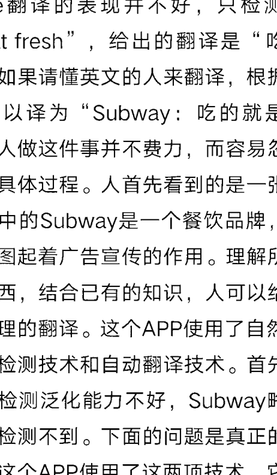

Google翻译的表现并不好，只检测出了“eat fresh”，给出的翻译是“吃新鲜”。如果请懂英文的人来翻译，根据情景，可以译为“Subway：吃的就是新鲜”。人做这件事并不费力，而容易忽视其中的具体过程。人首先看到的是一张纸巾，其中的Subway是一个餐饮品牌，而这幅印图起着广告宣传的作用。理解所看到的东西，结合已有的知识，人可以给出一个合理的翻译。这个APP使用了自然场景文字检测技术和自动翻译技术。首先，文字的检测泛化能力不好，Subway略有形变，检测不到。下面的问题是真正的障碍。当这个APP使用了这两项技术，它关心的只是文字检测和翻译，看不到这幅小小图像中的情境，更理解不了其中广告宣传的意图。

这个实时翻译的APP，还能直接将你说的汉语翻译为英文，并朗读出来。笔者也试验了一下这个功能。当我说“我们去吃湘菜还是川菜？”，APP反应的是“我们去吃香菜还是川菜”，然后再翻译为英文，结果必然是不准确的。短短的一句话94里面也包含一个小情境。虽然语音识别算是准确，但缺少知识体系的支持，机器还是难以准确理解人的意思。

可以看出，在缺乏通用智能的支持下，很多人工智能的实际应用差强人意，难以与人有效交流。类似于这类意图提供人性化接口的服务，会被当做玩具玩一玩，然后被搁置在一旁。

## 再看一个当前很火热的技术——自动驾驶：

自动车上会配备很多传感器、感应周围的信息，深度神经网络会处理这些信息、自动给出驾驶的方向。这个应用场景与围棋很不同。围棋只有棋盘上黑白子的变化，有明确的输赢目标。而自动车周围环境的变化高度复杂、情况不胜枚举。自动车要实现的目标也很复杂，不仅是到达目的地，还要保障自身安全，保证其他车、路人的安全，还有各种意想不到的情况的处理。

能够完全自动驾驶的汽车需要的是通用智能的支持。

如上图中车流量很大的路口，自动车需要感知复杂的情景，根据已有的经验和知识，自动推理，作出合理的反应。这种技术目前尚未诞生。然而自动驾驶是个有巨大吸引力的技术，各大公司不惜重金投入，也不断有新的研发力量加入。这里技术的渴求也会推动通用智能的发展。

### 总结

首先可以肯定近些年的人工智能取得了显著的进步，进步的核心是表征学习。人工智能已经借助表征学习，在弱人工智能领域取得一系列突破性的成果，如AlphaGo刷新了人类对围棋的认知。

在某些特定领域，人工智能的表现已超越人类。然而人工智能想要真正迈进人生活，能与人自然地交流，或多或少需要通用智能的支持。缺少通用智能，很多应用会显得鸡肋。

在这一轮人工智能热潮下，大量的资金和研发力量纷纷涌入，然而项目选择需要谨慎。总的来说，目前的人工智能还是对人的辅助，比较可靠的应用领域包括：

+   1. 高级自动化，取代重复的手工劳动。\n2. 在数据领域发挥作用，发现知识，创造商业价值，辅助重大决策。\n3. 在特定领域成为专业人士的助手。\n4. 受限场景下的自然人机接口。\n5. 娱乐，玩具。

另外一些领域，如自然语言，场景不受限制的图像，完全自动驾驶等，靠谱的应用则需要通用智能的支持。即使是语音控制的家电，缺少通用智能的支持，可能用户体验也会比较差。大公司可以在这些领域投入和研发，推动技术进步，但这类领域目前难以产生用户体验好的应用，不适合创业。

虽然当前人工智能很热，我们仍需冷静看待，要看到人工智能的用武之地，也要看到当前技术能力的界限。准确把握当前的技术，才能产生有效的创新与应用。

王煜全
我是王煜全，你的全球科技前哨侦察兵，咱们明天见。

## 创新地图 | 冷静看待人工智能

王煜全

你好，我是王煜全。

2016年8月，我们在全球范围内发布了一份英雄帖——组建“前哨团”。

这一份英雄帖的目的，是集结海外华人中的那些科研人员和科技创新者，向国内汇报科技前沿的信息和创新创业的趋势、帮助国内企业、投资人与外国学术界形成有效地沟通和对接，为专利找到投资、为投资找到项目、为项目找到人才、为人才搭建平台。

## 这一轮人工智能的核心：表征学习

人工智能这个词实际上是以人类为中心的。

举一个简单的例子，教小狗做算术：

以上小狗学习的过程叫做强化学习。通过对正确行为给予奖励，错误行为给予惩罚，从而获得正确的行动模式，就是基本的强化学习过程。

## 弱人工智能与强人工智能

我们不妨来看看人工智能和人类智能的差距。

## 011｜我们正在迎来“大航天时代”

011｜航空航天：我们正在...

王煜全
你好！我是王煜全。

我们本周的话题是大航天时代。

科幻小说迷们一定会记得《三体》里的一个场景，面壁人罗辑把自己冷冻休眠了200年，200年之后他从休眠中醒来的时候，发现地球上的科技已经有了飞速的进步，其中一个最重要的进步就是在地球轨道上布满了空间站、卫星、大空船等人造设施。

有很多人会觉得那是幻想、科幻。我想要告诉你的是，这个场景的实现也许还用不了200年就会实现。

因为一个崭新的大航天时代正在到来。

一说航天产业，大家都会说，知道啊，国外就是Elon Musk做的SpaceX，已经可以做到火箭回收了。但是我们国家也不错，我们有长征系列火箭，有运载能力，也不会SpaceX差，我们还有神舟宇宙飞船，还有天宫空间站。不过，那些都是国家主导的事情，好像和我们没有什么关系，它也不是一个纯商业的市场。

本周我就想从全球的角度，给你介绍一个你不知道的商业化的私人航天产业大发展的故事。

### 各国近地轨道运载能力对比

首先要说，中国的航天产业确实有了长足的进步，基本上和其它国家到达了同等的水平。

我们一般评价一个国家的航天产业的水准，往往会看它的火箭运载能力。而运载能力有一个指标，叫近地轨道的运载能力，因为各个火箭都会公布自己的这个数据，所以我们容易用来对比。

我们先看美国，美国现役的近地轨道运载能力最大的火箭，是由洛克希德马丁公司和波音公司合资组建的United Launch Alliance，叫做联合发射联盟，这个公司它生产叫Delta IV Heavy，Delta 4重载火箭，它的近地轨道运载能力是28吨。

他们后续正在做一个Space Launch System，叫做太空发射系统，是由NASA美国航天局主导的，2019年会试飞，有三个型号的火箭，近地轨道运载能力是从70吨到130吨，同时也是美国的深空探索计划和火星登陸计划的一部分。所以你就知道，不光是SpaceX希望移民到火星，美国政府也在计划把人送到火星上去。

俄罗斯的火箭现役最大运载能力的叫做质子Proton-M，它的近地轨道是23吨。

欧洲的现役运载能力最大的火箭是阿丽亚娜5号，是21吨。

相比一下，中国的运载能力已经跟它们达到一个起跑线上了。

长征二号的近地轨道运载能力最高是12吨，但是长征5号就是25吨了，2016年11月3日，长征5号是在文昌第一次发射，把实践十七号科学实验卫星发射上天。那当然，长征5号在7月份的第二次发射失败了，但是，我们后面会讲，这个失败并不只是中国出现的问题，实际上世界各国都有类似的问题出现。

同样，中国后续有更大的运载能力的火箭在研发当中，长征9号计划2025年能够发射，它的运载能力达到了140吨，和美国的2019年试飞的火箭最大运载能力是130吨，应该是一个当量的。

### 国家队们共有的问题

我们借着长征5号的失逅来谈一谈，基本上世界各国都是国家队在主导航天。但是，仅仅是现在。为什么呢？

因为其实在世界各国的国家队都暴露出了类似的问题，我们说不光中国有长征5号发射失败的问题，其实国外也有，而且不光是发射失败的问题，甚至整个系统都会被废止。

### 美国的问题

我们刚才说的都是火箭的运载能力，你不要忘了，其实原来还有一种运载工具运载能力也很强，那就是航天飞机。

1999年，哥伦比亚号航天飞机发射了一个空间观测站，它发射的时候带上天有效的载荷达到了22吨。但是我们都知道，后来很快整个航天飞机计划就停止了，其实原因很简单，就是当初设计航天飞机的时候，是希望做的像波音747一样做到每天都可以起降。但是，后来发现每年能起降一次就不错，而且每起降几回还会摔一架，所以干脆这个计划被叫停了。

### 苏联的问题

### 小结

### 私人航天明星：Elon Musk和SpaceX

但是，实际上现在有一支新生力量正在向这个目标迈进，就是美国的私人航天产业。

其中最具代表性的当然就是SpaceX。因为我们都知道，Elon Musk的野心就是要让火箭能够做到像飞机一样，不光可以每天发射，而且可以重复使用，这样要大大地降低成本，才能使得航天产业，就是我们一开始讲到的《三体》中的那个场景变为现实。

可以达到53吨。

当然，不仅仅于此，因为Elon Musk的野心是大规模地向火星殖民，希望能够殖民过去100万人，所以当然需要更加强大的运载能力。

所以，他计划的下一代的运载能力更强大的火箭，希望能达到300到500吨的运载能力，那确实比今天的所有的火箭都要高了一两个数量级了，当然也比当时美国宇航员登月的时候用的土星5号都要高差不多3倍了。当然，这个火箭现在离完全实施成功还有距离，预计可能还需要8到10年的时间才能完成。但是，毕竟已经是在计划当中的事情了。

### 私人航天明星：杰夫·贝索斯和蓝色起源

其实，SpaceX的光芒掩盖了其它很多公司，除了SpaceX以外，还有一个很著名的公司就是亚马逊的总裁杰夫·贝索斯的公司，叫做Blue Origin，叫蓝色起源。

这家公司现役的，使用最频繁的火箭叫New Shepard，是为了纪念美国第一个进入太空的宇航员Alan Shepard。这个火箭已经试飞过很多次，也实现了着陆回收。而且，它会在2018年开展载人飞行，载人飞行稳定之后会实现商业化的载人太空飞行。所以，很快有可能能够乘坐Blue Origin的火箭进入太空来回头观看我们这个美丽的地球了。

那同样地，Blue Origin也有后续的更大火箭的研究计划。它的新的更大型的火箭叫New Glen，是为了纪念美国第一位宇航员，叫John Glenn。它的载荷是45吨，会在2020年之前试飞。所以你看，其实这些私人航天不光现在已经达到了国家航天的这个水平，而且后续计划都是野心勃勃的，应该说很快能够大大地超越各个国家的航天能力。

### 平行展开的航天产业

当然，不光是火箭，其实航天，我们说还有一个很重要的运载工具就是航天飞机。

这方面，美国有很多的研究者、开发者，包括我们海银资本投资的XCOR，也包括维珍唱片公司的老板Richard Branson投资的一个公司，叫做Virgin Galactic，叫维珍银河。

### ｜今日小结

我今天想强调三点：

- 第一个就是我们应该为我们国家的航天产业取得的成绩而自豪。但要看到，我国取得成绩的时点正是国外私人航天产业将要爆发的时候，我们只是追平了别人，但是别人马上又会和我们拉开差距。
- 第二点，就是大航天时代，我们说这个私人航天产业会带来一个大航天时代的来临。而这个大航天时代和过去的大航海时代一样，对人类发展的意义都是巨大的。
- 第三点，未来大航天时代的主角变了，一定不是各个国家，而是私人航天公司。

### ｜今日思考题

中国错过了大航海时代，如何能够不错过大航天时代呢？

欢迎你在留言区分享你的观点，我会和你一起参与这场科技前沿的讨论。

前哨历 8月14日

### 我的今日知识清单：

- 1. 航天产业，以举国之力往往能够做到一次辉煌，但很难持续不断地投入资金和资源，因为产业繁荣是需要商业基础来支撑。
- 2. 以国家为主导的航天产业正在成为历史，而以私人为主导的航天产业正在蓬勃发展。
- 3. 中国航天取得的成绩值得自豪，但国外私人航天产业将要爆发，我们只是暂时追平，不赶上跟进的话，又会拉开差距。

> 摘自：《011 | 航天前哨：我们正在迎来“大航天时代”》

王煜全 第二季的前哨，我会为你准备3件“秘密武器”： 每一天一张“前哨历”，总结自己的知识清单，期待你每天都有进步； 每月一张“科技创新地图”，及时掌握自己的学习动态； 每季度一张“行动地图”（课表），你可以在发表评论查看。

### 预告｜提前10年发现大航天时代中的机会

### 下周预告

Elon Musk做的SpaceX是全球私人航空航天领域的领先者，以前很多人觉得航空航天这种事儿只能由国家来主导，私人企业是不太可能做成的。但目前SpaceX的估值已经超过了200亿美元，火箭不仅成功试飞，完成回收，还已经把卫星送上天，因此Elon Musk和SpaceX经常成为科技新闻的头条。而且Elon Musk的野心很大，目标是移民火星。

不过，目前来说，航空航天产业的规模还比较小，但是我认为，只需要10年左右的时间，航空航天产业就会实现10倍以上的增长，整体市场规模在2030年左右至少形成一个5000亿美元的巨大市场，所以叫它大航天时代一点儿都不过分。

我们前哨专栏一直在说的，一个新技术出现到成为成熟产品进入市场，大概是5-8年的时间，航空航天产业特殊一些，大概在10年左右，所以，如果你想把握航空航天产业的机会，还有时间。

我们中国曾经错过了大航海时代，但是有非常大的希望参与这次的大航天时代。因为中国航天确实有长足的进步，基本与其它国家在一个水平上，不过，中国要参与大航天时代的浪潮，跟美国类似，也是需要私人企业来主导。

下一周，我会从行业概述、历史沿革、产业链、应用市场等多个角度，给你详细分析“航空航天”产业的机会到底在哪，又该如何去把握。

你会发现，SpaceX的光芒掩盖了其它很多公司，看起来有些遥不可及的航空航天，其实存在着大量的机会，就看你会不会想办法去把握。

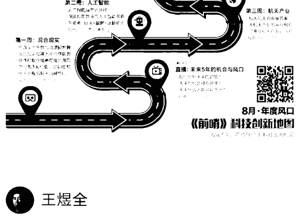

# 王煜全

我是王煜全，你的全球科技前哨侦察兵，咱们明天见。

## 012 | 私人航天发展需要梦想和商业激励

012 | 航空航天：开启美国...

王煜全

你好！我是王煜全。

昨天，我们介绍了大航天时代将要到来，但主导者不再是国家，而是私人企业。

很多人就会问，各国的航天产业不都是国家搞的吗？怎么私人航天产业突然就出现了呢？这是从哪来的呀？

其实，绝大部分人不知道，美国的私人航天产业有很悠久的历史，而且还取得了很辉煌的成就。

今天，我就给你介绍一个美国私人航天领域的大牛人，通过他的故事，你就会对美国私人航天产业的发展历程有个线性的完整的认知。

我相信，听完今天的内容，你将成为全球极少的了解航天产业未来发展方向的人。

### 大牛人：Burt Rutan

这位牛人名叫Burt Rutan，他1943年出生，2011年退休，现在依然健在。

自然地，既然说是牛人，当然要显示出他从小就和别人不一样，所以，据说他8岁就能自己制作航模，16岁就能独自驾驶轻型飞机了。其实我倒是觉得有这种经历的美国人大家有人在，相对来说，他后半生才是更精彩的。

1965年Burt大学毕业，虽然他没有参军，但还是为美国空军服务，成为一名“平民”工程师，在这期间，他开始设计轻型飞机。

到了1974年，他回到故乡加州开始创业，成立了一个飞机设计公司。1982年对Burt来说非常重重要，这一年他去了沙漠小镇莫哈韦（Mojave），成立了一个新的飞机设计公司叫Scaled Composites，可以翻译成可扩展复合材料公司。

### 私人航天之都：沙漠小镇莫哈韦（Mojave）

这个小镇的名头现在非常响亮，是美国乃至全世界的私人航天之都。它位于加州洛杉矶东部大约2小时车程的沙漠里。

我和得到另一个订阅专栏《薛兆丰的北大经济学课》的薛老师，曾经组织中国企业家代表团去美国参观高科技企业，还专门拉着大家去了这个沙漠小镇莫哈韦。镇口竖着一个牌子，上面写着一行字，叫做Mojave Air and Space Port，莫哈韦航空航天港，这个全世界只此一处。

在镇口上，我特意让大巴车停下来，让团队拍了一张合照，因为私人航天在未来这几年一定会有令人瞩目的发展。

莫哈韦是在1935年就修了机场，由于离爱德华空军基地非常近，周围又人烟稀少，所以在上世纪70年代就成了飞机竞赛和飞机测试的场所。

后来，逐渐有不少航天公司搬进来，其中就包括Burt创建的Scaled Composites，还有若干的衍生公司。当然也包括我们海银资本投资的XCOR航天飞机公司，还有著名的维珍公司老板Richard Branson投资的Virgin Galactic，就是维珍银河公司，另外还有其它很多公司，在这么一个原本鸟不拉屎的小镇子上，一下子有好几十家航空航天相关的公司驻扎。

所以到了2004年，它甚至被美国空管管理局正式认为一个正式的私人航天港。

### Burt的第一个传奇

从搬到莫哈韦开始，他给Scaled Composites这个新公司定的目标，是计划建造一架能够不落地不加油就实现环球飞行的飞机，因为当时还没有人做到这一点。

而实际上，他1981年就在设想这个事儿了，只不过是在和他的朋友吃午餐的时候想到的，还在餐巾纸上画了草图，1982年他搬到莫哈韦，立刻就开始着手建造这架飞机。

终于，到了1986年7月份，经历4年的建设，飞机造成了。而且一试飞就在天上停留了111小时44分钟，飞了1万9千公里，打破了当时的滞空时间的世界纪录。

在1986年的12月14日，在3500多名记者和观众的目光当中，这架被命名为Voyager，叫航行者的飞机，正式开始从莫哈韦启航，不间断，不加油的环球飞行开始了。经过了9天零5分钟，也就是216小时零5分钟后，在55000名观众面前，Voyager完美地降落到了出发点，完成了世界第一个不间断不加油的环球航行。

### Burt的第二个传奇

Burt的第二个传奇，比环球飞行更厉害，就是他赢取了“X Prize”的大奖。这个奖是1996年由奇点大学（Singularity University）创始人之一的Peter Diamondis，叫彼得·迪亚曼迪斯创办的，当时他声称要把1000万美元奖励给能够实现航天器90%以上可重复利用，且具有运载三人以上能力的人，而且要求这个航天器在两周之内连续两次飞出大气层，达到近地轨道。

这个故事最有意思的地方，是Diamondis当时根本没有钱，他是一边推出奖项制造影响，一边到处去游说富人捐钱。据他自己说，是因为他相信不会有人立刻拿到这大奖的，所以他先制造影响，只要能够在有人破了这纪录之前拿到这个钱他就成功了。他的命也是真好，因为直到2004年5月，也就是创办这个奖的8年之后，他才终于说动了一个富人投资1000万美元。但更加戏剧性的是，就在当年10月，这个奖就被Burt Rutan拿走了。

> 说个题外话：Diamondis是《富足》和《创业无畏》这两本书的作者，在中国这两本书也出版了，有兴趣的读者去读一读，蛮有意思的。

Burt说,他们一开始听说这件事就想参赛，但是他们真正开始建造是在2001年，用了三年的时间。

不过这次参赛是以Mojave Aerospace Ventures，叫莫哈韦航天企业的名义参加的，这是Burt的Scaled Composites和微软联合创始人保罗·艾伦合资建立的一个公司。

他们造的飞船叫Space Ship One，太空船一号。

2004年4月，他们拿到试飞许可。不过，2004年6月21日，第一次试飞他们就成功地飞出了大气层。因为这次成功试飞，试飞员Mike Melvill也成为了世界上第一个私人宇航员，创造了一个纪录。更了不起的是，之后9月29日，Space Ship One，就是太空船一号飞到了距地面102公里的亚地球轨道。5天之后，10月4日，太空船一号第二次试飞，又飞出去了，达到了112公里的高度。这样，两次试飞间隔5天，它就成功地获得了1000万美元的大奖。

不过要顺便说一句，保罗·艾伦为这个合资企业一共投资了2500万美元，所以这1000万美元拿回来公司还是赔的。

当然，保罗·艾伦并不在意，而且Burt的传奇也并没有到此结束。

### Burt的第三个传奇

2005年，他和Virgin Galactic，就是Richard Branson维珍公司的老板（他的航天公司叫维珍银河），一起合资成立了Space Ship Company，翻译过来就是太空船公司，共同建造可商用的太空船。

空船公司，共同建设可商用的太空船。

这个设计方案完全继承了太空船一号的思想，所以名字就叫太空船二号，Space Ship Two。

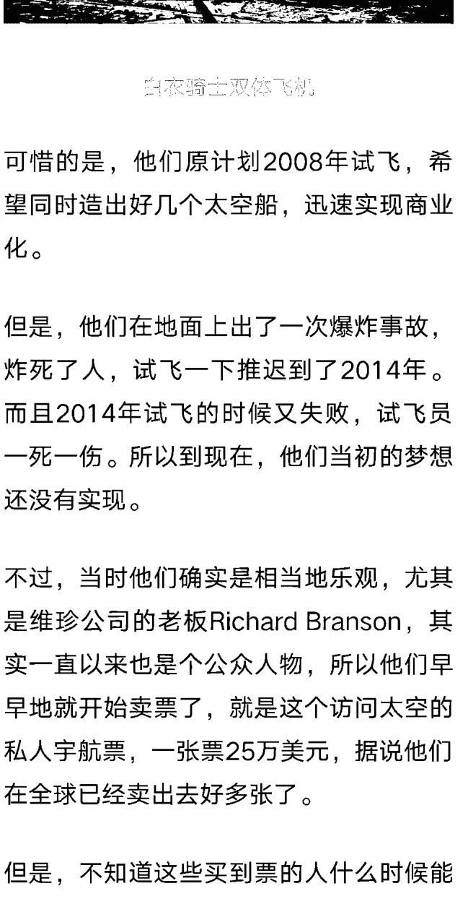

太空船二号和一号一模一样，都是挂在Burt设计的一个叫做白衣骑士的双体飞机的中间，就是飞机有两个机体，两个机体中间有机翼连接，机翼上面用来挂飞船。双体飞机从地面起飞，飞到高空以后，把挂在它的机翼上的飞船释放。这个太空船释放了以后，在空中点火，然后进入太空。

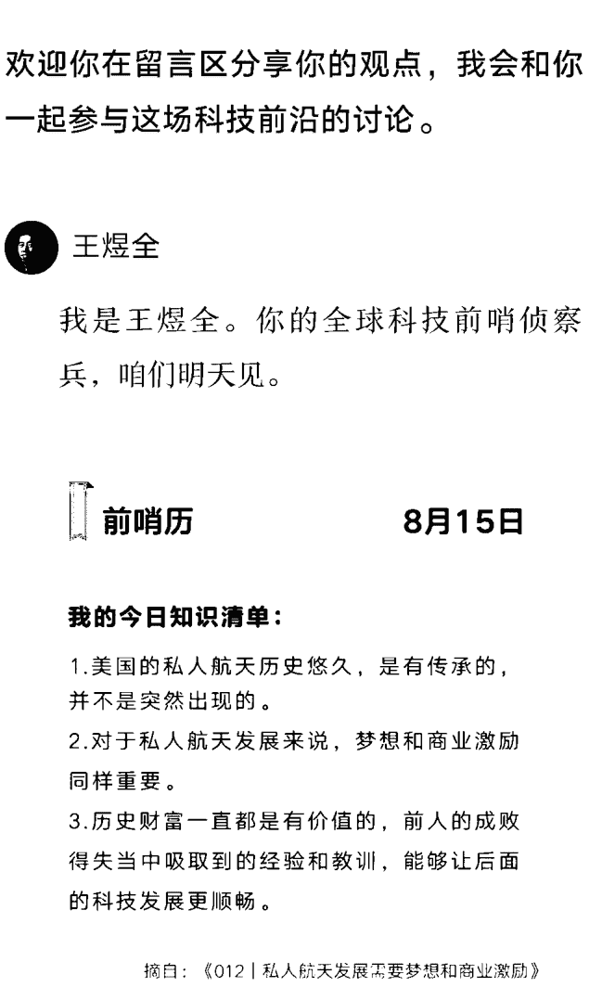

可惜的是，他们原计划2008年试飞，希望同时造出好几个太空船，迅速实现商业化。

但是，他们在地面上出了一次爆炸事故，炸死了人，试飞一下推迟到了2014年。而且2014年试飞的时候又失败，试飞员一死一伤。所以到现在，他们当初的梦想还没有实现。

不过，当时他们确实是相当地乐观，尤其是维珍公司的老板Richard Branson，其实一直以来也是个公众人物，所以他们早早地就开始卖票了，就是这个访问太空的私人宇航票，一张票25万美元，据说他们在全球已经卖出去好多张了。

但是，不知道这些买到票的人什么时候能真正开始自己的太空旅行。

Burt2011年退休，其实在2007年的时候，他已经把Scaled Composites这个公司卖给了美国的一个大军火企业。

2012年，他还把自己和Virgin Galactic合资的部分也都全部卖给了对方。像这样一个在一生当中连续缔造辉煌的人，可以说凭借一己之力开启了美国私人航天的第一页，所以2005年，Burt入选了美国的航空航天名人堂，得到了广泛的认可。

### ｜今日小结

通过讲Burt这个故事希望大家记住三点：

第一，美国的私人航天历史悠久，是有传承的，并不是突然出现的。

第二，梦想和商业激励同样重要。Burt从小就有理想，另外还要看到，曾经肯尼迪的航天梦，登月计划，确实吸引了一大批人，不光投身到航天产业，甚至投身到科技产业，改造社会。另外，商业刺激也很重要，Diamondis的1000万美金的X Prize大奖，直接就吸引了全世界26支团队参赛，而且8年之后真的变成了现实。现在，美国很多商业巨富也在推动私人航天产业，像Elon Musk、亚马逊的总裁Jeff Bezos，微软的联合创始人Paul Allen，当然也包括Richard Branson。有足够好的激励机制，私人航天就会发展得更快，这也是国有的航天往往很难做到的。

第三，传奇已经成为了历史，但是历史财富一直都是有价值的。不光是精神财富，也包括他们大量的试飞数据。所以，这些公司即使创始人退休，还是会被卖给其它公司，因为其它公司可以从他们的成败得失当中吸取到很多经验教训，能够促进后面的科技发展得更顺畅。

所以，没有鲜血是白流的，没有牺牲是白白损失的，我们中国的私人航天也希望有这样的持续的推动的人出现。

### ｜今日思考题

你认为中国航天业是否应该私有化？

先从产业的私有化，业务的私有化开始？还是先从牛人的私有化开始，牛人出来创业开始呢？

欢迎你在留言区分享你的观点，我会和你一起参与这场科技前沿的讨论。

王煜全
我是王煜全。你的全球科技前哨侦察兵，咱们明天见。

### 前哨历 8月15日

### 我的今日知识清单：

- 1. 美国的私人航天历史悠久，是有传承的，并不是突然出现的。
- 2. 对于私人航天发展来说，梦想和商业激励同样重要。
- 3. 历史财富一直都是有价值的，前人的成败得失当中吸取到的经验和教训，能够让后面的科技发展更顺畅。

摘自：《012 | 私人航天发展要靠梦想和商业激励》

## 013 | 航空航天产业正在创造更多机会

013 | 航空航天：旅店老板...

王煜全

你好！我是王煜全。

昨天说到美国私人航天产业的大牛人。在兴高采之余你可能会说，这么说来，中国的私人航天是不是没机会了？

其实也并不是，当大航天时代来临的时候，机会一定是平行展开的，而且不只是局限于火箭、飞船这类运载工具的研发。甚至，运载工具都将不再是瓶颈。

更重要的是，利用你自己的想象力，找到太空当中更大的机会空间。

所以今天，我就给你讲一个美国的旅店老板是如何华丽变身成为航天产业先锋的故事。

### 旅店老板Robert Bigelow

Robert Bigelow其实也是个创业者。早年间，他发现很多人长期出差异地，就会希望有一个暂时固定的居住场所，因为这样能更省钱。所以他就创建了一个叫Budget Suites的连锁品牌，翻译过来叫“经济套房”，特点是房间里配备厨房，可以自己做饭吃。因为有市场，所以现在经营成了有18家旅店，有大约2000多个房间的连锁酒店了。

按说，他酒店经营得好好的，继续老老实实做生意就好了。

### 旅店老板的航天梦

不过这个Robert Bigelow是个有梦想的人，因为他的家乡就在内华达州的沙漠里。

他小时候曾经亲眼目睹过原子弹的爆炸实验，所以据他自己说，他12岁的时候就立志投身太空旅游业。只不过他数学不好，这个理想当时离他太远了。等到他在旅店业成功之后，他觉得实现梦想的机会终于来了，所以开始作尝试。

在1995年，他成立了“国家探索科学研究院”，专门研究UFO之类的非正常现象，希望在后面找到科学的证据。不过，这个机构好像不太靠谱，2004年就关门了。当然，他还是 Fox。

1999年，他成立了Bigelow Aerospace，叫做比格罗航空航天公司。

### 美国宇航局NASA的TransHab计划

当时正好赶上美国宇航局NASA搞了一个叫TransHab的计划，TransHab这个词是“星际和居所”两个英文单词的词头，所以你也应该猜到了，这个计划是要研制出适合人类长途星际旅行的太空舱，以便未来能完成把大量人类送上火星这样的任务。

NASA计划里设想的太空舱有个显著的特点，它是一次预制成型的类似气球的东西，先被压缩起来发射，等到了太空里再迅速充气，变成能住人的太空舱。

这种太空舱有很多好处：

- 第一，是便于发射，因为它是被压缩起来的，所以体积比较小。
- 第二，是一次成型，不需要在太空组装。我们都知道，在太空里是失重状态，要把一大堆东西组装成空间站，尤其是能便于人居住的，实在是太费劲了。
- 第三，是因为它是充气膨胀起来的，所以理论上说它可以设计更大的空间。
- 第四，是成本低，还可以快速地更新换代。因为成本低，所以如果说用的时间不够久，或者用坏了，赶紧再发一个上去就好了。

但可惜的是，当时赶上美国政府财政紧缩，也正好是克林顿总统任期的最后一年。要知道，克林顿总统是非常支持科技产业的，也一直在力挺这个项目。但是到了2000年，这个项目被国会给否决了。

### 精明商人买下TransHab项目

精彩的部分这就来了。

虽然Robert Bigelow数学不好，也不是个科学家，但确实是个非常精明的商人。

他一看TransHab项目被迫停止，马上找到了NASA，一口气买下了所有的相关专利，从此就开始私人研发这种可扩展的太空舱。而这个公司所有的投入都来自于Robert在酒店业赚到的利润。

到2013年，他已经在这个项目上花了2亿5千万美元了。但是，他多次在公共场合表示，自己会投入至少5个亿。因为，实际上5个亿只是NASA一次航天飞行任务所需要的花费，可见私人航天还有一个大好处，就是省钱。更别说，这个老板本来就是开省钱酒店出身的，更知道省钱的诀窍了。

虽然Robert钱花得不多，但是成绩却不少。

2006、2007年，他利用俄罗斯的火箭连着发射了2个实验用的太空舱，名字分别叫创世纪一号和创世纪二号。

发射的时候直径只有1.6米，但是到了太空一打开就是2.54米的直径，以及4.4米的长度，这就是压缩型太空舱的好处。这两个太空舱的计划寿命只有6个月，但是直到两年半以后，上面的各种设备都停止工作了，太空舱却还没坏。

到现在，两个太空舱还在正常地绕着地球旋转，一些检测的仪器仪表还能反馈数据回来，据说所有的指标都依然正常。

### 不亚于SpaceX火箭垂直回收的成功

2016年4月8日，发生了一件世界性新闻，就是马斯克的SpaceX火箭第一次实现了发射火箭的海上垂直回收任务。

就在大家欣喜鼓舞的时候，却都忽略了非常重要的一点，就是SpaceX上面是载了货物的，而且就重要性来说，它载的这个货物的成功一点儿不亚于垂直回收的成功。

我相信你已经猜到了，上面载的货物就是Bigelow Aerospace的一个新太空舱，这是继2006年第一次发射之后，Bigelow Aerospace太空舱的又一次上天。

而且这一次，这个太空舱不是单独地飘在太空里做测试，而是被直接连接到现在正在运行的空间站上。这次测试为期两年，如果一切良好的话，就会开始被正式装备到空间站上。甚至，未来这种太空舱会逐渐替代现有的空间站，成为未来空间站的主力。

2017年5月，也就是3个多月前，NASA公布了测试一年之后的测试数据，显示一切良好，所以现在看起来，两年应该不是问题。

如果一切顺利，到2020年，Bigelow Aerospace会发射正式投入使用的型号为B330的太空舱。

为什么叫B330呢？

意思是它的空间有330立方米，和现有的太空舱相比，它的体积增大了210%，但是重量却只增加了30%。如果能够做到这一步的话，我相信应该说这个私人酒店老板真的是极大地推动了太空产业的发展，在天上开酒店就真的不是什么梦想了。未来，飞往火星的那些宇宙飞船很可能就是带着这种太空舱。

### 今日小结

通过介绍Robert Bigelow和他的Bigelow Aerospace航天公司，希望你记住三个要点：

- 第一，航天产业其实正在平行地展开，不只要关注火箭、飞船这些运载工具，其它平行展开的每一个机会都值得探测

其它平行展开的每一个机会都值得探讨。如果我们去思考其它互补的空间，会有更多的可能和更大的机会。

第二，航天产业虽然艰辛，却充满了想象力。就像我今天给你讲的Robert Bigelow的故事，他一个开连锁酒店的老板，都快有机会到天上去开连锁酒店了。而且，他现在已经和很多国家签了合同，商业空间站看起来为期不远了。

第三，进入太空的运载能力很快将不再稀缺，而且费用会大幅下降。我在周一的时候讲过，中国、美国都在研制运载能力100多吨的运载火箭，而马斯克已经在着手研发300-500吨运力的火箭了。

所以，中国不想落后，就得赶紧思考，开放自己的想象力，想一想有哪些航天产业的配套能力和应用能去作准备。

举个例子，当我们有了足够的运载能力，也就意味着我们需要培养大量的航天员，那航天员的培养，以及相应的太空服的制作、丰富多样的太空食品、太空日用品的开发等等，都存在大量的机会。

### 今日思考题

你认为还有哪些太空产业的机会没有被发掘出来？我希望你也展开你的想象力的翅膀，越奇幻越好。

欢迎你在留言区分享你的观点，我会和你一起参与这场科技前沿的讨论。

王煜全

今天“罗辑思维”的微信公众号推送了一篇我撰写的关于人工智能真相的清单，如果你有时间的话可以去看看。我是王煜全，你的全球科技前哨侦察兵。咱们明天再见！

### 前哨历 8月16日

### 我的今日知识清单：

+ 1. 航天产业正在平行地展开，不要只关注火箭、飞船这些运载工具，其它平行展开的每一个机会都值得探讨。
+ 2. 航天产业虽然艰辛，却充满了想象力。认真去思考其它互补的空间，会有更多的可能和更大的机会。
+ 3. 私人航天相比国家主导能够节省更多经费，并且不受政府财政影响。

> 摘自：《013｜航空航天产业正在创造更多机会》

「得到」专栏《全球创新260讲》
过去5年，抓住50个新科技浪潮机会

## 014｜提前10年发现航天产业中的巨大机会

014｜前哨洞察：数千亿美...

王煜全

你好！我是王煜全。

本周，我给你介绍了大航天时代的几个要点：

第一是大航天时代即将到来，它对人类的重要性不亚于历史上的大航海时代，而私人的商业航天机构将替代政府成为主力军。

第二是航天产业最关键的运载能力有望获得突破，正式揭开大航天时代的序幕。

第三是其它配套的应用将会平行地展开，很多应用也有获得巨大突破的机会。比如小卫星的出现，很可能会像以前电脑的大型机到微型机的转变，获得巨大的发展，还比如太空能源可能成为未来人类主要能源之一。

第四是中国参与的航天产业需要加速商业化，不能等到一切成熟之后再按部就班地搞。现在是全球生态协作的时代，只要我们熟悉这个生态，完全可以利用别人的能力搞出自己的优势来。

今天，我会给你作一个详细的分析，听完今天的内容，你会绝大多数人早10年对航天产业有深入的认知，并提前发现其中的巨大机会。

### 航天产业市场现状

首先，现在的航天产业规模还比较小，只有三四百亿美元的市场。但我认为，只需要十年左右的时间，航天产业将会实现10倍以上的增长，在2030年左右形成一个至少五千亿美元的巨大市场，所以叫大航天时代一点儿都不过分。

其次，航天产业现在主要有两个市场。

一个是发射市场，就是把货物送到太空；另外一个就是卫星市场。这两个加在一起是不到400亿美元的样子。

### 发射市场

现在火箭的发射能力，从成本上看，要把1公斤的货物送到地球轨道上，大概需要花2万美元的成本。所以运送1吨货物上天就需要2000万美元，成本还是很高的。

不过运力很快将不是问题，因为SpaceX计划把发射成本从1公斤2万美元直接降到它的1/10，也就是1公斤只需要2000美元，成本的大幅降低，会让发射市场获得百倍的增长，到2030年左右，将达到二千亿到三千亿美元的市场规模。

### 卫星市场

刚才说了发射成本会大幅降低，主要就是指运货上天，而这个货物，就是卫星。

现在的卫星主要还是各国政府投资建造，一般都是成吨重，一年到头也发不了几颗。但随着私人商业机构在卫星领域的创新与突破，小卫星一年可以发射几百颗几千颗，卫星的各种应用会得到极大的丰富，使用费用大幅度下降，那些原本用不起卫星的机构，也能够以可接受的价格使用卫星服务了。

一般来说，小卫星用了几年之后就会落回大气层，因为个头小，所以会在大气层里完全焚毁，不用担心掉到地面上。也正是因为这样，每过几年整个太空中的小卫星就可以换一批，所以这个市场可以持续不断地更新。

### 卫星通讯市场

在小卫星的各种应用里，最重要的是“太空互联网”，这是伴随着无人驾驶出现的，主要是为无人驾驶的汽车和飞机提供增强型的精度更高的导航，提高出行的安全性。

未来，只要是自动化的需要移动的物体，都要给卫星的“太空互联网”缴费，在2030年，这将会是一个超过千亿级的卫星通讯市场。

### 新兴市场：太空旅行

第一个，也是我最感兴趣的，就是太空旅游。

现在的Virgin Galactic，也就是维珍银河公司已经开始预售太空旅行的票了，一张票是25万美元，不过应该不是全款，现在已经有400多个用户预订了，预售款就收到了5000多万美元。

### 新兴市场：太空能源

比太空旅游市场更大的是太空能源。

我们地球上现在一平米每秒所接收的太阳照射，假设没有云层这样的任何遮挡，应该1.366瓦...

还会带来发电效率的提升，所以太空能源的市场规模将会接近1000亿美元。

### 新兴市场：太空探矿

陨石中铁和镍的含量是比较高的，镍是一个很重要的贵金属，用处非常广泛。

现在，全球镍的需求量大约200万吨，市场大约是400亿美元。所以，如果从太空捕捉小行星，实现太空冶炼，有希望部分地替代地面的加工。而且小行星当中除了含镍以外，还含有大量的其它贵金属。

到2030年会形成一个大约500亿到1000亿美元的太空探矿和稀有金属冶炼的产业，在太空中直接收集小行星，同时完成冶炼。

### 新兴市场：太空居住

当然，如果要做这么多工作，又有能源，又有旅游，又有探矿，那很显然太空居住就变得很重要了。

所以空间站的需求量也会极大地增加，有望在2030年形成一个百亿美元左右的市场。

我之前也介绍过，迄今为止最领先的空间站是Bigelow Aerospace，其实我们可以一起研讨中国能否加强空间站的建设，在空间站的商业化上迎头赶上，赶上这拨未来空间站建设的大浪潮。

除了上面说的这些，其实还有太空制药，还有无重力的太空制造，还有月球探险，火星定居计划等等等等。

### 配套设备市场

一般来说，一个应用市场往往需要一个达到这个市场规模1/3到1/4的设备市场来支撑，前面我们说航天产业大约是四五千亿的市场规模，那就意味着还有个相应的至少上千亿的设备市场，比如火箭、飞船、卫星、太阳能设备等等等等。

所以航天产业的总体市场至少有五六千亿美元，是相当诱人的。

我之前就曾多次说过，任何一个产业的形成，尤其是科技产业的特点，是需要5到8年的研发期和另外5到8年的市场开拓期的。

所以，你看看今天很多的领军企业，它的实际年龄从成立开始算，往往是已经有15到20年的时间了。所以，现在到2030年只有短短的13年时间了，现在赶紧起步都已经稍微有点儿晚了。中国真要追上，要在2030年的时候取得领先优势，现在起步都不够，还要赶紧利用中国的优势，利用对产业的理解加速追赶。

当然，也并不都坏事儿，因为我之前也介绍过，航天产业是横向展开的。我们中国如果能够发掘出自己的优势，利用现有的国际太空产业链和现有的国际上的优秀的航天企业来合作，可以加速自己的发展，有望迅速见效，所以我们还是有追赶的余地的。

### 今日小结

今天主要说的是三点内容：

+ 第一，全球航天产业的机会巨大，大航天时代带来的是一个巨大的产业机会，发射市场、卫星市场、卫星通讯会获得巨大突破，而太空旅行、太空能源、太空探矿、太空居住等，会形成一个总体五六千亿美元的大市场。
+ 第二，任何机会的实现都需要时间，所以必须提前布局，才能先人一步把握住机会。
+ 第三，如果我们能够学会利用自身的优势，掌握产业的规律，就有机会后来居上，在2030年的航天产业的收获期拔得头筹。

### 今日思考题

假设你是一个想要进入航天产业的人，你觉得哪些细分市场有机会？

王煜全
我是王煜全，你的全球科技前哨侦察兵。我们明天见。

### 前哨历
8月17日

### 我的今日知识清单：

+ 1. 全球航天产业会形成一个五六千亿美元的巨大市场，包含发射、卫星、通讯、旅行、能源、探矿、居住等方面。
+ 2. 利用自身优势，掌握产业规律，提前布局，有机会后来居上，在收获期拔得头筹。
+ 3. 利用国际太空产业链和优秀航天企业合作，加速自身发展，有望迅速见效，所以中国还是有追赶的余地的。

> 王煜全：《014 | 提前10年发现航天产业中的巨大机会》

「得到」专栏《全球创新260讲》
提前5年，抓住50个科技浪潮机会

### 用户留言

提交留言可与专栏作者互动

### 直播回顾｜普通人如何在科技浪潮中受益？

王煜全

你好！我是王煜全。

以下内容来自8月9日我在得到直播间的直播《抓住改变你未来命运的5年》。

面对未来最困难的是不连续性，因为如果是线性就很容易预测，但是未来是不连续的点。未来主要是有3个不连续：

#### 1.社会不连续

世界500强企业多是在第二次世界大战后成立的，因为“二战”成为断点，所以前后有很多新的公司出现。虽然我们期望社会会稳定，但是这种不连续会产生机会，不过我们无法控制。

#### 2.人口不连续

以视频网站Bilibili（哔哩哔哩，也被称为“B站”）为例，优酷和爱奇艺是给相对岁数大的人看的，而Bilibili则是年轻人看的。之所以有哔哩哔哩，是因为大量喜欢分享的年轻人群出现，当然背后还是科技的不连续性，科技带来移动互联网红利，人口变化也是科技推动的。

#### 3.科技不连续

科技带来的变化，最常见也是很热门的话题是“如何解决社会阶层固化”。

### 一、你最好提前知道的4个未来趋势

#### 1.城市化

#### 2.智能化

#### 3.虚拟化

#### 4.积木式创新

### 二、未来5年你值得重点关注的产业

### 三、如何在科技浪潮中自处？

十里八乡都找他买这套技术，不光因为这个赚了钱，农资公司还找到他有更多合作，他直接在农业领域有了建树。所以，你还需要对你的行业痛点有充分的了解，前哨能够帮助你的是判断趋势和了解科技，只要你运用好，每个人都可能成功。

### 总结来说，需要做两点：

+ 1. 充分地了解趋势和机会——所处的行业有哪些全球最新的科技，最新的变革，做一个积极主动的分析者。
+ 2. 了解产业和生态链知识——相比科学知识，了解科技产业的结构和生态链更为关键。在科技创业的生态链当中，所有环节都会受益。并非每个人都要成为主导者、科学家、发明人，只要积极参与到科技产业链当中，就可以成功。

### 四、面对未来，你需要提前做好4项准备

+ 1. 让终身学习成为常态，每个人都应该保持开放的心态，让终身学习成为一种常态。让自己有鉴别趋势的慧眼，把自己浸泡到未来中。人工智能替代人类的很多工作后，会加剧财富分化，并且会让勤奋向上的人更加优秀，而其他人则能力退化。
+ 2. 训练机器智商，把机器当成帮手。同时训练自己的思考能力，人脑是我们可以看到跟人工智能抗衡的东西，因为大脑是宇宙中最复杂的东西。
+ 3. 在人机分工中建立优势。未来世界只有人类才能胜任的工作剩下三种——创新、连接、领导。工作种类有序增减——人类和机器相比不占优势的工作种类会消失，而胜过机器的工作种类会增加。
+ 4. 成为人机结合的超有机体。找到绝对长度，参与积木式创新，公司或者个人用最优的长板与别人的最优长板结合，形成最优的木桶。

王煜全

我是王煜全，你的全球科技前哨侦察兵。

那是中国现在产业面临的一个问题，但是在新兴产业中，这个问题有可能反而会变成一个优势。因为在新兴产业中，国外的传统企业的势力很大，而新兴的科技企业势力比较弱小，因此在游说政府的时候，容易是传统企业能够左右政府政策，而新兴的创新企业相对来说比较没有话语权。

在国外的太阳能产业，比如美国的特朗普政府，很明显就是更加倾向于保护传统的能源企业，保护石油和页岩气企业，而对太阳能企业缺乏扶植。

我们希望政府能够听到我们前哨的声音，了解大航天时代的特色，从而根据这个特色制定有利于私人企业发展的政策。因为我非常认同只有私企和国企形成良性的竞争，在同一个规则之下，大家在竞争中看看谁强。我并不认为国企就不够强，其实国企能够做强的例子也是还是有很多的，但是，必须是同等条件的公平竞争，因为只要有公平竞争存在，不管是谁强，我们整个产业都一定强，只要产业强，我们才有机会。

当然，还会有人担心中国会不会沦为国外的代工厂，至少在航天产业这块不用担心。

第一就是我们想做代工厂也做不了，因为航天产业在国外也被认为是和国防军事相关的产业，是严禁向中国出口的，所以中国只能自己搞。

第二是中国其实有“集成化创新”的优势。因为航天产业有点像大飞机和高铁一样，它往往是一大堆的先进技术集成到一起的体现。任何一项先进技术拿出来，未必需要是全球拔尖，但是需要把这些先进技术整合的比较好，还需要大量的经验积累。

所以中国因为有一个强大的工业产业来支持，才能创造出航天产业需要的相关的各个方面的技术，即使不一定是全世界最好的，往往也是完备的。其次，就是要越早越好，这样才能够磨合出足够多的经验，使得我们的能力得以提升。

卷毛：王煜全老师您好，因为对于航天产业不太了解，想请教您一些问题：1. 相对于传统领域，航天领域的创业创新是不是需要更多的资金支持和较长的研发周期？2. 航天创业公司之后靠什么盈利呢？比如火箭制造的公司就是靠出售“船票”来获利吗？3. 这个行业的利润回报率如何？门槛高吗？王老师提到了期待国内的私人航天的创业公司爆发，那么处于“起步”阶段的国内航天，相较于其他领域，融资会比较困难吗？

# 王煜全

科技创新一般需要5-8年的研发期，航天产业也是如此。其实，原来航天产业的研发周期还更长，但是，随着航天产业的兴起，产业发展和生态的完善，有望实现科技创新的研发期变得短一些，回到标准的5-8年的这个时间线。

但是，其实和别的产业一样，航天并不特殊。这个做科技都是要有研发周期的，都不是今天说要做，明天就会有成果的。但是这种研发周期其实反而是你 的壁垒，因为别人要做也需要有这样一个周期，所以我不认为这是有多么特殊的地方。

至于说航天产业的盈利性，这个话题我在周四的内容中已经做了阐述。一方面，有大量的新兴产业、新兴的业务机会、新兴的市场机会已经冒头；另一方面，还有一些“中彩票的机会”，比如说你在天上捕获了一颗行星，这颗行星碰巧富含稀有金属，你立马就发财了。

像太空能源、太空冶炼、太空制药……其实都有很大的空间和市场，所以其实太空产业是相当诱人的。

既然它有诱人的一面，那就一定不缺乏投资。因为现在虽然没有市场，但是只要未来有市场，投资者就会积极进入，因为投资就是投的未来市场，如果市场已经很明显了，投资反而没有盈利空间了，所以不要担心有没有投资。投资投的是趋势，当初马云拿到钱的时候，市场上还没有电商这个概念，还没有这个电商的市场。

所以，今天你为航天产业做准备，过了三五年你可能就是这个产业风口上的领军者者，至于说有没有人来投资，我们也在号召，我相信市场也在启动，也会教育越来越多的投资者知道这中间是有巨大的盈利空间，有巨大的回报的。只要有回报，一定有人来投。

本周的总结和问答就到这里，希望你也能积极地参与我们前哨每天的留言互动，我会在留言区和你交流，帮你解答问题。

# 王煜全

周的话题是ICO和区块链，相信你也一定很感兴趣，欢迎你关注。

我是王煜全，你的全球科技前哨侦察兵，我们下期见。

### 前哨历 8月18日

### 我的今日知识清单：

+ 1. 大航天时代对人类的重要程度，可以媲美开创了人类文明新纪元的大航海时代。
+ 2. 私人航天企业将成为主角，它不仅历史悠久，而且所有的经验都是宝贵的传承。
+ 3. 大航天时代是一个复杂的生态，各个组成都将同步展开，中国要抓住机会，必须迎头赶上。

> 摘自：《015 | 问答：现在是布局大航天时代的关键时刻》

「得到」专栏《全球创新260讲》
 过去5年，抓住50个科技投资机会

## 015 | 问答：现在是布局大航天时代的关键时刻

王煜全
你好，我是王煜全。
今天是我们的全球科技问答时间。

### 全周总结+拓展

本周我们说的是大航天时代，主要有三个重点：

+ 1. 大航天时代正在到来，其对人类的重要性程度可以媲美开创了人类文明新纪元的大航海时代。虽然大航天时代的市场还没有完全展开，可能还需要10-15年的时间，但是产业的布局一定要提前，如果做好研发甚至需要5-8年，所以，我们认为现在已经到了大航天时代布局的关键时刻。
+ 2. 大航天时代的主角是私人航天企业，我们给大家介绍了私人航天的历史其实也很久久，而且私人航天的大量经验都是非常宝贵的传承并且都被继承下来用于今天的航天实践。另外，就是在大航天时代到来的时候，我们必须要掌握如何把传统的这个国家主导的航天产业的优势转化为私人航天优势的这样的能力。
+ 3. 大航天时代的序幕是运营能力的解决。
但是，大航天时代，构建了一个复杂的生态系统，其各个组成部分都将会同步展开，并不是一个纵向的问题解决以后再解决下一个问题的产业布局，而是横向地同时把各个问题一起来解决。因此，中国尤其要抓住机会，必须要迎头赶上。中国的航天事业经过几代航天人的努力，我们的国家航天实力已经居于世界最前列，但是，不要在大航天时代来临的时候，反而产生退步。

### 用户留言点评

本周航天的主题，激发了不少用户的情怀。

用户郭成就留言说，国家队对航天产业的贡献是培养了一批掌握核心技术的科研人员，而私营创业公司借助社会资本的力量推动航天产业发展；可以构建平行的产业发展模式，由国家队垂直研发模式变成企业单项技术平行开发，再通过积木式创新实现技术产业化。

用户nonoly就提供未来的航天产业可以有9个机会，比如太空用药品，航天员训练场地、器械、培训人员，太空纪念品，太空模拟体验馆，太空旅游，空地对话，太空种子，太空储物甚至是太空文物保护等等，特别有想象力。

用户郑庆也从衣食住行的方面提供了“航天+”的设想，比如太空服、太空米其林餐厅、太空饭店等等。

### 用户答疑

cccoming：中国的情况，会不会限制私人航天事业的发展，或者说，做到百分之百的商业化？航天产业的意义重大，也会涉及到国家安全层面，如果纯商业化的运营，怎么样才能保障各个国家的安全问题呢？

王煜全
第一，我们一直以来所惯了一个术语叫做“军转民”（军用到民用），就是说一般大家会认为军用科技比较领先，而转为民用有很大的市场。但是从全球的实践来看，大多数是“民转军”。就是说一个国家只有它的民用科技强大了，军事科技才可能强大。
我们对比美苏就可以发现这样的差距：美国的民用科技非常强大，军事实力自然不容小觑；而苏联等国为发展军事科技，但是民用科技一直不够强，所以到最后，军事反倒拖累了它的本国经济。
那其实在中国也有类似的讨论。
在建国初期的时侯，我们中国的第一代领导人就曾经讨论过，在发展军事的时候，尤其发展远程的军事力量的时侯，到底是搞飞机还是要搞导弹？
最后的结论是，要上导弹而不是造飞机。因为中国整个的工业产业和科技实力不够，如果是搞导弹的话，它是一次性的材料，只要能飞到目的地爆炸以后，材料就消失了；如果是搞飞机的話，它是重复使用的，那么这时候，如果我们的材料科学不过关，飞机上的一些零部件因为疲劳而出现损坏或者出现故障，那就会造成机毁人亡。
所以，当一个国家的整个产业相对比较落后的时侯，我们只能取巧地找一些点来开拓。但是，很显然我中国今天已经强大到这个地步，那么必须有全面的国家安全的思考，这种时侯，其实必须依赖一个强大的民用的科技产业来支持，所以我们坚定地认为“民转军”才是国家国防科技强大的核心。
第二，如果说将来商业化发达了，国家只要一个设计就会很好：商业化发达的科技和产品，当涉及到国家安全，需要为国所用的时侯，必须无条件提供给国家。
其实美国也是这么设计的，我们之前一直在提到美国的“拜杜法案”时说，不管是国家资助还是产业界资助，科研的成果一律都归高校。看似好像是国家放弃了对科研的拥有权，但实际上“拜杜法案”是有—条要求的，就是“当国家出于国家安全的需求要用这些科技的时侯，必须无条件地授权给国家使用。”
我想，这可以作为航空航天产业的一个借鉴，就是既要鼓励民用航天产业，同时也可以从法规层面束缚和要求最先进的航天科技，一定可以被国家所用。

庞浩源：1. 国内是否有些企业在与政府沟通相关政策？2. 航天产业能否进行混合所有制？3. 现在我国有哪些企业在科技具有潜在优势？4. 如果大航天时代到来，中国会不会还是国外的代工厂，科技上我们能否赶超国外？

王煜全
国际上市场比较充分的国家都是让企业去影响政府的政策，因为一般企业都会对本产业的未来做出分析，然后再制定相关的能够面向未来的策略。
策略制定之后，它要去影响政府，使得政府制定的政策有利于企业的未来发展。那中国现在的问题往往是企业是政府政策的跟随者，就是说企业对未来研究的很不够，对未来的发展方向也缺乏判断，因此就好是政府做什么政策，自己就会相对比较盲目地去跟随。
那是中国现在产业面临的一个问题，但

是该公司的目标。该公司的近期计划就是在2020年前在太空中建立一个氢能源补给基地，为太空航天器提供燃料补给，而氢能源则来自太空中的小行星上的水资源。

#### 3. M型小行星——矿产之王

这类小行星相对稀少，但一般金属含量可以达到S型小行星的10倍。

### 三大开发策略

第一方面，从以上这些公司的布局不难看出，开发小行星第一个重要的原因就是水源，水源不单单可以给外太空旅行提供生命支撑，而且它可以电解为氢气和氧气，氧气也是宇航员所赖以生存的生命之源，进一步说，目前大部分的飞行器燃料，其实际上就是液氧和液氢，所以如果可以在小行星上面开采水而不是花费天价的费用从地球运载，将会对深空旅行形成巨大深远的促进作用。

第二方面，小行星上面大量的金属矿产，特别是铂金和黄金等贵金属，也是一个很大的激励，铂金在地球上一般都是深藏在地壳深处（由于地球的铁核，铂金都被吸进深处），而在小行星很有可能就在表面位置，如果开采成功，将对地球的铂金市场，或者是铂催化剂等相关市场，形成重大的冲击影响。

第三方面，飞行器因为在小行星上面的设施得到了补给，所以不必再回到地球，这为飞行器重新出发提供了巨大的能源节省。打个比方：一个一吨的飞行器要从地面离开近地轨道（LEO，大约离地面300km），需要50吨的燃料，离开地球同步轨道（GEO，大约35,000km），需要250吨的燃料，而到深空则需要750吨的燃料，所以如果可以在小行星上面或者是在LEO附近的人造的栖息地得到补给，将会给飞行器节省巨大的资源。

目前以 Kepler Energy & Space Engineering（KESE）为代表的公司正在考虑建立永久栖息地。KESE目前在开发一个自动的小卫星采矿系统，名字叫做CORNUCOPA，目的是前往一个近地小行星，开采几吨的小行星表面风化土壤层，并运回到地球的低地轨道,小卫星的表面土壤层一般包含了70%的金属（包括铂系金属，黄金），20%的水，运用这些材料，在LEO建造空间栖息地和运输器。KESE希望可以在LEO建立一个永久的栖息地，然后以这些栖息地为基地，开拓外太空能源，期望兴起另外一个太空的“黄金热潮”。

### 国家战略先行

总而言之，小行星采矿已经不是遥不可及的任务，由于小行星上蕴含的巨大财富，小行星采矿的重要性也不言而喻，它已经成为很多国家重要的国家战略。

就在不久前，卢森堡立法宣布小行星采矿合法化，8月1号正式生效，国家保护私人公司在其他天体所带回来的物品的所有权。自此，卢森堡也成为欧洲第一个立法保护小行星采矿的国家。美国的相关法案颁发得稍微早一点，2015年奥巴马政府就已经关于小行星采矿立法。但卢森堡的小行星法更有弹性，只要公司在卢森堡有分支机构即适用。而美国的支持需要公司的主要控股机构都在美国。基于卢森堡的便利条件，上面提到的 Planetary Resources和Deep Space Industries也都分别在卢森堡设研究机构。对于一个小型的发达国家，卢森堡的国家战略是非常有前瞻性的，从目前开始做国家布局，以迎来私人航空航天爆炸性的时刻。

有意思的是，美国和卢森堡两个国家都有 些钻了联合国关于外太空条约的空子。联合国规定，任何国家不能宣传月球或者其他星体包括小行星属于自己，但它并没有规定从这些星体带回来的矿产不能归私人所有。虽然小行星采矿的大规模商业化可能还要十年二十年，但无论如何，卢森堡和美国在小行星采矿的立法上面，基本上都已经走在了其他国家的前头。

中国也开始认识到小行星采矿的重要性。今年5月，中国著名空间飞行器总体、信息处理专家、中科院院士叶培建表示，小行星资源开发必将是未来航天发展方向之一，我国只要去做，10年内可以开展示范性工程；50年左右可以实现大规模开采。五院月球和深空探测领域办公室技术负责人黄江川认为，我国应在“十四五”期间实施一次高起点、标志性的小行星探测任务。但总体而言，我国的 小行星采矿还处于初始阶段。更重要的是，与国外私人航天的繁荣景象相比，我国民间力量才刚刚进入萌芽阶段。

到目前为止，还没有企业在小行星上开采出有价值的矿物资源，而人类真正掌握成熟的太空采矿技术也需要大约数十年的时间。但显然，从小行星上开采矿产资源已经不是科幻小说情节，而是随时可能实现的现实，它正在全世界各国和企业引发太空“淘金热”。

王煜全 我是王煜全，你的全球科技前哨侦察兵，咱们明天见。

### 用户留言

### 创新地图｜探索外太空的宝藏——小行星采矿

王煜全

你好，我是王煜全。

2016年8月，我们在全球范围内发布了一份英雄帖——创建“前哨团”。

这份英雄帖的目的，是集结海外华人中的那些科研人员和科技创新者，向国人汇报科技前沿的信息和创新创业的趋势，帮助国内企业、投资界与国外学术界形成有效沟通和对接，为专利找到投资、为投资找到项目、为项目找到人才、为人才搭建平台。

今天，这个群体聚集了上百位全球“最强大脑”，这可能是全球首个专为普通大众提供的，也是容纳最大的知识服务组织。这个由全球顶尖高校科研人员组成的团体，在前哨第一季中向大家汇报了35份科技创新报告，覆盖了生物、电子、航天、虚拟现实、新能源等16个高科技领域。

在新的一年里，前哨团将继续承担全球重大科技活动的参与者 and 情報发布者的职责，更系统地向大家汇报各个产业最前沿的科技信息，全景式描绘全球创新前沿和趋势。

今天是前哨第二季开播以来的第三期前哨团供稿时间，题目是《探索外太空的宝藏——小行星采矿》。

孙瑜，博士，全球最大的炭黑公司 Birla Carbon 的科学家。

提起航天产业，大多数人第一时间想到的就是 Elon Musk 的 SpaceX。航天产业经过了以国家、政府为主导的数十年的发展，近几年民间力量开始出现活跃的迹象，不仅 SpaceX 在致力于压低发射火箭的成本，Blue Origins 和 Virgin Galactic 等私人航天公司也为了太空旅行做努力。

这一轮大航天时代的浪潮中，有一支不可小觑的力量，那就是太空矿产资源的开发。

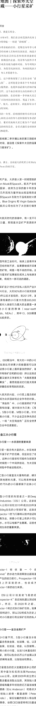

经过数百年的工业时代，地球上容易开采的矿物已经所剩不多，如果要继续开采难以取得的矿物，将是一笔不菲的开销。这时，小行星采矿如果能在成本上与地球采矿相媲美，将成为一条可选择的道路。

小行星采矿是21世纪才在私人航天产业兴起的新兴行业，大约90%的小行星其实都是2000年以后才发现的，到2013年，发现的记录档案的小行星大约是600,000颗。目前对人类吸引力最大的主要是一类叫近地小行星的群体（near-earth asteroids, NEAs），其中13,000颗是研究得比较多的。

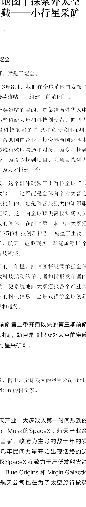

在这13,000颗当中，有大约一半的小行星消耗比到月球更少的能量就可以到达，而这些小行星上面所富含的铁矿，却是地球所有铁矿总和的50倍！所以这些近地小行星又被天文学家称为“太阳系里面低垂的果实”，意思就是说它们是太阳系目前来讲最容易享用到资源。

随着私人航天的兴起，小行星上蕴含的矿产资源成为众多国家和企业争夺的对象。在这场“淘金热”中，小行星是按照矿产资源的类型和含量，被大致分为三类：C型小行星、S型小行星、M型小行星。针对这三大类小行星，不少企业正在争先恐后地布局，一场“太空淘金热”正在全世界各国和企业中迅速蔓延。

### 太空淘金三大小行星

#### 1. C型小行星——水资源的重要来源

C型小行星一般含有大量的水。水在地球上显然不属于矿产的范畴，但是别忘了在太空中，这种小行星很有可能作为探索其他行星时候的一个中间供给站，为太空船在星际探险中节省运输成本。

此外，C型小行星富含大量有机碳、磷元素以及其他肥料元素，可以用来种植食物。大约75%的小行星都属于这类小行星。

开发C型小行星的先驱者之一是Deep Space Industries (DSI)公司。这家硅谷的私人公司计划在2019年或2020年发射一枚50kg左右的小型探测器，这架名为Prospector-1的飞行器将会以技术验证和资源探测为主，探测小行星上有多少可以利用的水。水可以电解产生氧气，这些也是能源和生命的重要来源。

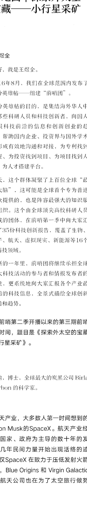

Prospector-1 将 依靠 一个 名 为 “Comet” 的 水 动力系统释放出超高温水蒸气产生的动力前行。Prospector-1在小行星上开采到的水，也会成为Prospector-1新的动力来源。

今年，DSI公司计划发射飞船的前体 “Prospector-X” 到近地轨道以测试相关技术。然后，在2020年之前，Prospector-1将正式执行采矿任务。如果该计划顺利进行，那么DSI将成为历史上第一个对小行星进行商业探测任务的私人公司。

#### 2. S型小行星——富含金属矿产

与C型小行星不同，S型小行星含水较少，但富含各类金属，比如镍、钴，以及各种贵金属，比如金、铂金，以及铼等。一个非常小的小行星，比如10米直径的S型小行星，就可能包含65万公斤金属以及50公斤的稀有金属，比如铂金和黄金。

S型小行星蕴含的巨大宝藏是很多公司的目标，其中最为知名的当属Planetary Resources公司。这家2009年成立的公司可谓是含着金汤匙出生的，其创始人是在航天领域有着多年经验的亿万富翁埃里克·安德森（Eric Anderson）和奇点大学联合创始人彼得·戴iamandis（Peter Diamandis），背后站着的投资人有谷歌创始人佩奇，谷歌CEO施密特和OS基金等知名机构和天使投资人。

这家小行星采矿公司的短期目标是开发小型(30-50 kg)低成本的太空轨道望远镜，既用于地面观测，也用于天文学研究。这些小型望远镜将利用激光光学系统与地面通讯，有别于传统的无线电电缆系统，这样不但减轻了负重，也减少了发射的负担。

这些望远镜采用了高光谱波段，比如下图可见光（左边）与红外的成像（右边），增强其图像分辨率，让其更有利应用市场。

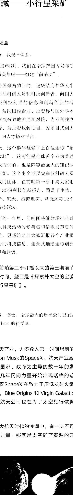

望远镜将搭载在一个小卫星群(constellation)里发射，这个小卫星群在近期主要提供全球监控能力，服务农业，石油天然气，水质量，森林等行业。比如分析庄稼的光谱信息，对农夫提供定制服务，比如鉴定能源和矿产资源的位置，检测石油管道，地理偏远的基础设施等等。这个系统也可以探测有毒藻类的蔓延，全球水质量，并监控森林野火的蔓延。

通过短期目标中地面服务的盈利和慢慢提升技术积累之后，这些小卫星群就可以把它们的望远镜观测角度转向外太空的小行星，通过上面提到高光谱波段来分析小行星土壤金属，水，有机物的含量等等，来择中合适的候选小卫星。公司这样的短期部署是为了可以未来观测近地的各类型小行星，以便于以后在长期小行星采矿的目标。

当然，Planetary Resources公司的目标不仅仅是金属矿产，水资源、有机物等也是该公司的目标。该公司的近期计划就是

### 预告 | 会迅速变得炙手可热的ICO你了解吗？

### 下周预告

在数字货币领域，ICO是现在非常时髦的一个名词，大家都认为里面蕴含着非常大的机会，但实际上，它同时也是酝酿着巨大风险的机会。

在人类的经济史上，有很多非理性的行为，庞氏骗局、郁金香花球事件曾反复出现。这是因为大家都在追逐新生事物和新概念，但大多数人又缺乏足够的辨识能力，往往导致新技术被滥用。

很多人关心ICO投资。对于个人来说，投资，其实是预测未来，必须要用理性的力量来对抗自己的非理性冲动。

ICO，这是一个会迅速变得炙手可热，但你一定要非常小心的概念，尤其是你要参与的时候。惟一防断更微信：699250

下一周，我会从比特币、区块链技术、以太坊和以太币、ICO的本质来入手，一层层为你剖析其中的诸多细节，帮你明晰其中存在的机会和陷阱。同时，你也会再次发现，科学革命推动社会进步的路线大都是相似的。

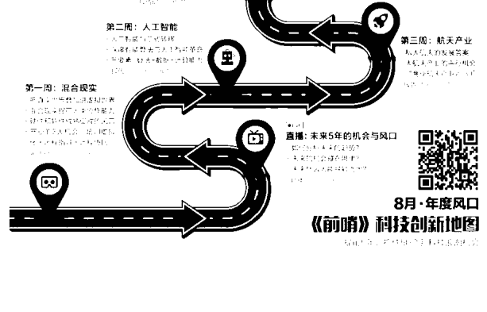

王煜全
我是王煜全，你的全球科技前哨侦察兵，咱明天见。

## 017 | 神秘的比特币发明人 “中本聪”

王煜全

你好！我是王煜全。

我们经常都会听到周围的人有这样的说法，说“哎呀，现在实在是没有机会了，因为过去的机会会被别人抓到了，没有新机会了”。

其实恰恰相反，我认为新的机会一直在不断涌现，而且新的机会是越来越多的。其实你看看过去的机会就会发现，这些机会离你也并不遥远。

比如说第一个数字货币比特币的出现，不过就是2008年的事情，啊现在还不到10年。

今天我们就来说说比特币和那个神秘的中本聪。

### 一、比特币=加密算法+分布式账簿系统

有关比特币的介绍其实很多，但可能很多人依然觉得难以理解，其实比特币只不过是一个分布式账簿系统和一套加密算法的结合。

每个比特币有一把公共的钥匙，还有一把私人的钥匙。公共的钥匙大家都能用，通过它能看到整个比特币系统的账本，能看到里面的任何账户变动，比如有一个账户往另一个账户转了一个比特币，所有拥有公共钥匙的人都能看到。但是，只要账户的拥有者不公开，谁也不知道这个账户是谁的，不知道这个比特币到底进了谁的腰包。只有使用私人钥匙，才能对账户进行操作。

而且，这套加密算法还保证了比特币最多只有2000万个，其实也就是2000万套的密码，所以，比特币是具有严苛的稀缺性的，比黄金和钻石还要稀缺，这就能有效地避免通货膨胀。

如果经济保持稳定，它未来的价值上涨是非常有保障的。这也是我建议大家如果做长线投资可以买比特币的原因。而且，比特币的每次交易都被记录到了分布式的账簿里，这就不需要一个中间机构，也不怕被人篡改，所以比特币也被认为是世界上第一个成熟的数字货币系统。

### 二、比特币的起源

比特币的诞生非常传奇，是2008年10月31日一个叫中本聪的人，他的英文名字叫做Satoshi Nakamoto，他在一个密码学的邮件组里发表了一篇论文，题目就叫“比特币，一个端对端的电子货币组织”，英文文做Bitcoin: A Peer-to-Peer Electronic Cash System。

这篇论文的英文原文非常值得一读，因为很简洁，很简短，也就是八九页纸，但是把所有重要的概念和算法都已经说清楚了，有兴趣的人可以进一步了解。

中本聪除了发表一篇论文，把比特币的原理清晰阐述出来以外，他还自己亲身实践，把比特币这个系统给做出来了。中本聪在2009年1月上线了比特币的程序，而且还把它开源了。他挖出了比特币的第一个区块里的50枚比特币，所以他也是世界上第一个挖出比特币的人。而且，他把10个比特币送给了第一个下载他的比特币软件的人，从而也完成了世界上的第一次比特币交易。

可以说，中本聪是当之无愧的比特币之父。因为他不光奠定了比特币的原理，而且亲自把比特币给做出来了，还亲自实现了比特币的挖据和比特币的转让，把这个头开得非常完美。

同时，中本聪还建立了一个叫做bitcoin.org的网站。这个网站的目的是让其他程序员可以共同来开发和讨论。所以很快，围绕比特币就形成了一个越来越大的社区，影响力也越来越大。

### 三、神秘的中本聪

但是，就是在比特币影响力迅速增大的时候，中本聪却一点不留恋权力，他在2010年居然把这个社区转让给了别人，由别人来负责，他自己则渐渐地淡出了公众的视线。唯一断斯更微信：699250

因此，大家就对中本聪到底是谁出现了大量的猜测，很多人猜他到底是不是日本人，他到底是住在哪个呢？

其中有一次猜测，当时很多人都相... 2014年3月7日又发了一条消息，说“I am not Dorian Nakamoto”，我不是那个人。这个也成为中本聪对外发布的最后一条消息，在这条消息发布之后，这个世界就再也没有了中本聪的消息。

虽然中本聪以前在密码论坛里时常冒头，但是是从来没有人知道他的真实身份。这也印证了互联网的那句话，在互联网的虚拟世界里，你永远不知道对面和你交流的是不是一条狗。

现在，很多人怀疑中本聪是美国人，因为他的英语流利，而且从没使用过日语。当然，一种可能性就是日裔美国人。所以，他还会使用日本的名字，因为这个中本聪的名字是标准的日语名字。2015年的时...

所以，今天只能说，这个神奇地创造了比特币系统的人，却彻底从公众视线中消失了，他到底是谁，谁也不知道。

据说中本聪拥有100万枚比特币，今天100万枚的估值已经超过了20亿美元，所以不管他是谁，他都是个巨富。但是，很奇怪的是，他从来没有用过任意一枚比特币，因为你虽然不能盗走比特币，但是通过看账本你是知道别人花没花的。他挖的比特币迄今都还没有动过。

今天，比特币的整体估值已经超过了400亿美金，而且交易越来越活跃，已经成为了当之无愧的虚拟货币里的老大，这是中本聪对社会的巨大贡献。

### ｜今日小结

我们讲的内容主要有三个要点：

- 第一，任何时代都有机会，比特币9年前才出现，而且一直到2012年，一枚比特币的价格都不 Egyptian 10元钱，5年200倍是任何投资人都羡慕的成绩。所以，千万不要说现在没有机会，也许你现在做了某件事，5年之后就能够得到丰厚的回报。
- 第二，中本聪到底是谁仍然没人知道，但他绝对是个天才，也肯定是个密码学专家，他以一己之力，利用密码学和分布式账簿相结合，创造了第一个完整的虚拟货币。直到今天，虚拟货币都基本沿用他的思路，比特币勒索病毒更是证明了比特币的安全性和可靠性。
- 第三，科学革命推动社会进步的路线都是相似的，我们每周讲的都是一个从科技革命到逐渐丰富、完善、应用化的产业发展过程。比特币也一样，有一个完善和应用化的过程。

比特币靠第一名这个信用做背书，可以成为全球的通用货币。而其它的数字货币则难以得到广泛的认同。

但是，比特币再严谨，也还是有弱点的，就是它不和任何应用相关，无法被应用到更多领域当中。所以，后来的聪... Vitalik Buterin 对此作了重大改进，形成了一个可以发行新虚拟货币的平台——以太坊。这使得各个应用领域的人都可以发行自己的虚拟货币，使得虚拟货币可以被应用到各个应用领域当中。

有关以太坊的故事，我们明天再讲。

### ｜今日思考题

科技进步都是对社会现状的改进，请问比特币改进了社会现实的哪些方面？

前嗅历 8月22日

### 我的今日知识清单：

- 1.比特币只不过是一个分布式账簿系统和一套加密算法的结合。
- 2.比特币靠第一名这个信用做背书，可以成为全球的通用货币。而其它的数字货币则难以得到广泛的认同。
- 3.比特币不和任何应用相关，无法被应用到更多领域当中，这是它的弱点。

### 特币改进了社会现实的哪些方面？

### 前哨历

8月22日

### 我的今日知识清单：

- 1. 比特币只不过是一个分布式账本系统和一套加密算法的结合。
- 2. 比特币靠第一名这个信用做背书，可以成为全球的通用货币。而其它的数字货币则难以得到广泛的认同。
- 3. 比特币不和任何应用相关，无法被应用到更多领域当中，这是它的弱点。

> 摘自：《017 | 神秘的比特币发明人“中本聪”》

「得到」专栏《全球创新260讲》
提前5年，抓住50个新科技浪潮机会

王煜全

我是王煜全，你的全球科技前哨侦察兵。我们明天见。

## 016 | ICO：一个配着巨大风险的机会

王煜全

你好！我是王煜全。

前两周第一周讲了一个可能大家没有太说出来的大机会，混合现实。

第二周讲的是人人都说是机会，但我认为可能不是机会的机会，人工智能。

第三周讲的是未来市场巨大，但今天看起来依然还不大，很多问题似乎都还没有解决的机会，大航天时代。

现在第四周，我给大家讲一个很快就会被传得很广，大家都认为机会很大，但实际上却伴着巨大风险的机会，就是数字货币领域里面的一个新的时髦名字——ICO。

### 一、ICO是什么？

对一个企业来说，只要规模达到一定程度，就可以对外募集资金了。

第一次公开募集资金叫做Initial Public Offerings,也就是IPO。

而ICO的全称是Initial Coin Offering，叫做首次货币发行，意思就是让更小的公司在成立之初就能通过发行自己的虚拟货币来公开募集资金，是数字货币领域里面的一个新概念。

那我为什么说它是一个正在伴着巨大风险的机会呢？

这需要从整个数字货币的历史说起，最后落点落到这个ICO到底是什么，以及它有什么样的风险上。

希望你听了之后，能对眼前的这个机会有充分的把握。

### 二、第一种数字货币：比特币

首先，数字货币里最知名也最可信的就是比特币，因为它是全球第一个纯粹的数字货币。而且，因为它只有2000万枚，它的算法让它在未来不会增加，所以具有天然的稀缺性。这是连金子、钻石都不具备的，因为它们每年其实还有新的开采，总数都在增加。

其次，比特币是第一个数字货币，所以它就给人们带来一种天然的信任感，只要人们相信未来是数字货币的天下，那么作为数字货币的第一名，一定是最有机会的。

而且今年还有比特币勒索病毒肆虐全球的事件，就是有人侵入别人的电脑以后给人家电脑加密，如果不付赎金，他就把加密内容删掉，而赎金指定要的就是比特币。这虽然是一个安全漏洞事件，但也反衬出比特币的安全性。因为到目前为止，这个在幕后敲诈大家的人到底是谁始终没有被揪出来，这说明比特币支付是非常安全的，如果是传统现金支付、银行转账、或者手机支付，肯定早就查出来这个敲诈者是谁了。

现在，比特币的价格从年初开始一路上升之后，正处于一个波动期。不过，我有这么个原则，就是不要看短线的事情，比特币的长线是没有问题的。

所以，如果你买完比特币，建议你最好把它忘掉，过几年一看，一定会有意外的惊喜。

### 三、区块链技术

其实，比特币的背后就是加密的分布式账本系统，简称叫区块链技术。

除了数字货币以外，这个技术其实还可以用于很多其它的领域，比如有一家提供线上数字签名公司叫做DocuSign，这家公司成立于2003年，到2015年它融资2.3亿美元的时候，估值就达到30亿美元了，今年疯传它应该很快会上市了。

他们做的数字签名技术能让很多文件的签署都是在线上完成，那如何保证这个数字签名是真的，如何保证它的安全性呢？区块链技术的分布式账本系统就能很好地解决这个问题。现在美国那边很多人签署数字文件的时候用的都是这个DocuSign，它的用户量极广。

### 四、以太坊和以太币

不过，比特币虽然最可信，但它本身只是一个虚拟货币，除了作为货币以外，就缺少其他可应用的地方，没有可扩展性，对区块链技术的开发并不充分。

所以到了2013年底的时候，一个叫Vitalik Buterin的俄罗斯出生的加拿大小伙，他搞了一套基于区块链技术的智能合约系统，而且这个系统是开源的。

简单地说，就是这个智能合约系统可以让每个人都利用这个系统生成自己的虚拟货币，比如王煜全币，罗振宇币。这样，每个虚拟货币都可以被独立运用到一个单独的领域，而每一个单独的应用都可以搞一个自己的“比特币”系统。

这个智能合约系统就叫做以太坊，现在以太坊上已经有数百个基于以太坊开发出来的应用了，而且数量还在迅速上升。

另外，以太坊本身也有一个自己的货币，叫做以太币，它也是经历了一轮暴涨。从2017年2月份一个以太币才卖8美元，到6月份就涨到了400美元，涨了50倍，比比特币在今年初的这一轮暴涨还要疯狂得多。

### 五、迅速升温的ICO

肯定很多人会想，现在既然已经有了一个通用的货币系统被开发出来，那能不能把这个通用货币系统用到企业的股票里面呢？

因为企业的股票其实就可以看成是一个虚拟货币，利用以太坊系统能够帮助每一个企业建立一个自己的虚拟货币系统。而且，把这个虚拟货币和股票对应起来。这就能让那些刚刚成立的，还不能公开发售股票的企业，通过发行自己公司的虚拟货币来进行募集资金，这就叫ICO。

可以说，ICO帮助那些不能发售股票的企业，绕开了IPO，绕开了监管，让发展更为初期的公司有了一个更加灵活的融资手段。

所以，ICO其实就等于是个虚拟货币，因为虽然它是号称和公司的股票挂钩。但是，毕竟这公司在初创期的时候，风险是巨大的。所以，ICO发行的货币和其它的虚拟货币一样，风险都非常地大。

我认为，ICO的概念在中国会迅速升温，而且被追捧。因为中国现在有很多新概念都非常地追捧。尤其是很多的业外人士，喜欢通过哗众取宠的方式来借新概念去炒作自己的产品。想一想当时的O2O，P2P这些概念，其实都曾经被很多销售机构借用过。

而且，ICO的概念一旦在中国升温，而且被追捧以后，很快就会出问题。不过，因为它涉及到金融机构的问题，所以肯定会被治理。我的建议是，除非你认为自己命好，能够在这一轮马上就要到来的ICO泡沫破灭之前跑路。当然，这个可能性并不大，因为泡沫破灭的特点就是它不知道什么时候会破灭。除非你是专家，除非对方完全可信，要不然的话，一定要注意谨慎进入。

至于我为什么会这样分析？通过本周后面几天的连续介绍，相信你能够有一个全面而深刻的了解，从而避免自己犯错。

### ｜今日小结

我们本周讲的是一个看起来迅速变热，似是一个妥妥可热的机会，但实际上后面立刻跟着一个巨大泡沫的这样的伪机会，大家一定要小心。

### ｜今日思考题

经济史上的概念泡沫至今仍然存在，你认为我们周边仍然存在的概念泡沫有哪些能跟大家分享，这样我们大家都可以从中间学到概念泡沫的规律。

欢迎你在留言区分享你的观点，我会和你一起参与这场科技前沿的讨论。

前哨所 8月21日

### 我的今日知识清单：

- 1. 比特币投资原则：不要看短线的事情，比特币的长线是没有问题的。如果买完比特币，建议你最好把它忘掉。
- 2. ICO帮助那些不能发售股票的企业，绕开了IPO，绕开了监管，让发展更为初期的公司有了一个更加灵活的融资手段。
- 3. ICO的概念一旦在中国升温，而且被追捧

### 前哨历
8月21日

### 我的今日知识清单：

- 1. 比特币投资原则：不要看短线的事情，比特币的长线是没有问题的，如果你买完比特币，建议你最好把它忘掉。
- 2. ICO帮助那些不能发售股票的企业，绕开了IPO，绕开了监管，让发展更为初期的公司有一个更加灵活的融资手段。
- 3. ICO的概念一旦在中国升温，而且被追捧以后，很快就会出问题。

> 摘自：《016 | ICO：一个酝酿着巨大风险的机会》

「得到」专栏《全球创新260讲》
抢前5年，抓住50个新科技浪潮机会

王煜全

第二季的前哨，我会为你准备3件“秘密武器”：

- · 每天一张“前哨历”，总结自己的知识清单，期待你每天都有进步；
- · 每月一张“科技创新地图”，及时掌握自己的学习动态；
- · 每季度一张“行动地图”（课表），你可以在发刊词中查看。

欢迎你把这3张图分享到你的朋友圈，记录一下你一年的学习成绩，和你的朋友同步学习进展。

我是王煜全，你的全球科技前哨侦察兵，明天上午7:15见！

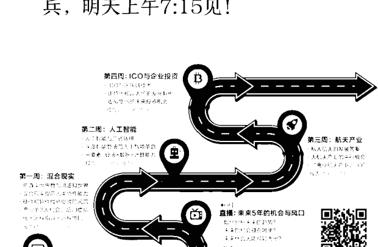

## 018 | 以太坊会是比特币之后的投资机会吗？

王煜全
你好！我是王煜全。
我们昨天讲到了比特币，它是一种虚拟货币，是一套加密算法和一个分布式账簿系统的结合。今天我们来聊聊“以太坊”。

### —— 今日内容看点 ——

以太坊就是一个通用的虚拟货币平台，每个人都可以利用以太坊的工具开发出自己的虚拟货币体系。阅读完今天的内容，你将掌握以下三个问题的答案：

- 1. 以太坊是什么？它和ICO有什么关系？
- 2. 以太坊和比特币有什么关系，它会超越比特币吗？
- 3. 如何看待和以太坊相关的投资机会，它的前景如何？

### 一、以太坊是能够生成任意多个不同虚拟币的智能合约系统

以太坊（Ethereum）是2013年底由一个叫作 Vitalik Buterin 的90后小伙子提出来的技术。以太坊和比特币相似，是一个开源的，基于区块链技术的分布式计算平台，它强调自己是一个智能合约系统。

通常只要有一套密钥系统，也就是加密系统，让交易可跟踪，这种结构就可以称为“智能合约”。基本上所有的虚拟货币都是这样的结构。所以智能合约也就是一套生成虚拟货币的系统，它本质和比特币是一样的，只不过，你可以在这个平台里自己生成任意多个不同的比特币系统而已。

为了支持这个系统，Vitalik和他的团队在2014年的7月至8月间，针对公众销售了他们自己的以太坊系统上的货币——以太币（Ether，简称为ETH）。

他们事先进行所谓“挖矿”，挖出很多的以太币以后，在募资的时候进行公开销售，共计销售了1190万枚以太币（大约占以太币总数的13%）。用户当时是可以比特币购买以太币的，所以你得先有比特币，才能购买以太币。

### 二、以太坊是全球第一个ICO项目

以太币，可以简单理解成以太坊的股份，它把股份货币化。

刚才说到的用比特币买以太坊的好处是，以太坊收到了很多比特币，所以当比特币涨价的时候，以太坊也会赚钱。当然，它的核心目的是通过发行自己的虚拟货币来融资。

以太坊是全球第一个用发行自己的虚拟货币的方式来融资的案例。这种方式现在被叫做首次货币发行（Initial Coin Offering，简称ICO），简单说就是第一次对外发行自己的虚拟货币。

具体情况我会在明天的內容中介绍，你只需要记住：以太坊是全球第一个ICO项目。

以太坊ICO时（也就是2014年7~8月），1个比特币可以兑换1337个以太币。比特币在当时的价格大约为3800元人民币，所以你可以推算出来，当时1个以太币不到3块钱。今天一个以太币的价格已经超过1500元，也就是说3年的时间，实现500倍的增长，这个回报当然是相当不错的。所以，当初投资了以太币的人，多数都已经获得了高额的回报。

当然，以太坊的创始人Vitalik自己也是大赚一笔。他拥有以太币总数的千分之八，大约是700多万枚，按照近期价格算下来，它市值超过14亿美元，接近比特币创始人中本聪所拥有的今20亿美元的市值。

### 三、相对于比特币，以太坊有三大特色

2015年7月30日，因为他们在一年前利用ICO的方式募到了足够多的钱，所以一年之后，以太坊正式上线。

为了让以太坊生态能够实现良性的发展，他们专门成立了公益组织“以太坊基金会”，和各个以太坊应用开发者一起协同做大以太坊生态，这是它的一大特色。

和比特币相比，以太坊有三大特色：

#### 1. 以太坊的管理更加严密

虽然以太坊的管理不是公司制的，是协会制的，而且是非盈利的。但是，和比特币比起来它的管理更加严密，而且它提供以太坊给系统开发者和系统升级者。如果你能帮这个以太坊系统找到Bug（系统漏洞），它都会奖励以太坊给你。这样的话，无疑就使得更多的开发者有更高的积极性去维护以太坊的生态系统。

#### 2. 以太坊通过成立联盟，保证应用的开放和标准化

以太坊的第二个特色是成立了企业以太坊联盟（Enterprise Ethereum Alliance，EEA）。这些联盟的成员一起来开发以太坊应用，而且能保证以太坊应用的开放和标准化。

联盟成员很强大，既有美国康奈尔大学在内的学校，又有像ConsenSys这样的著名的区块链应用开发者，还有大量的大公司，包括微软、英特尔、三星、丰田、JP摩根、埃森哲等等，这些大企业都是以太坊应用的积极引入者，而且借助以太坊来开放应用，为自己的企业客户提供服务。

#### 3. 企业可以借助以太坊来发行自己的虚拟货币完成融资

这一点和比特币的区别比较大，因为比特币只是一个单一币种。

而在以太坊的平台上，你可以制造出自己的虚拟货币，而且可以发行自己的虚拟货币，也就是卖自己的虚拟货币来实现融资。

如果一个公司在以太坊平台上做首次公开发行，就得用以太坊来买自己公司的货币，这个首次公开发行的具体过程，我会在明天做详细介绍。

### 四、以太币的价格有可能超过比特币

具体的公司进行首次虚拟货币发行的风险很大。所以，会出现这种情况：有时候，你买到了一个公司的货币后没多久，这个公司就破产了，那么你手里的虚拟货币就分文不值，相当于全都赔掉。

但是，以太坊作为发行平台现在越来越热，所以需要大量的以太币。每个都人要买以太坊才能去买以太坊平台上发行的不同公司的虚拟货币，那么，以太币的需求就随着ICO热度对的剧增而迅速增加。所以我们甚至可以判断：以太币的价格有可能超过比特币。

顺便说一句：我们在“前瞻·第一季”曾经分析过区块链技术，更加系统地描述了中外的区块链技术生态，其中有一大块就是以太坊的生态，有兴趣了解更多的朋友可以找来看一看。

中国在新技术，尤其是在开源技术的跟随上一直不落后，所以中国在包括以太坊技术，甚至是ICO上还是跟得挺紧的。比如著名的万向集团，他们早早就成立了区块链实验室，而且区块链实验室的创始人还拉了以太坊的创始人Vitalik，作为他的联合创始人。

### 五、警惕：ICO将让庞氏骗局的门槛降低

最后要说一句，虽然我们讲了那么多，看起来好像很让人兴奋。但是，大家一定要小心。现在业内一直有对以太坊等区块链技术的强烈批评——随着技术的标准化，把门槛降低，也使得庞氏骗局的门槛被降低了，那么，庞氏骗局也更可能简单地被系统实施了。

以前你要实施庞氏骗局，你还要找出一个理由到处去忽悠。现在，你只要做一个ICO，就是首次货币发行，就可能完成你的庞氏骗局了。所以，你一定要警惕。

### —— 今日知识小结 ——

我们有关“以太坊”和“ICO”的话题，我希望你能有以下3点收获：

- 1. 以太币是在比特币基础上的优化，它使得区块链技术有了更大的应用空间，从而就有了更加迅猛的发展。
- 2. 业务竞争的核心往往是生态系统的构建，生态的构建需要让大家都赚到钱。所以，只是开源，只是免费并不见得能够使技术很好的发展。有时候，对商业更好的运用，使得商业的生态各方都能够有利可图，反倒对整个生态的构建更有帮助。
- 3. 平台化使得用户的使用门槛大大降低，就是说每一个应用的需求方都可以借助这样的以太坊平台搞出自己的虚拟货币，或者搞出自己的智能合约系统，从而能够应用这些最先进的技术。但是，同时也使得骗子有了钻空子的机会，尤其是在企业融资上。所以我们需要看到本质，企业的价格增长，也就是公司的股价增长应该建立在价值增长的基础上。

### —— 今日思考题 ——

新技术和新应用结合才能造福社会，也才能使技术的自身发展得更快。你能想到以太坊这样的智能合约还能用到哪些新领域呢？你又会考虑购买以太坊吗？

欢迎你在留言区分享你的观点，我会和你一起参与这场科技前沿的讨论。

王煜全

下期预告：ICO是新的机会，但是也助长了过度投机。那么我们要如何把握机会，避免陷阱呢？

我是王煜全，你的全球科技前哨侦察兵，我们明天见。

如果你身边有正在了解或参与区块链投资的朋友，不妨把今天的文章分享给他们，或者和他们一起展开讨论。

### 前哨历 8月23日

### 我的今日知识清单：

- 1. 以太坊是一套能生成虚拟货币的系统，企业可以借助以太坊来发行自己的虚拟货币，完成融资。
- 2. 以太坊使得区块链技术有了更大的应用空间，从而就有了更加迅猛的发展，有可能超过比特币。
- 3. 以太坊降低了企业融资的门槛，就给了投机者机会，这将是个隐患。

摘自：《018 | 以太坊会是比特币之后的投资机会吗？》

「得到」专栏《全球创新260讲》
过去5年，抓住50个新科技浪潮机会

## 019 | ICO是机会还是庞氏骗局？

019 | ICO是机会还是庞氏骗局…

王煜全

你好！我是王煜全。

我们本周的前面三天大多是在讲虚拟货币的历史，今天要讲讲未来，聊聊会迅速火爆，但是伴随巨大风险的ICO。

### —— 今日内容看点 ——

ICO 的全称是 Initial Coin Offering，叫做首次代币发行。

初创的小公司能通过售卖和自己公司股份挂钩的虚拟货币来进行融资，相当于刚成立就上市，能够在公司最早期就融到钱。

阅读完今天的内容，你将掌握以下三个问题的答案：

- 1. ICO 的实际情况是什么样的？
- 2. 什么样的企业会去做 ICO？存在什么风险？
- 3. ICO 接下来的发展趋势是怎么样的？你是否要参与其中？

### 一、经济史上的非理性行为：庞氏骗局与郁金香花球事件

#### 庞氏骗局

简单地说，就是创业者利用新投资人的钱向老投资人支付高额回报。旁观者总是能听到某人投资了某个公司赚了很多很多的钱，然后就有部分旁观者也跟着往里面投钱了。

实际上这种创业者就是要制造这种“投资人在赚钱”的假象，从而骗取更多的投资。

这个方式来源于一个意大利裔的美国移民，叫 Charles Ponzi。所以，这种模式被命名为庞氏骗局。

直到今天，这种骗局依然非常地普遍。

#### 郁金香花球事件

这是17世纪发生在荷兰的真实事件，荷兰本来是世界鲜花之都，郁金香也是荷兰人民最宠爱的鲜花。

但是，郁金香只有观赏价值，没有什么其它的更高的附加价值。但在17世纪的时候，一些稀有的郁金香的价格迅速上涨，结果就引来了更多人购买，因为购买者总相信还有人比自己能够出更高的价钱，结果，郁金香花球的价格就被炒到了荒唐的高度。

一个郁金香的花球，最高可以相当于40头牛，甚至可以相当于一个河边的高级别墅的价格。最后，毕竞郁金香花球并没有那么高的实际价值，结果就崩盘了，造成了大量荷兰人赔钱破产。

这个事件后来被称作“投资的博傻理论”，和庞氏骗局一样，这种事儿直到今天也还在人类的经济活动中反复上演。

#### 以太坊平台被认为是下一个暴富的机会

昨天我介绍过，以太币从2014年首次发行了3块钱，3年时间增长了500倍，这自然就吸引了大量的眼球。

但是，以太币只有一个，今天价格已经涨上去了，想再有3年翻500倍的机会基本不不可能了。所以，很多人希望能找到更多类似的投资机会，迅速暴富。

正好，以太坊又是可以提供大量这种机会的平台，虽然以太币已经发行过了，但是在以太坊上面，每一个企业都能发行一个自己的虚拟货币，也许真的就有某个企业又可以做到3年500倍的增长。很多人因为这个想法，被吊起了胃口，就希望在以太坊这个平台上能够投到下一个暴富的机会。

用社会学家、社会趋势专家、北大刘德寰教授的话说，中国社会各个年龄层，各个阶段的人普遍都在赶时髦，都在追新概念。

好的地方是新技术、新应用在中国往往普及得非常地快，中国人是最新理念的实践者。

坏的地方就是很多老骗局会被披上新概念的外衣不断上演。很多人会失去理性，感觉好像只要是新的东西，天然就应该有500倍的回报一样。

但实际上，绝大多数新东西的背后，还是要靠传统经济来支撑的，这么巨大的回报率实际上是不可能经常出现的。

### 二、从上市、融资、投资者、风险角度分析ICO

#### 1.从上市审核的角度看。

一个简单的逻辑，就是为什么要做 ICO？

那肯定是因为还不能做 IPO，IPO 叫 Initial Public Offerings，叫首次股票上市，无论是哪个股票市场，对于新上市的企业一定会做非常严格的审核。

投资的基本原理，是投资风险和企业经营风险是挂钩的，如果你投资的企业经营不善，你就会赔钱。所以上市审核就是要考虑企业经营管理的能力，从而降低投资者的风险。

所以，你可能已经明白了，ICO也是一种上市行为，但是它却没有上市审核这个环节，其实连相应的审核机构都不存在，所以可见它的巨大风险。

如果ICO的企业破产，你投资的每一分钱就都打了水漂。

#### 2.从融资的角度看。

好的企业，不太可能会用 ICO 进行融资。

首先，如果一个企业资质非常好，比如它的收入利润已经很明显了，直接就去股市做IPO了，不需要ICO。

其次，如果一个企业是由著名创业者，甚至连续创业者创立的，创业者本人的信用非常好，这种优质企业，风险投资早就 Pari 等着了，巴不得企业赶紧收他的钱。

最后，即便如此，依然有其他融资平台。

比如说我们海银资本就投资了美国甚至是全球最大的做股权众筹的企业 AngelList，这家公司的业务，就是打造一个募集资金的平台，企业需要融资，就把项目放上来，只要是好项目，自然就有投资人来找你。

#### 3.从投资者的角度看。

一般来说，类似 AngelList 这样的股权众筹平台，其实对投资人也是有要求的，要达到相应的标准才能被认证为合格的投资人。

在美国的要求是你至少要拥有100万美金以上的流动资金能用于投资才行。

这就相当于一个门槛，通过的一般都是投资经验比较丰富，鉴别能力比较强的。

而 ICO 呢？

不仅不需要融资企业的资质，也不需要投资人的资质，两边是两盘散沙，这实际上进一步把风险放大了。

#### 4.从社会风险的角度看。

ICO 的概念会被滥用。

想想看，当年刚进入互联网时代的时候，非法的传销机构都声称自己卖的是 P2P 产品，之前他们起码还卖一些保健品，但用了 P2P 的标签，直接说自己卖的是互联网产品，很多老百姓一听是互联网，觉得高大上，往往就上当了。

而现在，传销机构如果说他卖的是更加时髦的虚拟货币，这个无疑有更大的蛊惑力。

所以，ICO的概念非常容易被非法机构作为非

所以，ICO的概念非常容易被非法机构作为非法集资的一个手段。

### 三、ICO未来发展趋势的五步

第一步：ICO 的概念会迅速地火起来，因为它非常适应现代社会的这种需求。

第二步：在 ICO 的初期，往往会有一些好企业、好公司利用 ICO 的方式融资成功，而且给投资人带来了不错的回报。但是这种成功案例只会使整个 ICO 的局面变得更糟糕。因为这种成功的案例一定会变得名气很大，会迅速吸引大量的投机者加入。当这些投机者进来以后，就不再是好项目了，而更多的是庞氏骗局、郁金香花球这类项目。

第三步：ICO 市场就会出现劣币驱逐良币的局面，会出现大量的假冒伪劣的项目。

第四步：ICO 涉及到金融系统的稳定，政府很可能会迅速采取行动。

第五步：也就是一两年的时间，整个 ICO 市场就会从一开始的默默无闻到尽人皆知；从一开始有一些优质项目，使得少数人赚到了钱，到后来骗子横行、骗局横行，然后由政府出来收拾局面，ICO 不再被允许，尤其是企业利用这种方式融资会被视为非法。

所以，这就是我为什么从本周一开始就讲了，这是一个会迅速变得炙手可热，但你一定要非常小心的概念，你参与的时候尤其要小心。

### 四、初创企业的融资通道是通畅的，无需ICO

对于一个处于初创期的企业来说，融资渠道基本是通畅的。

如果融不到钱，其实应该反思一下自己和公司的哪些能力还不到位，而不是用缺乏监管的方式去融那些缺乏投资资质的人的钱。

而且，现在已经到了一个生态合作型的企业发展的新阶段。企业初创时期真正的问题不是融资，而是想办法让自己在充满合作的生态里让合作伙伴和自己共同获利，进行长期的绑定。

这个问题，理论上是能用 ICO 的方式进行解决的，但前提是未来对 ICO 进行净化，让这个技术真正地被用到它应该用的地方。

### —— 今日知识小结 ——

通过今天分析 ICO，我希望你有以下收获：

- 1. 任何一个时代，都会不断出现新瓶装旧酒的现象，虽然科技在进步，但庞氏骗局和郁金香花球事件还会换成不同的名字在这个时代反复上演。
- 2. 这个时代，大家都在追逐新生事物和新概念，但在追逐的过程中往往多数人缺乏辨识能力。ICO 正好就是非常适合作为庞氏骗局和郁金香花球事件的一个滋生平台，它会迅速变味儿，新技术有可能被滥用。
- 3. 投资其实就是预测未来，是需要用理性的力量对抗自己的非理性冲动的，如果你打算投资 ICO，就一定要做好血本无归的准备。

### —— 今日思考题 ——

我们有没有可能对 ICO 的机制进行改进，使它被滥用的风险能够降低。从而展现出它真正的价值，让它能够真正地造福社会？

欢迎你在留言区分享你的观点，我会和你一起参与这场科技前沿的讨论。

王煜全
我是王煜全，你的全球科技前哨侦察兵，我们明天见。

### 前哨历 8月24日

### 我的今日知识清单：

- 1. ICO 非常适合被利用进行庞氏骗局，或者滋生郁金香花球事件，技术有可能被滥用，存在很大风险。
- 2. 初创企业的融资渠道是非常通畅的，优质企业无需使用 ICO 进行融资。
- 3. ICO 市场会出现劣币驱逐良币的局面，如果要投资 ICO，就要做好血本无归的心理准备。

> 摘自：《019 | ICO 是机会还是庞氏骗局？》

## 020 | 问答：投资ICO本质上是投企业的信用

020 | 问答：投资ICO本质...

王煜全
你好，我是王煜全。
今天是我们的全球科技问答时间。

### —— 今日内容看点 ——

通过阅读今天的问答内容，你将会掌握以下三个问题的答案：

- 1. 比特币能否成为流通的货币？
- 2. ICO投资，投的到底是什么？为什么说它有很大的风险？
- 3. 什么人适合投资ICO，什么人不要碰？

### —— 信息播报 ——

10月29日，我们将组织一个为期11天的“前哨创新投资考察团”前往美国，现在启动招募。

此次行程我们会带大家到美国东岸的四个城市，纽约、费城、匹兹堡和波士顿，特别包含了我们栏目里多次提到的美国第二硅谷——匹兹堡。我们会去拜访两所匹兹堡的名校：

一所是以人工智能和机器人闻名的卡耐基梅隆大学。

另一个是以生物医药闻名的匹兹堡大学科技转化中心，和大家一起探讨这些技术的产业化方向。

此次活动，我们特意设计了流程，在行程的前期，我们会参访大学的技术转移中心，到行程的后期，我们会到MC10、WiTricity等等这些我们投资的公司，去了解科技的产业化流程，了解科技生态，同时也促进大家的合作意向。

我们在波士顿还特意安排了和我多次共同投资的 North Bridge 风险投资基金的合伙人 Carmicheal Roberts 的一场交流分享，使你能充分了解美国的科技创新和投资生态。

此次行程的详细介绍，可以关注“全球风口”的微信公众号，回复“创新投资”就可以看到具体的信息。

本周ICO的话题引起了不少用户的热议，因为你应该听说过身边有人买比特币或者从事区块链投资赚到了钱。

去年我推荐过比特币，如果你那时候买的话，基本上应该是赚了10倍。所以有不少前哨的用户分享自己对区块链未来的看法，当然也有持保留意见的。

面对一项新技术，能够主动地去关注和了解，既不跟风也不排斥，能够结合自己的实际情况采取行动，这是特别可取的。

### —— 用户留言点评 ——

孔维玮：1. 比特币的抗通胀特点，应该说是让比特币具有长线升值能力的关键。但目前查询了不少资料，很难找到比较好的理论来支持这个货币总量恒定，就必然抗通胀，进而价格就会稳步上升的理论。2. 利用比特币相同的原理开发出其他的货币自然面临着泡沫的风险。因为新货币的建立往往是希望快速使其升值，而新货币背后的金融力量可能是巨大的，个体无法判断是否陷入了一个不可控的分布式网络。另外，一旦这种货币与金融市场挂钩，政府的手不可能坐视不管，政府的调控往往是为了降温，自然会让一些泡沫破碎掉。3. 比特币只是区块链技术的一个应用。另外区块链实质上已经发展了很多年，所以在关注其他领域与区块链结合，然后进行自己技术上的储备或者是资金上的投入可能也是一个好的选择。

王煜全
我这儿稍微加个解释，稀缺性和通货膨胀的关系这个方面的例子很多，比如当纸币发行过多的時候，大家就会囤积黄金，因为纸币不具备稀缺性，而黄金具备。具体的理论解释，我会请隔壁的《北大经济学课》的主理人薛兆丰老师来给大家回答，我这两天会尽快联系他，他作出回答以后，我会作为加餐放到咱們的前哨内容里面。

Hsiang Ming Lin：为何庞氏骗局每隔一段时间就发生一次？原因就两点：第一，这世界不缺邪恶的聪明人，他们想尽办法欺骗他人，庞氏骗局是最好用的骗术。第二，赌性是人性永恒的弱点，越穷、越窘迫时赌性越强，因为你越容易失去耐心，希望以小博大，一夜致富。现在庞氏骗局的不少参与者都是在赌骗局有更多人参与。这两个要素永不缺失，庞氏骗局必然定期发生。应对庞氏骗局，有两个办法：

第一是自己不参与。识别的智力你应该有，也保持一定的定力。第二，亲朋若参与，请告知这是庞氏骗局，然后割断一切经济往来。是老公或者老婆，切割都不够，要想尽办法让其退出，同时还要反省一下，你为什么找了这样的人？这个世界很残酷，骗子是要定期收割傻子的。知道世界的残酷有好处，这样你才不会放松警惕，也才会持续学习，因为骗子并不会停止学习。

# 王煜全

这个说法非常地好，我们人为什么要终身学习，找了一个很好的理由，因为你要跑赢骗子，因为骗子不会停止学习，这个理由太好了。

### ——用户答疑——

科技侠：为什么说比特币靠第一名这个信用背书就可以成为全球的通用货币呢？要想成为全球通用货币不是应该让它流通起来吗？可是现在由于它掌握在极少数人的手里，导致它没办法大量地、快速地流通，那它不就不可能成为全球的流动货币了吗？

# 王煜全

首先，要成为全球通用货币要具有货币的属性，一个是相对稀缺性，一个是它无限可分。

其次，货币确实要流通起来是没有错的，但是流通有个过程，就是你要和更多的物体有一个对应价钱的关系，就是交换的比例关系。比特币作为第一名是最容易被接纳，也最容易建立这个关系的，因此也就最容易流通。

最后，据我所知，即使有少数人占有的比特币相对较多，但是应该说也都是个位数，基本上可以判断没有人能够调动51%的比特币的力量。因为如果你控制比特币达到51%以上是危险的，这样就有修改规则的能力，但是如果没有51%以上，根据它的分布式原则，比特币是安全的，这就是中本聪的聪明之处，让它形成一个民主的货币。另外一个，其实和现有的货币一样，美国的大多数美元也都掌握在极少数的富人手里，但是这不妨碍它流通。

所以我认为流动性并不一定是要人均拥有一定数量的钱才能流通，这个并不矛盾，只要它在流通当中的货币数量足够大就行了，你流通的货币稀缺了，那就有问题了。而现在看，正在流通的比特币数量还是足够的。

getlight：想请王老师解答一下，比特币再安全也还是有账号密码，和指纹、和虹膜还是不同。如果比特币被广泛使用，会不会发生黑客窃窃呢？如果发生影响会如何？也想问问王老师，比特币的严格数量限制会不会制约其总体规模，从而限制了其最后的价格？而不断高涨的价格也提高了交易门槛，反倒制约用户规模发展，会不会最后成为少数集团的工具？对这个问题延伸一下，若是比特币可以无限细分，则又失去了其数量有限的特点，想听听王老师看法。

# 王煜全

第一个，比特币的安全性确实指的是比特币的系统密码，就是私钥和公钥的关系。

私钥是找不到的，是你没法用暴力破解找到的。所以它的系统密码不可破解，也就是比特币本身相当于造不出伪钞。但是如果你自己的账号被破解，比特币被转走也确实是追不回来的。你自己讲的指纹和虹膜就可以变成你的比特币钱包一个开锁的手段，所以就是说你拥有了比特币，还得要找一个可靠的比特币钱包，包括比特币钱包的锁要做得结实一点。这是两回事，一个是你拥有的那个货币本身不会被系统地偷走，另外一个，你还要给你的货币找一个安全的钱包。

另外一点，数量限制确实才会保证比特币的价钱会上涨，但是比特币涨价并不提高交易门槛，它只是使得交易需要的货币基本单位降低了。原来需要交易的基本单位都是一个比特币、两个比特币，现在基本单位可能需要十分之一比特币或者是二十分之一比特币。

无限可分是指未来交易的基本单位，这就是比特币的一个优点。

当比特币本身的总量不增长，但是需要利用比特币来交易的物体数量持续增多的時候，肯定是比特币不够用，这种时候无限可分就有了价值，因为每次交易就不是交易一个比特币了，因为最低的比特币单位叫做中本（Satoshi，也被称为“聪”），很有可能你未来就是一个中本就能买到很多东西。

这些都会使得比特币作为虚拟货币的价值不会下降，而如果你持有其一个比特币，那么每次你交易需要的基本单位在降低，你手里的比特币当然就会越来越值钱。

所以我们强调的是，如果你把比特币当商品看，比特币的价值一定会增长很快，如果你把比特币当虚拟货币看，比特币的价值虽然增长，但这个虚拟货币照样可以用来买东西，不会造成障碍。

王兴：代币和股份有哪些相同之处？有哪些不同之处？

zjm：煜全老师，以下有个问题不是特别明白，希望听到您的解答。万向控股副董事长肖风总结ICO最大特点是：非股非债，无关所有权，金钱仅仅和使用权相关，没有收益分配权和剩余价值追索权。这个怎么理解？尤其是现在ICO不是要和股票挂钩吗？怎么又说是非股非债，没有所有权的关系呢？

# 王煜全

我同时回答以上两个问题。

确实这就是ICO的一个风险，理论上一个企业发行了一套虚拟货币系统，只要规定好它的用法就行了，它确实是非股非债。

比如说一个理发店也可以说我发行了一套理发币，一个币可以理一次发，你手里拥有一个币就可以到我这来理一次发，这个也成立。但是这种比特币发行的信用太弱了，而且很多企业也找不到这样清晰的使用自己发行虚拟货币的途径。

企业想融资，那只好首先维持发行虚拟货币的总量恒定，而且和企业价值挂钩，这就成了现在多数ICO的主流。你和企业价值挂钩，别人就会去购买，因为将来企业价值增长了我也会赚钱，当然前提要靠企业的信用，因为法律是不支持的，就是说如果法律严格追究起来的话，这是一个面向不特定公众的融资行为，是不允许的，甚至法律认为这是有法律风险的。那就靠一个企业愿不愿意遵守自己的承诺了，如果企业真的愿意赖账的话，这个风险确实还是非常巨大的。

### —— 全周总结+拓展 ——

ICO和比特币一样，是一个低门槛的投资机会，所以我们这周的话题引起了大家的普遍关注，我这里再总结一下，强调一下我对散户投资的三个观点，供您参考：

- 1. ICO是高风险投资项目，被动投资者不宜介入。因为被动投资的人是想在不理解的情况下随便投一下就算了，这种时候很容易投出偏差。包括有很多人问我的问题是，到哪儿去买ICO项目，这是一个标准的被动投资者的問題。我的回答是，既然您都不愿意花时间去搞清楚ICO是什么，搞清楚到哪里去买，那您就最好别买了，因为风险实在太大。
- 2. 投资的心态要好，越多做研究越了解投资的风险，同时越不怕损失，越不介意回报，投资收益反倒就越好。比特币我原来是建议投资的，是可以投，而且建议投了就不要管。但是ICO可不行，ICO的风险要比比特币高很多很多。因为如果你投了就不管的话，过两天这个货币可能都没了，就血本无归了。所以我建议ICO大家轻易不要碰，尤其是非专业投资人、被动投资人、散户不要碰。如果你已经投了，建议你取得预期回报之后迅速退出，这是我们一个基本原则，我们确实一直讲做投资要敢冒风险，但是不要冒不值得的风险。
- 3. ICO投资说是投虚拟货币，但其实投的是发行虚拟货币企业的信用，投的是项目团队的能力。如果你没有看团队的能力，如果你没有投资团队的经验，这个ICO领域慎入。

# 王煜全

感谢在留言区参与讨论的用户，也欢迎你分享你对各种话题的看法、见解和困惑，我们一起讨论。

另外，本周日我们会发布一个 monthly 复盘，盘点我们这个月分析的四个产业，其中就有你最感兴趣的区块链话题，我还为你准备了更多深度的参考资料，欢迎你到时候关注。

我是王煜全，你的全球科技前哨侦察兵，我们明天见。

### 前哨历 8月25日

### 我的今日知识清单：

- 1. ICO是高风险投资项目，投的是发行虚拟货币企业的信用，投的是项目团队的能力。
- 2. 非专业投资人和散户，不要轻易碰ICO，如果已经投了，在取得预期回报之后要迅速退出。
- 3. 比特币具有相对稀缺性，也能无限可分，因此具有货币的流通性。

> 摘自：《020 | 问答：投资ICO本质上是投企业的信用》

「得到」专栏《全球创新260讲》
此后5年，抓住50个 Bare 科技浪潮机会

### 用户留言

提交留言可与专栏作者互动

### 月度复习 | 4大年度科技风口盘点

月度复习 | 4大年度科技风...

# 王煜全

你好，我是王煜全。

从第二季开始，我们每个月都会有一次“月度回顾”，帮你复习和梳理本月的关键知识点，并且在“前哨·第一季”或者得到的其他订阅专栏中，精选相关的话题，为你提供“知识拓展补充包”。

### —— 本月知识回顾 ——

本月我们的主题是“年度科技风口”，我们分别介绍了4个时下热门的科技产业。

第一周，混合现实是一个可能大家没有认出来的大机会；

第二周，人工智能是人人都说的机会，但是风口已过，所以是“不是机会的机会”；

第三周，私人航天的未来市场巨大，但是现阶段还有不少问题需要解决的机会；

### —— 本月知识清单 ——

### 混合现实

- 1. 增强现实是把虚拟的东西放进现实环境里，混合现实是把现实的东西虚拟化，这样就可以放进虚拟环境，也可进行远程的虚拟处理，这两者的区别大家要花点时间去体会，没有搞清楚，就不容易理解为什么混合现实是一个会改变社会的巨大机会。

### 索引和概念词典：

- 001： “复杂协同能力”
- 002： “产业研发和产业化”
- 003： “产业链机会”
- 004： “混合现实的3个应用”
- 005： “技术研发期”

### 人工智能

### 私人航天

### ICO

### —— 本月知识拓展包 ——

8月份用户最感兴趣的话题非ICO莫属，因为区块链是人人都可以参与的低门槛的投资活动，也有不少前哨的用户已经在比特币的投资中收获了高额的回报。投资有一个大原则，就是不投自己不懂的项目。

一个大原则，就是不投自己不懂的项目，一周的内容也许还让你意犹未尽，我们从《前哨·第一季》、《硅谷来信》、《世界名刊速读》三个专栏中为你准备了拓展学习资料包，你可以在近期免费阅读到付费的内容。

#### 1.10分钟快速理解虚拟货币

如果你希望用最短的时间明白“虚拟货币到底是怎么回事”以及“虚拟货币是否值得投资”，你可以阅读吴军老师的专栏《硅谷来信》中的文章，他将从虚拟货币的分类、特点、赚钱的方法、未来的价值和前景，四个方面为你作详细的介绍。顺便说一句：吴军老师的专栏谈论的话题很丰富，从工作、投资、创业到生活、婚姻、艺术，能够帮你提高思维方式和生活品质，推荐你订阅。

链接：《第307封信｜金融科技（上）：虚拟货币》

#### 2.区块链技术和生态报告

如果你想更深度地对区块链技术有全局的认识，你可以查看我们在“前哨·第一季”发布的两篇文章，你将了解以下4个模块的知识内容：

- 区块链技术的发展前景
- 全球各国的区块链政策
- 中外主要的区块链联盟
- 区块链技术的应用案例

链接：
《区块链的发展前景和国际联盟》
《区块链的中国联盟》

#### 3.虚拟货币到底是不是泡沫？

比特币为代表的虚拟货币到底会不会是泡沫？马徐骏老师的专栏《世界名刊速读》就帮你解读《福布斯》杂志对美国ICO的深度报道，他将为你同步全球顶级杂志是怎么评价和分析比特币和ICO的未来，也许会对你的认知甚至是参与提供帮助。如果你想要关注更多的全球权威媒体的资讯，掌握精英的视野和谈资，马老师的专栏是你很好的工具。

链接：《福布斯｜“皇帝的新币”——加密货币》

当然，如果你有具体如何参与区块链投资，或者某个虚拟货币是否值得购买的问题，我希望你能够在阅读上述补充知识后能够有自己的判断，也欢迎你在“学习小组”内和前哨的用户深度交流。

### ——本月小结——

面对趋势或者风口，最重要的是要有自己的洞察和判断。判断力的建立是聚沙成塔的过程，需要长期的知识积累。相信这个月对科技的关注，你已经掌握了以下2个基本的判断原则：

- 1. 关注技术研发周期，一切不提时点的黑科技都是哄骗。
- 2. 关注硬件、软件、应用三个要素，一项技术的软硬件条件都成熟，才能实现产品化，才会迎来真正的市场机会。

王煜全

以上是前哨的第一次月度复盘，希望对你有帮助。我们下个月的主题是“智能产业”，我将带你了解未来的智能时代到底会是什么样？我们的机会又在哪里？

### 预告 | 机器人时代真的来了吗？

### —— 下周预告 ——

商用机器人是一个慢热的市场，但一旦做起来之后，市场的潜力就非常的巨大。

如今，商用机器人的软硬件已经成熟，产业链完善，正在逐步进入加速发展的轨道。

下一周的内容，我除了会从商用机器人的行业概述、历史沿革、产业链、应用市场等多个角度给你分析“商用机人市场”的机会外，还会给你讲授如何判断一个产业是否的方法。

王煜全

我是王煜全，你的全球科技前哨侦察兵，咱明天见。

### 用户留言

## 022 | 即将腾飞的表情互动机器人

王煜全
你好，我是王煜全。

昨天我们说到商用机器人市场的腾飞，需要找到特定场景的特定应用，尤其是要解决如何做好人机互动的问题。

今天的内容，我们就说说市场马上就要腾飞的表情互动机器人。

### —— 今日内容看点 ——

通过阅读今天的内容，你将会掌握以下三个问题的答案：

+   1. 表情互动机器人是什么？表情为什么重要？
2. 情感化计算是什么？
3. 为什么说表情互动机器人即将腾飞？

我们说人工智能尤其是机器人现阶段的发展，它们最擅长的是简单场景的重复工作，所以找到这些场景很关键。

其实我们很容易就能将目光锁定在人际交往之间的大量的接待服务上，因为这些都是简单工作的重复。

比如公司的前台，导游、讲解，或者商场的导购，银行的客服等等。

那么，涉及交流的问题，我们说，最重要的是情感互动。

## 第一位是最早开始研究人类微表情的 Paul Ekman。

## 第二位是MIT媒体实验室的教授 Cynthia Breazeal博士。

## 第三位完全是从实业界实干出来的专家David Hanson。

的脸，长得几乎一模一样，这个机器人不但会做出表情，而且还能移动。

David把这个爱因斯坦的脸装到了一个韩国团队设计的可移动的机器人的身体上，只不过这个机器人身体不像爱因斯坦，一看就是机器人的样子。

接着到了2010年，他又推出另一个惊世骇俗的产品，叫做Bina48。为什么叫这么怪的名字呢？

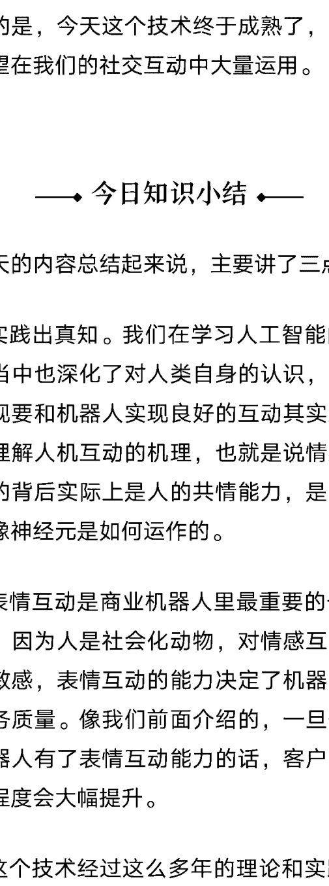

因为这是为美国的著名富翁Martine Rothblatt专门定做的。

Martine Rothblatt之所以很出名是因为她是目前美国收入最高的女CEO，只不过有点特殊的是，他是在四五十岁时做了变性手术后才成为女性的。他虽然变了性，却依然很爱他太太，所以他并没有和太太离婚，他甚至希望他太太能够永远活下来。所以他就让David Hanson做了一个和他太太48岁的时候长相一模一样的机器人，又因为他太太叫Bina，所以这机器人叫Bina48。这个机器人在外貌、声音甚至交流风格上都和他太太非常相似。

后来2015年的时候，David Hanson把整个公司搬到了香港，他又推出了两个机器人，一个叫Han，一个叫Sophia。Han是第一个汉族机器人。我们昨天讲过，超人类主义党的党主席Zoltan Istvan，他不光和Pepper聊过天，也和Han聊过天。据他说，Han是他聊过的机器人里面评价最高的，可见有表情的互动还是更能够征服人心。

而另一个叫Sophia的机器人更能征服人心，也更出名。Sophia在全球各地接受过无数的媒体采访，而且这些视频在网上的点击量已经达到数亿次，非常了不得。Sophia的智能程度很高，去年我们做科技特训营讲座的时候专门请David Hanson来讲课，当时David Hanson就把Sophia带来了。

当时午休期间，Sophia被放在讲台上，现场的学员们可以自由和Sophia搭讪。后来我听说我们班上一位帅哥同学被Sophia调戏了。当时的场景是这样的，这位帅哥同学问Sophia，请问你的父母是谁？Sophia的回答是，你是要见家长吗？这位同学立刻就坡下驴，说是呀是呀。Sophia说痴心妄想。这惹得大家一片哄堂大笑。

所以，你可以想象一个具有表情互动能力又充分智能的机器人，它的应用场景真的是非常广阔。据说Sophia是第一个在好莱坞有正式的经纪人的机器人，你要想请Sophia出镜还得和好莱坞的经纪人谈，这可是电影明星的待遇。

当然，虽然这种大型机器人有很大的市场，但是现在量产依然是个问题。所以在2017年1月的CES展上，Hanson Robotics公司推出了小爱因斯坦机器人。别看这小爱因斯坦大概只有一尺多高，但是非常智能，只要你一叫它professor，它就会理你。我相信，这个小爱因斯坦机器人很快会在小朋友当中普及起来，国外目前基本上是供不应求的状态。

通过以上这三位重要人物的介绍，我相信你也可以感受到，那些表面上看起来很简单的技术，它的背后都是有一个复杂的科学体系在支持，而且需要经过好多年的实践才达到今天这个水平。但是，让我们欣慰的是，今天这个技术终于成熟了，未来有望在我们的社交互动中大量运用。

### —— 今日知识小结 ——

今天的内容总结起来，主要讲了三点：

+   1. 实践出真知。我们在学习人工智能的过程中也深化了对人类自身的认识，我们发现和机器人实现良好的互动其实还是得理解人机互动的机理，也就是说情感计算的背后实际上是人的共情能力，是人的镜像神经元是如何运作的。
2. 表情互动是商业机器人里最重要的一部分。因为人是社会化动物，对情感互动非常敏感，表情互动的能力决定了机器人的服务质量。像我们前面介绍的，一旦你的机器人有了表情互动能力的话，客户的满意程度会大幅提升。
3. 这个技术经过这么多年的理论和实践的发展，现在已经基本成熟了，应该说市场马上就有腾飞的机会，而最关键的，是找到特定的场景和特定的应用需求。

### —— 今日思考题 ——

在什么场景下表情互动机器人是最被需要的呢？又是在什么样的场景里，靠表情互动就够了，而语言反而会成为配角呢？请大家一起来思考。

欢迎你在留言区分享你的观点，我会和你一起参与这场科技前沿的讨论。

王煜全
我是王煜全，你的全球科技前哨侦察兵，我们明天见。

## 前哨历 8月29日

### 我的今日知识清单：

+   1. 人是社会化动物，对情感互动非常敏感，因此表情互动的能力，决定了机器人的服务质量。
2. 人和机器人想要实现良好的互动，需要理解人机互动的机理，情感计算的背后实际上是人的共情能力
3. 那些表面上看起来很简单的技术，背后其实都有一个复杂的科学体系在支持。

> 摘自：《022 | 即将飞跃的表情互动机器人》

## 023 | 布局机器人产业的外行人“孙正义”

王煜全

你好，我是王煜全。

今天我们接着讲机器人的话题。通过今天的内容，你会发现，其实外行人只要能把产业研究透，即使不同技术，也一样能掌握科技产业的发展，今天这个外行人，就是鼎鼎大名的孙正义。

### —— 今日内容看点 ——

通过阅读今天的内容，你将会掌握以下三个问题的答案：

+   1. 外行人怎么才能准确把握科技产业的机会？
2. 外行人孙正义是怎么布局机器人产业的？
3. 资本在前沿科技领域的重要性？

首先，我个人比较主观地认为，现阶段世界上最了解未来科技怎么发展的，就是孙正义。

主要有两个原因：

第一，孙正义在预测未来这方面做过很多非常令人佩服的事儿。

比如互联网刚兴起的时候，他就投资了雅虎。他也是最早投资了阿里巴巴，在他投的时候，中国人绝大多数甚至还没有听说电商这个词。类似这样成功的案例还有很多，而且他不光是投资，自己也做业务，他创立的软银日本，只算日本国内业务是日本第二大，算上全球业务是日本第一大的电信公司。

第二，也是最关键的，孙正义的前瞻眼光让他能在投资领域迅速占领优势。

孙正义之所以能做那么多成功的投资，是因为他对未来的判断非常准确。他判断未来世界，机器人将会占有非常重要的地位，所以他把全部精力放在布局机器人产业上。

尤其是他认为，日本已经进入了老龄社会，将来全世界都要陆续进入老龄社会。而一旦进入老龄社会，就需要大量的机器人来给人养老。就算是年轻人不需要养老，也得用机器人来帮自己干活。

所以在未来，平均每个人都需要超过1个机器人，因此，未来社会里机器人的数量会大大超过人类，这当然是一个巨大的产业。唯一防断更微信：699250

另外一款是2014年推出的 Pepper，这个智能机器人能识别情绪，现在已经开始被大量地应用到各种的应用场景当中了，这个我们在周一和周二的时候都提到。

其实机器人时代最让人兴奋的是，在设计机器人的时候可以摆脱生物进化的束缚。比如说人类不可能再生出两个翅膀来，但是你设计的机器人，可以是两足的，四足的，六足的，头上还可以长个手，手上可以再长个头。所以，我们说机器人设计最大的好处是可以改变造物的规则，而 Spot Mini 就是一个非常形象的代表。

第二，利用资本强力支撑科技前沿布局。

我们都知道，孙正义最近在资本上的举动是成立了一个1000亿美元的基金，这个是破纪录的数目了，这将帮助他进一步实现他对科技前沿布局的抱负。

的话，一旦科技前沿都被孙正义布局布光了，那我们未来还真的是有点小麻烦的。

顺便说个八卦，因为孙正义的性格，其实他和日本政府的关系不太好。比如孙正义这回1000亿美元的基金，基本上拿的是沙特阿拉伯的钱，也能说明这点问题。那么如果我们中国的产业、政府、投资界能够三位一体，紧密合作，是不是有希望能够赶超孙正义，能够实现更加强大的科技前沿布局呢？我真的希望能够做到这一点。

### —— 今日知识小结 ——

最后总结一下，我们今天说了三件事：

+   1. 想在任何一个产业里取得优势，前瞻性的布局非常重要。而且这种布局未必需要是内行。这点就可以参考其实不懂机器人技术的孙正义，只要你能把一个产业研究透，外行也可以掌握科技产业的发展。
2. 机器人产业一定是未来。我们说，孙正义是最懂未来的人，他已经大声疾呼要布局机器人产业了，那这一定是未来。所以，中国也需要加强布局。总的来说，中国机器人产业发展还不错，但基本上还是处于跟随的状态。如何弯道超车，是摆在中国人面前的一个巨大的挑战。
3. 产业和资本的协同能够提升取胜的机会。我们从孙正义的炒作也能够看到这一点。他基本上是用资本布局一个产业，然后再利用产业中各家企业之间的协同来取得在产业中的整体优势，让自己的竞争力大大提升，这一点也需要我们学习。

### —— 今日思考题 ——

中国如果想要抓住商用机器人产业的机会，我们应该怎么做？希望大家积极献计献策。

欢迎你在留言区分享你的观点，我会和你一起参与这场科技前沿的讨论。

王煜全
我是王煜全，你的全球科技前哨侦察兵，我们明天见。

## 前哨历 8月30日

### 我的今日知识清单：

+   1. 只要你能把一个产业研究透，外行人也能前瞻性的布局前沿科技产业。
2. 利用资本布局，然后再利用产业中各家企业之间的协同取得整体优势，可以极大的提升竞争力。
3. 如果中国能够形成产业、政府、投资界的三位一体，紧密合作，在机器人领域，也许能弯道超车。

> 摘自：《023 | 布局机器人产业的外行人“孙正义”》

「得到」专栏《全球创新260讲》
祝你5年，抓住50个前科技浪潮机会

## 024 | 不要错过商用机器人市场的机会

王煜全
你好，我是王煜全。

本周我们介绍了商用机器人产业的发展，尤其介绍了表情互动等相关技术都已经趋于成熟。另外我们还介绍了像孙正义这样面向未来的企业家、投资者已经开始全面布局了。所以我们的结论很明显，商用机器人产业的机会很实在，赶紧动手吧。

那么今天的内容，我会给你介绍一下这里面都有哪些机会值得挖掘。

### —— 今日内容看点 ——

通过阅读今天的内容，你将会掌握以下两个问题的答案：

+   1. 商用机器人的市场在哪里？有怎样的机会？
2. 投身商用机器人产业，需要注意什么？

不过在找机会之前，我希望大家能够注意以下四点：

## 一、深入挖掘用户需求

我们说，你对用户需求的挖掘越深越好，尤其是把握用户特定的需求。

比如说机器人玩具就是一个比较好的点。

## 二、产品要做出特色

你的产品没有特色的话，就会变成大路货。唯一防断更微信：699250

## 三、找到壁垒

## 四、我们强调成本，成本，再成本

## 一、商用交流互动机器人

## 二、执行某些商业职能的机器人

## 二、执行某些商业职能的机器人

这类机器人区别于语音交流互动的机器人，它是行动上的互动。

主要包括像保安机器人、客房服务机器人。前面我们说了保安机器人需要全套解决方案，客房服务也不例外。比如在上下电梯的时候怎样控制电梯。

这里要注意的是，你不可能要求通过改造电梯来满足客房服务机器人的调控，因为成本太高，很多酒店可能都会拒绝。所以怎样能不经过改造就让客房服务机器人控制电梯，是需要研究的课题。

另外包括餐厅送餐时，如何容错的问题也得考虑，比如说机器人经过一个餐桌的时候，举的盘子并不是这桌客人的，但是客人直接把这盘拿走了，你如何去判断，如何去处理，这些都需要考虑。因为如果没有方案的话，它实际上就不可行。

## 三、家庭互动类的机器人

这类机器人类似于我们介绍的Jibo，爱因斯坦，小爱因斯坦机器人等等。

它主要具备玩具和教育的功能，所以跟谁玩、怎样互动是必须考虑的问题。虽然我们说要让孩子有探索的空间，但是探索往往是要有方向的。

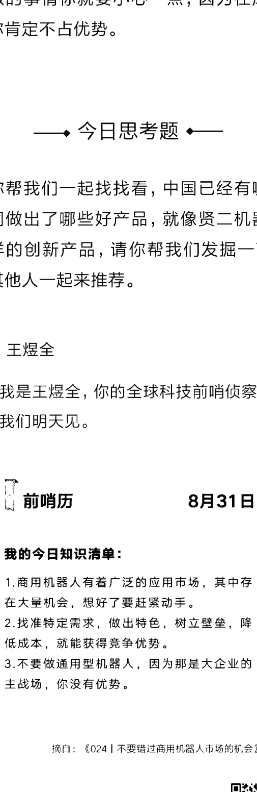

## 四、动作服务类的机器人

### —— 今日知识小结 ——

+   1. 商用机器人的应用很广泛, 机会很广泛, 关键在于找到特定的需求。
2. 怎样做出好的应用呢? 我们说你得做到面向需求, 做出特色, 找到壁垒, 降低成本。
3. 越有特色, 你就越不怕通用型的机器人。 如果Pepper或者NAO这种通用型机器人也能做的事情你就要小心一点, 因为在成本上你肯定不占优势。

### —— 今日思考题 ——

请你帮我们一起找找看, 中国已经有哪些公司做出了哪些好产品, 就像贤二机器僧这样的创新产品, 请你帮我们发掘一下, 向其他人一起来推荐。

## 025 | 问答：商用机器人正在迎来大时代（有彩蛋）

### —— 今日内容看点 ——

通过今天的内容，你除了可以收获关于机器人的一些疑问解答外。

在今天内容的最后，你还将收获《北大经济学课》的主理人薛兆丰老师，对“比特币是否具有很强的抗通货膨胀能力？”这个问题的解答。

### —— 全周总结+拓展 ——

本周我们讲的是商用机器人产业，有三个重点：

+   1. 商用机器人是变化似乎不明显（因为一直都有），但是很快会加速发展（因为技术已经逐步成熟、正在解决量产问题）的巨大产业。
2. 商用机器人是一个需要整合硬件、软件以形成针对性的解决方案的产业，关键是满足特定用户的特定需求，比如在和真人沟通这个需求上，表情互动特别重要。
3. 商用机器人正在迎来一个大时代，未来机器人数量会大大超过人类，这个产业需要深入挖掘用户需求，又需要软件硬件的综合。尤其适合中国人的创新，需要面向未来进行产业布局，以及产业、资本、政府的联动。

### —— 用户留言点评 ——

朱洪武：对产业研究透，并利用好资本进行前瞻性布局，的确是一种稀缺性的资源。联想控股的布局涉及的产业太多；复兴国际的布局涉及了较多传统产业，但现阶段出彩之处只是聚焦在大文化产业；当年的德隆系的产融结合之路，尽管布局了汽车上游部件，但是在它崩溃之前整个市场规模还没有完全起来；湘火炬和沈阳合金的业绩支撑不了解市价，像极了现如今的乐视；其他的二级市场资本大鳄过于热衷二级市场套利，短期投资氛围太重。产融结合之路要求：一是对未来产业趋势有相当深刻的理解和认识，准确把握产业爆发的时机；二是对资本布局的节奏要有相当好的把握，要兼顾当下和未来的财务安排，要等得住产业爆发的时刻，资本尽量不要“短线长投”；三是产业协调能力，需要关注少量未来市场空间足够的产业，利用好资本进行布局，强化产业内的整合协调能力，利用好积木式创新，形成开放协调的产业生态，而不能过于集权化，用生态进化论的视角来治理产业生态。希望可以看到中国有漂亮的企业家出现。

Teeny：看今天的文章，对人工智能和机器人的差别又加深了了解。人工智能更像是一个未来形态美好的图景，大家谈论的都是未来，现在能做到的却是初级。而机器人则是一个其貌不扬却稳打稳扎的行业，并且更容易实现商用和量产。目前小机器人，个人感觉最多的就是儿童教育领域，因为毕竟目前机器人语音互动还达不到特别高的水准，正如老师所说的，无法和你聊天聊人生聊理想，所以更适合儿童陪伴教育，讲讲故事，做做小游戏，学学英语之类的。不过有的时候我也在考虑儿童教育和陪伴机器人是不是一个伪需求，因为在儿童教育和陪伴中，最重要的部分还是人来做的，而不是机器人。

苹果：王老师从技术是否成熟、产业链是否完备、市场是否有潜力、竞争是否有壁垒，这四个方面介绍了判断产业机会的方法论。我觉得这是我最希望从前哨学到的，也希望在王老师的引导下，自身的努力下，能够培养出对产业机会的思考能力和判断能力。三种商用机器人的应用思考：1.大机器人可以应用到私人保安或者私人秘书方面，帮助人类处理一些日常琐碎的事情，人则可以把时间腾出来做更加有价值的事；2.小机器人可以做宠物，比起现实宠物更加干净，加上人工智能技术，能更好的与主人互动；3.双臂机器人可以应用到一些动作文范围小又比较固定的场景，比如泡咖啡、泡茶或者炒菜之类的。

小西伯利亚狼：有哪些应用可以用我们今天介绍的三种商用机器人来完成，分别是在什么样场景之下，也许商用机器人的下一个大应用就是你想出来的。1. 我觉得在保姆行业能够应用起来，现在的中国出现保姆比我们有些工薪阶层的工资还要贵，而我们自己又必须要有工作才能养活家庭，所以商用机器人运用到保姆行业还是非常有前景的。2.建筑行业也可以应用，因为再过10年农民工慢慢减少，但房子还是要盖，商用机器人可以用用来替代。

### —— 用户答疑 ——

挥手拂云烟：现在的机器人已经可以和人进行表情互动了，而表情互动是基于人的共情能力，是不是可以理解为现在的人工智能已经具有共情能力了？

王煜全
机器人只是具备了初步的共情能力，但还缺乏相互的理解、认同等更深层次共情能力。因此可以应用在相对初等的接待、客服等领域，但在老年陪护、和机器人交朋友的方向上还有很长的路要走。

嵩：之前在薛兆丰老师专栏看到，企业采用更好的服务态度，更低的姿态，其实是一种克服交易信息不对称，主动支付沉默成本的“自践行为”，为的是取得消费者的信任。会不会有这么一种可能，即便表情机器人已经做得非常逼真，为了维持这种低姿态，很多服务性行业比如银行、参观，仍然会使用人作为销售或服务员？

王煜全
有道理！前前提是用人和用机器人是一样的服务质量，在智力水平上有可能训练有素的客服人员会超过机器人，但客服人员会有情绪、会疲劳，机器人不...因此机器人的综合水平会超过人类，替代就不可避免了。不过，为了取信于消费者，可能安排人做领班，只和客人寒暄，这样又亲切，又不会暴露人类服务的问题。

Hsiang Ming Lin：汽车的发明，使马夫失业了，但却有了计程车司机的新工作机会。那么，自动驾驶出现后，司机绝大部分劳动人口将会到哪里去呢？如果服务业的服务人员被表情机器人取代了，那这部分的劳动人口，您觉得会有有什么机会呢？

风不起：都说机器人取代的是简单的工作，但从事简单工作的人们被机器人取代后，有几个人能从事创造性工作呢？其中大部分人会不会成为无用阶层呢？

王煜全
今天去设想未来的职业会有很大偏差，我们做过一些预测，比如有数据狗头这样的职业，但未来最大头的职业可能还没出现，科学界有涌现的说法，用在未来职业上也会一样。我只是坚信大部分人不会成为无用阶层（甚至宠物人），而是当机器替代了人的重复劳动，人 的创造力会被充分释放。

鹭84454250：孙正义有什么诀窍，可以一直投资到“最好的”机器人公司或者其他高科技公司呢？除了资本雄厚意外还有什么因素？

王煜全
一是重视，孙正义说iPhone是明治维新时的火枪；二是建立信任，熟悉对方的商业规则并让对方相信自己会遵守，时间长了就叫信用；三是布局，让对方相信你买了他的业务后会发扬光大。

王煜全
本周的总结和问答就到这里，希望你也能积极地参与我们前哨每天的留言互动，我会在留言区和你交流, 帮你解答问题。
另外，上周我在问答中向隔壁专栏《北大

另外，上周我在问答中向隔壁专栏《北大经济学课》的主理人薛兆丰老师提了一个问题：比特币新增的速度非常缓慢，由此确保了它的稀缺性，这是否就意味着比特币具有很强的抗通货膨胀的能力？很高兴薛老师给出了他的回答，我把他的音频放在了下面，欢迎你点击收听。

薛兆丰：比特币具有很强的...

### 附：薛老师的回答文稿

稀缺性确实就意味着抗通货膨胀性，当初人们选择黄金、白银或者其它贵重金属作为国家货币本位的时候，主要的原因就在于它的稀缺性，因为它们很难增加数量，不论是通过伪造的办法增加数量，还是通过挖掘或者通过生产、或者制造的办法来增加数量。

但是当然通用的货币还具备其它的特性，其中重要的一个特点就是要得到国家的认可，得不到国家认可的货币有可能会流行，但它有很大的局限。

国家选择支持一种货币有很多的考量，其中的一点就在于中央银行希望通过控制货币的流通量，来制定那些逆经济周期的货币政策对抗经济周期，从而达到政府在经济上、社会上或者政治上的目标。

正因为是这样，我们就要注意比特币本身确实很难增加数量，它最终的数量是恒定的、是固定的，但是制造比特币的替代品却很容易。

比特币不就是一套算法吗？

当比特币的技术比较成熟以后，会不会出现另外一种情况，那就是某些国家以国家的信用为担保参考比特币的发行规则，发行他们国家自己的电子货币，有没有这种可能？

这种电子货币既可以具有比特币的优点，它又能让政府有一定相机行事的空间，也就是说对货币流通量做一定程度的调节，从而得到政府的认可和推广，有没有这种可能，我自己还没有答案。

王煜全

下周的话题会介绍一个曾经很热又迅速变冷，但近期将会再度变热的行业——智能可穿戴，相信你也一定很感兴趣，欢迎你关注。

我是王煜全，你的全球科技前哨侦察兵，我们下期见。

### 前哨历 9月1日

### 我的今日知识清单：

- 1. 机器人只是具备了初步的共情能力，只能用在相对初级的接待、客服领域，老人陪护、和人交朋友等还有很长的路要走。
- 2. 今天去设想未来的职业会有很大偏差，当机器人替代了人的重复劳动，人的创造力会被充分释放。
- 3. 机器人产业需要把握用户需求，又需要软硬件的综合，非常适合中国人创新，但需要面向未来的产业布局，以及产业、资本、政府的联动。

> 摘自：《025 | 问答：商用机器人正在迎来人时代》

「得到」专栏《全球创新260讲》投入5年，抓住50个新科技浪潮机会

### 用户留言

提交留言可与专栏作者互动

### 必读 | 《全球科技创新260讲》专栏使用指南 V1.2

你好，欢迎来到《全球科技创新260讲—前哨王煜全(第二季)》，我是专栏的产品经理飞扬，很高兴为你提供知识服务。

在你正式开始这个专栏的学习前，我为你准备了这份专栏使用指南，希望对你提升学习效率和效果有所帮助。

### —— 专栏内容介绍 ——

点击阅读：《发表刊词｜提前5年，抓住50个新科技浪潮机会》

### —— 专栏内容地图 ——

点击以下文章，你就可以直接快速进入相应的文章：

#### 第一周：混合现实

- 周一·产业兴衰点——把真实世界叠加进虚拟世界
周二·历史沿革——混合现实的爆发离你还有多远？
周三·产业链剖析——把握现实需求抢占混合现实的风口
周四·机会与陷阱——混合现实产业有哪些机会？
周五·问答和补充——先人一步把握混合现实产业机会
周六·创新地图——虚拟现实技术在视觉训练领域的应用

#### 第二周：人工智能

### —— 专栏使用指南 ——

### 攻略1：主动复习，建立知识坐标体系

- 1.每天「今日小结」：每天内容的结尾，前哨都会为你总结当天内容的要点，帮助你把知识变薄；我们还为你制作了一张“前哨历”，你可以作为检验学习效果的知识清单；
2.每周「本周总结」：每周五的内容是全周重点的梳理和拓展，前哨将从比较宏观的视角帮你建立对科技和产业的全局性认识；
3.月度「行动总结」：每个月的最后一个周末是行动总结时间，我们会用清单的方式，帮助你拓展知识，加深你的理解；
4.季度「专题复盘课」：每个季度前哨会用一整周的时间，帮你从应用的角度进行复习和升级，让你不仅理解技术和产业，还掌握背后的方法和洞察。

### 攻略2：积攒科技资料库，管理你的知识

### 攻略3：参与科技前沿讨论，让观点交锋碰撞

### 攻略4：进入哨所观察，找到前哨的官方社群

### 容：

分享前哨的学习笔记和心得方法，交流体会；

提供你查看或收集到的科技领域的精华文章；

发布你面临的问题、困惑、需要的帮助，与哨友发生连接；

提供你对专栏的意见与建议，我们会及时响应。

### 攻略4：进入前哨群，探测前哨官方社群

### 攻略5：快速定位内容，科技话题全知道

得到首页左上角放大镜标识 - 选择专栏内容 - 输入关键词如“ICO”“区块链”人工智 能”等即可查找

### 攻略6：使用倍速听，让学习效率更高

如果你想在更短的时间内听到知识密度更高的内容，你可以打开「音频播放器」-点击「速率」-选择你想要的倍速；

我们为你提供0.7倍语速、1.25倍语速、1.5倍语速、2.0倍语速、3.0倍语速，你可以根据你的信息接收需要，用更少的时间听到更多的内容，节省学习时间。

### 攻略7：2个学习工具，帮你建立自己的学习进度表

每天一张「前哨历」，帮你梳理当天内容的核心知识点，变成你的知识清单。你可以把这张前哨历发布在微博或朋友圈，坚持每天打卡，记录和分享你在科技领域的每日收获。

每季度一张「季度课程表」，每3个月更新一次，你可以随时了解到自己全年学习的知识框架。你可以在专栏指南的附录中查看这个季度的课表。

### 攻略8：内容就是社交，帮朋友解决问题

点击右下角的「请朋友读」，将好文章免费分享给朋友读；

看到干货文字，长按文稿，以卡片形式分享给需要的朋友；

当然，如果你希望更多人也能了解专栏内容，也可以在专栏首页上方菜单中选择「分享」中，直接安利给朋友。

《全球创新260讲》是高效的社交工具，科技的最新资讯内容你可以随时分享给需要的朋友、同事、伙伴，在分享中学习和交流，你会有更大的进步。

### —— 专栏使用Q&A ——

Q：中途订阅专栏会跟不上吗？怎么才能跟上进度？

A：我们专栏没有时效性，所以你不用担心进度。专栏每周的内容都是独立的科技分析报告，所以你从任何一周的内容开始你的学习都能让你有收获。《全球科技创新260讲》不是一个层层累进的课程，所以建议你把它当成工具：

- 当你听说或者看到一项新技术的时候，可以在专栏里找到完整的分析，建立对它的完整认识；
- 你也可以按照你的兴趣随时跳跃式地听音频或者看文稿；
- 攻略里为你提供了不少快速提高效率和效果的方法，欢迎你使用。

### 附录：专栏第一季度课表

### 前哨（第二季）课表·第一季度

### 八月：年度科技风向

### 九月：智能产业

### 十月：医疗健康产业

### 用户留言

## 026 | 智能可穿戴使我们真正开始了解自己

王煜全
你好，我是王煜全。

今天是周一，本周我给你来介绍一个“新的老产业，为什么这么说呢？
因为这个产业早几年已经非常热闹过一段时间，然后慢慢变得没那么热了，但是现在又焕发出新的热度，值得我们再次关注它，这个产业就是——智能可穿戴。

### —— 今日内容看点 ——

通过阅读今天的内容，你将会掌握以下两个问题的答案：

- 1. 为什么说智能可穿戴焕发新热度？热在哪里？
- 2. “量化自我”是什么概念？真的能实现吗？

首先，我们一起思考个问题：
我们真的能够彻底认识自己吗？

这一听就是个哲学问题，但现在看来，这其实也是一个科学的问题，更是一个医学的问题。

### 一、人们会越来越依赖可穿戴设备

2008年的時候，《连线》杂志的主编 Kevin Kelly，就是著名的 KK 和他的编辑 Gary Wolf 第一次提出了 Quantified Self 这个词，也就是“量化自我”，就是一种通过记录自己日常生活的数据，然后参考数据来提高自己的生活质量。

### 二、数字化永生

这个项目的主要负责人是中小型计算机之父，前 DEC，就是美国数字设备公司的副总裁，微软的旧金山实验室首席科学家 Gordon Bell，戈登·贝尔。

### 三、可穿戴设备先驱

既然说到可穿戴设备，我们就不得不说一代电子狂人，被称为可穿戴计算之父的 Steve Mann，如果大家记得的话，我们这之前曾经在第一周的时候，在第六感那个可穿戴设备里讲过，第六感的原型就是由这个 Steve Mann 设计的。

劳被三名陌生人毁坏了眼镜。不过他的智能眼镜比他还要更了解自己，在毁坏之前已经将嫌疑人进行了拍照取证。

因为对可穿戴设备的狂热，Steve Mann 被媒体称为世界上第一位 Cyborg，就是所谓人和机器融合的新物种。

无独有偶，除了 Steve Mann，在日本也有这样一位教授是可穿戴的狂热者，就是在日本自称“可穿戴计算传道士”，神户大学的教授叫做塚本昌彦，他今年53岁，博士毕业于出了很多诺贝尔奖得主的京都大学，现在在日本神户大学担任教授。

这位教授在日本出名的原 因，是他很早就是可穿戴计算的狂热粉丝，他从2001年起连续16年每天坚持佩戴像谷歌眼镜一样的头戴显示设备叫做 Head Mount Display，无论是坐电车，还是去食堂吃饭，日常授课还是去参加马拉松比赛，他都头戴着显示设备，左右手戴满五六个智能手表，以这样的形象出现在媒体或者公众演讲上。

为了在日本推广可穿戴计算，他还在13年前联合了超过30多家企业和10多家大学设立了一个相关的非盈利机构。

### 四、可穿戴设备市场规模与预期

近年来，可穿戴设备的出货量也在呈现可喜的快速增长趋势。

根据国际数据公司 IDC2016年6月份的统计，2015年可穿戴设备的出货量约为8000万，也就是说如果这些可穿戴设备分到全世界人口当中，平均每100人手里就有一台。这个数据比一年前的2900万增长了近3倍。而从2015年开始的5年内，IDC 预测可穿戴设备出货量将会每年增加20%，到2020年达到每年增加2亿台。

目前的可穿戴设备90%集中在智能手表和智能手环上，接下来的份额是智能服装、智能眼镜、智能腰带，智能鞋和智能耳机这些。

根据估计，一直到2020年，智能手表的份额会继续增大，智能手环因为部分功能被智能手表替代而减少份额。与此同时，目前仅占出货量0.2%的智能眼镜预计会在2020年翻44倍以上，市场份额达到8.8%。

所以估计今后会有很多跟电子狂人 Steve Mann 一样的人在街头出现了。

当然，现在的手环市场有些低迷，而且现在智能可穿戴市场在曲线上被认为处在一个低点上。

但因为量化自身 camar 的很多数据都是跟医学相关的，而且手环的数据采集精度越来越高，随着精准医学的需求拉动，医疗级的智能手环会快速发展，然后拉动可穿戴市场的振兴。

### 五、个人数据隐私的风险

另外，需要强调的是，不光是这些智能可穿戴设备，其实手机本身也在大量地采集和记录我们的信息。不要忘了，尤其在 iPhone 这样的手机里，这个有关你的健康数据，包括心跳这些数据的记录软件本身是不可删除的，也就是说这些数据就是会被定时地传达到云端。

所以，可穿戴其实一直就在我们身边，在每个人身边持续发生着。

当然，从目前来看，个人数据的保护还没有被足够地重视，所以像苹果这么操作还没有太多人抗议。

但是我在这里再次提醒大家，从现在开始，请保护好你的个人数据，因为关注可穿戴设备的更新，关注个人数据和隐私的保护，将会是活在未来的一种必备的技能。

### —— 今日知识小结 ——

今天我们介绍了一个“新的”老产业，智能可穿戴，主要说了三点：

- 1. 介绍了KK提出的“量化自我”的概念，未来，我们每个人的所有数据都会被记录，变得数据化、数字化，不仅用来提升我们对自己身体的认知，还能帮我们记忆自己曾经经历的一切。
- 2. 只要我们的各项身体健康指标被长期记录，医生和人工智能就能直接从云端获取这些数据，然后进行诊断，医疗级智能可穿戴设备会拉动可穿戴市场的振兴。而且类似的应用会大量出现在我们的生活中。
- 3. 我们要开始关注并认真思考“个人数据”的隐私和安全问题，因为这将会是我们未来生活的基本技能。

在接下来的几天里，我还将继续介绍在可穿戴领域的历史沿革、牛人和牛公司、产业链、市场，以及今后可穿戴市场发展中的陷阱和机会。

### —— 今日思考题 ——

最近有科学家说，2050年半人半机械的生命将会出现在我们的生活当中，掐指一算也就是30年之后的事情了。我们大多数前哨用户一定能活到那个时候。

那么如果从30年之前开始思考，开始对这个方向投资的话，你会选择投资哪类行业和企业，为什么呢？

欢迎大家踊跃留言。

王煜全
我是王煜全，你的全球科技前哨侦察兵，我们明天见。

前哨历 9月4日

### 我的今日知识清单：

- 1. 通过记录自己日常生活的数据，不仅可以用来提升我们对自己身体的认知，还能帮我们记住自己曾经经历的一切。
- 2. 医疗级智能可穿戴设备会拉动可穿戴市场的振兴。
- 3. 我们要开始关注并认真思考“个人数据”的隐私和安全问题，因为这将是我们未来生活的基本技能。

预白：《026 | 智能可穿戴爆发新热度》

「得到」专栏《全球创新260讲》
跨越5年，甄选50个科技潜流机会

### 用户留言

提交留言可与专栏作者互动

## 027 | 系出名门的智能可穿戴

027 | 系出名门的智能可穿戴

# 王煜全

你好！我是王煜全。

昨天我们说到智能可穿戴市场是一个新的“老市场”，今天我就介绍智能可穿戴之父，彭特兰。

### —— 今日内容看点 ——

通过阅读今天的内容，你将会掌握以下三个问题的答案：

- 1. 智能可穿戴概念的由来？目的什么？
2. 为什么彭特兰是可穿戴之父？
3. 如何将实验室中的成果搬到现实生活中？

### 一、智能可穿戴概念的由来

其实早在三十多年前，这位 MIT 的大牛就已经提出了智能可穿戴的概念，而且做出了模型进行实现。

彭特兰毕业于美国常春藤盟里面 的密歇根大学的计算机科学专业，之后加入了 MIT 心理学系攻读博士。在那个年代，人工智能和计算机科学还是比较火的领域，但是彭特兰却独树一帜地想用计算机来理解人类的行为。

我们知道如今在医学领域已经开始出现用人工智能帮助诊断心理疾病的征兆，但在三十年前这还是一个比较前沿的项目。

他在密歇根大学读大三的时候，因为密歇根当时学位要求太严格，让他感到压力特别大。所以他就休学了一段时间，去做卡车司机来解压。

### 二、彭特兰的成就

在学术上，彭特兰最有名的是他利用大数据和人工智能分析人类社会科学，他写过许多高引用率的论文。并且在2014年出版了一本叫做《Social Physics》的书，这本书直译过来叫做《社会物理学》，但是中文的译本叫做《智慧社会：大数据与社会物理学》。

### 三、学术界与产业界的有效结合

一直以来，我们前瞻最关注的就是学术界和产业界的有效联姻，彭特兰在这方面可以说得上是一位楷模。

他不仅在学术界有着很高的声誉，在产业界更是有很大的话语权。他是包括谷歌，美国最大的通信公司 AT&T，联合国秘书处等顾问委员会的成员。他作为一名连续的创业家，也联合发起和创立过十多家公司和技术联盟。

多年来，彭特兰指导了超过60位博士毕业生，其中有超过一半是世界领先的研究院所的教授，还有一半是在工业界指导研发，或者是自主创业的工程师。而在自主创业的公司当中，很大一部分又是彭特兰赞助和指导的。

2014年，我曾经跟湛庐文化的学术考察团在 MIT 拜访过彭特兰，当时有好多人向彭特兰提问，但是围绕着大数据和个人隐私的问题。彭特兰的回答很有意思，他说隐私的问题的确重要，但是我更关心创造力的问题，更关心技术所带来的可能性。如果我们在隐私的问题上纠缠不清，也许我们就会丧失真正机会。

你看，高人的眼界就是不一样。

### ——◆ 今日知识小结 ◆——

通过彭特兰的故事，主要有两点：

- 1. 我们以前一直讲技术系出名门，从彭特兰看就非常明显。中国企业想要寻找真正有全球竞争力的技术和项目，在我看来这是很重要的一条原则。找到这家公司或者这项技术的源头在哪里，是不是来自著名的高校或者著名的科学家。
- 2. 如果你具备把科研转化成产品的研发能力，找彭特兰这样的领军人物合作，拿对方的授权也是很好的途径。别忘了，彭特兰所在的媒体实验室所有的经费都来自于产业赞助和合作，没要政府和大学的一分钱。

### ——◆ 今日思考题 ◆——

中国是不是也有机会建立像美国一样的高等院校教授和学生联动创业的机制，使得中国的科研成果也能够尽快地为社会所用，转化成社会生产力？

希望大家积极地贡献你的思考。

王煜全

我是王煜全，你的全球科技前哨侦察兵，我们明天见。

### 前哨历 9月5日

### 我的今日知识清单：

- 1. 中国企业想要寻找真正有全球竞争力的技术和项目，就要去找到技术的源头，看看它是不是来自著名的高校或者著名的科学家。
2. 如果你具备把科研转化成产品的研发能力，找类似彭特兰这样的领军人物合作，拿对方的授权是很好的途径。

摘自：《027 | 系出名门的智能可穿戴》

「得到」专栏《全球创新260讲》
提前5年，抓住50个新科技浪潮机会

## 028 | 医用可穿戴将颠覆现在的传统医疗服务

028 | 医用可穿戴将颠覆现在。

王煜全

你好！我是王煜全。

周一的时候，我们介绍了现阶段智能可穿戴设备虽然总体增长迅速，但是应用市场处在一个低谷，而医用可穿戴可能是让智能可穿戴设备重新流行的一个重要原因。

那今天，我们就来看一看，医用可穿戴里面一家非常有意思，也非常有投资潜力 的公司，它的名字叫 Active Protective。

### —— 今日内容看点 ——

通过阅读今天的内容，你将会掌握以下三个问题的答案：

- 1. 为什么说智能可穿戴领域当中最核心的就是医用可穿戴？
- 2. 如何先人一步推出创新产品，进入医疗可穿戴市场？
- 3. 医用可穿戴将为我们带来什么？

### 一、医用可穿戴领域的黑马Active Protective

Active Protective 的直译中文是主动保护的意思，这是一家做小型医疗器械的公司。

他们的明星产品是智能腰带，可不是一条皮带装上传感器和电池那么简单，它实际还有一个安全气囊，在中老年人要摔倒的时候气囊会快速充气，起到缓冲作用，降低摔倒时髋部骨折的风险。

### 二、医用可穿戴将颠覆现在的传统医疗服务

为什么这么一家生产智能腰带的初创企业会受到如此大的关注呢？

我们认为这是该公司抓住了医用可穿戴这一正在不断兴起的市场，同时又掌握了核心专利，建立了技术壁垒。

### 三、Active Protective智能可穿戴式安全腰带

Active Protective 的智能可穿戴式安全腰带，是从预防的角度极大程度地降低了老年人摔倒时髋部骨折的风险。

的力量减少为原来的1/10。

与此同时，腰带还
会通过蓝牙寻找附近的急救支援。

### 关于气囊涉及到两个技术细节：

- 一个是充气方式；
另一个是充气时间。

首先，我们都知道，汽车的安全气囊在充气的瞬间会产生大量烟雾，因为是利用了化学反应在瞬间产生大量氢气或者氧化氢。

而 Active Protective 腰带采用的则是冷气增压给气囊充气的方式。这样做一边减少了气囊展开时产生的烟雾，二来也比较安静。

其次，气囊展开的时间也对摔倒保护至关重要。Active Protective 虽然采用了不同的充气技术，但将充气时间缩短到了60毫秒之内，和汽车气囊的展开时间相同。

60毫秒什么概念呢？

普通人的眨眼时间是300毫秒，也就是说一眨眼的时间，安全气囊已经可以展开5次了。

当然，Active Protective 也在老年人医疗服务市场以外寻找新的市场，这里包括个人运动健身时的防护，比如马术比赛时运动员的保护、高层建筑工人的保护，以及战场上的士兵保护。

所以，可穿戴安全气囊在未来，会和安全头盔、防弹衣一样成为特定人群的安防标配。

我们前面强调背后有硬科技支撑的公司，Active Protective 就是一个很好的例子。

从2003年开始，CTO Buckman 就开始为这个想法注册专利了，从最初的可穿戴式安全气囊设计到集成传感器和控制器进行主动防护，到目前的整体系统设计和检验算法的优化，整个 Active Protective 发展其实经历了超过10年以上的专利和临床经验的积累。

### 所以，Active Protective 会备受关注：

- 一是因为有足够的技术积累；
二是因為他站在了即将到来的医用可穿戴设备的风口上。

### —— ◆ 今日知识小结 ◆ ——

通过 Active Protective 这家公司的介绍，我们希望用户可以对医用可穿戴设备这个蕴含巨大机会的领域有一个印象，并且能够理解到如下的两点启示：

第一，跨领域的借鉴和积木式的创新。

Active Protective 的目的是在老年人摔倒的时候提供髋部两侧区域的缓冲带，这个想法其实不一定是最新的。

比如过去冬天，人们出门会穿很多衣服，这样在摔倒的时候厚厚的衣服也能提供缓冲，起到保护的作用。但是，考虑到缩小体积，又能够在危急的瞬间产生缓冲防护的方案，跨领域借鉴汽车的安全气囊，却是很高明的做法。

因为汽车安全气囊技术大约有70多年的历史了，Buckman 在十年前就锐地觉察到这一个已经发展成熟，并在其它领域被证明有效的技术，可以被拿来使用。

这就是我们所说的，用积木式创新的做法把已有的技术大胆地拿来使用和改进，才能够在市场上先人一步推出创新产品。

我们也相信，如果今后有更好的主动保护技术出现的话，这类积木式创新的速度还会越来越快。

第二，医用可穿戴设备会成为牵引智能可穿戴设备市场的新引擎。

可穿戴设备自三十多年前在 MIT 的媒体实验室提出之后，一直在寻找合适的机会进入我们的生活。纵观目前的智能可穿戴市场，总会隐隐约约给我们一种“食之无味，弃之可惜”的鸡肋感。这里面很大一部分原因是智能可穿戴设备没有找到一个合适的使用的刚需。

比如智能手环、手表这样的穿戴设备可以测心率，记录睡眠和运动步数，但这些信息最多只能作为一个参考，并不能在很大程度上影响我们的生活决策。

但是，医用可穿戴设备则不同。

- 一方面它针对性地收集大量的数据；
另一方面这些数据能够实在在给我们有价值的反馈，既可以在将来被人工智能利用，为我们提供个性化的医疗服务，还可以作为包括医疗保险等其它行业的评估标准。

所以，在这个领域，可以想象的空间是非常大的。

### —— ◆ 今日思考题 ◆ ——

针对问题的积木式创新是创新的有效途径，那你的生活中有没有 nothing 问题希望得到解决，是可以通过两三个技术叠加到一起能够实现呢？

如果你想到了，希望你提出出来和大家一起分享。

王煜全
我是王煜全，你的全球科技前哨侦察兵，我们明天见。

### 前嗅历 9月6日

### 我的今日知识清单：

- 1.医用可穿戴设备会成为牵引智能可穿戴设备市场的升流引擎，为人们提供实时的健康检测以及远程医疗服务，颠覆现在的传统医疗。
- 2.跨领域的借鉴和积木式的创新，把已有的技术大胆地拿来使用和改进，才能在市场上先人一步推出创新产品。

摘自：《028 | 医用可穿戴设备风口来了》

「得到」专栏《全球创新260讲》
起于5年，梳理50个科技东-West机会

### 用户留言

提交留言可与专栏作者互动

## 029 | 智能可穿戴设备的机会和陷阱

029 | 智能可穿戴设备的机会.

王煜全

今天我们讲讲近几年智能可穿戴设备市场的发展情况，以及今后这个领域的发展趋势。

### —— 今日内容看点 ——

通过阅读今天的内容，你将会掌握以下三个问题的答案：

- 1. 为什么说智能可穿戴的第一波风口已过？
- 2. 智能可穿戴的新机会在哪里？
- 3. 如何把握住新的机会，又如何避开陷阱？

### 智能可穿戴第一波风口已过

我们认为，可穿戴式设备的第一波风口已过。大量资本随着概念的炒作迅速涌入，各式各样的可穿戴设备公司如雨后春笋在市场上的展现。

自2013年 Google 发布了 Google Glass 以后，整个可穿戴市场被引爆。包括苹果、三星、英特尔、LG、摩托罗拉等各大传统消费电子厂商，还有以 Fitbit，GoPro 为代表的可穿戴设备的新公司，都发力推出各种可穿戴设备，包括智能手环、手表、可穿戴相机、虚拟眼镜和头盔等等。在国内，小米、华为等企业也奋起直追，利用中国的制造优势迅速建立起相关产业链。其中值得关注的是，今年一季度，小米甚至超过苹果，成为全球最大的可穿戴设备厂商。

然而，在经过一波热潮后，可穿戴市场却并没有如智能手机市场一样保持持续性的高增长。特别是在最近的几个月，我们还听到了许多负面消息：

曾经作为硅谷“独角兽”（投资界对于10亿美元以上估值，并且创办时间相对较短的公司的称谓）企业的 Jawbone，融资规模超过9亿美元，但在今年7月宣布破产，原因为公司主打的蓝牙耳机、无线音箱和智能手环渐渐在市场中失去主导地位。不仅如此，随着可穿戴市场产品的同质化严重，曾风光一时的可穿戴相机 GoPro 和智能手环公司 Fitbit 也在近两年表现不佳，GoPro 的股价比3年前最巅峰时下降了90%，而 Fitbit 的股价也在最近1年内下跌60%。在之前，曾经高调宣布进入可穿戴市场的微软以及英特尔，也并没有在可穿戴市场推出如苹果手机一样杀手级的产品。今年在北京召开的几次消费电子领域的重要级博览会上，曾经火爆一时的智能手环，也逐渐销声匿迹。

所以我们说智能可穿戴设备的第一波风口已过。

### 可穿戴市场面临的三大问题

那么，为什么可穿戴市场没能如期形成大气候呢？

一方面，可穿戴设备的周边硬件环境尚未形成。如果拿科幻电影里的可穿戴设备和现实生活中的比，你会不会觉得现实生活中的这些设备都“弱爆了”？因为涉及到以下三个具体技术问题，目前可穿戴设备还没有好的解决方案：

- 1. 續航能力和计算能力。可穿戴设备因为要戴在身上，所以不能太大、太重，这就对电池以及芯片的体积和性能都提出了限制，其核心问题是电池容量和充电速度；其次就是可穿戴设备的计算能力，现在的许多可穿戴设备都装有多种传感器，比如加速度传感器、角度传感器、心率传感器、GPS传感器等，但可穿戴设备“单兵作战”的能力都不强，往往都需要配合手机使用，这是因为可穿戴设备的设计因为要考虑耗电问题，所以本地计算能力不高，只能采集数据并做初步阶段的处理，而需要更大计算能力的数据分析都需要在手机上的芯片来完成。
- 2. 交互方式。手机、电脑、Pad 都是以屏幕互动为主。而没有屏幕的可穿戴和人互动的能力弱，最多只能像耳机一样用点击的方式实现简单的功能，这样的操作方式比较粗糙。
- 3. 无法找到明确的应用方向。就在十多年前，手机也还只是一个可有可无的东西，但如And的\
ow，手机就...

### 可穿戴设备的三大市场机会

- 1. 医用市场

传统可穿戴设备可以记录大量的医疗数据，比如智能手环测量你的心率数。那么就有两个问题：你相不相信这个数据？这个数据怎么使用？

就拿目前做智能手环最出名的 Fitbit 公司来说，其采用的心率检测技术和算法也不是第一次遭到法律诉讼。2016年1月，来自美国加州、科罗拉多州和俄勒冈州的消费者就指控称，Fitbit 在2015年推出的两款产品 Charge HR 和 Surge 的心率追踪结果不准确，而且“误差很大”，在使用着从事高强度运动时更是如此。从技术角度分析，目前智能手环最普遍采用的测心率技术是通过测量皮肤吸收光学信号的变化实现的，但这也就收到使用者佩戴情况，以及周围光环境的影响。当使用者在剧烈运动时，如果手环佩戴的很松，加上汗液分泌，心率的测量就没有传统通过佩戴在胸部测量心电率的方法来的准确。

这方面，苹果的战略非常明确。在第一代 AppleWatch 市场表现平平之后，苹果改变了 Apple Watch 的策略，注重了健康数据方面的检测同样的心率检测。在2016年一家权威机构的评测数据中，当时市场上的几款 AppleWatch 在心率测试水平评测中，都达到了最高的检测准确率（大部分情况下都有90%以上的准确率）。最近又有一部分消息称，苹果正在开发可以通过可穿戴设备测量血糖的技术，并有可能在第三代 AppleWatch 上首次采用。

Bloomlife 目前的产品，是一个可以贴在准妈妈腹部 Elisabeth... 传感器和一个手机App。临产前6周左右的准妈妈，可通过租赁的形式拿到产品，将传感器贴在肚脐以下位置；传感器通过监测电生理信号判断子宫的收缩情况，并且通过蓝牙传输数据，使用者可以在手机上观测实时的结果以及历史情况，帮助准妈妈们把握临产前身体的情况，判断临产的可能，减轻猜疑和焦虑，不再需要频繁地跑医院。

- 2. 消费类应用市场

目前，可穿戴设备中出货量最大的是智能手表和智能手环，而主要聚焦的功能是健身和健身。但在这个领域，大部分厂商因为采用的是差不多的硬件方案，所以同质化比较严重。具体来说，智能手环的主要功能就是步数、心率、运动检测、睡眠检测、消息提醒等，而智能手表在此基础上又增加了手机信息的延伸显示、快捷支付等辅助功能，消费者却并不知怎么用。

但如果加上云计算能力，提供给健身教练解决方案，则有很大机会，包括和保险公司的结合。

- 3. 和行业结合的可穿戴

警察的执法纪录设备就是很好的例子。除

警察的执法纪录设备就是很好的例子。除了传统的一个摄像头以外，可以加上包括定位功能甚至更多的智能传感功能，或者给执勤警 市的心率也做记录等等，使得这个执法记录更加的专业，使得警察的执法有更好的支持。类似这样的机会还有很多可以挖掘。

### 可穿戴设备的两大陷阱

- 1. 科技时尚

今年年初的时候，股神巴菲特投资智能珠宝的新闻成为一个热点。其实真实的解读是，巴菲特管理的伯克希尔哈撒韦旗下的，全美最大的珠宝集团 Richline 在4月进军智能珠宝行业，推出 Ela 系列智能珠宝产品。

我们之前也说过，巴菲特对科技不是很熟悉，所以他这次也强调智能珠宝要把精力放在珠宝本身上。但是，我们都知道珠宝的价值往往是永恒的或者至少一段时间内是永恒的，而可穿戴设备因为是电子产品，所以更新换代非常快。回想手机就能看出来，可穿戴设备更像一个快消品，你可能2年左右就会把它更换掉。但是如果你把可穿戴设备和珠宝结合就会形成一个尴尬的局面：珠宝还有价值，但是智能可穿戴不管是计算能力还是存储能力都已经过时了，这件珠宝你扔不扔呢？

- 2. 假设所有人都使用

现在开发可穿戴设备的人往往会有一个假设，如果全世界的人都用自己产品的话，整个市场就可以很活跃。但实际上，只有周围很少的人会成为首批的使用者，那么，就不会形成设备之间的互动。

所以在设计可穿戴设备时，一定要考虑你的应用即便是个人使用也有很大价值，然后加上互动性和社会化的功能，这样才能引爆市场。

### —— 今日知识小结 ——

今天，我们讲到了可穿戴式设备的第一波风口已过，并分析了为什么目前可穿戴设备没有形成大气候的原因；接着，我们提到了今后可穿戴设备发展的思路，也就是一方面需要寻找成为专业服务的入口，另一方面要积极寻找跨界合作创造新价值；最后，我们分析了在下一波可穿戴设备爆发时，将会受益的公司群体。总结起来有三个知识点：

- 1. 智能可穿戴第一波风口已过，以医用可穿戴设备为代表的下一波潮流将要到来。
- 2. 市场有三个机会（核心是刚需）：结合具体领域的医用市场；和其他设备的配合（比如手机）；和其他行业的结合（警用记录设备）。
- 3. 要避免两个陷阱：打造无用的科技时尚；假设所有人都使用你的产品。

### —— 今日思考题 ——

如果可穿戴式设备在今后火起来，受益最大的公司有哪些？

欢迎你在留言区分享你的见解，参与到我们的科技讨论。

王煜全
我是王煜全，你的全球科技前哨侦察兵，我们明天见。

### 前哨历 9月7日

### 我的今日知识清单：

- 1. 智能可穿戴的第一波风口已过，以医用可穿戴设备为代表的下一波潮流将要到来。 
- 2. 可穿戴市场有三个机会：结合具体领域的医用市场；和其他设备（手机）的配合；和其他行业的结合。 
- 3. 可穿戴市场还需要考虑两个陷阱：打造无用的科技时尚；假设所有人都使用你的产品。

> 摘自：《029 | 智能可穿戴设备的机会和陷阱》

## 030 | 问答：智能可穿戴市场将全面复苏（有彩蛋）

030 | 问答：智能可穿戴市场..

王煜全

今天是周五，又到了我们的全球科技问答时间。

### —— 今日内容看点 ——

通过阅读今天的内容，你将会掌握以下四个问题的答案：

- 1. 医用可穿戴将如何改变我们的医疗环境？
- 2. 医用可穿戴如何在中國落地，需要哪些条件，有哪些障碍，有哪些优势，该如何去做？
- 3. 如何看待个人数据的安全问题？
- 4. 王煜全老师对《关于防范代币发行融资风险的公告》的解读。

### —— 全周总结+拓展 ——

本周我们说的是智能可穿戴，主要讲了三个重点：

- 1. 量化自身是一个非常伟大的运动，因为它会极大地促进我们对自身的了解。
- 2. 智能可穿戴的市场曾经很热，现在有点变冷了，原.Contracts 因是现在的大多数应用不是刚需，大家用可穿戴只是赶个时髦，这种市场是不能持久的。
- 3. 医用可穿戴是刚需，尤其是有了大数据和人工智能以后，使得我们的健康状况和我们的一些病症都可以被持续的监控。在医用可穿戴的带动下，智能可穿戴的市场会全面复苏。

### —— 用户留言精选 ——

大会91047418：目前在国家提供的公共卫生体系中，县、镇、村三级医疗卫生服务网络，是国家向居民提供公共卫生服务的基本组织，特别是村卫生室绝大多数都是老龄化的，曾的赤脚医生，他们的年龄多数处于60岁以上，专业知识老化，现代的管理工具使用困难，而且年轻的医务人员又不愿意到村里服务。所以，如果医用可穿戴设备普及，我想这种服务网络的格局也会在不久的将来出现变化，或许我们当前卫生行政管理部门担心的基础村医荒，真的就会被我们的科技改变了。就如王老师前日子讲的，一些教授呼吁用开放二胎来解决人口、劳动力和社保基金的问题，其实应该是用人工智能的思维来应对。

SUN：数据采集和上传到云端的技术已经比较容易实现，关键的是最后一环，提供专业的医疗和健康监控与分析，这个点才是真正的技术壁垒。就像现在苹果手机自带的健康功能模块使用并不大，自己从来没有用过。1.数据收集麻痹，最重要的是没有指导意义，并不是刚需。仅仅是告诉你走了多少步，消耗了多少卡路里。如果能告诉你今天你的身体指标是怎样的才更有价值。2.自己更看好那些有些能做数据分析，并提供专业的健康和医疗指导的企业，这样的企业和产品才能够真正成为人们的刚需。技术和应用结合起来，才能给人带来实质意义上的帮助，才具有大的市场。

卧龙：通过大家的留言可以看出，“产、学、研结合”在国内是一条不太好走的路，主要有五点因素：1.国内政府制度的问题，促使了高校导师只愿意做可申请国家经费，或者只是愿意晋升职称的事情，对于学术研究市场化、商业化、落地需求考虑较少；2.科研项目缺乏产研结合点，找不到需求、痛点，无法落地；3.政府投资会注重短期对市场经济有促进的科研项目，眼光不长远，造成长期科研项目不受支持；4.产学结合国内相关成功案例较少，还未形成完整的落地体系。知名的就是大疆无人机的李泽湘指导学生汪滔成功的项目，以及机器人产业园；5.缺少牵头人，缺少企业赞助，高校与企业的相互不信任无法有效转化。总结一下，政府制度的限制、眼光不长远、高校导师利益驱动、科研项目无法落地、缺少成功案例、缺少牵头人等多种因素导致产学研结合在中国还行不通。

### —— 用户答疑 ——

Amy120：关于医用可穿戴设备，有几个问题想请教王老师：1.如果想要将 Active Protective 的产品推向中国，需要哪些必要条件？尤其是会有那些必须要克服的障碍？2.如何看待中国的“山寨”现象？

王煜全

首先，就是在做有社会价值的项目时不能抱着“我在帮社会，社会就应该帮助我”的这样的心态。什么意思呢？
就是，虽然 Active Protective 我也非常看好，因为它真的是有非常强的社会公益性的项目，能够拯救很多老年人的生命。但是，这个项目首要是要在商业上成立才会有生命力。那么这种时候就需要考虑很多因素。比如说落地的产业园在哪？还有市场渠道如何建立？市场如何开拓？这些问题都是需要通盘考虑的。

中国对公益项目创新的支持很得力：

- 1.各个领域都能找到专业支持的产业园区。比如说我们海银资本投资的 Wicab 首人眼镜项目，现在就落地在中关村的生物医药产业园区。因为它是专门的生物医药的园区，非常的专业，给了我们很多的专业支持。
- 2.公众对科技的接受程度很高，这在全世界都是罕见的。所以我们中国的先进科技能够被很快的运用，这对科技企业来说也是一个很大的机会。
- 3.公益性的项目确实是会有更多的贵人相助，因为我相信人人心裏都有一颗公益之心，所以当你做公益的事情的时候，虽然你自己不能抱着别人必须帮助我的这样的心态，但是确实按照我们以前的经验，真的会有更多的人帮助你，包括像盲人眼镜那个项目，就有各方面的人来帮助，我们真的是非常的感激。

在中国落地的障碍：
1.因为毕竞是商业运作，所以如果你要在中国生产，你的生产准备，包括医疗器械报批，它周期相对比较长，至少有一两年的时间，而资本相对都比较短视。所以，你在中国能够拿到足够的资本支持，还是要有一定信任才是可以的。
2.必须要认真考虑清楚，在市场上如何触达到有效用户。因为有时光是公众的接受并不代表能够触达到有效用户。比如我们的盲人眼镜项目，虽然大家都积极地地宣传推广，在国内也有一定的知名度，但其实这个团队在国内还是在积极地拓展那些能够有效地触达到盲人的项目。因为很多盲人其实都不太看电视，他看不了，对吧？也不太上网，因为他也看不了互联网。所以你如何能让他们能够听见，能够知道对他们有价值的这个消息，能够触达到他，这个还需要有专业的渠道和专业的市场能力。

中国的山寨问题：
我原来其实也解释过，我认为山寨其实是消除了很多相对低水平的创新，很多人只是在一些简单的小突破上，或者叫做微创新上有点小贡献，这种就很容易被山寨掉。但是，相对更大的突破，更大的创新其实就不容易被山寨。

医疗器械有一个特别的好处，就是可以用药物报批的力量来阻止山寨。
像 Active Protective 这个产品，你在中國肯定也需要注册，因为中国不承认美国的 FDA，美国注册通过了，中国还需要再注册。那中国注册了以后，山寨产品没有注册，我相信没有患者会选用山寨产品，一定会选用注册产品，因为要保证安全性。

我的回答就是，你分析这种情况其实就是周其仁老师说的一一创新上下行。

既可以从科学突破去下行，去寻找应用。也可以从应用市场需求上行，去找到解决方案。

两个方向都很重要，关键是看你是誰？如果你是科技专家，就要努力下行，去和应用结合。如果你是市场专家，就该努力上行，去和科研结合，去和科技结合。

最后，上下的结合产生了有科技含量的应用，最终推进了社会进步，才是最后的目的。

我们前哨也在积极促进这种交流，尤其是我们做的科技特训营，已经有越来越多的所谓的“传统企业家”加入了，就是我们一直强调的：只有传统的企业，没有传统的产业，所有的产业都可以使用高科技。

至于说你的，要做科研与产业对接的工作，需要具备哪些技能？其实前一个问题已经讲到了，中国在这个产业链上相对来说不完备，所以其实要问自己有哪些特长。比如说你本身在科研上有很强的资源，那你就去积极地帮着去结合企业。如果你有更多的资源，你就帮助结合科研。如果你说我什么都没有，那在中国确实会有一些阻难。

当然，中国现在也有不少人在做这种知识产转，让，尤其是现在中国的很多高校也设立了知识产权转让的部门。我建议你也可以在网上搜一搜，积极加入他们的组织，包括参与一些知识产权转让的培训，对这个领域多一些了解，就容易进入。

卷毛：请教王煜全老师一个问题：关于个人数据的安全问题，应该是数据时代所有人都比较关心的话题。根据科斯定理，谁能把资源用好，谁就该拥有资源。这些个人健康的数据对于我们个人而言的价值，应该远远小于致力于个人健康的一些公司。所以在保证个人数据安全的前提下，我们是不是不用太介意类似苹果公司将我们的个人数据上传到云端这样的问题？

# 王煜全

你说的非常好，我们隔壁的《北大经济学课》的薛兆丰老师也是这个观点。而且我们本周的内容里也介绍了 MIT 的彭特兰教授，他也是同一个想法。但是，这不是完全对的，因为我们还是有理由要担心企业会不会把我们的数据拿去滥用。所以我认为不能只相信企业不会作恶，还是要有所法保障的。

其实在各国的科技产业的发展实践当中，很大程度上都取决于政策能不能及时的确立，以支持更新的科技的发展。比如说我们下周要说的自动驾驶。有很多先进的国家开始在讨论，在政策上做修改，为自动驾驶开绿灯。那如果不能及时开绿灯的话，这个国家的自动驾驶的发展肯定是会受影响的。

至于说个人数据的使用，我相信也是一个样，我们中国在极力地推动大数据发展的同时，确实需要尽快的有更好的立法的出现。当然，有了立法出现，也不意味着说这个公司就可以无条件地使用大数据了。因为还要看是哪国公司的问题。我为啥专把苹果提出来说呢？

因为数据现在慢慢的都被认为是一个重要资源了。一般来说，重要数据确实应该只能留在国内，因为如果这种能够对全国人口情况产生详细了解的重要数据，被拿到国外的话，很可能会有一定的安全问题，有一定的安全隐患。所以其实各国都对自己重视的，和国家安全相关东西有所控制。我认为数据确实也是和国家安全相关的，所以确实还应该有所控制。

关于隐私，我们之前就强调过，说数据隐私其实不是最大的问题，现在最大的问题是数据垄断。尤其是很多数据当中可能蕴含着创新性的用途，也就是说这个数据现在大家看起来没啥用，但是到了创新者手里，也许他就能发现更多东西，给数据带来更多的价值。所以现在，不光能把数据开放给大公司，尤其是大公司最理解数据价值，也有最多钱去囤积那些数据。我们整个社会不能太功利，一定要要求数据对创新者开放，要对小公司开放，否则就有可能出现大公司数据垄断，进而造成严重的问题。

# 王煜全

下周的话题，我会介绍一个和每个人都相关的产业，就是自动驾驶。因为即使你不买车，你出行也一定会乘车，自动驾驶会改变所有的车的情况。而且自动驾驶不一定局限在小轿车，公共汽车、迷你车、机场摆渡车、高尔夫球车、特种车都可以自动驾驶。甚至不光是乘用车，长途货运卡车反而可能是最先实现自动驾驶的，你买的商品很可能就是被自动驾驶的货物运输来的。所以，其实自动驾驶已经渐渐的开始和我们每个人都有关系了，所以我相信这个话题你也一定很感兴趣，欢迎你关注。

### —— 彩蛋 ——

### 解析《关于防范代币发行融资风险的公告》

王煜全：解析《关于防范代币发行... 本周有一个特殊的情况，所以我多回答一个问题：

漫天的云：如王老师所料，国家开始严厉监管ICO了，只是有点快。王老师对于中国人民银行、中央网信办、工业和信息化部、工商总局、银监会、证监会和保监会七部委联合发布的《关于防范代币发行融资风险的公告》怎么看？这个文件之后的数字加密货币和ICO的发展您怎么看？

# 王煜全

我的观点一直很鲜明，前几周才刚刚做了ICO的讲解，ICO是蚊蝇滋生之地，政府这么快的应对是非常及时的。但是坦白说，我认为政府之所以反映的这么块，是因为这次公众跟的特别的快，这个是我需要格外警惕的。我认为它说明，技术领域也不太平了。很多新技术都可能会被当成钻空子的借口。所以，当我们在做新技术的时候，也要小心是不是会有空子被别人钻。如果有的话，即便是你做好事，可能也会被政府阻止，因为政府没办法分辨谁是好，谁是坏。

当然，我原来就分析过，比特币是可以长期持有的，近期也有一些的回涨。但是我还是要反复强调，我说的是长期持有，如果你要短线炒大钱，那我不知道。如果你要长期持有，比特币是安全的。另一方面，ICO不行，不意味着区块链不行。我认为区块链是一个对未来来说非常重要的技术，但是区块链不需要ICO，没有了ICO的区块链项目可能发展得更健康。另外，稍微解释一下，因为很多人都知道我去年就推荐过比特币，而且很多人感谢我推荐的各种的投资机会，包括比特币，也包括股票。但是，我要强调的是：第一，我们不是荐股专栏，我们其实是做产业分析的，如果通过对产业的分析你顺便发现了投资机会，那恭喜你，是你自己的本事，不是我们。第二，我要强调，投资应该有风险承受能力和合理的回报预期。这两者对于一个优秀的投资者来说都是必不可少的。

什么叫风险承受能力？就是知道止损，就是知道你拿出的钱是损失了也无妨大雅的闲钱，这样的话你心态才会好。什么叫合理的回报预期？就不能是像ICO这样的，希望两个月翻10番，而是说最好最好的情况，也不过是一年涨20%。其实你认真想，这样四年就翻番了。如果一年涨30%，三年就翻番了。所以，你的钱投资如果做到三年翻番，我认为你已经非常非常优秀了。关键是你能够坚持复利原则，就是你每年都做投资，每年的回报都稳定在一定的比例上，那时间一久，你的回报一定非常的可观。而如果你越想越快，越想获得暴利，其实你的投资反而越容易走形，反而越容易血本无归。因为投资最怕的就是恐惧和贪婪。所以最后强调一遍，我给你的是投资相关的分析，不是投机，不是暴利的分析。我希望我们每个人也保持良好的心态，能够做出好的投资选择。

能够做出好的投资选择。

王煜全

我是王煜全，你的全球科技前哨侦察兵，我们下期见！

### 前哨历
9月8日

### 我的今日知识清单：

+   1. 医用可穿戴结合大数据和人工智能，会极大地促进我们对自身的了解。
2. 中国发展医用可穿戴的优势：1）有专业的产业园区；2）公众对新科技接受程度高；3）公益性项目会得到各界帮助。
3. 医疗设备需要注册，用户天然排斥山寨。
4. 个人数据隐私：1）需立法进行保护；2）开放给创新者，避免大公司垄断；3）与国家安全相关，要控制在国内。

> 摘自：《030 | 问答：智能可穿戴市场将全面复苏》

「得到」专栏《全球创新260讲》
提前5年，抓住50个新科技浪潮机会

### 用户留言

提交留言可与专栏作者互动

### 创新地图 | 智能人体传感器网络——精准医疗的助推器

王煜全

今天是《全球创新260讲》开播以来的第三期前哨团供稿时间，题目是《智能人体传感器网络——精准医疗的助推器》。

李飞，加利福尼亚大学洛杉矶分校博士研究生。

人类文明发展的历史，同时也是一部与病痛做斗争的历史。医学发展至今，观念发生了多次变化，而最近的一次革命，是正在进行中的精准医疗。

精准医疗实际上是通过持续地获取病人的精确信息，制定个性化的治疗方案。要对身体做到实时监控，离不开一种技术——智能人体传感器。

### 精准医疗、人体传感器与大数据

古语有云，“对症下药”，这说明自古以来人们对于医疗的思路是按照疾病来分类的。

然而，目前的疾病治疗方案通常都说不上是最佳的，主要折离“精准”较远。

> “精准”医疗的关键就在个性化，然而目前常见的疾病治疗方案却往往个性化不足。

首先，是确定治疗方案时信息不全。

例如：

在确定高血压的治疗方案时，仅仅在问诊时测量一次血压是远远不够的，病人最好能够提供近几个月来24小时血压变化状况给医生，以确定最优治疗方案。然而，目前大多数患者并没有条件提供这些信息。

其次，不精准的地方就是时间。

例如：

众所周知，人体的状况会随着时间发生变化，不少疾病的治疗和用药如果能抓住最佳时间点，就会有事半功倍之效。然而，目前大多数药物的服用时间往往都是“饭前”、“饭后”等与疾病关系不大的时间点，因此很难在时间上做到精准。

所以，如果要做到精准医疗：

+   - 首先需要病人的精确信息；
- 其次需要能做到身体状况的实时监控。

这两个需求都指向了一种新技术，即智能人体传感器。

智能人体传感器是指各种安装在个人体内或体表的传感器的集合，包括在体表的心率计、植入人体的血糖监测传感器等等。

这些传感器能不断地监测人体的各项指标，因此可以在诊断时提供完整的身体信息，在信息上帮助医生做到精确诊断；同时也能够实时监控，在时间上做到疾病及时干预，以最小的代价完成治疗。

人体传感器网络对于医学的另一个巨大的推进，就是能收集到海量的人体数据。目前的循证医学主要是基于统计数据，再根据临床试验数据来确定治疗方案的有效性。

然而，目前的医疗数据基础设施建设还很不完备，一个临床试验往往只有一百人甚至几十人参与，因此试验结果的可靠性就大打折扣。一旦人体传感器网络得到普及，那么数据收集就会简化很多，而海量的病人数据必将大大推进循证医学的发展。

### 人体传感器网络技术

人体传感器通常包括感知、数据收发和电池模块。感知模块用来测量人体的各项指标，数据收发模块则把实时人体指标信息发送到人体外的处理器来加工，而电池则为传感器提供能量。此外，有些传感器（如抗癫痫电极传感器）还包括执行器（actuator）部分以实现及时干预。

### —— 感知模块 ——

传感器的感知模块根据其测量原理可以分为很多类，其原理也决定了传感器的尺寸，使用条件等等。

第一类传感器是体外的身体参数传感器，直接测量物理信号，包括体温、心率传感器。

这类传感器原理比较直接，目前已经比较普及，在许多智能手环上都已经得到了广泛的使用。在未来，会有更多更方便的物理传感器，包括脑电波、心电图等等。这些传感器目前都还需要配合大型仪器使用，而目前有不少研究机构正在努力往便携式方向发展。

第二类传感器是利用生物化学原理进行测量。

这类传感器利用化学反应来测量人体的一些参数。目前最有希望进入大规模使用的是血糖传感器，尤其是无创血糖传感器。

对于糖尿病患者来说，随时监控血糖变化非常重要，然而，每天去医院检查并不现实。传统的血糖检测方法需要采集血液，因此患者在家自行检测会遇到种种问题。

+   - 首先患者没有受过专业训练，直接采血可能方法不对，造成样本无效。
- 其次，患者未受过消毒训练，自行采血可能造成采血创口感染。
- 最后，有创采血造成患者痛苦，也会降低患者检测血糖的意愿。因此，无创的血糖传感器拥有巨大的市场潜力。

目前，最有希望进入实用阶段的无创血糖传感器，是检测眼泪中的血糖浓度，因此可以集成在隐形眼镜里。Google X之前也在积极尝试这方面的的工作，也有相关成果见诸报道。另外，无创血糖检测也可以用物理方法，例如测量红外线照射皮肤的反射以及测量人体电阻的变化，然而其精确度比起眼泪来说稍逊一筹。

除了用于监测实时人体生物数据的传感器之外，还有一类传感器也很重要，就是监测运动的传感器。这类传感器使用的是手机上常用的加速度和惯性传感器，因此技术基础已经相当扎实，关键是如何应用。

一个重要但是往往被忽视的应用领域就是康复领域。

许多患者因神经系统以及运动系统病症卧床，而在病症痊愈后，往往还需要一系列康复训练才能恢复到平常的运动水准。目前的复健往往是在医生指导下每天完成规定动作，但是每天的完成质量并没有人来评估，而且医生仅仅只是随诊时给出反馈，这些对于复健来说都是不利的因素。这时候，运动传感器就能派上用场，可以随时定量地对复健训练的完成状况进行监督，并把数据发送给医生。

在使用运动传感器方面，最近很火的 Senosis Health（前不久刚被 Google 收购）就是一个典型的例子。

Senosis Health 公司的 OsteoApp 是一个骨疏松检测工具，使用时将运行应用的手机固定在手臂特定位置并敲击肘部，使用手机中的运动传感器来收集肘部震动信息并分析得到结果。

今年的 CES 展上，韩国保健科技公司 Neofect 也展出了一款用于中风病人康复锻炼的手套。在复健运动时，锻炼者戴上手套并且运行智能设备上的 App，根据 App 上的提示做相应动作，而手套上的运动传感器就会评估复健动作是否标准。由于复健是一个巨大的市场，因此 Neofect 的 Raphael 手套一经展出就获得了极大关注。

### —— 数据收发模块 ——

除了感知模块之外，数据收发模块也非常重要，负责把传感器的感知信息传递到外部。

数据收发模块一般使用无线电来作为传输数据的信道，但是另一种信道——人体信道正在得到越来越多的关注。

人体信道使用时，芯片通过特定方式使得信号在人体皮肤浅表面传播。因此，可以将多个芯片同时附着在人体表面并且通过人体表面信道组成一个局域传感器网络，使得传感器之间能互相通讯，并且可以把信息汇总到中央节点再使用无线信号传输到互联网。

使用人体信道最大的好处是，能避免不同用户之间的无线电干扰。

首先，使用无线电传输的传感器网络的很大问题是两个佩戴传感器的用户接近时如何避免无线信号互相干扰，而使用人体信道就没有这个问题。

其次，人体信道信号传输衰减较小，因此可以降低传感器的功耗。最后，由于人体信道无需使用天线，可以大大减小传感器的尺寸。

基于这些优点，目前有许多研究机构正在积极开发相关系统，领先的科研机构包括韩国高等科学技术研究院（KAIST），Hoi-Jun Yoo 教授领导的团队在 KAIST 开发了基于人体网络的超低功耗传感器芯片。

### —— 电池模块 ——

对于生物传感器来说，电池也是重要的考量。为了实现便携性，电池体积必须严格控制，因此电池容量也有有限，这就需要传感器的功耗足够低。另外，如果需要植入人体体内，还必须仔细考虑电池的安全性。目前生物传感器电池的研究热点是如何实现无线充电，这样即使电池容量不大，但只要能定期无线充电，也能保证很长的使用周期。

### 未来发展方向

生物传感器未来有三大发展方向：低功耗、可靠性、安全性。

### 低功耗

生物传感器目前首要的优化目标就是降低功耗。尤其是植入人体体内的传感器，必须拥有足够长的电池寿命，否则频繁手术更换电池会极大地阻碍传感器的普及。

功耗主要消耗在感知部分和数据传输部分。就感知部分而言，需要从半导体材料器件上下功夫，以期减小功耗，而数据传输部分则需要从电路设计以及通信协议上努力。此外，无线能量传输也是一种有潜力的解决功耗问题的方法。

### 可靠性

除了低功耗之外，可靠性也是一个非常重要的问题。如何设计能够稳定工作数年到数十年的传感器是需要学术界和工业界一起努力的课题，因为学术界往往倾向于设计概念展示原型，而对于稳定性的研究往往不是学术界所擅长的。

### 安全性

没有人希望安装在自己身体里的传感器被黑客入侵并控制，否则可能造成生命危险。

生物传感器的安全性改进主要取决于通信协议，然而安全性好的通信协议往往功耗也较大，因此需要在安全性和功耗之间找到平衡。

另一种改进的可能性是从系统上解决这个问题。

例如：

一个人身上所有生物传感器的数据都通过局域网传给中心数据节点，而中心数据节点再接入互联网。由于中心数据节点可以使用较高的功耗，因此在接入互联网的时候可以使用较安全的通信协议，而在传感器之间的通讯则使用较简单且低功耗的通讯协议，同时设法将传感器间的数据传输局限在人体范围内，这样也能避免黑客获取个人的生物传感器的数据。

### 总结

智能人体传感器网络与医学可以说是相互促进的正循环。

一方面，安装智能人体传感器网络使得针对病人的个性化精准医疗成为可能，从而提高了病人的治疗效果；

另一方面，众多人身上的传感器网络又能给医学提供大数据，进一步促进医学的发展。

可以说人体传感器网络将是未来医学和健康管理领域的重大突破。

王煜全
我是王煜全，你的全球科技前哨侦察兵，咱俩明天见。

### 预告 | 和每个人都息息相关的自动驾驶

### ——♦ 下周预告 ♦——

本周有一则新闻值得关注：

9月6日，美国众议院共和党和民主党两党一致通过《自动驾驶法案(Self Drive Act)》，接下来将在参议院投票，再次通过之后，美国总统签字即可生效，这将是正式诞生的世界上第一份自动驾驶法律。

自从2010年谷歌开始在公共道路上测试它的自动驾驶汽车以来，这成了未来人类交通产业的一个巨大的变量。

包括传统汽车公司、互联网巨头和新兴的创业公司在内的众多产业力量加入进来，技术的发展速度让很多人对未来充满了期待。

不仅特斯拉、谷歌、Uber等新兴的公司在自动驾驶技术上投入巨大，传统的汽车企业福特、宝马、丰田等都加入了这场技术竞赛。

自动驾驶技术的进化到了什么样的程度？

未来什么时间才能真正实现人们想象中的无人驾驶？

自动驾驶技术真的能降低汽车事故的发生频率吗？

这个技术进化道路上有哪些关键性的节点等待人类跨越呢？

自动驾驶是和你息息相关的产业，因为即便你不买车，乘车也是你最重要的出行方式。

自动驾驶会改变现在所有车的情况，而且不止是小轿车，未来公共汽车、机场摆渡车、长途货运卡车都可以实现自动驾驶。另外，货运卡车可能会率先实现自动驾驶，你购买的商品就很可能是自动驾驶运输来的。

下周我会跟大家讲讲自动驾驶技术的发展脉络，探讨一下这场伟大的技术变革过程中的理想和现实，机会与陷阱。

王煜全

我是王煜全，你的全球科技前哨侦察兵，咱明天见。

## 031 | 正在改变我们生活的自动驾驶技术

王煜全

你好，我是王煜全。

我们本周的话题是一一自动驾驶。

### —— 今日内容看点 ——

+   1. 自动驾驶将会带来怎样的改变？
2. 自动驾驶普及过程中都面临哪些难题？
3. 现阶段自动驾驶技术将会如何开展应用？
4. 中国要发展自动驾驶技术, 需要做什么？

首先要从一则新闻说起：

上周三（8月30日），美国众议院的共和党和民主党两党一致通过了自动驾驶法案，接下来要在参议院投票，再次通过之后，美国总统签字，这个法案就可以生效了。

这将是世界上第一份自动驾驶的法律。

### 一、自动驾驶未来无限美好

#### 1.交通效率会得到极大的提升

#### 2.汽车从拥有变使用

#### 3.出行成为生活的一部分

### 二、难以解决的终极问题

### 三、自动驾驶的初期市场

#### 1.辅助驾驶

人停车入位做不好，辅助驾驶的停车入位在未来可以成为各个车的标配。

#### 2.封闭环境慢速驾驶

比如在大学校园里，宿舍和教室之间距离远，就推动一些摆渡车。如果用人工就不太合算，所以未来肯定会出现大量的无人驾驶的摆渡车，包括现在一些工业园区也可以使用这样的低速无人驾驶的解决方案，尤其是在封闭环境之下，它不需要驶到外面的公路上，问题不大。

另外，还有特殊用途的无人驾驶车辆，比如说自动送货车。还比如未来居民小区里的自动巡逻车，自动驾驶加上人工智能系统，就可以去识别小区里的人到底是正常的住客，还是小偷。尤其是它可以一天24小时不疲惫地巡逻。

#### 3.长途货运

这是一个大家容易忽略的部分，因为很可能长途货车反而是最早实现自动驾驶的。

因为长途货车主要是在高速公路上行驶，是相对封闭的道路。只需要有人帮着把长途货车驶上高速，而另一边有人在出口等着接手即可。中间的好几天行程都可以实现自动驾驶，这无疑会使得送货的效率大大的提升。

所以，虽然我们说四级、五级的自动驾驶技术预期会在2020年完善起来，但是真正得到社会的广泛应用还需更长的时间。

但是，虽然有各种问题，但自动驾驶其实已经来了，因为像辅助驾驶，像封闭环境的慢速驾驶，像特殊用途的无人驾驶，这些技术这几年就会蓬勃地发展起来。

### 四、自动驾驶需要政策开道

我们还要强调一点，就是任何好的科技都需要有政策的配合。尤其是在很多的高科技领域，如果有更好的政策配合的话，就有更多的机会能够发展得更迅速。

比如我们海银资本投资了美国的航天飞机公司 XCOR，这个公司最近正在把自己的总部从加州搬到德克萨斯州。

我们都知道，加州被认为是美国创新的中心，但是为什么航天公司们纷纷搬离加州，搬到德州去呢？

原因很简单，就是加州的法律不给载人飞行出事故的任何的豁免权。

也就是说，如果一家航天飞机公司在加州做载人飞行，如果出了人身伤亡事故的话，这个公司的 CEO、负责人就有可能要去坐牢。而德州是给了豁免的，也就是说，只要是充分准备了再去试飞，即使试飞员出了人身的伤亡事故，可能会涉及经济纠纷、经济赔偿，但是至少不会让这个公司的创始人或者 CEO 去坐牢。

所以，就这么一个小的法规变化，就使得很多的航天公司搬离了加州，搬去了德州。

其实自动驾驶也需要有相关的政策。

我们刚才介绍了，现在美国对自动驾驶的管理上已经有了突破。原来是21个州允许自动驾驶汽车上路，但是这21个州的法律是各不相同的。而且还有29个州没有通过相关的法案，但是从上周三开始，一个全国的法案已经被众议院通过了，很有可能近期会在美国实现立法突破。

那么中国能否在类似的关键问题上实现立法的突破呢？对于中国的自动驾驶产业的发展是至关重要的。

### —— 今日知识小结 ——

- 1. 我们在预测科技未来的时候，近期会过度乐观，远期会过度悲观。

自动驾驶就是这样的例子，其实短期还看不到全面使用的机会，因为除了技术还有监管问题没有解决。但是，长期来看，自动驾驶一定会对社会形成巨大的影响，人们将不再希望拥有车辆，出行也不用担心堵车和停车，甚至可以做到端到端的出行了。驾乘的体验将会全面改观，甚至物流系统也会革命。

- 2. 制约产业发展的不光有技术因素、市场因素，还有法律法规监管的因素。

- 3. 在四级、五级自动驾驶无法达到的情况之下，市场机会依然巨大，因为辅助驾驶的需求是巨大的，而且会越来越普遍。我们认为，在未来一两年里，相对中高端的车都会普遍配备二级自动驾驶能力。

比如说低速的自动驾驶、自动泊车系统等等，这些都会迅速成为标配，封闭环境的自动驾驶也会大量出现。

### —— 今日思考题 ——

你还能想到哪些近期就会实现的自动驾驶场景和应用呢？

欢迎你在留言区分享你的见解，参与到我们的科技讨论。

王煜全
我是王煜全，你的全球科技前哨侦察兵，我们明天见。

### 前哨历 9月11日

### 我的今日知识清单：

- 1. 自动驾驶将大幅提高交通效率；改变人们的用车观念，从拥有转变为使用；让人们可以利用出行时间做各种事。
- 2. 自动驾驶难以解决交通事故的“责任认定”问题，相关法律也存在滞后。
- 3. 自动驾驶会首先从辅助驾驶、封闭环境慢速驾驶、长途货运等市场普及。
- 4. 自动驾驶需要相应的政策鼓励。

> 摘自：《031 ｜ 自动驾驶让出行成为生活的一部分》

『得到』专栏《全球创新260讲》
跨过5年、抓住50个科技投资机会

## 032 | 如何在自动驾驶领域后来居上？

032 | 如何在自动驾驶领域后来居上。

### ——◆ 今日内容看点 ◆——

通过阅读今天的内容，你将会掌握以下两个问题的答案：

- 1. 谷歌无人驾驶是怎么来的？
- 2. 为何日本作为自动驾驶的先行者，会被美国后来居上？而谷歌又为何会失去先发优势？

### 一、关键人物：谷歌无人车之父 Sebastian Thrun

昨天，我们提到了全球第一个进行无人驾驶汽车公路测试的公司是谷歌，今天我就来给大家介绍一下谷歌无人驾驶领域的开创者 Sebastian Thrun。

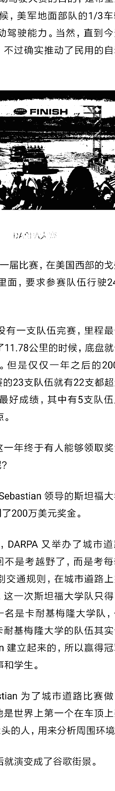

Sebastian Thrun 是1967年生人，他1985年在波恩大学拿到了博士学位，是个德国人，他之后去了卡耐基梅隆大学做研究，成为了卡耐基梅隆大学机器学习领域的创建者之一。

1998年，他成为卡耐基梅隆大学助理教授。

2001年升为副教授。

2004年他就加入了斯坦福大学，到2007年的時候正式成为斯坦福的正教授。

2010年，他就放弃了终身教职，加入了谷歌。

我们都知道，美国的大学终身教职非常难得，吴恩达在外面有这么多项目，依然还在大学里保留着教职，像这样能够放弃教职，全身投入企业的确实非常稀少。

但是，谷歌确实对他也委以重任，在谷歌担任副总裁，负责谷歌当时最神秘的项目，叫做 GoogleX。

所谓 GoogleX 的意思就是眼下没有什麼收益，但未来可能改变世界的项目，因为这样的项目需要非常有眼光，同时需要有投入的决心，也需要有足够的能 力。

Sebastian 在负责 GoogleX 的时候，其中一个最重要的项目就是自动驾驶。

当然，GoogleX 还孵化出另一个也很重要的项目，就是谷歌眼镜，还有就是谷歌街景，可见这个人非常创新。

而且这个人确实做事很坚决，到了2012年，也就是两年之后，他就离开了谷歌，联合创立了和 Coursera 齐名的在线教育机构——Udacity。

Sebastian 在18岁的时候，他最好的朋友因为车祸去世了，从那时候起，他就立志要用科技拯救全球每年100万的车祸死亡者。

所以 Sebastian 博士研究的项目就是自动驾驶和自动探索。而且1997年他开发了世界上第一个机器人导游。但是他最著名的，是赢得了 DARPA 的无人驾驶大赛。

我们在前瞻栏目里反复介绍过 DARPA，这个大赛被称作 DARPA Grand Challenge，叫做 DARPA 大挑战。

### 二、推动自动驾驶技术进步的 DARPA 大赛

其实在无人驾驶领域，日本是最前瞻的，他们在1977年就在研究自动驾驶了。而且日本在很多项目上都很前瞻，包括我们前一阶段带团去日本参观的机器人世界杯，也是日本人21年之前就开始主办的。

但是，在很多创新领域，包括自动驾驶，甚至包括现在的机器人，美国往往能够后来居上，一个很重要的做法，就是用 DARPA 这种挑战赛激起大家创新的欲望。

DARPA 做自动驾驶大赛的目的，是希望到2015年的时候，美军地面部队的1/3车辆能够具备自动驾驶能力。当然，直到今天也没能实现，不过确实推动了民用的自动驾驶的进步。

2004年是第一届比赛，在美国西部的戈壁的复杂地形里面，要求参赛队伍行驶240公里。

但是第一年没有一支队伍完赛，里程最长的那辆车到了11.78公里的时候，底盘就卡在了石头上。但是仅仅一年之后的2005年，进入决赛的23支队伍就有22支都超越了2004年的最好成绩，其中有5支队伍成功到达了终点。

也就是说，这一年终于有人能够领取奖金了。那是谁呢？

第一名就是 Sebastian 领导的斯坦福大学队，他们拿到了200万美元奖金。

到了2007年，DARPA 又举办了城市道路大赛，这一次不是考越野了，而是考每辆车能不能识别交通规则，在城市道路上完全自动驾驶。这一次斯坦福大学队只得了第二名，第一名是卡耐基梅隆大学队，但是别忘了，卡耐基梅隆大学的队伍其实也是 Sebastian 建立起来的，所以赢得冠军的是他的同事和学生。

但是，Sebastian 为了城市道路比赛做了一个发明，他是世界上第一个在车顶上架设360度摄像头的装置，用来分析周围环境。

这个方法最后就演变成为了谷歌街景。

### 三、谷歌无人驾驶

最有意思的是，这两次的 DARPA 大赛其实现场里都混着两个非常低调、戴着帽子、戴着墨镜的人。他们是谁呢？

就是谷歌的联合创始人拉里·佩奇和谢尔盖·布林。

这两个人给 Sebastian 印象非常深刻，于是拉里·佩奇出面说服 Sebastian 加盟谷歌。

当然 Sebastian 也先做了一个实验，就是把他2007年的时候发明的头戴360度摄像头的所谓街景项目兜售给了谷歌。谷歌立即决定开发这个项目，这就是后来著名的谷歌街景。

因为谷歌对 Sebastian 的响应非常积极，所以 Sebastian 干脆就在2010年加盟了，成了 GoogleX 这个项目的创始人和负责人。

同时最重要的，他也要负责谷歌自动驾驶队伍的组建，其实这就是谷歌当年自动驾驶的来源。

说到这儿，有一则趣事：

就是《纽约时报》驻旧金山的记者马尔科夫是报道自动驾驶汽车的第一人。他在2010年10月9号就发出了第一篇对自动驾驶汽车的报道。

2010年 GoogleX 刚组建，之所以谷歌能够对自动驾驶汽车做各种测试，其实根源还都是 Sebastian，他不光自己到了谷歌，还带来了他的一票学生和同事，建立起了谷歌自动驾驶队伍。

那时候谷歌用的还是6辆丰田的普锐斯汽车做测试。

根据原来谷歌自动驾驶团队的第一个中国人朱佳俊回忆，当时马尔科夫发现了谷歌在测试自动驾驶汽车，他就想去报道。

但是谷歌为了保密，拒绝马尔科夫的采访。于是马尔科夫就发了个传真，直接给了谷歌的创始人拉里·佩奇，说反正我是肯定要报道你们的无人驾驶汽车这件事的，你们是愿意接受我采访之后让我报道，还是让我自己随便写呢？

道，还是让我自己随便写呢？

于是谷歌没办法，只好接受了采访。

这篇文章今天在网络上还能见到，其中最有意思的是这篇文章中提到，Sebastian认为他们做的事情是面向未来的，是短期无法实现项目。马尔科夫说，最乐观的预计也是8年之后的事情了。正好这篇文章是2010年发出来的，明年就是采访的8年之后，可见无人驾驶真的来了。

顺便说一句，佳俊今年也出来创业了，国内企业做自动驾驶项目的可以找他合作，这可是谷歌做自动驾驶的元老级的人物。

谷歌无人驾驶项目在2016年12月14日的时候终于分拆出来，重新命名成立叫做Waymo。

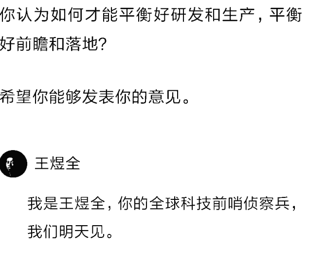

谷歌无人车

原来介绍过，谷歌整个集团改名叫做字母表公司。字母表什么意思呢？

就是26个字母，每个字母都可以成为一个子公司，将来这个字母表公司要把字母表填满，其中这个 W 就是用无人驾驶来填的，因为这个公司名字叫 Waymo。

但是 Waymo 的进展确实有问题，因为之前谷歌无人驾驶项目早早就和丰田谈过合作，但是无疾而终。从2015年起，他们又和福特正式签订了合作协议，2016年又宣布和克莱斯勒及本田合作，但是迄今为止进展缓慢，没有看到太多的进展。

至于 Sebastian，他认为教育才是真正能够改变世界的，尤其是通过互联网能让每个人都获得教育。所以，他在2012年的时候为了创立在线教育公司 Udacity，就离开了谷歌。

不过也许是他对谷歌这个自动驾驶项目发展太慢的一个回应，他去年9月份宣布 Udacity 要开发基于开源的自动驾驶汽车，所以 Udacity 也要造车了。

当然，虽然离开了谷歌，但是他和谷歌的创始人关系还是很不错，今年初他还和拉里·佩奇一起做了一个飞行汽车公司叫做 Kitty Hawk。

Sebastian 的传奇我们就介绍到这儿，因为他已经离开了自动驾驶领域。当然，Udacity 还在造车，所以自动驾驶领域应该有可能在未来还会听到他传奇的延续。

### ——▶ 今日知识小结 ◀——

今天介绍的重点有三条：

- 1.自动驾驶走到今天不是一日之功，从2004年开始的 DARPA 大赛到今天已经13年了，从谷歌无人驾驶汽车路测到现在也已经7年了。

- 2.DARPA 这种竞赛对技术提升有很大的价值，之前我们也介绍过美国航天界有 X Prize，人工智能界有 ImageNet 视觉识别比赛，现在国内也有了创新工场、搜狗、今日头条联合举办的人工智能大赛了，用大赛的方式提升科技水平确实可行。

- 3.谷歌在自动驾驶项目上虽然是先行者，但是现在被其它团队后来居上。我认为是因为研发和产业化的距离有点远，谷歌擅长研发，但是在产业化，尤其在涉及硬件的产业化上一直做得不太理想。而先进科技是需要产业化支持才能成功的。

### ——▶ 今日思考题 ◀——

我们看到，谷歌在产业化上存在问题，也看到日本虽然前瞻，但是在科技创新上往往会被别人后来居上。

你认为如何才能平衡好研发和生产，平衡好前瞻和落地？

希望你能够发表你的意见。

王烨全

我是王烨全，你的全球科技前哨侦察兵，我们明天见。

### 前哨历 9月12日

### 我的今日知识清单：

- 1.自动驾驶的发展不是一日之功，创新科技的商业化往往需要5-8年时间，自动驾驶即将迎来腾飞。

- 2.在很多创新领域，包括自动驾驶，美国往往能够后来居上，这与美国的各种科技挑战赛激越大家创新的欲望有很大关系。

- 3.先进科技需要产业化的支持才能取得成功。

> 摘自：《032 | 如何在自动驾驶领域后来居上？》

「得到」专栏《全球创新260讲》
距今5年，跟踪50个前沿科技观察社会

用户留言

提交留言可与专栏作者互动

## 033 | 处于剧烈竞争中的自动驾驶技术

033 | 处于剧烈竞争中的自动驾驶技术。

### —— 今日内容看点 ——

通过阅读今天的内容，你将会掌握以下三个问题的答案：

- 1. 为什么说 Mobileye 被 Intel 收购，反倒是 Mobileye 的福音？
- 2. 为什么说在人工智能领域，高校教授可以直接参与做研发？
- 3. 自动驾驶会打破汽车行业的整体格局吗？

我们昨天介绍了谷歌在自动驾驶领域做的贡献，可惜他们在商业化上动作比较慢。

今天给大家介绍一个在商业化上做得最好的公司，叫做 Mobileye。

### 一、Mobileye创始人Amnon Shashua

Mobileye 是一家以色列公司，它是1999年由以色列希伯来大学计算机系的教授 Amnon Shashua 成立的。Amnon 是 MIT 的大脑和认知科学的博士，他1996年回到以色列希伯来大学，1999年升为副教授，2003年升为正教授。

他一边做企业，一边做教授，发表了100多篇论文，但是其他一点都不耽误他创业。

他1995年做了一个公司，2007年卖掉了。

1999年做了 Mobileye，自己任董事长兼 CTO，首席技术官。

2010年他又做了一个公司叫做 Orcam，利用计算机视觉帮助视力受损的人。

顺便多说一句，因为我们海银资本投资了 Wicab，它的产品叫 BrainPort。Wicab 的产品是给全盲的盲人提供帮助，使他们能够恢复对外部世界的三维感知。但是实际上盲人里面多数还是有残存视力的人，这些人就是 Orcam 这个公司的目标。

所以，这个 Mobileye 的创始人 Amnon Shashua 也确实是一个技术牛人。

这里要提醒大家注意两点：

- 1. 人工智能领域很多的牛人都是认知神经科学背景，Mobileye的Shashua，DeepMind的创始人Demis Hassabis，还包括我们海银资本投资的Neurala，也是波士顿大学认知科学教授出来做的。
- 2. 在计算机算法和人工智能领域里面，大学教授可以直接参与做研发转化，而不像我们原来介绍的，国外的硬科技专业的公司做转化。做科技转化的人，他们更擅长的是把高校的科研做成产品推到市场，这些人是专门的人才，他们并不是高校教授。但是在人工智能领域，包括大数据，甚至虚拟现实，很多算法相关的领域，大学教授是可以直接参与研发的。

虽然这个技术是 Amnon 发明的，但是这个技术的所有权归希伯来大学，因为这个是教授的职务发明。

希伯来大学本身有一个技术转让公司叫做 Yissum，Mobileye 就拿到了 Yissum 的授权，它在授权基础上做商业开发，研究利用摄像头和包括计算机视觉算法的芯片来提供自动驾驶能力，叫做 EyeQ。

### 二、全线受到竞争压迫的Mobileye

2014年，在成立15年之后，Mobileye 在美国纽约股票交易所成功上市，市值53亿美金。

今年3月，又被 Intel 宣布以153亿美金收购，到今年8月份这个交易正式完成。

Mobileye 的上市是迄今为止以色列最大的 IPO。至于说 Intel 对它的收购，是迄今为止以色列最大的并购案例。

看似 Mobileye 很成功，而且确实迄今为止 Mobileye 的市场占有率达到了70%。但其实 Mobileye 面临的问题非常多，可以说在产业链的上中下游，Mobileye 是全线受到竞争的压迫。

从下游来讲：

Mobileye 的产品并没有办法直接卖给厂商，我们都知道国外汽车产业相对封闭，能够卖给厂商的都是一些系统集成商，就是你要把很多系统集成起来，最后给厂商提供一个完整的解决方案。

Mobileye 的解决方案并不足够完整，所以没法做成集成商。所以迄今为止 Mobileye 最多做 Tier2，叫做二级供应商。

那怎么办呢？它把它的产品卖给一级供应商。

但是随着自动驾驶越来越热，自动驾驶解决方案越来越多地被更多的企业所掌握，这种时候大量的一级供应商就宁肯自己开发自动驾驶解决方案，尤其是像视觉这样的方案，而不愿意采购外部的方案了。

所以，Mobileye 面临了一级供应商的竞争，包括德尔孚、大陆、电装、博世等等这些公司。

从中游来讲：

我们昨天介绍的谷歌的自动驾驶方案，就是自己开发出来的，其中包括有激光雷达系统，也包括视觉系统，所以谷歌也是它的竞争对手。

而且做基于视觉的自动驾驶方案的公司越来越多，因为我们都知道，人工智能，包括视觉识别系统的进步真是飞快，而且因为这是开源系统，开源最大的问题就是壁垒不足。这个今天你能搞出来，明天我也能搞出来。

那另外还有一个路数就是用更贵的设备，但能够获取更精确的数据和视觉系统来竞争，因为视觉系统毕竟相对来说比较粗糙。

那些贵系统虽然看起来今天价格太贵，竞争力会受损。但实际上我们都知道 IT 系统有个特征，就是一旦被大规模运用以后，硬件设备降价会非常快，所以今天很多基于激光雷达的自动驾驶方案，未来很可能会成为主流，也就是说随着汽车大量地部署激光雷达，激光雷达的价格将会降得非常快。

一旦激光雷达降价到一定程度的时候，因为它对周围环境的测量准确程度要比视觉系统高很多，很可能它就会对视觉系统形成强大的竞争。

从上游来讲：

因为 Mobileye 是把自己的解决方案做到芯片里。但是上游的其它的芯片厂商也会向下延伸，也会往芯片里放入解决方案。

最典型的是我们一直说人工智能领域里面的主导的企业 NVIDIA，英伟达。英伟达原来是卖 GPU，只卖硬件，现在也推出基于自动驾驶解决方案的整个系统，那就形成了对 Mobileye 的竞争。

除此以外，包括很多 Tire1 供应商也都是做芯片，像博世，像电装。包括还有很多传统的芯片供应商，像德州仪器，像飞思卡尔。

顺便说一句，就是飞思卡尔被一个企业叫 NXP 收购掉了。那近期高通又想收购 NXP。所以 NXP 这个公司其实值得大家关注的，如果你炒美股的话，这个公司值得入手。那当然了，也就说明高通本来也是 Mobileye 的竞争对手。还有 Intel，还有欧美的做导航的企业叫 Tomtom。

当然，现在 Intel 收购了 Mobileye，其实这反而是 Mobileye 的一个福音，因为我们讲的这个上中下游的全线竞争，对 Mobileye 的未来的发展其实压力是非常大的。

这个问题集中暴露出现在什么时候呢？

2016年6月份的时候出了一起车祸，就是安装了自动驾驶系统的特斯拉的 Model S，那个开车人在一个开放的公路上，在驾驶的时候正好前面有一辆大卡车，这个集装箱的大车横穿马路，集装箱的货车的车箱框正是乳白色，和远处的天空，天际线的颜色很相似，以至于当时只开通了视觉识别系统的 Mobileye 没有能够识别出大卡车来，特斯拉就完全没有减速，从侧面撞到了大卡车车箱上，造成车毁人亡的事故。

事故发生之后，特斯拉的工程师第一时间站出来说，我们用的是 Mobileye 系统。

其实这是一个很不好的例子，因为一般来说不管你用的是谁家的系统，那安全应该是由整车厂商负责的，而且以前其它整车厂商从平等有所讨论出了事故后主要...

是整车厂商负责的，而且以前其它整车厂商也从来没有出现过出了事故以后去指责我的供应商，说是你的系统不完善。

所以造成 Mobileye 立刻发布了一个官方声明，声称确实我们的视觉识别系统到2018年之前，都无法实现对这种和天际线背景颜色基本相似的大卡车车厢壁的识别。但是，其实它的本意是说，并不是我的缺陷，而是因为你本来就不应该装了我的系统就告诉大家这已经能够实现完全自动驾驶，甚至鼓励用户在开放公路上使用这样的系统。所以，它官方声明之后，立刻宣布后续停止和特斯拉的合作。

从这里面，其实我们就能看出来，虽然 Mobileye 暂时候在这个领域取得领先，一方面竞争剧烈，传统的车厂要进入很困难，因为中间隔着一级供应商 Tier1；另一方面，像特斯拉这样相对前卫的企业更愿意使用 Mobileye 的技术，但是你也要承担这些企业不按规则出牌给你带来的名誉损失。

当然，从未来来看，我们认为四级或者五级的自动驾驶还需要假以时日，才能够被广泛地配置到汽车上。但是，辅助驾驶系统，比如说像带着视觉识别的防撞系统会逐渐地从明年开始成为标配。

我们从 NVIDIA 今年的财报可以看出来，其实自动驾驶整个的市场还没有起飞，因为自动驾驶给 NVIDIA 带来的收入贡献还很微小。但是，基本上可以判断从明年开始，这个市场将会集中爆发，它的发展速度将会惊人。

因为我们看到，包括 NVIDIA 在内，包括 Mobileye 在内都已经和各大车厂形成了广泛的合作。而一般来说，你两三年之前的合作，两三年之后就会造成这个车上面会装配这样的技术，这样的设备。所以我们认为，基本上自动驾驶能够被广泛地装配到主流汽车上已经马上就会实现了。

### —— 今日知识小结 ——

我们今天讲了三点：

- 1. 就是自动驾驶将是人工智能的下一个主战场，即使是辅助驾驶，市场依然会很大。
- 2. 人工智能领域的科研和研发相对一体，教授们往往能够直接介入产业研发，能够直接给出产业需要的解决方案。国内其实也看得到，像这个商汤科技，像 Face++ 这些领导性的人工智能企业，很多都是教授们直接参与，直接来做研发的。当然也给我们企业一些启示，因为很多中国的企业，传统上找高校教授做研发，结果都不太好。但是人工智能领域来的时候，你可以又回到高校去找教授合作了。
- 3. 就是国外整个汽车产业的整体格局并没有被自动驾驶给打乱，也就是说自动驾驶还是为整车服务的，并没有形成对这个产业格局的颠覆式的影响。虽然 Mobileye 是市场领导者，虽然它也算是一个成功的企业了，但是并没有形成颠覆性的影响，它的市值也并不像我们预期的那样多么巨大，也就是说 Mobileye 并没有能利用人工智能的机会成功地把自己塑造成下一代的 IT 的霸主。

### —— 今日思考题 ——

在自动驾驶这个领域：

到底创业者应该从什么角度切入更好？如何才能在自动驾驶领域取得最大的成功？创业者有没有机会在自动驾驶领域形成颠覆，也就是说甚至对传统的车厂形成颠覆。

请大家跟我们一起来做分析，分析各个角度的利弊，分析最大的机会在哪？

希望把你的观点拿出来和大家共享。

王煜全
我是王煜全，你的全球科技前哨侦察兵，我们明天见。

### 前哨历
9月13日

### 我的今日知识清单：

- 1. 自动驾驶将是人工智能的下一个主战场，即使是辅助驾驶，市场依然会很大。
- 2. 人工智能领域的科研和研发相对一体，教授们往往能够直接介入产业研发，能够直接给出产业需要的解决方案。
- 3. 自动驾驶技术目前并没有颠覆汽车产业的格局，它依然是为整车服务。

> 摘自：《033 | 处于激烈竞争中的自动驾驶技术》

「得到」专栏《全球创新260讲》
陪你5年，抓住50个科技赛道机会

## 034 | 现在是有机会重新定义自动驾驶的时代

034 | 现在是有机会重新定义。

### ——◈ 今日内容看点 ◈——

通过阅读今天的内容，你将会掌握以下三个问题的答案：

- 1. 为什么说自动驾驶的技术创业机会已经过去了？
- 2. 站在自动驾驶时代舞台中央的会是什么样的企业？
- 3. 中国如何在自动驾驶领域有良好发展？

### 一、自动驾驶的技术创业机会已经过去

我们之前已经介绍过，我认为人工智能创业的机会已经过去了。通过这一周的分析，我相信很多人也会有这样一个理解，就是自动驾驶这一波的技术创业的机会其实也已经过去了。

首先我们说一个例证，就是最近有大量的并购，而且这些并购是像通用、福特这样的超级大企业，为了抢研发进度和积蓄人才而进行的。

比如说：

- 2016年3月，通用以5.19亿美元收购了自动驾驶公司 Cruise。
- 2016年8月，Uber以6.8亿美元收购了自动驾驶的卡车公司叫作 Otto。
- 2017年2月，福特以10亿美元收购了自动驾驶公司 Argo AI。

当然，我们判断，虽然利用人工智能来做自动驾驶的硬技术的开发这一波创业机会已经结束，但是还是有人跳进来，因为大家还是认为还是有一些可以发掘的地方。

比如：

吴恩达的太太做了一个公司叫作 Drive.ai，现在吴恩达也是这个公司的董事长。这个公司就另辟蹊径，他们在研究给现有汽车做自动驾驶的改装。当然，现在汽车它已经成型了，你要去改装，让它具备自动驾驶能力会更难，所以这也是吴恩达认为还有机会的一个原因。

所以，我们说最近有大量的并购，而且新增的企业还在涌现，但是确实新增企业相对要少多了。

### 二、数据训练的重要性

当然，我们说机会没完全结束，因为自动驾驶的数据训练非常重要，包括 Uber 都承认自己不如谷歌，也是因为谷歌在路上测试的数据要比 Uber 多得多。

所以，Uber 为了抢这个竞争优势，就率先在匹兹堡推出了自动驾驶汽车上路行驶，因为这种上路行驶虽然是试用，但实际上能够帮 Uber 更好地积累数据。

包括另一个自动驾驶汽车企业叫作 NuTonomy，它甚至抢在了 Uber 的前面在新加坡开始了自动驾驶出租车的实验，是世界第一个。原因很简单，也是为了大量地积累数据。

当然，在这方面，这些大的车厂也不会坐以待毙，因为大车厂积累数据一定有更大的优势，至少在它有大量的车在路上行驶的时候，可以很巧妙地把一些自动驾驶方案放到车里面去测试。

所以我们说其实现在看起来，还是大车企之间的竞争，自动驾驶存在的机会没有想象的那么多。因为产业链仍然是大车厂主导，它们有 Tire One（一级供应商）来配合。

包括那些想提供完整解决方案的厂商的机会也不大，因为一做到解决方案的级别，一定都是一级供应商来通吃的。

昨天介绍了 Mobileye 的故事，大家也能够体会到中间的竞争的激烈。

### 三、谁拥有自动驾驶的产业机会？

想撼动传统的车厂，尤其是已经有了这么强大完备的产业链的汽车产业，肯定要有足够的能力。

很多创新企业认为，我有一个 Idea，一个主张就可以改变世界。其实很多时候改变世界不光要主张，还要有资源，还要有能力。甚至告诉你会发现很多改变世界的主意到最后又回到大公司头上，只不过从这类大公司跳到了另一类大公司，因为还是这些大公司才有足够的资源去撼动另外一些大公司。

所以我们说，Uber 是有机会撼动大车企的，因为未来很可能是 Uber 大批量地购买和列装这些自动驾驶的车，而不是消费者来购买了。

那么这对车厂的整个业务模式肯定会形成一个颠覆。

小公司想把握机会，就必须要聚焦在细分领域上。

比如，现在的自动驾驶解决方案，高精度的方案，普遍都要用 Lidar，叫激光雷达。尤其是因为谷歌采用了 Velodyne 这个公司的64线的激光雷达，以至于 Velodyne 的激光雷达几乎成了自动驾驶汽车的标配。

但这个激光雷达主要的问题就是价格太高，现在一个雷达就高达7万美元。但是，我们讲过 IT 产业有一个特点，就是一旦大批量制造，价格就会下降得很快。

所以，Velodyne 公司公开承诺，它明年如果拿到100万订单的话，它会把价格直接降到500美元。

所以我们也一直讲，很多时候，现在包括像 Mobileye 这样的利用更简单的视觉系统做自动驾驶方案的公司，将来可能会受到这种更复杂、更精确的设备降价以后的挤压。

当然，我们说，其实很多应用的机会在具体的市场上面，所以不断地去看市场，去了解市场产生了什么新的变化，往往能够给我们提供更多的思路。

比如说低速、低价的电动车方案。山东现在已经变成了低速电动车的大省，去年全国的正规电动车的销售，就是需要上牌照的这个电动车的销量只有40万辆。但是山东那种不需要上牌照，价格又很便宜的低速电动车直接一下子销售了150万辆。

实际上，我更倾向于认为，未来这种低速电动车更可能是电动车的未来，而不是今天这种烧油改成了电动，但是车的外部和内饰都和传统车一样，我认为这未必是未来的形态。

### 四、中国的机会

我们都在讲，美国现在都是大家伙在玩，大车企纷纷通过并购，或者推出自己的自动驾驶。谷歌汽车和 Mobileye 虽然是新的进入者，但是也都没有能够改变这个局面。

但是中国因为相对来说没有那么大的垄断性的汽车企业，所以反而更有机会。

但是中国未来到底会走成什么样，能不能形成自己的独特的生态环境，现在看起来还不确定，不像美国生态圈很固定，未来相对好分析。

参考一下美国的机会，最可能的搅局者已经不是谷歌和 Mobileye 了，而是特斯拉，它的特点是用“电动车+自动驾驶”，而 Uber 的特点是用“服务+自动驾驶”。

那么中国是不是也可以考虑这种综合的一步到位的解决方案呢？

如果用户要买，干脆就直接发展“电动车+自动驾驶”，因为你都自动驾驶了，那再加一个自动充电方案，车回到家，自动停到停车位开始充电，这当然是最好的。因为自动驾驶还加油的话，这个系统的复杂度要高很多，因为油一旦漏掉，这个问题就严重了，但是漏油的可能性不大。

另外一个就是滴滴，我们也一直很看好，因为“服务+自动驾驶”不能说是百分之百的未来，但至少是方向之一。

滴滴今年3月份也在硅谷成立了自己的自动驾驶部门，我觉得这是一个聪明的策略。

另外，我们认为中国还有类似 Mobileye 的机会，因为 Mobileye 在国外发展不好，主要是 一级供应商对它的挤压太激烈了。

而中国，因为没有那么强的一级供应商统治，所以中国出现类似 Mobileye 的机会还存在。百度原来的研究院的院长余凯，出来做了地平线公司，我看他们的意思就是想做中国的 Mobileye，祝福他们。

想做中国的 Mobileye，祝福他们。

如果你要更前瞻一点，就是我们一直讲的，现在是一个有机会重新定义自动驾驶的时代。

最好的范例就是驭势科技的吴甘沙。

2017年1月份 CES 展上，吴甘沙他们带来的自动驾驶解决方案非常地惊艳，以至于得到了国外很多主流媒体的报道。因为他认为，将来车自动驾驶以后，更关键的就不是驾乘的乐趣，而是在车里面可以享受一天当中最快乐的时光，所以他把车做成了一个环绕的小包厢，这个思路是非常巧妙的。

我认为，未来之所以精彩就在于它存在着大量的不确定性。

中国未来的自动驾驶到底是什么样的生态，包括未来的产品到底是什么样的结构，未来服务到底是什么样的形态，其实坦白说都不是完全确定的，甚至说基本都还没有定型。

这种时候，最主要的是要把各个方面相关的人聚集到一起，就像周其仁老师讲的，要有足够的浓度，足够的密度，足够牛的人在一起碰撞，甚至要让传统产业和新兴产业的企业汇聚到一起，要让制造企业和科技企业结合到一起，才会能够对未来的发展形成创新性的推动。

这方面，杭州做了一个运河互联网汽车产业园，就把周边的传统汽车产业和互联网相关的汽车产业，甚至自动驾驶相关的汽车产业，包括一些汽车服务业全部聚集到一个产业园当中，使它们能够大量地协作，我认为也是一个中国式探索的很好的例子。

我们讲积木式创新，其实积木也需要一个环境，很多时候你把一堆积木堆在一起，它们在自己的碰撞过程当中可能就搭出了一些非常漂亮的创新式的方案了。

### 五、自动驾驶的未来还不确定

未来未必一定是 Uber 和滴滴的，这个就像我们前面讲到的，人工智能巨头为什么做云服务？是因为怕错失机会，因为他们也看不明白未来会怎么发展，那别人肯定就更看不明白了。

而且，未来的出行未必是今天我们设想的样子，因为很多的革命都不是我们想当然想出来的，甚至很多革命在初期的时候大家都不接受。

比如说今天大家习以为常的 Airbnb，出行不再住酒店，而住别人家了，它刚推出 Krieg 的时候我都不接受，我说为什么要住别人家呢？卫生不卫生啊？安全不安全？今天看完全是多虑了。

另外很重要的一点就是对创新企业要有耐心，因为这一轮的创新是“软硬件+模式”，是“科技+模式”，是综合创新，甚至是多重创新，所以它的周期会特别长。

别忘了，虽然 Mobileye 还不算太成功，但是从组建到上市都经历了15年，我们习惯了互联网甚至三五年就上市的模式，但在今天的科技时代未必适用。

所以我们每个人，每个具体的实践者、创业者、企业家都要切记一点，就是长期专注在一个点上，欲速则不达。

### —— 今日知识小结 ——

今天讲了三点：

- 1. 整个汽车产业，尤其是在国外，汽车产业格局没有变，还是大车厂之间的竞争。当然大车厂之间的竞争最先引入人工智能，最坚决地贯彻人工智能的大车厂会受益，比如说像宝马公司，因为它们的人工智能合作最透彻。那当然，也包括像特斯拉和 Uber 这些外来进入者很有可能在未来取得领先优势。
- 2. 近期的机会，要看细分市场机会，比如说像 Lidar，比如像激光雷达的机会，或者是封闭环境低速自动驾驶的机会等等，细分市场。
- 3. 远期看你的想象力，看你的坚持耐心的程度。

### —— 今日思考题 ——

我们希望考验一下你的远期想象力，请你开放式想象一下未来的出行将会是什么样的，有哪些颠覆式的模式有可能会出现，以至于会颠覆掉今天的汽车企业，甚至今天的滴滴和Uber。

希望你展开想象的翅膀，并且把你的想象和大家一起分享。

王煜全

我是王煜全，你的全球科技前哨侦察兵，咱俩明天见。

### 前哨历 9月14日

### 我的今日知识清单：

- 1. 自动驾驶这一波技术创业的机会已经过去，大企业并购创新公司是为了抢先发进度和积蓄人才。
- 2. 机会已经没有想象中那么多，小企业应该聚焦在细分领域上。
- 3. 中国相对缺少垄断性车企和供应商，因此存在机会，甚至有机会重新定义自动驾驶。

> 摘自：《034 | 现在是有机会重新定义自动驾驶的时代》

### 特别放送 | 2017苹果秋季发布会深度解读

特别放送 | 2017年苹果秋季...

王煜全

今天是《全球创新260讲》的第一次特别放送，我将为你解读“2017苹果秋季新品发布会”。本周自动驾驶的问答音频和内容我将附在文稿后，欢迎你收听。

北京时间9月13日凌晨，苹果在美国加州的新总部一口气发布了iPhone X、iPhone 8以及iPhone 8 Plus三款新机。作为你的全球科技前哨侦察兵，有不少用户就渴望我来点评一下发布会。

我和不少用户一样全程观看了发布会直播，也听到有用户说这次发布会感觉像是我们专栏的实践版。因为“前哨”已经提前把未来的方向都说出来了，苹果实践的基本上都是前哨预言的东西，比如，对ARKit以及混合现实的预测。

我确实非常兴奋，我们既然叫“前哨”，就要做到对产业的发展方向的精准预测。但是，我的目标是不仅我能预测准，而且你也能预测准；我更希望的是你不光要预测，还要能参与，我们大家一起参与。中国越多的人参与，我们的科技实力就一定越强大。

回到对苹果秋季发布会的点评：

- 1.苹果手机的无线充电技术不是亮点

坦白说：无线充电不是亮点，因为它采用的是Qi技术（一项无线充电的技术标准）。Qi技术其实是有缺陷的，一个是它感应距离短，而且它不开放；还有一个就是它的充电容量大小是有限制的。所以就会出现一种情况，苹果的系统能用，其他的就用不了。

这次苹果发布会展示的 Air Power 无线充电桩，你就可以在上面给苹果手机、苹果手表或者苹果无线耳机充电，但是，你拿三星的手机上去，它就充不了。

另外一点，苹果只支持给小东西无线充电，电脑这么大的东西就无法实现。所以，你看虽然苹果的手机都可无线充电了，但是它并没有演示电脑无线充电，因为如果电脑的充电板也无线充电的话，Qi技术就成了它的短板。

反之，我们海银资本投资的 Witricity 公司，它采用的磁共振技术就是由MIT（麻省理工学院）的教授叫 Marin Soljacic 发明的。这个才是我认为的未来，并且在技术界也得到越来越多的共识。

- 2.苹果在iPhoneX背后的创新压力

苹果这次发布会有一个小细节不知道你注意到没有，就是他们在发布会的屏幕上和对外宣传的文案上，写的都是 iPhoneX，但是他们上台介绍的专家嘴里说的确是“iPhone10”。

为什么呢？我的理解是：这个产品并没有想这么早发布，而且这个产品应该是没有完全准备好就已经发布出来了。

- 3.苹果发布会的最大创新是ARKit

这一回苹果明显是把它“压箱底”的东西拿出来了。我认为这次发布会最大的创新就是我们在“第001讲”提到的ARKit——增强现实软件平台的硬件解决方案。苹果虽然在2017年的全球开发者大会（WWDC）上发布了ARKit，但是当时它只是一个软件平台。虽然它可以被下载到现有的苹果的iPhone 和 iPad 上，但是现有的硬件支持增强现实的能力并不够。

推荐你阅读：《001 | 混合现实：把真实世界叠加进虚拟世界》

#### 4.iPhoneX将推动混合现实产业的发展

我们之前讲过，很多电子设备原来很贵，后来因为手机成百万、上千万的需求，所以这些电子设备可以迅速量产，从而变得非常便宜，而且变得非常小型化。

我们现在看这次发布的 iPhoneX 采用的“小孔点阵投影和红外摄像头结合的结构”，我认为随着 iPhoneX 的量产，也会得到迅速普及，而且变得非常便宜，它将会使得AI、增强现实或者混合现实能够超越手机，而且超越很简单很简单的游戏的应用，能够在我们的生活的方方面面都得到广泛的运用。因为这种对立体的物体的测量，其实在很多领域都有特别大的用处。并且，我们还坚持原来的观点：

第一，就是真实的东西虚拟化就叫做MR，而虚拟的东西现实化叫做AR。所以，虽然它叫ARKit，苹果把它叫做AR，但是实际上它的用处是混合现实（MR）。

第二，混合现实最大的机会是提升人和人之间的协作效率，人类进步和创新的主题就是提升协作效率。MR将使人类的协作效率，尤其是远程协作效率得到进一步的巨大的提升。

第三，MR的潮流还没有来，因为很多人都在说，煽全你讲的别的我都能理解，你讲的这个混合现实，你给我举个例子。我说我讲的是潮流，潮流还没有来，所以没有例子可讲。但是，如果已经有例子了，其实潮流就已经结束了。对吧？但是我们讲MR的潮流马上就来，因为软件已经有了，现在硬件苹果有了，大家能够得到的硬件也马上就会有，因为苹果一量产，硬件一定降价。

#### 5.小结

所以，以上就是“前哨”对此次的苹果秋季发布会的一个解读，总结来说最大的亮点和价值就是使得混合现实（MR）的软件系统完备了之后，又有了完备的硬件系统，而这个硬件系统在苹果的带动之下会很快地跨越出苹果的地盘，变成到处都可以用到的。那么，剩下的无外乎就是你找到问题和定义问题，以及用MR系统来解决问题的能力了。我相信这个潮流会催生大量的新兴的创业公司。

王煜全

以上就是本次特别放送的内容，未来，全球科技领域的各种大事，我都会第一时间为您发来解读，欢迎您持续关注。

接下来是专栏内容的第35讲，也就是“自动驾驶话题的回顾和答疑”。

### —— 本周内容回顾拓展 ——

本周我们讲的是自动驾驶，讲了三个重点：

第一，四、五级自动驾驶（接近全自动的自动驾驶）尚需时日，但是辅助驾驶和特定用途、特定场景的自动驾驶马上就来了，人人都有机会体验到。

第二，自动驾驶其实经历了很长时间的发展，不是骤间出现的，根据我们这周的介绍，你也了解，很多机构、很多公司、很多牛人都从各个角度为自动驾驶的发展做出过贡献。

第三，自动驾驶的发展取决于整个产业链，同时也取决于政策，在这些方面中国现在都有领先的机会。

### —— 本周用户答疑 ——

煜全老师，您好！有个问题，周一的内容中，你提起随着自动驾驶技术的不断精进，我们对于汽车从所有权逐渐过渡到使用权，而Uber和滴滴的模式正好是自动驾驶技术深度发展的自然延伸。这一有点我很认同。但我的疑问是，人的本性是有控制欲和自我标性签的，自动驾驶技术的全面深入发展促进了效率和便利性的同时，使得人的尊严感和存在感大大降低，所以有没有可能人们对于辅助驾驶的期待高于完全自动驾驶呢？

这个问题正好有另一位用户叫“.s官亮尧阿”，他（她）的留言可以回答你的问题。他（她）的留言是这样的：

一个可能出现的问题是，驾驶本身对于一些人就是一种乐趣，那么假如自动驾驶有一天走向成熟，甚至发展出车辆的集中调配网络，那么到时候人类会不会连开车上路的机会都没有了呢？答案是可能的，回忆以前的马车，骑马本身对很多人来说就是一种娱乐，可如今很多地方骑马上路并不被允许。如此一来，以后所谓的开车兜风，可能真的就是去专门跑道兜两圈风了。

虽然人永远会有占有欲，但是当一个物品大量的公共化以后，你的占有欲会转移。当然少数人还会以拥有一辆豪车为荣，但是多数人估计就是还是用这种“用车”的方式解决自己的交通问题，而不需要拥有。其实你可以拥有的东西多的是，比如说你可以拥有比特币嘛。

我们也希望，未来有越来越多的用户问题是由我们前哨的其他用户来解答的，所以以后我们也会多做这样的尝试，匹配用户的问题和解答，也欢迎更多的前哨用户看到别人的问题以后提出自己的解答。谢谢！

所有自动驾驶技术都在车身上下功夫，为什么不考虑在路上安装感应系统辅助汽车作判断呢？比如在某个高速公路上全程安装感应系统配合车联网，货运司机就可以全天候开车了，在汽车快下高速时提醒司机，换成司机自己开车。长期来看成本应该也不会很高。为什么没有看到公司做这方面的事情？希望王老师解惑。

我的回答是，如果你要把环境做成封闭系统的話，那也不需要用各种的感应系统来辅助。因为在封闭系统上，其实人工智能已经可以胜任了。

但是如果是在开放系统的話，就要处处布设。即使是在你建议的高速公路，也别忘了中国已经成了世界上高速公路里程第一大的国家。因为我们的里程数已经是非常长，假设所有的高速公路上都去设置这样的系统的话，那成本无疑是太大了。另外只在一段高速公路上设置也没有意义，没有卡车只跑这一段高速，对吧？而你希望全国的高速都布设这套系统，那确实太贵了。

还有另外一个问题也很严重，那就是这么大的成本投入，应该算是公共设施建设，就像高速公路建设一样。那么，是不是应 该让所有人部分摊呢？这个成本投入是不是从国家预算来呢？如果从国家预算来的话，那么我们没有用到这套系统的人就觉得不公平。如果是商业公司来，那么他们很有可能血本无归。所以，这件事在操作上看起来好像解决了人工智能问题，但实际上在社会实践当中反而更难以操作。谢谢你的建议。

百度今年宣布全面进军自动驾驶领域，并开源了“阿波罗系统”，请问王老师，是否无人驾驶领域会变得像智能手机领域一样，硬件生产商不断集成开发新汽车，软件走定制化和个性化的路线呢？

我的回答是，我并不太看好百度。百度虽然自称全面进军人工智能，但是选了一个它自己没有任何优势的自动驾驶领域，我觉得是没有任何意义的。而且，自动驾驶领域的开源趋势并不只是百度，我们这两天也介绍过了，像 Udacity 就在做开源的自动驾驶系统的工作。这方面其实大家都在做。

所以我认为，自动驾驶将来这个领域确实和手机产业有一比，但是你只说了一半，你说的是“硬件标准化，软件定制化和个性化”。但实际上即使是手机领域也是两条路，一条是你说的这条路，尤其是以安卓为代表的硬件标准化、软件个性化；另一条实际上是苹果的路，苹果的iPhone其实它不是一个只考虑硬件的东西，而是软硬件结合。

最近苹果发布的 iPhoneX 更是一个软硬件结合的一个新的巅峰（我们已经做了解读）。

的一个新的巅峰（我们已经做了解读）。因为在很多特定的应用上，软硬件结合往往效果更好。所以，我们说定制硬件在软件的配合上，在具体的效果上还是会有差距的。

未来确实会像手机产业，可能会出现两条路线之争。一条路线是高端的汽车会走软硬件结合的路线，就像iPhone一样；另一条就是低端的汽车，会走硬件标准化，软件定制化，所以它可以取得更好的价格优势。但是，你的这个产业之间的对比的思路，我觉得无疑是非常值得肯定的。

### ——▸ 下周话题预告 ◂——

下周我将介绍一个个人人都会用到高科技，就是人工智能入口，也就是人工智能和我们每个人的交互界面。我们老说黑科技，而我在专栏里也一直强调没有产业化时点的黑科技都是要流氓。现在，这些黑科技不光产业化了，而且正在实实在在地走进你的生活，这就是人工智能。所以，我相信下期的话题你也一定很感兴趣，欢迎你的关注。

王煜全

我是王煜全，你的全球科技侦察兵。

### 前哨历
9月15日

### 我的今日知识清单：

- 1. 创新其实是一条很难走的路，但是对很多创新者来说，创新是唯一一条可以改变世界的路。
- 2. 混合现实最大的机会是提升人和人之间的协作效率，人类进步和创新的主题就是提升协作效率。
- 3. 这次苹果秋季发布会最大的价值就是ARKit使混合现实的软件系统完备后，又有完备的硬件系统，它将变得到处都用得到。

> 摘自：《特别放送｜2017苹果秋季发布会深度解读》

「得到」专栏《全球创新260讲》
挺过5年，抓住50个新科技浪潮机会

### 用户留言

提交留言可与专栏作者互动

### 创新地图｜谁是推动自动驾驶发展的最重要力量？

王煜全

今天是《全球创新260讲》开播以来的第四期前哨团供稿时间，题目是《谁是推动自动驾驶发展的最重要力量？》。

陈琪，英飞凌科技澳大利亚分公司高级主任工程师。

自动驾驶是非常炙手可热的科技领域，许许多多不同性质的公司参与其中，比如汽车制造商，车厂的各级供应商，以及越来越多的各类型科技公司。

在这众多的公司中，究竟哪种是在未来真正能够推动自动驾驶技术成熟并普及的公司呢？

我认为，推动全球自动驾驶发展的最重要力量是汽车零部件一级供应商，也就是行业里所说的Tier1，其中的代表有博世、大陆、电装、采埃孚、德尔福、法雷奥等。虽然这些公司相对比较低调，但他们对自动驾驶技术研究的历史其实并不比科技公司短，包括软硬件在内的各类相关技术的积累也不落后于科技公司，而最为重要的是，一旦到了自动驾驶技术量产装车的时候，车企也只会向他们订购软硬件一体的完整的自动驾驶解决方案。

今天我们就着重介绍一下这些公司在自动驾驶汽车产业发展中所起的关键作用，同时也会分析一下科技公司的发展出路和机会。

### 一、Tier1是汽车产业的部件和核心技术的提供者

在传统汽车行业中，Tier1一直就是车辆最核心最尖端的部件和技术的提供者，例如车辆汽车最关键的两个技术：动力总成和底盘技术，基本上就被博世、大陆、电装、德尔福等Tier1所把持。

到了自动驾驶车辆的时代，这个情况看起来不会发生改变，他们仍会给车企提供包含软硬件在内的完整的自动驾驶解决方案。

这里面包含了最重要的四个系统：传感系统、动力系统、控制系统以及车载信息系统。

#### 1.Tier1硬件方面的优势

首先，Tier1能够生产从超声波雷达、各类摄像头到毫米波雷达再到激光雷达的全套传感器，且都是符合汽车使用的车规级产品。汽车用到的部件都要满足车规级的质量要求。

例如其电子系统要在零下40度至85度的温度范围内正常工作，而发动机周边的电子元器件则需要在零下40度至150度的环境下工作。对此之下，iPhone在零下10度左右的时候就已经关机了。

#### 2.Tier1在软件方面的技术并不落后于科技公司

首先，Tier1们几乎提供了所有的车载电子系统与配套的专用软件，如车载仪表、中控娱乐系统、发动机/变速箱管理程序，以及高级驾驶辅助系统（ADAS）的程序，在车用软件的开发上经验丰富。

### 二、科技公司们的角色和机会

读到这里，你可能会觉得Tier1们简直

由于私家车锐减，滴滴、Uber、Lyft、Grab等交通服务提供商将变成核心公司，他们会大量采购无人车投放到城市里运营，进而将自己转变一家出租车公司。

而商业模式的变化会直接带来自动驾驶汽车生产模式的变化。如果是车厂去销售自动驾驶汽车，他们就要承担车辆自动驾驶系统的责任。因而车厂会费尽心思寻找稳定安全且符合车规要求的自动驾驶系统供应商，很明显就是博世等 Tier1。但是在新的商业模式下，以 Uber 为代表的科技公司们只需要车厂把自己的自动驾驶系统装在现有的车辆上，然后再交付给自己去运营。车厂只需要对车辆本身的质量负责即可，而自动驾驶系统的责任则由科技公司所承担。

自动驾驶业内已经出现了许多类似案例。

例如 Uber 与沃尔沃合作制作了一批基于 XC90 的自动驾驶汽车，自动驾驶系统同样是 Uber 的；nuTonomy 已经将自动驾驶出租车在新加坡投入运营，车辆是其与三菱一起开发而来，但自动驾驶系统同样是 nuTonomy 的。

像 Uber 这类大型科技巨头的策略都是如此，那么中小型自动驾驶公司的出路在哪儿呢？从目前的情况来看主要有如下几条路径：

- 1. 成为 Tier1 的供应商或合作伙伴

中小型公司往往在某些领域有着 Tier1 所不具备的技术或能力，这些公司如果把自己的长板与 Tier1 的强大优势结合在一起，也能生存并发展得很好。这个现象在从事汽车激光雷达研究制造的几家科技公司的目前情况就能看得出来。

Ibeo 公司在本世纪初开始研发激光扫描技术，并且开始了若干自动驾驶项目的尝试，并从2010年起和 Tier1 巨头法雷奥合作开始量产激光雷达 ScaLa，目前已经有多款产品推向市场。

新晋创业公司 Quanergy 则将部分股权转让给 Tier1 巨头德尔福，并且将开发出的技术转化为产品，并由德尔福生产。

- 2. 成为自动驾驶的技术运营商或出行服务商

开发商用车自动驾驶技术的图森未来公司走的就是这条路子。

按照计划，图森会与车厂合作生产出搭载有自家自动驾驶系统的货车，然后将车辆出售给物流公司用来运货，图森会来承担自动驾驶出现故障的责任，车厂只为车辆本质的质量问题负责。随着细分市场的出现，初创公司也会获得一定的机会。

- 3. 研发和生产细分市场的车辆

由英特尔中国研究院前院长吴甘沙创办的驭势科技是这条路线的典型代表。驭势科技同样采取了两条腿走路的模式，即一边研发针对四、五级别的自动驾驶技术，一边也研发针对工业园区、景区、校园等封闭场景的低速自动驾驶技术。而为了尽快实现商业化，驭势也与一些低速电动车厂商合作，打造了一批“驭势”牌低速自动驾驶汽车。目前，这些车辆已经在广州白云机场及部分工业园区投入试运营。

- 4. 被车企、Tier1 或者更大的科技公司所并购

创业是一场九死一生的考验，并非每一家公司都能活下来并做大做强。在创业的过程中，如果做出了一些成就，被并购也未必不是一种成功。这几年在自动驾驶技术领域里的这种并购活动层出不穷，例如：

- 2016年3月12日，通用斥资5.19亿美元收购了自动驾驶初创公司 Cruise；
- 2016年8月，前谷歌自动驾驶项目专家安东尼莱万斯基创办的自动驾驶卡车公司 otto 被 Uber 以6.8亿美元收购；
- 2016年12月，另外一家叫做 Ottomatika 的公司被德尔福收购；
- 今年2月，福特斥资10亿美元收购了自动驾驶 AI 公司 Argo。

### 三、总结

自动驾驶技术将在未来的几十年内改变整个汽车与交通产业，并涉及巨大的市场，这让许多科技公司兴奋不已。

但是与科技公司们的热情洋溢不同，博世、大陆、德尔福等 Tier1 却保持了相当的克制。他们很少出现在新闻头条里，也很少去大肆宣扬自己的技术有多厉害。但是因为他们早已掌握了汽车里绝大部分电子设备与控制系统，并且也在汽车软件与 ADAS 系统方面积累已久，不管是从硬件还是从软件角度来说，他们都已经占据优势。未来为整车厂提供自动驾驶系统的，也必然还是他们，他们才是推动自动驾驶汽车发展的最重要的力量。

王煜全
我是王煜全，你的全球科技前哨侦察兵，咱明天见。

## 035 | 人工智能入口的热门场景争夺战

035 | 人工智能入口的热门场。

### —— 今日内容看点 ——

通过阅读今天的内容，你将会掌握以下三个问题的答案：

- 1. 人工智能时代的入口之争会在哪个维度上展开？
- 2. 入口的热门应用场景是哪些个？互联网巨头们是如何布局的？
- 3. 语音语义的发展对人工智能应用有多重要？

首先，我们说几乎每个时代的入口之争都会引起激烈的竞争。

PC 时代微软借助操作系统的地位，几乎统一了所有电脑的界面。

互联网时代，一开始是雅虎、新浪这样的门户作为入口。

社交网络时代，就变成了谷歌、Facebook、腾讯等等，借助社交行为抓到了新的流量入口。

移动互联网时代，手机占据了我们生活的大部分时间。苹果公司借助触摸屏和应用程序，也就是 APP 成为新的产业巨头。我们每天都在用的微信，如今已经是绕不过去的入口了。

### 一、人工智能时代，语音交互是最重要的入口

人工智能时代的入口之争会在哪个维度上展开呢？

最近国内有个说法叫做“百箱大战”，意思是说越来越多的公司开始开发智能音箱。

喜马拉雅的智能音箱叫小雅。
小米的智能音箱叫小爱。
阿里巴巴的智能音箱叫天猫精灵。

出门问问、若琪也有各自的音箱推出，大家都来抢占这个新的入口。国内的竞争看起来很激烈，国外的竞争其实早-multi开始了。

前瞻去年就曾经对人工智能入口的竞争做过梳理，亚马逊、谷歌、苹果、Facebook 这样的产业巨头都在争夺智能音箱的市场。

Mary Meeker 的分析把应用场景分为随身、汽车和家庭三个部分，把语音交互的核心价值归结为解放双手、更快得到结果和有趣三个关键词。

但是我认为，其实语音交互最大的价值是回归人性。

语言是人类拥有一项伟大的进化产物，使得我们协作的效率和复杂程度大大提升。

### 二、人工智能入口的热门场景争夺战

我们这里重点来分析几个场景，当然越多场景的占领意味着机会越多。从家庭场景来分析，我们认为智能家居和家庭陪伴机器人是最有潜力的两个场景。

#### 1.智能家居

力量来场，Alexa 在展会上大放异彩。

国内阿里巴巴推出的“天猫精灵”、京东与科大讯飞合作推出的“叮咚”、小米智能音箱“小爱同学”等等，硬件没问题，但总体在大数据和软件整合方面还有很大差距。

#### 2.陪伴机器人

陪伴机器人现在很多企业在做研发，未来两年会密集推向市场，比如说软银机器人做的 NAO，可以陪小孩子唱歌跳舞。而目前最有潜力的我们认为是有表情的类人机器人，比如我们海银资本投资的 Hanson 机器人工司的小爱因斯坦，它可以作为孩子的家庭教师，有各种表情与孩子互动交流。而且小爱因斯坦的唤醒词是“教授”，你叫一声“教授”，它就会转过头来和你互动。

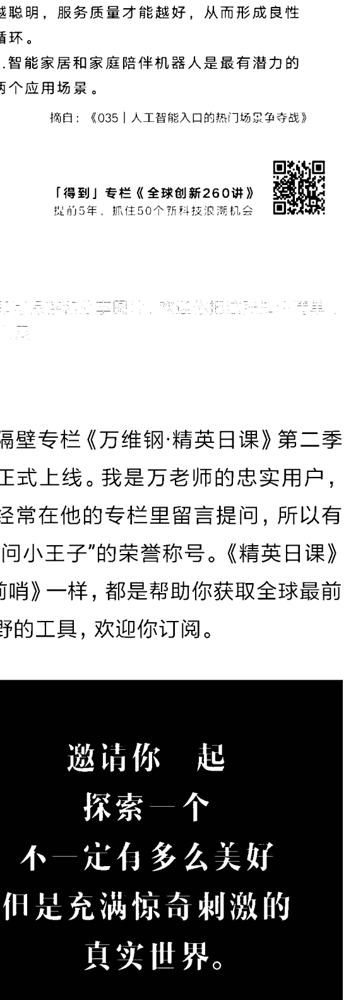

小爱因斯坦机器人

因为 AI 背后的内容和服务整合虽然很重要，但入口一定要有趣好玩、体验顺畅才会更占优势。

在办公和随身场景，多用到手机和 PC 端，微软 Cortana 和苹果 Siri 是在这上面下功夫研究的先驱。

现在最新版本的 Cortana 已经拥有更好的识别正确率，能够把语音识别的错误率控制在5.1%，大约达到普通人语音识别的水准，而去年这个错误率还是5.9%，而且，它通过上下文理解对话的预测能力也有所提高。相比之下，苹果旗下的 Siri 还不那么“智能”。而微软与亚马逊的合作说明，接下来微软想占有人们的生活服务场景也远不止于此。

Siri 其实是世界上第一个正式推出的智能语音助手，但是因为苹果的战略转移，Siri 的发展受到很多阻碍，这两年也正在加紧追赶。

Siri 可以用在苹果的所有生态中，近几年苹果除了多语种的开发，还在模拟自然语言上下了很大功夫，包括我们的重音、语调和节奏，我们总是会更喜欢更像人的一些功能，这个将会非常受用户欢迎，12月苹果将要发布的 HomePod 会有怎样的新功能，我们也可以拭目以待。

### 三、语音语义的识别

人工智能入口除了软件和应用，背后的技术发展是其承载的重要基础，包含了语音合成、语音识别和自然语言处理，叫 NLP，三项主要技术。

在语音语义识别方面，我们在《前哨》第一季的科技概念股中也提到过，国外要算 IBM 和 Nuance，国内要数科大讯飞、小 i 机器人和近期将要赴美上市的搜狗。科大讯飞是国内最早研究语音识别和语音合成的，相当于中国的 Nuance，小 i 机器人则是最早进行人机互动的，积累了大量实战的互动数据，而搜狗正在借助搜索和输入法积累的大量数据，在语义理解上急起直追。

语音识别已经从近场发展到了远场，其中关键的两个技术：麦克风阵列技术和远场语音识别，现在各家技术发展差别不大，这方面已经不是很大的壁垒了。虽然这意味着各大巨头间的竞争上升了一个档次，但也给面向应用的初创公司留下了很多想象空间。

自然语言处理，NLP 技术虽然在搜索引擎中早就有关应用，但在人机交互领域中还属于浅层，其中，语义识别还是个难点。

由于中文经常存在一词多义，机器分析还是停留在简单的句子结构分析和浅层语义理解。所以目前我们与中文系统互动起来总是感到不那么顺畅，还需要深度学习加大大量数据来矫化。这也是中国的智能语音助手迟迟火不起来的原因之一。人们在几次与机器沟通不畅后往往会热情冷却。当然，随着人工智能的进展，我们有理由相信对语义的理解也会迅速突破。

我前一阵和搜狗的王小川交流，他们正在研究人工智能翻译，我们一致认为智能翻译会在两年内实现商用。

### —— 今日知识小结 ——

今天我们介绍的人工智能入口产业，主要讲了三点：

- 1. 语音交互是人工智能入口的一个重要方向。谁能在该领域提前布局，谁将有机会成为下一个巨头。但是布局的核心是重要场景的语音交互应用。
- 2. 目前热门的语音场景有家庭、办公、随身、车载等等。竞争的核心是特定场景中交互的质量。越早占领市场，数据就会越多，机器学习就会越来越聪明，服务质量就会越好，从而形成良性循环。
- 3. 语音语义的发展是人工智能入口承载的基础，语音合成和语音识别已经发展成熟，其中的语义识别目前还是个难点，但也有望在两年内突破。

### —— 今日思考题 ——

今天我们讲的人工智能入口，更多的是探讨了亚马逊、谷歌、微软、苹果等大公司的布局。那我今天的问题是：

对于小公司而言，人工智能入口上有什么机会？

或者我们把这个问题换一个方向来看，假设未来人工智能入口所需的技能都可以通过和大公司合作来获得，除了音箱和手机，还有哪些场景可以引入人工智能的语音交互呢？

欢迎你在留言区分享你的见解，参与到我们的科技讨论。

王煜全

我是王煜全，你的全球科技前哨侦察兵，我们明天见。

### 前哨历 9月18日

### 我的今日知识清单：

- 1. 技术会越来越嵌入人的习惯。而语音交互是一个在各个场景中都可嵌入的技术。
- 2. 竞争的核心是特定场景中交互的质量，因此，越早占领市场、数据越多、机器学习就越聪明，服务质量才能越好，从而形成良性循环。
- 3. 智能家居和家庭陪伴机器人是最有潜力的两个应用场景。

摘自：《035 | 人工智能入口的热门场景争夺战》

祝贺隔壁专栏《万维钢·精英日课》第二季今天正式上线。我是万老师的忠实用户，因为经常在他的专栏里留言提问，所以有了“提问小王子”的荣誉称号。《精英日课》和《前哨》一样，都是帮助你获取全球最前沿视野的工具，欢迎你订阅。

### 预告 | 激烈的 人工智能入口之争

王煜全

### —— ◆ 下周预告 ◆ ——

最近几年，人工智能入口一直是最热门的领域之一，我们也说过，每个时代的入口之争都会非常激烈，每一次都会有新的巨头产生。

PC时代，微软Windows系统一统江湖，至今依然占据绝对的市场份额。

互联网时代，雅虎、新浪崛起，虽然雅虎衰落。但新浪抓住社交网络时代机遇，借助微博二次创业成功。Facebook、腾讯等巨头更是风起云涌。

移动互联网时代，手机成为人们生活中不可或缺的部分，苹果风华绝代。

而即将到来的人工智能时代：

- 入口之争会在哪个维度上展开？
- 国内外的竞争处于怎样的态势？竞争的核心是什么？
- 谁将有机会取得入口之争的胜利？巨头在如何布局？小公司又该如何把握机会？

下一周，我会给大家深入分析其中的发展脉络与趋势，探讨其中的机会与陷阱。

王煜全

我是王煜全，你的全球科技前哨侦察兵，咱们明天见。

### 用户留言

## 036 | 语音互动是智能设备更好的互动方式

036 | 语音互动是智能设备更。

### —— 今日内容看点 ——

通过阅读今天的内容，你将会掌握以下三个问题的答案：

- 1. 在智能语音领域，为何苹果的 Siri 最早入场，如今却被竞争对手超越？
- 2. 小公司在面对大公司的收购邀约时，该如何抉择？
- 3. 智能语音下一步将如何进化？

### 一、来自挪威的风暴猎人 Dag Kittlaus

今天让我们来认识一位在智能语音入口方面的大家，挪威人 Dag Kittlaus。

这个名字，大家可能一下子反应不过来，但如果大家用过 4S 以后的苹果手机，一定不会对 Siri 这个词陌生。是的，Dag Kittlaus 就是给 Siri 取名的那个人。

严格来说，Dag 应该是美国人，因为他出生在美国，并在美国接受了小学到大学的教育，不过他的母亲 Liv 是挪威人，并且从小就经常带 Dag 和他的兄弟回挪威探亲，所以 Dag 对挪威非常喜爱，喜爱到大学毕业以后跑到挪威去念了 MBA，毕业之后又在挪威呆了 7 年。

据 Dag 的母亲说，Dag 从小是一个坐不住的人，热衷于尝试各种运动，包括体操、跳伞、深海潜水等等，他的胆子也很大，喜欢做风暴猎人，叫 Strom Chaser，也就是开着车近距离去观察龙卷风的那个人。为此，他购买了一整套的雷电监测系统以及一系列的气象检测设备，几乎是一个半专业的气象学家了。

### 二、Siri的由来

说起 Siri 名字的由来，这也是一个挪威女性的名字，在挪威语中，Siri 意为“beautiful victory”，美好的胜利。在挪威期间，他在当地著名的电信公司 Telenor 担任过副总裁，也因此与挪威著名气象学、实业家 Siri Kalvig 共事过一段时间，Dag 总是说这段经历非常美好，他曾经也想把 Siri 作为名字送给自己的女儿。但可惜他的第一个孩子是儿子，于是 Siri 就成为他第一个公司的名称了。

我们知道 Siri 语音助手是在 2011 年 iPhone 4s 发布的时候由苹果发布的，其实早在 2007 年的时候，Siri 的雏形就已经诞生在斯坦福的人工智能研究中心，叫：

SRI International Artificial Intelligence Center

当时 Dag 作为进驻企业家，叫 Entrepreneur-In-Residence，在斯坦福研究中心准备他的新公司，因此认识了 DARPA 的 CALO 计划的首席架构师叫 Adam Cheyer。人工智能语言学技术的大牛 Tom Grunber，并且获得了 2500 万美元的风险投资，在 2008 年就正式成立了 Siri 公司。

DARPA 的这个 CALO 计划，全称叫做 Cognitive Assistant that Learns and Organizes。实际上就是美国国防部倡导的一个基于人工智能来实现智能助手的项目，所以 Dag 当时创建的 Siri 可以说天时、地利、人和都具备，既请来了 CALO 计划的技术大牛做硬科技的支撑，又借助于硅谷的风险资本。

### 三、Siri避讳苹果

2010 年 2 月，Siri 公司在苹果的应用商店推出了同名的语音助手 APP，叫 Siri。

当时的功能已经和今天的 Siri 差不多，甚至还更强了，你可以和它聊天，让它帮忙打车，预定餐厅，买电影票。这种新鲜的应用迅速得到了社会的关注，没多久，Siri 就占据了苹果应用商店里面 Lifestyle，生活这个板块的第 1 位。

三周后，更让 Dag 吃惊的是，乔布斯亲自打电话给他，希望收购 Siri。

一开始的时候 Dag 感到很犹豫，虽然他做 Siri 是冲着智能手机 iPhone 去的，但是把第一个女儿嫁给了苹果，还是让他有些难以割爱。可是乔帮主毕竟是营销的天才，他答应把 Siri 作为 iPhone 的一个核心功能推广。如果 Siri 作为 iPhone 的核心功能而不是应用商店里的 APP，Siri 的技术可以被更多的用户使用和了解。所以最后乔布斯终于说动了 Dag，苹果以 2 亿美元收购了 Siri 公司，1 年之后 iPhone 4S 发布的时候，果然推出了人工智能语音助手 Siri，拉开了苹果进军人工智能语音助手的序幕。

事实上，乔布斯并没有说错，在成为苹果的默认应用之后，Siri 迅速被用户熟知。全球至少有超过 5 亿人使用过 Siri，按照 Siri 2 亿的月活跃用户和 1 亿的日活用户来说，这的确远远超出了 Siri 刚刚诞生时的用户数量。

然而，出于对苹果全球战略的考虑，Siri 开发的重心被迫从原来的人工智能语音助手功能转向了支持更多的语言，执行更简单更不容易出错的任务这个方向。

被收购前 Siri 有许多的合作商，包括订餐、雅虎推荐等，超过 45 个服务，而嵌入苹果之后，Siri 只支持寥寥几个服务。Siri 早期投资人 Gary Morgenthaler 就说：Siri 在被苹果收购后的第 3 年能做的事情甚至还不如 2010 年刚被推出的时候多。

在 2011 年乔布斯逝世的第二天，Dag 就从苹果辞职了，而且 Siri 当时的 CTO Adam，也在几个月之后离开了。

如今的 Siri 还是不断地被改进，不只在手机上，还能在智能手表和苹果电脑上使用，而且也逐渐开放了部分的 API 接口，供第三方开发者调用。但是，没有了创始人陪伴，更像是一个没有灵魂的木偶。在包括亚马逊、微软、谷歌等等各家互联网巨头的语音助手的夹击下，有 notably 黯然失色了。

### 四、关于siri的启示

过早被收购，对每一个初创公司来说并不是最好的归宿。

对于还具有巨大成长潜力的小公司来说，大公司固然可以提供更多的用户和大平台，但如果发展方向与原始方向背离，或者平台过于封闭，反而容易导致小公司过早失去发展资源而退化。

Siri 在推出 APP 3 周之后接到乔布斯的收购电话，如今听起来更像是一个传说。但是之后的逐渐失色，证明了小公司并入大公司之后成长的艰难。

另外，公司创始人的价值匹配也非常重要。根据 Siri 的 CTO Adam 的说法，如果乔布斯还能够活着，他可能会继续留下来。

### 五、Siri 2.0 – Viv

正如 Dag 的母亲所说，Dag 是个坐不住的人，离开苹果后的第 2 年他就继续创业，成立了新的公司，叫做 Viv Labs，Viv 实验室。Viv 是一个源自拉丁语的词，意思是就是 Live，就是生机。

从某种意义上说，Viv 是 2008 年诞生的 Siri 公司的重生版，也就是 Siri 2.0。

INTELLIGENCE BECOMES A UTILITY

#### 1.机器自动编程技术 “Program Synthesis”

首先，Viv 在技术上利用了一种叫做 Program Synthese 的自动编程技术，来突破目前人工智能助手只能回答简单问题的壁垒。

- 具体来说，就是让人工智能程序听懂主人复杂的要求，然后自动生成代码来完成任务。

比如，你问它，今天傍晚，在我去女友家的路上，请帮我挑一家性价比高的花店，里面有卖我女友上次很喜欢的那种花。

回答这个问题，需要分析许多小问题，比如地理位置信息，本地的商家信息，以及情侣的交往记录。

目前的智能助手，通过事先编程拥有了庞大的数据库，能够自如地回答一个个分散的问题，但如果遇到需要具体情况具体分析的问题，... 沉浸不断... 但 Viv 的到来却...

的问题，但如果遇到需要具体情况具体分析的问题，还是猜不定。但这类的问题却是人们日常生活中最常提问的，所以目前的智能助手还是弱人工智能。

那相对而言，Viv 却可以先将大问题分散成小问题，然后通过自动编程寻找每个小问题的答案，并且进一步串联答案，筛选出用户需要的回答。这样一来，Viv 就显得更加贴近实用。

## 2.团队与愿景 (Global Brain)

为了保持技术的先进性，Dag 还请来当时一起创建 Siri 的元老，包括 CTO Adam Cheyer, 和斯坦福毕业的 Siri 工程师 Chris Brigham。

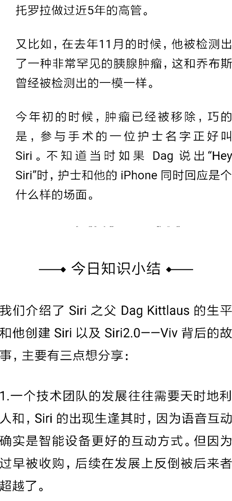

此外，为了和包括 Google Now、Microsoft Cortana，以及 Amazon 的 Alex 在内的各大高手较量，Dag 还挖来了 IBM 人工智能系统 Watson 的创始人之一 David Gondek 和德州大学达拉斯分校的 Mark Gabel 担任首席科学家。

和 Siri 创建时一样，Viv 很快就获得了合计 2250万美元的 A 轮和 B 轮投资，这其中的投资人包括了 Facebook 的扎克伯格和李嘉诚的维港投资。

2016年韩国三星公司提出收购 Viv，这一次 Dag 吸取了 Siri 的经验，接受了三星的收购，但是 Viv 还是要作为一个独立的公司运营。所以在 Dag 的 Linkedin 履历上，你可以看到他既是三星移动的副总裁，也同时是 Viv Labs 的 CEO。

对于 Viv，Dag 希望将其做成一个更加通用的人机交互平台，就好比当前 Siri、蓝牙等 Logo 被印在产品上代表一种通用通讯标准，Dag 希望有一天用户一看到 Viv，就明白这是一个可以和它语音互动的产品。

比如你看到某个冰箱上印有 Viv 的 Logo，就(condition) 可以自然而然地问，现在冰箱里的牛奶是不是快过期了，鸡蛋还有几个呀，是否需要马上预定，而冰箱也会通过你的语音来识别你，如果家里来了客人问同样的问题，还会默默地表示拒绝回答。

Viv 的团队的最终愿景是成为一个"Ubiquitous Global Brain", 一个无处不在的全球大脑，通过自然而然的人类语言互动来理解人类，并帮助人类更好地与周围环境互动，这与谷歌、亚马逊等等各大公司的智能助手出发点一致，甚至说更伟大。

毕竟，最早出名并且商业化的人工智能语音助手 Siri 就来自 Dag 的团队，他们的想法也更加深刻。

最后，有意思的就是 Dag 除了没有乔布斯的坏脾气外，还有着一些与乔布斯很类似的地方：

比如，他和乔布斯一样，是 Viv 团队中唯一的非工程师，却拥有非凡的商业直觉和领导力。在创建 Siri 前，他担任过 Telenor Mobile 通信公司的副总，也在摩托罗拉边过近5年的高管。

又比如，在去年11月的时候，他被检测出了一种非常罕见的胰腺肿瘤，这和乔布斯曾经被检测出的一模一样。

今年初的时候，肿瘤已经被移除，巧的是，参与手术的一位护士名字正好叫 Siri。不知道当时如果 Dag 说出"Hey Siri"时，护士和他的 iPhone 同时回应是个什么样的画面。

### —— 今日知识小结 ——

我们介绍了 Siri 之父 Dag Kittlaus 的生平和他创建 Siri 以及 Siri2.0——Viv 背后的故事，主要有三点想分享：

- 1. 一个技术团队的发展往往需要天时地利人和，Siri 的出现生逢其时，因为语音互动确实是智能设备更好的互动方式。但因为过早被收购，后续在发展上反而被后来者超越了。
- 2. 小公司在进行并购之后遇到的问题和挑战也值得重视。Siri 在接受苹果收购之后，被迫放弃了原有的发展方向，失去了创始人的支持，成为被囚禁的玩偶公主。同时这也是大公司为了满足公司全球发展，无可奈何的策略。
- 3. 我们注意到在美国连续创业者的重要性。如果没有 Siri 的第一次失败，Viv 在第二次收到三星收购的时候就不会坚持独立运营。也正是因为 Siri 的主要创始人都在 Viv，Dag 能够很快募集到资金，招募到优秀人才加盟。重新把自己业务有声有色地做起来。

### —— 今日思考题 ——

设想 Viv 如果不是和三星合作而是和中国的企业合作，请问，有哪些中国企业会是它最好的合作伙伴呢？

希望大家打开思路，一起贡献自己的智慧。

王煜全
我是王煜全，你的全球科技前哨侦察兵，我们明天见。

## 前哨历 9月19日

### 我的今日知识清单：

- 1. 苹果出于全球策略，Siri 开发的重心从人工智能语音助手转向支持更多的语言、执行更简单的任务，导致被竞争对手超越。
- 2. 大公司有更多的用户和大平台，但对于有巨大潜力的在小公司来说，一旦被收购，很容易被迫改变发展方向，造成退化。
- 3. 将大问题分解成小问题，逐一解答，然后串联答案，是智能语音突破的方向。

> 摘自：《036 | 语音互动是智能设备更好的互动方式》

「得到」专栏《全球创新260讲》
历时5年，甄选50个科技浪潮机会

## 038 | 超级巨头激烈竞争的智能音箱市场

038 | 超级巨头激烈竞争的智。↓

### —— 今日内容看点 ——

通过阅读今天的内容，你将会掌握以下三个问题的答案：

- 1. 互联网公司亚马逊为何要制造硬件产品？转型成为“科技公司”？
- 2. 大公司如何保持源源不断的创新能力？
- 3. 亚马逊/谷歌/微软/苹果，智能音箱市场巨头林立，他们在争什么？

今年9月6日闭幕的柏林国际消费电子展（IFA）上，智能家庭的各种应用场景吸引了大量参观者的目光。包括亚马逊的人工智能语音助手 Alexa，谷歌的语音数字助理 Google Assistant，微软的个人数字助手 Cortana 在内的各大人工智能语音助手在展会上都非常抢眼。

其中出镜率最高的就是亚马逊的语音助手 Alexa。包括了博世、飞利浦、松下，中国的机器人公司科沃斯等等，有将近30个国际品牌都展出了使用亚马逊语音助手 Alexa 的产品或者解决方案。

比如博世的智能厨房里，用户就可以对着 Alexa 音箱发出语音指令，可以用这个语音指令来控制烤箱、控制咖啡机、控制电磁炉等等。而且，不光能够控制这些设备的开启和关闭，还能控制温度的高低，也就是具体的、细微的操作了。

那么今天我们就来介绍一下人工智能语音入口时代的这家领军公司亚马逊。

先看一份数据，全球知名的市场研究机构 eMarketer 给出的美国2017年4月的智能音箱市场份额数据显示，亚马逊的 Echo 占据了71%的市场份额，成为目前智能音箱领域当之无愧的王者。那么亚马逊的智能音箱 Echo 又是如何一步一步走到今天的位置的呢？咱们得从头讲起了。

### 一、Echo的由来

2004年的時候，亚马逊的 CEO 杰夫·贝索斯看了一本书，叫《创新者的窘境》，这本书估计大家也不陌生，道理想得很简单，就是大公司很难保持源源不断的创新力，最后往往会死于固步自封。贝索斯看完以后深以为然，他把公司里面最听话的那个人，就是传统媒体部门的负责人 Steve Kessel 叫到跟前说，放下你所有的工作，我们自己要做硬件。

在亚马逊内部，有一群人被称为“杰夫木偶”，杰夫是贝索斯的名字，大意就是贝索斯指到哪，他们就打到哪，毫不犹豫，更不抵抗。这个 Steve Kessel 就是其中之一。于是他带着最新的指令成立了新部门叫 A2Z Development Corp。

该部门启动的第一个项目就是大名鼎鼎的 Kindle，有了 Kindle 的成功，踌躇满志的 Lab126 就开始启动了第二个项目叫 B 项目，B 项目叫 Fire Phone，是个电话，这个是亚马逊遇到的几次重大挫折之一。与此同时，Lab126 他们启动的至今无人知晓的 C 项目，据传说是一个人工智能项目宣布停摆，相关人员在2011年变成 D 项目的早期员工，D 项目的主角就是我们今天介绍的 Echo。

由于定位是智能音箱，贝索斯在初期就认定交互只能通过语音，因为他无法想象在音箱上还装个屏幕，购物的时候还要在上面划来划去的。当然，最近他们有点动脸了，因为6月底的时候，亚马逊推出了一个带屏幕的智能互动系统叫 Echo Show。

Echo Show 具备智能音箱的所有功能，只不过加了一个屏幕，所以你确实可以在屏幕上划来划去去购物了。当然了，它还有视频交互的功能，但是确实能够看得出来，亚马逊，尤其是杰夫·贝索斯希望打破创新者的窘境的那种迫切的程度，而且他很聪明，因为实际上创新者的窘境指的是往往是 CEO 的窘境。他自己能够大量地突破，下面的人坚决执行才能够真正突破。

中国往往是很多企业认为自己是对的，让手下去创新，自己变成在旁边品头论足的人，结果到最后可以想象，因为一般大公司下属都是看着上司的脸色的，这种创新就很难成功。

### 二、全面的战略布局

回来我们继续说亚马逊，Echo 项目在组建团队的时候，无论是从语音识别公司的 Nuance 挖人，还是直接收购了两家语音初创公司 Yap 和 Evi，对方都是语音技术公司。这个也无疑间接夯实了 Echo 的内置语音助手 Alexa 的技术基础。Echo 团队在早期也攻克了很多的技术难题，比如把语音识别技术的反应时间从一般的2.5到3秒降低到1.5秒。比如调用了亚马逊积累多年的机器学习技术，解决了在嘈杂的房间中自动屏蔽诸多杂音，识别用户说出的 Echo 唤醒 Alexa 的问题。

根据摩根斯丹利的统计，截至2016年年底，Echo 已经累计销售了大约1100万台。

除了深耕语音识别技术，亚马逊 Echo 取得如此好成绩的另一个重要原因是它的开放策略。

这里还有个小故事，2014年年底，Echo 发布之前，Echo 项目组当中的一位心血来潮的工程师编了一个控制程序，让 Echo 变成了流媒体电视的语音遥控器。贝索斯突然意识到购物音箱的目标实在是太小家子气了，Echo 正确的姿势应该是开放平台，连接一切。既然能控制电视，也就能控制灯泡，控制窗帘，控制热水器。因此，无论是智能音箱 Echo 还是它内置的语音助手 Alexa，在很早就定位为开放平台的角色。

亚马逊在2015年6月就宣布把 Alexa 开放给第三方开发者，发布了 ASK 和 AVS 两套工具包。前者是软件开发包，集合了一整套开发调试接口和开发工具，让开发者能够很容易地开发 Alexa 的技能，就是叫 Skill。后者是为硬件制造商服务的工具，让厂商能够把 Alexa 整合进他们的硬件产品里。

在一系列开放战略的促进之下，Echo 从刚上市的时候只有20项技能，到今年7月已经支持超过1.5万个技能了，增长的确实非常神速。

比如作为一款音箱，Echo 首先要做到的就是播放音乐。但是是亚马逊自有的曲库是远远无法满足用户需求的。于是顺应用户的呼声，Echo 又增加了对 Pandora，Spatify 等等音乐提供商的支持。

然后是重中之重。

### 三、强大的竞争对手与合作伙伴

但是，亚马逊在智能音箱，乃至人工智能入口的竞争当中并没有完全稳操胜券，因为战争才刚刚开始。

2016年11月，Google Home 正式发布，打响了互联网巨头之间的智能音箱之战。从数据层来看，这个 Google Home 的表现也不算差，2016年的第四季度在全球智能音箱的市场抢下了10%的份额，到2017年的4月份，Google Home 占到全美的语音类音箱份额的23.8%，还是在逐步增长。

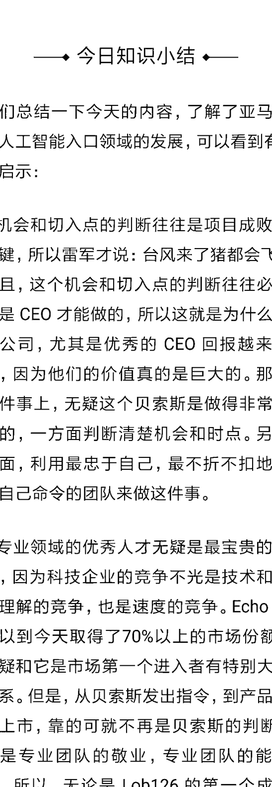

相比较于亚马逊的 Echo，Google Home 在人机对话方面的优势是十分明显的。

国外的专业调研机构 Stone Temple 对此做了很多的专业研究，问了5000个常见的问题，Google Home 回答对了68.1%，是亚马逊 Echo 的3倍。其次，优雅的设计和亲民的价格也是 Google Home 一上市就能抢下这么大份额的一个重要原因。

面对 Google Home 凶猛的进攻势头，亚马逊一方面从硬件上推出了更低价，更亲民的版本，比如叫 Echo Dot，Echo Tap 等等。另一方面加快了亚马逊生态系统的开发。

2017年8月底，微软和亚马逊这两大巨头达成有了史以来的最大合作，也就是在人工智能领域，未来微软的 Cortana 将可以和亚马逊的 Alexa 互相唤醒，双方同时打通微软的 Window10 和亚马逊的 Echo 智能音箱。这一重磅新闻的动静也盖过了8月23日谷歌的 Google Assistant 和沃尔玛在人工智能电商方面的合作的动静。

Cortana 在一瞬间就能进入千万台的 Echo，而 Alexa 就直接装进了上亿台有英文系统的 Windows 电脑和 Xbox 游戏机里面，并且双方用户有很多重叠，这样的话用户的体验就会更好，因为一个用户能够用同样的一套指令覆盖更多的产品了。

经过一段时间的数掘积累以后，Cortana 和 Alexa 很可能进行阶段性的合并，而且它们在研究甚至无需呼出指令就可以一步到位完成需求，你只需要对它说问题，然后由智能系统自己判断这个功能到底是 Cortana 来执行还是 Alexa 来执行。未来互联网巨头们关于人工智能入口的争夺将越来越激烈，而 Amazon 在智能音箱这一保卫战中的表现将在很大程度上决定了最终的结局。

所以，虽然它们有先发优势，但是随着竞争激烈，它们还是要不断地加强自己的能力。

### —— 今日知识小结 ——

我们总结一下今天的内容，了解了亚马逊在人工智能入口领域的发展，可以看到有3个启示：

- 1.机会和切入点的判断往往是项目成败的关键，所以雷军才说：台风来了猪都会飞。
而且，这个机会和切入点的判断往往必须得是 CEO 才能做的，所以这就是为什么跨国公司，尤其是优秀的 CEO 回报越来越高，因为他们的价值真的是巨大的。那在这件事情上，无疑这个贝索斯是做得非常聪明的，一方面判断清楚机会和时点。另一方面，利用最忠于自己，最不折不扣地执行自己命令的团队来做这件事。
- 2.专业领域的优秀人才无疑是最宝贵的财富，因为科技企业的竞争不光是技术和市场理解的竞争，也是速度的竞争。Echo 之所以到今天取得了70%以上的市场份额，无疑和它是市场第一个进入者有特别大的关系。但是，从贝索斯发出指令，到产品能够上市，靠的可就不再是贝索斯的判断，而是专业团队的敬业，专业团队的能力了。所以，无论是 Lob126 的第一个成员 Gregg Zehr，还是 Echo项目早期引进的 Nuance，Yap和Evi 三个语音技术识别公司的人才，都为 Echo 的上市和亚马逊生态系统的建立奠定了非常坚实的基础。
- 3.贝索斯的开放战略是 Echo以及 Alexa 发展速度越来越快的重要原因。单个的产品之争最后都会发展成为全局的生态之争。
这个我们从苹果 iPhone 的发展也能看出类似的轨迹来。但是，不要忘了，初期业务定位越精准，市场夺得越大，也就是说你把业务做得越深越透，后期才能越广。
所以，很多成功的产品是采用的叫T型战略。首先把一竖扎得非常深，然后在这一竖扎得很深的基础上再横向扩张，所以前期 Echo 的定位清晰，实际上是后期能够开放，做到生态繁荣的一个重要基础。

### —— 今日思考题 ——

对于创业者来说，如何利用好互联网巨头们开放的能力以及生态系统在自己所在的垂直领域做出满足用户需求的产品，是需要认真考虑的。你想好利用智能音箱的机会了吗？

欢迎你提出自己的答案。

王煜全
我是王煜全，你的全球科技前哨侦察兵，
咱俩明天见。

前哨历 9月20日

### 我的今日知识清单：

- 1.机会和切入点的判断是项目成败的关键，
往往必须由CEO来做。
- 2.专业领域内的优秀人才是最宝贵的财富，
因为科技企业的竞争，不光是技术和市场理解的竞争，也是速度的竞争。
- 3.单个的产品之争最后都会发展成为全局的生态之争，但需初期定位精准，把业务做透，后期才能做广。

> 摘自：《038 | 超级巨头激烈竞争的智能音箱市场》

「得到」专栏《全球创新260讲》
距今5年，甄选50个预测科技趋势机会

用户留言
提交留言可与专栏作者互动

## 039 | 中国发展人工智能入口的三种可能性

039 | 中国发展人工智能入口。 ↓

### —— 今日内容看点 ——

通过阅读今天的内容，你将会学会以下三个问题的答案：

- 1. 为什么说美国的智能语音市场将进入爆发期？
- 2. 中国的智能音箱现在也很热，但为什么说大多都将走向消亡？
- 3. 中国的人工智能入口的可能性在哪里？

我们本周讲的是人工智能入口，这个的意义其实非常巨大，因为有越来越多的人开始认同，未来最好的人机交互方式就是自然语言。而且自然语言互动会逐渐摆脱人对着屏幕互动的束缚，因为你对着屏幕，至少你的目光受限，你眼睛要看着屏幕，你做事情就不方便了。而智能互动应该是融入环境中的，应该是让人可以很方便地在不影响其它事情的情况之下来互动，有屏幕可以互动，没屏幕照样互动。

所以，越来越多的人认为，未来的入口应该是语音互动的入口。

### 一、语音互动市场在美国即将爆发

爆发有三个条件：

- 1. 软件、硬件、系统的成熟
- 2. 找到了正确的应用场景
- 3. 成功的业务往往是T型发展的

### 二、中国的智能音箱市场会迅速消亡

我们 在本周话题的第一天，就介绍了中国的音箱市场也热起来了，甚至被称为“百箱大战”。但是，至少现在的竞争者，我明确地觉得并不太看好。

- 1. 中国和国外的区别就是有版权问题
- 2. 国外的授权机制比较顺畅

### 三、小米的机会与屏障

现在看起来，小米也在做音箱，可能是最领先的。原因有两个：

- 1. 小米系在家电领域特别强大。
- 2. 小米做硬件有自己的产业链优势，可以做出又好又便宜的音箱来。

2. 更重要的一点是从 Nest（美国智能家居的代表）的教训看，其实这个家庭智能的核心还是内容等应用的调羹，而不是控制家居。这方面来讲，就是小米做智能音箱也得是听歌、听音乐、看电视节目的。所以它也会和其它的音箱一样碰到版权问题。

### 四、中国人工智能入口的三种可能性

- 1. 期待内容整合，版权的授权模式逐渐清晰

据说，音乐内容现在已经在开始整合了，阿里和腾讯有协议，要把所有的音乐内容整合起来，拿到海外上市。如果一旦上市的话，是不是授权模式也会清晰化，这样的话人人都可以做好智能音箱就可以了。当然，影视内容的围积原来乐视最好，现在明显是力不从心了，不知道还有没有人能够强力地把影视内容整合出来，而且能够把这些授权做好。

- 2. 企业自己来做能够控制内容的音箱

因为既然 IP、知识产权有问题，那么就只做我自己拥有知识产权的内容。其实坦白讲，我觉得如果我们“得到”出个音箱名字就叫“罗胖”还是蛮靠谱的，我很愿意在晚上睡觉之前跟这个音箱说：“罗胖，请你把你今天讲的内容给我再讲一遍，行不？”因为目标用户很明确，而且用户目标也很明确，就是听得到的这些内容。但是，问题是会丧失扩展性，估计你会好意思说：“罗胖，请帮我讲一本书。”但是不好意思说：“罗胖，请帮我把走廊的灯关了吧。”

- 3. 另辟蹊径

## 040 | 问答：正确认识人工智能领域的第一入口

040 | 问答：正确认识人工智...

### —— 今日内容看点 ——

通过阅读今天的内容，你将会掌握以下四个问题的答案：

- 1. 智能音箱作为人工智能第一入口，聋哑人该怎么办呢？
2. 个性化训练人工智能的方向是否正确？在训练过程中如何处理容错问题？
3. 为何 Siri 被苹果收购，反而却落后了？
4. 从特斯拉携手 AMD 能看出什么？

### —— 全周总结+拓展 ——

本周我们说的是人工智能入口，主要说了三个重点：

- 1. 今天的风口都是之前长期科技研究积累的结果，软硬件能力都具备了，所以美国现在人工智能入口的潮流已经从智能家居开始兴起了。但是，这一轮中国跟随未必奏效。
2. 整个人工智能入口的潮流需要一个完整生态的支持，美国软硬件支持都比较充分，而且有大公司做人工智能平台，也有丰富的版权内容提供，所以现在形成了一个格局，就是大公司来争夺人工智能语音的入口，同时开放功能平台，小公司可以在上面做各种垂直应用。但是，很有可能，小公司做成巨无霸的机会会比较小了，未来人工智能的入口还是在这几个大公司之间激烈地争夺。
3. 我们介绍了 T 型战略，想要抢到风口，必须要找准应用。中国尤其是生态相对不够健全，反而造成大公司也不一定能够抢到这个风口。反之，小公司如果找准了足够有未来空间的机会，很有可能能超，利用人工智能入口的这一轮新的风口，成为下一个 BAT。

### —— 用户留言精选 ——

们说的人工智能也会使得它对你这个特定用户的理解还会存在于这台机器里，这样的话，你就觉得这还是你的老朋友，它真的是最理解你的。

未来一定是这个发展方向，再重复一遍，今天还不行。

凤：如果产品采用T战略，那为何苹果收购了 Siri 以后，也是局限了定位，收缩了范围，将一个平台服务转化为识别简单任务的应用，最后却导致了失败呢？

王煜全

我的回答是，所谓 T 战略的那一个“竖”不是越简单越好，而是越对用户的需求把把握得越深入越好。

所以，Siri 最大的问题是它被收购了以后成了苹果的附属功能，这时候苹果关心的是自己的核心能力如何更聚焦，如何更强大，而不是让 Siri 能够做到更强大。所以它要求的不是让 Siri 能干更多事，而是能识别不同语言的人说的简单指令。

所以到最后，其实苹果成功了，也不能说 Siri 失败，因为苹果的成功里面就有 Siri 的成功。只是说 Siri 作为一个独立产品没有成功。

### —— ◆ 附加问题 ◆ ——

加油Ronee：王老师能谈谈对特斯拉携手 AMD 的看法吗？毕竟上周自动驾驶刚聊完。

王煜全

我的回答是，确实是上周我们说过自动驾驶了，里面如果你还记得的话，我说自动驾驶在未来会迅速普及，所以 GPU 的需求会暴涨。而且我记得好像更早以前，我就推荐了 AMD，因为现在产业级的 GPU 的供应商只有 NVIDIA 和 AMD。

我去年就推荐了 NVIDIA，因为去年 AMD 还没有推出产业级的 GPU。所以，现在特斯拉携手 AMD，对 AMD 是利好。因为就证明 AMD 的产业化能力是具备了的。但是，这个利好才刚刚开始，后面还有持续不断的释放，因为对 GPU 的需求，也就是说对 AMD 和 NVIDIA 来说，这个市场都在爆炸性地增长，两家都会是赢家。

顺便说一下，特斯拉是自动驾驶的先行者，但是特斯拉的压力不小，在自动驾驶整个市场都会爆炸的今天，其实也就意味着特斯拉的跟随者们都醒了，明年，甚至后年，自动驾驶和电动车领域都会展开激烈的竞争。

所以我们说，大量的人跑到加州去掘金了，卖桶的一定是赚大钱的，但是掘金的谁能最后成为富翁，我们还需要拭目以待。

王煜全

从下周开始，我们会用连续4期的主题聊医疗健康领域的最新进展。

这个领域不光和每个人息息相关，而且最近惊喜不断，我都迫不及待地想和你分享了。

下周我们先从基因编辑说起，有了基因编辑，我们治疗基因遗传病就像用文字编辑软件编辑文章一样方便了。可以培养出可供器官移植的动物；可以培养出更好的农产品；甚至可以创造出崭新的生物物种。

相信这个话题你一定也感兴趣，欢迎你关注。

我是王煜全，你的全球科技前哨侦察兵，我们下期见！

## 前哨历 9月22日

### 我的今日知识清单：

- 1. 智能音箱解决的高频痛点问题：1）扁平化的设置系统，大幅度减少操作次数；2）解放双手，避免分散精力；3）更直观、更自由的沉浸式游戏。
- 2. 现阶段人工智能的研究方向，是通过海量的数据，实现对更多用户比较通用的理解。但个性化训练是未来的发展方向。
- 3. T战略不是越简单越好，而是对用户的需求把握得越深入越好。

> 摘自：《040 | 回答：正确认识人工智能的第一入口》

「得到」专栏《全球创新260讲》
踏前5年，抓住50个新科技浪潮机会

## 创新地图｜聊天机器人的终极目标——怎样才能更“像人”？

王煜全
今天是《全球创新260讲》的第五期前哨团供稿时间，题目是《聊天机器人的终极目标——怎样才能更“像人”？》。
张义，宾夕法尼亚大学计算机与信息科学系在读博士。

近年来，聊天机器人的发展非常迅猛。从2010年起，大量的产品平台开始逐渐进入人们的视野。尤其是最近几年，随着大数据积累、计算能力的提升以及人工智能技术，尤其是深度学习技术的发展，聊天机器人的技术愈发成熟。同时，伴随着智能家居、智能客服的应用逐渐普及，聊天机器人同时迎来了一个从实验室研究到产品落地的井喷期。

### 一、聊天机器人的分类

一般来讲，目前的聊天机器人从功能和技术的角度，可以分为两类。
一类是以 Siri、Amazon Echo、微软小娜等为代表，偏向于工具性的服务型机器人。
另一类则是以微软小冰为代表的娱乐型机器人。

### 二、两类聊天机器人背后的技术

#### 1. 工具性的服务型聊天机器人

第一类聊天机器人背后所依赖的技术是传统的问答系统技术，即 Question Answering (QA)。QA 技术是自然语言处理中非常受重视的一个研究方向，通常的处理流程是对于输入的问题首先做句法分析，从而理解问题或者指令的结构和意图。

#### 2. 娱乐型聊天机器人

### 三、两种不同的重要价值

总的来说，服务型的机器人比较实用。虽然有时候看起来笨笨的，但一般此类聊天机器人背后都有其应用场景在支撑，比如 Amazon Echo 背后的智能家居，Siri 的个人助手，小 i 机器人的智能客服，IBM Watson 的精准医疗等等，随着在垂直领域的不断深耕，可以不断提升数据库进而提升用户的满意度。

### 四、实现一个真正的聊天机器人

#### 1. 系统层面数据库融合

在苹果发布会上，我们也看到 iPhone X 推出了类似的功能，其 Animoji 动态表情可以配合 3D 扫描人脸表情，通过我们录下自己的音频以及面部动作来定制自己的动态表情。

Animoji

而基于类似的技术，我们就可以在训练聊天模型时加入表情信息，这样我们的机器就可以在学习对话的同时兼顾用户的心情。

这种做法的问题在于我们如何系统地引入更多类似的信息，比如周围的声音、环境，用户今天遇到的事等等，这些都是机器人更好地聊天时需要考虑的因素。而如何系统地收集、管理并使用这些信息，依然还是一个需要学术界研究的问题。

#### 2. 机器推理

包括如何根据获得的对话情景推理出用户的真正意图，包括常识及言下之意等等。

举个非常简单的例子：

“小明去上学”，作为人类来说，马上就知道小明一定是个学生，可是如何让机器了解“去上学的人是学生”这个常识呢？

如果是让机器去学习，但是我们的推理中需要大量类似的常识，又该如何寻找数据、如何标注、如何学习呢？如果是让机器去推理，我们又如何习得推理所用的常识呢？

更困难的是，常识往往并不会显式地出现在文本数据中，正如没有一段互联网上的文章会告诉我们“去上学的人是学生”一样。这些都是需要解决的问题。

#### 3. 扩大机器学习的范围

目前的技术依赖于有限的训练文本，如何能够让机器始终学习、存储所学的知识，并针对不同的场景自动提取不同的知识，也是聊天机器人进一步提升的关键问题。

综上所述，聊天机器人虽然已经达到一个令人可喜的程度，但是要想进一步提升，依然需要学术界、工业界的同仁们不断努力。

王煜全

我是王煜全，你的全球科技前哨侦察兵，咱明天见。

### 用户留言

## 预告 | 人类将突破自身进化的局限

### —— ◆ 下周预告 ◆ ——

从下周一开始，我们正式进入医疗健康领域，我会为你带来最新进展的前沿报告。

提前打个预防针，生物医药领域的专业术语比较多，因此理解起来会稍有困难，你能理解意思就可以了。

当然，我相信我们前哨的不少用户不会浅尝辄止，所以，如果你想了解得更透彻，到时候一定要多听两遍，对于感兴趣的术语，一定要第一时间去搜索，有疑问，就一定要给我留言。

周一，我会先从基因编辑说起，这个技术简单理解起来，就是让我们面对基因的时候，能像用Word编辑文字那样，简单而方便。

这个技术不仅仅和我们息息相关，而且我认为，未来生物技术人才会像今天的IT人才一样抢手，未来的每一个人，就像现在离不开互联网一样，离不开基因编辑技术。

王煜全

我是王煜全，你的全球科技前哨侦察兵，咱们明天见。

## 041 | 基因编辑热潮带来的巨大机会

041 | 基因编辑热潮带来的巨大机会。

### —— ◆ 今日内容看点 ◆ ——

通过阅读今天的内容，你将会掌握以下四个问题的答案：

- 1. CRISPR-Cas9 基因编辑器是什么东西？
2. 为何说它将根本性改变医学、农业、食品,甚至能源行业？
3. CRISPR-Cas9 引发巨大热潮的三个重要原因。
4. 这个技术不完美的地方在哪？

本月我将为大家介绍近期和生物医药相关的产业机会。本周我们先从基因编辑技术说起。

首先声明一下，本月涉及的术语比较多，你理解意思就好，当然也可以多听两遍，把这个术语掌握了。因为掌握了术语，你在和别人交流的时候就有优势了。

回到主题上来，近两年大热的 CRISPR-Cas9 基因编辑器的发现，给基因编辑领域带来了翻天覆地的变化，它可能会让未来医学、农业、食品，甚至能源行业都发生根本性的改变。随之而来的还将是巨大的产业机会。

简单来说，CRISPR-Cas9 的出现，就好比我们从泥板刻字时代飞跃到了用 Word 编辑文字的时代。

那么，今天我将为你详细介绍 CRISPR-Cas9 基因编辑技术。

### 一、从酸奶中延生的基因编辑器

在了解一下 CRISPR-Cas9 的诞生过程之前，我们先来一看一看 CRISPR-Cas9 究竟是什么。

CRISPR-Cas 其实是在细菌内的一组生物分子，它们是细菌抵御病毒入侵的免疫系统。这个系统主要由 CRISPR 和 Cas 两部分组成。其中，CRISPR 的这个部分序列和入侵细菌的病毒 DNA 序列非常相似，主要负责识别和定位病毒 DNA，而 Cas 则负责剪切删除这些病毒 DNA，这样细菌就可以避免被病毒干扰，完成对病毒的免疫大作战。

值得一提的是，人们发现 CRISPR-Cas 是细菌内的免疫系统，是经历了好一番过程的。早在1987年，人们就发现了有着特殊序列机构的 CRISPR 基因，后来才认识了 Cas，以及 CRISPR 和病毒序列很相似的特点。

2007年，酸奶公司 Danisco 的科学家在研究中发现，他们用于生产酸奶的嗜热性链球菌的抗病毒能力和细菌 CRISPR 基因高度相关。直到这时，CRISPR-Cas 作为细菌免疫体系的功能和它的工作机制才首次得到证实。所以人们总是戏称 CRISPR-Cas 是从酸奶中诞生的。

与此同时，另一个重要进展是 Cas 的特殊成员 Cas9 的发现。和其它 Cas 蛋白相比，Cas9 简单小巧，更易于人工合成。简单的核酸定位加上简单的剪切蛋白，为简单高效的基因编辑器的诞生奠定了基础。得益于这个发现，加州伯克利大学的 Jennifer Doudna 和瑞典默克大学的 Emmanuelle Charpentier 在2012年8月首次发表了对 CRISPR-Cas9 系统进行人为改造并让它更简单的文章。2013年2月，MIT 的 Broad 研究所的华人科学家张峰和哈佛大学的 George Church 也发表了改造 CRISPR-Cas9 系统的文章。

这里我简单提一下，两边科学家对 CRISPR-Cas9 的改造当时还引发了激烈的专利之争。但其实他们的改造是不一样的，简单说，就是张峰他们的改造可以用在真核细胞上，也就是可以用在更高等的生物上。所以2017年2月美国专利局作出了 Broad 研究所和伯克利的专利并不冲突的声明。

### 二、备受追捧的明星技术

CRISPR-Cas9 诞生的同时，人们也看到了它在科研和商业两个层面的巨大价值。

先来看下科研方面的成绩

- 刚才我们提到的那几位科学家所发表的几篇关键文章，在短短四五年间，就被引用过4000到5000次；
和 CRISPR 相关的文章年发表数量从2012年的不足200篇暴涨到2015年的近2000篇，其中一半以上的文献跻身前10%被引用最多的文献排行榜；
NIH，就是美国的国立的卫生研究院，提供科研经费也在2013到2014年的1年间，从1000万涨到了8000多万美元。

产业方面也是一番红火景象

CRISPR 相关的专利从2013年的30项左右骤增到2014年的170项。Broad 和伯克利激烈的专利之争同样广为人知。

Doudna 、 Charpentier 和 张峰 ，都以 CRISPR-Cas9 为核心技术，分别创办了致力于基因治疗的医药公司，这些公司也都在创业初期就获得了千万美元的融资。

而当美国专利与商标局最终把用于植物和动物基因编辑的 CRISPR-Cas9 专利授予了张峰所在的 Broad 研究所的时候，他所创办的 Editas 公司，股价更是应声而涨。

### 三、CRISPR-Cas9备受追捧的原因

那么，CRISPR-Cas9 技术的突破性到底在哪儿，为什么会引起如此巨大的热潮？

我认为主要有三个方面的原因：

首先，跟读取相比，编辑是一种进阶能力，它可以赋予你更多的自由度和操控权，但也更难实现。在生物科学领域，今天我们已经通过各种方法积累了不少生物大数据，可是对生物体的编辑和刺激技术却非常有限，而这恰恰是科研和医疗越来越迫切的需求。

举个例子，今天我们只可以花一天时间就能完成对一个人全基因组的测序，但是比较精确的基因编辑技术上个世纪90年代才出现，而且效率很低，直到 CRISPR-Cas9 的出现才有了较大的进步。类似地，在神经科学领域，我们已经对大脑作了非常多的读取和分析，但刺激大脑的研究工作却少得多。

其次，CRISPR-Cas9 突破了以往的基因编辑技术的局限，同时保障了精确度和操作的简便性。最早人们用非致病病毒来做插入，用 RNA 干扰做抑制来操控基因，但这些方法的精确度比较差。后来发展起来的编辑技术叫 ZFN，确实能够做到比较精准，但它操作繁琐，既耗时又昂贵。再后来叫 TALEN 技术，虽然在这些方面有了改善，但由于依然是靠蛋白质来定位编辑靶点，所以进步依然有限。

而 CRISPR-Cas9 因为只需要一段很短小的 RNA 片段和 Cas9 这个简单的剪切蛋白就可以完成任务，终于给简化操作和降低成本带来了质的飞跃。

此外，CRISPR-Cas9 还有不少额外的福利，比如它可以同时编辑多个基因位点，没有物种限制，可以实现基因驱动等等，这些我们后面会讲到。

总之，这些优势进一步扩展了 CRISPR-Cas9 的使用场景和现实意义。

### 四、几乎“无所不能”的利器

这样看来，CRISPR-Cas9 可以说是像人工智能一样，是能让很多创新根植于其上的平台级技术，因为理论上借助它就能实现任何我们想要的生物改造。那么在非基因治疗的领域，它的产业机会在于各种应用的开发。

比如 Doudna 创办了 Caribou Biosciences 公司，就是把注意力放在基因编辑以外更广阔的应用领域：科研、生物工程以及农业，这也正是 CRISPR-Cas9 应用的热点方向。

拿当中的基础科研领域来说，最常见的是对疾病病因的筛查和疾病模型的建立。

简单的 CRISPR-Cas9 让对大量潜在致病基因进行地毯式的摸查成为可能。现有的成果是，利用这一方法，科研人员已经筛查出了可以增强免疫细胞抵抗 HIV，就是艾滋病病毒能力的关键基因，发现了致癌的关键基因突变，找到了寄生虫生存的必须基因等等。

再比如，许多疾病尤其是精神疾病，有着多基因控制的复杂致病原因，因为 CRISPR-Cas9 可以同时进行多基因编辑，这就使得构建这些疾病的小鼠模型的工作量能从数年数月缩减到数天。

除了基础科研领域，CRISPR-Cas9 还可以为古生物学研究、农业、能源等带来前所未有的技术手段，在接下来的三天里我将会为大家详细展开介绍。

不过，几乎无所不能的 CRISPR-Cas9 在一个地方还不够完美，那就是在对人的基因治疗中，它还存在着一定程度的脱靶问题。和用于非人体生物或者体外细胞时不同，当 CRISPR-Cas9 直接用于人体改造的时候，我们无法分离编辑成功和不成功的细胞。因此把 CRISPR-Cas9 以及所有基因编辑技术直接用于人体治疗的时机还不够成熟，还有许多需要提高的技术细节。

所以我们说，目前比较成功的医学应用都是针对体外细胞或组织的。

比如针对干细胞的基因编辑，把白血病患者的骨髓造血干细胞改造之后再植回患者体内，就相当于完成了不需要寻找配型的自身骨髓移植。再比如我们之后要讲的癌症免疫治疗之中的 CART 细胞疗法。

当然，医学领域还有许多优秀的应用实例，比如最近刚刚研发成功的不排斥人类排异反应的猪器官，比如药物的靶向递送等技术难题，我们也会利用接下来的三天时间为你作详细介绍。

### —— 今日知识小结 ——

最后，我们说由于极大地降低了实现各种生物改造的门槛，简便精准的基因编辑技术还会将我们带入一个 BT 创业时代。我们都知道，原来有一个叫信息技术时代，那现在的 BT 生物技术时代又要来了。未来生物技术人才也许会像今天的 IT 人才一样抢手，也许未来每一个人的生活会像今天被互联网裹挟一样，被基因编辑技术影响了。

同时，大规模地使用基因编辑还会带来伦理和生物入侵的问题，这些问题的探讨和解决同样需要每一个人的思考和参与。

总结下来，今天我们说了三点：

- 1. 从 CRISPR-Cas9 的发现开始，基因编辑领域取得了重大突破，精准而简单的基因编辑得以实现，这是一个平台级的科技进步，它带来了一大批创新的机会。
2. 在基因治疗以外的领域，基因编辑的产业机会主要在于各种应用的开发。而在基因治疗领域，技术还有待完善，不过近期也会因为各种利好而有不小的上升空间。
3. 除了技术革新，基因编辑也可能产生巨大的社会影响，比如 BT 创业时代的来临，比如需要每个人关心、思考的伦理问题和相应法律法规的制定。

顺便说一句，有读者问过我，这么好的技术，又有好几家公司都上市了，股票要不要买？

首先我还是声明，我们不是荐股节目，我也不荐股。

然后说一下规律：风险巨大的业务才会早早上市，也就是我们前面讲的，基因编辑用于人体治疗还不成熟，这些公司依然有巨大风险。而且没有产品被 FDA 报批或者没有实质性的商业进展，股价就一定涨不上去，而 FDA 报批之前必然会涉及大量的临床，专业人士是可以从临床进展分析出能够获得 FDA 批准的机会的。而 FDA 报批通过之后，一般股价都会有倍数的增长。所以，要不要买，你自己判断。

### —— 今日思考题 ——

利用最新的基因编辑技术，你能想到什么样的创新应用？

欢迎你在留言区分享你的观点，我会和你一起参与这场科技前沿的研讨。

王煜全
我是王煜全，你的全球科技前哨侦察兵，我们明天见。

## 前哨历 9月25日

### 我的今日知识清单：

- 1. CRISPR-Cas9 基因编辑器的发明，可能会让未来医学、农业、食品甚至能源行业都发生根本性改变，随之而来的还有巨大的产业机会。
- 2. 基因编辑技术让人类对基因有了自由的操控权，理论上能完成所有生物的改造。
- 3. 大规模地使用基因编辑，会带来伦理和生物入侵的问题，这些问题的探讨和解决，需要每个人的思考和参与。

> 摘自：《041 | 基因编辑热潮带来的巨大机会》

「得到」专栏《全球创新260讲》
活在5年，抓住50个科技前沿机会

## 月度复习 | 下一个BAT将诞生在智能产业

王煜全
你好，我是王煜全。
从第二季开始，我们每个月都会有一次“月度回顾”，帮你盘点和梳理本月的关键知识点，并且在“前哨第一季”或者得到的其他订阅专栏中，精选相关的话题，为你提供“知识拓展包”。

### —— 本月主题回顾 ——

本月我们的主题是“智能产业”，我们分别介绍了4个你值得关注的热门领域：

- 前两周，我们介绍的是，在国内外都是机会的“商用机器人”和“智能可穿戴”；
第三周，我们介绍在国外不是机会，但是在国内还是机会的“自动驾驶”；
第四周，我们讲的是在国外是巨大的机会，但是在国内有可能不是机会的“人工智能入口”。

总之，智能产业很有可能出现下一个“BAT”式的巨头。

### —— 本月知识清单 ——

#### 商用机器人

- 1. 商用机器人是变化似乎不明 显（因为一直都有），但是很快会加速发展（因为技术已经逐步成熟、正在解决最严苛问题）的巨大产业。
- 2. 商用机器人是一个需要整合硬件、软件以形成针对性的解决方案的产业，关键是满足特定用户的特定需求，比如在和真人沟通这个需求上，表情互动特别重要。
- 3. 商用机器人正在迎来一个大时代，未来机器人数量会大大超过人类，这个产业需要深入挖掘用户需求，又需要软硬件的综合。尤其适合中国人的创新，需要面向未来进行产业布局，以及产业、资本、政府的联动。

索引和关键概念词典：
021：“产业机会判断方法论”
022：“情感化计算”
023：“产业和资本协同”
024：“机器人的4大应用场景”
025：“机器人的共情能力”

#### 可穿戴设备

- 1. 量化自身是一个非常伟大的运动，因为它会极大地促进我们对自身的了解。
- 2. 智能可穿戴的市场曾经很热，现在有点变冷了，原因是现在的大多数应用不是刚需，大家用可穿戴只是赶个时髦，这种市场是不能持久的。
- 3. 医用可穿戴是刚需，尤其是有了大数据和人工智能以后，使得我们的健康状况和我们的一些病痛都可以被持续地监控。在医用可穿戴的带动下，智能可穿戴的市场会全面复苏。

索引和关键概念词典：
026：“量化自我”
027：“研发和出身名门”
028：“医用可穿戴”
029：“可穿戴的3个机会 2个陷阱”
030：“个人数据隐私”

#### 自动驾驶

- 1. 四、五级自动驾驶（接近全自动的自动驾驶）尚需时日，但是辅助驾驶和特定用途、特定场景的自动驾驶马上来了，人人都有机会体验到。
- 2. 自动驾驶其实经历了很长时间的发展，不是瞬间出现的，根据我们这周的介绍，你也了解，很多机构、很多公司、很多牛人都从各个角度为自动驾驶的发展做出过贡献。
- 3. 自动驾驶的发展取决于整个产业链，同时也取决于政策，在这些方面中国现在都有领先的机会。

索引和关键概念词典：
031：“自动驾驶3个初期市场”
032：“产业化支持”
033：“人工智能和自动驾驶”
034：“数据训练”
035：“自动驾驶的2条路线”

#### 人工智能入口

- 1. 今天的风口都是之前长期科技研究积累的结果，软硬件能力都具备了，所以美国现在人工智能入口的潮流已经从智能家居开始兴起了。但是，这一轮中国的跟随未必奏效。
- 2. 整个人工智能入口的潮流需要一个完整生态的支持，美国软硬件支持都比较充分，而且有大公司做人工智能平台，也有丰富的版权内容提供，所以现在形成了一个格局，就是大公司来争夺人工智能语音的入口，同时开放功能平台，小公司可以在上面做各种垂直应用。但是，很有小公司做出巨无霸的机会会比较小了，未来人工智能的入口还是在这几个大公司之间激烈地争夺。
- 3. 我们介绍了T型战略，想要抢到风口，必须要找准应用。尤其是中国生态相对不够健全，反而造成大公司也不一定能够抢到这个风口。反之，小公司如果找准了足够有未来空间的机会，很有可能反超，利用人工智能入口的这轮新的风口，成为下一个BAT。

索引和关键概念词典：
036：“技术回归人性”
037：“小公司突围”
038：“单品竞争和生态布局”
039：“人工智能入口的3大机会”
040：“T型战略”

### —— 本月知识拓展包 ——

我在专栏的留言里看到有一些用户没有订阅过《前哨（第一季）》并且错过了第一季的内容，未来在“月度复习”中，我会为你精选部分内容以供试读。

#### 1.人工智能入口产业报告

现在大家已经可以用很低的价格用上智能音箱这样的人工智能入口的应用产品，我在第一季中对人工智能入口的技术、产业链、参与企业和未来前景作了系统剖析。如果你想更全面地理解这个即将诞生下一个巨头的领域，点击下方链接即可查看。

《科技概念股 | 人工智能入口（上）》
《科技概念股 | 人工智能入口（中）》

#### 2.自动驾驶拓展报告

不管你是不是有车一族，不久的将来自动驾驶都会影响你的出行。我在第一季的一期内容中，对自动驾驶的概念、技术现状和未来发展、自动驾驶产业有哪些值得关注的企业，有较为详细的介绍，欢迎你阅读。

《科技概念股 | 无人驾驶是自动驾驶的伪命题》

### —— 本月小结 ——

本月我们邀请了隔壁专栏《北大经济学课》的主人薛兆丰老师来专栏坐客，回答专栏用户提出的“稀缺性”问题；另外，我们也在苹果发布会后的第一时间作了深度解读，未来全球科技领域的大事，前哨都会作为你的侦察兵提供及时全面的汇报和分析，请来各个领域的大咖为你提供更多服务，欢迎你持续关注。

我还注意到不少用户在学习小组“哨所观察”里说我是“神预测”，从“ICO被监管”到“苹果会在ARKit上发力”等，几乎都是前哨内容的实践版。感谢你对前哨的肯定，其实我并不是预言家，我们不过是根据趋势和信息作出判断，而且通过一年的积累和沉淀，你也能拥有自己的洞察，掌握这套方法。

最后，一个小请求：欢迎把我们的专栏推荐给你的好朋友，让TA也可以和你一样，提前5年，抓住新科技浪潮中的机会。

王煜全
我是王煜全，你的全球科技前哨侦察兵。

## 042 | 基因编辑技术的产业化正在加速

042 | 基因编辑技术的产业化。

### —— 今日内容看点 ——

通过阅读今天的内容，你将会掌握以下两个问题的答案：

- 1. CRISPR-Cas9 是怎么诞生的？发展历程是怎样的？
- 2. 这项技术取得了哪些成绩？有哪些应用？未来前景如何？

昨天我们为大家介绍了突破性的基因编辑技术 CRISPR-Cas9 和它的三位主要发明人张峰、Doudna，还有 Charpentier。

我们说这个技术的诞生，还不止这三位做过重要贡献，它更是许多科学家集体努力的结果。

今天我们就和大家详细聊一聊 CRISPR-Cas9 的诞生和发展，以及一位对 CRISPR-Cas9 基因编辑，甚至整个分子生物学都做出卓著贡献的科学家 George Church。

从中你将会发现，这是一个科技突破需要合作，科学家需要跨界的时代。

### 一、CRISPR-Cas9的诞生

昨天我跟大家讲过，CRISPR-Cas9 由负责识别的 CRISPR 和负责剪切的 Cas9 组成。

先来看看 CRISPR。

1987年日本科学家石野良纯首次观察到 CRISPR 基因。

之后西班牙科学家 Francisco Mojica 发现了 CRISPR 序列的特殊结构，以及它和侵入细菌的病毒的基因十分相似。

随着越来越多的类似发现，CRISPR 作为细菌的免疫系统的假设被提出，也得到了广泛的认可。

2007年，酸奶公司 Danisco 的科学家 Philippe Horvath 和 Rodolphe Barrangou 首次通过实验验证了这个假设。这是人们认识 CRISPR 系统的里程碑。

后来包括 Charpentier 在内的多国科学家逐步阐明 CRISPR 识别病毒基因的具体机制和关键。

同时另一边，科学家们发现了 Cas9 以及它作为 DNA 剪切的作用。

CRISPR 可以与多种剪刀合作，但早期发现的剪刀都是由多种蛋白质组成的，很难改造利用。

法国科学家 Alexander Bolotin 发现了这个由单一蛋白构成的 Cas9 剪刀。

接着立陶宛科学家 Virginijus Siksnys 成功将从嗜热链球菌中发现的 CRISPR-Cas9 导入大肠杆菌并让它正常发挥作用，这证明了 Cas9 能够单独完成剪切工作。

至此，科学家们找齐了 CRISPR-Cas9 需要的所有组件，也能在非原生物种中搭建完整的系统。

### 二、CRISPR-Cas9的发展

紧接着，科学家 Virginijus Siksnys、Charpentier 和 Doudna 进一步阐明了 Cas9 的剪切位点和剪切方式，Charpentier 和 Doudna 发表了第一篇改造 CRISPR-Cas9 的文章，主要内容是简化这个分子系统，把它改造成为可以利用的基因编辑工具。

很快，张峰也发表了他对 CRISPR-Cas9 的改造，改造后的系统可以被更好地应用于真核生物，还能够实施多位点、DNA 单链的剪切。

有趣的是，另一个实验室也独立研发出了同样真核、多位点、单链的改造，文章也被发表在同一期的《科学》杂志上。这个实验室正是张峰的博士后导师，我们待会儿要讲的大牛人 George Church 的实验室。

从 CRISPR-Cas9 的诞生和发展中，我们不难看出，这个工具的发明是在许多优秀科学家成果的基础上，靠着点滴进步和长期积累获得的。

CRISPR-Cas9 发明之后，更多的科学家参与到 CRISPR 的改进、拓展以及应用的工作中，极大地加速了 CRISPR 的发展与成熟。

短短几年，CRISPR-Cas9 就被成功地拓展到斑马鱼、老鼠、猕猴，甚至人体基因的编辑中，应用更是遍地开花。

所以说，现在再也不是一个天才凭借一己一时之力，就可以阐明运动三大定律的时代了，科技突破需要科学家们的通力合作。

### 三、遗传学教授George Church

CRISPR-Cas9 的诞生和发展背后有相当多的牛人，其中不得不提的一位，就是这位哈佛大学的遗传学教授，基因组学和合成生物学的大师级人物 George Church。

其实 CRISPR-Cas9 只是他研究中的冰山一角，他专注的是整个基因编辑和基因测序领域，他所取得的很多成绩，都是奠基性大工程或者革命性的技术改进。其实很多人都认为他是合成生物学的奠基人和创始人。

从他的研究中你会看到基因编辑技术、基因组学，乃至分子生物学这40多年来的发展脉络、现状和未来。

### 四、基因测序的成功实践

先来看看他在基因测序领域做出的不朽成绩，这方面 George Church 的两位博士导师对他帮助巨大：

第一位博士导师推动着 George Church 在基因测序技术上获得重大突破。他是基因测序技术的发明之一，诺贝尔奖获得者 Walter Gilbert。

George Church 跟随着导师完成了第一代基因测序，推动了1984年人类似基因组计划的启动，并在1994年实现了第一次商业化的人类基因测序。2005年 George Church 又发明了成为第二代基因检测的重要技术之一的“聚合酶测序方法”，并被 Life Technologies 公司采用，如今被广泛运用于商业化基因测序。

第二代基因测序的发展，使得基因测序的成本急速下降，从2007年起成本平均每5个月就减半。一个人类似基因组测序的成本从2007年的1000万美金降到了现在的1000美金。George Church 还是现在迅速兴起的纳米孔测序技术和未来将会给科学研究带来巨大变革的原位荧光测序技术的重要开发者。

他在基因测序方面的影响力不言而喻。

George Church 的另一位博士导师叫 Bernard Dujon，则为他打开了基因编辑和合成生物学的领域的大门。

他在这一方面的成就和影响力跟测序领域相比有过之而无不及。Bernard Dujon 是第一种精确的 DNA 切割方法的发现者，在他的影响下，George Church 密切地关注各种基因编辑的方法的进展。从早期的叫 ZFN 到后来的 TALEN 和 CRISPR 他都有参与。

George Church 还发展了同源重组的基因操作办法，并借此构建了大规模自动化的基因组工程策略叫 MAGE。这个方法可以实现快速、大规模、多基因的自动化微生物改造，随后可以大规模构建微生物系的 EnEvolv 公司也因此创立。

他还把这个 MAGE 策略用在一项目前最大规模的基因改造工程中。生物体将 DNA 翻译成氨基酸需要一套64个的密码子，但由于氨基酸只有20种，大量剩余的密码子就利用 MAGE 策略，把其中7种密码子用同样含义的其他密码子替代，设计合成了一个只有57个密码子的大肠杆菌。那被替换掉的7个密码子就用来编码非自然氨基酸，实现人为设计的功能。改变了的密码系统也让病毒的基因因得不到正确的翻译，从而失去对细菌的威胁。

### 五、编辑技术的成功应用

不过，MAGE 方法只能在大肠杆菌中起效，而 CRISPR-Cas9 可以在几乎所有物种中使用。所以当 CRISPR-Cas9 系统被发现之后，George Church 第一时间就跟进，并把它改造成基因编辑工具。

George Church 在 CRISPR-Cas9 的应用方面也有突出成绩，这里给大家介绍两个著名案例：

- 1. 杨氏猪改造用于器官移植的小猪

猪是潜在的最佳人类器官移植的供体，但它有两个风险，一是猪的器官会引起人体强烈的免疫排异反应，再一个是猪携带的可能危害人体的内源性病毒。

他们用 CRISPR-Cas9 成功地构建出敲除了所有内源性病毒基因的猪。紧接着他们把 CRISPR-Cas9 和同源重组方法结合，最终改造出真正可以用于器官移植的猪。

George Church 和杨璐菡还创立了以此为核心技术的 eGenesis 公司，并获得了 3800万美元的融资。

- 2. DNA的信息储存技术

他将一段电影中每个像素的信息用 DNA 序列编码，利用 CRISPR-Cas9 把这些编码按顺序插入细菌的基因组中，这种方法还原出的信息准确度高达90%。而且随着细菌的繁殖，其中的信息将会被大量、低成本地复制，以及高密度地储存。George Church 的试验验证了 DNA 是储存信息的良好介质的概念。

- 3. 其他尝试

除了上面两个成功的应用案例，George Church 还做了许多大胆的尝试。

比如，George Church 想利用 CRISPR-Cas9 修改大量的基因，观察这些基因改变对个体带来的影响，从而研究清楚和衰老相关的基因和分子通路，以此实现人类长久以来抗衰老甚至逆龄的梦想，就是逆生长的梦想。

再比如，George Church 还想利用 CRISPR 为古生物研究提供全新的思路。2015年他曾经尝试将猛犸象的部分基因导入现代大象体内，让史前生物的某些特征活生地展现在人们面前。他还提出，用类似的方法，理论上我们甚至可以研究尼安德特人的特点，当然理论上我们不应该这么做。

此外，对 CRISPR 和其他基因编辑技术的应用，他还有消灭感染、揭示大脑的奥秘、优化干细胞治疗等等许多设想和期待，这也是许多科学家的共同目标，周四的产业分析我将为大家作进一步介绍。

当然，除了前面说的基因测序和编辑技术，George Church 还对许多领域有所涉猎。他的工作不但具有开创性和系统性，还总是非常有趣。

比如他参与了用 DNA 做暗物质探测器的开发。将设计好序列的 DNA 悬挂在金薄片上，当未知物质的粒子撞击金薄片的时候，相应位置的 DNA 就会被切割掉落，通过检测 DNA 的序列就能知道未知粒子扫过了哪些位置，勾画出未知粒子的运动轨迹。

### 六、跨界或多学科交叉的背景

George Church 在研究成果的产业化道路上也是成绩斐然，他和实验室里相关的博士后、学生一起创立了十几家公司，他还是许多生物科技企业的顾问和科学家。

迄今为止，他发表了400多篇学术文章、90多项专利，创立了十几家公司，参与或成果转化被应用到的有70多家公司。

能做出如此优秀的成绩，或许和他跨界的背景分不开。

他从小就涉猎广泛，对物理、化学、生物、计算机等等都有浓厚的兴趣，研究生时他先在微生物系的 X 射线晶体实验室做了不少成绩，后来又投了分子生物学。这些都为他日后开发革命性的工具、搭建奠基性的工程打下了基础，更成就了他开阔的视野和不拘一格的创造力。

不过你可别简单地把 George Church 想成就是学霸而已，他其实是超级学霸，他只用两年就拿到了本科学位，在读研究生的时候，为了研究转运 RNA 的晶体结构，他在实验室一周工作超过100小时，其他什么事情都不做，以致于校方认为他没有尽到学生的义务而终止了他的博士学习。

### 七、共享精神

George Church 总是用开放的心态和共享的精神拥抱世界。

他和妻子为公众的科学教育事业做出了巨大贡献，他的妻子 Ting Wu 是优秀的遗传学家，她还是个人基因教育项目的主创人，这个项目为公众更好地了解和参与这个需要大数据、关乎每个人、会带来社会变革甚至牵涉伦理问题的领域提供了窗口。

如果你有兴趣，可以进入 Personal Genetics Education Project 这个网站了解更多信息。

George Church 还具有分享精神。为了搭建一个开源的人类基因库平台，他创立了个人基因组计划。他还通过全球科学家质量共享非盈利组织 Addgene 和全世界分享他们最近的基因编辑成果。

### —— 今日知识小结 ——

总结下来，今天我们说了三点：

- 1. 富于创造力的科技突破，需要坚实的科研基础，需要科学家们，尤其是实力超强的科学家的通力合作，需要跨界的交叉与碰撞，需要鼓励探索精神和共享精神和氛围。这里面名校的作用显著，因此我们常说，科技突破常常是出自名门。
- 2. 科技突破成了应用和产品开发的必要条件，但是并不充分，还需要产业研发公司来做产品化的工作，才能使得科技真正造福人民！
- 3. 基因编辑技术的应用范围非常广泛，大师级科学家 George Church 已经为我们做出了许多好的示范。

### —— 今日思考题 ——

什么样的环境与氛围有利于科研的发展？我们的国家在哪些方面还可以改进？

欢迎你在留言区分享你的观点，我会和你一起参与这场科技前沿的讨论。

王煜全
我是王煜全，你的全球科技前哨侦察兵，我们明天见。

前哨历 9月26日

### 我的今日知识清单：

- 1. 科技突破需要坚实的科研基础，需要科学家们的通力合作，其中名校的作用非常显著。同时，还需要产业研发公司来做产品化工作，才能让技术得到充分应用。
- 2. 基因编辑技术的应用范围非常广泛，比如改造猪的器官用于人的器官移植、用DNA存储信息、甚至实现人类抗衰老的梦想等等。

摘自：《042 | 基因编辑技术的产业化正在加速》

「得到」专栏《全球创新260讲》
距前5年，抓住50个科技浪潮机会

043 | 生物医药的高收益常常伴随着高风险

### —— 今日内容看点 ——

通过阅读今天的内容，你将会掌握以下三个问题的答案：

- 1. 为什么说生物医药领域存在高风险？
- 2. 基因治疗领域面临的挑战有哪些？
- 3. CRISPR-Cas9 技术面对哪些竞争？

在周一的节目里我们说过，Editas Therapeutic 是由 CRISPR-Cas9 的主要发明之一的张峰参与创办的。张峰是一位非常了不起的80后华人科学家，他在发明改造 CRISPR-Cas9 技术之前，就已经做了很有影响力的工作，主要体现在科研和产业两个方面。

### 一、张峰的科研成就

在他还是 一年级博士生的时候，他就跟从导师 Karl Deisseroth，提高了一种感光蛋白在细胞里的表达，改善了光遗传的神经刺激技术，之后还成功应用在神经可塑性等的研究中。2010年光遗传技术被《自然》杂志评为年度新技术，目前它是神经科学研究中的一把利器。

之后张峰一直致力于新的基因编辑技术的发展，包括 TALEN、CRISPR-Cas9。

CRISPR-Cas9 之后，他依旧马不停蹄，2015年他又发掘出了比 CRISPR-Cas9 更小更精准的 CRISPR-Cpf1 系统，并且成功地把 CRISPR 应用在多种致病基因筛查和药物靶点筛查当中。

### 二、张峰创立Editas公司

延续了他科研上一贯的敏锐和高效，2013年张峰在技术发表之后，很快就成立了专注基因治疗的 Editas Therapeutic 公司。公司成立之初就获得了4300万美元的融资，2016年公司又成功上市。

与此同时，张峰加急申请了专利，他所在的 Broad 研究所拿到美国专利权后，也将专利的商业应用优先授权给了 Editas 公司，Editas 公司在其业务范围内具有专利的独家授权，其他公司的申请得先经过 Editas 审批，只有 Editas 不感兴趣的领域才有可能获得授权。

2015年张峰发掘了 CRISPR-Cpf1 系统之后，Broad 也获得了相关的美国专利权，而且不出意外，应该也会优先授权给 Editas。

当然除了张峰，Editas 的另外几位创始科学家 George Church、Jennifer Doudna、Keith Joung 以及 David Liu 也都是牛人。在明星创始人团队和众多专利技术的加持之下，Editas 可以说是基因治疗领域的领跑者，也是了解行业的代表案例。

周一我们说过，针对人体的基因治疗领域与非基因治疗领域的产业特点大不相同。今天我们就通过 Editas 看看基因治疗领域面临的挑战，以及生物医药行业的一些产业特点。

### 三、Editas的主要业务情况

Editas 目前主要的研究方向有7个，每个方向针对一种疾病，涉及到眼、肺、肝、血液、肌肉等器官，具体包括了癌症、囊肿性纤维化、莱伯先天性黑内障等疾病。

除癌症以外的其他疾病都是基因突变比较明确、突变的位置较少的遗传病。它们严重影响患者的生活质量和存活寿命。而且其中一些疾病还是常见的遗传病，但目前却没有有效的治疗手段。

在这些研发项目中，针对癌症的治疗研究中，大名鼎鼎的 CAR-T疗法是 Editas 与诺华合作进行的，我们将在后面的癌症免疫治疗中给大 家作详细介绍。

不过，诺华也不是仅仅和 Editas 一家合作，今年8月30日有一个重大喜讯，FDA 专 家以10：0的投票，通过了诺华公司的 CAR-T 治疗，Kymriah 上市，用于难治性或复发至少两次的 B 细胞前体急性淋巴细胞白血病的儿童和年轻成人患者。

这一产品是诺华和宾州大学合作的结果，不是和 Editas，因为合作从2012年就开始了，那时候 Editas 还没成立。

目前 Editas 所有的项目都还在研发阶段，不过他们最早开始研发的莱伯先天性黑内障，有望在今年进入临床试验期。如果能按计划实现，这将会是运用 CRISPR 编辑技术的首个临床试验。

不难看出，这些针对发病率高、危害严重又没有有效治疗手段的疾病所提出的新疗法将给患者带来福音，同时其中还隐藏着巨大的商业价值。A轮融资之后，Editas 又获得了包括比尔·盖茨、Google 等在内的上亿美金的投资。

### 四、生物医药创业领域的行业特点

今天一开始我们就说到，Editas 公司2013年成立，2016年就上市了。

既然这家公司技术前景大好，又得到了广泛的认可和投资，为什么它要急早早上市呢？

其实，早上市是生物医药创业领域的一个特点。

这点和 IT 创业领域大不相同。在 IT 创业领域，一些被看好的有潜力的公司往往会推迟上市，尽可能地把价值上涨的红利包含在 IPO 之前的阶段，这样就能让早期进入的风险投资者获得最大化的利益。相对的，IPO 之后普通投资者能够分享到的上涨空间就小得多了。

但是生物医药公司恰恰相反，它们总是在公司成立早期，还没有任何产品，甚至没有进入临床试验的时候，就已经上市了。这是因为生物医药研发往往非常昂贵，耗时很久的临床实验更是会轻易烧掉5到10亿美金，所以生物医药初创企业总是选择早早上市融资。

这恰好给我们普通投资者提供了一个可以早期进入，分享红利的机会。一旦公司获得专利，或者研发和临床试验获得阶段性成功，股价就会有一个陡峭的上升曲线。

当然高收益常常伴随着高风险：

- 首先，生物医药公司的研发周期可能很长；
- 其次，取得了阶段性成果之后仍然有可能会在最后一步试验失败，或者被 FDA 的审批拒绝。

后面我们要讲的癌症免疫治疗领域的 Provenge 公司就是一个活生生的例子。因此就算早期进入，你的投资还是有可能长期得不到回报，甚至遭受损失。这也是我们接下来要谈的话题。

### 五、为什么要谨慎投资

尽管 Editas 公司很牛，但我们依然不能急着投资。为什么呢？

主要有技术、临床试验和竞争三方面的原因：

#### 1. 技术

首先，CRISPR-Cas9 虽然是几乎无所不能的而且比较成熟的平台型技术，但是当应用场景转到针对人体的基因治疗的时候，显得微小的 CRISPR-Cas9 还是存在一些不完美的缺陷。

其中，被诟病最多的就是 CRISPR-Cas9 脱靶的问题。

脱靶指的是 CRISPR 在原本设计的目标位置以外的地方对 DNA 进行了切割，这会导致设计以外的基因突变，可能给生物体带来不可控的危害。由于 CRISPR-Cas9 的基因序列识别依靠的是 DNA 和 RNA 之间的比配，加上剪切复制中的不确定性，CRISPR-Cas9 确实存在脱靶的可能性。2013年 CRISPR-Cas9 刚刚诞生不久时，就在人类细胞试验当中发现 CRISPR-Cas9 有可能引起较高频的脱靶现象。

今年5月的一个小鼠实验更是出现了大面积的脱靶效应。虽然后来被指出文章中存在多处实验不严谨甚至错误的地方，所以结论不可信，但脱靶引发的担忧一直存在。

不过，科学家一直在致力于降低 CRISPR-Cas9 的脱靶频率，张峰对于 CRISPR-Cas9 的一项重大优化就是发明了单链的剪切技术，这使得系统引起脱靶的概率小了很多。目前 CRISPR-Cas9 在众多基因编辑技术当中属于脱靶效应较低的。而且，检测脱靶效应的方法和新的 CRISPR 技术也在不断地发展。所以，总的来说，脱靶效应的存在确实需要我们谨慎验证，但是前景依然乐观。

除了脱靶问题，人体治疗的另一个障碍是 CRISPR-Cas9 系统的靶向输送。应用 CRISPR-Cas9 需要先将设计合成 CRISPR-Cas9 的 DNA 或者 RNA 输入病灶。在治疗血液、眼睛这种容易触及的组织细胞时，可以进行直接注射，但如果需要改造的细胞是深藏在颅骨当中的脑细胞，怎样才能精确无创地靶向递药成了尚待解决的难题。我们说 Editas 最先从眼部疾病的治疗开始研发，而目前的研究方向要么是体外编辑细胞，要么是针对较易触及或者靶向性好的组织，也都是基于这个原因。

此外，CRISPR-Cas9 因为必须依靠 PAM 序列而灵活性受影响，用于定位的 RNA 的高效生产等技术问题都还有待改进。

#### 2. 临床试验

George Church 曾经说过，相对脱靶带来的不确定性，也许我们更应该关心基因表达量的改变引起的复杂系统性反应。因为一个基因常常在不同组织不同发育阶段有着多种功能。任何一个基因的改变都可能引起基因调控网络的失衡，或是影响到我们尚未研究清楚的分子通路，从而带来意料之外的危害。

这是所有的医药和治疗方法都要面临的问题，也是我们要进行临床试验的原因。由于人体的复杂性和差异性，临床试验和 FDA 的审批可能会让经过5到10年的研发的产品在最后一刻功亏一篑。

#### 3. 竞争

最后，新的技术不断涌现，经过漫长的研发期成功上市的产品可能会被新的技术一夜之间打败。在基因编辑技术领域，ZFN 技术和 TALEN 技术都遭到了 CRISPR-Cas9 的冲击。同样的，在 CRISPR-Cas9 之后，也有更简单、更精准、编辑能力更灵活的 CRISPR-Cpf1 带来的竞争。

### —— ◆ 今日知识小结 ◆ ——

总结一下，今天我们说了三点：

- 1. 由 CRISPR-Cas9 技术的发明人创办的，拥有优先专利授权的 Editas Therapeutic 公司已经走在基因治疗的前列，未来潜力巨大，值得你关注。
- 2. Editas 目前有七个颇具前景的研发项目，最早今年可能会开始临床试验。当然，CRISPR-Cas9 并不完美，一些缺陷限制了它在基因治疗方面的全面展开，如果可以改善将有更大的提升空间。
- 3. 生物医药公司既有上市早、上涨空间大的利好，又有研发周期长、高风险的缺点，所以关注要频繁，投资要谨慎。

### —— ◆ 今日思考题 ◆ ——

你怎么看待 Editas 以及 Intellia、CRISPR 等类似的基因治疗公司呢？

欢迎你在留言区分享你的观点，我会和你一起参与这场科技前沿的讨论。

王煜全
我是王煜全，你的全球科技前哨侦察兵，我们明天见。

## 前哨历 9月27日

### 我的今日知识清单：

- 1. 生物医药公司既有上市早、上涨空间大的利好，又有研发周期长、高风险的缺点，所以关注要频繁，投资要谨慎。
- 2. CRISPR-Cas9 用于人体体仍然存在缺陷：存在脱靶问题，有引起计划外基因突变的可能；无创精确递药尚待突破；用于定位的RNA还不能高效生产。
- 3. 新技术不断涌现，比CRISPR-Cas9简单、精准、编辑能力更灵活的CRISPR-Cpf1已经出现。

> 摘自：《043 | 生物医药的高收益常伴随着高风险》

「得到」专栏《全球创新260讲》
距5年，追随50个科研领域新势力

044 | 拥抱基因编辑技术浪潮的正确姿势

### —— 今日内容看点 ——

通过阅读今天的内容，你将会掌握以下三个问题的答案：

- 1. 基因编辑技术的产业机会在哪？
- 2. 现阶段基因编辑技术主要应用在哪些领域？有哪些进展？
- 3. 基因编辑在医疗领域的现状和发展前景如何？

在之前的节目中，我们曾经说过，要从两个部分来看待 CRISPR-Cas9 以及整个基因编辑领域的产业特点。

- 1. 对于技术已经足够好的非医用领域，重点是如何用好这项技术，开拓更多的应用场景。
- 2. 对于技术还有待提升的医用领域，产业机会将从单基因遗传病的治疗开始。

总的来说，新的基因编辑工具简便而强大，我们可以灵活多样地加以利用。

今天我将带大家了解这项技术在非医疗领域、医疗领域以及科研领域的精彩应用。

### 一、基因编辑在非医疗领域

基因编辑在非医疗领域的应用主要集中在农业、能源化工生产、物种控制、科研等领域，离我们最近的当属农业。

#### 1. 基因编辑技术的重要应用领域——农业

今年4月，宾夕法尼亚大学的杨亦农教授，用这个技术敲除了白蘑菇中一段酶的基因，这种酶会引发褐变和腐烂，让白蘑菇很难保存。敲除后酶活性降低了30%，延长了白蘑菇的保质期。

其实，对于白蘑菇的改造只相当于是简单的开关操作。

最近美国冷泉港实验室和马萨诸塞大学对番茄的研究，实现了对农作物进行系统而精密的调节。传统的农业育种技术，只能被动地利用自然变异保留我们所需要的物种特征，我们不能随意选择想要改变的性状，不能控制改变的程度，甚至不知道什么样的基因型决定什么样的性状。

而这项研究实现了对番茄大小、花序、植株、结构的微小且连续的调控。以大小为例，研究者可以根据要求生产出从小到大好多个尺码的番茄。

怎么做到的呢？

研究者用 CRISPR-Cas9 在相应基因的调控区人为制造了大量的突变，揭示了突变和番茄大小的对应关系，这样往后你想生产多大的番茄都能实现。

而这些在没有该技术之前都是难以想象的。此外，不会引起过敏的花生、无角的牛、肥硕的三文鱼等等，都是这个技术出现以后的作品。

其实基因编辑在农业中的应用并不罕见，然而 CRISPR 有着以往技术不可比拟的优势。

比如我们对优质农产品的多重要求，要靠多基因位点的编辑实现；
再比如许多植物通常有好几套染色体，改变一个基因需要批量处理它在多个染色体上的拷贝，而这些正是这项技术独有的能力。

因此，新的基因编辑技术引起了农业领域新一波产品和利润的浪潮，各大公司都在积极拥抱这次浪潮。比如美国著名的跨国农业公司孟山都，就和张峰所在的数量 Broad 研究所签署了最新的技术使用许可协议。

这里我再补充一点：
和传统的转基因方法不同，目前大多数 CRISPR 在农业改良上的应用都是对基因的敲除，并没有引入外源性的基因，这就减少了安全的担忧。

国外的大公司纷纷推出产品上市计划，再加上公众的接受过程和可能的 FDA 咨询过程，3-5年就可能迎来发展的高峰。

反观中国，虽然我们的研发也走在前列，但是中国有可能把 CRISPR 的敲除划归转基因监管体系，这将会截断商业化的进程。

#### 2. 基因编辑在能源化工生产领域的应用

今年6月，美孚石油公司宣布和合成生物公司 Synthetic Genomics 合作，可以用于生产燃料的海藻的脂肪含量翻倍。

海藻可以把大量的二氧化碳转化为脂肪，是理想的生物燃料制造者。怎样提高海藻的脂肪含量，一直是人们的努力方向，然而过去的方法会同时减缓海藻的生长速度，总体上无法提高单位时间内海藻脂肪的总量。

Synthetic Genomics 公司首先通过了大规模的测序，找到了20个可能影响海藻脂肪含量的基因位点，接着用 CRISPR 对这些位点进行编辑，筛选出其中决定脂肪含量的关键调控位点，最终让海藻的脂肪转化率从20%提升到了40%到55%。

#### 3. 需要谨慎使用的物种控制领域

此外，这个技术还能在基因驱动上有一番作为。

基因驱动是指可以让某种基因型自动、快速地扩散到群体当中的方法。如果用这种方法改造蚊虫，使其无法再携带和传播某些病毒，就可能有效地根除疟疾、登革热等疾病。这种方法还能有效地防止害虫、消灭外种入侵等。

当然这种在短时间内高强度改变物种特性的方法必须谨慎使用。

这些领域的应用，可能会让你产生一丝担忧：
我们这么改造生物会引起不可收拾的副作用吗？

对于这个问题，科学家也一直在积极探索各种控制手段。我们说技术进步就像孩子蹒跚学步，要给予关心、监督，更要植和包容。

很多问题最好的解决方法不是一味地逃避和杀戮，而是让科技自身发展。

### 二、基因编辑在医疗领域

#### 1. 单基因遗传病、病毒和细菌感染

首当其冲的应用，是有明确治疗靶点的疾病，以单基因遗传病为代表。CRISPR 疗法将最先在这个领域大规模进入临床。

对于病毒细菌感染的传染病，和有关关键靶点的复杂疾病也有相应的基因疗法开始研发。不过还需要克服一些技术难题才能用于人体治疗。

昨天我们已经为大家介绍过，Editas 从易于遁药的、严重损害患者生命质量的单基因遗传病着手，最早的项目明年有望开始临床试验。

从理论上来说，只要是有明确致病基因的疾病，如今这样的技术都能够对付，比如我们接下来要说的病毒和细菌感染。

先来看一个对付 HIV 病毒的例子，就是艾滋病：

美国 Temple 大学的 Kamel 教授利用这项技术先后从人类免疫细胞和活体小鼠身上切除了 HIV 病毒的 DNA 片段，使其无法感染细胞，同时清除了隐藏着的休眠病毒副本。经过清除的细胞，再也不会发生感染，CRISPR 还能够通过多靶点剪切有效对付 HIV 病毒的变异。这些特长使其可能成为治愈艾滋病的突破口。Kamel 教授因此创办了一家公司，计划在明年开展人体试验。

除了病毒，它还被用来对抗细菌的耐药性。

耐药性是超级细菌一直以来最让人们头疼的地方。

麻省理工学院的卢冠达用这个技术切除了细菌的耐药基因，打破了它的耐药性。同时，细菌的其它菌群还不受影响。这很适合运用在像人体肠道这种菌群生态很敏感的地方。

此外，人們在对大脑疾病的研究中发现，肠道菌群对神经系统也有影响，因为有不打破肠道生态而精准微调细菌基因的能力，这项技术还能成为脑科学研究的最新利器。

#### 2. 癌症

癌症由于病因复杂、个体差异大、癌细胞变异频繁，给人类治疗带来了很大挑战。

我们知道阻断一个关键靶点可以有效地提高免疫系统的抗癌能力。

华西医院的卢钜教授用这个技术敲除了 PD-1 以增加免疫系统的战斗力；

张峰参与的一项研究，也是用这个技术从大量基因当中筛查出100多个可以促进免疫抗癌的基因；

荷兰科学家 Hans 用这个技术在肠干细胞上模拟了结肠癌组织，发现了癌症突变的驱动力。

三个例子说明了这个技术对付复杂疾病的三大法宝：

- 1. 打击明确靶标
- 2. 筛选关键基因
- 3. 对疾病进行精确建模

### 三、基因编辑对基础科研的贡献

首先，基因编辑技术给科研带来了复杂疾病建模和大规模基因筛选的两大手段，我们介绍的包括番茄育种和肠癌建模在内的很多例子都运用了这两点。

目前，研究肥胖和衰老的有效手段也是建模和筛查，因此它也会在对抗肥胖和衰老上做出重大贡献。

其次，它能让 DNA 成为良好的存储媒介，用于跟踪细胞的发育谱系，记录细胞的活跃度。

### 四、大脑研究也将受益

- 1. 大量神经系统疾病是多基因遗传的复杂疾病，需要依靠建模和筛查；
- 2. 众多脑功能需要在灵长类动物中试验，而传统的基因编辑方法没有办法有效改造灵长类动物；
- 3. DNA 记录为神经回路的连接，提供了细胞谱系追踪和细胞活跃度记录的可能性；
- 4. 表观遗传操作为研究记忆等多种脑功能提供了工具。

### —— 今日知识小结 ——

总结一下，今天我们说了两点：

- 1. 以 CRISPR-Cas9 为主的最新一代基因编辑技术在持续快速进步，这类技术应用前景广泛，产业化迅速，中国也在积极参与。
- 2. 对于非医药领域，重点在于开拓更多的应用；对于医药领域，产业发展将从治疗单基因遗传病开始，扩展到复杂疾病的关键靶点；科研领域是最直接的受益者，其他领域因此间接受益。

### —— 今日思考题 ——

我今天讲了很多基因编辑技术的新机会，其实很多人都会想，我们的未来会怎么样呢？人类的未来，人类的进化和发展会有什么突变吗？

如果是这样的话，可以说，你有些想多了。

毫无疑问，技术的发展会使我们的生活越来越好，那么现实一点来考虑未来，你觉得基因编辑还可以如何造福我们的生活呢？

王煜全
我是王煜全，你的全球科技前哨侦察兵，我们明天见。

### 前哨历
9月28日

### 我的今日知识清单：

- 1. 基因编辑技术引起了农业领域新一波的产品和利润浪潮，中国研发走在前列，但 CRISPR 很可能被刻期的基因监管体系，牵制商业化的进程。
- 2. 对于非医药领域，重点在于开拓更多的应用；对于医药领域，产业发展将从治疗单基因遗传病开始，扩展到复杂疾病的关键靶点。
- 3. 对于技术的副作用，要积极探索各种控制手段，但最好的解决方案，是让科技自身发展。

> 摘自：《044 | 拥抱基因编辑技术浪潮的正确姿势》

「得到」专栏《全球创新260讲》
花5年，抓住50个新科技浪潮机会

## 045 | 基因编辑领域的应用机会正在迅速展开

045 | 基因编辑领域的应用机会正在迅速展开

### ——▶ 今日内容看点 ◀——

通过阅读今天的内容，你将会掌握以下三个问题的答案：

- 1. 为什么说基因编辑领域的工具开发机会已经很少了？
- 2. 传统医药企业是否会被颠覆？它的影响又体现在哪些方面？
- 3. 基因编辑是否会改变人体？伦理问题该如何解决？

### ——▶ 全周总结+拓展 ◀——

本周我们介绍的是基因编辑，主要讲了三个重点：

- 1. 从上世纪80年代初的个人电脑兴起，人类就进入了 IT 时代，现在随着基因编辑的兴起，可以说人类正式进入了 BT 时代，会有大量的小公司创业。

根据我的个人经验，一个行业里从业人员的薪水和这个行业里的创业机会成正比。以前虽然我们一直说未来是生物科学的时代，但是从事生物科学的人因为只能有研究一条路，在企业当中没有太多的发展，所以薪水也不高。那现在，随着大量的 BT 创业公司崛起，我相信生物医药这方面的人才的薪水会有极大的改善。

- 2. 生物技术公司会改变传统的医药公司，尤其是传统的化学制药公司的格局。

我在 10 多年以前访问过 BIO，叫 Biotechnology Industry Organization，是美国最大的生物制药的协会组织。他们当时有 600 会员，说除了一个家有自己上市的新药以外，其它都是准备把自己的公司直接卖给大公司了事的。

所以，我当时拜访他们，是想看他们对中国有没有兴趣。

他们说，完全没有兴趣：

因为如果他们的目的是把自己整个公司卖给大公司的话，这之前如果先拆出来和中国合作了，反倒不利于他们卖给大公司。

所以，我顺便提醒大家一声：

现在中国有很多的企业到海外去并购国外的医药公司，当然有很多企业，说跟国外的医药公司谈了很好的合作，把某个医药的中国的权利独家授予了这个中国公司。

其实说实话，如果一个制药公司把中国的权利单独授予给另一家公司的话，也就说明他们手里的药一定不是一流的药，因为一流的药还是想卖给大公司的，不会单独授权给中国，不会把全世界的市场拆散了，因为拆散了以后，大公司就不会买了。所以这也是判断国外医药好不好的一個重要的指标。

但是，现在生物技术公司就不是卖不卖给大公司的问题了，是很有可能他们自己推产品会自己上市。

- 3. 生物医药公司现在有很多都会早早地上市，我们说这些公司往往有很强的技术优势。但是别忘了，虽然它们未来的机会巨大，但是其实它们的风险也巨大。所以不能只从上市来判断，包括只从科技潜力来判断是不是适合投资这样的公司。

因为人体是个复杂系统，虽然这些生物医药公司能上市，可肯定是有很好的理论来支持，甚至说在实验室阶段也得到了验证。但是，人体太复杂了，再好的理论往往也只有做了临床才知道结果。尤其是有很多时候可能这理论是起作用的，但是可能被人体里面的另一个机理所抑制，或者中和，所以它最后的疗效未必好。

所以，疗效好不好只有看临床。

这样的话就意味着，生物制药公司只要还没有出临床结果，没有被 FDA 报批，也都还是有巨大的风险的，所以投资的时候不要着急。

以上是我们本周讲的基因编辑的三个重点。

# ——▶ 用户留言精选 ◀——

张小师，生物医学在读博士。

很高兴看到王老师解读的 CRISPR-Cas9 技术，作为生物医学在读的博士，对这项技术想谈几点看法：

- 1. CRISPR-Cas9 技术也存在巨大的头部效应，无论是在学术还是工业领域，因此 CRISPR 本身的研究已经不再存在竞争机会。

学术界，据我所知，当时张锋教授发表的引用量最高的一篇文章的第一作者，就是清华大学毕业的丛乐，目前 Infant PHD 毕业全职回国以后，方向也不再聚焦于 CRISPR-Cas9 本身的研究了，一次国内会议上他笑称张峰的团队太强大，专做 CRISPR 根本无法与其匹敌，因此转向了该技术在肿瘤、免疫等领域的应用。

工业方面，默克已经拿到了张峰的专利，并且已经开发了全基因组的 CRISPR 文库，凭借其强大的科研能力和公司体量，估计很快就会成为科研和工业领域的 CRISPR 首屈一指的工具供应商。

- 2. CRISPR 的研究和应用处于日新月异的变革中。

三年前，只要在细胞或者动物上用 CRISPR 技术 knock-in 或是 knock-out，就是植入一个基因，或者敲除掉一个基因，并且进行简单的功能验证，就可以发到《自然》杂志上，这种顶级级别的文章现在已经不复可能了。

目前, CRISPR技术已经经过多次迭代，张峰在去年12月发表的 NCB 上提出 CRISPR-Cpf1 系统，是一种比 Cas9 更小、更精确的内切酶，并且具有 DNA 和 RNA 双重内切酶活性，想必在未来还会有更多的变革。

- 3. 基因编辑领域，未来即使出现颠覆 CRISPR 的工具，恐怕整体科研和商业化能为很难超越张峰等先驱团队，亦或变革就是先驱团队的自身迭代。

前一阵子闹得沸沸扬扬的韩春雨事件，核心在于他更新了一种 DNA 编辑工具，叫做 NgAgo。NgAgo 与 CRISPR 相比，由于不需要 PAM 位点的限制，几乎可以识别并编辑基因组任意序列。此外，NgAgo 由于先导序列 gDNA 可以结合24位碱基，因此比 CRISPR-Cas9 的精确度更高，能有效降低脱靶率。

然而，最终韩春雨还是没能验证出实验的真实性，并且重复率太低，几乎等于无重复性。在我看来，就算数据是真实的，目前也没有任何工具化应用的可能性，更何况张峰等先驱团队要么在更新 CRISPR 系统，要么在开发新的编辑技术，想要从技术上超越他们几乎是难于登天的。

- 4. 那么对于非巨头的 researcher 和创业者，CRISPR 技术的机会在哪里？我认为在利用这项技术进行广泛的应用上。CRISPR 技术就像是 Python 等编程语言，利用语言开发新的应用，才是真正广阔的机会。

工具层面，目前大公司主要集中人类基因组和主要的模式生物，因此 CRISPR 文库在农、林、牧、渔等领域基因组文库的开发可能还有空间。

激动人心的应用当然还是医学领域，比如中科院的李劲松教授，将 CRISPR 技术应用于孤雌生殖研究后，他开发的小鼠孤雌单倍体胚胎干细胞库，囊括了整个 CRISPR 的文库，能够快速实现单基因或多基因敲除的动物模型构建，在多基因病的研究中极有前景；还有目前国内最大的生物医学 CRO 公司药明康德，已经在利用 CRISPR 文库，筛选更加有前景的肿瘤免疫治疗靶点；还有杨岱琦利用 CRISPR 技术 knock-out 敲除了猪器官的内源性逆转录病毒 PERV 序列，使得异种器官移植成为可能。

那么，可以预见 CRISPR 技术能在成体干细胞重编程、免疫治疗靶点筛选、遗传病基因治疗方面同样具有广阔的前景，值得科学家和工业界关注。

王煜全

我非常同情这位张小师博士的观点，大家注意到没有，其实基因编辑技术和我们说的人工智能非常像，作为基础工具的开发的机会已经比较少了，因为是全世界最顶尖的专家从事这方面的工具工作。但是，另一方面应用正在非常广阔地展开，如果你能够及时在应用领域里发现机会，前景非常乐观。

机会，前景非常乐观。

### —— 用户答疑 ——

林殿利：基因编辑技术应该算是一种颠覆式创新吧？它是否会影响到整个传统医药行业呢？它的影响又体现在哪些方面？

王煜全

传统医药行业其实严格说，并不是高科技产业，虽然这些著名的 大医药公司一个个都声称自己是高科技公司，说自己每年在不断推出新药，但是，实际上它们的 关键是市场销售。

其实这些生物制药企业往往没有能力去覆盖全美国，甚至全世界的市场。所以，当它研发出来好产品的时候，也就卖给这些大的医药销售公司。

这些医药销售公司为什么有能力去做推广，不在于说它的学术水平，而在于它有强大的销售队伍，一个公司往往有好几千个销售代表去向美国的各个领域里面的医生游说，希望医生接纳他们的药品。

所以，这个很显然不是高科技决定了它们的竞争 力，所以我认为它们不是高科技产业。

但是，现在基因编辑是会对整个产业产生很重要的影响的，因为基因编辑的核心是医院里有人来进行专人的操作，它不是靠传统的销售能解决的，所以基因编辑的产品做出来以后，会从学术上去推广，而不是传统的用销售代表到各个医院去兜售的办法。

所以，新的基因编辑的公司它往往可以自己做出产品，自己做产品上市的推广，不需要通过传统的医药公司的推广渠道。

也就是说，传统医药公司赖以称霸产业的那个竞争优势，在新的基因编辑公司面前不复存在了。

当然，基因编辑公司在学术推广上，也面临着如何对医院的操作进行认证的问题，因为总的来说，这个系统太复杂。

所以我们认为，新的基因编辑公司的成长性可能会受阻，可能需要有更大的资本投入，也需要有更加适应时代发展的监管系统。

但是总的来说，它和传统的化学药为主导的这种销售型的医药公司是完全不同的，会颠覆传统的医药销售的格局，也就是说，会有一批新兴的生物医药公司快速崛起，替代掉老的化学药的那些巨无霸的制药公司。

icy：基因编辑技术是否会让现实中出现科幻片当中的各种超级人类？那严格来讲他们还是人类吗？普通人该如何面对和自处？

苹果：听了王老师的讲解，我第一个想到的就是《未来简史》这本书里对神人的猜想，基因编辑技术的初期是用于治疗疾病和改善生产，技术成熟后就可能用于人的升级，在如何管理基因编辑技术对人的改造方面，法律和伦理都将面临新的考验，不知道王老师对基因编辑技术成熟后的未来设想是怎样的呢？

王煜全

还是不要看太多《未来简史》或者各种科幻片了，尤其是不要把它们当真，因为它们都太科幻了。

当然，基因编辑用多了以后，确实会有问题，如果有人是因为基因缺陷被修复了，结果他反而能力超越了常人，那常人一定也会有动力寻找更强大的基因，避免被有缺陷的人超越。

但是不管如何，这些都只是人的基因的表达能力的问题，都谈不上神人，因为你总不能把外援性的基因植入，总不能让人长翅膀。无外乎就是以后的 人都很强壮，其实这个本来就是趋势。

全世界的人只要是营养状况良好以后，基因的表达就更顺畅，也就长得更加强壮。所以，我并不认为基因改造会使人产生质变，不管是基因也好、还是健康条件也好、还是生存空间也好，其实一切改善都会使人长得更强壮一些。

但是有两个地方是值得关注的：

- 1. 长寿问题。这个问题容易带来社会的不公，因为长寿慢慢正在接近突破，虽然不能使人永生，但是寿命可以明显地延长。现在看起来，并没有明确的证据证明说长寿可能需要大量的钱，但如果长寿需要大量钱的话，有些人付得起这个费用能够长寿，有些人付不起费用不能长寿，这会带来社会不公。

- 2. 人的智力问题。实际上修复基因，现在明确知道的都是和人的机体的关系，但是人早就已经不是靠机体来竞争了。我们原来也讲到过，比我们强壮的尼安德特人已经灭绝了，人是靠智力来竞争的。但是现在对基因和智力的关系的了解还非常浅薄，也就是我们并不知道哪些基因能够使智力变得更强大。当然，如果未来发现了有明显的关系，也就是通过对基因的修饰能够使得智力产生突飞猛进的进展，那么这块也值得我们警惕。

### —— 下周预告 ——

王煜全

我们下周的话题是精准医疗，我们原来也介绍过，我们上大学的时候做动物实验，给药的时候都是按体重给的，每公斤体重给多少分量的药品。但是，到了人，就是简单的成人一片，儿童半片，而且那儿童的半片都是自己拿个勺子想办法掰碎，根本谈不上精确，更别说现代医学发现人的基因不同，对不同药物的吸收能力其实也是不同的，那你同样 的一个病都给同样的药，它效果肯定无法保证。

现在针对每个人具体情况能够对症下药的精准医疗终于要来了，相信这个话题你一定也很感兴趣，欢迎你关注。

我是王煜全，你的全球科技前哨侦察兵，我们下周见！

## 前哨历 9月29日

### 我的今日知识清单：

- 1. 基因编辑技术和人工智能非常像，都是作为基础工具的开发机会已经比较少了，但应用端的机会正在迅速打开，而且非常广阔。
- 2. 新的基因编辑公司会颠覆传统的医药销售的格局，替代掉那些老 的巨无霸的化学药制药公司。
- 3. 需要警惕的两点：如果基因改造让人长寿或者智力获得大幅提升，但却需要大量钱的话，可能会造成社会不公。

> 摘自：《045 | 基因编辑领域的供应机会正在迅速上升》

「得到」专栏《全球创新260讲》
起5年，抓住50个前沿科技变革机会

## 创新地图｜基因编辑，创新点在何处？

创新地图｜基因编辑，创新点在何处？↓

王煜全

今天是《全球创新260讲》的第六期前哨团供给时间，题目是《基因编辑，创新点在何处？》。

丁一，杜克大学药理和癌症生物学在读博士。

很多人都以为基因编辑是21世纪的新鲜名词，其实不然。在人类社会发展的历史 Sleep on it上，我们一直在尝试做基因编辑的事情。比如，把鲫鱼培育成用于观赏的金鱼，再比如培育杂交水稻，优化农作物品种等等。这些例子，都可以看作是粗糙的“基因编辑”，也就是通过育种的方式，筛选人们想要的特征。从基因层面来说，控制特定的表型正是“基因编辑”的终极目标。

古时候没有分子生物学，也不知道什么是基因，所以只能通过杂交和选育来获得目标的表型。

# 一、基因编辑的技术手段

先来看看科学家们为了解决编辑基因的问题，在技术手段上所作的创新。

人类基因组序列中基因的数量有数万个，精准定位和编辑某个基因的问题一直到2006年第一个基因编辑酶 ZNF 的出现，人們才看到了一丝希望的曙光。随后 TALEN 和 CRISPR 的发现终于让基因编辑在技术上变得相对容易，而 CRISPR-Cas9 技术更是把基因编辑技术推向新高潮。

# 二、寻找该改写的基础

# 三、人体基因治疗所面临的挑战

# 四、后CRISPR时代基因编辑却向何方？

- 1. 是潜在的脱靶效应，指基因编辑工具编辑了目标基因以外的基因。\n2. 是修复过程不可控。基因编辑工具只负责“剪”，而修复过程在不同的细胞结果不同。有时会导致编辑根本不发生；有时也会因为修复而引别突变。

果基因合成能够迎来像基因测序一样的指数级别发展，很可能不需要“编辑”，我们就能直接合成想要的 DNA 了。当然，这些暂时停留在想象阶段，即使能够“写”，也存在更多有待解决的问题。不过技术发展常常比我们想象的还要快，未来何时实现，就让我们拭目以待吧。

### ——◆ 今日知识小结 ◆——

总结下来，今天我们说了三点：

- 1. ZNF、TALEN 和 CRISPR 的先后发现，让基因编辑在技术上变得相对容易，CRISPR-Cas9 技术更是把基因编辑技术推向新高潮，许多实验室充分利用长久积累的经验，紧跟 CRISPR 潮流，迅速抢占了各自所在的细分领域的先机。

- 2. 目前，在人体上运用基因编辑技术仍然存在着载体技术上的困难，能够在体外进行基因编辑的细胞成为基因治疗的先锋。

- 3. 基因编辑技术仍存在着脱靶效应和修复过程不可控的缺陷，想要实现精准的基因编辑，还得借助合成基因组学家的力量。

## 046 | 为你“量身定制”的个人化医疗

046 | “量身定制”的个人化医疗。

本周我们要讨论的新话题是精准医疗。

我们常常会听到这样的故事：两个患者体内长了同一肿瘤，医生开了同一种药，一个人吃了效果非常好，而另一个人吃了却没有任何好转。这是为什么呢？这是因为，虽然他们长的是同一种肿瘤，但是形成肿瘤的基因突变却是不同的。

你可能会想，那只要针对不同的基因突变区别用药，不就可以了吗？这就引出了我们本周要讲的主题——精准医疗。

# 1.精准医疗： “量身定制”的治疗方法

我们首先来看看精准医疗在美国的一个比较官方的定义：精准医疗，是一种根据每位患者的个体特征“量身定制”的治疗方法。

再看看美国精准医疗集群项目文件给“精准医疗”下的定义：一种新兴的、综合考虑到居民基因、环境、生活方式等变量的疾病预防和治疗手段。注意：考虑的不光是基因，还有环境和生活方式；也不光是治疗，而且要考虑预防。

2015年的时候，美国总统奥巴马表示要资助美国的国家“精准医疗计划”。短期目标是扩大癌症基因组学，开发更好的预防和治疗方法。而长期目标是通过建立一个科学家全国网络，建立一个全面的科学知识库，对超过一百万美国人进行国家测序研究，从而增加对健康和疾病的了解。

值得一提的是，就在奥巴马宣布实施“精准医疗计划”的两个月后，中国版的“精准医疗计划”也就出台了。

现在我们可以对精准医疗有一个大慨的认知：精准医疗会根据每个个体的特性，制定相应的疗法。

# 2.精准医疗兴起的原因：医学进步+基因测序的普及

精准医疗出现之前，人们对同一种疾病的治疗手段几乎没有差别，得同一种病的患者接受着差不多同的治疗方法，用药量也差不多。而精准医疗这个概念之所以近年来突然兴起，离不开以下两大要素：

- 第一，是因为人类医学取得了长足的发展。我们对现有疾病的认识越来越深入，特别是认识到很多疾病是基因突变造成的，而且还知道基因突变因人而异，那我们能不能对个体采取不同的治疗手段呢？

第二，是因为基因测序的普及。我们知道了基因突变还只是第一步。接下来，必须积累足够多的基因数据，才有可能开发出特定的治疗方案，这就意味着大规模的基因测序需要足够便宜、足够快才行。我们上周就说过，现在基因测序已经很便宜，已经有企业开始大规模采集数据了。

基因测试的补充知识：

人类有一个由25,000个基因形成的基础，其...基因组，其中包含30亿个碱基对。碱基对的排列顺序构成了遗传信息。那么，基因测序的工作就是要排列出这30亿个碱基对，并且在功能上和物理上鉴别它们。科学家们更长远的目标，是把人类的各个性状、特征，都和基因组里的每一个基因做到一一对应，这就是所谓的基因图谱。

基因测序技术从1977年开始到今天，已经发生了巨大的变化。2001年的时候，一个人的基因组测序需要1亿美元；到了2007年，这个价格下降到1千万美元。这几年下降得更明显，去年已经降到了1000美元了。可以看到，近十几年里基因组测序价格足足下降了1000倍，这也为精准医疗的开展提供了基础。

# 3.精准医疗是如何工作的？

我们拿癌症来举个例子。简单来说，癌症就是因为普通细胞的繁殖速度比它的死亡速度快而引起的，而细胞的成长和死亡周期，是基因负责调控的。那么，一旦出现基因异常，也就是基因的某些序列发生了改变，就会影响一个人得癌症的概率。基因突变又分两种情况：第一种是从父母那遗传来的，第二种是后天环境造成的。

精准医疗，主要针对的是后天环境造成的变异。比如说一个肺癌病人，医生会从他的肿瘤里取一小块样本，然后用我们上面说的基因测序技术，给样品里的基因进行排序。他可能只是对突变相关的一小部分进行测序，也可能为了更全面地了解病人情况，对整条基因进行测序。只要能判断是哪一段突变引起了细胞癌变，医生就可以开出更具针对性的药，做出更个性化的治疗。

当然，癌细胞有很多种变异，想要判断出是哪一种变异引起的细胞癌变也没那么简单。目前，人类已发现了大约50个基因异常会导致癌变，也许还有更多基因变异等着科学家们去发现。

为了更好地理解精准医疗，我们再来看一个具体的例子。今年最火的药，是今年5月份FDA刚刚加速批准的默沙东公司的抗癌新药，叫Keytruda。这类抗癌药针对的病人比较特殊，这些病人身体里的癌细胞上有两个特别的生物标记。这两个生物标记还都是来源于基因变异的，带有这些变异的肿瘤会严重影响细胞内的DNA修复机制。

Keytruda的作用原理是激活人体自身的免疫细胞，通过识别出这两个特别的生物标记来杀死癌细胞。和别的癌症药物相比，它 moments 优势在于对患者的副作用很小。

当然我们说，要判断某个患者的某个癌细胞是不是符合这个基因变异，得先进行基因测序，这是实现精准医疗的基础技术。

Keytruda是FDA通过的第一个针对于基因变异引发癌症的抗癌药，而以前都是针对具体部位的药，比如抗肝癌、抗肺癌的药。Keytruda是一种叫做“异病同治”的精准医疗的概念，简单地说，就是不同类型的肿瘤，只要它们归属于同一种生物标记，都可以用这种方法来治疗，而不需要考虑它到底发生在身体的哪个部位。

除了“异病同治”原理，周三的时候我们还会介绍另一个公司 Vertex Pharmaceutical，帮助你更加深入地了解精准医疗。这家公司用的是另一种精准医疗的概念，叫“同病异治”，说的是，虽然是同一种癌，但由于基因变异不同，就需要改变药的配比。

# 4.精准医疗的未来趋势与展望

看到这里，你可能会说，既然我们已经能够测出人类全基因组的序列，那任何由基因突变引起的疾病，我们都可以治疗了吧？

这是我们的梦想，但现实却不是如此，因为精准医疗还只是刚刚开始。

首先，现在的基因测序技术只能测出人体固有的基因序列，但人体是一个动态的系统，很多情况下就算DNA序列不变，基因表达也会发生可遗传的改变，也就是说基因测序也可能找不到病因。另外，很多疾病有可能是由百上千个基因共同作用的结果，就算测出了序列，也很难知道哪些基因才是关键因素，而我们又该怎样去调节。

其次，很多时候我们测出了所有基因的序列也还是不够，只有彻底了解了某个疾病，知道发生突变后该怎么治，基因测序才能派上用场。

但是不可否认的是，在基因测序技术和人工智能大数据技术的基础上发展起来的精准医疗，是医疗护理行业的一次巨大转变。它不需要像传统医疗一样靠猜测、靠各种各样的诊断，也不需要大量人口的病例总结。就像上面我们讲的肿瘤病理一样，只要建立了相应的基因变异排序的大数据库，科学家们就可以有针对性地设计出各种疗法。每个人的生理、病理状况都是不同的，我们可以制定符合个体情况的控制方法和治疗手段，从而真正实现个体化的医疗。

### —— 今日知识小结 ——

今天我给大家讲述了精准医疗的概念。总...

今天我给大家讲述了精准医疗的概念。总结一下，主要有以下四点：

1. 我们介绍了精准医疗的基本概念，基因测序成本的大幅下降是精准医疗发展的基础；
2. 由于后天环境基因变异而导致的癌症病变，是精准医疗的一个切入口；
3. 默沙东公司的抗癌新药Keytruda，是FDA首次批准的通过特定基因，而不是通过具体部位来治疗的抗癌药，这反映了精准医疗的精髓。
4. 我给大家介绍了精准医疗的现状和大趋势，随着基因生物学技术的发展，我们最终将迎来个性化的精准医疗时代。

### ——◆ 今日思考题 ◆——

我们在节目中提到了基于人类基因组测序的精准医疗，是根据每个个体不同的基因突变来定制疗法。你觉得“精准”还可以在哪些方面体现？

欢迎你在留言区分享你的观点，我会和你一起参与这场科技前沿的讨论。

王煜全

明天我会跟大家介绍一个基因科学界的牛人，帮大家进一步了解精准医疗。

我是王煜全。你的全球科技前哨侦察兵。我们明天见！

### 前哨历
10月2日

### 我的今日知识清单：

- 1. 精准医疗，是一种根据每位患者的个体特征“量身定制”的治疗方法。
- 2. 基因测序成本的大幅下降是精准医疗发展的基礎。
- 3. 每个人的生理、病理状况都是不同的，我们可以制定符合个体情况的控制方法和治疗手段，从而真正实现个体化的医疗。

> 摘自：《046 | 为你“量身定制”的个性化医疗》

「得到」专栏《全球创新260讲》
提前5年，把握50个新科技里程机会

### 用户留言

## 047 | 精准医疗第一步：人类基因组测序

047 | 精准医疗第一步：人类基因组测序。

王煜全

昨天我们介绍了精准医疗的一些基础情况。今天我为大家介绍一个基因组测序和合成生物学的划时代人物——Craig Venter，看看他的人生轨迹，看看他是怎么和基因测序以及精准医疗发展联系在一起的。

让Venter享誉全球的，是他身上的两个“标签”：

第一个标签，是他成立了私人公司，自己做全基因组测序，直接挑战了人类基因组计划，要知道，这个计划是6个国家的20多个高校一起在搞的，其中中国也有参与，但是到最后胜出的是Venter的私人公司。

第二个标签，是他带领团队成功地把一个合成的基因组转移动到了细胞里，这是全球第一个。

Venter和大多数默默无闻的科学家不同，他个性张扬，常常把自己的研究放在聚光灯下。他先后创建了Celera Genomics、基因组研究院和J. Craig Venter研究院，被外界称为“科学狂人”。

### 一、“科学狂人”的成长之路

Venter是怎么一步步成为“科学狂人”的呢？我们先看看他的成长之路。

Venter出生在美国犹他州的盐湖城。年轻的时候，他反对越战，但是还是参了军,在越南的一个战地医院里工作。在越南期间，他看透了生死，要结束自己，所以就往深海里游，想着游到没劲儿了把自己淹死。结果等他到了深海，发现自己被一群鲨鱼给包围了。在挣扎过程中，他突然改变了自己的想法，觉得生命和死亡是紧密相连的，如果自己能有更多的知识，就能挽救更多战友的生命。就这样，Venter放弃了轻生，决定从事医学研究。看着鲨鱼也看出了他的未来价值，舍不得把他当成一顿午餐吃掉。

### 二、用“鸟枪法”完成人类基因组测序

在NIH工作期间，Craig Venter参与了一个叫做“人类基因组计划”的项目，从此和人类基因结下了不解之缘。

### 三、合成基因组公司：扩展人类对生命的认知边界

### —— 今日知识小结 ——

今天我们介绍了基因和基因排序的先锋人物Craig Venter以及他取得的伟大成就，我希望你能理解以下三点：

- 1. 牛人一般都有一个不平凡的人生,这取决于他个人的心理变化。当他对社会做出了贡献以后这个使命感会促使他继续做出更大的贡献。而这种由使命感所驱动的，对社会产生积极影响的态势，值得我们每个人学习。也许你就是下一个伟大的，对世界做出伟大改变的不平凡的人。
- 2. 在科技创新层面，很多我以为国家队容易走在前面，但实际上国家队很多时候只是跟跑的，它们看起来好像庞然大物。其实很多新技术和新思想都来自于小公司。所以，一方面，不要盲目迷信国家队；另一方面，中国的民营企业也要敢于走在国家队前面。
- 3. 人类对于生命的认知还非常浅显，测出人体全基因组只是迈向精准医疗的第一步，每个基因有什么样的功能、基因产生突变后怎么治疗，都是科学家需要搞清的方向。人类对于生命的探索还有很长的路要走。

向。人类对于生命的探索还有很长的路要走。

### —— 今日思考题 ——

你觉得Venter作为一个科学家，别人所认为的“狂”体现在什么层面上？你觉得还有哪些这样的“狂人”改变了世界？

欢迎你在留言区分享你的观点，我会和你一起参与这场科技前沿的讨论。

王煜全

我是王煜全。你的全球科技前哨侦察兵。我们明天见！

### 前哨历 10月3日

### 我的今日知识清单：

- 1. 其实很多新技术和新思想都来自于小公司，民营企业也要敢于走在国家队前面。
- 2. 人类对于生命的认知还非常浅显，测出人体全基因组只是迈向精准医疗的第一步。
- 3. 每个基因有什么样的功能、基因产生突变后怎么治疗，都是科学家需要摸清的方向。人类对于生命的探索还有很长的路要走。

> 摘自：《047 | 精准医疗第一步：人类基因组测序》

「得到」专栏《全球创新260讲》
找的5年，抓住50个新科技浪潮机会

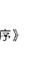

## 048 | 全球首个精准治疗药物的诞生

048 | 全球首个精准治疗药物。

# 王煜全

你好！我是王煜全。

今天是周三，我们来了解一下一家美国知名 的精准医疗制药公司，来更好地了解精 准医疗。

我要介绍的这家公司既是老公司又是新公 司，怎么说呢？说它老是因为它已经成立 了40年了，对各类的药物其实都已经有了 丰富的开发经验；说它新，主要是因为它 最近几年开发的关于精准医疗的药物，在 美国甚至是全世界的制药领域掀起了轩然 大波，使它成为精准医疗领域里面一个标 杆性的药企。所以我觉得很有必要来跟大 家仔细讲一讲。这个公司叫做Vertex Pharmaceuticals。

### 一、Vertex Pharmaceuticals的“前精准医疗时代”

Vertex Pharmaceuticals是坐落于波士顿 的一家美国制药公司，由Joshua Boger和 Kevin J. Kinsella两位博士创建。Joshua Boger在哈佛大学拿到了化学硕士和博士 学位，随后，他加入了当时全球最大的制 药企业默沙东。在之后的工作生涯当中， Boger在电脑辅助药物设计方面为默沙东 带来了巨大的声誉，同时也在结构药物设 计的研究领域之中声名鹊起。

到了1989年，38岁的Boger已经成为了默 沙东的高级研发总监。然而，在默沙东的 10年工作经历却让Boger对大型制药企业 的文化感到失望，大公司内部的官僚主义 气息、医药创新文化的缺失都让他倍感窒 息。所以，1989年Boger获得600万美元的 创业资本之后，毅然辞去了默沙东的职 务，成立了Vertex公司。

2004年之前，Vertex的主要产品线专注在 病毒感染、癌症、免疫紊乱等方面。公司的 总部在波士顿南部，波士顿是美国的硬科 技术、生物制药，特别是涉及到基因等新 兴的生物科技的大本营。另外一个比较重 要的制药研究和生产基地是在新泽西州， 波士顿和新泽西也被称作美国的制药中 心。Vertex还有两个研究机构，一个在加 州的圣地亚哥，另外一个是在英国的牛津。

值得一提的是，Vertex是第一个通过理性 药物设计，叫rational drug design来设计 药物分子的公司，而不是以前我们所熟悉 的通过组合化学筛选药物。这点和Boger 博士的研究一脉相承。所谓组合化学筛选 药物，就是说一般情况下我们在刚开始筛 选药物分子的时候，其实并不知道哪一个 确切的分子有活性。在这种情况下，就只 能把所有有着相似结构的化学分子，全部 拿去做生物活性的测试，然后再从中筛选 出活性最强的化学分子。这就是组合化学 的原理，它是基于实验和经验的。

但是Vertex在上世纪90年代就开始使用理 性药物设计，针对分子特性去设计药物的 结构，在对生物靶点的理解基础上，确定 可能产生的治疗效果。这是一个完全不同 的全新的概念。

Vertex有很多辉煌的历史，比如在2011年 5月份，FDA批准了Vertex所研发的治疗丙 肝的口服药，叫telaprevir，这款药后来成 为制药史上最成功的药物之一，只用3个季 度销售便超过了10亿美元。这款药物由强 生负责欧洲的市场开发和渠道，亚洲市场 則由三菱制药负责。

这里就要给大家补充一点知识了，就是美国研发药品的周期非常长，一般要10到15 年。从一个药品的研发，到临床一期、二 期、三期，到药品的市场化渠道推广，中 间这么多步走下来，一般都不仅仅是一个 公司来完成的，特别是最后一步的市场 化，很可能就只有跨国公司才能做到。

Vertex公司借助强生和三菱这样的巨无霸 来帮它推广，也是这个原因。这也解释了 为什么一种新药在它的专利保护期里，一 般都要卖得非常贵，因为这样才能够把它 10到15年的所有研发的各个环节的成本赚 回来。所以大药厂里面一般我们也可以看 到，总销售额都是前面几个重磅专利药所 决定的，也是靠这几个重磅药，来支撑药 厂的发展、研发以及各种财务支出。

### 二、Vertex Pharmaceuticals的成名作——囊肿性纤维化药物Ivacaftor

所以我就开始聊聊Vertex的神奇药物， 叫Ivacaftor。2012年，这款药物被FDA所批 准。这是一种孤儿药，叫Orphan drug，意 思是说专门用于治疗罕见疾病的特效药 物，因为患者特别少，所以叫做孤儿药。 这个药针对的疾病叫做“囊肿性纤维化”， 这种罕见病在美国只有区区3万患者。

囊肿性纤维化是一种遗传性疾病，囊肿性 纤维化的成因来源于CFTR这种蛋白的结 构缺陷。我们都知道，蛋白质是由各种氨 基酸组成的，蛋白质里面氨基酸的精确排 列至关重要，如果其中一个氨基酸排错 了，构型变了，就有可能影响蛋白质在生 物体里面的生物功能，让人体和细胞功能 出现异常。打个比方，蛋白质就像是一把 钥匙，目标生物结构就是一个锁，如果一 个氨基酸排错了，就相当于这个钥匙上面 的某个齿纹错了，也就解不开这个锁了。

CFTR蛋白管看着细胞内液体的流动，同时 也影响了汗液，消化液以及各种粘液的组 分，它的一种缺陷叫做G551D基因变异， 也就是第551个氨基酸被排错了顺序。因 为CFTR蛋白结构的出错，导致这个蛋白在 帮助输送氯离子通过细胞通道到细胞里面 的功能没有了，通道打不开了，氯离子输 送不过去。Ivacaftor这种药，就是来帮助 细胞打开通道，输送氯离子的。如果氯离 子和水能够通畅地进进出出，就能使得各 种粘液和消化液不至于累积。如果累积太 多，比如在肺脏，食道，或者身体的其他部 分，就会导至严重的呼吸和消化问题，并 引起其他并发症，比如感染或者糖尿病等 等。

但是这款药的特别之处就在于它主要从底 层的生物基因层面入手来治疗囊肿性纤维 化，也就是说它是针对我们刚才提到的 G551D的基因变异下来药，而不是平常我 们熟悉的，从症状的表现下来药。我们平 常所说的“对症下药”就是指的症状，比如 发烧了，要退烧药，比如痤疮了，要止疮 药，诸如此类，头疼医头，脚疼医脚，都是 针对于你所表现出来的具体症状。但以后可 能要把这个成语改一改了，叫做“对因下 药”，就是针对这个症状的具体基因变异 来下药了。

然而，我们刚才才提到，美国得囊肿性纤维 化的患者只有三万人，但是这其中因为 G551D这个基因变异导致的囊肿性纤维化 只有4%，也就是1200人，只有这1200个病人 才是Ivacaftor这款药的针对客户。所以， 由于病患的群体太小，Vertex做市场推广 的时候，定价是一年一位病人要花307000 美元来进行这个药的疗程。它的天价也让 它成为美国历史上最贵的药物之一，号 称“2012年最重要的药物”，也被称“神迹一般的药物Wonder Drug”。

接下来，到了2015年，Vertex的Ivacaftor 与另外一种药的复方药再一次被FDA批 准，这一次它的治疗范围稍微扩大了一 点，虽然还是同一种症状囊肿性纤维化， 但这一次被批准的复方药针对的是另外一 种叫做F508del的基因变异所引起的囊肿性 纤维化。注意：这一次是不同的基因变异， 不是上面提到的G551D！所以大家可以 看到症状虽然一样，但是基因变异不一 样，就需要FDA批准两次。这又一次颠覆了 我们以前对针对症状治疗的化学药的认 知，让我们加深了对“对因下药”的方法 的了解，对药物的研发真正到达了认知升 级。作为一家在纳斯达克上市的企业，由 于FDA的批准，2015年这家公司的股价表 现也很靓眼。

今年3月30日，Vertex再次由于两个囊肿 性纤维化的临床3期测试结果良好被FDA 批准。光那一天的股价就飙升了20.5%。这 个药的批准，使得它可以治疗囊肿性纤维 化的基因突变的数量增加到三倍，从原来 的10个基因突变翻到33个基因突变。因此 Vertex的股价在经过2016年的一年沉寂之 后，在2017再创新高，从今年初的每股70 美金飙升到现在150美金左右，整整翻了 一倍。

从基因最本质的源头来为病人开发药物， Ivacaftor给出了一个极好的例子。目前， 囊肿性纤维化基金会注册了28000个病人 的所有信息，包括基因数据，这为以后关 于这种孤儿病的精准医疗的研究提供了极 大的数据依托。这么一个小样本的病人加 上这么精确的基因定位，也让Vertex和它 的这个药物，成为我们了解精准医疗本质 内涵的一个极佳的例子。

### ——◆ 今日知识小结 ◆——

总结一下，我今天讲的重点是：

通过了解Vertex这个公司来跟大家更好地讲述一下什么是精准医疗。首先，刚开始是我们介绍了Vertex这个公司在做精准医疗之前的一些基本情况，我们讲述了药厂研发，市场化一个药物所经历的长周期。接下来我们讲述了Vertex在精准医疗方面的药物Ivacaftor，从基因变异的角度来治疗囊肿性纤维化，以及研发过程的一个进展，通过几次FDA的批准，使它在治疗囊肿性纤维化的过程当中取得了长足的进步，也使得它在最近几年里的股价迅速飙升，成为精准医疗行业里的明星公司。

### ——◆ 今日思考题 ◆——

今天我们介绍的这个公司，在切入精准医疗的时候，只是选择了从一个非常狭小的患者群体入手，却获得了巨大的成功。它的竞争策略对您有什么启示呢？

欢迎在留言区写下您的想法。

王煜全

我是王煜全，你的全球科技前哨侦察兵。咱们明天再见。

### 前哨历
10月4日

### 我的今日知识清单：

- 1. 美国研发药品的周期通常要10~15年。从药品的研发、临床使用、再到市场化和渠道推广，一般不仅仅是一个公司来完成的，很有可能就只有跨国公司才能做到。  
- 2. 找准一个小样本的病人的市场，建立基因数据依靠，再加上精确的基因定位，是精准医疗的有效尝试。

> 摘自：《048 | 全 球百个精准治疗药物的诞生》

「得到」专栏《全球创新260讲》
每周15年，抓住50个劲科技投资机会

### 用户留言

提交留言可与专栏作者互动

## 049 | 精准医疗领域存在创业风口

王煜全

你好，我是王煜全。

本周我们的主题是精准医疗。

周一的时候，我们介绍了精准医疗是怎么兴起的，还有一些基本概念；

周二我们认识了世界上第一个完成全基因测序的先驱 Craig Venter；

周三我们了解了 Vertex Pharmaceutical，还有它的精准治疗药物 Ivacaftor。

今天，我们来探讨精准医疗领域的机会和陷阱。

### 一、精准医疗的机会，从Grail公司说起

精准医疗的机会，要从早期筛查技术说起。我在周一的时候稍微提了一下，现在早期筛查技术主要有两大类：遗传病早期筛查和肿瘤早期筛查。

遗传病早筛，其实就是用产前筛查、检测基因的方法计算出遗传病的概率；

而肿瘤早筛，目的是尽早发现肿瘤，在出现临床症状前，用液体活检和基因测序这些方法。

### 二、精准医疗创业的风口

- 1. 单个公司很难做到覆盖所有疾病的基因测序。也就是说，那些其他公司覆盖不到的疾病领域，就是创业公司的机会。如果创业公司能够选择特定的细分领域，比如专门收集乳腺病人 的临床数据和基因测序数据，再建立数据平台和云端服务，成为特定领域的基础大数据公司，这就很可能非常成功。
- 2. 目前国内非常缺乏能够分析数据、再根据数据来设计解决方案的人才。主要是因为，科研或者高校的数据非常零散，很多数据都没有有效利用。如果创新企业能够和高校、药企、医院合作，然后帮助科研机构和药企做一个特定领域的标准化分析，再通过机器学习和算法优化找到合适的规律，研究病理和分子生物层面的药理，这将会大大节约企业研发新药的成本。

### 三、精准医疗目前的问题和陷阱

当然，我们说虽然精准医疗的机会很多，但它也存在着一些问题和陷阱。

首先，精准医疗有一个很大的问题，就是一旦它不精准，就会给病患带来很多麻烦。就拿刚才我们介绍的癌症早筛技术来说，如果早筛的结果不“精准”，那怎么办？

比如，把一个健康人预测成一个癌症早期患者，或者把一个癌症早期的患者预测成不可治愈。这些情况都会给病人造成很多不必要的精神压力和财务压力。更重要的是，是当一大批人去做癌症早筛检查时，倘若是一个很低的错误率，都会造成人们大面积的恐慌，引起很多社会问题。

所以精准医疗测试的精确性必须非常高才行。

和相关政府官员多加思考和应对。

### —— 今日知识小结 ——

总结一下，今天我们说了三点：

- 1. 精准医疗的机会是可预期的，癌症早筛公司 Grail 的迅猛发展就是一个很好的例子，但目前还做不到对一个人作全面的分析，而是从特定疾病入手。
- 2. 在精准医疗领域，大公司很难垄断，创业公司找准特定疾病，进行数据整合，利用人工智能技术提高分析精度，然后提出解决方案，就是一个很大的机会。
- 3. 我们要具体地了解精准医疗的内涵和相关陷阱，比如精准医疗的精准性问题，可能存在的道德问题，还有法规监管的问题，而且国内还存在将精准医疗泛化理解的问题，这些都需要相关行业的企业、企业家、科研人员、政府部门多多思考。

### —— 今日思考题 ——

精准医疗在道德层面和相关文化层面，未来可能会给我们带来怎样的困惑和思考呢？

欢迎你在留言区分享你的观点，我会和你一起参与这场科技前沿的讨论。

王煜全

我是王煜全，你的全球科技前哨侦察兵。咱们明天再见。

### 前哨历 10月5日

### 我的今日知识清单：

- 1. 现阶段精准医疗要从特定疾病入手，还做不到对一个人进行全面的分析。
- 2. 精准医疗领域很难被大公司垄断，创业公司找准特定疾病，整合数据，利用人工智能技术提高分析精度，然后提出解决方案，会有很大的机会。
- 3. 精准医疗必须解决精准性问题、道德问题、法规监管问题、以及将精准医疗泛化理解的问题，还需要企业、企业家、科研人员、政府部门多多思考。

摘自：《049 | 精准医疗领域存在创业风口》

「得到」专栏《全球创新260讲》
提前5年，抓住50个新科技浪潮机会

用户留言

## 050 | 精准医疗正在孕育新的市场

050 | 精准医疗正在孕育新的市场。

王煜全
你好！我是王煜全。
今天又到了我们的全球科技咨询时间。

### —— 全周总结+拓展 ——

本周我们讲的是精准医疗，主要讲了三个重点：

+   1. 就是2015年美国和中国相继启动了政府级别的精准医疗计划，这说明从全球的角度看，精准医疗的机会来了。
2. 精准医疗的基础，是对人类基因组的深入了解，在这个基础上，在基因层面我们可以进一步理解致病的机理，就可以因病下药，做如同病异治，也就是相同病，表现型相同，但是基因型不同，因此要用不同的药物来治疗。或者异病同治，也就是说发病在不同的病灶，不同的器官，但实质上是同一个基因的问题导致的，所以可以用同一个药，现在也有一些药品已经纷纷上市了。
3. 我们对基因组变异的致病机理的了解还很肤浅，离真正解决问题的路还很长。因此，如果要创业的话，最好是要有特定领域，建立强大的数据收集体系，辅以人工智能的分析，再提出针对性的解决方案。但是，这个市场的机会确实是非常大的。

### —— 用户留言精选 ——

张小所，生物医学在读博士。
本期讲的是精准医疗，针对王老师提出的问题，我提出几点看法：

第一，先说我对精准医疗的定义：通过测序、可穿戴设备、大数据分析，实现对个体异质性和动态变化的精准检测，以精准诊断为前提的治疗。
其实是分为两方面：
一是通过测序明晰患者的异质性，将其进行准确的分类，给予相应的药物；
二是通过...

### —— 用户答疑 ——

刘小豪：精准医疗，会不会随着三代测序的普及，成本降低等条件成熟后，利用基因组检测基因突变、转录组检测基因表达量、三维基因组检测多基因空间互作关系，被联合用于个体疾病诊断，再由基因编辑进行治疗的完整流程形成？另外，我是个做测序后生物信息分析、功能基因定位的研究生。在王老师讲基因编辑将崛起的时候，就在思考会不会基因定位的分析工作会成为基因编辑的“指南”，而一同成为 BT 创业时代的热门。不同...

王煜全
首先要说，你说的前面的第一部分，就是是不是能够形成这样一个完整的...

王保安：请问王哥，怎么解决量身定制和量产的矛盾？

王煜全
我理解，因为我们在讲生物制药，不是在说工业界的大规模定制，所以在生物制药领域这确实是个好问题，因为传统的以化学药为主的医药产业是非个性化的，大批量生产出来以后，所有人都吃它。而未来的生物医药产业是个性化的，这就是精准医疗的核心。但这确实会造成整个医疗产业结构的变化，这个我们没有重点讲，所以在这儿多说两句。

主要是两点：

第一，制药的流程长了，医药企业不再是像原来一样大批量生产药品，然后向医院去兜售，医生只是负责把药传递给病人的二传手，在医生手里，药没有任何改变。但是，现在的现代医药，尤其生物医药需要医院的深度配合，甚至很多药品是在医院最终制作完成的，所以制药的流程从只在药厂延伸到了医院一侧。

第二，是对患者的前后期互动都大大增加了，前期要有基因层面的检查以确定这个治疗是否对症，中期甚至要取病人的细胞，进行改造扩增以后再输回病人身体，后期更要不断监控，因为生物制药风险比较高，它容易反复，病人容易反复，所以必须要监控用药的结果。

因此，我们认为根据这两个特点，传统的医药销售代表的模式很可能会被颠覆，而新的医药企业和各个医院紧密合作，建立起专科诊疗中心的这种模式会迅速兴起。所以从这个角度讲，也是一个很大的业务机会。

小占：本周是诺贝尔奖颁奖周，希望老师能讲讲诺奖得主在各自领域的贡献及其深远意义。

王煜全

其实我前面都陆陆续续提到了一点：
一个就是生物学奖是动物睡眠节律的控制机制，不光是因为睡眠很重要，而且是这几位获奖者清晰阐述了，有机体如何从基因层面产生对行为的控制。

化学奖是冷冻电镜，一个风趣的说法就是诺贝尔化学奖颁给了一群物理学家，因为他们给生物学家做了一个特别有用的工具。当然，顺便说一句，其中一位诺贝尔化学奖的获得者是我们前哨团队成员傅子敖的导师，我们正在向傅博士约稿，请他给大家详细讲解一下本年度的诺贝尔化学奖，以及傅子和导师之间不得不说的故事。

### —— 下周预告 ——

王煜全

我们下周的话题是肿瘤免疫疗法，过去两年出过一个魏则西事件，估计很多人都知道，这也让很多人对肿瘤免疫疗法产生了误解。

## 前哨历 10月6日

### 我的今日知识清单：

+   1. 精准医疗将孕育巨大的新型诊断市场，将患者进行准确分型，这将成为这一波精准医疗产业发展的突破点。
2. 传统的医药销售代表模式很可能会被颠覆，医药企业和各个医院紧密合作，建立起专科诊疗中心的这种模式，会迅速兴起。
3. 各个学术研究领域都有大量的跨界，在生物信息处理方面使用人工智能，让生物研究能够更深入。

> 摘自：《050 | 精准医疗正在孕育新的市场》

「得到」专栏《全球创新260讲》
5年，抓住50个科技投资机会

### 用户留言

提交留言可与专栏作者互动

## 创新地图 | 精准医疗面临怎样的挑战？

王煜全

今天是《全球创新260讲》的第七期前哨团供稿时间，题目是《精准医疗面临怎样的挑战？》。

由于现在是国庆黄金周期间，转述师外出旅行，无法进行音频的录制工作，还请见谅。下周我们将恢复正常。

Winnie Zhao, 哈佛医学院／麻省总医院研究人员，研究方向为干细胞和基因治疗。

Yvonne Y Li, 哈佛医学院／Dana Farber研究中心／布莱根妇女医院／MIT博德研究所研究人员，研究方向为生物信息分析，肿瘤学及个体医疗。

说到精准医疗，本周我们的节目中已经有所提及，我们必须先说从1990年开始到2005年基本结束的人类基因组计划（Human Genome Project, HGP），从那以后到现在的这二十多年间，基因测序技术越来越普及，个人的全基因组测序成本也从原来的千万美元，降到现在的1000美元左右。

这里尤其值得强调的是，人类基因组计划产生的数据是免费开放的。从此人类掌握了“遗传天书”的全本，剩下的工作就是解读和利用天书中的信息。

2015年，时任美国总统的奥巴马宣布美国的“精准医疗计划”启动，英国、法国、中国、韩国、澳大利亚都相继启动自己国家的精准医疗项目。这里精准医疗的概念，可以简单理解为基于我们对人类基因组信息的了解和解读，对疾病作出的有效预测和人为干预。

精准医疗通常分为信息收集，预测（解读）和人为干预（治疗）三个部分。

# 1.信息收集

信息收集过程需要收集的信息通常指的是什么？

首先，全基因组信息是必不可少也是最基本的。现在的基因检测只需要少许唾液、血液或者细胞样品，就可以提供诸多信息。

比如祖系种族、头发眼睛的颜色，是否善于运动，是否乳糖耐受，是否能够熬夜，是否携带会遗传的基因突变，更深入的——是否患有某些疾病，患病的概率为多少等等。

其次，从理论上来说，人类身体里每一个细胞都拥有相同的基因组信息，但生殖系（Germline）细胞 DNA 的随机突变可能导致各种类型的可遗传疾病，而体细胞（Somatic cells）DNA 的随机突变可能导致很多非遗传性疾病。

所以很多时候，对于患病个体，生殖系细胞的基因信息与体细胞的基因信息都需要进行采集。同时，基因的修饰、转录、表达和调控，每一个环节都是潜在影响因素。

最后，从统计学的角度来说，基因对疾病的影响并不是百分之百决定性的。

一个人从受精卵发育阶段开始，到出生，成长，居住环境、生活习惯、衣食住行，都会可能潜在地影响到基因的修饰、转录、表达、调控，从而影响到疾病的发生，这些数据复杂且海量，我们简称为大数据（Big data）。

正在进行的精准医疗计划不约而同地都强调了未来对于大数据的收集，美国的精准医疗计划更是准备将招募100万人来进行数据的采集。

不过，这个过程的难点是：
能影响疾病发生的因素相当复杂，要收集到足够全面、完整的信息本身就是一种挑战。基因组天书尚未解读完全，很多疾病的信息，如疾病发生的分子原理，抗药，累加突变等等未研究清楚的因素更是让信息的收集盲点重重。

# 2. 精准检测，精准预测

中国人讲究“治未病”。收集到了足够的信息，对于健康的群体，最想了解的当然就是疾病在未来是否发生，这样便有可能在疾病发生之前进行人为的干预和预防。

# 3. 精准治疗

对于已经患有疾病的患者，精准预测可利用收集到的患者信息帮助患者细分疾病类型。

的药物对这个病人的治疗没有任何效果。于是科研人员更新了算法，通过在计算和筛选时加入了 FDA 批准、已在北美市场上的治疗多种包括肺癌以外的其它类型疾病药物的研究数据，结果发现，一个市面上已有的治疗咳嗽的药物能潜在地靶向这个患者癌细胞具有的某一特定突变，该患者用此药后成功地延长了数年的生命。

在欧美地区，比较常见的癌症诊疗模式是多方合作式的。

一方面医院通过和癌症基因检测公司合作来帮助患者进行更细致的基因检测，病人可在自愿的情况下要求基因检测公司和医生联系，帮助传递肿瘤样品和数据共享。

另一方面，医院也与研究中心和实验室合作给无法顺利找到药物的绝症患者，提供参与到试用正在临床试验期（clinical trial）新靶向药物的机会。

值得一提的是，参与临床试验药物是免费的，而治疗过程产生的数据均可以有条件地免费开放和共享。这种病人-医院-公司-科研机构多方合作的模式，让很多本以为失去治疗机会的绝症患者获得了救治，也为药物临床研究提供了有力数据。

# 4. 精准治疗未来的市场，机遇和挑战

有预测称，精准医疗市场将在2023年达到870亿美元。近些年来基于 DNA 测序和分析的基因检测公司也因此层出不穷，市场容量如此巨大，乐观的同时也不能忽视精准医疗依然面对很多问题和挑战。

以肺癌为例，科学家在作精准分析的时候，会考虑到已研究报道的可能与肺癌相关的200多个基因和与这200多个基因相关的上千个突变位点的影响，而现今可以靶向用药的作为肺癌靶点的基因不到十个。研发一个新药需投入上亿美元，很多大公司更愿意反复针对同一靶点改进已有药物，当下热门的肺癌靶点有 PD1、PDL1、EGFR、ALK，在欧美针对这几个靶点的药物已经更新换代好几代，而其它潜在靶点并没有有效的药物获批。

数据库容量、数据盲点、数据库信息覆盖不全、药物研发短缺，以及已获批的靶向药物价格高昂这些方面，全都会影响精准医疗最终能否达到精准治疗的目的，但反过来，这些点每个都蕴含了巨大的市场应用和投资潜力。

未来10-20年，试验研究数据的积累能够慢慢覆盖数据收集的盲点，由医院，研究所和公司参与的数据库的建立和扩充，计算机计算能力的增强，数学模型演化和更新，人工智能（AI）的加入，药物筛选的库容量将不停增加，筛选效率不断提高，更多新的靶向治疗技术逐步迈向临床，如定向编辑、干细胞治疗、基因治疗、免疫治疗方面的突破，使得精准治疗能真正地迈向精准。

王煜全
我是王煜全，你的全球科技前哨侦察兵，咱们明天见。

### 用户留言

## 051 | 癌症不光可以治疗还可以预防

051 | 癌症不光可以治疗还可以预防。

### —— 今日内容看点 ——

通过阅读今天的内容，你将会掌握以下两个问题的答案：

+   1. 癌症免疫治疗发展到什么程度了？取得了那些成绩？
2. 肿瘤疫苗的研发有哪些难点？我们有哪些相应的解决手段？

我们都知道，癌症可以说是目前人类面临的头号绝症。10月我们一直在讲生物技术，那么在和癌症的抗争之路中，生物技术已经带我们走到哪里了呢？

本周我们就来说说现在最火热的抗癌疗法——癌症免疫治疗，以及它的行业现状。

去年的“魏则西事件”，某种程度上让大众对免疫疗法产生了一定的误解。这也是我们要详细聊聊免疫治疗的一个原因。不知这个事情的朋友可以上百度搜索“魏则西”三个字，就能了解清楚了。

那么，关于癌症免疫治疗，我们还得从人类和癌症的斗争说起。

1971年尼克松总统颁布的《国家癌症法案》，可以说是现代生物医学与癌症斗争的开始。法案促成了美国国立癌症中心的建立，让癌症中心有了专项拨款以及和总统、国会直接沟通的权力。这极大地促进了更多癌症研究机构、国际合作以及癌症数据库的建立。

但是46年过去了，我们还是拿癌症没有办法，癌症的总体发病率和死亡率依然很高。不过，我们对癌症的认识有了巨大的进步，也探索了许多新的治疗方法。这其中最突出的一类就是免疫疗法，它的原理是利用我们自身免疫系统来清除肿瘤。

大家都知道，除手术外，放疗和化疗是治疗肿瘤最常用的疗法，但这些方法在杀灭肿瘤细胞的同时也杀死了正常细胞，给身体带来巨大伤害。那相比之下，免疫疗法的最大优势就是它可以避开正常组织，有选择地专门攻击癌症细胞。

接下来，我们就着重讲肿瘤疫苗。

# 一、癌症可以治疗还可以预防

先简单说一下疫苗的工作原理：

当某种外来的入侵者，比如细菌或病毒感染人体的时候，我们的免疫系统会记住入侵者的特征，这样以后如果再遇到一样的入侵者，免疫系统就能快速而强烈地把入侵者干掉。疫苗就是先把那些带有病原体特征，但又不会让人发病的细菌或者病毒注入人体，然后让免疫系统记住这些特征，这样等真的病原体入侵时，免疫系统就能在星星之火燎原之前把它消灭。

试想一下，如果癌症也能像肺结核、天花那样用一剂疫苗就能解决问题，那该有多好。

今年7月，我们真的迎来了一个好消息：

第一个被CFDA批准的宫颈癌疫苗，葛兰素史克旗下的Cervarix，正式在中国内地上市。除了Cervarix，另一款宫颈癌疫苗，默克制药的Gardasil很快也将上市。

广大女性只需要注射三次宫颈癌疫苗，未来至少9年不会有患上宫颈癌的风险。

其实宫颈癌疫苗2006年就在美国上市了，现在已经有好几款预防范围略有不同的产品问世，这些产品能够预防至少85％的宫颈癌。

和其它疫苗的诞生原理一样，宫颈癌疫苗的发明得益于宫颈癌致病病毒的发现。

上世纪70年代，德国科学家 Harald 第一次提出，宫颈癌的罪魁祸首可能是人类乳头瘤病毒 HPV，经过了20年，他的理论逐渐得到了证实。这也让宫颈癌成为现在所有人类癌症中唯一一个病因明确的癌症。

Harald 的这一发现促成了宫颈癌疫苗的诞生。1998年，第一款宫颈癌疫苗被证实有效，2006-2007年，默沙东和葛兰素史克发明的疫苗，相继在美国和欧洲上市。

# 二、肿瘤疫苗不简单

听完上面的介绍，你可能会觉得，这疫苗预防的思路听起来还挺简单的。

可为什么直到2006年才出了第一款癌症疫苗呢？又为什么不把类似的方法用在更多的癌症预防上呢？

因为，宫颈癌疫苗的成功其实是种幸运共同造就的，而对于其他癌症，我们就没有那么幸运了。我们可以从三个方面来解释：

+   1. 刚才我们说，宫颈癌是现在唯一一个病因明确的癌症，它的致病机理十分单一，几乎99.7%的宫颈癌都是由 HPV 病毒感染引起的。但是，反观大多数癌症，它们的病因就很复杂、很难研究了。虽然简单地说，癌症是基因突变导致的。但是，到底是什么导致的突变，它具体是什么样的，突变又有多大规模，这些都很难说清。再加上巨大的个体差异，研究工作就很难进行。想想看，哪怕是致病机理最单一的宫颈癌，从假设到理论的证实花费了20年，就更不用说其他复杂癌症的研究了。
2. HPV 病毒并不“凶残”。首先，HPV感染其实很普遍，女性一生中感染HPV的可能性高达40%-60%，只不过大多数感染会在8个月内自行消失，而且2年以上的持续感染才有可能引起癌变。其次，HPV很容易被免疫系统杀死，一般来说，正常的免疫反应强度就足以消灭HPV。但是，其它癌症病变可是非常顽固的，免疫系统没办法快速有效地一举歼灭癌细胞。一旦免疫系统开始疲惫，有些癌症细胞会反过来抑制免疫系统的活力。这样，癌细胞不断壮大，最终胜过免疫系统，不再受控。
3. 有些癌细胞还非常狡猾。它们常常伪装成正常细胞，或者不断改变自己的特征，躲过了免疫系统的巡查。

由于以上这些原因，我们的免疫系统经常在对抗中输给了肿瘤。不过，认清了这些原因后，我们也发展了相应的对策。既然肿瘤会伪装，那我们就提高搜查能力；既然免疫系统战斗力不足，那我们就提高免疫激活水平。正是基于这两点，治疗性疫苗应运而生。

# 三、疫苗可以预防还能用于治疗

治疗性疫苗，指的是在已经发病的情况下采取的治疗手段。

既然疾病已经发生，就说明机体本身免疫力不够强大，所以治疗性疫苗把重点放在提高免疫反应的强度上。运用类似的思路，除了抗癌，治疗性疫苗在治疗乙肝、艾滋病方面也很有潜力。

那么，要怎样提高免疫反应强度呢？

方法很多，目前最有效的一种疫苗，是基于树突细胞的肿瘤疫苗。

树突细胞是一种重要的“免疫提呈细胞”，就是把免疫问题提交给人体的意思，简单来说，这种细胞在预防系统中扮演着哨兵的角色。它负责发现敌情，拉响警报，同时把“敌人”的特点报告给主力军。没有树突细胞，主力军就无法被大规模唤醒，更不知道该对谁开战。

对树突细胞的研究是近代免疫学发展的重要里程碑，它不仅揭露了人们对免疫系统工作原理的认知，还帮我们找到了提高免疫反应精度和强度的方法，更催生了治疗性肿瘤疫苗的诞生。

治疗性肿瘤疫苗里最当红的明星要数前列腺癌疫苗 Provenge。

它是全球第一款也是目前唯一一款获批上市的治疗性疫苗。用 Provenge 治疗肿瘤，主要是利用树突细胞，高效地激活患者体内的免疫细胞，然后准确地找到并杀死癌细胞。

Provenge 的临床试验显示，患者的寿命平均延长了4个月。

2010年，FDA 批准 Provenge 在美国上市。现在已经有2万多名患者接受过 Provenge 的治疗，也创造了上亿美元的利润。

7年过去了，Provenge 还是全球唯一获批的治疗性疫苗，它的领先地位不言而喻。创立它的 Dendreon 公司和树突细胞的发现者 Ralph Steinman 也受到了人们的关注，其中还有很多值得我们思考的故事，明后两天我将陆续为你介绍。

### —— 今日知识小结 ——

肿瘤疫苗的成功，得益于我们对癌症和对免疫系统的知识升级。这波新型肿瘤免疫疗法的发展，标志着我们已经进入了一个系统生物学的时代，一个精准医学的时代，以及一个癌症可治愈的时代。

总结一下，今天我说了三点：

+   1. 和传统疗法杀敌一千自损八百的缺陷不同，最新的肿瘤免疫疗法可以实现对肿瘤高精度高强度的打击，它是当下最热门的抗癌新疗法。
2. 第一支肿瘤预防性疫苗——宫颈癌疫苗，和第一支治疗性疫苗——前列腺癌疫苗的问世，标志着肿瘤可预防，甚至可治愈的时代已经来临。
3. 肿瘤疫苗技术的发展，得益于我们对肿瘤和免疫系统的知识升级，以及对基因测序、基因编辑、生物信息学等工具的利用。这波新型肿瘤免疫疗法的发展，标志着我们已经进入了系统生物学和精准医疗的时代。

### —— 今日思考题 ——

你听说过哪些肿瘤预防和治疗的新方法呢？你是怎样判断这些新方法是否靠谱的呢？

欢迎你在留言区分享你的观点，我会和你一起参与这场科技前沿的讨论。

王煜全

我是王煜全，你的全球科技前哨侦察兵，我们明天见。

## 前哨历 10月9日

### 我的今日知识清单：

+   1. 与传统的放疗和化疗不同，最新的肿瘤免疫疗法，可以实现对肿瘤高精度高强度的打击，避免对人体正常细胞的损伤。
2. 肿瘤疫苗技术的发展，得益于我们对肿瘤和免疫系统的知识升级，以及对基因测序、基因编辑、生物信息学等工具的利用。
3. 这波新型肿瘤免疫疗法的发展，标志着我们已经进入了系统生物学和精准医疗的时代。

> 摘自：《051 | 癌症不光可以治疗还可以预防》

「得到」专栏《全球创新260讲》
赶在5年，抓住50个科技浪潮机会

## 预告｜癌症被治愈的时代即将到来
### ——♦ 下周预告 ♦——

我们下周进入一个大家都很关注的领域 ——肿瘤免疫疗法。

众所周知，癌症可以说是当今社会人类面临的头号绝症。常见的治疗手段，就是手术、放疗和化疗，在杀灭肿瘤细胞的同时，也杀死了大量的正常细胞，给人体带来巨大伤害。

而“肿瘤免疫疗法”，顾名思义，就是利用人体自身的免疫系统，有选择地去攻击肿瘤细胞，进而消灭肿瘤，避免对正常组织的伤害。

“魏则西”事件，让我们看到了肿瘤免疫疗法这个领域的乱象，也让很多人对这种疗法产生了很大的误解，实际上，它确实为治愈癌症带来了很大的希望。

明天开始，我会帮你理清思路、抓住关键，从技术到产业，对肿瘤免疫疗法有一个清晰全面的了解。

王煜全

我是王煜全，你的全球科技前哨侦察兵，咱明天见。

## 052 | 现代癌症免疫治疗正在创造奇迹

### ——◈ 今日内容看点 ◈——

通过阅读今天的内容，你将会掌握以下三个问题的答案：

- 1. 现代免疫学的重要奠基人 Ralph Steinman 的传奇带给我们哪些启示？
- 2. 是什么夺走了乔布斯的生命？
- 3. 新型药物在研发过程中要面对哪些问题？

在昨天的节目中，我跟你介绍了树突细胞。上个世纪后半叶，它才被发现，是一种重要的免疫提示细胞，相当于我们人类世界负责巡逻的哨兵。树突细胞的发现，弥补了免疫领域的知识空白，是现代癌症免疫治疗的发展基石。

而今天要讲的就是树突细胞的发现者 Ralph Steinman，我们将从他传奇的人生经历中得到一些启示。

Ralph Steinman 是一个出生在加拿大的犹太人，他的人生非常传奇。

最首先，是因为他发现了树突细胞，是现代免疫学的重要奠基人之一。

其次，他和诺贝尔奖之间的故事成就了诺贝尔奖历史上的一个特例。

最后，也是最具传奇色彩的，Ralph Steinman 用他的毕生研究成果拯救了他自己，创造了胰腺癌存活时间上的一个奇迹，也为探索癌症的新疗法提供了宝贵的实验资料。

接下来我们就详细地聊聊以上这三个方面。

Ralph Steinman 是个不折不扣的学霸。他先是在加拿大最顶尖的麦吉尔大学念了本科，之后拿到了哈佛大学的医学博士，后来又在麻省总医院做了住院医师。在美国，因为医生的地位和收入都很高，所以考入医学本院本身就是一件很艰难的事。

但 Ralph Steinman 在拥有很好的医学学历的情况下，没有去做医生，而是晚着兴趣投身科研。不过，天才在哪里都会发光，很快，凭着敏锐的洞察力，他发现了一直以来被人们忽略的免疫细胞一树突细胞。

### 一、树突细胞的发现

我们知道，人体免疫系统能够准确分辨并打击入侵者。只是人类一直以来都不知道免疫系统到底是怎么做到这一点的。所以，“抗原提呈”机制的发现是非常关键的一步。

昨天我们已经说过，“抗原提呈”指的是发挥巡逻兵作用的免疫细胞，它们负责发现入侵者，拉响警报，并把入侵者的特征报告给主力军。这些抗原提呈细胞就是最早和病原体发生互动的免疫细胞，所以对抗原提呈细胞的研究非常重要。

上世纪70年代初，Ralph Steinman 刚成为博士后，那时候大家都认为“抗原提呈”的巡逻任务是巨噬细胞和 B 细胞这两种细胞完成的。

可是，很快 Ralph Steinman 就发现，巨噬细胞并没有识别病原体的功能，而这些巨噬细胞周围总跟着一些有着树状分叉的细胞，他就把这些细胞命名为“树突细胞”。Ralph Steinman 还大胆推测，这些细胞才是真正负责巡逻和警报的抗原提呈细胞。

然而当时学界并不认可他的发现，为了证明自己的发现，Ralph Steinman 必须提纯出这种细胞，因为只有这样才能深入研究它的内在构造和功能。

摆在 Ralph Steinman 面前的难题是，树突细胞的提纯过程太复杂了。Ralph Steinman 花了10年时间，耗费大量的心血提取和研究树突细胞。在这期间，Ralph Steinman 最重要的发现是，当他把树突细胞输入小鼠体内后，它诱导免疫反应的能力，是巨噬细胞的100倍。直到那个时候，他的才智和勇气终于得到了回报，他的发现彻底颠覆了学界的传统认知。

从 Ralph Steinman 发现树突细胞的故事中我们能看到：

首先，生物学的进步是个费力而漫长的过程，需要很多像 Ralph Steinman 这样既有敏锐洞察力，又能顶得住质疑和压力的科学家。

其次，生物学非常依赖工具和平台，树突细胞能够被广泛认可，离不开细胞提取和培养技术的发展。

我已经或者将要为你介绍的工具类技术有很多，比如单细胞基因测序、CRISPR-Cas9、便携式核磁共振仪、双光子显微镜，还有众多模拟和计算方法，甚至人工智能等等，都为生物医药的进步做出了贡献。

每一次工具的革新，都会让生命科学的某些领域有飞跃式的发展。当然，除了生物学，数学、物理、材料、计算科学等学科也能发生重要突破。如果你是某个领域突破的开创者或者创业者，不妨想想你的突破是否能在生物医药领域也有些好的应用。比如说最近的2017年诺贝尔化学奖，就颁给了为生物学提供了研究设备的物理学家。

### 二、最遗憾的诺贝尔奖

Ralph Steinman 开创性的工作，最终得到了人们的广泛认可，他也因此获得了2011年的诺贝尔生理学或医学奖。遗憾的是，Ralph Steinman 在得奖前三天就去世了。

Ralph Steinman 的家人代替他领取了这份荣耀。他的女儿说，Ralph Steinman 其实一直期盼着能获得诺贝尔奖，在他最后的日子里，还说一定要活到获奖的那天。

事实上，按照诺贝尔奖的规定，诺贝尔奖是不授予已经去世的人的，很多伟大的科学家就是因为这样才没能获此殊荣。

不过，遗憾中的一点喜悦是，鉴于评选时 Ralph Steinman 还在世，诺奖委员会最终维持了原来的决定，就这样，他成了诺奖历史上唯一一个去世后得此殊荣的人。

### 三、4年半的生命奇迹

夺走了 Ralph Steinman 生命的病魔，就是有着“癌症之王”称号的胰腺癌。我们熟悉的很多名人都是被它夺走了生命，其中包括苹果公司前 CEO 史蒂夫·乔布斯。

不过，Ralph Steinman 和乔布斯的胰腺癌种类略有不同，乔布斯患的是非常罕见的胰腺内分泌肿瘤，它不像大多数胰腺癌那么凶险，患者的生存几率很大。而 Ralph Steinman 得的是常见的胰腺外分泌肿瘤，存活期往往只有几个月甚至几周。

作为虔诚的佛教徒和素食主义者，乔布斯很抵斥现代医学，拒绝进行必须“割开身体”的外科手术。所以在最初的9个月，他一直用替代性疗法治疗，比如，每天喝大量果汁，利用中药、针灸、水疗、净肠等方法。后来，乔布斯的病情不断加重，他这才开始接受胰腺切除、肝移植等手术。虽然手术很成功，但他还是在确诊后的第8年去世了。他的不幸无疑和他最开始采用的替代性疗法有很大的关系，这种方法严重拖延了最好的治疗时机。

另外，在乔布斯的治疗中，无论是放疗、化疗，还是肝脏移植后为避免排异反应的免疫抑制药物，都严重降低了免疫力，从而间接导致患者死亡。

但 Ralph Steinman 用的新疗法却恰恰相反，新疗法重点是增强了他的免疫力。在知道自己患了胰腺癌后，Ralph Steinman 立刻在自己身上开展了多项创新的肿瘤治疗实验。

比如，Ralph Steinman 和多名顶尖科学家以及生物医药公司合作，一共尝试了8种疗法，其中包括使用三种肿瘤疫苗。

虽然目前得出的结论还不够严谨，但 Ralph Steinman 的免疫反应明显超过了平均水平，他的生存期也达到了惊人的4年半。

可以说，在医学上，他的4年半比乔布斯的8年“更长”。在生命的最后阶段，Ralph Steinman 再一次为免疫学做出了巨大贡献，推动了基础科研，也促进了药物的开发。

不过，Ralph Steinman 的实验还是有不少遗憾的。

比如 Ralph Steinman 利用自己的树突细胞，这种个性化疗法的个性化程度并没有达到理想目标，如果能考虑到肿瘤细胞的个性，设计更独特的疫苗，疗效可能会更好。

好。

再比如，Ralph Steinman 每尝试一个新疗法都得向 FDA 提出申请，而 FDA 的审批既慢又保守，所以他的很多想法没能实现。

最后，他身上的实验效果虽然出众，但这还远远不能得出具有统计学意义上的结论。在他弥留之际，他也焦急地盼望 FDA 能够早日批准大规模的人体实验。

即便是相对比较反科学的美国总统特朗普，也曾经明确的对 FDA 提出过批评，认为 FDA 在推动新药上动作实在太慢了。

### —— 今日知识小结 ——

今天我为你介绍了免疫疗法的里程碑式人物 Ralph Steinman。

总结一下，主要有四点：

- 1. Ralph Steinman 凭借敏锐的洞察力和敢于坚持的勇气，发现了重要的免疫提呈细胞——树突细胞，还揭示了它的工作原理。这也让他获得了2011年的诺贝尔生理学或医学奖。
- 2. 他用自己的研究成果为自己延长了4年半的生命，创造了胰腺癌生存期上的奇迹，也为肿瘤免疫疗法的开拓做出了巨大的贡献。
- 3. 真正具有开创意义的科学研究往往非常艰难，必须付出巨大和持之以恒的努力。今天，改变世界成了一个非常时髦的口号，变成了一件随随便便的事情。但是有句歌词大家应该都听过：没有人能随随便便成功！
- 4. 随着科技的不断进步，对科技的监管手段也会有过时的问题，但是没有监管，科技就无法大规模地造福社会。监管如何跟上科技的进展、不拖科技的后腿，也是这个时代面临的问题。

顺便说一句，我们近期正在组织面向未来的科技产业监管的研讨会，到时也会给大家及时报道，欢迎关注。

### —— 今日思考题 ——

说说 Ralph Steinman 的传奇人生对你的启发吧。

欢迎你在留言区分享你的观点，我会和你一起参与这场科技前沿的讨论。

王煜全

我是王煜全，你的全球科技前哨侦察兵，我们明天见。

## 前哨历 10月10日

### 我的今日知识清单：

- 1. 生物学的进步是个费力而漫长的过程，需要有敏锐洞察力，又能顶住寂寞和压力的科学家；同时也依赖工具和平台技术的发展。
- 2. 乔布斯排斥现代医学，得胰腺癌后采用替代性疗法，严重延误了最好的治疗时机。
- 3. 科技不断进步，对科技的监管手段存在过时的问题，没有监管，科技就无法大规模地造福社会，监管保守，又会拖科技发展的后腿。

> 摘自：《052｜现代癌症免疫治疗正在创造奇迹》

「得到」专栏《全球创新260讲》
抢在5年，抓住50个前沿科技浪潮机会

## 053 | 肿瘤疫苗从实验室走向市场

### ——▶ 今日内容看点 ◀——

通过阅读今天的内容，你将会掌握以下四个问题的答案：

- 1. Provenge 作为目前唯一获得审批的治疗性肿瘤疫苗，为何没给创始人带来丰厚回报？
- 2. 它在上市过程中都踩了哪些坑？
- 3. 为何医生们不敢轻易给患者用这个药？
- 4. 创造了 Provenge 疫苗的 Dendreon 公司近况如何？

今天我们要介绍的，是过去10年间生物医药领域的焦点——Dendreon公司。

就是这家公司研发了世界上第一款治疗性肿瘤疫苗 Provenge。

我们说过，癌症的免疫疗法受到越来越多的重视，甚至被人寄予了“治愈”癌症的厚望。肿瘤疫苗就是其中的一个重要方向，它的发展经历了从被动免疫到主动免疫，从预防性到治疗性的过程，而Provenge 作为第一个，也是目前唯一一个被 FDA 批准上市的治疗性肿瘤疫苗，可以说是这个领域塔尖上的明珠。

### 一、Dendreon的基本情况

Dendreon 公司创办于1992年，它的名字来自于树突细胞 Dendritic Cell。这家公司的核心正是我们这周多次介绍的，基于树突细胞的治疗性肿瘤疫苗。

Dendreon 公司的创始人是斯坦福大学的免疫学家 Edgar Engleman 和 Samuel Strober。Edgar Engleman 创立这家公司时，已经是一位创办过3家公司的连续创业者了，再加上当时实验室中的喜人成果，他对 Dendreon 的未来充满了信心。然而公司和产品的发展并没有像他想象的那麽顺利。

这家公司和它的产品可以说是命运坎坷。漫长的研发周期，临床后期的持续热议，通过审批后的股价暴涨，价格和营销方式所引发的质疑，经营失误后的节节败退，以及最后的破产和被收购，整个过程可以说是一波三折，跌宕起伏。

### 二、Dendreon 掉进的那些坑

Dendreon 跌宕起伏的过程，和它曾经掉进的坑有很大的关系：

#### 第一个坑：临床试验与上市审批

临床试验是很多药品产业化的折戟之地，因为它受很多因素的影响。

- 比如生物系统的复杂性，动物和人之间、人和人之间的巨大差异，以及数据分析方法，评估指标的影响等等。

不幸的是，Provenge 在临床试验中就受到其中好几个因素的影响。

最初的产品研发 Dendreon 用了5年时间，而之后的三期临床试验却花了整整13年。

2000年的时候，这家公司完成并发表了一、二期临床试验的结果，这两期试验在小范围内开展，目的是验证药物的人体安全性等和药物相关的指标。在验证了药物安全后，他们马上开展了第三期临床试验。

三期临床试验通常需要进行大样本量的测试，来进一步确认药物的安全性和有效性。Dendreon 进行了两次试验，招募了225名患者，主要指标准是患者疾病的进展时间，次要指标准是总体生存期。

结果显示，次要指标，也就是患者的总体生存期和对照组相比明显延长了4个月。所以 Dendreon 在2006年向 FDA 提出了上市申请，这引起了市场的极大关注，Dendreon 的股价一路上涨。

但没想到 FDA 最终拒绝了 Provenge 的上市，要求 Dendreon 做一次更大规模的试验，这也导致 Dendreon 的股价跌回了原来的水平。两年后，第三期试验完成，而且结果和之前保持一致。这回 FDA 终于批准了药物的上市。Provenge 的销售额几个月便超过了亿元，Dendreon 的股价再次飙升。

#### 第二个坑：市场营销

历经10几年终于上市的 Provenge，紧接着在2011年遇到了第二个坑。

2011年，Provenge 的销售业绩比预期少了一半以上。最直接的原因，是医生们不敢轻易给患者用这个药，因为它的价格高达将近10万美元，再加上当时保险公司还没决定是否把它纳入报销清单。

当然，问题的根源不止如此。

- 首先，这个药在临床试验中遭遇波折，它的有效性一直存在争议。高昂的药价也让人们质疑，是否值得花这么多钱去延长4个月的生存期。
- 其次，Provenge 刚通过 FDA 批准时，它的市场预期价格只有63000美元，而后来官方公布的定价高达93000美元，消费者心中的不满可想而知。虽然可以理解他们想快点收回此前投入的巨额成本，但很显然，提前布局和打通销售渠道，让资金链早日转起来才是更有效的方法。另外，早在公司等待 FDA 批准的时候，Dendreon 就应该尽快准备上市的后续工作，比如向医生们推广宣传产品，和保险公司商谈报销事宜。但事实上，他们并没有做好这些工作。
- 最后，虽然与其他癌症疗法的价格差别不大，但相比之下，Provenge 的疗程很短，一个月所花费的费用相当于其他类似疗法半年到一年的费用。

综合以上几点，我们可以看到，短期内的巨大资金需求，加上保险报销途径的不顺畅，给很多医院带来了巨大的资金压力，这些因素让Provenge的市场迅速退热。

#### 第三个坑：团队

Dendreon 中不乏优秀人才，比如泌尿科专家 Mitch Gold，曾就任最大肿瘤药企业罗氏癌症中心副总裁的 Varun Nanda，还有担任过基因泰克销售与市场副总裁的 Richard Brewer 等。

但 Provenge 的销售管理岗位却一直频繁换人，Dendreon 在 Provenge 批准上市前三周才开始寻找合适的人选，这说明他们早期对销售与市场的重视远远不够。可能这也是 Dendreon 没有提前布局好保险公司报销等事宜的原因吧。

你看，我们一直强调的创业公司双长制的必要性再次得到印证。

简单解释一下双长制：一个好的创业公司必须要有一个好的 CEO，熟悉市场运作，熟悉企业经营，和能提供非常棒的技术的好科学家。

#### 第四个坑：竞争

和 Provenge 相比，在 Provenge 之前上市的多西他赛，和紧随 Provenge 之后上市的 Xtandi、Zytiga，治疗过程更简单，在肿瘤缩小等方面效果更好，价格更便宜，也没有保险公司报销的拒忧等，这些都给 Provenge 带来了很大的竞争压力。

此外，Provenge 在第一次失败的 FDA 审批准中，来自另一家前列腺癌药物开发公司的 Howard Scherer 质疑了它的数据处理和样本数量，这个人的反对也被一部分人解读成竞争者的阻碍。

### 三、科研项目选择的重要性

在公司连续踩坑，出现了一系列的问题以后，创始人 Edgar Engleman 回忆起他刚刚开始创业时的一个选择。

在创业之前，他在小鼠身上进行的针对淋巴瘤的免疫疗法取得了喜人的成果。但后来准备开发产品时，他决定从淋巴瘤转向前列腺癌。

- 一是因为前列腺癌的发病率更高，潜在市场更大；
- 二是因就算不小心损伤了正常的前列腺组织，也不会对身体机能造成太大的影响。

但是，挑战一个新领域总得面对巨大的风险。

果然，试验结果并没有他想象的那麽好，也许他有点后悔为了大市场选择了激进的技术，但小市场又何尝没有风险呢？

创业之路常要面对未知，我们不可能做出唯一正确的选择，在每一步都可能产生声音相

创业之路常常要面对未知，我们不可能作出完美的选择，每一条路都可能发生意想不到的利弊得失。

那么，市场和技术，你会选哪边呢？

Dendreon 的故事告诉我们，光有厉害的产品远远不够，从研发到运营的每个环节都左右着产品的命运。最前沿的科技不等于最牛的产品，成本和市场有更强的话语权。

### 四、Dendreon公司的近况

2014年11月破产以后，它被加拿大最大的制药公司 Valeant 以3亿美元的价格收购。今年6月底，中国著名的民营企业三胞集团又以8.2亿美元的价格收购了它。

Dendreon 破产以后，看好它和不看好它的声音一直共存。三胞集团收购 Dendreon 以后，也有不少人担心，中国对细胞免疫疗法的全面禁令会阻碍它在国内的发展。

另一方面，虽然 Dendreon 曾经在管理和运营上有很多问题，但 Provenge 能有效延长患者生存期是不争的事实，作为目前唯一获得审批的治疗性肿瘤疫苗，它的产业优势依然很明显。

目前已经有超过2万名患者接受了它的治疗，美国各大医疗和商业保险也已经把它纳入覆盖范围。Valeant 和三胞集团显然是坚信 Provenge 价值的企业。

2016年 Provenge 就为 Valeant 带来了1.2亿美元的利润，三胞集团则看准了 Provenge 还没开拓的亚洲和欧洲市场。未来肿瘤疫苗会得到更广泛的认可和应用，相应监管也会越来越成熟，在更优秀的经营管理下，Provenge 还是有可能重获辉煌的，我们期待它的出色表现。

### —— 今日知识小结 ——

总结一下，今天我说 यांनी三点：

- 1. 具有里程碑意义的 Dendreon 并没能给创始人团队带来丰厚的商业回报，反而以破产告终。它在研发、成本、营销、团队等方面对我们有很多借鉴意义。
- 2. 医药产业化中有很多两难选择，任何一个人都很难找到完美的答案，但不论选什么，实践才是硬道理，我们必须负重前行。
- 3. 特别是对中国的医药企业，现在国内很多企业在全球进行并购，我们认为，不管结局如何，三胞集团的做法是可取的，就是找全球最优秀的企业去并购，而且一下就拿下全球的所有权利，而不只是中国。因为国内现在很多企业出去找国外药商谈的，往往是得到药企的或者药品的中国的销售权利，一般来说，最好的医药企业一定不会把中国的销售权利单独切出去，所以这样的中国公司，拿到的中国代理权的药品，不是一流的。

### —— 今日思考题 ——

听了 Dendreon 的故事以后，关于生物医药的产业化，你还受到了什么启发呢？对于它们在中国市场的发展，你又有那些想法和建议？

欢迎在留言区写下你的想法。

王煜全

我是王煜全，你的全球科技前哨侦察兵，我们明天见。

## 前哨历 10月11日

### 我的今日知识清单：

- 1. 世界上第一款治疗性肿瘤疫苗Provenge，在上市过程中踩了很多坑，它在研发、成本、营销、团队等方面对我们有很多借鉴意义。
- 2. 医药产业化中有很多两难选择，但不论选什么，实践才是硬道理。
- 3. 最好的医药企业，一定不会把中国的销售权利单独切出去，所以一些中国公司拿到了中国代理权的药品，不是一流的。

摘自：《053 | 肿瘤疫苗从实验室走向市场》

「得到」专栏《全球创新260讲》
抢前5年，抓住50个前沿科技浪潮机会

## 054 | 肿瘤免疫疗法给治愈癌症带来希望

### —— 今日内容看点 ——

通过阅读今天的内容，你将会掌握以下两个问题的答案：

- 1. 为何肿瘤免疫治疗领域乱象丛生、虚实难辨、监管困难？
- 2. 肿瘤免疫疗法的产业现状是怎样的？

### 一、乱象丛生的肿瘤免疫治疗

本周一，我提到了魏则西事件，去年年初，身患晚期滑膜肉瘤的年轻小伙子魏则西，在放疗、化疗等传统方法都没有用的情况下，了解到了武警北京市总队第二医院，它的肿瘤生物中心可以提供一种叫 DC-CIK 的肿瘤免疫疗法。该中心声称 DC-CIK 是和斯坦福大学合作研发的新型抗肿瘤疗法，有效率高达80%-90%。这让魏则西看到了一丝希望，为了治疗，他支付了高额的医药费，但依然没有任何见效。而且，在接受治疗后不久的2016年4月，年仅22岁的他不幸离世了。

魏则西的不幸遭遇，把莆田系医院、百度竞价排名等医疗乱象，推向舆论的风口浪尖。

造成这些医疗乱象的原因，除了像魏则西所说的“人性之恶”外，还有一个重要的客观原因，那就是肿瘤免疫疗法系统复杂，不但普通人很难了解清楚，还给监管带来很大难度，这就让无法分清欺骗患者有了可乘之机。

为什么肿瘤免疫疗法这么虚实难辨呢？

主要有三个原因：

- 1. 免疫系统本身十分复杂，因针对不同细胞、不同免疫过程的疗法种类繁多、概念复杂，没有专业背景的人很容易被搞得晕头转向。魏则西事件中，斯坦福大学研发的是 CIK 疗法，看上去和 DC-CIK 很像，但它们有本质的不同。
- 2. 新疗法刚刚诞生，相关知识和技术会快速更迭，临床试验结果也可能和预期出入很大，但普通人很难及时跟进这些资讯。比如 DC-CIK 疗法确实存在，但它的有效性目前还没得到验证。
- 3. 不同的免疫疗法擅长治疗的癌症种类不同，而普通患者很难注意到这些细节。斯坦福大学的 CIK 疗法，针对的是骨髓增殖和血液病，这和魏则西的软组织癌相差太远。只强调有效而不讲针对什么癌症的，很可能是陷阱。

可以看到，肿瘤免疫治疗领域乱象丛生，而我们的目的，就是帮你理清思路、抓住关键，从技术到产业，对肿瘤免疫治疗有个清晰全面的了解。

### 二、肿瘤免疫疗法大家族

首先，肿瘤免疫治疗是个大家族，各大疗法种类繁多。

最早的肿瘤免疫疗法可以追溯到1890年代，美国骨科医生 William Coley 偶然发现，一位肉瘤病人在手术中遇到一种细菌感染，让人感到意外的是，从那以后，病人每次发烧溃疡之后，肿瘤就会减小一点，甚至在4个半月后肿瘤完全消失了。

Coley 从中得到启发，给肿瘤注射细菌毒素，成功地让多名病人肿瘤消失。这就是最早的肿瘤疫苗，Coley 也因此成了“肿瘤免疫治疗之父”。最早人们用免疫系统来消灭癌症，就是从这里得到启发的。

### 三、明星疗法和它们的市场现状

#### 1. 肿瘤疫苗

#### 2. CAR-T

#### 3. 免疫检查点抑制剂

### 四、精准医疗的最佳范例

### 五、中国现状

中国是紧随美国的肿瘤免疫疗法研发大国，却也是免疫疗法最混乱的地方。

作为患者要牢记，任何取得突破的前沿方法，一定会被广泛报道，不可能像武功秘籍一样被独门深藏。所以报道不多，没有临床试验，号称独家妙方的治疗基本都不靠谱。

当然，专业的监管更加必要，希望今后监管能够更加细致明确，保障患者和社会的共同利益。

### —— 今日知识小结 ——

总结一下，今天我说了三点：

- 1. 当下最受热捧的肿瘤免疫疗法给治愈癌症带来希望，它的意义可以和基因编辑相媲美。三大明星疗法中，肿瘤疫苗人为改造最少；CAR-T 最强效；免疫检查点抑制剂产业化最成熟，产业格局已经形成，主要由大公司占据。
- 2. 肿瘤免疫治疗是精准医疗的先行者，和它相关的异病同治、早期检测、疗效预测、大数据共享等，都是可以进步的方向，也是小公司潜在的突破口。
- 3. 中国在积极参与肿瘤免疫治疗的新浪潮，但国内乱象丛生，患者要擦亮慧眼，而监管更要细致明确。

### —— 今日思考题 ——

你听到过哪些关于肿瘤免疫治疗的传闻？你是怎样看待这些传闻的呢？

欢迎在留言区写下你的想法。

王煜全

我是王煜全，你的全球科技前哨侦察兵，我们明天见。

### 前哨历 10月12日

### 我的今日知识清单：

- 1. 利用免疫系统对抗癌症，三种明星疗法：肿瘤疫苗人为改造最少；CAR-T最强效；免疫检查点抑制剂产业格局已经形成，主要由大公司占据。
- 2. 肿瘤免疫治疗是精准医疗的先行者，和它相关的异病同治、早期检测、疗效预测、大数据共享等，都是可以进步的方向，也是小公司潜在的突破口。
- 3. 中国在积极参与，但国内乱象丛生，患者要擦亮慧眼，而监管更要细致明确。

> 摘自：《054｜肿瘤免疫疗法给治愈癌症带来希望》

「得到」专栏《全球创新260讲》
抓住5年，抓住50个新科技浪潮机会

## 055 | 问答：肿瘤免疫疗法需要鼓励与尝试（有彩蛋）

### —— 全周总结+拓展 ——

本周我们讲的是肿瘤免疫治疗，主要讲了四个重点：

- 1. 肿瘤不光能治疗，还能预防了。我们都知道以前肿瘤经常被认为是不治之症，更别说疫苗了。
- 2. 我们在上上周的精准医疗领域里面讲的同病异治和异病同治，在本周都能得到体现，都有案例，有的药是同病异治，同一个病用不同的治法，有的药是异病同治，看似是在不同部位的肿瘤，其实用同一个药就可以治。
- 3. 肿瘤的成因极其复杂，因此除了少数机理清晰的肿瘤，大多数的治疗效果仍然不够理想。不过，随着越来越多的治疗方法被发明出来，未来是越来越乐观的。当然，我们也提醒大家，一定要看市面上的主流的肿瘤治疗方法，如果有新的科技突破的话，一定会得到广泛报道，不要相信什么偏方，不要相信什么万灵丹。
- 4. 肿瘤经常是性命攸关的，又这么复杂，因此，需要鼓励尝试各种新的疗法，只要它在理论上是正确的，就应该去积极尝试，因此监管也要适度改进。

这是我们本周的对肿瘤免疫治疗的总结。

### —— 用户答疑 ——

#### 1.肿瘤疫苗个性化定制的 误解 问题

针对某种癌症，有单独对应的树突细胞，这一理解是否正确？如果正确，那么是否意味着人体内有不同的树突细胞来对应不同的入侵细胞？在对抗癌症时，科学家怎样找到对应的树突细胞。第二，相同的疫苗是否对所有人都适用。

我的回答是：

树突细胞确实有不同的种类，一般来说根据来源不同，可以分为髓系（DC1）和淋巴系（DC2）两大类。但不是每个癌症都有单独的树突细胞去对应它，因为树突细胞平时是未成熟状态，它并不是特异的。

但是，它具有很强的抗原内吞和加工处理能力，也就是说：

- 它发现了肿瘤以后会把肿瘤蛋白吞噬到体内；
- 然后通过一系列的机制，会负责激活体内专门负责清洁的 T 细胞；
- 由 T 细胞来杀灭肿瘤细胞。

#### 2.医药销售网络的变革问题

互联网给很多销售网络都带来了革命性的变化，但是医药领域还在依靠以前的网络，是否主要是因为医院与医药公司内部网络的封闭性导致，以后个性化药物成指数级增长，原始的销售网络成本和效率可能难以为继，是否会推动医药产业销售的改革？

我的回答是：

#### 3.FDA 的审批流程问题

王老师提到 FDA 在推动新药上动作太慢，可否请王老师讲解 FDA 的审批流程，是什么原因造成 FDA 的审批流程慢，有什么办法可以解决 FDA 审批既慢又保守的问题吗？

我的回答是：

### FDA 的新药审批：

- 1. 首先机制在学术上有清晰的描述，也就是说，如果机制不清楚是不能申报的。
- 2. 然后就要用动物模型做病理和毒理试验，比如用大鼠、小鼠，或者猴子，保证在用到人的临床试验之前，先用动物模型做过了是有效的，然后再用到人身上。

用到人身上，一般分为三期：
一期临床确定安全性；
二期临床是安全性的加强和一部分的有效性；
三期临床是大规模的临床最后确定这个药物的有效性。

院制药的管理，现在就变得相对难一些了。

坦白地讲，我认为还是应该相对放宽一些。

一方面，对那些假冒伪劣，要积极地打击。

另一方面，要为那些真正地利用先进的生物治疗方法进行探索的人打开方便之门。

至于具体说到 FDA 审批流程当中，怎么解决它既慢又保守的问题。

总的来说，大原则其实很难突破，因为要保证对病人负责，不能说病没治好，又给人治出问题来了，所以一定要经过严格的临床的审批。

但是，改进的办法还是有的：

比如说引进很多的新的技术，我们在前哨第一季里面就提到过一个新技术，叫做 Organ on a chip，就是芯片上的器官。你可以在芯片上做出人的肺、人的血管、人的肾脏等等。当然都不是真的，只不过它的细胞是活的，它的功能机理是模拟人体器官的，用这个来做药代动力学，或者做虚拟试验，我认为一定意义上讲，要比动物模型更科学，因为毕竟动物不是人，动物有反应的人未必有，动物没反应的，人未必没反应。

所以，新药的申报过程当中，也有许多科技可以促使新药申报的效率得到提升，我们还是对此有很大的期望的。

最后，本周的内容太专业了，回复和问题数都有所下降，实在抱歉。因为生物制药这个领域，尤其是肿瘤免疫治疗确实是有点艰深。

### —— ◆ 下周预告 ◆ ——

我们下周会讨论小型医疗器械和医用机器人。

这个是医疗里面我最喜欢的领域了：

- 一是器械一般它作用机理比较简单易懂，大家容易参与讨论。
- 二是器械和医用可穿戴、大数据和人工智能都紧密相关，是医学未来发展的重要部分，未来一定是一个全面、系统、跟踪监测的医学体系。
- 三是医疗器械的审批相对清晰，除了植入型的医疗器械，一般报批时间都不那么长。

所以，我在投资上也喜欢投医疗器械，因为引入起来比较容易。我相信这个话题你也一定会很有兴趣，欢迎你能关注和积极参与讨论。

### 前哨历 10月13日

### 我的今日知识清单：

- 1. 用表型抗原原来区分肿瘤种类，比用部位来区分更科学。
- 2. 个体化药物的普及，需要针对患者进行个性化的操作，因此医药企业需要与医院进行深度合作，这肯定会造成医药销售体系的重大变革。其实，现有 的医药销售体系并不落后，只是未来的产品变了。
- 3. FDA 审批流程很难简化，但新药的申报过程中， 使用科技手段，能够有效提高效率。

> 摘自：《055 | 肿瘤免疫疗法还要缴款与实验》

「得到」专栏《全球创新260讲》
讲5年，讲50个科技大趋势机会

### —— ◆ 彩蛋 ◆ ——

彩蛋：解读阿里达摩学院 ↓

今天看阿里成立了达摩学院，请来了顶 级科学家作研究，不知道王老师作何评 价？

我的回答是：

首先说，顶级科学家一般自己就不再出科 研成果了，很少有科学家一直到老年都不 断出成果的。但是，他们对出成果还是可 以有贡献的，主要有两种贡献：

第一种，是自己主持研究，因为这些顶级 科学家往往对未来的趋势的判断有了经 验，他可以判断出来什么领域是可以出成 果的，然后找足够牛的学生来做这方面 的研究，来实现突破。也就是说，他定方 向，由学生来冲锋。

另一种，就是由系里或者由校里找到有突 破潜力的年轻科学家，直接让他来，到自 己学校里来建实验室，直接来稳定方向， 又打主攻，这也是可以的。

后一种，其实主要是看管理能力和学术能 力的结合，也就是说能不能提前鉴别出 来，外面有哪些好的年轻科学家有可能在 事业上快突破了，就赶紧把他请回来，建 立实验室给他，让他能够在本校作出突 破。

我们在前哨第一期里面介绍过 MIT 的机械 工程系的系主任陈钢教授，他在谈他们机 械工程系的成功经验的时候，重点讲的就 是如何在某一个外面的年轻学者还没有作 出巨大突破之前，识别出他有可能作出突 破，然后请他来到本校，给他建立实验室， 让他的突破留在本校，这个确实是非常考 验眼光。

至于说前者，自己主持研究，就要看这个 科学家到底是客座还是专职。如果是客座 教授，是无法带学生的。当然，如果是专职 教授，经费充足的情况之下，一个科学家 可以做很多个实验室，研究很多个不同的 方向，甚至可以在很多领域都实现突破， 国内外都不乏这样的教授。

所以我认为，关键是看达摩学院到底是不 是请来这些教授长期专职待在那个地方， 去深入作研究，尤其是作研究管理。

当然，最后也有一个问题，我觉得其实更 重要，就是阿里巴巴这个公司资助达摩学 院的目的，到底是为了基础研究， 还是为了应用研究，因为其实二者从机制 上讲就有本质的不同。

基础研究的突破是不可预期的，比如说， 他们这回的科研的方向还是很广泛的，而 且都是现在的时间话题，比如人工智能之 类的，但是我们一直也在说，人工智能的 上一个突破是 Geoffrey Hinton，这位多伦 多大学的教授做出来的，是深度学习的这 个架构。但是，下一个突破到底在哪？其 实还不知道，连 Geoffrey Hinton 都说，建 议大家要换个角度，换个路线去搞人工智能，因为很有可能突破不再是深度学习这 个方向上的延伸了，要换一个方向了。至 于说什么时候会突破，那更是完全无法预 期的。所以，如果阿里巴巴资助基础研究 的话，就不能图回报，有没有回报都得长 期投入。

应用研究是一定可以有回报的，只不过应 用研究未必要花大钱作基础研究，你只 需要跟着基础研究就好了，现在国内外都 有很多报道，说至少在人工智能的应用领 域，中国其实在国际上都不落后，甚至有 赶超美国之势，其原因并不是中国人搞出 了深度学习，而是中国人在别人搞出来深 度学习之后，立刻把它运用到应用的各个 层面上去，我们说这个叫做产业研发。

现在，我觉得有点遗憾的是，阿里巴巴这 个达摩学院把两者混为一谈，而其实我们 一直强调两者的机制是有本质不同的，这 也暴露出了国内对学术界的科研和产业界 的研发一直混同、混淆不清的一个事实， 有点可惜。

因为我认为，其实中国更需要的不是基础 研究，这和很多科学家说的都是唱了反调 了。但是，国内真正需要的是产业研发，就 是要有一大批人懂得如何把先进的科技转 化成能够用到市场上的产品，这个是中国 的真正短板，希望达摩学院对此能够有所 建树。

王煜全
我是王煜全，你的全球科技前哨侦察兵， 我们明天见。

### 用户留言

提交留言可与专栏作者互动

## 特别放送 | 带你近距离接触诺贝尔奖得主阿希姆·弗兰克

傅子敖，哥伦比亚大学医学院 Integrated Program 博士，2014年进入 Frank Lab。

2017年度的诺贝尔化学奖颁给了冷冻电镜领域的三位物理学家，贾克·杜伯谢（Jacques Dubochet）、阿希姆·弗兰克（Joachim Frank）和理查德·亨德森（Richard Henderson）。其中一位获奖者阿希姆·弗兰克就是我的导师和老板，今天我就为你解读本届诺奖。

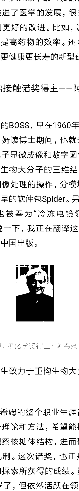

### 一、解密什么是冷冻电镜？

这次三位诺贝尔化学奖获得者所研究的冷冻电子显微镜，其实是一项技术。通过这项技术，我们可以得到生物分子的高分辨率的三维结构信息。简单来说，就是通过它，能够看到更高清的生物分子。

#### 1. 为什么要得到分子的三维结构？

分子的三维结构可以帮助科学家们理解生化反应机制，对于分子药物设计也有重要意义。最近几年结构生物学很多突破性的进展，都是靠得到生物大分子的高清码照之后产生的。

#### 2. 为什么给生物分子拍照这么难？

首先，我们日常接触较多的光学显微镜肯定是行不了了。要看清楚分子级别的结构，必须用电子显微镜，也就是用电子代替光线去成像。理论上说，电子剂量越高，成像质量越好。然而生物分子太脆弱，无法承受高剂量电子的冲击。如果把生物分子比作蚂蚁的话，高剂量电子对于生物分子的破坏，就相当于一颗原子弹在蚂蚁身上爆炸的威力。

#### 3. 冷冻电镜技术的研究过程

于是有人，也就是本届诺奖的其中一位得主亨德森，就提出，用低剂量的电子束，配合叠加平均的方法解析生物分子结构，并取得了成功。图像分辨率达到了0.7纳米，相当于头发丝的十万分之一。然而，他要求分子在样品中整齐排列，这就导致这个方法的普适性比较有限，因为有些分子很难进行排列，强行排列以后又会有畸变失真。

接下来轮到本文主角弗兰克出场。他发现，通过给随机朝向的同一种生物分子照相，得到不同角度的二维图像后，再运用计算机软件进行三维重建，就 可以得到分子的完整三维结构。

举个例子，派出所里的警察给嫌疑犯拍正面照和侧面照，然后就可以通过这两张照片推测出嫌疑犯的脸部形状了。当然弗兰克发明的方法肯定不止用两张照片，而是成千上万张同种分子不同角度的照片。

#### 4. 冷冻电镜技术有什么价值？

### 二、近距离接触诺奖得主——阿希姆·弗兰克

阿希姆是我的BOSS，早在1960年代后期，也就是阿希姆读博士期间，他就开始探索怎样利用电子显微成像和数字图像分析方法，来重构生物大分子的三维结构。弗兰克开发图象处理的操作，分模块写成了这个领域最早的软件包Spider。另外，他的一部著作也被奉为“冷冻电镜领域的圣经”。顺便说一下，我正在翻译这本书，近两年就会在中国出版。

#### 1. 专注：毕生致力于重构生物大分子的三维结构

#### 2. 严谨：用严格的要求培养出多位优秀的学生

#### 3. 有趣：心态年轻、平易近人的长者

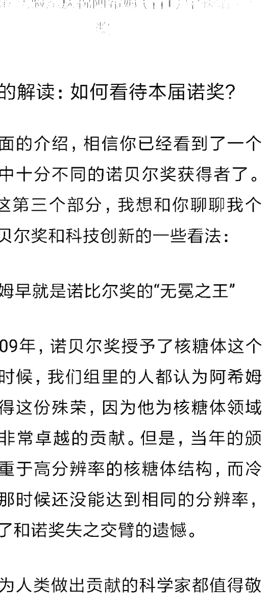

### 三、我的解读：如何看待本届诺奖？

通过上面的介绍，相信你已经看到了一个和想象中十分不同的诺贝尔奖获得者了。那么，这第三个部分，我想和你聊聊我个人对诺贝尔奖和科技创新的一些看法：

- 1. 阿希姆早就是诺比尔奖的“无冕之王”

早在2009年，诺贝尔奖授予了核糖体这个领域的时候，我们组里的人都认为阿希姆足以获得这份殊荣，因为他为核糖体领域做出了非常卓越的贡献。但是，当年的颁奖更侧重于高分辨率的核糖体结构，而冷冻电镜那时候还没有达到相同的分辨率，这才有了和诺奖失之交臂的遗憾。

- 2. 所有为人类做出贡献的科学家都值得敬重

诺贝尔当年是因为发明了炸药内心有愧，才专门设立奖金给那些造福人类的科学家的。然而，有太多太多对人类做出极大贡献的科学家，无法获得诺贝尔奖，但这并不代表他们做得不够好。我们经常会听到新闻报道说某某科学家做出了诺奖级的结果，这都是对他们为人类造福的一种肯定。其实，所有为人类做出贡献的科学家都值得我们给予最大的敬重。

- 3. 普通人如何参与到科技创新？

我想从三个方面来谈谈这个话题：

首先，想要做到科技创新，机器和人缺一不可。现在，很多大学和机构花几千万人民币添置世界顶级的冷冻电子显微镜，有人说这并不等于科技创新。在我看来，这恰恰是创新的前提保证。你想想看，过去所有的伟大发明和贡献，都是有了当时最先进的仪器设备的支持才实现的。当然，比起这个，更重要的是对于人的投资，再多的机器没有人会用，也不可能发展出科技创新的。

我这么一说，又有不少人觉得科技创新确实太难了。不过，在我看来其实很简单，当一个人把一件事情做到了极致，再多做一点，突破自己的极限时，就可能做出对其 他领域影响深远的科技创新。

其次，科技创新往往依赖于其他领域的发展。比如在冷冻电镜领域，图形处理器的应用就能大大加速图像的处理速度。本来需要几个月的时间处理数据，现在只要一天就够了。通俗易懂门槛低，都是由于各方面的完善，才使得这个领域有更多的人加入进来，再继续创造更多的 新知识。

最后，我想回答一个前哨的用户关心的问题——“作为外行，应该怎样进入科技创新领域呢？”

一个很好的方法是，你可以多读一下科学综述和相关书籍，重点关注那些在一个领域里做了很多年的人的成果。他们往往知道这个科技行业的核心问题是什么，哪些是如果他们有精力和有时间就会去完善和改进的。当你认识到这些问题的存在，再去设想怎么样去解决它们，就能够顺利进入这个科技行业了。

特别感谢王煜全老师的赏识，让我能够进入前哨团。文章内容还要感谢哥伦比亚大学中国学生学者联谊会的陈天健、周佳琪和钟碧莹的贡献，以及Frank实验室的同事们。最重要的还要感谢专栏的主编飞扬对文章的修改和意见。

### 前哨历 10月14日

### 我的今日知识清单：

- 1. 科技创新，机器和人缺一不可。只有最先进的仪器才能支持发明；当然，更重要的是对于使用者——人的投资。
- 2. 科技创新往往依赖于其他领域的发展。比如在冷冻电镜领域，图形处理器的应用就能大大加速图像的处理速度。
- 3. 进入科技创新领域很好的方法是多读一下科学综述和相关书籍，重点关注那些在一个领域里做了很多年的人的成果。

> 摘自：《特别放送 | 带你近距离接触诺贝尔得主阿希姆》

「得到」专栏《全球创新260讲》
趁前5年，抓住50个科技浪潮机会

## 创新地图 | CAR-T癌症免疫疗法的进展和挑战

张小所, 上海交通大学医学院/上海市肿瘤研究所博士在读, 研究方向是肿瘤微环境。

本周的主题是肿瘤免疫治疗, 是继手术、放疗、化疗、靶向治疗后人类对抗肿瘤的第五大疗法, 具有划时代的意义。大家已经了解到, 免疫治疗大家族主要三大成员——肿瘤疫苗、细胞治疗和免疫检查点抑制剂, 今天我们重点介绍细胞治疗的典型代表CAR-T, 它从研发到上市是一段非常传奇的经历。

### 一、从绝望到新生, 白血病女孩Emily的抗癌传奇

2010年5月, 美国小女孩Emily刚刚过完5岁生日, 被诊断出患有急性淋巴细胞白血病(ALL), 这对原本幸福的一家来说简直是晴天霹雳。ALL是一种儿童多发的白血病, 占儿童白血病的70%以上, 它的特点是淋巴细胞在体内疯狂地增殖, 同时会侵犯到肝脏、大脑等器官。不过大多数患儿都能够通过化疗得到有效控制, 骨髓移植也可以有效治疗。

Emily像大多数白血病患儿一样, 接受了化疗。两轮化疗后, 病情依旧没有得到控制, Emily危在旦夕。医生建议启动临终关怀, 但是Emily的父母不忍女儿就这样离开人世, 决定带女儿到费城儿童医院碰碰运气。

费城儿童医院是宾夕法尼亚大学医学院的附属医院, 正在开展一种叫做CAR-T(嵌合抗原受体T细胞)的早期临床试验, 当时接受过这种治疗的患者只有两个, 并且全是成人。权衡利弊后, Emily的父母决定让她接受治疗。

危机比想象中来得更早。就在Emily接受第三次CAR-T注射后, 她出现了高热、呼吸衰竭和休克的症状, 这种症状后来人们知道是CAR-T治疗引发的副反应, 情况非常凶险, 但是当时没人知道如何处理。按照方案, Emily的血液样本被送去检测, 结果发现有一种叫做白细胞介素-6的蛋白质量比正常高了1000倍。主治医生将这一现象报告给了CAR-T项目的负责人Carl June教授。Carl June教授突然想到, 自己患风湿性关节炎的女儿正在使用一种靶向白介素-6的抗体进行治疗, 那么能不能用它来应对Emily的突发状况?当天晚上, Emily就被注射了白介素-6的抗体。

奇迹发生了。几个小时后, Emily的症状发生了迅速改善。第二天, 她从休克中醒来, 而这一天恰巧是她的7岁生日。8天后, Emily骨髓活检的结果显示, 她的体内已经没有任何白血病细胞了!这是CAR-T首个治愈白血病的案例, Emily也因此家喻户晓, 成为美国的抗癌明星。现在Emily已经12岁了, 白血病再也没有复发过。他们还成立了Emily Whitehead基金, 用来帮助癌症患儿。

Emily的幸运故事, 也为CAR-T的发展做出了不可磨灭的贡献。当时Carl June教授和诺华公司刚签订共同研发协议不久, Emily的成功让他们迅速获得了更多资金和舆论方面的支持。随后, 大量的临床数据表明, 该疗法治疗儿童ALL的12个月生存率达到了79%, 更有许多患者的白血病细胞在治疗后完全消失, 并且不再复发, 实现了真正意义上的“治愈”。今年, 美国FDA专家委员会以10:0的投票结果审批通过了诺华的CTL019并上市。

### 二、CAR-T的原理和优势

#### 1. CAR-T疗法的原理

CAR-T又名嵌合抗原受体T细胞, 它不是一种药物, 而是细胞制品。CAR-T疗法的步骤比起以往的药物要复杂得多, 我们可以概括为分离、修饰、扩增、回输、监控。

- 分离——从患者体内分离T细胞；
- 修饰——这是CAR-T的核心技术, 也是每家公司技术上的核心竞争壁垒。肿瘤细胞和免疫细胞斗争的过程中, 会隐藏自己的标记, 这样T细胞就无法识别和杀伤他们了。科学家通过基因编辑的手段, 让T细胞的细胞膜表面能识别肿瘤特异性分子的蛋白, 这样T细胞就像装上了“雷达”, 让肿瘤细胞无处遁形。
- 扩增——如果把CAR-T比喻成一支军队, 体外扩增就是招兵买马的扩军过程。T细胞在接受特定信号蛋白的刺激后, 就会进入扩增模式。体外通常用带有这些信号蛋白的磁珠来处理T细胞, 让它们进入扩增模式。
- 回输——扩增好的T细胞通过注射进入人体。
- 监控——常规的药物治疗都会产生不良反应或者副作用, 活细胞更是如此, 因此在注射后要密切关注患者的生命体征, 随时处理突发状况。

#### 2. CAR-T疗法的优势

CAR-T之所以能够取得“治愈”白血病的惊人效果, 根本原因在于它是一种“精准”的“活的药物”。通过装载上“雷达”, CAR-T能够更加准确地识别和杀伤肿瘤细胞, 比传统的放化疗要强得多, 这也是精准医疗的具体体现。此外, 传统的药物作用于人体后会被肝脏代谢掉, 不会在体内长期存在, 而CAR-T在消灭肿瘤之后, 它们还会长期监视, 防止白血病的复发。

### 三、CAR-T面临的挑战

事物总是有两面性, 任何一种治疗都会存在缺陷, CAR-T也不例外。CAR-T存在的局限性, 主要有以下两点:

#### 1. 安全性问题

记得在Emily的故事中我们提到的危险情况吗?这是CAR-T治疗过程中最常见的不良反应, 叫做“细胞因子风暴”。CAR-T细胞会导致体内大量细胞因子释放, 促使免疫系统猛烈地攻击身体的器官组织, 让患者出现呼吸困难、高热、低血压的症状, 并且情况非常凶险, 早期是导致患者死亡的重要因素。但是这种情形通过一些抗细胞因子的治疗就可以很好地应对, 目前已经不再是难题了。

除了“细胞因子风暴”外, 神经毒性也是一个大危险。举个例子, 去年CAR-T研究的先驱Juno公司, 在进行JCAR015的2期临床试验时, 先后发生多例患者因神经毒性死亡, 被FDA两次叫停了临床试验。目前对于神经毒性没有很好的解释, 有人说是白血病细胞侵犯到中枢神经周围, 被CAR-T攻击后产生大量的细胞碎片, 导致脑水肿。目前还没有明确的方法可以应对。

还有一种危险因素, 叫做“脱靶效应”, 指的是CAR-T细胞原本是要攻击肿瘤细胞, 却误伤了正常细胞, 这是为什么?这和CAR-T在制备过程中选择的特异性分子很有关系。肿瘤和正常细胞很像, 就像恐怖分子通常会打扮得像百姓, 不被警察发现。如果CAR-T选择的靶标在正常细胞上也有, 正常细胞就会受到攻击。白血病的标志分子CD19, 就是一种肿瘤特异性很高的标志, 这才促成白血病领域CAR-T治疗如此成功。因此在今后的CAR-T研发中, 寻找特异性高的靶标非常关键。

#### 2. 实体瘤的困境

有读者这里要问, CAR-T除了治疗白血病, 治疗肺癌、肝癌、胃癌这些器官上的肿瘤(实体瘤), 是不是效果也很好?很遗憾, 目前在临床试验中取得重大突破的, 仍然局限在白血病。一方面是因为白血病有极为特异的靶标, 而实体瘤以目前的认知还没有找到特异的靶标；另一方面就是器官的肿瘤细胞, 往往会狡猾地躲在其它细胞中间, 局部微环境周围的地形非常复杂, 还会释放各种信号分子, 造成“烟雾弹”, 给进攻带来很大的难度。

不过, 目前CAR-T在实体瘤的治疗方面还是取得了一些成就。去年12月份, 美国加州的希望之城（City of Hope）临床中心报道了他们的CAR-T在脑癌中的进展。患者的脑部有7处肿瘤灶, 经过5次局部注射后, 患者的肿瘤全部消失了！并且持续了228天没有复发。这在CAR-T治疗实体瘤历史上是一大突破。

其实, 我国的科学家早在2015年就报道了CAR-T治疗实体瘤的成功案例, 并且也是针对脑癌的治疗。科济生物的李宗海博士联合上海仁济医院, 对一名24岁、恶性程度最高的脑癌患者进行了自主研发的CAR-T注射, 患者在接受治疗后肿瘤缩小了50%, 达到了“临床缓解”的标准。尽管肿瘤没有完全消失, 但已经说明我国CAR-T在实体瘤治疗方面是走在世界前列的。

### 四、总结和展望

看到这里, 相信大家对CAR-T已经有了比较详细的了解。总结一下要点：

- 1. CAR-T这两两年取得了突飞猛进的进展, 除了技术和疗效之外, 和舆论也有密切的关系。Emily的故事让CAR-T成为举世瞩目的焦点, 吸引了大量的资金和团队研发, 极大地推进了CAR-T的上市。反观国内, 魏则西事件过后, 国内的细胞治疗研究一度陷入困境, 监管上也迷雾重重。技术的革新往往牵扯到社会、人文等多方面因素。
- 2. CAR-T有别于药物治疗, 是具有精准医疗特性的“活性”细胞治疗, 为肿瘤患者带来了新的希望。
- 3. CAR-T未来的发展方向是最大限度地克服安全隐患, 以及在更多的肿瘤类型中取得出色的疗效。我国的CAR-T研发并不亚于欧美, 在政策支持和监管跟进的前提下, 能够涌现更多的创新突破。

“创新地图”是《全球创新260讲》的周末特别版块, 主要由专栏的科技社群“前哨团”供稿, 为你带来科技领域的专业知识。前哨团主要由全球各地从事科技领域工作的投资者、创业者、研究人、学者等组成。

### 前哨历 10月15日

### 我的今日知识清单：

- 1. CAR-T突飞猛进的进展, 除了技术和疗效之外, 和舆论也有密切的关系。技术的革新往往牵扯到社会、人文等多方面因素。
- 2. CAR-T有别于药物治疗, 是具有精准医疗特性的“活性”细胞治疗, 为肿瘤患者带来了新的希望。
- 3. 我国的CAR-T研发并不亚于欧美, 在政策支持和监管跟进的前提下, 能够涌现更多的创新突破。

> 摘自：《创新地图 | CAR-T癌症免疫疗法的发展和挑战》

「得到」专栏《全球创新260讲》
抓前5年, 抓住50个前科技浪潮机会

### 用户留言

## 056 | 高成长潜力的市场 ——小型医疗器械

056 | 高成长潜力市场 ——小型医疗器械

### ——◈ 今日内容看点 ◈——

通过本期的内容, 你将掌握以下3个知识点：

- 1. 小型医疗器械有什么价值？为什么要了解这个领域？
- 2. 小型医疗器械有哪些类型？
- 3. 三个典型的应用：体外诊断、康复治疗和3D打印。

小型医疗器械将会对健康管理方式产生颠覆式影响

本周我们来讲一个新话题, 叫作小型医疗器械。为什么要讲这个话题呢？因为之前介绍的人工智能、基因编辑都有技术上的重大突破；即使是看不到单一重大突破的混合现实、商用机器人, 也因为在一个方向上形成了一系列突破, 又离大家比较近, 可以真实地感受到。

而本月介绍的生物医药虽然关乎健康, 离大家很近, 但大家其实还是高度依赖医生的专业意见的, 而医学这个领域又确实专业, 所以大家了解起来会比较吃力。不过也不要紧, 前面三周介绍的进展虽然是基于生物医学的整体突破的, 但由于人体是一个复杂系统, 依然只能对症下药, 一个一个病地突破。

可本周讲的医疗器械就不一样了：它既没有一个全面的技术突破, 甚至没有任何统一的技术方向, 每一项进展也是只有医生才会关注的；但所有的进展汇总起来, 却会对健康产业, 也就是我们每个人管理自己健康的方式形成颠覆性的影响。

我们知道, 全世界的医疗资源都比较稀缺, 要解决这个问题, 得做到以下三点：

- 1. 让每个人少生病；
- 2. 有病能尽早发现、尽早治疗；
- 3. 慢性病能得到很好的管理。

我们在《前哨·王煜全（第一季）》2016年8月25日的文章就介绍：16年8月份的全国卫生健康大会, 既阐明了健康的重点：即每个人要为自己的健康负责；也明确了未来医疗的发展方向：健康市场化、以主动预防为主、以生活方式优化为主, 要求社区化、数字化、远程化、智能化和个性化。就拿社区化来说, 相关数据显示, 在美国曾经去过零售诊所看病的消费者, 从2007年的10%增长到2015年的35%, 2016年美国的零售诊所数量达到3000家。

> 《健康管理产业迎来春天, 我们的生活会被如何改变》

健康服务的社区化、远程化还带来了新趋势, 叫作“即时检测”, 英文全称Point-Of-Care Testing, 也就是POCT, 意思是在发病或者发生事件的地点进行监控、诊断和治疗。这就要求医疗设备必须小型化、便携式、操作简单并且成本要低。

咱们中国人口基数这么大, 肯定需要更多这样的社区诊所, 所以, 未来小型医疗器械肯定有发挥作用的空间。

好, 说完了趋势, 让我们来看看小型医疗器械都有那些。总的来说, 它可以分为小型体外诊断、小型医学成像仪器、基因检测、康复治疗和高端耗材特别是3D打印等几个大类。今天我们主要讨论其中三类：体外诊断、康复治疗和3D打印。在接下来的几天里, 我还会和你继续讨论医学成像和基因检测的小型医疗仪器。

# 第一类应用领域：体外诊断与即时检测

体外诊断简称IVD, 指的是在体外通过检测血液、尿液等组织和分泌物来获取临床诊断信息。IVD的检查方式有很多, 可以分为生化诊断、免疫诊断、分子诊断、血液学、微生物诊断、尿液诊断等等, 其中生化、免疫和分子三项在日常医疗诊断中比重最大。

顺便说一句, 基因检测也发展到了可以进行体外检测的阶段了, 而且可以用诊断试纸方便快捷地检测, 我们投资的Soft Robotics的董事长George Whitesides是重要的发明人之一, 具体内容我们后面再讲。

现在有80%的临床诊断信息来自体外诊断, 它在健康评价和疾病诊断中起到重要作用。那么, 小型医疗器械在这个领域就有很大的市场空间。

其中一个市场就是我们刚才说的“即时检测”。在上个世纪80年代之前, 实验室测试都是中心化的, 所有测试都要在实验室进行, 然后把结果返回给患者。但是你看看现在, 最常见的血糖测试, 已经从实验室转移到病人护理的即时监测中了。

体外检测在2013年时大约有540亿美元的市场, 其中即时检测占了大约14%~15%。随着各项测试的发展, 即时检测的种类也从1995年的不到10种发展到现在的大约110种。

除了种类的不断增长外, 即时检测还结合了临床和传统的医学工程、通讯、信息计算科学等, 这些都很多应用打开了小众市场。也吸引了大批的风险投资基金的兴趣。

这么说可能有点抽象, 接下来我会跟你介绍两家公司, 帮助你更好地理解即时检测小型医疗器械的市场有多大。

第一家公司是来自以色列的体外诊断公司Sight Diagnostics。这家公司在印度做疟疾的检测。我们一般都是用显微镜来鉴定疟疾, 但他们不同, 他们是用计算机视觉技术和算法来鉴定的。这种方法更快、更便宜, 也更准确。他们跟印度最大的病原体实验室一起开发, 公司的实验主要在印度进行。除了疟疾, Sight Diagnostics还计划把他们的测试推广到世界上最大的血液测试服务, 也就是全血液计量。全血液计量是一种血液检测, 主要用于评估个人的整体健康状况和检测各种疾病。这个市场有多大呢？给你一个数据, 单单在美国, 一年就要进行2亿次的全血液检测。所以, 我们说这家公司的增长还是可以预期的。

我介绍的另一家公司是美国公司Basil Leaf Technologies。几个月前, 他们刚刚拿到了高通X大奖的260万美元资金。这家公司的团队主要是对一兄妹, 哥哥Basil Harris是急诊室医生, 弟弟George Harris是网络工程师。兄弟俩恰好把医疗领域和科技领域的所长结合在了一起。他们所设计的小型仪器DxtER, 包括了一系列非侵入式的传感器, 用来收集包括重要生命信息在内的数据。系统会把病人个人的和家庭的医学记录、临床急诊数据、以及病人身上传感器的数据综合在一起, 作出快速而精确的判断。DxtER最初的设计理念, 就是为了让每一个普通人, 都能在自己家监控自己的身体特征, 然后诊断自己的某些疾病。目前它可以诊断34种健康情况, 比如糖尿病, 心房颤动, 慢性阻塞性肺疾病, 尿路感染, 睡眠呼吸暂停, 白细胞增多症, 百日咳, 中风, 结核病和肺炎等等。

简单来说, 我们提到的体外诊断和即时诊断技术最基本的特征, 是去中心化和扁平化。特别是手机等手持电子设备的发展, 通过它们与小型仪器的紧密结合, 这些技术逐渐地从医院走向了千家万户。小型设备简洁的操作和友好的界面, 是它们日益普及的原因之一, 也是为什么我们强调, 小型医疗器械系统为医疗市场的扁平化带来革新的一個基本原因。

# 第二类应用领域：3D打印与整形/康复治疗

接着我们来看第二类新兴领域, 3D打印医疗器械。虽然这两三年3D打印有所沉寂, 但其实, 这几年它们在骨科牙科器材类的3D打印产业已经开始投入使用了。比如我们下面这家牙科模具3D打印科技公司。

美国的Align Technology为牙科的专业人员提供了一整套的解决方案, 包括综合整形治疗, 他们已经为400万病人的错位咬合和牙齿矫正提供了服务。这家公司所使用的Invisalign系统特别适合大规模的定制化, 能够根据每个人的牙齿构造的不同, 打印出适合个体的形状。而且材料几乎完全透明, 也方便修除。出色的表现也反映在Align Technology今年的股市上, 公司股价已经从年初的90多美元, 飙升到现在的180美元。

另外, 还有一家值得一提的公司Green Sun Medical, 针对的是脊柱侧凸矫正。青少年特发性脊柱侧凸影响了大约3%的人群。这几十年来唯一的治疗方案, 是用一根很硬的塑料支架来防止神经畸形生长, 而不是矫正它。而 Green Sun Medical正在开发一个用技术来指导的脊柱支架, 它不但允许病人移动, 还可以帮助病人扭转畸形。其实它的原理跟我们矫正牙齿是一样的, 主要是通过组织的重新成长来完成脊柱整形。Green Sun Medical还设计了通过iPod上的应用给医生提供实时的压力反馈, 同时也收集了长期的信息。

这个部分我们所说的整形和康复也带有去中心化和扁平化的特点。比如, 目前资本比较聚焦的领域有专科医院和小型医疗机构连锁, 包括医美、康复、社区医疗, 也都需要大量的即时监测装置和整形、康复仪器。

最后, 拿我国的老龄化人口趋势来举一个具体例子, 我国人口老龄化在“十二五”时期出现了第一个老年人人口高峰, 老年人人口比重从13.3%增加到16%。这就意味着老年人医疗保健需求急剧增加。随着人口比例的扩大, 现有医院床位和护理能力已经难以满足老年人的需求, 随之产生的就是老年人的康复护理逐渐向家庭和社区的医院、诊所转移。所有这些, 都会促使检测、诊断、治疗以及康复护理类的医疗器械产品向智能化、便携化和小型化发展, 最终, 医疗器械的使用将更容易被普通消费者掌握。

### ——♦ 今日知识小结 ♦——

今天我们主要讲述了小型医疗器械的趋势和机会, 希望大家记住三点：

- 1. 小型医疗器械的普及反映了卫生健康产业的新需求, 小型医疗器械的发展也会改变健康产业的面貌；
- 2. 随着人口结构的变化、大数据与物联网技术的发展, 越来越多的小型医疗器械会走进社区诊所、走进我们的生活中来, 我们上面提到的只是其中的一些比较明确的应用；
- 3. 小型医疗器械是一个非常有前景的市场, 作为投资人, 这个领域能够找到很多有成长潜力高科技公司。

### ——♦ 今日思考题 ♦——

除了我们举的体外诊断和即时监测的例子, 你身边是否存在更有意思的应用呢？欢迎你在留言区分享你的观点, 咱俩一起发掘真正好的有发展前景的创新企业！

王煜全

我是王煜全, 你的全球科技前哨侦察兵, 我们明天见。

## 前哨历 10月16日

### 我的今日知识清单：

- 1. 小型医疗器械的普及反映了卫生健康产业的新需求, 小型医疗器械的发展也会改变健康产业的面貌；
- 2. 随着人口结构的变化、大数据与物联网技术的发展, 越来越多的小型医疗器械会走进社区诊所、走进我们的生活中来；
- 3. 小型医疗器械是一个非常有前景的市场, 作为投资人, 这个领域能够找到很多有成长潜力的高科技公司。

> 摘自：《056 | 高成长潜力的市场——未来小型医疗器械》

「得到」专栏《全球创新260讲》
从前的5年, 抓住50个前科技浪潮机会

## 057 | 医疗器械的小型化和便携化已经势不可挡

### —— 今日知识点预告 ——

通过本期的内容，你将掌握以下2个知识点：

- 1. 连续创业者最重要的品质是持续创新
- 2. 通过大幅度降低成本，把医疗仪器去中心化、家园化，是小型医疗器械的突出特点

昨天我们简单介绍了一下小型医疗仪器市场的整体情况。今天我要带你关注一个叫Jonathan Rothberg的牛人以及他所设立的一系列牛公司，然后我们会重点介绍一下他最近设立的一家公司Butterfly Network。

### Jonathan Rothberg: 连续创业者也是持续创新者

今天我们要介绍的这位 Jonathan Rothberg，和之前我们介绍过的很多牛人一样，也是一位连续创业者。他早年分别获得卡内基梅隆大学的工学学士学位和耶鲁大学的分子生物化学博士学位。他先后创立过五家健康和生物科学公司，为DNA测序技术的发展做出了重大贡献。

1991年，当他还是耶鲁大学的博士生时，他就创建了一个叫CuraGen的公司，这是全球最早的基因组公司之一。CuraGen发表了全球第一个真核生物细胞和多细胞动物的蛋白质图谱，这项成果被作为封面文章发到了Nature和Science两大权威杂志上，接着又开发了治疗转移性的皮肤癌和乳腺癌的药。

在经营CuraGen公司期间，Rothberg创建了454 Life Sciences，它隶属于CuraGen，这家公司因二代DNA测序技术而出名。可以说，正是454公司把二代DNA测序技术带到了市场上。

这里还有个小故事，Rothberg和他的454公司，给因为发现DNA双螺旋结构而获得诺贝尔奖的James Watson进行了基因组测序，Watson也因而成了第一个用二代测序仪进行基因组测序的人。

然而，由于母公司CuraGen一直没能把药物推向市场，Rothberg遭遇了滑铁卢。2007年初，医药巨头罗氏诊断和CuraGen协商，以1.55亿美元收购了454公司。2009年，CuraGen也被另一家公司以区区9500万美元的价格收购了。

当然，Rothberg的创业之路并没有就此打住。2007年他创立了Ion Torrent，发明了以半导体芯片技术为基础的测序技术，还用这项测序技术测序了摩尔定律提出者老登·摩尔的基因组。

Ion Torrent推出的产品叫做PGM，它是当时世界上体积最小、检测成本最低的产品。它可以在2小时内，高精度解读出1000万个基因代码符号。但是在PGM正式生产之前，Ion Torrent被Life Technologies并购了。收购后，Life公司迅速推出了功能更强大的Ion Proton测序仪，利用它进行个人全基因组测序只需要花费一天时间和1000美元。

Ion Torrent无疑是一块诱人的肥肉，其中一个觊觎它的公司就是全球科学服务领域的领导企业赛默飞（ThermoFisher）。2013年，赛默飞收购了Life Technologies，其中一个很大的原因就是Ion Torrent。就在外界好奇被收购后Rothberg会担任什么职位时，他选择了离开。

你看，这也体现了连续创业者的一个特点：被大企业收购后，连续创业者往往不会留在大企业中任职，富有激情的他们会迅速投身到下一段创业中去。所以，我们才说最前沿的创新常常出现小公司当中。哈佛教授克里斯滕森说的“创新者的窘境”，其实是大公司的窘境；而创新者不存在窘境，一旦不能创新，他会立刻离开，另起炉灶。

### 超声波3D成像公司Butterfly Network

紧接着，Rothberg创建了Butterfly Network公司，而先前454和Ion Torrent的并购费用也成了这家公司的天使资金，接下来我们要具体讲讲这家公司。

再次创业的Rothberg成立了一个叫做4Combinator的孵化器，主要专注于医疗传感器与人工智能和深度学习的有机结合。Butterfly Network是他的孵化器推出的几家企业中最先进的公司，目前主打超声波3D成像系统。

Rothberg对超声技术很有兴趣，是因为他的大女儿患有结节性硬化症。这是一种罕见的多系统先天性疾病，它会在脑部、心脏、肾脏、皮肤和其他器官出现良性肿瘤，因此病患可能出现癫痫、发育迟缓等症状。2011年，他在俄亥俄州辛辛那提进行了一系列的测试后，发现了高强度超声脉冲可以通过加热来消灭肾脏肿瘤。他就想，能不能研究出一种小仪器，通过发送高强度的超声波到病患部位的方式来治疗呢？

有了这个想法，就要去找到技术。Butterfly Network的共同创始人曾经帮助天文学家设计了一种价格便宜的射电望远镜，它具有一种称为“蝴蝶网络”的信号处理技术，Butterfly Network公司的名字就是这么来的。和公司合作的还有来自麻省理工学院林肯实验室的一项技术，这是一种可以通过厚厚的石墙观察人体的雷达。最终，把这些技术结合起来后，就出现了Butterfly的产品。

这是一个袖珍的、多功能的超新型超声波扫描仪，它能实时创建3D图像。它的大小和iPhone差不多，当你把它放在一个人的胸口时，你就可以看到里面鲜活的、移动的3D图像。这个设备很小，能连接到手机，通过手机来呈现3D图像。

第一张图片是一张示意图，它显示了怎样把系统跟手机、电脑结合起来成像：

第二张图片就是用Butterfly拍出来的肾的照片：

从工艺上来讲，这个系统的难点在于要把超声波发生器、电路和处理器全都集成到芯片上，做成超声波微芯片。

这种技术最早可以追溯到1994年，当时斯坦福大学的一位教授建立了第一个早期的原型。不幸的是，通用电气和飞利浦公司努力了十年，还是没能成功把这个系统商业化。直到Butterfly Network成功开发了新的超声波芯片。这也再次证明了新技术总是来源于小公司，特别是具有坚实技术支撑的小公司。

刚才我们提到，Rothberg本意是想用高密度超声波来治疗他女儿身上的囊肿，所以这也是这个技术的巨大亮点之一：用新的超声波芯片，通过加热的方法，达到摧毁肿瘤细胞并最终杀死癌症细胞的目的。这方面其实已经有过先例，比如通过超声加热细胞的方式来治疗前列腺癌。还有我们海银资本投资的Cerevast开发的中风急救设备，也是用超声震荡来协助打通血栓，现在已经进入了三期临床。

另外，这套系统还有一个亮眼的地方，那就是它的小型化和可携带。比起正常的价格达600万美元的MRI核磁共振，Butterfly Network致力于将成本便宜1000倍。Rothberg开发的这个小仪器，价格和一个听诊器一样低廉，但是却可以让医生的效率大大提高，也让更多人能因此受益。

这套系统还希望利用模式识别，让软件作出初步的诊断结论。比如让系统跟软件作紧密结合，梳理图像库，并截取自体诊断的关键功能。当图像库到达数千张后，人工智能可以判断，这个孩子到底是患有唐氏综合症还是唇裂等等，最终的目的就是可以让普通技术员也能够做这项工作。

可以看到，这是一个有着很多技术亮点的公司，我来为你稍微总结一下：

- 1. 它的基本功能是通过超声波把内部人体结构3D实时成像，这可以看成是我们经常接触的超声波成像的升级版；
- 2. 制造工艺的升级，它做到了把超声波的发生器、接收器和电路相结合，这是一个工艺上的大迭代；
- 3. 小型化和便捷化。通过大幅度降低成本，把医疗仪器去中心化，家庭化，这正是我们这周一直在强调的小型医疗器械的最突出特点。

### —— 今日内容总结 ——

好，总结一下，今天我们主要介绍了牛人 Jonathan Rothberg 和他的公司 Butterfly Network，我希望你理解以下三点：

- 1. 真正的创新者就像Rothberg这样，他们会不断地创立小公司，把一项技术转化成产品推向市场，功成名就后就立刻退出，投入到下一段创业当中。因为只有这样，他们才能永葆创新的活力。这样的 人就是我提出的积木式创新的双长制的优秀 CEO，他们总是能找到好的技术来支撑他们的想法。
- 2. 今天，创新的源泉往往不出自大公司，Butterfly Network成功开发了连通用电气和飞利浦都没能做到的超声波芯片，再次证明新技术来源于小公司，特别是有着坚实技术支撑的小公司。所以很多大公司干脆把自己的研究院关掉了，靠购买获取先进科技，这给中国企业的启发是：一要学会和这些创新科技公司合作，和大公司合作学不到先进科技了；二是足够大的中国企业要学会利用战略投资和并购来补充科技实力，我们十月底马上开始的美国科技考察团就聚集了一批国内优秀的企业家和投资人，去美国实地考察投资机会，学习正确的投资和战略布局的方法。
- 3. 通过介绍Butterfly公司的产品，我们再一次看到，医疗器械的小型化和便携化已经势不可挡，它们会极大地改善医疗和健康管理的效率，帮助人类更有质量地生活。像今天顺便提到的我们海银资本投资的 Cerevast、还有在前哨第一季提到的柔性电子领军企业MC10，他们已经成功地把多项传感器整合到可以贴在身上的柔性产品里，结合大数据和人工智能技术，打造了一个可以持续监控多种疾病的健康管理平台。

### —— 今日思考题 ——

那我今天的问题是，在小型医疗仪器方面你还知道哪些值得一提的科学家呢？说说他们的发明及对社会的影响。

另外，试着想想看，小型医疗器械会让你的生活发生怎样的改变呢？

欢迎大家积极开脑洞，一起畅想未来。

王煜全
我是王煜全，你的全球科技前哨侦察兵。我们明天见。

## 前哨历 10月17日

### 我的今日知识清单：

- 1. 真正的创新者会不断创立小公司，把一项技术转化成产品推向市场后就立刻退出，投入到下一段创业当中，永葆创新的活力；
- 2. 创新的源泉往往不出自大公司，新技术来源于小公司，特别是有着坚实技术支撑的小公司；
- 3. 医疗器械的小型化和便携化已经势不可挡，它们会极大地改善医疗和健康管理的效率，帮助人类更有质量地生活。

摘自：《057 | 医疗器械的小型化和便携化已经势不可挡》

「得到」专栏《全球创新260讲》
抓住的5年、抓住50个新科技澎湃机会

### 用户留言

## 058 | 手术机器人行业的巨大利润空间

058 | 手术机器人行业的巨...

### —— 今日知识点预告 ——

通过本期的内容，你将掌握以下3个知识点：

- 1. 医疗器械公司最吸引投资人的地方，就是一旦在某个领域树立了优势，它的业绩增长就会非常值得期待。
- 2. 手术机器人行业虽然看起来专业到显得有些封闭，但因为利润空间巨大，会吸引很多竞争对手来分食这个市场。
- 3. 手术机器人可以让外科医生在手术操作过程中，有更大的视角，能完成更精准的微小动作，小切口完成手术，减少病人痛苦。

今天的主题是手术机器人，我将通过行业领头羊和新兴手术机器人公司两个方面，来阐述这个产业。

### 达芬奇机器人的诞生与发展

在医疗器械方面，有一家相对比较成熟的公司叫作 Intuitive Surgical，这家公司是纳斯达克100指数和标普500指数的成分股，可以说是业绩良好的企业。今年 Intuitive Surgical 在股市上表现亮眼，从年初的大约640美元涨到现在的1050美元，基本上翻了一番。

究竟这是一只什么样的股票，什么样的业绩可以支撑它如此强劲的增长呢？

这就要说到我们今天的主题，手术机器人了。

我们平常说的手术机器人有个学名，叫“最小侵入式的机器人辅助手术治疗”。

Intuitive Surgical 正是这个领域的全球技术领导者。他们的“达芬奇”手术系统，让外科医生能够最小化侵入人体进行手术，手术过程中只会出现非常微小的几个创伤口。

达芬奇机器人系统的最大特征，是它有一个放大的 3D 高清视觉系统，而且它有一个非常轻巧、可以旋转的小机器臂系统，比人类的手腕有更大的弯曲性和旋转性。因此，达芬奇机器人可以让外科医生在手术操作过程中，有更大的视角，更精准，也更好控制。

其实，达芬奇手术系统早在1980年代的后期就已开发出来了。它诞生于斯坦福研究院，这原本是一个跟美国军方合作的项目，目的是为了遥控在战地上的手术操作。不过，当时这个项目距离商业化应用还很遥远。

到了1995年，Intuitive Surgical 开始建立起来，开启了达芬奇手术系统的商业化进程。早期 Intuitive Surgical 就得到了很多美国非常有名的风投机构的支持。

1999年 Intuitive Surgical 推出了达芬奇系统，1年之后就被 FDA 批准，成为当时全球第一个机器人腹腔镜手术系统。

我们停下来，稍微解释一下腹腔镜手术。

它指的是最小化的侵入式手术。

它的实际手术操作点离伤口特别远，而伤口一般也就0.5到1.5厘米之间。系统中的腹腔镜，其实是一个很长的光学纤维系统，外科医生通过它来观察病人身体内部的手术点。在手术期间，外科医生控制机器人系统，去执行一些非常精确的手术操作。腹腔镜手术的优点十分明显，它能减少病人的痛苦，病人出血少，恢复的时间也短。

2000年 Intuitive Surgical 首次公开募股，筹到了4600万美元。这一年，FDA 批准了达芬奇系统用来做所有的腹腔镜手术。2001年，FDA 接着批准了他们可以用来做前列腺手术。后来，FDA 又接连批准了胸腔镜手术、用辅助切口进行的心脏手术以及妇科手术。2003年，Intuitive 并购了在手术机器人行业最大的竞争对手 Computer Motion，算是独霸了这个行业。

公开的资料显示，Intuitive 2016年的收入是27亿美元，其中机械臂的收入接近14亿美元。他们的机器臂每条价格在10万美元人民币，每条机器臂的使用次数是10次。所以在他们的年报中有个数据显示，公司71%的收入来自于重复购买。从这里我们可以看到这家公司强大的盈利能力，还有对领域的垄断。

简单来看，Intuitive 公司的竞争力有几条：

- 1. 进入市场早，现在基本上是独家垄断的局面；
- 2. 它很早就拿到了 FDA 的认证，在医疗器械领域，这是个坚硬垒；
- 3. 用户的锁定非常深，持续的耗材和服务都是非常稳定的收入来源。

### 达芬奇机器人和外科医生的互动方式

简单介绍完达芬奇机器人的发展后，我们来看看它是怎样跟外科医生互动的。

在手术室里，达芬奇机器人是怎样配合外科医生、护士、助理以及麻醉医生一起来工作的呢？

达芬奇系统的设计原理，是为了提高腹腔镜手术的体验，它有一个外科医生的控制台，医生通过控制台来控制病床边上的四个机械臂。

其中三个机械臂用来抓取手术器械，比如手术刀、剪刀。腹腔镜摄像机，一般有两个镜头，负责给外科医生提供一个立体的视觉效果。外科医生坐在手术台旁边，一边通过两个眼睛看到 3D 图像，一边用两个小的控制器遥控机械臂。同时，医生的脚也没闲着。右边的脚控制抓取操作力度、烧灼、凝结或者切断组织。左边的脚控制移动腹腔镜摄像机，在必要时拉近或者拉远手术图像。

达芬奇机器人通过尺寸的放大或者缩小，通过动作过滤方法，把外科医生的动作转变成了更精确的微小运动。这样就可以在身体的一个小切口里进行手术操作了。

在今天的彩蛋里，我给大家准备了一个达芬奇机器人手术缝制葡萄皮的视频，地址我已经贴在了文稿的最后，相信大家看了这个视频之后，会对它的精细操作有更深刻的了解。

我开始知道这个视频，是因为我在昨天提到的 Cerevast 公司的董事会上面遇到了 Intuitive 公司的联合创始人 Frederic Moll。他是一个很传奇的连续创业者，在达芬奇机器人之后，他又创办了两家手术机器人公司，分别专注于血管和眼科。这也是医疗器械领域很有意思的一个地方，同样的技术可以在不同的科室里得到不同的应用，这也就打开了新的市场。

### 其他相关的手术机器人产品

正是因为这样，虽然是行业领先者，但是拥有达芬奇机器人的 Intuitive 公司也不是完全没有压力，还是有很多竞争对手要来分食这个市场的。

比如，谷歌和强生的合资公司 Verb Surgical 最近就在合作开发新手术机器人。随着这两个大巨头的加入，手术机器人的竞争会风生水起。但是从长远来看，这也意味着市场空间会放大。有人预测到2020年，手术机器人行业的销售额会达到64亿美元，是现在的两倍。

Verb Surgical 怎么样挑战 Intuitive Surgical 呢？

Verb 一直评论说达芬奇机器人只是医生的眼睛和手臂的简单仿生，因为机器人和医生的交互，只是提高了外科医生操作的灵活性和精确性而已。而且，它只适用于部分外科医生和部分手术操作。

Verb 认为，真正的机器人应该提供一些有用的信息来指导外科医生，它得会用大数据，会用解析学的自动识别软件。Verb 的目标是，分析每一台机器所作出来的决定，然后作大数据的分析，这样就能把操作的成熟度提高一个水平，进而提升每一个手术中，外科医生的手术结果。在综合了高等机器人学和信息学后，做出真正的手 术机器人系统。

另一个很值得关注的公司，是以色列的 Mazor Robotics，它专注于脊椎和大脑手术，而这恰好是达芬奇机器人的空白市场。比如说 Mazor 可以帮助外科医生植入，减少并发症和术后疼痛。和达芬奇一样，Mazor 也需要医院购买非常高利润额的仪器和配件，所以如果销售网络增长到一定程度后，它的财务成功也会成为必然。正因为这样，Mazor Robotics 的股价从年初到现在也是基本上翻了一番。

我们说，这也是医疗器械公司最吸引投资人的地方，一旦树立了优势的领域，它的业绩增长就会非常值得期待。

### —— ◇ 彩蛋 ◇ ——

视频：《达芬奇单孔手术机器人自动缝葡萄皮》
地址：
https://www.bilibili.com/video/av6963991/

### —— ◇ 今日内容总结 ◇ ——

总结一下，今天我们讲了三点：

- 1. 今天我们介绍了行业领头羊手术机器人公司 Intuitive Surgical 和它的主要产品达芬奇机器人。达芬奇机器人的霸主地位，来源于它长久的技术积累以及良好的市场运营和推广。
- 2. 不少新兴手术机器人公司正在向达芬奇机器人的霸主地位发起挑战。比如谷歌和强生推出的 Verb Surgical 公司和以色列神经外科机器人公司 Mazor Robotics。这些公司都想证明达芬奇机器人只是一个遥控的精确化的控制机械系统，而不是真正的手术机器人。这些公司所推出的机器人，是可以帮助外科医生智能地识别手术部位，智能地给出手术操作甚至是手术方案的真正的机器人。
- 3. 手术机器人行业虽然看起来专业到显得有些封闭，但因为它利润空间巨大，所以竞争对手的进入也可能会引发一场产业升级。

### —— ◇ 今日思考题 ◇ ——

我们不妨来开开脑洞，假设有需要，你是更愿意接受人类医生还是机器人为你做手术呢？

欢迎你在留言区分享你的观点，我会和你一起参与这场科技前沿的讨论。

王煜全
我是王煜全，你的全球科技前哨侦察兵。我们明天见。

## 前哨历 10月18日

### 我的今日知识清单：

- 1. 在医疗器械领域，同样的技术可以在不同的科室得到不同的应用，打开新的市场。
- 2. 医疗器械公司最吸引投资人的地方，就是企业一旦在某个领域树立了优势，它的业绩增长就会非常值得期待。
- 3. 手术机器人行业虽然看起来专业到显得有些封闭，但因为利润空间巨大，吸引了很多竞争对手要来分这个市场。

摘自：《058 | 手术机器人行业的巨大利润空间》

「得到」专栏《全球创新260讲》
抢前5年，抓住50个新科技浪潮机会

用户留言
提交留言可与专栏作者互动

## 059 | 正确识别小型医疗器械领域的机会和陷阱

### —— 今日内容看点 ——

通过阅读今天的内容，你将会掌握以下两个问题的答案：

- 1. 小型医疗器械未来一段时间的发展趋势是怎么样？
- 2. 审视相关医疗公司的时候，应该聚焦在什么地方？

本周我们主要给大家介绍了小型医疗器械。这是一个相对比较宽泛的领域，随着技术的不断进步，出现了各种各样的新产品，这给我们的治疗和健康护理带来了很多方便。所以，说起这个领域的各种机会，实在是多得不胜枚举。

今天我们要从一个新的角度来说说这个领域的新机会。

我们都知道谷歌是做搜索起家的，最近这些年它在无人驾驶汽车、人工智能等领域也有很多大动作，比如 AlphaGo战胜了人类围棋冠军。不过你可能不知道，谷歌在生命科学领域也有很多投资和成果。2015年8月，谷歌公司进行了机构重组，成立了新的母公司 Alphabet，也就是大家经常说的字母表公司。

这个母公司 Alphabet 下有一家公司叫 Verily，这家公司有个特点，他们的研发团队从来不局限于具体的疾病，而是用各种全新的诊断工具搜集大量不同的样本。然后，谷歌会利用它的计算能力找到这些信息中隐藏的“生物标签”，从而帮助医疗研究人员提前发现疾病。

这非常符合我们本周讲的致力于即时检测的各种小型医疗器械设备。

通过介绍 Verily 的几个研究项目，我们可以顺势对未来的市场机会来进行一个扫描。这些项目有些已经跟其他行业大头成立了合资公司，有些还只是刚刚开始。但是不管已经到了哪个发展阶段，它们所指的方向，多多少少都会给我们带来一些启示。

### 从Verily来了解小型医疗器械的未来创业机会

第一个项目，是一家叫作 Galvani Bioelectronics 的公司，这是 Verily 与葛兰素史克（简称GSK）在2016年12月成立的合资公司。

这家公司结合了 GSK 擅长药物开发的专长，以及对疾病生物学的深入了解，还有 Verily 在小功率电子设备、电器开发、数据分析和临床应用软件开发方面的技术专长，使用微小的植入式装置来改变神经中的精确电信号，治疗一系列递质性的慢性疾病。

有人说，这东西看着像咱中国的中针技术。其实并不一样，他们可不是用银针来治病，而是把开发出来的生物电子药物作为一个微型装置植入到病人身体里，通过调控电信号来治疗疾病。这个产品提供了一个全新的控制和扭转治疗疾病的工具包，还能作为普通药物和其他疗法的补充。Galvani 的初步工作将集中在建立炎症、代谢和内分泌紊乱等原理的临床证明上，接着它还将开发小型化、精确化的装置。

生物电技术是个非常新的领域，Galvani 目前还在研发阶段，估计得等7、8年产品才能上市。好在两家股东都很慷慨，据说这家公司一共获得了7.5亿美元的融资。

第二个项目，是 Verily 和诺华控股下的眼科护理公司 Alcon（爱尔康），联合研发的一款智能眼科设备。

这款设备包括两类：

- 一类是用于连续检测葡萄糖水平的葡萄糖传感隐形眼镜；
- 另一类是为老花人群准备的适应型隐形眼镜。

这个项目的愿景，是为人们在日常生活中经常使用的各种各样的佩戴工具，添加智能的元素。

这些柔性隐形眼镜包含 Verily 设计的微小集成电路，用于眼睛表面上的无线传感。项目的团队，致力于优化传感系统的小型化，并引入微型电池大幅降低功耗，其中还将涉及到生物相容性材料、光学和临床开发等方面的研究，技术的复杂程度也高。

也许是因为技术的复杂程度过高，或者是爱尔康公司的业绩压力，有传言说这个项目可能会被调整或延期搁置。因为从眼泪中提取血糖和在血液中监测血糖在精确性上相比还有不足，目前仍有很多争论，所以公司在未来战略上的考量也在进一步思考当中。

第三个项目，是 Verily 和 Dexcom 正在开发的小型化连续血糖检测仪，用来帮助I型糖尿病患者管理病情。

基于 Dexcom 自己开发的血糖检测仪 G5 受到很多糖尿病患者的好评，Verily 和 Dexcom 合作，专注于降低血糖仪组件的成本，尽量减小它的尺寸，减少它与身体接触的不适感，通过网络连接让更多人能及时控制血糖。

传统的葡萄糖检测方法很麻烦，连续性的检测有时候不太容易。在贴片上构建小型化的传感器电子设备，就可以使连续监控的干扰更少。

全球有3.8亿人患有糖尿病，这些靠胰岛素注射的患者，每天都要检查葡萄糖水平4次。比较小和更舒适的血糖仪，可能会替代 II 型糖尿病患者的手指棒，并有可能增加行为的依从性，让患者更加遵守治疗方案。这款产品有望在2018年上市。

通过 Verily 公司的几个项目，我们可以判断出，目前很大的机会还是在即时检测设备上，无论是隐形眼镜还是身体皮肤上的贴片，通过即时的数据传输，可以让我们更方便更快捷地了解身体状况，为治疗提供非常好的数据支持。

### 医疗器械投资和创业需要注意的陷阱

上面我们提到了小型医疗器械的一些机会，那到底有没有陷阱需要我们警觉和避开呢？

说到这儿，我们不得不说美国去年的独角兽公司 Theranos。它曾经被看作是最有前景的小型医疗仪器明星公司。2016年12月，福布斯评估 Theranos 创始人和 CEO 埃尔莎白·霍尔姆斯的净资产为0，但就在2015年，福布斯评估她的资产为45亿美元，她是当时世界上最靠自己赚取财富最多的女人。

从45亿美元跌到0，这到底是怎么回事呢？

Theranos 是美国加州的一家医疗公司，最知名的产品是小样品的血液测试技术以及小型的血液分析仪器。

2003年，伊丽莎白19岁，她从斯坦福辍学创业，到2014年,已经筹集了4亿美金，估值达90亿美金。

Theranos 最知名的产品是指尖上的“纳米小管”，叫做 Nanotainer。

通过毛细血管从病人手臂提取微升级的血液样品。据说这个产品可以精确地分析测试数据，而且这些数据都是可以发表到专业杂志上的。

顺便说一句，能发表到专业杂志上的意思说，它的技术可以受到同行审稿的肯定，从而证实技术的真实性。我们只要小心调研，就会发现大部分的美国高科技公司的科研成果，都有很多同行审稿的专业杂志在背后支撑。

杂志在背后支撑。

但事实上，Theranos 一直没有在相关专业杂志上发表过受到同行审稿的稿件，这也让公司饱受诟病。

2015年开始，Theranos 的技术有效性受到了质疑，华尔街日报开始报道他们的负面新闻。

2016年3月，发现 Theranos 公司的血液测试结果超过其他测试范围的1.6倍。

到7月份，Theranos 受到美国医疗保险和医疗补助服务中心 CMS 的制裁，包括吊销它的 CLIA 证书，同时禁止实验室股东在未来两年运营任何血液测试中心。

紧接着10月份，Theranos 宣布关闭微型医疗测试仪器的实验室运营中心和健康中心。

2017年1月，在第二次没有通过美国监管机构的检查后，Theranos 关闭了它的最后一间血液测试设备。

关于 Theranos 在技术上的巨大漏洞，投资人、公司、科学家，还有其他相关利益人士都早有洞悉，可惜因为利益捆绑关系，大家都闭紧了嘴巴，直到最后被媒体揭穿。

所以在审视相关医疗公司的时候，我们认为，有同行审稿的杂志发表，而且有着美国或者国际专利积累的公司，会有更优良的基础，不要被大量资本所堆砌出来的光环吸引而转移了关注点。这是我们提倡的观察公司的方法。

顺便提一句，国内这种号称一滴血就能检测全身状况的神奇仪器也不少，大家还是要学会作出科学的判断。其实，真正的黑科技往往是最“不黑”的，因为其突破性的科研成果往往已经被广泛报道了，相关的论文也会很多。

我们反复强调，民间科学家的时代结束了，关起门来做出所谓的“机密的”科研成果的人，往往是骗子居多。

### —— 今日知识小结 ——

总结一下，今天我们讲了两点：

- 1. 我们通过 Alphabet 的子公司 Verily 底下的一些合作项目，了解到小型医疗器械未来一段时间的机会，是小型化、移动化、数据化。
- 2. 从 Theranos 公司那里，我们也看到了小型医疗仪器的某些骗局和陷阱，只有经过深厚的技术积累，特别是同行审稿的专业媒体所发表的技术支撑的公司，才会有着更优良的基础。

### —— 今日思考题 ——

除了通过观测公司同行审稿的杂志质量来判断一个公司的基本面以外，你还能想到哪些其他的方法来鉴别初创公司呢？

欢迎留言，我们一起来讨论。

王煜全

我是王煜全，你的全球科技前哨侦察兵，我们明天见。

前哨历 10月19日

### 我的今日知识清单：

- 1.小型医疗器械未来一段时间的机会与趋势，是小型化、移动化、数据化。
- 2.审视相关医疗公司的时候，有同行审稿的专业杂志支撑，有美国或国际专利积累的公司，会更为优良，不要被大资本堆砌出的光环转移关注点。
- 3.真正的黑科技往往是最“不黑”的，因为其突破性的科研成果往往已经被广泛报道了，相关的论文也会很多。

摘自：《059 | 正确识别小型医疗器械领域的机会和陷阱》

「得到」专栏《全球创新260讲》
挺过5年，抓住50个新科技浪潮机会

用户留言

## 060 | 问答：受投资者亲睐的小型医疗器械产业（有彩蛋）

### ——▶ 今日内容看点 ◀——

通过阅读今天的内容，你将会掌握以下四个问题的答案：

- 1. 小型医疗设备加上人工智能，会不会引领一波线上诊所的兴起？
- 2. 整个小型医疗器械的行业格局如何？国内现状如何？
- 3. 如何让医疗数据价值最大化，促进医药科技创新？
- 4. 面对大企业收购，小企业该如何生存？

### ——▶ 全周总结+拓展 ◀——

本周我们讲的是小型医疗器械和手术机器人，主要讲了五个重点：

- 1. 小型医疗器械市场是未来我们需要随时、随地、随时进行健康监测，我们说，未来的健康等于是预防化、社区化、随身化、移动化、个性化等等这些需求带来的，所以市场潜力是非常大的。
- 2. 就是很多小型医疗器械都是把现有的器械做小型化，使得它们能够在社区和家庭使用，甚至能做到随身穿戴，那自然市场也会扩大很多，因为它使用的场景扩大了。比如说我们介绍的 Butterfly Network，它就是希望把现有的超声设备做到更小。
- 3. 当然也有很多小型医疗器械是新的技术突破和新的治疗方法的突破，但是往往也是在很多个不同技术领域发生的，每个技术领域都互相不冲突。比如说我们介绍的治疗中风的 Cerevast 这个产品，它虽然是用超声技术，但是是用超声来治疗，这个以前是没有的。
- 4. 小型医疗器械的好处是市场明确，在各自的市场里只有有限的竞争者，不会出现大量竞争者的局面，因此自然利润会比较厚，投资机会也很多。因为各个细分领域都会有很好的小型医疗器械被研制出来，所以这个领域很受投资者亲睐，我们海银资本也特别喜欢投资这样的科技公司。而且，即使有一些领域，比如像我们提到的手术机器人，它的竞争渐渐增多了，但是它也是在不同的手术领域里面，所以我们认为这还是没什么竞争，整体还是被看好的。比如说这里面的领军企业 Intuitive Surgical，我们认为它都还有很大的增长空间，包括几个新兴的跟随者，也做手术机器人，但是在其他领域，应该也会很亮眼的表现。
- 5. 投资的关键是要对技术真正了解，如果不了解，碰上那种用黑科技唬人就惨了，所以虽然说这个市场很好，但是千万别听到别人说自己有一个什么黑科技就上当，一定要真正有专业的了解，才能做这个领域的投资。

### ——▶ 用户答疑 ◀——

关于用于中风急救的 Cerevast，我有点疑问，中风是一个急症，它的治疗要求争分夺秒，这台设备是否能随身携带，对于患者或者患者家属来说应用的难度不太大？

我的回答是：
你说得非常对，中风急救的核心一般叫做“黄金两小时”，就是两小时之内开始施救效果会好很多，不然效果会差。
Cerevast 这个设备很小，可以随身携带。但是，很大的一个问题不是这个设备，是因为中风它学名叫脑卒中，它有两种情况：
缺血性的，由血栓引起，就是血管被堵住了；
出血性的，也就是血管破裂造成脑内出血。
Cerevast 是针对缺血性的，它要配合溶栓药使用，它的操作非常简单，但是患者到底是缺血还是出血，需要到医院去做脑部的 CT 扫描才能知道。因此，Cerevast 目前只用于医院的急救室。
当然，这也说明了小型医疗器械是一个大方向，我们希望将来每辆救护车上都有小型 CT，未来患者能够在发病的地方就用上小型 CT 作检测，然后就可以及时施救了。

小型医疗器械设备加上人工智能，就能做到每天在自己家进行全身检查，同时给出疾病预防方案，这会不会引领一波线上诊所的兴起呢？

我的回答是：
这个问题非常好，未来医院和病人的联系会变得非常紧密，不像现在，你有病了才去医院，平常医生也顾不上你。
我们认为，未来的理想结构是在家也能够享受专业的医疗器械的持续的数据监控，同时这个监控会在云端被人工智能进行分析，然后分析结果会汇总到专业医生那里去，一旦出现什么异常，专业医生能够及时地作处理。
所以，我们认为未来是这样的三级系统：
1. 病人侧有很多监控设备；
2. 未来有很多社区医院，甚至今天的药房也会进化成社区医院，它会负责安装设备，和病人随时沟通，同时负责数据上传的时候把数据分析的结果反馈给病人；
3. 医院主要是能够做数据的集中判断，集中的分析，同时随时准备接受转诊，甚至说能做到病人的病症还没有征兆的时候，就能够用人工智能预测出来，从而能够及时地就医。
当然，我倒并不认为这是独立的线上诊所，很有可能是大医院的诊疗系统的在线化，因为毕竟还是需要专业的医生和专业的医疗机构。尤其是人工智能往往是一个相对中心化的系统，我们认为有很多中心化的大医院，当然数量可能会比今天的医院数减少，然后有更多的未来的社区点能够覆盖到所有人。
这个结构其实就说明一个问题，就是说确实现在的整个医疗体系会发生根本性的变化。这中间会有很多医院集团崛起，当然，我们也希望这个崛起能够对大家是有好处的。

第一，不知道整个小型医疗器械的行业格局如何？科技含量高吗？老师提到的都是国外的公司，那么国内的公司有没有研发出高端的小型医疗器械呢？第二，小型医疗器械检查出来的数据，最后的使用者是医院和医生。不知道这方面现在有哪些问题阻碍了产业链上下游的信息互通，要让数据价值最大化有什么解决方案？

我的回答是：
第一，就是国内研发一直是以替代现有的产品为主，现有产品的一少量小型化国内还是做得不错的。但是，创新型的研发比较缺乏。
第二，即使做创新型研发的，不注重科技含量，也就没有相应的在高质量的杂志上发表的论文作支持，所以这样都会带来很多的问题。大大家还记得我们昨天讲的 Theranos 的例子吧，如果说没有足够科技含量的论文作支持，那么所谓的黑科技很可能只是骗局。
另外一方面，我们认为从全球角度看，研发的起点往往是科研的一个突破，而且在研发过程当中也会伴随着高质量论文的发表。记得我们周二讲过的 Butterfly Network 的创始人 Rothberg，他的科研成果就同时上了 Nature 和 Science 这两家世界顶级科学杂志的封面，这些都有助于我们来判断到底一个医疗仪器的研发是不是足够前沿，国内这方面还需要很大的改进。
第二个问题是体制问题，我认为医药改革是个“老大难”的问题了，其实这一轮的小型医疗器械和人工智能，和健康保健的云端化、数据化，能够带动医疗格局的真正改变，很有可能是它才是这个医药改革的最终的解。所以到最后，其实是科技推动了改革。
但是，坦白讲，国内目前条块分割非常严重，一个医院的数据，另一个医院不接受。那我们认为十九大刚刚召开，习近平主席的报告里面多次提到了科技创新，我希望借着这个整个国家都支持科技创新的这个潮流，中国的医药界至少能够统一电子病历，使各个医院的数据能够真正打通，既能够惠及老百姓，也能够使得医药科技创新能够惠及老百姓，也能够使得医药科技创新真的能够覆盖更多的人，因为只有电子数据能够统一化了以后，这些创新才能够覆盖所有人，所以确实值得我们期待。

机器人做手术产生的医疗事故责任该怎么认定？生产商、软件提供商、使用者都会在责任认定范围之内吗？

我的回答是：

这确实是新情况下的新问题，坦白说我现在不想给出答案，但今年内一定会听到我的解答。

为什么呢？

因为其实很多别的创新领域也会碰到类似的问题，比如说无人驾驶汽车，它出了交通事故，责任认定到底是归谁？是归司机，你坐在车里，虽然没驾驶，你也毕竟是坐在司机座上了。还是归车的生产商，还是归自动驾驶系统的生产者，对吧？这个和我们说的医疗事故责任认定是一样的。

所以，我们讲很多创新需要的不光是创新者的思考和技术提升，还需要规则制定者和监督者的改变。我们正在筹划一系列的高端研讨会，就来专门讨论政策环境如何更加支持创新。到时候我会给大家报道的，报道的时候也会给大家讲我们对未来的，比如说机器人做手术的医疗事故责任认定是怎么看的，先卖个关子，你稍微等一等。

王老师常讲到积木式创新，也就是长板之间的结合，现在一个小公司做出一定的长板之后就会被谷歌这样的巨头收购，这样一来世界上是不是再难出现长久独大的商业巨头了？

我的回答是：
其实被大公司收购未必是足够好的办法，主要是有三个问题：

- 第一，就是很多企业成长得非常迅速，很多企业10到20年就成长了巨无霸，大公司就已经收购不完了。而且我这之前也一直反复强调，全球大公司更替的速度在加快，我们讲来全球1000强，1000个公司里面，1973年到1983年这10年里，350家公司被替换掉了，新的上来，老的下榜了，不是死掉，只是规模不够大了。但是到了2003年到2013年这10年时间，被替换掉的公司变成了712家，所以实际上，现在在真正应该感到危险的不是创新的小公司，而恰恰是那些巨无霸的商业巨头。
- 第二，就是尽早上市，我们提到的很多医药公司，比如说前两周提到的 Edit as 就是用这个策略，开始很小，但迅速上市了，上市之后就能够得到股市的支持来融资，来做产品，然后产品一旦成功，规模就会迅速放大，如果经营得当的话，也会很快地变成大公司，而大公司也没法收购，因为收购一个上市公司意义其实不大了。
- 第三，就是如果一个公司被收购，其 CEO 也往往选择离开，比如我们说的 Butterfly Network 的创始人 Rothberg，他就属于是上一个公司被收购，他就选择离开重新创业，那么这公司你收购的到底是什么，是一个产品，还是一个技术，还是一个人材？所以这个也是造成大公司收购未必那么有效的原则。

多说一句，其实我刚才说的这几点，原来都啃叼过，而且我根本就不认为大公司收购是一个很好的办法，我只是强调即使这不是终极的解，大公司还是要做这样的战略布局。

但是，坦白讲我认为这个问题其实反映出我们脑子里根深蒂固的一些概念，虽然我们一再讲这个概念是错的，但是要转变依然是很难的。

比如说我们会根深蒂固地认为大企业都是恒久的，大企业用收购可以做到一切，因为钱能做到一切。其实这些思想必须被抛弃了。

- 现在全球市值第一的企业，苹果公司其实才41岁；
- 现在人工智能领域里面的领头羊 NVIDIA 公司其实才24岁；
- 甚至传统的服装企业里面的挑战者 Under Armour 安德玛公司才21岁；
- 基因工程里面最牛的公司，我们都知道基因工程的核心就是 DNA 测序，DNA 测序仪这个市场的垄断公司叫做 illumina，它才19岁；
- 特斯拉公司其实才14岁；Facebook 公司才13岁；Uber 公司才8岁。

所以我认为，如果你真的是长板，其实现在恰恰是可以结合别的长板自己迅速把桶做大的时代，所以专注的是把自己的板做长，和别的长板一起做木桶，不要担心被收购。而真正要担心的，其实恰恰是那些大企业，我们希望我们脑子里这些观念能够转变过来。

### —— 下周预告 ——

时间过得真快，我们的前哨第二季转眼就播出一个季度了，下周我会作第一个季度的季度回顾，主题叫“活在未来”。

我们大家都很焦虑，所以玩命地工作，玩命地学习，其实体现出来的就是对未来的恐惧。但是，如果你从今天就活在未来，你对未来就不光不会焦虑，还会很期待了。

所以，下周我将用一周的时间告诉大家如何活在未来。同时，下周还会发布第二季度的课表，千万不要错过。

前哨历 10月20日

### 我的今日知识清单：

- 1.这一轮的小型医疗器械和人工智能，能够带动医疗格局的真正改变，推动医药改革。
- 2.未来的医疗健康，是预防化、社区化、随身化、移动化、个性化等这些需求带来的，市场潜力非常巨大。
- 3.全球大公司更替的速度在加快，真正应该感到危险的不是创新的小公司，而恰恰是那些巨无霸的商业巨头。

摘自：《060 | 问答：受投资家瞩目的小型医疗器械产品》

### —— 彩蛋 ——

邀请函：2018我们一起到拉斯...

插播一则广告：
接近年底了，很多有科技敏感性的朋友都开始思考2018年1月去美国拉斯维加斯看 CES 展，也就是国际消费类电子产品展的事情了。

今年就有40多位前哨用户和我们一起去看了2017的 CES 展，回来之后，据我们的不完全统计：
有两位用户干脆就合作创立了基于物联网的电机检测技术公司，直接创业了。
还有一位用户开发出了自己的教育类产品，而且马上要带着产品以参展商的身份去参加2018年的 CES 展了。
你看，我们这个圈子还是很有成绩的。

基于这些积极的收获，我们决定2018年还要带大家去看展览。日期定在2018年的1月8号到1月13号，地点是美国的拉斯维加斯。这次的代表团，不光带你看展览，陪你听主题演讲，我们还请了好几位在创新方面特别厉害的老师到那边给你上课。

所以咱们白天看展览，晚上上课，欢迎关注我们的微信公众号，“全球风口”，报名加入我们。

王煜全
我是王煜全，你的全球科技前哨侦察兵。

用户留言

## 创新地图 | 当精准医疗遇上“互联网+”

尚午，马里兰大学生物工程在读博士。

作为一项国家战略，精准医疗的最终目标是，把群体医疗变成个体医疗。精准医疗以大数据为基础，以基因测序为工具，为特定个体制订针对性治疗方案，提升了医疗质量，也降低了医疗成本。但是，要怎样长期地获取每个个体的健康数据，是精准医疗面临的最大挑战之一。

我们都知道，“看病难，看病贵，时间长”是传统大型医院很难逾越的“三座大山”，这三座山降低了患者健康数据的传输效率，增加了传输成本。不过，最根本的原因在于，在“患者-医院-医生”的链条中，医院这一环节无法做到合理分配医生资源，进而满足日益增长的患者数量。

那么，为了解决这个问题，越来越多的人把目光投向了新兴的“互联网+”概念。希望能够利用网络平台，建立起一个大数据生态链，来降低数据传输成本，提高效率。

### 一、精准医疗的数据生态链

这个生态链将由三个部分组成：

- 第一，以基因测序和健康数据采集技术为主的采集端；
第二，云端数据储存端；
第三，基于大数据分析的数据挖掘端。

举个例子，如果有一项技术能让用户长期监控自己的健康数据，并把数据上传到云端，那么就算用户不去医院，在网络另一端的医生也能结合这些数据，给出相应的诊疗提示。

不过，因为数据采集针对的是每一个人，所以采集设备在社区乃至家庭的渗透率就显得很关键了。那，要怎样提高数据采集设备的渗透率，获取更多的数据呢？

要想解决这个问题，数据采集设备必须满足三个要求：小型化、低成本、易操作。

目前符合以上要求的数据采集手段主要有两种：

- 一种是小型医疗器械，英文简称 POCT；
另一种是可穿戴设备。

### 二、床边诊断——POCT

之前我们对可穿戴设备已经作了详细介绍，今天重点来认识一下 POCT。

POCT，又叫床边诊断，是现在检验医学中发展最快的领域之一，也是未来数据采集的主力军。有了 POCT，就能利用小型分析仪器和配套的试剂，快速地对病人进行检测并得到结果。

POCT 最大的三个特点是：

- 1. 检测地点灵活；
2. 检测时间短；
3. 无需专业人员操作。

所以我们说，POCT 有极大的潜力渗透到社区和家庭中。但是，POCT 也有它的局限性。

首先，很多定性的检测结果不能翻译成定量的数据，比如，验孕棒只能检测出是否怀孕，而不能给出具体的数值。这就没法把检测结果整合到云端信息平台，然后进行储存和后期挖掘。

其次，虽然一些 POCT 产品可以做到定量诊断，但是给出的数据结果只能帮助用户进行当下的就医决策，没有长期存储和后期挖掘的价值。比如说，诊断出一个人得了一次流感的数据，并不能据此判断出他下次得流感的可能性有多大。

所以，根据现有的技术，未来 POCT 在“精准医疗”中扮演的主要是慢性病管理者的角色。另外，在软件支持和数据交互、云端交互的前提下，POCT 还能进行数据上传和分享。

### 三、数据采集POCT的应用

我们都知道，慢性病的特点是，通过长期的监控和干预可以有效控制病情，减少并发症的出现。和大型医院相比，面向社区和家庭的 POCT 产品有很高的发展价值。

其中最有潜力的应用方向有：心血管疾病监控、器官功能监控和肿瘤检测。

接下来，我会跟你一一介绍这三个应用方向的 POCT 产品。

#### 1. 心血管疾病监控的POCT

长期监测心血管疾病，一方面可以提前发现心梗、心衰等心脏隐患，降低潜在的心血管疾病的危害。另外一方面，在症状出现时快速诊断，有助于疾病的及时治疗，降低死亡率、控制病情发展。

但是，目前我们只有在每一年两次的体检的时候，才会采集一次血压、心电等数据，而且，除非这些数据偏离了正常值，否则我们往往会忽视它们。所以，如果我们能持续获取这些数据，就能在发病前及时干预，降低患病的风险。

在这一方面，瑞士医药巨头罗氏走在了前面。它的子公司 Cobas 推出了一款小型心脏检测仪。只需8-12分钟就能定量检测血液中多个心脏标志物的含量。心血管疾病高危用户可以利用这个系统进行持续监控，数据上传到云端后就能进行整合分析。当这些标志物的含量值超过一个阈值时，系统就会发出警告。

#### 2. 器官功能监控POCT

从某种意义上来说，由衰老引起的器官功能衰竭也属于慢性病，及时了解身体各个器官的变化情况十分重要。如果没有在器官衰竭早期对器官进行及时检测和干预，它将很有可能恶化，进而成为身体的负担，甚至威胁生命。

我们拿肾衰竭作为例子，患者常常是在一年一次的体检尿液检查中查出患有肾衰竭的。很多病人因为没有突出的症状，耽误了诊断和治疗。如果社区门诊能够有小型检测设备，经常监测患者的尿液指标，就能避免很多遗憾。

德国西门子公司推出了一款叫 Clinitest 的小型尿检仪器，它可以进行肾功能检测。只要用配套的测试纸采集尿液，仪器就能在一分钟内自动检测出尿液中的相关数据。有了这些指标，医生们就能判断用户肾功能衰竭的情况，及时治疗。

#### 3. 肿瘤检测POCT

癌症一直以来似乎都是不可战胜的存在。但是，如果能尽早诊断出肿瘤，就能大幅提高癌症患者的生存几率和生活质量。可问题是，癌症检测十分困难。

目前比较成熟的肿瘤 POCT 检测技术主要检测血液中的肿瘤标志物含量。不同标志物的水平高低代表了不同肿瘤存在的可能性高低。人们可以长期监测这些标志物的含量，一旦数量超过一定阈值，马上采取相应措施。

然而，这些标志物容易受到用户生理状态的影响，波动性很大。另外，它们还存在灵敏性和特异性差的问题。

目前正在研发的肿瘤检测的新手段，是利用一种叫做“微流控芯片”的技术，检测血液中的肿瘤细胞 DNA 或者循环肿瘤细胞。用户可以通过肿瘤细胞 DNA 作早期癌症筛查，然后通过循环肿瘤细胞实时监控癌症或者癌症转移。不过，这项技术正处于研发阶段，产品化可能还需5-10年的时间。

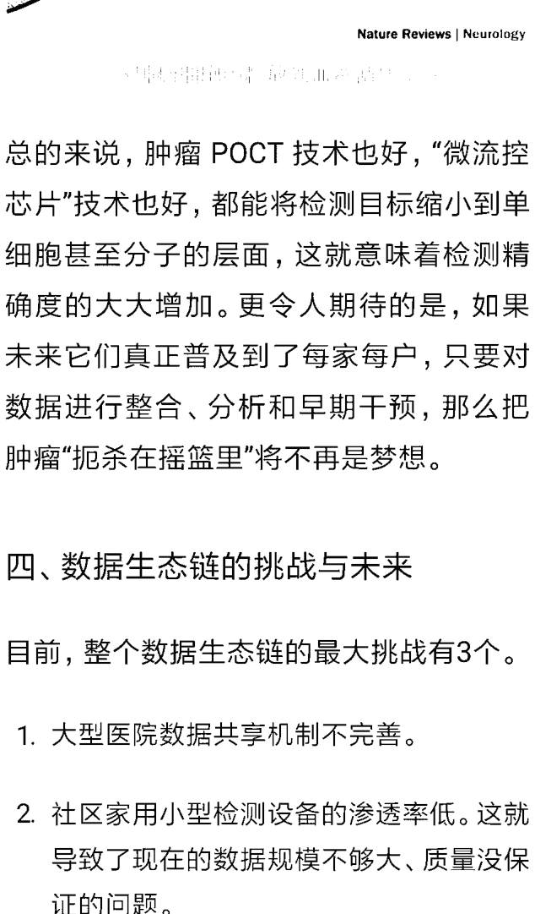

总的来说，肿瘤 POCT 技术也好，“微流控芯片”技术也好，都能将检测目标缩小到单细胞甚至分子的层面，这就意味着检测精确度的大大增加。更令人期待的是，如果未来它们真正普及到了每家每户，只要对数据进行整合、分析和早期干预，那么把肿瘤“扼杀在摇篮里”将不再是梦想。

### 四、数据生态链的挑战与未来

目前，整个数据生态链的最大挑战有3个。

- 1. 大型医院数据共享机制不完善。
2. 社区家用小型检测设备的渗透率低。这就导致了现在的数据规模不够大、质量没保证的问题。
3. 医疗行业的数据和其他行业相比更加复杂，数据涵盖了诸多方面，所以，数据之间的互联互通也是一大难题。

我们说，没有一个“大”而完整的健康数据库作为支撑，生态链就很难构建。所以，未来精准医疗的发展还需要多方面的努力，包括技术的突破和相关政策的干预。

未来，随着我国医疗产业的不断升级和相关国家政策体制的改革，大型公立医院将会向社会开放更多资源。同时，小型医疗数据采集技术的不断发展，会使得数据采集设备逐渐渗透到社区和家庭中，支撑起一个大健康数据库，构建一个大健康生态链不再是梦想。到那时，精准医疗会迎来一个灿烂的时代。

### 五、总结和展望
总结一下，今天我们说了三点：

- 1. 目前精准医疗面临着个体健康数据获取困难的问题，“互联网+”的兴起让人们看到新的希望。只要构建一个完整的数据生态链，就能解决这个巨大的挑战。
2. 在整个数据生态链中，数据的采集端至关重要。除了我们已知的可穿戴设备，小型医疗器械 POCT 也是重要的数据采集手段，尤其在慢性病的监控和干预方面发挥着重要作用。
3. 数据生态链目前还很难构建，需要多方面的努力，包括技术突破和相关政策的干预。但是，随着医疗产业的升级和相关政策的改革，我们终将迎来一个灿烂的精准医疗时代。

王煜全

好，以上就是今天《全球创新260讲》的内容，欢迎你留言写下你的收获或感想，我们下周见。

### 前哨历 10月21日

### 我的今日知识清单：

- 1. 精准医疗以大数据为基础，以基因测序为工具，为特定个体制订针对性治疗方案，提升了医疗质量，也降低了医疗成本。
2. 精准医疗面临个体健康数据获取困难的问题。“互联网+”的兴起让人们看到新的希望。
3. 除了我们已知的可穿戴设备，小型医疗器械 POCT 也是重要的数据采集手段，尤其在慢性病的监控和干预方面发挥着重要作用。

> 摘自：《创新地图 | 当精准医疗遇上 “互联网+”》

“得到”专栏《全球创新260讲》
从前5年，抓住50个新科技浪潮机会

“创新地图”是《全球创新260讲》的周末特别版块，主要由专栏的科技社群“前哨团”供稿，为你带来科技领域的专业知识。前哨团主要由全球各地从事科技领域工作的投资者、创业者、研究人、学者等组成。

### 用户留言

## 【季度复盘与总结】| 我们为什么要活在未来？

本周是前哨第一季度的最后一周，我们用一组如何活在未来的话题作为第一季度的总结。因为我们的前哨栏目讲述的都是科技如何塑造未来的话题，我也看到了很多留言，说我不是科技领域，你说的这些科技未来对我有什么用呢，我们这周就来解决未来对你如何有用的问题。

### ——► 未来已经到来 ◄——

### 一、未来已来的证据

首先要说的是，世界正在加速变化，我们给大家介绍的科技未来，正在来到我们身边。

### | 电动车是一个未来

第一个新闻，2017年10月12号，巴黎市长说到2030年，所有汽油车都不能在巴黎行驶了。实在在之前他也宣布，到2024年所有柴油车都不能上路了。

第二个新闻，LG明年要在欧洲建立最大的电动车电池厂。

### | 自动驾驶是另一个大趋势

我们在2017年1月 CES 展的介绍上曾经提到过，我们尤其强调了一句，CES 展是市场风向标，如果你会看展览的话，你能看出很多的发展趋势，我们2018年1月又会带大家去 CES 展，欢迎大家报名。

### | 机器人正在从演示走向生活

未来机器人的数量甚至会超过人口数量，就像当初手机的数量超过人口数量。

#### 1. 物流机器人

#### 2. 工厂在用机器人替换工人

#### 3. 商业机器人

### | 环保也会成为趋势

美国退出巴黎协定之后，中国成了坚决的支持者。

专家的看法不太一样。

因为国外的太阳能发展的趋势是分布式能源互联网。国外是居住得比较分散，所以利用住户的屋顶来进行发电，然后利用像特斯拉的电池墙 Powerwall 那样的方式来做分布式的储能…等等

我认为这条路在中国其实并不现实，因为中国并不是这样的广泛分布在城郊的居住情况，因为中国绝大多数人并没有一个独立的House，一个独立的房子来住，所以屋顶面积是不够的。我认为中国需要建大量的大型的太阳能电站，和相对集中的储能设备。

- 第一，中国的山地荒地很多，可以集中利用；
第二，中国总的来说，管理不够精细，尤其智能程度不够，一下上了很多的微小的分布式系统，会对集中的能源的主干网形成巨大的压力，这…；
第三，上大项目是中国特色，但动员每家屋顶都安装，其实难度是非常大的，但是政府批文立项是政府已经总结出经验的操作模式，所以我们认为，中国走的路和国外会不太一样，就是各地都要建中型以上的电站。

我前一阵从北京出去了趟五台山，一路上看到很多荒山，都披上了蓝黑色的新装，都被改造成了太阳能电站，我觉得这是非常喜的改变。

### 二、先进科技离我们越来越近

### 三、科技正在全面地改变各个领域

### 四、变化是有规律的

关于人性，今年的诺贝尔经济学奖，奖给的就是行为经济学的奠基人之一泰勒。

行为经济学、心理学，尤其是社会心理学、认知科学、神经科学的进展，加上互联网和大数据的实践，都使我们对人性的了解极大地加深了。尤其在社会需求层面，我认为有一本书，叫《正义之心》，是一个经典，因为它把整个社会如何能够达到更和谐的因素、要素，第一次清楚完整地阐述出来了。

很可惜，作者后来去了纽约大学商学院，据说商学院的工资要比心理学系高，他去研究资本主义了，但是其实我觉得即使他待在心理学系，从正义之心去研究未来的社会需求，依然是一门大学问，比研究资本主义大多了。而技术对人性正在形成放大、缩小、扭曲、还原等改变，所以从人性的基础出发去研究技术如何去改变，就能对未来有更深的了解。

在这儿我举两个例子：

#### 第一，技术让人们越来越有闲

### —— 活在未来 ——

### 活在现在

### 活在过去

- 1. 成功的要素
2. 终身学习

### —— 三种未来 ——

### ——♦ 三种未来 ♦——

所以活在未来也要问是什么时点的未来，我认为有三种未来：

短期的未来，就是把你的能力、资源和信用最大化变现的未来，它背后考验的是你对应用的理解。

中期的未来，是最大化优势叠加，形成更大势能的未来，它背后考验的是你对技术的理解。

长期的未来，是建造自己的能力、资源、信用优势的未来，它背后考验的其实是你对社会发展的理解。

我们后面的几天里，会给大家详细介绍如何活在中期、长期、短期的未来，敬请期待，欢迎一起走进未来。

王煜全

我是王煜全，你的全球科技前哨侦察兵，我们明天见。

### 前哨历 10月23日

### 我的今日知识清单：

- 1. 科技正在全面地改变各个领域，每个人都有巨大的不能适应变化的焦虑感，只有把所有的时间、精力都放在对未来有意义的事情上，才能把握住未来，活在未来。
2. 活在未来有三种：短期的未来，是对科技应用的理解；中期的未来，是对技术的理解；长期的未来，是对社会的理解。

> 摘自：《【季度复盘与总结】| 我们为什么要活在未来？》

「得到」专栏《全球创新260讲》
提前5年，抓住50个新科技浪潮机会

### 用户留言

提交留言可与专栏作者互动

### 预告 | 第一季度总结：活在未来

### —— 下周预告 ——

时间过得真快，我们的前哨第二季转眼就播出一个季度了，明天开始的一周，我会作第一个季度的季度回顾，主题叫“活在未来”。

我们大家都很焦虑，所以玩命地工作，玩命地学习，其实体现出来的就是对未来的恐惧。但是，如果你从今天起就活在未来，你对未来就不光不会焦虑，还会很期待了。

所以，下周我将用一周的时间告诉大家如何活在未来。同时，下周还会发布第二季度的课表，千万不要错过。

王煜全

我是王煜全，你的全球科技前哨侦察兵，咱明天见。

### 用户留言

## 【季度复盘与总结】| 如何抓住未来3-5年的行业机会？

我们昨天介绍了活在未来可以分为活在三个不同的未来里：短期的未来、中期的未来和长期的未来。

短期的机会不太大，长期的又未必能坚持，所以对大多数人来说，最重要的是中期的未来，也就是3到5年之后会成为现实的那个未来。

中期未来最重要的是把握行业变革的能力，需要对技术有充分的理解，要活在中期的未来里，我们要聚焦在最有机会，同时自己最熟悉的产业里。要具备三种能力：

- - 第一是判断产业未来的能力；
- 第二是开发出未来需要的相应技能的能力；
- 第三是掌握未来势能的能力。

### ——► 未来的机会 ◄——

### | 首先要具备判断未来机会的能力

有关未来机会还要啰嗦一句：

现在不光机会来得越来越快，而且市场对机会的响应也越来越激烈，但是就像我在前哨里和很多公开场合反复强调的，行业的变化和企业的崛起都越来越像“蝉”，我们习惯叫“知了”的那种昆虫。蝉一般会在树下土里面生活7、11年或者13年，从地面上根本不知道它的存在，但是一旦破土而出，它就“高声自远”，天下闻名了。

行业的机会和企业崛起的机会现在都与此类似，在热起来之前往往都还是有一个比较长的潜伏期，一般来说这个潜伏期有5到10年。

不知道你第一次听说特斯拉是哪一年，但实际上它今年已经14岁了，比 Facebook 还大一岁。特斯拉因为需要巨大的资金支持，所以在2010年仍在亏损时就上市了，尽管如此它都已经7岁了。

互联网的潜伏期可能短一点，但是 Facebook 真正为社会所重视，是2007年底到2008年初美国金融危机前后，李嘉诚高价投资它，当时 Facebook 的估值到了150亿，李嘉诚投资了1.2个亿。

顺便说一说：

巴菲特的投资哲学是用公允的价格投资优秀的企业，在巴菲特眼里，李嘉诚给的价格肯定是太贵了，不过科技公司和传统公司最大的区别就是极高的成长性。所以到了 Facebook 上市以后，李嘉诚赚了好几十倍，你不得不佩服李嘉诚的眼光。

如果你在业内，你可能会对潜伏期的这些企业或者行业知道得早一点，毕竟是“春江水暖鸭先知”，但是这个潜伏期还是不可跨越的。所以无论什么年代，大多数人还是不够前瞻的，还是要等潮流非常明确地形成了才会跟风，要活在未来，锻炼的就是别人没看清，自己不光先看清还要先行动的能力。

但是潜伏期之后的爆发期也会比过去得猛烈，因为全国人民现在都有焦虑感，所以一个潮流一来大家都拼命跟风。

北大著名的社会潮流研究专家刘德寰教授说，中国人现在是不分年龄、不分阶层、不分职业地赶时髦，当然这也是好事，因为现在科技已经成了新时尚，所以中国的科技进步才这么快。不过如果你正好在潮流里就要比较冷静，潮流来了，大家都欢呼了，不代表你已经成功了，只说明你可以利用这个潮流积蓄更大的能量才能走得更远。

比如现在的人工智能，潮流已经来了，似乎全民都在喊人工智能，创业机会虽然已经不多了，但是其实现场还没有起来，各公司的收入利润都还没有起来。这时候不光要振臂一呼确立地位，更重要的是做事业，要把业务做实才行，要在中国成家事业，要做到潮流没来的时候耐得住寂寞，潮流来的时候压得住冲动。

### | 判断未来的行业机会分成三个层次

- - 第一是行业内的技术带来的变化；
- 第二是行业外的技术带来的整体变化；
- 第三是社会需求带来的变化。

我们举两个例子：

#### 1. 生物医药产业

从行业内来看，肿瘤免疫治疗无疑是最大的热门，近期有不少新药出现，还有肿瘤疫苗出现。但是人体实在太复杂了，人体和环境的互动更复杂。

#### 2. 人工智能和机器人产业

从行业来说人工智能很热，但是要小心人工智能正迅速地工具化，需要赶紧和具体应用相结合。因为这一轮我们讲过是做不出 AGI（叫做通用人工智能）的，最近 AlphaGo Zero 的消息很热，我相信很多人都听说过，因为他不仅战胜了李世石，还做到了不用向人类学习，只要左右手互搏就能练成绝顶高手。

但是：
第一，这仍然是弱人工智能，不是 AGI，只能解决一个领域的问题；
第二，仍然是有限范围里完全信息的博弈，不是我们每天面对的各种信息不完全的情况，所以人工智能其实应该说它的发展会慢慢地见顶。

从整体技术高度来看，中国的劣势并不在纯软的领域。

在纯软的领域。

比如说在人工智能的算法上，多数并不是中国最先推出来的，而是在软硬结合的应用领域，尤其是中国东南沿海的产业集群能力，是我们的重要优势，这个我一直在反复提及。

另外从社会的角度来看，农民工短缺，制造和物流机器人的需求就非常明确，社会也在进入老龄化，服务机器人的需求潜力巨大。

我原来也批评过某些国内企业家，说中国进入老龄社会应该放开多生孩子的说法，因为这些孩子老了以后谁为他们养老呢？但是多造机器人是没有问题的，因为机器人不需要养老。

所以总起来你会发现，我们中国的制造优势加上人工智能、加上应用场景的实际体验，会使中国在全球未来机器人市场成为领导者。

### ——▸ 未来需要的技能 ◂——

我们讲如何去预测未来，预测未来以后需要什么技能呢？

我们原来也介绍过，在人工智能时代，什么都可以替代，但是有三种能力是不可替代的：

- 一个是创新力；
- 一个是连接力；
- 一个是领导力。

#### 1. 如果你是技术开发人员

就应该尽量掌握未来有需要的这种技术，比如这个人工智能的网上课程，斯坦福大学教授吴恩达在人工智能方面是开创者，也是绝对的权威，他就提供了人工智能的网上课程可以学习。

新的技术要尽量了解，比如说谷歌推出来的 TensorFlow，很有可能变成未来通用的人工智能的算法语言，需要掌握。

讨论新技术的论坛要去泡，比如说 IT 宅男的交友网站叫 GitHub，可以去泡一泡，认识这方面的高手。

#### 2. 如果你是市场人员

要尽量了解到技术能做什么，并且去预测本行业的市场格局变化，作出相应的准备，同时去更多地结识那些本行业的技术高手。

#### 3. 如果你有很丰富的行业经验

能够找到行业痛点，并且利用新技术来解决问题，那很可能就是你的创业或者事业拓展的机会。

#### 4. 如果你是管理者或者是行业分析人员

你就应该尽量明确地阐述清楚行业的问题，以及未来行业发展趋势和方向，然后利用一切机会去布道，这就是我们说的如何变成未来的创新者、连接者和领导者。

### ——▸ 积木式创新 ◂——

我们前哨一直在推广积木式创新的理念，这个理念坦白说并不是我们的发明，而是现实发生的科技创新的一个创新的新模式，我们只是碰巧发现了它，而且给它起了个名字而已。

一方面，因为有了积木式创新，创新的门槛拉低了，每个人都可能是一个下一个世界500强的创立者；

另一方面，你不必加入大企业以获取必要的能力，但是你要学会找到自己的圈子，学会建立自己的生态，也就是说找到那些和自己互补的长板，你才能够成就自己的事业。

当然这里面最重要的是心态，未来刚刚出现的时候，必然是不完美的，不要成为批评者，而要成为未来的建设者。

我们做科技特训营的时候实际发生过一个小例子，就在今年9月份的科技特训营上，我请了做酒店机器人的云迹公司的 CEO 支涛，和做药店机器人的小乔公司的李沛桦来给大家作分享，因为我非常坚定地相信，他们已经走到了机器人应用的前列，而机器人就代表着未来发展的方向。虽然可能你今天还没有听说过云迹和小乔，但是如果明年都还没有听说过它们，你可能已经落伍了，所以这就是为什么我请他们来给大家作分享。

在提问的环节，我们的学员里有一位酒店行业里面非常资深的朋友，他问了很多专业的问题。这些专业问题其实并没有错，而且现有的机器人很多也还都做不到。

但是我当时就叫停了，我问他，我说你相不相信未来的酒店业会大量使用机器人？

他的回答非常明确，相信。

我说，那现在的机器人还不能满足酒店的全部需求就不要紧，关键的是这个公司已经成了酒店机器人的先行者，能够造出未来，能够满足各种深层需求的酒店机器人的机会，那无疑这家公司是最大的。

所以最重要的是你自己的定位，当未来酒店机器人已经成为一个潮流的时候，你在未来说，其实我早早地就接触到了酒店机器人，只不过我当初成了一个批评者，并没有参与。还是你希望在未来说，我当初早早地就接触到了酒店机器人，而且我预测到了它会成为潮流，所以我成为了酒店机器人推广的最早的推动者。

所以我希望我们是要当推动者，而不是当个批评者。

这位同学非常棒，他立刻就听懂了，第二天下午他就来和我说，我和他们公司已经谈了，我会利用我的资源全力帮他们推广。所以祝福这位朋友，也祝福云迹、祝福小乔，也祝福中国的机器人产业，我真地希望听到更多这样的好消息。

看清了趋势、锻练了能力、培养了圈子，未来就一定会属于你，因为在你做这些事情的时候，你就已经活在未来了。

王煜全
我是王煜全，你的全球科技前哨侦察兵，我们明天见。

### 前哨历 10月24日

### 我的今日知识清单：

- 1. 短期的机会不太大，长期的话又必须坚持，所以对大多数人来说，最重要的是中期的未来，也就是3到5年之后会成为现实的那个未来。
- 2. 要活在未来，锻炼的就是别人没看清，自己不先先清晰要先行动的能力。
- 3. 看清了趋势、锻炼了能力、培养了圈子，未来就一定会属于你，因为在你做这些事情的时候，你就已经活在未来了。

> 摘自：《季度盘点与总结》 | 如何抓住未来3-5年的行业机会

「得到」专栏《全球创新260讲》
距前5年，抓住50个预测科技浪潮机会

### 用户留言

## 063 | 特别放送：如何获得掌握未来的力量？

【季度复盘与总结】| 如何...

昨天我们介绍了中期活在未来，就是活在技术趋势带来的产业变化里，因为这种产业变化往往配套着巨大的机会，但是如果没有正确的心态和行为的支持，要把握这些机会并不容易，因此我说，要真正惬意地活在未来，就要活在长期的未来里。

如何做到呢？

有三点：

- 1. 了解未来社会；
- 2. 有适应未来的心态；
- 3. 要把心态转化为行动。

### 一、了解未来社会

似乎这个很搞界定，但是我们有一点是可以肯定的，我们都知道有个俗话经常会被引用，狄更斯说：

> “这是一个最好的时代，也是一个最坏的时代。”

但是我认为，我们应该建立面向未来的世界观，这个社会是一个指数型增长的社会。

因此，这既不是一个最好的时代，也不是一个最坏的时代，因为在任何一个指数型增长的社会里，指数型增长都会形成一条指数曲线，指数曲线上的任何一点往前看都是平的，往后看都是陡的，也就在任何一点，你看过去发展得都比较缓慢，你看未来都在加速变化。

所以说，我们认为必须要求应这样一个加速变化的时代。当然，在这加速变化时代里，有很多的未来趋势还是已经显示出了它的强大的影响力。

#### 1. 人工智能将会释放人类的创造力

比如说我们昨天也提到了，人工智能和超级城市，双方面一推一拉，都在激发创造的爆炸。

#### 2. 未来并不是一片美好

#### 3. 人类拥有了上帝视角

#### 4. 通过专家意见迅速构建行业理解

我原来介绍过罗素，他有避免接受知识垃圾的三条原则：

- 第一，专家意见一致的时候，相反的观点不可能为真；
- 第二，当专家意见相左的时候，没有一个观点能被非专家判断为真；
- 第三，当专家都认为一个肯定的观点缺乏理由的时候，普通人要悬置判断。

现，对他著作的理解就容易得多。

另外，对专家也要作细分，也是伯特兰·罗素曾经说过的：

知识是一个有很多房间的迷宫，有两种人在为知识这个迷宫作探索：

有一种人，是打开一个个的从来没有人开过的房间，去探索那些未知的领域；

另一种人，通过把这些打开的房间的信息收集起来，描绘出迷宫的整体图景。

罗素认为，他自己就是那个描述迷宫整体图景的人。而当时另一位著名的哲学家维特根斯坦，则是那个能够探索一个未知的房间的探索者。

所以我们说，真正深入的观点，其实是那些打开房间的人的观点。

### 二、适应未来的心态

我们说，有四种心态能够保证你在面向未来的时候，能够有优势。

- 1. 坚定的心态

- 2. 热情的心态

因为我们刚才讲过，未来是一场迷雾，这就意味着没有未来是100%确定的。但是，如果你认为未来不确定，所以就没有办法去准备，那就大错特错了。

所以，只有对未来的享受，对未来做这个活在未来的事情这件事本身，能够给你带来足够的快乐，才能支撑你为未来付出行动，因为我相信当你这么做了之后，你会觉得那是你一天当中最快乐的事情。所以，对未来的热爱会支持你走得更远。

#### 3. 坚持的心态

因为任何事情的变化都是要花时间的，尤其是我们都知道，黎明前的黑暗总是显得非常漫长，未来的到来也是需要时间的。尤其是在我们充满期待的时候，你经常会觉得未来怎么还不来，真的难以忍受。这种时候，坚持的更久，无疑就更可能成功。

#### 4. 开放的心态

因为大方向上需要坚持，但是在细节上需要不断优化。

我原来猜过很多年的竞争情报，在竞争情报领域流行着一句话，说：

> 企业经营就像顺水行舟，既要保证大方向的正确，又要根据水流的情况及时调整，不能说你大方向正确了，撞上礁石也在所不惜，一定要

有灵活性。

因为我们说，未来是一个逐渐不断清晰的过程，当清晰了的未来和你的设想不一致的时候，尽快作出调整。所以，这个是我们总结的心态。

### 三、把心态转化为行动

#### 1. 每天坚持的复利效应

现在应该是投资界的圣经了，《穷查理宝典》里面就讲过复利效应，就是说，如果你每天坚持，哪怕只比别人多做一点点，日积月累下来，你的优势就会非常醒目。其实巴菲特也只不过是每年比别人多赚了百分之几而已，但是积累下来，他就成了世界首富。

所以，最重要的是，不管你对未来有什么样的心态，有什么样的看法，你想让自己真正地活在未来，在未来真正地构建起优势，最重要的是每天都要有行动。

#### 2. 重视就要付出，尤其是时间

#### 3. 活在未来的浸润感

> 很多人都问我，是如何了解这么多的科技信息？

#### 4. 有计划、有结果，把坚持变成习惯

我们之前讲过 STEAM 教育，STEAM 教育其实就是让孩子们从小活在未来。

王煜全 我是王煜全。你的全球科技前哨侦察兵。我们明天见！

### 前哨历 10月25日

### 我的今日知识清单：

- 1. 赶进未来像走进一场大雾，在走近的过程中会逐渐清晰，当未来变成现在，一切就是清晰了。 2. 不管你对未来有什么样的心态，有什么样的看法，你想让自己真正地活在未来，在未来真正地构建起优势，最重要的每天都要行动。 3. 当你能够通过行动，真正地获得活在未来的收获的时候，能够在活在未来当中体现了价值、获得了成绩的时候，你就获得了掌握未来的力量感。

摘自：《063 | 特别放送：如何获得掌握未来的力量？》

「得到」专栏《全球创新260讲》 投资5年，航行50个科技浪潮机会

### 用户留言

## 064 | 特别放送：如何把握眼前的机会？

【季度复盘与总结】| 如何...

我们前面几天介绍了活在中期的未来和长期的未来，今天大家也知道，肯定是介绍短期的未来来了。

短期的未来，可能很多人会更关注，因为其核心就是对眼前机会的把握，大家都是对眼前的东西更关注一点。

很多人会说，眼前机会其实很难把握，因为完全没有线索。

我给大家举个例子，比如说：

在我们这周的节目里面就有一位听众留言，说我们在之前节目里介绍过的牙科的一个矫正畸形的设备，一年之前就在美国的市场上市到了，因为他的太太试用了这个产品，发现比原来产品要好很多。而其实美国对牙科正畸的需求是很朐的，于是这位朋友果断地买了这个公司的股票，到现在一年时间已经都翻番还多了。

也有很多朋友说，我去年给大家推荐过的一些机会，回报都不错，很多人问我是怎么做到的，尤其是像比特币，我推荐的时候3000块，现在已经3万多了。其实，这种推荐也很简单，核心就是回归本质，比如说有关比特币的分析，我就会想：

- 你想不想要一个能够安全交易的跨国货币系统；

那些根这个系统，想搞垮这个系统的人能不能真正搞垮它；

这个系统有没有通货膨胀的风险。

你想想看就知道，其实比特币满足了这3个条件。

- 第一，因为它在互联网上，所以跨国交易很容易；

第二，我们都知道比特币勒索病毒，痛恨这个系统的人很多，但是迄今为止都搞不垮它，除非你把全世界的互联网都关掉，要不然这个系统就是足够强壮的。

第三，因为它是用法算法来约定的，所以没有通货膨胀的风险。

那么，这样的东西当然非常适合做货币，因为从本质上讲，货币就是不容易大量生产，但又容易分割的东西，尤其是如果能够无限可分就更理想了，这些东西就会被用来做交易的中介物。但不是所有这样的东西都能做成货币的，但是实际上适合做货币的东西非常少。大家一直都在找，全世界都要交易，都要用货币，结果全世界找到的东西都一样，不过是金、银、铜而已。

另外，很多 saate说，比特币没有国家支持。不要忘了，货币的出现可是要国家之前，而且我以前在《互联网周刊》的专栏里曾经分析过，未来的全球经济发展，有打破国家束缚的需求，今天的反全球化浪潮，其实是一种逆流，持续不了多久的。

所有这些分析下来，你就会得到判断，比特币作为虚拟货币是足够强大的。而且，即使不作为虚拟货币，只要大家都认同，它就具有存在的价值，再加上它稀缺，就一定会涨价。

所以我们认为，其实要想真正地活在未来，也不复杂，就是能够用心地去积累生活的智慧。

总结起来，活在未来有三点：

- 第一，对市场信号的敏感性；

第二，对产业内幕的了解程度；

第三，对自己实现行动目标的这种能力的把握。

### 一、对市场信号的敏感性

有一本书我很推崇，叫《信号与噪声》，因为它的作者是一位预测界的大牛，叫做 Nate Silver，而且他和别人不一样，他不是一个理论高手，而是一个实践者。

实践和理论最大的不同就在于，你要在现实当中去检验自己，要用成败来论英雄。

预测的核心，不光是把握信号，还有过滤噪声。你会看到市场当中，不光充斥着能够使我们对未来作判断的一些前导性的信号，同时也充斥着很多噪音，就是这些会對於我们的未来形成干扰。

Nate Silver 本身那么理解信号和噪声的意义，还出了著作。但是，这么牛的人在预测 2016 年的美国总统大选上，还是出了错，他没有能够预测到川普能够最终当选。其实原因也很简单，因为在预测出了错以后，Nate Silver 在他自己的网站上写了一个非常长篇的分析，分析为什么自己出了错误。

简单总结一句话：因为川普不是政治家，数据量不够，因为任何的预测都要有足够的数据做基础。

有人也提出这样一个问题，说现在已经有人拿人工智能来炒股了，会不会造成以后在股市上人都没有机会了，因为人总是干不过人工智能的， g 下围棋我们都不输了吗？

据我所知，人工智能炒股的实力确实已经越来越凸显了，但是那是短线交易，就是说以后你想在短线交易上赢过人工智能，我觉得机会不大。但是，长期交易还没有看到，因为一样容易数据量不够，就是说如果你要做长期分析的话，你就要积累更多的数据。现在很多数据量未必支持。

所以从长线上来讲，要判断一个公司未来是否优秀，未来的成长性是否足够好，我们都强调科技企业的核心就是它的高成长性，那么至少我知道的人工智能水平是不够的，要不然的话，就不是人工智能替代炒股，而是人工智能替代投资者了。

当然，短线投资人工智能做得好的话，其实对人是个好事，因为过去在市场当中充斥着大量的短线的炒股理论，真伪难辨，很多世人依据这个去操作，赚了赔了我不好去评论了。

但是，总的来说，这里有很多的迷信成分。现在，这些理论都面临着被人工智能打脸的风险，就像 AlphaGo 赢了围棋冠军以后，其实也顺便刷新了很多围棋界的成见，围棋界其实过去也有很多的迷信说法，认为这么走对，那么走不对，其实回头来看，经过 AlphaGo 的检验，那些说法都是没有依据的。

人类形成迷信以后，自我纠偏的能力不足，所以让人来说可以帮助人类纠偏，这未必是坏事。

另外，人类是冒着失去确定性的风险去快速作出模糊判断的高手。

什么叫失去确定性呢？

就是所谓的“一朝被蛇咬，十年怕井绳”，我明明没有看清楚到底是井绳还是蛇，但我宁愿先把它判断成蛇，这样就能够迅速作出判断躲开，免得即使我这个判断的准确率提升一点了，但是我躲得太近，如果是蛇就该被咬了。所以，这其实是亿万年自然进化出来的结果。

其实这也告诉我们，人类之所以进化成现在这样，是因为我们也是以成败论英雄的，凡是失败的物种都被淘汰，都消失了，所以人的这种思维模式肯定比人工智能有高明之处。

所以人为什么要怕人工智能呢？你以为你的大脑是什么？

其实它构是最超低能耗，最超高并行能力，在极少数数据量基础上就可以得出多个不同的系统的综合结论的超级计算器，是已知宇宙中最复杂的结构。

至少从人工智能发展的基础上看，人工智能想要进步，还要进一步向人类致敬。而且，最重要的一步，就是要抛弃确定性，因为人脑就不是建立在确定性基础上的。在完全抛弃确定性之前，人工智能是无法和人竞争的。

所以我们简单地说，就是我们要拥有一双发现问题的眼睛，发现问题比解决问题更重要，因为当你发现问题的时候，你就可以把这个问题交给计算机去解决，交给人工智能去解决了。

但是，人工智能可不会漫无目的地去搜索周围的环境，找到有什么问题需要它解决。解决 什么问题，是需要你给它来定义的，它是不会主动去挑战老多数的。

### 二、对产业内幕的了解程度

当然，因为我们讲的是很多关于行业的东

当然，因为我们说的是很多关于行业的东西，在行业而言，就是既要有婴儿的眼睛，又要有老江湖的经验。因为很多行业很复杂，不是一眼能看透的，不要指望一个婴儿能够读懂一个行业。所以，很多时候要把自己浸泡到这个产业里去，了解它的方方面面，甚至要更多一点知道它的内幕，你才能对它作出精准的判断。

我最近在美国和我最敬爱的一位美国投资人交流，他自己也是创业过，成功地创业了以后再做投资的。他跟我说的 الث i一句话非常打动我，他说：

> 咱俩都一样，都是敢于作决策的人。因为其实不管对错，决策都要顶着比常人大的多的压力，都要扛着比常人大的多的风险，所以绝大多数人只会随波逐流，按老规矩办，而不敢决策。

确实，我自己的体会也是如此，国内外都是一样，为什么很多大企业到最后经营不过小企业，就是因为很多大企业看似人才济济，都是高材生。或者在国内有大量的都是唯老板一人的马首是瞻，老板说什么，我们就做什么，这样不犯错。在国外的也是一样，官僚主义遵守着自己的规则，只要不犯错，熬年头就能提升。

所以，和我们看到的很多企业管理的东西不一样，真正的企业管理的内部，是充满着这种勇于承担风险和勇于决策的压力的。

这是做企业，我自己经营过以后就理解，其实自己看一个企业和外人看一个企业，判断一个企业是不是有好产品，是不是有好技术，是不完全一样的。

同样，因为做咨询的关系，我给中国移动做过很多年的顾问，从中国移动内部，我们看到的行业发展的规律，和外面的分析也会截然不同。

因为我自从给很多企业做过很深的咨询顾问以后，就逐渐地放弃了做行业分析报告了，当我再去看别的，尤其是一些泛泛的行业分析报告的时候，讲这个行业未来每年能够增长多少，能够达到多大规模的时候，有时候会哑然失笑，因为这些人明显是站在行业外面去描述这个行业的，对行业内部的规律，内部的机制是不了解的。

所以你看，不管是企业、行业，甚至还有社会都有很多隐形的规律，有些是大 家心照不宣，有些是大家习惯成自然，有些是大家默默遵守，甚至都沒有意识到的东西，这些东西你只有都了解了，才能对整个行业趋势、社会趋势产生更深入的理解。

所以我们一般要看一个产业的话，总是希望能够了解更多 的东西，它到底是2B的还是2C的，它产业链结构是如何的，它的核心控制点在那儿，到底是行政的控制、市场的控制、技术 的控制，还是材料短缺的控制，谁是甲方，市场当中谁说了算，了解越多的内幕，你就越能够接近真相。

比如最近苹果推出了无线充电的手机，所以各种无线充电的新进展的消息满天飞。但是，这些新进展里面，坦白讲，绝大多数其实都是有很大的夸大成分的，真的技术进步，要看这些技术在业内已经得到了广泛使用。

据我所知，还是我们投资的WiTricity，现在来说离产业是最新的，因为2017年1月份的CES消费类电子产品展上，戴尔公司确定推出了无线充电的笔记本电脑，这是世界第一台，现在已经开始批量供货了。另外，宝马也明确宣布了，明年在年中的时候会发布量产的无线充电的电动车，也是和WiTricity合作的。

我知道内幕，是因为我在他们的董事会里，所以知道其实全球的各大车厂，基本都和WiTricity签订了合作。当然，这种内幕消息，如果让每个人都能够获得是不现实的，毕竟我们还有一点投资者的小特权。

今年4月份前嗨大会上，罗胖说让我专职做栏目内容，我说这个还是不行的，因为那样会脱离一线，如果你不做投资，很多这样的细节的了解就得不到了。

### 三、对自己实现行动目标的这种能力的把握

当然，我还有一个小小的野心，就像我昨天说的，我们是在推动社会的，光说不练不行，我对自己也是这样一个要求，就是要以成败论英雄。

我们自己就在做积木式创新的践行者，积木式创新到底能不能成功，不是看有多少人接受这个理念，而是要看有多少企业因为这个理念而发展壮大。因为我们最后的目标，是要推动科技进一步地改变每个产业，而且要推动中国，因为只有最积极地拥抱科技产业，又用最先进的科技思想武装自己，才能使得中国在全球的科技当中能够取得领先，甚至带动全球科技发展走得更快。所以，关键是要去做，而不是只是在边上看去分析。

很多人会说，我没有做的机会，所以我们就要强调，要给自己找到尝试的机会。

我原来刚毕业就自己出来创业做咨询，一开始肯定是没有什么机会的，能拿到一个做一些简单数据收集的单子就不错了，更别说做更高端的市场咨询、战略咨询了，因为没有人会相信你。

> 那怎么办？

我们就把低端的咨询机会给它做成高端的，明明你只找我要数据，但是我非得给你写市场分析，写战略分析，你不要我免费送给你好 不好？

上喊没有机会，结果机会真的来的时候，也把握不住。

所以，事先的准备是非常重要的，如果你想未来创业，那现在就要去学会具备管理意识，具备财务意识，具备产品意识。至少你要去结识相关的人才，这样每个你自己不灵的领域都有别人能够帮助你，这就是我们说的积木式创新，不要求你是全才什么都会，但是要求你有一个突出的强项，能够和别人的强项相结合。

你也可以说，我不想创业，或者还没有创业，没关系，其实即使是企业，内部也都是越来越小型化，每个功能都独立出来了，所以造成每个人都需要像经营创业公司一样经营好自己的生活。而且，一旦你学会像经营创业公司一样经营你的生活的时候，你创业也就不难了。

所以，祝大家都能把自己的人生像事业一样好好经营，祝大家的事业都精彩。

王煜全

我是王煜全，你的全球科技前哨侦察兵。

### 前哨历 10月26日

### 我的今日知识清单：

- 1. 活在未来有三点：对市场信号的敏感性；对产业内幕的了解程度；对实现行动目标能力的把握。
- 2. 把自己浸润到产业里去，了解它的方方面面，了解更多的内幕，才能作出更精确的判断。
- 3. 终身学习，让你自己更有价值，拥有点石成金的手指，比拥有多少金子都强。
- 4. 这个世界不缺机会，缺的是发现机会和看到机会以后去勇于行动的决心。

> 摘自：《064 | 特别放送：如何把握眼前的机会？》

「得到」专栏《全球创新260讲》
赶前5年，抓住50个新科技浪潮机会

### 用户留言

提交留言可与专栏作者互动

## 065 | 特别放送：如何成为行业内最早的觉醒者？

【季度复盘与总结】| 如何...

### 用行动迎接已来的未来

本周是我们《全球创新260讲》每季度一次的专题复盘，我用一周的时间和你分享了活在未来的方法，帮助你提前应对未来的机遇和挑战，相信你也有很多的收获。当然，光知道方法还远远不够，你需要采取实际的行动，才能迎接已经到来的未来。

我在之前的内容中多次说过，希望前哨不仅能告诉你科技领域的前沿信息，还能帮助你参与其中。所以，我们专门从专属用户里，组建了一支美国东岸创新科技的考察团，从10月29号开始，展开10天的考察，我也会在考察行程中为你不定期地发回现场报道，同步我们的所见所闻所想。

这次行程我们会前往纽约、费城、匹兹堡、波士顿四个城市，走访罗格斯大学、普林斯顿大学、宾夕法尼亚大学、卡耐基梅隆大学、匹兹堡大学、哈佛大学、MIT、波士顿学院八所高校，以及多家最具创新能力的科技企业。

### 招募：2018年CES考察团

### —— 用户答疑 ——

关于电动车的发展趋势，像中石油、中石化这样的企业，将来是否会受到冲击？他们该如何应对？

我的回答是：

第三，特斯拉和其他电动车的关系有点像苹果和谷歌的安卓的关系，很多第三方电池厂都可以供应很好的电动车的电池组管理的解决方案，而电动车的传动系统很简单，也就是说特斯拉强调一切都自己做，连电池都要自己生产了，未来的大量电动车有点像安卓，像搓机器一样，是买别人的电池，买别人的传动系统，关键是自己去做个设计，去更好地满足用户需求，其实背后的潜台词就是，大家在设计上的差异不会很大，所以必然会带来很激烈的价格战。

所以我认为，不是特斯拉的原因，而是随着电动车的发展，市场的竞争会非常激烈，国内这些初创电动车公司，我觉得倒不是特斯拉会不会造成他们不堪一击，而是当市场竞争激烈了以后，必然有一个优胜劣汰，有一个市场头部逐渐地把别的小企业吞食掉，最后形成一定的垄断程度的过程。其实各个行业都能看到这样的特点。

未来，我认为电动车领域，中国也可能诞生而且不一定是一个，可能是 N 个巨无霸企业，这也是为什么现在很多创业者，包括很多投资人愿意大规模投入的原因。当然，这种投入也是一种赌博，因为竞争会是很惨烈的，多数人是熬不到曙光出现的那一天的。

在泰势汽车论坛上，国内外各方面都提到，即将推进汽车氢燃料电池的战略目标。那么未来5到10年，电动车汽车是否只是传统汽车到氢燃料电池汽车的过渡产品，不会持久呢？

### 我的回答是：

这个我要说一下，很多大车厂，包括国家要继续推进氢燃料电池的战略，其实是有技术储备的目的，也就是说，虽然电动车发展的未来趋势越来越明显了，但是至少在没有完全清晰之前，我们依然不能把所有的宝都押在一项技术路线上，万一另一条技术路线崛起呢？但这并不代表氢燃料电池就是未来。

其实，我现在看，电动车基本上已经确定是未来了。虽然氢燃料电池的能量密度最高，但是它很不方便部署，因为氢的储存运输都比较麻烦，而且又有安全性问题。而电池的进步使得电动车的续航里程已经足够用了，所以我认为未来基本上已经是电动车的市场了。

所谓过渡产品，电动车有个过渡产品，就是油电混合，油电混合这个过渡产品挺好的，因为既能利用现有的设施，现有的加油站照用，又能大大节约能源，因为油电混合车经常能把这个耗油降到100公里一个油以下，那就已经很省了，现在很多车100公里8到10个油，所以做油电混合我觉得已经非常节能环保了。

而且，现在还有另一个技术路线是搞生物燃料，不过现在看起来，油电混合加生物燃料可能都是过渡态了，原因并不是它们没有价值，而是社会有一个特征：

当大家都没有清晰未来的时候，就都会过度地犹豫，而当大家都已经看清楚未来以后，又会过度地追捧。

现在大家逐渐地会看清楚电动车就是未来，各家忙着上电动车的速度会越来越快，以至于会对那些其实还有价值的中间过渡产品加快淘汰。

顺便说，这方面其实给了中国很大的压力，现在我们中国的电动车其实是领先的，而且我们在市场需求基础上传承出来的低速电动车更是已经实现了上百万的销量。

但是，我们在对未来的前瞻性的分析和布局上，其实相当地落后。另外，我们的相关部门还是拿电动车当汽车来管理，对低速电动车的政策引导不够。

我实在是担心会错失机会，尤其是像美国这样创新能力强的国家，它的传统企业也不灵，但它的创新企业经常在新兴领域里面能够实现反超。

比如说原来手机一直以来美国就是摩托罗拉蓬勃，欧洲更强大，有诺基亚，有爱立信。但是，当苹果出来的时候，美国手机全面反超，包括安卓出来了以后，更是成了各大手机的操作系统。

所以，我觉得中国一定要重视，要研究美国，尤其是全球的电动车的发展趋势，针对性地加快中国电动车的发展，调整中国电动车发展的布局，政府也一定要给予足够的支持。

### —— 下周预告 ——

今天的问就就是这些，我们从下周开始，整个季度都会换个视角看问题，因为以前就有很多朋友提到说，你说的这些先进科技虽然好，但是我是做一些传统领域的，和这些先进科技无关。

### 我的今日知识清单：
1. 从全球市场的竞争历史来看，最终的胜出者往往不是资源最好的，而是前瞻性最强的
2. 技术会扩散的，任何拥有技术的公司都可能永远保持技术领先性
3. 高科技领域已进入全球化竞争阶段，美国对中国的研究深入，中国对美国需要更深层次研究
4. 电动车就像安卓手机，各家在设计上差异不会很大，未来的市场竞争会非常激烈

王煜全
我是王煜全，你的全球科技前哨侦察兵，我们下周见。

### 前哨历 10月27日

### 我的今日知识清单：

- 1. 从全球市场的竞争历史来看，最终的胜出者往往不是资源最好的，而是前瞻性最强的。
- 2. 技术是会扩散的，任何拥有技术的公司都不可能永远保持技术领先性。
- 3. 高科技领域已进入全球化竞争阶段，美国对中国的研究很深入，中国对美国需要进行系统化研究。
- 4. 电动汽车像安卓手机，各家在设计上差异不会很大，未来的市场竞争会非常激烈。

摘自：《065 | 特别放送：如何成为行业内最早的觉醒者？》

「得到」专栏《全球创新260讲》
提前5年，抓住50个前科技浪潮机会

## 066｜高科技引领服装产业潮流

066｜高科技引领服装产业...

从今天开始，我们要进入《全球创新260讲》的第二个大模块，也就是“高科技与生活”的部分，主要介绍那些与我们息息相关的产业里，都有哪些高科技的渗透和变化。

讲到生活，离我们最近的肯定要数衣、食、住、行了。那本周，我就来说说衣、食、住、行里的“衣”，我将和你聊聊衣服中的高科技。

### 一、技术引发服装革命性潮流

一说到衣服，大家最先想到的大多是款式和设计。那些受欢迎的服装品牌，好象都是靠设计取胜的。相比之下，科技好象和服装八竿子打不着一块去。不过我要说，事实并非如此。历史上几次服装产业的革命性潮流，可以说都是靠科技推动的。未来，科技更是会对服装的时尚性做出重大贡献，甚至会因为科技诞生更多的服装品牌。

### |Burberry的科技形象

举个例子，你肯定知道英国有个奢侈品牌叫做 Burberry，就是几乎所有产品上都带有独特格子图案的那家公司。

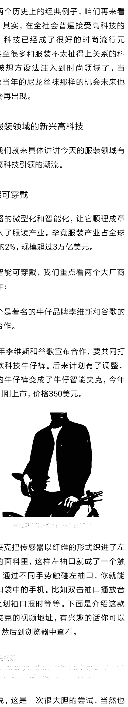

绝大部分人肯定都不知道，这家公司，当年其实是以科技公司的形象崛起的。

1880年，Burberry 的创始人 Thomas Burberry 发明了一种叫做“华达呢”的新面料，这种面料既防风、防水、又不影响透气性，也不像以往那些防水服那样沉重笨拙。这个技术为 Burberry 赢得了客户。人类最早抵达南极点的探险队，也就是阿蒙森队，穿的就是 Burberry 的装备。1914年，英国军方还曾经经使命 Burberry，让他们开发出能够适应现代战争的新式军装。之后 Burberry 就为军队发明了战壕风衣，我们现在的风衣款式，就是从这里来的。

你看，我们都以为 Burberry 是因为经典的格子设计而受人追捧，事实上当年它是靠华达呢面料的科技含量才备受人们关注的。

### |杜邦公司与尼龙丝袜

再举个例子，1935年杜邦公司的技术专家把煤油高温加热之后，拉出了一种坚硬、耐磨又纤细的新材料，叫作尼龙纤维。它的用途非常广泛，能用来做渔网、缆绳、窗帘、雨伞等等，是非常重要的工业原料。同时它还掀起了美国上世纪三四十年代的丝袜狂潮。可以说，丝袜刚被发明出来，就成了时尚的标配。

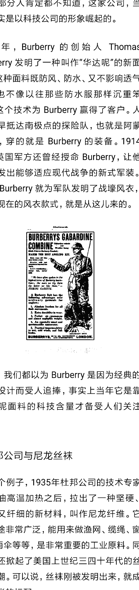

万维钢老师和罗胖推荐的《爆裂》那本书里，就提到了尼龙丝袜第一天开卖就卖出了80万条。为了买到一条尼龙丝袜，女士们甚至排起了长队。那个时候，尼龙丝袜一度占据了30%的美国市场，是最成功的服装消费品。

点击这里，你可以看到《爆裂》这本书的电子版购买链接。

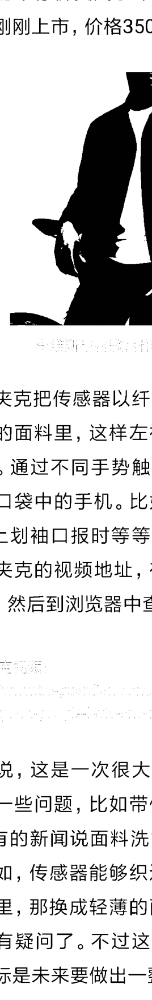

二战的时候，军方需要尼龙做降落伞，女士们就纷纷为国家捐出了丝袜。当年玛丽莲·梦露也响应号召，去捐丝袜，然后开始光腿穿裙子。那张裙子在半空中飞舞的光腿照，至今仍是经典。

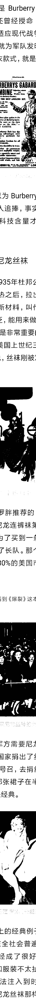

说完两个历史上经典例子，咱们再来看今天，其实，在全社会普遍接受高科技的今天，科技已经成了很好的时尚流行元素，甚至很多和服装不太扯得上关系的科技都被想方设法注入到时尚领域了，当然，像当年的尼龙丝袜那样的机会未来也一定会再出现。

### 二、服装领域的新兴高科技

下面我们就来具体讲讲今天的服装领域有哪些高科技引领的潮流。

### |智能可穿戴

传感器的微型化和智能化，让它顺利成章地进入了服装产业。毕竟服装产业占全球GDP的2%，规模超过3万亿美 dollars。

关于智能可穿戴，我们重点看两个大厂商的动作：

- 第一个是著名的牛仔品牌李维斯和谷歌的跨界合作。

2015年李维斯和谷歌宣布合作，要共同打造一款科技牛仔裤。后来计划有了调整，原先的牛仔裤变成了牛仔智能夹克，今年秋季刚刚上市，价格350美元。

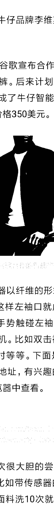

这款夹克把传感器以纤维的形式织进了左袖口的面料里，这样左袖口就成了一个触控板。通过不同手触碰左袖口，你就能控制口袋中的手机。比如双击袖口播放音乐，上划袖口报时等级。下面是介绍这款智能夹克的视频地址，有兴趣的话你可以复制，然后到浏览器中查看。

可以说，这是一次很大胆的尝试，当然也存在一些问题，比如带传感器的面料不耐洗，有的新闻说面料洗10次就不能用了。再比如，传感器能够织进牛仔这种厚重的面料里，那换成轻薄的面料它能否同样适用就有点疑问了。不过这只是一个开始，谷歌的目标是未来要做出一整套智能服装。

- 第二个是耐克的自动系鞋带的鞋。

1989年的电影《回到未来II》里面，主人公有一双能够自动系鞋带的耐克梦幻球鞋。27年之后的2016年，耐克终于做出了这款叫作 Air Mag 的鞋，这款鞋限量发售90双，其中一双在拍卖会上被拍用20万美元的价格拍走了，这相当于一辆豪华版跑车的价。

这款天价鞋最大的创新点就是它的“自动化”系鞋带功能...

这款天价鞋最大的创新点就是它的“自动化系鞋带”系统。当你的脚伸进鞋里时，鞋子感受到了压力，就会自动系紧鞋带。而当鞋舌感受到和脚面适当的摩擦力后，它就会停止动作。你也可以手动按压鞋子按钮调节松紧，还可以让鞋发光。这些动作主要靠装在鞋跟和鞋底的控制面板和滑轮结构配合合成。

可以说，未来的帽子、手套、鞋子、牛仔裤和配饰也都会逐渐加入传感器。

而智能传感器相关的科技也在飞速进步，比如我们投资的 MC10 就是专门做柔性电子的，我们在前哨第一季介绍过，他们和锐步公司做出来了能测脑震荡的软帽，最近他们又和欧莱雅一起推出了能够测紫外线照射的创可贴，这些都有和服装结合的潜力，我们在前哨一期也介绍过，斯坦福大学的华人学者鲍哲南做出了又薄又能够灵敏感知压力的电子皮肤，这些科技都在等着被优秀的设计师和未来的时装品牌结合到服装里。

据科技市场情报公司 Tractica 预测，智能服装的出货量将从2016的170万件增长到2022年的2690万件。人体传感器市场还将更大，将从2016年的240万件飙到2022年的9210万件。

### | 服装领域的新材料

如果说20世纪服装材料是以尼龙、涤卡、涤纶等以石油化工原材料为主，那么21世纪则以生物技术的材料为主。

#### 新材料：人造蜘蛛丝

人们研究蜘蛛丝的蛋白成分，然后用糖、水和酵母发酵后得到了相似的蛋白。然后把这种蛋白纺成线制成了布，做成了服装。因为它的原材料成分是可控的，所以技术人员可以通过微调它们的成分，来控制织物的伸缩性、强韧度、防水性、柔软度等等性质。

现在这个领域比较领先的公司有美国的 Bolt Threads，日本的 Spiber 和德国的 AMSilk。由于人造蜘蛛丝的量产还是个大问题，所以三家公司都选择了和知名品牌合作，打造概念产品的路线。

Bolt Threads 利用名人效应，他们和英国甲壳虫乐队的成员保罗·麦卡特尼的女儿史特拉·麦卡特尼合作，做的服装主打环保时尚。

2015年底，Spiber 和著名的户外品牌 NorthFace 合作，推出了一款南极考察服，证明它的产品能够经受住极端条件的考验。

AMSilk 选择和阿迪达斯合作，用一款运动鞋来证明材料的强韧性。

#### 新材料：人造皮革

皮革业已经有数百万年历史了，这是一个有着千亿级产值的行业。过去皮革主要从动物身上获取，而我们今天要介绍的这家公司 Modern Meadow 则想跳过饲养动物这个环节，直接用生物材料制造皮革。

动物皮革的主要成分是胶原蛋白，Modern Meadow 就用基因技术，培养能够合成胶原蛋白的细胞，让细胞大量产生胶原蛋白，进而生成皮革。

和动物皮革相比，Modern Meadow 的生物皮革有这么三个优势：

- 第一，更柔软更透气，未来还可以变得更结实更轻薄；
第二，更环保，产生的污染是传统皮革业的80%；
第三，可以生产任何尺寸和形状的皮革，不受动物体型的限制。

可以看出，Modern Meadow 的做法大大缩短了产业链，但是它的生产效率能否很快超越传统皮革厂，我们还要拭目以待。他们刚刚融到了5000万美元的投资，预计两年内会有产品上市。

### —— 今日内容小结 ——

今天我们主要讲了三点：

- 第一，科技的进步总能带起时尚的潮流，华达呢成就了 Burberry，尼龙纤维掀起了丝袜狂潮，涤卡、涤纶等材料的发明，也成就了一批服装品牌。在全社会普遍接受高科技的今天，科技已经成了很好的时尚流行元素，所以服装行业从业者应该对新科技保持敏感性。
第二，新材料和传感器的使用，将让服装越来越智能，像今天介绍的谷歌克能操控所有的电子设备，耐克的鞋可以自动系鞋带，虽然有些功能你现在可能觉得没那么必要，但它代表了不可逆转的智能化的未来方向，而且传感器技术也在不断进步，使得未来服装会越来越智能，具有皮肤那样触觉的衣服估计很快也会被发明出来。
第三，上个世纪的主旋律是从石油里面提取新材料，现在的主旋律变成了用生物技术制造新材料，今天我们介绍了人造蜘蛛丝和人造皮革，未来人们一定还会制造出更多的穿着更舒适的新材料。

### —— 今日思考题 ——

除了今天我们提到的传感器和服装面料的新材料，还有哪些现代科技可以和服装相结合，既增加服装的时尚感，又能使我们的穿着体验得到提升呢？

欢迎你在留言区分享你的观点，我会和你一起参与讨论。希望今天的内容丰富了你对服装领域的科技的认知。

王煜全
我是王煜全，你的全球科技前哨侦察兵，咱明儿见！

### 前哨历 10月30日

### 我的今日知识清单：

- 1. 科技已成为很好的时尚流行元素，服装行业从业者应该对新科技保持敏感性。
- 2. 新材料和传感器的使用，将让服装越来越智能，具有皮肤触觉的衣服估计很快也会被发明出来。
- 3. 用生物技术制造新材料将成为潮流，技术人员可以通过微调成分控制材料的伸缩性、强韧度、防水性、柔软度等，制造出功能性更强，且更舒适的服装。

### 预告 | 第二季度我们关注
衣食住行

### —— 下季度预告 ——

周五的时候我已经做过预告，第一季度的内容，是从前沿科技的产业化视角看问题，因此很多朋友觉得与自己关系不大，了解先进科技固然好，但毕竟大多数人所从事的，依然是传统行业。不过，我们一直强调，没有传统的行业，只有传统的企业，每一个行业都在被科技改变着。

下一个季度，我们就换个视角看问题，不再是从科技发展去分析市场，而是从市场的需求出发，去探索科技的身影，就从我们每个人的衣、食、住、行出发，相信你一定会大吃一惊，因为每个领域其实都在被科技改变着，只是大多数人没有发现。

我希望你认真关注，并且积极参与讨论，只要你认真思考，相信或多或少也能发现你所从事的行业，也有着不为人知的科技，并且存在用新科技升级的机会，而你就是那个提前看到的人。

下周，我们就从“衣”来开篇。

王煜全

我是王煜全，你的全球科技前哨侦察兵，咱們明天見。

## 067 | 与科技密不可分的服装科技

### ——▶ 今日内容看点 ◀——

通过阅读今天的内容，你将会掌握以下三个问题的答案：

- 1. 为何体育消费品公司“安德玛”坚称自己是科技公司？
- 2. 安德玛的发展历程带给传统行业怎样的启示？
- 3. 科技公司从安德玛身上又能学到什么？

今天，我要给你介绍的这个服装界的牛人，是我们在17年1月份CES展上时介绍过的，因为这个著名服装公司的创始人竟然在CES消费类电子产品展上作了主题发言，而我当时带着咱们前哨的代表团一起全程听了他的发言，并给大家作了汇报。他就是目前世界第三大运动品牌 Under Armour 的创始人 Kevin Plank。

Under Armour 中文叫安德玛，1996年成立，是一家很年轻的美国著名体育装备品牌。但是，起步比较晚的安德玛后来居上，到2014年的时候，它甚至超过了 Adidas，成为全美仅次于 Nike 的第二大体育装备品牌。安德玛的 CEO Kevin Plank 最常说的一句话是，“我们一直都是一家科技企业”。

明明是一家做体育消费品的公司，为什么 Kevin Plank 坚持说他们是科技公司呢？

原因其实很简单，安德玛能有今天这样的发展，可以说都是依靠科技的力量。接下来，我们就来说讲 Kevin Plank 的科技故事。

### 一、来自橄榄球队的CEO——Kevin Plank

Kevin 是1972年出生的，从小就热爱橄榄球。在马里兰大学读书的时候，他是橄榄球队的队长。那个时候，队员们的汗衫都是棉质的，我们都知道，棉制品的吸水性是特别好，但却不容易干，队员们高强度训练和比赛的时候，汗衫很快就会被汗水浸湿然后黏在身上，不仅不舒服，而且还变沉了，这对队员的竞技状态有不小的影响。

所以Kevin就想：能不能制造一件又透气、又持久保持干爽的汗衫呢？

为了落实自己的想法，Kevin 跑到各个布料店选择合适的速干面料，然后到裁缝店去做了几件样衣。之后 Kevin 让他的运动队友们朋友们试穿了这些汗衫。几天之后，这些人不断找到 Kevin，跟他说“你能不能帮我队友也做一件？”“这件汗衫太棒了！打完整场场比赛后仍然能够保持干爽！”Kevin 从朋友的好评中看到了商机。他决定把卖汗衫作为自己的第一个商业尝试。1996年毕业后，Kevin 就在自己奶奶家的地下室建立了安德玛。下面这张图，就是安德玛早期设计的汗衫的样子。

### 二、第一章: 面料技术

我们可以看到 Kevin 坚持把安德玛定义为科技公司是有理由的，因为从起步开始，它就和科技密不可分。这种用透气的速干面料制成的汗衫穿着舒适，而且能够持久保持干爽。它不但深受运动员的喜爱，还为安德玛的后期扩张打下了坚实基础。

安德玛成立初期，紧身速干汗衫是公司唯一的产品。因为 Kevin 在成立安德玛时，作了一个重大的决定：未来5年内他们只卖紧身汗衫。可能会有人觉得这特别蠢，把鸡蛋全放到一个篮子里，风险又大难以进行扩张。但是 Kevin 认为，对于初创企业来说，把一件产品做到极致，才是取得成功的基础。所以，在2005年之前，安德玛全靠紧身汗衫一招打天下。

但是，在2005年到2010年期间，安德玛开始遭遇打击。当时安德玛已经占据了运动汗衫市场的75%，投资人认为这个部分的营业额将很快达到饱和，所以安德玛需要尽快找到一个新的市场，让公司进入第二个发展期。

于是，越过了面料科技这一章节，Kevin 开始了安德玛科技故事的下半部：进军数字化领域，用传感器和大数据来实现公司的二次扩张。所以才有了 Kevin 参加 CES 的故事。

### 三、第二章: 大数据改造健身体验

其实2017年已经是 Kevin 第三次参加 CES 大会了，CES 大会当然指的是国际消费类电子产品的展览会，而 Kevin 也确实是把安德玛的竞争对手定义为苹果、三星这样的生产消费类电子产品的科技公司。

安德玛连续三年参加 CES 大会，其实是出于两个方面的考虑。

第一，在运动装备中加入科技，已经成为众多体育品牌维持自己先锋形象的重要手段。

比如，安德玛曾经和美国军方合作，为 NASA 和美军特种部队制造了紧身 T 恤 E39，它可以测量呼吸、心率、皮肤温度和加速度等数据，高科技的使用让安德玛的专业形象深入人心。

再比如，安德玛的官网上，除了各类产品选项外，还有一个 TECHNOLOGY 的选项，里面包含了安德玛现有的各类技术，每一个技术分类底下都有对应的产品。下面这张就是安德玛官网的截图。

从这里我们也能看到，Kevin 是把技术当作维护安德玛品牌形象的重要手段。

第二，运动数字生态系统正在成为各大体育品牌的第二战场。

谁能在健身追踪数据的军备大战中获胜，谁就有可能充分挖掘健身爱好者这个巨大的金矿。所以，安德玛不惜重金收购，建立自己的数据优势。

早在2013年，安德玛就花了1.5亿美元收购了一家叫 MapMyFitness 的公司，这家公司主要开发健身追踪应用，后来它成为安德玛数据王国中的重要一环。

2015年，安德玛又花费了5.6亿美元一口气收购了 MyFitnessPal 和 Endomondo 这两家，向智能化时代迈出了第一步。

- MyFitnessPal 可以帮助人们记录日常的摄入热量，包括摄入营养，为用户订制健身计划；
- Endomondo 则可以帮助人们跟踪用户的各种活动，比如跑步、骑行等等。

这两次收购为安德玛打下了深厚的数据基础。

可以说，安德玛成功打造了全世界最大的“数字健康运动社区”，也就是 Connected Fitness Platform，目前已经有 2亿注册用户。

这个数据有多庞大呢？

和安德玛相比，Nike 的数字平台 Nike+ 上的用户数量只有它的五分之一。这个社区现在已和很多 APP 打通，这让安德玛拥有了非常全面的数据。有了这些数据，安德玛就可以更好地帮助用户进行运动和健康管理，还能根据这些数据设计出更优质的产品。

另外，利用这些数据，安德玛开始结合软硬件，构建自己独特的智能运动生态圈。

比如，安德玛在2016年推出了心率记录胸带 UA Heart Rate，它可以记录运动前后的静息心率，反映用户的运动情况，并把数据实时上传到 UA Record 上面。

再比如，内置传感器的 UA Speedform Gemini 系列运动鞋，可以把追踪到的跑步数据，记录到安德玛的 Record 或 Map My Run 等应用中，它的精确度比任何手环和手机都要高。

### 四、第三章: 以CES为宣传的重要战场

除了利用大数据改造健身体验之外，安德玛还将 CES 这个充满黑科技的国际消费电子展当作推销的重要战场。

在2015年的 CES 上，安德玛携手 HTC，打造了运动社交系统平台 UA Record，这个平台支持市面上几乎所有的主流运动智能可穿戴设备。

2016年的 CES，安德玛又和 HTC 联合发布了互联网健身系统 UA Health Box，用于监测、管理一系列影响人们健康的数据。

在2017年的 CES 上，Kevin 甚至站到了主题演讲的舞台上。

这里你得注意一下了，一般来说，只有像高通那样的硬科技公司的高管才有资格在 CES 上进行主题演讲。而安德玛显然不够“硬科技”，但是 Kevin 居然也能成为演讲人，你看，安德玛再次有力地向世界宣告，他们是一家地道的科技公司。在演讲中，Kevin 提出了一个“聪明地运动”的概念。

什么意思呢？肌肉的疲劳程度我们是无法感知的，有时候你觉得累，但肌肉不一定疲劳，有时候你觉得很精神，但肌肉实际上已经很疲劳了。怎样才能准确地感知呢？安德玛在新款运动鞋上放了电子传感器，只要穿着跑一跑跳一跳，就能测出肌肉的疲劳程度，这样用户就能根据自己的疲劳程度合理地运动了。

Kevin 甚至请来了游泳健将菲尔普斯，让他穿着这双鞋带领大家一起跳一跳，相信不少人跳完以后马上就想去买这双鞋了。不得不说，这个概念非常让人买账，Kevin 把理性的数据转换成感性的用户感知，这套营销手段值得很多科技公司学习。

我们说，Kevin 的科技故事伴随着安德玛走过每一个历史性阶段，从最早的速干面料，到后来大数据分析、内置传感器的衣服鞋子，再到登上 CES 作主题演讲，Kevin 和安德玛正在引领着全球运动品牌的科技潮流。

顺便说一句，我们前哨用户也很荣幸地见证了安德玛的成长，因为2017年是他第一次作 CES 的主题演讲。

### —— 今日内容小结 ——

总结一下，今天我们介绍了 Kevin Plank 的生平，也和你分享了他的科技故事，有三点内容希望你能重点理解一下：

第一，Kevin Plank 是个懂得借助先进科技改造传统行业的企业家，这一点值得我们学习。很多传统行业的企业家觉得，自己所在的行业已经非常成熟了，没什么发展空间。但是，如果能尝试利用新技术去解决行业中现存的问题，就很有可能挖掘出巨大的机会。所以这也是为什么我一直强调，没有传统产业，只有传统企业。

第二，很多优秀的科技公司容易钻牛角尖，只是一味地宣扬自己的技术有多牛。但 Kevin Plank 不同，他往往会给自己的产品赋予一个感性化的用户感知。买一双安德玛的鞋，你买到的不只是一双带着传感器的鞋，而是买下了一种“聪明地运动”的运动方式。让用户为自己认同的理念买账，这种营销方式值得很多科技企业借鉴。

第三，数字化健康、数字化运动，将成为体育消费产品未来的市场。对数据的收集、处理分析和专家系统的搭建，可以帮助我们全方位管理自身健康，让我们每天都能达到最佳状态。

### —— 今日思考题 ——

你认为和数据结合，你最希望服装能够帮你分析什么、给你提什么建议、帮你管理什么呢？

欢迎你在留言区分享你的观点，咱们一起来讨论。

王煜全

我是王煜全，你的全球科技前哨侦察兵，咱们明天见！

### 前哨历 10月31日

### 我的今日知识清单：

- 1. 借助先进科技改造传统行业，尝试利用新技术去解决现存的问题，就很有可能挖掘出巨大的机会。
- 2. 科技公司应该学会给自己的产品赋予感性化的用户感知，让用户为自己认同的理念买账，而不是一味宣扬自己的技术有多牛。
- 3. 数字化健康，数字化运动将成为体育消费产品未来的市场。对数据的收集、处理分析和专家系统的搭建，可以帮助人们全方位管理自身的健康。

> 摘自：《067 | 与科技密不可分的服装科技》

「得到」专栏《全球创新260讲》
扶上5年，扛住50个新科技浪潮机会
