# 前哨第二期201711-201801

# 068 | 寻找新技术，满足服装业的需求

068 | 寻找新技术满足服装...

## —— 今日内容看点 ——

通过阅读今天的内容，你将会掌握以下三个问题的答案：

- 1. 高端户外产品中使用的 Gore-Tex 面料是怎么诞生的？
- 2. 为什么说企业家要关注其他领域中正在遇到的问题？
- 3. 企业如何长久保持自己的竞争力？

我们大多数人，都讨厌下雨以后浑身湿漉漉的感觉，也受不了穿上雨衣时的闷热，所以一款既防水又透气的服装产品，会很受欢迎。如果你是一个狂热的户外爱好者，相信对 Gore-Tex 面料一定非常熟悉，它几乎是防风、防水、又透气的代名词，已经非常广泛地被始祖鸟、North Face、Timberland、Adidas、New Balance 等等众多著名的户外运动品牌运用到外套、鞋子和其它产品上，只要用了这个面料，售价就一定不便宜。

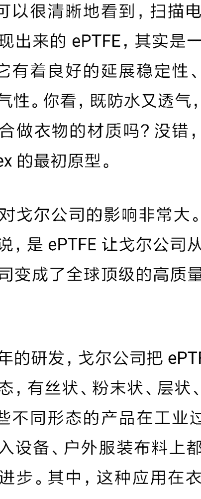

说起 Gore-Tex，它其实是一种用在电缆领域的化学产物，然后非常偶然地在服装领域找到了应用场景，结果改变了户外服装的性能标准，成了面料发展史上的重要事件。

今天，我们就来聊聊发明这个产品的戈尔公司，以及公司的关键人物 Bill Gore 和 Bob Gore 父子。

## 一、创业父子兵

Bill Gore 是戈尔公司的创始人。他出生于 1912 年，1933 年从犹他大学化学工程系本科毕业，两年后他又拿到了物理化学专业的硕士学位。Bill 对塑料、电子器件和高分子材料十分痴迷，这为戈尔公司的发展奠定了基础。他也十分热爱创新与创造。儿子上学时用的书包，家里露营时用的帐篷，他都要亲自设计和制作。

下面的这张图，就是 Bill 设计的塑料帐篷。所以我们说，Bill 骨子里就带着创新者的气质。

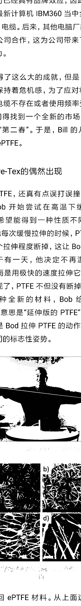

Bill 曾经在杜邦公司当了 17 年的研发总工程师。在他的带领下，杜邦公司在高分子、塑料和其他领域都有了很大的进步。不过因为杜邦公司限制太多，官僚主义严重，Bill 无法按照自己的想法进行创新研究，所以他就有了创业的想法。

1958 年，Bill 离开杜邦公司，创立了戈尔公司。Bill 的儿子 Bob 在明尼苏达大学拿到了化学工程的硕士和博士学位后，也加入了戈尔公司担任化学工程师。父子俩齐心协力，研发出了大名鼎鼎的 Gore-Tex 材料。

## 二、车库中诞生的化学材料企业

说到 Gore-Tex 材料的由来，我们就不得不提到另一种材料“聚四氟乙烯”，简称 PTFE。

PTFE 是杜邦公司工程师 Roy Plunkett 在 1938 年发明的一种新型材料。它有很好的稳定性、防水性以及生物适配性。现在我们对它的认识可能更多来自于不粘锅上的涂层。

尽管 PTFE 有这么多优点，但是它的再加工却十分困难。当时的加工技术都拿它没辙。但是 Bill 有这么一个远见：如果他可以把 PTFE 做成不同形状和不同形态的话，它的应用前景将会一片光明。可惜，杜邦公司当时并不这么想。

于是 Bill 在自家地下室建立了一个小实验室，在实验中他发明了把两层 PTFE 膜压成平行电缆的技术。Bill 预感到这个技术将会带来很大的市场价值，所以他决定单干。1958 年 1 月 1 日，Bill 和他的夫人一起创立了戈尔公司。这一天正好是他们的 23 周年结婚纪念日。Bill 把戈尔公司打造成为一个没有等级制度、每个人都能发挥自己创造力的公司。他取消了绝大多数的管理岗位，鼓励员工创新，收入由同事决定，工作内容和时间由员工自己说了算。在成立之后的 50 多年里，戈尔公司从来没有出现过亏损，被福布斯杂志评为最适合工作的公司。

当年，凭着这项电缆加工技术，戈尔公司还顺利得到了一笔政府订单。当时丹佛市要在水底建立横跨全市的供水系统，这需要在河床下铺设控制电缆，PTFE 的高稳定性确保了电缆在水底下不会腐烂、坏掉。因此戈尔公司赢得了这次招标。丹佛市买了数十英里的电缆，公司为此又招募了 50 多个人。这时，戈尔公司已经是一家初具规模的小型化学材料公司了。

Bill 可能从没想到，自己做的电缆产品，随着计算机时代的到来，竟然会变成连接一个时代梦想的导线。

上世纪 70 年代，随着计算机的发展，市场对电缆的需求开始爆发。戈尔公司的电缆产品当时已经具有品牌效应，因此 IBM 在发布的最 新计算机 IBM360 当中全面采用了 PTFE 电缆。后来，其他电缆厂商也积极和戈尔公司合作，这为公司带来了第二波发展动力。

尽管取得了这么大的成就，但是 Bill 父子俩始终保持着危机感，为了应对将来可能出现的电缆不存在或者使用频率受限的情况，他们得找到一个全新的市场，来发展 PTFE 的“第二春”。于是，Bill 的儿子 Bob 发明了 ePTFE。

## 三、Gore-Tex 的偶然出现

说起 ePTFE，还真有点误打误撞的感觉。当时 Bob 开始尝试在高温下缓慢拉伸 PTFE，希望能得到一种性质不同的新材料。可他每次缓慢拉伸的时候，PTFE 都会在某一个拉伸程度断掉，这让 Bob 十分懊恼。终于有一天，他决定不再温柔对待 PTFE，而是用极快的速度拉伸它。奇迹就这样出现了，PTFE 不但没有断掉，反而形成了一种全新的材料，Bob 给它取名 ePTFE，意思是“延伸版的 PTFE”。下面这张图就是 Bob 拉伸 PTFE 的动作，这成了戈尔公司的标志性姿势。

我们说回 ePTFE 材料。从上面这张图片中，你可以很清晰地看到，扫描电子显微镜里显现出来的 ePTFE，其实是一种多孔材料，它有着良好的延展稳定性、防水性以及透气性。你看，既防水又透气，这不正是最适合做衣物的材料吗？没错，这就是 Gore-Tex 的最初原型。

ePTFE 对戈尔公司的影响非常大。我们几乎可以说，是 ePTFE 让戈尔公司从小化学材料公司变成了全球顶级的高质量材料供应商。

经过几年的研发，戈尔公司把 ePTFE 做成各种形态，有丝状、粉末状、层状、线状等等。这些不同形态的产品在工业过滤器、医学植入设备、户外服装布料上都取得了极大的进步。其中，这种应用在衣物上的新型布料，就被称为 Gore-Tex。

值得一提的是，Gore-Tex 材料还得到了美国政府的青睐。

美国政府的青睐。

比如1981年，在美国宇航局第一次航天飞机任务当中，宇航员穿的宇航服里就用到了 Gore-Tex 材料。除了用在宇航服最外层的材料上，由于 Gore-Tex 良好的化学以及热稳定性，它还在宇航服的内衬材料里派上了用场。

再比如，在2004年火星漫游者，也就是火星探测车上，戈尔公司的新型电缆就被用作数据传输线的保护层。它可以屏蔽静电干扰，保证重要数据的无损传输。而这种新型电缆所用的材料，就是刚才我们说的 ePTFE。

戈尔公司在1992年，就开始了 Gore-Tex 面料的商业化进程。他们陆续推出了 Gore-Tex 品牌下的服装、手套、鞋子等产品。近年来，Gore-Tex 努力开发高科技面料，不仅推出了防水、透气甚至可潜水的服装，还推出了能够抑制人体气味的产品，以及超轻、保暖的 Gore-Tex 外套等等产品。如今，几乎所有的户外和运动品牌，只要提到使用了 Gore-Tex 的面料，那几乎就代表这款产品是顶级的。

到这里，从一种材料开始，经过 Bill 和 Bob 两代人的努力，终于把戈尔公司做成了世界顶级的化学材料公司。

他们的成功也向我们展示了一个道理：

新科技的诞生只是第一步。怎样运用新科技、找到更多应用场景，才是科技改变人类的本质。就好比 ePTFE 虽然是一个技术突破，但只有找到服装这样一个应用场景，才能把技术变成产品，真正为每一个人所用。

## —— 今日内容小结 ——

总结一下，今天我们介绍了 Bill Gore、Bob Gore 以及他们创立的戈尔公司。希望你能记住以下三点：

第一、新材料往往是在不经意之中被发现的，就像文中提到的 ePTFE。作为企业家，只有找到新材料合适的应用场景，并把制造过程产业化，才能让一项技术真正造福社会，获得丰厚的商业回报。

第二，新材料往往会随着某一个崭新领域的发展逐渐找到新的发展空间。因此作为企业家要多关注其他领域中正在遇到的问题，想想怎样运用自己的技术来解决这些问题。这种思路很可能给公司的发展带来全新突破。

第三，专利技术壁垒会显著增加企业的竞争力，但企业只想着躺在已有专利上赚容易钱是不行的。戈尔公司正是因为时刻保有危机感，时刻想着创新才有了第二次发展。在一个主要靠创新和基础科学推动的行业，谁都不能停滞不前。因此要花大功夫进行新技术、新产品的研发，这样才能长久保持竞争力。

## —— 今日思考题 ——

戈尔公司的 ePTFE 是化学材料，偶然间在服装领域找到了应用场景，成了 Gore-Tex 面料。你觉得如果反向思考，到科技领域里去找新技术来满足服装业的未被满足的需求，应该到哪些领域去找技术，哪些需求解决的话潜力最大呢？

欢迎你在留言区分享你的观点，我会和你一起参与这场科技前沿的讨论。

王煜全

我是王煜全，你的全球科技前哨侦察兵。咱明天见。

## 前哨历 11月1日

## 我的今日知识清单：

- 1. 作为企业家，只有找到新材料合适的应用场景，并把制造过程产业化，才能让一项技术真正造福社会，获得丰厚的商业回报。
- 2. 新材料往往会随着某个崭新领域的发展找到新的发展空间。企业家要关注其他领域中正在遇到的问题，想想怎样运用自己的技术来解决这些问题。
- 3. 专利技术壁垒会显著增加企业的竞争力，谁都不能停滞不前。

王煜全

预告一个重要的活动：

2018年1月8日至13日，第51届 CES 展（国际消费类电子产品展览会）将在美国拉斯维加斯召开。相信作为前哨用户的你应该对 CES 展不陌生，有人曾经这么评价它，“未来曾经一次又一次地在 CES 展上提前出现”。

所以，CES 是你了解全球科技的一个窗口。前哨作为你的科技侦察兵，我们将组织一个创新游学团赴美考察学习。我将作为领队，白天带你参观展会，当你的现场解读；晚上邀请各路大咖和你面对面交流……还有更多的内容期待你参与。

参与方式：关注微信公众号“全球风口”，点击下方菜单栏中的“CES”，即可获取更多资料和报名链接。

## 用户留言

# 069 | 中国服装业的科技创新机会和陷阱

## —— 今日内容看点 ——

通过阅读今天的内容，你将会掌握以下三个问题的答案：

- 1. 服装产业的哪些方面具有科技创新的机会？
- 2. 如何提升服装设计中的用户参与度？
- 3. 如何解决用户个性化、差异化需求与批量生产之间的矛盾？

本周我们聊的是科技给服装产业带来的机遇，我们介绍了利用可穿戴和大数据的Under Armour，介绍了利用新材料的戈尔公司，其实这些都只是示范，服装领域的创新还非常多，有朋友留言就提到过，说是我在今年4月份前瞻大会上穿的3D打印的服装就是高科技啊，其实不光每套，我穿的衬衫也是高科技，因为有特殊的热管理技术，穿着者能够一直觉得凉爽。

## 一、服装产业的创新机会

很多人 在设想服装行业的机遇的时候，会觉得和科技无关，很多人总会先想到那些令人眼花缭乱的服装品牌，特别是现在电商平台成长越来越快，要创立一家属于自己的服装品牌也变得越来越容易。

丨可是，这真的是服装行业的机会了吗？

我个人认为，并不是。

举个例子来说：

天猫曾经推过一系列基于淘宝平台发展起来的品牌，这些品牌虽然一时名声大噪，但是随着流量红利的过去，它们也就迅速衰落了。更糟糕的是，越来越多海外知名品牌进驻天猫开设官方旗舰店，这些品牌的市场份额就进一步受到了挤压。所以你看，现在想要只靠品牌效应切入服装行业，其实已经非常困难了。

丨那么，服装行业最大的机会在哪儿呢？

还得回到我们一直强调的科技上，我们周一就说了，其实服装产业一直和科技紧密相关，未来也一样会如此，而且科技的作用在服装业还会越来越大。因为：

- 第一，服装功能上的进步，比如舒适感、保温、排汗等等都要靠技术来支持；
- 第二，技术才能给服装带来足够的壁垒和品牌差异；
- 第三，科技已经成了社会时尚的一部分，引进科技对品牌和市场也会有巨大贡献。

当然，科技对服装业的贡献并不只是在面料的革新和传感器等等功能的添加上。在整个服装产业的完整产业链生态的任何一个环节，技术都大有用武之地。

## 二、提升供应链效率

### 1. 快时尚品牌 Zara

比如供应链的技术创新，这方面我们可以向西班牙服装品牌 Zara 学习。

快时尚品牌 Zara 是全世界最畅销的服装品牌之一。每年 Zara 都能推出1200多种新品，产品更新十分迅速，它的背后，是强大的供应链系统贯穿了整个流程。从每款服装的设计，一直到把成品分配到每个分店，Zara 只需要短短15天，而传统品牌是6-9个月。

听到这个数字，你肯定好奇，为什么 Zara 能够做到这么快，它做这么快的目地又是什么呢？

能“快”主要有两个原因：

- 第一，是 Zara 拥有一支400多人的设计团队，他们奔波在米兰、巴黎这些时尚之都的各个秀场，最新的时尚潮流只要短短几周，就能出现在 Zara 的专卖店里，可以说速度之快无人能敌。
- 第二，Zara 还有专门的市场专家，他们和全球各地分店密切交流，然后根据客户的反馈迅速调整产品的设计和相应的品类。而根据市场大小，每个品类在每个分店的存货都要做到尽可能地少。

这就是所谓“快速，少量、多款”的品牌管理模式。目的也非常明确，就是为了保证 Zara 的产品始终能和最新的时尚同步，实现快速设计、快速生产、快速更新，最终达成快速销售的目的，这让 Zara 成为快时尚产品中的佼佼者。

你可能会说，这不是赤裸裸的抄袭么。

确实，Zara 从创立那天起，就一直贴上了抄袭的标签。2012年，著名设计师 Christian Louboutin 控告 Zara 抄袭了他的高跟鞋设计。就在去年，10几位独立设计师联合控诉 Zara 盗用自己的设计，这在网络上引起了轩然大波。下面就是两张其他设计品牌的产品和 Zara 的产品的对比图。

不过，对 Zara 来说，“快”就是它的核心竞争力和设计拼不过大品牌，那它必须在供应链上做文章。所以，为了在时尚领域稳住脚跟，就顶着“抄袭”的压力，Zara 也要用这种方式保证产品快速迭代。

抛开 Zara “抄袭”的标签不说，它的高效供应链管理系统，正是现在缺乏知名品牌的中国服装行业最应该学习的地方。

一直以来，服装业都有两大要求：大批量生产和高频率更替。这就需要服装品牌不断整合供应链，让它的效率最大化。和生产周期15天的 Zara 相比，传统的服装品牌需要6到9个月，甚至更长的时间，可以说新款一上市就成了旧款，这就导致了库存积压严重的后果。所以，传统服装品牌如何最大幅度地提升产业链的效率，将会是服装行业的下一个决胜点。

### 2. 运动品牌巨头 Adidas

传统的人工流水线系统已经很难以应市市场变化和个性化需求了，这就需要机器的助力。

为了压缩产品生产周期，Adidas 把目光放在了机器身上。它在德国拥有一家自动化工厂，叫做Speed Factory，这家工厂以机器人自动生产为主，只保留了160个人工技术岗位。

这意味着什么呢？

最直观的，就是降低了人力成本，我们都知道欧洲工人的薪酬和福利都是比较高的。但更重要的是，是 Adidas 不再需要为“招人”的问题而考虑工厂的选址了，大家都知道，传统服装产业是劳动密集型的，所以工厂一般都建在有足够廉价劳动力的地方。而现在，没了这个限制，Adidas 就把流水线直接搬到最主要的市场来了，不仅减少了货物的流通时间，也大大降低了产品的生产周期。

另外，Speed Factory 之所以能够大大提高生产效率，还得益于机器人和3D打印技术。Speed Factory 生产一双鞋仅需要5个小时，而且整个过程安全、快速、无污染。反过来，Adidas 在亚洲的生产车间中，一双鞋的生产流程反而要花费好几周的时间。

现在，由于物联网的发展，对供应链的实时监控和系统整合也将逐渐变成现实。未来将会出现专门帮服装企业完成供应链信息化升级的公司，服装企业也可以利用物联网的海量数据进行大数据分析，找到供应链低效率的原因并加以修正。所以，要注意了，对供应链的实时监控和优化，将会是未来服装企业的制胜法宝。

## 三、提升用户在服装设计中的参与度

除了产业链，提升用户在服装设计中的参与度也是创新的重要方面，当然这也需要科技的支持。

科技的支持。

作为消费者，我们一般都是在实体商场和电商平台上买大批量生产的衣服，"撞衫"这种尴尬的场景就不可避免，其实大家都有个性化的需求。所以，可预见的是，未来私人定制服装将会不断普及。

不过，私人定制有一个巨大的劣势，那就是消费者必须到指定的地方进行量体裁衣，这么做的效率特别低，这也是为什么私人订制服装到现在都不能普及的原因。

那么，怎么能让顾客更容易地参与进来呢？

关于大规模的私人定制，美国旧金山的 Stitch Fix 公司让我们看到了一个很好的解决方案。这家公司每个月都会为客户提供5件符合用户预期，定制化的衣服，客户在收到包裹的时候，要先交20美元的造型费，如果客户买下里面的一件或者多件衣服，这20美元就当作抵扣了。如果买下全部5件，还能享受75折的优惠。

那你肯定会想，客户要是一件都不买怎么办？

## Stitch Fix 的法宝有两个：

- 第一，运用大数据分析；
- 第二，雇用大量兼职设计师。

第一，Stitch Fix 雇了70多名数据科学家，其中还从 Netflix 公司挖来了数据科学家 Eric Colson 担任首席分析官。

Netflix 中文名叫奈飞公司，是做线上租赁 VCD 起家的，现在已经发展成线上视频内容提供，甚至到制作的新时代媒体公司的代表，他们最擅长的就是利用线上的用户行为大数据来分析判断用户的需求，并且据此制作出用户欢迎的热播剧，著名的《纸牌屋》就是这么出炉的。

通过算法和机器学习，再结合大量网络数据，比如顾客调查、天气模式、顾客和设计师的谈谈等等，计算出下个月最适合客户的服装造型，然后将分析的结果提供给造型师参考，根据这些建议，造型师再为顾客量身设计服装。顾客的使用次数越多，效果就越好。而且，Stitch Fix 还会根据客户的历史数据、个人喜好以及和时尚造型师的设计风格之间的相似度，为顾客匹配最合适的造型师。

第二，Stitch Fix 提供弹性工作时间和不受限制的工作地点，已经招揽了全美超过5000名设计师加入到它的设计师队伍当中，担任兼职设计师。而这也正是 Stitch Fix 能确实实现批量定制的重不基础。

有了以上两个法宝，当顾客再收到他们寄出的盒子的时候，如果一件都没买，Stitch Fix 就会调查具体的原因，甚至让顾客给造型师留意见。这些对于他们来说都是非常宝贵的数据，有了这些数据，他们就可以让下一次的设计更符合顾客的需求和品位了。

2016年，Stitch Fix 收入达到9.77亿美元。就在今年10月，Stitch Fix 首次公开募股，他们交了一份很漂亮的成绩单。不过，也面临着大量的挑战，因为服装市场竞争非常激烈。

比如，亚马逊最近就推出了名为"Amazon Wardrobe"的类似服务，之前我们提到的安德玛公司也加入到竞争行列当中。另外，不断增长的营销成本也降低了 Stitch Fix 的利润率，它的营收增长已经开始放缓。他们的 CEO 虽然声称他们的客户流失率和商品退货率都优于行业水平，但他拒绝透露具体数字，这也许从侧面说明了竞争的残酷。

不过，不可否认的是，规模化、批量化的生产模式，已经越来越无法满足消费者越来越强烈的个性化和差异化需求。随着大数据、机器学习等技术的发展，挖掘特定群体的用户需求，为用户量身定做，已经成为服装品牌未来发展的重要方向。

这方面中国也有了一些成功的尝试，其中最出名的是服装定制公司红领，给红领做个性化技术改造的公司也给另外的很多企业做过改造，都取得了不错的成绩。

## 四、创新的机会和陷阱

其实，服装业的每一个方面都可以成为科技创新的机会：

- 产品改进，就涉及了面料、材质、性能、制作工艺；
- 生产，就涉及了个性化定制；
- 供应链环节，就是供应链的效率问题，快速、少量、多款式；
- 业务模式，就包含定制化、推荐；
- 客户管理，就包括客户参与设计。

你看，每个环节都有技术可以参与，使得业务可以被提升。

当然，服装产业在利用科技上也有陷阱，最核心的就是不要为了科技而科技，因为技术的酷炫而忽略了客户的真实需求。

## —— 今日内容小结 ——

我希望你能有以下三方面的认识：

## —— 今日思考题 ——

中国曾经是服装代工大国，但现在因为劳动力价格越来越贵，中国的优势正在逐渐丧失，你认为国内的服装企业可以采取哪些措施来提升自己的竞争力呢？我们介绍了产品改进、生产、供应链、业务模式、客户管理等等环节，你认为哪些环节还有改进的空间呢？

## 我的今日知识清单：

- 1. 产品改进、生产、供应链、业务模式、客户管理等环节，都可以成为科技创新的机会。
- 2. 传统服装品牌必须使用自动化技术，来提高产业链的效率。
- 3. 用技术手段来解决定制和大规模量产之间的矛盾，是实现个性化服务、提升用户参与度的基础。
- 4. 在利用科技上，不要为了科技而科技，不要因为技术的酷炫而忽略了客户的真实需求。

王煜全

预告一个重要的活动：2018年1月8日至13日，第51届 CES 展（国际消费类电子产品展览会）将在美国拉斯维加斯召开。相信作为前哨用户的你应该对 CES 展不陌生，有人曾经这么评价它，"未来曾经一次又一次地在 CES 展上提前出现"。

（国际消费类电子产品展览会）将在美国拉斯维加斯召开。相信作为前哨用户的你应该对 CES 展不陌生，有人曾经这么评价它，“未来曾经一次又一次地在 CES 展上提前出现”。

所以，CES 是你了解全球科技的一个窗口。前哨作为你的科技侦察兵，我们将组织一个创新游学团赴美考察学习。我将作为领队，白天带你参观展会，当你的现场解说；晚上邀请各路大咖和你面对面交流……还有更多的内容期待你参与。

参与方式：关注微信公众号“全球风口”，点击下方菜单栏中的“CES”，即可获取更多资料和报名链接。

## 用户留言

提交留言可与专栏作者互动

# 070 | 服装业的科技创新是全方位的

070 | 服装业的科技创新是...

## —— 今日内容看点 ——

通过阅读今天的内容，你将会掌握以下三个问题的答案：

- 1. 人造蜘蛛丝等新材料在中国市场潜如何？
- 2. 服装智能化后，企业如何将用户数据最大化利用？又该怎样解决数据隐私问题？
- 3. 是什么导致 Under Armour 业绩下滑，长期是否依然可好？

## —— 全周总结+拓展 ——

第二季度我们是从市场应用的角度来看科技可以有什么贡献，那本周是第二季度的第一周，我们讲的是服装行业的新科技，讲了三个重点：

第一，服装行业其实从来就是高科技产业，华达呢塑造了 Burberry，尼龙纤维带动了丝袜狂潮，莱卡、涤纶等等材料的发明，也成就了一批服装的品牌。今科技更是成了很好的时尚流行元素，所以服装行业的从业者必须了解新科技，对新科技保持敏感。

第二，服装业的科技创新应该是全方位的：戈尔公司做的 Gore-Tex 面料、日本的 Spiber 和德国的 AMSilk 做的人造蜘蛛丝、Modern Meadow 公司做的人造皮革；Zara 公司和 Adidas 公司对供应链管理的提升、Stitch Fix 公司的个性化私人定制；李维斯和谷歌合作把智能可穿戴放到牛仔服饰；安德玛公司更是利用智能可穿戴搭建了用户健身社区等等。

第三，优秀的服装企业既要善于运用科技，又要始终把用户感知和体验放在第一位，切忌为科技而科技。关键是要让科技为产品服务、为品牌服务、为更好的用户关系服务、也为企业的理念服务。

## —— 用户答疑 ——

服装的革命也需要讲成本，老师提到的蜘蛛丝等技术的成本要降到多少才能较好地引发革命呢？王老师对这些新技术的规模化效应的时间预计是什么时候呢？
我的回答是：
这是非常好的问题，肯定是理解了我们说的“不讲时点的黑科技都是要流氓”。

但是，因为中国还处在消费升级的早期，对穿着的需求还没有达到蜘蛛丝这个阶段，这类产品，我认为在国内可能仍然只是小众市场，所以我们其实并没有打算在国外投资这类企业，那就没有认真研究它的产业化水平，因为要看一个企业的产业化水平，往往要到内部去看，也就是说你要想投资它，跟它签了 NDA，叫保密协议，然后才了解到更多它的保密信息，你才能够判断出来到底它的产业化进程如何。这个，我现在还没有做。

我们之前也介绍过，一个实验室成熟的科技，要把它完成产品化，要能够让产品上市，需要花费上千万美元和5到8年的时间。而且，很多企业会倒在黎明前的黑夜里，不是因为产品不好，也不是因为产品化没完成，而是因为产品化了以后，无法实现量产。

了用户的黏性和忠诚度，如果能做到，就是一个好的数据使用的最大化的操作。

第四，能否帮助企业实现更加智能化的决策。比如根据健身情况推出更贴近用户实际需求的新产品，也就是说我们认为未来的企业都应该是基于数据分析基础上的，对市场的主动适应行为。所以如果你能做到，大数据对你这个企业就很有用。

以上是我总结的四点思考因素。

Under Armour 在近一年业绩不断下滑，老师能否从产业角度来分析一下背后的原因？

我的回答是：

尤其是这个季度，Under Armour 的下滑是最厉害的。

那这个是很多原因叠加到一起产生的结果：

第一，就是大品牌现在都在打价格战了，耐克、阿迪达斯明显经不住 Under Armour 的冲击，最后祭起来一个法宝，就是价格战，不断地打折，而且折扣打得很深。

第二，也有很多新的竞争品牌的进入，而且这些竞争品牌因为并没有品牌优势，也没有足够大的差异化的优势，也采取的是价格战的方式。

第三，最近正好有两个运动服装连锁店破产了，因为现在这种线上电商的冲击也很厉害，卖的产品利润率也降低了，所以服装品牌破产对 Under Armour 也有一定的冲击。

这些是外部因素，至于内部因素，就是很多人认为 Under Armour 对女性用户重视程度不够，别忘了，女性占了半边天，而且现在健身的用户里面，女性占的比例也是很大的，所以这个是需要 Under Armour 注意的。

当然，刚才我提到了，大品牌都在打价格战，一个主要的数据：比如说在男士的跑鞋这一档里面，阿迪达斯的最低价的跑鞋卖65美金，耐克的最低价跑鞋只卖60美金，而 Under Armour 的最低价的跑鞋也要卖75美金。所以你看它虽然是一个后来的品牌，但其实它的定价、价位是更高的，这其实体现了 Under Armour 的价值。

另一方面, Under Armour 在年轻人当中的地位依然不可动摇，甚至在往更年轻的人群当中渗透，也就是说现在很多小朋友，几岁我都见过，因为最近去看一些小学，很多小学的运动服都是 Under Armour，小朋友穿起来非常自豪。

所以，长期来看，我认为 Under Armour 还是利好的，尤其是对阿迪达斯和耐克来说老打价格战其实也不是办法。但是，短期即使 Under Armour 也降价来回击竞争对手，那它可能会收入有所上升，但一定也会影响利润。

另外一方面, Under Armour 做的最好的就是用健身社区形成对产品足够的黏性和忠诚度，但是这个是需要花时间培养的，因为要首先培养出用户的行为，比如说每天出去跑步之前都先要跳一跳，测测自己的疲劳程度，这个我认为尚需时日，可能还需要两三年的时间，而且社会形成潮流也要有一个过渡的时间。所以，我认为现在不是买 Under Armour 股票最好的时机，但是长期看 Under Armour 这个公司还是处于上升期的。

顺便说一句：

我们再强调一遍，我们不是荐股节目，有些公司被提到是因为它们某一方面做得好，或者我只是拿它们来做个例子，不意味着我提到的公司的股价都必然上涨，因为我确实看到留言里说，统计我提到的任何公司，然后看着就去买股票，千万别这么做。

再强调一句，买股票是你自己的主动行为，你要研究透了再动手，不是我说让你买就能买的，而且我也从来没说让你买。

## —— ◆ 下周预告 ◆ ——

我们从下周开始介绍衣食住行的食，也就是食品行业相关的高科技，欢迎大家关注，也欢迎大家积极参与讨论。

王煜全

我是王煜全，你的全球科技前哨侦察兵，我们下周见！

### 前哨历 11月3日

## 我的今日知识清单：

- 1. 服装行业一直是高科技产业，现在科技更成了时尚流行元素，从業者必须了解新科技，保持敏感。
- 2. 很多企业会倒在黎明前的黑暗里，不是因为产品不好，也不是因为产品化没完成，而是因为产品化以后，无法实现量产。
- 3. 未来的企业，都应该是基于数据分析基础上的，但涉及用户隐私数据，不能只从厂家角度出发，最重要的是让用户觉得有价值，从而主动配合。

划在5年，抓住50个科技浪潮机会

## 用户留言

提交留言可与专栏作者互动

# 071 | 机会正大量涌现的食品产业

## —— 今日内容看点 ——

通过阅读今天的内容，你将会掌握以下三个问题的答案：

- 1. 如何利用科技保障充足的食物来源？
- 2. 如何让食物更加安全和健康？
- 3. 创新企业如何把握食品产业消费升级中的机会？

本周我们讲衣食住行当中的食。美国前国务卿基辛格说过：谁控制了粮食，就控制了人类。所以，不想被控制，就要看清食品行业未来的发展趋势。

总的来说，食品行业未来的发展趋势，依然离不开高科技。其实，食品行业一直都不缺乏高科技。1909年德国化学家弗里茨·哈伯用氮和氢制成了氨，然后用这种方法制造出了化肥，这一发明解决了全世界三分之一人口的吃饭问题。二战之后，多亏了化肥和杂交技术，世界人口从25亿到了现在的76亿。

听到这里，你是不是以为我们已经彻底解决了粮食短缺问题了呢？没那么简单。

今年联合国新发布的报告显示，2016年全球长期食物不足的人口数，已经从2015年的7.77亿增加到了8.15亿。另外，营养不良也成了普遍现象，在全球，每4个5岁以下的孩子里，就有1个孩子发育迟缓。同时，还有养分摄入不足、热量摄入过多和因为有害物质的长期积累导致的营养不良等问题。

但是，随着社会的不均衡发展，虽然不少地区的“吃得饱”问题还没有解决，但是很多地区的主要问题已经变成了“吃得好”。要怎么解决“吃得饱”和“吃得好”这两个双重问题呢？显然，光靠农药、化肥这些传统技术已经不够了。

今天，我就给你介绍解决食品问题的三个途径和两个层面。

## 一、保障足够的食品来源

在吃得饱的层面上，其实早在上个世纪，袁隆平就用杂交水稻解决了中国13亿人口吃不饱的问题。今天，基因编辑技术可以帮助我们收获更多的食物。

## 二、让食品更健康

## 三、改善食品供应链

涉及改善食品供应链的问题，主要是解决吃得好的层面上的问题了。

养液和控制 LED 照明灯，就能保证农作物的生长，不仅占地面积小，可以立体种植，还不受天气的影响。这个农场建成后，每年可以生产多达90万公斤的蔬菜和香料。目前国内也已经有好几个这样的立体农场的实验了。

### | 其次是食品的加工制造环节

食物做出以后，怎么才能又好又快地端上餐桌呢？这就要提到初创公司 Zume 披萨了。

这家公司每个小时可以制作288张披萨，而且从下单到送上门只要10到15分钟，比披萨巨头 Domino's 披萨的配送时间少了不止一半。他们是怎么做到的呢？主要靠机器自动化地制作和规划最佳配送路径。

更有意思的是，Zume 有个配备了56个烤箱的卡车，专门负责配送离加工地比较远的披萨。烤箱和车载电脑相连，可以根据订餐的距离、路况来计算什么时候开始烤，确保送到顾客手中的披萨是口感最好的。由于 Zume 主要是通过机械自动化运作，所以人力成本只占营收的14%。

### | 最后是家庭消费的环节

怎么才能在家里面吃到新鲜的食材，而且不用费太大功夫就能做成好吃的菜肴呢？

德国生鲜电商 Hello Fresh 想到了一个招，它提供按周订购的形式，你只需要在网上订好你想吃的菜谱，然后他们就会把你要的全部食材按照配比分拣好，每周把这一周的食材和配料配送到你手里。然后，你只需要按照菜谱的提示，按步骤就能完成一道美味的菜肴。类似的生鲜电商有很多，而且随着生鲜电商的发展，如何进一步改善冷链物流，延长食品的保鲜期都成为亟待解决的问题，也创造了新的机会。

## —— 今日内容小结 ——

总结一下，今天我们讲了三点：

第一，食品行业，一直都不缺高科技，未来食品产业的发展，也只能依靠科技手段解决。以谷物改良、农药和农业机械普及为代表的绿色革命解决了20世纪大多数人吃饱饭的问题。到了21世纪，人们不光需要新的科技来解决粮食短缺问题，还要解决让我们吃得更好的问题。

第二，随着生活的改善，消费者越来越看重健康食品的理念，因此食品行业的主要问题正在从吃得饱向吃得好转化。吃得好拥有巨大的市场潜力，按照现在时尚的话来说，这就是食品领域的消费升级。在这样的消费趋势下，传统的食品巨头正在承受巨大的压力，而对创新企业而言，则是机会大量地涌现。

第三，民以食为天，食品行业是一个被跨学科科技改造得最厉害的行业，从化学技术、生物技术到信息技术，这个行业的各个环节都在不断被改造。创新企业要善于找到产业链条中可以和自己的技术相结合的环节。要注意的是，在利用技术切入的同时，需要好好把握消费者的心理。

## —— 今日思考题 ——

你觉得食品从原料到加工再到出售的过程中，还存在哪些问题，要怎么解决才好呢？

欢迎你在留言区分享你的观点。

王煜全

希望今天的内容丰富了你对食品领域的科技知识。

我是王煜全，你的全球科技前沿侦察兵，我们明天见。

### 前哨历 11月6日

## 我的今日知识清单：

- 1. 人们不光需要新的科技来解决粮食短缺问题，还要解决让我们吃得更好的问题。
- 2. 食品行业正在经历消费升级，传统食品巨头承受着巨大的压力，而创新企业的机会在大量地涌现。
- 3. 食品行业是跨学科的行业，从化学技术、生物技术到信息技术，各环节都在不断被改造，企业需要把握消费者的心理，并找到产业链条中可以和自己的技术相结合的环节。

### 预告 | 食品行业正在经历一场消费升级

#### 一▶ 下周预告 ◀一

明天，我们进入第二季度的下一个关注的领域——食品行业相关的高科技。美国前国务卿基辛格曾经说过："谁控制了粮食，谁就控制了人类"。我们现在的食物供给比较充沛，这往往让我们忘记了它的重要性。

食品行业从来都不缺乏高科技，我们最熟悉的就是袁隆平院士，他主导的杂交水稻确保了我们主粮安全。如今，全国吃饱的问题已经基本解决，更安全、更高效的获取粮食是发展方向。消费者的需求则变成了吃得好和吃得健康，食品行业正在经历一场消费升级。

在这样的消费趋势下，传统食品巨头面临着挑战，创新企业面对机遇，明天开始，我会帮你理清思路、抓住关键，从技术到产业，对食品行业有一个清晰全面的了解。

王煜全
我是王煜全，你的全球科技前哨侦察兵，咱俩明天见。

## 用户留言

帆帆Susie 12
王老师是目前为止，我在《得到》最喜欢的老师！打call
11-05 13:44:44

Stone 7
打仗要靠粮食，期待粮食的升级

让我预测一下，王老师会讲什么？
转基因农作物:味道,营养,外观
高科技食品:更安全,更健康
延长寿命的食物或作物:让人抵抗力增强,身体机能变强
11-05 11:07:10

小凯 5
袁隆平教授作为杂交水稻的先驱者与开拓者，用科学培养杂交水稻的技术，让中国更多的人吃起饭了，再也没有挨饿的人了，他对于中国的贡献是很大的。
以前我记得中学时代生物课上学习的转基因食品，当时大多数人并不能接受，可是随着科技的发展趋势，更多人开始一步步接受转基因食品，导致了现在市场上出现很多转基因食品了。
11-05 11:10:41

文易 3
目前，很多宝妈由于担心自己国家的食品安全问题，都放弃购买国内婴儿辅食，转而通过海淘来为宝宝准备他们人生的“第一口饭”，然而海淘不但时间漫长还面临真假难辨的重大问题。因此，如果能打造一款属于我们自己的放心婴儿食品，那我会骄傲地支持起国货来。
而如果打造一个大家认可的婴儿辅食牌，最好的切入点就是科技，用科学的态度为大众普及科学喂养知识，提供科学喂养食品。
11-05 11:42:19

渴之源76348564 2
不知道转基因食品会不会讲到
11-05 18:57:49

秦有道 2
这方面，首先想到的是被亚马逊收购的全食。
11-05 16:53:45

董之威 2
煜全老师，照片上的串串很诱人那😋
11-05 14:34:22

Tiger 2
作为农民的儿子，想回农村却又舍不得城市。很是期待，望有所获。
11-05 12:09:25

郭成 1
食品中的科技应该分为提纯加工提升附加值的科技，和从根本上增加产量减少成本的物种创新，一个是增大收入，另一个是降低成本，希望王哥能帮我填上知识的盲区。
11-05 13:21:02

王 1
期待下周的知识，现在社会都在追求吃的健康、吃的营养，用科技怎么来解决这一问题呢？
举例：我家附近市场网上新开一家卖黑猪肉商户，开业第一个星期人就排队买，其他原来卖肉的商户营业额直线下降。不过从口感对比的确黑猪肉比较好吃，价格也和普通的猪肉一样；所以大家的选择还是比较一致的！
11-05 13:10:06

Michael 1
老师早
1、食品行业期望老师讲讲关于食品安全的问题，城镇癌症发病率居高不下与食品安全有着撤不BMZQOH关系，如何通过高科技和食品相结合生产出既经济又安全的食品是我们普通百姓关心的问题
2、转基因食品近几年在国内炒的沸沸扬扬，喜欢他的说转基因食品既便宜营养含量又高，不喜欢他的说转基因就像人类给自己装的定时炸弹
期待老师的回答
11-05 11:52:29

李坚 0
食品的高科技和风险应该是并存的，但是目前来看中国的食品还没做出让中产认可的品牌。
11-05 22:53:49

伊羽池格 0
期待王老师讲解食品行业，我在食品快消行业做了很多年，很多公司都面临业绩萎缩，急需转型。
11-05 21:55:40

水中鱼 0
刚听隔壁卓老板讲了蛋白粉，营养吸收好多细节。不知道下周有没有吃货福利😊想想《基地》里的"麦曲生"，不知道什么时候能体会一下下~ 
11-05 21:49:08

苹果 0
说到袁隆平让我想起来了，想起了前几天看到他被搀扶着夏天看水稻的视频片段，这年养活了全中国人民的伟大科学家也在渐渐变老，看到那样的场景，除了感动、感激，还有心疼和不舍

# 072｜离我们越来越近的城市立体农场

## —— 今日内容看点 ——

通过阅读今天的内容，你将会掌握以下两个问题的答案：

- 1. 城市立体农场的发展现状如何？未来前景如何？
- 2. 城市立体农场如何解决城市高房价的问题？

我们昨天说到了食品产业的问题正在从吃得饱向吃得好转变，其中最重要的就是对先进科技的运用。食品产业的源头是农业，我们昨天说到，化肥和杂交技术解决了全世界的吃饭问题，而工业革命带来的农业机械的普及，使得美国这样的发达国家的农业人口从1870年占就业人口的接近50%，到了2016年只占就业人口的1.62%。但是，农业仍然受到天气的严重影响，而从农村到城市的运输过程依然会造成大量浪费，很多农作物甚至因为没人收获直接烂在了地里。

所以，今天我们就来讲一讲科技给农业带来的新的解决方案：城市立体农场。

## 一、历史悠久的城市立体农场概念

城市立体农场的概念其实历史很悠久，在1909年的美国杂志上就出现过用高层建筑做农业的插图。不过现代意义上完整的立体农场的概念是由美国哥伦比亚大学的微生物学家 Dickson Despommier 提出来的。Despommier 教授是微生物学家，研究学问叫做 ecotone，指的是两个生态系统之间的连接和相互影响，比如血吸虫病，就是微生物从水田这个生态转移到人体这个生态的结果。

因为研究的 Kc 关系，Despommier 对人类的生态也格外关注，他就发现，现代人的城市化现象越来越明显，可是城市化给农业带来的负担越来越严重，他就设想，是不是能够把农业也搬进城里，让城市在食物上实现自给自足呢？所以他从1999年就提出了立体农场的概念，并和他的研究生开始了研究，而且把研究成果和他们的设想做成了网站放到网上。

不过，这个概念一直没有受到重视，直到2007年这个概念突然受到了广泛的关注，《纽约》杂志、《纽约时报》、《科学美国人》等等各大媒体争相报道，2008年 Despommier 甚至被邀请上了美国一个著名的、专门讨论各种社会热点问题的电视节目叫做 The Colbert Report，这也使他们自己网站的日浏览人数从400人激增到了40000人。

## 二、城市立体农场无法回避的问题

不过，议论归议论，垂直农场的商业化之路也并非一帆风顺，其实技术倒不是问题，在农业相关的高校实验室里，早 aggregates 出了所谓水培法和气培法的技术了，就是不用土的栽培技术，正好适合立体农场使用，LED 灯的普及也解决了立体农场需要的照明问题。

不过还是有一个大障碍没有解决，那就是成本：

一方面，城市种植的最大好处是降低运输成本。但是随着物流业和农业信息化的进步，运输成本占农业成本的比例越来越低，而 LED 灯的成本和搭建大棚架子的成本还是蛮高的；

另一方面，更要命的是我们城市人口最头疼的房价会使立体农业成本显著上升。

波士顿的林肯土地政策学院的城市规划系主任 Armando Carbonell 教授就说，这个概念非常有启发性，但需要严格的财务测算，要看看到底是在曼哈顿西红柿还是做金融能付得起更高的房租。反正他自己觉得还是金融界付的房租更高。

虽然 Despommier 本来的计划确实是把纽约的摩天大楼改造成立体农场，不过迄今为止不光在纽约，这样把整栋大楼改造成农场的事情在全世界都还没有出现。

## 三、前景光明的立体农场

不过大家也不用失望，创新本來就是在前人的激励和启发下不断迭代的过程，现在至少已经有了三个版本的立体农场在实践中了：

- 1. 郊区的立体农场
- 2. 市中心的楼顶农场
- 3. 集装箱农场

既然城市的核心区房价贵，那就去市郊，摩天大楼造价高，那么就在平房或者低矮的楼房里搭上架子种农作物。我们昨天介绍的 Aero Farms 就是这么做的，他们把公司建在了和纽约一河之隔，但是地价便宜很多的新泽西。而类似这么做的公司也有很多，比如说比利时有一个 Urban Crop Solutions 公司；另外，2012年，新加坡的 Sky Greens Farms，他们的三层楼的立体农场也开张了，到了2013年，他们已经在离新加坡市区20公里的地方建了100栋这样的三层小楼做农业了。

因为一般城市的楼顶都是没有加以利用的，所以屋顶农场的成本比较低，当然，必要的投入还是要有的，比如灌溉会不会影响屋顶的防水。另外，屋顶也是室外环境，不需要 LED 灯，但需要温室大棚。

当然，因为没有改变传统的耕作方式，又环保，所以屋顶农场很容易普及，现在在美国的很多大城市，屋顶农场都在开展，而且面积还不小，东京、香港、鹿特丹等城市也都有这样的屋顶农场经营。我就去过布鲁克林的一个屋顶农场参观，屋顶面积很大，种的农作物很丰富，还养了鸡，而且接受周围住户作为会员，可以在食物成熟的时候亲自来采摘自己种植的作物。

美国波士顿有个 Freight Farms 公司就专门研发了把灌溉、照明等等所有系统都集成到一个集装箱里的种植系统，而且他们2013年成功在产品众筹网站 Kickstarter 上做了众筹。现在他们的产品已经可以买到了，价钱是大约7万美 dollars 一个集装箱。另一个在北卡罗来纳州克林顿市的叫做 Vertical Crop Consultants 的公司也推出了类似的集装箱，叫 Crop box，价格是5万美元。

不过，就像前面提到的，价格依然是个敏感因素，立体农场的实验还没完全成功，比如从2010年就开始试集装箱农场的 Podponics 公司，虽然在2013年拿到了 A 轮投资，但还是在2016年宣布破产了。

尽管如此，立体农场的努力还在不断进行中，今年10月份《 Business Insider 》杂志就报道，说那个著名的家具公司宜家开发出了一个叫做 Lokal 的室内种植系统，并且在今年9月份的伦敦设计节上对外发布了。

也是10月份，美国的新闻社布隆伯格报道，原特斯拉电池技术总监 Kurt Kelty 加入了一家叫做 Plenty 的立体种植公司，这家2014年才成立的公司今年7月19日刚刚宣布拿到了孙正义的千亿美元的软银愿景基金领投的2亿美金的投资。看来立体农场的未来之路还是大有希望的。

## —— 今日内容小结 ——

立体农场的故事今天就讲到这儿，我们今天的收获是以下三条：

第一，我们原来在前哨里介绍过，科技刚刚进入应用领域的时候往往是不完备的，需要不断提升产品效能。比如伊隆·马斯克的理念就是：找到一个尚不完备的科技突破，从各个方面提升效率、降低成本，使得这项科技的效能能够十倍百倍地发掘出来，就成了一个伟大的事业。也许立体农业就是这样一个科技突破，今天尚不完善，还有很多需要提高的地方。但今天的实践者经过艰苦努力实现了质的提升，就会把农业、食品产业带到一个崭新的高度。

第二，城市垂直农场虽然还面临很多挑战，但需求是切实存在的，我们介绍科技企业的发展就像顺水行舟，大方向要正确，但细节上要不断调整以适应市场。所以立体农场的各个变种都是在使得这件事在经济上越来越可行，立体农场离我们越来越近。

第三，随着世界人口的增长和城市人口的激增，立体农场的优势会越来越显著，因为它不受天气，不占可耕地，平均每亩地的产出会越来越高，而且也更容易控制污染，甚至还可以成为城市人口调节生活、娱乐放松的新场所。所以，立体农场的未来非常光明。

## —— 今日思考题 ——

立体农场的发展还有很多问题，你能不...

立体农场的发展还有很多问题，你能不能帮忙出出主意，立体农场要怎么做才能进一步降低价格、提升竞争力，最后终于赢得市场呢？

欢迎你积极留言参加讨论。

王煜全

我是王煜全，你的全球科技前哨侦察兵，我们明天见。

### 前哨历 11月7日

## 我的今日知识清单：

- 1. 科技刚进入应用领域时，往往是不完备的，通过提高效率、降低成本，实践者经过艰苦努力实现质的提升，就成了一个伟大的事业。
- 2. 城市垂直农场还面临很多挑战，但需求是切实存在的，企业要在细节上要不断调整以适应市场。
- 3. 随着世界人口的增长和城市人口的激增，立体农场的优势会越来越显著，前景光明。甚至还可以成为城市人口调剂生活、娱乐放松的新场所。

提前5年，抓住50个前科技浪潮机会

## 用户留言

提交留言可与专栏作者互动

# 073 | 用色、香、味征服消费者的“人造肉”

073 | 用色、香、味征服消费者..

## —— 今日内容看点 ——

通过阅读今天的内容，你将会掌握以下三个问题的答案：

- 1. “人造肉”是怎么制造出来的？会好吃吗？
- 2. “植物肉”的核心价值是什么？只是为了提供素食吗？
- 3. 科技创新者如何用技术打动消费者？

本周第一天我给大家介绍食品产业的整体情况的时候，说到了 Impossible Foods 这家公司，今天我要介绍的这个牛人，就是这家公司的创始人，他的名字叫做 Patrick O. Brown，相信你已经知道这个人牛在什么地方了，那就是他竟然要把植物变成“肉”。这个公司的名字就很有意思，叫 Impossible Foods，翻译过来就是“不可能的食物”。

今天，我们就来看看这位牛人是如何把植物变成“肉”的。

## 一、Patrick O. Brown教授

Patrick O. Brown 出生于1954年，是美国著名的生物化学家，现在是斯坦福大学生物化学教授。他年轻的时候，在芝加哥大学拿到了理学士和医学博士学位，读博士时候的研究和基因有关。2000年，他和诺贝尔奖获得者 Harold Eliot Varmus 共同做了一个免费图书馆，也就是“在线科学期刊公共科学图书馆”，想让全世界的人都可以上网阅读生物医学类的文章。

从这儿就可以看出来，Brown 教授其实是个比较有情怀的人，其他的期刊发文章都要给作者稿费，别人想看的话就得花钱买，可 Brown 教授这个电子期刊完全反过来，在他这儿发文章要交钱，阅读却是免费的，他的想法就是为了让全世界所有的科学家、医生、病人还有学生，都能免费了解到最新的科学研究资讯，就像是打开了世界科学知识图书馆的大门。

不过，Brown 教授最大的成就其实是在基因领域，尤其是在功能基因组学研究领域，Brown 教授是被公认的领导者之一。他发明了一个 DNA 微阵列系统，用来测量全基因组基因表达，简单来说就是他发明了一种基因芯片用于基因测序，可以快速、准确地分析基因组信息。

1997年，Brown 教授在实验室完成了世界上第一张全基因组芯片，这是一个包含了6166个基因的酵母全基因组。到了今天，无论是科研领域还是临床领域，基因芯片都已经十分广泛地应用了，比如我们熟知的 Affymetrix 和 illumina 等基因测序公司用的就都是基因芯片。

如果你还不是很清楚 Brown 教授在科研领域到底有多厉害，我跟你说个简单的办法，就是去看谷歌学术，叫 Google Scholar，看里面的 H 因子，它是专门用来衡量科研人员学术成就的指标，H 因子的衡量方法就是看一个人发表的论文能够被多少引用。

假设你只发表了1篇论文，被1个人引用，你的 H 因子就是1；如果你发表了5篇论文，但是其中有3篇被超过3个人引用，你的 H 因子就是3；如果你发表了100篇文章，而每篇文章都被超过100人引用，你的 H 因子就是100。

可见，H 因子数越高，这个人就越牛。爱因斯坦的 H 因子数是108，也就是说爱因斯坦发表的所有的文章里面有108篇有超过108人引用过。而 Brown 教授的 H 因子数高达148。

就是因为基因芯片的研究成果，Brown 教授在2000年获得了美国国家科学院分子生物学奖，2010年获得了汤森路透引文桂冠奖化学奖，英文全称是 Thomson Reuters Citation Laureates，这个奖项是用来预测最有可能成为今年或不久将来的诺贝尔奖得主的，可以说 Brown 教授离诺贝尔奖只有一步之遥。

## 二、坚持素食的连续创业者

说到这里，你肯定有个疑问了，Brown 教授本来是研究基因的，怎么好端端地就去研究植物变“肉”了呢？其实这和他本人的饮食习惯有很大关系。因为他自己是一个纯素食主义者，非常注重饮食和营养，几乎40年都没吃过一个汉堡。

放在以前，素食主义被认为是一种极端的生活方式，但这几年又逐渐受到了人们的追捧。随着全球人口增长，吃素很可能会成为今后的流行趋势。甚至有人总结出了这样的规律：在越发达的地区，素食产业就越繁荣，比如英国伦敦和美国纽约都被评为“素食友好城市”。不过很多发展中国家还存在食物不足的情况，如果只吃素可能会造成营养不良。

Brown 教授在过去的几十年里一直践行着吃素这件事儿，而且为了把吃素坚持到底，他还成了专为素食者服务的连续创业者。早在创立 Impossible Foods 之前，Brown 教授就已经和两位厨师共同成立了 Lyrical Foods 公司，专门制作纯素的奶酪。

这种手工奶酪是由杏仁和夏威夷果榨出的白色浆汁制成的，采用了特有的发酵方法，没有动物乳类成分。这听起来很像一则广告，但也意味着，人们不需要饲养奶牛，就能吃到美味的乳酪了，不但更健康，而且还更环保。

## 三、创立Impossible Foods

在 Lyrical Foods 成立两年之后，Brown 教授又联合几位厨师和奶酪制作者一起创办了 Impossible Foods，这就是今天我们要着重介绍的“不可能的食物”公司。很多素食者认为，吃动物的肉，既不环保又残忍。

现在有越来越多的环保主义者、甚至那些为未来的⼈口增长而焦虑的人也都开始认同这个说法了，为什么这么说呢？

- 根据联合国粮农组织的调查，畜牧业产生的二氧化碳、甲烷和一氧化二氮，分别占据了人类生产总量的9%、37%和65%。换句话说，全世界养鸽鸭牛羊等所造成的温室效应，比汽车、卡车和飞机还要大。

而且，人们吃肉主要是为了获取蛋白质，但是动物提供蛋白质的效率非常低，我们把10公斤谷物和2公斤以上的水喂给牛，只能得到1公斤的牛肉。很显然，我们处在一个效率非常低的蛋白质循环当中，这样的能量回报是养不活一直在增长的世界人口的。

所以，Brown 教授毅然决定投身于人造肉的研究，要说环境治理，他可能缺乏经验，甚至是无能为力，当然他也不可能让所有人都不吃肉，但他靠人造肉的研究，可以让大家以一种对环境更友好的态度来吃肉，这也足够了。

## 四、植物变“肉”

作为一个创新牛人，Brown 教授并没有钻技术的牛角尖儿，他清楚地知道，要想打动消费者，光讲理念、道德和营养是远远不够的，必须要用色、香、味来征服吃货。要想健康又好吃，第一个着关就得让植物拥有肉的外观和味道。

在研究过程中，Brown 教授发现，一份食物吃起来像不像肉，关键在于血红蛋白。血红素在动物组织和其他肌肉组织中含量非常高，所以这些食物才有独特的口感。为了让用植物做成的“素肉”在色彩和味道上更接近真实的肉，Brown 教授就在植物中加入了这种血红素，使得维他命、植物脂肪和血红素之间发生化学作用，然后这些植物肉就能够散发出香喷喷的肉味了，并且还能出现肉的淡红色，绝对可以以假乱真了。

解决了颜色和味道的问题，下一步就要提升口感了。我们都知道，植物吃起来的口感和肉是完全不同的，你回想一下自己吃饺子的情景，肉馅饺子吃起来是非常有嚼劲的，但素菜饺子吃起来就完全不一样了。为了解决口感问题，Brown 教授从植物里提取出蛋白质并进行了分解，再把它们用不同的结构重组，让各种成分之间发生化学作用，从而打造出了肉的质感，同时还剔除了真正的动物肉里所含的不健康胆固醇。通过上百次试验，Brown 教授最终研制出了以马铃薯蛋白、黄原胶、小麦蛋白、椰子油为主的原料配方，用这种植物做的“素肉”吃起来有一种类似真肉的嚼劲，但含有的热量更少，蛋白质却更多了。

## 五、Impossible Foods的发展情况

2016年7月，Impossible Foods 历时五年耗资8000万美元，终于把研究出的人造牛肉汉堡正式推向了市场，素肉汉堡加薯条，这样一个套餐的售价是12美元，这个价格基本上普通人都能接受。根据美食家的评价，吃起来还非常美味，如果你身在美国的话，有兴趣可以去尝尝。

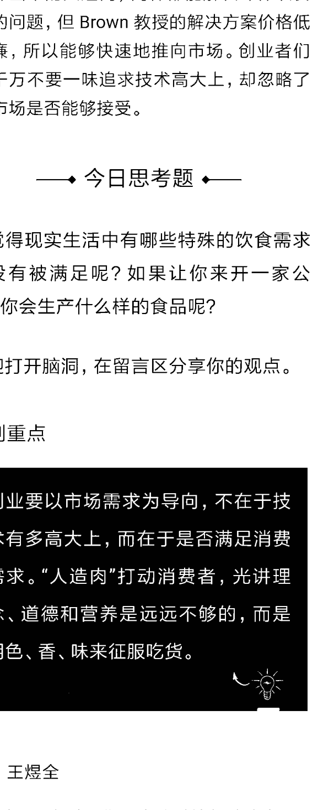

到今天，Impossible Foods 已经得到了超过2.7亿美元的融资，其中也包括比尔·盖茨、李嘉诚等等明星投资人。

2016年，谷歌还出资3亿美元想要收购 Impossible Foods，结果被拒绝了，理由是“不希望依赖于一家正在从事无数项目的企业”，从这里我们也能看出，美国最具创新力的其实就是这些小企业，它们只做一件事，就是把科技转化成产品，然后推向市场，而谷歌这样的大企业，已经不是最创新的企业了，但为了维持自己的竞争力，他们只能靠收购或者投资这样的方法来布局。

目前，Brown 教授的团队正在试图改良汉堡的口味，扩大生产规模，降低成本，他希望能创造出完全的素食肉类和乳制品，比如鱼肉、鸡肉、猪肉等等。

实际上，对于人造肉的探索还有很多科学家都在尝试，主要就是为了减少饲养动物产生的碳排放。比如去年我们提到的荷兰生理学教授 Mark Post，他是用干细胞培养的方法，制造出了世界上第一个“试管汉堡”。但是，这种方法不仅费时费力，价格还贵，竟然高达30多万美元。相比之下，Brown 教授的做法就聪明多了，在同样能够满足市场需求的情况下，Brown 教授的成果可以快速地转化为产品，成本低廉，消费者也能接受。

当然，这条思路也值得我们广大创业者学习：当同样的需求可以用不同的技术来满足时，哪种技术成本更低、更能被市场所接受，哪种技术就更好。

我们一直强调，技术一定要能够转化成产品推向市场，才能实现它的价值，如果技术特别高大上，却找不到合适的应用场景，那就不算是好技术了。

## —— 今日内容小结 ——

今天，我给大家介绍了 Patrick O. Brown 教授以及他创立的人造肉公司 Impossible Foods，希望你能掌握以下三点内容：

- 第一，食品产业的消费升级是个大市场，人们不光追求吃得饱，还要追求健康、环保，这些追求都是创业最好的起点，当然，要做到健康、环保，还要能大量、低价，科技在其中发挥了不可或缺的作用。
- 第二，创业者一定要以市场需求为导向。很多创业者都会说我的技术有多么高大上，但是消费者不懂技术，他们需要的是符合自己需求的、可以感知的产品。Brown 教授在研制人造肉的时候可没有想着用技术去打动用户，而是用美味的口感、低廉的价格、健康的理念去打动他们，这一点值得我们创业者学习。
- 第三，当同样的需求可以用不同的技术来满足时，哪种技术成本更低、更能被市场所接受，哪种技术就更好。就像 Brown 教授的人造肉，对比其他科学家用干细胞培养出来的人造肉，同样都能解决环保饮食的问题，但 Brown 教授的解决方案价格低廉，所以能够快速地推向市场。创业者们千万不要一味追求技术高大上，却忽略了市场是否能够接受。

## —— 今日思考题 ——

你觉得现实生活中有有哪些特殊的饮食需求还没有被满足呢？如果让你来开一家公司，你会生产什么样的食品呢？

欢迎打开脑洞，在留言区分享你的观点。

## 划重点

> 创业要以市场需求为导向，不在于技术有多高大上，而在于是否满足消费需求。“人造肉”打动消费者，光讲理念、道德和营养是远远不够的，而是用色、香、味来征服吃货。

王煜全
我是王煜全，你的全球科技前哨侦察兵，我们明天见。

### 前哨历 11月8日

## 我的今日知识清单：

- 1.食品产业的消费升级是大市场，人们不光追求吃得饱，还要追求健康、环保，这些是创业最好的起点，科技在其中发挥了不可或缺的作用。
- 2.创业要以市场需求为导向，不在于技术有多高大上，而在于是否满足消费需求。
- 3.当同样的需求可以用不同的技术来满足时，哪种技术成本更低，更能被市场所接受，哪种技术就更好。

提前5年，抓住50个前科技浪潮机会

# 074 | 把握食品行业创业的好时机

## —— 今日内容看点 ——

通过阅读今天的内容，你将会掌握以下三个问题的答案：

- 1. 为何众多食品巨头纷纷更换 CEO 和领导层？
- 2. 面对食品产业的变革，创业者有哪些机会？
- 3. 创业者和小企业该如何把握住机会？

周一我们介绍了食品行业有很多值得期待的地方，今天我们来谈谈食品行业的机会和风险，通过了解最近发生的一些大事，让我们来看看这个产业的格局正在发生怎样的变化。

## 一、食品行业的巨大变化

首先，最近有一条新闻值得大家关注：

今年9月的时候，福布斯新闻刊登了一篇文章，说的是在过去的18个月里，有18家大型食品制造商或零售商已经更换或着打算更换其 CEO。这其中包括美国糖果巨头亿滋国际的 CEO、可口可乐公司的全球总裁、雀巢的 CEO，还有刚被亚马逊收购的美国有机食品连锁超市 Whole Foods 的联合 CEO，以及世界第六大食品公司通用磨坊的 CEO 等等。

在如此短的时间内看到众多食品巨头大权更换是一个非常罕见的现象。那这到底是巧合还是背后有深层原因呢？两者皆有。

一方面，我们可以看到这些食品行业的老人手们的一把手都接近65岁的年龄，退休是自然的选择；

另一方面，他们正面临着前所未有的压力。年轻的消费者对于传统的食物产品逐渐失去兴趣，他们追求更加自然的食物，尽量避开含有人工色素、调味剂或保鲜剂的产品。

更糟糕的是，无论食品巨头如何重新设计食品配方，似乎都不能打动年轻消费者们的心，因为消费者们已经不再像以前那样信任传统食品巨头了。而且有人认为，这些老一把手们对于旧的理念和文化过于熟悉，他们很难从根本上作出改变和创新。

## 二、创业者的好时机

我们曾经说过，创业要在非连续性里找到突破点，而今天的食品行业正在发生由于消费升级带来的不连续跳跃，这是创业者进入的好时机。

那么具体来说，创业公司有什么样的机会呢？在这里我们给创业者几条建议：

### 1. 把握好消费者的新需求

### 2. 找准细分领域，对食品供应链进行升级

随着顾客对口味的不断追求，以及他们想要吃到更健康食品的愿望，食品工业正在迅速转变策略。这轮的变化一个最大特点就是：它是由技术驱动的，而传统食品巨头一直以来多在广告及营销渠道上下功夫，研发投入水平比较低。

寻新出路。

比如：

做碳酸饮料起家的可口可乐开始押宝非汽水类品牌，接连买下了 Zico 椰子水、Gold Peak 茶饮料、Suja Life 果汁等等饮料品牌的部分或全部股权。

通用磨坊公司仅在 2017 年就投资了 Rhythm Superfoods、Purely Elizabeth、Farmhouse Culture、D's Naturals 等等品牌。

百事今年成立了欧洲孵化器 Nutrition Greenhouse，选中了8家初创企业项目，主要集中在海藻蛋白、榨树汁等等新兴健康食品领域。

其他的大型食品公司也都纷纷加入到了这场“军备竞赛”中来。

不难看出，健康、多元化、科技正成为备受关注的新趋势，而对于创业公司来说，找到自己最擅长的细分领域，凭借技术优势和健康的理念站稳脚跟，也是一条可行之道。

这里想向大家介绍一家公司叫做 Habit 公司，它们正在尝试利用数据实现餐饮的定制化。Habit 号称是世界上第一家个性化营养公司。什么意思呢？

我们都知道，每个人的体质是不同的，不同的食物适合不同的人，如果你想要补充身体内所欠缺的营养，就要看看什么食物是最适合你的身体的。Habit 推出了一款测试工具，消费者只需按照说明一步步完成空腹血液抽样，将样本寄给 Habit，他们就会给出一份 DNA 的各种营养方面的生物标记物的分析报告。

接下来，Habit 会根据用户的个人喜好和生活行为习惯给出个性化的食谱推荐，最后，Habit 还会把所需的食材处理好，和食谱一起送货上门。

个性定制化的营养服务目前已经成为市场的一个新热点，越来越多的食品巨头已经意识到了这一热点，并且通过投资或收购开始布局这个新兴市场，而营养定制化的方式也各有不同，个人健康追踪、DNA 测试、卡路里计算等等技术手段正在不断涌现。

我们一直强调，没有传统的产业，只有传统的企业。食品这个看似传统、缺乏创新的产业，现在正在被技术实力强的创新小企业所颠覆，谁能更好地结合技术和市场需求，谁就是大赢家。

## —— 今日内容小结 ——

总结一下，通过今天的内容，我希望你能掌握以下三点：

第一，食品行业正在经历一场由消费升级带来大变革，这种转变背后的驱动不再是传统食品企业巨头所擅长的工业制造或者广告营销，而是基于科技，这恰恰就是我们所说的由科技突破引起的不连续性，这是创业者进入的好时机。

第二，食品行业的这次变革，本质上是基于消费者对于健康和安全饮食的新需求产生的，对于创业者来说，把握好消费者的需求是重中之重。

第三，我们一直强调，没有传统的产业，只有传统的企业。食品和餐饮行业看似传统、缺乏新意，实际上正在被技术实力强的创新小企业所颠覆。谁能更好地结合技术和市场需求，谁就会是最大的赢家。

## —— 今日思考题 ——

你希望在将来的餐桌上看到什么样的食品呢？这些食品是基于什么样的需求产生的呢？

欢迎你在留言区分享你的观点。

## 划重点

美国的年轻消费者群体，其中一个特点是越来越看重朋友的推荐和口碑，而不再轻易相信传统的广告，其实中国也是如此，我们每个人在生活中都有所感触，这提醒企业和相关从业者，要打动消费者的心，需要做出改变与创新，使用恰当的营销策略。

王煜全

我是王煜全，你的全球科技前哨侦察兵，我们明天见。

### 前哨历 11月9日

## 我的今日知识清单：

- 1. 食品行业变革背后的驱动力，不是传统食品巨头所擅长的工业制造和广告营销，而是科技。
- 2. 食品行业的变革，本质上是由消费者对饮食的健康和安全需求产生的，对于创业者来说，把握好消费者的需求是重中之重。
- 3. 食品和餐饮行业看似传统、缺乏新意，实际上正在被技术实力强的创新小企业所颠覆，谁能更好地结合技术和市场需求，谁就会是最大的赢家。

# 小彩蛋 | 我的常用APP清单（附第二季度课表）

很多人都会问我是如何了解到这么多的科技信息？也很好奇我平常都使用哪些APP？

今天我来给大家分享一下。

在第一季度的总结里我说过，其实没有什么诀窍，真正的原因就是因为我喜欢科技，所以我总会关注着它，然后就会为此付出精力和时间，去研究它，手机里的APP无疑是最便捷与高效的。

如果你像我一样，也总是每天把自己浸泡在科技相关的信息里，就一定会比普通人更懂科技一些，如果你还愿意花时间去思考，你自然也会比一般人更为精通科技。

我说我比较喜欢苹果的东西，最本质的原因是它总是引领着IT产业的发展，与其他同样懂得创新的IT企业不同，基本上只要是苹果推出的一个功能，很快就会成为行业的标配，所以使用苹果的产品，很多时候就意味着你在感受最新的体验，尤其是iOS系统里丰富的APP资源，无疑是个巨大的宝库。

下面就是我常用的一些APP，供你参考：

## | 资讯类APP

- HuffPost：著名的《赫芬顿邮报》
- TechCrunch：老牌的介绍技术和技术公司的网站
- Wall Street Journal：《华尔街日报》媒体订阅
- Scientific America：《科学美国人》媒体订阅
- Skeptic：《怀疑者》媒体订阅
- The Economist：《经济学人》媒体订阅
- SeekingAlpha：股票分析网站
- News：苹果的自带软件做得也很不错

## | 学习类APP

- 得到：这个是必须的
- iTunes U：有大量学习课程
- 混沌研习社：商业管理类
- Kindle：Amazon的阅读软件（我没单买Kindle，习惯直接在手机和Pad上看书）
- Audible：Amazon的有声书籍软件
- Product Hunt：新产品新服务介绍
- SlidesShare：里面有很多有用的PPT
- YouTube：教学类的视频非常丰富

## | 特别类APP

- Peak：大脑训练，原来用过很久网络版的Lumosity
- Headspace：手机上的冥想指导

## | 交易类APP

- Robinhood：炒股
- Coinbase：比特币

## | 社交类APP

- 微信
- 微博
- LinkedIn

## | 生活类APP

- Amazon：亚马逊已经是什么都能买了
- Google Express：Google正在努力和Amazon竞争
- Groupon：依然很实用的折扣券
- 大众点评
- Yelp：美国的大众点评
- CellarTracker：红酒管理软件

## | 旅游类APP

国内：
- 航旅纵横：有官方数据所以更加可信
- 航班管家：整体体验最优
- 滴滴打车：必不可少

国外：
- Booking.com：把订酒店和信息跟踪整合到了一起，方便
- United.com：美联航的企业APP，体验很好
- Amtrak、MTA：美国的火车有两个系统，因此要装两个APP，MTA查火车时刻还有个单独的APP叫TrainTime，只能说和传统的购票方式比好了很多，但这些APP的体验还有很大提升空间
- Uber：必不可少

其实装几个新的APP很简单，但是，装了不代表有用，你要去体验，要去看，要去思考，才真的有用。

我们现在已经进入第二季度课程的讲解，为了保证你在第一时间同步全球科技动向，‘前哨’的课程将每个季度发布一次。点击图片可保存图片至相册，掌握行动进度。

## 前哨（第二季）课表·第二季度

高科技与生活
本季重点内容
从应用需求科技切入，在工作中发现科技的改变在趋势中。

本季研发布会
2018年CES展实时解读发布（1月·拉斯维加斯）

### 十一月：衣食住行

### 十二月：教育旅游

### 一月：文娱产业

## 用户留言

Hoi1u Y. 17
本来以为是科技的app，打开发现原来是所有app！实在是太惊喜了！

这篇彩蛋好像打开了我们通往最前沿科技的大门，特别是资讯类app！感谢湛老师！
11-08 20:05:40

# 075 | 科技在食品行业将更为必不可少

## —— 全周总结+拓展示 ——

我们本周的话题是衣食住行的食，既包括了食品产业的原料，也就是农业，也包括了食品的加工生产、物流运输等等各个环节。通过本周的介绍，我相信你也会得到结论：

食品产业的变革动力主要是满足需求和消费升级，即吃得饱和吃得好两个方面。但是随着人民生活水平的提高，更大的机会来自于吃得好，而要满足这个市场需求，科技是必不可少的，随着科技在食品行业的广泛应用，我们的顾虑会越来越少，对科技改造过的食品的接受程度会越来越高，最终很多我们今天的顾虑都会被遗忘掉。

具体到本周的内容，我希望大家记住以下四点：

第一，食品行业虽然经常被视为传统产业，但其实一直都是科技拉动的，未来食品产业的发展，也只能靠科技手段解决。21世纪，随着生活的改善，消费者越来越看重健康食品的理念，科技的重心正在从解决粮食短缺问题，扩大到解决我们如何吃得更好的问题。

第二，食品行业正在经历一场由消费升级带来的大变革，这种转变背后的驱动不是传统的食品巨头企业所擅长的工业制造或者广告营销，而是基于科技，这恰恰是我们所说的由科技突破引起的不同连续性，这是创业者进入的最好时机。

第三，创业者一定要以市场需求为导向。消费者不懂技术，他们需要的是符合自己需求的，可以感知的产品。创业者不能只想着要用技术去动用用户，而要更多考虑美味的口感、低廉的价格，健康的理念等等消费者更能接受的观念。科技企业的发展就像顺水行舟，大方向要正确，但细节上要不断调整以适应市场。

第四，科技是创新企业建立竞争壁垒的基础。科技刚刚进入应用领域的时候往往是不完备的，科技企业要做的事情，就是找到一个尚不完备的科技突破，从各个方面提升效率、降低成本，使得这项科技的效能被十倍百倍地发挥出来。

那么，下面进入到本周问题时间，本周的问题其实体现了我们前哨用户的深入思考，有不少也是很好的建议，而且是对未来发展方向的很好的预测，我认为未来基本上就会按照这个方向发展。

## —— 用户答疑 ——

有的食品从原料到加工再到出售，会涉及到不同的厂家，而分别对不同厂家进行监管的成本也很高，所以食品一旦出了问题，责任的认定就很麻烦。随着技术的发展，以后能否通过自动化技术对产品的每个环节进行监管呢？

我的回答是：

这个问题非常好，因为它也是我们目前尚未完全解决，而且是正在下功夫解决的一个问题，也就意味着巨大的商机。因为现在传感器技术，物联网技术，包括智能标签技术，包括大数据技术，区块链技术等等正在改变以前很难以跟踪的那个现状。

现在已经有大量的企业在这方面做了很多的工作，我们在前哨第一季里就讲过，美国最大的农业公司孟山都公司也在转型成大数据公司。我们科技特训营的第二期里就有一个农业大数据公司的创业者，他还在我们科技特训营内部的创业项目评选当中获得了第一名。我们今后会找时间给大家报道他们的成绩。

食品行业是否可以与医药行业相结合？由于个体差异，致病源是不同的，那么我们是否可以根据不同情况制订不同食谱，通过食品来修改个体致病基因，从而达到未雨绸缪，未病先治的目的呢？

我的回答是：

思路非常好，但是其实通过食品来修改个体基因，从科学上应该还是做不到的，因为食品是吃到胃里的，胃里有强大的胃酸，我们都知道过去有 pH 值的概念，对吧？这个 pH 值是 7 叫中性，但是胃里的 pH 值应该是一点几，是强酸性。

所以实际上不管你是转基因，还是怎么来的基因到胃里都被分解为片段了。这也是为什么我们一直强调其实转基因作物对人体有害这件事情，从生物学、医学的角度来看，是没有证据的，因为都被分解了，基本上不太可能有完整的基因片段通过胃肠道进入到人体，甚至进入到细胞，甚至能够表达成蛋白质。如果做不到的话，其实也就不可能说转基因能够使我们的基因产生修改，所以这条线路是不可行的。

但是我为什么说思路非常好呢，因为用食品来辅助治疗，这一个一定是未来发展的趋势。虽然：
- 第一，食品不能替代药品；
- 第二，很多病的发病机理和治疗方式都尚不清楚。

但是，无论良好的饮食，个性化的饮食会对治疗疾病起到非常好的辅助作用。而且，随着大数据和人工智能的应用，加上我们积累了越来越多的实践，食疗的作用会越来越大，未来其实是非常光明的。

我们科技特训营就做“好好吃饭”微信公众号的创业者，我们刚刚结束的美国科技投资考察团里也有专门做患者辅助饮食，尤其是一 些癌症等earing 重症患者辅助饮食的创业者，而且做得已经是相当成功了。

我们正在筹划本季度末，把这些和老百姓切身相关的创业者请来给大家介绍，既给大家科普一些科技知识，同时也给大家介绍如何让高科技，使我们生活得更好，能够让大家真正享受到科技带来的益处。

立体农场会不会象征意义大于实际意义？我认为有几个限制原因：第一，它的投入产出比是否高？第二，现代农业科技这么发达，很多技术可以实现高产、优产，解决人们的饮食问题，那为什么还要在城市里建立立体农场？第三，现代保鲜、运输业极为发达，会在第一时间将这些产品运往各地，为了时间关系建立立体农场是否必要？

我的回答是：

其实这个问题我们在立体农场那天里，也基本都讲到了。就是立体农场确实要面临你说的这些挑战，你列出来这些挑战非常有意义。

但是立体农场并不是没有意义的，因为我们讲在今天看来，立体农场确实面临着传统农业的巨大挑战，但是别忘了，如果我们展望未来的话，超級城市会进一步崛起，人口有可能继续扩张，尤其是城市人口很可能扩张。那就有向空间发展，以扩大耕地利用率的问题，也就是说至少城市周边的耕地不够了。

另外，人们的消费升级也会催生大量小众农产品的需求，这些小众农产品直接在城市周边的立体农场来解决会更好，因为即使现代农业也是需要有规模的。当然，还有就是安全性的问题，立体农场在你身边，就像现在很多餐厅做成透明厨房一样，立体农场也可以做成全透明经营，大家更相 信，而且你可以亲自去看，因为就在城市周边。

最后，就是因为有了 LED 灯，有了其他的很多灌溉、植物营养这些科技方面的改进，立体农场的生产成本有望大幅度降低。当然，我们在那一期节目里就讲到，直接把一个摩天大楼改造成立体农场，现在看起来确实不现实。但是，利用楼顶、空地，或者城市周边，因为其实地价一出城市就会跌得很厉害，而这些部分还是有可能使得立体农场有机会发展起来的。

国内肉牛养殖的缺口非常大，是一个不错的细分行业。但节目中提到的干细胞人造肉技术不会对养殖行业造成巨大的冲击？人造肉技术大概什么时候能普及？将来与人工养殖的肉之间是什么样的格局？

我的回答是：

首先，我觉得我们那个文章里提到的用加血红素等改善口感的方法使人造肉更合适。因为实际上基本的营养成分是一样的，而且我们前面刚刚说到，胃酸会把所有复杂的分子都破坏掉，变成一些基础

有复杂的大分子都破坏掉，变成一些基础的小分子的营养物质。而干细胞人造肉制作加工要复杂得多，还要生成那些复杂的细胞，成本也大得多，其实到了胃里又都会被消化掉，所以是没有必要的。

所以，我认为人造肉一定是未来，就是你讲的国内肉牛养殖的缺口大，而直接用畜牧的办法养殖肉牛对环境的污染也会很大，所以是不经济，也不环保的。但是，做人造肉的时候，我们一定要考虑经济实惠地去做，而不是非得一味地把它做得从里到外都和传统的肉是一模一样的，连每个细胞都是肉的细胞，我觉得是没有必要的。

以上是我对本周前哨用户问题的回答。

## —— 下周预告 ——

我想大家应该也都能猜到，下周我们就会讲衣、食、住、行的“住”了，衣食住行是我们老祖先提出来的生活的最基本的四大需求，周其仁老师就说过，随着科技进步，我们的衣食和行的满足程度都大大增加了，我们的衣橱里挂满了琳琅满目的衣服，我们也能吃到世界各地的美食，我们旅行的足迹也已经遍布世界各地了。要知道，清朝的时候只有王公贵族才能用较长的冰块在冬天吃到冰镇的西瓜。而一直到解放前，中国人去欧美留学，或者旅游都要坐好几个月的轮船，所以实际上这些地方的发展都是非常迅速的。

不过，随着超级城市的兴起，只有我们的居住条件没有得到本质的改善，甚至大家会有恶化的感觉。当然，其实城市高密度生活需要的上下水、电力、公交、卫生等等都还是得到了极大的改善，但是都被大家居住越来越拥挤的这种不好的感觉给抵消掉了。而且，住房成了我们消费的最大部分，很多人成了房奴，一辈子为房地产打工。所以，在衣食住行里，只有“住”我们的感觉上来讲的进步是非常差的，甚至是有退步的地方，至少旧社会，估计人均居住面积比现在会好一点。

那周老师也讲过以色列那个观点，一件难的事情和一件容易的事情，以色列人会选择去做难的事情，因为这样一旦你做成了以后，竞争相对少，价值相对大。

那么，下周我们就来看看科技是不是已经开始啃“住”这块最难的骨头了呢？已经啃到什么地步了呢？我们未来的居住会变成什么样子的呢？相信大家一定会关心。

## 划重点

随着生活水平的提高，更大的机会来自于吃得好，要满足这个市场需求，科技是必不可少的。随着科技在食品行业的广泛应用，人们的顾虑会越来越少，对科技改造过的食品的接受程度会越来越高。

王煜全

我是王煜全，你的全球科技前哨侦察兵，我们下周见。

## 前哨历

#### 11月10日

## 我的今日知识清单：

- 1. 个性化的饮食会对于治疗疾病起到非常好的辅助作用，是未来发展的趋势。但食品不能替代药品，而且很多疾病的发病机理和治疗方式都尚不清楚。
- 2. 食物消费升级会催生大量小众农产品的需求，直接在城市周边的立体农场来解决会更好。
- 3. 人造肉一定是未来，因为养殖的缺口大，不经济也不环保，但无需做得和传统的肉是一模一样。

摘自：《075 | 科技在食品行业将更为必不可少》

「得到」专栏《全球创新260讲》
找前5年，抓住50个新科技浪潮机会

# 创新地图 | 保鲜新技术：让更多食物抵达餐桌

杨帆，内布拉斯加州大学植物病理学博士。

很多人以为解决粮食危机的唯一办法就是生产更多食物。支持这个观点的人往往忽略了一个问题，那就是，在我们生活的这个时代，食物的有效利用率并不高。

以今天的美国为例，每年种植出来的食物中大概有四成永远到不了餐桌。其中两成的食物是在农产品的储藏、包装和物流的过程中损耗掉的。接着，到了销售环节，商家又不得不把那些卖相不好、保质期接近的食物处理掉。最后当食物进入千家万户时，又可能因为冰箱不够好、忘了吃等原因，而丢弃食物。

总之，一个生产能力强大的国家，不一定能100%地有效利用它所创造出来的食物资源。原因就是，现代社会对于饮食的需求复杂多变，而食品却无法长时间储存保鲜。

在这其中被损耗的食物中，水果和蔬菜的比重超过了一半，因为水果和蔬菜对储存保鲜的要求更高。

比如智利出产的蓝莓，走完采摘、包装、冷藏运输、海关等流程，最终进入美国超市，大概需要30天。

## | 用食物保鲜食物的Apeel

首先要为你介绍的，是位于美国加州的创业公司 Apeel，这个名字的意思是“一层水果的皮”。它的核心技术，是通过减缓果蔬的呼吸过程来延长保鲜时间。

## | 针对浆果保鲜的Hazel Technologies

## | 果蔬保鲜技术

但就目前来看，不管它们的产品长什么样，果蔬保鲜的技术基础就两条：
- 要么减缓植物的呼吸活动；
- 要么控制乙烯激素的水平。

对于我国而言，每年在存储过程中损耗的食物数量也是一个天文数字。怎样来解决这个问题呢？

我的建议是，积极借鉴和拓展新的保鲜技术。这不但能提高我们的食物有效使用率，而且能够帮助解决一部分食品的安全问题。整体上看，虽然我们国内也在使用像乙烯抑制剂这样的化学产品，但我们的保鲜技术还是略显单一。大多数人除了冰箱以外，就不知道该怎样让家里的食品能够储藏得久一点，新鲜一点。非常期待未来有更多绿色高效的保鲜剂能够出现。

## | 总结：

- 1. 现在，我们面临的粮食危机的现状，一方面来自食物的短缺，另一方面来自食物的损耗。所以，想要解决粮食危机，除了生产更多的食物，还可以从提升食品的储存保鲜技术这个角度来切入。
- 2. 在那些被损耗的食物中，对储存保鲜要求更高的果蔬，比重超过了一半。因此，很多大企业和小创业公司，着力于发展延长果蔬储存和保鲜技术。不过，就目前来看，不管是什么产品，它们所依靠的技术基础就两条：要么减缓植物的呼吸活动，要么控制乙烯激素的水平。
- 3. 我国每年在存储过程中损耗的食物数量非常巨大，而目前，我们的保鲜技术相对比较单一。因此，为了解决食物的损耗问题，我的建议是：在积极借鉴的同时，拓展新的保鲜技术。这样既能提高我们的食物有效使用率，又能解决部分食品的安全问题。

王煜全

好，以上就是今天《全球创新260讲》的内容，欢迎你留言写下你的收获或感想，我们下周见。

### 前哨历 11月11日

## 我的今日知识清单：

- 1. 想要解决粮食危机，除了生产更多的食物，还可以从提升食品的储存保鲜技术这个角度来切入。
- 2. 储存保鲜所依靠的技术基础就两条：要么减缓植物的呼吸活动，要么控制乙烯激素的水平。
- 3. 无论是大企业还是小创业公司，都没有停止过对食物储藏技术，特别是果蔬保鲜技术的努力。因为谁都想成为新一轮改变食品行业规则的那个人。

> 摘自：《创新地图 | 保鲜新技术：让更多食物抵达餐桌》

「得到」专栏《全球创新260讲》
从5年，抓住50个科技浪潮机会

“创新地图”是《全球创新260讲》的周末特别版块，主要由专栏的科技社群“前哨团”供稿，为你带来科技领域的专业知识。前哨团主要由全球各地从事科技领域工作的投资者、创业者、研究人、学者等组成。

## 用户留言

# 076 | 超级城市带来的巨大商业机会

## —— 今日内容看点 ——

通过阅读今天的内容，你将会掌握以下三个问题的答案：
- 1. 为什么会出现超级城市？
- 2. 人的生活将怎样被改变？
- 3. 超级城市将带来哪些好处？又有那些缺点？

从今天开始，我们要进入衣、食、住、行里的“住”。我们在上周的预告里面提到，随着科技进步，我们的衣、食和行的满足程度都大大增加了，唯独住的体验还需要很大改善。那么要如何解决这个问题呢？这周我们就来聊聊这个话题。

按照北大周其仁老师的说法，我们的房价越来越高，但是居住面积却越来越小，特别是北京、上海这样的一线城市的住房价格，可以说是天价了。所以，很多 人说，大城市房子这么小，可房价还这么高，那我还不如回老家过得安逸一点。这就是所谓的“逃离北上广”的说法。

可能确实有很多人是这么想的，但实际上，未来的发展趋势却是相反的。人们的居住会越来越聚集，越来越向大城市流动，然后慢慢形成超级城市、甚至超级大城市。这就是我今天的主题，超级城市。

## 一、超级城市（Mega City）是发展大趋势

什么是超级城市呢？超级城市是指城区人口数目超过1000万的城市。照这个标准来看，现在全球已经有了40个超级城市，其中最大的超级城市是日本的东京和印度尼西亚的雅加达，已经有超过3000万人居住了。中国有10个城市上榜，它们分别是重庆、上海、北京、天津、成都、广州、深圳、哈尔滨、苏州和武汉。

联合国预测，到2050年，全球城市人口的比例将达到惊人的75%，而且，超级城市也将成倍地出现。所以，对全球来说，这就是历史的发展趋势。其实，超级大城市的人口越来越多也不完全是坏事，想想看，世界最大的40个超级城市只占了地球极少的面积，却让全球18%的人口在这里生活。联合国人居署在2010年发布的“世界城市状况”报告中指出，世界各地的超级大城市，正在逐渐地聚集合并成更大的超级都市区，英文简称为Mega Regions。

那么，为什么会出现超级城市呢？其实道理很简单。首先，聚居比独居的好处更多，因为聚居地所能提供的服务和商品更多。其次，在人口密集的超级城市，人们的连接更加紧密和便捷，服务的多样性和复杂性都要比小城镇或者人口稀少的地方多得多。举个例子，小城市的文化艺术机构并不多，再看看超级城市，无论是正式的博物馆、美术馆、剧院，还是购物中心，你随时都能在这里享受到这些高品质的文化和商业体验产品。

## 二、科技让超级城市的生活更加便利

就这样，越来越便利的生活，反过来又会吸引人们不断地向超级城市聚集，也就慢慢形成了类似滚雪球的马太效应。结果就是，全球渐渐地形成了超级城市的大趋势。

好的，现在我们已经了解了超级大城市是未来全球发展的一大趋势。城市化的加速发展确实极大地便利了我们的生活，但同时，它也让城市患上了所谓的“大城市病”，比如交通拥堵、环境污染、资源浪费和紧缺、公共安全等等。这些问题如果靠政策制定来解决的话，可能效果十分有限。怎么办呢？答案是，依靠科技的力量。

科技能为我们提供更有效、更直接的解决方案，还能让我们的城市生活更加美好。也就是说，科技将推动城市向更深层次、更高品质和更人性化的方向发展。另外，想要实现大规模的城市化，也得依靠强大的科技实力，否则不太可能会出现超级城市。举个例子，由于中世纪的医疗技术有限，当时一场被称为“黑死病”的大瘟疫夺走了2500万欧洲人的生命，占了当时欧洲总人口的1/3。

接下来，我们来具体看看科技是怎样影响人类生活的。

总的来说，现在以大数据和云计算为代表的新技术革命，将根本性地改变我们生活的方方面面，比如制造业、新能源、交通运输、气候、农业、金融等等。

## 三、超级城市的好处

最后，让我们把目光回到超级城市身上。我将为你分析，到超超级城市化有什么好处？为什么大家要越来越密集地居住在一起呢？我认为，主要有以下三点：

第一，能够更加关注发展自己的长板。超级城市所带来的分工细化可以让每个人专注于自己的长板，然后通过跟别人合作的方式，提升整个社会的协作效率。

第二，能够体验更加丰富的生活。人们既希望有独处的空间，又有和他人建立“线上”和“线下”连接的需求。而只有在超级城市中，才有各种小众服务存在的可能性，才能为你提供线上和线下的体育、艺术、教育、娱乐和医疗等等各种服务，另外，生活移动化、数据化和智能化也深刻影响着我们的生活。

第三，能够相互激发创新。越是超大型城市，就越容易发展出强大的公共交通系统，而且，创新往往来自于人口密度和个

统，而且，创新往往来自于人口密度和个体差异较大的超级城市。所以，面对未来超级城市的大趋势，各个产业都将面临产业变革加快的格局。比如，随着无人驾驶汽车和电动车时代的到来，汽车业的主导者将会从生产商转变为像Uber这样提供汽车服务的企业。

总之，超级城市化让人们受益。因为有更多的机会，更好的发展，更多有价值的信息和更广阔的社交平台。

## ——◆ 今日内容小结 ◆——

今天我们说了三点：

第一，超级城市是不可逆转的大趋势。在人口密集的超级城市，人们的连接更加紧密和便捷，而便捷的城市生活又反过来吸引人们向超级城市聚集，慢慢形成滚雪球的马太效应。

第二，要实现超级城市化，需要强大的科技实力作支持，否则超级城市不太可能会出现。

第三，超级城市给我们带来巨大好处的同时，也带来了非常多的商业机会。它会让各个行业的分工更加细化，人们在超级城市中也能更好地发展自己的长板、体验更加丰富的生活、激发出更妙的创新，尤其是超级城市当中常见“大城市病”，都反过来会成为大家创业的商机。

## ——◆ 今日思考题 ◆——

你觉得超级城市的出现会对哪些行业产生颠覆性的影响？为什么？

欢迎你在留言区分享你的观点。

王煜全

我是王煜全，你的全球科技前哨侦察兵。我们明天见。

## 前哨历 11月13日

## 我的今日知识清单：

+   1. 超级城市是不可逆转的大趋势，人们的连接将更加紧密和便捷，而便捷的城市生活又反过来吸引人们向超级城市聚集，形成滚雪球的马太效应。
2. 各个行业的分工会更加细化，人们在超级城市中也能更好地发展自己的长板、体验更加丰富的生活、激发出更妙的创新。
3. 交通拥堵、环境污染、资源浪费和紧缺、公共安全等“大城市病”，会成为创业的商机。

> 摘自：《076 | 超级城市带来的巨大商业机会》

「得到」专栏《全球创新260讲》
观的5年，抓住50个新科技浪潮机会

用户留言

提交留言可与专栏作者互动

# 077 | 联合办公：房地产行业的新盈利模式

077 | 联合办公：房地产行业...

## —— 今日内容看点 ——

通过阅读今天的内容，你将会掌握以下三个问题的答案：

+   1. 出租工位的 WeWork 估值接近200亿美 元，是怎么做到的？
2. WeWork 的创业故事给我们带来哪些启 示？
3. 中国联合办公市场的现状如何？前景如 何？

今天给大家介绍的是联合办公空间的领军企业 WeWork。说起 WeWork 这个名字估计你不会陌生，这是一家从纽约起步的经营联合办公空间的公司，成立不过7年，估值已接近200亿美元。

联合办公的概念并不稀奇，在欧美国家已经有很多年的历史，那么这样一家主营业务是出租工位的公司怎么会有这么高的估值呢？咱们先来看看 WeWork 的发家史，兴许你能从中找到答案。

### |一对分享“室友”碰撞出的火花

WeWork 的故事要从本世纪初开始讲起。创始人 Adam Neumann 是一位来自以色列特拉维夫的犹太青年，他小时候在以色列南方的个叫基布兹的农场长大。基布兹在希伯来语中是团体的意思，这里是名副其实的集体所有制，没有私有资产，一切财产和生产资料为全体成员所共有。现在看起来也许可小时候的成长环境，对他后来创办共享办公空间这个事情还是有影响的。

2001年，Adam Neumann 跟着当模特的姐姐来到纽约，在为姐姐工作的时候自己也尝试着创业。2007年，他在布鲁克林码头区的一处工业建筑里创立了一款婴儿装品牌叫 EGG BABY。在经营生意的过程中为了节省房屋开支，他就发布广告，想要将办公室的一部分转租出去。幸运的是这个广告给他招来了俄勒冈大学毕业的建筑师米格尔·麦克维y(Miguel McKelvey)，这个人后来成为了 WeWork 联合创始人和首席创意官。

2008年1月，Adam 和米格尔将纽约的一处空置楼盘改造成了一个可以拎包进驻的环保办公空间，为了迎合社会上的环保理念，他们给自己的办公空间取名叫“绿桌子”(Green Desk)，主打环保理念，同时结合社交和休闲需求。结果超出他们的想像，仅仅依靠7条分类网站的广告和口碑传播，就让绿桌子大获成功。办公室开放一年后，绿桌子已经出租了100多个工作空间，月租费从350美元到2400美元不等。

虽然主打环保理念，但是他们发现客户对工作社区的工作氛围比对环保概念更感兴趣。这些人想要的是一个能提升工作效率、舒适自在的空间，但那个时候绿桌子并没有设置开放的公共空间，毫无疑问他们的产品需要迭代。在经营不到两年后，他们以300万美元的估值把绿桌子卖给了这幢建筑的业主，2010年2月，他们用这笔钱在纽约 SOHO 区创立了联合办公空间 WeWork。

### |生逢其时的WeWork

在美国社会里，因为互联网的发展，人们相互合作的成本越来越低，效率越来越高。这些年来从事自由职业的人越来越多。

一方面是大公司不愿意雇佣那么多人，人工成本实在有些高；

另一方面是很多专业人士开始自我雇佣，他们不仅有着相对自由的工作时间，而且可以同时为多家雇主服务，收入反而比在大公司里做个螺丝钉要高。

更重要的是，正如我们前啸专栏一直介绍的，美国的创业浪潮始终高涨，小公司层出不穷，而且新的创业公司不像以前扎在硅谷的某个民宅里，要出门吃个饭都只能开车。

现在的创业者更青睐大都市，像纽约布鲁克林的 Navy Yard、旧金山的 SOMA，因为下个楼就能解决生活所需，都市里的人才更密集、聚会交流更方便。

就像我们的积木式创新的理念所介绍的，不同才能的人聚到一起，很可能因为某个创业机会的触发就一起组建了新公司，而创业公司也特别需要和这样有一技之长的自由职业者接触，也许他们就会被吸收到创业公司来了。所以这些人都需要新的办公空间，这个“新”不仅仅意味着桌椅板凳的新，更是一种新的创业社群的文化和气氛，办公室不是关键，关键是加入某个社群，有志同道合的人可以经常交流，很多公司就此形成，很多合作就此启动。

WeWork 的创业故事就是我们一直讲的，创业就像驾船顺流而下，要有个大方向，但要随着市场变化灵活调整。WeWork 的创业都有一定偶然性，甚至会为迎合时尚而设计环保主题，但当他们发现市场真正需求的时候，能够坚决而迅速地作出调整。可以说在创业浪潮，尤其是大城市创业的浪潮席卷而来的时候，WeWork 生逢其时，这大概是以前的共同办公空间一直不温不火，而 WeWork 一面世就倍受瞩目，而且成长迅速的根本原因吧。

有人说 WeWork 就是一个超大規模的星巴克，这里有咖啡，有开放的办公空间，有各种各样的活动，有快速的无线网络。WeWork 的用户大多数是小規模的创业企业或者是自雇式的自由职业者，可以说就是个体户。这些人除了需要舒适的办公空间，其实还需要一个很好的社区氛围，比起小公司的独门独户或者独自在家办公的 SOHO 一族，在一个大的社区里工作最起码不孤单，有种大家一起努力工作的气氛。

所以从一开始，Adam Neumann 和米格尔·麦克维就比较关注工作以外的因素，强调自由与趣味、注重包含协作在内的社区概念，通过各种线下活动和线上 APP 的形式，为租户塑造跨行业、跨国界、合作紧密和有充分归属感的社群氛围。

2016年北美调查报告显示，在选择联合办公空间的十大因素中，人脉网络是排在第一位的，因为每个进驻会都能够在 线注册会员，如果未来更换其他共享办公空间的话等于放弃了 WeWork 的社交圈。

根据福布斯杂志7月份的报道，WeWork 目前估值200亿美元，据说融资已经进行到了 G 轮，这一轮拿到了7.6亿美元的融资。今年3月份，他们拿到了软银资给的3亿美元资金，WeWork 的120多个办公空间分布在美国纽约、洛杉矶、英国伦敦、荷兰阿姆斯特丹、德国柏林、加拿大蒙特利尔等等地方，全球会员数超过9万名，企业会员超过1万名，员工超过2000名。

为了提升创业者社群的黏性，WeWork 的服务还在不断进化，他们会为会员提供健康保险和健身课程，并 在纽约开了一个健身房。今年4月，他们开始为会员提供包含各种商业服务和软件的线上商店。

### |“一鱼三吃”的商业模式

说到这里，再次回到我们开头那个问题，为啥 WeWork 的估值那么高呢？

简单来说，就是他们既适应了时代的需求，打造了创业者的共享社群，又非常聪明地找到了“ 一鱼三吃”的商业模式，而不仅仅是媒体上天天热炒的共享办公空间的理念而已。

+   1. 直接收取租金

最直观的就是收取工位租金和会员费，获得充 足的现金流。而如果是在共享空间内的专用办公桌，包含一套专属的办公桌椅和一个可上锁的文件柜，在美国是350美元每个月；而一 间5-6平米的私人办公室，在美国是650美元每个月，但需要预付两个月的服务定金和支付每个办公桌100 美元的初装费。共享办公最大的能量是它去各个地方找来的房子永远都比周围的房子便宜，WeWork 获得房子的租金是周围同类写字楼的60%，这一块它已经有40%的利润了。

+   2. 做投资

WeWork 很早就开始投资各类入驻公司，并且还投资作为入驻企业提供服务的公司。比如 WeWork 买了一家为所有 WeWork 公司提供访客登记系统的數據公司的10%的股份，每年共享空间进进出出几十万人，访客数据全在里面，WeWork 买下它以后，里面的数据能共享。在 WeWork ...

以后，里面的数据全能共享。在 WeWork 创业不到6年的時候已经投资了92家公司，其中有21个在纳斯达克上市了，这其中的收益可能不比租金收益低。

### 3. 建立房地产信托投资基金

WeWork 建立了一只不动产基金，有专门的团队负责去全球各地买房产，然后出租给入驻公司，当运营达到一定标准之后退出信托基金，按照预期基金回报率将一部分利润返回给基金出资人，剩下大块的可观利润就属于 WeWork 了。

这么看来，WeWork 公司已经不仅仅是一家共享办公空间提供商了，而是基于一个一个的工位塑造了一个全球化的平台。在这个由众多企业组成的平台上，WeWork 以轻资产的形式运营，却获得了传统的房地产企业难以企及的营利水平。

### | 中国联合办公市场的现状

如今，WeWork 已经在中国落地，在上海、北京等处有几处办公空间，不过我也看到网上的不少吐槽，抱怨 WeWork 中国的服务不够到位，看来这个高大上的品牌要想在国内做好服务，还得调整一段时间。这也看得出来 WeWork 的扩张速度很快，相应的服务品质可能跟不上这个速度，尤其是进入中国这样一个相对陌生的文化环境。

在美国引领联合办公浪潮的时候，中国也迎来了“大众创业、万众创新”的创业潮。截至2015年底，中国的众创空间数量已经超过2300家。这些空间往往有政府的各种政策支持，在经营上就显得比较粗放，一旦相应的政策支持跟不上，这些机构的发展就会遇到大麻烦，现在其实已经有不少孵化器和众创空间关门歇业了。

不过，中国众多的众创空间和联合办公机构里也有非常不错的。2015年4月，原万科集团副总裁毛大庆离职创办的优客工场，这几年的发展非常迅速，目前的估值已经超过了60亿元，也是一家独角兽公司了。

## —— 今日内容小结 ——

今天我们的总结有以下三点：

+   第一，科技会带动社会发展，而社会发展会核心服务产生新需求。美国的互联网化、城市化，加上创业浪潮，催生了联合办公的新需求，这个需求的本质不只是租用办公空间，而是加入创业者的社群，为创业者提供信息、交流、合作，甚至保险等全方位的服务。

+   第二，Adam Neumann 把 WeWork 打造成能够提供全方位创业生态链和增值服务的影响全球的共享社群，以轻资产模式实现投资回报最大化，在商业模式上是响应时代需求的好创新。

+   第三，在中国“大众创业、万众创新”的背景下，创业公司对于办公空间和服务的需求显著增加，在政策红利的支持下，联合办公业态发展将大有可为。然而仅仅提供办公空间是完全不够的，如何为创业者提供贴心、个性、高效的全套创业服务和打造自身品牌的溢价是更有挑战性的事情。

## —— 今日思考题 ——

联合办公空间目前已经在很多城市都有了，你是否用过他们的服务呢？有什么样的感受？

欢迎在留言区分享你的观点。

## 划重点

> 联合办公空间的核心价值，不是提供廉价的工位和办公空间，而是把不同才能的人聚集在一起，增加他们交流的机会，形成一种新的创业社群的文化和氛围。为创业者提供贴心、个性、高效的全套创业服务。

王煜全
我是王煜全，你的全球科技前哨侦察兵，我们明天见。

## 前哨历  11月14日

## 我的今日知识清单：

+   1.科技会带动社会发展，而社会发展会对服务产生新需求，互联网化、城市化加上创业浪潮，催生了联合办公的新需求。
2.仅仅提供办公空间是不够的，要为创业者提供贴心、个性、高效的全套创业服务，打造品牌溢价。
3.在中国“大众创业、万众创新”的背景下，创业公司对办公空间和服务的需求显著增加，联合办公业态的发展大有可为。

# 078 | 提高空间利用效率 解决超级城市居住问题

078 | 提高空间利用效率解...

## —— 今日内容看点 ——

通过阅读今天的内容，你将会掌握以下三个问题的答案：

+   1. 人口密度堪称世界之最的香港九龙城寨是怎么回事儿？
2. 如何有效提高空间利用效率解决超级城市的居住问题？
3. 基于“垂直花园城市”理念开发的六本木新城给我们提供了哪些启示？

昨天我们介绍了能降低空间利用成本的联合办公 WeWork 公司，大家都知道，其实还可以通过提高空间利用效率来解决超级城市里的居住问题。今天，我就为你介绍被誉为“未来城市建设范例之一”的代表——日本东京六本木新城，以及它的建设团队日本森大厦株式会社。看看如何在高人口密度情况下还能拥有更加便捷、美好的生活？

如果没有高科技带来的各种便利，历史上出现过的高密度人口居住的处境会是怎样的呢？

### | 人口密度堪称世界之最的香港九龙城寨

不知你是否听说过香港九龙城寨？这个城寨原来是清政府在鸦片战争之后，为了监视英属香港而修建的一处面积仅为大约0.026平方公里，也就是2.6万平方米的小围城，里面生活着近5万人，平均每人的居住面积仅为3到4平米，人口密度堪称世界之最。城寨里有400多座的非法建筑，高度达到了41米。从天空俯瞰整个城寨，像个四方盒子中间挖了一个窝窟。90%的房屋都是终年不见阳光的，环境卫生极其恶劣。这里曾经是世界上最富传奇色彩的贫民窟，充满着罪恶和黑暗的法外之地。

城寨内的居住环境非 常恶劣。比如，用水是个大问题。因为水源上游是工业区，水里含有大量化学物质。仅有的自来水管只有8条，被城寨内势力强大的黑帮控制。而且因为缺乏隔水系统，整个城寨几乎整年都处处漏水。除了用水，用电也是问题。港英政府对此地不供电，唯一的电力来源就是偷接路灯电缆，电力供给严重不足，停电成了家常便饭。

尤其二战结束之后，大批难民涌入香港，城寨的居民人数日渐增加，城内出现了华人黑社会组织——三合会。城寨逐渐成了毒品的倾销和消费场，聚集着无所事事的混混、收保护费的黑帮，在光天化日之下公然劫夺，只要转身逃回城寨，警察便无力追击了。乃至于澳门、台湾、东南亚一带的通缉犯，在走投无路的情况下，都会远道赶往香港九龙城寨寻求庇护。上世纪50年代，城寨已经有了154个毒品聚集地，11个色情场所，7个赌场。

有意思的是，虽然这里是华人文化圈避之不提的隐晦之地，却令外国人格外着迷，它诡异的形态在众多末世、生化、犯罪题材的漫画影视当中不断出现。1991年，香港政府拆除了这个历史上最传奇、最臭名昭著的九龙城寨贫民窟。

不过，在东京与横滨之间的川崎仓库游戏公园内，由装置艺术家 Taishiro Hoshino 全真复刻了一个九龙城寨。沿着一个锈迹斑斑的指示牌，游客便能一下子进入时空隧道，回到上世纪80年代的九龙城。

九龙城寨早已经成为黑暗的历史。周一我们介绍过，随着科技的发展，未来会出现大量人数超过3000万的超级城市，人口密度极大，直逼九龙城寨。

那么，人口超过3200万的东京会给我们提供什么样的启示呢？下面给大家介绍提出“垂直花园城市”开发理念的森大厦集团。

### | 森大厦集团实施六本木新城改造计划

森大厦集团成立于1955年，前身叫森不动产，创始人名叫森泰吉郎。20世纪70年代起，公司改名叫“森大厦公司”，位于日本东京港区六本木。从此便以东京为中心，开始了大规模的商业地产开发。

它的开山之作是1986年的 ARK Hills，在东京都港区建设了商务办公楼、住宅楼和高级酒店、剧场合二为一的综合都市型商业生活设施，开创了日本现代都市生活圈的建设典范。Hill 的原意是小坡，东京城里有不少起伏的坡地，很多建筑就盖在这样的 小坡上。如今，Hills 指的是综合建筑群体，有写字楼、酒店、商厦、住宅楼、垂直花园以及一大批文化设施，即“多功能开发、有效利用土地”的理念。

同年，东京政府启动了“城市复兴新政策”的六本木新城再开发计划。当时，这个地区的街道非常狭窄，建筑物陈旧，而且密度极高。政府希望六本木新城再开发计划以打造“城中城”为目的，通过为人们提供更多的城市空间和私人时间来组织更富  囗的城市生活。

作为土地所有者之一的森大厦集团与朝日电视台一起与其他土地所有者提出了建议，对此区进行改造。当时的森大厦集团社长森稔先生认为，东京需要通过对现有土地所有体系进行重新划分，建造更多高层建筑，改造成一个“局部更集中、环境更美好的”城市。最终，经过漫长的17年的谈判，与400多名各种产权所有人达成了一致，终于通过了改造计划，并且在2003年正式开业。

### | 根据“垂直花园城市”理念开发的六本木新城

那么，六本木新城是如何满足生活中的多功能需求的呢？

新城占地面积11.6万平方米，具备了居住、办公、娱乐、学习、休憩等各种功能及设施，是一个超大型 的复合型社区，约有2万人在此工作，平均每天出入的人数达到10万人。新城里的建筑有朝日电视台总部、54层的森大厦、凯悦大酒店、维珍影城、精品店、主题餐厅、日式庭园、办公大楼、美术馆、户外剧场、集合住宅、开放空间、街道、公共设施等等等等，几乎可以满足都市生活的各种需求。

值得一提的是，位于主楼森大厦49-54层的森艺术中心集合了以现代艺术为展览与馆藏主题的森美术馆、观景台、会员俱乐部和学术研究机构等等，在全区建设过程中就充分考虑设置了公共艺术作品和景观休憩设施。这些景观系统规划，构成了六本木新城街道景观的重要元素。通过日常举办的各种活动，吸引了大批来自国内外的游客，自从2003年开业以来，每年来到这里的人数超过400万人，使得六本木新城成为了东京的文化中心地区之一，也是东京国际电影节另外一个重要的会场。

最关键的问题是，如何提高空间利用率呢？

新城把城市的生活流动线从横向改为纵向，建设一个“垂直”而不是“水平”的都市，以改变人们的居住与生活行为模式。

市，以改变人们的居住与生活行为模式。新城里的建筑就是根据这个规划朝垂直方向设计的，而且这样的话户外公共空间更开阔，绿化率也比较高。

“垂直花园城市”的开发理念主要体现在以下几个方面：

+   1. 充分利用城市立体空间，使空间成倍增长

把以往没有充分利用的城市中的空中部分加以活用。比如：

在城市中心适合建造高层建筑的地区就积极推行建筑物的高层化，提供必要的空间，对细分化的土地加以整合；

通过开发超高层塔楼和地下空间的立体使用，有效完善了铁路、公路等等城市基础设施，将工作、居住、游戏、学习、商业等城市功能有机地结合为一个整体，形成集约型城市。

+   2. 缩短通勤时间，使时间利用率成倍增长

+   一是通过建设道路以减少甚至消除交通堵塞来缩短通勤时间；
二是是通过提倡在市中心居住以缩短通勤时间。

顺便说一句，原来美国是典型的富人居住在城外，穷人居住在城里的居住结构，最近这些年，也发生了明显的变化，大量的富人重新居住到了市中心，甚至把穷人向郊区挤出去了。

+   3. 在城市中心建设综合体，使功能实现多元化

建设集各种功能于一体，工作与居住相连接的城区也是有效的手段。通过高密度、高效率地使用土地，减少二氧化碳排放等等，让城市更加环保。

那么这就是我们今天的内容，日本六本木新城的高密度城市生活的实践。森大厦集团提出的“垂直花园城市”开发理念和六本木新城为人们提供了未来城市生活中解决居住问题的实践之一。

## —— 今日内容小结 ——

总结下来，其实今天就讲了三点：

第一，其实是由于科技的进步，使得我们已经能够处理这个人们高密度生活当中遇到的各种问题了。包括建筑的能力可以向空中扩展了，我们原来就介绍过，我们前哨团有一位建筑学的博士就讲到，现在的建筑科技已经使得我们随意能够建造出各种形状的建筑了，建筑上面已经不再有技术难题了。你看看央视的俗称“大裤衩”的那个办公楼就知道现在的建筑能够做到什么地步了，因为虽然那个建筑模样怪异，而且重心明显不在地基上，但据这位建筑博士讲，这样的楼用100年也不会出任何问题。所以现在技术不是问题才会造成对这种超级城市的居住空间的布置可以满足我们的各种想象，使得我们把它能够适合人类的高密度生活。

第二，在未来人口居住密度不断增加的趋势之下，这种“垂直花园城市”的开发理念，既能高效快捷地实现各种生活功能，又能通过超高层建筑为其他用途留下更多的土地，是一个非常有价值的实践。

第三，未来超级城市中社区数量和规模都会增加，人和人之间的连接密度和频率就会越来越高，这样一来，人们之间相互协作，提供各种社区服务的机会和需求也会增加。所以说，“垂直”扩大的社区蕴含着大量创造新价值的新机会，比如娱乐、社区医疗、生活和教育服务、文化、消费升级服务等等。

## —— 今日思考题 ——

请你思考一下，在我们国家的城市规划和建设中，你印象最深的集中高效的城市街区有哪些？它们给你什么样的感受呢？或者你也可以吐槽一下自己居住的城市里的各种低效和不便利，怎样才能利用科技改变这些问题呢？

王煜全
我是王煜全，你的全球科技前哨侦察兵，我们明天见。

## 划重点

> 建筑科学的发展，使我们能够建造出各种高层建筑，既能解决居住问题，又能满足高密度生活的种种需求。

## 前哨历 11月15日

## 我的今日知识清单：

+   1. 在未来人口居住密度不断增加的趋势下，“垂直花园城市”开发理念，既能高效快捷地实现各种生活功能，又能通过超高层建筑为其他用途留下更多的土地。 2. 未来超级城市中，社区数量和规模都会增加，人与人之间的连接密度和频率会越来越高，人们之间相互协作，提供各种社区服务的机会和需求也会增加。

据自：《078 | 提高空间利用效率解决超级城市居住问题》

「得到」专栏《全球创新260讲》
在5年，抓住50个科技潮流机会

## 用户留言

提交留言可与专栏作者互动

# 079 | 超级城市带来更多可能性与机会

079 | 超级城市将带来更多...

## —— 今日内容看点 ——

通过阅读今天的内容，你将会掌握以下两个问题的答案：

+   1. 超级城市中的“联结性”概念是什么意思？
2. 为何说很多属于“小众”文化的娱乐活动只能在超级城市中诞生和发展？

周一我们提到过，在超级城市里人们能更好地发挥自己的长板，体验更丰富的人生。在介绍机会之前，我先来给大家介绍一个新的理解超级城市的概念，叫联结性（Connectivity）。

## 超级城市的"联结性"

这个概念是由 Parag Khanna 提出来的，他在新加坡国立大学李光耀公共政策学院亚洲和全球化中心担任高级研究员，同时也是 CNN 的全球撰稿人，还有一个比较奇怪的称呼——地理政治的未来主义者, 某种程度上他是一个未来学家。

下面我们来看看他眼中的联结性。

他将人类的身体和地球作了一个有趣的类似，当我们把地球看作生存的身体的时候，它的骨骼就是交通系统，有公路、铁路、桥梁、隧道、航线、海港。其中驱动人体的血液循环系统，就是石油、天然气管道，还有电网，它们分配能源。主管通讯的神经系统，就是网络、电缆、卫星、蜂窝网络、数据中心，它们实现共享信息。

这个无限扩张的基础设施网络，已经包含了6400万公里的公路、400万公里的铁路、200万公里的地下管道，还有100万公里的网络电缆。

而我们目前全球的国界线有多长呢？这个数据估计你从来也不怎么关心，全球的国界线总长度才不到50万公里。

全球的互联网革命带来了巨大的变化，将交通、能源、通讯等各种基础设施联结了起来。这些联结让一切都产生了质变，包括人的流动性，还有商品、资源、知识，以至于我们无法简单地将地理与这些因素分离开来，Parag Khanna 称之为“互联地理”。

在他看来,“互联地理”是一次进化，这种全球进化从政治地理，也就是所谓依照浩律分割世界的方式转变为功能地理，也就是我们实际运用世界的方式。从国家与边界的讨论转变为基础设施与供应链的讨论，人们花费巨资构建基础设施，因为全球互联网络的出现，因为联结性而优化了全球人口与资源分布。

联结性还带来另一个超级浪潮——全球范围的超级城市化。

到2030年的时候，预计会有超过2/3的世界人口住在城市里，这些可不只是显示在地图上分割的小点，它们是延伸上百公里的城市群。

+   比如印度有一些特大城市群，首都德里地区和孟买地区；
中东的大德黑兰地区正在吸收伊朗1/3的人口；
埃及8000万人口中的大部分，都住在开罗和亚历山大城之间的走廊地区；
在海湾地区的都市群，从巴林和卡塔尔穿过阿联酋，一直到阿曼首都马斯喀特；
咱们中国，长三角、珠三角已经是超级城市群了，北京、上海、重庆等超级城市在最近30年里将迅速长大。

在超级城市的发育过程中，人口、资金和科技的流动，让这些特大城市繁荣发展，并且成为国际价值链中的一部分，简单来说是这些超级城市参与了国际劳动分工，形成了全球范围内高效协作。

如今对于很多人来说，超级城市化也会造成一定程度的恐慌。我们也经常听到这样的说法，觉得在大城市生活的人会觉得压抑、无力，交通拥挤加上生活节奏快，人的焦虑感增加、环境污染严重，很多人会认为大城市正在破坏地球。

不过实际情况是，有超过200个跨城市的学习网络正在发展繁荣，当我们把全世界从物质和信息方面用无缝的互联网网络覆盖，世界将会让人突破地理的限制，每天数以亿计的人在互联网上与陌生人共同工作。

据统计，现在每年有超过10亿人会跨过国家边界，到世界各地去工作或者旅行，未来10年这个数字会上升到30亿。

我觉得 Parag Khanna 把超级城市看成全球进化中的一个关键环节，这是特别准确的概括和总结。超级城市是全球关键节点，在国际网络化中，物理层面上的地理位置局限已经不能再限制我们了，某种意义上说，人类第一次打破了进化史上的地理宿命。

## 联结性带来的机遇

在我看来，更重要的意义在于联结性等于可能性，为什么这么说呢？下面通过一个有些极端的例子来看丰联结带来的机遇。

大家都觉得超级城市工作压力大，希望在紧张工作之余也能够充分享受生活，放松缓解压力。所以，超级城市不仅是单一的城市中枢功能，文化消费也是追求的另一个重要目标，而很多属于小众文化的娱乐活动只能在超级城市中诞生和发展下去。

不知大家是否听说过哄睡师这个职业，他的主要工作就是陪伴失眠的陌生人对抗失眠。最近有一篇文章不知大家有没有看过，文章介绍的是一位名叫“茗维娅茗维娅”的网络主播，利用各种道具，每晚10点开始，用低分贝的起床来有些枯燥单调的声音，帮助哄睡眠有障碍的粉丝们入睡。

直播一般从晚上10点持续到凌晨2点，女主播茗维娅用十几种道具发出节奏慢、不刺激耳、持续时间长的声音，也不用多说话，轻声细语慢慢哄人入睡。因为声音助眠存在个体差异，她还要换着使用道具，每种声音持续2到3分钟。

+   比如抓起八音盒弹上一首小曲，边弹奏边在麦克风四周盘旋；
捏一把芹苴胶在手上，单手摩擦发声；
樱花酒和泡珠装在沙漏状的瓶子裡，上下翻转瓶子，发出潺潺的流水声；
往假发上喷发胶，发出类似油炸的声音。

声音通过模拟人耳构造收音的人头录音麦克风传到粉丝的耳朵里。作为一位尽职尽责的哄睡师，茗维娅要安静地坐在镜头前，每晚躲4个小时，制造各种舒缓的声音，让粉丝们尽快入睡。

咱都知道，睡不着的话可以数羊，可以吃安眠药，可是这哄睡师怎么听你都觉得新鲜，但是她却有众多的粉丝。

当然，这个创意并不原产自中国，今年9月份的科技特训营上，我就曾经给我的学员讲过这个案例，这种直播技术早在2016年就在 YouTube 上已走红了，有一段叫做“10 triggers to help you sleep”的视频，女主播叫 Taylor Darling ，这段视频发布两个月内浏览量达到472万人次，到目前为止有将近2000万人次观看了这个视频，无数人在这种声音的陪伴下改善了自己的睡眠效果。

你如果感兴趣，可以到 YouTube 上去搜索一下这个视频。

那么这种叫做 ASMR 的全新视觉听觉感官直播技术是什么呢？

是2010年一位名叫詹妮弗·阿伦的女士创造了 ASMR 这个概念，叫做 Autonomous Sensory Meridian Response，叫做自发性知觉网络反应，通过刺激视觉、听觉、触觉、嗅觉而使人产生愉悦感。

能触发这种感觉的方式有很多，耳语、冥想、催眠等等，于是也就有了哄睡师这样一个新物种。不知你有没有睡眠问题，如果有的话你是怎么办决的呢？有没有尝试这种网络上的哄睡师呢？要知道这种超级城市里稀奇古怪的创新还有很多很多，咱們今天就不一一举例了，通过这个例子你也可以看到超级城市里的机会到底有多少了吧。

## —— 今日内容小结 ——

总结一下咱們今天的要点：

+   第一，联结性已经成为人类的新组织原则，联结性意味着可能性，这些都是超级城市的基本属性。

城市的基本属性。

第二，超级城市的机会超出你的想象，不管多么小众都会有市场，而且很多属于小众文化的娱乐活动只能在超级城市中诞生和发展。

## ——◆ 今日思考题 ◆——

生活在超级城市中的你找到了什么样的创新机会呢？

欢迎在留言区分享你的观点。

王煜全

我是王煜全，你的全球科技前哨侦察兵，我们明天见。

## 前哨历 11月16日

## 我的今日知识清单：

+   1. 在国际网络化中，物理层面上的地理位置局限已经不能再限制我们了，某种意义上说，人类第一次打破了进化史上的地理宿命。
2. 联结性已经成为人类的新组织原则，联结性意味着可能性。
3. 超级城市带来的机会，不管多么小众，都会有市场，而且很多属于“小众”文化的娱乐活动，只能在超级城市中诞生和发展。

> 摘白：《079｜超级城市带来更多可能性与机会》

## 预告 | 科技创新塑造超级大城市

## —— 下周预告 ——

明天开始，我们进入衣、食、住、行里的“住”。还是引用北大国发院周其仁老师的话说，随着科技进步，我们的衣、食、行的满足程度都大大增加了，我们的衣橱里挂满了琳琅满目的衣服，我们也能吃到世界各地的美食，我们旅行的足迹也已经遍布世界各地了。但就是唯独“住”的问题没有得到很好的改善，而且随着城市化，中国的房价问题几乎每年都会引发“激烈”的讨论，逃离北上广的说法也时常在社交媒体上引发热议，可以说，衣、食、行的改善无法抵消住的压力。

可以预测的未来，中国的城市化还会持续，会形成更多的超级城市，甚至出现人口超过3000万的超级大城市，原因很简单，因为人们越来越密集地居住在一起，会大幅提升整个社会的协作效率，能够体验更加丰富的生活方式，能够相互激发创新。

城市化的加速发展，确实极大地便利了我们的生活，但同时，它也让城市患上了所谓的“大城市病”，比如交通拥堵、环境污染、资源浪费等等。这些问题如果只靠政策制定来解决的话，可能效果十分有限。怎么办呢？答案是，依靠科技的力量。

王煜全

我是王煜全，你的全球科技前哨侦察兵，咱们明天见。

## 用户留言

# 080 | 大势所趋的超级城市化

080 | 大势所趋的超级城市化

## —— 全周总结+拓展 ——

我们本周的话题是衣、食、住、行的“住”。我们重点介绍了三个重点：

第一，就是建筑相关的科学其实也一直在进步，比如 BIM、比如说无人机巡逻等等，但是总体来说，现代建筑科学的水平，已经使得需要什么样的建筑都可以实现，都可以搭建出来，而且可以让你放心地居住。所以住的问题不再是提升科技本身的问题，而是利用建筑和其他一系列的科技，使得我们的居住更加舒适的问题。

第二，住这方面的問題最大，相应的机会也最多，尤其是我们觉得最痛的地方可可能才蕴含着真正巨大的商机，比如说都市出行很麻烦，堵车、停车各种问题，所以才会有 Uber、滴滴等等这样新的业务模式出现，而且这些新的业务模式才会得到这么迅猛的发展，才能做得那么大。

第三，超级城市化一定是趋势，因为它会造成人类智力的高度密集，会产生大量的新创意、新思想，也会孕育大批的新公司、新的文化艺术品类。当然也会带来全新的问题，不过这些问题解决以后，又催生了新的创意、新机会。

## —— 用户答疑 ——

说现在的大城市病凸显，交通、环境等等都有问题，于是现在有一种观点是打造普遍城镇化，缩小城乡差距，就业在当地。王老师怎么看？

我的回答是：

城镇化和超级大城市化并行不悖，只不过城镇化不是大城市化的替代，而是大城市化的延伸。

一方面，人们是用脚投票的，如果都不喜欢住在大都市中心，或者都嫌在大都市中心上班不方便，市中心的人就会流失，房价就上不去，大家就不会在市中心建更高的楼，因为多建10层，成本可不只是10层那么高，而是整体成本都要上升很多。但是现实不是这样，我们都看城市里的高楼越建越高，城市中心越来越密集，所以我们就知道到底什么是大家需要的了。

另一方面，这种摊大饼式的结构其实也有尝试者，最典型就是美国的洛杉矶，洛杉矶的市中心很小，然后整个城市面积很大、平均高度很矮，这样扁平的城市结构其实引发的抱怨反而要大得多。比如说像地铁这样的交通工具的优越性就无法体现，因为你的人口密度不够大，你没法修地铁，这样大家出行都要靠汽车，所以洛杉矶一天到晚堵得要死。

中国的政策引导一直以来都是希望以城镇化来解决大都市的问题。大城市化有问题，我们可以用更多的科技和更好的市政设计、市政管理来解决，不是说有问题就应该背弃它，因为它是历史潮流，很多潮流都是有问题，但是不能逃背的。

再回到我们一开始的问题，就是我们看到确实城镇化是个趋势，各个大城市之间几乎连起来了，你看看长三角、珠三角，包括很多这样地带。但因为有龙头城市才能把这些地方连起来，如果龙头城市被去掉，这种城镇化就不存在了，所以城镇化是超级大城市的延伸。

说王老师如何看待互联网对城市功能的取代，人们可以跨越地理限制在互联网上实现链接，那么再聚集起超级大城市的必要性是否就降低了呢？

我的回答是：

没有所谓互联网对城市功能的取代，互联网恰恰强化了城市功能，因为小众兴趣组织有了宣传空间，所以才能在大城市里面，原来宣传不到每个人，现在才能宣传到有共同兴趣的人。但是这些小众兴趣组织也要聚会，比如它是一个文艺社团、比如它是一个演出机构，他们也要做演出，你还是要亲自去看的。所以它最有效的部分恰恰是线上线下结合，使得城市功能被充分利用，如果没有互联网，它的宣传会大打折扣。

但是反之，如果不是在大城市里，有了互联网你也只能在网上看演出，这个效果其实还是会差很远的，因为尤其是如果你住得太远就没法去现场了。更重要的是，我们说互联网已经都出现20多年了，大家要抛弃掉那种线上线下对立的成见了，所有的事物都会有线上线下部分。

城市功能也是如此，有了互联网，城市就可以更加聚集，城市的功能就可以发挥得更好，所以互联网是城市进一步大城市化的有力助推。

当然你可以说，是不是我们可以用现代科技，比如虚拟现实这样的技术，使得我们远程的参与感和在现场是一模一样的呢？

理论上是可以做到，但是现在离做到这一歩还相去甚远，不要忘了我们人类的感觉器官是超级灵敏的。甚至你的虚拟现实头盔，在我们运动的时候不能构建完全真实的虚拟环境，我们的大脑还会发晕，因为我们发现了不真实的部分，所以我们人类的感知是超级敏感的，一旦不真实我就能感知到，我们是愿意生活在真实环境里的。

所以，除非到了某一天，人类已经开发出了像黑客帝国那样的技术，使得你生活在虚拟环境里完全无法自知，在这之前，大城市的面对面的交流互动都是有必要的、都是更加强大的。当然，如果你真的活到了黑客帝国那一天，我们又该担心黑客帝国里那种担心了，所以永远不要去担心科技，向前看就好。

大城市是否会增加人的焦虑感和同质性？大城市的出现是否更利于政府的管理和商业的发展？

如果以后工作大部分由人工智能取代人类，很多被取代的人是不是没必要住在 Megacity（超级城市）里？因为他们没机会发挥长板。而三、四线城市反而会成为更宜居的地方，因为技术成本降到一定地步的话，生活服务和大城市不会差太多，房价也低得多。

我的回答是：

大城市才会增加人的差异性，都待在乡下的才是相互近似的。我们都说人的功能确实会被人工智能取代，但是就会造成大量的人从事创意工作，而从事创意工作的人更需要待在一起，因为创造力是相互激发的大城市的出现对商业是有利的，至于对政府监管要看哪个方面，至少大城市税收高，政府的人可以更多，也可以吸引牛人加入政府，不仅仅作为雇员加入，还是作为项目咨询加入，都可以用更牛的人来为自己服务。从这个角度上说，大城市当然是更好的。

至于说回到三、四线城市以后，生活服务和大城市不会相差太多，我认为这是有可能的，当前前提是要有足够好的机器人来帮助你，因为大城市可以由人来提供服务，到了乡下没那么多人，只好由机器人给你提供服务了。但是最要命的是，当生活服务都得到满足的时候，其实我们会追求精神生活，而精神生活的文化艺术部分又是大城市最丰富，乡下是无法比拟的。你很难以相信，在一个很小的乡下有一个很小众的剧团，所以从这个角度说，我们说大城市的优势是无可比拟的。

最重要的是，从以上的 SW几个问题里，甚至从本周的多数问题里，我都闻到了大家的焦虑。

我还是这个观点：

对未来的焦虑是没用的，关键是认清趋势和认同趋势，活在未来里，而不要因为自己的焦虑非理性地去阻止未来。因为不管你怎么阻止，随着时间的推移未来总是会变成现在，未来总是要来的，你与其逃避，不如正面地面对。

说10月17日，谷歌宣布与多伦多市合作，共同打造一个智慧城市，王老师如何看待这个消息？这是未来超级城市的一种实验吗？

我的回答是：

这当然是好消息，因为未来虽然会一步一步地走过来，但是现在看未来还是有很多的未知因素，所以当然越多做实验越好了。就像 Uber 在匹兹堡有6000辆无人驾驶汽车，无人驾驶出租车在做试点，我们

驶汽车，无人驾驶出租车在做试点，我们前一阵刚刚带了一个中国的投资访问团去访问了匹兹堡，那我就觉得像这样的实验非常有价值，因为它能够给自动驾驶提供大量的数据。

同样的还有美国密歇根州有无人驾驶小镇这样的实验，我也在周三得到的直播里面提到，我们明年可能在适当的时机，组织访问团去参观国外这样的小镇，也许多伦多智慧城市的合作也值得我们去参观。

所以说总结起来就是现代的科学已经可以帮助城市提升管理了，有人工智能、有大数据，但是要真正做得好还需要多做实践，所以越多的实验是越好的。

顺便说一句：

我周三晚上在得到上直播，用户在直播的时候突破了4万人，非常非常感谢大家。

我知道我们的栏目内容最烧脑，因为涉及太多科学的部分，而且涉及不同的学科，所以我也知道听我们栏目的用户是最累的，你们是最用心的，你们是最棒的，你们辛苦了。

同时就像直播的时候得到的同事飞扬承诺的那样，说我们因为要感谢大家，所以会在2018年1月份 CES 展的现场给大家做一场直播，为大家介绍最新的科技产品，剖析未来最新的科技趋势，欢迎大家持续关注。

## ——♦ 下周预告 ♦——

我们下周的话题是衣食住行的最后一部分，就是行，出行问题不光值得关注，而且最近新的出行业务模式不少，共享单车甚至被世界认为是中国对于出行方面解决方案的一大贡献，所以也欢迎大家关注我们对出行方面的分析。

王煜全

> 我是王煜全，你的全球科技前哨侦察兵，我们明天见。

## 划重点

超级城市是大势所趋，人们的智慧会更紧密的聚集到一起，促进更多协作的产生，诞生更多的新创意、新思想，创造出更多机会、财富和文化。当然，大城市病会伴随而来，而“治病”的过程，又会创造出更多创新和机会。

用户留言

提交留言可与专栏作者互动

## 创新地图｜看谷歌如何打造未来之城

范哲，中国建筑学会数字专业委员会发起人之一，美国建筑师协会会员，LEED AP 绿色建筑认证专家。现为美国通用系统集成 GSI 联合创始人及 CEO, LOTUS LEE 戎剧工作室执行创意总监。

今年10月17日，谷歌母公司 Alphabet 的 CEO Eric Schmidt 和加拿大总理 Justin Trudeau 在多伦多宣布了一项合作协议。这次谷歌推出的不是黑科技，也不是新产品，而是一座宣称模范版本的未来智慧城市。

这座未来城市，将由 Alphabet 旗下城市创新公司 Sidewalk Labs 和加拿大政府联合开发，第一期地点位于多伦多市区东南方向占地12英亩的滨水新区 Quayside。谷歌希望能够从这个地区开始，以全球领先的技术为依托探讨未来城市环境与科技的结合，进而再扩展到近800英亩的整个多伦多东部滨水区，而这个区域是目前北美地区最大的一片还未开发的城市用地。这对于谷歌，还是对多伦多未来的城市发展来说，都具有重大的意义。

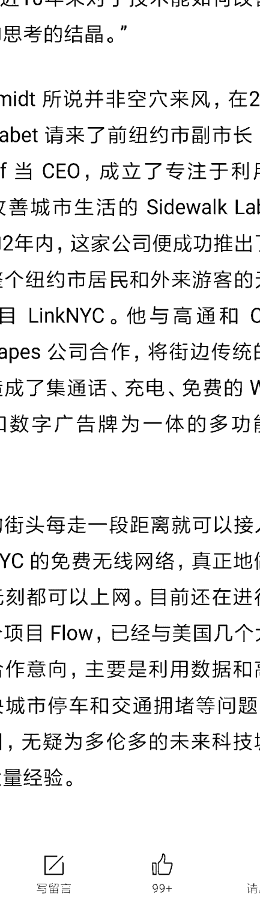

### 智慧城市

智慧城市的概念其实由来已久，许多大公司，尤其是通信、能源和交通领域的公司，例如 AT&T, IBM, Intel 都积极推出自己的标准和解决方案。

传统的汽车制造公司宝马也投身这个领域，联合推出了 Urban X 这样的城市创新企业加速器，希望成为未来智慧城市提供基础设施。从政府角度来讲，全球许多城市也都在进行各种各样的试验和探索。

笔者所在的纽约市，去年曾在西班牙举办的世界智慧城市博览会上荣获“2016最佳智慧城市”的称号，这离不开两任市长以及市长办公室科技创新部的持续努力。前市长 Michael Bloomberg 在任期内，专门成立了一个叫做城市创新中心的机构，即使在离任后也继续活跃在智慧城市相关的会议和活动中。而现任市长还提出了“一个纽约计划(OneNYC Plan)”和针对青少年的城市创新科技的教育机构，并赞助支持 Urban Tech Hub ——一个由多家机构合作，旨在为城市科技领域的初创企业提供支持和帮助的创业创新生态系统。

即使是如此大力的推广，往往也很见到非常直接的效果。这主要是因为城市本身包含的元素太多，其中各层利益关系复杂，每家公司都希望变成行业标准制定者，所以必然会有摩擦。

而此次的多伦多滨水新区，既不像纽约市一样有复杂的背景条件，又不是完全未开发的城市郊区或孤岛，对谷歌来说，这绝对是新技术与城市环境的最佳试验场。

Alphabet 总裁 Eric Schmidt 在当日的会议上表示：“很多年前我们就在想，要是能把科技应用到城市建设上，岂不是很好吗？谷歌的两位创始人非常激动，于是大家就开始讨论，如果能负责一座城市的建设，我们可以做些什么？”而这次谷歌终于梦想成真。

Sidewalk Labs 目前已投入了5000万美元，一期完成之后，谷歌将成为 Sidewalk Labs 开发地段的主要租户。谷歌会转移300多名员工到多伦多新址，其中还包括由人工智能先驱 Geoffrey Hinton 所领导的 Google Brain 团队。希望能把整个区域发展成高收入高增长的城市新区分。

### 改善城市生活

作为城市开发项目的甲方，这背后的好处自然不言而喻。以往公司以单一角度切入城市公共服务领域往往会需要与其他公司做很多协商和妥协，但尺度一扩大到城市范围，就可以对电网等能源结构、交通运输以及街区网络做优化，从而把外部问题变成了内部问题，解决起来就容易很多。

举例说明：现有无人车技术需要实时地探测和分析路面的复杂环境，所以车上需要具备各种的激光感应器和强大的运算机器，但如果在建设城市时就考虑在城市交通干道信号灯上植入感应器形成联动网络，并将交通信号系统与无人车系统整合形成响应式网络，那便会大幅降低整个系统的运算强度，无人车可能只需简单的信号接收和驱动系统，不需要每台汽车都安装昂贵而笨重的感应和运算单元，这也会从根本上解决交通拥堵的难题。

而同一套感应器网络，除了能给无人车提供引导，还可以给物流系统的配送机器人指引，帮助行人定位和提供信息，可以从多方面节省城市运营成本，这便是建筑师及城市规划师所具备的顶层设计思维。

在 Sidewalk Labs 的项目竞标书中，类似的想法和概念已经体现。作为虚拟世界的庞大帝国，谷歌的触角遍及各个方面，有着强大的数据优势，这也是它的提案中的一个亮点。

从宏观层面，Sidewalk Labs 首先提出了数字层（ Digital Layer ）和物理层（Physical Layer）结合的概念，物理层又由 建筑（ Buildings ）、交通网络（Mobility）、公共领域（Public Realm）和基础设施（Infrastructure）四层组成。基于这个概念，它又从数字层，可持续性，建筑和可负担能力以及交通便利性4个角度提出了一 些解决方案。

数字层的建设依靠传感器系统，建立起一个数据网络，从而在整个区域内提供无处不在的网络和信息连接。而每个城市的居民也会有一个独立的账户（Account），通过这个账户授权和使用各种城市服务，包括医疗、基础设施和其他社会服务。在可持续发展方面，采用被动式节能房屋，先进的微电网（Micro Grid）清洁能源，结合 Alphabet NEST 设备的主动式能源调控，智能垃圾处理系统等，从而控制二氧化碳的排放，让城市环境更加绿色和节能。

建筑方面采用模块化装配式建筑、新型环保的结构木材、光伏屋顶和灵活的城市功能业态布局，并从建筑规范、房屋所有权和财政方面做创新，提高居民的可负担能力，保证社会公平，提高城市多样性和活力。交通便利性方面，提出了“Taxibot Network”共享出租车机器人，无人驾驶班车，可在冬季加热的自行车道，感应行人的智能交通信号系统，货物运输机器人，专门的地下管道设施运输系统等。

按照 Alphabet CEO Eric Schmidt 的说法：“在我们看来，这并非一些随机的活动。这是近10年来对于技术能如何改善我们生活的思考的结晶。”

Eric Schmidt 所说并非空穴来风，在2015年，Alphabet 请来了前纽约市副市长 Dan Doctoroff 当 CEO，成立了专注于利用新科技来改善城市生活的 Sidewalk Labs。在成立的2年内，这家公司便成功推出了一 个惠及整个纽约市居民和外来游客的无线 Wi-Fi 项目 LinkNYC。他与高通和 Civiq Smartscape 公司合作，将街边传统的电话亭改造成了集通话、充电、免费的 Wi-Fi 信号站和数字广告牌为一体的多功能设备。

现在纽约街头每走一段距离就可以接入一个 LinkNYC 的免费无线网络，真正做到了随时无刻都可以上网。目前正在进行的另一个项目 Flow，已经与美国几个大城市达成合作意向，主要是利用数据和高科技来解决城市停车和交通拥堵等问题。这两个项目，无疑为多伦多的未来科技城都积攒了大量经验。

### 忧虑和挑战

这些方案虽然看起来十分美好，但其中也隐含着一些忧虑和挑战。在建筑和规划的发展史中，类似的概念和想法其实早就在上世纪的建筑家的草图纸上出现过，顶层设计的失败案例也屡见不鲜。

在上世纪初，随着工业文明的发展，便有著名的建筑师提出了自己的城市乌托邦构想，比如勒柯布西耶的“光辉城市”，将所有建筑结构底层全部架空，整个地面全部留给行人和绿地、沙滩。之后随着科技的进一步发展，这种对未来城市的构想进一步升级，很多都与谷歌提出的构想不谋而合。这些方案虽然思想上超前，但都免不了带有乌托邦色彩。

这其中最知名的建成案例，便是由建筑大师奥斯卡·尼迈耶主持的巴西首府巴西利亚的城市规划，虽然说中轴对称的规划和像乌一样平面的体现着和谐之美无可挑剔，但还是难掩城市功能上的失败与不合理，生活在其中的市民无法感受到便利，城市也缺乏活力。

同理，这让我们也担心，谷歌作为一个只具备科技基因的顶层设计者，是否也会落入城市乌托邦的宿命？尤其在奉行科技至上主义的硅谷，常常会盲目自信地寄希望于技术革命来解决一切问题。但城市本身是一个复杂的有机体，它是政治、经济、文化、艺术和科技的综合博弈，科技再强大，也无法保证城市的繁荣。

另一个很重要的担忧便是隐私和数据安全。无所不在的传感器系统可以让城市真正激活，快速地与人交互，应对复杂的城市问题，但同时也可能成为一张监测和控制的天网，这一点在英剧《黑镜》等科幻作品中已经有过很多探讨。如何保护个人隐私以及数据安全，也将会变成一个重要而复杂的问题。

为了应对这两个潜在的担忧，Sidewalk Labs 一方面从人事架构上集合了政客（前纽约市副市长）、金融分析师、数据科学家、咨询师、城市规划师和建筑师等多种不同背景的人来一起工作，从多角度分析城市；另一方面在正常的项目竞标方案以外，Sidewalk Labs 还单独提供了一份数据安全隐私方面文件（Approach to Data Privacy）。

按照笔者之前在国内的工作经验，在城市竞标方案中专门列出数据安全文件的，尚属首例。但可以预见，在将来的城市设计方案中，这将会逐渐变成一个必须提交的项目。

谷歌作为虚拟世界最为庞大的数据帝国，已经开始把触角伸向了现实世界，成为了第一家以甲方身份参与到城市建设的互联网科技公司。就在11月13日，美国媒体披露，微软前执行总裁比尔·盖茨将投资8千万美金在美国亚利桑那州凤凰城附近，打造一座占地2万5千英亩的智慧城市，并起名为“西谷”（West Valley）。

笔者相信，这之后将会有越来越多的科技公司加入到这个洪流中，这不论对虚拟世界的软件工程师、架构师，还是现实世界的建筑师、规划师都提出了新的挑战。未来的城市究竟会怎样，让我们拭目以待。

## 划重点

> 谷歌作为虚拟世界最为庞大的数据帝国，已经开始把触角伸向了现实世界，成为了第一家以甲方身份参与到城市建设的互联网科技公司。之后，将会有越来越多的科技公司加入到这个洪流中。

“创新地图”是《全球创新260讲》的周末特别版块，主要由专栏的科技社群“前哨团”供稿，为你带来科技领域的专业知识。前哨团主要由全球各地从事科技领域工作的投资者、创业者、研究人、学者等组成。

## 用户留言

# 081 | 出行领域正在经历一场巨大的变革

## —— 今日内容看点 ——

通过阅读今天的内容，你将会掌握以下两个问题的答案：

+ 1. 未来几年，出行领域会发生什么样的变革？
+ 2. 技术对交通工具本身会有那些升级与改变？

之前的三周，我们已经和大家分析了“衣”“食”“住”这三个和日常生活相关的领域的机会，从今天开始，我们将进入最后一个版块“行”，也就是出行解决方案。

上一周，我们讲到超级城市化这个大趋势。具体来说，就是人们的居住会越来越聚集，人口达到数千万的超级城市会不断出现。

根据联合国的统计，到2014年，世界上已经有一半的人口生活在城市。而到2050年，这个比例会增长到66%。

随着城市人口的增长，基础设施所面临的挑战也越来越大，其中一个非常重要的版块就是个人出行。

## 从拥有一辆车到拥有一套出行解决方案

首先，出行领域将会迎来新的社会消费趋势。以前，很多Passport希望拥有一辆属于自己的车。比如在我们中国，结婚的时候女方家常常要求男方要“有车有房”。在国外，拥有一辆车是更普通的事。在美国，每1000个人，就拥有大概800辆汽车，在欧洲的一些国家，这个数字甚至可以超过1000。

但是未来几十年，这个局面会彻底改变，我们说，人们越来越希望拥有一套出行解决方案而不是一辆车。也许用不了多少年，就会出现这样的场景：马路上没有一辆私家车，所有汽车都归运营公司统一调度，甚至如果都私人开车上路就会被当成是违法行为。

你可能会问，这样不可思议的场景有可能存在吗？有，而且可能性也不小。斯坦福大学的经济学者、科技智库 RethinkX 的创始人 Tony Seba 曾经和英国科技投资人 James Arbib 一起联合发布过一份报告，报告中作出了一个大胆的预测：到2030年，美国私家车保有量将下降80%。

造成这种转变的原因主要有两层：社会原因和技术原因，下面我们就具体分析一 下：

### 1. 社会层面的原因

“Y 世代”正在引领按使用来付费的出行风潮，而不再倾向于自己买车。这里的“Y 世代”，你可以简单理解为80后。

### 2. 技术层面的原因

自动驾驶和车联网的实现也是新消费趋势的推手。大众、福特、通用和丰田等众多汽车制造商都计划在2021年左右推出4级的自动驾驶车辆，5级自动驾驶也有希望在2025年左右实现，这相当于实现了完全自动驾驶。

## 技术对交通工具本身的升级

聊完消费趋势的转变，我们接着来看技术对交通工具的重大影响。

这辆飞行汽车的巡航时速为160公里，续航里程为640公里，最高能在3000米以上的高空飞行。车上除了配上一系列的汽车安全装置外，还有确保车辆在紧急时刻能安全着陆的降落伞。2013年，它已经通过联邦航空局 FAA 和联邦机动车署 FMV 的测试，据说2019年就能上市了。这家公司设计的另一款产品叫 TF-X，这是一个能够垂直起降，由电脑操控的纯电动飞行汽车，目前正处于概念验证阶段。

交通又不方便的地区，比如岛屿之间的运输，这时候，飞行汽车就能派上大用场。中国的飞行汽车最早是由亿航推出来的，在最近的高交会上，我们又看到了更多飞行汽车的尝试。

再比如，长途出行领域，特斯拉创始人 Elon Musk 曾经提出一套长途交通的解决方案，叫作 Hyperloop。按照他的说法，这是一个内置在接近真空的管道里的悬浮高铁，它的速度可以高达1200公里。如果这个设想真能实现的话，速度还能快上3到4倍，相当于从北京到上海你大概只需要1个多小时，比飞机还要快。

值得高兴的是，已经有初创公司开始去实践这个想法甚至已经开始测试了。在 Hyperloop 之后，Elon Musk 又提出了地下隧道交通的思路，而且组建了开挖地下隧道的公司 The Boring Company。可见，没有做不到，只有想不到。交通拥堵在今天虽然是“老大难”问题，未来还真有可能解决。

所以总结起来，这一轮出行领域的变革不仅会带来商业模式的转变，而且交通工具本身也会因为技术的进步而发生转变，然后新交通工具的诞生反过来又会促进新的商业模式出现。

## —— 今日内容小结 ——

最后总结一下，今天我们讲了未来出行领域的变化。总的来说，出行领域正在经历一场巨大的变革，主要体现在两个方面：

+ 1. 从交通工具来讲，技术的进展正在颠覆过去的交通工具形态，点到点的移动效率会大大提升。
+ 2. 从社会趋势上来讲，人们越来越希望拥有一套出行解决方案而不是一辆车。过去那种以私人拥有汽车为主的消费模式正在受到巨大的挑战。传统的以汽车制造商为核心的产业格局正在发生变化，围绕个人出行的新型生态系统正在孕育而生。

## —— 今日思考题 ——

你认为，现在的出行方式中还有哪些不合理的地方？在你心目中，怎样的出行方式才是合理的？

欢迎在留言区分享你的观点。

## 划重点

1.出行领域将迎来新的消费趋势，人们越来越希望拥有一套出行解决方案，而不是一辆车。2.传统的以汽车制造商为核心的产业格局正在发生变化，围绕个人出行的新型生态系统正在孕育而生。3.从交通工具来讲，技术的进展正在颠覆过去的交通工具形态，点到点的移动效率会大大提升。

王煜全

我是王煜全，你的全球科技前哨侦察兵，我们明天见。

## 用户留言

提交留言可与专栏作者互动

## 预告 | 出行领域正在经历变革

## 下周预告

我们下周的话题，是衣、食、住、行的最后一部分——行，我们上一周讲了超级城市的趋势，随着人们越来越聚集，还伴随经济的增长，人们生活水平的提高，城市中的出行需求也会伴随的增长。

相信生活在城市中的朋友深有体会，虽然地铁在高速兴建，打车软件也早就普及了，共享单车甚至被世界认为是中国对于出行方面解决方案的一大贡献，但“出行难”这个问题目前并没有得到很好的改善。

那么从明天开始，我们进入“行”这个版块，出行问题不仅值得关注，最近新的出行业务模式也不少，未来数年，我们的出行难题能否得到很好的改善呢？欢迎大家关注我对出行方面的分析。

王煜全

我是王煜全，你的全球科技前哨侦察兵，咱明天见。

# 082 | 狂人Elon Musk颠覆人类出行方式

## —— 今日内容看点 ——

通过阅读今天的内容，你将会掌握以下两个问题的答案：

+ 1. 埃隆·马斯克是如何改变人类出行方式的？
+ 2. 特斯拉为何要开源电动车技术专利？

说到出行领域的牛人，Elon Musk 是绝对绕不开的大牛，他的特斯拉最近新发布了电动半挂卡车，惊艳全球。这辆电动卡车0到60英里（大约96公里）加速只要5秒，放在几年前几乎可以和跑车相媲美，而且具备了一定的自动驾驶功能，如如果3辆车组成车队，跑每英里的成本能比现在便宜将近一半！

而特斯拉新发布的高端电动超跑 Roadster2 更是酷到让各路跑车绝望，不价0到60英里加速1.9秒，零到百英里加速只要4.2秒，续航居然达到了992公里。

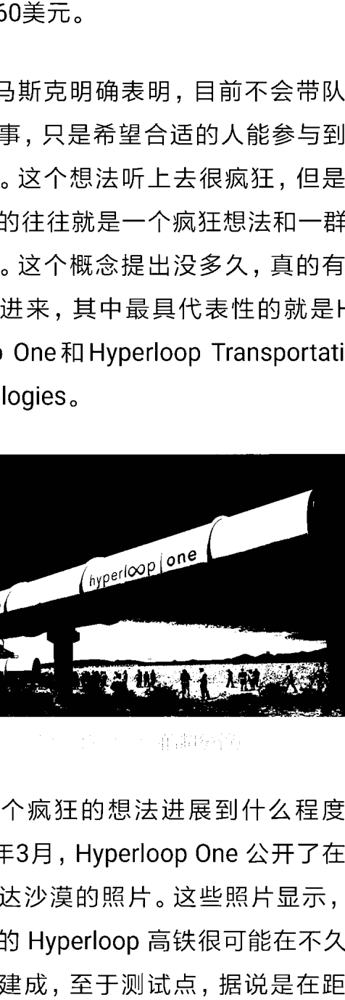

今天我们就来讲一讲这个炸酷的汽车公司背后的大佬马斯克，通过了解他对出行方式的理解，以此来探究未来的出行方式可能发生哪些变化。

## 博士辍学创业的天才

马斯克1971年出生，从小就开始学习编程，12岁的时候就以500美元的价格卖出了自己编程制作的第一个视频游戏，赚到了人生第一桶金。长大之后，他在夸克尼亚大学拿到了商业和物理学双学位，这为他日后的成功奠定了基础。毕业后的马斯克本来打算在斯坦福大学读材料科学和物理学博士学位，想要找出提高电动车电池的能量密度的方法，这也为他日后创立特斯拉埋下了伏笔。

但是，马斯克最终没能经得住互联网创业潮的诱惑，他博士读了没几天就辍学去创业了，其中一家就是大名鼎鼎的 PayPal，2002年被 eBay 以15亿美元收购，直到今天，PayPal 都是全球最大的在线支付系统之一。

PayPal 取得成功后，马斯克开始想，眼前有哪些最可能影响人类未来的问题。想来想去，他觉得最大的问题是可持续能源，马斯克认为如果不能在21世纪解决这个问题，人类将会大难临头。

所以，为了解决可持续能源这个问题，马斯克成立了特斯拉和 SolarCity，从此，他就踏出了改变人类出行方式的第一步。

## 改变人类出行方式第一招：电动车

以前很多人都认为，电动车速度太慢、跑不远、外型又丑，简直跟高尔夫球车没两样。为了改变人们对电动车的刻板印象，马斯克创立了特斯拉，它的第一款产品 Roadster 是一款速度快、跑得远、造型拉风的电动跑车，一出来就惊艳四座。

但是跑车还是高消费群体才享受得起的产品，为了普及电动车，马斯克制订了明确的三步走战略：

+ 第一步，做超级跑车，建立起特斯拉的高端品牌形象；
第二步，开发售价稍微低一点的大型轿车，进军主流市场；
第三步，生产低价轿车，随着充电桩的普及进入到千家万户。

现在特斯拉的第三步已经迈出来了，Model 3 的售价是3.5万美金，这在美国已经不算贵了。

不过，特斯拉最大的意义在于，它大大推动了电动车的发展进程，第一次让电动车被消费者接受，而不是被看成一辆玩具车。这其中很lef一个原因要归功于特斯拉在2014年开源了电动车的所有专利技术，免费给所有公司使用。

大家知道，开源对于开发者的利益是有害的，开源就相当于把自己的拿手绝活拱手让给所有人，所以马斯克在早期创业的时候对于专利看得非常重要。但是到了特斯拉，情况就变了，当时新能源车在北美的市场份额只占1%左右，马斯克明白，新能源车的对手不是同行，而是传统的燃油车。要想打败燃油车，就要尽可能地团结一切力量，要把电动车技术广泛应用，特别是核心技术充电系统，这是一个社会化的工程，因为单凭特斯拉一己之力，是不可能完成充电网络布局的。而开源可以尽可能地聚集更多的新能源汽车开发者，只有整个新能源汽车产业盘活以后，特斯拉才能够有更广泛的增长空间。

特斯拉开源专利后，电动车的行业门槛迅速下降，一大批互联网造车公司应运而生，比如国内的小鹏汽车、游侠汽车等。在小鹏汽车的研发工厂里，就蹲着一辆被肢解的特斯拉 Model S。这些互联网汽车公司，在短短两三年内就完成了车辆的研发、设计和量产制造，很大程度上就是因为大量借鉴了特斯拉的相关技术并加以改进。可以说，马斯克和他的特斯拉是这一轮新能源汽车浪潮的最大推动者之一。

## 改变人类出行方式第二招：超级高铁

如果说特斯拉是从短途出行层面改变了人类的出行方式，那么马斯克提出的超级高铁 Hyperloop，就是打算从长途出行层面大幅提升出行效率。

Hyperloop 直译过来叫做“超级管道”，你可以把它叫做超级高铁。为什么叫超级呢？马斯克在2013年发表了《超级高铁缘起》，在这本58页的白皮书里提到，“Hyperloop”将使用悬浮客舱搭载乘客，在近乎真空的管道中以高达1200公里的时速运行。

大家知道，咱国内的高铁时速一般在300到350公里，也就是说 Hyperloop 的时速足足是现在高铁的3到4倍。但它的原理很简单，就是把管道抽成真空，用磁悬浮技术把运输舱悬浮起来，运输舱尾部有涡轮提供动力。在这种速度下，从洛杉矶到旧金山只要35分钟，票价20美元。而如果乘坐飞机，还得花费一个半小时，价格大约需要60美元。

不过，马斯克明确表明，目前不会带队去做这件事情，只是希望合适的人能参与到这件事里。这个想法听上去很疯狂，但是改变世界的往往就是一个疯狂想法和一群疯狂的人。这个概念提出没多久，真的有公司加入进来，其中最具代表性的就是Hyperloop One和Hyperloop Transportation Technologies。

现在这个疯狂的想法进展到什么程度了呢？今年3月，Hyperloop One 公开在美国内华达沙漠的照片。这些照片显示，横跨美国的 Hyperloop 高铁很可能在不久之后就会建成，至于测试点，据说是在距拉斯维加斯30分钟车程的地方，而当超级高铁建成之后，这段路程将会被压缩成只需几分钟。

与此同时，Hyperloop One 宣布将于2021年在印度开始运营。大家对印度糟糕的交通基础设施应该有所耳闻，孟买到新德里距离大概在1100公里左右，坐火车大约需要16到30个小时。而如果乘坐超级高铁 Hyperloop，同样行程只需要不到1个小时的时间，不仅速度快过飞机，就连票价也更便宜。

## 改变人类出行方式第三招：超级隧道

其实，超级高铁 Hyperloop 需要的所有技术都已经在原理上得到了证实，甚至有些原理很早就有人提出来了，但是却得不到重视。由于马斯克的号召，这个任务现在总算有人“认领”了。但是这样长的管道放在地面上显然会占据很大的空间，有没有可能不要占据地面空间呢？这时候马斯克又出马了，他开始着手做另一项工作，那就是“地下超级隧道”。

这一家由马斯克建立的地下隧道公司名叫“Boring Company”，Boring 这个词在英语里有两层意思，一个是无聊，另一个是

语里有两层意思，一个是无聊，另一个是挖掘，所以你也可以叫它“无聊公司”，但是它们干的事可一点也不无聊。Boring Company 要在地下挖出一条条隧道，把未来的私家车、地铁，甚至正在研究的超级高铁都放进去。

具体来说，隧道和地面之间会由一个类似于升降电梯的设备连接，汽车想要进入隧道的时候，就开到电梯上，电梯会带着汽车沉降到隧道里。在隧道中行驶时，车辆会始终停在一个类似于“滑板”的平台上，速度可以达到大约每小时200公里，到达目的地之后，平台会把车辆再送回地面。

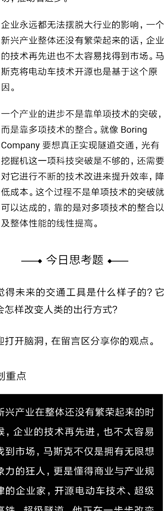

大家知道，地面空间总是有限的，但是地下的立体空间却几乎可以无限大，理论上这样做可以极大地缓解现在的交通压力。

马斯克在上下班的路上经常堵车，于是他首先选择了在 SpaceX 和特斯拉两家公司附近的地方挖第一条隧道。如今这个隧道已经逐渐成型，就在前两天，马斯克在社交网络上分享了一张照片，在图片里我们可以看到一条长长的轨道。

除了在洛杉矶挖隧道，Boring 公司最近还获得了马里兰州的官方许可，准备在马里兰州地下挖一条10英里左右的隧道，也就大概16公里长，用来连接巴尔第摩和华盛顿。

不过，目前隧道的建设成本还是非常高的，比如有些项目每公里成本可以高达6.25亿美金。按照马斯克的说法，要真正普及隧道交通，至少要把成本降低10倍。除了隧道建设的成本，另一个让人担忧的因素是挖掘速度。

马斯克讲过一个故事：他们养了一只宠物蜗牛，这只蜗牛爬行的速度居然比挖掘机的工作前进速度还快好几倍。除了挖掘机速度本身慢以外，另一个原因是，隧道挖掘只是工作的一部分，还有另外一大部工作是加固墙壁，如果让挖掘机可以一边挖掘一边加固，就可以增加一倍的效率。

所以，目前马斯克正在研发一种可以同时挖掘和加固墙壁的挖掘机，用来提升效率、降低成本。

让我们一起想象一下，如果马斯克的梦想能够成真的话，未来我们将处于这样的交通系统中：日常出行时开着电动汽车，通过地下隧道在城市间穿行；长途旅行时选择超级高铁 Hyperloop，几分钟或者几十分钟就能到达目的地；想去外太空旅行，就乘坐 SpaceX 火箭到外太空去……这些在科幻电影中才会出现的场景，或许因为马斯克这样的企业家，有一天真的会实现。

## —— 今日内容小结 ——

- 1. 很多技术在刚刚提出的时候听起来都是个疯狂的想法，但改变世界的往往就是马斯克这样拥有无限想象力的狂人。爱因斯坦曾经说过，想象力比知识更重要，因为知识是有限的，而想象力概括着世界的一切，推动着进步。
- 2. 企业永远都无法摆脱大行业的影响，一个新兴产业整体还没有繁荣起来的话，企业技术再先进也不太容易找到市场。马斯克将电动车技术开源也是基于这个原因。
- 3. 一个产业的进步不是靠单项技术的突破，而是靠多项技术的整合。就像 Boring Company 要想真正实现隧道交通，光有挖掘机这一项科技突破是不够的，还需要对它进行不断的技术改进来提高效率，降低成本。这个过程不是单项技术的突破就可以达成的，靠的是对多项技术的整合以及整体性能的线性提高。

## —— 今日思考题 ——

你觉得未来的交通工具是什么样子的？它们会怎样改变人类的出行方式？

欢迎打开脑洞，在留言区分享你的观点。

## 划重点

> 新兴产业在整体还没有繁荣起来的时候，企业技术再先进，也不太容易找到市场，马斯克不仅仅是拥有无限想象力的狂人，更是懂得商业与产业规律的企业家，开源电动车技术、超级高铁、超级隧道，他正在一步步改变人类的出行方式。

王煜全

我是王煜全，你的全球科技前哨侦察兵，咱俩明天见。

## 前哨历 11月21日

## 我的今日知识清单：

- 1. 很多技术在刚刚提出的时候听起来都是个疯狂的想法，但改变世界的往往就是马斯克这样拥有无限想象力的狂人。
- 2. 企业永远都无法摆脱大行业的影响，一个新兴产业整体还没有繁荣起来的话，企业技术再先进也不太容易找到市场。
- 3. 一个产业的进步不是靠单项技术的突破，而是靠多项技术的整合。

摘自：《082 | 狂人Elon Musk如何改变人类出行方式》

## 「得到」专栏《全球创新260讲》
过去5年，抓住50个科技及潮流机会

## 用户留言

提交留言可与专栏作者互动

# 083 | 重新认识Uber，一家出行服务提供商

## —— 今日内容看点 ——

通过阅读今天的内容，你将会掌握以下两个问题的答案：

- 1. Uber 是一家什么样的公司？它的目标是什么？
- 2. Uber 有哪些成功秘诀？我们从中能学到什么？

今天我们要讲的这家公司是 Uber，可能很多人都说得，Uber 不就是美国版的滴滴么，有什么好讲的？那我要问你一个问题了：你是这么定义 Uber 的？

你说它是一家出租车公司吧，可它不只是在做出租车业务，最近它已经在研发出租飞机了。

你要说它是一家共享汽车公司吧，可它的业务模式也没这么单一，它还有自己的物流平台。

实际上，我认为把 Uber 定义为“出行服务提供商”更合适。

在 Uber 最新的广告《Uber Elevate》里，他们的首席产品官 Jeff Holden 有一句 话，说，“Uber is on earth to crack the code on urban mobility.” 翻译成中文就 是，“Uber 正在破解城市出行的代码。”今 天，咱们就按照他这个定义，来重新观察 一下这个我们熟知的 Uber 公司。

### | 好想法+借助资本的力量

说起 Uber 的来历，曾经有这么一个小故 事：在 2008 年的一个晚上，Travis Kalanick 和 Garrett Camp 这对好朋友正 在法国参加 LeWeb 年度科技大会，当他们 走出会场的时候就发现，在巴黎的街头居 然打不到出租车。于是，这两个被冻得瑟 瑟发抖的人当场就决定，一定要推出一款 革命性的应用软件，来解决打车难的问 题。而且最好是只要一按按钮就能够叫到 车。就这样，Uber 誕生了。

其实，这个故事只说了一半，当时这两 个人都是刚刚结束了第一段创业，手里攒了 不少钱，也正在寻找下一个商业点子。其 中一个点子就是叫车服务应用。这个想法 针对的痛点是非常清晰的。比如，在旧金 山这样的大家市，一到周五和周六晚上， 想要打辆车简直比登天还难。要是有个软 件，能让人在有需要的时候点一下就能叫 到车，那绝对有市场。朋友们一听，都说这 个主意好啊，那就试试吧。于是他们就自 己买了几辆奔驰高端轿车，然后雇了一些 专业司机，开始在纽约接送 Uber 的早期用 户，Uber 的第一批测试就是这么在纽约完 成的。

实际上，Uber 的早期用户都是 Travis 的朋 友们。当时他们的设置是这样的，你必须 要有一个“邀请码”才能使用 Uber 服务。本 来他们只是想试试这个想法好不好，结果 讨要邀请码的人越来越多，Travis 意识到 自己真地发现了一片很大的市场，于是就 成立了 Uber 公司，发布了第一款产品 Uber Cab。

一开始，Uber 的用户定位还只是高端人 群。结果到了2012年，它受到了初创公司 Lyft 的竞争，而这家公司就是针对普通消 费者的。这让 Travis 意识到 Uber 的发展 不能只局限在高端市场，当年7月，Uber 就发布了 Uber X，也就是普通轿车的叫车 服务，自此，他们才算是真正打开了美国 城市的叫车服务市场。

现在看起来，Uber 成功的秘诀在于三点：

- 第一，它抓住了极有痛点的需求；
- 第二，它创造了良好的用户体验；
- 第三，它采用了借助资本进行快速扩张的策略。

因为 Uber 本质上其实是“双边市场”的服务 提供商，一边是打车群体，一边是司机群 体，所以规模效应就显得特别重要。

为什么这么说呢？因为打车的用⼾只有觉 得⽤ Uber 叫年很⽅便，才会使⽤ Uber， 而司机这⼀边，只有觉得用 Uber 叫车的用户 很多，他才乐意用 Uber，其实这就是个“鸡 生蛋和蛋生鸡”的古老问题。总之，Uber 后 来打开了低端市场，而且迅速做到了规模 扩张，建立起了自己的商业领先地位和竞 争壁垒。

其实，像叫车服务这样商业模式很明显， 但入口门槛又比较低的行业，最难的不是 有一个好的想法，而是怎样实践这个想 法，并且跑在所有竞争对手前面。Uber 想 到了利用资本推动扩张的策略。我们可以 通过一些数据来感受一下它疯狂的融资能 力：从2011年到2017年，Uber 已经从 A 轮融资来到了 G 轮融资，融资总额超过 115亿美⽄，平均算下⾛来就是每年融⾦20 亿美⽄左右。强⼤的⾦融推动⼒，让它能 够快速扩张并且取得规模优势。

### | “前 Uber”公司：Jitney Bus

其实，打车服务不是 Uber 发明的，早在 100年以前，就已经有公司在做 Uber 做的 事了，这家公司叫做 Jitney Bus。

Uber 的创始人 Travis 在一次演讲中向大家 介绍了这家名叫 Jitney Bus 的“前Uber”公 司。那么，这个企业和 Uber 有什么关系 呢？我先介绍一下 Jitney Bus 的基本情 况。

Jitney Bus 创立于1914年，它的创始人是 L. P. Draper。他是洛杉矶的一个汽车销售 员。有⼀天，路边等公汽的长队引起了 他的注意。Draper 从中看到了商机，他 想，为什么我不能开着自己的车，送那些 愿意付费的人去他们想去的地方呢？于是 他就做起了这个生意。

结果，Jitney Bus 奇迹般地越做越大，短 短几年时间就覆盖了整个美国。拿1915年 的数据来说，在亚西图，每天就有5万名乘 客使用Jitney Bus的服务。而在洛杉矶，甚 至达到了每天15万名乘客。要知道，就在 2016年，Uber 在洛杉矶也才刚刚做到这个规 模。

可惜的是，当时城市的公交公司处于绝对 的垄断地位，他们无法容忍 Jitney Bus 来 偷他们的大蛋糕。于是这些大公司就和美 国各地政府联手，出台政策来限制 Jitney Bus 的发展。结果，在这些政策的打压下， Jitney Bus 只坚持了5年就宣布破产了。

Jitney 的故事就告诉我们：当小企业动了 那些垄断企业的蛋糕后，垄断企业就会用 政策限制的方式阻断它的成长之路。而现 在的 Uber 也面临着和当年的 Jitney Bus 一样的遭遇。比如今年9月，Uber 在英国 伦敦就遭受了法律诉讼，英国伦敦市交通 局拒绝了 Uber 的运营牌照续费申请，理由 是它的运营模式和商业行为表明，它在某 些和潜在公共安全相关的问题上缺乏企业 责任感。

确实，法律总是走在创新者的后面。面对 科技的进展，政策和立法总会有⼀定的滞 后性。但⾛是从政府⾓度来看，⼀味地打压 创新者实际上是逆势⽽⾏，政府应该给创 新者一定的发展空间。

### | 重新定义商业模式——Uber Elevate 与自动驾驶

我们说回 Uber，如果你认为 Uber 的使 命，只是让全球范围内让每个想打车的人 都能打到车，那你就太小看它的野心了。 Uber 要做的是“端到端运输的高效解决方 案”整体者，想象一下，从你起床到上班到 家，你的出行需求 Uber 都能解决。

为了这个目标，Uber 开始从一个软件平台 提供商转向了硬件制造商。它希望通过软 硬结合，让自己在下一轮技术革命来临的 时候，仍然保持领先地位。

首先，Uber 瞄准了自动驾驶领域。2015年 2月，Uber 在匹兹堡建立了自动驾驶研发 团队，还从卡内基梅隆大学国家机器人工 程中心挖走了50名专家。我11月初刚和 我们前瞻科技投资考察团去参观了卡内基 梅隆大学的国家机器人实验室，并且目睹 了他们制造的 DARPA 自动驾驶挑战赛的 冠军车辆，他们也提到，研发这辆车的人 多数都在为 Uber 服务了。

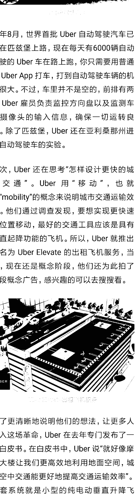

去年8月，世界首批 Uber 自动驾驶汽车已经在匹兹堡上路，现在每天有6000辆自动驾驶的 Uber 车在路上跑，你只需要用普通的 Uber App 打车，打到自动驾驶车辆的机会很大。不过，车里并不是空的，前排有两名 Uber 雇员负责监控方向盘以及监测车顶摄像头的输入信息，确保一切运转良好。除了匹兹堡，Uber 还在亚利桑那州进行自动驾驶车的实验。

其次，Uber 还在思考“怎样设计更快的城市交通”。Uber 用“移动”，也就是“mobility”的概念来说明城市交通运输效率。他们通过调查发现，要想实现更快速的位置移动，最好的交通工具应该是具有垂直起降功能的飞机。所以，Uber 就推出了名为 Uber Elevate 的出租飞机服务，当然，现在还是概念阶段，他们还为此拍了一段概念广告，感兴趣的可以去搜搜看。

为了更清晰地说明他们的想法，让更多人加入这场革命，Uber 在去年专门发布了一份白皮书。在白皮书中，Uber 说“就好像摩天大楼让我们更高效地利用地面空间，城市空中交通能更好地提高交通运输效率”。这套系统就是小型的纯电动垂直升降飞机，它有很多优点：

- 第一，它可以不受道路约束，能选择最高效的路径；
- 第二，它不用建造路、桥和铁道就能运行，这就免去了高成本的投入；
- 第三，它的速度非常快，20英里的路程只需要飞8分钟，同样 的路程出租车因为堵车经常需要70分钟；
- 第四，根据预期，它的价格和 Uber 打车差不多，很便宜。

那么，为了实现这个好处多多的目标，就必须解决三个问题：

- 第一，如何高效垂直起降？
- 第二，如何避免飞行噪音？
- 第三，大量飞机之间如何协调以避免相互的干扰？

想要解决这三个问题，就得和航空技术公司进行大量合作。现在，Uber 已经开始和 NASA 以及很多小型的飞行科技企业、房地产商和政策制定者一起合作，他们预计会在2020年，在达拉斯和洛杉矶进行试运行。

## —— 今日内容小结 ——

总结一下今天讲的内容，希望你能掌握以下三点：

- 第一，作为一家科技公司，必须要有远见。不断站在更高的高度向未来展望才是保持公司持久竞争力的唯一途径。Uber 在解决了打车难的问题后，并没有满足于当一个打车平台，而是开始从“移动”的角度来审视用户的需求，然后开发出不同的解决方案，这是非常难得的。另外，和普通互联网公司不同，Uber 能够认识到自动驾驶的前景，而且非常重视科技人才的力量，这种远见值得所有创新者学习。

- 第二，像 Uber 这样的模式创新企业，因为商业模式很容易被抄袭而且具有规模效应，所以必须依赖资本的辅助进行快速扩张。这样，在取得规模优势后，就形成了竞争壁垒，很难再被对手超越，这也是 Uber 成功的秘诀之一。

- 第三，很多时候，法律总是走在创新者的后面。当然，面对科技的进展，法律和立法总有一定滞后性。但是对于政府来说，一味地打压创新者就是逆势而行，政府应该给予创新者一定的发展空间，帮助它们快速成长。

## —— 今日思考题 ——

国内的滴滴和 Uber 业务模式非常相似，你觉得 Uber 的发展历程可以给滴滴提供哪些借鉴呢？

欢迎在留言区分享你的观点。

## 划重点

> 对于商业模式明显，入口门槛又比较低的行业，最难的不是有一个好想法，而是怎样去实现这个想法，并且跑在所有竞争对手的前面。

王煜全
我是王煜全，你的全球科技前哨侦察兵，我们明天见。

## 前哨历
11月22日

## 我的今日知识清单：

- 1. 作为科技公司，不断站在更高的高度向未来展望，才是保持公司持久竞争力的唯一途径。
- 2. 商业模式容易被抄袭而且具有规模效应的行业，必须依赖资本的辅助进行快速扩张，才能形成竞争壁垒。
- 3. 面对科技的进展，政府应该给予创新者一定的发展空间，帮助它们快速成长，而不是逆势而行打压。

> 版自：《083 | 重新认识Uber，一家出行业务供应商》

「得到」专栏《全球创新260讲》
陪你5年，加上50个科技巨头机会

## 用户留言

# 084 | 迎接出行领域科技革命带来的机遇

084 | 迎接出行领域科技革...

## —— 今日内容看点 ——

通过阅读今天的内容，你将会掌握以下三个问题的答案：

- 1. 为什么说交通出行领域的科技革命马上就要到来了？
- 2. 科技革命是如何改变出行领域的，怎样才能把握住机会？
- 3. 新技术对出行领域会带来哪些影响？

本月我们讲了衣、食、住、行。

衣服的科技时尚是一直都有的；食的科技时尚随着消费升级已经开始了；而住的科技时尚则是小荷才露尖尖角，基本还没有开始；但行的科技时尚，因为交通出行领域的科技革命马上就要到来。

## 一、直接与间接革命

我们在科技特训营的课上介绍过，科技给产业带来的革命可以分为直接和间接的。直接的就是指科技直接转化为产品，比如 iPhone，而间接的则是科技给我们社会生活带来变化，造成了新的业务模式的诞生，比如社交网络带来的 Facebook。在交通出行领域，这两种革命都已经开始了，后续将为我们带来更加彻底的革命。

### 1. 直接的科技革命：电动车与自动驾驶

在直接的科技革命领域，有电动车和自动驾驶，其实现新能源汽车有好几种解决方案，即使是电动车也有纯电和油电混合两种，而且在充电桩不够普及的情况下，油电混合更容易被接受。

但是特斯拉无疑是汽车市场的一条大鲨鱼，特斯拉在近期发布会上推出的 Roadster2.0, 0-60英里加速1.9秒。我查了一下，如果这款车近期能够量产，就会是量产车里加速最快的世界纪录了，甚至超过了所有的高端跑车。就连2014年推出的油电混合的保时捷918Spyder，0-60英里加速也需要2.2秒。虽然一级方程式赛车的0-60英里加速世界纪录是1.7秒，但是现代的一级方程式赛车0-60英里加速一般需要2.1-2.7秒，还是不如特斯拉。

更重要的是，特斯拉已经预定出去了60多万辆 Model 3，它是标准的代步车，价格只有3万美元多，会对现有的汽车厂商形成强烈的冲击。因为特斯拉的努力推动，各大汽车厂商都在推出纯电汽车，我认为纯电的趋势基本成了。

之前我曾经认为随着大车厂的加入，特斯拉会经历生死关，但现在看来各大车厂的速度还是不够快，如果 Model 3 能够顺利量产，特斯拉就赢定了。

特斯拉的另一个搅局的招数就是自动驾驶，虽然有之前的轿车自动驾驶的事故，但这次的货运卡车的自动驾驶算是找准到位了。随着各大车厂在自动驾驶上的竞争，我们有理由乐观地相信，2020年4级自动驾驶的汽车将会上路。

### 2. 间接的科技革命：打车App

在间接革命领域的领导者就是 Uber 和滴滴，虽然它们也都在自动驾驶布局，但它们真正的意义是改写了人们的出行方式。从需要拥有一辆车到只需要一个 App，这样对出行工具的话语权就从汽车厂商的手中转到了 Uber 和滴滴们的手中。

有人会说，有了特斯拉、有 Uber 和滴滴，交通出行领域的革命不就结束了嘛？其实恰恰相反，我认为交通出行领域的革命才刚刚开始。

## 二、直接科技革命的延伸

在直接科技革命领域，特斯拉只是起到了一个示范作用，后续的机会还非常多。电动车的革命带给我们不是现有汽车换成电池驱动，而是对车辆甚至出行定义的颠覆。

- 简单理解，电动车其实就是一块电池加上电动机，而控制系统就是个大 Pad，Pad 的软件可以实时更新，电池技术在不断进步，而电动机技术已经相当成熟了，所以也许未来的汽车会进入新的模块化时代，像积木一样自由拼接。

你家里所拥有的不再是几辆车，而是几个带电动机的独立车体，需要几个人出门就拼接上足够几个人坐的车体。至于电池，既可以几辆车共用，也可以从外面租赁，而 Pad 当然是你用哪辆车就把自己的 Pad 装到哪辆车上，实现完全的个人化设置了。

未来买电动车，车上的电池成了车里最贵的部分，但随着电池技术的进步，电池性能会遵从摩尔定律，每隔一段时间性能提升一倍，价钱降低一半。这样聪明的商家就会推出新的电动车服务，每隔一段时间就自动帮车主更换性能更好的新电池。

我的这个设想可不是空穴来风，在我们大多数人都以为电动车必须要长得跟原来的汽车一样的时候，山东已经出现了大量的只能容两人乘坐，而且座位是前后排的低速电动车。去年据说全年销量达到了150多万辆，这充分说明这种低速电动车是真正满足了人们出行需求的好产品。至于电动车和自动驾驶的结合带来的突破就更多了，以后我们不光在公路上，在小区里、在产业园里，甚至在楼宇里，都会见到越来越多的自动驾驶电动汽车的身影，当然它们长得可未必像今天的汽车。

这方面最有借鉴意义的是我的好朋友，英特尔原研究院院长吴甘沙创业做的驭势科技公司。他们的电动车参加了2017年的 CES 展，而且得到了《纽约时报》等权威媒体的报道，我们在第一季的前哨栏目里也作了介绍。

很多国外媒体说他们掀起了汽车领域的革命，重新定义了汽车，因为他们把自动驾驶汽车做成了移动包厢，座位是环绕的，里面可以聊天、可以上网、还可以煮咖啡。当然，他们可不局限做出一两辆概念车，今年5月，他们和杭州来福士广场合作开始了商业运营，当你在来福士广场购物拎着大包小包，为如何从商场走到那个巨大的停车场里你自己的停车位犯愁的时候，就可以拿出手机，从 App 里叫一辆自动驾驶的小车，把你从商场精确地送到自己的车面前。

顺便说一句：

## 三、间接科技革命的延伸

在交通出行领域的间接科技革命方面，不光有 Uber、滴滴、Lyft 这样的共享出行服务，还有摩拜、ofo 等共享单车，而且这种模式的革命仍在继续。

举个例子，在旧金山有一家叫做 Chariot 的公司。一直以来，旧金山的公共交通系统都非常糟糕，虽然也有 Uber 和 Lyft 之类的打车应用可以减轻人们出行的部分痛苦，但对于每天都要上下班的普通人来说，这是一笔不小的经济负担。而上下班期间坐地铁亦非常拥挤，坐公交车的话又总是需要绕很远的路，怎么办呢？Chariot 公司想了一个众筹巴士的办法。

具体过程就是，在 Chariot 的网站或者 App 上，上班族可以提交自己的出发地、途经地和目的地，然后发起众筹。只要筹款金额达到了开通要求，这条线路就会开通，这种做法既能满足用户需求，又能最大程度地获得收益。在被福特收购之前，Chariot 已经开通了28条线路，总计100辆私人家巴士投入运行，他们服务的对象是很明确，主要是偏中低收入、有固定线路，甚至买不起私家车的用户。

在车辆运营的过程中，Chariot 还积累了一个数据库，其中包括三类数据：

- 第一，用户生成的数据；
- 第二，政府提供的数据；
- 第三，第三方交通公司提供的数据。

这个数据库有什么用呢？举个例子来说，用户只要使用 Chariot App，就可以看到即将到达的车还有没有空位，然后决定是否需要搭车。基于这样的数据，还可以生长出很多新的商业模式，比如更好地配置交通资源、优化事故救援路径，乘车记录是否...

通资源、优化事故救援路径，乘车记录甚至可以作为征信的参考数据等等。

其实相对于公司运营本身的利润来说，像 Chariot，Uber 和滴滴这样的公司，它们所积累的数据有更大的想象空间。我们在第一季也提到过，有人甚至认为未来汽车公司最大的价值在于他们所积累的大数据。

不过，最近 Chariot 因为连续三次汽车安全检查不...范围内的运营了。这也给创业者一些提示：

一方面，在出行领域里找到细分市场快速扩张，会是切入出行领域的好机会；

另一方面，也要小心政策法规，就像我们周三提到的，很多政策法规是滞后于市场需求的，创业者想在野蛮生长和政策法规这两者中做到平衡很不容易，还需要谨慎面对的。

## 四、未来新技术带来的范式转移

最后，我们来看未来新技术对出行领域的影响。可以说这一轮出行方式的变革，本质上是由技术的进步推动的。以自动驾驶为代表的技术突破，不仅带来了新的商业模式，还带来了一系列的范式转移。所以怎么从当下顺利过渡到新的范式，是创业公司必须思考的。

那什么叫范式转移呢？

它是指一个领域里出现的新突破，打破了原有的假设或者法则，然后促人们对本学科的很多基本理论作出根本性的修正。

比如在16世纪以前，“地心说”一直是主流，甚至是天主教教会公认的世界观。但是“日心说”的出现推翻了“地心说”，人们必须重新理解地球上发生的各种现象。

## —— 今日内容小结 ——

总结一下，今天我们分析了未来出行领域的机会，希望你能掌握以下三点：

- 第一，交通领域的革命由特斯拉和Uber引爆，但它们并不...未来的机会非常多。
- 第二，从直接的科技革命，也就是电动车，到间接的科技革命，也就是网约车，后续仍有巨大的机会空间。
- 第三，自动驾驶会带来交通领域的范式转移，它会带来新的商业模式。但是新范式的接受过程往往比较曲折。所以对于创业者来说，最需要考虑的是怎样从短期的现状顺利过渡到长期，然后做好准备迎接新范式带来的机遇。

## —— 今日思考题 ——

你觉得未来的汽车应该长成什么样子？未来的交通服务应该是什么样子的？

欢迎在留言区分享你的观点。

## 划重点

> 纯电动车的趋势基本形成，自动驾驶也会很快上路，更值得注意的是，是出行领域的主体将不再是汽车制造商，而是像通讯运营商一样的交通服务提供商。新范式的接受过程往往比较曲折，所以对于创业者来说，最需要考虑的是怎样从短期的现状顺利过渡到长期，然后做好准备迎接新范式带来的机遇。

王煜全
我是王煜全，你的全球科技前哨侦察兵，我们明天见。

用户留言
提交留言可与专栏作者互动

# 085 | 交通出行：从制造业转型为服务业

085 | 交通出行：从制造业...

## ——► 今日内容看点 ◄——

通过阅读今天的内容，你将会掌握以下三个问题的答案：

- 1. 特斯拉存在产能瓶颈却仍然疯狂扩张，给创新者哪些启示？
- 2. 自动驾驶和电动车普及，会对汽车维修等后市场造成哪些影响？
- 3. 当触碰到政府利益和公共安全时，企业应该如何正确应对？

## ——► 全周总结+拓展 ◄——

本周的话题是衣食住行的行，我们主要介绍了三个重点：

第一，技术不光是直接变成产品推动社会进步，同时它还会改变人们的观念，形成社会观念的进步，从而造成新的创业机会。随着电动车、自动驾驶等技术的进步，和人们对共享出行、出行服务解决方案等等观念的接受，交通出行领域正在迎来一场前所未有的变革。

第二，企业对社会进步有非常大的推动作用。在交通出行领域，我们本周列举了特斯拉和Uber，其实后面还有滴滴，还有共享单车等等。它们是市场里的鲶鱼，正在改变整个产业的重心，使得这个产业从制造业、销售汽车，转型到了强调服务、强调使用，从而也改变了社会的认知。

第三，未来对交通出行影响最大的因素是自动驾驶，它将会带来整个出行领域的范式转移，所以未来的成功者将是那些敢于适应新范式的人，他们必须要抛弃掉传统的很多东西，勇敢地尝试新的业务模式。

## ——► 用户答疑 ◄——

特斯拉在 Model 3 生产遭遇瓶颈的时候，依然选择快速扩张推出两款新产品，而不是集中力量推进平价电动车的普及，这样疯狂的扩张会不会把特斯拉推到一个更危险的境地？

我的回答是：

创新者不会因为顶着创新的光环就一定能成功，其实创新者成功的几率是很小的，因为现有市场的领导者或者差势者，他们不会甘于失败，所以创新者必须要加速奔跑，而且必须要永远地去尝试新的东西。

当然，特斯拉其实有两大方向上的问题需要解决：

第一，是在研发上，需要继续提升电池管理能力和自动驾驶水平，以使它的产品永远领先于时代；

第二，是在生产上要解决电池的量产问题，因为实际上电动车的核心就是一块大电池，因为电动机相对比较简单。所以电动车量产问题的核心就是电池的量产问题，而不能量产是我们说硬科技的创新者必须解决的问题。如果不能量产，仍然有失败的危险，只有解决了量产问题，不是从0到1，而是从1到100万，从1到1亿，才能够真正地在市场当中取得胜利。

那现在的问题是，研发和生产这两个问题对特斯拉来说是并重的，并不冲突，所以他们在解决电池量产问题的时候并没有停止下研发的脚步，所以就会出现了这回新推出来的汽车。

但是，最终这些车能够实现多大的量产能，还要看它的电池量产能力是不是完全解决了，也就是说如果 Model 3卖得太好了，把所有的电池量产能力都消耗掉了，也许他们新推出的超级跑车和卡车的量产能就会受影响。但是我认为特斯拉这种疯狂扩张的举动，恰恰是创新者应该具备的素质，因为创新就是要冒险，如果要墨守陈规，创新者一定会失败的。

如果未来都是自动驾驶，那么几乎零故障会不会导致汽车后市场行业消失，比如维修之类的？王老师怎么看待自动驾驶对汽车后市场的影响？

我的回答是：

自动驾驶会使交通事故的事故率降低，但是不一定是零故障，因为车还是有可能会坏的。其实电动车才是使得整车的故障下降很多，因为电池的故障率是很低的，所以其实在电动车领域，传统的 4S 店模式就已经行不通了，不需要自动驾驶。

当然，我认为这是件好事，因为其实 4S 店的问题非常多，大家对汽车维修市场的意见都很大，凡是去过 4S 店的人都清楚。但是传统厂商就是懒得解决，因为所有这些厂商都是 4S 店模式，我的 4S 店不好，你的 4S 店也未必好到哪里去，那我们大家“半斤八两”就不需要解决了，因为我们说竞争主要有一个差异性的问题，如果相对之间没有竞争差异，其实大家也就谈不上如何改进的问题了，就没有改进动力了。

现在好了，因为所有的传统厂商都很保守，又没有人刺激它们去进步，现在这个问题反而成了它们的死穴了，因为传统厂商过度依赖 4S 店。现在它们面临着电动车的竞争，在它们也要推出电动车的时候，美国就已经出现了，因为 4S 店发现电动车出来以后，它们会没有生意，所以美国出现了 4S 店集体抵制电动车的情况，使得传统车厂的电动车销量上不去，而且这样传统车厂向电动车的转型就会相对更缓慢。这就给了特斯拉们更多的机会去战胜传统车厂，这是我们最喜欢看见的事情，给了创新者机会了。

当然，从整体上讲，车里可干的事情其实是增多了，所以虽然修车的事情少了，可是因为没有人真喜欢修车，我们喜欢的是更多自己喜欢的事，所以 4S 店会消亡，但是依托汽车的服务业会兴起。比如说像得到这样的节目以后就很适合放到车里，再加上对乘客人的数据收集，就可以做到更加精准的内容推送了，甚至大家坐在车里可以一起参加线上有关节目内容的讨论了。

Uber 的发展史上最大的竞争压力不是来自于竞争对手，而是来自于政府，既然法律立足具有滞后性，那为什么不考虑政府公关与企业运作并行？当触碰到政府利益和公共安全的时候，企业应该采取什么样的处理态度和措施？

滴滴应该在新技术上加大投入，但是政府的政策很重要，尤其在政策不明朗的时候，怎么樣作出对未来的预测呢？

我的回答是：

这一方面反映了政府政策监管滞后带来的问题；另一方面也反映了创业者考虑不周到，没有对法律法规应该如何改变作出前瞻性的分析。

也就是說你自己在创业做的新东西，那当然因为政府是法律法规的制定者，它相对来说对这新东西的了解是不够的，那你当然应该主动地去研究我的新产品应该需要什么样的法律法规来监管，然后把这样的意见建议给到相应的法律法规制定者，这是你自己的任务。

国外，Uber 只是一味地对抗，似乎对抗法规就说明自己是革命者，够创新；

国内，滴滴只是一味地解释，强调自己没有增加堵车。

这些其实都是不够的，我认为企业要学会站在监管者的角度想问题，找到对方能够认可的自己的价值，不是自己说自己有价值，而是从对方的角度看到自己有价值。

比如 Uber 和滴滴其实就是就业的缓冲带，我在国外坐 Uber 的时候常常和司机聊天，他们很多是失业以后拿开网约车当临时工作的，这样不至于完全没有收入，生活就不会有太大的波折。而国内我们也讲了，大型城市化是趋势，农村的富余人口进城就业是必然的趋势，滴滴其实和外卖、快递一样，都是能够大量吸纳农村进城就业人口的，而且如果没有他们，问题会非常严重。

因为随着机器换人的进程，大量的农民工会成为富余劳动力，他们在东南沿海的工厂里找不到工作了，但是因为他们已经一部份地适应了城市生活，所以他们也已经回不到农村去了，他们根本不知道如何务农。

所以，如何帮助他们在城市找到自己的位置，对整个社会来说都是非常重要的事情，而且不要忘了，他们是青壮年的劳动力，而且有很多的知识水平是相当不错的。所以对网约车不光不能视为，还要给

的。所以对网约车不光不能歧视，还要给司机提供必要的城市化帮助，这对整个我们的城市化进程和我们的社会进步都是非常有利的。

当然这种创新者和监管者的冲突会很常见，我们前哨也在组织相应的专家，将会进行一系列的研讨，用专家们前瞻性的视角帮助创新者和监管者做好沟通，使得中国的创新能够高速有序地发展。欢迎大家关注，也欢迎碰到了监管问题的创新者和我们联系。

未来的车子和房子会不会融为一体呢？既然飞行器和汽车可以无缝结合，那么是不是可以把住也考虑在里面？快速的移动方式会不会拉平市中心和城郊房子的价格？

我的回答是：

其实飞行器不会成为城市里面的主流交通工具，因为不管是螺旋桨还是喷气式的推进，相互之间的气流干扰会很大，对环境的干扰也很大，虽然电动机飞行器噪音问题会好很多，但是气流干扰是很难以解决的问题。所以，市区的主要交通方式还是汽车和地铁，当然汽车未来应该是更多的自动驾驶这样的公共交通工具，地铁、公共汽车这样的公共交通工具也会非常普及。

至于说人能不能睡在自动驾驶的车里，这个需要论证。而市中心的房价我认为还会很高，因为超级城市化的进程不会停止，只不过市中心的房子面积都会越来越小，因为要适应更多人居住。

MIT 的媒体实验室就有一个组，专门研究大都市里面如何做到这些功能齐全的小户型住宅，还让人们觉得居住得很宽敞，所以这是很重要一个面向未来的命题。而城郊可以向四面八方扩展，不用像现在一样，还是在几个城郊的地方集中居住，比如说北京的天通苑和回龙观。

这样的话，郊区居住会更加惬意，因为你不管往哪个地方扩展，都会有自动驾驶的汽车把你接进城去，所以大家就可以选择居住在城郊还是城中心，可以各取所需。所以现在看起来，未来城市的交通和居住都还是有很大改进的可能性。

以上就是今天的问答。

## —— 下周预告 ——

我们下周的话题是未来教育，这个话题我们在前哨第一季的时候就谈过，当时就激起了热烈的讨论。我相信我们今天再来谈这个话题，大家已经看到了未来已经缓缓地向我们走来，所以我们讨论起来会更热烈、更深入。

欢迎大家积极参与讨论。

## 划重点

未来对交通出行影响最大的因素是自动驾驶，将会带来整个出行领域的范式转移，出行产业的重心将从制造业转型为强调服务、强调使用的服务业。想要把握机会，要勇敢地尝试新的业务模式，适应新范式。

王煜全

我是王煜全，你的全球科技前哨侦察兵，咱俩下周见。

## 用户留言

# 特别放送 | 计算机发展的最前沿——超级计算大会SC17印象

商磊，澳大利亚新南威尔士大学计算机博士学位，多年参与高性能计算机的研究和开发工作，曾任职于中国科学院计算技术研究所国家系统结构重点实验室、澳大利亚国立大学国家计算中心。现就职于全球顶尖量化交易公司SIG，是超低延迟系统优化专家，利用高性能计算助力金融交易。ACM和IEEE会员。

11月12日-17日，一年一度的超级计算大会（英文全称SuperComputing，简称SC）在美国丹佛国际会议中心召开。超算大会是计算机领域规模最大的学术会议，实际上它不仅仅是一个学术盛会，更是一年一度政府、大学、企业结会友、获取业界最新信息的大联欢，参与者除了学者，还包括了美国能源部(DOE)、航天局(NASA)、各国家级实验室、计算机企业、金融机构等等，本届超算大会共有13000人参会，其中2800人来自海外71个国家，参与各种学术商业活动。会议内容丰富，下面选择了亮点和热点技术与大家分享。

我们首先来聊一聊超级计算机。那什么样的计算机才能配得上超级两个字？一般来讲有以下一些特征：

- 超级多的投资，这种量级的投资通常都是由国家级政府投入，造价经常是几亿到几十亿，还不算高昂的维护研究费用；
- 超级牛的国家级团队（顶级大学、研究机构、企业）联合研制和运营；
- 超级强大的计算能力以及海量的高性能存储，比如目前世界第一神威太湖之光每秒钟可以处理9.3亿次双精度浮点运算；
- 超级高速高带宽的网络连接把分布式的计算结点连接成一台计算机，现在主流的超算网络是每秒 100-200G 比特的 InfiniBand网络，一种超算通用的高性能网络；
- 用来解决世界上最具挑战的一些超级问题，比如核物理、全球气候变化、海洋模型、生物化学、基因工程、经济学模型等。

尽管超级计算机主要是为了一些高大上的科研用途，但了解超级计算机对于普通人也很有必要。就像三十年前的超级计算机也就相当于你手中的手机，通过今天的超级计算机，我们也可以了解未来计算机的发展方向。

## 一、Top500榜单——中国全方位胜出

每年超算大会都会公布世界最快的500台超级计算机排名，它是根据一个名为Linpack的标准测试程序的性能。这次是中国全方位胜出的一次，无锡的神威太湖之光和广州的天河二号不仅继续保持前两位，还在上榜数量和总性能上超过美国。中国还连续第二年夺取了被誉为超算领域诺贝尔奖的“戈登贝尔奖”(Gordon Bell Prize)。除了Linpack排名，Top500网站也提供了其他一些标准测试程序的排名，日本系统以低能耗的设计拿下了其他多项冠军。当然从目前信息来看，美国正在建造的一台新超级计算机很可能明年会重新夺回世界第一。

以下是各项排名的冠军系统：

- Top500: 神威太湖之光 93 Petaflops (每秒9.3亿次双精度浮点运算)
- Green500: 日本 RIKEN ZettaScaler 17 Gigaflops/watt (每瓦每秒170亿次双精度浮点运算)
- HPCB: 日本京计算机(RIKEN K computer)
- Graph500: 日本京计算机 (RIKEN K computer)

## 二、学生集群竞赛

超算大会另一个看点是学生集群竞赛，这次来自新加坡的南洋理工大学夺冠，他们在竞争最激烈的Linpack项目上以超过近40%的超高性能打破世界纪录，还在HPCB项目上把前世界纪录提高50%。过去连续多届垄断冠军的都是清华大学，比较遗憾的是，在本次比赛中南洋理工以剑走偏锋的方式取胜。本次大赛突破了最小参赛者的历史年龄，首次有一个高中生团队参赛，并最终完成了比赛，在快速更迭的技术领域里，可谓后生可畏。

## 三、体系结构的变化

除了创纪录的分数和冠军，学生集群竞赛呈现给我们更多的是体系结构的变化。在3000瓦输入功率的限制下，如何配置出最高性能的机器系统是一大看点。

今年夺冠的南洋理工只使用了两个计算结点，正是GPU强大的计算能力奠定了南洋理工夺冠的优势。未来趋势就是单一计算结点性能越来越高，照此发展，过不了多久你家里的台式电脑也就可以匹敌过去的超级计算机了。

## 四、处理器竞争激烈

今年的一个亮点是AMD的重新崛起，其发布的名为EPYC的处理器提供了比INTEL更高的内存带宽，让我们对CPU领域又有新的期待。x86架构之外，任何人都不能忽视的是，ARM已经雄心勃勃地挺进超算领域了。

今年超算大会，ARM展现有其强大的硬件和软件生态系统，它与著名服务器制造商CRAY合作的超算系统在某些标准测试序列上的性能数据十分有竞争力，名为“Thunder X2”的ARM处理器将在明年被用于在英国一个超算系统上。

在加速器方面，英伟达(NVIDIA) GPU占据统治地位，陆续发布的P100和V100在学生集群竞赛中成为所有队伍的选择，显示出其强大的计算能力。

## 五、网络互联技术

我们互联网络中都是使用的以太网标准（比如熟悉的TCP/IP协议栈），而超算领域的网络标准叫做InfiniBand（寓意Infinite Bandwidth，即无限带宽网络），它比以太网更高效，也一直在引领以太网的持续不断的进步。目前100G带宽的InfiniBand网络已经普遍使用。而这种网络已经在向200G带宽高歌猛进。因为网络传来的数据最终要在CPU中处理，而随着CPU和网络速度的不断升级，连接CPU和网卡的总线就慢慢变成了限制网络性能的最大瓶颈，目前PCIE 3.0是大部分超算系统的标准，而总线需要实现3.0到4.0的升级才能让200G的网络真正发挥效用。

在同INTEL的竞争中，超算网络巨头Mellanox公司和显卡加速器NVIDIA似乎结成了某种联盟，要做网卡和GPU直连传输，从而让它们的通信绕过总线。这场战旌角死手，将会极大影响未来几年的体系结构，我们拭目以待。

## 六、人工智能和大数据

在人工智能快要全面爆发的今天，超算领域当然也少不了各种深度学习、神经网络、大数据的讨论。从论文、讨论组到各企业的技术方案，人工智能在大会上被反复提及。

随着神经网络模型越来越深，训练数据越来越多，如何利用超级计算机来加速模型训练成为热络的讨论话题。像IBM、HP、Dell和联想都在试图把它们高性能计算的系统推向大众市场，来拓展它们在人工智能领域的机会。另外日本富士通也宣布明年要为日本产业技术研究所(AIST)建设面向人工智能的超级计算机。

## 七、FPGA

在众多的技术中，可编程逻辑部件(FPGA)热度不是最高的，但已经有不少学术界和企业界认定它是最未来Exascale(百亿亿)最可行的技术。FPGA的优势是完全面向具体问题可定制化的硬件解决方案，其性能潜力巨大(比CPU和GPU都高几十甚至上百倍)，已经在如视频解码、实时数据处理、金融交易、信号分析等领域中证明。

亚马逊的AWS云计算也开始支持FPGA的虚拟机，让普通人更容易接触学习。

## 八、思考——平静中孕育风暴

与往年的超算大会相比，今年的大会显得比较平静，无论是学术圈还是工业界，都在酝酿改变。正像暴风雨前的平静一样，未来几年整个计算机行业都处在重新洗牌

未来几年整个计算机行业都处在重新洗牌和理论实践重大突破的关口。从一些还处在实验室里的雏形项目中，我们可以窥视未来的端倪：

- 1. 惠普实验室的The Machine项目把在内存里计算(In-memory computing)推进到了产品层面；
2. Mellanox公司则不遗余力大力推进其网络里计算(In-network computing)，把网卡和交换机变成小计算机；
3. 微软实验室的BrainWave项目利用FPGA解决内存瓶颈来实现实时人工智能(Real-time AI)；
4. 编程语言工具应对计算机复杂系统结构(rich topology)提出的自适应调优的软件系统。

过去十几年计算机发展的主旋律就是“摩尔定律”的终结，计算机由不停提高主频改向多核、众核并行化发展。同时内存存储IO无法跟上处理器的进步，计算性能问题集中体现在低速数据移动与高速计算之间的矛盾。

超算领域给出的一个解决方案就是计算机体系结构的去中心化。正像社交网络和互联网媒体让媒体传播去中心化一样，比特币和区块链的流行让货币去中心化。传统的由中央处理器把持所有计算的架构越来越难以满足需求，在显卡上计算(GPGPU)、在网卡上计算、在内存里计算、在交换机里计算……无所不在的计算渐渐成为大势所趋。而为了应对这些变化，编程语言和软件系统就需要变得更动态、更灵活、更能适应不同的架构。

计算机的未来在哪里？计算机科学领域从来不缺乏创意和人才，而最需要的是脚踏实地的工作，正像本届戈登贝尔接受采访说的："Whatever you are doing, you have to keep doing."

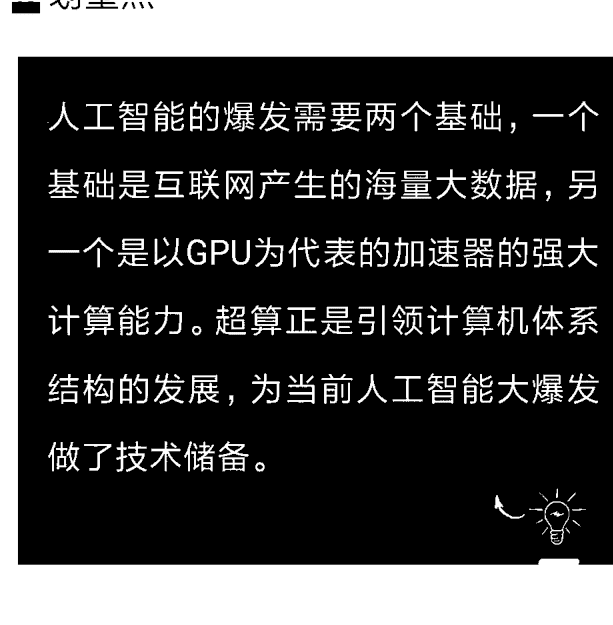

王煜全

商博士的文章我们就分享到这儿，因为这篇文章专业性比较强，大家听起来可能有点烧脑。但为什么前哨想跟您分享计算机行业规模最大的超算大会呢？结合即将全面爆发的人工智能来说，它的一个基础是互联网产生的海量大数据，另一个是以GPU为代表的加速器的强大计算能力。实际上，超算正是引领计算机体系结构的发展，为当前人工智能大爆发做了技术储备。所以超算技术的最新进展值得大家关注。

参考资料：

## 划重点

人工智能的爆发需要两个基础，一个基础是互联网产生的海量大数据，另一个是以GPU为代表的加速器的强大计算能力。超算正是引领计算机体系结构的发展，为当前人工智能大爆发做了技术储备。

# 086 | 面向未来的人才教育理念和方法

## ——◆ 今日内容看点 ◆——

通过阅读今天的内容，你将会掌握以下三个问题的答案：

- 1. 幼儿园虐童事件的根源性问题分析。
2. 未来社会需要什么样的人才？
3. 培养面向未来的人才，应该采取怎样的教育理念和方法？

## 关于幼儿园虐童问题：

最近连续有幼儿园虐童相关的新闻爆出，从猥亵到红黄蓝，上周也有咱们前哨的用户留言，说希望我谈谈这个问题，正好我们这周谈的就是教育问题，所以我就把自己对虐童问题的观点放在最前面了：

大家一谈到虐童，就会非常愤怒，然后骂出现了这样的问题的机构丧尽天良，或者呼吁在幼儿园里无死角地装上摄像头。问题是，这样就可以避免虐童了吗？

其实这里最大的问题是，为什么总会有一些幼教老师虐待孩子？按理说，面对那么可爱、那么无助的孩子，普通人根本下不去手，能够做出这样的事情的人，内心一定是出了问题。这里可能有这些人家里的因素，但也有社会和教育应该承担的部分。也就是说，当我们去追问他们作为教育者合不合格的时候，其实他们早已就成为了教育的牺牲品。这里的教育，不光指幼儿园，还有包括小学、中学、大学在内的整体系统。

教育要保证的，是孩子们在心灵健康成长的基础上对社会的适应，进而能对社会做出贡献。可我们的教育，只注重用一个可以衡量的方式把孩子分成三六九等，然后送进不同的小学、中学、大学。为了这样教育目的，凡是能让人拉开差距的就会被重视，哪会关注培养孩子情操的学问和面向未来的技能呢？

- 一方面找不到足够多的合格的幼教老师；
一方面在商业的诱惑下盲目扩张，不出问题才怪。

## 一、学什么？

首先，为了培养未来人才，我们需要重新定义学习内容。过去，我们学习的重点是按知识划分的不同学科，比如语文、数学、英语等等。而现在，我们应该重点学习具体的能力，比如批判性思维能力、表达能力、逻辑能力等等。

- 1. 科学代表“假设-验证”的思维模式；
2. 技术代表“如何应用”的思维模式；

## 预告 | 未来社会需要面向未来的人才

## —— 下周预告 ——

明天，我们讲一个每个人都关心的话题——教育，去年的第一季，我们就讲过美国提出的"STEAM"教育概念，S-T-E-A-M五个英文字母分别代表 Science 科学、Technology 技术、Engineering 工程、Art 艺术以及 Mathematics 数学。它们并不是简单的学科合并，而是代表了创新的五种思维模式。

相信大家已经感觉到，未来教育已经在缓缓向我们走来，尤其是随着人工智能的应用普及，未来社会需要面向未来的人才，下周，我们就一起来探讨教育行业的时机，教学内容领域的时机，教学方法领域的时机，以及教育领域的风险。

王煜全

我是王煜全，你的全球科技前哨侦察兵，咱俩明天见。

## 用户留言

佛祖门徒 21
最近在读隔壁《硅谷来信》主理人吴军老师的新书《见识》，核心观点是“你最终能走多远取决于你的见识”。该书序言的标题《“命”和“运”决定人的一生》，吴老师认为所谓命就是一个人看问题和做事情的方法。这让我联想到煜全老师之前用一周的时间结合自己的工作实践阐述的关于个人如何拥抱未来的一系列观点和建议，这样的内容就是在教育和帮助我们提升看问题和做事情的能力。这样的教育在以往传统的学历教育中是无法得到的。所以，科技对于培养人才的推动作用已经让我们有了切身的感受，期待下周的课让我们进一步开拓眼界和思路，以科技创新让更多的人从教育中汲取不竭的动力。 11-26 10:53:27

迷雾中的山姆 7
从STEM的教育理念来看，未来的教育应该是以通识教育为主，未来社会上，单单的专项技能是不够用的。如隔壁万维钢老师提到过的，当你在一个领域达到80%的水准后加上另一个领域80%的水平你就会成为一个牛人！STEM本身就是4种领域也可以理解为4种看世界看问题的方法，就如经济学不是让你更会挣钱而是教会你从另一个角度看世界！未来的教育由STEM教学理念出发，应该会朝着多学科综合多角度思考的方式展开，“钻牛角”和“偏执”的现象会变的更少。 11-26 16:19:34

小小的我 5
STEAM是一种教育理念，有别于传统的单学科、重书本知识的教育方式。STEAM是一种重实践的超学科教育概念。任何事情的成功都不仅仅依靠某一种能力的实现，而是需要借于多种能力之间，比如高科技电子产品的建造过程中，不但需要科学技术，运用高科技手段创新产品功能，还需要好看的外观，也就是艺术等方面的综合才能，所以单一技能的运用已经无法支撑未来人才的发展，未来，我们需要的是多方面的综合型人才。从而探索出STEAM教育理念。 11-26 11:15:32

冰雪天地 4
看看现在的基础教育，从小学到高中，清一色题海战术，应试教育，就能判断出培养的是什么人才！大学及以上教育，又太放松，难进易出，与基础教育形成鲜明对比，强烈反差！科技进步日新月异，社会发展一日千里，无不在召唤高素质人才，终身学习者，正如王老师在人工智能板块讲的“领导者、连结者、服务者”一样，期待教育领域改革！从自己做起，从子女教育做起！ 11-26 14:20:13

李小平 3
期待下周的内容，现有的教育评判标准太单一，让很多没有考上好大学的人自卑，学校的教育又层次不齐，社会评判人才的方式也单一，作为新时代的父母，希望自己在孩子身上不仅仅局限于提供温饱，而是承担起教育的责任，不用为小孩在上学困扰，如果学校只是教育很少的一部分，我们就有信心让自己的孩子多样化发展。 11-26 15:10:37

强子 3
随着社会的加速发展，知识的更新也会加速，不能用过去过时的观念教育现代的人，决定他们20年后的未来，未来教育应该是一个不断学习，不断做知识迭代，做一个终身学习者，随时随地系统化的学习方可在未来生存下来。 11-26 11:46:40

以上留言由 作者 筛选显示

- 2. 技术代表"如何应用"的思维模式；
3. 工程代表"系统性思考"的思维模式；
4. 艺术代表"感性化理解"的思维模式；
5. 数学代表"第一性原理"的思维模式。

举个形象的例子，假设目前存在物流效率低下的问題。那么，对于这个问題，经过STEAM训练的学生会这样思考：

首先他会问自己"物流效率低的原因可能有哪些？"

接着他会开始发散思考，有可能是"城市交通拥堵"或者是"路径规划不合理"。

## 二、怎么学？

重新定义了"学什么"的问题后，下一步就是要看怎么学了。

## 三、和谁学？

关于未来的教育问题，除了"学什么""怎么学"以外，"跟谁学"也很关键。因为高水平的老…

## —— 今日内容小结 ——

总结一下今天我所讲的内容，我希望你掌握以下三点内容：

## —— 今日思考题 ——

你认为教育领域还有哪些问题？这些问题用科技手段能解决得了吗？

教育不应该只是批量化生产的"机器"，培养具有完整人格个体的"生态系统"才是目标。利用科技手段，让学生成为课堂的主体，赋予他们自主学习的自由，而老师从知识的传授者转变成答疑者。这可以极大地改善教学质量，让学生能够更直观地体验学习内容，更深入地掌握知识，提高对知识的兴趣度。

# 087 | 利用科技颠覆传统教育模式

087 | 利用科技颠覆传统教...

## —— 今日内容看点 ——

通过阅读今天的内容，你将会掌握以下三个问题的答案：

- 1. “可汗学院”是怎么出现的？它利用了哪些科技手段？
2. “可汗学院”解决了或改善了传统教育中的哪些痛点？
3. “可汗学院”作出了哪些颠覆式创新，有何意义？

昨天我们谈到了传统教育的诸多问题，而今天我要介绍的，就是一位传统教育的颠覆者，他就是“可汗学院”的创始人 Salman Khan。他拿到了盖茨基金会和 Google 这些著名机构的投资，现在在已经逐渐成为 K12 在线教育行业的领军机构。在中国，“可汗学院”被网易公开课收录，现在已经有很大的影响力。今天我们就来看看，可汗学院的创始人是怎么颠覆传统教育的。

## 一、学霸的成长经历

和特斯拉的 CEO Elon Musk 一样，Salman 是一个受过严格的科学和商科训练的综合人才，也是一名典型的学霸，他1976年出生，先是在麻省理工学院取得了理学士和数学学士的双学士，接著又拿到了电子工程和计算机的硕士学位，他还在哈佛大学商学院拿到了工商管理硕士学位。

2002年的暑期，Salman 在 PARC 当实习生。PARC 原来是著名的 Xerox 实验室，个人电脑、以太网、激光打印机和图形用户界面计算技术，都是在这里诞生的。

而在2003年，Salman 去了对冲基金工作，从研发工程师转行成了分析师。到这里为止，Salman 其实已经是“人生赢家”了。不过，他之后非常倔强地就成了教育行业的颠覆者。

## 二、“可汗学院”的由来与发展

2004年，Salman 和家人一起去度假，发现表妹 Nadia 对“脑筋急转弯”很感兴趣，她能解出一些很困难的问题，但是她的妈妈说她对数学并不感冒，这让 Salman 感到很疑惑。按理说喜欢钻研还有逻辑思维能力，应该都是数学好的标志。但为啥不是这样呢？

在跟表妹交流后，Salman 了解到表妹是因为不理解数学单位的转换，失去了对数学的信心，分班的时候还被分到了差班，更是加深了她的自卑感。于是 Salman 决定要帮表妹克服心理障碍。当时，Salman 只是每天给表妹打电话，在电话里出一些题目给她做。慢慢地表妹对单位转换有了清晰的认识，于是就恢复了对数学的信心。

有了成功的经验，其他的表弟表妹也希望得到 Salman 的指导。为了帮助更多小朋友，Salman 设计了一个可以随机生成数学问题的网站，这样表弟表妹就可以不停地做题，而且每道题目一做完就能马上跳出正确答案，反馈非常及时。为了观察他们会怎么使用这个网站，Salman 还专门在后台建立了数据库来存储网页运行数据。2006年，他去参加一个聚会，就把这个网站打开来给大家看，有人就问他：“为什么你不拍些讲解视频上传到 YouTube 上呢？”当时 YouTube 还是一个比较新兴的视频分享平台。回到家之后，他就真做了一些简单的视频上传到 YouTube 上，还让表弟表妹去看。

他们看完之后的反馈让 Salman 很震惊，因为他们说，比起真实的表哥，他们更喜欢 YouTube 上的表哥。原因是在电话辅导时，尽管他们有时候听不懂，但害羞和羞愧的心理让他们不敢让 Salman 讲第二遍。而看视频就完全不同，遇到不懂的知识可以反复地听，听完后再结合 Salman 的网站进行练习。就是在这样的机缘巧合下，Salman 发现了一种全新的教育模式。

明确了这种“视频+练习”模式的重要意义后，Salman 就在工作之余制作上传了超过1000个视频。这些视频的特点是：每个视频都只通过10到15分钟来讲清一个概念，然后通过举例的方式让看的人真正理解和掌握这个概念。

随着正面反馈越来越多，Salman 意识到，他找到了解决教育痛点的方案。2009年，嗅到了商机的他辞去了对冲基金的工作，开始全职做可汗学院。到现在，可汗学院里面和 K12 教育相关的课程已经基本完善了，它还提供了 SAT、GRE 这样专业性考试的辅导。

顺便说一句：K12 是指的从 Kindergarten 幼儿园到美国的12年级，指的是美国从幼儿园到中学的所有课程。

不过，需要提醒大家的是，可汗学院可是一家非营利机构。就像我们昨天提到的，教育机构追求盈利性就会有很多问题，而非营利机构一样可以高速成长，只不过要在保证质量的前提下，这方面科技就可以帮上忙了。

## 三、可汗学院的“颠覆性创新”

可汗学院之所以引人注目，是因为它做到了两个“颠覆性创新”。

- 1. 对传统学习模式的颠覆

Salman 曾经说过，目前的教育模式让学生们按年龄段划分，然后在相同的时间里学习相同的内容。而评价他们学习成果的方式，就是标准化的考试。这里最明显的缺点就是即使学生没有理解上一学期的概念，下一个学期的课程也会照常开始。这就好比盖房子，如果地基没有打牢就贸然开始一层层地造，最终只能面临整座大厦的倒塌。

针对这个问题，可汗学院提出了一种全新的思维模式，把最终的学习成果固定为“精通”这两个字，学生的学习方式都根据这个来调整。目标就是要打牢每一层地基后，一层层建起足够坚固的“知识大楼”。

为了达到这个目的，可汗学院建立了一套全新的知识输出方式和学习进度检查模式。主要 

- 第一，构建“知识树”；
第二，以知识点为核心进行讲解；
第三，配套随机练习让学生进入“刻意练习”模式。

下面我们分别来看这三点的具体内容。

首先，构建“知识树”指的是，要学习系统化的知识，就应该遵循它的脉络。比如数学、科学、历史等学科，都是具有清晰脉络的知识体系，而“知识树”上的每个节点都包含着一个重要概念或者方法，这些概念方法之间都具有顺序性和关联性。只要学生按照“知识树”中的结构来学习，就不会像坐飞机一样，虽然知道自己在空中飞，但却不知道已经飞到了哪儿。而且在回顾所学知识点的时候，也会有非常清晰的脉络。

其次，现在我们的上课方式都是以45分钟一节的连续教学为主，但学生的注意力往往集中不了那么长时间。所以，可汗学院把学习拆成了以“知识点”为主的学习模块，每个知识点都有一个10分钟左右的短视频讲解。另外，可汗学院的网络平台也让老师们在视频之外补充了交互性内容，比如一条抛物线，你可以将鼠标放到上面，直接可以读出其坐标，学生可以很直观地看到斜率变化。学生们能够通过多种渠道来学习，这样就能增加对知识点的理解和记忆。

最后，讲解完每个知识点之后，都有系列有针对性的练习题。而且每完成一道题目，系统就会给出相应的结果反馈。学生们第一时间就能判断自己的学习成果。如果对概念的某一方面不是很理解，还可以重新观看视频进行学习。

这种模式，就很好地把学生的学习目标，从定期考核变成了“精通”概念。这种转变也很好地适应了每个学生不同的学习节奏。

- 2. “翻转课堂”概念

有了可汗学院这样的网络平台，所有学生的学习就不再局限于课堂了。这样的变革带来了“翻转课堂”的概念，也就是学习知识变成了“线上作业”，而上课则变成了“线下交流”。学生可以在网上使用优质的教育资源，老师也不再是教授知识，而是去了解学生遇到的问题，然后进行解惑和指导，还能引导他们怎么去运用知识。传统的课堂都是以老师为中心的，一切都由老师决定。而采用“翻转课堂”，就让学生真正

师来决定。而采用“翻转课堂”，就让学生真正成了自己学习的主人。

另外，课堂上老师还可以带着学生做一些需要团队协作的小项目。在这个过程中，学生们可以培养团队协作能力、分析并解决问题的能力，他们也能更加直观地感受到自己所学的知识在实际中的应用。当然，课堂还可以是一个“学习分享会”，每位学生都来分享自己的收获和问题，并根据这些内容展开研讨。我们说，这种训练远比完成练习册上的作业来得好。

除此之外，“翻转课堂”式的教学还能改善师生关系。老师讲、学生听的“教导模式”变成了师生一起探索的“朋友模式”，这样学生才能和老师获得高质量、高频率的交流。而老师还可以把考核任务交给平台，直接让平台来追踪判断每个学生的学习进度。对学生来说，学习就像游戏一样，在不断“打怪升级”的过程中掌握了知识。

反过来，每个学生的学习数据都会被记录下来。比如他们的学习进度，哪个知识点花的时间最长、哪个视频观看次数最多、什么样的题目需要更长的答题时间等等。这些数据可以帮助老师更好地设计课堂研讨的内容。我们都知道，及时反馈对老师来说非常重要。可汗学院为老师提供了学生完整的学习数据，相当于得到了大量的“及时反馈”，这就有利于提高他们的教学水平。

在 TED 上也有 Salman Khan 的演讲，非常有启发，你可以找来看。 在演讲中，Salman 结合自己的实践，破除了我们一直以来一个错误观念：女孩不擅长数学。他说，因为数学有很多知识点，一个知识点没学会，后面就没办法学习，就像他表妹一样，女孩只是容易在前面的知识点被卡住，后面自然都不会了，就会被贴上个不擅长学数学的标签。其实当她们解决了这个知识点的问题后，会学得和男孩子一样好。而男孩子也会在某个知识点上卡住，只不过往往是在比较靠后的知识点上被卡住而已，而在这些地方女孩子并不会被卡住。所以，所有孩子的潜能都是一样巨大的，关键是要个性化地帮他们解决问题、不断成长。

未来，可汗学院也许会发展成针对每门学科的“世界大课堂”，全世界的人都能在这里学习、交流、互动和竞赛。这将打通地域、时间、年龄和职业的边界。无论你身在何处，只要登录可汗学院，就可以和全世界的“玩家”一起“玩转知识”。我们也期待这一天能尽快到来。

## —— 今日内容小结 ——

总结一下，今天我们介绍了可汗学院及其创始人 Salman Khan。希望你掌握以下三点：

第一，Salman Khan 积极采用了当时先进科技产品 YouTube，把自己的视频传播给了全世界，并且在此基础上创建了非营利的可汗学院，取得了巨大的成功。可见，科技可以为一件很平常的事情赋能，让它变成足以改变整个教育产业的“颠覆式创新”。

第二，教育的本质是“对知识的精通”，而不是在期末考试中得了多少分。把“精通”看成是目的，把学习时间、地点和方法当成变量，这样就能够让每一个学生通过教育得到提高，真正做到知识点“一个都不落下”。我们自己也需要改变观念，不要再有“女生不擅长数学”那样的偏见。

第三，数据可以帮助我们更好地评价一个学生的未来潜力，从而帮助他变得更好，也能让老师及时获得反馈，设计出更优秀的课程。而且这些数据也可以进入到每个学生的档案中。未来档案上很可能不光有分数，还会有每一刻的学习记录。

## —— 今日思考题 ——

可汗学院的成功很大程度上得益于在线视频技术的成熟，你觉得还有哪些技术会颠覆未来的教育呢？

欢迎在留言区分享你的观点。

## 划重点

- 1. 教育的本质是“对知识的精通”，而不是在期末考试中得了多少分。 2. 可汗学院的“翻转课堂”概念，是学生可以在网上使用优质的教育资源进行学习，而老师不再是教授知识，而是去了解学生遇到的问题，然后进行解惑和指导，并引导他们怎么去运用知识。

王煜全 我是王煜全，你的全球科技前哨侦察兵，我们明天见。

## 用户留言

# 088 | 重新定义高等教育的密涅瓦大学

## ——◆ 今日内容看点 ◆——

通过阅读今天的内容，你将会掌握以下三个问题的答案：

- 1. 为什么录取率比哈佛还要低的密涅瓦大学备受关注？
- 2. 密涅瓦大学是如何颠覆传统高等教育的？
- 3. 密涅瓦大学的教育模式为高等教育带来哪些启示？

今天我要介绍一所你可能都听说过的名校——密涅瓦 Minerva 大学。这所大学很独特，因为它没有固定的教学设施，甚至没有固定的校园，但是它的录取率比哈佛还要低，2016年录取率为1.9%。他们的目标是：Nurture Critical Wisdom for the Sake of the World，翻译过来是“为世界培养批判性的智慧”，他们强调培养综合能力和思维模式，而不是简单地教授书本知识。

这所学校的创始人团队，希望能给僵化的高等教育模式带来变革。下面我们就来看看他们是如何颠覆传统的。

在 我准备这个文稿的过程中，密涅瓦大学的首位中国学生王婧同学也通过LinkedIn 与我联系上了，她给了我提供了不少学校和学习细节，在此也表示感谢！

## 一、密涅瓦项目

密涅瓦是一所大学，但它始于一家创业公司，而且有着强烈的“创业”的烙印。我们多次强调，现在的创业公司们流行“双长制”，往往都有一位经验丰富的 CEO 和一位拥有尖端技术的教授。密涅瓦也不例外，它最早的发起人就是企业家 Ben Nelson。他曾经是 SnapFish 网站的 CEO，这个网站在2005年的时候，被 eBay 用3亿美元收购了。这是一个提供图片存储和打印的网站，在国内的名字叫“陪喙鱼”。

Ben Nelson 早在宾夕法尼亚沃顿商学院学习的时候，就一直对高等教育有许多意见和看法，现在终于有时间和资本了，所以密涅瓦项目应运而生，他开始按照自己的想法，野心勃勃地要重新定义高等教育。

但是，密涅瓦项目本身并不是大学，是一家高等教育领域的“创业公司”，是营利机构，这个项目主要负责网上教育平台 Active Learning Forum 的打造。硅谷著名的风险投资基金 Benchmark Capital 在2012年密涅瓦项目刚成立不久就投资了2500万美元天使投资，这个数额可真是够大的。到密涅瓦项目正式启动的时候，已经募集了超过7000万美元了。

而密涅瓦大学是密涅瓦项目和 KGI 合作的一个非营利机构，KGI 全名是 Keck Graduate Institute，这是一家专门培养生物技术领域科研人员和促进科研成果转化的专业机构。严格来说，密涅瓦项目和密涅瓦大学是并行的，一个是营利的，一个是非营利的。

因此，密涅瓦项目的创始人 Ben Nelson 当然成为了密涅瓦大学的创始人，而密涅瓦大学的另一位创始人、“双长制”中的教授则是 Stephen Kosslyn，他成了密涅瓦大学的创始人校长和首任学术官，叫 Chief Academic Officer。Kosslyn 教授曾经是哈佛大学社会科学学院院长、斯坦福认知科学实验室主任，在认知神经科学、认知心理学、学习科学方面都有很高的造诣。

截至目前，Kosslyn 已经发表了超过300篇学术论文，并且还有14本专著，其中包括畅销书《上脑和下脑》。他在20世纪80年代还曾经连续10年担任哈佛大学本科教育委员会成员，因此对传统的高等教育模式非常熟悉，而且明确知道它的劣势所在。所以，当 Kosslyn 听说密涅瓦项目要成立大学之后，他就从斯坦福大学辞职加入密涅瓦大学并担任首席学术官，负责师资招聘和课程设计。

由于高等教育在社会发展中的重要性，密涅瓦大学很快就吸引了美国政治、经济方面的精英支持，大学顾问委员会首任主席是前哈佛大学校长、前美国财长 Larry Summers，顾问委员会成员还有内布拉斯加州的民主党参议员 Bob Kerrey。

我们曾经讲过“老板宝法则”：要想知道一家公司靠不靠谱，看它的董事会就知道了。而顾问委员会同样关键，密涅瓦大学的顾问委员会堪称豪华，同时具备了经验丰富的 CEO 和成果卓越的科学家，甚至政客，说明大家对这个大学非常看好。

我们刚刚说过，密涅瓦大学虽然是非营利的，但具有很强的创业公司性质，那么这家公司的产品是什么呢？那就是一面向未来、具有综合素质的跨界精英。每件产品都具有自身的独特性，而每一件产品的打造，都需要4年时间。至于其中的打造过程，就是密涅瓦大学对传统高等教育的颠覆所在了。

## 二、面向未来的教学理念

Stephen Kosslyn 在介绍密涅瓦大学的时候，经常会说一句话："我们通过教授思维模式和基础概念，帮助密涅瓦的学生在目前还不存在的岗位中更好地适应并成功。”这就是密涅瓦大学教学理念的精髓，简单总结就是4个字——“面向未来”。另外，密涅瓦提出了一个全新的概念，叫作应用型知识，Practical Knowledge。

> 什么是应用型知识呢？这里我给大家引用王婧同学个人的学习体验，她说：“打个比方，我们学的更多是《孙子兵法》本身，而不是某一场战役的成败条件或者火药的制造工艺，但是《孙子兵法》的习得需要历经很多战役的训练，根据不同战事的特点选择不同的计策组合来对症下药，这可能就是 Practical 的含义所在。”
> 
> “我们开学的第一课，学习的 Kosslyn 的一篇‘学习的科学 Science of Learning’的论文，其中很重要的两个理论就是‘deep processing’和‘far transfer’，前者要求学习者真正把一个概念想得通透，后者要求学习者尽可能地把理论从熟悉的领域迁移到陌生的领域。网上学习平台的设计就遵循了这些科学原理，非常符合大脑的运作方式，很多概念模型都能很快在头脑中有较为清晰深刻的理解。”

密涅瓦的教学理念分成3个部分，这3个部分组成了一个金字塔结构。

金字塔的顶部，是密涅瓦大学希望学生毕业时能够达到的目标，一共有4个：

- 1. 领导力 Leadership；
- 2. 创新力 Innovation；
- 3. 开阔的思维 Broad Thinking；
- 4. 世界公民 Global Citizen。

这4个目标，是密涅瓦通过调查、询问并综合了美国顶尖企业领导层以及政府机构对人才的理解整合出来的。我们说，一名学生如果达到了这个目标，一定会是未来社会的栋梁者。

为了让毕业生们能达到这个目标，就有了金字塔的第二层，密涅瓦设计了4种能力的培养，可以分成两大块：个人能力和团队能力。

其中，个人能力有两点：

- 1. 批判性思维 Thinking Critically；
- 2. 创造性思维 Thinking Creatively。

团队能力也包括两点：

- 1. 有效沟通 Communicating Effectively；
- 2. 有效互动 Interaction Effectively。

当然，这4种能力在其他大学也都被积极提倡。但是有一个非常重要的问题，就是这些能力都无法直接给学生。

其中的一个原因：这些能力必须在不断的使用当中才能积累起来，它不是一个公式或者一个概念。它是一种能力、技术，类似于骑自行车，必须通过重复的练习才能更好地掌握，这也是 Practical Knowledge 的一个核心要表。

还有一个原因是：这些能力都不是单一的概念，而是多方面、多角度的复杂概念。传统常春藤教育直接灌输批判思维的理论知识，缺乏有针对性且多样性的应用场景，就难以真正让学生掌握这种思维素质。所以 Kosslyn 认为，传统高等教育虽然都说要培养“批判性思维”，但是他们没法说清楚哪些课程是如何培养这些能力的。

正是因为这样，密涅瓦把每种能力都进行了拆分，而且综合形成了120多个小单元。这些单元由两部分构成，分别是思维习惯 Habits of Minds 和基础概念 Foundational Concepts。

在密涅瓦的整套课程设计里，其实就是把这120多个小单元不断地应用到每节课里，新的认知单元在学习后会和已学的认知单元交叉融合，课堂讨论认知单元之间的关系和互动，以及如何多角度地运用一系列单元共同解决问题。作业部分对单元整合的要求更高，最终的项目更是要求把4门基石课程的单元跨学科整合，解决一个当地城市的真实问题，让学生在使用这些能力的过程当中得到提升。

## 三、随时随地上课：密涅瓦全新的教学平台

要想做到这些，是不可能靠老师在课堂上授课的方式完成的，所以密涅瓦大学借助互联网的力量，自己开发了一套教学系统，Kosslyn 叫它 Active Learning Forum。这套模式最大的特点，就是“线下学习，线上讨论”。可以说，全世界的学校都是老师在台上讲，学生在台下听，而 Stephen Kosslyn 认为：“这种讲座的方式对老师教课来说是个好点子，但是对学生学习来说就是一场大灾难。”

密涅瓦采用小班教学，一个班不会超过20个人。以“主动学习”为指导，每节课都会有一个核心问题，是抽象的认知单元在具体问题中的应用，所有的讨论都是围绕这个核心问题。由于老师可以在 Active Learning Forum 平台上实时掌握每个学生的学习状态——可以通过视频看有没有开小差，学生在课堂上可能随时会被老师提问或者做课堂测验，从而抓取更多学生的注意力，而注意力就是建立深度学习的前提。

但随堂测验也不是为了看谁做对了，而是让每个人都要清晰明确地知道自己为什么要这么做。因为在测验之后，很可能接着就是一场新的讨论，每个学生都要阐述自己的思考过程。

- 实证分析课程对应创造性思维；
- 形式分析课程对应批判性思维；
- 多元沟通课程对应有效沟通；
- 复杂系统课程则对应有效互动能力的培养。

## 四、将城市作为学习场所：四年大学规划

## —— 今日内容小结 ——

## —— 今日思考题 ——

教育的目的是不是简单的教授书本知识，或者传授一项技能，而是培养学生的综合能力和思维模式，让他们在未来社会中的适应能力更强、具有更强的竞争力。

# 089 | 把握教育市场即将到来的巨大机会

## —— 今日内容看点 ——

通过阅读今天的内容，你将会掌握以下两个问题的答案：

- 1. 未来教育领域的机会在哪？如何把握？
- 2. 教育领域的风险在哪？如何避免？

今天我们来探讨一下教育行业的'机会和风险。教育是民生大事，也是每个家庭的重要开支。根据相关报告，到2020年，中国的教育市场规模就会达到近3万亿人民币。再加上开放二胎和社会对教育的重视程度提高，可以预见，未来10年内，教育市场会进入高速发展期，这个市场是非常诱人的。

但是，教育市场也很不容易：

硅谷创业者 Max Ventilla 创办的大名鼎鼎的 Alt School 小学，曾经拿到了扎克伯格和乔布斯遗孀的投资，但最近他们把在硅谷中心的学校关闭了，Max 说今后要专注在开发给学校用的软件上，不再新开学校了。这和昨天我给你介绍的密涅瓦大学很像，学校不赚钱，赚钱的是线上系统。

今年8月的《科学美国人》杂志报道，由著名经济学家、自由市场学派的代表人物弗里德曼提出的另一个激进的尝试——给学生们发放学习券，也被证明不能提高学生的成绩。这和我们讲的生物医药很像，教育是个复杂体系，学校有责任、家长也有责任、社会责任也不小，很看起来很好的思路要具体实践过才知道是否真正有效。

但是我们为什么还要继续实践呢？

因为我们知道，教育对个人成长太重要了，而且随着科技推动社会变革的加快，教育的重要性会越来越凸显。所以我们对教育改革的尝试不能停止，而且要更加结合实际。

著名的教育学家 Ken Robinson 曾经讲过一个案例：

案例的主人公 Gillian Lynne 是一个很有才华的舞蹈编剧，著名的《猫》和《歌剧魅影》就是她的作品。但她小时候却因为好动而被老师认为有注意力缺陷障碍。于是 Gillian 的妈妈就带她去看病，医生做了一个小测试，他对 Gillian 说，我想和你妈妈单独谈谈，你在这里等一下。然后这个医生打开了收音机，就离开了房间，医生和她妈妈在房间外仔细观察。他们看到 Gillian 跟着收音机里传来的音乐跳起了舞。然后这位医生说，太太，你的女儿没病，她是个舞蹈天才，让她去上舞蹈学校吧。

就这样，Gillian 去了舞蹈学校，那里有很多像她一样坐不住的人。实际上，经过科学验证，有一部分人必须通过肢体动作才能思考。后来，Gillian 考入了皇家芭蕾舞学校，成为了芭蕾舞主角，又成立了自己的公司，现在已经是亿万富翁了。

如果当初 Gillian 按照老师的要求压抑自己，那么世界上就失去了一名舞蹈天才。这其实就暴露了学校培养模式的问题，现在很多学校的教育方式和社会发展是脱节的，应试教育虽然生产了大量具有基本认知水平的个体，但是却抹杀了大量孩子的个性和潜力。

在未来，社会和科技都将会指数级地增长发展，可现在的教育模式顶多只能满足数量需求，如果教育质量跟不上，最终的结果就是整个社会将被“人才空洞”限制。

所以，为了改变这个现状，我们需要重新思考教育中存在的问题，然后从中发现机会。当然，这种改变需要政府、学校、社会、家庭以及企业家们的共同努力。

接下来，我们就从教学内容和教学方法的变革这两大方面来探讨未来的机会，同时分析一下创业者可能面临的风险。

## 一、教学内容领域的机会

先来看看教学内容领域的机会。教学内容的核心应该是培养孩子们成为未来世界的主人。

随着人工智能的发展，那些重复性、机械性以及低技术含量的工作慢慢会被取代。所以，未来需要一种全新的教育范式，来培养学生发现问题和创造性解决问题的能力。因为它们是机器目前无法替代的，教学内容领域的机会，就在这里。具体来看，首先发现问题是解决问题的基石，而训练发现问题的能力需要批判性思维。

根据著名的认知心理学家 Stephen Kosslyn 的说法，批判性思维作为整体是无法直接教授的，它包括了很多内容，比如评价陈述、理性选择这些。在著名的密涅瓦大学，批判性思维被拆成了思维习惯 Habits of Mind 和基础概念 Foundational Concepts 两个部分，具体定义我们在周三就已经详细介绍过了。它的重点在于，批判性思维需要由老师带着学生一起去探索。所以，能够教授批判性思维能力的老师未来会越来越吃香。我们有理由相信，未来相应的教师培训机构也会不断出现。

当然，只是发现问题还不够，得有解决问题的能力。现在国外已经有一套成熟的体系“STEAM”来培养这方面的能力了。简单来说，就是灵活运用科技，创造性地解决问题的能力。刚才我们说过，未来机器会很多领域替代人，而那些能高效率使用这些机器的人，就拥有了巨大的竞争优势。所以，“人类机器智商”的培养就显得非常重要。比尔·盖茨和乔布斯都是拥有超高“人类机器智商”的代表。

从这个角度看，孩子们现在就应该开始培养自己的“人类机器智商”了，其中编程教育是非常好的方式，而且编程也正在逐步成为新的“世界语言”，对语言的学习，从小开始最好，可以预见，未来这个领域会是一个巨大的市场。

其实现在中国已经出现了很多儿童编程辅导机构。比如，编程猫和编玩边学。这些机构大多采用图形化编程工具，主张用游戏化的方式来学习编程。比如 Google 和 MIT 合作的 Scratch。小朋友可以像搭积木一样把内置的编程模块组合起来，完成各种各样的功能。现在，Scratch 网站上已经有上千个小朋友自制的 小游戏和小贺卡了。

通过学习编程，孩子一方面可以掌握符合未来需求的技能，同时还能从小培养以解决问题为导向的编程思维，这就为将来他走向社会打下了坚实的基础。

除了发现问题和解决问题的能力以外，未来人类艺术和创造力的需求也会大大提升。因为这种工作同样很难被机器取代。所以，STEAM 教育里还包括了艺术教育。未来艺术和创造力教育将会大行其道。

## 二、教学方法领域的机会

说完教学内容领域的机会，我们再来看看教学方法领域。教学方法的核心是消除教育资源的不对称。

在中国一些偏远地区，师资力量不均匀是一个很大的问题。而现在，随着“可汗学院”、Coursera 等平台的出现以及视频网站的普及，学生只要打开电脑连上网络，就可以享受世界顶级的教育资源，培养国际化的视野。这也充分尊重了学生学习能力的差异性。

而且，随着网络平台的不断发展，越来越多的交互功能开始出现。比如，在可汗学院网站上，学生在上课过程中，网站会时不时提出一些小问题，必须先把问题解决后才能继续观看。再比如，著名数学软件公司 Wolfram Mathematica 在它的 Demonstration 网站上，放上了很多专家编写好的小程序，学生们可以通过修改参数和实时观察图表等方式直观地体验数学概念。通过这些方式，孩子们可以学得更快更好。

由此可见，在线教育在未来依然具有巨大的增长空间。更进一步来看，未来我们会越来越重视“线上学习，线下讨论”的翻转课堂模式。学生可以在线上享受优秀的教学资源，然后在课上由老师引导参与讨论。

更重要的是，翻转课堂模式将会提升学生的团队协作精神和领导力。学习将从课考试变成“项目式探索”。比起考试本身内容的标准化考试，项目式探索更注重社会问题，结果更多样，也更加鼓励创新。这种方式，能让学生不断积累知识和思考方法，同时也增长了经验。这些，才是未来社会真正需要的增长原动力。

在这样的新的教育体系里，老师的指导作用变得更加重要了，因为老师不再是对着大家讲干篇一律的课文了，而是要针对每个学生的进行评估，并提供个性化的指导，真正实现孔子提倡的“因材施教”。而且线上课程无法完全解决学生的情绪问题，需要老师线下的督促。

汤敏老师提倡的双师制就是这样，全国名师进行网络授课，本地老师根据学生情况作辅导。

我甚至觉得未来有三师制的可能，第三个是兼职的师父，可以给学生提供真实世界的实践机会并给予指导。也就是说，文艺复兴时期常见的“师徒制”可能会卷土重来。比如：“文艺复兴三杰”达芬奇、米开朗基罗和拉斐尔都是跟着师傅不断打磨手艺，持续精进后才成为一代大师的。

所以，未来的教育市场需要大量兼职老师的参与。这些老师因为提供了学生的实践机会，对学生的实际能力更了解，因此他们对学生未来发展的建议和给企业的推荐都非常重要。而且，这些兼职老师本身就是行业领域的专家，他们发现了好苗子全力推荐的时候，本身也会附带上他们自己的信用。这就是我们原来讲过的，互联网的第一阶段消除了信息不对称，现在要开始消除信用不对称了。这会是对现有教育的颠覆，也蕴藏着巨大的机会。

## 三、教育领域的风险

当然，有机会的地方同样也存在风险，教育领域的风险主要有以下三点：

第一，中国学校教育目前存在问题，很大一个原因是评价体系不够完善。很多人处于“高考定终身”的困境里，招聘季也常常能看到“非985/211不要”的招聘条件。也就是说，如果不改变衡量学生素质的方式和标准，不改变社会对教育评价的认知，创业者就很难在学校教育中得到机会。

国外现在已经开始尝试解决这个问题了，比如在 IT 领域，大公司主导的职业培训证书就十分有价值，比如微软公司的微软认证和亚马逊公司的 AWS。这些培训的主要目的是培养符合市场需求的人才。只要你能通过考试就能获得认证，而且这些认证在行业内受到了广泛认可。未来，“师徒制”如果能够确立，名师的徒弟一定也会供不应求。

第二，应试教育一定不是未来的主流，这就意味着，现在以应试教育为主的课堂辅助机构将会慢慢被淘汰掉。社会正在走向多元化，高考这座独木桥也将不再具有绝对的竞争力。所以，如果你还想办一个考前辅导班，可能就要小心了。

第三，假如你所在的教育培训领域，如果未来它的学习成本可能会大大降低，那么你就可能面临很大的危机。举个例子，以前人们用电脑还都要有专门的培训课，但现在这些培训机构早就消失了。

## —— 今日内容小结 ——

总结一下，我们今天讲到了教育领域中的机会和风险，重点有三个：

- 1. 教育要面向未来，而未来社会需要是可以发现问题并解决问题的素质人才，因此教学内容将会转向培养学生的能力，尤其是面向未来的能力，比如提升“人类机器智商”。
- 2. 互联网的出现和在线课堂的兴起，让学生的学习不再局限于课堂，而是可以在任何时间、任何地点进行。学生上课的目的将变成在老师指导下进行特定项目的研究。学生的发展将更多依赖老师的指导和激励而不是授课。只有这样，个性化的教育才有可能真正实现。
- 3. 教育领域的风险主要存在于应试教育和评价体系当中。未来社会将是多元化社会，因此拥有多元化的评价标准是社会发展大趋势。而应试教育因为无法适应社会发展而开始显露出弊端，所以应试教育培训机构未来会有巨大的风险。

## —— 今日思考题 ——

未来你最希望看到的教育方式是什么样子的？

欢迎在留言区分享你的观点。

## 划重点

教育是民生大计，也是每个家庭的重要开支，社会、经济、科技的高速发展，教育会越来越受到重视，认真思考教育领域存在的问题，尝试并探索使用科技进行创新与改善，就有可能发现其中的机会。现在，教学内容与教学方法领域的机会已经显现。

王煜全
我是王煜全，你的全球科技前哨侦察兵，我们明天见。

## 用户留言

提交留言可与专栏作者互动

# 090 | 如何培养满足现代社会发展需求的人才？

090 | 如何培养满足现代社…

## ——◆ 今日内容看点 ◆——

通过阅读今天的内容，你将会掌握以下三个问题的答案：

- 1. 如何能够更迅速地改变教育领域从业者陈旧的思维理念和认知？
- 2. VR、MR等技术的普及，是否会加剧贫困地区的教育不平等？
- 3. 在国内推行慕课、翻转课堂、双师制等教育创新，时机是否成熟？

## ——◆ 全周总结+拓展 ◆——

本周的话题是教育，我们主要介绍了三个重点：

第一，传统的应试教育已经无法满足现代社会快速发展对人才的需求了。我们需要培养面向未来的高素质人才，这就要求我们必须转变对教育的看法，教育绝不是批量生产的“机器”，而是培养具有完整人格个体的“生态系统”。

第二，面向未来的教育有四个目标：领导力（Leadership）；创新力（Innovation）；开阔的思维（Broad Thinking）和世界公民（Global Citizen）。达到这四个目标需要培养四种能力：批判性思维（Critical Thinking），创造性思维（Creative Thinking），有效沟通（Communicating Effectively），有效协作（Collaborating Effectively）。所有人把它叫做新的4个C。未来的世界需要的不是有知识的人，而是能干的人。这些能力需要在真实世界的实践中去培养。

第三，现代科技的运用使得教育领域出现了革命的机会，像慕课、翻转课堂、双师制等教育创新的理念不断涌现，也使我们对教育、对孩子有了更多理解，教育可以更平等，在教育上城乡不该有差别、在学习能力上男女不该有差别。

## ——◆ 用户答疑 ◆——

教育有一个关键问题：谁来培养学生。本人是一个高中教师，当我们所有的教师团队已经进入相对稳定的一个状态，那么整个体系的改变是比较困难和缓慢的。请问，如何能够更迅速地改变团队陈旧的思维理念和认知？

我的回答是：

教师首先必须改变观念，过去的那种职业终身制在教师身上首先就不再适用了，我们要建立终身学习的意识，甚至终身学习的机制，因为知识的更新在加快，面向未来的教育也远没有定型，还要不断地去尝试。而且从实践中来的教育更要求老师首先不能落伍，因为你要带学生到社会当中去参与那些最前沿的实践。

教师的知识和能力陈旧是中国教育的大问题，也是教育革命的机会。

但是，要改变现状，最好先从局部做起，先聚集起一帮有着共同理念、愿意终身学习的人，建立起一个遵循这个理念的新机构，要从体系内部去作改变会比较困难。所以才会在传统教育当中不能施展，因而决心创立密涅瓦大学的 Stephen Kosslyn 教授。

大家都认为全新的教育会结合 VR、MR 等技术提高学生的学习效率，但是这样会不会加剧教育不平等的现象？因为贫困的地方往往是科技来得最晚的。

我的回答是：

你说的这个问题从互联网兴起的时候就开始有讨论了，那时候叫做数字鸿沟，因为互联网确实能够提升人的学习能力，包括提升学生的视野，而当时很多农村没有互联网那样的条件，甚至连硬的条件都不具备，更别说那些软的知识的东西了。所以当时就有人致力于把互联网布到全中国最偏僻的乡村去。

今天，我们说更需要这个工作，这个工作还需要持续，还没有完。所以才需要技术工作者，甚至创业者，以农村学生为用户，不断利用最先进的科技来开发出适应农村教育的运用。比如汤敏老师做的双师制的教育。

对于这种教育，农村无疑更有市场，一方面当然农村有需求，另一方面其实也是开拓你事业的绝佳的机会。

线上教育也不是全部，因为让孩子们完全自主学习还是有困难的，所以也还要重视对农村师资力量的培养。不过，对农村老师来说，他的工作重心要从教学放到育人上，我们一直讲，未来要培养的是那种具有独立人格，完善人格，完善心灵的人。其实很多农村都面临着父母出去打工，自己是留守儿童，那么他们的心灵其实更需要关照。那么这些农村老师如果能够把教学的任务放下，更多地从心理上、从性格上去培养学生，我觉得对农村的孩子来说是有莫大的好处的。

您觉得在国内推行密涅瓦大学这样的教学方式，包括可汗学院在内的网络教育模式，市场是否成熟？又该以怎样的方式推广和存在呢？

我的回答是：

以文凭取人的现象确实很严重，国内前一阵有一个报道，一个学历很低，自己的业务水平也不太行的人，就靠在造假的市场做了全套的假文凭，他去参加很多大公司的高等职位的聘用，都得到了聘任。只是他根本干不过来，所以过一两个月就辞职，拿一两个月的工资就赶紧跑，省得别人戳穿了他。但是，确实他因为有这些文凭作为幌子，什么公司都能够应聘得进去，所以甚至有人调侃说，他可以去指导别人应聘了。但是其实核心不是他的应聘能力强，而是他伪造出来了非常硬的学历，你要伪造这样的学历，你也能够拿到这个职位。

所以我们说，真正要改变还是要从相对不重文凭，而重实力的那些领域入手。

什么领域有这样的特点呢？

就是那些比较新的，技术变化比较快的领域。比如说 IT，所以你会看到说国外的 IT 教育一直是比较活跃的，商业化的程度也比较高，在 IT 领域里面，很多的创业者，包括很多的高管，你看他的学历都相对不高，最典型的当然莫过于像比尔·盖茨和扎克伯格出来创业的时候都是大学一年级就辍学了，对吧？

国内其实也有很多这样的例子，很多 IT 领域的创业者，或者说大 IT 公司的 CEO，他的学历并不高，也不是从名校毕业的，但是他的编程能力、动手能力极强，就能够取得非常好的成绩。

所以，在这些领域里面，大家注重的是你能不能上手干活，而不太强调学历。所以这些领域就可以首先推广像密涅瓦大学和可汗学院这样的相对更容易让学生接受的教育模式。

及时反馈是现代教育的优点。但是在真实的科学研究中，往往数年得不到反馈，这样的方式培养的人才是否会在科研中因为得不到反馈而表现不佳呢？有什么解决方法吗？

我的回答是：

这是两个层面的问题：

- 一个是及时反馈能够提升学习效果；
- 一个是研究需要持之以恒。

这两件事不是一件事，注意，因为研究不是学习，学习是去掌握别人已知但是自己不知道的东西，而研究是探索大家都不知道的东西。

既然有人知道，就可以去建立知识树，而且给不知道的这些学习者一个按进度给奖励的机制，这样学习者可以循序渐进地掌握整个体系。但是，不知道的东西，没有人能够描画这个学习树，没有人能够按进度给奖励，那就没有办法及时反馈了。

所以，其实研究领域是用不上及时反馈的，研究领域需要的是另一种能力，是延迟满足的能力。就是能够为了一个梦想长期坚持，暂时没有成果也不放弃的能力。

这个能力的培养，其实在现代教育当中是和及时反馈可以做到并行不悖的。因为你和及时反馈可以做到并行不悖的。因为你要学一个东西，不是只掌握一个知识点就够的，你学任何一门学科都要掌握一大堆的知识点，甚至要几年的学习才能精通。

这种时候，一方面每个知识点通过及时反馈让你能够掌握；另一方面，整体你需要有延迟满足，能够长期坚持的能力，所以这两者并不矛盾。

以上就是今天的回答。

## 划重点

未来的世界需要不是有知识的人，而是拥有能力的人。而教育的目标，是要培养具有独立人格，完善人格，完善心灵的人。因此，整个教育体系都需要改变陈旧的思维理念和认知，技术工作者和创业者，更要主动去寻找教育领域存在的痛点、难点，并尝试利用科技手段进行变革与改善。

## ——♦ 下周预告 ♦——

我们下周的话题是智能玩具，我们说其实教育也需要娱乐化，同时娱乐也正在功能化。

比如说美军现在征召无人机飞行员的时候，就要招游戏高手，因为无人机是用游戏手柄来操控的。那未来随着机器人的普及，尤其是这种像人一样能够自由移动的战斗型的机器人离我们越来越近了，那么以后军人当中拿游戏手柄的人数肯定会超过拿枪的人数。

而人工智能的进展又进一步加速了这种教育和娱乐的融合，那其中最大的亮点就是寓教于乐的智能玩具。所以我相信大家一定会关注的。

王煜全

我是王煜全，你的全球科技前哨侦察兵，咱们下周见。

## 用户留言

# 预告 | 利润丰厚的智能玩具产业

## ——◆ 下周预告 ◆——

从明天开始，我们的话题是智能玩具，一说玩具，现在很多人的第一反应还是给孩子玩的，不过，其实很多80、90后也很爱玩乐高，所以，我要说的是，玩具其实不像很多人想象中那么局限。

这几年人工智能是大热的话题，而且几乎成了各个产业界的标配，做科技的都要聊聊，而且我们判断，从明年开始，人工智能会进入收获期，因为这一轮的技术已经成熟，到了普及的阶段。

我们下周的话题是智能玩具，可能很多人想到人工智能就是应用在无人驾驶、机器人这些听起来就很高级的领域，但实际上，玩具行业才是人工智能最容易落地的应用方向，它的利润会相当丰厚，尤其是中国具有制造的强大优势，可预期的市场非常巨大。

王煜全

我是王煜全，你的全球科技前哨侦察兵，咱们明天见。

## 用户留言

# 091 | 智能玩具：人工智能最容易落地的应用方向

091 | 智能玩具；人工智能…

## —— 今日内容看点 ——

通过阅读今天的内容，你将会掌握以下三个问题的答案：

- 1. 为什么说智能玩具是人工智能最容易落地的应用方向？
- 2. 智能玩具市场的发展趋势是怎样的？
- 3. 为什么说要让孩子更多的接触智能玩具？

从今天开始我们来聊聊智能玩具。大家都知道我们《全球创新260讲》的重心不是现在，而是未来的趋势，尤其是马上到来的未来。我们在11月15日的直播里也提到，未来的大机会大多发生在交叉领域里，我们这周的智能玩具，下周的游戏，还有后面一周的文化，都会受到人工智能的巨大影响，形成一个巨大的潮流，甚至是一个崭新的领域，我们把它叫做智能文娱。

提到观察近期趋势的机会，最有代表性的就是CES展，相信你已经非常熟悉了，它是全球最大、影响力最广泛的消费类电子产品展，各各厂家的智能玩具当然不会错过每年一次的绝佳潜露机会。2015年的时候，Sphero为《星球大战：原力觉醒》那一集开发的BB-8智能机器人成了热点，从那时候一直火到现在。这个机器人身体部分就是一个球，头都是小一些的半个球，它用手机App遥控，能发出可爱的机械声。

今年年初的CES展也有很多智能玩具，包括我之前介绍过的“小爱因斯坦”机器人、LEKA智能玩具和智能家庭机器人Jibo，还有我在去年底就介绍的世界第一款你可以和它一起游游戏的Cozmo等等。可以非常明显地感觉到，智能玩具的种类类是越来越多，而且智能化程度增长非常快。那么究竟是什么驱动力在推动着智能玩具快速发展呢？

## 一、智能玩具是人工智能最容易落地的应用方向

1. 人工智能的发展现状

在11月15号的直播里，我们提到过人工智能已经是大热的话题了，几乎已经成为产业界的标配。从明年开始，人工智能就会进入收获期，我们会看到人工智能像互联网一样开始被应用到各个行业，改变行业面貌。但是人工智能也只是刚刚进入收获期而已，它也像很多热点热起来的时候那样，虽然人人在追逐，但是拿不到什么利润，也就是说人工智能现在只是更多领域里得到应用，但并没有更多突破性的贡献。

而且人工智能有一个很大的弱点，就是不容易建立壁垒，这跟当初互联网网站制作工具化以后，人人都能制作自己的网站是一个道理。未来人工智能会越来越工具化，它会像自来水一样无处不在。所以为了盈利，人工智能必须结合实体行业的需求以及行业应用，才能拥有更大的应用市场。

2. 智能玩具本身的特点

那么哪个行业最容易跟人工智能结合，并尽早开发出产品实现盈利呢？你可能下意识地觉得应该是高科技行业。但是其实我们今天说的玩具行业才是更容易结合的，这跟玩具行业本身的三个特点有关。

第一，我们在第一季提到过，只要一说到玩具，我们对它的容忍度就会比较高，只要发现一个新功能就会让你觉得很新鲜。相反的，我们对其他的人工智能应用就没那么宽容了，比如你不能容忍自动驾驶稍微碰到一点情况，因为这样很容易发生事故；或者你会挑剔自动翻译应用翻译出来的文章词不达意；再比如我们对人工智能医生的诊断结果也持保留态度。

第二，消费者对玩具和高科技产品的要求也不一样，它们的中间不存在竞争关系。一个玩具只要能解决特定场合下的需求，再附加一些科技功能就可以了，不用多么智能。所以说智能玩具是人工智能获得初期市场认可的最容易的切入点。

第三，玩具的市场弹性大，主要取决于设计。我原来介绍过，我的孩子买了半智能的小熊，躺下会闭眼，挠肚子会发出呼噜声；喂蜂蜜会咔巴嘴儿；然后她又买了半智能的小马，还是躺下会闭眼，挠肚子会发出呼噜声，只不过喂草料会咔巴嘴儿；然后又买了半智能的小兔，躺下会闭眼，挠肚子会发出呼噜声，喂胡萝卜会咔巴嘴儿。我说它们不是一模一样的吗？我女儿非常不解地问，你怎么会觉得小熊和小马是一样的呢？

## 二、智能玩具目前的发展情况

现在智能玩具种类繁多，总的来说它们主要具备三项功能：

第一，娱乐探索功能。

玩具首先是满足孩子的好奇心，然后能让他们自由地操控，还跟随他们的智力水平、动手能力一致，也就是说既要满足好奇心，又不能因为难度过高而让他们产生挫败感。孩子对外部世界探索的机会是有限的，但是孩子大脑的生长需要大量的刺激，越多不同种类玩具的刺激，对孩子的大脑发育越好。

第二，交流互动功能。

现在的小朋友一旦离开学校，和同伴互动的机会就很少，智能化的、具备一定交流能力的玩具部分弥补了这一缺陷。而且随着越来越多的智能玩具连上互联网，未来的玩具还会成为孩子互动的中介，有点像苹果 iPhone 新推出来的 Animoji 功能的实物版。

第三，文化教育功能。

小朋友不同的成长阶段需要不同类型的玩具，就好像婴儿需要操作简单、颜色鲜艳的类型；而幼儿期以后，玩具就开始凸显教育功能了。比如积木这种构建类型的玩具，可以让孩子自己动手组装，设计个性化的喜好、品位和想象力的产品；再比如科教类的玩具，会把工程、艺术和数学这些基础学科融合到设计开发里，让孩子在游戏过程中同时进行学习。

不管强调玩具的什么功能，孩子总会很快觉得 Suggest，托吗，但结合了玩具和教育内容，尤其是内容可以通过网络自动更新，会大大提升玩具的黏性。整体来看，智能玩具的发展趋势是更注重交互性，更强调教育功能，这样小朋友就能够通过玩具进行更多有趣的互动，在玩的过程中快乐学习。

## 三、智能玩具的发展趋势

下面我们通过三款智能玩具，来了解一下发展趋

第一款，是乐高在 CES 2017 推出的智能玩具 Boost 系列。这套玩具是专为 7 岁以上的儿童设计的，第一眼看上去它就是普通的积木，只不过是能拼接成机器宠物，也就是把积木变成了电动玩具或者叫做动作感应玩具。但其实它连接了 iPad 以后就能操控语言，也就是让机器宠物说话了，而且孩子们还能按照自己的想法，用手指在平板上拖动各种模块实现编程，一按按钮玩具就能作出相应的动作。

第二款，是家庭陪伴机器人 Jibo。我们之前也介绍过，Jibo 在美国《时代》周刊发表的 2017 年 25 大最佳发明中位列第一。Jibo 有几个非常独特的地方：首先它的头部有传感器，当你触碰它的塑料头盖的时候，它就会在屏幕上摆出笑脸并发出声音，这就好像你正在触摸一只小动物。

另外，Jibo 可以学习你的声音，还会用两个摄像头对你进行拍照和识别，然后把人脸信息存到数据库里，这样当你说话或者看着它的时候，它能认出你是谁，甚至能主动叫你的名字。Jibo 虽然没有手臂，但这并不影响它利用身体转动和屏幕上的表情与...

情包卖萌，当你用"Hey, Jibo"唤醒它的时候，它会同时扭动头部和身体正面看你，当然它对孩子的陪伴效果还有待证实。

第三款，是我们之前介绍过的"小爱因斯坦"机器人。它能做出超过50种的手势和表情，包括微笑、皱眉，它还能和孩子们谈论天气、名人、食物和数学问题，我自己就从亚马逊上买了一个，非常有意思。

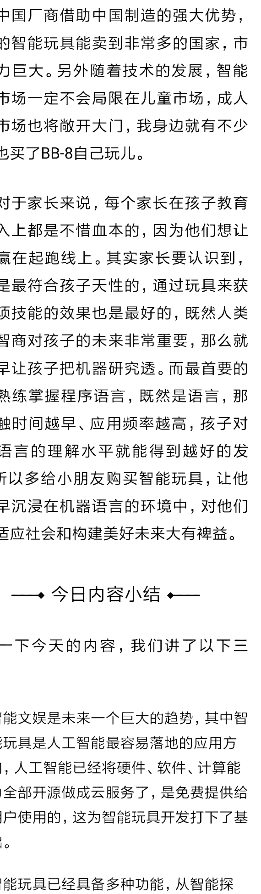

"小爱因斯坦"更偏向于教育，但和其他流行的教育产品相比，它有更好的趣味性和互动性。当孩子在看视频学习的时候很容易觉得无聊，它可以形成人、视频和机器人三方互动，提醒你注意视频中的重点内容，它甚至还能感知到孩子的疲劳程度，然后提醒孩子集中注意力。可以说"小爱因斯坦"更像是一个智能的"机器人老师"，能更好地引导孩子进行科学探索。

## 四、玩具为什么要智能化？

大家都知道传统的积木和洋娃娃的时代早就过去了，现在几乎所有的孩子都喜欢玩手机和Pad了，这就表明玩具的智能化一定是大势所趋，否则你根本竞争不过手机和 Pad。我们得分别从孩子、制造商以及家长这三方面来分析这个问题。

首先对于小朋友来说，多接触智能玩具，既重要又必要。

- 1. 智能玩具可以满足他们好奇的天性，而且智能玩具的互动性和趣味性都远远超过传统玩具；
- 2. 他们在和玩具形成良性互动后，发现某些新功能或者得到别人的认可都会让他们很有成就感；
- 3. 大家一起玩的时候，智能玩具就成为具有社交属性的载体了；第四，也是最重要的一点，在人工智能爆发的时代，从小接触智能玩具，就能尽早地培养孩子的人类机器智商，也就是对机器的理解能力。

这是我们上周讲教育产业的时候着重强调的，这能提高他们的未来社会竞争力。我们在《前哨》里介绍过很多次，按照目前的发展趋势，机器智商会是一个未来决定个体成功的关键。比如比尔·盖茨和乔布斯就是和计算机一起成长起来的，他们在使用计算机的同时也在改进着计算机。

其次对于制造商来说，和传统玩具相比，开发智能玩具的经济利益会更加丰厚。尤其是中国厂商借助中国制造的强大优势，我们的智能玩具能卖到非常多的国家，市场潜力巨大。另外随着技术的发展，智能玩具市场一定不会局限在儿童市场，成人消费市场也将敞开大门，我身边就有不少朋友也买了BB-8自己玩儿。

最后对于家长来说，每个家长在孩子教育的投入上都是不惜血本的，因为他们想让孩子赢在起跑线上。其实家长要认识到，游戏是最符合孩子天性的，通过玩具来获得某项技能的效果也是最好的，既然人类机器智商对孩子的未来非常重要，那么就要趁早让孩子把机器研究透。而最首要的就是熟练掌握程序语言，既然是语言，那么接触时间越早、应用频率越高，孩子对程序语言的理解水平就能得到越好的发展。所以多给小朋友购买智能玩具，让他们尽早沉浸在机器语言的环境中，对他们将来适应社会和构建美好未来大有裨益。

## —— 今日内容小结 ——

总结一下今天的内容，我们讲了以下三点：

- 1. 智能文娱是未来一个巨大的趋势，其中智能玩具是人工智能最容易落地的应用方向，人工智能已经将硬件、软件、计算能力全部开源做成云服务了，是免费提供给用户使用的，这为智能玩具开发打下了基础。
- 2. 智能玩具已经具备多种功能，从智能探索、交流互动到教育学习，玩具的好处是可以通过动作互动、眼神互动、玩具编程互动得到很好的实时反馈。尤其现在的智能玩具更侧重于教育功能，孩子可以在互动中全面训练智力、认知能力和社交能力。
- 3. 智能化是玩具未来的发展方向。让孩子提前接触编程的环境，尽早和智能玩具互动，既能保持孩子对未知世界的好奇心，又能提高人类机器智商，增强在未来社会的竞争力。

## —— 今日思考题 ——

说说你曾经或者现在最喜欢的玩具吧，想想看怎样把它们和人工智能结合起来呢？

欢迎在留言区分享你的观点。

## 划重点

1.在人工智能爆发的时代，从小接触智能玩具，就能尽早地培养孩子的机器智商，提高他们的未来社会竞争力。
2.智能玩具的发展趋势是更注重互动性，更强调教育功能，这样小朋友就能够通过玩具进行更多有趣的互动，在玩的过程中快乐学习。
3.和传统玩具相比，开发智能玩具的经济利益会更加丰厚，中国厂商借助中国制造的强大优势，市场潜力巨大。

王煜全
我是王煜全，你的全球科技前哨侦察兵，我们明天见。

## 用户留言

# 092 | 智能玩具的情感价值至关重要

092 | 智能玩具的情感价值...

## —— 今日内容看点 ——

通过阅读今天的内容，你将会掌握以下两个问题的答案：

+   1. Sphero 的智能玩具是怎么走红的？
2. 伊恩·伯恩斯坦的创业史带给我们哪些启示？

今天我要跟大家讲的是智能玩具产业中的重要人物——伊恩·伯恩斯坦。这个人你可能不熟悉，但你一定听说他创立的公司 Sphero 和它的产品。可以说，正是伊恩·伯恩斯坦推动了玩具行业进入到智能时代。

在2011年的 CES 大会上，Sphero 公司，当时还叫 Orbotix 公司，展出了一个球状小机器人，这个小球里面装有陀螺仪和蓝牙连接，可以用 iPhone 来操控它前后左右地移动。当时，市场上还没有可以用智能手机来操控的玩具，所以 Sphero 一推出就引得大家纷纷关注。

2011年圣诞节之前，Sphero 正式发售，当时一度供不应求。两年之后，也就是2013年，同样是在 CES 的舞台上，Sphero 又推出了第二代产品，一代和二代产品加起来，预计销售超过了50万个，这对于一个创业公司来说，已经是非常好的业绩了。

但是直到2015年，Sphero 才算真正走进大众的视线，当时是星球大战主题的 BB-8 机器人让 Sphero 狠狠地火了一把。其实被 Sphero 从电影角色变成现实的可不只是 BB-8 一个，还有星球大战系列当中的 R2-D2，和反派的 BB-9E，三个机器人还可以进行互动，R2-D2 还可以指挥 BB-8 们巡逻，不论是大人还是孩子都玩得不亦乐乎。

那么，伊恩·伯恩斯坦是如何让一个呆萌的小球充满魅力的呢？

### 一、两个机器人迷的碰撞

这还得从伊恩的童年说起，他1983年出生，和那时候的很多男孩一样，他喜欢拆东西。不同地方是一般孩子拆完了大都没法恢复，但是他拆完了相机、磁带播放器这些东西，自己还能重新组装成各种小发明。

12岁的时候，他就开始参加国际上的 BEAM 机器人比赛或者叫仿生机器人比赛。多说一句，BEAM 是四个词的词头，Biology 就是生物，Electronics是电子，Aesthetics是美学，Mechanics是机械，这个 BEAM 机器人指的是用模拟电路和简单机械而不用集成电路的机器人，所以更强调设计，20年前做 BEAM 机器人比赛是非常风行的。

到了1998年，15岁的伯恩斯坦就拿到了他人生中的第一次 BEAM 机器人比赛的冠军。从此伊恩就有了人生目标，他想要造出普及型机器人。

在大学的阶段，伊恩学的是电子工程和计算机科学，不过在大四的时候，他决定缓学习经商。那时候的他还没有想过将来会有自己的机器人公司，只是借助互联网浪潮开设了一家网页设计公司，因此积累了不少互联网理念和对软件的理解。同时他还在一家机器人公司兼职，这让伊恩始终保持着对工程技术的熟悉。

这段经历对于伊恩来说非常重要，因为正是这段经历为 Sphero 的成立打下了基础。我们知道 Sphero 就是用手机来操控的，它是软硬件结合的完美体现，所以同时涉足软硬件不仅让伊恩对软件和硬件都有了深刻的了解，更重要的是，在机器人公司兼职的过程中，伊恩找到了他的合伙人——亚当·威尔逊。

当时，伊恩兼职的机器人公司正在销售一种人形机器人，虽然这种人形机器人配备了各种各样的传感器和触摸屏，但是售价非常昂贵，而且操控效果并不好。2009年，伊恩有一次在玩 iPhone 手机的时候，突然冒出一个想法，为什么手机不能控制其他东西呢？当时他兼职的机器人公司，就是用基于 Linux 的控制系统来控制机器人的，智能手机不就是一个小型电脑吗，不也可以成为机器人的大脑吗？而且智能手机在当时已经有了普及的趋势，伊恩觉得这将会是一个巨大的市场。

但是在当时，用手机去操控机器人是一个没人尝试过的领域，谁能把这个想法变成现实呢？通过朋友的引荐，伊恩找到了机器人迷亚当·威尔逊来进行软件架构开发，这个人就是后来 Sphero 公司的另一位联合创始人。亚当当时参与了美国航空航天局 NASA 的机器人项目。两个人一拍即合，伊恩负责硬件的开发，亚当就做自己擅长的软件开发。

伊恩的父亲也非常支持他们，还提供了一小笔资金，帮他们购买了一台 Android 设备。巧的是，就在伊恩与父亲见面的第二天，安卓系统推出了一条系统更新，让安卓系统可以进行硬件操控了，在这之前还是完全无法实现的。后来，伊恩和亚当两个人制作了一个自定义蓝牙功能的开发板。他们的第一个产品原型是遥控灯，远程启动汽车，开关车库门和控制玩具坦克。

### 二、重要转折——联手Techstars和Disney

+   1. 参加创业孵化器Techstars

2010年，伊恩拿着产品原型去参加了创业孵化器 TechStars。TechStars 是世界一流的初创公司加速器，他们的特色是“导师制加速器”。也就是说，每一个创业公司都会配备10名经验丰富的企业家导师，在3个月的项目里对创业者进行全面指导，帮助公司从创立走入运营。对创业者来说，如果能进入 TechStars，就意味着公司接触到了最顶尖的创业资源。

在 TechStars 联合创始人布拉德·菲尔德的建议下，伊恩他们明确了产品思路，也就是专注于球状机器人玩具的研究。Sphero 还挖来了 TechStars 的投资人保罗·贝伯里安担任 CEO 的职务，保罗·贝伯里安是 Sphero 的导师之一，他管理过6家初创公司，这6家初创企业后来又分别被出售，他是非常成功的连续创业者。

至此，一家双长制的公司就出现了，既有经验丰富的 CEO，又有两位非常优秀的技术专家。很快，Sphero 就在第二年的 CES 展上展示了自己的产品原型，在随后的三年中迅速迭代了两代产品，只不过那时的产品还不是我们现在所熟知的 BB-8 机器人。

+   2. 获得迪士尼授权

在2014年的时候，发生了一件重要的事，Sphero 和迪士尼有了第一次交集，当时的 Sphero 加入了迪士尼的创业孵化器项目。在这个项目里，Sphero 成功获得了一个重量级的创业导师，就是迪士尼的 CEO 鲍勃·伊格尔，同时还拿到了星球大战的 IP 授权，然后就推出了我们现在所熟知的 BB-8 机器人。

在产品量产之前，Sphero 收到了苹果公司的联系，苹果希望把 BB-8 作为苹果公司的重要配件在苹果商店销售。结果 BB-8 一上架就被一抢而空，创下了平均每小时大约销售2000个的纪录。这场胜仗仅让 Sphero 名声大振。从这以后，Sphero 陆续拿到了赛车总动员、蜘蛛侠这些形象的授权，顺利推出了一系列智能玩具。

### 三、进入教育领域

在教育方面，Sphero 也不逊色，2014年 Sphero 推出了一个 SPRK+ 的方案，SPRK 是 Schools、Parents、Robots、Kids 的简称，也就是学校、家长、机器人和孩子，这四个词充分说明了它是一款寓于乐的机器人。

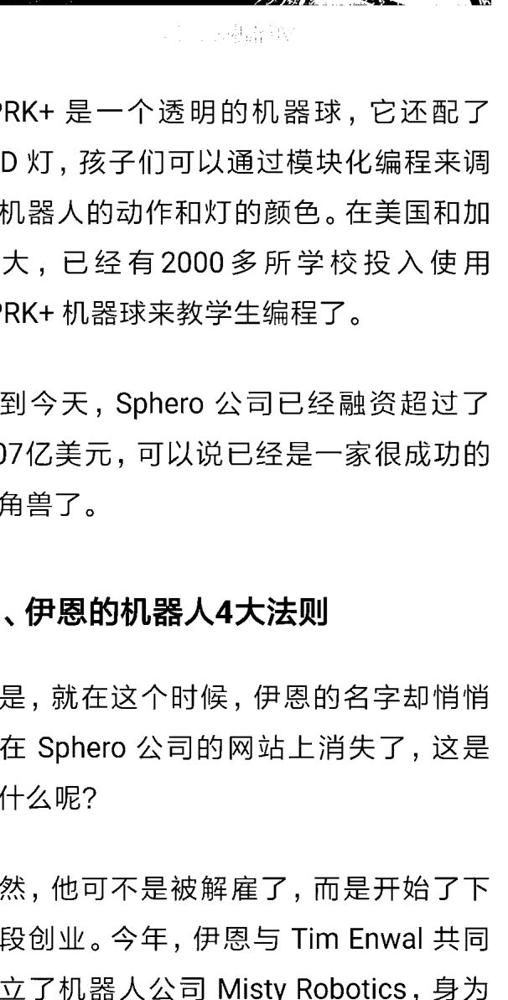

SPRK+ 是一个透明的机器球，它还配了 LED 灯，孩子们可以通过模块化编程来调整机器人的动作和灯的颜色。在美国和加拿大，已经有 2000 多所学校投入使用 SPRK+ 机器球来教学学生编程了。

直到今天，Sphero 公司已经融资超过了 1.07 亿美金，可以说已经是一家很成功的独角兽了。

### 四、伊恩的机器人4大法则

但是，就在这个时候，伊恩的名字却悄悄地在 Sphero 公司的网站上消失了，这是为什么呢？

当然，他可不是被解雇了，而是开始了下一段创业。今年，伊恩与 Tim Enwal 共同创立了机器人公司 Misty Robotics，身为 CEO 的 Tim 做过 3 个成功的初创公司的创始人和首席执行官，在苹果公司工作了近 10 年。Misty 的第一款产品计划在明年面世，究竟会是什么样子，我们拭目以待。

可以说，在创业的过程中，伊恩也从来没有停止对未来机器人的思考。很多人都知道阿西莫夫的机器人3大法则，身为机器人迷的伊恩也提出了自己理解的4大法则：

+   1. 实用性

也就是说机器人被造出来的目的是能够节省人类的时间，而且机器人可能会去做一些复杂的、需要数学计算的事儿，比如计算室内空间，也可能是一个些简单乏味的事，比如整理你的袜子、鞋子这些琐碎的事儿。

+   2. 熟悉性

机器人不仅要了解机器人的世界，还要了解人类的世界，机器人和人类接触得越频繁，就能学到更多的技能。而且，机器人应该感觉到越来越熟悉我们，我们也应该像它的家人。

+   3. 能够唤起情感并和人建立关系

人类和机器人越熟悉彼此，呆在一起的时间越长，就越能形成情感关系。就像我们会给自己的吉他起名字一样，机器人甚至更能唤起人们的情感，因为它的互动性和连接性更强。

+   4. 多用途

扫地机器人确实很好用，但是个人机器人不能是功能单一的机器人，它要辅助我们完成更多的任务，机器人需要在和人类的相处过程中拓展自己的功能。

伊恩相信，新的个人机器人浪潮正在到来。机器人不会突然出现在我们的生活里，但它们终将改变我们和技术的关系。

## —— 今日内容小结 ——

总结一下今天的内容，我们讲了伊恩·伯恩斯坦的创业史，希望你明白以下 4 点：

+   1. 软硬件结合是很好的方向，因为需要综合技能，所以门槛较高，有机会建立壁垒。尤其是对于基础研发能力相对较弱，而硬件能力相对较强的中国，更是一个重要方向。

+   2. 对于玩具产业来说，为产品本身赋予一个情感价值至关重要。Sphero 在成立之初就已经做好了产品，形态与之后的产品系列并没有发生太多变化，但是一直到拿到星球大战的 IP 后才一炮走红，它的成功离不开星战迷的情感依托。

+   3. 对创业者来说，时机非常重要。智能手机的出现给了伊恩绝佳的创业机会，早一步，技术不成熟，晚一步，可能就得不到 TechStars 和迪士尼的青睐了。

+   4. 技术创业者拥有前沿技术，但并不代表就是完美的经营者。他们需要很多支持，既需要有经验的创业导师指导，也需要有经验的企业家加盟。这也是我们提倡积木式创新，做科技特训营，包括正在筹备当中的有多位大牛支持的创新机构的原因。

## —— 今日思考题 ——

你觉得 Sphero 的成功之处在哪里？国内的玩具初创企业有哪些可以借鉴之处？

欢迎在留言区分享你的观点。

## 划重点

> Sphero拿到星球大战的IP后才一炮走红，而实际上产品的形态与之前并没有太多变化，这充分证明了对玩具产业来说，为产品本身赋予一个情感价值的重要性。同时也提醒创业者，尤其是技术创业者，如何将自己的技术以消费者愿意接受的产品形态展现，需要不断的进行思考。

王煜全

我是王煜全，你的全球科技前哨侦察兵，我们明天见。

## 用户留言

提交留言可与专栏作者互动

# 093 | 乐高是怎么引领智能玩具潮流的？

## ——◆ 今日内容看点 ◆——

通过阅读今天的内容，你将会掌握以下三个问题的答案：

+   1. 乐高的乐高为什么能引领智能玩具行业的潮流？
2. 乐高的"System of Play"概念是什么意思？
3. 如何让玩具更好玩的同时更多地融入教育元素？

今天我们要讲的，是全球最大的玩具公司之一的乐高公司。它成立于1932年，公司总部在丹麦，是一个家族企业。提起乐高，我们马上就会想到积木，一块块标准化的小积木可以拼接出各种各样的东西，比如高楼大厦、飞机汽车、甚至是形态各异的小动物。就连谷歌第一台服务器的机箱，都是用乐高积木搭的。

那么积木和智能有什么关系呢？

可能很多人都没意识到，其实从上世纪80年代开始，乐高就一直是智能玩具的领军者。今天我们就来看看这家老字号，是如何凭借智能玩具引领玩具行业新潮流的。回顾乐高80多年的发展历程，最值得说道的，是它经历的两次最为关键的重大转折。

### 一、小塑料块的大生意

第一次转折来自乐高开启的塑料玩具产品线。乐高是一个家族企业，它的创始人叫 Ole Kirk Christiansen，年轻时他承包了一家精细木制品工厂，做些室内装潢的工作。Ole 十分关心慈善事业，他会经常给教堂的孩子们做些手工玩具。上世纪30年代经济危机来临的时候，他发现，在全行业一片萧条的情况下，只有玩具业的订单不降反升。所以他开始制造小木刻品和木制玩具。后来他的儿子 Godtfred 也加入了进来，就这样，乐高公司的雏形建立了，1934年这个工厂正式更名为LEGO。

有意思是，LEGO 在拉丁语里有“拼接”、“组合”的意思，结果公司后来还真的凭借着积木风靡了天下，不过这是十几年之后的事情了。

一开始，乐高做的还是木制玩具。直到1946年，乐高砸重金买了一台英国产的注塑成型机，这台机器有多贵呢？据说它的成本几乎等于当时乐高两年的利润总和，乐高也因此成为丹麦第一家拥有这种机器的厂商。他们将用这台机器来生产塑料拼接玩具，从那以后，塑料分支正式加入了乐高的产品线。

这就是乐高史上的第一个重大转折。

可以看到，乐高是一个非常重视新技术的公司，非常舍得用资本换取先进产品的制造能力。从1949年开始，乐高就开始生产我们现在熟悉的乐高积木了，当时的名字比较炫酷，叫做 Automatic Binding Bricks LEGO，到这里，乐高积木才算是真正诞生，后来在1951年，更名为 LEGO Bricks，而到了1958年，他们拿到了丹麦的专利证书。

只可惜，当时的消费者对塑料积木并不买账，他们还是更喜欢金属和木制产品，这让乐高面临困境。不过，从今天回过头去看，乐高在当时的决定是非常正确的。我们一直强调，新技术带来的范式转移不是那么容易被接受的，开始时一定是只有少数人接受，但是历史的潮流终究会滚滚而来。

在之后的几十年里，乐高一直重视新技术和新材料的运用，1963年，乐高采用了更好的塑料来作为乐高积木的原材料。新材料做出来的乐高积木更耐冲击，不容易损坏。2015年乐高还宣布，将在2030年前用可持续发展材料生产他们的玩具产品和包装材料。

总之，凭借这些小小的积木块，从1979年开始，乐高在全球化的红利下经历了长达15年的快速成长期，几乎每5年公司的销售额就翻一倍。所以我们说，乐高的基因里就一直带着追求创新和技术的色彩，这也正是乐高成为智能玩具先驱的最重要因素。

### 二、打造编程机器人

接下来，我们来说说乐高的第二次转折，也就是在产品线中加入了可编程机器人。

早在上世纪80年代，乐高就发布了玩具机器人，可以说是智能玩具的先驱。讲到乐高机器人，我们不得不提到一个人，他就是“儿童编程之父”——西摩尔·派普特。

派普特曾经出版过一本编程书，名字叫做《头脑风暴：孩子，计算机与充满活力的概念》。他在书中系统阐述了自己的教育哲学，也就是“做中学”（Learning by Making）。在他看来，好的教育不是想办法让老师教得更好，而是应该提供充分的环境和工具让学习者构建自己的知识结构。

比如他在书中写到，“通过编写计算机程序，孩子有机会接触科学和数学，并且体会到创建智能模型的美。”派普特认为，构建知识结构最好的方法之一，就是让学习者创造和构造对他们来说有意义的事物，这个教育理念在当时可以说是非常先进的。因此，派普特还被 MIT 评为塞西尔与艾达·格林教育教授。

而派普特和乐高之间的缘分是在非常偶然的情况下建立起来的。

1984年，乐高的第三位 CEO 克伊尔德·克里斯丁森碰巧看到了派普特的电视采访。在电视上，他看到派普特通过 LOGO 程序语言，竟然可以控制一只机器乌龟完成前进、后退、转向和在纸上绘图等动作。

这里提到的 LOGO 是一种早期的编程语言，它通过“绘图”的方式来学习编程，用来对初学者，特别是对儿童进行寓教于乐的编程教学。

克伊尔德当时惊呆了，当时，乐高刚刚开始把生产线伸向到教育方面。直觉告诉他，如果能把 LOGO 语言和乐高玩具结合起来，他们将会创造一个革命性的产品。

随后，克伊尔德立即访问了派普特所在的麻省理工学院媒体实验室。派普特跟他聊了自己的设想，就是要创造一个能代替电脑的乐高零部件，这个零部件既要有计算的功能，又要像乐高一样小巧便宜。这无疑是一个巨大的挑战和创新，从这里开始，两人一拍即合。

1985年，乐高开始了和派普特的长期合作。乐高还在麻省理工学院的媒体实验室捐助了一个教授席位，派普特自然成为了第一位乐高学习研究教授。此后乐高也一直给媒体实验室提供赞助。经过他们的努力，1987年，一个机器人产品的原型诞生了，但是直到10年之后，乐高才发布了全新的可编程机器人产品 Mindstorms，也就是“头脑风暴”。

为了向派普特致敬，乐高正是用他所出版的书 Mindstorms 作为注册商标。1998年9月 Mindstorms 正式发售，不到3个月就全部售罄。从此，乐高掀起了一场全球的机器人风暴。

现在，派普特的学生，米切尔·瑞斯尼克接任成为了乐高学习研究项目教授，他在 LOGO 语言的影响下，推出了风靡世界的儿童编程语言——Scratch。现在 Scratch 的在线平台已经拥有了1500万注册用户。

到今天，Mindstorms 机器人系列已经迭代到了第三代机器人，包含了更多类型的传感器，孩子们可以搭建出数字时钟、跳舞机器人、弹吉他机器人、糖果机等造型，还能实现一些更加智能的创意。可以说，乐高是儿童编程教育的源头和最强推动者。

经历了两次重大转折，乐高已经成为玩具行业的领头羊，但它并未就此停止创新的脚步。

### 三、更多地融入教育元素

今天，STEAM 教育和创客教育已经成为教育领域的主流浪潮，众多创新企业的加入也让乐高开始重新思考，如何在让玩具更好玩的同时更多地融入教育元素。

数字时代儿童的娱乐方式已经发生了改变，为了和平板电脑、手机夺取孩子的注意力，乐高也在努力增强产品的吸引力。比如，在2017年的 CES 上，乐高就推出了新的 LEGO Boost 系列，和需要编程基础的 Mindstorms 相比，这个系列更适合小朋友玩。

我先来简单介绍一下这个系列的产品。

LEGO Boost 可以拼装出5种不同类型的玩具：有机器人、猫、吉他、工程车和生产线机器，玩具可玩性非常高。孩子们还可以App 上拖拽出不同的命令板块，这些命令板块分别代表着不同的动作，只要把不同的板块组装在一起，再点击屏幕，就能让机器人实现不同的动作和功能。

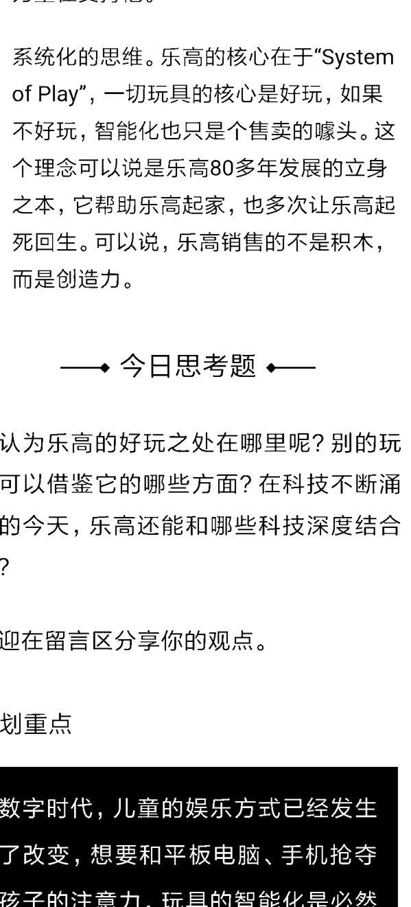

在这个过程中，孩子们真正实现了“做中学”，一方面训练了编程思维，另一方面不断探索出更多的玩法。为了让孩子掌握编程思维，程序还能循序渐进，由浅入深。比如，最开始只会“喵喵”叫的小猫会成长为摇头摆尾的猫咪。

与此同时，乐高还在探索把实体玩具和数字化体验结合的产品。2015年乐高推出的互动游戏《乐高：次元》就是一个很好的例子。今年2月份，乐高还推出了专门针对孩子的社交网络平台 LEGO Life，在这里，孩子们可以上传自己的乐高积木作品和相关涂鸦，也可以查看、评论、点赞乐高新闻以及别人的优秀作品等等。

### 四、长盛不衰的奥秘: System of Play

回顾乐高80多年的历史，有过黄金发展的15年，也曾几经破化的，但最终它克服了重重困难走到了今天。让他们能一直保持活力的奥秘，是乐高第二代接班人 Godtfred 提出来的“System of Play”这个概念。

这个概念说的是什么呢？

乐高是一套游玩系统，积木与积木之间彼此相融、拆开拼装，这个过程就是孩子们发挥想象力的过程。在1992年的乐高产品目录上印着一句话：“我们有积木，而你有想法”。80多年之后，乐高有了更多的产品系列，花样虽然更多了，但依然是塑料积木加上马达、开关、电池和芯片，也就是说，这一切依然离不开乐高玩具的拼接功能。

乐高的魅力就在于此，你看电影和玩游戏的体验都是有限的，但是通过乐高，你可以任意挥洒你的创意，实现任何你能想象出来的东西。乐高永远强调的是自己动手的乐趣，这种乐趣是任何其他游戏都不能取代的。可以说“System of Play”就是乐高的精华所在。

## —— 今日内容小结 ——

总结一下今天讲的内容，我们可以从乐高的成功总结以下三大要素：

+   1. 持续的创新力。从引入塑料玩具，到引入机器人，乐高一直是一家注重新创新的公司，这是它长盛不衰的一个重要原因。它在上世纪80年代就开始和高校联合研究智能玩具，然后推出了乐高机器人，乐高可以说是智能玩具领域最早的先驱。

+   2. 坚持的力量。新生事物往往都是不被大众所接受的，在公众对范式转移难以接受的时候能够坚持不懈，是成功者的必要条件，当大家都接受了新生事物的时候，你就成了这个领域的领导者了。所以我们看见各个领域的领导者往往都是有坚持的力量在支持他。

+   3. 系统化的思维。乐高的核心在于“System of Play”，一切玩具的核心是好玩，如果不好玩，智能化也只是个售卖的噱头。这个理念可以说是乐高80多年发展的立身之本，它帮助乐高起家，也多次让乐高起死回生。可以说，乐高销售的不是积木，而是创造力。

## —— 今日思考题 ——

你认为乐高的好玩之处在哪里呢？别的玩具可以借鉴它的哪些方面？在科技不断涌现的今天，乐高还能和哪些科技深度结合呢？

欢迎在留言区分享你的观点。

## 划重点

> 数字时代，儿童的娱乐方式已经发生了改变，想要和平板电脑、手机夺取孩子的注意力，玩具的智能化是必然的趋势。尤其是，智能玩具天然具有与教育连接的优势，不仅让孩子在玩的过程中可以学习，功能的多样性更可以开发想象力与创造力。

王煜全
我是王煜全，你的全球科技前哨侦察兵，我们明天见。

## 用户留言

提交留言可与专栏作者互动

# 094 | 如何把握智能玩具行业的機會？

## ——▶ 今日内容看点 ◀——

通过阅读今天的内容，你将会掌握以下三个问题的答案：

- 1. 智能玩具行业的機會在哪？如何把握？
- 2. 為什麼說智能玩具不能一味追求技術的高大上？
- 3. 為什麼說在智能玩具領域中國有巨大潛力？

今天照例要讲玩具业的机会和陷阱，我们说，人工智能这个黑科技，落到了玩具这个最实用的领域，可能会带来一个巨大的产业机会，我们叫“智能文娱”，这个机会可能比自动驾驶、语音助理等等等来得快。

未来的机会往往是边缘领域的机会，一个科技领域和一个传统领域的边缘，往往酿着更大的机会。所以中国的科技创新者，一定要懂长和传统产业结合，尤其是和中国的制造优势结合。

今天最后我还要请大家帮个忙，请一定要听到最后。

周一我们就聊到智能玩具是人工智能最容易落地的行业，根据数据显示，在未来5年内，也就是2017年到2022年，智能玩具的市场规模将会以每年75%的速度增加，而普通的玩具行业年均增速是6%，也就是说智能玩具的市场增速远远超过了普通玩具。尤其是智能玩具因为有了语音识别和人机交互体验的提升，产品价格和利润率都会大幅提升。可以说，智能玩具的行业前景和利润都是很好的。那今天我们就来看看，在智能玩具行业都有哪些机会和要注…

## 一、制造大国+完整的玩具供应链

首先我们要知道，中国是世界上最大的玩具生产国和出口国，有着完整的供应链系统，占国际出口玩具总量的75%左右，而且国内超过85%以上的玩具公司都是出口型企业，玩具出口额占到了中国玩具销售总额的一半。不过要注意的是，其中大部分玩具生产企业都是以代工厂为主。

比如我们之前仔细说过的 Hanson Robotics 机器人公司，就在2014年的时候把总部搬到香港，就是为了可以方便利用深圳强大的智能玩具制造能力实现量产。还有在2015年 CES 展上亮相的寻迹机器人 Ozobot，它小巧可爱，能按线路游走，为用户提供娱乐，还能玩游戏，甚至能够帮助用户学习一些简单的编程。比如在白纸上画出各种颜色的线条后，小机器人内置的传感器就能识别纸上的不同颜色，跟着这些线条做出不同的运动，甚至还能根据线和点的颜色来变换自身的 LED 灯。而 Ozobot 所有的产品都是在深圳生产的。

对于中国来说，智能玩具有着非常巨大的市场：

- 一是我们刚才说的中国玩具制造业的优势；
- 二是中国的人口优势，包括“二胎”政策出台，未来市场很大；
- 三是人工智能迎来收获期，技术是现成的。

这些条件对于玩具生产企业来说，都是利好。尤其是以设计开发为主的玩具公司，如果能够整合国内玩具公司的制造能力，将会具有巨大的上升空间。

## 二、借助热点IP进入市场

那么对于以设计开发为主的玩具公司来说，机会又在哪呢？

最近几年，相信大家已经注意到，动漫的IP价值大热，动漫文化产品的价值已经占到了玩具行业产值的20%左右。可以说，玩具和动漫、游戏、影视等等已经是密不可分了，谁能更好地把两者结合，谁就能创造出更大的价值。

在美国和日本这样的国家，拥有IP的玩具已经占有了很大的市场份额，而且还是主要的产品类型。另外，玩具不仅可以和动漫IP结合，还可以和体育、游戏、娱乐、教育进行融合，已经演化成一个庞大的泛娱乐的产业链。所以，设计开发为主的玩具公司，要借助热点IP快速进入市场。

## 三、创新与研发能力才是核心竞争力

肯定很多人会说，借助热点IP我也知道，但是热点IP就那么几个，如果我跟不上热点，那该怎么办呢？下面我们就来看看看 SONY 公司给了我们什么样的启发。

在2017年的东京国际玩具展上，SONY发布了一款物联网玩具“Toio”，它能让小朋友们边玩边学习，“Toio”计划在2018年1月上市，基本组件大概售价2万日元，也就是人民币1200元左右。它的基本组件包括控制台、两个方块型小机器人和两个“控制环”。方块型的小机器人，尺寸差不多只有火柴盒那么大，内部装有锂电池，有位置传感器、高性能马达和蓝牙，它的顶部有一个突起的部位，可以搭载其他配件创造出不同的外形和功能，Toio 可以灵活动地移动，能做出高精度定位，续航时间能达到1.5-2小时。

别看 Toio 的组成简单，它玩法却非常多样，你可以一个人玩，也可以双人对战。这2个方块型的小机器人，它们能对人的动作作出反应。而且，它们相互之间还可以检测到各自的位置，通过提前设定程序或者使用遥控器，可以让一对机器人作出相应的反应。

Toio 的演示视频链接：

## 四、智能玩具不是机器人

说完了智能玩具行业的机会和 Toio 带给我们的启发，现在我们再来看看看智能玩具行业的陷阱。
第一个就是价格问题。

第一个就是价格问题。

对于玩具来说，一般要求成本要低于预期，但是要产生高于预期的体验。所以从价格上说，人们一般能接受的价格最高也就在200美元左右。国内容易接受的价格一般也是在1000元以内。我们去年在《前哨》里提到的编程机器人 Dash & Dot 在亚马逊上标价就是1299元，但卖得不太好。在追求智能玩具的技术和功能的时候，是很容易造成成本过高的。所以我们不能一味追求技术的高大上，而是要从用户需求出发去设计玩具。

## 第二个是如何平衡编程学习和趣味性。

大家都知道，编程学习是儿童智能玩具的一大热门卖点，但是功能过多和过度教育，不仅增加了成本，也容易让孩子失去乐趣。在这一点上一直很热的儿童互动机器人 Cozmo 就处理得很好，它的 APP 里每天都有需要完成的任务，任务完成后可以解锁更高级的功能。所以尽管 Cozmo 也有编程功能，但是通过趣味性很高的游戏过关来实现，兼顾了娱乐性和教育价值。

## 第三个，智能玩具还得小心替代品和仿冒品。

比如，指尖猴子 Fingerlings 是2017年圣诞购物季最受欢迎的玩具之一，而开发出指尖猴子的 wow wee 公司正在起诉165名造假者，因为市面上有好多盗版的指尖猴子，比如指尖熊猫、指尖老鼠之类的。所以，智能玩具产品只有快速迭代更新才能避免替代品和仿冒品的威胁。

## ——♦ 今日内容小结 ♦——

总结一下今天的内容，我们主要说了以下三点：

- 1. 中国拥有制造大国的优势，有着完备的供应链系统，这为智能玩具行业的蓬勃发展打下了坚实的基础。研发设计公司可以利用中国的制造优势来实现量产、降低价格、放大市场。
- 2. 玩具市场弹性大，主要取决于玩具和玩法的设计，创新与研发能力才是核心竞争力。LEGO 和 Toio 都是采用社区和 UGC 丰富内容体系，与设计者共同开发各种套件，这种智能玩具加开放的设计平台值得设计者借鉴。
- 3. 智能玩具开发必须充分考虑成本，采用合适的技术，从用户需求出发。只有快速创建自己的品牌、快速迭代，才能避免替代品、仿冒品的威胁。引入现有IP也是迅速占据市场的好方法。

我们海银资本是最早布局人工智能产业的基金之一，我们布局的人工智能科技企业都和玩具领域有一定关联，因此我们希望寻找国内有强大制造能力的玩具企业深度合作，欢迎大家帮忙牵线搭桥。

## ——♦ 今日思考题 ♦——

我们今天提到，未来的玩具产业的核心是创新，请大家思考一下，中国的玩具产业要从制造能力过渡到创新能力，应该怎么做呢？

欢迎在留言区分享你的观点。

## 王煜全

小罐茶的创始人杜国楹作为咱俩专栏的用户，为专栏里的同学们也准备了一份礼物。今天的回答点赞数最高的6位同学，将会获得这份礼物。
1. 200元知识红包（一名）
2. 价值99元的 stalogy 笔记本（五名）
我是王煜全，你的全球科技前哨侦察兵，我们明天见。

## 划重点

- 1.智能玩具依然是玩具的属性，因此必须从用户需求的角度去开发和设计产品，不能一味追求技术的高大上，成本过高，消费者是无法接受的。
- 2.智能玩具的"教育"属性是很好的卖点，但过度教育就会让孩子失去乐趣，要在教育和趣味性间寻找平衡。
- 3.中国拥有制造业优势和人口优势，能生产、有市场，潜力巨大。同时，智能玩具产品只有快速迭代更新，才能避免替代品和仿冒品的威胁。

## 用户留言

# 095 | 用智能玩具培养孩子的机器智商

095 | 用智能玩具培养孩子… ↓

## —— 活动预告 ——

今天开始之前，我先做个广告，今天距离2018年 CES 展开开始正好还有1个月的时间。我们2017年初去 CES 的时候看到了很多精彩的主题演讲，明年活动升级，白天和导师一起看展，晚上我会邀请中国和美国的专家们聚集在一起做论坛。

其实 CES 不仅可以看到大公司的趋势发布，还有超过800个小的创新公司会在展区秀出他们的产品。我们今年初的活动有40多人参加，明年1月份的 CES，我们希望能有更多人一起参与进来，做一个超过百人的科技大 Party。欢迎各位感兴趣的朋友关注微信公众号“全球风口”，点击 CES，获取最新资讯。我很期待1个月后在拉斯维加斯给大家带来精彩的解读。

## —— 全周总结+拓展 ——

我们本周的话题是教育，主要介绍了三个重点：

第一，就是不要只注重黑科技，而忽略了它的应用。其实黑科技和传统产业结合才是最大的机会。人工智能最成熟的市场将会是智能文娱，包含玩具、游戏和娱乐。孩子对玩具容忍度很高，不像 IT，一个功能不能实现就说不好；玩具市场的冗余度很高，同类的玩具换个外观孩子就会再买一个。

## —— 用户答疑 ——

除了智能玩具以外，如何培养孩子的机器智商？（其实应该说是人类机器智商，这需要做个解释，因为机器智商是指机器像人一样的智力水平，而人类机器智商是指人能够懂机器的程度。）家长在不懂编程的情况下如何让编程语言融入小孩子的生活？

我的回答是：编程不光是语言，更是一种思维习惯，主要是指固化了一系列的输入就可以得到某种输出，所以其实背后强调的是逻辑关系。所以不光是玩具，其实参加编程课，或者用我们提到的 Scratch 软件输出一个动画作品，或者参加 STEAM 的学习，或者自己用 Lego Boost 做出了一个机器人，而且还能实现某些动作等等等等，这些都可以培养孩子的人类机器智商。

合作，而不是什么都自己搞。

所以，我对玩具和游戏的未来充分的乐观，就是因为它的这种开放性，创新性是大企业无从垄断的。其实从大企业行为也看得出来，我们这之前就讲过，尤其在人工智能这轮大潮来临的时候，大企业把自己的 IT 能力、人工智能的算力、云计算的能力都充分开放，就是因为不知道下一个大机会在哪儿。所以你看，未来的机会无比广阔，但是大企业也不知道机会在哪，这样市场最适合创业者了。

中国制造的优势是量产能力，其核心技术是组装，在设计尤其是芯片方面与国外差距较大，拿电脑来说，核心 CPU 基本被国外垄断，而且利润被赚了一大半，

那么，智能玩具方面也是这样的格局吗？

我的回答是：

智能玩具相对要乐观得多，因为前面几个问题我们也一直在反复提到，技术不是最重要的，最重要的是创新能力，尤其是有价格限制，所以玩具一般都不会用到最好、最新的芯片，我还没听说谁把高端 CPU、GPU 放到玩具里呢，对吧？比如说我们老讲说，高通又推出来了骁龙芯片，2017年1月份的时候推出了骁龙835，最近又推出了骁龙845，但是这些只能被用到手机里，我还没听说放到玩具里的。

## 划重点

- 1. 孩子沉迷游戏，根源是孩子心理出现问题，他想从现实中逃脱，这主要是受家庭影响，很多时候父母要承担主要责任。
- 2. 未来需要“机器智商”，孩子们越早学会与机器沟通就越好，家长不能以自己的心态去衡量孩子的未来。
- 3. 对于智能玩具来说，最重要的不是技术，而是创新能力，是在有价格限制的情况下如何为孩子提供更多更好的互动与趣味性。

## —— 下周预告 ——

我们下周的话题是游戏，玩具是小孩子玩的，而游戏就是从小孩子一直到成年人都可以玩的了。我们之前也讲过，对动物来说，游戏是动物的幼崽学习捕猎、学习逃生、学习适应环境等等的训练。而人终生都是孩子，终生都长不大，终生都具有好奇心，所以也终生都喜欢游戏，喜欢探索。

王煜全

小罐茶的创始人杜国楹作为咱们专栏的用户，为专栏里的同学们也准备了一份礼物。今天的回答点赞数最高的6位同学，将会获得这份礼物。

- 1. 200元知识红包（一名）
- 2. 价值99元的 stalogy 笔记本（五名）

我是王煜全，你的全球科技前哨侦察兵，我们明天见。

## 用户留言

提交留言可与专栏作者互动

# 创新地图｜基于增强现实的智能玩具机器人 MekaMon

王煜全

今天是《全球创新260讲》的聆听时间，题目是《基于增强现实的智能玩具机器人MekaMon》。

由于转述师生病，无法进行音频的录制工作，转述师病情好转，我们会及时补上音频，还请见谅。

陆野，俄亥俄州立大学金融系毕业，曾为华尔街投资银行工作，现就职于 Magic Leap，负责战略和金融分析以及战略规划。

不久前，多家媒体及科技博客相继报道了一则新闻——标价300美金的一款具备增强现实功能的智能玩具机器人 MekaMon，将通过苹果公司作为其唯一销售渠道开始售卖。开发 MekaMon 的是一家初创公司 Reach Robotics，而通常都是大疆这类明星公司的特别类产品才能吸引苹果的兴趣，达成独家销售的协议。这家成立仅三年的公司，是如何赢得一众知名投资人的青睐，并成功将一款软硬件结合的复杂产品推向市场？MekaMon 又有什么特别之处能够吸引苹果公司的兴趣？

## | 智能玩具机器人MekaMon

MekaMon 是一个类似蜘蛛形状的四脚机器人，与普通的 Play Station 和 Xbox 主机相比略大一些。

玩具通过手机或平板电脑控制 MekaMon，可以进入单机或对战两种游戏模式。

单机模式的故事背景是2076年地球被外星人入侵，人类开始操纵一种叫 MekaMon 的战斗机器人对侵略者展开反抗。单机玩家需要控制它，完成搜集资源、占领根据地、消灭敌人等各种目标。不仅机器人本身可以根据玩家指令移动，玩家还可以通过手机或平板电脑的屏幕看到自己的机器人和敌人在增强现实（AR）中的战斗场景，一时间激光飞舞、战火弥漫。

对战模式中玩家可以与其他玩家进行一对一或者二对二的对战，当然前提是你的对手也有一个这样的机器人。通过手机或平板电脑与机器人互联的传感器系统，它可以精准地追踪和定位现实世界中的敌人并发起攻击，这也降低了操作难度。

## | 机器人&增强现实

看到这里可能有一些读者要问了，机器人对战我理解，增强现实游戏我也理解，可为什么两者要同时出现呢？也就是说，既然增强现实中可以虚构出一个机器人，为什么还要花上300美金买一个实体机器人呢？这个问题特别好，要回答这个问题，让我们先到哈利波特的魔法世界里看一看。

时至今日，环球影城已经成功开启了多处以小说和电影哈利波特系列为主题的公园。在这些主题公园中，游客可以看到雄伟的城堡和古灵阁里的地精，品尝冰镇的黄油啤酒、购买法杖和巫袍，见到屋顶上喷火的巨龙。

作为一个主题公园当然还有各式各样的过山车，其中有一个带有类似增强现实功能的过山车。它设置在一个城堡里，过山车本身也不是传统形状，而是一排在霍格沃茨里能够找到的椅子。

关键的是，过山车开始行进后，有一个巨大的弧形屏幕会在前方跟着车子一起运动。屏幕上开始播放与过山车行动匹配的剧情，电影中的主角悉数登场，屏幕包裹住了游客的全部视线，一种充满沉浸式的体验开始出现，在某一个瞬间似乎真的感觉到自己身处在这个奇幻的魔法世界里，根本分不清真实和虚拟的世界。

MekaMon 也是同样的道理。它的活动非常灵巧，移动、攻击、防御都有非常逼真的动作效果，甚至可以做出翻滚这类高难度动作，让玩家感觉这个机器人确实是按照自己的意志在移动。经常玩游戏的朋友都有感受，超级马里奥很经典但控制简单，只有前后上下，大多数时候缺乏沉浸感。现在很多制作精美的游戏，控制复杂，游戏中的角色可以完成各种指令，自然沉浸感更强，有时甚至让玩家觉得自己和游戏中的角色合二为一。

但电子游戏制作再好，沉浸感也是存在于屏幕那端的虚拟世界里的，只是感觉自己短暂地被吸入了那一头的世界，喝一口水就又回到了真实世界。而 MekaMon 连接真实和虚拟两个世界会带来全方位的沉浸感。

首先，通过手机或平板电脑的屏幕，看到真实存在的 MekaMon 在控制下发射激光摧毁敌人的堡垒，因为它是物理存在且动作逼真的，周围的环境包括地板、桌椅等也是真实存在的，以至于虚拟存在的激光和堡垒也真实了起来。

其次，战斗中玩家可以控制 MekaMon 到桌椅或箱子后面躲避敌人的激光攻击，将真实世界中的物体和场景融入到虚拟战斗中。

然后，玩家还可以配备不同的盾牌或武器零件，使其具备攻击性较强或防御性较强等不同属性。也就是说，真实的物理部件在虚拟的战斗世界中造成了实际的影响，是不是觉得连零部件都活了过来？通过精妙而细致的设计，它开辟了一种全新的混合现实与虚拟的游戏方式，像环球影城的哈利波特主题公园一样，把玩家带入了一个奇幻的世界。

## | MekaMon的背后故事

MekaMon 创新又好玩儿，背后的故事也不简单。MekaMon 的设计在过去的三年中经历了27次修改，也就是平均每一个半月就重新设计一次，力求达到最好的效果。开发 MekaMon 的 Reach Robotics 在2015年中旬得到高通孵化基地25万美金的种子轮投资后，在2017年中旬，也就是产品快要上市之前又得到韩国的 Korea Investment Partners 和新加坡的 iGlobe Partners 领投的750万美金 A 轮融资。

融资成功之后，公司 CEO Silas Adekunle 表示，想打造的不光是一条玩具产品线，更像是 Xbox 或 Play Station 一样的平台，要营造整个生态，带领更多开发者进入到平台里来。硬件创业本就不易，欧美科技界流传的一句话就是“Hardware is really hard”。作为一家初创公司要同时负责硬件设计和软件开发，以及生产制造和供应链的管理，甚至生态圈的营造，确实不是一件容易的事。

大家都知道，增强现实和机器人都是大趋势所趋，将会改变我们日常和职业生活乃至住行等各方面。MekaMon 富教于乐，让孩子们在游戏中就能体验到在增强现实的场景中和机器人的交互。与此同时，它还和苹果的 Swift Playground 的编程语言兼容。

Swift 是一套专为小朋友开发的编程语言，简易易学。也就是说，小朋友可以利用 MekaMon 学习基本的编程知识，用自己编的程序给自己的机器人设计个性化的移动或攻击效果等。

通过玩游戏，小朋友可以从小就培养人类机器人智商和科技适应能力，这会在未来的竞争中给他们带来不小的优势。比如，自己组装一台电脑，或者编一套软件，甚至自己设计一个机器人。

## 内容总结

今天给大家介绍了 Reach Robotics 这家初创公司推出的第一款产品 MekaMon，它是一款具备增强现实功能的智能玩具机器人，能给玩家带来虚实结合、充满沉浸感的全新体验。

就像我们前瞻节目一直说的，科技布局要趁早，所以给大家三点建议：

- 1. 继续关注前瞻，走在科技趋势的前面，提前布局；
- 2. 积极通过资金、市场和先进制造与领先的科技公司合作，实现“积木式创新”；
- 3. 给孩子多买智能玩具，既能玩还能学习编程，在游戏中培养孩子的机器智商和科技适应能力。

“创新地图”是《全球创新260讲》的周末特别版块，主要由专栏的科技社群“前瞻团”供稿，为你带来科技领域的专业知识

亲爱的小叶 突发奇想，机器人最小的极限是多大？把最小的机器人当做乐高进行组合。组合成电视，电脑，汽车，洗衣机等等，可以通过手机app进行设置。优点是，少上几个，或者几十个小机器人，组合成的“玩具”还可以照常“玩耍”，这是个什么概念？ 12-09 10:46:34

WHOAMI 昨天在网上逛了逛智能玩具商店，感觉好一些的价格比较贵，便宜的又不够智能，甚至不太适合小孩玩。期待煜全老师预见的智能玩具市场大爆发早日到来。 12-09 14:13:25

s官壳壳啊 虚拟现实如果能实现触感功能，那么世界必将全部改变。有一种比较好玩的方式就是玩具与虚拟现实（或者应该是增强现实）结合，比如你骑着一只马里奥玩具，然后戴上眼镜，开始可以征战沙场了哈哈哈！这会比你直接戴上眼镜有感觉很多！ 12-09 10:35:12

静妹 谢谢陆野的推荐，和提出给孩子买玩具具体建议。看来自在花钱的心理账户里面建立一个玩具账户了。就是现在的智能玩具太贵了，不是我们国内普通家庭可以承受的了的，会增加很多家庭负担，像我要想给女儿买玩具就得节省那一项开支。而且购买渠道也不顺畅。如果可以在价格上有下降，购买渠道又可靠便捷就会更好。先培养孩子的动手能力再说，鼓励女儿把家里的台式机给拆了也是个不错的试验。 12-09 11:02:31

心龍 赚钱更有动力了。社会发展的这么快，要善于利用资源。学习，多操作自然就好。 12-09 19:32:38

帆布衣 游戏是孩子天性，玩具不但适应孩子，而且可以让孩子更早，更深的接触智能，刺激孩子科技头脑，更早适应智能时代。通过简单的编程，孩子还可以自己设计游戏，这是一个正反馈循环 12-09 13:04:02

李明 现在确实有想法给孩子买智能玩具，我大女儿现在两岁半不知道买什么玩具才好，并且太贵的玩具目前消费不起，请问下老师去哪个网站买？ 12-09 12:30:50

冯昆 我直观感觉可以增加一种玩法：通过安装在机器人上的全景摄像头，实现沉浸式VR的体验。灵感来自一款命令与征服游戏，不同于一般的上帝视角，那就是游戏是第一人称视角的，体验很棒，但不记得名称了。现在高清摄像头的安装、传输带宽和功耗可能还有点不能很好的匹配机器人，但从发展的眼光看，都不会等太久就可以实现。 12-09 10:43:33

XTANK 虽然知道智能玩具是未来趋势，没想到AR这么快已经运用在玩具上，感觉非常棒，怪不得MekaMon能获得了苹果公司的认可，很想拥有一台啊。反观国内的玩具厂家，感觉差距还是比较大，而能将软硬件都做做好的公司更是凤毛菱角，希望国内的企业再接再厉。 12-09 21:37:01

沈德斌 一种玩具机器人，白天陪你玩儿，晚上有消灭蟑螂的功能。我想市场潜力巨大！ 12-09 20:24:54

胖子会飞 突然间感觉国内的玩具厂家又要焦虑了，又被别人甩了一代的起跑。正如王老师说的，技术应用的边界往往是最容易出现创新的地方，我国其实在计算机和相关应用领域的核心技术并不弱，下来就是看如何能够通过不同领域的合作，实现弯道超车了。 12-09 19:52:09

学习蛋 变形金刚里有一个机器人是用一群类似颗粒状的东西组成的，可以变化出各种形状，可以更换擎天柱也可以变成一个球星。我的理解就是由多个微型机器人拼装在一起各种性状微型机器人可以是上千个或者上万个，只要给出指令，要求变成什么状态，马上就会相互拼装在一起，像磁铁一样，想象就很酷。 12-09 19:25:43

李坚 我觉得玩具机器人除了酷炫，价格还得亲民才行，不然没法推广 12-09 19:14:42

童之威 煜全老师，这篇文章写得真好，感谢作者陆野。看到具备增强现实功能的智能玩具机器人 MekaMon 的出现，还是很惊讶，没想到新技术的落地这么快，同时又觉得似乎离自己有点远。“MekaMon 连接真实和虚拟两个世界会带来全方位的沉浸感”，还是能想象到的；MekaMon 的背后故事，公司 CEO Silas Ade... 通过玩游戏，小朋友可以从小就培养人类机器智商和科技适应能力，这会在未来的竞争中给他们带来不少的优势。 ... 12-09 18:05:52

南极北极熊 玩具由真跑到虚，电玩由虚跑向真， 12-09 17:40:07

空古静默 通过增强现实的应用，使得游戏更加有沉浸感，其实本质上教育和游戏是一样的啊，不只是孩子，对于每一个学习者，沉浸式的学习和游戏，都将会渴求的。 12-09 16:51:08

强子 娱乐娱乐，娱乐中锻炼和开创思维，娱乐中学习，未来是和机器互联和学习互动的时代，王老师的课给小孩教育开拓了一个新的途径，受用！ 12-09 16:11:27

sera MekaMon对战模式让我想起了中国古代人斗 蝉... 12-09 16:00:18

J_yxxx 喜欢前瞻的原因就是可以给我带来未来的动向，有了启发就有动力去行动，赚取更有力的机会。 12-09 13:36:14

# 096 | 科技突破推动游戏产业变革

096 | 科技突破推动游戏产...

## —— 今日内容看点 ——

通过阅读今天的内容，你将会掌握以下三个问题的答案：

- 1. 为什么说游戏产业的每一次变革都离不开科技突破？
- 2. 下一轮让游戏产业格局发生颠覆的会是什么技术？
- 3. 人工智能和大数据会loyd游戏产业哪些重要影响？

玩过游戏的朋友应该都有体会，游戏最重要一个要素就是沉浸感。什么是沉浸感呢？就是让人专注在游戏情景里，而且感到愉悦和满足。游戏产业一直都是朝着提升沉浸感这个目标来发展的。而且，它的每一次升级都跟计算设备的升级和配套科技的进步密不可分。每次升级都会伴随着行业巨头的更迭。

## 一、游戏产业的更迭历程

第一阶段，是微型处理器的出现，让电子游戏登上了历史舞台，也因此诞生了一大批游戏制造商，最知名的要数雅达利（Atari）、任天堂、世嘉（SEGA）了，相信不少70后80后还记得当年是怎么租卡换卡的。

第二阶段，是个人电脑开始普及了，开启了单机游戏的时代，美国和日本延续了电子游戏上的先发优势，以红色警戒、三国志为代表的游戏占据了大部分的市场份额，当然，后面又诞生了大量非常好的游戏作品。

第三阶段，是互联网开始兴起，韩国异军突起，成了网游时代的全球领跑者，中国很多游戏公司就是凭借代理韩国的网游发展起来的。这背后的核心就是出色的宽带支持和精良的游戏制作。要知道，韩国是全球公认的互联网基础设施最完善的国家之一，不仅上网便宜，而且具有令人羡慕的网速，平均速度是美国的2倍，是中国的6.5倍。

第四阶段，就是智能手机开始普及了，我们进入了手游的时代，越来越多的玩家从电脑端转向移动端，中国的游戏产业终于在这一波大趋势里成长起来了。现在，中国市场已经成了全球最大的游戏市场。拿大热的腾讯出的《王者荣耀》为例，它的用户数已经达到了2亿，如果拿全球各国的人口排名来看，都能排在第五六名了，而且它的日活跃也达到了夸张的5000万。

所以你也能看到，游戏产业的每一次高潮背后，其实都离不开科技的突破。你看，单机游戏背后是个人电脑在支撑，网游的背后是宽带技术在支撑，而手游的背后是智能手机和移动互联网在支撑。这就意味着，下一轮科技到来时，谁能率先利用好新技术，谁就有可能成为下一个巨头。

我们认为，接下来，新技术变革将会再度让游戏产业经历一场颠覆。

这场变革的4个核心技术分别是：人工智能、大数据、虚拟现实 VR 和扩展现实 AR。

它们会让游戏在4个方向取得突破性进展，分别是：交互性、可玩性、沉浸感和现实感。随着技术的发展，未来的游戏会越来越逼真，虚拟世界和现实世界的边界也会越来越模糊。

接下来，我们就从近期和远期两个层面来探讨最新的科技是如何改变游戏产业的。

## 二、近期：AR、VR对游戏产业的改造

首先，我们来看AR。

就在去年，任天堂推出了 Pokemon Go 口袋怪物这款 AR 手游，很快就在世界范围内掀起了一阵狂热，在一些城市甚至出现了上百人一起抓小精灵的场面。这个现象级的成功来自两个方面：

- 一方面，是因为 AR 技术带来了全新的体验；
- 另一方面，“口袋妖怪”本身就是一个世界级的 IP。

现阶段，大多数 AR 游戏都采用了类似 Pokemon Go 的模式，也就是运用“定位+地图”的方式进行游戏。当然，游戏内容上有了很多创新。比如，从谷歌脱离出来的 Niantic 开发的 Ingress 是让玩家去寻找所谓的“暗物质”，实际上，任天堂推出的 Pokemon Go 就是和 Niantic 联合开发的。

虽然这样的游戏玩法还比较简单，但是随着技术的发展，人們肯定还会开发出更多新玩法。而且，一旦 AR 游戏成为每个人的标配，被颠覆的就不仅仅是游戏产业了，连虚拟和现实的界限都会变得模糊。注意了，这个趋势甚至正在加速。

举些例子，比如苹果在推出 ARKit 增强现实开发平台，Google 也发布了自己的平台 ARCore。可以看到，移动端三大操作系统 iOS 和 Android 都有了 AR 程序设计工具，未来1到2年，AR 游戏将会在这两大平台上加速出现。

但实际上，手机并不是 AR 游戏最好的设备，眼镜才是，所以争夺 AR 眼镜市场成了各大硬件厂商的主要战略。

> 根据 TechCrunch 报道：

- 苹果以3000万美元收购了 AR 头显厂商 Vrvana，而且据供应商透露，苹果可能在2019年推出自己的 AR 眼镜。
- AR 创业公司 Magic Leap 也将在1到2年内推出首款增强现实设备“Magic Leap One”。
- 微软的 Hololens 已经吸引了众多的开发人员在平台上开发游戏了。

在这股 AR 产品的潮流里，我们中国的企业其实也不甘示弱。比如联想已经推出了自己的 AR 眼镜设备 New Glass C100，百度也在积极投入 AR 产品的开发。

所以我们可以看到，AR 技术正在加速发展，它对游戏产业会产生极大的颠覆。

下面我们再看看VR。

VR 虚拟现实是游戏的另一个主战场。其实 VR 的概念一提出，游戏就被认为是最佳的应用场景了。因为采用了 VR 技术以后，玩家就可以“身临其境”地进入到游戏世界，视野更开阔、体验也更逼真、沉浸感更强。

首先会被 VR 改造的，就是游戏的交互模式，因为 VR...

## 三、远期：人工智能+大数据

近期我们主要期待 AR 和 VR 给游戏产业带来颠覆，而从远期来看，主要是人工智能和大数据相结合来让游戏产业再上台阶了。重申一遍，是人工智能和大数据的结合。

的模式，电脑玩家指的是 Non Player Character, 简称 NPC。它的智商一定程度上决定了游戏的可玩性。

早期的游戏可玩性实在不怎么高，因为 NPC 和人对战是没办法根据实际情况来调整行为的。这就相当于，你是在和设定好的“死的東西”进行互动，玩久了难免就会产生厌倦感。

不过，我们说，人工智能的出现将会破解这个问题。因为只要和你互动的对象越智能，游戏的可玩性就越强。具体来说，如果游戏可以记录玩家的历史数据，再结合人工智能算法根据玩家的水平进行动态的难度调整，这不但能提升玩家和 NPC 对战时的体验，还能让玩家进入心流模式，完全投入到游戏当中，这也正是所有游戏厂家希望带给玩家的终极体验。

其实把人工智能运用到游戏中并不稀奇，早在1995年，著名游戏设计公司碧育设计的一款电子宠物游戏 Petz，当中就运用了人工智能。它的独特性体现在，因为每个人的饲养方法都不一样，这让长大后的电子宠物对外界输入的反应差别很大。而且，它还让玩家和自己的“宠物”之间慢慢有了情感连接，这在当时是一种很棒的游戏体验。

再举个离我们更近的例子：今年 Google 最新发布的 AlphaGo Zero 在没有人类输入的情况下，通过和自己下围棋，结果两周内就以100比0打败了 AlphaGo。要知道，之前的 AlphaGo 可是打败了人类顶级高手的人工智能。

Google 的下一步目标是琢磨如何用 AlphaGo 去玩《星际争霸》。Facebook 的人工智能研究者们也已发表过人工智能在《星际争霸》1代中进行游戏的研究。老游戏迷应该都玩过《星际争霸》，这是一款即时战略类的游戏，玩家需要采集资源、扩充人口和造兵打仗。现在 Google 和 Facebook 都坚信，如果 AI 在《星际争霸》中能击败人类顶级选手，那就代表着人工智能又登上了新的台阶。

我们有理由相信，未来的游戏引入大量的 人工智能，你将很可能无法辨别你的对手是真人还是人工智能，和你互动的 NPC 甚至会根据你的各项数据产生独一无二的反应。到那时，你将会处在一个极度真实和极度定制化的虚拟世界里。你的游戏体验也会达到极度的高潮，只不过那不是因为你战胜了游戏中的角色，而是游戏里的角色量身定做，让你的体验达到最优。

## —— 今日内容小结 ——

今天我们梳理了游戏产业的发展历程，希望你能掌握以下三点：

- 1. 游戏产业的每一次变革几乎都是由科技突破所推动的，谁能抓住先机、顺势而为，谁就有可能在这一轮变革中成为赢家。

- 2. 游戏行业是先进科技的“试验场”。历史上游戏行业的发展都和硬件的发展紧密相联。无论是计算机、宽带互联网还是移动互联网，都最先在游戏上得到了应用。AR、VR硬件的不断升级，加上人工智能和大数据的结合，将会颠覆性地改变目前的游戏体验。

- 3. 在这一轮的游戏产业革新浪潮中，虚拟和现实世界的边界将会更加模糊，AR游戏甚至会和世界无缝结合，从而颠覆人们的生活方式，而VR游戏甚至会让人沉浸其中忘了真实世界。

## —— 今日思考题 ——

你认为未来的游戏世界会是什么样子呢？

欢迎在留言区分享你的观点。

## 划重点

每一次游戏产业的变革均来自科技的突破，近期来看，AR与VR技术会对游戏产业带来颠覆，而远期来看，人工智能与大数据的结合，将进一步提升游戏的沉浸感，虚拟与现实的边界也会更为模糊。谁能提前看清科技发展的趋势，抓住先机顺势而为，谁就有可能在新一轮变革中成为赢家。

王煜全
我是王煜全，你的全球科技前哨侦察兵，我们明天见。

用户留言

提交留言可与专栏作者互动

# 097 | 激发孩子创造力的游戏世界

## —— 今日内容看点 ——

通过阅读今天的内容，你将会掌握以下三个问题的答案：

- 1. Minecraft 是如何做到活跃玩家达到《魔兽世界》10倍之多？
- 2. 为什么说优秀的游戏设计师必须是一个优秀的玩家？
- 3. 看似制作粗糙的Minecraft，它的游戏魅力在哪？

今天我们要讲的牛人叫 Markus Alexej Persson。正是这个其貌不扬的瑞典人，制作了一款令全球孩子着迷的游戏 Minecraft。

说到玩游戏，可能很多人的第一反应是小孩不应该花太多时间在游戏上，这可能会耽误学习。实际上，已经有很多专家指出了游戏的积极作用。

有一位著名的游戏设计师叫 Jane McGonigal，她是未来趋势智库“未来研究所”的游戏研究主任。Jane 在她的著作《游戏改变世界》里就探索了游戏的力量。她指出，通过游戏化思维，我们可以获得四个好处，分别是：更满意的工作、更有把握的成功、更强大的社会联系和更宏大的意义。

> "McGonigal 告诉我们，游戏的真正目的是让我们在这个无趣的世界中生存下来，因为现实实在是个设计得太糟糕的游戏。但问题是，现在的游戏都在引导我们忘记现实，可现实是无法避免的，所以，更加明智的做法是用游戏中学会的经验改造世界，就是‘游戏化’，让我们的世界和游戏一样引人入胜！"

> "跳望互联网的远方，有两个脉络隐隐呈现：协作的机制从强制变成自由；劳动的动机从自利变成游戏。所以‘游戏’二字正在发生历史性的蜕变。读完这本书你会知道：游戏将不仅是游戏，它可能是我们未来生活的全部图景。"

## 一、数字版乐高：Minecraft

回到游戏话题，说到好游戏，我们就不得不提 Minecraft 这款游戏了，Minecraft 的中文译名叫《我的世界》。这款游戏有点像数字版的“乐高积木”，玩家可以随心所欲地利用各种材料进行创造，比如，可以在游戏中自由地创造和破坏不同种类的方块，创造出精妙绝伦的建筑物和艺术，或者收集物品探索地图以完成游戏的主线，这个过程具有极大的灵活性和创造性。

Minecraft 是现在全世界孩子们最喜爱的游戏之一，它到底有多火呢？

它是有史以来卖得最好的游戏，我们先来看一组数字，Minecraft 发行于2009年5月，3年后就实现了8600万美元的盈利，2014年11月已被微软用25亿美元收购了。截至今年2月，Minecraft 的累计游戏购买人数达到1.2亿，活跃玩家达到5500万人。如果 enumerated

## 二、坩埚经历与游戏事业

Persson 出生于1979年，他从小就对电脑编程和乐高情有独钟。小时候，他最喜欢玩的就是乐高玩具，7岁那年，他在父亲的电脑上敲下了人生的第一行代码，8岁时就创造了第一个文字冒险游戏。

2004年，25岁的 Persson 加入了King.com，这家公司就是大名鼎鼎的“糖果粉碎传奇”游戏的发行商。在那里，他碰到了和他一样内向的游戏开发者 Jakob Porsér。几年之后，Jakob 成了 Persson 的合伙人，Jakob 建议 Persson 策划自己的游戏。

Jalbum 的工作从全职改为兼职。2010年6月，为了全力开发 Minecraft，他于脆辞了工作，和好朋友 Jakob 创立了公司 Mojang，而他在 Jalbum 的几个老同事也加入了进来，其中就包括 Jalbum 的前 CEO Carl Manneh。当时，Minecraft 每天的新增购买用户就有400多。到了2010年底，他们几乎每天都能卖出2万份游戏。

随着销量的增加，Mojang 雇用了几名新员工，同时也发布了 Android 和 iOS 版本。然而，2014年9月，就在 Minecraft 如日中天的时候，Persson 却突然宣布把 Mojang 和公司资产全部卖给微软。2个月之后，Persson 和其他创始人都从 Mojang 离职。他说，“我热爱游戏，我热爱编程，但是不喜欢为了使游戏红极一时而制作它们”。

公司被微软收购后，Persson 长长舒了一口气，他曾经表示，《我的世界》让他失去了开发下一个大作的机会，哪怕他无意间发现某些事情很有趣，也会因为《我的世界》的巨大压力而被迫放弃。他希望能够更好地享受创造的过程。那么，未来 Persson 将会给我们带来什么惊喜呢，就让我们拭目以待吧。

## 三、Minecraft的成功要素

玩过 Minecraft 的人就会发现，这款游戏的画风和其它制作精良的游戏相比，实在太粗糙了。而且，Minecraft 既不是第一个沙盒游戏，也不是第一个玩家通过收集资源在恶劣环境生存下来的游戏。那么它究竟有什么神奇的地方，能让全世界为之疯狂呢？

这里，我们总结了两点原因：

第一是充分的想象空间。

首先，Minecraft 和我们上周讲的乐高积木有着异曲同工之妙，它为玩家提供了充分的自由度，让玩家在游戏中实现建筑梦想。我们都知道，现实世界总是太多限制太多无奈，而游戏世界则给了我们一个放松自己、找到归属感的机会。它满足了人类原始的内心需求，那就是探索未知、创造欲和占有欲。我的女儿也特别喜欢玩 Minecraft，虽然她刚满8岁，但是她已经拥有了在 Minecraft 建造一个自己满意的空间的这种能力，真的是很了不起。

但是，大多数网络游戏并不能完全满足玩家的这些需求，而 Minecraft 却给了我们一个创造梦想的机会。游戏中每一个方块都可以重新排列，你可以在里面建造属于自己的房子，你可以打猎、耕种、挖矿，建造任何你想建造的东西，还可以巧妙利用各种机关实现不同的功能，比如建造一个自动装置，自动收获西瓜。在这个游戏世界中，你还能看到其他玩家的奇思妙想。

总之，只要有创意，你就能任意建造任何你想象的东西，而且你还可以在其他玩家的基础上改造别人的建筑设计，把它进一步提升，做成你想要的东西。

第二是拥有强大的社群。

由于 Minecraft 不像其他有主线任务的游戏，所以，游戏的早期玩家不得不形成一个社群来搞清楚游戏规则。Minecraft 不提供玩家手册，而是鼓励玩家向“导师”学习使用方法。像这样在论坛和网络视频上搜寻游戏诀窍，就催生出一种活力四射的创造和分享的文化。

## —— 今日内容小结 ——

总结一下，今天我们介绍了 Minecraft 的作者 Markus Alexej Persson，希望你能记住两点：

- 1. 一款游戏的成功，一定要是满足人性最深层的欲望和需求。Minecraft 的成功之处就在于，它提供了无限的想象空间和强大的社群维护，满足了人类原始的内心需求：探索未知、创造欲和占有欲。
- 2. 优秀的游戏设计师首先必须是一个优秀的玩家。Persson 之所以能够成为优秀的游戏开发者，完全就是因为他热爱游戏，懂得玩家的心理，懂得游戏的设计之道。

## —— 今日思考题 ——

今天我们来问个暴露年龄的问题吧，你玩过 Minecraft 这款游戏么？最有意思的体验是什么呢？

欢迎在留言区分享你的观点。

## 划重点

> 一款游戏的成功，一定是满足了人性最深层的欲望和需求，Minecraft的成功，就是它提供了无限的想象空间和强大的社群维护，满足了人类原始的内心需求：探索未知、创造欲和占有欲。

王煜全
我是王煜全，你的全球科技前哨侯察兵，我们明天见。

用户留言
提交留言可与专栏作者互动

# 预告 | 游戏创业者最好的时代

明天，我们开讲大家都很关注的游戏产业，这周我们讲了玩具，虽然很多成年人也在玩乐高，但智能玩具针对的依然是孩子。而一提到游戏，其实大家的第一反应就是手游、电脑游戏，不少80、90后还会想到PS4、Xbox这些主机，这个顺序其实也展现了游戏行业更迭的历程，随着科技的发达，玩游戏的人是越来越多了，从孩子到成年人都可以玩。

实际上，游戏产业的每一次变革，都是伴随着科技突破而来的，所以我们说，谁能提前看清科技发展的趋势，抓住先机顺势而为，谁就有可能在新一轮变革中成为赢家。

现在，是游戏创业者最好的时代，因为游戏已经不局限在简单的“玩”了，它与教育、工作等的联系已经越来越密切，还是我曾多次提的那句话，未来军人当中拿游戏手柄的人会超过拿枪的人。

## ——◆ 获奖信息公布 ◆——

小罐茶给咱们专栏用户送了一波礼物，今天揭晓获奖名单：

获得一等奖的用户是：小凯

获得二等奖的用户是：佛祖门徒、于金博、泉、古小千、冯琨

领奖方式：请获奖的用户尽快在今天的留言区留下你的真实姓名、地址、联系电话，我们会尽快为你寄出奖品。

王煜全

我是王煜全，你的全球科技前哨侦察兵，咱明天见。

# 098 | 看懂游戏开放平台与混合现实游戏的未来

098 | 看懂游戏开放平台与...

## ——▶ 今日内容看点 ◀——

通过阅读今天的内容，你将会掌握以下三个问题的答案：

+ 1. Valve 是 一家怎样的公司？是如何成功的？
2. STEAM 是如何成为全世界最大的游戏平台的？
3. 为什么说传统游戏介质向 VR 的转换是系统性的变革？

如果你爱玩游戏，那你一定对 Valve 公司不陌生。这家公司成立于1996年，随后就开发出了半条命、CS、Dota2、传送门、求生之路这些非常出名的游戏，几乎个个都是爆款。当然，除了游戏开发之外，Valve 公司对游戏产业起到更大意义的地方，是它开创了开放游戏平台 STEAM，并且还对混合现实游戏进行了探索。

今天我们就来聊一聊 Valve 和混合现实游戏的未来。

## 一、Valve公司的历史

说到 Valve 公司，就不得不说说它的创始人 Gabe Newell，他被玩家们亲切地叫做 G 胖。G 胖大三的时候就从哈佛辍学加入了微软，成为微软的第271号员工。在微软工作了13年后，也就是1996年，G 胖和同事马克·海灵顿一起创立了 Valve 公司。当时 Valve 正在用雷神之锤引擎开发“半条命”系列，最初的计划是在1997年年末发布。然而，在第一版游戏做出来之后，G 胖觉得游戏做得不够好，就又用了一年时间把这款游戏重做了一遍，结果在1998年11月发布后，一下就成了爆款。

G 胖一直坚持让 Valve 保持开放的精神，所以半条命游戏推出的时候就允许玩家对游戏的模块组件进行修改。这一开放不要紧，有两个程序员为了无聊的时候能在办公室玩半条命，就改造了其中一个模块，一不小心就改出了风靡全球的游戏——CS 反恐精英。这两个程序员被 Valve 雇用后，CS 反恐精英的版权就归到了 Valve 名下，成为了一代风靡的大 IP。后来 Valve 相继开发出的传送门、军团要塞、求生之路这些游戏也相继风靡全球，Valve 也就成为了游戏公司的巨头之一。

## 二、Valve公司首创的开放式游戏平台 STEAM

除了自己开发游戏之外，Valve 公司对游戏市场最大的贡献应该就是 STEAM 平台了。

说起 STEAM，就不得不说说它的起源，当时 Valve 公司已经发行了著名的半条命游戏，正在开发半条命2，G 胖一边做着开发，一边冒出了一个念头：

> 能不能让玩家在购买游戏和更新游戏方面有个更好的解决方案呢？

当时，游戏主要是通过光盘发售的，这对玩家来说有个很大的限制，就是说你只能在一台电脑上玩某个游戏，换个地方换台电脑就玩不成了。G 胖想要做的，就是让玩家就算离开了自己的家，也能在别的地方玩到自己购买的游戏。随着构想越来越清晰，STEAM 平台的原型就慢慢出来了，G 胖的设想是：

> 只要你拥有一个登录账号，无论到了哪里，只要有一个能联网的电脑，登录 STEAM 平台就能下载你已经购买的游戏开启。

很快，G 胖找到"BT 之父"布拉姆·科恩亲自开发设计 STEAM 平台。

可能现在只有技术宅对 BT，也就是 Bit Torrent 还非常了解，“90后”的人群可能已经不熟悉了，BT 是一种共享式的传输技术，在 BT 出现之前，下载一个东西是非常慢的，而且下载的人越多就越慢，但 BT 却恰恰相反，下载的人越多速度就越快。布拉姆·科恩就是这个 BT 的发明者，他被请去开发 STEAM 平台，目的就是保证让所有玩家在任何电脑上都可以以最快的速度下载自己想玩的游戏。

顺便说一句，我原来一直关注 BT 的发明人，因为这个技术开发出来之后，这个人没有别的事情可做，他的工作就是维护 BT 的版本，以至于没有收入，所以只能在网络上用类似众议的方式请大家募捐给他，G 胖非常聪明，找到了"BT之父"为自己开发了一个下载水平非常高的平台，真的是人尽其才了。

STEAM 平台刚刚建好的时候并不好用，还遭到了很多玩家的投诉，但是 G 胖一直坚持自己的选择，还花重金聘请技术人才不断完善 STEAM 平台，与此同时他还到处找游戏厂商进驻 STEAM。为了达到目标，G 胖甚至每天都会亲自查看、回复玩家的邮件，还把玩家的抱怨记在小本子上，一条条地改进。有个玩家说，自己一周都没有收到 STEAM 客服的回复，抱着试一试的态度给 G 胖发了一封邮件，没想到 G 胖真的回了他，而且他的问题当天就解决了。

G 胖的诚心终于打动了玩家，越来越多的玩家喜欢上了 STEAM 平台，各大游戏厂商也越来越重视 STEAM，纷纷推出游戏在 STEAM 上面出售。STEAM 平台甚至带动了 PC 游戏行业的回暖，越来越多的游戏制造商纷纷效仿 STEAM 推出自己的游戏平台。STEAM 平台通过向游戏厂商抽成，逐渐开始获利，与此同时，一个巨大的游戏社区也开始逐渐形成。

现在，STEAM 已经是全世界最大的游戏平台，平台上现在有大概2万个游戏和超过6500万月活用户，你可以在平台上发布、购买、下载、讨论、直播、上传、分享游戏和软件。

那么，STEAM 为什么可以这么成功呢？其实核心就在于开放，它给了游戏创作者一条捷径：

> 就是每个人都可以轻松地分享自己的作品，让自己的游戏能被成千上万的游戏玩家看到。

比如，最近大热的吃鸡游戏《绝地求生》也是在 STEAM 平台上。相比之下，其大的游戏平台，比如索尼的 PS，微软的 Xbox，对自己平台上能放什么样的游戏，会在游戏创作方面进行完全控制，而 STEAM 崇尚的是开放、自由的创作理念，允许各种各样的游戏上架，这从另一方面也促进了游戏创造者的想象力和小众游戏的开发和推广。

除此以外，STEAM 平台也没有任何独有的游戏，所有游戏都可以在 STEAM 之外签约别的平台和硬件，这也让更多的玩家能够在不同平台玩到最好玩的游戏。这种开放的心态为他们赢得了众多玩家的支持，反过来倒让 STEAM 成为了最成功、最受玩家欢迎的游戏平台。

## 三、布局混合现实与虚拟现实领域

除了电脑游戏之外，Valve 在混合现实（MR）、虚拟现实（VR）领域也投入了相当大的资源。目前 VR 头显的业界标准实际上就是 Valve 制定的，比如双眼2160x1200 分辨率、90Hz 刷新率、AMOLED 屏幕、房间追踪、手柄，这些都是 Valve 的成果。

Valve 从2014年开始和 HTC 合作，一起开发了虚拟现实头戴显示器 HTC Vive，并为它提供虚拟现实技术、游戏开发和游戏平台。可以说，HTC Vive 目前就代表着 VR 设备的最高水准。

不过，Valve 在 VR 的探索过程中还发生过一个小插曲。

这还得从几年以前说起，最初，Valve 在和 HTC 合作之前，其实是在和另一个 VR 行业领军者 Oculus 合作。早在 2012 年，Valve 就已经开始探索头戴设备和定位追踪技术了，当时 Oculus 的创始人 Palmer Luckey 还称赞 Valve 的技术“大幅领先”。

可是到了 2014 年，Facebook 开始和 Oculus 讨论收购，Oculus 从 Valve 挖走了几个 VR 的专家和高管，从此 Valve 和 Oculus 的合作就不欢而散了。于是，HTC 可以说是捡了个漏，开始和 Valve 联姻，双方共同开发了 Vive 这个经典硬件和它的手柄，还开发了一种叫做 Lighthouse 灯塔追踪的室内定位技术。

2016年8月5号，当 Valve 公布 Lighthouse 灯塔基站技术的时候，HTC 官方作出了紧急回应，说是只把 Lighthouse 的 API 应用程序编程接口开放给第三方硬件供应商，未来才会把 Lighthouse 开源。

这个官方说法似乎是两家公司妥协的结果，这样一来，VR 头显厂商、第三方厂商只用花 2975 美元买一个教程就可以开发搭配灯塔技术的外设了。换句话说，谁都可以制作“HTC Vive”了，毕竟 Vive 最核心的部分就在于那个非常精准、同时性价比又极高的定位技术。

这显然对 HTC 有一定负面影响的，毕竟本来独占的技术现在很多人都可以用了，但是 HTC 其实从一开始就预计到会是这个结果，所以同时也在积极布局 VR 内容平台，推出了自己的商店 Viveport，还创建了一系列的基金会促进内容推出。这对整个 VR 生态是很有好处的，让越来越多的创业公司、VR 头显和内容开发公司可以用现成的技术来推进整个行业发展。

与此同时，Valve 还给许多大公司开放了自己的 VR SDK 软件开发工具包和 VR 引擎，以此吸引更多内容开发者加入 VR 开发，希望能够更快地探索、开发出最好的 VR 应用软件。STEAM 平台也推出了 VR 游戏分类，鼓励游戏开发者去设计自己的 VR 游戏。这样在软件和游戏开发上，全面开放的布局显然最适合 Valve 发展。

毕竟，随着越来越多的厂商都开始使用 Valve 的技术和平台做游戏发布，这就是说，它本身的 STEAM VR 平台即将成为 VR 内容的核心平台，Valve 最终就会像智能手机时代的苹果商店一样有可能成为平台的领先者。

## 四、Valve持续开发VR内容

当然，除了建设平台，Valve 也投入了很多资源，进行自己的 VR 内容开发。Valve 在 VR 领域做的第一步就是把半条命 2 和军团要塞 2 做成了 VR 版本，让人能从第一视角感受 3D 游戏，这样会更有沉浸感。

G 胖觉得这算是一个小里程碑，效果很不错，但 VR 游戏不应该只是把电脑上的游戏移植到 VR 头显上，因为没有人会为这样的游戏去买一个 VR 头显，就像不会单纯为了体验电影院的放映效果去买个 VR 头显一样。真正的 VR 游戏需要加入更多能够和现实互动、能够让玩家身临其境的内容，需要的是一种全新维度的游戏体验。

有新闻报道，至少 1/3 的 Valve 员工正在开发 VR 相关内容。我们期待 Valve 能推出自己的 VR 游戏，为我们提供一种全新的 人机互动方式来体验这个崭新的世界。

## —— 今日内容小结 ——

今天给大家介绍了游戏巨头 Valve 公司和他们的 STEAM 平台，以及 Valve 公司在虚拟现实游戏市场的布局。STEAM 平台创造的开放游戏制作生态圈一直在大力推动着游戏产业的发展，而随着硬件软件技术的渐渐成熟，我们也期待虚拟现实游戏的爆发。

通过今天的节目，希望你能掌握以下几点：

+ 1. 创业需要找到新的风口。从传统游戏介质到 VR 的转换是一个系统性的变革，VR/MR 游戏作为一个全新的市场，市场格局完全未定，对所有人来说都是一个全新的领域。这会是创业者一个好机会。期待开放的平台和更多好游戏能够带给玩家更多的神奇体验，游戏创业者们可以积极探索 VR 游戏的可能性，为未来的游戏市场带来新的格局。

+ 2. 这是游戏创业者最好的时代，因为一切规则都会被重新改写，以前的游戏设计规则可能会被打破碎和颠覆，全新的创意和玩法将会家有更大的用武之地。创业者们如果有足够好的创意，很可能可以创造出全新火爆 IP，在游戏市场中开创新格局。当然，在 Valve 这样的平台上来开创自己的格局无疑是最理想的。

+ 3. STEAM 平台的最大特点就是开放，它给了千万游戏创作者一个可以轻松分享自己作品、让自己的游戏能被上千万游戏玩家看到的捷径。所有的游戏都可以在 STEAM 之外签约别的平台和硬件，也让更多玩家能够在不同平台上玩到最好玩的游戏。这种开放的心态为 STEAM 赢得了众多玩家的支持。

## —— 今日思考题 ——

你玩过 STEAM 平台上的游戏吗？你最喜欢上面的什么游戏呢？它们为什么好玩呢？

欢迎在留言区分享你的观点。

## 划重点

1.STEAM平台崇尚的开放、自由的创作理念，创始人认真的态度，一方面促进了游戏创作者的想象力和小众游戏的开发和推广，另一方面也赢得了众多玩家的支持，最终让STEAM成为最成功、最受玩家欢迎的游戏平台。2.真正的VR游戏需要加入更多能够和现实互动、能够让玩家身临其境的内容，需要的是一种全新维度的游戏体验。传统的游戏设计规则可能会被打破和颠覆，全新的创意和玩法将会有更大的用武之地。

王煜全
我是王煜全，你的全球科技前哨侦察兵。我们明天见。

# 099 | 新技术趋势下的游戏产业机会

## —— 今日内容看点 ——

通过阅读今天的内容，你将会掌握以下三个问题的答案：

+ 1. 游戏行业巨头众多，小企业和创业者还有机会吗？
2. 为什么说没人知道技术会造就什么样的游戏内容？
3. 为什么说认知科学的研究成果对游戏产业极为重要？

很多家长都非常担心自己的孩子沉迷游戏，视游戏为毒瘤，但是今天越来越多的人开始为游戏正名了，当代“互联网女王”Mary Meeker 在2017年的《互联网趋势报告》里，还专门把交互性游戏开辟了一整个新的章节进行介绍，该章节的题目就是《交互游戏是对未来世界的准备》。

为什么这么说呢？

我们可以从游戏产业近几年来的发展一窥原委。

目前世界上已有26亿玩家，相当于全球每3个人中就有一个人会玩游戏，未来会有越来越多的人成为游戏玩家。而在美国 ESA，就是娱乐软件协会的一份报告中，玩家平均年龄为35岁，成年女性玩家数量比18岁以下男孩子的数量还要多。

这可刷新了我们对于“游戏只是年轻人的爱好”这种偏见，游戏产业正在覆盖越来越宽泛的年龄段，因此游戏将成为未来的社交货币。

未来人与机器的关系将逐步紧密，特别是VR、AR、MR成熟之后，人机交互的方式将发生极大的改变。通过游戏，人們可以更好地与机器进行互动，增加人类机器智商，这在未来是一种核心能力。

因此，游戏不仅仅是一种休闲娱乐的方式，从更大意义上来说，它其实是面向未来生活的一种方式。因此如何通过游戏让人们更快地适应机器，面向未来，是创业者面临的一个巨大的市场机会，也是个巨大的挑战。

## 一、游戏创业者的巨大机会

但是，这样的机会是不是属于创业者呢？

就像我们介绍过的，自动驾驶的机会在国外基本还属于那些汽车巨头们，因为在一个有巨头统治的市场里面，创业者的机会就比较渺茫，游戏领域的巨头也蛮多的，而且它们的布局也很深很广，我们知道现在 STEAM 已经成了游戏发行的 大平台，从过去的创业者，现在变成了巨头。国内腾讯在游戏渠道领域几乎垄断，那么创业者的机会在哪里呢？

混沌大学的李善友教授一直在提倡不连续性，因为不连续性会带来新的创业机遇。其实不连续性的最大来源就是技术，因为技术可以极大地拓展我们的思维，尤其是在游戏里。

比如，我们的现实世界其实很无聊，你扔一个苹果，它最终总会掉到地上，打碎了一个杯子，终究无法复原。而虚拟世界则拥有无穷的想象力，相信看过《盗梦空间》的人都一定记得，梦境中的空间可以任意折叠，并且可以违反物理学规律。

未来随着 VR、AR 技术的发展，游戏的沉浸感将越来越强，我们将不再局限于现实空间，而将更多地处于虚拟世界当中。这对虚拟世界想象力的要求就成为了核心的商业价值点。谁能做出好的虚拟世界，谁能给玩家更有吸引力的体验视角，谁就会得到更多的用户，获得成功。

## 二、游戏在两个维度不断进步

第一，是游戏形式的进步。

从最早的电子游戏开始，创新就是一直不断的。

比如说超级玛丽的作者宫本茂，他其实是最早推出横屏滚动的游戏，这样就用户有了连续的体验，这种体验甚至超过了屏幕的极限，在连续运动当中，不断地有新的关卡出现，可以给用户不断地提供新的刺激，而同时不会受屏幕局限。

## 三、游戏吸引人的原因

第一个，是打败对手的快感。

当然这个会造成一些畸形的游戏体验，就是你为了打败对手，无所不用其极，甚至有大量的“人民币玩家”出现。

第二个，是身体的极限刺激感。

呀，要限制VR游戏给我们带来的极限刺激感了，因为可能会对我们身体造成伤害。

第三个，叫做群体认同感。

所以现在很多的社交游戏，大家愿意组队一起玩，以至于有人临时有事没有上来一起玩的时候，别人们还会打电话给他，还会指责他，说你为什么不顾我们的群体感情。

第四个，叫做成就感。

就是说，其实在游戏里面和现实里一样，当我取得成就的时候，也都会有满足感出现。如果说游戏是由多关组成的话，游戏每过一关过的难度，既不是相等也不是线性增加的，而是指数级增加的，也就是越往后越难，因为如果不是越来越难，我们的大脑就会认为游戏越来越容易，以至于丧失了玩游戏的动力。

说白了，游戏只是把我们在现实中的各种满足感放大了，而并没有创造新的满足感。

## 四、游戏中的认知科学

而对这些满足感的最好的描述，其实也来自于现在很多有关心理学、认知科学，甚至社会科学的研究。

比如说我非常推崇一本书，叫做《正义之心》，这本书其实说的并不是游戏，它讲的是在一个社会当中，大家是如何觉得这是一个我们待着很舒服的理想社会的。

其实你回头想一想，尤其是多人的大规模的实时互动游戏，就相当于创造了一个社会，这个社会如果不能让你得到满足的话，你就不会玩这个游戏，去玩别的去了。

所以到最后你会发现，如果要创造一个大家在里面都能得到满足的一个大规模的互动游戏，其实等于创造一个理想的社会，甚至将来，在这个游戏当中，我们会总结出来如何让每个人都满意的这种经验，能够被实施到真实的社会里，使得真实社会也能够更吸引人。

所以做好游戏其实很LO，因... 因为不是会玩游戏就行，往往需要对人生、甚至对社会的深入思考。当然，这部分也是科技，它是认知科学的一部分，因为我们对人的各种心理机制都越来越了解，可以更多地用到游戏里了。

比如我原来就给游戏公司建议过，当女性玩家在游戏里要被敌人PK掉的时候，她可以求救，而她求救的时候，她的男性同伴可以一键就出现到这个女性玩家周围，帮助抵御敌人。

为什么这么设计呢？

因为人在危险的时候，荷尔蒙会加速分泌，这时候很容易被我们自己误解为这是爱情出现的信号，因为爱情出现的时候，荷尔蒙也分泌。所以如果你能够让一个女性碰到危险的时候，这个男性去救她，这两个人谈恋爱的几率就会大大增加，如果游戏里有各种各样的恋爱出现，那它的凝聚力当然也大大增强了。另外，国外也有大量的研究，证明游戏里如果能够增加协作和利他的成分，玩家在游戏外也会更愿意协作和利他。利他叫做"Altruism"，就是指无私地帮助别人。

尤其是，我们在开篇的时候讲到，未来的好游戏要提升人类的机器智商，也要成为锻炼人们适应未来社会的工具，当然包括更多的协作和利他，那就更需要掌握人性了。

甚至，未来游戏玩家不再是以孩子为主了，因为孩子总是能比成年人更好地适应未来，而成年人往往是先进科技不会用，好处自然享受不到，比如说我们讲比特币，我相信听了我的话买比特币的人，多数都是年轻人，岁数大的往往在那边感慨，那哪里是货币呀，那哪里是投资呀，结果到最后，该赚的钱没赚到，还经常被打着科技幌子的骗子骗。所以真希望有人能开发出可以让成年人，尤其是那些大脑僵化的成年人能够动一下大脑，能够使他们更加适应未来的游戏。

所以，游戏人不仅要掌握硬科技，还要掌握软科技，尤其是认知科学所揭示的人性。我今年就尝试着给我的一个朋友做的《水滴产品进化营》专讲了半天的กว่า，希望有时间可以整理得更清晰，变成公开课，也给咱们得到的用户讲解。

## 五、内容创业的机遇

最后要说的是，因为平台越来越完备，内容创业具有了越来越巨大的能量，不要小看内容创业，一个内容就能做成一个巨大的公司，你能做的事情的体量比原来大多了。

美国的麻省理工学院，著名的MIT的斯隆商学院黄亚生副院长说过，莎士比亚原来的地方很少，他的著作在他去世时传播也不广，虽然今天莎士比亚著作变成了几乎和圣经传播得一样广泛的作品了，但是因为当时没有现代的全球化的图书市场，没有网络，也没有全球化的电影市场，所以再伟大的作品，也只能出现在局部，没有办法造成全球影响。

但是到了今天，不光这些市场都已经具备了，而且连文化都已经全球化了。我还记得在大约10年之前，听过奥美广告公司的一个演讲，讲他们做过的一个全球的调研，他们去全球各大城市的青少年的卧室里拍照，就发现，其实不管是哪个大城市，大家卧室里贴的明星照片和电影海报都差不多，所以我们会看到，技术全球化之后，文化也全球化了。

所以一个像《哈利波特》一样的伟大作品一出来，立刻风靡全球，不同的译本的图书在全球同步出版，而且电影马上就拍出来，甚至现在连主题公园都迅速推出了好几个。这样的话，造成了只写了这一部作品，JK罗琳就成了英国的女首富，我相信游戏圈也会有越来越多这样的现象出现。

## —— 今日内容小结 ——

总结一下，我今天给大家讲了在新技术的趋势下游戏业的机会：

+ 1. 游戏的机会属于小公司，因为内容创造具有极大的不确定性，所以大公司只能搭建好平台，向小公司开放，所以更有利于小公司成功，而且这种成功会被现有商业平台放大，这些游戏内容的IP会被复制到各个领域，比如说电影电视，比如说主题公园这样的线下旅游。

+ 2. 游戏的形式的进步来源于技术，虽然技术趋势可以预期，但是技术会酝酿出什么样的新的游戏形式，仍然充满悬念，需要实践才能得到最终的结论，所以我们都知道，今天虚拟现实其实是未来游戏的一个很重要的方面。基于虚拟现实会诞生什么样的新的游戏形式，依然是未知的，这才是游戏这个产业有意思的地方。

+ 3. 游戏的内容的进步则和技术相关无关，更多来自于对人性和社会的了解，这方面，游戏创业者不仅要关心硬科技，还要关心认知科学带来的对人性的洞察，当然自己也要保持对社会的某种敏感性。

## —— 今日思考题 ——

我们都知道，人工智能、大数据、虚拟现实和增强现实来了，将会极大地改变游戏产业，但是它会带来什么样的新的游戏形式呢？以及在这个潮流下，社会会更加关注什么样的游戏内容呢？

欢迎大家在留言区发表你的观点，也许新的游戏就是在你的启发下诞生的哦！

## 划重点

+ 1. 游戏将成为未来的社交货币，通过游戏，人们可以更好地与机器进行互动，增加人类的机器智商，这在未来是一种核心能力。
2. 随着VR、AR技术的发展，谁能做出好的虚拟世界，谁能给玩家更有吸引力的体验视角，谁就会得到更多的用户，获得成功。
3. 游戏的目的是让玩家获得满足感，要创造满足感，需要对人性、甚至对社会进行深入的思考。

王煜全

我是王煜全，你的全球科技前哨侦察兵，我明天见。

# 特别放送｜写给万维钢老师的一封信

王煜全

前段时间，隔壁的万维钢老师解读了《为什么佛学是真的》这本书，恰好我也在读这本书，觉得这本书非常好，也认同万维钢老师的观点，所以就给万维钢老师写了一封信。

## 下面是我写的这封信的全文：

万老师：您好！

我是忠实您的粉丝，看到您解读《为什么佛学是真的》特别高兴。正巧我也在读这本书，也觉得这本书出得非常好。看到您的解读，不自觉地就想和您做个交流。

我特别认同您的观点，佛教到今天两千多年了，很多当初缺少的对人的知识和相关的术语已经具备了，可以通过佛学和科学的对话使得其中的宝藏能够为现代人所用。一味的故弄玄虚有害无益，也不是佛陀的初衷，反倒阻碍了佛学在现代人当中的传播。

+   1) 藏传；
2) 南传，加州最大的禅修道场是Jack Kornfield建立的，他曾经在泰国跟了阿姜查七年，十日禅在美国也有多个禅修点；
3) 汉传的禅宗基本都是日本和韩国传过去的了，比如铃木俊隆和以川弘文（乔布斯的师父）；
4) 汉传的净土修行：宣化上人在加州修了万佛城，台湾过去传教的也不少，像星云法师，但基本上局限在华人圈子；
5) 灵性运动兴起的从佛教来但系统不够完善的禅修，以Big Sur的伊萨兰学院也比较出名，奥修也勉强可以算；
6) 美国人和科学结合的改良修行方式，最出名的是卡巴金的正念减压疗法。最后这个最有未来，我们应该好好学习。

起共鸣，但不得不说，有时候文化的差异和壁垒还是挺大的。大乘的好处是，后人可以不断贡献力量，虽然坏处是有时候真假难辨（汉传一直有伪经问题），所以汉传的系统更加庞杂精微，在中国这个环境里，只要你愿意认真学习，对佛学的整体理解还是要好很多，所以对佛教加强研究，可以成为中国对全世界的重要贡献。

还有在您的“佛法的另一种认知”里，有三处小的地方：

一是布施不是指给和尚捐东西，布施是一种修行方法，让我们能够对治我们的贪心（把财物放掉）和嗔恨心（布施给自己不喜欢的人），布施要求做到“三轮体空”，就是不觉得自己在施舍，不觉得对方在接受施舍，不觉得自己在送东西出去。

二是布施可以积累的不是“功德”，而是“福德”，所谓福德就是生活顺遂的机会，有能够修行的福气，你常布施自然帮你的人也多，生活会更顺利，有利于修行，因为修行是要有物质基础的。而修行实力的增加叫“功德”，不能靠别的，只能靠自己做功课，当然，把布施当功课，功德也会增加。而为布施而布施，还是会有福德，但没有功德。这就是为什么达摩来到梁朝见梁武帝，梁武帝说我修了千百寺庙，有功德没有，达摩说“没有”的原因。

三是“慈悲为怀”是指感受到众生为业力（贪嗔痴的原因）所拖累而自然流露的悲悯之心，同时，慈悲和布施一样，是一种修行，既不能为做样子而慈悲，也不能为了消除自己的共情而慈悲。这方面西方心理学有关 Altruism 有大量研究，证明人类当中是普遍存在不是为了做样子和自己共情的原因，而纯粹为了对方的利他行为的。给很多佛教高僧做过核磁共振的 Richard Davidson 在《大脑的情绪生活》里，也讲到了他们发现当高僧修炼“慈心禅”的时候，他们的快乐中枢整个被激活了。不过对于您的“从上帝的视角出发想问题”和“做适合你做的事情”，我非常同意！

其实布施和慈悲都是要求无我，希望有机会再和您聊无我的话题。

我在学佛和打坐禅修上都花了点精力，但资质骄钝，没啥成绩。不过因为机缘，和很多师父都是好朋友，之前也曾经积极推动过佛学和科学的对话，所以对您的努力深表敬佩，希望今后您能有更多的机会讲解佛学，也希望能有更多机会和您交流。

## 顺颂 冬安

# 100 | 游戏是更好地适应未来的方法

100 | 游戏是更好地适应未来...

## ——今日内容看点——

通过阅读今天的内容，你将学会掌握以下三个问题的答案：

+   1. 虚拟现实的强大体验是否会导致人们和现实脱节？
2. 游戏要怎么做才能防沉迷？
3. 苹果为何投资Finisar公司？

## ——全周总结+拓展——

本周的话题是游戏，主要介绍了三个重点：

第一，游戏是我们适应未来的工具，尤其是在科技汹涌而来，未来的变化越来越大的时候，更需要有更好的适应未来的方法。所以游戏是其中一个必不可少的方法，甚至我们整个社会都要学习游戏里的智慧，叫做游戏化，使得我们在现实生活当中能够更从容地对应。

第二，游戏形式的发展和技术密不可分，不同的科技会酝酿出不同的游戏形式，但是没有人能够现实地预料到什么会流行，因此大公司只好做好平台，使得这个科技上任何的流行都在自己的平台上先流行，这使得游戏创业的机会更大了，因为你还可以借助大公司的支持，使得你自己的能力被极大地扩张，你的市场、你的创业发展的机会被极大地扩张了。

第三，游戏内容背后是永恒的人性，好的游戏设计者是心理学家，是社会学家，更是哲学家。未来的游戏一定是更加关注和培养人性中善的一面。未来的游戏不再是人们逃避现实的部分，游戏本身就会成为现实的一部分，而且会使我们的现实变得更加美好。

## ——本周图书推荐——

本周我也推荐了三本书：

第一本书是《游戏改变世界》，是美国很厉害的双胞胎姐妹之一的 Jane McGonigal 写的，它讲的是从人类历史上的第一个游戏开始讲起，然后从游戏一直讲到游戏化，中间用很大的篇幅讲了有一类游戏和游戏化中间的类别，叫做“有意义的游戏”，也就是说这种游戏本身能够让我们学到东西，它强调人可以在游戏当中得到更好的成长。一个是对外部世界的认识可以加强，还有一个是对自身的认识和了解也可以加强，所以游戏真的很有意义。

第二本书是《千面英雄》，这是著名的神话学大师约瑟夫·坎贝尔的不朽大作。值得一提的是，约瑟夫·坎贝尔不是传统意义上的学者，他不是学术出身，他其实是半个外行出身，只不过自己最后找到了神话学的很重要一个成果。所以他这本书成了游戏一界，乃至电影界的必读经典。他之所以得到这样的成果，是从全球各个民族起源神话的相似性背后，他揭示出了背后的共同的人性，就是人都渴望在经历中成长。其实游戏也是一样，我们玩游戏的过程如果能够给我们带来成长，就是一个好游戏。

第三本书是《正义之心》，是美国的一个心理学家叫乔纳森·海特写的，他从幸福心理学研究整个社会的幸福原则，得到了这本非常了不起的大作——《正义之心》。这本书是第一次清晰地阐述了社会让每个人都感到幸福，它背后的原则到底是什么。可惜，乔纳森·海特虽然出身于心理学，但是现在转到了纽约大学的商学院，去研究资本主义去了，据说商学院教授的薪水会更高一点，实在可惜。

## ——用户答疑——

由实入虚的强大体验感是否会导致未来的孩子缺乏实际的动手能力，比如 Minecraft，玩家锻炼的只是在虚拟世界里打造自己的世界，和现实是否会脱节呢？

我的回答是：

为什么会认为会建立一个虚拟世界，或者会编一个程序就不是实际的动手能力呢？难道说真的是必须要会打扫卫生，会做饭、做菜才叫动手能力吗？

其实会构建虚拟世界，会编程程序才是未来最需要的动手能力啊。所以，当说动手能力的时候，你会不会批评说，扎克伯格动手能力弱，你会不会批评说，比尔·盖茨动手能力弱呢？其实我们对动手能力的评估是不是已经过时了呢？尤其是当人工智能和机器人汹涌而来的時候，难道我们还能靠动手能力生存吗？

当然，最近有个时髦词汇，叫工匠精神。但是我认为工匠精神其实指的是一种象征，做游戏也可以用工匠精神做到极致，但是真的要做个工匠，在这个时代恐怕你要失业，你要没饭碗了。因为你做任何工匠，你的精度真的达不到机器的水平，机器的精度都是纳米级了，人的肉眼肯定是不可能的。

更要强调的是，我们往往会成为孩子们适应未来的阻力，因为我们在思考问题的时候，包括在帮孩子做判断的时候，往往带上了太多的预设立场。而这些预设立场的形成，往往是我们自己生活经验的总结。而在一个迅速变化的世界里，这种生活经验的总结是刻舟求剑式的，也就是说它对我们过去的生存可能是管用的，但是对未来世界、未来的孩子的生存可能就没有承诺了，而我们真得很时候没有认真思考过未来世界到底是什么样的，在未来世界的生存到底应该如何去应对。

所以当我说孩子们要活在未来的时候，其实我真不担心孩子们，因为他们是灵活的，他们能够适应未来的，我担心的是那些脑子已经僵化的成年人，就是那些孩子的家长们，因为他们可能破坏孩子们活在未来的机会。所以，希望家长们不要用自己的预设立场去强迫孩子们走你以为是正确的路，他们是要活在未来的，而不是活在你们已经活过的过去里，你的过去不管成功还是失败，在未来都未必能够重演。

腾讯公司收入中游戏的占比达到43%，可见游戏占据了人们生活中很大的一部分的时间和精力，所以想请老师分析一下，对于越来越发达的游戏产业会不会将一大部份自控力不强的成年人完全带入虚拟世界，甚至逃避现实生活？

我的回答是：

我最近看了一个马化腾接受采访的小视频，他也谈到游戏的防沉迷，说他们腾讯公司高度重视。但是我在现实当中却是没怎么看到腾讯在防沉迷上做了什么具体措施，我觉得还是有很多措施可以做的。具体有三点：

第一，游戏沉迷是个心理问题，不只是游戏的问题。

现在，玩游戏随时从网上产生大量用户玩游戏的数据，所以游戏公司应该建立一套监控系统，从用户的游戏和相关行为上分析这个用户沉迷的可能性，其实你跟随他的行为你可能就能判断他是否沉迷了，尤其现在有人工智能帮忙，应该可以有很多的进步。这样的话，如果你在网上监控当中一旦发现有用户有沉迷的征兆，可以立刻请心理咨询专家来介入。你想想游戏公司也好，腾讯公司也好，你们从游戏玩家身上赚了那么多钱，你们请个心理咨询专家解决某些游戏用户的沉迷问题，不过分吧。

第二，游戏沉迷和玩什么游戏是相关的，不同游戏的沉迷表现也不同。

其实不光是游戏，连微信都有沉迷者，我们周围就能够经常看到这样的人，过几分钟不点开微信来看一眼，似乎就错过了什么大事一样。所以我建议，要设立游戏的分级机制，不同类型的游戏分出不同的沉迷级别，然后根据容易沉迷的程度作一些相应的限制。当然这方面应该国家牵头，但是国家不可能对具体行业了解到这种程度，所以最好是业界推动，业界做了足够的研究，推动国家来设立相应的规则。

第三，不要因噎废食，不要因为游戏有沉迷，所以就作为家长拒绝孩子玩游戏的借口，而且要对未来的孩子充满信心。

我们一直讲，未来孩子的带宽比我们今天大得多，你今天觉得是个事的沮丧，其实对他来说根本就不是个事儿，人家照样学习好。

当然，还要提倡和加强游戏的主流方面，就跟现在的影视剧要提倡主流思想一样，游戏当中也要强调主流，比如说协作和利他。当然也要在游戏当中导入日常生活中也能用得到的技能，这方面其实有很多工作可做，我希望像腾讯和其他这些游戏公司也应该做大量这样的研究，甚至把很多业务真正做起来。比如说我们做游戏，如果需要分组来完成任务的时候，都需要任务分解和任务安排的清单，但是现在在游戏里，没有什么用得特别好的工具。如果你能把在日常生活当中，尤其在公司管理当中用得比较好的任务分解和任务安排清单也做到游戏里面去，那么其实玩游戏的人无形当中就训练了自己的管理能力，而这个工具甚至拿出来到工作上，照样可以用，都是通用的，那对大家来说不是更好嘛。

另外一方面，就是我们原来都知道很多对游戏的负面的报道，比如说《逆水寒》那种人民币玩家，故意挑起群众斗群众的游戏设计，所以对人民币玩家，对纯粹砸钱练装备欺负别人的东西，我觉得是应该禁止的，这应该成为一个社会的主流思路，而且甚至成为一个国家应该监管的东西，游戏的监管实在太少了。

顺便说一句：

我原来请大家关注过，苹果的iPhone X的一个重要特征，它的“面部识别”这个功能背后，其实是激光点投影来支持的，这个词慢慢会越来越热。这个激光点投影的原理并不是投影机，其实更像激光雷达，就是它能够通过把一些激光点直接投射到想要被识别的物体身上，然后把真实物体直接做成3D的虚拟形象。

苹果现在的独家供应商是叫Lumentum，它的股票代码是LITE，是lite，正好和光明light那个词是一个音。那我在得到直播的时候曾经介绍过，要对重要应用背后的重要供应商敏感，特别是独家供应商，Lumentum就是苹果的重要应用面部识别背后的重要的技术供应商。尤其我们讲，面部识别这个应用只是一个开头，其实背后是一个巨大的AR和MR的市场应用的机会。

昨天有个新闻，苹果投资了一个公司叫做Finisar，Finisar是Lumentum的竞争企业，做的是类似一样的东西，用激光点投影的技术来做3D虚拟成像的，所以造成lite的股票跌了一点，因为明明lite是苹果的独家供应商，但是苹果反倒投资了它的竞争对手。

但是其实是因为现在这个技术未来的发展机会巨大，而过去的供应商不够多，现在整体供不上货，Lumentum的供货能力还好一点，Finisar的量产是一再延期了，而且现在有很多专家认为，未来这个技术的市场是现在供货能力的10倍以上，可见是一个爆发式的机会。所以苹果的投资是培养后备队伍，Lumentum的先发优势依然是存在的。那当然，也就告诉我们说，MR也就是混合现实这个市场的爆发眼看就要来了。

## 划重点

很多成年人会成为孩子们适应未来的阻力，因为他们在思考问题的时候，包括帮助孩子作判断的时候，往往带上了太多预设立场。孩子是灵活的，他们自然能够适应未来。真正该担心的是那些脑子僵化的成年人，不要去强迫孩子们走你们以为正确的路，他们是要活在未来的，而不是活在你们已经活过的过去里，你的过去不管成功还是失败，在未来都未必能够重演。

## —— 下周预告 ——

我们下周的话题是旅游，当然，我们一再强调，未来是虚实结合的，旅游就是一个现实的例子，既有通过虚拟现实和5G，使你能够身临其境地分享别人的旅游体验的事情出现，包括我们原来在虚拟竞技里面提到过，无人机竞速能够让所有的人都用第一视角去看无人机的飞行的情况，就是一种旅游的共享的感觉。同时也有因为游戏大热而建立起来的线下的游戏乐园，于是成了旅游的目的地，使得虚的东西变成实的。所以在旅游里面，可以看到虚实的各种结合。

欢迎大家关注。

王煜全

我是王煜全，你的全球科技前哨侦察兵，咱俩下周见。

# 101 | 旅游产业迎来创业的黄金时代

## —— 今日内容看点 ——

通过阅读今天的内容，你将会掌握以下三个问题的答案：

+   1. 为什么说旅游产业的变革来自技术革命？
2. 下一轮旅游产业变革的核心是什么？
3. 如何判断未来旅游行业的发展趋势？

从我们做前瞻视野起，就一直有人反馈，说我是做传统产业的，和高科技不沾边。今天我们来聊聊旅游产业。这是一个大家眼里的传统产业了吧，但其实它过去的变革来自于技术革命，新一轮的变革也来自于技术革命，甚至我们预测旅游业未来的变革还会来自技术革命。

说起旅游产业，它在过去10几年里发生的市场需求的巨变，我们都切身地体会到了。20年前的出游基本都是扎堆景点，而且大都还是国内景点。新闻上时不时地爆出一两条旅游景点强买强卖的新闻。那个时候，境外游还是高端消费者的选择，更别提定制旅行了。

但是近年来，大众游客开始扎堆出国，旅行的需求层次也越来越丰富。先来听一组数据。从2006年起，中国出境旅游人数逐年攀升，年增长率达到13%。2016年，中国出境旅游人数历史性地突破了1.22亿。这个数字几乎相当于日本人口的总和。

可以说，中国已经进入大旅游消费时代，它意味着旅游领域的创业者的黄金时代已经到了，而且它正在以前所未有的速度变革着。

不过，要满足这个巨大的市场，还真得从背后的技术变化说起。

## 一、上 一轮旅游产业革新：用技术解决效率问题

回首上个世纪80年代的中国，我们出门旅行，买票、住酒店都得打电话询价，有时候要联系好多家酒店才能定到房。这正是当时国内旅游产业所面临的问题，效率太低，而且信息不透明。

再看美国，远一些的出行都要靠飞机。让航空公司非常头疼的是他们要计票，而且还要互通有无，这些工作杂乱又繁琐。酒店也好不到哪儿去，因为信息不透明，上世纪90年代初，美国的酒店平均入住率只有60%左右，这个数字很难维持收支平衡。那个年代，旅游产业信息不透明问题最严重的就是旅行社。

不过，一小拨聪明的人从问题中发现了商机。早在1952年，环加拿大全空公司，也就是现在加拿大航空公司的前身，和多伦多大学、Ferranti系统公司共同开发了世界上第一个计算机机票预订系统，叫做“ReserVec”。这在当时可是绝无仅有的。美国航空公司很快察觉到了ReserVec的成功，随后就和IBM合作投资开发自己的计算机预订系统Sabre，这个系统主要是帮旅行社解决机票在线预定的问题。

到了20世纪80年代，美国航空公司又推出了预订系统“EasySabre”，消费者可以直接在上面预订机票。EasySabre可以看作是在线旅行社，就是OTA的最初始原型。有了它，消费者可以和航空公司直接交易，完全绕过了旅行社，这给传统旅行社带来了巨大威胁。

1990年代，随着EasySabre的不断发展，越来越多的看到了在线旅行的商机。同时，布局的领域也从机票扩展到了酒店。也就是这个时候，大大 小小的企业并购案不断出现，最终形成了以Priceline、Expedia、携程为代表的大型OTA企业。

咱们国内的OTA也是在这个时候兴起的。互联网借助资本的力量开始向传统行业渗透，催生了中国第一批旅游网站，比如：华夏旅游网、携程旅游网、E龙网、中青旅在线等。2000年后，在线旅游服务商开始收购传统的分销商，不断拓展市场覆盖范围，最终形成了以艺龙、携程为代表的在线旅游服务商。随着各种细分垂直领域的深度挖掘，又进一步涌现了途牛、驴妈妈等新型在线旅游服务商。

现在，OTA还在不断向线下渗透，就连景区门票、导游，甚至接送机、租车等等，每一项旅游要素都成了OTA和传统旅行社之间争夺的对象。

我们来简单分析一下：

+   一方面，OTA强大的营销和分销渠道将酒店和航空公司大幅提升了效率；
另一方面，信息的相对透明又帮消费者更方便地获得旅游产业的上游资源。

你看，现在你可以在这些OTA公司的网站上用最低的价格买到合适的机票和酒店。那么，具体以Priceline为代表的OTA是如何提升效率的，我们在本周二会有更详细的介绍。

总的来说，上一代旅游产业的特点是，以互联网技术为基础的创业公司开始切入，利用互联网技术解决旅行的效率问题。最典型的就是在20世纪90年代末出现了OTA模式，就是在线旅行社模式。

## 二、这一轮旅游产业革新：用技术升级体验

不过，OTA虽然解决了旅行效率低下的问题，但是，传统旅游产业还有一个更大的问题没能解决，这个问题就是，“人多价低”的跟团模式大行其道。

传统旅行社兜售的产品都是标准化的，也就是我们熟悉的一条条旅游线路。在上世纪90年代，很多旅行社都会推出相同的旅行路线，而且多数是观光景点。游客的所有吃住行玩等全部统一化，而且跟节奏非常快，大家都赶着从上一个景点奔向下个，毫无体验可言。

这不禁让我们感到好奇，为什么这样的模式还有生存空间？

原因很简单，那时的消费者消费能力不像今天这么大，需求层次还处在低级阶段，交通运输也不够便利。当时，旅游业是一个低利润、高强度的行业，盈利主要靠稳定的客源的重复购买。如果消费者人数太少，旅行社就无法保证利润，也把控不了更多的优质资源。所以，在过去10年里，以“人多价低”为主要特点的跟团游大行其道。

但是今天，这条路已经行不通了。我们现在经常听到一个词叫“消费升级”，如果你卖的产品还跟20年前一个样，基本满足不了消费者的需求。而且，这样的产品同质化非常严重，容易引起恶性价格竞争，时间一长就很难持续。

消费者的新需求，它的核心总结起来就是，升级文化体验和扩展认知体验的需求。换句话说，中国消费者正在经历从观光旅游向生活方式的过渡。

这个趋势其实非常明显。前两年我们经常听到一个词叫“爆买”。这个词是日本为我们中国游客专门创造的新词，意思是疯狂购买。那时候，中国游客一到日本，就开始抢着买马桶盖、电饭煲、药妆等等，非常疯狂。

但是今天，中国游客的心态发生了很大的变化。根据相关报告显示，中国游客在境外旅游中文化体育娱乐消费额比去年增加了83.6%，而境外购物消费额则下降了37.2%。也就是说，中国游客的消费方式正在趋于理性，不再逐渐“买买买”，而更注重旅行过程中的文化体验。

那么，未来旅游行业的发展趋势到底是什么呢？

我们都知道，服务业的一个特征是，如果技术手段不断普及、成本不断降低的话，原本只提供给高端客户的服务就会逐渐沉降到普通客户，最终实现普及，旅游业也不例外。所以，我们可以借着分析高端用户的需求来预测一下未来一段时间 旅游行业的发展趋势。

这里提到的高端用户，我们也称作要客，意思是非常重要、尊贵的客人。2017年中国要客大概贡献了中国人全年出境旅游次数的1/10，他们的旅游消费额占了总额的将近一半。可以说，“中国要客市场”已经形成，并成为全球高端旅游市场的最大驱动力。

另外，中国要客在境外选择娱乐活动时有这么3个特征：

+   1. 娱乐体验的差异化、个性化、人文化

在旅游地的选择上，英国、法国、意大利和

在旅游地的选择上，英国、法国、意大利和日本是中国要客人文社交类体验的重点对象国，同时南美、极地、中东欧以及海岛等小众目的地也开始受到关注。而且，将近一半的要客偏爱个性定制和自由出行，希望在旅途中增加结交国际人脉的机会，扩大自身Bg的社会圈层。

### 2. 境外生活方式的深度学习

中国要客在境外娱乐的同时，更迫切地想提升自身素质，进而提升家族的综合实力和文化积淀。提升方式主要有：学习境外礼仪、管理、鉴赏等领域的高端生活方式。这也是近年来游学开始兴起的原因。我们在10月份举行的美东投资考察团和即将举行的CES创新考察团，就符合这个大趋势。在旅行的过程中，让大家增长见识，学到知识。未来我们还会继续推出这样的特色游学活动。

### 3. 娱乐体验的休闲化

中国要客在娱乐项目的选择上，休闲度假排在第一位，占35%。预计未来3年将达到68%左右。比起“走马观花”式的旅游线路，休闲的心态更能让他们慢下来，放松地体验不同国家的风土人情和生活方式。

可见，未来几年内，旅游产业的重心将从解决信息效率转向提升客户的文化体验。而这种变化将会给创新者带来崭新的机遇。而这种原本只有高端用户才用得起的相对定制的服务要想被扩大，以满足大众的普遍需求，又得要技术来帮忙了，至于技术在这一轮的旅游业的革命当中帮的是什么忙，我们后面这几天会详细介绍。

## —— 今日内容小结 ——

今天我们回顾了旅游产业过去20年的发展历程，梳理了未来旅游行业的趋势，希望你能记住以下3点：

- 1. 在传统的旅游产业，需求的扩大是因为经济和消费水平的提升，而要满足大众的需求，靠的却是技术。
- 2. 上一代旅游产业的特点是，以互联网技术为基础的创业公司，开始利用技术手段来解决旅行的效率问题，因此上世纪90年代末出现了一大批OTA公司，它们在过去10几年里帮助旅游产业实现了高速增长。在未来，这也将演化成为消费者出行的基础服务。
- 3. 在消费全球化趋势下，未来几年，旅游产业的重心将转向用户的体验层面。对中国消费者来说，技术要解决的核心问题就在于文化体验的升级和认知体验的扩展，在于把原来属于高端人群的消费扩散到大众。

## —— 今日思考题 ——

你可以提前设想一下，如何用技术解决旅游领域的大规模定制，也就是我们说的大众都能享受到的文化升级和认知体验扩展的问题呢？

欢迎在留言区分享你的观点。

## 划重点

服务业的一个特征是，如果技术手段不断普及、成本不断降低的话，原本只提供给高端客户的服务就会逐渐沉降到普通客户，最终实现普及。因此，随着“消费升级”，之前属于高端旅游市场的个性定制和自由行会迅速普及，这种变化将会给创新者带来崭新的机遇。

王煜全
我是王煜全，你的全球科技前哨侦察兵。我们明天见。

用户留言

提交留言可与专栏作者互动

## 预告 | 变革中的旅游业带来新的机遇

说起旅游，我们每个人都不会陌生，明天，我们就进入旅游产业，聊聊这个已经存在了许久的，但正在迎来变革的产业。我们一直强调，未来是虚实结合的世界，而旅游作为很“实”的产业，也会被新技术极大的改变。

最近几年在中国有个词很热，叫“消费升级”，对于旅游方面的升级，相信大家深有体会，从跟团游到自由行，从买买买到理性购物，从走马观花到文化体验，这种转变将为创新者带来众多机遇，同时，旅游业将成为全球经济发展的重要推动引擎。

下周，我会帮你梳理未来旅游业的发展趋势，分析好的商业模式的重要性，解析技术的兴起解决了哪些问题，了解旅游业的机会和风险。

王煜全
我是王煜全，你的全球科技前哨侦察兵，咱们明天见。

## 用户留言

亲爱的小叭
感觉旅游，从广度向深度转变。
周边游国内游境外游，转变成家家乐徒步骑行。
今年出去骑行了一遭，自家门口的黄土高坡、奔涌的壶口瀑布、绵延的秦岭、古蜀道的柏树林、一路川藏风景如画翻山越岭，青海湖的油菜花、祁连山的逆风和烤羊肉鲜美滋滋。
途中碰到很多驴友，是为了放松解压、思考人生出来骑行的。有的九天西安到成都，有的一个月成都到拉萨。
和骑行之前印象中的旅游完全不一样。
12-17 11:23:53

李平
期望更多的个性化的定制旅游项目，最好能避免人山人海的局面。
12-17 13:44:33

郭成
旅游业的革新会将此前走马观花的游览转变为民族文化，风土人情等主题化的旅游项目，从前的旅游以游览长见识为主，今后的旅游业可能会和教育，文化相结合，将相同的世界从不同的切面展开，将风景搭配成口味各异的菜肴。
12-17 13:18:28

Micheal大谢
对于旅游创业的朋友有两个建议，一，做互联网旅游的最好先解决落地，当服务可控才能换来好体验，这就是为什么很多做互联网旅游的最后都失败，企图把服务寄托在地接社，供应商，他们变数太多容易导致失败。二，做细分市场，做到细分并且可复制，比如做主题游，亲子游在小领域可以但是很难复制到全国，不如做技术相关或者切割某一块市场，比如自由行解决方案，搭建超深度旅行平台，做民宿连锁等。
12-17 13:17:03

宋国明
AR、VR、MR技术成熟，在家就可以体验地球另一端的特殊地理人文，是不是就会减少旅游外出呢？
12-17 13:30:11

太阳花
煜全老师好！下周开始讲的旅游业的变革我很期待。随着人们生活水平的提高，旅游业也越来越发达，但是旅游业中的各种问题也是层出不穷，不知道未来社会的旅游业会有什么样的变革，能让人们在原本应该很美好的出行中，不再遇到各种不开心的经历，让人们的出行能有更美好的体验和回忆，彻底达到既长见识，又锻炼身体，又身心愉悦的状态。
12-17 13:09:40

佛祖门徒
好奇新科技会给旅游业带来怎样的改变，应该体验和便捷方面的改变吧。将来会不会有些曾经有难度有危险的旅游项目通过高科技也能让普通人轻松享受呢？期待煜全老师带来的精彩！
12-17 11:38:40

李盈
旅游现在之所以是个很实的产业，是因为人们为了实现旅游的目的，至少需要使用交通工具和住宿场所，但是旅游的目的其实很虚，就是一种美好的体验。如果这种体验能通过AR或VR实现，人们足不出户就能获得那种体验，这将是对旅游业的颠覆性改造。
12-17 20:17:26

虞美人
我个人感觉个性的定制化的服务才是出路！我这两年轻出国，国内都是自己选择路线，自己玩儿！旅行社的那种路线和行程安排不适合我的家庭状况！我们到目的地首先休整，然后早上睡到自然醒出去玩一个景点，下午结束的早吃完中餐就回酒店休息，晚上在酒店附近或是夜市到处转转体味当地的生活，第二天再继续行程。那家旅行社怎么给我安排？
12-17 16:27:29

黑色玫瑰
煜全老师好！我做户外扩展三年了，现在是不是机会来了那？
12-17 15:59:52

李小平
国内旅游业发展最大的问题是季节、时间交通，春夏秋冬四季交替，春天是旅游的旺季，天气暖和，可到了冬天就人烟稀少；时间主要指的是集中，节假日出游集中，特别是五一和十一黄金周，带薪休假制度的改革能增加大家出游的机会；虽然交通发展很快，特别是现在的高铁，让城市间连接紧密，可旅游景点的交通依旧是个大问题，解决堵车，提高旅客的体验是关键。
12-17 14:27:02

小驴飞刀
我在旅游过程中感到，现在一个手机就能订好机票，房间，出租车，出行和旅程越来越便捷，我们完全自由行也可以旅游了。
以后的vr技术，能否代替我们亲身到实地，带我们到虚处景物中体验当地风景，模拟四季变化。
12-17 13:01:18

Makino
第一发展就是交通的便捷方便，第二时间成本降低了，让人跟方便快捷想要去的地方，比如导航可以把旅游地图板块做进来，再加入直播的形式，点哪里播哪里，第三滴滴出行可以做进来，司机的联网对同一地方的旅游者也产生联网更好的对接
12-17 12:52:16

夏宝辉
作为一名航空运输领域的从业者，一名爱旅游想体会世界的人，很期待明天之后王老师关于旅游的一些前哨信息！
12-17 11:24:50

月光
随着人类的生活水平不断的提高，对生活物资与生活体验的要求，也是越来越高了，而旅游业也得到了越来越多的人许可。然而我在网络视频上，曾看到过许多的因旅游，而报道出许多的负面消息，这有可能在中国旅游行业发展速度过快，导致有的行业不是那么的规范，所以制定旅游行业标准，也是非常必要的。
12-17 11:11:39

诡Q
旅游，就是从一个自己玩腻的地方，去到另一个别人玩腻的地方。不同的是每个人体验快乐，发现美的眼光不一样，同一个地方，产生的美都是不可估计的！当生活富裕起来，也就更追求心灵层面的阅历与洗礼。旅游，最重要的就是有一个亲近大自然的美好心态
12-18 00:59:54

Crazy
自己的个人出行都是自由行。旅游，是世界由交通工具而变“小”的结果。是人对世界的认知更全貌
12-18 00:14:24

# 102 | 用新技术解决旅游产业中的问题

## —— 今日内容看点 ——

通过阅读今天的内容，你将会掌握以下三个问题的答案：

- 1. 为什么说好的商业模式都是在对行业现有痛点的充分理解上生长出来的？
- 2. 为什么说好的商业模式需要综合考虑技术是否能支撑？
- 3. 为什么说现代科技的发展使得我们提升旅行水平的机会越来越多？

现在我们出门旅游，都已经习惯了在线预定机票、酒店甚至跟团游。我们比较熟悉的在线预定网站有国内的携程、艺龙，国外的 Expedia、Priceline、Booking、Agoda 等等，我自己用的就是 Booking。这里最值得一提的是，Priceline、Booking 和 Agoda 这三大在线旅行社都是 Priceline 集团的子品牌，连国内最大的 OTA 携程也有 Priceline 的注资。

而我们今天的主人公，正是 Priceline 的创始人 Jay Scott Walker。

Walker 身上有两个著名的标签，一个是商业发明家，另一个是企业家。作为商业发明家，他在美国和全球拥有 700 多项发明专利；而作为企业家，他曾经两度被时代杂志认为“数字时代下最有影响力的 50 位商业领袖”。那么，他都发明了哪些商业模式、创建了哪些企业呢？我们一起来看看。

### 一、商业模式的开拓者

Walker 可以说是当之无愧的商业模式开拓者。尽管他是因为一手创建 Priceline 公司，才被我们所熟知的。但其实在 Priceline 之前，Walker 就已经是一个成功的商业发明家了。

#### 1. 发明“连续订阅服务”

1992 年，Walker 和 Michael Loeb 一起创立了 New Sub Services 公司，2000 年公司更名为 Synapse 集团，并于 2006 年被时代华纳收购。这家公司主要通过非传统渠道来推广杂志，比如通过信用卡公司的网络、航空公司的常客计划等等。

#### 2. 创立 Priceline

到了 1997 年，乘着互联网浪潮，Walker 创立了 Priceline 公司。这回，Walker 又发明了一个新的商业模式，叫“Name Your Own Price”，中文意思是客户自我定价系统。为了方便你理解内容，接下来我们会统一用中文来称呼这个系统。客户自我定价系统是这样的，假如你是顾客，你可以告诉系统你愿意给机票、酒店和租车等服务出多少钱，然后设定好你需要的时间、地点范围和服务等级等。接着，只要有对应的服务商愿意接受这个出价，就能成交，Priceline 则在中间赚取一些差价。

#### 3. 离开 Priceline

Walker 知道这种业务模式很容易被人复制，所以他早就就给这个模式注册了专利。1999 年 3 月 Priceline 上市，又正好赶上了互联网热潮，股价一路飙升。然而 2000 年互联网泡沫破裂的时候，Priceline 的股价也应声下跌，Walker 也在当年年底离开了 Priceline。

### 二、名副其实的商业发明家

Walker 不但是商业模式的开拓者，还是名副其实的商业发明家。

### 三、回归旅游产业

在尝试和挑战了众多领域之后，2015 年，Walker 再次回归旅游领域，创立了 Upside。如果说 20 年前发明的客户自我定价系统针对的是休闲出行者，那么这次的 Upside 针对的则是商务出行者，特别是中小型企业里要出差的人。

在满负荷运转，对它们来说，商务出行者是个很大的市场。

其次，要满足商务出行者的需求。商务出行者不能承担不确定性带来的风险，所以他们不会一味地追求省钱，而是要在舒适和价格之间取得平衡。直到2-3年前，Walker 终于找到了解决方法，创立了 Upside。

Upside 的出现很好地解决了以上双方的问题。它的模式是这样的，低价从航空公司和酒店购买机票和客房，然后进行打包，用更低的价格给商务旅行者提供不同的选择方案。Walker 认为，中小型公司虽然没有很强的议价能力，但航空公司也知道商务出行者比休闲出行者更有价值，所以它们愿意提供更低的折扣。而且通过打包销售的方式，它们也不用担心被外界知道了真正折扣后，影响了其他机票的价格。

最后，Upside 还解决了出行者的一个老问题。我们经常会遇到不得已要改变行程的情况，比如天气原因航班延迟。有了 Upside，你就可以及时联系客服人员，平台会帮你重新安排行程，不需要你一个个地再次预定。

这个模式听起来简单，做起来可不容易。因为它需要一个软件系统来进行实时计算，确保提供给顾客的每一个服务包都具有竞争力。而它之所以现在才实现，一个很大的原因是，随着云计算、移动互联网和大数据应用的不断成熟，技术费用已经降到足够低的程度。

Upside 目前刚刚起步，上线100天时就已经吸引了上百万次网页浏览。Upside 网站的首页，挂着一条标语：“You deserve a better business trip”，你应该有一个更好的商务旅行。可见，Walker 对于深挖旅行行业的服务空白点，用最新的技术来解决这些问题充满了信心。

## —— 今日内容小结 ——

今天我们介绍了 Priceline 的创始人 Jay Scott Walker，希望你能记住以下三点：

第一，好的商业模式都是在对行业现有痛点的充分理解上生长出来的。

Walker 发明的 Name Your Own Price 系统之所以能够流行，正是因为它解决了航空公司和酒店空置率居高不下的问题。

第二，好的商业模式需要综合考虑技术是否有能力支撑。

Upside 公司能迅速获得广泛的关注，正好得益于以下这两个方面。首先，近年来云计算、移动互联网和大数据技术已经发展成熟。其次，对商务出行服务领域痛点的深度挖掘。但是不得不说，每个人手里都握着一个锤子，就认为所有的问题都是钉子，虽然 Walker 转到了一个新的领域，从传统的对普通顾客的服务到对商业顾客服务，但它的核心竞争力依然是我们说的基于互联网的，也就是提升效率、降低价格、降低成本。

第三，现代科技的发展使得我们提升旅行水平的机会越来越多，谁能把握住这些机会，谁就有可能创业成功。

我在10多年前帮中国移动做顾问的时候就提到过对“异地开关机”数据的采集，所谓异地开关机，就是你在某地关了机，过几个小时在另一个城市开机，我们都知道这意味着什么，如果能采集到这些数据，就能精确地了解用户的差旅行为，进而提供更加精准的差旅服务，甚至通过长期采集，还能变成他的大客户服务，帮他做积分，我给中国移动和腾讯都聊过这些事儿，但是很可惜，到今天也没能实现，说明我们对如何利用技术提升我们的服务水平还是有很多的机会是可把握的。

## —— 今日思考题 ——

你认为旅游产业中还有哪些痛点可以用技术来解决？如何利用技术设计出更好的旅游体验？也许在你的设计之下，“异地开关机”数据能够被更好地利用，成为新的旅游创业机会呢？

欢迎你在留言区分享你的思考。

## 划重点

> Walker's成功再次印证了“没有传统的行业，只有传统的企业”，好的商业模式都是在对行业现有痛点的充分理解上生长出来的。随着科技的高速发展，可用于解决问题的工具会不断涌现，谁能更好的综合考虑技术的可行性，更好的解决问题，提高效率、降低成本，谁就更有可能把握住机会，获得成功。

王煜全

我是王煜全，你的全球科技前哨侦察兵，我们明天见。

# 103 | Airbnb成功的秘诀

103 | Airbnb成功的秘诀

## —— 今日内容看点 ——

通过阅读今天的内容，你将会掌握以下3个问题的答案：

- 1. Airbnb 是如何成为共享经济领头羊的？
- 2. Airbnb 成功的4个法宝是什么？
- 3. 为什么说互联网下一步的核心是解决信用不对称问题？

昨天我们介绍了1997年创立的 Priceline，可以说是借助互联网的机会兴起的第一批企业之一，是用互联网技术解决了机票酒店预定的效率问题。

今天我们要介绍的这个企业，正好成立于10年后的2007年，是利用了互联网的第二浪潮，就是俗称互联网2.0的社交网络的机会兴起的企业之一，但它不是Facebook那样纯社交，它是利用社会化的平台来做旅游的，也就是利用社会化平台来实现大规模定制，来提升人们的旅游体验的公司。

我们要讲的是 Airbnb 公司，相信大家很熟悉这家公司，甚至有不少人用过它的服务，这是一家住宿服务提供商，很可能使全球最名的共享经济公司之一，它的目的是：让你通过网络平台找到全世界的房子，享受当地人的正宗服务。

说到共享经济，你可能会想到 Uber，不过，硅谷著名投资人，《从0到1》的作者彼得·蒂尔却认为 Airbnb 会胜过 Uber。他认为，对于用户来说，Uber 的每一辆车差别不大，用户并不会在意车的来源，所以想围绕 Uber 来做社交营销很困难，规模化经营也很困难。但是 Airbnb 不同，它的每一间房都具有独特性，这种体验正是用户想要的，而这种具有独特性的服务一旦规模化之后就能形成很大的竞争优势。

彼得·蒂尔一语道破了 Airbnb 的成功之道，就是用差异化的住宿体验来满足客户的需求，让你的住宿体验充满了独特的人文气息。那么 Airbnb 究竟是怎么做到的呢？

### 一、从一张气垫床开始

其实，Airbnb 并不是最早的民宿共享公司，在它之前，有一家叫做 Couchsurfing 的网站已经在做类似的业务了。Couch是沙发，Surfing是冲浪的意思，上网就像在互联网上冲浪，英文也叫 Surfing。Couchsurfing 诞生于2004年，本质上是一个社交网络平台，它本身并不提供住宿，但可以在上面交换住宿信息。通过 Couchsurfing，房东和房客可以互相认识、了解彼此，房东以此来决定是否保留这个房客，并为他提供免费的沙发。

虽然这种模式已经存在，但 Couchsurfing 在很长一段时间内都是个非盈利组织，依靠志愿者运转，它唯一的收入就是在帮用户验证身份时会收取一些服务费，也没有什么吸引新用户的机制。所以 Airbnb 在进入这个市场的时候，可以说还是一片蓝海。

- 1. “气垫床和早餐”公司

Airbnb 一开始叫 Airbed and Breakfast，翻译过来就是“气垫床和早餐”。大家可能会觉得奇怪，为什么要起这么怪的名字嘞？这还得从公司最早的业务说起。

2007年，住在美国旧金山的两位设计师 Brian Chesky 与 Joe Gebbia 正在为他们付不起房租而困扰。为了赚点外快，他们计划把阁楼租出去。传统的做发就是在一个类似58同城的网站上发帖子，这个网站叫 Craigslist，但是他俩觉得这种帖子冷冰冰的，就想自己搭一个有温度的网站。

很快，他们就推出了简易版本的 airbedandbreakfast.com，气垫床和早餐，网站上放着一张实物图，就是地板上摆着3张气垫床的照片，还注明了供应家庭自制早餐的承诺。当时城里正好在举办一个设计展，周边的旅馆都被预满了，所以很快他们就获得了3个租客，每位支付了80美金。

之后，他们收到了来自世界各地的电子邮件，询问什么时候能在其他热门旅游地享受到这样的服务。于是他俩就把这个做法复制到了其他大型集会，并且允许人们通过信用卡在线支付。其实从这些就可以看出，Airbnb 的成功是因为人们有着强烈普遍的刚需，而 Airbnb 的服务恰好满足了他们的需求。

- 2. 不厚道的偷流量行为

当时，对于 Airbnb 来说，最重要的是流量获取。因为对于订购房这样的供需平台服务而言，用户基数大小是人们选择的最重要的因素——房屋提供方会选择潜在消费者最多的平台发布信息，而消费者也会挑货物足够充足的市场来比价下单。

意识到这点后，Airbnb 推出了一项功能：用户在 Airbnb 发布信息的同时，也可以同步到 Craigslist 上。这样一来相当于把 Craigslist 的流量引到了自己这里，就会有更多人注册 Airbnb。同时，Airbnb 还利用了 Craigslist 的自动邮件系统，假设你在房源下面留言，Craigslist 就会把留言以邮件的形式发给房主。

所以，Airbnb 就假装成用户在房源下面留言，然后房主就会收到这样一封邮件，“我非常喜欢你发布的这个房间，你把它也发布在 Airbnb 上吧，这里每月都有超过300万次的页面浏览量呢。”通过这个不厚道的手段，Airbnb 迅速积累了大量人气。

- 3. 帮房主拍照

在这之后，Airbnb 又推出了一个非常重要的举措，就是帮房主拍摄房间的照片。

成立之初，Airbnb 的成交情况并不乐观。经过调查，问题根源水落石出，原来是因为很多房主的拍摄技术太差了，他们不知道怎么展现出房间最好的面。

于是，Airbnb 开始挨家挨户帮房主拍照，订房量很快上涨了两三倍。到了2012年，已经有2000多位自由摄影师受雇于 Airbnb，在全球六大洲拍摄了超过13000间房屋。在亲赴现场拍摄的过程中，Airbnb 也可以从线下接触到典型用户，这为日后产品的發展打下了稳固基础。

### 二、Airbnb的成功法宝

这家全球最大的房屋租赁服务公司的业务已经覆盖了191个国家65000座城市，并且从2016年第二季度开始实现盈利。目前，Airbnb 的估值大约是310亿美元，成为了美国最具价值的创业公司之一。Airbnb 带动整个民宿市场稳步上升，2016年，民宿市场占市场份额的18%，预计到2018年，民宿将占市场份额的19%。

随着民宿所占市场份额越来越大，国内也涌现了一批类似的企业，比如小猪短租、途家、木鸟短租等等，但 Airbnb 依然是全球民宿领域当之无愧的领头羊。

回顾 Airbnb 的发展历史，我认为它的成功法宝主要有以下4个：

- 1. 充满温度的非标准体验

旅游产品是一种非标准化的体验服务，每个人的需求都不一样。我们在同一时间提到，携程、Priceline 等 OTA 在线旅行社公司，只能做比机票、酒店、团游等价格，为的是让用户省钱、便捷，而至于体验那就是未知数了。你在携程上订到的酒店，大多数千篇一律，无非就是星级高一些或者低一些的差别。

而 Airbnb 不同，它可以提供非标准化的住宿体验，满足不同用户的需求。Airbnb 里的每一间房都千差万别，有市区公寓、有郊区别墅、有海边度假屋、有山上的城堡、有密林树屋。比如，在荷兰，一架退役的飞机被改造成客房出租，在西班牙，一艘有100多年的历史的渔船被改造成客房出租。

与此同时，Airbnb 还提供旅行攻略，房客可以选到当地最值得一去的酒吧、餐厅、景点等等。

即使房客懒得研究攻略，也能享受到个性化的旅游体验，因为很多房东都很乐意免费兼职导游。这些房东会说方言，熟悉当地文化，不仅能给房客提供行程建议，有时还能充当家，带着房客去玩攻略中还没有被发掘的地方。在2016年推出的新版 App 上，房客甚至还可以预定和当地人一起体验任何一种感兴趣的文化活动。

虽然 Airbnb 的房价平均下来比较便宜，但是 Airbnb 却让游客增加了逗留时间。

是 Airbnb 却让游客增加了逗留时间。

以旧金山为例，Airbnb 房客的旅游逗留时间平均每逢住宿5.5天，而酒店游客是3.5天。总花费 Airbnb 是740美元，酒店是530美元。Airbnb 从房东那里抽取3%的平台费，从房客那里抽取6%-12%的手续费，房客逗留的时间越长，Airbnb 的利润就会越高。

#### 2. 赢得用户的信任感

我们一直强调，以阿里巴巴为代表的电商解决的是信息不对称的问题，但是当下，企业需要解决的最大问题是信用不对称。

对于 Airbnb 这样的共享经济企业来说，让用户对陌生人建立信任感更为重要。Airbnb 的两位创始人成立之初，找到硅谷创业教父 Paul Graham 谈论了他们的计划。Paul 认为这简直是异想天开，因为让陌生人住到你自己家里来，很有可能会发生抢劫、盗窃、损坏设备、非法聚会等等，这怎么能让人信任呢？而且，Airbnb 的信任建设手段也显得过于匮乏。Uber 好歹还有 GPS 跟踪，有信用卡关联，有具体姓名锁定，跟踪溯源都非常便捷，而且 Uber 只是提醒车程，而 Airbnb 是要一住好几天呢。

这个问题一开始确实困扰着 Airbnb，最终，Airbnb 利用社交链引入了交叉互机制，允许用户把 Facebook 账号接入自己的平台。这样一来，与房主的共同好友，曾经租过这个房间，旅客是否有合适的背景、是否有不良嗜好等数据全都浮出水面，甚至可以根据地理位置、性别、爱好等参数，匹配房客与房源。在这种模式下，Airbnb 在自己的平台上产生了数千万对好友关系，形成了自己的社交链条。这样的信任感建设，远远超过了一般的手段。

此外，Airbnb 也推出了类似支付宝的保障系统。在中国，房客需要微信、微博作为网络信用担保。摄像师为房东提供免费的房间照相服务时，其实也是一种信用审查过程。

#### 3. 用技术提升体验

当然，Airbnb 不只是旅游和社群公司，更是一家技术公司。它在成立初期就“黑掉”了 Craigslist 为自己拉用户，这成为 Airbnb 早期最重要的流量来源。

#### 4. 用并购和投资完善布局

Airbnb 还通过一系列的并购和投资来完善布局。例如：

- 2016年，Airbnb 收编了一支团队，他们主要专注于小额支付的区块链技术，希望通过区块链技术可以保护用户信息。
2017年1月，Airbnb 投资了餐厅预订 App 开发商 Resy。
2017年2月，为了打造更好的支付体验，Airbnb 收购了移动支付公司 Tilt。

### 三、社会化平台

当然，就像我们前面介绍到的，这一场旅游革命的核心是利用社会化的平台，也就是利用群众的力量来满足群众的个性化的旅游需求。

## —— 今日内容小结 ——

今天我们回顾了 Airbnb 的发展史，希望你能记住以下3点：

第一，Airbnb 的成功之道，就在于用差异化的住宿体验来满足客户的需求，用规模化经营来树立自身的壁垒。而独特的文化体验恰恰就是下一轮旅游产业升级的大趋势，因此，Airbnb 在未来还会有巨大的发展潜力。

第二，互联网的兴起解决了信息不对称的问题，下一步要解决的是信用不对称的问题。在这一点上，Airbnb 凭借对人性的深刻把握，利用技术手段巧妙地解决了房主与房客的信任问题，这样的营销方式值得创业者学习。

## —— 今日思考题 ——

你住过 Airbnb 吗？你体验过其他类似的短租服务或者是个性化的旅游文化服务吗？你觉得和住酒店相比，这些服务好在什么地方？和传统的跟团游相比，服务好在什么地方？

## 划重点

Airbnb成功的秘诀：
1. 它提供的服务满足了人们个性化的，非标准化的住宿体验；
2. 它利用社交链、支付保障系统、房东故事营销等方式很好的解决了陌生人建立信任的问题；
3. 它利用技术手段为房客匹配住宿信息，为房东推荐房客，不断优化用户体验；
4. 通过并购和投资完善产业布局。

## 拓展信息：

- 1. airbedandbreakfast 成立之初基本无人问津，靠卖麦片生存
- 2. Airbnb 会借助一些突发事件高调出现

#### 2. Airbnb 会借助一些突发事件高调出现在公众视野，以此提升企业形象，与用户建立心理共鸣

比如，在巴黎发生恐怖袭击之后，Airbnb 号召在巴黎的房东们免费打开房门，接纳那些受到事件影响的人们。Airbnb 还承诺，在事件发生期间，将免去所有受到此次事件影响而产生的服务费用。

#### 3. Airbnb 推出的时机比较巧妙

Airbnb 成立在2008年金融危机后，当时美国大量房产资不抵债，需要偿还贷款，当时的监管政策也比较宽松，Airbnb 让房主们增加了收入。

#### 4. Airbnb 使用各种认证手段解决信用问题，但并不是完全奏效

2011年房东 EJ 回到家后，发现她的屋子乱成一团，所有值钱的东西都被偷走了。一开始 Airbnb 拒绝帮助她，在舆论压力下，Airbnb 作出了道歉，并且承诺帮助到底。后来 Airbnb 发布了一则无条件赔付承诺，对于房间的任何损坏，都会无条件赔付5万美元给房主。2012年夏季，为了进一步保护使用者，更引入了100万美元房东保护制度。

#### 5. Airbnb 常常被牵扯进非法建筑、逃税漏税等问题

比如在美国有些地方，当地法律禁止利用私人住宅经营酒店类服务，还有约束酒店的健康和安全相关法律，比如要求住宿地必须有干净的毛巾、盥洗系统，以及遇到危险的安全出口，另外也有法律要求提供住宿的 Airbnb 户主支付酒店税。

王煜全

我是王煜全，你的全球科技前哨侦察兵，我们明天见。

## 用户留言

# 104 | 未来是“旅游+实时互动”的时代

## —— 今日内容看点 ——

通过阅读今天的内容，你将学会掌握以下三个问题的答案：

- 1. 面对大公司盘踞的在线旅行市场，创业者的机会在哪？
- 2. 面对旅游行业消费升级大趋势，创业者该怎么做？
- 3. 旅游产业未来的机会在哪儿？

我们今天来说说旅游产业的机会和风险。通过本周前几天的介绍，我想大家也会得到这样的了解：看似很传统的旅游产业，其实一直都是被科技推动的，而且每个时期的前沿科技都帮助那个时期的旅游解决了某个特定的需求。

上世纪90年代，互联网浪潮席卷旅游产业，诞生了携程、去哪儿网、Priceline 这样的综合在线旅游服务平台，它们通过技术提高了旅游服务的效率和质量，也降低了旅游的价格，我们称之为“旅游减成本”；

到了本世纪初，伴随着社交网络的兴起，共享旅游平台成了新的热门，它们则是利用社交平台把有特色资源的一方和有旅游需求的一方进行对接，以保证旅游者在体验上的满足，我们称之为“旅游加社交”；

那么未来，随着人工智能、虚拟现实的普及和 5G 时代的到来，旅游的个性化需求会被进一步满足，旅行者的体验要能实时传给更多人分享，旅游时要能够实时叠加上更多虚拟内容，我们说，未来会进入“旅游加实时互动”的时代。

## 一、“互联网+旅游”是现在完成时

我们说，互联网加旅游的市场已经相当成熟了，对创业者来说已经是现在完成时了。

来看看相关数据，PhoCusWright 是全球旅游业的权威研究机构，它的数据显示：

- 2015年，欧洲的在线旅游渗透率已经超过47%，预计2017年会超过50%，是全球在线旅游渗透率最高的地区；

美国的在线旅游渗透率2014年就超过了40%；

预计到2017年底，包括马来西亚、阿拉伯联合酋长国、印度、巴西、中国在内的新兴市场，在线旅游渗透率将超过35%。这个渗透率其实已经相当高了，要知道，互联网在亚洲的渗透率也不过只有46.7%。

## 二、“社交网络+旅游”是现在进行时

那么创业者的机会又在哪里呢？

利用社交网络提升用户体验，做到大规模的个性化定制，则是现在进行时。

- 1. 独特的旅游文化资源
- 2. 打造文化旅游 IP

有放松松灵。以“精神的极致体验”为核心价值的大型度假村正在受到越来越多的追捧和关注，墨西哥坎昆的全包式度假村就是个典型案例。

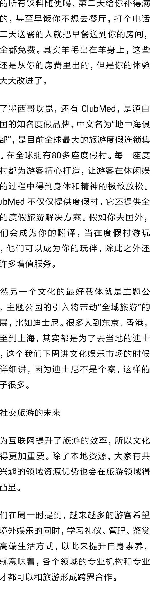

坎昆是墨西哥的著名旅游圣地，但在40年前还是一个只有300多人的僻静渔村。由于得天独厚的地理环境，1972年，墨西哥政府在坎昆投资3.5亿美元建立旅游区和自由贸易中心，并重点发展旅游业。经过40多年的经营、推广，目前坎昆已经成为每年可接纳大约400万游客的国际旅游胜地。在坎昆有许多大型度假村，它们为客户提供住宿、海边娱乐、运动等非常全面的解决方案，当地还有优美的自然风光、玛雅古城等等。

但我认为最重要的是，坎昆提供的全包式服务，就是进门交一笔钱，在里面吃住还有娱乐各种都不再要钱了，住过酒店的人都知道，即使喝酒店冰箱里的一瓶普通的 Cola，它也要收你30块，这造成大家一个很痛苦的旅游体验。但是到了坎昆，冰箱里的所有饮料随便喝，第二天给你补得满满的，甚至早饭你不想去餐厅，打个电话第二天送餐的人就把早餐送到你的房间，也全都免费。其实羊毛出在羊身上，这些钱还是从你的房费里出的，但是你的体验就大大改进了。

除了墨西哥坎昆，还有 ClubMed，是源自法国的知名度假品牌，中文名为“地中海俱乐部”，是目前全球最大的旅游度假连锁集团。在全球拥有80多座度假村。每 一座度假村都为游客精心打造，让游客在休闲娱乐的过程中得身体和精神的极致放松。ClubMed 不仅仅提供度假村，它还提供全套的度假旅游解决方案。假如你去国外，他们会成为你的翻译，当在度假村游玩时，他们可以成为你的玩伴，除此之外还有许多增值服务。

当然另一个文化的最好载体就是主题公园，主题公园的引入将带动“全域旅游”的发展，比如迪士尼。很多人到东京、香港，甚至到上海，其实都是为了去当地的迪士尼，这个我们下周讲文化娱乐市场的时候再详细讲，因为迪士尼不是个案，这样的例子很多。

### 3. 社交旅游的未来

因为互联网提升了旅游的效率，所以文化变得更加重要。除了本地资源，大家有共同兴趣的领域资源优势也会在旅游领域得到凸显。

我们在周一时提到，越来越多的游客希望在景区娱乐的同时，学习礼仪、管理、鉴赏等高端生活方式，以此来提升自身素养，这就意味着，各个领域的专业机构和专业人才都可以和旅游形成跨界合作。

比如我喜欢红酒，也觉得自己对红酒的文化的理解还不错，所以如果我带大家到法国或者到美国品红酒的话，保证比你自己去逛酒店强多了。比如，法国红酒现在只剩历史了，所以去法国品红酒，他只会给你讲历史，反倒是美国红酒，尤其是加州红酒，有好多小酒庄追求酿出极致品质的酒，当地叫 Cult Wine，Cult 是邪教的意思，翻译过来就叫做可以叫做拜酒，追求极致的意思。所以才会有1976年美国和法国葡萄酒比赛，美国完胜法国队。

顺便嘎瑟一句，我最近通过拍卖收到了一瓶当年战胜法国取得冠军的1973年的跃鹿园（Stag's Leap）。如果大家要去做个禅修之旅，尤其是探讨科学与禅修的关系，讨论现代人在现代生活如何利用禅修增进幸福，我应该也是可以带一带的。也顺便说一说，一说禅修，大家就说印度，其实当年乔布斯去印度纯属赶时髦，你去印度学完还是不解决问题，因为印度进入现代社会的人很少，大多数的修行是避世修行，远离现代生活，他教你的东西你在日常生活中用不到，你的困难他也没有经历过，没有办法给你指点。

## 三、“虚拟现实、增强现实+旅游”是未来时

说完了现在这一拨旅游创业潮，我们再来说说未来，因为我们这一轮潮流已经起来了，有资源、有储备的赶紧利用社交网络来创业，但是现在再找资源创业肯定来不及了，这时候要创业就要关心未来的机会，未来机会在哪里呢？

还是在技术上：人工智能、虚拟现实和增强现实、5G 的高带宽传输等等。

很多人会说：如果戴上眼镜就能全世界旅游，我肯定不出门了。其实恰恰相反，我们反而会更爱出门，因为可以把自己看到的景色实时分享给好朋友们。人們生活的基本需求满足了，人的自我炫耀和被人认可的需求就强大起来了，你看过去国人刚刚开始到处旅游的时候，到处都被刻上了“到此一游”，这其实就是刷存在感，现在有了增强现实，你可以戴上头盔看看周围有哪些人来虚拟签到了，就像当年文人到处题诗一样，说不定还真能诞生一批诗人呢。

至于说把虚拟情节叠加到现实场景里，让人在名山大川除了游览之外还可以做做任务，比如站到华山顶上戴上虚拟现实头盔就可以参加华山论剑，其中有真人扮演的角色，就是游客们了，也有人工智能驱动的东邪西毒，你不觉得比单纯看看景色好多了吗？

所以，我是坚决地相信，这一拨科技大潮为未来旅游业的新腾飞打下了坚实的基础，剩下的就看创业者了。我们下周讲文娱的时候也会讲到国外创业者在这一方面的新动作。

## —— 今日内容小结 ——

让我们总结一下今天所讲的内容，我希望你们掌握如下三点：

- 第一，旅游一直都是科技支持的，互联网支持旅游提升效率，是过去时；社交网络支持旅游的个性化和提升内容品味，是现在进行时；人工智能、VR/AR和5G支持旅游的虚实结合和实时互动，是未来时。
- 第二，现在进行时还有很大空间，核心是发掘本地资源或者本领域的优势资源，并在平台上广泛传播形成品牌，蚵子民宿我就很好看。
- 第三，未来时值得创业者现在就开始准备，核心是把虚拟内容和真实内容相叠加，使得现场的人看到更多虚拟的东西，远程的人看到更加真实的东西。

## —— 今日思考题 ——

我今天有两个问题：

- 一个实的问题：你身边有哪些文化资源可以被用来做成旅游项目？
- 一个虚的问题：你认为这一轮技术的浪潮会如何塑造旅游的未来？

欢迎在留言区分享观点。

## 划重点

- 1. 科技已经为未来旅游行业的发展打下坚实的基础，对于创业者来说，最重要的是思考如何使用新技术。
- 2. 随着消费升级，人们旅游的目的从侧重休闲转向关注文化体验。
- 3. 虚拟现实让佩戴眼镜就能在全世界旅游，但这反而会促使人们更爱旅游，因为人生活的基本需求满足了，自我炫耀和被人认可的需求就强大起来了。

王煜全
我是王煜全，你的全球科技前哨侦察兵，我们明天见。

## 用户留言

# 105 | 文化内涵对旅游产业的发展至关重要

## ——◆ 全周总结+拓展 ◆——

本周的话题是旅游业，介绍了三个重点：

第一，旅游的需求是经济发展和社会进步决定的，但如何更好地满足需求则是科技决定的，旅游产业发展的每个阶段，当时的技术能力都提供了对产业的独特支持，从互联网时代的效率提升，到社交网络时代的品质提升，再到未来的以手机为核心的各种业务，支持更多虚实叠加的实时互动。

第二，满足旅游需求的核心是用户体验，这一轮的机会在于用品位和独特资源提升用户体验，创业企业要取得竞争优势，要懂得在现有的技术基础上基于具有独特优势的资源来架构业务，在技术的支持下，独特资源的市场优势也会被迅速放大。

第三，每一轮的技术突破都会带来新的机会，但这些新的机会是被最早抓住机会的人利用后，往往能够转化为相对长期、具有一定差异性的优势，所以新的创业者要充分关注未来的技术才有机会，下轮的机会在于和人工智能、VR / AR 和 5G 数据传输相结合的应用设计。

## ——◆ 用户答疑 ◆——

Walker 教授让我第一次知道了商业模式也可以申请专利。是不是代表某个人一旦申请了自己发明的模式专利，他就能享受到和技术专利一样的待遇，还是说有本质的差别呢？

我的回答是：

首先，中国是不受理商业模式专利的，美国受理，所以中美是不一样的。

至于说美国受理以后，模式专利确实比技术专利的覆盖面要更广，保护力度要更大。因为技术专利保护的是实现某个目的的某种技术路线，如果你用的是不同的技术路线，但是能达到同样的目的，你就不侵权。但是模式专利是只要你这么做，不管用什么技术都算侵权。

其实最著名的模式专利，我在10多年前介绍过，是亚马逊公司的，它有一个一键支付的行动注册的专利了。也就是说，不管用什么方法，其他网站如果允许用户一键支付就侵了亚马逊的权。所以明明技术已经没有任何壁垒了，其他网站要让用户支付的时候，必须要点击两次以上，也就是说它要人为地给你加一次确认，要不然它就侵权了。

当然，因为没有技术壁垒，所以模式专利也很容被侵权。所以，如果你这个公司没有迅速做大，你靠模式专利来建立壁垒是没有什么用的，因为打官司需要强大的财力作支持，小公司跟别人打不起官司。反之，如果你是大公司，但是一堆小公司都可以轻易地侵你的权，侵犯你的模式专利，你告了这么多人，人家也赔不起，你也是白告。所以，模式专利也有它的局限。

就目前来看，实施大规模定制旅游存在几个问题：第一，由于庞大的人口基数和个人喜好差异，每一笔定制业务会耗费巨大的时间和精力。如果要大规模定制，如何降低成本？第二，注重体验的私人定制旅行如何在旅途中做好全方位的服务保障工作？比如随时随到，随时解决各种问题？

我的回答是：

大规模定制一定不是靠人力的，要不然赔不起。所以主要是两种做法：

第一，是做成平台型业务。

就是你搭个平台，有大量的服务提供者可以在你的平台上提供差异化的服务，每个服务提供者提供一小类，综合起来做各种类的服务就都有了。而海量的用户从这些服务里选择和自己需求最匹配的业务，就做到差异化和个性化了。所以 Airbnb 其实现就是这样的，阿里巴巴的淘宝也是这样的。

这样的业务还可以利用社交网络来推广，因为人以群分，你喜欢某个业务，你的朋友也喜欢某个业务的可能性就很大。所以，你鼓励用户在他他的社交圈子里面去这样的业务，往往就能带来很多的潜在用户。

不过，平台有一个先有鸡和先有蛋的问题，因为没有服务，用户就不来，而没有用户，服务就不来，这就是为什么 Airbnb 要去别人的网站偷流量的原因，主要解决鸡和蛋的问题。其实今天这么强大的微信，在它刚起来的时候，也曾经从当时比较流行的社交软件叫 MSN 上面导入过用户的数据。

第二，是靠技术做个性化。

不管是我们熟悉的红领衬衫，还是亚马逊的购买推荐，都是用技术来解决个性化的问题。

旅游业其实也可以，比如对旅游线路和景点的个性化推荐，比如给每个景点配上个性的虚拟游览内容等等。技术的特点就是替代人的，所以在设计业务上一定不要尽量用人去做，而是尽量替代人。那么未来机器人干导游我觉得就一定比人强，至少这些机器人不会强行拉你去购物吧。我们海银资本投资的 Honson Robotics，著名的美女机器人 Sophia，我觉得她就特别适合干导游。

最后强调一句，就是发现问题是好的，但是发现问题就去给这些机会死刑，或者去质疑就没有必要了，而是应该积极地去思考如何利用技术，用创新的应用去解决这些问题。当你想到了创新的解，你的创业机会也就来了。

我觉得中国的茶文化是一个很好的旅游资源，可以更加有利地利用。就像法国的红酒产业旅游一样：每个小镇都有一个旅游资讯局，里面有各种酒庄的信息，包括酒品名、住宿、文化有机地结合起来了。游客可以根据自己的喜爱偏好去选择想去尝试的酒庄，还可以选择酒庄城堡作为住宿，价格还挺合理的。而且这些酒庄还有很多酒庄博物馆，在品酒的同时还可以参观酒庄博物馆，身临其境地感受酒文化和工艺。

我的回答是：

我觉得这个建议特别好，中国的茶文化真的值得好好挖掘，而且确实能从葡萄酒的营销当中学到很多东西。我因为特别喜欢葡萄酒，所以知道的可能多一点：

一个所谓的旧世界，就是指的传统的葡萄酒生产国，有法国、意大利、西班牙等等很多国家，它们的历史一样悠久，但是为什么法国一枝独秀呢？就是因为法国的葡萄酒知识的系统性要强得多，一共有几大产区，产区下面有什么小的产区，小产区里有哪些著名的村庄，村庄里有哪些著名的地块，然后每个产区是怎么评的级，从特级到一级、二级、三级都是准，一清二楚。还有一些标志性的事件，比如1855年对波尔多红酒的分级，把55个酒庄分成了5级，从1级到5级。

我是系统地学过红酒的，我学习红酒的时候就发现，法国的系统性比其他国家强多了，在这个基础上就容易继续建构了，比如世界评酒大师 Robert Parker，他把评酒做成100分的体系。其实我原来就质疑过，100分和99分有区别，我同意，因为一个是完美无瑕疵，一个是略有瑕疵。但请问83分和84分真的有区别吗？就算有区别，你真品得出来吗？但是大家就是认，因为你把这个评级做得越清晰，大家买起来就觉得越有参照。

而且我原来就观察过，哪国经济起飞，哪国进口法国红酒的数量就暴涨，说明大家都附庸风雅，其实大多数人并不真的懂。但是，听说法国红酒好，买呗，听说这个酒被 Robert Parker 评了100分，可以多加点钱买吧。所以，我在中国经济起飞的时候，差不多10年前投资了中国最大的葡萄酒教育机构，叫做逸香。因为他们的教育主要讲外国酒，其中差不多一半篇幅是讲法国。所以，现在看，这个回报还是不错的。

二是要有高、中、低档的区隔，不能完全大众化，其实法国顶级的酒庄是不接待参观的，更别说让你品尝和住了。法国顶级酒的酒标上根本不写自己是用什么葡萄酿的，其他国家的都是写的。那它背后的潜台词很直接，我那么有名，你连这是这么著名的葡萄酒是用什么葡萄酿的你都不用知道。

么著名的葡萄酒是用什么葡萄酿的你都不知道，这是你自己的问题啊，这是你自己没文化呀。

可见人家对自己文化的这种自信心。

不过，法国1855年分级是国家行为，是当时的皇帝拿破仑三世主持的。那中国的茶叶文化的深挖，我觉得要么等待政府号召，这个可能要有一段时间，要么民间要有动力来推动。

我们昨天介绍过，薛蛮子在做高端民宿，他跟我说，他正在筹划出书，介绍日本的顶级文化背景，这样你去民宿住的时候，你去读读他的书，你才会知道他给你推荐过来的资源都是顶级的，有点像米其林餐厅评定一样。那么这样的话，至少如果做高端民宿他就有意愿来普及文化。所以我也希望中国有更多人能够有大视野，做大布局，不光布局茶叶旅游，还布局茶叶文化的建设。

顺便说一句：

就是文化还需要仪式感，勃艮第就有葡萄酒骑士团。所谓骑士团不是真的骑士，骑士就是一帮人聚在一起品酒，但是你要正式入会的仪式，而且每次聚会也要有仪式，要先唱歌。

至于日本更是仪式化的大专家，茶道国内相对就简单多了，但是在日本这一套茶道做下来就非常复杂。而花道，在中国其实都失传了，现在的花道是日本重新传回来的，在日本得到了发扬光大。所以你看，日本把任何一件事情都提升到道的水平，仪式感十足，这个也是我们中国需要学习的，旅游业就是需要有更多的仪式感，有更多膜拜的感觉。

## 划重点

- 1. 发现潜在的新机会中的问题是好的，不要总去质疑甚至宣判死刑，而是应该积极地思考如何利用技术进行解决，当你想到了创新的解决方案，你的创业机会也就来了。
- 2. 随着消费升级，人们的旅游越来越注重文化体验，要求精神上的满足，旅游产业需要更多的文化仪式感进行满足。

## —— 下周预告 ——

我们下周的话题是文娱，其实如果大家注意的话，我们这个月的四周，从玩具到游戏到旅游到下周的文化娱乐产业，看似传统，但其实都很时髦，往往都是最先用上高科技的。

比如你回忆一下，你第一次看到机器人是在哪？我猜八成是玩具机器人吧，文娱也是一样，好莱坞、迪士尼从来就是不惜重金引入高科技的。我们把这四个领域合在一起，叫做“智能文娱”，叫 Intelligent entertainment，我们认为这是这个时代的一大潮流。

下周讲的智能文娱的最后一部分，就是文化娱乐领域是怎么用科技的，欢迎大家关注。

王煜全

我是王煜全，你的全球科技前哨侦察兵，咱们下周见。

## 用户留言

# 106 | 智能化的大文娱时代已经到来

106 | 智能化的大文娱时代...

## ——◄ 今日内容看点 ►——

通过阅读今天的内容，你将会掌握以下3个主要内容：

- 1. 技术的
发展是如何推动文化娱乐形式变化的？
2. 智能文娱的基本演进路径是怎样的？
3. 智能文娱未来的发展趋势是什么？

今天是12月25日，先和大家说声圣诞快乐！

正好到年底了，这周我们就聊聊文化娱乐产业，也许你在聚会的时候能够用得到。表面上看，文化娱乐行业和科技关系不大，然而事实上，任何一种新的文化娱乐方式的兴起，都离不开技术发展和想象力两个因素的推动。技术的发展给我们的想象力提供了更多的可能性，可以说给想象力插上了更多的翅膀。有了技术的支持，小小的文娱企业的体量会超过原来经营了多年的大企业，小小团队甚至个人能够做到的产品的水准会超越原来庞大的专业团队。

可以说，以技术平台为支撑的智能化的大文娱时代来了，所以我们提出了“智能文娱”这样的概念。

## 一、文化娱乐产业随着科技发展

很多人都会记得，上世纪70、80年代的中国，伴随着改革开放的节奏，收音机、电唱机、录音机和电视机逐渐进入人们家庭，90年代，歌舞厅和录像厅悄然兴起，当年风靡的歌舞厅、台球厅、游戏厅、录像厅是一代人的青春记忆。可以说，娱乐设备的升级丰富了人们的娱乐生活。

互联网的出现，对文化娱乐方式产生巨大影响。网速慢的时代，网络文学非常流行，最早的文字类网站“榕树下”，几乎所有的网络写手都在那儿发布过自己的作品，在他们的心目中相当于一座文学圣殿。

随着计算机性能提高和网速加快，Flash网站风靡一时，涌现了许多以Flash形式发布的动画、游戏等。随着网速的再次提高，视频逐渐替代了Flash，变成了人们重要的娱乐方式。

移动互联网时代，移动终端尤其是手机成了核心，社交因素迅速成为文化娱乐产业的重要组成部分。生活与娱乐的界限被打破，从看娱乐新闻到看电影、听音乐、玩游戏，各种社交分享、各种晒和吐槽。特别是90后、00后的年轻用户，他们对娱乐的需求意愿更加强烈。

比如，Bilibili现在就成了国内领先的年轻潮流文化娱乐社区，这个网站在2009年6月创建，被粉丝们称为“B站”。

根据数据公司 Quest Mobile 发布的《移动互联网 2017年第二季度夏季报告》，B站位列24岁及以下年轻用户偏爱的10大APP榜首。弹幕是 B 站的关键手段，很多人之所以看B站，是因为别的视频网站不仅广告多，还没有弹幕，看起来不热闹。弹幕一下子将观看和交流这两种行为压缩在一个屏幕上，这是其他的网站，当然更是传统的电视这种媒介不能提供的功能。B站体现了用户这个层面的交互性。

## 二、利用大数据制造和优化产品

Netflix 则体现了另一条技术路线，那就是数据的进化，先是通过大数据来更精准地服务客户，了解客户的需求，将大数据分析与娱乐产业的创意结合起来，生产带有数据基因的产品。

比如大家都知道的《纸牌屋》，曾经有一篇文章分析，据说 Netflix 通过历年数据分析出导演 David Fincher 和影星 Kevin Spacey 最受观众欢迎，加上之前英剧《纸牌屋》这样的政治题材，于是就有了 Netflix 数据所预期的“完美剧集”。

当然，也有许多人不同意《纸牌屋》跟大数据分析之间有如此强的关联。但是，Netflix 从创立那天开始就很重视数据分析，这可一点儿都不假。

## 三、智能文娱

说到这儿，可以看出智能文娱的一个基本演进路径：

- 先是网络层，娱乐内容与用户之间实现有效链接；
然后是数据层，链接和使用过程中产生的数据经过分析可以产生更精准更有效率的服务；
第三层是人工智能，深度学习算法和人工智能产业的演进，为文娱产业的演进提供了新的可能性。

智能文娱不仅仅是数据的演进，也包括更多的新的平台，比如虚拟现实。

## ——◄ 今日内容小结 ►——

今天我们提出了智能文娱这样的概念，介绍了人工智能、VR等技术对这个行业的巨大驱动作用。其实在计算机还没有普及的时代，数据分析早已经在文娱行业大行其道了，欢迎关注明天的节目。

今天的内容主要有三点：
第一，任何一种新的文化娱乐形式的兴起，都离不开技术发展和想象力两个因素的推动，技术可以给想象力插上更多的翅膀

的推动，技术可以为想象力插上更多的翅膀。

第二，技术推动文娱行业发展的三个阶段：AI 和大数据在内容运营和交互界面中的大规模应用是第一个阶段；VR、AR 和 MR 让用户以全新方式体验内容、数据和环境是第二个阶段；未来随着技术的不发展和更加深入的融合，AR 和 VR 将会给我们带来升级版的体验，可以说是技术的发展让智能文娱时代真正到来。

第三，除了技术层面，智能文娱未来在内容上还会呈现精品化、多元化、小众化的趋势，同时新生消费力量将推动新场景的涌现和行业的跨界融合。我们也会看到大量的新兴的智能文娱公司的出现。

## —— ◆ 今日思考题 ◆ ——

选定一个你自己比较喜欢的文化娱乐项目，想象它的未来，看看人工智能可以从哪些角度来改造它呢？

欢迎在留言区分享你的观点。

## 划重点

- 1. 任何一种新的文化娱乐方式的兴起，都离不开技术发展和想象力两个因素的推动。
- 2. 有了技术的支持，小的文娱企业、甚至个人做出的产品，水平也能超越那些庞大的、经营多年的专业团队。
- 3. 未来的文娱产业，在内容上会呈现精品化、多元化、小众化的趋势，同时新生消费力量将推动新场景的涌现和行业的跨界融合。

王煜全

我是王煜全，你的全球科技前哨侦察兵，我们明天见。

# 创新地图｜日本中小型企业的创新转型之路

田凤舟，大阪市立大学大学院创造都市经济研究科硕士，日本风投学会会员，曾参加日本京都地域经济发展考察小组，参与考察调研了京都百年企业的改革和创新。

大家对日本企业的印象大多停留在日本的电子产业和汽车产业，尤其是电子产业。日本电子产业的下滑原因之一是没有预测到经济全球化带来的影响。当大型电子产品生产供应链出现的时候，日本电子产业还执着于从研发到生产的一体化生产。一体化生产 优势是可以自我调控和保证质量。劣势就是大家所熟悉的生产成本过高。我认为，这就是日本电子产业逐步被其他企业击败的原因之一吧。尽管有不少市场份额被其他企业占据，但是日本电子产品的质量还是很受大众认可。

但是近期坏去知名日本大型工业企业的数据造假事件之间在各类媒体上的曝光，再加上大家熟知的日本少子化、老龄化的趋势，于是大家都在询问日本企业到底怎么了，是真的不行了吗？

关于日本大企业的分析报道已经很多，这里就不详细介绍。在大学期间，我有幸参加了日本京都百年企业的调研考察，又作为京都地域经济发展考察小组的成员，结合日本的八年留学生活，今天和大家聊聊日本三家创新型中小企业，尝试从另一个角度观察日本经济。

在日本大约有两万多家超过一百年的传统企业，而京都大约有将近千家百年以上企业，有的是传统的曰式点心店，有的是做传统油画颜料的小店，有的是做和服的，还有的是做熏香的。这些小店利润都不是很高，但之所以在历史的变迁中能够保留下来，其根本原因是...在保护传统的同时又能不断创新，发现市场需求，寻求自我发展。

下面通过三家日本中小公司的发展，看看它们是如何做的。

## 一、上羽绘惣株式会社

首先给大家介绍的是上羽绘惣株式会社。这家公司成立于1751年，已经有266年的历史。这是一家京都制作传统油画颜料的小公司。跟着历史的变迁，人们生活习惯的改变，学习传统油画的人逐步减少，颜料的市场逐步缩小，这家延续了十代经营的公司面临着倒闭。公司老板上羽豊也在犹豫着要不要继续经营下去，继续下去是不是还有意义。

于是，他去拜访了给自己公司提供颜料的基础材料的扇贝粉末公司，这家粉末公司的最大客户就是上羽绘惣。看着对方负责人的态度和提供的优质基础材料，他觉得如果自己倒闭了，也就意味着扇贝粉末公司的倒闭，还有那些经常在这里采购颜料的顾客，为了他们自己也不能倒闭。

经营者上羽女士（上羽豊的妹妹）积极参加京都的企业交流会，通过和大家的交流，她觉得自己公司是用扇贝粉末等对人体没有伤害，而且没有刺激性气味的天然颜料来生产颜料的。而油画颜料的市场不可能变大，想生存就只能开发其他市场的应用。看着五颜六色的颜料，她联想到指甲油。大家都知道，市场上存在的大部分指甲油有刺激性的气味，而且掉色脱色严重。如果使用天然颜料的话，就会解决这些问题。

通过和其他企业的交流合作，上羽绘惣公司终于研发出了用扇贝粉末等天然颜料做的指甲油。这种用天然颜料做成的指甲油不仅有鲜艳的色彩，而且与传统指甲油不同的是，没有刺激气味，透气性好，干燥速度快，涂抹感很轻。另外，由于它是水溶性的，所以用普通酒精就能很容易地擦洗干净。

结果产品一上市就受到年轻人的喜爱，现在在日本很多的大型商场都能看到这款被称为“小狐狸”品牌的指甲油。

不仅是指甲油，随着对天然颜料的研究，发现天然颜料的粉末颗粒对皮肤有很好的摩擦清洁效果，后继肥皂以及其他产品也逐步上市了。这家公司的产品虽然高于普通产品市场价格的四到五倍，但是它特有的色彩和对身体无伤害的卖点，使它很快在市场上占据了一席之地。这家公司是京都传统百年企业改革和创新的代表。

## 二、Ueda Brake株式会社

其次介绍一家大阪的公司，叫 Ueda Brake 株式会社，这家公司成立于1910年，有107年的历史。这是一家专门做铁路车辆用、各种铁轨轮子到闸器以及其它相关产品的企业。铁路车辆用的各种轮子和其它产品不同，产品后期维护是很重要的。从车辆服役到退役，以刹闸器为主的维护是要持续进行的。

铁路车辆用的各种零部件市场本身就不大，而且所设设备又比较稀少，所以研发投资是很大的，另外车辆型号不同，对零部件要求也不同。所以，多种类、小批量生产就成为基本要求。由于大量投资以及市场规模的缩小，公司经营遇到难题。这家公司为了摆脱困境，开始思考新的应用领域，他们想到把公司研发的新材料用于医疗产品中。

2015年3月，Ueda Brake 株式会社在日本经济产业局的研究成果报告书中，报道了一种基于公司现有技术研发的新材料，名叫碳纳米碳管，并把它应用到了医疗领域的心脏搭桥手术中，并获得了成功。这种材料有以下特点：

- 第一，克服了传统材料的强度、延展性不足的问题；
第二，直径进一步细化，可减轻患者的身体负担，提高手术的可操作性；
第三，能够抑制过敏反应，通过镍、钴等特定金属元素消除过敏反应；
第四，不含稀有金属，消除了价格变动，降低了供应不稳定等因素。

这又是一家传统制造企业成功转型的案例，他们选择将研发的新材料产品应用到医疗行业中，既解决了公司的难题，又攻克了医学难题。

## 三、Atto株式会社

最后给大家介绍 Atto 株式会社。这也是大阪的一家公司，成立于2009年，是一家年轻的创新型企业。这家公司主要生产健康检查仪器。最近设计开发了“血管美人”的毛细血管检测仪。这款仪器是通过在指甲上滴一滴溶液来观察身体内毛细血管的变化，来分析饮食习惯、睡眠质量和血压大小等与生活习惯相关的疾病。

毛细血管是一种特殊的血管，它的作用是抑阻...各种营养...供应给全身的各个器官...这个微细的毛细血管，占据人体血管的95%（相当于围绕地球转两周半），是人体里巨大的生态系统。

毛细血管分析是指，根据毛细血管的长度、扭曲程度等信息来检查自己的生活习惯以及由此带来的疾病。根据观察毛细血管的异常，可以观察到生活习惯的细微变化以及是否恶化等信息。这些信息以前都是通过跟底检查等方法未获取，从而作为重要诊断指标的。

“血管美人”对人体没有任何负担，使用几乎没有任何负担的“指尖”，而不是传统的眼晴和大脑等。而且有实时的分析系统，可以在1分钟内进行实时分析，大大降低了检查时间和成本。这款实时分析系统利用了世界上第一台毛细血管图像分析软件“CAS”。它与在各领域已经使用的毛细血管检测“SC-10”和云型毛细血管图像评估系统的不同之处在于，“CAS”系统提供了一个能够进行“观察、分析、评估和比较”的毛细血管分析系统。

“血管美人”能够提供操作简单的软硬兼设计。由于简单易用，除了大学、医院等研究机构外，药房、健身房和公司等也都在使用。随着生活节奏的加快，人们的生活习惯也在发生变化。通过观察毛细血管的细微变化来了解自己的生活习惯隐患，从而使自己更健康。

从而使自己更健康。

## 四、总结

上述三家企业都属于日本中小型企业，尤其是前两家，都是传统行业实现成功转型的案例。这些是在中小企业中比较有代表性的，在日本类似于这样的企业还有很多。变革需要时间积累，中小型企业也逐渐进入人们的视野。

大家一般认为，日本百年老铺就是一家小店，盈利也不大，代代传，依靠的是一种精神的传播。确实就像大家所熟知的，百年老铺不是发展第一，而是持续生存第一。百年企业还有自己的特点，他们大多是家族企业，都有自己的家训，也可以说拥有代代相传的商业哲学。然而，在历史长河中，自然灾害、交通方式和生活习惯的变化等因素，时时影响着企业发展。另外，几百年内经营者的交接是否能够顺利进行，都会影响百年企业是否能够保持持续发展。所以说，一家百年企业的经营仅靠精神传承是很难持续的。

如今，由于日本人口的减少，市场需求萎缩，如何通过创新来创造新的社会价值以达到持续发展，这个课题对于百年企业来说迫在眉睫。我们知道，创新分为技术创新、产品创新和营销模式的创新等。百年企业能够持续稳定发展的重要因素，就是在通过技术创新提升自身产品价值的同时，又能不断应对市场变化，调整营销模式，而且这个过程将一直持续下去。

以上是田凤冉对于三家日本中小企业的介绍。

王煜全

我们曾经说过，没有传统的行业，只有传统的企业。对于企业来说，只有积极地运用各种科技手段，并运用到传统行业中，不断改造、提升效率和开拓新的应用领域，才能立于不败之地。

## 资料来源：

- 1. 上羽绘惣株式会社：根据作者2014年9月实地考察，并和社长谈话的材料整理。
- 2. Ueda Brake 株式会社：根据作者和代表董事的演讲，以及参考日本经济产业局的研究成果报告书的材料整理。
- 3. Atto 株式会社（あっと株式会社）：根据作者听取社长演讲和查阅官方网站的材料整理。

# 107 | 数字化转型背景下的文娱产业

马上面要元旦了，估计很多人都会聚在一起打打牌放松一下，今天我们就来聊聊打牌。

昨天我们聊到大数据已经普遍应用到智能文娱行业中，今天我要向你介绍的牛人是华裔“赌圣”马惜文以及他的创业故事。马惜文之所以能被称为“赌圣”，是因为他把数学方法应用到了赌博行业，利用他那如“英特尔芯片”一样准确的算牌能力，在MIT 求学期间他就赚了几百万美金。

不过，在介绍他之前，我想先向你推荐一部电影。这部电影叫《决胜21点》，可能不少人也看过，但估计很少有人知道这部影片的灵感来源就是马惜文在MIT求学时的经历，而且马惜文本人还出演了电影里的庄家。这部电影里面的教授，就是我们昨天提到的《纸牌屋》里的主演凯·斯派西。

电影讲了这么一个故事：

主人公本·坎贝尔因为有着超常的数学天赋和快速心算能力，得到了数学教授米基·罗萨的青睐，他加入了由教授带头的“特殊团队”。而这个天才团队就是利用数学才能在赌场拉斯维加斯玩“21点纸牌”游戏，疯狂赚钱。

他们并没有像常规的赌博电影中所说的那样“做局”或者“出老千”，而是依靠数学，特别是利用概率统计理论来分析决策，也就是通过提高自己的胜率来赚钱。他们在赌场玩得如鱼得水，赢得满满酒吧。但很快，他们就被赌场监管发现现有“算牌”嫌疑，于是他们就和赌场上演了一场“猫捉老鼠”的故事。电影中有一句经典名言叫“Always count the variable change”，意思是永远要考虑变量的变化，实际上，整部电影的发展就是在不断印证这句话。电影剧情充满了变化，也充分展示了“变化”带来的巨大影响，每一个细微的改变都随着剧情发展而被无限放大。

这么精彩的电影就是以马凯文的故事为蓝本改编的，下面我们看看真实的马惜文是什么样的。

## 一、从埃克赛特中学到MIT

马惜文从小在美国马萨诸塞州的伍斯特市长大，他父亲是伍斯特理学院的化工系教授。父亲非常清楚数学的重要性，所以一到暑假，他每天都会给儿子辅导两个小时的数学。13岁时，马惜文被送到美国著名的私立高中埃克赛特中学读书。在那里马惜文接受了先进的“哈克尼斯圆桌教学”，简单来说，“哈克尼斯圆桌教学”就是，12名学生和1名老师一起围着圆桌，用提问、讨论和辩论的方式来交流学习。说起幼年的教育经历，马惜文总觉得自己非常幸运。

他说过，父亲的高压政策和埃克赛特的哈克尼斯教学法都让他学到了很多东西，比如敏锐的思维分析能力和强大的社会交流能力。他认为，这些都是他成为21点小组成员时必备的技能。

后来，马惜文顺利考入了MIT 进行深造。读大三那年，马惜文受邀加入着名的“21点俱乐部”，起初他是不愿意加入的，但因为几个朋友都是小组成员，还说每周都有机会去赌场拉斯维加斯。于是他同意了邀约，并开始接受严格的算牌训练。非凡的数学天赋，让马惜文在小组中获得了“英特尔芯片”的外号，同时也拥有了去赌城一展身手的机会。一开始他们先去大西洋城进行实验，可结果却很悲惨，他们经常带去的钱输个精光。

不过，经过几年的实战训练后，他们积累了大量经验，还形成了一套完整的筛选机制。每位申请者都必须通过严格的数学测试，包括概率、逻辑和记忆力测试。通过以后还要接受俱乐部高强度的免费培训，然后每位队员还要通过8到10轮六副牌的“21点”考验。值得一提的是，最后去赌场时，这些21点专家们并不是各自为战，而是组成一支“核心战队”共同作战。这并不奇怪，因为他们发现一个秘密，只要整合每个成员的优势就能提高4%左右的胜率，那就足以战胜庄家了。

那会儿马惜文和朋友经常带上10万到30万的现金飞往拉斯维加斯度周末，虽然有时也会出现玩一两圈就输掉10万块的“悲剧”，但总体上一直是赢的，最棒的一次一个周末就净赚45万美金。

## 二、转型为创业者和畅销书作家

当然，赌场可不会眼睁睁地看着他们算牌赚钱。随着面部识别系统和防止算牌的计算机软件的大量使用，赌场分辨“算牌者”的能力越来越强，马惜文和团队的赌场生涯也越来越艰辛。

1997年，MIT 的“21点俱乐部”因为金钱分配问题产生了小疙瘩，再加上小组成员都被赌场列为“黑名单”，所以俱乐部最终还是解散了。但是呢，就在上学这几年时间里，马惜文和他的团队依靠这种基于数学理论的策略方法和缜密的逻辑思维，在赌场赚了几百万美金。马惜文自己说，他毕业都不想找工作了，因为什么工作都没有去赌场刺激，也没有打21点赚钱快。他最终还是找了份工作，原因很简单：别人问他职业是什么的时候，他总不能说是赌博吧。

不过呢，虽然在华尔街找到了高薪的金融工作，马惜文还是觉得给别人打工太无聊，所以干脆出来创业，而且把在赌博中培养出来的概率思维、严密的逻辑和强大的心理素质用在了创业领域。

90年代末，他创立了自己的第一家公司Golfspan，目的是帮助高尔夫玩家提高球技。当时马惜文一口气签下了美国高尔夫排名前15中的7位选手，花钱请他们录制视频，然后放到网上出售，有点类似现在的“大师课”，但是这种做法在当时还是太超前了。由于视频的清晰度不够，精心制作的视频内容又被盗版在网上肆意传播。3年之后马惜文辞去了首席技术官的职位，这家公司也被美国一家互联网服务商收购了。

2000年马惜文开始了第二次创业，公司名字叫做 Circle Lending，意思是“借贷圈”，有点像今天的 P2P 贷款。同样因为创意在当时过于超前的原因，这家公司并没有成长起来。不过它的存在还是促进了借贷行业的发展，后来被马惜文转卖给一家金融投资机构。

2003年，马惜文又建立了 Protrade 公司，开始了第三次创业。为什么要创办这家公司呢？这就要说到马惜文曾经看过的一部电影《棒球成金》了。马惜文说，电影中一位棒球队经理人按照自己对棒球的领悟，组建了一支具有强大战斗力的棒球队。更重要的是，影片穿插了很多统计学、管理学和大数据分析相关的情节，显示了数字背后巨大的力量。因为这部电影，马惜文就想创立这么一个体育咨询网站，通过搜集、统计和分析运动员与体育比赛的数据，来帮球队经营者做出更好的交易决策，也帮运动员拿到更合适的合同。

顺便说一句：

我是一边看《棒球成金》，一边掉眼泪的，因为里面这些创新者的艰辛真的是被展现得淋漓尽致。

而且，马惜文创立的这个网站还成为了美国职业运动的一个虚拟交易市场，每位职业球员都有自身的标价，价格会随着他们各自的实力和人气产生波动，只要成为网站

球场都有自身的标价，价格会随着他们各自的实力和人气产生波动。只要成为网站的注册会员，你就能获得网站的游戏币。

除了 Protrade 外，马恺文还创立了另一家公司 Citizen Sports，它是一个基于 iPhone App 的体育信息平台。2010年，这家公司被雅虎收购。

另外，马恺文不单是创业者，还是一名畅销书作家，他写了一本书叫《数字信徒：来自赌场的商业智慧》。在这本书中，他结合自己的赌场经历，以及在证券、互联网行业的打拼经历，向我们介绍了怎样把数学和计量方法运用于企业经营中，做出最优的运营和投资决策。如果你有兴趣的话，不妨买来看看。我可是对这本书喜欢得一塌糊涂，尤其喜欢它的名字，数字信徒，因为我自己也是一名坚定地数字信徒。

## 三、数字化转型

马恺文的故事就讲到这儿。

其实，在数字化转型的趋势下，“人脑神算”已经被淘汰，很多行业转而采用机器计算来提升运营效率，为用户提供更贴心的服务。所以将来你要去赌场，不用自己算，戴个增强现实的眼镜就足够了，不过未来赌场可能也会禁止增强现实眼镜的进入了。

当然，比如当年 Netflix 利用大数据制作了当红名剧《纸牌屋》。再比如，广告公司也利用大数据分析让自己的广告做到“精准投放和精准传播”，这些都是大数据不断深入到各个行业的例证。

## —— 今日内容小结 ——

总结一下，今天我们主要介绍了马恺文的赌场经历和他的数学思维在商界的成功应用，希望你掌握以下2点：

- 第一，当双方利益绝对对立时，比如“算牌玩家”与赌场，尽管需要付出高额的成本，但是为了阻止对方获利，最新的科技总会被快速运用。所以，这场科技和脑力的博弈，就催生了巧妙的策略和强大的技术。
- 第二，马恺文把在赌博中培养的概率思维、严密的逻辑和强大的心理素质复制到商界，并且大获成功。这和电影《点球成金》中把统计学、管理学以及大数据分析应用到管理棒球队出了一辙。而如今，在数字化转型的背景下，这些数据分析工作早已被计算时代替，并在娱乐行业大规模地推广应用了。

## —— 今日思考题 ——

你玩过“21点”吗？在赌博中你有利用数学方法大获成功的经历吗？

欢迎在留言区分享你的观点。

## 划重点

在数字化转型的背景下，大数据正在不断深入到各个行业，而且已经在娱乐行业大规模地推广应用了。

## 补充资料：

## 21点玩法：

在这里我们简单介绍一下21点这种十分简单的纸牌游戏：

- 庄家给每个玩家发两张牌，牌面朝上；给自己发两张牌，一张牌面朝上，另一张牌面朝下。
- 在同一花色13张牌中，K，Q，J，10都算10点；A算1点或者11点；其余所有2到9牌均按照原面值计算。

## MIT的“21点俱乐部”的来历：

## 《点球成金》剧情：

# 108 | 用VR创新应用打造极致娱乐体验

## ——◆ 今日内容看点 ◆——

通过阅读今天的内容，你将会掌握以下三个问题的答案：

- 1. The Void 娱乐中心为何被称为“地表最强娱乐设施”？
- 2. 极致的 VR 交互体验需要怎样的技术支持？
- 3. 为什么说智能文娱行业对 VR 需求非常强烈？

周一的时候我们已经说过，当下娱乐行业和 VR 结合以后，将会无限拓展我们的体验。那么今天我们就来为你专门介绍一下美国推出的第一家 VR 主题公园——The Void，看看他们是如何通过 VR 创新应用来打造极致的娱乐体验的。

对 VR 迷来说，这家公司肯定不陌生，2016年7月，纽约开放了第一家 Void 娱乐中心，吸引了众多媒体和玩家去体验，他们都表示，这次体验实在是太不可思议了，就连科幻电影大导演斯皮尔·伯格也对它赞不绝口。Void 娱乐中心还被玩家称为“地表最强娱乐设施”。那么究竟 Void 提供了怎样的体验呢？我们暂且卖个关子，先来了解一下这家公司的历史，以及创始团队。

## 一、The Void 公司历史

The Void 成立于2015年，总部位于美国犹他州，公司的名字取自“The Vision of Infinite Dimensions”的单词首字母，意思是“无限维度视觉”，这也说明了 The Void 的创立初心，他们想要打造一个能够提供“超现实”的极致交互体验的未来娱乐中心。

The Void 创始团队有三位成员：

- 首先是创始人 Ken Bretschneider，是一位连续跨界创业者。在创立 The Void 之前，他已经成立过网络安全公司 DigiCert、净化水公司 PeopleWater 等等。The Void 是他自掏腰包投资1300万美金的创业项目。
- 再来看联合创始人兼创意总监 Curtis Hickman，他是一位视觉艺术家和舞台艺术师。Curtis 有10几年的魔术经验，和著名魔术师大卫·科波菲尔、大卫·布莱恩都有交情，而且有过魔术上的合作。
- 另一位联合创始人兼首席技术官叫 James M. Jensen，他是一位多媒体交互设计师。

单看这样的阵容，就会让我们对这家公司充满期待。

Ken 在成立 The Void 之前，还有一段小插曲。他曾经打算耗资几百万美金建造一个大型的特色 VR 主题公园——Evermore，包括海盗船、幽森森林、人工湖、季节性音乐会等概念，其实我们现在看到的 Void 娱乐中心就是其中的一个景点。

Curtis 和 James 也正是在这个项目的工工作期间加入到团队里的。2015年8月，Ken 在项目上持续努力了几年之后，对外宣布由于财务问题，项目需要暂停，随后整个团队转变发展战略，重点投入设计和建造小型 VR 娱乐中心。

The Void 在全球发展非常快，它的 VR 娱乐中心已经在全球5个地点开放售票了。有纽约的杜莎夫人蜡像馆、佛罗里达州的奥兰多迪士尼之泉、加州安纳海姆市的迪士尼小镇、多伦多的餐饮娱乐中心 The Rec Room，以及伦敦的 Westfield 购物中心。其中，位于伦敦和佛罗里达的中心，两周前才刚刚开放，而加州体验中心也将在明年1月份开放。

## 二、The Void 娱乐中心

先从整体上来看，Void 娱乐中心占地面积都不大，中心的核心区域被称作 Stage，也就是“舞台”。目前“舞台”有两种设计：

- 一种是100平米左右的“景点式舞台”；
- 另一种相对大一点，就是350平米左右的“全维度舞台”。

这两种舞台不但面积不同，对应的功能和目的也不一样，“景点式舞台”为了保证比较快的流转率，一般设在著名景点，或者人流量大的地方，给玩家提供线性的体验。大一点的则设在特色的娱乐中心，给游客提供时间更长、非线性的完整体验，目的是吸引更多人来重复消费。

接着我们来看看娱乐中心的具体主题。

目前他们主要是跟著名的电影 IP 合作，比如纽约和多伦多的体验中心以电影《捉鬼敢死队》为主体。顺便说一句，《捉鬼敢死队》最近新拍了，所以正好可以借着电影的热映，帮他们作宣传。另外三个娱乐中心则以《星球大战》为主体，《星球大战》是不间断重拍的，所以这个主题不用担心没有市场。这些故事情节并不是照搬之前的电影，而是重新改编设计过的。在美国你花29美元就能在 Void 娱乐中心享受到一次20分钟左右的超现实极致 VR 体验。

那么这到底是一种什么样的体验呢？

一位体验过纽约《捉鬼敢死队》主题的 VR 迷说，每个玩家都穿上了全套的 VR 装备，包括一个头戴式的显示器、一个特制的高科技背心，和一杆金属质感的枪械。

据了解，目前开放的体验都是4个人一组，共同对敌敌人，和现有的主题公园中3D 过山车、或者4D 影院最不同地方是在整个体验中，你完全是电影中的主角。比如你在这一段体验中扮演“捉鬼敢死队”队员，也就是电影的主角，同行的玩家则扮演剧中的队友。进去以后，最大的感受就是所谓的全沉浸感，比如说你能触摸和感觉到你所看到的墙和栅栏，当你看到一把椅子的时候，你也可以坐上去；另外，墙上的火把，你不但可以拿来照亮黑暗的走廊，甚至还能感受到它的热度。

不仅如此，The Void 还设置了很多逼真的细节：

- 比如故事的设定是你走在一条挂满蜘蛛丝的走廊上，它真实到你确实得用手拨开蜘蛛丝；
- 在剧情中，你能够实实在在地感受到被枪击中的冲击力，可以感受到微风、震动和温度变化，以及清晰的环境三维视觉呈现；
- 更神奇的是，明明这个体验中心只有几十平米，却能让你以为自己走在一个很大的空间里，甚至穿越了许多房间和楼层。

总之，引人入胜的情节、酷炫的视觉音效效果、超级真实的感官体验，以及团队的互动体验，可以说使得 Void 不愧是地表最强娱乐设施。Youtube 上类似的测评视频非常多，VR 迷们都给予了这段体验超高评价，他认为，这才是娱乐的未来，你也可以去搜搜看。

## 三、The Void 极致体验背后的科技

The Void 娱乐中心这么令人惊讶的极致体验，不禁让人感到好奇，究竟这背后有着怎样的技术支持呢？

我想主要有三点：

第一，是 VR 虚拟视觉和物理环境完美匹配加上的 5D 感知效果

现在市场上主流的 VR 提供商，像 Oculus Rift、HTC Vive，或者三星的 Odyssey 都希望把它们生产出的 VR 设备能够成为消费者家庭娱乐中的组成部分。但是问题是，普通的 VR 设备通常都要戴头显，用手柄充当武器，这种形式的整个体验就很难做到真实。

为什么这么说呢？

因为当我们进入到一个虚拟环境的时候，在潜意识中就特别想知道这是真的吗？然后我们就会从周围开始寻找线索，一旦你发现你拿的是手柄，而不是手枪，而且背后还有一根线牵着的时候，你就很容易跳戏。

但是，The Void 不同，它可是做到了超现实的 5D 体验，具体来说，The Void 坚持利用线下体验中心，精心打造物理环境，就是为了给玩家最好的沉浸感和体验的真实性，它让你不但能摸到东西，还有类似 4D 影院的那种微风、温度改变、气味、振动和水雾的感觉。

#### 第二，是 The Void 公司研发出来的 Rapture 硬件，以及 VR 解决方案

我们刚刚提到了玩家体验时会穿一些装备，这些装备就是 Rapture 装备。它们是 The Void 公司全自主研发的专利产品，和家用的 VR 设备不同，The Void 因为不用过多考虑造价太贵，是否会让顾客无法负担的问题，所以他们可以投入更多资金来打造一流的 VR 设备。

这个装备包括3个物件：

- 首先，是一个配有全曲面 OLED 显示屏的头显，具备更高分辨率的屏幕和更宽的 180度视野。作为参考，Oculus Rift 的视野是110度。
- 其次，是一个触觉背心，这个背心里面内置了22个触点，能给你带来振动和冲击等等感受。他们也为系统的运动追踪提供了关键数据信号。
- 最后，是一个电脑背包，直接把电脑背在身后，能让玩家在舞台中自由行走，不被任何线牵连。

#### 第三，是重定向行走

刚才我们说过，Void 娱乐中心面积都不大，那么怎样在小空间之内创造无限的空间体验呢？

你可别忘了，创始人之一 Curtis 可是个有着10几年经验的魔术师，他最擅长幻视设计，也就是欺骗你的眼睛。其实在 The Void 体验当中，玩家大多走的是曲线，甚至是转弯，但是因为视觉信号受到刺激后产生神经反馈，削弱了我们对直线的感知能力，让人误以为自己一直在走直线。

这种迷宫式的造型，既节约空间，又节约成本，这也给 The Void 全球推广创造了条件。

## 四、加速全球化

今年7月，迪士尼宣布投资 The Void，The Void 也在同年加入了迪士尼集团的投资孵化项目 Disney Accelerator，也就是迪士尼加速器。主要是以投资科技与娱乐产业结合的创业公司为主。

顺便说一句：

我们投资的 Hanson Robotics 也很荣幸地加入了迪士尼加速器，而且应该比 The Void 要早。

The Void 和迪士尼双方主要是以这样的形式互利合作的：

- 一方面，迪士尼乐园的流量能够帮助 The Void 获得更多的客户；
- 反过来，The Void 也能够帮助迪士尼乐园丰富和升级现有的娱乐体验。

而且，娱乐中心计划每个季度都推出新的故事情节，不断吸引玩家回来体验，而且这些故事可以想象，基本都是迪士尼旗下大片。可以看到，智能文娱行业对 VR 的需求非常强烈，迪士尼力推 The Void 就是一个重大利好的标志，说明 VR 在娱乐行业中的应用很快就会推广开来，我们也希望中国有这样的影视公司和这样的 VR 公司进行深度的绑定合作。

讲到这儿，你是不是也很想亲自体验一把呢？

现在 The Void 公司全球化速度非常快，就在去年2月份，盛大集团宣布以3亿5千万美金投资了 The Void，将在中国共同建造大型的 VR 主题公园，让我们拭目以待吧。

当然，在中国的 VR 主题公园没有建起来之前，你也可以去国外体验，而且从 The Void 的布局看，各地的主题公园可能也会各有特色。我们一直强调，对前沿科技的热爱要从体验开始，这样才能体会到科技的温度，对科技的未来形成感性的了解和直觉式的判断能力。也许我们2018年的美国科技游学就会带大家去 The Void 体验一下哦。

## —— 今日内容小结 ——

总结一下，今天我们介绍了应用 VR 技术来升级娱乐体验方面的领先公司 The Void，希望你能够掌握以下三点：

- 第一，在娱乐体验方面，我们将不再满足于单纯的视听体验，和 VR、AR 和 MR 科技的结合将无限拓展我们的娱乐体验。
- 第二，The Void 从建造大型主题公园转向主推小型娱乐体验中心，同时又和娱乐巨头公司迪士尼合作，加快全球布局。同样的，迪士尼也力推 The Void，对于 VR 在智能文娱行业的大规模应用来说，这是个重大利好。
- 第三，其实这只是个示范，未来这样的合作会越来越多，因为双方是完全互补的，很多大型的娱乐公司尤其是影视公司拥有大量的 IP，也有大量的故事情节，而利用 VR 来对这些情节进行改造确实是最完美的合作。

## —— 今日思考题 ——

你是否体验过类似的 VR 主题公园呢？如果体验过 The Void 的人来给我们回答，当然是最好的了。对于 VR 主题公园的体验，你还有什么可以期待的呢？

欢迎你在留言区分享你的观点。

## 划重点

- 1.引人入胜的情节、酷炫的视觉音响效果、超级真实的感官体验，以及团队的互动体验，是打造极致 VR 娱乐体验的重要条件。
- 2.对前沿科技的热爱要从体验开始，这样才能体会到科技的温度，对科技的未来形成感性的了解和直觉式的判断能力。
- 3.VR 科技公司与大型娱乐公司的 IP 资源结合，会极大的促进 VR 在文娱产业的大规模应用。

王煜全 我是王煜全，你的全球科技前哨观察兵，我们明天见。

用户留言 提交留言可与专栏作者互动

# 109 | 智能文娱时代的生存之道

## —— 今日内容看点 ——

通过阅读今天的内容，你将会掌握以下三个主要内容：

- 1. 文娱产业的核心是什么？
- 2. 智能娱乐产业的机会在哪？
- 3. 想要成为智能文娱领域中的成功者需要哪些条件？

今天我们来说说智能文娱产业的机会。周一我们已经介绍了科技推动娱乐行业发展 的三个阶段，未来，人工智能和虚拟现实技术将不断升级和结合，它们将从根本上改变我们的娱乐体验。

今天我们将重点聊三个问题：

- 什么是娱乐产业最大的机会？
- 在人工智能时代，大型娱乐公司将如何利用科技塑造娱乐行业的未来？
- 科技初创公司的机会又在什么地方？

## 一、“内容+娱乐IP+科技”是未来

我们在前两天的主题里，在介绍 The Void 的时候提到了他们加入了迪士尼的孵化器，也提到了我们投资的 Hanson Robotics 其实现加入了这家孵化器。其实在娱乐行业里，迪士尼可以说是很好地活在了未来，是把娱乐和科技完美结合的标杆型的企业。

所以我们才看到，最近一直有传言说，苹果公司要收购迪士尼。

顺便说一句：

因为迪士尼很优秀，这个收购被看作对双方都是利好。不过，不管苹果的收购能否完成，但是迪士尼确实是最先扎扎实实地收购了21世纪福克斯集团的影视部分，这个21世纪福克斯集团就是过去我们熟悉的20世纪福克斯公司，所以这回的收购包括了20世纪福克斯公司的电影、20世纪福克斯电视和有线电视网和影视内容网站 Hulu。有时间我再跟大家详细聊美国的影视内容的竞争，这个在最近越来越白热化。给21世纪福克斯公司留下的只剩了新闻部分。

原来，很多很多人都认为迪士尼是一家传统的娱乐公司，它创造了大量的经典的卡通形象，打造了迪士尼乐园，还有它的电影公司。但实际上它更是一家科技公司。

稍微了解一些的人就可能会说，迪士尼不就是直接投资、合作或者收购其它科技公司吗？

其实没那么简单，迪士尼的科技成果很大程度上归功于它的内部组织。这个内部组织包括：迪士尼研究中心和迪士尼孵化器，以及首席技术官委员会机制。

早在2008年，迪士尼就成立了研究中心，叫 Disney Research。这个研究中心涉及的领域相当广泛，包括计算机图形、视频处理、机器人、人机交互和材料研究等等。另外，他们还设立了首席技术官委员会。具体来说迪士尼在每个部门都任命了自己的首席技术官，他们每隔一段时间就要召开各种报告会，专门讨论遇到的问题，或者分享最新科技进展。

除了自己研发以外，从2014年开始，迪士尼还设立了专门的孵化器 Disney Accelerator，关注的初创公司大多是主攻 VR、游戏、机器人、人工智能和 3D 打印等等领域的。经过前期的严格筛选，每年大概有10家公司被选中进入孵化器。经历 3 个月的孵化器之后，根据团队表现，迪士尼再决定是否继续跟投。

在孵化期间，迪士尼会提供多样的投融资服务和高水平内部外部导师队伍，比如，我们非常熟悉的皮克斯、漫威、卢卡斯影业、ESPN 体育等等部门的业务总裁都是他们的顾问。最重要的是，初创公司还能免费使用迪士尼现有的成熟 IP 和故事，加快转化率。我们以前讲过的 Sphero 公司就是一个成功案例，它在推出了网红机器人 BB-8 之后，又开发了动画片《汽车总动员3》当中的“终极闪电麦昆”。昨天我们介绍的 VR 主题公园 The Void 也是孵化器的项目。

可见，无论科技如何发展，文娱行业最终还是以“内容为本”。要是失去了文化内涵的支撑，就算使用再酷炫的科技也不会有人喜欢。只有好故事才经得起时间的考验，而科技只是放飞想象力的一种手段。但是，新的科技总会使得故事的表现形式得到更新，使故事更加深入人心。所以，能够更好地把传统内容和创新科技相结合，就意味着巨大的商机。

我们总结的规律是：

文娱领域最大的商机=内容+IP+科技。

## 二、传统娱乐公司的机会

首先，传统娱乐公司面临的一个问题是，它们虽然拥有一套成熟的明星 IP 包装、管理 and 营销的方法，但是时间一长，观众难免会产生审美疲劳。那么，该怎样激发新的活力和创意呢？今天，我们就以亚洲娱乐中心——韩国的 SM 娱乐公司为例来 说一说。

相信不少人都听说过这家公司，作为亚洲著名娱乐集团，韩国的 SM 娱乐公司是韩国规模、实力和影响力都最大的娱乐公司。凭借严格的选人培训机制和成熟的营销包装手段，它创造了一大批现象级的艺人和组合，比如，东方神起、少女时代、Super Junior 等等。而且，现在国内当红的艺人当中，鹿晗、吴亦凡都曾经是 SM 的签约艺人。

然而，SM 在经历了10多年的辉煌之后，也开始出现问题，比如艺人团队解散、组合独特性不够等等。

怎么办呢？

公司创始人李秀满选择用科技手段来应对。今年6月，SM 娱乐宣布了一项合作，它和美国人工智能公司 ObEN 联合成立了世界上第一家人工智能经纪人公司——幻星有限公司，叫 stars.ai。公司的总部设在香港。据了解，幻星将利用 ObEN 公司的 人工智能技术，开展有关 AI 虚拟形象的大胆尝试。这个尝试，将会让广大粉丝获得前所未有的体验。

究竟是什么样的新体验呢？

简单来说，你只需要用一张明星的自拍照和一条简短的录音，就能生成和明星真人相似的三维虚拟形象，再通过模拟人声、形象和个性，打造出人工智能的虚拟明星形象。想想看，未来，你在入睡前可以听到鹿晗、张艺兴的晚安问候，可以让少女时代的成员陪着你看电影，还可以跟宋茜一起吃烛光晚餐。不仅如此，你甚至可以和自己喜欢的明星共同表演他们最热门的曲目。总之，这种将 AI 和 VR 结合的全新互动方式太值得我们期待了。

现在，幻星公司已经开始建立“人工智能版权银行”，其中就包括 EXO、东方神起、张艺兴和宋茜等亚洲著名艺人的人工智能形象版权。只要有了形象版权，未来这些虚拟形象就能融入你的生活的各种场景当中，比如智能设备、社交机器人、聊天工具和自动驾驶汽车等等。如果这项尝试成功，艺人的商业价值和变现方式也将会被重新定义。

同时，这种由 AI 明星形象驱动的全新娱乐方式，给了我们无限的想象空间。未来，这个虚拟形象将不再局限在娱乐上，还可以用于社交、教育、购物和医疗等方面。另外，对明星来说，他们的时间也可以被无限复制了。而且，公司还能借这个机会开发定制版的明星 AI 形象衍生品。利用科技手段，传统娱乐公司将有可能能续辉煌。

## 三、科技初创公司的机会

目前，已经有很多科技初创公司在研究人工智能、VR 和 AR 的相关领域了，那要怎样找到科技应用的市场呢？其实，文娱行业就是个非常好的选择。下面，我们就来说说跟 SM 娱乐合作的 ObEN 公司了。

这家公司成立于2014年，主要提供人工智能虚拟形象创造，你只要登录它的官网，就能看到两位创始人虚拟头像。其实，现在市面上有不少公司能够生成用户虚拟形象，比如，专注电影数字特效的数字王国公司。它就利用“虚拟图像重建”技术塑造了邓丽君的三维影像，但是成本非常高。而就像我们刚刚说的，ObEN 只要用户提供一张自拍和一段语音，就能获得和本人比较相似的“虚拟化身”，而且，你

本人比较相似的“虚拟人化身”，而且，你提供的正、侧面或者多角度的照片越多，形象也就越逼真。这意味着，应用门槛和成本大大降低，未来在VR社交移动端的应用就会很方便。

除了创造虚拟形象外，这家公司还提供个人语音重建、三维视觉重建和自然语言处理的解决方案，这样一来，比如你一开始创造出来的虚拟形象，就能不断学着你说话、唱歌，学习你的表情和动作等等，它会变得越来越像你本人。

直到今年7月，ObEN 已经获得了接近1400万美元的A轮融资，投资人有腾讯和软银公司。其实呢，投资ObEN的是软银韩国风险投资公司，叫 Soft Bank Ventures Korea，它旗下的一支风投基金，叫“软银下一代媒体创新基金”，Soft Bank Next Media Innovation Fund，而ObEN正是这支基金投资的第一个项目。

我简单了解了一下这支基金：

2016年12月，韩国最大的搜索引擎和门户网站Naver和软银韩国合作推出了这支价值约500亿韩元，相当于4300万美元的媒体创新基金。现在，这支风投基金主要专注于人工智能、VR、AR等等技术领域的媒体和平台的早期投资。

虽然我们暂时还不能对这个虚拟形象抱太高的期望，因为这些虚拟形象用到的照片都是用消费级别的设备拍出来的，它的逼真度跟演唱会上呈现的虚拟明星没法比。但是随着像苹果公司的面部识别技术所用的激光点投影这样的技术的普及化，这个技术的成熟度会越来越高，虚拟形象的精度也会越来越高。

当然，甚至我们都不能确定ObEN这家公司的人工智能技术一定是最棒的。但是，最重要的是，就像我们在介绍人工智能的时候讲到的，人工智能的创业潮其实已经过去了，未来几年还提供同质性服务的人工智能公司会越来越艰难，只有和行业深度结合、获取了独特资源的公司才能发展壮大。ObEN就是个很好的例子。

总来说，科技将重塑传统文娱产业的方方面面，包括内容的生成本身，包括营销、互动方式、价值变现等等。

所以，未来的智能文娱领域的成功者，必然是同时掌握传统文娱内容和品牌核心、又能够利用先进科技为传统内容和品牌赋能，使其具有时代特性，同时对用户形成更大吸引力的跨界人才和跨界公司。可以说，未来科技和娱乐的关系将密不可分，智能文娱时代已经到来。

## ——◆ 今日内容小结 ◆——

今天所讲的内容，我希望你掌握以下三点：

- 第一，传统娱乐公司只有跟科技结合才能激发新的活力。迪士尼就是深刻认识到了技术的重要性，然后通过投资、收购、合作跟研发等不同策略把众多先进技术应用到娱乐产品中，才能用不断进步的科技来展示丰富的文化内涵。
- 第二，专注于人工智能、VR和AR等领域的初创公司，可以积极开拓智能文娱领域的合作，创造全新的娱乐体验。
- 第三，内容+IP+科技的“三位一体”商业模式，将是智能文娱时代的生存之道，未来属于跨界赢家。

## ——◆ 今日思考题 ◆——

你认为现在的娱乐企业有哪些可以通过引入科技获得新生，新兴的科技企业，又有哪些可以靠和传统内容和IP合作而迅速壮大呢？

欢迎在留言区分享你的观点。

## 划重点

1. 文娱领域最大的商机 = 内容 + IP + 科技。无论科技如何发展，文娱行业最终还是以“内容为本”，失去了文化内涵的支撑，就算使用再炫酷的科技也不会有人喜欢。2. 未来的智能文娱领域的成功者，必然是同时掌握传统文娱内容和品牌核心、又能够利用先进科技为传统内容和品牌赋能，使其具有时代特性，同时对用户形成更大吸引力的跨界人才和公司。

王煜全
我是王煜全，你的全球科技前哨侦察兵，我们明天见。

## 用户留言

提交留言可与专栏作者互动

# 110 | 智能文娱跨界创业 创新恰逢其时

## —— 今日内容看点 ——

通过阅读今天的内容，你将会掌握以下三个问题的答案：

- 1. 小型娱乐体验中心代表了未来的趋势吗？
- 2. 大数据的缺陷有哪些？
- 3. 如何“做知识的游牧民族”？

今天是29号，再过3天就是2018年了。我们本周的话题是智能娱乐产业，我在话题开始前也讲个笑话给大家娱乐一下，这样元旦聚会的时候你就有故事说了。

这个笑话是在我的一个同学群里，别人发出来的。
甲说：我怎么才能年入100万呢？只要不犯法，干啥都可以。
乙说：简单啊，往银行存6000万，一年的利息就差不多100万。
甲说：我要有6000万，我还用请教你啊。
乙回答说：挣6000万的方法我也有啊。
甲当然兴奋了，说：那怎么挣呢？
乙说：往银行存40亿吧。
甲说：滚。

## —— 全周总结+拓展 ——

本周咱们讲的是文娱产业和科技结合的未来，主要讲了三点：
第一，文娱产业的发展也是和科技发展紧密相连的，从提升经营能力的大数据的运用，到内容制作相关的硬科技的运用，比如AR、VR，还有之前的iMax，和李安首先倡导运用的120帧等技术。再到未来，内容和技术会深度结合，我们总结了一个公式：文娱领域最大的商机=内容+IP+科技。

第二，文娱领域内容是核心，科技是强化内容影响力、传播力的。用户成洁提到，别人才批评《王者荣耀》没有文化创新精神，但他认为《王者荣耀》就是用历史名人降低距离感，使用户能够快速上手。

第三，科技创业要和内容深度结合，内容提供者往往不太懂先进科技，先进科技没有内容则难以构建壁垒和长期竞争优势，所以二者的合作有天然互补性。我们从迪士尼和The Void，从韩国的SM公司和ObEN的合作，都看到了这一点。智能文娱跨界创业创新恰逢其时，小科技公司有大机会。

## —— 用户答疑 ——

请问主老师，既然AI和VR结合之后能够创造出全新的娱乐体验，那是不是代表说类似迪士尼乐园这样的大型主题公园未来也会面临被小型娱乐体验中心 hollow 的危险，毕竟主题公园提供的主要是视觉方面的体验，而VR可以用很低的成本创造出海量的千奇百怪的虚拟世界。就像昨天讲到的，The Void也从建造大型主题公园转向了主推小型娱乐体验中心，它的做法是不是就代表了未来的趋势呢？

我的回答是：
第一，我认为大趋势上来讲，确实是这样的，我们讲科技给小公司，甚至给个人赋能，大公司只能平台化，和小公司合作了。这就是为什么迪士尼要和The Void合作，而没法自己搞，因为创新真的是个人更擅长。
第二，但是不要忘了，现阶段还很不完美，尤其硬件上的差异还很大，还需要在硬件上不断地改进。因为人对失真非常敏感，所以还需要The Void那样的专门的布置，也就是说它不光有VR的头盔，还有一些体感，包括它的背心能够给你有冲击力的感觉，包括周围环境配合的声光电，包括风，包括气味的刺激来配合。而且，很长一段时间，这些专门的布置也都无法让人觉得是完全真实的环境。

一个往往做大数据，通过采集并不好确定。

《大数据时代》这本书基本上被认为是大数据 的圣经了，但是我对它的评价并不太 高，因为这个作者不是业内人士，他是一 个站在外面的、去总结规律的学者，总的 来说说得有点隔靴搔痒，他自己就根据当 时大数据发展的现状提出一个观点，认为 相关性比因果性更重要。

其实我们当然知道，对世界的规律掌握得 越来越好，所以因果当然比相关性更重 要，只不过至今为止我们在因果性的判断 上，尤其是利用大数据的支持上，做得还 不足够好，这个是大数据本身的缺陷。

所以我的回答很简单，就是不要听了一个 新技术就把老的扔了，往新技术是在老 技术基础之上构建起来的，如果去掉了老 的东西，就是无本之木了。所以，大数据 固然好，但是做实验，尤其是学会抽 样，还是有价值的。

第三，我经常看到在我们用户给我的留言 里，在说别的某某老师是什么什么观点， 那我相信可能在别的专栏里也有人引用我 的观点。那我这里想多说两句，虽然学习 知识是大好事，我是坚决拥护。但是，我 们要知道自己学到了什么，我也欣赏王烁 老师提出的叫做“做知识的游牧民族”的这 个观点。但是，坦白讲，欣赏归欣赏，我 并不认为这个观点对所有人都适用。

为什么是这样呢？

## 划重点

- 1. 从大趋势上讲，小型娱乐体验中心代表了未来，因为小企业和个人更善于创新，而大公司只能平台化，选择和小编合作。
- 2. 大数据确实很重要，但它也存在缺陷，就是它只能对数据进行采集和分析，却不能进行实验，因此往往只能确定相关性，但不能确定因果关系。
- 3. 未来有三种人不会被人工智能替代，创新者、连接者和领导者。“知识的游牧民族”是其中的连接者，如果你要做创新者和领导者，就要有自己的专长，成为自己领域

## —— 下周预告 ——

我们的目标很明确，就是让大家最大限度地亲身体验到科技的直观感受。没去的朋友虽然没那么直观，但是也可以收到我们每天发回的报道，还有一次从美国连线的现场直播，敬请期待。

王煜全

我是王煜全，你的全球科技前哨侦察兵，咱们下周见。

## 用户留言

# 111 | 科技高速发展影响下的体育产业

111 | 科技高速发展影响下...

## —— 今日内容看点 ——

通过阅读今天的内容，你将会掌握以下3个主要内容：

- 1. 为什么说竞技体育一直不缺高科技？
- 2. 大数据是如何改变体育产业的？
- 3. 大众体育的发展趋势是怎样的？

今天是2018年1月1日，首先要向你道喜新年好，祝你事业顺利、家庭幸福、身体健康、心情愉快。

其次，我要借新年第一天宣布一个好消息，我们前嗅用户肯定都很了解我们投资的能让全盲人重见光明的 BrainPort，因为我们已经做过很多次宣传了，国内的报道也越来越多，我们确实对这个产品很自豪。因为前一阵市面上有报道说，能让视力障碍者更清楚地看到外部世界的设备，虽然那个东西很好，但本质上就只是智能放大镜，还是靠眼睛接收外部光线。但我们的设备是连完全失明的盲人都可以用的，因为是用舌头把外部三维世界的动态信息传到大脑当中的。

开发出这个产品的企业叫 Wicab，从我们2013年投资这个企业以来，2015年这个产品拿到了美国 FDA 认证，前年去年初 Wicab 中国团队也成立了，并且做了大量工作，现在马上会在中国开始产品注册，生产工厂已经建好，计划在一年内实现量产并且投向市场，到时不仅可以供应中国市场，还要为全球市场供货，这就是我们一直讲的中国制造的力量。

我们今天正式对外宣布，Wicab 中国正式启动融资，欢迎有兴趣投资的朋友联系我们。

回到主题，从本周开始，我们会开始聊体育产业。

说到体育产业，我们都知道不少国际的顶级职业体育赛事，比如，奥运会、世界杯、NBA 等等，我们熟悉的体育明星也很多，像篮球运动员乔丹、科比，足球运动员 C 罗、梅西，游泳健将菲尔普斯等等。像这种体育产业，我们称之为竞技体育。

但是总的来说，体育产业主要有三个大板块。

- 首先，是非常有看头的竞技体育；
- 其次，是我们每个人都参与其中的大众体育。
- 最后，是大众体育和竞技体育中间架着的一道桥梁，就是体育娱乐化。

这个不难理解，比如很多时候你想要去运动，其实是受到了你喜欢的运动明星的感召。

那么今天我们要着重介绍的是体育产业的第一板块，也是体育产业的核心：竞技体育。我会跟你聊聊，在快速发展的时代背景下，科技是如何影响着竞技体育的。

### 一、体育设备拓展人类极限

首先，在高科技的支持下，体育设备不断帮运动员拓展着人类的极限。

其实，竞技体育一直不缺高科技，为什么运动员可以不断挑战人类极限？很大程度上就苏是在体育训练中结合了很多科学理论，比如，人体解剖学、运动生理学、运动医学和运动生物力学等等。而在体育赛事中，大量科技产品都在被广泛地使用，科技感十足，有些更堪称是黑科技。

举个例子，2000年悉尼奥运会游泳比赛中，澳大利亚选手伊恩·索普一举夺得3枚金牌。当时，他身上穿的就是由 Speedo 公司研发的鲨鱼皮泳衣，托他夺冠的福，这件鲨鱼皮泳衣从而名震游泳界。

鲨鱼皮泳衣，顾名思义，它的核心技术就在于模仿鲨鱼的皮肤。生物学家发现，鲨鱼皮肤表面粗糙的 V 形褶皱能大大减少水流的摩擦力，让身体周围的水流更高地流过。鲨鱼皮泳衣的超伸展纤维表面就是完全仿造鲨鱼的皮肤表面制成的。而且，这款泳衣还充分融合了仿生学原理。

- 一来，它在接缝处模仿人类的肌腱，为运动员向后划水提供动力；
- 二来，在布料上模仿人类的皮肤，富有弹性。

实验数据上，鲨鱼皮泳衣的纤维能让水的阻力减少3%，这在1%秒定胜负的游泳比赛中有着非凡的意义。有趣的是，因为穿上鲨鱼皮泳衣能让运动员游得更快，所以它还有个更响亮的名字，叫“快皮”。

再比如，2004年雅典奥运会上，失去双腿的南非田径运动员，人称“刀锋战士”的奥斯卡·皮斯托瑞斯，凭借“双刀锋腿”，夺得了100米铜牌和200米金牌。

“刀锋腿”由碳纤维的复合材料制成，它的功能是，当运动员跑步发力时，作用力会传到假肢上，假肢弯曲时储存能量，等回到原形后又马上释放出能量。整个过程其实就是模仿健全运动员的腿部和踝关节的反应。有了“刀锋腿”，奥斯卡·皮斯托瑞斯在和别人相同的速度下，能减少25%的体能支出。为了模仿“刀锋腿”的功能，市面上甚至出现了“刀锋鞋”，简单来说，就是在鞋底增加刀片形状的缓震片，受力后延迟回弹，等于是给跑者提供了助力。

实际上只要你稍微注意一下就会发现，竞技体育的赛场就是先进技术和新材料的试验场。

### 二、大数据改变体育产业

如果说材料科学是从硬件层面拓展了人类认知，那么近年来爆火的大数据则是从软件层面上成了竞技体育的助推器。

我们上周就提到过一部很受欢迎的电影，讲的就是大数据分析在体育产业里的应用。这部电影叫作《Money Ball》，国内翻译为《点球成金》。《影片改编自流行作家迈克尔·刘易斯的运动分析学的同名著作。讲了一个小球oper技术逆袭的故事：

奥克兰运动家队是美国职业棒球联盟（NLB）中的一支小球队，由于球队资金储备不足，他们招不到非常杰出的明星球员。球队经理只好借助技术来帮助球队获胜。当时，他联合了一位耶鲁大学经济学硕士，采用了复杂的计算机程序来处理每位球员的各项数据，综合权衡了球队的能为需要和现有资金后，打造出了一支连胜20场的黑马球队，甚至还让类似波士顿红袜队（Red Sox）这样的传统强队开始转换思路，开始用数字分析的方法重新定义棒球。

这个电影并非虚构，主人公的原型就是奥克兰运动家队的总经理比利·比恩。就是他带领着奥克兰运动家队从1998年88败的烂队，蜕变为2002年103胜的王者。尽管最终他们没有拿下联赛第一，但是从“性价比”来看，运动家队已经是最成功的以小博大的球队了。咱们来听听两个数据，感受一下这个“性价比”。当年他们全队的总薪资才4100万美元，而同样拿下103场比赛的扬基队，总薪资则1亿2600万美元，这个数目可是他们的近3倍。

不过，这套分析方法虽然帮助奥克兰运动家队攀上了顶峰，但并不见得适用于所有的体育项目。

说到这儿，我得先给你介绍一位我特别欣赏的优秀的数据分析师，他叫纳特·西尔弗（Nate Silver），那本著名的《信号与噪声》就是他写的。更让人惊讶的是，2008年美国大选期间，他成功预测出了49个州的选举结果。

他也认为，用这个数据分析方法是找到优秀的棒球球员的，但拿这招来研究足球就不行了。因为棒球比赛中球员的发挥是独立的，球员之间的配合不多，你只要做好自己的环节就能帮到整个球队，所以做起数据分析来就比较简单。可足球是一个强调配合的运动。球员之间配合得好，单个球员就能发挥好，配合不好，单个球员的作用就发挥不出来。

但无论如何，数据分析还是引起了职业球队的重视，并且切实地提升了球队的竞争力。在足球领域，每一支大俱乐部都有强大的数据分析团队，为了合理分配资源，让球队发挥最强战斗力，他们会利用统计学的方法来评估球员的投资价值。

现在，随着计算机科学和可穿戴设备的发 Lake，人工统计的方法逐渐被取代。

比如，NBA 引入了 Sport UV 系统，能在场馆的不同位置放置几台高速摄像机，追踪球员运动，并自动生成数据。它的引入淘汰了人工统计，把数据从简单的得分、篮板、助攻细化为每一名球员的每一个动作。

再比如，每年橄榄球的新秀训练营 NFL Combine，新秀球员都要穿上带有传感器的运动服，用来采集加速度、垂直弹跳力和心率等数据，评估结果将用于选秀参考。

今天，随着数据挖掘和深度学习算法的发展，已经有大量数据分析师被人工智能所取代。现在，还出现了不少基于人工智能算法帮球队主教练出谋划策的高科技公司。

比如洛杉矶的篮球数据分析公司 Second Spectrum，他们的 AI 算法能够“看懂篮球”，跟踪确定球员身份和动作，然后经 过分析给出视列的指导意见，比如谁在运球、在做什么动作、这个动作对投中球或拿下篮板的贡献率等等。目前，这家公司已经签了 NBA 的25支球队。未来他们还会和更多运动领域的主流联赛进行合作。

### 三、科技改变体育传播方式

接着，我们来说最后一点，就是科技极大地改变了竞技体育的传播方式，NBA 的盛行就是得益于电视媒体的出现。

1946年，NBA 一诞生，就在美国体育市场占有一席之地。但那时因为电视业还不发达，新闻传播只局限于广播和杂志，所以很难达到高速增值 的效果。

上世纪70年代后，电视真正进入美国家庭。1973年，美国哥伦比亚广播公司用2700万美元买下了 NBA 比赛的3年播映权。虽然当时只能播放录像，但这对 NBA 来说，已经是它走向千家万户、走向世界的开端了。从此，NBA 电视转播走向国际化，全球数十亿人能够直接观看 NBA 比赛，“NBA”这三个字母也成了著名的国际口碑。

现在，NBA 通过各种电视网和卫星向世界各地传送信号。早在1996年的全明星决赛，全球就有两亿观众同时观看比赛。毫不夸张地说，电视造就了 NBA 的辉煌。所以我们才说，竞技体育的发展进程得到了科技的大力推动。

### 四、走向民众的体育技术

随着大数据、人工智能、材料科学等技术的发展和成本的降低，体育产业还会跟科技发生更深度的绑定，尤其是原来只服务于职业运动员的技术，也在逐渐沉降到业余运动员和运动爱好者。

举个例子，美国可穿戴技术公司 Athos 推出了一款智能运动服。衣服里内嵌了传感器设备，能够监测肌肉运动情况，你只要通过蓝牙连接手机上的配套应用，就能读取这些肌肉活动图和心率等数据。这些数据不但会告诉你总体的运动量情况，还能监测每块肌肉的具体运动量。最关键的是，它的价格非常亲民，只要400美元，是普通运动爱好者基本上都能承受的价格。而它的理念——“让你更了解自己的身体”，也让健身爱好者十分买账。明天，我们将会具体探讨一下科技是怎样渗透到大众体育当中的。

## —— 今日内容小结 ——

今天我们介绍了体育产业中的科技应用，希望你能掌握以下两点：

第一，体育产业一直是一个技术驱动的产业。

从硬件层面来说，各种新材料的运用帮助人类不断突破身体的极限，充分体现了“更高、更快、更强”的体育精神；

从软件层面来说，大数据等技术给原本只是拼体能的运动，加入了更多竞技策略，增强了体育的竞技性。

技术甚至还改变了体育的传播方式，让体育赛事由“独乐乐”走向了“众乐乐”。

第二，随着大数据、材料科学等技术的发展和成本的降低，原本服务于职业运动员的技术将逐渐沉降到业余运动员或运动爱好者，大众体育将逐渐被技术渗透。

## —— 今日思考题 ——

你还知道体育中运用了哪些科技？这些技术从哪些方面推动了体育产业的进步呢？

欢迎在留言区分享你的观点。

划重点

- 1. 竞技体育的赛场就是先进技术和新材料的试验场，在高科技的支持下，体育设备不断帮运动员拓展着人类的极限。
- 2. 随着大数据、材料科学等技术的发展和成本的降低，原本服务于职业运动员的技术将逐渐沉降到业余运动员或运动爱好者，大众体育将逐渐被技术渗透。

王煜全
我是王煜全，你的全球科技前哨侦察兵，咱俩明天见。

# 112 | 正在走向专业化的大众体育

## —— 今日内容看点 ——

通过阅读今天的内容，你将会掌握以下两个主要内容：

- 1. 为什么说大众体育正在走向专业化？
- 2. 大众体育专业化背后的需求是什么？
- 3. 大众体育专业化带来了哪些新的机会？

昨天我们重点介绍了竞技体育，可以说，高科技是推动竞技体育“更高、更快、更强”的主力推手，而且，高科技其实也早就算开始向大众体育渗透了，随着科技的逐渐渗透，大众体育正在走向专业化。

接下来，我会从三个方面讨论大众体育的专业化，分别是：赛事的专业化、教练的专业化、装备的专业化。

## 一、赛事专业化

如果要从专业性赛事的大众化程度来看，马拉松可以说是当仁不让的第一名了。尤其是最近这几年，马拉松运动非常火爆，越来越多的人加入到跑步的队伍中。

今天我给大家介绍一位“百马大叔”田同学，他已经是60多岁的人了，但身材却非常好，相比之下，很多年轻人小伙子更油腻一些。在2017年的科技特训营上，他还来给我们的学员讲了课。

说起田同学就必须得讲讲他的“5个100计划”，分别是：

- 自己跑100个马拉松；
- 到100个企业推广马拉松；
- 到100所大学推广马拉松；
- 到100个城市推广马拉松；
- 影响100个有影响力的人跑马拉松。

而就在2017年的12月3号，65岁的田同学完成了第一个“100计划”，跑完了人生的第100个马拉松，所以被网友称为“百马大叔”。

## 二、教练专业化

对于高端用户来说，要想拥有更好的运动体验，专业化的教练是必不可少的。由于体育运动的本质属性，当你玩得越好的时候体验就越好。

## 三、装备专业化

估计很多人都有这样的体会，就是越不专业的人，他的运动装备反而越专业，所以我们经常看到一年到头打不了几场球的人、登不了几次山的人、跑不了几回步的人，却买了非常专业的羽毛球拍子、全套的登山装备、顶级跑鞋和压缩衣。尤其是那些水平很差但装备很好的人，就经常被大家笑话，被叫做“装备党”。

的传感设备来记录用户的运动数据和身体情况，并且根据这些数据对用户进行即时的提醒和反馈。

其实大家如果了解 Nike 和安德玛的发家史，就会发现这两家公司一开始其实都是做专业运动装备的，后来才慢慢走向了大众普及之路。例如 Nike 最早就是给专业跑步运动员做跑鞋的，而安德玛则是给职业橄榄球运动员做汗衫的，这个我们之前在讲服装科技的时候也详细说过。

在其他运动装备领域，目前已经运用到职业比赛中的技术还会不断应用到大众体育装备中。这会带来两个好处：

- 第一个是可以增加这些技术企业的销量与利润；
- 第二个是业余选手采用了更高级的装备以后，可以更好地融入和享受运动，获得更好的运动体验。

以上就是我要讲的大众体育专业化的三个方面：赛事专业化、教练专业化、装备专业化。

## —— 今日内容小结 ——

下面总结一下，今天我们讨论了大众体育的发展现状和趋势分析。通过今天的内容，希望你能掌握以下三点：

第一，大众体育项目正在走向专业化。这里的专业化有三层意思：赛事专业化、教练专业化、装备专业化。

第二，大众体育专业化的背后是人们对更好的运动体验的追求。因为在体育活动中，只有拥有更精湛的技艺才能拥有更好的体验。而好技术的培养离不开好教练与好的竞争环境，更离不开好装备与好的反馈机制。

第三，小众项目的蓬勃发展将为小众项目的专业运动员带来全新的机会。未来的服务性行业将主打“体验”与“专业”，因此拥有小众领域特长的人将会以巨大的机会将技能进行变现。

顺便说一句：

我自己创过业、也做过多年的咨询、又做了很多年投资，看到太多的创业失败是业务模式设计缺陷导致的，也总结了创业企业业务模式设计的一套方法论。

前面我们讲到的之所以体育运动的淘宝做不成，我觉得就是创业业务模式设计不够好。我想看看咱们前哨用户里创业者、企业家多不多，想听这套方法论的多不多，如果有需求，也许我会找适当的时候和得到一起做个讲座分享一下。

## —— 今日思考题 ——

我们今天主要讲了大众体育专业化有三个方面，你觉得还能体现在哪些方面呢？期待你的补充。

欢迎在留言区分享你的观点。

## 划重点

- 1.大众体育正在走向专业化，主要是赛事专业化、教练专业化、装备专业化三个方面。
- 2.大众体育专业化的背后是在生活方式的转变过程中，人们开始寻求更好的运动体验。
- 3.中产阶级更为偏爱小众运动项目，他们也更为需要专业的指导以达到更好的运动体验，这为小项目的运动员们带来了新的机会。

王煜全

我是王煜全，你的全球科技前哨侦察兵，我们明天见。

# 113 | 体育的娱乐化是大势所趋

## ——今日内容看点——

通过阅读今天的内容，你将会掌握以下3个主要内容：

- 1. 为什么说体育产业难逃娱乐化？
- 2. 英超联赛的成功带来哪些启示？
- 3. 中国体育娱乐化怎么做？机会在哪？

周一和周二我们提到，科技极大地推动了竞技体育和大众体育的发展。但是，光是把科技跟体育产业结合起来还不够，我们还要认清体育产业的发展目标和趋势。

而这一轮体育产业一个非常明显的发 展趋势就是娱乐化。体育娱乐化指的是体育的 娱乐功能越来越凸显。

## 一、体育的娱乐功能越来越凸显

体育赛事的观赏性越高，围绕体育竞赛衍生出来的博彩、周边产品等娱乐功能越丰富，带来的经济效益也就越强。稍微看过足球或者其他竞技运动比赛的人，大概都知道竞技体育的迷人之处于比赛的对抗性，比赛越激烈，就越好看，要是一直不被看好的球队大爆冷门，那就更让人大呼过瘾了。

2016年，足球界就出过这样一个奇迹，奇迹的主人公是英超老牌球队莱斯特城队。英超联赛2015到2016赛季，在欧洲最大的博彩公司威廉希尔的网站上，只有25个人下注莱斯特城队能够夺冠。当时人们都觉得，你下注1000块，就相当于这1000块打了水漂。这就得说明莱斯特城队的战绩了。这个拥有133年历史的老牌球队一直战绩平平。赛季开始之前，它还在英超积分榜上垫底，几乎没有人看好它。所以当时威廉希尔公司开出的莱斯特城夺冠赔率是1赔5000。

赛季开始之后，莱斯特城队在前6轮中保持不败，虽然第七轮惨败在阿森纳脚下，但从那之后他们一路赢球，甚至在第十三轮登上了积分榜榜首的位置。

从“不可能”到“有点希望”，再到“很有希望”，这支球队终于引起了博彩公司的重视。博彩公司赶紧调整了莱斯特城的夺冠赔率，从1赔5000开始一路直降，最后球队的夺冠赔率暴跌到了4赔11。甚至有人开出几乎英镑的价格想买下当初下注的25人手中的任何一个“下注权”。最终，莱斯特城队提前两轮夺冠，完美地演绎了“屌丝逆袭”！当初下注的25个人获得了1赔5000的奖金，也就是说，下注的1000块变成了500万。

所以你会看到，体育真正令人着迷的不是哪个运动员技艺有多精湛或者哪个球队最厉害，而在于它的观赏性和娱乐性。职业体育毕竟只有少数人能够参与，只有和娱乐相结合，才能让更多的普通人参与进来。就连现在的竞技体育，也都在向娱乐化低头了，比如著名的奥运会，在1980年向职业运动员开放了。这表面上看是职业和非职业的区别，其实娱乐化程度更高、更能吸引到大量赞助的运动项目才能职业化，吸引不到足够的钱当然只能搁搁余比赛了。所以这其实是过于严肃、娱乐化程度不够的体育向娱乐体育的低头。

## 二、娱乐化的标杆——英超联赛

说到体育娱乐化的典范，英超可以说是当之无愧。都说世界上最优秀的球员并不在英国，比如效力于西甲的梅西和C罗。但英超联赛却是公认的世界上最好的联赛之一，它也是收入最高的足球联赛。去年年底，苏宁花了7.21亿美元的天价买下了英超2019年到2022年的中国独家转播权。

英超的成功之处就在于，一开始它就是往娱乐化的方向走的，通过电视直播来制造球星，制造比赛吸引力，把整个赛季都包装成一档高级的、富有冲击力和表现力的比赛秀。说它是娱乐化标杆，一点儿也不为过。

那么，我们就来了解一下这个娱乐化标杆背后的故事。

- 1. 最早开始商业化运作的联赛之一

英超的前身是英甲，上世纪80年代末，因为发生了几次球场踩踏和殴打事件，英国所有俱乐部球队被欧足联禁赛。观众和收入的减少、支出的增大让足球俱乐部失去了发展动力。球队在财政方面不堪重负，留不住优秀球员。同时，英甲联赛本身也存在不少问题，比如，四级联赛92个球队明明大小不一，却在联赛委员会的管理下实行非常落后的收入平均分配。这严重阻碍了大球队的发展。于是，几家大足球俱乐部想要独立出来单干，一场改革迫在眉睫。

改革的直接导火索来自于电视转播的盛行，1991年，英甲的22个俱乐部和英足总正式签署协议，彻底从英格兰足总的联赛委员会中独立出来。从那以后，英超可以独立进行商务开发和赞助谈判，也拿到了转播权。1992年5月27日，英超联盟有限公司正式成立。

成立后的英超一开始就走了娱乐化的路线，1992年，英超将5年的电视转播权打包，以竞价拍卖的方式发售。各个电视台都参与竞争，最终天空广播公司以接近3亿英镑的价格拿下。天空广播是英国唯一的直播卫星电视服务提供商，和地面电视相比，卫星电视能够覆盖更多区域和球迷。

英超和天空广播的联手让观看英超直播进入了付费时代。球迷必须付费购买，才能每周观看英格兰顶级联赛的电视直播。英超联赛正式从一种类似公共产品的竞技比赛，变成了一档吸引球迷的娱乐节目，每年不停地播出，每一集都有新的视觉享受。而购买了转播权的天空电视台也从濒临破产一举转亏为盈。

另外，为了保证所有赚钱的地方都能赚到钱，各大足球俱乐部也充分开发了商品。比如球衣赞助、胸前广告、周边产品的销售等等。就连英超中下游俱乐部也会提供不少周边产品，像是印着球队Logo的内裤等等。

- 2. 公平的赛制和竞争

英超不但超前开始了商业化运作，对于转播收入，英超也实行了比较先进的分配法。转播费用的二半由英超20家俱乐部平分，剩下来的一部分会给低级别联赛，补贴业余联赛，培养草根足球。具体的分成主要取决于排名，每个英超球队都会有固定分成加上根据排名的进一步分成。前者保证中小俱乐部也可以有数百万英镑买入球员，提升比赛的观赏性，后者则刺激了联赛的竞争性。

多亏了电视转播分红，很多英超俱乐部才能在承受转会市场的巨额交易和高工资的同时，还保持很大的利润空间。以曼联为例，2016到2017年度，它的转播分成达到了1.941亿英镑。

此外，英超的赛制也决定了它的观赏性质，英超是英格兰足球总会属下的最高等级职业足球联赛，下面还有次级、三级和四级联赛。英超联赛专门制订了降级规则，每个赛季倒数的三支球队将会降到次级联赛。降级的打击非常大，因为次级联赛关注度比较低，球队收入会大幅减少。所以，为了留在英超，实力相差不大的20支球队必然会使出浑身解数，竞争的激烈程度和观赏性大大提高。而且，英超从成立以来就以拼抢激烈和球风硬朗著称。比赛节奏快、冠军花落谁家不可预测的特点，受到了全世界七成以上球迷的喜爱。

## 三、中国体育娱乐化冒头

那么，咱看国内的体育娱乐化又做得如何呢？

其实，体育娱乐化在中国也有了冒头的趋势。过去，在中国情下，几乎全部体育IP都是深度锁定以国家体育总局为代表的体制当中的。绝大多数体育部门认为，运动员的唯一任务就是拿奖牌，能赚多少钱不是他们的考核目标。他们还认为运动员参加商业活动肯定会影响训练和比赛成绩，所以常常用体育娱乐化、商业化拒之门外。所以，虽然我们诞生了不少奥运冠军，但是他们的商业价值却很少被真正开发出来。

不过近年来，体育娱乐化的现象越来越普及。

2004年，河南卫视在传统武术和散打的基础上，创办了富有中国特色的搏击赛事武林风，完美地把中国传统武术和散打融为一体。武林风从百姓擂台起家，壮大后举办了几届环球赛事，只是还一直没能洗清虚

办了几届环球赛事，只是一直没能洗清虚假宣传和打假拳的嫌疑。

2014年，由江苏卫视、昆尚传媒和中搜集团筹办的中国原创搏击品牌“昆仑决”横空出世，这是目前中国影响力最大的搏击赛事之一。

昆仑决搭建了一个开放的平台，邀请了世界各国的高手助阵，让我们真正见识到顶级格斗高手的实力。这些高手能够吸引更多粉丝，掀起观赛热潮，也增加了赛事的收入。这就非常有力地推动了中国搏击产业向商业化的方向发展。

昆仑决的主要收入来源是赛事的转播权和观众票房，现在，昆仑决每年都会举办近千场比赛，版权内容覆盖近80个国家，通过国内多个播放渠道覆盖了数亿观众，还登陆了 ESPN、FOX 等国际著名的体育电视台。

此外，昆仑决还围绕赛事 IP 衍生出一系列的产业链，到2017年底，国内加盟俱乐部将超过3000家，一个覆盖全国的专业搏击健身网络已经形成。昆仑决还以合资、投资和控股等方式整合了10多家体娱相关的产业，打造了国内最大规模的体娱产业集群。

但不可否认，中国的体育产业起步较晚，商业化程度低。由于一直受到严格的行政化管制，上世纪90年代，我们的体育产业才开始进行社会化和专业化发展，1994年才推出第一个职业联赛，就是中国足球甲A联赛。相比之下，欧美的体育商业化进程就要早得多。我们期待着，能有更多的创新企业借鉴欧美体育娱乐化的经验，更好地推动中国体育赛事的发展。

总之，越来越多的例子显示，人们对体育娱乐化的需求越来越大，甚至未来体育产业的兴衰，很大程度上就取决于我们能否恰当地进行娱乐化。纽约大学著名的媒体文化研究者和批评家尼尔·波兹曼，在他的著作《娱乐至死》当中就提到，“一切文化内容都心甘情愿地成为娱乐的附庸，而且毫无怨言，甚至无声无息。”在这个娱乐化的大时代，体育也难逃娱乐化。甚至可以说，娱乐化正在帮助体育产业实现更好的发展。

## —— 今日内容小结 ——

总结一下，今天我们介绍了体育产业中非常重要的环节，希望你能记住以下两点：

第一，虽然体育产业要靠技术驱动，但娱乐化是它未来几年的一项发展大趋势。体育产业的高增长，很大程度上要靠娱乐化的运作来吸引更多的粉丝。因此，要想在体育产业中找到机会，你得认准娱乐化的目标。

第二，技术是实现目标的重要手段，这就是为什么我们讲“先进科技是企业家的武器”。所以体育产业中谁能够更好地利用科技来达到娱乐大众的效果，谁就最有可能胜出。

## —— 今日思考题 ——

你喜欢的运动项目是什么？你认为它有哪些地方可以进行娱乐化改造？可以用什么科技来实现？

欢迎在留言区分享你的观点。

划重点

- 1. 体育赛事的观赏性越高，围绕体育竞赛衍生出来的博彩、周边产品等娱乐功能越丰富，带来的经济效益也就越强。
- 2. 中国的体育产业娱乐化起步较晚，商业化程度低，但也正是如此才存在更多的机会，谁能更多的借鉴欧美体育娱乐化的经验，敢于创新，谁就最有可能胜出。

王煜全
我是王煜全，你的全球科技前哨侦察兵，我们明天见。

# 114 | 未来体育产业中的机会和风险

## ——◇ 今日内容看点 ◇——

通过阅读今天的内容，你将会掌握以下3个主要内容：

- 1. “体育+科技”中蕴藏着怎样的机会？
- 2. 小众运动兴起带来的机会在哪里？
- 3. 创业公司要避免哪些风险？

我们都知道，想要了解任何一个产业中的机会，都必须把握住产业的发展趋势。对于体育产业来说，未来的趋势是以“科技+娱乐”为大背景的全面升级。虽然传统竞技体育仍然继续存在，并且仍然拥有广泛关注度，但是以娱乐化、游戏化以及高沉浸感为核心的全新运动方式，将会成为运动产业下一轮消费升级的主要推动力。

今天我们就来聊聊未来体育产业当中的机会和风险。

## 一、沉浸感提高观众体验

观看体育赛事是很多人最主要的娱乐方式，但不论是在电视上看，还是在互联网上看，视角总是被摄像镜头给限制住了。我们没有办法去掌握赛场中的所有情况，也体会不到体育馆里那种火热的气氛。可以说坐在电视机前或者电脑前的我们真的是唯一名“观众”，我们的全部注意力都只能放在交战双方身上。这其实是一种非常片面的享受体育的方式，因为它忽略了观众的气氛，也忽略了除了听觉、视觉以外其他的感官体验。

你试着想象这样一个场景：

如果我们可以站到 NBA 比赛的球场中心去看比赛，可以自己选择视角，选择某个队员具体观察，与此同时还可以听到球迷的呐喊和场内动感的音乐，这样的观赛方式将会大大增加我们的沉浸感。

随着 VR 和 AR 技术的不断发展，把“沉浸式”观赛体验带给每一位体育爱好者将会成为一次巨大的创业机会。

### VR 体育直播老大—NextVR

这里，我就要说说 VR 体育直播界的老大了，NextVR 是全球最早实现了高品质 VR 直播的公司。除此之外，它也拥有强大的融资能力，从2015年下半年到2016年8月，NextVR 已经融资上亿美元。

为什么它能够获得投资人如此青睐呢？

我们可以从三个方面进行分析，分别是：资源、技术、人才。

首先来看看 NextVR 的资源，在体育赛事方面它已经和 NFL、NBA、温网、PBC 超级拳击冠军赛等重量级赛事形成了全面合作关系，并且和拥有众多体育赛事转播权的福克斯体育达成了长期合作。

其次我们再来看看 NextVR 的技术，2016年2月，NextVR 总裁布拉德·艾伦在采访中表示，他们的核心武器就是数据压缩技术。NextVR 对拍摄的视频、音频数据进行压缩处理，删掉冗余的数据，确保每帧内容只传输一次，只需要 4M 的网速就能每秒传播60帧的图像。大家都知道，当输入图片的速度超过24帧每秒时，我们人类的眼睛感知到的就是一幅连续图案。因此 60帧每秒的图像传输速度，可以说会为我们带来极其流畅的观看体验。这项技术使得 NextVR 可以实时直播任何 VR 内容。

最后我们再来看看人才方面的情况，NextVR 的核心团队很耀眼：

- 联合创始人 DJ Roller 曾参与过《深渊幽灵》《地心历险记》等顶级的立体 3D 影视作品制作；
- 另一名联合创始人 David Cole 在数字图像、电子教育技术和立体技术研究上已经有几十年的经验；
- 软件工程执行副总裁 Alan Moss 是多项视频压缩技术和沉浸式视频技术的共同发明人；
- 执行主席 Brad Allen，在投资银行和证券行业拥有超过32年的经验，完成的交易额超过150亿美元。

可以说，NextVR 实现了“创意+技术+融资”三驾马车并肩齐驱，这也将会是未来 VR 产业的创业公司标配。

值得一提的是：

目前的 VR 技术多多少少都会让人在体验过程中感到头晕、甚至恶心，解决这个问题就需要用到光场技术，我们海银就投资了一家光场技术公司 Lytro。

一般我们在照相时，所采集的数据都是物体发出的光线打在相机芯片上所留下的“影像”，本质上是一种三维世界到二维世界的投影。而 Lytro 的光场捕捉技术则是光线在空间中的运动信息，因此可以精确地记录空间中点与点之间的相对位置，这就为我们转换视角后的场景变化提供了数据基础。当我们采集了场地中所所有的位置关系后，我们就可以根据这些关系在任意视角下进行臻模。

与 VR 不同，这并不依赖事先做好 3D 模型，而是运用光场技术对真实世界进行“完全的虚拟化”，从而完成从现实到虚拟的转换。随着虚拟现实应用的扩散，Lytro 的光场技术也将找到越来越多的应用场景。

## 二、“体育+科技”的新玩法

随着科技产品日新月异，人们开始利用这些新科技创造出独具特色的新玩法。而由于这些玩法存在合作与竞争，因此也可以被看做是一种“体育运动”，比如遥控竞技的出现，是通过操控某种物体达到某种目标的娱乐活动。遥控的对象可以多种多样，比如无人机、无人驾驶汽车、机器人等。

接下来我们就以无人机为例，讲讲“科技+体育”的新玩法——无人机竞速。

无人机竞速，顾名思义就是人们通过操控无人机，根据特定的场景进行飞行穿越，并通过完成时间的快慢来决定输赢。因此它所需要的无人机和目前市面上的流行有很多不同。目前常用的无人机大多数都是航拍机，它的特点是稳定、安全并具有拍摄能力。而竞速无人机往往也被称作“穿越机”，它的要求是高速度、快反应、高灵活性。

为了满足这三点，“穿越机”只能依靠 VR 眼镜进行“第一视角”操作，也就是摄像头安装在无人机正前方，信号直接传输到 VR 眼镜上，玩家用手柄进行控制。比赛的场地往往是树林、废弃的工厂这样的地方，特点就是在飞行路径上有很多的障碍物，考验的就是高速下玩家的反应能力和操控能力，是一种难度很高的竞技运动。

无人机竞速现在已经有了非常专业的国际联盟，它的简称是“无人机竞速联盟”（ Drone Racing League ），简称为 DRL。 这个联盟2015年成立，其实就是一群无人机发烧友集合起来的组织，梦想是把他们平时消遣的比赛转化为一种全新的体育形式。

2016年1月，DRL 举办了第一季比赛，每年的常规赛事总共有5场，分别在美国的不同城市不同地点举行。与此同时，DRL 还成功吸引了众多知名体育媒体，包括 ESPN、SkySports，并在线超过40个国家进行直播，吸引了至少7500万粉丝观看。为了增强比赛的娱乐性和观赏性，DRL 还打算采用 VR 技术让观众也能以操控者的第一视角观看比赛。

除了 DRL 举办的赛事外，类似的赛事也在被迅速效仿，比如大疆也制作了自己的“穿越机”。并在2017年首次举办了国家级无人机竞速比赛。这场赛事汇聚了上百支国内优秀队伍以及来自美国、泰国、韩国、日本、新加坡、马来西亚等地的17支国际参赛队伍，对于中国无人机竞速的发展起到了极大的推动作用。

无人机竞速在未来将会得到迅速的发展，相关的直播、解说、无人机装备、无人机零件等各个方面都会迎来一波增长热潮，在未来有望成为像 F1 方程式赛车一样的国际性大型体育比赛。其中蕴藏着巨大的机会，值得创业者细思考。

## 三、小众运动兴起带来的创业机会

周二我们就提到过小众运动正在兴起，而它之所以小众，一个很重要的原因就是它的玩家比较少，掌握它需要花费一定的精力、金钱和时间，这就需要专业化的教练进行帮助指点。

进行帮助指导。

拿射箭来说，如果没有专业教练的指点和培养，单凭玩家自己的兴趣是永远不可能成为高手的。而射箭所带来的反馈恰恰和个人的水平呈正相关，如果一次都打不中靶子，相信没有多少人愿意坚持训练下去。所以目前市场上其实缺少一个平台，用来整合众多小众运动的教练、赛事、培训这些服务。

打个形象的比方，这样的平台就好比是小众运动项目中的 Airbnb。假设你要去攀岩，就可以上这个网站去看看哪家攀岩馆比较有意思、哪个教练比较专业，如果你在网站上有之前的运动数据，网站还可以推荐适合的场馆、教练和业余赛事。如果有了这个平台，就可以极大地点燃小众运动市场，为更多的人找到更多的工作机会。

当然我们还可以思考另一个问题：

能不能用人工智能替代教练呢？

因为教练往往只能看到你的姿势是否正确以及给你提供一些“意见”，而人工智能是可以对运动者进行精确指导的。比如美国的创业公司 Enflux 就提供了一套智能健身服，里面内嵌了传感器，这套设备不仅仅会追踪运动、生成 3D 运动模型，还会对运动进行分析，同时还可以像教练一样给用户进行实时指导和提示，有时甚至能比教练做得更好。

## 四、创业公司要避免的风险

创业公司如果没有足够的实力，就不要一上来就瞄准那些大型赛事。这些赛事尽管受众很多，但肯定都是被巨头把持着的。

而且你要明白：

- 一项运动的参与人数多并不代表它的利润空间就大。

举个很简单的例子，如果是一家做体育装备的公司，那么做高尔夫球鞋的利润也许就比做足球鞋要高。因为高尔夫球往往是高端人群的运动，球鞋价格相比足球来说利润率会高出很多，因此选好具体的运动项目以及产品都十分重要。

这里给一个小小的提示，就是那些国外已经很普及很流行、拥有了一定市场，但是在中国还非常小众的运动项目，值得我们积极引进，比如棒球在美国就拥有巨大的市场，而在中国就相对比较小众。

## ——◆ 今日内容小结 ◆——

下面总结一下今天的内容，我们主要讨论了体育产业中的三个机会和一些风险，希望你能掌握以下四点主要内容：

第一，科技会提升体育项目的娱乐性和体验感，例如 VR/AR 技术将凭借超强的沉浸感给每一位体育爱好者带来全新的全景式体验。

第二，科技甚至还会催生全新的运动形式，例如无人机竞速。将技术和体育相结合，找到新的运动形式，提升运动爱好者的体验，其中蕴藏着巨大的机会，值得创业者仔细思考。

第三，由于体育产业是一个极其细分的行业，且头部效应明显。因此创业者在选择创业方向时，可以选择那些目前小众、但未来有很大发展前景的运动形式，这样将会有更大的成功概率。尤其是在相对发达国家已经大众化，但在中国仍然小众的项目。

第四，创业公司如果没有足够的实力，不要一开始就瞄准大型赛事。一项运动的参与人数多并不代表它的利润空间就大，因此选好具体的运动项目以及产品十分重要。

## ——◆ 今日思考题 ◆——

你玩过小众独特的运动项目吗？你觉得如何运用科技来增加这个项目的可玩性呢？

欢迎在留言区分享你的观点。

## 划重点

- 1.体育产业的未来趋势是以“科技+娱乐”为主背景的全面升级。
- 2.体育产业是极其细分的行业，且头部效应明显。因此创业者在选择创业方向时，可以选择那些目前小众，但未来有很大发展前景的运动项目，会有更大的成功概率。
- 3.科技会催生出全新的运动形式，创业者要尝试寻找到技术和运动的结合点，提升运动爱好者的体验，而不是一开始就瞄准已经被巨头占领的大型赛事。

王煜全 我是王煜全，你的全球科技前哨侦察兵，我们明天见。

# 115 | 推进娱乐化的科技都会有机会

今天是1月5号，首先我要对本周提到的一 些事情的后续进展给大家做个汇报。

## 第一，关于Wicab投资

周一我们提到了Wicab投资的事情，得到了非常踊跃的回复，很多人这两天还不断地留言问我们后续应该如何操作，所以我们现在统一做个回答：

就是对投资有兴趣的朋友请在微信里订阅我们的公众号“全球风口”，然后在公众号里面搜索“投资”两个字，就会有我们最新投资机会的介绍，和相应的需要有兴趣的投资者采取的行动步骤，以及我们项目的最新进展给大家的汇报。

比如我们之前提到的前嗅基金募集的速度很快，马上就要建起来了，我们最近也在“全球风口”里做了详细的汇报。另外，我们在国外投资的很多项目都逐渐进入收获期了，会有不少的投资机会，我们也愿意跟大家共享。

## 第二，关于业务模式设计

周二我提到了可以给大家讲讲业务模式，后来被同事提醒了，说线下大课的时间估计不太好安排，因为我现在基本都在美国，回来待不了几天，都特别忙，但是既然说了总得做到。

所以我们得到协商以后，决定我下次回国的时候会给大家做一次直播，大概是在1月31号的晚上，我就用一个小时给大家讲讲业务模式设计，更详细的东西希望将来有时间做成精品课。

另外还有朋友记得，说我还承诺要讲市场分析，批评了我，说我那个承诺还没有兑现，不能老开空头支票，其实那个承诺已经在兑现当中了，我们专门做了一本方便大家使用、互动性又比较强的市场分析的书，内容都已经做完了，现在正在和出版社洽谈，希望尽快能够出版。

## 第三，关于内容的烧脑程度

因为第二季度我们讲的都是和大家相关的衣、食、住、行，所以回复比以前踊跃，以前的回复总是说太烧脑，现在的回复就有了各式各样的奇思妙想。不过也有朋友反映说不够烧脑了，有些例子还比较陈旧。

其实相比于去年一整年的烧脑，我们今年确实更强调故事性和结构性，希望引发大家的思考，而不只是扔给你一些很硬的黑科技的东西。当然，烧脑还是我们的特色，接下来还有半年的烧脑内容。

不过我们确实希望大家不是盲目地追求烧脑，很多成就巨大的公司，像Facebook、Airbnb、Under Armour，也并不是靠一味追求黑科技而胜出的。所以我们更希望大家从科技当中读懂趋势，在传统领域当中学会拿科技当工具，科技创新只是手段，推动社会进步才是目的。

所以我们把更多的精力放在了创新是如何推动社会进步上，当然每周的介绍其实都是梳理一个产业被科技推动的脉络，其中至少有一天是有那么一点点回顾性的，所以案例就有点老。但是以为空就没用，慢慢的创新是如此的经典，值得我们仔细品味，就像罗振宇老师在刚刚过去的跨年演讲当中提到的，管理大师德鲁克早就说过，一项创新所能赢得的最大赞美，莫过于人们说这太显而易见了，为什么我就没有想到呢？

## —— 全周总结+拓展 ——

我们本周的话题是体育产业，介绍了四个重点：

第一，体育产业其实分三种，竞技体育、大众体育和体育娱乐化，其中都有大量的科技参与。

第二，竞技体育其实就是先进科技的试验场，从装备、大数据、传播方式等各个方面都引入了最先进的科技。

第三，大众体育至少看起来越来越专业了，赛事专业了、教练专业了、装备专业了，核心其实是希望获得更好的体验升级。

第四，体育的娱乐化才是核心的趋势，科技是为目的服务的，能够推进体育娱乐化的科技都会有很好的发展机会。

## —— 用户答疑 ——

娱乐化是吸引资金的重要原因，我想扩展一下思路，想请教王老师，是不是有很多产业也可以通过类似娱乐化的运营，也能有类似体育产业的吸金效果呢？

我的回答是：

确实如此，从两个方面看：

第一，是娱乐化当然就更吸引人，更学术的说法叫做游戏化。

游戏化能够提升我们做任何事情的效能，比如学习如果能够变成娱乐的话，那么学习的效果当然会更好。比如我当年考大学的时候就想，如果考历史换成考金庸小说里的历史，我的成绩一定优秀，我周围很多朋友的成绩也一定优秀。

第二，机器是在大量替代人工的，我们人做事的效率也在不断改进。

我们现在已经进入了五天工作制，很多地方都在喊要进入四天工作制了，我们的空余时间可以说越来越多了，那剩下时间干什么呢？罗振宇老师一直讲一个“国民闲时 间”的概念，得到是为大家省时间，那省的时间越多，你需要消费的时间、需要消磨的时间越多，所以更多的应用是为大家消磨时间的，消磨时间的东西当然是越娱乐越好。

其实我在美国已经看到了很明显的大规模娱乐化的趋势，比如说麦当劳、星巴克等餐饮大量的连锁，是全球化、商业化的标志，但是一大批娱乐连锁机构的出现则是全民娱乐升级的标志。比如美国有大型蹦床的连锁，有iFly那种在空气中漂浮，追求跳伞体验那样的连锁，包括我们前几天介绍的VR虚拟现实的连锁也正在兴起，这些都值得国内想把握消费升级趋势的朋友们关注。总之一句话，各个领域运用娱乐化都会有你意想不到的效果。

小众体育产品是否存在量产的问题？“装品位”的需求是否需要更多人力服务来满足？用人工智能来替代教练或者服务员，会不会看起来不够智能、不够高级呢？

我的回答是：

我们先从量产讨论起，量产是两方面的问 题：

第一，小批量是否会更贵？

一般我们都说小批量会更贵，但是因为小众收费也更高，所以利润也会 higher，比如跑车，那就是小批量量产的车，虽然它的成本更高了，因为它的批量没上去，价格不容易下来，但它是比普通车卖得贵很多，所以它的利润还是很可观的。

第二，小批量是否就一定意味着非得用手工来做，品质一定会更高或者会更低？

那倒不一定。因为现在很多小批量的量产也是完全可以实现机械化的，因为我们说现在量产也越来越柔性，完全可以适应小批量量产的需求，所以不见得是手工的。但是如果真的用手工来做，品质不一定是更高，应该说品质其实是更低的，为什么呢？因为手工当然不如机器做得精致。但是在很多装品位的需求，故意小批量来制作，甚至故意用手工来做，这个倒是很常见，因为他要让你觉得很高档。

那么小众需要高档，是否需要小批量、是否需要人工、是否需要特殊材料，都要看这么做是否显得更高档，如果说小批量显得更高档，当然就高档一点。如果小众需要人工制作，那你就故意人工，但是有很多都是伪人工，因为其实机器更精致，但是你故意让人显得是人在操作，为了提升自己的档次。

尤其是以科技为时尚的时代，处处都是人工服务反而显得不那么高档了，包括我们说在今天这个科技时代，“装品位”的需求还需要更多人来服务也未必是高档的了。

比如说我自己已经好多年没有用秘书了，我的旅行、酒店、机票、订车都是自己解决，我觉得能够用先进科技来解决挺高档的，人家扎克·伯格一年到头开个丰田的普锐斯，我觉得比我还高档。所以这其实是个心理问题，就是高档不高档，各各时代都有各个时代的追求，我们做产品设计的时候要迎合这个时代的特色，产品设计、业务设计背后无外乎人性。具体更多的下次直播的时候跟大家聊。

有人说创业应该有方法论，这样就能提高成功率，也有人说创业本身就是打破成规，有了既定的方法论反而是束缚，想听听王老师是如何解读这个问题的？

我的回答是：

我先不说商业，我说战场，商场如战场，那需要读兵书吗？

有人真的不读，最著名的是西汉的名将霍去病，汉武帝给他推荐，说你读读《孙子兵法》，霍去病就坚决不读，但是照样百战百胜，他的说法就是读了兵书反而拘泥了。但是对大多数人来说兵书还是有用的，不然《孙子兵法》就传不下来了，只不过有用归有用，运用之妙还是存乎一心，任何规则的运用都有因地制宜的问题。所以都读兵书，但并不都是常胜将军，都读了所有的这些创业方法论，也不都是创业的高手，也不是创业的赢家。

而且兵书里也常常有和常识相矛盾的地方，需要你真正领悟才能运用得好。

比如说我们一般的军事常识，就是不能让自己陷入绝境，但是韩信偏偏选择背水列阵，结果打赢了，因为他说《孙子兵法》里说过了可以“置之死地而后生”，这样可以激发大家的斗志。

但是三国里面的马谡，他在山顶扎营也是置之死地而后生，结果就真的死了，为什么呢？他在山顶因为缺水，想要突围冲下来的时候被司马懿射回去了，根本没有和敌人近距离交锋的机会。

所以你看同样的一个原则，有人用得对，有人就是用错了。

据说拿破仑最欣赏《孙子兵法》的两句是“悬无政之令，施无法之赏”，也是和常识非常矛盾的。因为我们都知道政令最好鲜明，赏罚最好分明，怎么能说“悬无政之令”，也就是让大家不知道你的政令是什么，“施无法之赏”，让大家不知道你什么时候会赏、什么时候会罚。但是拿破仑最欣赏 肯定是有道理的，所以我也请大家在讨论区里面讲讲这两句，讲讲你对这两句的理解，它到底妙在什么地方。

回到我们说方法论的问题，最后一点，方法论的好处是能够印证你的思想。佛教叫做出佛经来“印心”，也就是说你的修行到了哪个境界，你就能读懂哪个境界的东西，所以从你看的经书也能知道你的修行水平。

从这个角度上讲，我们就知道大家都有这个常识，MBA 不如 EMBA，就是有没有经验的区别。创业也是一样，它是一个实践的学问，创业都是要越做越大的，自信心也是一点一点积累起来的，连拿破仑这样的常胜将军都是在土伦战役之后才越来越有自信的。所以我们说，前人总结的方法论和自己的经验不断相互印证，才能让自己越来越坚定地走下去。从这个角度上说，我们是应该学修并重，一边不停地实践，一边不停地总结，而且和别人的经验相印证，最后走出有自己特色的路。

以上就是今天的问答。

## 划重点

- 1. 从科技当中读懂趋势，在传统领域当中学会拿科技当武器，科技创新只是手段，推动社会进步才是目的。
- 2. 一项创新所能赢得的最大赞美，莫过于人们说“这太显而易见了，为什么我就没有想到呢？”
- 3. 创业是一个实践的学问，前人总结的方法论和自己的经验要不断相互印证，才能让自己越来越坚定地走下去。

## ——下周预告——

我们下周的话题是媒体产业，即使你不是这个产业的从业者，至少你也肯定会用到媒体，尤其是新媒体、社交媒体，所以这还是一个人们都懂、人人都可以发表意见的领域。

但是这个领域也充满着创新，充满着那种“我怎么没想到”的创新，比如说我最推崇的 Twitter 和 Snapchat，一个是人人都可以群发消息，一个只是阅后即焚而已，都是没有什么多么特别的东西，但在他们做出之前，就是没有人想到可以这么做，我觉得这才是创新的魅力。

希望你也多多贡献你的思考，也许下一个“我怎么没想到”式的伟大创新，就出自咱们《全球创新260讲》的讨论区。

王煜全
我是王煜全，你的全球科技前哨哨兵，咱们下周见。

# 116 | 看懂CES，把握未来3-5年的机会

## —— 今日内容看点 ——

通过阅读今天的内容，你将会掌握以下3个主要内容：

- 1. CES展真正的价值在哪？
- 2. 看CES展的核心是什么？如何避免走马观花？
- 3. 如何正确看CES展？发现其中的机会？

这周原计划是介绍媒体产业，可是因为我本人这一周时间都在带着咱们国内过来的百人drought在看CES展，大家就建议说你不如把这周改成CES特别节目得了。一方面省得你太辛苦，CES上做其他内容的节目；另一方面能把CES给国内介绍得深一点。我一想也有道理，就同意了。

其实别看CES在国内名气越来越大，但大家还真有不少误解，比如国内的创业者、投资者这两年都把会开到CES来了。其实CES真不是一个创业相关的展览，虽然也有Eureka Park，也有创业者演讲，但相对次要。CES也不是一个很高大上地讨论技术趋势的地方，CES很务实，它体现的就是未来3-5年内，甚至1-2年内的市场趋势。

作为世界上最大、影响力最为广泛的国际消费类电子产品展览会，CES体现出的市场趋势还是相当有权威性的。所以，看CES的核心，也是对市场趋势的解读，主要要注意这三种情况：

第一，是去年的CES已经表现为趋势，今年得到加强的，那你就可以更加肯定地说，这个趋势已经形成了。

第二，是在去年的CES表现为趋势，但是今年趋势反而弱化了的，因为每年都有一些趋势，最后发现其实不被市场认可，你就知道这个趋势没有形成。

第三，是去年没有、今年新出现的趋势，因为经过明年后年，也许它会形成一个新趋势，新的东西总是值得关注的。

我们这一周就会重点给大家介绍这三种趋势。

当然，这场年度最大的科技盛宴将会在1月9日也就是周二正式对公众开放，不过，我的同事们专门帮我申请了媒体资格，可以提前一天看展。但是北京时间的周一上午还只是美国时间的周日下午，所以我还没亲眼看到这场展览。不过，CES的传统是，在开展之前一些重大的公告内容就已经开始发布了。所以今天就让我们以一些已知的信息为基础，对上述的三个问题做个分析吧。

## |趋势一：去年有今年加强的领域

最明显的就是汽车产业的三大趋势，电动汽车、自动驾驶和车联网。

近年来，越来越多的汽车相关厂商也喜欢跑到拉斯维加斯参加CES大会，展示自己的最新产品和技术，尤其是自动驾驶方面。2017年的CES与其说是消费电子产品展，不如说更像是一个车展。而2018年的CES更过分，将会迎近接近300家汽车科技类企业参加展览，占据28万平方英尺的展位面积，基本上接近3万平方米了。

### 1. 整车厂的动作

福特在去年的CES展会上推出了一个以Alexa为技术支撑的车载信息娱乐系统SYNC3 infotainment；通过这个系统，Alexa把汽车和房子紧密地结合在一起。今年福特的CEO，Jim Hackett，将进行主题演讲，据CES官方介绍，Jim的演讲内容将主要围绕智慧城市的移动解决方案来展开。

### 2. 核心零部件厂商

作为自动驾驶的重要参与者，英伟达自然不会缺席。去年英伟达首次参加CES，而且黄仁勋作为主题演讲，发布了AICAR平台，并且宣布在自动驾驶领域的一系列合作伙伴。

### 3. 来自中国的新势力

## |趋势二：去年有今年减退的领域

我认为是依然没有找到明确方向的智能家居。

LG在去年的CES推出了一个内置Alexa的家庭机器人，名为LG Hub Robert。这款设备比较小巧，拥有一个更加动态化的“脸”，通过它能够控制家庭之中的LG品牌的其他电器，但是我感觉还不如小米用一个APP来控制更便捷，不知道LG会不会放弃这个尝试。

除家用机器人，LG还推出了一款搭载屏幕和摄像头、并内置Web OS操作系统和Alexa语音助手的冰箱，它能够完成查找食谱、播放音乐、在线购物、新鲜追踪等任务，在去年的展会上成了个小亮点，但我们也介绍了，这么理性的冰箱不是家庭主妇主要的，是程序员要的，但是可惜程序员不负责购物。

## 趋势三：去年没有今年出现的领域

那就是数字医疗和健康。

我们在前瞻节目里讲过，随着精准医疗、移动设备、人工智能和深度机器学习的进步，加上新的可穿戴设备可以量化我们的健康，一场健康管理的改革正在袭来，这将带来巨大的商业机会。数字医疗是医学和治疗领域的一条创新道路，在2018年的CES上，数字医疗也会成为一个重要的板块。

在 CES 期间，The Digital Health Summit，数字医疗的高峰会也将同步召开，这使得数字健康成为CES2018的一个热点。在过去几年的CES上，健康管理类的可穿戴设备不少见，但大多停留在心跳检测、脉搏、体温、运动状况等等的常见项目上，很少有突破性进展。

今年，三星的C-Lab将在CES2018上展示三款新产品，一款叫做Relumino，预计是他们展示的产品中最值得期待的，旨在帮助视力障碍患者解决视障碍问题。这款智能眼镜实际上是三星GearVR的应用，运用了相似技术把智能手机和头戴式受话器结合来展示虚拟视象。在这个装置中，手机扮演着不可或缺的角色，比如掌控电路、捕获画面并且传输给镜片。

## ——今日内容小结——

总结一下今天说的，主要是三点：

- 第一，CES说的是市场趋势，所以重点不是看技术，不是看创业，而是看市场。
- 第二，看CES展重点要看三种趋势，第一是去年有今年加强的，比如汽车，第二是去年有今年减退的，比如智能家居，第三是去年没有今年出现了的，像数字健康。
- 第三，新趋势最值得关注，比如我们讲到的增强现实、智能文娱和商业机器人等等。

## 划重点

1. CES不是创业相关的展会，也不是一个很高大上地讨论技术趋势的地方，CES很务实，它体现的就是未来3-5年内，甚至1-2年内的市场趋势。所以重点不是看技术，不是看创业，而是看市场。
2. 看CES展重点要看三种趋势，第一是去年有今年加强的，比如汽车，第二是去年有今年减退的，比如智能家居，第三是去年没有今年出现了的，像数字健康。

## 看展攻略：如何做到不走马观花？

- 1. 带着问题看展

不会看CES的会感觉像逛菜市场，会看CES的会看到未来的趋势，两者区别很大程度上就在于你是否带着问题去看。

Part 1：热辣趋势捕捉

大家一起参与3个大公司的Keynote演讲。
带着这些任务收听Keynote，将帮助你深入挖掘和捕捉关键趋势。

## 任务清单：
- 1. 此次活动的Keynote演讲主题分别是什么？
2. 该Keynote具体发布了哪些新产品、趋势预判和未来战略规划？
3. 你认为这些信息预示着行业会发生什么样的变化？

## Part 2：新锐公司搜索

Eureka park被视为每年CES展的创新试验场，投资者来到Eureka park寻觅自己的下一只独角兽；全球媒体来这里挖掘下一个精彩故事；各大公司来这里物色合作伙伴和寻求收购机会。

我们会在1月9日一同前往CES展Eureka park，这个展区云集800家在CES展最具创新能力与活力的创业公司。带着这些任务，我们将分别从投资者的角度（运用韦小宝法则）、媒体的角度、合作者的角度对这些公司进行剖析，搜寻到你心目中的新锐公司并与我们分享你的结果。

## 任务清单：
- 1. Eureka park里最具有投资价值的公司和产品有哪些？为什么具有投资价值？
2. 这家公司的创始人是位连环创业者吗？试着搜寻TA的背景或成功的故事。
3. 这款产品解决了什么问题？有什么样的设计亮点？
4. 该产品与同一领域的大公司产品有那些战略上的区别？这意味着该行业的格局是什么样的？
5. 这款产品所运用的技术属于谁（个人、高校或公司）？是否足以形成技术壁垒？它的竞品有哪些？其市场空间如何？

## 特别放送 | 带你去看美国 CES科技展

2018年CES国际消费类电子产品展览会，将于1月9日-12日在美国拉斯维加斯盛大开展。

CES被称为全球科技的风向标，迄今已经有51年的历史了，这是世界上最大、影响最为广泛的消费类科技产品展，也是全球最大的消费技术产业盛会。曾经有人这样评价CES：

> 未来曾一次又一次地在CES展上提前出现

所以，如果你看懂了CES的门道，就能够找到未来发展的脉络。

现在，你在市面上看到的各类所谓前沿的科技产品，甚至被称为黑科技的那些产品，其实大多数几年前就已经在CES展出现了。

我们一直强调：对一件事物的了解，如果只是停留在表层，你很可能会得出错误的预估和判断。更重要的是，如果不能透过现象深入了解，就很难看清楚背后的、你能参与的机会在哪里。

现在，我已经身在拉斯维加斯，下周的一整周时间，我会在专栏中每天带来CES现场的特别内容，重点关注的是：新技术、新产品、新公司，以及新趋势。

1月12日，我还会在咱们的得到App内做一场CES的现场直播。

直播将主要为你解答三大问题：

- 未来3年，你必须知道的科技趋势是什么？
未来3年，你的生活方式会有那些改变？
未来3年，下一个风口式机会在哪里？

欢迎你的关注。

王煜全
我是王煜全，你的全球科技前哨侦察兵，咱们明天见。

## CES特别放送 | 英伟达，崛起中的芯片巨头

117 | 英伟达，崛起中的芯...

## —— 今日内容看点 ——

通过阅读今天的内容，你将会掌握以下2个主要内容：

- 1. 为什么英伟达如此引人关注？
2. 黄仁勋演讲的重头戏是什么？

今天我继续从拉斯维加斯的前线给大家发回CES的报道。今天是我逛CES的第一天，半天逛下来走了1万多步，要知道我这种信奉“生命在于静止”的人，平常走的步数连这个的零头都不到，目的很简单，就是争取名能把最新的资讯传给你，希望你能满意。

至于为什么CES重要，因为从CES上可以明显感觉到科技正在加速渗透到各个行业，这样，各个行业领域也就不得不重视科技了。当然，对CES的总结留到这周结束的时候再说。

今天先给你介绍英伟达公司的CEO黄仁勋的主题演讲。

#### 一、被质疑的英伟达

CES的正式开展是周二，在开展前一晚针对公众的主题演讲是最重要的一个演讲。去年的主讲人就是黄仁勋，因为人工智能特别热，造成GPU也实在太火了，GPU的主要供应商就是英伟达。这把火直接就把英伟达的市值烧到了1309亿，直逼英特尔的2094亿。

不过，今年最重要的主题演讲的位置又给了英特尔，黄仁勋是在周日的晚上只针对媒体发表了主题演讲，并没针对公众。

同时，2017年底的时候，英伟达发布声明，禁止企业把他们给游戏开发的Geforce加速卡用到人工智能领域，这不禁让人怀疑，是不是英伟达的高端产品开发不利，高低端拉不开差距，所以怕企业用他的低端产品代替高端产品，侵占了他的高端产品的份额，所以才出此下策呢？

要知道，芯片领域有着著名的摩尔定律，每18个月芯片计算能力翻一倍，价格降一半，这虽然只是个经验规律，但是迄今仍然未失效。这也意味着，要想在芯片领域保持领先，不断的自我超越自我革命是必不可少的。

#### 二、聚焦三大业务模块

带着这样的疑问，我去参加了黄仁勋的主题演讲，虽然是专门给媒体的，但是场地依然全都爆满了。而黄仁勋也不负众望，发布了一系列的产品，甚至一定意义上讲，扭转了我对英伟达的看法。

但是，不像去年他介绍了GPU在各个领域的应用，估计因为2017年英伟达一直被批评，在主要领域的收入增长还不够快，所以今天他聚焦多了，就是用三大块业务针对三大市场来发力：

- 用游戏解决方案，针对1000亿美金的游戏市场；
用人工智能解决方案，针对3万亿美金的IT市场；
用自动驾驶解决方案，针对10万亿美金的交通运输市场。

#### | 游戏解决方案

1. 发布Max Q 游戏笔记本设计体系

游戏加速是英伟达起家的老市场，虽然现在看有点小，但是还是不能放弃，黄仁勋发布了叫Max Q的游戏笔记本设计体系，使得整个笔记本的方方面面的细节都得以进步。

#### | 人工智能解决方案

#### | 自动驾驶解决方案

英伟达是人工智能的先行者，自动驾驶虽然要到2020年才能铺开，那我们也介绍过，2018年中高端车普遍都会带GPU，也就是都会有一定的自动驾驶能力，比如说避障、识别一些危险、做提醒等等。可以说，汽车市场是人工智能硬件继数据中心和云计算之后的下一个大市场，马上要进入爆发期了。

虽然特斯拉宣布自己研发芯片，不用英伟达的芯片了，但是英伟达无疑已经在这个市场里面占了先机，在自动驾驶的市场起飞的时候，英伟达应该会是最大的赢家。

黄仁勋展示的合作也说明了这一点，他们和百度、Uber，和各大车厂，包括轿车厂、卡车厂，各大车的供应商，以及研究机构在内的全球合作伙伴多达320家，他们甚至为合作伙伴需要设计自动驾驶汽车的需求开发出了功能强大的模拟软件体系。

在演讲结尾的时候，黄仁勋更是干脆把大众汽车公司的CEO Herbert Diess博士请上台为自己背书，因为大众也是他们的合作伙伴，所以看起来，英伟达在下一个人 智能的爆发点，在汽车上面的布局应该说是相当的完整。

## —— 今日内容小结 ——

总结一下，今天介绍了英伟达的人工智能布局：

第一，他们明显在收缩阵线，收到游戏、云计算和数据中心、自动驾驶这三项，我觉得背后的潜台词是希望能有更好的财务表现。

第二，他们加强了研发，有一批新产品推出，虽然在产品上并没有革命和跨越式的产品，但是性能的提升十分明显，尤其是这个人类迄今为止最复杂的SOC Drive Xavier尤为惊艳。

第三，英伟达在市场上的优势明显，云计算平台是他们GPU的主要市场，现在又借着他们传统的营造生态的优势，形成了和自动驾驶领域的大量合作，成为自动驾驶的计算市场的领军者，可以说胜利在望。

我们开始的时候说了，英特尔仍然比英伟达大1/3，而且他们也收购了从自动驾驶系统转到自动驾驶芯片的Mobileye，2018年CES他们又抢到了最重要的主题发言的位置，看来肯定是不会坐以待毙的了。

那么未来到底是英伟达利用人工智能的优势，尤其是自动驾驶的优势，借自动驾驶市场起飞的东风超越英特尔呢？还是英特尔利用自己的传统优势在人工智能领域实现反超，从而捍卫自己的霸主地位呢？

我明天给你解读英特尔主题发言的时候再来详细分析。

## 划重点

- 1. 英伟达占据了自动驾驶发展趋势的先机，依靠在GPU领域的传统优势，形成了大量合作，在自动驾驶的市场起飞的时候，英伟达应该会是最大的赢家。 
2. 汽车市场是人工智能硬件继数据中心和云计算之后的下一个大市场，马上要进入爆发期了。

王煜全

我是王煜全，你的全球科技前哨侦察兵，我们明天见。

到真实的产品上，除了遥不可及的神经形态芯片，和所谓49个量子比特的突破，在真正需要面对的市场挑战面前，似乎没有任何应对之策。

## —— 今日内容小结 ——

总结一下，今天介绍了英特尔的主题演讲，总的来说，形式上是一种成功，内容上是一种灾难，更细的可总结为三点：

第一，学到了好几个新词，Voxel三维像素、Neuromorphic Chip神经形态芯片、49个量子比特的芯片叫做49 Qubits Chip。更重要的是，有两个词和英特尔相关，一个叫崩溃Meltdown，另一个叫做幽灵Spectre。

第二，49个量子比特的芯片研制成功意义非凡，因为达到了量子霸权，但是看来英特尔并没有那么高兴，是因为离应用还远吗？不知道。

第三，看来英伟达可以继续保持优势了，也许我们有机会看到2018年英伟达会完成在市值上对英特尔的超越。

其实科技就是这样，做得好可以迅速做大，做得不好，大公司也会被击败。

当然，CES的精彩可远远不止计算机芯片，我明天继续给你解读CES带来的各项科技进展和相应的市场机会。

## 划重点

- 1. 想要通过VR设备身临其境，在家中模拟出在赛场的任何一点向任何一个方向看，这就要求VR应用能够采集“立体像素”，然后通过算法和计算能力生成3D虚拟世界。
2. 49个量子比特能达到的计算能力，现有的计算机就根本做不到了，因此谁率先推出超越49个比特的量子计算芯片，谁就拥有了量子霸权。
3. 英特尔的主题演讲缺少有价值的内容，因此英伟达很可能会继续保持优势。

王煜全

我是王煜全，你的全球科技前哨侦察兵，我们明天见。

## CES特别放送 | 英特尔，传统巨头能否绝地反击

118 | 英特尔，传统巨头能...

## —— 今日内容看点 ——

通过阅读今天的内容，你将会掌握以下2个主要内容：

- 1. 英特尔能在移动计算领域能绝地反击吗？
2. 英特尔的主题演讲有哪些要点？

昨天给大家介绍了黄仁勋的演讲，提到英伟达市值已经直逼英特尔了，今天是英特尔的演讲，我也会给大家介绍。其实我今天走的步数又打破了昨天的记录，听了好几个演讲，也有许多感悟，不过只能留到后面几天再说了。

今天还是得按照承诺介绍英特尔的主题演讲。

#### 一、关于芯片设计漏洞问题

英特尔的主题演讲是在超级现代的蒙特卡洛酒店的剧场举办的，主讲人是英特尔现任CEO Brian Krzanich。因为是CES正式开展前一天的演讲，所以吸引了大量的听众。我也相当关注英特尔的演讲，因为那个摩尔定律，因为安迪葛鲁夫，因为英特尔的各种传奇，真心地希望英特尔能突出真正的研发实力，实现绝地反击。

其实英特尔不光在人工智能和移动计算上受到英伟达和高通的两面夹击，而且雪上加霜的是，就在5天前，英特尔的芯片被爆出来有重大设计漏洞，这个设计缺陷能够引起两种网络黑客的攻击，分别是“崩溃Meltdown”和“幽灵Spectre”。

“崩溃”是一种能够破坏应用程序与操作系统之间隔离的攻击。这样当隔离消失后，软件就可以直接访问内存，从而直接调取其他应用程序和系统资源；

“幽灵”则是一种打破不同应用程序之间隔离的攻击。它可以让黑客进行伪装，骗过系统的检测，最终达到调取资源的目的。

英特尔的演讲很明显是在问题出现之前就准备好的了，毕竟问题只出现了5天，所以Brian只是在开始的时候强调了英特尔和业界紧密合作升级了90%的电脑，他的潜台词是强调并不是英特尔一家才有芯片问题，别人也有问题，而且强调没有人因此造成损失，虽然比刚刚出现时英特尔公司自保式的推脱式回复要强，但毕竟出了那么大的事，连句道歉都没有说。

至于之后的演讲，从声光电的效果上来说极其精彩，以至于我要推荐中国的企业今后要在CES做产品首发，可以考虑这家剧场。

#### 二、虚拟现实应用：True VR

英特尔的CEO以数据为主题，开篇就把数据提到了像工业革命的能源那样的高度，然后依次介绍了英特尔的几个数据相关的应用：

最大的重点是他们的虚拟现实应用，第一个是True VR 360度全景相机，辅以英特尔强大的计算能力，使得VR用户可以做到在赛场的任何一点向任何一个方向看，都是可以的，甚至可以以运动员的视角看比赛。他们还搭建了一个有一百个摄像头的摄像棚，里面拍出来的影视作品也是完整地数字化的了，可以让用户从演员的视角看电影。

但我的问题是：

第一，这些应用是可以分解为数据采集和3D虚拟世界生成两部分的。

数据采集靠光学系统，最好的其实是我们原来介绍过的海银资本投资的Lytro，因为他们用的是光场技术，而且他们声称的能力也如出一辙，如果大家记得的话，我们原来有介绍过，有了Lytro的设备，就能做到在赛场中间的任何一点，向任何一个方向看。

3D虚拟世界生成主要靠算法和计算能力，英特尔并没有强调算法，而计算能力英特尔有，别人家也有，英特尔也介绍自己为什么会更强。而且像这种科普式的描述场景，既缺乏对它计算能力的介绍，更没有基本数据支持这样的介绍，不得不令我怀疑，要不是演讲者缺乏基本常识，那就是产品实在拿不出了手了，没得介绍。

第二，VR直播的市场才刚刚开始，我们也介绍过已有的VR市场的试水者，那些创业公司的核心优势是以内容压缩来解决带宽问题，而英伟达、高通都反复提到5G，因为未来5G来临，才能真正把虚拟现实的直播问题彻底解决。但是英特尔的演讲却几乎只字未提5G，在5G没有实施的情况下盲目追求高带宽，怎么可能有市场呢？

#### 三、无人机与自动驾驶

英特尔后面介绍的几个应用也都有同样的问题，比如载人无人机，比如小型无人机编队飞行，其实这些应用看起来很酷炫，也确实需要强大的计算能力甚至移动计算能力作为支撑，但是人人都知道，从数据上看，高通前不久推出的骁龙845芯片更加强大，英特尔的演讲者怎么能当作竞争对手根本不存在，这样只介绍应用而不介绍自己的实力呢？甚至连一点数据都懒得引用。

幸好Brian请了Mobileye的创始人上场，而且是开着自动驾驶的铲车上来的，这次终于有了点数据，说是迄今有2400万辆车基于Mobileye的驾驶辅助系统，但我确实有点儿怀疑，到底这个2400万是怎么来的？恐怕把任何基础的驾驶辅助能力比如倒车、报个警都算进去了吧。

#### 四、量子计算芯片

英特尔演讲的最大亮点，应该而Brian宣布英特尔推出了49个量子比特的量子计算芯片。

这本应该是一个巨大的成就，因为简单地说，量子的状态可以叠加，一个量子有两种状态，两个量子就有四个状态。

我们应该都听过那个请国王往国际象棋盘上放米的故事，第一个格子一粒米，第二个格子两粒，第三个格子四粒，第四个八粒，以此类推，要装满64个格子，不光这王国，整个地球的粮食都不够。

量子计算机也是这样，专家认为，49个量子比特能达到的计算能力，现有的计算机就已经无法验证了，因为现有的计算机根本做不到这样的计算能力，也就无法模拟，这被称为Quantum Supremacy，叫做量子霸权。

这两年量子计算的能力提升确实很快：

- 谷歌宣布希望在2017年底前设计出49个量子比特的芯片，但他们真正实现的是10几个量子比特的芯片；
IBM在2017年11月宣布设计出了50个量子比特的芯片，但只是原型设计，真正实现的是20个量子比特的芯片；
现在，英特尔做出了49个量子比特的芯片，第一个获得了量子霸权。

在他们的现有芯片受到严重挑战的前提下，但是和在演讲中对各种常见应用场景都大书特书的情况相反，这个芯片研制成功的重磅新闻推出，只是请英特尔负责研发的副总裁出来讲了一句，说到50个量子比特，人类现有的计算机就无法验证了。

我的疑问是：

2017年10月，英特尔才宣布造出了17个量子比特的芯片，11月相对IBM又落后了，因为IBM推出了20个量子比特的芯片，而英特尔的演讲在推出量子比特芯片之前，Brian先介绍了Neuromorphic Chip，就是模仿大脑运行规律的神形形态芯片，也是一个巨大的成功，可惜这个成功也在2017年9月份就已经宣布推出了。

再加上开篇时我们提到的，这场表演是早就安排好的这一合理推论，让我不得不怀疑所谓49个量子比特的突破未必那么真实。

#### 五、立体像素技术

倒

英特尔介绍的一个概念还有点儿新意，叫做Voxel，对应于二维照片中的Pixel，就是像素。

Voxel可以说是三维世界里的像素，是立体的点，所以可以被译为立体像素。也就是说，未来的虚拟世界里的像素都是立体的，这些像素整合起来就形成在了我们眼中和真实世界没有区别的虚拟世界。

但是，概念毕竟不是市场，我们听了一晚上的概念，看了一晚上下酷炫的表演，而落到产品...

## CES特别放送 | 全球本土化，中国企业的国际化之路

119 | 全球本土化，中国企...

## —— 今日内容看点 ——

通过阅读今天的内容，你将会掌握以下3个问题的答案：

- 1. 为什么说科大讯飞是中国人工智能第一股？
2. TCL提出的“全球本土化”是什么意思？
3. 华为入美受挫，暴露了中国企业国际化过程中的哪些问题？

#### | 前哨百人CES游学团

今天给大家介绍的CES内容，要从我们前哨CES游学团组织的活动说起。

我们的百人游学大团，虽然是来拉斯维加斯，但是我们白天专注看展览、听讲座，晚上还专门请人给大家上课。

我们周二晚上的活动可谓群星闪耀，我们的主持人是有名的场景实验室创始人吴声老师，请来作报告的有科大讯飞的董事长刘庆峰先生和TCL副总裁、TCL多媒体CEO王成先生。之后还有由吴声老师主持，刘庆峰先生、王成先生，物联网科技CEO顾嘉唯、百度智能驾驶事业群综合管理部总经理尚国斌、TCL品牌管理中心总经理张晓光和我一起参与的讨论环节。

#### | 科大讯飞：语音产业联盟

科大讯飞可以说是中国人工智能领域的 first 股，我们也是鼎力推荐，虽然我们说是不挣股，但是因为我们推荐了这家公司，有些人确实买了股票，还取得了不错的回报，但是这个回报不是因为我，而是因为刘庆峰他们，因为是他们业绩做得好，股票才有回报。

其实他们的业绩好，是因为他们在科技上的领先性，刘庆峰先生分享了他们取得的一系列成绩，比如说他们不仅在语音识别和语音合成这个传统项目上，而且在智能翻译上，尤其是在智能翻译传统上是谷歌那些公司做得更好，但是现在被科大讯飞反超了。甚至包括图像识别，就是传统上不认为是科大讯飞强项的这些领域，在一系列国际大赛上，科大讯飞都取得了好多个冠军头衔，得到了整个科技界的认可。而且他们开发的包含软硬件的智能翻译系统，甚至能在离线状态依然能够流畅地翻译。

我觉得更让人印象深刻的是科大讯飞在技术突破之后能够和产业里的合作伙伴，大家一起建立产业共赢平台的努力，他们和业界其他公司一起发起成立了中国语音产业联盟，致力于推动整个产业的良性发展。

我在参与论坛讨论环节的时候，也提到，我们原来一直讲：

> 新木桶理论的核心就是每个人都是一块长板，首先你要长板别人才能和你合作，但是一块长板不能成事，你要找到其他的长板，拼成一个足够大的木桶，这样人人都是赢家。

现在发现，不光人是如此，企业也是如此，每个企业要找到自己的长板，但是往往并不是一个企业就能推动产业的，而是要多个企业，强强联手，由企业组成的长板，形成一个大的木桶，形成足够强大的产业规模，这样的话，就会出现一种局面，这些联盟的企业，是多赢的，是参与联盟的企业，每家都会取得足够大的盈利。

未来的产业当中的赢家，不是孤立出现的，而是抱团出现的。

#### | TCL：全球本土化

TCL副总王成则介绍了TCL的国际化的教训和经验。

其实坦白讲，我也认为确实是我们中国人出国有时候容易按我们的传统思维来办事，所以以前往往会有很多的教训。但是中国有一个地方特别好，就是我们学习得快，“得到”一直在提终身学习，确实企业也是需要终身学习，所以TCL也是这样，在经历了一些教训之后，他们确实慢慢找到了国际化的精髓，他们推出一个口号，叫做全球本土化，这个非常可圈可点。

比如他们冠名了洛杉矶著名的中国大剧院，现在就已经叫好莱坞TCL中国大剧院了。

其实不光是在晚上为我们的团员做的这两个演讲，从之前我们参加的中国企业在CES上的公开演讲上，我们同样看到了中国现在能够做到跨国企业应有的科技布局、产业布局和全球布局了。和之前中国企业只是来参展参会，租个小小的展台，语言也不太流畅，然后静静地坐在那里，也不太会跟人交流，也不太会给人推销，真的是有天壤之别了，形成了鲜明的对比，现在已经明显知道如何融入了。

这里面特别提到，TCL公司在周一的公开演讲当中，充分展示了自己的国际化程度，包括上台来的北美运营团队基本上都是以当地的美国人。

也包括他们前瞻性的科技前沿布局，我们在2017年的时候就讲到，在电视机上有一个新的技术，叫做量子点技术，叫做QLED，量子点技术的主推者，一个是著名的三星公司，另一个就是TCL公司。

另外一个就是现在TCL做了大量的非常美式化的赞助美式体育和赞助美国当红明星的营销，效果非常好。尤其是和美国正在用流媒体内容颠覆传统有线电视的Roku公司合作。

#### | 华为：CES最佳演讲

周二下午华为的演讲同样吸引了大量的关注，不光是因为华为在全球取得的成绩，而且因为最近的一个新闻，由于连很多美国人都认为是无稽之谈的美国政府对华为所谓可能恶意收集信息的指控，造成华为明明已经确认和AT&T公司，美国的最大电信运营商之一，已经都达成合作了，但是被AT&T临时单方面宣布终止。这种时候，我相信任何一个企业被对方完全没有理由地宣布终止合作，都可能是怒火中烧。

但华为手机公司的CEO余承东，确实表现出了极高的涵养，他并没有过多指责，而是很理性地呐喊：

> 要有更多的互相理解，同时也呼吁应该给用户更多选择，因为华为手机的品质相当高，得到了大量的用户的认可，运营商不应该单方面剥夺用户选择的权利。

这赢得了在场观众、尤其是大量媒体的好评，以至于这个演讲被一位著名美国媒体人评为CES最佳演讲。

#### | 中国企业国际化之路

其实中国企业融入国际市场秩序的努力，尤其是越来越成熟，同样赢得了全球企业的尊重，比起2017年，我认为2018年在CES展上的一个突出的变化就是，中国公司的名字开始在大量跨国公司的演讲中被反复地提及。

- 比如英特尔公司的黄仁勋，就讲到和百度在无人驾驶上的深度合作；
英特尔公司CEO的主题演讲当中，就提到了和上汽集团和四维图新公司这两家中国公司的合作；
高通公司的主题演讲当中，提到了和比亚迪公司的合作，同时也提到了和Oculus和小米公司的三方合作，并且当场把小米公司的副总裁唐沐请上台。

所以可以看到全世界的产业界都已经对中国形成了一个更加尊重、更加正面的看法。

当然，中国公司国际化还有很长的路要走，还有很多地方需要提高，比如说：

第一，我们在科技领域的全球化布局能力需要加强。

因为我们也讲过了，现在全球科技都是系出名门的，山沟里不会再出好的科技成果了。但是如果这些名门到底有哪些先进科技你不知道，就可能会错失掉很多利用先进科技去发展自己业务的机会。

第二，就是我们塑造本土化形象的问题。

因为你在中国没有问题，但是你到了国外，如果还过分地被别人认为是一个中国公司，就不容易被接受。

华为这么多年，在欧洲缓慢地被接受了，在美国的接受程度还相当低，也是和华为的国际化形象不好有一定关系。首先外国人就不容易发好Huawei这个拼音的声音。

我们海银资本确实在国际上做事情的时候，也是用拼音的，我们叫Haiyin Capital，因为我们是故意的，我希望任何一个跟我打交道的外国人，第一眼就能够知道，这是一个中国基金，因为中国是有价值的。

但是华为未必需要，尤其是因为华为是手机公司，你做的是消费类产品，得到用户的认可更加关键的一个事情。

比如索尼公司因为在美国深耕多年，就被很多美国人认为是美国品牌，早就忘了是从日本迁移过来的。我相信TCL他们做品牌，做得非常好，这样坚持下去，少则3、5年，多则10年，美国人会认为TCL是一个本土品牌。华为应该向这些本土化做得比较好的，尤其是塑造本土形象，使得本地人更容易接受的这样的有经验的公司学习。

#### 第三个，最重要的，就是要学会如何向对方介绍我们自己。

这方面，因为我们要投资美国公司，就要不断地介绍自己，有两个小经验，其实是能够和中国企业分享的，尤其是希望扩展海外能力的中国企业，我们可以分享。

- 1. 要学会介绍自己，我是谁

我们既然是中国企业，必然会被贴上中国标签，如果别人对中国的印象不好，就会对手你的企业也印象不好。

我们的一个经验就是：

你要用对方能听得懂的比方去告诉对方我们来自于什么地方，那我一般的说法就是，我们中国是美国的六七十年代。

因为美国的六七十年代，实际上刚刚是越战结束，还有黑人解放运动，还有妇女解放运动，实际上社会当中的矛盾、问题非常多，但是有一个特点，就是当时的人们心气很足，因为他们在美苏的军备竞赛当中占得了上风。另一方面，当时的肯尼迪总统还在做登月计划，唤醒了很多美国人向全球拓展，甚至向宇宙拓展的雄心壮志，所以当时虽然美国的社会矛盾很多，但是几乎所有的美国人都认为明天会更好。

而反之，我们要承认，我们中国今天依然还有很多的问题，我们还有污染的问题，我们还有产业升级的问题，我们还有甚至国际形象要改善的问题，但是我们和美国六七十年代最像的一点就是，今天大家如果去街上问一个中国人，你认为未来会怎么样，我相信大多数中国人会说，未来一定会比今天更好。

尤其是，因为美国人有对六七十年代的强大的怀旧情节，所以，当你没有举这个例子的时候，美国人会指责中国，你看你们还有这么多问题，当你举了这个例子以后，美国人就理解中国的问题都是发展中的问题，而且因为我们相信未来会更好，我们每一个人都不愿意积极地推动自己去行动，使得未来在我们的手中变得越来越好，所以他反而会因为怀旧而羡慕中国，不再会对我们横加指责了。

- 2. 要让对方明确理解我们的价值

就是我们这个企业，或者我们和对方合作，我们能够有什么价值。

熟悉前哨的朋友都知道，我们一直倡导的是把中国的制造业和欧美的创新做深度结合，很重要就是，你要对美国的这些创新企业解释，为什么他们需要我们。

我还是打一个对方最懂的比方，这样他就容易接受，这个比方是什么呢？

我们都知道美国的独立战争，美国因为原来是在英国的统治之下，独立战争是美军和英军打的一仗，这一仗里面其实有一个关键的支持因素，就是法军。

我这个比方是什么意思呢？

其实今天美国的创新者，他们的竞争对手根本不是中国的制造业，他们的竞争对手，或者说他们的敌人其实是现有的那些相对已经更加保守了的跨国公司。

因为这些跨国公司已经成了既得利益者，所以他们不愿意创新，他们愿意让自己的产品，无限期地继续卖下去，他们成了创新的阻力。就相当于美军在和英军作战，而我们的中国制造业的输出，能够帮助这些创新的美军更好地打败英军。所以，往往我们给对方讲一个对方能懂的比方，他就很容易地接受我们的观点。

这些是我们对中国的企业国际化的一些了解和感悟，希望中国的企业在国际化的路上越来越好，希望在CES的展览当中和演讲当中看到越来越多的中国企业的身影，而且希望越来越多的中国企业实现真正的国际化，也就是参与到全球的生态当中来。

明天我就会介绍我们通过CES解读的创新生态的一些变化，和相应的大公司小公司的具体的发展策略。

## 划重点

1. 新木桶理论同样适用于企业，单个企业往往无力推动产业的发展，每个企业要找到自己的长板，与其他企业强强联手，由多个企业形成一个大的木桶，就形成了足够强大的产业规模。
2. 中国企业在国际化过程中，要避免按传统思维来做事的习惯，进入一个新的市场，就要充分的本土化。尤其是生产消费类产品的企业，更要塑造本土形象，使得本地人更容易接受。

王煜全
我是王煜全，你的全球科技前哨哨兵，我明天见。

## CES特别放送 | 洞察 2018全球创新趋势（有福利）

120 | 洞察2018全球创新趋势...

## —— 今日内容看点 ——

通过阅读今天的内容，你将会掌握以下3个问题的答案：

- 1. 全球的创新趋势是怎样的？
2. 中国式创新有什么特点？
3. 如何参与全球化创新？

今天是周五，我们以往的惯例是回答问题时间，但因为这一周是CES特别节目，就继续给你多介绍一些CES的见闻。

昨天介绍了是中国企业在CES的表现，今天我们来介绍CES背后折射出来的创新本身的变化。

拉斯维加斯的CES展，一般有两大展区，小公司居多的Sands馆和代表不同主题的LVCC馆，其中LVCC又有南、中、北三个馆，比如广受大家关注的汽车企业，就已经从原来基本不来CES，到现在独占满了LVCC的北馆，而那些著名的跨国企业则喜欢把展台布在中馆。

我今天则是逛了LVCC的南馆，结合之前逛过的以小公司创新为主的著名的EurekaPark所在的Sands馆，我给你介绍一下我对创新趋势的感受。

#### | 科技的扩散在加快

首先最强烈的感受，是科技的扩散速度在加快，各个领域都在应用人工智能、应用物联网、应用虚拟现实和增强现实等等最新的技术，而且一个应用一出来，很快就会有一批公司响应，不光有大小公司，各个大公司响应新技术的速度也相当快。

#### | 从Intel Insides到DJI Insides

其次要接着昨天的話題作个补充，南馆中部的核心部位有一片巨大的无人机展区，无人机英文有多种叫法，最常见的叫做Drone，来自于训练军舰上的舰炮射击瞄准用的遥控无人飞机。

这片展区正上方就悬挂着Drone这个单词，之后就是巨大的中国公司大疆的展厅。

我们都知道，过去中国企业为了表示自己的产品的科技含量高，往往要宣传自己是国外某著名科技企业的合作伙伴，比如用了Intel的芯片，一定要把那个著名的Intel Insides的标志打在自己的产品广告上。

今天我们则看到，在无人机展区的好几个企业，不约而同地把大疆的标志DJI醒目地挂在自己的展台上，以表示自己是最好的无人机公司大疆的合作伙伴。从Intel Insides走到今天DJI Insides，真是由于衷为中国企业的成就感到自豪。

#### | 无人机行业的新趋势

其实无人机在CES出现已有好几年了，最火的时候是2016年，到 了2017年的CES，因为没有太多科技突破和大疆慢慢取得了优势地位，无人机反倒变得很萧条，只有很少的几个公司参展，而且也都只是大同小异的样品。

今年无人机突然重新变得火热，占据了LVCC南馆中部一小半的展位，我觉得主要有这样几个原因：

- 一是人工智能的普及，无人机插上了人工智能的翅膀，避障能力、路径规划能力都有了大幅提升，焕发了新生；
- 二是大疆在慢慢平台化，更多公司可以在他们的基础能力的支持下做更加细分的应 用。
- 三是无人机娱乐应用、尤其是竞技无人机和自拍无人机的崛起。

这第三个原因尤其重要，技术成熟到一定地步，市场发展就靠需求驱动。

从整个社会的角度讲，就像罗振宇老师讲的，所有的应用无外乎两类：

- 帮人省时间的和帮人消磨时间的。

得到帮人省时间、提升了效率，省下来的时间再被各种娱乐应用消磨掉。

科技发达、人工智能普及，使得机器取代了人的劳动，人们有更多时间和更大的欲望去享受生活，所以消费升级才是大潮流，而其中，各种娱乐应用一定会层出不穷。

1. 竞速无人机兴起

无人机领域也在顺应这个潮流，往往最主流的航拍无人机因为空见惧，在CES的展台上不再多了，取而代之的是可以戴着虚拟现实眼镜观看的FPV无人机，也就是叫First Person View，第一人称视角无人机和竞技无人机。

我们原来介绍过无人机竞速运动，竞速无人机和普通无人机不同，它个头一般不太大，在机体正前方有一个摄像头，而不是像常见的航拍无人机一样把摄像头挂在下方。因为各种科技的发展和结合，竞速无人机可以高速穿越各种障碍物，同时他们可以戴上虚拟现实眼镜，以第一人称视角来看比赛。相当于我们看赛车不是从观众席的角度，而是从驾驶员的角度去看，而且是穿越各种障碍的高速飞行，当然一定会迅速流行了。

这一次的CES就有好几家公司在展台上搭建了部分 的无人机竞速赛场，现场给大家作演示。

我们说CES是市场趋势的风向标，无人机竞速运动在公众当中还不够普及，但升温的速度很快，已经有了无人机竞速的协会组织，而且办了好几届世界比赛了。随着5G的普及，我们甚至可以预 期有越来越多的人戴着VR眼镜、远程观看无人机竞速大赛直播的那一天。

2. 自拍无人机走向成熟

自拍是手机用户的重要需求，但是自拍杆太短，无人机自拍则更灵活。但以前飞控和定位是个问题，尤其是在室内，无人机在静止时没有定位系统的帮助，很容易漂移。

现在随着环境识别和室内定位技术的发展，无人机做自拍慢慢变得实用了。

好几年前zero zero Robotics（零零无限）公司推出过一款叫做Hover的自拍无人机，像个长方形的盒子，打开成了一个正方形，其实这就是个无人机，四个角有四个旋翼，一个边上有摄像头可以用来自拍。

Hover的宣传是你把这个无人机启动之后放在空中，它就会悬停在你放手的位置上。这个产品的设计特别好，可惜实际应用的时候没有预期的那么好，所以没有特别流行。

现在2018年的CES场馆里一下子多了好几家类似设计的产品，设计思路相似，外观设计更加漂亮，飞行尤其是悬停更加稳定，看起来离实用不远了。

其实不光无人机，去年CES里第一次出现了水下拍摄用的小型无人潜艇，结果今年我在无人机展区看到了至少四家类似的产品。这其实是现在创新的大特征。

#### | 群体加速创新

著名的 TED 网站的负责人 Chris Anderson，不是那个提出长尾理论的光头的Chris Anderson，是另一个人，同名，但是也很有人。

他提出了群体加速创新的理论，叫Crowd Accelerated Innovation，也就是：

当创新者相互联系紧密的时候，一个创新者的新突破，会被另一个创新者了解并掌握，并且在此基础上推出自己的更好的创新，这样一次次创新的叠加，会很迅速地把创新的整体水平带到一个新的高度。

Chris Anderson举的是街舞的例子：

由于有了视频网站，全世界的街舞爱好者都会把自己的新动作传到视频网站上去，并且相互学习，一个某地发明的新动作迅速就会被全世界的街舞爱好者掌握，很快就会有另一个地方的街舞爱好者在基础上发展出新的动作，所以很快全球街舞动作的发展达到了令人匪夷所思的地步，没看到他们的表演，人们甚至很难想象人身体能够做出那样的动作来。

其实中国式的创新也是群体加速的一个明显例证。

国外的创新是精英式的，每个领域只有数量很少的精英加入，而且他们往往是这个领域的 technical 专家。

中国则是在任何一个领域有市场，就都有大批的人跳进去，这里面大多数人都是非专家，但经过这么多人的激烈竞争，最后能够存活下来的都是市场优胜劣汰的胜出者，他们被市场和竞争，被生存本能锻炼成了专家，他们的产品甚至比技术专家做的事情更优秀。

#### 创新像积木一样叠加

当代创新还有一个特点，就是技术和功能的叠加。一个功能叠加一个新功能、一个技术叠加另一个新技术，都有可能催生出新的应用、满足新的市场需求。

## —— 今日内容小结 ——

总结一下，透过CES，我们今天总结了当代创新的三个特点：

- 第一，技术扩散的速度在大大加快，技术一旦成熟、技术优势明显，就会加速进入各个应用领域。
- 第二，技术创新有群体加速效应，创新者需要达到Critical Mass，就是周老师说的有浓度有密度，在交叉优化的过程中，创新会迅速发展起来，所以创新者必须要抱团。
- 第三，创新可以像积木一样叠加，功能叠加新功能、技术叠加新技术，都有可能催生出新的应用、满足新的市场需求。

对创新就介绍到这里。

## 划重点

- 1. 科技的扩散在加快，一个应用出来，很快就有一批公司响应，不光有大批小公司，各大公司响应新技术的速度也相当快。
- 2. 群体加速创新，向别的创新者学习理念、思路和开放技术，同时也把自己的理念、思路和技术开放出来，推动整个产业的发展，是今天创业者应有的姿态。
- 3. 创新像积木一样叠加，一个功能叠加一个新功能、一个技术叠加另一个新技术，都有可能催生出新的应用、满足新的市场需求。

## —— 直播预告 ——

## 直播时间

今天晚8点。

## 直播讲什么？

CES展是探寻全球未来趋势的窗口，今年的CES展透露出哪些信号？人工智能、机器人、自动驾驶、虚拟现实等等产业热门未来走向如何？我会为你带来第一手的深度情报，并为你解答下面三个问题：

- 1. 未来1-3年，你必须知道的科技趋势是什么？
- 2. 未来1-3年，你的生活会有那些改变？
- 3. 未来1-3年，下一个风口式机会在哪里？

## 如何观看直播？

- 1. 打开「得到」App，从首页进入直播间，现在就可以去占座啦。
- 2. 别忘了设定一个闹钟：今天晚8点。
- 3. 直播有互动环节，在直播中互动，有好礼相赠。
- 4. 友情提示：直播视频可切换音频，为你省流量，避免卡顿。

## 直播福利

我和得到为咱们《全球创新260讲》的用户特别准备了专属奖品：“666充值卡&高效套装礼盒”。
原价866元，特价666元，一共5份，采用抽奖方式。
我会在直播互动中说明参与抽奖的方法，所以，一定要来看直播啊！

王煜全
我是王煜全，你的全球科技前哨侦察兵。

## CES特别放送 | 2018年10大科技趋势与竞争策略分析

121 | 2018年10大科技趋势...

## —— 今日内容看点 ——

这周确实有点儿累，白天看展，晚上讲座，夜里还得录节目。今天是周六，按往常惯例应该休息了，但想趁着还在拉斯维加斯，再多给大家介绍一下CES的情况。

今天想总结一下这届CES里看到的创新趋势，以及大公司和小公司面对竞争的不同策略。

我们周一做过CES的热点预测，介绍了要看三种趋势，现在看着CES，我们来分析看看之前的预测是否正确，这三个趋势里还有哪些重要内容。

#### 一、去年热，今年更热的

##### | 趋势一：汽车产业的现代化

我们在2017年就看到，各大车厂都在把重点放在三件事情上，一个叫自动驾驶，一个叫电动车，还有一个是车联网。

我们也预测2018年这个趋势会更猛烈，现在看起来，一点都沒错。2018年又是一整个馆是汽车馆，而且有更多的重磅的产品推出，一个最重要亮点，就是人工智能不光用在自动驾驶，也就是对车外的环境感知上，而且大量地用在了对车内部环境和人的感知上，这样能够形成更加有效的人机互动。

我们看到，百度推出了阿波罗2.0的系统，百度给商用车、乘用车提供了车内娱乐系统，主要是强调能够对人实现面部识别，同时根据人的偏好提供他想要的服务，也就是不同的人坐到百度的车里面，针对每个人的需求，给他提供音乐等提供服务，更加的人性化。同时百度也给卡车提供防疲劳系统，有一个摄像头不断监视着用户，如果用户疲劳了，它就会报警，同时播放一些节奏更加强烈的音乐，使得用户能够清醒。如果是严重疲劳，卡车就会接管车的驾驶系统，把它切换成自动驾驶，同时找到附近最近的停车场，让司机睡一觉以后再上路。

不光是百度，其实各大车厂都推出了更友好的人机互动界面，其中最有趣的是日产汽车公司推出的脑波监测系统，能够检测司机的行为，使得整车对司机的了解大大加深，能够提供更好的服务。比如说一个是可以利用脑波来监测司机的感受。

比如说车在山路上行驶，高速过弯的时候，自动驾驶系统知道自己是完全可以控制得住的，不会冲出路面，但是这样的速度，人可能就害怕了，虽然明知道不会出事，依然会害怕，那么这个脑波监测系统如果监控到脑波里面有太多的害怕的因素，就会自动减速，不是因為怕出事，而是因為怕司机过度紧张。

未来真正好的机器，不光拥有像人一样的分析能力，拥有智商，同时还拥有理解人的情感的能力，叫做机器的人类智商。我们说百度的车和日产的车都逐步地具备了理解人类情感的能力，并且根据人类的情感作出调整。

甚至用日产的脑波监测系统，可以预测用户的行为，就是我们有任何有意识的决策之前，比如说我大脑里意识到，我决定在下一个路口左转，其实我们的无意识的大脑早就已经做出了决策，而且这个决策可以从脑波显示出来。如果我们持续检测着司机的头脑，就可以在他真正做出转弯动作之前的0.5秒，就已经知道他想转弯了，这样我的车就可以做好相应的配合，比如说减速。这个我们说是今年的一个最大的热点。

##### | 趋势二：人工智能+

也就是人工智能已经随处可见了，很多传统产品加上人工智能都焕发了青春。最经典的是小米系的Ninebot九号平衡车，它和人工智能碰撞了之后，就变成了能够自动驾驶的平衡车，能够起到一些安防巡逻，包括递送小件物品的作用。

当然很多人工智能+可能会是花一现，像我发现的竟然有人人工智能+插座，人工智能+沙发，有些东西其实未必需要那么高智能，但是大多数领域的人工智能会使得这个领域的效率提升，使得这个领域的能力提升，所以将会被保留下来，而且会开花结果。

##### | 趋势三：无人机

无人机在2015年的时候挺热，到了2016年的时候，因为无人机的市场几乎已经被大疆垄断了，而且又没有太多的新的应用推出，所以无人机的市场就有点沉寂，基本上2017年的CES展，没有太多的无人机厂商参展。

而今年，无人机突然之间爆发起来，主要原因就是大量的应用，尤其是娱乐化的应用起来了，比如说竞速无人机，另外就是传统的自拍无人机。

##### | 趋势四：大屏电视

去年大家就纷纷推出了4K高清，也有Oled的产品推出，今年4K高清就成了标配，OLED也基本从各个厂家都能看到，像三星和TCL都推出了量子点电视，叫QLED，因为它的颜色的饱和度更高，清晰度更高。

当然今年的一个重点是8K高清，很多公司都号称有，但是展台上并不常见，说明只是一个刚刚开始的苗头。但是屏幕越来越大，清晰度越做越高，颜色越来越饱和，这一定是趋势，基本上各家展台都是动辄七八十寸，甚至一百寸的都很常见。

##### | 趋势五：中国势力崛起

中国企业和国外企业的合作明显密切了，而且明显地位提升了。典型的像英伟达，就专门提到和百度形成了战略合作。跨国公司以和中国合作为荣，愿意在自己的主题演讲里高调地推出与中国的合作，这个以前是基本没有见过的。

更令我们自豪的，我们都知道，全球公认的无人机领域的领军企业是DJI，大疆，所以在无人机展台上，有好几家外国无人机公司在自己的展台上标出来了大疆的logo，也就等于向大家宣告，我们和大疆有合作关系，我们的业务是由大疆的技术支持的。中国企业的科技实力，正在发生本质性的变化。

这个是我们总结的5个过去热，今年更热的趋势。

#### 二、去年热，今年不热了的

##### | 趋势六：智能家居

有一些趋势是去年热，今年不热了的，我们预测有可能是智能家居，但是这个预测现在看起来是错的。

- - 1. 智能音箱

智能家居去年主推的是智能音箱，亚马逊、谷歌都在上面发力。

因为音箱相对来说功能比较单调，可能就会没有那么热了。但是结果恰恰相反，因为它是智能音箱，你理论上可以用语音操控你的智能音箱，让智能音箱去操控你家庭里所有那些需要调节的东西。比如亚马逊的智能音箱，你就说“Alexa，请帮我关上窗帘”，它就帮你关了。

从这个意义上讲，我认为以智能音箱为核心，由智能音箱完成其他智能家居系统的控制的这样一个解决方案正在再度升起。

- - 2. 智能可穿戴

我们预测可穿戴可能会冷，虽然去年的主题演讲是Under Armour的创始人和CEO作的，它的核心就是如何利用智能可穿戴设备建立对身体各种指数的监控，同时建立健身的社区，使得你在健身的同时，还可以交朋友，而交朋友可以促进激励你完成你的健身规划，达到长期健身的目的。

我们认为可穿戴有可能会更冷，这个现在看起来是真实的，Under Armour没有再来，可穿戴也没有更多新的突破，所以可穿戴这个市场依然没有回暖。

#### 三、去年基本没有，今年新出现的

我们预测，有可能是数字健康，在CES之前，已经有了一些苗头，但是从CES展上

前，已经有了一些苗头，但是从CES展上看，数字健康依然是零星出现的。

有一些例子，比如说利用人工智能的图形识别能力，你在手机上加一个小的硬件就可以把它改造成一个美容监护的分析仪器，可以分析皮肤的干湿水平，会不会长老人斑，有没有各种的问题，会不会过敏等等，这个可以说是人工智能+美容，还有一个是人工智能+防晒，也就是说有一些零星的东西，但是没有形成规模，而且它并不足够科学，这可以说预测得不是很准确。

##### 趋势七：智能文娱

另外我们也预测，智能文娱会很热，它的标志，一个是小机器人会有更多的产品推出，尤其是像我们投资的 Hanson Robotics 称的小爱因斯坦机器人会更多地出现。

另一个就是教育机器人会大量地涌现。我们都说，未来是人工智能时代，是IT的时代，你要学会利用人工智能编程，所以未来编程就会像我们今天语言一样，是必修课。那么这种情况下，教育机器人大量出来，也没什么特殊的了。

基本不管是教育机器人，还是这种小型的类人机器人，去年都相对比较单调，类人机器人去年只有优必选，而且那款机器人虽然曾经上过春晚跳过舞，但是它的可编程性比较差，跟人互动的能力也不强。今年优必选有一个大升级，一方面就是它的教育机器人系列丰富多了，另一方面就是它和迪士尼合作，推出了星球大战白色机器人士兵的那个机器人。

所以现在看起来，智能文娱这个趋势确实是出现了。

##### 趋势八：机器臂

另外一个我们也介绍说，有可能出现一个趋势是机器臂。

因为我们都知道，人工智能能够代替人干很多事情，但是人工智能毕竟是纯软的，就像即使AlphaGo和人下棋需要有一个人把这个棋子下在AlphaGo约定的位置上。

机器臂的出现，加上人工智能，可以把这个需要动作，需要行为的事情交给机器人来干。尤其是机器臂很擅长干重复的事情，只要它具有足够高的重复性，也就是说未来重复而复杂任务都可能交给机器。

##### 趋势九：增强现实（AR）

我们原来一直介绍，因为有了苹果力推增强现实，包括推出了利于开发者使用的开发包ARKit，那么使得增强现实热了起来，当然另一个原因就是增强现实非常有用。

##### 趋势十：5G网络

最后 一个就是我们在介绍Intel CEO的主体演讲的时候曾经提到过的一个巨大的潮流，但是Intel CEO在演讲当中都没有提，所以我们也对他提出了批评，这个潮流就是5G，第五代移动通讯系统。

5G一旦到来，带宽会比现在宽上百倍，而响应速度也更快。因为我们都知道，无人驾驶汽车需要利用激光雷达等等设备对周围的环境不断进行扫描，每次扫描都会成大量的数据，而这些数据将会被上传到云平台，作进一步的分析，然后传指令，让你的车可以实现自动驾驶，可以实现足够的智能。

#### 三、竞争策略分析

面对这些趋势，大公司和小公司的应对方法是不同的。

我们昨天介绍了，拉斯维加斯的CES展有两大展区，Sands馆基本都是小公司，而LVCC馆是以主题划分的，有小公司，但以大公司为主。但我们发现，不管大公司还是小公司，热门领域往往都有大量的产品相似的竞争企业。

通过CES的观察，我们发现大公司和小公司的创新方法和竞争策略都不太一样，主要表现为三个特点：

第一，大公司对创新往往选择跟随策略，而且跟随的速度逐年明显加快。因为它的优势在于整合系统的能力、和其他大企业的联盟能力、复杂体系的合作研究能力和制定产业标准的能力等等，也就是说针对商业客户、企业客户，和在一个复杂系统里，大公司都有优势，因为它有更多的信用。

第二，小公司将会面临双重压力，因为大公司跟随新技术的速度加快。另一方面，任何一个新的时尚潮流一出现，就会出现一堆的小公司，一窝蜂地冲进热门领域，结果很有可能大家都是面临着生存的困境，中国总的来说，任何一个业务机会，抢夺者都非常多，竞争压力是很大的，所以需要小公司更创新、更前瞻，不能固步自封，甚至不能微创新。

第三，在创新不能打破原有生态的时候，大公司赢面大，因为大公司可以借助自己的既有优势来获得领先，但是在大公司从未涉足的新领域，小公司的机会则更大，前者最经典的例子是自动驾驶，自动驾驶呢，我们说市场确实很好，但是创业公司的机会不大，Mobileye卖给Intel已经很幸运了，所以创业的机会不大了。另外一个，后面的例子就是无人机，因为无人机是个新生事物，以前没有大公司涉足，当这个市场迅速腾飞的时候，抓住机会，有眼光的小公司就会迅速做大，甚至取得垄断地位，那就是大疆。

所以今天给大家介绍了CES展当中的未来技术的10大趋势，同时也展示了这些趋势背后，大企业和小企业的竞争有什么不同。

—— 今日思考题 ——

我今天的问题是，大企业如何更好地保持创新，小企业如何在竞争中脱颖而出？

请你给他们出出主意。

划重点

1.2018年10大趋势：汽车产业的整体的现代化、人工智能+、无人机、大屏电视、中国势力崛起、智能家居、智能文娱、机器臂、增强现实、5G。
2.未来真正好的机器，不光拥有像人一样分析能力，拥有智商，同时还拥有理解人的情感的能力，叫做机器的人类智商。
3.机器人很擅长干重复的事情，只要它具有足够高的重复性，也就是说未来重复而复杂的任务都可能交给机器。

王煜全 我是王煜全，你的全球科技前哨侦察兵，我们明天见。

# 122 | 赫芬顿邮报兴衰史-创新者的陷阱

——◆ 今日内容看点 ◆——

通过阅读今天的内容，你将会掌握以下3个问题的答案：

+ 1. 赫芬顿邮报是如何利用科技手段颠覆传统媒体的？
2. 为什么说赫芬顿邮报的黄金时代已经过去了？
3. 通过赫芬顿邮报的兴衰，我们能收获什么启发？

回顾过去的20年，媒体产业经历了巨大的变化。随着互联网迅速发展，传统媒体逐渐从影响力中心走到了边缘，我想这其中大概有三点原因：

首先，搜索引擎很大程度上拿走了支撑传统媒体业务的商业广告；

其次，媒体的形式在迅速变化。你看，从门户网站到社交媒体，再到以手机为中心的移动终端，微信和微博几乎占据了你所有注意力；

最后，我们可以看到，面对产业巨变，很多传统媒体的从业者抓住新技术带来的机遇，做了特别多的创新尝试。

就拿罗振宇老师来说，他以前是中央电视台的主持人，借着微信自媒体和视频网站的机会，做了现在的知识服务平台得到。

这里面的变化，作为用户，你肯定非常清楚。

有意思的是，到了今天，罗振宇的跨年演讲都已经做到第三年了，还是有人在质疑他，朋友圈里也经常有一些言辞激烈的批评。不管批评罗振宇老师的人的水平如何，我觉得这都代表了一种相对封闭保守的心态。其实，从各方面批判很容易，难的恰恰是积极拥抱变化、尝试各种创新的可能性。虽然这非常有挑战，但是很有意思。

而且往往就是这些勇敢接受挑战的人，做出了改变世界的事儿。

## 一、赫芬顿邮报

比如我们今天要介绍的主人公阿里安娜·赫芬顿，她被称为“互联网媒体第一个探索者”。她创立的赫芬顿邮报，利用技术手段冲击了传统媒体行业的生态。

在周二和周三的节目中，我还会分别从媒体行业的内容和渠道这两个层面来为你分析科技给媒体行业带来的冲击。

2008年，《纽约客》杂志发表了一篇文章，叫做《绝版：美国报纸的生与死》，这篇文章里有一个让人印象深刻的漫画插图。

在插图里，一个咋咋呼呼的女性拽着一个报纸人形男士的脖子。漫画里的这位女性正是赫芬顿，而这幅插图则隐喻了以报纸为载体的传统媒体正在衰落，以赫芬顿邮报为代表的新媒体正在改变整个媒体行业的生态。

赫芬顿邮报有多牛呢？

+ 2011年，赫芬顿邮报的独立访问量首次超过了纽约时报，成为访问量最大的在线媒体。
+ 2009年，赫芬顿本人被福布斯评为媒体行业最有影响力的女性第12位；
+ 2014年，她又名列福布斯全球100位最有影响力的女性榜单第52位。

接下来，我们就先来了解一下赫芬顿。

## 二、阿里安娜·赫芬顿

1950年，赫芬顿出生在希腊雅典，16岁的时候，她就跟着母亲离开了希腊，去了一英国剑桥大学 Girton College 修读经济学。她当过剑桥 Cambridge Union 的辩论队主席，也是 Cambridge Union 的第一个非英裔的主席。

后来，凭借出色的思辨和表达能力，她进入了英国广播公司BBC，作为嘉宾或者主持人发表时事和政治的评论。在这个阶段，她一共写了三本书，其中就包括畅销书《The Female Women》。当时这本书还引起了很大的争议，受到了女权主义者的群体讨伐，因为她在书里批判了女性自由运动的潮流。

1980年，她离开英国，去了纽约。35岁时，她遇到了美国石油、天然气大亨迈克尔·赫芬顿，这个 Michael 在里根总统时期是国防部的副助理部长，还是共和党国会议员。两个人认识一年就结婚了，虽然这段婚姻只持续了11年，但 Michael 的政治资源和影响力可以说是陪伴了赫芬顿一生。

赫芬顿拥有过短暂的政治生涯，2003年，她参加了加州州长竞选。虽然最终因为支持率太低退出了，但这些经历为她之后创办赫芬顿邮报奠定了基础。

我们都知道，在美国，政治上的两党之争，是最具话题性、最引人关注的领域。加上赫芬顿本人一直对政治有浓厚的兴趣，以及鲜明的左翼政治倾向。

所以，在她竞选失败后的第二年，也就是2005年，55岁的她和好友 Kenneth Lerer、Jonah Peretti 共同创立了赫芬顿邮报。顺便说一句，这个 Jonah Peretti 后来又建立了美国另一个网生媒体巨头 BuzzFeed。

受赫芬顿个人经历的影响，赫芬顿邮报的雏形有点模仿德拉吉报道，Drudge Report。

我简单介绍一下德拉吉报道：

+ 德拉吉报道曾被称为“美国第一博客”，这是美国第一家右翼、保守派倾向的博客新闻网站，专门挖掘各类政治丑闻。当年克林顿和莱温斯基的性丑闻就是最先从这里爆出来的。

赫芬顿邮报最早的模式跟德拉吉报道很像，只不过两者的政治倾向正好对立。关于赫芬顿的个人经历，我就说到这里。

## 三、颠覆传统媒体

下面来看看赫芬顿邮报是怎样利用科技手段颠覆传统媒体的？

我总结了以下三个方面：

第一个方面，赫芬顿邮报首创了“聚合式”的媒体模式生产内容。

虽然名字里带有“邮报”，但它其实没有发行过报纸，而是一家“聚合式”网络媒体。所谓“聚合式”，就是通过各种网络技术整合分散的内容，通过多样化和个性化的方式推送到用户终端，用户只需要通过一站式的访问，就能获取各种信息。

创立之初，赫芬顿利用人脉资源吸引了很多名人前来开设博客。除了名人，赫芬顿邮报还是UGC，也就是用户原创内容模式的先行者。他们鼓励普通读者进行评论和开设个人博客。当然为了保证内容质量，只有少数人可以经过申请成为认证博主。

赫芬顿邮报也非常重视用户对网站文章的评论，不但开辟了大量版面展示用户评论，还让用户对评论进行点赞和分享，这种行为能够获得积分和勋章。此外，赫芬顿还转载其它媒体的原创新闻，但会做一定的改写。

第二个方面，赫芬顿邮报把搜索引擎优化，也就是 SEO 技术用在了整个新闻制作流程里。

在纸媒的时代，媒体一般只关注静态的发行量，也就是卖了多少，而互联网时代，用户的点击量、评论和转发数更重要。和传统美国媒体的付费订阅不同，赫芬顿邮报的内容全部免费。对它来说，流量才是立命之本，因为它决定了广告投放的价格和网站的利润。

现在我们都知道 SEO 技术，就是为了增加点击量想办法在人们用谷歌搜索关键词的时候，让网站的新闻链接出现前排。但在当时，把它用在网站内容和推送方面的先驱就是赫芬顿邮报。

当时，赫芬顿要求作者写稿时必须考虑 SEO 技术，编辑也会在程序员的协助下处理稿子。生产内容时，一些编辑紧盯“谷歌趋势”和热点，哪些话题最受关注，就安排相应的采编活动。另外，标题、导语、标签等等都要符合 SEO 技术的要求。

尽管新闻界对 SEO 技术有一定的争议，一些记者也表示成了 SEO 的奴隶，但你没法否认，赫芬顿邮报就是用这种策略带来了巨大的流量。

第三个方面，是赫芬顿邮报利用社交网站推广网站的内容。

赫芬顿邮报成立那年，Facebook 才刚上线一年。虽然当时 Facebook 只是大学内部流行的社区，但赫芬顿马上就嗅到了社交网络会对媒体产生巨大影响。所以，他们很快就开始大力探索怎么利用社交网站来推广网站内容。

2009年，赫芬顿邮报首次和 Facebook 合作，推出了“HuffPost Social News”社交新闻主页，邮报用户可以看到 Facebook 好友阅读和评论过的新闻。“HuffPost Social News”上线后，他们的总流量里有48%是来自 Facebook 的推荐流量。2011年，它又推出了 Facebook 上的 APP 应用，增加了个性化、智能化推荐功能。这在当时几乎是颠覆了传统媒体的运营方式和新闻理念。

传统的新闻生产是精英式的、自上而下的，新闻内容都是由记者来撰写、和编辑来精心安排的，读者只负责接受信息。而在赫芬顿邮报，“读者”不再消极接受，而是成为新闻的重要参与者。整个网站形成了一个由专业采编记者、博客作者和普通用户组成的自循环新闻社区。这个自循环体现在，社区既兼顾了新闻信息的专业生产和业余生产，又平衡了内容品质和用户活跃度，完整地体现了新闻信息从生产、聚合、阅读、评论到传播的全过程。

我们来总结一下：

+ 首先，赫芬顿邮报在初创时期，利用创新的聚合式新闻模式，用低成本生产出大量优质内容；
+ 其次，它运用数据技术指导新闻创作、发布、扩散等所有环节，带来流量井喷；
+ 最后，它重视与社交网络合作，营造新闻社区，和用户进行良性互动。

总之，借助以上三个技术手段，赫芬顿邮报用短短几年超越老牌媒体巨头，成为主流网络媒体。2011年美国在线用3.15亿美 元收购了赫芬顿邮报，同年它的访问量超过了纽约时报，进入了鼎盛时期。

## 四、创新者的陷阱

不可否认的是，赫芬顿邮报在媒体数字化的浪潮中占着举足轻重的地位。但是在信息爆炸的今天，它的黄金时代已经过去了。

虽说后来它也推出了 HuffPost Live 在线视频新闻、垂直新闻频道等产品，但总体上并没有实现显著增长。2014年以后，赫芬顿邮报的流量大幅减少，在移动端的表现也不尽如人意。尽管2016年7月它在网站和 APP 上推出了 VR 功能，但那只是追潮流，其实没什么创新。

为什么会这样呢？

我想，主要原因是，它曾经擅长的那一套数据挖掘、搜索引擎优化、利用社交媒体，已经不再是独有的优势，而是业界标配了，谁都会用。另外，定位不清也让赫芬顿邮报吃了苦头。就在媒体行业拼命做减法，想在垂直领域占领一片天地的时候，赫芬顿邮报的导航栏却有超过60个模块，活像一个门户网站。

—— 今日内容小结 ——

最后总结一下，今天我们介绍了在互联网出现以后，赫芬顿邮报是如何利用科技手段颠覆传统媒体的，而它现在又面临了哪些困境。

我希望你有以下三点收获：

第一，技术推动业务进步，业务进步带来产业变革和创业机会，媒体产业也是如此。

第二，赫芬顿邮报诞生于互联网时代的数字媒体，它抛开传统媒体的负担，用全新的新闻理念、数据驱动的技术以及社交媒体造就了一个成功典范。

第三，哪怕是互联网媒体的先行者，如果没有持续的创新，当曾经擅长的数据挖掘、搜索引擎优化等等优势成为行业的标配时，公司也必然会丧失领先优势。

顺便说一句：

其实，现在全世界的各个领域的技术更迭都在加快，造成很多公司从恒星变成了流星，尽管你可以迅速做大，但也有可能迅速衰落，所以不管是大公司还是小公司，都必须要关注持续创新。

—— 今日思考题 ——

请说说你对传统媒体的看法，你认为科技手段对媒体行业又有着怎样的影响？

划重点

> 赫芬顿邮报利用数据挖掘、搜索引擎优化、利用社交媒体颠覆了传统媒体，但在信息爆炸时代逐渐失去了优势，根源在于，技术的扩散在加快，当技术成了行业标配，从前的竞争优势也就不存在了。这就是创新者的陷阱，一旦走上创新之路，就要一直走下去，否则将被新的创新者所颠覆，所以不管是大公司还是小公司，都必须要注意持续创新。

王煜全

我是王煜全，你的全球科技前哨侦察兵，我们明天见。

## 预告 | 我怎么没想到

—— 下周预告 ——

下周我们的主题是媒体产业，过去的20年，伴随着互联网的快速发展，传统媒体逐渐从影响力中心走向边缘。

而现在，随着人工智能的发展，科技又将改变媒体内容的生产方式，未来机器人写手在整个媒体中占据的份额会越来越大。大量的人力时间将获得解放，能够去专注更具创造力、想象力的工作。

即使你不是这个产业的从业者，至少你肯定会用到媒体，这个领域充满了“我怎么没想到”，比如 Twitter 的群发功能，Snapchat的阅后即焚，感觉都不是什么很复杂的东西，但在他们做出之前，就是没人想到可以这么做，我觉得这才是创新的魅力。

下一周，希望你也多多贡献你的思考，也许下一个“我怎么没想到”式的伟大创新，就出自咱俩《全球创新260讲》的讨论区。

王煜全

我是王煜全，你的全球科技前哨侦察兵，我们明天见。

# 123 | 新闻机器人正在加速被应用

——▶ 今日内容看点 ◀——

通过阅读今天的内容，你将会掌握以下3个问题的答案：

+ 1. 媒体的“去中心化”带来了那些好处和缺点？
2. 未来内容创业公司的核心竞争是什么？
3. 如何适应机器人写手普及的时代？

昨天我给你介绍了赫芬顿邮报的发展历程，也看到了赫芬顿女士勇于使用当时前沿科技，对传统媒体造成了巨大的冲击。今天我会从媒体行业的内容生产局面来看看，从传统媒体转移到社交媒体以后，内容生产机制都发生了哪些变化。

## 一、“去中心化”的媒体发展趋势

我们都知道，过去的传统媒体属于“中心化媒介”，这个“中心化”主要就体现现在内容的生产、制作、分发，以及流动渠道上。所以，传统媒体必须招募专业的记者、撰稿人、编辑、出版、发行，以及营销人才，这就导致了传统媒体往往体量庞大，必须分工细致，而且等级化严重。

可以说，自打社交媒体一出现，这些规则就开始被覆盖了，因为社交媒体天然具有去中心化的属性，每个人都可以成为内容的生产者和传播者，在它的影响下，媒体的特点就变成了“分享是动力，技术是手段”，具体的体现在以下三个方面：

+ 第一，从专业记者生产转向众包生产。比如，传统的体育媒体 Bleacher Report，就采用了用户撰稿加专业编辑的众包模式，他们选出了在申请作家的用户中排名前15的人进行支持，然后后靠这些“半职业撰稿人”来生产内容。
+ 第二，从专业出版到零成本发行。传统媒体的发行成本高，而且纸质、杂志等都没法回收，所以对内容的要求非常高，往往要反复打磨很长时 间。相反地，社交媒体的传递成本降到了几乎为零。
+ 第三，内容的接受将从单一渠道向多渠道转变。传统渠道一般都是媒体自建的，相对正规可控的渠道，给用户的选择比较小。社交媒体既可以有针对性地推送内容，又可以由用户自主选择好友推荐的内容，渠道更短，更有针对性，反馈也更加及时。

我说，当内容的生产“去中心化”以后，专业记者的“职业门槛”就大大降低了，人人都能成为自媒体。

## 二、媒体“去中心化”带来的问题

这样的趋势会带来什么结果呢？

首先值得肯定的是，当海量内容被快速、高效地生产出来以后，就打开了更广阔的视野，能更好地满足大众的分享需求。

但是，这个趋势也带来了很多问题：

+ 第一个，社交媒体、自媒体并不像传统媒体那样有足够的信用支撑，所以验证内容真实性就非常难。微博和朋友圈上的各种谣言泛滥就是这么来的。
+ 第二个，社交媒体还具有放大器的作用，尤其是让那些谣言如鱼得水。比如，你在微信上肯定收到过亲朋好友转发的什么“必须收藏的养生大法，不转不是中国人”这样的文章，因为普通人大多都没有内容品控的概念，也不可能掌握全面的信息，看到博主眼球的内容就非常容易被刺激，脑子一热就转发了。这方面有非常多的研究，感兴趣的可以搜看看。同时，也因为犯罪成本太低，纵容了不法分子借助网写手发布谣言文章，为广告写垃圾软文的现象。
+ 第三个，内容版权和隐私问题也同样棘手。现在，美国版权保护法规定，如果平台想要使用其他个人或者组织的内容，就得和对方签署版权协议。中国前一阵还有新闻爆出，社交媒体网站和作者签的协议是所有内容版权归媒体平台，引起了不少的争议。争议和问题对媒体产业来说是好事，新生事物总有这样那样不完美的地方，只要公众关注，就能够逐渐讨论和完善。

虽然存在这么多问题，我们依然可以得出结论，纵观世界各国的现状，这股“去中心化”的内容生产是势不可挡的。

## 三、内容生产何去何从？

+ 1. 构建良好的内容信用
+ 2. 机器人写手的时代来临

首先，我认为对于内容创业公司来说，如果我们从源头就建立一套监管体系，严格管控信息的准确性和质量，构建起良好的公信力，就能具有很强的生命力。

## 四、机器人写手工作原理

下面，我重点说说这家叙述科学公司。
2009年，美国西北大学智能信息实验室开发出了一款软件，名字叫做统计猴子。这个软件可以从网页中自动获取大学棒球比赛的数据信息，并在12秒内生成一篇赛事报道。两位西北大学的教授，克里斯·哈门德和拉里·伯恩鲍姆从中看到了商机。

德和拉里·伯恩鲍姆从中看到了商机。

于是，2010年，他们和一位前网络公司主管 Stuart Frankel 合作成立了叙述科学公司，专门从事把数据翻译成人类可读的叙述工作。同时，克里斯和拉里依然在西北大学当教授。你看，这又是我们提出的“技术式创新”的典型案例。

除了统计猴子，2009年，克里斯教授和一名博士生还共同报道了一个可以自动生成个性化新闻节目的程序，这套系统和配套的技术和工具叫做新闻七点钟，News at Seven，它可以为用户生成创新的多媒体体验。简单来说，就是利用现有的网络资源、外部文本、多媒体资料库和用户偏好，来为用户创建个性化的音频和视频内容。

具体流程是这样的：它会先根据用户偏好在系统中找到相关的文本，处理好文本后，再补充图像、视频和相关的网友回复。最终输出一个在线Flash短片，短片会用卡通人物形象模仿传统的晚间新闻广播形式，来向用户播放内容。这个程序被作者认为是完全应用机器自动生成内容的开端。

想要完成这样一个项目，需要三个部分功能的配合：

+   第一部分，是前期工作，收集相关的数据；
第二部分，是内容生成，就是对海量信息进行处理、比较、分析和加工，最终形成新的信息逻辑框架；
第三部分，是内容展示，借助多媒体工具，比如Flash，把整理好的逻辑框架制作输出。其中第二个生成部分是最核心的。这也是一般机器写稿的基本流程。

听到这里，你可能会担心了，是不是以后都不需要人类记者和编辑了呢？

实际上我认为人和机器不是竞争关系，而是分工协作的关系。

人类记者恰恰可以和新闻机器人合作，把海量信息的采编工作交给机器，人工则集中于内容更深层次的挖掘和批判性的分析，创造出新的需求。毕竟，机器人仍然无法取代人类在想象力和创造性上的优势。不过，未来机器人写手在整个媒体中占据的份额会越来越大，会代替人工做更多的工作。所以，如果你只是会做一些简单加工的初级编辑，那可能就要有些危机感了。

## —— 今日内容小结 ——

好，总综合一下，今天我为你讲述了“去中心化”的社交媒体所面临的挑战，以及新闻机器人的应用现状，希望你能掌握以下三点：

第一，新科技的出现总会改变媒体内容的生产方式。未来机器人写手将在整个媒体产业链条中占据越来越多的份额。类似复制粘贴、做一个信息搬运工的工作，恐怕都会被机器替代了。

第二，机器人写手和人的内容生产者并不是竞争关系，而是“协作关系”，如果你学会了充分利用机器，把那些耗时的、重复性的搜集、整理的工作交给机器去做，然后把精力集中在更深层次的内容挖掘和批判性分析上，就会在同行中获得更大的竞争优势，因为目前看来，机器人在想象力和创造力上还没有取得什么显著的突破。

第三，当媒体行业“去中心化”以后，一方面能够提供前所未有的海量信息，另一方面，由于缺乏传统媒体背后的信用支撑，会带来报告失实、谣言泛滥、内容低质、版权和侵犯隐私等等现实问题。因此，未来内容创业公司的核心竞争力就在于构建起良好的内容信用度，以及严格的品控机制。

## —— 今日思考题 ——

你是否读过机器创作的作品呢，感觉如何呢？你是否能分辨出人工和机器创作的作品呢？

## 划重点

1.媒体行业“去中心化”，一方面能够提供海量信息。另一方面，会带来报告失实、谣言泛滥、内容低质、版权和侵犯隐私等现实问题。因此，由平台的公信力为内容背书，有可能是下一代社交媒体的核心竞争力。 2.类似复制粘贴、做一个信息搬运工的工作，都会被机器人写手承接，人工则集中于内容更深层次的挖掘和批判性的分析上，创造出新的需求。那些掌握了和机器协作的内容生产者将获得竞争优势。

王煜全

我是王煜全，你的全球科技前哨侦察兵，我们明天见。

## 用户留言

提交留言可与专栏作者互动

# 124 | 媒体如何利用科技争夺用户注意力？

124 | 媒体如何利用科技争...

## —— 今日内容看点 ——

通过阅读今天的内容，你将会掌握以下两个问题的答案：

+   1. 传统媒体如何利用科技保持竞争力？
2. 社交媒体如何才能解决“假新闻”难题？

昨天我们讨论了机器人写手在内容制作方面的应用，今天我们就重点说说科技在渠道中的作用。

很多人都会说，现在是一个内容大爆发的时候。这个观点对不对，听几个数据你就知道了。比如：

视频网站 Youtube 每分钟上传的视频多达300个小时；
Facebook 平均每天上传3.5亿张照片；
Twitter 每天会更新9000万条新消息。

面对海量的信息，传统的传播渠道已经有点力不从心了。与此同时，社交网络的兴起又迅速抢占了用户的注意力。谁都清楚，注意力已经成为最稀缺的“资源”。只有更好地吸引用户的一方，才能拥有更强大的竞争力。

所以，我们今天的重点是：在海量信息爆发的时代，传统媒体和社交媒体分别是如何利用科技来持续吸引用户，并保持竞争力的呢？

## 一、传统电视媒体的应对策略

对传统电视媒体来说，过去那种“线性”的内容播出，已经不能满足我们现代人“立刻就要”的需求了。我们对内容的消费早就不再局限于电视，而是包括了手机、平板、电脑以及其他的各种屏幕。

所以，摆在传统媒体面前的問題是，如何综合运用这些渠道向用户传递自己的优质内容。

在这个问题上，有一家公司的尝试值得我们拿来说一说。这家公司就是在传统媒体行业颇具影响力的美国 Turner 公司。你可能不一定熟悉 Turner，但你肯定知道美国有线新闻网 CNN。几乎人尽皆知的 CNN 电视频道就是由 Turner 公司创立的。

所以，我们还是得先从 Turner 公司的历史说起。

1970年，Ted Turner 创立了 Turner 公司。牛人Ted Turner 身上有很多被大众所熟悉的标签，比如，精明的企业家、亿万富翁、帆船比赛冠军以及“世界上拥有野牛最多的人”。最后这个头衔很有意思，据说他拥有3万多头野牛，真是“牛气冲天”呀。当然，Turner 最牛的事迹还是创立了 Turner 公司和它旗下的 CNN 电视频道。

实际上，创立 CNN 的契机还跟一次电视停播有关。那是1971年3月，全美第二大独立电视台联合广播公司，在没有任何预告的情况下停播了。Ted Turner 大胆抓住这个机会，采用买断版权的办法，让 Turner 公司成了全美最赚钱的电视台。紧接着，他决定推出“24小时不间断新闻直播”的全新模式。

为了实现这个大胆的想法，他不顾众人的质疑和反对，在1980年斥巨资成立了 CNN。当时他就声称，CNN 只要一开播就会一直播下去，直到世界末日的来临。哪怕到了世界末日，CNN 也要现场转播那一刻。事实上，从1980年到现在，CNN 确实从未间断过。CNN 秉持着“让一切同步发生”的理念，创新地提出了要“播出直接的和没有经过编辑的新闻”，这在当时可是相当离经叛道的的做法。

现在，CNN 在全球已经设有30多个演播室，成为了世界上最有影响力、盈利最强的电视台之一。

可是，尽管 Turner 公司拥有很多知名媒体节目，也有广泛的群众基础，但是对 Turner 来说，像 Google 这样的科技公司，以及像 Facebook、Snapchat 这样的社交媒体都在一步步地蚕食着观众的“注意力”和广告收入。因此，他认为如果自己的公司不转型，那么未来肯定会被淘汰。而要想成功转型，思路就在于，得想办法利用先进科技，最快最及时地向用户传递他们最想看到的节目。

于是，Turner 做了以下3个动作：

+   1. 从制作内容变成直播内容

2015年，Turner 公司注资 iStreamPlanet 并成为大股东。这预示着 Turner 公司准备进军直播领域了。

简单介绍一下 iStreamPlanet：这是一家流媒体供应商，主要负责为大型媒体公司提供高通量的直播服务。因为流媒体视频播放和传统的广播电视不一样，看的人越多，需要的带宽就越大。Turner 投资它时，它已经和 AMC 网络、Fox 电视台，以及 NBC 体育都达成了合作协议。所以，Turner 的这次投资可以说是相当引注目。

不光是内容发布上的创新，Turner 公司还想利用 VR 技术给用户带来全新体验。最近 Turner 公司旗下的 TNT 频道宣布，他们将在2018年 NBA 全明星赛的时候，联合 Intel 给用户带来全新的 VR 直播体验。

顺便说一下：Intel 是 TNT 频道上 NBA 赛事 VR 直播的唯一技术提供商。在上周的 CES 上，Intel 在演讲中隆重推出了 Intel VR 技术，包括 Ture VR 和 Ture View，这些技术都将用于体育赛事直播。同时，Intel 也成为了今年2月份韩国平昌冬季奥运会的全球合作伙伴。

顺便说一句：虽然我在评价 Intel 的演讲的时候多是批评的声音，但是如果 Intel 能够下定决心转型成功，从过去的提供硬件到现在提供服务，可以说不失为革命之举。

以上是第一个，就是把制作内容变成直播内容。

+   2. 把内容数据从原来的数据中心转移到云存储中

去年11月，Turner 公司宣布将要使用亚马逊的 AWS 云服务，来作为自己主要的数字内容存储和分发工具。未来，Turner 公司将把自己积累了几十年的内容全部转移到 AWS 系统上。而且，利用 AWS 平台上搜集来的数据，也能够帮助 Turner 公司更好地进行决策。

+   3. 将目光从“大屏幕”逐步转向“小屏幕”

这么做的原因有两个：

+   第一，因为手机的普及，绝大多数人接受信息的渠道已经从电视变成了手机；
第二，通过移动互联网可以获取大量的用户信息，这些信息帮助像 Turner 公司这样的大型媒体更好地进行广告设计和分发。

我们来看看 Turner 公司的具体动作：

2015年，Turner 公司建立了一个叫做 Turner Data Cloud 的数据中心，目的是帮助广告商们更好地了解消费者。Turner 在美国同时拥有电视、网络和手机三大传播渠道，覆盖了全美75%的人口。所以，通过 Data Cloud 中心就能搜集到大量的用户使用数据。

同时，为了更好地获取移动端的数据，CNN 和 Facebook 合作推出了大选实时分析工具。用户可以通过 Facebook 评论插件，实时参与讨论，并以“点赞”的方式支持自己喜欢的候选人。

2016 年美国大选期间，CNN 拥有 Facebook 后台数据的独家调阅权，这样他们就能更全面地了解到选举情况。调查数据显示，有将近一半的美国人会使用 Facebook 阅读政治新闻、讨论政治话题。而这个比例在20岁到35岁之间甚至超过了60%。这就意味着，CNN 将会从 Facebook 这边得到大量民众的大选交流信息，把这些信息综合处理分析后就能够更准确地判断大选趋势，以做出更准确的报道。

总之，从 Turner 公司身上我们能够发现，传统媒体的转型核心在于：

+   更有效率地使用数据策略，建立技术能力，来更好地控制消费者的注意力和实现变现。

## 二、社交媒体遇到的问题和应对策略

说完了传统媒体。那么下面就让我们看看...

## 二、社交媒体遇到的问题和应对策略

说完了传统媒体，那么下面让我们来看看具有天然传播属性的社交媒体，在应用各种数字化技术后遇到了什么问题？又该采取哪些策略呢？

不可否认的是，社交网络已经成为我们获取媒体信息的主要渠道。

据统计，Google 和 Facebook 的广告收入加起来相当于全球广告收入的一半，非常惊人。但是，还是昨天我们说过的，这些大型社交媒体目前面临的最主要的问题，就是怎样控制“假新闻”的传播。

那么，为什么“假新闻”会流传开呢？

这还是跟社交媒体的内容精准推送的算法有关。你看，平台给内容添加标签，然后根据用户的浏览轨迹，向用户推荐同类或者定制化的内容。

而“假新闻”的标题和内容一般都比较有煽动性，我们很容易就会被它所吸引，当平台检测到用户看了新闻后，算法就会自动向用户推送类似的新闻，于是用户看的多了，就会越来越相信“假新闻”里的内容。当用户相信后，他也更愿意把新闻分享出去，于是在他的社交媒体中的所有朋友也都会看到这个新闻。经过几次传播后，“假新闻”就大肆地传播开了。

说到最出名的“假新闻”传播案例，我们不得不提到一件事：

去年9月，Facebook 声称，有证据显示，俄罗斯有关组织建立了将近500个相关的虚假账户，在美国总统大选期间购买了数千份广告。他们的目的就是为了放大社会不和的政治信息，企图干预总统大选。

但实际上，这就是一出闹剧。

为了解决假信息的问题，Facebook 做了大量的尝试。

### 第一个措施：由第三方机构来判定假新闻

具体怎么做呢？

首先，Facebook 在每条信息上都设置了“举报”按钮，用户一按下，就会弹出一个界面，让用户选择他举报这条内容的理由。选项有四个：“这条信息不好玩”“我认为这条信息不应该在 Facebook 上”“这是垃圾信息”以及“这是条假新闻”。

如果用户选择“这是条假新闻”，那么 Facebook 就会把新闻拿去第三方核查平台进行对比核实，然后打上“红色警报”。

尽管这个解决方案看上去很完美，但在具体实施过程中还是发现了它的弊端，那就是，标识“假新闻”本身并不能阻碍它的传播。甚至一些“有争议”的新闻还获得了更多的流量。当然，这跟人的猎奇心理有关，我们天然地会对有争议或者八卦的内容更感兴趣。所以，Facebook 需要重新思考内容的筛选策略。

### 第二个措施：把原来的“红色警报”变成“相关新闻”

具体做法是，在一些比较重要的新闻下面链接上传统主流媒体的新闻报道。另外，如果一篇文章并没有被大媒体报道过，Facebook 也会通知并提醒用户里面的报道可能不真实。不过这个举措是否有效，现在还在尝试当中。

除了通过平台技术来封杀“假新闻”，Facebook 还通过招募内容审查人员，进行人工筛查。扎克伯格在 Facebook 上宣布，将在2018年招聘3000名内容审查员，密切监控 Facebook 的内容，让人们在 Facebook 上拥有更好的体验。

## —— 今日内容小结 ——

总结一下，今天我们以 Turner 公司和 Facebook 为例，说明了传统媒体和社交媒体都在利用科技来争夺用户的注意力。

我希望你能掌握以下三点重点内容：

第一，在媒体产业的市场争夺中，传统媒体并不总是落在下风。社交媒体利用精准算法推送定制化和个性化内容后，也带来了风险和局限性。

第二，传统媒体可以通过数字化策略和引入 VR/AR 等视频技术，带给用户更好的视听体验，激发新的活力，不过要解决和用户互动的问题，还要向社交媒体学习。

第三，对社交媒体来说，虽然为用户提供定制化和个性化的内容能够更受欢迎，但是利用算法推送导致的假新闻等后果，同样值得深思。现有的解决办法是，通过人工和算法协作，迅速下架已经出现的假新闻。不过目前来看，想要彻底解决这个问题，还是很有难度的。

## —— 今日思考题 ——

你是如何看待今天的社交网络上的假新闻的呢？你又会采取什么行动来应对呢？

划重点

+   1. 用户注意力已经成为最稀缺的“资源”，谁能更好地吸引用户，谁就拥有更强大的竞争力。
2. 传统电视媒体综合利用直播、云存储、移动端数据等新技术，做到及时的向用户提供优质内容，就能持续吸引用户，并更好的进行广告设计和分发，获取足够的利润。
3. 社交网络的兴起迅速抢占了用户的注意力，但“假新闻”问题非常难以控制。

王煜全 我是王煜全，你的全球科技前哨侦察兵，我们明天见。

# 125 | 如何把握社交媒体未来的机会？

## —— 今日内容看点 ——

通过阅读今天的内容，你将会掌握以下3个问题的答案：

+   1. Snapchat在“阅后即焚”后是如何维持高增长的？
2. 如何应对“商业模式”过时的问题？
3. 社交媒体的未来机会在哪里？

我们在聊体育行业的时候就说过，彼得·德鲁克说了一句名言：

> “对创新的最大赞美，莫过于人们说——这太显而易见了，为什么我没想到呢？”

就是这句话，成了很多创新者不懈努力的方向。

今天，我们就来看看社交媒体行业中的创新者 Snapchat 是怎么践行这个观点的。

## 一、抓住年轻人的“阅后即焚”功能

相信很多人即便不知道 Snapchat，但“阅后即焚”这四个字也听说过，说起来真的很简单，就是你发出去的图片有个限定的阅览时间，过了就会被毁掉。在美国，这个功能紧紧抓住了年轻人的心。

现在，Snapchat 在全球已经拥有1.78亿用户，日活用户在1.6亿左右，每天用户分享的个人图片和视频超过了25亿条。用户每天平均打开 APP 18次、每次停留25-30分钟，不夸张地说，这比很多人们刷微信都勤快。

更值得注意的是，这些离不开Snapchat的用户里，00后占了76%，他们喜欢使用 Snapchat，觉得 Snapchat 比 Facebook 又酷又有趣。

你可能会觉得很好奇，像 Snapchat 这种马上能删除的功能，又不能记录自己的生活，为什么美国年轻人会觉得这么有意思呢？假如哪天“阅后即焚”过气儿了，Snapchat 又该如何去从呢？

下面我们就来一一讨论一下这些问题。

首先，我认为 Snapchat 最吸引年轻人的原因有这么两个：

### 第一，是它保证了私密性和安全性

在 Snapchat 里面，用户可以选择1到10秒内，自动销毁与好友的所有聊天记录，包括文字、图片、语音、视频和表情，简单的逻辑就是，大家都会想，反正看完就会删掉，不会留下把柄。这样也就没有了后顾之忧和心理负担，用户自然就愿意分享私密程度更高、或者更刺激的内容，展现自己最真实的一面，这些内容自然就会吸引大量的年轻用户。

在这一点上，综艺节目 Variety 调查显示：

> 有将近30%的 Snapchat 用户表示，他们的父母是不用 Snapchat 的，这也正是他们选择这款应用的一个主要原因。

你看，这些小孩既想表达自己的观点，又不想被父母看到。当然，更有可能是，在这个平台上他们更容易找到跟自己想法接近的同龄人，他们可以在这里互相交流。这也是为什么在年轻一代的群体里，Snapchat 比 Facebook 更受欢迎。

### 第二，就是它保证了信息的实时性

因为发出的聊天信息几秒钟就会消失，所以基本上发出的所有信息都是最新的想法和感受，而且它类似于微信朋友圈的“Stoies”功能，翻译过来叫“我疆的故事”，时限是24小时，之后也会被删掉。

所以你看，Snapchat 的功能都是围绕“有时限的信息”来设计的。这就让它上面的信息都是最新的，而最新的信息本身对用户来说就有着巨大的吸引力。

## 二、Snapchat的持续创新与调整

当然，每一种商业模式都会有过时的那一天，所以你也可以试想一下：

如果用户习惯了现在的“阅后即焚”功能，Snapchat 还要再用什么方式来继续维持高增长呢？

而且，“Stoies”功能火了以后，Facebook 旗下的 Instagram 和 Whatsapp 全都拷贝了这个功能，让 Snapchat 遭受了不少的打击。

关于这个问题，Snapchat 也做好了准备，那就是：结合最新的科技持续深挖用户体验，比如他们就使用 AR 增强现实技术来加强拍摄体验，为用户的创意赋能。

首先，为了深挖用户的拍摄体验，Snapchat 研制了 Spectacles AR 眼镜。

这是一款类似于谷歌眼镜的设备。我们都知道，想要拍视频，就得从兜里掏出手机，你说这不是废话吗，但是其实这真的挺麻烦的，很多时候等你掏出手机，精彩瞬间已经过去了。而 Spectacles AR 眼镜本身内置了摄像头，看到什么马上就能拍，而且它能直接把内容导入到 Snapchat 里。这就让用户能随时随地拍摄，并且“广播”自己的生活了，这对于年轻人来说是非常酷的。

其次，Snapchat 继续加大了对 AR 技术的投资。

最近 Snapchat 推出了一款桌面版的 Lens Studio AR 开发者工具，这个工具可以帮助设计师开发更多有趣的虚拟 3D 对象，让用户可以在拍摄的照片与视频中加入这些，增加娱乐性。

Snapchat 发现，在他们的日常用户里，有近三分之一都在玩 Lenses，平均每天达到了3分钟，这相当于每天用户用在 AR 拍摄功能上的总时间达到了500年之久。事实上，Snapchat 截至目前也只制作了3000多个 Lenses，也就是虚拟 3D 对象。

因此，Snapchat 高级副总裁 Eitan Pilpski 表示：

> “随着 AR 开发者工具的普及，越来越多的虚拟物体会被设计出来，因此对于用户来说每天登录 Snapchat 都能找到全新的体验。”

同时这项 AR 业务也可以为 Snapchat 带来可观的广告收入，因为如果广告商想在 Snapchat 上做广告，那么它必须与一个第三方设计机构合作，请他们为自己构建一个 AR 物体，然后再去 Snapchat 上购买“Sponsered Lens”广告。因此这项业务不仅对 Snapchat 来说是一次巨大的机遇，也是 Snapchat 从单一应用向构建 AR 生态系统进行转变的开端。

除此之外，Snapchat 还利用 AR 技术进行了积极的营销活动。

+   比如，他们和艺术家 Jeff Koons 合作，让用户通过 AR 看到世界各地的著名雕塑；
再比如，跟宝马合作推出 AR 广告，宝马的粉丝可以用 Snapchat 的 AR 眼镜观看宝马 X2 新车的 3D 模型。宝马也是首家与 Snapchat 合作创建现实版产品 3D AR 模型的制造商。去年10月底，在宝马 AR 广告正式推出之前，欧洲版的 Snapchat 就可以让用户使用 Face Lens 技术，把自己的脸涂成宝马 X2 汽车特有的电镀金配色。目前已经有超过250万张照片的拍摄采用了这个技术。

因此 Snapchat 的 AR 之路今后还有巨大的发展潜力。

通过 Snapchat 我们可以发现，对于想把科技和媒体结合起来的创业公司来说：

> 一个好想法决定了你是否可能创业成功，而在产品研发出来并投入市场以后，依然进行不断的创新和调整，才能保证好想法持续落地，而持续地利用新的科技来增强用户体验，不仅能抓住用户，还能在 Perimeter 。

从本质上来说，媒体最重要的功能就是信息的传递。

在移动互联网和社交网络的大环境里，人和人之间通过社交平台进行直接联系，这就实现了信息的直接传递。这种传递方式的变化可以说是深刻地影响了传统媒体的生态。我们认为，未来媒体的主要责任，是帮助用户打造“社交货币”，也就是说，谁能让用户更全面、更顺畅地表达自我，谁就有可能获得成功，Snapchat 无疑是这方面的高手。

这方面的高手。

## 三、社交媒体的未来机会

今天的最后，我从以下三个角度来展望一下社交媒体的未来机会。

#### 第一，从内容角度上看

周二的时候我们就说过，机器人写稿子效率极高，未来如果你只会复制粘贴，或者只做一些简单的编辑工作，那你恐怕要失业了。但是，你可以充分利用技术手段，让“机器作者”完成海量信息的获取和整理，这样你就能专注于更具创造力，和更需要深度挖掘的工作中。

#### 第二，从渠道角度来看

由于精准推送容易导致推送内容同质化，因此长期以往人们就会跟那些和自己爱好相同、志趣相投的群体一起产生“过滤气泡”，让算法封闭了自己，从而导致轻信假新闻这样的后果。因此，为了让我们不被经过算法筛选的信息所捆绑，应该在获取信息的时候多加一些随机性。

例如在社交网络上，有一家叫做Chatrandom的随机聊天的网站。通过简单设定以后，它会向用户推送随机交友对象，让用户每次使用都充满了意外感。用这种方式，Chatrandom牢牢地抓住了用户的注意力，也增加了他们的使用时间和黏性。你看，这种做法就是通过拓展用户原来的生活圈，增加不确定性，让用户认识到完全不同领域的人，并扩大自己的社交网络。当然，光有有趣的内容对于创业公司来说还不够，持续地在用户心中构建平台信用度同样重要。因为在未来，有信用的媒体才会成为赢家。

#### 第三，从技术角度来看

要积极地把科技运用到社交上，主动结合最新的VR/AR技术，努力将人与人之间的交互体验发展到极致。

## —— 今日内容小结 ——

好，总结一下，今天我主要为你介绍了Snapchat“阅后即焚”的创新实践和社交媒体的未来机会，希望你掌握以下三点：

## —— 今日思考题 ——

对于把科技应用在媒体行业，你的看法是什么呢？

欢迎你在留言区和大家分享你的精彩观点。

## 划重点

- 1. 对于创业公司来说，一个好想法决定了是否有可能创业成功；对产品进行不断的创新和调整，才能保证好想法持续落地；而持续地利用新的科技来增强用户体验，不仅能抓住用户，还能在这个过程中创造出新的商业模式。
- 2. 未来媒体的主要责任，是帮助用户打造“社交货币”，谁能让用户更全面、更顺畅地表达自我，谁就有可能获得成功。

王煜全
我是王煜全，你的全球科技前哨侦察兵，我们明天见。

## 用户留言

提交留言可与专栏作者互动

# 126 | 技术创新带动产业变革

## —— 今日内容看点 ——

通过阅读今天的内容，你将会掌握以下3个问题的答案：

- 1. “去中心化”怎么建立信用体系？
- 2. 在数据分析领域，人和人工智能各有什么优势？
- 3. 为什么中国有那么多企业发生了合并？

## —— 全周总结 ——

本周的话题是媒体产业，介绍了三个重点：

第一，媒体产业一直都是技术的先行者，每一次技术变革也会给媒体产业带来变革，给新兴的创业者带来机会。

## —— 用户答疑 ——

去中心化怎么建立信用呢？有信用的头部自然会形成自己的“小中心”呀，而“小中心”又会有能长大的本能，平台模式就能做到“去中心化”吗？或许目前只能在两者之间找到平衡？

我的回答是：

益就好了，不要干预我的决策，不管你投了多少钱在我公司里，决策权是我自己的。

当然，如果创始人不在了，合并的几率会大大增加，给创始人的优待一般不会延续给他的继承人，继承人也没有那么大的热情继续经营好公司。但是，黄仁勋还在，Nvidia 就应该不会和 Intel 合并。而且我们说了，今年就有机会看到，也许 Nvidia 能够在市值上超越 Intel，这也是我们更看好 Nvidia 超过 Intel 的原因。

那么中国为什么有那么多合并呢？

因为我们中国以前大多数是模式创新，模式创新的壁垒不高，保护不强，往往需要强大的资本作支撑，靠用户占有率来锁定胜局。想想这些模式创新企业，在资本大战当中消耗的资本量就可以知道了。既然是资本帮忙打赢的仗，资本的意志就更强大，资本可不想一直打到底，合并是对资本最好的选择，尤其是到最后，已经快锁定胜局，也就是说市场上只有两大企业的时候，合并就是最好的选择了。但是，对创业者可不是，因为一般只能留一个 CEO，其他人就会出局。

其实不光是中国，美国也是这样，我们都知道美国著名的支付企业 PayPal，当年就是两家公司合并的产物，这两个 CEO 都是牛人，我们都耳熟能详，一个是 Elon Musk，一个是彼得·蒂尔，他们轮流当过 CEO，但是一个当 CEO，另一个就得走。而且随着被 eBay 这家公司收购，两个 CEO 都走了。

所以我们说，好的 CEO 一定不愿意被合并，但是如果你做模式创新，靠的是资本打赢的仗，对不起，只好遵从资本的意志，所以很多的合并是创始人的含泪合并。

以上就是今天的回答。

## ——下周预告——

我们下周的话题是营销产业，虽然很多人可能都在从事营销工作，或者大多数人都会被营销所影响，但你可能没有把它当成一个产业。

其实这个产业历史悠久、公司众多、产业的价值巨大。更重要的是，这个产业也在进行技术的进步而不断升级。下周我们就来讲讲营销产业的故事，相信和我们每个人都会有或多或少的联系。欢迎你的关注。

## 划重点

- 1. 所谓信用，就是有清晰记录、可以相信的历史行为，与是否中心化无关。
- 2. 基于最小的数据量得出规律是人的本事，但也有副作用，就是“过拟合”，总结出一些不存在的规律。
- 3. “模式创新”的企业更容易发生合并，因为这种创新缺少壁垒，需要靠用户占有率来锁定胜局，因此往往需要强大的资本作为支撑，对于资本来说，当已经快锁定胜局，合并是最好的选择。

王煜全 我是王煜全，你的全球科技前哨侦察兵，咱们下周见。

## CES直播回顾 | 2018
科技创新潮流

以下内容来自1月12日我在得到直播间的直播《2018 CES 现场直播》。

我们希望大家第一时间感受到科技前沿，尤其科技趋势的浪潮。因为 CES 非常直接地展示1-3年内市场上的变化。一般来说，在 CES 上发布的东 西如果市场反应很好，基本1年内就会量产或上市。

## | 三个科技创新的新趋势

通过 CES 总结出三个科技创新的新趋势，找出流行背后的规律，为未来做好准备。不管企业还是个人，能够活在未来，每时每刻预见到未来的发展，肯定是人生赢家。

- 1. 科技的扩散在加快

高科技被市场接受的速度明显加快。现在有很多趋势，比如人工智能、虚拟现实、增强现实、混合现实、智能家居、物联网、自动驾驶等，在市场上迅速扩散。

小公司创业、创新成功愈加不易。过去，小公司相对容易掌握高科技，但现在小公司面临的压力相当大，因为大公司也紧跟高科技了。尤其 CES 展不是小公司的创业展，而是市场趋势的展览，所以有很多大公司参加，现在，大公司的展品已经不再局限于创造概念或略离前沿两个极端，而是已经紧跟科技潮流能够拿出全系列的解决方案。

- 2. 群体加速创新

TED 著名的视频网站负责人首先提出“群体加速创新”，意思是大家一起做创新，创新层层叠加，效果最好。

- 3. 创新像积木一样叠加

## | 2018 CES科技创新的十大趋势

- 1. 汽车产业的现代化

汽车革命在2017年已经看出了三个关键点：自动驾驶、电动汽车、车联网。

- 2. “人工智能”无处不在

- 3. 无人机

- 4. 大屏电视

- 5. 中国势力崛起

- 6. 智能家居

- 7. 智能文娱

- 8. 机器臂

它能帮你完成很多工作。

### 9. AR 增强现实

VR 虚拟现实前两年很火，但因为配套的基础硬件和网络带宽都不足，整个行业有所降温，预计明后年，随着技术的进一步发展，有望再度升温。相对来说，AR 增强现实的市场已经是实实在在来临了。

一方面，苹果、微软等科技巨头都在主推 AR 增强现实；
另一方面，AR 增强现实的应用离我们的生活很近，而且很实用，更容易被普及。

比如，我亲身体验了装上增强现实的系统后，可以把自己的手机变成枪与朋友对战，如果他“中枪”，还会出现流血效果，“增强现实+”不仅有用，而且还非常有趣。

### 10. 5G 网络

2017年，大企业中几乎只有高通提到 5G，还是为了推广自家的芯片，但今年几乎各个公司都在讨论 5G，包括做 GPU 的公司，比如我还因为Intel在主题演讲中没提 5G 进行了批评，但实际上在 Intel 展台上很大一块是介绍 5G 的。

5G 也就是第五代移动通讯系统，是 VR 虚拟现实和自动驾驶的基础，只有当它开始普及，才能满足海量数据的实时传输。

比如，你的朋友在喜马拉雅山登顶，只要他带着全角度的摄像机，即便你没去，但你只要戴上 VR 虚拟现实眼镜，你看到的一切就和你正在登顶的朋友看到的一模一样。

再比如，自动驾驶汽车需要把周围的数据采集回来，除了需要车辆自身处理这些数据，还需要把数据传输到云端进行处理，然后再把信号反馈到车里，除了大带宽，还需要非常快的响应速度，这些只有到 5G 时代才能做到。

## 中国企业如何国际化？

中国投资者出海三大误区：找华人、闯硅谷、投互联网。但这都是过去式，这些现象正在消失，很多人不仅认知升级，能力和境界也在升级。一个国际化品牌成功的标志，就是让世界任何一个地方的本地人都觉得它是本地品牌，全球化和本土化并不矛盾。

### 1. 中国企业的国际化之路——全球本土化

比如中国的 TCL 公司，它在美国的电视机销量每年成倍增长，已成为“美国本土”著名品牌。

一方面，TCL 启用本土人才。他们的北美运营团队基本上都是当地的美国人，这样才能让自己的全球理念和战略得以贯彻，这是成功的国际化企业标配。

另一方面，遵照本土的宣传习惯。他们做了大量的非常美国式的赞助，比如美式体育项目和赞助美国当红明星。他们还冠名了洛杉矶著名的中国大剧院，现在已经叫好莱坞 TCL 中国大剧院了。

### 2. 学会和外国人交朋友，学会介绍自己，学会让对方认识到与你合作的价值

第一，信任是商业的第一步，建立关系很重要，首先要学会形成共鸣。

你要用对方能听得懂的语言去告诉对方我们来自于什么地方，我们是谁。现在，很多美国人对中国还有误解，认为中国有很多不好的地方。面对这种情况，我就会打比方说“中国的现在，是美国的上世纪六七十年代”。美国人马上就能意识到，中国的问题都是发展中的问题，尤其是我们承认问题，美国人不仅会理解，而且反而会羡慕。

因为很多美国人都怀念上世纪六七十年代，虽然当时他们的社会问题非常多，但大家都对未来充满希望，这也是美国后来能够发达强的基础。

第二，要让对方明白自己的价值。

我们提出的口号是“美国科技，中国制造，全球市场”，尤其中国的制造是美国科技能够成功的关键。科技真正应用到社会，需要量产。而大规模量产，同时需要保证高质量、低价格。中国高科技制造的长板，可以非常好的和美国的科研长板拼接在一起，并学习美国的科研长板，从而增强我们自己的创新能力。

特朗普和奥巴马想把制造业回迁美国，这看似是中国制造业在和美国竞争，实际美国面临的问题是从前的跨国大企业不再创新。我们要让美国的科技创新者明白，中国制造业是他们的盟友，能够帮助他们“打赢”那些传统不创新的势力。

中国现在的大环境和全球布局非常好，我们也提出了山腰理论、双螺旋理论即中国式枢纽等。中国通过“一带一路”把自己的能力往枢纽下方释放，关键问题是枢纽上方我们也需要重点解决，要和世界的先进科技充分对接，转化成产品，服务于社会。所以我们需要有全球的布局能力，不仅要通过“一带一路”布局到比我们落后的国家，还要布局到发达国家。

第三，既理解对方的美德，也要充分体现我们的美德。

在 CES 展之前，华为和美国最大的运营商之一 AT&T 签约，即将打开北美市场，这是一个历史性的突破。但 AT&T 突然撕毁协议，华为遭到连累，却并没有抱怨，余承东在演讲时称“希望美国的合作伙伴能够照顾用户的利益，让用户有机会使用到世界最好的手机之一”。虽然演讲水平一般，但胸怀大度，美国著名媒体人评价说“这是 CES 最棒的一场演讲”。

中国企业除了要学会如何出海、如何介绍自己、如何沟通，还要学会如何既理解对方的美德、也充分体现我们的美德。余承东此次演讲不卑不亢地体现了我们的美德，赢得了别人的尊重。

王煜全

我是王煜全，你的全球科技前哨侦察兵。

经销商形成的牢固到僵化的产业体系，也在创新大潮面前从问题变成了机会。

两个德国人不远万里来到中国造电动车，他们成功了，不正是中国式创新的最佳注解吗？要知道，Elon Musk 也是从南非去美国创业成功的，可没人天天说他是南非人，说特斯拉是南非公司。当然，德国人都能成功，中国汽车产业的精彩还有的可期待呢。

这就是我对 CES 2018年汽车产业的一个分析。

## | 写在最后

这是我们 CES 2018介绍的最后一次，下次再介绍的话就要等到2019年1月份了。我们在得到直播的时候说过，罗振宇老师说要做20年跨年演讲，我们希望能带大家参加20年的 CES。所以明年 CES，我们一定还会组织游学团，希望你能参加，听我在现场作更加详细的讲解。

王煜全

我是王煜全，你的全球科技创新侦察兵，咱们下周见。

## CES特别放送｜2018年汽车产业变革分析报告

CES特别放送｜2018年汽车...

CES刚刚过去一周，借着周末的机会，我再和你聊聊透过 CES 看到的一个最重要的产业变革，作为我们2018年 CES 报道的最后一期。

我想你已经猜到了，我要和你介绍的是汽车产业。因为去年的 CES 我就介绍了，原来车厂基本不去 CES，现在有一整个馆是和汽车相关的企业。

## | 汽车产业的变化趋势

其实从去年起，汽车产业的变化趋势在 CES 展就已经体现得非常明显了，主要是自动驾驶、电动汽车和车联网。

今年则是进一步加强：

- 一方面是这三个趋势已经逐步开始实现；
另一方面，“人工智能＋”从车外延伸到了车内。

很多大车厂都展示了基于人工智能的人车互动解决方案，形成了电动、自动、互联、互动的四个清晰趋势。

## | 国际汽车产业的格局

今年也有很多汽车相关的企业参加 CES 展。

美国的福特占据了很大的展厅，还在推自己的自动驾驶和车联网方案，欧洲的奔驰过来了，在推自己的 DNI 人车互动方案。

## | 中国式机会

这次来 CES，我还接待了一个朋友的邀请，去试驾一款新推出的电动车：拜腾。

# 127 | 信息爆炸时代如何玩儿转市场营销？

127 | 信息爆炸时代如何玩...

## —— 今日内容看点 ◆——

通过阅读今天的内容，你将会掌握以下3个问题的答案：

- 1. 可口可乐为什么要用首席增长官来取代首席营销官？
- 2. 亚马逊是如何利用“黑科技”提高营销精度？
- 3. 借助社交媒体的社会化营销趋势是怎样的？

这周我们来聊聊市场营销。

市场营销是大家非常熟悉的一个名词，广播电视的出现让广告成为企业过去最主要的营销手段，美国前总统罗斯福曾经说过，不做总统就做广告人。而在现在这个信息爆炸的时代，不管是营销方法还是营销技术，都必须进行快速迭代，各行各业也都在不断调整策略来适应这种变化，比如我们今天要讲的可口可乐。

## 一、可口可乐设立首席增长官

不得不说，可口可乐的营销和品牌战略一直都是泰山北斗级别的，是各个商学院讲营销时的必修经典。股神巴菲特巨资购入可口可乐的股票，曾经声称可口可乐的品牌价值就超过600亿美元，这也许是巴菲特平时还特别爱喝可乐的原因之一吧。

不过，就在2017年，这家如此重视品牌影响力的公司突然宣布撤销首席营销官的职务，也就是CMO，并把营销业务、用户服务和商业领导战略一块儿整合到了一个新角色里，这个新角色就是首席增长官，简称CGO。可口可乐的第一任CGO是原来的墨西哥业务总裁 Francisco Crespo，他直接向可口可乐新任CEO James Quincey汇报。

那么，可口可乐为什么要用首席增长官来取代首席营销官呢？这个变动又意味着什么呢？

我想我们有必要先来了解一下什么是首席增长官。

说到首席增长官，就不得不提到“增长黑客”。这个概念最早起源于硅谷，2010年，在线市场调研服务公司 Qualaroo 的创始人兼 CEO 肖恩·埃利斯提出了“增长黑客”一词，用来指一群以数据驱动营销、以市场指导产品，通过技术化手段来实现增长目标的人。

简单来说，增长黑客就是市场营销、产品研发和数据分析三个角色的聚合体。

这群人的唯一目标就是增长，而且是以最快的方法，最低的成本和最高效的手段来获取大量增长。现在很多互联网企业都设置了这个岗位，比如我们非常熟悉的 Facebook、LinkedIn、Airbnb 等等。这些巨头还在初创期时，这个角色往往由一个人担任。随着业务的不断拓展，增长黑客由一个人逐渐演变成一个增长团队，于是就出现了增长负责人、增长经理和增长VP，直到今天的首席增长官。

听起来这好像是互联网行业的岗位，为什么像可口可乐这样的巨无霸也要来作一番调整呢？

其实不光是可口可乐，早在2014年，宝洁、乐购和 Asda、电信公司沃达丰、美国 Visa 都撤掉了 CMO 的职务。这些企业对外声明的理由竟然也出奇地一致，都是为了满足消费者不断变化的消费需求，以及寻求跟消费者之间的互动与沟通。

从这里我们也可以判断出，这个重转背后的根本原因就是，技术进步让市场环境发生了巨大变化，消费者逐渐占据主导地位，过去的卖方市场已变为今天的买方市场，所以企业也就必须紧跟着开始探索新的营销模式。

你看，过去一直是卖方主导的市场，企业推出一个产品后，开始用铺天盖地的广告宣传，给消费者洗脑，让消费者认识并最终接受这个产品，这是一种收缩型的营销方式。可能一个企业通过广告让100万个用户认识了这个品牌，其中有1万个用户感兴趣，接着有100个用户进行产品评估，可最终只有一个人产生了购买行为。

这个过程就像百货商店之父约翰·沃纳梅克所说的金句那样：

> 我在广告上的投资有50%是无用的，但问题是我不知道是哪50%。

不过呢，现在互联网和信息技术迅猛发展，打破了交易双方信息不对称的局面。信息的透明化和注意力的分散也让用户变得更加独立和专业，他们牢牢掌握着购买的决定权。“客户就是上帝”已经不再是口号，用户的支持成了最关键，也是最难得的企业资源。所以，CMO们只是做做消费者调研，然后按照个人理解出个创意广告，再琐碎地媒体投放，这种方式实在无法真正地吸引用户了。

举个正面的例子，我们都知道 LinkedIn，这家公司成立于2002年，直到2015年年底才做了第一次电视广告。在这之前，它的增长一直依靠以用户为中心和数据驱动的方式来实现，而电视广告是在已经拥有大量用户的 基础上做品牌认识的宣传，只是为了锦上添花而已。

再说回可口可乐，很显然，可口可乐也是充分认识到了用户的价值，所以这次组织架构的调整可以看成是它调整营销策略的标志。具体地说就是，以产品为中心的品牌营销策略，转型为以消费者为中心的数据营销策略。

总之，过去企业经营的常态是“先产后销”，所以那种以产品为中心的营销策略合情合理，营销人员只要负责花钱就行。可在数字信息时代下，用户的购买行为越来越复杂，营销人员想要真正胜任这份工作，除了必备的营销知识外，还要具备产品、分析、设计和战略管理等全面综合的能力。

## 二、亚马逊玩儿转用户数据

从可口可乐营销战略的转变中可以看出，无论是传统产业巨头还是初创企业，都认识到了“以用户为中心”的重要性。

这里面最值得我们今天来讲一讲的就是亚马逊，热衷于“黑科技”的亚马逊可以说不只是把这一点做到了极致，更在力求把它 的效应发挥到最大化。

2015年，亚马逊推出了 Dash Button，这是一款内置无线连接、代表单一商品的物联网购物按钮。听起来有点绕，其实很好理解，比如你家里有什么东西快用完了，只要按一下 Dash Button 就可以从网上一下键下单，省去了传统购物的麻烦。现在亚马逊已经推出了上百种 Dash Button，日用品和功能性饮料都涵盖其中。

当然，Dash Button 推出后也引起不少争议，有的人说它预示着网购的未来，也有人说这个产品纯粹是为了讨企业中层管理者的欢心，从用户的角度来说它并不好。不过，这个产品好不好不是今天我们要讨论的重点，我们今天要说一下 Dash Button 背后数据的价值。

当我们还在纠结 Dash Button 好不好用的时候，亚马逊已经开始用它来收集数据了。

用户每一次下单都为亚马逊庞大的数据库贡献了一份数据，这些数据可以帮助亚马逊分析用户的消费习惯、消费频率和消费数量，以及哪种规格、类型的产品更受欢迎。这样亚马逊就能够对用户进行更加精准的产品营销。

另一方面，这些数据还能帮助产品制造商更好地生产和营销。

你看，传统模式下，产品制造商从线下商超获取的数据往往只是一个消费总量，没有太大的参考价值。而通过 Dash Button，他们可以得到消费者的消费水平、消费频率和地理分布情况等等更详细的数据。

这些数据能帮他们更好地了解消费者，这样一来，就能及时调整产品和营销策略，营销部门也就不用再花大笔的钱在无效的广告上了。而且随着数据的积累，这个价值将会被不断地放大。可想而知，这种方式将会是亚马逊日后赚钱的手段之一。

虽然 Dash Button 的用户体验可能还不够完美，但是亚马逊通过这么一个小小的按钮，把消费者和产品制造商巧妙地连接到了一起，并且可以同时服务于 B 端和 C 端，这才是它的伟大之处。

端，这才是它的伟大之处。

## 三、社会化营销与精准营销

最后，我们来聊一聊社会化营销，也就是借助社交媒体进行营销。

先来请你回忆一下，在你每天使用手机的过程中，你在各个社交媒体平台上看到了多少营销的内容？你又记住了几个好的创意呢？

相信现在每个企业都知道要充分利用社交媒体平台的传播价值。但是，随着各个社交媒体平台的营销费用逐渐高涨，很多企业的回报往往大大少于广告费用。

因此，社会化营销未来的趋势很明显，就是要精准营销。而想要实现精准营销，光靠营销人员天天绞尽脑汁想创意当然不行，最终还得借助科技的进步，借助大数据，人工智能，社交 CRM 等工具来进行更精准的追踪和投放。这部分内容，后面两天我还会再展开来讲，你可以期待一下。

除了精准营销，另一个非常值得关注的社会化营销趋势就是社群营销。

在这个移动互联网的时代，个人的能力和影响力正在不断地被放大，自媒体大 V 拥有更大的话语权和自主权。

比如罗辑思维、得到订阅专栏里的各位老师、吴晓波频道等等。这些优秀的自媒体背后都聚集着一批拥有同样价值观的粉丝，可能规模不大，但是质量绝对高，而且个性分明，相当于已经提前用大数据筛过了一遍。

所以，你只要选择合适的社群进行准确有效的营销，效果肯定要好过一般的社交媒体。

## —— 今日内容小结 ——

好，我们来总结一下，今天我们介绍了技术对市场营销的影响，以及未来营销的趋势，希望你能有以下三点收获：

第一，在数字营销时代，营销人员不仅要懂营销，更要具备产品、分析、设计、战略管理等全方位综合素养，以可口可乐为代表的巨头设立首席增长官就充分证明了这一点。

第二，未来的营销是精准的，一对一的营销。虽然现在很多企业想先通过社交平台，填写表单等途径获取海量用户信息，再进行营销匹配。但这个过程还是会出现一些误差。而物联网很可能会推动精准营销的最终实现，这不仅能让企业获得最大的回报，也让消费者免去了很多不相干的广告的干扰，可以说是双方受益。

第三，社会化营销未来要充分地结合最新技术使用才能发挥最大效应，社群营销是这其中不可忽视的一大趋势。

## —— 今日思考题 ——

你认为还有什么技术将会改变市场营销？这些技术会起到什么影响呢？

欢迎在留言区分享你的观点。

## 划重点

+ 1. 技术进步让市场环境发生了巨大变化，消费者逐渐占据主导地位，卖方市场已经变为买方市场，所以企业也就必须紧跟着开始探索新的营销模式。
+ 2. 在数字信息时代下，用户的购买行为越来越复杂，营销人员除了必备的营销知识外，还要具备产品、分析、设计和战略管理等全面综合的能力。
+ 3. 使用数据分析用户的消费习惯、消费频率和消费数量，以及哪种规格、类型的产品更受欢迎，才能对用户进行更加精准的产品营销。

王煜全
我是王煜全，你的全球科技前哨侦察兵，我们明天见。

# 128 | 用数据才能实现更加精准的营销

## —— 今日内容看点 ——

通过阅读今天的内容，你将会掌握以下2个问题的答案：

+ 1. 贝尼奥夫为何被称为“云计算之父”？
+ 2. Salesforce 是如何在一次次技术变革中保持领先的？

昨天我们讲了，现在企业在做市场营销的时候，已经不能只依靠单纯粗暴的广告投放了，而是必须更加依靠技术手段。实际上，早在二十世纪八九十年代，技术就已经开始对市场营销进行改造了，Salesforce 就是当时最有代表性的。

今天我们就来看看这家老牌客户关系管理巨头是如何引领软件服务市场的，现在面临人工智能浪潮，它又是如何应对的？

## 一、贝尼奥夫与Salesforce

提起 Salesforce，就不得不提到它的创始人贝尼奥夫，他是 Salesforce 的灵魂人物。

贝尼奥夫在15岁时就创立了一家电脑游戏公司，上大学的时候，他还在苹果做过汇编语言程序的实习，所以受到了乔布斯的很大启发，他当时是希望在大学毕业以后，能继续编程的工作，开发出可以改变世界的创新产品。

后来，贝尼奥夫听从导师的建议，加入了甲骨文公司，因为出色的个人能力，他23岁就被评为甲骨文年度最佳新秀，27岁就成了副总裁，是甲骨文公司历史上最年轻的高级副总裁。

说起来，贝尼奥夫是俄罗斯裔美国人，人称“云计算之父”。这个称号可以说是非常贴切地形容了 Salesforce 的发展历程以及贝尼奥夫提出的三个创新理念，下面我们分别仔细说说。

## 二、软件即服务的SaaS理念

第一个创新理念叫做 “Software as a Service”，简称“SaaS”。

我们想要了解 SaaS 的创新之处，就要先了解当时的背景。上世纪90年代，随着甲骨文公司数据库生意的快速发展，如何有效管理与客户交往信息，如何跟踪和管理销售项目，而且形成精准的销售预测，这些成为了销售管理层最为头疼的问题。

当时的销售副总裁 Tom Siebel 牵头开发了一套名为 Oasis（绿洲）的软件系统，这算是客户关系管理即 CRM 系统的雏形，当时被称为“SaaS”剩下省略

## 三、打造PaaS平台生态圈

贝尼奥夫把传统 CRM 搬到了网络端，使得无论是大型企业还是中小型企业，都不用为高昂的成本而发愁，这让 Salesforce 成为全球第一的基于云计算的客户关系管理系统，2004年，Salesforce 在纳斯达克成功上市。

## 四、迅速布局“大数据+AI”

通过一次次科技的变革，贝尼奥夫逐步稳定了自己的 PaaS 平台生态圈。

从2011年开始，Salesforce 收购了10几家大数据和人工智能的初创公司，收购资金超过40亿美元。2016年9月，Salesforce 推出了世界上首款“CRM+人工智能”产品，叫做“爱因斯坦”，它具备机器学习和自然语言互动能力，能够通过对社会媒体历史数据进行分析，自动挖掘有价值的洞见，并传递给企业，来帮助企业进行下一步策略制定。

“爱因斯坦”这款产品的使命是做一个聪明的 CRM 应用，去挖掘那些人们很难发现、最终石沉大海的信息。

举个例子，对于那些每天都需要拨打电话的客服来讲，如果换个去拨打电话，成功率不说，光工作量就已经够他们受的了，“爱因斯坦”则可以提前为他们匹配那些潜在客户的电话号码，这样客服就可以优先拨打这些人的电话，从而大大提高成功率。“爱因斯坦”可以判断用户的基本特征和使用行为，预测销量，自动和目标客户进行互动，从而实现精准营销，大量提升销售业绩。

贝尼奥夫为了开发“爱因斯坦”可谓是下了血本，重金聚集了将近200名顶尖数据科学家来搭建 AI 平台，收购了智能管理系统 RelateIQ、机器人公司 Predictio、深度学习企业 MetaMind 等大量初创公司。

最顶尖的科学家加上最前沿的科技，再加上贝尼奥夫这个市场营销专家，结果自然不言而喻。

但贝尼奥夫的 AI 野心绝不只是创建一款产品，他更希望能通过“爱因斯坦”将 AI 部署在自己这个平台的各个方面，让 CRM 系统变得智能化、简约化。就像从 SaaS 过渡到 PaaS 一样，贝尼奥夫开放自己人工智能的应用接口，同样让更多的用户把 AI 建立在自己的平台上，形成一个健康的人工智能生态圈。

## ——今日内容小结——

总结一下，今天我们主要介绍了老牌 CRM 企业 Salesforce 的发展历程，希望你通过今天的学习能够了解以下三点：

第一，任何商业上的成功都是“顺势而为”。SaaS 之所以能成功，实际上是顺应了软件与互联网融合的大趋势。

第二，对于创业者来说，如果发现传统方法已不再适用，出现大量弊端时，要充分发挥预见性来判断未来的趋势，将传统模式和科技创新趋势相结合，也许就能成为一个创新模式的引领者。

第三，大企业在科技浪潮来临时，要敢于下血本投资、收购创新企业，转型或扩张自己的业务版图，否则不仅有可能面临增长乏力，甚至有可能被其他敢于创新的公司拍死在沙滩上。

## ——今日思考题——

你有没有使用过类似的 CRM 系统呢？你认为现有的 CRM 系统还有哪些可以改进的地方？

欢迎在留言区分享你的观点。

## 划重点

+ 1. 精准营销最重要的是要获取大量数据，形成精准的销售预测，大数据和人工智能的结合，能够通过对数据进行分析，自动挖掘有价值的洞见，帮助企业实现更加精准的营销。
+ 2. 大企业在科技浪潮来临时，要敢于下血本投资、收购创新企业，转型或扩张自己的业务版图，否则不仅有可能面临增长乏力，甚至有可能被其他敢于创新的公司拍死在沙滩上。

王煜全
我是王煜全，你的全球科技前哨侦察兵，我们明天见。

# 129 | 如何用人工智能提升企业销售业绩？

## ——◆ 今日内容看点 ◆——

通过阅读今天的内容，你将会掌握以下3个问题的答案：

+ 1. InsideSales 为何瞄准市场营销？
+ 2. 传统商业公司结合人工智能为什么慢？
+ 3. 为什么说数据比算法更重要？

昨天我们提到了老牌 CRM 公司 Salesforce 正在积极转型进军人工智能。实际上，受益于技术的不仅是像 Salesforce 这样的巨头，还有很多依靠技术野蛮生长的创新公司。

我们今天要介绍的一家创新公司，叫作 InsideSales，它就是运用了人工智能和大数据来提升企业销售业绩的。

## 一、人工智能的核心是数据

说起这家公司的成立，还是颇有几分戏剧性的。

InsideSales 的创始人 David Elkington，大学时读的是哲学专业，在他研读哲学著作时，David 逐渐意识到，人类的思考过程和对信息的处理方式应该是具有规律的。如果能找到这种规律，就可以加以运用，为自己争取更多的机会。

## 二、瞄准市场营销方向

一次偶然的机会，卡内基梅隆大学的计算机科学家 Luis von Ahn 得知了 David 在数据上碰到的困难。他建议 David 使用众筹的方法，这让 David 瞬时豁然开朗。

## 三、创建InsideSales公司

于是2004年，David 成立了InsideSales。

## 四、打造“销售加速平台”

+ Predictive PowerDialer — 客户拨号预测；
+ Predictive Playbook — 销售策略预测；
+ Predictive Pipeline — 销售渠道预测；
+ Predictive Cloud — 预测云。

先来看第一个功能：Predictive PowerDialer。早上，打开 InsideSales 的平台，上面罗列着今天你要联系的所有客户名单。平台会分析每个客户的习惯和购买数据，并给出一个量化的指标，这个指标被称为“神经分数”（NeuroScore），分数越高，说明你跟他通话后拿到订单的可能性就越大。

Predictive PowerDialer 功能会自动按照“神经分数”来给客户排好序，而且会自动跟排名最高的客户通电话。一定时间后，每个人的“神经分数”会产生变化，PowerDialer 又会根据变化来调整客户名单，确保你的每一通电话都拨给最有可能达成交易的客户。

紧接着，当你和客户沟通时，就可以使用第二个功能，也就是 Predictive Playbook 来做销售决策分析了。

在对每位客户的购买习惯进行系统性数据分析后，InsideSales 可以给每个销售员提供针对每个客户的有效营销方案。其中包括，这个客户喜欢什么样的沟通方式，是通过电话还是通过 E-mail，或者对方公司最近有什么困难等等。这些数据都会被反映出来，帮助你更高概率地拿下订单。

对于销售经理来说，准确地预期公司未来的销售成果非常重要。因为有了这个预测结果，销售经理就能通过改变销售策略或者招聘员工来满足销售指标。这个时候，Predictive Pipeline 的功能就派上用场了。它可以结合历史数据，帮助销售经理做好预测。另外，通过 Pipeline 销售经理还可以定量化地检测员工的表现，还能分析每个销售人员的工作表现，找出他的弱项并帮助提高。

最后，如果一家公司想要针对自己的特性来调整算法，那么它就可以通过 Predictive Cloud 上传和存储除了销售数据以外的其他数据，这样就能得到更全面、更独特的算法训练，最终提升公司的销售业绩和销售管理的成绩。

总之，使用 InsideSales 的“销售加速平台”，公司就能大大提高营业额。

根据 InsideSales 官网数据显示，在使用该系统3个月后，销售业绩平均可以提高30%。这个成绩吸引了大量的企业前来合作。比如2017年10月，InsideSales 和 LinkedIn 合作，把它的 Predictive Playbook 功能整合到 LinkedIn 的销售导航中。

## 五、面临的问题

不过，需要注意的是，InsideSales 这样的公司进入咱们中国时往往会水土不服。

比如，在中国，销售邮件常常被当作垃圾邮件自动处理，销售电话也常常被认为是骗子。所以，InsideSales 如果想要进入中国市场，本土化是一个必须要考虑的问题。

实际上，像 InsideSales 这样的互联网营销公司并不少。

随着人工智能逐渐工具化，越来越多的传统营销公司也可以利用人工智能来对公司的已有数据进行学习，同时形成自己特有的预测平台。这对大家来说都是一件好事，因为很多希望利用人工智能来提升营销的公司也能从中受益。

但是，对于人工智能创新企业来说，要想成为 InsideSales 或者 Salesforce 这样具有垄断性的公司可能非常困难。

人工智能的竞争不在算法本身，而在于数据。谁能更快地拥有更多的数据，就能更好地训练 AI 达到更高的效率。而当企业都知道数据的价值以后，获取数据的成本就会越来越高，新的人工智能公司的成本也会跟着增加。所以，在未来，一家独大的局面很可能难以出现。

## —— 今日内容小结 ——

总结一下，今天我们讨论了 InsideSales 这家公司的发展以及它的产品，希望你了解以下三点：

+ 第一，如果企业想要使用“人工智能+大数据”来进行业务提升，研发更优秀的算法可能会得不偿失，因为像 Google、Facebook 这样的大公司都在做算法，而且他们研发出来的算法都会开源，所以大家的算法其实差别不大。
+ 第二，在采用人工智能上，传统商业会比消费类产品慢很多。主要是因为传统商业往往倾向于保密数据。这时，如果企业可以通过一定手段建立数据壁垒，那么就能在这一轮人工智能的浪潮中抢得先机。
+ 第三，随着人工智能逐渐工具化，越来越多的企业从中受益。但同时，获取数据的成本也会越来越高。所以，未来要想成为 InsideSales 或者 Salesforce 这样具有一定垄断性的公司将非常困难。

## —— 今日思考题 ——

你认为营销技术创业公司可以采取什么措施来获取数据？

欢迎在留言区分享你的观点。

## 划重点

+ 1. 亚马逊等大公司拥有大量的消费者行为数据，才能迅速地结合人工智能技术。而传统商业公司的数据往往是封闭的，在使用人工智能时就会面临数据量不够的问题。
+ 2. 随着人工智能逐渐工具化，越来越多的企业从中受益。但同时，获取数据的成本也会越来越高。

我是王煜全，你的全球科技前哨侦察兵，我们明天见。

# 130 | 技术和人性相结合的智能营销时代

## —— 今日内容看点 ——

通过阅读今天的内容，你将会掌握以下3个问题的答案：

+ 1. 特朗普赢得大选的背后有什么高科技？
+ 2. 为什么说人工智能和大数据存在能力边界？
+ 3. 为什么说对人性的精准把握非常重要？

前几天我们提到大数据和人工智能已经彻底改写了营销产业的运作方式。随着技术的逐渐渗透，现在营销领域出现了一个新兴词汇，叫做"Martech"，在英文中是 Marketing Technology 的合成词，我们直译过来就是"营销科技"。

Martech 是跟着互联网出现的。

+ 早期的 Martech 是以 Salesforce 为代表的客户关系管理平台；
+ Google 出现后就有搜索引擎优化技术（SEO）、搜索引擎广告 Google Ads；
+ 在 Facebook 出现后，又诞生了社交媒体营销。

这几年，数据营销和人工智能的概念相继变化火爆起来，但无论科技怎么演变，Martech 的核心方法都是利用最新的科技，把正确的信息，在正确的时间和地点，传递给正确的受众群体。

尽管技术对营销活动的改造越来越强烈，但是说到底，营销活动都离不开对人性的揣摩，尤其是现在的数字时代，懂得利用技术把营销活动和人性结合起来，就一定会获得竞争优势。

那么今天我们就来探讨一下，企业要如何才能充分利用新技术的势能。

说起擅长把技术和人性相结合的营销高手，那就是现任美国总统川普了。我们都知道，川普打败希拉里是2016年的重大黑天鹅事件，在选举结果公布前，几乎清一色的主流媒体和预测机构都相信希拉里会赢得大选，结果却是让人大跌眼镜。

可能绝大多数人都不知晓，其实在川普的背后，有一家叫 Cambridge Analytica 的数据营销公司，正是他们帮助川普战胜了不可能战胜的对手，而川普也非常精准地抓住了人性的弱点，下面我们就来分析一下具体是怎么回事儿。

## 一、川普的数字军队

首先，Cambridge Analytica 是一家成立于2013年的数据营销公司。截至2014年，这家公司已经参与了14场美国的中期政治选举。2016年6月份，川普的竞选团队正式邀请了 Cambridge Analytica 作为自己的数字化运营团队。

Cambridge Analytica 首先从数据网站购买了大量个人数据，比如土地登记信息、汽车购买数据、购物数据、网站会员等，然后把这些数据和 Facebook 上的社交媒体数据相结合，结合以后的数据再录入选民数据库里，最后根据心理测量学的 OCEAN 模型对用户进行心理画像。

简单说一下 OCEAN 模型，它包括五个方面，分别是：

+ 开放性 openness to experience；
+ 责任心 conscientiousness；
+ 外倾性 extraversion；
+ 宜人性 agreeableness；
+ 神经质 neuroticism。

> “我们可以对每一个村庄或小区中的每一个人，都进行有针对性、个性化的宣传。”

## 二、技术仍有能力边界

## 三、对人性的精准把握

域，只有对人性深刻理解的人才，才能更好地利用新科技的势能。

在这一点上，川普做得非常成功。

作为一个毫无从政经验的商人，他不仅从共和党强敌环伺的初选中轻松出线，而且还在被看衰的情况下逆袭，击败了热门候选人希拉里，一方面是因为他利用了最新的科技手段来辅助竞选，另一方面是因为，川普非常好地发挥了他作为电视娱乐明星所锻炼的超强说服力和吸引眼球的能力。

在这些能力的背后，其实都是对人性的精准理解和把握。

我们都知道，在美国竞选总统是非常烧钱的，有了钱，总统候选人才能打广告宣传自己，所以在以往的竞选中，谁募集的资金更多，谁往往就会有更大的胜算。

由于川普没有从政经历，而且经常口出狂言，所以愿意捐钱支持他竞选的人非常少，虽然他自己算是比较有钱吧，但不能都自己掏啊，那既然没有钱，他又哪来的影响力呢？

不按套路出牌的川普，就很好地利用了自己的推特账号和媒体采访的机会，发表了大量出格的言论和观点，导致主流媒体几乎每天都是关于川普的头条新闻，大家都在分析今天川普的言论又有哪里不对，又得罪了谁。就像这样，川普在初选期间就相当于做了价值近20亿美金的免费广告，远远超过了他的那些竞争对手。

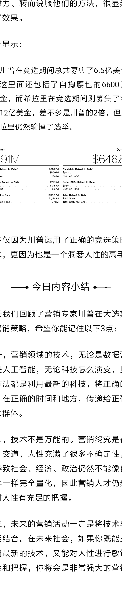

这里值得注意的是，川普主动攻击的人或者群体，往往都是掌握选票比较少的，因为他们没能力左右川普的胜局。

## ——今日内容小结——

今天我们回顾了营销专家川普在大选期间的营销策略，希望你能记住以下3点：

第一，营销领域的_da技，无论是数据营销还是人工智能，无论科技怎么演变，其核心方法都是利用最新的科技，将正确的信息，在正确的时间和地方，传递给正确的受众群体。

## ——今日思考题——

生活中你曾经看到过哪些针对人性弱点的营销案例？
欢迎在留言区分享你的观点。

+ 划重点
+ 1.无论科技怎么演变，营销的核心都是把正确的信息，在正确的时间和地点，传递给正确的受众群体。
+ 2.人类的世界非常复杂，人性充满了很多不确定性，无法完全量化，当人工智能和大数据广泛应用时，机会在很大程度上就在于对人性的把握。
+ 3.懂得利用技术把营销活动和人性结合起来，就一定会获得竞争优势。

王煜全
我是王煜全，你的全球科技前哨侦察兵，我们明天见。

# 131 | 市场营销将在技术影响下持续变革

## —— ◆ 今日内容看点 ◆ ——

通过阅读今天的内容，你将会掌握以下3个问题的答案：

+   1. 传统广告公司是否还有机会？
2. 如何才能在第一时间引入成熟的新技术？
3. 如何思考消费者的issan数据隐私和安全问题？

## —— ◆ 全周总结 ◆ ——

本周的话题是市场营销产业，讲了三个重点：

第一，市场营销看似是企业经营当中的一个环节，其实它也是个独立的产业，而且已经被技术影响，产生了深刻的变革，还将在未来的技术的影响下继续变革下去。

第二，任何商业上的成功都是顺势而为，市场营销的变革是技术能力不断提升营销效率需求驱动的，从广告到销售管理，到个性化营销、精准营销，未来还会和场景和互联网以及人工智能深度融合。

第三，科技在进步，仍然只是工具，真正需要的是对人性、对社会的深入洞察，这是技术不能替代的。

## —— ◆ 用户答疑 ◆ ——

传统广告公司会不会慢慢走不下去了？以前的模式是用广告吸引客户，现在是掌握客户需求信息然后定制化广告。这样看起来好像效率是提高了，但是从另外一个角度来说，是不是也把潜在可能性都拒之门外了？

我的回答是：

传统的广告公司明显在走下坡路，原来加入一个所谓的 4A 广告公司是多少人的梦想，现在 4A 已经辉煌不再，其实现因也狠简单，就是因为传统的广告模式失效了。

其实，营销产业不会消失，只不过是高效的营销手段替代了低效的营销手段罢了。不过就是因为有变革，一个产业才会有魅力，永远不变的产业有什么意思呢？

## —— ◆ 下周预告 ◆ ——

时间过得真快，下周就是咱们第二季度的最后一周了，照例我们还是用一周时间作季度总结。

我们的总结就是“传统企业用科技的三重境界”：

+   从科技不光是产品，传统企业的各个经营环节都可以引入科技这个话题开始；
再到科技其实是用户的选择，生活、工作、学习、娱乐中处处都有科技的渗透；
然后我们再一起考察有哪些科技正在到来，以及如何掌握科技带来的社会趋势变化。

我们逐层深入，希望每个企业家、每个人都能够熟练运用科技的力量提升自己、造福社会，欢迎关注。

## 划重点

1. 营销产业不会消失，只不过是高效的营销手段替代了低效的营销手段罢

## 划重点

+   1. 营销产业不会消失，只不过是高效的营销手段替代了低效的营销手段罢了，只要现在的东西还不够好，技术就永远有用武之地。
2. 时刻监测市场当中和自己相关的先进科技，一旦成熟，就大胆采用，这在未来会成为每个企业的必修课。

王煜全

我是王煜全，你的全球科技前哨侦察兵，咱 们下周见。

# 132 | 特别放送：传统产业里也有高科技

【季度复盘与总结】| 传统...

## —— 今日内容看点 ——

通过阅读今天的内容，你将会掌握以下3个问题的答案：

+   1. 传统领域的企业如何能够用好高科技？
2. 为什么说企业运营的各个环节都早已被科技渗透？
3. 阿里、京东、亚马逊是如何布局线下实体店的？

时间过得真快，转眼第二季度又过完了。

我们第二季度讲的都是一些相对传统的领域是如何利用高科技的，因为离大家比较近，所以大家的讨论也比较踊跃。其实这就是我们做第二季度内容的目的：

让大家能够看到，科技早已渗透到我们以为是传统产业的各个行业领域了，而且随着我们总结为“积木式创新”这一轮小公司主导的创新潮流的推动，科技对各个领域的渗透速度大大加快了。

所以我们反复强调“没有传统产业，只有传统企业”，也就是说，科技是武器，任何产业都可以利用科技这个武器实现扩大规模、提升效能、加速转变。

照例，第二季度最后一周，我们给大家做个复盘，总结一下相对传统领域的企业如何能够用好高科技。

周一我们想强调的是，企业看科技给自己带来的提升，不应该只局限在产品环节上，科技支持我们的角度是多方面的，企业运营的各个环节都可以通过用好科技得到提升，从而增强整个企业的竞争力。

## 一、产品环节

我们说，即使在产品环节，也不应该光盯在最终产品层面上，还有一些核心配件，它能够提供一些核心功能的改进，使你的竞争力提升。

比如我们介绍过我们海银资本投资的WiTricity能够提供无线充电，我们在国内也一直帮助联系，但是企业在首先运用先进科技上，都相对比较犹豫，结果是Dell公司首先在国际上推出了无线充电的笔记本电脑，利用先进科技的理念，明显贯彻得更坚决。

另外一个实在在的例子，就是我们2017年1月份参观完CES之后，带企业家代表团去参观了加州大学伯克利分校张翔教授的实验室，张翔教授介绍，因为他是做光学方面的权威，制造的13层超薄透镜加在一起，厚度只有现在苹果手机的厚度，但是它的效果是长焦相机，就是我们俗称的大炮筒子的效果。

所以未来你会发现，今天球场上司空见惯的一个个大炮筒子未来其实只要举着一个普通手机就能达到那样的效果，就是做到长焦的拍摄了。但是很遗憾，这样的先进技术，我们中国的手机厂商没有拿到，被三星拿走了。

所以这就提醒我们，手机厂商不光要对核心的配件有了解。比如说我们原来介绍过的高通的芯片，小米新推的手机，就是用的高通最新的骁龙845芯片。这还不错，但是也不要忘了，很多其他的关键部件也能提供强大的竞争力，这个是我们企业必须了解的。

## 二、生产环节

其实生产也能给我们带来竞争优势，比如说3D打印技术。

在经过多年的发展之后，3D打印技术终于从概念走向实用了，而阿迪达斯就正在让3D打印成为自己“高科技”运动装备当中的重要组成部分。2017年，阿迪达斯推出了名为Futurecraft 4D的运动鞋，这也是全球首款运用3D打印技术制造的量产运动鞋。

介绍显示：打印一双Futurecraft 4D运动鞋需要一个半小时，未来有希望缩短到20分钟。同时，借助3D打印技术，设计师实现了更加复杂的鞋底缓冲结构，令穿着者更加舒适。这一点要比传统的注塑工艺更加先进。

生产流程的改造也可以增强竞争力，比如原来我们也经常提到过的个性化定制衣服的领军企业酷特智能，也就是红领。

在红领，一件独一无二的定制西服是如何诞生的？

首先，消费者在酷特智能的“魔幻工厂”App上对自己的西服进行自主设计，选择自己喜欢的版型、款式、风格，并且一一确定，包括颜色、面料、里料、刺绣、纽扣、口袋等各个细节。

之后，通过预约量体，采集的客户身体数据和酷特智能的数据库进行匹配，自动生成最适合这位客户的个性化定制版型。

版型确定后，系统会将西装上的所有定制细节拆分，并自动进行排单。

一张电子磁卡会记录所有数据，它会成为这件衣服的电子身份证，带着所需的面料辅料，利用吊挂系统自动传送到对应的工位上。

因为每一个订单都是不同的，员工的工作方式也和其他服装厂有很大不同。他们的面前有一块电子屏幕，当挂钩带着磁卡与面料来到工位前的时候，员工需要扫描磁卡，获取对应的操作信息。

依托这种方式，酷特智能的同一条流水线可以同时生产不同的个性化产品，而其成本只比传统服装厂高出10%。去除一切中间商、渠道商，直接面向消费者，这让红领成为服装行业中第一个将C2M模式走通的企业，C2M就是Consumer to Manufactory，就是消费者到制造工厂。

这样的模式所带来的优势在于：

第一，完全实现0库存。一个成衣品牌往往有30%到50%的成本被库存占领了。因此，对于服装产业来说，0库存带来的优势显而易见；

第二，去经验化，最大程度上摆脱“人”对生产的影响。制版、量体这些传统西服定制行业需要非常经验的老师傅才能做到的事，在红领可以由年轻的员工，甚至电脑完成，而自动化排单更是让大规模定制成为可能。

当然，为了做到个性化定制，红领花了13年时间，耗资10亿余元打造了C2M车间。

这个车间的秘密是：

在一条流水线上生产出不同的服装，工人不用加班、工厂没有库存、供需没有渠道分层，一切都在数据驱动下，管理实现扁平化，科层管理制度不复存在了。

淘博一家牛仔裤代工厂，与红领集团合作，就成功改造了一条生产线，其毛利率从15%一下子上涨到50%。更重要的是，他们的每一件衣服，消费者都可以在终端加入自己的设计元素，款式、工艺、风格等个性化设计都是可选择的。另外，只需要在店面陈列样衣，没有任何库存，这意味着可以节省库存成本，打掉中间环节，用比成衣更便宜的价格销售个性化定制产品。

当然，自动化有很多的优势，我们知道的是更低的人工成本，工厂设在离市场更近的地方，所以能够保持对市场更灵活的反应，还有个性化的产品生产。

## 三、仓储环节

除了生产以外，仓储物流也是一个重要的科技可以改进的环节，这回的CES展，我们就看到法国的Hardis集团有一款叫做Eyesee的无人机解决方案，它是旨在为自动化仓库中的库存和库存控制提供的一个解决方案。

Eyesee是一家软件公司，它是Hardis集团的下属，它和Hardis集团以及无人机制造商Squadron System合作开发了一款全面可以在室内飞行的无人机。这款无人机在去年首先应用在国际仓储、运输和包装领域的领先者FM Logistic的仓库中，用在实际条件下测试解决方案的可行性。这款无人机可以在仓储物流中完全自主飞行。

Hardis集团最初意识到无人机的空中技术特性会给内部物流管理带来新的机遇，所以在2015年就申请了一项“库存无人机专利技术”，试图实现库存自动化的检索，以此简化 and 优化仓库库存管理。经过对无人机技术的优化和改进，Hardis集团与Squadron System合作，Squadron专门研发极端条件下的无人机，最著名的是其消费级无人机Hexo。以此为初级原型开发了一种名为Eyesee的工业室内无人

开发了一种名为 Eyesee 的工业室内无人机。

Eyesee 工业室内无人机机身采用聚苯乙烯泡沫，重量极轻。四周安装有传感器和摄像头，可自动捕捉货架托盘上的信息。Eyesee 公司表示，这个无人机可以处理所有的条形码格式的信息。在它工作续航的10分钟之内就可以完成对仓库的巡逻，这在平常需要2个人90分钟才能完成。

## 四、渠道环节

除了仓储，渠道环节现在也面临着一个巨大的创新，相信大家已经听说 Stacked 阿里、京东、亚马逊等线上巨头近期都在布局线下实体店了。现在你家楼下、或者是你老家楼下的小卖部，可能都是阿里和京东拉拢的对象，甚至就是他们的合作伙伴了。而早几年，我们还在听说传统实体店受到了电商的冲击，业务不断地萎缩，现在这些巨头又哪里来的信心发展线下零售店呢？

其实，因为传统的零售业依靠的渠道20几年来几乎从来没有改变过，产品通过层层经销商才从厂家到达靠近消费者几百米范围的小卖部，而对于小卖部老板而言，则需要在本地找到不同的经销商来进货，自己还未必能分辨真假货源，小卖部老板通过自己的经验来判断每种货品的最低和最高库存是多少，并根据实际库存来订货。

## 五、营销环节

前几天我们已经介绍了这个时髦词汇 MarTech，营销科技。

> “当下的营销已不再是让消费者想象商家的产品，而是让消费者体验商家的产品。营销技术特别强调消费者的体验，它们是客户的客户。这就是商业从业者必须重视用户体验的原因。”

——今日内容小结——
今天我们说了三点：
第一，利用科技提升企业价值不光在产品领域，还在生产、仓储、渠道、营销等等企业经营的各个方面。
第二，这方面有很多公司在自己的领域做得很好，我们想要提升必须找到明确的目标针对性地学习，比较容易进步。
第三，这方面也有一些潮流，比如京东、阿里正在建立的零售系统，比如 MarTech，如果你能够紧跟潮流，在自己的领域里面，首先引入潮流，首先和京东淘宝合作，那么你的成功就比较容易一些。

——今日思考题——
还有哪些企业经营的领域可以通过引入科技，使自己的竞争优势得以彰显呢？
欢迎大家积极讨论。

划重点
1.“没有传统产业，只有传统企业”，科技是武器，任何产业都可以利用科技这个武器实现扩大规模、提升效能、加速转变。
2.科技早已渗透到企业经营的几乎所有环节，从产品，到生产、仓储、渠道、营销等等，在自己的领域里面率先引入新的科技，就会获得竞争优势。

王煜全
我是王煜全，你的全球科技前哨侦察兵，我们明天见。

# 133 | 特别放送：如何把握科技的潮流？

【季度复盘与总结】| 如何...

## —— 今日内容看点 ——

通过阅读今天的内容，你将会掌握以下3个问题的答案：

+   1. 科技对消费、工作、学习、生活、娱乐都产生了哪些影响？
2. 知识付费的下一步要解决什么问题？
3. 为什么说企业必须对科技有足够的深刻的理解？

本期是我们第二季度的复盘，重点介绍传统领域病怎么用好高科技。

昨天我们从企业自身角地出发，介绍了企业不要片面理解科技，科技不光是产品，也可以是零配件、生产、仓储、物流、营销等等各个方面的提升。

## 一、科技对消费方式的影响

## 二、科技对工作方式的影响

## 三、科技对学习方式的影响

## 四、科技对生活的影响

配。

我们曾经介绍过，比尔·盖茨1995年写了一本书叫《未来之路》，里面有一章专门写未来的智能家居，结果到2005年拿出来看这一章还是未来，其实到了2015年拿出来看这章还是未来，但是到了2017年就发现不再是未来了。

但是从未来变成现实的最核心的原因比尔·盖茨没有预料到，其实是人工智能的进步。

因为我们可以用语音控制一切了，就是通过语音语意的理解，我们才能做到这一点。而语音语意的理解上，这个飞跃还在继续，我们今年的 CES 上就请来了科大讯飞的董事长刘庆峰作演讲，他就现场演示了科大讯飞出品的翻译机，有一个小小的便携的翻译机在手上，你对它说中文，它就会翻译成流利的英文，用语音表述出来。

所以我们会看到，当人工智能有了突破以后，我们的生活也正在被改变。

## 五、科技对娱乐方式的影响

除了生活以外，其实娱乐也是一个很重要的方面。

据说最近有一个很时髦的社交叫做“来，打一把王者荣耀”。我们都知道互联网行业有一句流传很久的话，就是“万物归于社交”，说的就是互联网产品如果做到了“现象级”，它就已经超越了它本身的功能性，而转化成了一款社交产品。

2017年的王者荣耀就是这样一款产品，也就是说通过王者荣耀，大家能够很迅速地拉近距离。

互联网时代，尤其90后的青年在现实生活当中结识朋友越来越困难，大多数人在各大平台上由于照片或者由于对方某句有趣的评论，礼貌地加了微信，却不知道怎么熟起来，最后相互在列表里尴尬地错过缘分。入职了新公司，稍有紧张还希望给部门留下好印象的员工，也不知道怎么能够熟络。

午饭后一波开黑，很快会在大家心里留下印象，游戏打的意识好、有担当，在工作上也不会太差，以后合作起来还能混到脸熟。所以游戏和合作竞技就这样成了拉近距离的渠道之一。

显然王者荣耀本身也看到了用户这样的习惯和需求，上线了亲密度系统，让恋人朋友之间更加紧密地联系到了一起。而朋友之间，王者荣耀更是成了开黑的第一选择，因为绑定了微信和 QQ 好友关系，轻松地就能实现查看好友段位排行，最方便的是还能邀请组队。慢慢地，人们开始描述一段关系时，会有人说“我们打王者”认识的。

当然了，我们说游戏背后也是科技的体现，其实不光王者荣耀，我们也讲到未来的电竞也是游戏的一个主要方面，电竞赛场很可能也会变成一个社交的主要场地。

所以我们说，在生活、学习、消费的各个领域，技术都正在对消费者形成深刻的改变。

## —— 今日内容小结 ——

我们今天主要说了三点：

第一，就是技术改变了消费者，为消费者提供服务的企业，就更要学会更好地利用技术。

第二，技术对消费者的改变是全方位的，企业对消费者是如何利用技术改变自己的生活、工作、学习需要有充分的理解。

第三，技术对消费者的改变还是持续性的，理解了这种改变，把自己的业务架构在新的技术上，就能够取得市场优势。

这就是我们希望大家理解的，当消费者正在拥抱技术的时候，作为一个企业你也必须要求技术有足够深刻的理解。

## —— 今日思考题 ——

你观察到还有哪些技术正在深刻地改变着消费者的行为？

请在留言区分享你的观察和思考。

## —— 下一讲预告 ——

我们一直强调现在是技术井喷的时代，一个时代不再是一个技术主导了，而往往是多个技术在各个领域同时推动着社会的迅速发展。

我们明天就给大家介绍一下，哪些技术在未来是推动社会发展的主力，敬请关注。

## 划重点

+   1. 一直以来，科技对消费者的影响都是巨大的，企业想要把握机会，就必须走在消费者的前面。 
2. 知识付费既 bug 于知识付费平台的演进、付费方式的便利，同时其实也得益于中国中产阶级及准中产阶级教育需求的爆发。

王煜全
我是王煜全，你的全球科技前哨侦察兵，我们明天见。

# 134 | 特别放送：有哪些科技正在到来？

## —— 今日内容看点 ——

通过阅读今天的内容，你将会掌握以下2个问题的答案：

+   1. 哪些有普遍影响的科技力量正在到来？
2. 传统企业如何把掘引入科技的时机？

我们前两天介绍了传统领域的企业看科技的前两重境界：
一是从企业经营的全面的角度看；二是从客户的角度看。

今天和明天介绍第三重，就是从科技本身的角度和从科技对社会的影响的角度来看。

## 一、人工智能

我们在一开始的时候就介绍过人工智能的创业风口已过，也就是说你现在才跳进来做人工智能的技术开发已经来不及了，现在看起来这个判断基本是对的，而且随着AWS，也就是亚马逊的具备人工智能功能的云平台的普及，这时候创业基本就变成了和巨头正面作战了。这是我们原来讲过的创业者要避免的情况。

## 二、机器人

当人工智能和机器人结合的时候，精彩就更多了。

## 三、自动驾驶

其实这些机器人都具备一个能力，就是自动驾驶，但是自动驾驶的主战场还是汽车，不过可能和大家的关注点不同，自动驾驶最快的普及可能不是乘用车。

隆大学公开表示建立了战略合作关系，因为卡内基梅隆是机器人和自动驾驶领域最棒的科研院所之一。

Uber 和卡内基梅隆会联合开发先进的地图、车辆安全、自动驾驶技术，这一次他们几乎把卡内基梅隆大学机器人实验室里所有从事与自动驾驶有关研究的人都招走了，研发人员市场专家一共招了50多个人。

2018年1月26号，滴滴也宣布成立了人工智能实验室，目前团队已经有200余位从事人工智能前沿技术研发的科学家和工程师了。2018年，他们表示还要继续扩大规模，此前滴滴就设立了滴滴研究院和滴滴美国研究院。

如果将来自动驾驶解决了货运的长途部分，滴滴和Uber在各个地方都有时机可以等卡车开上高速就来接手驾驶，哪天他们做长途货运了，也不是什么令人惊讶的事情。

顺便说一句：

以后的车上都会配有 GPU，这也就是为什么 Nvidia 还有很大的上升空间。

## 四、智能音箱

人工智能和硬件的另一个结合，是智能音箱。

我们昨天介绍了智能音箱正在成为智能家居的核心，因为语音控制是最人性的控制方法之一，截至2017年9月，谷歌 Home 智能音箱出货量为700万台，而亚马逊的 Echo 智能音箱出货量则突破了2000万台，几乎是谷歌 Home 的3倍。我在美国的家里买的就是谷歌的 Echo。

现在，你可能很难找出几家不做智能音箱的大公司了。

+   国内京东和科大讯飞合作推出叮咚音箱；
阿里巴巴和飞利浦合作推出智能无线音箱小飞；
LG、联想等公司也推出了音箱类产品；
智能音箱领域的联发科则已经开始提供保姆式的解决方案了。

更多的公司则选择接入亚马逊的 Alexa，从福特这样的车厂到华为这样的手机厂商，纷纷在产品当中增加对 Alexa 的支持。灯泡、开关、恒温器、摄像头像等硬件产品都开始付费接入 Alexa 的 API。在此前的媒体活动上，CES 主办方 CTA 的首席经济学家 DuBravac 就表示，亚马逊的 Alexa 目前已经支持1500种不同的应用了。

## 五、混合现实

除了人工智能以外，还有一个会对很多传统领域影响广泛的技术，就是我们开篇时讲的MR混合现实。

我们介绍过 HTC Vive 的跟踪器，2018年新的 Vive 控制器将含有 SteamVR 定位 2.0传感器，可以兼容 SteamVR 定位2.0系统，预计会在2008年下半年上市。

而谷歌的 WorldSense 技术是基于谷歌 Daydream 平台推出的新型定位追踪技术，你看谷歌也有追踪了，不仅能够捕捉用户的侧倾、躬起、躲闪等动作，还能够在3D 空间内检测用户的头部运动，定位追踪灵活精准，让用户在虚拟现实世界当中的体验更加真实，其实另外一方面也可以用在混合现实领域。

另一个核心技术，是能够使真实物体虚拟化的激光点投影，我们介绍过苹果的 iPhoneX 引入了这个技术，其实任何有突破性的东西，在被接受的时候多多少少市场上都会有一定程度的犹豫，当然还有出量的问题，所以 iPhoneX 的销售数据并不惊艳，但是用刷脸做认证会大大增加体验的流畅性，我自己体验的时候就觉得这种流畅性的增加非常有意义。

顺便说一句：

虽然我们不是荐股节目，但我确实提醒大家注意过独家为苹果提供激光点投影技术方案的公司 Lumentum，我介绍过这家公司之后，他们的股价一直在跌，其实技术超前的公司经常碰到市场短期的不理解或者不认可，继续持有就是了，长期还是看好。

我在 CES 上试驾拜腾汽车的时候就发现他们在车的侧面装了激光点投影的面部识别装置，这样以后你开车，再也没有忘记带钥匙的问题了，你的车认识你。

其实技术进到手机里的一大变化就是价格猛降，然后领域会大大扩展，所以我们预期，激光点投影会大量出现在各个场景当中，而且除了面部识别还会有很多 3D 建模的应用。

由于目前的城市交通时常会出现堵塞的现象，导致有很多患者的突发性病症得不到及时的治疗，这个时候如果能有医生可以远程指导患者的家属实施紧急措施，往往能够为患者赢得更多时间，从而拯救患者的生命，这就是混合现实的具体应用了，远程医疗技术，可以把患者与身在他地的医生联系起来，医生可以通过这项技术实时诊断患者，并监督治疗。

法国的一家医疗科技公司 Exelus 花费了三年的时间开发了一款名为 Nomadeec 的系统，致力于通过微软的 HoloLens 实施远程的医疗救助，该公司的产品也在今年的 CES 展上作了展示。

据了解，Nomadeec 通过使用 HoloLens 的视频、语音和应用程序界面的指示功能，向医生提供需要的信息，然后医生可以使用视频聊天或者面板当中的全息标记对患者家属提供实时指导。Exelus 的发言人声称，Nomadeec 可以更有效地确定25%的病例当中哪些病人需要治疗。他表示，医生护理人员和首席医疗官已经对 Nomadeec 进行了测试，目前该产品正在美国等待 FDA 的批准。

## 六、5G网络

当然，自动驾驶需要网络的实时响应，混合现实需要数据传输的高带宽，这些都将不是问题，因为 5G 马上就要来了。

中国移动宣布2018年会做 5G 的大规模商用，美国计划2018年全面实现 5G 的商用，美国的通信巨头 AT&T 已经宣布了计划今年向美国超过12个城市推出智能手机 5G 无线通信服务，成为首家大规模推广商用 5G 移动服务的运营商。

当然，我们在 CES 报道中提到过，高通宣布2019年 5G 需要的所有技术才准备好，所以中国并不落后，AT&T 应该也不会完全部罢完成。

有了这么高的带宽，有了这么快的响应速度，云计算能力就是随时可以获得的了，传统领域的企业们也要多想想如何利用这些能力了吧。

## 七、其他科技

当然除此之外，马上到来的技术还有很多，像基因治疗、干细胞治疗、肿瘤免疫疗法等等生物技术的突破，而且已经有了很好的验证，比如我们2017年10月带国内的科技投资考察团去拜访 Rutgers 大学，他们有位教授的干细胞治疗对50位因为脊神经受损造成全身瘫痪病人进行治疗以后，其中的23位恢复了行走，这是多么了不起的进步啊。

顺便说一句：

我们今年会继续组织美国的科技投资之旅，而且会带大家更加深入地看到创新的真正的第一线，欢迎大家参加，我们也会在这里作深入的报道，所以以后凡是一说美国创新就只知道硅谷的，肯定不是我们《全球创新260讲》的听众。

## —— 今日内容小结 ——

总结一下，今天讲了三点：

第一，很多技术会对各个领域都产生影响，必须关注。不过时点很重要，要在技术成熟的时候及时引进。我们原来介绍过 Manufacturing Readiness Index，叫制造就绪指数，是美国的 NASA 和军方判断是否要引入一个先进技术的系统标准，就既不能过早也不能过晚，今后我们会找时间作更加详细的介绍。

第二，真正颠覆传统产业的，不是外面的技术公司，而是最早最好引进技术的业内企业，所以如果你不能最快地引进技术，可能就是被颠覆的那一个。

第三，传统领域的企业要对新技术的趋势多加了解，并且分析如何运用到自己的领域，以解决自己领域的痛点问题，就有机会带来自己产业的革命。

## —— 今日思考题 ——

你还看到哪些技术会对哪些产业产生影响，能够解决哪些痛点问题呢？

哼，能够解决哪些痛点问题呢？

欢迎留言和大家分享。

## 划重点

- 1. 传统产业的革命往往不来自技术企业，而是来自最先引入先进技术的业内企业，因为他们知道本行业的真正痛点，知道技术如何运用才能价值最大化。
- 2. 这一轮人工智能，现在最需要的，是各个行业的专家们，去挖掘出那些虽然复杂，但却是重复性的劳动，用数据训练出专属领域的人工智能，获得竞争优势。

王煌全

我是王煌全，你的全球科技前哨侦察兵，我们明天见。
