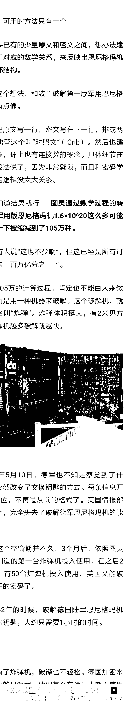
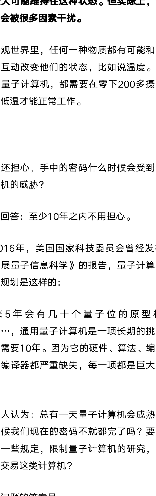
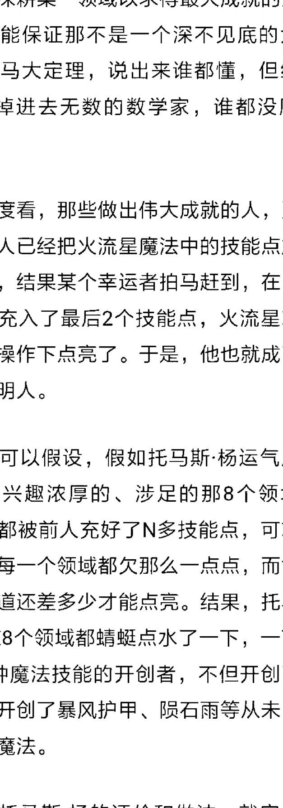
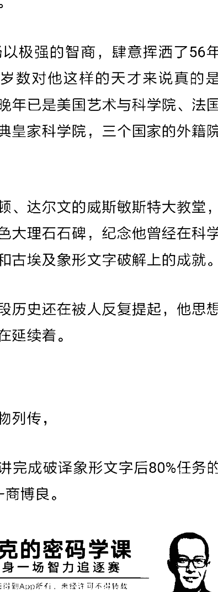
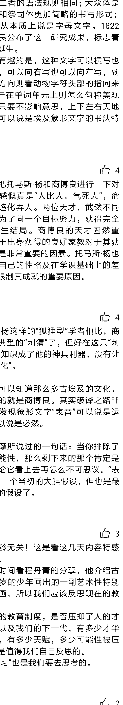
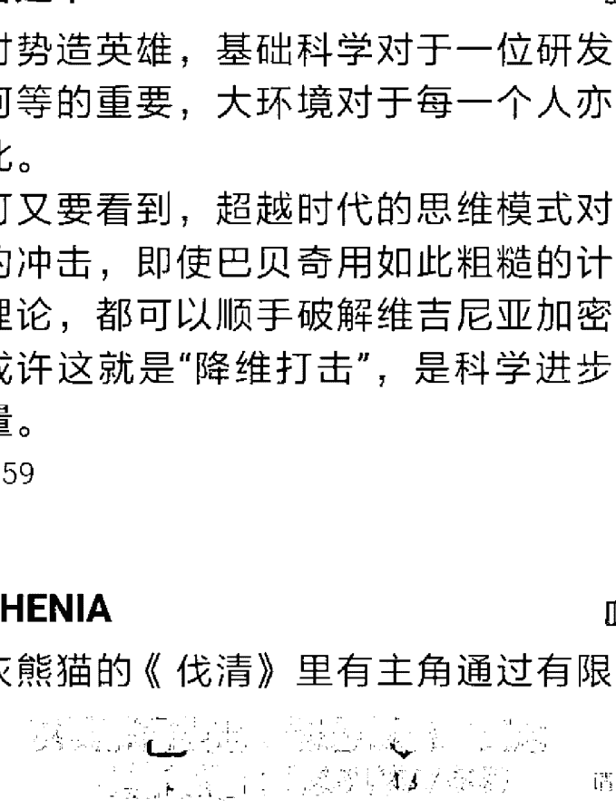
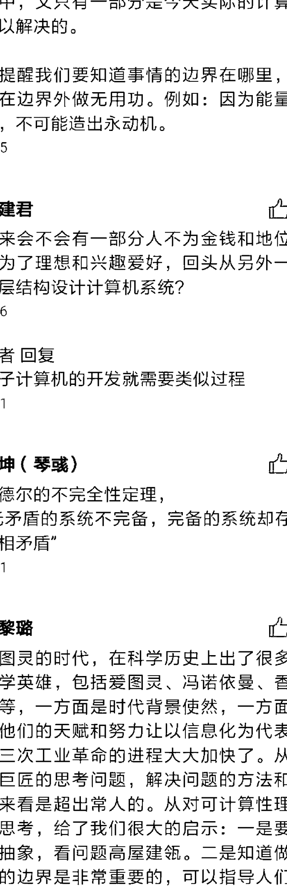

# 卓克的密码学课

## 发刊词｜“执剑”和“破壁”的永恒之战

发刊词｜“执剑”和“破壁”...

你好，欢迎来到我的密码学课，我是卓克。

### 1

提到密码学，估计你会想到手机密码、微信密码、银行卡密码，更深一层可能还会想到自己的隐私和财产安全。这些我都会在课程里提到，但这都不是我来讲这门课最重要的原因。

你之所以需要了解密码学，是因为它的发展历程，折射出了人类的一种现实处境——

很多复杂事情，不存在所谓的终极解决方案。

密码学数千年的发展史，加密与解密双方一次次的对垒博弈，就是这样一场旷日持久，没有终点的智力追逐。

### 2

纵观密码学的发展史，加密和解密到底有多少种？真的数不清。课程里，我会为你梳理出密码学演化过程中最重要的七个世代。

从第一代的隐藏法，第二代的移位法和替代法，到第三代的维尼吉亚加密法，第四代的恩尼格玛机，再到第五代的魔王加密系统，第六代的RSA加密系统，以及第七代的量子加密；从手工加密，到机械加密，再到计算机加密——

### 3

当然，你将收获的远不止这些。
除了加密法和解密法持续了数千年的碰撞外，这门课还包含了大量令人感慨的故事。

### 4

相信我，你将收获的还不止这些。
穿越密码学发展的千年迷雾，除了了解加密与解密的对抗原理，我还会把它带入到你的日常生活。

至少以下三条，是你听完课就能明白的：

第一：补强安全意识，保护好钱包

第二：了解虚拟货币和区块链的价值核心，防止陷入泡沫

第三：体会数学是所有工程类学科的理论来源

### 5

我是卓克，诚意邀请你加入我的密码学课。

## 卓克的密码学课

## 01 | 密码学：为什么要从俚语加密讲起？

01 | 密码学：为什么要从俚语加密讲起…

你好，欢迎来到我的密码学课，我是卓克。

密码学的总体图景，是个什么样子呢？简单来说，它有一道分水岭——在计算机出现之前，叫做古典密码学，之后叫做现代密码学。

不论是古典还是现代，有一条主线剧情一直贯穿其中，那就是加密与解密在几千年中此消彼长的对抗。有的时候，任何加密法都不保险；可有的时候，任何解密法都不管用。

在这场人类顶尖智力的漫长博弈中，出现了大量堪称起伏的故事情节。

其中就有这么一个，它不涉及复杂的细节，但又体现了密码学的底层逻辑，这就是第一节课我要给你说的——俚语加密。

### 1

俚语，就是我们常说的“方言”，也就是使用对方完全听不懂的地方话来进行沟通，实现加密的目的。

别看这种方法土得，但很多国家都用过。20世纪70年代，中国在越战的时候，就使用过莆田、温州、高淳的方言进行加密通讯；类似的，1973年的阿以冲突中，以色列也使用过非洲的努比亚人进行俚语加密。

问题是，这种土办法好不好用呢？简单回答：出人意料的好用。

不过这里有必要解释一下，什么算“好用”？很多人认为，密码强度高，破解不了就是好用。这实在是对密码最大的误解。破解不了并不代表它安全，并不代表好用。历史上有很多被誉为“无法破解”的加密法，就是因为太繁琐了，出现后甚至几百年都无人用，这就是很好的反例。

所以说，破解不了并不代表好用，真正好用的密码，是在安全性和效率上找到平衡点。

### 2

二战时期，美国使用的“纳瓦霍语”加密，就是当时最好用的加密法。你可能看过吴宇森执导的好莱坞电影《风语者》，它讲的就是纳瓦霍通讯兵的故事。

今天我就从密码学的角度，给你讲讲这个故事。通过它，你会知道什么样的密码叫好用，而这也是我们理解密码学的关键。

在密码学中，有这样一条重要的准则：

为了保证密码足够安全，需要假设敌方已经拥有了和自己一样的解密水准，然后在这个基础上制定加密手段。

当时图灵已经破解了德军的恩尼格玛机，那么盟军要用什麽手段才能比恩尼格玛机更可靠呢？最简单的做法，就是使用更复杂的机器。实际上，在二战期间，英美使用的密码机复杂程度已经到了上限，继续增加复杂度会导致加密成本太高，不只是机器贵，关键是加密解密的时间长。尤其是前线交战，每条信息都要迅速反应，一条信息加密了几分钟还没有发出去，这是不能接受的。

这里就再次强调加密法“好用”的原则了——需要在安全和效率上找到平衡。

### 3

在最初的太平洋丛林战中，美军为了效率，甚至没有加密。不幸的是，日军文化水平可以，负责通讯和监听的日本兵听得懂英语。

正在美国寻找全新加密方法时，1942年初，美军收到一个工程师的来信，建议他们用俚语加密。这个工程师从小生活在亚利桑那州的纳瓦霍保留区，说的一口流利的纳瓦霍语。他深知，纳瓦霍语不但和当时世界上流行的拉丁语系很不一样，甚至美洲其他土著也完全不能理解。

美军听到这个建议后初步测试了一下，发现不但内容传达准确，而且效率还提高：一条有3行文字的信息，纳瓦霍语加密和解密只需要20秒，而当时的加密机器要花30分钟。

不过，美军并没有马上采纳，这就体现出科学素养高了。他们考虑到如果这个方法可行，我们有那么多种土著语言，有没有比纳瓦霍语更好的选择呢？

选择标准很多，首要条件是，部族里潜在的通话员数量足够多。当时，纳瓦霍族、苏族、齐本瓦族、皮马帕克族是四个备选。

最终让美军做出选择的，是一份人类学方面的统计综述。

这份综述统计了德国学者对世界各地人类的研究状况，结果发现：这4个还不错的备选中，纳瓦霍族是德国人类学家唯一没有发表过研究论文的。所以相对于另外三种土著语，纳瓦霍语密码被破译的可能性最低。

最终，纳瓦霍语进入通讯兵培训计划。

### 4

在珍珠港被袭后4个月，第一个29名纳瓦霍人开始了通讯培训。

培训中如何使用设备倒是次要的，关键是想办法解决文化中的外来词。比如，中文里自古就没有巧克力、玻璃、经济这些词。而且这些单词，很多都不能拆字与字分开理解。像“巧克力”，单拎出力、克、巧，没有一个字能跟原意挂钩。

对土著来说，飞机的名字、军师旗图建制的名称、轻重型武器的名字，还有地名，也都是外来词。作战中这些名字不但常用，而且必须准确传达才行。怎么办？

美军的解决办法是，专门为纳瓦霍人编一份生词词典。

生词都这么处理，比如太平洋Pacific，第一个字母P就写成Pig，第二個字母a就写成ant，第三个字母c就写成cat……这样，在纳瓦霍语里，太平洋就变成了“猪蚂蚁猫冰狐狸冰狐”。我试着用纳瓦霍语念一下，大概就是 bi-sodih, wol-la-chee, moasi, tkin, ma-e, tkin, moasi。这就是太平洋。

### 5

俚语加密的保密程度怎么样呢？结论是比预期还要好很多。

这29人培训结束后，先做了一次实地测试。对真正的军事情报做加密，然后把通话内容录音交给美国海军情报处。这个机构当时的水平，是可以破解恩尼格玛机的。结果美军情报处集中力量分析了3个星期，仍然毫无进展。

解密专家对纳瓦霍语的评论是：

一连串奇怪的喉音、鼻音、喉音，别说破解它们了，我们甚至没法用普通文字把它們准确写到纸上。

不知道你刚刚注意到没有，纳瓦霍语的一个重要特点是，这种语言压根没有文字，只存在于发音中。破译一种没有文字的语言，这本身属于另一个维度的任务。

其他密码难度再高，密码专家都至少知道破译的终点是一种我们熟悉的语言，只不过表面形式发生了变化。但如果破译的终点是一套欧美文明全然陌生的语言结构的词，难度就可想而知了。

而纳瓦霍语更是难上加难，因为破译的终点不但语言结构未知，而且一连串像乌鸣一样的发音，根本落不到纸面上。

所以，纳瓦霍语加密的安全级别，远超当时的各种加密机。

后续人类学家对纳瓦霍语的研究显示：

它是一种跟亚洲、欧洲所有方言都毫无关联的语言。比如说，如果某语是铅笔类的长条状，动词的尾音就拉长；如果某语是像沙子那群带颗粒的东西，尾音就要模拟出沙粒的感觉；陈述句中那件事如果他本人亲历过，会加特别的副词；有的时候，一个发音实际上就能表达一句话。

总之，作为密码专家，你没法要求他假设一些根本没听说过的语言表达技巧存在，然后再在此基础上解密。

到了1942年4月硫磺岛战役打完，已经有420名纳瓦霍人成了通讯兵。当时的海军陆战队的少将华德·康纳评价：如果不是纳瓦霍人，硫磺岛绝对拿不下来。

### 6

加密的部分说完了，我来补充一些让人感慨的细节，这对于我们理解密码学也非常重要。

纳瓦霍人在入伍前对现代战争毫无了解，战场上他们最大的困难，就是要克服内心深深的恐惧。纳瓦霍人的世界观中，最重要的一件事就是处理好死者。纳瓦霍人都相信，如果没给死者安排好丧葬仪式，这些挣扎的灵魂会向活人复仇。

可太平洋战役又格外血腥，到处尸横遍野，每个纳瓦霍人内心都是恐惧不安的。尽管文化差异极大，但这400多人还是隐忍着，恪尽职守做出了色的完成了通讯工作。

经过战争的剧变，纳瓦霍通讯兵大都没回到家乡，而是融入了现代城市生活中。但由于保密法的限制，他们的特殊贡献直到1968年才被外界得知。

解密后的第二年，这些密语者第一次举行战友联谊会，当年参战的最年轻的族人也已年过半百，还有一些老兵已经逝世。之后十几年大量资料披露，历史研究和文艺作品出炉，让整个美国和全世界人都知道了这段少数族裔的英雄历史。

1982年，里根总统表彰他们的事迹，并把8月14日定为“纳瓦霍密语通讯员国家纪念日”。国家给予的荣誉当然是一种巨大的肯定，但比这更大的荣誉是，纳瓦霍语是唯一一个从未被破译的军事密码。

这节课，通过俚语加密的故事，我们能知道：

- 第一，即便俚语加密听上去土的，但它是经过科学化评估的；
- 第二，密码学行业里因为保密法的存在，不公平的待遇和受委屈的人非常多；
- 第三，也是理解密码学的关键——好用的密码，并不是不能被破解的密码，而是在安全性和效率上达成平衡。

这节课就是这样，下节课我来帮你梳理一下密码学发展的七个世代。

## 02 | 古典与现代：密码学的两个时代

卓克的密码学课
12-16

你好，欢迎来到我的密码学课，我是卓克。

第一节课里我们说到了恺撒加密，其实它并不算完整的加密与解密，因为之后恺撒密码始终没有被Present ...

但从第二节课开始，加密和解密就会成对儿出现了。在几千年历史中，它们一直此消彼长的对抗。

### 1

最原始的第一代加密法说起来很简单，我们每个人都用过，就是“隐藏法”，也就是说把信息藏起来。

从有文字出现，一直到现在都在用。破解方法就是认真搜索，纯粹是体力活。

历史上第一个加密法的记载，是古希腊历史学家希罗多德记录的一个加密术的故事。这段故事，发生在他出生前300多年。

## 03 | 概率论：数学让密码学加速进化

你好，欢迎来到我的密码学课，我是卓克。

### 1

你想过一个问题没有：是什么因素决定了一个密码能否被破译呢？

我给你对比一下古典密码和现代密码，你就能发现答案了。

古典密码学，加密和解密过程中，最小操作单位都是单个字符或者符号，所以古典密码学的核心就是移位法和替代法。

现代密码学，把研究对象用数据描述，再对数据进行运算。不仅突破了字母作为最小变化单位的限制，还可以使用更高等的数学工具做运算，因此破译变得越来越难。

所以，加密时所用的数学工具，决定了一个密码能否被破译。

上节课我们说到，第二代的移位法和替换法的安全性很好，也比较好用，但到了16世纪，这个局面扭转了。因为概率论的出现，这两种加密法可以破解了。

自此之后，加密与解密的对抗战中，因为数学的应用，解密一方暂时占据优势。

这节课，我们讲两个破解第二代加密法最经典的案例。

一个发生在16世纪的苏格兰女王玛丽一世身上，一个发生在17世纪中后期到18世纪初的法国国王路易十四身上。

### 2

我们先说玛丽一世女王，她是我说过的最刚烈的女人。在这门课《密码学人物列传》的模块中，我会专门用一讲详细讲讲她的故事。这节课，我们还是主要围绕密码展开。

27岁时，玛丽一世被自己的姑姑英格兰女王伊丽莎白一世关押起来，一关18年。到44岁时，监狱里的她和外界反叛军密谋要杀害姑姑，一旦谋杀成功，她自己就能坐上王位。当时的信件都是通过特殊渠道传入监狱，最后由侍女在递送红酒时，藏在瓶塞中带进去。

玛丽一世很聪明，包含暗杀计划的并不是普通的信，而是加密过的。就算不慎落入伊丽莎白一世的手中，也没人看得懂。

其中用到的加密方法，就是替代法。所有的英文字母被类似符号的东西替换，一些常用词也用符号代替。具体对应方式，你可以参考下面这个图表。

玛丽此后就通过这个特殊渠道和反叛军通信，几个月后，她熟练掌握，写信可以直接用密文，不用一个个字母对照表了。

不幸的是，这个特殊消息传递的渠道里，竟然隐藏着一个双面间谍，他把情况汇报给了伊丽莎白。在位的女王正愁找不到把柄，这下终于有机会名正言顺的处死玛丽了。

不过现在还急不得，必须抓到足够硬的证据，而且最好把整个阴谋背后所有的参与者一起除掉，所以伊丽莎白没有打草惊蛇。

此后玛丽和外界的通信，每一封都先经过双面间谍送到密码学校，花了1个小时誉写好，然后再密封好，就像从没有被截获过那样，递出皇宫。密码学校的人再拿着誉写好的密文想去破解，最终他们成功了。

### 3

破解方法，就叫做“频率分析法”。这种方法其实在9世纪的阿拉伯就出现了，只是到了16世纪才被欧洲科学家注意到。

下面咱们讲讲它的原理。很简单，英文中字母出现的频率，是不一样的。比如字母e是出现频率最高的，占12.7%；其次是t，9.1%；然后是a，o，i，n等，最少的是z，只占0.1%。

除了英语，其他语言也有详细统计。

玛丽和外界用密文来往很多，字符总量是足够多，全部收集到一起，统计哪个符号出现的比例最高，那个字符大概就是字母e。

当然，有些字母出现的频率极其接近，比如h，r和s，分别是6.09%，5.98%和6.32%。但只要稍微留意字母前后关联，就可以区分出来。比如：t几乎不可能出现在b，d，g，j，k，m，q这些字母的旁边，h和e经常连在一起，ee一起出现的频率远比aa一起出现高得多等等。

频率分析法的实质，就是大幅降低字母排列组合的可能性。

从前我们假设每个字符都可以是26个字母的任意一个，有多少个替代符号出现，就有26的多少次方种可能。但频率分析法把很多符号的可能性大大降低，有的降低为只有1种可能，有的降低为只有2-3种可能。

这样一来，即便第一步统计各种符号出现的频率并不完全确定，但只要再根据拼写规律筛选一下，替代符号对应的真实字母就确定了。

在审讯的过程中，尽管玛丽始终没有承认谋反，但证人和密码学专家一起向公众展示了密文和原文，讲解了解密规则，最后玛丽一世还是被砍了头。

这是加密和解密在皇权斗争中最著名的一次应用，解密法大胜。

### 4

解密方法公布后，替代法就不再有效。起码对欧洲王室来说，决心要破解的话，一定可以破。

加密一方当然不甘落败，怎么办？

很快就出现了另一种叫做“同音替代法”的方法。

比如说字母a可以用11，23，41三个数字替代，这三个数字翻译过来都是a。越常用的字母，比如e，就用越多的符号代替它。这种想法的终极目标，就是让每个数字出现的频率都大致相等。频率特征没有了，密码就不容易破解了。

从上面这张同音替代法的表格中可以看到，最常使用的e，替代的字符最多。

不过这种方法的解密钥马上也出现了，就是通过字母前后顺序关系猜测。

最典型的例子是，q后面出现的最大可能是

最典型的例子是，q后面出现的最大可能是u，而q又是一个不常见的字母，有很大概率猜出来。其他字母猜出来的难度大一些，但只要肯花时间，总能破解。

### 5

历史上最有名的采用同音替代法的密码，是法国国王路易十三、十四时期的“大密码”（Grand Chiffre）。它使用了40多年后，随着拿破仑倒台突然失传。直到1890年才被完整破解，破解方法就是从单词拼读规律入手的。

这套加密法用了587种数字，来表示不同的发音。其中陷阱还很多，比如有些数字只代表字母，不代表发音；很多数字是干扰字符，它们没有意义；还有一些数字既不是发音也不是字符，而是代表删除前一个字符。

大密码被破解后，很多200年前路易十四的宫廷秘闻才白于天下。

其中有一段，是法国宫廷怪奇“铁面人”的新发现。铁面人的故事在欧洲，就像咱们关心康熙晚年雍正是怎么即位的故事那样。无数小说都以这个为背景，大仲马和伏尔泰都写过。

故事说的是一个犯人从1669年被捕后，一直关押。而且负责关押他的监狱长不论工作怎么调动，总把这个犯人带上，一关就是34年。据说这么重的罪，就让他把牢底坐穿吧。不，给他吃的都是美味，穿的都是华服，还可以弹琴，有医生定期探望，甚至转监狱时都是高级马车护送。什么都有，只是没自由。

有狱卒看到过这个人在远离其他犯人的地方散步，脸上总带着一个铁面具，没人知道他长什么样。

铁面人到底是谁，有N种猜测，在大密码告破之前，有猜是路易十四同父异母哥哥的，有猜是路易十四私生子的，有猜是英国国王私生子、法国财务大臣、意大利外交官的。之所以有争议，是因为每个说法都有漏洞。

在大密码告破后，又多了一种解释，那就是当时路易十四手下的德布隆德将军（Vivien de Bulonde）。解密后，有一封信是战争部长写给路易十四的，提到立即抓捕德布隆德将军，晚上关进牢房看管，白天可以允许他带面具在城垛上活动。

这个说法虽然后来也发现了漏洞，但因大密码破解而公布的文件和信件，让法国宫廷内部的历史变得更有据可查。

### 6

你想过为什么替代法会被破解吗？是宫廷天才对猜字游戏很擅长，还是双面间谍的勇敢机智？

这些因素当然都有。但最重要的观察视角是一——那个年代的数学突飞猛进，终于诞生了“概率”这种新概念。

今天的人听到“某个字母在一篇文章里出现的概率”这样的表述，当然不会觉得难以理解。但400多年前的 人虽然也知道，硬币扔出去，女王头像一面朝上的机率是一半，这样粗浅的概率知识。但他们大都不会用这个视角衡量感兴趣的对象。

其实直到现在，大多数人也没什么机会用这个视角去思考，唯一涉及切身利益的就是买彩票。

而当年概率论之所以诞生，正因为第一个研究概率论的那个数学家卡尔达诺（Girolamo Cardano）是个赌徒，他还是三次方程一般解法的发现者，也是最早使用复数概念的人。世界上第一本概率著作《论赌徒的游戏》，就是他写的。正是这本书写完5年后，玛丽女王被她姐囚禁了起来。

数学的发展，有两个高峰。一次是公元前500年到公元前300年，那之后一直在下滑，大约在公元500年跌到谷底。另外一次高峰是在这1000年之后，大约在玛丽女王时代，才超过古希腊巅峰时期的水平，而且这个高峰现在还没有出现最高值。

随着数学水平的提高，不只是密码学，所有使用到数学的应用学科也会跟着变。很多在1500年之前只是旁门左道的事情，逐渐成为独立的行当，或者单独的学科分支。

所以，下节课我们要讲的内容，就是已经成为一个行业后的密码学。为了对抗频率分析，第三代加密法诞生了。

## 04 | 维吉尼亚密码：加密强悍，却为何没人用？

卓克的密码学课
今天
进入课程 >

04 | 维吉尼亚密码：加密强悍...

你好，欢迎来到我的密码学课，我是卓克。

这节课我们讲第三代加密法，诞生于1586年的维吉尼亚加密法。

上节课咱们讲到，概率论出现之后，传统的移位法就不好使了。

这节课讲的维吉尼亚加密法，就是为了对抗频率分析出现的一种使用这套加密方法之后，字母的频率特征会消失。

### 1

一般认为，发明维吉尼亚密码的是法国外交大臣布莱斯·德·维热纳。

但这个结论有很多争议，在他之前40多年的德国炼金术士约翰·尼斯发明的表格法，也包含其中关键部分；在他之前80多年，意大利诗人莱昂也提出过这种方法的关键部分。

一个发现到底归属谁有必要考古细节吗？

当然没有。我主要是想指出一个规律——凡是出现了一个发明权一抢人的情况，就说明那个领域已经形成了成熟的行业。

密码学也是如此。我们暂且认为维吉尼亚就是发明人吧。问题来了，他一个外交官怎么会对密码学研究那么深呢？有两个原因：

- 1. 工作需要，从16世纪起欧洲外交官频繁通信，怎么让信件更安全，自然是个重要问题。
- 2. 数学是法国的国学，密码和数学关系紧密，所以法国人使用加密法的门槛比较低。

在18世纪初，欧洲各国都有隶属于情报机构，专门负责加密解密的部门，叫“黑房厅”。它就是和邮政系统配合运行的。

每天有大批信件本来是从各地寄到邮局，再从邮局分发出去。黑房厅出现后，一部分信就不是从邮局直接递给收信人了，而是要先经过黑房厅，再送到收信人手里。

哪部分信件要绕这么一道弯儿呢？

其实就是所有寄给当地大使馆的信件，会受到这种特殊待遇。因为这里很可能有机密信息。

虽然我直接把内幕说出来了，但黑房厅在当年运作的时候是完全保密的，人不知鬼不觉。信件不能因为破译需要时间，而让对方使馆因此察觉到送达超时。

以当时最著名的维也纳黑房厅来说，每天早上7点，信件先到达黑房厅，工作人员小心翼翼地融开封口，由专门的速记员把信件誊写抄录，如果是很偏门的语言，就由专家出马誊写。然后马上把信封好口，在三小时内送回邮局，邮局再按正常程序递送出去。

那时各国都在重要信件上使用了加密法，最初普遍采用替代法和移位法的混合，但对掌握频率分析法的黑房厅来说，总是可以破译。

奥地利除了自己偷看信，还暗中把消息卖给其他国家的情报部门。这没几年，很多国家察觉到自己的加密可能失效了，于是就催生出下一代加密法。

### 2

为了弄懂后面新的加密法，我们有必要先来回顾一下第二代加密法存在那些漏洞。

上节课我们讲了替代法的破解原理，因为每个字母实际使用的频率是有固定值的，所以不管那些字母被什么符号替代了，都可以从频率上找出它的真身。

玛丽女王就生活在加密法打不过解密法的年代。其实在她被砍头的40年前，新的加密法已经出现了，它是替代法的改进版，叫“多套符号加密法”。

为了掩盖字母使用中暴露的频率特征，解决办法就是用多套符号代替原来的文字，比如原文的字母是A，从前它只把它替换成X，现在把它替换成F或者G这两个。那什么时候用F什么时候用G呢？可以自行规定，比如说，字母在奇数位时用F代替，字母在偶数位时用G代替。

从前单套符号替代的时候，凡是文字中频率为7.63%的符号，差不多都代表A了。但现在A由F和G混合在一起，7.63%的特征不再出现，哪个符号代表A没人知道了，于是频率分析法暂时失效。

### 3

而且，多套符号加密法并没有满足于2-3套，后来典型使用的是26套。

这个用了26套字符的方法，就是第三代密码“维吉尼亚加密法”。就是它，成功压制了解密一方的频率分析法。

它是一个表格，第一行代表原文的字母，下面每一横行代表原文分别由哪些字母代替，每一竖列代表我们要用第几套字符来替换原文。一共26个字母，一共26套代替，所以这个表是一个26×26的表。

它具体是怎么加密呢？

假设我要给“hello”加密，现在的思路和单套的加密方法不一样了。单套的时候，我们可以指定这个表里任意一横行，比如指定第8行的意思就是说，原文中的字母都往后移8位，只使用这一行的规则，“hello”就变成了PMT TW。

但现在我们的思路是用多套密码，不能只用第8行第8套。于是我们就这样指定：

原文第一个字母用第8套密码代替，第二个字母用第12套密码代替，第三个字母用第5套密码代替，第四个字母用第9套密码代替。

你说这听着怎么这么麻烦？具体每个字母移动多少位竟然要单独指定，太麻烦了吧？

如果原文只是hello这个单词还好，要是一封信的话，一个字母一个字母的规则用哪套替代，不但加密费劲，解密也费劲。只能单独再写一本说明书出来，照着它一个字母一个字母的还原，费时费力、容易出错不说，连加密的初衷都实现不了。

因为这份说明书的文字量比原文还要多得多，而且这个说明书还必须以谁都可以用懂的方式书写。想让收信方看明白，必须要送一本加密说明书给对方，如果说明书被截获，内容也就白加密了。

### 4

这个问题是这么解决的：

第三代的维吉尼亚加密法在真实使用时，人们事先规定每个字母用哪套移位法时，并不是毫无规律的瞎指定，而是要约定一个规则，这个规则就叫做“钥匙”。

钥匙最初只是一个单词，比如，像钥匙是yes，那怎么加密呢？

你看，yes的y是第25个字母，就代表加密时把原文第一个字母往后移25位；yes的第二个字母e是字母表中的第5个字母，就代表把原文的第二个字母往后移5位；yes的第三个字母s在字母表中是第19个字母，就代表把原文第3个字母后移19位。这样原文的前三个字母，就分别用了第25套、第5套、第19套替代法。

那原文第4个、第5个、第6个字母怎么解决呢？好办，就按刚才的规则循环就好。

|  | h | e | l | l | o |
| 原文 | h | e | l | l | o |
| 钥匙 | y | e | s | y | e |
| 密文 | F | I | D | J | S |

这样“hello”在钥匙是yes的情况下，就被加密成了FIDJS。

这样的好处是，原文里同一个字母会被加密成不同字符，hello中的两个l分别变成了D和J。而密文中同样的字符也可能代表不同的原文，谁和谁都不对应。

1586年，维吉尼亚把这个想法写在了《密码论》中发表。

而上节课我们说的玛丽女王是在1587年被砍的头，如果她和反叛军能用到这本书里的加密方法，也许会是另一种命运。

### 5

维吉尼亚法相比从前的加密法，破解难度上了一个新的台阶，按理说应该备受青睐吧？结果恰恰相反——它在出现后的200年里，几乎没有人使用。

原因很简单，太麻烦了。咱们第一节课就讲到，真正好用的密码，是在安全性和效率上找到了平衡点。

你想，用单套密码的时候，当年玛丽女王稍作训练，在监狱里就可抛开字典直接用密文回信，但是如果用维吉尼亚密码的话，估计她老得翻字典。

而大家也可以设身处地地想想，加密法可能是一套26×26的表格，而且还有长短不一的钥匙。每加密一个字母，都要在表格里找来找去，就算是熟练操作的情况下，加密一个字母也得要3秒钟的时间。写完一篇500字的短文，要3个多小时的高强度工作。倦还不说，这样来回反复的查和写，还容易出错。

所以在它诞生后的200多年的时间里，几乎没有人用。既然没有人使用，自然200多年也就没有人破解。

### 6

直到1861年到1865年美国南北战争时期，维吉尼亚加密法才被广泛使用。

为什么会这样？是因为人们脑子变聪明了，手更快了吗？

不是的，而是因为随着科学技术的发展，那时候加密解密的工作已经可以由机械来完成。1860年代，不但已经有了蒸汽机，也有了电动机器，这种有规律的体力活儿机器是最擅长于的，既不会抱怨累，也不会太会出错。

从维吉尼亚法诞生过200多年才得到实际使用，我们能明白一个道理——

基础科学的发展是工程领域发展的根基，新理论的发明要比产品的发明重要得多。

科学理论用得好就能生出新技术，新技术解决一个个难题，让人类更愿意把精力投入到科学中，于是又产生出更多的技术，形成了一个正反馈。

卓克的密码学课 置身一场地智追逐赛

## 精选留言

## 05 | 钥匙：为什么是密码学最关键的概念？

卓克的密码学课

你好，欢迎来到我的密码学课，我是卓克。

上节课我们讲到了第三代维吉尼亚密码的加密思路，从这个加密法开始，密码学领域最关键的概念——“钥匙”就出现了。

它是加密和解密的核心，我们的课之后凡是涉及到加密解密，就再也离不开钥匙了。

对于想了解现代密码学基础的人来说，这节课是最重要的，一定要认真听。

### 1

我们先回顾一下什么是钥匙——

我们默认要用多套密码给原文加密的时候，具体操作中每个字母由哪套密码来加密，是由钥匙规定的。

为了处理方便，钥匙最初都是一个正常的单词，比如dream、flower、king等。钥匙中每个字母的顺位，表示原文中对应的字母在加密时采用第几套加密法。

### 2

既然维吉尼亚密码法这么强大，是不是无法破解呢？当然不是。

下面我先按步骤讲讲破解方法，再说说这种漏洞的出现是什么因素决定的。

我们先来看一个例子，在这个例子里，原文是“the sun and the man in the moon”，钥匙是KING，密文是一串看起来没什么规律的字母。这3样，我们现在都知道。

原文的内容中，有3个定冠词the，变成密文后，the变成了两种样子，第一种是DPR，第二和第三种是BUK。第一个我们不管，关键点就在于——

第二个和第三个竟然加密成了相同的密文。

### 3

当然，刚刚为了让你好理解，我把钥匙是什么，原文和密文是怎么全写出来了。实际破解的时候，你手中只有密文，既不知道钥匙是什么单词，也不知道这个单词的长度，难度会大增加。但还是有方法——

从密文中把完全一样的单词挑出来，从中总结规律，分析出钥匙的长度。

### 4

所以，破解维吉尼亚加密法的方法就是——

第一步，是从密文中找出拼写完全相同的字母串，尤其是那些长度大于4的重复出现的密文。比如一篇几百个字母的密文中，长度超过4，并且重复出现的字母串一共有4种，我们就叫它们甲乙丙丁。

第二步呢，我们就数一数，它们第一次出现到第二次出现，中间隔了多少个字母。比如说，如果甲字符串重复间隔了20个字母，那么它代表了什么意思呢？

- 如果钥匙长度是2的话，说明钥匙正好重复使用了10次，
- 如果钥匙长度是4的话，说明钥匙正好使用了5次，
- 如果钥匙长度是5的话，钥匙正好使用了4次。
- 如果钥匙长度是10的话，钥匙正好使用了2次。
- 如果钥匙长度是20的话，钥匙正好使用了1次。

### 5

可能有些人觉得，这没什么可高兴的，知道钥匙具体的内容才管用啊，知道它的长度有什么用呢？

其实不然。

比如说，我们已经知道钥匙的长度是5了，就意味着在原文中第1、第6、第11、第16......，这些字母单独挑出来放在一组叫做A组。A组可是由维吉尼亚密码表内，同一行移位的字母加密得到的结果。我们再把第2、第7、第12、第17......，这些字母挑出来放在一起叫做B组，它们又是用另一行移动字母加密得到的。

那么使用单一一套移位法加密过的文字，我们能不能破解呢？当然了。具体怎么操作，估计你已经想到了——就是我们之前讲的频率分析法。这时候凡是那些出现频率最高，我们都可以猜它是原文中的字母e，然后再依次分析下去。

所以，猜中钥匙长度就等于，把维吉尼亚密码法化简为N套最基础的移位法了。

### 6

这节课，我们完整讲了怎么破解第三代密码——维吉尼亚密码法。核心就是猜钥匙长度，而钥匙也是之后所有加密法和破解法关注的重中之重。

当年抓住钥匙长度破解维吉尼亚密码法的过程，别看我们说出来只用5分钟，但历史上，破解法与加密法足足相隔了230多年的时间。

上节课我们讲过，到底是谁发明了维吉尼亚加密法，有很多争议。其实它的解法到底是谁发明的，也有争议。

在20世纪之前，人们一直以为是卡西斯基在1863年破解的，所以一直以来这套破解法叫作“卡西斯基试验法”。但是后来更多的资料公布，发现剑桥大学的巴贝奇在更早的9年前就已经写下了解法。只不过受限于当时英国和俄罗斯在打克里米亚战争，英国情报部门禁止他公开发表成果。

损失了一个发明者的荣誉，但是换来的是英国在之后9年里，轻松获得俄方机密文件的技术优势。

发明者受委屈，这既是密码学领域的特点，又是密码学研究者躲不过的委屈。

不论是剑桥大学的巴贝奇，还是普鲁士军官卡西斯基，虽然他们破解了维吉尼亚密码法，但他们在世的时候，始终都不知道自己其实已经在密码学上引起了一场革命。

最后对这节课做个总结：

破解维吉尼亚密码法的关键，就是猜出钥匙的长度；知道了钥匙的长度，维吉尼亚密码就变成了最基础的移位法，用频率分析法就能破解。

好，下节课，我们讲讲密码学在十九世纪的发展。

‹ 前一篇

### 精选留言 写留言

Allelujah 8
维吉尼亚密码法被破解的关键，在于加密之后的密文虽然在理论上可以对应上亿种原文，但由于原文本身是有实际意义的，而能传递实际意义的文字其形式会受到语言本身范围的限制，无法表现出完全的随机性。
这也是破解所有密码的关键：因为一定需要传递有意义的信息，所以密文本身不可能完全随机，一定会出现某种规律。0:27

王琦 6
破解维吉尼亚密码法的关键，就是猜出钥匙的长度；知道了钥匙的长度，维吉尼亚密码就变成了最基础的移位法，用频率分析法就能破解。
这堂课唤起我对小学学习奥数的回忆，数学真的非常美妙：因数、最大公约数等等。密码学其实是基于数学的分支。
这一周得到的课程，我看来看看，那么多字，密码麻麻，不过写着一句“大道至简，殊途同归”。
感谢卓克老师。0:37
作者回复
能琢磨到原理的人都很高智商了
0:44

杨坤（琴豪） 4
很好奇想，卓老板是不是正在此时翻阅留言呢？又在想，如果一个密码系统的钥匙是有“特定使用时间”这个限制的，那么解密起来会不会更加地有趣呢？
就比如，设定在了每天的零点钥匙才有效，那么白天来解密，是不是就可能深陷其中，而终不得解呢？
且当是一种臆想了～
0:19
作者回复
二战时，德军使用的恩尼格玛机，不仅是每天，而且是每条信息的小钥匙都会变化。最后被图灵破解了。这个咱后面会细说。
0:29

盘子 2
直播时候听老耿说非常硬核，我不以为然，因为前几期确实不复杂，今天听愣了，反复对照文稿听了3遍才彻底懂了。
谢谢卓老板，如果让我自己看书了解这个还不知道何年何月才搞清楚呢。
0:34
作者回复
这节虽然细节繁琐，但因为涉及对钥匙的概念很重，所以花时间弄懂值得。这门课里还有很多过程繁杂的细节，只要不涉及密码学重要概念，我就都没说
0:45

@就叫校长吧 2
破解维吉尼亚密码法的关键，就是猜出钥匙的长度；知道了钥匙的长度，维吉尼亚密码就变成了最基础的移位法，用频率分析法就能破解。
顶级智力争夺赛的背后竟然是简单纯粹的岁月，感受到了人类在探索密码学破解路上的思维密集度。同时也有这样的感慨，只要是文本库或者说语料库充足，总容易发现规律，至于规律有没有用是另外一回事，但是规律是破解密码的第一步。
星辰大海，万水千山。
0:22

陈立宏 1
卓老板好！我想问问，如果维吉尼亚加密法加密后的密文长度不够长，例如只有一句话或有限且不重复的单词，其中没有相同的字符串，那频率分析是不是不管用呢？还有办法破吗？谢谢！
0:40
作者回复
就 Hills 202, 但一般战事中的加密法总会有很多素材
0:43

以上留言由作者筛选显示

## 06 | 字母类语言：为什么在加密上有基因优势？

卓克的密码学课
今天
进入课程 >

06 | 字母类语言：为什么在...

你好，欢迎来到我的密码学课，我是卓克。

### 1

前面的课我们讲了替代法、移位法、维吉尼亚加密法，以及它们对应的破解法。

现在有个问题：这些加密法和解密法进化的动力是什么？是一些绝顶聪明的人要挑战别留下的难题吗？

只能说一小部分是。更多进展，是被逼出来的。

以维吉尼亚加密法来看，从算法出现到真正广泛使用，之间隔了200年。原因我说过，它加密解密的过程，在纸和笔的年代操作起来太繁琐，太容易出错。安全性在当时真的是高，但效率实在太低了。

但在之后200多年时间里，迫使人们不得不使用维吉尼亚加密法的因素积累越来越多。

第一个因素，是欧洲各国都成立了自己的“黑房厅”，也就是专门从事破译工作的情报部门。

基础水准的加密法对付老百姓还可以，但对情报机关黑房厅来说，只需要几个小时就可以破译。所以迫不得已，只好花费大量时间成本，使用维吉尼亚加密法。

第二个因素，是电报出现了。信息传递的效率大大提高，但如果是需要保密的内容，用电报发送就存在一个问题——你需要让电报员把文件从原文翻译成摩尔斯电码。

既然是保密信息，那么对谁都应该是保密的，电报员也不应该看到。为了防止电报员看到原文，只能先加密再给电报员，让他把密文翻译成摩尔斯电码传给收件方，收件方拿到后再解密。

但电报还有一个问题，就是线路途中会有遭遇窃听。如果只是为了让电报员看不懂，用一套简单的替代法就足够了。但如果真的存在一些窃听者，这人一定也是密码从业者。所以，应付电报员的基础加密法就不能再用了，只能使用维吉尼亚加密法。

起码上面这两个最重要的因素，逼得那时候的有关部门不得不使用更好的加密法。

如果不得不用的话，那索性就利用上了，所以在维吉尼亚加密法出现后200多年，加密解密的操作就不得不换用其他工具了。不再是用纸和笔完成了，而是用一些带着齿轮和圆盘一样的机器，来做这样简单重复、高强度的操作。

也就是从那时起，制造计算机的念头就出现了。

### 2

上面所说的情况大都是针对密码专业从业者的，老百姓在1850年代会不会用到密码学呢？

也会的。比如像年轻的男女互相表达爱意，但父母反对，俩人的来信经常被偷看甚至销毁。怎么办？于是就有人选择在当地报纸上刊登个人启事，用这种方式向对方表达爱意。有些报纸的个人启事，后来干脆就成了相思专栏。

但情人们为了不让别人看懂自己说给恋人的话，登出的内容都是加密过的。一般读者确实会被基础加密法挡住，但它挡不住那时的密码学家。有些密码学家就出于好奇，破译每天相思专栏的内容，自己看了解闷儿。

还有一个对每个人都有实际好处的事情，也会用到加密法。

当时英国的邮政系统有个漏洞，寄信很贵，但递送报纸的服务却是免费的。有些人就想占这个便宜，用缝衣针在报纸上按摩尔斯电码的规律刺小洞，这些小洞在灯光下一照是很容易明显的，收件人把小洞翻译出来，就是信的内容了。这样一来，相当于免费寄信。

还有一些小说，会把密码学写进故事情节。

比如，法国著名科幻小说家儒勒·凡尔纳的《地心历险记》《秦夫子伯爵》，还有英国著名小说家柯南·道尔的《福尔摩斯探案集》中，都出现了以密码为主要剧情的内容。

### 3

这些小说内容虽然精彩，但都是虚构的。我下面要说的，可是实打实地出现在那个年代的密码传奇故事——比尔密码。

1885年，有一本只有23页的小册子《比尔密码》出版了，里面讲了一个发生在60多年前的神奇故事：

在美国西部淘金热的时候，1820年，一个小伙子比尔在弗吉尼亚州的一个小旅馆住了2个月，当时给人印象挺好的，后来不声不响走了。2年后他回来了，又住了2个月，临走时什么话没说，给店老板留下一个上锁的盒子。几个月后，老板又收到比尔一封信，说盒子里有他和他合作伙伴非常重要的东西，但暂时拿不回去，请老板代为保管10年时间。如果真的超过10年都没人来领，老板就可以自行打开了。

这盒子除了有一份说明书是可以读懂的，其他文字都是加密过的，解密的钥匙在另一个人手里，这个人会在10年期限到的时候把钥匙内容告诉店主。

老板也确实信守承诺，不止等了10年，等了23年才打开盒子，但那个据说要给他钥匙的人始终没有来信。盒子除了有一份说明书外，还有3封加密的信。店老板花了17年时间也没破解密文，在去世前把这盒子东西交给了他的朋友。

这个人就是在1885年出版那本小册子《比尔密码》的人。在他手中倒是有所突破，其中第二封信被破解了，其他两封实在没搞懂，他就希望大家一起来努力。

其中第二封信被作者猜中了，钥匙是《独立宣言》的原文。第二封信的内容说的是：在1819年到1821年，比尔和另外30个合作伙伴分两次挖出2000多磅黄金和5000多磅白银埋了起来，除此之外还有价值13000美元的珠宝。然后把埋藏地的地形特征详细描述了一下，但没说在那儿。最后说，具体的埋藏地址在第一封信里，第三封信写了30个合作伙伴的详细信。

1885年，这本小册子出版后引起轩然大波。以现在的市值算，埋在地下的财产大约合4300万美元。

所以很多聪明人都想破解第一封信。很多人从一九二几年一直研究到一九七几年，甚至在60年代，关注宝藏埋藏地的人还成立了一个比尔密码与宝藏协会，希望通力合作，如果最后真的挖出来了，财富大家一起分。

当然，也有质疑说这就是一场恶作剧，其实质疑的也有道理。反正一个23页的密码小册子，让一部分美国人如痴如醉长达100年，也一定程度上说明普通民众至少对密码学不陌生。

### 4

到了现在，我们可以回头看看中西方文化在密码学上的差异。

你思考过这个问题没有：每个国家都有加密的需要，尤其是在战争时期，但为什么欧洲国家就做得很很呢？中国为什么没有发展出复杂的加密方法？

直接告诉你答案，这是因为信息的记录方式把中文卡住了。只要使用表意类的书写方式，注意要卡在隐藏法这个级别，很难发展出更高级的密码学方法。

比如说，“祝你生日快乐”，这是原文，用移位法向前移动3位加密。对于英文来说，直接把每个字母后移三位就可以了；但对中文来说，压根不存在祝贺的“祝”往后移动3位是什么字这个概念。

对中文来说，能做到的顶多也就是藏头诗，或者把相邻两个字调换顺序，或者奇数位的汉字挑出来，偶数位的也挑出来，然后把这两列汉字首尾相连接起来。

总体上说，如果你用中文，那么可以把加密规则用数学语言描述出来的可选方案，大大少于字母书写的文字。所以在拼音出现之前，汉字的加密方法大都是在各种包装、封印，还有藏匿技巧上下功夫。

而表音的字母文字，天生就有个顺序表，一切单词都可以视为数字。于是对数字的运算就成了自然而然的加密方法，而且方法是无限多的，类型和差异也会非常大。

所以，字母类语言在加密和解密的对抗中会迅速升级，从猜字谜的层次升级到数学运算的层次；而表意类文字在数学化之前的加密，只能停留在浅层方法上。

但汉字真的就没有任何可以数学化的方法吗？起码唐宋元明清这几百年没出现过。

于是密码学领域从播种开始，就是依照字母类文字和数学结合的方式在欧洲生长。几百年以后，当19世纪末科学技术第一次在中国推广的时候，起码在密码学这个狭窄的领域，我们只能跟随已有行业规则研究，没有机会自己建立一套新思想了。

## 表意的文字除了在密码学上因为文字本身属性被卡住，还被卡在印刷技术上。

比如活字印刷虽然早就在中国出现了，但事实上，中国历史始终没有多少书是活字印出来的。因为汉字的数量实在太多，制造活字排印印刷的成本超高。

从16世纪欧洲的科学革命开始，我们就已经知道一个规律：

## 凡是可以 Lean 数学详细描述的对象，都有巨大的发展潜力；在这场仍未结束的革命中，凡是把一直没能数学化的事物完成了数学化的人，都将被写进科学史。

好，这节课我们就讲到这里。简单回顾一下：

- 1. 欧洲各国情报部门的建立和电报的出现，使得人们不得不采用更复杂的维吉尼亚加密码；
- 2. 在加密这件事上，字母类语言天然比汉字更有优势。

下节课，我们说说在加密解密的对抗中，进一步升级的加密方法——维吉尼亚加密法2.0和3.0版本。

## 精选留言

Allelujah
比尔密码的三分密码都由1-4位数字组成。已知的第二密码以一种替换加密的方式加密，一般推测其他两份密码也是采取类似的加密方式。由于数字的范围都远远超过字母表的字母数，密码对应的密钥可能是某一篇文章。

## 07 | 改进钥匙：你以为的“随机”都是“伪随机”

卓克的密码学课 今次

你好，欢迎来到我的密码学课，我是卓克。

如果以密码学的视角，我们怎么划分年代呢？

其实可以这样分。比如，我们现在生活在一个加密法胜于解密法的年代；而1860年到1920年的人，可就没有那么幸运了，因为他们生活在一个解密法胜于加密法的年代。

那时候加密法顶多是给解密专家设置很多麻烦，把工作量变大，但解密者知道，理论上来说它们都是可以破解的。

而到了1920年，加密法终于翻身了。

1

之前我们讲破解维吉尼亚密码的时候就知道，它 للإشكال在于钥匙的循环。

答案可能你也想到了——增加钥匙的长度。

对于频率分析法来说，要想把字母出现频率统计准确，有一个必须条件——字母足够多才行。

2

不过2.0版，还是有破解方法。

破解的方法，是先假设原文中一定会出现常用的单词，然后拿它去和密文对照，倒推钥匙的单词是什么。

3

加密法不服，继续改进，这次的改进其实是弥补了2.0版本的漏洞。

它的效率异常的低，根本就无法用在需要大量通信的领域。

4

这只是操作层面的障碍，更大的门槛在于——产生随机字母排序，是一件几乎不可能的事。

这一笔记是超过很多人日常经验的。你说平时听歌儿，播放顺序不就有随机播放的选项吗？但我要告诉你，其实那都是伪随机。

所以，对于人来说，真随机是一个很难获得的东西。

所以，虽然理论上说单次密钥簿密码法是不可破解的，安全性没有破绽，但真的随机是很难轻易获得的，而获得了以后又很难大规模使用，效率极为低下。所以这种方法，几乎没有在真正的战场上使用过。

### 5

到这里，我们在算法上的讲解就告一段落了。

这节课我们讲了维吉尼亚加密法的2.0改进版和2.0改进版的破解法，还有3.0改进版——单次密钥簿加密法。理论上说，3.0改进版是无法破解的，但实际上又是几乎没有法用的。

我们回顾一下密码学的应用就会发现——

## 它其实是一种想方设法给别人读取信息制造更多麻烦，与此同时又不给自己读取信息增加太多麻烦的学问。

实际考量后的加密目标，并不是追求绝对的安全、无法破解，而是能在尽可能增加安全性的基础上，保证使用上的效率，找到平衡点。

## 卓克的密码学课 置身一场比赛智力追逐赛

精选留言

## 08 | 密码与战争：信息为什么比武器更值钱？

## 卓克的密码学课

今天

你好，欢迎来到我的密码学课，我是卓克。

说起密码学和战争的关系，通常的逻辑是：某个加密法，让战争出现了什么变化；怎么被破解，战局发生了逆转。

这些都没错，但都不完整。

完整的逻辑除了密码学对战争的影响，还应该包括战争对密码学的影响。

这节课我们就分两部分，分别讲讲这两方面的关系。

### 1

密码学对战争的影响来说，可以做个总结：

信息的价值比武器的价值要高得多。

尤其是现代战争里，当任何一方都拥有足以毁灭对方N次的武器装备时，N是10次还是10000次，武器对战局的影响已经不太大了，反而是知道对方的作战计划才最重要。所以，信息才是最宝贵的。

### 2

如果说上面这件事情是密码学削弱了德军的军事优势，那么下面的这个事件，就直接导致德军的失败了。

### 3

### 4

### 5

说完密码学对战争的作用，我们再来看看战争对密码学的影响。

一战时，由于涉及全世界主要国家，仅仅法国一家就截获了德军超过1亿条电报。二战期间，各国几乎发动了全世界最顶级的数学家，最精通语言的，最会猜谜的聪明人一起搞加密解密。

所以，这两场战争都组继破解了之前被认为是无法破解的加密法。而随着加密法被破解，又总会诞生新一代的加密法。

后来，手机的出现，互联网的出现，也都导致信息流动量猛增，解密者甚至已经不止是官方情报机构的人了，比如黑客就是民间解密者的典型代表。

这些内容，我们放在之后的课里详细说。

好，回顾一下这节课的内容：

密码学和战争的关系，可以分为两方面来看 ——

## 一方面信息的值比武器的价值要高得多，密码学会深刻影响战争的结果；另一方而战争对于加密解密的需要，又直接推动了密码学的发展。

这一节课就是这样。

下节课，我们会详细说说在二战中大放异彩的第四代加密法——恩尼格玛密码机。

〈上一篇〉

## 精选留言

人若水镜
关于信息的价值，还可以从《孙子兵法》的虚实原则去理解：由于资源有限，无法处处布防，每一点上都强过对手是不现实的；再加上军队移动速度的限制，从整体上完成某种战略局面和资源配置，是需要花费大量时间做的。如果能够获得这种信息，并且提前做出应对，以实击虚的成功概率会大得多。
就像下棋时，对弈的一方获知了另一方的落子顺序，且对手不改计划，自然可以轻松胜利。
1:20

强Sean
战争中信息的价值远高于武器的价值，这让我想起做事情量级选取的问题，信息关系到战争的战略和战术，甚至整个战争的结局；而武器仅仅是一场力量的博弈，显示前者在量级上高于后者，我们自己做事情时也应考虑从影响力更大、量级更高的事情入手，不要陷入忙碌琐碎的低水平重复中。
0:38

## 09 | 恩尼格玛机：密码战进入机械电子时代

卓克的密码学课
今天

进入课程 >

09 | 恩尼格玛机：密码战进入...

你好，欢迎来到我的密码学课，我是卓克。

### 1

前面的课里，我详细讲了前三代密码加密法——隐藏法、替代法和维吉尼亚加密法。这节课我们要讲的是，著名的第四代加密法——恩尼格玛密码机（Enigma）。

这个名字翻译版本挺多的，不论是叫英格玛机，或者是哑谜机器，还是奇迹机，指的都是图灵在二战后期破解的那种机器。在我们课里，就统一叫它“恩尼格玛机”。

它使用的加密方式，本质上还是第二代加密法——替代和移位，但因为可以切换无穷多种加密配套组合，所以在对抗频率分析法上极其有效。

恩尼格玛机是一种机械电子式的加密机，由一堆齿轮、电缆、灯泡、转盘、摇杆组成。其实使用机器做繁琐的加密工作在之前也有过，只是因为它们都没有量产，所以也没有流行。而恩尼格玛机，是第一个大规模量产的加密机。

也正是从它开始，密码学不再依赖纸和笔的运算，使用机械和电子加密的时代正式到来，所以它是第四代加密法。

### 2

第一台恩尼格玛机，是一战刚结束的时候由德国发明家雪尔布斯（Arthur Scherbius）和里特（Richard Ritter）制造出的。

这台机器分3部分，3部分之间由齿轮和电线相连：

- 第一部分，是敲原文用的键盘；
第二部分，是把原文加工成密文的编码器；
第三部分，是密文的显示板。

操作员只要做好设定，在键盘上敲入原文，经过编码器编码，密文显示板会按规律点亮密文字母，抄写员把点亮的字母的顺序记录下来，加密过程就完成了。

这其中重点就是编码器，编码器的工作原理有点复杂，下面我详细说说：

编码器由一堆可以手工设置的机械部件组成，任何地方的调整都会改变加密的结果。

其中最大的部件是齿轮式的字母盘，它前后通过导线与敲原文的键盘，以及密文显示板相连。键盘敲边敲一个字母，信号通过导线传递给齿轮上的触点，再通过导线传到密文显示板上，原文就这样被加密成另一个字母了。

听起来好像没什么，但恩尼格玛机的真正高明之处在于——每敲一个字母，齿轮会往下转一格，齿轮的转动导致线路连接的变化，而连接线一变，又直接导致加密结果的不同。

所以同一个字母敲入第二次、第三次，输出到密文显示板的结果也都不一样。总之，齿轮能转多少格，就意味着有几套加密法等着轮替。

更高明的是，恩尼格玛机的加密可能性，理论上是无限多的。最早齿轮一圈只有6格，也就是只有6套加密法。后来感觉这不够用，齿轮就增加到了26个格。

再后来，单套齿轮格数不再增加，而是增加了第2套齿轮，上面也有26个格。只有在第1套齿轮转完一圈后，第2套齿轮才前进一格。这样一来，有两套齿轮的恩尼格玛密码机，相当于拥有26×26，也就是676套密码。如果还觉得不稳妥，可以继续增加齿轮的套数。

上面这是一张早期的恩尼格玛机的照片，可以看出它有3套齿轮。后来这个规模的恩尼格玛机，主要用于商业领域。

上面这张图是使用了八组齿轮的机器，它是德军在二战中使用emper最高水准的加密机。

它如果每个齿轮都有26格，那么使用的加密法有26^8套，也就是2000多亿套，这是一个非常大的量。当然，机器也很贵，最终只有德国海军配备了。

机械加电子的方式让加密解密错误大大降低，效率也高了很多。但关键是设计规范，可以量产。

### 3

好，现在我们从密码学细节上想想，恩尼格玛机属于哪一类加密呢？

没错，其实还是类似于维吉尼亚加密法。

它和维吉尼亚加密法1.0、2.0、3.0的最大区别就是钥匙，而维吉尼亚加密法各版本之间的区别，也在于钥匙的设定上。

我们回忆一下前面讲过的内容：

- 1.0版，钥匙是随便想出来一个词，然后重复的用；
2.0版，钥匙长度增加了很多，但为了便于双方协同使用，往往是一篇文章、一首诗；
3.0版，钥匙是纯粹随机字母，而真随机很难制造，密码薄又厚到不能用，所以3.0版只停留在理论上，实际几乎没人使用。

现在的恩尼格玛机，也仍然是在钥匙簿上做改进。

一方面，它比相互约定一首诗、一篇文章要没有规律得多得多；另一方面，这种钥匙肉眼上看起来好像随机，但又不是真的随机。它依赖于齿轮和电缆的机械和电结构，其实有内在规律的。

而从密文中找出这种规律，就是破解恩尼格玛机的核心任务。

恩尼格玛机的方便之处在于，几组齿轮的初始值是可以随意设置的。

比如说都消毒好了以后，每组齿轮在正上方都留一个小窗口，三组齿轮各自露出一个小窗口，收到双方约定好，这3个窗口在初始时各显示哪3个字母，然后他们按这个顺序编码信息、解码信息，互相之间就可以通信了。

为了更安全，可以每天更换一次3组齿轮的初始设定，一个月里需要约定的初始设定也只有90个字母而已，非常方便。

### 4

那现在问题来了，这种恩尼格玛机能不能用在战争中呢？

我们在第一节课就说过战时加密的原则，要假设敌方已经拥有了和自己一样的解密水平。以这样的标准来看，恩尼格玛机是可靠的。

因为即使敌方有了一模一样的恩尼格玛机，但只要不知道我们事先约定的钥匙，也就是机器的初始设定是什么，有机器也白搭。

那这样的机器是完全没有办法破解吗？

直接告诉你答案——不是的。

原因还是我们反复说过的，恩尼格玛机通过齿轮生成的钥匙，只是看起来很随机，它内在还是有规律可循的。这个规律就是它会依次转动，第一个齿轮转一圈后，第二个齿轮动一个格，第二个齿轮转一圈后，第三个齿轮动一格。光就这么个规律，就能给人提供破解机会了。我说的机会，就是用穷举法去暴力破解。

既然三个轮子，每个提供26个字符，那么钥匙的初始值可以出现最大组合就是26×26×26，也就是17576种。我就买回来100台机器，每个人都发一份同样的密文，挨个试，每台机器负责尝试其中的175种，说不准几个小时就能把初始值对上了。

设计者早就考虑到暴力破解的问题了，所以他们在键盘和编码器之间又增加了一个叫“接线板”的结构，可以调换6对字母的线路。

比如你在键盘上按的是a，但电流信号却是沿着b的线路输出到编码器上的。通过调换26个字母中随意的6对，组合一下就增加到了1000多亿种，所以恩尼格玛机是可以扛住暴力破解的。

比如你在键盘上按的是a，但电流信号却是沿着b的线路输出到编码器上的。通过调换26个字母中随意的6对，组合一下就增加到了1000多亿种，所以恩尼格玛机是可以扛住暴力破解的。

实在不行，还可以添加更多组齿轮，就像德国海军那样，甚至用到了8组，这让军用恩尼格玛机的安全性更有保障。

### 5

上面说的是原理，下面我们来说说这一代恩尼格玛机的命运。

可能跟你想的非常不一样，它第一代非常不顺利。

雪华伍斯对产品做了一个高端低端的区分。高端型号的售价折算到今天，相当于人民币18万元一台，重约大约100斤。最初推广给商公司，宣传的理由是商业机密泄露会是巨大的损失。可老板普遍却认为，买这台昂贵又不实用的机器造成的损失更大。

雪华伍斯也试过找德国外交部门和军方，但前面我们讲过了，1918年的德国还没有认识到自己的密码学远落后于西欧大部分国家，所以也完全不用。

雪华伍斯并不是那个时代唯一做出这项发明的人，当时荷兰人、瑞典人、美国人都注册过类似的专利，但没有人卖得出去。

有的人破产，有的人因欠款坐了牢。只有雪华伍斯坚持到了最后。这倒不是因为他的机器有多好，而是因为他的家庭厚。他原来的工厂什么都生产，恩尼格玛机卖不出去，那就卖涡轮机，卖卖梳头，这些都可以赚钱，所以就靠这些东西强撑着。

到了1923年，英国报纸刊登的两则消息，突然唤醒了德国情报部门。其中一条还是英国首相丘吉尔写的，他讲了1914年英国和俄国是怎么搞定德国军密码的传奇故事，另一条是英国军方解密的一战的历史数据，尤其含耀了自己在密码学上的优势。

结果德军看了之后感觉像被打了脸，同时也吓得不轻。从前他们以为自己在密码学领域，和欧洲其他国家水平同齐。现在突然发现，第一次世界大战那几年，自己的军事机密一直在被泄露，现在太可怕了。

经过仔细评估，德军就来几年之前向他们推销过恩尼格玛机的雪华伍斯，开始大量订货。不但如此，后来德国的国企也开始大量订购。

直到二战结束，雪华伍斯一共卖掉10万多台恩尼格玛机。这些机器在后来20多年里一直保障着德国的通讯安全，但没用到差最后一哆嗦。后来德国在二战中的败局，也正是因为对恩尼格玛机太过于依赖。这些我们后面会详细讲到。

二战中的恩尼格玛机影响到底如何？

其实雪华伍斯自己根本不知道。因为他在机器刚刚大卖第5年的时候，就因为一次马车失控，撞墙身亡。

### 6

回顾一下，这节课我们讲了恩尼格玛机的加密过程。

正是恩尼格玛机的诞生，使密码学彻底进入了机械电子时代。

这个时代的加密，在原理上甚至还不如维吉尼亚加密法3.0牢固，但它在加密成本和加密坚固程度上达成了平衡。虽然在理论上依然是可以破解的，但这个弱点通过机械电子化弥补上了，弥补的方法就是无限增加破解的工作量。

也就是说，在1918年后，任何一个个人通过肉身，通过纸和笔的运算，都无法和那个时候的加密法抗衡了。哪怕那种加密法是可破解的，也没办法。谁想破解，也只能借助机械电子化的设备才可以。

下节课，我们就来讲恩尼格玛机是怎么被破解的。

## 卓克的密码学课 置身一场智力追逐赛

精选留言

齐未冰水萝卜 我曾经读过一本专门详细讲解恩尼格玛机的书籍，赵燕刚《密码传奇》，作为卓老师精彩课程的补充，有兴趣的同学可以看看

作者 回复 对还在认真读这篇的同学问好，你们真的很认真实对待学习这件事

## 10 | 数学家参战：密码战全面升级

卓克的密码学课
今天

进入课程 >

10 | 数学家参战：密码战全面升级

你好，欢迎来到我的密码学课，我是卓克。

上节课，我们讲了恩尼格玛机的加密原理，这节课我们来说说恩尼格玛机是如何被破解的。

这可能是密码学史上最著名的攻防战。

### 1

很多人都知道，恩尼格玛机最终是被图灵破解的，电影《模仿游戏》说的就是这件事。

所以在大众心中，自然会觉得：恩尼格玛机是图灵在战争胶着状态下，凭一己之力攻破的，从此图灵的人生就升了一级。

其实这样的理解，有两个错误：

第一，恩尼格玛机的破解难度极高，它并非一道难解的数学题，而是一套由情报部门负责运转的复杂的机械电子设备，所以光有脑子是不够的。准确来说，它是各国科学家和军人通力合作才破解的，图灵只是完成了最后一步。

前面至少有5个关键性的突破，如果没有它们，图灵是没有破解恩尼格玛机的。

这五个突破分别是：

- 1. 波兰密码学家与法国间谍合作为猜清了机器的内部结构；
2. 波兰政府把密码学家破解的结果分享给了英国和法国；
3. 英国海军成功捕获了德国的一艘舰艇，从上面得到了venta 真实的恩尼格玛机和一本钥匙簿；
4. 德国士兵在使用恩尼格玛机时，经常不按规范操作；
5. 盟军采用诱骗战术让德军故意发送特定词语。

有了上面5个前人做出的突破，在破解恩尼格玛机“万事俱备，只欠东风”的时候，图灵正好出现在正确的时间、正确的地点，最终发挥出常人难以想象的智力破解了它。

第二，图灵完全没有因为破解恩尼格玛机而受到应有的嘉奖。

图灵和那个年代所有在英国密码部门工作的同事直到去世，都不知道自己的成果具体被用在哪些战场，破解的消息挽救了谁，也不知道自己的工作对后世产生了什么影响。

图灵破解恩尼格玛机是多么耀眼，多么有价值的结论，都是在他去世后20年才为人所知的。

### 2

知道这两个典型误读后，我们再来看恩尼格玛机是如何一步步被破解的。

其实破解的最大动力，就是威胁下的恐惧感。

一战后世界处于暂时的停火状态，英法虽然知道德国开始启用恩尼格玛机，也发现自己没有能力破解，但因为有《凡尔赛条约》限制德国军力发展，英法的密码局就没有特别重视破解方法。

当时对恩尼格玛机最重视的国家，你可能想不到，是波兰。

这个国家东边经常被苏联渗透，西边的德国又谋划着收复失地，所以波兰的警惕性极高，总感觉随时会被两边的强敌攻陷，从没放松过密码学研究。

他们先是弄到了一台商用恩尼格玛机，不过马上就意识到军用版的和商用版内部结构不一样。

后来听说法国间谍从德国的叛徒手里，弄到了军用版的《使用说明书》和《钥匙指南》两份重要资料，就强烈要求分享。法国密码局自己试了试破解不了，就转手把材料给了波兰人。

波兰密码学家分析后发现，说明书只能帮他们猜懂军用版的内部结构，但还是破解不了。因为当初德国就是假设敌方也有一模一样的机器，还是不能破解的情况下，才批准使用恩尼格玛机的。

### 3

那破解的关键是什么呢？

是要知道每次加密前人工设定的初始状态。

这个初始状态，包括3部分：

- 1. 设置接线板，要从26个字母中任意挑出6对儿接好；
2. 设置编码器中三套齿轮的前后顺序；
3. 设置每个齿轮的第一个字母是什么。

操作员每个月都会收到一本新的密码簿，上面记录着每天的初始设定。

但德国人并不会整整一天所有信息都使用密码簿上的这一把钥匙，这太危险了。因为当信息量足够多的时候，钥匙是很容易被猜中的。就算没有被猜中，比如说密码簿被特工截获了，那也是巨大的损失。

为了堵上这个漏洞，德国人其实是每发一条信息，都单独使用一把钥匙。

或许你马上就感觉这不太可能，因为要发那么多信息，还要单独约每条信息的小钥匙，这不又变得繁琐的过程了吗？传递钥匙的过程又怎么实现呢？

德国人当时是这样做的：

这个机器每天的初始状态里，需要设置3个部分中，有两个全天都是不变的。唯一一个变的是，就这三个齿轮每个齿轮的第一个字母是什么。

假设那本密码簿里，当天对应的3个字母是QC W，这并不是说今天所有消息都用它当钥匙，实际上当天每条消息都有 - 小钥匙，QC W只是用来给当天无数把小钥匙加密的总钥匙。

### 4

具体的技术细节，下面我详细说说：

发信息前，先把齿轮的初始状态设为QC W，然后嘴里随意想3个字母，比如说ABC，用设置成QC W状态的机器给ABC加密，比如说加密后ABC变成了BMW。但一次还不够，还要再加密一次，比如第二次ABC又变成了NBA。然后把两次加密的结果并列写一起，形成BMWNBA。

这六个字母形成之后，这段信息真正的消息主体是从第七个字母才开始的。

那你可能要问，干嘛要加密两次呢？有两个功能。

## 1. 让对方知道对应当前这条信息的小钥匙到底是什么。

收信方如果收到了以BMWNBA六个字母开头的密文后，他怎么做呢？他也要查一下当天的密码簿，一看当天要设置为QC W，那他也就这样设置。用QC W去解码则才这六个字母，就才会发现是ABCABC。

他就会知道，对应这条消息的后面内容主体的钥匙是用ABC解密，然后再把ABC当做齿轮的初始值，去解密后面消息的主体，就知道说的是什么了。

## 2. 确认信号在传输中没有被干扰，或者对方误作没有失误。

因为任何失误和干扰都会导致解密后，信息的前六位不是两次重复的样子。所以只要收信方发现不是两次重复的格式，就会丢弃这段，让对方重新发。

所以，密码簿里写的当日钥匙QC W，其实只是给当天成千上万条小钥匙加密的总钥匙，是钥匙的钥匙。

这样一来，就安全多了。

### 5

面对复杂的恩尼格玛机，单纯依靠语言专家不行了，波兰找来了20位数学家。这是密码学史上第一次数学提到这么重要的位置。在短期高强度培训后，又从中选出3位在破解上能力最强的。

就是他们，找到了第一代恩尼格玛机的破解方法。

具体的破解过程，大概是这样：

因为之前间谍透露的消息，数学家们知道每条消息的头都是6个字母。它的样式是什么呢？就是ABCXYZ的样子。这些，就是破解的关键。

所以说，数学家们面临的难题就是：

有一堆6个6个的字段，比如说ABCXYZ，现在我们知道，A和X对应同一个原文，B和Y对应同一个原文，C和Z对应同一个原文，而ABC和XYZ又是由同一个钥匙加密而来的。

现在的问题是，求这个钥匙是什么？

数学家的方法很复杂，我们省略不讲，直接给你说结论——当天截获的信息中，所有可以对应的字母都找出来。

比如在ABCXYZ中，A和X是对应的，但是又在某些六位中，X还能跟F对应；可是其它的对应中，又能找到F又对应回A。你看，从A出...

比如在ABCXYZ中，A和Σ是对相应的，但是又在某些六位中，X还能跟F对应；可是在其它的对应中，又能找到F又对应回A。你看，从A出发，又循环回了A，正好凑成一个环。

那我们数一下，形成这个环涉及了3个字母——AXF。所以在这个环上，连接数就是3。

而且A可不止有这种方式可以绕回A，当那么多条消息中，A还有其他方式也能绕回A，但可能需要的连接数比较多。

没关系，把它们都总结出来。

这样，数学家就总结出钥匙字段中第1个字母有几种可能形成环，每个环上又涉及到几个连接数。同样的，第2个字母也能找出有多少条环，也能找出有多少个连接数……

## 每个字母分别会出现几条环，每个环上有几个连接数。直到把所有的规律和对应的初始值做成一本大字典，这个工作才算结束。

这个收集整理工作一共进行了一年多的时间，然后就发现：

## 环的数量、连接数的数量，是由恩尼格玛初始设定决定的。

最后的破解密任务就是查表——先截获当天的密文，统计约6个字母一共形成了几条环，每种环里又有多少个连接数。这些特征掌握之后，再去查字典里满足这些环和连接数的条件的初始值对应的是哪个，就能够知道敌人当天的初始值是怎么设定的了。

6

最后，我们再从数学的角度，看看恩尼格玛机器的破解。

这个破解方法到现在为止，让人听了最费解的。这不只是因为破解的细节比较多，还是因为我们使用了数学工具。

## 卓克的密码学课 置身一场智力追逐赛

精选留言

AlleluJah 我曾花了一整天的时间去理解、模拟恩尼格玛机器的加密和解密过程。在完全理解数学算法之后，我体会到了纯粹的数学和逻辑上的愉悦和满足感。

## 11 | 人性弱点：图灵破解恩尼格玛机的关键

卓克的密码学课
今天

你好，欢迎来到我的密码学课，我是卓克。

### 1

恩尼格玛机的破译一共有两次：第一次是我们上节课讲的波兰数学家做出来的，第二次是图灵做出来的，这也是我们这一节课的重点。

为什么要破解两次呢？因为这两次使用的恩尼格玛机，结构上不一样。

### 2

1939年4月，德国撕毁和波兰的互不侵犯条约。所有人都能预见到，德国马上要打来了。

但这时候的破解，可以说是在摸透了人性规律的情况下做出来的，比如：

- 设定那3个初始值时，按操作规范应该是随机设置，但实际上德军操作员根本做不到这一点。类似QWE、ADS、JKL这样键盘上3个相邻字母的情况，经常出现。操作员就是懒，随手敲出来。
- 就算3个字母不连着，但手指的活动总是有规律的。3个字母在键盘上的位置总会趋向于集中，所以这些组合总会是解码者优先尝试的。
- 甚至还有用女朋友名字的前三个字母的，甚至于后来英国的密码专家每次都先试女人名字。

除此之外，德军的恩尼格玛机操作指南也有漏洞。

### 3

但这种水平的破译，是远远不够的。一旦德国发现，每条信息的前6位是破译者可以抓住的漏洞的话，就会改变钥匙的传递方式。那样的话英国就没办法了。

恩尼格玛机对同一个字母连续加密的话，是不会加密成相同字母的，而且这个字母也不会被加密成它本身。

### 4

到了这里，只是成功的第一步。

但是，军用版恩尼格玛机的初始值有1.6×10^20那么多种，是不可能用暴力去试的。

1940年5月10日，德军也不知是察觉到了什么，突然改变了交换钥匙的方式。每条信息开头的6位，不再是从前的格式了。英国情报部门从此，完全失去了破解德军恩尼格玛机的能力。

### 5

即使有了炸弹机，破译也不轻松。德国加密水平也在不断提升，...

### 5

即便有了炸弹机，破译也不轻松。德国加密水平成最高的是海军，他们甚至在通讯中都不使用格式化语言，所以就没有固定的原文可以参考。

但英军也有办法，就是在特定地点布水雷，这些水雷其实是信息诱饵。德军发现水雷后，肯定会发这样的电报：在东经xxx，北纬xxxx水域，发现大量水雷。这样一来，原文中很多的词就可以确定了。

不过为了防止德军起疑，这招不能用得太频繁。

英国很重视来之不易的破解，所以尽量装成什么都不知道。比如说已知知道德国军舰的位置，准备去偷袭，却要先派侦察机像模像样的巡航一番。好像德国舰艇的位置是通过侦察机捕捉到的，而不是破解密码得到的。

图灵破解海军版恩尼格玛机的实际效果怎么样呢？我给你两组数据你就知道了：

- 1. 破解之后，盟军全年被击沉船只的吨位下降了60%。
- 2. 德军潜艇的损失率，从破译前的不到7%，猛增到50%。

利用这一套破解装置，也成功锁定了日本和意大利的密码系统。

### 6

可密码学家大都没有受到什么嘉奖，因为保密法涉及国家安全。

图灵在破解恩尼格玛机上所有的成就，都是在他去世以后20年才为世人所知的。

### 7

回头看密码学的发展，你会发现有一个东西的神秘感在逐渐褪去，那就是关于“如何加密”的操作过程。

## 精选留言

赵高同学
德军操作员用女朋友名字来设定初始值把我看笑了，人性也是永恒的规律之一啊。

## 12 | 二进制：让字母参与运算是现代密码的标志

卓克的密码学课
今天
进入课程 >

12 | 二进制：让字母参与运算...

你好，欢迎来到我的密码学课，我是卓克。

### 1

如果说咱们前面讲的密码学，都停留在古典密码时代；从这一课开始，密码学就要进入计算机时代了。

从计算机时代开始，字母作为操作的最小单位的概念就消失了。

我举个例子你就明白了：

二进制咱们都知道，在计算机里，所有的數據都通过表述为0和1的数字组合，字母也不例外。把字母数字化得有个标准，现在这个标准就叫做ASCII。

早期，每个字母和符号都对应一个7位的二进制数字，比如说，a=1100001，！=0100001。字母一旦变成数字，在计算机中字母的符号属性、发音属性就完全消失了。

它只是一个二进制数字，我们可以随意对它做改变。比如AB=1000001 1000010，我们可以把其中的奇数位、偶数位分别挑出来，然后再首尾相接就变成另外一个数字了（1001001 0001000），这个数字实际对应的符号就是"H+退格符号"。

我们也可以做其他指定，比如奇偶互换形成一段新的字符......

虽然最终输出的仍是两个有意义的字符，但它和以往加密法的最大区别在于：

以往的加密，都是对单个字母进行操作；但数字化后的加密，打乱的是语言规律的底层结构，改变发生在字母内部。所以说，数字化使加密法步入一个新的世代。

我刚刚举的例子很简单，其实在计算机出现后不久，就出现了操作步骤很复杂的加密方法。这些方法是怎么计算的呢？

过程不但不保密，而且每个人都可以查到技术细节。

从前恩尼格玛机的时代，德军还会想方设法保密军用版机器的内部结构和使用说明书。但到了计算机时代，所谓内部结构和操作说明书根本不用保密，完全公开。

到底有多公开呢？

从1976年11月起，有一套规范就成了美国国家标准局的加密系统官方标准，简称DES。任何人只要想了解，都可以得到这份规范。

这个规范还有一个外号——"魔王"（Lucifer），这是最典型的诞生在计算机时代的第五密码法。

### 2

据说，当初设计者一直把这套算法叫做"示范算法"（Demonstration），但70年代的操作系统对文件名长度有限制，于是只能截取前几位字母Demon，而Demon又是"恶魔"的意思，后来大家就用另一个恶魔的名字——路西法（Lucifer），也就是"魔王"来称呼这个算法了。

计算机科学中经常会出现一些新词怪词，比如黑客（hacker）、程序错误（bug）、垃圾邮件（spam）、博客（blog），包括魔王这个名字在内，它们背后都有故事。

这些故事综合在一起，在70年代后形成了一种全新的主流文化——IT文化。

而在接下来的密码学进展中，还会出现3个著名的IT虚拟人物。如今就算在正式的学术讨论中，这3个人名也都是标准用语。它们是爱丽丝（Alice）、鲍勃（Bob）和伊芙（Eve）。

记住这三个名字，咱们后面的课还会反复用到。

### 3

现在，咱们就用这3位来举例。假如爱丽丝和鲍勃通信，但伊芙想偷听，怎么解决呢？

有人说，就使用刚才说的魔王系统加密嘛。但是信息加密后，钥匙的安全怎么保障呢？

爱丽丝想办法每条消息对应的钥匙交给鲍勃才行，最笨的方法是爱丽丝直接和鲍勃见面，告诉他钥匙内容。

你说不用见面，双方约定一下，比如说用《独立宣言》的字母顺序作钥匙，就可省去见面了。但消息一旦走漏给伊芙，此时两人的通信就没法保密了。

所以用魔王系统加密能保证信息主体的安全，但双方还是要交换钥匙，而钥匙的安全是没法保证的。这就是魔王系统最大的漏洞。

对双方约定钥匙内容这件事来说：

钥匙越没规律，密码越保险，但也就越需要双方见面沟通；钥匙越有规律，密码越不安全，但却省去了见面沟通的成本。

没办法，在新方法出现前，像有些一个月才需要沟通一次，却又对保密等级要求极为严格的场合，真的会采用见面的方式交换钥匙。

70年代的大银行就专门有个职位，那人每天提着保险箱，飞到世界各地给客户送钥匙。

### 4

现在问题来了：如果是要对安全性要求特别高，又需要频繁沟通呢？怎么办？

那就需要等到新一代密码系统诞生，才能解决。这套系统解决了一个问题，就是在传输加密内容时不必单独传递钥匙了，这就把魔王加密系统的漏洞给补上了。

这是在密码学发展了2000多年后才有人想到的。

有人说：怎么会这么复杂？我马上就能想出一套不需要交换钥匙的方案出来。比如：

- 爱丽丝把机密放在盒子中，上锁，盒子寄给鲍勃；
- 鲍勃收到盒子后，因为没有爱丽丝的钥匙，所以打不开，但鲍勃又给盒子加了把锁，寄回爱丽丝。这会儿盒子上就有两把锁了。
- 爱丽丝收到挂着两把锁的盒子后，用自己的钥匙打开其中把自己的锁，然后再把只有一把锁的盒子寄给鲍勃；
- 鲍勃收到盒子后，上面只有一把自己的锁了，他又有自己的钥匙，所以就可以打开看到里面的机密文件。

整个过程中双方就没交换过钥匙。听上去是不是很完美？但实际上却行不通。

原因就是，把加密比喻为上锁是行不通的。

因为在加密中，当一套字符先使用A加密一次，又使用B加密一次，我就必须先用B解密，再用A解密，也就是后加密的先解。如果这个顺序颠倒了，解出来就是乱码。可是开锁上锁，一般不用讲顺序。

这个例子也提醒我们：

比喻虽然对难的知识是一种辅助，但比喻法不能代替数学的理解。

### 5

那能用什么来解决这个问题呢？还是数学。

具体来说，就是用一种不可逆的函数。密码学中为了简单，把它叫做"单向函数"。其实严格的说，单向函数是否存在数学证明，到现在还没有做出证明。但我们不纠结，就把它当做单向函数。

函数指的是某种固定操作，比如×2，就是一种函数操作。我们大多数情况接触到的函数，都是可逆的。如果把3进行了×2的操作，可以得到6；那么也可以可逆的，从6÷2得到3。

那不可逆的操作是什么呢？

数学上还真有有一类特殊的运算，它有时候就是不可逆操作，这种操作叫做"模运算"（modular arithmetic）。

模运算很像我们看手表的思路。比如晚上22点再过3小时是几点呢？结果不是25点，而是1点，所以钟表就是一个模等于24的体系。我们可以任意规定模的大小，比如在模是7的体系里，2+3=5(mod7)，2+6=1(mod7)。

乘法也一样可以用模运算，比如在模为13的体系中，11×9等于多少呢？加入不考虑模，我们知道结果等于99。可是在模等于13的表盘里没有99，所以数字的增加只能等同于不断的转圈，99相当于转了7圈后又走了8格。所以在模13的体系中，11×9=8(mod13)。

模运算怎么就是单向函数了呢？

我们可以看看刚才的例子：11×9=8(mod13) 这个算式，从左往右是可以推出来，而且结果是唯一的。但是从右往左呢，就相当于问你"在模等于13的体系中，什么数×9后余数为8"。这个问题能逆运算吗？答案是不能。

当然，不一定模运算就一定没有乘法逆。当模比较小的时候，可以逆运算的数字比较多；但是当模大到一定程度时，就完全没有逆运算了。这是数学决定的。

当然，不一定模运算就一定没有乘法逆。 当模比较小的时候，可以逆运算的数字比较多；但是当模大到一定程度时，就完全没有逆运算了。 这是由数学决定的。

### 6

明白了模运算，我们就能知道它是怎么用来传递钥匙的了。过程是这样，比如说：

- 1. 爱丽丝和鲍勃两个人就约定使用7^X这种函数，不过只是在模等于11的情况下运行的。 2. 爱丽丝随意想出一个数A，比如说是3，鲍勃也随意想出一个数B，比如说是6； 3. 他们两个人分别把自己想出来的这个数，带入刚刚那个函数计算一下。比如爱丽丝算完等于α，鲍勃算完等于β； 4. 两人把计算结果告诉对方，直接打电话也行，写信也行，反正是不怕被伊芙偷听的。原因我们刚刚说过：因为伊芙偷听到的只不过是模运算的结果，而这个结果是不可逆的，所以就算伊芙知道结果，也没法倒推出之前的值； 5. 等爱丽丝和鲍勃都得到对方的结果之后，爱丽丝再做一次计算题，她做的是 β^A(mod11)，鲍勃也算一次，他的题目是 α^B(mod11)。

当然，你不用管为什么非得是β^A、α^B，这个是数学运算保证的，这样算是一定正确的。

这两个人算完后，奇怪的事情就会出现——他们将得到完全一样的结果，这个结果就是9。他们得到的结果相同，那么这个结果就可以作为他们的钥匙。

整个过程没人传递过钥匙，但双方都拿到了同样的钥匙。对窃听者伊芙来说，她偷听到的只是模运算的结果。因为这种运算没有逆运算，所以伊芙偷听了也白听。

你可能很困惑，最后两人计算的结果为什么恰恰都等于9？

这就是整个过程的精髓所在。不过这可不是巧合，而是阳升（Sun）的高级工程师迪菲（Whitfield Diffie）和斯坦福大学电子系教授黑尔曼（Martin Hellman），两个人在花了两年多的时间找到的这种函数。也因此，这套方案被称为“迪菲-黑尔曼密钥交换方案”。

具体的证明过程非常复杂，我们不需要了解。我们只需要知道经过这样的运算，双方都会得到相同的结果就可以了。

2000年来，密码学一直信奉用户必须特别地为交换钥匙而额外付出；

1976年之后，这个信条就完全破灭了。

总结一下这节课的内容，进入计算机时代，加密法出现了几个重大进展：

- 1. 加密对象从字母变成了数字；
- 2. 加密的具体操作步骤不再需要保密，甚至可以写成规范公布给所有人看；
- 3. 不可逆函数，让人们不需要专门的交换钥匙了。

这几个进展，全都是由数学推动的。事实上，不只是密码学，每个科学分支最重要的理论突破背后，都有数学的巨大贡献。

那这种加密法能不能实用呢？如果说不实用，又要如何改进呢？

下节课我们重点说说。

## 精选留言

盘子
1. 底层语言被改变了，语言学家告别解密舞台了，密码学进入数学独霸的时代。 2. 类比法可以减少认知负荷，但说真的可能性也大增，所以数学才是宇宙通用语言 3. 单向函数的存在严格意义上说还没证明，但不妨碍他们使用。好比自行车为什么行驶过程不会跌倒一样，证明不了但好用就行。 4. 如果有一天随着数学的推进，这种保密方法也会被破解，而且破坏永远比建设容易

## 13 | RSA加密：公开的钥匙反而更安全

卓克的密码学课
今天

13 | RSA加密：公开的钥匙反而更安全

你好，欢迎来到我的密码学课，我是卓克。

上节课我们已经知道，通过模运算这种不可逆的数学工具，密码学已经发展到不需要单独发送钥匙了。

这个突破很大，但它实用吗？答案是不行。

因为这套方案有个前提——需要双方一直同时在线，通信才能启动。而现实中，像我们用微信、发短信、发邮件，一般都不用对方立刻回复。这个应用场景的问题不解决，这套方案就没法商用。

最终实现这个功能的是第六代密码算法——RSA加密法。

这门课到现在，我们讲了很多加密方法，如今大多数都不再使用了。而RSA加密法，仍是目前使用最广泛的方法。像我们的手机支付加密、网银加密，都会用到它。

关于钱包和信息安全，你一定得认真听。

### 1

RSA这3个字母，分别代表的是它的3位创立者——Ron Rivest、Adi Shamir、Leonard Adleman。

下面我们用打比方的方式，来说说具体的加密过程：

- 1. 爱丽丝有很多把锁，每把锁都有两把不同的钥匙，一把专门用来上锁而不能开锁，另一把专门用来开锁而不能上锁。 2. 爱丽丝把那把用来上锁的钥匙，尽量多的赠送给每个可能和她通信的人。这些人拿到钥匙后，就可以把要跟爱丽丝说的话写下来，再用爱丽丝给的钥匙把锁锁上，然后寄给爱丽丝。 3. 爱丽丝拿到锁好的盒子后，用另外一把只有她才有的专用钥匙打开盒子，就可以看到信里的内容了。

这个过程的关键点就是，对同一把锁来说，上锁和开锁用的是两把不同的钥匙，而之前我们说的所有加密法都是使用相同钥匙的。

所以之前的都叫“对称钥匙”，而RSA因为使用了不同的钥匙，所以叫“非对称钥匙”，或者“非对称加密”。

### 2

刚刚我们用一个非常简单的比喻，把非对称加密过程形容了一下。但还是那句话，比喻是不能代替理解的，实际的思考逻辑是这样的：

爱丽丝要设计出一把公开钥匙，之所以公开，是为了让每个人都能复制这把钥匙，用来给自己发信息加密用。但这把钥匙，又一定不能解开加密过的信息。

所以这一步，需要一种不可逆的函数运算，只能加密不能解密，这就可以用我上节课说的模运算来实现。

### 3

1978年2月，顶级期刊《ACM通信》刊登了一篇文章，叫《一种实现数字签名和公钥密码系统的 方法》（A Method of Obtaining Digital Signatures and Public-Key Cryptosystems），作者就是以RSA这三个字母开头密码学家。

### 4

现在我再来回头看，密码学发展的过程中，公开透明的部分越来越多。

### 5

1979年，RSA注册了专利后，还成就了很多信息安全公司。但如果就这样介绍完RSA加密法是如何创生的，那真有的人要受委屈了。

因为同样的加密法，其实现在4年就已经有人完整的做出来了。那么他们为什么没有成为这种非对称钥匙系统的专利发明人呢？

到了80年代，随着计算机性能持续提升，RSA实用性越来越高，连当年拒绝JCM申请专利的通讯总部的长官，都开始后悔了。

而且这种遗憾，随着时间推移还在持续增加。2006年，RSA数据安全公司被EMC公司花2.1亿美元收购。又过了10年，EMC公司又被戴尔公司收购，成为戴尔技术品牌的一员。

1997年，英国公布JCM三人成果不久之后，他们举行了一次公开演讲。

演讲结束后，JCM里的威廉森接受采访，被问到错失专利的感受时，他说“没办法，人生就是这样”。另一个人考克斯的反应要更淡定一些，他说“我要是不是得到公开的契机，就不会来做当前这份工作了”，他指的就是在英国通讯总部的工作。

而第三个人，也是最早参与研发的詹姆斯·艾利斯，在演讲前一个多月刚刚过世，享年73岁。

### 6

讲到现在，密码学近代史上，已经有3个重要人物没有在他们有生之年获得应有的嘉奖了。

第一个，是首位破解了维吉尼亚加密法的查尔斯·巴贝奇；

第二个，是破解了恩尼格玛密码机的图灵；

第三个，就是首次提出非对称密钥加密系统的JCM三人小组。

他们都是因为军方需要保密，而不得不做出牺牲。可从事密码学研究的人，有相当高的比例就是为政府情报部门工作的。这个属性就决定了，他们很容易受到历史不公正的评价。而对我们这些看客来说，关于密码学的突破，我们能了解到，只是各国情报部门允许我们了解到的部分。

这是密码学这个学科分支，独有的文化特征。

这一节课我讲了RSA加密法的加密原理，知道了这种“非对称加密”的高明之处。

下节课，我要给你讲一个引起了整个美国全民大讨论的密码学事件，带你看看RSA加密法是怎么被普及的。

## 卓克的密码学课 置身一场智力追逐赛

精选留言

罗龙 11 由于RSA算法的可靠性，现在非常多的地方应用了这个技术。最重要的运用，莫过于信息在互联网上传输的保障。运用RSA算法，在传输过程中即使被截获，也难以进行解密，保证信息传输的安全。只有一个拥有私钥的人，才可能对信息进行解读。

银行交易的U盾，是用户身份的唯一证明。U盾第一次使用时，运用RSA算法，产生私钥并保存在U盾之中。在以后的使用中，用私钥解密交易信息，才能执行后面的交易操作，保障用户的利益。

## 14 | 密码学圣战：美国政府没能阻止RSA加密普及

卓克的密码学课

今天

你好，欢迎来到我的密码学课，我是卓克。

### 1

上节课，我们讲了RSA加密法的加密原理，知道了这种非对称加密的高明之处，那就是不用相互交换密钥，就能实现信息的传递。

现在问题来了：在现实通信中，保证了通信内容不被窃听就足够了吗？

当然不是。因为人们可以不伪造内容，只伪造发信人就行了。

那我们怎么确认发信人的身份呢？这节课我们介绍的数字签名，就能解决这个问题。

在普通文件中，签名的作用是让对方确信这封信来自于发信人。签名之所以可信，是因为笔迹是难以模仿的。而在互联网出现后，使用RSA加密法就会出现一个问题——可能没法确认这条消息是不是落款人发的。

咱们假设一个场景：

爱丽丝和伊芙同时在追求鲍勃，伊芙可以查一查爱丽丝的公钥，然后冒充爱丽丝给鲍勃写信，说自己已经结婚，孩子都好几岁了。这样鲍勃就不会再选择爱丽丝，而会选择伊芙。

那鲍勃怎么才能确认这封信确实源自爱丽丝呢？那就需要签名才行。但问题是，数字信息没有笔迹的。怎么办呢？

没关系。只要把RSA公钥加密私钥解密的过程，反着操作一遍，就可起到确认身份的功能。

### 2

这里有点复杂，咱们慢慢说：

本来一条信息应该用公钥加密，私钥解密。但有这样一个事实：

在数学上可以保证，假如我们不过那么操作，而是反向操作——用自己的私钥加密信息，而用那把公钥解密的话，也一样可以解开。

### 3

### 4

在密码学家一方，大都是支持加强密码的强度，反对国家监听的。后来就连RSA公司都在这个问题上站到了齐玛曼那边。好象齐玛曼侵权只是家庭内部矛盾，而政府借助这个案件大限制密码学应用，才是真正的威胁。

除了支持和反对方，还有第三方意见。他们想了另外的对策，既可以保证RSA加密可以继续使用，又可以满足政府监听的需求。那就是建立一个私人钥匙的第三方托管平台，大家把私钥都交给第三方那里。

但这个折中方案只有政府支持，其他所有人都认为这是换汤不换药的监听滥用。

### 5

齐玛曼在3年多时间里接受调查、打官司，越来越多的人权人士和密码学家都支持他，世界各地都在为他的官司募款。

也因为讨论的太热烈，那个免费软件PGP的使用量也越来越大。甚至到后来，麻省理工学院出版社还专门为PGP出了一本600多页的书，这本书畅销全球。

到了这时候，如果联邦调查局继续起诉齐玛曼的话，按理说也得起诉麻省理工学院出版社。考虑到当时的民意，FBI如果坚持起诉大概会在之后的庭审中落败。

那时候就不是齐玛曼无罪这么简单的结果了，更可能诞生出让加密系统普及化的法律条文。所以最终在1996年3月，最高检察院撤销了对齐玛曼的控诉。

### 6

最后，我要从技术发展的角度来说说：

我们和生活在1000年前的人不同。那个时代，技术是有天花板的。凡是由新技术造成的问题，可能需要其他部门解决。

而现在，我们生活在一个技术没有天花板的时代，由新技术造成的问题，只能由更新的技术解决。

这是一个现代人应该有的观念。

## 精选留言

刘潇潇 13 技术本身是不会改进的，同样，技术的既得利益者（例如RSA公司也没有改进技术的动力）。有技术是需要使用技术的人，以及其发现技术的弱点并需要优化的人，例如菲尔·齐玛曼。

作者回复 齐玛曼后来成了密码学元老，在中本聪的比特币，王小云的sha-1破解中都是元老级别的人物发表评论

## 15 | 密码安全：网络中如何保护自己的财富和隐私？

卓克的密码学课
今天

你好，欢迎来到我的密码学课，我是卓克。

最近两节课，我要给你讲讲实际生活中怎么让密码更安全。

比如，什么网站是不安全的？Wi-Fi密码为什么会被盗走？为什么不需要密码的Wi-Fi不要用……

### 1

这些问题不要说挨个解释，只要放在一起提出 来，听了就会让人觉得危机四伏。

所以在解释这些风险之前，我要先给你吃个定 心丸：当前所有和隐私级财产有关的应用，其 实都已经得到良好的保护起来了。

人性的弱点也是密码的弱点，而这些人性上的 弱点是密码学很难补齐的。黑客们就会从这些 方面下手。

### 2

你有时间的时候，可以看看浏览器网页的地址 栏，在www之前还有个前缀。如果这个前 缀是HTTP://的话，安全程度就稍微低一些； 开头是HTTPS://的网站，就更安全，因为它会 对网站真实性做验证。

如果现在输入用户名 和密码的界面没有使用HTTPS，这个网站就是 非常不值得信任的。

现在很多浏览器自带很多功能，有的 就在HTTPS的前面带一个锁一样的图标，而不 把HTTPS写出来，这个也是安全的。

针对这种漏洞怎么防范呢？具体方法就是用一 些好的浏览器。

### 3

第二个问题，Wi-Fi密码是怎么被盗走的？

要设置这些参 数，就需要另外一套用户名和密码，这套密码 就和Wi-Fi名称和密码是不同的。

预防这种漏洞的方法也很简单，就是改掉路由 器设置界面那套默认的用户名和密码。

### 4

其实当你安装上那个App以后，它就能把你手机 里存储了Wi-Fi用户名和密码的文件，上传到 它的服务器上。

### 5

其实，如果能够把无线路由器设置权限都拿 到的话，那连接在这个路由上的所有用户的个 人隐私就都保不住了。

黑客还可以实时知道你登录了哪 些页面，然后就能利用一些跳转链接的动作， 把你劫持到咱刚刚说的假页面上。

还有，那些把手机root权限打开的操作，更是把自己的隐私大开。App如果拿到了这个权限之后，就 可以干任何事了。

这个漏洞怎么避免呢？

# 方法也很简单，就是把路由器默认的那套用来设置参数的用户名和密码改掉，不刷机开root权限，或者干脆使用苹果手机。

你看，这个问题也不是密码学失守，还是属于操作失误。

为了蹭网下一 些蹭网软件，结果自己却冒了这么大的风险，这也不是密码学失守，而是那些软件利用了人们贪小便宜的人性弱点。

### 6

现在，咱们说第三个问题，为什么没有设置密码的Wi-Fi不要用？

如果你 的Wi-Fi是自己设置的，一定会在设置密码时遇到一个选项，就是Wi-Fi的加密方式，一般是WPA2-PSK。

有了它，无线路由在传输数据的时候，就会自 动给你 的数据加密。即便有黑客用嗅探器把这些电磁波信号抓到了，他们拿到的也只是加密过的密文，想解开也是一件极难的事儿。

# 而 不设置密码的免费Wi-Fi，数据就不再加密。

天下没有免费的午餐。没有密码的免费Wi-Fi，不太可能是有人忘记了设置密码，更有可能是有人释放诱饵。当你的手机或电脑连着这个Wi-Fi上网时，一切数据都要经过他的电脑，他可以把数据全都保留下来分析。

这里绝大部分信息都是原文，只有少部分软件在法律要求下，在登录或支付环节额外加了密。但仅仅是那些原文，就已经足够让一个黑客分析出相当多关键信息了。

# 面对这种风险，规避的方法就是不连那些没有密码的Wi-Fi。

### 7

总结一下，这节课我们说了几种日常上网中会遇到的风险。

# 这些应用的安全性，本 身都是非常可靠的。之所以有时密码会被盗，并不是因为加密法被攻破了，而是因为有人故意设置圈套，利用人们的操作失误造成的。

但总体上说，在密码的保护下，信息流通和商品交易都是可靠的。知道了上面几个典型的操作失误的例子，也就足够我们避免绝大多数风险了。

好，这节课就到这里。

下节课我再来说说关于手机密码上的问题。
比如，微信和支付宝支付时安全吗？什么密码组合最安全？手机密码里指纹解锁、图形解锁、密码解锁，哪个最安全呢？

# 卓克的密码学课 置身一场智力追逐赛

〈前一篇〉

## 精选留言

Stone
看来密码被盗是由于被人的"钓鱼"了

我联想到一个问题，上次家里亲戚来了之后会问我WIFI密码是多少，我会告诉她，虽然她的手机里面装有"万能钥匙"，但是没有打开

但下一次另外一个亲戚来我家里，他用"万能钥匙"直接就上网了，我当时还没有好长一段时间，现在确信就是"万能钥匙"的问题，我告诉第一个亲戚密码的时候，她用密码上网的同时，也被这个"万能钥匙"窃取走了，这app太"毒"了，不知道它私底下收集了全国多少人的WIFI密码

## 16 | 密码安全：手机里的密码怎么设置才安全？

卓克的密码学课
今天

你好，欢迎来到我的密码学课，我是卓克。

上节课，我们说到了和Wi-Fi相关的密码问题。

### 1

手机上的密码大都很少，只有4-6位。而另一方面，我们在电脑上注册用户时，经常在设置密码的环节看到提示 “请设置密码长度超过8位”，甚至有时候让你包含数字、字母和字符。

# 具体来说，银行有一套自己的加密系统。

# 可是有人会问：那为什么规定这些密码一定要是6位呢？

# 其实这更多是出于使用方便的角度考虑的。

# 现在我们用的一些带支付功能的软件，比如支付宝、微信，它在支付环节也都是做加密的，而且移动端一般用的都是我们讲的RSA加密，安全性非常高。

### 2

在手机上输入数字或者图形密码时，理论上是安全的。原因我们刚才说了，和解锁相关的动作、跟密码有关的数据，全部被RSA加密了。

### 3

# 怎么解决呢？可以改用指纹、声纹、面部识别来解锁或者支付。

### 4

但对于手机密码，还有一个矛盾的地方：

- 1. 123456
- 2. 123456789
- 3. qwerty
- 4. 12345678
- 5. 111111
- 6. 1234567890
- 7. 1234567
- 8. password
- 9. 123123
- 10. 987654321
- 11. qwertyuiop
- 12. mynoob
- 13. 123321
- 14. 666666
- 15. 18atcskd2w
- 16. 7777777
- 17. 1q2w3e4r
- 18. 654321
- 19. 555555
- 20. 3rjs1a7qe
- 21. google
- 22. 1q2w3e4r5t
- 23. 123qwe
- 24. zxcvbnm
- 25. 1q2w3e

### 5

# 因为对密码安全起最大作用的，其实是密码的长度。

# 但其实在黑客的字典里，这些常用符号有规律的替换思路，早就是典型案例，反而会被首先破解。

结果副主编破解了其中47%的密码。另外3名黑客里算力最差、字典最小的那个，中间还还接受了一次采访，在1个小时里破解了62%用户的密码。当时演示中水准最好的那个，用了的工具主要是一块3000块钱的显卡，1小时破解了其中82%的密码。如果时间如果给予足够充分，第三位黑客在20小时里，破解了其中90%的密码。

从中你就能总结出，有多少人在设置密码时是缺少高级技巧的。

### 6

那什么是高级技巧呢？我们就需要关注那剩下10%没有被破解的密码是什么样的。这些才是 在网站加密强度不高时，最难破解，最安全 的。

结果就发现，它们有一个共同特征，那就是——长。这也提醒了我们，最好把密码改成网站允许的最大长度。

在这个例子中，黑客也不是攻陷了加密法，而是充分利用了人们设置密码时的松懈。

按说密码应该足够长、足够无规律，但那会让人记不住。所以，绝大部分密码都会生日、电话、门牌号、姓名、年份挂钩。黑客编制字典去撞库时，也就先用这些规律去试，就会成功一大片。

而且人们的松懈还不止于此，他在淘宝上用的那一套用户名和密码，很可能也用作微博、京东。一个个人常常只有3-4套用户名和密码，简单拼凑一下，就把它用在十多个App或网页里。因为这样好记嘛。

但一旦其中一个失守，黑客就会把可能的组合在各个网站都试试的，所以你在其他网站的账户也难幸免。

### 7

说到底，这还是我们的操作上的漏洞，给黑客大大减少了破解工作量。但现实情况是，我们每个人都有很多的网站和App要登陆。

虽然最稳妥的方式，就是每一个都用独立的用户名和密码，而且它们不但长，还都毫无规律，此外最好每年全部更新一次。这就极为安全了。但这要求太高，怎么办？其实有两种方法。

# 第一种，是可以利用工具。

这种工具在网上可以下载，就是一些密码管理类的软件。软件可以保存所有密码，而且软件本身加密等级很高，也能按个人需求自动生成新密码。这样定期统一更换高质量密码的需求，就不难解决了。

不过我想，即使有这种软件，也依然是极少数人愿意使用。因为这就相当于让你培养出一个全新的习惯。

但是，我们还有第二种折中的方案——你可以保持当前的密码和用户名不变，把它们作为新密码的主体部分，然后加以一些前缀和后缀。

具体做法是这样做，比如京东在你脑中是什么印象呢？比如说“快”，那就在你从前的京东用户名和密码前面，加上“快”的拼音。长度增加了，也是京东独有的，而且还不容易忘。

其他软件也可以这么操作。这样多套完全不同的用户名和密码，就修改出来了。

总结一下，这节课我们说了手机中的各种密码。

原则还是不变，加密法是安全可靠的，而操作漏洞会让密码失守。

下节课，我们说说最近几年大火的比特币，看看加密法在比特币中是怎么应用的。

卓克的密码学课 置身一场智力追逐赛

精选留言

刘滔滔 18 作为现代的加密法，看来RSA已经渗透到我们生活中的方方面面了。所以很多时候与其担心银行或网上支付等的安全性有问题，倒不如更担心一下我们是否会因为粗心大意而使密码被别人看到。

今天的内容也再次提醒了我们，一套所谓“万能密码”可使不得啊，一旦某个点遇到了风险，那引起来的会是系统性灾难。

我自己之前为了抵御这类风险，还专门把不同地方的密码抄在本子上以免我自己忘记，于是之后很长一段时间我担心的不是密码，反而是那本写着密码的本子…… 0:25

佛祖门徒 11 卓老板，这一课看得我的心如坐过山车般起伏：有RSA支持的加密，即使是简单数字也是安全的；没有RSA支持的简单加密，要么复杂性要求高，要么借助工具来定期更换。

我掌握的两点就是：一方面，根据加密算法的不同情况设置密码；另一方面，更为重要的是要克制自身的弱点和惰性，一

## 17 | 比特币：简单密码学原理下的“理想主义”世界

卓克的密码学课
今天

17 | 比特币：简单密码学原理...

你好，欢迎来到我的密码学课，我是卓克。

2017年12月底，比特币价格曾接近2万美元一枚，让无数人追捧，之后又一路狂跌。

这节课，我们的重点不是比特币的价格，而是比特币中的加密法。

我会先说说比特币的哪些环节用到了加密法，用上以后起到了什么作用，之后我还会讲讲比特币为什么会诞生。

你会发现它是一个价值观和技术结合的产品，而且会塑造新的社会关系。

### 1

现金电子化的想法早在30年前就有了，现在我们用的手机支付就是很实用的现金电子化的例子。

但比特币这种电子现金，和它们都不一样。它的设计初衷是希望在点对点的电子现金支付中，摆脱中央银行的管理。

比如说收款和支付都是匿名，交易不能更改、不能伪造，币的数量有限，不能出现通货膨胀等，所以这些功能都由程序自动保障。

既然没有某个机构维护，币又不能伪造，加密技术就一定会用到了。

比特币中的密码学并不复杂，只有2种：一个是SHA256加密法，另一个是非对称密钥系统。

我们先说SHA256，它的全称是“安全哈希算法”，可不是啥哈希算法。“哈希”是Hash的音译，Hash就是进行Hash函数运算的意思。

Hash函数是这样，不论原始数据有多长、有多少位，经过Hash运算后，输出的值的长度都是固定的。

这有点像图书馆里给图书编号，不论是一本20页的足球规则手册，还是1700多页的《资本论》，它们的图书编号都是一个几厘米长的条形码。

但这个条形码要派上用场，需要几个先决条件：

- 1. 任何书不论篇幅长短，都能通过Hash函数计算出唯一一个条形码；
- 2. 条形码的长度是固定的：
- 3. 不可能通过条形码，反推出原书的内容。

Hash函数类型很多，比如说比特币中用到了SHA256，256就代表经过函数运算后的结果，是一个256位的2进制数字。你可以把它理解为条形码的长度。

可能有人要问，怎么可能任何一个数都能写成一个固定长度的数呢？以十进制来说，假如固定长度是2的话，最多能表示0-99这100个数，遇到103就不没表示了吗？

没关系。还记得之前我们讲过的模运算吧？在模是100的运算中，没有103这个数字，但是103等于99+4，所以输出结果的长度如果固定是2位的时候，103就可以写成04。

而SHA256函数的运算结果，是一个模为2的256次方的值，所以这个值一定是可以写成256位的。

你可能又要问：模的部分我知道了，但到底Hash运算是怎么算的呢？

其实这不重要，你就把它理解是按照一些规则运算了一番就行了。你只要记住，运算的结果是一个256位的2进制数字就够了。

### 2

为什么我们要把一个东西转换为一个256位的数字呢？其实最早是为了验证两个文件是否相等而想出的办法。

咱们举个例子，比如：

少林方丈玄慈大师把武功秘籍《易筋经》写成一个程序放在网上，供爱好者下载修炼。但玄慈担心有些心术不正的人，把这份文件的内容偷偷改几个字，故意让练功的人走火入魔。为了防范这个，他可以怎么做呢？他就可以把原版《易筋经》通过SHA256运算一下，生成一个值，我们称之为S1。

玄慈上传这份文档后，也把S1等于是多少写上，并且注明“可能有坏人偷偷更改经文，为了避免爱好者走火入魔，请你们下载后先做一次SHA256运算，看看运算结果和我给的S1是不是一样，如果完全一致，你们下载的《易筋经》就是正版，就可以练了”。

SHA256在验证改动与否这方面，真的挺强。

原文里微小的不同，就会造成SHA256值巨大的差异，而且这种差异是毫无规律可循的。

原文1：动静不失，人所易明。 S1: 284c4add2e5ef7924cc70e90cd02fd792e3fd62 原文3：动静不失，人所易明 S2：991780940ced6e6f910013f2ba2ac732e23601ef 原文3：动静不失人所易明 S2：62e07ce4d7d529a6268841d521bf882d3b385199

### 3

那你要问了：这种函数用在比特币的哪一种功能上了呢？答案是好几处都到了。

第一处就是支付信息的部分。

什么是支付信息？比如段誉找薛神医治病后需要付钱，段誉就写了一张付款的纸条，上面写“段誉需要支付100元给薛神医”，这就是支付信息。

但这条信息是有风险的，万一有人篡改了内容怎么办？在100元后面加一个“万”字，那段誉就亏死了；或者把薛神医改成薛老师，那薛神医就哭了。

而刚刚的SHA256算法，就避免了信息被篡改的问题。“段誉需要支付100元给薛神医”这条信息的SHA256值是确定的，在发出这条信息的同时给出SHA256值，之后任何的改动都会被发现。

但只保证了支付信息没有被改动过，这是不够的。因为如果有心怀不轨的坏人，写出很多条“段誉需要支付1亿元给薛神医”，然后录入支付系统，那段誉就要哭死了。

所以，还需要加上数字签名。数字签名我们前面说过，这里就不重复了。

### 4

如果江湖上每个人付钱的人和收款的人都用这种方式记账，把信息都记录在同一个账本上，而且这个账本还是可靠的话，欠债还钱的事情就都说得清了，江湖恩怨也自然少了很多。

2007年的時候，有个名字中本聪的人就以这个念头为基础，开发了比特币。

### 5

当然，我在举例时用了一个特例，就是王夫人之前也正好给段誉100块钱，但实际情况不会这么巧，比如王夫人给了段誉500块。

在比特币网络中的支付，其实是段誉一次支付给薛神医500块，之后薛神医再自动给段誉支付400块。

在比特币系统中，段誉是没法把之前500块钱那条信息拆成一个100块、一个400块的。因为这个网络中每个支付信息都由SHA256的签名标记过的，不能再拆分了。

之所以这么别扭、这么麻烦，是因为比特币规定了，写入账本的信息必须以之前的交易为基础。之所以要以之前的交易为基础，是因为这套交易系统里没有中央银行。之所以一定要去掉中央银行，那就不是技术原因了，而是价值问题。

# 那个价值观，就是无政府主义和理想主义。

不只是中本聪一个人，相当多密码学界的人都是这样的，他们可能平时上班是网络安全专家，下班就是黑客。他们借助加密的思维构建了开放的互联网世界，于是就不希望这个世界里有监控，有审查，有墙。

互联网在他们脑中，应该和他们的思想一样，是自由开放的。

由这套理想主义价值观创造的社区，就是开源社区；由这套价值观设计的货币，就是比特币。

### 6

这套货币有价值吗？

# 只能说理想主义虽然美好，但落到现实总要接受考验。

现在绝大部分比特币相关的文章，都会夸大和神话中本聪。但其实比特币从2008年发布起，就身躯都是bug。直到2010年，比特币客户端软件还只能在Mac和Unix系统上运行，在windows和linux系统里就经常崩溃。

# 中本聪并不是一个神人，比特币系统是靠不断的修补才顺利运行到今天的。

这还是次要的，主要是中本聪并没有系统的经济学知识，可他的设计目标却是电子现金系统。实际运行了10年的比特币，在主流经济学看来缺陷非常多，甚至很多缺陷都是致命的。

所以如果你一定要问我，比特币会不会成为主流电子现金？

我的答案是——不会。

但比特币的价值也许会表现在其他方面，那是中本聪设计初衷之外的副作用产生的价值。

其中一个就是区块链方面的应用，它对不合理的集中权力起到了瓦解作用。

下节课，我们先从密码学角度讲讲区块链，再来说说它的价值。

卓克的密码学课 置身一场的智力追逐赛

〈上一篇〉

## 精选留言

Stone 卓老板为了讲清楚比特币的加密方法，少林武当，武侠小说通都用上了，而且还是金庸的，用心良苦，用心良苦，读了理解起来就是简易易懂，记忆深刻云云 期间还不忘幽默了一把薛兆丰老师 0:47 作者 回复 都让你领悟出来了 0:49

王琦 "在比特币网络中的支付，其实是段誉一次支付给薛神医500块，之后薛神医再自动给段誉支付400块。 在比特币系统中，段誉是没法把之前500块钱那条信息拆成一个100块、一个400块的。因为这个网络中每个支付信息都由SHA256的签名标记过的，不能再拆分了。" 以上步骤十分繁琐，还占空间。 不禁让我想到多年前的 ... 祝岁末愉快 0:26

李伯塔瑞安 本来我写了一大段来反驳作者说中本聪不懂经济学。但还是把它删了，因为这个道理学经济的人相互之间都吵不完的。只说一句，比特币在可预见的将来一定会成为黄金一样的全... 0:22 作者 回复 后面还有一个中本聪人物列传，那里详细说说 0:52

Bruce 今天的更新内容太幽默风趣了，满满的金庸群侠传，童年的回忆，也让我笑着看完了。 ... 0:20

北极星 吴军老师的专栏里也解读过比特币作为主流的电子货... 4:25

罗峰 比特币的出现，既是偶然也是必然... 0:46

佛祖门徒 卓老师煞费苦心的'论比特币'是我读过的对比特币原理解最生动，也理 ... 5:28

Bachmozani Tchaikofi... 比特币安全性是基于椭圆曲线的加密算法... 1:48

cubic 为什么段誉不能把500元拆分成100给薛神医。但薛神医却可以拆分为100和400元？ 14:29 作者 回复 薛神医的那两笔也是他过往收款记录中的，并不是段誉不能拆... 16:59

以上留言由作者筛选显示

## 18 | 区块链：永不消失的交易记录

卓克的密码学课
今天

你好，欢迎来到我的密码学课，我是卓克。

上节课，我们讲了密码学在比特币中的运用。知道了比特币最大的价值，或许在它的副产品区块链上。

这节课，我们就来说说区块链。区块链是什么？密码学在区块链的哪里出现了？区块链值钱吗？这就是本节课要解答的几个问题。

### 区块链是什么？

简单来说，它是由现代密码学保护，并以串联方式衔接在一起的交易记录。你也可以把它理解成N个账本，每个用户手里都有一份，内容随时更新，但只能添加信息，不能修改信息。

### 1

##### 第一，所有电脑里的账本怎么同步？

##### 第二，怎么防止交易记录被篡改？

##### 第三，怎么防止一笔收入被重复使用？

### 2

### 3

### 4

因为M101后面的以M开头的侧链M102区块还是得他一个人做，M103也是。可另一条以B开头的.slf主链上B101、B102、B103是全网所有人再做。全网速度远远快于一个人的算力，所以这个人做出的区块链，长度总会比全网主链要短。

而刚刚那条规则是，大家只认可最长的那条链，所以这个人即使伪造了交易记录，做出的那条区块链终究得不到认可，所以他没法伪造比特币。

只有一种情况下他会得逞，就是他一个人的算力超过所有其他人的总和，那时制作新区块的速度就快过所有人，他做的这条链就会更长，全网就认可他这条链了。但这么做太贵了，可能要几十上百亿美元，所以可能性极低。也因此，区块链极难伪造。

到此为止，就是密码学在区块链中的应用。

### 5

最后，我们来看看区块链的念头是怎么出现的。

它不单是从技术细节中长起来的，它是技术加文化观念，一起孕育出来的。

# 技术我们刚刚说过，而文化观念就是分权。分权这种念头从古希腊就有，在古希腊人眼中，集权是野蛮的标志。这是西方文化的基石，分权的思想扎根于每个人脑中。

密码学家更是把这种观念发挥到极致，他们甚至是无政府主义的支持者。所以即使他们明知美联储起到的作用是积极的，但他们还是拒绝把发行货币的权力归于一个部门。因为理论上，任何国家都可能沦落到津巴布韦的局面，之后央行印钞就会加剧整个国家的经济崩溃。

其实，比特币是很难以取代央行的。因为央行的存在早就是所有人的共识，而改变人群的共识是最难的。

但区块链，还是可以改变其他一些东西。

比如，两个国家的合作中，任何机构可能都没资格当作第三方审核过往协议，这时候区块链因为内容不可篡改，就更加可信。

还有比如说上千年的文物收藏，其实任何机构都没足够硬的证据说明它过往的转手经历，但现在偏偏就是有些部门敢在上面盖章认可它履历的真实性。这种认证方面的集权，其实也是不合理的。当区块链出现之后，就可把过往交易记录都写在区块链中供以后查看核对。

# 一项密码学应用加一种追求分权的念头创造出区块链，它不一定会挑战现有的体制，但却会给现有的很多难题提供了分权的选择。

如果众多分权的协作越来越流行，成为了主流，今后人们合作的模式就会有一部分是由区块链维系的。这就是一种继血缘、民族、法律之后的一种新的人类关系。

但区块链中的密码真的可靠保险吗？

只能说在量子计算机诞生之前是非常稳妥的，量子计算机诞生之后安全度会大幅下降。

关于量子计算机破解传统密码的内容，我们放在下节课细说。

# 卓克的密码学课 置身一场智力追逐赛

## 精选留言

王琦 11 若说昨天我对比特币的态度是看不上，那么今天我对区块链的态度就是佩服。 理想和想法再怎么美好，最终还是要以实用性来衡量。能落于实处，要求... 作者回复 祝大家新年快乐！

佛祖门徒 7 卓老板，新年快乐！ 单从比特币作为货币的价值来说，我认为... 作者回复 那也需要超过当... 2:18

刘蕾 5 过去一年，在得到听了很多课，但却没有留过一条言。今年...1、区块链里的密码学就是做了2道题...2、区块链提供了“分权”的选择。

Stone 4 卓克老师，长期来看，比特币无法伪造，但是短期来说，有没有可能呢...作者回复 那也需要超过当前全球算力的一半 2:18

以上留言由作者筛选显示

## 19 | 量子计算机：现代加密的最大威胁

卓克的密码学课
今天

进入课程 >

19 | 量子计算机：现代加...

你好，欢迎来到我的密码学课，我是卓克。

在前面的课里我们讲到，在加密与解密的大战中，RSA加密法取得了暂时的胜利。那它有没有破解法呢？

坦率地说，现在还没有，但理论上存在破解的可能。那就是量子计算机。

具体来说，要破解RSA加密法，需要量子计算机和配套的量子算法，也就是硬件、软件两部分都要有。

现在我们已经有了软件，硬件还远不成熟。

### 1

功能齐备的量子计算机到底有多强，我们可以和传统计算机对比来看。

+ Shor 算法：
1. 选择任意数字 a < N
2. 计算 gcd ( a，N )。这一步是求 a 和 N 的最大公约数。
3. 若 gcd( a, N ) ≠ 1，则我们找到了因子，运算结束。
4. 否则，找到最小的 r，使 ax(mod N) = ax+r (mod N)，这一步就是需要在量子计算机里实现。
5. 若 r 是奇数，回到第一步。
6. 若 ar /2 = -1 (mod N)，回到第一步。
7. gcd( ar/2+1, N ) 和 gcd( ar/2-1, N ) 分别是 N 的因子。
任务完成。

### 2

那这种操作设计出来了吗？
已经设计出来了，叫做 “Shor 算法”。它是1994年设计出来的，专门用来分解因数。

一共有7个步骤，其中计算量最大的第4步，是必须在量子计算机中运行的。其他步骤，可以在传统计算机中操作。

### 3

传统计算机里，n 稍微增大，计算量的增加的曲线几乎是垂直上升的；而量子计算机里，计算总量增加的趋势虽然平缓很多，但还是一个陡峭的斜坡。

### 4

其实这才是最大的障碍，因为到现在为止，还没有一个通用的量子计算机出现，可靠的专用量子计算机也没有。

### 5

为什么这么多顶级公司都搞不定量子计算机呢？
主要原因就是，量子实在太容易受干扰。我们现在还没有特别好的手段，能控制量子按照算法的步骤运转。

最经典的例子，就是 “光的双缝干涉实验”。

其实这就反映了一个结果——我们的测量行为，会影响到量子的状态。

我们一旦在缝隙前设置了装置，去判断入射光到底通过了哪个道缝，本应该保持的明暗条纹状态就消失了。

# 如果那些明暗条纹代表着量子计算机运算到某一时刻的量子位的正模糊状态的话，那么设计者要尽可能维持住这种状态。但实际上，这种状态会被很多因素干扰。

在宏观世界里，任何一种物质都有可能和量子发生互动改变他们的状态，比如说温度。所以那些量子计算机，都需要在零下200多摄氏度的极低温才能正常工作。

6

有人还担心，手中的密码什么时候会受到量子计算机的威胁？

简单回答：至少10年之内不用担心。

在2016年，美国国家科技委员会曾经发布过《发展量子信息科学》的报告，量子计算机部分的规划是这样的：

未来5年会有几十个量子位的原型机诞生……，通用量子计算机是一项长期的挑战，至少需要10年。因为它的硬件、算法、编程语言、编译器都亟需缺失，每一项都是巨大的困难。

但有人认为：总有一天量子计算机会成熟吧，那时候我们现在的密码不就完蛋了吗？要不要设置一些规定，限制量子计算机的研究，或者限制交易这类计算机？

这个问题答案是——

# 由新技术导致的问题，最好的解决方案不是禁令，而是更新技术。因为新老技术的较量，可以让人们在应不应该禁用这个问题上，达到自然平衡。

什么意思呢？

比如哪天真的出现了一种新技术可以破解RSA加密法，政府部门也真的可以利用它监听消息。但新技术刚刚诞生的时候，自然就有各种各样的问题，比如使用不便、成本较高……

这些困难自然就约束了想使用它的人，所以这种破解法即使管用，也只能在那些确实非常重要的案件上用，而没法用来监控全体人民上。

所以技术门槛，就天然约束了政府的行为。

那你说，万一哪天这项技术成熟了，政府滥用了怎么办？比如说，通用量子计算机只有几十万块钱一台的时候，那怎么办？

答案是，还可以用更新的技术解决这个问题，让双方达到平衡。

因为当这项技术已经廉价到普及的地步，其实也就意味着下一代对抗一代的更新的技术，马上就要诞生了。你看，问题就是这样靠新技术解决的。整个过程，客观上一直在刺激人们提高技术水平。

其实这个规律，自从16世纪现代科学诞生后一直是这样。小到加密、解密，大到环境、人口，最终的接盘侠都是科学家和新技术。

好，这节课就到这里。

下节课我们要讲这门课的最后一项技术——量子加密。

这或许是量子计算机也无法破解的终极加密法。

〈上一篇〉

## 精选留言

王琦 12 “由新技术导致的问题，最好的解决方案不是禁令，而是更新技术。”

密码学的发展一直以来都是，一代加密法被破解，下...感谢卓克老师的讲课。0:09

刘溜溜 6 正所谓“上有政策，下有对策”，对于密码这个政策来说，量子计算机便是应...0:39

佛祖迷徒 3 卓老板，“杞人忧天”式的惶惶不安源于无知...10:26

八爷 2 卓克老师新年好。请你讲一下黎曼猜想和密码学的关联知识。谢谢。6:46

作者 回复 做过黎曼猜想的解读，谈到过，你搜搜 8:20

守跃 2 我倒不担心这些未来的问题，如果把时间拉长一些，未来和当下的界限也就模糊了，其实，未来一直就在身边，做好当下才是最重要的。0:49

三国一梦 1 随着量子计算机一起演绎出来的还有量子加密...10:15

飞蓬大将军 1 这根本不用去担心技术发展的问题 当解密的一方慢慢处于强势时 加密的一方肯定也在...9:28

囧焱 关于想象力和创造 可能...9:12

王蔷跞 1 1.AES密码算法与DES密码算法一样...5:43

Li Xia 0 无知者无畏，有知者也无畏...13:58

神筇 0 量子计算机中，存储的数据总是处于0和1的叠加态...11:25

## 20 | 量子加密：或许是人类终极加密法

卓克的密码学课
今天

20 | 量子加密：或许是人类的...

你好，欢迎来到我的密码学课，我是卓克。

上节课讲了量子计算机的原理，这节课我们来讲解第七代加密法——量子加密。

### 1

和其他加密法最大的不同是，其他加密法的原理只使用了数学，而它不但使用了数学，还使用了物理中的量子理论。

也许正是因为背后有两大靠山，所以它是目前为止最强的加密法，就算是量子计算机也很可能无法破解。

量子加密既然是数学和物理结合的产物，那么我们先来说数学原理的部分。

其实你不会陌生，数学原理就是单次密钥薄密码法。

### 2

我们先来说，量子加密是怎样做保密通信的数学过程吧。

第一步：爱丽丝给鲍勃传送一串光子，其中每一位光信息都用0和1来标注。具体什么算0，什么算1，是有两个测量方法——甲套和乙套。这两种不同的测量方法，对同一个信号的测量结果是不相同的。

第二步：鲍勃收到光信息后开始测量，就测量每个光信息位到底是0还是1。不过鲍勃并不知道爱丽丝那边说的是0或者1，到底是按甲方法测的还是乙方法测的。但没关系，鲍勃对每个光信号都随意选用一套方法来测出每个光信号到底是0还是1，就够了。

### 3

现在，还有一种窃听途径——比如说伊芙知道窃听电话没用，那就干脆直接窃听光纤上的信息。这样怎么办呢？

这也不用担心。

首先，光缆上的信息本来就是单次密钥薄加密的，就算是使用过程中不遵守随机原则，暴露了一些特征，也不用担心。因为在量子通信中，还会增加一个确认环节，来判断光路上有没有人窃听。

### 4

第一次真实的量子加密系统，是1988年在IBM的实验室做出来的。

它的甲套乙套测量方法，是使用光的偏振方向来呈现量子态。用上下偏振代表甲套测量方法，用左右偏振代表乙种测量方法。当时两台计算机只相隔30cm，通信成功了。

### 5

如果你要问，量子加密是不是已经在实际使用了？

很有可能是。据说白宫和五角大楼已经安装了量子通信系统，并且已经投入使用。如果美国可以这样做，世界其他发达国家，包括中国的那些...部门，很可能也已经部署了量子加密。

因为密码学这个学科天生和其他学科不同——

我们能从公开渠道获取的相关信息，一定是这个行业最顶尖的人允许我们看到的。很多技术细节，很多故事今天都还在保密机构中锁着，需要等上30年后《保密法》约定的期限过了，才能公之于众。

所以，就在我们谈论量子加密和量子计算机时，说不定已经有很多新进展，有很多坚固的密码已经被破解，很多国家的情报机构正在偷着乐，也有很多人做出突出贡献的人却注定要被埋没。

这一切都需要时间和机遇，让他们今后出现在密码学的历史舞台上。

### 6

如果你要问量子加密的不可破解，是不是在重复上千年以来那些加密解密的故事呢？会不会几百年之后，技术发展到我们现代人无法理解的地步的时候，量子加密也会被破解呢？

我的答案是——大概率说破解不了。这天，可能永远也等不到。

因为如果量子加密能被破解，就说明在量子理论中，出现了一种对量子态测量后还不改变量子态的方法，而这是违反量子力学基本原理的。

量子力学是物理学的基础理论，虽然只要是理论，就一定有被证伪的那一天，但这种证伪更可能是一种改进。

就像我们先知道地球是个球体，然后才知道赤道方向的直径比南北极方向的直径多了120多公里，也就是说它不是完美的圆球，而是一个椭球体，只不过椭得实在太微弱了，肉眼都看不出来。就是这样一种程度的证伪，而不是某一天突然发现地球是正四面体的那种程度的证伪。

这种黑白颠倒的证伪，在量子力学基础理论上是永远不可能发生的。

量子力学的基本理论，是从1905年到今天，被无数实验拷打、锤炼活下来的。如果量子加密可以破解，就说明目前所有量子力学结论都是错的。

这种错的剧烈程度，就好像突然某一天发现地球是正四面体那样。如果真的是这样，整个物理学都得重写。

我相信这一天永远不会到来。

好，这节课就到这里吧。

所有烧脑的部分暂时告一段落，从下一节课开始，我们就要进入《密码学人物列传》的模块了。

# 卓克的密码学课 置身一场智力追逐赛

版权仅得到App所有，未经许可不得转载

〈上一篇

## 精选留言

Stone
最后这句话好凄美，画龙点睛之处
因为密码学这个学科天生和其他学科不同——
我们能从公开渠道获取的相关信息，一定是这个行业最顶尖的人允许我们看到的
我们看到的，是别人愿意让我们看到的，眼见不一定为实，没有看见不一定不存在，也许只是这个行业最顶尖的人不愿意让我们看到
好有道理的样子
0:15

余结
以基本理论为依据设计的方法，才经得起考验，不会被轻易推翻，就比如量子加密是以量子力学为基本理论的。
感谢卓克老师带来精彩的加密解密对抗的故事，期待着已经发生，但还未公开的故事！
0:55

赵高明同学
印象深刻的是，量子理论的深刻性，想起《三体》第一部里研究基础学科的科学家们在看到那些“异象”之后的冲击，大概就是我们平常所说的三观尽毁吧。
0:28

刘溜溜
“量子加密法”由数学与量子理论两部分组成，应该算是最完美的加密法了，想要破解它几乎是不可能完成的任务。
今天知道了“量子加密法”的基本原理，也很好奇它现在是不是已经投入使用，并且已经用到了什么程度，但也...
0:15

以上留言由作者筛选显示

## 21 | 玛丽女王：被密码学改变的人生命运

# 卓克的密码学课

今天

进入课程 >

21 | 玫丽女王：被密码学改变...

你好，欢迎来到我的密码学课，我是卓克。

在第三节课中，我详细讲了频率分析法是怎么破解替代法的。其中提到了一位刚烈...一位苏格兰女王玛丽一世。

很多人以为是那个“血腥玛丽”，其实她们名字类似，而且还是同一时代的人，但一个是苏格兰女王，一个是英格兰女王，不是一个人。

当时我们是围绕密码学讲的内容，而在列传中，我要重点给你讲讲这个女人跌宕起伏的一生。

我想，如果是哪个连续剧有胆量写出如此的剧情，一定会有观众说“太假了”。但这样不可思议的人生，竟然就是真的。

### 1

这位女王的故事，要从她出生前说起。

当时的英格兰和苏格兰这两个国家，冲突不断。这场戏是因为英格兰国王要把一个侍女扶正成女王而起的。

国王先和反对婚姻的罗马教廷闹翻了，宣布此后不再承认天主教的权威，自己设立了一个英国国教。可北部的苏格兰还是信奉天主教的，于是英格兰、苏格兰这两个国家就有了意识形态上的冲突。

英格兰想占领苏格兰，苏格兰不答应。玛丽一世的爸爸，也就是苏格兰国王詹姆斯五世，在抗击英格兰的战斗中彻底失败。就是在失败这一年——1542年，玛丽一世出生了。半个月后，她爸爸就病夭去世了。

这对英格兰来说当然是个好机会，可以借机进攻。不过英格兰没那么做，反而收了手，冠冕堂皇的理由是他们在坚守骑士精神——“我们英格兰怎么能在国家最高元首还是婴儿的时候攻打他们呢？”这说法一旦流传开来，不明真相的群众就纷纷竖起大拇指：“真骑士。”

其实，这只不过是利益上的权衡而已。因为按当时的继承关系，英格兰如果愿意多付出些耐心，笼络住人心，等这个女婴长大，让她和自己英格兰的王子成婚，实际就相当于夫妻俩一起统治英格兰、苏格兰两国，而且再下一代今后就是合理合法的英格兰、苏格兰的双王了。

通过这样的方式拿下苏格兰，岂不是比冒天下之大不韪，杀一个一岁不到的女婴，惹了众怒然后再派重兵镇压苏格兰人民的反抗更划算？

所以玛丽在出生的那一刻，就已经被设计成英格兰霸权统治下的一个张棋子和一个生育工具了。

### 2

苏格兰人当然也看出了这个计谋，破解方法也有，那就是安排玛丽长大后和法国王子成亲。

法国，那可是之前和英格兰恶斗了一百年的国家，而且还是信奉天主教的，和苏格兰更亲。玛丽嫁过去，今后英格兰再来犯，法国必然会援手相救。而英格兰这... 一个未满2岁的女孩，就这样被粗暴的反复求婚。

苏格兰几次推脱后，英格兰就开始不断的用小股部队去骚扰边境。在玛丽5岁那年，小股骚扰终于演变成了大规模入侵，苏格兰人拼命抵抗还是被打败了，当时玛丽被藏到修道院躲过搜捕，几次辗转，交给了法国大使。

未来的婆家法国这时终于看不下去了，出手相救，打退了英格兰的入侵。

之后不久，5岁的玛丽就被送上船，去海的那边，法国皇宫生活去了。送去法国，既是为了保护她的人身安全，也是为了今后抓紧订婚，然后才能保护苏格兰的安全。

之后玛丽度过了人生仅有的幸福快乐的10年，16岁时早早地就和法王成了婚。可这个老公身体实在太差，结婚1年多就因为脑部感染撒手人寰，18岁的玛丽成了寡妇，只好又回到苏格兰老家。

### 3

经过十几年，玛丽发现苏格兰人民的信仰变了，变得更像自己的仇敌英格兰了。接着她步入了人生第二次婚姻，嫁给了个残暴的伯爵。这位伯爵甚至一度想称王，还动过斩掉玛丽的念头。

6年之后这位伯爵被爆炸暗杀了，具体是谁策划的说不清，反正很多人怀疑是他的妻子玛丽干的。不过夫妻二人还是留下了一个儿子——詹姆斯六世。

第三次婚姻，玛丽嫁给了一个和她信仰相同的伯爵。但那时候苏格兰贵族因为信仰问题，也因为玛丽的生活作风问题，已经完全容不下这对夫妻了。结婚没几年，就把他们都抓起来了，伯爵被驱逐到丹麦，后来患上了神经病，10年后死在狱中。玛丽被监禁在苏格兰一座孤独堡中，监禁期间还有一对双胞胎流产了。

就在身体刚刚恢复的时候，苏格兰贵族就逼她让位给刚满只有1岁的儿子詹姆斯六世。玛丽这回下了狠心，儿子也不要了，越狱逃出了出来。几个月后，硬生生组建起一支6000多人的反抗军杀回皇宫，大战了3天3夜，结果失败了。

其实这时，对玛丽来说最好的选择是逃亡到婆家法国，但沿途几百公里都有重兵把守，她没法穿越，所以就只好硬着头皮往南投奔从前退婚的英格兰。在那里她还有一个姑姑，而且这个姑姑还是英国女王一—伊丽莎白一世。当年玛丽的第二任丈夫，那个残暴的伯爵，就是她姑姑做月下老介绍他们成婚的。

这些年她和姑姑关系很不好，但玛丽想，在姑姑那里总比被苏格兰贵族抓去砍了头强。可玛丽一世刚一到英格兰，就被姑姑因禁在监狱中。

公开罪名是她杀第二任丈夫害死了，而真正理由是因为欧洲贵族复杂的亲属关系下，玛丽一世在英格兰王位上竟然也有继承权，而且顺位就排在她姑姑后面。所以她姑姑认为这个人太危险，还是关押起来更好。

### 4

其实这个继承顺位是先是后，还要看从什么标准说。

在大部分英国国教徒眼里，是排在她姑姑后面的；但在支持天主教的贵族眼里，因为她姑姑不效忠教皇，所以压根就是非法的，玛丽一世才应该是正经继承人。这才是她姑姑最担心的事情，所以她把玛丽一关就是18年。

最初几年的待遇，对一个女王来说算坚强过得去，但是后来越来越糟。十几年后，玛丽唯一的希望就是18年前那个留在苏格兰的儿子詹姆斯六世，希望儿子能把自己救出来。她就不断给儿子写信，但儿子一封都没有回过。

退一步说，她儿子就算收到了这些信，也不会来救她。因为詹姆斯六世1岁就离开了父母，完全是政客抚养长大的，政客给他灌输的都是歪曲的历史，说他妈妈是为了和情人结婚才害死了他爸爸，而后来自杀了他。所以詹姆斯六世对妈妈非但毫无感情，还心中有恨，同时也担心某一天母亲回到苏格兰，会和自己争夺王位。

亲生儿子在贵族怂恿下，对母亲做出了最残酷的一件事，他竟然向玛丽的姑姑一—伊丽莎白一世，求了婚。自己19岁的儿子竟然向一个50多岁的老太婆求婚，竟然向一个关押自己十几年的仇敌求婚，玛丽终于崩溃了。

### 5

但就在绝望至极的时候，她收到了一摞信，这些信相隔十几年。她当时不知道，这些信之前一直保存在驻英的法国大使馆。法国大使知道这些信假如直接递出一定会被拦截，还不如帮玛丽保存好，什么时候机会再交给她。

而关押玛丽的英格兰也不是铁板一块，也有许多虔诚的天主教徒甘愿生取义，其中有7个年轻人，以安东尼·贝平顿（Anthony Babington）为首，当时就在谋划刺杀伊丽莎白女王。

他们的计划是在事成之后，推举玛丽成为天主教授权下的英格兰女王，但实施前必须让玛丽知道他们的安排，起码要得到她的认可，所以就冒险把纸条塞空带纸条，用这种方式把信带了进去。

最重要的一封信先引述了一段教皇的权力发布，那是教皇把英格兰女王伊丽莎白一世驱逐出教会的一则通告。信的后半部分就是刺杀伊丽莎白的计划，希望得到玛丽的支持。

被囚禁的玛丽想不到，在通信渠道中竟然有一个双面间谍，书信里还透露过希望这些反叛军能在暗杀伊丽莎白之前把自己先救出来。双面间谍派出一个善于模仿他人笔迹的人，写了一封假信，诱骗玛丽把所有阴计计划参与者的名字都写了出来。

一切证据都搜集全了，审讯开始，皇室成员和贵族旁听，法庭拿出证据，向公众解释了频率分析法破解密文的原理。

玛丽始终没有认罪，但还是被判了死刑。

### 6

10天后行刑的时候，好几百人围观。

首席牧师在一边吟诵着文的时候，玛丽在另一边大声背诵着她自己天主教的祷文，恳求上帝拯救英格兰，拯救她的儿子和伊丽莎白女王。

之后，她穿着一身华丽的袍子，泰然走向刽子手。玛丽对刽子手说：“我诚心诚意宽恕你们，因为我正期待你们了结我所有的痛苦。”她躺在断头台上高呼：“主，我任您处置！”

据说当时刽子手第一刀砍下的时候，脖子并没有被砍断，玛丽当时对着刽子手呵斥：“把你该做的事情做好！”这句话，吓得刽子手直哆嗦。砍了三刀之后，刽子手趁起玛丽的头示众，才发现那一头乌黑的长发原来是假发，假发套下已经满是花白的头发了，玛丽的嘴唇这时还在微微噘嘴着。

当另一个刽子手挪动玛丽的尸身的时候，突然，一只生前时常陪伴她的小狗，从长裙下跑了出来。这个刽子手赶了几次，都没赶走，每次小狗都又跑回玛丽的身边不肯离开。

这就是玛丽的一生。

### 7

最初看完这个女王的经历，我最大的感触是：虽然频率分析破解了替代法，是密码学上的重大突破，但我内心还是很希望这个重大突破能迟一些出现，我实在是希望看到一个更仁慈的结局。

不过再想想，就算频率分析没有出现，这位女王的命运就能够好一些吗？也许能够换来的，只不过是一场没有足够硬的证据的死刑判决而已。

再进一步说，假如她因为胆小压根就拒绝了暗杀伊丽莎白一世的计划呢？其实得到的结果就是，生活条件逐渐恶劣的一生的囚禁。

四百多年后的今天我们知道，其实英国始终就没有回到天主教。退一万步说，玛丽当初就算暗杀成功了，成为了英格兰的女王，大概率说，她还会...在后续的夺权中被反杀。

想到这里，系数有的可能性，我宁愿选择由密码学的研究突破导致证据足够确凿，玛丽才被判死刑这个结局。

下个人物列传，我们来说说RSA加密法的数学原理的奠基人，只有20岁的数学家—伽罗瓦。

## 精选留言

Daniel
我看到的是一个被命运捉弄还能够顽强活下去的缠绵玫瑰，临死之时还能够从容自若，颇具我儒家的气质。命运和技术的巨轮碾过，一切都不着痕迹，独留哀歌。0:42

佛祖门徒
不知所焉，明明是在卓老师的密码学课堂上，却突然想到那部经典电影《勇敢的心》，尤其最后结局处被砍头的那一血腥画面，更是让我想到华莱士高喊的那句“Freedom”。本课最后一步对于人物命运的感慨引发了我的思考，或许对于一个人世在出生的时候，一生的命运就已经被写就了，密码学历史上的一个里程碑恰好和她的命运转折紧密联系在了一起。8:28

陈C
来了！卓老师课程里精彩纷呈的八卦……啧啧，人物传部分。

即便证据不充分，玛丽一世也仍然会被判处死刑；即便她明确反对刺杀伊丽莎白一世，甚至主动放弃王位继承权，也很可能换得一个被终生囚禁的结局，这一点我是非常认同的。那个时代的英国，宗教改革和王位传承，是当时国家的核心政治议题。玛丽一世身为苏格兰女王、英格兰王位的继承者，甚至因为她天主教徒的身份，而被天主教会认为是真正的合法王位继承人，所以只要她还活着，还在英国，就必然是这场政治漩涡的核心人物。

## 22 | 伽罗瓦：如何在20岁前成为数学家

卓克的密码学课
今天
进入课程 >

22 | 伽罗瓦：如何在20岁前成为数学家…

你好，欢迎来到我的密码学课，我是卓克。

这节课我们要说的密码学重要人物，是伽罗瓦。

如果你有印象，我曾经说过，RSA加密法里用到的数学工具是群论，而伽罗瓦可以说是创造群论最重要的数学家。

虽然被称为数学家，但其实他21岁的时候就在和别人的...一场决斗中去世了。

这种离奇的身世，更让群论的诞生披上了浪漫的色彩。

### 1

我先来说说他的生平。

在他短短21年的生命中，只有最后5年可以算是研究数学。在此之前他还是一个孩子，跟所有孩子们一样，需要上学、放学、写作业、规律生活。但他生活的年代并不太平，想幸福快乐地做学生可不容易。

- 在他出生前7年；拿破仑称帝；
在他3岁的时候，拿破仑又被赶下台；
他4岁的时候拿破仑又杀回来了；
5岁时，拿破仑终于被彻底干翻下了，波旁王朝再次复辟；
此后直到他去世，中间15年，法国老百姓一直激烈地反抗波旁王朝的君主专制。

在他19岁的时候，终于爆发了七月革命，永久推翻了法国的专制统治，此后法国改制成了君主立宪制。

在他11岁之前，都是妈妈在家教他读书写字。到了上中学的年纪，家里特地把他送到了一个军事化管理的寄宿制学校。这种学校在动乱年代其实有它的优势，就是能对学生起到保护作用，否则中学生很容易被纠缠动起来，上街成为炮灰。

当时伽罗瓦在学校成绩非常棒，按说应该可以提前一年毕业，但校长硬是因为觉得他年龄太小，不同意。所以伽罗瓦在那所中学最后一年，实质等于重新读了第二遍初三。

他也是从这一年开始研究数学的，除了因为闲工夫多，还因为碰上一个好老师维纳（M. Vernier）。

法国的初中生在200年前学什么呢？其实跟我们现在学的...内容差不多，像解方程，最高就解到二元一次。

但伽罗瓦早就算掌握了，他在维纳的指导下开始沿着解方程这条路继续往远处走，开始看一些研究方程解的性质的著作。而这些内容，就是他作为数学家研究的唯一核心了。

### 2

不过14岁的他还远算不上数学家，还要继续念高中，高中完了还要考大学。

早早就学会了很多现代数学知识的伽罗瓦，从14岁开始就严肃备考了，所以第一次报考巴黎综合技术学院没考上。

这学校在法国就相当于清华大学之于中国，所以他复读一年重新考。这次因为老师的极力推荐，学院网开一面，对他只进行口试。可伽罗瓦因为面试官提的问题太简单，回答跳过了很多步骤，搞得面试官也听不懂，双方顿时误解，据说当时气得伽罗瓦把黑板的抹布扔到了面试官脸上。

自然这第二次也是没考上，他再也不能复读了。

因为学校有一个规定——凡是两次以上没考上的，就永不录取。最后，他只能选择考这个学院的附属师范学院。

正是在备考阶段，他做出了第一篇有价值的学术论文，是关于方程整系数根的分析。在这篇文章中，提出了“群”的概念。

这里有个大的学术背景：从1500s开始，欧洲数学重新回到了古希腊时代的巅峰水平，当时一个很热门的问题就是怎么解方程。

在伽罗瓦出生前，二次、三次、四次方程的求根公式都纷纷出炉，也就是只要知道X^4一直到X^0之前的系数分别是什么，就可以用一个通用的公式把所有解都算出来。

像我们初中时要求背诵的x=[-b±(b^2-4ac)^(1/2)]/2a，就是二次方程的求根公式。其实对应三次和四次方程都分别有，只不过因为公式太长，也就不再要求我们背了。

但所有数学家都卡在5次和更高次的方程的求根公式上了，而伽罗瓦当年研究的就是这个问题。

他第一步的突破，是证明了五次方程不一定都有求根公式；

第二步的突破，是分析出方程具有哪些特征时存在求根公式。

分析工具就是用他自己发明的“群”（group）这个概念，后来这种群被称为“伽罗瓦群”。

### 3

“群”到底是什么，其实正规的讲法应该从定义说起，那就是：

- （1）封闭性
（2）结合律
（3）单位元
（4）逆元

满足这四条元素，可以构成一个群。

虽然这么说起来很简单，但很难让人体会群的美妙，甚至让人觉得这样的集合没有什么特殊之处。所以我们现在从另外一个角度，感受一下群的魅力，看群能分析什么。

群这种东西属于剥离事物表象，直达本质属性的工具。比如说，有以下3个问题，我们画一个正方体，三个问题分别是：

- （1）正方体一共有几个面，每个面由几条棱围成？答案分别是6和4；
（2）正方体一共有几条棱，每条棱由几个顶点组成？答案是12条棱和2个顶点；
（3）正方体一共有几个顶点，每个顶点由几个面相交而成？答案是8个顶点，每个顶点由3个面相交而成。

你可能会觉得这些问题弱弱的，连小学生都知道，但是如果你回想一下：刚才3组问题分别出现了3组数，分别是6和4、12和2、8和3，它们 的乘积是不是都是24？

你觉得这是我故意拼凑出来的巧合吗？其实不是。这个24，它是这个正方体摆放方式的总可能性。

那么，下一个问题又来了：

如果把四个不同的小球从左至右排成一排，有几种不同的排列方式呢？

我们可以这样算：第一个位置我们可以从4个小球里选任意一个放在那，所以可能性乘以4；第二个位置就只有3个小球里选了，所以可能性要乘以3；第三个位置、第四个位置，以此类推。所以，排列方式的总数是4×3×2×1=24。

那么最后一个问题是：正方体的摆放方式和小球的排列方式都是24，两个24有什么内在关联吗？

其实是有。它们的关联就是，它们的数学结构相同。这些内容，就可以通过去群论分析出来。

### 4

感受完群论的魅力，我们再来看伽罗瓦。

他当时那篇论文的命运，极为悲催。

提交给法国科学院之后，还是当年年轻有为的大数学家柯西来审稿的，可是柯西的事情太多，拖了7个月才有回信传出，柯西说自己打算在下次科学院上介绍伽罗瓦这篇文章的观点。可到了开会那天，柯西把所有的发言时间全都用来介绍自己的论文，伽罗瓦那篇文章压根一个字没提。

而在这7个月里，伽罗瓦也没有干等，而是把论文优化了再优化，又提交给法国科学院一次，这次审稿的人名气更大了，是傅里叶。结果论文被傅里叶拿走3个月后没有任何回音，再人们去问的时候才知道，原来老头已经去世了。

整整一年的等待，没有任何结果。

其实这篇文章包含的思想足够重要，但只是因为它是一个18岁的青年人写的东西，所以谁都不重视，于是这个彪悍的青年人也失去了走学术道路的最后机会。

### 5

从之前高考口试，把抹布扔到考官脸上这件事，我们就感觉到年轻人身手气很大。的确如此，他的精力除了用在数学上，就用在闹革命上了。

上中学的时候，他就经常领导挑战校长，比如要求校长允许他们拿着枪在校园里进行军训，还要求校长取消每月只能外出一次的禁令。

在学校已经警告他以后，又在校刊上发表表攻 击校长的长文，最后真的被开除了。被开除后他马上加入了国民警卫队，后来又因聚众闹事第一次被拘留了几天。

和被学校开除那次一样，小小的警告非但不能让他收敛，反而会点燃那个暴躁青年的斗志。结果那次拘留刚放出来不久，他就带队参加了庆祝收占巴士底狱40周年的武装游行。这次游行的口号，就是把当时在位皇帝路易·菲利浦送上断头台。

这次，他又被抓了。而这次的惩罚就不是拘留几天了，而是6个月的监禁。尽管被关了监狱，他还在经常大肆宣扬把国王活埋之类的观点，所以之后6个月的刑期又加到了15个月。

### 6

在康复之家，伽罗瓦遇到了他的初恋斯蒂芬妮。这个姑娘是康复之家主人的女儿。

从此开始，伽罗瓦将一步步走向死亡。

这个姑娘对他的态度若即若离，时冷时热，伽罗瓦被弄得时而心灰意冷，时而热情似火。在他最后的数学草稿中，也经常能见到斯蒂芬妮的名字反复出现。而他的初恋其实身份很复杂，可能是个特务，跟伽罗瓦支持的党派有怨恨。

后来的史学家分析，伽罗瓦自己应该当时也知道这种困境，但为情所困不能从中摆脱。在1832年5月28日，他接到了一个挑战书，是以情敌的口吻来邀请伽罗瓦和他枪战的。

伽罗瓦意识到自己时日无多，抓紧了5月28、29、30号这3天的时间，把自己关在群论的内容完善了出来。保留的稿件空白处，还经常能看到“我的时间不够用了”这样的短语。

30号晚上，他又写了3封遗书，其中2封留给他的共和党人，还有1封是关于群论的，留给了他的好朋友奥古斯特。

在第二天早上的枪战中，伽罗瓦输给了那位职业军人，腹部中了3弹，送到医院一天后死亡。

伽罗瓦的一生，就这样戛然而断了。他的那位朋友奥古斯特负责，用了几年时间整理伽罗瓦的手稿，然后一起寄给了当时法国著名数学家刘维尔（Joseph Liouville）。

刘维尔认识到这份材料的价值，又做了整理和规范化，在1846年代替伽罗瓦发表了群论的思想。

又过了10年，群论思想飞速发展，那个时候法国和德国大部分大学里，数学专业已经开始教授伽罗瓦群论的知识了。

而这个时候，法国政治局势也初步稳定了。可是那一年，伽罗瓦已经去世24年了。

### 7

伽罗瓦的故事值得思考的地方很多，但是从学界的角度看，我们可以思考：

当成熟的学术体系建立后，一个没有任何资历的人是很难受到认可的。

伽罗瓦的性格如果是安稳的，他一定会顺利进入综合技术学院，拿到学位，获得数学界师承关系。如果是这样的身份，今后写出来的论文从格式到表达，也一定都是学界认可的。

但是他没有这样的性格，也没有走进学术圈，所以他的悲惨命运，其实是性格和时代同时决定的。

下节课，我会给你讲讲破译古埃及及文字的天才医生、天才物理学家、天才语言学家——托马斯·杨。

## 精选留言

古小千 在密码学众多冤案的大背景下，我认为伽罗瓦尚算幸运。

成熟的学术圈必定保守，不轻信无背景的年轻人，是对严格体系的最佳保护。尽管是在开放的今天，任何新秀的论文，都会被反复检验，同侪审查是学术圈的护城河。尽管他的性格和动荡的年代，没能让他有机会看见自己的成就，但他的名字依然被我们记住了，这要感谢他的益友。

## 23 | 托马斯·杨：天才应该如何度过一生

卓克的密码学课

昨天

进入课程 >

23 | 托马斯·杨：天才应如...

你好，欢迎来到我的密码学课，我是卓克。

破解古代文字最著名的故事，就是古埃及象形文字的破译。

在这个过程中，我们说的天才有两位：一是托马斯·杨，他完成了破译的20%的工作；而另一位是商博良，他完成了剩下的80%的工作。

但是现在在很多谈到象形文字破解时，经常会张冠李戴的把托马斯·杨说成是破解者，几乎不提第二位了。

### 1

我相信你记得这个名字，因为在中考要求的7个物理实验中，有一个“杨氏双缝干涉实验”。这个“杨氏”可不是杨振宁，而是就是托马斯·杨。

那这么说，他是个物理学家了？也是，也不是。因为在物理史上虽然有几页的成就，比如光学上的干涉实验、材料力学上的杨氏模量，但他赖以生存的职业是医生。他为了不让物理研究干扰他行医，甚至把英国皇家科学院的研究职位给辞了。

身为一个医生，他也不是一辈子因循守旧的，在医学史上也有几页光彩。比如他在解剖学出现150多年前，就预测眼睛是用三种不同的视神经感受光的。

如果你以为他只是医生、物理学家，语言学家，那就小瞧他了。他实在经济学、音乐，甚至杂技上，也都达到了专家的水平。

### 2

我们之前讲纳瓦霍人用俚语加密，但因为它从未被破译，所以就属于只有加密、没有解密。那有没有只有解密、而没有加密的故事呢？虽然这说法听着违背常识，但确实有，那就是古代语言的破译。

- 1. 纳瓦霍语在战争期间，总是源源不断地出现新的样本供分析。而古老文字的样本，就纯纯运气了。很多古代文字破解不了，就是因为数量太少。
2. 战争环境下，密文有很多提示和线索。比如，对准气象台这个方向搜索的信号，总会出现风力、温度、晴睛这些字眼吧？重大事件发生了，密文也会谈到它。这些就是破译中可以攀爬的着力点。但挖出来的一份古老文字，是没人能预测上面写的东西和什么相关的。

### 3

任何看过象形文的人都觉得这是一种用图形表达含义的文字，但其实不是。古埃及文其实是一种基于语音的文字。也就是说，那些千奇百怪的图形大都代表声音。

而另外一个关键点就是，象形文字失传的时间点离人们打算破译它，中间的间隔时间只有600年，还算很遥远。

### 4

罗塞塔石碑是拿破仑攻打埃及时发现的。

这个石碑，上中下有三各区域的文字。最下面是希腊文，右下角大约缺损了1/8，基本不影响阅读文章大意。中间最完整的是俗体文，它是象形文字的最后一种变种，保留得最完整。最上面的就是最古老的象形文，缺损了一半左右。

之后杨斯打破了之前150多年来的惯例，用音值（可以简单理解成“音标”）分析其他图形，结果竟然出现了大量说得通的解释。于是，就迈过了之前的门槛。他在后来的四年多时间里，破解了其中13个字符。

破译这件事类似猜字谜游戏，如果有人非要较真地问证据是什么，其实也没有太多。

更多的，就是凭丰富的语言经验和聪明的头脑。

Thomas Young's decipherment of the cartouche of Ptolemaios (standard version) from the Rosetta Stone.

| Hieroglyph | Young's sound value | Actual sound value |
|---|---|---|
| □ | p | p |
| 𓂋 | t | t |
| 𓏤 | optional | o |
| 𓈖 | lo or ole | o |
| 𓏲 | ma or m | m |
| 𓍿 | l | l or y |
| 𓎟 | osh or os | s |

总算是迈过了第一道门槛，托马斯·杨倘出了象形文字表音不表意的秘密，不过最终他也只是完成了十几个字符的破译。

以现在的结论衡量，正确率大约是65%。

### 5

唔们回到文章开始，有人评价托马斯·杨：如果他能集中研究一个领域，他会是下一个牛顿；可结果在科学史上，他没有哪一个成就能够得上浓墨重彩。所以这类人就得出了一个结论——搞科研，应该挑一个领域深耕。

其实我想说，由热情引发的智力喷薄，很难给出公正的评价。

# 卓克的密码学课 置身一场比赛智力追逐赛

精选留言

古小千 34
罗胖在跨年演讲说到「做事的人和搞评论的人，完全在两个世界」。抽象的两难，在具体情境中一点也不难。

王琦 12
我们评价一个人，总喜欢从那人的身份入手。因此，“好茶叶，普通人用来泡一壶茶，叫暴发户；而文人雅士这样做，叫不拘小节。”

## 24 | 商博良：破译，读懂祖先的文字

卓克的密码学课

今天

进入课程 >

24 | 商博良：破译，读懂祖先...

你好，欢迎来到我的密码学课，我是卓克。

象形文字的破译主要是两个人的贡献，上节课我们说了天才的托马斯·杨，谈了天才应该如何度过一生。

这节课我们就说说另外一个贡献更大的人——

### 商博良（Jean-François Champollion）。

### 1

和托马斯·杨很不一样，商博良属于典型的学者风范，一生所有的时间都深耕在文字学和考古学上，以一己之力在19世纪那么晚近的年代，开创了一门全新的学科——埃及学。

商博良也是一个顶级的天才似的人物。天才到什么程度呢？他18岁的时候，就已经当上了大学老师，教授历史和政治。如果仅以语言方面来说，他比托马斯·杨还要厉害很多。

拉丁文、希伯来文、波斯文、梵文这四种语言，他是在5岁的时候就熟练掌握的。20岁之前，欧洲各地主要的几十种古代语言，他就都掌握得差不多了。那时正值清嘉庆年间，如果拿一本《碟冶通鉴》给他，他一样可以看懂。

虽然掌握的语言无数，但他最钟情的还是古埃及及最末期使用的卡普特文，他从小最大的梦想就是读懂法老的话。

这些都源于一次小时候的拜访。

在他10岁的时候，他的哥哥带着10岁的商博良拜访了大家学问傅里叶。大人们聊着考古学发现，商博良旁听。傅里叶你还记得吧？他在咱们第二篇人物列传中，把伽罗瓦给坑了。而这时候，伽罗瓦还是个孩子，傅立叶已经人近晚年。他曾经在拿破仑治下担任过埃及总督，在开罗生活过2年，所以回到法国之后，家中有些考古收集。

商博良当时看到那些藏品上的象形文字，一下被卡住了。因为自己已经会那么多种语言，而面对这些文字，竟然一点含义都想不出来。

他就问傅里叶上面写的是什么，傅里叶回答自己也不知道，这一下子就点燃了他的好奇心。

### 2

这其实并不是一个孩子偶然的发现点燃的好奇心，其实当时整个法国社会都刚刚兴起狂潮般的“埃及热”。

这波热潮背后，其实是有为因素推动的。那就是拿破仑为了掩盖或唆后人们的注意力。仅从战争角度看，拿破仑远征埃及的经历，是一场彻底的惨败。但逃回来之后，这件事又不能多聊。没办法，只能转移公众的关注焦点，刻意把这次远征描述成一次文化发现之旅。

其实这也说得通，因为拿破仑当年出征前就特地带上了160多名大学者，发现东方文明本来也是出征的一个次要目标。

所以当10岁的商博良开始搜集象形文字资料的时候，整个法国，乃至整个欧洲同时都有很多人试图破译象形文字。

哥哥带着商博良去傅里叶家里拜访是1801年，9年后不到20岁的商博良竟然就成为了大学历史系教授，研究的方向就是象形文字被祭祀后的替代品，另一种已经失传的语言——卡普特语。

而这一年，我们上节课说的托马斯·杨，恰好发表了他闲暇时间研究出的象形文字的那13个成果。

### 3

商博良是怎么破解象形文字的呢？

他当时焦点集中在了两个人名字的拼写上，一个是法老“托勒密”（Ptolemy），另一个是埃及艳后的名字“克里奥派特拉”（Cleopatra）。这两个名字，同时拥有p、t、o、l、m、e这5个字母，而且其中4个对应的图案是完全一样的，只有t对应的不同。

通过上面这两张图片你可以看见：它可以对应一个小土坡似的图案，也可对应一只手似的图案。

很自然的，商博良就假设其实是有两种写法，就像英语中猫是cat，小猫是kitty，两个词第一个音都是/k/，发音是一样的，但写法却有c或者k之分。

他就利用这个别发现的规则，再默认象形文字是按发音来书写的，于是即在罗塞塔石碑最上面那块区域去找，把相同发音的图案和字母一个个替换，不久就发现了另一个词。

虽然这个词还包含了2个未知的发音，但如果暂且用停顿来代替这个未知发音，读起来就是/a-l-t?-s-e-t-r-?/。这对西方人来说，简直太明显了，连我们中国人都差不多能猜到，这是希腊人名中最常见的Alexandras（亚历山大）。但逐个字母去拼其实拼出的是alksentrs，少了一个字母e，少了一个字母a。

商博良就通过过往丰富的语言知识猜测：省略在那个时候的书写习惯里是很常见的，凡是那些不会出现歧义的拼写，干脆就把中间元音省掉了。

### 4

现在，破译进度已经到了两个人名中涉及到的十几个字母了，但是情况并不乐观。

因为这两个名字并不是古埃及的传统名字，而是从希腊传入的。那古埃及书写自己的人名，会不会也是按发音来的呢？这个答案的突破，就得从罗塞塔石碑之外找了，那就是从埃及阿布辛贝（Abu Simpel）神庙拓印下来的文字中找。这里一定包含了古埃及自己的人名。

从之前已经破译的字母去分析，有一个词很可能是重要人物，他名字最后两个字母是重叠的，两个s，前面两个音不确定是什么，但第一个音对应的符号是◎（一个圆圈中间一个点）。

商博良当时就假设◎这个图案代表太阳，因为在他熟悉的卡普特文里，太阳的发音是/ra/，那么现在这个词大约的发音就是/ra-?-?-ss/。如果说这个人名足够重要的话，那么最重要呢？也有法老的名字足够重要。从已知法老的名字看，只有拉美西斯（Rameses）这个的发音是符合的。

这时，就只差最后一个了解释了：拉美西斯，结尾“西斯”的拼写应该是ses，中间至少有一个元音，而这个象形文字是两个s连写，缺少了一个元音。

但是不怕，因为之前商博良已经解释过了，那时候的人经常为了省事，去掉元音。于是，传统埃及人名“Rameses”也被破译了。

说起来很简单，但其实当年破译中需要做无数次的假设，然后放到实际字符中去破译气、解读，就连“ra”这个词在卡普特语中代表太阳，都要足够熟悉才有可能在猜测时把它找出来破译气。

那商博良为什么有这么好的运气，他为什么会这么假设呢？因为他已经对这种失传700年的卡普特语足够熟悉。在17岁的时候，为了迅速掌握卡普特语，他就一直用这种失传的文字写日记。

正因为这么一个太阳的符号，让商博良更大胆地运用卡普特语解释象形文字。不久就证实，原来卡普特语就是象形文字的近亲。商博良之后把更多卡普特语的知识用上，破译出的内容就更多了。

### 5

如果你把古代语言和现代语言的对应关系想象成数学函数关系，比如A映射α、B映射β，那就过度简化了。那只是基础而已，每种文字都有更灵活的用法，规律却不好找。比如象形文字中，如果拼写太长的时候，会用字谜的方式编码。

这是什么意思呢？不知道大家玩没玩过看微信符号猜明天的游戏。

+   1. 2. 3. © 4. 5. 6. 7. 8. 9. 10. 11. 12. 13. 14.

比如，有3个微信符号组合在一起，第一个是一碗饭，第二个是一个冰淇淋，第三个还是一个冰淇淋，让你猜这是哪个明星。那无疑就是范冰冰，一碗饭就是范，一个冰淇淋就是冰。这样做的好处是，用图形只要3个字符就可以了，可是用字母去拼“范冰冰”要11个字母才够，所以这样的缩写很划算。

在6年的时间里，商博良将说文解字的结构和各种使用技巧，破译了大部分文字。1824年，他在34岁的时候，出版了《古埃及象形文字系统概要》。
古埃及象形文字，宣告被破译。

A  B  C  D  E  F  G
H  I  J  K  L  M
N  O  P  Q  R  S  T  U  V  W  X  Y  Z  SH

### 6

象形文字的破译说完，我来补充一些商博良的后半生。

### 7

# 卓克的密码学课 置身一场智力追逐赛

## 25 | 巴贝奇：把思想的力量注进齿轮

卓克的密码学课

今天

进入课程 >

25 | 巴贝奇：把思想的力量注进...

你好，欢迎来到我的密码学课，我是卓克。

这篇人物列传，我们要讲的是查尔斯·巴贝奇（Charles Babbage）。

### 1

如果不是在我们密码学课里，讲到破解维吉尼亚加密法的话，可能你永远都不会听说这个人。

其实历史上有很多能力和智力都奇高无比，又极为努力的人，但一生中并没有留下什么伟大的成就。究其原因，更多是因为他们生在了“错误的年代”。比如巴贝奇就是这样。

他如果早出生100年，也许会成为一门学科的开创者，会经常和牛顿被人一起提起；他如果晚出生100年，也许会成为像冯·诺依曼、香农那样的计算机领域的英雄。而他，却生在了中间的年代。

他的思想超越了同时代人100年，但那个年代的电磁学还没先进到让计算机出现，所以巴贝奇是唯一一个用蒸汽、齿轮、曲轴、弹簧制造适用计算机的人。

牛津大学出版社曾经在1885年出版过《国家人物传记大辞典》，那里面就收录了巴贝奇，但条目读起来让人有点摸不着头脑。介绍是这样说的：

他是数学家、哲学家、发明家、科学机械师，曾获剑桥大学卢卡斯数学教授，但未曾讲过课。曾获政府资助建造一部用于计算的机器，但因与工程师意见不合，建造工作半途而废；后又向政府提交一份改进设计，终因经费问题未获批准。

这个看上去像一个失败者的介绍，后来也演变成后人介绍巴贝奇的模板——不论是在百科上还是传记里，这个人好像大都是东一椰头西一棒子的。

其实他一辈子真正钻研的主题，是关于信息的编码、处理和传输。由这个念头，生出了他一生各种零零碎碎的成就。

### 2

巴贝奇是英国人，出生在1791年，去世在1871年。

他出生的年份正好是英国处于数学发展的低谷，因为在他出生前100年是牛顿的辉煌时代，但正因为牛顿太辉煌了，他和莱布尼茨关于到底是谁发明了微积分引发的民族情绪的对抗，导致了不列颠群岛和欧洲大陆的数学家分崩离析，此后交流就没多少了。

可牛顿并不是神，微积分思想的原创性固然伟大，但相比莱布尼茨的微积分思想，牛顿的还是稀松一筹。至少现体现符号体系的不规范上，它会导致定义含混不清。

而欧洲大陆法国、德国、丹麦等数学强国，在本来就稍有优势的莱布尼茨体系上继续修补、改进定义，所以在微积分诞生130多年后，英国在数学上其实已经远远落后欧洲大陆了。

这种落后的趋势其实一直延续到一战前，也就是说直到巴贝奇去世，英国的数学还没有上呢。

而在巴贝奇晚年的时候，电磁学才开始突飞猛进，那时候的巴贝奇已经没有精力体力参与其中了。

也正好是在巴贝奇生活的80年中，科学处于搜寻和积淀，等待下一次爆发的过程中。

### 3

其实巴贝奇也多少能察觉自己所处的时代，比如在他还是大学生的時候就立志要复兴大英帝国的数学辉煌。

他的数学水平确实不低，当年就读的也是牛顿从前生活工作过的剑桥大学三一学院，他看的书大都是法国数学家的，比如拉格朗日的《解析函数论》。

当时他和另外两个同年成立了“解析社”，此社的口号是要“为d据猝呐喊，反对点 적이异端”。这里说的d，其实就是莱布尼茨微积分符号体系里代表微分的那个d，而点指的就是牛顿微积分符号体系里同样代表微分的符号。

牛顿简单的把它写成了一个字母上的点，这就导致之后没法区分全微分和偏微分。所以在巴贝奇那个年代，想要学数学，必须得读法国人的著作。

巴贝奇在关注莱布尼茨的微积分内容时，也对莱布尼茨的一些发明产生了兴趣，比如由齿轮组成的计算器。

莱布尼茨还希望发明一种体系内部没有任何悖论的语言，来研究当前世界上现存的语言。他的这种念头，就相当于发明一个符号系统来表达逻辑关系。巴贝奇很看好这种思路，他觉得符号经过精心挑选，可以做到通用、易懂。这种语言也许也是可以用机械齿轮表达的。

在这种念头下，他对英语进行过全面分析，然后写了一本特别的词典，这个词典并不是按字母顺序排列的，而是按单词使用了多少个字母的顺序排列的。比如2个字母的单词都有什么，这个写在前面；3个字母的单词都有什么，这个往后排……

这种词典，对他统计字母出现的频率和解填词游戏非常有用。也就是在这个阶段，他顺手破解了维吉尼亚加密法。

但因为当时英国和俄罗斯正在打克里米亚战争，巴贝奇被告知勿不要公布自己的结果，所以200年来，人们一直认为破解维吉尼亚加密法的人是卡斯基。

虽然这算是因为保密而夺没了一位破解者的荣耀，但巴贝奇的荣誉可远不止这个。

### 4

他最为人所知的是，做出了 award a台极为昂贵而且几乎没法正常工作的机械计算器。

他那个年代，测绘机构对数据精度的要求已经很高了。比如说，1824年爱尔兰的地形测量局，准备对国内大小矿藏和国土边境做详细的测绘，用到的对数表要求精确到小数点后7位。

测量局找出了当时可以据到的过去100多年内出版过的所有对数表，一共找出了250多个不同的版本，除了法国、德国、荷兰、意大利的，甚至连中国的都有，仔细对比后就发现错误百出。

有些是进位时出的错，有些是数字前后写反了，还有排版出错的，甚至还有6个错误是极为普遍的，这6个错误在几十个版本中都出现在同样的位置，所以看来当初编制对数表的时候肯定有互相抄袭而不是自己算的情况。错误比例虽然不高，但一旦应用在航海上就足以造成失事。

巴贝奇认为这些错误产生的根源，是人的参与。如果对数表是机械完成的，表格就不会有这么多错了。

之后他花了大约20年的时间做可以计算的机器，要解决自动计算的问题。做出的第一台机器，就被称为“差分机”。

它可以做哪种计算呢？比如说，如果用3个小球排列成三角形的样子，要怎么排呢？最简单的是顶上一个，下面两个。如果排成一个边长更大的三角形，要怎么做呢？可以排三排，第一排1个，第二排2个，第三排3个。照这个规律，就可以排更大一些的三角形。

现在的问题是：假如想排一个边长是10个小球直径的三角形的话，一共需要多少个小球呢？差分机就是解决类似这样的问题的。

这个问题还可以更复杂一些，比如刚刚只是排成一个二维的三角形，如果换成排成一个立体的正四面体，随着正四面体边长的逐渐增加，一共需要多少个小球构成呢？这个问题也是巴贝奇希望用差分机算出来的。

### 5

巴贝奇做差分机思考的不同点在于，他在动手前就开始估计由机械部件完成计算动作所需的时间。这种思考，今天学过《计算机系统结构》的同学应该很熟悉，但在1820年实属独一份。

巴贝奇之所以这样想，也是有一个很扎实的理由。因为他希望这个东西做出来以后能大卖特卖，如果计算速度还不如找几个人工算，那肯定是要赔本的。

最终估计的结果是：两个长度是50位的数字相加，需要用时59秒。

这个时间确实不短，但还有很大的优化空间。因为这59秒要分成两部分，一部分是处理进位操作对应的机械动作，这部分居然要占用50秒的时间，剩下的所有操作只需要9秒时间。所以如何优化进位上的处理，就是任务的关键了。

优化了无数张图纸后，在1820年他开始动手了。最初版本的机器，只用了6根转轴、几十个齿轮、几十个弹簧。

他拿着这套机器到处演示，说服了英国财政大臣。从1823年开始，财政部开始每年批一千多英镑的经费，供他研制。前后一共用了20年，最后这套机器已经变成一个15吨重、

他拿着这套样机到处做演示，说服了英国财政大臣。从1823年开始，财政部开始每年批一千多英镑的经费，供他研制。前后一共用了20年，最后这套机器已经变成一个15吨重、25000个零件的大机器，以至于他为了向财政部解释工作原理，都需要另外发明一套符号语言来说明机器的研制进展。

在这20年间，他也成了英国上流社会的著名人物，也赢得了剑桥大学卢卡斯数学教席的职位，达尔文、法拉第、狄更斯都是家里的常客。

这套设备也确实极为精致，也考虑到今后的量产了，所以部件尺寸规格统一。但实现稳定运行的成本实在太高了，财政部在10年间一共支付了17000英镑的费用。可即使这样，机器离正常负荷运转还差很多。

最后，财政部停止了资助。

### 6

巴贝奇的差分机最终只停留在原型机阶段，不过这么多年持续研究差分机也让他有了很多新思路。不甘心论输的巴贝奇，又提出了要做一台功能更加通用的“分析机”。

这个机器理论上可以进行多种复杂的计算，比如像1/(e^x-1)这样的数值都可以。他希望这台机器的输入是一些打了孔的纸卡片，称作变量；在机器中间，加入另外一些打了孔了卡片，来规定机器传递变量卡的规则；最后输出卡片上打的孔，就是另外一番景象了。而所谓另外一番景象，就是分析机的计算结果。

整套思路涉及到运算、中间结果的存储、中间结果的再提取，涉及到条件语言、循环指令等细节，简直和现代计算机思想极为接近。

### 7

虽然他一辈子也不缺钱，父亲在去世的时候留给了他今天1000多万美元的资产，他随时给某个公司设计一些设备就能赚上一大笔钱；

他一直纠结于没能实现用机械编码信息、处理信息。

## 26 | 图灵：从零创造知识

卓克的密码学课 今天 进入课程 >

26 | 图灵：从零创造知识

你好，欢迎来到我的密码学课，我是卓克。

这节人物列传，我们要讲讲图灵（Alan Mathison Turing）。

他是文艺作品中提到科学家时最常出现的著名人物，而我要帮你从知识角度重新理解他。也就是说，我不会把他的性取向和自杀当做重点给你讲。

### 1

图灵一生的科学成就是由一套连贯的、强烈的意愿贯穿下来的，那就是——从零出发，约化出另一套人的思维。

这句话什么意思呢？无数书籍都讨论过人的思维、人的意识，或者人是如何思考的等问题，但这些讨论大都是定义模糊的泛泛而谈。

图灵有一种强烈的愿望，把人的思维用逻辑和数学过程描述出来。

你可能会觉得，这事到哪怕到了今天都是不可能的。大脑有860亿个神经元，每个神经元都和周围几万到十几万的神经元有连接，仅只是描写这个静态的物理连接情况，对当今的我们都几乎是不可能做到的。

图灵是如何能够做到用逻辑和数学描绘出来脑的动态过程呢？图灵的方法不是要大而全，而是只选取脑的一部分特征用科学模型描述。

### 2

知道了这一点，我们再来看图灵一生的科学成就，就能发现它们是连贯的了。

图灵的成就很巧，每隔5年出现一个，最早是发生在1935年——图灵22岁时写出了《论可计算数及其在判定问题上的应用》，我们之后就简称这篇文章为《可计算数》，它从数学上定义了著名“图灵机”。

### 3

上面我只是用了纸带做形象，实际用阴极射线管，或者用电子来代替纸带，也都是可以的。而那些就完全属于物理实现中的细节了。

图灵最初是完全不关心，甚至是很排斥有人和他讨论具体的实现细节。

### 4

但图灵从事和计算机底层逻辑设计相关的研究，大约也就止步于这第三个5年上。到了1950年，他其实已经不再被他打造的计算机世界了。

### 5

那么，当年是什么迫切的需求推动着人们马上把图灵机发展成高性能计算机呢？主要是两个：

第一个就是咱们密码学课里讲的解密。

第二个就是开发昂贵的新武器，要做可行性分析。

武器也意味着国家安全，所以在这两种刚需下，高性能自动计算的机器是所有人都红着眼睛期盼盼的宝贝。一旦有一个方案可行，这个方案就会倾泻而出，不会迟疑，不会等待，飞速发展。

所以，我们也不用过于夸大图灵的作用。因为在这两种巨大的刚需下，从1930s开始，世界各地至少有十几个机构都在钻研计算机。比如，普林斯顿大学的阿隆佐·丘奇和冯·诺依曼，波兰数学家艾米尔·波斯特，MIT的工程师范内尔·布什，曼彻斯特大学的D.R.哈特里，剑桥大学的数学家M.V.威尔克斯，甚至还有图灵在剑桥的数学老师——图曼，数不胜数。

所以即使图灵根没有出生，计算机也一定会在很多人的合作中出现，而且大概率说，它的先进程度和今天没有太大区别。只不过图灵是，一个人完成了从0到100的思考。

到此为止，我解释了图灵一生中最重要的成果——从零出发，约化出一套人的思维。这个成果，后来生长成今天所有计算机的操作系统与编程语言。

### 6

而下面我要再往前倒一段，那就是图灵的这个强烈又原创的思想是从哪儿来的呢？那其实是第三次数学危机，数学家们修改补补貌似解决了之后，由哥德尔的“补刀”而产生的。

第一个：数学是完备的吗？也就是说，在数学体系里是不是每个命题都能证明或者证伪？

第二个：数学是相容的吗？也就是说在数学体系里，由定理不断推导下去，会不会出现自相矛盾的命题？

假如说只有少数几百个人可以离开地球，有机会在其他行星上重建人类文明的话，图灵是一定要带上的。

精选留言

听这一讲，让我联想到之前了解、学习到的一些其他的观点：

## 27 | 香农：让信息成为一门科学

卓克的密码学课

今天

进入课程 >

27 | 香农：让信息成为一门科学

你好，欢迎来到我的密码学课，我是卓克。

这一节人物传记，我们讲克劳德·香农 ( Claude Shannon )。

### 1

他在前面的课程中并没有正式登场，不过还是在一个细节中出现过。

在《你以为的随机都是伪随机》那节课，我讲到维吉尼亚加密3.0版，钥匙变成完全随机后，这种加密法就彻底无法破解了，而且它的无法破解不是因为难度高，而是从数学上证明的无法破解。

那是谁从数学上证明的无法破解呢？就是这位香农。

二战时他也深度参与了密码学工作，可以说他在美国和图灵在英国的工作是遥相呼应的。

图灵一直埋头破解恩尼格玛机，香农在美国的贝尔实验室研究保密通信的数学理论部分，用数学证明了哪些系统从理论上就是无法破解的。其中有一个分析案例，就包括英国首相丘吉尔和美国总统罗斯福之间的专线通话是否安全。

甚至在1943年，图灵被派往华盛顿和美国海军分享破译经验的时候，在那2个月时间里，图灵和香农在贝尔实验室的下午茶时间，经常讨论通用计算器的设计思路。

不过如果你对我们的课程观点比较熟悉的话，就不会对谁发明了计算机、谁发明了通用计算机、谁发明了人工智能等细节太过认真。

因为这些伟大的发明，无一例外都是因为全社会在各方面都准备好了，在呼之欲出的情况下，有几个幸运又努力的聪明人揭开了发明的盖子，于是发明自己涌现了出来。

### 2

香农真正伟大的工作是，他用数学描述了信息，让信息变得可测。

什么是让信息变得可测呢？我给你讲个故事：

非洲很多部落都敲鼓，你以为这些都是他们的音乐吗？其实完全不是，它们是有功能性的。

### 3

好，我们现在来看，如果我们把鼓当做一种语言，这种语言的“音素”就只有两个——高音和低音。

### 4

回顾香农的童年，也能感受到整个社会都在积累着让通信原理进发出来的气氛。

### 5

香农在学生时代成绩很好，高中提前一年就毕业了，进入到离家不远的密歇根大学。1936年毕业后，顺利的在麻省理工找到了一项研究工作。

### 6

最后，我们来谈人类思想的演化过程，我们可以从这个角度给香农定位一个位。

最后，我们来谈谈人类思想的演化过程，我们可以从这个角度给香农定一个位。

人类思想的起点，是文字。这个起点可能有些人会不认同，认为人是先有思想，后产生文字。其实，这方面考古证据有很多。

比如，最早的古希腊文化其实是在语音中一代代传承下来的，古希腊的文化历史早于记录在纸上的历史。比如上古史诗《伊利亚特》和《奥德赛》，它们写于2700多年前，但在写下来之前就已经口口相传上千年了。

这些由口语转换来的文字，统统有一个特点——朗朗上口，但内容重复，或者说是缺少思考。为什么会缺少思考呢？

因为语音被读出来随时间流逝，人们会来不及按下暂停，来不及仔细回顾其中的意思，所以凡是能流传到后世的，必定是那些让念出来的人和听的人都感觉很爽的。所以这些文化不强调思考，而只强调音律。

所以我们可以得出这个结论——没有文字，就没有思考。只要落 households 纸面上，信息才会固定，人们才有机会发明法律，才有机会签订合同，才有机会建立另外一些在非文字体系中从未有过的思考方式。

这种思考方式，只有文字社会才有，那就是“范畴”的概念。

### 7

什么是范畴的概念呢？也就是说，一个东西都拥有哪些属性？这些属性能和其他东西表出来的属性归为一类吗？如果不能归类，又是在哪一点上超出了范畴呢？

比如，我们可以把DNA碱基序列和通信编码归为一类，而实际上，它们在物理上是一些不同的东西，一种是核酸类的物质，一种是电脉冲。表面上，没有任何相似之处。这要求我们有更强的抽象思维能力。

所以，文字出现前的人类，是生活在以实事构建的经验中；文字出现后的人类，生活在以范畴构成的生活中。

但这只是人类思想演化的第一步。

当文字出现后，因为人们可以反复敲贱思考，越来越多的人就发现文字中存在悖论，比如“白马非马”之类的矛盾说法。

思想演化的第二步，就是解决自然语言中存在悖论的问题。解决之道就是建立数和几何的概念。起码在19世纪之前，人们从可以做超逻辑推演的数学语言中，是找不到悖论的。数的发明人是古巴比伦人，几何的发明人主要是古埃及及人。

这就是思想演化的第二步。

思想演化的第三步，就是用数和几何的语言把自然界量化。量化的对象最早是力和运动，这是牛顿时期就做出来的。接下来一批被量化的能量，这是从17世纪热力学发展后开始的。还有一些一直没有完成，直到20世纪初才被量化的，那就是信息。

所以讲到这，我们就可以把香农在人类思想演化史上的定位找到了：他站在了在人类思想演化史第三步上的第三个小台阶上，用数学语言量化了信息。

思想演化之后还会有哪些？当然会。因为在数学语言内部，竟然也发现了悖论。

这个悖论又是怎么解决的呢？那就是和香农同时代的其他数学家的故事了。

下一个人物列传，我要给你讲讲被过度神话的比特币发明人——中本聪。

〈上一篇〉

精选留言

赵高明同学 8 所谓以势造英雄，人类是以一个共同体的方式来进化的，我们每个人可能就像一个个细胞。换言之，千万别以为靠自己之力就能完成什么事，站在前人的肩膀上以及和今人的合作实在太重要了。

我看专栏的时候，其实很少“听”，一般都是阅读文字，一方面是我觉得读起来比听快，另外对于我来说，读的确实比听更能引发思考。1:05

## 28 | 中本聪：神秘者总被过度神化

卓克的密码学课
今天

进入课程 >

28 | 中本聪：神秘者总被过度神化

你好，欢迎来到我的密码学课，我是卓克。

这节人物列传，我们讲讲中本聪（Satoshi Nakamoto）。

### 1

其实中本聪始终都没有出现过，他到底是一个人，还是一个小组织，都还没有定论。之所以把他放在列传里说，有两个原因：

第一，他被过度神化了，我要通过这篇文章帮你祛魅；

第二，通过介绍中本聪，再和你说说关于比特币的两种截然看法。

就在我写这节课稿子的时候，比特币又经历了一次狂跌，从之前Land 6000多美元跌到了3100美元一枚，而且6000多美元也是从之前19000多美元跌下来的。目前来看，下跌的趋势还会持续很久。

### 2

从2009年到现在，比特币确实运行了10年，中间也没有太多的人为干涉。从最初很小的交易量，到现在这么大都没有崩溃，这样自动运行的系统实属罕见。

不过比特币之所以没有崩溃，最重要的原因是它的规则比较简单。通过我们课程17、18讲的内容，估计你也感受到了：它的运行规则简单到，即使是普通人也能清晰理解。

### 3

比特币中，大部分内容是中本聪提出来的，然后密码学感兴趣的人一起帮忙修改优化。这套系统运行原理的数学证明（主要是博弈论引入的拜占庭容错算法），他们并没有能够给出。

### 4

第二个被过度神话的是：中本聪对经济系统的顶层设计是无与伦比的。

### 5

第三个被过度解读的，是关于中本聪后来的销声匿迹。

这些推理合理吗？当然合理，但我认为这些远远不足以当作结论。这些都是去猜人做事的动机，基本上是不可证实的内容，花再多时间也是效果甚微。

面对这些问题，更好的思维方式就是不下判断，等待可以证实的部分自己冒出来。

证据不足时不做判断，收获的是可能性。保留了更多可能性，就能更低成本的获取其他可靠消息。否则当真的过硬的消息出来后，你枚举它的成本就会非常高。因为你需要先消灭掉以前根深蒂固的判断，再重新接纳新结论。

### 6

分析完这些，我们从其他几年来论坛的发言和时间给中本聪来一个画像——

他是一个今年大约40岁出头的理想主义者，是个善于吸收意见、思维严谨的优秀程序员，英语水平和英语是母语的人差不多，有可能是日本人或者高度同质日本文化，很可能在美国有正式工作。

他家庭环境优越，但为人处世非常低调。很可能因为“阿桑奇引渡案”以及一些既使用比特币又宣扬无政府、反政府的机构被查封，为了自保，不再以中本聪的ID露面。

而且很可能在相当长的一段时间里，都不会公布真实身份。

### 7

说完中本聪，我们再来说说对于比特币的两种极端看法。

第一种看法，是认为它毫无价值。

这个观点忽略了这10年的事实——虽然比特币起步时，主要的刚需就是在不见得光的交易中充当货币，但其实，这就是它的价值所在。后来价格飞涨，也让它突破了原有的应用领域，不再那么见不得光了。

2013年2月-4月的那次疯涨，也是因为塞浦路斯经济危机。很多民众实在没有办法，比特币却为人们提供了保值的功能。这就是一个很好的有实在价值的例子。

再后来的疯涨，也是因为有些国家外汇兑换成本太高，而用比特币节能很大一笔钱。这也是一种满足了实际的、光明磊落的刚需。满足了这么多种实际需求，却说它毫无价值，这是没有道理的。

第二种看法，与此相反，是认为比特币的未来非常光明，会取代大部分现有货币。

这个观点忽略了人类的共识——存在政府，这是人类长久以来的共识。不论政府职能是大是小，对金融系统的调节干预总是它不可少的职能。人类还没有演化出一种协作方式，是在完全无政府的情况下可以良好运作的。

当今世界，政府一旦真的消失是怎么样，我们已经有了很多例子。比如底特律市中心的样子，还有一些因为破坏没有警察之后，马上就是各种商店、抢劫。所以，没有政府的共识在人类社会还没有建立起来。

比特币世界在2012年之前，绝大部分的刚需都是在满足黑市里的毒品、枪支、幼女卖淫等非法交易。可以说，和比特币配合运转的那座社会共识还没有诞生，比特币也是不能抛开这些共识独活的。

把这两种极端看法中和一下，才是比特币真正的价值：

它今后可能在现有规则覆盖不到的地方，提供一些有价值的服务。具体价值有多大，只能靠那些服务的需求来给它定价了。

好，这节课就到这里。

一直以来，我们这门课讲的都是外国人。不过下节课，我会给你讲讲咱们中国自己的国际顶尖的密码专家——王小云。

〈上一篇〉

精选留言

破娈 5

这节课最大的收获是思考方式：对任何没有过硬结论的事儿，不下判断。

另外分享一下，我学习香帅金融学课后，关于比特币的一些认识收获。

比特币的设计是专门针对传统货币的，处处反其道而行，主要是有三点：
1、去中心化：通过区块链技术，实现去中心化，避免政府钳制；
2、限制量：通过限制货币发行总量，避免通货膨胀；
3、匿名：保护使用者个人隐私安全

虽然比特币良好运行了十年，但真的能作为支撑经济体系良好运作的货币吗？很可能不行。

+   首先，作为货币，其价格一定要保持基本稳定。不然今天一斤猪肉100元，明天就卖到一斤10000了，这日子没法过。比特币这些年来来的价格波动实在太过剧烈。。。

第二点，去中心化，实际上绝做不到。正如卓老师所说，人类社会还没出现能良好运转的无政府组织模式，我们需要中心，并且会自发的出现中心。其实在比特币世界，由于它本身的技术门槛，一样出现了以技术极客为主体的中心。

第三点，通过膨胀从来不是货币问题，而是货币与经济生态适配的问题。当发生技术革命，生产力大幅提升，经济快速发展时，货币供给量要相应增加，以适配当下的流通需求，反之则需要减少。政府通过动态调整，使之处于稳定状态，才能保证经济良性发展。使用比特币作为货币，同样会面临如何与经济适配的问题。到时候要么怎么办：要么是调整单位价值例如现在1元一个苹果，现在0.00001元一个。不仅怎样，都得调控。那是由政府干预，还是靠机器去修改参数呢。我觉得，还是人靠谱。

总的来说，比特币是一次技术极客对理想化货币体系的实践。
比特币背后的区块链技术比它本身更有价值。
7:35

冯博宇 3
收获总结：
1.中本聪不是神，但是和很厉害的实用主义程序员。
2.中本聪不露面可能是露面的风险远大于露面的收益。
3.比特币是一个自下而上，一点点更新升级虚拟货币。
4.比特币有价值，但不会取代现有法币，价值在于是法币的补充。
8:02

王彦宁 3
面对暂时不可证实的问题，“更好的思维方式就是不下判断，等待可以证实的部分自己冒出来。”“记得卓克老师曾经提到如何识别谣言，对互联网的今天，如何认识信息有个很好的类比：覆盖率超过100人的就是小破煤窑上的招牌广告，1000人就是小社区口的广告栏，1万人就是宣传栏，100万人就是志，10万人就是都市报，100万就是全国性报纸，1000万就是省级电台，1亿就是CCTV，按照大妈指点定律，一个没有听说过的微信公众号就可以按小破煤窑上的广告对待。

## 29 | 王小云：国际顶级的中国密码学家

卓克的密码学课
今天
进入课程 >

29 | 王小云：国际顶级的中国...

你好，欢迎来到我的密码学课，我是卓克。

这节课，我们要讲一位中国的密码学家——王小云。这是密码学人物传中，唯一一个中国人。

### 1

你可能还记得我曾经介绍过，因为汉字是表意的文字，它使用的是一套字符系统，这套系统中字符的数量极多，通常要超过1万个，而且每个字符又包含多个含义，所以这套文字系统天生就难于数字化。于是对于这类文字的加密，大部分时间只能停留在隐谜法上。

但当我们的汉字数字化以后，融入现代密码学的速度是很快的。

而王小云，就是现代密码学中的佼佼者，因为她大幅是提高了5个已经国际通用的哈希（Hash）加密算法的破解效率。

公正的说，王小云在密码学领域是国际顶尖的。

2006年，美国数学学会（AMS）在发表的两篇文章中，一篇详细介绍了王小云的工作对整个Hash函数领域的影响，结论是——她的工作，对MD5这种加密算法是最后一击。MD5就是一种加密算法，之前一直被认为是可以的，但王小云成功找到了破解思路。

第二篇文章悉数了自1世纪以来全世界19位重要的密码学家，其中包括破解了恩尼格玛机的波兰数学家克兹杰斯基（Marian Rejewski）和英国数学家图灵，还有咱们课里说到的非对称密钥发送的创始人迪菲和赫尔曼（Whitfield Diffie & Martin Hellman），还有RSA加密法的那3个创始人，王小云是和他们并列在一起的密码学家。

如果比一下王小云在密码学的地位，就好比小龙女在金庸武侠小说里的地位差不多。虽然她不是武功最强的几个人，但绝对是武林里最起来稀有名的人士。

### 2

当然，中国能达到这个级别的科学家有很多，但他们绝大多数和王小云是不能比的。原因有两个：

第一，王小云是女性科学家。不论是国内还是国外，女性科学家占比都是少数。越是顶级的科学家，女性的比例越低。她们能浮现出来，自身付出的或者说做出的牺牲，平均都要大于男性科学家。

第二，王小云的学习成长经历完全是在国内，而大多数做出杰出成就的中国科学家，往往从研究生阶段就在美国著名大学修练了。

基于这两个原因，所以王小云的成就才是格外值得一说的。我在文章最后，也会对这个现象做一些分析。

### 3

简单介绍一下王小云的经历。

她1966年出生在山东诸城农村，家里兄弟姐妹5个，成绩一直都好的不得了，这就属于全家天赋都很棒的例子。整个中学阶段，她对物理的兴趣最大，只因为高考时物理没发挥好，才把数学定为了自己的第一志愿。1983年，我们国家的高考已经全面恢复了，她进入山东大学数学系。

随着学习的深入，对数学的兴趣逐渐浓了起来。1987年顺利考上本系研究生，师承潘承洞。这位老先生也是国际数学界有一号的人物，而且他导师的导师是杨武之，也就是杨振宁的父亲。

王小云从研究生阶段开始，就把研究方向转向了密码学。

那个年代，国际上的密码学正处于一个变革时代——非对称匙加密，马山就会出现了。但中国的密码学是落后的，所有从事的都是对称匙加密系统。王小云真正开始从事非对称匙系统的研究，从1996年才开始的，也就是我们课程中FBI最终放弃对齐玛曼提出指控的时候。

要知道1996年王小云30岁，带着一个1岁大的女儿。大部分女人在这个年纪都不会再做出什么成就了，而王小云最大的学术突破就是在这个时期做出来的。

### 4

数学家的研究工作，真的和其他科学家有些区别。

学科门类细分到今天，大部分科学家的普遍模式是：不得不申请大量资金，然后建造复杂设备，和N多同事协同完成实验，然后一起写论文。但数学家直到今天，大部分还是可以依赖纸和笔进行独立研究。不论中国外国，都是如此。

王小云当年，很多工作就是在山东大学家属区自己家里完成的。当年她唯一需要跑到系里做的事，就是打印分析表格。但路上来一往，外加一些老师等着排队打印，半天时间就浪费掉了。所以1996年，在计算机还不普及的时候，她就花了所有积蓄买了一台计算机，配上打印机和扫描仪。此后以后，就不再用来回跑和排队了。

可以说，她职业生涯最重要的学术思想，就是在家里哄孩子、做家务的那十年想出来的。说起来好像戏剧化，但实际上对高校教师评审制度有了解的人，都会替她捏一把汗。

统计一下她发表的论文，从1996年买了计算机、打印机、扫描仪，到2004年找到突破口，这8年时间里没有发表论文。这在很多高校都会被降职的，但她却在2001年从副教授升到了教授。

其中原因没有人透露。也许是山东大学不拘一格，但我想也有可能和她从事的密码学研究有关——她已经做出了成绩，只不过这些成果和所有密码学成果一样，是不宜公开的。

### 5

转折出现在2004年8月15日，王小云参加了当年美国密码学会的会议。这次有她的发言，但其实在她发言后2天，要讲的破解内容还没有得到完全可靠的结果。就在上台的前一天晚上，有意义的结果才导出来了。

那次，王小云公布了4种基于Hash函数的加密算法的破解法，分别是：MD4、MD5、RIPEMD、HAVAL-128。这次大会后，有记者采访了齐玛曼，没错，就是那个侵权事件里最后被FBI撤掉起诉的齐玛曼，他当时评价王小云的演讲内容说：我们应该很快出台一个应对MD5破解的措施，她这个成果可以在美国任何一所大学获得教职。

其实这个评价还是低了。没过一年的时间，王小云又公布了另外一个使用更广泛的基于Hash函数的加密法——SHA-1的破解思路。

这次RSA加密法三个发明人中的两个，都做出了评价。RSA中的R，也就是Ronald Rivest说：SHA-1的破解让人吃惊，这再一次提醒我们要替换算法了。RSA中的S（Adi Shamir）说：SHA-1的攻击方法会引起轩然大波，无论如何这动摇了我们对电子签名安全的信心。

这几位鼎鼎大名的密码学家说的没错，这5个广泛使用的加密法现在已经有了很好的破解思路，所以最关键的部门，比如金融系统、电力系统、国家安全部门就不能再用了。因为自从王小云的演讲之后，这些电子签名就是可以伪造的了。

美国国家标准与技术研究所，在2006年出台了新的Hash函数使用规则，规定联邦政府必须在2010年之前停止使用SHA-1电子签名，以及其他一切此类密码系统的应用。第二年，它们又启动了全球范围的Hash函数新标准制定工作。这个工作，直到2012年才完成。

在默默无闻十多年后，2005年王小云被同年进入清华的计算领域的大牛姚期智，招入清华高等研究中心。

这个中心是杨振宁在1997年，按照普林斯顿高等研究院的思路建立起来的。它并不承担教学功能，只收纳研究学者，在这里做访问学者或者有研究职位的人，只能是已经获得博士学位的人。自从杨振宁2003年回到清华大学开始长期定居后，来到高等研究中心的实力人物就越来越多。

王小云带着8个博士生继续做Hash函数的研究，非常有意思的是，8个博士里6个都是女生。也许只有女科学家才能更好的带领女博士做出优秀的成果。

### 6

最后，我们来说说这节课开头提到的那个问题：为什么一般来说中国本土科学家很难达到国际顶尖水准，而王小云却可以？

其实，这和她从事的是数学专业的研究紧密相关。

首先，数学专业优秀的学生如果想从事其他行业，比如去金融界，或者IT界，他们掌握的数学知识会让他们更快速的学懂那个领域知识的理论基础。

对工程类学科的同学来说，大多数人只能做到某个工具有用，虽然不妨碍使用，但很多人的始终弄不清背后的数学原理，所以这些工程师很多都停留在工人的阶段。而数学功底厚实

对工程类学科的同学来说，大多数人只能做到某个工具会用，虽然不好得以使用，但很多人始终弄不明白背后的数学原理，所以这些工程师很多都停留在工人的阶段。而数学功底厚实的人进入金融领域和IT界，往往能在更高一层的內容上找到工作，那就是运用理论修改模型，或者设计工具。

但这可不是数学专业的同学唯一的出路，剩下那些留在数学系，多少钱都诱惑不走，继续从事基础数学理论研究的人，他们是真正从骨子里热爱数学的人。凡是没有从骨子里热爱数学，只想通过学数学发大财的人，会早早进入其他行业发大财了。所以，这也是一种淘沙机制。

这种淘沙机制在很多其他学科里是不存在的。在其他学科，我们可以看到大量为了找一份工作或一份不错的收入而就读某个专业，然后继续从事这个专业研究的人。但从数学理论方面的，几乎就没有再图钱图名的人了，他们留下来的只是为了数学。

王小云能做到国际顶尖水平，其次的原因就是我在文中提过的——

## 数学和其他研究领域不同，至少到今天为止还有相当多的学者，主要的研究方式还是一个人坐在桌子前，拿着纸和笔计算思考。不需要设备，不需要通力合作，不需要大笔资金，只要允许他思考，只要允许他随便上网查资料就可以了。

## 所以，如果从数学研究者的基础设施层面看，中外差距不大，研究方法也不大。

而如果不是数学，在其他领域我们要搞研究，就要面对学术成果评估的制度合理不合理、教职员工的收入如何提升、学术自由度如何保障、科研经费怎么分配、独立研究可不可以不受干扰……等各种问题。

一个本土的数学家，从本科、硕士、博士成长起来的学者，想成为国际顶尖的学者，难度就可想而知了。

这节课，我们通过了解王小云，知道了数学研究和其他科学研究的不同点。

下节课，我们讲最后一个人物列传——布莱切利园的人们。

## 卓克的密码学课 置身一场智力追逐赛

## 精选留言

佛祖门徒 22
卓老板，王小云的故事非常令人动容，抛弃性别歧视的成见，完全能够体会到她做出这番成绩的不易，三个特质值得我们钦佩。
一是“深耕”，对破解顶级难题的探索没有止步，而是不耻精进、钻研，才获得同行的肯定和丰硕的学术成果。
二是“坚守”，她的学术能力完全可以转化为更大的经济价值，但她却选择了几十年如一日地坚守这清贫的科研工作。
三是“勤奋”，作为一名需要兼顾家庭的女性，如果不是付出常人难以想象的努力，恐怕就不会有后来震惊世界的成就。1:15

罗 véhicule 16
小云教授自己说，做研究得失心不能太重，放下就做不到，生活跟头脑一样需要有条理。如果你是一个研究人员，那么第一条很重要，你需要专注而不是东瞅西看觉得什么都想做。第二说的是会做减法会用时间，推掉不必要的应酬。第三说的是好好生活，一个连生活里的人和事都照顾不好的人，做别人的事基本也是一塌糊涂。6:08

王黎路 12
一般而言，国际重要密码标准设计工程推出新的密码大约需要3-5年的时间，而其安全性分析与评估确要经历很长时间。王小云从1995年开始破解MD5和SHA-1，到她2005年成功破解SHA-1经过了近10年的历程。卓老板解读中提到在1996年到2004年期间，王小云一共才发表一篇论文，这从不急功近利的氛围真的让我很高兴。真希望中国凭借对科研工作的抗着，完成了震惊世界成就的大国越来越多。5:11

Bruce 9
想起来隔壁万维钢老师说的学术这工作你只要不放弃，坚持付出，很大概率你会有毕生的极大成就，想起来几年前被耶鲁劝退的老教授，退休后转入其他机构继续搞科研，获得诺贝尔奖。所以说对于这些热爱科学研究工作的人，只要本人可以继续，仍保有热情，我们都应该尽可能支持。说不定下一个科学大发现就会提现在来。0:25

伪装 8
哈哈哈哈(wuru)hiahiahia，终有中国人了，居然是他们山东老乡，离我家也不远，更关键的是她和我一个学校，我上学的时候正是她出成果的时候！！！
好吧，有点激动了，与有荣焉，不是因为校友、同年、老乡，而是因为她是中国人，我知道我们还没有被抛得很远。
女导师带领女博士，看起来有些异样的幽默，不过在宁向东老师的管理学课里面专门讲过2000年后的女性领导者的优势，证明了女性在管理工作上的优势更大，管理女性会比男性更有优势。
数学家，我觉得有点像是哲学家，一张纸，一支笔，可以随时查阅资料就可以让他们做出伟大的研究成果，神奇啊！难怪学数学的同学个个日子都过得不错。6:15

千秋雪 4
激进的说，有些工程师就会会用工具（软件）的人形工具。
一方面，不同层次的人只是对软件和算法的熟悉程度不同。另一方面，有时过于依赖软件工具给出的结果，放弃了对问题本身的思考，更谈不上洞察。
像我从事的结构设计领域（主要是力学为主），大量用到FEA有限元仿真。现在的商业分析软件都很容易上手，工科学生稍微学习下都能拿出花花绿绿的云图，这就是初级工程师。水平高一些的人会更熟悉软件，知道怎么设置操作可以获得比较合理准确的结果，非科班的工程师大多做到此为止。更高层次的工作一般就需要力学科班出身的人能处理，但他们能理解算法的优缺点，知道不同场景用不同的处理方式。但他们也会止步于此。大多数工程师的数学功底都没有强悍到可以自己修改模型，自行设计工具。0:49

月光 3
这让我们看到了王小云，为了坚持数学的原则而不被动摇，才会有对密码学的伟大成果。可见能够不被生活环境影响，也不被利益所诱惑，就是对数学单纯的喜好，能够做到这一点的真的是少之又少，这也是王小云的伟大之处了。6:22

赵高明同学 3
“从事基础数学理论研究的人，他们是真正从骨子里热爱数学的人。”
进一步的，或许也可以说，从事基础理论研究的人，是真正骨子里热爱的人。每天跟密码学跟到现在，看到的都是完全不跟我在「一个世界」的人。而这些人呢，大概也并不是很了解他们所醉心事物以外的世界。平时大众媒体最爱谈「阶级固化」，大是指金钱物质，其实多换几个角度来看，这个世界上「固化」着的东西太多。这孩子能偶借卓老板之笔，看到平时关注之外 的东西，也已经感觉很棒了。 
而如果从横向来看，普通人即便达不到像数学家们 的高度，或许也会面临 「热爱」和「利益」之间的选择，热爱的事情短期可能没办法带来很好的收入，但可以去做一些没那么喜欢收入还不错的事情。这个时候，或许最重要的 是真正地认识你自己，你到底是一个怎样的人，你想做什么，以及你想收啥什么。1:13

以上留言由作者筛选显示

## 30 | 布莱切利园的人们：
各异的想法，共同的目标

卓克的密码学课
昨天
进入课程 >

你好，欢迎来到我的密码学课，我是卓克。

这节人物传我们讲的不是一个人，而是一群人，那就是二战时的布莱切利园的人们，他们承担了盟军在欧洲的大部分破译工作。

### 1

在课程第10讲和第11讲中，我详细说过，在二战中恩尼格玛机是怎么被英国的密码学家破译的。这段历史在很多对二战历史了解比较少的人那里，会被浓缩成一图灵破解了。

但其实，图灵只是完成了破译的最后一步，前面的工作很多都是其他的天才密码学家完成的。而这些工作，大多在当时英国的情报部门布莱切利园完成。

到这里，又会让人形成另一种错误的印象：布莱切利园里充满了几千名像图灵一样，既古怪又天才的数学家、猜字谜高手，或者国际象棋大师。二战时英国密码学的成就，就是由这样一群人做出的。

### 2

很多管理者听到布莱切利园的成就后，都会对这里的管理方式很感兴趣。

最常见的疑问是，怎么把那些性格各异的数学家、密码学家组在一起，在二战期间成功大量的破译密码呢？这些管理经验能不能运用在自己公司呢？

### 3

布莱切利园的管理难题还不止于此，还有就是针对单个人的工作。

### 4

现代任何一个公司，如果工作环境是既没有同事间的消息分享，又没有个人工作效果的反馈，那必然早早倒闭了。

所以现在一个大问题就是：布莱切利园为什么能有组织的、高效的搞出轴心总共150套精心编制的密码系统呢？

### 5

在战时状态下，因为有更远大的目标，这个目标已经超越了庄园，所以也会发生以现代公司根本不可能出现的以下奇怪的事情。

布莱切利园的前身是政府代码密码学校，这个学校从建立起，19年来，主管一直是丹尼斯顿（ Alastair Denniston ）。后来二战开打，要扩充人员，搬家到布莱切利，丹尼斯顿自然也负责改制和新建的工作。

但这次转变对他来说实在太大了，从前19年里他手底下只管着20多个人，现在要管理1500多人，这样的突变对大部分人来说，都是适应不了的，丹尼斯顿也是这样。

到了1940年下半年时，德军恩尼格玛机传递信息的格式变了，一下就不能破解了。丹尼斯顿的反应很消极，他就此认为破解无望，从此不再主动找资源、找钱、添人。

而他手下有一些对总体情况稍有了解的人，完全不能接受他的态度。这些人认为，只要再努力一把就能破解。最具代表性的是四个人：2位数学家图灵（ Alan Mathison Turing ）和威尔斯曼（ Gordon Welchmen ），2位国际象棋大师亚历山大（ Hugh Alexander ）和巴里（ Stuart Milner-Barry ）。后来，这四个人就被称为“坏叔叔四人组”。

1941年，丘吉尔上台一年后专门视察了布莱切利园，对这里的价值高度认可。他形容密码学家是“从不呱呱叫的下金蛋的鹅”，临走的时候嘱咐官员们要找更多人才到这里来。

“坏叔叔四人组”听到以后倍受鼓舞，就想推动那个泄了气的主管做点什么，但这位主管真的是放弃了。

“坏叔叔四人组”也使出了杀招，派他们四人组里最不出名的巴里，揣着请愿书、坐着车离开了布莱切利，去到70多公里外的唐宁街10号，把信直接递到了丘吉尔手中。丘吉尔看了信后，给出了指示：以最最优先的级别满足他们的所有要求，今天就去办，办好了向我汇报。

这份命令下达没多久，布莱切利园被拆分成两部分——服务部门和外交商业部门。后者被要求迁回伦敦，而前任主管丹尼斯顿就负责拆分完的后者。

其实根本也不是什么拆分，丹尼斯顿迁回伦敦的时候，就又回到了只负责20几个人状态。此后，布莱切利园的人数，从1500人猛增到9000人。

你看，为了更远大的目标，下属们都不惜干掉最大的领导，这在现代的公司里也是不可能出现的。没有哪个目标，会超越公司本身。

### 6

除此之外，还有一个比较次要的，使布莱切利的管理比较到位的因素，那就是它的女员工占比75%。

不少社会学研究都说明——女人更有协作精神。在团队里，女性的组合更融洽持久；在大多数男女合作的公司里，肯吃亏、肯放弃利益的女人占比更多。

所以总结起来，布莱切利园高效成功的运作，凭借的是战时人们心中怀着极为远大且实用的目标，还凭借着女性占多数的群体里，大家都愿意让渡出自己的利益，才得以实现的。

如果我们也能找来类似远大和实用的目标，也许就是让一家公司渡过难关的法门。但这种方法，是不能运用在正常的公司运转模式下的。

好，我们的课就到这里吧。希望听完这门课，你能有所收获。

〈 前一篇          后一篇 〉

## 精选留言

## 加餐｜得到首届密码破译大赛，正式开赛

卓克的密码学课

今夫

进入课程 ›

咱们的密码学课上线不到一个月，已经有超过三万名同学，加入了这场烧脑的密码之旅。

为了让你能学以致用，我专门发起了一场活动——

## 今天，得到首届密码大赛，正式开赛。

准备好了吗？

下面比赛开始，祝你好运！

## 题目：下面这段密文，用了同一套加密法，请破解它并按要求完成题目。

snmft

ltslcnsnonjhmzemjizfsbjsenijmfsdn / cnfrnfsbtdftontflijnsdnlwjjsbz / emndtzsnb fshmjslujemjljwjjsbz / hfndtz onmznmztijonfsluns / efnrnrfczjpjhmjslemtsl / btrjshmzujczjcn ujifqnflsonfrnmjonjrni jemnxmn / mfnqnftonj qixmn ljemzrnsljrnrfczjwjs bz / yfrjsljozkj sllj / dtzcnjwjsxznwfsefteftonzvzxmnuj / ifs qn zcnfujigtlznijxmzczjhmjsllzt / dtzcnjwjsdtslongxn mjslonslqn / dfsonzlz fnoncnfslcns lbjsen / eznemtslutdn ujyf / w fslwjsrjs h mtslcnsizitslujkfuftij mzf / jwbtcnfslvns lsnynfthmzdnljsneznlfscn slvzijrnrfczjwjsbz / gnsl l jnhmzs nij qndtz / dnxmf s lonzxmnvzfsgzwjsbz /

emzsnmftdzs

## 提示1：这是一道“题中题”，破解密文只是获得提示，请按提示完成比赛。

## 提示2：密文可以用频率分析法破解。具体方法，请参考咱们课程第3讲。

## 提示3：给你提供三个辅助工具，你可以将密文复制到这些页面里分析。

（1）字母出现频率分析工具：

https://www.dcode.fr/frequency-analysis

（2）移位法分析工具：

https://cryptii.com/pipes/caesar-cipher

（3）汉语拼音各字母出现的频率特征

## 参与方式：从现在开始，到15号的24点，你有两天时间参与这场竞赛，请在留言区写下自己的答案。

放心，为了比赛的公平，所有关于答案的留言都不会提前放出，别人看不到你的答案。

我们会选出15名成功破解并按要求完成题目的用户，每人发放100元优惠券的奖励。你可以用它，购买得到里的任何课程。

## 16号晚上8点，我会在得到专门进行一场直播——揭晓答案，并为破解成功的用户颁奖。也推荐你收看这场直播。

最后，祝你好运！

‹ 前一篇

## 精选留言

写留言

陈C  蹭了蹭了，这比赛我准备佛系围观 🤣😂 0:10 作者回复 其实不难，请参考给出的提示 0:25

小流熊大碗面  这就有意思了•• 0:53

元守壹  哈哈哈哈，没有想象中的难 8:56 作者回复 想放弃的同学们看这里 9:55

威红  我解出来了，小伙伴们要加油哦！静下心来慢慢做，没有想象中的那么难，真的。 4:02 作者回复 优秀 9:52

Neo·张伟  哈哈，确实没有想象的难，已解出，整理下答案就发！小伙伴们不要被吓到呀，动手实践一下，我们都可以的~ 11:30

罗森龙  为了证明自己，顺便赢点奖金，冲鸭 8:06 作者回复 加油 9:54

逍弱代偿  烧脑，期待直播揭晓答案。 3:46 作者回复 16号晚上8点，不见不散 9:53

以上留言由作者筛选显示
