# 卓克科学思维必修课201708-11

## 发刊词｜你身边的万物简史

卓克

你好，我是卓克。来自“现代科学的诞生地”全球第一所大学——建立于1088年的博洛尼亚大学，硕士。

之前我在互联网上做了一档最受欢迎的科普音频节目。去年在得到开播一年——《卓老板聊科技》。

今年我为你带来《卓克·科学思维必修课》，为你打造一档——你身边的万物简史。

### 这世界上有两种人。

一种，总是期待灵光一现的巧思和顿悟。所以，他们只能指望天赋才智。

另一种，总希望把一件事故在上一件事情的基础上，拾级而登高。他们，才知道方法的功效。

我的这个专栏——《卓克·科学思维必修课》——就是为后一种人准备的。

- 为什么有人下了一辈子的棋，还是臭棋篓子？
为什么有人在面对新事物的时候，总是惊慌失措？
为什么有人总是一惊一乍？

因为他们的世界观不完整。或者说白了，他们不知道迭代自己的方法。

到目前为止，人类知识迭代最好的方法就是——“科学方法”，没有之一。

### ｜科学方法对你锻造自己的思维有什么用？

#### 1.摆脱本能和直觉

你觉得拔河比赛比的是选手们的力量吗？

#### 2.识别真知和谎言

#### 3.打通阶梯和路径

#### 4.积累灵感和顿悟

### ｜这个课程的设计，将为你提供

四大科学思维知识模块

未来1年时间，每天8分钟，我将会用超过300期的“音频+图文”内容，分为四大科技思维知识模块，涵盖32个与科学、技术相关概念，为你提供成体系的科学思维知识服务：

#### 模块一：思维与方法

## 模块二：演化与认知

## 模块三：真相与因果

## 模块四：文化与体系

### ｜全年课表

### 卓克·科学思维必修课 全年课表

#### 模块一：思维与方法

### 模块二：演化与认知 ▼

达尔文的进化论又被推翻了？(1/2/3/4)

### 真理

导师斩进化论大楼更新的新闻理论：基因漂移（上/下）

### 模块三：真相与因果 ▼

### 模块四：文化与体系 ▼

### 你身边的万物简史

#### 卓克

> “知识这东西就得经常地核实和订正，尤其是那些从别人那里听来的知识。”

我是卓克，我们明天见。

### 001｜极限：为什么电价夜间减半？

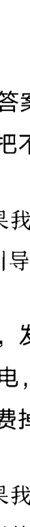

卓克

你好，我是卓克。

> 「 知识这东西就得经常地核实和订正，尤其是那些从别人那里听来的知识。」

今天是《卓克·科学思维修仙课》的第一天，本周的前三天，我将用人们身边出现的3个疑问，来讲解模块一：思维与方法中的第一个概念——极限。

你会发现，如今的世界，技术的极限不可思议。

为什么电价夜间减半？

国内外很多城市施行分时电价，尤其在夜里价格最便宜，甚至只有白天的一半，很多 companion 觉得夜里电费便宜，就会把一些大功率设备充电的事儿安排在夜里，比如给电动汽车充电，一晚上就省出五六块钱，一年就是一千多块的节约。

如果我们问，为什么要执行这种策略呢？

得到的答案很简单，那就是供电局希望引导大家把不必白天用的电放在夜里用。

如果我们继续追问，为什么供电局要这么引导我们？

答案是，发电厂一天24小时，一年365天都在发电，没人用的时候，这些电就会被白白浪费掉了。

如果我们继续追问，为什么不在夜里没人用的时候把发电机器停下来，等白天用的人多了再启动呢？

这个答案就离我们普通人比较远了。但听过期节目你至少能回答这个问题。

#### 火电厂是如何发电的？

火力发电的具体过程是这样，每天火车把煤运到火电厂，火车是可以直接开进厂里的，到了里面每节车厢不是都连着呢嘛，先给它断开，每节车皮送到一个特殊的机器，叫翻车机，十几吨的车皮来一个180°大翻车，所有煤几十秒内就都卸下来了。

这些煤通过传送带送到磨煤机上去，然后把它们磨像咖啡粉末一样碎，之所以要磨这么碎，就是为了之后能让煤在短时间内迅速充分地燃烧。

比如同样是一斤煤，如果是完整的一块，用打火机点燃它，可能烧几个小时才能烧完，但如果你把它磨成刚刚说的那么碎，像咖啡粉末一样，只要氧气提供充分，可能十几秒就烧完了。

差异就是这么大，这背后就是燃烧技术发挥到了极限。

为了让煤粉末在锅炉里充分燃烧，需要向锅炉里吹风，而且非常强，大约和平时的10级、11级风差不多，它把煤粉末吹到锅炉内二三十米高，也就是说几百公斤的煤粉末是被空气裹挟着，均匀分布在一个像人民英雄纪念碑那么大的立体空间里。

烧得这么猛的目的是为了给水加热，把水变成水蒸气，让水蒸气推动巨大的发电机的汽轮机的扇叶。这个过程就像咱们家里煮饺子，锅盖被里面的水蒸气顶起来那样。但不同的是，发电厂输送水蒸气的管子里的压力要比饺子锅里的大200倍左右。之所以要设计这么大的压力，就是想尽量充分利用燃烧煤带来的能量。

你想，能量的源头就是这些煤粉末的燃烧，源头都已经那么猛了，所以后续所有的环节都要能顶住这种技术发挥到极致之后带来的巨大压力。水蒸气运输的管道里是200多个大气压的压力，其中还有一段是被几十米高的火焰包裹住的，就可想而知这根管子对材料的要求有多高了。高温高压的水蒸气推动汽轮机转动，电就发出来了。

这就是发电厂最主要实现的功能，也是发电机技术的核心应用。

#### 复杂到极限的火力发电厂

可是事情远不是这么简单，因为在发电厂中，各个技术都已经走到了极限，连主要功能外的附属功能也已经复杂到我们难以理解，或者根本就不知道它们的存在。

附属功能有哪些呢？

#### 比如：

- 煤燃烧有废渣，这个废害管道，怎么排走煤渣，是一套复杂系统。
那些没形成煤渣的杂质，会形成有害气体，不能让它们跑出去，含硫气体跑出去会形成酸雨，现在在专门负责脱硫的环节，其实是由一个小的化工厂专门实现的，他们把硫变成石膏，再卖钱。
含氢废气铵脱硝系统处理，这也可以算一个独立的小化工厂。
还有燃烧产生的PM2.5颗粒也有专门配备一个粉尘处理工厂。
整个发电需要的水很大，是由一个小规模自来水厂来保障的。
所以一个火力发电厂背后就是一个化工能源集团。

如果我们用无人机绕着这个火力发电厂飞一圈，大致看到的是由八九公里管道连接的，有七八千个阀门，上万个水温表，水压表，气温表，气压表，有害气体浓度表的系统。为了保证这个像小城市一样的发电厂可靠性足够高，重点环节的开关有好几套，自动的，手动的，电磁的，机械的。而且每个阀门都不能泄露。

那么怎么知道这些东西是不是在工作正常呢？

就要靠监控系统，这套系统需要设置几万个测试点，也就是说同时监控几万个实时变化的数据。

做过数据中心的人都知道，这是一个非常庞大的数据流量和繁琐的计算量。这几万个数据点传回的数据频率是不一样的，比如特别重要的部分，一秒要测量几百次，不重要的地方一秒钟测量一次。

好，现在问题来了：

这个发电厂占地几平方公里，一旦某些地方出了故障，怎么判断事故最先是从哪里发生的呢？

所以几万个测试点都需要在时间上做对齐，对齐的精度要达到零点几毫秒，要借助GPS卫星定位系统做时间对齐。

比如国家电网现在来了一个指令，现在供电需求增加，请你多发一些电。

大致过程是，让更多蒸汽来推动汽轮机，那么就要多加更多的煤，但又不是那么简单，因为同时也要让更多的空气进入锅炉，而蒸汽是水形成的，所以也要加适量的水，而且还不能随便加，要讲究先后顺序，某项指标达标了，再一步步缓慢加上去。变化后要特别留意各种温度、压力、流量是不是正常。如果不按规律操作，后果不堪设想。

所以节目开头提到的问题：

夜里没有什么人用电，干嘛不关闭一些发电机呢？

说起来轻巧，但其实这套系统已经复杂到极致了，在保证所有设备都不损坏的情况下，给它完全关闭，再完全打开，单纯完成这个动作可能就要十几个小时了，所以晚上即使用电量很少，也不能关闭发电机。

#### ｜今日小结

可我们再回想一下，发电厂的核心应用，不就是1831年法拉第发明的手摇的圆盘式发电机嘛！

那一年他第一次在皇家学会演示的时候，台下的贵妇们看到的唯一变化就是旁边一个电流表的指针持续地偏转，这个贵妇问道，这个东西到底有什么用呢？

法拉第当时非常有礼貌地回答，夫人，新生儿又有什么用处呢？

没想到后来从这个原理发展出来的发电厂已经把技术各个方面的细节应用到极限，远远超过普通人可以理解的程度。

所以我们才会不太理解，为什么夜里发电厂不停车呢？

厂不停机呢？

#### | 今日思考题

在日常生活中，还有哪些技术，其实已经发展到极限或极致，但普通人对它既熟悉又陌生。

如果你想到了，期待你在留言区分享你的观点，让大家和你一起探索答案。

卓克

我是卓克，我们明天下午19:17见。

#### | 今日金句分享

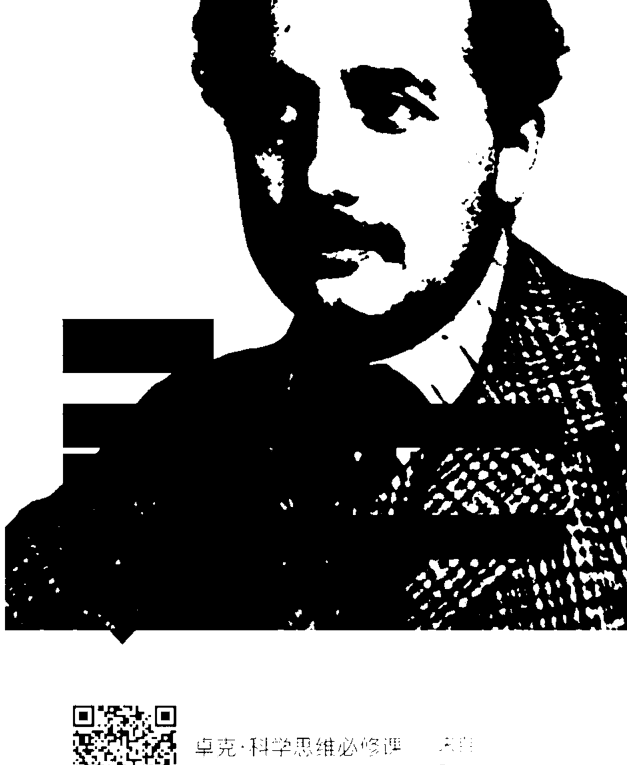

卓克·科学思维必修课

「得到」APP

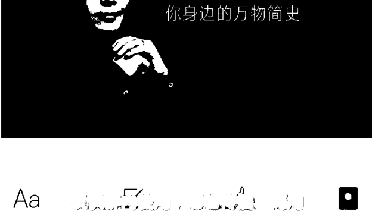

卓克·科学思维必修课
你身边的万物简史

### 002｜极限：太空垃圾会不会越来越多？

卓克

你好，我是卓克。

今天我们继续来讲解模块一：思维与方法中的第一个概念——极限。

你会发现，如今的世界，技术的极限不可思议。

上期节目咱们提到的话题是有些技术的原理我们是了解的，但是因为应用的时间久，使用广泛，人类已经采用一种极端手段去应用它们了，也正是因为这么极端，所以原理我们虽然知道，但已经感受不到它对我们的影响，可它已经渗入我们生活的每一个角落。

太空垃圾会不会越来越多？

比如人造卫星就是个很好的例子：

最常见的就是咱们手机的GPS定位，这就是24个卫星给我们提供的服务，全世界能提供定位服务的有3个系统，格洛纳斯，伽利略，和咱们中国的北斗系统，每个系统都是由二三十颗卫星保障的。

还有各国广播电视的卫星，通讯用的，侦查用的，气象用的，科学研究用的。如果细想一下，这些卫星肯定不会一直保持工作状态，它们寿命到期了那就是一大块垃圾，这些废弃物如果越来越多会不会不好，比如撞坏正常工作的卫星，或者撞坏起飞的宇宙飞船。

这些问题确实不是普通人操心的事情，但也算一个潜在的威胁。

我们先大致了解一下绕地球转动的卫星的总情况，在最近60年里世界各国一共发射了6000多颗人造卫星，其中有一些已经坠回到地球上了，还在太空的有4300个，其中有大约1400个是正在执行任务的，大约占1/3的比例，剩下2/3属于太空垃圾，陨尸卫星，当然，太空垃圾不只是陨尸卫星，还有火箭残骸和其他废物。

而且听过咱们得到王烁全专栏《全球创新260讲》的听众知道，最近1年，商业航天领域进入了高速发展阶段，卫星上天的数量每年递增4.4%。

比如马斯克的那家传奇公司SpaceX，就计划实现全球互联网络接入，到那时地球上任何角落都可以无限制免费使用千兆无线网，但这需要前后发射一共4400多颗卫星，比目前绕地的所有卫星总数还多。

这样的项目今后二十三十年再来10个，天上的卫星和与之相伴的太空垃圾总量就会增加几十倍到上百倍。

卫星最终的命运大都是落入大气层烧毁，或者残骸落入无人区，绝大部分卫星在运行时，距离地面都在400公里以内，这里空气密度大约是地表的十几亿分之一，虽然这么稀薄，但仍然有影响，气体分子和卫星摩擦，会让动能逐渐减少，然后轨道高度就维持不住了，逐渐往下掉。

一般来说，400公里高度上，也就能维持正常高度1年到1年半，还有一些近地卫星，只是临时考察和观测用的，一个也就十几公斤，可能绕地球转三五个月高度就不能继续维持了。

只有用于军事的，或者用来全球定位的，那些卫星距离地面2万-3万公里，那里的大气几乎稀薄到和真空差不多了，所以可以顺利工作几十年。但这些时间都指的是维持正常工作的时间，而它们在不正常轨道上还会被飘上更久才会坠落到地球表面。

比如400公里高度的卫星，需要经过十多年才会彻底坠落。

那些高度在2000公里以上的太空垃圾可以飘上千年。

而且还确实造成过事故，比如2009年美国的通信卫星铱星33号就和俄罗斯一颗已经报废的军用卫星撞了个满怀，不但铱星33号报废了，而且撞出几千块碎片，飘落在轨道上。

几千块碎片不算什么，还有更夸张的，1963年，那还是我们对轨道资源没有任何保护意识的时候的一次实验，叫西福特计划。

当年美国为了测试自己的通信的漏洞，向3650公里高度的轨道抛撒了4.8亿根小铜针，每根2cm，头部粗细。本来以为它会在太阳风的作用下，3年内被吹散。结果时至今日，还有相当多的铜针飘在那里。简直是最严重的一次太空污染。

最初我们只顾着发卫星，后来才意识到这是个问题，但最初只能定性地描述，定量的统计是没有的，比如，垃圾是怎么分布的，每块有多大多少，飞得多快？都不知道。

后来美国最先作了测量，在1984年的时刻挑战者号航天飞机专门把一个巨大的圆桶放在太空里，尺寸和一辆大公共汽车差不多，它其实就是一个靶子，等着各种太空垃圾往上撞，它的飞行高度是480公里，也是一个很典型的高度。

为了测试准确，待了6年时间，1990年把它接回地球，仔仔细细一数，身体表面一共有上百万个撞击点，当然，绝大部分是需要用显微镜才能看到的，但就算只统计那些肉眼可见的比较大的撞击，也有32000个，平均每一天遭遇15次大撞击，最大的一只直径半厘米，金属外壳深深地凹陷进去，右上角就是那个最大的坑点。

一个零点几克的太空垃圾就能撞出各种危险的效果，是因为垃圾飞行速度每秒7公里，飞到这个高度的飞船也差不多是这个速度，如果运气不好，飞行方向如果是相对撞的话，那就相当于每秒十几公里的速度对撞。

比如1983年，挑战者号航天飞机就被一块直径0.2毫米的涂料碎屑撞上了，舱窗玻璃破损，停飞了很久。这么小尺寸的垃圾已经有严重后果了，而直径在1cm以上的，NASA估算大约有50万块。

总的来说，现在的策略就是躲。

而且可以预测，垃圾碎片会以指数级增加的，比如今年10万，明年20万，后年40万，大后年80万。虽然当前的危险比share低，但只要出现了一例大规模对撞，大的碎片就会一下多出几千或者上万个，然后会导致更多的大规模碰撞出现，每次都会产生上万的碎片，用不了几次，地球轨道就会布满致命垃圾了，这种问题要怎么解决，只能留给后代科学家。

#### ｜今日小结

您看，发射卫星依据的牛顿定律和火箭技术，我们至少有所了解，而当初特斯拉...

术，我们至少有所了解，而当技术竞争激烈化以后，技术产生的副作用，比如那些太空垃圾，我们根本不了解，它们带来的副作用，大概率说也是要通过其他技术来解决，以保障我们日常的通信，定位，天气预报不受影响。

我们现在安稳地生活在地球表面，是有无数已经发挥到极致的技术做后勤的，而我们对此知之甚少。

#### | 今日思考题

你能不能想到其他的技术，因为发展到极限之后带来了之前没有预料到的副作用？

如果你想到了，期待你在留言区分享你的观点。

卓克

我是卓克，我们明天见。

#### | 今日金句分享

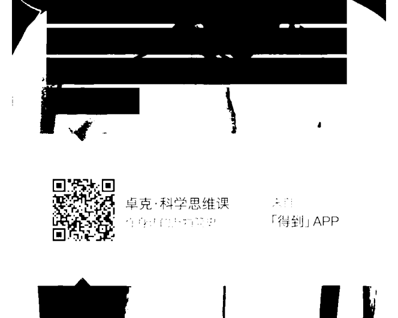

卓克・科学思维课

「得到」APP

#### 003 | 极限：硬盘装满电影会变重吗？

卓克

你好，我是卓克。

今天我们继续来讲解模块一：思维与方法中的第一个概念——极限。

你会发现，如今的世界，技术的极限不可思议。

一个装满电影的硬盘比一个空硬盘更沉吗？

这个问题早在二十年前的国家计算机等级考试最初级的考试里就出现了，那时候考试的正确答案是两个硬盘一样重，但这个答案放在现在就变成不一定了。

具体来说，我们还得多问一句，你指的是什么类型的硬盘？

这是什么意思呢，因为大约在2010年左右，一种新型硬盘在市场上出现了，叫做固态硬盘，咱们一般用英文缩写叫它SSD。

所以最初那个问题的答案是，如果是磁盘的话，重量不变，如果是SSD硬盘的话，会变重一些。

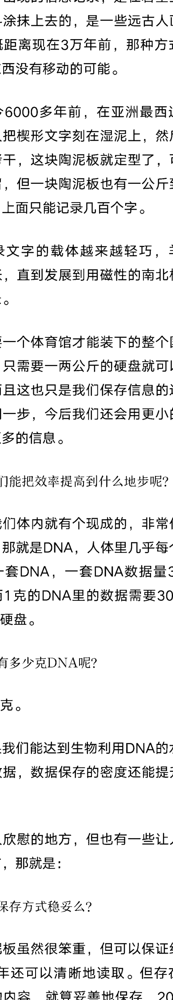

我们知道，一个长条形状的磁铁有南极和北极两个端，我们规定一种代表0，另一种代表1，然后通过01不同的组合代表不同的意义，只要磁铁足够多，我们就能用它们排列的顺序代表所有的信息，数据就是这样存在磁硬盘中的。

而SSD就不一样了，它记录数据的原理还真跟住房袋子里装香蕉差不多，SSD里面也有上万亿个小单元，但每个单元具体是0还是1，全要看这个单元里装了多少个电子，比如装进去100个电子后，这个单元就代表1了，低于这个数值就代表0。所以对SSD来说，它里面存储的数据有多重取决于它存储了多少个电子。

那么电子有多重呢？

我们用公斤去理解的话，大约是这样的，一个电子是0.000000……9公斤，30个零，数据量的多少和用多少电子记录它有个换算，过程就不具体说了，如果用咱们家里常用的硬盘来说，2TB的数据至少要用2×10^13个电子。质量大约就是0.0000000000002公斤，12个零。这么小的数字谁都没有概念。

这幅图看着好像搬家公司的人正在把一架三角钢琴抬上货车，其实这是1956年IBM把世界上第一块硬盘交付使用，其实它一直没能整体出售，因为价格实在太贵，所以只能以租用的方式商业化，当时租金3200美元一个月，但那时的美元非常值钱，核算到今天大约19万人民币一个月。这块硬盘容量是5M，其实您现在看到的这幅图大小差不多是0.5M，您听到的这期节目音频差不多是5M。

#### | 今日小结

当我们回看1956年的硬盘的容量和价格，就能体会到我们现在使用的数据资源在50年前都是极其奢侈的，之所以能走到今天这般... ————

今天这种程度，其实就是工程师们把磁存储技术发挥到极致。

生活中很多基础设施都有这个规律，原理上早早就成熟，但在应用层面上在不断突破技术极限，一次次超出普通人的理解范围。

#### | 今日思考题

当我们用更小的消耗保存信息，会不会导致这些信息非常容易消失，甚至人类文明的历史都不好保留了呢？

期待你在留言区分享你的观点。

卓克

我是卓克，我们明天见。

#### | 今日金句分享

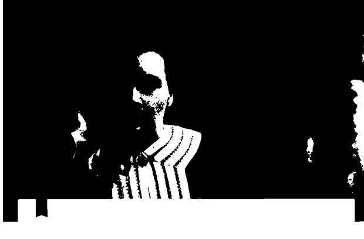

在科学上重要的是研究出来的“东西”，不是研究者“个人”。

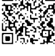

卓克·科学思维课

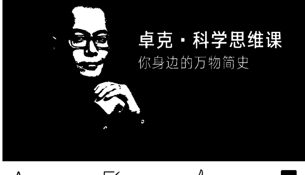

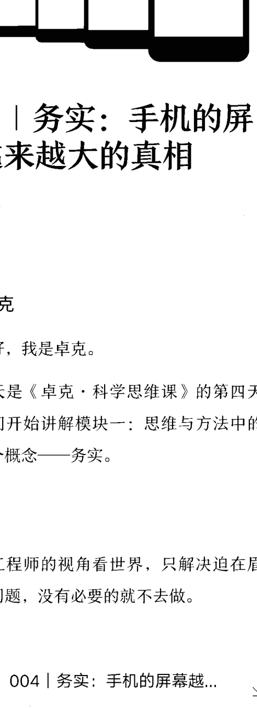

#### 004 | 务实：手机的屏幕越来越大的真相

卓克

你好，我是卓克。

今天是《卓克·科学思维课》的第四天，我们开始讲解模块一：思维与方法中的第二个概念——务实。

用工程师的视角看世界，只解决迫在眉睫的问题，没有必要的就不去做。

手机屏幕为什么越来越大？

这样的问题当然会有很多种理解，我觉得回答这个问题最好的方向就是从工程师的角度去说，你可以把它说成是一种工程师的审美，也可以说是一种选择。

从工程师的角度看问题，背后的逻辑就是务实的思想，只要没有必要就不去做的原则。这个思路在解释手机屏幕为什么越来越大上，非常顺理成章。

具体到“手机屏幕为什么越来越大？”这个问题，答案是：

- 因为手机处理芯片的功耗越来越高，导致手机屏幕增大。

安卓系统的手机是市场绝对主力，中国今年的统计是占86.4%，全球范围是85%左右。

所以我们就以高通的芯片为代表，因为每年的旗舰级用的处理器大都是高通出品的。

手机性能评测，这方面的媒体特别多，他们可以分成2大类：

- 一类从使用体验出发，内容贴近用户需求，但是主观内容太多。
- 另一类就是从工程测试角度出发，用比较精准的专业设备做测试。

国内评测网站基本都是前者，第二类还没有。

国外也是前者居多，后者虽少，但也有做到很令人佩服的，比如 Anandtech。

电子工程师界的人看到这个名字就能嗅出工程师的味道，因为 NAND 就是数字电路中一个最基础的单位——与非门。

这个网站20年来一直用研发的手段把市售产品的性能详细展示出来，而且都是横向对比的。进入智能手机时代，他们也会实际测试芯片的功耗，其实这个测试的难度非常高，目前只有他们测得比较稳妥。

- 具体是这样，高通从2012年到2017年出过很多代处理器，所有核心满载情况下的极限功耗测试，最早一批 CPU 是2瓦出头，到了2013年是4.5瓦，最尴尬的是2015年，发热大户骁龙810，4个核心只3个满载，功耗就已经超过8瓦了。

而且 Anandtech 的这些测试用的是原型机，和普通手机不一样，它是给研发人员用的，所以不讲究什么外观手感，下面的图片就是原型机在测试平台上，那个黑黑的就是原型机，超厚，跟小板砖一样。

因为它只用于研发和调试，所以没必要设计那么薄，内部空间宽敞，散热压力比一般手机小很多。

但即便用这么宽松的设计，也仅仅只能跑到8瓦，再高就自动关机保护了。

正式售卖的手机都追求薄，为了解决发热问题，只好把散热面积做大，屏幕也就跟着变大了。

查一下就会发现，手机的6寸屏、6.5寸屏、甚至夸张的7寸屏，出现的时间点恰恰也是2015年的时候。

当然，厂商是不会告诉你他们没法解决发热问题，所以才尽量把手机做大，而是宣传大屏的好处，看电影玩游戏效果好之类的。

发热大也意味着更耗电，也就需要更大电量保证一天不用充电。正好，反正也要扩充体积，电池也就顺便加大一些。

其实电量不够用的问题还有另一条途径，就是增加能量密度，也就是电池的尺寸和重量不变，但是里面蕴含的能量更多，只可惜电池的能量密度受限于材料学的进展，近几十年几乎没有...

年里增长非常缓慢，所以手机的突破点不能放在增加能量密度上，这属于世界难题，把手机屏幕变大才是可行方案。

所以，手机屏幕为什么越来越大？

好像可以从视觉效果找出不少理由，但那些都不是必须的，选择大屏还是小屏，这只是审美选择。

因为有喜欢大的就有喜欢小的，如果这件事情的原因主要来自于审美的评判，那同理也应该出现一批人追求比3.5英寸更小屏幕的产品，起码小巧的女生更抗拒板砖类的手机。

但为什么2010年到2015年里没见到有向这个方向发展的趋势呢？

其实背后就是那个无法调和的矛盾，你要是不给手机留够空间，发热问题就解决不了，手机在使用时就会随时面临过热关机的危险。

工程师的这种选择就体现了只要没有必要就不去做的原则，现在发热已经迫在眉睫，必须做大屏。

2015年那次发热高峰后，各厂商也意识到问题的严重性，5瓦以上就是雷区，不能碰。

所以后来2年出来的旗舰级处理器，又降回到4.5瓦，3.6瓦这样的水平，所以手机屏幕继续变大的趋势也就停下来了，6.5寸以上的款式不剩几个了，大都回到了5寸。

| Qualcomm Power Testing - Device Level w/Fixed Workload |  |
|---|---|
| Power Consumption |  |
| SD820 Reference Phone | 4.60W |
| SD835 Reference Phone | 3.56W |

现在的处理器很多都是半导体开关按一定逻辑连接起来的。

单个的开关，大致结构是这样的：

有一个入口一个出口，电流一边进一边出，但中间有一道门，门具体是开是闭，由门上的电压控制，如果是机械式的门，那开关起来不但有磨损，速度上也不可能太快，顶多每分钟几万次开关就到头了，发动机就是个典型的应用。

但如果用电场控制，就灵敏多了，每秒几十亿次开闭不在话下，是机械式的十万倍，这就是用电做开关的最大优势。

这种开关管后来被叫做场效应管，发明人是朱利尤斯·利林菲尔德，他是在1925年单枪匹马自己根据半导体的原理做出的发现并注册了专利，但没人知道，没有什么影响，一下沉默了25年。

到了1950年，贝尔实验室也独立做出了这个发明，去注册的时候被专利局拒了，才知道原来25年前已经有人注册过了。

贝尔实验室是全球精英工程师的聚集地，就算原理上是类似的，但实际上1950年贝尔实验室去提交的专利也远比单枪匹马的朱利尤斯当年提交的内容成熟多了，而且种类也更多。

那时候朱利尤斯还在世，贝尔实验室和他达成了协议，支付了一笔钱，然后互相避一下专利，起了不同的名称。

又过了9年，贝尔实验室的工程师制造了第一只金属氧化物半导体场效应管，简称MOSFET，这东西也就是我们CPU里的微结构，一个CPU里可能有几亿或者十几亿个MOSFET。

可能有些同学忍不住想要问，为什么几亿个MOSFET工作就会发热？

从知识角度看，这是个好问题，因为要弄清这个问题需要详细了解微观物质结构在电场下的作用。

但这对工程师来说又不是一个好问题，因为工程师只管用现成的成熟的小零件实现更贴近生活的内容，性能越好，性价比越高，就越卖得出去，就越能盈利，工程师就越愿意做。

至于说微观物质结构上的事儿，让科学家们去操心吧。

#### 今日思考题

你能不能列出一些工程师思维，或者工程味儿十足的行事方式？

如果你想到了，期待你在留言区分享你的观点。

卓克
我是卓克，我们明天见。

#### 今日金句分享

> 如果人们不相信数学是简单的，那仅仅是因为他们没意识到生命有多复杂。

#### 005 | 问答：人可以训练出蒙眼视物的能力？

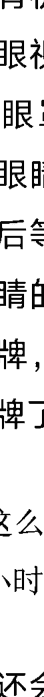

卓克

你好，我是卓克。

今天是《卓克·科学思维课》上线的第五天，也是第一次问答。

儿童接受HSP训练真的可以开发大脑，平衡左右脑发展吗？

#### HSP训练是什么？

总的来说，不同机构开的各种训练班宣扬的内容不同，比如有训练出让人们蒙着眼还能看东西的能力。还有一些宣传的效果很多，比如快速记忆，高速阅读，提高创造力，外加蒙着眼看东西。

很多人一听就感觉是骗子，您的感觉是对的。

那这个是怎么骗的呢？

如果有机会去报名现场，可以主动要求体验蒙眼视物，但你要留意，他们给你蒙上布和眼罩的时候，你要非常用力地闭眼，让眼睛周围的肌肉都紧绷起来，凸出来。然后等他们把眼罩蒙好以后，你再慢慢把眼睛的肌肉放松。这时候他们给你什么扑克牌，你都可以从眼罩和鼻梁的缝隙处看到牌了。

就这么一个把戏，被说成是脑科学，12个小时，6次课，4800块钱。

#### 蒙眼视物的历史

上世纪80年代末90年代初，曾经兴起过一堆子人体特异功能热和气功热，出现过相当多荒唐的事。那个年代最出名的是张宝胜。

#### 如何识别新的骗局？

这要从2个方面入手：

- 一个是具体的科学知识和查证的工作，这方面想提升只能搭时间进去。
另一个方面是科学思维中，对世界尺度和对自己定位的能力。

#### 006 | 问答：地球一小时熄灯活动有什么意义？

卓克

你好，我是卓克。

周一时间我们讲的是 “为什么夜间电价减半？”

电作为第二次工业革命的基础发展至今，已经是人类生存所必须的最基础的部分，以至于这项发展到极致的技术，时常被人们忽视，既熟悉又陌生。

发电厂一年365天都在发电，没人用的时候真的白白浪费掉了吗？

周一讲课的内容里，其实有句话我说的是有问题的，就是发电厂一年365天都在发电，没人用的时候也就白白浪费掉了。

实际情况是不会有浪费的，因为电网的发电量大致是根据需求量走的。

举个例子：

电脑都有电源，但电源的功率有大有小，那么是500瓦的电源省电，还是1000瓦的电源省电呢？其实用电量是差不多的，因为你需要多少电就提供多少电，不是说500瓦电源就是一直输出500瓦，1000瓦电源就一直输出1000瓦。500瓦和1000瓦只是那颗电源能提供的最大电力。

说到发电，整个电网的调控很复杂不是很容易说清，但简单地说，发电的一端给出2个方面的保证：

- 一个是尽量保证交流电压在220V和50Hz；
一个是尽量保证足额提供电流。

这两点在超大功率的环境下都比较难控制，尤其是需求端一会儿需求量小，一会儿需求量大，而且差距差得太大的时候，甚至可能出问题。

一般来说，用电负荷突然变大或者变小，在电压和频率上都会有反应，电网系统会马上检测到这个变化，把信号传给发电厂，发电厂通过自动化的调整。

多出来的发电量如何处理？

地球一小时活动到底有什么意义？

每年的3月底世界上很多城市都会响应世界自然基金会的建议，搞地球一小时活动，就是在晚上八点到九点熄灯1小时，以此造势，吸引关注，希望让社会各界重视地球二氧化碳排放量过多的问题。

这个活动最近几年有些争议，说是电不用也会浪费掉，没用，这个问题我们上面解释过了，不再重复。

所以熄灯1小时也不会对电网有什么害处。

这点都确认了以后，我们再回看熄灯1小时，就能感觉到它额外的价值了。

卓克
好了，这期答疑就是这样，我们下周再见。

#### 预告

#### ——本周课程回顾——

#### 模块一：思维与方法

你会发现，如今的世界，技术的极限不可思议。

#### 001 | 极限：为什么电价夜间减半？

1831年法拉第发明了手摇式发电机，这个原理发展出的“发电厂”成为了第二次工业革命的基础。如今，人类已经把发电厂的各个方面的细节应用到了极限，其复杂程度超过了普通人可以理解的程度。

#### 002 | 极限：太空垃圾会不会越来越多？

太空技术的激烈竞争，才有了我们日常使用的通信、定位、天气预报等服务，而“副产品”太空垃圾，却可能是人类未来迈向太空的门槛。我们安稳地生活在地球表面，是有无数已经发挥到极致的技术做后勤的，而我们对此知之甚少。

#### 003 | 极限：硬盘装满电影会变重吗？

1956年，IBM把世界上第一块硬盘交付使用，容量只有5MB，租金每月大约19万人民币。我们现在使用的数据存储，在50年前是极为奢侈的，之所以发展到今天这个程度，正是工程师们把磁存储技术发挥到了极致。

用工程师的视角看世界，只解决迫在眉睫的问题，没有必要的就不去做。

#### 004 | 务实：手机的屏幕越来越大的真相

因为手机处理芯片的功耗越来越高，从工程师的角度来看，最有效的解决办法就是让屏幕更大，这背后的逻辑是务实的思想，而不是为了满足用户的视觉效果。

#### 答疑时间

#### 005 | 问答：人可以训练出蒙眼视物的能力？

人是一种动物，不存在什么超能力。儿童接受蒙眼视物等能力的训练，不仅无用，还可能为了被称赞而说谎。

#### 006 | 问答：地球一小时熄灯活动有什么意义？

现代电网已经非常完善发达，发电量根据用电需求变化，地球一小时的熄灯活动对电网的影响很小，没有什么害处，这个活动更大的价值是引导节能环保的理念。

#### ——下周课程预告——

### 007 | 务实：二维码破损了还能扫出来是怎么回事？

#### 008 | 务实：为什么现在CPU的核心越来越多，6核/10核？

### 009 | 务实：为什么没有动物比蓝鲸的体型大？

从数字角度理解世界。

#### 010 | 数字：如何感受1亿？

卓克

我是卓克，明天我们开始进入第二周的课程，明天见。

### 007 | 务实：二维码破损了还能扫出来是怎么回事？

卓克

你好，我是卓克。

今天我们继续讲解模块一：思维与方法中的第二个概念——务实。

用工程师的视角看世界，只解决迫在眉睫的问题，没有必要的就不去做。

二维码破损了还能扫出来是怎么回事？

这个问题最简单的回答就是，二维码有纠错机制，在设计之初就考虑到了这一点，预留出了这个功能。

#### —— 二维码的历史 ——

二维码如今已经非常流行了，我父母那一代第一次感受到移动互联网真的到来了，生活变了天，再也不会劝我不要网购，容易上当，就是他们几年后有一次看电视，报道了一个在深圳的乞丐，要饭时身上放的已经不是一个破碗了，而是一张又大又大的二维码。

二维码在中国兴起就是跟微信紧紧绑定的，那是在2011年底，因为那一年12月14日，微信3.5版本第一次支持了二维码，但那时候只支持个人名片的扫码。

一年后，微信4.3版本才正式支持所有二维码。这些重要时间节点我们可以通过百度指数得到印证。

二维码其实来自于条形码：

条形码最早是1949年美国的食品公司为了追溯食品来源发明的。到了一个九十年代的时候，美国的大型超市里出现了一个问题，收银员少，顾客数量多，每人都要买一整车的东西运回去，收银员手动输入购物小票的内容实在太慢，为了加快速度，还得再配一个专门打字的。但当某个超市从当地食品公司进货时发现，他们登记食物信息来源只要扫一下条形码就行，突然意识到自己可以这么做，就不用再给那个打字员开工资了。

以至于现在所有超市都这么做。

条形码是靠宽窄不同的线存储着信息的，它可以按一套规则翻译成一串数字的，这一串数字背后又有•WhenInformation Suite？套规则，定义了每一位都是什么含义，所有信息完全存储在线条宽窄里。但线条长短这个维度其实没有用来存储信息，可是作为一个贴在物品上的标签来说，不能只有长度没宽度，所以条形码这张纸至少浪费了一个维度。

如果我们能利用上另外的维度，那岂不是更好？

但这也需要契机，因为“如非必须，勿增实体”，是工程领域最流行的行事方法。条形码只要够用，就不会去发明其他的替代品。

但问题最终还是来了：

当时丰田汽车公司的最大的零配件供应商，叫电装株式会社就发现，他们的零件种类实在太多了，喷油器、散热器、氧传感器、起动机、点火单元、发电机、冷凝器、仪表、车锁、雨刮器、电子钥匙、安全气囊、车载导航，上百种。东西一多，就觉得还是用日语更方便，可是传统条形码不支持片假名，想办法扩容的话条形码标签又会变得很长，于是自力更生，组建了一个研发团队，其实就俩人，用了1年半的时间就研发出了现在我们看到的二维码，那一年是1994年，距今23年，这个二维码就支持数字，字母，符号，拉丁文，中文，当然，也肯定还支持日文的片假名。

这些就是二维码一路走来的故事。

#### ——► 二维码的技术细节 ◄——

为什么二维码涂抹两下不会认不出来？

手机在识别二维码之前其实都是先给它拍照，然后再分析。

二维码的4个角上，除了右下角以外，在其他3个角都有大眼睛一样的框框，这3个大眼睛是告诉手机二维码这张图在哪里，方向是朝哪边的，右下角虽然没有大眼睛，但仔细看，你能看到这张图横竖整直地还分布着22个小眼睛，它和3个大眼睛配合在一起，用来调整图形畸变。

比如你是歪着扫二维码，或者二维码贴在一个曲面上，都是需要靠这些小眼睛帮忙正畸，这4个点定位好，手机就知道，哪里是边框，哪里是左上方了，所以我们扫码时无论正着扫还是斜着扫都可以识别出来。

三个大眼睛靠近内侧的那个直角的尖头其实还有虚线连着，但这个实在淹没在信息里看不太出来了，虚线是刻度，这很重要。

除此之外剩下的区域就可以用来存储正文了，剩下的格子越多，能存入的内容就越多，现在总共有40个二维码版本，最低版本是21×21个格子，最高的是177×177个方格，上图里给的就是最高版本，现实中很少用到。

接下来就是编码规则：比如我要存01234567这8位数，先3个3个分组，012一组，345一组，67一组，然后再把这3组数用二进制表示出来，写好以后前面再加上14位的标志位，具体怎么加就不说了。

现在编码的原文就写好了，但是这不能直接转换成都二维码，否则转换出来的图形少了一个角都会导致整张图片都读不出来。

那怎么办呢？

就要用到 Reed Soloman 这种方法，把纠错码加进去，纠错码怎么加就不解释了，估计通信工程的本科课程才会学到。

总之，原理上说，其实就是把01234567这串信息多写几遍，然后打散，这样方受损也能够在其他地方找到原文。

纠错码可以纠多少错误是有分级的，有7%，15%，25%，30%四个级别，也就是最多遮挡住30%的区域不影响解码。

所以这就是为什么我在刚刚的二维码上画了个笑脸还能读出来，因为我设的30%的纠错码，我这张二维码是一段200多字的文章，感兴趣的同学可以扫看看。

现在你知道为什么二维码破损了或者添几笔还能读出来了吧！

纵观二维码的整个发展过程，我们就可以体会到工程师的视角，也许在他们的世界上有2类问题：

一类问题，他们可以准确把握每一个细节，就像二维码图形，每个像素点都能说清是怎么来的。比它更复杂的系统也多的是，比如天河二号超级计算机，虽然极其复杂，但任何故障我们都能查出来，这是因为整套系统从零开始都是工程师们一手搭建的。

但另一种问题，比如为什么有些女生一遇到具体技术细节就特别抗拒？这种问题工程师就很难回答了，因为这些女生的知识架构，不是工程师从零一手搭建起来的，这些人过往的经历、思维习惯都在影响着这些女生的行为方式，对工程师来说，信息缺失太多，没法回答，所以只能尽量体谅对方，用简单的语言把这个过程大致描述出来。

述出来。

#### —— 今日思考题 ——

你能不能举出一些在工程师角度看是很
讨论清楚的，可是在普通人来看答案却是
很显然的这种例子呢？

如果你想到了，期待你在留言区留下你的观点。

卓克

我是卓克，我们下期见。

#### —— 今日金句分享 ——

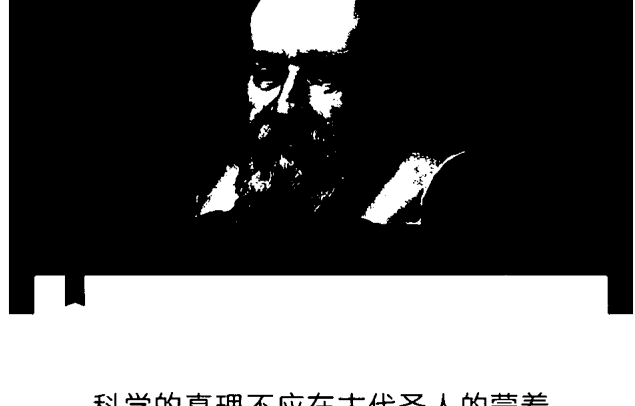

科学的真理不应该在古代圣人的蒙着灰尘的书上去找，而应该在实验中和以实验为基础的理论中去找。

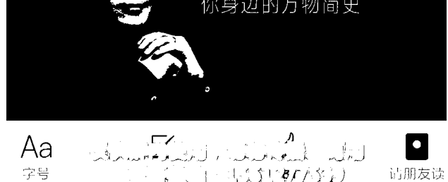

### 008 | 务实：为什么现在CPU的核心越来越多，8核/10核？

#### ——► 概念02：务实 ◄——

用工程师的视角看世界，只解决迫在眉睫的问题，没有必要的就不去做。

现在的处理器不管是给台式机用还是给手机用，都是越来越往多核心这个方向发展，8核、10核。

处理器不是速度越高性能越好吗，怎么不见宣传工作速度了？

简单回答，就是工作频率提不上去了，为了继续增加性能只好弄成多核。

#### ——► 难以更高的频率 ◄——

在民用市场里，1983年英特尔的CPU最高频率到了20Mhz，十七年后的2000年，速度达到了2000Mhz，频率上增加了100倍。但是，再过十七年到2017年，速度达到了4000Mhz，频率上只增加了1倍。尤其是最近10年，频率上可以说几乎没怎么增加。

只从数字看，大家都能明显感觉英特尔好象一头撞上了墙，很难再提高了。

CPU的时钟频率，比如说把1秒钟分成100万份，每份一个刻度，加法需要用3个刻度，乘法用6个，除法用10个，但有的时候需要等待上一个结果出来，才能进行下一步计算，那么说不定中间有一长段的时间要等待，时间白白浪费掉了。

但总的来说，这个时钟频率还是越快越好。人们总是希望买到速度更快的CPU，于是芯片设计企业就依照大家的需求把频率提升，但是，简单地提升以后发热也几乎成正比地提升，频率提升1倍，发热也提升1倍，而且提升频率的过程还会出现工作不稳定，该是1的不还是1，该是0的不是0，怎么办？

其实提升电压可以解决不稳定问题，于是把电压往上提，但电压提升后，芯片发热还会继续提升，而且升得远比之前猛，它是按平方增加的，电压是原来2倍时，发热变成了从前的4倍。

现在的总体情况是，为了满足客户的需求，把速度提升了一倍，为了保证稳定，把电压提升了1倍，叠加后总的结果就是，发热是从前的8倍。原来的散热肯定不够用，加个风扇都不是一定够。如果只是这样对付，一次升级勉强还可以，但明年客户需要频率再提升1倍，那就彻底没招了。

所以在提升频率的道路上，发热堵挡在前面，稍不注意就会被挤住。所以实际上我刚刚说的方法只是芯片厂最不愿意使用的策略。

真正应付发热暴增的强效方法是缩小芯片尺寸。

你要问其中道理，那还免不了要涉及到我们集中提到的MOSFET的结构，但这又太细分太专业了，只能形象地理解一下：

如果把开关管想象成一道闸门，那么闸门越大，每次打开开关耗费的能量就越多，这些能量最终都会变成热的。如果闸门做得越小，每次开关耗费的能量就少多了。

所以缩小尺寸是解决办法，而且缩小尺寸还有另一个更加诱人的副作用：降低成本。

CPU的核心就是一个大拇指指甲盖大小的东西，它是从一个大圆盘样子的硅片上切下来的，这个大圆盘盘篮球差不多大，上面密密麻麻排着CPU核心。

一张12寸直径的圆盘大约2万8千块钱，你在上面只刻出4个指甲盖的格子也行，但不划算，因为每个CPU摊到的成本就是7000块钱。如果在上面刻出400个指甲盖来，每个摊到的成本就是70块。所以降低芯片尺寸是一个一举三得的事情，既能提升频率，还能降低发热，也能降成本。这3方面的利益就猛推着半导体行业在短短几十年里把频率提升到接近4000Mhz的这个节点。

但是，从2007年开始，缩小尺寸这一招渐渐不管用了，形象地说就是这道闸门越变越小以后渐渐关不严了，即使我们把它设置成关闭，电流还是从它下面哗哗地经过，这就有热量产生，而且尺寸越小，单位面积发热越难控制。

虽然近10年，芯片厂商依旧尽最大努力把小闸门换用其他材料，或者改变形状，让它关严实点，但漏过去的电流还是越来越多，从前大闸门时，100份能量95份都用在计算上了，现在小门帘，100份能量，只有45份用在计算上，剩下55份都泄漏出去了。而客户那边对性能的需求不减，这时所有芯片厂都把注意里放在我节且开头说的，那么没有利用上的时钟刻度上。

CPU的时钟并没有100%用在计算上，还有用在等待上，浪费掉了。

#### ——► 越来越多的核心 ◄——

那么就让另一个同样结构的内核来帮忙，这就出现了双核心，而且为了它们承担的任务尽量平衡，工程师还在设计计算机语言的时候，尽量考虑把任务拆成多线程的任务拆出来。

比如给一幅图像上色这种活儿，一个核心当天当然行，16个核心干也一样，图画像成16份，大家各自去上色，然后一拼就好了，所以这样典型的多线程任务，效率提升的倍数几乎和核心数量是一致的，但还是有相当多任务根本就没法拆成多任务，只能交给一个核心完成。

从前单个核心4GHz的频率能提供1个单位的性能，但是它不方便再提升频率了，我们走多核的道路，4个3GHz的核心，虽然频率不高，但性能平均是2个单位的性能，相当于单个核心8GHz的水平了。

这就是核心越来越多的原因。

不过从单核增加到双核是性能提升最明显的，再增加到4核，8核，甚至20核，带来的提升就越来越不明显，这还是因为指令中确实有相当的压根就无法转化为多线程。

当我们知道了这些就可以用工程师的视角回顾各种手机、笔记本的文案宣传。也能体会市场部工作人员的不容易了，明显是整个行业发展撞上了频率墙，不得不用多核，却不得不挖出一些卖点。

其实只要还是以硅为基础的材料，频率提升空间也有限了，而且靠多核心提升性能，上升空间也有 限。60年前诞生的那些技术基础其实已经被无数工程师发挥到极致了，想要看到下一个突破，需要期待的不是极致上的极致，而是另一套全新的技术基础。

#### ——► 今日思考题 ◄——

有一些本来是技术上存在瓶颈，是不得不以而为之的，可是市场宣传中却用了另外一种手段掩盖了这种无奈，如果你想到了这样的例子，期待你在留言区分享你的观点。

卓克
我是卓克，我们下期见。

用户留言

### 009 | 务实：为什么没有动物比蓝鲸的体型大？

#### —— 概念02：务实 ——

用工程师的视角看世界，只解决迫在眉睫的问题，没有必要的就不要去做。

009 | 务实：为什么没有动物..

这个问题一看就是和生物或者进化有关的，但是最近这一段时间我们一直在说用工程师的眼光看世界。

这两者有什么关系吗？

那就是找最关键的问题，这个问题不解决，其他都不用聊。这个问题解决了，才能轮到其他优化的部分。

蓝鲸体型这个问题回答是，不论从发热散热的角度，还是从新陈代谢和心血管功能上看，蓝鲸的体型已经走到极限，再大就活不成了。

这个理由足够了吧，那具体是怎么回事呢？

首先是从发热的角度看，身体总的发热量和身体有多少细胞，和每个细胞能产生多少热量有关。身体有发热，也有散热。发热是所有细胞的贡献，不管是内部的还是外部的。

可是在散热问题上，近似地看，大概是只有皮肤附近的一层细胞参与。

所以当一种生物，大致外观没有剧变的情况下，还维持从前的外形，同比例放大，从体长1米放大到2米，这里参与发热的细胞数量大致是从前的8倍，所以发热总量也是从前的8倍，但参与散热的皮肤表面的面积只是从前的4倍。

这是问题吗？

这要看具体是从多大的尺寸开始变化。

比如从一只小老鼠长成一只大老鼠那样，一般问题不大，它自身的体温调节就能处理增加的发热。

再大一些的，比如从一只狗变成一匹马那么大，除了体温调节要参与，还要把体表的长毛去掉，否则就会热死，所以我们很少能够见到大牛大马这种尺寸的浑身沉覆盖着毛的动物。

那西藏的牦牛呢？

那是因为天寒地冻，需要保温。

蓝鲸30多米长，170多吨重，其实就面临非常严峻的散热的问题，多余的热量必须散出去，否则器官会衰竭，散热就通过海水，这是天然的水冷装置。如果为空按比例将蓝鲸放大到60米长，体重就要1000吨了，那估计海水带着散热也不够。

其实在散热出现问题之前，其他因素也会导致它死亡。

陆地上没能出现这样的庞然大物，考古证据中最大的就是马门溪龙，20多米长，但这是把长脖子和长尾巴算进去的，如果马门溪龙的体型像蓝鲸那样，是一个22米长的一大坨肉，我相信它的散热也问题。

所以你看，马门溪龙体长22米，跟蓝鲸差不多多，但体重只有20多吨，离蓝鲸的170吨差远了，是因为它细长的脖子和尾巴也算进去了。

据分析，马门溪龙活着的时候也是经常泡在水里的。它泡在水里当然有利于散热，但更多的因素是它在干燥的陆地上活动会随时骨折。

因为胶体能承受的压力、扭力和胶体的截面积高度相关，截面积相当于身体长度的二次方，而胶体受力我们简单看成体重，体重就是细胞的多少，它是按身体长度的三次方增长的。

所以像马门溪龙还有类似的大家伙伙在水里，利用水带来的浮力来减轻腿部的压力。那些体型略小的大家伙，比如大象，犀牛，河马，虽然不一定非要泡在水里，但四条腿几乎占据了肚子下面的大部分空间。而那些很小的动物，比如蜘蛛，八脚”等它们地闪转腾挪，就是因为它的强度足够用了。

其实仔细地从平方增长与立方增长对散热、对承重上的影响这个方面考虑的人很早就出现了，最早的是伽利略，那是在1638年，距离他去世只有3年多，他发表了最后一本著作《两种新科学的对话》，这本书是对他过去几十年研究的综述。

他讨论了一个建筑物，比如一个教堂，如果按比例增大尺寸会发生什么问题呢？

他提出最后就会因为承重能力是按平方规律增加的，比如柱子。而压力是按立方规律增加的，所以大教堂无限扩大，后果就是房屋倒屋塌。

伽利略当时已经是一个74岁的老人，他是从69岁开始被教会裁判所判处终身监禁的，不过因为他本来就有挺高的社会地位，也悔过了，岁数也大了，所以最终是在锡耶纳大主教的家里执行的软禁，不能随随便便答，每写的东西必须交上去审核。

被软禁的时间里他每天写写算算，只不过不再敢碰触到底是太阳绕着地球转还是地球绕着太阳转的问题研究了，而是转向研究一些和圣经内容不抵触的东西。

比如一个教堂能不能按比例无限扩建呢？

其实这个问题前人也遇到过，不过从一千多年前亚里士多德起，就把这类问题定了一个基调，它属于工匠、手艺人们经验积累下的产物，顶多算是技巧，不是什么重大的问题，直到到伽利略这里才把它当成科学问题进行定量的仔细分析。

在伽利略之后，也有人从平方立方规律，探讨研究建筑物的尺寸，甚至也分析出动物体格的规律。

在2010年的時候，美国科学家克里克特洛恩斯总结了447种动物，5个等级的尺寸，对动物基础代谢，也就是清醒时最低能耗和体重作了更详细的分析，并且结合心血管输血的特性对生物体型作了进一步的统计。

体型能长多大？

如果第一次听说这个问题，那么找到的答案可能有的从食物来源角度去解释，有的从生长发育角度解释，听上去似乎都有道理，就容易当成答案纳入自己的知识体系里，而实际上却没抓住重点。

体型当然是由很多因素一起决定的，但我想，拥有工程师眼光的人会知道其中哪个是最值得关注的，定量的估算后就能找到关键点。

知道这个问题答案后，我们也会知道，类似科幻电影里的哥斯拉怪兽，进击的巨人，三十多米的大怪兽都是不可能存在的，因为在地球这种重力环境下，超过20米就足够自己压垮自己，不用别人出手。

也许第一次明白这个道理会觉得这个世界真没意思，奇人怪兽原来都是不可能的。但那只是儿童的奇幻世界，当我们成熟后，心中的世界应该是牢固和稳定的。

#### —— 今日思考题 ——

像老鼠这种东西，你会发现它每天如果给足食物的话，它吃进去的东西会比它的体重还多，而且可以天天这么吃，但体型跟我们人差不多的，或者跟马牛羊差不多的动物，即使一顿能吃很多，最多也就吃体重的1/3，而且不能天天吃这么多，为什么会这样呢？

期待你在留言区分享你的观点。

卓克
我是卓克，我们下期见。

用户留言

### 010 | 数字: 如何感受1亿?

卓克

你好，我是卓克。

今天我们进入模块一：思维与方法第三个概念的学习。

#### ——► 概念03: 数字 ◄——

从数字的角度理解世界。

010 | 数字: 如何感受1亿?

很多人都经常接触大数，也就是超过一亿的数字。

比如2016年中国GDP是11万亿美... 人的大脑有860亿个神经元。

很多人就以为我们对这些庞大的单位很熟悉，而实际上，一个描述个数值的数值超过1亿，我们都是严重缺乏了解的。

#### ——► 比值关系的技巧 ◄——

比如我们之前几期说到的缩小CPU尺寸，把开关管的那个闸门缩小再缩小，你可能在广告宣传里经常听到说，这款新的处理器使用了10纳米工艺，代表闸门宽度10纳米，就是1亿分之1米。

但你真的理解这个1亿吗?

如果我们换个角度去理解，这个10纳米的工艺尺寸，把它跟一把螺丝刀的长度比较起来，是怎样的比例关系呢？能不能形象的表达出来呢？

#### ——► 十进制的历史 ◄——

这背后另一个认识世界的基础就是“十进制”。

十进制不光对你我是理所当然的，地球上人类文明最早出现的几个地方，也几乎都从一开始就在使用十进制，这包括古印度、古希腊、古埃及、古中国。

虽然这几个文明在地理上距离很远，最早出现可翻译的文字记录，在时间上也相差千年之久，但它们各自独立发展的文化中，在数字这种抽象概念上都不约而同地选择了十进制。

为什么？

因为我们有10个手指。

#### ——► 六十进制与苏美尔人 ◄——

但你注意到了没有，我刚刚说的是人类文明最初“几乎”都采用了十进制，就是有例外，这个例外就是苏美尔人。

#### ——► 指数运算的出现 ◄——

十进制虽然是我们度量世界的基础，但真正能像现代人熟练地把1亿倍差距来回转化，还需要一次认知上的升级，那就是指数运算的概念。

一个数字右上角再标一个小数字，就代表把下面这个块头比较大的数字连乘多少次的意思，这就是指数运算。

和观察到的东西数值越来越大，能更熟练地把巨大的数字放在一起处理的科学家才有前途。

最后让我们再把理解巨大比值关系的技巧来个实战：

比如100万和1比起来是什么感觉呢？那就是差不多12天和1秒的比例关系。

那10亿和1比起来是什么感觉呢？大约就是32年和1秒的比例关系。

你只要把两头的数字都囊括在日常生活可以触及到的范围内，比例到底有多悬殊就能体验了。

#### ——◆ 今日思考题 ◆——

你能不能想出其它的对比方式，让别人更切身的体会到1亿倍，甚至更大倍数的差异呢？

如果你想到了，期待你在留言区分享你的观点。

卓克

作为专栏主理人，总有人问我，你在得到订阅了哪几位老师的专栏啊？平常都听些什么内容啊？

其实说起来，我是“每天听本书”的重度用户，因为我每天为大家生产课程内容，需要看大量的资料，只要是那些与课程内容无关的“闲”书，几乎没有时间去看，所以我一直在想，等《卓克·科学思维课》的课程结束，我要给自己放假，然后好好看看“闲”书。

“每天听本书”对我来说意义很大，一本十几万字，几十万字的书，差不多20分钟听完，很好的利用了我的碎片时间，这个要感谢得到推出这样一个产品。

今天我推荐给大家四本我很喜欢的书，分别是《别闹了，费曼先生》《基因组》《黑科技》《浪潮之巅》，这四本书都有点儿“硬”，但我相信你听过之后，一定能有所收获。

我是卓克，我们下期见。

4本 “硬”书

送给有科学思维的你

截此查看

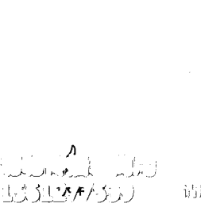

用户留言

### 011 | 问答：10亿个晶体管怎么放进指甲盖大小的芯片里？

011 | 问答：10亿个晶体管怎...

有几位同学都想问，指甲盖大小的面积怎么会有几个亿个 MOSFET 开关，是要一个一个地镶嵌进去吗？

这肯定是没学过电学的同学们很想知道的。

因为大部分人脑中的一个开关管，一定是一个电阻，一个电容类似的东西，就是中间有一坨是元件的核心，它能实现一个功能，然后边缘的地办伸出一些引脚，这样好把它接到电路里去。

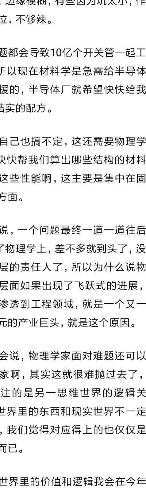

这就是大部分人脑海里开关的样子。

如果照这种逻辑，一个指甲盖大小的面积，MOSFET 开关有3个引脚，还有10亿个要按特定的连接镶嵌在一起，实在是不太可能。

如果真是这样，以我们现在的技术，估计也就就能放进去1万个，离10亿个还有10万倍差距。

实际上半导体芯片的制作并不是先制作10亿个元件再放进去这样的流程。

它更类似于做生日蛋糕，我在《008 | 务实：为什么现在CPU的核心越来越多，8核/10核？》章节课里说的，箔箩直径那么大的圆盘一样的晶圆，就相当于蛋糕最底下的两层蛋糕胚子。

接着，在定型奶油上面又喷了一层黑白花纹的高级奶油（上图 b 和 c 中的黑色方块）。

这个奶油高级就高级在，黑色部分不怕紫外线照射，白色部分遇到紫外线就会蒸发，而且蒸发的不止白色奶油这部分，连同下面不太好吃的定型奶油也跟着蒸发了（上图 e）。

好吧，这个问题就回答到这里，我们明天见。

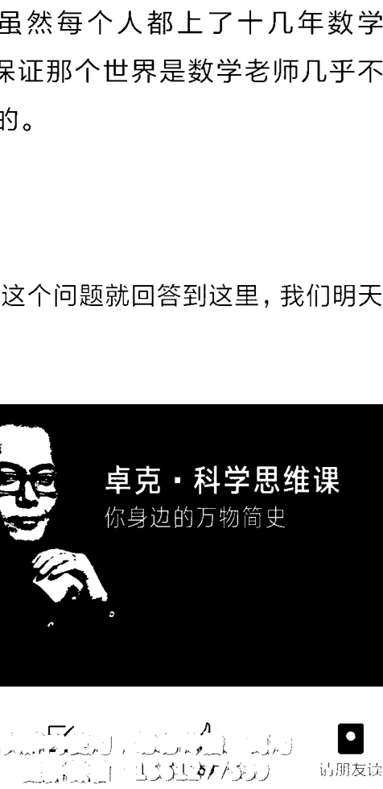

卓克

### 012 | 问答：一次花费300万的治疗癌症新方法是真的吗？

有同学留言想问问最近 FDA 批准了一个新的癌症治疗方法，单次治疗费用47.5万美 元，折合人民币300多万，使用1个月后如 果不见效全额退款。

问这是否泰山编出来敛财的？

其实这个新闻是真的，而且很可能前途无 量。

7月中旬的时候，其实已经有新闻报道 了，说 FDA 的专家组以10比0的投票，全 票支持诺华制药申请的 CAR-T疗法，用 于治疗白血病。其实这个新闻一出，已经 可以断定诺华制药的 CAR-T疗法马上就 会上市了。

#### ——► FDA三期临床试验 ◄——

在美国，一种新药的上市要经历世界上最 严格的流程：

需要先向 FDA（美国食品药品监督管理） 提交申请，批准后开始做一、二、三期的临 床试验。

第一期解决毒性和剂量的问题，完成以后 写报告，送去审核；

审核通过了才能进入第二期，这时候招募 几十人到一两百人，做疗效的测试，做完 写报告，送去审核；

还能通过的话，再进入第三期，第三期招 募几百人到几千人，做更大规模的疗效测 试，做完写报告，送去审核；

如果还能通过，药就可以上市了。

#### ——► 癌细胞 ◄——

#### ——► 免疫疗法 ◄——

#### ——► CAR-T 技术原理 ◄——

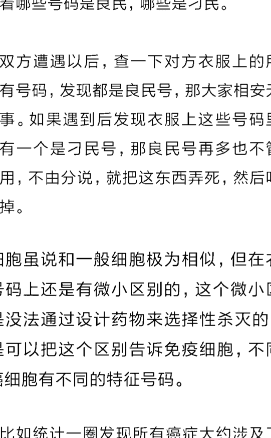

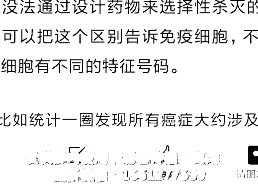

比如统计一圈发现所有癌症大约涉及了5000个特征号码，而其中80%的癌细胞的衣服上都包含了其中50个号码，我们就想办法把这50个号码告诉免疫细胞，这样免疫细胞起码对80%的癌症细胞都有识别能力了。

诺华制药当时参与临床治疗的是63个急性淋巴细胞白血病美国患者，最后有40个人注射了新的免疫细胞到体内以后，3个月，体内就完全找不到癌细胞了。

但在这个药之前最有效的是格列卫，它能让慢性白血病患者5年生存率从30%跃升到90%，好像挺高了，但其实这些活过5年的人要是去检测，大多数都能检测出癌细胞。只不过是通过吃格列卫抑制住了。

所以这一次的 CAR-T 疗法很可能会是一个彻底解决一部分癌症的方法。

#### ——◆ CAR-T 的风险 ◆——

第一个，因为现在临床试验时间还不足够长，不能肯定这些被重新培育出的免疫细胞会不会在几十年的时间里一直对这类癌细胞有杀伤力。这就像我们打疫苗，有些疫苗经过几年会慢慢变弱，是需要再补加强针的。

第二个，这个疫苗现在只用于急性的淋巴细胞白血病。不用于任何其他癌症，而且只在美国被批准了。而且只批了诺华制药。世界其他地区其他药厂没有，也不能用在其他癌症上。这些细节都是骗子非常愿意打马虎眼的地方。

另外现在治疗费用确实非常高，但这种情况很正常，每种跨时代的新药上市，都是天价，比如1955年的青霉素，打一针也要破产的，现在不到一顿午饭钱。

CAR-T 技术成熟了以后会迅速降低到大众可以支付的范围里。而且别看现在只针对白血病，之后肯定会逐渐地用在肺癌、骨癌、皮肤癌，其他器官的癌症上。但每一步的调整都需要大量的实验数据作保证。

卓克

好了，这个问题就回答到这里，我们下期再见。

### 回顾+预告 | 我们一起触及更加精细的世界

#### —— 本周课程回顾 ——

#### 模块一：思维与方法

用工程师的视角看世界，只解决迫在眉睫的问题，没有必要的就不去做。

007 | 务实：二维码破损了还能扫出来是怎么回事？

工程领域的行事方式是，如非必须要用，就无需发明新的东西。二维码的出现是因为条形码不够用了，而条形码的普及，是因为美国大超市手动输入小票信息不如扫条形码快。

008 | 务实：为什么现在CPU的核心越来越多，8核/10核？

单核心CPU的速度到达极限，在提升频率的路上撞到了“发热”这面墙，为了提高性能，工程师只好走多核心路线，但上升空间也有限。

009 | 务实：为什么没有动物比蓝鲸的体型大？

从发热散热的角度，以及肢体承受力上看，蓝鲸的体型已经是动物的极限，那种几十米高的怪兽不可能存在。也许第一次明白这个道理，你会觉得这个世界真没意思，但当你成熟之后，心中的世界本应该就是牢固和稳定的。

从数字的角度理解世界。

010 | 数字：如何感受1亿？

对于“亿”和“纳米”这类巨大或者特别小的数值，绝大多数人都严重缺乏认知。实际上，你只要把这些数字囊括到日常生活可以触及到的范围内，就可以体验数字这种抽象的概念了。

#### 答疑时间

011 | 问答：10亿个晶体管怎么放进指甲盖大小的芯片里？

实际上半导体芯片的制作并不是先制作10亿个元件，然后再放进芯片中，而是更类似于做生日蛋糕，在一个胚子上不断地加工。

012 | 问答：一次花费300万的治疗癌症新方法是真的吗？

CAR-T疗法很可能会是一个彻底解决一部分癌症的方法。在技术成熟后会迅速降价，而且不只针对白血病，还肯定会逐渐地用在肺癌、骨癌、皮肤癌，其他器官的癌症治疗上。

#### —— 下周课程预告 ——

013 | 数字：发电全都用太阳能，可行吗？

014 | 数字：别在数量级上犯错误

015 | 数字：坟墓什么时候占据整个地球？

016 | 数字：多少个药物分子才能治疗疾病？

卓克

我是卓克，明天我们开始进入第三周的课程，明天见。

#### 013 | 数字：发电全都用太阳能，可行吗？

#### ——► 概念03：数字 ◄——

从数字的角度理解世界。

目前来看，人类最理想的能源就是太阳能，因为发电过程中造成的直接污染最小，而且太阳在人类有生之年都是稳定燃烧的。

但理想和现实总是有差距，比如中国火力发电占比74%，水电占比18%，太阳能是1%，但如果我们把管理国家当做一场帝国时代的电脑游戏的话，现在我有一个想法：

就是我想看看能不能把中国的供电全都改成太阳能？

这是一个思维游戏，你跟着我一路走下来，就可以领略一下一个科学的思考方式，叫做——近似计算。

游戏嘛，能不能实现还要看钱够不够用，我们就得计算花费。

现在，全国发电的装机总容量16.5亿千瓦，太阳能光电系统整套包括发电，传输，储存，还有保护装置等等算下来，每瓦花费大约是35块钱。

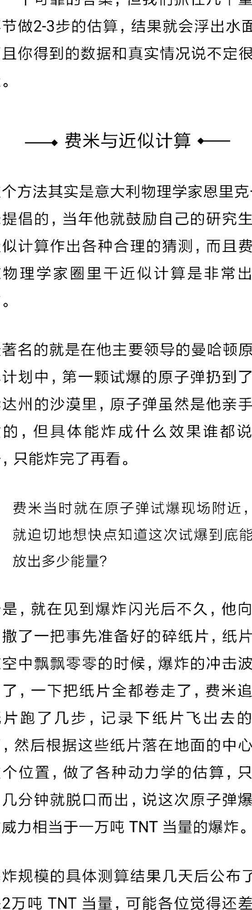

#### ——► 费米与近似计算 ◄——

加哥的医院看望他。

当时费米刚刚做过胃部分的切除手术，塞格雷远远地看到，病床上的费米，一手握着怀表，眼睛一会儿看一眼吊瓶，一会儿看一下怀表，塞格雷知道，这个脑子永远也停不下的费米，正在估算点滴液体的流速。

今天我们讲解的科学思维，就是这个近似计算。

#### —— 今日思考题 ——

你也可以用近似计算试试，估计一下北京有多少个钢琴的调琴师？

如果你有思路了，期待你在留言区分享你的计算过程和结果。

卓克

我是卓克，咱下期再见。

#### # 用户留言

#### 014 | 数字：别在数量级上犯错误

#### —— 概念03: 数字 ——

从数字的角度理解世界。

014 | 数字：别在数量级上犯错误..

在数量级的估算上出错，听着好像是做错了数学题，其实这是一个我们观察事物方法上的失误。

尤其是评论一个新东西，或者新现象，它是95分还是60分，还是15分差到没边呢？或者是这个东西对身体有没有害处呢？

我们都需要正确的评价，需要正确把握数量级。

#### —— 数字的数量级 ——

有个很古老的传说，那时候象棋刚刚发明出来，阿拉伯的一个国王一下就迷上了，觉得应该重奖发明这个游戏的人，结果发明者来了，他让人家提要求，人家说棋盘上第一个格放1粒麦子，第二个格2粒，第三格4粒，第四格8粒，这样令和下去，最后一个格也放满，最后把这些麦粒装给他，国王欣然同意，觉得这个人很厚道，不漫天要价，结果按照这个规律装麦粒的时候才发现，原来全国粮仓里的麦子也不够用。

比较有意思的是，象棋是自从公元三世纪就出现在印度了，后来其中的兵种和走法一直在不断变化，比如最早只有步兵，骑兵，大象。

#### —— 尺寸的数量级 ——

是凹凸不平的。

咱们可以计算，地球直径是12800公里，珠穆朗玛峰这个最高点比海平面高8.8公里。

#### —— 危害的数量级 ——

我们举几个常见的生活中的例子：

比如感觉腹部难受，持续好几天都没缓解，去医院大夫就会建议你拍个X光，可是有人就会担心X光辐射致癌，这就是在危害的数量级上犯了错误。

#### —— 用户的数量级 ——

还有一些事情我们也可以用这种方式看待：

一股巨大的影响力，所以在它没有成熟之前，我们静观其变就够了，最终我们也许从中受益，最终我们也许从中吸取别人的失败教训。

我们再来看那些评价共享单车的内容，如果完全忽略了它上亿数量级用户的影响力，而去聊其它内容，最终还要试图给整个共享单车行业作预测的话，这类内容就不值得花费咱们的宝贵时间去阅读了。

因为他没有从数量级的思考方式入手，而是更多的从公交站的拥堵，车座下的二维码被换了，多少车被扔到河里了，就这种更加切身的浅层的个人感受来入手。

同理，中国有不少规定和政策出台，虽然初看各种不合理，有各种可以优化的地方，但我们始终要提醒自己，如果这是一个施加在几亿人身上的规定，不论是单独拎出来看它是否合理，其实它带来的影响已经远超过区域性措施了。

每一个站在珠穆朗玛峰脚下的人，都会发出平生最大的感叹，这一点不稀奇。

但如果我们评论的是整个地球的光滑程度，还是要警惕那些最浅显最直接的感受遮住我们的判断力。

这种思考方式尤其值得推荐给那些制定规则的人。

#### ——◆ 今日思考题 ◆——

在你的生活里，有没有一些非常典型的，在数量级上犯错误的例子呢？

如果你想到了，期待你在留言区分享你的观点。

卓克

我是卓克，咱俩下期再见。

#### 015 | 数字：坟墓什么时候占据整个地球？

#### ——►概念03：数字◄——

从数字的角度理解世界。

015 | 数字：坟墓什么时候占...

咱们课程的副标题叫“万物简史”，开播前我曾经参考过一本很有意思的小书，叫《趣味生活简史》，书里开头就说到了一个很让人意外的故事。

作者在英国的诺福克郡买了一栋老房子，当地的一个朋友陪他去村里的教堂，这位朋友是个考古学家，当走进教堂时，朋友问他，你注意到没有，这附近的教堂总是陷下去的，教堂附近的地基总比教堂外的庭院还要高出70厘米，作者就猜可能是地下水过度开采，造成了建筑物下沉。

但朋友告诉他，实际上是因为埋葬死人，积年累月，越埋越多，土越堆越高，才显得教堂是陷下去的。

这就挺让人意外的，结果这位研究考古的朋友又问，你觉得围着这个教堂埋了多少人？

作者随便瞎猜说，80，要不100？

结果他朋友跟他说了个结果，大约2万人，因为每个世纪有1000个成年人生老死亡，还有2000左右是半截天折的，然后这里已经有700多年历史了，所以这附近埋了2万多人。

这里是一个宁静的与世无争的小村子，没有大工业化，没有高速公路，所以确实可以说去世的人已经人满为患。

看到这里，我就想起之所属在其他闲书中看到的一个问题，就是说死人的坟墓如果一直增加，势必会占用活人的生活空间。

持续这么占用，坟墓占据整个活人的生活空间大概需要多少年呢？

书中的计算思路大概是这样：

人的平均寿命假设为80岁，那么随机抽到一个人今年死亡的概率就是1/80，这个数字按照接近1%来算，全世界有70亿人口，那么每年就差不多死去7000万人，每个ileg占用2平米做墓地，全球的陆地面积基本是固定值，假设只有1/10是人类的生活区域，坟墓就埋在这个区域里，最后算出来的结果是，需要11万年，活人的空间会被坟墓占满。

我们怎么理解这11万年呢？

首先，因为坟墓而导致土地占用，并不是一个迫在眉睫的资源耗费。

因为人类这个物种，从出现埋葬同伴、竖墓碑的行为，到今天说不定还没有超过3万年。假如当初居空空间里有1/5被墓地占据后，生活就会出现各种不方便，那也是2万多年以后的事了。这相比于全球变暖、石油危机这样的潜在威胁来说，已经不是紧要的事儿了。

其实，我们还要意识到，墓地存在的时间并不是永久的，甚至可能大部分墓墓墓地保存时间是超不过100年的，尤其是在那些经济高速发展的地区，墓地并不是无条件永远可以占用土地资源的。

比如我从未读面的爷爷，他是1966年去世的，他的墓地大约在2004年大规模拆除北四环中路以北的乱葬岗时，被统一清理掉了，后来那里建成了鸟巢。

其实人们对上一辈人的怀念，最多可以延续两代人，再往下数几代人，因为从未见过自己的太爷爷太奶奶本人，所以很难有情感系在一起，让他们继续用财力人力维护墓地，这个动力就不足。所以征地的时候只要给一份合理的拆迁补偿，这片墓地也就被挪用了。

所以实际上我们在估算墓地占用面积的时候，应该考虑城市居民祖先的墓地数量和占地面积始终会维持一个稳定值，也就是两代人的死亡人口数，不会再积累更多了。

#### ——►哥白尼的墓地◄——

虽然绝大多数城市人今后只能被两代的后人纪念，但还是有一些伟人的墓地会被一直保留着，而且也是值得保留的。

比如我在看哥白尼的传记时，最后说到他的晚年，《天体运行论》终于出版了，他拿到样书的时候已经是人生最后一天了，也就是1543年5月24日。

他当时已经突发脑溢血，身体不能动，眼睛也睁不开，大小便都不能自理了，这本书最终递到他手上，他闭着眼抱着这本书，几个小时后就去世了。

他其实不知道，这本正式出版的书，从内容到标题到封面，都被N多人篡改过了，也没经过他的同意，也幸好他因为身体原因没看到封面和里面的内容，否则也会被气死。

《天体运行论》虽然宣扬的是日心说，但直到哥白尼去世后73年才被教会列为禁书，所以哥白尼生前，乃至去世下葬都没有受到冲击。

当然，那时也根本没有人把他当做一个伟大科学家来纪念。只是一个教区的主教留在家乡弗龙堡大教堂的一个祭坛下面。当时他被埋葬的位置，有一排祭坛，具体是哪个，多亏他去世后40年，有另外一个主教在整理资料的时候，帮他补了一个牌位，后人才知道他埋在哪里。

时间一晃四百多年过去了，到2004的时候，史学界对现代科学的鼻祖人物哥白尼到stills埋在哪里了这个问题突然感兴趣了，就引发了一股热潮。

2005年的时侯，终于在弗龙堡大教堂的一间房子的地下发现了一具尸骨，其中颅骨送去法医修复原图。结果修复出来的画像和哥白尼生前留下的画像高度相似，接 y着就把牙齿中残存的 DNA 测序了。然后又从哥白尼生前的藏书里挑翻，找到一根头发，又检验了头发上的 DNA。结果和牙齿上的一致，尸骨的身份就确认了，这就是哥白尼。

在7年前，也就是2010年5月22日，弗龙堡大教堂重新给哥白尼举行了隆重的下葬仪式。

伟人的墓碑永远值得瞻仰。

#### ——今日内容小结——

总结一下这一期我们说的科学思考方式，这期我们说的是“近似计算”不适用的场合。

它是不 能按照比例放大进行估算的，因为这些事情的发展存在一些约束条件。

这样的例子还有一些：

比如头发生长的长度，我从小到大就没变过发型，一直是圆寸，而且我测过自己头发的生长速度，每天0.4毫米，所以凡是有重要活动，比如罗盛钰维5月份那次重大的001号知识产品发布会，我就算好了，在发布会之前15天，我就剃了一个3毫米的圆寸，他们用带尺子的推子，顺着头皮一走，齐刷刷的都是3毫米长，这样15天后，我就能以9毫米，比起适中的头发长度登台了。

可这个规律也只是在头发长度在40厘米之前比较管用。

因为头发如何生长是由 DNA 规定，由 DNA 来约束的。

大部分头发生长期是3-5年，之后就进入退化期和静止期，所以头发不会一直生长下去。

这种规律在其他体毛，指甲上也存在。所以我们之前初期聊太阳能发电，那个光电板要铺设在高速公路两侧，可行不可行，我就是按不变的规律一直铺设，13万公里道路就有13万的沿途可供铺设，那是因为它是一项工程，我们完全可控，并不存在约束条件，都铺满本来就是我们的目标。

但对于生长发育这些复杂过程，是存在约束条件的。

但对于生长发育这些复杂过程，是存在DNA 设计上的约束的，所以不能以不变的规律做近似计算了。

#### —— 今日思考题 ——

你能不能举一些存在约束条件的事情，它的发展是不能一直使用近似计算扩展的？

如果你想到了，期待你在留言区分享你的观点。

卓克

我是卓克，咱们下期再见。

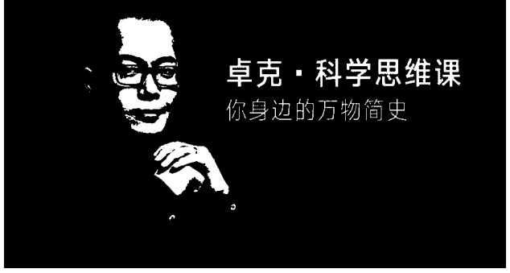

卓克·科学思维课
你身边的万物简史

#### 016 | 数字：多少个药物分子才能治疗疾病？

#### —— ◇ 概念03：数字 ◇ ——

从数字的角度理解世界。

016 | 数字：多少个药物分子.. ↓

假设有人上呼吸道感染了，扁桃体发炎化脓了，连吞咽口水都会疼，说不定还会发烧，医生诊断之后开了阿莫西林，这是一种抗生素。

吃了2天退烧了，又吃了4天，嗓子也完全消肿了，那这次咽喉部分的感染就算过去了。

但你想过没有，阿莫西林是怎么发挥作用的呢？

是阿莫西林自己知道该往哪里去吗？

还是通过某种化学作用让它正确定位到病灶上？

其实都不是，粗略地说，就是药物的有效成分均匀地分布在血液中，血液把药物分子带到身体各处，甚至是每个细胞的旁边，如果细胞附近存在有害微生物，就会ras被杀死。

我们吃的所有小分子药物都是通过这种方式起效的。

#### —— ◇ 阿莫西林的分子量 ◇ ——

这些是跟药物有关的小概念，但是我们这期要介绍的，是用数字理解世界的方法，因为用这种方法我们就可以知道，多少个药物分子在一起发挥作用才能治好病。

这个方法怎么做呢？

我们把阿莫西林的说明书找出来。

化合物简介
基本组成
分子式：C16H19N3O5S·3H2O
分子量：419.46

看分子式那一行：
C16H19N3O5S·3H2O

这化学名字挺长的一大串，我们简称它为阿莫西林分子。

阿莫西林其实只是商品名，就像纯净水，化学名是一氧化二氢，商品名叫娃哈哈。

阿莫西林的分子就是16个 C(碳)，19个 H(氢)，3个 N(氮)，5个 O(氧)，1个 S(硫)，还有3个水合分子，把它们加和就是阿莫西林的分子量。

其实咱们不用挨个算，因为说明书的再下面一行，分子量已经直接给出来了，就是419.46，我们就约等于420吧。

#### —— ◇ 什么是分子量？ ◇ ——

分子量这个概念是初三化学课的内容，还没上初三的同学我给你们解释一下。

因为碳、氢、氧、氮、磷、硫，这些原子实在太轻了，有多轻呢？就是0.0000.....02克，中间有23个零。其他化学元素大致也都是这么轻，所以如果我们说到原子分子的重量时，都用精确的重量去称，那就太反人性了。

为了方便，化学家们约定，把碳原子质量的1/12当做一个标准值，这叫做一个分子量。其他原子分子有多重，都用这个值的倍数来衡量。

所以刚刚阿莫西林的分子量420，就等于也是420个碳原子质量的1/12。这样，我们就能算出一个阿莫西林分子的真正质量是多少了。

#### —— ◇ 阿莫西林起效原理 ◇ ——

我们现在再假设阿莫西林在体内能停留24小时，然后才会被排走，所以体内总能维持24小时内吃进肚子里的药的浓度。

我们再来看看每日用量，按成年人的标准，一次2粒，一日3次，每粒药含有阿莫西林分子是0.25克，所以一天总共吃下1.5克阿莫西林分子。

我们刚刚已经知道一个分子是多重了，所以一天吃下了多少个阿莫西林分子呢？

一除就知道了，大约是10万亿的12亿倍那么多。

然后我们再按刚刚的假设，每个个体细胞都能均匀地享受到血液运来的药物分子。

人体有多少细胞呢？大约是60万亿个细胞。所以匀到每个细胞大约是1.2亿个阿莫西林分子。

所以小分子化学药物起效并不是因为它们有能力寻找病灶，而是凭借超大规模的数量，均匀地分布在血液中，让你身体的每个细胞都被1.2亿个药物分子包围，那些对药物分子敏感的微生物就活不下去了，它们一死，病就好了。

#### —— ◇ 青霉素的历史 ◇ ——

抗生素经过90年的发展已经可以分出 N 个大类 M 个小类，其中最早的一类就是青霉素，而阿莫西林就是青霉素中的一种。

青霉素虽然在1928年就被弗莱明正式发现具有杀菌作用，但实际作为药物广泛使用还要再等20年。

青霉素的广泛使用，还是二战让它的制备方法大幅提升，因为伤员数量增加了，美国后来用玉米糖浆培育出的青霉菌，1毫升可以产生40个单位的青霉素，但效率还是太低。

等到培养环境改进的同时，人们也尽量把青霉素产量高的菌株筛选出来。到了1945年，已经可以达到每毫升培养液产生5万个单位的青霉素了，比最初的提取方法提高了1万多倍。

直到那个时候，青霉素才能用于治疗疾病，不过那时用抗生素治疗感染的价格也和现在用靶向药物治疗癌症一样昂贵，一个疗程核算下来要几十万块钱。

不过，最近20年由于抗生素的滥用，尤其是养殖业的滥用，耐药菌越来越多，可抗生素药物研发销售的收益却越来越低，所以药厂不爱研发。

我们在不久之后可能会面临超级细菌感染无药可治的局面，但是不用担心，下一步的医学技术总会拯救我们的。

#### ——◆ 今日内容小结 ◆——

通过上面的内容你就能感受到，科学思考的方式有多大的作用。

你看，虽然我们不是药学专业的，也不是医生，但因为药是科学家们一手设计出来的，而且是根据FDA的要求，把药物的有效成分的那个分子式的表达式和结构，甚至连分子量都写在说明书里，已经提供了足够详细的数据，在这个基础上，只要我们再多一点好奇心，通过数据，经过简单的加减乘除，就能理解药是怎么起效的。

而且甚至能体会到研发起来为什么有难度，通过这种方法，我们就能拓展自己的世界，触及到那些更加精细的微观世界。

#### ——◆ 今日思考题 ◆——

为什么很多癌症新药都最先用白血病尝试疗效，而且白血病一旦存在有效治疗方法，也会是效果最好的呢？

如果你想到了答案，期待你在留言区分享你的观点。

卓克

我是卓克，咱们下期再见。

#### 017 | 问答：普洱茶致癌？

有同学问《方舟子爆料，普洱茶致癌》，这篇文章里说的是不是真的？

这确实是真的，方舟子在具体的科学细节上在十几年里几乎一个错误都没有犯过。

可能有些人还没看过，我大致介绍一下内容：

- 1. 方舟子列举了2010年广州市疾控中心在市场上买的70份普洱茶的抽检结果，100%检出黄曲霉素，100%检出伏马毒素，90%的茶叶呕吐毒素超标。
- 2. 另外，2012年南昌大学食品工程的硕士重复了广州疾控中心的检测，在市场上买了60份普洱茶，结果100%检出黄曲霉素，100%检出伏马毒素，70%的茶叶呕吐毒素超标。
- 3. 而且还列了一个临床医学上的实例，马鞍山市中心医院肾内科一名为患者每天喝10克普洱茶，坚持了1个多月后，出现了黄曲霉素中毒导致的急性肝损伤，后来还专门把这名患者喝的普洱茶拿去检测，黄曲霉素含量超过30微克/千克。

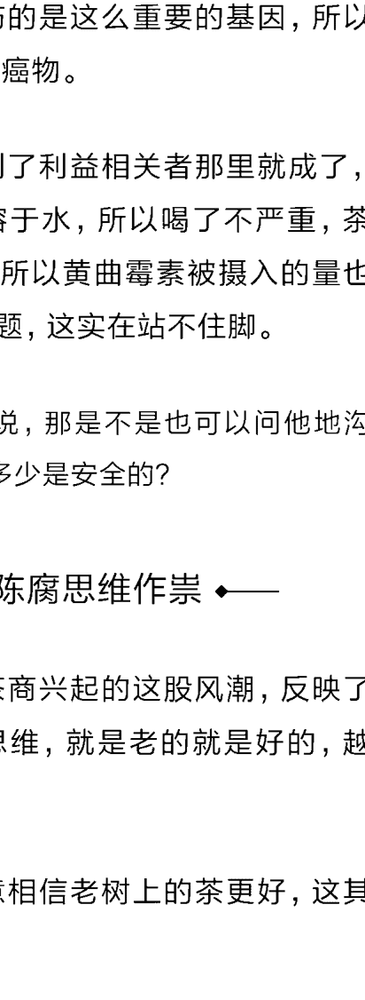

方舟子也列举了茶叶利益相关者对这种严重问题的回应：

- 1. 有一个茶叶专院说茶叶不会含有黄曲霉素，因为只有对人有益的真菌才会生长在普洱茶里生长，方舟子对这种苍白的解释只调侃了一句，“说的漂亮普洱茶特别智能，能帮人分辨真菌的好坏”。
- 2. 还列举了食品科学顾问对这个问题的解释，这个解释说优质的普洱茶不含黄曲霉素，即便有黄曲霉素，热水冲茶也会杀灭霉菌，而且黄曲霉素不溶于水，每次喝茶，茶叶只喝几克，所以真正能摄入体的黄曲霉素没多少。

可是这些解释的错误就在于：

- 1. 霉菌确实是死了，但黄曲霉素280℃都不会分解。而且普洱茶往往就是年份越越优质，而这些茶被黄曲霉素污染得也就越严重。
- 2. 另外想当然地说黄曲霉素量不多，不会造成人体摄入。可前面已有急性肝损伤的病例了。

所以目前所有对负面报道的解释都站不住脚。但方舟子只是针对这些反科学或者不科学的辩解笑了下，并没有给什么普洱茶不能喝之类的结论。

#### —— ◆ 普洱茶的过度营销 ◆ ——

#### —— ◆ 有害物的分类 ◆ ——

#### —— ◆ 黄曲霉素与基因变异 ◆ ——

#### —— ◆ 陈腐思维作祟 ◆ ——

你愿意喝5岁奶牛产的奶，还是愿意喝50岁老奶牛产的奶呢？

绝大部分人肯定选前者，但怎么到了茶叶这里开始追求老了？

当然，这个行业里确实也滋生出一些收藏需求，不喝，只存着等升值。

认为年头越久越好的价值观在很多地方都出现了，如果是文化领域的，也许是因为有历史价值，但也许是没有的，这就需要更多的文化知识积累来鉴别。

但对于吃进肚子里的东西，和健康相关，就没必要追求这种腐朽的观念了。

世界3大饮料，咖啡、可可、茶，因为需求量都非常大，所以早都已经纳入到现代食品工业的体系里，那些严重过期的饮料简单来说就是不合格食品，就是陈年裹脚布。

认不清这一点，很容易伤钱伤身。

卓克

好了，这个问题就回答到这里，我们下期再见。

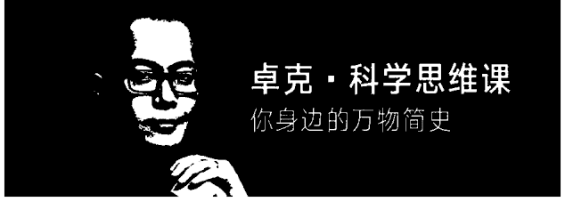

### 018 | 问答: HIV病毒疫苗快制成了?

今天集中回答本周的三个问题:

失去的开始: 如果你当老师, 在幼儿园, 小学, 初中, 高中分另想教哪些课?

卓克

因为现在大部分学校教育中应试部分占比很高, 所以凡是不能提高高考成绩的教学内容都很难以持续维系。

我曾经是想当一名物理老师的, 不过现在看来, 就算是当一名劳技课老师, 我也会把那些科学发展中的规律, 把科学史上让人感慨的故事汇聚在教学内容里, 让同学们尝到甜头, 引起兴趣, 甚至引同学们的思考。

同时我也会告诉他们多把精力放在应试教育上, 只有这样才能在遴选... 在大学阶段开始拓展自己的人生。

云藓: 高压电线周围的磁场对人体是否有伤害呢? 我家的客厅外墙有高压电线经过, 用一个带嗡鸣器的设备检测, 测出来是8mG, 这有没有伤害?

卓克

首先, 这是接近居民楼的电线, 已经不是几十米高那种超高压传输的线了, 所以应该参考工频的电磁辐射安规, 安规是不超过0.1毫特斯拉。

你测的数值8mG, 也就是8毫高斯, 高斯和特斯拉存在换算关系。

0.1毫特斯拉等于1高斯, 也就是说不超过1高斯就是安全的, 但你测到的是千分之八高斯, 离这个安全值还差很远。

在实际情况中, 真能测到千分之八高斯, 已经是非常精密的设备了, 探头的价格就已经几万块钱了, 而且光有探头是不够的, 因为生活环境中背景电磁场就算没高压线也是零点几高斯, 环境中处处都有电磁场, 光背景都远高于表上测到的数值, 所以这个表测出来的数值是错的, 错出大约几十倍。

Highker: 看到强生公司发的新闻说 HIV 疫苗进入第三期试验了, 想知道艾滋病是不是也离治愈不远了?

卓克

这个新闻实际上是8月9日的, 专门拿出来说是教给大家一些辨识谣言类内容的方法。

这个方法就是找到3-4篇原创的同版本报道, 仔细看细节, 就能知道真假。

比如这条新闻出的那天早上, 我的朋友圈也有不少人开始转, 我开始也挺兴奋, 换个点开看, 看过几篇就生出疑问了: 首先一点是, 事件发生的时间和新闻铺天盖地传播的时间, 两个时间点相差太久。那些新闻不论详细的还是粗略的, 都提到, 强生公司7月24日宣布了全球首次 HIV 疫苗人体临床试验结果。

要是说艾滋病毒有望做出疫苗了, 这是医学界天大的消息了, 咱们7月24号公布的, 8月9号才开始刷我的屏? 这半个多月医学界和媒体都统一休假了吗?

其实只凭这一点就可以大致确定这波新闻是炒起来的。 然后继续看几篇, 就发现刷屏的内容里提到了几个医药公司的股价, 再核对一下股市市场, 这几个和疫苗有关的医药公司股价在同一天有涨停的, 有9%的。再看看雅虎财经上纽约所的强生, 没有什么波动。所以很可能是借势的一波炒作。

下面, 那咱们具体来说说现在 HIV 病毒疫苗的研究情况。

就以强生公司的疫苗为例, 他们确实在做研发, 研发的是 一种叫重组病毒载体的疫苗, 之前我们说过, 免疫系统识别良民还是匪民是看身份牌号码的, HIV 病毒有非常多的变种, 但有些特征还是有共性的, 可能80%的变种都包含这个共性。

这个共性指的就是病毒身体表面带的蛋白质的外观。

那么为了让人体对 HIV 有免疫力, 最好能在感染前, 让这些蛋白出现到血液中, 和 T 细胞见个面。但我们又不能直接用 HIV 病毒输入, 让它们见面。

所以科学家们就通过基因技术, 找到了那些种类蛋白质对应的 DNA 序列是什么, 把这几个 DNA 序列, 通过转基因技术, 插入到一种腺病毒的序列中去。这样腺病毒在复制自身结构的时候, 也稀里糊涂地把一部分本来应该是 HIV 病毒的蛋白质合成了出来, 并且披在身体表面。腺病毒也根本不知道, 自己现在, 起码从外观上来看, 已经有点像 HIV 病毒了。

强生这个疫苗就是通过转基因技术敲入了11个基因。

那你说这个不很危险吗?

其实不危险, 腺病毒有很多类, 有些接触到人体一点症状也没有, 有些吸入到鼻腔导致的最多也就是普通感冒。那些 HIV 才有的片段式的蛋白质, 只被当做外衣披上了, 实际上什么坏事都干不了。HIV 之所以有害是因为整个病毒里还有成百上千个其他的蛋白质配合在一起, 把人体免疫系统搞垮, 但披在表面上的这几个蛋白质什么都干不了。这就有点像摩托车手走族是城市的祸害, 他们身穿皮衣, 脑袋戴着头盔。但是如果你给一个买菜的大妈戴上头盔, 就算给她一辆摩托车, 她也不会骑。

这个疫苗到底有效无效, 不能光凭说, 刚刚那个道理大家都能理解, 很多疫苗都是这样研发的, 但无效的药也一样非常多, 如果只是动物实验观察到初步有效, 这距离完成人体实验, 最后获得上市, 少说四年多, 多说十几年。

另外报道中说多少多少人产生了抗体了, 这也是一种有误导性的说法。比如那些晚期的艾滋病患者, 没有有效治疗, 最后奄奄一息, 他们体内也有抗体, 有抗体只能说明免疫系统认识敌人了, 能不能杀灭所有敌人, 那还是另一回事。这一步判断就是 FDA 第三期临床试验审核的关键。

最后我再重复一遍, 绝大部分假新闻和泡沫消息都可以通过找3-4个版本原创内容, 分别读一遍这种方式鉴别出来, 这不要你有什么丰富的专业知识, 唯一需要的花费的就是先抑制住自己转发的冲动, 再就是10-15分钟的阅读和鉴别。

卓克

好了, 这次答疑就是这样, 我们明天再见。

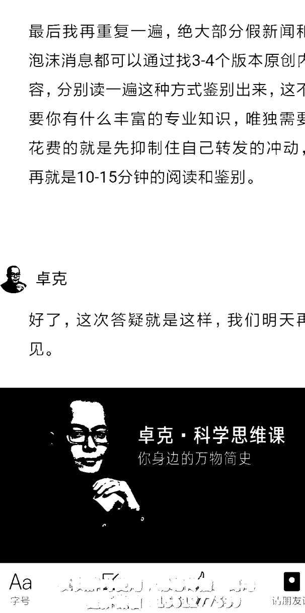

#### 复习+预告 | 警惕那些最浅显最直接的感受

#### ——► 本周课程复习 ◄——

#### 模块一：思维与方法

从数字的角度理解世界。

#### 013 | 数字：发电全都用太阳能，可行吗？

当我们离某个问题的答案很远时，不太可能得到一个可靠的答案，但我们可以抓住几个重要环节做2-3步的估算，与真实情况接近的结果就会浮出水面。

#### 014 | 数字：别在数量级上犯错误

每一个站在珠穆朗玛峰脚下的人，都会发出平生最大的感叹。但以比例关系来看，实际上地球表面比篮球还要平滑得多，我们要警惕那些最浅显、最直接的感受，不要被它们遮住判断力，避免在数量级上犯错。

#### 015 | 数字：坟墓什么时候占据整个地球？

墓地在几代人之后就会被遗忘，大部分保存超不过百年，所以土地资源不会被无限占用。现实中很多事物都存在类似的“约束条件”，所以不能以不变的规律做近似计算。

#### 016 | 数字：多少个药物分子才能治疗疾病？

药物起效，并不是因为它们有能力寻找病灶，而是凭借超大规模的数量，均匀地分布在血液中，让你身体的每个细胞都被数量庞大的药物分子包围，消灭针对的微生物。

#### 答疑时间

#### 017 | 问答：普洱茶致癌？

在普洱茶中发现的黄曲霉素是顶级致癌物，它会导致“抑癌基因-P53”的变异，大幅增加细胞癌变的可能性，超过半数的肿瘤组织中都发现了 P53 基因变异。因此，无需谈论剂量，原则上也要尽量避免食用。

#### 018 | 问答：HIV病毒疫苗快制成了？

绝大部分假新闻和泡沫消息都可以通过找3-4个版本原创内容, 分别读一遍鉴别出来，不需要你有什么丰富的专业知识，而是需要你先抑制住自己转发的冲动，再花费10-15分钟的阅读和鉴别。

#### ——► 下周课程预告 ◄——

### 019 | 复杂：空姐为什么总让我们打开遮光板？

### 020 | 复杂：鸡蛋还能预防流感？

### 021 | 变量：续航400公里的电动汽车怎么跑了250公里就没电？

### 022 | 变量：安全带能增加多少安全性？

卓克

我是卓克，明天我们开始进入第四周的课程，明天见。

### 019 | 复杂：空姐为什么总让我们打开遮光板？

卓克

你好，我是卓克。

今天我们进入模块一：思维与方法第四个概念的学习。

#### —— ◆ 概念04: 复杂 ◆ ——

复杂的技术，也是可以触及的。

019 | 复杂: 空姐为什么总让...

这两期我们从技术的复杂性说一说，像客机这种东西几乎可以算是人类科技最高水平的集合体，所以我们觉得飞机上发生的事情都要由专业的人和专业的仪器来完成，我们很难插得上手，帮得上忙，可是其实也有我们能触及到的。

比如坐过飞机的人都熟悉，请各位旅客收起小桌板，调直座椅靠背，打开遮光板，关闭手机和其他电子设备。

这都是为什么呢？

民航业有个黑色十分钟的说法，指的是起飞阶段的3分钟和降落阶段的7分钟。

虽然大部分航程总时间都是100或者几百分钟，但全球民航客机事故统计显示，有接近70%的事故发生在这10分钟里。

收起小桌板是防止着陆不顺利，出现巨大冲击，人体会被掀起来的小桌板弄骨折或者割伤，所以收起小桌板保护的是乘客。

调直座椅靠背是在保护别人，因为一旦飞机紧急着陆成功，乘客需要尽快撤离，不整齐的座椅角度就会挡住一些乘客进出，所以空姐会要求每个人都调直座椅靠背。

打开遮光板这个问题是有点儿牺牲的，可能空姐都回答不上来。其实这是让所有乘客都有机会会飞行员观察机身外的情况。

因为驾驶员都在最前面的驾驶舱里，对于机身后半部分的情况，比如哪边的发动机突然冒烟了，哪些地方起火了，这些位置在驾驶舱不可能清晰地看到，而乘客看到后有机会提醒驾驶员，对故障作判断就更准了。

这个理由你可能也想到了，但这只是一半的理由。

让人们打开遮光板的另外一个原因是：

- 一旦飞机出现空难，坠落后，方便救援人员从外面清楚地看到里面的情况，比如机身里面哪些部分变了，甚至是统计死伤人数。

你看，飞机这么复杂的装置，里面发生的故障本以为都是专业仪器和人才能触及到的。竟然在特殊情况下，我们普通乘客还能用肉眼帮忙排查故障。

#### —— ◆ 一次惊心动魄的飞行 ◆ ——

那是1982年，一家英国航空公司的波音747载着263名乘客飞过雅加达，从雷达上看前方500公里都是晴空，但飞着飞着机舱里有乘客报告有硫磺磺的臭味儿，空姐还排查了一下，看看是不是有人吸烟点燃了什么东西，也没有。

这时驾驶舱机头的前挡风玻璃上出现了很多电火花，而且越来越密，机长就想知道整个机身的情况，就通知座舱里的乘客，帮忙从舷窗向外看看机身，很多乘客都说机身被静电云环包围着，闪着蓝光，大家正在看着，突然就有坐在中后段的乘客报告说看到发动机起火了，与此同时机长也从监控屏上看到报警，四个发动机有3个都停机了，仅剩的一台发动机是不足以维持飞行的。

但飞机也不会马上掉下去，它可以凭借降低高度来获取一定的速度，用这个速度继续保持飞行姿态。

大概的比例是降低1公里高度，可以换来25公里的飞行距离。这时候离飞机最近的雅加达国际机场有170公里，而飞机是处于万米左右的高空，这么算下来，飞机最极限的情况还可以滑翔250公里，虽然有一定的富余，但只要有一个动作失误，就再也没有机会到达机场了。

这时候机长安排副手通知地面，做好救援准备，安抚乘客，他就想办法一次次重启发动机，不停地试，终于在距离地面3000米高度的时候，4台发动机又奇迹般地重新点火了，飞机动力正常，这时候就准备迫降了。

可是又遇到了新的问题，驾驶舱的前挡风玻璃上蒙了一层无法消散的“浓雾”，机长又通过座舱乘客的汇报了解到，原来周围空气是正常的，看来是前挡风玻璃出问题了，后来机长勉强通过侧面挡风玻璃的视野成功降落到地面，最终无一人受伤。

等到机组人员出舱查看机身时吓了一跳，整个飞机的漆面全都剥落了，金属裸露着，前风挡玻璃已经被打磨成磨砂的效果了。后来拆解发动机，发现4台都报废了，里面有大量细尘和沙子，化验之后发现是火山灰。

原来那天他们经过的航线上有一个叫加隆病的火山大规模喷发，火山灰被射到万米高空，而当时的雷达没法探测火山灰的，所以看起来前面是晴天，飞机就直接飞进去了。

这么复杂的飞机，我们普通人也可以通过肉眼的观察帮助机长做判断，不过也有反面的，飞机毕竟是足够复杂的，它也有专业的人和专业设备也搞不清的时候。

你看，空姐提醒我们的几件事里，收起小桌板，调直座椅靠背，打开遮光板，我们都清楚了。但是关闭手机和其他电子设备这一条，听起来很好解释，是为了防止干扰。

但实际上这是 一条最说不清的规则。

#### —— ◆ 飞机上为何禁用手机 ◆ ——

飞机上要求关手机最早是1991年美国联邦通讯委员会出台的规定，之后美联航就开始执行。这条禁令当年是依据电磁兼容实验室做的一系列模拟实验下來的。模拟实验是模拟实验，不过到了更加贴近实用的时候，却没有找到足够硬的证据来说明必须要求关闭手机。

于是是在2005年联邦通讯委员会计划给航空公司发通讯专用许可，这样乘客就可以在飞机上用手机了，可是电信公司们纷纷反对，觉得这是垄断，这里有权力的寻租，结果计划没能实施。

禁令就一直执行了这么多年，甚至有太多人深信飞机上开手机是危险的。航空公司后来也动过念头，想提供通话服务的时候也会跳出来来反对。

转机出现在2013年10月，联邦航空管理局终于取消了禁令。

最开始各大航空公司把禁令改成起飞降落时手机要设置为飞行模式，但2015年以后有相当大比例没有 Wi-Fi 就活不下去的人诞生了，他们最终推动了航空公司提供 Wi-Fi 服务，这才让飞机上不许用手机的历史彻底结束。

可是20多年都过去了，航空史上从未有一起事故被证实是因乘客使用了手机或者其他电子设备导致的。

所以这条禁令是没法从科学技术角度说清楚的，它是一种法规过分的保守方向发展的体现，而这种保守也只能通过旺盛的商业需求来打破，这个问题已经不是技术的复杂性能说清的。

#### —— ◆ 调查 ◆ ——

过去的5年里，你在坐飞机的时候，有百分之多少的情况下没有完全关手机？包括飞行模式也算关，我先说自己，是70%。

期待你在留言区和其他读者一起分享见解

行模式也算没关，我先说自己，是70%。

期待你在留言区和其他读者一起分享观点。

卓克

我是卓克，咱下期再见。

#### 用户留言

### 020 | 复杂：鸡蛋还能预防流感？

#### ——► 概念04: 复杂 ◄——

复杂的技术，也是可以触及的。

人类整体寿命大幅提升也是因为疫苗技术的出现。

现在除了新生儿必须要接种的疫苗之外，其他疫苗最常见的就是流感疫苗。流感疫苗的用量其实非常巨大，每年都有上亿支的规模。

但你知道吗？流感疫苗大部分是用鸡蛋做的。

这些疫苗从开始动手准备到注射到人体，大约需要经历6个月的时间，我们拿2009年H1N1流感疫苗来举例。其实世界卫生组织早在刚刚入夏的时候就已经动手准备了，具体过程是这样的：

每年全世界各地都在流行不同类型的流感，世界卫生组织为了信息共享搭建了一个数据平台，全球各地的实验室都可以把采集到的流感病毒样本数据提交上来。

然后世界卫生组织根据这些数据去猜，明年冬天会流行什么样的病毒呢？

流感病毒千变万化，每年都会发生若干小变化。但变化总是依据之前的样式，所以不会从流感病毒变成别的什么病毒。它大致的方式是作为一个标准型病毒，然后再根据世界卫生组织的预测加入他们觉得下一个冬天会流行的流感病毒的外观。

这个过程真还有点像预测明年冬天流行什么服饰那样。其实每年预测的结果都不太好，但也没办法，这就是目前人类预防流感能做到的最好的水平了。

#### ——► 疫苗制造流程 ◄——

+   1. 预测的型号和标准型号的混合大约需要20天的制备时间。
+   2. 然后再验证它们确实可以大量地在鸡蛋里生长，不会导致鸡蛋死亡，这个确认过程大约也需要20天时间。
+   3. 然后世界卫生组织就开始制作标准化试剂，药企拿到这个试剂就能根据说明书知道多少量的试剂可以产生多少单位的疫苗，这需要3个月的时间。
+   4. 药企拿到标准化试剂后就要开始找鸡蛋供应商，这些鸡蛋跟我们平时吃的不太一样，因为这些鸡蛋必须是受精过的，而且还需要受精后9-12天内进行感染。所以药企要在时间上把控得非常好，分批的进行，养殖场那边下着蛋，药企这边就得给鸡蛋注射病毒，被感染的蛋经过3天的培养，这时候病毒就足够多了。
+   5. 然后把鸡蛋砸开，蛋清取出，把含有病毒的蛋黄收集在一起，用分离手段把病毒滤出来，这时候得到的已经是几百公斤或者几吨的病毒了。这个时候，它们才是真正真正的活跃的流感病毒。
+   6. 为了安全，需要把它们灭活，一般是用福尔马林来杀死病毒。免疫系统识别是不是外来入侵，判断是不是要作防御，主要...
+   7. 然后再检验无菌性，确认浓度，灌装成针剂还需要2周的时间。

所以整个过程下来就是接近半年，其实工作量是非常大的。

疫苗技术从设计，到检测，到生产，听着好像是遥不可及，但没想到工作量最大的一步操作，竟然是在离日常生活近得不能再近的鸡蛋中完成的，为什么呢？

因为鸡蛋是一个很好的无菌培养单元，有足够的营养物质，还可以方便的搬动，内部还没有细菌污染。

假如这样一个环境是人工制造的，成本可不低，但是鸡蛋就帮人类实现了。

#### ——► 疫苗的历史 ◄——

疫苗技术的历史其实不短，如果从一个普通人的眼光看，最初它的全部过程都是我们可以理解的，每一个细节都可以。后来行业发展了，渐渐有人可以通过它盈利了，再往后可以盈利的人之间就出现了竞争，这项技术的水准就开始飞快地提升，很多环节就不是普通人可以理解得了。

咱们来说说它最初的样子，连没受过教育的人都可以理解。

在欧洲中世纪，甚至是中国的宋朝，给牛挤奶的事通常是女人负责，牛也会生病，也会长痘，有的牛会在奶头附近生小脓疮，那几天牛的精神也不是很好，不过还能产奶，所以农妇们继续挤，但偶尔会弄破小脓疮，尤其在冬天，也没有护肤品，农妇手被冻裂的情况也经常发生，脓疮有时就会混着牛奶流到裂口里。

天花病一直伴随着人类，一旦感染很容易全村流行，尤其是在大规模流行的时候，人们就发现，挤奶的农妇没有一个得天花的，她们挤奶，又接触牛奶头的脓疮，和她们不生病之间的关系，就被人们注意到了，就觉得这可能是高度相关的。

虽然没有什么循证医学的想法，但对古人也不能要求太高，所以那时候就开始有人愿意尝试，就是偏方治大病的想法，用牛奶头的脓疮涂拭自己的伤口，结果这样真的能抵御天花。

当然，我说这个故事并不是要鼓励各位学习这样的思考方式，但不得不承认，人类第一次成功利用免疫的道理给自己接种了疫苗，就是通过这种农妇都可以掌握的土办法。

第一次有医学证据的疫苗接种是1880年，当时巴斯德已经研究狂犬病有好几年了，这几年里他做了相当多的工作，主要是把从一只疯狗唾液里提取的病毒，感染兔子，然后再用上一代兔子的脊髓液感染下一代的兔子，这样感染的时候毒性会下降一些。

经过90代感染以后，毒性已经变得很弱了，然后把第90代兔子脊髓液取出磨碎用太阳晒，意思是就要阳光杀灭病毒，他把晒了不同天数的粉末再分别去感染其它狗，有用晒了一天的，仍然可以感染狗，然后换个试，晒2天的，晒3天的，一直这么试下去，试到晒了15天的粉末时，终于发现狗不会被感染了。这剂粉末他当宝贝一样留着。

也正好是在这剂粉末制成的时候，有一个可怜的母亲抱着一个9岁的孩子来求助，那个孩子已经被疯狗咬了，过了好几天了，医师院说是被疯狗咬的，都不收治，结果这个本来要死的孩子就成了全世界第一个被疫苗挽救生命的人。

他长大以后虽然没有什么特殊才华，但作为感恩，当了一辈子巴斯德研究所的门卫。1940年纳粹攻占巴黎的时候，这个门卫在研究所里自杀了。

其实如果以现在的要求来看，巴斯德时代生产的疫苗没有一支是合格的，但那时候用的技术讲给现在的人听，大家都能听懂。

#### ——► 今日知识小结 ◄——

近期我们说到的科学思维是，每个人都应该接受技术的复杂性，疫苗这个东西多乎还有用鸡蛋做培养的步骤，让我们好像和这项技术多少还存在着一些认知上的联系。

可是疫苗技术还继续发展，使用的很可能是基因编辑，再加上细胞培养的结合方式，那个时候，一个行内人向大众解释疫苗是怎么制造的，可能对大部分的人来说，理解起来很可能是一步一个坎。

所以技术发展下去终将走到外行完全不理解的地步。那时，如果因为长期不学习而走向了对各种新技术都排斥，都担忧的认知

走向了对各种新技术都排斥，都担忧的认知状态的话，恐怕一辈子就没有机会补课了。

#### —— 今日思考题 ——

巴斯德那个年代的疫苗放在现在根本就是不合格产品，甚至还可能造成生命危险，那他的成果算不算是一个合格的科学研究呢？

期待你在留言区和其他读者一起分享观点。

卓克

我是卓克，咱们下期再见。

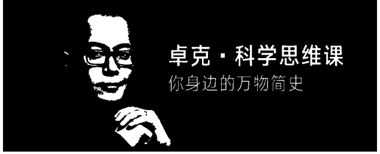

### 021 | 变量：续航400公里的电动汽车怎么跑了250公里就没电？

卓克

你好，我是卓克。

今天我们进入模块一：思维与方法的第五个概念的学习。

#### —— ◄ 概念05: 变量 ► ——

变量太多，不要轻易下结论。

电动汽车标称续航400公里，为什么开了250公里就没电了？

这个问题，最简单的回答是：

当前电动汽车的续航测试标准比较宽松，而日常驾驶的环境一般都比测试环境更耗电。

另一个原因是在监管不严格的情况下，会有更多品牌把企业内部更加宽松的测试标准当宣传话术，所以两个数字的差距还会更大。

这个问题知道得越早越好，因为新能源汽车已经开始淘汰传统纯燃油车了。

比如：

德国联邦议院去年已经通过决议，2030年之后禁止销售燃油车，也就是说混动车都不行，只要烧油就不行。

挪威比德国还激进，他们在2025年禁售所有燃油车，所以各大企业都在尽快调整产品线，比如沃尔沃从2019年开始就不再销售纯燃油车了，只有混动和纯电动车。

电动汽车最重要的指标就是续航，尤其是地少人多的大家城市，充电车位稀少。

但现在销售的纯电动汽车几乎没有哪个实际开起来续航能超过标称值的，这是为什么呢？

因为国内和欧洲销售的车都是按 NEDC 测试法来核算续航的，这套测试跑一次下来总共11公里，大概需要20分钟，纯电动车往往还选择只跑市区这个项目，因为这个项目中最高车速也跑不到50公里/小时。

对一个匀速行驶，不停下来的车来说，充满电能跑多远，主要由空气阻力和路面摩擦力来决定，你别看只有这两个因素，但每个因素里还有更细小的子因素。

#### —— 今日知识小结 ——

#### ——◆ 今日知识小结 ◆——

这期我们挖出的科学思考方式是什么呢？

你可能会问，之前不是说近似计算威力巨大吗，怎么今天又不提倡算来算去了？

这是因为应用场景不同。

近似计算是在我们手头没条件做实测的情况下，又不得不猜个大概时用的绝招。但今天我们说的变量太多了，有能力当然就去实测一下。

科学思维是一种很务实的思考，哪个更有效就选哪个。

#### ——◆ 今日思考题 ◆——

你能不能举出一些通过近似计算非常容易把人算晕，但其实直接测量就能测的很准确的例子吗？

期待你在留言区分享观点。

卓克

我是卓克，咱们下期再见。

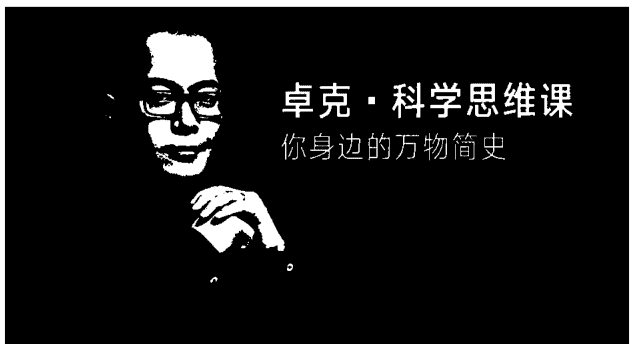

### 022 | 变量：安全带能增加多少安全性？

#### ——► 概念05: 变量 ◄——

变量太多，不要轻易下结论。

安全带能增加多少安全性呢？

这个问题一般会生出两种反应：

第一种是，那还用说 肯定很多啊。否则为什么各国都强制使用安全带？

第二种是，这个问题既然有人问，就一定有反常识的结果，那就往没增加安全性的方向上找素材。

其实这个问题的结果是，没法回答。

因为这个问题太笼统了，必须具体指定是在什么时期内，还要清楚定义出什么叫做安全性才行，否则就涉及太多变量了。

那我们就来具体分析一下，应该怎么应对这样的问题。

首先是安全性，如果指的是交通事故中司机的死伤率，那在任何时期，安全带都大幅增加了安全性，而且离今天越近，对司机的保护性越好，因为安全带的设计也在改进，具体怎么改进，我们聊到历史的时候会说。

如果把安全性定义成交通事故中的参与者的死伤率，那安全带就不一定都大幅增加安全性了。

订阅薛兆丰老师的《北大经济学课》的同学应该看过《曼昆经济学》这本书,书里第七页就谈到了一个例子：

就是说安全带虽然降低了司机在车祸中的代价，但是也产生了副作用，就是司机 会因为感到更安全而更加放肆地开车，所以车祸中的行人和非机动车死亡率提 升了。而还给出了证据，就是萨姆·佩兹曼在1975年的一项研究，自从交通法 规强制系安全带后，每次车祸的死亡人 数减少了，但车祸次数却增加了，净结果 是司机死亡数量没变，而行人死亡率增 加了，所以总体是增加的。

于是得出结论，出于安全目的强制系安全带反而带来了相反的效果。

当然，想得出这样的结论也需要做相当多的 工作，比如：

在统计周期里，汽车工业本来就在美国飞速发展，怎么确定更多的行人死亡不是 由于汽车总量暴增带来的呢？

司机更放肆地开车，真的就是由安全带的出现导致的吗？

那个时期，嬉皮文化的盛行，酒精和毒品 的用量增加，生活节奏变快，压力变大， 也可能增加乱开车的行为。

但既然曼昆的经典教材历经几十年还依然保留了这段论述，所以大概率说，我们倒 不用太怀疑佩兹曼篇40多页的论文在这 些方面的论证是有缺陷的。

除非我们是这方面的专家，凭它吃饭，否则则最划算的做法就是认可这个结论，所以 在刚刚的第二个对安全性的定义下，1975 年时，安全带的出现并没有提升安全性。

那1975年之后呢？

我们来看一份2000年斯坦福大学的研究。

它统计了1983年到1999年以来的数据。其中虚线就是人车事故中，驾车驾驶员的死亡 率变化。

#### ——► 安全带的历史 ◄——

这个故事得由一个不信邪的博士讲起。

在1950年之前的所有教科书，凡是涉及到人体可以承受的最大加速度，都标着极限 值是18G，重力加速度是1G，这个18G就是极限。

#### ——► 今日知识小结 ◄——

#### ——◆ 今日知识小结 ◆——

这期我们要说的思维方式是什么呢？

就是当你再听到类似这样的问题，安全带是不是增加了安全性？你还会贸然回答吗？肯定不会，因为涉及的变量太多了，除非问问题的人把这个问题补充严密。

今后再听到有人用曼昆经济学的例子嘲笑你系安全带，你的思维还会赊覆么？当然不会，即便你手头暂时没电脑可以查数据，你的思维在这个问题上也是出于挂起的状态，并不会轻易相信或者轻易否决。

变量多的东西需要详实的查证才能下结论，否则不说比说要好得多。

#### ——◆ 今日思考题 ◆——

安全套是不是降低了艾滋病的感染数量？这个问题应该怎么找到到答案呢？

期待你在留言区分享观点。

卓克

我是卓克，咱们下期再见。

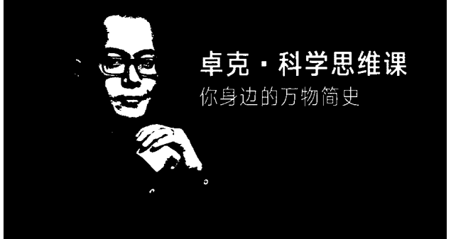

### 023 | 问答：成年人还能增高吗？去高原要吃红景天吗？

成年人还能增高吗？

有同学问，他自己的情况是25岁了，想通过科学方法增高5厘米，他说有一款 APP 里有健身增高教程，还有一部分是付费训练内容。

这个问题答案很明确：

成年后身高就定了，什么训练方法，什么药都不管用。

身高70%是由基因决定，剩下30%就是在骨骺线完全闭合之前的营养、锻炼、睡眠，这些因素决定的。对身高影响最大的骨头就是大腿和小腿骨的长度，只要它们的骨骺线闭合了就基本决定了身高。

骨骺线闭合是什么意思呢？

骨头典型的样子是两头膨大中段细直，膨大的部分叫做骨骺，中段部分叫做骨干。在成年之前骨干和骨骺之间有透明的软骨，软骨里这里充满了干细胞，骨头就是从这里一点点长出来的。

上图左边的就是骨骺线未闭合的情况，这样的腿骨还会继续增长，右边的就已经闭合了，软骨在接近成年的时候就不再再生了，这层包裹着骨骺的软骨会越来越薄，最后就逐渐消失。

而什么时候消失是由 DNA 决定的，从前中国人营养跟不上，发育到二十三四岁的情况也有。现在发育早，女生在16岁，男生在18岁后，骨骺线都会完全闭合。

所以成年后不可能增高。

想要增高，就只能抓紧在这个时间点前，多跑多跳，这些活动能促进生长激素分泌，配合骨骺生长，就能长高个儿。还有就是注意多睡觉，睡觉时的生长激素分泌量也远高于清醒的时候。

所以市面上所有宣称增高的药物，训练方法全都是骗人的。

成年之后严格地说也不是完全没有增高方法，那就是通过手术，通过截断大腿骨或者小腿骨的手术，然后配合植入骨头里的钢钉和拉伸的机械设备，让骨骺断裂处间隔几厘米到10厘米，虽然骨骺已经完全闭合，但是出现创伤后相关基因还会重新打开，开始生长骨细胞，把中间的空档填上，这样带来5-10厘米的增高效果，但这种手术风险非常高，有可能终身下肢残疾。就算没有残疾，腿部负重能力也至少减去一半，下蹲、快跑都成问题，老年之后隐患还会更多。手术和恢复花费15万左右，大约需要1年时间，才能正常行走。

我可以理解，个子矮的人羡慕别人1.3米大长腿，但个子矮的人也可以把力量、爆发力、弹跳力、身材、肌肉这些都锻炼好，这些是可以锻炼得到的，加在一起，在外形上已经可以弥补比别人矮的几厘米的劣势。另外最关键的是大脑，这点不用多说，得到的用户都很重视。

为什么头疼的时候拍一下或者用头撞墙会有所谓缓解呢？

这个道理和跑步，健身会上瘾有些类似，就是身体在承受压力，或者受到外伤的时候，脑部分泌内啡肽类的物质，缓解疼痛。

具体来说：身体遇到伤害，第一反应就是痛觉，这是进化带给我们的优势，压力和外界出现后，如果还不知不觉，比如说手放在火上烤感觉不到疼痛，或者被刀刺伤了身体，感觉不到疼，这不是什么好事，因为这么发展下去，会导致整一个手的功能丧失，或者失血过多，所以自然界里，这些生物即使出现过也早早被淘汰了，痛觉就是提示我们在危害出现的第一时间赶紧逃离，但同时痛觉的提示又不能太猛了。

比如，有一头鹿被狮子咬了一口，有幸逃脱了，接下来最好是能一直逃跑远远的，可是如果被咬了一口，疼痛感受不断增加，结果疼到跑都跑不动了，甚至疼休克过去了，那就不行了，最终还是逃不了被吃掉的命运。所以生物也进化出另一套机制，就是在出现痛觉后再把痛觉抑制住，让疼痛只起到提示作用，不起到干扰我们的作用。

以头疼为例：所有的头疼都是因为硬脑膜上的血管过度充盈，刺激了硬脑膜附近的神经导致的，不论是发烧的头疼，还是高原反应的头疼，或者用脑过度的头疼，都是这样。这种刺激实际上是在提示我们不要继续从事当前活动，最好找个安稳的地方休息。

这时候如果你用更加剧烈的方式刺激头部，比如撞墙，或者用硬物压头部，这种疼痛比单纯的头疼还要强烈很多的时候，脑部分泌内啡肽的量会大幅增加，用来缓解撞墙带来的疼痛，顺带着也把本来头疼缓解了大部分。

身体锻炼后的疲劳和肌肉酸痛也会让大脑分泌内啡肽来缓解，这种物质给人带来一种愉悦的感觉，久而久之就上瘾了。关于上瘾，我们会在之后仔细的说，尤其是说外源性的物质带来的愉悦感，俗话说那就是药物或者毒品的上瘾。

那么具体在头疼上，想缓解的话，撞墙虽然不太合适，但确实可以尝试用硬物大力按压头部任何位置，力度控制在让自己能承受的最大限度，持续2-3分钟后就会感觉轻松很多，最好不要撞墙，因为这个力度不容易控制。

对于发烧感冒的头疼和轻度偏头疼，吃一些布洛芬也可以大幅缓解，这是安全的。

有同学计划十一放假去拉萨，问红景天这样的药可不可以吃，怎么才能避免高原反应？

简单回答：大陆市场里能买到的红景天非常非常多，至少八九十种，很难一概而论。大概率说，里面都掺加了西药的有效成分。像“增加了红细胞携氧能力”的说法都是缺乏证据的，红景天这类药物和很多缺乏严格证据的药物一样，本就不应该上市。

比如香港旅游健康服务中心，这是政府机构，他们对去高原的游客有一系列建议，其中就提到了红景天，是这样说的，红景天和高原安宁都被用于防御高原反应，但未有大型随机控制研究明确地论证它们在这方面的功用，使用前咨询医生。

对药品的审批和效果把控最为严的是美国食品药品管理局 FDA，从前内容里我介绍过大量内容。针对高原反应的有效药物是以下几种：

+   - 乙酰唑胺
- 硝苯地平
- 西地那非
- 地塞米松

这些药起到的作用大都是舒张血管，缓解症状，让你感觉不那么难受，或者通过增加排尿，减少一些肺水肿的风险。对药品熟悉的同学也会意识到西地那非是什么。

人们对预防高原反应有一个严重的误区，就是我得吃个什么药，增加我的血红蛋白数量，或者增加我红细胞的携氧能力，或者通过什么其他方式增加我对氧气的利用率。

而实际情况是，每个人对氧气的利用率能到什么程度已经写在基因里了。就不存在什么药能增强我们对氧气的利用率。这种药跟长寿不老药一样，不存在。

决定会不会出现高原反应，完全是基因说了算的，与年龄、职业、身体素质都没有什么关系。有一系列的基因调控着身体对氧气的利用，其中2010年华大基因曾经在《Science》上发表过一个成果，找到了30

《Science》上发表过一个成果，找到了30个基因和高原反应相关，其中 EPAS1 是藏族人和汉族人最不一样的，携带这个基因的人，就没有高原反应。

比如有87%的藏族人拥有高海拔类型的 EPAS1 基因，汉族人里只有9%的人有这个类型。后来进一步的研究还发现，EPAS1 这个基因来源于十万年前的丹尼索瓦人，这一支古人也是人类的祖先，大约是10万年前和尼安德特人曾经是一个时代的，只不过居住在很不一样的地方，丹尼索瓦人生活在高原的洞穴里，所以 EPAS1 基因对高原的适应性就是从那时候流传下来的，关于这种智人还有尼安德特人等等人类祖先的来源，我还会在后面的课里仔细讲。

总之，在进入2700米海拔之后，会有50%-75%的人产生高原反应。高原反应实际就是因为环境缺氧导致的身体应激反应，身体各个部分都会尽量调控，尽其所能提供更多氧气，这时候肺部和心脏的压力就大了，这一系紧急调控措施出现后，身体会感觉难受，绝大部分人是不需要吃任何药的，绝大部分人只是头疼、胸闷、恶心，少部分人适应不了，就会有肺水肿、脑水肿，这时候根本的解决办法就是吸氧，什么药都解决不了根本问题。

大部分人在氧气不够的时候，只能通过降低活动量来适应。进入高原准备好乙酰唑胺，布洛芬就可以了。我是强烈不推荐吃任何品牌的红景天。

卓克

好了，这次答疑就是这样，咱下期见。

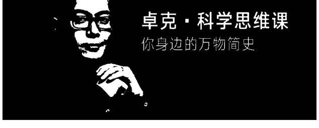

#### 024 | 问答: 食物寒热是什么？发炎是什么？

又到了答疑时间，我先解释一下，很多问过问题的同学都收到过“参考一下”这四个字的回复，问我是怎么样回事。

我统一回答一下，这就是我给问题做的标记，也就是说，我这样回复了，你的问题就成为答疑的时候选了。

董婧: 食物的寒性热性是什么，比如螃蟹就是寒性，羊肉就是热性。人的体质还有寒性体质，是怎么回事？

最简单地说，这些理论是古代人对食物和人体作用后总结出来的规律，比如食物分寒热温凉，这算四气，还有五味，酸甜甘辛咸。

分类依据也就是通过粗略的观察后得出的某种属性的抽象，比如：

了。

比如扁桃体的感染、发炎，我们使用抗生素，让聚集在扁桃体附近的细菌死亡，病原体死光光，就不会再刺激身体不断地产生迎战的信号，这是一种消炎，就是用抗生素。

但我们也可以只针对迎战的信号作调整，比如设计出一种药物，就是故意不让身体对入侵作出反应，用了这种药物，也会让本来应该出现的炎症反应消失，这也是消炎，但用的就不是抗生素了。

而且这种消炎就属于治标不治本，可能病人会感觉舒服好多，因为炎症反应往往还伴随着疼痛，这种疼痛往往是前列腺素的大量分泌，不管是男人还是女人，受损部位都会肿胀，现在不疼也不肿了，就会觉得舒服。

但是因为病原体还在，而且没有来自身体内部的抵抗力，所以病原体会迅速占据优势，继续下去，人的生命都会有危险。所以这种专门设计出来的药物，来终止迎战的反应，也算消炎药，但在有细菌感染的时候，用它是很危险的。

那你说干嘛还要设计这样的药呢？

就是有时候身体的反应是过度的，本来没有入侵，它觉得有，于是我们的身体就感到难受，这时候就用这种药来制止一下。但如果把这种药用在病原体入侵上就坏了。

比如20年前电线杆子上贴着各种治疗淋病梅毒的小广告，那些小诊所的骗子游医就会把类皮质激素用在各种皮肤病患者身上，这些患者用了药，马上就会感觉好轻松好舒服，但实际上病原体还在，只不过终止了迎战的信号。

以上这些就是发炎，消炎药，抗生素的一些基本概念。

卓克

好，这次答疑就这么多，我们明天再见。

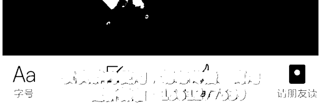

#### 复习+预告 | 详实地查证是下结论的前提

#### —— 本周课程复习 ——

#### 模块一：思维与方法

复杂的技术，也是可以触及的。

019 | 复杂：空姐为什么总让我们打开遮光板？

人们坐飞机时会被要求打开遮光板，一是让所有乘客帮助观察机身外的情况；二是一旦出现空难，方便救援人员看清机舱内的情况。飞机这么复杂的装置，本以为都是专业仪器和人才能触及到的，但在特殊情况下，普通人也可以用肉眼帮助排查故障。

020 | 复杂：鸡蛋还能预防流感？

疫苗用鸡蛋培养，这让我们得以与复杂技术建立了认知上的联系。但是，科学和技术终将发展到外行人很难去理解的程度，只有不断地学习，迭代自己的认知，才能在面对复杂事物时，不觉得遥不可及，更不会在面对未知时，惊慌失措。

变量太多，不要轻易下结论。

021 | 变量：续航400公里的电动汽车怎么跑了250公里就没电？

近似计算是在我们手头没条件做实测的情况下，又不得不猜个大概时用的绝招。当面对变量太多的情况时，如果有能力，当然去实测一下会更为有效。科学思维是一种很务实的思考，哪个更有效就选哪个。

022 | 变量：安全带能增加多少安全性？

安全带增加了司机的安全性，也增加了行人在事故中的死亡率。但行人的死亡率几十年来几乎无变化，而随着汽车安全设施的发展，司机的死亡率下降了。安全带的安全性是变量非常多的问题，只有详实的查证才能下结论。

#### 答疑时间

023 | 问答：成年人还能增高吗？去高原要吃红景天吗？

- 1. 成年人的身高不会再增长，因为骨骺线已经闭合；
- 2. 人体在承受压力、受到外伤、锻炼后的疲惫和肌肉酸痛时，脑部会分泌内啡肽带来愉悦感，甚至让人上瘾；
- 3. 高原反应的根源是每个人对氧气的利用率不同，这只由基因控制，与年龄、身体素质等无关，因此吃药无用。

024 | 问答：食物寒热是什么？发炎是什么？

- 1. 食物分寒、热、温、凉的概念，是古人粗糙的观察经验的总结，科技水平越高，它们就越难以容身；
- 2. 红茶并没有真的“发酵”，而普洱茶很可能是被微生物污染了；
- 3. 消炎药分两种，一种是抗生素，是杀灭细菌，另一种是抑制身体反应，让人舒服，但治标不治本。

#### —— 下周课程预告 ——

025 | 变量：飞机上为什么不让用手机？

026 | 变量：不靠谱的食物热量表

027 | 模型：离得那么近，为什么地球质量是火星10倍？

028 | 模型：怎么判断其他行星上是否有生命？

卓克

我是卓克，明天我们开始进入第五周的课程，明天见。

### 025 | 变量：飞机上为什么不让用手机？

#### ——► 概念05: 变量 ◄——

变量太多，不要轻易下结论。

025 | 变量：飞机上为什么..

我们上周一直在说作判断的时候参考的那些变量，但是科技相关的事情，有的时候涉及到变量越来越多科技范畴了，那些变量是什么呢？就像对风险和成本的考虑。

所以这期我们把那些不属于科技的变量拉出来聊聊。

比如飞机上为什么不能用手机？这个问题我们上周聊飞机起飞降落时的各种规定时说到过，咱们今天详细说一说。

#### ——► 满是漏洞的规定 ◄——

如果再拖5年回答这个问题，可能就会变成，为什么从前飞机上不让用手机？

因为大约从2013年开始，美国的航空公司已经放开禁令，到现在过快4年，有不少少数航班上都可以Wi-Fi上网了。只是中国的航班还没有改变，但应该最近几年就会有变化。

从不让用到允许用，飞机制造商就做过无数次实验，波音公司从人们开始用“大哥大”起就很重视收集飞行员的报告事故，然后根据事故记录还原现场，做很多次模拟，想找到问题的根源，这样就能改进飞机。

但是就在禁令颁布不久后，电子设备干扰的报告中就给出过这样的评价，说乘客们手持的任何电子设备的电磁场发射功率远远低于我们飞机上那些通讯设备。

一个非常好的例子是，飞机飞到800米上空后，任凭你手机天线再好，也都和地面基站失去联系了，但是飞机上所有通讯系统都要时刻和地面保持正常通信，这两者的功率相差上了百倍。

而且要在技术上判断 A 干扰 B，这确实需要比较复杂精密的测量设备，飞行员属于通讯工程的外行，他们在没有任何专业设备的情况下，到底是怎么判断是什么东西干扰了飞机呢？而且在整个机场的上空，弥漫着各种飞机的电磁波信号，为什么不是其他信号干扰的呢？

这项禁令在1991年诞生的时候，它的理由是：

手机会对地面通信网络产生影响，也就是机场的塔台。

那后来的事情就越来越奇怪了。

2000年以后，是飞机上用手机的人多，还是候机大厅里用手机的人多？肯定是候机大厅用手机的人多啊！

是飞机离塔台近，还是候机大厅离塔台近呢？肯定是候机大厅离塔台更近啊！

那既然连飞机上都不许用，那为什么候机大厅里人人都可以着用手机呢？那不是更危险吗？

另外, 既然把风险估计得这么高, 1991年的手机信号, 从发射功率, 到频率, 到通讯协议, 跟现在手机完全是天差地别, 怎么禁令的细节几乎一直没变?

这些可能还是一些具有专业知识的人才能提出的质疑。

坐飞机的老百姓, 质疑得就更有道理了, 也更容易听得懂, 因为飞机上还有另外的规定, 那就是起飞和降落时不准用其他电子设备, 不是手机也不行。民航和航空公司对这个规定的解释是：

所有电子设备都不可能避免有电磁辐射产生, 都有可能干扰飞机的通讯。

乘客就很费解了：

这个造价1到2亿美元的飞机会被我这个Kindle 正常使用的电子书威胁到?

这可是亚马逊牌的, 也都是通过电磁辐射兼容规范的东西, 您这飞机1到2亿成本都花在什么地方了? 飞机也太脆弱了吧。

如果飞机确实有这么脆弱, Kindle 就是比较危险, 那为什么还要允许乘客带上飞机呢?

那些真正危险的东西, 像汽油、武器, 不是压根就不应该带上飞机吗?

如果手持电子设备有这样的威力, 怎么也没见过恐怖分子拿 PSP 或者 iPad 劫机呢?

问题还有：

总担心手机影响飞机, 按理说飞机也应该影响手机啊, 怎么也从来没见到过呢?

如果手机影响那么大, 怎么也没见到过手机影响其他手机的通话或者上网呢?

更现实的情况是, 确实还有一些电子设备是无法关闭的, 比如像心脏起搏器, 也没见飞机出什么事儿。

航管局的解释可能说是因为这样做的人太少, 概率太小。但是坐飞机不关手机的人可大有人在, 具体有多少人在起飞降落时没关手机, 联邦航空管理局也真做过多次匿名调查, 问得还很专业, 避免引起被提问者产生内疚感, 造成虚假回答。所以他们是这样问：

您乘坐航班时有多少概率不小心忘记关闭手机?

统计后的结果, 大约是35%-40%的乘客没有关机。可 Luis 二十几年下来, 仍然没有出现一例因为乘客没关手机导致的航空事故。你看, 我们把思路搬开了一想, 这条禁令实在是千疮百孔, 没人能举出足够硬的理由说明为什么禁用手机和电子设备。

#### ——► 科学无法解决的问题 ◄——

可是禁令一旦颁布, 撤销要比颁布费劲多了, 因为要撤销它, 就要证明没有危险, 而这比证明有危险难度太多了, 因为“一切皆有可能”。

这时候科学技术的世界已经无能为力了, 一定也是科技圈之外的变量推动, 才能撤销禁令。

2000年后开始出现一些坐飞机的人需要在飞机上接打电话, 但打不了, 他们只好考虑乘坐的火车, 或者自己开车, 这样航空公司利润就受损了, 如果这样的人越来越多, 为了争取用户, 飞机上开始提供通话服务。

尤其是现在, 越来越多的人需要用微博、微信、twitter、Facebook 的时候, 多到了连当初参与制定禁令的人都觉得很不方便的时候, 这条禁令才终于松动了。

2013年11月, 美国联邦通讯委员会公告, 考虑到公众对移动通信和宽带接入的强烈需求, 颁布了新版规定, 在一定规范下, 解禁了手机和其他电子设备。

紧接着12月, 欧洲航空安全局也公告, 从2014年9月起, 乘客可以自由使用手持电子设备。

之后新加坡、澳大利亚、巴西也都放开了限制, 把是否允许使用手机飞行模式的权利下放给航空公司。

相信, 中国的航空公司解禁也不远了。

#### ——► 今日知识小结 ◄——

这些具体知识和过往的发展就是这么多, 我们现在从科学思维的角度来看看：

证据这么站不住脚, 还能实施二十多年, 那必然有其他的原因, 这就不在科学之内了, 影响它的变量在于风险和成本。

既然从学术角度, 既不能说绝对有干扰, 也不能证明绝对没干扰, 所以从成本角度考虑, 为了完全避免这种风险, 干脆把手机和电子设备都关掉。这个决定在20多年前无论对谁都是一成本低的解决方案, 既然还没有确凿结论, 那我们就采取最保守的措施。

只不过时过境迁, 现在还在使用这种解决方案, 成本就提升了很多。

#### ——► 今日思考题 ◄——

我们生活中还遇到过哪些本来并没有太多证据, 最终就凭—站不住脚的理由由开始实施的禁令?

期待你在留言区和其他读者一起分享观点。

### 026 | 变量：不靠谱的食物热量表

#### ——► 概念05: 变量 ◄——

变量太多，不要轻易下结论。

026 | 变量：不靠谱的食物热... ↓

很多食品包装上都印了热量的数值，而且不少饮食健康的书籍也依照热量推荐减肥食谱，甚至是根据这些数据和运动量计算去，但这期你就会知道：

消化和吸收是一个非常复杂的过程，几乎很难用简单的数字描述。

假如要考虑20种变量才能大致计算摄入人体的热量，你只考虑其中5种变量，那这种计算还不如不做，因为不知道一件事情，总比一直坚持接受错误信息要强得多。

前一阵我在看种子的文章时，看到科学家专攻研究种子和鸟类肠胃的PK，什么意思呢？

就是说，鸟类努力希望从吃下的种子里多获取更多的能量，而种子要尽量保护自己不受伤害，顺利通过鸟的整个肠道排出体外，这样才能把鸟利用成为一个播种者的角色。如果种子的保护壳在鸟的肠道里就被攻陷被消化掉了，种子就吃大亏了。

所以这场昨日持久的PK是起起伏伏，具体谁赢谁输，和植物的种类、鸟的种类、鸟的肠道菌群都有关系，所以种子并不都是完整地被排出的，也并不都是全都被消耗的。

鸟类是这样，那人类不是这样嘛？

但如果你去看食物的热量表，大致都是这样：

1克脂肪提供9千卡热，1克碳水化合物或者1克蛋白质提供4千卡热，1克膳食纤维提供2千卡热，1千卡有时候也被叫做1大卡，都是热量单位，指的就是让1公斤水升温1摄氏度所需要的热能。

膳食纤维之所以热量少，是因为不怎么消化就被排出来了，就像金针菇 See you tomorrow 那样。

但这些数据都是1896年一个叫阿特沃特的化学家，对人体新陈代谢耗能感兴趣时测到的。那个年代，连营养学这个分支都还没有出现。

#### ——► 今日知识小结 ◄——

好，我们来总结一下今天的科学思维。

#### ——► 今日思考题 ◄——

你认为拿着食物热量表计算来算去，然后指导自己减肥的行为，这算是违背科学的行为方式吗？

期待你在留言区分享观点。

卓克

我是卓克，咱们下期再见。

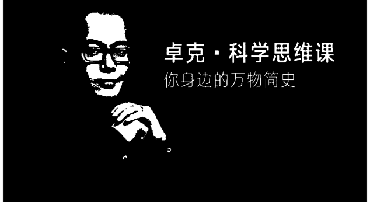

#### 用户留言

### 027 | 模型：离得那么近，为什么地球质量是火星10倍？

卓克

你好，我是卓克。

今天我们进入模块一：思维与方法的第六个概念的学习。

#### ——► 概念06：模型 ◄——

使用模型工具，解决那些复杂的、未知的、难以测量和观察的问题。

现在的科技媒体非常喜欢报道马斯克，因为他所有的公司都是科技和科幻故事的大素材库，写完了以后文理科都爱看，比如移民火星这件事，最近1年就被很多人提起。

但火星有一些天然属性不知道你注意过没有，它和地球是近邻，地球到太阳如果是100公里的话，火星到太阳就是138公里，但是它的体积却排在太阳系八大行星里的倒数第二，质量只是地球的1/10。

按说行星都是在一些大背景条件下形成的，距离不太远的位置上，这里能出现一个地球，在它旁边很可能也会出现一个类似的星体，不应该在质量上有这么大的差距才对。

但为什么火星的质量只有地球的1/10呢？

#### ——► 行星形成的标准模型 ◄——

科学家们研究太阳系怎么形成的，使用一种工具，叫做行星形成标准模型，就是希望通过设置一系列参数和设定一系列运动规则后，把一些初始条件假设好，一按按钮，就让这个虚拟的太阳系按照这几条规则和参数自动运行下去，这一般是在计算机里进行的。

#### ——► 太阳系模拟结果 ◄——

#### ——► 哥白尼的日心说 ◄——

还有一些比较初等的模型，比如1543年出版的《天体运行论》，这是哥白尼写的，其实就是一个核心假设，地球和其他行星都围着太阳转。

不要小看，这也是一个模型，只不过这个模型可以大致用一句话来描述。不过那个年代的观测手段有限，也还没完全建立起科学方法，所以哥白尼的观点不只行星围绕太阳转，而是太阳是宇宙中心，一切都绕着太阳转，所以这个模型也有相当大的缺陷，哥白尼出版这本书时受了不少委屈，这些有机会我们在答疑的时候补充。

为了能够进一步感受火星的形成，可以想象在一条河里，有时候会出现很大的旋涡，河面上一些枯枝烂叶也会被卷进来，但是你会发现，它们可能会在距离旋涡中心的某个位置聚在一起，形成团儿，但在其他位置就很难形成，因此比较容易被水流冲散。

具体原因当然是和湍流这种复杂的模型有关，这就不是一句话能解释清楚的，但大致就是这个样子，太阳系形成也有这样的规律。

#### ——◆ 今日知识小结 ◆——

这期的问题就提示我们一种科学思考方式：

我们要意识到，很多情况下是用模型这种工具来描述世界理解世界的。像火星离地球这么近，为什么质量只有地球的1/10呢？

最好的回答是，在一个模拟太阳系形成最好的模型中，它就是这个样子。

#### ——◆ 今日思考题 ◆——

你还遇到过哪些有用的模型吗？

期待你在留言区分享。

卓克
我是卓克，咱们下期再见。

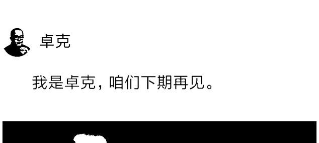

### 028 | 模型: 怎么判断其他行星上是否有生命？

#### ——◆ 概念06: 模型 ◆——

使用模型工具，解决那些复杂的、未知的、难以测量和观察的问题。

最近几期，我们说的是科学思维中常见的一个工具，叫模型，这个工具也可以用来判断其他行星上有没有生命。

这个模型叫做一持续可栖息带。

#### ——◆ 高等生命的必要条件 ◆——

这个模型很有画面感，就是中心是一颗恒星，距离恒星的一个范围内，围着一条带状区域，在这个区域里，就有可能存在高智能生命，或者适合人类居住的条件。

想拥有高智能的生命，必须保证在相当久的一段时间里，这个行星表面有液态水的存在。

相当久是多久呢？

其他行星的生命史咱们无法参考，只能依照地球来看，地球曾经是怎么过来的，我们就假设下一次生命诞生，要出现人类这么复杂的生命，也要大致经历过同样的过程，所以相当久就意味着几十亿年。

要保证表面有液态水，就是地表至少有很大一片区域，不能总是超过100摄氏度或者总是低于0摄氏度。这个要求其实是非常苛刻的，因为当前有液态水并不意味着几亿年后还能有，因为恒星自己在衰老。

比如说太阳，大约是从50亿年前进入到一个稳定燃烧的阶段，之后大约还可以稳定燃烧50亿年，在之后的50亿年里，它每秒辐射出的能量还会缓慢增加，现在已经是50亿年前的1.4倍了。所以假如在50亿年前，地球现在这个位置，是属于冰天雪地的，是0度的温度，表面不会有液态水。那么再过50亿年，地球现在这个位置，也许处处都是300摄氏度以上，表面也不会有液态水。

所以栖息带要看恒星的状态，恒星发热猛了，栖息带就要划得远一些，恒星发热小了，栖息带就要向内缩小一些。

从这一点你也可以发现，一个能孕育生命的行星，它的母恒星最好还是不要有太大变化，否则也许根本不存在能持续几十亿年的一条可持续的栖息带了。

比如太阳就算变化很小的，因为它的质量小。比如质量是太阳5倍的恒星，寿命就只有2亿年了，这个时间还来不及让生命进化到高级形式。再比如一个质量是太阳60倍的大恒星，它稳定燃烧的时间总共就360万年。

这段时间对生命的演化来说简直太短了，有多短呢？

假如地球生命演化史浓缩成一天的时间，那么360万年大约就是其中1分钟的时间，在这样的恒星系统的行星上，就算表面曾经出现了能组成生命的物质，但也根本来不及做什麽就被团灭了。

可能有人觉得那还是质量小的恒星好，质量越小的恒星相对来说就越稳定。但也不能太小，因为质量小就意味着可持续栖息带恒星很近，很近的时候恒星就要开始欺负行星了，行星就会被恒星牵制住，总是一个面朝向恒星，所以这个面很热，背面总是阴影中，就比较冷。

月球就是这样被地球牵制住的，总是一个面朝向我们。

所以其实太阳这样中等偏下身材的恒星才是最合适的。那一个恒星的可持续栖息带到底有多宽呢？

这个问题其实还在争论中，因为它强烈依赖恒星在它生命周期的变化。

对太阳来说，这个持续可栖息带是0.95倍地日距离到1.4倍地日距离。处在这么宽的圆环内，在几十亿年里，即使太阳从冷变热，这条窄窄的带内，也还是会持续存在液态水。

以上就是持续可栖息带模型给出的限制。

#### ——◆ 行星自身的关键因素 ◆——

这是一个什么条件呢？

它是高级生命诞生的必要条件，但并不充分，因为行星自身的条件也有很多关键因素。但那些就称不上模型了，因为非常非常零散，比如要有合适的大气层，要有磁场，需要有卫星。

大气层是怎么回事儿呢？

就是必须要要求行星有稳定的大气层，否则行星上的热量太容易散失，宇宙射线也更容易破坏生命物质的结构。

稳定大气层主要是由行星的质量决定，质量太小了不聚气，慢慢气体就跑走了，但如果质量太大了又太聚气了，到时候甚至有可能没控制住，变成一个巨型的气态行星，所以行星质量还得要求不大不小。

我们上期聊到的火星质量为什么只有地球1/10，就涉及到行星的形成是大是小这个因素了，大家可以参考。

那必须要要求有磁场是怎么回事儿呢？

因为恒星那边吹来的带电物质，它最好不要均匀的分布在整个行星上，而是导向两极去，两极地区虽然可能受威胁大一些，但是保全了其他区域生物的分子结构。

地球能有这样的磁场，是由于当初形成地球的时候，原初物质决定的，这种原初物质如果只是一些碳氧磷硫，那就没有希望了，必须得有大量金属元素。

所以不严谨地说，地球要想有生命，它在46亿年前形成之初，必须得是从铁核开始长起来的才行。

那为什么还要要求有个合适的卫星呢？

因为它保证了行星自转轴的稳定，地球假如根本没有月球，它虽然也照常自转，但自转轴会颠三倒四地转动，就像一个陀螺，它在快速旋转的时候，自转轴是垂直于地面的，但当它转速降下来的时候，自转轴就开始乱晃了。

假如地球没有了月球，自转轴乱晃的程度会比陀螺更厉害，因为它飘在太空。这造成的效果就是有规律的四季变化消失了，南北极的冰盖有时会全部融化，有时候全部冻结，而且周期可能会很快，世界各地都有可能出现半年的极昼极夜现象，几十万年就发生一次。

这种快速的变化对生命的威胁太大了。

#### ——◆ 今日知识小结 ◆——

你看，怎么判断行星上有没有高级生命？

我们使用了一个叫做“持续可栖息带”的模型，它规划的是一个最大尺度上的必要条件，恒星是什么样的，需要距离恒星多远。

接下来我说的几个条件虽然不在这个模型里了，但你发现没有，它们都属于原初性的条件，就是不纠缠细节。

你看：

- 要求有稳定大气层的本质是对行星质量有要求；
- 要求磁场是对行星形成之初的物质有要求；
- 要求有大卫星也是对太阳系最初形成的初始条件有要求。

当这些条件都有了以后，至于说每个时期，地球上有什么气体，互相怎么反应的，中间经历过小行星撞击没有，生命是怎么从RNA变成蛋白质的，这些所有的细节，都不在这个层级的讨论范围内，因为只要有这些大背景条件符合了，那些小因素很多都是在这个大框架里慢慢演化出来的。

今天，我们又重温了一下利用模型做大背景条件判断的思考方式。模型的优势往往在于引导我们从这个问题的最高层级的条件做出框架，去思考，而不会被细节干扰到。

末节干扰到。

#### ——◆ 今日思考题 ◆——

行星形成的模型，或者生命形成的模型，很难有足够多的证据去验证，那么这些模型算不算得上科学呢？或者说，有没有伪科学或者不科学的成分呢？

期待你在留言区中分享你的思考过程和结果。

卓克

我是卓克，咱们下期再见。

### 029 | 问答：眼保健操预防近视？50年窖藏酒能喝吗？

又到了问答时间，今天集中回答一下大家的问题。

流萤苗：学校放的眼保健操能预防近视吗？

简单回答，不能，最多只能放松眼部肌肉，但同时带来的也是眼部的感染风险。

具体来说，眼保健操是中国特有的，是1961年北京医学院体育教研组主任自创，之后被教育系统采纳推广。

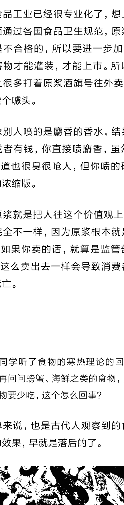

其实这样的操不稀奇，在90年前的美国也兴起过。有 一个眼科医生说所有的眼部问题，比如近视、远视、散光、老花眼、白内障，都是因为眼睛疲劳和神经紧张导致 的，于是他自创了眼部放松按摩手法，说可以恢复视力，甚至治疗白内障。

所以以上这些就是证据，结论是无效。

其实我们不找证据，光想也能想出来，我 国中小学这么大面积地持续了这么长时间 搞眼保健操，咱们国家小学生近视眼患病 率现在是45%，中学生是78%，也就是说从小 学到中学，经过五六年一直在做眼保健 操，近视比例还猛增了？宣传不是说半年 就能从0.2提升到1.2吗？

很多同学问，酒也讲究窖藏几十年，这个 会不会也有被黄曲霉素污染的问题呢， 能不能喝呢？

绝大多数正规生产的酒，基本都不存在被 黄曲霉素污染的问题。不论是白酒还是红 酒，啤酒就更不用说了。

中国古代绝大部分城市都不是沿海的，住 在这些地方的人吃到的海产品往往是从天 津、舟山这些沿海地区通过陆路、水陆费 好大劲才运进来的，海鲜商贩收到货，再 卖出去，人们再买回家做熟端上桌，往往 距离海鲜死亡已经好几天了，那时候又没 有冷冻技术，所以相当辽远的海鲜在古代 人吃进肚子里时，已经有一部分轻微腐败 了，这些海鲜就会让人体感到不舒服，

了，这些海鲜就会让人体感觉到不舒服，比如拉肚子、肠炎。

另外，农耕民族对地里的植物蛋白，对圈养的猪牛羊鸡鸭都是常吃的，但对海里的动物很少接触，所以海产品身上带着的奇特的蛋白质对我们就是一种过敏原，接触后往往会过敏，比如湿疹、荨麻疹、哮喘。

两个因素加一起，就导致了古代人认为，吃海鲜要慎重，是大寒，是发物。

其实现代食品工业中，冷链运输保存生鲜，腐烂的问题已经不存在了。

过敏方面，有些人就是天生的过敏体质，那也没办法，所以海鲜就忌了吧。大部分人都吃过海鲜，都不会过敏，都觉得是美味，如果你本来就不过敏，就踏踏实实吃吧，根本就没有什么是发物，也根本没有什么大寒。

还有同学问，狂犬疫苗为什么是被疯狗咬了之后注射还有效呢？另外，疫苗带着病毒的外壳既然可以让免疫系统对病毒有防御力，那病毒本人来了，不是免疫系统也会识别出它们吗？为什么病毒却不会被杀死呢？

是这样的，比如被疯狗咬了脚脖子的人，疯狗唾液中就含有病毒，病毒进入肌肉组织会快速增殖，狂犬病毒专门是侵犯神经细胞，大约是每天几毫米到几厘米的速度从周围神经系统往中枢神经系统进军。

那么十几天之内，它的数量还不够多的时候，这时候打狂犬疫苗，让整个身体内的免疫大军都能认出病毒，之后这些病毒还没形成大规模的时候，这股小势力就被干掉了，这次被咬就算没危险了。

### RABIES

但你看有些孩子被疯狗咬到的是脑袋，或者是咬了面部，而且被咬了很多口，其实是非常危险的，因为这里离中枢神经系统比较近，而且入侵孩子体内的唾液量也比较多，初始的病毒量也比较多，也就更容易在之后快速侵入到中枢神经系统。

所以对这些被咬到头部或者被咬了太多下的孩子，除了要打狂犬疫苗，还要配合打血清。

这就涉及到抗体的量了，抗体的多少就最终决定能不能打败病毒，所以担心病毒增殖太快的情况下，来不及等自身免疫系统产生足够多的抗体，那就要求直接输入血清，这里里面有现成的抗体，能作出及时的保护。

只要在病毒没有增加到足够多之前，抗体的量足够多了，人就得救了。这也是为什么人体不接种疫苗，面对病毒也一样产生抗体，可是那些晚期的艾滋病病人个个检测抗体都是阳性的，但就是因为抗体不足够多，所以全军覆没，人就不行了。

疫苗的作用就是在病毒到来之前，让身体内保持一个基础量的抗体，等病毒来的时候，就凭这些抗体能对付第一波入侵。如果连基础量都没有，那身体和病毒的遭遇战就会在一开始呈现全军溃败的局面。

卓克

好，这次答疑就这么多，我们明天再见。

### 030 | 问答：基因决定了一切？丹参滴丸通过了FDA测试？

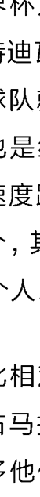

030 | 问答：基因决定了一切..

上周回答了去青藏高原要不要吃红景天的9466080549124350296这个问题，有同学就留言说，感觉基因已经决定了我们很大的身体状况，那在国际体育赛事里事，有没有哪些项目的胜负，已经被基因决定归属于哪类人的呢？

这个简单回答，有。

比如现在已经确认的几个基因：

ACTN3、ACVR1B、MSTN，这三个基因调控着不同肌肉类型的发育，它们跟力量爆发力有关。

GABPB1基因，它调控着线粒体在呼吸中的作用，这就跟耐久力有关了。

CHRNA4基因，它调控着乙酰胆碱的生成，这个表现出来就是动作的反应速度。

在体育比赛中，能明显能看出来，拥有西非血统的运动员，在短跑项目常年占据金银铜牌，他们都是身材高大、肌肉发达、力量好、爆发力强。你可能会想，现在短跑最强的是牙买加和美国人啊！其实这些黑人都是从西非经过大西洋贩卖到美洲的非洲后裔。

而且非洲的黑奴贸易过程中，实际相当于做了一次特别残酷的基因筛选，那些可以在几个月的海上航行中，在船底的狭窄空间里，能更有 效果利用空气，身体更强壮的西非黑奴，才最终活着到达了美洲。

世界杯足球赛时也能看出出来，尼日利亚、科特迪瓦、塞拉利昂、利比里亚，这些国家的球队就算技术不行，但那个人力量那身体也是绝对不吃亏的。有统计，全世界百米速度跑进10秒内的人数，大约有一百零几个，其中完全没有西非血统的只有不到10个人。

与此相对，非洲还有另一类人，就是常年霸占马拉松和其他长跑类的亚非季军，差不多他们都是肯尼亚人、埃塞俄比亚人，他们的身材可以用火柴棍来形容，人到老了一般都会发福，但是这类血统的是东非人，他们老了还是又细又长的，你看奥巴马就是这类血统的典型，奥巴马的父亲是东非的肯尼亚人。

这两类人的基因不同，导致东非人的慢肌纤维比例高，西非人的快肌纤维比例高。两种肌肉的收缩速度和产生的拉力有明显的  不同，导致了他们在体育比赛中能占据不同的优势。

是什么导致了这样的基因差异呢？

主要还是环境，那是在大约500万年前，东非大裂谷的快速形成时期，实际上东非大裂谷从3500多万年前就开始形成，只不过速度一直比较缓慢，东非的部分开始加速抢占就是从500万年前开始发生的，这时候东边就出现了大面积干旱的沙漠和稀疏的草原，在这种环境中，能减少能耗、还能长途迁徙的人种才有优势，所以一直生活在东非的人种，就进化出干瘦干瘦的体型，而在西非生活需要的优势就不一样了。

我们回到那位同学的问题。

是不是基因很大程度上决定了我身体的状态呢？

确实是。而且随着生物这门学科越来越发达，今后发现的由基因影响的方面还会越来越多。

所以今后，可能会出现一种新的负面人生观：一种基因背景下，人的命运注定，努  力不努力没有用，就是这样一种人生观。

所以我也要提前提个醒，要是真 的信了这种说法，那吃亏的可能性是居多的。

就拿比赛或者竞争来说，要分好几个层 级：

第一个层级来区分水平的高低就是职业和业余，这两者的区别可以说是非常巨大的。

最显著的例子就是送快递，大家都觉得没 什么门槛，但即便是这样，职业快 递的，他一天的收入比刚入行的要多好几 倍。比如何 应该怎么分配时间？什么时候给 车充电？怎么防晒？大厦电梯的情况、物 业的管理、小区都谁家有人不用打电话 啊？等等这一系列的信息，一个新入行的人至少要半个月才能熟悉。

再举个职业和业余的例子，比如每周末都跟朋友去踢场足球赛的人，已经算踢得比 较好的了，如果要是踢足球，让他去替  仁慕尼黑主力门将把守的大门，10个点球 里能进两个三个就很不错了，而职业比赛 中，点球命中率平均是75%左右。这位业 余的足球爱好者，在我们生活中已经是足 球高手了，但面对职业选手还是完败。

所以这种巨大的职业和业余的差距想表现 出来，并不严重依赖于基因上的差异，而 主要依赖于你花了多少时间从事这个项目的训练。所以职业和业余的门槛要迈过 去，只需要合理的训练就可以了。

要再往上竞争一个级别，这个优劣之分才 依赖于基因上的差异呢。比如这个球员能 踢职业赛了，是踢乙级联赛，还是能在超 级联赛里打主力，甚至成为超级球星呢？

不过我们平时生活中，除了从事的职业以 外，其他方面都是业余级别，包括身体锻炼、唱歌、弹吉他、写作、语言表达、驾 驶、厨艺，等等等等。这些项目全部是可以 通过一段时间的刻意训练，得到大幅提 升，超越业余的人，完全不需要抓住基因 的因素不放，任何人都可以 在多项技能上 大幅超越90%的人。

对于从事职业的人来说，他是可以考虑自 己的优势，假如咱足够幸运，等生物技术发展到位了，那时候可能已经有了可靠 的基因检测技术，而且证据是足够了，可 以证实某些位点的表现预示着我们今后更 适合干什么工作，那我们就可以顺应自己 的优势和爱好选择职业。但是到了那个时 候，跟你竞争的人也一样拥有基因优势， 所以你们之后再分优劣的时候，仍然是通过“谁更努力”来区分的。

我们之后的课中也会集中说一些基因方面 最新 的进展，希望对大家的个人发展有帮 助。

还有相当多的同学问，丹参滴丸有没有 通过 FDA 三期临床认证？

大约是去年12月的时候，我在上一季的栏目《卓老板聊科技》中，花了一整期回答说 了一下复方丹参滴丸在 FDA 审核的事情。

那时候是复方丹参滴丸完成了临床三期试 验，这就像是最后一次考试考完了，那么 具体是通过还是没通过呢，还得等老师批 改完试卷才能知道。那么参加考试，尤其 是资格审核类的考试，大家都是关心通过 率的，FDA 的三期临床试验也是一个资格 审核类的考试，如果能通过，就预示着今 后可以上市销售了。

这个考试的通过率大概是这样：

比如有100个药完成了三期临床试验，最 终会有58个向 FDA 申请批准上市，这58个 里最终有49个获得了批准，最终上市了， 也就是大约1/2的通过率。

你可能就有疑问了，做都做完了，干嘛还有42个还不申请上市呢？

这是因为有些药做完三期后，结果是特别 特别不好的，一看就知道过不了，所以后 续就不浪费时间金钱在申请上了，那这个 项目就算终止了，这款药物的研发就算失 败了。

这58个提出上市申请的药里，有些结果 超级好，就像我之前介绍的诺华的 CAR-T 治疗法那样，完全没问题，一定能通过。还有 一些结果出来以后，自己一看，不算太好， 但也有些价值，反正10几年的研发经历都 已经过去了，万一过了呢？所以提交申请 试试。而最终58个比较有自信的里面还能 筛出9个不行的来。

丹参滴丸大概就属于这9个里的，自己也把 据不准，所以就试试，水平大概就是这样。

但是9月份传出的消息说没有通过，修败 了，而且还是中医院士李连达在科学院 自己的博客上发的文章，结果去 FDA 官 网查一下发现官方没有正式公布结果。 几天后天士力集团也出了消息，就是 丹参滴丸的研发公司发了一份严正声 明，说是驳消息。

实际情况是三期试验结束后，FDA 初步审 核的结果不太乐观，简单说，是有2个反映疗效的结果：

核的结果不太乐观，简单说，是有2个反映疗效的结果：

1个反映的是服药6周后的疗效，这个是结果中比较好的。

还有1个反映的是服药后4周的疗效，这个是比较差的。

但药厂自己提交的药效评价的主要终点，是服药4周的疗效。现在的结果证明4周的效果比较差，所以这就跟自己提交的评价终点矛盾了。

多亏了还有一个6周的效果做次要参考，所以现在天士力在跟 FDA 继续沟通，把主要终点改成6周，然后再做一轮以服药6周为主要参考终点的试验。

那你说，吃6个礼拜好了不就行了吗？只是比4周多吃了2个星期而已啊，这药是有效的啊。

不是这样的。

因为天士力在做二期临床试验的时候，通过十几年的试验，在二期临床上，对比了4周到8周的效果，发现4周的结果才是最好的，所以到了三期，才把4周作为评价的终点。

现在4周的效果反而是不好的。医学上想确认疗效远不是普通人认为的那么简单。一种药物在盲测中一会儿有效一会儿无效，而它治疗的冠心病又是一种病情起伏很大的疾病，主要终点变来变去，往往预示着药效不明显，所以才说审核结果不乐观。但还是有机会的，现在不是正在补做6周的试验吗。

具体什么时候能做完，估计再有下一次结果也至少半年以后了，我们随时更新。

卓克

这次的问答就到这里，咱们明天再见。

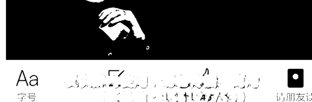

### 复习+预告 | 寻找证据是有力的思想武器

#### ——◆ 本周课程复习 ◆——

#### 模块一：思维与方法

变量太多，不要轻易下结论。

025 | 变量：飞机上为什么不让用手机？

飞机上不让用手机，从科学角度看，不能说绝对有信号干扰，也不能证明没干扰，因此只能参考成本和风险这两个变量，干脆禁止使用。但随着人们对手机等设备使用需求的大幅增加，依然是参考成本和风险这两个变量，禁令开始被逐渐解禁。

026 | 变量：不靠谱的食物热量表

影响食物能量吸收的因素：食物本身热量、生熟区别、细菌数量、人体吸收率、人体自身耗能、肠道微生物……当变量复杂到一定程度，我们只能定性地去把握，比如你要减肥，就少油腻、多蔬菜、多运动。如果还按照数值计算结果去展开行动，往往会导致偏差，还不如不做。

使用模型工具，解决那些复杂的、未知的、难以测量和观察的问题。

027 | 模型：离得那么近，为什么地球质量是火星10倍？

火星质量是地球的1/10，而它又是地球的近邻，为什么体重相差如此之大？用模型解释是最合适的。模型是用来描述世界、理解世界的工具，它的优势是批量解决那些复杂的、未知的、难以测量和观察的问题。

028 | 模型：怎么判断其他行星上是否有生命？

高等生命的形成极为复杂，很难理解。但通过建立“持续可栖息带”模型，从最大尺度上规划出生命诞生的必要条件，比如需要什么样的恒星？行星需要离恒星多远？只要大背景条件符合了，那些小因素就可以在大框架下慢慢推演。

#### 答疑时间

029 | 问答：眼保健操预防近视？50年窖藏酒能喝吗？

- 1. 眼保健操不能预防近视，但增加了眼部感染风险。
- 2. 酒不容易被黄曲霉污染，但原浆酒是嗝头。
- 3. 食物的“发物”概念是古代人落后的观察，不存在寒性食物。
- 4. 抗体数量决定了能不能打败病毒，注射狂犬疫苗，是让整个免疫系统都能认出病毒，在病毒形成大规模前消灭。

030 | 问答：基因决定了一切？丹参滴丸通过了FDA测试？

- 1. 职业和业余的差距，主要依赖的是合理的训练，比拼的是“谁更努力”，只有到竞技层级，才更多依赖于基因。
- 2. 一款药物的疗效确认非常复杂，丹参滴丸目前的FDA审核结果不乐观，但还有机会。

#### ——◆ 下周课程预告 ◆——

031 | 模型：天气预报为什么不准？

032 | 证据：硬币的边缘为什么都是锯齿？

033 | 证据：像追星族一样深挖牛顿身世

034 | 证据：侏罗纪白垩纪这些奇怪的名字怎么来的？

卓克

我是卓克，明天我们开始进入第六周的课程，明天见。

### 031 | 模型: 天气预报为什么不准?

# ——► 概念06: 模型 ◄——

使用模型工具，解决那些复杂的、未知的、难以测量和观察的问题。

#### ——► 不准的天气预报 ◄——

天气预报为什么不准？

这个问题简单回答，就是因为天气预报模型实在太复杂，对微小变动太敏感，没有办法准确预报。而日常生活中，预报准确的时候往往又被我们忽略了，所以最终给人留下了一个天气预报老不准的印象。

刚刚过去的夏天，不少城市经历了暴雨和高温，很多都是有气象记录以来最强烈 的，这一方 面可能因为我们的运气实在太 不好了，另一方 面也确实提醒着我们地球 正在被人 类活动强烈的影响着。

也正因为这样，很多人非常关心天气预报。

比如北京就“累”过几次，说今天下午开始下大暴雨，会持续降雨20小时以上，然后天气预报的官方微博、微信、电视新闻全都报了，有些单位体恤员工，下午4点就提前下班，结果那天，提前到家的人感觉特别庆幸，之后就开始盼着下雨了，那些还没回家，甚至不得不加班的人，那天也非常的焦虑，怕晚上回不去。结果大家等到夜里11点，地还是干的。提前到家的人，心里多少有点儿失落，加班的人感觉逃过一劫。结果这场大暴雨直到第二天早上10点才渐渐沥沥地下来。

这样的事儿发生次数多了，有人就不满意了，这什么天气预报啊！还没我揪着窗口预测的准呢！

所以有些人就会把手机上的天气 APP 换掉，凡是中国的都不信，就下载谷歌的天气 APP，其实他可能不知道，谷歌天气的数据也都是从中国观测台那里拿到的，只不过运算时使用的模型不同。

#### ——► 天气预报的模型 ◄——

又说到模型了，今天我们接触的模型，应该 是人类日常能接触到的规模最大、运算 最频繁的模型，那就是天气预报模型。

听过上两期聊模型这种工具，你应该知道，它是在一个大的世界框架下，先设定好里面的运动规则和参数设置，然后再给一个初始值，让模型自己运算，模拟这个世界之后将要发生的事情。

注意，刚刚这段话里，每一个元素都是预报天气的关键。

首先，天气预报模型使用的运动规则和部分参数的设定是谁完成的呢？

它是一套天气分析软件写成的，由科学家定制，这些科学家依照的就是大气运动的动力学方程，这是一套微分方程组，可能有些同学还没上大学，没接触过微积分，你只要知道微分方程组是非常难求解的，历史上不少数学家一辈子的精力都用来研究某个微分方程的解法。

那初始值又是什么意思？

就是这套系统从当前一个确定的状态开始才能往下一步运算，所以要预测将来的天气，初始值就是当前天气的状况。

这个数值是气象站收集的，咱們国家的气象站分国家级的和区域级的，国家级的有2000多个，区域级的有3万多个，国家级的2000多个观测点的数据我们也会分享给世界气象组织，比如谷歌天气APP拿到的数 据就是这2000多个观测点的。

这些初始值越精确越丰富越好，这样预测也会越准，当然，越丰富越精确也有负面效果，就是运算量太巨大了。

那么运算由谁完成呢？

这就必须得用特别牛的计算机，咱们国家在这方面下的本钱比较大，用的是天河二号超级计算机，这个计算机的尺寸大约和一个大型地下停车场差不多，每年光电费就1亿元人民币。全球超级计算机算力排行，这台机进入前50名。

为什么用这么牛的计算机呢？

因为咱们国家面积大城市多，所以运算量天然的比其他国家多，必须用这么厉害的家伙运算。

那么你会觉得，都这么下功夫了，为什么还不准呢？

这就要说到天气的本质了，它运算的对象就是气压、气温、风速、风向、湿度，这些指标都是怎么流动的。

这些微分方程描述的对象有一个特性，就是对输入值极为敏感。

比如一堆参数都要录入，其中一个参数是1.0001，把这个当做初始值输进去，可能最终算出的结果是后天大暴雨。但如果其他参数都不变，还是这个值，将这个参数你设置成1.0002，可能计算完，结果就是后天多云。

这个尴尬的局面各国气象局都逃不掉。只要时间拉得足够久，误差就会越大，只要观察的区域越小，误差也会越大。

不夸张地说，预测明天的天气，和预测一大锅滚开冒泡的粥下一个泡会在哪里出现，难度是一样的。所以也是为什么我们要采集全国3万多个气象站数据的原 因，我们希望尽量提供精确的数据。而其他国家的天气软件只能拿到我们2000多个站点的 数据，所以他们算出的东西天然就会有很大误差。

#### ——► 天气预报的历史 ◄——

现代天气预报，最早是在1850年才开始的，因为那时已经出现了电报，那时 的天气 预报主要就是给航船提供风向的信息，这还真得靠电报才行，因为电信号的传输速度比风快得多。

#### ——► 今日知识小结 ◄——

这期说到的科学思维是什么呢？

就是我们用一个最复杂的例子——预测天气，说明了模型这种工具。

#### ——► 今日思考题 ◄——

像天气模型，输入值的微小变化就能引起后续迭代计算时巨大的误差，你还能想到其他对初始值非常敏感的模型吗？

如果有思路了，期待你在留言区分享你的观点。

### 032 | 证据：硬币的边缘为什么都是锯齿？

卓克

你好，我是卓克。

今天我们进入模块一：思维与方法第七个概念的学习。

#### ——► 概念07：证据 ◄——

有证据的判断才能得出好结论，好观点基于已知的事实。

科学讲究证据，你说这个东西有效，那除了你做过这个实验外，我们观察者也要看到其他和你利益不相关的人也做出了相同结果，我们才会对这个结论多一份信任。如果说这个东西无效，那也请你拿出反证来。

很多人以为讲究证实，重视证据的思路，是搞科研时才用得上的，其实生活中只要涉及判断是和不是，涉及到非要弄个是非真假的时候，寻找证据是非常有力的思想武器。

今天我们就来谈谈最伟大的科学家牛顿，把这种深挖证据的思考习惯，运用在非科学研究上的例子。

#### ——► 铸币局督办：牛顿 ◄——

1696年，也就是牛顿53岁的时候，他收到一封信，来自财政部，拆开一看，是自己从前的学生蒙塔古的来信，虽然这学生很久没跟他联系了，但牛顿一直从自己外甥女说过他，说是已经做到了财政大臣的位置，这学生真是有出息。

信里说：

现在皇家铸币局的督办要调任到海关去了，职位空缺，您作为我的老师，又是我的朋友，又是德高望重的科学家，我向国王推荐了您，铸币局督办这职位，只有局长比这个职位更高。更关键的是，这个职位每年有500多英镑的年薪。而且还没有什么具体工作，您的时间很自由，甚至还可以继续保持三一学院的教职，铸币局当兼职就可以。

#### ——► 寻找证据的思维方式 ◄——

但是牛顿入职后一点没打算当兼职混日子。他从前是怎么做科研的，这次就怎么搞铸币局的工作。

当时英国的经济环境有点乱，主要流通货币有很多假币，假到什么程度呢？

就是荷兰银行已经拒收英国的银币了。

#### ——► 硬币边缘锯齿的由来 ◄——

之后牛顿又主持了重新铸造一种新货币，这次的新币至少要防止边缘被剪，牛顿想出的办法，就是在边缘刻上复杂的花纹，这样造假币的就无法从上面加上金属了，这个办法甚至沿用到现在，你现在可以随手拿出一枚硬币看看，其实每个硬币边缘都是有花纹的，而且它们还不是简单的锯齿，这样防伪的功能就更强了。

新币发行，要造多少，如何发行呢？

#### ——► 今日知识小结 ◄——

牛顿在铸币局这么一系列干净利落的行动，之所以这么行之有效，他其实没有利用什么新设备、新技术。

那从前那些人怎么就干不出来呢？

这就是这集要说的一个科学思维中非常重要的环节：找证据。

响，大家都是把重点放在“纯思辨”上。

比如皇家铸币局曾经是没有人把科学思维中寻找证据的做法运用到扼制假币上的，没有人知道市场上到底有多少比例的假币，不知道假币是什么材质造的，也就不会知道造假币的人其实取材自真币，当然也更没有人系统性地总结过造假币的技术历史了。

但如果运用了“询证思维”，到了牛顿这儿就发挥到了极致，效果就是这么棒。

#### ——◆ 今日思考题 ◆——

假设你现在就是牛顿，市场上已经充斥着假币了，你怎么能准确判断假币的占比的数额呢？

期待你在留言区分享你的思考过程。

卓克

我是卓克，咱们下期再见。

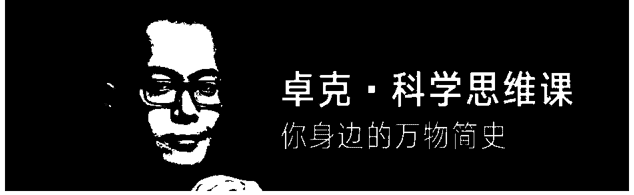

### 033 | 证据：像追星族一样深挖牛顿身世

#### ——概念07: 证据——

有证据的判断才能得出好结论，好观点基于已知事实。

牛顿的伟大，还有一个角度可以领略，就是在他去世后，甚至都养活了一批专门研究他生平的人，这样的人到现在还有，因为总是有新资料被发现。

比如说有一本1936年出版的《回忆录》，作者是威廉·司徒克雷，这本书的内容就是作者回忆跟牛顿生前的对话，而且深挖了牛顿的家世。

你可能觉得奇怪，牛顿 17XX 年就去世了，1936年出的书怎么回忆牛顿的啊？作者长生不老吗？

不是，司徒克雷其实是牛顿同时代的人，比牛顿小了45岁，只不过当年写完这本书以后没能出版，一拖就拖了200年，1931年在苏富比拍卖中被皇家学会买下来了，然后花了5年编辑好，1936年出版。

#### ——牛顿粉丝-司徒克雷——

#### ——深挖牛顿身世——

#### ——今日知识小结——

#### ——今日思考题——

#### ——◆ 今日思考题 ◆——

最后我给大家留一个发散性的思考题，要求研究对象可以查证，这一点的最大优势是什么？

期待你把观点在评论区和大家一起分享。

卓克

我是卓克，咱们下期再见。

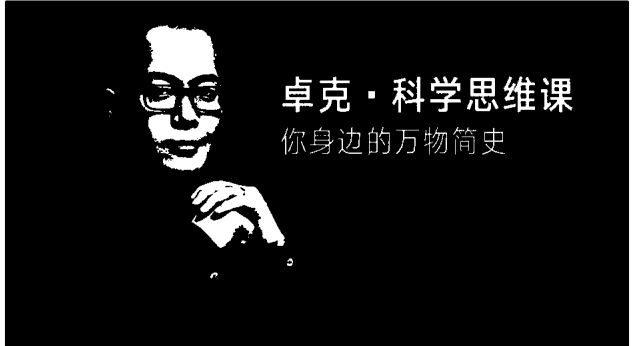

### 034 | 证据：侏罗纪白垩纪这些奇怪的名字怎么来的？

#### ——概念07：证据——

有证据的判断才能得出好结论，好观点基于已知的事情。

侏罗纪、白垩纪这样的名字是怎么来的？

这个问题很可能就是一些爱思考的小学生提出来的，如果先把他们的好奇心满足的话，回答就是这样的：

侏罗纪中的侏罗是一座山的名字，白垩纪中的白垩是一种土壤的名字。

那它们跟恐龙有什么关系呢？

因为侏罗山上发现了不少恐龙化石，白垩土里也发现了不少恐龙化石，然后经过时间上的测定，发现现在侏罗山的化石和埋在白垩土中的化石在时间上相隔了几千万年，侏罗纪是2亿年前到1.4亿年前，白垩纪是1.4亿年前到6500万年前，之后古生物学家就这么叫下去了。

#### ——侏罗纪的由来——

侏罗纪这个词的诞生就涉及很多证据，详细来说：在法国和瑞士接壤的地方，有一道山脉，其中有一座山，在1795年的时候，著名的地质学家亚历山大·洪堡在这里考察，发现这座山的主要成分是石灰石，和周围的地层有明显区别，所以就给这里单独起了个名，叫 Jura。而 Jura 这个词是源于凯尔特语中的一个词根，词根的意思是山林。

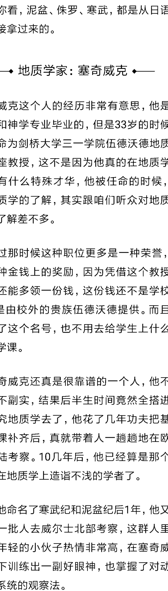

#### ——白垩纪的由来——

白垩纪，听着是稀有的名字，但它并不是音译来的，垩这个字上面一个“亚”，下面一个“土”，在古汉语中就是指一种白色的土壤，从前古人用它来抹墙，俗称叫大白。

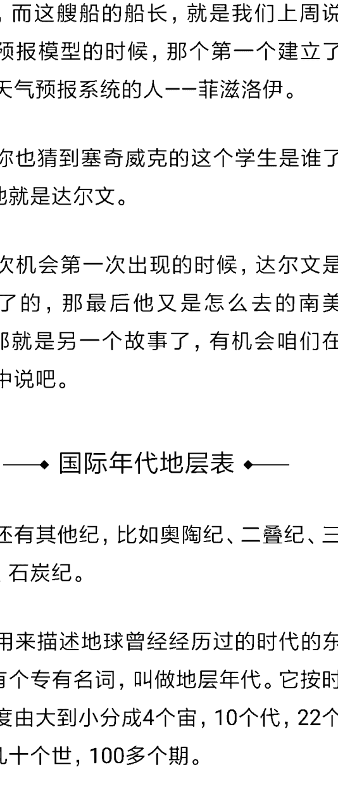

#### ——泥盆纪的由来——

1827年左右，伦敦地质学会的主席塞奇威克带着一帮人，在威尔士做考察工作，在岩石分层上做出了不少有价值的工作，其中有两个岩层分析得是非常清晰的，完全是不同时期形成的，其中一个就给定名为 Cambrian，就是寒武，另一个定名为 Devonian，也就是泥盆纪的由来。

#### ——地质学家：塞奇威克——

#### ——国际年代地层表——

其实还有其他纪，比如奥陶纪、二叠纪、三叠纪、石炭纪。

——更新世——更新世上期。

侏罗纪公园电影里那些恐龙生活在显生宙——中生代——侏罗纪——中侏罗世——卡洛夫期。

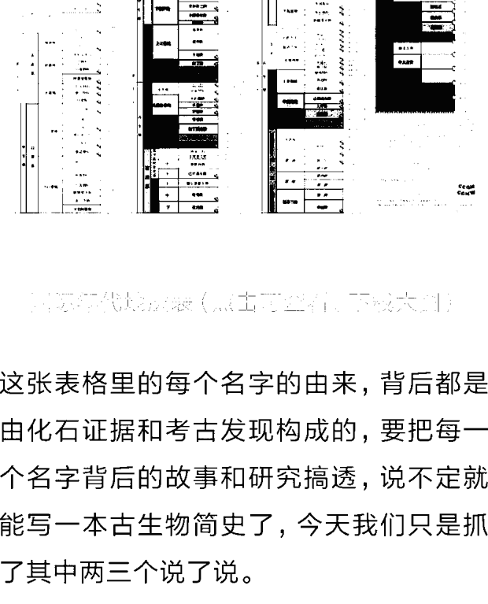

这张表格里的每个名字的由来，背后都是由化石证据和考古发现构成的，要把每一个名字背后的故事和研究搞透，说不定就能写一本古生物简史了，今天我们只是抓了其中两三个说了说。

#### ——◈ 今日知识小结 ◈——

其实我们说了这么多，要介绍的就是科学思维中，利用证据构造出来的一个学科分支。

这个过程甚至有点像拼图游戏，比如一共10万个碎片摆在你面前，但也不告诉你最终拼出来能是个什么图案，你只能依据每个插片的特征，用你的逻辑尽力去判断，去找它临近的插片。

在整个试错过程中，搜寻证据的过程中，分析证据的过程中，也许会非常乏味，但终于有那么一天，你能从拼图中窥视到整张图的样子的时候，你就会感叹这幅图的壮美。

#### ——◈ 今日思考题 ◈——

这期我们介绍的考古学，是先有的各种零零碎碎的证据，然后才逐渐出现理论框架，那你能不能举出一些学科是反着的，是先出现了理论框架，后来才找到填充它的证据呢？

如果你有答案了，欢迎你在评论区跟大家分享。

卓克

我是卓克，咱们下期再见。

### 035 | 问答：100%鲜榨果汁营养价值有多高？

有同学问到果汁的问题了，说现在很多牌子的果汁都说自己是100%鲜榨，还有很多牌子的饮料，明明配料表里还写着一大堆添加剂，为为什么还说自己是100%的果汁呢？想问问果汁的内幕。

好，那我回答一下。

#### —— ◆ 什么是100%果汁？ ◆ ——

首先，这确实是一种话术上的技巧，你发现没有？那些在室温下保质期半年的饮料，标注的是100%果汁，而不是标的100%鲜榨，但老百姓一看100%，就觉得这是好的，是榨的，是纯的，所以就买。其实要是我来做这种饮料的营销，会建议他们改成96.6%果汁，这样听着不但又好又纯，而且还科学。

那我来具体说下，这类果汁，比较有代表性的，像X橙多，X粒橙，生产过程是：

- 1. 橙子运到厂里，洗干净，剥皮，榨汁，到了这一步是不能出厂的；
- 2. 榨出的汁要在高温密封的桶里浓缩，就是要把水果汁里的水分蒸掉。比如榨出10吨的水果汁，蒸掉其中9吨的水，浓缩成1吨的浓缩液；
- 3. 浓缩液冷冻后运往各地。

因为现在饮料行业的规模已经非常大了，工序细分得很厉害了，做这一步都有专门的工厂，他们可以最高效、最低成本地把浓缩液提供给各品牌的饮料厂。

然后不同品牌的饮料厂按照自己的产品设计，往里面添加不同配料。

#### —— ◆ 100%鲜榨果汁 ◆ ——

我们再来说什么是100%鲜榨，这就真的是路边或者家里，用榨汁机榨出来的，一个苹果，一个橘子塞进去，另一端用杯子接着，一会儿果汁就流出来了，往里加点糖，加点冰，然后就喝掉，这叫做100%鲜榨。

#### —— ◆ NFC果汁 ◆ ——

但既然有人花钱，愿意用20块钱买一大杯鲜榨西瓜汁，鲜榨橙汁，这说明还是有需求的。

#### —— ◆ 冷压杀菌技术 ◆ ——

#### —— ◆ 果汁中的糖 ◆ ——

但是，我更要说的是，这些果汁大都对身体没有益处。

相当多的家长以为冷压的100%纯果汁，5瓶卖300块钱的，这么贵的纯天然饮料当水喝，那真是每天补充多少水果里的营养啊！太精华了。

啊！太精华了。

那我告诉你，如果真这么喝，不出一年，体重至少增加20斤。如果老年人这么喝，糖尿病根本控制不住。

游离的糖对人体来说几乎是完全不需要的，你一年1克都不摄入，完全没有问题。

游离的糖对人体的害处，长胖是次要的，最大的危害，是扰乱胰岛素对血液中糖的多少的调控。

比如每一瓶含糖饮料喝下去后，身体都会如临大敌，胰岛素赶紧大量分泌。20万年以来，我们进化出的这副身体，只有每年水果成熟的时候，才偶尔能吃到大量游离的糖。所以我们的身体仍然是只能妥善处理偶然到来的大量游离的糖分。

可就是在最近几十年，像每天喝好几瓶甜饮料，把鲜榨果汁，NFC 果汁，HPP 果汁都当水喝，这些行为都是身体难以妥善处理的。就相当于有人总是喊狼来了狼来了，就算羊倌再傻，100次以后，羊倌也不做防范了，因为都是假的。

人类胰岛就是这样，总是用大量游离的糖刺激它，最后它对糖也就不敏感了，这些常年喝甜饮料的人，等到50岁以后，基本都会或轻或重的得糖尿病。

#### ——◆ 喝果汁不如吃水果 ◆——

果汁的口感里有水果的好味道，这不假，但这种好味道是不难获取的，你就买个苹果吃吃吧，买个橘子剥一剥吃了吧，这比 HPP 果汁更鲜，它的的价格是 HPP 果汁的几十分之一，还不会扰乱身体对糖的代谢。

一般人吃苹果，顶多2个就到头了，就算能吃的人，吃完3个大苹果，我敢说，下一顿正餐都吃不进去了。

但这个是对的，就应该这样，这是身体对进食量的正确把控。

3个苹果里的糖，已经糖分足够了，完全能凭借着3个苹果撑过2顿饭的时间间隔。苹果里的糖都在果肉细胞中，它不是游离的，咀嚼可以释放其中一小部分，大部分的糖还需要肠胃消化过程中慢慢破坏细胞壁，果糖才会释放出来，这种过程就不会刺激胰岛，胰岛也不会以为大敌当前了。

另外，直接吃水果，里面还有大量纤维，能增加肠道蠕动，还有饱腹感，吃三个大苹果，你连下顿饭都吃不进去了，你说这不是减肥了呢？但这些正常规律在果汁面前全都没用了。

所以最后我要强调，食品工业中的果汁，虽然有很多更接近天然的，包装精美的，价格高昂的，但我都强烈不推荐购买，同时一并强烈不推荐的还有所有包含游离糖的食物，比如甜饮料、饼干、果酱、甜面包、蜂蜜、奶茶、蛋糕、巧克力糖等等。

你要真是想吃纯天然的水果味，那就直接买水果吃。

卓克

好，这个问题就回答到这，我们明天再见。

### 036 | 问答：胃炎和幽门螺旋菌

036 | 问答：胃炎和幽门螺旋菌.. ↓

有同学问，说单位体检，查出幽门螺旋菌阳性，要不要治疗？

关于幽门螺旋菌和胃病的详细内容，实际在去年的栏目中详细介绍过，但是那时着重说的是幽门螺旋菌的发现过程，和后获诺贝尔奖的事情，主要为说明科学研究中个案是没有力量的。针对个人的比较少，所以现在补充一下。

幽门螺旋菌在胃里的分布有个大致规律，越发达的国家，越干净的国家，国民的胃里，幽门螺旋菌越少。

比如美国在1960年时，70%的人胃里都有这种细菌，但到了2010年，也就是10%的人胃里还有了。

中国现在大约是60%的人胃里有幽门螺旋菌。

不过它虽然有毒，是造成胃癌的很重要的因素，但绝大部分有幽门螺旋菌的人，一辈子和它们都是相安无事的，只有不到1%的人会在几十年后发展成胃癌。

所以大部分医生对幽门螺旋菌阳性的人的建议都是，如果胃有长期持续性的不舒服，比如疼痛，经常连续几天的疼，那就得去医院治疗，治疗方法也很成熟，通过同时服用4种抗生素，完整疗程是14天，就可以彻底杀灭幽门螺旋菌了。

不过幽门螺旋菌传染性比较强，像接吻、互相用筷子，都能传染，所以有时侯自己的菌虽然消灭了，但家人还会传染给你，所以还可能出现反复感染的情况。

微生物和人的关系越来越受研究重视，重要性有点像几十年前人类基因组那样，现在这方面的研究叫人类微生物组计划。

幽门螺旋菌也是其中之一，它和人体免疫系统形成一种平衡，如果没有任何症状，实际是不用治疗的，尤其是现在一些年轻的医生，比如30多岁、40多岁的，他们现在还有精力看大量的文献，所以对幽门螺旋菌最新的研究比较熟悉，尤其是感染了这种菌的儿童，往往这些医生是不建议杀灭的，因为这种菌实际也在给儿童正在形成的免疫系统一种持续的调控信号...

学啊！

这种质疑听上去还真是挺有道理的，但这种论调错就错在了时间点上。

因为在那些手术被禁之前，在那些药被下架之前，世界上没有任何足够可靠的证据可以证明那些疗法和药物应该停止，也就是说，支持它的证据始终强于禁止它的证据，所以我们才继续用。

现代医学中，用什么和不用什么，跟情感倾向完全无关，用，是因为证据足够强，不用，是因为反证足够强。

但是到了古代医学这里，就不是这样的了，古代医学中，当前正在实施的疗法和药物，很多是很早之前就被证明有问题，早就在科学更发达，法律更完善的世界其他地区被明令禁止了，结果却因为种种原因在中国大行其道。

古代医学之所以是这样，根本原因就是，它还有相当大的一部分内容没能纳入到科学体系当中。只有当大部分内容都纳入到科学体系里，才能在时间点上不再发生这样的错误，而一旦都纳入到科学体系中，古代医学也就不再是古代医学了，而是现代医学，它的样子和其他科学发达的国家里的主流医学是一样的现代医学了。

卓克

我是卓克，咱明天再见。

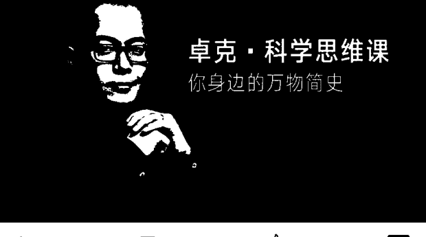

### 复习+预告 | 诺贝尔奖很伟大但也有失误

#### —— 本周课程复习 ——

#### 模块一：思维与方法

使用模型工具，解决那些复杂的、未知的、难以测量和观察的问题。

### 031 | 模型：天气预报为什么不准？

天气预报的模型非常复杂，输入值微小的变化，也能引起后续计算的巨大误差。中国使用天河二号超级计算机，拥有超过3.2万个气象站，依然无法准确预测。科学研究中建立模型，目的是解决无数的同类问题，只要下功夫不断优化，获得的答案也会变得更加准确和可靠。

有证据的判断才能得出好结论，好观点基于已知的事实。

### 032 | 证据：硬币的边缘为什么都是锯齿？

牛顿使用科学思维中寻找证据的方法，了解假币的数量、材质、制造方式，系统性地总结假币的历史。不仅治理了假币问题，还发明了防伪工艺，并帮助英国建立了金本位金融系统，由此获得骑士爵位。

### 033 | 证据：像追星族一样深挖牛顿身世

司徒克雷用了20多年，弄清了那些几乎不可能有人能挖到的牛顿的身世资料，得以让今人看到一个更为真实的牛顿。这是科学思维中一个重要的思考方法，要求研究对象是可查证的，便于今后订正与核实，还原事实和真相。

### 034 | 证据：侏罗纪白垩纪这些奇怪的名字怎么来的？

地质年代名称的背后，是考古发现和化石证据。考古学，是先有零散的证据，才出现理论框架的。就如同不知图案的拼图游戏，你不知道图案是什么，只能依据插片特征，用逻辑去判断、去拼插。正是这些基于事实的证据碎片，让我们得以窥视世界曾经真实的模样。

#### 答疑时间

### 035 | 问答：100%鲜榨果汁营养价值有多高？

- 1. 果汁中含有大量的游离糖；2. 在人类的饮食中，并不需要添加任何的游离糖；3. 喝果汁长胖是次要的，它最大的危害，是扰乱胰岛素对血液中糖含量的调控，增加疾病风险；4. 喝果汁不如吃新鲜水果，鲜榨果汁同样没什么益处。

### 036 | 问答：胃炎和幽门螺杆菌

- 1. 幽门螺杆菌虽然致癌，但如果没有任何症状，是不用治疗的，如果在儿童时期杀灭，可能会加重胃酸反流的情况，长期看危害更大。2. 对于浅表性胃炎，只要你没有出现症状，就可以理解为你拥有一个正常的胃。

#### —— 下周课程预告 ——

### 037 | 诺贝尔奖在各种奖项中地位是最高吗？

### 038 | 那些颁错了的诺贝尔奖

### 039 | 诺贝尔化学奖其实应该叫诺贝尔理综奖

### 040 | 为什么诺贝尔奖没有数学奖？

卓克

我是卓克，明天我们开始进入第七周的课程，明天见。

### 037 | 荣耀：诺贝尔奖在各种奖项中地位是不是最高吗？

卓克

你好，我是卓克。

现在是国庆黄金周，相信你正在享受这个假期。

按照我们的课程规划，在讲解完“证据”这个概念之后，接下来应该进入“计算”这个概念，但从今天起，今年的诺贝尔奖获奖名单将会陆续公布，在专栏中我会及时地制作课程为大家进行深入地解读，为了帮助大家能够对诺贝尔奖有更为深入、透彻的理解和认知，因此我将“模块四：文化与体系”中“荣耀”的概念调整了过来，带同学深入了解一个真实的诺贝尔奖，一个在大众媒体上看不到的诺贝尔奖。

国庆之后，我们再回到正常的课程内容。

#### —— 概念：荣耀 ——

诺贝尔奖很伟大，但也有错误。这个世界有太多未知的东西，哪怕是诺贝尔奖得主的观点，也未必正确。

进入诺贝尔奖周了，我们花几天时间说说，你在大众媒体中看不到的内容，希望听过之后，大家能对科学界最荣耀的奖项，有比其他人更深的了解。

那么题目里的问题：

诺贝尔奖在各种奖项中的地位是不是最高的吗？

直接回答，是。

那为什么呢？

#### —— 瑞典的国家事业 ——

因为诺贝尔奖是瑞典以举国之力持续在做的事情。

假如是你获奖了，大约11月份，颁奖委员会就会给你打电话订机票了，而且肯定是头等舱最贵的票，如果你把它换成经济舱，多换2张票带着爱人和孩子一起去斯德哥尔摩参加颁奖的话，瑞典航空公司还会主动把你全家的票都免费升到头等舱。等下了飞机，是瑞典大使馆的人来接。

接下来，你在斯德哥尔摩的一周里，有专车和司机还有使馆专员陪着去各处。刚到的第一顿晚宴是中国驻瑞典的大使亲自招待。颁奖是瑞典国王亲自授予奖牌和证书。而且颁奖典礼晚上的晚宴，是瑞典皇室全体成员出席，国王、王后、王子、公主都陪着聊天跳舞。

奖金是第二天就可以去领了，他们会尽量满足你希望的方式把奖金给你，如果没有特殊要求的话，去年是一张800万瑞典克朗的支票，大约合人民币660万。而且以中国个税规定，这笔钱是不用交税的。

你在斯德哥尔摩一共要待一周的时间，最后一天，12月13号是瑞典的露西亚节，上午六点会有穿着白纱裙的女郎托着蜡烛叫你起床，是瑞典神话中的女神，代表着光芒的回归。这七天的诺贝尔周大约就是这样，非常隆重，那几天瑞典全国的网络、电视和报纸都是获奖者的新闻。

这些只是表面，深层还不止于此，因为瑞典甚至不惜冒风险。

比如1936年的時候，和平奖颁给了当时还在纳粹集中营关押的德国和平主义者奥西茨基，一下就惹怒了希特勒，之后纳粹德国就规定禁止德国公民接受诺贝尔奖，但是1938年，1939年的化学奖，1939年的生理学医学奖，在评议之后还是决定颁给德国科学家，纳粹知道这个事以后，官方就以这几位科学家的名义，给颁奖委员会去了信，意思是拒绝接受诺贝尔奖。

颁奖委员会也知道这是纳粹的手段，所以这3个奖的奖章、证书、钱都给他们留了10几年，直到1947年，这几位科学家的生活恢复正常了，重新把奖项授予了他们。

在过去的116年里，只因为一战和二战，有7个年份没有颁奖。更难得的是，这个奖项是1896年立下的遗嘱设立的，立遗嘱的时候瑞典和挪威还是一个王国，但是1905年的時候，国家就分裂了，大部分奖都是瑞典负责，但和平奖是挪威议会负责的。国家分裂后，挪威竟然仍然和瑞典在颁奖上保持协同，没让诺贝尔奖夭折，这事儿实属不易。

还有，诺贝尔基金会一直把这笔钱当做巨大的资产运营着，通过不断积累成功的投资才保证了单个奖项今天还能有好几百万美金。如果不这么运营，只是按照当年遗嘱在银行吃利息，现在每个奖项的奖金也就大概10万人民币出头，影响力绝对不会有现在这么大。而且基金会和瑞典国家机构的沟通，争取到了这笔钱在世界各地，比如在美国投资免税的待遇。可以说，瑞典是把诺贝尔奖当百年大计做的。

#### —— 增添荣耀的最大手笔 ——

但如果我们往根源查一查，就会发现很少有人琢磨一个问题，那就是在诺贝尔奖最初颁发的时候，当时国内是有反对声音的，历史上第一个获奖者是X射线发现者伦琴，就在这第一次，瑞典国王奥斯卡二世就拒绝出席颁奖仪式，最终止结果是立储的王子代替国王出席的。

再查一下，瑞典是1866年实行君主立宪制的，也就是说颁奖时国王只是个仪式性的职位，没有实权了。但就算就是这样，国王都不乐意的事情，按说也就不了了之了，为什么还要王室特地把王子派出去顶这个空缺呢？某个大富大贵的人资助科学家的事情在欧洲并不少见啊！也没听说哪个可以把王室支使到这个地步啊。

另外还有，遗嘱里分别给皇家科学院，卡洛林医学院，瑞典文学院，挪威议会了活儿，各自负责颁发不同种类的奖。这些可是都是国家机构，按说一个商人有一大笔钱要奖励给科学家的事情，那也就是成立一个组织专门负责这件事。你是很很难做到让这么多重要机构听你的指挥的。

如果这是一个历史悠久，逐渐发展壮大的奖项，从最早民间评选升级到由国家机构担任执行工作，也可以理解。但诺贝尔奖不是这样，它是从第一届就是这样执行的。

那你说这是为什么呢？背后是什么能量支撑着这个伟大的项目走出第一步的呢？

为此我仔细找了很多资料，大致找到了可以解释的理由，直接说，就是诺贝尔的遗产，这笔金额足够巨大，在瑞典有足够的说话权。

诺贝尔卖了20多年的炸药确实赚翻了，去世时的遗产清点完是310万瑞典克朗，合当时的900多万美金，当年美元还是金本位，1美元换1.5克黄金。

这些钱对瑞典这个国家算多算少呢？

我又找到了欧洲各国1800年到2008年的GDP统计，这个统计表里用的还是1990年基诸的国际元，所以还要用1990年的黄金价格跟诺贝尔去世时的黄金价格折算一下，才能知道1896年瑞典 GDP 用当年美元衡重到底是多少钱。

这个也查到了，1896年的1美元大约合现在的18.5美元。然后再和920万美元的诺贝尔奖金比一下，发现当年的这笔奖金相当于瑞典GDP的1.7%。GDP反映国家实力，瑞典这个GDP体量在欧洲排中等偏下，是意大利的1/5，法国的1/10，英国的1/17，美国的1/25，算比较小的。

1/17，美国的1/25，算比较小的。

我又找到了整个19世纪瑞典的各项税收占比 GDP 的情况，1896年国家税收总额大约占 GDP 的10%，也就是说，诺贝尔去世前捐出的这笔钱大约是当年全国财政收入的17%。这对瑞典绝对是一笔巨款了。

如果你感受不出来，我们用科学思维的工具“同比例缩放”来看看：

这个比值放在中国相当于2.7万亿人民币，马云的个人财产是1900亿，所以，当年诺贝尔的个人财产相当于14个马云的资产，是2.7万亿，不是2.7亿。放在中国，现在他拿出这么多钱只有一个请求，就是请中科院、协和医科大学、作家协会、政协，利用这笔钱给你这个领域最杰出的人授奖，咱们就问，这些机构是愿意不愿意呢？

我想，谁都能意识到这几乎是为人类文明增添荣耀能做的最大手笔的奖了。

用这笔钱说服任何执行单位接受完全没问题，因为荣耀的光芒实在太耀眼了。后来瑞典议会挪威议会都同意了，只不过瑞典国王觉得白花花的银子都给出去，有点心疼，但又不得不派立储的儿子代替自己颁奖。

这个事儿也真的只能在瑞典促成，因为正好这笔巨款和这位炸药大王出现在瑞典，而且他要落叶归根，如果他是英国人或者美国人，这笔钱占比财政收入可能就只有不到1%，就不像17%这么有话语权了。假如他是英国人，我想英国皇室、皇家学会不一定这么重视，把它当做一件最重要的大事执行。

#### —— ◆ 诺贝尔投资科学真相 ◆ ——

那诺贝尔为什么把这么一大笔巨款全都捐了呢？

有两个重要的心理因素：

- 1. 他终身未婚没有后代，所以这笔钱势必是要给出去的，问题就在于给谁？
- 2. 心理因素就是决定他给谁的。他在30岁出头的时候因为研发炸药，亲弟弟被当场炸死，爸爸也被炸成了残废，之后虽然从炸药里赚翻了，但是他心里也清楚那些人买了炸药去做什么了。所以他内心比较反感别人称他炸药大王的，虽然这个名号在当时是最响亮的。

这些心里的不爽，大约是在他40多岁到50多岁的时候，找到了一个排解疏解的方式，就是资助一些创业者，看他们的项目成功，就好像看到自己的钱并不都是用来发动战争了。

#### —— ◆ 今日知识小结 ◆ ——

越到晚年，诺贝尔越想洗清人们脑中自己和炸药的联系，他非常清楚科学是最值得投资的，所以为了心中的那份荣耀感，把毕生的巨资全都捐给了全世界的科学家。而接手的机构也充满了使命感，认真负责地把它做成了整个瑞典国家的事业。

这120年荣誉和使命感的积累，就算是偏颇和失误，也不是任何其他奖项可以比拟的。

到现在，一共积累了900多位获奖者，他们当中绝大多数是以获得诺贝尔奖为荣的，但他们中还有少部分人，是反过来的，是诺贝尔奖因为他们的成就而增添了一份荣耀。

所以到了现在，诺贝尔奖已经成为了瑞典国家的象征，成了所有科学类奖项中的第一名。

#### —— ◆ 今日思考题 ◆ ——

科学水平提升和经济发展，好像是互相促进的一组正反馈，那么推动它们向前的第一个原动力是什么呢？

期待您把观点分享到评论区和大家一起讨论。

卓克

我是卓克，我们下期再见。

### 抢鲜 | 2017年诺贝尔生理学医学奖解读

抢鲜 | 2017年诺贝尔生理学...

今年的诺贝尔生理学或医学奖，奖给了三位科学家，他们是杰弗理·霍尔（Jeffrey C. Hall）、迈克尔·罗斯巴什（Michael Rosbash）、迈克尔·杨（Michael W. Young），奖励他们发现了“昼夜节律的机制”，他们将平分900万瑞士克朗的奖金。

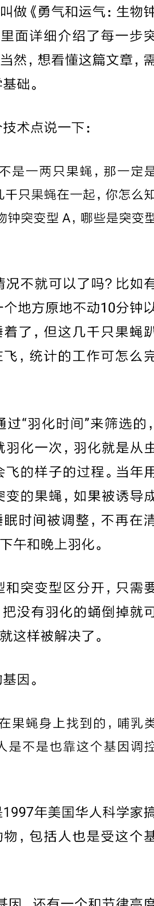

今年的生理学或医学奖是纯粹的生理学奖项，和医学没什么关系。而且还是一个听上去不太高冷的研究。因为即使你我，都能大概理解“昼夜节律”的含义，你可能就觉得，不就是生物钟，不就是睡觉和起床的周期嘛，还真差不多。不过具体来说，他们的研究肯定要深入很多。

他们是用果蝇做研究对象，在基因层面上找到了昼夜节律的调控机制。而我们普通人理解的睡觉和起床，都是动物行为上的。

可能大家都听说过，光线的强弱对脑部分泌褪黑激素量有影响，所以才会导致睡眠和清醒的周期，实际上，这是一种前台的机制，而地球上的生物，还有一个后台控制睡眠与清醒的机制，那就是写在基因里的。

比如说，一旦把人关在完全黑暗的环境里，光照消失后，人仍然会表现出昼夜节律，这就是基因调控导致的。当然我觉得很简单，实际上正常人突然失去所有光线是非常不适应的，要经过几天的调整，等到适应了以后，人才会自然地表现出每24小时睡一觉的周期，这个实验实际上是比较残忍和比较苛刻的，历史上只成功做过几次。

但是用小鼠和果蝇做就轻松多了，因为没有伦理问题。

这项研究最早是1971年开始的，当年第一个突破的，是两位科学家罗纳德和西摩尔，他们发现了一个基因，这个基因的3种不同突变型，会导致果蝇的睡眠出现短周期，长周期和无周期的情况。当时这两位科学家把这个基因定名为 Period 基因，也就是周期的意思，简称 PER 基因。

其实他们的突破也很大，只不过一个人在2015年去世，一个人在2007年去世。

所以这次诺贝尔奖没有奖给他们。只奖给了在这个基础上继续做出突破的另外三位科学家。

他们的突破是在1984年做出来的，他们测序了 PER 基因。

又过了8年，他们还找到了另一个和 PER 基因一样重要的，和生物钟有关的基因，叫 Timeless 基因，也就是不受时间影响的意思，简称 TIM 基因。

TIM 和 PER 共同作用，形成的蛋白质结合在一起，在持续12个小时中产生比较多，但在接下来的12个小时里，又会进入细胞核被降解。就这样周期性地影响着果蝇的清醒与睡眠。

他们的工作实际上非常曲折，感兴趣的同学可以翻看谈毅教授在几年前写过的一篇几万字的长文，叫做《勇气和运气：生物钟的分子研究》，里面详细介绍了每一步突破的技术细节，当然，想看懂这篇文章，需要一定的生物学基础。

我就选其中一个技术点说一下：

做实验肯定不是一两只果蝇，那一定是几千只。这几千只果蝇在一起，你怎么知道哪些是生物钟突变型 A，哪些是突变型 B 呢？

统计它的睡眠情况不就可以了吗？比如有一只果蝇趴在一个地方原地不动10分钟以上，就算它是睡着了，但这几千只果蝇趴在一起，或者在飞，统计的工作可怎么完成呢？

实际上最后是通过“羽化时间”来筛选的，因为果蝇一生就羽化一次，羽化就是从虫蛹变成带翅膀会飞的样子。 militaries 当年用化学诱导基因突变的果蝇，如果被诱导成功，就会因为睡眠时间被调整，不再在清晨羽化，而是在下午和晚上羽化。

所以想把野生型和突变型区分开，只需要中午去实验室，把没有羽化的蝇倒掉就可以了。这才难题就这样被解决了。

我们说回节律的基因。

PER 基因是在果蝇身上找到的，哺乳类动物，甚至人是不是也靠这个基因调控节律呢？

这个寻找工作是1997年美国华人科学家搞定的。哺乳类动物，包括人也是受这个基因控制。

除了这个 PER 基因，还有一个和节律高度相关的叫 Clock 的基因，最早是在老鼠身上发现的，后来在果蝇身上也找到了，之后又在哺乳类动物中找到，跨了这么多界，和生物钟相关的基因都维持了高度的统一。

实际上不只是刚刚那几种动物，比如含羞草的叶片开合，向日葵朝向太阳转动，也是这样的，也是不需要依靠阳光，在黑暗中也一样会出现规律的运动。甚至细菌、蓝藻的生长，也有24-28小时的节律出现。细菌抵抗噬菌体的侵袭，也有24小时的节律。

这说明地球的日出日落，在10几亿年中，给生命体内留下了多么深刻的痕迹，这几乎是所有地球生命共有的特征。

今年获奖的这3位科学家，是生物节律方面的大家，他们一起在2013年就获得过巴赞夫奖，今天又第二次一起获奖，也证明了生物界对这一基础研究的重视程度。

你说说有什么用呢？

如果我们对生物节律在基因层面上有所把控，那很可能大幅改善人们在睡眠上遇到的问题。

比如轻度的，中美两国坐飞机产生的时差。这之前想调整时差可以吃一粒褪黑素，它确实会让你在20分钟后开始犯困，之后时差就可以通过下一觉调整过来，但这显然属于外源性的干预。

这毕竟属于外源性的干预。

时差还是一个小问题，如果人的失眠和各种节律问题是因为内源性的，也就是因为基因的突变，或者调控节律基因的基因突变导致的，那么外源性干预一停，马上就又回到混乱状态了。

现在通过这个研究，我们就有机会可以从基因层面调整了。这可能是今年诺贝尔生理学或医学奖对现实生活能产生的实际意义。

但最后，我还是要提醒各位同学，规律是这样:每年的诺贝尔奖一颁发，后续马上就会冒出一批骗子，有的是卖药，有的是办班。

比如去年的奖是细胞自噬的机制，后续就冒出来很多减肥班，说细胞自噬解释了中国的“辟谷”，然后大肆收费。

再之前物理奖奖给了中微子振荡机制，在网上马上就有防护中微子辐射的防辐射服卖。

而今年的生理学或医学奖，因为实在很通俗易懂，所以一定会像雨后春笋一样出现很多冥想班、精力管理课、睡眠训练法，它们都会打着2017年诺贝尔生理学或医学奖的生物节律、生物钟的幌子，所以大家不要上当受骗。

目前这个学科的研究成果，距离实际应用还有非常远的距离，也许几年，也许十几年。

卓克

好，今年的生理学或医学奖的解读就是这样，明天同样时间，我们继续解读物理学奖。

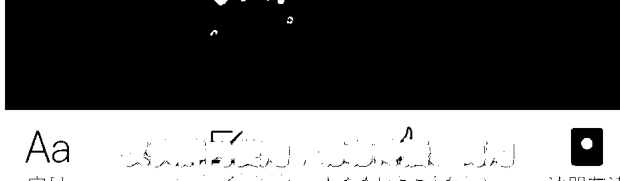

### 抢鲜 | 2017年诺贝尔物理学奖解读

抢鲜 | 2017年诺贝尔物理学...

今年的诺贝尔物理学奖颁给了三位美国物理学家，家雷纳·韦斯（Rainer Weiss）、基普·索恩（Kip S. Thorne）和巴里·巴里什（Barry C. Barish）。

奖另他们建造了 LIGO 探测器，并且探测到了引力波。

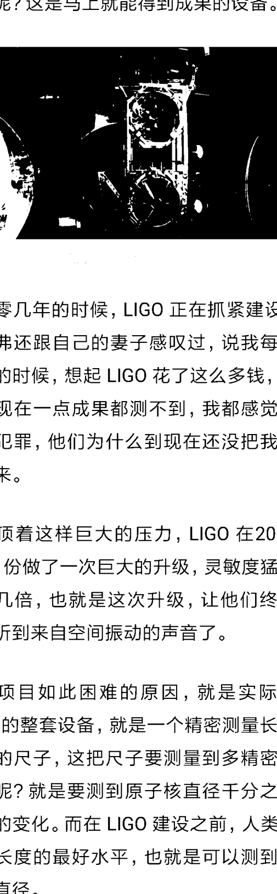

今年的这个奖项可以说是众望所归。因为在物理学界有一个共识，如果发现引力波没获奖，那就没有天理了。所以我相信每个人对引力波都是耳熟能详的。

##### ——▸ 关键人物：巴里 ◂——

LIGO 的创始人一共3位，其中只有2人获奖，还有一位科学家罗纳德·德雷弗本应该获奖，但在今年3月7日，他86岁高龄病逝了。按照诺贝尔的遗嘱，只能颁给在世的人，所以作为替补上来的人，就是巴里·巴里什。

##### ——▸ 爱因斯坦的预言 ◂——

这次发现引力波获奖，还有个特别的意义，那就是广义相对论的成果获奖了。如果爱因斯坦还活着，那这次诺贝尔奖一定要分给爱因斯坦，因为是他在100年前就在理论上计算出了引力波的存在。这也是广义相对论最重要一个预言，但没想到时隔100多年才得到了验证。

##### ——▸ 引力波的意义 ◂——

可能有人要问了，探测到引力波有什么用？

### 038 | 荣耀：那些颁错了的诺贝尔奖

#### —— 概念：荣耀 ——

诺贝尔奖很伟大，但也有错误。这个世界有太多未知的东西，哪怕是诺贝尔奖得主的观点，也未必正确。

上一节课我们了解了诺贝尔奖能成为一项声誉这么高、价值这么高的奖项，其实第一推动力是那一笔巨款，起码对瑞典这个不太大的国家来说，话语权可是足够大了。

但这么多年，900多次奖项，难免出现错误和遗漏，今天我来谈谈这些不足。

#### —— 犯错误的诺贝尔奖 ——

不足分几种，先说最严重的，那就是知识性的错误。

这样的例子在100多年里只出现了几次，最著名的就是1949年，沃尔特·赫斯和安东尼奥·埃克里斯因为发现前额叶切除术获奖。

前额叶，通俗说就是前额骨后面的大脑，这个手术就是把这部分脑组织破坏掉，专门用来让有攻击性的精神病人安静下来。最早是通过开颅的方法，比较复杂，只能由专业的医生操作。

后来改成用锥子从眼眶孔进入前额，然后一通乱捅，破坏脑区，简化的手术，街边诊所都可以做，精神病院也可以做，都可以不用医生。

如果你看过《飞越疯人院》这部电影，那个本来不是精神病的流水线，最后被院方实施的就是这个手术。

那时的医生不知道，其实这部分大脑负责太多太多内容了，比如记忆、分析、思考、动作，还有一些性格，都是这里负责，破坏了这里，人的很多高级脑部活动就都消失了，人就成了行尸走肉，当然就没有攻击性了，但人也就废了。

当初这就是个不靠谱的手术，后来因为手术难度下降，渐渐发展到滥用的地步，精神病院只要发现病人闹得厉害，就做前额叶切除，更有一些日本家庭，觉得孩子太闹不乖，也给做这个手术。这个手术在获得诺贝尔奖后15年左右，全世界都禁止使用了，但从出现以来到被禁，全球至少有几十万人成了受害者。这个奖项也是诺贝尔奖迄今为止出现最大的一个错误。

其他的错误没这么大。

比如1906年的诺贝尔化学奖给了莫瓦桑，因为他发明了金刚石的制备方法。金刚石在那个年代非常值钱，所以吸引了评审委员会和无数的企业和商业大亨，但大家想按照莫瓦桑的方法制备金刚石，发现没有一个成功的，详细一调查，结果莫瓦桑的助手招供了，说当年莫瓦桑的方法根本没法造出金刚石，可作为助手，怎么劝都没用，莫瓦桑还是要求他反反复复地试，结果他忍不了了，就偷偷把实验室里一块天然金刚石混到原料里，莫瓦桑本人不知道，以为试验真的成功了，论文就发表了。

这其实严格来说是一种造假，只不过论文作者没发现，这个奖也就算颁错了。

#### —— 不完美的诺贝尔奖 ——

但还会出现其他问题，我把这些问题归纳成不完美。

#### —— 不符合趋势的规则 ——

从现在科学研究的发展趋势看，诺贝尔奖是越来越容易出现不完美的情况，因为重要成果再也不是一支笔几张纸可以做出来的，更倾向于很多参与者甚至 N 个机构通力合作，大资金投入的，不可能是2-3个人完成的，所以遗嘱中颁给不超过3个人的限制，越来越不适合科研发展的主题了。

咱们梳理一下，从这3个自然科学类的奖项中看，原来诺贝尔奖中出现的科学上的错误，有几个规律：

一个是，知识性错误大都出现在生理学医学奖上，因为这个学科始终处于收集实验数据来猜测理论框架到底是什么的阶段，成果不可复现的程度也非常高，论文造假也比较严重。相比看，物理学的框架性理论，不但有了，而且还迭代过几代了，所以诺贝尔物理学奖还没出现过知识上的错误。

另外一个规律，是出现错误的年代一般是比较久远的，那时候信息交流还不如现在这么方便，文章评审制度也没现在完善，所以更容易出现误会。

#### ——◆ 今日知识小结 ◆——

这期我带你回顾了诺贝尔奖的错误和不完美。

我们从中得到的科学思维是什么呢？

你看，这么用心的诺贝尔颁奖都会出现错误，那真实情况下，日常的搞科研，遇到的错误和误会就更多了，甚至可以说绝大多数的科研尝试都是失败的，但在付出努力之前，这些人都是真心实意要尽最大努力把这个事搞定的。

那我们评价一件事情的是非，或者评价一种治疗方法是不是有效，也就是，非要说出个对错，非要说出个是非的情景中，我们要不要考虑，那个做事的人，他的态度呢？

其实，不论他的初衷是多么真诚，过程多么艰苦，积累了多少代人的祖传经验，这些对于理性科学的判断来说，都是不值一提的。

已经有无数科学家一次次地证明了，再努力再真诚，探索的过程都是错误居多的。付出巨大的心血，当然是值得敬佩的，但这只是情感层面的。

一旦落到事情的“是与否”上，就完全是另一码事了，这是科学思维的一个重要特征。

一个科学素养高的人，他在考虑一件事情的客观对错时，情感因素会在脑子里自动屏蔽掉的，无论这种情感是敬爱，还是憎恨。这样得到的评价结果，才更接近事情的真相。

#### ——◆ 今日思考题 ◆——

那些颁错的诺贝尔奖，尤其是知识性上的错误，这些案例能不能在一定程度上说明科学是不可靠的呢？因为连这么大投入的诺贝尔奖评选都没能识别出不靠谱的研究成果。

如果你有想法，希望你把观点留在评论中和大家一起分享。

卓克

我是卓克，咱们下期再见。

### 抢鲜 | 2017年诺贝尔化学奖解读

抢鲜 | 2017年诺贝尔化学奖...

2017年诺贝尔化学奖颁发给美国生物物理学家乔基姆·弗兰克（Joachim Frank），苏格兰生物学家理查德·亨德森（Richard Henderson），和瑞士生物物理学家雅克·杜本内（Jacques Dubochet）。奖励他们在冷冻电镜技术上做出的贡献。

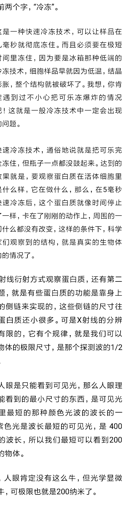

而今天咱专栏里更新的，正好是我说的为什么诺贝尔化学奖叫理综奖。

所以大家看，今年获得化学奖的3个人中，2个是生物物理学家，1个是生物学家，而这个奖项的成绩更多属于物理领域的突破，更多是应用在生物技术中，所以说到底，这次的化学奖没化学家什么事儿。

转入正题，今天这个奖项冷冻电镜是什么东西呢？

其实它和昨天的物理奖是遥相呼应的：

- 引力波探测器是一个用来看巨大质量的望远镜；
- 冷冻电镜是一个用来看超级小物体的显微镜。

因为它们的出现，人类观察大东西的极限和观察小东西的极限都极大地拓展了。

什么学科最需要仔细观察非常微小的东西呢？

主要就是生物学，最好是能观察到DNA和蛋白质的细节。DNA我们已经有成熟的测序方法了，也就相当于能观察到绝大部分信息。可 是蛋白质就不是了，虽然它们叫做大分子，分子量往往也超过几万，但即便这样，它们在显微镜下几乎是无法观察的，原因有这么几条：

才能保证射穿样品，但是带来的后果就是找不到合适的材料做幕布，因为能量太大，大部分器件都会被损坏。所以最初是先让它打在荧光屏上，转化为光信号，再用 CCD 收集，再做计算。

可是这样两步的转化就会让最初的信号失真，失真也没办法，只能在算法上作修正。后来发展到可以直接统计透射过去的电子了，算法又要跟着改。

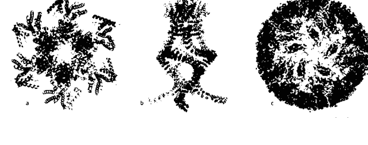

冷冻电镜的技术大致就是这样。

它的价格是超级贵的，比如能看清0.1纳米尺寸的东西，这个电镜一套大约要800万人民币，而且每年的维护费用还有100万左右，这个水准的冷冻电镜现在全世界有10台左右。但这个钱，对财大气粗的科研单位真的是值得花的，因为效率提高太多了。

比如核糖体，它是负责生产蛋白质的，它本身也是由蛋白质组成的，而它的结构测定用传统方法，从1982年开始就想方设法让它结晶，然后做衍射，大约经历了20年时间才最终确定了核糖体蛋白的结构。可是在冷冻电镜下，只需要几天时间就能得到准确至极的结果。也就是现在的生物学家有了新式武器，一个礼拜的工作就秒杀了过去一个团队20年的心血。

所以今年的诺贝尔化学奖才授予了冷冻电镜技术。

有人想问这个技术有什么用呢？

这对所有在研究病毒的生物学家、医生都有用。基础研究的效率对比从前有了几百倍的提升，这就有点像当年一挺机关枪就干掉整个南美洲阿兹特克王国那样。所以之后我们在新药的研发、理解生命的规律上，速度会快很多。

卓克

好了，今年的诺贝尔化学奖的解读就是这样，我在国庆期间对自然科学类奖项的解读就告一段落，明后天在《卓克·科学思维课》里还有更多有关诺贝尔奖的内容，大家不要错过。

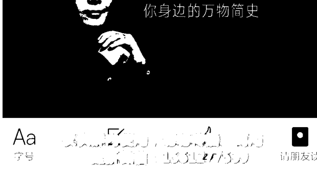

### 039 | 荣耀：诺贝尔化学奖其实应该叫诺贝尔理综奖

——► 概念：荣耀 ◄——

诺贝尔奖很伟大，但也有错误。这个世界有太多未知的东西，哪怕是诺贝尔奖得主的观点，也未必正确。

039 | 荣耀：诺贝尔化学奖其实。

诺贝尔奖中的化学奖，有时候经常评得让化学家无语，因为获奖者相当多都是生物学家、物理学家，纯化学家获奖的只占 2/3。这也是为什么有些人调侃化学奖是理综奖，好象生物、医学、物理、化学都可以颁发这个奖似的。

这个现象背后的原因，就是科学进展太快了。

1896年立下的遗嘱里的三个自然科学类的奖项，经过100多年的发展，已经不是当初互相隔离的学科了，这三个学科领域的硏究都已经使用了化学知识，化学领域的一些基础问题也可以用物理来解释了。

从历史上看，化学正式成为一门现代科学，大约是1780年开始的，做出最后关键一步突破的，是拉瓦锡。

我先说说怎么样是不能叫做现代化学的，它不能像巫师熬魔法药水那样，也不能像炼金术师那样，也不能搞什么祖传秘方，不公布操作细节。

至于现代化学应该是什么样，我留在思考题里。

现代化学诞生后，明显和其他学科不一样了，它研究的各种物质接触、混合以后，是怎么发生反应的，生成物是什么，搞起研究来办法也自成一体，所以逐渐成为了一门大的学科分支。

化学发展到顶峰的时候，最具代表性的就是元素周期表，而且在相当长的一段时间里，大约50多年时间里，它一直是化学家的理论框架，每一步化学上的突破，都体现在又一个新元素被发现了。

——► 纯化学家只占2/3 ◄——

现在统计一下，化学奖一共颁发过109次，一共175人获奖，其中21次颁发给了和生物学直接相关的成果，而且这21次里有17次集中在1960年之后。除此之外，还有13次颁发给了物理学领域的成果。还有1次应该算是颁给了农业技术方面的，是关于饲料储藏中的营养成分的分析，这加起来就已经35次了。

如果再统计科学家的身份，这种故事就更多了，就是奖项颁给的是化学领域的成果，但人却是其他的身份。

比如2013年的获奖成果，是开发多尺寸、复杂化学系统模型方面所做的贡献。这个成果确确实实属于化学领域，但是获奖这3个人里只有1个是纯正的化学家，另外2个人，1个是生物物理学家，1个是生物学家。

所以如果这么统计，把其他学科的科学家瓜分化学奖的数据也统计出来，这175人获奖名单里大约还有1/3的人不是化学家。

这个现象尤其在最近10几年来越来越频繁，所以每次颁奖的时候，如果你深度关注圈内的讨论，肯定会发现颁化学奖的时候大家除了关注谁获奖外，还在关注这次化学奖是不是又颁给其他领域或者其他学科的科学家了，这种情况在另外2个自然科学类的奖项里还没有出现过。

——► 科学边界越发模糊 ◄——

那为什么化学的领域跟另外两个学科边界变得模糊了呢？

我们可以学汉语这个过程做个形象的比喻，比如单词在语言中的地位，就好比是化学在科学中的地位，我们通过很长一段时期枯燥的学习，记住了N多个单词，但是学一门语言，你不能说总是背单词，它总要有个用武之地，那我们就开始用单词造句，用句子组成诗歌或者散文。

而科学中把化学知识一旦运用到蛋白质和DNA上，马上就跨入到分子生物学的领域了，一旦把化学知识运用到药物分子的研发上，就马上跨入到医学领域。这么一跨，很多生物学家、很多医生，就得了诺贝尔化学奖。这是边界模糊的其中一个发展方向。

另一个发展方向，就是当我们记住了很多单词后，我们发现，汉字的结构里面不但有规律，还有历史背景故事。

比如女生的名字，什么姗、什么娟、什么婷、什么妍，都带着一个女字旁，你就知道，这个女子旁和女性是高度相关的，这时候你已经跨入到研究词根了，而不只是单词。

当你继续深入研究，发现好坏的“好”这个字，这个字也是女字旁，你就困惑了，好和女生有什么必然联系吗？

光凭思辨是没用的，只能查资料，一研究就发现，其实和发明文字的商朝有关系，那时候生活条件各种各样，新生儿夭折的特别多，“好”字的甲骨文就是一个女人肚子里有一个胎儿的样子，也就是说，那个年代最朴素的价值观里，女人和腹中的胎儿都已健在，这就是 Very Good 的状态了，所以“好”这个字一直带着女字旁。

如果再深挖，还有商王武丁王妃的历史，就不说论了。推荐大家参考得到上我的邻居，老课说文的专栏，那里面有很多文字的追根溯源。

我举这个例子是要说明，如果我们单词记得多了，就可以继续把词拆解，把字拆解，分析更低一级元素的来历，做词根的分析，做语素和文化来历的考古研究。

而物理之于化学就是这个方向的研究。

当我们知道了很多化学反应之后，我们可以通过单个粒子的物理学规律，计算出其他化学反应如何进行，这个化学反应怎么进行，不再是从前那种观察收集结果了，而是可以预先定量地通过公式计算出来。所以化学往这个方向发展，只要多迈一步，就进入它的地基的一层，就是物理学领域。

同样的，物理学家也会一不留神进入化学领域。

所有能谈得上拿诺奖的科学家，他们研究的领域，是不可能也集中在他们那个领域圈内的部分，他们一定都是游走在那个学术领域边缘的科学家，他们的使命就是让这个领域的边界再往外突破一层，结果对于化学的圈子来说，不论是它突破了别人的圈，还被别人的圈突破了，反正诺贝尔奖是很容易落到他家的。

这些大概就是诺贝尔化学奖为什么被很多人称之为理综奖的原因，而且这个趋势是越来越明显。

——► 今日知识小结 ◄——

这期我们表面上说了很多化学奖被生物学家和物理学家瓜分的故事。

但背后的原因是什么呢？

其实根源就是科学的发展，从前每个学科就像一个不断吹大的泡泡，各自有明显的边界，互相隔离，后来每个学科都在发展，泡泡在变大的过程中也扩张了自己对新事物的解释范围，等到扩大到一定程度，泡泡与泡泡竟然接壤了，而且还融合了。

不要小看融合，因为大部分情况下，边界和边界触碰到一起发生的可不是融合，而是冲突，比如地铁、公交车上，工作职责范围上，一旦出现边界的碰撞和入侵，发生争执的例子比比皆是。

我们也可以看看，同样是对各种事物作出诠释的另一个锚点 那就是早年学 伽利略 伊斯兰

我们也可以看看，同样是对各种事物作出诠释的另一个领域，那就是宗教，伊斯兰教和基督教，一旦涉及对同一个领域的问题作解释，最好的情况是鸡同鸭讲，双方都觉得对方说的内容是大错特错，但这还是最温和的。更多的情況是出现敌视，甚至战争，这在历史上并不少见。

但科学不会，这个体系里，每个结论都时时刻刻被检验着，只要还没有被发现是错的，就会被科学家这个共同体接纳，不论这个知识点是什么学科分支的，是什么流派的。

为什么不同学科之间互相接纳的程度这么高呢？

我们在后续的科学思维课里还会仔细说。

#### —— 今日思考题 ——

今天这一讲，刚开始的时候我说现代化学不应该是怎样的，然后又仔细说了学科发展时出现的跨界和融合的现象，那么在你看来，一个学科分支如果可以称为现代科学，那它应该具备什么特征呢？

如果你想到了，希望你把观点留在评论中和大家分享，优质的评论也是内容的一部分。

卓克

我是卓克，咱们下期再见。

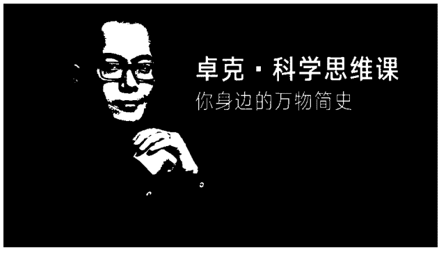

### 040 | 荣耀：为什么诺贝尔奖没有数学奖？

#### —— 概念：荣耀 ——

诺贝尔奖很伟大，但也有错误。这个世界有太多未知的东西，哪怕是诺贝尔奖得主的观点，也未必正确。

040 | 荣耀：为什么诺贝尔奖...

听了前三节关于诺贝尔奖的课不知道大家脑子里对科学大致是一个什么框架，有没有新的认识。那今天的课我们继续深入地说说世俗的价值和理想化的价值。

诺贝尔奖里为什么没有数学奖？

这倒是個问题，因为数学这门学科太有普遍意义的，让谁列举学科的名称，都不会落下数学。

为什么诺贝尔奖却落下了呢？

最简单的回答就是，诺贝尔没有认识到数学的价值。

#### —— 警惕喜闻乐见的答案 ——

这个问题对于绝大多数人来说，是一点思路由没有，但有一些文艺青年或者阅读广泛的科学青年，会给一个老百姓喜闻乐见的答案：

就是诺贝尔的未婚妻曾经背叛了他，和一个优秀的数学家私奔了，所以不能跟他提这个事儿，提了就别招，要是真的设立了数学奖，说不准这位数学家还能获得提名，甚至获奖，把自己的奖金给给情敌，这种事儿诺贝尔肯定做不出来啊，所以诺贝尔奖里没有数学奖。

这个传言就是这样，但这是纯粹瞎编的，不要信，也别传。

咱们来通过历史考据仔细说说。

#### —— 诺贝尔的4次恋爱 ——

首先是诺贝尔一生有记录的，有过4次恋爱：

前两次发生的时候，他还很年轻，一次是姑娘染病去世了，还有一次是被抛弃了。但这离他去世还有40多年，是不会影响遗嘱里要不要设立数学奖的。

后两次都是在40岁以后，如果有影响，那就要从这段经历里找。

第一段是和他的私人管家和秘书，贝尔塔，这位女性出身不凡，她只给诺贝尔当了2个月的秘书，诺贝尔就可以算是深深地爱上了她，但是后来贝尔塔不辞而别，其实是去追求她自己的爱情去了，她最终嫁给了小她7岁的前男友，这段故事咱们有机会可以仔细讲讲，非常让人感慨，当然，她嫁的这个男人不是什么数学家。

第二段恋情是和一个刁蛮的麦花姑娘，两个人的关系维系了15年，最后诺贝尔被拖得非常疲惫，非常无奈，根本没有一丝的留恋，那个姑娘在人老珠黄的时候，嫁给了一个军官，结果这个军官在婚礼举行的第二天就抛弃了她，所以也不是什么未婚妻被数学家抢走了。

所以那个传言就是个谣言。

但毕竟是空穴来风，连数学家的名字都有，所以多少应该还是有一点点关系的，是什么呢？

这个数学家叫米格塔·莱弗勒（Mittag-Leffler），他还是瑞士皇家科学院的会员，皇家自然地理学会成员，还是芬兰科学与文艺学会的会员，还是很多大学的名誉博士，头衔排列一长串，30多个。他领导的其中一个组织，和斯德哥尔摩大学有派系斗争，而且挺激烈的。

而诺贝尔晚年在立遗嘱的时候，这份遗嘱牵涉的金额太大，所以在他晚年的几年里改来改去，改出N多个版本。其中早期的版本中，就有5%的金额要捐给斯德哥尔摩大学的，而米格塔领导的派系和这所大学有矛盾，所以就有坏人编故事，说诺贝尔奖只捐赠斯德哥尔摩大学，不捐赠他的机构，就是因为两个人从前是情敌，故事就这么被编出来了。

#### —— 诺贝尔的价值核心 ——

不过，最终诺贝尔的遗嘱改了N多次，还是把那些零零碎碎的捐赠全都取消了，全部都用来奖励在前一年中对人类做出最大贡献的人，这可是他的遗嘱原文。

在原文中，“在前一年，对人类做出最大贡献的人”，这是他遗嘱中价值判断的核心。

比如咱们昨天提过，一个金刚石的制备法和元素周期放一起，金刚石的制备法是更容易获奖的。

为什么呢？

就是因为这个价值判断。

设立什么奖项，也是基于对人类做出最大的贡献。而数学在这一点上就是吃亏吃大了，纯数学研究都是逻辑层面的，没有实践的部分，你要在实践上

#### —— 不了解数学的诺贝尔 ——

那诺贝尔为什么会对数学无感呢？

这和他过往经历有关系，他出生后到9岁，家里经历了一场由衰败到富足的转变，之后在俄国生活，那会儿俄国没有普及性的教育，家里有钱也没有公立的学校上，也就是家里请一些老师，学的就是一些基础课，诺贝尔他们家请老师的目的，不是为了让孩子成为学者，只是为了今后能接爸的班。诺贝尔的爸在俄国有个工厂，生产地雷、水雷、机轮什么的，眼看着事业蒸蒸日上，孩子们长大能接班就可以了。

这些工具。

在诺贝尔那个年代之前，只要是能把加减乘除清楚地运用在自己的学科范畴里，那些学科就已经是升级到很不错的水平了。

但是数学，它始终是一个纯智力的，逻辑上的心智活动。如果一个人对数学感兴趣，甚至深陷其中，那么有两点：

+   1. 他能感受到的那些美和价值，是普通人根本无法理解的，你可能想说，这是不是一种情怀呢？但是我觉得用情怀这个词来形容一个人被数学之美感召了，还是属于侮辱了数学，因为情怀是一种飘忽不定的东西。
2. 如果一个人真的被数学中的美吸引到了，强烈地认同数学中那些逻辑的价值，这是一种稳定的情感，这样的人，是一种超脱世俗情绪的人，他的思维世界秒杀普通人好几个等级。

关于数学之美，我们之后也会用一个系列来仔细说说，这里不展开，咱們回到诺贝尔。

#### —— 今日知识小结 ——

我可以大胆猜测一下，在1890年，那个年代对数学之美、数学的价值有深刻认识的人，只能是数学家。

可是他们赚钱的能力不高，你看，跟诺贝尔同时代的大数学家高斯，大数学家黎曼，同时代又同国籍的阿贝尔，这些人的世俗成就，都可以用一个字总结，穷。高斯可能还好点，因为他一直有贵族供养。

像这种经济状况，这种赚钱能力，是不可能有钱来设立像诺贝尔奖这么大金额的奖项的。但是这部分人却是那个时代唯一有可能认识到数学应该设立奖项的人群。

可是反过来，通过一个人的个人奋斗，能赚到这么巨大的财富，然后给全世界科学家设立奖项的人，也必然没有机会了解到数学的重要性，也必然不会设置数学奖。

你看，这就是一对儿矛盾。

这期我们先用了查证的做法，把一个听上去最容易接受的纬间粉碎了，然后整个我们都在说数学对其他学科的进展起到一个什么作用。

#### —— 今日思考题 ——

不可否认，学科与学科之间，发展是不平衡的，有的学科就是更先进、更发达、更科学，那什么是判断学科是否先进发达的标准呢？

如果您想到了，希望您把观点留在评论里。

卓克

我是卓克，咱们下期再见。

### 041 | 补充：诺贝尔的恋人

041 | 补充：诺贝尔的恋人

诺贝尔颁奖周的系列课程里最后一节，我们说到了诺贝尔奖里为什么没有数学奖。

谣言里说，有一个成就卓越的数学家抢走了诺贝尔的未婚妻，如果真的设立了数学奖，说不定这个人也会被选上，所以诺贝尔最终没有设立数学奖。

当然，咱俩把谣言给破除了，而且还悉数了诺贝尔生平的四位女朋友。其中第三个，她做过诺贝尔的秘书，就是贝尔塔，她可以说是诺贝尔一生的挚爱，很多同学都想听听这段故事。那么今天我们就用答疑来把这段补充完整。

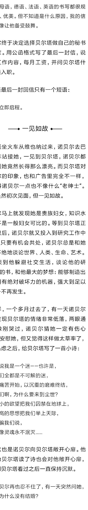

在诺贝尔40岁的时候，因为卖炸药已经赚了足够多的钱，前半生奔波劳苦，所以现在的心态稍微发生了点变化，人到中年，就不想一辈子这么苦哈哈的了，所以就花大价钱在巴黎市中心买了一栋别墅，屋里的装饰都弄好了，家具都非常精致，等到最后住进去的时候，才突然发现，原来自己这么多年一直忙于工作，一直在办公室，一直在火车上，孤身一人到处跑，当然方便，也已经习惯了，但现在住这么大的别墅，里面只有自己一个人，显得特别孤单。

#### —— ◆ 招聘广告 ◆ ——

> “居住在巴黎的一个受过高等教育的老绅士，有意聘请一名懂得几门语言的成年女子担任他的秘书兼管家。”

#### —— ◆ 一见如故 ◆ ——

#### —— ◆ 贝尔塔的故事 ◆ ——

家和亲朋友，从维也纳来巴黎集体丢了个大脸。

#### 第四次情感受挫：

半年后，贝尔塔快26岁了，她在歌剧院认识了奥地利的一个贵族阿道夫，马上就发展到求婚了，阿道夫是一个出色的男高音，一心想成为职业歌手，但在那个年代，就算是唱得再好也属于戏子，是被人瞧不起的，可是他的身份是贵族，所以他的家庭极力反对，不允许他在欧洲登台，不要给家里丢人。所以阿道夫决定为了梦想去美国发展，临行前他和贝尔塔许诺，只要在美国站住脚就接她过去。

贝尔塔在港口送走了阿道夫，之后每天都盼着来信，4个月后电报来了，等到的却是阿道夫在半途病逝的死讯。

#### 第五次情感受挫：

又过了4年，贝尔塔已经30岁了，还没找到合适的对象。她妈妈也因为常年赌博输掉了所有家产，卖掉了大房子搬到了农村，准备在那里挨过晚年。

贝尔塔不愿意跟母亲去农村，就留在了维也纳，给苏特纳（Suttner）男爵当家庭教师，男爵的二儿子阿瑟刚刚23岁，结果被贝尔塔迷住了，贝尔塔也被阿瑟的英俊、可爱、多才多艺吸引，两个人情投意合。不过他们都知道，因为身份的问题，他们是不可能结婚的，但现在这种心态，也不求更多的了，彼此喜欢就足够了，谁也不去考虑未来，就这样度过了2年多时间。

有一天，男爵夫人突然找贝尔塔，她看到夫人铁青的脸色，就知道和阿瑟的好日子大限将至，因为夫人发现了他们的恋情。

贝尔塔不等夫人开口，主动提出辞职，男爵夫人听完她的决定马上同意了，然后顺手递给贝尔塔一份报纸。而报纸的第二版正印着诺贝尔招聘秘书兼管家的广告，贝尔塔就是看到了这份报纸的广告，决定离开苏特纳男爵的家，到巴黎来开启一段新生活。

所以你看贝尔塔之前这10几年，经历过五六次非常惨痛的感情经历，而诺贝尔这次看到贝尔塔哭得红肿的眼睛，就是因为她又收到了阿瑟的来信，这两个相爱的人不能在一起，只能通过书信倾诉表肠。

#### ——◆ 不辞而别 ◆——

诺贝尔听到这一切，很久没说出话。

几天后他经过深思熟虑，就劝贝尔塔和阿瑟一刀两断，长痛不如短痛，否则新生活永远不会到来，因为两个人的身份差异太大，婚姻永远得不到家庭的祝福，贝尔塔只是表示了感谢。

诺贝尔给出建议的第二天，就要从巴黎去斯德哥尔摩参加新工厂的开工典礼，他心里不放心，因为昨晚他和贝尔塔聊了那么多感情的事儿，也不知道贝尔塔现在心情是怎么样的，他有一点儿后悔，觉得自己没权利影响她的决定，但又不忍心看她这么难过。

所以等火车刚到维也纳，就赶紧发了电报回去：“我已平安到达，将于下周回巴黎”。

但诺贝尔一直没有收到贝尔塔的回信，直到一周后他回到巴黎，屋里空空荡荡，只有信箱里有一封道歉信。贝尔塔已经不辞而别了，两个人下一次见面已经是九年之后了。

原来9年前那天，贝尔塔收到了2封电报，一封是诺贝尔的“平安到达，将于下周回巴黎”，另一封是恋人阿瑟的，写着“没有你我无法生活”。贝尔塔没有任何犹豫，卖掉了身上仅有的最值钱的镶钻十字架，买了车票，登上了东方快车号，奔向了维也纳的阿瑟。

两个人的婚姻没有受到双方家庭的祝福，婚礼只在一个非常小的教堂里举行。婚后没有工作，也没有住处，贝尔塔就写信给达迪妮公爵夫人，说了情况。公爵夫人回电：欢迎来高加索。所以他们最终在公爵夫人那里找到了庇护所，夫妻二人就此住在了公爵夫人家里长达10年，这期间就靠着给当地贵族做家庭教师为生。

#### ——◆ 诺贝尔和平奖的由来 ◆——

9年后，俄国和土耳其的关系紧张，开战了，夫妻二人决定离开高加索，到欧洲的西部，贝尔塔和丈夫特地去巴黎看望诺贝尔，这么久过去了，她眼中的诺贝尔并没有什么变化，只是多了几根白发。

而诺贝尔却发现贝尔塔不一样了，她现在是一个富有同情心和责任心的女人了，暂短的会面里贝尔塔一直在说和平运动的事情，说要去参加国际和平仲裁联盟的事情。

原来这些年他们夫妻在高加索，受到战乱的影响，学生流失非常多，收入很不稳定，丈夫阿瑟就试着给报纸投稿，写战争的报道，结果竟然篇篇都被采纳刊登。所以阿瑟和贝尔塔就走上了战地记者的路。出版了和平主义小说《放下武器》，创办了德国和平协会，参加了第一次海牙公约的签字。

夫妻俩不久就告辞了，但也就是这次谈话， Α大地影响了诺贝尔，让他反思，因为他自己是炸药大王，可以说自己一直从事引发战争这个行当。

所以最终诺贝尔在遗嘱里设立和平奖，最初的源头，是和贝尔塔身份的转换分不开的。

而诺贝尔一生未婚，他的心中多少有些遗憾，没有和贝尔塔牵手。

之后贝尔塔和她的丈夫就一直走上了呼吁世界和平的道路。

#### 挪威议会在1905年10月9日宣布：

+   1905年诺贝尔和平奖获得者，贝尔塔·冯·苏特纳（奥地利），身份是：著名女作家，和平运动的代表人物。

贝尔塔是诺贝尔奖中，第一个被授予的女性。而这个时候，诺贝尔已经去世9年了。

卓克
我是卓克，咱们下期再见。

### 042 | 问答：我们应该怎么科学养胃？

042 | 问答：我们应该怎么科学养胃？

胃的问题还有很多人问，我来补充一些。

首先是养胃，很多人说喝粥养胃，还要喝小米粥，有些说喝大米粥，众说纷纭，还有说每天定时三餐，这个养胃。实际上，这些说法都是没有依据的。

胃是一个很坚韧的器官，因为它常常受到胃酸侵蚀，所以胃粘膜要随时换新，普通食物吃下去，对它的压力是非常小的。

虽然医生不能站出来提倡不规律的饮食，提倡一日三餐不需要规律，但起码的，现在没有医学证据可以说明不按时吃饭会对胃造成什么伤害。至于说喝什么粥养胃，以及吃山药养胃这些，就更没有依据了，但这一点是很容易被误解的。

有一种误解，是有人一定会说，你这不是胡说吗？饮食不规律对胃竟然没有坏处？
我只能说，科学结论还真就是如此。

#### —— 科学“养胃” ——

- 1. 比如少吃盐，这就是重要的一条，可能很多人听说少吃盐是防止高血压，确有这个作用。但盐的坏处不止于此。高盐分的饮食对胃粘膜有损伤，有统计，日本沿海的城市，还有山东的一部分沿海城市，只要是饮食习惯是特别口重的，那里的胃癌发病率都很高。
2. 另外一个是少吃腌制食物，这些对胃癌贡献率也挺高的。
3. 还有就是不要喝酒，酒精对胃粘膜的刺激，也会很容易导致胃壁的粘液分泌出问题，胃酸就容易直接接触胃粘膜，这个很快就能腐蚀穿，然后就接触到胃部的肌肉了，胃酸消化肌肉是很快的，马上就是一个胃溃疡点，一般从这个时候开始你就开始疼得受不了了。
4. 再有就是如果有幽门螺旋菌引起的明显症状，那么还是建议杀灭。

这4条是真正的“养胃”。

你我的胃远比咱们传统文化里倡导的更坚韧。

卓克

好了，这次的答疑就这么多，咱们明天再见。

### 复习+预告 | 我们一起感受数学的美

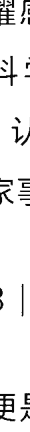

#### —— ◆ 本周课程复习 ◆ ——

诺贝尔奖很伟大，但也有错误。这个世界有太多未知的东西，怕是诺贝尔奖得主的观点，也未必正确。

### 037 | 荣耀：诺贝尔奖在各种奖项中地位是最高吗？

诺贝尔终生未婚没有后代，晚年想要洗清人们脑中他和炸药的联系，他非常清楚科学是最值得投资的，所以为了心中的那份荣耀感，把毕生的巨资全都捐给了全世界的科学家。而接手的机构也充满了使命感，认真负责地把诺贝尔奖做成了瑞典的国家事业。

### 038 | 荣耀：那些颁错了的诺贝尔奖

即便是伟大如诺贝尔奖，也曾发生严重的错误，造成了很多的遗憾。因为在科学的探索过程中，再努力再真诚，错误也远比正确要多，付出的心血值得敬佩，可一旦落到事情的“是与否”上，就要屏蔽情感，客观判断，只有这样，才能更接近事情的真相。

### 039 | 荣耀：诺贝尔化学奖其实应该叫诺贝尔理综奖

诺贝尔奖中的化学奖，纯化学家获奖的只占2/3，原因在于科学发展的速度超出了绝大多数人的认知，前人的学科分类，已经不足以承载现代科学的体量，科学还在细化，同时各个门类和分支之间的边界却也在变得越发模糊。

### 040 | 荣耀：为什么诺贝尔奖没有数学奖？

在生活中，我们每个人都应该要警惕那些看似直观简单的答案，普通人难以理解数学的美，而且即便是诺贝尔先生，也没有认识到数学的价值。

### 041 | 补充：诺贝尔的恋人

没有和贝尔塔牵手，诺贝尔多少有些遗憾，但正是与贝尔塔夫妇关于战争的对话，让炸药大王诺贝尔开始反思，这是他最终在遗嘱里设立诺贝尔和平奖最初的源头。

### 2017年诺贝尔奖抢鲜解读

### 抢鲜 | 2017年诺贝尔生理学医学奖解读

今年的生理学或医学奖是纯粹的生理学奖项，和医学没什么关系，三位科学家用果蝇做研究对象，在基因层面上找到了“昼夜节律”（生物钟）的调控机制。目前，这个学科的研究成果，距离实际应用还有非常远的距离，大家要注意那些马上就会出现的骗子。

### 抢鲜 | 2017年诺贝尔物理学奖解读

今年的诺贝尔物理学奖，颁给了建造LIGO探测器，并发现“引力波”的三位科学家，它的意义是，让人类首次可以利用空间本身的颤动来观察宇宙了。实际上，爱因斯坦100年前基于广义相对论，在理论上计算出引力波的存在，现在终于得到了验证。

### 抢鲜 | 2017年诺贝尔化学奖解读

今年的诺贝尔化学奖，颁给了在“冷冻电镜”技术上做出的贡献的三位科学家，它的意思是，让人类观察小东西的极限得到了极大的扩展，这对研究病毒极为有用，让人类在新药研发、理解生命的规律上，速度大幅提升。同时，获奖的三位科学家，两人是生物物理学家，一位是生物学家。

#### 答疑时间

### 042 | 问答：我们应该怎么科学养胃？

胃是一个很坚韧的器官，传统文化中的绝大部分养胃的观念都是没有科学依据的，比如喝粥、吃山药等。真正的“养胃”就是少吃盐、少吃腌制食品、不要喝酒、如果有幽门螺杆菌引起的明显症状，就去杀灭。

#### —— ◆ 下周课程预告 ◆ ——

##### 043 | 计算：爱因斯坦每天跟谁一起下班？

##### 044 | 计算：为什么数学家对质数很着迷？

##### 045 | 计算：未知数用XYZ表示，怎么不用其他字母？

### 046 | 计算：羊皮书里的微积分

卓克

我是卓克，明天我们开始进入第八周的课程，明天见。

##### 043 | 计算：爱因斯坦每天跟谁一起下班？

卓克

你好，我是卓克。

今天我们进入模块一：思维与方法第八个概念，也是最后一个概念的学习。

#### ——► 概念08: 计算 ◄——

数学不等于计算题。当你真正开始了解数学，你就会知道科学为何起源于欧洲，以及人类是如何发展到现在这种文明程度的。

爱因斯坦每天跟谁一起下班？

这个问题回答起来要分时期了，因为爱因斯坦换过好几次工作。

听上去最Low的工作，就是在伯尔尼专利局的那段日子，试用期2年，转正之后是最低级别的三级技术员，后来慢慢升到二级、一级。在那7年里，他和谁一起上下班不太重要，大概也就是专利局的同事们。后来自大学任教和科学院任职时，和谁一起上下班也不重要。

#### ——► 爱因斯坦的忘年交 ◄——

最重要的是，他晚年的时候在普林斯顿高等研究院那段时间，爱因斯坦每天晚上都和哥德尔一起下班。

这就引出了咱这一系列的概念了，数学和计算。

纳粹对犹太人在政策上走向迫害，大约就是从第三帝国建立的时候，1933年。爱因斯坦是很敏感的，他发现政府规定犹太人不能担任公职，不能在广播、影视、教育界工作，马上去就去了美国。

他去普林斯顿高等研究院算比较早的，所以后续吸引了大批逃难的犹太科学家。其中有一位年轻人，是在爱因斯坦到高等研究院的5年后到的，这个人就是哥德尔。

他和爱因斯坦相差27岁，基本就是一代人的差距，最初他们在工作中没有什么交集，大约是从哥德尔入职后4年，突然就有人发现两个人天天下班一起散步回家，这对忘年交一发不可收拾，下班一起散步回家的习惯一直延续到爱因斯坦去世，持续了13年之久。

其实到现在都没人知道到底是什么原因，两個人这么爱在一起待着，蛛丝马迹里只有一件事是爱因斯坦回忆录里写到的，就是有一天哥德尔突然想去看迪斯尼动画，于是给爱因斯坦打电话，希望能一起去，其实爱因斯坦不太喜欢动画片，但还是陪哥德尔去了。大约就是从那次看电影之后，两个人就天天一起下班了。

#### ——► 不普通的哥德尔 ◄——

哥德尔是捷克人，数学家、逻辑学家和哲学家。他做人做事的风格，是非常典型的大众眼中的怪咖数学家，体弱多病、疑心重重、神经质、抑郁症、总是担心随时有危险发生、讨厌旅行、害怕和人接触、能打电话绝不见面、能不打电话的绝不打电话。

咱就举2个例子：

第一个是他6岁的时候，在练习本上做计算题，那个数字写的，工整整的，但是你仔细看，3+1=4，算了3遍，2+1=3算了7遍，3-1=2算了7遍，4-1=多少，第一遍算成4了，错了，划掉，然后又工工整整重算了2遍。

你仔细想想，4以内的加减法，就算是6岁的孩子，也是非常简单的，有什么好思考的呢？所以这个小孩子一定不普通。

#### ——► 数学的世界 ◄——

而爱因斯坦和哥德尔最高的契合点是在思想上，而不是观点上，更不是在年龄、相貌、财富这些方面。

> 计算机之父·诺依曼曾经这么评论（冯·诺依曼是高等研究院里最早的6个教授之一），他说：“在哥德尔还不是教授的时候，我们这些人中怎么可能有人配称为教授呢？”

#### ——► 哥德尔的贡献 ◄——

哥德尔在数学上思考的是什么呢？

如果查一下百科，那就是他证明了“不完备性定理”。

这定理出来估计没什么人能听懂，如果用最粗糙的语言来描述就是：

用最粗糙的语言来描述就是：

现在我们研究的，带有计算过程的数学体系里，有很少一部分是作为约定俗成的不需要证明的公理，比如加减乘除都是怎么定义的。也有很多是从公理推导出来的，叫定理，它们可以被证明，比如 A+B=X，C+D=X，那么 A+B=C+D，这就是定理。定理可以很简单，也可以非常复杂，像费马大定理，庞加莱定理，都证明了100多年。

数学家们又从简单的定理继续推导其他的次一级的复杂定理。

但是哥德尔证明了一件事：

就是算术系统中，通过定理继续推导其他定理的过程中，这样一步步推进，有可能会掉沟里去。就是说，可能某一天，有个数学家推导出一个结论，这个推导过程没有出现错误，可是结论是无法用这个体系内的知识来判断它是不是正确的。如果继续从这个无法判断真伪的结论继续推导其他的东西，推导出来的也都是不可分辨对错的。

当然，在逻辑上哥德尔还证明了有另外一种可能性，就是如果你一定要要求这个系统内的全部结论，全都可以通过系统内部的东西来判断结论的正确性，那你就要向另外一头妥协了，就是这个系统内必须存在相互矛盾的结论。

以上大概就是哥德尔不完备性定理的最最通俗的理解。

而我刚刚说的另外一头的妥协，数学家们不是没考虑过，大约在哥德尔出生前30年，另一位最终也成为严重精神分裂症患者的数学家，叫康托，他第一个奋身一跃，跳进了大坑里，着手处理数学体系中会不会存在某些结论是互相矛盾的这个问题。后来相继跳入大坑的重要数学家还有希尔伯特和罗素。但好在那一次数学大厦在濒临倒塌时，被这几位奋不顾身的人力挽狂澜拯救了回来，这事儿发生在哪德尔出生前5年。

但哥德尔这个结论一出，又把数学推到了悬崖边缘。这个危险就是，数学家们不敢肯定，有些困扰了数学界几十年，或者上百年的猜想，有可能就是属于这类自身体系无法证明的问题。

数学家是智力活动的顶级运动员，他们很容易被难到证明不出来的问题吸引，那假如很多至今没被证明出来的问题，就是系统内部无法判定的，那这些数学家宝贵的智力和生命就白白浪费掉了，他们相当于被吸入了精神世界的黑洞中。

这个问题后来怎么发展了呢？

我们有机会说布尔巴基学派的时候再详细展开，这也是一个不可思议的团体。

#### —— 今日思考题 ——

对比哥德尔，爱因斯坦性格开朗，爱好广泛，他们岁数差得还这么大，27岁，办事的风格也相差很多，比如，最容易引起争执的宗教信仰完全不同，给总统投票也不一样，1952年大选，哥德尔选史蒂文森，爱因斯坦选艾森豪威尔。那是什么让他们相互这么高度地认同对方的呢？

希望你把观点留在评论中，深入思考，优质评论也是内容的一部分。

卓克

我是卓克，咱们下期再见。

##### 044 | 计算：为什么数学家对质数很着迷？

#### ——►概念08：计算◄——

数学不等于计算题。当你真正开始了解数学，你就会知道科学为何起源于欧洲，以及人类是如何发展到现在这种文明程度的。

044 | 计算：为什么数学家对质数很着迷？...

#### ——►令人着魔的质数◄——

除了1跟它本身，没有其他数可以整除的，这种数叫做质数。

我第一次知道质数这个词应该在小学时候，教科书就要求我们掌握100以内所有质数，据说现在的小学数学教材，已经开始教怎么判断100以内的数是不是质数的计算方法了，用的是一种叫做“质数筛”的工具。

所以，如果你到现在还不知道什么是质数，那就等于说在具体的数学知识上，你已经被四年级的学生甩下了。

自然数中那些不是质数的数字，数学家们对它们几乎是无视的态度，但凡是涉及到质数就会非常感兴趣，甚至到了着魔的地步，这是为什么呢？

最简单的理解就是，所有非质数只要通过质数简单的相乘就可以得到了，所以当我们把质数的规律了解透了，整个自然数，我们就算全面了解了。我们就会了解到自然数的结构，而且这些结构也许可以对应到现实世界里一些真实存在的东西上。

当然现在这种对应关系只是隐隐约约地已经浮现出来了，但是是不是真的丁是丁，卯是卯地对应上了呢？

还在研究当中。

#### ——►最早迷上质数的人◄——

有文字资料可查的最早迷上质数的人是欧几里得，他是公元前300多年的人，如果生在中国，大约跟秦王嬴政年岁是差不多多的，他当时用了一种反证法，证明了质数有无穷多个。

反证法是一种逻辑思维里的重要工具，因为质数有无穷多个，你要是顺着这个方向想证明它非常难，你总能找到下一个质数。

那么什么时候才能算到头呢？

反证法就是先假设“质数有无穷多个”是错的，然后再根据这个错误的大前提继续利用正确的逻辑一步一步推演，争取能够推导出一个荒谬的矛盾出来。

如果中间推导都没有问题的话，但最终却冒出了一个荒谬的矛盾，那说明什么呢？

那也只能是最初的那个假设有问题的。而且如果最初的假设只能由“是不是”来划分的话，比如像质数是不是无穷多个呢？那么刚刚那个假设不是无穷多就会出现矛盾了，那只能承认质数是无穷多个，所以到此证明就完成了。

这个证明的具体方法你要是感兴趣，可以想想，想不出来也可以查一查，咱们今天不多说了。它的关键就在于怎么构造一个荒谬的结论出来，这一步是最难的。

欧几里得之后很长一段时间里就再也没有记录有人详细研究过质数了，这段空窗期有多长呢？

说出来吓一跳，1800年，我们一会儿来详细说说这前后2000年左右的情况。

#### ——►质数研究史◄——

在1601年的时候，既是法官又是业余数学家的费马开始研究费马数，费马数由一个公式来定义，咱们不具体说了，如果跟着这个公式算下去，前几个数都是质数，这前几个是3、5、17、257、65537，但是第六个数是不是呢？

这判断难度太高了，因为这第六个是4294967297。你怎么能够确定这42亿多的数字有没有其它的数能整除它呢？太难了。

但这个费马是一个业余数学家，他经常就不负责任地乱猜、乱证，他就看这前几个数没问题，所以就猜这个公式大概也没问题，这个公式算出来的其它数也都是质数。

后来这个坑是在费马去世之后67年被一个25岁的职业数学家欧拉给填上的。且其实现在欧拉是把费马数给揪臭了，因为那个42亿多的数字中间有一个因子是641，用它可以整除。

在这个期间还出现过一个神父兼数学家，叫梅森，他也构造另外一个公式，这个公式可以说就是2的n次方再减1，如果这个n是质数的话，这个公式算出来的数也是质数。当初梅森神父跟费马大法官都只是这么一猜测，他们也都是没有能力证明的，其实也是因为难度太高，连欧拉也没有办法证明。

在这个梅森数提出之后250年，美国数学家科勒成了梅森质数的刽子手，因为他发现n次方的那个n等于67的时候，算出来的数字不是质数，那个巨大的数字是可以被193707721这个数字整除的。但梅森公式是要算出好多好多位才能出现这第一个反例。

所以，200多年来就惹得数学界也心里头痒痒的，就想看看这个公式算下去，能不能找到下一个更大的质数。这当然是一个没有极限的挑战了。

科勒枪毙了梅森质数的公式是在1898年，那会儿要想确认这个也只能靠手跟笔来算。虽然有很多数学算法可以简化验证的工作，但依然是一个重体力的重复性的，而且还不能出错的严谨的工作。

这种工作谁做最合适呢？是数学家吗？

不是的，是计算机。

当计算机在上世纪60年代刚刚从军事用途下放到民用，下放到科研的时候，算最大梅森质数的军备竞赛就开始了。直到现在，很多的电脑测试软件在测试稳定性的時候，都会让CPU处于百分之百的负荷运转，就是用来确认梅森公式算出来的那个数到底是不是质数的程序。当然，数学家对质数的研究远远不止这2个例子，只不过它们是最好懂的。

#### ——►质数的意义◄——

我们去年说的那个黎曼猜想的系列，其实跟这个高度相关。

质数的意义就在于，当我们研究透了以后，我们会重新认识数的结构。

普通人对数是完全没感觉的，那不就是1234嘛，有什么结构啊？

如果真的是这么简单，几百年来就不会吸引那么多数学家了。所以想了解数的结构，不要着急，咱们在接下来的课中会慢慢地涉及到。

#### ——►文艺复兴与科学复兴◄——

现在我们把视角转过刚刚咱们说的对质数的硏究存在一个空窗期1800年。

可能有人以为，这么久的时间，是不是因为全世界的数学家都忽略了这个小知识点呢？或者是因它太难了，进攻了1000多年也没有拿下来？

不是的，而是在这段时间里头，整个西方的文明进入了大面积、长期地衰退，你就可以理解为一个长达1000年的熊市。

后来牛市终于来了，推动牛市的其中一个重要的心理支撑点是什么呢？

那就是我们的先人，我们的老祖先是很牛的，可我们这些不肖子孙把他们的宝贵遗产给遗失了，我们应该重新拾回来才行啊。

文艺复兴运动里的科学复兴，就是建立在这种情绪上的。崇古尚古之风每个民族都出现过，但是欧洲人民崇古尚古是幸运的，因为他们的老祖宗在1000多年前留下的那些东西是一种系统化的思考，尤其在功利心特别重的拜金主义的社会里，这种思考的味道是非常容易辨识出来的，通常来说，一听上去就是那些严重不切实际的，形而上学的内容。

2500多年前这股思潮最早出现的时候，就是尽最大努力探索自然界的道理，并且特地忽略世俗，它是偏爱抽象理论的，严重忽视实用技术的，它把智力活动作为人生最大价值的体现，就是所谓的重智。

比如有的就说大自然的一切都是数，数的规律是永恒的。

稍微形象一些就是说几何，比如柏拉图学园门口就挂着一张牌子，不懂几何者莫入。

还有人问毕达哥拉斯，学数学有什么用呢？毕达哥拉斯根本就不回答，转过头就吩咐自己的助手说，给这个问问题的人一个银币打发他走，因为他想从数学中渔利。

你看，那会儿社会精英的价值观就是遇见用世俗眼光来评价数学的人，那态度就跟打发乞丐是一样的。虽然2500年前，用数构造出的世界牵强附会的地方非常多，但不可否认，那就是西方人的祖先对世界的描述，对价值的判断。

#### ——古人不切实际的念头——

欧几里得大约是赢政爷爷那个岁数。但欧几里得其实已经是西方古代这股文化潮流的末期了。这个潮流大约是在他之前150年就开始流行起来。

希腊文化，尤其是跟科学相关的，由这6个人接续了这150年的火炬，毕、苏、柏、亚、欧、阿，就是毕达哥拉斯、苏格拉底、柏拉图、亚里士多德、欧几里得、阿基米德。这6个人要不就是老师跟学生的关系，要不就是一个人临近晚年了，下一个人刚好出生，刚会认字的时候就看到上一个人写的书，然后被感召到了，被感动了。

而我们对比来看，在这150年里头，对应中国的什么时期呢？

那正好就是战国时期，当时谈不上有什么主流文化，那是一种百家争鸣的状态。但是，百家归百家，只有墨子一支是跟科学挂点边的，因为他已经开始提倡测量和量化了，但是区别就在于墨子更关注技术的应用，还不是那种完全脱离实际理论上的计算跟逻辑推演的范儿。

中国古代的其他流派那当然也是思考大自然的，这些理论可以统称为道，但这个道属于纯文化学的思辨，这些内容百花齐放是可以的，但验证对错就谈不上了。西方到了托勒密的年代，也大概是中国刚刚废黜百家、独尊儒术的年代，西方跟中国在科学这种文化上算是一起衰落了，中国讲究的是以德治国，以德服人，这些就跟科学相去更远了。

对于西方的古代先贤来说，重要的元素就是“数”和“几何”，是重智的，而不是重道德。西方古人的这种思想，曾经占据过社会主流思想很久很久时间，少说有几百年。所以，当这股主流思想因为机缘巧合在1000多年之后的文艺复兴把它复兴了，深挖祖国优秀文化传统思想的时候就重新恢复了。

文艺复兴的复兴，就是复兴1000多年前的那个辉煌，整个欧洲的精英虽然经过了漫长的中世纪，但是依然对1000多年前那种不切实际的念头感觉是荣耀的，是辉煌的。

#### ——今日知识小结——

所以，今天我们讲的科学思维，就是要借数学家为什么这么着迷质数这个问题，带大家浅尝辄止地感受一下科学为什么是起源于欧洲的，感受一下他们的价值判断。

这种价值观对金钱至上的社会来说略微有点奇怪，跟大多数人说的时候，他们的反应就是“你跟我说这个干什么呀，这跟我有什么关系呀？”

但其实知道了这些，你对人类是怎么一步一步发展到这样现代化的程度，就有一个从理工科角度的文化理解了。

#### ——今日思考题——

其他文明也一样有对大自然规律的思考，也会不切实际。但为什么之后却没有从那些文化中生出现代科学这种文化呢？

这是一个比较开放的大话题，欢迎你把观点留在评论里。

卓克

我是卓克，咱俩下期再见！

### 045 | 计算：未知数用 XYZ表示，怎么不用其他字母？

#### ——► 概念08：计算 ◄——

数学不等于计算题。当你真正开始了解数学，你就会知道科学为何起源于欧洲，以及人类是如何发展到现在这种文明程度的。

045 | 计算：未知数用XYZ...

小学四年级以后我们就开始学列方程了，方程里的未知数是 X，但这只是一个未知数的方程，如果是两个就用 X 和 Y，如果是有3个就用 X、Y、Z。

那为什么不用其他的字母呢？

简单回答，这是规定下来的。

那是谁规定的呢？

这是一个中世纪末期的法国数学家，叫做韦达。

#### ——► 业余数学家：韦达 ◄——

#### ——► XYZ的诞生史 ◄——

#### ——► 数学强国：意大利 ◄——

#### ——► 我思故我在 ◄——

在是不是也能把它放在坐标系里去研究呢？比如说一条直线怎么去严格描述它呢？我们用粗糙的语言吗？它是直的就是直线，或者它是非常普通的就是直线，或者说它非常特别，超级，无以复加的直这就是直线了。

文学化的、思辨式的语言描述，不论它是法语、英语还是拉丁语，对于想精确描述直线这个需求来说都是粗鄙不堪的。但如果把它放在坐标系里头，我们可以用公式列出直线来，直线就不再是肉眼可见的这个层面上的直了。它是由数值运算逻辑保障下的直，这下直的描述就是非常严格的。

依此类推，像30度角，也是可以通过放在坐标系里来严格地描述它是30度，圆也可以严格地描述成一个圆，这个过程就叫做化，所以从他开始诞生了解析几何。

当笛卡尔把这些数学工具后来又用在物理上，更是让现实世界跟数学世界有了更多的对应关系。所以这些研究和思考的背景下，笛卡尔提出了“我思故我在”。

所以当一个人从来没有了解过笛卡尔是从哪些思想脉络中出现过灵光乍现，把肉眼可见的几何图形按照图形的内在规律构造成为一行公式来严格描述这个图形的时候，这个人是没有资格对“我思故我在”这种哲学思考发表什么看法的。

#### ——法国的数学文化——

在笛卡尔之后，法国又出现了像帕斯卡、达朗贝尔、拉格朗日、拉普拉斯、让德穆、蒙日、卡诺、傅里叶、泊松、柯西、伽罗瓦这些数学家。

相信上过大学的不少同学在高数里都对这些名字非常熟悉。刚才我说 Liquidity.

#### Models Attacked by Desargues' Involutions While on Catwalk

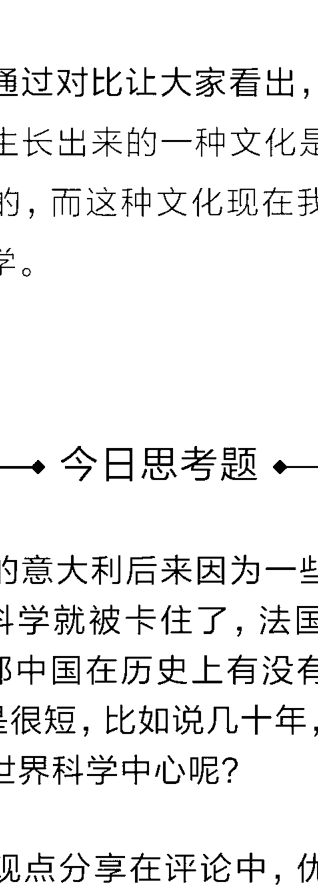

上图是2004年的巴黎时装周，有一个设计师参考了的德扎尔格定理做出来的服装。这个定理咱们不细说了。

#### ——今日知识小结——

文艺复兴开始，欧洲人的心态是崇古尚古的，到了一六几几年，文化水平已经大幅超越之前崇拜的古人了。

#### ——今日思考题——

我刚提过的意大利后来因为一些宗教束缚的原因，科学就被卡住了，法国变成了世界中心。那中国在历史上有没有过一段时间，哪怕是很短，比如说几十年，中国也曾经成为过世界科学中心呢？

卓克 我是卓克，咱们下期再见！

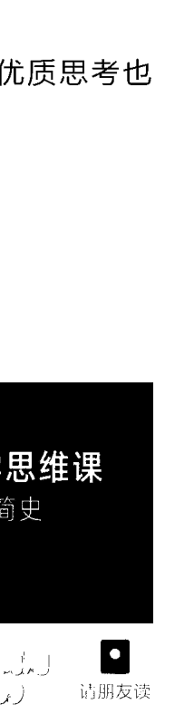

##### 046 | 计算：羊皮卷里的微积分

#### ——► 概念08: 计算 ◄——

数学不等于计算题。当你真正在开始了解数学，你就会知道科学为何起源于欧洲，以及人类是如何发展到现在这种文明程度的。

#### ——► 教堂里的羊皮卷 ◄——

1998年10月29日，纽约佳士得拍卖会举行了一次拍卖会，这次主题就是科学家的手稿，有很多是重量级的古物品，比如居里夫人拿到博士学位的那篇论文的原作，还有达尔文《物种起源》的第一版。要知道这第一版在1859年发行的时候只印了1250册，一周之内就全都抢购一空，所以现在还能够找到一本，还是非常贵重的。

除此之外，还有一本破旧不堪的小羊皮卷，还挺厚的，174页。它不是印刷品，是手抄件，破损挺严重的，四周全都烙焦了，没烙焦的地方也都发霉了，但是这个羊皮卷的起拍价是80万美元，比居里夫人的博士论文价格要高多了。

当时希腊政府已经派出文物部门去拍卖会，下定决心一定要把这个羊皮卷买回来。不过，没想到美国有一个神秘的买家一直在不停地加价，这边出100万，那边出120万，结果最终让这位美国人加到了200万美元，希腊政府再也没钱了，最终被这个美国人买走了。

这本书里写的是什么呢？

其实如果要翻开看，是一些祈祷的文字，比如阿门，什么上帝保佑谁呀，就是这些东西。而且这些还是用拉丁文字写的。

这本羊皮卷是怎么被发现的呢？

是在1906年，丹麦的一个古物学者，叫海贝尔。他当时在土耳其考察，在伊斯坦布尔的一个教堂的图书馆里，发现了这本厚厚的裱文，裱文这种东西参考价值不高，你想它都是套话呀。

但是，海贝尔翻开的时候，裱文字写得不太清晰，因为在正文的底下，还模模糊糊地有一些其它的文字，这些文字虽然不太清晰，只是隐约可见，但是一看就能看出来，这是曾经写过一些东西，后来用一些方法给它洗掉了，之后又重新写上了一些其它的文字才这是这种效果。

海贝尔作为古物学者，对这种手法也是习以为常，因为在1000年前还没有纸质的印刷品。那会儿重要的文字也都写在羊皮卷上，但羊皮卷非常昂贵，所以能节省就节省。像祷文这类文字，如果祈祷对象已经去世了，那么完全可以把墨水洗掉，然后重新再写上新的文字。

可是即使这样，海贝尔仍然对它非常重视，为什么呢？

就是因为他发现这些淡淡的，还没有完全洗净的文字字符里，里面有很多数字，还有很多几何图形，这是他从没有在羊皮卷上看过过的情况。

于是，他就在图书馆借来放大镜仔细地看，他对最显而易见的那些祷文一点兴趣都没有，他只是为了把那些隐约可见的，没有洗干净的墨水文字抄下来。每天从图书馆一开门，一直抄到图书馆关门，复制了好几天的时间。后来他就跟图书馆商量，说能不能把这本书借给我，我带回国去慢慢地研究，结果人家图书馆是拒绝的。这种古物只能在图书馆里阅读，是不外借的。

海贝尔想，怎么办呢？

那就叫一个摄影师吧，你想1906年，摄影是非常贵，非常稀有的，所以他前面已经整理好，已经抄写出来的文字，就不再拍了。剩下还没有抄写的东西，每一页拍一张照片。之后，他带着自己抄写的稿子，还有这些照片就回国了，回国整理了很久的时间，把能看清的文字全都写出来再一看，这些隐约可见的没有洗干净的文字是希腊文，而且还是古希腊文，跟它表面上最清晰的拉丁文的祷文，一看就是相差的年头比较多。

#### ——► 阿基米德原著手抄本 ◄——

这些古希腊文写的是什么呢？

其实海贝尔也不懂，因为他主要是一 些数字，还有几何图形。

更关键的是，因为这本书边 缘部分差不多都 烧黑了，这肯定是在几百年，或者上千年的保存中，有时候图书馆或者修道院经历过火灾，可是幸好它还是羊皮卷做的，如果要是真纸做的，估计早就烧没了。这本书每一页，凡是边缘部分的文字都看不清了，海贝尔只能把居中的一些文字，可以见到的抄写出来。但是有很多文字是太模糊了，它最终只抄写了那些可见文字的大约2/3的部分。

但即便是就是这2/3，海贝尔抄写之后也可以从中确认这个文字的身份，它是阿基米德关于数学方面的研究。至于研究的是什么，那大概只能确定是数学，或者跟几何相关的。具体是什么，海贝尔也不知道。

所以在1998年10月29日拍卖会上，这本羊皮卷的身份就是阿基米德原著的手抄本，所以它的价格才是最 高的，才是那次拍卖会全场的 主角。

#### ——► 还原被洗去的文字 ◄——

要说还真得是有财富的人才配得上珍贵的东西，这本书从1998年被美国人买走之后，买家就把它借给了巴尔第摩朔斯特博物馆，博物馆的文物保护专家小心翼翼地把装帧给拆开了， 清除了上面的所有霉菌，但是霉菌没有办法，然后又交给了约翰霍普金斯大学的教授，在那儿用不同波长的摄像设备进行检测，这次检测本希 望能还原出更多的文字，但是几乎没有什么进展。

最终获得的结果，就是检测出表面上这层拉丁文跟下面这层古希腊文，这两种文字写作相隔的时间大约是200年，也就是在公元900多年的 时候，有一个修道士的文员把阿基米德的原著抄在了这羊皮卷上。 倘你想，这个文员在抄写的时候，他一定知道他抄写的这个东西是在他之前1300年写下的东西。所以，估计他抄的时候也会非常激动。

可是，之后这本书就再也没人动过了，直到200年之后，也许又有一个主教，又有一个僧人要写祈祷文的时候，找不到空白的笔记本了，翻过来，就发现这个羊皮卷已经多年没人动过了，所以就一页一页地把之前写上去的文字给洗掉了，然后又在上面写下了祈祷文。这就是在约翰霍普金斯大学检测后推测出来的结果。

但是，买家还不甘心，2005年的时候，他又把这份羊皮卷送到了斯坦福同步辐射实验室，在那里利用高能的 X 射线对墨水的边缘进行了非常清晰的识别。多年那会儿的墨水都是含铁的，这个高能的 X 射线对铁元素分辨得非常清晰。

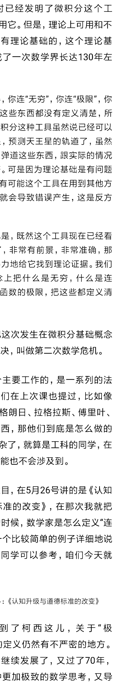

这种设备最早是用在医学检查上，对一些身体部位检测的精度甚至可以达到几微米，所以它用来探测这本书的笔记是非常合适的。

从前这本羊皮卷靠边缘的部分，文字基本上都已经被烧黑了，烧黑的颜色跟墨水的黑色是一样的，肉眼根本无法区别哪些是笔记，但是同步辐射实验室的 X 射线是可以的，所以即使烧黑了，即使那些发霉变色的地方，肉眼完全看不出来，但是在这儿就几乎可以把原书所有的文字都还原出来了。

#### —— 阿基米德与微积分 ——

等把文字全都还原出来，再给研究数学史的人一看，当时就惊呆了，因为这本书抄录的阿基米德的著作内容，是从没有出现在任何存世的阿基米德的著作当中的，几乎全都是新的内容。

而且书里还出现了一个大问题，这个问题用了20多页纸解决的，它就是用无数多个小圆相加的方法来求出球的体积，而且最终得出球的体积的公式还是对的。

你说这有什么稀奇的呀，v = 4/3 πr³，这我早就会背了。

#### —— 人类错失的1800年 ——

咱们回到这个羊皮卷上，我估计2005年这个结果公布之后，当时拍卖的这个主人一定非常非常后悔，因为这本羊皮卷上的不可辨识的文字，当把它认出来之后，竟然大幅提前了人类对微积分的认识的时间。

#### —— 今日思考题 ——

比如说当我们发现宇宙中存在另一种高级的智慧生物，它们也有非常悠久的历史文化，那我们怎么在最短的时间内确定它这种文明到底有多先进，或者有多落后呢？

欢迎大家把观点留在评论中。

卓克
我是卓克，咱们下期再见！

##### 047 | 问答：分娩到底有多疼？

047 | 问答：分娩到底有多...

有同学问，她想知道自然生产有多疼？这也是很多育龄妇女特别担心的事。

对疼痛的量化，国际上有些量表，在这些表里，像分娩痛、三叉神经痛、急性阑尾炎都属于最强烈的。

分娩痛我一会儿仔细说。

急性阑尾炎代表了一大类的疼痛，就是内脏疼痛，这种疼痛不但强烈，而且定位还不准，病人自己是不知道痛灶在哪的，有时候觉得胃疼得受不了，其实一检查发现是冠心病。

三叉神经痛在一些头疼中会出现，还有就是像疱疹病毒在面部神经发作的时候，就会弥漫到三叉神经上，这种疼痛有时候可以说是痛不欲生的，会持续半个月到一个月，疼的时候半个脸颊都会水肿起来。

#### ——► 对自然分娩的误解 ◄——

很多妈妈以为剖宫产是不疼的。

如果把比较的时间点截止在孩子出生的那一刻，剖宫产确实会“更不疼”一些。

#### ——► 剖宫产的劣势 ◄——

有时候，孕妇自己也不了解剖宫产除了生的时候不疼之外还有什么劣势，有得必有失。

持续疼痛是一个。

#### ——► 对无痛分娩的误解 ◄——

但是，自然分娩也不一定意味着就是剧痛，因为还有一种选择叫做无痛分娩。这个在中国很少有医院做，原因有两个：
一个是产妇跟家属以为无痛分娩的麻醉会损害婴儿的大脑；
另一个就是麻醉师人数太少了。

卓克

关于这个问题就回答到这里，我们明天再见！

用户留言

水清浅
作为一个顺产的妈妈，孩子出来那一瞬间之后真的tb强烈ib解放感，所以所有疼痛全部消失～所以我个人还是很推崇顺产的 可见现在这种自然的分娩才是完全...

##### 048 | 问答：乙肝的方方面面

048 | 问答：乙肝的方方面面

问题中提到乙肝的非常多，这次答疑我们就主要来说说乙肝的问题。

如果已经确认是乙肝患者了，那唯一要注意的就是三个字——抗病毒。

现在也只有这一方法可以控制病情的发展，最好情况下，可以在人生之后几十年中跟健康人没有太大区别。

而抗病毒药物都是正规医院临床中常用的，任何中成药、中药，或者奇奇怪怪的疗法，保健品，护肝药，都没有抗病毒作用，保不齐还会有肝毒性，所以都不要采纳。如果是患者，只要倚靠了正规医院的抗病毒治疗，可以这么说，肯定是被骗了。

乙肝之所以很多人问，我查了一下，咱们国家是9300万的携带者，里面有2000万是乙肝患者。这中间的差值，是7300万人，他们携带乙肝病毒，但是没有发病，占比还是挺高的。

但是，最近10年疫苗接种比较给力，所以感染率明显下降。得了乙肝如果不治疗，任其发展下去，20%的人会转变为肝硬化，这20%肝硬化病人中还会有20%最终会发展为肝癌。如果再加上喝酒，甚至是酗酒的习惯，得肝癌的比例就更高了。

怎么治疗呢？

就是“抗病毒”这三个字，主要是两种途径：

一种是干扰素的治疗，它是通过打针的方式，疗程一般要1年的时间。国产的干扰素1周打3针，1年下来估计花费6000块钱。进口的干扰素1周打1针，省时间，但是费钱，大约1年下来需要5万块钱。用于干扰素治疗，时间比较短，但是效果不好，1年后平均有60%的患者检查指标可以变成正常。

另外一种方式就是口服抗病毒药，一般正规大医院里的医生，他直接开的就是“替诺福韦”这个药，这也是乙肝抗病毒药物中最好的一种。在治疗指南上，建议要持续吃4年，而且还要加上3年的巩固期，加起来是7年的时间，所以花的钱比干扰素要多。但是效果也会好很多，平均来看，经过1年的治疗以后，乙肝病毒DNA检测不到的概率是90%，转氨酶变成正常的概率是80%，所以比干扰素要好很多。如果按照指南上说，吃了4年，几乎两项都能变成正常，那就是比创造超过95%了。如果再巩固3年，7年下来以后，有部分患者就可以在医生的监督下停药了，还有极少数的患者在之后的一生里也没有吃药，也没有再复发。

中国的乙肝病人数量多，是因为对儿童的保护不好，乙肝病毒对成年人的威胁不是很大。

我的意思是说，比如你已经20岁了，这个时候你因为机缘巧合，第一次接触到了乙肝病毒，那么你因此而患上乙肝的概率是非常低的，因为你的免疫系统已经健全了，身体遇到乙肝病毒之后会马上杀灭它们，并且产生足够多的抗体，为下一次再跟它相遇做好迎战的准备。

但是，婴儿或者孩子是不行的，绝大部分乙肝患者都是在6岁之前感染上病毒的。

有一个误区就是，乙肝病毒携带者可以通过治疗去除病毒，彻底治愈。这个说法，起码现在全世界是没有医生，没有人能做到的。

对于咱们国家的7300万携带者来说，只要不发病，正规医嘱就是定期检查，不做任何治疗，主要原因也是因为没有任何有效的治疗方法。现有的药物跟疗法，在最好的情况下，也只能做到让病毒不再大量地复制，不让肝发生炎症反应，让病毒潜伏在肝细胞细胞里不发作，到这一步也就到头了，不可能比这个更好。

所以，一切宣称可以彻底治愈乙肝病毒的，都是骗子。

那么，怎么确定谁是携带者还是病人呢？

#### 主要看三个指标：

- 第一个是两对半的检查；
第二个是乙肝病毒 DNA 的检查；
第三个是转氨酶的检查。

我们先从最容易理解的说起，就是这后两项，DNA和转氨酶。

乙肝病毒它是一种 DNA 病毒，也就是病毒有一个外壳，是蛋白质做的，里面包着一串DNA，如果乙肝病毒足够多的话，就能在血液中检测到足够多的乙肝病毒 DNA，这个很好理解。DNA 的浓度足够多，也侧面反映了病毒的活跃程度。转氨酶是肝细胞里的物质，它只在肝细胞的内部有，只有肝细胞破裂了，这种东西才会流出来，破裂的肝细胞越多，流出来的转氨酶也就越多。

肝细胞为什么破裂呢？

就是因为病毒的破坏。

所以，一旦在血液里检测到了足够浓的转氨酶，就说明有肝细胞的损伤了。但这种损伤不一定是病毒造成的，比如说你头天酗酒也会造成这种效果。肝脏的恢复能力很强，如果只是临时的损伤，几天之后就会变正常。乙肝病毒的破坏力是足够大的，而且是持续破坏的，所以转氨酶一直很高的時候就意味着病毒一直在活跃，这两个指标比较好理解。

下面说不太好理解的，就是两对半的检测，都是哪两对半呢？

- 第一对叫做乙肝表面抗原抗体；
第二对叫做 e 抗原抗体；
那个半对，叫做乙肝核心抗体，不检测抗原。

这就是两对半的意思。

你肯定会问，最后一个乙肝核心抗体，抗体出现了，那抗原呢？抗原跟抗体不是一对吗？

没错，其实应该叫三对，只不过最后这对的抗原只出现在肝细胞内部，在血液中是几乎检测不出来的，所以也就 Dental 了。于是，这三对抗原抗体最终变成了两对半。一般来说，99%以上，抗原跟抗体不会同时呈现阳性。

抗原可以简单理解成有害物；
抗体可以理解为消灭有害物的士兵。

一个肝细胞里挤满了无数的乙肝病毒，整个肝细胞都不能正常工作的时候，它就破裂了，这一破裂，里面无数已经制造好的乙肝病毒就会散出去，感染周围其它正常的肝细胞。就这样，链式反应式的感染就这样进行下去，等到大部分的肝细胞都破裂了，人的肝脏也就完蛋了。

抗病毒药物，就是要终止它们复制的过程，但是治疗得再好也有遗憾，因为服药的时候，可能已经有不少病毒钻到肝细胞里面去了，它并不在血液里，可是我们吃的药物全是在血液里的，这些药也就只能做到作为士兵在细胞外面等着，什么时候你把它劫持了，把它复制了，最终把它挤爆了，一大堆病毒涌出来的时候，我能保证士兵足够多，在血液中待命，别让这些涌出来的病毒迅速感染其他的肝细胞，也就只能控制到这个地步，已经是最好的了。

目前也只有现代医学，正经的医院，这里的药物可以抗病毒，所有的中药、中成药、保健品，都没有抗病毒的功能。

但是它里面确实有部分宣传可以降低转氨酶，能不能降呢？

还真有可能降，但是这个是没用的。

举个例子：

比如说火灾已经在弹药库烧起来了，降低转氨酶就相当于在火药箱上盖上一层棉被，暂时隔绝一下，让火药别这么早就爆炸。可是火灾已经发生了，你的措施如果只是给火药箱盖棉被的话，迟早棉被也会烧起来的，弹药库还是要炸的。而抗病毒药物的作用就不一样了，它是给弹药库浇水，这个才能根治。

还有同学问，说男朋友检查出乙肝怎么办？

这个其实不是很严重的问题。

- 1. 你自己要先去接种乙肝疫苗，然后你也顺便查查你被感染了没有。一般来说，你已经是成人的话，被感染的几率非常低，而且乙肝病人跟普通人一起生活，共用碗筷什么的，都不会传染，唯怕是一起睡觉。

- 2. 如果是女朋友检测出乙肝，那就涉及到今后怀孕、分娩的问题。只要是在分娩之前把 DNA 的指标跟转氨酶的指标控制到合格线之内，是不会感染孩子的。就算退一万步来说，分娩前才发现是乙肝患者，咱们国家也是免费提供对婴儿的保护的，就是在婴儿刚刚分娩出来的时候，给他注射抗体，1个月的时候，6个月的时候注射疫苗，这种临时的防御措施成功率能够超过95%。所以，乙肝只要按照正规的方法治疗已经不是很严重的问题了。就怕患者听信各种医疗广告和骗子的宣传。

卓克

这个问题就回答这么多，咱们下期再见。

### 复习+预告 | 数学是科学的灵魂

#### —— 本周课程复习 ——

数学不等于计算题。当你真正开始了解数学，你就会知道科学为何起源于欧洲，以及人类是如何发展到现在这种文明程度的。

##### 043 | 计算：爱因斯坦每天跟谁一起下班？

爱因斯坦与数学家哥德尔一起散步回家的习惯持续了13年，直到去世。对数学价值理解深刻的人，他们的精神世界是普通人难以理解的。

##### 044 | 计算：为什么数学家对质数很着迷？

质数的意义在于，当我们研究透了以后，我们会重新认识数的结构。对于西方的古代先贤来说，重要的元素就是“数”和“几何”，这种价值观曾遗落千年，直到文艺复兴运动里的科学复兴，才让人类重拾了那份荣耀，也再次获得了打开现代文明大门的钥匙。

##### 045 | 计算：未知数用XYZ表示，怎么不用其他字母？

数学从全都是文字表达到使用字母和公式，由法国数学家韦达发起，笛卡尔最早开始用XYZ代表未知数。同时代数学最强的意大利因为宗教束缚逐渐落后，法国成为核心，由数学作为原动力生长出来的文化，正是现代科学。

##### 046 | 计算：羊皮卷里的微积分

公元前200多年的古希腊时期，阿基米德对微积分的理解，与1800年后的牛顿、莱布尼茨是差不多的，人类文明在那时曾非常接近爆发点。因为数学是科学的灵魂，而科学又是技术的源头，技术又是生产力增加、生活条件提升的必要条件。

#### 答疑时间

##### 047 | 问答：分娩到底有多疼？

是剖宫产还是自然分娩，或者能不能采取无痛分娩，孕妇和家属最多只能起到提建议给医生参考，最终作决定的还是医生，因为他们拥有更多的信息，所以具有决定权。

##### 048 | 问答：乙肝的方方面面

乙肝只有在正规医院接受“抗病毒”治疗着一种有效的方式。任何中成药、中药、保健品、护肝药，或者奇奇怪怪的疗法，都是无效的。

#### —— 下周课程预告 ——

### 049 | 计算：微积分可以解决什么样的问题

##### 050 | 计算：最短需要几年才能成为大数学家？

##### 051 | 计算：最酷的数字是什么？

##### 052 | 计算：计算机可以做证明题吗？

卓克

我是卓克，明天我们开始进入第九周的课程，明天见。

### 049 | 计算：微积分可以解决什么样的问题

#### ——◆ 概念08：计算 ◆——

数学不等于计算题。当你真正开始了解数学，你就会知道科学为何起源于欧洲，以及人类是如何发展到现在这种文明程度的。

049 | 计算：微积分可以解...

微积分可以解决什么样的问题？

有两个问题非常典型，说出来大家觉得稀松平常，但真的让你严格地说明为什么，很少有人能给出答案。

第一个问题是，比如有两根电线杆，之间接着一根电线，这电线它一定不是曲直的，它一定是自然下垂的，那么这根电线如果足够柔软，它略微下垂的样子满足什么规律呢？

第二个问题，一点A比较高，比如它是滑梯的顶部，还有一点B比较低，它是滑梯的底部，那我们怎么设计滑梯，才能让一个小球从A滚落到B的时候花费的时间最少呢？

#### ——◆ 悬链线问题 ◆——

第一个问题，现在被称为悬链线问题。

有记载的，第一个研究它的是达芬奇。订阅了严公子的西方艺术课的同学，应该对他比较了解。

虽然现在达芬奇更多的是以艺术家的身份出现的，但其实他在世的时候更多的是一个多面手，是一个科学家。达芬奇考虑这个问题是出于实际的需要，因为那会画画，不论是画人还是画物体，都要尽量的拟真，所以那时候有些画家就不惜被判刑，夜里偷偷地去偷尸体作解剖，就想找到肌肉跟骨骼的连接结构，这样才能更好地把握人体在外部看过去的细节。

达芬奇有一幅画叫《抱着银狐的女子》，女人的脖子上有一串项链，但具体这个项链应该怎么画自己自然下垂的样子呢？它垂下来应该是怎样一条曲线呢？达芬奇当时是想不明白的。

这个问题一放就是100年，后来伽利略出现了，伽利略就猜悬链线应该是一条开口朝上的抛物线，其实它只是猜测，更多地源于这抛物线的外形跟悬链线真的很像。

又过了50年，有一个17岁的数学家叫惠更斯给出了证明，但是他只证明了伽利略在晚年猜的抛物线结论是错的，正确的应该是双曲余弦函数，惠更斯当时还是不知道的。但这个时候距离问题解决已经不远了。

惠更斯是在伽利略给出猜测之后8年证明伽利略是错的，这一年是1646年。而正好是这一年，莱布尼茨出生了，而牛顿也已经3岁了。只要这两位伟人今后长大了，微积分就会应运而生，之后就能解决这个问题。

后来牛顿跟莱布尼茨，两个人独立发明了微积分，但是对于谁先发明的却争了起来，而且这两个人当时已经算是很有名望、很有地位的人了。牛顿是皇家学会的会长，莱布尼茨，那是跟康熙皇帝有过书信往来的人，之后两个人的争吵在欧洲数学界掀起了血雨腥风。

#### ——◆ 科学世家伯努利家族 ◆——

站在莱布尼茨这边的帮手最有名就是伯努利家族，这个家族不但是一个等级比较高的贵族，而且在科学史上也是赫赫有名。

科学史上统计，有超过100个姓伯努利的人从事了跟科学或者跟文化有关的研究工作。

跟牛顿正面对抗的两个伯努利是兄弟两个人，哥哥叫雅克布·伯努利，弟弟叫约翰·伯努利，这两个人相差了13岁，他们是伯努利家族科学世家的第一代。

哥哥在巴塞尔大学任数学系教授的时候，弟弟刚刚入学大学。弟弟约翰从小的数学就是哥哥教的，别看弟弟小了13岁，但却是一个做事骄傲，好胜心非常强，爱吵架的性格。等到他青春期之后，就不愿意再被哥哥压着了。可是哥哥这些年都习惯了，当着别人介绍的时候都会说这是我的弟弟，也是我的学生约翰·伯努利。老这么介绍，就让弟弟非常不爽，弟弟就觉得自己在数学方面的天分比哥哥强得多，只不过是你大了我13岁而已，学习的年头比我多了。如果给我一样的时间，我肯定能胜超过你。

所以，后来弟弟不愿意再跟哥哥手下学数学，上了大学之后，就转而拜莱布尼茨为老师。

在莱布尼茨的手下，约翰·伯努利确实得到了真传，水平“蹭蹭蹭”地增长，23岁的时候他就发现哥哥在这1年里一直研究，“一条锁链随意地悬挂，到底会出现一条什么曲线？”这个问题，也就是我们刚才说到的悬链线问题。哥哥研究1年也没有什么进展，然后又把这个问题作为一个有奖的悬赏发布出来了。

通过有奖悬赏寻找问题的答案，这是科学史上曾经一种国家对科研经费支出的一种形式，最早是从法国科学院开始兴起的。

就是每年科学院都会组织院士在几个领域中想出一些关键性问题。

一般这些问题都是偏重于能够马上跟实际的应用相结合的，比如说求一下这帆船的帆应该设计成什么样，才能最大效率地利用风能呢？就是这样的的问题。然后把问题的悬赏发布出去，等收到回信之后，从里面选出一个最优的答案，然后予以重奖。每年的参与者都是整个欧洲成百上千的科学家。

国家对科研经费的支出，其实很晚才出现了像今天这样类似预付款的形式：

就是你先提计划，打算干什么，打算要多少钱，干完了之后能出现什么效果，这个效果价值几何，把这些写在申请材料里头说清楚递交过来。东西先不做出来，国家看完这些申请，依据它的可行性，然后给它批钱，这是现在的模式。

但是在300年前，都是等问题完全解决了之后才把钱发下去的。

当年法国的一些贵族也效仿科学院，把自己认为有价值的问题以悬赏的方式公布出去，像伯努利家族这么有名望，发出问题之后也有不少的响应。悬链线问题发布不久之后，收到了很多来信，大多数都是错的，但是其中有3封的结果是正确的：

一封来自莱布尼茨，你想人家是微积分工具的发明人，自然很有可能解出来。

还有一封来自惠更斯，雅克布知道，这个人17岁的时候曾经是只证明了伽利略的悬链线结果是错的，但是当年他没有证明悬链线到底是什么，结果没想到，现在62岁了，竟然把这个结果给求出来了。这就相当于抗日战争结束的时候他出狱过一次，崭露一次头，结果90年代国企改革的时候，又再次出现，把这个问题给解决了，真是挺离奇的。

但是更离奇的还有第三封，它来自约翰·伯努利，是自己的弟弟。这就让哥哥倒吸一口凉气，晚上吃饭的时候弟弟故意来问哥哥，说信收到了吗？哥哥没说话，只是默默地点了点头，弟弟就故意感到说，真是难题，花了我整整一天一夜才得到了答案。而哥哥知道，这个题已经花了自己1年的时间都没有解决。

那到底这根线是什么方程呢？

现在我们叫它双曲余弦函数，这个是在理工科本科的数学基础课中会涉及到的。

#### —— 今日内容小结 ——

这期我们要从微积分解决悬链线的故事中得到一个什么科学上的收获呢？

我想有人可能听到这个故事就会为达芬奇，为伽利略感到遗憾，他们怎么就错过了这问题的解决呢？或者心里多少期待着在达芬奇那个年代，怎么米开朗基罗、拉斐尔这些画家为什么没有解决这个问题呢？

这种情绪是因为不了解科学发展导致的。

项链是怎么下垂的，这个问题说出来好像是一种单摆力学的问题，但其实每个学科的发展都是有脉络的，具体知识成果什么时候出现，是存在先后条件的，数学也是如此。

凡是科学问题都存在着这么一个看问题的角度，就是预先先把它定位，哪怕是在现在，搞科研的人写论文，格式也都是在讨论研究的问题之前，先得花一些篇幅说明将要讨论的这个问题处在这个领域哪个阶段的研究，在之前都有过哪些成果，将要讨论的内容会触及到哪些别人从没有触碰过的范围，将会在哪儿尝试作出突破，然后在论文写完之后，也要做一个前后呼应，这个突破性的尝试，会影响到后续哪些领域，这个就是科学中的定位思考。

以悬链线的发展来看，它在数学发展进程的什么节点呢？

我们知道，古希腊时期，数学曾经达到过一个比较高的巅峰，公元前200年左右，这个高度大约就是后来牛顿时代微积分的水平了。

可是后来一直在衰退，一直在跌落，跌落到谷底又慢慢回升，在公元1500年，数学界的典型水平，就是能够顺利地解决二次方程的各种问题了。

在1600年以后，数学界就可以顺利地解决三次方程，四次方程了，但是这个距离解决悬链线还远不够，它只能等到微积分工具出现之后才可以，也就是大约1680年以后。

以我们现在的高度来俯视这个问题，悬链线的解是一个超越函数，而多少次多少次方程，还都只是代数函数，这两种东西的难易程度是不可同日而语的。

微积分工具诞生之前，再天才的人物也不可能解决这个问题，除非这个天才在解决这个问题过程中，顺手把微积分这个工具创立出来才可以。

也许这样一步一步发展过来的世界显得不那么奇妙，曾经教科书里印象中那些伟大的历史人物，也不再像从前那么神奇了，他们的伟大，更多是体现在同时代的对比上，但这个才是科学世界本来样子。

#### —— 今日思考题 ——

刚刚我们提过，1500年的时候，数学界已经可以顺利地解决二次方程的各种求解问题了，而大家都是在初中的时候就已经掌握了解法。那么能不能说，现在我们的高中生比1500年的数学家在数学上更强呢？

期待你把观点留在评论区。

卓克

我是卓克，下期再见！

### 050 | 抢鲜：中子星引力波是怎么回事儿？

卓克

昨天的中子星引力波新闻，迅速成为了焦点事件，我第一时间对这次事件进行了解读，希望能帮你明晰它的来龙去脉，掌握其中最为关键的知识，因此提前更新，原定于今天19:17更新的数学内容，相应的顺序延期一天，我们明天恢复正常更新。

#### —— 第五次观测到引力波 ——

北京时间2017年10月16号晚上10点，全球几十家天文机构一起举办了新闻发布会，宣布了一个重大的发现，这么多机构联合发新闻，在天文学历史上都是罕见的，所以从前几天的发布会预告，就有很多人开始关注了。

因为这些机构里有发现引力波的最主要的两大机构，美国的 LIGO 跟意大利的 VIRGO，所以关注天文方面的人，马上就能猜到要公布的新闻大概是什么。

#### —— 中子星合并事件 ——

我们从前用电磁波观测宇宙的经验，比用引力波不知要丰富多少了，假如今后有一个事件，它既发出引力波，又发出电磁波，那岂不是更好，我们就可以利用传统天文学的各种波段的望远镜去看它，同时也用引力波探测器去看它，去收集信号，之后把电磁波跟引力波在同一时间上的变化一一对比，就能知道更多的细节，比如什么情况下发生了什么，对应的引力波是什么样的。

有没有这个可能呢？

有的，就是这次中子星的合并。

以把它理解成是一颗恒星的“僵尸”。

但如果这次爆炸之后，剩余的质量大于1.44倍太阳质量的话，外周的物质还会继续向核心处压过来，压力大到足够把电子都压到原子核里面去。你看在日常生活中，我们看到的任何物体，它之所以能够维持一定的体积，最大大部分的贡献就来自于电子。

电子平时活动的空间，如果我们用工人体育场那么大来比喻的话，电子飞来飞去的空间的最核心处，那个原子核只有网球那么大，所以一旦电子被压进了原子核里，这个东西的尺寸就要变得非常非常小了。你想整个工人体育场就要压缩成一个网球大小了。

而这种变化如果发生在恒星上，是每个原子都会这么变的，所以压缩之后的恒星就变成了体积非常小，密度非常大的中子星了。比如太阳压缩成一个中子星的话，直径差不多就是一个直径15公里的圆球。

虽然被压成这样了，但也是幸运的，因为它还没有被压“消失”。黑洞是因为连中子都不能抵御外界继续向核心的压力了，于是突然就崩塌了，连体积都没有了，成了一个黑洞。

那么中子星的质量，大到多少的时候才会被突然压“消失”呢？

天文学家还有一些争议，大概就是3.8个太阳质量左右。我们这次观测到的两个中子星合并的事件里，两颗1.3亿光年之外的中子星，它们的质量大概都是1.6倍左右的太阳质量。而之前黑洞合并事件，你一看，两个黑洞加一起，那都好几十个太阳的质量了。

所以，这次的合并信号是比较弱的。但因为有电磁波的方式同时监测，所以还发现了不少重元素在合并中被抛撒了出来，主要就是金元素，铂元素，也就是俗称的白金，还有铀元素，加起来有几百个地球质量那么重。你可能一听就激动了，这得多值钱呀。

实际上重元素的合成方式目前已知有两种：

一种是靠恒星不断的压缩的过程中，会有超新星爆发的现象，它们会把内部的物质抛撒到宇宙中。现在的理论计算中，这是绝大部分重元素诞生的方式，但是它单次爆发的量比较少，只不过因为爆发的超新星实在是数不过来了，加起来总数多，所以占了主力。地球上的金元素也很有可能是几十亿年前这样诞生的。

另外一种方式就是这次观察到的中子星合并，这种事件虽然发生的概率没有超新星爆发高，但它单次抛撒出来的量却特别多。能发现这些细节，也多亏这次全世界有90多个天文机构通力合作，把能用上的波段全都用来观测了。而且，这次的中子星合并也特别给力，在我们可以观察到的波段都产生了信号，大部分的望远镜都有所收获。

这次的新闻发布会，相当于...

#### —— 今日内容小结 ——

按照现在的估算，像银河系这样规模的星系，大约每100万年发生30到500次这样的中子星碰撞。不过现在的引力波探测器是可以同时监测几千万个像银河系这样的星系，所以中子星合并的事件是时有发生。

这次我们观测的数据，还印证了不少之前的猜想，比如像宇宙的年龄是133亿年，而且也趁机准确地测量了一次哈勃常数，收集到了更多的数据。

不过还是有些问题有待确定，或者是再多观测几次中子星的合并才能知道，比如说碰撞之后的产物是什么，这次咱们就不知道，理论上说它可能是一个黑洞，也可能是一个质量稍微大一点的中子星。

这个时代的天文学家，因为引力波探测器的出现，他们的工作肯定会大放异彩，探测器的精度还在不断地提高，而且今后还会在宇宙空间中架设引力波探测器，那个时候探测器的精度就更高了，可以探测频率更低的，质量更小的星体。

也许到了那时候，中子星内部发生了什么都能知道。也许暗能量到底是什么也能说清楚。这些都是重建我们世界观的核心问题。

卓克

好了，这次中子星合并的引力波事件的解读就到这里，我们明天再见。

##### 051 | 计算：最短需要几年才能成为大数学家？

#### —— 概念08：计算 ——

数学不等于计算题。当你真正开始了解数学，你就会知道科学为何起源于欧洲，以及人类是如何发展到现在这种文明程度的。

051 | 计算：最短需要几年...

最短需要几年才能成为大数学家？

这个问题直截回答，6年，而且还是从刚刚掌握加减乘除四则运算到变大数学家这段时间，而不是说从博士毕业开始算的。

有个实例，就是埃瓦利斯特·伽罗瓦。他1811年底出生，1832年中去世，享年20.5岁。

#### —— 不受重视的伽罗瓦 ——

知道这个年份，我们可以先给它定一个位。现代科学如果从1500年开始算有萌芽，经过200年的发展之后，就已经超出了历史上曾经出现过的任何文明的高度了，因为数学已经进化出了微积分。然后伽罗瓦是1832年去世的，距离微积分的创生已经过去了150年。

这时候，第二次数学危机刚刚解决，发达到今天大部分的工科硕士研究生毕业所掌握的数学知识，都是远不如那会儿的数学家的。

另外，再看1832年，这是19世纪初的法国，在这之前的100年，法国一直是欧洲数学文化最浓的地方。但是，另外还得注意，1810年到1830年，这是乱世40年的法国大革命的后半程，这些定位好了之后，我们再来看伽罗瓦。

他12岁上的初中，革命年代学校采取军事化管理，禁止学生随便外出，3年的初中什么课都得学，14岁的时候成绩已经足够升本科的高中了，但是校长不同意，年龄不够需要白等1年，但也正好就是在这一年，他遇到了新的老师维纳，算是他的数学研究的启蒙老师，在这一年的时间里头，老师带着他把拉格朗日、柯西这些人解决第二次数学危机的时候的重要著作全部读过了。

这部分内容主要就是微积分的理论基础，也是人类文明水平大幅超越从前最有代表性的那部分，这些都掌握了以后，他从16岁开始就被一个问题绊住了，就是求一般形式五次方程，找到这种方程的通解。

但从此之后，伽罗瓦不论是在生活中，还是在数学研究上，就再也没有一帆风顺过，磕磕绊绊了4年多之后去世了。

这段时间里，高考两回都没考上，第一次是因为偏科，成绩不好，第二次是考试之前两个星期，爸爸自杀了。最后退而求其次，进入了他心仪的那所大学次一级的师范学院。

他考不上也得复读，复读的那一年，他肯定是放下数学研究，写的第一篇文章，老师帮忙推荐给柯西了，那可是法国科学院的院士。柯西看过之后，表示内容写得挺不错的，他到时候会在学院的会议上作一些介绍。结果真等到柯西发言的时候，柯西把所有的发言时间都用在说自己的研究成果上了，伽罗瓦那篇内容一字没提。

之后伽罗瓦又提交了一次，这次的内容比上次的更多，而且更深，这次是傅里叶负责审稿，结果这个老头2月份收到的论文，5月份就去世了，也没有帮得上忙。

柯西和傅里叶这两位，都是在解决第二次数学危机中的关键人物，他们中任何一个人抓紧一些时间，重视一下伽罗瓦成果，都会引起数学圈里人的关注，这样做甚至有可能会让伽罗瓦被一些顶级大学特招进去，就不用这么来回去高考还考不上上了，但是就这么不幸。

再往后的一年多里，伽罗瓦白天闹革命，晚上研究数学，自从爸爸去世之后，他对世界的态度就像世界对他一样，激进又残酷，蹲过监狱。你想蹲监狱一般的犯人他是减刑，可是伽罗瓦是加刑，从9个月加到了16个月。但是，就算加刑，其实现在对伽罗瓦来说，过后看都是一个更好的选择，因为至少能让他的生命多延长一段时间。后来，加刑都没加成，巴黎闹了骚乱，所有的政治犯都被转移到康复之家去了。

伽罗瓦就在那儿爱上了一位邻居的一位姑娘，但是姑娘不爱他，最后的最后，他为了这个姑娘和一个军官枪决决斗，在决斗的前一天晚上写遗书，专门还交代自己的好友，我死以后一定要把我生前没发表的那些论文寄给哥廷根大学的德国数学家高斯，千万别再寄给法国科学家了。

遗书交代完，再看一眼自己的论文的时候就发现还有很多地方可以补充，所以决战前的那天晚上几乎没有睡觉，奋笔疾书，胡乱糟糟地写了10好几页。其实就在他写完这乱糟糟的10几页手稿的时候，伽罗瓦已经从一个思想激进的年轻人成为了名大数学家。只不过这个大数学家的身份要等他去世之后24年才有人承认。

伽罗瓦最后的命运，就是第二天早上7点和人决斗，腹部中弹，上午被送到医院之后下午就去世了，而他留下的那些稿件，他的朋友也是尽职尽责地寄给了高斯。

但命运还是那么捉弄人，死了都不放过伽罗瓦，高斯1832年收到这份论文的时候，没什么感觉，一放就是14年。

直到数学家刘维尔看到之后，才意识到伽罗瓦对五次方程的解法有多么高明。他把伽罗瓦的手稿仔细整理，提取了其中的精华部分，找到重要的刊物发表，这才一下引起了欧洲数学家的轰动，因为从此，一个新的数学分支诞生了，那就是群论。而且群论迅速就得到了广泛的认可，论文正式发表10年之后，就已经写到了大学的数学教科书里面了。

我们现在算一下，满打满算，从12岁上中学，到20岁半去世，一共8年半的时间，中间刨除上其他课，刨除闹革命、蹲监狱、谈恋爱，研究数学最多6年的时间，这应该就是成为大数学家最短的时间了。只不过他的成就死后几十年才得到了认可。

#### —— 学历是最高效的证明 ——

你想过伽罗瓦为什么这么不幸吗？

这是我们今天要说的重点。

现代科学形成体系之后，科学家已经不是一个孤立的身份了，他需要得到一个圈子的认可，认可的基础门槛就是大学的学位。

比如像伽罗瓦那个年代，至少要有学士学位才可以。就是因为他不是大学生，不是数学专业的，整个数学界对他就少了一大块信任，他要递交一篇论文必须得通过他的老师维纳的手，他的老师算是一个数学的研究者，只不过名气不大，那也只能通过维纳这篇论文才能遇到柯西，才能遇到傅里叶的手里。

而且柯西跟傅里叶只要对作者稍加调查就会发现，这是一个无名之辈，连大学生都不是，所以对论文就格不重视。这还是在有数学圈内的人背书的情况下。

你再看，伽罗瓦去世之后，遗书中，他托他的朋友把论文寄给高斯，而这位朋友跟维纳，那就没有办法了，根本就不是数学圈内的人，所以论文寄出去之后高斯即使收到了，几乎都没有翻看过。

当一个人连基础门槛都没有迈过去的时候，就算水平足够了，想让其他人了解他的真实水平，那都是一件成功率极低的事。

比如像柯西，他不是答应在学术会议上念伽罗瓦的成果，最终也没念。柯西对这件事其实抱歉的。后来在巴黎发行量很大的地方报上报道了伽罗瓦对五次方程解的这篇文章，柯西还公开地赞扬了，这也算是一种补偿吧，但是仍然没有什么是数学家响应。

法国科学院年会的时候，也有人拿出这份报道议论过，不过数学圈的总体看法是这种新闻性的，娱乐性的报道内容不能当真，所以就算伽罗瓦生前得到了柯西的认可，还有千千万万不认可他的数学家。

实际上，那会儿的法国，那时候的学术界，对什么是职业数学家已经有清晰的定义了，让一个人相信从未接受过专业训练的人能做出伟大的成就，不太可能。

最终数学圈能在短时间内广泛接纳伽罗瓦的思想，那还得是通过数学家刘维尔对伽罗瓦的手稿进行整理，按照一个职业数学家的写作格式、表达方式、论文发表的渠道，以一个著名数学家的身份发出去，这个数学界才会很快接受。刘维尔受到的待遇跟伽罗瓦当年受到的待遇，那真是天差地别。

差地别。

可能有人就感觉这也太不公平了，能力跟学历怎么可以划等号呢？就因为不是大学毕业就小瞧人家嘛？

这个要看从哪个角度说了。

如果是在学术圈之外看，能力跟学历肯定不是划等号的。但是学术圈内就不是，如果没有这个规矩，鉴别一个人的学术能力，花费的时间成本就太高了，你怎么确定呢？你只能是对他过往的成长经历有全面的了解才可以，就像伽罗瓦的老师维纳那样。而惟有学历，尤其是那种名校高级别的学历，才是解决之道，它是最高效的证明。

一个拥有斯坦福数学博士学位的人，不需要再向圈内任何人解释，自己在数学上学过什么，有怎样的实力，它获得圈内人基础的认同所需要的时间成本，就是把学位证拿出来，所以伽罗瓦，别看他已经做出大数学家级别的成果使用了6年时间，但是他却搭上了生命的代价，让数学圈相信他有这个能力。

#### —— 今日思考题 ——

现在想成为大数学家最短需要多少年呢？

希望你把思考留在评论中。

卓克

我是卓克，咱们下期再见！

##### 052 | 计算：最酷的数字是什么？

#### ——► 概念08: 计算 ◄——

数学是科学的灵魂，而科学又是技术的源头，技术又是生产力增加、生活条件提升的必要条件。

最酷的数字是什么？

直接回答就是自然常数 e，它的数值是 2.71828，后面有很多无限位的数位。

大家最早接触这个数字，应该是在高中的时候学习对数，就是 log运算的时候接触到的，有的时候，log 直接就写成 LN，LN 的底数默认就是这个自然常数。

#### 那么为什么它最酷呢？

因为这个数反映了 n 多事物发展的内在规律。

#### ——► 飞蛾扑火 ◄——

我们再来看另外一个貌似是八竿子都打不着的实例，叫飞蛾扑火。

#### ——► 斐波那契螺旋线 ◄——

叶片的生长，钙化外壳的生长，DNA 的生长，云层的生长，星际尘埃物质的生长，它们都保持着与辐射线等角度的前进方向，最终就形成了一种螺旋线的样子，保持等比生长，这里就包含着数字 e。

它们的区别只在于这个 e 的多少次方不同而已，或者具体来说，就是保持跟辐射线到底是呈 60 度角呢？还是 61 度角呢？还是 65 度角呢？但是这个规律本质上依然包含着自然常数 e。

#### —— 自然界的底层规律 ——

你可能会问，为什么这里面都包含 e？

那就是因为现实的自然世界中，绝对的平行是不存在的。

我们说的平行，只不过是为了方便。有的时候我们把局部特征近似成平行，比如像虫子顶着月光飞，它顶多也就飞了几百公里，在这个尺度上月光是近似平行的。但是，如果虫子飞行的距离是几十万公里的范围，那它也会螺旋式地坠落到月球上。

只要我们把尺度放得足够大，很多空间，很多场都是不绝对平行的，都会有发散的趋势，所以这种螺旋状的东西，在宇宙中，在地球上，在生命中，任何地方都有可能出现。

你看，一个没有特殊单位的，只反映倍数的 e，小到 DNA 的螺旋，大到星系物质的分布，都能从中发现规律，所以才管这个 e 叫做自然常数，就是大自然。

也因为它确实反映了自然界的底层规律，e 这样的数字比其他天生要和一种具体事物绑定的数字，比它们要酷多了。

比如像 1 英尺，那就是脚的长度，还有 1 米，1 摄氏度，它们多少都跟人的身体，还有水的吸热能力绑定在一起。

假设咱们现在有外星文明，那里的环境跟地球环境迥异，说不定那里是高温高压，然后重力场是地球的几百倍。那么在那儿用到的数字，就基本不太可能出现 1 英尺，1 米，1 摄氏度了。在那个地方的高智能生命，会根据它的生存条件，使用那里更常出现的一些常数。

但是在那种截然不同的外星文明世界中，e 这个数字是一定会出现的。因为它不带单位，不跟任何具体的事物绑定，它反映的是大自然的底层规律。

#### —— 今日内容小结 ——

其实这节课我们只是从具体的事物上寻找了 e，说明了它有多酷。尽管这些事物小到 DNA，大到星系，听起来很玄，但是 e 这个常数更大的意义存在于纯数学中。

这些意义简单来说就是，它和自然数、分数、小数、有理数都不是一类，它是新的一类，所以这就涉及到一种新的数字类型，是一种新的集合。

另外，它连接了两个传统的具有悠久历史的函数。从前，这两个函数根本没有交集，它们之间的关系就有点像 1990 年体育比赛跟电脑游戏似的，两个领域的东西一点关系都没有，但就是因为网络出现了，两个东西搭上界了，才出现了电子竞技。

e 的出现连接了三角函数跟指数函数，更重要的是，如果 e 不精确地等于 2.718 那个数字，绝大部分积分变换就会失效，而现代信息技术的基础就是从傅里叶变换，拉普拉斯变换，希尔伯特变换开始的，e 如果不等于那个数值，整个 IT 产业都不会存在了。

其实我这么说，都低估了 e，如果你知道 e 背后反映的是所有事物进展的规律的话，那 e 的数值如果变了一丝一毫，其实应该是整个宇宙都将不复存在。知道这些，你就可以理解为什么最酷的数字是 e 了。

#### —— 今日思考题 ——

你还能不能举出跟 e 有类似重要性的数字，它的存在是不依赖于任何实际物体存在的？

如果你想到了，请在评论中列出理由，其他同学肯定也希望看到除了 π 以外的其它答案。

卓克

我是卓克，咱们下期再见！

##### 053 | 计算：计算机可以做证明题吗？

#### —— 概念08: 计算 ——

数学是科学的灵魂，而科学又是技术的源头，技术又是生产力增加、生活条件提升的必要条件。

计算机可以做证明题吗？

答案是：可以的。

比如，请证明平行四边形的对角线互相平分，类似这样的，初中、高中遇到的所有的几何证明题，现在都已经可以利用一套1992年开发成熟的方法，用计算机给出证明了，而且甚至还可以给出证明过程，这个证明过程都是中学生可以读懂的。

当然，这些证明并不太让数学界惊讶，因为根源上它还是从已知的几条几何公理推导出来的，整个证明过程也没有出现新的思考方法，只是因为计算机计算能力强大，所以证明的速度比人脑快很多。

#### —— 4色定理难住数学家 ——

最初是在1852年，被一个年轻的大学毕业生发现了，伦敦大学的格斯里毕业之后，去了一家测绘的单位，他在给地图上色的时候发现了一个规律，好像无论是世界地图还是英国地图，或者是家乡小镇的地图，在上色的时候，总只是需要4种颜色就足够用了，就是相邻的地区为了不容 易混淆，起码得用不同的颜色上色，但是只需要4种颜色就足够用了。

他发现这个规律之后，就和正在上大学的弟弟想试着把这个问题证明了，结果两个人解决不了。弟弟拿着问题去问他的老师，数学家摩尔根，问题的描述这么简单，可是难度竟然非常大，摩尔根几天时间也没有进展，于是又写信把这个问题寄给了著名的数学家哈密顿爵士，结果过了14年，直到哈密顿去世，问题还是没有得到解决。

- 1939年证明了22个区块以内是可以4色的；
- 1950年证明了35个区块是可以的；
- 1960年证明了39个区块也可以。

#### —— 数学 ≠ 计算 ——

1967年数学家们第一次使用计算机来寻找，不过那次因为内存太小，没能完成任务，最终的工作是在1976年做的，在那一年伊利诺伊大学的IBM360电脑完成了，它连续运转了50天，作了100多亿次的判断，找出了全部1936种可约构形，证明完毕。

从此，4色猜想就不用继续叫做猜想了，就叫做4色定理了，因为它已经被证明出来了。

做的工作缩短了时间完成了。而人在解决这个问题过程中产生的创造性、抽象性思维，那些才是最宝贵的。比如，最初这个看似跟谁都八竿子打不着的问题，后来大大促进了拓扑学的进展，也从这个问题中诞生了图论这个数学分支。

如果真的有一个计算程序，可以从头到尾解决这个证明问题，那整个过程就有点像一个黑箱操作，一端输入进去问题，另一端输出结果。

如果当初就是一个和谁都没有关系的问题，最终证明出来的也肯定是一个和谁都没有关系的结果。那么拓扑学的进展，图论的出现，也就都无从谈起了，这就是另外一种质疑。

但是，这样的假设有一点过于理想，计算机程序离黑箱操作，解决数学界的难题，离这个水准差得还太远，而且很多数学家跟计算机科学家都怀疑：

> 理论上计算机是不是压根儿都没有这种能力做这种程度的数学证明呢？

4色定理的证明是一个特例，关键性的证明步骤 although 是计算机跑完的，但是整个长跑的路线是数学家规划的，本质上计算机只是一个让数学家摆脱烦琐的机械式的计算跟推理的一个工具而已。

#### ——◆ 今日内容小结 ◆——

所以，今天我们要介绍的观点，就是数学的核心在于数学思维，不在于计算过程。

计算是一种不需要创造性的体力活，如果你发现自己的学习过程中，大多数的精力都花在了计算器都可以解决的问题上，那明显就是用错力了。

一个命题最重要的意义不在于是否被证明，而在于求证过程中不断发现的新方法和对抽象思考能力的锻炼。

#### ——◆ 今日思考题 ◆——

你能不能举出一些现实生活中的例子，一个任务，或者是一个过程，本来能用计算器解决，却浪费了大量的精力人工计算，甚至有些人还乐此不疲？

如果你想到了，就在评论区留言。

卓克
我是卓克，咱们下期再见！

##### 054 | 问答：感冒的方方面面

054 | 问答：感冒的方方面面

现在已经是10月中下旬了，又到了一年一度流感疫苗接种的时期，所以这次答疑我专门说说预防感冒的问题。

在去年的《卓老聊科科技》专栏里，我虽然说过，但是比较零散，所以现在要完整地讲一下，也方便给你家人，给朋友转述，毕竟感冒一次也是难受7天呢。

#### ——►感冒只有两种◄——

感冒其实是一个很笼统的概念，凡是鼻道跟咽喉部位不舒服，宽泛地说，都可以叫感冒。

但这么说实在太模糊了，几乎涵盖了所有上呼吸道的疾病。所以，我们要先规范一下这次答疑中说的感冒。

这里的感冒，指的是病毒在鼻黏膜上繁殖引起的病症，所以要治疗感冒就是要看鼻黏膜上被什么病毒感染了。基本可以分成两大类：

- 一种叫普通感冒；
- 一种叫流行性感冒。

怎么划分的呢？

只要不是流感病毒引起的感冒，就都算是普通感冒。

从名字上就可以看出，其他病毒引起的感冒症状都没有流感严重，所以就没有细分。实际上，可以引起普通感冒的病毒有好几百种，而流感病毒是一种“正粘科”、有特定结构的病毒，而且它引发的症状也比较严重，所以要把它单独出来说，也要单独出来防治。

#### ——►三招预防感冒◄——

我们先说普通感冒，普通感冒一般人一年少则感染几次，多则一个月就感染好几次，绝对大部分是通过揉眼睛和抠鼻子造成的。

眼睛中有泪管，它跟鼻子是通着的，所以你揉眼睛的时候，病毒就会顺着泪管感染到鼻黏膜上。抠鼻子就不用细说了，相当于直接把手上带有的病毒放到了鼻黏膜上。

手上是怎么有病毒的呢？

其实很多物体表面都有大量的病毒，病毒在那些东西上待着的时候，跟灰尘是差不多的，没有生命迹象，只有到了黏膜上才开始苏醒。

预防感冒的第一条：别乱摸眼睛和鼻子

只要是那些公共场合的用具，比如说门把手、水龙头、玻璃、鼠标、手机屏幕，上面都有病毒。

专门有人统计过，日常物品上，落有可能导致普通感冒的病毒的概率接近50%，这些病毒粘在手上平均可以停留2个小时的时间，这时候你要揉眼睛抠鼻子，那差不多就会发生普通感冒。

但我们外出总不能什么也不碰。

预防感冒的第二条：勤洗手

尤其是从公共场合回来，你要是真的忍不住就是想抠鼻子，那也要先把手洗干净。

美国陆军曾经在新兵身上做过一次关于普通感冒的统计，他们把新兵分成两组，一组是严格要求他洗手，一组不做任何要求，如果他们有人卫生意识好，认真洗手也不妨碍。这样对比下来，下令严格洗手的那组士兵，他们患普通感冒的数量只有不做要求的那组士兵的一半。

其实这样的对照实验用士兵做是非常合适的，因为他们可以做到除了洗手这种活动有不同之外，其他的生活方式是高度一致的。

所以，我们就可以大致得出这样的结论，只要我们认真洗手，一年当中患感冒的次数就可以减半。可能你觉得减少的次数也不多呀，顶多就减少2次感冒的次数。可你想，这也舒服半个月呢。

但就算是我们有勤洗手、不乱摸的好习惯，还是有可能感染普通感冒，那就是因为有一些已经感冒的人打喷嚏，喷出来的带病毒的飞沫会进入我们的鼻腔。

预防感冒的第三条：戴口罩

这样就能避免直接吸入病人的飞沫，尤其是在特别拥挤的空间里头，比如像地铁车厢里有好几百人，按概率来说这里面也至少应该有一两个得了感冒的，他们打个喷嚏，别人就遭殃了。所以戴口罩不仅仅是对健康人的要求。如果你自己感冒了，更要为他人着想，也请你自己戴好口罩。

#### ——►对感冒的普遍误解◄——

对感冒来说，民间有很多的误解。

误解一：着凉了会感冒，冻着了会感冒

其实在严格的科学实验证明发现，温度的高低对人体会不会感冒没有影响，只要感冒病毒在鼻黏膜上繁殖起来了，你是一定会感冒的。

民间说着凉了会感冒，是什么原因呢？

就是因为入秋之后，空气干燥了，风又大，所以就有利于病毒飞起来，飞到鼻腔里，所以大面积感冒，大多都是在大风降温的时候。于是，民间就把先后出现的两种状况，一个是降温，一个是感冒，当成了因果关系。可先后出现的事情，大都不是因果关系的，要确定因果关系需要做大量的实验。

误解二：抵抗力强不会得感冒

如果我们把抵抗力理解成免疫系统正确出击的水平高低的话，那抵抗力强就意味着免疫系统不会错过任何一次应该杀死的入侵，所以免疫力强的人，对感冒病毒是更敏感的，杀灭起来动作更迅猛，所以感冒症状就更剧烈。

那些免疫系统完全失去功能的，比如说艾滋病患者，鼻黏膜上感染了病毒，都不会引起感冒症状的。

误解三：头疼、流鼻涕、鼻塞、发烧，是病毒对身体造成的伤害

这些症状其实是我们身体免疫系统杀灭病毒的一些措施：

- 利用鼻塞让更多的鼻涕积在鼻腔里，然后鼻涕里的粘蛋白把病毒裹住，排出体外。
- 调高体温，让体内的一些酶活性降低，这样病毒繁殖就不那么顺利了。
- 安排出一些打喷嚏的动作，咳嗽的动作，尽量让入侵者快快离开身体。

所以，这些让我们难受的症状，都是抵御病毒的措施。

误解四：抗生素可以治疗、预防感冒

这个是不可能的。

抗生素它是针对细菌的结构做设计的，病毒的体积是细菌的几百分之一，或者是几千分之一，所以那些杀灭细菌的机制，对病毒都是没有效果的。

假如说，我们用一种强制性的手段终止了身体的反应，大概率率，患感冒的病人身体就会觉得舒服多了。但是，病毒也更容易清除掉了。

实际上，感冒药就是在做这个事情。当你实在难受的时候，吃一片，让你不要那么严重地流鼻涕、鼻子不通气，让你不要发烧，你虽然感觉身体舒服了，但其实病程却延长了。本来什么感冒药都不吃，7天能把病毒清除干净。但现在，因为吃了药，可能9天才能清除干净。

那你说我们为什么还要吃感冒药呢？

就是因为普通感冒的危害就是那么一点点，顶多就是发个低烧、打点喷嚏、鼻塞，一周就好了，基本不会危及生命，或者有什么后遗症。所以我们能舒服一些，那我们付出的代价就是多携带两天的病毒，这也无所谓嘛。

普通感冒的治疗方法就是不用治疗，几天之后自己就好了。

这个就有点像爬到桌子底下找东西，一不小心把头磕了，这确实是挺疼的，但头也没破，也没有脑震荡，怎么办呢？叫120吗？根本不用，疼一会儿自己好了就行了。

真正需要治疗的是一些特殊的病人，比如说两岁以下，并且还患有哮喘的儿童，或者是80岁以上的肺功能已经非常弱的老人，这些人是需要治疗的，因为他们已经涉及到不止一种疾病了。

而对绝大多数人来说，在感冒的这段恢复期里，多休息，多喝水就足够了，这个就是普通的感冒。

#### —— 流感与流感疫苗 ——

流感有三种，甲、乙、丙，甲流跟乙流是占比最大的。

甲流病毒有专门的结构，表面的蛋白质有两种，一种叫血凝素，缩写是H，一种是神经氨酸酶，缩写是N，而血凝素又有很很多很多种，比如说H1、H2、H3、H4，这种神经氨酸酶也是这样的，有N1、N2、N3、N4，所以甲流的分型就是H几N几，这形容的就是甲流表面上那些蛋白质都是什么类型的。

乙流就没有这么复杂了，它只有两种。

丙流基本不会导致流行。

专门把流感从感冒中分出来，就是因为这类感冒的死亡率高一些。曾经还出现过一些超级强悍的类型，导致过欧洲1/3的人口绝灭，所以预防流感的手段也比预防普通感冒要多一些。当然了，预防普通感冒的方法也同样适用于预防流感。

现在起作用最大就是流感疫苗，关于这种疫苗是怎么一步一步选种、定型、培育、生产的，我在今年第20讲《鸡蛋还能预防流感》，在这节课中详细地说过，就不多重复了。

复习小贴士：《020｜复耿：鸡蛋还能预防流感？》（点击复习）

因为甲流有几十种，每年流行哪几种，谁也猜不准。这就跟猜不出哪支股票会涨一样，所以之前做疫苗的时候，只能大致作一下预测，而且尽量多地把流行性最强的那些流感都给囊括进去。不过尽管如此，每年的命中率也大概就是50%几的样子。

每年秋天的时候，是接种流感疫苗的时间窗口。大家听完这一estin的答疑，就可以到家附近的卫生站、诊所去问问，因为今年的流感疫苗应该已经到位了，可以去接种了。

流感疫苗对孕妇跟胎儿的好处是最大的，大规模的统计中是这样的，6个月内患流感的婴儿里头，有97%是母亲怀孕的时候没有接种流感疫苗的。当胎儿出生之后，这个疫苗提供的防护依然在，不过它会逐步地下降。但也正好是在婴儿最早可以接种流感的时间，也就是婴儿6个月的时候，这个效果也就降到很弱了，而这个时候，婴儿正好可以接种流感疫苗了。

绝大部分的流感死亡率不高，但是死亡集中在2岁以内的孩子跟70岁以上的老人，对这部分病人现在已经有了特效药了，而且这个药跟康泰克这种感冒药是完全不同的，因为它是针对病毒的结构设计的一种专门阻断病毒繁殖的药，它叫达菲。

但是达菲真正发挥巨大作用还需要一个条件，就是在感冒发生之后的前48个小时里服用，因为它的起效原理，并不是把活的病毒给杀灭，而是阻止病毒继续繁殖，所以它只在感冒的早期用效果才好。

其实从感冒病毒落到鼻腔里，到病人开始感觉到难受，“哎呀，我感冒了”，这段时间其实已经过去2到3天了，然后你再耽误2天，这个时候的病毒量已经非常多了，这个时候再去阻断它的复制，效果就不太明显了。所以达菲要想用好，就得是早点用。另外，达菲也对预防感冒没有任何效果，它只能是得了感冒马上吃才管用。

对流感疫苗的误解就是，以为接种了它就不会得流感，就不会感冒，这个道理我说过，因为命中率只有50%几，所以假如设计疫苗的人没能猜中今年的流行款，或者是你感染的那个流感不是疫苗里的那几种，那你还是得完整地得一次流感，而且流感疫苗是没法预防普通感冒的，但它顶多也就难受个一周左右的时间。可能得了流感体温也会比普通的感冒高一点点，忍一忍就过去了。

另外的一个误区就是以为现在这个世上还有其他的药可以预防流感，比如像板蓝根等中成药，其实它们既不能预防，也不能治疗。

卓克

好，关于感冒的知识就是这样，内容很多，欢迎你重新收听，也欢迎你转发给家人。

### 复习+预告 | 现代数学都在研究什么？

#### —— 本周课程复习 ——

数学是科学的灵魂，而科学又是技术的源头，技术又是生产力增加、生活条件提升的必要条件。

##### 049 | 计算：微积分可以解决什么样的问 题

每个学科的发展都是有脉络的，具体知识成果什么时候出现，是存在先后条件的，数学也是如此。现在一个有理工科本科数学基础就能解决的问题，在相应的数学工具诞生之前，纵然是达芬奇、伽利略，也无能为力。

##### 051 | 计算：最短需要几年才能成为大数学家？

没有大学学历的伽罗瓦，用6年时间就做出了大数学家级别的成果，但他去世24年后，“大数学家”的身份才被承认。在学术圈之外看，这看似不公平，但在圈内，鉴别一个人的学术能力，名校高级别的学历，是最高效的证明。

##### 052 | 计算：最酷的数字是什么？

现实的自然世界中，绝对的平行是不存在的。只要尺度放得足够大，都会有发散的趋势，形成螺旋，小到DNA的螺旋，大到星系物质的分布，它们的底层规律，都包含自然常数e。

##### 053 | 计算：计算机可以做证明题吗？

数学的核心在于数学思维，不在于计算过程。一个命题最重要的意义，不在于是否被证明，而在于求证过程中不断发现的新方法和对抽象思考能力的锻炼。

#### 抢鲜解读

##### 050 | 抢鲜：中子星引力波是怎么回事儿

电磁波与引力波同时观测宇宙，人类将获知宇宙的更多信息，前4次引力波事件，都来自质量巨大的黑洞，科学家们对观测到质量小的中子星引力波则缺乏自信，这次全世界有90多个天文机构通力合作，几乎所有的一流天文学家都参与其中，人类终于第一次观测到了中子星引力波。

#### 答疑时间

##### 054 | 问答：感冒的方方面面

真正的感冒只有两种：一种是普通感冒，一种是流行性感冒。都是由病毒在鼻粘膜上繁殖引起的，两种感冒根据病毒不同而区分。预防感冒就是别乱摸眼睛和鼻子、勤洗手、戴口罩。对于流感，除了流感疫苗，世上不存在其他药可以预防流感。

#### —— 下周课程预告 ——

下周的现代数学系列作为完整一个模块的最后一部分，我会仔细介绍现代数学研究什么，听完之后你会对抽象思考的重要性有更多的了解。

##### 055 | 计算：现代数学研究什么 (1)

##### 056 | 计算：现代数学研究什么 (2)

##### 057 | 计算：现代数学研究什么 (3)

##### 058 | 计算：现代数学研究什么 (4)

卓克

我是卓克，明天我们开始进入第十周的课程，明天见。

### 055 | 计算：现代数学研究什么（1）

#### ——► 概念08: 计算 ◄——

数学是科学的灵魂，而科学又是技术的源头，技术又是生产力增加、生活条件提升的必要条件。

现代数学的起源是集合论。这是非数学专业的同学基本不会接触到的领域，但这也是人类文明最前沿的精华，所以我们在数学模块中要把这个留在最后说。

#### ——► 从具象化到抽象化 ◄——

有这么一个规律：一个领域的知识如果不断地深入发展，都有同一个趋势，那就是从具象化到抽象化。

比如人类祖先出现了语言，语言实际上就是对具体事物的抽象化表述。在谈论猎物的时候，就不必非得眼前有一只水牛，有一只羚羊，我们就可以用水牛这个词来代替猎物。

数字的出现也反映了事物从具体到抽象化的过程。

#### ——► 微积分基础的建成 ◄——

之前的课里，我们知道牛顿、莱布尼茨的微积分是以一个解决问题的工具出现的，但是这两个人并不能严格地证明在什么情况下可以使用这个工具，数学界对这个问题也很看重，后来还引发了第二次数学危机，这次的危机简单来说就是质疑微积分的基础不够坚实。

规律无限地延伸下去。

这种间断点的个数将是无限多个的，那么存在无限多个间断点的函数，它的三角函数的展开式形式还是唯一的吗？

所以海涅也无法证明了。这个问题本来从黎曼提出之后16年好不容易有了一点进展，但这下又卡住了。

不过，卡住只有一年，马上就有一位大神级的人物横空出世，他叫做格奥尔格·康托。他完成了两步跳跃：

第一步是证明了即使在有限个间断点上不收敛，展开式还是唯一的；
第二步进一步证明了间断点上假如是都不收敛，哪怕间断是无穷多的，但只要这种无穷多符合某种特别的规律，展开式也仍然是唯一的。

你发现没有，康托分析的对象已经跟过往的数学家完全不同了，因为他在试图给一类数量无穷无尽的对象作分类讨论。你看，他说只要这种间断点无穷多，符合某种特别的规律，展开式还是唯一的。所以，他现在要给无穷多找规律了，绝大部分普通人肯定是理解不了的。

都是无穷多，有什么区别吗？

我们仍然可以用上面那个图来举例，你看到黑色线段的这个函数没有？假如它是可以无限地向左向右延伸，那么黑色线段的数量就是无穷多段，间断点跟连续点也都是无穷多的。

那么这三种无穷多里，谁比谁更多呢？

因为它们之间起码有差别，你可以看到。康托给对象无穷多的东西来分类，就是这种感觉，这个也是人类第一次在严格的逻辑跟数学思维下深入思考无穷多这种东西。这个往大了说，是一种人类文明的升级，那康托具体是怎么分类跟研究集合的呢？我们明天再说。

#### —— 今日思考题 ——

这几节课可能是全年最抽象的内容，很多 人可能都忍不住要问，这有什么用呢？甚至要问，学这类生活中一辈子都用不上的数学有什么用呢？

我也正好把这个问题作为这期的思考题。

大家可以想一想，这个范围不用扩大到什么人类文明，理论产生技术，技术丰富物质，不用扩这么大，咱们就想一想抽象化程度很深的数学思考对我们个人有什么现实意义？

希望你把观点留在评论区。

卓克

我是卓克，咱们明天再见！

### 056 | 计算：现代数学研究什么（2）

#### ——概念08：计算——

数学是科学的灵魂，而科学又是技术的源头，技术又是生产力增加、生活条件提升的必要条件。

昨天我们为了感受一下康托的研究对象，用的是一条线段和线段上的点来举例的，而实际上，康托在研究无穷集合的时候，也是——在类似情景下做研究的。

他研究的东西，就是数轴上不同类型点。

第一个问题，就是正整数和实数，在数轴上能不能建立起一一对应的关系？

结果是，它们不是一一对应的。正整数是可数的，实数是不可数的。而且还得出了另外几条结论，咱们先直按说。

比如，一切代数数是可数的，任何线段上的实数是不可数的，超越数是不可数的，无穷集合里，有些集合是可数的，有些是不可数的。这些结论咱们不能一一地解释，但是我挑几个最简单的，你肯定可以听懂。

比如现在，我来给你解释什么叫做有限，什么叫做可数，什么叫做不可数。

那么咱们作一个比喻：

我现在问你，我的年龄是多少，你就是乱猜，只要猜140次就够了，因为人不可能活过这么长的年龄，所以140次总能猜对。那么你猜我的年龄，这个候选答案一共有多少呢？最多就是1到140，每一个数字都是一个单独的元素，它们组成了一个包含140个元素的集合，这个集合是有限的，它一共140个元素，这就叫做集合是有限的。

那我们接下来说，什么叫做集合是无限，但是是可数的。

比如问，正多面体一共有多少种，这个估计很少人能知道答案，但是我告诉你，它确实有一个数，你可以猜，于是你就随着猜，比如说2种、3种、4种、5种，别猜了，猜对了，就是5种。

正多面体，就是说一个立体形状中每一个面都是正多边形组成的，这种立体形状才能叫做正多面体。其实这是一个很严格的条件，很难很难满足。所以像正5面体，正7面体，9、10、11、13、14、15、16、17，这些正多面体都是统统不存在的，而你猜的这些数字，如果能按照一定顺序推下去，你根本不知道它的正确答案是5，但是是你按照一个一个数字这么递增下去猜，终归有一个时刻你能猜到正确答案，那么我们就可以说，候选答案形成的这个集合是可数的。

以刚才咱们正多面体有多少种这个问题来看，它的概念都是包含在正整数里的，所以正整数是可数集。正整数还对应着负整数，然后跟0加在一起就组成了整数。所以，整数集合也是可数的。

那么有理数呢？

可能你现在都忘了有理数的定义是什么了，有理数的定义就是整数和分数统称为有理数。那么你可以考虑一下，有理数的集合是不是可数的。

怎么思考呢？

就是我们还按照刚才的思路，假设有一个问题的答案就藏在有理数集合的数中，我们能不能找到一种猜数字的顺序，这种方法一步一步进行下去，早晚能把这个答案猜出来，不论这个答案是在前面还是在后面。

康托当年就在考虑这个问题，而且把顺序想出来了。

我想大家只要按照上面这张图的数字猜下去，不会遗漏任何一个有理数。所以结论就是有理数也是可数的。

那么实数集合的情况怎么样呢？它可数不可数呢？我们有没有什么尺子来衡量这个标准呢？

还是我刚刚说的那个思路，就是我们假设有一个答案藏在实数集里，我们能不能定义出一种顺序猜数的方法，一步一步走下去，最终遇到这个答案呢？康托最初的突破就是在这里，他用了反证法这种思维工具，咱们之前提过。

他假设存在这么一种猜数的方法，然后他找出了一个能把0到1之间所有的实数都不遗漏地排列出来一个方法，然后又构造出另外一个特别精巧的小数，结果这个小数竟然不能通过刚刚这种排列筛选出来，就是这个答案假如真的是他精心构造出的这个奇特的小数的话，那么通过这种不会遗漏的排直方法，仍然会把它遗漏，所以矛盾就出现了。

那么现在的错误，一个是不可能出现在构造排列的方法上，另外也不可能出现在这个特殊的小数身上。

问题在哪呢？

那肯定是这个前期假设是错的，也就是说，并不存在这样一种猜数的方法。所以，实数集合是不可数的。

当然，这个方法如果大家感兴趣，可以在维基百科上搜索实数，你可以仔细研究一下，因为涉及太多的细节，咱们就不在这儿说了。

虽然我们现在讨论的是集合论，这些都是大学数学专业才学的，但实际上，这里出现的符号、规律都是小学生可以掌握的。它类似于一种下棋的游戏，所以我倒是推荐有能力的小同学或大同学试试，你至少可以看懂康托的这段反证法。

等康托推到这一歩，实际上已经发现，实数中不可数的这部分远远多于可数的那一部分。

它们的比值是多少呢？

是无穷大，也就是说实数轴上可数的部分占比几乎为0%。

所以，虽然像12345这些是可数的，这些整数是无穷多的，但实数级是另外一种比无穷多的整数还多了无穷倍的集合的存在。换句话说，大家都是无穷多，但是有的人的无穷多比其他人的无穷多更加剧烈，这种剧烈程度，康托就称它为“无穷集合的势”。

#### ——集合论定义无穷——

再接下来，康托思考的另一个问题，就是如果把自然数的集合当作是势最小的无穷集合，实数集合的势有没有比自然数这个大。

那么是否存在另外一些集合，它的势处于两者之间呢？

这是一种非常不同的思维方式，它跟传统的一部分小于整体的概念完全不兼容。

比如我现在问，偶数跟奇数谁多呢？你可能说一样多，对吧。那我继续问，偶数跟整数谁多呢？那传统思维肯定是整数多呀，因为整数里头一半是奇数，一半是偶数，整体大于部分嘛，但实际上在集合论中，偶数跟整数是一样多的，因为任意一个偶数都能对应一个整数的数字。只不过它们是2倍的关系。但因为偶数又是无穷无尽的，总是能以2倍这样一一对应整数写下去，这种一一对应关系保证了偶数跟整数是一样多的。

在集合论中，部分可以等于整体，这种颠覆式的思想还有很多例子。

比如说一条直线上所有的点，和一个平面上所有的点，谁多呢？或者一条直线上所有的点，和一个三维空间里所有的点，谁多呢？

答案是一样多。用专业的词汇说，这些定义下的集合具有相同的势。因为它已经找到了一一对应的映射关系。

找到了——对应的映射关系。

所以，当康托在考虑有没有比自然数集的势大一些，又同时比实数集的势小一些的其他的集合存在呢？

他在想这个问题的时候，整个数学界其实已经疯掉了。康托在一步一个脚印地定义着集合的各种运算，和集合之间的关系用什么描述的时候，比如像子集、真子集、幂集、并集、差集、交集都是什么，都是怎么定义的，两个集合的笛卡尔积是怎么运算的呀，这些全都定义清楚了。

最后，康托给无穷集合本身甚至都下了一个定义，就是如果一个集合能够找出一中对应关系，让它能和它的一部分构成一一对应，那么这个集合就是无穷的。现在连无穷都在逻辑上严格地定义出来了，整个集合论的大厦就从地基到5楼全都建起来了。

#### ——♦ 不被认可的数学天才 ♦——

康托从1870年陷入到其中开始研究的，到了我说的这一步，经历了14年的时间，这个时候，他已经从一个26岁的小伙子变成了一个40岁的大叔了。标志性的成果，就是他在40岁的时候出版了一本书，叫《一般集合论基础》。

但之后的数学界就是铺天盖地的攻击跟反对，当时几乎所有的数学家都在抨击他。

比如有人就搬出了20多年前已经去世了的数学王子高斯曾经的笔记，高斯这么写的：我反对把一个无穷量当作实体，数学中从来不允许这么做，无穷只不过是一种语言上的说法而已。这个还属于很轻的反对，更多的反对来自于他的亲朋友友。

康托曾经的导师克罗内克评价集合论是空洞无物，还说康托已经是一个神经病人了。

大数学家庞加莱说，应该把集合论当做一个有趣的病理现象来研究。

外尔评价，集合论是雾中之雾，康托从前的至交好友施瓦茨因为反对集合论，结果跟康托都断交了。

像大数学家克莱因，大哲学家维特根斯坦，像他们那样能够不在反对的文章中夹杂着讽刺，或者漫骂，只是理智客观地表达反对意见的人，其实已经算是很客气了。

可以说，康托花费了毕生青春做出来的东西，最终得到的是这样的回应。也就在书出版的那一年，他因为精神压力过大，出现了严重的精神分裂，此后人生的34年里，一直分不清幻觉世界和现实世界的边界。

据他妻子说，他偶尔有几个星期恢复清醒的时候，思想的敏锐程度甚至超过了他患病之前的水准，康托40岁后所有的成果，都是在这种间歇性的几周清醒的时间里完成的。

在那30多年的浑浑噩噩的人生中，只有哥廷根数学学派的开山鼻祖希尔伯特，对康托有过真心的高度评价，他说康托的集合论是数学天才最优秀的作品，是人类纯粹智力活动的最高成就之一，是这个时代能夸耀的最伟大的工作，没有任何人能将我们从康托创造的伊甸园中驱赶出来。

并且希尔伯特在1900年第二届国际数学家大会上，也就是我去年在《卓老板聊科技》里提过无数次的，1900年数学千禧年大会上，他把康托的连续统假设列为了下一个100年有待解决的最重要的23个问题的第一名。

其实康托的连续统假设问题就是我刚刚说过的，存不存在其他的集合，它的势大于自然数集合的势，而小于实数集的势呢？

今天我们先告一段落，因为现代数学的发展远没有结束，它马上就要走进第三次数学危机了。

#### ——♦ 今日思考题 ♦——

听过这两天现代数学的发展，尤其是集合论的部分，你对0是不是自然数这个问题有没有一些新的顿悟呢？你还认为它仅仅是一个类似于上高速的时候车速不能超过120的规定吗？

如果你有想法，请你在评论区留言。

卓克
我是卓克，咱们明天再见！

### 057 | 计算：现代数学研究什么（3）

#### —— ◇ 概念08：计算 ◇ ——

数学是科学的灵魂，而科学又是技术的源头，技术又是生产力增加、生活条件提升的必要条件。

#### —— ◇ 迟来的认可 ◇ ——

现代科学的发展是不平衡的，在400多年的时间里，世界科学中心曾经换过4次地方，其中第3次中心就是德国，维持了90多年。这次作为核心的就是哥廷根大学，希尔伯特主导了那次科学中心盛世的最后几十年，但非常可惜，随着一战的开打，德国作为科学中心的时代就此落幕了。

在1900年的时候，希尔伯特在数学界可以算是绝对的领军式的人物。也因为他的威望足够大，甚至连数学家豪斯多夫听到希尔伯特这么评论康托，也重新端正了态度，把集合论重新研究了一遍，突然就顿悟了。

几年Bootstrap... 几年前他还调侃集合论是有趣的病理现象，但是在1900年之后，他也认识到这是一个太伟大的成果了，也就加入到研究的行列当中。

我们作为旁观者，是多希望这些顶级的数学家在20多年后给出的这些高度的认可，能让康托从精神分裂症中走出来，因为当初康托就是因为这些数学圈的恶评和-г-病倒的。

但是后来，从他的家人的描述中，我们才知道，那些鼓励，那些认可，并没有起到一丝一毫的安慰作用。康托人生的最后几年，因为一战的原因生活贫困，基本吃不饱饭。1918年1月6号，他在一家精神病院去世了。

#### —— ◇ 第三次数学危机 ◇ ——

虽然生活对康托是极不公平的，但他的成果完整地留下来了，也在康托生病20年后被世人接受了，一九零几年，新成长起来的数学家已经确认，只要从算数公理出发，借助集合论的概念，就可以看到整个数学大厦，数学分支完全不用按照从前的用途来分类了，而是可以依照研究对象所在的集合的特征来定义。所以，集合论建成之后，可以说现代数学的大厦可以按照一个新的结构来研究。

但就在集合论刚刚打好基础，还有一些不怕事大的数学家出现了，在1902年，32岁的英国数学家罗素给病中的康托写了一封信，康托看信的时候还处于间歇性精神分裂症中的清醒的时间，但是看了这个问题之后，又让他睡不着觉了。

这封信的内容被戏剧化了不少，但仍然可以说明问题，据说罗素举了一个例子：

村子里有一个理发师，脾气很怪，他工作起来有一条规矩，就是只给那些不给自己刮胡子的人刮胡子。这听上去疑有道理，因为自己给自己刮胡子了，就不用找理发师了。

但罗素写信问康托的问题是：这个理发师如果遵循这条原则，那他要不要给自己刮胡子呢？

你只要稍微想一下就知道，无论怎么回答都是矛盾的。

如果理发师不给自己刮胡子，他就属于那类“不给自己刮胡子的人”，所以照规矩，他应该给自己刮胡子，于是矛盾产生了。

如果他给自己刮胡子呢？他也属于“给自己刮胡子的人”，所以他就不该给自己刮胡子。

所以怎么回答都是矛盾的。

#### —— ◇ 羊圈里的狼 ◇ ——

接下来又有一众的数学家投身其中，他们的目标就是要重新完善集合论的基础，规范出一个严格的，没有自我矛盾的集合论出来，这个过程叫做公理化集合论的过程。

公理化是什么意思呢？

就是要从尽量少的基本概念，基本命题出发，要求这些东西基础得不能再基础了，这些东西也是没法去证明的，我们天生就要规定它们是正确的，然后从这些基础再出发，目标是推演出后续整个数学大厦。这样的公理系统，后来真的设计出来几套。

在那里都包含了哪些最基础的概念和命题呢？

为了让大家切身感受一下，我挑几个最简单的说，比如：

空集存在公理，说的是存在一个集合，它里面没有任何元素，完了。

无穷公理，说的是存在一个集合，它里面有无穷多的元素，完了。

集合相等公理，一个集合完全由它的元素决定，如果两个集合含有相同的元素，那么两个集合是相等的。

最后至少可以出现一些结论是无法判定对错的，那简直太不美好了。

但可惜的是，目前给出的证明就是这样的现状，数学家也不愿意接受。于是之后冒出了一个神秘的法国数学家，他叫布尔巴基，这个人发表的论文涉猎非常广，不但广，还有深度。但是在这之前，整个数学界都没人知道这个人是谁，没人听说过，他是哪儿毕业的，导师是谁，都没有人知道。

#### ——◆ 今日思考题 ◆——

听过很多科学界的进展，和科学家的研究范式，你觉得有没有可能布尔巴基是一个隐居山林，独自修炼成大数学家的人呢？

不管能还是不能，请你在评论区写出为什么，优质的评论也是内容的一部分。

卓克

我是卓克，咱们明天再见！

### 058 | 计算：现代数学研究什么（4）

#### ——► 概念08：计算 ◄——

数学是科学的灵魂，而科学又是技术的源头，技术又是生产力增加、生活条件提升的必要条件。

#### ——► 神秘的布尔巴基 ◄——

集合论的地基终于是1935年前后修修补补地好好了，虽然还是有点晃，但还是可以用的。这个时候法国数学界突然出现了一宗奇怪的事。其实在一九三几年，法国的数学已经衰落得比较严重了，那个时候，欧洲最著名的数学家大都来自德国，但就在1935年到1939年间，重要的数学期刊里突然出现了 一个名字，叫尼古拉斯·布尔巴基。

他一篇论文研究的内容不但深，还详细，而且还跨界，跨得还特别大。比喻一下，有点像奥运会里有一个运动员，他今天拿了一个撑杆跳的金牌，明天又拿了一个马术的金牌，这相隔的领域实在是太大了。按说能通吃这么多领域的人，至少应该是一个小有名气的数学家。可是，数学界都几乎没听说过这个名字。

正在大家疑惑的时候，一套综合性的教材出版了，叫做《数学原理》，从内容上看，虽然当前只有4册，但明显后续还会出相当多的内容，仅就目前出版的这4册来看，都可以算得上是涉猎广泛，数学界从来就没出现过这样横空出世的牛人。

时间又过了几年，二战之后，《数学原理》这套教材开始涉猎数学的各个领域了，一册一册地往后续。最开始它看起来真的像一本教科书，只不过是那种由浅入深，再到更深，再深到这个领域的最后前沿。等到它把代数、拓扑、一元实变函数、微积分，微分几何等等领域全都写过之后，到1957年已经出版了18册，1960年出到了25册。大家就发现，后面几十册全都是大块大块集合论的内容了。

#### ——► 布尔巴基学派 ◄——

| 布尔巴基到底是什么背景呢？

咱们谜底揭晓一下。

其实这是一组有情怀的法国年轻数学家的团体，他不是一个人，而是一个组织。1935年的时候，由9个差不多都是来自法国高等师范学校的数学家们组成的。

那个时候的背景是这样的，法国曾经在达朗贝尔、拉格朗日、拉普拉斯，到后来的柯西那个年代，在数学上辉煌灿烂过100多年，这咱们之前提过，数学也曾经是法国最优秀的人从事的事业，也是法国的国学，也是法国的传统文化。

#### ——► 数学原理 ◄——

在布尔巴基的体系中有很多公理，比如像代数公理，大部分就是描述运算的规律。

举几个例子：

比如像 a+b=b+a，这算公理，axb=b xa，这也是公理，a+0=a，ax1=a，等等等，这就叫代数公理。还有次序公理，比如像 0<1，或者是 a<b，b<c，那么 a<c，等等等，还有各种其他的逻辑性的公理在里面，咱们不具体说了。

结构的。

我刚才举的线性代数和初等几何的对比，是属于离大家数学知识比较近的两个领域。还有N多从前的数学分支，或者分支的分支，就已经是走得很深、很远、很偏的那些领域，竟然也发现了同构的情况。比如，微分拓扑，泛函分析，代数群论，这些我们不太懂的细分领域，竟然也能形成一个整体。

这样重新分类有什么好处吗？

好处有两点：

第一种是现实价值特别明确的，很多同构的数学领域，它们就可以拴成对子了。从前A领域中纠结不清，困扰数学家们100多年的那些重大的问题，就可以因为出现同构的关系了，就我可以把A领域的问题翻译成B领域的问题，而翻译过后，发现这个问题在B领域是有解的，所以就相当于这个问题通过同构这座桥梁解决了。

最明显的例子，就是老罗曾经在罗辑思维第85期说的费马大定理的证明过程，这个猜想最终的证明，就是通过把一个椭圆曲线领域的问题同构映射到了另外一个叫做模形式上的问题，最终才证明的。通过这样的方式证明的定理，还不止费马大定理，还有莫德尔猜想。还有其他很多领域都因为这样的转化得到了突飞猛进的发展。

别看这么大的突破，但这相比第二个优势来说，仍然只是布尔巴基数学原理的一小部分优势，它更大部分的意义在于重构了数学大厦，让它更加坚固。

#### —— 被遗忘的布尔巴基 ——

但这么做也有明显的劣势，就是它就像一个黑洞一样。我们从集合公理化的各项公理中挑出几条，用它们构建出一个新的集合，这个集合里的元素也许能跟当前数学分支中某一个分支对应上，它们是同构的。但更可能是对应不上，跟任何数学分支都没有对应。

这个新结构实际就相当于一个自成体系的新的数学分支。可是数学这门学科，当初某些分支是怎么诞生的呢？它多少都是跟解决一个问题挂钩的，而当没有实际难题要解决的时候，创立出来一个又一个新分支，它们还自成系统，新创生出来的分支，实际应用在哪个呢？一般来说是没有什么应用的，它就找不到落脚点，所以那就纯粹成了飘在人类抽象智力活动中的一种结构，一些问题了。

大约是在1970年左右，布尔巴基学派就把大部分《数学原理》写出来了，之后更新就非常缓慢了，最后 一本是1998年写的，也正是在这个年代，物理中和数学结合非常紧密的问题，你比如杨振宁提出的那些跟数学相关的问题，都是有落脚点的难题。

数学家的生命也不是白来的，他们也要实现自我价值，假如他们研究了一辈子虚无缥缈的新的数学结构，到老都不知道哪些方面能有些应用，他们也不会甘心的。

所以，虽然布尔巴基把数学新世界的大门给捅开了，但很少有数学家甘愿纵身一跃，跳进这个黑洞里，大部分数学家的兴趣，还是集中在传统的领域和具体的问题上。所以在1980年之后，布尔巴基这个名字就渐渐被人遗忘了。

布尔巴基学派把数学领域扩展到一个太大的区域里，这也是人类智力活动的一次大规模的突破，它让我们在智力活动上达到了下一个巅峰，抽象到了极致。

#### —— 数学对个人的意义 ——

我们最后来说说学数学对单个人有什么现实意义。

生活中几十年，甚至一辈子，我相信都不会用到二次方程的解法，也用着证明几何定理。但学数学实际上是在训练大脑，让大脑可以随时切换到抽象思维状态。

咱们举一个例子：

大家都用过 Excel 那个制表的软件，抽象思维的状态就好像你已经会在 Excel 表格里头使用公式了，比如你需要什么平均数啊，求和呀，公式设好之后下拉一下就能直接得到答案。如果你从没有接受过抽象思维训练，你用起 Excel 表格，这里每一个空格数字都是你手算出来的，你的效率就远远不及对手了。

抽象思维完全不是很多人理解的那样，只有做数学才用的。我们对语言内容的提炼，对艺术作品的感受，甚至一首诗，一篇文章的理解，都会受益于大脑进入抽象化思维状态。而你对这些事物理解的深度，处理的效率，就取决于从前抽象化思维的训练强化。

所以，作为一个现代人，你要理解的陌生事物那么多，它们作用的原理跟相互之间的关系，很多也都不是表层的了，抽象化思维能力的强弱，将很大程度上决定我们在现代社会看得多透，走得有多远。我想，这也是学习数学，接触那些看上去虚无缥缈的抽象化概念对单个人来说最直接的好处了。

#### —— 今日思考题 ——

我们知道，虽然在学校的数学课中很多时间都花在了训练计算的熟练程度上，但是也肯定有一部分是数学老师专门带大家进入抽象化思维的时间。那么你觉得哪些时段是学生们开始全心心地进入抽象化思维状态的时段呢？

如果你想到了，可以在评论区留言，因为其他同学看到了，也会对这些重要的时刻引起重视，提醒自己，甚至提醒自己家的孩子，抓住这些宝贵的时刻。

卓克 我是卓克，咱们明天再见！

### 059 | 问答：零热量饮料反而增肥？

059 | 问答：零热量饮料反...

很多同学听说糖的危害，都想问问代糖有没有危害？

代糖就是像阿斯巴甜、安赛蜜或者糖精这些的东西，还有一些人查到说代糖不但不会减肥还会增肥，问我是不是这样，那我来系统地回答一下。

首先，代糖有很多种，糖精是最早的，但是也是最早被冤枉的，后来虽然被证实完全没有安全问题，但被证实的时侯也因为其它的代糖出现了，糖精就再也没有机会翻身了。

其他像阿斯巴甜、安赛蜜，它们的甜度因为都是蔗糖的几百倍，这样平时比如放几十克糖才够甜的那些饮料，如果放代糖就只用放零点几克，甚至是零点零几克就完全够甜了。所以我们就不用太关心这些代糖本身是不是有碳水化合物、含多少，因为就算是有，零点几克碳水化合物带来的热量也是不会让人发胖的，更何况有好多代糖根本就是零热量。

｜那有人就听说，代糖反而是不减肥的，这是怎么回事儿呢？

大概的逻辑是这样的：

当人们尝到了甜甜的饮料，消化器官就开始不自觉地根据甜度来调整消化液的分泌量，比如说胃液、胰岛素，就开始分泌了。起到的作用就有點像人们看到美食、闻见肉香那样，但实际上肚子里面并没有热量吃进来，于是这么一消化，反而让人感觉更饿了，于是胃口大开，在其他的时间就找机会吃其他东西。

结果代糖的可乐虽然没有让人摄入更多的能量，反而是后续吃到的其他东西让人发胖了，这么一核算，比直接喝一罐可乐摄入的能量还要多，于是长此以往，就这么胖起来了。

｜这就是这个说法的逻辑，那它对不对？它站得住脚吗？

它还是有一点儿道理的，但是比较弱，所以我们只能作参考，不能把它当作一个规范去信。

｜那什么能去信，什么只能作参考，什么根本就不要去信呢？

咱们就要介绍一下医学上或者是营养学上常见的三种研究手段了，它们的 可信度是依次增加的。

首先咱们介绍最弱的，这个研究证据叫做“流行病学统计”，你听着这个词好像是高大上的方法，流行病学，其实它是没有什么参考价值的。

它的方法就是把感兴趣的两个现象作一个统计，比如说：

我对喝代糖可乐的体重变化感兴趣，那我就去统计一下，在一年中只喝代糖可乐的人的体重变化，和只喝普通可乐的人的体重变化，一年之后一定能统计出一个结果。

这个结果可能跟一部分期待代糖能够减少热量，能够让人减重的人的期待是相符的，可能就发现这些人比喝普通可乐的人体重减了3公斤。

但是统计完之后，也有可能是另一部分人期待的，就是代糖欺骗了大脑，让喝代糖的人吃了更多的零食，结果这些人的体重反而比喝普通可乐的人的体重还要重。

当然统计完之后的结果也可能是发现这两群人体重还没有什么变化。

｜有人可能听了这个就有点接受不了，怎么可能什么结果都出现？

其实这就跟人群的选取有关系了，也可能你选的那批喝代糖饮料的人，他就是属于意识到糖不健康，不光糖饮料不喝了，连平时的饮食中凡是含糖的都少吃了，甚至基本都不吃糖，这样的人体重自然会减轻。

有一样的效果，尤其是这东西有没有效果，不光是依靠它的成分，还依赖于比如思维、情感的因素，那往往就会出现在老鼠身上出现了，结果在人的身上完全观察不到的情况。具体来说，代糖就是这样的。

老鼠对食欲的控制，属于它的生物本能，也就是说这个动物实验如果更科学地描述，应该是这样的：

在食物无限量供应 的情况下，情绪和思维也不作任何调整的情况下，吃代糖更容易增加热量的摄入，更容易发胖。

但人是完全不同的，人的思维对行动的影响极大，那些专门选择代糖的人里，相当多的人是有明确意识要减肥、要避免糖、要瘦的。所以实际上，针对人体的研究中，喝代糖饮料没能让人变胖，甚至让人减重的这种结果是更多的，它就跟动物实验反过来了。所以这就说明，动物实验不能直接照搬过来，来描述人。

我们最后来说证据最强的人体实验，能做到这一步的研究就已经非常少了。

#### 有这么几个原因：

一个是人参加实验不太可控，尤其像营养学方面的研究，就算是只有100多人参加实验，这个人数不是很多，你能保证他们每天吃的东西都完全在你的控制之下吗？你想谁没个工作，谁没个家庭要照顾，几个月能关在你的实验室让你喂食、让你观察吗？

就是可以，但是有些实验是带伤害性的，压根就不允许做，比如像马兜铃酸对肾脏、对肝脏的破坏，还真没法用人做实验了。那怎么办呢？这还只能退回到动物实验里去，比如说用那些跟人的器官高度一致的，像猪的，或者猩猩的、猴子的，用它们来做实验。如果结构高度一致的器官受损了，那我们也会觉得这对人体的器官一样有害。

当然，人体实验还有一种特例，这个是可以做的，就是对遗体的解剖。比如说那些因为马兜铃酸肾脏衰竭的病人去世了，我们就有机会通过对他们肾脏的解剖，来找到这种成分对器官到底是通过什么原理造成的伤害。

#### ——◇ 今日内容小结 ◇——

我们再来回顾一下这三个等级，就是从弱到强的证据：

+   第一个是流行病学的；
第二个是动物实验的；
第三个是人体实验的。

如果一个药物或者说一个成分的作用在这三方面都给出了一致性的结果，而且这个研究还是发表在顶级学术期刊上的，你就不要怀疑了，这个结论就是目前针对这个问题人类可以回答到的最好的水平。

比如说最近传播非常广泛的亚洲地区含有马兜铃酸的 N 种草药，导致肝脏跟肾脏癌变的研究结论就是这样的，三个级别的证据都指向了明确的结论，马兜铃酸致癌，而且这个剧烈程度比吸烟还要猛烈得多。

我们通过一个代糖减肥相关的话题说了这么多，就是希望大家都能领悟其中的科学思维。

卓克
好，这个问题的回答就是这样。

### 060 | 问答：晚睡晚起真的不好吗？喝咖啡有害吗？

国庆假期里诺贝尔奖的系列内容，其中生理学或医学奖授予了生物节律的研究，所以后面就有很多同学问睡眠的问题，有个非常典型，就是问晚睡晚起好不好？

这个问题城市人经常遇到，有的是夜猫子熬着不睡，假期里就更明显了，有的是夜里才来灵感所以不睡，有的是工作量实在太大了没法睡，有的是要看欧洲杯、欧冠，最后这些人多数熬到夜里3、4点。

|睡眠不足肯定是不好的，但是既然已经晚睡了，晚起能不能弥补上来呢？

比如说中午12点才起，这样算下来还是睡了8、9个小时。简单来说，只要能够保证足够时长且正常质量睡眠，晚睡晚起并不比早睡早起有什么坏处。

但实际去查研究结论的话，确实有一些说，像那种值夜班的工作，就算是白天补觉对身体也有不利的影响。

|这是为什么呢？

其实很多就是因为这样的研究实在难以排除干扰因素，比如护士或者其他需要三班倒的职业，时不时就排一个夜班，可能过几天又排一个连休。在真实生活中，他们并不能形成规律的作息，而且那些连休也没有得到充分的休息，可能是安排出去玩了，或者是忙家里的事儿了，很少有人可以在昼夜班轮换期严格地调整时差，所以这造成了休息不足，而休息不足是造成身体不好的根源。

就算是一个严格作息的人，但是值班期间这种轮换毕竟破坏了12个小时黑天、12个小时白天这种周期性的变化，所以即使按时躺下了，很有可能睡眠质量也是不行的，不如没有变化的情况下睡得好，所以相当多的也是休息不足，于是这么一统计，身体情况还是更差一些。

只有那种真的是在很长的假期里或者是自由职业者，根本不需要紧密的安排，他们只要累了就可以补觉，这样才能做到长期晚睡晚起的身体不比早睡早起要差。

另外一个问题就是，早睡早起其实也不一定好，它的前提条件是睡眠的质量要足够好。

我们从小到大往往“早睡早起身体好”这个方向宣传的内容太多了，这种观念真的是深入人心，有一些睡眠质量不高的人也硬着自己上闹钟，强迫自己早起，其实这是缺觉的。如果这些人再听信“早起的鸟儿有虫吃”，再去跑步5公里，那样情况就更糟了。

这么做唯一的的好处，可能就是在心理上得到一些认可和满足，觉得自己早起了、早睡了，再来个早锻炼，可能对身体有好处。

|可是现代的城市里，有多少人敢拍胸脯说自己的睡眠质量足够好、休息充分呢？

几乎没有，在这种疲乏的状态下，没有补觉，反而来了一个早锻炼，只能让情况更糟，这之后上班一天的精力都会不足。如果这样的人体检之后发现是脂肪肝、是肥胖，感觉自己必须要锻炼了，然后下了某一个健身的APP，或者加了某一监督跑步的收费的微信群，突然就在这样的身体状况很差、休息不足的情况下，再来个早睡早起、早锻炼，那其实就是在用心脏冒险了，很多冠心病导致的猝死，就是在这种情况发生的。

所以，如果身体情况不是很好，想要转变，得慢慢来。

首先就是少吃，比如把每顿饭的量直接砍半，也可以试试，比如每周六完全不吃饭，这种轻断食，执行一个月之后，你发现体重和体脂都降下来以后，你的睡眠也会有改善。等休息好了再把运动量慢慢加上来，这种方式才是正确的调整。

达芬奇睡眠法、冥想睡眠法靠谱吗？

达芬奇睡眠法，说的是根本不用长时间睡眠，每4小时睡15分钟到20分钟。

首先，是没有任何证据证明达芬奇的工作睡眠就是这样的，但是好像迹象表明，达芬奇本人是严重的失眠，到后来已经不能维持正常的工作了。

更重要的是，这种睡眠法对身体是非常有害的，因为我们人类本身是需要整块睡眠时间的，这一整块最少是需要1个半小时，一个周期才能走完。

实验监控下的达芬奇睡眠者，和那些冥想睡眠者到了后期，都出现了各种睡眠剥夺的症状，最后都不得不靠长时间的整块睡眠去拯救。

睡眠不足很多人就喝咖啡，有人也问喝咖啡好不好？

咖啡提神的细节我之后会具体说，但如果一定要说一个确切数字好不好，喝咖啡如果能控制在摄入400毫克以内咖啡因的话，长期这么喝是无害有益的，孕妇可以减半。

|咱们先说400毫克咖啡因是多少？

可乐里就含有咖啡因，所以喝了能提神，不过可乐里含的非常少，像自动售货机里的听装可乐330毫升，它里面含的咖啡因是32毫克，所以如果按可乐中的含量，你要喝13听可乐才能超过建议值。但这个时候的问题已经不是咖啡因超标了，而是糖严重超标了。

红牛一罐是250毫升，一罐含咖啡因是50毫克，需要喝8罐才能达到400毫克咖啡因的建议值，但真喝了8罐红牛也相当于吃下了100克白糖了，害处也不小。

咖啡因含量更高的就是咖啡了，像星巴克大杯的美式咖啡，它含咖啡因是200毫克，所以两杯就达到400毫克。注意：我说的的杯是美式咖啡中间那个体系的，因为它还有超大杯的，那个是最大的，不过喝美式咖啡的时候很多人都加糖、加奶，这都有问题。

个人建议：如果是为了喝咖啡提神，就喝意式浓缩，这个是最好的，一份意式浓缩是75毫克咖啡因，所以一天最多喝5个都不会超过400毫克的建议值。其实想一想，一天能喝下5份意式浓缩，是挺大的量了，如果你是正常生活、正常工作的人，都不太可能超过这个量。

咖啡对身体的害处的研究也能查到一些，不过大都是2000年之前发表的，比如说长期喝咖啡多少多少以上，这些人心血管的疾病发病率更高。

但实际上，这些研究都没能排除一个干扰因素，就是长期喝咖啡的人，本来就有一些属性，就是他们相比那些喝咖啡少的人来说，有着工作强度大、缺乏锻炼、饮食不健康的特点。他们精力不够才需要每天喝咖啡，他们精力不够才缺乏锻炼，这种人吃的东西也不会太健康。所以最后统计出来的大量喝咖啡的人心血管疾病发病率更高，实际上更多地反映了这个人群的属性，而不是咖啡导致的问题。

在2010年之后，更多的大规模地排除了这个因素的实验，得到的结论是相反的，咖啡不仅不会提高心血管病的发病率，反而会降低发病率。之前其他的病，像胃溃疡、十二指肠溃疡、肠道综合征、乳腺癌都和咖啡无关。

这些后期大规模的实验有参与人数8000多的，甚至有参与人数30万的，有些持续研究的时间还特别长，有20年。所以现在咖啡对人体健康的影响几乎已经是定论了，有好处没有坏处，控制在400毫克以内你就放心喝。唯一需要注意的就是，别平白无故吃下去大量的糖。

关于睡眠和精力补充的问题就回答这么多，我们明天再见。

用户留言

### 复习+预告 | 用演化的眼光理解世界

“思维与方法”模块的课程已经全部完结，从明天开始，我们进入“演化与认知”模块的第一个概念“真理”的讲解。

在中国，进化论是一个被误解的概念，它被理解为有目的性、方向性的，甚至自从引入中国的第一天起，就是革命的理论依据，而并不是一个新的生物领域的思想，这是我们接下来的一星期要破除的。

除此之外，进化论（演化论）在科学界的讨论已经远不止限于生物领域。可以说，凡是符合下列特征的集合，都可以用演化的角度去理解：

由许多个体组成，每个个体随环境的改变而改变/淘汰。

所以生物、语言、社会、道德，都多少符合这些特征。所以在这个模块的后半部分，我将教你如何用演化的眼光理解人文领域的现象。所以这个模块将是一个跨界的认知升级。

#### —— 本周课程复习 ——

#### —— 概念08：计算 ——

数学是科学的灵魂，而科学又是技术的源头，技术又是生产力增加、生活条件提升的必要条件。

055 | 计算：现代数学研究什么（1）

一个领域的知识如果不断地深入发展，都有同一个趋势，那就是从具象化到抽象化。数字的出现，也反映了事物从具象到抽象化的过程，是一种人类文明的升级。

056 | 计算：现代数学研究什么（2）

集合论是现代数学的基础，大数学家康托一步一个脚印地定义了集合的各种运算和各个集合之间的关系，甚至将无穷都在逻辑上严格地定义了出来，这是人类纯粹智力活动的最高成就之一。

057 | 计算：现代数学研究什么（3）

科学突破越大，遭受的阻力也就越大，它必须能经受住科学家共同体的质疑。希尔伯特肯定了康托的成果，数学界借助集合论打造了数学大厦，但却被罗素指出问题，引发了第三次数学危机，经过30年的修补，又被哥德尔指出新的问题。这就是科学家共同体所共同遵从的世界观和行为方式。

058 | 计算：现代数学研究什么（4）

布尔巴基学派的数学研究，让人类智力活动达到了一个巅峰，抽象到了极致。数学对现代人的现实意义，是训练大脑的抽象思维能力，而抽象化思维能力的强弱，很大程度上决定着每个人在现代社会生存，能看得有多透，走得有多远。

#### 答疑时间

059 | 问答：零热量饮料反而增肥？

摄入代糖是否有增肥现象，需要寻找足够的证据，证据从弱到强分为三个等级：流行病学、动物实验、人体实验。如果一个药物或者一个成分在这三方面都给出一致性结果，那这个结论就是人类可以回答的最好的水平。动物实验中，代糖造成了肥胖，而对人体的研究，没有让人变胖。

060 | 问答：晚睡晚起真的不好吗？喝咖啡有害吗？

关于睡眠：1.只要能够保证足够时长的正常质量睡眠，晚睡晚起并不比早睡早起有什么坏处；2.人类本身是需要整块睡眠时间的，达芬奇睡眠法、冥想睡眠法都不靠谱；3.咖啡对人体健康有好处没有坏处，控制在400毫克以内可以放心喝。

#### —— 下周课程预告 ——

061 | 真理：达尔文的进化论又被推翻了？（上）

062 | 真理：达尔文的进化论又被推翻了？（中）

063 | 真理：达尔文的进化论又被推翻了？（下）

064 | 真理：导致新进化论大幅更新的：基因平移

卓克

我是卓克，明天我们开始进入第十一周的课程，明天见。

### 061 | 真理：达尔文的进化论又被推翻了？（上）

#### ——► 概念09：真理 ◄——

科学结论不等于真理，科学中也不存在真理。世界上的事物，人类可以用科学进行解释的很少，其中解释水准最好的，也只是尚未被证实存在错误而已。

061 | 真理：达尔文的进化...

#### ——► 进化论被普遍误读 ◄——

大多数人第一次学进化论是在初中的生物课和政治课上。实际上关于进化论的理解，我们接触到的内容里，有很多广为流传的错误，比如：

- 生物的进化是从简单到复杂，由低等到高等，这就是个典型的错误；
- 优胜劣汰、适者生存，也多少有一些误解，或者是进化会让生物越来越完善。

这几种观点虽然都有问题，但它们仍然属于支持进化论一派的观点，因为进化论毕竟不是用数学语言描述的，所以各行各业的人都能够从文字中理解一部份他们愿意接受的内容。所以等到最终传到我们耳朵里，进化论几乎难免掺杂了很多人理解。

法国生物学家，也是1965年诺贝尔生理学或医学奖得主雅克·莫诺说，进化论的一个奇特好笑的特点就是，每个人都以为自己懂得进化论。还有遗传学家史蒂夫·罗斯说，进化论是一张政治沙发，谁的屁股坐上面，它上面就会变成什么形状。我想，这两个评价最好地形容了支持进化论的人中对进化论的误读。

#### ——► 《物种起源》风波 ◄——

咱们最近这一系列就说说进化论中的各种误读，还有它正确的认识。

我们还得从《物种起源》这本书说起，这本书是1859年出版的，书里的内容是达尔文陆陆续续花了25年写完的，和当时的社会主流宗教有严重的矛盾，所以不想太早发表。原计划是等着自己七老八十的时候再出，这样一来对生活的冲击就小了。

1859年11月24号，《物种起源》的第一版上市，售价0.75英镑，一共印了1250册，2周之内就卖光了。新书发表之后，著名的神学期刊《雅典娜神殿》上刊登了一篇匿名的评论，说《物种起源》的要害是排斥上帝，请所有的教会、学校、博物馆都来为书的作者忏悔。

那么删哪些呢？
就是把那些与宗教教义里面最冲突的，跟大多数人价值观最冲突的部分删掉。这些内容大部分就是对生物最初的起源的分析，因为圣经里对上帝6天造万物及第7天休息这些写得很详细。还有一部分就是从猿到人的进化过程。因为当时肯定是没有人愿意接受自己的祖先是一种野兽的，所以这些内容的手稿就没写在《物种起源》里。

的学生、老师, 还有宗教人士加一起800多人, 辩论的场景非常激烈, 双方都轮番换上了几名大将, 整个场面可以说是势均力敌, 谈不上谁输谁赢。但是它更重大的意义。就是之后的报纸新闻的大面积报道。这一次辩论, 第一次把进化论带入到大众视野里, 让可以接受新一代世界观的人知道, 起码对解释生物的演化来说, 除了宗教以外还有另外一种听上去非常有理有据的理论。这个辩论的场景我曾经在上一季的预告节目第6期中详细介绍过, 咱们这儿就不重复了。

如果你订阅了《卓老师聊科技》, 点击这里可以看到《下季预告06 | 达尔文的墓碑》这篇内容。

#### ——宗教与科学——

其实最有可能对达尔文进化论施加致命打击的人, 并不是什么保守的科学家或者是宗教的大主教, 而是他的妻子艾玛。他的妻子一辈子都是一个非常虔诚的基督教徒, 婚前她也知道自己的未婚夫对基督教是不怎么上心的, 但是她相信自己的虔诚一定可以感化丈夫。

达尔文这边, 大约是从30岁出头就从一个有着运动员健硕的体魄的一个人变成了一个病怏怏的人, 当时的医疗手段有限, 所以也没诊断出具体是什么病。现在我们大致猜, 也就是他去南美环游的那几年染上了锚虫病, 是一种寄生虫。发病之后就经常发低烧, 剧烈的头痛、恶心、呕吐、身体虚弱。艾玛也就是从大概达尔文31岁开始伺候病人, 这一伺候就持续了41年, 直到达尔文去世。

在《物种起源》写就的那13个月里头, 达尔文的身体其实已经非常虚弱了, 有的时候就得硬撑着爬起来, 往往一天也就只能写上2、3个小时。而且那个时候的图书出版和现在规则不太一样, 现在出版社的编辑是认真负责, 甚至有些出版社超级看好有些作者, 有些热销书, 大部分文字甚至都是这些编辑写出来的。但那个时候, 书商是只负责印封面, 只负责印刷, 至于书里的内容, 文字编辑、校对, 那全都是作者那边负责的。

《物种起源》这本书一共有两位编辑, 一位是达尔文从前导师的女婿, 叫约瑟夫·胡克, 跟那个胡克定律的胡克不是一个人, 这个人就负责把控学术知识上别出错。而另外一个编辑, 就是达尔文的妻子艾玛, 她负责文字编辑和校对。你别看艾玛一直是一个家庭妇女的身份, 但是她年轻的时候受过非常好的教育, 精通4国外语, 会骑马, 会射箭, 在巴黎还专门学过一年的钢琴, 老师是肖邦。所以让她读懂丈夫的手稿不成问题。

丈夫每写完一章就把手稿给艾玛, 艾玛再读, 读完了之后把那些难懂的句子都标注上。晚上就逐字逐句地跟丈夫说, 说这段的意思, 你要是这么表达, 你看, 是不是更好啊。一般来说, 艾玛提出的建议达尔文都照着改, 改完了一看, 好懂多了。达尔文也知道妻子对基督教的虔诚, 妻子跟他结婚20多年, 也无数次地试图说服丈夫、感化丈夫, 可是落花有意, 流水无情。

但是, 非常非常难得的是, 别看夫妻两个人在信仰上是严重对立的, 但是感情上没有受影响。艾玛就渐渐接受了达尔文的叛逆, 就像接受了达尔文常年以来病弱不堪的身体一样。艾玛在日记里写, 达尔文对生物进化论的观点是他本人不可分割的一部分, 如果必须让她在上帝和丈夫之间作一个选择的话, 她会毫不犹豫地选择达尔文。所以《物种起源》最终能出版, 也和艾玛的努力分不开。艾玛原本可能是阻碍这本书出版的最大的不定因素, 但最终却促成了这本书的出版。

到此为止, 我们大致看过了试图推翻进化论的第一波浪潮, 这波浪潮的矛盾集中在宗教与科学在解释权上的矛盾。

说到底, 它并不是学术争论, 而是权力之争。基督教对生物怎么诞生的, 人怎么出现的解释, 如果失去了解释权, 那就动摇了根基了。因为教徒们对宗教内容的信任可以算是一种宗教货币, 所以你要动我的货币, 那我一定要推翻你, 直到150年后的今天, 还有痕迹。但总的来说, 如果现在还拿着宗教的理论来反对进化论就有点过时了。

#### ——今日思考题——

为什么现在依据宗教教义去反对进化论是一种过时的表现呢?

如果你想出来了, 请在评论区留言, 优质的评论也是文章的一部分。

卓克
我是卓克, 咱们明天再见!

### 062 | 真理: 达尔文的进化论又被推翻了？(中)

#### ——◈ 概念09: 真理 ◈——

科学结论不等于真理，科学中也不存在真理。世界上的事物，人类能用科学进行解释的很少，其中解释水准最好的，也只是尚未被证明存在错误而已。

#### ——◈ 宗教的敌人不是科学 ◈——

昨天我们留了一个问题：当今如果再用宗教教义去反对进化论，其实是一种过时的反对。

I 为什么这么说？

原因就是当初基督教和进化论发生冲突，它的根源是经济利益上的。因为进化论让“宗教货币”，也就是人们对宗教教义的信任程度大幅降低了。信任的强烈程度在商业关系中，就等于说是价格。

比如一个公司的股票，它的价格反映的就是股民对这家公司的信任程度。

#### ——◈ 适者生存的真正含义 ◈——

进化论在之后被更为广泛的误用，主要来自一些政治人物。

I 进化论中的“适者生存”是要表达什么呢？

就是生物在自然界，会自发地出现很多难以预料的性状，而这些性状是随机出现的。同时，自然环境也一样发生着不可预料的变化，这时候，某些动物就“被动地”呈现出更适应环境的优势出来，也一样会有一些动物，会呈现出更不适应环境的劣势出来。

但是我刚才说的这些特点，这些新的功能，都是在能活下来的前提条件下，再经历200多万年的筛选，最终剩下来的，这个叫做“适者生存”。适者完全不是凭脑子想出来的那些肌肉发达的强者，他们更可能是你看不出来，你预料不到的幸运儿。

所以你看，涉及到进化论这种科学内容，尤其是跨越了几百万年，上千万年的规律，所有的结论更要跟证据绑定，如果就是怀着政治目标，凭着个人喜好，那样的背景下谈论的进化论不是进化论，搞科学研究用不着，也不用背负着民族屈辱的包袱，也一样用不着怀着奋起抗争的心态，否则情绪就会让结论站不住脚。

#### ——◈ 今日思考题 ◈——

结合今天我说的进化论的误读，我最后给你留一个思考题：比如出现了高级的生命体，这是进化的方向吗？

如果你有想法，欢迎留在评论中。

卓克

我是卓克，咱们明天再见！

#### 划重点

今天的概念是，真理。“适者生存”的真正含义：生物在自然界会自发地出现很多难以预料的性状变化，它随机产生，而环境的变化也是随机的，生物能不能适应环境，靠的只是运气，而不是主动去适应变化，进化没有方向，也没有终点。

### 063 | 真理：达尔文的进化论又被推翻了？（下）

#### ——► 概念09: 真理 ◄——

科学结论不等于真理，科学中也不存在真理。世界上的事物，人类能用科学进行解释的很少，其中解释水准最好的，也只是尚未被证实存在错误而已。

上两次课，我们说的是进化论在刚刚诞生的时候，和在革命大潮中被误用的情况，今天我们来说说其他方面对进化论的误解。把它们都破除了，进化论说的是什么，你就会清楚了。

#### ——► 对进化论的误解 ◄——

#### 误解一：进化论无法解释同性恋的存在

这种质疑，是说同性恋无法产生后代，那这样的性状怎么能谈得上延续呢？所以进化论是有问题的。

这个问题最新的研究结论，是对与同性恋高度相关的多个基因做了统计，发现这些同性恋的基因如果出现在非同性恋性别的人身上，会显著地增加生育率。

丨什么意思呢？

比如这些基因虽然导致了雄性同性恋的出现，但是它们如果出现在雌性身上，不但不会导致雌性的同性恋，反而会让这些雌性母性大发，生育率大幅增加。所以，当雌雄比例一半一半的时候，雄性那边别看减少了一份后代，雌性这边是相应地增加了两份，或者三份、四份的后代，加起来一看，还是增加了后代的数量。于是，同性恋的基因就这么延续下来了。它一边不足，另一边补充过度了，所以它还是有优势的。

#### 误解二：进化论是生物个体生存能力的提高

这是一种典型的错误，其实不是这样的，因为自然选择可以发生在任何层次。

咱们举个例子：

比如像弓形虫（一种寄生虫）的感染。全世界有30%左右的人曾经感染过弓形虫，尤其是那些非常喜欢养宠物，还爱吃生鲜、海鲜、生鲜肉的人，在欧洲国家，比如法国，成年人感染的比例超过80%，但是你没听说过法国人都是病怏怏的，因为绝大多数携带弓形虫的人几十年都没有什么症状，表现不出来。

现在我们假设某一天，有一部分弓形虫快速变异了，它变成了一种致命的寄生虫，只要在人体内就能迅速地成熟，然后开始和人类的身体激烈地竞争养分，大量繁殖，然后侵入人体的脑部，造成人的死亡。

那你说，这种变异是不是带来了个体更强的生存能力，让它获取养分的能力更强了，它繁殖后代的能力更强了呢？

丨但是，自然选择会在弓形虫群体的层次上反过来海汰它们，为什么？

因为它们在快速变异下，只进化出足够强的获取养分的能力，却没有进化出新的感染方式。你想，只要染上了超强变异的弓形虫的人，马上就死了，无法感染其他人。所以，这变更强的弓形虫虽然变异了，但是它得不到延续，马上就绝迹了。

#### ——► 社会达尔文主义 ◄——

到目前为止，对进化论最大的误用还不是上面所说的，而是社会达尔文主义。

这个主义后来发展成把国民分成优等、劣等人种的理论依据，程度轻的情况下，就是歧视残疾人，歧视弱势群体，还有如此说给精神病人施行安乐死，或者对混血儿施行强制的绝育，还有给申请移民的人做智商测试，还有各种各样的种族歧视，这些都是曾经发生过的真事。

更严重的就是通过一些根本站不住脚的外貌特征来区分优势人种和劣等人，然后对沦为劣等人的的人进行大规模的屠杀，希特勒就是这样干的。

如果非要从科学的视角去评价社会达尔文主义，问题就在于，他们并不懂进化的策略。

比如微生物、节肢动物，在地球上它们的总数量跟总质量都远远大于人类了，而它们和人类就是两种典型的策略。

丨微生物采用的是什么呢？

就是用微小的身材、暂短的寿命、大量的繁殖来求生存。环境剧变之后它们基本没什么对策，只能靠多生快生，乞求这几百万或者几十亿的后代中有那么十几个、几十个突变出来，刚好适应了新环境的特征，其余那么幸运的99.999....%的后代损失了就损失了，让死亡来筛选进化的方向，我们管这个策略叫做被动的策略。

与之相对的就是像人类这样的主动策略，身材庞大、寿命长、繁殖的数量却少，当环境剧变的时候，人会主动地对应，比如说脱上衣服、盖起房子、种起庄稼和生起火，而不是乞求用死亡来筛选后代的进化方向。

而社会达尔文主义的错误，就是以为被动的策略也可以用在人这种应采用主动策略的生物身上。只要发现个体落后了、弱了、病了，就要杀掉他们，只着重保留那些强者，那你说这有什么问题吗？

这当然有，那就是以人类几十年的寿命是没有能力判断一个性状有没有生存优势的，希特勒以为的强，是一个比较统一的标准，按照此筛选出的生命，它损失的叫做生物多样性。损失多样性等于损失了机会和可能性，这是一件相当危险的事。

假如地球这会儿温度突然一变，比如说柞树发生了大面积的虫害，或者竹子都生了枯梢病，麻点病，那么所有之前与之适应的生物特征全都得遭殃，考拉和熊猫就离灭种不远了。

另外，像希特勒以为的弱，并不一定在之后随机的环境变化中就真的是劣势，比如像霍金那样的行动坐卧都不能的人，谁敢轻易地说你已经超越了霍金呢？像希特勒最鄙视的那种人，后来却有一大批被美国各大学研究所收留，为美国继续维持二战之后的科技优势起到了决定性的作用。

你看，这还没经历几万年或者更久的时间，就已经证明了社会达尔文主义很难找到什么是真正的优和劣的标准。

#### —— ◆ 进化论是什么？ ◆ ——

但你知道吗？实际在《物种起源》的第五版中，英国哲学家赫伯特·斯宾塞，他的那句，最适者生存 Survival of the fittest 就已经写到了书里了，而且这斯宾塞是社会达尔文主义的鼻祖，而且是谁写进书里的呢？还是达尔文本人写到了《物种起源》的第五版的书里。

所以在进化论这个系列，我最后要说的就是：

 | 进化论就是《物种起源》的原文吗？

不是的，进化论是一个一直在发展的科学理论，从达尔文、华莱士、赫胥黎、赖尔、约瑟夫·胡克那个时代开始，后来又经历了动物学、植物学的研究，细胞的研究，遗传现象的发现，DNA 分子生物学的发现，基因组、微生物组的研究，一步一步递进了 150 年。进化论是一个去寻找生命演化规律的科学理论，所以进化论一直在变，一直在更新，每一次更新都比之前更准确，更有依据，更符合观测的结果。

#### —— ◆ 今日思考题 ◆ ——

进化论的理论描述的是什么内容，由谁说了算呢？我们作一个恐怖的假设，假如达尔文本人现在就捧着《物种起源》的第五版从坟墓中爬出来了，他要为社会达尔文主义证明，那我们应该采纳他的建议吗？

如果你有想法，就留在评论里吧，优质的评论也是内容的一部分。

卓克
我是卓克，咱们明天再见！

#### 划重点

今天的概念是，真理。进化论是一个去寻找生命演化规律的科学理论，它一直在变，一直在更新，每一次更新都比之前更准确，更有依据，更符合观测的结果。

### 064 | 真理：导致新进化论大幅更新的-基因平移

064 | 真理：导致新进化论…

#### ——► 概念09：真理 ◄——

科学结论不等于真理，科学中也不存在真理。世界上的事物，人类能用科学进行解释的很少，其中解释水准最好的，也只是尚未被证实存在错误而已。

上节课我们留的那个问题，大家的评论我看到之后很欣慰，不少同学都认为，就算达尔文在世，在进化论上的理解如果和现代的生物学家发生了冲突，比如说达尔文就支持斯宾塞的社会达尔文主义的话，那么关于“进化论到底说的是什么规律”，仍然要以现代科学家的共同体说的算，达尔文只是这个理论起步的第一大贡献者，这个理论发展了150多年，最早的人提出的很多内容肯定是已经出现了翻天覆地的变化了。

那么今天，我们就来说一个大幅更新进化论的结论，那就是基因平移。

按照之前我们介绍的科学思维方式，如果出现了新的知识点和理论的话，我们应该怎么做呢？我们就首先要给它的刻度定位，基因平移这个新知识点，它在进化论的长河中，它的刻度在哪呢？

在它之前，人类理解进化论已经到了分子生物学了，已经知道DNA是指导生物发育的关键，DNA在复制中还会出现随机的错误，而且随机错误是导致生物性状突变的最主要因素，次要的因素才是环境。比如像高的污染，或者是长时间暴露在阳光之下之类的，这些是特别次要的。

生物就是凭借着这样随机的错误，和自然环境的随机的改变，然后去赌运气，最后谁活下来了，并且生下了最多的孩子，谁就是适应者，谁就是赢家，这些就是我们在基因的层次理解进化论的主要内容。

而我们今天要介绍的基因平移，就是在这个认识基础上的下一个大突破，因为科学家们发现，生命体的基因发生突变的来源，还有另外一类，叫做基因平移，这一类并不是因为它太微弱，占比太少，一直没有被发现。而是相反的，因为它太强烈，占比太多了，一直让我们觉得困惑，才一直没有被发现。现在我们来说说基因平移。

#### | 什么叫基因呢？

一个基因是由N个ATCG的碱基排列组成的，这一段序列在细胞核内有权被当做图纸，这叫做基因。然后这个图纸就能依照它上面的内容加工成一种蛋白质。

#### | 你问了，怎么还说它有权呢？那就是说明还有一部分ATCG的碱基排列顺序是没有权利被当做图纸的咯？

你的理解是对的，而且人类基因的全部序列中，只有2%的序列是有权被当做图纸的，剩下的98%都不可以。

#### | 那么下一个问题就是，加工成蛋白质干什么呢？

如果你听过去年我讲的240分钟左右的细胞系列的内容，你就会知道，每个蛋白质都有具体可以实现的功能，比如胶原蛋白，它起到的就是支撑和保护的作用，血红蛋白就负责跟氧结合，甚至连细胞核内，负责把图纸加工成蛋白质的这个动作，都需要几种不同的蛋白质来完成，这些蛋白质我们甚至可以称它们为细胞核内的蛋白质工厂的工人。

#### | 人体一共有多少呢？

一共有3.2万张图纸；大米，你别看它简单，它有5万张图纸；果蝇有1.4万；流感病毒有1750张，这还都算多的。还有少的，比如有一些病毒，甚至有可能就几十张图纸，甚至小到只有几张图纸。

#### | 而基因平移是什么意思呢？

就是不同物种之间，图纸是可以整份整份地跨物种转移的。比如在水稻中，有一个基因是指导水稻的杆长得有多直多粗的这么一个图纸，结果这个图纸复制了之后，直接就给了吃了水稻杆的水稻螟虫，螟虫的基因里从而也有了这么一份怎么让杆长得更直的图纸了，虽然也许用不上。当然，我这只是举个例子，实际是不是真有这个基因的平移还要验证，但是你起码知道基因平移是怎么回事了。

#### | 那么基因平移是怎么被发现的呢？

最早是医生在使用抗生素的时候，发现总有那么千万分之几的细菌是可以逃过一劫的，生物学家后来对此也有解释和证据，就是总有部分细菌通过基因变异，能够躲过抗生素的武器。

比如，我们现在深入一个嗓子发生了严重扁桃体炎的病人体内，我们已经缩小到尺寸大约只有1微米，这样我们就相当于是战地记者了。

#### | 我们能看到什么呢？

我们就会在扁桃体附近发现很多像葡萄粒一样的细菌，医学上就叫葡萄球菌。这些“葡萄粒”，你就会发现它不断地分裂，越来越多，而这个时候刚打的一针青霉素，这些物质一下就滴过来了。这些青霉素，上面有很多黏糊糊的东西，就附在了“葡萄粒”上。于是，就发现葡萄粒再分裂增殖的时候，新分化出来的葡萄的表皮特别薄，而且有的随着葡萄的长大，表皮还破了，还露出膂了，甚至千疮百孔了。结果，青霉素带来的这些黏黏糊糊的东西，就让新生的葡萄球菌因为外表皮没长好，所以渐渐地都一个一个破裂死掉了。

但是，没有都死，有很少很小的比例，比如说一卡车那么多的葡萄中，可能就有那么一到两颗葡萄粒它们是例外的。

#### | 它们为什么例外呢？

原来是因为这些葡萄表皮就变成了一种更光滑的，闪着金光的其他材质的表皮。青霉素中黏黏糊糊的东西就没法附在上面了，所以这些葡萄球会继续地增殖，所以新生的这些金黄的葡萄皮都是不带膂隧的，都是完整的。而渐渐地，拥有更加光滑外表的，闪着金光的葡萄就成了主力军了，这时候再来更多的抗生素都没用了。

#### | 那么，是什么导致了葡萄产生了更加光滑的闪着金光的外表皮呢？

那是因为葡萄粒的DNA中有一段基因，它里面有几个位置的碱基在复制当中，顺序出错了。而这个错误，并没有给葡萄带来灭顶之灾，反而阴差阳错，根据这段基因的图纸制造的蛋白质，让葡萄粒产生了更光滑的外表皮，而且从外观一看，还闪着金光，这就是从微观上我们看到的情况。

而对应宏观的，就是葡萄球菌产生了耐药性，变异成了金黄色葡萄球菌的过程。

对于任何一种药物，耐药性都会以稳定的比例出现，但是通过理论计算发现，把细菌的DNA变异的平均速率考虑进来，就发现耐药性的产生速率远远高于理论计算值，也就是说，这一段能产生金黄色光滑外皮的图纸，好像更容易出现在其他的细菌中，就像整张新图纸从一个细菌里直接拿到了另一个细菌里那样，然后更多的金黄色葡萄球菌一起繁殖下一代，就比一个繁殖的要快得多，所以耐药性的出现比理论上的计算要快得多。于是人们就发现，也许进化中还有其他的机制存在。

#### | 但是，是谁把这段图纸拿出来放到其他的细菌DNA中的呢？

大约在2008年，科学家们终于发现了转移图纸的嫌疑犯是谁，那就是病毒。最早发现的一种叫做噬菌体，它也是一种病毒，这种病毒是专吃细菌。

那个时候的科学家就想按照基因突变的图谱给噬菌体分一个类，想找出比如10亿年前的噬菌体什么样，然后1亿年前的什么样，1000万年前的什么样，100万年前的什么样。你觉得这怎么可能呢？其实是可以什么样。你觉得这怎么可能呢？其实是可以的。

你看，一张图纸在抄写的时候，如果出现错误，那么下一个抄写出了错误的这个人，他肯定还是按照出错的这个抄的，他不知道正确的是什么，那么就会在上一版的错误上，有可能继续出现新一代的错误。

就这样，积累几代，甚至是几万代之后，我们会发现图纸上的错误很多了。我们甚至可以通过这些错误来顺藤摸瓜，找到对应的版本，就是你抄的是第几个版本的时候出的错。如果再把每次复制图纸的平均时间间隔考虑进来，我们就能算出具体每一个版本是在距今多少年前出现的。

科学家们就是希望通过这样的逻辑找到噬菌体的基因图谱，因为之前用这个方法已经找到了人类祖先的图谱，或者已经描绘出其他物种的进化树了，都成功了。

但就是到了噬菌体这儿，这种方法不灵了，发现各版本的信息是乱的。原因是噬菌体是以其他细菌的基因为主食的，而且往往吃完了之后，就直接把人家的基因拿来当作自己身体的一部分了，所以它不是一点一点照着前辈的图纸抄写的，而是经常把一些不相干的生物的图纸当作自己的内容直接抄过来了。所以，科学家们按照原来的逻辑统计是研究不出噬菌体的进化次数的。

这些噬菌体，严格来说是不是生物其实都不好说，它只能在细胞内才有活动，脱离了细胞就跟尘土，跟石头一样，都跟非生命似的，所以它们的行为怪异也可以理解了。

它们怪还不止这样，它们在细胞中游逛着，甚至有的时候会把自己整合到细菌的基因里面去，就跟细菌融为一体了，这个时候，噬菌体从前肚子里吃进去的那些基因也一并整合到细菌的DNA中了，这就等于是十好几张完整的图纸加到这个细菌的基因组中了。

假如没有这个过程，细菌要想自己通过抄写错误，复制错误，一次一次，一代一代的版本积累足够长的时间，出现这十几张全新的图纸，那不知道要过几十万年，几百万年，可是现在只需要几天，通过噬菌体就能完成这一步漫长的跨越。

#### | 那么这样的行为是不是主流呢？

科学家们现在已经大概约700种细菌的基因组做过测序，发现平均来说，原核微生物的基因组里，大约有88%-98%的基因是通过我刚才说的这个过程，也就是基因平移来获得的，这简直太惊人了。

这就好像一个老师原本以为班里有50个学生参加小升初考试，而且成绩都是95分以上的优等生，以为他们都是一道一道题自己算出来的，结果如果单独调查发现，这50个学生里，其中只有1到2个是真本事取得的成绩，其他48到49个学生都是通过作弊抄来的高分。

你说这原核生物太简单了。你说说这人类吧，人类是比较复杂的，那么现代的研究是这样，就是已经确认有8%的基因肯定是通过基因平移得到的，另外大约还有40%多的基因是有嫌疑的。那具体这40%多的基因是不是基因平移来的呢？还进一步研究。

#### —— 今日内容小结 ——

#### | 通过今天这节课，大家能够感受到这个发现对进化论的更新幅度之大吗？

因为进化论它就是研究生物的出现和一代一代演化规律的理论，而我们已经可以利用基因树来研究生物过去的历史了。有些甚至都可以追溯到几十亿年前它们是什么样子的，但是现在我们发现，原来那种基因树的延续在原核生物中都不是延续的主要途径了。

#### | 所以，我们对生物进化的时钟，时钟转的速度，是不是估计得太慢了呢？

当然，这都有待进一步研究了。但今天，我们说的所有的一切，也仍然包含在进化论当中，而且还是进化论重要的组成部分，进化论不等于物种起源。所以科学发展到今天，达尔文在具体的知识细节上已经落后很多了，每个分支都在不断地进展。

#### —— 今日思考题 ——

既然伟大的科学家都会落后，连达尔文都不是权威了，那怎么确认后来更新过的结论是正确的呢？

如果你有观点，请留在评论区。

#### 划重点

> 今天的概念是，真理。科学家在通过“基因树”研究生物的演化历史和规律的基础lass上，发现了生物间的“基因平移”现象，生物进化不仅源于基因突变，还源自不同物种间的基因交换。
人类的基因中，已有8%被确认来自其他物种，还有40%存在嫌疑。

卓克
这几天我们讲了人们关于进化论的普遍误解，我想，很多人的错误认识，是在小时候形成的，如果你希望自己的孩子从小就尽可靠近世界的真相，建立科学思维，我推荐你订阅隔壁的《给孩子的博物学》专栏，这个专栏最近也在讲关于进化论里的“用进废退”的理论误解，而且还是从“穿秋裤”这件小事讲起的，非常生活化，也非常有趣。感兴趣的话可以点击下方的图片，去试试里看一看。

这个专栏的主理人是“果壳网”的总编徐来，他能通过巧妙的类比、故事化的讲述方式，把生活中必须掌握的科学常识，用孩子听得懂的方式讲给孩子听，如果你家中5-12岁的孩子，推荐你去订阅。

我是卓克，咱们明天再见！

### 065 | 问答: 为何只有中国人怕喝凉水？

#### ——► 概念09: 真理 ◄——

科学结论不等于真理，科学中也不存在真理。世界上的事物，人类能用科学进行解释的很少，其中解释水准最好的，也只是尚未被证实存在错误而已。

有很多同学问，夏天已经过去了，能不能给孩子喝冷饮呢？还有孕妇保暖，喝了凉水对身体是不是不好？而且还有特别典型的，说自己只要一喝凉水就拉肚子。你发现没有，这些问题都有统一的特点，就是怕冷。

怕冷这件事情随着国内外的交流越来越多，也被外国人观察到了，就是咱们中国的旅游团去了外国的酒店总管人家要开水，当然后来人家也很人性化服务，都准备一个热水壶。而实际上在之前，西方人只有喝咖啡的时候才会提供热水，其他的时候都不准备。

#### | 所以最初外国人也挺奇怪的，中国人为为什么非要喝那种都能把壶头、嘴唇烫出泡的开水呢？

#### ——► 科学结论足够可靠 ◄——

另外，从很多期答疑下面的评论可以看出，就是普通人对医学上是如何确定一个药或者一个疗法对一个病是否有有效，是完全不理解的。

实施一下，那样就叫做有效了，其实还差得太远了。

经常体会不到这种奇效有两个原因：

第一个原因是主要的，就是大多数疾病，本来就没有药物可治或者根本不用治，任凭你是公司的普通职员还是公司的 CEO，得了以后都要受一番苦才行，比如感冒。

第二个原因，就是通常情况下很难做到服务周到的精确的确诊，尤其是那些常见病的确诊，比如很多人就把鼻腔、口腔里所有的不舒服都叫做感冒，把上半身大部分不舒服都叫做上火，然后自己找了一些药吃，吃完了不管用，这种可能性很高的。就算去了医院，三甲医院、大医院，医生一天看80个病人，还要填病历，这么大的压力之下，在他们眼中，凡是不危及生命的都不是大事儿，所以也很难做到为一个病人投入大量的医疗资源，然后确诊他是什么病。

所以，真想自己和家人在生病的时候能得到及时有效的缓解，一个是自己要掌握医学知识，该去医院的时候及时去，面对医生的时候就能和医生高效地沟通，帮他作正确快速的判断，这样确诊之后使用正确的药，效果就能非常好。同样不用去的时候也坚决不去，这样能够利用时间在家充分地休息，让免疫力充分发挥作用，而且也能减少去医院产生的交叉感染。

咱们这个专栏涉及的具体知识，都不是某些另类小众的研究结果，那些成果也许几十年后有机会成为主流的结论，但是希望是渺茫的。咱们说的，都是主流科学界的结论，也就是这个领域内科学家们的共识，主流科学结论都是经历的验证次数非常多的、时间非常久的，通俗来说，都属于是很保守的观点。如果这些观点听上去还感觉很激进的话，那就说明你的知识要更新了，已经落后太多了。

卓克

好，这次答疑就是这样，推荐你将这篇内容转发给你的家人和朋友，我们明天见！

#### 划重点

大脑在足够强烈的情绪刺激下，就
会刺激肠道中的神经系统，让肠道激烈
蠕动造成腹泻。而中国文化里对冷的
恐惧，让很多人产生了强烈的心里暗示，一喝凉水就忧心忡忡，致使大脑
对肠道下达了指令。

### 066 | 问答：蛋白粉该不该吃？黑眼圈怎么办？

066 | 问答：蛋白粉该不该…

有几位健身的同学想问蛋白粉应不应该吃？

简单回答：

如果是 index, 而且是健身强度比较大的, 是那种专项的肌肉训练, 目的就是为了看起来浑身都是肌肉的话, 那我会吃。

如果我的健身是那种为了减轻体重, 作为体育运动适当锻炼的话, 我不会吃。

因为专项的力量训练会消耗很多蛋白质，如果只是靠体内储备往上补的话很快就会用光的，所以既然以特定的方式消耗了，那么就用特定的方式把它补充上来。最高效的方式就是吃蛋白粉，而且吃这个东西和吃保健品完全不是一个量级的，不是说吃一粒、一片就完了，而是一次吃三四十克。如果是保健品那种小药片的话，估计一次就得吃三四十片了。

蛋白粉能买到的其实成分相差都不大, 不用追求高价格, 它们都是从大豆中提取的, 或者是从蛋白中、牛肉中提取的。

评价蛋白质的好坏, 国际上有一个标准, 名字叫做 PDCAAS 值, 全称叫做“蛋白质消化率校正后的氨基酸分数”。简单说就是评价蛋白质经过消化之后的氨基酸配比是不是和人体需要的配比吻合, 吻合最好就是1.00分, 而现在市售的蛋白粉差不多都是1.00分。同样是1.00分的普通食物, 还有干酪中的蛋白、鸡蛋中的蛋白、牛奶中的蛋白、大豆中的蛋白。

牛肉中的蛋白质稍差, 但得分是0.92分, 也算是比较高的, 比较低的像花生中的蛋白是0.52分, 麸质蛋白是0.25分, 这些没有到1的, 就意味着经过消化之后, 分解出来的氨基酸种类配比不太适合人类。

#### | 这会造成什么问题呢？

就是你通过力量训练损失的肌肉, 不能按照原来的比例补充回来, 缺的那 A 氨基酸你还是只能靠自己的储量来给它补上。

这里多说一句, 胶原蛋白也是一种蛋白质, 它就存在这个问题, 它的得分是0.65, 根据胶原蛋白不同的部位可能还有上下的浮动, 但大致就是这个分数。也就是说, 它经过消化之后, 它的配比是不合适的, 所以这种蛋白质在规范的评分中也属于低分的蛋白, 只有在你的皮肤需要重建的这个量特别大的时候, 你定向地补充胶原蛋白才有用。可是什么时候你的皮肤才需要重建？那就是烧伤的时候了。

#### | 你可能会说牛肉、鸡蛋、牛奶、大豆, 它们都不都是1吗？吃那些不是也可以吗？

它们差就差在效率上。比如像100克的牛肉里, 蛋白质只有20克, 所以为了补充40克蛋白质, 你得吃下200克牛肉才行, 另外160克就是其它的成分, 有的是脂肪、有些是水、有些是碳水化合物等等。鸡蛋就更低了, 只有15克, 牛奶只有3克, 黄豆最高有36克。所以你纯粹是为了补充蛋白质的话, 得平白无故吃下去很多其它的东西, 它们还都可能变成额外增加热量的东西转化成脂肪, 所以就不利于你健身出效果了。所以最高效的方式就是吃蛋白粉, 那里的蛋白质含量超过80%。

蛋白粉吃多少要根据你的力量训练的强度, 但大部分人是不可能把自己折磨到极端, 一次训练最多吃三四十克也就够了, 这几十克蛋白粉在训练前20分钟吃效果最好。

蛋白粉的价格大概是一斤80块钱, 你觉得贵不贵呢? 你可能说太贵了, 好牛肉才60多块钱一斤, 但是你别忘了, 五斤的牛肉里才含有一斤的蛋白质, 所以如果你想通过吃牛肉的方式获取蛋白质, 那成本差不多就是蛋白粉的三四倍了。

你说不是还有吃鸡蛋的方式吗? 鸡蛋便宜, 你这么一算大概买40块钱的鸡蛋就能买到80块钱蛋白粉里蛋白质的量, 这个虽然便宜, 但是你吃鸡蛋也吃下去很多不是蛋白质的东西, 可能有些人只吃蛋清, 把蛋黄给扔掉, 这也太可惜了。

你看, 既然都去了健身房去做肌肉训练了, 那还是买得起蛋白粉的。所以以上就是针对肌肉训练的人吃蛋白质的建议。

但是在市场里, 蛋白质类的保健品可多了去了, 我刚才说的那种就属于是便宜又量大的, 功能明确的, 它就是一种基础的营养物质, 你买它就跟买糖、买面粉是一样的, 都是很普通的。

可是市场中的保健品还有 N 多种营销手段, 可以把这种便宜量大的蛋白粉按克卖出去, 那么就是一次吃一小片, 或者一盒要好几百块钱的那种。它们都会巧立名目, 名字也不一定叫蛋白粉了, 而换成是什么什么酵素、什么什么酶、什么什么多肽、什么什么氨基酸。

刚才我说的这些都是蛋白质或者是蛋白质水解的中间产物, 凡是蛋白质或者它的中间产物最终都分解成氨基酸或者是二肽, 最次也得是三肽才能被人体吸收。所以就算它在蛋白质的形态下有任何奇奇怪怪的功能, 吃了都没用, 因为吃下肚子之后都得先分解成零散的碎片才能吸收, 分解成零散碎片了, 那些功能也就完全没用了。

所以蛋白粉相关的保健品该不该吃, 这个问题的回答就到这。

还有同学问黑眼圈是怎么回事儿?

这个本质上就是血管被看见了, 静脉血的颜色是偏深的, 所以会让皮肤映着发黑发暗。

有这么几种情况, 最多的就是睡眠不足, 它会导致眼部的血管充血, 血管明显了, 所以皮肤衬着就发蓝、发青、发黑, 所以凡是这类人, 只需要多睡觉就能解决问题。眼圈发青、发黑和你晚上干了什么一点关系都没有, 只是因为你晚上干了什么干得太晚了, 导致没休息好才会眼圈发黑, 所以不要有什么心理压力。

另外一个就是遗传因素, 有些人的下眼睑周围的皮肤就是比别人要薄, 这样的人天生就是黑眼圈, 也没有什么办法。老年人黑眼圈也是这个原因, 因为他们年纪大了, 皮肤合成胶原蛋白的速度慢下来了, 皮肤变薄了之后, 皮下的静脉血管就容易看到了。

还有一种情况就是皮肤的薄厚是正常的, 但是这个人的眼眶因为 DNA 的问题比较深, 所以投影下来让人看起来好像眼眶是黑的, 这些都是天生的, 就像我们是亚洲人, 下颌骨的空间都小, 骨量小, 但是牙齿还是32颗, 所以凡是东亚人, 牙齿不齐的情况特别普遍, 很多人gray 时都不得不把多余的牙齿给拔下来, 这就是天生 DNA 指导下的问题。好处可能就是像亚洲的牙医, 尤其是正畸科的牙医, 他的水平远比欧洲的牙医要高, 因为他们经验丰富, 各色奇怪的牙都见过。

咱说回黑眼圈, 比如你就是因为基因的问题或者是眼眶比较凸出, 导致阴影显得眼圈发黑, 而且还是个女生, 心理接受不了, 那最简单的办法就是化妆。

如果连化妆也不同意的话, 那就只能做一些美容手术了, 比如说注射一些透明的填充物, 遮挡住血管跟眼睑之间的部分, 就不那么发黑了。有一种手术叫 Thermage 射频, 市面上俗称电波拉皮, 它除了能够去除细纹之外, 还能刺激皮肤产生更多的胶原蛋白, 这样也能遮挡一些黑眼圈, 但是这两项技术都是有时效性的, 比如弄完之后一两年可能效果就没了, 要想维持只能再来一次。

关于黑眼圈的问题就回答到这儿。

卓克
我是卓克, 我们明天见。

#### 划重点

- 1. 以增肌为目的的训练, 吃蛋白粉是最好的补充方式; 2. 以减轻体重为目的的体育锻炼, 无需吃蛋白粉; 3. 不同蛋白粉间的差别不大, 不用追求高价格; 4. 黑眼圈本质上就是血管被看见了, 静脉血的颜色是偏深的, 所以会让皮肤映着发黑发暗。

### 复习+预告 | 我们重新认识了进化论

#### —— 本周课程复习 ——

#### —— 概念09：真理 ——

科学结论不等于真理，科学中也不存在真理。世界上的事物，人类能用科学进行解释的很少，其中解释水准最好的，也只是尚未被证明存在错误而已。

### 061 | 真理：达尔文的进化论又被推翻了？（上）

进化论的许多误读被广为流传，最典型错误：生物进化是从简单到复杂，由低等到高等，优胜劣汰，适者生存。而《物种起源》与宗教的矛盾，本质是权力之争，是争夺对世界的解释权。

### 062 | 真理：达尔文的进化论又被推翻了？（中）

“适者生存”的真正含义：生物在自然界会自发地出现很多难以预料的性状变化，它随机产生，而环境的变化也是随机的，生物能不能适应环境，靠的只是运气，而不是主动去适应变化，进化没有方向，也没有终点。

### 063 | 真理：达尔文的进化论又被推翻了？（下）

进化论是一个去寻找生命演化规律的科学理论，它一直在变，一直在更新，每一次更新都比之前更准确，更有依据，更符合观测的结果。

### 064 | 真理：导致新进化论大幅更新的-基因平移

科学家在通过“基因树”研究生物的演化历史和规律的基础上，发现了生物间的“基因平移”现象，生物进化不仅源于基因突变，还源自不同物种间的基因交换。人类基因中，已有8%被确认来自其他物种，还有40%存在嫌疑。

#### 答疑时间

### 065 | 问答：为何只有中国人怕喝凉水？

大脑在足够强烈的情绪刺激下，就会刺激肠道中的神经系统，让肠道激烈蠕动造成腹泻。而中国文化里对冷的恐惧，让很多人产生了强烈的心理暗示，一喝凉水就忧心忡忡，致使大脑对肠道下达了指令。

### 066 | 问答：蛋白粉该不该吃？黑眼圈怎么办？

- 1. 以增肌为目的的训练，吃蛋白粉是最好的补充方式；
- 2. 以减轻体重为目的的体育锻炼，无需吃蛋白粉；
- 3. 不同蛋白粉间的差别不大，不用追求高价格；
- 4. 黑眼圈本质上就是血管被看见了，静脉血的颜色是偏深的，所以会让皮肤映着发黑发暗。

#### —— 下周课程预告 ——

### 067 | 真理：演化论：一种新世界观

### 068 | 真理：人类进化中缺失的一环

### 069 | 真理：复活节岛：一部浓缩的人类史（上）

### 070 | 真理：复活节岛：一部浓缩的人类史（中）

卓克 我是卓克，明天我们开始进入第十二周的课程，明天见。

### 067 | 真理：基因可以平移，转基因食品危险吗？

#### ——►概念09：真理◄——

科学结论不等于真理，科学中也不存在真理。世界上的事物，人类能用科学进行解释的很少，其中解释水准最好的，也只是尚未被证明存在错误而已。

上一节说到了基因平移，这个发现让进化论在分子层面上跨了一大步，让科学家们知道，原来生命不用只寄希望于DNA自我复制时候出错，然后积累这些错误，再适应环境，原来还可以把别人的片段直接拿来插在自己的序列里面。

但后台我看有1/5的留言都问到一个问题，你们都是非常善于思考的，那就是：

- 既然基因平移都可以实现，那转基因食品岂不是要把我们的基因也给转一下，也给插入几份片段吗？

我一看，这不得了，科普工作还没做到位，先引起恐慌了，所以临时得加播一节课，给大家说说为什么转基因食品不用担心。

#### ——►转基因与非转基因◄——

我们先来说第一个层次的谬辑：如果吃转基因食品进入身体造成基因平移，那你也应该担心非转基因食品吃进肚子里造成基因平移。

咱们国家允许种植的转基因作物只有3种，其他所有的食物，那些猪肉、牛肉、羊肉、鸡蛋、牛奶、土豆、西红柿，所有食物里都有大量的基因，你也应该担心那些食物里的基因发生平移。

是不是这个逻辑呢？

#### ——►更安全的转基因食品◄——

转基因食品如果以科学态度评价的话，它是一种今后占比最大量的农作物。最近几十年短期来看，它甚至会比传统食物更加安全一些。

转基因食品的风险不比传统食品更高。

#### ——►人体基因平移的来源◄——

先破除一下恐慌，我们再来说第二个层次的谬辑：就仔细说说为什么食物里的基因不会突然平移到我们细胞的DNA上去，那就是因为，没有人工干这件事情。

- 食物中某个或者某些基因要从它们的DNA上切下来，那谁来切呢？
切下来之后还要穿过食物细胞的细胞核的核膜，谁来运呢？
还要穿过细胞膜，这个又由谁来运呢？

运出去之后，谁来负责这个更加长途的运输到达我们的胃，或者是肠道上皮细胞呢？谁来运呢？

等运到肠道上皮细胞膜上，谁来负责把这段基因从上皮细胞搬进来呢？

进入上皮细胞之后，又由谁来负责搬进上皮细胞的那个细胞核的核膜呢？

等进到细胞核以后，谁来负责把人类的 DNA 解旋，谁来负责切断，切断之后谁来负责把刚刚外面进来那个基因插到其中，然后谁来负责重新整合成双螺旋呢？

这中间过程我具体就不数了，至少10道工序。每道工序都需要特定的蛋白质工人去实地精准地操作。可食物和人体的细胞之间压根儿就没有这些工人，没人去完成这些事情，那怎么办啊？那就顺着食道往下走，走到胃，走到肠，最后食物中的 DNA 被消化液给消化掉了，被断裂成核酸，这些核酸最终就以尿酸的形式随着尿液排出体外，人体既没有吸收，也没有利用。

那你问了，既然食物里的基因根本进入不了身体，那上节课里不是说人类 DNA 里现在确认的至少有8%是通过基因平移得到的吗？那它们是怎么得到的呢？

答案是，大多数都是通过直接的逆转录，或者间接的逆转录的过程得到的，有的是通过逆转录病毒，有的是通过噬菌体，还有的通过转座子。但是要明白这些逆转录的过程，还是需要一定生物知识基础的。

最简单的例子我举一个，就是 HIV 病毒，艾滋病的患者的淋巴 T 细胞就是一种被 HIV 病毒逆转录了的细胞，这些细胞中的 DNA 和正常人的 DNA 在某个片段上就不一样了，因为 HIV 病人的 DNA 多了9个基因，这9个基因就是艾滋病病毒里的蛋白质的“工人”千辛万苦地把这些基因插到了淋巴 T 细胞的 DNA 中间去了。

可能有人会担心，我们带有这8%这类基因都是通过病毒逆转录得到的，那是不是这8%都跟 HIV 病毒上那段起的效果差不多呀，或者是没那么恐怖，但是也是一颗一颗的地雷呢？

其实不用担心，那些都不是人体直接被病毒入侵之后感染的，它都是在哺乳类动物的时期，甚至哺乳类这个物种尚未出现的时候，只是真核生物，或者古细菌的时候就被病毒给感染了，然后这段就一直待在 DNA 里，没被排出去，这些片段就在之后漫长的生命长河里和生物，和人体融为一体了。

说到这儿，你应该明白为什么吃猪肉不会变成猪，也知道为什么我们身体里有8%是病毒片段了。

#### —— 今日内容小结 ——

这节课的科学思维在哪呢？

就是弄清问题跟疑惑中每个语素的含义，比如我们担心被转基因了，那么我假如是一个火星人，不知道你们地球上的这些用词，那请你给我解释解释你担心的事情具体是什么，那这样你就要弄明白，我担心我女儿的基因被转了，被平移了，是一个什么过程呢？这个过程就有点像把大象放进冰箱总共分几步那样，你要把每一个步骤都想清楚。

你说我连 DNA、基因是什么，它们之间有什么区别都说不清，我更不清楚中间发生了什么，那就建议你最好先查清楚，否则你担心的那个概念，那个对象都是不存在的东西，那你担心它不是白担心嘛。

#### —— 今日思考题 ——

你能不能想到另一个实例，就是现阶段我们买转基因食品比传统的食品更安全的例子？

如果你想到了，就留在评论中。

#### 划重点

今天的概念是，真理。对转基因食物过分的担心是源自对它的不了解。因为食物中的基因是无法通过基因平移进入人体的，转基因食物经过了异常严格的安全评估，短期内看，甚至比传统食物更安全。

卓克
我是卓克，咱们明天再见！

### 卓克·科学思维课

#### 068｜真理：演化论，一种新世界观

#### ——►概念09：真理◄——

科学结论不等于真理，科学中也不存在真理。世界上事物，人类能用科学进行解释的很少，其中解释水准最好的，也只是尚未被证明存在错误而已。

纠正进化论中的谬误，最常见就是希望把进化论的名字改掉，改成演化论。这种观点挺值得提起的，因为进化论这个词总给人一种从低到高的方向性，而演化只描述过程，没有指明终点和方向。只不过因为中国近百年以来，一直把这套思想叫做进化论，所以我才在之前的课里一直用进化论这个词。但如果你听完这节课，我相信你也更愿意把它称作是演化论。

｜那么演化论最前沿的研究是什么呢？

其实演化论的边界早已超出了生物的演化，而开始触及相当多的领域，甚至可以说它是另外一种世界观，那就是，我们应该如何看待一个图景，一个状态，一种场面的形成呢？这个已经是一种新的世界观了。

为什么是新的世界观呢？我举几个简单的例子：

- 比如有班级的同学，考试成绩都是95分以上，学校就会认为老师教得好。
- 还有，大熊猫一直是濒临灭绝的，但现在数量又挺多了，去年已经不再被列为濒危野生动物了，评论中你就会发现，大家一致认为国家大熊猫繁育基地挽救了它们。
- 再比如，同学们上学的时候一定听说过不少发明家的故事，老师和你都会自然而然地认为，蒸汽机的诞生必然是出自瓦特之手，电灯泡的发明必然是出自爱迪生之手。

以上说的这些观点，听上去都没有什么毛病，但实际上都属于旧的世界观，属于偏离了演化论的世界观。

我们现在来换个说法，这些观点都有哪些问题。

##### 第一个例子：

一个班的成绩非常优秀，他们之所以学习成绩那么好，更有可能是因为老师、学校、家长和同学一起形成了一个大环境，这个大环境没有阻碍他们发展，没有遏制他们的上进心，没有打破他们本来就有的集中注意力的思考习惯，也没有湮灭他们对各种事情的好奇心。

当然，还有很多我们都没有想到的因素，共同促成了一幅画面，在这幅画面中出现了一个成绩优秀的班级集体的图景。这个优秀的班级集体的形成，是由各种零零碎碎的因素演化而来的，这就是新的世界观下，也就是演化论观点下对一个班级成绩优秀的解释。

｜新旧世界观最大的差别在哪里？

旧的世界观里，总会出现一个强烈而且明显的设计者、操控者、统领者，或者称之为决定性因素。一件事情之所以这样，或者之所以出现，就是这个设计者把操作了。所以，事物的发展，在旧的世界观中是有目的性的，有特定终点的，这个就是旧的世界观的思考方式。

##### 第二个例子：

##### ——►今日内容小结◄——

拥有新的演化论世界观之后，我们也会轻易地认识到，如果有人要把农药、化肥、转基因，当做是某些濒危动物没有灭绝的原因的话，那这种思路和把动物保护基地当做动物没有灭绝的原因是一样程度的错误。

因为化肥、农药、转基因的诞生，虽然让更少的土地养活了更多人，但同时也促进了人口的增长。

如果没有这些技术的出现，也许地球上仍然持续着只有几千万人的总数。如果地球上真的只有2000万人，那地球上的生物多样性也许还跟100万年前是差不多的，不只是大熊猫、丹顶鹤、扬子鳄会生存，现在已经绝灭的绝大部分动物也都还在。

你看，从这个角度看，一个物种之所以还能存在没有灭绝，想说出它的原因几乎是不可能的。实际上，一切想用单一的因素试图说明演化中一个环节的观点都是漏洞百出的，最好的解释就是从演化论的角度去考虑，找到演化路径上的重要节点，分析那些重要节点。

你觉得这些问题可能太学术了，那我带你看看脑子里始终有演化论的，拥有这种新的世界观的人是怎么看待身边的事情的。
比如：

- 班里总有些成绩落后的同学，老师和家长总是免不了要指责这个孩子不努力；
- 还有一些是事故发生了，比如车祸，我们就一定会去怪那个司机；
- 甚至更早一些，人们对精神病人的歧视。

这些都属于把事情为什么最终变得这么糟，看到这个场景之后忍不住要归因到一个具体的东西，或者具体的人身上，然后这个人就成了所有后果的承担者。这样归因是不公平的，这些事情最终走到这一步，是因为拼图已经拼到了眼前最后这一步了，之前所有的积累都是事情之所以变成这样的原因。

#### —— 今日思考题 ——

我们现在已经知道，如果一个对象它的发展有这样的特征，就是它没有特定的终点，没有指定的方向，可自身又在不断地变化，它拥有这样的特征的话，那这些对象都是可以用演化的眼光去观察的。那么现在我请你想一想，都有哪些对象是这样的呢？

欢迎你把思考留在评论区。

#### 划重点

今天的概念是，真理。演化论是一种新的世界观，一个事物之所以是现在的状态，是由各种零零碎碎的因素演化而来的，没有操控者，没有目的性，也没有特定的终点，它现在的样子，只是正好这样而已。

卓克
我是卓克，咱明天再见！

#### 069 | 真理：人类进化中缺少的一环

#### ——► 概念09: 真理 ◄——

科学结论不等于真理，科学中也不存在真理。世界上的事物，人类能用科学进行解释的很少，其中解释水准最好的，也只是尚未被证明存在错误而已。

##### ——► 化石难挖的原因 ◄——

考古发掘其实是一件非常需要耐心的事情，因为一小段骨头要想从周围的背景中剔除出来，往往就需要花费一天的时间，这是为什么呢？因为化石本质上就是石头。

很久很久之前它是一具古人的尸骨，慢慢地，周围的地层、土壤和岩石依照着从前骨骼的轮廓重新填满了原来骨头所在的空间，这部分岩石的稀松程度和分布，与周围的岩石会略有不同，我们也可以这样理解，化石是骨头在石头里形成的立体的像。

所以几十万年之后，如果你想从土壤岩石中把化石清理出来，这个化石的边界在哪？几乎就是你自己说了算，你想多到去一些土层，那就多到去一些，但是如果你毫无经验，刮走的可能就是化石的一部分了。那这样，长久以来形成的像就不完整了，这就是化石挖掘为什么非常慢，非常需要耐心的原。

所以，在挖掘化石的时候，古生物学家一般都怕自己太慢太无聊，就会在身边放一点什么来听，比如像中国的，就放点评书、相声，可能现在咱们中国的古生物学家就会放一点得到上的东西听。

##### ——► 人类的祖先-露西 ◄——

在1974年的时候，埃塞俄比亚出土了一具人类祖先的化石，那就是大名鼎鼎的露西。

老罗在从前的罗辑思维节目里也提到过很多次，她之所以被命名为露西，是因为挖掘她的时候，录音机里正在播放着甲壳虫乐队的《镶满钻石的天空下的露西》这首歌。

这是一具有300万年历史的化石，她的特征和黑猩猩有点像，但不同的是骨盆结构和膝关节的结构，一看她就是直立行走的，所以她介于黑猩猩和人类之间。当时非常轰动，很多人认为，找到了人类进化中缺少的那一环，而这已经是相信这种说法的第 N 次宣布找到了人类进化中缺少的那一环了。

关于缺少的这一环，这种说法大约是从一八几几年前开始流传出来的，原因我之前 的课程里提到过，不知道你还记不记得。

达尔文是在1868年着急慌动手开始写《物种起源》的，其实他儿已经拟下了大概1200多页的草稿，但是他的出版商知道，利润上最好的平衡点是400页到500页，所以达尔文至少得删掉草稿里的60%以上的内。删哪些呢？主要就是删那些和宗教神创论针锋相对的内容，另外一大 部分就是人类进化的内容。达尔文很担心 人们听到自己是其他动物变来的，然后就会气急败坏地破口大骂。

我推荐大家翻一翻《物种起源》这本书，这本书其中只有一处提到了猿人这两个字，而且讨论的是猿人为什么没有获得人类的智力，就这么一小段，除此之外，再也没提过了。

##### ——► 寻找大脚野人 ◄——

但尽管如此，《物种起源》这本书的思想是连贯的，如果你顺着这本书讨论的方向走下去，必然会自己得出结论，人类祖先一定是那些非人的，类人的动物。可是，客观地看，书里没有写，我们却能得出这样的结论。那外秀观者看上去，就好像是达尔文在论述人类进化的时候，缺了一环，所以从那时候开始，寻找人和猿之间过渡的证据就一直没有停过。

这股执念还诞生了人类学中最不靠谱的假设，就是大脚野人。

寻找大脚野人的念头和发掘露西化石的念头有本质区别。

寻找化石证据的，是默认这种过渡型的人类祖先已经灭绝了，在这个念头下，人们曾经在1890年左右，就把爪哇岛挖了个底朝天，还确实找到了一些化石。也曾经在露西化石的附近发现了更早的大约是500万年前的化石。

但是寻找大脚野人的念头，它是认为在地球上这种过渡型还活着。

寻找大脚野人的活动大约是从1953年开始的，新西兰探险家埃德蒙·希拉里说，他在喜马拉雅山脉发现了大脚野人的脚印，说这一连串的脚印，每一个都有30多厘米长。这如果 是普通人说的大概就算了，但是 这埃德蒙·希拉里他是拥有爵士头衔的，所以后来无数的人都跑到了西藏，跑到了尼泊尔来寻找证据。

其中貌似最有说服力的是 一只从西藏僧人那儿得到的雪人的手骨。但是等后来，到二零零几年才被确认，这个手骨是尼安德特人的，并不是什么雪人，或者大脚野人的，因为尼安德特人早在几万年前就灭绝了。

现在来看，这股寻找野人的运动和寻找 UFO 控制地 球文明，或者1999年世界末日降临，给大众留下的影响是差不多的，它们大都 是伪科学。

##### ——► 猩猩人计划与HIV ◄——

但如果和苏联寻找人类进化缺少的一环比起来，刚才我说的这些都弱爆了。因为苏联那会儿是希望通过生物技术制造出一些半人半兽的中间型来，那就是在斯大林时期启动的“猩猩人计划”。

1925年，由苏联的生物学家伊利亚·伊万诺维奇·伊万诺夫领导的一个小组，希望通过黑猩猩、大猩猩、红毛猩猩和人的杂交，亲手造出一个中间型来。这位生物学家是典型的科学怪人，曾经也干过类似的事，比如说用斑马和驴造出斑驴，还用奶牛和绵羊配过对，老鼠和兔子配过对。

当年这项技术是在非洲进行的，原因很明显，因为那边没有什么法制监管可言，而且他们认为，非洲人比白种人、黄种人更接近原始的猿类，当时进行计划的地方是几内亚的首 都科纳克里。

具体的实验细节没有详细的披露，但可以确定的是，它第一轮用的是非洲男性的精子让母黑猩猩受精，而且之后给这些参与实验的男人提供了丰厚的报酬。第二轮实验是用黑猩猩的精子让非洲女性受精。你想，1925年，那个年代根本没有什么试管婴儿，或者是胚胎培养之类的技术，所以可以想而知，当时这种受精是通过什么方式实现的。

两年的时间里做了频繁的大量的实验，到 了1927年，消息不胫而走，传到了法国，法国一下就不干了，因为当时几内亚还属于法国的殖民地。伊万诺夫这个团队之后就被迫离开了科纳克里，带着设备在格鲁吉亚落脚了，继续他们的实验。现在可以知道的是，在那两年多的实验中，没有一次成功。这个原因很好解释，因为人和其 他的灵长类动物存在生殖隔离，比如人是23对染色体，而黑猩猩是24对，就光这一 点就

史上一段科学进展的路上开倒车的例子，但实际上一场更大的灾难还在后面。当我们发现这是一场灾难的时候其实已经晚了。

那是在这场荒唐的大规模实验之后的70年，科学家们从艾滋病病毒基因序列的演化中发现，现在广泛流传的 HIV 病毒是在20世纪20年代左右，从猿猴类免疫缺陷病毒叫做 SIV，跨过了物种的界限，转移到了人的身上，变成了人类免疫缺陷病毒 HIV，而且几内亚一直是艾滋病最严重的地区。

最开始，科学界是比较保守的，认为这可能是人捕杀猿类的时候，处理尸体不当造成的感染，但一想，实际上人类在非洲猎杀各种动物的历史已经有十几万年了，这么多年，病毒为什么都没从 SIV 转变 HIV，而偏偏要等到1920年之后呢？

当初执着地认为《物种起源》里无法解释从猿到人，认为有缺陷的一环，就为了求证这么一个子虚乌有的概念，最后竟然导致了免疫缺陷病毒跨过了种间的隔离，这个代价还真是不小啊。

#### —— ◆ 缺失的一环 ◆ ——

我为什么说这个概念是子虚乌有的呢？

因为黑猩猩的祖先和人类的祖先大约是在550万年前分道扬镳的，但一同分道扬镳的可不只是人和黑猩猩，他们共同的祖先也许在那个时候分出了6、7个种，之后每隔几十万年，每一种又分出另外6、7个子种。在500多万年的时间里，这种分叉已经出现过10多次了，每次每一个分叉都产生另外6到7个小的分叉。

我们站在现代这个时间点上，从化石里看到的是 N 多不同分叉上的个体的特征，这些特征看上去也许是介于人和黑猩猩之间的，比如直立的程度，手臂的长度，确实可能就是处在中间，比人的长一点，比黑猩猩的短一点。

但这些变化不是顺着一根线从黑猩猩变到人的，这些转变并不是一条通往目的地的台阶，一阶一阶地走过来的，它们实际上是成百上千个分支点上的分离的点，相互之间只在几百万年前可能有一点点联系。只不过，那个时候人们脑子里对物种的演化是什么样的图景没有概念，真的以为是一根线从前往后发展过来的，所以才花了那么大的代价去寻找证据，证明一个子虚乌有的概念。

#### —— ◆ 今日思考题 ◆ ——

你看，现在的基因技术已经非常发达了，我们可以编辑出根本不存在的基因结构出来。那你觉得，我们有可能从恐龙时代的化石里提取出 DNA，通过基因技术修补好，然后再想办法还原几亿年前的生物吗？

当然，这不一定是恐龙，比如像植物、昆虫，也算，能不能还原呢？

希望你把结论留在评论里。

卓克

我是卓克，咱们明天再见！

#### 划重点

物种在演化过程中会如同树杈一样不断产生新的分支，人类的祖先与黑猩猩的祖先大约在550万年前分道扬镳，我们通过化石证据，往往看到的就是N多不同分支上的点，而不是一条线贯穿始终。

### 070 | 真理：复活节岛，一部浓缩的人类史（上）

070 | 真理：复活节岛，一部...

#### ——►概念09：真理◄——

科学结论不等于真理，科学中也不存在真理。世界上的事物，人类能用科学进行解释的很少，其中解释水准最好的，也只是尚未被证明存在错误而已。

一个靠消耗自然资源去活命的民族，从头到尾是怎么演化的呢？

这个问题不好回答，但竟然在世界上就有一个活生生的例子，那就是复活节岛上的原住民。之前几节课，我们着重说了进化论，这个系列我们着重说人和人类的祖先，这是对人在进化中与环境博弈最好的讲解。

复活节岛属于波利尼西亚群岛中的一个，在整个太平洋广阔的海域中，上面无数的小岛，被划成了3大块，一个叫做密克罗尼西亚群岛（Micronesia），一个叫马来西亚群岛（Melanesia），一个叫波利尼西亚群岛（Polynesia）。

相信很多人跟我一样，之前一直以为像波利尼西亚群岛，那就是个面积非常小的，世界地图里都甚至无法用粗笔画出框框来的，只能点上一个点的那么一个群岛，而实际上，波利尼西亚群岛的范围和亚洲版图的一半一样大。

这三大群岛只有马来西亚群岛是海水比较浅的，因为亚洲的巽（xún）他大陆架（SUNDA），一直延伸到印尼最东边，大家也可以看图，大洋洲与亚洲大陆不在一个大陆架上，而是在萨胡尔大陆架（SAHUL），两个大陆架之间只大概分开了500公里远。

别看现在的地图上，亚洲大陆与澳洲大陆中间差不多都是汪洋大海，但实际上亚洲大陆这片，海面以下往往二三十米就是大陆架了，因为现在的地球温度比较高，很多冰都化了，所以海平面就比较高，地球是时不时就经历一次冰期，在那些年代里，北极的冰盖甚至都蔓延到东北三省来了，那会儿的海平面比现在要下降100多米，所以在那个年代中，巽他大陆架与萨胡尔大陆架的大部分都会露出来。

如果在那个时候，你要从中国到澳大利亚，甚至可以徒步就走过来，中间就算是有一些海水的阻碍，那顶多也就是隔海相望，木质的船就可以搞定了。所以就这样，人类从亚洲大陆迁移到大洋洲的大陆，又从澳大利亚一步一步迁移到波利尼西亚那100多个群岛上。

但是可以看到，复活节岛（Easter Island）是波利尼西亚群岛最最东边的一个岛，而这个岛再往东3500公里才能到达智利，往西7500公里才能到达澳大利亚，往北5000公里才能到达美国，往南4500公里才能到达南极。

所以，它基本就属于一个“四六儿不靠”的岛。直到公元400年左右，才有第一批勇士到了岛上。那他们是怎么到的呢？其实都是一代一代的从大洋洲逐步地往东迁移，那个时候正好是咱们东晋的朝代，大书法家王羲之正在挥毫泼墨，诗人陶渊明正在吟诗作对。

而我们是怎么确定他们在公元400多年成功登陆复活节岛的呢？

这是通过两种人类学中最常用的判断年代的方法：

+ 一个是通过语言学的演化；
一个是通过物品的放射性同位素的测定。

波利尼西亚语的演化很像生物的演化，我们知道，最靠近印尼和澳大利亚的波利尼西亚语就是最原始的，越往东的波利尼西亚语就离现在越近。而且，非常巧合的是，你别看整个波利尼西亚群岛的范围很大，但是这是170多个群岛上，人们都说同一个语系的语言。

大概它的逻辑就是这样，比如像最西边的岛汤加，这上面是爷爷辈的，他说的是A1版的波利尼西亚语。到了爸爸这儿，有些说法变了，单词可能出现一些绰写，这语言就变成A2版的。到了孙子这一代，移民了，划着船从汤加又划了600公里到了萨摩亚岛，孙子的语言习惯跟他爸爸也有略有不同，变成了A3版的。

但是A3版它一定保留了A2版的大部分特征，就这样，我们通过统计了170个岛上的语言，就可以看到每一代大概有多少百分比的词汇发生了变化，而我们又知道大概每一代语言的更迭需要隔多少年。那么，当我们在复活节岛上发现了一种新版本的波利尼西亚语的时候，我们假设它是一个AX版本的，那么统计一下它跟A1版本的差异量，就能知道中间演化了多少代。我们再把每代相隔的时间往上乘，就可以看到复活节岛上的语言大概是在多少年之后形成的，当时的语言学家得到的结果就是公元400年的时候。

Proto Austronesian 'eye' 'liver' 'louse' 'rain'
Paiwan (Taiwan) mica qpatay kasaw qudal
Tagalog (Philippines) mata atay kuto ulan
Toba Batak (Indonesia) mata ate-ate lutu udan
Manam (N. New Guinea) mata ...
Kwaio (Solomon) maa lae-fou u u ...
Tongan (Polynesia) mata 'ate katu 'uha

用语言的演化来判断年代的思路，同样也可以用在DNA序列判断生命进化的年代上。比如10几万年前人类共同的祖先是谁呢？就是这么确定的。

确定登岛时间的第二个方法，是对岛上最古老的人造物品做放射性同位素的测定，这个测出来的结果是公元400年到700年，所以大致就能得出第一批登岛的人，最早就是公元400多年上来的。当然，这些工作都是一九几几年做出来的，那时候我们已经有了进化论的思想了，也有了足够高等的物理知识。在没有这些知识之前，人们了解复活节岛的历史只能靠文字记录。

那么我们来说文字记录，西方文明第一次发现复活节岛屿是1722年，那是一个什么年代呀？就是葡萄牙、西班牙、英国、荷兰、法国在全世界垄断殖民地已经有200多年的时间了，非洲、南美洲这些殖民地早就已经形成了稳定成熟的利益板块，像怎么种植经济作物，种什么呀，怎么样买卖奴隶呀等等，所以这个时候再发现复活节岛已经不是开疆辟壤的心态了。

1722年登岛的第一个人是荷兰探险家雅各布·罗格文，他是东印度公司的人，发现岛的那天是4月5号复活节，所以就把这个岛称做复活节岛，而实际上岛上的居民自称是拉帕努伊人，管自己的岛叫拉帕努伊岛。

现在，我们知道复活节岛大约是在100万年前，由这附近的3个火山喷发形成的，而通过这种方式形成的岛，上面的土壤对于农业角度看都是非常肥沃的，非常适合植物生长...

业角度看都是非常肥沃的，非常适合植物生长，往往都是非常密的森林。那个荷兰探险家虽然当时不知道这个原理，但是他也到访过太平洋上好几个这种类型的无人的火山岛，这些岛上无一例外都是植被非常茂盛。

可是没想到，复活节岛上初步给人的印象就是特别荒凉，主要以草原为主，没有任何高大的树木。他们在岛上待了一个礼拜的时间，全面考察了一番，发现大约有2000多原住民，随队的一个向导是大溪地人，这大溪地也是波利尼西亚群岛上的一个岛，因为咱们刚才说过，波利尼西亚群岛这100多个岛上，大家都说同一个语系的话，所以竟然这位大溪地的向导可以听懂复活节岛上土著的话。

后来这个向导在和复活节岛上土著在聊的时候，就问到船只的问题了，当时觉得挺奇怪的，因为自古以来波利尼西亚群岛上的居民就是以精通航海技术著称的，因为他们要和旁边的岛做贸易，甚至说去征战其他的岛，往往就需要跨过几百上千公里的海域，所以必须得有非常棒的航海技术，要不然就被人灭了。

可是，复活节岛上却没有见到这种级别的船，在岛上找了半天，只有3、4艘小破筏子，这破筏子里面顶多坐两个人，而且一边划，还得一边从船里头往外舀水，不然船就沉了。这种性能的船顶多就只能划到离岸几公里的地方，捕捕小鱼小虾还行，这根本不是一个拥有悠久历史的太平洋岛屿上的岛民应该具有的航海技术。但事实已经如此了，也就只能心存疑惑。

看上去这个岛资源匮乏，也没有什么掠夺价值，唯独能指望的就是岛上这2000多人，倒是可以作为奴隶给运走，除此之外，唯一值得提的就是罗格文发现这个岛上遍布着巨大的石头人像。这个景观也是现在世界各地的游客去那个岛旅游的唯一原因。他当时大概统计了一下，石像有几百座，当地人管石像叫摩艾，最大的摩艾20多米高，小的也有6、7米高，他就把这些奇闻怪事给记下来了。回到荷兰不久，这个消息就传出去了。而复活节岛上本就不太幸福的岛民真正悲惨的命运才刚刚开始，这些我放在明天说。

#### —— 今日内容小结 ——

别看这几天我们要讲的是一个人类浓缩史，但是你会发现，几乎所有重要的证据，几乎所有突破性的结论，都不是依赖于传统历史研究的文物和文字证据，而是依赖于科学方法。从人类最早的登岛时间，到复活节岛形成的机制都是这样的。

所以，这就是我说科学是一种最近300年刚刚形成的文化，而文化有N多种，但如果从现在再往后推演300年，到了2317年，那个时候绝大部分的文化，我相信都是从科学这一分支长出来的。

#### —— 今日思考题 ——

以中国的福建为例，你看那么小的地方，为什么出现了那么多不同的语言，甚至距离只有200公里，相互说话就听不懂了，而波利尼西亚群岛面积那么大，为什么距离4000公里的大溪地岛上的岛民竟然跟复活节岛上的人说同一种语言呢？

如果你有想了，欢迎留在评论中。

卓克
我是卓克，咱们明天再见！

#### 划重点

在历史研究中，只有使用现代科学手段获取证据，才能还原真相。通过研究波利尼西亚语的演化，以及对物品的放射性同位素的测定，复活节岛上，一个靠消耗自然资源求活命的民族的演化史，得以被完整还原。

### 071 | 问答：佛祖舍利是什么？

071 | 问答：佛祖舍利是什...

有好几个同学都问，寺院里的舍利是什么？我想要大家一定也听说过不少关于舍利的神奇故事。这个问题也经常被人评论，说是科学解释不了的问题。

我的回答是：

关于舍利，百度百科里是这么描述的，说是经过火葬之后所留下来的结晶体。不过舍利子跟一般的死人骨头是完全不同的，它的形状千变万化，有圆的、椭圆的、有成莲花形的，甚至有成佛或者菩萨形状的。它的颜色有白的、黑的、绿的、红的，还有的舍利象珍珠、象玛瑙、像水晶，还有透明的，有的甚至是钻石一般。

有些学者提出，由于佛门僧人长期素食，摄取了大量的纤维和矿物质，经过人体的新陈代谢，极易形成大量的磷酸盐、碳酸盐，所以最终的结晶体沉淀于体内形成leri各种舍利。

> 舍利是遗体，但这个名称一般只用于佛和有德行的出家人的遗体。

#### —— 舍利是修行人的遗骨 ——

实际上，修行的人和普通的人在生物组成上没有任何区别，火化后无法分辨哪堆骨灰是生前吃素的，哪堆骨灰是生前读过金刚经的。但不同就不同在，高僧火化和普通人火化不一样，因为高僧火化的时候穿戴的陪葬品特别多，有一些贵重的珠宝、饰物，也都一起推进炉子里烧掉了。

#### —— 人造舍利 ——

我相信，最初佛教的信徒是虔诚地向宗教祖先致敬的，为了纪念他们才把舍利留下...

专利号 ZL200710010278.8，发明人赵东年，专利名称“舍利子的制作方法”，这个专利是用人体的骨灰，再加上水晶和硅酸盐的金属上色，按照比例配好原料，压模做湿坯，经过1300摄氏度的烧结，最后再印上箴言或者盖上图章。

#### —— 圣物崇拜 ——

圣物崇拜心态在世界各地都有，比如像崇拜耶稣的裹尸布，还有崇拜真十字架。比如现在保存在世界各地博物馆里的，宣称是耶稣当年裹尸布的就有好几十片，他们都说自己是真的，可是明明圣经里记载也只上过一次十字架。

这些照片你一看就能发现，这确实是经过了很多年历史的骨骼碎片，而且你会发现，起码在1851年之前，舍利确实是修行之人的遗骨，不是从那些花里胡哨的东西。

还有学者统计了中世纪时期的圣包皮，至少有18个，后来有更多的学者参与研究，其中不少还是神学专业的，就讨论哪个是真的，结果这种讨论让教皇觉得非常丢人，1900年，教皇颁布了一道法令，以后谁再讨论圣包皮的问题，一律革除教职，这才安静下来。

中外都发生过这样的事，古时候崇拜圣物是因为生活的区域小，理解不了太多的现象。现代还崇拜圣物，更多是因为背后利益的驱动。最终吃亏的只有掏钱买票的，或者把圣物买回家膜拜的人。相信听咱们专栏的人，不会选择走这条人生道路。

#### 补充回答：

因为我总收到很多关于健康方面的问题，其实大家问的问题有相当多都在去年的专栏里回答过了，比如说装修的甲醛怎么除，会不会导致白血病，轻断食或者辟谷怎么样，对身体有没有害处，《谷物大脑》这本书说的有没有道理，还有生命是不是由病毒起源的，怎么维护牙齿健康，冲牙器、电动牙刷是不是更好。

这些话题都在《卓老板聊科技》里详细回答过，所以如果你感兴趣，就在得到 APP 专栏中拉到最下面，有一个《卓老板聊科技》，所有内容都在里面。

卓克

关于舍利是什么，这个问题就回答到这儿，我们明天见。

#### 划重点

舍利，是修行人的遗骨，成分与普通人的遗骨并没有什么不同。对宗教虔诚地致敬自古有之，但现代的圣物崇拜则更多是背后利益的驱动，也由此出现了人造舍利。

### 072 | 问答：运动减肥其实增加了减肥难度？

072 | 问答：运动减肥居然...

减肥不但是让人看着精神，而且确实可以全面降低各种疾病的风险。这节答疑我从误区的角度说说减肥。

#### 第一个误区：减肥靠锻炼、靠运动

如果只从实际生活的减肥效果来看，增加运动量来减肥效果是最差的，因为运动耗能特别慢，可是运动之后，我们马上又都想吃饭，基本上只要吃一口你平时爱吃的，这次运动的效果就全抵消了，要吃上两口，这效果就是负的了，反而增肥。

我们用数据来说话：

我们制订一个长期的计划，比如说每周减掉1斤的脂肪，这个折合就是消耗3850大卡的热量，平分到每一天就是要减去550大卡。

#### 第二个误区：迷信这个世界上各种超级有效的减肥饮食法

合算一下，这意志力大概能折合2500块钱。

#### ——◆ 今日内容小结 ◆——

刚刚我详细说了这两个误区，我们再总结一下：

减肥效果最好的就是少吃，而要想做到少吃，最需要的是意志力，如果意志力不够，也可以考虑花钱买服务，但是你只能考虑那些营养均衡的饮食法，否则其他的就是对身体有害的。这个世界上是没有越吃越瘦的食品的。

而一旦你走了运动减肥这条路，你实际上是在增加减肥的难度，因为这相当于要求你同时完成减肥和增强体质这两项任务，所以这当然需要更多的意志力了。

当我们一旦发现有一个小伙子，或者有个大姑娘从超重变成了苗条，而且还是通过运动减肥减下来的，而且还没有反弹的话，其实就可以从侧面映射出这个人的意志力是比较强的。

关于减肥的内容，实际我在去年的专栏《卓老板聊科技》中介绍过非常多，比如说糖对身体的影响，还有这个市场上有哪些是有效的减肥药和获批的减肥手术，还有肠道微生物对体重的影响，还有轻断食，或者是有些人也把它理解成是辟谷对减肥的效果。这些内容综合在一起就是关于减肥你需要了解的所有的知识了。

卓克

这个问题就回答到这儿，如果你周围有正在减肥的朋友，请你将今天的课程分享给“他/她”吧，我们明天见。

#### 划重点

减肥最好的方法就是营养均衡的少吃；运动减肥实际上增加了减肥的难度，这相当于同时进行减肥和增强体质两项任务，需要意志力抵抗饥饿感，但运动的其他好处是非常大的；那些超级有效的减肥饮食法，要么是伤害身体，要么就是伤害钱包。

### 复习+预告 | 一部浓缩的人类史与食人族

| 本周课程复习

#### ——◆概念09：真理 ◆——

科学结论不等于真理，科学中也不存在真理。世界上的事物，人类能用科学进行解释的很少，其中解释水准最好的，也只是尚未被证明存在错误而已。

067 | 真理：基因可以平移，转基因食品危险吗？

对转基因食物过分的担心是源自对它的不了解。因为食物中的基因是无法通过基因平移进入人体的，转基因食物经过了异常严格的安全评估，短期内看，甚至比传统食物更安全。

068 | 真理：演化论，一种新世界观

演化论是一种新的世界观，一个事物之所以是现在的状态，是由各种零零碎碎的因素演化而来的，没有操控者，没有目的性，也没有特定的终点，它现在的样子，只是正好这样而已。

069 | 真理：人类进化中缺失的一环

物种在演化过程中会如同树权一样不断产生新的分支，人类的祖先与黑猩猩的祖先大约在550万年前分道扬镳，我们通过化石证据，往往看到的就是N多不同分支上的点，而不是一条线贯穿始终。

070 | 真理：复活节岛，一部浓缩的人类史（上）

在历史研究中，只有使用现代科学手段获取证据，才能还原真相。通过研究波利尼西亚语的演化，以及对物品的放射性同位素的测定，复活节岛上，一个靠消耗自然资源求活命的民族的演化史，得以被完整还原。

| 答疑时间

071 | 问答：佛祖舍利是什么？

舍利，是修行人的遗骨，成分与普通人的遗骨并没有什么不同。对宗教虔诚地致敬自古有之，但现代的圣物崇拜则更多是背后利益的驱动，也由此出现了人造舍利。

072 | 问答：运动减肥居然增加了减肥的难度？

减肥最好的方法就是营养均衡的少吃；运动减肥实际上增加了减肥的难度，这相当于同时进行减肥和增强体质两项任务，需要意志力抵抗饥饿感，但运动的其他好处是非常大的；那些超级有效的减肥饮食法，要么是伤害身体，要么就是伤害钱包。

| 下周课程预告

070 | 真理：复活节岛：一部浓缩的人类史（中）

074 | 真理：复活节岛：一部浓缩的人类史（下）

075 | 真理：食人族背后的逻辑

076 | 真理：哪儿来的那么多“食人族”？

温馨小提示：

我很早就注意到，在每期内容的评论里，大家会提很多与当堂课程无关的问题，有很多都提得非常好，如果我回复了“参考一下”，那就意味着进入了问答的候选名单。还有一些同学的分析也很好，但是其中又阐述了太多与当堂课无关的内容，我一直强调，优质的评论也是内容的一部分，因此有些过长的回复没有被精选。

所以，欢迎大家进入“1917小组”发帖，入口就在每期课程文稿页面的最下方，你可以在里面完整阐述自己的观点，也可以完整的提出自己的疑问。

欢迎大家进入进行积极地讨论，让科学的思想碰撞出灿烂的火花。

卓克

我是卓克，明天我们开始进入第十三周的课程，明天见。

用户留言

073 | 真理：复活节岛，一部浓缩的人类史（中）

#### ——► 概念09: 真理 ◄——
科学结论不等于真理，科学中也不存在真理。世界上的事物，人类能用科学进行解释的很少，其中解释水准最好的，也只是尚未被证实存在错误而已。

#### ——► 拉帕努伊文化 ◄——
1722年，第一批荷兰人发现了复活节岛，然后在岛上考察了1周的时间，之后就把消息带回欧洲了。实际上他们第一次登陆就向原住民开火了，那次打死了12个人，而且酋长就是在这次遭遇战中牺牲的。欧洲人对这个消息并没有太重视，毕竟一看开头就知道，这儿不是什么富饶的岛，而且上上下左右距离任何大陆都太远了。就算是要贩卖奴隶，这成本也太高的。

所以下一次引起欧洲人的重视还真的隔了不少年，就是50年后。西班牙航海家菲利普·冯·雷斯来到复活节岛上，按照殖民常见的做法，就是逼迫这个岛上的岛民承认这个岛属于西班牙，而且还逼着他们在一份文件上签字。但是那会儿的复活节岛根本就没有文字，所以菲利普船长就专门找了一些平整的木板，教当地人在上面刻上文字，就把这当做是主权声明了。

而巧的是，也正是这次强权，竟然意外地给复活节岛带来了高一截的文明。等到船长一走，在之后几十年里头，岛上的居民根据自己语言的发音特点，跟声明文字上那些文字的形状，竟然自己发明出了一套新的文字，这套文字被当地人称为是朗格朗格文（RongoRongo）。

这种文字类似乎是一种象形文字，这是一个挺有意思的现象，因为他们实际已经见过了更为抽象复杂的拉丁文，但是真正地从自己的文化基础上诞生出来的文字，还是免不了要从来过，还得先出现象形的文字才可以，这个和大部分的文明早期的情况都是类似的。

自此之后的30年时间里，每隔几年就有西班牙探险家或者是去殖民地的船队，就把复活节岛当作是中途的落脚点，船员的心态就是到上面找点乐子去，岛上的女人就这样染上了梅毒，然后又传染给岛上的男人。

到了1805年，欧洲的船只到这个岛已经不只是找乐子了，如果贩子就会抓一些年轻人壮劳力，把他们卖到南美洲去，1862年，灾难性的事件发生了，从东边秘鲁来的8艘海盗船抵达了复活节岛。而这8艘船的目的非常明确，他们是全副武装的，他们把岛上所有能当做奴隶的土著居民全都抓上了船，大约有1000出头，你想，人家岛上一共才2000多人，这次浩劫就抓走了所有的男人，包括酋长，还有酋长的孩子们全都没能幸免，幸存下来的只有老幼病残，就是这些在奴隶贩子眼中根本没有价值的土著居民，这些才没有被抓。

这次浩劫除了人口上的损失之外，还有文化上的，因为所有精通朗格朗格文的人，所有通晓部落历史的人全都被抓走了，传统的拉帕努伊文化就这样断档了。

#### ——► 走向绝灭 ◄——
被运走的奴隶经过近4000公里的海上奔波，活着到达南美洲的只有200多人，当地的奴隶贩子从海盗那儿买回土著，主要就是让他们在秘鲁开采铜矿，在大半年的时间里头，大量的体力劳动，恶劣的条件，让这剩下的200人病的病，死的死。

而一八六几年，是一个什么背景呢？其实是对奴隶有利的，就是奴隶贸易已经是一个岌岌可危的行业了，欧洲各国大约是在一七九几年到一八零几年就纷纷立法，禁止奴隶贸易。一八六几年，南北战争结束之后，美洲国家的奴隶贸易也相继废除了，而最终全球范围禁止奴隶贸易是在一八九几年，所以一八六几年，秘鲁还敢这么大规模地从复活节岛买奴隶就受到了美国和周边所有南美国家一致的谴责。后来，秘鲁政府不得不要求这些奴隶贩子把抓来的这些土著居民送回复活节岛。

可是真到了往回送的那天，活着的土著居民只剩下100出头了，这100多人还要经历4000公里的航程才能回家，但是他们在回程的时候，船上爆发了天花，土著居民一批一批地死去，死了就直接扔到大海里了，最终只有15个人活着回到复活节岛。你想走的时候是1000出头，几年后回来就只剩15个人了，这已经够不幸了吧。

但远不止于此，这15个人都属于是感染了天花之后幸存的，有些人身上还在发病，于是之后的几个月里，岛上天花肆虐，还剩的这1000多老幼病残感染后死亡率极高。

第二年，又一个法国传教士登岛的时候，他清点过人数，1865年，整个复活节岛上还剩下不到500人。

这个法国传教士登岛之后，他唯一的目的就是让岛民皈依基督教，所以他当时下令，把岛上所有的朗格朗格文木板全都给烧掉。当年只有几位老人偷偷地藏了几块朗格朗格板，剩下所有的都被烧毁了。所以现存在世界上的25块朗格朗格板，就是这几位老人当年保留下来的。这上面的文字不久之后就再也没有人认识了。

直到一九几几年，新西兰的语言学家才破译了其中的大部分，非常可惜，这25块板子上记录的内容，大都是祭祀活动的时候的颂词，只有少部分讲述的是岛上的传说，而这位魁悍的传教士也很快说服了岛上所有的居民信仰了基督教。因为就在这几年里，岛上的怪事实在太多了，得怪病的人死去的人也太多了，所以就算酋长，大祭司也根本没法用他们从前的文化解释到底发生了什么。

现在懂得朗格朗格文的人也不在了，拉帕努伊岛上的文化彻底从精神上，从肉体上被消灭了。接下来的10年里，幸存的这500人里，有不少就跟着商队搬到了大溪地讨生活。到了1877年，也就是那次大规模的奴隶浩劫之后的15年，岛上的人数统计了一下，只有111人。

又过了11年，1888年，智利政府挑了一个好日子，4月5号复活节，在那一天宣布占领复活节岛，复活节岛从1722年被西方文明发现，到精神跟肉体彻底洗礼仅仅经历了166年。

#### ——► 文明的高度 ◄——
智利政府拿这个岛干什么呢？

它就是往外租，当时主要的租户就是牧场主，之后大批的牛羊到了复活节岛上，把本来就贫瘠的岛晒得更加荒凉了。也就是从1888年开始，岛上的居民也不再是那111个拉帕努伊人了，更多的是智利的牧民，他们从南美大陆搬家到这里，拉帕努伊文化渐渐地消失殆尽。

现在在这个岛上大约有6000人，还能说拉帕努伊语的 一共有100人，现在这个岛上只有一个行业，那就是旅游业，那些赤裸身体，在皮肤上抹着各种图案的，拿着长矛盾牌给游客表演的人也都不是土著居民了，他们早就融入了现代社会，下班也一样去酒吧，一样去逛街，一样去蹭迪。岛上也不再需要自给自足了，而是靠旅游业，从外界输血进来。

这种一个发达文明改造另一个欠发达文明，或者说吞噬另一个文明的情况，从一五几几年开始就一直没有停过，整个美洲，整个非洲，整个大洋洲都经历了这样的洗礼。

我们今天说的复活节岛的第二部分，可以看作是人类史上从1500年到1900年，这400年发生的事，面对这种剧变谁都会忍不住问，为什么不同的大陆的人类文明程度相差这么多，是人的因素还是文化的因素，或者地理的因素或者是因為科学没有出现呢？

其实，有一本书系统地回答了这个问题，那就是《枪炮、病菌与钢铁》。

温馨小提示：

看过之后，你就会知道，一个社会能发展到什么高度，是由最初的地理因素造成的，地理因素包括这个地区在一开始是不是存在适合驯服的动物和植物，如果存在的话，那么只要顺着发展，终将有一天会从以采集为生的社会形态，转变成为以农业为主的社会形态，而农业的社会形态就注定了人们定居的生活。而定居生活久了，人与人之间的沟通频率才能足够密，足够密才能出现社会分工，而足够密反过来也会让病菌导致的疾病大规模地流行。

另外，有这么一个规律，生物物种的传播在地球上，东西方方向的效率是远远大于南北方向效率的，因为南北的移动必然伴随着温度的改变，而东西方向的迁移至少少了一个剧变的因素，所以文明进程中是不是存在地理阻隔，让物种和文化只能被困在一点孤立地发展，也是一个非常重要的考量因素。当社会在地理条件的基础上综合发展出来以后，对外侵略的方向也就大致定了，而且侵略的武器不只是杀伤性武器，还有像技术，还有丰富多样的病菌，这些也都是属于侵略的武器。

我们明天要讲的，就是复活节岛上土著居民从公元400年登陆到岛上，直到1722年被欧洲人发现，这1300年的历史，这段发展中很多证据跟结论，都是通过现代科学技术挖掘出来的，到时候你也可以用我刚刚介绍的《枪炮、病菌与钢铁》里的理论来看看复活节岛之前的发展是不是吻合它说的。

#### ——今日思考题——
从1800年以后，欧洲文明的实力就大幅超越了世界其他地区的文明了，甚至可以说想攻下哪儿就能拿下哪儿，可以任意地奴役那里的原住民。那为什么他们后来可以在一八六几年就自发地终止了奴隶贸易呢？

如果你想到答案了，就留在评论区。

#### 划重点
欧洲发达文明几乎改造了世界上其他所有欠发达文明，侵略的武器不只是杀伤性武器，还有文化、技术，以及丰富多样的病菌。在奴隶贩运、天花肆虐、外来移民的冲击下，复活节岛上的拉帕努伊文化，渐渐地消失殆尽。

卓克

我是卓克，咱们明天再见！

074 | 真理: 复活节岛, 一部浓缩的人类史（下）

#### ——►概念09: 真理◄——
科学结论不等于真理，科学中也不存在真理。世界上的事物，人类能用科学进行解释的很少，其中解释水准最好的，也只是尚未被证明存在错误而已。

今天我们来讲讲在欧洲人到来之前，复活节岛上发生了什么。实际上，欧洲人扛走土著带来的天花是压垮复活节岛文明的最后一根稻草。

#### ——►富饶的孤岛◄——
我们从公元400年左右说起，在残存的朗格朗格板上有一段记录了复活节岛第一批居民的传说，据说他们是一批从波利尼西亚群岛其他岛上被放逐的人，这船上带着鸡，带着芋头，香蕉跟和甘薯，领头的有7个人，他们经历了很多天才发现了这个岛。

登岛之后就发现，这里是一个森林茂盛的地方，大片大片高大的棕榈树，森林里还有很多动物，这个岛上有三座火山，幸好已经都是死火山了。看起来是很富饶的地方，只有一点是挺遗憾的，就是这儿的温度有点低，所以附近的海就没有珊瑚礁，没有珊瑚礁就意味着附近没有鱼群在这里定居，没有鱼群就没有鱼吃。

可一般来说，波利尼西亚群岛的居民赖以为生的食物就是鱼，但是这关系也不大，还有别的可以吃的，那就是海豚和海鸟。海豚一般都生活在深海中，离岸很远，但是别忘了，这些人可是从2000公里外的其他岛放逐过来的，航海技术对他们来说是拿手好戏，而且岛上还有这么多高大的棕榈树可以用來造大船。绳子就是岛上一种极树科的灌木纤维做。而且这大棕榈树的果子一看还能吃，每年熟了以后结的果子都吃不了，就把它们酿成酒，而且树的树浆还是甜的，可以当糖浆吃。

造好了大船之后，他们就去抓海豚，岛上的鸟类也都是祖祖辈辈从来没见过人。所以，当拉帕努伊人磨刀霍霍地向它们走过来的时候，这些傻鸟反而是好奇地往前面凑。海鸥、猫头鹰、鹭鸶，这些都是他们的食物。可以吃的还有老鼠和海豹，总之，刚到岛上的时候他们吃的东西是葷素搭配，是以海豚为主，占食物的1/3。

#### ——►巨大的石像与信仰◄——
简单的采集生活就能衣食无忧，这样的日子大概过了400年。这会儿岛上的森林已经被砍了不少了，露出了不少空间。拉帕努伊人就开始追求精神上的满足了，因为他们知道，之所以有这么好的日子过，都要感谢N多年前第一批率队登岛的这7位首领，所以他们就开始用岛上的凝灰岩雕刻巨大的石像，最先雕出了7具身高10米左右的石像，它们是齐刷刷地面向大海，这7具石像就像征着当初那7位首领。

到了这个时候，岛上的人口已经上千了，需要开垦更多的森林，也需要造更多的船出海捕捉海豚，还需要更多的房屋住人。而且自从第一批7个石像立起来之后，岛上第一次产生了信仰，那就是那些石像，人们只要还有体力，就都花在造石像上。

这些石头都是从岛上的三座死火山上取材的，凝灰岩质地比较软，好雕刻一些。可是岛上始终有一个困难没法解决，就是没有金属，不论是砍树还是雕刻石像，能找到的最硬的东西就是火山口附近的黑曜石。黑曜石是在火山喷发的时候产生的，它是熔融态的岩石迅速冷却结晶得到的，质地比制造石像的凝灰岩要硬得多，所以岛上的居民也只能用它做切割工具。

人口增加，随之带来的就是“江湖”的形成，这岛上的居民后来就分成了几派，他们用不同的理念制造石像，偶尔也会发生食物和其他资源上的争夺战，战胜的派别会树立起更多更大的石像，甚至有时候会推倒战败一方的石像。推倒对方的石像，这就像征着绝对的胜利。

公元1200年到公元1500年这300年的时间，是岛上石像建造最活跃的300年，石像的尺寸越来越大，岛民为了心中的信仰不断地砍树。

我相信当年一定会有明白人反对这样无意义的劳作，但是他当时的处境一定是处于挑战全岛居民的信仰，处于这么一个位置，所以他的反对一定是没有效果的，说不定还会被告作异教徒处死。

现在我们看到的接近900个石像，大都是在那个年代造出来的，人口也就是在那个时候超过了1万。

#### ——►走向崩溃的社会◄——
人口这么多了，也必然有粮食储藏，可是很多粮食都是被岛上的老鼠吃掉的，老鼠其实并不是复活节岛上本来就有的，而是随着公元400年第一批原住民登岛的时候，一起随船迁徙到岛上的，因为现在食物丰富了，它们的数量也开始暴涨。老鼠也是很能吃的，人的食物不够吃的时候，就会吃棕榈树的种子。

于是到了公元1200年，棕榈树就成了这个岛蓬勃发展下最大的受害者。这种棕榈树不是经济作物，所以长得非常慢，从种子到发芽需要两年时间，从发芽再到长成10米高以上的树需要15年的时间，现在被人们砍倒做船，做房屋，用来运石像，用来烧火取暖不说，还要被老鼠把种子给啃掉了，也就在公元1650年，人口达到顶峰2万人的时候，复活节岛上的棕榈树全部消失了。除了棕榈树以外，其他几种高大的树木也都在这一时期全部消失了。

这带来的会有什么后果呢？

首先，人们赖以为生的海豚肉没有了，因为没有树再建新的船去深海捕杀海豚了。可是海豚这种食物曾经占据了土著人1/3的食物量。

其次，就是岛上绝大部分的鸟类灭绝了，因为没有了森林，鸟儿也不会来这里做窝，仅剩的一些陆地鸟也被岛上人吃光了。

接下来，他们不得不乘坐小破船在四周找一些能吃的，从前他们根本看不上的贝类、海螺，也被马上掐得一干二净。再往后发展，岛上的居民就只能全部依靠农业了，从前农业是采集业的补充，可是现在芋头、香蕉、甘薯这些素食代替了他们从前吃的肉食。他们现在唯一能够稳定出产的蛋白质就是鸡蛋，而那些鸡还是1000年前最早登岸的祖先带来的鸡的后代下的，如果当初没有引入鸡，可能在1500年之后连稳定的蛋白质供应都没有了。

这时候岛民拼命地想找点吃的，连那些破坏棕榈树的老鼠也被他们吃光了，食物产量大幅下降，争夺资源的战争也达到了顶峰，整个岛上不论是已经完工的还是没有完工的石像都在战乱中被推倒了，很多石像的头被弄下来了，还有从前用黑曜石给石像雕刻的眼珠，那些点睛之笔也被 façon 掰下来了。以至于现在我们看到的石像只有高高的眉骨，眼眶里没有眼珠了。

现在之所以很多石像是站着的，那是因为1960年之后智利政府为了搞旅游业重新给扶起来的。

从1500年左右，森林开始消失，到1722年第一个欧洲人到岛上，这200年时间里，岛上的人口骤然从2万下降到了不到3000，社会结构就这么崩溃了。岛民的食物里开始出现了人肉，以至于1722年荷兰人到了复活节岛上，大溪地带来的向导还听到了 一句非常恶毒的骂人的脏话，他是这么说的，说：你妈妈的肉还嵌在我的牙缝里呢！ 以此可见，吃人的现象在那不久也出现过。

而且，欧洲人第一次到复活节岛上看到的石像全都是躺倒的。岛民已经不再提到过去的辉煌了，那些对石像的崇拜对他们来说已经是历史了。他们在17世纪已经不再崇拜这些石像了，而是崇拜一种新的东西，叫做鸟人。也许他们崇拜鸟人的动机就是希望有朝一日能像鸟一样长出翅膀，逃离这座被死亡笼罩的孤岛。

残存的这2000多人终于停止了互相杀戮，他们再也没有资源建造大石像了，对鸟人的崇拜也只能通过雕刻一些巴掌大小的鸟人石像来达成内心的满足感。

上面两张就是一七零几年以后拉帕努伊人雕刻的鸟人的石像和他们自己的塑像。你可以看到，岛民都是瘦骨嶙峋、皮包骨头的样子。而正是在岛上社会崩溃的边缘，欧洲人出现了，一次致命的奴隶贸易，武器上的差异，病原体的攻击，让仅剩的2000多人在5年之内就锐减到111人。可以说，到了这一步，拉帕努伊这个民族就可以就算绝灭了。

你要问，这些结论都是怎么出来的呢？那还是一九九几年之后，一步一步得到的。

第一个是，关于岛上的植物跟物种的演化，这是科学家们通过研究岛上的池塘底部沉积物的植物花粉的分布得到的。因为池塘底部的沉积物没有被扰动过，最表层就是距离当代最近的，最底层就是距离当代最远的。从这组证据就可以推断出，整个岛从一个茂盛的森林变成了一个稀疏的草原的整个过程。

第二个关于岛上岛民吃什么，这个是通过分析岛上专门堆放垃圾和尸骨的垃圾堆找到的证据，也正好是因为在那个年代左右DNA测序技术诞生了，所以我们非得找到完整的海豚骨骼才能确定它是海豚，我们只需要通过测序就能判断这是什么动物。所以关于这个岛上的生态变化最关键的几个证据，全都是通过现代科技确定的。

#### —— ◆ 复活节岛带来的启示 ◆ ——
现在我们回头来看，自然资源曾经那么丰富的岛，产生了叹为观止的古代遗迹，在1000年左右的时间就突然变成了一个资源相对贫瘠的孤岛了。

这个小岛上发生的变化，对我们的发展有重大的启示：我们也可以把它视作是一种警告，警告在当今全球发展的背景下，人类今后的未来；我们也可以把它视作是一种启示，就是一个文明的处女地如果最初配给的条件不合适的话，它必将在人类出现之后走向自杀。

比如：复活节岛上本来就没有方便的可驯化的动植物，不过好在第一批移民带来了一些必要的农作物的种子和鸡，虽然种类不多，但是我们把要求放宽，就算它是及格，可之后文明出现了更大规模，更复杂的形式，是一定要从采集社会过渡到农业社会的。

可就在这一歩转变中，有一个没法迈过的门槛出现了，就是岛上没有金属，只能用石器时代的工具凑合对付。所以之后的1300年里，更先进的农具、武器、船都不能出现，就算是那些对资源要求不那么苛刻的文字，在西班牙人强迫岛民签字声明之前也一直没能出现，因为岛上没有大型的动物，所以也没有动物的皮毛，也没有把植物纤维压成薄片的金属工具，纸就不存在，文字也不会出现。

复活节岛实在太小了，它的面积比北京

#### —— ◆ 今日思考题 ◆ ——
+ 这里的发展是不是也存在关键性的地理条件的匮乏呢？
+ 它的自然资源不也是有限的吗？
+ 它不也是孤悬在宇宙海洋之中的吗？
+ 它不也是和其他的行星没有资源的交换吗？
+ 那它的未来是不是就是复活节岛的放大版呢？

我把这个问题留做这个系列开放式的思考题，如果各位有想法，就留在评论里。

#### ■ 划重点
> 文明的发展，需要相匹配的生态系统来支撑，孤悬海外的复活节岛，它的生态系统因为人类的消耗开始走向衰败，如果没有外来资源的输入，它将没有机会重新崛起。

#### 小福利：
本周我们讲复活节岛，提到这个话题，我就不得不推荐隔壁订阅专栏《给孩子的博物学》，果壳网的总编徐来，在这个专栏里也专门给孩子们讲了复活节岛上的故事：《生态学·进化 | 复活节岛上的巨像为什么哭泣？》。
我特意找到他，让他把这篇内容加到了免费试读里，如果你感兴趣，点击上面的文章标题就可以试读啦！
徐来从大航海时代，一直讲到复活节岛的消亡，从气候，讲到生态，从人类的创造力，讲到人类的愚蠢。内容非常丰富，如果你家里有6-12岁的 小朋友，这个专栏会是他们一个非常高品质的课外陪伴，不仅能拓展孩子的知识面，还是为孩子尽早建立

你家里有6-12岁的小朋友，这个专栏会是他们一个非常高品质的课外陪伴，不仅能拓展孩子的知识面，还是为孩子尽早建立科学思维。

卓克

我是卓克，咱们明天再见！

#### 用户留言

### 075 | 真理: 食人族背后的谎谬

075 | 真理: 食人族背后的...

#### —— ◇ 概念09: 真理 ◇ ——

科学结论不等于真理，科学中也不存在真理。世界上的事物，人类能用科学进行解释的很少，其中解释水准最好的，也只是尚未被证明存在错误而已。

在复活节岛的兴衰中，我们提到了后期岛上人吃人的现象，这节课我们来说说食人族。

很多人都把这个话题当作是恐怖片来对待，而其实现实如果从科学角度去梳理，你不但能很有把握地知道到底有没有食人族，还能以更具历史的视角来了解人类、人种、人类的我们自己。

#### —— ◇ 食人族的“传说” ◇ ——

关于食人族的传说，大家如果听说过的话，或者是现在查询，你会发现，一半的食人族部落都在波利尼西亚群岛，而复活节岛就是这170多个群岛中的其中一个。还有一半的食人族是在南美的丛林里，为什么呢？因为第一个写入历史的食人族，就是从哥伦布的航海记录中出来的。

1494年，他到了加勒比海地区，就认为当地的土著卡尼巴人是食人族。再之后，每一个西班牙或者是葡萄牙的殖民者到了太平洋上的某一个小岛，或者到了南美洲，那当地的人大都会被描述成“食人”。

所以，如果你生活在一五几几年，你在欧洲市场上能买到的书、画册，甚至是在小酒馆里闲聊，只要是涉及到那些大陆的土著，只要涉及到那些陌生地区的人，在你的脑中，或者你听说的，90%都是食人族，食人族多了去了，这个比例比现在我们对土著是不是食人族的判断要高得很多得多。

因为那会儿只有很少的人能去其他大陆，所以欧洲大陆的人对其他大陆的了解，顶多也只能通过航海家的叙述。

上图就是1577年有一位船员对巴西原住民吃人的描述。这些图片对当时欧洲人的影响非常大，不少人类学家就是看到了这些小画册，才志愿跟着一些船队来美洲考察的。

可是从16世纪到19世纪这么长的时间里，没有一个人类学家找到过承认自己吃人的村落。他们也没有发现过煮人的大锅，或者是切开晾晒的人肉。土著虽然是不穿衣服，看着是够野蛮的，但吃的东西大都是我们可以理解的那些东西，比如地里长的玉米、薯、甘蔗，肉主要是野生动物，或者是鸡。

#### —— ◇ 食人族的真相 ◇ ——

现代人类学家回看那段记录，下了这样的结论，食人族几乎是不存在的，就算存在，也是临时出现的情况，不是某个部落的常态化行为，欧洲殖民的那300年里之所以有那么多的食人族，是因为道德松绑的需求。

| 什么叫道德松绑呢？

就是从一五几几年开始，土著居民就被大量地当作奴隶，有的是在原产地劳作，有的是被运到欧洲干脏活累活，甚至连住在梵蒂冈的教皇都养了不少奴隶。但蓄奴这件事从一开始就和圣经中的内容相违背，因为只要是人，就都是上帝的子民，所以不可得奴役他们。

但是从教廷到政府，都希望既能享受奴隶带来的利润，又不受到法条和道德上的谴责，所以1494年，当他们第一次看到哥伦布关于食人族的写法，就很希望一切可以作奴隶的人都是食人族才好，吃人的人就不再是上帝的子民了，而是比畜生还低等的生物，上帝是允许杀牲畜的，所以比牲畜还低等的食人族，理所当然就可以被人奴役了。

当时社会上还流行着不少食人族素描的小册子，不光是人类学家，民众看到那些浑身黝黑的土著，也从一开始就留下了一个印象，就是他们吃人，他们比牲畜还低等。所以再对这些人搞奴役，民众就没有心理压力了。奴役大行其道近几百年的心理基础，就这么建立起来了。这是站在现代文明看土著文明。

但你知道吗？土著文明看现代文明也认为欧洲人是食人族，那还是在世界各地殖民贸易刚开始的时候，土著居民第一次遇到船坚炮利的白人，他们上岛就抓人走，抓走之后这些人就再也没有回来过，有个别逃回来的，就会说中间经历的过程都和部落里赶集运鸡是一样的，关在笼子里，所以他就觉得白人抓他走也是为了运到别处吃掉。

那为什么后来在一八零几年，各国就开始自发地抵制起奴隶制了呢？

以至于到一八九几年的時候，几乎是全球范围都禁止了奴隶贸易，这个也是我上一节课留的问题。这要是展开说，可能几节课都说不完，但是简略来说：

就是通过殖民地掠夺的方式获取的财富，通过奴役土著获得的收益，是远不及通过发展现代科技得到的收益多，所以利益上的原动力没有了，就有更多的可能性让人们公平地对待土著居民了。而且那个年代也赶上了《物种起源》这本书的发表，这就让人们更有可能认识到那些肤色不同的土著人和我们都是人，他们不是其他的物种。

#### —— ◇ 不划算的食人行为 ◇ ——

如果这么说，那么敢情食人族是西方文明为了自己搞奴隶贸易找的一个借口吧？食人族是不是真的就不存在了呢？

如果真的去抠字眼的话，食人族这个词的意思指的是长期以人为食的民族，这就很不合理了，因为相比其他的动物来说，对付人的难度是最大的，危险是最高的，远比对付其他大型食肉动物更危险。

你看，自从人类祖先6万年前走出非洲之后，世界各地的大型动物就纷纷消失了，每个大陆上大型动物绝灭的时间都和人类第一次到达那个新大陆的时间吻合得非常好，基本就是几百年，上千年的时间，体重超过2吨的大家伙都被人类干掉了。

所以人才是战斗力最高的，武力值最强的，所以吃人的成本特别高。在还有其他食物可吃的情况下，首先选择吃人，这种基因是会首先被淘汰掉的，这是吃人不可能成为一个部落长期习惯的最重要的原因。

但是有一个例外，就是吃那些已经去世的人，这就不存在他们反抗的风险了。

在二零零几年还专门有摄影师去印度的东北部，考察了恒河附近的那部分土著。那个部落叫做阿果里人，是专门从恒河里捞已经去世的人吃。但是阿果里人的穿戴、谈吐和印度的现代社会差别不是特别大，有些人还听得懂英语，但很可能就是饿。

除此之外，还有新几内亚岛的一些土著居民，他们演化出了一种不一样的信仰，觉得吃掉祖先的身体就能让自己拥有更强的能力。但这种行为后来逐渐演化成了其他形式，比如说吃掉去世祖先的骨灰。其实这样的行为和捕杀活人存在同样程度的危险，它也足够危险到有这样的习惯的人群是很难以续存下去的。

是很难延续下去的。

#### ｜什么原因呢？

就是朊病毒的感染。这个名字虽然叫病毒，但它既不是细菌，也不是病毒，也不是噬菌体，甚至连生命都算不上，它是一种可以传染的异常形态的蛋白质。

在长期食用同类物种的动物的脑中就会出现这种蛋白质，比如大家最常听说的疯牛病，得了这种病的动物和人病程进展比较慢，可能需要几年的时间，最初会出现异常的瘙痒，然后就会发展到浑身肌肉没有规律的痉挛，接着就是动作不协调，走路平衡都掌握不好的。

如果发生在人身上，整个过程表现出来跟老年痴呆症有点像，认知水平逐渐下降，开始不能说话了，后来不能认人了，到后来一会儿哭，一会儿笑，最后整个人就僵直、昏迷，直到死亡。关于朊病毒具体的内容，我放在明天说。

#### ——◆ 今日内容小结 ◆——

那就限于今天的内容，我们从中能得到哪些科学思维呢？

那就是世界远没有媒体描绘得那么光怪陆离，从前可能是为了图书的销量，可能是为了奴隶制，那现在可能就是为了赚流量，所以眼球最容易看到的那些内容往往存在着过度的夸大。

食人族不是太平洋小岛上的常态，它是很難稳定存在的。前几天咱们也讲了大脚怪几乎不可能存在，那就更别提什么恐龙，UFO 这些离奇的传说了。

在破除了这些奇怪的世界观之后，剩下的一个世界就是非常稳固的，由各种逻辑关联搭建起来的稳固的世界。这其中的逻辑是非常重要的，比如说我之前一直在说的演化的观点。

#### ——◆ 今日思考题 ◆——

除了人以外，你认为动物中，或者昆虫中有没有稳定的同类互相残食的情况呢，为什么？

希望你把思考留在评论中。

#### 划重点

食人族的真相，是欧洲人从教廷到政府以及民众们对“奴隶”的使用需求，因为当奴隶成了食人族，他们就既能享受奴隶带来的利润，又避免法条和道德上的谴责。之后奴隶制被废弃，则主要因为它带来的经济收益远不及现代科技，《物种起源》的发表，也让人们认识到，肤色不同的土著也一样是“人”。

卓克

我是卓克，咱们下期再見！

### 076 | 真理：哪儿来的那么多“食人族”？

076 | 真理：哪儿来的那么...

#### ——►概念09: 真理 ◄——

科学结论不等于真理，科学中也不存在真理。世界上的事物，人类能用科学进行解释的很少，其中解释水准最好的，也只是尚未被证明存在错误而已。

#### ——►朊病毒 ◄——

昨天我们说到了朊病毒是阻碍人吃人成为常态的另一个重要因素，朊病毒在人身上发现最早是1920年，在巴布亚新几内亚这个太平洋岛国上，当时的医生根据病情的表现起了好几个不同的名字，有叫做克雅病，有叫做库鲁病，有的叫做癔症痉挛病，发起来病来就是异常的痒痒，然后就发展到浑身肌肉没有规律地痉挛，接着就是动作不协调，走路平衡也掌握不好。

如果发生在人身上，整个过程表现出来和老年痴呆症很像，认知水平开始下降，开始不能说话了，又不能认人了，有时候一会哭一会儿笑，整个 人到最后就会僵直、昏迷，最后就死亡了。因为它的表现形式是特别复杂、各类各样的，所以当时起的名字也特别多，后来等到70多年之后，90年代的科学家们才发现，其实所有这些都同属于一种病，就是感染了朊病毒。

一般来说，如果是细菌微生物感染，就可以用抗生素达到很好的治疗效果，但是这个病里没有找到微生物，用抗生素也不管用。那么如果是病毒感染呢？也应该可以分离出病毒，或者是检测出抗体，但是也没有。所以，70多年来，没有人知道这是什么导致的。

直到1994年，人们才逐渐认识到，这是脑部蛋白质折叠错误导致的。但它们带来的后果是非常严重的，这种错误如果做一个比较形象的比喻的话：

就像有点像我们在 一根铅笔上缠耳机线，如果你就是规规矩矩顺着耳机线的力来缠 ，那没有什么问题 ，就会缠得很整齐。但是如果你不这么规矩 ，你缠到半截，突然就会用手指把这个耳机线条捻上几圈，然后再按照刚才的动作继续缠耳机，这样你就会发现，之后沿着笔杆缠出来一个大疙瘩。如果你之后每缠几圈，手指头就把耳机线捻一下，之后你的耳机线怎么都缠不好了。

朊病毒的出现，或者说这种蛋白质的出现，就有点像你在缠耳机线的时候不断地捻这个耳机线。耳机线还是 那根耳机线，就是因为它在折叠中出错了，所以那个蛋白质就不再正确了。

一般来说，免疫系统会尽职尽责地把折叠出错的蛋白质给降解掉，但是朊病毒恰好就是因为这样捻了一下，竟然产生了对蛋白酶的抗性。蛋白酶就是消化蛋白质用的，但现在错误的蛋白质无法被清除掉了，无法被清除不说，这个错误的蛋白质如果接触到旁边正常折叠的蛋白质，还会把它也变成错误的，这样的错误在脑中积累到一定程度，就能从一个人的举止动作看出来。

#### | 朊病毒的危害有多大呢？

大约就是，如果你真的以同类为食，用不了10年的时间就会因朊病毒的发病而亡。

#### ——►周口店的北京猿人 ◄——

但是，吃同类的现象虽然不能让物种延续，但确实是食物非常短缺的时候采取的临时的求生方法。可是1000年之前人类所有的过去往历史，衣食无忧的年代很少，所以这种吃同类的行为总会零星地发生，它们就是以小概率广泛地存在于我们祖先当中，这个得从1850年说起。

#### ——►人吃人 ◄——

另外有一个疑点，就是“头盖骨”，不知道你注意到这个词没有？发现的都是头盖骨，就意味着只有头颅顶部部分的骨头，没有面颊骨，然后这头骨上还有各种伤痕。

面颅骨，然后这头骨上还有各种伤痕。

所以，魏敦瑞就越来越怀疑，这些北京猿人的化石证明，他们是被同类吃掉脑子的 人类祖先的头盖骨。这些头盖骨专门是从其他身体上砍下来的，然后敲碎，吃了里面的脑子，所以这个山洞的头盖骨才格外多。

与此同时，世界各地的史前化石也都逐渐披露了研究细节，跟魏敦瑞的很相符。

1899年，在克罗地亚的克拉皮纳山洞里，就发现了尼安德特人的头骨和四肢骨，结果就发现头骨上都是打击烧烤过的痕迹，一共650个碎片。

1909年，法国菲拉西山洞，也是尼安德特人的头骨，破裂非常严重，一猜就是被人给敲碎的。

1924年，南非发现了几百万年前的南方古猿，这头上也有圆形的尖状物打击的痕迹。

1930年，荷兰的古生物学家孔尼华在印尼也挖出了这样的头骨，所有的头骨都没有面骨，只有颅骨上面那个盖子。

越来越多的发现都指向了一个猜测，就是在上百万年的岁月里，原始人普遍参与了人吃人，不过到此为止都是化石证据推理出来的观点，我们还需要更强的证据。

1998年夏天，科罗拉多大学病理实验室，分子生物学家马拉教授，第一次用科学的手段检出人吃人的现象，研究的对象是一个1150年前的人类粪便采样，这个距离现在还不远。

#### —— 今日内容小结 ——

可能你听到这样的结论感觉很震惊，也不愿意接受我们祖先曾经是这样做人的。

#### —— 今日思考题 ——

既然刚刚我们说道德不是谁规定出来的，那现代生物学研究的领域里，尤其是跟基因相关的，为什么总是有非常多的伦理道德上的限制呢？

欢迎你把观点留在评论中。

卓克
我是卓克，咱们明天再见！

#### 划重点

人类行为具有多样性，用今人的道德标准评判先人的是非是多余的，因为不同时代的道德标准一定存在差异。
人类在资源条件变化中展现出的人性，在相应的时代没有任何不道德。

### 077 | 问答：肾虚和补肾的方方面面

077 | 问答：肾虚和补肾的...

这次答疑我们说说很多人问到的肾虚和补肾的问题。

这两个词我首先说一下，它是不属于现代科学范畴的，它是一种古代医学的说法，而且后来还受到了现代医学的冲击。

比如像肾虚，民间已经把这个词滥用了，凡是身体里面的不舒服，都可以叫做肾虚，那与之呼应的就是，凡是身体外面的不舒服，都叫上火。

肾虚的范围之广，已经到了什么程度呢？比如说60岁的老头搬家把腰给扭了，这叫肾虚，白天犯困叫肾虚，出汗多叫肾虚，尿多也叫肾虚，耳鸣也叫肾虚。

#### | 肾是什么？

如果往根儿上说，在1922年之前，从事古代医学的人都把五脏当作实物内脏。就是说如果要解剖的话，心、肝、脾、肺、肾都能单独切下来，拿出来观察。但是古人毕竟观察手段有限，更受到道德规范的约束，所以几乎没有人能解剖，之前关于解剖的这些知识全都来自于动物。所以直到1922年之前，古代医学一直的说法就是身体有五脏。

#### | 肾脏的功能

那肾脏到底是干什么的呢？它主要有6个功能：

- 1. 排泄尿酸，这些尿酸主要由蛋白质的代谢跟核酸的代谢产生，所以饮食中长期只吃蛋白质会加重肾脏的负担；
- 2. 把一些葡萄糖、氨基酸、微量元素做再吸收，不让它们浪费掉；
- 3. 维持体液的 pH 值在一个稳定值附近；
- 4. 调节血压和渗透压；
- 5. 分泌一些促红细胞素，就分泌这些重要的物质。

#### | 作为一个现代人，怎么保护肾呢？

有以下这几方面：

- 1. 少喝酒，或者别喝酒
- 2. 戒烟
- 3. 少吃盐
- 4. 喝适量的水，而不是尽量的喝水
- 5. 合理饮食

#### | 真伤肾与假养肾

除此之外还有几个典型的伤害肾脏的行为：一个就是滥用阿司匹林、布洛芬、对乙酰氨基酚这类止疼药，比如说每天都吃4、5片，持续20多年，这一定会出问题的。不过对于高血压患者吃的那种阿司匹林的量来说，属于两害相权取其轻的做法。

首先，配合控制血压时吃的阿司匹林的量远比止疼时吃的少得多，那个量基本可以保证在肾脏受损到不能工作时，人早就寿命到了。

其次，如果不用这个办法配合控制血压，而担心肾的损伤，那铁定早早就死于高血压的并发症，而不是肾病。只要是现代医学的药物，按医嘱吃，都是目前可以把风险降到最低的做法。

所以，只要是现代医学的药物，按照医嘱吃，都是目前可以把风险降到最低的做法。不照着这个做法做，就是选择更高的风险，这个就是别乱吃现代医学的药物。

但如果连现代医学的药物都算不上的那种乱七八糟的药，这里包括各种的草药，甚至包括洋草药。你看前一阵子爆出有大量没有经过严格验证的中成药、草药，含有马兜铃酸，这个对肾细胞的损害比酗酒、抽烟严重得多得多。

之前发表在《细胞》子刊上的那篇亚洲地区马兜铃酸对肾脏影响的研究就有这么一个数据，由马兜铃酸引起的肾癌细胞上的基因突变有753个，但其他的有好几种致癌物导致肾癌细胞上的基因突变加一起也只有91个，所以如果把其他所有的致癌物伤害癌细胞的过程比喻成那步枪一发一发地打，换到马兜铃酸上，那就属于是机关枪对着基因一通扫射了。所以，含有马兜铃酸的东西千万别吃。

还有一些人以为吃腰子、吃黑豆对肾有什么好处，这个也是一种古代医学延续下来的错误逻辑。这种逻辑就是某个东西长的像某个器官，那就是能给这个器官充能。

比如黑豆的颜色和它的形状跟肾脏很像，腰果跟肾脏很像，于是就觉得这种东西补肾，像核桃仁的样子跟大脑一样，于是就补脑，这芝麻是黑的，于是吃完了对头发有好处，这个木瓜的形状有点像乳房，所以吃了下奶。

其实这些食物跟其他的食物没有什么不同，什么神奇功能都没有，对身体也没有害处。

总之，听了这节课的答疑大家知道，要维持健康就是三条：均衡饮食、规律作息、坚持锻炼。如果真的出了什么症状，就去正规的医院接受现代医学的治疗。你看这些建议听着都是老掉牙的，但这就是所有正确的规则。

#### 卓克

关于肾虚和补肾的问题就回答这么多，希望你能将这篇内容转发给你关心的家人、朋友和同事，祝你们每天都健健康康的。

#### 划重点

1. 肾虚与补肾都是被滥用的伪概念，源于古人粗糙的观察；2. 保护肾的方法:少喝酒、戒烟、少吃盐、适量饮水、合理饮食；3. 肾不用补，不要乱吃保健品和各种药物；4. 维持健康只有三条：均衡饮食、规律作息、坚持锻炼。

#### 用户留言

### 078 | 问答：近视怎么治疗？带状疱疹怎么处理？

078 | 问答：近视怎么治疗？...

关于近视眼治疗的问题。

关于治疗近视眼很多同学问，去年我详细说过角膜手术的方式，就是 LASIK 飞秒激光，这会儿就不重复说了。

总结一下：它是稳妥的手术，而且手术之后副作用很小，小到远比近视给你们带来的困扰还要小，它也是经过 FDA 严格审批的，而且应用了多年，你只要是去正规的医院，按照医嘱做就行，前期的测量会敲定手术的方案，有些角膜过薄的人或者年龄过小的人，你想做人家也不给你做。

今天我主要说的是另一个改善视力的的方法就是 OK 镜，它叫做角膜塑形。

简单地说，就是晚上你睡觉的时候，戴上一个透气的镜面，就是在角膜上，它对角膜有一定程度的压迫，会轻微地改变角膜的形状，等早上要把它摘了，摘了以后角膜的形状不会立刻恢复，它还维持着前形变的样子，有时候能够维持1、2天，甚至2、3天的时间。在这一段时间里，因为角膜的弯曲程度改变了，所以如果之前你是轻度近视，那么这几天你就仿佛变成正常人了。不过时间长了它还是会恢复原状的，那怎么办呢？就只能再一个晚上睡觉的时候戴上。

这个疗法通过了 FDA 的临床验证，是可以临时显著改善视力的。好处有这么几个：

- 第一，因为它是通过机械力来调整的，它并没有破坏角膜的结构，所以今后假如说还是想去做飞秒激光手术，或者是戴眼镜、戴隐形眼镜都可以。
- 第二，因为第二天摘了之后它可以维持很长一段时间，所以对一些运动员就特别方便，运动员是没法戴隐形眼镜参加比赛的，因为隐形眼镜会在剧烈的运动下脱落的，这很麻烦。
- 第三，飞秒激光手术只能等眼睛完全发育成熟了才能做，这个时候因为你的眼睛的结构已经不再大幅变化了，所以切完之后能维持很长的时间。可是有一些孩子或者是十三四岁的学生，他们的眼睛还在继续发育，所以他们想做飞秒手术医生也不给他做，那么这个时候 OK 镜就可以作为一个过渡。

OK 镜也有一些风险，这个风险和戴隐形眼镜有异曲同工之处，就是戴镜过程中的卫生问题，而且它比普通的隐形眼镜更容易受污染。像隐形眼镜有日抛的、有月抛的，但是 OK 镜只要配好了之后就是常年佩戴了，所以用起来更要按照说明书的方式来清洗消毒。

有一个误区就是有人以为 OK 镜可以治疗近视，不是这样的，它只能临时缓解，你不会因为戴 OK 镜，最后慢慢地竟然从近视变成正常视力，这是 impossible 的，它最多就是减缓近视的发展速度。

OK 镜的最后一个劣势就是它的价格，现在大概一副得8000到10000块钱，再加上今后换镜片的这些服务，价格大概是飞秒手术的一半，这个比隐形眼镜一次性付出的成本要多不少。OK 镜和飞秒激光就是改善视力的两种有效方法，其他的都没有效果，像上次我在眼保健解答疑中说的，放松眼部的肌肉不能改善近视，同样像扎针灸、面部烤电也不能改善近视。

关于带状疱疹病毒的问题。

带状疱疹病毒，是每个人都可能遇到的烦恼。这个在民间俗称缠腰龙或者搭被疮、砍火疮之类的，它就是长在后背、长在脖子上、长在腰部、腋下，甚至有长在面部的。长在面部尤其牵连到三叉神经，这种带状疱疹病毒是最疼的，眼睛往往都疼得肿起来了。

#### ｜有多疼呢？

如果分娩疼是最疼的，它是10级的话，带状疱疹病毒可以到5级、6级。它和分娩不一样，分娩顶多几个小时之后就永远过去了，可是带状疱疹病毒持续的时间特别长，像身强力壮的年轻人，怎么也得三周的时间才能完全感觉不到疼痛，免疫力低下的 老人，可能两个月之后神经疼痛还有持续的。

所以一旦得了这个病，虽然基本不威胁生命，但是如果就这么熬着，会让你疼得无法睡觉，持续半个月也是很少有人能轻松过来关的。

带状疱疹病毒在地球上每个人的体内都有，大多是在婴儿时期或者儿童时期通过呼吸道感染上的，是无法避免的，所以也谈不上传染不传染，大家都有。此后这一辈子，带状疱疹病毒就潜伏在脊髓跟神经里了，大部分时间里它跟人都是和平相处的，但你的免疫力一旦弱下来，它就会沿着神经纤维繁殖到皮肤表面产生剧烈的疼痛。

#### ｜那么什么时候免疫力最弱呢？

就是疲劳的时候、长期失眠的时候，或者是降温了穿不够衣服，冻了一天，这都是免疫力弱的时候，还有像60岁以上的老人，他的免疫力也下降，所以带状疱疹病毒在老人身上是特别高发的。

带状疱疹一旦发作，就只能靠自身的免疫扛过去，但是现代医学有一个大幅缓解的窗口期，就是病毒发作以后72小时之内注射带状疱疹免疫球蛋白。

准，但是当你发现一个自称是足球运动员的人，他到了场上比赛第一下就抱着球进攻，那其他的就别聊了，他连足球比赛可能都没看过。

医生也是同样的道理，如果他面对带状疱疹病毒的患者，他要搞放血疗法，那他就象那个抱着足球踢比赛的足球运动员一样，可以说他根本就不是医生，也不可能视正规医学院毕业的。

带状疱疹病毒虽然每个人都有，但是在脑子里如果提前做好准备，今后不论是自己还是家里人都能少受很多罪。

#### 划重点
- 飞秒激光手术是治疗近视最稳妥的手术；
- OK镜角膜塑形可以短时间改善视力，但不能治疗近视；
- 带状疱疹病毒每个人身上都有，免疫力低时就可能爆发；
- 带状疱疹是自限性疾病，只能靠自身的免疫扛过去，医疗手段只能缓解和缩短病期。

卓克

今天这两个问题就回答到这儿，希望你能将这篇内容转给自己关心的家人、朋友和同事们，咱明天再见。

#### 用户留言

### 复习+预告 | 演化最开始的阶段：起源

#### ——◆ 本周课程复习 ◆——

#### 概念09：真理

科学结论不等于真理，科学中也不存在真理。世界上的事物，人类能用科学进行解释的很少，其中解释水准最好的，也只是尚未被证明存在错误而已。

073 | 真理：复活节岛，一部浓缩的人类史（中）

欧洲发达文明几乎改造了世界上其他所有欠发达文明，侵略的武器不只是杀伤性武器，还有文化、技术，以及丰富多样的病菌。在奴隶贩运、天花肆虐、外来移民的冲击下，复活节岛上的拉帕努伊文化，渐渐地消失殆尽。

074 | 真理：复活节岛，一部浓缩的人类史（下）

文明的发展，需要相匹配的生态系统来支撑，孤悬海外的复活节岛，它的生态系统因为人类的消耗开始走向衰败，如果没有外来资源的输入，它将没有机会重新崛起。

075 | 真理：食人族背后的逻辑

将奴隶塑造成食人族，欧洲人就既能享受奴隶带来的利润，又避免法条和道德上的谴责。之后奴隶制被废弃，则主要因为它带来的经济收益远不及现代科技，《物种起源》的发表，也让人们认识到，肤色不同的土著也一样是“人”。

076 | 真理：哪儿来的那么多“食人族”？

以同类为食，会感染朊病毒，进而发病造成死亡，因此，动物是不能通过互食来求得物种延续的。人类祖先，只有在食物严重短缺时才会吃人，这在那个年代并没有任何的不道德，因为道德是在所处的时代，主流社会行为的一种归纳总结，它并不是客观存在的一种规范。

#### 答疑时间

077 | 问答：肾虚和补肾的方方面面
- 1. 肾虚与补肾都是被滥用的伪概念，源于古人粗鄙的观察；
- 2. 保护肾的方法：少喝酒、戒烟、少吃盐、适量饮水、合理饮食；
- 3. 肾不用补，不要乱吃保健品和各种药物。
- 4. 维持健康只有三条：均衡饮食、规律作息、坚持锻炼。

078 | 问答：近视怎么治疗？带状疱疹怎么处理？
- 1. 飞秒激光手术是治疗近视最稳妥的手术；
- 2. OK镜角膜塑形可以短时间改善视力，但不能治疗近视；
- 3. 带状疱疹病毒每个人身上都有，免疫力低时就可能爆发；
- 4. 带状疱疹是自限性疾病，只能靠自身的免疫扛过去，医疗手段只能缓解和缩短病期。

#### ——◆ 下周课程预告 ◆——

很多习以为常的事物和概念都不再能抓住我们的注意力，比如性别，五谷，大陆，智力等等。他们之所以如此普及都是源于演化。

演化是我们上一阶段的主要话题。而这一阶段我们着重说演化的最开始的阶段：起源。

知道事物的起源和演化，推而广之，也能发现哪些因素导致灭亡。

#### 概念10：起源

一种事物或规律的出现，或者是因为有着强大的需求，或者是因为大面积灭绝后的幸存，或者是因为随机的涌现，这些就是“起源”的主要三种方式。从这三个角度，不但可以看到生命的诞生，一样可以体会物种的灭绝。

079 | 起源：地下4000米居然也有生物
080 | 起源：性别是怎么产生的
081 | 起源：千奇百怪的性别
082 | 起源：为什么有些人不认同自己的性别

卓克

我是卓克，明天我们开始进入第十四周的课程，明天见。

#### 用户留言

### 079 | 起源：地下4000米居然也有生物

#### ——◈ 概念10: 起源 ◈——

一种事物或规律的出现，或者是因为有着强大的需求，或者是因为大面积灭绝后的幸存，或者是因为随机的涌现，这些就是“起源”的主要三种方式。从这三个角度，不但可以看到生命的诞生，一样可以体会物种的灭绝。

生命从何而来，这个问题可以算是一个终极问题，围绕起源的问题，我从这一个系列开始，从不同的角度来看着，全部听完你会感到生命可以存在的范围远远超过从前脑子里概念了，而且你会知道哪些因素保证了生命的延续。

今天我们先来说说4000米下的生物，而且这不是4000米下的海底，而是陆地以下4000米。

这个发现从时间顺序上来说是这样的。

首先，人类要有能力给地表钻窟窿，这样才能知道地底下深处有生命。那人类为什么要给地表打窟窿呢？有两个目的：
- 第一个是希望找到石油跟矿藏；
- 第二个是以科研为目的的，纯粹是为了能打更深的洞，最好能把地壳给打穿，到了地幔，能看到地幔里头到底是什么。

而朝着这两个目的努力的方向其实是一致的，那就是从海底继续往下钻孔，因为海洋下面的地壳比普通陆地要薄几公里，而且海底受到的污染和人的干扰很小，有很多地方甚至是保留了几千万年来所有的沉积物，这对研究另一个世界的生命是非常有价值的。

不过，想给海底钻窟窿不那么轻松，比如1970年的时候，给海底钻窟窿最深也就是1700多米，这次发现了大片的油田。从此开始，世界各国为了石油也都开始大量地开挖海底了。1700多米的纪录一次一次地被刷新，最猛的是战斗民族俄罗斯，12261米，这个也是迄今为止的世界纪录。德国在1994年达到了9100米的深度，中国稍嫌落后一些，在2005年达到了5100米的深度。

石油发现了不少，科学进展也有突破，因为这之前人们定义的生命是和我们观察到的范围类似的，比如像氧元素是一定没少的，因为这是产生生物活动所需能量比较高效的一种方式，还有温度不要超过60摄氏度，因为温度如果再高的话，就会出现蛋白质变性的问题了。什么叫蛋白质变性呢？通俗来说，像那个肉煮熟了，煮熟的肉只能吃，这些肉是不具备什么生物功能了。

#### ——◈ 恶魔线虫 ◈——

但是在钻探中就发现，地底有生物，而且环境大幅超过了之前定义的生命的范围，比如目前发现的最深的地下生物是瑞典科学家在海底继续往下钻了4200米以后发现的，而这里的温度是110摄氏度，而且长期是完全没有氧气的。

这是美国地质学家图里斯在2011年南非的一座金矿下3600米发现的，大约身长是半毫米长。这种东西就属于线虫动物门，它跟人类有多远呢？

我们对地球上的生物有这么一个分类表，按照界、门、纲、目、科、属、种，这7个层级来分类。比如说人就属于是动物界-脊索动物门-哺乳纲-灵长目-人科-人属-智人种。你可以稍微记一下，因为这个系列之后说到人科的演化的时候，还会继续提到这个科下的其他种。但很可惜的是，这灵长目，人科下，大约从24000年前就只剩下我们一种生物了。

恶魔线虫跟我们是属于一个界的，我们都是动物界，但是从门这一类开始，我们就彻底不同了，它是线虫门的，很多奇虫也都是线虫门的，而我们是属于脊索门的，相比人家那个门派，虽然体型很大，但从物种的数量、重量上都远远不及人家那个门派。

#### ——◈ 铠甲门动物 ◈——

和这个惊讶程度类似的是2010年，意大利的生物学家在地中海的海底发现了3种铠甲动物门的生物，也都是从未有过记录的新物种。

看上面的两张图，它的体长大概是0.3毫米，一张是显微镜下染色之后的样子，一张是根据显微镜结构补出来的复原的立体图。

平均密度是1.025克/立方厘米，所以要密得多。

长久以来，这部分特别密的海水从来不和上层的海水混合，所以这儿的海水是完全没有氧气溶解进来的，而且含硫的化合物还非常高，没有一丝的阳光照进来。生物能活下来，保持体内的一种秩序，抵抗熵增的态势，它必须要有能量的输入。要不是氧气带来的化学反应，要不就是阳光带来的光合作用，那现在都没有，而且它体型0.3毫米还这么大，远不是细菌那样，结果抛出来一分析，就发现了一个让人特别惊讶的特征，这种动物体内没有线粒体。

地球上几乎所有的动植物都有线粒体，它是所有能量的发动机，只有像蓝藻这样的原核生物没有，可是蓝藻是非常非常小的，这个是可以理解的。但它体长都已经零点几毫米了，还没有线粒体，这实在不可思议。

那它靠什么维持自身能量需求呢？原来是靠体内的另外一种细胞器，叫做氢化酶体，这个是通过吃硫化物，然后让氢离子一会儿脱去电子，一会儿带上电子，产生硫化氢气体，通过这样的化学反应得到能量。之前只在单细胞生物身上存在的生存法门，现在出现在比单细胞生物大了几百万倍的大家伙身上，你看，生命可能的形式又拓展了。

#### —— ◆ 金矿菌 ◆ ——

最令人惊讶的是台湾大学的生物学家发现的，是在约翰内斯堡附近，在地下的3000多米的金矿中，发现了一种新的细菌，这里一样是没有氧气，没有阳光，所以这种生物得想其他办法获取能量。

而这次的方式非常不一样，它们利用的是带放射性的铀，铀在衰变的时候会破坏周围的水分子，水中的氢离子会被打出来，这种细菌就捕获这些氢离子。然后再吃一些岩石里的硫酸盐的成分，最后形成一个化学反应，反应中能量留着自己用，放出硫化氢。

但是各位不要把它理解成它是吃放射性物质的，不是的，它还没有恐怖到直接吃放射性元素来维生的地步。 Alfa 但是经过测序，也发现它是2157个基因组成的一种生命，所以它仍然是蛋白质构成的生命体，可是它却生活在一个辐射环境里。在辐射环境里，基因是很不稳定的，可是它却可以保持生命的延续，而且初步测算，它已经通过这种方式至少活了20万年了。

所以，它靠放射性元素为生已经是它生存的拿手好戏了。这种细菌因为太独立了，到现在也没有确定列在哪个生物分类下，所以暂时定名为金矿菌。

#### —— ◆ 今日内容小结 ◆ ——

那么听了这么多真实又奇幻的地下生命的例子，我们应该怎么理解其中的科学思维呢？

那就是我们对生命的形式认识仍然有一个主线，任何时候都抛不掉，那就是去问一问，它倚借什么方式获取能量。现在看来，把水中的氢好好利用一番是地球生物必选的选项，这个氢一会儿带电成为离子，如果跟氧结合，那就是我们最熟悉的那部分生物。如果那种生物它利用了成为离子的氢跟硫结合的话，那就是我们不太熟悉的厌氧生物。线粒体离子泵的作用原理我在去年的专栏里仔细说过，线粒体之所以能产生能量，也逃不掉对氢的利用。

知道了这些，生命是什么样子，起码在你的脑中它会减少一大块。为什么会减少呢？因为规律的存在必然剔除掉很多过分的幻想，但也因为规律的存在，我们可以顺着它寻找合情合理的情况下更多的可能性。

比如最近20年，生物学家对地下的生命的了解越来越多，渐渐就形成了一个共识，那就是地下1000米，包括更深位置的生物，它们加起来的总量大约占全球生物的1%到10%。这部分生物赖以生存的机制我们都知之甚少，生命可能存在形式远远超过我们之前对生命的定义。

#### —— ◆ 今日思考题 ◆ ——

假如人类继续快速剧烈地改变地球，那真的发生了一次物种大灭绝，你觉得什么样的生物能挺过来呢？

欢迎你把想法留在评论中。

#### 划重点

地下深处依然存在生命，颠覆了人们以往对生命的定义。但生命的存在形式依然有一个主线，那就是“它用什么方式获取能量”，因为这个规律的存在，我们就可以顺着它寻找更多生命的可能性，也同时能剔除掉那些过分的幻想。

卓克

我是卓克，咱们明天再见！

#### 用户留言

### 080 | 起源：性别是怎么产生的？

#### ——► 概念10：起源 ◄——

一种事物或规律的出现，或者是因为有着强大的需求，或者是因为大面积灭绝后的幸存，或者是因为随机的涌现，这些就是“起源”的主要三种方式。从这三个角度，不但可以看到生命的诞生，一样可以体会物种的灭绝。

这一系列我们说的主题是起源，最容易想到的就是生命的起源、人的起源，但还有一些被我们当做天经地义的概念，也是值得咱们问一个起源的，比如性别。

性别这个概念，绝大部分人只熟悉它在文化领域中的概念，所以非男即女就是根深蒂固的思维了。如果人类真的是非男即女的话，倒也罢了，但如果人类不是只有两种性别呢？结果肯定是那些既不属于男，也不属于女的人被当作是异类受到歧视。可能你要说了，难道还有男女之外的人吗？

当然了，我们在生物学上给男女划线，就是看性染色体，如果是 XY 就是男人，如果是 XX 就是女人。但这个世上确实有性染色体是 XXY 的，而且还是以 1/400 的概率存在的，也还有 XYY 的，而且是以 1/900 的概率稳定存在的，还有 XXX 的，或者 XXXY 的，或者是 XO 的等等。

你觉得这几百分之一太少了吧，但是把几种都加在一起，那就是全世界有 2300 万人在传统的生物学定义上既不是男人，也不是女人，而且这里至少有 1000 万人初看起来跟普通人没有什么差异，但他们器官上的异常可能就会被人当作病人或者是怪物。这还是从生物学角度说的。

如果从文化概念上去去分，男性文化与女性文化其实是一种连续的变化，没有明显的界限。一个生物属性上被定义成男性的人更认同女性文化的话，或者是反过来，一个生物属性上的女人更认同男性文化的话，也免不了被当作是异类，或者是有心理疾病的人。

而这个系列，我们仔细说说性别，就有助于让你了解更宽的生物界的性别。它带来的副作用，就是你在性别上会有更公平，更客观的态度。

#### ——► 性别诞生的意义 ◄——

我们先从生物学上的性别说起。人已经是生命演化了几十亿年之后出现的一种生物了，离性别的出现太远了，所以我们要从性别出现前的那批生物说起。

最早的生物是没有性别的，只是一个短命的细胞，它为了让自己延续下去，发展出一门绝技，就是从周围的环境中选择一些材料，然后复制自己，一个变两个，两个变四个，四个变八个，这样暴增的形式。

你可能马上就能想到阿拉伯国王奎励发明国际象棋的人的故事了：在棋盘的第一格放 1 粒米，第二格放 2 粒，第三格 4 粒，然后是 8 粒，16 粒，32 粒，到后来国王后悔了，因为他发现整个国家的大米都不够放的。

所以我才说，一个单细胞这样的裂解是暴增的形式。

但为什么地球没有马上被单细胞的生物吞噬掉呢？两个原因：
- 第一个是细胞那些祖先不会一直活着，隔了几代自己就死掉了；
- 另一个原因是环境太恶劣了，裂解它是暴增的，活不下去死去的也是暴多的，甚至有时候还支撑不下去。

#### ——► 雌性与雄性的产生 ◄——

初能形成一个更大配子的个体，因为这种优势就成了进化的一個趋势。

不过事情总不是一帆风顺的，因为这时候跟它配对的那个配子如果尺寸特别小，而且如果它们有一定的把握，让自己这个特别小的配子也能精准地找到那个大尺寸的配子，跟它融合在一起的话，那就相当于占了个大便宜。于是，这些有能力找到营养物质丰富的大配子的，小偷一样的小配子也获得了一种有优势的生存策略。

你看，两种截然不同的策略，尤其是那个小的，它在之后演化出更加小巧灵活，能更积极地寻找大个配子的能力，它实在是不需要除了长途奔袭之外的任何能量，最终在二倍体生物中，配子开始朝两个方向发展。

如果用形象的比喻就是，一种配子是憨厚实在的，一种配子是狡猾狡诈的，可是它们看起来，这个差异实在太大了。管它们都叫配子已经不合适了，于是我们就改口，前者叫做卵子，后者叫做精子。

好了，我们就从演化的角度把性别的产生说清了，也说清了雌性与雄性的产生。你先不要急于知道人的另外五种性别是怎么出来的，我之后会解释。

#### —— 今日内容小结 ——

听到这儿，你能从中学到什么科学角度的思考呢？

那就是性别从根上来说，是地球生命演化过程中一点一点出现的，即便我们现在还没有讲到其他类型的性别，你也可以预感到：那些生物的性别也不是生物学家规定出来的，而性别这个概念却最早来自生活经验与文化中。

所以，当我们还没有细致了解性别的生物细节的时候，过多地把文化中的概念跨界解读科学现象，难免就会出现错误。当我们一脚迈进了科学领域之后，发现自己跨界了，很多事都说不清的时候，那还是先花精力把那些科学细节搞清楚，少发表观点为妙。

#### —— 今日思考题 ——

你觉得在当今的生物中，雄性的配子跟雌性的配子，在体积上会不会出现很接近的情况呢？为什么？

如果你有想法就留在评论中。

#### 划重点

性别的诞生，是生物体为了增加生存概率出现的一种性状。不同个体基因拆开后重新配对产生的基因多样性，比单个个体依赖时间积累产生复制错误得到的基因多样性快得多，拥有更大的多样性，这就意味着增加了生存的可能。性别，是一种更具竞争力的生存模式。

卓克

我是卓克，咱们明天再见！

#### 用户留言

### 081 | 起源：千奇百怪的性别

#### ——概念10：起源——

一种事物或规律的出现，或者是因为有着强大的需求，或者是因为大面积灭绝后的幸存，或者是因为随机的涌现，这些就是“起源”的主要三种方式。从这三个角度，不但可以看到生命的诞生，一样可以体会物种的灭绝。

昨天留的问题还是有些难度的，因为除了想之外，你还得查一查。我问的是，听过昨天的课，你觉得在当今的二倍体生物中，雄性的配子与雌性的配子，在体积上会不会有很接近的情况呢？

这里咱们回答一下，还真的有。比如像绿藻、红藻、褐藻、石莼，都是雌性的配子与雄性的配子体积差异不大，它们生活中的名字就是紫菜、海带、海白菜这些东西。

#### ——千差万别的繁殖策略——

咱们说回性别，你可能已经很熟悉雌性与雄性了，那是因为在二倍体生物中，配子采取越来越大、包含营养物越来越多、越来越不活跃的策略，与配子采取越来越小、几乎不包含什么营养物质、游动灵活的策略，它们都受益很多，形成了两个配子发展的主流方向。所以，只有两性。

#### ——新的性别观——

讲了这么多，不知道你脑中从前对性别非黑即白的看法有没有被生物界这些例子动摇。我们当然要承认，稍微复杂一些的动物，尤其是脊索动物们的生物，大都只有两种性别，它是由上面节课说的演化策略形成的。但因为环境是多种多样的，性别是依据生存压力出现的各种分类，所以出现例外也很可能。

| Male phenotype (男性表型) | Female phenotype (女性表型) |
| XY | XX |
| XXY | XXX (1:1,000) |

性激素的男人的效果。

#### Male phenotype
(男性表型)

#### Female phenotype
(女性表型)

| Male phenotype (男性表型) | Female phenotype (女性表型) |
|---|---|
| XY | XX |
| XXY | XXX (1:1,000) |
| XXXY | XXXX |
| XXYY | XXXXX |
| XYY (1:1,000) 
(OY) | XO (Turner’s) |

如果只是 XXY 的话，智力发育一般不受影响。但是有的时候，没有分离的次数累积得多了，比如说 XXXY，或者是 XXYY，或者是 XXXYY，这个时候的智力肯定是不正常的，而且是严重的不正常。大致类似的错误也会导致 XYY 的产生，这种叫做超雄综合征。这些人几乎看不出什么不正常来，反而是身材高大，一米九几，男性特征特别明显，智力大都也没问题，甚至还都有正常的生育能力，所以连治疗都不需要。还有一种叫 XO，这 O 就是染色体缺了一半，这种病人的身材都是非常非常矮小的，一眼就能看出跟别人不一样。当然，站在今天的角度，他们是病人，需要去医院确诊一下，或者是治疗。

说到这儿，我们就要从科学思维上作一些总结了，那就是性别的多种多样的根本原因是物种的多样性，环境的多样性造成的。

所以我们可以在真核微生物里找到几百种性别的情况，也可以在软体动物中找到雌雄同体的情况，或者变性的情况出来。但对同一种生物来说，它的性别是什么，这几乎是一个非常非常稳定的状态，而不是干奇百怪的。

虽然刚才咱们举的人的例子也有 XXY、XYY、XXX、XO 等等这些类型，但它们并不是稳定的繁殖类型，暂时还是复制中出现的小概率的事件。我有意不把它说成是一种错误，说成是一种病，就是因为谁也不知道这些小概率事件在很多年后会不会成为一种性别的主流。这就是从性别的起源角度，用演化的观点去理解这些少数派的方法。

#### —— 今日思考题 ——

刚刚在举例的时候，我们说到了很多软体动物，或者节肢动物都是雌雄同体的，那么这些动物会不会首先选择自己跟自己交配呢？

如果你有了答案，欢迎你留在评论里。

#### 划重点

> 性别的出现，是依据生存压力出现的各种分类，生物的繁殖策略千差万别：有些是性染色体决定了性别；有些是由孵化温度决定性别；有些动物能够在雌雄间进行变性、有些是雌雄同体、有些有多种性别，甚至数百种性别；人类的性染色体也有多种组合。

卓克

我是卓克，咱们下期再见！

### 082 | 起源：为什么有些人不认同自己的性别？

#### ——► 概念10：起源 ◄——

一种事物或规律的出现，或者是因为有着强大的需求，或者是因为大面积灭绝后的幸存，或者是因为随机的涌现，这些就是“起源”的主要三种方式。从这三个角度，不但可以看到生命的诞生，一样可以体会物种的灭绝。

我先回答一下上节课留的问题，就是许多较体动物或者节肢动物都是雌雄同体的，那么这些动物会不会会先选择自己和自己交配呢？

答案是不会的，它们会尽量优先地选择和其他的个体交配。这个原因大家估计也能想到，因为这么做可增加基因的多样性。比如蜗牛这种雌雄同体的动物和一些植物，它们自身是有一些机制来防止自体受精的，它必须跟其他的蜗牛交换配子，或者是异花授粉才可以传下后代，自己跟自己交配留不下后代。

上两节课我们从生物的方面来说过性别的起源和生物界多种多样的性别。这节课我们多少要结合文化方面来看看性别。

生物的性别差异能不能在大脑中观察到呢？因为就算是动物，雌性的攻击性也明显弱于雄性，还有那些哺育后代的行为，这都是和雄性差异非常大的。它们都是大脑下达的指令，所以科学家就想，脑结构是不是也能凸显出性别的差异呢？

#### ——► 大鼠脑部的性别差异 ◄——

最早发现差异是在大鼠的脑中，有一个细小的结构，叫做树突棘，这个树突棘是神经元之间可以连接的地方，虽然有的时候并没有连上，这个比喻起来就有点像电脑上USB延长线的那个接口那样，它经常凸出来，但是不是一定要插上其它的U盘或者手机。

#### ——► 没有纯粹的男和女 ◄——

#### ——► 文化对性别的影响 ◄——

为什么说人脑的男女是受文化因素影响的呢？

生理上的反应速度直接跟脑部的神经元连接状态有关，所以后天的文化影响对大脑是男是女是有生理上的改变的。这些影响也会掺和到测试结果中，所以刚才那个表格中，我们很难分清这其中到底多少是文化的影响，也很难分清这个影响有多大。

#### ——◆ 跨性别认同 ◆——

随着研究的深入、观察的细致，我们就发现了一种新人，叫做跨性别人，他们的脑部的性别与基因的性别是相反的。其实这些人早在3、4岁的时候就已经形成了脑中的性别，这并不稀奇，几乎每个人都是在3岁左右对自己是什么性别有了一个根深蒂固的认识。

如果是一致的还好说，但一旦不一致，是相反的，是很难在儿童时期被家长意识到的。因为我们小时候也经常见到小男孩儿成天跟小女孩儿泡在一起玩，或者喜欢穿裙子的小男孩儿。绝大部分家长就觉得这只不过是少不更事的一种表现，很少当真。

而刚刚我们看到的那张测试图表中，男性的那一缕，如果10个圆点基本都是绿色的，然后你再看女性那一缕，如果10个圆点基本都是土黄色的，那这些人中就会有高比例的出现了跨性别认同。

这些人具体为什么会出现这么大的差异，没有找到原因。但是在2012年有一个专门研究双胞胎性别认同的研究，在结果中就可以看到：

如果同卵双胞胎的一方出现了跨性别认同，另一方也出现的概率是39%；

但是在异卵双胞胎，也就是基因只有50%相同的情况下，其中一方出现跨性别认同了，另一方也出现的概率就没有39%，而是0。

当然这个0并不代表规律就是如此，因为这样的人本来就太少太少了。一是判断起来本身就很难，外加上他们还得是双胞胎，这个概率就更低了。所以，实际上真正找到的同卵双胞胎就是23组，异卵双胞胎就是21组。起码在这21组中，其中一个人跨性别认同了，双胞胎中另外那个人还都没有发现跨性别认同，这跟同卵双胞胎相比起来就挺鲜明的。

所以，就能说明跨性别认知是受基因挺大影响的，但对这部分少数派人群来说，他们长期受歧视，受排斥，生活在被压抑的环境里，出现焦虑症、抑郁症的概率超过90%。虽然现在已经有解决之道了，就是做变性手术，但是这也往往要拖好多年，比如说要等到20多岁，等到成年了，自己有了收入了才能决定自己今后的性别命运。而这个时候，他们的性格早就定型了，此后的生活不快乐的概率非常高。

有这么一个关于变性人的统计，他们的一生中尝试自杀的概率超过40%。那我们再来看普通人群的是多少？全世界人口平均的自杀率大约是万分之一，所以从这个角度看，这些跨性别认同的人，他们不快乐的程度是大多数人的4000倍。

#### ——◆ 今日内容小结 ◆——

拥有科学素养、受过科学思维训练的我们，听过这三节课之后，是不是可以用一种新的视角看性别，用新的观念理解跨性别人呢？

认真听过之前演化论的同学应该明白，我们谁也没有能力对新出现的性状作优劣的评价，因为我们不知道一个性状在之后几百万年，上千万年里会不会有机会成为一种新的生存优势，所以他们顶多是占比比较少而已。

从这个角度出发，我们不歧视生理上的少数派，这种善待他人的举动不只源于道德上的规范，不只源于思想上对自己的高标准严要求，也同样来自于我们对性别起源的认知，也同样来自于我们对性别多样性的了解，这也是我们展现出更加公平态度的动力。

#### ——◆ 今日思考题 ◆——

你认为总体上来说，社会对性别特征弱化的个体是更加宽容了呢，还是更加苛刻了呢？

如果你有想法，可以留在评论里。

#### 划重点

研究人脑结构发现，男女之间的性别特征变化是连续的，几乎没有纯粹的男和女，而后天的性别文化，影响了大脑生理上的改变，也证实了跨性别人脑部性别与基因是相反的，我们应该公平看待性别的多样性，不歧视生理上的少数派。

卓克

我是卓克，咱们明天再见！

### 083 | 问答：朊病毒会不会爆发？

083 | 问答：朊病毒会不会...

之前我们说了食人族这个概念产生的谬谬，和真实世界中食人现象到底是不是普遍。很多同学对朊（ruǎn）病毒很关注，还有人提出还是不管它叫病毒的好。确实，它完全不是病毒的结构，从最初给它命名 Prion 来看，它应该叫做朊粒。这个朊是100年前日语中描述蛋白质的字，rion 也是各种粒子的后缀，所以翻译成朊粒是很合适的。

大家问的最多的，就是既然同类相食就能引发朊粒的感染，那么在食物缺乏的时候，蟋蟀交配之后雄性吃掉雌性，蟋蟀会不会也中了朊粒的毒呢？这个问题可能还好，因为他只是好奇。更有人担心，像养猪用的泔水里，很多都是有猪肉的，那猪吃 了这些泔水，就相当于同类相食了，那猪会不会也感染朊粒呢？吃猪肉的人这么多，量这么大，是不是更危险呢？

我的回答是：

首先说，科学界对朊粒致病的原理、感染的途径、不同物种体内朊粒的情况了解非常是非常有限，刚才这些问题大都回答不了。比如说，昆虫互相吞食有没有朊粒的感染呢？这个还没有人研究。猪吃泔水饲料会不会感染朊粒呢？这也不确定。起码从现在的情况看，还没有出现一例疯猪病。

#### —— ◆ 朊粒是什么？ ◆ ——

朊蛋白是每个动物细胞膜表面的一种糖蛋白，它的名字叫 PrPc，几乎每个细胞都有，它是非常普遍的。但具体这个糖蛋白实现的是一个什么功能，现在我们也不知道，只知道还有一种蛋白质叫做PrPsc，它的氨基酸序列与 PrPc 完全一致，只不过是折叠之后两个蛋白质不一样，它们都是同一个基因制造出来的。那具体为什么一个蛋白质折叠成 a 样，一个折叠成 b 样，这个现在也不知道。

从现在对动物的研究上已经观察到，绵羊、山羊、盘羊、牛、水貂、白尾鹿、麋鹿、驯鹿、羚羊、美洲野牛、猫、鸵鸟、小鼠、仓鼠、人，就这些动物，它们每种动物都有自己的 PrPc 蛋白构形。

科学家们也都测过这些蛋白质的氨基酸序列，比如羊和牛的朊粒是可以互相感染的，但仓鼠和小鼠之间的朊粒是不能互相感染的，人的朊粒可以感染小鼠，牛的朊粒在实验室中不能感染人，可是英国爆发疯牛病的时候，人的感染案例大多都发生在疯牛病的高发区，所以现在对牛朊粒到底能不能感染人也是有争议的。

#### —— ◆ 难灭活的朊粒 ◆ ——

因为朊粒这种蛋白质非常难灭活，比如像120摄氏度高温煮30分钟还有活性，而医院对手术器械的消毒也不过如此，所以像一些脑外科的手术，假如动手手术的那个病人一旦是朊粒感染的，我们还不知道再用这些手术器械给其他人动手术的时候，会不会也有可能被感染。

朊粒这种蛋白质用紫外线照射也没用，加蛋白质水解酶也溶解不了，所以一旦爆发会是比较危险的。你看从前出现的传染病无论多么猛烈，致死率高高，染病的人只要死了，把所有已经死亡的遗体下葬，那么这次感染就告一段落了。可是朊粒不是这样的，因为这种蛋白质很不容易分解，也不会被其他的植物或者生物吸收之后降解，它本身也不是生物，也不存在缺少食物、水、氧气、养分之类的问题自己死亡，所以它埋在地下就等于静静地等待着，甚至有点像那种非常降解的塑料袋。

威斯康星大学的一个研究小组还专门检测过城市污水里的朊粒的含量，一共采集了9个样点的水，结果还可以，都没有检测出朊粒来。

但他们想知道朊粒一旦进入了水体之后，自然水体的环境能不能把它降解掉呢？所以就在实验室模拟了整个过程，他们用的是小鼠的朊粒，使用的是污泥去净化水，测出最后流出来的净化的水是没有朊粒的，但是用于处理污水的污泥里是可以检测到朊粒的，而且这里的量与实验刚开始加入的量是一样重的，也就是经过了一番折腾，没有任何朊粒被降解掉，所以自然水体中通过微生物降解的方法对朊粒是无效的。

好在，还有科学家模拟过用人人工污水处理的过程来处理朊粒，因为在人工处理中是需要加入氧化剂的，主要就是一些产生次氯酸的东西，而次氯酸是确认可以杀灭朊粒的。

虽然现在朊粒还没有造成大规模的疾病，但随着时间积累，如果我们在大规模饲养中有一个机制让朊粒大量产生了，我们的环境中是不可避免地会出现浓度越来越高的朊粒积累的，这样人类感染的几率只能越来越高。

而且现在医学界对朊粒的感染是没有任何治疗手段的，也因为它是人体基因自己产生的蛋白质，人体的免疫系统对它基本没有反应，所以当前一旦感染，只要发病了，平均的病程是4个月，有2/3的病人会在6个月内死亡，整体的死亡率是100%，它比狂犬病还要恶害。

现在这个病全球的发病率有增高的趋势，从1979年第一年开始统计，那会儿的发病率是百万分之一点九，到了2015年已经升高到百万分之四点九，死亡人数也从1979年的100多人，升高到2015年的快500人了，这还真印了之前有人分析，它的危险可能来源于积累。

#### —— ◆ 并非束手无策 ◆ ——

说到这儿，你觉得我们好像对这种新出现的朊粒是束手无策的，其实也不一定。

一直在研究神经退行性疾病的科学家也提出了一个新的观点，他们认为朊粒可能只是多种神经性退行疾病中产生淀粉样蛋白中的其中一种，现在已经发现的，引起脑组织形成淀粉样斑块的一共有28种蛋白质，它们都造成人的认知能力下降，然后逐渐地失去记忆，逐渐地失去高级的神经活动。

这个过程和朊粒造成的疾病是高度类似的，这28种也都是属于蛋白质折叠错误导致的不同的是，这28种错误的折叠的蛋白质并不能像朊粒那样能在个体与个体之间传播。所以从这个角度上来说，朊粒的感染也许可以与神经性退行疾病合并对待。也许当我们对神经性退行疾病有了全面的治疗方法之后，朊粒的感染也能一并解决。

现在听答疑的人，如果你的岁数小于30，很可能在你因年纪过大而患上各种癌症之前，癌症差不多了就已经可以像现在糖尿病一样变成一种慢性病，可控了，不会影响寿命了。

这当然是一个好消息，但随之而来的坏消息，就是身体健康可以维系，但精神和头脑的健康维系不了这么久，最大的威胁就是那20多种蛋白质错误折叠造成脑部的神经性退行疾病，到时候人可能85岁，身体器官还可以正常工作，但是脑子已经不工作了。这种状态也是一种煎熬，希望今后科学家能对脑的了解更多，让我们有机会健康充实地活到100岁。

好了，这些就是关于朊粒的补充知识。

#### 划重点

+   1. 科学界对朊粒的致病原理、感染途径、不同物种体内朊粒的情况了解非常有限，没有治疗手段；
2. 朊粒非常难灭活，不容易分解，次氯酸可以对其进行杀灭；
3. 人体一旦感染，发病后的死亡率是100%；
4. 也许当神经性退行疾病有了全面的治疗方法，朊粒的感染也能一并解决

#### 划重点

1.科学界对朊粒的致病原理、感染途径、不同物种体内朊粒的情况了解非常有限，没有治疗手段；2.朊粒非常难灭活，不容易分解，次氯酸可以对其进行杀灭；3.人体一旦感染，发病后的死亡率是100%；4.也许当神经性退行疾病有了全面的治疗方法，朊粒的感染也能一并解决。

卓克

我是卓克，咱们明天再见！

### 084 | 问答：不穿秋裤会不会得老寒腿？

有同学问，为什么外国人冬天不穿秋裤，只有中国人才有老寒腿呢？

我的回答是：

这个问题有两个预设观点。

我们先说第一个，就是外国人冬天不穿秋裤。其实这不是真的，因为只要气温降低，大家都是要多穿衣服的。我们看到的很多外国人不穿，可能是因为城市化比较发达，即使冬天了，室内的温度都可以穿短袖和T恤，外出的路又有私家车，或者乘坐公交、地铁，也都有空调。真正暴露在寒冷空气中的时间并不长。外加上吃得多、发胖、脂肪多，也就不怕冷了。所以国外的年轻人在有的时候确实不想穿得那么多，那么麻烦。

但是欧洲确实是有秋裤的，我在亚马逊上搜了搜，就是上面这张图，你看全都是秋裤。只不过这些都设计得比较紧身，比较性感，不是那种穿上之后跟麻袋片似的。

其实我们国家因为城市化的发展，最近10年，冬天不穿秋裤的年轻人也越来越多，秋裤设计得也越来越好看了，所以国外人不穿秋裤这个假设它是不成立的。

另外一个预设观点就是只有中国人有老寒腿。我们经常听老人们嘱咐我们，说骑车要注意保暖，尤其是膝盖，不然老了以后老寒腿，其实这都属于把因果关系弄反了。正确的应该是，我们因为先发生了关节炎，才会在遇到寒冷和潮湿的时候关节难受，而不是因为寒冷和潮湿，我们的关节才坏掉，才老寒腿。

那么什么是老寒腿呢？

其实现代医学的疾病分类里头根本就没有老寒腿这种病，这是一种古老的俗称，它表现起来就是下肢发冷、酸胀麻木、到了寒冷潮湿的时候就会加重，甚至是肿疼。这种症状与膝关节的关节炎和下肢动脉硬化是非常像的。

膝关节是人体受力最大的地方，所以这儿的磨损也比较大，人患膝关节炎的比例比其他的哺乳类似乎伍要高得多，因为动物都是用四肢来分担体重的，但是人直立之后就是两条腿来分担了。所以人的一生，膝关节都在磨损。

最容易出问题的就是骸骨的软骨，它在膝关节中起到了最大的润滑和缓冲作用，它也是最厚实的，上面没有任何神经，所以虽然一辈子都在磨损，但那种磨损属于正常消耗，我们也感受不到痛苦。但假如这一辈子经常劳动过度，或者是运动员，这个软骨的磨损就比一般人快得多。磨损快没了的时候，骨骼附近的神经就露出来了，这时关节炎就出来了，膝盖就会很敏感，一活动就疼。

那怎么办呢？有一个好办法就是提前锻炼腿部肌肉，尤其是股四头肌对膝关节的保护最管用。股四头肌在哪儿？就是在膝盖上方的大腿的肌肉群。我找了两张照片，一张是威尔士的国脚贝尔，一张是哥伦比亚的国脚罗德里格斯，大家可以看看发达的股四头肌都是什么样的。

有很多运动员其实关节或者韧带已经动过很多次手术，已经很脆弱了，但是还可以参加高强度的对抗比赛。原因就是有大量素质过硬的肌肉提供支撑，而且可以把膝盖受到的冲击均匀地分散开，不会让骸骨总在一个方向上磨来磨去。

膝盖周围的肌肉如果非常发达是可以大幅地弥补关节上的不足，而且股四头肌的锻炼是可以器械上坐着完成的，不需要膝盖额外地受压力才能锻炼出来，所以假如你周围的人真的有所谓的老寒腿，或者关节炎，锻炼肌肉作为一个弥补是最好的办法。

一般来说，城市人不太有机会做过重的体力劳动，正常磨损的量也比上一代人少太多了，但还是有关节炎的出现。其实这里相当多数的人关节退化是自身免疫造成的，这就是类风湿性关节炎了，它不是细菌感染，但是在关节处总有炎症的物质存在，这附近的软骨就会被自身的免疫系统攻击，退化的速度就比正常情况快得多，也许年纪轻轻，30多岁就退化没了，而类风湿性关节炎属于到现在为止的疑难杂症，没有特别有效的治疗方法，所以真的患病了也只能去正规医院去缓解、去治疗，不要去找那些所谓的名医，所谓的祖传秘方。找那些，膝关节不但没治好，还有可能造成肝肾的损伤。

除了关节炎之外，下肢动脉硬化也会让腿和膝关节难受，但一般这种病是老年之后才会出现，它也是一种日积月累的问题，比如说平时吃的东太多、太好了，所以高血脂就在血管中出现，慢慢地在血管壁上形成了块斑，斑块越来越厚，逐渐凸起，那这种不健康的血管出现在哪，哪个就出现问题。比如出现在心血管，那就容易导致冠心病，那就得放心脏支架。比如出现在下肢动脉呢？双腿供血就明显不足，血液带来的养分和能量少了，那腿，尤其是脚就感觉凉冷。

这两种病都发生在下肢，而下肢也是人体脂肪不太堆积的地方，所以它们对气温就比大腿、肚子更敏感。温度一低，下肢血管还会收缩，就会觉得更难受了，这就是老寒腿不能受凉，不能受风的解释。

#### 划重点

1.外国人也穿秋裤，气温低大家都会多穿衣服；2.寒冷不会造成“老寒腿”；3.软骨磨损造成的关节炎，营养过剩造成的动脉硬化是关节怕冷的根源；4.锻炼腿部肌肉、合理健康饮食，可以缓解“老寒腿”症状，还能起到预防作用。

好了，关于穿秋裤和老寒腿的问题就回答这么多，希望你能将这篇文章分享给你 Bark 你的父母、家人、亲戚和朋友们，祝大家身体健康，我们明天再见！

### 复习+预告 | 从起源的视角, 重新认识生命

#### ——▶ 本周课程复习 ◀——

#### 概念10: 起源

一种事物或规律的出现，或者是因为有着强大的需求，或者是因为大面积灭绝后的幸存，或者是因为随机的涌现，这些就是“起源”的主要三种方式。从这三个角度，不但可以看到生命的诞生，一样可以体会物种的灭绝。

079 | 起源：地下4000米居然也有生物

地下深处依然存在生命，颠覆了人们以往对生命的定义。但生命的存在形式依然有一个主线，那就是“它用什么方式获取能量”，因为这个规律的存在，我们就可以顺着它寻找更多生命的可能性，也同时能剔除掉那些过分的幻想。

080 | 起源：性别是怎么产生的？

性别的诞生，是生物体为了增加生存概率出现的一种性状。不同个体基因拆开后重新配对产生的基因多样性，比单个个体依赖时间积累产生复制错误得到的基因多样性快得多，拥有更大的多样性，这就意味着增加了生存的可能。性别，是一种更具竞争力的生存模式。

081 | 起源：千奇百怪的性别

性别的出现，是依据生存压力出现的各种分类，生物的繁殖策略千差万别：有些是性染色体决定了性别；有些是由孵化温度决定性别；有些动物能够在雌雄间进行变性、有些是雌雄同体、有些有多种性别，甚至数百种性别；人类的性染色体也有多种组合。

082 | 起源：为什么有些人不认同自己的性别？

研究人脑结构发现，男女之间的性别特征变化是连续的，几乎没有纯粹的男和女，而后天的性别文化，影响了大脑生理上的改变，也证实了跨性别人脑部性别与基因是相反的，我们应该公平看待性别的多样性，不歧视生理上的少数派。

#### 答疑时间

083 | 问答：朊病毒会不会爆发？

1.科学界对朊粒的致病原理、感染途径、不同物种体内朊粒的情况了解非常有限，没有治疗手段；2.朊粒非常难灭活，不容易分解，次氯酸可以对其进行杀灭；3.人体一旦感染，发病后的死亡率是100%；4.也许当神经性退行疾病有了全面的治疗方法，朊粒的感染也能一并解决。

084 | 问答：不穿秋裤会不会得老寒腿？

1.外国人也穿秋裤，气温低大家都会多穿衣服；2.寒冷不会造成“老寒腿”；3.软骨磨损造成的关节炎，营养过剩造成的动脉硬化是关节怕冷的根源；4.锻炼腿部肌肉、合理健康饮食，可以缓解“老寒腿”症状，还能起到预防作用。

#### ——▶ 下周课程预告 ◀——

085 | 起源：从晒伤说肤色的起源

086 | 起源：地球曾经全部被冰雪覆盖

087 | 起源：海洋有可能干涸吗？

088 | 起源：人类祖先曾经经历过极端气候？（上）

卓克
我是卓克，明天我们开始进入第十五周的课程，明天见。

### 085 | 起源：从晒伤说肤色的起源

# —— ◇ 概念10: 起源 ◇ ——

一种事物或规律的出现，或者是因为有着强大的需求，或者是因为大面积灭绝后的幸存，或者是因为随机的涌现，这些就是“起源”的主要三种方式。从这三个角度，不但可以看到生命的诞生，一样可以体会物种的灭绝。

#### —— ◇ 防晒的历史 ◇ ——

最早的防晒霜是什么时候出现的？这个不太好回答，因为人类发现的最早的文字记录中，就已经有了防晒霜的配方了，是茉莉花精油和米糠调制的一种糊糊，把它涂抹在皮肤上防晒。

这一份是3700多年前写的，是古埃及的《艾德温·史密斯纸草文稿》，也有翻译为“莎草纸卷轴”的，一共5米长，30厘米宽，特别细长的一个卷轴。上面记的内容都是那个时代的医师写下来的。虽然和现代的医学比起来，里面的科学成分就不值一提了，但相比除了最近400年以外的其他的医学记录来说，医学价值是毫不逊色的。

除了这份纸草文稿之外，还有一卷叫做《埃伯斯纸草文稿》，它比晚了100多年，是3500多年前写的，也是记录古代埃及医学的合集。我们对古代埃及医学的了解，90%以上都是来自这两份纸草文稿，剩下10%的内容就是金字塔内墙上刻的文字。

如果刨根问底问一下，这种调制出来的糊糊能防晒吗？

当然是可以的，其实只要用任何不透光的东西把皮肤覆盖住，就能防晒，而且防晒效果还特别好。泥巴也可以，衣服也可以，但这样做实际上就失去了防晒的意义了。

所以我们可以重新定义一下什么叫做防晒，那应该难度是“尽其所能地把皮肤暴露在阳光之下，而且还不会被晒伤的办法才叫做防晒”。

在新的定义下，埃及的方法并不好，因为身上已经涂得到乱七八糟了。

#### —— ◇ 晒太阳的利与弊 ◇ ——

人为什么要晒太阳，不晒会怎么样呢？

简单地说，不晒太阳真的会死。因为最重要的一点，就是要保证阳光晒到皮肤上，身体才能合成维生素 D。这个过程皮肤起到决定性的作用，它是人类维生素 D 总量中90%以上的来源。

具体的细节我放在本周的答疑里说，这也是对维生素 D 很有必要的介绍。

基本上陆生的哺乳类动物就是靠阳光来合成维生素 D 的，皮肤做这个工作效率还是挺高的。比如说夏天穿一个 T 恤，穿一个短裤出去，20 分钟晒回来的成果就能支撑一整天对维生素 D 的消耗。这对野生动物来说当然没有任何问题，就算是对整天对着电脑的上班族来说，问题也不大，因为你上下班路上，中午吃饭的路上，这么点儿日照时间还是能达标的。

但是对一些宅男，或者是专门上夜班的人来说，他们是有可能缺乏的。那怎么办呢？最好还是多出去运动运动，20 分钟就够了，也不多了。

还有一些人是故意去晒太阳，尤其是最近20 多年，欧洲人，尤其是崇拜小麦色的皮肤的人，夏天就涂了各种防晒油去海滩上晒。其实夏天里，全部的皮肤都暴露在日光之下，就算是涂了防晒霜也是很危险的。紫外线中，正好也是可以帮助身体合成维生素 D 的那个波段的紫外线，对 DNA 造成的伤害也是最大的，所以晒太阳是有利有弊的。

但不用一听说 DNA 的损伤就被吓得不行，因为身体内时时刻刻都发生着无数次的 DNA 损伤，我们身体也在无数次地修复和清理。

造成损伤之后，身体就会产生前列腺素和缓激肽，这两种物质都属于是让人感觉更加难受的东西，在皮肤表面聚集之后，皮肤就会对热非常敏感，就有点像涂了辣椒汁一样。正常的时候，你摸的东西都是温温的，现在再碰到就会觉得烫得不得了。但也正是因为有了这种敏感性，才让我们不敢再往阳光下去了，因为只要皮肤再被照到，暖融融的感觉就会变成了滚烫的感觉。

所以，一旦晒伤之后，我们就更倾向于躲在阴凉处。而且晒伤之后皮肤还会促进一种叫做 CXCL5 的蛋白质大量合成，它是专门刺激神经纤维的，让晒伤的人产生持续的疼痛，这个也算是一种让人长教训的蛋白。你想，疼了几天，以后那个人再也不敢在毫无保护的条件下，在烈日下待很长时间了。但这些都属于是通过炎症反应，在感受上给人的一种警示，它并没有起到保护作用。

#### —— ◇ 肤色的起源 ◇ ——

地球上确实有很多人在人类漫长的16万年的历史中，没有条件总躲在阴凉里，他们至少要在草原上长期地尾随猎物，等到合适的时机捕杀它们，当食物吃掉。如果全无保护，这些人早就有皮肤癌了，但实际上没有。那是因为人体还有一个效果非常好的保护机制，那就是分泌黑色素。

我们大约是在距今120万年前，开始靠黑色素来抵御紫外线的，在这之前我们靠的是浓密的毛发。想看黑色素是什么样的，也很方便，皮肤上那些深颜色的，黑颜色的都是它们聚集在一起的样子。但如果我们好奇，把猫、狗、猪、牛、羊的毛全部剃光了，你一看，大部分动物的皮肤都是粉嫩的，那上面基本上没有黑色素。

我们褪去毛发，从某一个角度上说是非常大的弊端，因为在非洲大草原上追逐猎物，势必就面临着强烈的日光，就要被晒。但同时，我们褪去毛发也获得了一个巨大的优势，那就是我们的散热能力成为了所有哺乳类动物中最强的。

它强到什么程度呢？

褪去毛发的人类可以保持中速的奔跑3个小时以上，而其他的动物能坚持30分钟以上的都凤毛麟角了。所以就算草原上很多动物的奔跑速度是人类的2倍、3倍，但是它们持续奔跑的时间只有我们的1/6到1/10。所以，从120万年前，只要是那些被人类盯上的动物一定会被吃掉的。也正是在这个过程中，人类的皮肤变成了炭黑色。

大家可能看 NBA 的比较多，其实那些黑人球员大部分的皮肤都是棕黑色的，或者是棕色的。120万年前，生活在非洲的人类祖先的皮肤是黑到家的那种炭黑色。

也正是这样高浓度的黑色素，可以把99%以上的紫外线都吸收，让它们不至于伤害到皮肤细胞里的遗传物质。没有屏蔽掉的剩1%就留着合成维生素 D 了。

后来，在距今10几万年前，人类走出过一次非洲，但那次的结果是惨败的，到现在已经没有留下后代了。又过了几万年，在距今8万年的时侯，又有一小撮人类祖先离开了东非，这次的出走是成功的，它就造就了今天全世界所有的人类。他们散布到世界各地，但也势必有一部分人是远离赤道的，那些光照强度就小了，那些人皮肤的黑色素的数量就算下降了也不一定得皮肤癌。所以渐渐地，我们就在世界各地出现了纬度越高，皮肤越白的情况，这本来是自然而然的事情。

但没想到最近100年舆论，曾生活在赤道附近的人可以跑到南北极附近的地方生活了，所以问题又出现了。对于那些移民的非州黑人来说，本来日照强度就减少了70%、80%，结果他们的黑色素还在拼命地阻挡阳光里的紫外线照进来，于是像加拿大，或者英国，或者北欧的移民，这些黑人就是维生素 D 的严重缺乏者。好在食物现在是越来越便宜了，深海鱼在这些地方价格并不贵，而且也有了成熟的维生素 D 的补充剂可以吃。

70%、80%，结果他们的黑色素还在拼命地阻挡阳光里的紫外线照进来，于是像加拿大，或者英国，或者北欧的移民，这些黑人就是维生素 D 的严重缺乏者。好在食物现在是越来越便宜了，深海鱼在这些地方价格并不贵，而且也有了成熟的维生素 D 的补充剂可以吃。

#### —— 今日内容小结 ——

听过今天这节课，我们从中能获得哪些科学思维呢？

就是怎么正确理解与起源相关的事情，可能在我刚刚的叙述中你并没有注意到，那我先用容易引起误导的方式把刚刚说的人类肤色的知识点串一遍，你来听听，是这么说的：

人类祖先在120万年前为了提高散热能力，为了能长途追逐猎物，褪去了毛发。

但因为非洲大草原日照强烈，没有毛发会导致大量的皮肤癌，所以后来又进化出了用黑色素来吸收紫外线辐射的能力。

然后在距今8万年前，走出非洲的那一波黑人成了现代人的共同祖先，他们先后分布在世界各地，不再集中在赤道附近，那些地方的日照远不如赤道强烈，所以不再需要那么多的黑色素保护身体了。

于是，出现了纬度越高，皮肤颜色越浅的情况，也就出现了黄皮肤、白皮肤的人。

有误导性的版本就是这样的，而且我相信，在不少的文章里、书里如果涉及到这一段，你都能听到这种逻辑的讲述。

它错在哪呢？

就是把各种东西的起源当作是一种目的性的，而实际上人类祖先没能力改造自己的黑色素，也没有能力褪去自己的毛发。

正确的版本应该是这种逻辑：

在120万年前，有部分褪去了毛发的人类祖先拥有了更强大的散热能力，他们可以长途追逐猎物，其中还有部分祖先的皮肤出现了一种新的能力，可以产生黑色素，黑色素就能抵挡阳光中99%以上的紫外线伤害了。

在距今8万年前，又有一部分祖先走出了非洲，他们先后分布在世界各地。有些人的皮肤机缘巧合地缺少了大量合成黑色素的能力，但也并没有因此而死亡。因为远离赤道的阳光弱，就算黑色素少一些，皮肤癌的发病率也不高，反而是那些离开了赤道很远，却依然保留了大量产生黑色素的人却因为移居到了北欧，他们倒了霉。他们虽然不会因为皮肤癌过早地死掉，但是却因为缺乏维生素而被淘汰了。

所以，现在我们看到的现状就是，纬度越高，皮肤颜色越淡，所以就出现了黄皮肤的人跟白皮肤的人。

你看，这两个版本其实不仔细对比，很多人都分辨不出其中的差异。因为其实容易引起误导的那个版本也并不是从根上就错了，它那种表达方式也有它存在的意义，就是它可以给那些完全零基础的人在讲述的时候，能让他们吸收得更快一点，起码听懂那些知识上的内容。

但是，得到的用户都不是零基础的，你们应该更具有规范的科学思维。

#### —— 今日思考题 ——

这节课我还说到了另外一个知识点，当我们被晒伤之后，身体的炎症反应是怎么出现的？

那么我就请你尽量避免用那种目的论的思考方式，而用起源的思路来描述一下晒伤之后的炎症反应是怎么出现的，希望你把答案留在评论中。

#### 划重点

那些皮肤中黑色素更多的个体，让紫外线不至于伤害皮肤细胞里的遗传物质；迁徙到高纬度日照弱的地区后，那些黑色素较少，可以利用紫外线合成更多维生素 D 的个体，更易生存。人类不同肤色的出现，不是为了适应环境的进化，而是恰好那些更适应环境的个体被筛选了出来。

卓克
我是卓克，我们明天再见！

### 086 | 起源：地球曾经全部被冰雪覆盖

#### ——▶ 概念10：起源 ◀——

一种事物或规律的出现，或者是因为有着强大的需求，或者是因为大面积灭绝后的幸存，或者是因为随机的涌现，这些就是“起源”的主要三种方式。从这三个角度，不但可以看到生命的诞生，一样可以体会物种的灭绝。

这节课我们说一说地球上冰的历史，因为地球曾经被冰雪覆盖过，而且还不止一次，这个就有助于我们了解地球的生命史，它的精彩程度不亚于外星文明到访地球。

自从地球有生命以来，一共经历过5次大冰期，在大冰期里，地球大部分地区都是冻成冰的，运气好的时候，只有沿着赤道的部分有绿色植物，这就叫冰期。

不是冰期的时间，对应的叫做温室期。温室期的标志就是南北极都没有冰盖了。不过在每个大冰期里，温度也是起伏伏的，有高有低。温度低的时候叫小冰期，温度高的时候叫间冰期。

上面这个表，是冰期的时间分布图，这张表横跨了5.5亿多年，其中的蓝色的部分就是大冰期，红色的部分就是温室期。从上面可以看到，冰期在整个时间上占比算是比较少的，地球在大部分的时候还是比较高的温度。

科学家们对地球生命与气候的研究主要集中在显生宙，什么意思呢？

如果你有印象，我曾经在今年的《034 | 证据：侏罗纪白垩纪这些奇怪的名字怎么来的？》中讲过，地质年代按照宙、代、纪、世、期来划分。显生宙从名字上也好理解，就是出现了大批生物的年代，也就是从5.1亿年前寒武纪生命大爆发开始，到今天全都属于显生宙。你可以看到，有的时候冰期只有窄窄的一小条，就志留纪跟奥陶纪中间这一小段时间。

现在大家生活的年代是第5次大冰期的时间，它是从260万年前启动的，在那之前南北极都是没有冰的。而第5次大冰期里，还有7个特别冷的小冰期，跟7个比较温暖的间冰期，而我们今天就处第7个间冰期，也就稍微暖和一些的时期。

上一个小冰期是在1.8万年之前出现的，你可以看上图，这个就是1.8万年前地球上冰上的样子，上半部差不多1/5全都被冰雪覆盖了。

你再看这中国东部，已经找不到朝鲜半岛了，那是因为海平面下降了，整个渤海、黄海的海底在那个年代都是陆地，朝鲜也是大陆的一部分了，而且它的最东边与日本岛还连着，所以你就可以预测，最早移居到日本的人都是走过去的，不是渡海过去的。

所以你看最近几年的新闻里还报道，说渔民在渤海湾和台湾海峡还打捞到了1.8万年前的犀牛的化石、鹿的化石，还有那会儿的石器。初听之下就觉得太奇妙了，这海底竟然还有陆生的动物，还有石器，实际上就正当 年这么来的。

这种大面积的被冰覆盖的情况一旦发生了，它就会不住地加速冻住的，所以往往进展是非常快的，只需要几百年，或者上千年就可以完成。听着好像几百年上千年，这是长得很不可想象，可是这种长度对比地质年代来说那简直可以用一刹那来形容。

它为什么会这么快呢？

就是因为冰雪的表面反射阳光的反射率非常高，往往超过70%，照在上面的阳光又被反射到太空中去了，热量大部分就没留住。可是像土壤、有植被的地方，嗯像是沙漠，这反射力都很低，只有10%，所以阳光射过来就能把大部分能量留在地球上。你想，地球在宇宙中“飘浮”着，它的平均温度远远高于宇宙空间的背景温度，大约高多少呢？高了300摄氏度左右。

地球能维持这么热的温度是从哪来的呢？

主要是两部分：

+   第一个就是从阳光中来的；
第二个就是从地球内部很多放射性重元素中来的，这些元素不断地进行核裂变，这个过程会发热。比如火山爆发、地震，就是由这些内部的发热导致。

但是这两个因素对地球能维持一个高温，它们贡献的比例非常悬殊。比如说现在，对比这两者的贡献，来自太阳的热量大约是来自地球内部的5000倍，所以地球表面有多冷多热，几乎全部都是由阳光决定的。

一旦南北极出现了大面积的冰盖，入射的阳光大量地被反射，它会让温度变得更低，更低的温度导致结了更多的冰，冰面的增大又导致更多的阳光被反射，温度又再次下降。所以你发现了没有，这就叫一个正反馈。

不要以为必须得是持续增加的才叫正反馈，持续减少也是正反馈。它只要是满足，一个因素出现导致了一个现象的发生，而这个现象的发生继续促进了这个因素更频繁地出现，这个就叫做正反馈。

同样的原理也可以出现在冰面消失的过程中，消失的冰面就不再把阳光反射到宇宙空间里了，所以地球就能吸收更多的热量。吸收更多热量，地球温度就得更高，而升高的温度又导致更多的冰面融化，所以反射阳光的冰面的面积继续减少，就这样直到所有的冰面完全消失。

关于负反馈跟正反馈，我会在后面详细作解释，这里包含了很重要的科学思维，咱们继续说地球的冰期。

至于是什么因素导致地球从一个冰期走到下一个温室期，或者又从一个温室期到又被冻上了，现在有很多的猜测。但是都属于众说纷纭，没有定论。其实这是一个比较重大的问题，谁能够揭开这个谜底，估计我们就能对生命的弹性多一层了解。

上面这张图，就是地球现在的样子，对比刚刚那张图，你就会看到虽然冰面覆盖的面积减少了不少，但可能很多人看了还是觉得没有太大的不同。那主要是因为1.8万年前，那次小冰期不是很剧烈，持续的时间也不是很长。

曾经的大冰期有持续3000万年的，有8000万年的，1.2亿年的，最长的一次是2亿年，幸好这次是距今24到22亿年前，那会儿地球上还没有大型的生物。在那几次上千万年，甚至上亿年的冰期里，地球几乎就没有蓝色海洋了。

你再看上面这张图，可能你初看的时候都会吓一跳，没错，地球曾经在距今7.5亿年前到6.3亿年前就维持了1.2亿年的时间，就都是这个样子。当时地球表面全都被冰覆盖住了，海洋几乎没有了。这里有
被冰覆盖住了，海洋几乎没有了。这里有一个专业的名词，叫做雪球地球，Snowbal Earth。

那个时候，地球上的生命全都生活在几公里，甚至是十几公里的冰层下面的地下，靠着地球内部的核反应产生的热量维系着生命。直到后来暖和了，所有的冰都融化了，才迎来了下一个寒武纪的生命大爆发。

现在也有一些结合冰期进展的历史的研究，比如说1万年前，最近的冰期已经结束了，人类又重新回到了平原，气温升高了，才有更多的植物生存的可能性，所以农业的萌芽才有可能。而你去参考历史，人类的农业也确实就是从1万年前开始爆发的。

还有4200到4100年前，因为冰雪的融化导致了全球的洪水泛滥，这个也正好对应着尧舜禹时代治水的故事。所以地球上的生命史，或者人类的文明史总离不开温度这个大背景。温度要是平均升高了5、6度，生命就有了各种的可能性，就有各种可能把体型长到10厘米以上，甚至是几米、几十米的尺寸，这样才有可能离开海洋。如果温度降低了5、6摄氏度，生命就只能潜伏在地底下，只能以微生物的方式苟活，所以这些事更吸引科学家研究到底是什么让地球一会儿冻住，一会儿又解冻的。

#### —— 正反馈和负反馈 ——

虽然我刚才说过，到现在也没有什么值得介绍的成果，但我们可以借此来了解一个科学思维，那就是正反馈和负反馈的机制。一般来说，在自然界出现的相互作用中，正反馈占比非常少，大都是负反馈。冰面的解冻和冻上，这个过程是正反馈，咱们说过了。

负反馈又是什么呢？

就是一个因素的出现导致了一个现象的发生，但是正因为这个现象发生了，会削弱这个因素再次出现的可能性，所以慢慢地，这种事情虽然出现了，但后续的发展是朝着越来越弱的方向进行的，这个就叫做负反馈。

咱们可以举一个例子：

比如像埃博拉病毒，或者是其他任何曾经出现在人类社会肆虐过的这些病毒，它们都是倾向于往毒性越来越弱这个方向演化的，因为如果它是那种杀人不眨眼的病毒，人一感染，第3天就死翘翘的那种病毒，虽然在病人体内看上去这种病毒暴增的速度奇快无比，非常厉害。但是，也正因为它杀死宿主太猛烈了，抑制了宿主去感染其他人的可能性。你想，感染的第2天就站不起来了，第3天就死了，他是不太可能出门去感染其他人的。所以，毒性猛烈的那些病毒只会出现在感染一个新物种的最初期，之后它就随着宿主大量死亡也就死掉了。

一个强大的繁殖功能出现了，但正因为这个因素的出现，带来了一个强烈的反馈效果，就是你很难让宿主感染其他人，这就起到了一个负反馈的效果。所以你看，凡是那些广泛流行起来的病毒，它们都是温和的，甚至已经转化成慢性病了，有一些甚至都跟宿主和平相处了。

比如像咱们之前提到的痢疾病毒，如果你了解了这个过程，你再听薛兆丰老师的《北大经济学课》你也会发现，经济学现象中也有很多很多负反馈的现象。负反馈的机制是大自然里自然而然形成的，为什么呢？主要就是因为像能量、资源都是有上限的，它没法无限地供应。

咱们再来说说正反馈的那些规律，它的规律就是它达到极限的速度非常短，增长或者削弱的速度非常快，它很快就会达到极限，为什么呢？

主要是因为像能量、资源都是有上限的，没法无限供应。可是正反馈的情况是指数级别地加强的，它发展的速度太快了，会在短时间内马上就碰触到资源的上限，于是就停止了。

比如生活中常见的例子，我们把麦克风靠近音箱的时候，这正反馈马上就开始了。麦克风把收集到的任何一点点声音通过音箱放大出来，音箱放大之后的声音播放出来，又被麦克风收集到，这个时候的音量已经比上一次增强了一个档次。可是收集到的声音又会通过音箱放大，再次播放出来，这就比刚刚还要大。结果这个更大的声音继续被麦克风收集。所以当麦克风接近音箱，可能不到1秒的时间内，音箱就会以最高的频率，最大的音量鸣叫起来。但是音箱设计起来它总有功率上限，马上就到顶了。

听懂了这个过程，我们再来看阳光和冰面，它是一个决定了地球温度99.98%的因素，还有一点点因素是地球内部的发热。它就发生了正反馈，你看地球上是没有任何因素能与阳光导致地球发热来抗衡的，所以当我们听完今天的课，我们至少能够意识到，导致地球大冰期和温室期交替出现的原因不能从地球内部找，而它一定是某些因素影响了阳光的光照强度导致的。那至于是怎么变的，为什么这么变，就只能等待科学家们去寻找答案了。

听完今天的课，你只要明白这个道理，就不会对其他的解释，比如像什么地壳运动导致地球热量的变化感兴趣。

#### —— 今日思考题 ——

虽然在自然界正反馈比较少，但是我也想请你举出一个正反馈的例子来。

欢迎你把写在评论中。

#### 划重点

> 地球的生命史和人类文明史，都离不开地球温度的大背景，地球曾经几乎完全被冰层覆盖，生命只能潜伏在地下，气温升高给了生命更多的可能性。地球的温度来自阳光与地球内部的核裂变，而阳光决定了其中的99.98%。

卓克
我是卓克，咱们明天再见。

用户留言

#### 087 | 起源：海洋有可能干涸吗？

#### ——► 概念10：起源 ◄——

一种事物或规律的出现，或者是因为有着强大的需求，或者是因为大面积灭绝后的幸存，或者是因为随机的涌现，这些就是“起源”的主要三种方式。从这三个角度，不但可以看出生命的诞生，一样可以体会物种的灭绝。

上节课我们说的现象是全局的冰期，甚至还聊到了“雪球地球”这个理论。所以你看这节课的标题，海洋有可能干涸吗？你一定要会说，当然会了，大冰期的時候不就都冻住了吗？那不就是干涸了吗？是的，这在某种意义上算是干涸，但是严格地说只不过是海水的形态变了，从液体变成了固体，冻在了原来的地方。只要温度上升，它还会还原的，所以严格说也不算干涸。

真正的干涸是连水都没有了，那会不会呢？确实会，我们说一个地中海干涸的例子。

我们先来看看地中海现在的样子，它东西长4000多公里，南北长1800多公里，平均水深是1500米，最深的地方是中部的爱奥尼亚海盆有5100米（图中红字）。这就是地中海，世界上最大的陆间海。

为什么叫陆间海呢？

本来海洋应该是包围着大陆的，但是现在地中海是非洲板块和欧洲板块用大陆把海洋给包起来了，只留下最西边这一小点让地中海和大西洋有那么一丝的连接，这个连接的宽度是13.5公里，也就是我用黑色图标标注的，这个地方现在叫直布罗陀海峡。

这个海峡北边的岸就是欧洲，西班牙的马洛卡，南边的岸就是非洲，摩洛哥的西雷斯。你想，整个地中海宽是1800多公里，最后收口的地方只有13公里，这是一个比例极为悬殊的开口，实在是太小了，游着泳就能从非洲到欧洲了。

1971年的時候，钻探船在地中海3000多米深的底部采集了一些岩芯的样本，成分基本是石膏和盐组成的，用放射性同位素测年法就知道，这些海底物质大约形成于600万年前。其实凡是有经验的地質学家一看，海底是石膏和盐组成的就知道，这里曾经是内陆干涸的湖底。

这个道理你也可以懂，比如为什么内陆的湖大都是咸水湖呢？而跟江河连通的湖，湖水就没有什么咸味呢？

那就是因为大江大河可以不断地把冰川融来的那种不带盐分的水补充到湖里。长江两岸的降水也会汇集到大江里，然后再补充给湖水。所以，流入这种湖中的水总是不断补充不含盐分的水。

但是那些与任何江河都连不着的，生在内陆的湖就不一样了，湖水的表面积是很大的，每天有大量的水分蒸发出去，可是这湖里的盐分是不会蒸发飘走的，它就留在湖中。一旦这个位置的降水不充沛了，蒸发掉的水远多于下雨带来的水，那湖水总量就持续减少。你想盐这么多，水少了，于是就是越来越咸。一个孤立的湖，就算面积再大，水再多，也经不住这样积累累月的蒸发。所以你看，凡是在内陆中是这样子的湖，盐分都比淡水湖高很多。

比如青海湖，它不小吧，但它也是咸水湖，而且还在不断地变成咸，因为它现在平均每年的水位要下降12厘米，大约从现在开始再过200多年，青海湖就会完全消失了，也就是到了2217年的時候，青海湖现在所在的位置，地面上留下来的东西就跟1971年钻探船从地中海底采样来的石膏和盐是一样的了。

我们刚刚说过，地中海唯一跟大西洋连接的就是直布罗陀海峡，这是外面的海水涌进来唯一的入口。可是这个入口实在太小了，用我们之前介绍的科学思维的工具同比缩小一下，就相当于一个游泳池的空间，可以用来灌水的出水口只有拳头那么大的一個直径。所以实际上地中海的海水与大西洋的海水没有什么沟通和交流，两边的海水很难融合到一起。

在这么困难的情况下，距今600万年前，欧洲板块跟非洲板块有了靠近的趋势，这一下就把直布罗陀海峡这个地区抬高出不少来。直布罗陀海峡也不再是海峡了，它彻底变成了陆地，封死了地中海的出海口，地中海就彻底沦为一个大湖了，跟外界的海洋没有任何沟通了。这些水就像我刚才说的青海湖的水一样，迅速地蒸发，大约花了2000多年的时间，地中海绝大部分都干涸了，只剩下现在面积的1/5，那是咸水湖。

这些海水都去哪儿了？

它们都蒸发走了，就去到了地球大气层中，参与到全球降水的循环中去了。后来进一步的研究发现，这次干涸的起始点是距今596万年前，在距今533万年前结束的，所以持续了63万年之久。

但后来地中海为什么又变成今天这么大了呢？

其实它恢复的过程更加惊人，大西洋一侧的海水随着地球变换逐渐地抬升，可是地中海这一侧一点水都没有。但就在533万年前的某一天，大西洋的海水终于涨过了直布罗陀海峡，汹涌地落向了地中海，当时两侧的高度差平均差距了1000米，有的地方可能是800米的落差，有的地方可能是1200米的落差。你可以把它当作是一个超级宽的瀑布，这个决口的瀑布的剖面的宽度可就不是那最短距离13公里了，而是50多公里的距离。

上图是现在的尼亚加拉大瀑布，它现在是世界上最壮观的瀑布。

你看，从这一张图就可以看到，这个瀑布只有2公里宽，别看它这么壮观，落差只有16米。而533万年前决堤的地中海，那里形成的瀑布，那个灌水的壮观的场景是尼亚加拉大瀑布高度的60倍，宽度的25倍。

当初地中海逐渐干涸，对当地的动物来说，那肯定是个灾难。但这是在2000年中逐步渐渐发生的，所以动物们有机会迁走，去那些有水的地方。

但是这次地中海是怎么恢复的呢？

这项研究就发表在2009年的《自然》杂志上，结论就显示，从完全干涸，一点水都没有，到现在一样高的水位，最快只用了5、6个月的时间。已经干涸的地中海在这段时间内里水位急剧抬升，每天水位升高10米。这几乎就是生命史上有所研究证实以来的最剧烈的洪水了，也算是最剧烈的灾难。

我曾经说到过很多次地球上的大灭绝，生命史上 一共有5次，规模最大的一次发生在二叠纪与三叠纪交替的时候，距今是2.5亿年前，总体情况是96%的海洋中的生物消失了，陆地上70%的脊椎动物消失了。

你一听，这当然是彻彻底底的灾难了。可是我要跟你说，这次规模最大的绝灭事件，动物是在6万年这么长的时间里纷纷消失的，植物是在15万年这个跨度的时间里纷纷消失的。

纷纷消失的。

这是一个什么跨度啊？

6万年呀，就像人类似的，6万年前人类的祖先才走出非洲。所以，假如我们生活在二叠纪与三叠纪那个现在看来是灾难的年代，我们很可能都察觉不出来有什么异样。

你可能不信，都这么惨烈了，人类竟然感觉不到。没错，因为人类出现之后，随之而来，人类也给地球上的生物带来了大规模的灭绝。

详细统计中，自从人类出现以后，两栖类生物灭绝的速率是动物背景灭绝速率的4.5万倍，这个是最高 的。像哺乳类动物大约是1万倍。这个剧烈程度甚至还超过二叠纪跟三叠纪之间那次剧烈的程度。所以，从统计规律上看，人类正在走向第6次大灭绝，而这第6次很可能是最严重的。

但我们察觉到有什么异样了吗？大多数人不是还该忙什么就忙什么吗？

可对比地中海在533万年前恢复这个灾难来说，这就完全不一样了，因为横跨4000公里的范围，南北横跨1800公里的范围，这么大面积的区域竟然在3个月内就变成了平均水深1500米的大海了，水位平均每天上涨10米，当时这对生物绝对是灭顶之灾。

#### —— 今日内容小结 ——

我们今天说的地中海干涸又恢复，这是地质史上最新的研究结论，这当然是很让人惊讶的知识。

但讲下来，科学思维在哪呢？

就是我们要意识到，以人几十年的生命跨度是无法把握地质年代变化的。人虽然比其他的生物智能要高很多，但这种思考能力不要说面对几百万年的历史了，就算是面对那些几千年间缓慢变化的历史都是毫无察觉的。

刚刚我们设身处地地感受了一下生物圈大灭绝，灾难从开始到结束典型时间就是几万年到几十万年，我们凭借这副大的直觉和思辨，无论如何都是感觉不到危机降临的。

那我们再举一个例子，如果有一个物种它每年的死亡率增加0.2%，这是什么概念呢？

比如说中国的人口2016年的死亡率是0.709%，那么下一年这个死亡率因为增加了嘛，就从0.7090%变成了0.7104%，你可能都感觉不出来，这个变化，统计局都因为这小数点后的位数太多了都给舍去了，当作是统计误差。但是，你只要保持这样的变化，持续5000年，中国人就会全灭亡。

所以像人脑中直觉的判断，情感的体验，在面对时间上的大跨度，或者是数量上上万的大样本时，我们的思考能力是很弱的，根本意识不到机会的到来，危险的接近。但幸好，人类出现了科学这种思维，有了计算机作为分析工具，有了双盲实验排除情感体验上的起伏，有了测定时间和收集可靠证据的方法，这样就有机会让我们把时间浓缩，找到规律。

#### —— 今日思考题 ——

你能不能想出那种凭借人类感官和直觉体验根本无法把控好坏、多少、优劣的，而却可以通过科学中的一些方法和设备让我们跨过理解上的鸿沟，得到更有价值的结果。你能不能举出这样的例子呢？

如果有，请你留在评论中，你的思考对其他人的自省也会有很大的帮助。

#### 划重点

地中海曾因为地壳运动而干涸，这个过程持续了63万年，之后因为全球变暖海平面升高，仅用了5、6个月就变成了现在的样子，这几乎是生命史上最剧烈的灾难。虽然人类的智能比其他生物要高很多，但仅靠几十年的寿命，凭借感官与直觉是无法对那些长时间跨度的危险有所察觉的。幸好，科学思维的出现，让人类可以探索其中的规律。

卓克

我是卓克，咱们明天再见！

用户留言
