# 卓学课堂软文写作全套

## 课程描述：

本文讲解了专题软文、十大软文、内幕软文、固定软文、生活方式软文、实验室软文等核心的软文写作特点和指南。

## 学习目的：

通过学习，了解相关软文写作方式，掌握相关软文写作手法。

## 涵盖主题：

软文，软文写作，写作，写作手法，写作指南，写作技巧

## 各类软文写作

## 专题软文

## 什么是专题软文？

专题软文，是以专题形式所进行的一种软文写作和传播方式，通过在媒体或网站上建立专题网页，使之从互联网上大量收获检索引量。

## 专题软文写作特点：

搜索一部电视剧名称，例如：《大秦帝国》，排列在百度搜索引擎第一页的，往往是新浪网、搜狐网的影视专题，特别是涉及热门电视剧，百度每天贡献给新浪网、搜狐网的流量惊人。

## 专题软文写作指南：

+   1. 专题软文并不一定用来在其他媒体或网站发表，而是用于网站自身的专题。例如“网站地图”，每天在搜索引擎中有上百次检索引量，但没有相关专题，因此这些来自搜索引擎上的搜索量被分散到各个可能的网站，而通过制作专题，可以源源不断的吸收到相关流量，这些专题本身，也容易被其他网站复制、转载。积沙成塔，网站发展将会稳步增长。
+   2. 专题软文可以与所经营的项目捆绑，例如你正在经营工艺品，可以将“玻璃工艺”、“水晶工艺品”、“烙花工艺”制作成专题。
+   3. 专题可以独立推广，例如在百度百科或其它网站的资料来源上，可以标题：“参考资料：电子商务指南专题，http://www.zhuoxue.org”

## 十大软文

## 什么是十大软文？

十大软文，是以“十大”为标题和主要内容的写作方式。

## 十大软文写作特点：

《2009年十大明星》、《十大管理者必参网站》、《网站推广十大技巧》、《十大最酷旅游景点》、《十大物销旅游书》等等。如果是“十大网站”或“十大产品”，通常在第二条或第三条，列入自己的网站或产品。

## 十大软文写作指南：

+   1. 来自于多参考，多收集。
+   2. 十大软文传播效率很高，网站和论坛大多容易转载。
+   3. 十大很容易产生影响力。

## 内幕软文

## 什么是内幕软文？

以《XX内幕》、《XX揭秘》为主的文章写作方式。

## 内幕软文写作特点：

由于人们大多喜欢对“内幕”、“秘密”产生好奇心，所以以此为题的内容，容易产生强大的点击率。

## 内幕软文写作方式：

+   1. 多在网上以“内幕”、“秘密”为关键词搜索文章，多方参考或加工。
+   2. 开篇最好曲折，行文最好具有传奇色彩。
+   3. “内幕、秘密”有时来自于对档案、资料的搜集加工，是来自于对于背景知识和情况的掌握。

## 固定软文

## 什么是固定软文？

固定的节日、节气、活动，每年都有，新一年的文章完全可以来自于对上一年文章的翻新，固定的产品，如苹果种植、杀毒软件，都已经形成了大量的固定功效、作用等介绍文章。

## 固定软文写作特点：

比如春节、暑假、年会，这些节日与活动是非常固定的，特别对许多产品而言，也是季度性的，如空调、凉席、取暖器等等，因此在网上经营此类产品，或需要用此类关键词做流量时，文章通常来自于对上一年文章的翻新、整理。对产品类的固定软文，则通常来自于对相关所有资料的整理加工。

## 固定软文写作指南：

+   1. 勤搜集、勤整理、勤加工、勤建档，积累的相关资料越多，写作越容易。
+   2. 按时间固定的文章，每一年多花点力气制作软文，到第二年、第三年就非常轻松容易。
+   3. 按产品固定的文章，要下的功夫是对资料的收集，比如围绕“养猫”，你搜集的资料越多，写文章越简单，只需要把内容相互拆、合、删、增式的加工整理而已。

## 生活方式软文

## 什么是生活方式软文？

指围绕生活方式写作的软文，通常用于将产品融入生活。

## 生活方式软文特点：

不要销售一种产品，而要倡导一种生活方式。例如酒店预订就是一种生活方式，围绕酒店预订怎么节省时间、怎么轻松预订、怎么享受快乐、酒店趣闻、酒店生活，以及在酒店里如何品酒、享受某酒店的冲凉浴等等，都是倡导一种生活方式的享受。这才是文章的重点。

## 生活方式软文写作指南：

+   1. 以生活享受、快乐健康、轻松愉悦为主题，只写生活，在生活中融入你的产品。
+   2. 将新科技、新材料、新享乐主义、新便捷方式、新惊喜等等生活素材与产品结合起来。
+   3. 以高品味的生活为主体。

## 实验室软文

## 什么是实验室软文？

以实验室为名义撰写的文章，通常有很强的影响力和很强的专业性。

## 实验室软文特点：

通常会是《科学家称：XXX》、《科学家发现：XXX》、《科学家表示：XXXX》等等题材来发表文章及分析性内容。实验室的高科学性往往让人容易信服，也最容易拥有权威性和影响力，并非所有的实验室就一定是政府和组织设立的科学实验室，有时作为一种兴趣研究也可以设立实验室，如：互联网实验室、Web2.0实验室、搜索引擎实验室。

## 实验室软文写作：

+   1. 可以以搜索整理数据、研究资料为主，结合《数据软文写作》与《研究软文写作》。
+   2. 可以尝试一些小型实验、研究，发表一些测试结果，或者针对某些问题发表观点。
+   3. 以“实验室”名义，加大影响力。
+   4. 容易让高端人士接受，发展高端人脉，建立高端合作。

## 版权与许可

© 2009 卓学课堂 版权所有

受限阅读，内部学习，不得外传，不得翻印。

*

未经事先书面许可，严禁进行任何形式的复制或翻印，除非版权法另有规定。

本学习材料所包含的内容如有更改，恕不另行通知。

## 商标说明

“卓学课堂™”为卓学管理学院旗下品牌，本学习材料中提及的其他品牌均为其版权持有者所有。

卓学课堂 · 软文写作课程

## 观点软文写作

www.zhuoxue.org

总编撰：朱则荣（Zhu ZeRong） 使用状态：受限阅读
总发行：李丹（Li Dan） 类别：短版课程（PDF）
长度：6页 语言：汉语（GB2312） 版本：第一版
文件编码：PL-SV-CO/7 课程编号：11189114-00011

内部学习 不得外传

卓学管理学派 · 网站问题实验室 出品
Copyright © Zhuoxue Classroom, All Rights Reserved

## NEW BUSINESS MODEL IN INTERNET

## 软文写作课程

卓学管理学派 · 网站问题实验室 出品

## 课程：观点软文写作

| 出版日期: 2009 年 5 月 15 日 | 类别: 短版课程（PDF） |
| 编撰: 朱则荣（Zhu Zerong） | 类型: 教学课程 |
| 修订日期: | 编号: 11189114-00011 |
| 文件编码: PL-SV-CO/7 | 版本: 第一版 |
| 语言: 汉语（GB2312） | 长度: 6 页 |

## 课程描述：

本文讲解了“以观点”为中心的软文写作范例，介绍了观点软文的写作格式、好处及观点软文写作指南。

## 学习目的：

通过学习，了解观点软文写作方式，参考范例，掌握观点软文写作手法。

## 涵盖主题：

软文，软文写作，写作，写作手法，写作指南，写作技巧

## 简要目录：

什么是观点软文 第1页
样例一 第1页
样例二 第2页
样例三 第3页
观点软文的写作格式 第4页
观点软文的好处 第5页
观点软文写作指南 第6页

## 观点软文

## 什么是观点软文

观点软文，顾名思义，就是文章以观点为主，一事一议，发表自己的见解和主张，简明扼要。

## 样例一：

## 吴敬琏：中国需要更多“淘宝”

著名经济学家吴敬琏在杭州发表演讲，详细阐述了世界金融危机和中国经济目前遇到困难的成因。他强调，中国经济要想成功突围，必须发展独立的服务业，需要一批像“淘宝”这样的能增加就业、拉动社会需求、支持中小企业发展的现代服务型企业。

吴敬琏说，要想从根本上解决中国经济遇到的问题，就要发展独立的服务业。吴敬琏以淘宝网为例说明，网店不仅能够解决一大批弱势群体的就业问题，交易的每一个环节都能带动一个产业发展。

他呼吁，走出金融危机的影响，必须要转变旧有的经济增长方式，为现代服务性企业创造良好的生存环境，培养一批有国际竞争力的新产业。

## 样例二：

## 熊晓鸽：国内互联网别老盯着国外市场

IDG 创业投资基金创始人兼合伙人熊晓鸽日前表示，希望国内的企业不要总是盯着国外的市场看。

熊晓鸽认为，如果 1999 年中国就推出了创业板，现在在国外上市的互联网公司就不需要到美国去上市；如果没有国外的模式的话，企业也可以做一些新的事，“不要老盯着国外的市场看，不要跟着国外跑。”他告诫创业者。

他指出，互联网这种东西在美国的历史也没有多长时间，国内虽然起步晚一点，但并不意味着就一定很落后。“也许再过几年，美国人想拿到咱们这来上市，为什么不拿出新的方法呢？”他说。

对于风险投资来讲，靠过去在中国投资然后拿到海外去上市，尤其是纳斯达克上市新的模式、国外的模式作为借鉴发展起来的公司，可能不一定走这个路子。

## 分析：

上述两则样例的文章，我们经常在各类网站上看到，而且这些观点转载率极高，这些样例中的文章纯粹表达一种观点，不做更多解说。

## 样例三：

## 朱则荣：电子商务网站要注意研究互联网消费习惯

朱则荣称：网站的经营者和企业，必须加重对互联网消费习惯的研究，必须多花点时间搞清楚消费心理学，特别是在互联网这种特定环境下的消费心理。

以下几点需要注意：

+   1、价格并不是主要原因，互联网上销售的更多是虚拟产品、数字产品等这些网下并没有的东西，它能够保障竞争力，如果网下已经在销售的商品，在网上销售时就要考虑在价格上占据优势，更便宜一些，或着增加一些额外的服务来弥补价格上的不足。
+   2、注意网站本身的改善，比如网站首页上的“招聘地带”该放些什么？购买的流程如何更简洁？如何让产品更有说服力？如何确保在售后服务上更让人们信任？......影响消费者购买的并不是什么广告，而是网站一下子就能够吸引客户做出购买决定，购买心理往往是在一瞬之间发生的，你要多花点心思来考虑怎么做让网站的访问者能够心动。
+   3、大大缩短顾客的购买成交时间，网上的消费者绝不是在传统的服装店里逛，下次、下下次会再来你的店里光顾，大部分网上消费者往往只来一次，他打开你的网站，短短几分钟而已，而当一旦关闭网页，就一去不复返，你必须让客户一次性下决定，而且从产生意向到完成交易，时间不能够拖得太久，遥遥无期的意向等于你什么也没有卖。

## 观点软文的写作格式

标题：

某某某(作者名字): 标题

正文：

+   1、某某某指出……
+   2、就网站发展问题，某某某认为……
+   3、某某某称……

某某某是 XXX 网站的负责人，在过去三年间，XXX 网站已经在教育网站领域取得显著地位和广泛的影响力。

+   4、用第一、第二、第三来分条表达。

## 观点软文的好处

+   1、在标题中出现作者的名字，加速扩大其影响力，树立个人品牌。
+   2、在文章中重申作者所在机构，如“在站长中广受欢迎的咨询网站站长网 CEO 某某某日前表示”。
+   3、显得权威、个性、有影响力。
+   4、转载传播率高。
+   5、文章简短有力，写作时不需要花费多少精力。

## 观点软文写作指南

+   1、字数不要太多，三五百字即可。
+   2、一事一议，表达完一个观点，立即擱笔，一个观点一篇文章，如果有多个观点，可写成多篇。
+   3、写作时上手容易，而且容易造影响力，写作时注意语言的锤炼，文章越精越简短有力越好，把多余的废话、水话删除。
+   4、如果没有素材，不知道该怎样表达，可以和朋友聊天、交流，把对话中的精彩的讨论摘要出现，即可成文。

## 版权与许可

© 2009 卓学课堂 版权所有

受限阅读，内部学习，不得外传，不得翻印。

*

未经事先书面许可，严禁进行任何形式的复制或翻印，除非版权法另有规定。

本学习材料所包含的内容如有更改，恕不另行通知。

## 商标说明

“卓学课堂™”为卓学管理学院旗下品牌，本学习材料中提及的其他品牌均为其版权持有者所有。

## 卓学课堂
ZHUOXUE CLASSROOM

卓学课堂 · 软文写作课程

## 技巧软文写作

www.zhuoxue.org

总编辑：朱则荣（Zhu ZeRong）    使用状态：受限阅读
总发行：李 丹（Li Dan）    类别：短版课程（PDF）
长度：5页    语言：汉语（GB2312）    版本：第一版
文件编码：PL-SV-CO/7    课程编号：11189114-00017

内部学习 不得外传

卓学管理学派·网站问题实验室 出品
Copyright © Zhuoxue Classroom, All Rights Reserved

## NEW BUSINESS MODEL IN INTERNET

## 软文写作课程

卓学管理学派 · 网站问题实验室 出品

## 课程：技巧软文写作

| 出版日期：2009 年 5 月 15 日 | 类别：短版课程（PDF） |
| 编撰：朱则荣（Zhu Zerong） | 类型：教学课程 |
| 修订日期： | 编号：11189114-00017 |
| 文件编码：PL-SV-CO/7 | 版本：第一版 |
| 语言：汉语（GB2312） | 长度：5 页 |

## 课程描述：

本文讲解了“以技巧”为中心的软文写作范例，介绍了技巧软文的写作方式、好处及技巧软文写作指南。

## 学习目的：

通过学习，了解技巧软文写作方式，参考范例，掌握技巧软文写作手法。

## 涵盖主题：

软文，软文写作，书写，写作手法，写作指南，写作技巧

## 简要目录：

+   什么是技巧软文 第 1 页
样例一 第 1 页
样例二 第 2 页
样例三 第 3 页
技巧软文特点 第 4 页
技巧软文写作指南 第 5 页

## 技巧软文写作

## 什么是技巧软文

技巧软文就是专门以写小技巧、小知识为中心的软文。对于很多产品如软件、某类知识，非常适合用技巧性软文来推广。

## 样例一：

Office 技巧： Word2003/2007 表格快速统计

大家知道，在 Excel 中如果要统计某个值在某一列单元格中出现的次数，这是非常方便的。

但是，如果是在 Word 表格中，那怎么办呢?选中要统计数据所在列 (如果有列标题，则不要选中列标题)，按“Ctrl+H”组合键，打开替换对话框。在“查找内容”中录入需要统计的值，接着，在“替换为”中输入“^&”(不包括引号)，单击“全部替换”，在弹出的对话框中显示的数字就是我们需要的统计数字。

## 样例二：

## 选车小技巧：新上市车型与成熟车型

很多刚出炉的新款车，造型前卫而时尚，配置似乎也比市场上同级车丰富。但是作为理性的消费者，最好在新车上市之际保持清醒的头脑。一定要慎选新款车，原因如下：新车型有降价的可能、新车型小毛病机率增加、维修保养费用高、新款车配件价格偏高……

成熟车型的优点就是性能稳定，皮实，并且在维修方面也非常具有优势，售后网点多，零配件国产化率高而且价格低。

## 样例三：

## 养猫技巧：猫的食物禁忌

+   1. 洋葱：洋葱含有破坏猫的红细胞的成分，虽然不会单独喂洋葱，但注意不要混在肉中喂。
+   2. 鱼骨、鸡骨：有人以为猫能好好地嚼碎骨头，但实际上猫不嚼食物，而是吞下去的。有大骨头刺伤猫胃的危险，还是除掉比较放心。
+   3. 甜点：有的主人觉的有趣，给猫喂慕斯、巧克力，并认为似乎是无关紧要的事情，但因此会长蛀牙、长胖什么的，应避免这类事情。经常喂这些东西的话，猫会养成吃甜食的习惯。
+   4. 生猪肉：猪肉可能包含有弓形虫等，所以一定要煮一下。
+   5、墨鱼、章鱼：有一传说，吃了墨鱼、章鱼，腰节骨会软，可能是不易消化，所以不能够吃，更不能作为常吃的食物。
+   6、鲍鱼、海螺：吃了这些东西会得光线过敏症，易得皮炎，尤其是对猫的耳朵更有影响。

## 分析：

微软善于使用产品小技巧软文来推广各类产品，例一即 OFFICE 的一则技巧。例二和例三是一个汽车网站一个宠物网站的样例。

## 技巧软文特点

+   1. 好写好用，随处可见，传播率高。诸如全国各地的地方报纸，有大量的内容都是“如何治疗牙痛”、“夏天如何使用凉席”的小技巧，从南到北，全国人民都看这些小技巧，经久不衰。
+   2. 转载及传播是长期的，一篇小技巧可能存在 10 年或者 100 年。
+   3. 内容虽小，但成文迅速、效用率高、阅读量高。

## 技巧软文写作指南

+   1. 技巧软文是最为快速和简便的传播方式，例如一款软件，不要只重复介绍软件的功能，而要以使用者的角度，编写各种使用技巧，这是软文的入手点。

2. 各类形形色色的网站，都需要重复转载这些技巧类文章，而技巧类文章的制作是极其容易的，它建立在整理和编写上，内容很短，写作快进。

3. 大部分技巧软文根本没有作者或作者不明，或者纯粹来自于整体性的编辑加工。如：一个酒店预定网站，可以广泛收集旅游出行、宾馆住宿、景点奇观等方面的图书和报纸，编写成小技巧进行广泛传播。

## 版权与许可

© 2009 卓学课堂 版权所有

受阅阅读，内部学习，不得外传，不得翻印。

*

未经事先书面许可，严禁进行任何形式的复制或翻印，除非版权法另有规定。

本学习材料所包含的内容如有更改，恕不另行通知。

## 商标说明

“卓学课堂™”为卓学管理学派旗下品牌，本学习材料中提及其他品牌均为其品版权持有者所有。

## 卓学课堂
ZHUOXUE CLASSROOM

卓学课堂・软文写作课程

## 名家软文写作

www.zhuoxue.org

总编辑：朱则荣（Zhu ZeRong） 使用状态：受限阅读
总发行：李 丹（Li Dan） 类别：短版课程（PDF）
长度：6页 语言：汉语（GB2312） 版本：第一版
文件编码：PL-SV-CO/7 课程编号：11189114-00014

内部学习 不得外传

卓学管理学派・网站问题实验室 出品
Copyright © Zhuoxue Classroom, All Rights Reserved

## NEW BUSINESS MODEL IN INTERNET

## 软文写作课程

卓学管理学派 • 网站问题实验室 出品

## 课程：名家软文写作

| 出版日期: 2009 年 5 月 15 日 | 类别: 短版课程（PDF） |
| 编撰: 朱则荣（Zhu Zerong） | 类型: 教学课程 |
| 修订日期: | 编号: 11189114-00014 |
| 文件编码: PL-SV-CO/7 | 版本: 第一版 |
| 语言: 汉语（GB2312） | 长度: 6 页 |

## 课程描述：

本文讲解了以“名家”为中心的软文写作荟例，介绍了观点软文的写作格式、好处及观点软文写作指南。

## 学习目的：

通过学习，了解名家软文写作方式，参考荟例，掌握观点软文写作手法。

## 涵盖主题：

软文，软文写作，写作，写作手法，写作指南，写作技巧

## 简要目录：

+   什么是观点软文 第1页
样例一 第1页
样例二 第2页
样例三 第3页
名家软文写作特点 第4页
名家软文的好处 第5页
名家软文写作指南 第6页

## 名家软文写作

## 什么是事件软文

名家软文：以名家、专家的名义，打响个人品牌。

样例一：

## 厉以宁：政府要让中小企业活起来

全国政协委员、经济学 家厉以宁在接受采访时指出，中国不管是保八还是保经济增长，最根本的目的还是要解决失业，而只有让中小企业活起来，才能真正解决就业问题。

厉以宁指出，中国4万亿元经济刺激计划的投向主要是支持大企业，这不能完全解决就业问题。应当有相当一部分用来帮助劳动密集型企业，而这样的企业大部分是中小企业、民营企业，他们才是解决就业问题的主力。

大量资金注入投资领域、基础建设领域，对长期经济发展是有好处的，但对解决就业的帮助不大。据北大光华管理学院调查，现在大部分回乡的都是30-40岁的人，所以目前的重点是解决这部分人的就业问题。

让他们就业的办法就是要让劳动密集型企业、中小企业“活”起来，吸收他们上岗；或者给他们小额贷款，开小店、小作坊。

对于“经济刺激计划是否会造成未来产能过剩”这个问题，厉以宁回答，“这种担心是有必要的，所以国家的投资一定要看效益”。

## 样例二：

## 马云：创业就是一种赌博

马云说：“今天很残酷，明天很残酷，后天很美好。大部分人会死在明天晚上”。

绝大多数创业企业的失败，都可归纳于两点：

+   一是低估了可能存在的风险，尤其是非确定性的风险。
二是高估了自己的能力、商业价值以及成功到来的时间。

当我们认清这一点，就应该更清晰地知道，创业本质上其实就是一种赌博，而要获得收益最大化，就不能只依靠良好的愿望，完美的计划，以及虚无飘渺的运气。大部份时候，计划是靠不住的，愿望总是被现实摧残，而好运气来得比你想象得要晚。

## 分析：

以上两则样例，都是以人名为中心，以个人品牌的方式撰写软文，通常不断地撰写，容易在全社会或某个领域产生巨大影响力，名气的背后就是财富。

## 样例三：

## 朱则荣：站长培训调查折射网站知识硬伤

卓学课堂创始人朱则荣：我国站长界对知识的学习需求是极期旺盛的，这本身非常好，但是，培训也反映出一些集中和突出性的问题，折射出网站知识普及中存在的大量硬伤，这是今后需要加快弥补和知识更新的重要环节。

+   - 硬伤一：技术开发与培训，都不重视新手引导策略。

+   - 硬伤二：热衷个人技巧掌握，缺乏宏观发展思想。

+   - 硬伤三：知识雷同严重，站长往往将某一种知识当做“救命稻草”或“掘钱术”。

+   - 硬伤四：网站培训没有形成有效机制。

+   - 硬伤五：网站知识短时间内难以形成“网站发展能力框架”。

## 名家软文写作特点

要做企业家，先做社会活动家，要经营成功的企业，先打响你的个人名气，再重复一遍：名气的背后就是财富。

“大学之所以大，不是因为高楼大厦，是因为里面有大师”，在营销企业品牌和推广网站时，有很多人只注意了自己的公司名称或企业产品本身，或者自己的网站是什么，以这种意义写软文，无论是发表在论坛还是网站上，都很容易被直接“删除”掉，因为大家都认为，你这可能是广告。

但是，以人为中心，打造名家或专家形象，没有人认为你发的是软文，都认为是名家观点或专家建议，所有的网站和媒体欢迎这些“名家”和“专家”的到场，只要你说的好，所有的编辑都会给你“头版头条”、“全站推荐”，就像 Admin5 上的头版头条，那个最大的 AD 就是你，远远地在 A5 上面花钱打广告的影响力还要大，作用还要强，而且还不花钱。

## 名家软文的好处

+   1. 以“个人品牌”为中心，旨在打响个人影响力。
2. 重点在于观点，与众不同的观点、直截了当的观点、吸引影响的观点、力透力背的观点。
3. 影响力大，转载传播率高，成名迅速。
4. 搜索引擎中，一搜索你的名字，会出现数千数万的搜索结果，每天都有些网友在网上查询你的资料和观点。

## 名家软文写作指南

+   1. 最好用真名，或用相对固定的笔名，长期使用一个名字，不要天天更换。
2. 检查搜索引擎，是否你的重名比较多，尽可能选用搜索引擎中重名少的名字，这样别人一搜索，能最快找到你。
3. 可以建立个人网站或个人博客，当搜索时，人们很快可以查阅到你的相当资料，与你取得直接联系。
4. 名气的背后，是你的业务成功，当你有名气，人们熟悉你，你的人脉自然扩张。
5. 建议不要东一篇西一篇，最好在一个、一个知识领域地发起攻击，比如最近一段时间写关于软文的，下一段时间专门写关于地方网站的，一段时间一个定位，务必在这些领域成为有名的名家、专家。

## 版权与许可

© 2009 卓学课堂 版权所有

受限阅读，内部学习，不得外传，不得翻印。
*

未经事先书面许可，严禁进行任何形式的复制或翻印，除非版权法另有规定。

本学习材料所包含的内容如有更改，恕不另行通知。

## 商标说明

“卓学课堂™”为卓学管理学院旗下品牌，本学习材料中提及其它品牌均为其品版持有者所有。

## 卓学课堂
ZHUOXUE CLASSROOM

卓学课堂 · 软文写作课程

## 炮制软文

www.zhuoxue.org

总编辑：朱则荣（Zhu ZeRong）    使用状态：受限阅读
总发行：李 丹（Li Dan）    类别：短版课程（PDF）
长度：14页    语言：汉语（GB2312）    版本：第一版
文件编码：PL-SV-CO/7    课程编号：11189114-00008

内部学习 不得外传

卓学管理学派 · 网站问题实验室 出品
Copyright © Zhuoxue Classroom, All Rights Reserved

## NEW BUSINESS MODEL IN INTERNET

## 软文写作课程

卓学管理学派 • 网站问题实验室 出品

## 课程：炮制软文

| 出版日期: 2009 年 5 月 15 日 | 类别: 短版课程（PDF） |
| 编撰: 朱则荣（Zhu Zerong） | 类型: 教学课程 |
| 修订日期: | 编号: 11189114-00008 |
| 文件编码: PL-SV-CO/7 | 版本: 第一版 |
| 语言: 汉语（GB2312） | 长度: 14 页 |

## 课程描述：

本课程讲解了快速写作的方式，讲了解批量写作的特点，阐明写作中“下笔如神注，洋洋千万言”的学习历程。

## 学习目的：

通过学习，学生要注意：在写过过程中，下笔绝对不能停顿。本课程同时强调：学生要苦练文摘能力。

## 涵盖主题：

软文，软文写作，写传，写作手法，写作指南，写作技巧

## 简要目录：

+   什么是炮制软文 第1页
从抄袭开始 第2页
快速写作 第4页
下笔绝对不能停顿 第7页
批量写作 第9页
苦练文摘能力 第12页

## 炮制软文

## 什么是炮制软文？

炮制软文就是轻松、快速地成批量写作。

单独地讲炮制软文，一般人没有这个概念。我们举例而言：我一天写个五篇八篇文章，或者写个万儿八千的文章，很正常，很轻松。这就是炮制的概念，写文章象“玩”一样，既快速又轻松，正所谓“下笔如神注，洋洋千万言”。

那么，如何达到这种状态呢？

## 从抄书开始

抄书？有人就开始琢磨了？抄书和写作有很大关系吗？难不成写文章就是靠抄？

我们说，根本不是这样的，抄写实际上是写作的积累过程，也是必经的快速学习过程。我们写文章，要想能够快速写作，脑子里要有“货”，你呢不能坐在那里，什么书也不看，什么资料也不查，敲起键盘，啪里啪啦地一会会儿就能敲出几千字？

你肯定会说，我办不到，要真能这样——那多好呀？

因此我们要说，抄写就是写作的前提，也就是说，大量的写作，是建立在大量抄书的基础上。早年的时候，我有一个习惯，就是特别爱抄书，有一次，在父亲单位的会议室里，我发现了几大文件柜的文件、资料和报纸、杂志，我看着它们就心痒痒，但要据为已有是不可能的，但要快速看完也是不可能的，那怎么办呢？

抄！为了在短短一个暑假抄完这些资料，我那个暑假基本上就是把自己关在会议室里，用了父亲单位办公用的记录表格，那都是一本一本的，我把它们翻过来，用背面抄。我翻开一本本、一张张的报纸、杂志、还有文件和通知，把那些认为对自己有用的精华往下抄，只要自己能

看懂的文字快速地抄。用了两个月的时间，愣是抄完了几大文件柜的资料。

以后，这种习惯便养成了，我抄了整整九年，而不是写作九年。后来的几年，几乎所有的钱都用来买书、买资料，到处搜集各种管理资料，跑去卖废品的时候，看人家那发臭的废纸堆里似有一些值得可看的经济报纸，那真是如获至宝，二话不说就去翻，翻出来再花钱买回来，以至于那些年，跟很多卖废品的都成了朋友，他们只要收到大批的图书和报纸，第一时间通知我，我先去翻一翻，看看有没有自己有用的。

那个时候，抄书做笔记，根本不是用写了几页、抄了几页来表达的，而是我一百本、一百本的从印刷厂给我专门印做笔记的记录者，一年废掉三五支钢笔是很正常的事情，而每年丢弃的用过的资料要用“百斤”来做为单位。

也许这样的过程，不为人知，很多人也感觉很笑，但学习确实是这样子。所以最终，我不是企业家，而是一个学者，而且是个穷学者，这一辈子的积蓄基本上都用来买书、买资料、做实验上了，所以我没有钱，特别穷而且非常穷。也许有人认为，这人是没本事，而有人则认为，这家伙简直是个“活图书馆”，大脑中有着无比丰厚的知识宝藏。当然，很可惜这些抄下来的笔记后来因几次搬家，都销毁或卖废纸了，否则今天看来，即使这些抄下来的笔记，也是一座知识宝库。

## 快速写作

有这样一种抄书的经历，大家也就明白，写作其实是一种整理思维的过程，你大脑中有丰富的知识，那么写作就会信手拈来，一笔而过，如果知识量不足，还要一边想一边写，那么写作就会是个头痛的事情了。

快速写作的前提：多做准备。

我们常说，磨刀不误砍柴工。写作也是一样的，要达到快速写作的目的，需要从三个方面着手。

## 一是知识的积累

不管你要写哪方面，都需要足够丰富的知识，才能成为这个领域的专家，才能够有新鲜的思路、新鲜的话题、独到的见解。比如你决定写作的重点围绕“网站经营”，那么我们要问的问题是：你有多少网站经营的经验，你收集了多少例网站经营的例子，你阅读过多少本关于网站经营的图书，你知道多少种国内外网站经营的模式。如果没有这些事实为基础，文章是写不好的。

我们可以看到，我们的同行所写的许多文章很“飘”，文章中的观点忽左忽右，文章中要表达的思想沉浮不定，文章总是在一个低水平的环

节重复表达别人已经提过的观念和想法。这就是知识不扎实的表現，当你对某些知识了解过少，底基不稳，思路不扎实，文章就无“奾语击中目标”。

## 二是写作手法的娴熟

我们强调写作手法，这一点务必注意。就象武术，你必须熟悉几种套路，几种打法。在文章写作时，写作手法就是“功夫套路”，你在各种各样的写作手法中，寻找几种自己适合用，也喜欢用的“套路”，把它们固定下来，然后长期使用这几种固定的写作手法来表达，这样做的好处是，从一开始，在写作技巧上你就没问题，从此写作时不再考虑怎么去表现、怎么去表达、怎么去描写，而只剩下给文章“加料”这一件事情。由此，写作速度才能大幅提升。

如果你没有娴熟的写作手法，在写文章的时候，常常会一边使劲地想要写什么，一边又要考虑怎么来组织这些内容，一心两用，文章也就写不出来了。需要做出说明的是：有关于文章的写作手法——固定的写作格式，以前没有人总结过。从一开始，我在写文章时，也根本没有人教过我，只是不断地在思考，在总结，似乎感觉文章中都可以找出比较固定的模板，不同的类型文章应该有不同的样板，随着不断地思考、揣摩，总算总结出了一些能够快速套用的写作手法。

## 三是资料的准备

要写文章，手头需要常备很多资料，而且对很多数字、情况要“烂熟于胸”。比如你是一个单位的通讯员，那么单位的员工人数、发展史、上年产值、部门分工、产品特点、工艺技术、有关奖励、主要领导特点、客户分布等等这些数据，都要能够随口报出。写文章的时候，这些内容是随时要写进去的。

此外，各种单位简介、组织改革、领导人事变动、文件、工作计划、工作安排意见、工作总结、大事记、发展趋势等等资料，平时都在常备案头，对领导的思维方式和办事风格、对各部门的运行情况都要了如指掌握。对它们极其熟悉，你才能快速写作。给企业写软文，或是给自己的网站写软文，不了解这些情况，怎么写？

## 下笔绝不能停顿

写文章，有一点非常重要：即：下笔不能停顿，务必一气呵成。

你正在写文章，有人忽然在后面给你说：“你这个字写错了”，如果你停下笔去改那个字，呀，完了，你的写作思路彻底中断了。

你正在电脑上写文章，QQ上一闪一闪的，滴滴啦啦乱响一气，一会儿有个朋友找你问个话，一会儿你看一个朋友在不在线，你的文章就不必写了，指定越写越乱。

为什么我们常说：作家都喜欢半夜写作。因为写作是一种精力高度集中的工作，始终保持顺畅的写作思路，务必一气呵成，也只能一口气写完。为了保证思维的持续性，作家就有一种习惯，比如不断的抽烟，一会一根，或者喜欢咀嚼口香糖，总之各有高招，来保证思维全力集中，脑子不至于疲劳。

不论你怎样写，决不能让其他人或QQ等干扰思路，也不能被被文章中的难题阻碍停顿。写作中如果遇到不熟悉的事例、典故、数据、不 会写的字，一定要跳过去，先不要去管它，先把文章框架粗略搭起来。写文章最忌讳的就是半路停下来，因一词一字阻塞了思路，打断了思维。对于逻辑是否清楚、语句是否通顺、措词是否恰当，都不要管，等写完

后再回头修改。总之一句话，写作中千万不要停顿，一停一颤就完了，再续写就费劲了。

## 批量写作

在学习批量写作以前，我们先来看看两个样例：

+   - 新东方拟“抄底”教育机构
- 新东方雅思常见问题解答
- 新东方名师解读司法考试新旧专利法区别
- 新东方口译考试冲刺讲座 上外热力开讲
- 新东方名师解读2009年司考大纲:知识产权法
- 新东方新版雅思基础教材正式投入使用
- 新东方名师详解2009年司法考试大纲商法
- 新东方名师详解2009年司法考试法学基础理论
- 新东方任命CFO谢东莹任国际总裁
- 新东方名师详解2009年全国司考大纲
- 视频:新东方名师赵鹏解读09年司考大纲
- 新东方名师指导大学英语学习注意事项
- 新东方名师第一时间解读2009年司考大纲
- 新东方任命公司CFO谢东莹担任总裁
- 新东方雅思烛炬十周年盛典巨幕上海开启
- 新东方任谢东莹为总裁 继续担任CFO兼董事

+   - 吊起来健身型绝瑜伽
- OL趴边做瑜伽 轻松减减压
- 5分钟瑜伽教OL美背
- 瑜伽不同姿势的功效
- 瑜伽美颈雕塑身体
- 瑜伽小美姿 还你完美身材
- 练习瑜伽前必须的准备工作
- 瑜伽高手年老身不老
- 英国一83岁老太能玩倒立 曾教授40年瑜伽
- OL日常健身10个瑜伽动作
- 瑜伽:成就女人的美丽心事
- 瑜伽减肥揭光餐肉
- 瑜伽的起源分类与修持方法
- 瑜伽呼吸法与经典10式
- 瑜伽瘦身局部best运动
- 胶部瑜伽拯救你的松弛包子脸
- 空腹瑜伽 屏蔽减肥机械感
- 瑜伽 让身体成为我的语言
- 猫式瑜伽消除背部疲劳
- 轻松瑜伽帮OL手臂减肥
- 练习瑜伽时的准备工作
- 办公室瑜伽让OL告别腰酸背痛

分析：上述两例分别为“新东方”和“瑜伽”的新闻和知识，事实上，软文的批量写作，就建立在思考、模仿和参考这种批量性内容的基础上。如果 你建立一家自助游网站，是否参考了所有有关“自助游”的新闻、简 讯和知识，如果你建立的是“人力资源管理师”，你是否查看了所有关于 “人力资源管理师”的新闻和最新知识？

也因此，我们强调，批量写软文，特别是对于动态和知识性的内 容、实际以上来料加工、修改整理为基础的，你可以仿写，但不能抄袭。 批量软文，要的是数量，要的是足够的传播量。

## 苦练文摘能力

文摘是积累知识、扩充见解、准备写作素材时最迅速也最实用的方式。文摘过程，可称之为：备料、筛选、加工三个过程。

## 备料

要广泛地收集相关信息。文摘离不开文章——那些在各类媒体上已经发表的文章。媒体成千上万，文章浩如烟海，而所要摘编的相关信息就散落在这样茫茫烟海之中。单看一两种媒体难免孤陋寡闻，多看，尽可能地多看，方能获取更多信息。一个人的阅读量总是有限的，需要借助外力弥补阅读量的不足。可借助的外力有很多，比如，培养一支文摘作者队伍，求助于他们就某一个、某几个专题进行采摘，变一双眼睛为十几双、几十双眼睛。再比如，点击网上的相关连接，对某一个或某几个专题进行搜索，从中获取更多的相关资料，等等。当案头的相关信息堆成小山的时候，下一道工序可以开始了。

## 筛选

首先是粗选，即大刀阔斧地取舍。一方面，对信息进行归类，将相同、相近或相联的内容归纳在一起;另一方面，对重复的、相对比较浅白的和不适宜的内容予以剔除。其次是精选，即留有余地切割。对粗选

保留下来的内容再进一步地筛选，去粗取精，去伪存真，保留下最核心的内容。

## 加 工

加工，是文摘的高级阶段，其特点是综合性强、概括性强，要求具有很强的文字综合能力和布局谋篇的水平。对已发表过的文章进行编辑加工，决不是简单的文字删改和篇幅的压缩，而是一种复杂的高强度的脑力劳动。就加工前后文章内容的变化而言，文摘加工就是将文章变成了素材，形成简单的文摘卡。

### 从文摘到巨著

19世纪到20世纪，整个世界的学术界“欧洲中心论”占了统治地位。

爱因斯坦也表示：“西方科学的发展是以两个伟大的成就可以为基础，那就是：希腊哲学家发明形式逻辑体系(在欧几里得几何学中)以及(在文艺复兴时期)发现通过系统的实验可能找出因果关系。在我看来，中国的哲学没有走上这两步，那是用不着惊奇的。要是这些发现果然都作出了，那倒是令人惊奇的事。”

这时英国一位老博士表示了不满，他说中国的科技为文明是无比伟大的，推出了一部巨著《中国的科学与文明》，这位学者叫李约瑟。

英国科学家李约瑟所撰写的巨著《中国的科学与文明》(即《中国科学技术史》)，影响了整个世界的现代中西文化交流，那么他是怎么写这部巨著的?一方面，他不断收集资料，每周能收到朋友们四处为他收集的一尺高的新书，如论述宋代的滥觞，晋代、毳魁的文官制度，关于道教等资料;二是制作文摘卡，他根据学科范围，编纂资料文件夹、照片资料夹、附属文件夹，建立了一个庞大的资料存储和检索系统。由于这是第一次用西方语言写成的多卷本著作，因此每章必须列出庞大的各种参考书目，他还特意编排了参考书目卡片索引，以备长期查证。此外，还编有其它专门卡片索引，如中国技术术语卡片索引，还有一个包括古代数千名中国科学家、工程师和医生的姓名索引，最终这部巨著就是以文摘为基础形成的。

## 版权与许可

© 2009 卓学课堂 版权所有

受限阅读，内部学习，不得外传，不得翻印。

*

未经事先书面许可，严禁进行任何形式的复制或翻印，除非版权法另有规定。

本学习材料所包含的内容如有更改，恕不另行通知。

## 商标说明

“卓学课堂TM”为卓学管理学院旗下品牌，本学习材料中提及的其他品牌均为其版权持有者所有。

## 卓学课堂
ZHUOXUE CLASSROOM

卓学课堂 • 软文写作课程

## 热门软文写作

www.zhuoxue.org

总编撰：朱则荣（Zhu ZeRong） 使用状态：受限阅读
总发行：李 丹（Li Dan） 类别：短版课程（PDF）
长度：7页 语言：汉语（GB2312） 版本：第一版
文件编码：PL-SV-CO/7 课程编号：11189114-00015

内部学习 不得外传

卓学管理学派 • 网站问题实验室 出品
Copyright © Zhuoxue Classroom, All Rights Reserved

## NEW BUSINESS MODEL IN INTERNET

## 软文写作课程

卓学管理学派 · 网站问题实验室 出品

## 课程：热门软文写作

| 出版日期: 2009 年 5 月 15 日 | 类别: 短版课程（PDF） |
| 编撰: 朱则荣（Zhu Zerong） | 类型: 教学课程 |
| 修订日期: | 编号: 11189114-00015 |
| 文件编码: PL-SV-CO/7 | 版本: 第一版 |
| 语言: 汉语（GB2312） | 长度: 7 页 |

## 课程描述：

本文讲解了“以热门事件和热门话题”为中心的软文写作范例，介绍了热门软文的写作方式、好处及热门软文写作指南。

## 学习目的：

通过学习，了解热门软文写作方式，参考范例，掌握热门软文写作手法。

## 涵盖主题：

软文，软文写作，写作，写作手法，写作指南，写作技巧

## 概要目录：

+ 什么是热门软文 第 1 页
样例一 第 1 页
样例二 第 2 页
样例三 第 3 页
热门软文写作方式 第 5 页
热门软文的好处 第 6 页
热门软文写作指南 第 7 页

## 热门软文写作

## 什么是热门软文

热门软文，是围绕热门话题、热点新闻、热点事件、热点话题所撰写的文章，以评论、追踪观察、揭露、观点整理、相关资料等方式写作的软文。

## 样例一：

## 天天时评：神木坚守免费医疗是最好的答案

寂寂无闻的陕北小县——神木，由于在全国率先推行“全民免费医疗”而声名大噪。这一惠民政策实施近3个月来，伴随着不少的质疑之声：该县财政实力能否支撑下去？会不会是一个“乌托邦”？甚至还有人怀疑当地官员作秀。对此，神木县委书记郭宝成给出了这样的回答：财力不是问题，外界所说的压力无从谈起，免费医疗政策将坚定不移地推行。

在看病难、看病贵的现实中，人们对这突如其来的幸福有些措手不及，难免产生不真实感。何况，一直以来萦绕国人耳际的，总是“医疗投入不足”、“财力有限”之类的消极话语。现在，神木县官员颇为自信的回答，有理由让我们扭转质疑的方向——神木县能够做到的事，为什么其他地方做不到？

神木县的医改告诉人们，所谓财力不济之类的借口，并不适用于民生工程，关键还得看执政为民的决心。如果每个地方都像神木县那样步伐一致地行动起来，医疗改革遭遇的困境与质疑自然会少得多。实践证明，通过“基本医疗保险基金+合作医疗基金+社会募捐资金+财政拨付资金”来解决百姓免费看病问题，是行之有效的。不仅仅是那些经济发达的地区应当从神木县的经验中受到启发，经济欠发达地区同样可以从中领悟改革的内涵所在。

## 样例二：

## 大洋网：甲型 H1N1 流感症状

## 甲型 H1N1 流感症状：

甲型 H1N1 流感的症状与其他流感症状类似，如高热、咳嗽、乏力、厌食等。另有报道说，此次美国发现病例的主要表现为突然发热、咳嗽、肌肉痛和疲倦，其中一些患者还出现腹泻和呕吐症状；墨西哥发现病例还出现眼睛发红、头痛和流涕等症状。

## 临床症状：

人感染猪流感后的早期症状与普通流感相似，包括发热、咳嗽、喉痛、身体疼痛、头痛、发冷和疲劳等，有些还会出现腹泻或呕吐、肌肉痛或疲倦、眼睛发红等。

部分患者病情可迅速扩展，来势凶猛、突然高热、体温超过 39℃，甚至继发严重肺炎、急性呼吸窘迫综合征、肺出血、胸腔积液、全血细胞减少、肾功能衰竭、败血症、休克及 Reye 综合征、呼吸衰竭及多器官损伤，导致死亡。

## 易感人群：

患者年龄绝大多数在 20 岁至 45 岁之间，属于青壮年。

## 样例三：

## 朱则荣：SEO 永远不是主角

注意: 全北美一年的 SEO 支出只有 14 亿美元，据 SEMPO，在 2008 年度：付费排名的广告支出占 88%(约$119 亿美元)，自然排名优化支出占 11%(约$14 亿美元)，搜索引擎营销技术支出占 1.1%(约$1.4 亿美元)。需要注意的是：SEO 的支出，较 2006 年的 11.8% 出现下降。

针对这一数据，管理科学家朱则荣表示：

中国国内对 SEO 过度追捧的时机已过，SEO 只是网站营销的方法之一，并非其全部，应该理性看待这一问题，除非做为一种求职或升迁的职业或个人兴趣来专业发展 SEO，不建议网站经营者过度沉溺于此。

网站营销需要的是全方位的综合思考能力，包括网站策划、网络广告投放、付费排名搜索购买、软文宣传、产品演示页、互联网消费心理

学、电子商务等一系列的综合知识与能力，SEO 仅占其一，即使是发达的互联网公司中，SEO 最多仅是一个部门，有志于互联网发展的人士应该厚积薄发，研究更多领域的知识，广泛拓宽思路。

应该明确一种观念——“没钱做 SEO，有钱雇人去搞。”“有些知识只需要简单了解，没有必要做为专门主攻的知识领域，SEO 就是这样一种没有必要过多挺进的领域，单纯发展 SEO 不可能造就成功的公司，因为它根本没有强大的市场基础，稍微有一些资金的人和企业，会考虑“用钱去砸广告”，钱生钱永远是经营的主调，除非经营遭遇困境或出于战略考虑，很少人会采取“免费”的方式来实施营销，实践证明，总是过，过，过多考虑“怎么不花钱”的人和企业，不仅没有长远发展可言，反而大多都是陷入困境、或需要日日反复劳作的小经营者，这种思维局限不突破，发展——很难。

## 分析：

上述三例文章，都是围绕热门事件或热门话题所撰写的评论和知识汇总。第一篇围绕了热门新闻“免费医疗”进行了评论，第二篇围绕了“甲型 h1n1 流感症状”这一热门事件的主要关键词进行，在该事件爆发以后，“甲型 h1n1 流感症状”成为搜索引擎热门关键词，而第三篇，则是围绕“SEO”这个热门话题。

## 热门软文写作方式

1、紧跟新闻事件，全社会每天都可能发生一些热门事件，而各个行业领域比如互联网，每隔一段时间同样会出现一些热门事件，在百度新闻频道首页，公布着最新“新闻热搜词”，如：“高考作文题、法航遗体、重庆营救矿工、公安安全锤、悼念罗京、余秋雨回应假捐款、四川裸体浴场、巢湖买官、色戒原型、梁洛施儿子身家”。围绕这些热门关键词撰写和整理相关评论、知识、或制作专题网站内容，都很容易提高影响力，获得一定访问量。

2、注意百度搜索风云榜，会出现最新搜索热点，分为“今日上升最快”、“一周热点”、“热门搜索”，如一周热点有“艳照门 16114、百慕大神祕三角 4268、成都公交车自然 62822、李光洁劈腿 4231、刘维红照片 48137 腾中重工 2922、于小伟照片 4097 恋爱写真 3471、手机实名制 4156、熠佳春 1533”

3、注意百度和 Google 的相关搜索，例如围绕“软文”这一关键词，会出现“什么是软文、软文广告、软文营销、软文推广、软文写作、软文发布、房地产软文、软文网、软文范例、什么叫软文”，而围绕“软文写作”关键词，又有“软文写作工具、软文写作范文”等相关搜索，围绕“软文营销”关键词，又有“网络营销软文、软文营销案例”。

## 热门软文的好处

+ 1. 第一时间从互联网上获取流量。伴随新闻热点的巨大搜索量，相关评论、相关知识将在第一时间获得转载、搜索。有些热门词，可能将持续很长一段时间，例如围绕中国制造航母，随着新闻事件的推动，一旦有任何“风吹草动”，搜索“航空母舰”的人立即增多，因此，可提前建立相关专题网站，组织编辑相关软文。

2. 可以获得广泛关注。观点独特的评论会在第一时间获得广泛关注及转载，特别是许多评论人及独特的网站，可能因此风生水起，所谓“一言以兴邦”，获得广泛的影响力。例如军事评论家张召忠，凡是涉及军事热点新闻，每次必评，因此一举成名，而股市评家、足球评论家、曲艺评论家等等领域都是名家必出的领域，大量媒体和记者喜欢结交这些有独特观点的评论人、在新闻事件发生的第一时间，会邀请、采访这些评论家，征询他们的意见，报道他们的看法。

3. 容易获得直接的经济收入。例如一本围绕《耶稣受难记》的电子书，售价18.9美元，只不过是围绕《耶稣受难记》这部电影，编辑整理的资料，放在ebay里出售，第一时间追赶这部电影的狂潮。

## 热门软文写作指南

+ 1. 保持新闻敏感性，一定要富有创意，第一时间追踪热点新闻和事件，围绕这些热点，制造人们想看的文章。
2. 注意观察新闻热点关键词或某些网站的热门关键词，如站长网上的热门词有“赚钱、seo、网站、流量、域名、联盟、站长、推广、出售、广告”，围绕这些词做文章。
3. 软文的推广重点，一是软在品牌，二是软在人名，如软文样例一、二“天天时评、大洋网”则是推广网站名，样例三，是推广“人名”。
4. 注意传播方式，如《商业周刊》，在搜索引擎中搜索《商业周刊》，其文章标题大多带有格式为《商业周刊:美国十大破产案》、《商业周刊:中国制造业了》，它旨在建立一种评论和观点的品牌。

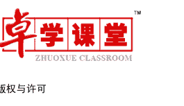

## 版权与许可

© 2009 卓学课堂 版权所有
受限阅读，内部学习，不得外传，不得翻印。
*
未经事先书面许可，严禁进行任何形式的复制或翻印，除非版权法另有规定。
本学习材料所包含的内容如有更改，恕不另行通知。

## 商标说明

“卓学课堂TM”为卓学管理学派旗下品牌，本学习材料中提及其他品牌均为其品版权持有者所有。

## 卓学课堂

ZHUOXUE CLASSROOM

卓学课堂 · 软文写作课程

## 如何写软文

www.zhuoxue.org

总编译：朱则荣（Zhu ZeRong） 使用状态：受限阅读
总发行：李 丹（Li Dan） 类别：短版课程（PDF）
长度：9页 语言：汉语（GB2312） 版本：第一版
文件编码：PL-SV-CO/7 课程编号：11189114-00005

内部学习 不得外传

卓学管理学派 · 网站问题试验室 出品
Copyright © Zhuoxue Classroom, All Rights Reserved

## NEW BUSINESS MODEL IN INTERNET

## 软文写作课程

卓学管理学派 • 网站问题实验室 出品

## 课程：如何写软文

| 出版日期：2009 年 5 月 15 日 | 类别：短版课程（PDF） |
| 编撰：朱则荣（Zhu Zerong） | 类型：教学课程 |
| 修订日期： | 编号：11189114-00005 |
| 文件编码：PL-SV-CO/7 | 版本：第一版 |
| 语言：汉语（GB2312） | 长度：9 页 |

## 课程描述：

从编辑角度看软文，只剩下无情的删除与“石沉大海”。本课程从编辑角度入手，来讲解软文写作的特点、软文需要注意的问题。

## 学习目的：

其一，软文即文章；其二，软文写作要抄，不要套，本课程旨在使学生全面了解软文写作中的注意要点。

## 涵盖主题：

软文，软文写作，写标，写作手法，写作指南，写作技巧

## 简要目录：

软文即文章 第1页
从编辑角度看软文 第2页
软文四要 第5页
软文九忌 第7页
软文写作不要抄 要套 第9页

## 如何写软文

## 软文即文章

“文章千古事，得失寸心知”，软文即文章，文章即软文，要写好软文，当从文章下手，曹丕曾言：“文章乃经国之大业，不朽之盛事”。古有“一言以兴邦”，如秦朝李斯《谏逐客书》一文名振天下，因此，软文之软，实则写文章的功底，因此，要把写文章作为一生的能力加以修炼，永远不要为了写软文而写软文。

## 从编辑角度看软文

编辑一天要看十篇甚至几十篇稿件，对于很多稿件，编辑只是一眼扫过，删除是无情的，那么，这些稿件通常会犯什么错误？

1、稿不清楚在说什麽。除非特殊的情况，编辑一般不接受很长的稿件，他们喜欢短稿，嘎怕只有两三百字，编辑也会在刊物上找到发表的位置，但问题是，作者如果不能直截了当地表达出自己的写作意图，编辑直接就给稿子判了“死刑”。

2、使劲介绍自己。编辑打眼一看，这位作者使劲在介绍自己的公司、自己的产品，把企业简介和公司产品当文章来发，编辑连一眼都不想多看，读者可不关心你的公司是干什麽的你是卖什麽产品的，文章偶尔顺带提及一下没有关系，但非要把文章当广告，编辑可跟你不商量。

3、言之无物。编辑看了个开头两段，找不出重点，没有看到你文章所表出的“闪光点”，觉得很“俗”，也就不会再往下看了。如果一开头，就能见点独到，编辑会眼前一亮，发表不发表是其次，编辑会先欣赏一下，他接下来要考虑的是就成重头稿件。

4、编辑也想省事。编辑也想省事，不动一字就把作者稿件刊发出去，那是编辑所追求的事情，所以编辑看文章，先看写作手法是否简洁有力，段落分明，逻辑性超强，对于这类稿件，编辑二话不说就想刊发。反之，没有条理、叙事不清的文章，必遭淘汰。

5. 编辑不喜欢罗嗦的稿件，特别不喜欢“流水账”式的文章，对于此类文章，编辑打眼一看，就知道作者不会写作，除非文章中还有可圈可点的描写，否则这类文章多是弃稿。

6. 编辑最喜欢看评论性的文章，最喜欢那些精彩的观点。因为编辑都是有文化的，而且他们希望文章更深一些，能让更高端更有文化的人阅读。就象卖东西，谁不希望自己的东西卖给世界500强，谁不希望自己的产品来个国家专用，编辑也是一样的，对于那些普通读者看起来深涩难懂、高深枯燥的文章，编辑会深感这才是好文章。编辑最不缺的就是读者，所以读者中的高端，才是他们极力追寻的读者。

7. 不要搞错了对象。有些文章不是不好，而是文不对路，你介绍营销的文章，投给了人力资源的网站，你谈旅游的内容，投给了创业的编辑，所以编辑自己偶尔看看可以，但不能发给读者去看。

8. 写得不好是没有关系的。写的不好的，编辑有耐心帮你改稿，但文章没有灵魂，经不起推敲，编辑是不愿意动手的。

9. 一篇文章讲几个角度是不行的。一篇文章，只有一个主题，作者想在一篇文章里表达几个主题，编辑是不耐烦的，因为这些文章大散，编辑不想帮你发表。

10. 编辑希望你提高写作水平。即使你的投稿热情很高，天天投稿，但文章从不改进，编辑看上两三次，也就熟悉你了，下次你再投稿，编辑一看到你的名字就会皱眉头，“这家伙写得不行”，从此你就进入了黑名单。

拒稿是很平常的一件事，每一个作者，即便写作水平再好的高手，也已经被编辑打的遍体鳞伤、麻木不仁了，而你如何还想写作，需要继续忍受千百次的打击，如果你经受不了打击，报刊和互联网媒体上永远出现不了你的名字。

## 软文四要

## 主题要突出

文章不论长文短文，都要围绕一个中心，把所有的篇幅、段落，以至每句话、每个字都不要偏离了主题。正所谓：说者无意，听者有心。
无论文写什么？一定要扣紧主题，不能乱分权，还要收得紧又又紧，不让每段、每句、每个字游离主题，不管长短都要紧凑，绝不能拖泥带水。

## 开头要重视

文章开头很重要，也被称为之头“风头”，用高尔基的说：“写文章，开头第一句是最难的，好像音乐里的定调一样，往往要费好长时间才能找到它。”一篇好文章，注定要有个好的开头。开头直劈是重要的写作特点，过分严谨的文章存在以下弊端：当你的文章常常过于注重修辞，过于注重章法，过于平稳地去写，你就不可能靠文章打响战役。当你的文章就没有了气势，就不可能被人们争相阅读，更不可能靠文章带动一大片的人，而你绝对不可能只靠写几篇文章，就马上能立地生威，引起大家的注意。

## 正文要分析

文章要让人看起来非常有条理，文章的段落按重要性一、二、三向下排列，每一段的开头第一句话，通常是对该段内容的总结提炼。要注意消除每一个废字、废话是写作重点，分析是文章的重点，编辑的主要工作，就是删除废话，确保文章里没有一个废字，使之言简意赅，内容紧凑。人们喜欢读分析式新闻，就是因为这种新闻讲得特别透。当你准备写作时，你一定要想到两个字----“分析”，如果你的文章能注意到这一点，读者肯定非常喜爱。

## 结尾要回味

在文章的最后一ecs 加入哲理：讲两句道理，或者寓言，或者引人思考的短小例子，常有前后仰仰之效，山高水长，令人回味。如：“朱则荣语：网站即工具！哪怕再小型的网站，也要寻找其特有的方向，螺丝刀虽小，可它也是一个独特的工具，你却常常离不开它。”

### 软文九忌

1. 忌“我”，对于所有写手来说，用第一人称是写作大忌。
2. 忌流水账，文章太过简陋，写作太过初级，文中必须出现罗嗦的事件和描写，使文章既飘又散。
3. 忌简单抄袭，天下文章一大抄，但即使抄，也不能让读者看是抄的，最简便的方法是删改，即删除原文大块的废话，保留精髓，再加入自己的思路和语言，就是截然不同的新文章。
4. 忌太多啰嗦，要解决这个问题，必须舍得删，舍得改，大胆地删除自己写的废话，舍得将与主题无关的语言进行大段修改。
5. 忌华而不实，务必每一个字言之有物，这是文章中的务实。
6. 忌想要表达的环节太多，一文一议，一事一篇，不要试图在一篇文章中出现很多主题、很多人名或事件，读者是无法消化的。
7. 忌前后矛盾，文章中出现重复表达、前后矛盾、公私不分、上下关系混乱等等，都是不可取的。
8. 忌广告，偶尔广告一下完全可以，整段整篇写广告，人人排斥。
9. 忌道德问题，中国是一个道德伦理社会，只要不触犯道德底线，没有问题，一旦涉及道德问题将引发众怒，如果作者说：“我在名牌大学毕业，我认为推销员只是那些没文化的高中生才干的工作”，结果两个字，“找骂”。

### 软文写作不要抄 要套

切记，不要抄，要套！

每个新手都会模仿，关键是如何模仿，我们强调软文的写作手法，卓学课堂在软文写作中列入了二十余种写作手法，就是帮助作者直接套用的。

## 版权与许可

© 2009 卓学课堂 版权所有
受限阅读，内部学习，不得外传，不得翻印。
*
未经事先书面许可，严禁进行任何形式的复制或翻印，除非版权法另有规定。
本学习材料所包含的内容如有更改，恕不另行通知。

## 商标说明

“卓学课堂™”为卓学管理学院旗下品牌，本学习材料中提及的其他品牌均为其版权持有者所有。

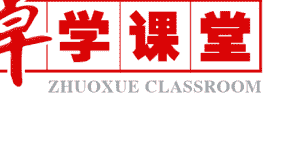

卓学课堂・如何在网上销售学习课程

# 如何在网上销售（上）

www.zhuoxue.org

出品人: 朱则荣 (Zhu ZeRong)  使用状态: 受限阅读
发行人: 李 丹 (Li Dan)  类别: 短版课程 (PDF)
长度: 10页  语言: 汉语 (GB2312)  版本: 第一版
文件编码: PL-SV-CO/7  课程编号: 11184119-0001

内部学习 不得外传

卓学管理学派・网站问题实验室 出品
Copyright © Zhuoxue Classroom, All Rights Reserved

## NEW BUSINESS MODEL IN INTERNET

# 如何在网上销售学习课程

卓学管理学派·网站问题实验室 出品

# 课程：如何在网上销售（上）

| 出版日期: 2009 年 4 月 12 日 | 类别: 短版课程（PDF） |
| 编撰: 朱则荣（Zhu Zerong） | 类型: 教学课程 |
| 修订日期: | 编号: 11184119-0001 |
| 文件编码: PL-SV-CO/7 | 版本: 第一版 |
| 语言: 汉语（GB2312） | 长度: 10 页 |

# 描述：

到底在网上出售什么商品？如何在网上获得生意成功？怎样让网站实现即时的销售？本课程讲解了网上销售的特点、诀窍和原则。

## 学习目的：

通过学习，学生了解在网上建立根据地的重要性。本课程的从众多简单建议对于网上销售而言是至关重要的，“即时销售网站”是本课程重点。

# 涵盖的主题：

网站销售，网上销售，网站业务，网站经营，网络营销

## 简要目录：

如何在网上销售  导言                          第1页
第一课：选择要出售什么商品                     第2页
第二课：建立你的网上销售根据地                 第7页

# 如何网上销售

# 导言

# 选择要出售什么商品

选择到底在网上出售什么商品，很可能是最困难的，这个决定很难做出。注意：你开始的，往往是一个零售业务，学习以下建议，以帮助你做出决定。

# 建立你的网上销售根据地

你必须在网上有一个可以扎根的地点，用于扎牢根基，打好基础，这是网上生意成功的前提。

# 如何成功地建立一个用于业务销售的网站

为了在网上获得生意成功，网站是必须的。这种投资很有必要。但是，有一些重要的原则需要遵循。

# 即时销售网站

我们不得不搞清楚一个问题，怎么让网站实现即时销售，快速让客户做出购买决定，这才是我们考虑的核心。即时销售网站的目的，就是直接地告诉客户买与不买，该如何购买。

# 第一课：选择要出售什么商品

选择在网上出售什么样的商品，要做出这个决定，你可能很困难。
最常见的情况是：当你可能相中鞋垫艺术品，也有这样的资源，但当你再去想的时候，脑子又成了一片空白，你不知道该如何销售，你也不知道销售前景如何，最终，你高涨的热情又被你自己打倒。

互联网上的 一切，对于没有任何丰富经验的人而言，往往是一片未知的领域，出于对无限的憧憬与恐惧，矛盾的思维将你的一切想法压倒，因此你往往很难做出任何明确的决定。

当你要下定决心在网上进行销售时，就要多方面考虑，你到底喜欢销售什么，你的兴趣究竟是什么，最终驱动你在网上获得销售成功的因素，不是因为它能够赚钱，而是因为你喜欢销售它们，你的乐趣将促使你忘记一切辛苦，不知疲倦地在网上劳动。大部人开始在网上销售商品，都不会采用花钱打广告的方式，而是用自己的劳动开天辟地，这是一项枯燥繁琐的工作，如果你没有足够兴趣，将很快放弃你的想法。

在网上销售，最重要的成功，是为自己的商品销售找到一条有规律的发展路径，专业术语，叫做完整的产品销售流程，什么时候把它能够固定下来，什么时候你也就打开了销售局面。考虑以上因素：

# 市场

让我们来面对它，有关市场这个概念，你经常听到，但现在你要考虑的是：你自己的市场。如果你销售的东西没有客户购买，并不是说你的产品有问题，而是你没有找准你的市场，你确定不了那些客户藏身何处，你不知道你的产品到底应该卖给哪一类人。不要试图把你产品出售给任何人，最终能够买你的产品的人都有着同样的规律。你要设法思考真正的需求是什么，具有哪一类具体特征的人会购买你的商品。我们以鞋艺艺术品作为例子，你可以考虑只销售给那些即将新婚的伴侣，你可以在这方面做点文章，从网上找到这些人，并说服他们购买，这就是你的市场，一定要非常明确。

# 利润

我需要提醒你的是：一定要有利润图。你可以在网上看到这样一种情况，竞相压价之所以会发生竞相压价的情况，并不是因为同类产品太多，而是他们大多没有市场策略，试图把产品兜售给任何一个人。最畅销的商品往往并不是卖价最便宜的，而是最合适的。假如你在一件商品上可以赚取 5 元的利润，那么你不妨考虑怎么赚 10 元的利润。提高利润，才是关键。网上销售失败的原因，不是产品不好，而是产品没有足够的利润，不要担心你卖的产品和其他人类似，你所要做的是采取与他们完全不一样的销售策略。

# 消耗品

有一些产品属于消耗品，比如牙膏，用完了就要再买，这里 面就存在一个业务连续性的问题，他在下次购买时是否还能再次购买。如果

你打算在消耗品的销售上取得成功，那就多找一些有关售后服务的资料进行学习，售后服务管理的原理，就是用来解决业务连续性的。由于消耗品具有一定的更换周期，你要试图把这些一次性购买变成你的客户基础，使他们养成长期购买的习惯。客户的意见和客户为什么会心动，是你需要思考的主要问题。

# 特殊品

有些商品比较特殊，比如昆明的红豆，它属于一种具有特殊意义的区域产品，已经形成一定的市场影响力，只不过由于季节和地区限制，平时不易购买，互联网为这些有特色的产品提供了最好的销售机会。但是销售同样需要定向，必须定向到某些特殊市场，以便获得更稳定的业务。诸如将南国红豆专门销售给大学生情侣，放弃其他市场。

# 什么是流行的

热门商品可能看似容易销售，但热门商品却存在相互抵触和价格竞争，人们都试图压低产品价格。当你选择销售这些产品时，对时机和趋势的把握将显得格外重要，热门的商品容易鼓舞你的斗志，容易让你很快产生业务，但难以取得长期的成功。你应该尝试对改变热门产品的销售策略，并找出自己更容易进入的市场。

# 竞争

竞争指的是正面交锋，你和你的对手以同样的产品同样的卖点给客户兜售产品，竞争也意味着大家在争抢同一个客户。竞争最严峻的情况是

你做为一个新手，要和那些较大的网上零售商竞争，他们的资本优势、价格优势、进货渠道优势，是你无法抵抗的。因此你要尽量避免正面交锋，选择侧翼出击，采用更独特的产品更独特的销售策略，避免和其他竞争对手发生冲突。

# 私人标签

这是一种重要而且高明的方法，但很少有人使用这种高明的方法。

一个典型的个人标签是：“张雨是一个喜好宠物，对猫咪的饲养有着五年丰富经验的女子，她在各种宠物网站上发表过多篇文章和心得，她的网址是：www.zhuoxue.org”

个人标签很少有人使用，实际借助个人标签，可以让人们更加了解你，人们买东西的时候更相信专家的说法，特别是有着类似经历的描述，容易引起客户的共鸣。经验有时是很值钱的，但一定要让人们知道你所拥有的经验。这是一笔财富。

# 质量

当你决定在网上销售一些商品，你需要考虑商品的质量，由于网上销售有一个重要的特点：客户与客户互不见面，你的产品质量究竟如何，寄到了客户手里才会知道。产品质量将事关你在网上的声誉，也将事关客户是否决定介绍新的客户给你。客户第一次在你这里购买有时是一种试探行动，他感觉质量不错，对你熟悉起来，才会信任你，并将更大的订单交给你。

# 多样性

我们不建议你在网上同时销售多种产品，但大部分人显然不知道这一点。单品销售是一种重要的思想，在网上销售时更要保持这种原则，你可以注意一下，你在街头收到所有的广告和传单，他们给你推荐的都是单独某一款产品，很少有人提供琳琅满目的广告单供你选择。你没有那么多的时间来处理不同的产品，而且产品与产品之间的客户可能完全不一样，这将分散你的精力，特别是你刚一开始要急于在网上实现第一笔订单时，你只能集中全力于单品。

# 第二课：建立你的网上销售根据地

网上销售不能够打一枪换一个地方，有很多人以为，在网上做销售就是在淘宝、易趣开个店，但我们注意一下：

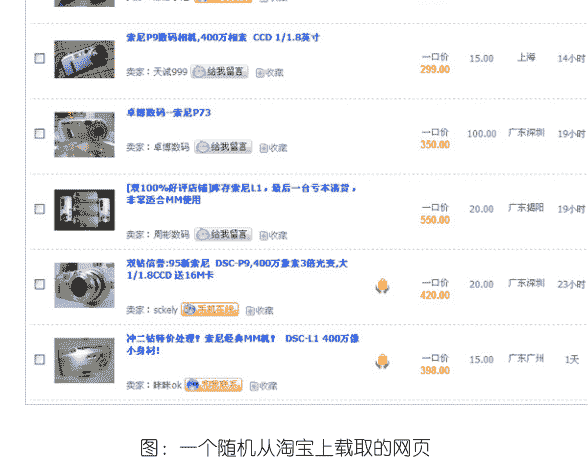

图：一个随机从淘宝上截取的网页

在这个网页中，我们可以发现，信息量非常的大，如果用它来给自己做推广，那么至少你花费的90%的力量，都是在给别人打广告。

三国的时候，刘备一会投靠陶谦，一会投靠吕布、一会投靠曹操、一会儿投靠袁绍，东奔西跑大半生，白忙活，最终到了新野，三顾茅庐，请来了诸葛亮，而诸葛亮给他出的主意就是占四川、荆州，作为根据地，

再徐图恢复汉室。从此，刘备才有了立足之地，建立了蜀汉政权，与曹魏、东吴抗衡。

这就是根据地的作用，在中国革命史上，从中国共产党建党，到八一南昌起义，部队一直不停地跑来跑去，转移撤退，直到毛泽东秋收暴动成功后，在井冈山建立了红色革命根据地。

只有建立根据地，进可攻，退可守，才能够在网上实施你的生意大计。那么网上的根据地究竟是什么呢？是你用于销售商品的独立网站。

建立一个网站是很容易的，但最难的是以什么样的思想来运营你的网站，大部分网站在销售上失败的，你必须记住这个教训。接下来，我们将看一下如何建立一个成功的销售网站。

## 版权与许可

© 2009 卓学课堂 版权所有

受限阅读，内部学习，不得外传，不得翻印。

*

未经事先书面许可，严禁进行任何形式的复制或翻印，除非版权法另有规定。
本学习材料所包含的内容如有更改，恕不另行通知。

## 商标说明

“卓学课堂™”为卓学管理学派旗下品牌，本学习材料中提及其它品牌均为其品牌持有者所有。

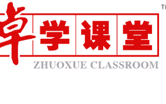

卓学课堂 • 如何在网上销售学习课程

# 如何在网上销售（下）

www.zhuoxue.org

出品人：朱则荣（Zhu ZeRong）  使用状态：受限阅读

发行人：李 丹（Li Dan）  类别：短版课程（PDF）

长度: 10页  语言: 汉语 (GB2312)  版本: 第一版

文件编码: PL-SV-CO/7  课程编号: 11184119-00002

内部学习 不得外传

## NEW BUSINESS MODEL IN INTERNET
如何在网上销售学习课程

卓学管理学派 • 网站问题实验室 出品

# 课程：如何在网上销售（下）

| 出版日期: 2009 年 4 月 12 日 | 类别: 短版课程（PDF） |
| 编辑: 朱则荣（Zhu Zerong） | 类型: 教学课程 |
| 修订日期: | 编号: 11184119-00002 |
| 文件编码: PL-SV-CO/7 | 版本: 第一版 |
| 语言: 汉语（GB2312） | 长度: 10 页 |

# 描述：

到底在网上出售什么商品？如何在网上获得生意成功？怎样让网站实现即时的销售？本课程讲解了网上销售的特点、诀窍和原则。

## 学习目的：

通过学习，学生了解在网上建立根据地的重要性。本课程的从众多简单建议对于网上销售而言是至关重要的，"即时销售网站" 是本课程重点。

# 涵盖的主题：

网站销售，网上销售，网站业务，网站经营，网络营销

## 简要目录：

第三节：如何成功地建立一个用于业务销售的网站        第1页
第四节：即时销售网站        第7页

# 如何在网上销售

# 第三课：如何成功地建立一个用于业务销售的网站

为了在网上获得生意成功，网站是必须的。建立一个用于销售网站的费用很少，几百元而已，但这种投资很有必要。我们有一些原则需要遵守。

# 1、清楚你的目标，是为了销售商品

你的目的不是为了建立一个看起来很大的门户网站，你也不希望为它建立几十个栏目，增加数以千计的内容。这是一种愚蠢的想法。当你的网站提供的内容越多的时候，越容易遮盖住你的商品光芒，你让你的客户象进行迷宫一样躲你“藏猫猫”。网站内容越多，流失的客户也将越多。由于人们习惯于在网上跳跃式的阅读内容，当他在你的网站注意到某篇内容时，很可能会丢下你的网站，到网上寻找更多相关的资料进行阅读。而且注意你的网站上不能建立任何链接向其他网站的链接，人们通常管它叫做友情链接，多加一个链接，意味着你为自己的辛苦争取来的客户搭了一座桥，人们在网上的访问习惯就是顺着链接跑，你一晚上可能访问上百个网站，也没有留下什么印象，你所建立的友情链接就起到了这个作用，把你的客户拱手送人。

不要被网上那些胡里花哨的网站搞晕了头，一得知自己要建立网站，马上就想起建立一个特大的网站。你必须搞清楚一点，你的目的就是

为了销售商品，就这么简单，用最简单的方式来建立一个简单的网站。
如果你对网站还有其他新鲜的想法，你可以学习“与百万富翁会计划”提供的其他相关课程。但现在我们不提这些。

# 2、你的网站不是为了展示商品，而是诱发购买。

传统的观点认为，建立一个网站，就是要把所有的产品，都列在网站上，方便访问者从中挑选，而且这个愚蠢的思想，也影响了许多开发网上商店技术的人，误以为网上开店就是展示商品。

你注意过那些生意非常好的超市和街头特色店没有，他们用来招揽生意的，不是货架上的那些商品，那是对最新最热门商品的广告宣传。
真正引发你购买的是这些招揽广告，在商场购物时，你最留意的就是这些信息。

# 电器清货特卖进行中

库存商品数量有限，售完即止！

258.00 159.60 69.00 349.60 139.00 4688.00 189.05 293.00

# 美之高家具 7折 www.Ziwee.Cn 时间：7.13-7.20

买满199元送金龙鱼食用油900ML。特价不参与。

# 电器买送活动也疯狂！活动进行中...

团购大宗购物服务 享受一站式的购物便利 20151945 13554926522 郭先生 13554975126 郭小姐 Big ashopping

快乐天使儿童摄影中心 -- 快乐连线：26752324 季小姐

商场的部署都是很有学问的，哪类放在那里，哪些地方用于招揽客户，哪些产品又适合放在门口，这里有很多窍门。你现在是应该考虑一下如何用网站来招揽客户的问题了。

# 3、尽可能不要使用栏目与导航

你的网站，就象一位导购员。你不可能让它在你的网站停留几个小时，他停留的时间往往很短，如果几秒内引发不了他的兴趣，你的销售引导就是失败的。客户在网上访问反而没有耐心，除非他对你的商品产生了兴趣，才会仔细了解。

我们要提醒你的是，网站内容越少越好，太多的内容，将使他失去阅读的兴趣。话说得越少越好，太多的废话，是没有多少人有耐心阅读的。每一个人都试图在网站上把什么都说清楚，结果内容越来越多，而是尽是与销售无关的话。

你让你的客人访问你的网站非常容易，使他能以最快的时间阅读完，并能快捷做出是否购买的决定。提醒一句：你没有给客户道歉的机会，他翻几下网页就会离开，从此不会再回来，因此，你必须促使使客户在看你的网站时，能第一时间做出最直接的反应。

# 4、是否要听从网站技术开发人员的建议

隔行如隔山，绝大部分的网站技术人员，都是技术出身，而且非常年轻，他们不曾研究过销售心理，也没有掌握如何销售技巧，他们更不知道如何在第一时间融发客户的兴趣。因此对他们的建立只能听取，但不能做为依据。你必须听从网上销售专家的专业建议，他们更多的时间研究的是互联网化的客户心理与销售行为。

# 5、把你的营业时间放大三倍

我们对互联网最感兴趣的是，它可能 7*24 小时为你招商生意。正常情况下，你的工作人员每天工作 8 小时，每周工作 5 天，而互联网则是每天 24 小时不间断的帮你拉拢客户，而且每周七天从不休息。这等于是将你的营业时间至少提高了三倍以上，你要活用这一优势。

# 6、真实地和客户沟通

成功的销售网站，会使用真实姓名，真实公司名称。他信从不产生使用假名，一个糟糕的情况是，大量网站都是无名氏，有许多人在网上只留下“网站管理员的联系信箱”之类很模糊的联系方式，让人摸不着头脑。而还有一些人会使用如“king1154”之类的网名，搞得象个特工，需要对暗号。这都不是为了好好的做生意，你需要注意你的联系方式，网站只能提供非常有限的接触机会，你注意注重这些联系方式，给客户足够的信任。

# 7、尽可能使用一些照片

如果有机会，你应该尽可能张贴你的工作场景照片、你的工厂陈设，你又是如何一丝不苟地为客户发货。照片是无声的语言，在网上最有说服力，你一定要让客户感觉到你是那么的真实。网上销售，最难的是取得客户的信任，因此你必须采取一些让客户能够很快并且直观对你产生信任的策略，这一点很关键，它直接决定着你的客户数量能否加倍增长。

# 8、最好在每一个网页上打上你的联系方式

不要让客户翻几页，或者在网站的左下角找到联系我们，再找到你的联系方式。除非你不想做生意了。你最好在每一页上任何可能联系到你的联系方式，如手机、座机、QQ、电子邮件等等。最好还能够在网站的每页顶端明显位置突出显示你的电话号码，让客户一眼就看到。

# 9、注意写好常见问题

“常见问题”常常是用于打消客户的购买疑虑，解决掉他们的困扰，如果你没有常见问题，你的销售将直线下降。你必须对各种客户可能提出的问题做出统一的解释，如如何订购、优惠政策、运输费用、退货政策等等。不要让客户一遍一遍来问你那些重复的问题，把它们都写在网页上，如果有新的问题，就尽快更新到网站上。你还需要注意到的一点是，对网站上的所有措辞，都要统一口径。

## 第四课：即时销售网站

# Teenie Tiny Tots KIDDIE CATALOGS

Welcome to the Magical World of Teenie Tiny Tots...

# INFANTS 0-18mos

# TODDLERS 18-36mos

TIME OUT FOR FINE DINING!
The Princess Eats! Feeding Set
$22.00

TIME OUT FOR A LITTLE HORSE PLAY!
Rocking Chair Pony
$148.00

# KIDS 3yrs and up

# GIFTS for everyone

TIME OUT FOR A LITTLE GOLF!
Big Driver Golf Cart
$458.00

TIME OUT FOR YOU!
Royal Pup Jeweled Tee
$14.00

# FREE SHIPPING!
ON ANY ORDER OVER $25
From January 29 - February 5

www.kiddiecatalog.com
Please forward this to a friend!

If you have problems viewing this email, click here to view it in your browser.

This email was sent to [email address suppressed]. You are receiving this email because you are currently a Teenie Tiny Tots customer or have been in the past. If you do not wish to continue receiving these periodic emails, you may unsubscribe by clicking the link. Please add info@kiddiecatalog.com to your address book so that you'll never miss a mailing from us!

一张图片，未告诉你孩子需要哪些产品，它就像一张你在街头上看到的传单，能够快速引发你的购买兴趣。

你再回想一下你在网上看到的大量网站，它们复杂而且内容很多，其致命性的缺陷，就是不能和这个网站一样，快速吸引你的注意力，简单而直接地告诉你该购买什么，该如何购买。

其实，这就是一种客户心理，客户大多喜欢干脆利索，你能卖给我什么，多少钱我能买到，客户就想要这个简单的答案，没有必要把一切搞得异常复杂，象这样让人不知所云。

这种网站，就是即时销售网站，让你用最短的时间，快速做出买和不买的决定，仅此而已，不需要太多花哨的内容，也不需要多少说明的信息。

这样的网站，通常只有一页，或者简单的三五个网页。制作一个这样的网站，也仅仅需要几百元而已。但正是这样简单而快速的网站，所产生的销售效果却是惊人的。它不会告诉你更多复杂的信息，只有最简单的几个产品，让你能够从快做出选择。

一款用于皮鞋也可能就提供这样简单的信息，足以。

一个用于推销商品的网站也如此简单。

# AMI Portable Ground Power

The AMI line of portable Ground Power Units (GPUs) are designed to perform aircraft starting and maintenance functions at a much more compact size and price than traditional GPUs. These GPUs can be used on the ramp and are portable enough to fly with the aircraft or helicopter to remote locations. The unit can be used for maintenance functions for prolonged periods while connected to an AC power source for shop or hangar applications.

# AMI 1800

1800 Peak Amps
25 Amps Continuous
50 Amp Hour
30 Minute Recharge Rate
Length 17.00 Inches
Width 5.70 Inches
Height 10.20 Inches
Weight 58 Lbs

# AMI 2400

2400 Peak Amps
25 Amps Continuous
80 Amp Hour
40 Minute Recharge Rate
Length 19.25 Inches
Width 7.25 Inches
Height 10.20 Inches
Weight 80 Lbs

# AMI 2400-50

2400 Peak Amps
50 Amps Continuous
80 Amp Hour
60 Minute Recharge Rate
Length 19.25 Inches
Width 7.25 Inches
Height 12.20 Inches
Weight 85 Lbs

# AMI 4500

4500 Peak Amps
50 Amps Continuous
60 Amp Hour
60 Minute Recharge Rate
Length 19.75 Inches
Width 14.50 Inches
Height 10.20 Inches
Weight 170 Lbs

# Features:

+   - Cooler starts for turbine powered aircraft
- Continuous power for shop or ramp
- Light-weight portable
- Significant power output for size and weight
- Rapid recharge rate
- Maintenance free

Aviation Management International

2964 NW 60th Street • FT Lauderdale, FL

(954) 543-0400

Email: Kevin@aminti.net

销售产品的宣传彩页，它们简单地介绍你介绍某款产品。你也可以参考一下戴尔的广告，它没有任何销售店面，全靠刊登在杂志和报纸的广告以及网站展开销售。他不会告诉你任何复杂的商品信息，一切都是以最简单的方式向你展开推销。你现在明白这个原则了吗?把网站变得极其简单，这就是即时销售网站。

再一次的提醒：你始终需要思考的一个问题是，如何快速让客户决定购买。买与不买，很容易让客户自己做出判断。

## 版权与许可

© 2009 卓学课堂 版权所有
受限阅读，内部学习，不得外传，不得翻印。
*
未经事先书面许可，严禁进行任何形式的复制或翻印，除非版权法另有规定。
本学习材料所包含的内容如有更改，恕不另行通知。

## 商标说明

“卓学课堂™”为卓学管理学院旗下品牌，本学习材料中提及其他品牌均为其品版持有者所有。

## 卓学课堂
ZHUOXUE CLASSROOM

卓学课堂・软文写作课程

# 软文标准件

www.zhuoxue.org

总编辑：朱则荣（Zhu ZeRong） 使用状态：受限阅读
总发行：李 丹（Li Dan） 类别：短版课程（PDF）
长度：7页 语言：汉语（GB2312） 版本：第一版
文件编码：PL-SV-CO/7 课程编号：11189114-00010

内部学习 不得外传

卓学管理学派・网站问题实验室 出品

## NEW BUSINESS MODEL IN INTERNET

## 软文写作课程

卓学管理学派 · 网站问题实验室 出品

# 课程：软文标准件

| 出版日期：2009 年 5 月 15 日 | 类别：短版课程（PDF） |
| 编撰：朱则荣（Zhu Zerong） | 类型：教学课程 |
| 修订日期： | 编号：11189114-00010 |
| 文件编码：PL-SV-CO/7 | 版本：第一版 |
| 语言：汉语（GB2312） | 长度：7 页 |

## 课程描述：

软文写作分为零打碎敲阶段、手工作坊阶段、规模生产阶段。通过软文标准件，何使文章千变万化，成批量产。本课程讲解了软文标准件的组装、生产源、标准件制作，以及宣传常备资料。

## 学习目的：

通过学习，学生要了解软文标准件的重点性，初步领会软文标准件的制作思路和运作思想。

## 涵盖主题：

创业者，初创公司，知识产权，中小企业，知识产权保护，技术公司

## 简要目录：

+   关于软文标准件 第1页
软文标准件的组装 第2页
制作软文标准件 第5页
例：某酒店常备宣传资料 第7页

# 软文标准件

# 关于软文标准件

软件写作，按流程分为三个阶段：

+   1. 零打碎敲阶段：有一篇没一篇，想起来写就写，想不起来就不写，急了就多写，不急就少写。

+   2. 手工作坊阶段：专写文章，来料加工，来一个订单，做一件产品，一个人从头到尾，没有专业分工和规模定制。

+   3. 规模生产阶段：制作各种写作模板、标准套件、文章建档，存在专业分工，有人专管收集素材，有人专管查实资料，有人专管改写拼装，有人专管媒体分发，流水线化作业。

而软文标准件，就是应用于软文的规模生产，将所需要的各种素材定制成模块化的标准件，通常对各种模板的组合搭配，软文口径统一，文章千变万化，成批量生产，不再是千巴巴的几篇文章和产品介绍文章。

# 软文标准件的组装

大型公关公司和大型企业的内部新闻中心，通常都是软文工厂，其主要工作就是组织稿件。文稿的“标准件”是把企业给外界说的话统起来，分成几块，包括企业历史、文化、产品介绍，企业荣誉和市场地位、规模等等。当需要时，通过对各模块的组合搭配，写出不同的文章。

软文标准件的生产源：

# 1、领军人物

领军人物的传奇经历、简介、以前业绩、过去经历、公益事件、动态，最为重点的是其思想主张、观点与看法、经营思路与管理方法，都是软文最佳素材。成名人物本身就是企业最大的卖点，往往先有社会活动家，后有企业家，特别是同行业竞争中的企业，哪一位领军人物在媒体面前出现的次数多、频率高，那么哪一家企业更受欢迎。此外，有独立思想主张和独特见解的专家学者，最容易以个人影响力带动企业发展。“人”是活生生的，“人”的思想是宥启发性的，“人”是容易受到崇拜、追捧与信任的，因此，由于一个人的成名而带火一家企业甚至带动一个行业都是显然易见的。

# 2、产品

产品的使用说明、新技术、新创意、新材料、新应用、新思路、新市场，有若干不同侧面，可以从设计者、生产者、经营者、销售者、代理商、用户以及售后服务人员、维修人员那里得到广泛的原始素材，特别是新产品的应用技巧、应用领域、使用障碍解决等方面，都有大量的闪光点。例如：某公司开发家用机器人，这个消息就容易引发媒体争相报道，而一些地方产品如“信阳毛尖”相关企业的动态，也容易引发媒体报道。

# 3、行业地位

拥有行业地位的企业、行业中新兴的明星企业、拥有行业著名专家或明星人物的企业、拥有特殊实力与背景的行业企业、拥有独特定位和经营特色的行业企业，都是行业媒体的报道重点。越是倍受关注的企业，越容易成为报道焦点，其一举一动都被媒体所关心，企业要抓住这一特点，尽可能在行业间成名，让自己企业品牌被媒体所熟悉，软文操作人员更要抓住媒体的这一特点，及时将一些行业内的动向、资料编成软文，提供给媒体，借以宣传自身的企业。

# 4、事件

有些企业本身并不引人注目，但是其发生的事件却很有新闻价值。例如借势打力，内地某小型企业突然被某跨国公司兼并，因为媒体对跨国公司的关注使得这个小公司也倍受关注。当这类事件发生时，企业应及时与媒体联系，借媒体之力，把企业要说的话告诉大众。

# 5、活动

有特点、有影响力的活动大都会引起媒体的关注和报道。例如企业投资赞助某科学实验室、赞助一批学者的研究等，赞助某个乡村解决吃水难，可图可点且又特别独到，会成为媒体报道的重点。

# 6、企业管理方法

企业的经营管理方法是企业的最佳传播方式，各大经济类、管理类媒体不断举办管理案例大赛、广泛鼓励管理者撰写文章、论文，事实上已经给予了软文作者最佳的传播平台。

无数专家、学者、企业家都是从撰写管理评论、进行管理分析、研究管理方法角度成功成名的，由于经济管理类读物的读者，往往都是企业家和企业中高层管理者，决策性强、团购性强、商务合作意见高，是软文作者和企业打入市场的最佳角度。

# 制作软文标准件

软文标准件不仅是企业，更是软文作者的常备武器。对企业而言，制作标准件，能够保证对外宣传口径一致，帮助写作人员快速写作，应用好企业的更多宣传素材。作者使用标准件，可大幅提高写作效率，快速增强写作水平。

标准件一般以下列标准模块组成，务必分类别，单独存放，使用简洁。

+   1. 企业史：自企业成立以来的简史、荣誉史、史料、历史档案、大事年、企业志、年报、具有里程碑意义的阶段和往事、变迁史，自企业创立以来的老照片、老员工感想、感人故事、遇到困难与挫折和如何克服、如何改革、抓住机遇等等。

+   2. 重点人物：包括公司的董事长、总经理、在公司发展中举足轻重的人，他们的经历、观点、故事、轶事、最先行程及活动记录等。

+   3. 企业情况：包括企业规模、人员规模、成员企业、客户分布销售网络及售后服务网络、部门情况、代表企业、研究报告，各类文件、通知、规范与资料。

+   4. 企业人物：企业代表人物、专家、模范人物、历次先进表彰名单、自学成才人物、部门管理者等。

5. 产品：产品的技术、材料、变迁、生产流程、功效、销售、应用、代表客户等等，与产品设计、生产、经销、售后服务过程中所发生的故事。

6. 市场：市场分布、市场特点、市场研究、消费者研究、市场规模等。

7. 企业规划：企业远景、一段时期内的目标、战略发展方向、计划等。

8. 管理方法：管理设计、企业文化、管理理论、经营模式，独特的经营管理策略、管理经验等，重点是管理流程改进的探讨、管理方法的实施案例、优秀经验与做法。

9. 观点与数据：企业中经营者、管理人员、服务人员等所表达的主张、观点、看法，统计数据、总结、计划等。

10. 图片、影片库：如企业CI、标志性建筑、办公场景、重要事件场面、产品包装、广告图片、销售网点实拍照、人事照片等。

标准件的收集，一是建档，二是有意识地平时收集整体，三是灵活组合应用，四是在企业秘密保护原则下展开。

# 例：某酒店常备宣传资料

应常备如下几种宣传品：

+   1. 酒店宣传小册子，折页及其他综合性介绍材料。
2. 酒店餐饮活动的宣传品(包括以前和现在的)。
3. 酒店餐饮设施介绍性材料。
4. 酒店宴会和会议的专门宣传品;
5. 酒店销售部的主要促销材料。
6. 酒店集团管理以及其他连锁酒店的简要宣传材料。
7. 酒店新闻稿(配照片)
8. 有关宣传酒店的简报资料。
9. 酒店简介性质的录象带;
10. 全套酒店照片资料(含幻灯片等)。
11. 店徽、店标的软片、样片(含广告的软片和样片)和不粘贴等类似物品。
12、酒店接待著名人士，重要活动等方面的资料和照片。

## 版权与许可

© 2009 卓学课堂 版权所有

受限阅读，内部学习，不得外传，不得翻印。
*
未经事先书面许可，严禁进行任何形式的复制或翻印，除非版权法另有规定。
本学习材料所包含的内容如有更改，恕不另行通知。

## 商标说明

“卓学课堂™”为卓学管理学院旗下品牌，本学习材料中提及的其他品牌均为其版权持有者所有。

## 卓学课堂
ZHUOXUE CLASSROOM

卓学课堂 · 软文写作课程

# 软文炒作

www.zhuoxue.org

总编撰：朱则荣（Zhu ZeRong）  使用状态：受限阅读
总发行：李 丹（Li Dan）  类别：短版课程（PDF）
长度：6页  语言：汉语（GB2312）  版本：第一版
文件编码：PL-SV-CO/7  课程编号：11189114-00007

内部学习 不得外传

卓学管理学派 · 网站问题实验室 出品
Copyright © Zhuoxue Classroom, All Rights Reserved

## NEW BUSINESS MODEL IN INTERNET
软文写作课程

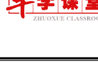

卓学管理学派 • 网站问题实验室 出品

# 课程：软文炒作

| 出版日期：2009 年 5 月 15 日 | 类别：短版课程（PDF） |
| 编撰：朱则荣（Zhu Zerong） | 类型：教学课程 |
| 修订日期： | 编号：11189114-00007 |
| 文件编码：PL-SV-CO/7 | 版本：第一版 |
| 语言：汉语（GB2312） | 长度：6 页 |

## 课程描述：

本课程讲解了现代传播的特点：软文炒作。同时讲解了炒作所要遵循的原则、网络炒作源于宣传策划，并以案例讲解软文炒作策划。

## 学习目的：

本课程指导学生：要注重“他们用网络炒作，我们用网络写作”，强调作者在“炒作”面前应保持的心态。

## 涵盖主题：

软文，软文写作，写作，写作手法，写作指南，写作技巧

## 简要目录：

+   - 炒作已经成为现代传播的特点 第1页
- 炒作所要遵循的原则 第2页
- 网络炒作源于宣传策划 第3页
- 他们用网络炒作 我们用网络写作 第6页

## 软文炒作

## 炒作已经成为现代传播的特点

有事没事儿的炒作，已经成为现代营销的重要话题，从这些年的营销中，创造了诸多经典案例，如老板陶涂料、鸳鸯大战、鳄鱼漆叫板国标、酱油风波、格力割开空调看心脏、奥克斯多核革命、红太阳青海看牦牛、耗子药寻找形象代言人等，都是讲求传播效果，不免空谈品牌，在很短时间内都创造了比较好的营销效果。

## 炒作所要遵守的原则

- 1. 站在整体营销的角度系统地考虑问题，而不只是“事件营销”本身；
- 2. 站在整个品牌战略和品牌管理的角度一致性地考虑问题，而不只是追求短期的、让你“3分钟爽快”的轰动效应；
- 3. 站在顾客满足的角度考虑问题，而不只是一时间的“哗众取宠”、甚至“诱骗顾客”；
- 4. 站在整个财务效果的角度考虑问题，而不只是没算账就认为此次“事件营销”一定是低成本、高效益。

## 网络炒作源于宣传策划

以金龙鱼为例：

2003年02宣传重点

金龙鱼第二代调和油处于产品普及阶段，其宣传重点：

二代调和油普及性品类教育(调和健康概念)

深化核心利益点与大众的相关性(调和油更健康)

传播阶段划分

第一波： 建立调和品类教育认知(1月-3月)

（主要依靠线上主流媒体方式进行传播，配合如系列的报纸，再结合各地的实际售点现场的教育活动;为第二波活动做铺垫）

第二波： 深化概念与产品普及(4月-6月)

搭：
（主要依靠线下活动的方式通过主流媒体发布活动信息、现场、卖场信息输出结合一个大型的全国促销活动）

## 第三波： 深化概念与销售促进(7月-12月)

（主要依靠线下活动的方式通过主流媒体发布活动信息、现场、卖场信息输出结合各地组织丰富的线下促销活动）

## 事件炒作

金龙鱼油脂科学基金会

金龙鱼健康用油中国行

## 事件说明

金龙鱼引领健康潮流，积极推动食用油科技发展。

金龙鱼第二代调和油全新上市，引爆中国食用油第二次革命。

食用油品质的全面提升、人人生活素质和健康的全面升级，二代调和油满足人们对更健康更美好生活的追求！

为全面普及2002健康调和油，满足广大消费者的健康需求。

## 战术组合

公关

首先以“新闻发布会”为开端，以“金龙鱼油脂科学基金会成立”为切入点，引发业界、媒体和消费者对使用食用油的注意(与新闻媒体共同组织)。

与中国营养学会合作，以“更多营养专家选用和推荐的好油”为主题，引发社会和消费者对食用油的关注与讨论;同时邀请全国知名专家、机构举办各类讲座和专题电视访谈，炒作“食用油健康及行业标准”，引出并大肆炒作“调和更健康”的概念。

## 保销策划

“好油进万家”---在全国范围内的终端和家庭举行大型普及教育活动，“调和更健康《食用油调和健康新概念》手册”DM入户派送(全国选定40个城市)，获得此单页只要购买任何一款金龙鱼食用油，均可有机会参加“见证世界的香格里拉”的旅游活动。

“1:1:1与世界接轨, 见证世界的香格里拉”---获得“调和更健康”DM单页, 填妥背面的抽奖表格和问题, 同时购买2L以上规格的金龙鱼二代调和油, 可参加大型抽奖活动;获奖人员可观入住全国各地香格里拉酒店, 并见证世界级酒店均使用1:1:1二代调和油。

## 他们用网络炒作 我们用网络写作

炒作品牌，不如炒作自己。我们这个时代，不得不炒作，人们又厌烦炒作，更多时候，炒作被公众认为是一种贬义词，因而认为：“炒作就是利用媒体捏造、夸大的手段对某人或某事进行报道”或者认为“炒作就是用那种不是正常手段进行报道”。事实上，公众作为媒体的被动接受方，他不得不接受炒作，无论炒作手法是高明或低劣，他都不得不被动接受。但是，作者作为主动方，炒作与否全在于自己，正如我们说，写作的人象指挥官，引领着作者的兴趣与思考。

因此，对于炒作总体而言，过度的炒作是没有必要的，必要的炒作是必须的，作者只能稳稳地站在中间这个位置，既不能过又不能少，即不能炒又不得不炒。也因此，我们说：“他们用网络炒作，我们用网络写作”，用心扎扎实实埋头写作，顺便给自己炒点名气，就是作者的正常心态。

## 版权与许可

© 2009 卓学课堂 版权所有

受限阅读，内部学习，不得外传，不得翻印。

*

未经事先书面许可，严禁进行任何形式的复制或翻印，除非版权法另有规定。

本学习材料所包含的内容如有更改，恕不另行通知。

## 商标说明

“卓学课堂™”为卓学管理学院旗下品牌，本学习材料中提及其它品牌均为其版权持有者所有。

## 卓学课堂
ZHUOXUE CLASSROOM

卓学课堂 ⋅ 软文写作课程

## 软文传播

www.zhuoxue.org

总编辑：朱则荣（Zhu ZeRong）   使用状态：受限阅读
总发行：李 丹（Li Dan）   类别：短版课程（PDF）
长度：9页   语言：汉语（GB2312）   版本：第一版
文件编码：PL-SV-CO/7   课程编号：11189114-00021

内部学习 不得外传

卓学管理學派 ⋅ 网站问题实验室 出品
Copyright © Zhuoxue Classroom, All Rights Reserved

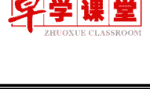

## NEW BUSINESS MODEL IN INTERNET

## 软文写作课程

卓学管理学派·网站问题实验室 出品

## 课程：软文传播

| 出版日期: 2009 年 5 月 15 日 | 类别: 短版课程（PDF） |
| 编纂: 朱则荣（Zhu Zerong） | 类型: 教学课程 |
| 修订日期: | 编号: 11189114-00021 |
| 文件编码: PL-SV-CO/7 | 版本: 第一版 |
| 语言: 汉语（GB2312） | 长度: 9 页 |

## 课程描述：

本课程揭露了软文的流水线化批量生产秘密，讲解了软文的传播与派生特点，同时围绕软件发表与软件投放进行了讲解。

## 学习目的：

本课程的学习特点，让学生了解了软文的大规模生产与投放特点，通常部分软文发布统计数据、媒体研究，旨在强调学生要注意，软文不是一篇两篇的零打碎敲，而是成规模大批量的发展模式、学生不仅要了解软文的写作，更要拓宽思想，了解软文的大规模运作思想。

## 涵盖主题：

创业者，初创公司，知识产权，中小企业，知识产权保护，技术公司

## 简要目录：

- 软文的规模生产 第1页
- 软文的传播介质 第2页
- 软文传播 第4页
- 软文发表 第5页
- 软文投放 第7页

## 软文传播

## 软文的规模生产

在《软文标准件》中，我们讲解了规模生产阶段：制作各写作模板、标准套件、文章建档，存在专业分工，有人专管收集素材，有人专管查实资料，有人专管改写拼装，有人专管媒体分发，流水线化作业。通过对各种模板的组合搭配，使软文口径统一，文章千变万化，成批量生产。

同样一个话题，交由 50 位作者，可以瞬间变成 50 种不同的稿件，精髓和主旨不变，但文章的风格、写作方向和内容，都已经发生了实质性的变化。同样一篇文章，交由 50 位作者改写，瞬间也将变成 50 篇不同的文章。

各企业在举办新闻发布会时，通常会向参加新闻发布会的记者提供“新闻稿原始稿件”，通常有五至十篇以上，由不同的作者完成，风格手法不一，各媒体记者收到这些原始稿件，会围绕不同的侧重点继续进行采访、加工，也会再加入企业介绍、企业荣誉等不同的背景材料，因此变成数十上百种、千变万化，但又口径统一的宣传稿件。

思考：最终，围绕一个事件，我们为什么会在网上及各种媒体上看到数以百计甚至数以千计不同的报道、追踪报道？

## 软文的传播介质

我们将媒体分为主媒体、次媒体、边际媒体

主媒体：中央级媒体。

次媒体：地方级媒体及行业媒体。

边际媒体：各种企业报、内参、资料、简讯及各类中小网站等。

软文的二、三层次生产

我们可以思考一下，任何一个新闻事件，都会先由主媒体进行报道，次媒体及边际媒体进行传播报道。那么：

第一个问题：文章必须先发往主媒体，才能形成最大范围的转载与传播。

第二个问题：次媒体，也就是省市等地方媒体及行业媒体，同样拥有大量的专业记者、特约通讯员及评论员，他们是不是也要对新闻事件进行加工整理、引伸报道、或者发表各种评论？

第三个问题：边际媒体，诸如每一家企业报、各类中小网站，是否也拥有大量专业写作者，以及大量的写作爱好者？它们是否会对新闻事件进行引用、评论、改写、组合？

因而我们可以得出结论，事实上，主媒体，通常起到的是引导、催发的作用，而真正的软文大规模生产、改编、传播，则是由二、三层次的媒体写队伍来完成的，由此才能形成巨大的传播效果，也能将新闻事件所要传递的信息分布到五湖四海，四方八面。

## 软文传播

以海尔为例：海尔是一个会“讲故事”的企业，这既是新闻传播的奥妙，也是海尔总裁张瑞敏的窍门，为什么海尔的形象能让人信任，因为它通过了许多的具体故事，研制出能够洗地瓜的洗衣机，写个故事；海尔进了德国，写个故事；讲企业内部人才竞争，写个故事；写上门服务，再写个感人的故事。

海尔形象由始至终的传播，就是让故事在编织，正是通过了这些故事，人们对海尔的感觉不再抽象，大家熟悉了海尔，而新闻学者本身就愿意去传播故事，一个记者写篇报道，里面有很生动的故事，这个报道人们就喜欢看，一个写作爱好者，拿着海尔的故事写事说通，写篇评论，得，又一个人帮海尔去传播。

瑞士有很多企业，给你一堆资料，没有一份是讲企业背景，资料里都是讲故事，每个品牌都有什么故事，每一个手表家族有什么故事，所有的厚厚的宣传材料都讲的是故事。

麦当劳天天传播它的管理标准，哈佛商学院会天天发它的管理案例，艾瑞不断发表其搜集的互联网分析数据。这些都是传播的主体。

## 软文发表

事实上，软文本身，要看软在那里，如果软文纯粹是企业和产品的广告，你发表在哪里都没有用，任何网站的编辑、论坛的版主都不接受这样软文。

但是，如果写的是数据、资料、分析、评论、研究、观点、技巧，任何媒体都大力欢迎。

如果作者是个个人：要在与本行业本领域相关的网站上建立专栏、博客，以主推个人名气为主，辅推企业与产品。如站长类软文，发表在 IT 写作业社区、站长网、艾瑞网、创业邦、站长站、ITbear 中文资讯站等网站。如你经营的是游戏网站，在站长类网站上效果是不会太好的，有些“文不对题”，自然要发表在游戏类资讯网站上。

一般而言， 随非分析到位、写作水平较高，可以自由向任何相关媒体投稿并发表以外，专业水平及写作水平不太高的作者，最好在自己申请到的专栏、博客发表，先和编辑、记者、版主交朋友，形成一定的影响力了，再向外扩散。

如果作者属于企业，直接的企业和产品性软文，发表比较困难，因此要善于“曲线救国”，以发表产品应用、产品解决方案、管理方法、经营思想、领导人观点、创业故事、研究文稿为主。

此外，还可以独立制作成电子书、通过电子杂志等方式，自建媒体，自行发布。

对形成一定品牌的企业和专家，软文的作用会大大加倍，如五粮液在广州报纸投放的软文：以某天出版的广州某报纸为例，五粮液刊登了介绍其产品的软文。软文篇幅在700字左右，主要从五粮液悠久的历史、独特的地舆位置等几个方面介绍五粮液产品的优异。据分析，由于拥有巨大知名度，五粮液在广州报纸上很少投放广告，而五粮液采用刊登篇幅极小的软文来进行产品的推广，是一种较好的媒介组合方式。

## 软文投放

以 08 年 1-10 月药品业报刊软文投放媒体监测分析

根据慧聪邓白氏研究媒体监测统计，2008 年 1-10 月药品报刊软文投放总篇数接近 1 万篇，总字数达 2 千多万字，其中报刊软文字数前四位的分别是肿瘤疾病用药、肾疾病用药、肝胆疾病用药和精神疾病用药，这四类药品报刊软文总字数占药品总体报刊软文字数的六成以上。（见图 1）下面将重点对这四类药品的报刊软文投放情况加以分析。

图 1：分药品种型，2008 年 1-10 月报刊软文字数投放构成单位：%

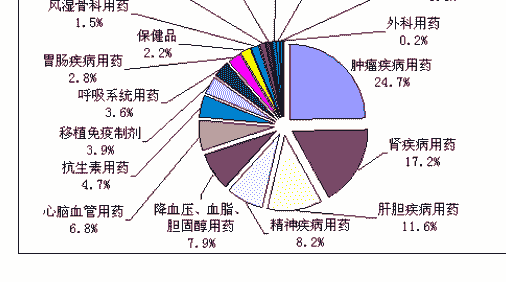

按月份来看，2008 年 1-10 月四类药品报刊软文投放量呈现波浪起伏态势，肿瘤用药 4 月、7 月软文投放量较多，在 10 月则猛增，一举突
破百万字，以绝对优势居四类药品之首;肾疾病用药在4月、7月重点投放;肝胆疾病用药在5月达到高峰;精神疾病用药则在4月和10月迎来投放热潮。各类药品依据发病特点、产品发展、公司内部及外部环境等综合因素选择不同的时期加大软文投放量。(见图2)

## 图2： 2008年1-10月四类药品报刊软文投放字数比较 单位：万字

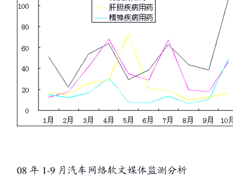

## 08年1-9月汽车网络软文媒体监测分析

据慧聪研究媒体监测统计数据显示,2008年前三季度汽车共投入网络软文884070篇，其中乘用车的软文篇数占96.8%，商用车仅占3.2%；在乘用车中以中级轿车软文量所占份额最大，达四成多。与平面软文相比，乘用车的网络软文量接近平面软文量的3倍，商用车网络软文和平面软文相差不大，可见乘用车汽车厂商更注重在网络上加强软文的宣传攻势。

## 图 3：2008 年 1-9 月汽车投放网络软文篇数构成 单位：%

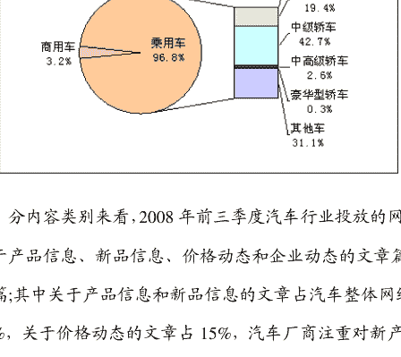

分内容类别来看，2008 年前三季度汽车行业投放的网络软文内容中关于产品信息、新品信息、价格动态和企业动态的文章篇数均达 10 多万篇；其中关于产品信息和新品信息的文章占汽车整体网络软文篇数的 38%，关于价格动态的文章占 15%，汽车厂商注重对新产品的研发与新技术的创新，并以不断降低产品的价格来争夺汽车市场。

## 图 4：2008 年 1-9 月汽车投放网络软文的内容类别篇数 单位：篇

## 版权与许可

© 2009 卓学课堂 版权所有
受限阅读，内部学习，不得外传，不得翻印。

未经事先书面许可，严禁进行任何形式的复制或翻印，除非版权法另有规定。

本学习材料所包含的内容如有更改，恕不另行通知。

## 商标说明

“卓学课堂™”为卓学管理学院旗下品牌，本学习材料中提及的其他品牌均为其版权持有者所有。

卓学课堂 · 软文写作课程

## 软文创造财富

www.zhuoxue.org

总编辑：朱则荣（Zhu ZeRong）    使用状态：受限阅读

总发行：李 丹（Li Dan）    类别：短版课程（PDF）

长度：10页    语言：汉语（GB2312）    版本：第一版

文件编码：PL-SV-CO/7    课程编号：11189114-00003

内部学习 不得外传

## NEW BUSINESS MODEL IN INTERNET

## 软文写作课程

卓学管理学派·网站问题实验室 出品

## 课程：软文创造财富

| 出版日期: 2009 年 5 月 15 日 | 类别: 短版课程（PDF） |
| 编辑: 朱则荣（Zhu Zerong） | 类型: 教学课程 |
| 修订日期: | 编号: 11189114-00003 |
| 文件编码: PL-SV-CO/7 | 版本: 第一版 |
| 语言: 汉语（GB2312） | 长度: 10 页 |

## 课程描述：

本文分析软文在宣传和销售中的特征，最容易取得信任。围绕小型网站流量小的弱点，讲了解了软文的磁铁作用——源源不断吸引愿意付费的客户。同时分析了软文为什么能创造财富以及为如何创造财富。

## 学习目的：

本文将软文和SEO的作用和效果进行了区别，强调SEO获得的是流量，而软文获得的是信任，客户信任是财富的宝贵基础。

## 涵盖主题：

软文，软文写作，软文作用，软文宣传，写作，宣传

## 简要目录：

- 软文的财富基础 第1页
- 磁铁般的软文 第2页
- 软文所表现出的领导能力 第4页
- 成功指导可得 第6页
- 击败互联网 第8页
- 软文创造的财富 第9页

## 初步的市场研究

## 软文的财富基础

很少有更好的方式来宣传你的网站。如果说SEO获得的是流量，软文所获得的是信任，通过软文的写作，人们认识你、了解你、赞同你、信任你，因此他们更易购买你的产品。

推销一件产品：一般需要和潜在客户经过7次以上的接触，但大部分推销人员仅仅和客户接触2、3次，那些潜在的客户不信任你。

一家新的公司或网站：销售是不容易的，因为人们不信任你，售后服务到底会怎么样、这个公司以前有没有说过、这个网站到底可信不可信？人们犹豫不决。

写一篇 ■ 文章：接触是容易的，当有人赞同你的观点，愿意与你接触时，已经有50%的信任，尽管天南海北、网络无边，但人们很容易和你交朋友、容易让更多的人认识你并信任你。

## 磁铁般的软文

事实上，大多数新网站，特别是小型企业的网站，要经过好几个月，才能每星期平均获得几个百个访问者，在这些网站中，流量的增长无限期地维持在这一水平上，很多网站再也没有流量增长的可能。

数以百万计的网站，都只能停留在这种小流量上。最不幸的是，大量的网上收入取决于网站流量，所以这些网站的发展是困难的，业务实现是艰难的。

大多数小型企业和小型网站根本不具备足够多的市场营销预算，以稳妥地“启动”新网站。更难的挑战是，网站推广越来越困难，互联网上各类网站饱和，新网站每天层出不穷，仅仅靠争取访问量，是难以使业务稳定的。

软文犹如磁铁一般，尽管网站的访问量很少，但由于文章容易使人信任，客户转换率较高。

诸如某股票软件的作者，在开发完股票软件以后，建立了一个网站，他不懂如何争取访问量，但喜欢写作，每天，他把自己的心得、体会、关于软件的点点滴滴和最新股评信息写出来，放置在几大门户网站博客

上，随着文章越写越多，软文所带来既是朋友也是客人，几个月以后，尽管网站的访问量每天仅有几十次，由于这些访客都是从软文带入的，因此成交量越来越高，几个月的时间，月收入从几千到上万，开始一路增长，两年以后，他的公司已经拥有二十多名员工，月营业收入数十万，尽管此时每天的网站访问者只有可怜的几百次访问量，但软文象磁铁一般，源源不断地吸引一切可能的客户。

# 软文所表现出的领导能力

为什么软文能象磁铁一般，吸引的不仅是访问量，更是信任？

为了研究这种现象，我们进行量化，假如你对网站经营有着丰富经验，而全国有1000个人拥有与你同等水平的经验，换句话说，你只占100人中的0.1%。

你在全国有1000个竞争对手，尽管你想让自己的网站蓬勃发展，尽管你想让自己的获得更稳定的业务收入，尽管你希望成功，但是，除非你实在太优秀了，在这1000人中，你很难成名成功。

我们用图表进行排列：

从上图我们可以看到，1000个人中，你只占其一角，愚蠢的人总是在左边，而聪明的人总是在右边。

假设右边这正好是你：你希望自己成功，你希望网站能赢得客户，你希望自己有所发展。

# 成功指日可待

我们再次将拥有专业水平的人放大10倍，同样是网站经营，有10000个人擅长网站经营，水平不等。但是你喜欢写作，你喜欢和许多人一起分享知识。那么整个网站经营领域，情况将会发生极大变化。

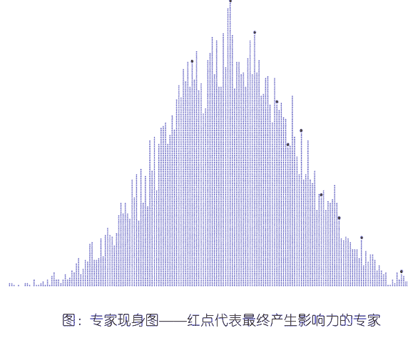

图：专家现身图——红点代表最终产生影响力的专家

从上图中我们可以发现，任何一个知识领域，无论是网站经营领域，还是旅游营销领域，无论是SEO，还是英语培训，最终，这领域的专家不会超过10个，而善于写作，用软文不断扩大影响力的人，注定就被红点所代表。

为什么常写软文的人会被人们所信任，因为只有他们，看起来才是专家，而其余的9990个高手则默认沉默，在人们的眼中，成为“无效专家”。

他们善于通过软文表达自己的观点，善于通过文章发表自己的看法，因此他们很幸运，他们将获得所有人的关注。在任何领域成为专家甚至名家，就是这么简单。

# 击败互联网

这几乎是不可能的，击败互联网，似乎数以百万的人都无法做到。
但你的确可以做到。

如果你在不断撰写软文，比如你专注于“汽车配件”这一主题，撰写了大量的文章，实际上互联网的圈子是狭小的，要不了多久，你就会发现，几乎所有有关“汽车配件”的网站上，都可能出现你的名字，搜索引擎大量地索引这些文章，无论是从搜索引擎，还是从相关的专业网站上，每个人都会认同你的“专家”地位。

你必须改变自己在互联网上的劣势地位，大量地撰写软文，无论从搜索引擎中，还是从相关专业网站中，你就是专家，你就是领袖，你要让整个互联网都为你“打工”，这就是你的成功。

# 软文创造的财富

为什么软文能够创造财富？

看下列图表：

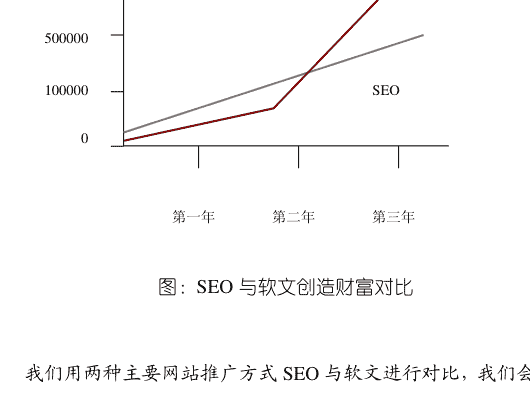

图：SEO 与软文创造财富对比

我们用两种主要网站推广方式 SEO 与软文进行对比，我们会发现，两种推广方式所获得的效果截然不同。

SEO 是一种持续的推广方式，多数小型企业或小型网站尽管会获得了访问量，但这种财富增长速度是缓慢的。SEO 推广的成交率，通常为 0.2%-0.5%之间，即 1000 个访问者中，会成交 2-5 个订单，必须将访问量放大 100 倍，收益才可能增加 100 倍，但访问量从每日一千 IP，增长到每天一万 IP，再增长到每天十万 IP，对大多数人来说，纯粹是在做梦。

软文是一种倍增的推广方式。由于通过软文，容易取得潜在客户的信任，成交比率至少1%。即每100个感兴趣的读者，至少1%会成交订单。因此，在网站建立前期，成交率并不一定明显，财富增长速度比SEO方式稍稍缓慢一些。但文章的写作数量一旦达到一定规模，一旦产生了影响力，一旦成为“出名的专家”，可信度将大大提升，相应的，订单成交率也倍增增长。因此即使三年以后，网站访问量还仅仅维持在每天几百、一千 IP，但财富增长是稳定而且快速的。

## 版权与许可

© 2009 卓学课堂 版权所有

受限阅读，内部学习，不得外传，不得翻印。
*

未经事先书面许可，严禁进行任何形式的复制或翻印，除非版权法另有规定。

本学习材料所包含的内容如有更改，恕不另行通知。

## 商标说明

“卓学课堂™”为卓学管理学院旗下品牌，本学习材料中提及的其他品牌均为其版权持有者所有。

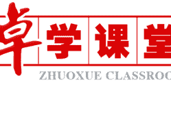

卓学课堂 · 软文写作课程

# 软文写作概论

www.zhuoxue.org

总编撰：朱则荣（Zhu ZeRong） 使用状态：受限阅读
总发行：李丹（Li Dan） 类别：短版课程（PDF）
长度：8页 语言：汉语（GB2312） 版本：第一版
文件编码：PL-SV-CO/7 课程编号：11189114-00001

内部学习 不得外传

卓学管理学派 · 网站问题实验室 出品
Copyright © Zhuoxue Classroom, All Rights Reserved

## NEW BUSINESS MODEL IN INTERNET
软文写作课程

卓学管理学派 • 网站问题实验室 出品

# 课程：软文写作概论

| 出版日期：2009 年 5 月 15 日 | 类别：短版课程（PDF） |
| 编辑：朱则荣（Zhu Zerong） | 类型：教学课程 |
| 修订日期： | 编号：11189114-00001 |
| 文件编码：PL-SV-CO/7 | 版本：第一版 |
| 语言：汉语（GB2312） | 长度：8 页 |

## 课程描述：

本文讲解了什么是软文，全面介绍了软文的作用、软文的本质、写作的本质、软文写作的特点、写作意识、软文写作的弊病，并强调软文写作要善于吊读者的胃口，其核心是强大的说服力。

## 学习目的：

本文是软文写作系统学习的入门课程，讲解了软文写作的基本知识。

## 涵盖主题：

创业者，初创公司，知识产权，中小企业，知识产权保护，技术公司

## 概要目录：

+ 什么是软文 第1页
+ 崛起的软文和娱乐消费、生活方式 第2页
+ 软文的作用 第3页
+ 软文的本质 第3页
+ 写作的本质 第3页
+ 软文写作的特点 第4页
+ 写作意识 第4页
+ 软文写作的四大弊病(写作新手们必阅) 第5页
+ 软文写作要善于吊读者的胃口 第7页
+ 软文写作的核心是说服力 第8页

# 软文写作概论

# 什么是软文？

除政治、军事、经济、犯罪、民生、社会问题以外的新闻、评论、文章通常为软文，如艺术、娱乐和生活方式都被视为软文。

# 崛起的软文和娱乐消费、生活方式

在过去的几十年间，软文大量崛起。随着报纸、杂志、广播、电视、互联网的一路发展，新闻发生了重大改变，娱乐节目和报道占据了越来越多的媒体版面。

最早影响消费者的是名人新闻，他们作为一种时尚趋势，通过新闻的广泛传播，影响着消费者，最初流行的软文源自于无意之间，华而不实。进而随着广告的崛起，新闻发生一种作用，即它可能有意地在实施营销，因此新闻学将这种新闻独立出来，称之为软新闻，事实上，这就是软文。研究人员开始注意到一个重要问题：即软文是如何通过传播扩散来影响其消费者的，他们意识到：增加软文的数量，可能导致消费。

最终形成的结果是，几十年后的今天，生活水平日益提高，软文大量涌现，它们渗透在我们的生活、娱乐、消费等方方面面，有意无意地引导着我们消费，引导着我们记住一些品牌。

# 软文所起到的作用

启发线索。引诱我们注意到一些品牌、采取一些行动，获得一种潜在的可能影响消费的知识。

# 软文的本质

教育消费者，宣传品牌。

# 写作的本质

写作就是中心思想，围绕中心思想来做文章，文章有启发性、有价值。

# 软文写作的特点

+ 1. 社会性。它是面向社会公众的，用来传递概念和意识、传播知识与观念、传达感情与发表见解。
+ 2. 写作性。以沟通、交流、传播知识和信息为己任。
+ 3. 灵活性。和其他写作需要相对固定的写作格式和样式不一样，软文写作重宣事达理、抒发感觉、传播信息、表现手法灵活多样。

注意：一切为了有用而存在。所传播的知识和信息，对其他人有用。

# 写作意识

写作是一种兴趣，写作更是一种爱好。小时候学语文，老师通常会帮助我们分析作者思路、讲解结构安排、遣词造句的特点，分析作品为什么要这样写。对喜欢写作的人来说，读书即写作，写作即读书。喜欢观察别人怎么写的人，就善于掌握写作规律，善于思考写作手法，读书时，我们也会碰到许多我们眼前一亮的东西，比如新颖的描述、富有表现力的句子，带有哲理性的语句等等，把他们记下来，适时用在文章中，常写常练，容易成为写作高手。

# 软文写作的四大弊病(写作新手们必读)

弊病一：无法持续。不可否认，现在的作者比较浮躁，总是企图通过一篇文章就实现巨量的网站点击，或者实现大量的销售。热情是好的，但热情不持续，而且大多数作者，写上几篇以后，看到没有多少人点击，也没有为网站带来多少访问量，热情也就随即消亡，从此罢笔不写。有些作者，在写了几篇以后，由于没有经过系统的工作学习，结果越来越乱，言不达词，语不达意，停笔者不计其数。更多作者，有写作热情，也希望通过软文写作为自己的网站、为自己的企业创造价值，但是在学习上总处于观望状态，不能下定决心好好学习写作，扎扎实实地实现成功。一分努力，一分收获，写作需要长时间的积累，需要持续不断的练习，要坚定信心，一定能成。

弊病二：难以成句。写作是需要技巧的，就象武功的修炼，写作讲究功力。有许多作者，开始写的时候就头痛，硬着头皮往下写，实际上，是没有掌握写作方法和诀窍，不知道怎么样往下写。但恰恰这些作者，不问不学不追求，不思考。即使是这样费了“九牛二虎”之力硬着头皮写出来的文章，在投稿或在论坛发表时，也常常被编辑直接点了“删除”，或者在论坛中“沉底”，为什么文章不受欢迎，他们从来没有反思过，因此一年、两年、三年，这一步也就停留在了“想写，但又写不出”的地步。

弊病三：只见广告，不见文章。看一下网上的软文指导和软文知识就知道，大家都说：“软文就是软广告”，然后拿着几百年前“脑白金”软广告说事。我们需要注意一下，当年“脑白金”的软文，是揽广告发布在报纸上的，也就是说，类似于“1个字1块钱”给报社赞助一笔费用，因为它不是高质量的软文，只好当广告发。所以，从“软广告”的角度来说软文，本身就是错误的，而且很多作者，也没有那么多资金去给报社和网站赞助，“黑猫画虎”，以广告角度学写软文的，写不了几篇，就会出现言之无物，不知道该写什么了。另外之所以有人强调“软文就是软广告”，是有那么一批人通过替企业写软文、发表软文来赚钱的。按照这个方向学写软文，那是死胡同。

# 弊病四：继续悠悠。

我们这个时代，“悠悠”二字用得越来越多了，于是许多文章，既没有章法，也没有素材，更没有实质内容，整篇文章逻辑不清，言语表达无力，甚至连个中心思想也没有，写完了，自己都不知道写的是什么，这样的软文，肯定是要被各网站编辑“枪毙”的。

站长网鼓励作者写软文，但是站长的编辑后台中，控制不太严格，尽管文章尽可能给发，但每天被删除的投稿仍然占到60%以上。文章要有实质性，即便是软文，同样要脚踏实地，言之有物。

# 软文写作要善吊读者的胃口

许多作者，直肠子一路通到底，想说什么就说什么，很多不错的思路，却没有酝酿的过程，就直接写出来了，既没有条理，也没有逻辑，最终容易被编辑毙稿。写文章的，实际上是导演，牵着读者的思路走，确切地说，作者是在读者面前斗智，引读者向东向西，最有兴趣的地方，“且听下回分解”，要引导读者注意哪个品牌，勾起他们的欲望，让他自己去找答案。

# 1、引读者上钩

作者就是读者的主宰，你可以决定读者的喜怒哀乐，也能象个大将军，将读者的思路指挥若定。最精彩的语言在什么时候出现，读者急于想知道的答案，怎么既不告诉他，又去引诱他？

# 2、你才是最大的软文

软文作者就像在钓鱼，钓的是读者的兴趣，所要获得的成果——是扩大个人影响力或品牌影响力。因此软文的发表频率、发表媒体、发表策略，都要多方考虑。文章就是下“钩”，收放一定要讲策略，初学者，不妨多找一些高手给看看，或者让几个朋友多提一些意见，对新手来说，文章是“改”出来的。

# 软文写作的核心是说服力

要强化说服力。我们常说演讲和演说，需要说服力，你才能影响公众，而文章，则是以文字的方式说服别人。所有的成名人物，除了演艺明星，那是一大批娱乐记者在替他们说，成名人物特别是历史性的成名人物，大多都有很强的写作能力，比如毛泽东、马克思、黑格尔、泰勒都是靠写作打天下的；过去历史中世界各国的政论论战、今天公务员考试中的申论，都是靠文章的说服力。

文章是一种理性的产物，是一种思考的结晶，是一种高智慧的成果，因此，具有分析性、评论性、哲理性、指南性的文章，才会是好的软文。要提高文章的说明力，有一些技巧，例如：1、观点，说服别人，有时可能只是一句话，例如“多数网站创业遭遇的最大困惑是难以扩张规模”。2、数据，数据最能说明问题，你再强调：“搜索引擎有多重要”，没有人多少人会理解，但你换一种说法：“50%的网站访问者通过搜索引擎阅读网页”，效果大不一样。3、引用事例，如“通过这种方法努力三个月后，他的网站月收入一万元以上。”

## 版权与许可

© 2009 卓学课堂 版权所有
受阅阅读，内部学习，不得外传，不得翻印。
*
未经事先书面许可，严禁进行任何形式的复制或翻印，除非版权法另有规定。
本学习材料所包含的内容如有更改，恕不另行通知。

## 商标说明

“卓学课堂TM”为卓学管理学派旗下品牌，本学习材料中提及的其他品牌均为其版权持有者所有。

卓学课堂 • 软文写作课程

# 软文写作要素

www.zhuoxue.org

总编辑：朱则荣（Zhu ZeRong） 使用状态：受限阅读
总发行：李 丹（Li Dan） 类别：短版课程（PDF）
长度：7页 语言：汉语（GB2312） 版本：第一版
文件编码：PL-SV-CO/7 课程编号：11189114-00006

内部学习 不得外传

卓学管理学派 • 网站问题实验室 出品
Copyright © Zhuoxue Classroom, All Rights Reserved

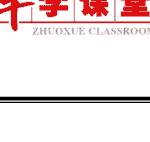

## NEW BUSINESS MODEL IN INTERNET
软文写作课程

卓学管理学派・网站问题实验室 出品

# 课程：软文写作要素

| 出版日期：2009 年 5 月 15 日 | 类别：短版课程（PDF） |
| 编撰：朱则荣（Zhu Zerong） | 类型：教学课程 |
| 修订日期： | 编号：11189114-00006 |
| 文件编码：PL-SV-CO/7 | 版本：第一版 |
| 语言：汉语（GB2312） | 长度：7 页 |

## 课程描述：

本课程讲解了软文写作的五要素：主角、素材、思想、写作手法、写作载体。同时讲解了撰写软文时的十二项注意事项。

## 学习目的：

写作要素是软文写作时的不可避免，不可缺少的基本因素。通过学习，学生要掌握写作时的要素把握，同时要注意一些写作规律和问题。

## 涵盖主题：

软文，软文写作，写作，写作手法，写作指南，写作技巧

## 简要目录：

软文写作五要素 第1页
撰写软文的十二项注意 第4页

# 软文写作要素

# 软文写作五要素

# 1、主角

究竟是以什么为主角？作者、品牌、网站、企业、还是某类某款产品？一定要搞清楚软文究竟以什么为中心，是用来表达作者的个人观点，打响个人品牌；还是推广某个品牌，形成品牌影响力及潜在市场；推广某个网站，追求网站知名度；还是推荐某一家企业，以灵活的手法将这家企业写活；或者是推广某类某款产品，以期达到一定的销售目的。

在软文写作之前，主角一定要定好，方能进行系列的写作，诸如小说中的主角，一切的语言、描述、故事、思维都围绕着“主角”而动。

# 2、素材

素材来自于积累，来自于采访，来自于阅读，来自于思考。正如“巧妇难为无米之炊”，素材即“米”，无米则无法“下锅”。文章之所以写不好，首先在于没有素材，天马行空坐在哪里空想，结果是既抓不到主题，又使内容板块空洞。蒸馒头要有面粉，素材就是面粉，而写作仅仅是发酵的过程。

# 3、思想

思想决定文章的层次，也决定最终成败，比如你的赚钱思想比较重，文章中会尽显“赚钱”之意，没有钱的小老百姓才天天想着“赚钱”，企业家、高级经理人、官员与精英以及稍有长远眼光的人，年薪少则二三十万，赚钱对他们来说没有任何意义，你跟他们谈“钱”，会让他们感觉一个字“俗”，因此，文章中如果谈“赚钱”、谈“省钱”、谈“走捷径”，那么作者这一辈子也只能在社会底层混混，永远上不了台面。

写作，是作者的思想展现，是作者的思维表达，是作者所思所想所感所悟所思考，说到底，文章就是作者的思想层次、思考特点与思维整理。因此，一定要提高思想层次，提高思维水平，加强思考能力，这是写作的不二法门。

# 4、写作手法

这是将素材与文章的加工整理手段。正如前面的发酵，写作技巧就是“发酵”的水平和能力。大厨做菜肯定和家庭主妇做菜不一样，工程师和建筑工人所采用的方法绝对不同。

写作手法追求两点，一是文风，二是技巧。写作大“家”追求的是文风，即写作的风格，必求独一无二，方成大“家”。而写作小“家”必求技巧，用怎么样的套路来快速写文章，使写作水平成熟。任何作“文”者，皆是先求技巧再求文风，循序渐进，步步成长。

# 5、写作载体

文章发到哪里去?报纸、杂志、广播还是互联网?

给哪方面写文章？管理类媒体、IT 类媒体、站长类媒体、旅游类媒体？

文章要依靠这些载体呈现在人们面前，所以写作前，要确定具体的载体。纸面写作和网上写作不同，网上写作和网站写作又不同，给不同的媒体写文章又有各自特点。作者任务对各种载体的特点和发文方式要做以了解和研究，掌握了载体的特点也就掌握了文章发表的源头。

## 撰写软文的十二项注意

## 1、先定标题 再写正文

标题是一个作者最高文字水平的体现，标题是文章的广告，要使文章引起读者的阅读欲、增强文章逻辑性，撰文讲究“指哪打哪”，力避文章“打哪指哪”；让人看后不知所云。作者要多加强标题制作的能力。

## 2、多用固定结构

结构：“标题+导语+第一+第二+第三”。如果写新闻则是“标题+导语+第一新闻事实+背景补充+第二新闻事实+事件后续事实”。

导语应高度提炼，以打动读者往下看。正文亦以分析评论为主，第一、第二、第三条清晰，逻辑严密。必要时，可在文后单独追加解释性内容。切忌不拿时间做文章的主轴，记流水帐般“娓娓道来”。

## 3、多用动词 少用形容

写作时多使用动词，少使用形容词，多用语言确切的分析及肯定性语言，少用叙述性语句和不确定性、询问性语言，以此使文章生动起来。诸如“因为……所以……”、“而且”、“虽然”等词语也要少用，以免影响稿件的紧凑与节奏，而“假如”、“好像”、“也许”、“能不能”、“似乎”、“可以”等不确定性词语坚决不用。

## 4、勤分段 别超 3 句

每个自然段，字数不得超过150字，两至三个句号，给读者阅读喘息的机会。篇幅如果超过1000字，每300到400字要有一个小标题，先拟标题再行文，设计结构，多用动词，简洁有力。

## 5、严控篇幅 当舍则舍

如报纸，小幅报纸无广告时的整版刊文量不到4000字，每版刊发条数在8-10条左右。加之图片所占版位，每条消息的上限锁定400字，而大张报纸一版无非8900字。网络没有篇幅限制，但读者都不喜欢读长文，蜻蜓点水，一眼扫过，读者会对信息进行筛选、点选，这一点对作者而言是至关重要的。切不可想到哪，写到哪，最后把编辑和读者带入千里茫茫之中。

## 6、内容取胜 但别沉溺

文章以精彩的内容取胜，但不追求细节的扩展。增强文章的实质内容是绝对要点，一定要提炼意识，不要把简单推砌。

## 7、条理清晰 少用废话

作者不是搬运工，没人必要到处“搬运”相关观点和描写，必须力保文章简单明确。

## 8、称谓别忘尊重人权

无论写任何文章，不要随便就写“骗子王某”、“强奸犯李某”、“妓女张某”、“小姐赵某”、“无照小贩张某”等，那是司法问题，法院都没有定罪，你又怎能毁人声誉。另外，在文章称呼人时，不要带有地域歧视，如“张某某是河南人”、“山西人陈某”等。

## 9、专业术语 多加注释

不少领域，特别是专业性较强的领域，如财经、科技、通信、法律、医药等，作者撰写此类稿件时，经常需引用专业术语，除非你是给内行看，如果给外行看，要勤加注解。毕竟读者不同于熟悉业务的作者，一个在业内经常使用的专业名词，却很可能成为读者阅读的障碍，如“高开低走”、“3G 手机”、“ISDN”、“固体燃料”、“举例设置”等。

## 10、数字要准 不可连用

稿件中使用数字要准确，应与原始资料反复核对。对于在文中列举的以数字排序的并列内容，最后要再数一遍，不要出现“前面说是八大方面，后面实际只有七项”的乌龙情况。如果一定要用数字，一段内最好不能连续使用 3 个，数据新闻除外。

## 11、准确运用“的、地、得”

稿件中“的、地、得”的混用，经常给校对添工作量。要严格依照字典上的规范，区别它们间的不 同使用环境，准确运用。 的：用在定语后面或用在谓语动词后面；地：表示它前边的词或词组是状语， 得：用在动词后面，表示可能。

## 12、标点符号要写明

标点符号是帮助编辑和读者顺利读懂文章的工具。作者在写稿件时，必须忠实遵循语法规则，使用各种标点符号；禁止整段“一到底”。
在电脑文本格式的选择上，也要确定中文标点全角模式，避免给排版排栅版带来困难。

## 版权与许可

© 2009 卓学课堂 版权所有

受限阅读，内部学习，不得外传，不得翻印。

*

未经事先书面许可，严禁进行任何形式的复制或翻印，除非版权法另有规定。

本学习材料所包含的内容如有更改，恕不另行通知。

## 商标说明

“卓学课堂TM”为卓学管理学派旗下品牌，本学习材料中提及其他品牌均为其版权持有者所有。

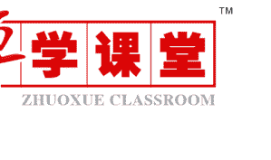

## 卓学课堂 · 软文写作课程

## 软文宣传

www.zhuoxue.org

总编辑：朱则荣（Zhu ZeRong）    使用状态：受限阅读

总发行：李 丹（Li Dan）    类别：短版课程（PDF）

长度：9页    语言：汉语（GB2312）    版本：第一版

文件编码：PL-SV-CO/7    课程编号：11189114-00002

## 内部学习 不得外传

卓学管理学派 · 网站问题实验室 出品

Copyright © Zhuoxue Classroom, All Rights Reserved

## NEW BUSINESS MODEL IN INTERNET
软文写作课程

卓学管理学派・网站问题实验室 出品

## 课程：软文宣传

| 出版日期: 2009 年 5 月 15 日 | 类别: 短版课程（PDF） |
| 编撰: 朱则荣（Zhu Zerong） | 类型: 教学课程 |
| 修订日期: | 编号: 11189114-00002 |
| 文件编码: PL-SV-CO/7 | 版本: 第一版 |
| 语言: 汉语（GB2312） | 长度: 9 页 |

## 课程描述：

本课程讲解了：软文的首要作用是宣传，并指出宣传是软文长期的一项性工作。“行动即宣传”围绕这一核心思想，本文讲解了宣传的概念、宣传的目的、宣传的地位、宣传的成功、宣传的原则、宣传的艺术。

## 学习目的：

通过学习，本文强调学生必须了解软文强大的宣传作用，要明确软文是为了宣传，是长期的努力。

## 涵盖主题：

软文，写作，宣传，软文写作，软文宣传，软文营销

## 简要目录：

+ 软文的首要作用是宣传 第1页
+ 行动即宣传 第3页
+ 宣传的概念 第4页
+ 宣传的目的 第5页
+ 宣传的地位 第6页
+ 宣传的成功 第7页
+ 宣传的原则 第8页
+ 宣传的艺术 第9页

## 软文宣传

## 软文的首要作用是宣传

文章是用來打天下的，這是文章最真實的價值，對網站而言，強大品牌，對企業而言，形成市場攻勢。宣傳是軟文長期的一貫性的工作。

我們必須強調這一點：軟文的營銷作用是次要的，它首先是一種宣傳方式，并不是簡單地為了用軟文瞬間取得網站流量、銷售。

1923年，國共合作，孫中山在蘇聯顧問和中國共產黨人的推動下，決意改組國民黨。次年1月，國民黨召開了有共產黨人參加的第一次全國代表大會。毛澤東、瞿秋白、董必武等在內的一大批中共黨員不僅公開加入國民黨，不少人被選為中央執行委員。

毛澤東既成為國民黨中央執委，又是國民黨中央宣傳部長。可以準確地說，毛澤東就是靠文章的宣傳作用打出天下的。逃亡台灣的一位國民黨元老最終說說：“國民黨敗給共產黨的原因，主要不是兵力，不是武器，我們是敗在了共產黨的宣傳。共產黨太會做宣傳了。”他還說：“要是毛澤東一直做我們國民黨的宣傳部長，說不定今天逃到台灣來的就不是我們國民黨了。”

1953年，毛澤東批示，“簡報上的許多材料，都應該公開報道，并发文字广播，三五天一次，方能影响运动的正常进行。”他还指出，“经过报纸把一个部门的经验传搞出去，就可以推动其他部门的工作改造。”报纸等新闻媒体“应将各地的典型好事加以调查分析表扬，使全党都向这些好的典型看齐，发扬正气，压倒邪气”。

## 行动即宣传

毛泽东生活和革命的时代，传播学已经在西方诞生并蓬勃发展，但那时传播学理论还未被引进中国。但用今天的传播学角度来看，毛泽东是最擅长用软文宣传和传播的，他除了对中共中央的宣传总负责外，还亲自审读、修改党报上重要文章，也不时为各宣传机构或政府部门撰写各类宣传文稿。比如著名的《敦促杜聿明等投降书》、《别了，司徒雷登》、《<关于胡风反革命集团的材料>的序言和按语》、《再批判》、《告台湾同胞书》和《再告台湾同胞书》等都是毛泽东的大手笔，力透纸背，令人咋舌；即以文笔而论，也是上等文章。

就宣传问题，毛泽东特别指出：“我们现在有些文章，神气十足，但是没有货色，不会分析问题，讲不出道理，没有说服力。这种文章应该逐渐减少。我们应该老老实实地办事，对事物有分析，写文章有说服力。”。他还强调：“不敢写文章怎么办？有的人说，有文章不敢写，写了怕得罪人，怕受批评。我看这种顾虑可以消除。”

## 宣传的概念

什么是宣传？毛泽东的解释是相当广泛，他认为：“一个人只要对别人讲话，他就是在做宣传工作。”。他一向把宣传工作视为全党任务，而不仅仅是宣传工作者的业务，把新闻媒介看作是宣传机关。他说：“什么是宣传家？不但教师是宣传家，新闻记者是宣传家，文艺作者是宣传家，我们的一切工作干部也都是宣传家。”“同志们到各地去，要宣传大会的路线，并经过全党向人民作广泛的解释。仅《毛泽东选集》提到的就有十几种，如标语、图画、歌谣、壁报、讲演、群众大会、谈话、传单、布告、宣言、论文、报纸、书册、戏剧、电影、募捐活动等等。这些形式的总和是一种强大的力量，重视和运用这种力量是毛泽东从事革命活动的宝贵经验之一。

## 宣传的目的

关于宣传的目的，毛泽东的宣传归结为两条。第一条，为了提高人民的觉悟。他说：“光有先锋队的觉悟不够，还必须使全国人民群众觉悟，甘心情愿和我们一起奋斗。”，第二，为了达到万众一心，以争取革命的胜利。他说：“群众知道了真理，有了共同的目的，就会齐心来做。群众齐心了，一切事情就好办了。”

## 宣传的地位

宣传在中共的工作中占有极为重要的地位，宣传与其他工作的比较。毛泽东这样指出：“红军宣传工作的任务，就是广大政治影响，争取广大群众，由这个宣传任务之实现，才可以实现组织群众，武装群众，建立政权，消灭反动势力，促进革命高潮等红军的总任务。所以红军的宣传工作是红军第一个重大的工作。”他认为，在中国人民中进行解放自己的伟大革命战争中，宣传即政治动员是经常的运动，是一件绝大的事，战争首先要靠它取得胜利。

毛泽东指出：“这个政治上的动员军民的问题，实在太重要了。我们之所以不惜反反复复地说到这点，实在是没有这一点就没有胜利。没有许多别的必要的东西固然也没有胜利，然而这是胜利的最基本的条件。”同时他强调：“我们应该走到群众中去，向群众学习，把他们的经验综合起来，成为更好的有条理的道理和办法，然后再告诉群众宣传，并号召群众实行起来，解决群众的问题，使群众得到解放和幸福。”

## 宣传的成功

共产党和国民党都很重视宣传，但效果却有很大差距。毛泽东在井冈山时期多次谈到这种差距，他提出了一个问题： “共产党是一个穷党，又被国民党广泛地无孔不入地宣传为杀人放火，逞凶抢掠，不要历史，不要文化，不要祖国，不孝父母，不敬师长，不讲道理，共产公妻，人海战术，总是一群青面獠牙，十恶不赦的人。可是，事情是这样地奇怪，就是这样的一群，获得了数百万人民群众的拥护”。解放战争时期，蒋介石也不得不承认，“现在所遗憾的，是我们政府里面一部分人员受了共产恶意宣传，因之心理动摇，几乎失了自信。”

毛泽东常常这样告诉全党：“我们要在人民群众中，广泛地进行宣传教育工作，使人民认识到中国的真实情况和动向，对于自己的力量具有信心。” 同时他不断纠正宣传中的工作方向。例如毛泽东起草的《纠正土地改革宣传中的‘左’倾错误》就是典型，通过那次纠正宣传中的偏差，他规范了宣传部门几个月检查一次工作，发扬成绩，纠正错误的制度。毛泽东把党的领导机关的工作概括为两项任务：了解情况和掌握政策。它对宣传工作的领导，就是在了解敌我友三方面情况的基础上不断调整政策宣传。

## 宣传的原则

中共党的宣传，是一个巨大的集体在外部的公开表现。它要求上下左右一致。宣传往往是行动的先导，因此有时候它同实际行动保持着一段距离。毛泽东规定宣传任务要具有战略的眼光，他坚决反对对宣传工作中的实用主义和冒险主义。既要符合国情，又要区别对待，每一个时期都有不同的宣传重点，例如他提醒大家注意不要对城乡种菜的地方宣传“实行土地改革”；在城市里也不要宣传“消灭封建势力”；甚至像“将革命进行到底”、“打到南京去，消灭国民党反动派”的口号，也只要求用于军队内部教育，不要用作宣传口号。就此必须注意宣传的策略，他特别指出：“必须以严肃的科学的态度对待宣传工作”。

## 宣传的艺术

毛泽东非常注重对宣传的科学研究，由此形成一套合乎中国国情的行之有效的宣传方法，例如其代表作《反对党八股》。

他要求宣传工作者要端正宣传态度，还要研究宣传对象，使宣传适合民众口味。他指出：“共产党员如果真想做宣传，就要看对象，就要想一想自己的文章、演讲、谈话、写字是给什么人看、给什么人听的，否则就等于下决心不要人看，不要人听。”“做宣传工作的人，对自己的宣传对象没有调查，没有分析，随讲一顿，是万万不行的。”他劝同志们多看几遍列宁关于写传单的文章，像列宁那样经常和熟悉宣传对象情况的人商量，根据这种调查和研究来进行工作。

他所倡导的宣传方法的基本公式：把问题讲得十分实际，努力宣传，认识群众，按照具体的环境，具体地表现出来的群众情绪，去做一切动员工作。为提高全党的宣传水平，毛泽东提倡学习语言和改进文风。他曾批评说：“现在我们有许多做宣传工作的同志，也不学语言。他们的宣传，乏味得很；他们的文章，就没有多少人喜欢看；他们的演讲，也没有多少人喜欢听。”他提出三条学习语言的途径，即向老百姓学习语言；吸收外国语言中适用的东西；学习古人语言中有生命的东西。在文字的宣传上，他对党八股深恶痛绝。他提出三条改进文风的方法，即学习逻辑，使文章有一种内部的联系；学习文法，使语句通顺；注意修辞，使文章写得生动一点。

## 版权与许可

© 2009 卓学课堂 版权所有

受阅阅读，内部学习，不得外传，不得翻印。

未经事先书面许可，严禁进行任何形式的复制或翻印，除非版权法另有规定。

本学习材料所包含的内容如有更改，恕不另行通知。

## 商标说明

“卓学课堂TM”为卓学管理学派旗下品牌，本学习材料中提及的其他品牌均为其版权持有者所有。

## 卓学课堂
ZHUOXUE CLASSROOM

卓学课堂・软文写作课程

## 软文营销

www.zhuoxue.org

总编辑：朱则荣（Zhu ZeRong） 使用状态：受限阅读

总发行：李 丹（Li Dan） 类别：短版课程（PDF）

长度：10页 语言：汉语（GB2312） 版本：第一版

文件编码：PL-SV-CO/7 课程编号：11189114-00004

内部学习 不得外传

卓学管理学派・网站问题实验室 出品
Copyright © Zhuoxue Classroom, All Rights Reserved

## NEW BUSINESS MODEL IN INTERNET

## 软文写作课程

卓学管理学派 • 网站问题实验室 出品

## 课程：软文营销

| 出版日期：2009 年 5 月 15 日 | 类别：短版课程（PDF） |
| 编撰：朱则荣（Zhu Zerong） | 类型：教学课程 |
| 修订日期： | 编号：11189114-00004 |
| 文件编码：PL-SV-CO/7 | 版本：第一版 |
| 语言：汉语（GB2312） | 长度：10 页 |

## 课程描述：

本文从自动营销角度，讲解了什么是软文营销、软文营销的背景、网上软文营销、软文在互动营销时代的强大作用与发展。

## 学习目的：

通过学习，学生要了解软文营销在即时销售中的真实作用，同时通过学习，掌握网上自动营销的特点。

## 涵盖主题：

软文，软文写作，软文营销，软文宣传，写作，网上营销

## 简要目录：

## 软文营销

## 最新成功故事

嗨！乔西：

我很高兴我在用软文营销。

我大约从一个月前开始写高尔夫的文章，发表在一些网站和论坛上，试图吸引人来订阅我的高尔夫网站内容。我按照搜索引擎的关键字查询工具，来选择最佳的文章标题，比如上一篇是《高尔夫新手上路》、下一篇是《学影帝打高尔夫球》，前一篇是《高尔夫长推技巧》，后一篇是《高尔夫低切学习》。

我很高兴的说，效果太棒了，仅仅几个星期，我已经拥有了 1000 个网站订阅，他们从我这里购买了很多高尔夫球杆、图书等等等商品，我相信，随着订阅的不断增长，我的生意会越来越好。

再次为软文营销欢呼！

汤姆森

5 月 1 日

## 自动销售！

网站是怎样订阅的？

Google 提供了一款免费工具：Feedburner。网址：

http://feedburner.google.com

Feedburner 是一种 RSS 内容邮件订阅工具，使用 Feedburner 后，你可以在你的网站上放置一个“订阅”按钮，当你的网站访问者留下他的电子邮件以后，每当你的网站或博客更新，就 可以向读者自动发出最新文章，不断地将客户拉回到你的网站，也不断地让潜在客户看到你的内容。

需要注意的是，从网上销售角度，订阅者都是你的销售线索。如你提供的“高尔夫”内容，对高尔夫没有兴趣的人，是不会订阅的，而一旦订阅的内容的人，很可能就是高尔夫的爱好者，他们有相关购买需求和消费能力。

这是一种很棒的销售方式，也就是实现了自动销售，你所要做的，不过是建立一个网页，多写软文，让人们通过这个网页，主动订阅你的内容，如果你有一万名订户、有十万名订户，就相当于有数以万计的准客户。

## 邮件自动回复机

自动回复机，是国外的一种网上业务营销工具。

如果说销售员通常要与一个客户接触7次以上，才能与这个客户完成销售。那么自动回复机，就自动化地完成了这个销售过程。

## 自动回复机的原理：

用户在你的网页上留下他的电子邮箱。接下来，自动回复机会自动向客户发送电子邮件，每天一封，或两三天一封。所发送的邮件，都是你事先写好的软文，一次写好七封甚至更多封，然后将这些邮件放置到自动回复机上。

当一名新客户订阅你的内容时，自动回复机会依次寄出邮件，一切全部自动化完成，你可以外出旅游，也可以度假，都不影响你的销售。

## 国内少有自动回复机

由于中国反对垃圾邮件，而且中国人普遍不了解自动回复机，容易将此类邮件判断为垃圾邮件，因此，几乎没有这种销售武器。如果你要使用，可从国外购买该项服务，年度费用几十美元。

国内的电子邮件服务，通常设置有“自动回复”功能，你可以考虑加以利用，告知发信的朋友“阅读《美甲的三个小秘密》，访问网页：

http://......”，可以采用人工方式，收集订阅者的邮件，也可以自行开发简单的程序，向订阅者发送邮件。

总之，电子邮件是网上经营者的最大财富。

## 什么是软文营销

软文营销是一种以销售或增强影响力为主的营销方式。文章会直接或间接地包括业务、联系信息，以建立个人影响力、企业品牌信誉，吸引新的客户。

## 软文营销的背景

在报纸印刷出现以后，文章就已经被专业的营销人员广泛使用，他们利用印刷的形式，制作传单、广告、新闻。最初，一些企业向报纸提供有益的内容、动态和消息，报纸免费刊登并报道它们，直到今天，这种方式依然普遍存在。

例如，会计师事务所可以向当地市场写一篇题为《避免被审计的十大方法》提供给当地的几家报纸和网站，同样，修理屋顶的公司也可以简明地撰写一篇题为《如何避免冰雪损坏您的屋顶》。

## 网上软文营销

随着电子商务和网络营销的崛起，软文的营销转到了互联网世界。传统的媒体也向互联网提供内容，而网上的内容也可能向出版商提供，软文是免费的广告和品牌宣传，在互联网上快速传播。在网上张贴一篇文章和张贴一则广告是完全不同的，赤裸裸的广告容易遭到排斥、删除，而有价值的文章则容易受到重视。

不同于传统媒体，互联网上的转载量和传播率是惊人的，一篇出现在大型网站的文章可能在一日之内在成百上千的网站上被转载。所以，有眼光的作者通常会注意到这种转载性，强化其转载传播效果。所以，一篇文章，有时会被复制成几百条、几千条覆盖互联。

同时，软文的营销还有其网络营销的性质，最显著的特例是：进行优化后的文章，可能针对某些特定的关键词，在搜索引擎中出现，以迎合这些市场的需求。作者能够将明确目的的内容，发送到一个对它感兴趣的读者群中。

许多网上的经营者已经开始享受这种低成本的营销方式，更多的企业和销售人员试图在互联网上到处张贴广告，导致互联网上垃圾内容成堆。经营者如果不小心滥用互联网的这种传播性，为了宣传目的，发布质量差的内容，很容易引发反感。

垃圾内容越来越多，人们对高质量文章的需求也就越来越重要，高质量的软文是非常容易受欢迎的，高水平作者会用高超的写作技巧 ——巧妙地说服潜在客户。

## 软文在互动营销时代

软文营销已经成为越来越受欢迎的营销方式，通过博客、论坛、网站写作和投稿专栏，许多话题、正以核爆的能量在互联网上传播、流行。

50%以上的互联网用户在搜索引擎上阅读、查找内容，高质量的原创内容+有效的 SEO 策略，将获得较高的网页排名，很容易吸引到更多访问者。对许多销售网站和公司网站，借助软文增长流量和销售，已经被证明是最有益和最有效的方式之一。

此外，包含网址的软文，可以快速增加更多的反向链接，使一个网站的排名在搜索引擎中上升。因此，通过写作和有效分发这些书面的带有链接的文章，已经成为一种趋势，这种趋势被搜索引擎所接受。

但是，由于互联网大量免费转载的特点，导致大量重复的内容出现在互联网，一些寻求大量反向链接的作者可能因此牺牲文章的内容质量，而高质量的首发原创内容则被搜索引擎所重视。

## 版权与许可

© 2009 卓学课堂 版权所有

受阅阅读，内部学习，不得外传，不得翻印。

*

未经事先书面许可，严禁进行任何形式的复制或翻印，除非版权法另有规定。

本学习材料所包含的内容如有更改，恕不另行通知。

## 商标说明

“卓学课堂™”为卓学管理学派旗下品牌，本学习材料中提及其它品牌均为其版权持有者所有。

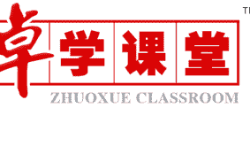

卓学课堂·软文写作课程

# 事件软文写作

www.zhuoxue.org

总编辑：朱则荣（Zhu ZeRong）  使用状态：受限阅读
总发行：李丹（Li Dan）  类别：短版课程（PDF）
长度：6页  语言：汉语（GB2312）  版本：第一版
文件编码：PL-SV-CO/7  课程编号：11189114-00013

内部学习 不得外传

卓学管理学派 网站问题实验室 出品
Copyright © Zhuoxue Classroom, All Rights Reserved

## NEW BUSINESS MODEL IN INTERNET
软文写作课程

卓学管理学派 网站问题实验室 出品

## 课程：事件软文写作

| 出版日期：2009 年 5 月 15 日 | 类别：短版课程（PDF） |
| 编撰：朱则荣（Zhu Zerong） | 类型：教学课程 |
| 修订日期： | 编号：11189114-00013 |
| 文件编码：PL-SV-CO/7 | 版本：第一版 |
| 语言：汉语（GB2312） | 长度：6 页 |

## 课程描述：

本文讲解了以“事件”为中心的软文写作范例，介绍了观点软文的写作格式、好处及观点软文写作指南。

## 学习目的：

通过学习，了解事件软文写作方式，参考范例，掌握观点软文写作手法。

## 涵盖主题：

软文，软文写作，写作，写作手法，写作指南，写作技巧

## 简要目录：

什么是问题软文                      第1页
样例一                              第1页
样例二                              第2页
样例三                              第4页
事件软文的特点                      第5页
事件软文是怎么“出笼”的            第5页
事件软文写作指南                    第6页

## 事件软文写作

## 什么是事件软文

事件软文：就是以“某某事件”冠名，所进行的系列写作，由于事件具有新闻的特点，能够持续引发人们注意。

样例一：

华南虎事件疑云

2007 年 10 月 12 日，陕西林业厅公布了猎人周正龙用数码相机和胶片相机拍摄的华南虎照片。随后，照片真实性受到来自部分网友、华南虎专家和中科院专家等方面质疑。2008 年 6 月 29 日，陕西政府通报周正龙华南虎照片造假。9 月 27 日，周正龙一审获刑两年零六个月。11 月 17 日，周正龙终审承认造假，获刑 2 年半缓期 3 年。

陕西省调查结果

结论：

- 周正龙在邻乡村民家寻得老虎画 1 幅，成为后来他拍虎的“道具”。
- 警方已证实，周正龙拍摄时距“虎”最近距离约 3.9 米，最远距离约 10.5 米。
- 周正龙在本地村民易某的帮助下，用事先制作的木质虎爪模具，在镇坪县北草坡的雪地里，捺印假虎爪痕迹后拍照。

处理结果：

- 周正龙造假，涉嫌诈骗罪。目前周正龙已被提请批捕。
- 陕西省林业厅副厅长孙承騄、朱巨龙被免职。
- 野生动物保护处处长王万云、信息宣传中心主任关克被撤职

## 样例二：

## 杭州富家子飙车事件

2009 年 5 月 7 日晚，一位年仅 25 岁的浙江大学毕业生在走过斑马线时，不幸被一辆红色三菱疑似改装车撞飞 5 米高 20 多米远，送医院抢救无效后死亡。据悉，肇事者胡斌是杭州师范大学体育系大三学生，是首届杭州 F2 卡丁车赛的个人冠军。事发当晚，胡斌和他的朋友们，驾驶三菱、法拉利、保时捷等高档跑车在路上下行驶，并准备去看电影。

时速 70 公里能把人撞那么高？

5 月 8 日 14 点，针对这起车祸，杭州警方召开了一场通报会。据杭州媒体报道，警方通报说，根据初步调查，7 日晚，肇事者胡某驾驶三菱跑车从杭州城东开往城西，结伴同行者两人也各自驾驶跑车。20 时 05 分左右，胡某所驾跑车在西湖区文二西路由东向西行驶至南都德嘉西区门口时，车头撞上了由南往北超过斑马线的路人谭卓，造成其受伤，经浙江省同德医院抢救无效死亡。

不过，在通报会上，警方给予的一些说法，却遭到了参与通报会的部分网友的强烈质疑。网友质疑：杭州盛行“飙车”就是因为交通法没有对其约束吗？

## 分析：

上述两则样例中所刊载的事件，在媒体和网络上引起了广泛的社会关注。某某事件，实际上是新闻策划的结果，容易在第一时间引起广泛关注，并爆炸式的引发多方评论，随之升级成巨大的轰动效果。

## 样例三：

## 艳照门事件相关新闻及评论

陈冠希艳照门事件 大家都疯了么？

陈冠希艳照门事件的娱乐卖点

从陈冠希艳照门事件看道德进步华龙网

艳照门事件后 送修电脑要学会自我保护

从艳照门事件揭寡女星外遇系数(图)

艳照门事件 观众的眼睛是雪亮的

艳照门事件中退却的不该是道德

艳照门事件砸碎了亿万人的香港梦

艳照门事件进入语文试卷 能考出什么？

汤唯称艳照门事件太玄

艳照门事件：“ Spring ”的道德监督

## 事件软文的特点

事件软文是策划的结果，并不需要你写，而是要让大家写，大家评，由此形成强劲的影响力。

## 事件软文是怎么“出笼”的

有一年北京图书展，有几个来自贫困山区的孩子，在展会上出售家乡的土特产，5元一份，希望人们借助筹款帮助贫困山区的学校购买一些图书。许多人纷纷慷慨解囊，予以支持。

部分媒体的记者看到这一幕，也纷纷予以报道，但是几乎所有的媒体，都从“献爱心”的角度进行报道。某报记者展开了思考，是谁让他们在这里摆摊的？是谁从贫困山区把他们送到北京的？这些孩子的举动是真的还是假的？如果是假的，幕后又是谁在操纵？......

当这位记者思考到了这一连串的问题以后，就以“某某事件”为题，进行一系列的追踪报道，以图揭开真相。新闻发出以后，引起了强大的社会反响。

## 事件软文写作指南

- 1. 注重策划和持续报道，重点在于引发媒体和社会公众的广泛关注。
- 2. 并不需要你写多少文章，要广泛地调动许多人去写、去评论。
- 3. 转载传播率极高、影响力极大。
- 4. 事件可以是反面的，也可以是正面的，比如 IDC 的“断网事件”等等，可大可小。
- 5. 文章是系列的，是持续的，也可以在网站上制作专题，加大事件的影响力度。
- 6. 成名是迅速的。

## 版权与许可

© 2009 卓学课堂 版权所有

受限阅读，内部学习，不得外传，不得翻印。

*

未经事先书面许可，严禁进行任何形式的复制或翻印，除非版权法另有规定。

本学习材料所包含的内容如有更改，恕不另行通知。

## 商标说明

“卓学课堂™”为卓学管理学院旗下品牌，本学习材料中提及其他品牌均为其版权持有者所有。

## 卓学课堂
ZHUOXUE CLASSROOM

卓学课堂 · 软文写作课程

# 数据软文写作

www.zhuoxue.org

总编辑: 朱则荣 (Zhu ZeRong)      使用状态: 受限阅读
总发行: 李 丹 (Li Dan)      类别：短版课程 (PDF)
长度: 5页    语言：汉语（GB2312）      版本：第一版
文件编码：PL-SV-CO/7    课程编号：11189114-00019

内部学习 不得外传

卓学管理学派 · 网站问题实验室 出品
Copyright © Zhuoxue Classroom, All Rights Reserved

## NEW BUSINESS MODEL IN INTERNET

## 软文写作课程

卓学管理学派・网站问题实验室 出品

## 课程：数据软文写作

| 出版日期：2009 年 5 月 15 日 | 类别：短版课程（PDF） |
| 编撰：朱则荣（Zhu Zerong） | 类型：教学课程 |
| 修订日期： | 编号：11189114-00019 |
| 文件编码：PL-SV-CO/7 | 版本：第一版 |
| 语言：汉语（GB2312） | 长度：5 页 |

## 课程描述：

本文讲解了“以数据”为中心的软文写作范例，介绍了数据软文的写作方式、好处及通讯软文写作指南。

## 学习目的：

通过学习，了解数据软文写作方式，参考范例，掌握数据软文写作手法。

## 涵盖主题：

软文，软文写作，写作，写作手法，写作指南，写作技巧

## 简要目录：

什么是数据软文                第 1 页
样例一                         第 1 页
样例二                         第 2 页
样例三                         第 3 页
数据软文写作特点               第 4 页
数据软文写作指南               第 5 页

## 数据软文写作

## 什么是数据软文？

数据软文：以分析数据、统计数据、调查数据等资料为基础的文章。

例文一

## 调查显示中国人仍局限于“亲缘社交”

中国著名民间调查机构零点公司近日发表的一份调查报告显示，大多数中国城乡居民不善于社交，尤其是与陌生人打交道。报告显示，尽管中国居民沟通指数的总得分69.32分，较上年增长了3分，然而，距离高沟通水平仍有较大差距。中国人仍然局限于“亲缘社交”，而对以陌生人为主体的“社交外圈”的社会资本的利用明显不足。

虽然有七成以上的受访者表示了很强的结识陌生人的意愿，但仅有不足四成认为自己擅长和陌生人打交道。调查显示，受访者希望平均每月结识3个新人，但实际上四成以上的人在过去一个月内没有认识任何新人。报告将其归结为中国居民与新人交往的能力不足，结识陌生人的机会较少。

调查指出，亲戚家人仍是中国社会资本的主要来源；中国人对于本该更具有资本价值的社会交往圈利用不足。大量的社会网络都属于无效浪费状态，而对亲缘圈却赋予了过重的角色和期望。

## 例文二

## 艾瑞：08年网络教育市场规模352亿 同比增24%

艾瑞咨询分析师赵旭枫近日发布分析报告指出，2008年中国网络教育市场规模同比增长23.9%，达到352亿元。

## 2004-2012年中国网络教育市场规模

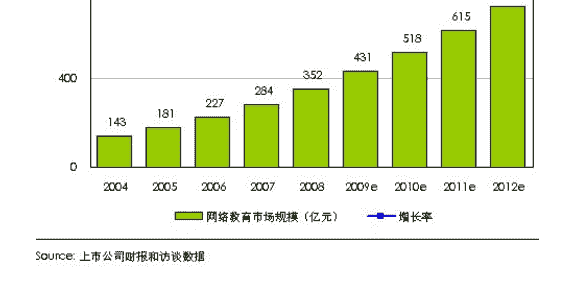

Source: 上市公司财报和访谈数据

艾瑞分析认为，促使市场保持高速发展的主要动力来源于网络教育在高等学历教育市场的应用，由此带来的收入约占网教市场整体规模的85%-90%，而随着党的十七大提出的“发展远程教育和继续教育，建设全民学习、终身学习的学习型社会”的要求的贯彻落实，中国网络教育市场规模还将进一步发展，预计在2012年市场规模将达到723亿元。

## 例文三

## ChinaVenture：2009年5月中国IPO市场研究统计

3家中国企业境外IPO融资金额超13亿美元

2009年5月，共有3家中国企业实现IPO(见表1-1)，融资金额达13.48亿美元，环比上升431.48%(见图1-1)。其中，亚洲最大的铝型材生产商——中国忠旺控股有限公司(以下简称“忠旺控股”)8日登陆港交所，发行股票1亿股，融资金额98亿港元。此次忠旺控股IPO是今年全球最大金额IPO，也是继去年8月中国南车集团之后，全球资本市场首笔超过10亿美元的IPO。

## 2009年5月中国企业IPO规模

| 交易所 | IPO数量 | 融资金额（US$M） | 平均融资金额（US$M） |
|---|---|---|---|
| 香港主板 | 1 | 1264.34 | 1264.34 |
| 韩国科斯达克 | 1 | 40.67 | 40.67 |
| 韩国主板 | 1 | 42.52 | 42.52 |
| 总计 | 3 | 1347.52 | 449.17 |
| ChinaVenture 投资数据库 2009.06 www.ChinaVenture.com.cn | | | |

分析：以上三则样例中，例文一是一则普通的民意调查数据。例二、例三分别是两个市场研究公司的分析统计图表。从经营方式来看，例文一、二、三的发布机构分别为零点调查公司、艾瑞网及投资中国(ChinaVenture)，这些机构专注于发布数据新闻和资料，已经在中国媒体上形成极其强大的影响力。

## 数据软文写作特点

- 1. 数据软文主要是对各种分析数据、统计数据、调查数据等资料加工整理。
- 2. 数据软文大多以统计图表来表达。
- 3. 数据软文具有强传播性、专业性、写作简洁性的特点。
- 4. 数据软文容易快捷建立和发展成专业的企业(网站)品牌。
- 5. 企业或网站很容易和一些大型媒体、网站形成内容合作，向对方定期提供数据软文，形成经营特色。
- 6. 借助于数据软文的传播，经营数据软文的企业(网站)可形成以销售研究报告、统计分析、调查报告的专门业务。

## 数据软文写作指南

1、数据源：可以来自于对社会上各种数据，如生活数据、手机数据、汽车行业数据、创业数据的专门搜集整理，将这些数据加工成数据图表，使之成为企业(网站)的特色内容。

2、数据也可以来自网站或论坛的小型调查，比如展开《站长最喜欢哪些类型的培训》、《消费者通常提前多长时间预订酒店》、《平均每次自助游预算多少费用》等人们喜闻乐见的小型调查，制作成数据软文。

3、数据软文的重点是加工数据，制作成图表，写作简洁快速。

4、数据软文容易形成品牌，例如艾瑞网及投资中国(ChinaVenture)，就以收集和发布互联网类、风险投资类动态、数据和报告、举办相关活动为主要经营项目。

5、数据软文可以经营，例如全面搜集各种心理咨询类的数据，可以形成数据报告或数据包，供需求者购买。

6、在百度新闻搜索中，查询关键词“调查显示”，可以发现大量原始的数据分析，在此基础上可以加工整理。

## 版权与许可

© 2009 卓学课堂 版权所有
受阅读，内部学习，不得外传，不得翻印。

*
未经事先书面许可，严禁进行任何形式的复制或翻印，除非版权法另有规定。
本学习材料所包含的内容如有更改，恕不另行通知。

## 商标说明

“卓学课堂™”为卓学管理学院旗下品牌，本学习材料中提及的其他品牌均为其版权持有者所有。

## 卓学课堂
ZHUOXUE CLASSROOM

卓学课堂 · 软文写作课程

# 通讯软文写作

www.zhuoxue.org

总编辑：朱则荣（Zhu ZeRong）  使用状态：受限阅读
总发行：李 丹 (Li Dan)  类别：短版课程（PDF）
长度：7页  语言：汉语（GB2312）  版本：第一版
文件编码：PL-SV-CO/7  课程编号：11189114-00016

内部学习 不得外传

卓学管理学派 · 网站问题实验室 出品
Copyright © Zhuoxue Classroom, All Rights Reserved

## NEW BUSINESS MODEL IN INTERNET

## 软文写作课程

卓学管理学派 • 网站问题实验室 出品

# 课程：通讯软文写作

| 出版日期：2009 年 5 月 15 日 | 类别：短版课程（PDF） |
| 编撰：朱则荣（Zhu Zerong） | 类型：教学课程 |
| 修订日期： | 编号：11189114-00016 |
| 文件编码：PL-SV-CO/7 | 版本：第一版 |
| 语言：汉语（GB2312） | 长度：7 页 |

## 课程描述：
本文讲解了“以通讯报道”为中心的软文写作范例，介绍了通讯软文的写作方式、好处及通讯软文写作指南。

## 学习目的：
通过学习，了解通讯软文写作方式，参考范例，掌握通讯软文写作手法。

## 涵盖主题：
软文，软文写作，写作，写作手法，写作指南，写作技巧

## 简要目录：
+ 什么是通讯软文 第 1 页
样例一 第 1 页
样例二 第 2 页
样例三 第 3 页
通讯软文写作方式 第 5 页
通讯软文的好处 第 6 页
通讯软文写作指南 第 7 页

# 通讯软文写作

## 什么是通讯软文
通讯是最常用、最常见的写作方式，主要用来报道消息、动态、人物。企业和组织、报刊及电视一般都建有通讯员队伍，用来进行基层报道。

## 样例一：

#### 卓学课堂：推出气候变化主题网站
卓学课堂最近推进了一个综合介绍“应对气候变化问题”的主题网站，以使公众更加便利地获得相关知识和信息。

这个网站网址是 http://www.zhuoxue.org/cn/ketang/index.htm。登陆这个网站可以获得国际社会及中国对气候变化问题的努力、相关报告和资料。近年来，气候变化日益成为全球关注的问题，很多高级别的国际会议都将气候变化列入讨论日程。

## 样例二：

#### 社交网站组织用户参与线下活动
社交网站 Going 网站目前组织了两场集会。他们的集会吸引大批年轻的专业人士，让具有相同嗜好的行家上网联谊，同时七嘴八舌对商家品头论足，例如批评哪家餐厅的侍者态度差、食物难以以下咽。一位参加者称：“很高兴，我们能如此一拍即合，踊跃参加表演或一起聚餐”。

Going 网定位为一种“社交活动行事历”(social-event calendar)，集结各种社交活动信息，并鼓励会员先透过网络互相接触，并且让他们上传活动的照片和描述。Going 网站提供丰富的行事历功能，以便会员举办各式各样的联谊活动，从烤肉节到慈善募款活动，不一而足。

## 样例三：

#### 我们寻找一种精神——叫“敬业”！
——记公司五一劳动者荣誉称号获得者：朱志宏

“砰”，眼前稍稍一黑，朱志宏觉得眼睛里好像跳进了个东西，他下意识地揉揉眼睛，有点痛，再揉揉，稍稍好了一点，不过，似乎还是有东西在里面，感觉总是舒服，但现在是4月30号的晚上，赶着加班，抵桩样件要的很急，这个时候容不得多想，赶工要紧。一丝丝的刺痛隐隐而来，但现在不行，朱志宏清楚手头的工作更加重要，在他看来：工作任务大于一切。他偶尔揉一揉眼睛，以试图减少那丝丝痛苦，实在不行，就强忍着。

一晃几天过去了，朱师傅感觉眼睛有些模糊，似乎看不清东西，而同事也发现他的眼睛有大量血丝。“朱师傅，快去医院看看吧”，“我手头现在还有工作，等不忙的时候再说”，“快抽空看看吧，别感染了什么，影响了视力”。在同事的一再劝说下，朱师傅答应在不耽误工作的情况下去医院检查一下。医生最后表示：“铁屑已在眼睛里生锈了”。

朱志宏是生产车间的师傅，原在爱默生工作6年，随着公司的发展跟随到富泰和公司，一直在公司从事设备维修、保养工作，他不太爱说话，但为人特别好，在维修机器方面有自己的一套。在与机器打交道的8年时间里，他每天用最热忱的心来干工作，奉献于事业。在工作中，朱师傅一惯任劳任怨，就业业，他常常关心帮助其他操作员，尽管他自己不爱说话，但对同事的需求有求必应，很受大家欢迎，一有困难，大家就想到他。

朱志宏师傅踏实能干、勤勤恳恳的精神，鼓舞着身边的每一个人，鼓舞着公司每一位员工，在今年五一的时候，朱师傅被评为公司五一劳动模范荣誉称号。“富泰和的人文文化让我有家的感觉”，朱师傅说：“希望与富泰和一起共同发展壮大”。

## 分析：
上述样例中，例一、例二均是网站通讯，报道网站的最新动态、活动，无论是企业还是组织或网站，增设一条生产线，安排一个考察团出访、举办了一些篮球联赛，增加了一些栏目，都可以报道。例三是人物报道，报道集中于一线那些最普通最平凡的人物，树立学习典型，鼓舞士气。如果是网站，也可以报道一些典型的用户。

## 通讯软文写作特点
通讯是一种细小、深入又普遍的报道方式，它要求报道周围的人、周围的事。

“做了要说，而且一定要说出去”是通讯的重要特点，在大型企业，党政的宣传部工作中，通讯占据了最大的工作比例，内部报纸、广播、电视等企业内部媒体，就是用来写和报道通讯的，企业中的通讯员也会不断地写各种通讯稿件寄发各大媒体，通讯扎根于基层、来源于基层、服务于基层。

对于中小型企业、组织和网站而言，往往没有宣传意识，也从未发现通过通讯的力量。因此它们不善于宣传，也无法将自己的动态、消息、人物及时向社会宣传，它们失去了宣传这种巨大的天然能力，包括中小企业中的人员流失量大，与没有及时报道内部那些平凡的人物和新做法也有很大关系，人家把工作干了，哪个部门在努力，最终结果是干了也是白干，既没有表扬也没有鼓励，最终企业的凝聚力很差，企业文化非常沉闷。

## 通讯软文的好处
+ 1. 打好宣传发动王牌，“宣传到位，扩大影响”，这是组织真正的“软文”根基，“报上刊登，脸上光”，这是企业凝聚力的基础。
+ 2. 注重平凡人、平凡事，注重点点滴滴，注重身边人、身边事。
+ 3. 展现欣欣向荣的发展脉络，给外界一种强盛的企业文化感。

## 通讯软文写作指南
+ 1. 通讯是长期的、是强效的，要写作通讯，就要多研究各类企业“内刊”，参考广泛的通讯员培训，不断提高对动态和报道的工作能力。
+ 2. 各企业和网站，要积极建立通讯队伍，积极发展通讯员，形成通讯员网络，有素材、有通讯、有报道，才能做好宣传工作。
+ 3. 各类通知、公告、文件，都可能是撰写通讯的内容来源，比如网站公告，稍加整理，就是一篇通讯。
+ 4. 必须扎根基层，必须勤于报道，务必注意：“做了要说，而且一定要说出去”。
+ 5. 通讯写作不是空想想象，注意采访，随时采访和记录，素材是第一位的，没有素材就没有通讯。
+ 6. 通讯员要有写作热情，所有的通讯员都是从基层开始的，都是从不会写开始的，初学写作可以边学习边实践，模仿着别人的去学。
+ 7. 短小精练，这是通讯写作的基本要求，采写通讯就是要写好短消息。例如学校运动会时，小通讯员用一两百字的小文章报道本班动态，在校园广播播出，就是灵活应用的例子。
+ 8. 用事实说话，通讯写作，是报道事实，而不是评论事实，不要本着评论的心态去写通讯，要善于小处着眼，以小见大。

## 版权与许可
© 2009 卓学课堂 版权所有

受限阅读，内部学习，不得外传，不得翻印。

*

未经事先书面许可，严禁进行任何形式的复制或翻印，除非版权法另有规定。

本学习材料所包含的内容如有更改，恕不另行通知。

## 商标说明
“卓学课堂™”为卓学管理学院旗下品牌，本学习材料中提及其他品牌均为其版权持有者所有。

卓学课堂 • 软文写作课程

# 问题软文写作

www.zhuoxue.org

总编辑：朱则荣（Zhu ZeRong） 使用状态：受限阅读
总发行：李 丹（Li Dan） 类别：短版课程（PDF）
长度：6页 语言：汉语（GB2312） 版本：第一版
文件编码：PL-SV-CO/7 课程编号：11189114-00012

# 内部学习 不得外传

卓学管理学派 • 网站问题实验室 出品
Copyright © Zhuoxue Classroom, All Rights Reserved

## NEW BUSINESS MODEL IN INTERNET
软文写作课程

卓学管理学派 • 网站问题实验室 出品

# 课程：问题软文写作

| 出版日期: 2009 年 5 月 15 日 | 类别: 短版课程（PDF） |
| 编撰: 朱则荣（Zhu Zerong） | 类型: 教学课程 |
| 修订日期: | 编号: 11189114-00012 |
| 文件编号: PL-SV-CO/7 | 版本: 第一版 |
| 语言: 汉语（GB2312） | 长度: 6 页 |

## 课程描述：
本文讲解了“以问题”为中心的软文写作范例，介绍了观点软文的写作格式、好处及观点软文写作指南。

## 学习目的：
通过学习，了解问题软文写作方式，参考范例，掌握观点软文写作手法。

## 涵盖主题：
软文，软文写作，写作，写作手法，写作指南，写作技巧

## 简要目录：
什么是问题软文 第1页
样例一 第1页
样例二 第2页
样例三 第3页
问题软文写作特别建议 第4页
问题软文的写作格式 第4页
问题软文的好处 第5页
问题软文写作指南 第6页

# 问题软文

## 什么是问题软文
问题软文，就是提问、解答问题、一个问题一解答，单独成篇。

## 样例一：

#### 卓学课堂：什么是 SEO？
SEO 是 Search Engine Optimization 的英文简写,意为搜索引擎优化,或简称“优化”。

SEO 是指通过改进网站链接的质量和数量、以及有效的网页内容部署,使网站在搜索引擎上获得比较好的自然排名位置。通常情况下,在搜索一个“关键词”时,搜索引擎会排列出该搜索结果的相关网页,先出现的网站排名越前,网站所获得的访问量就越大。其中：
+ 65%—70%的上网者只访问搜索结果的第一页即 1—10 条信息。
+ 20%—25%的上网者访问者访问搜索结果的第二页即 11—20 条信息。
+ 3%—4%的上网者的访问其它所有的搜索结果的总和。

做为重要的网站营销策略,网站经营者必须考虑搜索引擎如何工作,以及人们如何寻找网站。对于企业和商业网站,特别是销售网站而言，每多争取一个访问者，就意多争取到一个可能的销售线索。优化网站主要涉及：网站内容及 HTML 编码的特定关键词设计、消除有障碍的代码、调整链接质量与链接数量。

## 样例二：

#### 卓学课堂：兼职个人站长应该如何建设自己的网站？
问题: 作为一个兼职站长，如何做出一个有特色、有收益的小站呢？如何让网站获得广告收入。

朱则荣答复：

兼职站长的特点是时间不多，在网站的持续更新上也存在很大难度，通常，多数人不能坚持下去。

+ 1. 选择做网站的方向时，过大过空的目标是不现实的，比如将方向选为教育网站，就是不准确的，你没有那么大的精力，做不了多久就放弃了，你必须找准确细分市场，目标越小越清晰越好，比如只围绕语文课件、教育管理、微软认证考试等等专项的内容，务求把他们做精、做专，只围绕一个目标深入下去。
+ 2. 在你选择建站方向时，要注意一点：什么人会投放广告？依据你的内容能够销售什么？比如“滑雪”，你可以找到这种杂志，仔细看看什么人在上面刊登广告，滑雪爱好者们又需要购买什么，你的网站建好后，可以与这些广告商直接联络。再比如美术高考，有很多辅导学院会刊登广告，找准人们愿意花钱的地方去做网站，事半功倍。
+ 3、在内容策略上，注意内容本身的价值，内容不在多而在精，不要发新闻或少放，在编发一篇文章时，要考虑这篇文章放在那里，是不是三年、五年仍然能够产生作用，被人们阅读，这样即使以后每天只更新三五篇文章，长年累月下去，将是一笔财富，你的网站肯定是同类网站中最优质的网站，人们喜欢用它而且频繁地用它。

## 分析: 上述两者样例的文章，都是以解答常见的或实质性的问题为中心
这样的内容，非常具有价值，很容易被广泛转载。

## 样例三：
红警2和红警3哪个好玩？

红警3是红警2的升级版，红警2是采用2d画面，而红警3是3d，红警3更好玩更真实，剧情也是连续红警2。

但是红警3占内存5G红警2才几百MB，对显卡要求很高。

## 问题软文写作特别建议
一般人不会意识到问题本身也是软文，这种写作方式用的人比较少，但效果非常强。特别注意一下：
+ 1. 搜索关键词： “为什么……、什么是……、怎样……、……诀窍、……秘籍”

## 问题软文的写作格式
标题：
+ 1. 什么是……
+ 2. 为什么……
+ 3. 怎样……
+ 4. 如何……
+ 5. ……有哪些诀窍
+ 6. ……有哪些秘籍
+ 7. 某某某：当你遇到……问题时

## 问题软文的好处
+ 1. 写作快捷，三五百字，甚至一两百字都可能单独成篇。
+ 2. 素材好找，在各种论坛、百度知道等内容中，有大量问题，解答或直接整理问题的答案即可。
+ 3. 转载传播率高、点击率高、查询量大。
+ 5. 锁定搜索引擎，“什么是”、“为什么”、“怎样”、“如何”等关键词 每天在搜索引擎中检索重复量极大。

## 问题软文写作指南
+ 1. 问题软文可以自动形成内容，比较论坛中，有人提问有多人应答，作者可以对答案进行整理，就是一篇软文文章。
+ 2. 写作时上手非常容易，写作极为简便。
+ 3. 网上写作，以量取胜，问题软文可以大量制作。
+ 4. 人们喜欢问问题，人们会遇到问题，人们同样会在网上不断寻找问题的答案和解决思路。
+ 5. “什么是电子商务?什么是 SEO?”等等问题，每天都有数以百计的搜索量，源源不断地为你输送流量。
+ 6. 长期性，问题软文可能长期存在，发挥作用，一篇写于五年前的问题软文，五年后可能仍然有人查询。
+ 7. 注意某款游戏网站及论坛，围绕一款游戏，在它们的论坛中问题非常的多，为什么会有这么多的问题作者可以思考借鉴。
+ 8. 在网站经营中，如果利用论坛等形式，大量搜索问题、解答问题，可以成批量制作软文。

## 版权与许可
© 2009 卓学课堂 版权所有

受限阅读，内部学习，不得外传，不得翻印。

*

未经事先书面许可，严禁进行任何形式的复制或翻印，除非版权法另有规定。

本学习材料所包含的内容如有更改，恕不另行通知。

## 商标说明
“卓学课堂™”为卓学管理学派旗下品牌，本学习材料中提及的其他品牌均为其版权持有者所有。

卓学课堂 • 软文写作课程

# 研究软文写作

www.zhuoxue.org

总编辑: 朱则荣 (Zhu ZeRong)    使用状态: 受限阅读

总发行: 李 丹 (Li Dan)    类别: 短版课程 (PDF)

长度: 5页    语言: 汉语（GB2312）    版本: 第一版

文件编码: PL-SV-CO/7    课程编号: 11189114-00018

内部学习 不得外传

卓学管理学派 • 网站问题实验室 出品
Copyright © Zhuoxue Classroom, All Rights Reserved

## NEW BUSINESS MODEL IN INTERNET

## 软文写作课程

卓学管理学派 • 网站问题实验室 出品

# 课程：研究软文写作

| 出版日期：2009 年 5 月 15 日 | 类别：短版课程（PDF） |
| 编撰：朱则荣（Zhu Zerong） | 类型：教学课程 |
| 修订日期： | 编号：11189114-00018 |
| 文件编码：PL-SV-CO/7 | 版本：第一版 |
| 语言：汉语（GB2312） | 长度：5 页 |

## 课程描述：
本文讲解了“以研究”为中心的软文写作范例，介绍了研究软文的写作方式、好处及研究软文写作指南。

## 学习目的：
通过学习，了解研究软文写作方式，参考范例，掌握研究软文写作手法。

## 涵盖主题：
软文，软文写作，写作，写作手法，写作指南，写作技巧

## 简要目录：
什么是研究软文 第 1 页
样例一 第 1 页
样例二 第 2 页
样例三 第 3 页
研究软文特点 第 4 页
研究软文写作指南 第 5 页

# 研究软文写作

## 什么是研究软文
研究软文，是以研究报告、研究资料、文献为基础的文章，研究性软文一般是为学者、专家所频繁使用的，鉴于有些学者专家的地位及名气以及研究方向的著名性，学者、专家容易因此成名，并获得广泛的影响力。

## 样例一：

#### “人民就是人客” 顾客服务是电子化政府未来发展要务
国际市场研究机构 Accenture 于 2005 年 4 月发表一份关于电子化政府的调查报告，分析世界各国电子化政府的发展成熟度，加拿大已连续 5 年在「电子化政府」的评比取得头筹。Accenture 进一步指出「顾客服务」是未来电子化政府评比的关键指标，创造顾客的实质价值，亦是电子化政府发展的重要目标。

Accenture 指出，“顾客服务”是未来电子化政府评比的关键指标，创造顾客(国民)的实质价值，亦是电子化政府发展的最主要目标。从上述研究发现，各国政府作业及服务网络化已趋成熟，然而仍有许多问题有待克服，例如解决民众对传统作业的依赖性、提高民众的使用意愿、改善使用者对新技术的认知及适应性、改善政府的网络使用接口等。因此，电子化政府的发展必须与国民需求结合，政府并持续加以修正发展之道，方能有效提升电子化政府的效能及提升国民满意度。

FIND 研究员： 罗筱秋

## 样例二：

#### 艾瑞咨询：汽车广告用户最看重广告语和画面设计
iResearch 艾瑞咨询根据艾瑞广告创意喜好调研数据研究发现，广告语、广告画面设计、和品牌喜好度是影响用户对汽车广告喜好度的重要因素。

艾瑞咨询分析认为，广告语是传达广告信息最直接的手段。而看懂广告，了解广告所要表达的意思是用户对广告的基本需求。广告语是满足这一基本需求的最有效途径。因此广告语设计对广告的用户喜好度具有举足轻重的作用。

艾瑞咨询分析认为，汽车属于大宗商品，选购汽车对用户是一件严肃的事，需要谨慎的考虑，希望接收到稳重可靠的信息。而网络广告中的互动游戏很少能传达这类信息给用户，因此在用户最喜欢的 10 个汽车广告中，用户选择百分比比较低。而相对其他产品而言，网络广告中的活动奖励对购车用户的吸引力较低，也导致其用户选择百分比比较低。

## 样例三：

### 陈炯明研究：独立教育行政与经费

陈炯明于 1920 年 11 月回粤，是月在教育会与学生联合会的欢迎会上演说，对改革广东教育，发表了下面一段意见：

收束军队、当发展教育。教育为一国立国元素，教育费之支出，当占岁出额之强半，方为正当。连年财政紊乱，达于极点，非从根本清理不可，清理之后，消滥归公，自可得大宗收入，以为兴学之用。我国向来，多是绵常袭故，往者的教育章程，乃起草于清代旧物。此等旧式专制式教育，殊与现世潮流相背，容当根本改良教育方针。〔华字 1920.11.23〕

陈炯明要从根本上改革教育方针，所取的原则是在创立一个独立的教育行政机关，和独立的教育经费。所谓“独立”是指与政治脱离关系而独立。这个原则，也就是欧美民主国家建立其教育制度最基本原则。

分析：例一是针对研究报告的摘要内容，例二是一则调查中发现的特点，例三是人物历史研究，引用史实。研究类软文以事实、史实、分析为中心。

## 研究软文的特点

研究软文，主要用于社会现象、行业发展、学术等研究。研究软文的写作，有些是直接摘要其他研究报告，例如一便是直接摘要，有些是分析一些问题，例如二，有些则是分析史实，例如三。研究软文大多以引用为主，社会性或行业性的研究文章，传播率高影响力大，而史实、学术等研究，主要表达的是新发现、新思考、新研究结论。有些研究文章也用于学术批判，如现代艺术批判、驳驳一些观点。

## 技巧软文写作指南

1、摘要和引述为主，建立在摘录研究报告和资料的基础上，文章一般先要引述或大量引述原始资料的内容。

2、研究文章有时本身也是小型论文，如果加上关键词、摘要、参考资料，尽可七八百字，也能成为论文。

3、具有趋势性、参考性或学术性、历史价值，有些文章对社会及行业影响较大，或在某些学术领域影响较大。

4、一般由研究性质的组织或个人实施。如市场调查公司、咨询公司，如研究院、学术中心。

5、读者一般比较高端，而研究机构和研究者，容易因此成名，或者具有独一性、文献性。

6、研究类公司，以出版发行报告和咨询项目为主，如兰德公司、互联网实验室、艾瑞网，研究类机构一般不以营利为目的，如卓学全球管理科学索引、国研网、人民复印资料、政策研究室等，从事研究领域的学者一般不以营业为目的，通常以养文、以研究养研究，学者属于历史，进行研究的学者一般都会成为著名历史人物或在历史档案中留名千古，如司马迁、梁启超、章太炎、胡适、马克思韦伯、德鲁克。

## 版权与许可

© 2009 卓学课堂 版权所有
阅后阅读，内部学习，不得外传，不得翻印。

未经事先书面许可，严禁进行任何形式的复制或翻印，除非版权法另有规定。
本学习材料所包含的内容如有更改，恕不另行通知。

## 商标说明

“卓学课堂™”为卓学管理学派旗下品牌，本学习材料中提及的其他品牌均为其版权持有者所有。
