# 卓老板聊科技201606-09

## 无药可医的“超级细菌”来了，我们怎么办？

听卓老师为你讲科普新知

## 非输入性疾病最可怕

5月26日美国报道了首例非输入性超级细菌感染者，引起了不少美国人的恐慌，非输入性就是指感染源在本地产生，而不是其他大陆带入的。

## 青霉素的发现

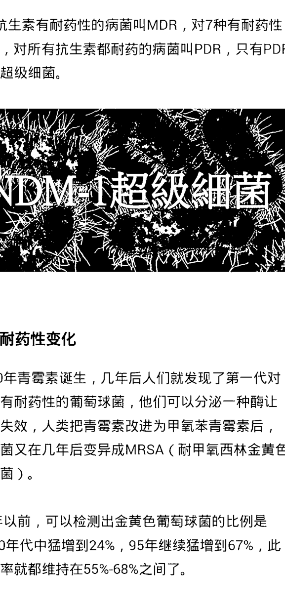

- 1、1928年弗莱明研究葡萄球菌时不慎污染了培养皿，之后发现长绿毛的地方，葡萄球菌都溶解了，他利用这个机会发现了青霉菌分泌的青霉素有高效的灭菌作用。青霉菌在腐烂的水果上经常可以看到。
- 2、抗生素杀死细菌的有4种方式：干扰细胞壁形成、干扰蛋白质生成、干扰叶酸合成、干扰核酸合成。

## 耐药性细菌分强弱两种

- 1、弱的耐药性细菌

弱的耐药性细菌虽然可以抵御抗生素的攻击，但自身缺陷较多，在没有抗生素的环境下竞争不过同种类的普通细菌。人类可以通过严控抗生素的使用，让他们同类竞争，最后让细菌都退回到从前不耐药的状态。

- 2、强的耐药性细菌

强的耐药性细菌不论有没有抗生素环境，都比同种类细菌更有生存优势。强的耐药性细菌并不需要积累遗传变异优势，通过质粒就可以完成耐药特性的积累。

## 生活中抗生素被滥用

- 1、感冒的定义是鼻粘膜上开始繁殖大量病毒了，如果繁殖的是流感病毒，就是流行性感冒，如果是其他病毒，那就叫普通感冒。无论哪种抗生素都无法治疗感冒，在没有并发症的情况下，感冒不能使用抗生素。
- 2、使用抗生素治疗，严格来说有很多步骤，比如病人炎症反应消退后还需继续使用抗菌素多久；通过化验或者拍片子后发现好了转了，是不是能停药；吃了抗生素多久后做疗效评估.....很少有病人配合医生走完整个流程，导致抗生素滥用。
- 3、在国内，医生也会因为担心医疗纠纷和医闹而过度使用抗生素。
- 4、发达国家的医院虽然没有抗生素滥用的情况，但他们的滥用发生在牲畜饲养过程中，所以一样会产生超级细菌。

## 医生是怎么检测耐药性的

- 1、收治病人后采样细菌。
- 2、琼胶里加糖和其他微量元素以供细菌快速生长。
- 3、把细菌抹在琼胶上，对有氧菌来说培养24小时，对厌氧菌来说培养3天，之后就可以鉴别细菌种类。
- 4、在琼胶培养皿中加浸泡了抗生素的小纸片，小纸片周围会形成一个抑菌圈。
- 5、医生通过测量不同抗生素形成的抑菌圈半径，来确定这种抗生素是否失效了。

## 超级细菌感染致死第一人

一位25岁的巴基斯坦人，回老家探亲时遭遇严重车祸，虽抢救过来，但双腿动了手术，手术后感染一直没有好转，回到巴基斯坦继续接受治疗，但最终死亡。尸检结果显示感染的细菌对所有抗生素均有耐药性，这种病菌叫NDM-1，目前NDM-1并没有广泛流行。

对3种抗生素有耐药性的病菌叫MDR，对7种有耐药性叫XDR，对所有抗生素都耐药的病菌叫PDR，只有PDR才能算超级细菌。

## 细菌耐药性变化

从1940年青霉素诞生，几年后人们就发现了第一代对青霉素有耐药性的葡萄球菌，他们可以分泌一种酶让青霉素失效，人类把青霉素改进为甲氧苯青霉素后，葡萄球菌又在几年后变异成MRSA（耐甲氧西林金黄色葡萄球菌）。

1980年以前，可以检测出金黄色葡萄球菌的比例是4%，80年代中猛增到24%，95年继续猛增到67%，此后检出率就都维持在55%-68%之间了。

## 抗生素研发越来越慢

绝大部分种类的抗生素都是1980年之前就开发出来的，最近20多年里，全新结构的抗生素只诞生了2种。每款通过FDA认证的药物研发和审批的总费用平均26亿美元，平均需要11年时间才能上市。

抗生素容易产生耐药性，所以卖不长久，还不如抗肿瘤药赚钱。抗生素被严格控制使用，销量很小，没有药企愿意思研发抗生素。

## 人类与细菌的战役

- 1、绝大多数细菌入侵都被人体免疫系统清除掉了。
- 2、耐药性致病菌我们每天都会接触，但因为有免疫系统，所以大家都安全。
- 3、超级细菌对婴儿、老人、体弱者的威胁最大。
- 4、手接触到脏东西，比如快递袋、人民币、电梯扶手、门把手等，之后最好都洗手，另外不要用脏手抠鼻子、擦眼睛、挖耳朵，这样会把细菌带到那里的粘膜上。经常用手接触的东西要定期消毒，比如键盘、手机屏幕等。一旦生病和医生交流，不要乱用抗生素。工作适度，留出锻炼身体的时间，增加免疫力。

## 动物可以到处跑，凭什么植物就不行？

## 第4期：从光合作用看生命史

### "亩产万斤稻"中的科学道理

- 1、植物中的能量来源于太阳的能量。太阳常数是1367瓦/平方米，其中25%被大气层反射回宇宙；25%被大气层自己吸收了；有5%虽然透射到地面上，但又被地面反射回大气层了；真正被地表吸收的热大约只占太阳常数的45%，中国地区全年平均接受阳光的值是350瓦/平方米。
- 2、钱学森从一个科学家的角度出发，先计算每亩全年阳光能量，再估算单位碳水化合物的能量，相除就是理论值上的每亩极限产能：2.2万斤每亩。这是出于能量守恒的想法，是一种科学理论上的估算。
- 3、目前水稻的亩产记录是袁隆平的协优107，亩产2000斤。

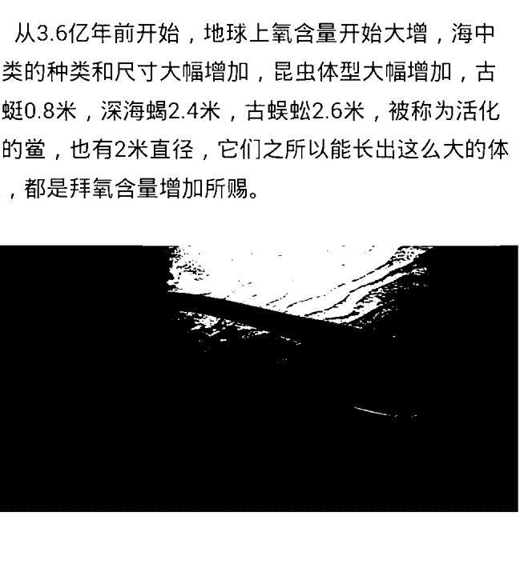

### 为什么植物不能到处移动，以捕捉其他生物为食

一平方米绿叶在阳光最强烈的地方仅能产生10瓦的功率，人体尺寸相仿的植物通过光合作用产生的功率最高20瓦。而人体平静熟睡时功耗最低80瓦，平静地坐着耗150瓦，博尔特冲刺时耗2000瓦。所以光合作用无法支持哪怕最低运动量的活动，植物只能扎根土壤生存。

### 光合作用的效率高在哪儿

光合作用把水变成氧气和氢离子的效率很高。除了光合作用，还有两种方式能把水分解成氢和氧——紫外光照射与电解水，但这两种方式效率都低于光合作用。

### 没有光合作用会怎样

没有光合作用，就没有足够多的氧气产生，就不会有足够多的臭氧产生。没有足够多的臭氧，就不能阻挡紫外光入射，地球上的海水会渐渐被紫外光分解为氢气和氧气，地球上的水会不可逆地一直减少。而光合作用可以提供足够多的氧气。

紫外光分解水虽然可以产生氧气，但这些氧会首先和土壤、岩石中的铁结合，让地球表面到处都是红色的土壤，像火星一样。

只有光合作用足够快，才能产生足够多的氧气，多到氧气和地球上所有能结合的物体都结合后，还有剩余的充斥在空气中，于是空气中氧的浓度就足够产生保护地球的臭氧了。

### 有氧呼吸产生了食物链

- 1、氧气对生命不是必需的，很多厌氧菌就可以生活在无氧的环境中。人体内绝大部分的细菌也都是厌氧菌。
- 2、无氧呼吸对能量利用率低，只有2%，有氧呼吸的能量利用率为40%，20倍的差距导致食物链层级减少。
- 3、有氧呼吸的效率可以维持4级的食物链，无氧呼吸的效率1级都难以维持，所以在无氧环境中捕食行为是非常不划算的，于是就不可能产生高级生命体，更谈不上生物多样性。

### 氧气含量的变化造成了物种体型的变化

- 1、食物链中捕食与被捕食的关系，导致生物体型的"军备竞赛"，被捕食者会越长越大，捕食者会长出越来越有效的捕食武器。
- 2、从3.6亿年前开始，地球上氧含量开始大增，海中鱼类的种类和尺寸大幅增加，昆虫体型大幅增加，古蜻蜓0.8米，深海蝎2.4米，古螯虾2.6米，被称为活化石的萤，也有2米直径，它们之所以能长出这么大的体型，都是拜氧含量增加所赐。

### 氧气曾经等同于毒气

光合作用虽然产生能量，但也产生氧气，早期地球上以还原性气体为主时，氧气等于毒气。而后，光合作用逐渐成为主流，最早的厌氧菌大面积灭绝，而几亿年前最早产生氧气的物种至今还活在地球上：蓝藻。

### 氧气是如何保存在地球上的

- 1、氧气是用于固定碳的，但动物的身体固定了大量的碳，植物的木质素也固定了大量的碳，还有更大一部分碳是通过岩石固定的，于是氧气就有机会跑出来。
- 2、全球减少碳排放的目的是为了减少温室气体，并不是为了减少氧的消耗。人类激烈燃烧化石能源有170多年的历史，但这只让空气中氧气含量下降了万分之三。

### 地球生物圈的变化短暂而剧烈

如果把地球的寿命浓缩到一天的时间里，那每一次生物的大灭绝，下一批生物的复苏只会在8秒钟内完成，其余时间地球生物圈都是平静无变化的。氧含量变化，结冰区域的变化，海水酸碱度的变化，全球气温的变化等等，都是在这个短暂的时间内完成的。虽然灭绝和变化总是吸引我们注意，但地球上真实的情况是保持稳定和不变为主题。

## 奇臭无比的黑暗料理，能吃吗？

## 第5期：臭味儿中的科学

### 鲱鱼罐头火了

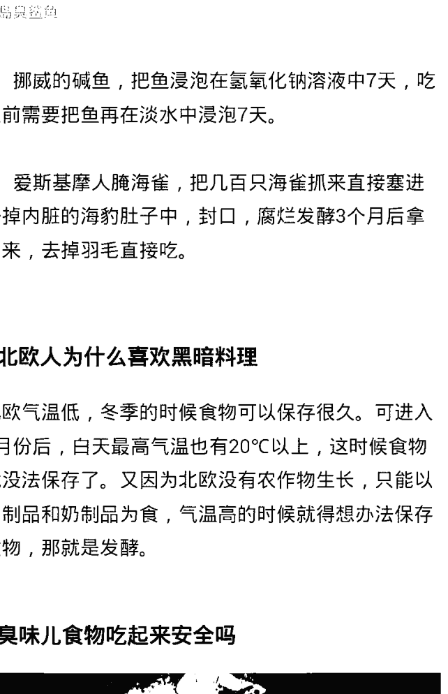

- 1、瑞典语中Sur是酸、发酵的意思，Surstormming 就是我们挑战的鲱鱼罐头中的腌鲱鱼了。
- 2、鲱鱼罐头在流水线加工灌装时就没法避免臭味，所以快递的包装就是臭的。
- 3、因为鲱鱼罐头一直会产生气体，所以开罐子一定会喷出汁水。

### 瑞典人怎么吃腌鲱鱼

- 1、禁止在住宅区开启，禁止携带上飞机，建议野外开启。
- 2、把汤汁倒掉，把鱼洗干净。
- 3、切成小块配硬面包和酸奶油吃，或者熟土豆、洋葱、腌鲱鱼小肉块卷饼吃。
- 4、腌鲱鱼对瑞典人也不是常规化的食物，算是标准的重口味。

### 北欧的黑暗料理很多

- 1、冰岛有臭鲨鱼，先风干4个月，再埋入沙子里发酵6个月后食用。

冰岛臭鲨鱼

- 2、挪威的碱鱼，把鱼浸泡在氢氧化钠溶液中7天，吃之前需要把鱼再在淡水中浸泡7天。
- 3、爱斯基摩人腌海雀，把几百只海雀抓来直接塞进去掏内脏的海豹肚子中，封口，腐烂发酵3个月后拿出来，去掉羽毛直接吃。

### 北欧人为什么喜欢黑暗料理

北欧气温低，冬季的时候食物可以保存很久。可进入6月份后，白天最高气温也有20℃以上，这时候食物就没法保存了。又因为北欧没有农作物生长，只能以肉制品和奶制品为食，气温高的时候就得想办法保存食物，那就是发酵。

### 臭味儿食物吃起来安全吗

富含蛋白质的食物发酵后都会有臭味；富含淀粉的食物发酵后都会有酸味和酒味。传统臭味食物都是由厌氧菌发酵而成，只要没有致病菌参与分解就是安全的。食物中臭气来自于硫化氢、胺类气体，这类气体含量很少就可以让人闻到，但臭味食物中这类气体的量远没有达到致病的剂量，所以是安全的。

蛋白质分解的顺序是：蛋白质→肽链→氨基酸→小分子和胺类。

厌氧菌把蛋白质分解为氨基酸，实际上是为我们提前消化好了，所以这类食物更利于吸收。一些厌氧菌在分解蛋白质时还会产生B族维生素。

切记：不要自己发明臭味食物，过程控制出了问题容易产生致病菌。

### 动物为什么接受臭味食物

- 1、很多动物母亲照顾幼子时会吃掉孩子的粪便，以隐藏母子的踪迹。
- 2、很多动物食用粪便是为了获取其中尚未分解的食物残渣。

### 嗅觉是一门科学

- 1、麝香原料是奇臭无比的，但酒精稀释400倍后却芬芳扑鼻，同样的化学物质产生完全不同的喜好判断，说明嗅觉判断不单单是一种对化学物质的判断，脑部功能也参与其中。
- 2、嗅觉研究中发现，负责人类嗅觉功能的有300多种嗅觉细胞，而每种细胞对一种化学物质会很敏感。通过他们的组合，可以识别一万多种气味。

- 3、最先进的嗅觉模型是用一个神经分层理论来模拟的。
- 4、虚拟世界的感受，会不会因为嗅觉模拟的发展，而进一步取代我们精神上的需求呢？

### 臭味食物文化是一种小众文化

臭味食物文化并不是一种愚昧落后的饮食文化，而是一种小众文化，一度保证了那个地区的人可以生生不息。

## 不止中国，应试教育哪国都有

## 第6期：应试教育的演变

### 高中理科课程背离学科本身属性

物理这种和数学工具结合紧密的学科，差不多变相为披着物理外衣的数学技巧训练；化学这种本来在科学领域中和数学、物理结合很紧密的学科，在高中变成了披着化学外衣的死记硬背。只有数学科目的学习和数学本身有点像，就是一种智力测验。

### 各国都有应试教育，只是形式不同

- 1、日本、韩国的应试教育压力不比中国小，模式和中国类似。
- 2、美国大学入学考试需要很多材料：平均成绩+课外活动简历+导师报告+两封推荐信。

### 美国应试教育的逐步变化

在50年前，美国大学入学考试只看平均成绩和SAT分数，这样平民出身的孩子只要通过应试训练赢得分数上的优势，就能进入好大学，而贵族子弟成绩往往没有这么高。

常青藤盟校是贵族学校，开设这类贵族学校的主要是培养社会精英。为了避免很多名额被占据，常青藤盟校才提出了额外标准，以区分普通家庭的孩子和贵族家庭的孩子。这种区分主要体现在丰富的课外活动和牛人的推荐信上。

常青藤盟校这个规则只在初期起到了作用，后来平民学子也可以搞到这些材料，所以常青藤盟校继续搞出一些特殊规则，比如特招学生和学校资源委员会的孩子可以更容易被录取等等。只有捐款超过100万美元的人，才可以列入学校资源委员会名单。就这样，常青藤盟校由校友供养，校友为自己的孩子提供更优质的教育环境。

## 什么是真贵族？

- 1、贵族精神包括崇尚勇敢、光明磊落、尊重女性、同情弱者、有强烈的社会责任感。富不等于贵，为富不仁的人不是贵族。
- 2、杨振宁在普林斯顿工作时带着儿子杨光诺散步，遇到爱因斯坦还合过影，这是贵族的一个缩影。
- 3、玻尔的两个孩子从小和爸爸的研究生们一起玩，这3位研究生一位将来是诺贝尔物理奖得主，一位将来是美国氢弹之父，一位写的物理学讲义被全世界各大学当经典教科书用。在这样的环境下，贵族阶层精英不断，玻尔的小儿子1975年获得诺贝尔奖。

## 印象派给人带来的启发

19世纪60年代，巴黎的画家首先要经历4年巴黎高等美术学院的学习和淘汰，再争取进入皇家内阁美术部的名单，然后争取进入巴黎美术展览会，最后争取让自己的画挂在与视线平齐的位置，这样才算得上颇有成就。

几万画家争夺几百个位置，竞争异常激烈。当时的印象派是绘画中的非主流派别，与主流画派的最大区别就是构图模糊、选题出自生活，这样的作品很难挂在与视线平齐的位置。

莫奈建议几位印象派画家，不要参加巴黎画展，自己搞单独的小型印象派画展。最终，塞尚、莫奈的印象派绘画经历了100年的发展，成为主流画派的一支。

莫奈作品《睡室》

## 相对剥夺理论

- 1、社会学家 Samuel Stouffer 对50万美军的研究发现，待遇和晋升最好的空军，对空军部门的满意度远低于待遇最低的宪兵对宪兵部门的态度。
- 2、空军有52%的人会晋升，于是大部分都处于晋升和未晋升的焦虑、嫉妒心态中。
- 3、宪兵有21%的人会晋升，大部分都没有晋升机会，所以大家心里不攀比。
- 4、北欧高福利国家自杀率高，南欧经济衰落国家生活条件差，但自杀率低，也可以用相对剥夺理论来解释。

## 学习的过程永远是艰苦的

- 1、学习知识，尤其是科学知识永远不会轻松。如果你感觉轻松，那别人学会这些也没有门槛，你依然没有持续的优势。
- 2、科学知识由概念搭建，逻辑相连。
- 3、《卓老板聊科技》只把最易懂的、最有意思的观点从一个领域筛选出来，实际上每个领域的科学知识都是一小部分有趣，大多数枯燥、晦涩难懂。

## 我们不观察这个世界的时候，它到底存在？

## 第7期：玻尔与爱因斯坦的争论

建议WiFi环境下播放，点击右上角设置可下载或离线播放。

### 贵族群体更容易产生科学家

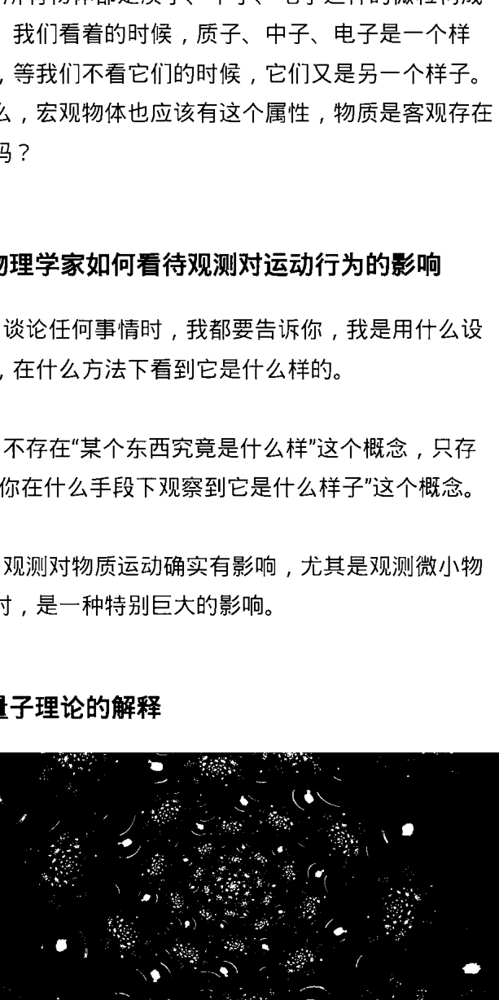

贵族指的是拥有勇敢、坦诚、社会责任感、同情弱者、追求真理等这些特质的人，不是以富不仁的土豪。

普通家庭中的孩子很难成为基础学科的翘楚，是因为在他们的成长过程中，各种需求的缺失太多，金钱对他们的诱惑更大。而金钱至上的理论对贵族家庭的孩子影响小，一旦对基础科学理论感兴趣，他们就可以不计成本地全身心投入。

提出费马大定理的费马就是贵族家庭长大的，是一个省的大法官，业余最爱解数学题，他的文章和计算过程都不为发表，只为自娱自乐，这种脱离经济利益的动力驱动着他钻研科学。

### 尼尔斯·玻尔出身不凡

玻尔的父亲是哥本哈根大学生理学教授，母亲出身于富有的犹太家族。玻尔曾在卡文迪许实验室和卢瑟福实验室工作过。卢瑟福实验室曾经培养出14位诺贝尔物理学奖得主。

### 双缝实验引发的思考

- 1、光通过双缝后，会在每个缝隙上形成一个新的光源，重新向外传播。
- 2、有干涉条纹出现说明传播的物质是波。波会产生干涉的行为不是很好理解，因为人们天生地容易把它传播理解成扔小球或者射子弹。如果是那样，干涉条纹将不复存在，只会存在两道亮条纹。
- 3、如果向双缝发射的是电子、质子、中子，一样会产生干涉条纹。这引发了人们对物质存在性的思考。
- 4、所有物体都是质子、中子、电子这样的微粒构成的。我们看着的时候，质子、中子、电子是一个样子，等我们不看它们的时候，它们又是另一个样子。那么，宏观物体也应该有这个属性，物质是客观存在的吗？

### 物理学家如何看待观测对运动行为的影响

- 1、谈论任何事情时，我都要告诉你，我是用什么设备，在什么方法下看到它是什么样的。
- 2、不存在“某个东西究竟是什么样”这个概念，只存在“你在什么手段下观察到它是什么样子”这个概念。
- 3、观测对物质运动确实有影响，尤其是观测微小物体时，是一种特别巨大的影响。

### 量子理论的解释

- 1、量子理论可以解释微观物体，也一样可以解释子弹射击双缝这样的宏观现象，只是因产生的条纹间距比任何设备可以测量的最小单位还小很多，所以宏观上看是平滑的曲线。
- 2、对微观物体测量，位置和速度是一对非常基础的单位，但想要同时测准他们，则非常难。
- 3、测量物体的位置需要用光射到被测物体，然后接受反射回来的光来判断，而光子的能量和光子的波长成反比，一旦用波长很短的光射到被测物体，虽然返回的位置信息很准确，但被测物体会被撞飞，于是关于它速度的信息就丢失了。
- 4、测量物体位置，物体的尺寸必须远大于光的波长，才能确定位置，否则只能确定物体在一个波长的范围内，但具体位置细节就不知道了。
- 5、量子理论测量的尺寸是牛顿力学测量尺寸的十亿分之一，这里又验证了第一期我们说的那个定律，每代理论都在测量精度上提升10亿倍。

### 我们不观察时，微小粒子怎么运动？

1927索尔维会议合影，爱因斯坦（前排左五）和尼尔斯·玻尔（第二排左一）。

- 1、1927年的索尔维会议，爱因斯坦和玻尔第一次针对微观物质存在的哲学观点辩论，爱因斯坦认为所有事件的发生都是有规律的，只是我们不知道而已；玻尔认为所有事件的发生都只能用几率描述，当我们不观测它时，不能认为它有客观存在的状态。
- 2、后来，爱因斯坦和玻尔的争论升级，爱因斯坦用“光子盒”这个思想实验考验玻尔的理论，结果被玻尔用广义相对论中的红移理论破解，爱因斯坦再次失败。
- 3、1935年，爱因斯坦提出了EPR悖论，这又是一个思维实验，这次玻尔也没有破解，两人在世界观上的分歧谁也无法说服谁。
- 4、在两人都过世后的1969年，有人第一次把这个思维实验现做了出来。初步结果支持玻尔的结论。
- 5、1982年，法国奥赛理论与应用光学研究所做的验证性实验，彻底证明了玻尔的胜利、爱因斯坦的失败。此后实验精度逐渐提升，准确度达到30个标准差，更保证了玻尔的正确性。

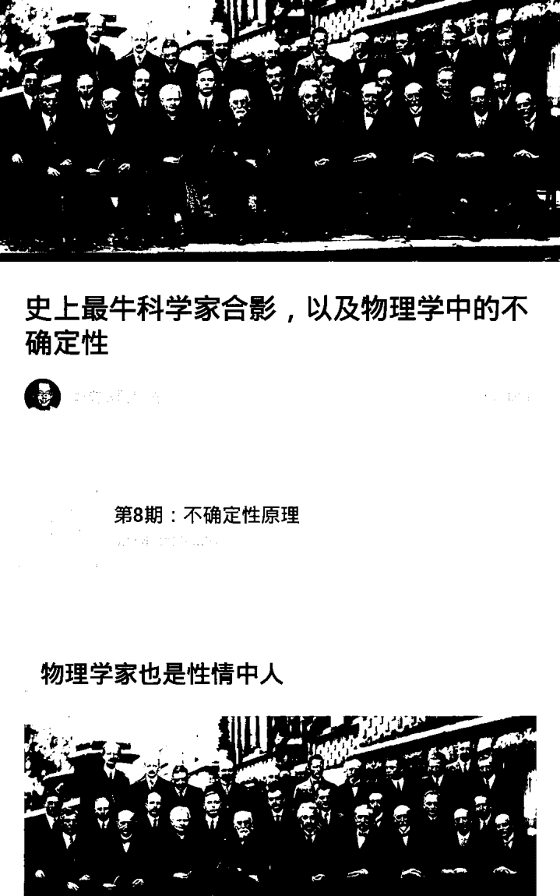

### 史上最牛科学家合影，以及物理学中的不确定性

## 第8期：不确定性原理

### 物理学家也是性情中人

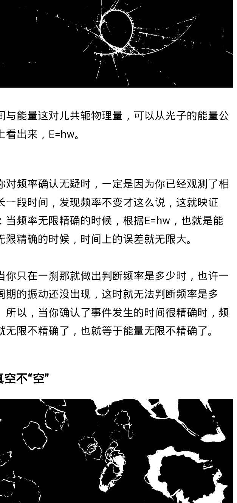

1927年的索尔维会议，参会者29人，17人获诺贝尔奖，其中1人获奖2次，她就是居里夫人。居里夫人在戈夫皮埃尔去世后，曾和物理学家郎之万有过恋情。居里夫人其实是郎之万的师娘，大他4岁多，他们在研究室里相识、相恋，那时居里夫人已经40多岁了。

巴黎媒体曾大肆报道居里夫人和郎之万的恋情，导致他们不得分手，好友爱因斯坦曾经写信给居里夫人声援过她。

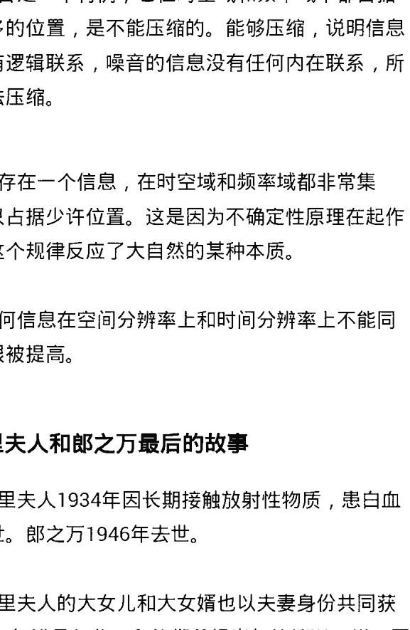

郎之万

爱因斯坦在婚后也曾有过6个女朋友，薛定谔学术生涯最高峰连续6篇论文都是在他搞婚外情的5个月中发表的。

### 位置与动力的不确定性

- 1、速度和位置是一对儿共轭物理量，这两个物理量测量的误差乘积≥狄拉克常数。狄拉克常数是普朗克常数除以2π得到的，普朗克常数是6.62×10^(-34)，单位是焦耳*秒。
- 2、为了保持纲上的一致，速度和位置的不确定性，应该表述为动量和位置的不确定性。
- 3、为了让两个共轭量都测得比较准，应该都取10的负17次方，这是最好的结果。对于位置来说，10的负17次方米相当于氢原子直径的百分之一，是一个很小的单位。
- 4、不确定性原理不是技术门槛，而是理论限制，人类无法突破这个观察极限。

### 时间与能量的不确定性

时间与能量这对儿共轭物理量，可以从光子的能量公式上看出来，E=hω。

当你对频率确认无疑时，一定是因为你已经观测了相当长一段时间，发现频率不变才这么说，这就映射了：当频率无限精确的时候，根据E=hω，也就是能量无限精确的时候，时间上的误差就无限大。

而当你只在一刹那做出判断频率是多少时，也许一个周期的振动还没出现，这时就无法判断频率是多少。所以，当你确认了事件发生的时间很精确时，频率就无限不精确了，也就等于能量无限不精确了。

### 真空不“空”

- 1、时间和能量的不确定性可以推论出：在极短时间里，有出现巨大能量的可能性。
- 2、量子力学的最新中，有一种看法认为，真空中时不时就有巨大能量产生，然后突然消失。
- 3、人们对真空的定义不断发生变化，最开始认为没有空气就是真空，后来发展到没有粒子就是真空

### 新的原子模型

我们高中课本上理解的原子模型是原子核居中、电子围绕在外，但这只是为了让我们好理解才这么讲。

量子力学中的原子模型是概率式的，电子只在能级上以一定概率存在。电子吸收了光子后有一定几率在更高能级发现它，也一样有几率在更低能级发现它。电子在一个很窄能级附近，观察它的几率大也一定程度上反映了时间与能量的不确定性。

### 傅里叶变换

傅里叶变换公式在时空域和频率域中搭建了一座桥梁。所有的函数都可以等效变换成不同频率的三角函数的线性组合。

### 傅里叶变换中的不确定性

- 1、一个在时空域占据很多位置的信息，在频率域中通常只占据很少的空间；一个在频率域中占据很多位置的信息，在时空域通常只占据很少的空间。
- 2、根据上面的结论，我们可以把信息压缩到其他域中，增加传输速度，节约存储空间。
- 3、噪音是一个特例，它在时空域和频率域中都占据相当多的位置，是不能压缩的。能够压缩，说明信息之间有逻辑联系，噪音的信息没有任何内在联系，所以无法压缩。
- 4、不存在一个信息，在时空域和频率域都非常集中，只占据少许位置。这是因不确定性原理在起作用，这个规律反映了大自然的某种本质。
- 5、任何信息在空间分辨率上和时间分辨率上不能同时无限被提高。

### 居里夫人和郎之万最后的故事

- 1、居里夫人1934年因长期接触放射性物质，患白血病去世。郎之万1946年去世。
- 2、居里夫人的大女儿和大女婿也以夫妻身份共同获得1935年诺贝尔奖，和他们爸妈当年的情况一样，历史何其相似。
- 3、居里夫人的孙女竟然因缘巧合嫁给了郎之万的孙子，这段失落的爱情终圆满了。

居里夫人的大女儿和大女婿

## 真实的引力波，和我们印象中的完全不一样

## 第9期：再谈引力波

### 现代科学家对哲学的评价不高

- 1、激进的物理学家对哲学，尤其是科学哲学这一分支颇有微词，比如：

> "从历史上说，无论是宇宙的起源和发展，生命的起源，还是意识的本质，先天与后天的重要性等许多有关自然界的问题，哲学家们很少能给出明确的答案。在注重礼仪的学术圈，一般不会提及这个话题。"

- 2、平和的物理学家对科学哲学的态度是：没有太多用处。

### 量子力学的思考方式是被迫选择的一种务实态度

量子力学的思考方式是在从前物理定律已经失效的精度下，为了可以让所有研究这个内容的人用统一的概念一起讨论，或者争论，以便把发散的想象力和不靠谱的发散性思考能去掉的去掉，剩下的创新性的思考，再经过严格甄选，最后得到的创新性思想就是那个朴素的，只谈观测方法本身，不再做太多延伸、过度解读的思想。

### 万有引力定律是发明，不是发现

"牛顿发现了万有引力"，这句话就默认了一个前提：万有引力是客观存在的，只是从前我们没有意识到它存在而已。而实际上物体并不存在引力属性，在广义相对论中，引力产生的效果又可以用时空扭曲解释，所以应该说牛顿发明了一种新的解释世界的定律，他发明的万有引力。

### 引力波关注的热潮核心并不是引力波

- 1、2016年2月12日引力波首次被证实的关注热潮并没有后续营销号制造的《他五年前就发现了引力波，我们欠他一个道歉》的热潮更火。6月16日人类第二次确认引力波的新闻关注指数只有第一次的不到5%。
- 2、第二次确认的引力波事依然是2个黑洞合并，一个太阳质量14倍，另一个质量是太阳的8倍，合并后形成一个质量是太阳21倍的黑洞，放出0.9个太阳质量的能量，发生在距地球14亿光年的远处，置信度非常高，99.99999%。
- 3、这次还公布了一个疑似事件，也是两个黑洞合并，但是置信度只有63%，所以算不上科学发现。

### 广义相对论场方程

- 1、这是一个和时空度规有关的一个二阶非线性偏微分方程。
- 2、时空度规是是描述了两个点之间的长度和这两个点的坐标之差的关系，在平直空间里，两者相等，非平直空间里需要严格定义度规的形式。
- 3、一阶微分方程简单来说就是：知道物理量的改变随时间变化的规律，要求你求出物理量随时间变化的规律。
- 4、非线性意味着未知数和函数不是一次方关系，2次方或者更高次方。
- 5、微分方程很多都没有通解，相对论场方程几十年来自也没有计算出通解，不过可以通过史瓦西度规等公式化简场方程，得到近似的解。
- 6、方程等号左边代表着空间和时间的曲率，等号右边代表质量和能量的分布，学名叫能量动量张量。

### 探测到的引力波是什么样子

通过光的干涉仪感知空间被扭曲的微小变化。空间一旦扭曲，光的干涉条纹会改变，对应这次事件，就是干涉条纹轻微抖动了1秒钟。

### 为什么发现的事件总是两个黑洞合并？

- 1、在宇宙空间中双星系统和多星系统占比超过50%，数量庞大，而且黑洞密度足够大，合并前一段时间对空间的扰动也足够大。
- 2、目前Ligo也只对这类剧烈的引力波事件敏感。
- 3、今后出现的引力波事件大概率说，还会是黑洞合并。

### Ligo 激光干涉仪升级

- 1、Ligo从1992年动工修建，1999年完工，2001年启动，2010年停止运行，这9年间没有发现任何有价值信号。2010年-2015年进行第一次升级。9月开始第一次试运行，就发现了2个引力波事件。
- 2、升级后的Ligo叫A-Ligo，精度提升20%，2015年9月-2016年1月第一次试运行，2016年7月会第二次开机，做下一次试运行。
- 3、引力波探测一定会被授予诺贝尔奖的，后续诺贝尔物理奖也大都和引力波的观测与应用有关。

### 中国的引力波探测

中国的引力波探测有太极计划和天琴计划，都是独立发展的探测引力波的项目。

详细说说天琴计划。天琴计划将发布3颗卫星上天，前2颗做普通级别的科学实验，第3颗上天后会和前2颗组成几十万公里长的干涉臂，宇宙空间干扰更少，天琴计划精度将大增。

天琴计划牵头人原本是华中科技大学副校长，这个计划最初打算在华中科技大学实施，但后来机缘巧合挪到了中山大学。著名物理学家李菂，也将深度参与天琴计划，所以我们可以期待他源源不断的科普知识。

李菂（中山大学天文与空间科学研究员／校长）

## 中国科技创新大会

今年5月30日的中国科技创新大会从领导人出席的力度看，是40年来之首。

会议要求把科学技术摆在比从前更重要的位置，还要求破除那些靠论文数量考核的不合理要求，不要有外行领导内行的情况，不要浪费科学家的创造力，最后还给所有人布置了一个作业，就是科普。习近平甚至把科普摆在和科技创新并重的地位，这也是国家领导第一次这样重视科普。

## 哲学家一思考，科学家就发笑？

## 第10期：科学与哲学

### 哲学并不高大上

- 1、哲学有很多分支，比如人文哲学、美学、伦理学、艺术学等，和科学相关的叫科学哲学。
- 2、科学可以验证，当验证的人多了，原教旨主义宗教不得不放弃解释世界的功能。
- 3、科学哲学在100年前开始逐渐落后于科学，而宗教则逐渐退缩到心灵慰藉的功能上，不再管理一切、解释一切了。

### 费曼和哲学家聊砖头

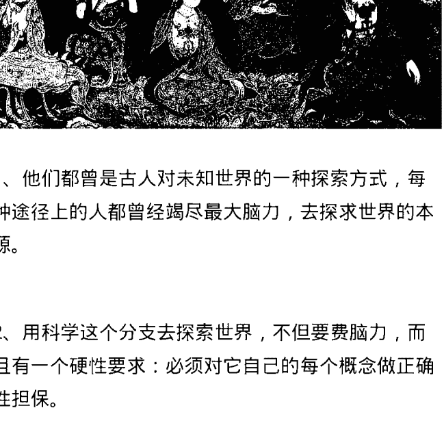

费曼在普林斯顿大学工作期间，午饭时给自己排了个“体验课程”——和每个学科的专家吃两周午餐，每两周换一个领域。

轮到和哲学家们吃午饭时，费曼被他们复杂的词汇说晕了，持续很多天听不懂。

哲学家们邀请费曼参加他们的研讨会。研讨会上关于“本质物体”的定义，哲学家们发生了争论。这时，主持会议的教授让费曼回答：电子算不算本质物体？

费曼反问哲学家们，砖头算不算本质物体？

砖头是真实存在的，但电子并不真实存在。虽然费曼准备了相当充足的逻辑要向哲学家们解释：理论构想中的东西不是实际存在的。但哲学家们已经开始就一个概念模糊的问题争论不休起来。

这个故事中，费曼用一个简单的问题揭示了哲学家的浮夸。

### 电子算不算本质物体

电子云

电子是汤姆森在1897年通过阴极射线管实验发现的。阴极射线管发光，在磁场中偏转，这就是那个年代电子的样子。电子并不是实际存在的物体，而是一种理论。电子理论中的电子并不真实存在，砖头内部理论中的内部也并不真实存在，两者是等同的。

### 如何看待科学、哲学、宗教、艺术

- 1、他们都曾是古人对未知世界的一种探索方式，每种途径上的人都曾经竭尽最大脑力，去探求世界的本源。
- 2、用科学这个分支去探索世界，不但要费脑力，而且有一个硬性要求：必须对它自己的每个概念做正确性担保。
- 3、哲学思考世界，由于没有验证环节，所以才会出现亚里士多德认为女人牙齿数量比男人少这样的明显错误，而不明显的错误和无法验证对错的哲学结论比比皆是。
- 4、科学中任何结论都是经历最严苛的质疑后才被认可的，并且罕见经历150年以上仍没有更新、更替掉的理论，因为科学有不断自我纠错的机制。

### 科学家对哲学的评论

温伯格说：

> “我不需要哲学家指... Weapons how把哲学用于科学研究本身，就像我们不再由物理学家确定科学发现怎么运用到医学上那样，科学规律发现了以后，在技术上的应用是工程师的事儿，科学研究应当由科学家自主进行，不需要哲学家的参与。”

杨振宁说：

> “我认为哲学和物理学的关系是单向的，物理学影响哲学，但哲学从来没有影响过现代物理学。”

马斯克波恩说：

> “我曾努力阅读所有时代的哲学著作，发现了许多有启发性的思想，但是没有朝着更深刻的认识和理解前进。然而，科学使我感到稳步前进，我确信，理论物理学是真正的哲学。”

在科学领域做出成绩的哲学家，都是有双重身份的，他们做出的贡献都是来自于他们数学家、物理学家的身份。

## 承认吧，就算是再牛的品酒行家，也分辨不出红酒的好坏

## 第11期：标准、验证与真伪

### 索克尔事件

索克尔是纽约大学物理学教授，主要研究量子力学，1996年在《社会文本》杂志投稿《跨越边界：通向量子引力的超形式解释学》，这篇文章通篇把物理专业词汇和后现代主义词汇掺杂在一起，大学物理或者数学专业的本科生都能看出是一篇恶作剧，但《社会文本》的编辑没有看出来。

三周后索克尔在《大众语言》上发了另一篇论文，称自己之前在《社会文本》上发的那篇论文是故意胡编乱造的，目的是为了证明此类学科没有学术标准，并对这个刊物提出了尖锐的批评和讽刺。《社会文本》杂志的主编对此事的回应相当无力。

### 中医的“望闻问切”并不准

- 1、2009年，上海中医药大学中医四诊信息综合研究实验室发了一篇论文，证明“望闻问切”诊断一致性差、准确性差。
- 2、参与实验的医生和研究人员均来自正规大医院和研究机构。对同一病例，同一个医生，前后两次的判读，可能完全不一样；同一病例，不同的医生，判读、诊断的一致性就更差。所以，论文得出结论：中医诊断过程中主观描述太多，缺少统一标准。

### 被验证1000多年，中医难道无效吗？

- 1、一个合格的、能判断有效性的双盲实验，条件控制严格且复杂、耗时，不合格的双盲实验做一万次也不能证明其有效性。中医所说的被验证了1000多年，实际上相当于做了1000多年质量极其低下的不合格验证实验。
- 2、张悟本、马悦凌、严新、萧宏慈等养生专家全都把自己形容成中医高手，而这类养生骗子没有一人把自己描述成受过完整现代医学教育的人，这也印证了中医系统因为没有验证环节，容易藏污纳垢。

### 品红酒看上去很美，实际很扯

海洋学家罗伯特·霍奇森退休后自己开了一家酒厂，每年参加当地的红酒比赛，偶尔获奖。但对于能不能获奖的标准，实在是摸不着头脑，于是他决定做一次内部实验。

霍奇森和评选委员会商定，做了一个长达8年的实验，每次比赛随机选几种酒，把它们藏在所有参赛酒中，让人品尝。霍奇森之后重点关注，看看同一种酒被品尝3次后，大家对它的评价是否一致。

每年只有10%的评委可以对同一种酒的3次评价都保持较好的一致性。但这10%的评委只在某一年能做到这一点，到了其他年份，也不能保持对同一种红酒的评价一致性。

霍奇森通过8年研究得出结论：就算是人们眼中品酒的行家，也完全没有能力分辨出葡萄酒的好坏。

另一个实验得出的结论是，葡萄酒的标签效应明显。顶级葡萄酒贴了餐酒的标签后，评价就从口味丰富、均衡、有回味、醇厚，变成负面的淡、轻、平平无奇。只有53%的人可以品尝出低于5英镑和高於10英镑红酒的差别，而完全不品尝、直接扔硬币的正确率是50%。

葡萄酒鉴定中嗅觉和味觉掺杂了太多人文、情感和后天经历的感觉，所以几乎没法标准化。

### 没验证环节就别说自己有效

- 1、普林斯顿大学经济学教授Richard E Quandt设计了一套软件，可以自动生成葡萄酒评价，每段评价看上去和评酒师通常给出的内容“一样荒唐”。
- 2、澳大利亚Monash大学的一位计算机专家编写了一个程序，叫“后现代文本产生器”，可以自动生成后现代主义论文，真假难辨。

发生器地址：
http://www.elsewhere.org/pomo/

- 3、文化、艺术、语言、历史、哲学等领域本就应该丰富多彩、百花齐放。科学家看不惯的是这些领域的人言之凿凿认为自己有效，却又没法验证，看不惯这种浮夸。

木子米德：老板，我们身体可能存在感应引力波的器官么？我们有可能进化出这样的器官么，必须条件会是哪些？

鞠鹏：卓老板，引力波的用途有哪些呢，人们可以用它来制造武器吗？

卓克

> 超感引力波器官只是科幻式乱想

## 怎样踢点球更容易进？

## 第12期：足球场上的科学

### 冰岛人口稀少，足球成绩好

- 1、全国33万人人口中，男子足球适龄人口在1万人左右，中国则是3000万。
- 2、冰岛全年平均气温4℃，2000年前从未大力开展过足球运动，没有职业球员。2005年后冰岛开设了几个室内足球馆，足球人才逐渐培养起来，欧洲杯赛场上的球员全部在其他国家职业队效力。
- 3、冰岛国家队主教练目前仍然是兼职，另一个身份是牙医。

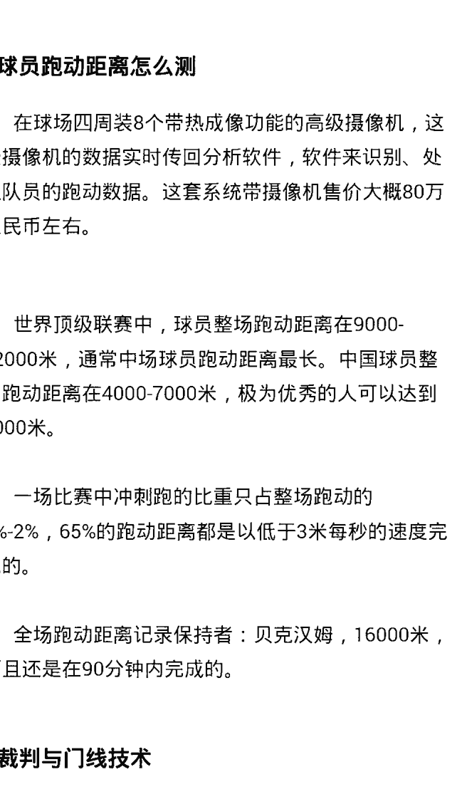

冰岛的两个主教练—— insurance（右）和格雷克（左）

### 点球大战怎么踢

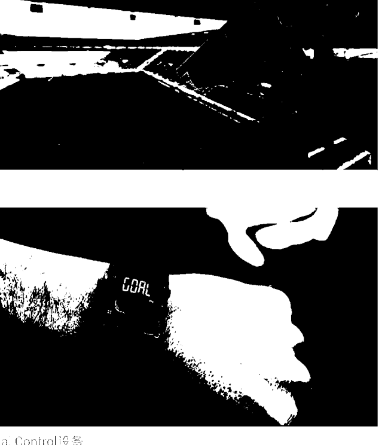

- 1、大力射门时球的飞行时间只有0.34秒，守门员判断出球路的时间至少0.2秒，剩下的0.14秒不足以让他们做出动作接住球，所以守门员扑点球只能靠运气。
- 2、联赛中点球命中率84.6%，扑出率11.6%，射飞率3.8%；杯赛中点球命中率74.6%，扑出率16.6%，射飞率8.8%。
- 3、最容易踢进的位置是球门左右两个底角；最容易被扑出的点球是守门员左侧高球。

### 一张著名的小纸条

- 1、莱曼与卡恩同是2006年世界杯德国队门将，卡恩是从前的主力，但后来被莱曼代替。对阵阿根廷点球大战之前2分钟，两人冰释前嫌。
- 2、德国队守门员教练事先对阿根廷所有球员点球习惯做了详细的统计。在点球大战前，教练递给莱曼一张如何扑点球的小纸条。莱曼完全按照此纸条的提示扑球，4个球的方向全部对，,一个还扑中2个球，4比2淘汰阿根廷。

### 对点球的研究

- 1、根据罚点球球员在射门前髋关节、手臂摆动、头部摆动来预测射门方向，一点都不靠谱。越是职业的守门员，在射门前越会把注意力放在罚球人的支撑腿、摆动腿以及触球那一刻。
- 2、职业门将VS体育大学学生，职业门将注视支撑腿、摆动腿、触球一刻的时间是体育大学学生的3.5倍。对最终射门方向判断上，职业门将正确率91%，体育大学学生为40%。
- 3、在已知自己很弱的情况下，如果是右脚球员，应该把60%的球射向自己左侧，40%的球射向自己右侧；如果是左脚球员，反之。

### 球员跑动距离怎么测

- 1、在球场四周装8个带热成像功能的高级摄像机，这些摄像机的数 据实时传回分析软件，软件可以识别、处理队员的跑动数据。这套系统带摄像机售价大概80万人民币左右。
- 2、世界顶级联赛中，球员整场跑动距离在9000-12000米，通常中场球员跑动距离最长。中国球员整场跑动距离在4000-7000米，极为优秀的人可以达到9000米。
- 3、一场比赛中冲刺跑的比重只占整场跑动的1%-2%，65%的跑动距离都是以低于3米每秒的速度完成的。
- 4、全场跑动距离记录保持者：贝克汉姆，16000米，而且还是在90分钟内完成的。

### 裁判与门线技术

- 1、之前的足球比赛，没有底线裁判。两个边裁每人只负责半场地，互相对面；主裁判跑位是全场斜对角方向，目的是为了面向边裁，可以看到边裁判越位的判罚。
- 2、2010年世界杯英德大战，兰帕德的射门，皮球进入门框后弹出被裁判，引发了底线裁判的诞生。底线裁判出现不久后，又出现了门线技术。
- 3、门线技术分3种：
  - 最牛的是Goal Control，由高速摄影机严密监控进球的状态，速度是每秒500次，空间上的分辨率是5mm，蚊丝马迹都不放过。一旦进球，就马上在裁判的手表上进行提示，裁判马上就能判断；
  - 第二种是鹰眼技术，也由高速摄影机完成，但判罚时需要中断比赛；
  - 第三种是Cairos系统，由阿迪达斯参与研发，需要在足球内部安装传感器，同时要在球门两侧附近信号发生器，比较频率，而且在U17比赛中实验效果不好，没有推广开来。
- 4、边裁手中的边旗现在有按钮，按下会发射信号到主裁判的手表上，震动提示主裁判越位等信息。

Goal Control提示

### 普通人和职业水平相差很远

- 1、普通人射点球，职业门将守门，几乎不可能进球。虽然球速也许可以达到要求，但身体暴露的信息太多，提示了门将射门角度。
- 2、围棋中的业余七段和职业七段下100局，连1局都不会赢，即便业余七段的围棋水平已经超过了全人类99.9999%的围棋手。
- 3、普通人面对职业搏击手，劣势也很明显。柳海龙赤手空拳PK二十来个手持凶器的黑社会流氓，最终结果柳海龙轻伤，对方1人死亡，6人重伤，5人轻伤。

## 我问卓老板——国内信中医的人有多少？

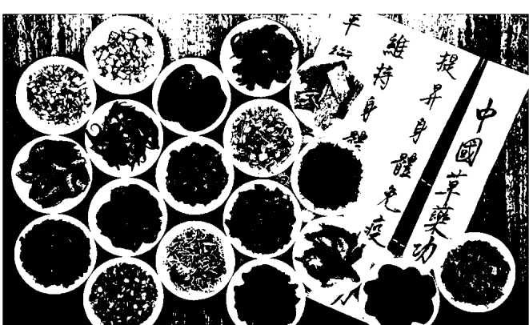

淡肥：最后一句三观端正！卓老板的节目越来越棒了！另外，卓老板估计一下，在国内，相信中医理论人的比例是多大？

问题来自“得到”订阅产品《卓老板聊科技》第11期“承认吧，就算是再牛的品酒行家，它分辨不出红酒的好坏”

卓克

## 现在已有反对中医的声音存在

## 精选留言

卓克
4
如果听过这些节目还认为中医理论是科学，那真是少数中的少数了
07-06 12:59:43

木容
1
信中医的人和绝对否定中医的人群，是两类人。信这个字的界定太模糊
07-06 12:01:25

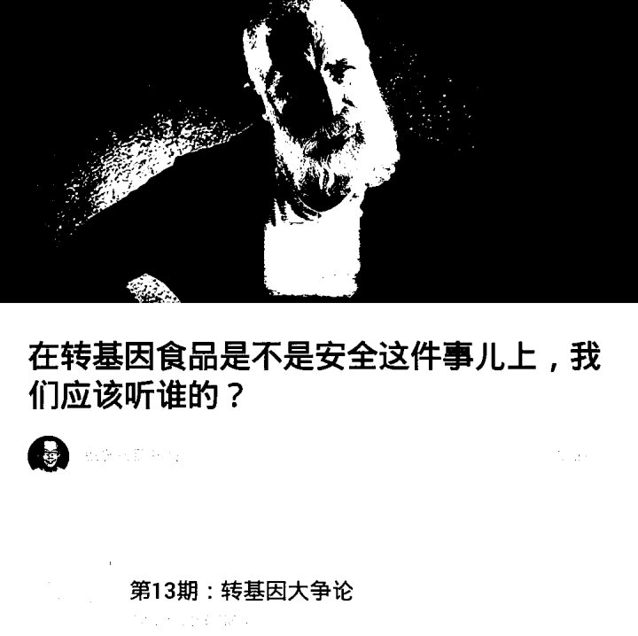

## 在转基因食品是不是安全这件事儿上，我们应该听谁的？

第13期：转基因大争论

## 百位诺贝尔奖得主联合署名支持转基因

百位诺贝尔奖得主联合署名公开信，呼吁绿色和平组织停止反转基因，呼吁支持黄金大米的研究和推广。

这百位诺贝尔奖得主包括生理学（41位）、化学（33位）、物理学（24位）、经济学(8位)、和平（1位）、文学（1位）。此外还有1150名著名科学家也参与了签名。

绿色和平组织极力反对黄金大米。黄金大米是转基因作物，可以产生β胡萝卜素，补充人体维生素A，对贫困地区儿童的夜盲症、失明等眼疾有很大帮助。

全球有2.5亿人因缺乏维生素A患上各种疾病，40%的亚洲国家儿童有此类问题，每年导致100多万人死亡，20万-50万人失明。

## 绿色和平组织是什么

- 1、绿色和平组织是一个1971年成立的非营利性组织，主要职责是保护地球环境，促进生态可持续发展。
- 2、绿色和平组织在普及环保意识、促进大企业环境责任感上做过很大贡献，但最近10年 他们对转基因农业、核电、水电一律反对，更像是反科学、反技术的代表。
- 3、绿色和平组织抗议的手段从和平变为暴力，毁坏农田、放火、闹核电站、破坏治安已经是常见手段。绿色和平组织已遭到主流科学界的厌恶。

## 黄金大米补维生素A值不值

- 1、维生素A可以通过补充剂获得，但每人每年0.25美元，仅解决印度一国的维生素A问题，每年就需要750万美元，解决全球维生素A问题，每年需要6500万美元。
- 2、黄金大米研发过程，从2000年-2007年总共花费930万美元。
- 3、绿色和平组织每年活动经费是1.9亿美元，其中用于反转基因的费用是690万美元。
- 4、从这三组数据就能看出，黄金大米是解决维生素A缺乏症的最廉价的方法，而绿色和平组织只是在浪费钱做反转基因运动。

## 崔永元误解了黄金大米的来源

- 1、崔永元在复旦大学反转基因演讲中言之凿凿地说，黄金大米转了7个基因。这是错误的。
- 2、真实的情况是，第二代黄金大米转入3个基因，第一代黄金大米转入2个基因。

## 绿色和平组织对黄金大米案大作文章

- 1、黄金大米转入了两个基因后，水稻可以产生β胡萝卜素，这种物质在人体小肠内会变为维生素A，能解决全球贫困地区广泛缺乏维生素A的问题。
- 2、2008年，美国塔夫茨大学的汤光文副教授在湖南省衡南县江口镇中心小学做了黄金大米的营养效果实验，2012年发表了相关论文，国际水稻研究所对这份实验的结论评价很积极。随后汤光文的研究被发现在伦理审批过程上有严重问题，最终于是2015年8月被撤稿。
- 3、绿色和平组织抓住黄金大米案的伦理审批违规部分，否定转基因技术，把公共注意力引向伦理道德，丑化转基因，让人们误解吃了转基因会对后代产生不利影响。

## 我们应该怎么对待转基因

- 1、相信科学家，尤其是生物学家和农业学家；相信科学共同体的主流观点，包括各国农业部，各国食品安全部门，农业研究机构等。
- 2、让专业的人代理我们的投票权，否则容易出现乌合之众下的多数人暴政，英国脱欧就是一个典型的例子。
- 3、转基因的概念中包含很多专业知识，如果你不懂，也没有时间去了解，那么相信科学共同体的观点，比相信绿色和平组织的观点要稳妥多了。绿色和平组织在这一方面是科学的倒退。

## 我问卓老板——美容保健水真能美容吗？

周周：对了，卓老板，我想请教您一个问题，现在流行喝水素水，日本的水素杯超好卖的，说可以去除自由基，真的那么有效吗？作为女生，美容是毕生事业，您可不可以做一期关于怎样有效去除自由基的科普呀。先谢谢啦。

问题来自“得到”订阅产品《卓老板聊科技》第2期“人们眼中的世界为什么不一样”

卓克

## 美容保健水几乎都是噱头

## 木星到底是个什么样的星球，又是如何在保护着地球

第14期：木星探险

## NASA 习惯在美国国庆日搞“大新闻”

- 1、木星探测器朱诺（Juno）在2016年7月4日（美国独立日）进入木星轨道，经历了59个月飞行，只比预定时间晚了1秒。木星距离地球遥远，光信号就要走48分钟。
- 2、NASA是有情怀的宇航局，在朱诺上带了4件与科学仪器无关的物品，其中有来自意大利航空航天局赠送的伽利略手稿复制品，还有3个玩偶。从玩偶的名字我们知道，朱诺其实是木星（朱庇特）妻子的名字。
- 3、第一个火星探测器—探路者号在1997年7月4日登陆火星；2005年深度撞击号也是在7月4日用300公斤铜弹头撞击到彗星的。

## 探测木星主要危险来自于辐射

- 1、10000电子伏特的质子就足以让硅晶体中产生60多个点缺陷，而木星的辐射强度有2000万电子伏特。朱诺在木星的高强度辐射下，如果不做特殊防护会损害电子设备，让它们在很短时间内失效。
- 2、NASA为朱诺安装了一个钛合金的保护罩来保护关键仪器设备。钛合金保护罩可以把辐射危害降低为暴露状态下的八百分之一，但是因为重量达到180公斤，所以发射成本就平添了1亿美元。
- 3、由于辐射强度大，NASA预估在最坏的情况下，红外分光仪在今年12月报废，微波辐射计在明年1月份报废，朱诺上面唯一一台可见光摄像机也会随着任务时间越来越长，拍出的画质噪点越来越多，最后完全失效。
- 4、太空探索中超期服役的例子有许多，比如火星探测器机遇号，设计寿命3个月，但工作了11年；开普勒望远镜设计寿命3.5年，但工作了7.5年；哈勃望远镜设计寿命10年，但工作了26年；中国的嫦娥和玉兔探测器也都在超期服役。唯独木星探测器例外。

## 朱诺探测器的高速是怎么达成的

- 1、朱诺重3.6吨，其中液体燃料重2.0吨，这些燃料可供探测器改变2000m/s的速度。
- 2、朱诺能有这么快的速度，有一半是在火箭发射时获得的动力，还有一部分是受益于地球的引力弹弓，地球的引力加速可以贡献7100m/s的动能。

## 人类过去对木星的探测

- 1、伽利略号探测器是1989年发射、1995年到达木星的第一个探测器，它是70年代末规划的方案。在那年花费4亿美元打造探测器，成本巨大，它工作了22个月共传回照片3.6GB。
- 2、伽利略号的处理中心是一台和苹果II性能一样的电脑，现在的性能还赶不上一个300块钱的山寨手机。
- 3、伽利略号最终的命运还是在还有燃料的时候主动选择坠毁在木星大气层里，因为如果燃料耗尽，它最终会撞向木卫二，而木卫二是一颗很可能拥有生命的星体。
- 4、全世界在1967年达成了外太空条约，其中规定任何外太空探索活动，都必须尽可能避免出现生物污染，而伽利略号在出发前没有经过消毒，所以只能最终坠落木星。

## 朱诺探测器听到木星的声音

朱诺距离木星轨道还有10多天飞行距离时，就遇到了一次木星磁场和太阳风激烈碰撞，这个家伙叫做弓形激波，这就相当于，太阳风吹过木星前突然撞到了一堵由木星磁场形成的大墙。而这时距离木星还有6000万公里，巧的是朱诺还把这种剧烈的撞击记录了下来两段，第一段是朱诺飞入木星磁层顶部后的声音，第二段是朱诺遇到了太阳风撞击木星磁场的声音，可以听到很明显地像爆炸一样。音频中的这一段不要错过啊。

## 木星为什么那么大

- 1、木星的质量是地球的318倍，太阳系内除木星外其他行星质量的总和是地球的132倍，所以木星几乎占据了整个太阳系行星质量的71%。
- 2、木星是一个气态行星，它的大气层没有明确界限，深入大气层1000公里后气体就逐渐消失，取而代之的是液态氢，深入1万公里深度后就会遇见液态金属氢，这也是一种液态氢，只不过因为压力太大，所以电子都游离到原子子之外。深入7万公里后就会遇到木星核心，这里都是重元素，是一些真正的金属元素。
- 3、木星的形成被怀疑是从一个很重的核心发展起来，逐渐吸收周围气体，逐渐长到现在这么大，它吸收的气体总质量甚至超过原本自己的质量。

## 如何体会宇宙中质量的存在？

- 1、把地球掰开两半，实际上只会在行星地表出现一些惊世骇俗的景象，而如果在宇宙空间里望向地球，则几乎没有什么显著的变化，两个半球还只会仅仅贴合在一起，一起公转。
- 2、对于一个气体巨行星来说，木星在宇宙中存在的模式，感官上就是一团凝聚在一起的气体，而且都向中心压迫，永远也难以分开。

## 你看到的流星有多大？

- 1、绝大多数划过夜空的流星，质量都低于0.1克，超过1000克的物质在坠入地球大气层的过程中都不会燃烧殆尽。
- 2、一个几百米尺寸的陨石砸向地球，对生物圈都是一次灭顶之灾。
- 3、木星因为质量巨大，吸引了绝大多数彗星和陨石撞击到上面，地球从N多次幸免于难。而且木星因为距离地球较远，也不会把地球上和生命息息相关的物质卷走。

## 我问卓老板——“卓老板聊科技”会出儿童版吗？

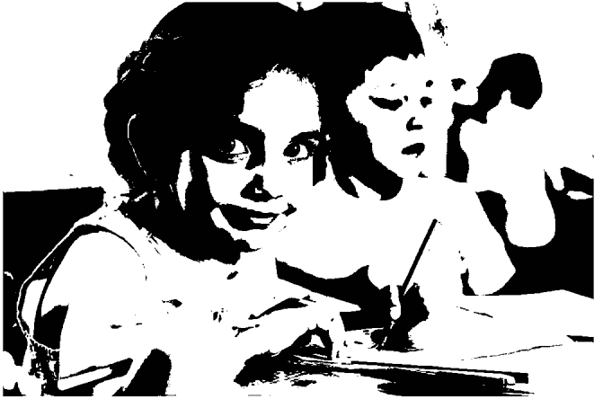

兔兔：建议你出个“小卓卓”的青少年科普节目，能让10岁的孩子听懂。这要求讲述者有极高的同理心及表达力，化烦至简。目前的主流儿童科普，受众是6岁以下幼儿，这些节目语气稚嫩，知识碎片断裂，没有全景串讲的能力以及平等讨论的语境。如果你有推荐的节目，也请告知。多谢！

问题来自“得到”订阅产品《卓老板聊科技》第5期“奇臭无比的黑暗料理，能吃吗？”。

卓克

家长是少儿最好的科普老师

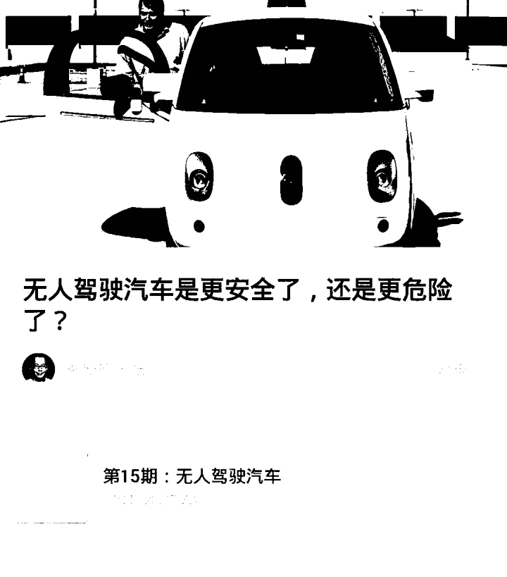

## 无人驾驶汽车是更安全了，还是更危险了？

第15期：无人驾驶汽车

## 特斯拉发生自动驾驶致死案

- 1、第一起与特斯拉自动驾驶功能有关的致命交通事故被曝光。事件发生在半封闭高速公路上，驾驶员和特斯拉的自动驾驶功能没有发现一辆冲过来的拖挂车，导致发生撞击。
- 2、特斯拉解释，这只是一次意外。从大数据来看，传统驾驶1.5亿公里发生一次致死交通事故，特斯拉行驶2.1亿公里才出现一次，所以还是更安全的。马斯克还认为，特斯拉自动驾驶中司机应该随时准备接管车辆，一旦车辆发生交通事故，应该由司机承担全责。
- 3、特斯拉的传感器供应商Mobileye对此有不同解释，他们认为现在特斯拉还不具备判断能力，这不是意外，以后还会发生事故。

## 特斯拉事故分析

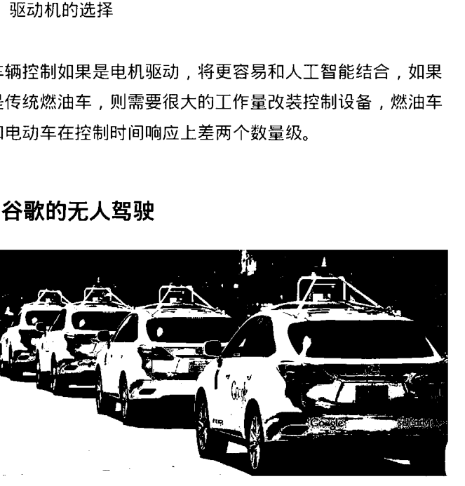

- 1、特斯拉车里一共有14个传感器，其中12个是超声波传感器，只能探测车身距离5米的障碍物，还有一个Mobileye Q3 高清摄像头，和一个前格栅的毫米波雷达，雷达可以探测150米距离的前方障碍物。
- 2、当18轮大卡车横跨路中央时，毫米波雷达有可能因为各个方向车道都有障碍物，所以没有识别出车辆，也有可能是因为雷达的垂直扫描角度小，雷达直接从拖挂车下面的空间穿过，最终判断为没有障碍物，造成车祸发生。

## 谷歌无人驾驶汽车分析

- 1、谷歌无人驾驶汽车的传感器十分昂贵，它的激光成像雷达价格高达50万人币，能360°扫描全景。
- 2、谷歌无人驾驶汽车的惯性导航仪价格也为50万人民币，可以在GPS信号丢失的情况下继续测算车辆位置，可以在持续20分钟无GPS信号的情况下驾驶，20分钟内积累的总位置误差不超过0.5米。

## 自动驾驶需要解决的N个问题

- 怎么到达目的地？

路径选择采用人工势场算法，把出发地和目的地设置为引力，中间的障碍物设置为斥力，算法会生成一条光滑曲线。但这个算法会遇到局部最优解问题，当障碍物和目的地距离过近时会导致车辆永远无法到达目的地，这需要对算法中的函数再改进。

- 要具有一定的鲁棒性

当识别交通标志、车道线、红绿灯出错或者模糊时，车辆做出的决策依然可以让车辆安全行驶。

- 图像识别技术

图像识别技术在自动驾驶中非常关键，它可以把车辆传感器形成的3D街景图中的静物和动物区分开，并自动识别关键物体。

- 足够多的素材

谷歌本身就具有足够多的素材，还会发动用户在登陆账号过程中帮他们验证一些图片识别的结果，所以谷歌是对自身大数据来源利用最好的公司。

- 时间与精度的抉择

因为在驾驶中，对很多物体需要在短时间判断出结果，所以要牺牲一些精度。

- 驱动机的选择

车辆控制如果是电机驱动，将更容易和人工智能结合，如果是传统燃油车，则需要很大的工作量改装控制设备，燃油车和电动车在控制时间响应上差两个数量级。

## 谷歌的无人驾驶

- 1、目前谷歌一共有55辆无人驾驶车在进行上路测试，它们的目的是积累驾驶数据，回去喂给谷歌的数据中心，让算法学会如何驾驶汽车。机器学习的效率会比人快很多，提升的幅度也许在几十倍这个量级。
- 2、谷歌无人驾驶汽车一共出过12次事故，其中1次是自己的全责，剩下来的11次都是对方车辆全责。在为期两个月的实际道路测试中，需要人为接管车辆的次数是13次，还有272次软、硬件故障。谷歌的统计是，无人驾驶车辆每9600公里出现一次交通事故，远远高于目前美国人为驾驶车辆的8万公里出现一起事故的水平，所以无人驾驶还有相当久的路要走。
- 3、自动驾驶方面，对比特斯拉，谷歌更先进，因为它收集和处理数据都是目前明确的人工智能应用。特斯拉收集的数据比较简陋。

## 我问卓老板——追欧洲杯的激情是什么？

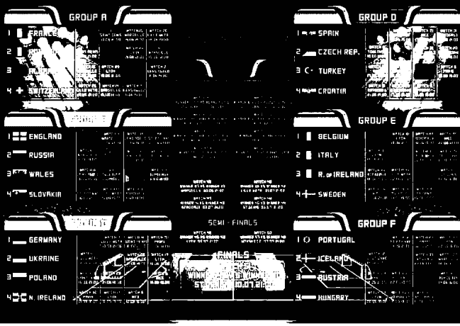

荣誉之剑：86年世界杯开始看球，马拉多纳、卡尼吉亚、戈耶切亚，法国的铁三角、荷兰的三剑客、意大利的混凝土防守、英格兰的长传冲吊……这些东西和中学时背的元素周期表一样即使喝大了也能张嘴就来。

现在球看的少了，球星也只知道梅西和C罗。听了这期节目，又点燃了看球的激情，一定把后三场都看了。

另外，我猜冠军是德国。

问题来自“得到”订阅产品《卓老板聊科技》第12期“怎样踢点球更轻松？”。

卓克

## 欧洲杯重燃激情

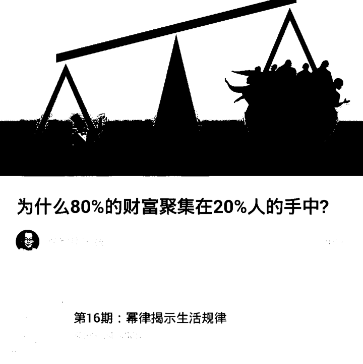

## 为什么80%的财富聚集在20%人的手中？

第16期：幂律揭示生活规律

## 泊松分布下的差异

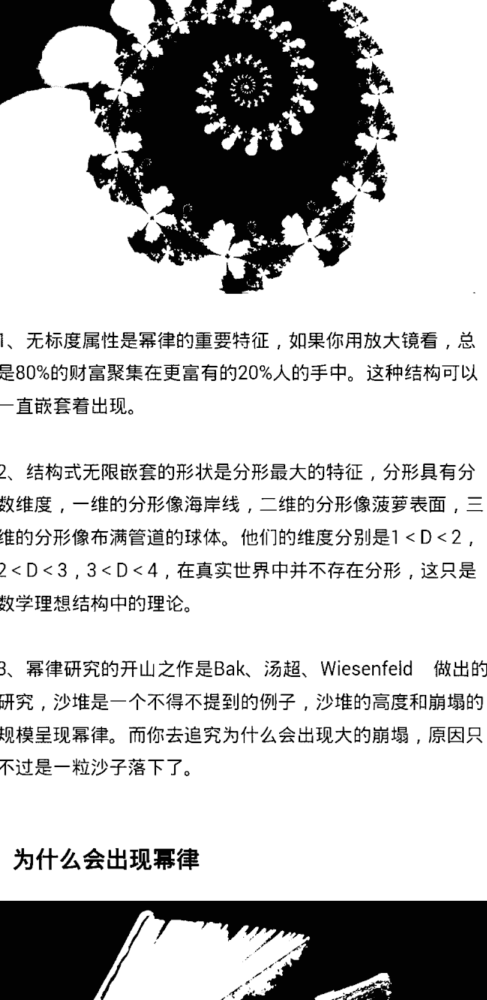

- 1、世界上最高的人2.72米，222公斤，22岁去世，他的身高是因为脑垂体肿瘤造成的。激素分泌正常的人最高的是内蒙古的鲍喜顺，2.36米，今年65岁。世界上最矮的人身高55cm，体重12公斤，2015年9月份去世，终年75岁。人类在身海上差异近5倍，体重上差异18.5倍。但是并不很大的差异，因为它属于泊松分布。
- 2、泊松分布的形状类似倒扣的钟，是离散数据的一种分布类型。对应泊松分布的连续类型叫正态分布，当泊松分布的样本超过15个以后可以用正态分布的计算方法对泊松分布进行估值。

## 幂律分布无处不在

- 1、各国GDP分布属于幂律分布，美国17.4万亿排第一，图鲁瓦3800万美元排倒数第一，差距46万倍，远远高于泊松分布下可以体现出来的差异。个人年收入与人数也是幂律分布。
- 2、幂律分布的图形是一个Y=K*X^(-β)的图像，β大于零，有一条长长的尾巴。
- 3、可以在莎士比亚的作品中找到词和词频之间的幂律关系，20%的词用掉了80%的篇幅。这就是经常说的2-8定律，这个定律只是近似的标示分配的不平均，而并不是定量的分析。

## 幂律和分形

- 1、无标度属性是幂律的重要特征，如果你用放大镜看，总是有80%的财富聚集在更富有的20%人的手中。这种结构可以一直嵌套着出现。
- 2、结构式无限嵌套的形状是分形最大的特征，分形具有分数维度，一维的分形像海岸线，二维的分形像菠萝表面，三维的分形像布满管道的球体。他们的维度分别是1<D<2，2<D<3，3<D<4，在真实世界中并不存在分形，这只是数学理想结构中的理论。
- 3、幂律研究的开山之作是Bak、汤超、Wiesenfeld 做出的研究，沙堆是一个不得不提到的例子，沙堆的高度和崩塌的规模呈现幂律。而你去追究为什么会出现大的崩塌，原因只不过是一粒沙子落下了。

## 为什么会出现幂律

- 1、样本间相互不独立是幂律生成的重要条件。
- 2、莎士比亚作品英文原著的分析发现存在幂律，但如果分析中文翻译版中以字为单位去研究，幂律就消失了，只有把翻译版中的词做研究单位幂律才会重新出现。
- 3、词能出现幂律是因为有语法结构把词联系在一起，而字的联系却没有这么紧密。
- 4、现代文学作品中以词为单位统计词频会出现幂律，以字为单位统计字频不会出现幂律，先秦文学作品中以字为单位统计字频会出现幂律，原因在于古汉语中一个字就代表一个词的现象很普遍。

## 如何理解幂律在生活中的规律

- 1、罐头进货，如果按每月平均数进货会经常造成积压或者不足，因为买金枪鱼罐头这件事在老小区中并不是完全独立，每个 Ağ人吃罐头的概率也不稳定，所以会呈现幂律分布的特征，而平均数只能反映泊松分布的性质。
- 2、超市中的盐和糖的需求量满足泊松分布，因为消耗它们的概率稳定，购买它们的决定几乎不受外界影响。
- 3、互联网运营用户的关键是持续让人与人之间增加互相影响，而不是做一些非常态化的突击。

# 我问卓老板——哪些虚拟货币值得投资？

ml66901982:关于虚拟货币，现在有很多。我身边有许多朋友买雷达币和珍宝币，说什么技术达到比特币而且高于比特币的水平，购买方式是直销形式的，特别是珍宝币几乎都是老年人买，希望您给讲讲。

问题来自“得到”订阅产品《卓老板聊科技》第14期“木星到底是个什么样的星球，又是如何在保护着地球”。

卓克

## 虚拟货币，只能选比特币

## 我问卓老板——风力发电怎么产生电能？

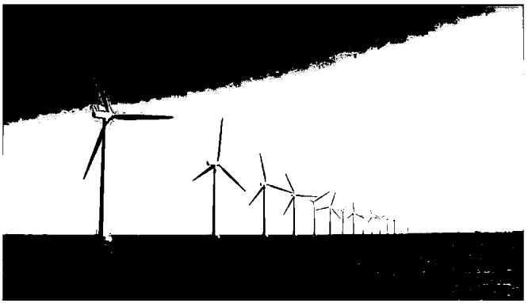

异乡人：卓老板，风能是怎么转化成电能的？今天出去玩儿看着那么巨大的风力发电机觉得太有意思了。

问题来自“得到”订阅产品《卓老板聊科技》第13期“转基因食品是不是安全这件事儿上，我们应该听谁的？”。

卓克

## 清洁能源的更多可能

## 精准的判断，离不开精准的概率计算

第17期：生活中的贝叶斯定理

## 最长寿的人

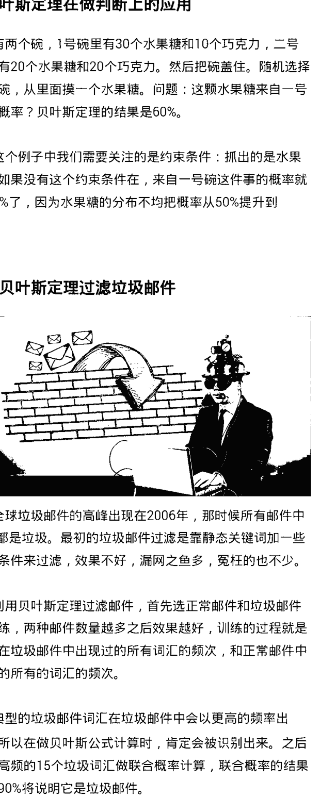

让娜·卡尔蒙特1875年出生，90岁时把唯一的财产(房子)卖给了律师拉夫雷，交换条件是律师支付她去世前的抚养费，每月2500法郎。让娜120岁时，年仅47岁的律师因为癌症去世，始终没有住上让娜的房子。最终，让娜在122岁时去世，成为世界上最长寿的人。

## 初识贝叶斯定理

这是一种利用过往信息逐渐逼近事件发生概率的思考方式，与频率主义截然不同。

## 在肝癌检测上的应用

- 1、肝癌诊断有一个重要的判断指标是人体内甲胎蛋白质量的多少。这种甲胎蛋白只在胎儿时期产生，一岁时下降到峰值的二十万分之一，大约20微克/升血浆。肝癌患者却会重新产生甲胎蛋白，血浆中含量会升到300-1000微克/升。
- 2、但还有15%的肝癌患者直到临终，甲胎蛋白质指标都和正常人一样，这就会让这种本来很好的检验出现不少偏差，但好在我们还有其他方法判断肝癌。
- 3、假阴性的意思是本来有病应该显现阳性，但呈现了阴性，假阳性的概念与之对应。用甲胎蛋白法检测，假阴性概率99%，假阳性概率99.9%，人群中肝癌发病率万分之四，应用贝叶斯定理可知，一个人在检测为肝癌阳性时，实际发生肝癌的概率是28.6%。

## 在艾滋病检测上的应用

- 1、艾滋病检测的假阳性和假阴性假如都是0.1%的水平，艾滋病发病率是万分之一的话，某次检测结果是阳性，应用贝叶斯定理，那么被测人真正被感染艾滋病的概率是49.98%。
- 2、对这种初次检测准确率较低的方法，只需要做第二次检测就可以大幅度提升判断，这也是为什么艾滋病检测第一次呈阳性的人，还需要做第二次检测，第二次依然是阳性的还需要送交国家实验室做第三次检测。

## 贝叶斯定理在做判断上的应用

- 1、有两个碗，1号碗里有30个水果糖和10个巧克力，二号碗里有20个水果糖和20个巧克力。然后把碗盖住。随机选择一个碗，从里面摸一个水果糖。问题：这颗水果糖来自一号碗的概率？贝叶斯定理的结果是60%。
- 2、这个例子中我们需要关注的是约束条件：抓出的是水果糖。如果没有这个约束条件在，来自一号碗这件事的概率就是50%了，因为水果糖的分布不均把概率从50%提升到60%。

## 用贝叶斯定理过滤垃圾邮件

- 1、全球垃圾邮件的高峰出现在2006年，那时候所有邮件中90%都是垃圾。最初的垃圾邮件过滤是靠静态关键字加一些判断条件来过滤，效果不好，漏网之鱼多，冤枉的也不少。
- 2、利用贝叶斯定理过滤邮件，首先选正常邮件和垃圾邮件做 training，两种邮件数量越多之后效果越好， training 的过程就是统计在垃圾邮件中出现过的所有词汇的频次，和正常邮件中出现的所有词汇的频次。
- 3、典型的垃圾邮件词汇在垃圾邮件中会以更高的频率出现，所以在做贝叶斯公式计算时，肯定会被识别出来。之后用最高频的15个垃圾词汇做联合概率计算，联合概率的结果超过90%将说明它是垃圾邮件。
- 4、用贝叶斯过滤器可以识别很多改写过的垃圾邮件，而且错判率非常低。甚至不要要求初始值有多精确，精度会在随后计算中逐渐逼近真实情况。

## 贝叶斯定理是另一种世界观

- 1、心怀贝叶斯定理的人，并不试图刻画这类事件本身，而是从观察者角度出发，甚至也不去假设哪类事件是随机的，或者有一个逼近极限的总体概率。而只是先从以往经验中总结一个大致结果，再在这个结果上判断下次出现这类事件的概率，每次的结果会不断修正之前的判断，不断重复。
- 2、它反应的是我们知识状态的情况，而并不试图描述有那么一个客观世界，那个客观世界中什么事情发生的概率有多少。
- 3、科学中的一些结论反直觉是很正常的。人类基因里可以给予我们的直觉，只能指导我们如何觅食，躲避天敌，在危险的世界活下来。而一旦涉及到科学范畴，那些原始的直觉就不起作用了，想用科学的思维分析周遭，就要摒弃固有的直觉，不断通过理解与学习建立新的直觉。

## 我问卓老板——你怎么就敢推荐比特币？

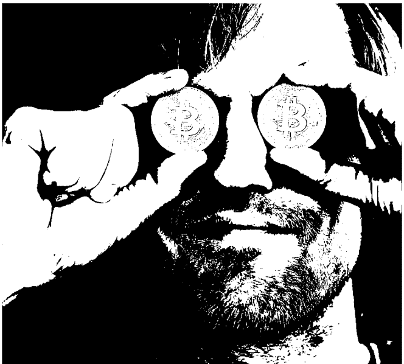

王不为：卓老板，面临“赚了没你什么事，赔了骂你全家”的风险，你确信要推荐比特币？听众不给咨询费，你敢就这么推荐币种了？（偷笑）

问题来自“得到”订阅产品《卓老板聊科技》“我问卓老板——哪些虚拟货币值得没投资？”

卓克

## 世界观与币种选择

## 大科学家薛定谔是情圣？！

第18期：薛定谔的成就与情史

## 大名鼎鼎的薛定谔

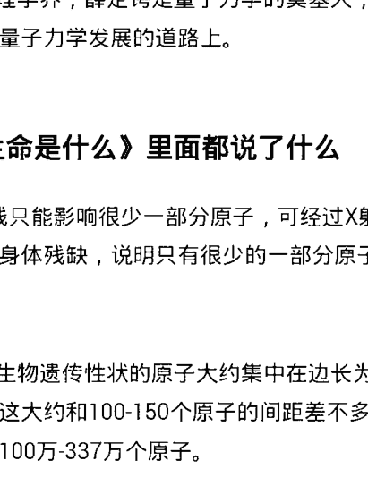

1.关于薛定谔，文科生知道“薛定谔的猫”，理科生知道“薛定谔方程”，科学史学家知道他是情圣，生物学家知道他的科普书《生命是什么》。
2.在物理学界，薛定谔是量子力学的奠基人，但随后又走向了反对量子力学发展的道路上。

## 《生命是什么》里面都说了什么

1.X射线只能影响很少一部分原子，可经过X射线照射的果蝇会出现身体残缺，说明只有很少的一部分原子决定了生物的形状。
2.决定生物遗传性状的原子大约集中在边长为300埃的立方体里，这大约和100-150个原子的间距差不多，这个立方体里拥有100万-337万个原子。
3.100万-337万个原子松散地聚集在一起，因为热运动的涨落很难维持固定形态，而生物的形状却是稳定的，所以这些原子一定通过一种特殊的结构，让自己稳定下来，不会因为原子热运动的涨落而失去稳定性。
4.物理定律中根号n定律说的是一个系统中微小粒子如果有n，那么去统计n的数目时，大致会出现根号n数量级的误差，对于百万个原子数量级的结构，根号n的结果是误差为千分之一，这个误差对维持生命体稳定的性状是完全不够用的。
5.熵是生命体生存的关键，生命体新陈代谢的不是物质也不是能量而是吸收负熵。耗散结构可以提供吸收负熵的能力。

## 量子力学的发展使分子生物学诞生

1.1940年以前的生物学主要研究植物的性状、分类，重要理论只有达尔文的进化论，整个学科还没有定量描述的系统。
2.薛定谔的《生命是什么》演讲出版后，在卡文迪许实验室搞基本粒子的克里克决定改研究生物，最终用X射线衍射图像分析出DNA双螺旋结构，是这个结构保证了遗传性状的稳定。从此生物学和物理学紧密结合，有了一套系统的理论支撑。

## 薛定谔一生的情史

薛定谔（左）在都柏林

1.薛定谔25岁时追求邻家15岁的小妹妹，被邻家阿姨拒绝，想弃学从商，被爸爸喝止。
2.与邻家小妹分手几个月后遇到安妮，安妮和他一见钟情，6年后订婚。
3.婚后只有1年多时间，薛定谔的感情生活是比较稳定的，主要因为这段日子奥地利国内经济崩溃，生活极为困难。搬家到瑞士苏黎世后，学术圈男女关系混乱习以为常，薛定谔绯闻不断，安妮也搞起婚外恋。
4.1925年底到1926年初是薛定谔的“奇迹年”，这5个月的时间他常和老情人幽会，但也是在这5个月，他发表了完整描述波动力学的论文，也写下了薛定谔方程，这对39岁的年龄来说不可思议。
5.后来薛定谔给妻子朋友的女儿辅导数学功课时，爱上了这个年仅14岁的姑娘，并且在17岁时发生性关系，20岁导致对方怀孕不得不流产。
6.1929年，薛定谔回奥地利演讲，住在因斯布鲁克大学一位物理学家的家中，又爱上了别人的妻子，并且追求到手。
7.二战开打后，薛定谔带着妻子和情人、私生女逃往都柏林，四个人在一起生活。在都柏林期间，他又先后和当地两位女性生下私生女。
8.60岁后，薛定谔情史终于结束，和安妮互相谅解，厮守一生。

## 我问卓老板--经济学算科学吗？

derekxue:卓老板聊聊经济学是不是科学吧？

问题来自“得到”订阅产品《卓老板聊科技》第16期“为什么80%的财富聚集在20+ 人的手中？”。

卓克

## 经济学与科学

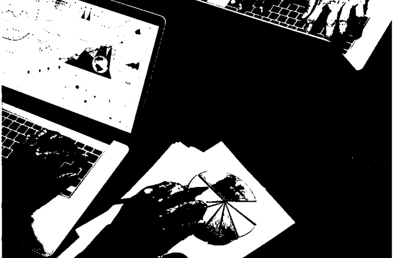

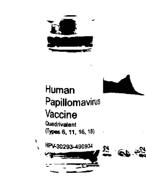

## 我问卓老板——HPV疫苗管用吗？

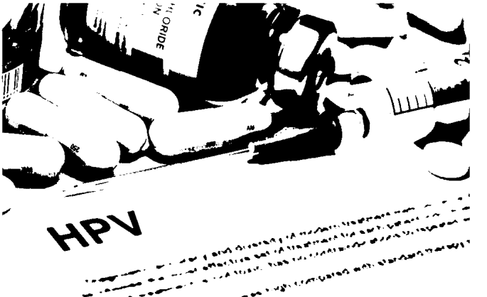

何差走：请卓老板谈谈HPV疫苗！

问题来自“得到”订阅产品《卓老板聊科技》第15期“无人驾驶汽车是更安全了，还是更危险了？”。

卓克

## HPV疫苗初了解

## 货币防伪的极限——量子货币会诞生吗？

第19期：独一无二的量子货币

## 货币为什么少有大面额钞票

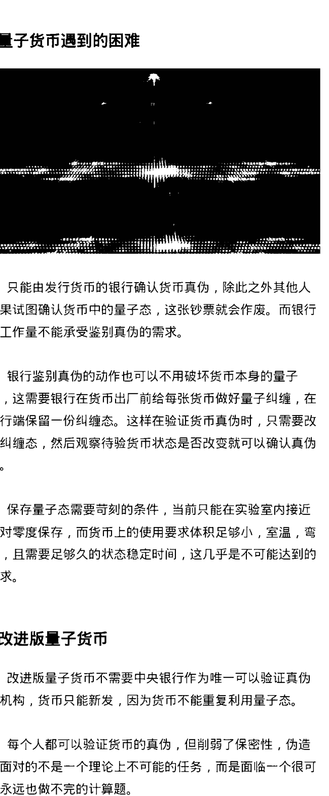

- 1、毒贩交易中常采用现金交易，大面额钞票方便非买非卖。举个例子，100万美元如果都用1美元钞票，重约1吨，用100美元钞票重量10公斤，用500欧元钞票重量2.2公斤。
- 2、美国在1969年之前使用过单张500美元的钞票，当时这张1克重的纸币可以兑换404克黄金，价值兑换落差太大。
- 3、一百美元纸币印制成本为0.64-0.96美元，如果就按印制成本是面额1%计算，人民币如果推出500元面额纸币，造假币的人成本降低80%。
- 4、美国人口全年使用过100美元面额钞票的只占总人口5%。为了增加犯罪门槛，各国大面额钞票都相继取消。

## 牛顿在铸币局都干了什么

- 1、牛顿53岁时任皇家铸币局总监，这个职位原本是一个工资高的闲职，但牛顿在这个岗位上发挥了很大作用。
- 2、那个年代英国流通的货币是银币，银币存在磨损问题，有些磨损是正常使用造成的，有些是有人故意为之，每枚银币锉掉一些银粉，最后聚起来来获取利润。这样做的不仅有黑作坊，连铸币局内部也用纯度低的银次充好。
- 3、银币不足值、造假，让全社会对英国货币失去信心，国家酝酿货币改革，皇室希望减小银币重量增加面额标注，牛顿极力反对这种坑害百姓的做法。最终皇室同意了牛顿的决策，重新铸造新版防伪银币。
- 4、牛顿在新版银币制造中利用自己的科学分析能力，大幅改进制造过程中金属的损耗，为国家节省数千英镑，新版银币上市后牛顿被提升为皇家铸币局局长。
- 5、货币改革后，出现了一位高调造假币的人，牛顿亲自收集整理线索，组织警方破案，最终把造假者送上法庭，判处了绞刑。

## 量子货币的设计思路

- 1、量子货币也叫薛定谔货币（Shrodinger's Cash），这个词的英文和Shrodinger's Cat 很像，又因为薛定谔是量子力学奠基人，所以就起了这个别称。
- 2、纯正量子货币的理论基础是，微观粒子的状态不能被完全复制，这是伍特斯和祖克在1982年的论文《单量子态不可克隆》里证明的。
- 3、不能精确复制量子态的原因是因为你不知道它的状态，需要知道状态后才能复制。可状态需要测量，量子世界中任何测量的结果都包含了测量本身，无法去除。所以量子态可以作为加密手段。

## 量子货币遇到的困难

- 1、只能由发行货币的银行确认货币真伪，除此之外其他人如果试图确认货币中的量子态，这张钞票就作废。而银行的工作量不能承受鉴别真伪的需求。
- 2、银行鉴别真伪的动作也可以不破坏货币本身的量子态，这需要银行在货币出厂前给每张货币做好量子纠缠，在银行端保留一份纠缠态。这样在验证货币真伪时，只需要改变纠缠态，然后观察待验货币状态是否改变就可以确认真伪了。
- 3、保存量子态需要苛刻的条件，目前只能在实验室中接近绝对零度保存，而货币上的使用要求体积足够小，室温，弯折，且需要足够久的状态稳定时间，这几乎是不可能达到的要求。

## 改进版量子货币

- 1、改进版量子货币不需要中央银行作为唯一可以验证真伪的机构，货币只能新发，因为货币不能重复利用量子态。
- 2、每个人都可以验证货币的真伪，但削弱了保密性，伪造者面对的不是一个理论上不可能的任务，而是面临一个很可能永永远也做不完的计算题。
- 3、伪造者面对的计算题是否足够难取决于P=PN这个猜想是否成立。

## P=PN问题是什么

- 1、P是多项式polynomial的缩写，“P问题”代表如果解答一个问题所需要的时间和这个问题规模的扩大呈现多项式规律的增长，那么这个问题就是“P问题”。这样的问题是现代计算机比较好解决的。还有很多问题随着规模的增加，解答时间的增加呈爆炸现象，比如N次方增长，或者N的阶乘式增长，这样的问题现代计算机无能为力，往往一个简单的问题就可以耗费天河二号计算机几亿年的运算时间。
- 2、P=NP问题中的NP是非deterministic polynomial的缩写，这个问题并不是指上面说的那种复杂问题，而是指定某个解是否正确所需的时间可以按多项式增长。如果P=NP，那么所有超级复杂的问题在理论上就有可能找到一种多项式时间增长的解决办法。
- 3、如果P=NP，等号成立，量子货币中给造假者提供的计算题可能难度就不够大，他们还是有可用算法破解，当然，如果真的找到一个时间增长呈N的20次方这样的规律，虽然也属于多项式时间增长，但因为次数太高，也可能计算不出来。

## 新式货币中的比特币

- 1、比特币和量子货币，还有所有目前发行的货币最大的不同有两点： 1) 没有中央银行发行； 2) 每个使用者都拥有一套全网账本。
- 2、比特币的核心价值是区块链技术，SWIFT（全球银行同业金融电讯协会）从2013年注意到比特币后，快速上马了项目，他们开发的区块链分账式技术已经完成，正在测试。一旦上线可以加速各国货币交换，减少中间环节的费用。
- 3、高盛、花旗、德意志银行，汇丰、摩根士丹利，甚至还有中国平安，一共50家全球最大的银行都加入了一个区块链联盟，每个银行都在以比特币为原型开展深入研发。

数学和物理是现代科学的基石，科技世界所有的新闻都生长在这两株参天大树上，当你对数学和物理方面的内容了解多了以后，就不会觉得很多黑科技是凭空生出来的。

## 我问卓老板——戒掉碳水化合物可行吗？

烈焰风暴：卓老板，您好，能否聊一下《谷物大脑》这本书提倡的戒碳水化合物的理论，感觉很颠覆，有点想尝试。

问题来自“得到”订阅产品：《卓老板聊科技》第17期“精准判断，离不开精准的数据计算”。

卓克

## 请正确饮食，勿信旁门左道

## 利益相爭，如何博弈？

第20期：博弈论中的数学原理

## 怎么挑起矛盾，又如何解决

- 1. 让一群男孩子打起来的办法是，在他们一起玩耍时时间 这里谁是娘娘腔？让两个男孩打起来的办法是，给他们分蛋糕，他们终会因为大小分配问题打起来。
- 2. 后者的解决方某是让一个孩子切蛋糕，另一个孩子分蛋糕，切蛋糕的孩子知道分蛋糕的人会拿走大块的，所以他才有足够动力切得平均。

|  | 挑较大的那半 | 挑较小的那半 |
|---|---|---|
| 切蛋糕者的策略 尽可能均切 | 0.49（鞍点） | 0.51 |
| 切的一大一小 | 0.30 | 0.70 |

切蛋糕问题

## 囚徒困境的博弈

- 1. 犯罪团伙中2个小喽啰被抓住了，分别拘留起来，他们不能互相串供。警察也知道这两人不是主犯，为了挖出背后更大的头目，警察审讯他们。俩人知道，如果A坦白交代，自己可以被保释，但是B却要做3年牢，B也知道，如果自己坦白，可以被保释出去，但是A要做3年牢。而且他们都知道假如他们俩都拒不交代的话就每个人坐牢一年。如果每个人都说出实情，就都得做两年牢。他们应该如何选？
- 2. 整个问题可以用一个2x2的表格描述，这是一个非零和博弈。（见图‘囚徒困境’）

|  | B 交代 | B 不说 |
|---|---|---|
| A 交代 | 2, 2 | 0, 3 |
| A 不说 | 3, 0 | 1, 1 |

囚徒困境

- 3. 经过语义和情景分析得出结论，两个罪犯都选择不交代（1,1）是最好的。但这只是在数学语言中规定双方法益最大化下的结果，博弈论还有其他利益规定方式，虽然它可能和现实事件有冲突，但在利用数学做分析中是可以做处理的。

## 博弈论的诞生的背景

- 1. 第三次数学危机发生在1897年，到1920年差不多修正完成，冯诺依曼也为集合公理化提出了自己的解决办法：NBG系统。这次危机让数学界知道从前对集合的定义有问题
- 2. 比第三次数学危机更严重的事故发生在1931年，哥德尔提出了不完全性定理，意思是说在数学体系内，如果用当前数学逻辑推理下去一定会推出一些结论，既不能被事实也不能被证伪。
- 3. 冯诺依曼在1921年用数学证明了扑克牌中使用‘叫诈’的方法可以提高胜率，1928年《客厅游戏中的理论》一文被视为博弈论的开山之作。这些都是在两次数学重大动荡之间完成的。
- 4. 冯诺依曼在做博弈论研究时，一战刚结束，二战还要16年才能开打，这段时间给很多数学家留出时间，否则战时很多精英都会被叫去做武器研发。
- 5. 普林斯顿大学出版社1943年出版《博弈论与经济行为》标志着博弈论建立起来了，但这套厚厚的数学理论书5年只卖了3000多本，买他的人相当比例还是赌徒，反而是经济学家没有购入。全书641个公式和几千行公式推导很难读懂。（见图叫诈1和2）

- 6. 《博弈论与经济行为》利用数学工具为20世纪40年代的经济学家开了一个先锋：用数学做经济模型的工具，此前的经济学研究在数学家、物理学家眼中属于原始社会级别。

## 最小最大値定理

- 1. 严格定义最小最大值定理需要参考《博弈论与经济行为》P.133-143，其中定义并证明了关于最大最大值，最小最小值，最大最小值，最小最大值。

让我们来回答这一问题。为此，我们只需要两个变量x和y，而且φ不必是x,y之外更多变量的函数。 所以，我们考虑一个二元函数φ(x,y)。显然，有意义的可交换性问题是下列等式中哪一个是一般地成立的： (13.1) Max,Max φ(x,y)=Max,Max φ(x,y), (13.2) Min,Min φ(x,y)=Min,Min φ(x,y). (13.3) Max,Min φ(x,y)=Min,Max φ(x,y)。 我们将看到，(13.1)和(13.2)是正确的，而(13.3)不正确。也就是说，任 意两个 Max或任意两个 Min可交换，而 一个 Max与一个 Min一般来说不可交换。我们还将得出 一个准则以确定在什么情况下 Max与Min可交换。 Max与Min的交换性对于二人零和博弈来说具有决定性意义（见14.4.2和17.6）。
- 2. 感觉上理解可以把拥有XY两个变量的函数想成一个表格，最大最小值是指在所有行中极小值中最大的那个值。
- 3. 切蛋糕中的博弈分析，通过最小最大定理，我们可以选出0.49就是所有行中极小值中最大的那个。
- 4. 最小最大值也被称为‘鞍点’。鞍点通常是在某个维度上是极大值，而在另一个正交的维度上是最小值的点，这一 点往往具有特殊性质。
- 5. 以数学理论为基础的博弈论并不是心理学，或社会学，它的抽象本质就是表格和数学运算，在表格和数字上赋予什么意义就表现成什么。

## 美国与苏联的博弈

- 1. 1949年9月份美国通过情报分析出苏联已经试爆了原子弹，在国会内部出现两派，一派希望立刻抓住机会公布这个发现震慑苏联，另一派不支持发布，认为会引起民众恐慌。最终杜鲁门发表了演讲，挑明了此事，苏联在演讲后2天承认核试验成功。
- 2. 冷战初期双方对原子弹数量保密工作做得相当严密，严密到荒唐的地步，以至于总统在上任2年多时间中一直不清楚美国到底有多少原子弹随时待命。
- 3. 直到1982年美国才公布了冷战初期原子弹数目。1945年2颗，1946年6颗，1947年7颗，1948年50颗，1949年240颗，1950年688颗。到了八十年代原子弹数量已经接近上万。1990年美苏两国签署协议削核弹头到6000以下。

# 我问卓老板——科学思维为什么反直觉？

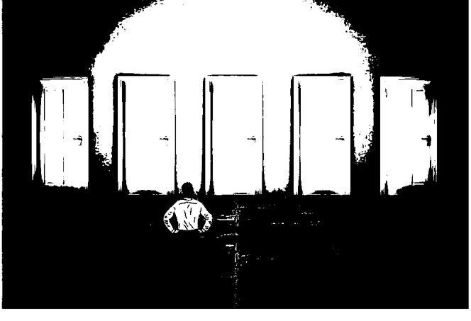

涉世未深2005：“科学的世界观是反直觉的”，一语惊醒梦中人。刚好在看郑也夫的书，说道动物界是真正的强者弱者淘汰，变异造成了更强壮的物种；人类由于发明了武器和各种工具，使得弱者也能在生物意义上保留生存和繁衍的权利。人类的变异更多地体现在文化的变异上，极少数人的想法揭示了关于世界的真相，也是逐步，有了科学定理，有了科技，使得人类的命运有了翻天覆地的变化。但这样的文化变异离进入人的基因仍有太长时间的等待，所以一般人理解起来觉得“惶惶然”，这也许就是“科普”的最大意义，卓老板这样的讲课功莫大焉。多么希望更多人接受到这些知识。以讹传讹的所谓知识、道理、心灵鸡汤太多太害人了。

问题来自“得到”订阅产品：《卓老板聊科技》第17期柯洁的判断，对弈中计？。

卓克

## 思维的进化

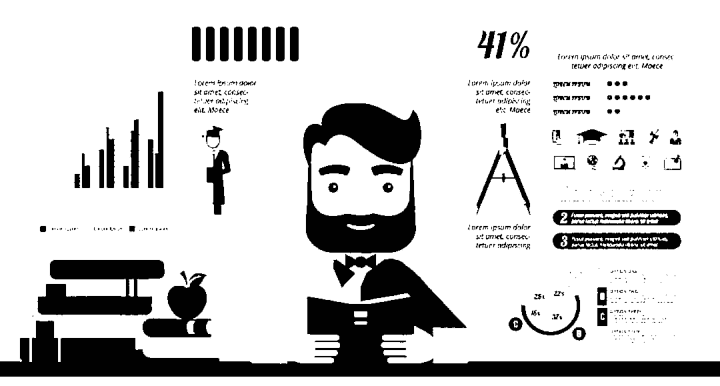

## 我问卓老板——有没有推荐的数学科普书？

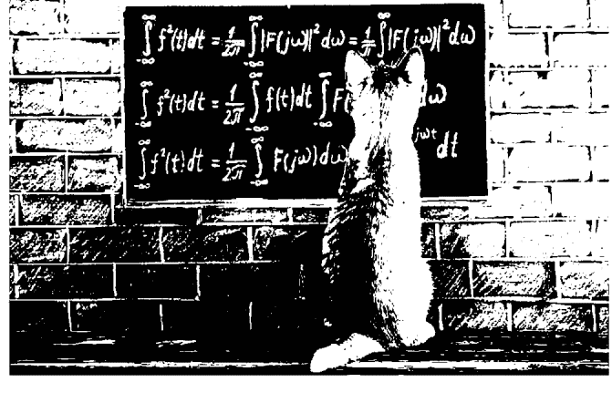

王芳：请问有没有讲概率论、数学定理或者计算机算法的书推荐？文风类似于你的语音，就是讲故事这种的。这次的内容非常有帮助！对于一个学生物，现在刚转行做健康大数据的人简直是雪中送炭！

问题来自“得到”订阅产品《卓老板聊科技》第17期“精准的判断，离不开精准的概率计算”。

卓克

## 数学思维有巨大的优势

## 合作与背叛的数学解释

生存策略

## 博弈论在生物、社会学上发展很快

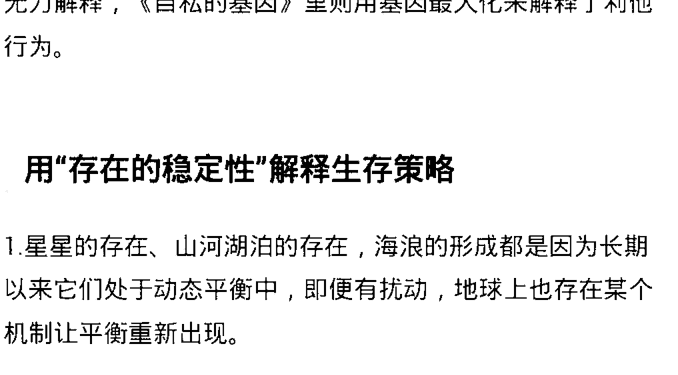

全世界共8600余种鸟类，其中有320种会帮助其他种类动物喂食、筑巢、清扫身体等。帮助其他种类动物时，无疑增加了自身风险，这样的生存策略为什么会存在呢？进化论对此无力解释，《自私的基因》里则用基因最大化来解释了利他行为。

## 用“存在的稳定性”解释生存策略

- 1. 星星的存在、山河湖泊的存在，海浪的形成都是因为长期以来它们处于动态平衡中，即便有扰动，地球上也存在某个机制让平衡重新出现。
- 2. 鹰派与鸽派理论可以通过得分的方式来计算这类生物共生情况下的数字比例。这个比例是动态平衡的，任何一方数量的改变，都会有自然形成的压力让他们重新回到平衡。

## 囚徒困境实验的3种进阶分析

- 1. 阿克塞尔·罗德进行了第一阶段的“重复囚徒困境”实验，共设计出14种策略，让每种与其他都进行200局对战，之后计算每200局的平均成绩和总的平均成绩。实验结果选出的最优者是：第一局和对方合作，此后每局的策略是对手上一局所采用的策略，我们称之为“一报还一报”策略。它的平均分是504.5分，最低225分，最高600分。完全随机选择合作或者背叛的平均分最低，只有276.3分。
- 2. 阿克塞尔·罗德希望找到更好的策略，胜过“一报还一报”，便进行了第二阶段的“重复囚徒困境”实验。但结果没有可以超越“一报还一报”的新策略。不过第二阶段测试中也发现“一报还一报”在应对“完全不管对手如何出牌，自顾自出招”时效果不好。在面对“90%—一报还一报”策略时，容易出现回声效应，双方不断背叛对方。
- 3. 阿克塞尔·罗德又进行了第三阶段的“重复囚徒困境”实验，这次让62个程序以相同比例进行混战，200局一轮战斗，最终留下的是“一报还一报”和它的微小改动版。在有自然选择压力的情况下“一报还一报”是一种稳定策略。总是背后捅人一刀的看似凶悍，但最终会被淘汰。

## 实际生活中的博弈策略

- 1. 伯劳鸟之所以飞进鳄鱼嘴里，帮它清除口腔碎屑寄生虫，是因为双方在合作，鳄鱼不背叛伯劳鸟。这样的原因可能有多种多样，但在博弈论中，这种“一报还一报”策略是进化中最稳定的，所以会长久存在下去被我们看到。
- 2. 以交通为例，压实线变道如果算人们交通关系中的一种背叛，按车道线行驶算是一种合作，那么北京现在乱开车的比较多，就是因为背叛后失分太少，总体来说背叛行为得分高让它成为了一种稳定策略。如果交管局可以严格执法，或者只是简单提高处罚分数，而执法严格程度不变，也将起到很好的效果，这样做可以把合作这种行为筛选成稳定策略。而这正是交通规则制定者的职责。

## 我问卓老板——微波炉的辐射危险吗？

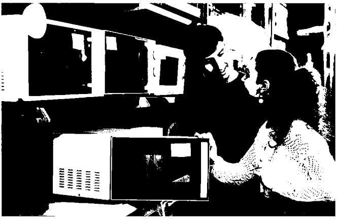

wanling:卓老板，可以讲一下微波炉究竟可不可以用来吗？

问题来自“得到”订阅产品《卓老板聊科技》第18期“大科学家薛定谔是请圣？！”。

卓克

## 微波炉工作原理

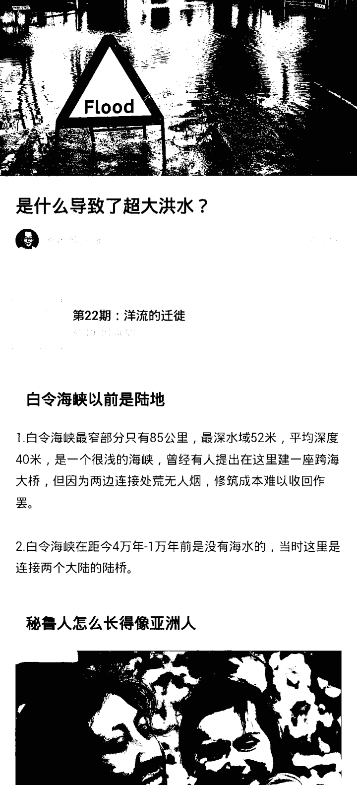

## 是什么导致了超大洪水？

第22期：洋流的迁徙

## 白令海峡以前是陆地

- 1. 白令海峡最窄部分只有85公里，最深水域52米，平均深度40米，是一个很浅的海峡，曾经有人提出在这里建一座跨海大桥，但因为两边连接处荒无人烟，修筑成本难以收回作业。
- 2. 白令海峡在距今4万年-1万年前是没有海水的，当时这里是连接两个大陆的陆桥。

## 秘鲁人怎么长得像亚洲人

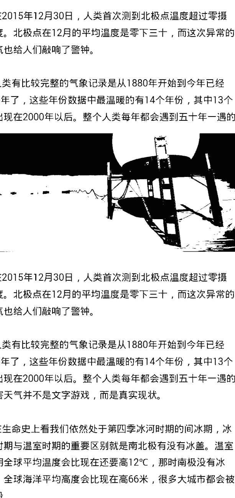

- 1. 所有现代人都起源于10万年前一位非洲女性和6万年前一位非洲男性，不论种族差异多大，人与人之间基因的差别平均是0.5%，这是我们可以通婚的基础。
- 2. 在距今1.8万年至1.2万年前，曾经有3批亚洲人从白令陆桥迁移到美洲大陆，迁移的过程也许很慢，每一代人迁徙几十公里，需要2300年才能完成从黄河流域到南美洲中部的迁徙。
- 3. 在1860年太平天国失利后国内大乱，不少穷苦百姓移民到其他国家，其中有十几万以“契约劳工”身份陆续到达了秘鲁，秘鲁现在3000万人口，其中有10%有华人血统。
- 4. 秘鲁首都都有5000多家中餐馆，发音为chifa，这是粤语中吃饭的音译，反映了中国人对秘鲁的影响。

## 秘鲁渔场中发现了厄尔尼诺

- 1. 秘鲁渔场是世界四大渔场之一，向来渔业丰富，但印第安土著发现每隔7年会有一次水温升高，鱼和鸟大面积死亡的情况。16世纪西班牙殖民者到来后把这种现象叫做EL Nino，也就是我们现在称之为的厄尔尼诺现象。
- 2. 近年来，厄尔尼诺现象出现越来越频繁，持续时间通常10到21个月不等。它出现时赤道会有一条长1万公里，宽1千公里的异常高温海水带，温度比正常情况下高4-5℃。
- 3. 海洋比热巨大，是地球上最好的热量缓冲区，对海水来说平均温度升高0.1℃的热量可以把对应海面上5000米高度以内的空气加热6℃，而厄尔尼诺的标志是水温升高0.5℃并持续6个月。
- 4. 厄尔尼诺水域就像一个巨大的加湿加热器，把海水大量蒸发到空气中，使空气升温，这些暖湿气流今后走到哪里，哪儿就出现剧烈变化的天气现象。
- 5. 每次厄尔尼诺现象消失后的夏天，中国南方必有一次强降雨。今年中国大陆水和大洪水就是上次厄尔尼诺的后续影响。上一次厄尔尼诺从2014年5月份持续到2016年3月份结束。

## 武汉被淹，不怪三峡工程

- 1. 今年夏天的洪水量和1998年大洪水大致相当，但是造成的灾难小很多，其中三峡工程有很多功劳，但每次发洪水都有很多人指责三峡工程。
- 2. 1998年的大洪水宜昌站测得最高洪峰值是6.4万立方米/秒，20年一遇的流量是7.2万立方米/秒，百年一遇是8.4万立方米/秒，千年一遇是9.9万立方米/秒，三峡工程是按万年一遇的洪水量设计，最大可以承受13万立方米/秒的洪峰。
- 3. 在洪水到来前三峡会泄洪，以腾出221亿立方米空间装洪水，如果进库流量7万立方米/秒，出库流量2万立方米/秒，三峡防洪可以抵御12-13天，在这期间可保证下游不会遇到从三峡过来的洪水。
- 4. 武汉7月4到6日被淹三天主要是因为市区降水猛烈，排水能力又差，并不是三峡泄洪造成的。

## 拉尼娜现象跟着厄尔尼诺出现

拉尼娜现象与厄尔尼诺现象正好相反，对应的洋流会出现低于正常值温度的情况。通常厄尔尼诺现象之后会有拉尼娜现象，它对中国的影响就是次年的冬季北方非常寒冷，南方有大量降水。

## 全球变暖，温度真的很高吗？

- 1. 在2015年12月30日，人类首次测到北极点温度超过零摄氏度。北极点在12月的平均温度是零下三十，而这次异常的天气也给人们敲响了警钟。
- 2. 人类有比较完整的气象记录是从1880年开始到今年已经136年了，这些年份数据中最温暖的有14个年份，其中13个都出现在2000年以后。整个人类每年都会遇到五十年一遇的灾害天气并不是文字游戏，而是真实现状。
- 3. 在生命史上看我们依然处于第四纪冰河时期的间冰期，冰河时期与温室时期的主要区别就是南北极有没有冰盖。温室时期全球平均温度会比现在还要高12℃，那时南极没有冰层，全球海洋平均高度会比现在高66米，很多大城市都会被淹没。
- 4. 人类活动导致最近100年温度提升了0.7℃，所以让南极冰盖全部融化，只需要再搞1000年就可以达成，而这样的温度变化速度是生命史上温度剧烈变化时期的一千倍。

## 我问卓老板——海淘奶粉安全吗？

修令vicki：最近看了一篇文章，19款海淘奶粉抽检40%不合格，中国宝宝最好只吃中国的配方奶粉。感觉这篇文章的写作立意不客观，希望卓老板帮忙去伪求真一下。

问题来自“得到”订阅产品《卓老板聊科技》第19期“谈千防伪的秘密——量子货码会诞生吗？”

卓克

## 奶粉怎么检验？

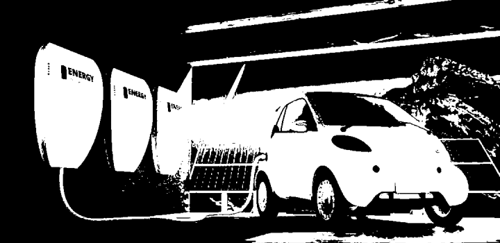

## 我问卓老板——新能源车为什么火了？

洛基浣熊：卓老板，听说锂电池的能量密度比成品油低一个数量级，能解答下为什么新能源车近几年火起来了？氢燃料电池未来有可能替代锂电池么？

问题来自“得到”订阅产品《卓老板聊科技》“我问卓老板——你怎么就敢推荐比特币？”

卓克

## 新能源汽车势不可挡

## 费曼和杨振宁讲的物理课

第23期：大师的课堂

## 费曼物理学讲义来历

1. 加州理工学院在1960年进行教育改革，物理学方面的教授请来了费曼，在1961年9月-1963年5月主讲大一、大二物理课。院领导安排教师做笔记和录音，之后几年整理成套，并出版了这套教材。
2. 请费曼做基础课教学的一大优势是：费曼的口才并不比脱口秀演员差，他可以把变分法和泛函基础的路径积分法给没有物理基础的人讲清楚。

## 费曼路径积分是什么

1. 每一个事件对应一个箭头，箭头长度的平方对应事件发生概率，箭头转动的角度对应事件经历的时间。一个事件所有可能性加合等于1。
2. 一个光子直接射入接收器，对应箭头是图1。
如何画出事件的箭头，例一
图1
3. 一个光子经过半透明玻璃射入接收器，对应箭头是图2。
如何画出事件的箭头，例二
图2
4. 光的反射定律如果用路径积分方法箭头画法对应图3。
图3

## 理解光的又一种途径

1. 我们把光看做粒子，这是以光是理想弹性小球为基础的假设。
2. 我们把光看做波动，这是以光是波为基础的假设。
3. 在路径积分中光的行为是概率振幅矢量。矢量既有大小也有方向，矢量加合遵循首尾相连的规则。
4. 在这种理解下光走直线的原因是因为越接近直线的路径，概率振幅矢量的叠加对最终事件贡献越大。在光的折射现象中入射角等于反射角的位置上也存在这种状况。

## 《光和物质的奇妙理论》

1. 物理科普书分两类，一类是物理学家看不懂，但门外汉可以拿去做饭桌上的谈资，另一类只要你认真理解每个概念，是可以在不歪曲原意的基础上理解梗概的。《光和物质的奇妙理论》是后者，而《时间简史》则是前者。
2. 费曼认为科学分二部分内容：一是用什么方法发现新事物，二是发现了什么新事物，三是新发现能做出什么东西来。第三项应该叫做技术，科学杂志主要报道第二、三项目，第一项很少涉及。

## 杨振宁为大一学生讲的物理课

杨振宁在清华授课

1. 2004年9月-12月，杨振宁在82岁高龄时为清华大学基础科学、物理学的同学讲了一学期普通物理。这个计划酝酿了5年多，因为之前杨振宁的夫人身体一直不好，他自己也连续动了四次手术，直到2004年课程才成型。30节课一堂未缺，每周2次，外加一次答疑，考试时都亲自来监考。
2. 杨振宁在这学期最后一堂课上还讲了当年他和米尔斯在1954年做出诺贝尔奖成果的故事。
3. 杨振宁的学术成就超越费曼，他的Yang-Mills理论的成果导致了后续7个诺贝尔物理奖的诞生。杨振宁的两个方程也是数学界研究重点，曾经诞生过6个菲尔兹奖。其中Yang-Mills方程的证明也是千禧年7大数学难题之一。夸克之父盖尔曼对费曼不服不忿，但对杨振宁毕恭毕敬，由此也可可见杨振宁的学术地位和成就。

## 我问卓老板——大脑耗能高不高？

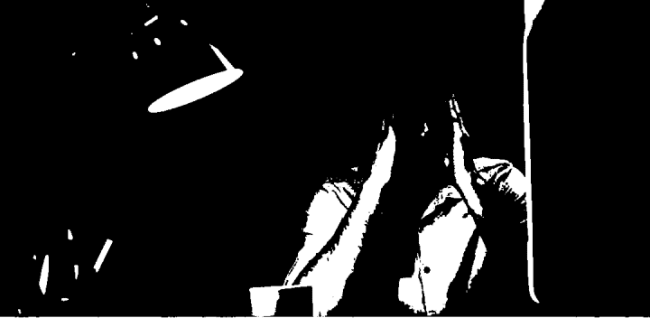

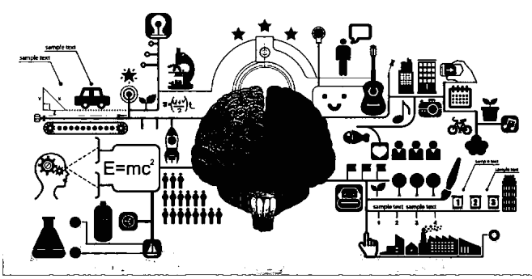

隐曜：卓老板你好，能不能从能量消耗角度讲讲大脑？为什么感觉认真学习一天非常的累，其实好像没怎么消耗能量，非常感谢！

问题来自“得到”订阅产品《卓老板聊科技》第22期“是什么导致了起大洪水？”。

卓克

## 大脑的运动

## 被电影误写的经济学家——约翰·纳什

第24期：电影《美丽心灵》中的博弈论

## 纳什均衡

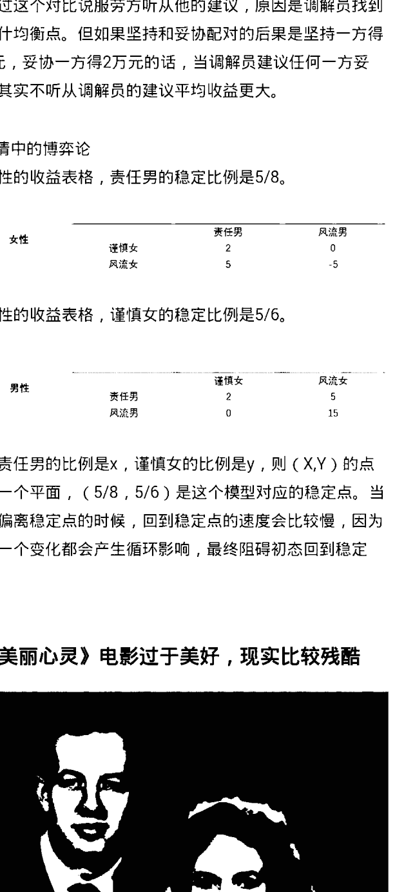

- 1. 《美丽心灵》这部电影中把纳什均衡理解成在博弈中找到双赢的局面，这其实是错的。电影的影响力非常大，以至于有人把约翰·纳什当做博弈论的创立者，这更是错的，冯·诺依曼才是博弈论的创立者。
- 2. 当一方策略不再变了，另一方也已选定了一个策略，如果这时候再换任何一个策略都不会比现在策略得更高，那么这时双方的选择就是纳什均衡点。

## 纳什均衡的应用

- 1. 比试酒量中，采用死磕策略和认怂策略时，有两个纳什均衡点。

| 甲 | 乙 |
| --- | --- |
| | 认怂 | 死磕 |
| 认怂 | 0, 0 | -1, +1 |
| 死磕 | +1, -1 | -10, -10 |

其中加重的两个选择就是纳什均衡点：在对手不再改变策略的条件下，如果你改变，结果只会更差。但如果我们设定甲乙都是采取混合策略的人，甲选择死磕的概率是β，那么乙也以β概率选择死磕，才能找到纳什均衡点。
- 2. 纳什均衡在劳资双方调节的应用

| 资方 | 劳方 |
| --- | --- |
| | 妥协 | 坚持 |
| 妥协 | 6,6 | 2,7 |
| 坚持 | 7,2 | 0,0 |

调解员的任务是：找到纳什均衡点，这样才能说服双方接受他的调解建议。劳方如果得到的建议是坚持，那么劳方就知道资方被建议的一定是妥协的策略，这样劳方就已经知道全部结果了，他将获得7万元，资方获得2万元。如果劳方被建议采用妥协方案，那么劳方面临的就是一个概率上的收益，因为资方有一半可能选择妥协，一半可能选择坚持，那么对劳方来说收益平均值是多少呢，就是1/2概率妥协的6万+1/2概率的坚持的2万，结果是平均来说是4万元的收益。如果有一方被建议妥协，但坚持不听调解员建议，也是存在概率的，所以我们要算个平均值。他有1/2可能什么都得不到，再加上1/2可能得到7万元，加后均值是3.5万。这个均值是低于之前所调解员的话获得4万元均值的。所以调解员可以通过这个对比说服劳方听从他的建议，原因是调解员找到了纳什均衡点。但如果坚持和妥协配对的后果是坚持一方得9万元，妥协一方得2万元的话，当调解员建议任何一方妥协，其实不听从调解员的建议平均收益更大。
- 3. 爱情中的博弈论
对女性的收益表格，责任男的稳定比例是5/8。

| 女性 | 男性 |
| --- | --- |
| | 责任男 | 风流男 |
| 谨慎女 | 2 | 0 |
| 风流女 | 5 | -5 |

对男性的收益表格，谨慎女的稳定比例是5/6。

| 男性 | 女性 |
| --- | --- |
| | 谨慎女 | 风流女 |
| 责任男 | 2 | 5 |
| 风流男 | 0 | 15 |

如果责任男的比例是x，谨慎女的比例是y，则（X Y）的点组成一个平面，（5/8，5/6）是这个模型对应的稳定点。当事件偏离稳定点的时候，回到稳定点的速度会比较慢，因为任何一个变化都会产生循环影响，最终阻碍初态回到稳定点。

## 《美丽心灵》电影过于美好，现实比较残酷

纳什和Alicia

- 1. 纳什在1952年去麻省理工的时候先后认识了两个女孩，第一个女孩是他住院时照顾他的护士Eleanor，两人有了私生子。但之后纳什和他的物理系学生Alicia恋爱了。Eleanor三年后在麻省理工遇到了纳什黯然才知道真相。此后去找纳什的父亲，揭破了他们有一个私生子的事实。纳什的父亲要求纳什和Eleanor结婚，但不久就在悲愤交加中去世，纳什并没有听从父亲的要求，而是娶了Alicia。
- 2. 婚后不久纳什在事业上有新的突破，解决了黎曼流形在欧几里得空间中的嵌入问题，但不久后患上了精神分裂症。患病3年后Alicia和他离婚，又过了3年Alicia差一点和另一位数学家再婚，但并未如愿。
- 3. 纳什在生病期间辞掉了麻省理工的工作去欧洲旅游了9个月，最后因为签证过期，在日内瓦被遣送回美国。此后病情加重，但纳什和Alicia一直住在一个家里，只是屋子分开。纳什形容他在获得诺贝尔经济学奖之前两人的关系时这样说：两人实际就像居住在同一屋檐下的远亲一样。真相并没有电影中那么美好。
- 4. 纳什获得诺贝尔奖后并没有像电影里那样进行过颁奖演说，颁奖委员会考虑到他病情不稳定，所以取消了演讲。但纳什在普林斯顿的聚会上说过诺贝尔奖是他非常需要的，因为有了这个奖他才有资格换到一张信用卡，而且他希望独揽这个奖，因为他非常缺钱，可惜这个奖是3人分享的。
- 5. 纳什和Alicia复婚的主要动机是因为2001年《美丽心灵》播出之后反响太大，为了避免过多舆论压力才复婚的。
- 6. 纳什在1990年后逐渐清醒，但生活得并不开心，时常处于深深的孤独中，Alicia和他生活得也不如意，因为他们的儿子同样患有严重的精神疾病，Alicia一辈子不得不照顾两个病人。他们没有分开并不是因为爱的多深，而是生活所迫不得不得倚合过，直到1994年的诺贝尔经济学奖才给了他们一些喘息的机会。
- 7. 2015年12月29日纳什和Alicia在一场车祸中同时去世。

# 我问卓老板——我们的男女祖先为什么在时间上差了8万年？

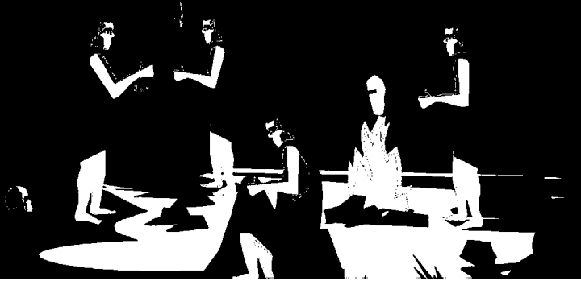

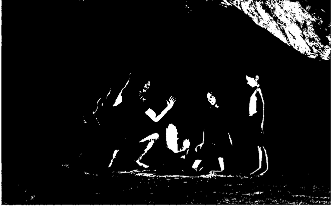

Andy：我们的祖先是两个在时间上差了8万年的非洲男女，感觉比牛郎织女还惨啊……怎么解决相遇生出我们的问题呢？

问题来自“得到”订阅产品《卓老板聊科技》第22期“是什么导致了超大洪水？”

卓克

# 我们传承的是基因

# 我问卓老板——证明转基因食品安全的数据在哪儿？

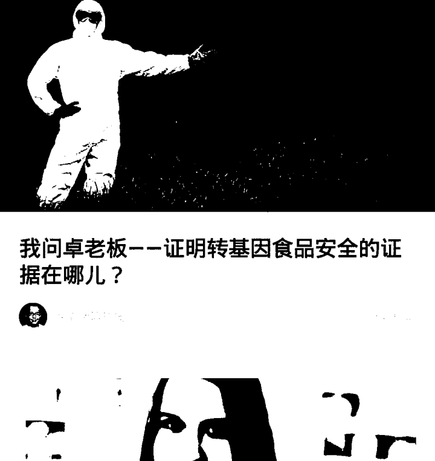

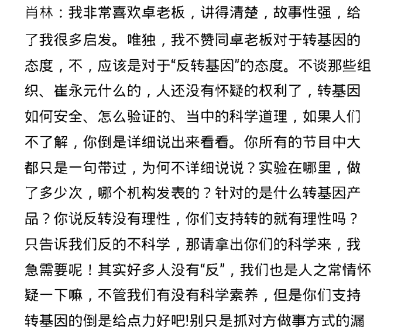

肖林：我非常喜欢卓老板，讲得清楚，故事性强，给了我很多启发。唯独，我不赞同卓老板对于转基因的态度，不，应该是对于“反转基因”的态度。不谈那些组织、崔永元什么的，人还没有怀疑的权利了，转基因如何安全、怎么验证的、当中的科学道理，如果人们不了解，你倒是详细说出来看看。你所有的节目中大都只是一句带过，为何不详细说说？实验在哪里，做了多少次，哪个机构发表的？针对的是什么转基因产品？你说反转没有理性，你们支持转的就有理性吗？只告诉我们反的不科学，那请拿出你们的科学来，我急需要呢！其实好多人没有“反”，我们也是人之常情怀疑一下嘛，不管我们有没有科学素养，但是你们支持转基因的倒是给点力好吧!别只是抓对方做事方式的漏洞，也别谈什么利益，就谈安全！

问题来源于“得到”付费产品《卓老板聊科技》第13期“在转基因食品安全不是安全这样几上，我们应该听谁的？”。

# 卓克

# 转基因安全的证据

附“农业转基因生物安全评价资料”的网址：
http://www.moa.gov.cn/ztzl/zjyqwgz/spxx/201307/t20130702_3509313.htm

闫宁
大众对于转基因技术的认识是有误区的，就是经常把转基因技术和转基因作物这两个概念混淆。转基因技术是用人工手段改变作物的某些基因片段这个行为，其实就相当于人为的控制了基因突变的的方向（想象下更微观的手术），如果要论证转基因技术有害，就应该论证是因为人类“转基因”的这个行为产生了毒性。因为有一定的概率，自然的基因突变也会产生和转基因作物一模一样的基因编码，因此如果说转基因技术有害，则应该是指该技术有害，那么所有的转基因作物应该表现出相似的毒性或者某些相似性，至少目前来看是没有的，所以基本可以确定转基因技术本身是无害的。那么有害的就只可能是转基因中改变的部分基因编码了，也就是转基因的毒性是来源于改变的这部分基因。但是自然作物也是有基因突变的概率的，而且自然作物本身也是有一定的毒性的，之所以人类今天吃的食物没有毒性，并不是因为自然作物没有毒性，而是因为几千年以来人类不断的试吃已经将大部分有剧烈毒性的作物给排出了。而今天的转基因作物，又是以这一部分毒性小的作物为母体的。而上市的转基因作物，又是经过了实验室中的筛选。但是不可否认，部分的转基因作物确实存在有毒性的可能，但这些作物的毒性不是来自于转基因技术，而是来自于“转”的这些基因片段。但是要知道自然作物也会有基因突变，同样不知道突变的基因带来的效果是否为止，因此很难说转基因食物比自然食物有更高的有毒率。因此如果说转基因技术带来的毒性，基本是一种混淆概念的说法。而如果说转基因作物有毒，则类似于说中国有个个人1米4，所以中国人都是1米4，这样的以偏概全的说法。真正的理解应该是，转基因作物是有一定毒性的，少数可能会有剧毒，但是有毒性是个体性而不是群体性的，因此证明转基因群体性安全很难甚至不可能，却可以很容易的验证单一的转基因作物是有毒性的。而这个概率是否比自然的突变大，目前还不得而知。市场上现有的转基因作物，是筛选过的毒性在可控范围之内的产品，没有证据显示群体性比自然作物更危险，但是是否有其他未知的影响，仍需检验。

08-17 17:36:37

Nucky戴恩
回答得有理有据有节。
08-17 23:17:43

王木头
我觉得这位听友如果只是对转基因食品保持怀疑，我觉得还是理性的，可是对于反转基因的态度的不理解我觉得这就是不理性的了。加入有一个人从来没有听过转基因这个词，更不知道转基因的好坏了，在他面前有两拨人分别劝他相信和不相信转基因，这两拨人分别以科学家和崔永元为代表。这个人要根据这两拨人的观点来决定他还是否不吃转基因。首先科学家们有一套科学方法，都是会明确的表述出那些是确定知道的那些是不清楚的，而崔永元为代表的这群人总是会说万一有问题会对你子孙后代不好等等这些情感的表述。先不说这个吃不吃转基因，但是从更相信那拨人来看也是科学家更可信，因为只要愿意追究总是有研究事实可查的。然后再看这个人要不要吃转基因，如果有理性的话，可以继续保持怀疑不吃，但不能说科学家们有阴谋，崔永元才是为大家好。所以这位听友的问题恰恰是没有明白卓老板反对的是是什么，不是反对对转基因的合理怀疑，恰恰反对的是这些人非理性地反对转基因的态度，我想那一百多位诺贝尔奖获得者反对绿色和平也是一样，反对的是他们不理性的态度。而同样是科学的怀疑，我想对于科学共同体来说永远是欢迎的，因为这才是科学进步的动力。
08-17 22:39:29

# 量子卫星大揭秘

第25期：量子卫星

# 墨子号卫星的性质是科研

墨子号量子卫星的主要任务是做量子通讯的科学实验，就目前而言，量子通讯离实际应用还比较远。这项科学实验是潘建伟团队与奥地利的维也纳大学合作的，潘建伟团队有技术上的优势。

# 信号传输中的关键

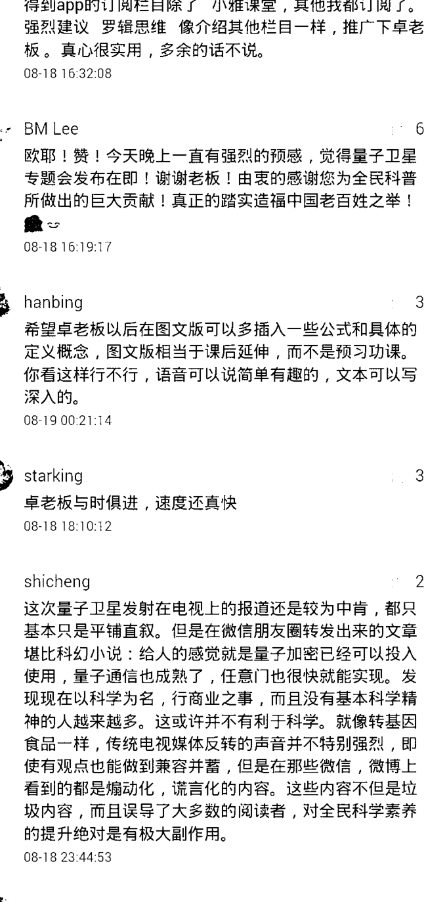

- 1. 传输信号采用卫星，势在必行。光量子态在光纤中最多可以传播200公里，之后衰减到无法辨识，而光量子又没法放大。地球大气层传播光信号的衰减过程主要集中在近地面20公里以内高度，如果超过20公里以上影响就很小，也就是说从地面发射信号到太空只会衰减20%。
- 2. 最终的量子卫星通讯可能是几颗卫星在天上，链接若干重要城市，然后在地面配合这些城市用光纤实现200公里内的毛细覆盖。
- 3. 潘建伟团队在2010年做过16公里的量子态传输，2012年又在青海湖做了97公里的量子态传输，这些试验都验证了天地通讯的可行性。
- 4. 墨子是近地卫星，每85分钟绕地球一圈，在信号传输过程中，卫星和地面站如何对准是难点。潘建伟团队在2013年利用高空热气球模拟了近地卫星对准的操作，使这个难点有所突破。

# 量子保密通讯

- 1. 虽然传统加湿过程不断增加破解难度，但永远无法防止别人嗅探、窃取、监听。
- 2. 量子保密手段中量子密钥分配的方法采用的是两位IBM科学家提出的BB84协议，这种加密技术可以实时监控是否有人在监听。这个功能的实现是依靠量子力学中，量子态不可克隆理论实现的。但这两位IBM两位科学家并不看好量子密钥分配方法，他们更看好量子计算。
- 3. 量子密钥发光量子过程在2005年以前进展很慢，最远距离10公里，潘建伟团队最先突破距离到200公里。在2012年，合肥搭建了6000平方公里网络，之后量子密钥加密技术使用在十八大和大阅兵的通讯中。
- 4. 量子密钥也有攻击方法：强光致盲，但2012年就提出了解决办法。
- 5. 通过量子纠缠做出的保密通讯叫做量子隐形传态（teleportation），这需要让成对的量子形成纠缠，并且在传输过程中保持纠缠。
- 6. 量子隐形传态并不超光速，因为它需要传统通讯方法指挥另一方如何进行信息查看。这种加密方式也可以通过协议上精巧的设计让信息的收发双方可以随时知道是否被人窃听。
- 7. 量子隐形传态中传递的是量子态，所以可以和量子计算机无缝结合。

# 质疑的声音

- 1. 无论是采用量子密钥还是量子隐形传态，都需要传统信道，所以安全性并不比目前所用的更好。
- 2. 量子通讯的信噪比低，抗干扰能力差。

# 量子卫星的意义

如果量子加密技术不断改进，量子计算机齐头并进，也许70年后看今天，就像现在看1947年晶体管发明那样。到时候，整个IT界从物理层到编码全都需要重新建立系统，这又将是一轮新的创业热潮。

叶子的形状
得到app的订阅栏目除了 小雅课堂，其他我都订阅了。强烈建议 罗辑思维 像介绍其他栏目一样，推广下卓老板。真心很实用，多余的话不说。
08-18 16:32:08

BM Lee
欧耶！赞！今天晚上一直有强烈的预感，觉得量子卫星专题会发布在即！谢谢老板！由衷的感谢您为全民科普所做出的巨大贡献！真正的踏实造福中国百姓之举！
08-18 16:19:17

hanbing
希望卓老师以后在图文版可以多插入一些公式和具体的定义概念，图文版相当于课后延伸，而不是复习功课。你看这样行不行，语音可以说简单有趣的，文本可以写深入的。
08-19 00:21:14

starking
卓老板与时俱进，速度还真快
08-18 18:10:12

shicheng
这次量子卫星发射在电视上的报道还是较为中肯，都只是基本只是平铺直叙。但是在微信朋友圈转发出来的文章堪比科幻小说：给人的感觉就是量子加密已经可以投入使用，量子通信也成熟了，任意门也很快就能实现。发现现在以科学为名，行商业之事，而且没有基本科学精神的人越来越多了，这或许并不有利于科学。就传统基因食品一样，传递电视媒体转发的声音并不特别强烈，即使有观点也可以做到兼容并蓄，但是在那些微信，微博上看到的都是煽动化，谎言化的内容。这些内容不但违背科学内容，而且误导了大多数的阅读者，对全民科学素养的提升绝对是有极大副作用。
08-18 23:44:53

# 我问卓老板——为什么恒星的1/4是氢？

乔叶：卓老板，我在看你推荐的书《亚原子粒的发现》时，看到第137页，书中说大多数恒星质量的1/4由氢构成。我想问这里为什么是1/4啊？这跟宇宙中恒星的寿命分布有关系吗？

问题来自“得到”订阅产品《卓老板聊科技》“我问卓老板——新能源车为什么火了？”

卓克

# 宇宙诞生与元素形成

# 精选留言

Oe

老板好，我今年27岁，从高中开始就爱喝可乐，大学后喝的更多，夏天每天至少一瓶五百毫升的吧，现在家里还是常备大瓶可乐，我喝常温大桶水就会拉肚子，而喝可乐就不会，所以在公司都是喝热水，回到家几乎就只喝可乐了，（租的房子，一直没有买饮水机），从大学开始每次体检都是血压有点高，医生也没有让我去医院查或者吃药啥的，但是我自己一点感觉没有，是不是我应该彻底戒掉喝可乐？看百度说喝可乐很多危害自己还控制不住怎么办，谢谢您

08-21 17:02:51

作者 回复

好，我到时候回答

08-21 17:26:32

# 世界上最难的数学题是什么？

第26期：黎曼猜想（1）

# 23+7个数学难题

1.1900年希尔伯特提出23个数学难题，其中第八个是黎曼猜想。希尔伯特凭借自己的威望让全世界数学界都重视起这些问题。

2.2000年克雷研究所提出了千禧年7大数学难题，其中也有黎曼猜想，克雷研究所凭借每个难题100万美元奖金引起了媒体的重视。

# 微积分之战

1.牛顿和莱布尼茨年龄相仿，只差3岁。莱布尼茨1684年发表了关于微积分的论文，牛顿在1687年出版了《自然哲学的数学原理》。其中的“流数”也包含了微积分的思想。此后莱布尼茨的成果成为教科书在欧洲大陆流传，牛顿的《自然哲学的数学原理》也成了著作传播。

2.《自然哲学的数学原理》这本书在第一版还肯定了莱布尼茨在微积分上的贡献，但有好事者挑拨牛顿与莱布尼茨之间关系，最终让两人失和。牛顿在第二版《自然哲学的数学原理》中删除了这段话，并且在他的其他出版物中旁敲侧击的暗指莱布尼茨抄袭他的微积分思想。

# 黎曼猜想的提出

1.1859年黎曼当选了柏林科学院院士，为了表示感谢他写了一篇短小的论文，只有8页纸，是来研究素数分布规律的一篇内容，在论文里他提出了一个猜想：zeta函数的非平凡零点都在复平面实轴，Re=1/2这条线上。

# 非平凡零点的围追堵截

1.黎曼最初猜测所有非平凡零点都集中在0到1之间，经过46年的努力，数学家们仅仅将这个猜测向前推进了一小步。

# 我问卓老板——新能源车为什么不靠换电池来实现充电呢？

鲨鱼：锂电池驱动的汽车，为什么不能靠快速更换电池组的方式实现充电？就是像加油站一样，来一个电池站。汽车到了电池站地盘升高直接换电池，这样电动汽车的电池寿命和充电时间的问题是不是可以解决了？

问题来自“得到”订阅产品《卓老板聊科技》-“我问卓老板——新能源车为什么火了？”

# 卓克

# 换电方案如何实施

# 精选留言

Oe
大学毕业两年，文科，最近半年混沌研习社课程，经济学基础，特别是卓老板的语音内容让我对物理学兴趣盎然，果断买了费恩曼物理学讲义全四册。科技与人文的十字路口，每天收获满满。谢谢卓老板
08-24 00:56:38

亚林
不知道什么时候充电桩和加油站一样多
08-24 05:50:33

郭成
换电池的核心是要解决电池新旧的检测问题和大批量使用来提高流通速度，减少运营成本。最近一直在考虑要不要买新能源汽车，优势是不用摇号，缺点是很多人都说电池的老化会使得维修成本过高。不敢轻信网上的意见，卓老板如果有时间，可以讲一下，谢谢。
08-24 00:23:41

以上留言由 作者 筛选显示

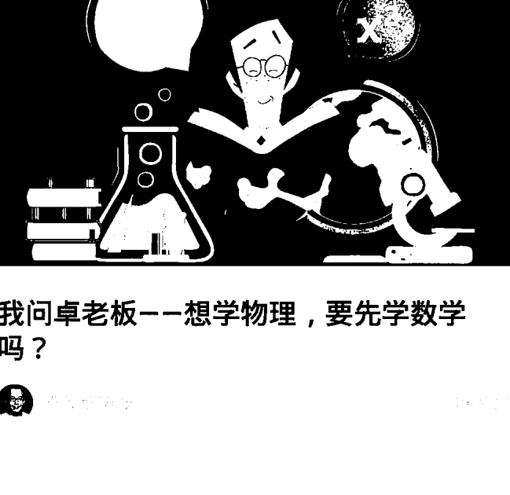

# 我问卓老板——想学物理，要先学数学吗？

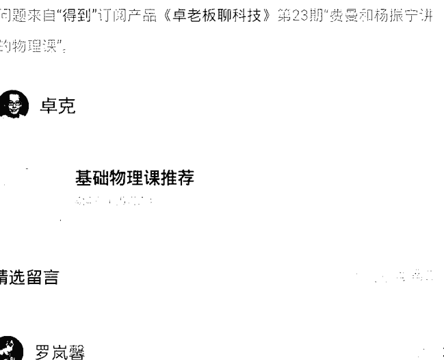

马普堂：对物理学越来越感兴趣了，准备通读《费曼物理学讲义》，不知道是不是还要补补高数？

问题来自“得到”订阅产品《卓老板聊科技》第23期“费曼与杨振宁对话的物理课”。

# 卓克

# 基础物理课推荐

# 精选留言

罗岚馨 3
卓老板，我对人工智能特别感兴趣，尤其是算法。想多了解点这个领域是不是得恶补数学呀？我是個学英语的文科生，数学底子很弱，是不是就没法体会算法之美了~ 你能不能做一期节目给大家科普一下人工智能和算法？~ 如果能听你讲上一期这个话题，那我睡觉都要笑醒啵
08-25 00:56:07

作者 回复
我也慢慢看这些方面的书，但估计咱俩都笑不出来啦
08-25 01:34:46

Frank 1
小米手环2的睡眠检测原理，跟具体检测效果靠谱么？
08-25 07:10:12

郭成 1
作为一个光电子专业的研究生，生命中的五年都与物理和光学共同生活，遗憾的是对于信号与系统的掌握不足，也阻碍了学术上专精的能力。现在导师上的英文课用的素材就是卓老板说的MIT的公开课，物理的美妙在于它用严谨到苛刻的逻辑推理和事实验证来将广阔的世界凝练为简单的规则。领略物理的伟岸，就像是观泰山，站在山脚下隐想山顶的瑰丽风景。但若想在你的精神殿堂中放入这座大山的一草一木，一士一水，你都要付出艰辛的努力，来获取储备的知识，真正理解了理论的根源可能不会让你满足，但能从其中窥听到人类知识文明的底蕴。这或许是物理的根基，从这种意义上来说，物理也是一种宗教，而这些理论实验就是它的教义，希望我们能在物理的路上找到心灵的归宿
08-25 00:31:13

以上留言由 作者 筛选显示

# 人工智能与黎曼的较量

第27期：黎曼猜想（2）

# 手稿中的突破

1.1925年后黎曼猜想的进展就卡在了已计算出的138个非平凡零点上，此后的发展举步维艰，这时候人们就把关注点放在了黎曼的手稿上。

2.数学家的手稿不等于草稿纸，数学家的手稿相当于物理学家的实验记录，那里记录着整个思考过程，这些内容在论文中不太可能出现。

3.黎曼去世后手稿保存情况很不好，先被管家烧掉过一部分，剩下的被妻子赠送给黎曼生前好友理查德·戴德金，但几年后又因为觉得里面有一些家庭隐私，拿回了一部分。最终剩在理查德·戴德金手中的手稿被哥廷根大学图书馆保存。

4.数学史学家哈根对这份手稿很感兴趣，约了西格尔一起研究，西格尔在手稿中发现了黎曼竟然在70多年前已经手工计算出了前3个非平凡零点的具体数值。而且计算方法效率超高。他整理过后形成了黎曼-西格尔公式。

5.黎曼晚年生活拮据，用纸很节省，大部分手稿密密麻麻，整理起来非常费劲。

# 计算非平凡零点的竞赛

1.英国数学家哈代的学生利用西格尔公式把非平凡零点计算到1041个。人工智能之父图灵在1953年3月计算到1104个，1956年推进到2.5万个，1966年推进到350万个。

# 验证零点并非计算零点

1.验证零点时只计算实数部分是不是等于1/2，而计算零点的任务量要大的多。

# 人工智能之父图灵之死

1.1951年底图灵在大街上相中了一个游手好闲的小伙子阿诺德·穆雷，双方关系逐渐深入，发生了性关系。阿诺德的性服务没有收到报酬，于是行窃图灵家，不过图灵也没有和他断了关系，之后一直分分合合。

# 我问卓老板——蜂蜜越贵越好吗？

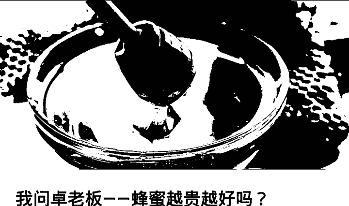

wangbing：能讲讲蜂蜜吗？我们家里人天天吃蜂蜜，但真不知道吃什么样的蜂蜜好，只有买贵的吃。真不知道这样的选择是否正确？

问题来自“得到”订阅产品《卓老板聊科技》《我问卓老板——为什么恒星的1/4是氢？》

卓克

# 蜂蜜未必有益

# 精选留言

Vivian
很受益。希望卓老板能出一期节目专门用科学知识讲讲保健品，也使我们能够少花点冤枉钱。谢谢。
08-28 16:33:54

海召
卓老板，现在很多人有白头发，是不是吃黑芝麻也意义不大？但确实看到经常吃黑芝麻的人白头发变少了。
08-28 16:30:38

joinliu
卓老板可以谈下蜂王浆到底有没有用吗 谢谢~
08-28 17:47:14

地球上的星星
从科学主流观点的角度来论证健康问题。
08-28 16:15:18

阿蟾（茵萌）
怎么什么话题都能扯到吃上去？中国人果然只对吃感兴趣，遇到吃就很多问题要问。
08-29 01:43:32

赵舒羽（豌豆黄）
卓老板，小说《北京折叠》里的折叠世界真的有可能实现吗？
08-29 01:30:54

涉世未深2005
不明白为啥卓老板回复问题的音频有的能请朋友听，有的却不能，右下角没有那个小红按钮。今天讲蜂蜜的特别好，很想分享出去，但未果。
08-29 00:51:30

Helen Yao
绝大部分保健品和蜂蜜一样都是被夸大了功效，甚至根本没有用，还有副作用的。卓老板能否谈谈哪些保健品是有用的呢？比如说：鱼油，益生菌，维他命D，葡萄糖胺等？谢谢。
08-29 00:36:48

黑芝麻14560111
关于蜂蜜一直被错误彻底引导有特殊的功效。谢谢卓老板给出了明确的答案。
08-28 23:54:33

Mars.CN
这个真想让我妈听听，但怎么分享呢？
08-28 23:38:57

# 40%的黎曼猜想

第28期：黎曼猜想（3）

## 哈代与李特尔伍德

1. 哈代最初接触黎曼猜想是计划找出一个反例，推翻这个猜想，后来态度转变，倾向于承认这个猜想，并证明了有无穷多零点在临界线上。

2. 李特尔伍德小哈代8岁，当年接触黎曼猜想属于误打误撞，他的老教授因为对这个猜想的研究状况不了解，当作暑假作业布置下去，结果李特尔伍德后半生就以这个暑假作业为目标攻克了。

3. 哈代和李特尔伍德的合作时间长达35年，交流方式很独特：书信沟通学术思想。而且先看问题，自己解决，再看信中对方的解答。在35年的合作中20年都不在一个城市，但这种高效的沟通让两个人一直保持合作，虽然后来两人都到了剑桥，可以天天见面，但他们的学术沟通还是以这样的方式进行。哈代一生三分之一的论文是和李特尔伍德共同完成。李特尔伍德这个名字曾被欧洲数学家认为是一个杜撰出来的虚拟人物，专门准备为哈代背黑锅。

4. 哈代和李特尔伍德合作解决的黎曼猜想结果是，当零点的虚部，0<Im(s)<T时，临界线上零点的个数在[T/2π×ln T/2π, T/2π]之间，但这相比较全体非凡零点来说比例仍然无限趋近于零。黎曼猜想如果能被证明，这个比例数字应该是100%。

## 临界线上零点比例的推进

1. 塞尔伯格证明了当零点的虚部，0<Im(s)<T时，临界线上的零点个数的下限是T ln T，这个成果首次让临界线上零点个数的比例占全部非平凡零点的比例大于零。

2. 莱文森以62岁高龄写出论文证明临界线上零点占比超过98.6%，但这篇论文中有错误，修正错误后，比例数字下降到34%，后莱文森用尽生命中最后的力量把比例数字推进到34.74%，最后他因脑部肿瘤去世，终年63岁。为了纪念他，推进比例的方法称为莱文森方法。

3. 利用莱文森方法，1980年中国数学家楼世拓和姚琦把比例推进到35%，1983年美国数学家康瑞推进到36.85%，六年后还是他推进到40%，这就是黎曼猜想迄今为止得到的最好的结果。

## 在监狱中研究简化版黎曼猜想

1. 法国数学家埃里·嘉当收到一封监狱来信，是他儿子的朋友，安德烈伊写来的，记述了他逃兵役到芬兰，因频繁和苏联数学家通信被警方怀疑，被判间谍罪面临处死的危机下，芬兰数学家为他出庭作证，才被遣返回法国，最终以逃兵役罪关押在监狱的整个过程。这封信中还有一部分内容是他在候审3个月的时间里做出的简化版黎曼猜想的学术成果。

2. 简化版黎曼猜想利用若干种函数的模算术，对应到了临界线上的零点，函数具体是什么样取决于采用什么曲线，其中椭圆曲线和超椭圆曲线是最先被解决的。

3. 韦伊服从法国军方要求，继续服兵役免除了处罚，但1年后通过伪造肺炎证明退伍，并逃往美国，在普林斯顿高等研究所安度晚年。他一直怀念蹲监狱那3个月时不受打扰的研究时光。

## 黎曼猜想和物理世界的关联

1. 蒙哥马利最先注意到临界线上零点分布的规律和孪生素数对儿在数轴上的分布规律有些类似，并写出了一个关联函数。

2. 他在公布结果时担心普林斯顿的塞尔伯格已经做完了这项成果，所以特地去了一趟，确定一切安全后，他放心的在高等研究所喝下午茶。

3. 下午茶时因朋友Chowla牵线，认识了物理学家弗里曼·戴森，结果戴森发现他研究的关联函数就是自己研究了十年的东西：随机厄密矩阵本征值的对关联函数。这是一个描述多粒子系统在相互作用下，能级分布规律的函数。

4. 一个纯数学的证明竟然找到了物理世界中对应的图谱，这到底说明了什么？现在仍然是一个谜。

## 黎曼猜想中其他贡献者

1. Lious Branges 是一个体制外的数学研究者，他使用的工具没人看得懂，但因为曾经证明出过贝尔巴赫猜想，所以在数学圈也不完全没有口碑，他声称自己证明了黎曼猜想，但文章被人用数学家可以看懂的语言翻译出来后发现里面有致命的错误，再加上他已经年过七旬，精力不足，所以之后不论如何宣称自己有新的推进，都没人相信了。

2. 《美丽心灵》中的约翰纳什是在研究简化版黎曼猜想时患上的精神分裂症，很多人怀疑是黎曼猜想让他发了疯。

## 黎曼的后人

1. 黎曼因肺结核只活到了39岁，最后几年生活贫困，买纸和笔的钱都没有。

2. 黎曼去世后，妻子带着唯一的女儿搬家和黎曼的姐姐一起生活。

3. 黎曼的女儿嫁给了一个数学博士，这个博士曾经常去他导师的家，他的导师施瓦茨就住在她们家隔壁。

4. 黎曼的女儿和女婿，还有妻子、姐姐后来一起随女婿搬家到了不莱梅，因为女婿在那里做航海学校校长，所以他们生活的很不错，但之后并没有人再在数学界有什么影响了。

# 我问卓老板——《拍砖中医》这本书值得买吗？

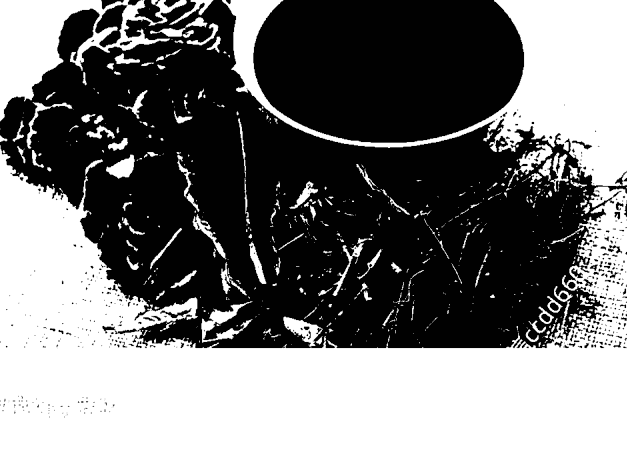

路可以慢慢走：我看了方舟子写的《批判中医》，不知道棒棒医生写的《拍砖中医》符没有新的知识，还有必要再买一本《拍砖中医》来看吗？

问题来自“得到”订阅产品《卓老板聊科技》第26期“世界上最难的数学题是什么？”。

卓克

## 拍砖中医

## 精选留言

刘大大
沙发。卓老板多休息，少熬夜。
08-30 16:06:12

钢琴魔术师
还推荐行医记，林黛玉究竟得的什么病两本书，都是棒棒医生的作品。中医最无耻的就在于，一边挎着老祖宗的典籍，不允许任何人提出批评，另外一方面把典籍中大量已经明确的内容虚化，比如器官，经终等，典型的数典忘祖！
08-30 22:54:44

旅程136
中医药市场规模已经达到一万亿，是赵家人的后花园，权贵集团的大餐盛宴。

郭成
卓老板举的这个例子从现代中医的根基上就证明是存在瑕疵的，中医喜欢用空虚的词汇来进行诊断，我认为这种难以证明错误的医学诊断实际上是对病人的不负责，和对医者责任的规避。从这个例子看来，中医的问题并不在于它有没有道理，而在于中医从业者根本没想给别的人证伪的机会。如果依赖于这种不负责的医学来壮大中华民族，岂不是拿人的生命当游戏玩，而且这种凭借处方经验进行治疗，也很难传承发展，后人没办法推翻前人的错误，只能站在错误的路上去越走越远。
08-30 16:22:05

# 我问卓老板——可口可乐的配方很神秘吗？

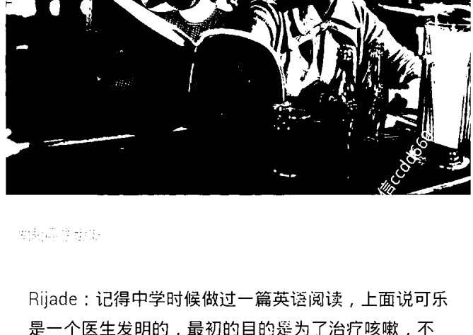

Rijade：记得中学时候做过一篇英语阅读，上面说可乐是一个医生发明的，最初的目的是为了治疗咳嗽，不过那时的味道跟现在的不一样，现在的可口可乐的配方是经过改进的。可乐的配方很神秘吗？据说配方在可口可乐公司是高级机密，很值钱的样子，难怪中国曾经的非常可乐做的来的味道就是差一些。

问题来自“得到”订阅产品《卓老板聊科技》“我问卓老板——为什么恒星的74是氮？”

卓克

## 可乐的来历

## 精选留言

Rijade
谢谢卓老板的解答，我很高兴！的确，无论可口还是百事，核心竞争力还是营销。食品除了成分外，加工技术还是挺重要的，记得以前去一家不太出名的 copying 实习，厂长介绍他们生产线什么的跟伊利是一样好的，我多嘴问了一句：那你们的雪糕口感怎么不如伊利的呀…… 厂长瞪了我一眼，说：你们用的课本还都一样呢，你怎么没考上清华呢？顿觉无语:
08-31 16:42:39

作者 回复
这厂长是不是经常被人这么问，回答这么溜
08-31 17:13:44

地球上的星星
可口可乐和百事可乐，在口感上其实没有太大的差别，甚至盲品都分不出区别来。
08-31 16:19:58

唐门大师姐
如果运动员赛前吃了可乐鸡翅，会不会尿检不合格啊←_←
09-01 00:19:12

Seasonsun
印象中可口可乐在互联网视频和电视广告上，都不惜花重金请明星拍摄投放了很多视频广告，至少广告看上去都挺高大上的，某种意义上说，这可口可乐是一个极致营销的广告公司
08-31 23:41:55

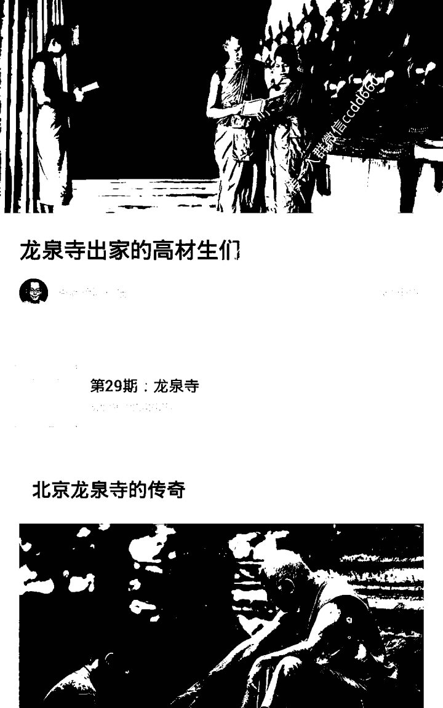

# 龙泉寺出家的高材生们

第29期：龙泉寺

## 北京龙泉寺的传奇

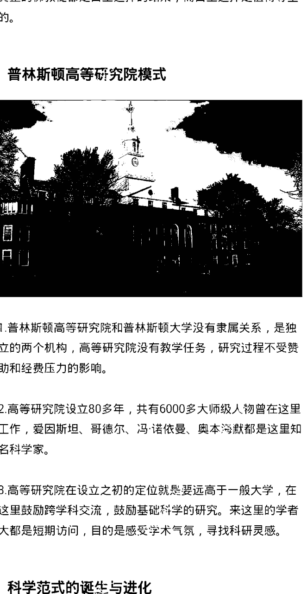

1. 微信之父张小龙曾在微信开发最困难的一段时间在龙泉寺小住，一气之下把技术资料撕了，被龙泉寺的“扫地僧”捡起来粘好，还写下了建议。这些建议的“点化”对张小龙非常重要，等他再回到深圳，微信就一马平川的开发出来了。但这只是个传说。

2. 可以证实的是：禅兴法师是清华的流体力学博士，贤或法师是中科院生物物理研究所的博士，贤启法师是清华大学核能和热能物理博士，贤兆法师是北京航空航天大学教授，贤庆法师是北大哲学系研究生。他们都是龙泉寺的管理层。

3. 龙泉寺现在经常举办IT禅修营。参加禅修营的有北大EMBA，长江商学院，中欧商学院这些MBA们。除了禅修营外，还有动漫禅修营，艺术禅修营，儿童夏令营之类的，这些活动也已经当营收项目运作起来了。传说中的龙泉寺不要门票，不收香火钱，但其实进入龙泉寺要先进凤凰岭风景区，景区门票25块钱。

## 博士、硕士为什么选择出家

1. 工科类专业比理科类好找工作，理科专业的硕士毕业后很难找到对口工作，因为理科的硕士是走向研究之路的过渡，只有博士毕业才算走完。而理科学从大一到博士毕业要10年时间，这需要付出很多努力。

2. 理科专业博士毕业的对口工作只有科研，而科研单位和大学中职位稀缺，只能通过博士后入站的方式边等待边争取机会，博士后3年可以做到副教授就已经很幸运了，在这之前就只能领相对低的工资。

3. 博士生在国内也受到很多研究的干扰，比如每年需要花大量时间在科研经费申请、帮导师拉投资写PPT；学校的考核机制也多基于短期，不利于理论研究的深入。研究理论的博士拿到副教授职位往往35岁以上了，收入不理想+研究不满意，会造成对现实的失望，所以出家也是一种解脱。

## 佛教和其他宗教不同

佛教是没有“侵略性”的，侵略性是指迫切希望别人入教，极端情况下会采用暴力手段惩罚异端思想，发动宗教战争。佛教在2000年的历史中从未有过任何因信仰发动的战争，真正的佛教徒都是自主选择的结果，而自主选择是值得尊重的。

## 普林斯顿高等研究院模式

1. 普林斯顿高等研究院和普林斯顿大学没有隶属关系，是独立的两个机构，高等研究院没有教学任务，研究过程不受赞助和经费压力的影响。

2. 高等研究院设立80多年，共有6000多大师级人物曾在这里工作，爱因斯坦、哥德尔、冯·诺依曼、奥本海默都是这里知名科学家。

3. 高等研究院在设立之初的定位就是要远高于一般大学，在这里鼓励跨学科交流，鼓励基础科学的研究。来这里的学者大都是短期访问，目的是感受学术气氛，寻找科研灵感。

## 科学范式的诞生与进化

1. 科学诞生于人类对艺术和宗教的追求，求证求真的追求让科学研究逐渐形成一种固定的模式，包括如何做研究，发表观点，同意评议，也包含各种细致的学术会议和学术规范。因为学科分类的一再细化，现阶段科学研究的模式更趋于“可规划”和“可预测”。因为大规模的研究投入，委员会是不敢随意冒太大风险的。

2. 普利高津的理论中谈到，远平衡态下形成耗散结构的理论也许对我们有所启发，人类文明的下一个大台阶也许来源于更高效的科学研究范式。

3. 数学研究目前还保留着400年以来一贯的模式，并不像其他学科那样规模型和程式化。

4. 像这种类似普林斯顿高等研究院的模式也许是下一代科学研究范式的萌芽之地。

> ReKI
不知道卓老板会不会因订阅的人少而气馁，得到认订阅了三个，你，李笑来，李翔，最喜欢你，节目很棒很喜欢。另外，我有个工作室，可以帮文章出有意思的插图或者漫画，也可以信息化图表的形式帮助读者更好的理解文字与数据，不知道可不可以以卓老板的文章作为内容做这样的事情
09-02 00:14:33

> 邢宏敏
我原以为科研之路比我们想象的要光鲜，个个都是栋梁之才，其实他们也有苦衷
09-01 16:14:33

> 三时
卓老板说的科研工作者的苦衷真是太对了！虽然是一个工科研究生，但大家的苦衷是相通的！不过还是依然信仰科学，由衷的信仰科学的思想方式，并且认为这是代表人类认知的最靠谱的方式。认识世界虽然很难，但没有哪一件事情比它更值得去做了 ♡
09-02 00:15:55

> 行
上个周末刚去过了，关注可爱的贤二机械僧
09-01 22:42:11

> 陈灵玲
卓老板能不能讲一期关于食物相生相克的那些传言，有那些是有科学依据的，有哪些仅仅是谣传。
09-01 22:27:12

# 我问卓老板——人为什么直立行走？

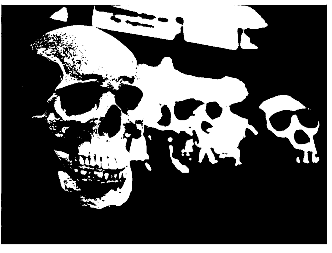

陈轶男：卓老板，最近看了一个观点说：人是在先直立行走之后的几十或几百万年之后，大脑才发育的，然后才有了火和一些工具的发明。但是我记得之前还听说过一种说法，说人是先发育了大脑，脑袋变大以后脖子撑不住了，才直立起来。到底哪个说法对啊？或者说大脑的发育和直立行走到底是个什么时间关系？

问题来自“得到”订阅产品《卓老板聊科技》。“我问卓老板——《怕读中医》这本书值得买吗？”

卓克

## 从四足到两足

## 罗辑思维商城正在推出得到充值礼品卡。

中秋佳节，送份知识更有心意。您可以通过以下方式购买：

+   1. 打开微信 - 右上角添加朋友 - 公众号
2. 搜索 “得到” 公众号并关注
3. 输入暗号： “卓老板”
4. 收到属于你的商品页，下单购买

# 危险的糖

第30期：糖的危害

## 每天应该吃多少“游离糖”

+   1. 世界卫生组织的说法是每天游离糖的摄入不超过每日总热量的10%，建议值上为5%。对应蔗糖来说，5%的建议值就是男人摄入27.5克，女人摄入22.5克。
2. 游离糖指的是以食物添加剂的方式吃进去的糖，比如蛋糕、饮料、巧克力这些，还有炒菜时撒的糖，泡茶时放的蜂蜜，而且它也包含鲜榨果汁和各种鲜果汁中的糖。
3. 鲜榨果汁中含有超量的糖，一听可乐大小的鲜榨苹果汁含糖80克，远超22.5-27.5克的建议值。
4. 不过没有加工过的水果不会造成血糖飙升，因为未加工水果里面的糖还要经过一段时间消化才能进入体内。

## 甜饮料中的糖含量不是最高的

1. 一瓶500ml的可乐，含糖53克。如果一个成年男子一天一半的水用可乐代替，他将吃进去106克游离糖。
如果市面上销售的饮料都换算成500ml容量，糖含量分别为：
冰糖雪梨：63克；
可口可乐：53克；
百事可乐：53克；
雪碧：53克；
酸梅汤：51克；
鲜橙多、水蜜桃、冰红茶，均匀在45-49克之间；
蒾莉清茶和冰绿茶最少，24克。
一瓶可乐中有7勺糖，但是因为可以溶在水中，所以喝下去不费力，如果不溶解，很难一次吃下这么多固体的蔗糖。为了保证甜度，饮料中的糖含量基本都在10%左右。

2. 比饮料含糖量更高的有哪些点心，一般控制在20%，比糕点更高的一些粉状的食物，比如豆奶粉、奶香麦片，黑芝麻糊，菇子蘑，这些含糖量在50%，比粉状食物更高的还有，就是果脯，果酱，一般是60%的含糖量。

## 人类吃糖的历史

+   1. 人类历史10万年中，只有最近1000年我们才有机会能方便地吃到游离糖。之前的9万9千年，我们的主要食物是动物、昆虫和可以随手采到的果实和嫩芽。而那时的果实大都略带酸涩，含糖量远没有农业出现后的水果高。
2. 人类种植水果出现在6000年前，直到公元600年，才有了从甘蔗中提取蔗糖的技术，直到1700年前人类都不能随意吃到游离糖的。
3. 1700年时英国每人每年消费蔗糖1.8公斤。到了1300年，因为灭奴种植的甘蔗大量增加，每人每年消费蔗糖8.1公斤。到1850年，每人每年消费16.3公斤，到了1950年，每人每年消费45.4公斤。美国今天人均年消费蔗糖也大约是50公斤，世界平均水平是25公斤。中国现在是20公斤，但是1980年中国人均是4公斤。其他各位可以计算一下，一个20公斤，一天就是55克糖，已经是世界卫生组织设置的上限了。

## 食品工业下的糖

+   1. 现代食品工业使用的糖大多来自“高果糖浆”，它的成分是果糖，甜度为1.7。高果糖浆是由玉米糖制成的。玉米糖浆90%的成分是葡萄糖，葡萄糖的甜度只有0.7。工业生产中用的高果糖浆一般是42%和55%两种浓度，价格都远低于同样甜度下的蔗糖。
2. 从1984年起，两家可乐公司都更改了配方，用高果糖浆代替了蔗糖，让可乐生产成本进一步降低。但那时没人知道用果糖代替蔗糖对身体更不利。

## 糖对健康的危害

+   1. 1945年-1980年这三十五年间，美国的肥胖人群比例一直在12%-15%浮动，但1980年-2000年仅20年时间，肥胖人群比例猛增到35%。这个时间点和高果糖浆大量替代蔗糖的更换正好吻合。
2. 果糖和蔗糖的分子式都是C6H12O6，但他们的原子空间排布不同，这也导致他们在人体内吸收的过程不同。
3. 蔗糖可以缓慢度吸收，运输蔗糖的转运蛋白质胰岛素非常敏感。果糖不能依次度差吸收，不会大量刺激胰岛素分泌。而胰岛素的分泌会让人有饱腹感，所以高果糖浆为原料的饮料在吃饱时喝也不会增加饱腹感。
4. 各种糖的大量摄入会反复给胰腺增加沉重的负担，造成“胰岛素抵抗”，这种问题如果表现严重就是II型糖尿病，这也是为什么现在大量年轻人出现糖尿病的原因。
5. 美国从1980年起每隔5年公布一次《居民膳食指南》，最开始的几版都推荐低脂肪低胆固醇饮食，让大家对脂肪和胆固醇留下了不好的印象，但实际上我们完全冤枉了胆固醇，也部分程度的冤枉了脂肪，其它他们两个都是为了黑锅。食用越多的糖，心脏病发病率会增加，这还要比食用高脂饮食更有害。

## 食品行业与公共部门的博弈

+   1. 各大食品企业的广告和文化植入已经让很多人形成了：年轻人该喝甜饮料，白领应该喝奶茶、卡布奇诺，老年人该喝茶的印象。而正经的健康宣传内容远不及商业广告的力量。
2. 早在2003年世界卫生组织就曾计划公布每日糖的摄入总量不能超过5%的建议，但被美国糖业协会阻挠，最终只抛了一个风险：蛀牙，公布出来，也没有引起什么注意。
3. 墨西哥从2013年起征收甜饮料税。墨西哥是一个肥胖问题非常严重的国家，最终实施时由于压力税率从10%降到5%。
4. 丹麦从1930年开始征收糖税，但这和糖的危害无关，只是为了征税；2013年丹麦改成脂肪税后很多丹麦食品企业搬家到瑞典和德国，丹麦不得不取消了脂肪税。
5. 美国只有2个城市实施糖税，费城实施每升甜饮料1美元税率，但2016年6月份迫于压力调到0.5美元每升，加州伯克莱0.3美元每升。纽约市还在收与不收之间斗争。英国计划在2018年开始征收糖税，现在正处于和食品企业的拉锯战中。

## 代糖安全吗？

+   1. 糖精1950年出现，是最早的代糖，但1970年被一些大鼠实验表明会引发膀胱癌，在反复争论下，最终美国食品药品管理局决定，可以在标注“本产品含糖精，有可能对健康产生危害”的前提下继续使用。但2000年才有更多的实验证实，糖精被冤枉了，大鼠的尿液成分才是导致膀胱癌的根源。糖精彻底被冤枉了，但也再也无法翻身。
2. 糖精的没落给了其他代糖机会，阿斯巴甜、木糖醇、蔗糖素、甜菊糖都是甜度好几百倍的代糖。
3. 零度可乐中使用的阿斯巴甜是每升0.18克，比使用53克糖要少很多，阿斯巴甜也曾一度遭到很多质疑，但经过N多验证，目前所有关于阿斯巴甜的怀疑都没有成立，美国食品药品管理局和欧洲食品安全局一致认定阿斯巴甜是安全的。

## 罗辑思维商城正在推出得到充值礼品卡。

中秋佳节，送份知更心意。您可以通过以下方式购买： 1. 打开微信 - 右上角添加朋友 - 公众号 2. 搜索 “得到” 公众号并关注 3. 输入暗号： “卓老板” 4. 收到属于你的商品页，下单购买

## 精选留言

# 我问卓老板——数学是精英们用来秀智商用的？

仰望星空：今天听完第二期“黎曼猜想”，又去维基百科查了有关黎曼生平和黎曼猜想的有关内容！1854年，波恩哈德·黎曼初次登台作了题为“论作为几何基础的假设”的演讲，开创了黎曼几何学。而黎曼几何为爱因斯坦在1915年提出的广义相对论提供了数学基础。广义相对论的另一个数学工具“张量分析”则是由意大利数学家、理论物理学家格雷戈里奥·里奇·库尔巴斯托罗在1890年发展出来的。数学在某种程度上是精英们秀智商的工具，但在秀智商的同时也为人类对世界的认知做好了充足的铺垫。卓老师，你怎么看呢？

问题来自“得到”订阅产品《卓老板聊科技》第27期“人工智能与黎曼的...”.

卓克

爱因斯坦也搞不定数学

# 我问卓老板——螺旋藻能长期食用吗？

面包男孩：卓老板，被传含有人类所需所有营养物质的螺旋藻，长期吃对人有好处吗？

问题来自“得到”订阅产品《卓老板聊科技》、《我问卓老板——拒绝中医》这本书值得买吗？

卓克

## 螺旋藻的神奇功能

## 罗辑思维商城正在推出得到充值礼品卡。

中秋佳节，送份知识更有心意。您可以通过以下方式购买：

+   ① 打开微信 - 右上角添加朋友 - 公众号
② 搜索 “得到” 公众号并关注
③ 输入暗号： “卓老板”
④ 收到属于你的商品页，下单购买

# 连环杀人案中的DNA技术

## 第31期：Y-STR基因检测技术

### 白银连环杀人案始末

1.1988年-2002年的14年间，高承勇在白银市和包头市连续奸杀11人，而且都选择的是穿红衣服务的女子。这件事情在很长一段时间里造成白银市的恐慌。2002年后，高承勇就收手不干了，最终于2016年，警方通过Y-STR的基因技术找到了线索，这才抓获了他。

2.高承勇的经历：1983年和1984年两次高考失利，报考飞行员，结果因为家庭中有地主的成分没有通过政审，女朋友也因此提出分手，让他对女人怀恨在心。又因为前女友穿红色衣服，所以在之后的连环杀人案中高承勇都选择了穿红色衣服的被害人。

3.为了侦破连环杀人案，白银市曾经在全市范围内采集指纹信息，对比过几万人的指纹信息，还是没有找到凶手。

4.高承勇的叔叔今年夏天因为行贿被监视居住，警方按流程采集了他的Y-STR信息，测试结果竟然和白银市连环杀人案的Y-STR信息吻合。警方立即查阅了高家族谱，锁定了高承勇。

### Y-STR基因检测技术

1.Y-STR是在性染色体上的一个片段，可以作为一系列很有特征的标志位，通过基因技术，就能放大这些基因的差异，增加了识别性。

2.Y-STR技术是在1994年逐渐成熟的，2001年国际法医协会把Y-STR技术的标准和规范公布出来之后，被各地DNA数据库广泛利用。它的优势在于需要的DNA量非常小，对样品新鲜程度要求低，检测速度快，成本便宜。

3.Y-STR技术也有一些局限，它只能把嫌疑范围限定在一个家庭父系的所有男性成员。

4.在Y-STR技术出现前，警方破案普遍采用的是小卫星VNTR技术，这个技术虽然可以定位到个人，但因为对测试样品要求很高，成本高，测试时间长，所以在大规模采集数据时不会采用。

### 生物技术对破案率的提升

1.传统破案方法对超过20年以上的案件几乎不能为力，因为目击证人和犯罪现场几乎全都不在了，但是还可以用DNA技术来协助破案。

2.通过积累有案底的犯罪分子的DNA信息，可以高效的在几千公里以外的地方发现逃窜多年的嫌疑人。

3.Y-STR技术不需要找到嫌疑人的DNA做对比，只要找到嫌疑人家庭的男性成员就能锁定范围。

### 基因技术发展的思考

1.新生儿出生前采集DNA信息入库，可以解决今后很多问题：失踪人口确认，拐卖儿童父母找回，骨髓移植型，器官移植型，犯罪分子监控。这种基因数据库的配合方式在批量解决问题上的效率非常高。

2.基因技术起源于1953年沃森和克里克对DNA双螺旋结构 Ceremony。 当时用最先进的显微镜是没法看到DNA的化学结构的，克里克是采用了X射线衍射图像分析的技术才确认了DNA的结构。

3.克里克曾经是物理学家，转行研究生物，扎实的物理功底让他把基于量子力学的知识熟练地运用于生物分子结构的分析中。而1900年-1925年发展起来的量子力学，估计也没有料到，这朵基础科学之花能结出这么多果实来。正是基础学科的力量才保证了我们可以跨越时空，把知识碎片都联系起来。

## 罗辑思维商城正在推出得到充理由卡。

中秋佳节，送份知识更有心意。您可以通过以下方式购买：

+   1. 打开微信 - 右上角添加朋友 - 公众号
2. 搜索 “得到” 公众号并关注
3. 输入暗号： “卓老板”
4. 收到属于你的商品页，下单购买

## 精选留言

亚林
Y-STR只能检测男性，在警察遇到了女性犯罪，还有没有其他的生物技术手段类
09-08 23:11:36

亚林
生物技术越来越便宜，应用越来越普遍，希望这技术也想计算机技术一样遵循摩尔定律
09-08 23:08:50

# 我问卓老板--糖会伤害身体，那代糖呢？

十三：科普了。原来关注食品的营养成分表，看到能量和脂肪不高就比较安心，现在要重视碳水化合物这一项了。不过，想问卓老板一个问题，零度/健怡可乐真的不含糖？代糖物质有没有其他影响？

问题来自“得到”订阅产品《卓老板聊科学》第30期“危险的糖”。

卓克

## 食物中的代糖

# 质量与能量如何转换

## 第32期：能量的变化

### 装满数据的硬盘比空的硬盘更沉吗？

在计算机等级考试中，装满的盘和空盘是一样沉的，而实际上具体谁沉，要看用的是什么硬盘。使用机械硬盘，装满的时候和空盘质量一样，因为他们的区别只是其中磁头的方向变了。而如果 melody

### 化学变化中的质量变化极其微弱

+   1. 以1000瓦的功率燃烧煤炭8小时，发热的总量相当于百万分之一克的煤炭质量转化为能量，这么微小的质量变化很难被发现，直到1905年相对论诞生了。 2. 物理学家们谈及微小粒子的质量时，经常用“能量/光速的平方”来表示质量。一个氢原子因为电子运动状态不同而导致的质量最大变化是13.6eV/光速平方。 3. 电子伏特（eV）是能量的单位，代表一个电子在1伏特电压下运动，动能提高的幅度。

### 物理学家的自豪感从哪儿来

+   1. 在一些物理学家眼中，化学在某种意义上是物理学的一个分支，它研究的是两个原子逐渐靠近，而又不会靠的大近的一门科学而已。 2. 著名物理学家泡利的妻子在结婚后不到一年的时间里移情别恋。泡利对此十分地懊恼，但造成他懊恼的主要原因不是两人的婚姻破裂，而是吸引他妻子的是位不知名的化学家。物理学家 户瑟福在安慰泡利时，用“科学只有两类，一类是物理学，一类是集邮”来形容其他学科的知识体系没有量化的理论。

### 核裂变还能测年龄

+   1. 铀元素自然放置下原子核都不会稳定的存在，它会以一个稳定速度逐渐放出质子，最终变成铅。大约需要经过45亿年，铀238中会有一般 Hari...

# 我问卓老板——红糖补血吗？

阎尽攀华20721563：卓老板，我想问下红糖补血吗？

问题来自“得到”订阅产品《卓老板聊科技》 - “买吧卓老板——科学家帮我们来好好问明白？”

卓克

吃啥补啥，不靠谱

饼干 5赞
坐月子的时候，嗑了不少红糖，敢情唯一功能就是贴膜。话说老板能说说，为什么中国人就好坐月子，但是同为黄种人的日本人就不坐呢，好像全世界就中国人体质最弱。0:32

如果 2赞
卓老板，关于生活中饮食营养补给与营养相克方面的知识，您多介绍一些呗，让我们也从科学的角度多了解了解。1:02

杨勇强是社稷师也是攻城师 1赞
老板讲讲为什么华人女性容易痛经，而欧美人则很少发生这种现象
2:16

丁丁糖 1赞
好接地气的一期
1:15

陈灵玲 1赞
这种小醉酒的问答真好，不需要很深入的挖掘，直接可以运用卓老板辛苦考证来的结论。0:27

洛基浣熊 0赞
老板有空时候能否科普下心梗和心绞痛的应急，评价下速效救心丸和硝酸甘油片
1:00

Rijade 0赞
哈哈，吃脂肪补脂肪，这梗记住啦口
0:11

黄展新 0赞
终于等到了

# 中秋礼物——你不了解的月亮

中秋礼物：你不了解的月亮

中秋节，少不了阖家团圆、院中赏月，但赏了那么多年月，你真的了解它吗？

“卓老板聊科技”的主播卓克就从科学角度告诉你，关于月亮，你有很多“认识”是错误的，比如：

很多人认为，月亮是地球之外完全不同的另一个星球。

卓克说：现在最流行的科学观点认为，大约45亿年前，地球被超级陨石撞击，月亮是被撞出去的碎块儿。所以地、月“本是同根生”，你仰望的是地球的一部分。

很多报纸自豪地说：阿波罗登月后，宇航员可以在月球上看到长城。

卓克告诉你：假的！你看从月球拍摄的地球照片，连陆地和海洋的边界都看不清，更何况20米宽的长城？

不少科幻小说里描写道：月球像个大皮球，内部是空的，它可以作为外星人进攻地球的潜伏基地。

卓克说：不对！阿波罗号登月飞船测试过，月球和地球一样是实心的，内部是个约300公里的液态大铁核。

关于月球最大的传言是：美国登月是个弥天大谎，因为月球上没空气，登月照片里的美国国旗不可能飘起来。

卓克告诉你，那是NASA宇航员为了让国旗展开，用铁丝撑的，铁丝弯弯曲曲，所以才有了“随风飘扬”的效果。

## 精选留言

c
卓老板可不可以聊下，美国的重返月球计划。既然美国30多年前就可以登月球了，那为什么此后的30多年没有欧盟，俄罗斯的登录。既然30多年前就有这样的技术了，为什么美国重返月球要准备这么久？

## 精选留言

卓老板可不可以聊下，美国的重返月球计划。既然美国30多年前就可以登月了，那为什么此后的30多年没有欧盟，俄罗斯的登录。既然30多年前就有这样的技术了，为什么美国重返月球要准备这么久？
09-15 07:38:08

亚林
2
火炉旁最好的位置，总是留给说书人。老板，月饼节快乐
09-15 07:15:21

作者 回复
谢谢～也祝你中秋快乐
09-15 07:46:22

明辉
2
一直喜欢卓老板的节目，也祝你中秋快乐
09-15 02:05:24

十三
2
嗯，直接把进度条拉到最末。天涯共此时。
09-15 01:39:40

作者 回复
有进度条就是好～
09-15 01:52:03

starking
1
这是什么曲子啊？挺好听的
09-15 08:14:13

作者 回复
nothing else matters
09-15 08:37:18

张鹏36500512
1
谢谢这样的物超所值，卓克节日快乐！
09-15 08:10:51

黄展新
1
原来卓老板还是个文艺青年啊 ☺
09-15 07:56:47

徐曹植
1
最后一段想象恨过瘾哈哈
09-15 07:53:51

唐门大师姐
1
地球是时间和空间最伟大的作品，有着太多的奇迹，这些奇迹不管我们知道或不知道，不管我们礼赞或者无视，它们一直都在那里。真正决定每个人面对这些奇迹的态度，真正决定每个人在这些奇迹中的状态，真正决定决定这些的是知识!知识为我们搭建高度，打开角度，而传播知识的人就是帮我们鉴证奇迹的人，帮助我们对平凡的事物惊艳它们的如此不凡，对不可思议的现象感叹并大呼原来如此!所以，卓老板中秋快乐！
09-15 07:30:31

作者 回复
谢谢，这段写的好
09-15 07:45:47

□ □ 青莲的佛珠 □ □ □ □ □ □ □
1
中秋节快乐
09-15 07:27:53

# 和微生物相处的日子

## 微生物统治的地球

## 微生物统治地球

1.地球诞生后的10亿年里微生物诞生，如果把地球发展的时间比到一天的24小时中，那么5点的时候微生物开始出现，23点59分58秒的时候智人开始出现。

2.我们所熟悉的生物界大都是真核生物分支下体积极大的生物，这部分生物只占生物全部种类的很少一部分，绝大部分生物都是微生物。

3.病毒大都和人类老死不相往来，99.9%的病毒感染的是微生物，微生物在高压、高温、无氧的条件下也能大量生存。

## 100个人能战胜10万军队？

1.宏观世界的经验很难理解微生物的生存规律的，比如抗生素可以把100亿个细菌杀死到只剩下千分之一，但这千分之一幸存的微生物又可以在很短时间内恢复到100亿的数量。

2.我们肠道中的微生物有400多种，它们的数量起伏很大，有时候会有4-5个数量级的变换那么大，他们生活在一起是怎么达到生存策略的稳定的？这是一个很值得研究的问题。

3.曾经的医学一直认为，阴道因为有乳酸杆菌的存在，所以呈现弱酸性，这种弱酸性保护了阴道不受其他病菌的侵袭。而实际上最近的研究发现，1/3的女性阴道的主要菌种并不是乳酸杆菌，阴道内也不是弱酸性，但是她们阴道中的菌群也可以很稳定，而且抵御外界细菌的能力一点也不比另外2/3差。

4.一个人肠道内的细菌的种类、数量和他的饮食习惯高度相关，如果调整饮食习惯也会导致肠道细菌大调整，但这种调整并不会导致我们生大病，像这样在剧烈的变化下产生的平衡很值得人们研究。

## 微生物和人共生

1.成年人体内有2公斤微生物，大部分集中在结肠里，它和我们是一种共生关系，能消化我们不能消化的纤维素，分ibits出氨基酸或者脂肪酸。我们为细菌提供生活场所和纤维素，细菌为我们提供脂肪酸和氨基酸。

2.伤口要凝结，就需要大量的维生素K。我们人体虽然可以自己合成，但是效率很低，而体内的微生物合成维生素K的效率就远高于人体，所以我们体内的微生物还可以帮我们愈合伤口。

## 致病微生物

1.人体鼻腔内长期存在着金黄色葡萄球菌，这是一种致病菌，但因为在鼻腔里和其他菌群达成了稳定状态，所以并不危害人类健康。但是，一旦因为抠鼻子导致金黄色葡萄球菌突破了鼻腔粘膜，就会致病。

2.微生物曾经是导致人类死亡的最主要的原因，像白喉、霍乱、肺炎、猩红热、结核病都是它们引起的。

3.有些父母认为孩子生怪病的原因是因为他们生活的环境太干净了，身体的免疫功能就不能完全发育。为了让他们提高抗病能力，家长们有意识让他们接触宠物、脏东西，甚至吃下泥土。其实这是一种非常时髦的方法，因为脏的环境中的微生物，还有宠物身上的微生物并不是为人体设计的微生物，所以更容易导致其他疾病。

## 人类微生物组计划

1.2007年美国国立卫生院启动了人类微生物组计划，为生活在人体内微生物的DNA测序。

2.在人体内可以找到200万以上的基因，但其中只有2.3万个是人的基因，另外的99%都是人体内微生物的基因，所以微生物在人体内是绝对不能忽视的存在。

## 青霉素作为药物诞生

1.1928年人类首次发现了青霉素的杀菌作用，这纯属运气好，因为只有那支培养皿中的青霉菌会产生较多的青霉素，后来的相关研究就渐渐冷却下来了。

2.直到1940年，因为二战导致大批伤员感染，才逼迫人们重新审视青霉菌，最终在北方实验室找到了一株1毫升可以产生250个单位青霉素的青霉菌，而此前的产量是1毫升4个单位。后来，在1943年人类成功筛选出一株突变的菌株，1毫升可以产生5万个单位青霉素，至此，青霉素正式运用到医学中。

3.美国第一例使用青霉素的临床案例是1942年，33岁的女护士因为流产感染，在濒临死亡时得到了治愈，最终还活到了90岁。

## 抗生素的非议

1.最初对抗生素的安全性确认太草率，几周内没有观测到问题就可以通过安全测试，这造成了四环素牙、药物性聋、骨髓造血功能失效等问题，但相比这些损失，抗生素带来的益处更大，所以还是造成了抗生素滥用。

2.抗药性产生的主要成因并不是医生给病人滥用抗生素，而是农牧业的巨量抗生素使用。

3.人类将在几十年后的细菌感染中面临无药可用的地步，也许那时大幅度人口削减会给人类文明发生提供一次新契机。

## 精选留言

w028
《理性乐观看派》
09-16 01:05:29

以上留言由作者筛选显示

# 我问卓老板——人类怎么不登月了？

C：卓老板可不可以聊下，美国的重返月球计划。既然美国30多年前就可以登月了，那为什么此后30多年，欧盟、俄罗斯没有登月？既然30多年前就有这样的技术了，为什么美国重返月球要准备这么久？

## 卓克

## 重返月球

## 精选留言

卫立洲 3赞
卓老板你好。所有订阅中你的是听得最带劲的。癌症在我们心里产生了足够的恐惧和阴影。食物空气污染。生活压力大等等很容易就都影响了癌症。似乎癌症到了感冒的级别。甚至有的人生活很健康也换了类似于肾癌和鼻咽癌乳腺癌等。请问你对于癌症的看法是什么？另外有的人说即使化疗后人财两空也救不了，很多人就不化疗了，但医生说此人放弃化疗很快就死了。日本有个近藤诚的癌症专家写了一些书，但是到底该信谁的？
8:31

D.s 1赞
如果所有的音频都有文字就更好了
14:39

# 人类与抗生素的大乱斗

## 人类与抗生素的大乱斗

## 抗生素在医疗中使用过量

1.1945年抗生素刚开始运用到临床，全年才一共只有64个处方使用了抗生素。65年后的2010年，美国的医生一共就开出了2.58亿个含抗生素的处方，处方量增加了400万倍。现在，所有处方中，每1000个里就有833个含有抗生素。两岁以内的孩子是抗生素的最大消费者，平均每人每年使用1.4次，到10岁前平均每人每年使用抗生素1次，到20岁之前平均每人已经接受过17次抗生素治疗了。20岁-40岁这二十年里平均每人接受13次抗生素治疗。总共算下来，一个人40岁之前平均接受了30次抗生素治疗。

2.抗生素合理的使用方式是当细菌感染，生命受到威胁时才使用。而一个人活到40岁，在抗生素诞生前一般只会遇到几次危及生命的细菌感染。

## 农牧渔业中的耐药菌

1.大量抗生素的使用杀死了体内大部分的细菌，筛选出了有耐药性的正常细菌，耐药菌就成为今后体内细菌的大多数。体内正常菌群的耐药性基因会通过质粒扩散导致病菌，致病菌就会迅速获得耐药性。

2.绝大部分抗生素产生的耐药性并不是医疗环节导致的，而是农牧渔业为了增加产量导致的。美国农场主普遍给牲畜使用小剂量抗生素，目的不是为了对感染，而抗生素的一种副作用是让幼体增肥。

3.据不完全统计，美国每年80%的抗生素用于农牧业养殖增肥，并且美国食品药品监督管理局不要求农牧业主和药企公布这种用途的销售记录，农牧渔业购买抗生素不受处方限制，不需要公布用途。美国出现这种情况是由于大规模农牧渔业和药企的利润巨大，绑架了政策。

4.在规模相对较小的欧洲，瑞典最早于1986年禁止使用抗生素给牲畜增肥，欧美地区国家随后在1999年禁止使用抗生素增肥。但美国一直处于利益集团的拉锯战中。

5.对屠宰场猪肉的调查中发现，绝大部分肉类含有耐药性，甚至还有抗甲氧西林金黄色葡萄球菌的这种危险的微生物。

## 抗生素的残留问题

1.对于牲畜，最后一次给药到屠宰，需要间隔足够长的时间以保证抗生素分解，但很少有厂商可以自觉做到这一点，于是牲畜体内抗生素残留问题就很严重。

2.即便是合乎标准的牛奶中也依然残留了各种抗生素，虽然量级只有治疗用量的几百分之一，但因为每天都喝牛奶，所以在长期食用奶制品和肉类时，总量相当于治疗用量。

3.受抗生素残留问题影响最严重的是正在发育的儿童，微量抗生素有利于增肥的效果对牲畜有用，对儿童也一样有用。

## 母子间的微生物

1.孩子出生前，母亲肠道的微生物品种会发生大幅度变化，变成吸收营养效率更高的微生物品种，同时母亲的血糖也会提高，这种变化的风险是少部分女性会得妊娠性糖尿病，如果人们弄清怀孕前后母亲肠道微生物的变化，也许今后严重的妊娠性糖尿病就可以利用微生物治疗。

2.包裹孩子的羊水是一种富含乳酸杆菌的粘液，它们粘附在孩子口鼻和皮肤上，起到了很好的保护作用。原始人清楚新生儿主要靠舔酥，所以母亲口腔中的微生物也会保护孩子。

3.孩子在通过产道时还会吞咽一些粘液，这些菌种将帮助他们建立最初的免疫系统，还能帮助他们消化母乳。剖宫产的孩子缺少这些环节，他们出生后身上带有的典型细菌和手术室、病床上发现的菌群非常类似，不过就算最初剖宫产和顺产的孩子身上所带的菌种怎么不同，2个月后他们还是会趋于一致。人生最初的2个月所带菌种的差异会影响后续什么，现在还是研究的重点。

4.医院为了稳妥起见，会大比例的在生产前注射抗生素，这些抗生素一部分会进入婴儿体内，还有一部分会随乳汁进入婴儿体内，它们会干扰婴儿最初体内微生物的形成。

## 乳酸菌有助于消化吗

1.乳酸菌号称300亿一瓶，这并不是虚假宣传，一些大企业的产品往往还高于此值。

2.乳酸菌的活性要保持，就需要维持在2℃-6℃的环境中，所以饮料企业需要从生产、包装、运输、销售等环节都格外小心，最终超市售卖的饮料中，活性菌占比在60%-80%，基本保留了大部分。

3.喝乳酸菌饮料效果不明显的主要原因是胃酸对乳酸菌的杀伤性太大，通过胃以后，大约只有百万分之几的乳酸菌可以活下来。这个数量相比结肠内1000万亿级别的菌群来说不值一提。

## 精选留言

Oe 2赞 还没听，早上地铁听。桌老板辛苦了，这频率和赞那个形成了鲜明对比，不谄媚充数，让人尊敬。

## 我问卓老板——中国人为什么坐月子？

饼干：坐月子的时候，嗑了不少红糖，敢情唯一功能就是贴膜。话说老板能说说，为什么中国人就好坐月子，但是同为黄种人的日本人就不坐呢？好像全世界就中国人体质最弱。

新起点鼓校~王俊：聊聊头发吧！看你的头发也不多了！这个是不是世纪顽症啊？

## 卓克

## 中国人为什么坐月子，以及脱发有治吗？

## 精选留言

行 2赞
卓老板好！每天听你的节目成为了一种习惯，为你丰富的知识储备和快速学习能力所折服！能否分享一下你获取知识的方法和途径，谢谢！
7:15

北京长丰种业 1赞
希望老板以后能多讲些脱发方面的知识以及前列腺炎治疗方面的知识
7:53

北京长丰种业 1赞
卓老板，非常感谢你的这档节目，听完之后我立即去买了那两种药 如果效果好话，真能防止脱发 一年后我打赏1万元。其实治疗脱发我花了十几万了 没有一点效果这两年我都放弃了 今天听了你的节目 我有有了信心 因为我只相信你。因为你是我的偶像 你的节目我每期都听的不只一遍。非常感谢你
7:51
作者 回复
等你的好消息
8:51

小雨点 1赞
科普很重要，刷新了以前陈旧的不对的观点。虽然听数学很吃力，反复听，居然喜欢上了。有个问题想请教：一运动如慢跑，脸就爆红，脸上温度比身上的要高，这是因为脸上毛细血管扩张吗？为什么会这样？有什么方法处理吗？
6:38
作者 回复
如果没感觉其他不舒服，也不用处理吧，带面具跑？
7:05

媛媛75431855 0赞
多讲讲坐月子那些坑
8:36

## 我问卓老板——怎样才能感受到奇迹？

唐门大师姐：地球是时间和空间最伟大的作品，有着太多的奇迹，这些奇迹不管我们知道或不知道，不管我们礼赞或者无视，它们一直都在那里。真正决定每个人面对这些奇迹的态度，真正决定每个人在这些奇迹中的状态，真正决定这些的是知识！知识为我们搭建高度，打开角度，而传播知识的人就是帮我们鉴证奇迹的人，帮助我们对平凡的事物惊艳它们的如此不凡，对不可思议的现象感叹并大呼原来如此！

留言来自“得到”命理产品《卓老板聊科技》“数.lookup - 你不知道的科学”

## 卓克

## 怎样才能感受到奇迹？

## 精选留言

地球上的星星 1
从生物学的角度，看待人类文明的发展，以及与大自然之间的关系。
09-22 08:45:03

仗剑 0
生活的富裕是文化和科技进步的基石。
09-22 08:13:53

老高天津 0
非常感谢卓老板！听了很多次，收获很大，而且知道了数学的重要性。特别想到孩子的教育，我的大儿子今年初一，二儿子小学一年级，向您请教，希望帮助孩子们系统地学习数学，打好数学基础，除了课本上的知识，我可以帮助孩子们做哪些课外的补充学习？甚至包括我自己也想好好学习数学了。请教学习数学的路径以及可以借助的资源和工具。
09-22 07:35:53

涉世未深2005 0
从这个意义上，感受奇迹，不是出于生物本能，而是“闲下来”之后的副产品。所以，能听音乐、看画展、参加观看奥运会、听“得到”、获取“无用”的知识，正是人类拜托“生存劳累”的证明。退化，还是进化，不知道哪种表达更准确。
09-22 06:42:04

Monica Li65778168 0
他们几个家庭的延续是近亲繁殖吗？
09-22 03:40:25

郭成 0
人口的不断增长和环境承载力之间的关系一直以来的看法都是人口增加会消耗土地上的资源，但我认为未来这个世界最重要的其实是人口，作为蜂窝智慧群体的人类是未来的地球智慧的载体，而人类的数量就像这个智慧的神经元，尽管人工智能会代替人的大部分重复性工作，但它也会赋予人之所以为人的意义，我们生来就是为了改变世界，我们觉得人口过多，对环境不好是由于有存量思维的思考，认为资源的总量是有效的，而我认为人口应当看为增量思维，一切资源一旦缺乏，必定会鼓励人群中的人去发掘新的替代资源，对人口的恐惧实际上是对资源不足的恐惧，商业社会会帮助我们解决这种问题，而星际文明更是人类下一个维度的发展，成本的魔咒会推动着人类不断增多，能量不断增强。希望更多的人类为我们带来更多的多样性，谁知道上帝什么时候又会撕下爱因斯坦一样的色子，带我们进入新的文明。
09-22 02:10:09

皂妃蒙蒙有理了 0
奇迹是一个已经被异化了的词，意指宇宙和自然的时候，奇迹被用来形容“未知”和“恢宏”；意指人类社会时甚至都趋于了滥用。今天文中所说，既像是对人类文明的歌颂，又似乎带着一丝对“奇迹”一词的回避保守并不期待的模糊情感，让我仿佛站在宇宙的无尽之中，回看着这个无尽的宇宙。沉入黑暗，眨着一颗蔚蓝的星球。
09-22 00:38:04

以上留言由作者筛选显示

## 好好认识你的胃

好好认识你的胃

## 幽门螺杆菌不是外来户

- 1. 幽门螺杆菌从哺乳动物进化初期就生活在他们的胃里，后来进化成了不同种类，每种动物胃里的类型不同，猎豹、猪牛羊、海豚和人类都各有各的菌种。
- 2. 人们通过分析胃中幽门螺杆菌的DNA，可以映证人类走出非洲的时间，也可以证明美洲原住民来源于东亚，南美沿海居民有欧洲后裔。

## 胃炎和胃溃疡

- 1. 胃炎是指胃粘膜的炎症反应，就是免疫系统工作起来以后对抗感染时的表现。发热、红肿、粘膜充血都是典型的炎症反应。胃炎只存在胃粘膜上，通常面积比较大。
- 2. 胃溃疡是胃粘膜上出现了溃烂点，并且已经穿透胃粘膜直至肌肉组织，严重的胃溃疡会造成胃穿孔，这时候胃液、没有消化的食物残渣会通过溃烂的部分漏向腹腔，造成整个腹腔的大面积感染，是一种危及生命的情况。

## 幽门螺杆菌与胃病

- 1. 1979年两位澳大利亚医生观察到胃炎、胃溃疡患者的胃里有一种S型的细菌，这是人类第一次发现胃中有细菌，从前的主流认识中认为胃酸环境下是没有细菌存在的。他们认为这种S型细菌就是导致胃炎和胃溃疡发生的诱因，这个细菌也就是幽门螺杆菌。
- 2. 这两位澳大利亚医生关于幽门螺杆菌和胃病的论文没有得到主流医学界认可，迫于无奈，其中一位医生马歇尔在做好一切实验准备后，自己喝下一杯幽门螺杆菌培养液，患上了急性胃炎，然后马上使用替硝唑片治疗，几天之后症状消失，两周后胃里的幽门螺杆菌消失。这次危险的人体尝试得到了更多人的重视，相关论文之后也在《柳叶刀》发布。
- 3. 在这次危险的尝试中，其实另外一个医生沃伦也喝下了幽门螺杆菌培养液，但他却未能用替硝唑片治好，后来经过了几年的时间才恢复。
- 4. 1994年世界主流医学界已经接受了胃炎、胃溃疡是幽门螺杆菌感染导致的，所以杀灭幽门螺杆菌成了治疗胃病的主要方法。马歇尔和沃伦也在2005年因为这些研究获得了诺贝尔奖。
- 5. 在檀香山心脏研究计划和后续的很多长期大数据统计中，研究员们发现了幽门螺杆菌和胃炎、胃溃疡、胃癌的相关性很高，进一步认定了幽门螺杆菌是致病因素。
- 6. 随后研究人员又发现，有部分幽门螺杆菌带有CagA基因，毒性更强，感染上它的患者患胃炎的比例更高，还有一种变异的幽门螺杆菌可以分泌比正常菌更多的穿孔蛋白，会导致更严重的胃溃疡，至此，胃炎和胃溃疡是幽门螺杆菌导致的已经在医学界达成了新的共识。

## 幽门螺杆菌亦正亦邪

- 1. 在研究幽门螺杆菌的过程中，免疫学家注意到哮喘患者中，胃里完全没有幽门螺杆菌的人第一次哮喘的平均年龄是11岁，带菌的人群第一次哮喘的平均年龄是21岁，于是怀疑幽门螺杆菌在胃中的长期存在是有其他原因的，也就是免疫调控。
- 2. 从统计数据中还发现，带菌者患哮喘的概率比不带菌者患哮喘概率高30%，带CagA型菌的比不带菌者患哮喘概率高40%。
- 3. 2000年后，我们对幽门螺杆菌的研究更加深入，认为它在漫长的历史年代一直与脊椎动物一起生存，但是动物并没有进化出清除它们的机制，原因是它们在胃中对免疫调控起了作用，它就像一把尺子，衡量什么时候免疫应该启动，什么时候不该启动。
- 4. 经过研究发现幽门螺杆菌越多，胃酸反流出现的情况就越低，现在的研究也反应出幽门螺杆菌对胃酸分泌起了调节作用，不带菌的人到老年后依然会分泌很多胃酸，容易胃酸反流，造成食道癌和肺腺癌。
- 5. 总结来看，幽门螺杆菌在胃中的坏处是增加患胃炎、胃溃疡、胃癌的风险；优点是降低食道癌、肺腺癌风险，减少免疫力疾病的发作。

## 去医院找什么样的医生看病稳妥

三甲医院中40岁出头的医生稳妥的概率最高，因为他们在知识结构和经验技术上达到了很好的平衡点。而岁数超过60的知识结构欠缺，岁数小于30岁的经验不够多。

## 用户留言

Lux
亦敌亦友的老住户，我们家族大概走了一背运。爷爷三兄弟都死于胃癌。叔叔这几年正被幽门螺杆菌攻击到在家休养。那我父亲是不是概率也挺高的？也没办法预防规避。
09-23 01:24:47

作者 回复
确实有部分人会被幽门螺杆菌严重攻击，趁着年轻查查看吧，预防住院换来一些微生物消失还是值得的，尤其成年后微生物影响不那么大了
09-23 02:05:08

以上留言由 作者 筛选显示

## 我问卓老板——维生素吃多了，会致癌吗？

成橙橙：卓老板，我最近想给父母买维生素来着，但是听同事说维生素不能乱补，如果不缺维生素的话补多了会致癌的，这是真的吗？所有维生素多了都会致癌吗？

## 卓克

过多维生素会不会致癌，还没有确切的证据。不过听听我的解答能帮助您了解更多。

## 维生素吃多了，会致癌吗？

## 用户留言

墨白白
3
半夜更了 我都舍不得点开来听 这可是明早的干粮啊 忍住！
09-26 00:19:56

Kevin爱读书
3
老板老板，我想知道经常喝一些功能性饮料对身体有没有害处？
09-26 00:09:27

作者 回复
好，专门回答一下
09-26 00:26:50

以上留言由 作者 筛选显示

## 发胖不一定因为又懒又馋

发胖不一定因为又懒又馋

## 体脂率的N个知识点

- 1.乔丹巅峰时，据说体脂率只有3%，有人质疑这不可能。其实查询一下NBA的数据网站就能发现绝大多数运动员的体脂率都在4%-8%之内，也有个别球员低于4%，所以乔丹那个数值完全有可能。通常，专业健身运动员的体脂率普遍低于5%，而普通人很少有低于10%的，一般到了30%就已经挺胖的了。
- 2.测试体脂率的方法很多，其中水下称重法是最可靠的，它的原理是利用脂肪和非脂肪组织的密度差异来计算出脂肪的含量。在水下称重时，需要测试肺活量，还需要专业人员指导排空肺部的空气，测量时用的水环境要是专用水池或纯净水，反正要求比较多，所以测试虽准确，但很不方便。
- 3.用皮脂钳也可以测量体脂率，只是精度不如水下称重法。皮脂钳测量法是利用人体3个典型部位的脂肪厚度来推算整体脂肪含量，这需要测量者有丰富的经验。测试的时候还比较疼，一旦测试者经验不足，也会让误差会大到没有参考性。

- 4.电阻法测试体脂率是误差最大的，原理是利用脂肪组织导电率低，其他组织导电率高特点。市场上买的带体脂率测试的智能秤都是利用电阻法测的，这种秤的测试点的数量不合格，测试要求也做不到，体重计显示的体脂率误差很大。
- 5.局部脂肪、肌肉、骨骼密度可以使用X射线吸收骨密度仪来测量，生物学上也用它给小白鼠测量全身身体脂率，因为它们都很小。

## 喂食低剂量的抗生素对小白鼠体重的影响

- 1.低剂量抗生素喂养的小白鼠比没有喂抗生素的小白鼠脂肪含量高了15%。
- 2.无论喂哪类抗生素都会让小鼠变胖。
- 3.抗生素喂得越早，小鼠之后就越胖。
- 4.抗生素能加快小鼠骨骼的生长。
- 5.服用抗生素的小鼠肠道内细菌会分泌更多的脂肪酸，这是导致它们变胖的主要原因。

## 解读生物学研究的思路

- 1.生物学研究中大都出现的是相关性结论，而A与B即便高度相关也不能等同于A和B有因果关系，因果关系的确立还需要更多确凿证据。
- 2.涉及人体影响的结论很少有确凿的证据，因为很难以做实验，条件难控制，伦理审核也难通过。
- 3.生物研究中类似A与B的相关性的结论更适合参考，不适合全信。

## 服用低剂量抗生素时间长短不同有什么影响

- 1.连续服用4周、8周、28周抗生素的小鼠体重增加的程度相似，也就是说早期接触了抗生素，就让小鼠体重增加，不论后来时间长短。
- 2.如果模仿儿童早年生病服用抗生素的节奏，间歇式给低剂量抗生素，则不会发胖，反而骨骼和肌肉会长得更大。
- 3.联合用药会造成肠道内细菌的种类再也无法恢复到用药前的样子。

## 人服用抗生素的统计证据

- 1.在一个有14500名孕妇的样本中，做了长达15年的统计，发现有1/3的孩子在6个月前使用过抗生素，有3/4的孩子在2岁前使用过抗生素，越早接触抗生素的孩子之后越胖。
- 2.间歇性给药的方式虽然没有观察到肥胖的问题，但和Ⅰ型糖尿病高发密切相关。
- 3.Ⅰ型糖尿病是一种免疫类疾病，淋巴T细胞攻击胰腺细胞，儿童糖尿病通常从3岁就开始发生了，到6岁时胰腺细胞已所剩无几，所以糖尿病症状就会出现。

## 抗菌皂被禁售

- 1.美国食品药品管理局在9月16日给抗菌皂下禁售令，因为它没有抗菌功能的证据，而且很不安全。
- 2.使用抗菌皂洗手并没有起到抗菌作用，甚至和只用水洗没有区别。
- 3.抗菌皂的成分大都含有三氯生、三氯卡班，对身体有害。典型产品有：舒肤佳，婴儿滴露，蓝月亮，贝亲。
- 4.抗菌皂会破坏皮肤表面的皮脂保护层，把更多细菌引入体内，还会引起免疫调节失衡。
- 5.非抗菌皂的特征是：包装不含抗菌字眼，突出丝滑柔顺，清凉润肤等字眼。

## 用户留言

Archer
沙发
09-27 00:42:15

昂屹蒙蒙有理了
我今年吃肉减肥效果还是挺明显的，从过完年到现在减了七八斤，结合运动体型也好了不少。小时候倒是吃过不少抗生素和消炎药，也几乎每年都打抗生素针。不过上大学后几乎没生过病了，感觉当时的本...

## 我问卓老板——石墨烯产品该不该买？

柳笛禅音：不知卓老师讲过石墨烯没有？

## 卓克

凡是声明自己是石墨烯产品的，现阶段都不要买，这些都是噱头。

## 石墨烯产品该不该买？

## 用户留言

Shawn
有意思，碰巧我之前也做过一段时间的石墨烯。石墨烯在目前是有应用的，作为transparent screen和LED的电极也是有部分商业化的产品。之前老说石墨烯是未来突破摩尔定律的法宝，可石墨烯本身却是个导体，很多研究挖空心思去打开band gap，可好笑的是打开了band gap它原有的高mobility就消失了。。 。我觉得用作集成电路的石墨烯还得20年后才有可能。不过前段时间，看Geim他们组发了nature好像是用石墨烯包裹核废物缓释之类，也挺有意思的。
09-28 02:57:08

joinliu
越来越感觉个订阅的值了，听老板科普能少花好多冤枉钱
09-28 01:01:29

以上留言由 作者 筛选显示

## 我问卓老板——如何玩转搜索引擎？

我乐歌趣：请问卓老板，当我们在生活中想要去求证一些信息（如健康知识）的真伪时，如果通过网络，有什么行之有效的工具或方法吗？

## 卓克

使用搜索引擎时，活用小符号能让你事半功倍。

## 如何玩转搜索引擎？

## 用户留言

陶澄 6
又涨姿势了☺，谢谢卓老板！
09-29 00:16:56

亚林 1
Google大法好
09-29 07:25:35

Rijade 1
这一期很实用啊，明早起来再听一遍笔记。额，可是明早起不来啊，为啥起不来，因为晚上睡不着啊，我的睡功太差了......桌老板能不能以后做一期关于睡眠的节目？
09-29 01:28:35

皂妃蒙蒙有理了 1
双引号完全匹配，星号模糊，减号去相似，网站内site:，高级搜索指令大法好，谷歌大法好。
09-29 01:00:33

青山 0
今天又有收获了，一会儿把老板教的几个方法实践一下！
09-29 07:54:49

田帮主79196046 0
涨姿势耶耶耶
09-29 07:53:38

## 抗生素、微生物与自闭症的关系

抗生素、微生物与自闭症的...

## 乳糜泻是一种免疫类疾病

- 1. 乳糜泻这种病是因为人体对麸质蛋白过敏造成的，更详细来说就是人体的免疫系统攻击自身的小肠绒毛。这个病症状就是腹疼、腹泻、浑身无力、瘦弱，主要是因为小肠绒毛消失，人体对营养的吸收能力就会减弱。
- 2. 乳糜泻很容易出现误诊，90%的情况会被当做阑尾炎、肠炎使用抗生素治疗。可怕的是，这些误诊治疗会加重病情。乳糜泻之所以会被误诊，也是因为它的症状表现各异，难以捉摸。
- 3. 小肠绒毛会增加食物与毛细血管的接触面积，正常情况下因为小肠绒毛的存在，小肠与食物的接触面积有网球场大小，如果小肠绒毛全部消失，小肠和食物的接触面积就和T恤一样大了。
- 4. 乳糜泻的过敏源非常广泛，酱油、汤、薯条、冰淇淋都有可能造成过敏。有些人可以通过持续几个月不摄入麸质蛋白来解决问题，但目前这个疾病无法治疗，只能预防。
- 5. 乳糜泻是一种小众疾病，在爱尔兰的发病率是1/150，欧洲大约是1/300，美国是1/250，在日本、中国和非洲，这个病更加罕见。
- 6. 乳糜泻的发病率在最近20年增加了10倍，有一些证据表明是幽门螺杆菌的消失导致的。

## 自闭症和微生物

- 1. 腹脑指的是消化道中接近10亿数量的神经元，腹脑可以识别各种化学元素，对各种刺激做出消化反应，甚至和大脑保持信号沟通，指挥呕吐、腹泻等动作，同时也指挥消化道中的免疫系统运作。
- 2. 成人中大脑的神经元在800亿左右，但是这个数字在人的一生中会经历先涨，再跌，再涨，再跌的过程。10个月大的时候，达到最高峰，此后衰落到10岁，10岁到30岁之间有小幅度增加，30岁之后缓慢减少。减少的原因是小神经胶质细胞在清理神经元的突触。
- 3. 腹脑丰富的神经网络跟大脑不停地传递信号，不断影响着人们的认知、发育和情绪。血清素这种神经递质是人体必需的，80%的血清素是靠消化道中神经元分泌的，缺乏它会造成易怒、抑郁、慢性疼痛等症状；血清素充足就会有幸福感和满足感。腹脑除了影响情绪，还负责合成神经节苷脂，影响细胞膜的合成。
- 4. 在婴儿时期，如果大量服用抗生素会干扰腹脑神经节的发育，进而影响到大脑的发育，有统计发现儿童自闭症与此有关。
- 5. 科学家培育出早期生命阶段中缺少清理神经元突触机制的小鼠，他们在早期的表现和自闭症儿童很像，等小神经胶质细胞终于出现后，他们的行为模式才正常。

## 抗生素对雌激素的影响

- 1. 口服避孕药诞生后曾有人注意到，避孕药和抗生素同时吃会增加避孕失败的概率，而且女人的月经周期会紊乱。通过研究发现，避孕药中的孕激素和雌激素需要肠道微生物帮忙水解，如果这时候吃抗生素，就可能大幅减少微生物数量，导致避孕药水解不彻底，有效成分量不够，所以避孕失败。
- 2. 通过研究还发现，血液中的雌激素进入肝脏后会改变结构，挂上一个糖，从胆汁进入消化道。这个结构是人体无法直接吸收的，经过结肠时，微生物会吃掉这个糖，剩下的雌激素才会被结肠吸收。但如果服用抗生素，肠道里缺少微生物，那挂了一个糖的雌激素就会直接排出体外，于是雌激素流失，月经不调。
- 3. 当代的口服避孕药和抗生素早已经过改良，不再有这种不良反应。

## 微生物对人体的各方面影响

- 1. 对代谢的影响：增肥
- 2. 对免疫的影响：哮喘、Ⅰ型糖尿病、乳糜泻、幽门螺杆菌
- 3. 对脑部的影响：自闭症
- 4. 对激素的影响：雌激素流失
- 5. 微生物与人体健康的关系逐渐成为生理学、医学的研究重点，今年诺贝尔奖提名中就有一位科学家Jeffrey Gordon 就是做这方面研究的。

## 用户留言

Lingle 1 半夜醒了，听您的栏目，这期真精彩，一个多月前因为还没订阅您的栏目，得了重感冒吃了头孢不管用，又吃了阿斯匹林，真后悔。像我这种吃了抗生素的人，有没有什么是方法能对重建体内的微生物有帮助呢 09-30 03:11:24

张洁华 0 查过敏原还可以抽血吧。我儿子半岁就因为觉得发育不好，抱去做过敏原测试，抽一管血回家等结果。结果对牛奶，花生，鸡蛋严重过敏，特别是牛奶过敏是正常数值的几十倍，除此以外还对其他几十样东西过敏。以后每年测，至今对牛奶还是严重过敏不过随着长大程度有所降低。 09-30 04:29:43

sinper 0 有此推测益生菌摄入多了也不是好事儿 09-30 01:52:17

皂如蒙蒙有理了 0 如果血清素的多少能显著影响情绪，那么心理疗法通过影响血清素的分泌来治疗精神类疾病是否可行？ 09-30 01:03:02

以上留言由作者筛选显示

## 人们眼中的世界为什么不一样

听亭老板为你讲讲科普新知

## 中国文化熏陶下的日本物理学家

汤川秀树小时候接受的是正统的中国文化熏陶，同时他也是一位获得诺贝尔物理奖的日本人。汤川在科普上花的学思不小，他的观点是：从微小的物质世界入手，引发人们的兴趣。

## 中国和日本识字率对比

1937年日本士兵中98%的人小学毕业，而那时中国士兵文盲比例为95%。统计数据显示，到1995年中国青壮年人口的文盲率才降到4.8%。

## 哺乳类动物大多是色盲

除了灵长类外的其他哺乳类动物大都是色盲，因为他们只有2种视锥细胞。视锥细胞负责分辨颜色，视杆细胞负责识别有没有光。爬行动物、鸟类、鱼类大都有4种视锥细胞，但是他们缺少视杆细胞，所以夜盲症的情况很普遍。

## 人类眼睛的差异

有6%的人是红绿色盲，94%的人正常，而且有颜色识别障碍的人中，绝大多数都是红绿色盲，其它类型占比非常少。绝大多数男性视锥细胞的绿色素基因和红色素基因的比例是2:1，但是也测到了1:1和3:1的情况。比例不同的男人对红色和绿色的感受强度有明显的区别，也许对于那些3:1的男人来说，将来会发展出4色视觉。

## 拥有4种视锥细胞的画家

Concetta Antico是一名拥有4色视觉的印象派女画家，她第四种视锥细胞对偏橙的黄色敏感。科学家进行详细测试后发现，这是她基因突变导致的，突变的位置在X性染色体OPN1MW上。拥有4色视觉的人目前发现都是女性，占女性总比例2%，而且女性相比男性更不容易患上红绿色盲。不幸的是Concetta Antico的女儿是红绿色盲。

## 为什么狗狗没有绿色的毛？

- 1、狗狗眼中绿色和灰色没有区别

哺乳类动物的天敌往往也是哺乳类动物，作为红绿色盲的哺乳类动物，绿色的毛和灰色的毛没有什么区别，并不能提供更好的保护。产生绿色的毛需要搭建完整的绿毛基因，这全部依赖于随机的基因变异积累绿色毛的编码。

- 2、产生绿毛的基因突变难以留存

一个物种的基因序列非常庞大，每次复制时都会以极低的比例出现复制错误，复制产生的基因变异的数量，远比环境因素突变导致的基因变异大得多。这也导致绝大部分可观测到的变异都是有害的。所以即使出现了绿毛的个体，他们也基本都是不健康的个体。

就算产生了健康的绿毛个体，这段编码也一样有风险产生变异而没有表达出来。就算是不表达失败了，也因为绿毛的形状本来就是可有可无的，而依然不会导致他们的后代被淘汰。

所以一方面绿毛基因非常难以产生，另一方面绿毛基因非常容易丢失，于是我们最终很难见到绿色毛的个体。

## 灵长类动物为什么拥有3色视觉

- 1、基因突变

灵长类的3色视觉其实有2条曾经是同一种视锥细胞基因倍增后变异出来的，这两条基因序列如果对比，有98%是相同的，所以才会感受到光波的峰值上那么接近，一个530nm，一个560nm。

- 2、优势进化

生活在树林中的灵长类主要以植物和果实为食，而很多果实的发育都是在末期，含糖量才提升，所以大小一样的果实，含糖量的变化更多体现在颜色上的细微变化上。如果一种基因变异可以让生活在这里的动物轻松识别出浅红、深红、浅绿、浅绿的话，一下就能因此获得更高糖分的果实，那就是一种巨大的生存优势。

## 不仅看到的世界不同，听到的世界也不同

人在出生时听觉的频率范围是20-20000Hz，但是内耳毛细胞的数量大约5万个，只会减少不会增加，所以大部分人到了60岁，听力上限会衰减到6000Hz，所以同一个声音他们和年轻人听上去，音色是不同的。

## 科学领域讨论的特点

一个人在声称某种观点之前，要说明自己是在什么环境条件下，用了什么设备，每一步都是如何操作的，得到了怎样的结论，这样的结论可以推出哪些道理。而另外一个人假如不同意，那么也要在尽量一致的环境条件下，用同样的设备，模仿他的对手的每一步操作，得出另一个结论。如果他没这么做，就开始争论，那么这个圈的所有人都不会计较他的声音。旁观者感兴趣的话，也可以采用同样的方式参与讨论。

## 我问卓老板——听本专栏有什么现实意义？

自愈的亚斯伯格症患者：听了这么久，一开始希望这个栏目越来越火，也用心的向朋友推荐，无奈知识性太强，身边的朋友感兴趣，也不能给他们解决眼下的实际问题。但真心感谢卓老板，为我们大大的拓宽了知识面，而这些知识面，如果没有您，可能很多人一辈子也不会涉及，所以能不能设计一个打赏功能，虽然不多，只为表敬意。

> "得到" 《卓老板聊科技》

卓克

## 知识拓宽认知疆域

应@自愈的亚斯伯格症患者的要求，留下比特币钱包地址：
1HWmpGJKgegnR4JCCAWb92o8NdshWJdz1d

## 精选留言

Snail S
4
我听这个节目，最重要的是想拓宽自己的知识面。对于纯粹的理科知识了解太少。就像汪洁老师说的“比科学故事更重要的是科学思维”。自从听了这个节目，我在工作中更加注意思维方向和数据的重要性。这对我的工作和生活产生了不小的 influenced。我自己对自己的感觉也有变化，觉得自己更严谨了。很开心有这么一档节目。能把科学知识掰开了 揉碎了，做成这样的盛宴，实属不易。而于我们普通人来讲，是幸运的。但是，有些节目难度还是蛮大的，很烧脑，就像杨振宁那一集。 09-17 00:23:05

Snail S
3
看来其他人也都关注订阅数的问题，而卓老板既然发出来就说明，心胸相当宽广，不是很在乎这个了。其实，我很认真的思考了这个问题，我觉得之所以大家对其他的像商业节目还有读书类的，还有我们尊敬的李笑来老师的节目那么看重，是因为大家觉得科技知识不能变现，大家希望得到商业信息，希望走在财富自由的路上。但是，就像全民学英语一样，只是看到一个美好的前景，无比向往，却不愿意做出努力。李笑来老师在他 的书里多次用科学证据和可靠的实验结果作为论据。我想，如果大家缓过神来，多想想知识的用处，也会多来听一下科学知识的。 获得更多科学知识，训练更强的科学思维，这在以后的人生中产生的价值可能是巨大的。绝对是有价值的，只是还没有具体化为一个数值，当然也很具体化为数值。另外还有一点就是科技节目的难度大，不容易懂。人都有畏难情绪，而且，理科好的人可能觉得没必要听这些了，他们自己很懂（虽然不一定真懂），上学时理科弱的人就是害怕这种理工科内容。觉得自己听不懂得很傻。不像我，听不懂，硬着头皮听，反复听。呵呵不过，卓老板在第二季的节目难度明显比之前加大了。我是在第一季听了一大半之后来订阅的第二季。刚开始听第二季的时候比较不适应，干活太多了。现在慢慢适应了。我希望节目越做越好，一直办下去，让更多人了解到科学的价值。同时，也推荐卓老板了解一下李笑来老师的宣传方式。好东西就是要分享的。您做的节目很好，但是宣传的太少。希望节目更加巧妙的宣传一下，其实让更多的人了解到这个节目，锻炼科学思维相当大规模的科普，这个对于社会的价值非常巨大。 09-17 00:46:14

亚林
2
火炉旁最好的位置总是留给说书人
09-17 07:53:27

胡蓉芳
2
19世纪，法拉第受到英国维多利亚女王的接见，女王向法拉第电磁方面的研究有什么用处，法拉第回答说：“陛下，一个婴孩又有什么用处呢？”他认为，总有一天电磁学会派上用场的。如果说学习知识总是考虑功利的事情，他又怎能体会到单纯的学习和乐趣和快乐呢？科学家对科学的痴迷和乐趣一点也不亚于艺术家对艺术的痴迷，而且这种乐趣只能自己体会，就是官位，金钱也交换不来的。 我的孩子上初三了，现在每天我们一起听卓老师的节目成了最温馨的亲子时光，如果遇到更新的时候，孩子放学回家就问我，今天卓老板讲啥了？感谢卓老师让我和青春期的孩子有了更多聊的话题。 09-17 07:13:21

作者 回复
中学生喜欢听，大好事
09-17 08:11:46

阅尽繁华20721563
2
卓老板，聊聊掉头发的知识吧。 09-17 01:07:20
