# 古典超级个体201707-10


## 王海英：成长从重建心理边界开始 36-6

## 古典

这周的成长导师，我邀请了一位著名的心理咨询师王海英老师，她是一位跨界的高手，从汽车行业30多年，却能在短短几年间成为新精英的高级生活咨询师，厦门生活规划与发展协会发起人之一。

我认识王海英老师很多年，经常一起探讨生活、个人成长的问题，每次聊聊都能学到新东西。尤其欣赏的是，作为一个60后，能跨界玩得这么好，在新兴的领域玩得比年轻人都好。去年我们还邀请她到第六届《做自己论丛》上做演讲嘉宾，当时她的故事感动了很多人，刷爆了朋友圈。今天她来分享对边界的洞察和自己的经历，有点长，但很精彩，推荐你看。

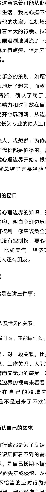

我是一名生活咨询师，也是国家二级心理咨询师。对于心理边界，有着丰厚深刻的体验和感悟。在这些年的咨询实践中，见证了大量由于心理边界的问题导致的生涯困扰。

生涯定位：职业定位与自我认知密切相关，应用的工具模型是“三点一线”：有什么（机会）、要什么（价值、兴趣）、凭什么（能力、资源），后面对2点都与边界有关。

没有清晰边界的人，就不会清楚自己想要什么，他分不清什么是自己想要的，什么是爸妈想要的，什么是社会倡导的。因为从小他都没有机会想过自己是谁，需要什么，大多时候在被安排，被动接受。

## 表现在生涯发展类的困扰

很多人的工作越干越没劲，觉得自己的才华没有得到赏识，这类人的思维是“领导应该看到”，其应对方式不是去想办法外化自己的价值，而是认为领导眼瞎。

有人觉得在工作中被老板和同事压榨和欺负，却没有想过要学会怎么拒绝；

有人觉得自己的价值被低估，却从来不敢去提高薪，就等天上掉下“馅饼”；

## 表现在生涯平衡类的困扰

家庭与工作的平衡，也是满满的边界问题。可以一句话总结就是不知道自己是有限的，时间、精力、能力这些与生涯任务相关的资源都是有限的。

### 一、打开认知的窗口

首先就是学习心理边界的知识，建议先吃透这周主题内容。明白心理边界内的事你能控制，你有权利，你应该负全责，而心理边界之外你没有控制权，要心存敬畏，要懂得尊重，比如天气，经济环境，公司，老板，亲人还有朋友。

### 二、保持觉察

- 心理边界其实是在讲三件事：
1. 自我负责；
2. 自己和他人及世界的关系；
3. 明白你能做什么，不能做什么。

### 三、区分和确认自己的需求

### 四、从安全的关联开始

## 四、从安全的關係開始

有句话说：“最危险的地方往往是最安全的”，在边界中最难的是与母亲的关系，可是和母亲的关系却是这个世界上最安全的關係。

我的边界最早就是在我和儿子以及我和妈的关系中修炼起来的。我妈一直觉得我离婚是件丢人的事，她跟我家亲戚和她的朋友一直隐瞒这个事实，我也配合她不说穿，可是每年回家过年都会被亲戚问，“怎么一个人回来的？”那种感觉真是糟透了，可是我忍了好多年。

当我开始修建自己的边界以后，恰好又遇到我妈的同事问我你老公是干嘛的，我妈就抢着回答，当然是说了假话，那天回到家，我第一次认真邀请我妈坐下来跟她谈这件事，从我离婚后她的各种做法我感受到的伤害和难过，我边说边哭，我妈也哭了。然而我妈却开始和以前不一样了。要知道，那个时候她已经79岁高龄了。都说人老了固执很难改变，其实是我们没有找对方法。

### 五、找一个支持系统

可以是一个圈子，可以是一个最好的朋友，也可以是专业的成长顾问，后者是最安全最有效的，本身也是一种边界的修炼，不把成长中的痛苦转嫁他人。

支持系统的作用是提供心理支持和正向反馈，因为边界的修建真的不容易，一定会遇到挫折和挑战，支持系统就起到了抱持的成长性环境。

我自己在这个过程中，与我的心理咨询师朋友一起建了一个三人成长小组，用朋友督导的方式作为自己的支持系统，效果很好。我也以成长顾问的专业身份陪伴和支持了很多人的成长。

最后，祝福和期待超级个体的朋友们，先成为自我负责的个体，成长，长出边界清晰又有弹性的样子，让超级再飞一会。

# —— 今日思考题 ——

你选择从哪段关系开始修炼？你要做的第一步是什么？

下周我们来学习一个职场人不学会死的技能——提问。这是一个人人都在做，但大多数人都没掌握好的能力。人们总习惯去追求正确答案，却忽视了提出一个好问题的力量。未来，答案会快速贬值，提问才是应对不确定时代的正确姿势。那怎么才能提出一个好问题？下周揭晓。

另外，为了方便你花最少的时间熟悉下周主题的核心观点，我提炼出了一个关键句，做成了“主题卡”，你可以保存下来，分享到朋友圈作为记录；或者设置成手机的“锁屏壁纸”，跟随主题，一周迭代自己一次。希望你喜欢。

## 一个好问题
已经包含着
一半答案


古典·超级个体

今天是古典陪伴你成长的第 254 天，一起加速，成长为更好的自己。

## 加餐 | 看电视剧，从没有如此清醒的心理边界意识

古典

上周四，我讲了三个当你理解了心理边界，会被照顾视点的故事。当天的留言中，有很多超级个体也分享了自己听过的故事，我挑选了五个视角很独特的故事，新鲜热辣，都是来自于大家耳熟能详的电视剧、电影，作为加餐分享给你。你可以判断一下，他们的思考和评价是否有道理？

不过不管怎么样，多一种视角，总是多一种可能。

欢迎你在留言区和我讨论。

古典老师说的都是心理边界不清晰的文学作品，而我要说的是正面精神。就是人气爆棚的热血日漫《海贼王》。索隆和鹰眼最初对决时，路飞没有插手，而是在索隆重伤坠海后才向鹰眼进攻，保护朋友。娜美加入时，路飞也没有出手，而是对娜美说，求我，我才去收拾阿龙。现在，回忆这些片段，还有汗毛直立，如打鸡血三升的燃感，同时还有一种十分骄傲或者说自豪感。以前觉得这种感觉很莫名，现在可以准确描述了：这就是一个伙伴充分尊重你的自我边界的信任感觉。这时“你”的面目不再模糊，即使受些伤也会体会到“自我”被认同的荣耀感。这一刻你完全掌控着你自己，但朋友我愿意帮你。

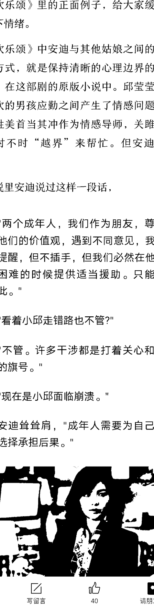

半月与义渠君的爱情故事，爱得如此轰烈烈如此奋不顾身。可结局却是义渠君在半月面前被射死。当年看完一直觉得他们的爱情很动人很伟大，也为义渠君的深爱包容而感动不已。但现在从心理学的角度来看，又让我毛骨悚然。半月对义渠君的爱并不单纯，总是夹着对楚王的救济报恩，对儿子王位的辅助巩固。她的心理边界是如此的不清晰，一边享受爱情的甜美，一边又对权力的紧握，最后导致深爱的人心理崩溃，以死明志。而义渠君的心理边界也很糟糕，他一边义无反顾地付出，却又易受旁人盘惑，在付出和得到的衡量里，失去了自我，成为别人的利刃，深深地扎在爱人的心里，玉石俱焚。如果半月能早日重塑心理边界，那么历史就会重写，江山依然是她儿子的，而她也可以过上愿得一人心，逍遥人生的幸福生活。


从诸葛亮舌战王司徒看边界的力量。

+   1、一开始王司徒和诸葛亮套近乎，诸葛亮直接不搭理。一开始就划清界限，气势上先胜一筹。

+   2、简单问候之后，王司徒开始论证魏国在德上的正确性。却不知是进了诸葛亮的圈套，因为只有刘备是皇家姓氏，具有先天上的法统优势。王司徒却只言曹操魏的功劳是德，避而不谈废天子之事，是对自己边界的认识不清，再败一局。

+   3、诸葛亮以匡扶汉室的大义击破在法统上劣势曹操魏的边界。指出王司徒以汉臣之身辅曹操之业，九泉之下无颜面对汉室宗亲，愧疚、羞耻、恐惧三招齐发，语言上使用更为激烈，侮辱性的言辞，直接击破王司徒大儒的边界。

+   4、最后可怜的王司徒内心的城墙垮塌，三观俱震当场气绝而亡。


我想起了《欢乐颂2》中包太太，她是一个典型的心理越位者，掌控者。公司里她是一个完全控股财务大权的人；对于她的老公~老包总，也是无缝监视，就算是老包总从外地约会个情人也被包太太了如指掌；最让人感觉不可理喻的是对待安迪的态度，强大的掌控欲让人感觉她完全不可理喻。刚开始小包总追求安迪的时候，她为了帮儿子追到安迪，那是一个殷勤，一口一个“亲爱的”叫着，后来安迪答应做小包总的女朋友了，她的掌控欲再次被激发，她千方百计的调查安迪，从坏人口中得知安迪是“小三”，又开始想尽各种办法迫使小包总和安迪分手，甚至在安迪面前装可怜，扮柔弱。掌控者为了达到控制外界事物的目的，的确是不惜以自虐的方式。这在包太太的身上表现的淋漓尽致。


讲一个新鲜出炉的小故事吧。今天早上吃早餐，对面坐下一个十来岁的小女孩，她妈妈跑前跑后买饭，先端来绿豆汤给她，小女孩伸手去接，结果妈妈怕她拿不住不敢放手，越不不敢松手两人越来越僵持，最后泼出去不少。

妈妈又去拿豆皮，顺便拿来餐巾纸擦撒在孩子身上和桌子上的汤汁。小女孩一个劲怨恨，妈妈只是不停催她吃饭。一个人不停越界却掌控不住事态发展，另一个明明拒绝不起作用却仍然不愿负起责任。

不用看童话，身边有太多被“心理边界”不清折磨的人们，所以真正能走上“做自己”道路上的人，才容易让人羡慕，与其黯淡迷惑，不如退而结网，慢慢建立起心理边界，用自己的力量获得更幸福。


古典

我发现学习完本周的内容，大家对生活里那些心理越界的负面例子变得很敏感，观念变了，心态也会完全不同。

前面有朋友提到了，《欢乐颂》中包太太心理越界的例子，最后，我来说一个《欢乐颂》里的正面例子，给大家缓解一下情绪。

《欢乐颂》中安迪与其他姐妹之间的相处方式，就是保持清晰的心理边界的榜样。在这部剧的原版小说中。邱莹莹和喜欢的男孩应勤之间产生了情感问题，樊胜美首当其冲作为情感导师，关雎尔也时不时“越界”来帮忙。但安迪不同。

小说里安迪说过这样一段话，

"两个成年人，我们作为朋友，尊重他们的价值取向，遇到不同意见，我们提醒，但不插手，但我们仍然在他们困难的时候提供适当援助。只能如此。"

"看着小邱走错路也不管？"

"不管。许多干涉都是打着关心和爱的旗号。"

"现在是小邱临崩溃。"

安迪耸耸肩，"成年人需要为自己的选择承担后果。"


这样的安迪如果出现在你的生活中，你可能也会觉得她有点冷漠，但回过神来，你会感觉到这种边界带给了朋友最大的尊重和支持，抖擞精神，做个对自己负责的人。

今天是古典陪伴你成长的第 255 天，一起加速，成长为更好的自己。

## 学会3个好问题，倍增你的创造力 37-2

37-2 学会3个好问题，倍增你的创造力

+   1、创造：创造是面对一个问题，在大脑中组合过去的知识模块的方式。
2、一个好的问题，是开始创造的第一步。

昨天文章的最后，我给大家留了一道题：

在瑞士日内瓦湖边，有一条长隧道，投入使用的时候，工程师遇到一个问题：很多车主在隧道开车时，会打开车灯，但是出了隧道，一看到好的风景就会停车拍照，回来发现电量耗光了。工程师决定在隧道出口立一块牌子提醒大家关车灯。“请关闭车灯”。但是这样做，会有另外一个问题，很多车主是晚上进入隧道的，如果他们看到这个牌子，关掉车灯，又可能会遇到危险。

我留给大家的问题是，工程师该怎么提醒大家？昨天有很多用户给这位工程师支招。有人说，牌子写上“如果是晚上，请保持灯打开；如果是白天，请出隧道后关闭车灯。”这个答案看似周全，但是如果车速是80公里，等你看完这么多字，再反应一下，估计已经撞车了。

工程师最后把牌子变成了一个提问：“你的灯还亮着吗？”

这个问题创造性地提供了一个解决方案。这是一个双关的问题，如果是白天，那这块牌子就是提醒车主关灯，如果是晚上则是提醒车主开灯。这个提问很巧妙，这也是我们今天要讨论的一个问题——创意的本质是什么？以及如何用提问激发创意。

提问可以管理注意力、控制谈话节奏以及创造参与感。但是为什么提问会带来创意呢？

先了解下创造的过程：创造就是一个组合的过程。

美国神经科学家约拿·莱勒在《想象：创造的原理》一书中说，“以前，想象力被认为是一种独立的东西，是跟其他认知能力分开的。最新研究表明，这种假定是错误的。创造力就是很多认知能力的组合。有三种形式的创造：一种是灵感迸发，一种是厚积薄发，还有一种是即兴发挥。所以要搞清‘我们面对的难题是需要灵光乍现，意识突然地一跃，还是可以一点一点地慢慢地加以解决。这个问题的答案决定了我们是应该喝啤酒放松一下，还是喝一罐红牛打起精神或者直接上场。’”

但是不管哪一种，创造都是面对一个难题，在脑子里组合过去的知识模块的方式。灵感型创造是跨领域组合；厚积薄发是同领域组合；即兴发挥是和场景压力组合，而提问是最好的组合工具。

因为，提问是大脑里的搜索引擎：

谷歌是这样工作的，当你搜索一个关键词，他就会抓取世界上所有的网页，罗列出来，按照重要和相关程度，组合出一个页面给你。每天谷歌有34%的关键词是从来没有被搜索过的，也就是说，当你输入一个以前没有搜索过的关键词时，你就是在“创造”一个新网页。

你大脑里发生的事情也是一样。当你思考一个重要的、全新的问题时，你的大脑里也在创造、组合、重新产生新的连接，这让你变得更聪明，而创意就从新的回路中产生了。

难怪很多伟大的公司都来自提问：

瑞士人亨利·杜南（Henry Dunant），1859年在意大利旅行时，遇见奥地利军队和法国军队之间的一场布醒战争。杜南问自己：“有什么办法可以在和平年代成立救济会，让志愿者在战争时期能救助伤员呢？”于是，国际红十字会诞生了。

优步最早要解决的问题是：“为什么上班时间总打不到车？”，出租车公司的习惯性回答是高峰期嘛，车不够正常；而优步创始人思考的是，为什么路上还有很多空的车没有人坐呢？

20世纪80年代，英特尔公司还是一个存储器公司。面对日本存储器厂家的低价策略，英特尔连续6个季度出现亏损，业界开始怀疑英特尔是否能生存下去。1985年的一天，英特尔总裁安迪·格鲁夫（Andrew S·Grove），在办公室里意气消沉地与董事兼首席执行官摩尔讨论公司的困境。

格鲁夫问摩尔：“如果我们下了台，另选一名新总裁，你认为他会采取什么行动？”

摩尔犹豫了一下，答道：“他会放弃存储器的生意，做处理器。”

格鲁夫目不转睛地望着摩尔，说：“你为什么不自己动手？”

1986年，公司提出新的口号：“英特尔，微处理器公司”。英特尔顺利地穿越了存储器劫难的死亡之谷，实现绝地翻盘。

在任何情况下，问“为什么”都可能是引起改变的第一步。如果能先于别人发现一个难题——你甚至都不需要完全解决这个难题，就可能创造一个新企业，甚至一个新行业。这就是提问的力量：一个好问题是让你开始创造的第一步。

最后，给你3个最重要的，可以创造答案的问题：

+   1. 最好结果问题：这个事情最好的结果是什么？
2. 下一步问题：你会为这个事情做些什么？
3. 目标检测问题：你怎么知道自己做到了？

总结一下今天学习的内容：

今天我们谈到了创造的本质——组合。灵感迸发、厚积薄发和即兴发挥。他们本质都是组合。

提问是最好的组合方式，是大脑里的搜索引擎。好的问题也是很多伟大公司的开创和转型之路。而最后的三个问题：最好结果、下一步行动和目标检测问题，则是一些创造答案的技术。当你在提出这些问题时，大脑中的链接就开始发生。答案会自己浮现。

# —— 今日思考题 ——

根据你近期一个短期目标，结合我刚刚给你的3个重要提问，试着在留言区回答一下。


创造的本质是“组合”，提问是最好的组合方式。而学会问三个问题：最好结果？下一步行动？目标检测？则是创造答案的技术。

今天是古典陪你成长的第 257 天，一起加速，成长为更好的自己。

## 如何提出一个让人忍不住回答的好问题？ 37-3

37-3 如何提出一个让人忍不住回答的好问题？

+   1、提问三大功能：快速拿到信息、增加多元观点、优化决策。

+   2、问出好问题要具备3种素质：第一，要有小学生心态。第二，要提让人怦然心动的问题。第三，要掌握提出好问题的技术。

我经常参加各种聚会，听到很多绝妙的比喻和新观点，忍不住就问了——这个说法太妙了，这是哪本书写的啊？

对方都是像看猴子一样看我——这是昨天聊天的时候，xxx说的。

这些真正的牛人，都还在浪尖抖动，暂时来不及把知识系统地组合出来。所谓“见识见识”，有“见”才有“识”，所以真正好的思想，要么是在时代前沿的人的脑子里，要么在跨领域、跨时代的经典里。

想获取这些思想精华的前提是，你要懂得如何问出一个让人忍不住回答的好问题。

提问至少有三大功能：快速拿到信息、增加多元观点、优化决策。

尤其是在社会化网络盛行的今天，在网络上提问的能力变得更加重要——美国培训与发展协会在2010年在评估员工胜任力时，明确指出社会化学习的能力是必备的胜任力，而提问是社会化学学习里最重要的 一种能力。

那么，怎么才能提出一个愿意让回答案的好问题呢？今天我就告诉你，问出好问题需要具备的3种素质。

第一，要有小学生心态。第二，要提让人怦然心动的问题。第三，要掌握提出好问题的技术。

### 1、要有小学生心态

《教父》电影里，马龙·白兰度扮演的教父说：“要给他提出一个无法拒绝的请求。”问题少年就是这样一个无法拒绝的姿态和技术。

### 2、要提让人怦然心动的问题

### 3、提出好问题的技术

做功课

百知谷——百度、知乎、谷歌，这些搜索网站前三页能查到的问题，尽量不要麻烦别人。这体现一种尊重——你提前花了时间努力做这件事。

赋能

提前做功课，选择能激发对方的问题，采取高能词汇。比如，我就问过吴伯凡老师一个问题：

“吴伯凡老师，作为中国少数几个真正能把中西方思想融合贯通的人之一，对于……你有什么洞见？”

用清晰地描述、限定性语言，帮助对方提供资源和决策。

# —— 今日思考题 ——

你有哪些提问的技巧，能让人特别愿意回答和互动？你最喜欢回答什么类型的问题？

## 问题多大，学问多大
——小学生心态

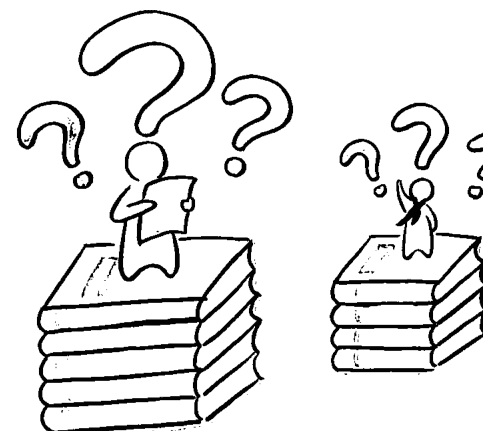

和包 by 聖... 

提问至少有三大功能：快速拿到信息、增加多元观点、优化决策，而谦虚的小学生心态是无法让人拒绝回答的学习姿势。

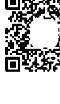

今天是古典陪伴你成长的第 258 天，一起加速，成长为更好的自己。

## 提问的思考

提交留言可与专栏作者互动


## 自我对话：大脑里的弹幕系统 37-4

37-4 自我对话：大脑里的...

+   1、自我对话：人们出声的或不出声的，自己与自己所进行的对话。
2、镜中自我：每一个人对他人来说都是一面镜子，大家都是通过假想别人会怎么看待自己，然后结合自己的想法形成了自我概念。

我最近在看寒文涛主持的《圆桌派》，第一次发现，我还挺享受一个新事物，就是弹幕。当有人讲到一个好玩的观点，弹幕就会出现“哈哈哈逗死我了”，也有人不断地补充信息“这个茶碗其实比宋代早”等等。

也有令人讨厌的弹幕，比如有人一直在骂人，有人在自言自语，当然最讨厌的是那种剧透的，当你看一个杀人片正起劲——一个弹幕弹出来说——他是凶手。

别以为弹幕是个新鲜玩意儿，你发现没有，你大脑中间，也有弹幕。

早上起床，你对着镜子刷牙，脑子里马上出现一条横着飞过来的弹幕“我去，这也太胖了”“看他这身肉”，可能一天好心情都没有了。有时候弹幕也会激励你，你在和别人沟通时，被对方的某句话一下子惹怒了，这时候有弹幕飞来“冷静冷静冷静！”，或者你会听到一个有趣的想法，弹幕写着“这个想法好，就这么做！”。

#### 你的内在弹幕：自我对话

更多时候，你根本意识不到，那些只是弹幕，你以为这就是自己的想法，甚至认为这就是人生剧情的一部分——就好像你经常分不清哪些是剧情，哪些是对话一样，这个现象在心理学里面叫做“自我对话（Self-Talk）”。这个概念实在是太重要了，我们会用2期的时间，谈谈如何觉察这些对话，以及如何用提问让自己从对话中逆转。

什么是自我对话？简单来说，自我对话就是自己和自己的交流，人...

#### 弹幕是怎么来的？

美国社会学家查尔斯·库利（Cooley），曾经提出了“镜中自我”（looking-glass self）的概念。他认为，每一个人对他人来说都是一面镜子，大家都是通过假想别人会怎么看待自己，然后结合自己的想法形成了自我概念。

这里面会有三步：
第一步想象别人看到什么；
第二步是想象别人会怎么看待自己的；
第三步是把这个想法内化，也就是做成弹幕，贴在自己生活的视角之上，作为自我的一部分。这就是人生弹幕的形成。所以你看，弹幕其实是别人的话反射来的。

所以，当你很小的时候，身边更重要的人，比如你的父母对你说的话就会成为你最早的弹幕，成为你重要的内心声音，甚至改变你人生的剧情。

比如，当一个孩子在生活中取得小成就，父母会鼓励你说，“你很聪明”，或者说，“你还要继续努力”。而实验证明，被贴上聪明标签的孩子会在未来更少尝试高难度的事，因为进入那样的剧情，会很笨拙，毁掉自己“聪明”的人物设定；而被激励“要努力”的孩子，则会尝试更多可能性，他们相信只要努力就能做得很很好，他们也有更冒险精神，因为这样才符合他们“努力”的人物设定。

同样的道理，当我们遇到问题，就会马上起来不同的弹幕——“不行了不行了，还是放弃吧”，或者“哎呀，老子就是不信邪”，这也都是很早的时候，我们从别人那里学回来，然后内化到自己人设的弹幕。

#### 被弹幕修改的人生剧情

你发现没有，一开始弹幕只是周围重要的人的弹幕，但如果你看久了，你会逐渐修改剧情里的人设。这样，他人的评价就内化成了自己的评价，成为了你自己的一部分，而你一点儿都不知情。仔细聆听着你“心里的声音”，你会特别惊奇的发现，这就是你父母、老师、或者某个重要的人的声音。

根据发展心理学家皮亚杰的研究，人要等到11-16岁，逻辑推理能力才会开始发展。所以小时候，我们很少思考这些弹幕是好的还是坏的，而往往是照单全收。只有到18-20岁（咨询师为到23岁）时，我们才有机会思考这些是弹幕，我没必要跟着...这个内化的弹幕直到现在。

前一个叙事老师，叫黄素菲，她曾经分享过自己的一个经历。她装修新家的时候，非要在家里的卫生间修建一个大浴缸。一开始这个浴缸设计成顶级的大理石的，花了半个浴室装修的钱。但是开始使用以后，发现大理石很凉，放的热水一会就凉了，要好好地泡澡，只能一边放热水，一边放凉水——这也太不环保了吧。
于是又请了一个设计师，设计了一个塑料的壳，垫在这个浴缸之上。当她终于可以躺在浴缸里好好休息的时候，才意识到几乎用了装修的三分之一预算在...。

# —— 今日思考题 ——

你，作为你自己人生的导演，经常在什么时候听到弹幕呢？你脑子里面常听到的负面声音，其实是谁在说话呢——父母、老师或者同学？欢迎你在留言区分享给我。

#### 大脑里的弹幕系统


我们的潜意识会把过去重要的人对自己的评价，逐渐内化成我们的自我对话。只有意识到，外界的评价只是你人生的弹幕时，你才拥有了改变人生剧情的机会。

总结一下今天学习的内容：
今天我们谈到了大脑中的弹幕系统。每个脑子里面都有这个系统，他们来自于过去重要他人的评价，如果你不留意，甚至会把这个评价作为生活电影的一部分，从而认为这个电影很糟糕。但是当你意识到这只是弹幕，你就有了自己把握自己生活，改变人生剧情的机会。

## 转化逆境：做自己的好朋友，问自己4个好问题
37-5


37-5 转化逆境：做自己的...

+   1、改变“自我对话”：最有效的方法是“觉察”和“提问”。
2、做自己的朋友：当人们将自己当成另外一个人来看待时，“会给自己一些客观、有用的反馈。”

我们昨天提到了大脑里的弹幕系统，以及这个弹幕系统是如何影响我们的自我对话的。那么，我们有没有可能改变这个“自我对话”呢？

当然有可能，改变“自我对话”是心理咨询中最重要的技术之一。在这个对话中，最有效的技巧，依然是“觉察”和“提问”。

今天教你3个利用“觉察”和“提问”来改变“自我对话”的方法。

#### 1. 做自己的好朋友

假如你的一个好朋友演讲水平一般，但还是鼓起勇气参加了比赛，最后失败了，你会怎么说？

你也许会说：“不要紧，加油，你已经很好。”或者“我觉得只要参与了，就是一种胜利。”

但是如果是你自己参加比赛，然后输了呢？你可能就会对自己说“傻X了吧，让你别去非要去，自取其辱！”

我们懂得安慰、陪伴和鼓励自己的朋友，却不懂得调整自己的心理弹幕，我们的心理弹幕是被以前的重要他人霸占的。所以，现在我们要做自己的好朋友，重新接管自己的弹幕系统，懂得鼓励、陪伴，甚至激发自己。

我太太做过一件事情很打动我。在我们还是男女朋友的时候，有天晚上我去她家，她说没吃饭，我就打开冰箱拿出饺子，煮给她吃，她很开心。这件事情过了一周以后，她才跟我说，“以后你煮饺子要多煮一会儿，最好是浮上来以后加水，再沸腾了再捞出来。”我说，“你为什么提醒我这个？”她说，“那天晚上的饺子没熟。”

你看，她就是我的好朋友。所以，我在遇到挫折时，时常问自己：“如果她在场，她会怎么对我说？”

如果下次你遇到问题，你不妨问自己一个问题：

+   “如果我的最好的朋友在身边，他会怎么对我说？”
“如果我最欣赏的老师看见我遇到了这个问题，他会对我说什么？”

#### 2. 用“你”，比用“我”好。

密歇根大学( University of Michigan )的研究人员曾经做过一个试验：他们要求一群人做个高压力的主题演讲，只有5分钟时间准备，不能用笔记。

有一半的参与者被引导着用第一人称来缓解焦虑——“我为什么要紧张啊？”

另一半人则被引导用自己的名字或第二人称“你”来与自己交谈——“你为什么要紧张呢？”

每位参与者在演讲结束后，要评估自己的遗憾程度。

结果非常一致：那些在自我对话中使用自己名字或人称代词“你”的人感受到的遗憾更少，他们表现得更自信、更有说服力，也更不会紧张。

心理学教授伊桑·克罗斯( Ethan Kross )说，当人们将自己当成另外一个人来看待时，“会给自己一些客观、有用的反馈。”

下次对自己说话，你可以说“你已经做得很好了，” “你在这时候不要惊慌，先稳下来比较好。”

这时候你会产生一种心理的位移，让自己脱离习惯性的负面弹幕。

#### 3. 逆境中的自我提问

我们大脑什么时候最容易产生弹幕？那就是自己把事情做砸了的时候。

我在文稿中列出了“自己的敌人”和“自己的朋友”两组大脑弹幕，你可以在遇到挫折时，利用“朋友式”的提问方式把自己拉出逆境。

| 自己的敌人 | 自己的朋友 |
|---|---|
| 我做错了什么？ | 你经历了什么？ |
| 谁该负责？ | 你学到了什么？ |
| 为什么我做不到？ | 你哪些地方做得还不错？ |
| 有什么后果？ | 你如何让这个失败成为转机？ |

## 总结一下今天学习的内容：

当你意识到弹幕只是他人的声音时，你已经有机会跳出困境。

你要注意3个细节：做自己的好朋友；用第二人称跟自己对话；使用正向的4个提问。

每个人都同时面对内在和外在的战争，很多人只关注外在战争，而忽略内在的部分。当你学会了管理自己的弹幕系统，你就有可能赢得自己的内在胜利。

### ——今日思考题——

回想一下，你最近遇到的一次挫折，然后对照“朋友式”的4个提问，在留言区写下这两种内在对话的不同内心感受。

今天是古典陪伴你成长的第 260 天，一起加速，成长为更好的自己。

#### 自我对话的思考

提交留言可与专栏作者互动

## 超级践行者｜“输出倒逼输入”的1000天践行 37-6

古典

如果只允许我用一个词解释个人成长领域，那就是“行动”，如果允许用两个词概括，那就是“持续行动”。今天来分享的这位于践行者——Scalers，用1000个日日夜夜，把这两个词演绎得淋漓尽致，可谓是个个人成长领域最懂得持续行动的人。

Scalers 一直在践行“输出倒逼输入”，1000天后，他完成了一个巨大的跃迁——写作积累了百万文字，公众号粉丝有8万人，收费社群也吸引了上千人。所以只要你持续行动，就能以一种极快的速度，赶上这个时代。

另外，我还买了10本Scalers刚出的新书《刻意学习》，专送超级个体里同样在持续行动的同学。如果你也有这样的经历和成就，留言告诉我，我做你的支持者。

#### 1.我所理解的“超级个体”

“超级”一词在词典里有“超出一般等级”的含义，英文里的“super”同样表达了“在平均、普通之上(better than average, better than usual)”的意思。

对于每一个想成为“超级个体”的人，我们需要考虑的一个问题是，我们能在哪个方面，可以达到“超级”的标准，比平均优一些。如果我们每一方面都和“大部分人”表现别无二致，那就没有任何区分价值，无法成为“超级个体”。

成为超级个体的过程，其实就是一个自我修炼的过程。我深深地认为，我们终极的成长和进步，都是来自对于自己的挑战和超越，而非甩掉别人。作为“个体”，你必须“超级”。

#### 2.用什么办法，让自己更“超级”

##### (1) “输出倒逼输入”，把箭直接扣弦上。

我曾经是一个非常懒惰的人，写不出文章看不进书。但是从2014年开始，到今天我已经持续写作百万余字了。

##### (2) “刻意学习，持续行动” 成长超越的双轮驱动。

在我把写作这件事情持续了1000天以后，我正式提出了一个“1000天持续行动”的计划。这个计划的目的是，对于我们的成长，对于“超级个体”的养成，对于高效能人士的自我修炼，要有大战胜1000天的决心、信心与恒心。

#### 3.超级个体，再超一级

1000天以前，我不喜欢那个懒惰拖延且没有行动力的自己；经过1000天的持续
没有行动力的自己；经过1000天的持续行动和输出倒逼输入的强大推动，我有了自己的公众号，订阅量也慢慢发展到近十万、有千人付费社群，第一本书《刻意学习》也已经上市。

我不想罗列财务数字来展示我取得了什么成绩，但是这三年多持续行动、挑战自我、做超级个体，让我最大的改变就是关于自我的认知，我变得乐观、有力量、热爱生活、心态开放，而这些积极的改变，又进一步带来了更多的变化。这种内心的充实感和欣欣向荣的成长喜悦，其实是成长最延绵不尽的精神财富。

但是故事远远没有完结，我们到达一个驿站前，总会期待那里是一个可以一直停歇的终点。但是真正到了那个地方会发现，前面还有很多路程值得我们去追求。于是收拾收拾，又背包上阵，继续优化。

我想这大概就是超级个体的终极要义所在，也是高效能人士自我修炼的必修课；在超级的路上，在修炼的途中，不会有终点；重构、升级、挑战，再重构、再升级、再挑战，这是所有通往超级个体的必经之路。

最后，感谢古典老师在每个个体成长路上前瞻引导、高屋建瓴地给我们勾勒出时代的全局图，让每一个个体可以既仰望星空又脚踏实地，充分成长，长成自己的样子。

# —— 今日思考题 ——

你有没有在持续地做一件事？持续了多少天？如果你没有在做，那么你期待做什么？欢迎分享出来，没准能遇见有同样目标的同学。

留言中，最有耐力的前10名同学，我会送给你一本《刻意学习》，支持你们成长。

在“学会提问”之后，下周我们将开始“有效决策”专题。现代人的每一件事都在经历“判断”和“决策”：去哪里读大学？做什么工作？要不要买房？该不该跳槽？

心理学家弗洛姆说过，“现代社会困扰人们的不是缺乏机会，而是机会太多，令人眼花缭乱。”

这些表面上看是客观问题，最终却都要归结于自己的决策。我们的生活其实是由我们的决策塑造的。那么，如何做出明智的判断？怎样绕开决策的大坑小坑？到底应该追求最适合的解决方案，还是最满意的解决方案？为什么说主动提出一些决策问题，其实是在为自己创造机会？我们下周见。

今天是古典陪伴你成长的第 261 天，一起加速，成长为更好的自己。

## 如何正确地做一个“艰难的决定” 38-1

38-1 如何正确地做一个… ↓

+   1、一个完整的决策包含5个步骤：问题、目标、方案、结果、权衡。
2、总是面临艰难决定的原因：很少梳理目标、扩充方案和预计结果。

我们前面谈过一个争论——到底什么决定命运？性格还是努力？在前面的文章很详细地谈过区别，但是有一个是共识的：选择决定命运。人的十辈子就是一次次选择的过程。这些选择有大有小，但是人生就是被一个个选择积累起来的。

拿我们“超级个体”的运营水水来说，她每天下班经过麦当劳，都纠结要不要买“第二个半价”的冰激凌，买吧，自己只能吃一个，买2个吧，不利于减肥。天天纠结，干脆绕路走算了。

当然也有很纠结的大决定，比如说：

May 是一个北京公务员，当年以<|message|>的身份考入国字头的某部门，每天忙得要死，却找不到成就感，看着比自己混得差的小伙伴纷纷在创业，很有成就，而且还有很多人抛来橄榄枝——自己这几年还想要宝宝，但是再不出去，又来不及了——到底要不要走呢？这个问题也每天困扰自己，唉，还是看一集《甄嬛联萌》吧。

## 决策与决定

决策和决定不一样，决定就是针对事情做个清晰的姿态，质量不保证。决策是“在一定信息和经验基础上，为了实现某一目标，有策略地做决定”。虽然这么简单的几句话，其实点出来决策和决定的几个要点。

一个好的决定，至少包括：

问题：我们为什么必须做决定？

目标：什么是最好的结果？

方案：有哪些可能方案？（这需要很多信心和经验）

结果：这些方案分别可能有什么结果？（这需要很多信心和经验）

权衡：权衡，做出一个收益最大的决定。

#### 我该卖掉公司的股份吗？

张总和朋友在中关村开了一间建材公司，和所有公司一样，创业的时候特难，现在20年过去，公司发展稳定，事业蒸蒸日上，员工踏实可靠，创业期紧张和压力都过去了。

问题-目标-方案-结果-权衡，这就是一个决策的完整认知过程。用这个标准看我们做的决定，大部分人都是“好痛苦 做不做？权衡”。既没有分辨出自己背后的期待和关系，也会跳过更多方案的思考，更不用说评估每个方案的可能性了。

## 总结一下今天学习的内容：

今天我们区分了决策和决定，决策是5个步骤连在一起的认知过程，决定则往往是在“好痛苦，要不要去做”之下的快速反应。

# —— 今日思考题 ——

目前让你最困扰的需要做决定的问题是什么？对比决策五步法，你思考一下，自己缺失的是哪个问题呢？欢迎在留言区留下你的答案。

## 决策与决定

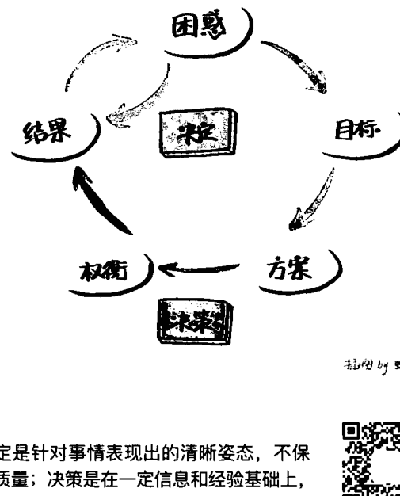

决定是针对事情表现出的清晰姿态，不保证质量；决策是在一定信息和经验基础上，为了实现某一目标，有策略地做决定。


很多人都会发现，自己在“方案”和“结果”两个环节，都不是特别有信心。明天我们来谈谈遇到这种情况该怎么办。

今天是古典陪伴你成长的第 263 天，一起加速，成长为更好的自己。

## 有限决策：治好选择恐惧和完美主义 38-2

38-2 有限决策：治好选择…

+   1、有限决策：真实的生活中，人要做最满意的，而不是最完美的决定。
2、分析瘫痪：担心自己选错，以至于宁可不选择。

昨天我留了一个思考题：在决策信息不足的时候该怎么办？

下面这个故事就是决策信息不充分的场景：

假如一只狗熊走到结了冰的湖面，突然听到冰面上发出“咯嗒”的声音，它知道可能是一个地方冰面要裂开了。他不知道具体是哪里会裂，也不知道什么时候会裂，所以不知道该往哪个方向跑。这个时候，最聪明的做法是什么？

最聪明的方法是，既然不知道要往哪里跑，最好的方式就是先趴下了，然后往最近的岸边爬过去。最糟糕的选择是在原地等着，不是掉进湖里，就是冷死。

冰面上的狗熊困境，其实是我们每天都会遇到的问题。我在昨天提到了“好决策”的5个步骤。但在真实的生活里，我们通常只知道出现了问题，但是没法收集所有的问題，更不可能列出全部的方案和结果。这个时候，我们该怎么做决策？

这就是我今天要讲的“有限决策”理论。诺贝尔奖获得者赫伯特·西蒙凭借这个对决策的研究，获得了1978年的诺贝尔经济学奖，也很大程度颠覆了经济学理论里的“理性人”的概念。

理解了“有限决策”的概念，你会发现生活里困扰你的很多问题会变得有解，更好的是，理解概念后，我会给你三个提问清单，能帮你解决自己的选择恐惧症和完美主义者。

有限决策，用一句话概括就是——真实的生活中，人要做最满意的，而不是最完美的决定。

为什么要做最满意，而不是最完美的决定呢？因为完全理性的假设，有两个坑：

+   1. 人不可能完全理性，还有很多情感、直觉、时间压力等因素的影响。
2. 人也不可能穷尽所有的方案和结果，很多时候只能靠预测，而预测不一定准。

举个最简单的例子：现在你喜欢上了朋友圈里的一位女生，你向她发动进攻，发短信约她去吃西餐。这时，你会不会考虑——

这个女生是不是你最完美的对象？答案肯定不是。因为在未来的人生长河里，你肯定会有各种可能和变化。

她是不是你当下最合适的人呢？其实也不 是，因为这个城市还有很多人，无论是身材、样貌、脾气、人格都有更好的匹配。

你约会的方式是不是最好的？发短信直接约出来，会不会太激进，人家会不会不喜欢西餐？

很多人会一辈子这样纠结，一辈子也收集不完所有信息，而且等你收集完一半信息后，发现女神和另外一个比你差很多的家伙在一起了。等你做出完美决策时，人家孩子都得上小学。

这种现象叫做“分析瘫痪”（analysis paralysis）也就是完美主义和选择恐惧症的人的坑——他们怕自己选错，以至于宁可不选。《决策的艺术》这本书里说：

> “它表现为不知疲倦地收集各种有用无用的资料信息，总试图去寻找一个又一个的解决方案。同时，人为了逃避做出决策，总想象出更多分析工作来拖延时间，因为一旦作出决策就意味着接受了某些不愿接受的现实。”

他们就像站在冰面上的熊，最后可能是冻死的。

更加有效的方式，是有限决策。他会考虑如何在有限资源：认知、时间、情绪资源下做最满意的决定。比如说你看完人家朋友圈，和几个朋友了解一下她，然后大概确定自己和对方都不会短期离开这个城市，就6250

#### 分析瘫痪


有限决策：在真实的生活中，人要做最满意的，而不是最完美的决定——这是克服选择恐惧和完美主义的最好方法。

# —— 今日思考题 ——

你有哪些今天看起来不完美，但在当时却是最好的选择呢？在留言区跟我们分享一下吧。


之前我们说过决策有一个步骤是提出问题，明天我们讲讲问题是如何影响答案的。

今天是古典陪伴你成长的第 264 天，一起加速，成长为更好的自己。

## 问什么“问题”，得什么“结果” 38-3

38-3 问什么“问题”，得… ↓

- 1、提问是决策的一部分，描述问题的方式很大程度上影响了决策。

2、重新定义问题，是解决问题的机会。优化决定的机会，也是扩充可能的机会。

昨天说过，决策的第一个步骤，就是“问题”，然后才是确定目标、方案和评估。你有没有想过——当问题提出的时候，就决定了最后的答案？不信，看看这个例子。

1960年代，两家民意调查机构就“美国（从越南）是不是应该加快撤军速度”的问题，做了一次调查：

盖洛普的问题是：“撤军应该加快还是应该减速？”结果：几乎一半的回答者（42%）认为应该“加快”。29%认为应该保持现状。他们的文章标题是“民众希望加速撤军”。

哈里斯也做了一次调查，他们改变了一下问题：“你认为总统撤军的速度是过快、过慢、还是恰到好处？”结果却大不相同，有近半数的人（49%）认为撤军速度刚刚合适。只有29%的人倾向于“加快”。这时的头条变成：“民众希望维持现在的撤军速度。”

你发现了吗，提问本身是决策的一部分，描述问题的方式很大程度上影响决策，所以要做对一个决策，或者影响别人做一个决策，你都需要问对问题。

## 困惑不等于问题

前几天，一个老同学给我打电话，特别唏嘘——我们一个哥们突然脑溢血去世了。他觉得真的是人生无常，应该注意身体，多做点有意义的事。但这不算问题，仅仅算是一个困惑，或者是一点感悟，简单来说，是人生的触发器。可能是环境、可能是外界变化，也许是某个偶发事件，让你觉得应该做些改变，做个决策。但是触发器并不等于问题，你需要重新把它定义成一个问题，这个问题可以是：
我该怎么在工作之余，保持自己的身体健康？
我该怎样和老朋友保持联系，不至于在突然离开时才觉得痛心？
人这么容易走掉，我该怎样让自己的人生变得有意义？

同样的触发器，会引起完全不同的问题，正如同一个苹果砸脑袋上，牛顿想为什么苹果会往下掉，而你想的是踱一脚能不能掉俩？

所以，面对困境，一定要问对问题——问对问题是决策第一步。问对问题有三个好处，更好地解决问题、更好地优化决策、增加创造的可能。

### 1、重新定义问题，是解决问题的机会。

公司要进入一个洗头水新市场，任命了一个3人小组制定策略。组长在上海总部，另外两位分别在北京研发中心和香港，是独立设计师。组长希望来个3人的会议，让秘书安排。但各种安排，发现最近2个月，根本没有人有连续三天有空。

秘书小姐开始重新设定问题：2天是不是可以？是不是必须3个人全到？后来发现即使三个人同时一天都没戏。

组长也开始重新设定问题：我们为什么要开会？目标是制定策略，所以问题从“我们什么时候开会？”变成了“我们怎么异地制定策略？”

问题问对了，答案很快就出现了。他们先是分头收集资料，头一周每天一次1小时高频率的电话会，然后逐渐2周一次，即使在异地，也做出来了很好的方案。

### 2、重新定义问题的机会，是优化决定的机会。

一家电信公司的竞争对手将电视会议的图像清晰度提高了20%。为了应付这一局面，这家公司先将决策问题定义为：我们怎么在短时间内赶上他们的清晰度？经过再思考之后，他们意识到这个问题有问题，他们把问题调整为：什么样的技术革新能够使清晰度提高100%，从而让我们在竞争中领先？

### 3. 重新定义问题的机会，是扩充可能的机会。

有位女士来找我咨询。她丈夫出轨被她发现了，她哭得上气不接下气，就是为了做一个决策：“我是该孤苦伶伶地一个人活下去，还是忍辱偷生地苟且和老公在一起？”这种问题，该怎么答？

其实从问题一开始就提错了。我问她：“为什么不是你丈夫忍辱负重地和你生活在一起，或者你快乐逍遥地一个人活下去？又或者是你们重新接受对方，好好地生活在一起？”

很多时候，你解决不了问题，因为那个问题本身就问错了。如何区分这个问题是好的？理性来说，一个好问题总是积极正向、引发思考、指向未来的；其实感性来说，一个好问题让你眼睛发亮，怦然心动，这就是值得解决的好问题。

## 总结一下今天学习的内容：

今天我们提到，触发器并不等于问题。沿着触发器去解决问题，往往会让决策陷入困局，因为问题就问错了。好的问题能解决问题、放大结果、创造可能。让你眼睛发亮，怦然心动。

# —— 今日思考题 ——

体验一下这个问题：“告诉我，你有狂野又宝贵的一生，准备用来做什么？”。欢迎在留言区留下你的答案。

如果你有一个被问题困住的朋友，请你把今天的文章分享给他。

## 重设问题，找到答案


提问是决策的一部分，描述问题的方式会影响决策，所以，想要做对的决策，或影响别人做一个决策，你都需要问对问题。

我们在做决策权衡的时候，是全然理性的吗？有哪些坑呢？

今天是古典陪伴你成长的第 265 天，一起加速，成为更好的自己。

## 生活顾问日 | 少年，每段人生都有它的乐趣
38-5

38-5 生活顾问日 | 少年，…

我9月份研究生入学，但是这个专业我不是特别喜欢，另外从毕业后就业的角度看，这也并不是一个热门专业。

所以就在纠结读硕期间，到底是应该把重心放在自己的本专业上，努力发表论文，争取在本专业领域取得成就，还是说应该把时间精力更多地放在尝试不同领域的工作类型。进而找到自己真正喜欢的职业？

我现在纠结的是这两种选择总归要有一些取舍。我该如何确定自己读期间的时间精力分配比例呢？

## 古典

亲爱的“超级个体”学员：

恭喜你进入一个新领域，研究所有比大学更加宽松的时间和要求，在时间、精力可调用的资源上，你都比过去更加“富裕”了。你现在的问题，其实和每个刚上一个台阶，刚做管理者、刚进入新工作、刚入社会、刚带团队的人一样——如何调配这崭新的人生资源的问题。

我们常常会有一个错误概念，我们花出去的时间、耗费的精力、花去的金钱，就只是花掉了，并没有回报。但其实我们花出去的时间、精力、注意力等，在某种意义上来说都是一种投资，并不是简单的花费。我们要用一种投资人的心态看自己的 人生。而投资行为最核心的特点，就是需要取得回报，最好是高额度的回报。

为了获得最好的回报，我们先来了解一下一个话题，每个人都需要理解的三品：必需品、奢侈品和投资品。

必需品：就是满足基础需求，衣食住行，不用会死的东西。比如大米油盐衣服，还有wifi。

奢侈品：是非生存发展性需求的商品，经常满足审美、自我表达的需求。这个奢侈品的定义很宽泛，不是说豪车包包是奢侈品，比如我昨天买了一本70多元的设计书《干净的错误》。这本书对于我的生存发展都没有什么关系，只是我的个人喜好罢 了。这也算奢侈品。

投资品：还有一个使用资源的地方，叫做投资品。投资不是为了满足当下什么需求，而是为了在未来产生更多的资本，满足未来的需求。

必需品、奢侈品、投资品是人生重要三品。左宗棠书房有一副对联，上联是“发上等愿，结中等缘，享下等福”。我觉得有点这个意思：投资要看高远、奢侈要适中、必需品要有享福的心态，吃个馒头也快乐得要死，这种人就有能力搞别的。

从这个角度看，你会发现你的学习生活可以分成三个部分：

必需品：拿到学历、处理好和导师的关系，基本的生活保障。

投资品：如果未来准备从事这个领域，有没有为未来准备有用的知识、人脉？如果未来准备换行业——那么你可能要在选品上花很多时间——了解自己有什么选择，自己想要什么。如果实在想不到，至少让自己掌握一点越来越有用的技能，这些内容我还在超体第一、二周讲过，就不重复了。

奢侈品：各种方式体验人生，彰显自我 啊！体验有趣的东西、谈惊天动地的恋爱、读完自己想读的书，都是奢侈品。要把生命浪费在美好的事情上！但是什么是美好？那就是你自我的审美、自我实现的需求。

每个人都需要这三个品。缺了必需品，根本活不下去，毕不了业。缺了投资品，大学倒是爽了，毕业就苦了；缺了奢侈品，是个毫无个性的苦行僧，你要正确浪费点儿生命才好。

既然都需要，那什么是合适的分配比例呢？

## 投入比例：

我们在初、高中，甚至整个教育系统里，基本都在搞必需品，考试压得你透不过气来。所以等到大学、出国、读研、进社会，每一次的时间空间丢给你，你总是不会花。

## 我建议你最好考虑333的方式：

用三分之一的精力，保证自己能及格，能hold住导师，能拿到学位。

用三分之一的精力，做投资。投资有一个重要原则，就是选品比投钱重要——所以用一个学期搞明白一个问题。这个行业到底是干什么的，如果要做，未来可以从事什么？如果不做，我又做什么？这是一个选品的过程，一学期搞不定，一年搞都不浪费。千万不要着急去动手做，但是一定要做。

最后用三分之一的精力，做点真正奢侈的事。追爱追的人、打该打的架、读点没用的书、逃该逃的课。总之，要记得奢侈品的原则，要追逐大名牌，不如打造个人品位。最牛x奢侈品不是LV，而是做自己。

## 333这个架构是动态调整的：

- 1. 青春就是用来挥霍的。听上去很牛x，但是是不尽然啊……因为青年、中年、老年都都要挥霍！所以青春还是要有一部分用来投资的，最牛x的青春饭，是吃一半子的青春饭。

- 2. 青春就是用来奋斗的。听上去也很牛x，但是中年、老年就不能奋斗了吗？每个阶段都要奋斗，如果只奋斗不享受，人生就是个无尽头，不会胜出的游戏，这样的 人生不过也罢。而且投资最关键的是花时 间选品，不是找一个大神的承诺或者名人故事，然后自己往里冲。

## 总结：

先要保证毕业，然后花时间选品，一定要奢侈一下，不要白瞎青春。

遇到精力不够时，一方面从最重要的保起，一方面提高效能。

# —— 今日思考题 ——

- 1. 说说你生活中的3品是什么呢？
2. 人生有这么多阶段，你觉得哪个阶段最美好了呢？为什么？

## 书单推荐 | “超级个体” 必读书籍 38-6

古典

《超级个体》不知不觉已经更新38周（268天）了。这些天里，我讲了职业发展的底层逻辑、提高自我效能的各种工具，如精力管理、woop、断舍离；提高个人竞争力和职场关系的技巧等等。

这期间，经常有同学提出，希望我能推荐下相关主题的阅读书单，所以今天做了一个整合，推荐给你。因为话题很多，推荐书籍也会有很多，所以各个平台已在推的书籍就不推荐了，大家也可以自行去查找。今天特挑了一些经典好书，与你分享。

### 一、自我建设类的好书

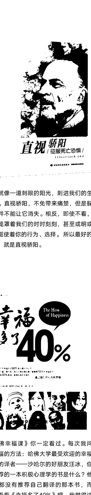

在自我剖析的书籍里，写得最全面的一本。个性改变很难，但是幸福生活是任何人都无法拒绝的。这本书就是帮你了解自己所处的状态，给你一个改变的方向。


从未有一本书如此系统地诠释了教练的心理科学与背景，以及科学背后的技术与艺术……如果你希望成为一名教练或咨询师，或你希望成为教练型的领导者，这本书是你永远绕不开的入门读物。


这是一本被书名毁掉的书，原名叫做 How to think straight about Psychology。书名的问题在于，大部分人连“伪心理学”的概念都不知道，更别提说“不”了。


建立一个清晰、明确、健康的心理边界，专注自己能控制的，放手自己不能控制的，是心智成熟之路。


死亡就像一道刺眼的阳光，刺进我们的生命里。直视骄阳，不免带来痛苦，但是躲避并不能让它消失。相反，即使不看，它也笼罩着我们的时时刻刻，甚至或明或暗地驱使着你的行为、选择。所以最好的方式，就是直视骄阳。


《哈佛幸福课》你一定看过。每次我问《幸福的方法：哈佛大学最受欢迎的幸福课》的译者——沙尔尔的好朋友汪冰，你最推荐的一本积极心理学的书是什么？他竟然都没有推荐自己翻译的那本书，而说，看看《幸福多了40%》吧，我觉得这是关于幸福的方法和技术最实用的一本书。

### 二、技能提升类的好书


帮你在读书这件事情上少走弯路，越早读到越好。


哈佛著名心理学家，写过《语言本能》《思想本质》《心智探奇》这种非常专业又非常畅销的书。这么一个心理学家，如何看待写作？近年来读过的最好的写作书；这本书好像没有大陆版，只有繁体字版。

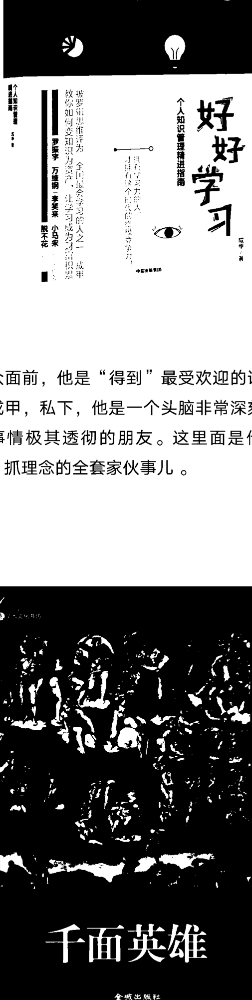

学会独立思考的必读书目，是国内第一本全彩印刷批判思维杂志书，帮你不被忽悠拢跑。

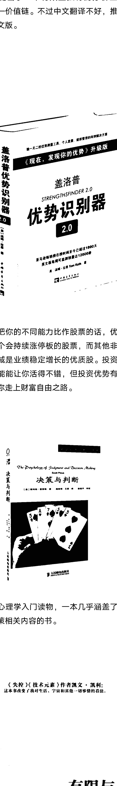

公众面前，他是“得到”最受欢迎的说书人成甲，私下，他是一个头脑非常深刻，看事情极其透彻的朋友。这里面是他学习，抓理念的全套家仓事儿。


神话学大师坎贝尔的经典之作，他追溯了全世界几乎所有神话系统中文与英雄历险相关故事，并从中揭示出相同的英雄原型。同样结构几乎能套用在任何一部好莱坞商业影片的冒险传奇中。“不是每个人都有命运，只有纵身跃入去触碰它，并带着戒指再度回来的英雄才有。”


生病了，我们都知道要吃药。可情绪生病了，如果还没严重到需要专业人士帮助，我们一般会放任不管，其实最佳策略是去找个医药箱处理伤口。书里提供的这些治疗方法，就像是家庭医药箱，有着情绪治疗的各种“创可贴”、“抗菌药”、“冰袋”和“退烧药”，针对不同症状，有着不同的疗效。

### 三、职业发展类的好书


迈克尔·波特的著名三部曲之一，在本书中他提出了一个有效且独特分析工具——价值链。不过中文翻译不好，推荐看英文版。


如果把你的不同能力比作股票的话，优势是那个会持续涨停板的股票，而其他非优势领域是业绩稳定增长的优质股。投资一般技能能让你活得不错，但投资优势有可能让你走上财富自由之路。


社会心理学入门读物，一本几乎涵盖了所有决策相关内容的书。

> 《失控》《技术元素》作者凯文·凯利：这本书改变了我对生活、宇宙和其他一切事情的看法。


工作是一种“有限游戏”，而事业、家庭则是无限游戏。如果你没有意识到有限游戏以外，还有无限游戏，就容易过度焦虑。


费曼是一位我很喜欢的科学家，特别有趣。在超级个体专栏学习主题里介绍过他的学习方式——费曼技巧。他在学习某样东西时，会尝试教别人，而且用最简单最简洁的方式教会别人。专栏21-3里有详细解释，不多说了。

最后推荐一本我的新书——《跃迁：成为高手的技术》，正在当当预售，8月初会跟大家见面。

最后推荐一本我的新书——《跃迁：成为高手的技术》，正在当当预售，8月初会跟大家见面。

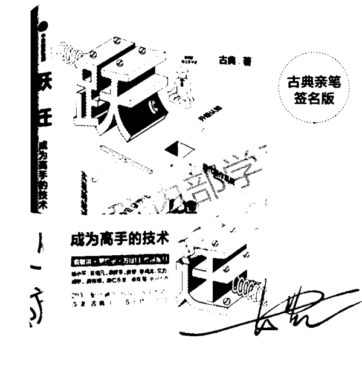

过去我写过《拆掉思维里的墙》和《你的生命有什么可能》，这两本书销量过三百万，很多人因此受益。我从心理学视角出发，解开了很多错误心智模式的心结，让人不被自己禁锢，活出真正的自我。

今天《跃迁》这本书，则希望讲述这个硬币的另一面——给你讲清一个普通人是如何借助社会、时代的规律快速发展，他们是怎么选择、怎么学习、怎么思考的，配合身边的实际案例，把高手的心智和技术揉碎了、拆开了，展现给你看。

希望那些非常勤奋的年轻人，看完这本书，可以少走弯路，不再关门 ply 大招，而是理解规律，引入资源，完成自己的爆发式增长，不说成为高手，至少走上高手之路吧。

## —— 下周预告 ——

下周我们会讨论一种近10年非常流行的个人成长技术-教练技术。

我不是指足球教练、羽毛球教练这种体育运动的教练。而是商业、个人成长领域的教练：个人成长教练、领导力教练等。世界500强公司中有80%都为自己高管聘请了管理教练，杰克韦尔奇退休后的第一选择，就是做领导力教练。

教练以提问为工具，通过激发人的潜能，开启智慧，帮助人自己解决问题。

不过教练课程一般价格三五万，单次教练服务也在3-5千每小时。所以了解的人并不算太多。

很幸运，我自己正好是10年前把教练引入中国的第一批人，受益良多。我想用一周的时间，把这个神奇的领域介绍给超级个体的伙伴。

- 人如何战胜自己的内在斗争？
如何改变自己身上的顽疾？
如何让自己有持续精进的动力？
如何让自己始终聚焦一件事？

下周我们会讲4个教练的重要工具，如果你希望开启潜能或者更好助人，建议你关注下周内容。

今天是古典陪伴你成长的第 268 天，一起加速，成长为更好的自己。

## 自我教练：打赢你的“内在”之战 39-1

39-1 自我教练：打赢你的...

- 1、添高威开创了一种新的网球教学模式：要求大家不再关注自己的动作，而是把注意力放在网球本身。
2、自我教练最重要的任务是：持续地帮你聚焦目标、排除干扰，内通外顺。帮你打赢“内在”的这场战争。

## 这周我们来一谈“教练技术”。

首先看个例子：

你有没有学习过打网球？如果你正式学习过打网球，肯定会有过这种经历：教练对你说，“双脚要与肩同宽站好，眼睛正视前方，双手搭拢子、虎口向上、重心控制在两个脚的脚尖，然后用腰发力带动肩胛，手腕要放松……”

“好，放松，放松！”

但你根本没法放松。

如果我告诉你，有人可以教一个网球小白 15 分钟内学会接发球，你信不信？

## “教练技术”的来历：

有一位退伍军人叫添高威，在美国加州做网球教练。 有一次，他有急事要去城里一趟，而他好不容易招的一群学生却需要上课，于是他请滑雪教练代一节课。等他从城里回来的时候，却惊奇地发现，这些人的水平比他亲自教的还要好，有很多人已经学会了接发球。他问滑雪教练是怎么教的。

滑雪教练告诉他，因为自己也不懂正确的动作，所以只能不断地鼓励他们，并且告诉他们，要盯住飞来的球。

添高威很受启发——他意识到，传统的教学方法里人们过多希望做一个标准的动作，却常常忽略了最重要的“目标”。比如演讲的时候，我们常常满脑子在想该做的10件事，不该做的事，和背后的稿子，就是忘记了其实演讲要吸引的是台下的人注意。这些内在的评价形成了我们的障碍，让我们没法发挥潜力。

添高威开始创造一种新的教学模式——他要求大家不再关注自己的动作，而是把注意力放在网球本身。这种方法非常神奇，以至于引起了电视台的好奇。

后来，在美国CBC电视台的一个揭秘节目中，添高威要在20分钟里在镜头前教会一个人怎么打网球。电视台也够狠，专门找了一个5个月都没有运动过的胖女人，并且要求签订了一份合同，公证她没有学过网球，然后让添高威教。

就在20分钟里，添高威用他的方法成功地教会了这个女士接球、发球和反手抽球。这个技术震撼了整个体育界，也引起了GE公司的注意，并邀请他去GE公司讲课。当添高威讲完以后，发现高管们记录的全部都是关于员工管理的秘诀，他知道一个新领域产生了。

这就是企业教练的来源。


## 添高威发现了什么秘密？

他发现，每一项比赛都由两个部分构成，外在比赛和内在比赛。所谓的外在比赛，就是要战胜对手，克服障碍、达成必要的外在目标。关于怎么在外在比赛中取胜，很多书做了指导。比如，如何控制手臂、脚步和整个身体，但是说起来头头是道，做起来却难于登天。

但是很少有人注意到内在的比赛，“内在”里，选手也在进行比赛。注意力不集中、过度紧张、缺乏自信、无端自责……很多选手总在最后一瞬间完全垮掉，而有些人则在关键时刻发挥超常——所有高手都是“内在”比赛的人。

用公式来表示，就是：

P=p-i
表示=潜能-干扰

## 打赢你的内在战争


无论是训练、学习还是比赛，我们要做的最重要修缮，就是聚焦目标、排除内在干扰——“放松而专注”。

我们要做的事情，就是降低干扰。“放松而专注”，干扰主要来自于两个，自我的评价（就是内在弹幕）以及目标不清。所以教练的主要技术，就是通过理顺自我评价，持续聚焦目标。我们在未来会慢慢展开这个话题。

## 最后举一个反例：

我有一个朋友叫做春雨，我们偶没事就一起打桌球。他桌球打得很好，常常能一杆收9球。我水平不够，于是坏环，就提高干扰。

每当他出杆的时候，我就会说，教教我吧。你出杆的时候，到底是怎么发力的？是先用腰部带动手，还是手和腰一起用力？是呼气还是吸气？是先瞄准再调，还是调完再瞄准？

基本所有的教学赛，他都没有赢过。第一，他目标开始模糊，要赢又要教。第二，他的内心开始自我评价——其实谁知道是先呼气还是吸气呢？

其实这个坏环的我，就是你内心的小潜意识——它不断蹦出乱七八糟的想法，也不段地对你做内在评价。当好自己的教练，它会让你持续聚焦目标，排除干扰，放松而专注地发挥潜能。

# —— 今日思考题 ——

今天你最想拿到一个结果是什么？如果今晚睡前你觉得一整天都没白过，那是因为白天做了什么？欢迎你在留言区分享给我。

自我对话：大脑里的弹幕系统 37-4

怎么样排除后悔和无奈的情绪。

今天是古典陪伴你成长的第270天，一起加速，成长为更好的自己。

自我教练的思考

提交留言可与专栏作者互动


# 你是粪坑里的007吗？
39-2

39-2 你是粪坑里的007吗？

后悔和无奈的根源：当一个人把自己的选择和自己的妄念做对比时，一定会产生无奈和后悔的情绪。所以，无奈和后悔的根源都是选择了并不存在的对比对象。

昨天我们讲到“自我教练”最重要的是降低干扰，聚焦目标。

今天我们来谈谈如何解决人生中常遇到的干扰——后悔和无奈。

在开始讲今天的内容之前，先请你做一件事：快速地在脑子里，想像3件特别无奈的事。

想好之后，听我说一个007的故事：

## 落入粪坑的007

“007”的系列电影你应该都看过，现在想象你就是007，在平安夜11点35分，你穿上最好的礼服，端着72年的红酒，在有壁炉的房间，和一位金发美女喝酒，等待十二点的倒数。

这个时候你电话响了，你拿起来接。因为信号不好，走到了门口。

## 区分是“选择”还是“无奈”？

你会说，“真无奈”，还是，“真幸运”？

我相信，很多人最后还是会说一句:我真幸运。

## 再来看另一种心态——创造

如果007爬出粪坑，往后所走的时候，他会做什么？他可以反思自己遇到的问题，对自己说，学到了什么——

> “下一次这么美好的时刻，尽量不要接电话，不要随便走到房屋外面，要带手枪；任何时候，去一个地方之前，要记得附近的地形图。”

- 有人是 “怎么就选了这么一个老公？”
- 有人是 “每天早上要准点起床去公司打卡好无奈”
- 有人是 “就是我爸妈帮我选的专业，所以我大学不好好读！ ”

# —— 今日思考题 ——

常常让你感觉无奈的一件事是什么？这是你的选择还是无奈？你又能为自己创造出什么新选择？欢迎你在留言区分享给我。

## 如何解决后悔和无奈


只有当你完全意识到，自己今天的处境不是被迫，而是自己主动选择的结果时，你才能对过去释然，从而面向未来，开始创造选择。

今天我给大家做了一个区分——“选择”和“无奈”。明天我跟大家谈谈如何掌握“区分的技术”。

有限决策：治好选择恐惧和完美主义 38-2

今天是古典陪伴你成长的第 271 天，一起加速，成长为更好的自己。

## 关于自我教练的思考

## 区分的技术：怎么区分事实与真相？ 39-3

39-3 区分的技术：怎么区...

- 1、 “区分” 的意义：用思想辨析障碍的真正边界，看清症结的真正样子。
- 2、 “区分” 的技术：第一个要区分事实和假设。第二个要区分事实与真相。

也许大家都意识到了，自我的教条的一个很重要的工作，就是做出区分。我们的 adesso ...

比如，有朋友问我，“朋友找我借钱，借吧，自己也没多少钱，而且也不确定对方什么时候还；不借吧，对方会认为你不信任我。”

我帮他做了一个区分：

### 第一个区分：区分事实和假设

先给大家讲一个发生在我身上的真实的事：

### 第二个区分：区分事实与真相

那么，是不是眼见就为实就是正确的？其实也不然，第二个需要区分的，就是事实与真相。大家都听说过著名的“盲人摸象”的故事——在故事里，每个人说的都是事实，但是却并非是真相。因为真相往往是事实的完整拼图。

# —— 今日思考题 ——

你是怎么区分不执着和不想进取的？欢迎你在留言区写下自己的思考。

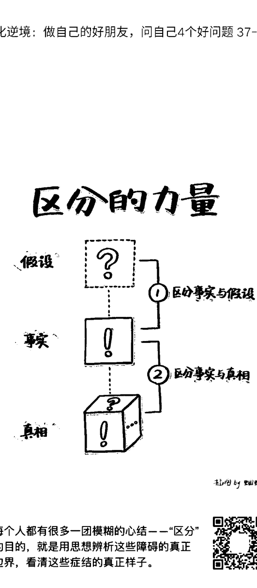

## 区分的力量


## 度量式问题：快速聚焦你的目标 39-4

39-4 度量式问题：快速聚...

- 1、度量式问题：这种提问方式是为了解决语言的模糊性和欺骗性。
- 2、一个实用的度量式提问：“如果提升一分是个什么情形？我该做什么？”

我们用了一天时间讲聚焦目标、降低干扰；又用了两天时间处理了“后悔和无奈”以及“事实和真相”这些干扰，今天我们谈谈如何高效地聚焦目标。

之所以放在后面讲，因为我们在前面专栏里用过一周时间谈“目标”的事（第6周）。里面说了，如何确定一个好的目标。目标并不是越大越鸡血越好，目标是一个动态调整的过程——积极和悲观的程度，用WOOP调；清晰与否，用SMART来调整；是否激发人心，用价值观念调。

我们讲了很多不同层面的目标调整方式，那么“自我教练”的方法有什么特别的呢？教练的精妙之处就是——简单。

我一直不太喜欢太过科学化、技术化的自我管理技术，并且认为这都是专业培训师、以此为生的人的套路，并不一定能实战——真正能每天用超过30分钟的时间用于自我管理的，要么是真的很闲，要么是达到了从容不迫的境界。前者应该多做事，后者你也学不来。

今天教大家一个最简单的打磨目标的方式，这个方式只需要“一个问题”——度量式提问。

比如说，我的部门经理过来汇报工作，提交推广方案，我觉得中规中矩，没有新意，于是问他：“这个方案你满意吗？”他说，“总体上还行。”

你看，一般聊天到这里就很麻烦了。因为我虽然不满意，但我也不是专业人士，不能清晰地指出问题，并给出专业建议。而且推广方案这种事，如果执行者不认同，也没有办法落地。于是我问他：

> “如果这个项目特别满意是10分，你觉得现在是几分？”
> “大概是7.5分”
> “那如果再提高一分，应该在加点什么？”
> “应该有点我们新精英独特的调性，我们的特点是好玩有趣，现在这个调性还没出来。如果这个出来，增加独特的术语、词汇、配色和玩法，应该能调性出来。”
> “好，现在是8.5分，如果再增加一分呢？9.5？”
> “9.5太难了，我觉得可以试试看联合几个平台同时做，他正好也有相关需求，如果可以成为几个活动的一个串联点，那就太妙了。这个有9分。我是一个激励型选手，最后1分，留给我们团队随机应变用的。我觉得当场表现要足够有气场，这样能到10分。” 他眼睛开始发亮了。
> “好的，你去调整一版方案。”

## 解决语言模糊的问题

刚才我做的，其实就是一个打磨目标的问题，这个提问方法，叫做“度量式问题”。

度量式问题其实明晰的是一个程度问题——我们的语言是非常模糊的。什么叫做好？什么叫做坏？什么叫做不错？什么叫做已经尽力了？

当你提出一个度量式问题，对方开始评估的时候。你俩人就取得了一个共同的基准，而不会被“很好”“不错”的形容词限制。

正面可以评估，负面也可以。

我一个朋友跟我讲过一件事。

他的大学同学，有一段时间心情不好，几次夜里打电话找他倾诉，他都是随便用几句话搪应付了对方，比如，“唉，人生不就这样，去喝酒吧。”为什么会这样？因为他朋友的语言是模糊的——“最近有点不太好”，“最近过得有些不舒服”。一直到我这个朋友学会了度量式问题，他才试着问了一句：

> “如果你承受不了的难受是10分，现在是几分？”

对方回答“9分”。他马上意识到这个事情非常严重。

对方继续说：“我感觉如果再有一件事情发生，我就撑不住了。”

他马上打车过去，并且通知对方家人。到了才知道，对方已经做了最坏的打算，算是捡回来一条命。

## 解决语言的欺骗性

度量式的问题，解决的是语言的欺骗性——同一个词汇，在不同人心里冒出来感受是完全不同的。

我大学毕业后，刚去深圳上班时，有一次买衣服，服装店老板叫我靓仔，我特高兴。后来发现她对我后面一个公认歪瓜裂枣的同学也叫靓仔，靓仔几乎是一个对男性绰称。就好像所有玩儿淘宝宝的人，都会被叫做“亲”一样。我们的目标很容易在这种语言中失去焦点，也失去力道。

- 1. 什么叫做把英语学好？
- 2. 什么叫做真的很用心地做好工作？
- 3. 什么叫做让自己持续成长？

这都需要一些“度量式问题”来问自己。

度量式问题的另一个部分，就是“如果提升一分是个什么情形？我该做什么？”。

为什么这个问题这么有用？因为他逼迫你成为“更好的人”。

成为更好的人并不是人的本性。

大部分的人这一辈子活在两种动力之下“苟且”和“生存”。活不下去就发生产生，稍好做点就开始苟且。但在今天社会，只有做到非常优秀，才能活得更好，如果你不断游荡在生存和苟且之中。你的生活不仅有眼前的苟且，还有远方的大坑。

所以问问自己“如果再提升一分，不用太多，就是一分，那么我该做些什么？”

# —— 今日思考题 ——

如果你完全享受当下的生活是10分，现在你给自己的生活打几分？你能做点什么提升一分呢？欢迎你在留言区分享给我。

为什么说，梦想会拐骗你成功 6-1

互动讨论 | 你的目标，怎么公布才更容易实现 6-4 "这个工具真好，为什么我没早点遇到 6-5


提出一个度量式问题，能避免语言的模糊性和欺骗性。你跟彼此提问就取得了一个共同的基准。

今天是古典陪伴你成长的第273天，一起加速，成为更好的自己。

关于目标打磨的思考

提交留言可与专栏作者互动

## 生活顾问日 | 纠结怎么解？ 39-5

39-5 生活顾问日 | 纠结怎...

老师，我是保时捷控股中国区的HRD，我在这集团工作10年，职业发展从单店的HRM，到区域的HRBP，再晋升至集团担任中国区的HRD；但目前有如下想法与选择困惑：

- 1、个人想去海外留学继续深造学习关于心理学方面的硕士课程（本人在国内已有MBA学历），丰富职业知识技能体系。
- 2、由于在HRD职位工作时间不长（今年2月就职），还有很多工作项目可以去实现完成，离开此平台是否可惜？
- 3、辞职去海外学习，回国后是否还具有竞争优势？期待被您选中并进行深入交流解惑。

## 古典

很多人都会面临“纠结”的问题。纠结，其实是个象形字，纠结是绳子缠绕在一起打上了结的样子一个人遇到。一个人遇到2个都很好的选择，好好坏坏缠绕在一起，就是纠结。如何破解这种纠结呢？我们请到了生活咨询师马华兴老师来解开这个局。他在500强IT企业里深15多年，从技术员做到总监，现在是资深的生活规划师。

曾在500强IT企业历练十余年，至总监。资深职业生活咨询师，6年职业生涯咨询经验，操刀大小职业咨询500余例。中央人民广播电台特约职场专家，畅销书作家，著有《现在的用到，都应当年脑子进的水》及《老马的职业”鬼”话》。

亲爱的grace，你好！很多人都会面临“纠结”的问题。纠结，其实是个象形字，纠结是绳子缠绕在一起打上了结的样子。一个人遇到2个都很好的选择，好好坏坏缠绕在一起，就是纠结。

前段时间有一个段子，如果“高晓松和吴亦凡同时追求你，只能选一个，你选谁？”一个是诗和远方，一个是马到手上的颜值。

很多人都在纠结高晓松和吴亦凡的问题，在职业生涯里，你也有自己的高晓松和吴亦凡。


A.做稳HRD在职场上平稳发展、左右逢源

B.去海外读心理学硕士发发现可能，自我实现

不管你选择了哪个，最怕的是，当选择的道路不尽人意，你会感到后悔。

所以，你要解决的问题是：

哪个选择发展好？怎么选才不后悔？

不过，你这样比来比去，是比不出子午卯酉的。你会拿A选项的好处，跟B选项的坏处比。你还会拿B选项的好处和A选项的坏处比。这就好比：买房子，买郊区的大房子怕不方便；买了市区的学区房又怕不舒服。这样比来比去，就越来越纠结。

今天我要推荐给你一个最简单的比较方法：

> 『两喜相较取其轻，两利相较取其重』（敲黑板）

算算A选项和B选项的利，哪个利你更想追求？

算算A选项和B选项的害，看哪个害你更能承受？

这个比较法的核心是，不要比较当下，要比较未来。职业发展好不好，要看未来3年，而后悔，也经常发生在3年以后。

所以，你需要思考下面这三个问题：

- 1. 『假如我继续在这个平台做HRD，3年后混到最好会到什么情况？』
- 2. 『假如出国去读书，3年后混到最好会到什么情况？』
- 3. 『这两个我更想要哪个？』

## 从职业发展来说，要考虑三个溢价：

- 1.如果一个行业正在发展，规模再扩大，那最划算的方式是留下来，跟上发展，这样能获得行业的溢价。
- 2.如果一个企业，是酷酷的企业。那你在
这个企业里坐稳一个位子，也能带来身份和人脉的溢价。
- 3.HRD的职能，是不是让你做起来很享受。如果享受，你就得到了精神溢价。

那么，你所在的豪华型汽车行业，在中国是不是扩大规模时期，你可以看看你公司中国区的业绩报表，是否在高速增长。如果高速增长，你留下，会获得行业发展溢价。

怎么判断这个企业是不是酷？不要自己判断。因为你在这个企业已经待好多年了，容易审美疲劳，你可以问别人，当你提到你们企业的产品，你们企业的名头，你的身份时，他们是什么感受和评价。

你可以体会一下你现在每天的工作内容，哪些任务你很享受，哪些任务让你痛苦，那些让你痛苦的，能否授权出去。

如果这三个溢价：行业发展溢价、身份溢价和精神溢价，你都拿到了。你需要做的是

这三个溢价，跟你去追求深度学习、开阔眼界的溢价相比。哪一个更加值得？

做完这个比较，你还要比较一下后悔的可能性。看看哪种后悔更加不能忍受：

- 1. 『假如我继续在这个平台做HRD，3年后我后悔了，是个什么情况？』
- 2. 『假如出国去读书，3年后，后悔了，是个什么情况？』
- 3. 『这两种后果，我更受不了哪个？』

选择自己更能承受的那个？比如，出去读书2年后，却发现当年同起点的...小伙伴发展得比你更好，而感到受不了；还是老老实实继续干下去，发现工作日益重复又聊更受不了？

选择看看自己更能够承受哪个。

这样一来，因感就慢慢转化成了提问，你会意识到，大部分人的“纠结”不是选择本身的问题，而是信息量不足的问题。

你可以找找海外心理学的硕士，他们的职业选择是什么？是不是能支撑你的想象？

这样做也会激发你的思考，想出国读书到底为了什么？做HRD的期待是什么？

对于未来的想象里，你最不能忍受的是什么？是没有海外的经历？是缺乏HRD的实战？哪一个是你不能承受的生活？

其实，只要我前面讲的那些都信息齐备了，答案也就自然浮现了。

不过很多人会继续追问，说 。如果最想要的选择是A，但偏偏最怕后悔的也是A，那该怎么办？比如，我怕做着HRD以后再也出不去了，所以最想出去读书，但最怕的也是读完海归硕士回来没有竞争优势。这时候怎么判断，别着急，我们再加一个问题。

> 『我们有什么办法能现在做点什么让未来的两个后悔都不发生？』

这样很可能会出现第三第四个选项：

比如，国外有很多3个月左右的心理学项目，有些公司有时候也会提供出国或者国内深造的机会，不离开职位也能深造。如果出去读书，也有持续和国内雇主保持联系，回来继续工作的机会，或者海外的心理硕士毕业生有你这种经历的不多，综合起来在很多其他领域有跨界的竞争力。总之，当你提问，就会再次冒出很多答案。

## 古典

今天的话题是纠结——我们再跳回到，纠结这两个字上看一看：

纠结的“纠”，是形象的2条绳子缠绕在一起的样子。这个时候拉结，会越拉越紧，关键是从2头开始着手，一头连着内心的“动机”，一头连着未来的“可能性和不确定性”。要解开纠结要从这两个方向同时使劲。

怎么解呢？把纠结变成提问，因为纠结是无解的，但是“提问”却是有解的。

通过不断的把困惑变成提问，无解的问题，就变成了能解的“提问”。只要踏踏实实一点点找答案就好。当然了，咨询师也会给你提供更多信息，但是只有你才能找到问题的答案。

生涯咨询的结果不仅仅是让我们去解决一个问题，更重要的，是让我们成长为一个能解决这个问题的人。

有限决策：治好选择恐惧和完美主义 38-2

今天是古典陪伴你成长的第 274 天，一起加速，成长为更好的自己。

## 关于做事不纠结的思考

提交留言可与专栏作者互动

## 教练郭农：每个问题都有创造性的解决方法
39-6

## 古典

这周的成长导师，我邀请了一位资深生活教练郭农老师。她驰场阅历丰富，在20多年的职业生涯里，担任过世界500强的人力资源高管、知名管理咨询公司的高级顾问，也曾做过大学老师、民企董助、翻译、外贸、连锁店经营、合伙创业、公益教师等。

近年来，郭农老师开始专注于她热爱的生咨询和教练领域，短短数年间帮助了很多学员走出困境，成为新精英生活的 高级咨询师，“在行”的年度 famosa、及多家机构的咨询顾问和教练。郭农老师富有爱心和责任感，温柔亲和，咨询时总能给人力量。因为她相信每个人都是OK的，即使在面对挫折时，也具有足够的解决问题的能力和资源。

同为教练的我，对这个观点也深表认同：相信你自己，很多事情就会变得简单很多。期待下面郭农老师的分享，能带给你一个新的视角来对待自己当下的问题。


我第一次接触教练是许许多年前的事了，那时我的上司是一位资深教练。在工作中，她很少分派任务，但常常花时间跟我们讨论下一步的目标与行动计划，有工作上的，有自我发展的。她对我们的要求就是每个阶段都要有自己的工作改进和个人发展目标，并且要主动去带领一些部门或公司层面的改善项目，在项目中快速学习，锻炼和提升相关能力。

事实上，当我们做完了这些大大小小的改善项目，不仅提升了自我，同时也成就了部门的业绩改善，甚至组织的部门管理改善。所以即使她很少施压给我们，但整个团队都在快速进步，工作结果持续改善，有目共睹，让我们很有成就感。她很少告诉我们该做什么，该怎么做，只是问：

- 你想做什么？为什么？
- 想达到什么结果？
- 打算怎么做？
- 还有没有更好的方案？
- 估计会有กำลัง问题和阻力？你打算怎么办？
- 有什么需要我支持？
- 很好，就按你说的去做吧……

每次我遇到困难去求助时，她也很少直接给建议，只是发问，但这些带着欣赏、带着相信、带着期望和信任的问题总能帮我“看到”想要的结果、激发潜能、启发思考、理清思路。现在回想起来，那段时 间是我成长最快、最有成就感的日子，何其幸运遇到这样的师傅，每次想到她，都是深深的感谢！

后来她退休了，身边没有了这样的教练，但每每在我遇到困难时，她常问的那些问题就会在我脑海中回响，我自问自答这些问题，往往都有不错的收获。这让我明白，其实我们是可以自我教练的！后来看了很多教练的书，也上了不少教练的课，开始从事咨询和教练的工作，慢慢成为了自我教练的践行者和受益者。

生活中不是每个人都有条件，也不是必须找教练才能受益于这项技术。教练不是多么玄妙的学问，就像古典老师在他翻译的教练泰斗玛丽莲老师的一本书《唤醒沉睡的天才》里所说：“教练不是一系列上去神经过的问题、似懂非懂的工具、神秘诡异的课程，更加不依赖于某几个‘大师’、‘高人’才能起作用。教练是基于扎实心理学基础和我们对大脑科学的理解，每一个人都能学会。是一种每个人都能有的思考和工作方式——如果人们掌握这套思维模式和信念，每个人都能发挥出自己最好的部分，实现自己希望的人生图画，成为自己最好的样子。”

自我教练这件事，大家可能觉得没学过很难，其实没那么难。总结起来，我自己面对工作与生活中的大大小小的问题，尤其是需要快速反应时，最常问自己的问题就两个：

- 1. 我想要的结果是什么？
- 2. 为了拿到这个结果，我还能做些什么？

第一个问题是让我们“看到”自己想要的最好结果和期待的场景，越具体越好。这个“脑补”的过程，能让我们聚焦正面结果；而且那个画面会吸引我们动力十足地调动潜能，更加专注和投入。注意力到达的地方，就会创造更多的能量。

第二个问题能让我们理清思路，找到实现目标的最佳路径，降低焦虑，去除干扰，这便是古典老师周一讲的教练公式：P=P-I（绩效表现=潜能-干扰）。

还有关键的一步是把要做的事情安插到“行事历”里开始行动！我在咨询和教练中发现很多人经常拖延、不行动，要么是因为目标不清晰，或者不够吸引，没动力；要么是因为看不清路径，不知道怎么做，无法行动。当目标足够吸引和明确，也知道怎么做可以到达时，很多人就能行动起来。

当然，在行动的过程中还会遇到新的阻力和困难，那么还需要再问自己这两个问题，让自己专注于目标和行动上。

不夸张地说，这两个问题让我减少了很多纠结和内耗，指引我做出了很多正确的选择和决定，也帮助我实现了许多大大小小的目标。

几年前在我的工作忙成一团，顾不上休息和家人时，虽然职位和收入越来越高，但当我面对一个升职机会时，却开心不起来，只觉前面的路更加黑暗。当时我就问了自己这两个问题，逐渐看清了自己想要的生活——辞职离开开企，成为一名生涯咨询师和生活教练。现在家庭和睦，事业上也在自己热爱的领域努力地玩。

这么说来，你是不是感觉自我教练也很简单，两个问题就能发挥巨大能量？其实，教练中的提问至关重要，同样是提问，有些提问能让困难的问题更复杂，焦虑的人更焦虑，抑郁的人更想自杀，而有些提问却能让人豁然开朗，生机一片。

让我们来试一下，想一想你最近遇到什么不顺利的事，看看下面两组问题带给你什么感受和结果。（注意“自我对话”中用“你”会比“我”要好。原因可以点击下方链接，回看专栏37-5：转化逆境的4个问题）

## 转化逆境：做自己的好朋友，问自己4个好问题 37-5


看完你有没有发现左边的问题会让你更郁闷抓狂，而右边的问题会让你充满能量？原因是自我教练时，一般需要掌握下面4个要点：

- 1. 关注现在和未来，而非过去。
- 2. 目标导向，而非问题导向。
- 3. 挖掘资源和机会，创造可能。
- 4. 引领行动。

大量的实证已经验证了教练技术对个人发展的强大作用，但在我多年从事生涯咨询和教练的体验里，单靠技术和工具是难以真正起作用的，所有改变的发生都取决于我们所持有的信念。

这一点，我在最近和儿子的互动中感受最深。对于16岁的孩子，过去的“糖衣炮弹”、“威逼利诱”、“道理说教”都逐渐失效了，无形中我所抱持的教练理念和方法却开始起作用。这么大的孩子，如果不能先成为朋友，说什么都只入耳不入心。教练技术所秉持的基本信念就是：

- 1. 每个人都是OK和完整的；
- 2. 每个人都具有成功的资源；
- 3. 每个行为的背后都有积极正面的动机；
- 4. 每个人都会为当下做最好的选择；
改变是可能的，也是不可避免的。

当我们认为自己是“不完整的”、“不OK的”时，就会倾向于向外寻找，尝试通过外在的条件证明自己的完整和价值。而当我们相信自己、相信每个人都是完整的，不需要“修补”的，相信每个人都拥有做出当下最好的选择、拥有成功所需的

有做出当下最好的选择、拥有成功所需的一切资源时，我们就不再向外寻找，会转而专注于自己想要的和能做的。正是这份对自己、对他人的相信、爱、肯定和赞赏的力量让教练技术发挥作用，让改变真正发生。

当我们理解了教练的底层逻辑，有了教练的思维和信念，就如同我们为身体、头脑等硬件配置了教练的软件系统，每个人都能自我教练、发掘潜能、屏蔽干扰，以及创造性地解决工作与生活中的很多问题，成为更好的自己。

特别感谢古典老师，希望这周的教练技术为你找到心中的“闪仁波齐”，未来的每一步都坚定、踏实、淡定地走在自己选择的“朝圣”之路上。真正的朝圣，是在去远方的路上，回到自己心里的家！

学习了一周的自我教练，你跟上周比，有哪些收获和改变？欢迎分享。

有数据统计：上班族平均每个月要花15个小时在背地里批评老板。按一个月30天折算，几乎是每天要花30分钟来骂老板。——老板也够惨的。盖洛普公司2015年的一项调查显示，75%的员工离职原因是：没办法和自己的上司处好关系。也说就是说，很多人换的不是工作，而是老板。

德鲁克曾说：成功的捷径，就是为一个有前途的老板工作。老板，其实是一种你需要主动“管理”的资源。

下周我们会展开来讲，如何管理好自己的老板，从而带来更好的业绩、更高的薪资待遇和更舒心的工作氛围。如果你有这样的需求和期待，建议来关注下周内容。

今天是古典陪伴你成长的第 275 天，一起加速，成长为更好的自己。

自我教练的前提是要向自己不断地发问，问正确的问题，并积极的给出解答。
07-22 06:45:00
阿哲
不只是这周的教练技术，这段时间的学习让我真正明白，自己的能量是无限

到困惑时懂得用套路来修正自身，更好的成为我自己。
07-22 06:43:31

天蚕变变变
按照大师们指点的开始行动起来，已经坚持了四天按照每天的目标、任务，实践“零秒思考”，知道了“自我1”和“自我2”，总结问题懂得用“度量”来衡量，每天按部就班的为提高一分而践行着！知道了“自恋”是动力的源泉，够熟练到自动化和全神贯注的专注就可能达到身心合一！每天进步一点点！像婴儿般的重生，长成自己的样子！
07-22 06:42:48

素丫
知道自己的目标在哪里，也知道应该如何到达目的地，剩下的就是行动起来。

+   今天学到的最有用的知识点就是：
1. 每个人都是OK和完整的；
2. 每个人都具足成功的资源；
3. 每个行为的背后都有积极正面的动机；
4. 每个人都会为当下做最好的选择；
改变是可能的，也是不可避免的。

还记得粪坑里的007吗？我想要应该没有人会愿意选择再来一次粪坑吧？为当下做最好的选择，改变是不可避免的～
07-22 06:36:06

以上留言由 作者 筛选显示

## 向上管理：老板这种生物的正确打开方式 40-1

40-1 向上管理：老板这种... ↓

+   1、帮助上司的重要性：他的成败和你最相关；他成功的概率最大；他会犯错，而你能补位。
2、上司的三个功能：信用卡功能、客户功能和加分功能。

今天这个社会，一个人已经很难成事了。所以，我们都爱谈领导力。这个话题，未来我们也会讲到，领导力是教你怎么做别人的上司，但是在领导别人之前，你先要领导两个人，第一个是你自己，第二个就是你的上司。

上司关系应该是我们职场关系里最重要的一個关系了。盖洛普公司2015年的一项调查显示，75%的员工的离职原因是：没办法和自己的上司处好关系。也就是说，很多人换的不是工作，而是老板。

今天，我们来讲讲如何“搞定”这个工作里最重要的同盟，你的上司。如果你觉得自己的老板是个混球，而且关系很不好，那么你一定要听着——如何搞定混球。如果你认为自己和上司关系不错，那么你也可以从中了解到，如何更好地管理这段关系，为自己加分。

## 我们跟上司的三种关系：

+   1. 怕，远远望见就想溜；
2. 怨，看不起，背后里抱怨；
3. 相处融洽，互相成就。

有一次我在香港应邀参加一个国际大公司的酒会。过了会，他们的大CEO来了，我发现了一个特有趣的情况，中国人下意识地往后退，因为他们觉得老板是权威；很多老外，即便是年轻人，也下意识地往前凑。他们觉得老板是资源。

这一进一退，其实是两种不同的心态。你把上司当成权威，先把自己降了一级，然后他做得好就怕，他做得不好就怨，天天说“你们高管”的人，其实心里本身就把自己定义成了“我们员工”。他的进步也就停止了，他的选择无非是做好手头事，或者不做好。

把老板定义为资源的人，内心有平等心，也有进步的动机。他认为，“我在这里工作和你是不平等的，但是你在这个系统里做得比我好，我要争取你的注意力资源，才能在组织里更好地成就自己。”

心态的不同，决定了这个人是往前进一步，还是往后退一步。遇到上司，往前进一步是更加聪明的做选择——因为不管你是愿意还是不愿意，领导者管理你都已经是一个既定的事实。他的目标需要通过你来推进，你也可以通过自己独特的支撑方式，突显你的价值，达到一个相互成就的结果。可以说，上司是一个你在职场里最重要的同盟，很多时候，帮助你的上司成功，比帮助你成功还要重要。

## 为什么帮助上司很重要？

#### 1. 他的成败和你最相关。

陈春花讲过一句特别深刻的话，“你的绩效的70%不取决于你的绩效，而是你的老板的绩效决定的。”为什么这么说？因为你上司的成功和你关系最紧密。你上司的项目成了，你的身价也在提升，他的项目败了，你在团队里再威风也没用。

反过来，他不上升，你的上升空间也有限。如果有一天他因为业绩不行被调离，那么继任者要么来自其他部门，要么空降，不太会从本来业绩就不好的部门里选，简单说，老板发展得不好，你也没戏。

#### 2. 他成功的概率最大。

在一个团队里，上司的成功概率是最高的。他的信息、能力、视野、资源都比你多，所以如果有一个人能成，也是他能成，所以理论上说，和上司结盟是最经济的事。

#### 3. 他会犯错，而你能补位。

上司所处的位罝，决定了他必须要面对各种复杂的局面。不过他也是普通人，也面临能力和思维上的局限，有七情六欲，也有生活里的一堆琐事。所以他一定会犯错，而你除了完成手里的工作，还能给他补位，强力支撑，就跟他形成了同盟关系。

这种通过沟通、协调、补位的方式，支持你的上司更好地自我发挥、更好地管理自己的方式，就是向上管理。

为什么一定要做向上管理呢？一方面是通过成就上司成就自己，一方面也是帮自己省事——你很快会发现，如果你不花精力去管理上司，你也需要花同样的精力去应付他的各种不合理的管理。所以，还不如主动出击。

## 如何向上管理？

你会发现老板这个生物有三种功能。信用卡、客户和加分题。

#### 1. 上司也是客户。

我一个做房地产的朋友抱怨自己的上司各种不靠谱，但是她是一个沟通能力极强的职场女悍将，她的方案往往都能通过。我问她，比客户还不靠谱吗？她说倒不会，客户那就真的非常不靠谱。我问她，为什么外部客户就能接受，内部客户就不能接受呢？其实我们还是希望上司是“自己人”，不用花太多信息，其实每个人都有内部和外部客户，上司就是自己的内部客户。你肯定不会因为爱一个人，才跟一个人做交易吧？

#### 2. 上司是信用卡。

你要成事儿，需要获得人脉、资源、认知和注意力，这都需要获得上司的支持。这个时候，上司就是一张信用卡。不过，你必须保持不错的征信记录——你需要在几个关键点上获得上司的信任票，才能顺利地拿到这些资源。

#### 3. 上司是“加分题”。

当然，人生难免有踩到狗屎的时候——我承认很多上司的确是奇葩。但如果不是完全不能忍，不妨把上司当成一道“加分题”。我们上学的时候，经常会有1-2道附加题，答对了加分，答错也不减分。不妨把你工作的5%-10%的时间，用来做“奇葩老板”这道加分题。答得好，告诉自己搞定了他以后谁都不怕。答得不好，告诉自己以后做老板，千万别这么做。

总之，上司是你最重要的工作同盟。如果你不花时间去处理这段关系，你也需要花同样的时间去应付他对你糟糕的管理，所以，面对上司，向前一步。

# —— 今日思考题 ——

我猜，有人会问，“这一周是不是教我们拍马屁？”我先不说我的观点。我先请你在留言区分享一下，你认为拍马屁和向上管理最本质的区别是什么？明天我会告诉你我的答案。

用知识管理降非主法则，发展专业领导力 22-1 用DISC速懂人；如果你想领导谁，就要服务谁 35-3


上司是你最重要的工作同盟。如果你不花时间去处理与他的关系，你就需要花同样的时间去应付他对你糟糕的管理，所以，面对上司，向前一步。

明天我来讲讲，向上管理的最高境界是什么？

今天是古典陪伴你成长的第 277 天，一起加速，成长为更好的自己。

## 支撑：向上管理的最高境界 40-2

40-2 支撑：向上管理的最...

+   1、向上管理的最高境界：支撑。
2、三个支撑之道：换位思考；发挥所长；及时补位，但不越位。

昨天提到了上司是最重要的同盟关系，今天我们说说该如何处理好这段关系。号称史上最强CEO的杰克·韦尔奇有一个助理，跟随他15年，在韦尔奇退休后，成为他私人公司的合伙人和副总裁，被《纽约时报》称为杰克·韦尔奇的“秘密武器”——罗塞娜。她写过一本书，叫做《支撑》。

向上管理的最高境界，就是支撑。

#### 1. 换位思考，支撑他做更好的决策

很多人认为，换位思考就是“如果我是他，我肯定会…….” 或者“我觉得这样做肯定不合适……”其实换位思考，绝对不意味着换位评价。

首先是因为你换不过去。上司和我们相比，有一个最大的区别，就是信息量比我们大，信息一方面来自高层、同级甚至董事会，一方面来自他对于未来趋势的更大判断。基于这些信息，他的判断会和你不一样。

另外你们的站位也不同，很多时候，领导面对的是微醺事实，但是对团队表述往往是愿景。就好象曹操的望梅止渴的故事——如果当时军队人人都有GPS手机，那估计军队当场就散了，也不会赶到最后。在二战的时候，诺曼底登陆是背水一战，孤注一掷，但是领导传递给军队的感觉却是前景美好，信心坚定，这时候双方的判断也一定是错位的。

所以换位思考，不是让你判断领导的决定是对错，而是思考领导为什么做这个决定？还需要什么信息，才能做更好的决定？在这个角度提供支持。在做好手头事的前提下，提供这些支持，是最好的支撑姿势。

反过来，如果你手头事做不好，天天思考战略、指挥同僚、暗地批评领导。别人会说“you can you up”的时候，你就懵了。这也就是跟高手低的真相——其实跟高手低的人，跟也未必高，他们只是往高处看，而不是站得高。

支撑的智慧是——超越对错，先做好手头事，然后推动领导做最好的决策。

#### 2. 支撑他发挥所长

有个技术员加入了一家IT创业公司，发现领导是个特别不靠谱的理想主义者。他做事情没有计划，讳疾冲突关系、工作经常被别人当枪使，公司出事他也不敢开除员工。面对这么一个混蛋上司，你会怎么办？

你看，如果你遇到个这样的领导，你可能会特别抓狂，发朋友圈说：“我遇到个奇葩老板，他神经大条、遇事不敢面对，经常被人占便宜还不知道，公司出了事也没有能力踢人走，妇人之仁。你说奇葩不奇葩。同意的点赞。”

但这个人觉得，这个领导虽然这方面弱，但是极其有领导气质，而且方向也很准确，是个不错的领导，自己可以用“偏执式的目标管理才能”弥补他的短处，可以落实这个人的很多想法，拯救这个富有才华却深陷危机的公司。10年后，他成为了这家公司的总裁，写了本书叫做《只有偏执狂才能生存》。他就是英特尔总裁格鲁夫。而领导诺伊斯就有了足够的精力去发挥自己的教学才干，不断提携硅谷的一些后起之秀，比如苹果公司的乔布斯。后来诺伊斯被称为“硅谷之父”。

这家公司还有一个创始人——戈登·摩尔，虽才华横溢，但只喜欢默默无闻地研究。在有了格鲁夫做管理后，他也可以全力做好一个计算机硬件的科学家，你也许知道他，他的名字命名了“摩尔定律”。

风投之父阿奇·洛克是这样评价英特尔的“三驾马车”的：

> “没有诺伊斯，英特尔成不了大公司；没有摩尔，英特尔成不了技术领先的公司；没有格鲁夫，英特尔成不了高效率的公司。英特尔的三驾马车每个人都很重要，但他们三人的合作更重要。”

如果领导天天盯着你的短处而不是长处，是不是你也很痛苦？换位思考下，如果你天天盯着领导的短处，是不是他也很难受？再换位思考下，如果你是领导，你会愿意支持一个支撑自己发挥长处的下属，还是愿意支持一个天天要求你改变风格，去配合他发挥优势的下属呢？

#### 3. 支撑他弥補短处，主动补位

那么对于领导的短处，是不是该视而不见？拍马屁和支撑的区别就在这里——拍马屁是让领导躲在舒适区，对缺点视而不见，降低团队效能，而支撑则是辅助决策，及时补位，让团队目标更好地实现。

果壳网COO姚笛讲过一个故事：2006年他在雅虎阿里巴巴负责一个产品部门，团队刚刚完成了一个新产品发布，大家拼得很辛苦，工作完成得不错，但他在管理上比较苛刻，所以没想得到及时地表扬大家。他们团队中的一个产品经理，就给他发了一封很长的邮件，邮件的开头简单说：“姚笛，这次项目完成得不错，大家也很辛苦，应该鼓励。可能你太顾不上，我就帮你写了一封邮件，你要觉得合适，简单修改就可以直接发给大家，给大家打打气儿。”他看完信之后非常触动，庆幸有这么一名下属。

这个案例里，最重要的其实是后面那句话——“我帮你写了一封邮件，如果你觉得合适，简单修改发给大家……”注意要补位，而不是越位。如果这个下属直接把邮件发出去，这个事情就变成了越位——支撑就变成了撼动，这个度就过了。

其实，支撑的智慧，在东方文化里就是坤卦的智慧。在《易经》里，坤卦象是地、牛、母亲、妻子，国家副主席、国务院总理、公司副职等都是担任坤卦的责任。坤卦的智慧，就是“厚德载物”。

马未都讲了一个香港拍卖行佳士得的老人的故事。佳士得拍卖行有一个负责开门的老头，每次拍卖会都站在门口负责迎宾，一做就做了40年，从20岁做到60岁。老头不仅迎宾，而且还记得到每一个买主，谁有什么喜好，拍了什么东西，会带谁来……整个拍卖行换了很多拍卖师，但是他却如活字典。

等到佳士得在巴黎开拍卖会的时候，没他不行。因为买主看不到他就觉得不是佳士得。于是公司高层请他去，他年龄大了身体不行，于是来回都是头等舱。他的夫人在家没人照顾，于是带上夫人一起。巴黎、东京、纽约每一场都这样。最后他退休的时候，他以佳士得副总裁的身份退休。

这个老人呈现的，就是无上的“坤”的智慧、厚德载物。乾道是领导之道，而坤卦是支撑之道，我们这个社会太过于强调乾道，而很少涉及坤道。

其实，强大的支撑是一种伟大的智慧。

今天的内容，不仅适合做下属，也适合所有的支撑者和需要支撑的事。我们每个人既是领导者，也是支撑者——只有足够懂得支撑的智慧，才能在需要的时候挺拔直上。

请你记住今天的三个支撑之道：换位思考、发挥所长、及时补位。但是永远不要越位。

# —— 今日思考题 ——

你在工作和生活中的哪些领域是“支撑者”？掌握了今天你的内容，你有哪些地方可以更好地发挥坤的智慧？

如果你是领导，或者你身边有朋友是支撑者的角色，也欢迎你把今天的文章分享给他们。

## 支撑的智慧


## 支撑的智慧

① 换位思考

② 发挥所长

支撑

③ 及时补位

手绘 by 里和明

向上管理的最高境界，就是支撑。支撑的智慧是一一帮助领导更好地决策、帮助领导发挥所长、在领导需要的时候及时补位。但是永远不要越位。

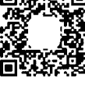

明天我们谈一谈，怎么实现卓有成效的向上沟通。

今天是古典陪伴你成长的第 278 天，一起加速，成长为更好的自己。

## 关于向上管理的思考

提交留言可与专栏作者互动

## 三个卓有成效的向上沟通方法 40-3

40-3 三个卓有成效的向上...

向上沟通最有效的三个方法：1、主动沟通，定期对话；2、从对方真正关心的角度切入；3、公开支持，私下批评。

今天开始之前，先给大家留一个思考题，请大家带着思考往下听。

在“三大白骨精”里，孙悟空说，那是妖怪，唐僧就是听不进去，他非常生气孙悟空杀生，最后甚至把孙悟空赶出了团队。

我们都知道孙悟空和唐僧没有沟通好，可是你有没有想过为什么唐僧死活就听不进孙悟空的意思？表面上看，他是不相信孙悟空的专业水平，其实真正的原因是他们关注问题的方向不同。

#### 1. 主动沟通，定期对话

刚进入团队，一定主动和领导约定固定的沟通通道。最好2周一次，实在不行每个月一次，每次30分钟。提前订好时间、发过去要聊的议题，这样会让沟通更加顺畅。

#### 2. 从对方真正关心的角度切入

回到开头那个话题——如果我们是孙悟空，要打死白骨精，又要顾及师父的想法，该怎么办呢？

#### 3. 公开支持，私下批评

这个其实是做人之处，只是面对领导特别重要，因为领导，尤其是在面对不确定现状，团队不稳定时期的领导，他需要一定的权威。所以在公开场合，即使你的意见再正确，也最好私下沟通。慢慢你会发现，私下两个人指出对方缺点越深刻，两个关系越好。而公开场合则完全相反。

# —— 今日思考题 ——

作为下属，你觉得让你的领导睡不着的事情到底是什么？作为领导，哪些是你最希望下属和你沟通的话题呢？欢迎你在留言区分享给我。

## 卓有成效的向上沟通

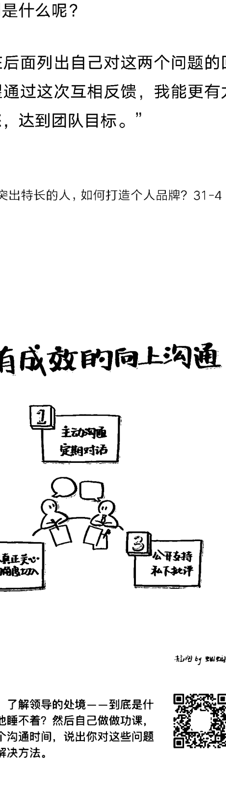

向上沟通：了解领导的处境——到底是什么问题让他睡不着？然后自己做功课，主动约一个沟通时间，说出你对这些问题的思考和解决方法。

## 加薪逻辑：如何跟领导谈加薪？ 40-4

40-4 加薪逻辑：如何跟领导…

1、加薪的逻辑：员工逻辑和公司逻辑——员工希望公司为自己过去的劳动付出费，而公司则倾向于激励未来会产生的价值。

2、加薪的沟通技巧：直接沟通，了解标准；找到合适时机；储备自己的投资价值。

每个人都希望获得更多薪水，因为没人和钱过不去。从发展角度看，升职和加薪也是自身价值的重要标尺。

我曾经遇到过一个顶级的UI设计总监，他进入某家公司的时候，死活都要一个很高的工资，而且绝不松口。我知道他不是一个看重钱的人，就私下问他为什么。他说，因为设计这个东西本身就不好量化，不一定有什么显性化绩效。只有当组织愿意出一个有点肉痛的价格请到设计师，才会真正地贵ory他的思路，他的想法才有可能得到实现。

#### 1. 直接沟通，了解标准

跟很多人的想象不同，其实直接和上司沟通加薪的事，是件好事。

+   我自己做管理者多年，有人过来谈加薪意味着三个信号：
- 他有企图心，这是好事。
- 他愿意为组织创造更多价值，如果有相应的能力，这也是好事。
- 他愿意跟你沟通，他信任组织能解决，总比私下有怨气好。

#### 2. 找到合适的时机

提前半年到一季度：不要在调薪日前去问，这个时候已经来不及了。最好的时间其实是年中的时候——还有半年左右的时间，正好是总结上半年，展望下半年的时间点。

项目收尾期：不要在项目发展的重要关头谈涨薪，这个时候很容易被误解为威胁——不加钱就走啦。即使得逞，下一次重要项目也会躲着你。在项目收尾阶段，自己做出了重大贡献，而新目标逐渐展开的时候谈最好。这个时候你势能最高，而公司也最看好你，会给你很大的新的委任。

#### 3. 储备自己的投资价值

当中克·韦尔奇的助理被问及，你有什么价值的时候，她只说了一句话：“这15年时间，我大概帮他节省了2万小时，这大概相当于每周多出来一天。”一个每周能给顶级CEO多出一天时间的助理，你愿意为他支付多少钱？这就是一个很有想象力的“投资价值”。

# —— 今日思考题 ——

你觉得如果明年你的工资有了50%的上升，那是因为你有了什么样的不同？
你会什么时候开始和组织谈这件事？


谈薪，其实也是跟组织对于未来的一次“谈心”。谈薪的确是一件功利的事，但更多的是一个共赢的事，前提是你做好了一切准备。


# 生涯顾问日 | 用三种姿势，和自己的梦想共处 40-5

40-5 生涯顾问日 | 用三种姿势..

## 古典

每个都市人都向往一个诗和远方。喜欢插花的想成为花艺师，喜欢唱歌的希望出自己的专辑，喜欢画画的希望作品被人赏识，再怎么样，也应该开一个自己的咖啡馆吧！但是现实却是很少有人能仅仅通过艺术养活自己，我们到底该如何与自己的艺术的部分相处呢？

古典老师您好，我是2015年本科毕业于西美油画系的，毕业后一直进行油画创作，也参加了一些展览，卖了几件作品，但心里是不踏实的。

毕业后的这两年里，对于当代艺术这个行业是越来越不懂了，只觉得自己在最下层，没有什么确定的消息来源，亲身感受到的是好多让人消极的事情，有时候作品被选上了，会觉得好像还有希望。这一切自己似乎又是无能为力的，是一种飘忽不定的状态。

另外，家里并不富裕，我的压力很大，也焦虑于这几年的时间全都投入在做作品上是否正确。

## 古典

我邀请到了生涯规划师李春雨老师来解答这个问题。之所以专门邀请他，是因为他自己私下就是一个很热爱艺术，又很成功的规划师。他也是能把两者处理得非常好的人。我关于时尚、音乐上的很多喜好，很多都受他的影响。


# Shayne你好：

你不是孤独的——每个人都有自己的艺术气质，也希望依靠艺术活得更好。而看起来，作为毕业2年的学生，你做得不错。

请允许我从艺术的起源开始谈起——人类学家认为，在原始文化中，艺术家和巫师很有可能是一拨人。史前的巫师在岩壁上作画，在篝火中跳舞，目的都是施展巫术，乞求来年的丰收和狩猎的成功。

慢慢的，因为社会分工，一部分巫师手艺比较好，成为了陶艺器、画家、雕刻家，也就是“工匠”，另一部分则继续身心灵，变成了现代的巫师——诗人、作家，恐怕今天还有青年导师。一直到17世纪，今天的“艺术”才逐渐从工匠中升华出来，步入学院殿堂——今天我们说的“艺术家”才得以出现。

今天，现代人和艺术有三种相处方式。

# 一、艺术青年——把艺术当朋友

这也就是业余爱好者，把艺术当朋友。

这种情况，我们有自己的本职工作，另一方面和艺术交个朋友，没事出来玩下，陶冶下情操。

我有个叫崔凯的朋友，首都医科大学毕业，工作是专利审查员。而他下班后拿起贝斯，穿上皮裤，坐上地铁赶去他们乐队的排练场地排练，则是个艺术青年，用他的话说，“艺术梦的第一可能就是在生活当中成一个美丽的爱好。”

我们和艺术梦的一种相处方式就是把艺术当朋友。但是你别总想着从艺术这里拿钱——朋友就交不成了。

# 二、艺术工作者——把艺术当合伙人

从工匠做起的专业艺术工作者，艺术是你合伙人。你（社会的面）负责找市场，他（艺术的一面）负责出艺术品，你们合伙谋生，一起赚钱。

作为科班艺术的学生，这种组合有很多可能：

- 1. 办艺考培训班。好处是挣钱快，缺点是长远发展不好，另外和艺术也没什么关系。
- 2. 当各种老师。优点是稳定，但是也和艺术关系不大。
- 3. 带着审美能力从事与艺术相关的工作，比如设计、电影等行业。优点是可能性很开阔，缺点是很多时候需要跟着客户走，不够纯粹。

很敬佩你，你选择的是最难的一种，商业画家。

不过，虽然大家叫你画家，其实千万别上杆子就认为自己是艺术家。从职业分工来看，这家公司是一个“工艺美术品”的创作公司。

我曾就这件事专门请教过你们学校的老

# 三、艺术家——把艺术当命

如果艺术是你的毕生追求，是你人生的唯一形态，你不艺术就不能活，也不在意自己和家庭的清贫稳定，这就是把艺术当命的艺术家。他们身上流淌着当年巫师的敏感和神性。

你需要做的是：

- 1. 开眼界。
无论是从技艺的提升到理论的追求，还是从艺术形式的单一到多样，非常建议你要出国看一看——毕竟当代艺术从西方而来。这方面陈丹青、刘索拉都走出了很清晰的路。
- 2. 混圈子。
艺术家的成长是一个非常漫长的过程，很难一开始就靠作品独活，所以如果家里富裕还好，自己供着就好。如果家庭清贫，艺术家往往需要点儿天使投资才能熬过自己艺术孵化阶段。所以——巫师总是和长老走得最近的。

分裂、卡夫卡的自闭。真的把艺术当命的人，会感到一百倍的快乐，以及一百倍的悲伤。至于是否成功，那只是艺术以外的一场豪赌罢了。

当然，作为一个艺术家，前提是你要有足够多的艺术天赋，而不是激情，值得与之相依。

### 总结一下：

每个人身上都有点儿艺术细胞，至少有3种安放的态度——当朋友，求乐趣；当合作伙伴，求商业艺术的平衡；当命，求艺术。很多人的痛苦来自于承接了第三种的范儿，但是还困于第二种的需求，所以就纠结。

其实正确的路是做好了第二种，然后全心去做第三种。

现在看来，最适合你的还是第二种，你的艺术手段已经足够好，那么就需要升腾起另一半的能力——理解市场，服务好想要买的人。在艺术和商业之间找到平衡点，开好你这家工艺美术品公司。

古典

很高兴让春雨老师来讲这个话题。

其实不仅是艺术，我们和自己的梦想、特长，以及自己的诗和远方也都有这三种关系——当朋友、当同事、当命。最重要的是理顺这三种关系，选择一个做好。

你也许想要环游世界，你也许想要开自己的咖啡厅，也许特别擅长唱歌，也许想要在丽江开一个小酒馆……

那么问题来了，你和你的诗和远方，到底是什么关系呢？欢迎在留言区写下你的答案。

如果你身边有朋友也被“艺术的梦想”所困扰，欢迎你把今天的文章分享给他们。

李春雨，北京大学心理学硕士、中科院博士，国内知名职业生涯发展专家、教育部特聘培训专家，清华大学及北京师范大学职业导师，国家生涯规划师体系主设计师，现任新精英生涯产品化研发总监。

拥有十多年的职业生涯规划经验，在《中国教育报》《北京晚报》《新京报》等知名媒体开设了职场专栏，翻译职业规划经典作品《你的降落伞是什么颜色》，国内唯一在美国职业发展论坛（NCDA）专业报告人。

现已在清华、北大等200多所重点院校举办百余场生涯规划培训及专题讲座，为新浪、北京现代及中国建筑设计院等知名企业提供员工生涯规划服务。

今天是古典陪伴你成长的第 281 天，一起加速，成长为更好的自己。

生涯顾问日

# 超级践行 | 一位荷兰超级个体的成长故事 40-6

2017年这一年应该是 我人生改变最大的一年，从内到外整个自我认知都在刷新。

借助古典老师推荐的很多工具，让人生中很多想法和行动具体化起来，而不是以前更多的是跟着感觉走。过去很多的迷惑，都渐渐明朗起来。争取在“四十不惑”之前能做到“不惑”，把自己想做的都真正去践行。

在我的小儿子杰登还未出生时，我经常在上班路上思考：“我要成为什么样的人？未来20年或者更长的时间，我要做什么？我能为孩子做些什么？我要成为什么样的家长？”

去年6月回国，很荣幸在北京拜访到了徐小平老师，在他的影响下认识了“得到”专栏。当看到古典老师刚开通《超级个体》时就毫不犹豫地订阅了。

不只是因为这个名字很有吸引力，更是因为他的理念和我特别契合。我们每个人都是自己的品牌代言人，要让自己的品牌走得更远，我们就必须不断地提升自己。终身学习是提升自己最好的途径之一，投资自己也是未来最好的投资。

# 把自己的能力产品化

我们都知道在做销售的过程中，要多看能给对方（客户）带来多少价值，而不是过多强调自己的需求和业绩。同时，还需要不断提升自己，不断给这个价值加分。

# 及时输出是最好的学习方式之一

另外一个很好的践行是——把自己刚刚学习到的及时跟别人分享。我最近刚刚接手一个新项目，作为一家“农业出版社”的中国项目合伙人，我需要和公司的发行人、总裁还有领导层有很多互动。

投稿方式：cjgttg@163.com，字数2000以下。

如果你的故事被采纳发表，我们准备了一份奖品：《跃迁》签名版。当然，奖品不是重点，重点是期待你能把所学所得真正地写出来，让你的成长被更多人看到。

# 直播精华帖 | 你已经足够优秀，现在需要内心强大

# 为什么讲内心强大？

为什么讲内心强大，很多用户在“得到”订阅了很多专栏，但是很多人也许会觉得：学的东西很好，可是自己还是不能达到那个目标。为啥呢？因为“知道”和“做到”就是优秀和极其优秀的距离。

问大家三个问题：

- 1. 有多少人想环游世界？
- 2. 有多少人曾经有过去网上搜索“怎么环游世界”这个动作的？
- 3. 有多少人已经开始环游世界了？

我相信80-90%可能是第一种，20-30可能是第二种，4%-5%可能是第三种。

每个人都梦想环游世界，成功的人却很少。中国香港的和平号，花费12万，可以去80个国家，历时80天。最有意思的是，我的朋友看到这个消息后，第二天人就见不到了，3个月后，她已经登船了。

玩的时候，她发现船上的瑜伽教练特别稀缺。回来后，她开始做“瑜伽教练”这个方向发展，后来挣了很多钱。很多人听直播只是听听，但是如果你订阅了，学习了，实践了，你才能真正把这些所学转化成价值。有的人认为自己的失败是因为缺少努力和行动力，其实，大部分人不成功缺少的是自我效能，也就是心力。

比如：学英语，真的要把英语学好，主要靠听音乐，看美剧的人可能不多，真的坚持练习的人更少。

如果缺乏心力，你做几次就会退回来。比如，赛里格曼，他把一只狗放到箱子里，有一个隔板，然后通电，这只狗一开始听到声音后会被电击，不管狗如何挣扎，电击都不会停止。后来，放下隔板（这时候他其实可以逃出来的），继续播放声音，狗已经不会逃走了，只会哀鸣。

这个现象，在心理学上叫“习得性无助”，其实也不叫自信，它的反面是内心强大。民间叫自信，我们叫自我效能。是班杜拉1972年提出来的：一个人什么时候会有兴趣去做一件事情：

- 1、你判断自己有能力做。
- 2、你对结果有预期。比如：买股票，你觉得它能涨，你买得起，就满足了条件。

比如，你想参加好声音，但，只有当外在有奖赏，内在有动机的時候，你才会去行动。

强大的内心是可以修炼的。我在08年去法国玩，在戴高乐机场遇到一个小姑娘，14~15岁，背着一个包，头戴黄黄的，就像一位中学生，想来借手机。后来，我给了她很多温馨提示。结果小姑娘说，我准备去德国开餐馆。我在那里有亲戚，跟着千几百年，然后自己开餐馆。（她既没有多少钱，又不懂德文，英文）后来我问：你是温州人吗？她说，是。

这就是温州人独有的自我效能。

其实一个人的自我效能，不是来自于基因，看图：如果你的历史成就，就比较容易成功。如果你过去在看到你认识的人成功了，获得了经验，也容易成功。如果你周围的人，不断有人对你进行积极地鼓励，也容易成功。如果你状态好，也容易成功。

他人的经验会极大程度提高自我效能。当一件事成为社会潮流，你的自我效能也会很强。大学谈恋爱，都是因为宿舍的哥们起哄，这种社会性说服很有效。

人在精神好的时候，自我效能也很高。当一个人自我效能感比较高的时候，这个人有能力做更多感兴趣的事。如果你真的对什么都没有兴趣，每种事情都不敢于尝试，可能就缺少自我效能感。

比如，我有段时间做过一个农村孩子到城市里连应城市生活事业生涯项目。他们最缺的，是对于城市人的自我效能。比如，城市孩子，敢到麦当劳上厕所。但是，这群孩子是不敢的，因为他们不知道公共资源是可以被自己利用的。

后来，我带他们去户外，专门带他们去合理的利用公共资源。帮助这些孩子增加自我效能感。

# 提高自我效能的方法

- 1、记录自己的成就事件。每天临睡前，问问自己，我做过的最有成就感的事情是什么？当你心情不好的时候，翻一翻自己的成就日记，你会发现，“原来我真的很不错。”我经常翻看朋友给我鼓励的邮件，每次看完都信心满满。
- 2、多接触跟你自己有关系的他人的成功案例。邀请毕业后5~7年的师兄和学长，听听他们的成功经验，这样很好。
- 3、周围积极的鼓励和陪伴。一个想离开小城市去大城市发展的人，如果问小城市系统的人应不应该去，得到的答案肯定是负面的。你应该去问已经在大城市打拼的同学，或者订阅《超级个体》专栏问问我，或者询问学习小组的小伙伴，都是很好的。
- 4、提高身体健康的状态和学习状态，身体不好是没有好状态的。

总结一下：

一个人想要达成目标，除了脑力、认知和体力，还需要一个心力。心力是非常重要的资源，提高自我效能的方法：1、积累成就事件。2、需要进入好的社会经验群体，跟优秀的人在一起，跟优秀的同龄人在一起。3、找到你的支持系统。4、把自己的身心调理好。

有了这四点，内心就会强大起来。今天，就开始记录你的成就日记。

# 如何做事不后悔？

我觉得中国人比较缺《超级个体》的课程，因为很少有人觉得自己是个体，你随便问一个人，他会说，我想读好大学，找好工作，好太太，有好房子，好宝宝，送好幼儿园，好小学，好大学。每个你似乎在做自己，其实根本是一模一样的。

我们很少意识到自己要有自己的目标。老有人问我，如何成为超级个体，如何成为生活规划师。我是教GRE词汇的，每次上完课，都有人问我，我应该出国吗？应该读什么专业吗？有个女生问我，在国内还是国外读硕士？我适合过什么样的生活呢？

我内心拔凉拔凉的，这么优秀的少年，来问“我适合过什么样的生活”？我觉得，帮助别人成为好的个体，其实更重要。比如我在专栏里会讲，如何确定自己的生活方式，给自己做人生设计，如何面对死亡，如何选择自己喜欢的另一半等等。

什么是超级？我做咨询的时候，我的感觉是：来的人都觉得自己的问题是独一无二的，但是都非常类似，20~30%的问题，其实，有很多人都走过了你的坑。只需要学会挺行，就可以跳过这些坑。

要想说命怎么做事情不后悔？我先说自我边界。

我们每个人都有个圈，你的情绪想法思想，都是可控的。但是，圈子之外，别人的事情，老天的事情，过去发生的事情，都是不可控制的。

一个真正内心强大的人，清楚地知道，什么可控什么不可控。把注意力和聚焦在可以控制的地方。

比如，大家说你胖，这是不可控的。但是，有没有可控的部分？

是，有没有可控的部分？

有。

任何一件事，都可以画出自我边界。有一部分，是完全不可控，另一部分——你的反应，是可以控制的。要有清晰地自我边界，把注意力放在自我边界上。

所以有人说我胖了，我可以惊讶，可以偷偷减肥，可以远离说我胖的人。但是，如果我执着于问什么有人说我胖，他们真讨厌，为什么说我，这就变得执着于不可控了。

人什么时候会受苦？是把注意力投射于你不可控的事情上。你的自我出现了缺口，你才会觉得苦。

比如，你希望办公室的所有人都喜欢你，就变得执着于不可控了。当一个人把自我投射到不可控的事情上，就会开始受苦。这也是为什么内心强的人，要建立自我边界。

我在专栏里也讲过几个相关案例，在文末给你放了链接，可以点击查看。

这就是强大的自我边界感，任何事情都有两部分：可控和不可控。有边界后，你会疼，但是不会苦。很多人说，我的选择是无奈的选择。

比如，很多韩剧看太多的女孩，会把自己的老公跟偶像剧里的形象做对比。但是我们反过来想，如果真的有高晓松的智慧、吴亦凡的脸、吴彦祖的身材，你觉得他一定会选择你吗？所以你看，你的老公不是你被迫无奈的选择，这些也不是你后悔的理由。

其实这个世界上，每个人都在做最好的选择。可能它不是最完美的，但，是你能做到的最好的选择了。只有一个完全接受了自己的选择，而不是被迫，你猜能对它负责，并且创造出更好的选择。

当一个人清晰自我边界，他知道什么是可控什么是不可控。他能划清边界，知道我们只有过去的选择，今天的选择，未来的选择，只有有边界，才有可选择的人生。

风会把蜡烛吹熄，但不会把火焰吹熄，我们要成为火焰而不是蜡烛。


# 怎么放大个人努力？

我在做生涯规划师的时候，来询者经常会问我一个问题：为什么同样的努力，有完全不同的收益？我可以告诉你，一分努力一分回报是对的。但就是有一些人，能做到一分努力，百分回报。到底是什么东西，放大了他们的价值呢？

内心强大，是向内的修炼，把一分努力放大到千分万分，是社会学、经济学、职业杠杆内容。

我在新东方当培训老师的时候，市场上是缺少好老师的。我们原来的认知是：老师只能选拔，不能培养。后来，我们希望有培养老师的教程。

我们当时设置了优秀老师的5个标准：1、专业知识 2、设计课程 3、语言表达 4、个人魅力 5、内在修炼

今天在新东方或是其他地方，你都能看到这五个核心能力。

- 1 专业知识性（学霸型）老师
- 2 课程设计型（老公型）老师
- 3 表达能力很好（一夜情型）老师
- 4 魅力型（导师型）老师
- 5 心态好的老师，（潜能型）老师

就这样，我们开始给老师做培训，半年以后，有一小撮老师变得极其优秀，另外一小撮，很好，但是没有那么好。为啥呢？他们学习路径不同。

一般老师：把专业知识修炼到100%。

聪明老师：20%是修炼专业知识，剩下80%精力，把其余4项，都做到80%的程度。

放在以前，这是不足苛解。但是用在职业发展上，就是事半功倍的。

因为竞争不是静态的，400分的老师，有逐课的优势。他们可以思考哪些课程是头部课程。两个老师差不多，头部200，其他200，400分的老师占据了最核心部门、核心课程、核心价值链。


# 专栏升级+《跃迁》新书推荐

我们还在不断升级《超级个体》专栏，按照产品来讲，这是尾声，但是，对我们的修炼来讲，这是刚刚开始。之前，我们是一个专题一个专题讲。目前管理-情绪管理-精力管理-演讲-写故事-个人品牌……我们每周还有答疑和总结。后来发现，很少人会去把这些内容串联起来去学习，

所以，四周前，我们把主文内容增加一天，把知识讲得更透了。每周五增加了【生涯顾问日】的板块。

我做生涯这么久，发现一个问题，你以为自己的问题独一无二，其实就是这么几个坑——毕业怎么选择行业？发展期是不是应该转型做管理？我是生娃、升职还是生活？中年危机怎么办？离退休很近，我该做什么？所以，每个人遇到的难题都在这个范围内。接下来，我们还有15次生涯咨询的机会，帮你规避15个大坑。

另外，我们还对后期的内容作了调整。比如，我会专门谈谈论爱情，谈谈人生设计，谈谈如何找到工作和生活的平衡，找到内驱力等等。

有新加入的同学问我，如何学习专栏？

我建议你随时可以跟上进度，因为前后内容没有难度关联，如果你没有清晰动机，就跟着我来学习，先从本星期开始。然后用多余的时间倒退学习，按照我们的主题板块，一块一块地学习。

我们几乎把一个人从0~35%的软技能都囊括了一些。你如果有具体的问题和痛点，可以搜索，比如：幸福感、谈加薪、公开表达，都可以找到解决方案，这就像是你的工具箱。


# 介绍我的新书《跃迁》：

《跃迁》的推荐序里收集了你认知范围里的“七龙珠”：俞敏洪、徐小平、罗振宇、姬十三、吴伯凡、万维钢、李笑来……我把这本书当作给你的成长跃迁工具，也把它当作我个人成长跃迁过程中的一个里程碑。

# 续下大课预告：

9月份古典老师会举办一场线下大课，届时会把大课的信息第一时间发布在专栏里。我们的专栏用户可以享受首发的折扣。


# 学了太多就是没行动？
你缺少自我效能 41-1

+   1、知道+自我效能=做到
2、自我效能的四个来源：亲历的成败经验；替代性经验；社会说服；情绪和生理的影响。

41-1 学了很多就是没行动…

从《超级个体》专栏上架到今天，我已经讲过将近150个方法论了。大家肯定会发现——每一种方法如果做好，都能发挥很大的力量。但不少人学了很多东西，却做不出来；或者干脆没有去做，只是学后收藏了。其实很多时候，我们遇到困难，并不缺乏方法，而是缺乏行动。这些我们都知道，但是有没有人再多问一句——在认知和行动之间，缺乏的到底是什么？为什么有些人会拿到方法就能用，而且用得很好，而有些人就是束之高阁？

我们这一周要讲的就是这个：如何有一颗开始行动、毫不畏难的强大内心？

其实，这个问题不仅仅是现在才发现的。

## 自我效能

早在1977年，心理学大师班杜拉（Bandura）就意识到这个问题。他发现一些人虽然很清楚知道该做什么，但在行为表现上却并不理想。因为人们在知道该做什么和真的去做什么中间还差着一个巨大的鸿沟——我们只有内心判断我们能做成这件事情，才会行动。简单说，我们不仅需要认知，还需要“心力”。知识不只是要上脑，还要上心。

班杜拉认为，人们对其能力的判断在其自我调节系统中起主要作用，并由此提出“自我效能感”这一概念。自我效能感(Perceived self-efficacy or sense of self-efficacy)，是指人们对自己实现特定领域行为目标所需能力的信心或信念。简单地说，就是在某一个领域里的自信。

知道+自我效能=做到

班杜拉经过长时间研究，发现自我效能感主要来源于四个方面：

+   1. 亲历的成败经验：亲历的成败经验对自我效能感的形成影响最大——成功的经验可以提高自我效能感，让人信心满满。反之，多次的失败会降低对自己能力的评估，使人丧失信心。现在很多人对长跑有畏惧心理，可能就是因为小学时跑800米跑伤了。

+   2. 替代性经验：看别人的行为和结果，获得关于自我可能性的认识。当一个人看到与自己水平差不多的真的获得成功时，能够提高其自我效能判断，增强自信；相反，当看到与自己能力不相上下的人，虽然付出了很大的努力，但仍遭遇失败时，他就会降低自我效能感。

+   3. 社会说服：就是身边其他个体的劝阻和说服。他人的说服力在降低自信方面的效能，远远比提高自信方面大。如果你有一个两个这种尖酸刻薄毒舌的朋友，那简直就是自我效能感的毁灭性打击武器。

+   4. 情绪和生理的影响：一个人的情绪状态与生理状态也会影响自信。一个人生病、疲劳、情绪低落的时候，最容易有自我效能降低的感觉。

比如减肥，你会发现减肥这个事在公司里面是“群体性”的。什么叫群体性的呢？就是往往有一个人减肥成功会带动更多同事减肥成功。这就是一个典型的替代性经验。当你看到别人瘦了，你就觉得“哇，这也可以啊”。然后就向他去咨询具体的方法，其实你一问就发现，这个方法你早就知道，无非是什么少吃、多动之类的，但是有这么一个活生生的例子，替代性经验在旁边，于是你就信了。

如果这个人还不断地对你进行言语说服，在这个方面你的自我效能感就会更强。

如果再加上刚刚尝试几天，有很好效果的话，你的自我效能感就会全所未有的爆棚，那么就集齐了成就事件、替代性经验、言语说服以及情绪和生理影响这四颗龙珠，你减肥成功就很大概率了。

有一年我在巴黎的戴高乐机场见过一个16岁左右的小女孩，她跑过来问我能不能借个手机打回家报平安，我就借了。借给她以后，就好心提醒她说在法国什么地方可以买到便宜的电话卡，什么地方可以买wifi。可是，她说她并不是去法国，她是转机去德国的。

我问她会不会英语，她说不会。我问她是不是去旅游的，她说不是，是去德国开餐馆的，开创她自己的事业。我退后一步端详女孩一下，然后问她，“姑娘，你是温州人？”她说，是。

> ——你发现没有，这个姑娘才16岁，就敢一个人背个包，不懂英语就跑到德国去开店，这种力量是从哪里来的？其实这也是一种自我效能感。

我心里想，只有温州人有这么强的去异国他乡开店的自我效能感。你看为什么我们身边有一些人，像温州人、像福建人，他们会对去异国他乡经商有莫名其妙的自信？

这里面有四个因素：

第一，可能从小她家里面就有让她尝试去经商的一些小的成就事件。比如说我有个朋友是温州人，他很小就把他女儿带到公园里面卖圣诞灯笼，一个晚上赚50块钱，非常开心，你要知道，他们家可是上亿的身价。

第二，在这么一个环境里面，每个人都会受到很多的替代性经验。比如说你身边就会有一堆这样的案例：你二姨27岁去南洋，带着500块钱，现在发达了；你二姐，18岁的时候带着300块钱去纽约，现在开餐馆了；你张哥的儿子，呆头呆脑的，15岁去了印尼，现在是富豪了。如果你生活在一堆这种替代经验的环境之下，你的信心会不会莫名其妙地高涨呢？

第三，如果这时候身边有人给你一些积极劝说，你就会信心倍增。

第四，总有那么几天，你情绪生理状况很好，一激动，大家一哄哄，你可能“嗖”就出去了。

这种自我效能感也是今天很多温州人经商这么厉害的原因，这不就是气场嘛。所以很多时候你会发现一种社会的基因远远比人的个体基因更能够促成一个人的社会化成功，这就是自我效能背后的秘密。

## —— 今日总结 ——

在知道和做到之间还缺一个拼图，就是“相信能做到”，你可以称为“自我效能”、“自信心”或者“心力”。你知道而不行动，很多时候就是缺乏点儿心力。从学习到行动，其实是一个上脑，上心，再上身的过程，你只有真正真正地学会了，并且相信自己能做到，最后才能让自我技能提升。

当然，《超级个体》这里不卖鸡汤，相信自己不是使劲喊就可以的。它需要四个因素，第一个是成就事件，第二是替代经验，第三个是社会说服，第四个是优良的情绪和生理状态。明天我会教你如何利用这4个因素把自己调到那个好的状态。

# —— 今日思考题 ——

哪件事是你“什么都明白，但是就是不想做”的？从自我效能的四个因素，分析一下你最缺乏哪个因素？请你把它写在留言区，分享给我。

## 自我效能感

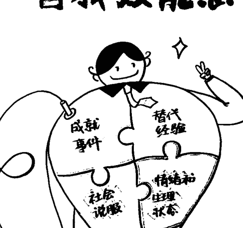

社团 by 黎明剑

在知道和做到之间还缺一个拼图，就是相信自己能做到，这被称为“自我效能”。只有你真正学会了，并相信自己能做到，才能让技能提升。


如果你身边有一些什么都懂，就是缺乏心力把它执行下去的朋友，也请你一定把今天的内容分享给他，我们一起做一个内心强大的人。

今天学习了提高自我效能的四个因素，明天我会就这四个因素给出你行动的策略。

今天是古典陪伴你成长的第 284 天，一起加速，成长为更好的自己。

## 关于自我效能的思考

## 这三个场景里，提问比答案重要 37-1

37-1 这三个场景里，提问...

提问比答案更有效的3个理由：提问能防止知识折旧、提问是一种更好的沟通方式、提问是重要的管理方式。

出一道题，考考你注意力。

有一辆车，车上有8个人，3个男人，2个女人

第一站，上来了3个，下去了5个人；

然后，上来了5个，下去了8个；

再然后，上来了8个，下去了3个；

然后，上来了2个人，没有下去；

然后，上来了4个人，下去了三个人；

现在问你，车走了多少站？

这个游戏凸显出我们日常的一个困境——当信息多到你记不住的时候，你就会散焦，丢失真正的答案。而提问知道问题是最好的解决方式。在知识大爆炸的时代——只有提问能让你的注意力恰当地聚焦。你已经不可能记得所有答案，只能记得问题。

### 1、提问能防止知识折旧

第一个理由是，知识迭代周期变短，答案只是阶段性正确，所以，相比较答案，好问题变得更重要。

### 2. 提问是更好的沟通方式

第二个理由是，在会议或者沟通环境下，提出好问题可以形成共同的聚焦点，更高效地达到沟通目的。

### 3. 提问是更好的管理方式

第三个理由是，在与人协作的过程中，提问能增强他人的参与度，管理他们的行动方向，变被动为主动。

# —— 今日思考题 ——

在瑞士日内瓦湖边，有一条长隧道，投入使用的时候，工程师遇到一个问题：很多车主在隧道开车时，会打开车灯，但是出了隧道，一看到好的风景就会停车拍照，回来发现电量耗光了。工程师决定在隧道出口立一块牌子提醒大家关车灯。“请关闭车灯”。但是这样做，会有另外一个问题，很多车主是晚上出隧道，如果他们看到这个牌子，关掉车灯，又可能会遇到危险。

## 提问比答案更重要


提问是管理注意力的方式；提问是把握沟通节奏，掌控全场的方式；提问是让大家的大脑都参与进来，共同协作的方式。

## 构建支持系统：三招提升你的自我效能 41-2

41-2 构建支持系统：三招...

+   1、提高自我效能的三种方式：主动创造自己的成就事件；正确模仿，找到替代经验；接近正能量的人。
2、“52法则”：找到业内资历比你深5年的人，看看他们在你的同阶段在做什么，学习他们的战略；找到业内比你优秀的人，看看他们两年前怎么做的，学习成术。

前段时间我看了一部电影非常震撼，叫《闪仁波齐》，这是一部纪录片。讲的是11个藏民从自己住的村落出发，一步一磕头，用一年的时间走了2500公里，这里最小的有9岁的小姑娘，有杀生太多，忏悔自己没法轮回的丈夫；有一个老人，他也上路了，最后死在了闪仁波齐的山下；甚至还有孕妇在途中生下自己的孩子，这些林林总总的人遇到了很多的困难，最后终于走到了神山的下面。我们还以为会有为什么情节的结果时，字幕升上来，故事就这么结束了。

导演显然不想告诉我们这有什么辉煌的意义，因为这个过程本身就展现了虔诚和内心强大。


那么从自我效能的角度，这些强大的内心是怎么出现的呢？

今天我们结合昨天的课程谈谈，看如何提高自己的自我效能：

+   第一个，如何给自己创造小的成就事件。
第二个，如何去寻找和模仿替代经验。
第三个，是如何让自己进入好的社会说服系统。
第四个，是如何保持这个好的精神状态和情绪状态。

如何保持好的精神情绪状态这个我们以后再说，今天主要先来谈谈前面这三点。

### 1、主动制造自己的成就事件

使用优势：

进入自己的控制区：你应该主动去做一些有控制感的事，也就是说你优势的地方。
比如说，我们有个知识挖掘师，他对于查资料，看英文很没效能感，但他特别擅长跟人聊天，于是就把更多的时间花在了跟懂英文的人聊天上，重新让他找回控制感。

在其他领域取胜：你可以在其他的领域培养一些自我效能感，然后转移过来。比如，工作让你受挫，但你可以在工作以外学点自己感兴趣的东西，比如学点英语。其实哪怕你在一个完全不相干的地方甚至减肥成功，回头来对于工作也是会重新拥有信心的。

差异化定位：找到差异化的定位。在某一个方面清楚地看到自己比别人强，在这一点上清晰地看到自己的优势——守正出奇，是一个特别好的方式。

## 成就日记：

当你在做上面三件事时，别忘了做一个成就日记，每天临睡前都记录下自己最有成就感的事儿。然后第二天早上起来，把昨天和之前的都翻看一遍，慢慢的，你就会整个人变得好起来。

有人会说，“老师我想了一天都没有什么有成就感的事”，你看，这就是对于自己要求过高的情况。可能你本身是有8分，但是你非给自己定一个12分的标准，所以看上去毫无成就感。这个时候你可能需要意识到你太上脑了。

其实心力就是好好地安慰一下自己。让自己有自信心，本身就是让自己变得更强的重要资源之一。可能以前你只关注了方法，关注了行动，但是你并没有关注你需要积累心力，所以从今天开始把目标调小一点，给自己更多的鼓励，那么慢慢你会有能力到达那个12分。

### 2、正确模仿，找到替代经验

我们大部分人都喜欢模仿两种人，一种是模仿身边的人，就是大伙怎么你就这么做；一种是模仿特别牛的人。其实这两种模仿形式都是错误的。

因为模仿这两种人都没办法给你“替代性经验”：模仿平庸大众，但是你又不准备成为平庸大众，模仿来干嘛，显然没有替代经验。

但是你把牛人的“先赚一个亿”当作模仿目标，你也会觉得很痛苦。如果你是企业家，收入是5千万，王健林对于你是一个好的替代经验，但是如果你是一个普通人，王健林的经验对你来说可能更多的是伤害，因为完全没有可以操作的空间。

所以对于大部分人的朋友圈，你发现不是在讲普通人有多少平庸，就是这样人有多牛，在我看来全是满满的负能量。

那么我们到底该模仿什么人呢？恰恰是那群比你正好高一点，能抵着脚够得着的人。

我的建议是利用“52”法则。

“52”法则应该怎么做呢？看看自己行业里面比你资历高出五年的这些人，在你这个阶段的时候在做什么？从他们身上找战略。看看行业内比你好的人两年以前怎么做，从他们身上找成术。

我不建议模仿同龄的人。
第一，因为你也不知道他的方法是不是真的好；
第二，模仿这些会让你心浮气躁，等你模仿明白，别人又向前走一步了。所以你永远在模仿，没法超越。反而是你应该模仿一些两三年前的成功案例，会让你更容易有信心。

### 3、接近正能量的人

我举个很极端的例子，就是美国游泳运动员迈克尔·菲尔普斯（Michael Phelps）。2008年北京奥运会，23岁的菲尔普斯以8面金牌风光拿下北京奥运后，享誉盛名的他，却陷入吸食大麻、流连夜店、酒醉驾车的负面新闻中。媒体消息一出，震惊国际体坛，被禁赛半年。

菲尔普斯后来在采访时说，那段时间他曾一度失去信心，甚至想自杀；他开始看扁自己，不在乎所谓的金牌，同时却无法停止患得患失，与教练也处得相当不好。当时他一心只想放弃，逃离他所爱的人，以及爱他的人。

后来的这几年里，他的女友不离不弃的陪伴，也在他最低落的时候和他走入婚姻，而他也和父亲解开因父母从小离异给他造成的多年心结——家人的力量让菲尔普斯重燃希望。2012年虽然他状态依然不佳，却拿下了4金2银，把自己的奥运奖牌数提高到22枚，最终成为奥运史上最传奇的人物。

## 找到支持系统

说这个故事是想告诉大家，你一定要做到第三件事情，就是寻找自己的支持系统或者至少撇开自己的障碍系统。和支持你的人建立联系，会给你很大的自信。

有人问我：“老师，我很想去北上广闯闯，但是在小城市工作的同学，他们都反对，让我很犹豫，怎么办？”如果你真的想去北上广闯一闯，其实你更应该找正在北上广闯荡的同学问，而不是在小城市上班的同学，他们是你的障碍系统。所以每个人都应该找到自己的支持系统，他们是强大内心的一部分。

但我想强调的是：
第一，支持系统不一定是名人，而是那些对于你来说真正重要的、关心你的人。
第二，主动求助非常重要，不要总觉得自己孤独自怨自艾，其实每个人都需要别人。

## —— 今日总结 ——

今天我们讲了三种很重要的提高自我效能的方式：

的方式：

第一，帮自己积累成就感的三个方法和成就日记；

第二，找到自己恰当的替代经验的“52”法则；

第三个，建立自己的支持系统，这些都会让你内心强大。

回到开篇那个问题，为什么去冈仁波齐的那群人内心如此强大？当然跟他们的虔诚分不开，但是从自我效能的角度看，就会有很好玩的解释。

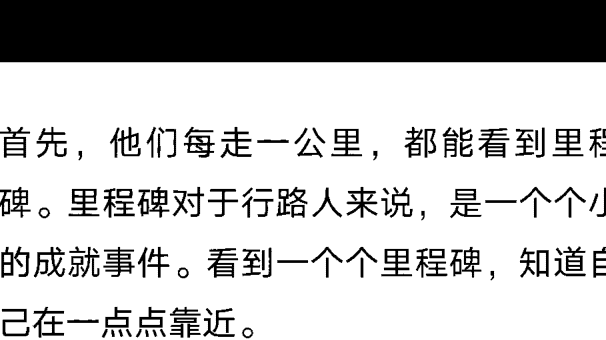

首先，他们每走一公里，都能看到里程碑。里程碑对于行路人来说，是一个个小的成就事件。看到一个个里程碑，知道自己在一点点靠近。

其次，每天晚上，他们会坐在一起诵经，老人会讲述以前的朝圣故事，这是替代经验；

最后，路上所有的人都告诉他“这是好事情”，“我的儿子也去了”这是社会说服；最后每个人都努力保持好的状态。

所以，这件看似不可能的事情，也就成功了。

你的朝圣之路，是不是也需要建立这样一个系统呢？

# —— 今日思考题 ——

今天我们讲到了成就感和自信心都是可以设计出来的。那你观察到没有，有一些人总是陷入挫败感——因为他们会习得性无助。那么你觉得，乐观有没有可能被设计出来？变成习得性乐观呢？

如果可以，怎么设计呢？你有没有由悲观转为乐观的经验分享？在留言区分享给我吧。

不要管理时间，管理你的精力 8-1
你不是没有精力，而是不会管理 8-2
这4种方式，像锻炼肌肉一样提升精力 8-3
什么方法能让你瞬间进入状态？ 8-4

## 3招提高自我效能
①积累成就感

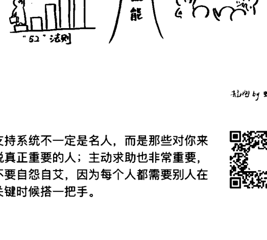

支持系统不一定是名人，而是那些对你来说真正重要的人；主动求助也非常重要，不要自怨自艾，因为每个人都需要别人。


今天是古典陪伴你成长的第 285 天，一起加速，成长为更好的自己。

## 关于自我效能的思考

## 习得性乐观：教你三句乐观的“咒语” 41-3

41-3 习得性乐观：教你三...

+   1、习得性无助：当一个人在某件特定的事情上多次努力，反复失败，形成了“我怎么努力，都改变不了结果”的信念后，就容易有无助感。

+   2、三句乐观咒语：这不是常态的，过一段就会有改变；天塌不下来，只是这个问题，改了就好了；不光是我，谁这辈子都会遇到类似的事。

前两天我们谈了内心强大的秘密，其中提到很重要的一部分就是不断地寻找成就事件。成就事件背后是什么呢？其实就是乐观。今天我们来谈谈如何变得乐观。

“乐观”这个词今天被用滥了——做人要乐观、股价空间很乐观、这个项目的收益不太乐观……连天气预报都会给你说——做人嘛，最紧要的就是开心。但是为什么有些人就是乐观不起来？乐观能练习吗？

要说乐观，我们先看看悲观能否练习。美国积极心理学之父塞利格曼在1967年研究动物时，发现笼子里反复被电击的狗，多次实验后，即使笼门打开，狗也不愿意逃走。这是因为狗在先前的经历中，习得了“无论自己怎么努力都于事无补”的感觉，所以当它们终于置身于可自主选择的新环境中时，也已经放弃尝试。塞利格曼把这个现象叫做“习得性无助”。


“习得性无助”表现在人身就是，当一个人在某件特定的事情上多次努力，反复失败，形成了“我怎么努力，都改变不了结果”的信念后，就容易有无助感。

不过值得欣喜的是，除了无助可以习得，乐观同样可以习得，而且一旦学会，形成习惯，就像骑自行车，不容易忘记。乐观的秘诀，在于“解释风格”。解释风格是乐观的“事件翻译器”。

下面我用三个故事，教你三句我发明的“乐观咒”，只要熟读，经常念诵，就会乐观。

塞翁丢了马，人家说，“你真倒霉”，他说：“看看再说。”结果马带来了另一匹马。

大家说：“你真幸运。”塞翁说，“看看再说”，结果他儿子从马上摔下来，摔断了腿；大家又说：“你真倒霉”，塞翁说：“看看再说。”结果军队征兵打仗，他儿子因为残疾而逃过一死。

塞翁就是一个有习得性乐观的人——他理解糟糕的事情不会是永久的。事情永远有新的一面。这就是“永久性”与“短暂性逆境”的区别。

第一句乐观咒来了，遇到不好的事，就想：“这不是常态的，过一段就会有改变，我们看看再说。”

埃里克森在美国中部讲课，他的一个学生来找他，说，“你一定要去看看我的姑母，她的丈夫在车祸中丧生，她自己孤独地住在一个大房子里，行动不便，阴郁又固执。”埃里克森去拜访了这个老太太，发现情况很糟糕，整个房间毫无生气，唯一让他睁大眼睛的，是窗台的几盆小花。老太太说自己行动不便，只照顾客这几盆非洲紫罗兰。

埃里克森说：“夫人，像这么珍贵的花，你每周还要去教堂，很难想象作为一个虔诚的基督徒，你不会把它分享给别人。这个小镇一旦有人结婚、生子，甚至有人离去，你都应该给他们送去这个珍贵的礼物。”

十年以后，埃里克森在报纸上看到一篇文章《送别我们的非洲紫罗兰皇后》，那位姑母十年内送出去2000多盆紫罗兰，成为了镇上人最热爱的人。


埃里克森也是一个习得性乐观的人，他代表了乐观的第二个核心，那就是不把“问题”和“人”混为一谈——老太太不是一个阴郁的人，她只是有一个不知道怎么样重新获得价值的问题，但是问题不等于人——当问题解决，人就会变得有价值。

这是乐观思维的第二个特点：没有毁灭性的灾难，只有待解决的几个问题。

第二句乐观咒语教你说：“天塌不下来，你死不了，只是在……上有问题，改了就好了。”

我的一个好朋友创业失败了，这是他第二次失败。更糟糕的是，因为他的糟糕心情，他和女朋友也分手了。我们几个小伙伴在晚上聚到大排档，陪他喝酒吃串。你说，怎么安慰这样一个朋友呢？告诉他明天会更好？还是其实只要改了就好了？这么说有点儿不道义。

我想了想，对他说——其实吧，每个人的人生总有几次踹到大便的机会。我这么一说，大伙儿哗笑就都乐了。晚上的时候，每个人都要讲一个自己踩到大便的故事，他听完觉得，自己也还挺正常。

其实这也是私董会的功能——听完大家都这么惨，自己也觉得自己那点儿事不算什么了。这是乐观思维的第三个角度——这不是针对我个人的，而是每个人都有机会遇到的。

第三句乐观咒语：“这不光是我，每个人这辈子都会遇到类似的事，要允许自己经历普通人都会经历的事。”

我很喜欢一句犹太名言——“你需要同时揣着两个真理上路，一个真理是，世界是为我创造的；另一个真理是，我只是泥巴和尘土。”

“世界是为我创造的”和“我只是泥巴和尘土”，你要随时揣着这两个真理，在不同时候拿出来。

+   1. 这不是常态的，过一段就会有改变。
2. 天塌不下来，只是这有问题，改了就好了。
3. 不光是我，谁这辈子都会遇到类似的事。

这三句乐观的咒语，请经常念诵，尤其在遇到逆境的时候。

# —— 今日思考题 ——

想一件让你感到悲观的倒霉事，然后尝试看看哪一句乐观咒语对这件事最有用？或者聊一聊乐观和盲目乐观（阿Q精神）有什么区别呢？欢迎你在留言区写下自己的想法。

心理自卫术：高情商人士的必修课 34-2
思维推堤：做个情绪的拆弹专家 34-3


“乐观”也是一种可以通过重复练习获得的习惯。乐观的秘诀，在于“解释风格”。解释风格是乐观的“事件翻译器”。


未出刊 by 里里哈哩

“乐观”也是一种可以通过反复练习获得的习惯。乐观的秘诀，在于“解释风格”。解释风格是乐观的“事件翻译器”。

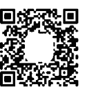

如何掌握在逆境中反弹的力量？

今天是古典陪伴你成长的第 286 天，一起加速，成为更好的自己。

## 关于习得性乐观的思考

## 抗逆力：逆境中的4个生存策略 41-4

41-4 抗逆力：逆境中的4个...

- 1、抗逆力（Resilience）：一种在高危和压力状况下依然有积极产出的能力。
- 2、面对逆境的四个步骤：拥抱逆境；设定新的意义；找到支持系统；找到逆境英雄。

最近有一部很特别的中国动画电影《大护法》。它的宣传海报很有意思，上面的宣传语是——“感谢给我逆境的众生”。你看，对于逆境，大部分人都避之唯恐不及，有人还会感谢？你是什么态度呢？

这周我们谈到了让自己内心强大的自我效能，今天我们谈谈抗逆力（Resilience）——一种在高危和压力状况下依然有积极产出的能力。

如果你学物理，就知道物体在弯曲之后有恢复原状的能力——“弹性”。比如说同样形状的弹簧和钢条，都拉长一倍，弹簧能回弹回去，但是钢条就不行，弹簧的弹性就比钢条好。所以，抗逆力也被翻译成“复原力”、“心理弹性”或者“逆商”。

但是在生物身上，抗逆力不仅仅止步于复原——生物不仅会复原，还有可能在逆境中变得更强。

研究发现，如果定期给人的骨骼施加一定的压力，将有益于骨密度的上升。如果你经常去健身房，健身教练一定会告诉你，想要增肌，每次练都要练到力竭，让肌肉感到酸痛，然后第二天等酸痛消失，不是恢复原状，而是更强。

医学界有一种观点，“不要轻易做化疗”，因为如果是良性肿瘤，只要提高自身抵抗力，肿瘤也会消失；做化疗不但增加痛苦，而且如果是恶性肿瘤，一杀死它就容易病变，可能加速患者死亡。

因为抗逆力的不同，面对困境，我们有四种反应。

- 崩溃：整个人都崩溃了，开始以不良的手段折磨自己，比如酗酒、吸毒、犯罪或企图自杀。
- 衰弱：在这个领域一蹶不振。
- 维持：恢复原貌。
- 升华：直面困难，在困难中成长。

英文叫做 fall up，向前摔倒。当遇到障碍，有可能是问题，从另一个角度看，也是让你爬高一层的机会。挡路石也可能是垫脚石。如果说积极、勇敢、高效率、目的性这种能力，是刚强的能力，那么抗逆力，就是阴柔的能力。

在游戏规则清晰、社会稳定的过去，效能和刚性是最重要的技能。那么在不确定和变化的今天，抗逆力和韧性也许就是日益重要的技能。

### 1、接纳逆境

很多人一直困于逆境，是因为他们还以为过去的情况没成本是成本，没法接受自己出了问题。当你接受逆境，也接受自己就掉在了一个大坑里，反正已经掉到底，不管从哪里往上走都是上坡，你反而踏实了。

### 2、设定新的意义

逆境是悲剧给你的提醒，逆境一定有其意义，一定有可以学习的东西。

### 3、找到支持系统

### 4、找到逆境英雄

## —— 今日总结 ——

今天我们谈到了抗逆力——人在困难下逆势成长的能力，这种能力在不确定的时代日益重要。以及面对逆境的4步，接纳逆境、设定意义、找到支持系统和寻找逆境英雄。

# —— 今日思考题 ——

你自己或者身边有那些“越挫越强”的抗逆力的例子？你是怎么从逆境中走出来的呢？又从中获得了什么好处呢？欢迎在留言区分享给我。


抗逆力（Resilience）是一种在高危和压力状况下依然有积极产出的能力，这就是尼采说的：杀不死我的，只让我更强。

今天是古典陪伴你成长的第 287 天，一起加速，成长为更好的自己。

## 生涯顾问日 | 你追名逐利，到底是在追什么？
41-5

41-5 生涯顾问日 | 你追名逐利。

我一直做电商运营的工作，去年觉得自己比较适合做技术，便辞职学了半年编程，因为还是不够精专，一直没找到特别合适的工作。但是比较擅长和人打交道，现在在一家软件外包公司做前端销售工程师，做了3个月，也即将开始出单。

我老家在武汉，有很好的退路——父母买了房子，如果回去，凭自己的技术在武汉还是能做个小公司的，而且我也还没有找女朋友，回去好姑娘也一大把。

其实我知道自己再坚持一下就能成，但是我一遇到困难，就总问自己，为什么自己要这么累啊，是不是应该回老家，哪里怕多陪陪爸妈？我该回老家吗？

## 古典

我们的沟通在一个茶馆开始。我们没聊“到底留在北京”还是“回老家”，而是从一个貌似不相干的问题开始聊起。

“2年以后你30岁了，先不管在哪，那个时候你希望成为怎样的一个人？”

（任何人聊自己的梦想，都是眉飞色舞的，不管是企业家还是普通人，全部受用。不同的人似乎探讨不同的跨度，像他这么快速发展的阶段，2-3年是个好跨度，30岁也是个不错的里程碑。）

## —— 价值挖掘机 ——

细心的朋友一定注意到了我在其中提到的非常神奇的一个问题——这对你有什么价值？如果你拿到了这个，这对你有什么价值呢？

机：“你看着江面上的船，来来往往，到底有几艘？”和尚说：“来来往往、熙熙攘攘，皆为名来，或为利往。”乾隆点头以为禅机巧妙。

其实对于生涯规划师来说，每个人都求名求利求发展，但是你拦住一个人问他“价值挖掘机”的问题，他最终会告诉你一个与众不同的人生。所以我越做生涯规划这个行业，越对人有信心，越觉得船上熙熙攘攘、来来往往的，都是多姿多彩的想成为自己的人，希望你也可以成为这样一个人。

# ——◆ 今日思考题 ◆——

问问你自己到底想要什么？这背后又藏着什么渴望呢？

不妨给自己做一台“价值挖掘机”，就从你的一个小欲望开始，找到它背后大意义。欢迎在留言区把你的自我挖掘分享给我。

生涯顾问日 | 少年，每段人生都有它的乐趣 38-5

今天是古典陪伴你成长的第 288 天，一起加速，成长为更好的自己。

## 关于价值挖掘的思考

提交留言可与专栏作者互动

## 超级践行 | 学习专栏9个月，我的12个改变 41-6

不知不觉，跟着古典老师专栏大半年了。每天听《超级个体》已经成为自己的一个习惯。我把自己这段时间以来的成长记录下来，因为写下来不只是给自己一个交代，也是帮助自己重新整理、回顾、思考的一个过程。

通过时间管理、能力、观念三个方面的践行，我感受到了自己显性和隐性的进步，逐渐变成一个喜欢自己的人。

本期超级践行者介绍：

## —— 一、时间管理篇 ——

### 1.学会了三件事自我管理法

我每晚用印象笔记记录下自己明天要做的最重要的三件事。每完成一件勾掉一件，就会很有成就感。过段时间回顾一下印象笔记，也正因为记录，所以可以看到自己这段时间的成长轨迹。还有每日小确幸等环节的设计，让我有满满的成就感。

### 2.学会了结果思维

印象笔记中的三件事，不只是三个工作，而是要交付三个结果，让我学会了找出最重要的那三件事去做。不要多，如果每天能做到交付三个结果，一年来自然会有好结果。职场上不需要老黄牛。

### 3.学会了加减乘除4个策略，更好地利用自己的碎片时间

当我在工作、生活中使用了加减乘除的方法后，通过列出加法清单，我养成了在等电梯时仰躺等好习惯；通过减法，我把能在同一场景下解决的事情一并解决；通过乘法，周末在家能学习和家务穿插进行，两不误；通过除法，我再也不拖延，不再害怕遇到复杂的事情，学会了把复杂的事情拆分成思考和执行两个方面，用碎片时间（比如洗澡时）思考，工作时的整段时间用来执行。

## —— 二、能力篇 ——

### 1.学会了勇敢去尝试，而不是把能量浪费在纠结上

当我党课演讲完，很多同事纷纷跑来跟我说“你讲得特别好”，还有个同事说她听完忍不住哭了。这一刻，我觉得之前的准备都值得了。而当别人找我去演讲时，其实我内心是有点纠结的，怕自己万一讲不好，会在同事和领导面前塌台。不过，现在回过头来，应该感谢当时的自己，做了正确的决定，答应尝试一下。不再害怕走出第一步，告诉自己平静地接受开始时自己的笨拙。而由于我的性格，既然答应去演讲，就想去尽力把它做好。于是，我马上就着手开始认真准备起来了，也才有了后来成功的演讲。

### 2.学会了功利性地去学习

为了讲好这堂党课，我有针对性地把演讲章节的所有内容集中再学习了一遍，然后把这些方法马上应用到自己的演讲内容中。我想这就是所谓的“学以致用”吧。这次经历让我意识到，我要带着目的去学习，这样学的效果更好，因为学了之后就马上可以用起来，然后在用的过程中，碰到问题，再去学，形成一个良性循环。

### 3.学会了区分性格和能力

我的性格有点内向，原来觉得内向的我，肯定做不好演讲。后来在专栏中我知道了，内向是一种性格，演讲是一种能力，这两者是不同的。内向的性格只是喜欢向内吸收能量，而外向的性格是喜欢向外吸收能量，性格本身没有优劣、好坏之分。虽然性格的改变比较难，但演讲作为一种能力，完全是可以通过多加练习而有明显提高的。因此，不要把性格当做自己不去练习提高能力的一个借口。

### 4.学会了结构化表达

在和领导汇报沟通时，懂得了说重点。用结构化的表达方式，先说结论，再根据时间逐步展开进行汇报。领导都太忙了，如果你绕了一大圈和他说废话，我想他杀你的心都有了。

### 5.学会了写作

在学习了写作的重要性之后，我为了练习写作，开通了公众号“萝卜君大侠”。到目前为止已经写了50多篇文章了，让我体会到输出倒逼输入，让我更用心地去观察生活、搜集素材、发现生活中的美。

### 6.学会了图像化表达

我开始用流程图来汇报项目工作，用白纸写写画画来整理自己的思路、粘贴好自己的愿景板、用生命之花做出每个月的计划等各种图像方式。

## —— 三、观念篇 ——

### 1.学会了断舍离

我学会了少买衣服、买好衣服。对于感觉还可以的衣服，在以前我就会买，但是发现穿回来穿的次数很少，所以现在对于还可以，但谈不上喜欢的都一律不买了。通过断舍离，让我对衣服的选择更有主见了，也节约了大量不必要的开销。

### 2.学会了“游戏人生”的平和心态

学了游戏那期主题后，我意识到输赢其实没有什么，更重要的是开心，是从中有进步、有成长。

举个我和老公打牌的反面例子。那天我输得特别惨，我一气之下把一手牌全部往地上一把走掉了。不过我马上意识到自己太情绪化了，输不起，觉得输得这么惨，面子上实在是有点挂不住。反思后恍然自己的不成熟，不过好在老公包容我，没有生我气。后来当我想明白、总结了失利经验之后再战时，就赢了我老公。

其实人生不也正是如此吗？很多人摸了一手好牌，却没有打好，还抱怨别人。而有些人尽管摸了一手烂牌，却能凭借自己的聪明才智和运气并会赢，最后反败为胜。其实底层逻辑都是相通的。

### 3.学会了奖励自己，愉快地工作学习

游戏之所以好玩，是因为在游戏中即时的正向反馈、有目标、规则、自愿参与、成长的体系，给玩家带来成就感。而我们工作学习打不起精神，因为这是个需要耐心的长期工程，没有那么多即时正向反馈。所以我开始自己奖励自己，给自己增加即时反馈、赋予多重意义感，把工作与学习也变成一个有意思的事情，而不是需要不断靠毅力坚持的事。

成长记录虽然写完了，但是我的超级个体成长之路才刚刚上路。路漫漫其修远兮，吾将上下而求索。感恩古典老师！

古典
超级个体专栏已经更新9个月了，讲过150多个成长工具，不知你用上了哪些？有人说，践行很慢，成长很慢，总 是看不到反馈，但如果你像alima同学一样，自己给自己多制造一些反馈，不急于求成，每天进步一点点，365天后，你也会觉得“践行”。

学习的最高境界是改变人的行为。如果跟学习专栏相比，你已经成为一个更好的自己，那恭喜你，同时也请你把它总结下来，与我们分享。

投稿要求：重点分享你学习《超级个体》以来的收获。可以是学习前后的改变故事、践行某一理念、工具带来的成长，或者是和志同道合的“超体”发生的奇妙碰撞。只要让你有触动，都值得分享。期待你来跟5万多的同学说出你的故事。

如果你的故事被采纳发表，我们准备了一份奖品：《跃迁》签名版。当然，奖品不是重点，重点是期待你能把所学所得真正地写出来，让你的成长被更多人看到。

创造力，是一个个人人都能学会的“动词”。它不只是离我们很远的“广告创意”、“发明创造”，事实上，小到一个有趣的笑话，一个有洞察的观点都与“创造”有关。它是一项人人都能学会的技能。那么日常生活中，有哪些阻碍创造力发挥的？又如何更好地提升或发挥创造力呢？我们下周一起学习。

今天是古典陪伴你成长的第 289 天。
一起加速，成长为更好的自己。

## 关于成长的思考

## 彩蛋 | 最颠覆你认知的5个成长工具（上）

“不靠谱的梦想”，我们都不陌生，你应该也经常遇到它——对未来充满过于乐观的想象，甚至是幻想。

想象自己成为聚光灯下的明星；想象自己坐拥亿万资产；想象自己环球旅行……

心理学研究发现——我们的大脑其实现在无法分辨什么是幻想，什么是真实。我们会对此两者做出同样的反应。

比如，幻想美食的人，现实中会减弱对美食的欲望；幻想复仇的人，现实中会降低复仇率……

但是，太乐观地幻想可能会阻碍你的成功，原因是，梦想会让我们跳过当下，提前进入到未来成功的体验中。

乐观的幻想在我们脑中形成美梦成真的假象，虚耗了我们的动力。

有实验证明，幻想过后的人，大脑会以为已经达到了目标——精神愉悦，表情放松，血压也会降低（2-5单位）。人在这种情况会降低行动的意愿，不愿承担困难的任务。

乐观的幻想让你专注好的部分，而忽略现实的阻碍。

## 超级个体

## 为什么说—梦想会妨碍你成功？

今天，人人都在谈论优势、长板原理，每个人也都知道应该发挥自己的优势。但如果我问你：“你的优势是什么？”很多人就答不出来。

> 彼得·德鲁克说过：“多数人都以为，他们知道自己擅长什么。其实不然，更多的情形是，人人只知道自己不擅长什么——即使在这一点上，也往往认识不清。”

## a.短板已死

补短板的个人成长策略在今天已经失效。（1）互联网时代交互和分工非常简单、精细，很容易形成长板原理。（2）当年管理学家提出短板原理，也强调的是一个组织的能力取决于最短的板，并不是个体。组织补短板的方式恰恰是应用个人的长板而不是相反。

## b.发展长板

找到长板、发展长板，以长板为核心整出出一整套的技能组合，以这套组合为核心设计自己的职业生涯。大部分人在上面花的时间都不够。长板要好到让大家足以忽略或者忍受你的短板。

## c.底板挺重要

## d.别忘了桶箍

## 超级个体

## 新木桶原理4法则

在信息爆炸的时代，知识已经多到学不完，于是你用大部分时间去学习。可 是，你跟牛人的差距还是那么大。

为什么？因为你只顾埋头学习，却忘了“勤奋”并不等于“高效率”。因为你学习得不够功利。

### 1.极其功利地少读书

因为，只有能解决当下问题的，学完拿来就能用的，难度适中的知识对认知升级才最有效。

的xx本书》的书单，对你意义不大，这些认知资源的目的性弱、缺乏实践环境、且难度不一。

### 2. 极其功利地配置资源

学习可以分三类：娱乐性、知识性、心智性。如果把他们比作爬山——

- 娱乐性：下坡，越走越舒服；
- 知识性：平坡，能前进，但是略微费力；
- 心智性：爬坡，很累，但是会提升脑力和理解力。

很多人天天学习，学习力却没有什么上升，很可能是心智类学习太少的缘故。好比你读一辈子报纸，但并不会增加你的学习力。

### 3. 不要从第一页开始读书

旅行的时候，你不会从出站一刻起，顺着道路一直观光下去。你一定会打开地图，找到有观光价值的地点，然后直奔目的地。

所以，更好的方法是：

- 先选书——看书评；
- 再看目录——了解书的内容和框架；
- 最后再看具体章节——带着问题直接切入要读的章节。

选书的过程也许会耗费你大概的15分钟时间，但避免你在 sentiment 一本无用的书上消耗的几个小时。

功利读书法，五倍提升认知效率 21-1


一定要强忍住买书的欲望，极其功利地分配资源——从你自己的需求开始，区分三种阅读，设定目标，分配资源。

古典

点击右下角“请朋友读”，把“颠覆认知的成长工具”分享给你的朋友，然后享受他们读完后惊讶和恍然大悟的表情吧。

今天是古典陪伴你成长的第 290 天，一起加速，成长为更好的自己。

## 关于颠覆认知的分享

## 创新5字诀：省时、省钱、爽 42-1

42-1 创新5字诀：省时、省...

- 1、创新的定义：个体根据一定目的，运用一切已知的条件，产生出新颖、有价值的成果的行为。
- 2、创新的判断依据：是否做到了省时、省钱或者让人感到爽。

前些天发生了一个很让人害怕的新闻：“Facebook的工作人员用AI让两台电脑互相谈判，谈得好的机器有奖励。但是他们发现，机器慢慢开始使用一种人类看不懂，而且机器可以理解的方式来沟通。这些词语依然是英语，但语法完全不同了。”

当然，事后脸书出来辟谣说问题没有这么大——但是这个事情却一再提醒我们一个越来越清晰的观点——只有创意和情感，能与人工智能时代匹敌。

这周，我们就来谈谈——创新的能力。

如果你未来有创业的打算，一定要认真学习这一周的内容，因为这本书上来说，创业就是在创新。

## 什么是创新？

创新的定义是：个体根据一定目的，运用一切已知的条件，产生出新颖、有价值的成果的行为。

你看这个定义，一个是新的，另一个是有价值的。

## 什么是新的？

这个新并不一定是全新。其实在世界范围内，一个点子从未有人想到的几率很小，更多的情形是，有人想到了一个点子，但没有在你这个领域应用和实践过，或者是别人已经知道了，但对你来说是尚未用过的、新的、有益的东西，这种创造仍然都算是创新。

经济学家熊彼得曾经从企业的角度做过分析，他把创新分成了5类：

- 1. 产品创新。就是生产一种新的产品。比如苹果公司的手机。
- 2. 工艺创新。比如福特创造的生产线。
- 3. 开辟新的市场，市场开拓创新。比如王老吉开拓的凉茶、健康饮料的生意。
- 4. 采用新的生产要素，要素创新。比如特斯拉的汽车电池。
- 5. 制度、管理体制、管理机制的创新。比如最近很流行的“阿米巴经营管理模式”。

这样一来，创新的“新”是不是有很多可能？

但是问题来了——组合有千百万种，我们也常常会发现，每个人都有自己的新想法，到底如何评估一个创新呢？

那就要看第二个关键词——有价值。


注：“阿米巴经营管理模式”

## 什么是 有价值？

其实就5个字——省时、省钱、爽。

## 省时：帮助人节省了时间。

- 滴滴：节省了你出门、站在路边、找车的时间。
- 百度、谷歌：节省了你去网上查找信息的时间。
- 培训咨询行业：节省了你自己摸索、走弯路的时间。
- 得到App：节省了你获取知识的时间。


## 省钱：帮助人用更低甚至零花费

- 360杀毒：省了购买杀毒软件的钱。
- 携程：省了原价入住酒店的钱。


## 爽：帮人获得更好的体验。

- Airbnb：不仅更加便宜，更重要的是能够体验全世界所有的房子。
- 3D电影、VR、AR：相比2D电影，它们都创造了更好的体验，让人感到更爽。


回顾市面上任何一个创新，你仔细思考，它们几乎都是达到了省时、省钱和爽这三个要素里的至少一个，如果能同时达到3个，那就是巨大的收益。创新的本质，在于“创造价值”，而不是在于“新”。

## —— 今日总结 ——

创新是个体根据一定目的，运用一切已知的条件，产生出新颖、有价值的成果的行为。新的产品、工艺、市场、元素和制度都是创新，所谓有价值，就是帮人省钱、省时和爽。

# —— 今日思考题 ——

最近最火的概念，就是人工智能。你觉得人工智能的哪些创新和应用，能让你感到省时、省钱和爽的呢？

欢迎在留言区写下你的创意，说不定这里面就有价值百亿的好点子呢。

如果你身边有朋友正在思考自己的想法是不是个好点子，你不妨把今天的文章分享给他，帮助他判断一下，他的点子是不是让人感到省时、省钱或爽呢？

比学习技能更重要，是迁移技能 4-1

## 创新的动力


回顾市面上任何一项创新，它一定满足了省时、省钱、爽这三个要素中的至少一个；如果同时提到三个，那就是巨大的收益。创新的本质，在于创造价值，而不是在于新。


今天我们谈了创新的定义，明天我们谈谈创生的三个方法。

今天是古典陪伴你成长的第 291 天，一起加速，成长为更好的自己。

## 关于创新的思考

提交留言可与专栏作者互动

## 掌握3个创新思路，你也可以创新 42-2

42-2 掌握3个创新思路，你...

- 1、三种创意方式：组合法；移植法；还原法。
- 2、创业三问：能不能通过增加一个全新部分，解决这个问题？有没有什么行业解决过类似的问题？抛开具体的改善方式，这个创新最终要达到什么结果？

昨天讲到什么是创新，今天我们谈谈看创新的思路。很多人以为，创新是一种“灵光一闪”的行为。英文里面把这种情况叫做“Inspire”，spire是呼吸的意思，In-spire就是神仙给你吹进来了一口气仙气。比如莫扎特，他6岁写协奏曲、10岁写交响乐，还特别谦虚地说：“我不是天才，只是上帝假借我的手，把音乐带到人间。”

跟大部分人对于创新的看法不同。“创新”其实是一个非常有逻辑、有套路的思维方式。创新思维把创造分成了10个类别。今天我给大家介绍最核心的3个思路——组合、移植以及还原。

### 一、组合法

最常见的组合式创新，就是前IBM工程师大卫·布拉德里发明的“Ctrl-Alt-Delete”（计算机热键）。其实这并不是他独创的思路，他说他的灵感来源于英文的词根，你会发现，英文的单词很多就是由词根组合而成，而中文更加是各种有趣的组合。

在上世纪70年代初期，X射线照像技术和电子计算机技术都已经是非常成熟的了，诺贝尔生理医学奖获得者豪斯菲尔德就把这两项技术结合在一起，发明了CT扫描仪。

阿波罗登月工程更加是伟大的组合——“阿波罗”载人登月计划历时10年，耗资250亿美金。参加该计划研究的有120多所大学，20000多家大、中、小型公司和科研机构，总共投入了450000名科技人员。“阿波罗”飞船有7000000个零件，科研课题就有50000多项。但是阿波罗并没有开创式的发明，几乎全部都是组合式的发明。

优步、滴滴其实就是一个能上网的手机，一个有GPS定位系统的汽车，加一个收费平台。为什么近几年才出现？因为就在前几年，才刚刚凑齐这几个要素。

创新一问：能不能通过增加一个全新部分，解决这个问题？

### 二、移植法

19世纪末，人们对于电影机的研究虽已取得很大进展，但仍有一个关键性问题未能解决，即如何使影片以每秒24幅的速度做动、停、动的间歇运动，使影片在每秒钟经过片面时会动24次、停24次。许多研究者对于这个复杂的问题都感到束手无策。

法国科学家卢米埃尔兄弟在看到缝纫机的机针插入布里时布料不动，当针向上提起时布料向前挪动一下，然后又是停、动、停……他们把这种原理移植到电影机中，很快便解决了上述的难题。通过普通的缝纫机动作的启示而解决了电影机放映中的大难题，充分体现了创造移植原理的运用和成果。

生涯规划里面有一门课程，叫做“人生设计”，我再过几周会讲这个话题。他的创始人是斯坦福大学设计学院的一名教授。他把产品设计的理念平移到了个人的发展中来，也是一种典型的移植思路。

创新二问：有没有什么行业解决过类似的问题？

### 三、还原法

如果让你发明一个更好的洗衣机，你该怎么着手？是换滚筒？换水？还是用不同的洗衣粉？也许一开始，这个思路就有问题——因为大家想要的不是更好的洗衣机，他们要的是脏东西从衣服上分离。

还原法的思考思路——这个问题最终能够达到的最好的结果是什么？——有点儿类似第一性原理。洗衣服的最佳结果，是让脏东西和衣服分离，具体怎么分离？除了水洗还有太多方式。这个思路会引发各种洗衣机，比如超声波洗衣机、臭氧洗衣机。

营销高手小马宋是我的朋友，他就曾经遇到这样的情况：当他还在“暴风”工作的时候，HR给他过一个任务，就是帮忙设计一个招聘产品经理的广告，因为那时候公司急缺大量产品经理。但小马宋并没有急着写文案，而是先评估了一下——既然过去这么久，公司都没有通过那些传统渠道找到合适的产品经理，难道再做一个广告，就可以找到吗？所以他就问了自己一个问题——用什么办法能更好更快地招聘到产品经理？然后他就想到了一个绝妙的方案——跟西少爷肉夹馍联合，在他们所有连锁餐厅推出了产品经理套餐（因为西少爷的餐厅分布恰好与北京的互联网创业公司分布重合），只要拿产品经理的名片过来，就可以花一元吃一个“产品经理套餐”。结果他们就收集了大量的产品经理名片，然后就让HR去打电话挖角了。

创新三问：抛开具体的改善方式，做这个创新最终是要达到什么样的结果？

## —— 今日总结 ——

今天讲了三种创新的方式——组合法、移植法和还原法。

组合、移植、还原是三种不同的思考方式——不思考如何改进单一部件，而是思考整台有哪些更多的部件；不思考我这个领域有哪些东西可以组合，而是思考其他领域有没有好的解决办法？不思考什么是好的解决办法，而是思考如果问题解决，最好的结果是什么样的？

创新者不是智商特别高，也不是脑回路奇怪，而是ruikyou特思考路径的人，当你学会思考这些问题，你就开始创造了。

# —— 今日思考题 ——

你是么学习的呢？如果给你无限的资源，让你用这三种方法，创新一下你的学习方式，你会开出哪些脑洞呢？欢迎在留言区分享给我。

学会3个好问题，倍增你的创造力 37-2

## 创新的3个技术


创新一问：能不能通过增加一个全新部分，解决这个问题？创新二问：有没有什么行业解决过类似的问题？创新三问：抛开具体的改善方式，这个创新最终要达到什么结果？

明天我们来讲讲，如何增加你的创造力？

今天是古典陪你成长的第292天，一起加速，成长为更好的自己。

## 缺乏创造力？可能因为你太专业 42-3

42-3 缺乏创造力？可能因...

- 1、创造力与年龄的关系：创造力与年龄没有直接关系，创意常常发生在学科的边缘处；对于个人而言，则常常发生于“一知半解”的状态。
- 2、保持局外人心态的三种方式：跨领域、跨文化、跨学科。

昨天我们讲创意的时候，就有用户跟我吐槽：别提了，我是年龄越大，就越创意了。

我们知道很多物理学家、科学家的创造力巅峰都在20岁~30岁。

比如数学家阿道夫·凯特勒（Adolphe Quetelet）发现了一个关于创造力的倒U曲线现象：一个人的创造力会在工作几年后达到巅峰，进入中年之后则开始下降。这意味着：年龄与创造力成反比吗？越年轻越有创造力？而随着年龄的增长，创造力会出现递减趋势？

并非如此。从生物学角度来看，人类的创造力并非注定要随着时光的流逝而日渐削弱。加州大学的心理学家里森顿认为，创造力和年龄并没有直接关联，关键在于他们掌握相关领域知识的多寡；但并不是越专业越好，也不是知识越多越好。只不过这个趋势看起来正好和年龄正相关而已。

他认为，创新常常发生在学科的边缘处；对于个人而言，则常常发生于“一知半解”的状态。

### 如何保持局外人心态？

### 1. 主动跨界解决问题

### 2. 旅游——放下一切的旅游、出国的精力

### 3. 跨学科学习

## —— 今日总结 ——

创造力并不会随着年龄越大越减退，反而是在一个领域待得越久，越衰退。所以我们都需要刻意地让自己成为局外人——主动地迎接跨域外难题；旅游和出国；跨学科学习，从而成为创造力源源不断的人。

# —— 今日思考题 ——

你身边有哪些跨领域、跨文化、跨学科的成功案例呢？你自己又有过哪些“三跨”的体验呢？在留言区分享给我吧。


最近有个词很流行，叫“低水平勤奋”。那么如何“高水平勤奋”呢？要我说，你可能不是努力得不够，而是偷懒得不够。明天我们就来聊聊这个话题。

今天是古典陪伴你成长的第 293 天，一起加速，成长为更好的自己。

## 关于创意的思考

提交留言可与专栏作者互动

## 想不出好点子？试试这3种场景 42-4

42-4 想不出好点子？试试…

- 1、低水平勤奋的劣势：勤奋会让知识量增长，却会影响洞见的产生。从某种程度上说，勤奋是创意的头敌。
- 2、三种激发创意的场景：找个人聊聊天；换个环境放松自己；带着问题睡一觉。

这个时代的中国人的集体勤奋成为了一景。

前几天听樊登说了一个段子：

他的一个温哥华的书记妹子，开车带美国男朋友出去玩，路上在播放樊登读书节目。老外问：“我去，这是谁，在干嘛？”妹子说，这是一个国内的老师在讲书。下车以后老外男朋友说，“我其实只是希望旅行、度假，过安逸的生活，你太上进了，让我感到太有压力了，我们还是分手吧。”

不知道故事是真是假，但是中国人确实普遍存在知识焦虑和无休止地向上。但是，这种满满当当的勤奋是正确的吗？

这种勤奋会让知识量增长，却可能会让洞见变得更少。因为从某种程度上来说，过于勤奋是创意的头敌。真正能激发创意的，往往不是高强度勤奋的环境。

英国有一所著名的卡文迪许实验室。这个实验室厉害到什么程度呢？从1904年到2011年100多年間，卡文迪许实验室已经有29名研究人员获得诺贝尔奖。（你知道，中国到今天为止，科学领域也只有屠呦呦女士1位获奖者而已）。甚至有人说，“在鼎盛时期，全世界二分之一的物理学发现都来自卡文迪许实验室。”

不过，这个实验室一直有这样的一项规定：每天下午六点整，大家都必须停止工作。如果谁不遵守，他们就会给他讲英国著名科学家、诺贝尔奖获得者卢瑟福（Rutherford）的名言：“希望各位马上回家，好好想想今天做的工作，好好思考明天要做的工作。”

据说，某天深夜，卢瑟福又来到实验室检查，发现有人还在专心做实验，竟然没发现卢瑟福站在他身后。

卢瑟福轻声地问道：“你上午在干什么？”

学生回头一看，是卢瑟福，他马上站起来，小心地回答：“做实验。”

卢瑟福又问：“那么，下午呢？”

学生回答：“做实验。”

卢瑟福提高了声调，再问：“晚上呢？”

学生以为老师在表扬他，得意地回答：“还是做实验。”

卢瑟福极为严肃地问：“你整天做实验，还有时间去认真思考吗？”

学生低下了头。

临走，卢瑟福告诉他：“如果你六点前没法完成应该要做的工作，就马上回家，好好思考今天做的工作，思考明天要做的工作！”

如果你经常觉得自己低水平勤奋，搞不好就是手脚太勤奋，才导致创意不在线。

### 一、想不明白，聊明白

心理学家认为，思维的碰撞能很好地提高创造力。最好的主意都是在和别人高质量聊天的时侯跳出来的。

人类历史上三次重要的知识大爆炸都有类似的情况——多元、有闲、思维碰撞。

中国的春秋战国时期，诸侯公子大量养士，形成了一种多元、有闲、思维碰撞的局面；

古希腊的雅典气候宜人，大家没什么生存压力，作为地中海的交流中心，又有大量的外来人口进入，于是孕育了雅典文明。

### 二、想不明白，离开一会

在休息的时候，我们的大脑发生了什么？

我们认为自己在休息，其实对于大脑来说，从未停止运转，信息加工一直在我们头脑里进行着。只不过遵循不同模式——

在我们清醒状态下思考时，大脑会遵循意志法则，思路按照一个固定的方向推进，就好像一台台式的串行计算机，解决完一个再解决另一个。

当我们在休息状态下思考时，我们大脑就会交给潜意识处理，这个时候，思维遵循心理联系法则，进行随机的思考和组合——想法摆脱了理性的控制，一些平常你觉得不靠谱的想法会脱离束缚拼接起来，在各个串行电路上彼此追逐，那些不相干的联系一旦接通，就会成为优先的联系。

世界上最具创新能力的3M公司，允许每位研究人员可以将每天15%的工作时间用于琢磨新奇的想法。唯一的要求是，研究人员要将自己的想法与同事们分享。后来很多创新型公司都开始仿照3M公司的做法，给研究人员留出“自由支配的时间”。比如，Google公司的软件工程师就拥有同样的自由。

因为激发创意最好的方式就是左右脑切换。

如果想个问题想不明白，那换个思考方式，比如说锻炼、跑步、打球、玩游戏……这是在换脑区；当你重回电脑前，思路会重新通畅起来。再比如画画——不知道你发现没有，文字和逻辑都是线性的，而视觉是多维度的，当你把所有部分都放在纸上铺陈开，事物之间的联系就自然显现出来了。

另外，音乐也是一种能很好激发创造力的方式，因为音乐能有效促使左右脑沟通。

所以，如果遇到问题，走一走、画一画，不要盲目死磕了。

### 三、想不明白，睡明白

遇到事想不明白，不妨稍微睡一会。有个关于创意的实验结果显示，睡一会的人在创意测试里的得分比没睡的人高两倍。

爱迪生就曾经发明过一种特别奇特的思考问题的方法——他手上抓着一个轴承，然后坐着思考一个问题，让自己慢慢睡过去。等他就快要睡着的时候，手上的轴承就会哐~地落在地上，把自己吓醒，这个时候，他赶紧抓住脑子里里的灵感，然后写下来。很多绝妙的创意就是这样产生的。

很多好点子是睡出来的——著名的披头士歌曲“Yesterday”，据保罗说，他就是在睡觉时想出来的。德国化学家奥古斯特·凯库勒（August Kekulé）发现苯的环状结构，也是在因为睡觉时，梦到蛇咬着自己的尾巴，激发出来的灵感。

我自己有一个方法屡试不爽——把想不明白的问题写在一张白纸上，然后放在床头，带着问题睡觉——当我第二天起床，再看到这个问题的时候，往往就有清晰的答案。

## —— 今日总结 ——

如果你创意不够，想不到好点子，往往不是你太偷懒，而是留白不够。

所以，如果思考一个问题超过30分钟，还没想出来，不妨和别人聊聊天，出去走一走或者睡一觉，更好的想法也许会自己跳出来。

# —— 今日思考题 ——

有一个难题，据说只有3%的人能答出来——如果肿瘤可以用激光消除，那么，直接用100%强度的激光照射，就会损害中间的器官；如果调弱强度，又没法杀死肿瘤。那么，该怎么办呢？

不要上网查答案，在留言区说说看，你会怎么创意地解决这个难题？明天我会公布答案。

如果你身边有过于勤奋的朋友，记得点击右下角的“请朋友读”把今天的文章分享给他，告诉他，“你遇到的问题，也许恰恰是因为你太过于努力。”

难题想不明白？请取一张A4纸 29-2

## 创意不在线怎么办

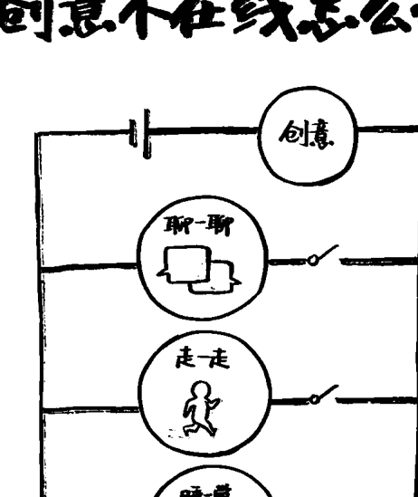

如果你经常觉得自己低水平勤奋，搞不好就是因为手脚太勤奋，导致创意不在线。所以，当你想不出好点子，不妨换个场景，让思维跳脱一下，也许创意会自己蹿出来。


我们探讨这个时代最先进的个人成长方法论，只是为了让你成为“你自己”。

点击下方图片可购买《超级个体》专栏的限量礼品卡，跟更多朋友一起每天进步一点点，成长为自己的样子。

## 超级个体
限量版礼品卡

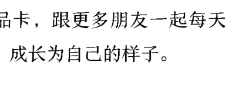

戳此送朋友

今天是古典陪伴你成长的第 294 天，一起加速，成长为更好的自己。

## 关于创意的思考

提交留言可与专栏作者互动

## 生涯顾问日 | 读EMBA 到底有没有用？ 42-5

42-5 生涯顾问日 | 读EMBA...

我工作15年了，目前在一家大型外企担任市场部经理。多年以来，我的执行力得到各任老板的认可，各项KPI我都能圆满顺利的完成。

这几年感觉到自己的瓶颈，我的经验都在执行层，而战略能力和说服能力比较弱，这让我在公司内部和外部都难以更上一个台阶。我自己喜欢营销这个领域，而且也有热情。我拿到了某商学院 Global EMBA的offer。

不过我有点犹豫：一方面有点犹豫2年学习的回报率，一方面也在想是不是可以用在旅游、享受生活、投入其他学习，比如说学习一个NLP呢？目前家里经济和时间负担都不大。我希望自己成为一个独立的职场女性。

我自己预估了一下读EMBA的益处：

- 1. 获得学历和光环
- 2. 系统学习商业知识，同时结识一群高质量的商业人士。
- 3. 可能会有凑不到的成长收获，开脑洞，职业机会等等。

也想了一下即将面对的挑战：

- 1. 我的资历和能力低于平均水平。缺乏战役经验，不能平等对话。
- 2. 对能力提升有限，对工作提升帮助有限 - 很多时候职位高者处理的是复杂的人，是远超于技术层面的问题。
- 3. 都说EMBA是圈子交际，我的社会地位和经济实力都不在高圈层。

古典

今天我们请到咨询师赵昂老师。他是新精英生涯研发总监、生涯咨询资深专家、咨询师督导。拥有IT、媒体、政府部门、教育培训十多年的从业经验，了解多领域职场情况，积累收费咨询案例超过2000小时，是国内咨询经验最丰富的职业生涯咨询师之一。著有畅销书《在人生拐角处》。他的咨询向来以敏锐的洞察力著称。下面听听他的回答。


艾米：

你是一个爱学习的人。

恕我直言，对你来说，“学习”这件事是明亮书房里，漂亮书架上，安静摆放着的书。你会每天打扫书房的卫生，掉落在书上的灰尘，抚摸书的封面，却不一定坐下来认真阅读这本书。

别误会，我不是说你不会读书，只是说你的学习看重表面。别误会，我不是说你追求浮华，只是说你目的与手段之间特别护巴。

读EMBA，你关注的是光环、人脉圈、机会。对于职业发展来说，这个当然很有用，而且经常有很大的作用，光环会带来机会，人脉圈也会，而一个恰当的机会会让你迅速升级，进入职业快车道。

# —— 今日思考题 ——

你有没有“逃避性学习”的习惯呢？你最近想提升哪些能力呢？这些能力目前达到哪个阶段（上脑、上心、上身）了呢？欢迎你在留言区分享给我。

古典
听完赵昂老师的回答，我觉得很有意思，因为每个人都会遇到发展的瓶颈。我们最常见的反应是，如果有瓶颈，基本三件事——上学、旅游、学英语。但是往往上学了一圈，回来还是要面临这个问题。我发现了一个有趣的词“逃避性学习”，用学习来逃避，是不是还挺有安慰剂的效果？

## 欢迎你在留言区分享给我。

学了很多就是没行动？你缺少自我效能 41-1
构建支持系统：三招提升你的自我效能 41-2

我们探讨这个时代最先进的个人成长方法论，只是为了让你成为“你自己”。

点击下方图片可购买《超级个体》专栏的限量礼品卡，跟更多朋友一起每天进步一点点，成长为自己的样子。

## 超级个体
限量版礼品卡

戳此送朋友

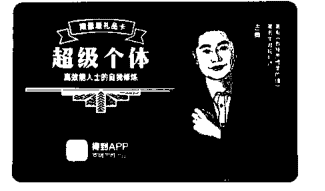

今天是古典陪伴你成长的第 295 天，一起加速，成长为更好的自己。

## 关于学习深造的思考

## 创意商人王义鑫：如何用设计的思维看世界？
42-6


## 古典

这周创造力主题，我为大家邀请了一位“创意商人”——王义鑫。

王义鑫是一名在北欧留学归来的顶级设计师，也是一位连续创业者。现在是荷墨文化公司（FOD）的创始人和CEO。
多年来，他一直在做一件事情——加速设计师的成长。

他认为好的设计师有灵感有创意，活在艺术世界里，却不太懂得如何“翻译”成商业世界的语言。他创办的荷墨文化，发现和孵化最优秀的设计师，让他们的才华被更多的人发现和赏识。

王义鑫是我10年多的朋友，这么多年过去，他身上始终有一个阳光男孩的“年轻味道”。我想这和他本身在用创造力的方式解决生活的各种问题有关。

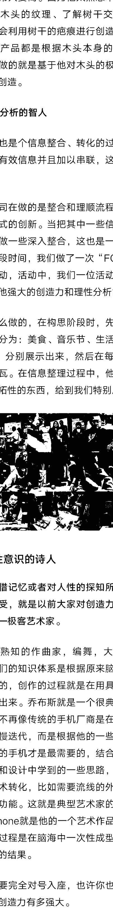

应古典老师邀约，今天来和超级个体的小伙伴文字“见”面。

### 一、再解创造力

对于创造力，不同的时代理解都不同，那么在这个时代，创造力指的是又是什么？


### 二、3种创造力人才

### 1.极端兴趣的匠人

### 2.理性分析的智人


### 3.感性意识的诗人


### 三、如何去训练自己的创造力？

### 1. L型人才的培养


考“的方法来看，核心问题就变成了如何喝到水的问题，那方式就可以是用吸管来喝水，也可以嚼冰的方式来喝水等等。

从A点到B点，有很多种到达方式。创造性的思考，需要打破以往纵向思考，而增加更多的横轴。

## 2. 幼儿园模式

这个模式，主要在学习如何像孩子一样将信息归零。

有孩子的家庭，可能经常会遇到这样一个问题——小孩子在吃饭时，总是不自觉打翻自己的碗，怎么解决这个问题呢？

很多设计师都会从地心引力，质地，碗型等出发，给出各种方案。而有一个设计师，他是从孩子的角度来思考——孩子经常打翻碗，究竟是因为为什么呢？因为碗和盘子没有连在一起。所以他给出的方案就是在下面加一个吸盘，把碗牢牢吸住，这个问题是不是就得到解决了呢。

其实就是这样，很简单的方式，也是最有效的解决问题的方式。吸盘碗在亚马逊上卖了很多，很受欢迎；这个案例中的创造力，不是其他的方式，就是回归到最单纯的点，像幼儿园的孩子一样直接去解决。

## 3. 角色式学习

遇到问题，时常转换角色，交换思想，会有意想不到的启发。

在平时工作中，我会经常转换角色。当我有什么新的想法时，就时常去和大家分享沟通，争取收到不同视角的反馈。这个过程，有点类似古典老师思想夜宴的模式，联机更多优秀的人一起思考。在交流过程中，我们提问很少，就是大家彼此之间交换思想，获取更多的灵感。

## 4. 立刻行动

这个方式就是行动，在行动中获取经验和灵感。

有一次，我们在做一个21天创意训练营时，有一个学员想做一个带雕塑的笔，在第7天的时候，他基本就完成了用橡皮泥做的模型。做好之后在他做下一步思考时，被自己一个小习惯所激发。当他看到自己不自觉拿起笔就转时，突然想到：是不是可以专门设计出来一直能转的笔？在握笔过程中用手抓的部位，用特别的防滑材料，让转笔的人握着很舒服，能享受到转笔的乐趣。

之后，他又进一步想：这些喜欢转笔的人，都是在什么情况下会转笔，甚至有人会咬笔呢？抓住了人们有压力想排解的这一系列想法时，随之他就诞生了一系列的设计，可以转的笔，可以咬着释压的笔，这一 系列产品的设计，就是边做边思考的一个典范。


这就是我对创造力的一些粗见认识。祝超造力，生活得多有趣多彩。

### ——今日思考题——

你的工作中会特别需要创造力吗？如果是，你都在用哪些方式培养自己？欢迎留言分享。

> 李欣频：你能不能拿出一个对得起此生的作品？31-6

下周我们的主题是“网络生存术”。如你所见，网络正以前所未有的姿态改变着我们的生活：谣误和真知混杂，毒药和解药相伴。所以，我想用一周的时间，和你分享哪些能够帮你在网络时代更好地生活的技能。比如：

+   怎样通过网络快速找到有用信息？
英语到底该不该学？如何学？有没有利用网络工具的快速学习之道？
怎样是混社群的正确方式？
……

我们下周见。

我们探讨这个时代最先进的个人成长方法论，只是为了让你成为“你自己”。
点击下方图片可购买《超级个体》专栏的限量礼品卡，跟更多朋友一起每天进步一点点，成长为自己的样子。

## 彩蛋 | 最颠覆你认知的5个成长工具（下）

找工作，第一步要干什么？

你的反应肯定是——写简历，然后上传到招聘网站上。或者直接搜索需要的职位，到处投简历，等待面试机会。

别傻了，80%的好工作并不在招聘网站上发布。尤其是对在职人员的招聘。

不信，我们先看看老板们都是通过什么途径找到人才的？

## 第一步 内部提升

有好的职位，老板会优先提拔本公司在职的、转正兼职的，或者搜索一下以前合作过的优秀伙伴。因为，越是重要的职位，越要控制风险——见过这个人工作，知道是靠谱的；跟这个人接触过，觉得他是忠诚的。

## 第二步 找到能带来良好体验的人

能让别人体验到你的能力，让别人知道你是一个怎样的人才。

如果你是设计师，寄出你的作品；如果你是程序员，带上你开发的软件；如果你是顾问，列举你的成功案例。

## 第三步 有信任的人背书

你可以找到那些被信任的、有专业鉴别能力的人为你背书。

求职前，你可以在你目标公司工作的人，找到专业圈子里说得上话的人。让他们帮你推荐，递一下简历，机会会大很多。

## 第四步 求助猎头和人力资源

实在找不到合适的人选，老板才需要猎头和人力资源在各大招聘网站发布招聘启示。这时你才能通过搜索，看到相应的招聘信息。

雇主思维和求职者思维用图形表现出来是这样的：


给你支三招：

### 1. 选对路径

你会发现普通人的求职路径与好职位的招聘路径，几乎完全相反。选对路径，你几乎能够赢80%的人。大部分的胜利，都是心智模式的胜利。

### 2. 写简历，不投简历

一个职业发展不错的人，应该随时能拿出简历，定期在社交媒体、猎头那里更新简历，但要少“投”简历求职。

因为他已经在前面三轮——人脉背书、作品背书、组织背书中被挑选走了——所以你常常听牛人说，我从大学毕业后就没投过简历。因为完全没必要。

### 3. 认真做事，好好做人，功不唐捐

功不唐捐是《法华经》的一句话，意思是：“功业是不会白白地被捐掉的，它会用一种你不一定能理解的方式，返回到你身上”。

在一个到处互联，输出与回馈都更快的时代，努力做一个优秀的超级个体，很难被埋没。

## 超级个体

## 最佳求职路径


一起越场结合第124天

普通人的求职路径，和好职位的招聘路径，几乎完全相反。选对路径，你几乎能够赢了80%的人，大部分的胜利，都是心智模式的胜利。

爱因斯坦说：“如果我必须用一小时思考一个问题，我会花55分钟思考我要提出什么问题，用5分钟时间找答案。”

当信息多到你记不住的时候，你就会散焦，丢失真正的答案。而“提前知道问题”是最好的解决方法。在知识大爆炸的时代——只有提问能让你的注意力恰当地聚焦。

下面我将通过几个具体场景告诉你，提问比答案更有有效的3个理由。

### 1、提问能防止知识折旧

第一个理由是，知识迭代周期变短，答案只是阶段性正确，所以，相比答案，好问题变得更重要。

18世纪，知识更新周期为80～90年；19世纪缩短为30年；20世纪60～70年代，一般学科的知识更新周期为5～10年；进入21世纪，许多学科的知识更新周期已缩短至2～3年。也就是说，你大一学的东西，很可能大四毕业的时候已经完全没用了。

科技正在改变我们的生活，无论是思维方式，还是解决问题的方式。所有答案都在不断地被挑战。或者说，没有永恒的答案，只有阶段性的正确。

这个时候，最重要的不再是答案，而是好问题。

所以，提问是一种绝佳的学习手段。

### 2. 提问是更好的沟通方式

第二个理由是，在会议或者沟通环境下，提出好问题可以形成共同的聚焦点，更高效地达到沟通目的。

在你为别人介绍业务时，与其按部就班地介绍，不如用尽可能短的时间介绍一下业务的整体情况。然后提问：“不知道你对于哪些方面更加感兴趣？”“今天大家主要想搞清楚哪几个问题？”一旦对方提出问题，你就抓控了全局。

所以，提问是一种重要的沟通方式。

### 3. 提问是更好的管理方式

第三个理由是，在与人协作的过程中，提问能增强他人的参与度，管理他人的行动方向，变被动为主动。

美国数学家盖洛普曾对在校学生做过一项调查，观察他们的“学习积极性”与“提问”之间的关系，结果发现，当学生不再提问时，他们学习的投入程度也会相应下降。简单来说，“提问”，然后获得答案的方式，能提高一个人的参与感，进而更高效地完成任务。

## 提问比答案更重要


## 搜商：万物皆有路径且可达 43-1

43-1 搜商：搜索智力，指的是通过某种手段获取有用信息的能力。与智商、情商并称人类三种智力因素。

2、搜商有三个核心：搜索意识、搜索渠道和搜索技术。

这个时代的知识爆炸，到底该怎么判断什么要学，什么不要学呢？我自己的标准很简单：常用的知识和技能要自己学，一辈子用不了几次的技能就外包出去。

拿我们生活里的事儿打个比方——理财这种常用但用不好的技能，尽可能不要托别人托管；如果你要打场离婚官司——最好是直接请教好的律师，没必要自己去啃——不然你说你准备离几次？

### 一、搜索意识

在万物互联时代，你要有一个信念——万物皆有路径且可达。只要你清晰地知道自己想要什么，你总是有路径能够找到的。

### 二、搜索渠道

### 三、搜索技术

#### 1、使用双引号 “”

## —— 今日回顾 ——

这时代万物互联，不怕你找不到，就怕你想不到，搜商非常重要。包括三部分，有搜索意识、有搜索渠道、还有有搜索的语言。

# —— 今日思考题 ——

你有什么好的搜索渠道？你知道哪些地方

你有什么好的搜索渠道？你知道哪些地方可以找到专业信息？请在下面留言，我们收集一下，做个集合帖。

搜索没什么好思考的，还是行动吧。大家知道我的新书《跃迁：成为高手的技术》已经上市了。这是迄今为止我投入精力最多、最满意的一个作品。我提前在网上上传了一份名为“《跃迁（试读本）》”的PDF文档，这里包含《跃迁》这本书20%的内容，请大家免费读。利用今天学过的搜索知识，试试看，你会如何把它找出来呢？

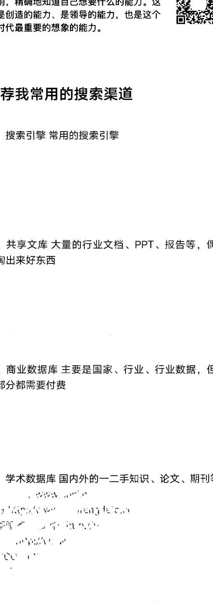

你理解的人脉，也许都是错的 30-1
重过程还是重结果？这是一个问题 9-4

## 搜商的三个核心。


提高搜商的关键还是要有一Cur种在答案出现前，精确地知道自己想要什么的能力。这是创造的能力、是领导的能力，也是这个时代最重要的想象的能力。


## 推荐我常用的搜索渠道

一、搜索引擎 常用的搜索引擎

二、共享文库 大量的行业文档、PPT、报告等，偶尔能淘出来好东西

三、商业数据库 主要是国家、行业、行业数据，但是大部分都需要付费

四、学术数据库 国内外的一二手知识、论文、期刊等

你可能会说，好多网站是英文的啊！我英语不好怎么办？要不要去学英语啊？明天我就教你“如何用破英语 armature 世界”。

我们探讨这个时代最先进的个人成长方法论，只是为了让你成为“你自己”。
点击下方图片可购买《超级个体》专栏的限量礼品卡，跟更多朋友一起每天进步一点点，成长为自己的样子。

## 超级个体 限量版礼品卡


今天是古典陪伴你成长的第 298 天，一起加速，成长为更好的自己。

## 一口破英语，大胆走天下 43-2

43-2 一口破英语，大胆走...

6种英语沟通工具：在在线翻译、YouTube新技术、直接对照的举办法、身体语言、翻译软件、手机App。

很多中国人都有“英语”情绪：大学的时候努力考四、六级；花在英语上的时间甚至超过专业课；工作之后又想学好英语，为以后准备一项“专业技能”……我们专栏有一周讲“自我效能”，没想到后台留言中，“学英语”竟然成为了出现频率最高的词——英语学不好，是很多人的“心头痧疮”。

我们今天先不谈如何学英语，就谈谈英语该不该学。

## 英语的本质是什么？

首先问大家一个问题，学习英语的目标是什么？

大家都会说出几大需求——我要读外文资料、和老外侃侃而谈、环游世界、出国读书……在这些事情背后，英语具体起到什么作用呢？很简单，就是完成沟通。

那么什么样的英语水平才算好到能沟通嘞？前段时间我看了一个视频（《老外点评中国科技大学英语水平》），特别好玩：一个中文说得很好的外国小伙子（@“拽莽坊”），根据网上以往的演讲视频资料逐一评价中国科技大学的英语水平。包括：张朝阳、杨元庆、马云、李彦宏、雷军……很多大佬的英语非常不错。

比如李彦宏，“拽莽坊”给了10分——“几乎听不出他是中国人”；给张朝阳打了8.5分——“不愧是MIT博士”；也有不太好的，比如雷军，小伙给了1分——“听得汗都出来了，他不会说英语”；杨元庆给了4分，贾跃亭给了3分；但是，即使高分如9分的马云——“有语法问题，但这不影响他的魅力和观众的理解。”

小伙儿给了俞敏洪8分——“讲得很溜，但是在语音语调上，属于纯粹的中式英语。

我朋友看完开玩笑地转给我——你看，前英语老师即使4分的英语水平，也能做全球型的跨国企业，8分的中式英语都能在海外上市，你的英语是不是也没必要非得那么好？这并不是孤例——很多亚非拉国家的总统，英语口语发音相当够嗵，但是语法严密、思维清晰，完美地利用了英语的作用——沟通。

其实我认同他的说法。把英语还原到本质，并不是什么神圣的东西，只是一种用来沟通的工具。既然是沟通，本身就有场景、难度和频次，你期待做的事情，并不需要成为英语高手才能完成，你完全可以揣着一口“破英语”，先开始用起来。我列了一个英语使用场景和难度的关系图表，你可以对照下图，看看你应用的场景，需要什么英语水平。


图中黑色的框框的水平，就被我称为破英语。什么算破英语呢？

只要你基本有高中词汇量、语法基本懂、口音很糟糕、说话断断续续蹦词——这样的水平就是破英语。如果你在破英语水平——恭喜你，你已经足够暂时不用学英语，而是把精力放在用英语看资料、看视频、出国旅游上去。

## 6种英语沟通工具

+   1、现在在线翻译功能已经变得越来越强大。谷歌翻译、百度翻译、有道词典基本就能解决生词的问题。使用 chrome 浏览器打开外文网站（包括但不限于英文），点击“翻译”，英文页面就变成中文了。也许有不那么准确的地方，但凭借你的中文能力，就基本可以搞定了。遇到不认识的词，可以用电子词典配合来查。


+   2、YouTube 最近推出一项神技能，所有的剧中英语都能即时地被AI识别成英语字幕，而找到右下角的字幕设置，甚至可以把字幕直接在线翻译成中文。我尝试了一下，识别率相当高。希望这种“黑科技”尽快应用起来。


+   3、即使暂时没有这种黑科技，也会有很多笨办法。我遇到过一个山西的大学生，他发现自己想看的一门关于 Coursera (http://coursera.org) 创意的课程，但是没有中文，只有英语字幕，他会直接用电脑翻译成中文对着看，几乎也能学下来。

+   4、身体语言：出国旅游，交流方面没你想象得那么难。“翻译软件+表情+手势”基本能解决大部分买菜、吃喝、住宿问题。点餐的时候，用"this" "yes" "ok"几个基本词汇，再加上比划，基本就可完成沟通。

我在卢浮宫参观的时候，遇到了一位大叔，看他的样子应该是在找“蒙娜丽莎”，我自认为口语还可以，就想帮他忙。这个时候，让我震惊的一幕出现了——大叔找到一个工作人员，直接拿着导览图指着蒙娜丽莎一脸期待地看着对方，工作人员秒懂，开始用一口语法味极重的英语开始讲，基本只能听到 left、right、up、down。然后大潮来了，大叔一边用一口标准的东北话复述路线，一边比划手势。法国工作人员竟然笑着点头，还顺便告诉他那里还有一个大天使的雕像，有大翅膀。大叔居然也意会了！然后他们就互相感谢散开了……

其实出国旅行，使用：“身体语言+翻译工具+二皮脸”，基本上出行是足够的。

+   5、翻译软件：国外的谷歌翻译和国内的有道翻译都有在线|离线翻译、语音对话、相机采集翻译等功能。只要把摄像头对着英文文字、菜单、旅游行程等，都能直接翻译成为中文。

+   6、手机App：机票、租车、住宿等基本问题都可能在携程、Airbnb上完成。出
前可以把需要用到的酒店地址、餐厅地址、景点地址等搜索当地语言后拍存在手机里，需要时直接示意给当地人看——简单粗暴有效。

## 什么时候需要专业英语？

以下几种情况可能需要专业级的英语水平：

+   难度高一点的沟通，包括学术领域的沟通和阅读；
想通过托福、雅思考试；
需要即时理解的（如听新闻，或者工作交流）；
更高级的，比如情感共鸣、文化体验（很多心理咨询师在国外很难接咨询，主要是语言文化的障碍）。

以上情况，都需要你好好学习英语，而且下的功夫一点儿也不少于其他技能。

其实“破英语”的破，不是破碎机的破，而是破局的破，突破的破——破的就是一种中国人学英语的心理障碍。我们总是希望把英语学好了才开始沟通，但是越学却越远离，越学越自卑——学了这么久还不能开口，于是更加想躲避，也更加自卑。这种死循环让我们没法真正达成学习语言的本质——交流。

今天的科技发达了，我们已经可以用各种方式沟通、表达和理解不同文化的人群，我们不妨先着用破英语打破这种内在的自我设限，打破英语的光环。真正学习英语的人，都曾经是揣着破英语开始沟通的人。他们越是沟通、越是了解，越是理解。

人。他们越是沟通、越是了解，越是理解英语背后承载的丰富信息，越容易产生认真学习英语的动力，而不仅仅为了完成童年梦想，或者仅仅是羡慕别人英语说得好。

这就是 “破英语” 的魅力。

## —◆ 今日思考题 ◆—

你见过哪些 “原来这样也可以” 的破英语案例？在留言区分享给我们吧！

如果你身边有一些一直想学英语，但从来不敢开口说的朋友，一定要把今天的文章分享给他，让他知道，破英语的魅力。

学了很多就是没行动？你缺少自我效能 41-1
构建支持系统：三招提升你的自我效能 41-2

## —口破英语,大胆走天下

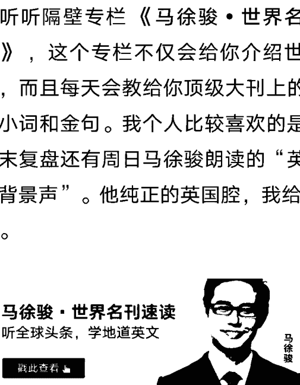

“破英语”的破，不是破烂的破，而是突破的破，破的是中国人学英语的心理障碍。只有当你真正突破障碍，开口说了，才能慢慢接近英语的本质——沟通。

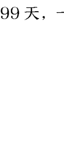

混圈子大家都懂，但是如何混社群呢？明天和大家好好说说，如何在社群混成一枝花。

如果你想比较轻松地提高英文水平，推荐你听听隔壁专栏《马徐骏·世界名刊速读》，这个专栏不仅会给你介绍世界名刊，而且每天会教给你顶级大刊上的实用的小词和金句。我个人比较喜欢的是他的周末复盘还有周日马徐骏朗读的“英文家庭背景声”。他纯正的英国腔，我给打10分。

马徐骏·世界名刊速读
听全球头条，学地道英文


今天是古典陪伴你成长的第 299 天，一起加速，成长为更好的自己。

## 关于英语学习的思考


# 群多未必人脉广，4步玩转微信圈 43-3

43-3 群多未必人脉广，4步...

1、圈子：在这个时代最重要的“圈子”表现形式就是社群，或者再接地气一点，就是微信群。

2、微信群的作用主要有三种：拿信息、结识人、放大个人名声。

在《超级个体》专栏第一周的第一篇推送《你的身价，被什么决定》里，我们就强调过圈子的重要性。个人的职业价值坐标系越来越从公司转向圈子。圈子在这个时代最重要的表现形式就是社群，或者再接地气一点，就是微信群。你也许学过很多社交法则，但是很少有人教过你在微信群里，该怎么做个个人喜欢、迅猛成长的人。

每个人都不缺微信群，但大部分时候的情况是：

- 因为某个产品、某个活动、某个目的……或者干脆就是偶然看到，觉得也许有用，加入了某个微信群；
刚开始新鲜，密切关注，但大部分时候不知道说话，随着时间推移，慢慢变成了彻底潜水；
感觉相比于加入时，目前群对自己的价值已经不大，但又舍不得彻底退出，总怕错过什么……

结果就是，你加入的群越来越多，但实际得到的价值却并没有越来越大。

那么应该怎么混？下面教你玩转圈子的4个步骤，不如就叫做“圈子四步”吧！

## 一、理清期待

和大部分的围观群众不同，真正的社群高手总是更清晰自己在群里的目的，他们清楚自己想得到什么。其实，做事有“极强的目的性”是高手区别于普通人的一大特征。

从个人发展的角度，微信群的作用主要有三种：拿信息、结识人、放大个人名声。

一个群没进入之前确实很难判断是否合乎你，你完全可以抱着好奇心加入看看是怎么回事。但要尽快完成判断，清晰自己在其中能收获的价值，并决定在其中扮演的角色。如果发现不靠谱或价值不高，应尽快选择退出。

其实大部分人在玩群的时候，压根儿就没思考过这事儿，然后就稀里糊涂地被群给玩了。

## 二、配置精力

理财里不是有种说法，叫做资产配置吗？其实群也可以配置。

除了评估已经加入的群之外，你还可以根据需求主动寻找优质社群加入、配置自己的群。一个职场人最好有三种公司外的群：同行群、同业群、同道群。

如果你是个运营人，你可能需要找一个比如“三节课”的学习群，让自己横向有比较，知道行业趋势，市场行情。这就是同行群，主要是用来提升能力和身价的。

而如果你是个创业者，你可能要混风投群、企业家群、营销群、人才群、行业群，甚至用户群，这些人和你在同一个行业，你们绑在一条价值链上。这个主要是用来向外整合资源的。

同道群则是以某种生活方式为核心的群，比如说有读书群、健身群、跑步群甚至帆船群，这种爱好群其实是拓展弱联系的，越是精准的生活方式群，你们所处的社会阶层，生活形态越接近，越容易达成资源互换。

总之，如果你发现你除了同事群就是家人群，那么你可能还没充分利用互联网时代的圈子红利。

## 三、顺势而为

上面我们说了作为个人的目的，下面我们换到微信群的角度再来看这个事情：

常见一个运营微信群，主要是聊天、发段子，或者转一些自己喜欢的内容，但经常无人呼应——为什么？因为你完全不理解这个群的目的。一个群之所以建立，一定是有自己的目的，也许是运营产品、维系用户、聚拢人脉，总之，一定有其目的。

比如新精英就建立过很多学员课后群，他们没事会往里面丢小广告，就挺招人烦的。如果你理解了这个群的目标是让学员更好地落地课程里学到的东西，成为学员。你就应该能理解方法——主动分享相关知识、笔记，做场同学聚会，帮同学链接人脉，你会很快成为学员群里的明星，你要的资源也会开始聚拢，因为你是群的意志体现。

要理解群体的意志，最好找到群主——每个群的群主其实都知道这个目的，所以进群先和群主建立关系，理解他的需求，观察他在什么时候表达什么内容。逐渐会理解这个群的目的。只有当你理解了群的目的，做好自己的角色，群自然会成就你。

## 四、功成身退

真正的混群高手都如道——微信群这个玩意儿和生物一样，是有寿命的，混群高手一旦发现这个临界点，就会抓住几个最好的联系，然后功成身退。不是说一定要退群，但你可以在心理上断舍离，把精力重新分配到下一个更适合你的圈子里。

## ——今日总结——

其实今天讲的所有技术，用在过去的人际圈子也是一样，只不过微信圈用一种最简洁，也最直接的形式，呈现了出来。混圈如做人——理清期待、配置精力、顺势而为、功成身退。

### ——今日思考题——

利用好圈子，从选好圈子开始。

如果今天要你退出3个微信群，为自己减负，你会选择哪3个呢？盘点下自己的阶段和期待，思考群的目标，如果没用的话，那就赶紧止损吧！

你的身价，被什么决定？1-1
你理解的人脉，也许都是错的 30-1
怎样和比自己厉害的人做朋友？30-2
联机进化：扩大人脉圈，实现知识互联 30-3


微信群的作用主要有三种：拿信息、结识人、放大个人名声。职场人需要在工作之外配置好三个群：同行群、同业群、同道群。

今天是古典陪你成长的第300天，一起加速，成长为更好的自己。

# 关于圈子的思考

# 识破谣言：一种可以救命的网络生存技能 43-4

43-4 识破谣言：一种可以...

- 1、谣言公式：R（谣言强度）= i（对传播者和接收者的重要性）× a（事实依据的模糊性）
2、谣言验证方法——“三角验证”（资料、作者、论证）。

8月2号，“齐未堆”发布文章称，大学生求职者李文星在招聘应用“ BOSS直聘”上应聘时，疑似遭遇传销局，在失联数日后最终不幸身亡。听到这个消息，我特别痛心——一方面恨传销组织、一方面从他自身找原因——如果能在入职前对应聘公司的相关信息，做一些检索、排查，有没有可能避免这场悲剧？

类似的事情发生得太多了，当年，魏则西在“百度”搜索疱疹病信息，第一条结果就是某武警医院的所谓「生物免疫疗法」，一家人在北京，被无良医生告知：保二十年没问题。后来有人在 Google 帮魏则西查询，又联系了很多美国的医院，才明白这个所谓的「生物免疫疗法」在国外因为有效率太低，在临床阶段就被淘汰了。2016年，魏则西去世，引发对劣价排名、医疗监管的广泛争议。

在网络化时代，有一种技能你不能不学，就是辟谣的技能。

随着网络环境的繁荣，谣言也有了滋生的沃土。一则小的谣言可能让你损失几百块钱，或者浪费你几天的时问，但是一个大的谣言可能真的会让一些人送命。更重要的是，谣言侵害的对象往往是对互联网接触不深的老人家，以及没有辨别能力的孩子。

所以，学习一点识别谣言的科学方法，无论对你自己还是对家人，都是有益的。

# 要科学地辟谣，先了解如何科学地造谣

社会学者研究谣言传播的时候，发现“重要性和模糊性”是影响谣言传播的两个重要因素。用公式表示为：

```
R = i × a
```

其中，R是谣言强度；i是指谣言对于传播者和接收者的重要性；a是指谣言相关事实依据的模糊性，这个公式被称为谣言的基本法则。讲到这里，一种“科学造谣术”就出现了。

- 1. 告诉一个人某件事对别人很重要（重要性）；
2. 注重大量对对方不懂的信息，让不明觉厉（模糊性）。

# 了解完造谣法，现在看看如何辟谣

首先是要有个信念——天下没有免费的午餐，重要的信息绝不会是你第一个看到——越是重要的事情，越是需要反复验证。不重要的事情，就当个笑话，没必要当真。

# 介绍一种最常见的社会学验证方法——三角验证

“三角验证”由学者诺曼（Norman Denzin）于1978年首次引用于社会科学的研究当中，以一种以上的理论、方法、资料来源或分析者解释同一现象，以确保研究发现的一致性。

- 【资料】这个信息资料来自何处？谁发布的？
【作者】这个信息的发布者是谁？有没有其他专家、学者佐证？
【论证】论证逻辑是否自洽，有无前后矛盾之处？


# 先来看资料来源：

# 再来看看作者：

# 最后看看论证逻辑：


可以说，在科学验证方面，没有任何证据证明水能根据外界信息决定美丑。不过我们当然不能说水就听不懂自然界的声音，但是水知道答案这件事，没有通过基本的科学验证。

这就是三角验证的思路。当然，大量的网络证伪的事情，也许不值得这么大动干戈——但是至少你可以尝试一下最简单三角验证：当事人、对立面和第三方——搜索一下反面意见。

# —— 今日思考题 ——

# ——◆ 今日思考题 ◆——

我相信你跟我一样，经常会收到父母转发的一些不太靠谱的养生知识，你有什么招数帮他们辟谣呢？欢迎在留言区分享给我。

如果你拿父母没办法，推荐你把今天的文章分享给他们，也许能省去你很多的苦口婆心。

- 独立思考决定心智上限 23-1
潜伏在身边的5种“强盗逻辑” 23-2
被过度使用的批判性思维 23-3

# 用“三角验证”识破谣言

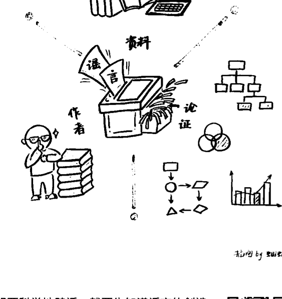

想要科学地辟谣，就要先知道谣言的创造逻辑，社会学者发现，“重要性和模糊性”是影响谣言传播的两个重要因素。“三角验证”法则可以科学地识别谣言。


今天是古典陪伴你成长的第 301 天，一起加速，成长为更好的自己。

# 关于识破谣言的思考

提交留言可与专栏作者互动

# 生湛顾问日｜鸡头与凤尾：是在大公司做中层，还是在小公司做高层 43-5

43-5 鸡头与凤尾：是大公...

我今年30岁，半年前从一家地产20强公司的营销经理跳槽到一家地产80强公司做营销总。

本来想在更大的平台上大干一场，没想到公司因错误决策把项目卖了，新项目等了小半年又遥遥无期。而地产前三甲公司邀请我去做营销经理，我很纠结。

是应该在这家公司为了职位、薪酬和平台继续坚守呢？还是应该降职、降薪去地产前三甲打拼呢？

## 古典

很感谢你在人生选择的關鍵路口，来到“生活顾问日”咨询，我特地邀请我的一个好朋友——小川权回来答你的问题。小川权本人是一位职场畅销书作者，代表作——《抓住住，世界就是你的》。这本书里有很多职场干货。更重要的是，他本人就是一家地产开发公司的品牌总监，专业的回应专业的问題。我请他来对你的问题做个分析。


坦白说，作为房地产的业内人士，我觉得你已经非常了不起了，你很喜欢这个行业，很喜欢营销这个工作，从业10年，就已经在很多大型房企做到了管理层的位置，很厉害。我看到你在提问当中很急迫地想要一个答案，不过这里我却很想先问你一个问题。

对三十岁的你来说，现在什么是最重要的？是经济收入？是名头？还是经验的累积？

## 一、看不清未来，先看看历史

### 1、从业4年弃高薪转策划，选中你的发展跑道

你的个人工作经历中有 一点很吸引我：从业第4年的時候，你用 了1年的时间在公司学习策划，让自己迅速成长为销售里最懂策划，策划中又最懂销售的，为自己增加独特 的行业竞争 力，而且是在降薪60%的情況下做的選擇——这无疑是很有成功的一筆职业生涯投资。也正是这个关键节点的 选择，给你后期的几次职业选择提供了有力的支撑，证明你是個懂得投资未来，又不计小利的人。

### 2、要追大平台？还是要明确下一步规划？

后來的这几年，你一路换工作似乎都比较顺利，不过除了最开始入行那个阶段工作时长比较久之外，后期都是2年、2年半就更换工作，你是否察觉这个问题：这个阶段的你，是学到的比較多？还是输出的比較多？

很多的离职理由都是希望换一个大的平台，等有一天你真的到了一个大平台之后，你的个人规划是什么？是扎下来好好干，最后做到项目总监？还是只想要更高的跳板？

如果你 的目标是项目总监，那你是否知道目前你距离项目总监或者大区总经理的距离还有多远？营销属于项目后段，对一个地产项目来说，从前期到规划，从工程到运营，从设计到总包，这些你都需要积累么？

人最容易做的是重复，比较让人兴奋的是，在重复已知的基礎上又探索一些未知，而最难的是升维。

## 二、大小公司之间的门道

### 1、比起公司大小，个人发展更重要

从你的纠结来看，地产80强与前3甲，似乎是最重要的选择点。但是，在我看来，个人发展和定位，并不是平台大小为首选，更多还是看个人的热情和参与度。

从过往经历来看，10年都在地产这个行业，你是喜欢营销工作的，你喜欢这份工作的挑战，没有局限，可以接触新鲜事物，因此，我建议这次选择要转移重点，不要再纠结平台大小，而要去进一步思考可能面临的机会，到底是要做业务高手、还是做核心管理层？哪个平台可以满足你的这份内在需求？

你去地产排名靠前的公司，看起来平台会更好，名气会更大，你也不会闲在那，而是马上活干千，但目前你需要用干活的方式重复经验么？大平台实践的机会多，但是大平台管理条线也一定更严谨，晋升机制也一定更复杂，因为人才聚集，竞争也会更剧烈，你要如何界定好自己，让自己去了不仅只是干活的一把好手？

如果希望进入核心管理层，小平台反而机会更多，因为它们更许可光环效应，更容易爆发危机，而危机对希望上位的人意味着转机。不过现在你没事可做，的确是个尴尬处。

### 2、比起职位名头，岗位职能更重要

有时候，并不是你的职位变成了总监，你的能力就能和总监相匹配，在我看来经理和总监最大的区别不在于能力，而是前瞻性、战略眼光以及人脉累积，以及权限空间。所以单纯强调公司是不是大，并没有太多实际意义，更多的还是需要看到你所管的权限范围，以及你目前的直接汇报对象对你的想法是否认可和授权。

我给超体们的一个贴心建议：

我是做品牌管理的，每次在接到猎头电话的时候，除了要问职位和薪资之外，还有一点我是一定不会忘记的，就是我所在的部门和市场部的关系，以及我汇报的对象处于什么样的位置，主管的内容范围是什么？因为这样我才能判断出，我带的部门有没有决策权，是不是隶属于核心部门。

对个人而言，公司这个平台太大了，我们能掌控的太少，所以与其这样，不如清楚自己所在的部门的位置和管理权限，从而判断自己过去以后有没有用武之地。

### 3. 去了就要站稳，站稳就要熬出头

一个企业如果要培养核心管理人才，要有业绩、认同企业文化、还要熬得住。这样粗略估算一下，如果你进一个企业，想熬头做出成绩，两年足够了，但如果你希望得到晋升或者是到核心管理层，很可能需要3-5年，如果在原本晋升后希望再来一个更大级别的跃迁，你可能还需要更多的内外培训和资源。

在每一步的选择中，搞清楚目前自己缺的是什么，这样你才好做出相应的准备，不论是换平台还是不换，你都可以让自己更清晰地看到稍远的一步。每次更换平台，薪水和职位是平衡的两个标准，但不是绝对的标准，你向谁汇报？目前的你最缺乏的是什么？这份工作会补充给你什么能力？这些才是你换工作，以及如何衡量这个平台价值的标准。

其实，人生没有哪段時間是白白浪费的，等待也可能是你人生里必要的一个反思过程，这个过程里，你要想想现在的你缺的是什麼？一路猛追，脱颖而出，确实是一把好手，但总当急先锋，驻坐军中帐，核心领导要格局和气度，更要看的是自我的认知和决断，先看清自己，再看清外界，做最好的判断。

## 古典

鸡头还是凤尾？这是一个永恒的争议。

小川权给了我们很有趣的视角：做鸡头比做凤头更多机会，当凤尾比当鸡尾舒服：先看清自己想要什么最重要；另外，职位和职能其实是两回事——我见过一堆只管理3个人的创业公司总监，其实就和车间主任的管理水平相若。关键是你带着团队，做成了什么。总当急先锋...

是你带着团队，做成了什么。总当急先锋，难坐军中帐，如果想做行业的领导者，还是要熬得住——这是不是也是这个浮躁时代的一股清流呢？

头条号签约作者，LinkedIn中国专栏作家

有道云笔记最佳职场干货分享，在行职场咨询师

职场作家，地产开发公司品牌总监

2017年经网友评选，获得由当当网颁发的全国影响力作家奖

代表作：《扛得住，世界就是你的》

# —— 今日思考题 ——

你愿意做业务，还是做管理？你愿意去大公司，还是小公司？你怎么看待鸡头和凤尾的关系呢？欢迎你在留言区写下你的选择和理由。

什么才算是一个终极适合的职业？ 3-1

今天是古典陪伴你成长的第 302 天，一起加速，成长为更好的自己。

关于大公司和小公司的思考

提交留言可与专栏作者互动

# “联机学习者”应该有的5个特征 43-6


## 古典

这周的成长导师，我邀请了一位我的老朋友——秋叶。他创办了秋叶ppt、知识IP大本营，是中欧商学院私享会的导师。除此之外秋叶还是一位非常会学习的专家。

在2009年，秋叶开始自学ppt，半年后就成为了一名专业的PPT培训师。这么强大的学习能力，支持着秋叶老师不断地输出自己的作品。从2008年开始，秋叶老师开始写博客，到今天已写了2694篇，出版了23本书。今年他开的IP课程，付费用户也突破了2万。

今天他来分享对于互联网学习方式的最新探索，非常精彩，推荐你读。

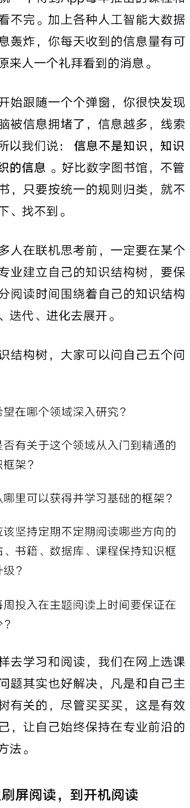

有时候，我觉得自己是个“骗子”。

比如说，我写了一篇微信推送，小伙伴留言说：哇，秋叶大叔你果然读了好多书，写得好有深度。我就很想告诉他，其实我在写作时，很多过去的阅读积累并没有用上，我只是定好写作框架，在需要素材的时候，我默默输入了最可能的关键 词。

那你不是看了很多书吗？——我是看了很多书，但今天大部分书你也知道的，只能当快餐，消磨一下闲暇的碎片时间，这种阅读算得上是一种“阅后即焚”，对大脑的充电而言，全无帮助。如果一定要说有什么帮助的话，广泛阅读让我记住了很多很多关键词，等到我需要资料的时候，我会用“关键词”去搜索。

比如有一天，在知识IP大本营微信群，一个小伙伴发了一句话：

以前我一直觉得，婚姻就是两个人日夜相对，每天醒来发现“啊！又是你啊！”是让人很崩溃的。直到看了黄子华栋笃笑，说“婚姻是爱情的坟墓，但没有婚姻的爱情死无葬身之地”。从此看懂了婚姻。

大家开始用这个句式造句接龙，我马上跟了一段话，只花了几分钟：

以前我一直觉得，PPT就是晚上加班套模板，每天醒来发现“啊！领导又换了发言稿要我改啊！”是让人很崩溃的。直到看了《寒战》，说“每一个机构，每一个部门，每一个岗位都有自己的游戏规则。不管是明是暗，第一步是先学会它，不过好多人还没走到这一步就已经死了，知道为什么吗——自以为是。第二步，就是在这个游戏里把线头找出来，学会如何不去犯规，懂得如何在绒球里玩，这样才能够强迫性长命。”从此看懂了PPT。

大家都夸我植入得好，还能记住那么多电影台词，我其实只做了三件事

- 1. 复制别人的话
2. 改成自己的案例植入
3. 搜“寒战经典台词”

就这么简单，感觉自己就像考场上的学生在作弊。唯一防撕更微信：699250

直到看了古典的《跃迁》，我才恍然大悟——这不是作弊，这是早早地进入了移动互联网时代应该有的学习者状态——联机学习者。

一个联机学习者，他应该有怎样的特征，我想分享五个我的经验。

## 一、从记知识点，到记关键词

不知道从何时开始，我成为各种搜索引擎重度依赖者，遇到任何问题，我会第一时间问自己三个问题：

- 1. 这个问题有人研究过吗？
2. 他的研究最可能去哪里分享？
3. 我用什么关键词最可能找到？

然后我很奇妙发现，绝大部分让我疑惑的问题，都有让人惊喜的答案或线索。

这就让我在阅读时形成新的习惯，一本书我并不需要记住太多，比如看完《跃迁》，我只需要记住一些关键词，比如“古典、跃迁、联机思考”，百度一下，就可以看到大量的书评，这对我想如何写一篇文章已经足够了。

不过今天的搜索不能只依赖百度，比如我要找PPT模板，今天我会去微信里搜索“5G模板”，就会找到很多文章。

如果我把这些关键词线索梳理一下，放进我的知识体系大纲，以后遇到问题，我直接去搜索就好，特别好的，还可以用一些资料管理工具，贮存起来备用。

在大数据时代，你和这个世界往往只有一步之遥，但你得用对那个关键词。

## 二、从泛阅读，到主题知识树阅读

网络一发达，各种选择海量涌出，不要说全网，就一个得到App每年推出的课程和书你都看不完。加上各种人工智能大数据推送信息轰炸，你每天收到的信息量有可能超过原来一个礼拜看到的消息。

如果你开始跟随一个个弹窗，你很快发现你的大脑被信息拥堵了，信息越多，线索越乱。所以我们说：信息不是知识，知识是有组织的信息。好比数字图书馆，不管有多少书，只要按统一的规则归类，就不怕放不下、找不到。

我们很多人圈联机思考前，一定要再某个方向或专业建立自己的知识结构树，要保证一部分阅读时间围绕着自己的知识结构树升级、迭代、进化去展开。

关于知识结构树，大家可以问自己五个问题：

- 1. 我希望在哪个领域深入研究？
2. 我是否有关于这个领域从入门到精通的知识框架？
3. 我从哪里可以获得并学习基础的框架？
4. 我应该坚持定期不定期阅读哪些方向的网站、书籍、数据库、课程保持知识框架升级？
5. 我每周投入在主题阅读上时间要保证在多少？

如果这样去学习和阅读，我们在网上选课买书的问题其实也好解决，凡是和自己主题知识树有关的，尽可买买买，这是有效投资自己，让自己始终保持在专业前沿的最低成本方法。

## 三、从刷屏阅读，到开机阅读

作为一个刷屏党，我常常从一个新闻跳到另一个新闻，分分钟就可能被弹幕带跑。在这一点上，我和大家并无不同。但有一点可能不同，我会刻意思考一下，我看到的不同领域的消息，背后是否有更深刻的规律在起作用。

比如我看到一些新闻，“二孩妈妈增加”、“杭州保姆纵火案”、“养老金危机”、“老龄化危机”，我会发现这些问题背后都有一个深刻的社会变化，比如老龄化带来的劳动力短缺和劳动力价格上涨，从而衍生了一系列社会问题。

我想表达的意思是在小屏时代，大数据不断推送我们喜欢看的信息，这本质上也是一种信息锁定的路径依赖，虽然打着投其所好的名义，却限制了我们的阅读视野。

所以我提倡大家在阅读信息时，不能只依赖手机推送和朋友圈，还是要定期打开电脑，看看不同的门户，看看更多不同类型，不同观点的新 闻，让自己能够把事物联系起来思考。

做联机思考者，就要学会在不同事物中找联系，而不是依赖网络观点来给自己论证。

关于联系阅读，我建议大家可以问自己四个问题：

- 1. 我是否关注超过5个不同大领域的新闻？
2. 我是否不满足新闻报道而喜欢看深度评论？
3. 我是否主动关注观点不一致的网站或个人？


+   4. 我是否会去思考不同事件和观点背后的联系和原因？

趋势往往不是显而易见的，所以我们需要把碎片的信息作为引发思考的触发器，一环一环去推导可能的结果，然后去找数据，做调研，约业内人士聊天，一点点把信息碎片拼图成完整的地图。普通人喜欢看一惊一乍的微信公众号标题党，“今天发现这个趋势”，“明天错过这个就会怎么样怎么样”，反正就是不想启动自己的大脑，更习惯用别人的思考填自己的脑洞。

## 四、从跟踪趋势到跟踪行业

经常有人问我为什么懂那么多？我觉得奇怪，答案不是因为我活得比较老吗？太阳底下很少新鲜事，看多了自然就知道了。

后来我才发现很多人学习模式是“弹球式”，学习过程中注意力不断抓热点，抓新名词，两年下来是学会了很多新名词，谈起未来也头头是道，但你如果问他，在你自己的行业应该怎么做，大部分都是一头雾水。

如果学习不能解决问题，再学100个新名词，认知再升级100次又有什么用？

我认为越是联机时代，越要长期关注对标几个行业发展趋势，参加行业活动，这样随着时间推移，你就能慢慢知道行业的来龙去脉，认识行业牛人，进入行业核心圈子，接触到行业核心资源，这才叫了解一个行业。

做到这一切没有什么技巧，靠时间，靠长时间的积累。

关于跟踪行业，我建议大家可以问自己三个问题：

+   1. 我是否定期关注某个行业的新闻？
2. 我是否定期查看某个行业的期刊？
3. 我是否定期参加某个行业的会议？

不妨先理解一个相对简单的行业开始。理解了一个行业，再逐步思考这个行业和其它行业万事万物的联系，会简单很多，而且当思维复杂程度骤然提速，才能成为一个更好的联机思考者。

## 五、从输入信息到输出信息

古人云：“十年磨一剑”，又说“要坐得冷板凳”。讲的是学习需要积累和沉淀，这当然是对的。但是学习需要观察和模仿，也需要交流和争鸣，这就需要联机思考者不能闭门造车，要主动走出去。

作为联机思考者，不能只满足于从网上输入信息，也要主动输出信息，最好是带个人标签的信息，完成个人网络品牌建设。输出信息并不一定非要写微信公众号，其实参与一些高质量社群，在里面进行深度交流和思考，也是一种输出。

在巴黎有很多咖啡馆，像毕加索、海明威、萨特、塞尚等文艺大咖是19世纪巴黎咖啡馆的常客。这些大师在咖啡馆海阔天空地交流，恰好完成了知识碰撞和思想进化，共同创造了文化事业的繁荣。

关于输出信息，我建议大家可以问自己三个问题：

+   1. 我是否定期在某个平台发表自己的观点？
2. 我是否加入某些高质量的社群并经常参与深度讨论？
3. 我是否会走入线下活动面对面吸收新思想？

广义的联机学习者，其实是不分线上和线下，今天的移动手机已经帮我们打通了联网的自由度，在哪里我们都是同时处于线上和线下，那么任何与人接触的场合，都可以进行联机头脑风暴。

# —— 今日思考题 ——

如果看完了这五点，你应该对如何做一个联机思考者，有了更深入地思考。欢迎在评论区留言你的思考，我们一起联机交流。

这几年，“个人成长”领域非常热：人们愿意为知识付费，希望通过不断学习，提升自己。他们向往自由职业的状态：既不用管别人，也不用被别人管。

可是，我发现身边从事自由职业的朋友，越来越多地开始招人、搭建自己的团队。下周我们的主题是“团队”。个人的成长是有“天花板”的，无论身在职场，还是自由职业，有了可以协作的“团队”才更能放大个人能量、达成更高的目标。

我们会详细聊聊下面的话题：

+   1. 个人成长和“团队作战”矛盾吗？
2. 为什么说你的团队角色定位比具体职位更值得你关注？
3. 如何解决团队中的矛盾冲突？
下周见。

今天是古典陪伴你成长的第303天，一起加速，成长为更好的自己。

## 彩蛋 | 超体学员亲测超好用的搜索工具集锦

## 古典

本课讲完“搜商”后，我在留言区看到最多的两种情绪是兴奋和可惜。兴奋的是，“这些方法竟然这么好使。”可惜的是，“为什么没早点知道这些搜索平台和方法。”

为了帮助大家提升搜商，我把我推荐的搜索工具和超体学员们推荐的工具做成了一个集锦，其中覆盖了20多个领域，50多个平台，包括科技类、医学类、育儿类、文献类等等。

你可以对标你所在的行业或者你的搜索需求自由取用。

希望对你有所帮助。

我推荐：翻墙软件

这里我要告诉超体们另外一个工具——翻墙工具。大家可以使用蓝灯（Lantern），或者收点费用也没有关系，否则很难搜索到Google上最有价值的资源。

另外，我发现维基百科可以使用英文版，但是中文版被禁了。对于搜索引擎的习得也在不断应用，大家如果有学习能力的话可以下载流行的网页爬行工具，我经常用的是八爪鱼，那里能很搜集到自己想要的信息。当然，如果想要更优质的资源，是需要要付费的。

我推荐：健康教育网站

作为临床检验诊断学专业的医学生，必须得给大家分享网站，查化验(血/尿/便等)项目的检测意义和价值：

LAB TESTS ONLINE（labtestsonline.org）这是美国临床化学学会维护的一个健康教育网站，主要面向患者，医学生。

我推荐：各大平台好用的功能——语音和图形识别。

百度贴吧上有很多你要找的资源，搜索除了文字、关键词，有时候也包括了音乐、图片等等。

网易云音乐的的歌单功能也可以用来找一些特殊用途的音乐。前几天古典老师推荐了一个激发创意的歌单。再比如，关键词：睡眠，就能在云音乐的歌单里面找到辅助深度睡眠的歌。关于歌曲，现在有个叫听歌识曲的功能，酷狗、网易音乐上面都有。

图片的话，百度图片和淘宝上都有识图功能，另外，识图APP也是不错的选择。比如你想知道一些常见植物的名称，有一个叫做彩色的APP可以用。当然正确率不是百分百的就是了。

有时候，如果实在找不到，可以试试求助。像百度问答，360问答，论坛贴吧发帖求助这些途径。虽然得到答案的可能性不是很高，不过也是一种补充手段。

我推荐：学术论文搜索资源

下面我来分享下我自己收藏的搜索资源——

论文搜索：SCI-hub：Sci-Hub: removing barriers in the way of science

杂志论文搜索是：Library Genesis: Scientific ArticlesbooksScDeepDyve - Read and Share from Thousands of the Top Scholarly JournalsAdvanced search - PhilPaperspdfgeniSemantic Scholar

我推荐：关于育儿知识的搜索

现在网上的育儿知识五花八门，百度出来的知识有一半以上是不可信的，我的方法是去育儿专家的微博搜索：

崔玉涛，张思莱，陈小舒，虾米妈咪，欧茜，裴医生等等。

像黄疸，发烧，拉肚子，小儿急疹等这些疾病专家微博上有很多科普和问答可以参考。

我推荐：科技网站和期刊

利用谷歌搜索的效果很好，但是因为懒得思考，也就懒得加那些符号，结果是造成资源的浪费，尤其是时间。关于搜索工具，自己也有几个积累下来的，仅供参考：

科技:www.sciencedirect.com

网络空间:www.zoomeye.org(需要登陆才能使用)

基因:gen.lib.rus.ec(可下载，可指定期刊，年报，语言，标签等)

学术:www.base-search.net

我推荐：高质量图片网站和良心公众号

我平常喜欢查图片，关于图片质量比较好的，印象最深的是：wallpaper heaven

我可以推荐几个微信公众号，里面的资源和内容还是比较良心的：

- 玩转手机摄影（了解手机摄影和后期技巧）
- gogoboi（每天一文，告诉你穿衣搭配进军时尚界）
- 飞碟说（追踪最新热点，小视频扫盲了）
- 电影最top（认真推荐好电影）
- 差评（了解小试新潮黑科技）

我推荐：小程序

我推荐一个我很早以前喜欢的网站吧：www.csdn.com，这里有很多网友自己做的程序。

另外再分享一个搜索的技巧：如果想搜配图的话，最好使用“英文”来搜索，基本能搜出比较简洁的配图。

我推荐：科学文献搜索引擎

在这里推荐一个非常好的科学文献搜索引擎：scifinder，

这个引擎好处是可以画化学结构然后根据结构搜索相关文献，对于一些从事医药，材料，环境与化学相关工作的同学相当有用。

# —— 我推荐的搜索工具 ——

## 一、搜索引擎 常用的搜索引擎

百度 http://www.baidu.com

Google http://www.google.com.hk（谷歌学术、谷歌图书）

搜狗 http://www.sogou.com

必应 bing.com.cn

## 二、共享文库 大量的行业文档、PPT、报告等，偶尔能淘出好东西

百度文库：http://wenku.baidu.com/

豆丁文库：http://www.docin.com/

爱问共享：http://ishare.iask.sina.com.cn/

道客巴巴：http://www.doc88.com/

360个人图书馆 http://www.360doc.com/index.html

## 三、商业数据库 主要是国家、行业、行业数据，但是大部分都需要付费

万得 http://www.wind.com.cn

韶博 http://bloomberg.com

路透 http://cn.reuters.com

锐思 http://www.resset.cn

## 四、学术数据库 国内外的一二手知识、论文、期刊等

文、期刊等

知网 http://www.cnki.net

万方 http://www.wanfangdata.com.cn

中国国家图书馆：
http://www.nlC.gov.cn/。

维普： http://www.cqvip.com

EBSCO： https://www.ebsco.com

数据圈：
http://www.shujuquan.com.cn/

台湾学术数据库：
http://fedetd.mis.nsysu.edu.tw/

台湾大学电子书：
http://ebooks.lib.ntu.edu.tw/Home/ListBooks

# 依靠团队，比依赖天赋成功的概率更高 44-1

44-1 依靠团队，比依赖天赋...

+   1、团队的定义：为了实现某一目标，由相互协作的个体所组成的团体。

+   2、团队的重要性：团队协作是比天赋更高效率，也更高概率的成功方式。识别、加入和组建团队，是优秀的人、想成功的人，必须具备的技能。

也许你会觉得奇怪，我们不是超级个体吗？为什么还要讲团队？

其实，你观察一下身边事物的发展历程就会发现——“团队”是超级个体发展的必然趋势。就拿最超级个体的网红进化史来说。网红发展的整体趋势，就是从超级个体到超级团队。惟一稍断更微博：699250

第一代网红是网络写手，比如《悟空传》的作者今何在，《盂墓笔记》的作者南派三叔都属于单打独斗型——一个人，一根网线，一台电脑，一个江湖。

第二代网红是草根名人，比如木子美、芙蓉姐姐。网红背后开始出现团队推手的影子，一夜爆红往往是推手运作的结果。

第三代网红都是自建团队，比如，Papi酱、谷阿莫、功夫财经团队。这时候，单打独斗基本没戏，网红基本都有自己团队，甚至逐渐发展出比较完整的“网红产业链”。

另一个典型例子就是当年的淘宝店主，刚开始的时候参与的都只是一些超级个体户；稍微做得好的，会迅速成为皇冠淘宝店主人。再做大一点，会逐渐成为一个品牌，这意味着团队的出现。

所以，超级团队是超级个体的必然进化形态——如果你现在就在一个团队里，暂时没有能力离开组织，那么，你不妨先在团队里学习如何驾驭团队。

# 什么算是团队？

1994年，组织行为学权威、美国管理学教授斯蒂芬·罗宾斯首次提出了“团队”的概念：

所谓团队，指的是为了实现某一目标而由相互协作的个体所组成的团体。

优秀的团队往往具有以下特征：

+   1. 所有成员之间都充分了解，并互相发生影响；为了保证这个，团队规模一般在2~7人；

+   2. 每一个人的决策和行为都足以影响到其他人；

+   3. 彼此等级不明显；

+   4. 团队的业绩成果要远高于每个人的业绩之和。

就跟不是所有群都是社群一样，不是所有团队都是团队。一支球队是很好的团队，没有彼此默契和配合，单个球员根本进不了球。但是有一群销售即使天天在一起上班，如果不需要打配合一起冲业绩，也只能称为团体，而不是团队——因为他们并不需要了解彼此，不需要相互支持，也并不需要支撑共同业绩。同样道理，一个班级也不是一个团队。

每年在美国篮球大赛结束后，常会从各个优胜队中挑出最优秀的队员组成一支“梦之队”，但是这个号称地表最强的球队往往并不太优秀。因为球员平时缺乏了解和默契，同时也不太在意这个临时球队的输赢，更加在乎自己的表现。这种梦之队，往往会败给一个个体水平一般，但配合默契、有强烈胜负心的团队。

# 团队比天赋更高效

耶鲁大学，斯坦利·艾森斯塔特（StanleyEisenstat）教授教的一门计算机编程课也许会解答这个问题——这个编程课出了名的难学，于是教授发现，最快的学生和其他同学的速度比为10：1。10倍的差距很惊人，是吧？如此看来，公司应该雇佣那些最有天赋的人就好。

且慢，研究又发现，同样的任务量，最快的团队如果花费一周时间，最慢的团队不是花费十周，而是花了2000周，耗时是最好团队的200倍。

从管理者角度：如果能把所有的雇员变成天才，效率可能提升10倍。但如果你能让最差的团队达到中等水准，效率却会提升100倍！何况，天才难找，成本很高，而组建高效团队却有章可循。

所以，三个臭皮匠顶一个诸葛亮是真的。团队是比天赋更高效率，也更高概率的成功方式。

识别、加入和组建团队，是每一个优秀的、想成功的人，必须具备的技能。

理解这一点，比较典型例子就是李阳的疯狂英语和俞敏洪的新东方。

当年疯狂英语和新东方是并驾齐驱的两个英语学习品牌，如今新东方市值过百亿美金，而李阳疯狂英语却完全没落了。最大的原因，新东方组织了一个强大的团队。

俞敏洪和老婆的夫妻店有了第一个2万学生以后，俞敏洪意识到，自己的能力已经到头了，如果能够拉当年自己的北大同学一起合作做事，肯定会让新东方上一个层次，俞敏洪开始人生第一次出国之旅——不是为了观光，而是去探访那些因为比他优秀而早早出了国的同学。

这一次出国回来拉回来了徐小平、王强，组成新东方三驾马车。在这个之后，每隔几年，新东方的管理和教师团队就会上一个台阶，新东方迅捷放大，而李阳却一直停留在超级个体的时代。

李阳自己也曾反思过，他说：“新东方有数千名全亚洲最顶尖的英语老师，而我只是一个老师，差距太远了！”后来有记者采访俞敏洪，问到他和李阳有什么不同，俞敏洪也说：“他是个个人英雄主义，我是集体英雄主义。”

## —— 今日总结 ——

团队是超级个体发展的必经形式，依靠团队是比依赖天赋更高效率，也更高概率的成功形式。

所谓一个好汉三个帮，三个臭皮匠顶一个诸葛亮——如果你是个天才，团队能让你优势放大好多倍；如果你是个一般人，你一定要通过加入团队放大自己成功概率；如果你未来要做个超级个体，那么团队一定是你未来的技能，感觉在组织里修炼自己。

总之，充分理解、识别、加入甚至创造团队，是大多数人最好的成功方式。

# —— 今日思考题 ——

好团队难求，但坏的团队倒是处处可见。我在下面放了一个“好团队的10条自检清单”，你尝试对照着清单，分析下你身边团队运作不好的原因。

注意，不是在工作场景里才有团队——家庭、夫妻、朋友也都是一个团队。

尝试分析一下身边的团队，把你的思考分享在留言区吧。

+   1. 你们经常一起开会，了解彼此吗？是那种真实的、真诚的有碰撞的会。

+   2. 你了解其他成员的目标、压力和需要吗？

+   3. 有清晰的责权利的分工吗？

+   4. 其他成员能给你实际支持吗？不仅仅是意愿，还有能力。

+   5. 如果你帮助其他成员，你会有好回报吗？可以是物质，也可以是精神的回报。

+   6. 你们关于配合有明确的流程吗？

+   7. 你真心认同这个团队的流程、制度吗？

+   8. 团队重大决策你有份吗？

+   9. 即使没有直接贡献，你会因为团队取得重大好处而得到好处吗？

+   10. 你信任你们团队的领导者吗？

未来职场世界，只有三种人 1-3

# 团队更高效的成功方式

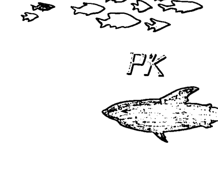

卡通 by 黎明团队

超级团队是超级个体的必然进化形态。团队是比天赋更高效率，也更高概率的成功方式。识别、加入和组建团队，是优秀的人、想成功的人必须具备的技能。


为什么说，你的团队角色定位比具体的职位更值得你关注？

今天是古典陪伴你成长的第 304 天，一起加速，成长为更好的自己。

# 关于团队的思考

提交留言可与专栏作者互动

# SCP法则：快速打动人心 的夸奖指南 44-2

44-2 SCP法则：快速打动...

+   1、夸奖的重要性：夸奖是一种领导力，也是最简单、最直接的投资方式。
2、夸奖的本质：一种用服务别人的方式来领导别人的强者行为。

我们讲过了人脉、个人品牌，这周我们讲团队，但是有一个技能是和所有的能力都相关联的，就是夸人。因为人类是用语言思考的：如果一个人不会说“好话”，也就不会做好人。我们时常说一个词“刚需”，其实每个人最核心的刚需，就是被认同。

夸奖是最简单、最直接的投资方式——夸人这个技能，你一定要好好学习一下。

但是很多人都有夸人的障碍：

+   1. 不会夸：真正一开口，你发现除了说真好、真棒，好像说不出什么道道来。
2. 一些人你经常夸不出口。
3. 虽然夸出去了，但是总是觉得怪怪的，好像哪里不对劲。

今天我就教你一个个人的套路，以及更重要的夸人心法。

# SCP：细节、比较、赋能于人

SCP（Specific Compare EmPower）
细节、比较、赋能于人

# 细节

夸奖的本质是被看见而且被认同。夸奖要从细节入手。只有你真的花时间观察别人，才会找到夸奖他最渴望被看见的部分。美丽的人，都希望你夸他有内涵。有一...今天他的孩子考上了耶鲁，全中国只录取了两位。大家居然起敬，集体敬酒。

这位夸奖者就是有这种细节能力的人。他能关注到不为他人所知的细节。

# 比较

人是很奇怪的动物，他们一方面希望自己与众不同，一方面又害怕自己太远离人群。我就很狼地被夸过一次。

你身边有很多有特色的人，你能否清楚地告诉他们的不同呢？

# 赋能于人

我们讲过归因，当人做得好的时候，归因于人，做得不好的时候，归因于事。这样会帮助人建立起来自我效能。所以批评对事，夸奖对人。

比如你们团队有个交周报特别的准时和细致，你可以夸他“周报交得好！”你也可以夸他说：“你真的是一个很靠谱的人。”

# 怎么用在工作场景里？

比如说你和市场部做一个项目，市场部出来一个同事做个汇报、这方案远远超出了你的预期，增加了很多业务细节和自己对于行业的思考，你想让他一下记住你，并且以后成为很好的合作伙伴，有效的夸奖是最好的手段。

很多人会说，
“我去，你太牛了！怎么做到的？”

但是你其实有更好的说法：
“我仔细读了这里面关于行业发展的那一段，尤其喜欢你独特的想法，我还转给了我的老大；你和一般的市场人不一样，我特别羡慕你这种既能实操又有战略眼光的人。以后多向你请教哈。”

# 夸奖的本质

夸奖的本质：其实人类在幼年的时候是最期待被父母亲所夸奖的，所以当我们夸奖别人的时候，我们的内心是强大的，而被夸奖的那个个人是相对弱小的，所以夸奖的本质其实是一种内心强大者对于别人的服务。

这个事情很有意思——你在服务于别人，而你又是强大的，这其实就是领导者在做的事情。所以从夸奖的本质上来说，就是一种用服务别人的方式来领导别人的强者行为。


我想这才是夸奖背后真正的心法，以及它对于我们人生的修炼。

夸人是一种强大的领导力。

# ——◆ 今日思考题 ◆——

你一定被真心的夸奖和欣赏打动过，你收到过最让你动心和印象深刻的夸奖是什么呢？

请把你的体验分享在留言区。

如果你身边有一群想夸人又不知道怎么夸的朋友，或者你想被朋友热烈地夸奖，不妨点击右下角“请朋友读”把这篇文章分享给他们。

## 夸人是强大领导力


夸奖的本质其实是一种内心强者对他人的服务。当你真心地给予别人赞美时，你不仅会慢慢成为一个善于观察别人优点的人，还能通过“服务别人”来“领导别人”。

今天我们谈到了团队该怎么夸人，明天我们谈谈看为什么团队里面一定的冲突和争吵是必要的，越吵却越好的智慧到底是什么？

学了很多就是没行动？你缺少自我效能 41-1
构建支持系统：三招提升你的自我效能 41-2
问答 | 怎么让一段关系越走越近？ 30-4

今天是古典陪伴你成长的第 306 天，一起加速，成长为更好的自己。

## 关于夸奖的思考

提交留言可与专栏作者互动

## 冲突：组织的高烧，破坏性的建设 44-3

44-3 冲突：组织的高烧，...

- 1、冲突的好处：恰当的冲突其实是一种沟通方式，可以帮助组织发现问题、激发活力。
2、面对冲突的四种模式：A、竞争；B、妥协；C、回避；D、合作

昨天，我们提到了如何去夸奖，今天怎么又说越吵越好的智慧，说两个完全不同的话题，搞什么啊？我引用一下《了不起的盖茨比》的作者斯科特的一句话：“检验一流智力的标准，就是看你能不能在头脑中同时存在两种相反的想法，还维持正常行事的能力。”

一个团队既需要夸人也需要吵吵，能把冲突处理好的人都是有高级智慧的人，我相信我们“超级个体”的学员都是有这种神奇能力的人。

### 冲突其实不是坏事

说到冲突，你会发现我们是一个关系导向的民族，很注意回避冲突。我们的文化里有大量的关于和睦的说法，比如说以和为贵，比如说退一步海阔天空，忍一时风平浪静。这种心智模式也影响到了我们的心理，这导致我们在很多对抗性的运动中都做得不那么好，比如说搏击、足球、橄榄球。但是在乒乓球、排球，这种隔着网的运动上，我们反而都做得很好；那些纯技巧类的体操、跳水运动简直是一流。

这种思路也可以延伸到团队管理上——我们原来倾向于认为，好的团队是一团和气的。冲突不是好事、影响团结、影响绩效，是管理者无能的体现。你看很多黑帮老大，小弟一出现打架的情况，不管谁在谁，首先呢先给每个人一个耳光，然后再喝酒摆平。

现代组织管理里对于冲突有完全不同的理解。冲突在任何组织形态下都是没法避免的，有些冲突会导致绩效降低，有些则会创造高绩效，而好的管理者总是会让好的冲突维持在恰当的水准。

冲突有很好好处——对于个人来说，恰当的冲突其实是一种沟通方式——所谓不打不相识嘛。对于组织来说，它能够凸显问题、激发活力。比如，市场部总是怪销售部转化率不高，而销售部总会觉得市场部的数据拿得不够好。这个冲突就凸显出来了，原因可能是两个部门对客户的理解是完全不同的。如果各自都争斗下去，可能公司就黄了。好的企业是冲突四起，但又都是理性讨论的。而坏的企业却是大家温温吞吞，一起死掉。只有执念于把事情做好的的人，才容易起冲突。

有时候外界的冲突，还会倒逼决策者重新思考和梳理——比如3Q大战，马云腾做出那个艰难的决定以后，腾讯的模仿、收购的一家独大模式变成生态模式。微信团队的出现也得益于这种转变的发生。冲突也在让组织变得更健康。

我们都知道，人身上有很多白细胞，当外界细菌侵入就会引发炎症，对我们来说就是发烧。发烧是好事还是坏事？当看是坏事，因为它会让你难受，但长远来看是健康的，因为杀灭了病菌，增强了抵抗力。冲突是组织患的一场高烧，只要控制在好的方向上，就是一种破坏性的建设。

### 什么是好的冲突呢？

下面我们来谈谈面对冲突的几种模式：竞争、妥协、回避和合作。

比如说两个人都要一个橘子，你伸手就抢过来，这叫——A竞争；
你觉得不好意思，直接就给人家了，这叫——B回避；
你说好吧那就一人一半，这叫——C妥协；
你们俩商量了一下，发现你是用橘子皮做陈皮苏打水，他是要橘子果肉。这叫——D合作。

你对于冲突，是选择哪种模式呢？很多人的模式是回避。唯一防斯微微信：699250

但是回避并不会让冲突变小，你心里还是窝火，有怨气。

### “回避冲突”的弊端

回避冲突，会导致冲突的内在升级——冲突本身：“这个事情不该这么做！”（冲突一开始只是针对某件事）
升级：“这个公司做事方式就不对！”（慢慢会转移到工作模式上）
再升级：“他就是个贼人！”（最后会直接指向人）这个时候不管你爆不爆发，关系都彻底破裂了。

我把这种模式称为“隐身人模式”，他们总是在冲突的时候突然隐身，既没有给对方一个了解自己需求、力量的机会，也给自己去失掉了一个争取的能力。这些人自视清高，其实是并没有与人冲突中越吵越好的智慧和勇气。所以他总是心怀怨恨地默默离开一个又一个团队和平台，并没有为自己争取过什么。

这种模式可能是非常潜意识的，又是习焉不察的。他伤害最大的不是别人，而是自己——别人根本都不知道你这里发生了什么。

很多老大好人领导平时从来不发火，唯唯诺诺，但一旦某天就会做出特别绝情的决定。反而有些管理者天天呜哇不断，小事上骂得很狠，但是不指向人，时间一长，大家也能理解这个模式，反而他非常真诚，自己成长很快。

婚姻也是一样，吵架是亲密关系很重要的一环，很多老夫老妻天天吵架，但是关系很好。最怕的是那种吵都懒得吵，直接有天平静地签完离婚协议书，散了。

人们之所以害怕冲突，本质上是不接受ABC，而又没有看到D选项的智慧——其实最好的方式是意识到冲突的建设性作用。心里有不爽，主动找个机会表达出来，说清楚双方利益，表达明白各自需求，然后共同寻找利益整合的D选项。

### 关于找到D选项的4个建议

- 1. 有了不爽，尽快及时沟通。排雷有一个方法是地面引爆炸弹，这样不至于脚踩上去爆炸。
2. 不要恶意猜测——大部分的猜测都是错误的。
3. 先想清楚双方利益，冲突一定是利益有了冲突，不要急于表述自己，思考双方利益后再说。
4. 坐下来理解利益、沟通需求，共同找到D选项。

## —— 今日总结 ——

正如《关键冲突》的作者所说——冲突不是竞争、不是妥协，而是整合双方利益。在冲突没有从任务冲突升级到关系冲突之前，提前引爆，走向更加积极的合作模式，是心智成熟的人必备的社交技能。小吵怡情，大吵伤身——对于你真正在意的事情，吵吵更健康。

# —— 今日思考题 ——

你心里不爽，但是又不好意思表达的一件事实是什么？你觉得该如何成熟地处理这个冲突？

## 冲突的4个模式


冲突是组织的一场高烧，能帮助组织发现问题、激发活力。所以，只要把冲突控制在好的方向上，恰当的冲突就是一种沟通方式，就是一种破坏性的建设。

加薪逻辑：如何跟领导谈加薪？40-4

## 为什么说，你的团队角色比具体职位更值得你关注？

今天是古典陪伴你成长的第 307 天，一起加速，成长为更好的自己。

## 关于冲突的思考

提交留言可与专栏作者互动

## 团队里的九大角色，你在演哪一个？ 44-4

44-4 团队里的九大角色，...

- 1、角色效应：越是处在不确定性的、多变的角色中，你就会变得越重要，甚至可以超越你的职能身份。
2、团队里的九大角色：智多星、审议员、协调者、执行者、完成者、外交家、鞭策者、凝聚者、专业人士。

不知道你身边有没有这样的同事：每天准点上下班，把每件事情都做得刚刚好，不多也不少，和同事关系不近也不远，很少去参加各种同事的聚会？

这样的员工，可能上班一两个月后，领导会找他谈话，“你好像还没有进入角色啊？” 这个人可能会感觉奇怪，说，“我知道公司有 KPI，有团队规章，那么什么是角色呢？”

其实，在现代团队里，每个人都有两个身份：一个是他的职能身份，第二个就是他的角色。在这个团队里，如果你只有职能没有角色，就好像在一个舞台上，你只是扮演一棵树，而不是扮演一个人，你的职业发展空间就会非常有限，也没有人会记得住你。

### 什么是团队角色？

剑桥大学的贝尔宾博士，把团队角色定义为：个体在群体内的行为、贡献，以及人际互动的倾向性。

下面这张图，可能将会帮助看得更清楚点。

如图，横坐标分为组织和个人的要求；纵坐标分成了清楚的和模糊的，组成了四个象限。


那些清楚表明的，其实是你的个人 KPI 和岗位权责书。这部分清楚表明了团队对你的要求，其实就是规章制度，比如不能迟到、不能早退。那些没有清楚表达的，但是其实组织也很看重的，可能是你的才干、气质、做事的风格，比如自我管理能力很强，严于律己等等。

那些没有清楚表达的，同时团队有需求的，就是你的团队角色。

每个团队里有两个特别开心的人，在其他人情绪低落时，他们总能讲个笑话，我们把这个角色叫“开心果”。其实开心果就是一个天然的角色定位，团队里有人心情不好时就会找到他们。

有些人在团队里就是智多星的角色，他总是能在关键时刻时候，跳出来给一些好点子，哪怕他并不在策划这个岗位上。

同样的道理，可能还有特别挑剔的人，他总是能够告诉你哪些地方做得不对，哪怕他的职位并不是质检，但这就是他在团队中的行为贡献以及在人际互动中的倾向性。

### 什么是角色效应？

那么什么时候职责更重要，什么时候角色更重要呢？唯一iphase更微信：699250

以踢足球为例，每支球队里都会有前锋、后卫等很多位置，但是在进攻的时候，队员们都会按照阵型压上，只要抢到点就可以射门，不一定非是前锋这个位置才可以射门。

所以，进攻的时候，球队里需要的是角色。每一支球队可能有传球的人，有控制中场的人，还有作为场内灵魂的队长，这都是角色而不是职责。

但是防守的时候，所有的球员就马上各就各位，回到自己规定的那个点上去，他的目标就是不允许任何人经过自己的区域，严防死守。这时候，团队更需要职能。

你发现了吗？在进攻的、不确定性的场景里，角色和默契变得非常重要；而在那些确定的，相对明晰的场景中，职能就变得很重要。所以，一个组织里最强调什么——打配合。只要你分清楚什么是进攻场景，什么是防守场景。比如，你是做财务的，可能大多数时候，你需要的是职能角色。

所以越是在不确定性的、多变的角色中，你就会变得越重要，甚至能超越你的职能身份。

这种情况，我们就称为“角色效应”。

心理学家发现：两个同卵的双胞胎女孩外貌相似，在同一个家庭、同一个教育环境里长大，但她们的性格却大不一样。姐姐性格开朗，对人主动热情；妹妹则遇事缺少主见，常常依赖于别人，不善交际。是什么造成了姐妹俩的性格差异呢？

主要原因就是她们的角色不同——虽然生下来就差那么一两分钟，但是父母亲对她们的态度不一样。他们会默认为先出生的那个就是姐姐，后出生的就是妹妹。姐姐要照顾妹妹，同时也要求妹妹听姐姐的话。在这样的期待下，姐姐就越来越独立了，成了保护妹妹的角色，妹妹则越来越弱势，成为了被保护的角色。

你可以看到，大人的期待对于个体的塑造是多么的重要。同样的道理，在职场上，你对自己的角色定位，也会影响别人对你的期待。

我读大学的时候，老觉得自己特别有社会气息，装成熟，现在自己长大了，回头一看，觉得很可笑。因为那个时候，别人一看就知道你是个学生，为什么呢？因为学生的角色，让你说话、行事都像是一个学生，这就是我们今天讲的角色效应。

在团队里，也有许多不同的角色等着你来演，前面提到贝尔宾博士把团队分成了九种角色。这可能是世界上最经典的角色理论，它分成了：

- 1. 智多星，给团队带来新想法的人
2. 审议员，他会不断地评估智多星的想法；
3. 协调者，挖掘发展团队成员的才能；
4. 执行者，完美地推进工作进程；
5. 完成者，一切都力求完美；
6. 外交家，总是能搞清楚团队内部的局面和外部需求；
7. 鞭策者，能够让团队充满了动力；
8. 凝聚者，可以创造良好的氛围，并且加强团队内部沟通；
9. 专业人士，致力于自己擅长的工作领域。

一个人可以演很多角色，而且每种角色也不一定只有一个来自扮演，在关键的时候甚至可以互相转换。

如果你感兴趣的话，我在文章的后面，附了一张很详细的图，解释了这几种角色。你也可以上网找找测试，和团队的小伙伴一起做这个测评，其实非常有趣。

### 中国式角色分类——德、智、能、劳

九种角色可能就有点难，我教你一种更加简单的，更适合中国人的分法——德、智、能、劳。

以《西游记》里的取经团队为例，你看唐僧，这个人只会阿弥陀佛善哉善哉，但他却有去西天取经的明确愿景，是一个德者，以德服人，不是以紧箍咒服人。

孙悟空是团队中本领最高强的，如果孙悟空在现代肯定是一个很强悍、很敬业的营销高手或者专业经理人，是一个能者。

猪八戒是那种典型的办公室主任类型，平时喜欢偷懒，爱拍马屁，老是指使沙僧干这干那，但是生死存亡之间会挺身立场，而且能出很多好点子，是一个智者。

至于沙悟净，这是团队中最没有企图心的人，时间到了就下班走人，对公司的愿景没什么兴趣，只想要份稳定的薪水。但假如没有这种人维持企业运转和行政事务，也会一团乱，所以，他是一个劳者。

表面上，牵马、挑担、降妖、除魔，好像换个人也能做，但这个角色是团队的内在缔结，这四个人缺一不可。

逻辑，这四个人缺一不可。

德者、智者、能者、劳者，你是团队中间的哪一个角色呢？如果你看明白了团队里面的各种角色，你又该演谁呢？

### 下面给你4条建议：

- 1. 如果看到一些空缺的角色，你可以考虑去补位。
2. 找到那些一人兼任多个角色的人，你可以考虑，自己能不能帮他分担一个角色。
3. 如果有些角色被太多人担任了，就不建议你去争这个角色，而应该去找其他竞争少的角色。
4. 你一定要根据自己的兴趣、性格来思考一下，现阶段你最适合演哪个角色，因为只有真正的本色出演才能演得最好。

莎士比亚说：“人生是个大舞台，男男女女都是演员。”其实不仅仅是人生，团队也是lvl样，所以人生如戏，全靠演技。你不一定要演主角，关键是要演适合自己的角色，希望你成为职场里面的大明星。

团队角色理论

# —— 今日思考题 ——

德、智、能、劳，你在职场中间是哪个角色？你又最想演哪个角色？

我们都知道，演什么角色是取决于别人怎么看，而不是你怎么看。那么你愿意为这个角色做些什么样的表演呢？

如果你身边的朋友找不到自己的“角色”，请记得把这篇文章分享给他。

价值链分析法，不盯职位盯行业 20-2


每个人在团队中都有两个身份：职位和角色。如果你只有职位没有角色，就像你在舞台上只是扮演一棵树，而不是扮演一个人，你的职业发展空间就会受限。


明天是我们超级个体独家的生涯顾问日，我会谈一谈，在职业转型的时候，普通人最重要的一刻到底是什么。明天见吧！

今天是古典陪伴你成长的第 308 天，一起加速，成长为更好的自己。

## 关于团队角色的思考

提交留言可与专栏作者互动

## 生涯顾问日 | 转型前最重要的一件事 44-5

44-5 生涯顾问日 | 转型前...

你好，今天是我们“生涯顾问日”的第九期，我们迎来了“职业转型”的话题。

在这个变化多端的时代，可能每个人这一辈子都会经历职业转型，有的会是在毕业三四年，有的可能是在30岁，有的可能是在40~45岁，但是职业转型需要思考什么问题，什么是最关键的一步，今天我们来谈谈这个话题。

毕业三年，一直在一线城市国有银行当柜员，工作稳定无挑战，身边多是在柜员位置上工作了十几年的同事。

最近开始接触转岗客户经理的准备工作，但是具体何时转岗遥遥无期。偶然发现：自己很喜欢和小孩子接触，特别愿意帮助他们成长，对早教行业有兴趣。

由于传统银行业开始走下坡路，我感到早教行业应该会有更多机会。所以，在即将进入职业生涯的第四个年头，我遇到了一个两难问题：是朝着客户经理岗位方向努力，还是应该及早离开，去做早教培训行业？

## 古典

这个话题我邀请了我的好朋友——张熙。她拥有四大会计师事务所10年的从业经验，后期转型到管理类课程的研发和讲授工作，2015年，成为美国人力资源管理咨询公司DDI最年轻的领导力咨询顾问。现在是清华经管学院讲师、人人校招专家，也是新精英企业事业部的顶级商业咨询师。她翻译的《职业禅》，正在出版中。我请张熙来回答“乙醇”提出的问题，一方面是因为她有很好的金融背景，另外一方面是因为她也经历了几次华丽的职业转型。


乙醇，你好，我先来总结一下你现在的处理境：是在银行内部晋升做客户经理（期限不明，不由自己控制）？还是去早教行业重新开始？一个是国有银行，安全、稳定、有保障；一个是早教行业，新鲜、有趣、有发展。两个选项各有利弊。

## 如何判断职业是不是真爱？

判断一个职业是否是真爱，需要精心挑选，筛三层。

### 第一层：是否真感兴趣？

在做这件事情的时候，是否全情投入，不觉时间飞逝，情绪很high——未必表现得特别好，但就是乐在其中。想想平时逛街上淘宝的体验。

### 第二层：能力可以hold住吗？

你喜欢这个职业，这个职业喜欢你么？做客户经理，能持续成单吗？做早教老师，能带着小朋友们安全地玩耍嬉戏，同时搞定各种熊孩子和奇葩家长吗？职业只为你的能力买单，不关心你的兴趣如何。这是第二层很重要的筛选。

### 第三层：你在职业中更看重什么？

你想要有稳定的收入？还是想要持续的发展？精彩？多样性？成就感？新鲜刺激？很多时候，你想要的不可能全部在一份工作中实现：大多安全稳定的工作给不了你新鲜刺激；大多有趣好玩的职业，也没有旱涝保收。就像靠谱的男人大多无趣、没惊喜；天天给你浪漫的男人，可能也会这样对别的女生一样。（古典：这点我不同意。）

## 转型后能提高职业交换率吗？

上面更多的是从个人的视角来看这个问题，另外一个视角，也很有趣，就是职业转型有没有提高职业交换的效率？

职业的本质就是人和社会的交换关系。选择什么职业，等于选择了用什么方式和世界交换。比如，快递员、小时工靠“体力”；大多数打工者靠“体力+智力”；网红靠“资源

源、平台”；各领域的大神、科学家、艺术家靠“天赋”。

这个时代的个人发展需要思考一下你用什么东西跟别人交换：体力——智力——资源——平台——天赋，一个比一个有效率，你在用哪种方式和别人交换呢？

好的转型或者发展，应该是一种交换效率的升级——柜员做客户经理，是从体力发展到智力+资源；柜员转型到早教行业，早期看，似乎仅仅是从体力到体力。

所以思考一个转型，你不妨从两个角度来看：从个人角度，思考是不是感兴趣？有兴趣的东西能不能做？做好了能不能体现你的核心价值？从职业发展的角度看，你可以思考一下它有没有提高你和社会交换的效率？

回到你的问题上，用职业规划的系统，给你科学地算上一“卦”：

## 选项1 在银行内部晋升：先考虑清楚，留下的成本和收益

应聘面试中给领导留下了好印象，说明能力OK。可是，晋升不完全取决于能力。由于体系内的特点，还要等系统反应。你现在身边有从业十几年的柜员，说明了这个选择的最大风险就是系统反应很慢。

所以，这里需要问问自己：

- - 究竟喜不喜欢国有银行的安全、稳定、有保障？
- 是否喜欢晋升后的销售性质的工作？
- 自己过去是否有影响、说服、销售的成功经验？
- 是否非常享受这个过程，即便努力与工作回报不一定成正比？
- 是否能承受业绩高压、忍受客户的拒绝？

如果都OK，不妨再侧面打听一下：

- - 前辈们用了多久等待升职？
- 时间是否符合预期？
- 有没有快速升职的途径和资源？
- 如果没有，最多可以等多久？1年？2年？3年？

你提到身边都是做了十几年的柜员，也就意味着这个选项的最大风险就是等待时间。如果你特别看重安全稳定，那就现有岗位上做足准备，让自己提前具备客户经理的能力，然后再跟公司谈一个你认为合理的等待期限。在此期间，持续积累自己的职业能力，同时留意市场上的相关职位信息。万一过了等待期还没消息，可以直接跳。好处是选择权仍在自己手里，即便在等待，也是胸有成竹。

## 选项2 去早教行业从头开始：考虑是否有交换能力

你要问自己：

## 为什么会感兴趣？

天然就喜欢和小朋友（包括熊孩子们）打交道（照顾、看护）？还是仅仅享受他们听你话的那个过程（影响、说服）？这是有本质区别的。

## 如果进入早教行业，做什么？兴趣能当饭吃吗？

你说了不算，能力说了算。我建议你多跟这个行业接触几次，去不同的场合带熊孩子们玩耍嬉戏，观察自己内心的真实感受。

问问自己如果孩子们都不听话，你还愿意从事这份工作吗？如果仍旧愿意，那就先考证，免费兼职，培养能力，再找机会。

总之，对于老本行多储备能力总没错，对于新要转型的方向，多参与体验和尝试，是最重要的。最核心的是，你还是需要思考自己到底想要什么。由这个案例延伸开来，回归本质，说一说为什么想要转型？很多人在职业发展道路上不断尝试新的可能性，但始终没弄明白这个根本问题：你为什么要转型呢？

## 你为什么要转型？

大部分的回答是这样的：

答：想要有更好的发展。

问：发展什么？

答：……

答：在一个行业里做久了，也遇到天花板了，想看看别的领域有没有新的机会。

问：你想看什么机会？

答：不知道，只要自己感兴趣，有发展就行。

答：实在是太讨厌现在这份工作了，没前（钱）途，又晋升无望，做了这么多年，一点技术含量都没有，以后哪来竞争力？

问：你觉得什么才是有竞争力？

答：……

答：年纪大了，拼体力也拼不动了，想换一

个活法，却又不知道自己能干什么。

问：不想拼体力，你想拼什么？你有什么？

答：不清楚，好像除了体力就没有什么是了，所以才苦恼。

以上这些典型的转型对话，有没有你的影子？很多人带着疑问走进咨询室或者培训教室，期待拿到一个确定的答案，希望最好明确地告诉他，当下这个时机选择哪条路最适合，且几年以后一定会做成什么样子；如果选另外一条路，又会是什么风景……

——这哪里是职业规划，这叫仙人指路，算命的路数！所以我特别佩服，一个对自己有什么、想要什么都不了解的人，却期待另一个陌生人指点自己的人生，往好了说是投机，往坏了说，就是赌博。

很多人的“转型”其实是补课，补一门叫“自我探索”的功课。这门课，从我们小的时候就落下了，直到几十岁了，还不知道自己的兴趣、能力、秉性。出来混，迟早是要还的。早一些自我探索，可以增加你对自己的了解，提高你与世界互动的胜算。

## 古典

说实话，我从来没有想到过一位女性咨询师这么犀利，但是我觉得张熙老师讲得非常正确。我们大部分人都是隐隐约约觉得不舒服，但是从来很少去思考哪儿不舒服，所以，这并不是叫做转型，这只是叫做逃离过去的生活。《爱丽丝梦游仙境》里有这样一段对话：

“你能告诉我，我从这儿该走哪条路吗？”爱丽丝说。

“那多半儿要看你想去哪里。”猫说。

“我不在乎去哪儿。”爱丽丝说。

“那么你走哪条路都没关系。”猫说。

所以，在职业转型的每个路口，不要着急转型，而要先思考一下，你要去哪里。

# ——◆ 今日思考题 ◆——

你一直心心念念想做的职业是什么？学完今天的文章，能判断出来是不是真爱吗？

用2个指标，追踪适合自己的人生 12-3
三种路径，设计属于你的多元人生 12-2
尝试斜杠，打开可能性人生 12-1

10年国际四大会计师事务所、外资管理咨询经历。在安永担任培训经理期间，负责某业务线亚太区人才发展与培训，负责通用管理类课程的研发和讲授、核心骨干专业力提升等项目，对组织内的人才培养和职业发展有丰富的经验。

2015年，美国人力资源管理咨询公司DDI最年轻的领导力咨询顾问。

2016年，加盟新精英，成为顶级商业咨询师。

清华经管学院讲师、人人校招专家。翻译《职业禅》（待出版）。

我们探讨这个时代最先进的个人成长方法论，只是为了让你成为“你自己”。

点击下方图片可购买《超级个体》专栏的限量礼品卡，跟更多朋友一起每天进步一点点，成长为自己的样子。

## 超级个体
限量版礼品卡


今天是古典陪伴你成长的第309天，一起加速，成长为更好的自己。

## 关于转型的思考

## 阿哲

我觉得我更坚定我要去做的事情就是创业，就算是再苦，我也可以坚持下来。但是我不盲目走出这一 步，我要不断地打磨自己的各项能力，最近在练表达能力，每当觉得累了，我就对自己说，你连这么点苦都吃不了，还是乖乖上班吧，每当这样想，我就会更加轻松地看待现在的事情。找到自己要去的地方很重要，累了的时候，抬头看一看，让阳光照进内心。

08-25 06:35:43

## Miss Kevin

一睁开眼就听到了今天的推送。我和乙醇有类似的地方。

毕业两年，折腾了一大圈（国企、外派外企、日企都呆过了，索性出国拿打工度假签证大半年）后，现刚入职通讯行业任职副总裁助理（因为英语优势吧，还是被专八试和面试表现镇住了）身边多是在岗位上工作了十几年的同事，也有说我们公司是适合养老的公司，特别适合女职工。不过忙的人也很忙，像总经理一直做汇报整合ppt，坐我对面一天也说不上几句话。老板又特别忙，一个月只会在办公室一周，别的时间到处飞。

然而我觉得英语并不算我的长处，因为英语出类拔萃的感觉太多了，非母语也不是英语好到令人发指的地步，所以觉得自己可以说根本没有特长啊。而且我入职的第一天也是公司转型后的第一天。我对通讯行业一无所知，公司内部也没有对小白的培训，而且我现在行政岗位又是外包性质，没什么安全感。

## 宁向东：最聪明的人，不一定是最有权力的人 44-6


古典

本周我们讲了“团队”，隔壁专栏《宁向东的清华管理学课》恰好也在讲“团队管理”。所以，今天我为你请来了这个专栏的主理人——宁向东。

宁老师是清华大学经济管理学院教授，博士生导师。兼任濠荣动力，南方航空，中国石化销售公司等企业独立董事，为三星、华为等国内外企业提供顾问服务，担任中组部、国资委等部门培训项目的责任教授。

宁老师认为 管理学不是管公司的学问，而是管资源的学问，让它外在的人、事、物，尽在你的掌控之中。

今天，我从留言区中筛选了一些问题，代替学员们向宁老师来提问，非常感谢宁老师的诚恳回答，其中提到了一个很有意思的团队管理模式，还有几条非常实用的管理方法，推荐你认真读一读。

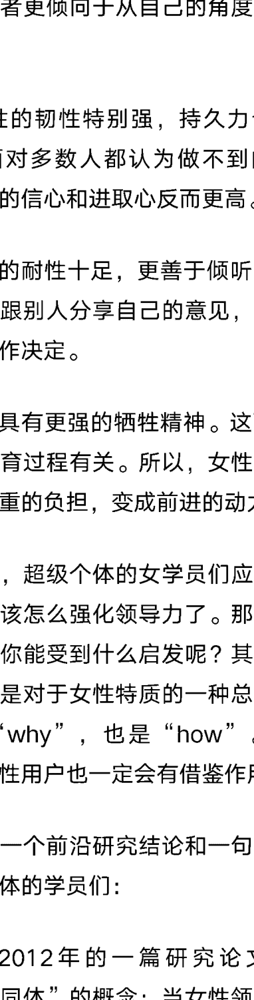

在个体崛起的时代，团队对个人的影响会减弱吗？

个体崛起的时代，个人变得不再那么依赖组织了，超级个体在着社会里可控的资源越来越多，独立性越来越强，甚至还依靠自己获得了非常可观的成果。

就像古典老师前两天说的，虽然个体崛起的时代已经到来，但超级团队却是超级个体的必然进化形态。我认为，团队是一个人不可能完全脱离的成长环境。

### 协同效应

团队对个人的价值首先在于，它的协同效应：

协同效应是什么？如果两个独立的个体，一加一等于二，就是没有协同效应。一加一大于二，就有协同效应。古典老师在前几天也举了梦之队的例子，我非常认同，因为球星的个体水平都是2，所以怎么打，都是2+2=4。万一演砸了，就是2+2=3。如果梦之队要像NBA俱乐部那样练习和准备，2+2=5，才是真正的厉害，因为它有了协同效应，真正成为了团队。

千万别小看团队的协同效应。两个明星，水平都是2，但是互相不买账，可能2+2=3，协同效应是负数。而如果一个2分明星配上一个0.9分的小弟，但是小弟全力与明星协作，就可能出现2+0.9=3.5的效果。唯一防不住断更微信：699250

### 交互记忆

团队对个人的第二个价值在于，为你提供了“交互记忆”：

交互记忆是什么呢？你肯定有这样的经验，团队中的其他人有时候说的一件事，和当下的工作其实没什么关系，你也没认真听，但是，却在你的心目中留下了记忆。突然有一天，你觉得这件事有用，就会去找那个人，问他有关的细节。有时候，他都不记得了，团队还要帮助他回忆。这就是典型的交互记忆，或者说团队记忆。

接下来的结论很重要，学者们已经形成了一个共识：好的团队所记住的东西，一定比单个成员所知道的东西多，越是频繁地进行面对面、直接对话的团队，交互记忆的能力越强。在需要这些信息的时候，团队成员会通过相互之间的询问将有关的信息提取出来，用于决策和判断。


### 三个长期存在的优势

首先，团队是个学习的场所。一个个人最快速的成长方式，就是融入一个群体，跟高水平的人交流、探讨、借鉴，取长补短。

其次，团队是个合作的场所。一个人的沟通能力、配合能力、领导能力，都是在团队协作和实践中锻炼出来的。“得到”员工最大的特点就是协作能力强，他们能快速地调取资源，达成自己的目标。

最后，团队是个获取资源的场所。团队除了能增强个人的协作能力，它也是一个互联的平台。个体可以在这个平台上链接到更多的人脉和资源，甚至可以形成合作联盟。

以我自己为例，我在清华教书，我身边的团队就是我的学生和我的同事们，我一直在积极地去跟学生互动，融入他们当中，因为我要向年轻人群体学习，不断为自己注入新鲜的能量；同时也坚持跟同事或同行们积极交流和探讨，保证我跟同行之间的思想链接。其实，这本身也是清华的学风，这种学风培养了我的团队意识。

中国社会在未来的一个变化，是职场中会出现越来越多的女性，尤其是管理层，那么，女性管理者应该如何管理团队？

说到女性在管理团队方面的独特优势，我也是近几年才开始关注的。比如德国总理默克尔、杜邦的CEO库曼、鸿海集团的第二号人物黄秋莲……这些女性领导者都表现出比男性更强的管理能力。

举个例子：

默克尔是世界历史上任期最长的女性政府总理。第一次当选总理的时候，她只领先对手一个百分点，执政到了第三个任期，她打破了“任期越长、选票越低”的魔咒，领先对手高达16%的选票，让选举毫无悬念。默克尔凭什么呢？

我们都觉得默克尔是一个铁娘子，但是默克尔虽然贵为总理，却住得很随意，自己逛超市、下厨做饭。一个寻常的家庭主妇该做的事情，她一样都不少。在政坛上，她格外关注大家的意见，让时间帮助她作出最正确的选择。她总能以特有的沉稳应对各种压力和问题，尽量不去简单地作决定。

所以，女性领导者在管理团队时，需要运用自身天然的优势去创造影响力和感召力。


那么，女性特质中有哪些特质最重要呢？美国曾有两家管理顾问公司携手发起过一个研究，我给你概括一下这个研究成果，供你参考：

- 1、女性比较注意跟大家沟通，能够掌握全面的信息，更好地对信息进行整合，而男性领导者更倾向于从自己的角度出想问题。
- 2、女性的韧性特别强，持久力也比较好，当面对多数人都认为做不到的事情时，她们的信心和进取心反而更高。
- 3、女性的耐性十足，更善于倾听，她们也更愿意跟别人分享自己的意见，会更加全面地去作决定。
- 4、女性具有更强的牺牲精神。这可能跟女人的生活过程有关。所以，女性更容易把那些沉重的负担，变成前进的动力。

听到这里，超级个体的女学员们应该已经知道自己该怎么强化领导力了。那么，对于男性，你能受到什么启发呢？其实，上面几点，是对于女性特质的一种总结，讲的既是“why”，也是“how”。我相信，对男性用户也一定会有借鉴作用。

最后我把一个前沿研究结论和一句名言送给超级个体的学员们：

结论：2012年的一篇研究论文提出了“雌雄同体”的概念：当女性领导者在领导行为上表现出双性化特征（英文为 androgyny）时，下属无论是男性，还是女性，都会对领导者行为的有效性表现出较高的评价。而这里所说的双性化特征较高的评价。而这里所说的双性化特征指：在处理同事关系这件事上拥有了较强的母性特征，但是，在决策行为上却表现出比男性还要强烈的原则感和坚定感。

名言：管理学鼻祖德鲁克的一句名言：时代的转变，正好符合了女性的特质。

公司从小变大，或者从传统企业过渡到互联网企业，都会面临组织架构的重大变化，那么，未来的组织形态是什么样的？团队应该怎么适应变化呢？有什么好的建议？

我喜欢把未来的组织描述成一个海葵，而团队就是海葵的一个个触手。为什么这么说？因为我坚信未来企业所能提供的东西就是针对客户的差异化解决方案，而像海葵触手一样的团队是最能在复杂竞争环境中提供差异化解决方案的。

所以，在一定意义上说，未来的企业就是团队的联合体。在这个联合体的核心，是团队的领导者。

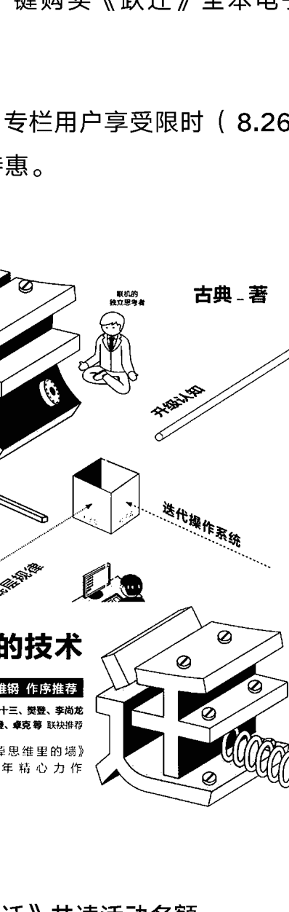

## 如何应对这样的组织形态

如果你是团队的领导，我想给你两条建议：

## 第一，学会识别、训练和使用骨干。

因为组织往往会遇到一些复杂问题，需要一种综合性的思维能力和解决问题能力，骨干就是要帮助领导者发挥这个作用。骨干有能力把复杂问题拆解，之后交给辅助人员去做，对于关键性的复杂问题，自己亲自动手解决。骨干是团队的干，骨干的腰力发挥不出来，组织是没有战斗力的。也就是说，一个领导者在规划人员组织的时候，首先需要考虑的是你的打法，然后是安排骨干。

## 第二，善于为骨干搭配辅助人员。

## 如何管理好团队

搭配好了团队骨干和辅助人员，那么如何管理好团队呢？

## 如何建立团队领导力

## 《跃迁》福利联袂放送

## 福利一：《跃迁》电子书9折特惠


## 福利二：《跃迁》共读活动名额

## 联机共读《跃迁》

15天，5大导师解读，百人小组

用问题学习、用联机思考、用整合输出
撬动你的跨越式成长

古典
橙子学院创始人，《跃迁》作者

李海峰
DISC双证班联合创始人

李忠秋
杏壳商学院创始人

Scalers
Scalers Talk成长会创始人

秋叶
幻方秋叶PPT、知识IP大本营创始人

超级个体专属通道
扫码免费参与

## 关于团队管理的思考

## 彩蛋 | 热文: 《战狼2》成功背后的“潜规则”是什么？

古典

今天是周日。如果有时间，推荐你看看近期的一部热门电影——《战狼2》。

前几天，我针对这部电影成功的背后逻辑，写了一篇文章，承蒙大家的厚爱，反响还不错，今天作为周末彩蛋，分享给你。

希望能带给你一些启发。

《战狼2》作为建军90周年献礼片，用了不到一个月迎来里程碑式的重大突破：全国票房破50亿。

吴京彻底火了。

网络上开始流传一系列《战狼2》拍摄背后的故事，关于吴京这些年努力、拼搏的爆文。但是，如此巨大的成功，绝不仅仅是因为这部电影拍得多好，或是吴京有多努力。《战狼2》成功的背后，一定有我们尚未了解到底层逻辑和规律。

这个逻辑到底是什么？对于个人成长来说，有哪些借鉴可能？今天我会讲讲这个时代，成功背后的那些潜规则、暗力量。

## 跃迁

从进步到进化


前段时间，网上流传一张王健林的作息时间表。说王健林每天早上四点钟起床，健身，24小时飞两个国家，但是城市，六千多公里，晚上七点十分再回到办公室。


很多人就误解了，惊叹：我的天啊，富人比我们还要努力，我是不是没希望了？错了，其实这个问题关键，根本不在于努力。快递小哥的工作也很感人，他们每天奔波于50个楼盘，与人进行高难度沟通，经常还要被骂，每天晚上干到八九点钟才能收工。快递小哥不努力吗？他们的努力程度一点不比王健林低。但是为什么快递员的收益却比王健林低很多呢？

你想过吗？为什么人们的努力和收益，往往是不成正比的？


当你去研究这些高净值人群的成功路径时，你会发现，他们当中很少人的成功路径是线性的。大部分成功人士的发展路径中都会有一到两个、甚至三个“非连续性的突然增长”，术语叫做“跃迁”。你会发现，每隔一段时间，他们就突然上了一个层次，观点、眼界、格局，都不一样了。

于是我开始研究，这些人到底做对了什么，才可以让自己跃迁？

## 第一次跃迁：用二八法则高效成长

今天你看到的知识付费大潮中的一众名师：李笑来、艾力、李尚龙……走得更远的教育家俞敏洪，天使投资人徐小平、李丰，学者王强……他们都来自一家叫做“新东方”的培训机构。新东方为什么会在上一个10年突然涌现出来那么多名师？这恰好是我在2006年研究的课题。

那一年我在新东方国外部讲GRE词汇，刚被选为第一届新东方集团培训师。俞敏洪希望我研究下“优秀教师的能力素质模型”，并最终把成果整理成“教师之轮”体系，帮助更多老师成长。

“教师之轮”包括五项核心能力：专业知识、课程设计能力、呈现能力、个人魅力、积极心态。在此期间，我发现了一个有趣的现象：同样的训练课程中，有一群人的成长速度远远超过了其他人——他们不是因为比其他人更加聪明或者努力，而是采取了更加聪明的学习路径。


第一种教师的学习路径，是把百分之百的能力，全部投入学习专业知识，然后再进入下一个领域。而另外一些老师，他意识到在一个领域里面，20%的知识就可以囊括80%的内容。所以他会花一点时间迅速地学习这个领域最精华的20%，然后再去学课程设置的20%，然后再去学演讲的20%，再去学魅力的20%，再去学心态的20%。同样的1时间，他获得了五个80%，所以是400%。仅仅是因为学习路径的不同，老师们在三个月就已经拉开了四倍的距离。

可能有人会说，这没什么了不起的，那些一百分的老师，你只需要给他更长的时间，他也可以迎头赶上。我们基础打得好，后发制人可以吗？

不可以，因为接下来就有第二轮的跃迁发生。

## 第二次跃迁：利用系统放大名气

在新东方系统里面，如果你一定要选一个老师排课，你会选什么？一定是先选400分的。400分的老师训练得比较多，课就讲得好一点；课讲得更好，就能带更多的学生；学生越多，优秀学生就越多，名气就越多；名气越大，就排得更多；排得多，钱就更多。于是四百分的老师莫名其妙形成一个正循环，等到一个暑假下来，四百分的老师就变成四千分的老师，远远的把一百分的老师落下来了。


这其实是一个很简单的法则，叫幂律法则。20%的国家，占据了80%的财富。不仅仅财富这么分配，你可能想象不到，微博的粉丝数量是这么分配的，英语的词频是这么分配的，你姨妈如何上的导购平台，也是这么分配的。

比如说，全世界最高的人是2.55米，最矮的人是0.51米，所以最高和最低的人之间，仅仅差了五倍。但是美国的GDP几乎是最低的那个国家的46万倍。这就是幂律法则的恐怖之处。


在任何一个系统中，只要你能找到头部，就能够上升。就好像我住在北京五道口那边住，我们叫宇宙中心。宇宙的中心房子并不比北六环房子好多少，但是价格差距巨大。这是thought因为它进入了更高的价值链条。这是系统带给它的第二次跃迁。

## 第三次跃迁：与最优秀大脑互联

第三步的跃迁是如何与领域内的高手连接。注意，当高手头部们进行连接，他们的升级就变成圈层。因为当高手开始互联，别人就彻底进不去了。

选择连接更多的头部，连接资本的头部，连接管理的头部，连接其他各领域的头部。当你成为头部，资源就会莫名其妙找到你。只不过这一晚，你不是要快速学习更多东西，你要做的事情是连接更多头部。比如说马永浩，他连接了技术、连接了资本、连接了手机，进而做了“种子手机”，每个人都有自己不同的连接方式。


### 总结一下：

第一次的二八原则，找到知识中最关键的20%，这会让你的效率高四倍；

第二次的二八原则，找到赛道中最核心的20%，这20%的20%会让你的系统带你跃迁。

第三次的二八原则，你要找到头部中最精华的头部，并与他们产生互联，形成利益联盟，达到圈层。这个时候你努力的效能就会从原来的1：1，放大约到1：60，1：600，1：6000。

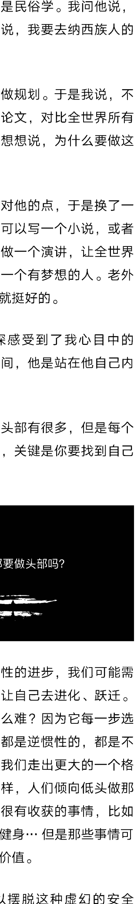

所以，我们回答最初的问题，为什么付出和收益不成正比？就是因为别人不仅仅在付出，而是在聪明的付出。在正确的节点上付出，努力才能质变，而这一位次的质变叠加起来，让个人努力的效能放大了百倍、千倍。这就是我所说的“跃迁”。

## 《战狼2》火了，仅仅是因为吴京电影拍得好吗？

吴京老师这段时间很火，我们来分析一下。一开始吴京的定位是李连杰接班人。他带着这个名号混了很多久，拍了《太极宗师》，都觉得没有出口。于是有人跟他说，你有可能做甄子丹的接班人，于是他出演了《杀破狼》。后来，他用了五年时间，慢慢积累。终于在这两三年，和我们国运链接到一起，形成了特别好的系统头部。

你不难发现，《战狼2》前二十亿的票房，是因为这部片子本身的卓越。而后面这三十亿，一定是因为他站到了电影票房的头部，甚至在某种程度上，站到了中国电影的头部。所以整个头部系统、国家力量，一起撬动，成就了《战狼2》。五十亿票房绝不是因为吴京的电影拍得好到这个程度。

下一步，可能吴京需要思考的问题是，《战狼3》在拥有这么大资源的前提下，如何更好地连接更多领域的头部，怎么在这些连接中间找到一个更大的头部。


万物皆有头部，个人亦如此。

你想过没有，即使你通过一件事情，获得了巨大的社会成就，但是这些外在的成就，不能兑现成你内心的宁静和幸福感，是不是相当心里假币？

所以，其实每个人最终都需要找到一个外界成功和内在成功之间的平衡点，那个点，才是你的头部。在这个点上，你的天赋可以发挥到最大，你的价值观最契合，在这个点上，你找到一种内外的平衡。

我曾经遇到一个老外，这哥们本科读的是社会学，硕士读的是民俗学。我问他说，你来这儿干嘛？他说，我要去纳西族人的家里面住七天。

我特别喜欢给别人做规划。于是我说，不错，你可以写一篇论文，对比全世界所有的民俗。这哥们儿想说，为什么要做这个？

我觉得可能没有找到他的点，于是换了一个角度。我说，你可以写一个小说，或者你去了以后，可以做一个演讲，让全世界都知道，你是这样一个有梦想的人。老外说，不用，我现在就挺好的。

那一瞬间，我深深感受到了我心目中的俗。我觉得那一瞬间，他是站在他自己内心的人。

所以，这个世界的头部有很多，但是每个人都有自己的头部，关键是你找到自己的头部。


努力仅仅能够带来线性的进步，我们可能需要一些新的思路，让自己去进化、跃迁。但是为什么跃迁这么难？因为它每一步选择都是逆人性的，都是逆惯性的，都是不舒服的，都被迫让我们走出更宽大的一...局。也正是因为这样，人们倾向于低做那些自己熟悉又好像很有收获的事情，比如说学英语、读书、健身…但是那些事情可能并不能放大你的价值。

如果有一天你可以摆脱这种虚幻的安全感，真正看到什么东西是最重要的，请你盯紧那个对你最重要的选择，总有一天你会发现，你在不断地跃迁，你在慢慢做最好的自己。


## 《跃迁》福利联袂放送

## 福利一：《跃迁》电子书9折特惠

点击下图，一键购买《跃迁》全本电子书。

《超级个体》专栏用户享受限时（8.26-...）9折特惠。


## 福利二：《跃迁》共读活动名额

发一个来自「橙子学院」共读《跃迁》福利！橙子学院特别邀请超级个体的同学们免费参与 最新9月共读跃迁的活动【名额有限，先到先得】。

橙子学院是我创办的职场大学，致力于提升职场通用技能。橙子君邀请了我的4位好朋友，也是超级个体的成长导师——李海峰，李志秋，Scalers，秋叶，我们5个人一起来为你解读，通过每日一问，与更多的伙伴一起思考，联机学习《跃迁》。


今天是古典陪你成长的第311天，一起加速，成长为更好的自己。


# 领导力：你至少拥有6种权力 45-1

45-1 领导力：你至少拥有...

+   1、权力的六种来源：法定权、强制权、赏罚权、专家权、信息权、人格魅力（参照权）。
2、具有领导力的表现：要有远见，要有影响力，要有人格魅力，还要有着以身作则、明辨是非的能力。

## 什么是领导力？

这周，我们将进入“领导力”的主题。可能有人会有这样的疑问：我不是领导，也不准备当领导，是不是就没必要学习领导力？这个问题根源是，你混淆了三个词：领导、领导者和领导力。

想到“领导”，你会想到什么？很多人脑海里都会泛起一个中年男子的形象：留个大背头，左手拿个保温杯，身穿白衬衣……所以我们提到“领导”时，想到的其实不是领导者，而是当权者。

那么什么是领导者？历史上就出现过很多伟大的领导者，像特蕾莎、孔子、甘地，他们可能没有担任过重要职务，却拥有数亿万的追随者，他们身上散发出来的能力，就是领导力。

## 为什么人人都要领导力？

我们每个人，都生活在无数的关系和网络中间。在一段关系里，你不是去领导别人，就是别人领导你。如果一个人没有领导力，就容易处于被动状态。所以领导力是每个人都必修的能力。

## 法定权和强制权

这两项很好理解，就是在组织中通过职位拥有的权力：他有权力决定雇佣谁，有权力控制别人的薪酬，这两种权力，的确只有管理者才能拥有。

## 赏罚权

## 专家权

## 信息权

## 个人魅力

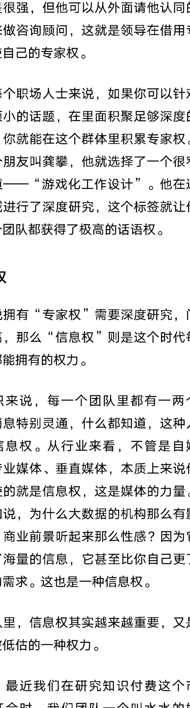

于是做了一个策划。我说：“俞老师，我们能不能做一个对话，我来采访你，主推您就好了。”

没想到俞老师很快就回我微信了说，“没问题，你把时间定好，我去帮你站台。”

我说，“千万不要，还是要以您为主。”

因为从商业角度来说，俞老师比我高出很多级别，肯定是要以他为先；从个人角度来说，俞老师是我的老师以及我的前老板，我也一定要以他为先。

所以我赶紧给他发信息说：“不用，还是你排在前面。”俞老师几乎是马上就给我回信，他说：“真的不用，我的发布会已经做过了。另外，你们属于新一代，理应推广。”

那一瞬间，我真的是感觉到了一种特别高级的领导力。

虽然这时候俞老师不是我的上司，对我没有强制权、奖赏权，甚至他在图书推广方面也不是专家，也一定有信息权，但他愿意花时间去成就后辈的举动，却是一种了不起的个人魅力。

个人魅力，虽然是所有权力中看上去最抽象的，但却是最有力量的。每个生活中，都有机会去修炼这么一种成就他人的能力。

## —— 今日总结 ——

今天我们讲到了领导和领导力的区别，不是每个人都要当领导，但领导力却是每个人必须修炼的。

我们聊到了权力的六种来源：法定权、强制权、奖赏权、专家权、信息权和个人魅力，每个人生活中，都可以尝试运用自己的奖赏权、专家权、信息权等去影响更多人。

# —— 今日思考题 ——

前面我们提到过，这个时代你不是被领导，就是去领导别人，你有没有曾经被领导或者被领导过别人，选择一件让你感动或者印象最深刻的一件事，在留言区分享给我们吧。

如果你想影响和改变生命中更多的人，把今天的内容分享出去，就是一个获得专家权的好机会。

这也许是世界上最简单的自我管理工具 9-1
职业发展是所有成长的变现通道 25-2
SCP法则：快速打动人心的夸奖指南 44-2

## 你至少有6种领导力


现代社会里，你不是去领导别人，就是被别人领导。你可以通过修炼自己的六种领导力，去争取更多的资源，建立自己在群体里的影响力。

明天我们会探讨不同的阶段，该用什么不同的姿态去领导他人。

## 《跃迁》福利联袂放送

## 福利一：《跃迁》电子书9折特惠

点击下图，一键购买《跃迁》全本电子书。

《超级个体》专栏用户享受限时（8.26-9.01）9折特惠。


## 福利二：《跃迁》共读活动名额

发一个来自「橙子学院」共读《跃迁》福利！橙子学院特别邀请超级个体的同学们免费参与最新9月共读跃迁的活动【名额有限，先到先得】。

橙子学院是我创办的职场大学，致力于提升职场通用技能。橙子君邀请了我的4位好朋友，也是超级个体的成长导师——李海峰，李忠秋，Scalers，秋叶，我们5个人一起来为你解读，通过每日一问，与更多的伙伴一起思考，联机学习《跃迁》。


今天是古典陪伴你成长的第312天，一起加速，成长为更好的自己。

关于领导力的思考

提交留言可与专栏作者互动

## 情境领导力：四步进阶，独当一面 45-2

45-2 情境领导力：四步进...

+   1、情境领导力：根据自己、他人和工作任务的不同情境，选择合适的领导方式的能力。
2、情境领导力的四种领导方式：指导（Directing）；教练（Coaching）；支持（Supporting）；授权（Delegating）。

每个人都希望自己尽快成为某一领域的 forthcoming 高手，独当一面，但从新手到高手往往并不是一蹴而就的，有很多不同的发展阶段，每个阶段都有自己独特的目标以及障碍。今天我们来谈谈个人成长的四个阶段，以及一个领导者该如何帮助员工越过这些阶段。无论你想成为一名高手，还是成为一名非常好的领导者，都应该学一学。

从新手到高手一共有四个阶段：

## 1. 热心的[人]

你经常会看到办公室里有一个新实习生坐在那里，看着忙碌的人群，不知道自己该干什么。一段时间后，部分积极的人开始主动找活干，但大部分人都是等待被分配任务，被批评“眼里没活”。

## 2. 学技术的人

已经知道自己该干什么，但技术还不成熟，需要不断地被纠正。

## 3. 需要被支持的思考者

熟练掌握了基本技术，但也产生疑问——“为什么事情要这么做？这么做背后的逻辑是什么？我的工作和其他同事协作起来会不会有更好的效果？”

## 4. 独立的完成者

已经能独立撑起一摊事：掌握了很多专业知识，有很多好想法，开始考虑如何独当一面。

经过这四个阶段，一个新手已经走到了高手的位置。如果你曾经从一个新手慢慢成长为独当一面的高手，你一定经历过这些阶段：要做什么？怎么做？为什么做？独立完成。

# —— 今日思考题 ——

假如你是自己的领导，你认为自己在“情境领导力”四阶段的哪个阶段？对于现阶段的你来说，什么是最合适的领导风格？

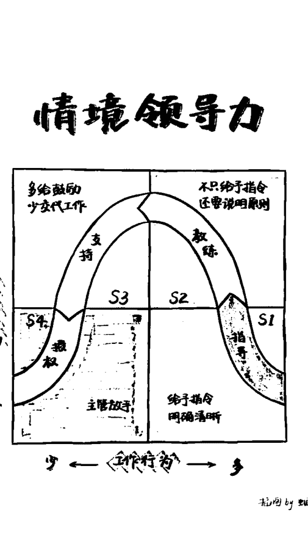

每个人从新手进阶到高手，大都需要经历四个阶段，我们要学会根据自己、他人、工作任务所处的不同情境，选择合适的领导方式。

明天我们会探讨领导力中一个很棘手的问题——变革。比如说，如何叫醒一个装睡的人？如何推动组织完成一件困难重重的事？

## 《跃迁》福利联袂放送

## 福利一：《跃迁》电子书9折特惠

点击下图，一键购买《跃迁》全本电子书。

《超级个体》专栏用户享受限时（8.26-9.01）9折特惠。

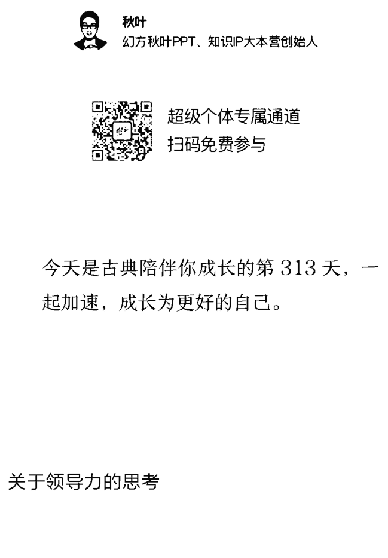

## 福利二：《跃迁》共读活动名额

发一个来自「橙子学院」共读《跃迁》福利！橙子学院特别邀请超级个体的同学们免费参与最新9月共读跃迁的活动【名额有限，先到先得】。

橙子学院是我创办的职场大学，致力于提升职场通用技能。橙子君邀请了我的4位好朋友，也是超级个体的成长导师——李海峰，李忠秋，Scalers，秋叶，我们5个人一起来为你解读，通过每日一问，与更多的伙伴一起思考，联机学习《跃迁》。


## 联机共读《跃迁》

15天，5大导师解读，百人小组
用问题学习、用联机思考、用整合输出
撬动你的跨越式成长

+   - 古典
  橙子学院创始人，《跃迁》作者
- 李海峰
  DISC双证班联合创始人
- 李忠秋
  杏壳商学院创始人
- Scalers
  Scalers Talk成长会创始人
- 秋叶
  幻方秋叶PPT、知识IP大本营创始人


超级个体专属通道
扫码免费参与

今天是古典陪伴你成长的第313天，一起加速，成长为更好的自己。

## 关于领导力的思考

提交留言可与专栏作者互动

## 变革公式：为什么你常立志，常失败？ 45-3

45-3 变革公式：为什么你常...

变革公式：不满感（D）✖ 愿景（V）✖ 下一步行动（F）>阻力（R）

今天我们讲领导力中的一个难题——如何让变革发生？

为什么变革那么难？因为领导者是带领你从此处到彼处，而变革者则是让你先停止惯性，重新瞄准目标，然后转个方向继续前进。所以，不管是个己还是组织，变革都特别难。

对于组织来说，公司发布新变革方案之后，大家都会想：“先观察一下，没准过一段时间就回到老样子了。”至于个人，估计你也无数次地对自己说，“绝对不能再这样下去了，不能温水煮青蛙，我要早起、锻炼、改变人生！”——结果一周以后你，就在夜宵摊上通宵喝酒，把“变革”完全忘记了。

哈佛商学院曾经对93个发生重大变革的组织进行过调查，发现74%的公司最后都由于发生意想不到的挫折而失败了。可，变革真是Hard模式。

但是，在这个快速变化的时代，不会变革就等于被抛下。所以，今天我们讲的变革的能力，其实是在不确定中胜出的能力。不仅重要，而且必有。

为什么即使知道什么是对的，依然难以改变？美国组织发展专家理查德·贝克哈德（Richard Beckhard）与大卫·格莱西（David Gleicher）在二十世纪八十年代共同提出“变革公式”，用以描述组织和个人的转变。

不满感（D）✖ 愿景（V）✖ 下一步行动（F）>阻力（R）

Dissatisfaction：对于现状，有多不满

Vision：对于积极的愿景，有多想要

First step：对于达成愿景的下一步行动，有多清晰

Resistance：改变过程中的阻力。

只有集齐不满、愿景和下一步行动这“三颗龙珠”，才有可能突破阻力。更重要的是，三者不是加法，而是乘法的关系。也就是说，上述三项要素有一项为零或者接近零，最终的结果也将为零，或者接近零——变革就不会发生。

## 1、缺乏愿景

很多都过于类似的事——晚上信誓旦旦地说，明天不能睡懒觉了，必须早点起床！甚至闹钟都设定好了。结果，第二天迷糊糊地关掉闹钟，继续睡。因为你只知道“应该早起”，却没有想清楚早起的真正价值和收益，你当然起不来。

## 2、缺乏行动

愿景不清晰必然会导致行动步骤不清晰。

## 3、缺乏不满感

“不要选择他们，他们很难发展起来。”

“为什么呢？”

# —— 今日思考题 ——

今天你学会了变革公式，回想你曾经尝试过，但最终失败的一次变革，到底是缺乏了什么因素呢？ 欢迎你在留言区分享给我。


只有当你看到了愿景，有了下一步行动，

+   1. 持续地抬头看路，在达到一个小目标以后，尽快找到下一个目标。
2. 持续地找到下一步的路径，制定下一步计划。
3. 和真正优秀、持续成长的人保持联机，用同辈的压力让自己持续保持不满感。

只有当你看到了愿景，有了下一步行动，且保持对现状的强烈不满感时，你才可能实现改变，只要三者有一项接近于零，改变也将趋近于零。

## 《跃迁》福利联袂放送

福利一：《跃迁》电子书9折特惠

点击下图，一键购买《跃迁》全本电子书。

《超级个体》专栏用户享受限时（8.26-9.01）9折特惠。

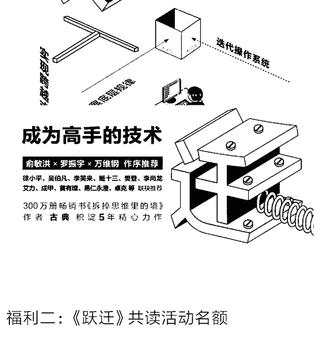

福利二：《跃迁》共读活动名额

发一个来自「橙子学院」共读《跃迁》福利！橙子学院特别邀请超级个体的同学们免费参与 最新9月共读跃迁的活动【名额有限，先到先得】。

橙子学院是我创办的职场大学，致力于提升职场通用技能。橙子君邀请了我的4位好朋友，也是超级个体的成长导师——李海峰，李忠秋，Scalers，秋叶，我们5个人一起来为你解读，通过每日一问，与更多的伙伴一起思考，联机学习《跃迁》。

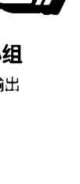

## 联机共读《跃迁》

15天，5大导师解读，百人小组
用问题学习、用联机思考、用整合输出
撬动你的跨越式成长

+   - 古典
  橙子学院创始人，《跃迁》作者
- 李海峰
  DISC双证班联合创始人
- 李忠秋
  杏壳商学院创始人
- Scalers
  Scalers Talk成长会创始人
- 秋叶
  幻方秋叶PPT、知识IP大本营创始人

超级个体专属通道
扫码免费参与

今天是古典陪伴你成长的第 314 天，一起加速，成长为更好的自己。

## 关于变革的思考

## 建立“横向领导力”的5个建议 45-4

45-4 建立“横向领导力”的5个...

最近两周，我分别讲了“团队”和“领导力”，列举了很多案例，但我突然发现，怎么就灯下黑了呢？竟然忘了“得到”团队这么鲜活的案例。

我记得，罗振宇曾经把自己的公司比喻成一支球队——这个球队没有领导，每个人都是球场上及时跑动，随时补位的球员，每个人的位置都有着不可或缺的重要性，团队协作就是赢球的核心。这种球队式管理，正是基于员工之间对彼此能力和品格的信任。

于是我邀请咱们专栏的产品经理小七，访谈了罗辑思维的两位年轻副总裁——飞扬、诺诺，他们两个充分展示了在“得到”这样一家公司，如何在没有权力前提下领导他人。

我帮你归纳了5个要点，希望对你有所启发：

## 一、行动前：一切先从清晰的方案开始

要横向领导别人，最忌讳的事情是直接找人开始聊。这个时候大家都是一脑子蒙，作为发起人，你必须首先拿到信息权和专家权——把你将要做的事想得足够清楚。

## 二、组建：怎么拉人入伙

飞扬分享了他自己在组建小团队时的一些心得：

+   1. 同步项目背景信息；
2. 理解别人干嘛，找到你的项目和同事日常工作的结合点，尽量避免组资源浪费；
3. 给对方预留出充足的准备时间，并提供相关信息支持；
4. 组织小组讨论会，现场分工，确定推进计划表。

## 三、推动：没有权力，如何推动项目

## 四、应对：如何处理执行中的分歧

## 五、收尾：项目结束了，怎么激励

## —— 今日总结 ——

# —— 今日思考题 ——


横向领导力是个持续“解决问题”的过程——发现问题、找到解决方案、大家拧成一股绳去做事，每个人都能够从中获得成就感，并不需要你拥有职位。

## 生涯顾问日 | 人生设计：
没有最适合你的人生

45-5 生涯顾问日 | 人生设计...

今天是“生涯顾问日”的第10期——今天我们暂时不讲案例。讲一个生涯规划方面最前沿的认知——人生设计。

我前几天在一个生涯规划师的内部场合做分享，很多

我觉得我们一直谈消费升级，那么生涯规划的思路是否也可以有一个升级呢？于是今天我决定给你讲讲人生设计的思路，你不一定

## 什么是设计思维呢？

2004年，斯坦福机械工程系教授 David Kelley 创办了Dschool，这个几乎是世界最著名的设计学院的核心课程，就是：“设计思维”。不过设计思维并非设计师思维，它更像是一套开源方法论——教你如何结构化地创新，创新是一种引导过程——“We Frame Creativity”。Dschool在硅谷，对面就是商学院，设计思维从一开始就和硅谷的各种商业、教育、艺术、科技方面的创意有着千丝万缕的关系。有段时间横扫国内的“互联网思维”也从中借鉴很多。


人生设计课的创始人是两名 Dschool 的跨界设计师，前苹果公司员工的比尔·伯内特（Bill Burnett）和戴维·埃文斯（David J. Evans），他们设计出了苹果第一款鼠标。他们经常受邀在硅谷为创意天才讲设计理念，发现他们的理念能让他们做出最有创意的产品，却无法让自己的生活变得有趣。

他们决定把设计思维用到自己人生中来。“人生设计”就是把设计思维运用于职业生涯规划之上的一种方式，课程的目标是“如何用设计思维，发现自己未来想做什么？》《快公司》报道说，这是“斯坦福最火的一堂课”。


因为跨界，人生设计课对于很多人生难题的解答思路全然不同。又因为设计思维在商业上已经被证明其有效性，所以这些思路的实操性很强，工具也很容易落地。


我来举三个例子，说说看设计思维和传统的规划思维有什么不同。

## 1. 不要坚持初心，而是重新定义问题

+   - 我的父母都是工程师，从小我就想当个“大科学家”；
- 我喜欢读爱因斯坦的传记，甚至组织了一次班会，给全班同学解释相对论；
- 我的物理成绩很好，曾获得在奥林匹克物理考核中获得不错的名次；
- 我的物理老师很喜欢我，我也最喜欢这个老师。

你看，种种方向都指向——我应该成为一名伟大的物理学家，头发爆炸拿诺贝尔那种；退而求其次，一个研究物理的大学教授；实在不行，怎么看也得是个热诚的物理老师吧。

但是面对一个保送物理系的机会，我却非常犹豫，因为我了解过物理系学生的状态，认识了很多真正研究物理的人，觉得这不是更适合自己的选择。

现在回头去想，我意识到自己其实对于物理不算太感冒。我的物理学习很好，因为老师很喜欢我；我喜欢和别人分享有趣的知识，而相对论是个不错的选择；我热衷于幻想而不是研究，甚至还写过几篇科幻小说......

我是一个关注概念和关系的人，我在“分享自己挖掘来的有趣想法给大家，并且有帮助”的时候，最快乐——这是一个老师、作家、助人者、支持者——也就是今天我做的事情。

你看，我一直以为自己的初心是“物理学家”，结果我却只是喜欢“与人分享有趣的理念”，物理只是一个方式，我还有很多很多方式。

> 不是要找到初心，而是要重新定义初心。

## 2. 不要找到最适合自己的方向，而是拥有很多个选择

生涯里有一个大难题——什么是自己最适合的方向？如何找到这个方向？如何确定这是“最适合”的？

因为每个选择都有缺陷：钱多的时间少，时间充裕的发展慢，发展快的又不太喜欢......

人生设计有一个重要的思路：
“好答案来自于好多答案”

每个人都有好多好多适合的人生方式，你可以在不同阶段、不同时间展开。人生设计课上会逼你，对就是逼你头脑风暴出至少10个选择，不管靠谱不靠谱——因为输入决定输出，好点子来自于很多点子。

不要纠结于最适合，而是要找到很多合适的，然后找机会去选择——好人生来自于好选择。


的，然后找机会去选择一好人生来自于好多人生。

## 3. 不要“做出决定，坚定推进”，而是“边走边看，低成本试错”

你在犹豫是否要去大城市生活，犹豫是否要离开北上广，犹豫是否应该换个行业，犹豫是走专家还是管理路线？你最常听到的建议是——认真做调查，访谈很多人，做很多测试得到结论，列出决策平衡单，最后做成一个最好的决定，然后坚持下去。

人生设计提供了一个全然不同的思路：

做中学（在行动中去学习）

当你不真的推进的时候，你根本不知道自己会遇到什么困难。互联网公司的方式是做个AB测——而最聪明的人生设计方法，是做个“AB人生原型”，开始小范围试错。

比如说请个假，去大城市或者老家试着找找工作，看看有什么机会，会遇到什么老板？去想去的行业认识点人，听他们聊聊自己真实的工作，体验下自己是否兴奋；研究几个小领域，看看自己是否喜欢钻研，尝试写作、线上分享，又或者主动运营一个小摊子，观察下大家是否反馈不错？

这些尝试的确会占用你的一些时间成本，但是远远没有你想象得那么高——也就是3天的假期能搞定的事——相比在焦虑、犹豫中来回摇摆的心力，探索本身是一件快乐、有趣，而且效率更高的事。

你看，我用了这么多的“兴奋、喜欢、感觉、看看、体验、观察”的感觉词，因为这本身是一个持续观察和体验的过程，学习社会也是学习自己的过程——如果社会规则还能通过和人聊天学到，那么你会做得怎么样？你会有多强？你会有什么可能？这个只能在做中学。

所以，不要着急决策，而是要尽快动手，小成本试错——做中学。

好了，现在我们把前面这三个半句连在一起，就是你常常听到的传统的职业规划思路——“专注初心，找到最适合自己的，做出决定并且坚持做成。”

而后面这三句话连在一起，则是人生设计的思路，

“重新定义初心，找到尽可能多的选择，选择一个快速尝试，直到成功。”

前者是做人生工程，后者是做人生设计。前者基于物理学，后者基于生物学；

做工程的优点是，更加稳健，肯定会有阶段性收获，而且更容易被人理解，更适合人生前期，或者方向清晰的上升阶段，攒能力的阶段；

设计的好处是更加有趣，探索的过程本身很快乐，更加适应变化，更容易活出独特的人生。但是也更加模糊，更适合正面对世界的大学生，或者刚刚经历过上升阶段，决心二次创造人生的人。

从0到1更适合人生设计，而从1到100更适合职业规划。

你喜欢哪个？你又适合哪个？

# —— 今日思考题 ——

人生设计的三个理念，对于你有什么启发？你认同吗？你更适合设计还是规划呢？

## 《跃迁》福利放送

《跃迁》电子书9折特惠

点击下图，一键购买《跃迁》全本电子书。

《超级个体》专栏用户享受限时（ 8.26-9.01 ）9折特惠。


今天是古典陪伴你成长的第 316 天，一起加速，成长为更好的自己。

## 吴伯凡：领导者应该是一个无我主义者 45-6

### 45-6 吴伯凡：领导者应该是...

## 古典

这个星期，我们谈了领导力，今天我请到了我的老师——吴伯凡。

吴伯凡老师是中国最有洞见的商业评论人，逮着这个机会，我请他给“超级个体”的小伙伴谈谈什么是领导力。

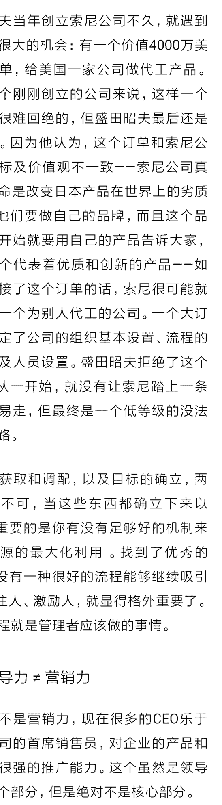

古典老师集中了大家的意见提出了三个问题，希望我和大家一起来探讨。这三个问题都跟领导力相关，我就把我自己关于领导力的一些感受和认知跟大家分享一下。

## 古典

问题一：领导力和管理力的区别是什么？

### 一、正确做事 & 做正确的事

“领导力”是一个固定的词——Leadership，“管理”我们都称为管理能力。彼得·德鲁克对领导和管理有个经典的区分：“领导”就是做正确的事；“管理”就是正确地做事。

简单地说，“领导”是在众多可以做的事情当中确定该做哪些事情，所以领导力本质上是一种取舍的能力——表面上是确定该做什么是的能力，背后是确定哪些不值得做的。哪怕很有诱惑、马上有利可图的事情都不去做。做真正重要和正确的事情。管理者所需要的能力是如何把一个已经确定的事情做到最好，所谓“最好”，就是成本最小化、效果最大化。

### 二、方向感 & 驱动力

IBM 前 CEO 路易斯·郭士纳（Louis V Gerstner）对领导力有一个定义，他认为“领导力”包含两个方面：方向感和驱动力。衡量一个领导者有没有领导力就看这两方面的能力。

方向感：在大家都不知道做什么，或者大家对该做什么众说纷纭的时候，领导者有一个方向感能够排众议，带着大家朝正确的方向走。

驱动力：当你确定了一个方向，大家都沿着你确定的方向走的时候，你要尽可能是供各种各样的支持和资源，用物质的、精神的、多维度的能力支持大家朝那个正确的方向去做事。

### 三、北斗星 & 及时雨

我曾经读过一篇专门论述领导力这两个方面的长文章，概括起来就是我们中国的六个字——《水浒传》里宋江那两个外号——“北斗星”和“及时雨”。

北斗星：就是方向感。在夜里你不知道现在的地方，或者该往哪个地方走的时候，你总要一种方向，这时候，你抬头看看北斗星就知道了。不是有一首歌唱“抬头望见北斗星，红军想念毛泽东”嘛，“北斗星”就是方向感。

及时雨：在大家最需要资源的时候，你总能给出资源，总能给出最好的帮助和激励。

这就是领导者应该扮演的两个最重要的角色。


### 四、RPV理论

哈佛商学院教授、颠覆性创新理论创立者克莱顿·克里斯坦森（Clayton M. Christensen）提出过一个“RPV”的理论模型，他认为，一个组织的运行、成长、创新是由三种力量组成的：

- R=Resource=资源
- P=Process=流程
- V=value=价值、价值观，衡量什么该做、什么不该做的价值标准

在这三个要素当中，领导者担当了两个要素：资源和价值/价值观。

#### 1、资源

资源包括关键资源的获取和资源的调配，这个与“及时雨”有关。

对今天的企业来说，关键资源中最关键的就是人力资源。乔布斯认为“一个CEO应该用40%的时间去找对的人。”——找不到对的人，你就不可能做对的事，如果你不花40%的时间去找人，最后你可能会花100%的时间去收拾烂摊子。雷军甚至认为“CEO应该用80%的时间去找人。”

领导者作为关键资源的获取者和分配者，除了人力资源是一个很重要的资源以外，他的融资的能力，他自身的社会关系所自然携带的资源，以及他在各种资源网络当中的开拓能力，最终决定了他的企业能否获得关键重要的资源。

#### 2、价值/价值观

价值观包括目标，确定了目标之后你才知道什么该做、什么不该做，什么是正确的事情，什么是不正确的事情。

盛田昭夫当年创立索尼公司不久，就遇到了一个很大的机会：有一个价值4000万美金的订单，给美国一家公司做代工产品。对于一个刚刚创立的公司来说，这样一个订单是很难拒绝的，但盛田昭夫最后还是拒绝了。因为他认为，这个订单和索尼公司的目标及价值观不一致——索尼公司真正的使命是改变日本产品在世界上的劣质形象，他们要做自己的品牌，而且这个品牌从一开始就要用自己的产品告诉大家，这是一个代表着优良和创新的产品——如果当时接了这个订单的话，索尼很可能就成为了一家为别人代工的公司。一个大订单甚至决定了公司的组织基本设置、流程的设置以及人员设置。盛田昭夫拒绝了这个订单，从一开始，就没有让索尼踏上一条貌似容易走，但最终是一个低等级的没法掉头的路。

资源的获取和调配，以及目标的确立，两者缺一不可，当这些东西都确立下来以后，很重要的是你有没有足够好的机制来实现资源的最大化利用。找到了优秀的人，有没有一种很好的流程能够继续吸引人、留住人、激励人，就显得格外重要了。这个流程就是管理者应该做的事情。

### 五、领导力 ≠ 营销力

领导力不是营销力，现在很多的CEO乐于扮演公司的首席销售员，对企业产品和品牌有很强的推广能力。这个虽然是领导力的一个部分，但是绝对不是核心部分。

特朗普就是一个很典型的例子，他是一个有超强营销力的人，但是他没有领导力。他的超强营销力使得他能够当选总统，但是能否当好总统完全是另外一回事。特朗普的能力结构当中有太多的营销成分，而太少的领导力，他把一个本来已经出现分裂的美国搞得更加分裂。他自己的团队越来越分裂，大量的人员出走，这是一个反面的例子。


## 古典

问题二：如果领导力可以被塑造，那么锻炼领导力的路径是什么？

领导力的形成受制于两种力量，其中一个是个人天赋、禀赋是什么。我越来越觉得天赋和基因的成分可能占到了50%以上的份额，但是领导力是可以习得的。在多子女家庭当中，同样的基因、同样的家庭背景，为什么有的人有领导力，有的人没有领导力，与他后天的环境有很大的关系。通俗一点说，领导力是一种聚人的能力。哪怕在一个陌生人群当中，比如一个旅游团里，有人也能在几个小时之内成为一个具有向心力、值得信赖的人，这一方面是他的天赋，另一方面来自于他后天习得的能力。

锻炼一个领导力最重要的途径是阿尔弗雷德·阿德勒（Alfred Adler）说的：领导人格健全的人格。

一些有领导力的人都是人格健全的人。反之，领导力缺乏的人智力可能很高，但是他缺乏最基本的社会感——也就是从小在家庭教育和学校教育当中，努力培养健康人格的三要素：

- 1. 合作共赢，遇到事情总想以合作共赢的方式去做，而不是做独行侠吃独食。
- 2. 对待资源要永远坚守一个不等式：给予 > 索取，并形成一种习惯。我们说有人有“大哥的品质”，其实就是具有一种始终维护这样一个不等式的能力。反过来，如果索取大于给予的话，这样的人人格不健全也不会有领导力。
- 3. 对他人的感受、立场、利益具有充分关注的能力。

这三个要素既是健康人格的培养路径，也是领导力的培养路径。当然，还有一个非常重要的能力：对大格局的判断能力——在一个场景当中，能够迅速地判断各种力量之间的关系，看到多重多维度的权力、资源和利益关系，并基于这种对大格局的洞察，具有方向感。

获得领导力，“见林”永远要比“见木”更重要。


问题三：领导者如何能做到能激励、理解他人，但是又不至于太亲近？

关于“领导力”和“管理力”我有一个比喻：领导力是操作系统，管理力是应用软件。一个手机上应用软件能够顺畅运行，取决于背后的操作系统。打开手机，其实是在使用操作系统——iOS、安卓无时无刻不在运行，但我们往往感受不到它的存在，我们觉得我们用的是那些应用软件，但应用软件能否顺利运行，取决于背后的操作系统能否将整个计算资源做到最优化、最合理的调配和使用。

一个领导者也是一个无我主义者，他输送资源、他激励谁都不是根据个人的偏好，而是站在组织和团队整体的角度来看待、来使用、来分配资源的。

中国古人讲，对待孩子要“爱之而勿面”，领导者也应该做到“爱之而勿面”，尤其忌讳把个人感情带入到他作为领导者分配资源的过程当中。如果是这样的话，领导者就会不知不觉变成部分人的领导，而不是所有人的领导，从而使整个组织的资源和能力出现越来越严重的内耗。

领导者具有这样一种等距离的能力，他对待所有人的态度都是应该是对事不对人的，他给某个部门或者某些人分配更多的资源，不是因为他喜欢，而是从组织的角度来看，应该就是这样分配的。

总而言之，领导者是一个组织生态的建立者和维护者，他有一个非常重要的责任：维持整体生态的平衡。领导者最忌讳的是他放弃了他作为操作系统的建立者和维护者的身份，放弃了自己作为“看不见的手”这样一个角色，而让自己成为一只“看得见、闲不住的手”去插手各种各样具体的事务，用个人的偏好去决定组织的方向和资源分配。


感谢伯凡老师的细致解答，我很认同伯凡老师的说法，领导力就是一种聚人的能力。当一个人化身领导者，他其实已经被团队的意志附身，成为了另外一个人。这种能力是品格、视野和智慧的融合。希望伯凡老师的回答能给你带来启发，想听到更多伯凡老师的内容，可以点击下方图片，订阅吴伯凡老师的专栏。

知识是一个人重要的资产，它是构成财富、地位影响力的基础。但是在大部分人的知识资产中，存储的知识质量参差不齐，而且散落在各处，很难增值，甚至有可能产生负价值。

《伯凡·日知录》是一个自我迭代者的小组，吴伯凡会用自己几十年的知识积累帮你把各领域知识的连点成线，打通知识间的壁垒，消除知识上的盲点，让你从熟悉的现象看到陌生的本质。

为什么仅靠升职加薪，不可能变富？

我们已经讲过很多关于个人成长的内容，包括如何处理与自己的关系，如何处理与他人的关系……下周，我们将进入“个人理财”主题，教你如何处理你与金钱的关系。

虽然我们对金钱的使用频率很高，但我们对于金钱的了解并不多。很多人都缺乏驾驭金钱的能力，甚至一生都在受金钱摆布。

- 1. 为什么仅靠升职加薪，很难富裕？而你辛苦挣到的钱，很可能正在悄悄贬值？
- 2. 如何有效增加个人财富？
- 3. 为什么说完美的理财产品是不存在的？
- 4. 让你信心满满的产品，反而亏损的深层次原因是什么？

我们下周见。

今天是古典陪伴你成长的第 317 天，一起加速，成长为更好的自己。

## 理解“钱”的规律，跳出工资阶层的陷阱 46-1

### 46-1 理解“钱”的规律，跳出工资阶层的陷阱

- 1、理财的重要性：不“理”财，财就贬值；如果只埋头挣工资，很难走出工资阶层的陷阱；复利法则会产生财产积累上的天壤之别。
- 2、建立理财思维：让未来目标决定今天的行为；理财不等于投资；理财不耽误挣钱。

今天我们正式进入“人生设计”专题。注意，今天的内容有点特别，但我先留个悬念。

我们一起学习过很多个人成长的话题：人和人的关系、人和组织关系、人和社会的关 系。今天我们来谈一个没法回避的关系——人和钱的关系。

在一个经济社会，钱的流动无处不在，如果一个人不懂得处理跟钱的关系，就像一 个人在大海上航行却不会游泳一样，危险 可想而知。但一提到理财，有人就会说：现 在挣得太少，没什么可理的，我还是全力 以赴升职加薪，等有钱了再说。但这种人 过几年你再看他，发现他收入可能增加 了，年也换了更好的，但他还是没有开始 理财。

理财是每个人都应该重视起来的一项技 能，也是今天经济生活中必备的生存智 慧。

为什么理财很重要？我给你讲三个原因， 你就明白了。

### 一、不“理”财，财就贬值

如果不理财，你的财富也许正被合法稀 释。

金融界有一句话叫“今天的100元比明天的 100元更值钱”，也就是说，你手里的钱正 变得越来越不值钱。因为有通货膨胀。

近几年，中国官方通货膨胀增速是2%，但 真实的比例会比这个更高一些。尤其是放 在一个较长的时间跨度里看，差距就会更 明显。

举个例子：

建国以后，第二套人民币最小的面值是1 分，最大的是10元；到第四套时，最小的 是1角，最大的是100元；等到第五套时， 最大还是100元，但1角、5角都是硬币 了。仅仅从面值来看，人民币是一直在通 货膨胀的，按照今天的利率，把1万元存到 银行里，一年下来可能会有150元利息，但 对比真实的购买力，你可能已经亏了两三 百元。

所以，理财的第一个理由就是，你总得跑 赢通货膨胀吧。

### 二、只埋头挣工资，很难走出工资阶层的陷阱

什么叫工资阶层陷阱？

### 三、“复利法则”让财产积累出现天壤之别

对于挣钱能力差不多的家庭，理财能力的 差距，会带来财产积累上的天壤之别，这 种积累到最后就是阶层的不同。这个“复利 法则”，就是我们俗称的“利滚利”，举个例 子来说明：

如果你在30岁时，拿出100万存起来，准备 到60岁退休时再取出来。那么你有三种选 择，第一，存在银行，以银行0.35%的收益 率算，到60岁时是111万；第二，存在余额 宝，以3%的收益率算是243万；第三，坚持 理财，以8%的收益率算，最后可能是1000 万左右。这就是复利法则的威力。


理财能帮你跑赢通货膨胀，跳出“老鼠圈”， 让你未来的生活变得更好一些，所以每个 人都要有理财意识。

### 什么是理财？

简单点说，理财就是让金钱为你服务，就 是更快、更好、更可靠地达成财务目标。财 务目标，就是比较依赖财富来实现的目 标。比如说你家要买房，要给父母环游世界， 这都属于财务目标。但是，如果你想要谈 恋爱，虽然也要花钱，但是金钱在谈恋爱 这一任务里，不算决定因素。所以，谈恋爱 不算财务目标。

### 如何建立理财思维呢？我教你三个办法：

### 一、让未来目标决定今天的行为

### 二、理财不等于投资

### 三、理财不耽误挣钱

工作，耽误挣钱。其实理财和挣钱并不冲突，当然了，如果你要成为巴菲特、查理·芒格这样的投资者，确实需要投入大量精力，甚至终身学习；但对于掌握一些理财的入门知识，其实并不难，少看一季《权力的游戏》就能学明白。

最重要的是，理财是一种思维训练，需要一定的时间去磨砺，等你有足够多的钱了，再开始学习，恐怕就有些晚了，而且到时候，你的资本积累得越多，试错成本就可能越高，所以，不如提前开始、找找手感，学着做一个“未来的有钱人”。

## ——◆ 第一场线下大课来了 ◆——

今天我们讲了理财意识，那么，除了金钱可以被投资，还有什么可以投资呢？当然就是你的头脑了。

所以，接下来，我要揭晓开头卖的关子了。我要告诉大家一个好消息，9月24日，我要在北京举办一场长达6小时的线下大课，这是我在得到平台的第一次线下大课，也是跟超级个体用户的一次难得的面对面交流机会。这次大课的主题叫“人生设计研习会”。什么是人生设计？人生设计就是把设计思维运用在职业生涯规划上的一种方式，也是一种变相的人生投资方式。

在过去的300多天里，我想你已经发现了，那些看似是天赋的、是机遇的能力其实都有方法和路径可循。所以，这次大课上，我打算从人生设计的底层逻辑开始，一步步帮你建立人生的全景图，具体包括5大板块：

### 课程大纲

- 1. 人生设计的心法和原则
自我成就的心智模式；设计优质人生的5条原则；评估和盘点自己的人生状态。

- 2. 如何设计跃迁式职业发展路径
普通人迅速职业发展的跃迁路径；如何找到自己的头部赛道；如何设计自己的个人商业模式。

- 3. 如何洞察自我的优势、天赋和竞争力
如何找到自己的核心竞争力；如何找到你的内在模式，提升自我效能；如何找到自己的内心真正的需求。

- 4. 如何拓宽人生的维度与可能性
人生的4个维度的展开；如何让自己生活保持动态平衡；不同人生阶段需要完成哪些人生任务。

- 5. 如何找到怦然心动的人生愿景与使命
设计人生全景图：趋势-愿景-使命-价值观-计划；理解的生命意图，找到人生的 slogan。

### 思想夜宴

课后我们会有一场“思想夜宴”，我会跟 8 位同学有针对性地探讨你们最关心的个人发展话题并尽我所能的给出建议方案，比如职业定位、发展转型、工作生活的平衡、愿景挖掘等等。

点击下方的图片，你可以看到具体的购买信息，另外，我为咱们的订阅用户申请了专享的特惠。

最后我再啰嗦一句，上周五的“生涯顾问日”，我第一次讲了“人生设计”，有位用户的留言让我印象很深，他说，周五那天正好是他35岁的生日，从那天开始，他准备重新设计人生。

你呢？准备好了吗？9月24日，期待与你相见。


# ——◆ 今日思考题 ◆——

你觉得青年人应该先投资自己，还是开始理财？


理财是每个人都应该重视起来的一项技能，它能产生财富积累上的天壤之别。简单点说，理财就是让金钱为你服务，从而更快、更好、更可靠地达成财务目标。

明天，我们会聊一个你一定很感兴趣的话题——怎么样把钱越花越多。

今天是古典陪伴你成长的第 319 天，一起加速，成为更好的自己。


# 学会区分资产与负债：让钱越花越多 46-2

46-2 学会区分资产与负债：...

1、资产和负债：简单地说，资产就是往你口袋送钱的东西；负债就是从你口袋掏钱的东西。

2、学会区分资产和负债对我们最大的意义是一—不要怕花钱，关键是懂得判断花钱之后的回路。多丢回力标，少射穿云箭，这就是把钱越花越多的智慧。

如果问：你会花钱吗？

你也许会不屑一顾，花钱谁不会，不就是买买买嘛！

真不是那么简单。

有些人比另一些人更会花钱。他们的钱，会越花越多。不是因为他们花钱的对象，而是因为他们花钱的思维方式——把钱越花越多，就是理财中最重要的一个思维方式——投资的思维方式。

今天我们就讲讲这种把钱越花越多的投资思维。

从一个概念开始——在理财的第一步，所有人都会先建议你去做一张“资产负债表”，先梳理一下现在的资金状况。但是什么是资产，什么是负债呢？我罗列了一张基本条目：

## 从资产的角度来看

+ 流动资产：现金、存款、货币基金、短期债券、其他短期金融资产
非流动资产：不动产、股票、长期债券、其他长期金融资产
表外资产——时间、创造价值的能力、积攒的人情

## 从负债的角度来看：

+ 流动负债：信用卡欠款、短期消费贷、股票融资、短期疾病、短期私人借款
非流动负债：房贷、长期私人借款、赡养老人、抚养子女
表外负债：欠下的人情、未来的疾病、未来突发的事件

把自己资产负债全部罗列出来，就是资产负债表。跳过这些复杂的条目，简单来说：

资产就是往你口袋送钱的东西；负债就是从你口袋掏钱的东西。

### 1. 学习

学习是资产还是负债？取决于能否给你带来正向现金流。如果学习有输出，能够解决身边的问题，或者通过学习让自己成为团队中心、社交红人，你的学习都是投资，值得花更多的钱。而如果学习只是让你不焦虑，让你心里更加舒服，既没有输出也没有增值，再多再好的课程和学习资料，甚至拿到学历或者证书，也都是一种负债。

### 2. 健康

身体健康是非常重要的资产，其他的所有东西都建构其上，而重大疾病是极其糟糕的负债。在身体健康和良好的生活习惯上增加投入，非常值得。到了30岁以后，可以进一步加大这方面的投入。

### 3. 好的人际

一定要“重仓”优秀、勤奋和懂得回报的人，这些人是人生重大家产。

### 4. 父母

父母在早期是我们的资产，但是父母到了60岁以后，则需要你越来越多的财力和精神支出，于是从资产慢慢变成了负债。做儿女的，自然是要承担好这个义务，但是一定别忘了帮他们更好地养成定期体检的习惯、购买好的保险（如果保险足够好，能报销，他们就舍得花钱）、养成好的生活习惯。这在财务上叫优化债务结构。如果你已经为人父母，你则需要照顾好自己，不要成为儿女的负债。

的宝贵资产，会列在更大的一张人生资产负债表上。一个事情重要与否，绝对不仅只看财务标准。

区分资产和负债对我们最重大的意义是一不要怕花钱，关键是懂得判断花钱之后的回路。多丢回力标，少射穿云箭，这就是把钱越花越多的智慧。

在电影《1942》里，张国立演的地主在逃荒路上说了一句话："我知道咱从一个穷人变成财主，不出十年，你大舍我还是东家，那时候咱再回来……"金钱从来不是真正的资产，我们唯一的资产是我们的头脑。

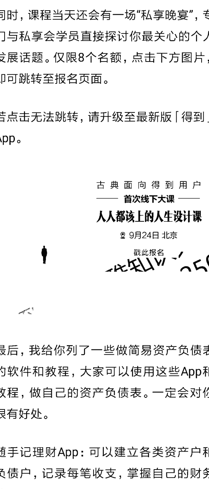

### ——今日思考题——

今天你学会了资产和负债的区别，你生命中间有什么东西是资产，让你越花越多的？

https://www.zhihu.com/question/23444019/answer/28015933

## 了解资产与负债


学会区分资产和负债对我们最大的意义是一不要怕花钱，关键是懂得判断花钱之后的回路。多丢回力标，少射穿云箭，这就是把钱越花越多的智慧。

### ——首场线下大课来啦——

互联网时代加剧了两极分化，只有少数人能获得影响力和资源从而迅速崛起，一个人想要成为少数人，最关键的就是要懂得如何设计自己的人生。

人生设计的实质就是人生经营战略设计，就像经营一家公司一样，想要效益最大化，就该把未来的发展都规划好。

9月24日，北京，我将用一天时间讲讲人生设计的5个心法，帮你找到发展方向，get最实用的 人生设计方法论。

同时，课程当天还会有“私享晚宴”，专门与私享会学员直接探讨你最关心的个人发展话题。仅限8个名额，点击下方图片，即可跳转至报名页面。

若点击无法跳转，请升级至最新版「得到」App。


最后，我给你列了一些做简易资产负债表的软件和教程，大家可以使用这些App和教程，做自己的资产负债表。一定会对你很有好处。

随手记理财App：可以建立各类资产户和负债户，记录每笔收支，掌握自己的财务状况。

制作“资产负债表”教程：

找张白纸，用笔在中间画一条竖线。然后，在左边写下你目前拥有的资产，像是存款、理财、房子、股票等等。（注意，要写它目前的价格，而不是你买入时的价格。）

在右边写下你的负债，比如房贷、车贷、信用卡债等等。

然后，用左边的资产总额减去右边的负债总额，你就得到了自己的净资产总额，也叫净值。

比如，你目前在北京有一套1000万的房子，首付300万，贷款700万，除此之外没有其他资产负债。那么我们就可以说，你的资产是1000万，负债是700万，净值（资产-负债）是300万。

这种做法，是显示某个时点（比如现在）资产和负债的状况，属于存量概念——让你清晰地了解自己在那一个瞬间，拥有多少资产，欠着多少债。

明天会讲一个稍微深入的话题——我们都希望自己投资很稳健，那么怎么让自己投资稳健地成长呢？明天见。

今天是古典陪伴你成长的第320天，一起加速，成长为更好的自己。

## 关于理财的思考

## 10分钟学会资产配置
46-3

46-3 10分钟学会资产配置

+ 1、资产类型：进攻类（股票）、助攻类（债券）、防守类（保险）、流动类（活期或其他投资项目）。
2、股票投资的“80法则”：用80岁减去你的年龄，就是你该投入的资产比例。

我们第一天谈到了理财思维、第二天谈到如何区分资产与负债，很多人会想——到底该如何开始投资，会不会风险会很大啊，具体买什么呢？我们今天来说说这个问题。

你一定听过一句话“低风险低收益，高风险高收益”——想要清晰的、保险的回报，则收益低；想要高收益，不确定性也就是风险会非常大。

那有没有高收益又低风险，能赚钱又没风险的事？如果真有这种好事，所有的人都会冲进去购买，其他的投资产品也就不存在了。所以，天下不会有免费的午餐。每个都需要根据自己的目标、承受力，在安全和风险之间找到自己的平衡。

怎样控制风险？最直接的方式就是分散投资——不要把鸡蛋放到同一个篮子里。

莎士比亚的《威尼斯商人》里，安东尼奥就用了这种思路——他告诉他的老友，他并不把他的货物：“我的买卖的成败并不完全寄托在一艘船上，更不是倚赖着一处地方；我的全部财产，也不会因为这一年的盈亏而受到影响，所以我的货物并不能使我忧愁。”

现代金融学者通过数学验证了这个理论，1952年，经济学家哈里·马科维茨（Harry M Markowitz）发表了经典之作《资产选择》。他证明通过多种资产的组合，能够比单一资产更优。并且因此获得1990年诺贝尔经济学奖。

今天的投资者会同时购买几个不同种类的产品，通过调整投入资金的比例，找到最优的结构。获得理想收益的同时，把风险降到最低。这种在各种金融产品中，决定用资产买哪几种产品，每种买多少的过程，就是资产配置。

## 资产分配类型

先来看看我们有什么产品可以选——市面上常见的金融资产分成四大类。如果用足球比赛打比方的话，它们是：

+ 1. 进攻类：各种股票类。获取超额收益，靠它。
2. 助攻类：固定收益类，比如债券。安全稳定地跑赢通货膨胀，获得稳定的收益。
3. 防守类：保险。应对极端情况，防止后院失火。
4. 流动类：活期或者其他投资项目。这相当于不可或缺的“替补队员”。当场上球员疲劳、受伤或者关键时候需要变转局势，都靠这部分资金。


## 资产分配比例

+ 1. 先留出生活费：保证日常生活
2. 买好的保险：应对不确定风险
3. 股票类：享受经济发展成果
4. 固收类：稳稳地跑赢通货膨胀

| 配置产品 | 配置金额 | 配置比例 |
| --- | --- | --- |
| 流动类 | 6万 | 6个月生活费 |
| 保障类 | 2万以内 | 10%保费 |
| 股票类 | 5万买股票 | 80-30=50%的资金 |
| 固定收益类 | 5万固定理财产品 | 剩下的50%资金 |

## —— 今日总结 ——

总之，资产配置的思路是一—鸡蛋要放在不同的篮子里，并且在篮子间维持一个最优的结构，这样收益更高而风险更低。这种思路也可以扩展到人生的其他方面——如果你把人生完全寄托在事业上；把幸福寄托在一个身上；把梦想寄托在某一件事情上，当日不出什么计划但却把...

托在一个人身上；把梦想寄托在某一些事情上，你是否也在过一种高风险的人生呢？你是否应该思考自己的最优人生资产配置呢？

# ——◆ 今日思考题 ◆——

关于理财投资，你有哪些故事、经验或心得？期待在评论区看到你的分享。

## 4种方式完成资产配置

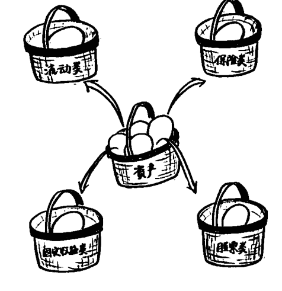

在资产配置中，要把“鸡蛋”放在不同的篮子里，并让各个篮子的“鸡蛋”维持一个最优的结构，这样这种分配方式，可以实现收益更高，风险更低。

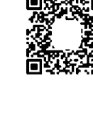

### ——◆ 首场线下大课来啦 ◆——

互联网时代加剧了两极分化，只有少数人能获得影响力和资源从而迅速崛起，一个人想要成为少数人，最关键的就是要懂得如何设计自己的人生。

人生设计的实质就是人生经营战略设计，就像经营一家公司一样，想要效益最大化，就该把未来的发展都规划好。

9月24日，北京，我将用一天时间讲讲人生设计的5个心法，帮你找到发展方向，get最实用的 人生设计方法论。

同时，课程当天还会有“一场“私享晚宴”，专门与私享会学员直接探讨你最关心的个人发展话题。仅限8个名额，点击下方图片，即可跳转至报名页面。

若点击无法跳转，请升级至最新版「得到」App。

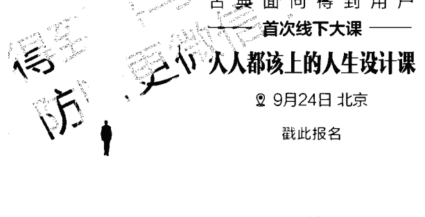

今天是古典陪伴你成长的第 321 天，一起加速，成长为更好的自己。

## 关于资产配置的思考

提交留言可与专栏作者互动

## 理性的自信：情绪可以影响资产价值 46-4

46-4 理性的自信：情绪可以...

在投资中保持好心态的三个方法：深入研究；区分“我的判断”和“市场的判断”；学会控制情绪守纪律。

我们连续三天，讲了投资理财的几个基本概念：目标导向、区分资产负债、资产配置等。今天我们不谈工具，谈谈关于投资理财最重要的一个因素：心态。没有好的心态，再好的技术和概念都没有用。投资理财最难过的一关，是一个稳定的心态，这种稳定来源于对自己判断的信心。

## 自信在投资中的作用

现代金融不仅仅建立在价值计算上，还建立在大众的信心和情绪之上。著名的财经主持人许树清写的畅销书《你不可不知的经济真相》里，举了这样两个例子：

上世纪70年代，全球遭遇第二次石油危机，伊朗切断了原油供应，导致全世界每天短缺石油500万桶。石油是工业的血液，当时正处于工业大发展时期，石油就像沙漠中的淡水，价格飞涨，洛阳纸贵。

## 如何在投资中保持“理性的自信”

+ 1. 深入研究

只有深入研究，你才会对自己的判断有信心，不被短期市场情绪所影响。

+ 2. 区分“我的判断”和“市场的判断”

+ 3. 学会控制情绪，守纪律

## —— 今日总结 ——

我们谈到了：金融产品的价格是由价值和情绪共同创造的。每个坚定、聪明、理性的 人，都应该修炼稳定的情绪和理性的自信。

# —— 今日思考题 ——

在“理性的自信”这三条原则中，哪一条你做得比较好，哪一条还有待提升呢？欢迎在留言区留下你的想法。

## 理财的心态。


大众的情绪是双刃剑，一方面被卷入情绪中，无法理性判断；一方面又能看到大众情绪下低估的机会。所以，大家恐惧时，你要贪婪；大家贪婪时，你要恐惧。

## —— 首场线下大课来啦 ——

互联网时代加剧了两极分化，只有少数人能获得影响力和资源从而迅速崛起，一个人想要成为少数人，最关键的就是要懂得如何设计自己的人生。

## 生涯顾问日 | 职场妈妈如何平衡工作与家庭 46-5

46-5 生涯顾问日 | 职场妈妈...

## 古典

职场妈妈是职场困惑的重灾区，我经常都会接到职场妈妈们的求助：如何平衡事业和家庭？如何工作生活双丰收？今天的生涯顾问日，我们迎来了这样一位女性超体。

我2011年在武汉一所211高校硕士毕业，留在艺术类院校做辅导员和党务工作。工作期间接触到艺术培训，这两年的假期跑了国内不少城市做市场考察，有点想离开高校，从事艺术培训机构的管理和运营。

最近，南方有一家机构想聘请我去运营一所分校，他们的模式很成熟，一年前邀请过我。当时考虑到孩子还小，工作地点在外地，就拒绝了。这次我很想试试看。但是作为一名32岁的女性，我计划再生个宝宝。这一次该离开高校，抓住机会吗？

## 古典

职场妈妈到底怎么在家庭和职业中做出好的选择？我相信很多女性用户都会感兴趣，男性用户们也要注意了，你们的另一半有一天也会遇到这样的困惑，所以建议你也认真看一看。

今天我请来了专门做女性职业生涯规划的老师——白小白。她在互联网界做了14年高管，后来又自己出来创业，她的意见非常值得一听：


从一名女性的角度，我完全理解你的困境——一手是孩子，一手是工作。想要放掉哪个，都是痛苦抉择——是否可以两全呢？

我们先来分析下这个困惑的来源，从生涯发展的过程看，职业女性的一生大致经历五个阶段：

工作前、工作后、结婚后、做妈妈后、退休后。


每个阶段的角色都不同：

+ - 工作前：学生、女儿
- 工作后：女儿、工作者
- 结婚后：女儿、工作者、妻子
- 做妈妈后：女儿、工作者、妻子、母亲
- 退休后：妻子、母亲

## 哪个角色对你更重要

+ 1. 职场妈妈角色堵车，让重要的角色先走

你可以看到角色最多的，就是成家后和当妈后，尤其是当妈后的阶段一人角色变多了，责任和义务就会变多，压力就变得很大。

这时候上班要当好员工、在家要做贤妻良母，还要当好女儿，尤其是二胎政策出台，还准备要二胎一谁一下子演这么多角色都头大。

这种“角色堵车”是每个妈妈必经的阶段，每个角色都会让你觉得一下子抓不住就会永远失去，于是一起往前挤，道路会变得拥挤不堪，非常焦虑。

这个时候，让重要的角色先行是最好的方式，你可以问自己几个问题：

+ - 哪些事是缺了你演不了的？
- 哪些角色是你现在不演，未来也有机会演的？
- 哪些角色是你特别看重的？

请注意，不是按照别人认为重要不重要来排序，而是你认为这个事情有多重要。比如说职业，你肯定认为自己很重要，部门同事也都觉得离开你就运转不下去了，但是正确的思考角度应该是——在我所处的 人生阶段里，放缓两年职业发展，当个好妈妈，以及暂时放缓家庭生活，在职业发展中冲一把，这两件事哪一件对我最重要？

你可以先把角色按照最重要、不太重要、次要等方式排列出来。然后让重要的角色先行。

除了一些特殊情况，母亲的角色是相对难以躲避的；女儿和妻子的角色处理好了，会是家庭的支持；职场的角色，未来大概率是有机会找回来的。

总之，第一件事，要把自己的人生角色排个序，让重要的角色先行。

+ 2. 先讨论家庭计划，再生娃

第二件事，现在说一个孩子也不晚——我建议你和你老公一起聊聊家庭发展计划：怎么看待二胎；怎么看待你们未来的发展；在未来的养育工作里，各自要负什么责任。

家庭是双方打造的，中国的男性常常默认有更多的责任赚钱，女人有更多的责任照顾家——但其实这都不是唯一责任。无论老人、孩子还是你，都需要给予彼此爱、稳定和安全，这些是无关乎性别的，需要双方共同承担的。

我看你的咨询问题里，一点都没提到另一半的态度，也许你没有共同计划的意思。职场妈妈的生育和职业选择，是一个家庭的共同选择，而不是你个人的选择。

前面说的这些责任，是不是双方都意识到了？有什么期待？有什么准备？在生育计划之前，一定要有一个家庭发展计划。一定不要“快生快生”，生完后才发现，你养了一个孩子和一个大男孩。

只有在选择阶段共同做了选择，才会在执行阶段共同进行。

+ 3. 重新配置家庭资源

家庭和事业该如何两全其美？

你当过妈妈，就应该知道，晚上因为照顾孩子，你只能睡几个小时，白天再去运营新学校是多么高难度的事。别说两全，就是两边都完成，都很不容易。

实际上，世上根本没有真正的两全其美，最好的选择是短期取舍，长期整合。

## 问四个问题，整合家庭资源

前面说过了取舍，现在来说整合。当你纠结家庭事业难以平衡时，依照下面的“家庭对话四问”或许可以帮助你整合资源。

+ 1. 家庭目标对话，达成一致

+ - 我们家庭未来的财务目标是什么？各自职业理想是什么？
- 准备给孩子提供什么样的教育环境？今后如何照顾年迈的父母？
- 我们需要为今后的生活做怎样的储蓄计划？如何分工？

+ 2. 分析双方优劣势

+ - 要达到这个目标，双方赚钱能力如何？
- 事业成长空间如何？
- 各自需要投入多少时间和精力？

+ 3. 梳理家庭的资源状况

+ - 家里目前的财务状况如何？
- 父母是否可以帮忙分担？是否能承担钟点工或者保姆的费用？
- 公司周能否提供什么生活便利？

+ 4. 根据要决策的问题做分析

如果梳理后发现，目前家庭经济情况并不

如果梳理后发现，目前家庭经济情况并不乐观，需要两个人投入大量精力在工作中，也没有老人帮忙照看孩子，那二胎计划可能就需要暂缓。

如果梳理后发现，你的转型能够为家庭贡献更大的价值，和家庭共同目标也不冲突，那就应该全力去争取机会。

如果有冲突，就跳回到第一条，重新探讨家庭共同目标。

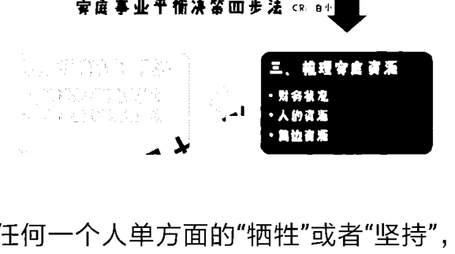

任何一个人单方面的“牺牲”或者“坚持”，可能都不会提升整个家庭的幸福度。当个人目标和家庭目标发生冲突的时候，往往就伴随着困惑和矛盾的产生。

真正的家庭事业相平衡，是来自于最优化的资源整合。

古典

作为男性，我只能一声长叹：当女人难，当好女人更难。现代社会一方面要求女性独立自主，一方面又期待她们贤良淑德，还希望她们“当个好母亲”，三者都做到完美几乎不可能。如果要做到满意，则需要和家庭成员共同界定，什么才是共同认为的满意。

既然不是一个人的家，就不是一个人的选择，也不是一个人的责任，更不是一个人的资源。所以，务必在选择前和家人重新梳理目标、重建平衡，那么每一个选择都可能成为让家庭关系更亲密的机会。

最后，记住我这句话——人生无奈，所幸总有选择。

### —— ◆ 首场线下大课来啦 ◆ ——

互联网时代加剧了两极分化，只有少数人能获得影响力和资源从而迅速崛起，一个人想要成为少数人，最关键的就是要懂得如何设计自己的人生。

人生设计的实质就是人生经营战略设计，就像经营一家公司一样，想要效益最大化，就该把未来的发展都规划好。

9月24日，北京，我将用一天时间讲讲人生设计的5个心法，帮你找到发展方向，get最实用的 人生设计方法论。

同时，课程当天还会有 一场“私享晚宴”，专门与私享会学员直接探讨你最关心的个人发展话题。仅限8个名额，点击下方图片，即可跳转至报名页面。

若点击无法跳转，请升级至最新版「得到」App。

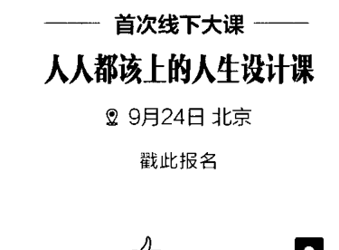


# 超级践行者 | 做自己的天使投资人 46-6

古典

本期超级践行者：David-范方林，他是物流行业运营管理的高管、企业内训师，他热爱学习，致力于成为一位充满正能量的生涯规划师。

2017年9月1日是个特别的日子，既是学生开学的日子，也是我35岁的生日。截止到今，我已经跟随古典老师在《超级个体》学习了300多天。这几天我也抽空拜读了古典老师的新书《跃迁》。

我发现，无论是在《超级个体》专栏里，还是在《跃迁》这本书里，古典老师都讲到一个观点：我们投资自己，与我们投资股市，本质上是同样的逻辑。

我想，如果我们把自己当成自己的天使投资人，细心地呵护、浇灌，不计较一时的得失，假以时日，自己也会成长为“参天大树”。

现在，我想谈谈“投资自己”与“投资股市”之间具体的相同点，把这份学习心得作为生日礼物送给自己，也送给超级个体的同学们。

## 一、都需要看准趋势，理解规律

个人职业发展的底层逻辑是“车日路”模型。“车”是自己，“日”是目标，“路”是发展通道。要用战略的眼光看到未来5-10年的职业发展趋势，结合自己的兴趣、能力、价值观，才能真正发现自己的职业路径。

另外，职业发展是有内在规律可寻的。底层的逻辑明白后，就会找到自己的职业目标和路径，然后就是高效地自我管理，慢慢地导出个人品牌，通过价值变现，持续输出，在量变到质变后，跃迁到更高一层。

十多年前我误打误撞进入传统的货运代理行业，这两年慢慢感受到了行业发生的深刻变化和行业企业经营的困难。趁着这艘“船”还没下沉，我开始探索自己内心真正想做的事情：培训、咨询、帮助和影响更多的人。特别是2016年9月开始接触“新精英”的系列培训后，我更加笃定了自己在这条路上的学习和成长。我就是自己职业发展的“天使”投资人！

投资股市何尝不是这样？结合政治、经济、科技、社会发展趋势，理解股市运行规律，根据自己的兴趣和能力（尤其是风险承受能力），找到适合自己投资的品种。还是以我的经历为例。我本性非常保守，股市中绝不敢碰垃圾股和题材股。虽然银行股在大多数人眼中不值一提，但我经过自己的了解和分析，在“百业之母”银行股中挑选一到两家标的，我发现在低估时买进，高估时卖出，确实是可以收到可见回报的。

## 二、都需要理性看待回报期

在《超级个体》里，古典老师曾经说我们要抱有5-7年的职业生涯回报期的心态。日拱一卒，不期速成。快即是慢，慢即是快。特别是他在《跃迁》最后一章《内在修炼》里讲到“在一个资源很多、多重博弈的世界，缓慢反应的能力比敏感有效很多，迟钝比敏捷更加重要。”“越大的系统，反馈周期越长，越需要更久的时间和耐心。”

今年上半年我从上家公司辞职时，想着马上可以投入教育培训行业然后做一名职业讲师。后来发现，虽然我可以从培训和生涯咨询中获得收入，但现阶段还不足以支撑家庭支出，想要马上变现获得巨大回报，是不太现实的。

其实股市也是一样的。今天买入，期待马上涨停，然后暴涨后卖出，这是典型的“一夜暴富”的心态。在我身边，有很多这样的亲人和朋友。他们到处打探消息，根本不理会买入的股票的基本面。一旦买入后，还没过两天马上卖出，再寻找下一个“做庄”的股票。你如果跟他说要长期投资，他一定会跟你急，然后骂你傻X。

本质上，股市投资就是理财的工具之一。我们投资钱，跟投资时间在自己身上一样，“一夜暴富”的心态是要不得的。巴菲特说过，如果你买入股票后不打算持有10年，那你就不要买入。

## 三、都是短期不可测，长期可预测

职业生涯发展过程中，不可能一帆风顺，肯定会有波折，反复甚至大大的变动。短期来看，你可能受不了，困难、挑战，还有他人的质疑甚至冷嘲热讽，但长期来看，只要坚持正确的方向，做高价值的事情，一定会有满意的回报。

股市里更是如此。谁能知道明天是涨是跌？如果涨的话兴高采烈，跌的话揪胸顿足，哪里还有心思正常工作、生活？我们不要设法去掌控短期的波动，因为那是不可测的。但长期来看，优质的股票，好行业（有巨大的成长性）、好的企业（诚实可靠），合理价格（越低估越好），买入后长期持有，等到市场狂热时再卖出，你一定会收获巨大的回报。

古典老师曾经说过一句话我深以为然：你自己的成长就是一切的基本面。投资不也看基本面吗？最大的基本面就是企业的成长性。时间是称重器，也是我们的朋友。如果我们把自己看成天使投资人，看准趋势、摸清规律，发挥自己的优势，找到适合自己的发展目标和行动路径，忽视短期的波动，长期“投资”，时间一定会站在我们这一边。我们也一定会成长为自己的样子！

发挥优势，瞄准目标，花点时间，赌上去。“总有一天，一回头，你已经站在山顶了。”

古典

这周我们讲理财投资，看上去好像是很专业的领域，但其实我们人人都做“投资”——把自己当成一家公司打造，为自己的增值投入大量的时间、金钱、资源。投入可控，但回报不可控。我们总会因为付出很多，却没什么收获而气馁；会因为践行了很多方法却没什么改变而怀疑人生。其实，投资和人生一样，都是一件急不来的事，我们能做的就是一一做好自己可控的事情，不断投资自我，耐心等待成为超级个体的那一天。

超级个体专栏还有40多天就要结束了，对你的陪伴可能得暂告一段落了。即使专栏结束，你对自我的投资也不要停。暂停无得，停止才是成长的最大敌人，所以一定要继续走下去。

精华 | 学习·管理·思考的专题串联 23-5

学习的最高境界是改变自己的行为。如果跟学习专栏前期相比，你已经成为一个更好的自己，那恭喜你，同时也期待你把它总结下来，与我们分享。

投稿要求：重点分享你学习《超级个体》以来的收获。可以是学习前后的改变故事、践行某一理念/工具带来的成长，或者是和这群志同道合的人发生的奇妙碰撞。只要让你有触动，都值得分享。期待你跟近6万位同学，说出你的故事。

## —— 首场线下大课来啦 ——

互联网时代加剧了两极分化，只有少数人能获得影响力和资源从而迅速崛起，一个人想要成为少数人，最关键的就是要懂得如何设计自己的人生。

人生设计的实质就是人生经营战略设计，就像经营一家公司一样，想要效益最大化，就该把未来的发展都规划好。

9月24日，北京，我将用一天时间讲解人生设计的5个心法，帮你找到发展方向，get最实用的 人生设计方法论。

同时，课程当天还将有一场“私享晚宴”，专门与私享会学员直接探讨你最关心的个人发展话题。仅限8个名额，点击下方图片，即可跳转至报名页面。

若点击无法跳转，请升级至最新版「得到」App。

# 男人好色、女人爱财, 是真的吗？47-1

47-1 男人好色、女人爱财, 是。

1、社会学家弗莱彻（Garth Fletcher）把择偶偏好分为：长相、性格、资源三类。

2、当条件发生冲突时，无论男女，在选配偶时都把“性格”放到第一位。

今天开始，我们聊聊关于爱情这个话题。

有人说，别和我扯爱情——这个社会我早就看透了，男人好色，女人爱钱，爱情就是个幌子。

还有一个段子是：“男人很专一，因为他们永远都只喜欢25岁的女孩。”

可是，男人真的好色吗？女人真的都是宁愿在宝马车里哭，不愿意在单车上笑吗？

这个话题最早被流传，是源于进化心理学家戴维·巴斯（David Buss）在1989年发表的论文——《人类择偶观的性差异》（Sex differences in human mate preferences: Evolutionary hypotheses tested in 37 cultures）。这个研究横跨了37个不同的文化领域，收集了10037个样本，结果得出男人和女人在择偶时最大的差异是一—男性更看重生育潜力，而女人更看重经济展望。

## 男人如何选择女人？

简单点说，男人喜欢挑年轻貌美的女孩。


最近《权力的游戏》里有一个男人都喜欢的角色——龙母。仔细思考下，她是不是完美地满足了上述所有条件？健康、美丽、标准的腰臀比和萝莉脸，还有一颗强大的圣母心。


## 女人如何选择男人？

好，讲到这里，估计已经得罪完所有女性了，我接下来说说女性喜欢什么样的男人。

女人更关注财力（资源）：


谈到这里，我们似乎越来越笃信男人好色和女人爱财这个结论。

但是这个结论其实是错的——巴斯的实验只是强调男女的差异性，但是男女择偶共同性其实远比差异性更高——那就是最看重“性格”。


你看，无论男女，选配偶时都把“性格”放到了第一位。如果你不是天生大美女，或者是年少多金，你其实还有一个蓝海赛场——修炼自己的性格，让自己变成一个性格宜人、靠谱、招人喜欢的人。

人、靠谱、招人喜欢的人。

当然上面说的都是长期策略，在短期选择，比如在一夜情里，男人和女人就集体堕落了。女人变得相当好色，就喜欢好基因的小鲜肉；男人甚至不再要求对方的年龄和长相，他们最看重的就是对方不要求承诺，别太一本正经，热爱滚床单就好了。

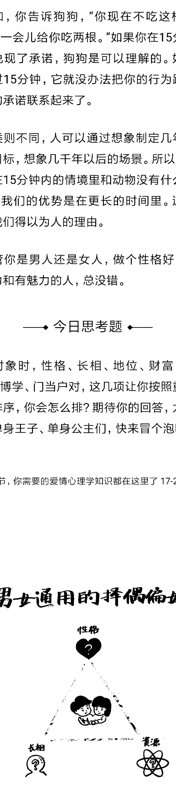

上面的说法可能有点夸张，我也不是鼓励大家一夜情，而是想借此引出进化心理学里的一个说法——存在的并非就是合理的。

进化本身无对错，只是在我们身上刻下的痕迹。我们并不能因为男人和女人保留着过去的本性，就认为男人应该好色、女人贪财是正确的。了解这些底层的原理，是为了我们能更好地理解自己的天性，更接纳自己，也更快乐。

我们长期、短期的择偶策略这么不同，也是我们动物性和人性最大的区别。生物学家发现，狗的智商只能理解15分钟以内的未来。

比如，你告诉狗狗，“你现在不吃这根骨头，一会儿给你吃两根。”如果你在15分钟内兑现了承诺，狗狗是可以理解的。如果超过15分钟，它就没办法把你的行为跟之前的承诺联系起来了。

人类则不同，人可以通过想象制定几年后的目标，想象几千年以后的场景。所以，人类在15分钟内的情境里和动物没有什么两样；我们的优势是在更长的时间里。这也是我们得以之为人的理由。

不管你是男人还是女人，做个性格好、有能力和有魅力的人，总没错。

# ——◆ 今日思考题 ◆——

找对象时，性格、长相、地位、财富、靠谱、博学、门当户对，这几项让你按照重要性排序，你会怎么排？期待你的回答，尤其是单身王子、单身公主们，快来冒个泡吧。

情人节，你需要的爱情心理学知识都在这里了 17-2

## 男女通用的择偶偏好


社会学家弗莱彻（Garth Fletcher）把择偶偏好分为：长相-性格-资源三类。但是当条件发生冲突时，无论男女都会把性格排在第一位。

在选择另一半时，应该选择相似的，还是互补的？

### ——◆ 首场线下大课来啦 ◆——

互联网时代加剧了两极分化，只有少数人能获得影响力和资源从而迅速崛起，一个人想要成为少数人，最关键的就是要懂得如何设计自己的人生。

人生设计的实质就是人生经营战略设计，就像经营一家公司一样，想要效益最大化，就该把未来的发展都规划好。

9月24日，北京，我将用一天时间讲讲人生设计的5个心法，帮你找到发展方向，get最实用的 人生设计方法论。

同时，课程当天还会有 一 场 “私享晚宴”，专门与私享会学员直接探讨你最关心的个人发展话题。仅限8个名额，点击下方图片，即可跳转至报名页面。

若点击无法跳转，请升级至最新版「得到」App。

# 伴侣应该找相似的, 还是互补的? 47-2

47-2 伴侣应该找相似的, 还…

- 1、两个相似的人, 比两个互补的人更可能走到一起。
- 2、相似性不是指经济状况和社会地位上的门当户对, 而是指价值观、消费观等精神层面的“门当户对”。

到底应该找一个相似的, 还是互补的人在一起? 这是一个时常被争议的话题。

你是找一个性格、身份都相似的人? 还是找一个可以带给你新鮮感、和你完全不同的人? 这两种说法其实就是心理学里的“互补论”与“相似论”之争。学完今天的内容, 单身的你, 也许会知道自己该找什么样的人; 已经恋爱的人, 会知道如何把两者的关系拉得更近。

## 相似的人更可能在一起

先来看一组调查数据: 爱荷华大学的罗珊红和伊娃·克洛希调查了291对新婚夫妇, 发现伴侣越是相似, 对自己的婚姻就越满意。另外一项针对202对情侣的调查则显示, 分手的伴侣在很多方面都有差异, 比如性别角色、浪漫情怀、宗教信仰等等。到目前为止, 心理學界的主流观点非常一致——我们更加倾向于找相似的人。

你可能会问, 相似性是不是民间传说的夫妻相? 但是, 这种说法靠不住啊, 可能是他们在一起久了才相似的, 而不是因为相似才在一起的。


心理学家继续通过实验排除了这个可能——两个人的相似程度和长期在一起生活没关系, 其实就是两个人当时主动选择来的。

比如, 一个家庭中兄弟姐妹在一起生活十多年, 长相和脾气也没有越来越像, 这就是一个反证。

更有意思的是, 加州大学圣迭戈分校的遗传医学教授福勒 (James Fowler) 和耶鲁大学学者克里斯塔基斯 (Nicholas Christakis) 的研究发现: 这些夫妻之间不仅长得像, 性格像, 他们的基因相似程度也比其他人高, 相似度大概类似他们 AFTER ... 如果追溯到两个人的十八代以前, 很可能会是同一个祖先。

## 门当户对是正解吗?

实验表明: 相似性, 也就是“门当户对效应”的确存在, 但这里说的门当户对不是经济状况、学历水平、社会地位的相似, 而是一种价值观和才智上的门当户对, 也就是一种精神上的门当户对。

比方说《梁祝》里, 祝英台的员外老爸找到了太守之子马文才, 希望撮合二人。这看上去是“门当户对”的, 但为什么最后酿成了梁祝的爱情悲剧? 这就是因为他们仅仅看到了物质层面的门当户对, 而看不到精神层面的门当户对。祝英台在外读书, 放在今天也算是留洋青年; 和梁山伯同窗学习, 每天吟诗作赋——在精神层面和才情层面都很般配。而且那个年代的读书人都是潜力股, 祝英台未必不会是未来的太守夫人。仅仅因为“门当户对”而棒打鸳鸯的故事, 在今天的社会里也比比皆是, 非常可惜。

此外, 我们在生活里还经常听到一些关于“凤凰男”与“孔雀女”之间的故事——(凤凰男指的是出生在农村, 在城市里打拼的男生; 而孔雀女则是指在城市里养尊处优的女孩。) 孔雀女一开始喜欢凤凰男的坚韧和勤奋, 不顾家长反对坚持在一起, 婚后却因为种种的生活习惯、消费观念等原因冲突, 最后导致分开。很多人认为, 这就是门不当, 户不对的问题。

其实两个人是否相似, 跟出身有一定相关, 但没有必然关系, 我认识非常多处得很好的“孔雀”和“凤凰”——好关系的秘密是他们发展出了—套对于当下生活一致的价值观、消费观。他们持续保持着精神上的门当户对。因为, 即使两个人背景完全一样, 当一方价值观发生了改变, 而另一方没同步跟上, 两个人也会渐行渐远。

## 为什么精神上的一致性这么重要?

因为一致性意味着这两个人目标一致、判断相似, 只不过分工不同; 即使有了冲突, 为了—致的目标, 也更容易调和, 这是一种进化上的优势。

有人可能会反驳——不对, 为什么我身边有很多霸道总裁和软妹子也过得很幸福呢?

这就是我开头提到的一—互补性的确存在。

最典型的例子就是“支配型”与“顺从型”的结合。一个表现得主动、强势; 另一个则内向、温顺。但是这种互补更多是行为和习惯层面的互补, 前提还得是双方有共同的目标和价值观。所以, 说到底, 互补的背后还是相似性。

所以, 在一段关系中, 如果两人的核心观念不冲突, 又在行为、能力上互补, 也许是最好的组合状态。

我们最爱的, 终究还是“最熟悉的陌生人”。

理解了好的爱情是找个相似的人, 对我们有什么启发呢?

- 1. “你若盛开, 清风自来” “你对了, 找的人才能对”—不再是鸡汤, 而是有一定道理。

因为你的 Mr. Right 是和自己相似的陌生人, 如果一个人不认可自己, 没把真实的自己活出来, 他就会把这种批判性投射到相似的人身上去——讨厌跟真实的自己相似的人。所以, 等你自己接纳自己了, 喜欢自己了, 合适的人也就变得可爱了。

- 2. 别被所谓的“门当户对”绑架。

门当户对, 尤其是社会地位和经济条件的门当户对只是一种社会学概率, 而你自己的感觉才是大概率事件。

在父母之命, 媒妁之言时代, 门当户对是一种选择方式, 掺杂了更多社会因素; 在今天的时代, 我们可以自由恋爱, 有足够长的时间互相了解, 更容易实现精神上的“门当户对”。

- 3. 在感性中寻找相似性, 在理性中走进婚姻。

如何验证相似性? 最靠谱的方式还是在深度接触中的“感觉”。所以恋爱是要“谈”的, 只有“谈”才能看清两个人的相似性。恋爱需要感性, 步入婚姻则需要理性。

愿你爱上熟悉的陌生人, 遇上重逢的灵魂。

# —— 今日思考题 ——

“相似性”往往代表着, 你最欣赏恋人的那个方面, 可能是你最爱自己的地方, 或者你最欠缺的地方。那么, 你最爱恋人的哪一点? 这对你有什么启发呢? 欢迎在留言区分享你的感受。


两个相似的人, 比两个互补的人更可能走到一起。但是相似性不是指经济状况和社会地位上的门当户对, 而是指价值观、消费观等精神层面的门当户对。

# 庆6万特别放送 | 30张精美手账，一键收藏

古典

今天是《超级个体》专栏陪你走过的第326天，我们迎来了第60000名订阅用户。我一直在想，应该送一份什么样的礼物给你。

我想：

- 首先，这份礼物应该是 美的，能给你视觉上的享用；
- 这份礼物还应该是 实用的，能给你提供有效帮助；
- 这份礼物还应该是 精炼的，能替你节省更多时间；
- 最后，这份礼物还应该是你我 共同的创造，值得我们一起珍藏。

所以，我精选了30张“超级个体”学员“老P”亲手制作的学习手账送给你。

老P把每篇文章最核心的知识点和最实用的工具提炼了出来。已经学习过相应专栏内容的同学，可以快速复习；新加入的同学，可以根据自己的兴趣点和需求，点击图片下方的文字，一键链接到对应的文章里，点对点地学习。

这些精美手账可以展示出个体学员们极强的视觉化思考和表现能力，我也借此请幕后创作视觉学习笔记的小伙伴们亮个相。

希望你喜欢，再次感谢60000位同学的陪伴。


升级自身能力 解除成长焦虑 我为《超级个体》代言

邀请你也加入这个60000人的“超级共同体”

## —— 老P的学习手账 ——

每天起床必做两件事情。首先打开古典老师的超专专栏，逐字逐句看完。然后提炼出要点，在心中盘算着怎么用一页PPT呈现出来。

为了帮助自己记忆专栏内容，我每天都会做一页PPT，分享到各个学习群。能将兴趣爱好和交朋友结合起来，这让我感到很兴奋，希望以后能链接更多的朋友！


↑ 一键直达：10分钟学会资产配置 46-3

↑ 一键直达：学会区分资产与负债：让钱越花越多 46-2

↑ 一键直达：建立“横向领导力”的5个建议 45-4

↑ 一键直达：变革公式：为什么你常立志，常失败？ 45-3

↑ 一键直达：情境领导力：四步进阶，独当一面 45-2

↑ 一键直达：领导力：你至少拥有6种权力 45-1

↑ 一键直达：生逢顾问日 | 鸡头与凤尾：是在大公司做中层，还是在小公司做高层 43-5

↑ 一键直达：搜商：万物皆有路径且可达 43-1

↑ 一键直达：生逢顾问日 | 读EMBA到底有没有用？ 42-5

↑ 一键直达：想不出好点子？试试这3种场景 42-4

↑ 一键直达：掌握3个创新思路，你也可以创新 42-2

↑ 一键直达：抗逆力：逆境中的4个生存策略 41-4

↑ 一键直达：你是举室里的007吗？ 39-2

↑ 一键直达：自我教练：打赢你的“内在”之战 39-1

↑ 一键直达：生逢顾问日 | 少年，每段人生都有它的乐趣 38-5


↑ 一键直达：问什么“问题”，得什么“结果” 38-3

↑ 一键直达：有限决策：治好选择恐惧和完美主义 38-2

↑ 一键直达：如何正确地做出一个“艰难的决定” 38-1

↑ 一键直达：转化逆境：做自己的好朋友，问自己4个好问题 37-5

↑ 一键直达：自我对话：大脑里的弹幕系统 37-4

↑ 一键直达：学会3个好问题，倍增你的创造力 37-2

## “超体”精美手账展

每一张你看到的成长卡片，都是我手绘的，从草稿到成稿，中间会经过内容提炼、画面布局、意象选择、视觉呈现、描线上色等很多环节，对内容要求极高的古典老师，会参与到其中的每一个环节。

↑ 一键直达：为什么说，梦想会妨碍你成功 6-1

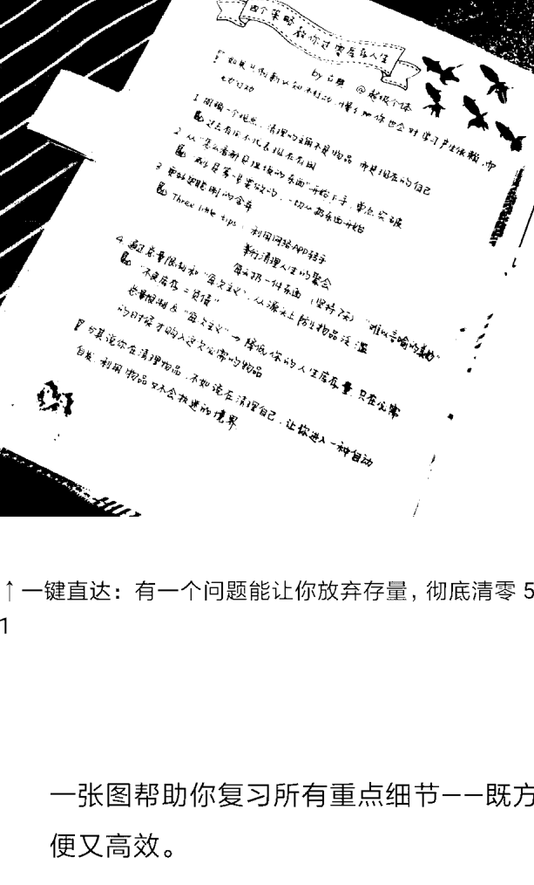

↑ 一键直达：有一个问题能让你放弃存量，彻底清零 5-1

一张图帮助你复习所有重点细节——既方便又高效。

笔记生产过程：1. 第一遍阅读，标记所有精彩的内容；2. 第二遍阅读，构思笔记大纲；3. 第三遍阅读，按照大纲的顺序，在A4纸上总结出所有的重点细节；4. 通过Xmind将笔记转化为形象美观的思维导图。

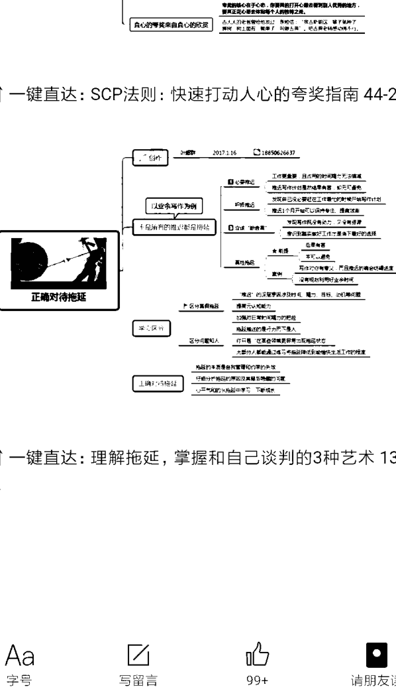


↑ 一键直达：SCP法则：快速打动人心的夸奖指南 44-2


↑ 一键直达：理解拖延，掌握和自己谈判的3种艺术 13-2

Aa 字号

写留言

99+

请朋友读

## 爱情面前，如何“过招”？
47-3

47-3 爱情面前，如何“过招”？ ↓

“拷贝式择偶”：在信息不足的时候，我们倾向于通过观察别人怎么对待这个人，来评估这个人的价值。

我们谈了两天关于男人和女人的择偶策略，听上去爱情好像已经被分解成一个个公式，只要按照公式就能找到自己的真爱。但是，爱情是世界上最复杂的事，在真实的世界当中，爱情的选择是一个双向的过程，你在选别人的时候，别人在选你，每个人都要展示自己，同时又要权衡对方的表现。所以心理学家继续研究一个问题：如何在人群里发现自己喜欢的人，以及如何吸引到自己喜欢的人？

### 如何找到最优选择？

心理学家做过一个爱情配对实验：

研究者制作了100张卡片，卡片写上1~100共100个数字。随机找来男女大学生各50名，单数卡片给男生，双数卡片给女生，数字贴在每一个人背后，而且自己不能看自己的数字。

在游戏过程中，其他人可以看到你背后的数字，也可以任意交谈，但是不能把你背后的数字告诉你。游戏的目标是在规定时间内找到一个异性配对，两个人背后的数字加起来越大，获得的奖金越高；如果落单，则拿不到奖金。

- 1. 大部分的爱情里，相似性是起作用的；
- 2. 如果你一直等完美选择，很容易连最优选择也错过，优秀的人要在确定自己价值以后，主动给别人机会，完美选择是等不来的；
- 3. 如果你的“竞争力”不高，又非要和高分结合，也许就需承受有一些“婚内不平等条约”，比如多承担一些家庭责任。
- 4. 这个游戏的底层逻辑是，两个人一定要结合，才能拿到奖金。如果对这个游戏不感兴趣，你可能会选择弃赛。但是放弃结合不等于放弃恋爱，在生活里，你可以按照自己标准制定游戏规则。

### 如何让自己更受欢迎？

说到这里，你可能还是有点疑惑——因为在真实的生活里，一个人的分值不会被贴在背后，我们也不可能去仔细了解每个人，那怎么评估一个人的“竞争力”呢？

这就要提到择偶策略里的“拷贝式择偶”——在信息不足的时候，我们倾向于通过观察别人怎么对待这个人，来评估这个人的价值。

- 1. 及早入场：身边有追求者，本身就会提高你的竞争力——不是成为花花公子，而是尽快学会和异性自然、融洽地相处，这会让你更受欢迎——不要等到确定要结婚，才开始谈恋爱。
- 2. 提高竞争力：千万不要把爱情想得太纯粹，爱情包括了精神部分，同时也包括了动物性和社会性的部分——永远不要拆健康、化妆、展现潜能、秀智力等让自己外在更有竞争力的东西，毕竟，别人首先是通过你的外在来了解你的。
- 3. 在新的赛道取胜：越是稳定的环境，比如学校、单位、相亲角……“拷贝式择偶”的风气就越重。如果你不是社会主流的“优胜者”，一定要找个新的环境换个赛道。比如组团出游、集体培训、义工活动，在新的环境里，大家开始切换到“自我探索”模式，你的分数会被重新设定，别人会有机会从更多角度发现你的魅力。

### ——今日思考题——

你觉得拷贝式择偶更加有效，还是自我探索式更为有效？为什么？


我们在选择伴侣时，会受到很多隐性的选择策略的支配，但爱情不是概率，也不是公式，它总是充满意外。我们能做的，只是通过这些策略增加爱爱的可能性。

### ——首场线下大课来啦——

## 两个角度，帮你判断该不该生娃 47-4

47-4 两个角度，帮你判断该...

关于生不生娃的选择：清晰展现可能，鼓励自主选择。

相信你肯定有过被七大姑八大姨“催完恋爱，催结婚，催完结婚，催要娃”的经历。在很多传统家庭看来，这是老祖宗传下来的规定动作，必须完成。我们大部分人都会“惯性”结婚，然后“很自然”地生个孩子——很少有人会停下来思考这件事。

如果你跳出惯性，停下来认真思考，那么你不得不承认：生还是不生真不是一个简单的问题。今天我们就尝试讨论下这个话题——我并不准备给你“一定要生”或者“一定不要生”的结论——这不是超级个体的精神。我的态度是，清晰展现可能，鼓励自主选择。生不生孩子，不是一道辩论题，也不是一道是非题，而是一道选择题。

如果你还没有生育，现在你有一个重新思考这个问题机会；如果你已经为人父母，你可以更好地理解自己的选择，从而把这个选择的优势发挥到极致。另外，你也可以以父母之外的身份去给你的朋友、亲戚，甚至是你的儿女一些建议。

"丁克"，是" DINK "（Double Income No Kid）的音译，指的是"双收入、无子女的家庭"，主要是夫妻双方有生育能力和经济能力，但是主动选择终生不要孩子的家庭。

### 从经济学角度看“生娃”

诺贝尔经济学奖得主、美国经济学家加里·贝克尔（Gary Stanley Becker）创立了“家庭对孩子的需求”理论。

### 从生涯角度看“生娃”


### 优势

### 选择生娃——继承家业，延续社会地位

### 今日思考题

你自己是如何看待生孩子这件事情的？你赞成生还是不生？欢迎你在留言区分享自己的观点。

母亲节特辑 | 女人28，生产、生活还是生娃？（加餐

## 如何选择生还是不生

## 如何选择生还是不生

|  | 生 | 不生 |
|---|---|---|
| 消费品 or 生产品 |  |  |
| 益 | • 亲子共同成长的快乐
• 中国传统价值观的贯彻 尊重与传承
• 年老后的依靠（情感 精神 抚养） | • 经济压力小
• 花更多时间投入自我实现
• 保持二人世界和谐稳定 |
| 弊 | • 巨大的时间 经济与精力投入
• 必须得牺牲的东西 | • 家庭和谐压力
• 年迈后孤独 情感缺失伴随 |

生不生娃不是一道辩论题，也不是一道是非题，而是一道选择题。生娃有优势也有风险，每个人都应该有自己喜欢的选择，这是一个自由人很重要的权利。

### —— ◆ 首场线下大课来啦 ◆ ——

互联网时代加剧了两极分化，只有少数人能获得影响力和资源从而迅速崛起，一个人想要成为少数人，最关键的就是要懂得如何设计自己的人生。

人生设计的实质就是人生经营战略设计，就像经营一家公司一样，想要效益最大化，就该把未来的发展都规划好。

9月24日，北京，我将用一天时间讲讲人生设计的5个心法，帮你找到发展方向，get最实用的 人生设计方法论。

同时，课程当天还会有“私享晚宴”，专门与私享会学员直接探讨你最关心的个人发展话题。仅限8个名额，点击下方图片，即可跳转至报名页面。

若点击无法跳转，请升级至最新版「 得到 」App。

# 古典 面向得到用户
—— 首次线下大课 ——
人人都该上的人生设计课
9月24日 北京
- 戳此报名 -

今天是古典陪伴你成长的第 329 天，一起加速，成长为更好的自己。

### 关于丁克的思考

提交留言可与专栏作者互动

## 生涯顾问日 | 如何找到全身心投入的职业？ 47-5

47-5 生涯顾问日 | 如何找到...

## 古典

今天的生涯顾问日，我们讨论一个职场转型中经常会遇到的问题：如何找到自己喜欢的工作，并且能够顺利切换？

我身处在一个夕阳产业，公司在同行业当中处于中下游水平，工作居无定所，跟随工程走，地域方面比较不稳定。在公司内可看见自己晋升的路线，但是领导岗位并不吸引我。

我希望可以走出去，能够找到自己热爱的领域，但是还没能找到自己适合的方向。我做过很多测评，价值观测评中最核心的三个：美感、智力刺激、成就感；优势测评中突出的5项：学习、理念、思维、分析、战略；成就事件分析中，让自己骄傲的能力包括：创造性、专注意力、逻辑性。

思考这么多，还是不太清楚：我到底是要离开当下的工作，去找一个符合当下工作经验的另一份工作？还是继续潜心钻研自己的天赋，找到自己可全身心投入的领域，然后再离开？

今天，我请来了一位职业转型知名行家——廖舒祺老师，她帮助数百人解决了职业转型的困惑，我们一起来听一听她对转型的建议。

生涯咨询师；外企资深HR；现任世界500强外企资深人才发展经理；“在行”职业转型类知名行家；赤兔特邀职场导师；新精英生涯职业讲师；DISC行为分析认证讲师；SCHOUTEN TFT认证讲师。


彩色墨水，你好！

李宗盛唱过一首歌——《山丘》，你看，你现在就站在自己职业的第一个小山丘的顶上。这个时候，我们对于工作的爬坡期已经过去了，业务开始熟练，不再疲于应付，挑战也随之变少，周围的环境也从陌生到熟悉，走到了相对平稳的一个小山丘的顶上。

但是，这还不是高山，“有想法”的职场人就开始从每日繁杂的事务中抬起头想自己，想未来，越想越觉得手头这份工作不顺眼：行业夕阳，没有前途，出差频繁，没有生活....哎，真想找到我天生属于的那片“新大陆”，让我一边淡若恋爱，一边饱酒着天赋和优势，一边实现多元的人生梦想......

但是你发现测评也做了，专家也请了，相关的文章天天读，怎么还是找不到呢？难道是因为还不够投入？好，那打起12分的精神接着研究天赋......

但这份工作实在太痛苦了，我啥时能离开？找到“天赋”那天？那是聊聊天啊，我已经坚持不下去了，要不找个浅点的坑先跳下去再说吧......嗬，不对，浅坑还是坑，苍天呐，我该怎么办？

嘿，别笑，我只是把自己之前有过的心理历程描写出来而已。我有这个阶段，每个人也都有这样的阶段......从爬坡期走到山丘顶部，正好是每个人抬头看路，重新定位的好时机。

不过意愿有了，但如果缺乏正确的认知和策略，这个期望非但不会让我们突破瓶颈，反而会让我们更加心绪不宁。

那么什么才是进入自己热爱的工作、加速发展的好的认知和策略呢？

我们先来谈一个认知：找到职业甜蜜区


如上图所示，这个理论是由美国的职业发展专家 David Pollard 在《找到职业甜蜜区》一书中提出，图中红色的部分是 Sweet Spot（最佳击球点），原意是在棒球比赛中，在某一个区域击球，球员特别容易打出好球或者本垒打，这一点意味着各方面条件都搭配得恰到好处的那一点，此时运动员可以轻松完成原本很难的运动任务。在职业中间，我们也有甜蜜区，人们可以更好地发挥他的工作表现。

找到一份真正适合自己的工作的甜蜜区有三个维度来锁定：

### 维度1: 自己喜欢的

我们都想找到自己感兴趣的职业，但大部分人在兴趣这件事情上有两种误区：

误区1: 靠测评来确定自己该“做什么”：

事实上，一份测评只能告诉你什么职业是有可能感兴趣的，但是具体是哪个呢？则需要你用行动来探索。可能性越是不确定的事，越需要直接行动。

误区2: 混淆了兴趣和享乐：

兴趣（interesting）不是享受（pleasure），比如很多人喜欢看电影，但对于每天看片6个小时，回家写4小时影评，其实不太感兴趣。而一个忍受不了枯燥、重复付出的人，换到任何领域都享受不到职业里最精华的部分。

### 维度2: 自己擅长的

选择职业不能只看兴趣，还需要考虑自己是否擅长做这事。前期可以靠勤奋去补短，长期来看，必须要和自己的优势相结合，优势和天赋并不是相等的。关于优势和天赋的刻意练习，可以回溯16周的“优势天赋主题”。

问答 | 优秀到底是选择了优势，还是刻意练习？16-4 从天赋到优势，你还需要3种“催化剂”16-6

### 维度3: 有价值的

这里的价值，应该是指足够多的回报。一份理想的工作除了满足兴趣，有能力Hold住，还需要赚到足够的回报。任何不能作为主要收入来源的职业顶多当个副业或者爱好，你需要找到那份可以支撑你的主要收入的具体职位，而不是一个方向。这里需要注意的是适合你的职位，同一个职业有可能赚钱，也有可能和你没有什么关系。

用甜蜜区模型思考一下，当前的工作是不是自己喜欢的？擅长的？能给自己足够多回报的？如果不是的话，我也建议你同时访谈几个该行业的专家打开眼界，听一听他们的意见，也许除了领导的职位以外，这个行业里还有一些职位可以满足以上几个需求。如果实在没有，这个模型也可以用来衡量未来的工作是否合适。

### 策略：行动体验四步法

接下来，我们用一个策略：行动体验四步法，来慢慢锁定并转型到自己喜欢的职业方向。什么是行动体验？我们讲个学员多隆（化名）的真实案例。

多隆在职业转型前是部队的 一名军官，上尉军衔，每天在大院转悠，跟战士们谈人生。他的转型是用了三年左右的时间，成为一家互联网公司的副总裁。

他是如何做到的？

多隆从国内一所985国防院校毕业后，顺利考章进入部队，入伍后因为他表现优异，成为同期入伍士兵中率先被授予上尉

异，成为同批入伍伙伴中最先被授予上尉军衔的士兵，前途一片光明。但当他看着闪闪发光的一杠三星后，陷入了沉思：“这是我想要的人生么，几十年后，让我坐在主席台上是我想要的生活吗？”

得到否定的答案后，他决定开始转型，改变自己。

审视自身，除了带新兵和做思想工作外几乎没有其他技能。他想起自己大学里对计算机有兴趣，到现在还能写几行代码，请教专业人士后，他找来了尘封已久的《JAVA编程》一书，开始行动。第二年，刚好赶上部队的信息化改革，一堆外包项目找不到懂行的人管，这个机会自然落到了他头上。于是他一边监督项目，一边向外部的专家学习编程。

这样又过了一年多，他的能力达到了可以独立操作项目，对技术工作的热情也越来越高。他开始运作从“部队转业”，同时还通过校友圈找到了在互联网公司任职的校友，并请教行业选择的问题。

随后，他在师兄的指导下用爬虫从专门发布融资新闻的“IT桔子”上，把近一年获得投资的所有初创公司都抓取了下来。结合自己的优势和市场前景逐一进行分析后，他把目标锁定在了互联网金融和互联网医疗两个行业上。

再后来，通过校友的积极推荐，他加入了一家国内最大的互联网医疗企业。凭借他自己的努力和优秀，多隆仅用了不到两年的时间，成为这家公司的产品副总裁。这是他决定转型后的第三个年头，他完成了一个华丽的转身。

多隆的转型故事就是一个“行动体验四步法”的完美展示：

### 第一步：采取行动看看结果会怎样，而不是什么自我探索，放飞优势。

多隆在回想起自己的兴趣之后，采用的是重拾课本和积极实践；用行动体验而不是测评来回答“自己到底喜欢做这件事吗？擅不擅长？”这样的问题。

### 第二步：通过更多的项目和临时性任务取得小范围的成功，进一步确认自己探索的方向。

在确定自己喜欢编程之后，他并没有做大动作，而是在原来的工作范围之内做了一些探索性的项目，进行小范围尝试。这个阶段可以是副业、临时性项目，甚至可以是一个新的方向的培训学习。小范围尝试是一种更小、更快、成本更低的敏捷尝试方法，不妨理解为一种保守性的投资，如果方向很好就直接推进，如果不对的话，技能也可以迁移到其他地方，而且也没有什么损失。

### 第三步：锁定方向，瞄准职业。

当确定要动的时候，能力已经展现出来了，他查阅了大量的资料，结合自己的兴趣和优势。这个阶段已经投入了1年多，他已经知道自己的优势是什么，而不再是天赋是什么——天赋需要结合自己的能力形成竞争力，竞争力需要和别人PK才会成为优势。同时他也联系了很多真正在创业的师兄师弟，逐步锁定了目标。一旦锁定以后，就全力以赴。

### 第四步：建立新人脉，搭建人际网络。

这一步，其实贯穿整个行动计划。多隆的转型之路无论是开始的行动建议还是后来的平台转换都离不开人脉的助力。重要的人脉包括业内的专业人士，包括了师兄，包括了校友圈，包括了他提供机会的部队上司。当你确认了自己要去的方向之后，要尽快为自己构建新领域的导师和伙伴圈，这些人给你带来的机会往往让你意想不到。

“行动体验四步法”是一个人转型很稳健的四步。

回到你的问题，我的建议是：

第一，不要着急找工作，而是用3个月的时间用这4步开始行动。

第二，千万不要埋头独自钻研天赋，因为只有和同行PK，才会真的知道什么是优势，什么是天赋。即使是天赋，如果没有持续的价值回报，也是扛不住的。

大概确定了方向，小范围投入，最后锁定方向，一击必中。带着你的测评结果，落地出几个好方向，开始行动。

记住，当未来越不明显，越要小步行动，而不是纸上谈兵。

古典

行动体验四步法理清了我们要做什么。有人说，测评是不是就没用了呢？其实不是，测评是个好东西，但全信它不如无它。如果你本来就没有什么是兴趣优势，再好的测评也测不出来；测评更多是帮你向内看，但是你身边的职业机会需要你往外看，需要你自己去发现。

真正的兴趣是在体验中来的，真正的优势是在竞争中来的，真正的价值是在取舍中来的，这些都需要从行动中间来。希望你尽早开始行动。

## —— 首场线下大课来啦 ——

互联网时代加剧了两极分化，只有少数人能获得影响力和资源从而迅速崛起，一个人想要成为少数人，最关键的就是要懂得如何设计自己的人生。

人生设计的实质就是人生经营战略设计，就像经营一家公司一样，想要效益最大化，就该把未来的发展都规划好。

9月24日，北京，我将用一天时间讲讲人生设计的5个心法，帮你找到发展方向，get最实用的学设计方法论。

同时，课程当天还将有一场“私享晚宴”，专门与私享会学员直接探讨你最关心的个人发展话题。仅限8个名额，点击下方图片，即可跳转至报名页面。

若点击无法跳转，请升级至最新版「 得到 」App。

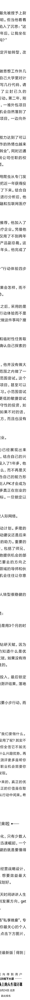


# 武志红：爱情是美妙感和受挫感的合体 47-6


古典

本周是爱情心理学专题，我为你请了一位在这个领域很有发言权的成长导师——武志红（订阅专栏《武志红的心理学课》的主理人）。他是北京大学心理系研究生毕业，也是中国特别受欢迎的心理学家之一。他说，“学习心理学是为了帮助我们更好地成为自己，拥有一个自己说了算的人生。”这跟我们超级个体的目标是一致的——成长，长成自己的样子。

可是，“爱情总有意外”，在爱情里，很多事往往不是我们说了算的——

什么时候，爱上了谁，不是我们说了算。

在爱情里保持什么的姿态，不是我们说了算。

什么时候，不爱了，也不是我们说了算。

那么，在爱情这个奇妙的世界里，我们应该如何做自己呢？

我从超级个体学员们提出的问题里，选了三个比较典型的，请武老师亲自为你解答。


爱情和成瘾物质都会让人产生多巴胺，为什么爱情的瘾会消退，而成瘾物质的瘾却难以消退？

我不是生理学家，不是特别懂多巴胺的分泌机制，但可以讲人性的规律。

爱情会产生多巴胺，成瘾物质也会产生多巴胺，这两者有相似之处。但不同的是，爱情不可控制，控制另一个人，是世界上最难的事情之一。所以，爱情也容易带给人巨大的受挫感。美好的感觉，和巨大的受挫感，结合在一起，这才是爱情和人性的全部。

因为人难以控制，所以我们必须在爱情的关系中，学习如何放下自恋，学习依存，学习放下自我，去碰触对方的真实存在。

相反，成瘾物质是容易控制的，只要有钱，就可以找到成瘾物质，并且它难以给人制造巨大的受挫感，成了一个可以不断自我刺激的源头。但当人不断这样做时，这个看似容易找到的快乐，却会让一个人陷入到远离现实世界的虚幻中，甚至最终让一个人崩溃。

在两性关系里，如果因为双方的成长不同步，造成个性差异越来越大，分还是合？

这个问题看起来合理的答案是，还是分了好。

但是，作为见了无数故事的咨询师，我深深地知道，事情要比这样的表述复杂很多。

譬如，两个看起来社会经济地位千差万别的恋人，可能是绝配。因为那个看起来地位高的，心理上却有无比自卑的一面，他需要找一个很差劲的人，来衬托自己的伟大。甚至，他还会摧毁对方、阻碍对方，不让对方发展，以此来保证自己在这个关系中的优越感。

所以，作为咨询师，我通常不会给对方提建议，而只是去理解来访者的内心世界，最终让他们去做选择。

婚姻如市场，两个婚姻市场价值相匹敌的人，最容易构建起稳定平衡的关系，但婚姻市场价值，除了外显的能力、金钱、地位和相貌外，还有心理市场价值，而两个看似外在市场价值相距极大的人，他们的心理市场价值，却可以是相匹敌的。

为什么越喜欢一个人，越容易产生自卑心理？

为什么越喜欢一个人，越容易产生自卑心理？

用美国心理学家科胡特的理论，可以回答这个问题。

他认为，每个孩子一出生时，认为自己是神，而其他万事万物都是满足自己的工具，这时自己是高高在上的。

但很快，孩子发现，自己什么都不是，妈妈才是神，因为自己的一切需要被满足，都有赖于强大的母爱。

然后，孩子发现，父母也是一般人，而老师才是神。

再然后，他们发现，自己身边人都不神，于是开始追星，认为明星或名人才是神。

最后，他们发现，没有人神，而神，只可能在生活之外。

当明白这些后，他们会将人视为和自己对等的存在，这个时候再去爱的话，就不太会抬高对方到神的地步，于是两个人就可以平视。

但是，如果这个过程严重没有完成，一个人还是处在在身边找神的地步，那么一旦爱上一个人，就会觉得对方是神，而自己什么都不是，于是产生严重的自卑。

古典

感谢武志红老师的专业解答，他从心理学理论的角度，为我们拆解了那些看似无解的问题，如果你现在正处于感情的困扰中，相信对你会有帮助。当然了，如果你想天天请武老师为你答疑解惑，可以点击文末的图片，订阅《武志红的心理学课》。

我很认同武老师的一点是，他说，他做咨询通常不会给对方提最终的建议，而是去理解来访者的内心世界，最终让他们自己去做选择。这跟我在生育领域的原则是一致的。因为一方面，我们相信，每个人都有选择的能力和权利；另一方面，即使对方再专业，也不如你了解自己。

就像我之前说的，我们不能按照道理、公式和概率去生活，爱情总有意外，希望每一个选择都是最真实的你。

# 间隔年：让人生多一种可能 48-1

48-1 间隔年: 让人生多一种...

间隔年（Gap Year）：间隔年传统起源于17世纪英国贵族子弟的“壮游”（The Grand Tour）——用几年的时间去游历、学习、开阔眼界。后来，间隔周期演变成一年，这一年就像是过去连续生活的一个裂缝，所以被称为 Gap Year。

这周我们的主题是“人生可能”，之所以要讲这个主题，是因为我观察到很多人的 人生就像挤地铁一样。每到一站，你就被人群裹挟着下来了，有可能你并非是要在这 一站下车。很多人的 人生不自由并不是缺乏选择意志，而是缺少选项。我这周会 给你讲四个很有意思的人生选项，我不会 鼓动你选它或者不选它，只是当你知道了 那么多人生可能之后，也许你会有更好的 选择。

这个主题从“间隔年”开始，我们大部分人 的人生都像一个很稳定的电影剧本。从一 路上大学——上好的幼儿园，好的小学，好的 中学，好的大学；到找一份好的工作，然后 找一个好的对象，生一个好孩子，再到上 一个好的幼儿园……

在这个过程里，你有没有想过给生活按一下“暂停键”，看看有没有别的剧情呢？

## 间隔年的3个好处

一个精心安排的间隔年，可能带来什么？

- 1. 不是旅行，是修行
- 2. 一段完整的思考时光
- 3. 拓宽边界，打开可能

## 开始间隔年的4个攻略

- 1. 做好规划，越早越好
- 2. 充分沟通，维护社交圈
- 3. 防止“脱节”风险
- 4. 从“间隔月”，“间隔周”做起

## ——今日总结——

如果你觉得你的人生太过于走直线，有点 依赖于惯性，那么你就可以考虑“间隔 年”。“间隔年”就像“休耕”：为避免连续耕种 的土地失去肥力，有经验的农民会选择在 土地上，种一年，停一年。休耕不是让土地透支，其实“休养生息”，第二年收获更多。

“间隔年”也是如此——从固定不变的生活模式里中场休息一下，既是重新思考和定位，也是发现人生新可能的方式。为了避免在冲动和焦虑的时候，做出错误的人生关键决策。不如先通过“间隔年”或者“间隔月”的方式小范围试错，体验一下人生可能。

# —— 今日思考题 ——

有人说“间隔年”是好事，但也有人说“间隔年”会打断职业发展的连续性，很不值得，你怎么看？在留言区分享你看法吧。

如何管理劣势甚至化为优势？17-3
价值观：除了缺钱你还缺啥？19-1
生涯顾问日｜你追名逐利，到底是在追什么？41-5

# 间隔年攻略

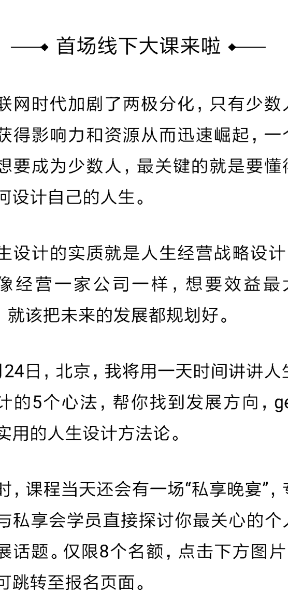

间隔年，就是从固定不变的生活模式里跳脱出来，中场休息一下。它既是重新思考和定位，也是发现人生新可能的一种方式。所以，休息不是中断，而是为了收获更多。

在过去的专栏内容里，我经常引用万维钢老师在《精英日课》里的经典语录。今天万维钢老师的《精英日课2》正式上线了，他说，要带你探索一个充满惊奇刺激的真实世界。

点击下方图片，可以查看万维钢写给你的第一篇文章。

我想，跟随万维钢一起感受一年惊奇和刺激，也算是一种独特的“间隔年”吧。


## —— 首场线下大课来啦 ——

互联网时代加剧了两极分化，只有少数人能获得影响力和资源从而迅速崛起，一个人想要成为少数人，最关键的就是要懂得如何设计自己的人生。

人生设计的实质就是人生经营战略设计，就像经营一家公司一样，想要效益最大化，就该把未来的发展都规划好。

9月24日，北京，我将用一天时间讲讲人生设计的5个心法，帮你找到发展方向，get最实用的 人生设计方法论。

同时，课程当天还会有 一场“私享晚宴”，专门与私享会学员直接探讨你最关心的个人发展话题。仅限8个名额，点击下方图片，即可跳转至报名页面。

若点击无法跳转，请升级至最新版「得到」App。


今天是古典陪伴你成长的第 333 天，一起加速，成长为更好的自己。

# 关于间隔年的思考

# 去读个书吧，也许是回报最高投资 48-2

48-2 去读个书吧，也许是回...

- 1. 继续教育的四种方式：在职学历教育、考取专业证书、海外留学、在线教育。
2. 继续教育的收益一般包括四种：能力、背景、人脉、眼界。

今天我们谈第二种人生可能性，就是"去读个书"。我指的不是学习专栏，因为学习专栏已经成为我们的一种习惯了，我指的是那种沉浸式的、系统的学习一门课程，提升某种技能。

所以我们的第二种人生可能，就是"读个书吧"。

作为一个现代职场人，你必须要学会把学习本身作为一种必备的发展和投资手段，今天我们谈谈四种成人继续教育的自我投资方式。

## 一、在职学历教育

比如，MBA、在职硕士、在职博士等。

如果有人问我研究生是否要读全职的？我会说，对于学术研究，全职硕士更好。但对于职业发展来说，在职研究生其实是个性价比很高的选择：

在职不用停止工作，机会成本低。更大的好处是，在职的社会资源会很多。在职硕士，尤其是MBA或者EMBA，一方面可以成为金融、投行、咨询行业的敲门砖，另一方面往往也是一个重塑人际关系的机会。

资金投入：在职硕士的投入资金在3-10万左右，名校MBA则需要10-30万左右。

时间投入：一般会占用一到两年的周末时间。

## 二、考取专业技能证书

走技术路线的职场人士，比如程序员、会计、律师、工程师.....比较适合考一个专业证书。比如会计常考的CFA（特许金融分析师）、CPA（注册会计师）、ACCA（在国内称为"国际注册会计师"，实际上是"特许公认会计师公会"的缩写）等含金量高的专业证书，为职位晋升或跳槽增加筹码。

## 三、海外留学、游学

## 四、在线教育

## ◆ 今日总结 ◆

四种继续教育的方式：在职学历教育、专业证书、海外留学、在线教育。

# —— 今日思考题 ——

你近期有没有学习计划？在四个收益中（能力、背景、人脉、眼界）你最看重的是什么收益？欢迎在留言区分享你的看法。


学习是个人保持与时代同频、提升职场优势的最佳方式之一。决定继续教育之前，

# 继续教育的4种可能

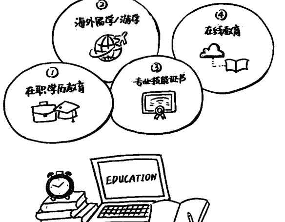

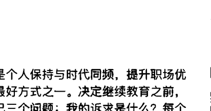

学习是个 人保持与时代同频，提升职场优势的最好方式之一。决定继续教育之前，问自己三个问题：我的诉求是什么？每个方式的收益如何？哪一种性价比最高？

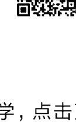

推荐阅读（错过以下文章的同学，点击蓝色字体可查看）：

功利读书法，五倍提升认知效率 21-1

区分一二三四手知识，找到知识源头 21-2

费曼技巧：一张白纸提高学习效率 21-3

写给努力却学不好的人，给大脑注入知识晶体22-2

知识变现有3条路径，最后1条人人能用22-3

## —— ◆ 倒计时：线下大课 ◆ ——

互联网时代加剧了两极分化，只有少数人能获得影响力和资源从而迅速崛起，一个人想要成为少数人，最关键的就是要懂得如何设计自己的人生。

人生设计的实质就是人生经营战略设计，就像经营一家公司一样，想要效益最大化，就该把未来的发展都规划好。

9月24日（本周日），北京，我将用一天时间讲讲人生设计的5个心法，帮你找到发展方向，Get 最实用的人生设计方法论。

最后50个名额，点击下方图片，即可跳转至报名页面。若点击无法跳转，请升级至最新版「得到」APP。

# 古典 面向得到用户
—— 首次线下大课 ——
人人都该上的人生设计课
9月24日 北京
就此报名

今天是古典陪伴你成长的第 334 天，一起加速，成长为更好的自己。

# 关于继续教育的思考

# 极简生活 | 越想节约的人越浪费 48-3

48-3 极简生活 | 越想节约的...

极简生活：自愿简化所需，专注最本质的事。

今天要讲的第三种人生可能，叫做极简生活。前面两天谈到的“间隔年”、“读个书”，都是在增加人生经历、扩展自己的知识或技能，但是，生活有没有可能简单点？今天我们谈谈“极简生活”。

什么人最应该了解极简生活？工作大忙人、打折时的购物狂、廉价爱好者、旧物收集癖，以及希望过不一样生活的人。

今天，我们大部分人都习惯给自己一个假设：“我过得不够好，是因为我还缺少点啥”——缺少房子、缺车、缺少人脉……但是很少有人思考，相比过去10年，我们拥有的东西比过去多多了，但并没有感到更加幸福，这又是为什么呢？

## 什么是“新穷人”？

波兰社会学家齐格蒙特·鲍曼这么解释这种现象：“消费市场中最要命的是，承诺有一种可以治疗消费者所有折磨的药方，它就在某个商店的某个角落，如果消费者能够认真寻找，就可以看到它。”

比如，你觉得缺少妻子，那就买名牌或者奢侈品；能力不够就买课程；缺乏安全感就买房子；缺少趣味就买顶级的游戏装备。生活里遇到的问题，好像总能靠买个东西去解决。

这种消费有一个致命的BUG，就是边际效应递减——买买买带来的短暂新鲜感会越来越少，为了维持，你必须购买更多。买得越多，拥有的兴奋感就越廉价；占有更多，心中的充实感却并没有更多；为了弥补这种空虚感，需要下一轮消费。就好像掉进大海里的人一样，只要停止扑腾，马上会重新掉进无助的深水里去，这是一个怪圈。这种人被称为“新穷人”—虽然物丰富，却心智匮乏。

极简主义（Minimalism）的观点是反其道行之。极简主义并不是一穷二白，家徒四壁，而是专注最少而最好的东西——用少而好，对抗多而全。这个理念最早是从建筑学引申过来的，后来被应用在各个设计领域。


著名日本品牌“无印良品”是极简主义的集大成者，它的衣服、家具，都是用非常好的材质，但没有什幺装饰，把更多的空间留给了使用者。设计师原研哉认为“没有设计就是最好的设计”。

下面是一张“无印良品”的海报，你能体验到这种“空的力量”—空旷的世界里，一个安静的人。上面只有“无印良品的未来”几个字—你会发现，这几个字是理念，也是品牌。很少，但很好。


这种“空”的精神放到人生里来，就是极简人生。这是一种“自愿简化所需，专注本质的事”的生活方式。下面是一些极简生活奉行者的生活原则：

- 物质极简——一类一品，追求低调有质感的物质享受；
社交极简——简单的社会关系，深度交往；
事业极简，专注一件事情。

## 极简生活有什么好处？

- 1. 更节省，更高效

我的一个长辈，前段时间买了一个很好地段的三百平方米的房子，大概每平方米十万。去他的新家拜访时，我发现二楼的两个房间，堆满了老房子里的各种旧家具、旧电器。问他为什么还要留着这些，他说不确定哪天能用上，所以就留着了。他们是极度节俭的人，但这种节俭，实际上是一种浪费——这些东西也许帮他们省了3万块，但却占据了30平方米的空间，价值300万。

在大脑里面放很多琐事，就和用最贵重的房子放旧物是一个道理。我们天天刷微博、微信；追各种神剧和热点话题。其实仔细回想一下，三个月前，真的有什么事情特别值得被记住吗？你会发现，并没有。

这就是极简的力量，它能让你意识到，我们需要的没那么多。貌似节省，其实是最大的浪费。你宝贵的注意力，应该花在更少、更好的事情上。

- 2. 更自由，更清爽

我们以为自己在占有物品，其实我们也在被占据。

每添置一件物品，就像开启了一段新关系，你有拥有它的权力，也有了照顾它的义务。

衣柜里的衣服说：“你花了好多钱买我，这么久不穿，太浪费了。”

冰箱里的食物说：“我都快过期了，还不快来瞧瞧！”

书架上成堆的书说：“你就看了10页，就不看了吗？别半途而废啊。”

你看，购买它们时消耗了你的判断力，占有它们却消耗了你更多能量。

极简生活，可以只留自己最需要的东西，压力就会小很多，也慢慢拥有自由活动的空间。

# 极简生活攻略

最重要的事只有一件

每天不要一进公司就开始工作，而是预留思考的时间：

- 1. 今天最重要的一个事情是什么？
2. 在这件事情里，最重要的一部分是什么？
3. 做完这件事，是不是可以让其他的事变得简单或不必要了？如果是，就集中精力做这件事，然后就像推倒了第一张“多米诺骨牌”……

一类一品

每个品类在承受范围内购买尽可能优质的，但是只购买一件，即使价格贵一点。贵，你才会好好爱惜；好，才能以一当十。这样可以有效替代廉价物品囤积。

100件物品挑战

逐渐放弃旧物，让你的家里只剩100件物品。其实，不管是100件还是200件，只是代表了一个确切的整理目标。在一番整理之后，即使你有120件或者70件物品，也都无所谓，只要你能确认每一件物品都能给你带来切实的功能或快乐就可以。

丢东西只是表象和手段，目的是培养极简主义的思维和行为习惯。

## —— 今日总结 ——

极简生活不是穷而少，而是最少但最好。极简的本质，是自愿简化所需，专注最本质的事。

你可以从“100件物品大挑战”开始，也可以从“一类一品”开始，或者今天你就应该试试“最重要的事情只有一件”的计划。重要的是在这个过程中逐渐理解自己，也会发现，没有方向的生活，再极简也是浪费。

# —— 今日思考题 ——

你认同极简主义吗？你能做到吗？用今天说的“极简主义”—“一类一品”的原则来衡量下自己最近的消费、交友、做事，你有什么新的发现吗？欢迎你在留言区分享给我。

推荐阅读（点击蓝色字体可跳转）：
你和物品的关系，就是你和自己的关系 5-2

# 极简生活攻略

一件一事

一表一品

100件物品挑战

极简的本质是自愿简化所需，专注最本质的事。极简的生活方式其实更节省、更高效、更自由、更清爽，而没有方向的生活再极简也是浪费。

## —— 倒计时：线下大课 ——

互联网时代加剧了两极分化，只有少数人能获得影响力和资源从而迅速崛起，一个人想要成为少数人，最关键的就是要懂得如何设计自己的人生。

人生设计的实质就是人生经营战略设计，就像经营一家公司一样，想要效益最大化，就该把未来的发展都规划好。

9月24日（本周日），北京，我将用一天时间讲讲人生设计的5个心法，帮你找到发展方向，Get 最实用的 人生设计方法论。

最后50个名额，点击下方图片，即可跳转至报名页面。若点击无法跳转，请升级至最新版「得到」APP。

古典 面向 得到 用户 —— 首次线下大课 —— 人人都该上的人生设计课 9月24日 北京 截止报名

今天是古典陪伴你成长的第 335 天，一起加速，成长为更好的自己。

# 关于极简生活的思考


# 手作：一场由“手”入“心”的旅程 48-4

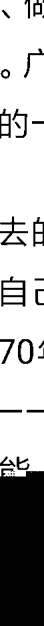

48-4 手作：一场由“手”入“心”...

+   1. 手作：最早由日本传入的名词，意思是“手工制作”或“手工劳动”。
+   2. 手作的3个好处：一种更好的休憩；获得掌控感和专注感；一种有温度的礼物。

我们活在一个一切皆可外包的时代，衣食住行的各种商品和服务都可以买到：吃饭叫外卖；买衣服有淘宝；出行有滴滴打车……只要你有钱，不对，只要你支付宝里有钱，一切都很便利。可偏偏有些人放弃这些便利，更愿意亲力亲为：自己烘焙、做家具、做皮具、做香皂……

买一个不就好了，为什么要自己做呢？他们会告诉你——我不是为了制作一个物品本身，而是当手开始工作的那一刻，内心是宁静和幸福的。

## 手作是什么？

“手作”是一个最早由日本传入的名词，意思是“手工制作”或“手工劳动”。比如，做饭、做木工活、织毛衣、做皮具、制作陶艺等。广义上来说，脑力劳动以外的，需要动手的一切劳作，都可以算作手作。

过去的时代，手作基本不算是新鲜事——饭是自己做的、毛衣是自己织的……很多20世纪70年代的人还自己做过收音机、做过电脑——今天大部分的手作已经没有了实用功能，更多的是一种生活方式，也许体现了...

## 用手劳作，让心丰盈


私房 by 曾鸣

手是人的第二个大脑，用手去重新认识世界：酿酒、涂色、陶艺、做饭、皮具、烘焙……你会投入和沉浸其中，通过手的劳作，实现内心的充盈。


## —— 倒计时2天：线下大课 ——

互联网时代加剧了两极分化，只有少数人能获得影响力和资源从而迅速崛起，一个人想要成为少数人，最关键的就是要懂得如何设计自己的人生。

人生设计的实质就是人生经营战略设计，就像经营一家公司一样，想要效益最大化，就该把未来的发展都规划好。

9月24日（本周日），北京，我将用一天时间讲讲人生设计的5个心法，帮你找到发展方向，Get 最实用的人生设计方法论。

最后30个名额，点击下方图片，即可跳转至报名页面。若点击无法跳转，请升级至最新版「得到」APP。

古典面向得到用户
—— 首次线下大课 ——
人人都该上的人生设计课
📍 9月24日 北京
截止报名


今天是古典陪伴你成长的第 336 天，一起加速，成长为更好的自己。

## 生涯顾问日 | 一个公式帮你找准时机 48-5


48-5 生涯顾问日 | 一个公式...

什么时候才是真正具备做自己想做事业的最佳时机？

我很喜欢做分享、教育类（老师、培训师）的工作，但本科、硕士学的都是环境工程。毕业后找到了专业对口的工作，工作主要是文档，比较稳定，有一定挑战性，公司工资福利待遇也比较好，非常满足生存期的需求。

有人说，当你想改变时就是最佳时候。但古典老师在《你的生命有什么可能》中说到，生存期还不具备足够能力谋求理想。所以我现在一边完成我的工作，保证生存，一边在业余时候储备力量。我本来想硕士毕业五年后可以从事我的理想工作，但结婚、生小孩的任务降临，让我更没有底气了。


## 古典

我邀请李春雨老师来回答你的问题。

李春雨介绍：北京大学心理学硕士、中科院博士、新精英生涯教育合伙人、教育部特聘培训专家、清华大学及北京师范大学职业导师、生涯规划师主设计师，现任新精英生涯产品化研发总监。

拥有十多年的职业生涯规划经验，《中国大学生职业发展》教材的主编，翻译职业规划经典作品《你的降落伞是什么颜色》，国内唯一在美国职业发展论坛（NCDA）专业报告人。

现已在清华、北大等200多所重点院校举办百余场生涯规划培训及专题讲座，为新浪、北京现代及中国建筑设计院等知名企业提供员工生涯规划服务。


亲爱的 daisy 您好：

我是李春雨，新精英的职业规划师。之所以回复你的问题，是因为在7年前我和你的情况非常相似。那时候的我刚博士毕业，出国未成，阴差阳错地进入一所大学担任辅导员老师，负责研究生德育工作。我的植物学专业听起来和这个工作并没有什么关联，而那时的我似乎也没有什么其他的选择。和大多数迷茫的人一样，不知自己的梦想是什么，以及什么时候能够实现。

后来一个偶然的机会，我接触到了职业生涯规划。从一个参加课程的学员开始，我用了3年的时间，让自己成为国内专业的职业规划师。一方面培训了几千名学员；一方面也给处在职业困惑期的人做咨询。

也许在别人眼中，是我独自实现了自己的梦想。现在回过头看，其实有四种支撑着我的力量让我完成了这种转变。今天，我想和你分享一下什么时候才是追逐梦想的最好时机。

首先你需要知道一个公式：

```
时机=能力x心力x精力x财力 / 100
```

### 能力：(0-10分)

进入时机的第一个要素是能力，因为雇主不会为你的兴趣买单，而是为你的能力买单。

学历：这份工作的学历要求是什么？需要哪方面的基础知识？

技能：这份工作对你的能力、资源的要求是什么？你有没有相关的经验？

性格：什么样性格的人更符合这份工作？跟他们比起来你的优势和不足是什么？

给自己打个分：如果能够在职位上做到优秀是10分，你现在的 能力是多少分？

### 心力：(0-10分)

第二个决定你是否能接近梦想的因素是“心力”——什么时候你特别想做一件事情，而且觉得自己特别能成，会改变你的心力；或者某些机会会让你怦然心动，而另一些机会比较没感觉，都会改变“心力”。

轻易能达成的事，不能称之为梦想，任何梦想的实现，都要强大的心力。

给自己打个分：如果“这件事不管什么困难我都想做”是10分，那么现在心力是多少分？

### 精力：(0-10分)

成人的世界还是琐碎无奈的。生活也不仅仅是职业，也许还有家庭、社会的角色。自己的身体状况也是制约因素之一——所以精力对于进入一个新的领域很重要。

给自己打个分：如果100%全情投入是10分。你现在投入的精力大概是多少分？

### 财力：(0-10分)

最后有件事无可回避——很多人无法靠近梦想的重要原因是，梦想一开始还不足以支撑自己生存，但又没有别的经济来源。所以不妨评估下自己的财力：考虑下自己的生存成本、预期收入和储蓄。另外，要提醒你的是，尤其是创业的人，可能需要一次性投入很多钱，所以进入新工作前几个月都是负收入。

给自己打个分：即使离开现有的收入来源，你也能在未来12个月内，保持基本的生活质量。这种财力水平如果 是10分，你现在大概是多少分？

当然，如果你有足够的家庭支持，不需要依靠职业收入，可以直接打10分。

现在，你的能力、心力、精力、财力，这4项的分数乘积是多少呢？最后再除以100，就是你的最终分数了。

```
公式：时机=能力x心力x精力x财力 / 100
```

结果：

- 0-13：还不成熟，风险很大；
- 13-24：可以考虑，略有风险；
- 24-41：时机成熟，可以启动；
- 41-65：非常安全，尽快转换；
- 65-100：太保守了，早就该启动了。

亲爱的 daisy，不知道你的总分如何？哪一项欠缺？哪一项占优势呢？

### 四个提升策略

提升能力：跟人学，找事做

如果你能力不够，可以先把梦想当成一个爱好培养。如果想要培养能力，请先找到这个领域中你能见到的最好的人当老师，业余时间多参与一些项目，哪怕是免费的也可以，提高自己的能力。

提高心力：思考动机，梳理成就事件

如果总是心力不足，那么就从两个角度出发：

- 1. 认真思考下这件事情到底是想想而已，还是真的很想做？
- 2. 当你陷入决策的困境，会让你能量很低。建议你有意识地梳理“成就事件”，提高自己的自我效能。这一点，古典老师在专栏的“自我效能”主题下也提到过。

提升精力：抓重点，排到先后

如果你的精力不够，或许此时并不是你转换的最好时机，先把自己最重要的事情做好，有时候，“下一个路口遇见梦想”更好。

提升财力：加强储蓄，投资自己

如果你 的财力有限，要么加强储蓄，要么考虑找到你生命的“投资人”，也许是你的家人、朋友，或者是看好你的组织和机会。

家人、朋友，或者是看好你的组织和机会。

最有趣的是——这些不同要素的分值还会互相转化。

比如，对于女性来说，结婚会让你的财力上升，但是精力下降，心力则很大程度上取决于你的伴侣是否支持和认同。

再比如，能力也可能影响心力——等你更多地接触真实的培训师，并开始学习的时候，你的能力会上升，你可能发现，自己的心力或上升或下降、越来越觉得靠谱或者不靠谱——其实这都是好事。最后听到你用“降临”这种没法控制的词来形容结婚、生孩子，也许你真的应该思考下，精力应该用在什么地方会更让你幸福。

经过一轮演算，你会发现，有些梦想可能是没法实现。此生都无法实现，那就暗恋梦想，也许那个无法达到的梦想就是你现实生活的一味调味剂，让你在平凡生活中，做一点儿五彩的梦……

当然，更多的梦想是可以实现的，因为我们可以主动地提高能力、心力、财力、精力。

祝你好运。

古典

“时机”是個妙不可言的东西，但春雨老师更妙，他用一个“四力公式”很好地解释了一个好时机需要具备的关键要素；能力要够、精力要足、心力要强、财力要有。要集齐这“四力”不是件容易的事，而且四个要素还在此消彼长，这也侧面说明了“时机”有多重要。

“种一棵树的最好时机是十年前，另一个时间是现在。”怎么理解这句话呢？我认为四力里，还有重要的排序，而心力就是最底层的东西。因为，当你具备了很强的信念，心力，其他三种力都会有慢慢有的。

祝大家用心。

推荐阅读，一键回顾：

学了很多就是没行动？你缺少自我效能 41-1

## 吴军：定最好的目标，做最坏的准备 48-6


## 古典

本期主题是“人生可能”，我为你请来了隔壁订阅专栏《吴军·硅谷来信》专栏的主理人吴军老师，他是硅谷首家华人创投基金玄资本掌门人、风险投资人；美国约翰·霍普金斯大学工程学院董事会计事。他写的畅销书《文明之光》相信很多超体们都看过。

今天请吴军老师来，也是给你讲投资的一一投资自己，投资自己就是在开辟新的人生可能。

吴军老师涉猎广泛，是跨界的高手，虽然理工科出身，但对历史、文学、社会学都颇有研究，在艺术修养和生活美学方面也颇有见地。包括他的生活方式，也是我个人非常欣赏的。他是“人生可能”的典型。

今天，我从超体们提出的问题里，选了5个比较有代表性的，请吴军老师亲自回答：

怎么区分自己是在逃避现实，还是在寻找人生的可能性？

其实每一个人只要诚实地面对自己的内心，他们都很清楚自己是在逃避现实，还是在寻找新的人生可能性。

很多人一件事情没做好，就给自己找一个理由。比如自己不适合做这件事情，不是兴趣所在，外界条件不适合，或者其他什么原因，然后就换一件事情去做。为了给自己一个安慰，就用寻找人生的可能性来说事。

其实，在这时候如果真诚地对待自己，就应该问问自己是否了十二分的力气。而这时对自己努力程度的判断应该客观（这才是对自己真诚），可以对比那些将同样一件事情做好的公司，客观地评价自己是否真的努力了，而不是寻找借口。

很多时候，失败不是成功之母，成功才是成功之母。在寻找新的机会之前，需要证明自己能够将任何事情做好，不论这些事情自己是否喜欢。有了这样一两次成功的经历，才有足够的信心，再做新的事情时，能够遇到问题解决问题。否则，任何新的尝试不过是新的失败，最后形成习惯性失败。

有很多人觉得，去寻找多元人生固然很好，但会不会因此就不会太成功？因为据说只有偏执狂才会成功。

人是有千差万别的，并不存在一个适合所有人的成功之路。有些人的成功得益于多元化的人生，有些人则在于偏执。不论是哪一种，把一件事情做好，做得专业非常重要。

从您的信件来看，您的人生是非常多姿多彩的，涉猎面非常广。这是您一直以来的状态，还是单点突破成功以后转变的生活形态？

凡事都有一定的方法可循，当然有些看似不同的事情，做起来方法却相通的。下面几点经验或许对每一个人做好每一件事情都有借鉴意义：

- 1. 凡事不做则已，如果要做，就要把它做好。人生宁可少做事，也不要贪多，免得最后总是半途而废。在很多方面成功的人，其实并不比其他人做事更多，只是他们做事都产生效果，而大部分人做事是“狗熊掰棒子”罢了。
- 2. 凡事做起来要尽可能专业。把事情做专业的捷径是系统地学习。你可能看到我的摄影水平还不错，这倒不是我有这方面的天赋，也不是我花了很多时间，而是因为我参加过非常专业的训练营（比如徕卡公司组织的），我会经常和专业摄影师交流请教，而不是自己凭空琢磨。我对一些新领域的了解，是靠系统地学习课程，而不是随便看点书籍得到的。在“得到”上，跟随一位老师系统性地学习一年，收获会很大。
- 3. 不要因为别人做了，自己就一定要做。很多人会讲，今天离不开手机，但是如果真的把手机扔到一边，我们会死吗？显然不会。既然如此，我们就应该有自己使用手机的习惯和方法，而不是和大多数人一样永远挂在手机上。采用和大多数人一样做事方法，只能得到和大多数人差不多的结果。

我是一个34岁的母亲，公务员，在一个小城市里生活。古典老师，吴军老师提到的很多内容都是我很喜欢的，但是我也自知不大可能过上这样的生活。我这样的人，生活还有什么可能性吗？

人努力的目的就是为了幸福。这个目的永远不能忘记。如果各种努力，各种所谓的成功，让自己变得反而而不幸福，那就是一种失败。

美国很多明星人物，看似很光鲜，但是因为压力太大，过得很孤独，还有一些人很年轻就离开了人世。

很多时候我们应该问自己，虽然我们今天有了18世纪没有的发明，财富水平堪比那个时代的贵族，甚至比那个时代具有更多的机会，但是我们是否比那个时候的人过得更幸福？如果答案是否定的，那就说明我们忘记了生活的意义。

自我设限和有自知之明有什么区别？我怎么知道什么是可能性，什么是妄念？

首先，和第一个问题的答案类似。每一个人都应该非常真诚地询问自己，所做的每一件事情是否都尽力了。如果凡事都是尽力做的，那么自己的上限就清楚了。

其次，自知之明来自于对外面世界的了解，或者说见识。对外界了解得越多，对自己能力的判断就越准确。一个总和侏儒站在一起，会以为自己是一个巨人；如果天天和姚明站在一起，会以为自己是一个侏儒。只有见到很多人，才知道自己真实的高度。对自己能力的判断也是如此。

最后，世界上大部分人都会高估自己的能力和运气，绝大部分人更是高估自己的美德。做事的时候，要 Target for the best, prepare for the worst（定最好的目标，做最坏的准备）。

但大部分人是反过来的。比如考试，好的学生是按照100分的目标去复习，只期望自己能得到90分。差的学生永远是花七成的力气，却希望靠运气能得到100分。后面这一种，就是妄念。

思维方式比具体的知识更能决定人的命运。人生的每个阶段，如果能有一个过来人帮你答疑解惑、交流谈心，就能少犯错误、快速成长。
在《硅谷来信》里，吴军会每天给你写一封信，不仪谈工作、成长，还谈生活和艺术。让你见识飞升、圈子更广、还能更懂生活。


## —— 明天下线大课见 ——

互联网时代加剧了两极分化，只有少数人能够获得影响力和资源从而迅速崛起，一个人想要成为少数人，最关键的就是要懂得如何设计自己的人生。

人生设计的实质就是人生经营战略设计，就像经营一家公司一样，想要效益最大化，就该把未来的发展都规划好。

9月24日（本周日），北京，我将用一天时间详讲人生设计的5个方法，帮你找到发展方向，Get最实用的 人生设计方法论。

最后几个名额，点击下方图片，即可跳转至报名页面。若点击无法跳转，请升级至最新版「得到」APP。

古典 面向得到用户 —— 首次线下大课 —— 人人都该上的人生设计课 9月24日 北京 截此报名

今天是古典陪伴你成长的第 338 天，一起加速，成长为更好的自己。

## 彩蛋 | 首场线下大课精彩实录

古典

今天，我在北京如约与100多位同学进行了一场线下的思想交锋，主题是《人生设计研习会》——人生设计的实质就是人生经营战略设计，就像经营一家公司一样，想要效益最大化，就该把未来的发展都规划好。

本次线下大课全程持续了近8个小时，几乎没有一位同学提前离席；期间，有一位学员毫不保留地贡献了自己的亲身经历，供大家参考和分析，这些都让我备受感动。

我常说，在个体崛起的时代，只有少数人能获得影响力和资源从而迅速崛起。我想，今天在座的每一位，应该都是人群中的少数人。我感受到了大家的学习热情，以及渴望寻求自我突破的愿望。

当然了，我们有很多超体们由于种种原因没能抢上票，没办法与我面对面地交流，但我依然希望把现场的实况“转播”给你，下面是我精选的19页课程PPT（全课程共66页），以及学员现场记录的视觉笔记和学习感悟。

这是我们超级个体的一次盛会，当然不能少了你。接下来分享给你：


## —— 人生设计研习会 ——

全课程分五个模块


### 1、自我成就的心智系统


### 2、设计内在职业模式


### 3、职业竞争力量模型


### 4、幸福人生设计


最后，送你一首诗


## —— 视觉笔记和学习感悟 ——


虽然之前听过古典老师的“教练课”和“生命可能研习课”。

但这次还是毫不犹豫地选择继续来听少侠的《人生设计研习会》，为此把出差时间改在晚上，估计落地深圳得过零点。

这次来听课的感触是，少侠果然又有新东西。

整体的一个感受是在今天的一天课程中，古典老师把《拆掉思维里的墙》、《你的生命有什么可能》和《跃迁·成为高手的技术》这三本书中，有助于个体生涯成就和幸福的关键知识串联在了一起，这就是20%的生涯规划领域的头部知识的串烧吧。

在今天的课程中，我看到了这三本书被巧妙地结合在一起，这也是一种很棒的设计——生涯规划3.0，个人成长3部曲。

从拆解错误心智模式，见自己；到提升赛道竞争力，见世界；最后到看到每个人的生命彩虹，虽然目前还没有到“见众生”的阶段，但是总会从古典老师这里听到很多他自己对于“见众生”的故事。他的思考和感悟，坦诚而智慧。

爽哉！一天课程下来，把古典老师几年的心血和头部知识梳理了一遍！

再次感谢古典老师和超级个体专栏的女神们小七，淼哥，燕恬，静姝……等等 还有几个叫不上名字的帅哥。

最后，很开心与大家相遇，超级个体的缘分，希望一起行动，共同跃迁，让今天20%的知识，带来明天80%的收益。

# 关于人生设计的思考

## 如何让“无解”的问题变得可解？ 49-1

49-1 如何让“无解”的问题变...

- 1. 重力问题：那些作为现象普遍存在的，几乎不可能解决的问题，被叫做重力问题。
- 2. 如何把重力问题转化成可解决的问题：把重力问题中的“名词”转化成“动词”，变成可控、能操作和指向未来问题。

今天是人生设计的第一课。作为一个人设设计师，我最爱做的事情就是解决问题——因为设计原始就是“创造一种计谋解决问题”。本周我会一起解决很多问题，但是今天我们先不谈如何解决问题，而是说说什么问题是可以被解决的。

越好的人生设计者越知道“解决什么问题，比如何解决问题更重要”。就像写毕业论文之前都有一个环节叫做“开题报告”。这个环节就是请老师们帮我们审核、评估问题的价值和难度：有没有必要做下去？以目前的实力可不可能做出来？我们不会喊 ▶花了1年多时间把论文做出来以后，再被全盘否定（那样会崩溃吧）。

请注意，我们大部分人的人生之所以发展得不理想，很可能不是你没有解决好问题，而是你提的问题，本身就是一个不可能被解决的问题。

## 重力问题（Gravity Problem）

我们都知道骑车上坡之所以蹬起来会很重，是因为地球会产生重力。但怎么解决这个问题呢？如果你把问题设置为“如何摆脱地球重力”，这个目标就很难达成。类似于地球重力这种作为现象普遍存在的，几乎不可能解决的问题，在设计思维里，就叫做“重力问题”。在工业设计里，设计师从来不会死磕重力问题，他们会设计出更轻的车，或者设计变速器，甚至直接制造一个电动车。

人生设计也是一样，当你尝试去解决一个问题的时候，你一定要先思考——这个问题本身是不是一个“重力问题”。

比如：

- 1. 如何找到世界上最适合自己的人生方向？
“世界上最适合”本身就是一个坑，因为“最”是极端词，而“适合”是动词。
- 2. 如何让诗人的平均收入更高？
- 3. 如何让我的领导改变沟通风格？

## 重新定义问题

“重力问题”确实无解，可它又的确在困扰你。怎么办？这个时候你就需要学会重新定义问题：从一个全新的角度重新提问——把“重力问题”转化成“可解决的问题”。

举个例子：
全世界的贫困地区，每年有超过400万的婴儿因为不能及时用上暖箱设备，在第一个月内就夭折了。而目前市面上一个电暖箱售价在2万美元左右。更何况很多贫困地区，连暖箱所需的电力设施都没有。
如何解决这个问题？

这其实是2007年斯坦福设计学院的真实项目。如果项目的问题被定义为“如何筹钱通电”，这个问题就彻底变成重力问题了，这个工程实在是太浩大了。经过重新调研，他们发现，把婴儿从农村送到最近的城镇医院，一般4小时足够了。于是，他们把问题重新定义为：“如何维持住4小时的生存温度？”

这样一来问题简单多了——他们把一种特殊材料放到育儿袋里，让袋子可以持续发热4小时，如果要继续用的话，只需要用热水煮沸一下就可以了。这个育儿袋只需要25美元，大部分人都能负担得起，它至今拯救了近30万孩子的性命。

另外，福特也是重新定义问题的大师，他说：如果问汽车发明之前的人们，你想要什么？他们会说，“一匹飞快的马”（名词）；但是如果问他们，你的目的是什么？他们的答案是“更快速地抵达”（动词）。

福特认为，解决问题的关键是把问题从“名词”转为“动词”，这样我们就能找到自己背后真正应该关心的事情。

- 1. “如何找到自己最适合的方向？”转换成为“如何三个月内进入一个自己觉得适合的工作岗位？”
- 2. “如何让诗人的平均收入更高？”转换成为“作为一个诗人，我如何保持不错的收入持续创作？”
- 3. “如何让我的领导改变沟通风格？”转换成为“我如何可以和领导沟通顺畅？”

# —— 今日思考题 ——

有人说，重新定义问题不就是就在回避重要问题吗？你觉得重新定义问题和回避问题有什么区别？在留言区分享你的看法吧。


重力问题指那些作为现象普遍存在的，几乎不可能解决的问题。把重力问题中的名词转化成动词，变成可控、能操作和指向未来问题。就能变成可解决的问题。

你可能听过理财收益，但你可能没听过“失败收益”。明天我就来说谈“失败收益”。

今天是古典陪伴你成长的第 340 天，一起加速，成为更好的自己。

# 关于人生设计的思考

## 失败收益率：一张图教你从失败中获得高收益 49-2

- 1. 失败收益率：把投入试错的资源看成分母，把从失败中获得的认知、人脉等收益看成分子，那么，投入越少，收益越高，失败收益率就越高。 2. 区分三种“失败”：失误、弱点和成长机会。

今天的话题有点“丧”，我们来谈谈失败。如果把所有未达到预期的状态都称作“失败”，那么生活中真的是到处都是这个家伙的影子：第N次减肥失败、撩妹被拒、创业不成、工作不顺……很多人把失败看做一件丢脸的事，尽量避免。

今天我要给你讲的，却是一个如何提高“失败回报率”的方法——难道失败也是一种投资，还有回报吗？

## 1. 失败收益率

相信所有人都有共识：失败是很有效的，最好和最难的工作都在冒险与挑战的精神下完成，只要搞创新，失败不可避免。但另一方面，我们又希望能够对于未来有可预测的收益，毕竟我们是通过控制成本、提高效能，才获得升职加薪的，又不是通过失败。所以更多人都把失败看成坏东西，控制在最小范围内，但是这样，创新也就越来越少了。

失败收益率就是用来解决这个问题——如果把分母看成是投入试错的资源，而分子是你从失败中获得的认知、人脉等收益，那么收益越高、投入越少，失败收益率就越高。只要能控制好失败收益率， 即可既有收益，又不至于成本失控。

那么该如何提高失败收益率呢？

- 第一，保持小投入，尽快止损，类似硅谷的快速失败（Fail Fast）或者精益创业。 第二，尽可能从失败中提取价值。要做到这一点，就需要区分失败的类型（见下方第2点）——失败和失败之间的价值差距是很大的。 第三，尽可能共享自己的失败价值，放大失败收益率。

## 2. 三种不同的失败

我们接着上面的第二种方法，从两个方面去区分失败——这个失败好不好改？改了收益大不大？

这样一来，失败就可以分为失误、弱点和成长机会三种类型。

## 失误（Screw Up）

失误是在平常做得很好的事上，偶尔出现的低级错误。你不是没办法做得更好，只是一时不小心。比如，忘了带钥匙、吃东西吃坏肚子，这是小概率事件，很好改；而且从这类错误中能学到的东西十分有限。所以，对于这种情况，明智的做法是不太在意，承认搞砸了，然后继续往前走。

## 弱点（Weakness）

这是由于自身一直存在的问题而带来的失败。这类型的错误在某些情况下会反复出现。你心知肚明这类错误的源头，大概也努力修正过，但依旧不免犯错。比如，拖延、脾气暴躁、不够细心等等。

## 成长机会（Growth Opportunity）

真正值得改正的失败，是成长机会——这类失败的源头找得出来，也有办法修正，而且一旦改正，收益会特别大。你的注意力应该放在这类错误上。

## 3. 记录“成长心得”

我帮你做了一个表，回顾过去一星期、一个月、一整年，列出“失败大全”：

以失败回报率衡量，这些失败到底是失误、弱点，还是成长机会？
如果 是成长机会，你可以做得更好的心得是什么？

上文提到的几种失败， 呈现 在表上，就是（下图）这个样子：

| 失败事件 | 失误 | 弱点 | 成长机会 | 成长心得 |
|---|---|---|---|---|
| 白蚁和小偷 | ✔ |  |  | 看作偶然事件 |
| 慢性子 |  | ✔ |  | 转化为特点 |
| 电话沟通 |  |  | ✔ | 改善沟通策略 |

建议可以每月记录1-2次。

不犯很多错误就想过上理想的生活是不可能的。重要的技巧是尽可能快而有效地失败——关键要提高失败收益率，小投入，并且区分失误、失败和成长机会，最后把经验分享出去。

> “在未来的很多年中，时不时地，我祝福你被不公正地对待，因而你会知道公正的价值。我祝福你会遭遇背叛，因为它会让你感受到忠诚的重要性。” “我祝福你会有时会坏运气，因而你会意识到概率和运气在人生中扮演的角色，并且理解你的成功并不完全是你应得的，而其他人的失败也并不完全是他们所应得的。”

## 职业访谈：用好问题，撕开“职业”的假面 49-3

49-3 职业访谈：用好问题，撕。

职业访谈四步骤：1. 列个访谈清单；2. 寻找访谈对象；3. 见面开聊；4. 感谢对方后，重新寻找两个以上的访谈对象，重复杂前三个步骤。

两个微信网友约着见面，一见面各自吓一跳——跟照片不一样啊！当然，他们只看过对方的美颜照。

其实职业也是一样。我们的职业生涯中，不管是转型，还是升职，都会重新进入一个新的职位，但很多时候，我们在公司、行业外很难看明白，上班第一天才发现，“我去，原来以前看到的只是这个职位的假面”——难怪很多人转型越转越乱，估计就是看了太多美颜照，开始怀疑自己的人生了。

即使在网络发达的今天，职业外的人也很难知道一个职位的第一手信息，最新的消息永远在大家的胸口里。

今天我就教你一个好方法，帮你用最小的成本找到关于一个行业、职位的第一手信息——不仅仅要转行的人需要、勾勒未来的人需要，甚至那些在组织内不打算转行，但想了解下一个晋升职位的人也需要。

## 职业访谈的四个步骤

如果我们要去一个陌生地方，最好的方式也许是看地图，但是如果你在那个地方停留一段时 间，最好的了解方式是找攻略、找当地的人聊一聊。职业访谈也是同样的道理，它是通过访 问目标职业的从业者的方式，抓取一手职业信息的技能。


举个例子：

曾经有一个小伙子（小强）来找我，30多岁，国企行政，太太是高校教师，家里有车有房一听上去不错吧，工作稳定，生活幸福。但他有颗不安分的心：世界那么大，要不要从体制内出来，去外边的世界闯闯？

他对互联网运营很感兴趣，感觉自己平时还挺有创意的，也喜欢看“插坐”、“慢头商学院”的运营课。但是体制的事儿你知道——一旦出去没法回头。所以，他很犹豫。

人一旦陷入这种状态，就会变得很矛盾——你劝他离开，他会担心外面不稳定；你劝他别离开，他又说想去外面试一试。很多人会把这种情况当成一个心理上的工作来做，其实这个时候，他最缺乏的是真实的，大量的信息，把职业的假面先摘掉。这个时候，谁讲真相最有说服力？自然是目标职业里的人。

所以，我给他的建议是做一次职业访谈，我给他制定了四个步骤：

首先，列个访谈清单。

我请他盘点自己的技能、兴趣、特长，明确想法和预期，然后帮他列出要访谈的内容，列出一个清单（我把这个清单放在了文末，你可以收藏起来，随时取用），并且要求他提前在网上做功课。这一点非常重要，因为你提问的质量代表了你的水平，甚至是努力的程度。进入一个新行业前，让对方看到你的努力很重要，尊重对方时间也很重要。我自己的原则是，如果对方问我的答案能在百度上都能找到，我一般都不会回答。

然后，寻找访谈对象。

这里面有个“3-5年定律”，我建议他找到互联网行业拥有3~5年行业经验的运营者，或是互联网大公司的人力资源、猎头。为什么是3~5年？因为1~2年的话，很难对行业了解得足够深入和透彻；5年以上的话，一般都在管理层，很可能远离了一线工作，给出的建议也不够具体和实际。

很多人会觉得自己没有行业人脉，找不到访谈对象。其实，如果你平时人缘还不错，只需要在朋友圈发个邀请，一般会有人帮你连接到对应的资源。另外，这也是一项测试——如果连访谈对象都找不到，证明你完全不具备进入这个行业 的资源，我建议你暂时不要转行。

再然后，见面开聊。

小强约到一位工作5年，在某公司担任运营总监的职场人。聊完以后，他决定暂时还是不要动了。其实这是一个BUG，一家之言往往不 太准确。

最后，我建议他先回邮件感谢对方，也可以写上自己的理解和收获，展现自己的用心和专业度，顺便也请对方确认一下自己的理解是否正确。同时要继续推进a’a，访谈至少3个人，然后总体做个决定。

那怎么找到3个呢？也有个小招数——别忘记在每次面谈后多增加一句“除了您，还有谁向您一样资深，我可以去拜见的吗？您能给我推荐一下吗？”这个时候，一个庞大的人际网络正在徐徐展开。

好，我们总结一下职业访谈的四个步骤：

- 1. 确定要了解的信息，列出访谈清单，并提前做好准备；
- 2. 发布消息，寻找合适的访谈对象；
- 3. 见面访谈，回邮件感谢；
- 4. 重复上述步骤，至少访谈3个人，再做决定。

回到小强的故事，三轮访谈下来，他说，听到访谈对象关于运营能力要求的时候，自己的冷汗就下来了，这才发现，自己之前想得太简单了，本来以为运营就是撮机灵，写写文章呢。结果，对方告诉他，好的运营需要这些能力：

- 懂得用户需求，懂点心理学更好；
- 出色的文案能力；
- 出色的沟通技能：因为常常需要和产品经理、设计人员进行沟通；
- 项目管理能力；
- 具有发散思维和创新思维，能想到好的点子；
- 基本的数据分析能力和较强的逻辑思维能力，能通过数据指挥自己的工作，证明自己的价值。

另外，以他目前单位的薪资福利水平，在外面的互联网公司要混到很高的级别才能拿到，可由于是跨行跳槽，他明显不太可能够跳到那么高的职位，再加上互联网公司的工作强度很大，加班也特别多，跟现在反差太大了。

权衡下来，他决定先不辞职，而是利用业余时间通过进修和兼职的方式，提升自己。

## 职业访谈的价值

我想，讲到这里你明白了一——职业访谈主要有三个意义：

第一，抓取信息。

你可能会问，网络上也能找到信息啊，就算需要咨询专业人士，微信或邮件的方式也可以啊，为什么还要见面？

其实背后还有两个隐藏功能，首先，当面访谈其实是一个全面的感受，你能看到对方的言谈气质，全 面感受他的状态，这是线上沟通无法带来的；另外，访谈还是一个非正式的面试，你甚至可以直接问目标岗位上的人，如果自己要入行，感觉如何？他们的判断和建议一般都很准。如果他们都认为你暂时不适合转行，你为啥还要去被应聘公司的HR拒绝？如果他们认为你很靠谱，而且展示出来了自己的通用能力和对行业的理解，很可能会直接获得转行机会——我的很多朋友就是在访谈过程中，获得了进入该行业的offer。

第二，链接资源。

一个访谈带来一次见面，一次见面链接一个人，一个人背后链接的是一个行业网络。所以当你面对一个新领域时，与其闷头问自己的内心：“我到底该不该去做？”还不如问自己“谁会有这个问题的答案？”因为他们不仅有答案，更有人脉。

第三，看清目标。

我越做生活咨询越发现——人们买辆车都要刷好多网站，去做个对比，但是在决定

要刷好多网站，去做个对比，但是在决定是否要转换职业时，却更多的是一时冲动。所以，职业访谈永远是一个收集信息、体验行业甚至直接进入行业的好方式。

最后给个小TIPS，即使你不准备跳槽转行，哪怕在公司里，了解一下未来职业的发展方向，也是一个很好的准备工具，以及链接人脉的好方式。

## —— ◇ 今日思考题 ◇ ——

访谈其实是一种非常重要的学习和决策技能，但是很多人宁愿刷5小时网页，也开不了口找人访谈一下，你觉得这个里面最大的障碍是什么？怎么破？期待在留言区看到你的观点。

推荐阅读，一键回顾：

别傻了，80%好工作不在招聘网站 18-2

怎么把“消费型爱好”变成“生产型爱好”？33-2

## 三步完成职业访谈


了解一个陌生地方的最好方式就是跟当地的人聊一聊。职业访谈也是一样的道理，它是通过访问目标职业的从业者的方式，抓取一手职业信息的技能。


## 访谈清单：9个问题洞悉一个职业

- 1. 能否说说看您典型的一天是怎样的？
- 2. 在这个领域做得不错的人都有怎样的能力和个性？
- 3. 背景：您是怎么进入这个领域的？怎样的教育背景或工作经验对进入这个领域会有帮助？
- 4. 这个行业的薪酬阶梯大概是怎样的？除了工资，最大的收获是什么？
- 5. 您今后几年的规划或长远规划是什么？晋升空间大么？升职制度是？跳槽多不多？怎么考核？
- 6. 趋势：今后3到5年该行业的发展趋势怎样？公司前景如何？影响这个行业的因素有哪些（经济形势，财政，气候，供货）？
- 7. 建议：对改善我的简历，您还有哪些建议？
- 8. 信息：从哪里可以获得相关的专业信息（微信公众号、网站、论坛、专业期刊……）如果我准备好了，怎样申请成功率会更高？
- 9. 推荐：根据今天的谈话，您认为我还应该跟谁谈？能帮我介绍几位吗？约见他们的时候，我可提您的名字吗？您还有其他建议吗？

今天是古典陪伴你成长的第 342 天，一起加速，成长为更好的自己。

## 关于职业访谈的思考

## 老年规划：用年轻的方式老去 49-4

49-4 老年规划：用年轻的方式老去...

老年规划：“以年轻的方式老去”——通过保持年轻态的生活方式和心智状态，阻止衰老，让老年人生活有意义。

今天，我想和你聊聊老年规划的问题。可能会有人很纳闷——我们不是要在未来崛起吗？怎么开始谈老了呢？

今天的内容首先是为父母学的——如果学习专栏的小伙伴是30岁的话，父母平均也在60岁左右，正好是退休前后的年龄。这几年会很大程度决定之后20年的生活质量，作为子女，也牵扯到你的生活质量。再往远一点说，你总有一天也会老的，今天我们也谈谈看，我们能为自己和父母的老去做点什么。

## 衰老的真相

先来看看关于衰老的真相。哈佛大学心理学家艾伦·朗格是哈佛大学心理学教授，也是第一位在哈佛大学心理学系获得教授席位的女性，她做了一个有趣的研究（1979年）。

她让两组老年人生活在一个他们安排的“时空胶囊”里面，这个地方完全按照20年前的样子来布置。——上世纪50年代的报纸、音乐、电影、情景喜剧。两组人唯一的不同是，一组人要努力“假装”自己活在1959年，要用现代时表达；另一组人则可以用过去时，他们以怀旧的方式试论1959年发生的事。

一周以后，两组人的视力、听力、记忆力、血压都有很大的改善。更有意思的是，那一组假装自己在1959年的老人身体更好，甚至有几个老人玩起了橄榄球。虽然这个研究引起了很多质疑。但是可以肯定的是，这些老人在一周内通过相信自己年轻了20岁，他们的身体做出了相应的配合。

> 朗格认为：“衰老是一个被灌输的概念，老年人的虚弱、无助、多病，常常是一种习得性无助，而不是必然的生理过程。”“脑神经科学也指出，一半以上的老人，大脑活跃程度和20多岁的年轻人没有什么区别。

如果衰老是一种被灌输的暗示，那么最著名的暗示点，就是退休——离开工作岗位、更加衰老、技术过时、跟不上时代……这种情况展现出来，就是65岁现象——中国老龄事业发展基金会副理事长傅申喜表示，中国近三成老年人60岁退休后：第一年“无法适应，坐立难安”，第二年“失落难忍，寂寞孤单”，第三年“茶饭无味，夜里难眠”，第四年“身心俱疲，积郁成疾”，如果无法跨越情绪转移注意力，第5年往往会“病情加重，住进医院”。退休后5年，老人健康水平急剧下降。

其实，老年规划的核心，就是“以年轻的方式老去”，通过保持年轻态的生活方式和心智状态，阻止衰老，让老年人生活有意义。我总结了6个短语来描述具体的操作方法：发挥余热、善于学习、培养爱好、保健身体、扩大社交、家庭关怀。

## 用年轻的方式老去

发挥余热，人生“安可”：

说实话，发挥余热本身就是个负面的暗示。相比之下，我更喜欢英文的说法，安可生涯（Encore Career）。安可是指演唱会结束后，歌星离场，歌迷往往会一起喊“Encore ~Encore~”，然后歌星重新返场，再唱一首歌，这个过程就是安可。

退休也一样的道理，退休仅仅只是一段事业的结束，完全可以返场再来第二段。褚时健在74岁开始和妻子承包荒山种橙子。王石这么回忆这事儿：“橙子挂果要6年，他那时已经快75岁了。你想象一下，一个年近75岁的老人，戴一个大墨镜，穿着破圆领衫，兴致勃勃地跟我谈论橙子挂果是什么情景。虽然他境况不佳，但他作为企业家的胸怀呼之欲出。我当时就想，如果我遇到他那样的挫折，我一定不会像他那样勇敢。”

很多技术、管理、手艺活，其实职业寿命都很长，选择另外一个职位继续干，是个非常好的选择。

善于学习，培养爱好：

这两个我一起来说，因为培养爱好也离不开学习。学习不管效果如何，本身就是一种强烈的暗示——世界依然还在我面前展开，我还有能力和心力探索更大的世界。

本期联合策划人熊斌的姑父是一位大学教授，刚开始是在小区拍些照片，拍拍花花草草。后来越拍越好，越拍兴趣越高，还因为摄影新结识了几位老（年）朋友。几个人干脆组成了一个采风团，越拍越远，现在老几位正在俄罗斯（他们那一代人都是学俄语的，有苏俄情结）。你看到的这张照片就是：他和伙伴们在俄罗斯偶遇一场婚礼，跟新郎新娘一起拍的合影。


这种爱好的学习如果可以提前准备，甚至是一种新行业的契机。“心理边缘”专题的联合策划人王海英老师，她本身是某汽车国企的高工和售后团队负责人，今年退休。

2009年，孩子上大学之后，她自学心理学，成为心理咨询师。2014年，我在厦门图书馆讲座，偶尔遇到，开始研究生涯。2016年，她已经成为著名咨询师。她现在每天都盼着退休，准备做全职生活咨询师。很多同学开玩笑说，“上学的时候，我们玩，你学；等老了，我们玩，你还学”。

她的退休时间分成三部分：三分之一用在职业上，聚焦咨询、讲课和写作；三分之一用来旅行、跳舞和好玩的事；三分之一用在家庭上，陪伴自己的妈妈。说起来好玩的事，她真的是比我还嗜玩。来北京找我，看到我的小摩托车，一定要试一结果刚上车呼啸就撞在了栏杆上。人倒没事，爬起来喜滋滋地留了一张合影（下图）。这样的人，很难衰老吧。


保健身体：

保健身体也是一个重要的规划内容，父母在55岁左右，最好养成定期体检、买充足的医疗保险，关注身体健康。

扩大社交、家庭关怀：

因为原来工作的社会角色被剥离，老人一定要有一个新的角色填补进来。鼓励他们重新加入老年社团，或者在新的休闲爱好里面参与组队（比如广场舞团）里担任一个新的职位也非常重要。家庭方面，老人的家庭关系，大部分来自配偶，第二重要的就是子女在身旁。

总之，老年规划的核心是，给自己年轻的暗示，而不是衰老的暗示——不管是职场、休闲还是爱好，不管是继续老本行还是换个领域，重要的是重新找到与社会的契合点，让自己重新获得有价值。在整个过程中，锻炼、社交、学习不能断。

我们这一代人的老年，除了上述的问题外，也许还面临一个新的挑战——“百岁人生”。罗振宇老师在“得到”讲过《百岁人生》这本书。书中说到，从1940年开始，人类寿命就在以每年3个月的速度增长，近些年的增长速度更快。我们这一代人，有50%的几率活过100岁。在这样的百岁人生里，60岁只是中年。


60岁只是中年。

听上去长寿很美好，但是所有资源也有诅咒——作者说他最担心的是40岁-45岁的人。他们大概觉得自己十多年后要退休，就采取等待退休策略，却其实可能要工作到70岁，还有25年的时间，却缺乏技能和财务的准备——不做技能储备，竞争力下降，不做财务储备，晚境可能凄凉。正如赵本山小品中所说，“人没死，钱没了”。

这意味着，我们的人生可能不能像过去那样，学习-工作-退休三段论，而是打开学习-工作-休息-学习-工作，这样的多段式人生。

所以，我提醒学习这个专栏的小伙伴们，请不要30岁就觉得自己老了。老是一种自我封闭，准备安稳的态度。你现在有50%的概率处在青春期呢，我们可以 Grow Up，但不是 Grow Old。而如果有机会，也对你们的父母说——别把变老看成一种衰老，老年是一种资源——我们 introduction;我们例如，可以从容的，我们可以更从容、更智慧、更自由地做自己所有想做好的是事。

祝大家老年快乐！

# ——◆ 今日思考题 ◆——

你是什么时候觉得自己“老了”的，什么时候突然意识到父母“老了”？今天你意识到衰老其实是一种暗示，你会如何解除这个暗示？期待看到你的分享。

推荐阅读，一键回看：

王海英：成长从重建心理边界开始 36-6

习得性乐观：教你三句乐观的“咒语” 41-3

# 以年轻的方式老去


老不是一种生理状态，而是一种自我封闭，准备安稳的心理状态。老年规划的核心是“以年轻的方式老去”，通过保持年轻态的生活方式和心智，让老年生活有意义。

今天是古典陪伴你成长的第 343 天，一起加速，成长为更好的自己。

# 关于衰老的思考

# 生涯顾问日 | 你决策的水平，约等于你职业的高度 49-5

49-5 生涯顾问日 | 你决策的...

我是一个32岁的女性，大专文凭，工作11年里一直做销售。现在的公司是行业细分的国内第一，我从底层销售一直做到分管全省。困惑是职业遇到瓶颈，业务轻车熟路，但再干几年估计也不会有太大变化。民营企业（年收益7个亿）的...发展期，同时也是动荡期，管理混乱，人心不稳，很没安全感。

现在我遇到了一个机遇——有一人内推给我一个全球业内最好的外企的offer。但过去仅只是一个普通销售，收入持平但福利好很多。在大公司里的晋升机会会少些，但是人脉、远见会上升一个台阶，而且能给我安稳感。还有，我单身，我想在更大的平台认识人更多，对自己的择偶机会有更多机会，未来几年结婚生子，也能给我更多的安稳和福利。

本来我还在纠结，写这个评论的同时自己梳理了一下，答案好像就自然出来了。既然跳槽到新公司有那么多优势，又符合我的需求，那就没什么可纠结的了，我想果断跳槽。不知道老师觉得我的判断怎么样？想再听听你多方面的见解。

## 古典

今天我请来的咨询师，是王鹏老师。他是新精英生涯企业应用研发总监，知名职业发展专家，企业人力资源培训师。有多年的人力资源行业经验，对大型民企和外企等组织改革法有很深的造诣。最重要，他是个很好的培训师，嘴皮子利落，风格非常幽默犀利，你感受下。


Suny，你好。

恭喜你！这种自己写着写着有了的决定，来自内心的梳理和感受；而非非常理性，结论和我的判断也一致，都像你这样我们这行就不用混了。不过——证明你是一个自我决策能力很好的...我们不妨就顺着这个思路，谈谈决策能力。

做生涯规划师的这几年，几乎遇到的所有案例都跟选择有关，慢慢地我发现有个很明显的规律：一个人的决策能力几乎和他的职业发展高度成正比。背后逻辑也很好理解，职业发展本质上就是正确做一个个决策。一个人的决策质量高，他升得快，也意味着思考能力越强，思考能力本身就是越往上越需要的一种能力。

# 生涯规划金三角（美）斯温博士


回到生涯决策，生涯的决策都会有4个最主要的考虑因素，

第一个部分是自己。简单说就是对自我的认知。比如，对自己能力和个性的清晰认知，知道自己的能力长短板和个性倾向，知道驱动自己的价值是什么。

第二个部分是环境和机遇。比如家庭因素是否支持自己的决策，社会经济因素对自己的决策是否有利，以及助力或阻力因素有哪些？

第三个部分是教育与职业的资讯。简单说就是对胜任的知识技术的清晰明了程度。你可以通过看文本资料、参观访谈、演讲路演获得这些资料。

第四部分是这个模型的核心，叫做生涯目标。简单说就是知道自己下一步的发展目标。

一个人决策能力强，往往意味着这个人在四个部分的认知能力都很强。对自我认知清楚，对环境因素分析到位，对需要的知识能通过渠道获得，对自己下一步的生涯目标非常清晰。根据这样的决策三角做出来的决定，每一步都更加指向自己的生涯目标。

那是什么在阻碍这个决策呢？是很错误的 心智模式。

# 一、逃避模式

我去大学做讲座的时候很多大学生经常会问到的问题是：
老师你说不要考研？
我常常都会调侃地说，“你是考上研究生就死吗？”
学生就会很委屈地说，“不啊，我肯定要读完书啊。”
我接着问，“那就是研究生毕业那天死？”
学生就彻底崩溃了，“不，肯定得活啊。”
“好，那你怎么活？”
“得去找个工作。”
“什么工作？”
“没想过，不知道。”

所以要不要考研的本质其实是你未来的工作需不需要研究生学历，至少应该是你先想明白未来要去做什么，现在为未来的工作做学历的准备吧。但是如果没有细想过未来的职业，考研往往就成为了逃避就业的手段。

所以你看，很多人决策的最大问题是，决策不是为了实现自己下一步的目标，只是用新鲜感摆脱眼前暂时的困难，最后往往让自己陷入更大的坑。

# 二、随便模式

讲到决策，大家第一时间想到的往往都是很重大人生的决策。但其实我们几乎每时每刻都在做决策，中午吃什么？今天要不要加班？晚上选择什么交通工具回家？要不要点开这篇...决策几乎无处不在。

有时候并不见得要在重大事件上才能看出一个人的决策能力，在这些小事上一样显示一个人的决策风格。有一类人特征非常明显，第一，“随便”几乎是他所有选择时的口头禅。第二，往往真的“随便”之后，又会因为某些细节不如意而后悔莫及。我相信你们每个人周围都有这样的人：
去哪玩？“随便。”
吃什么？“随便。”
打车还是地铁？“随便。”

但是这类人往往又是最难伺候的，出去玩，...你真让他选，他还是两手一摊：随便....

其实随便是最难被满足的，因为“随便”的背后，本质上是对选择标准的不确定，因为只要你有清晰的选择标准，就一定会有清晰的选项偏好，所以，好的决策能力先从不“随便”开始。

# 三、绝对安全模式

今天你在互联网上买一个理财产品，别人都会告诉你风险。其实任何一个职业选择，也有背后的风险。决策中的很多纠结往往都是希望百分百避风险，甚至有来请教是否可以告诉他每一个努力的终局，并且确保努力就一定能达到？

如果有这个能力，我该去预测未来，不用做咨询了。

做咨询了。

李笑来老师曾经在他的课上讲过一个关于安全感的例子：在动物界判断一个物种是否具备高等的智慧，有一个非常简单的方法，就是看它眼睛的位置。低智慧动物的眼睛位置基本都在头部的两侧，比如，鸡、马、鱼。高智慧动物的眼睛在头部的 Ages，前侧，比如，人、狗、猴子。

理论上讲，眼睛在头部的两侧更有利于生存，因为在这个位置眼睛的视野是全视角，都不用转头稍微转动下眼睛周围视野就一览无余。眼睛在头部的 Ages，前侧反而是有视野盲区的，但为什么高智慧动物都是眼睛集中在头部前侧这样的进化方向呢？

答案是：眼睛在头部的 Ages，前侧才有可能集中视野就一个点进行观察和思考，进而，才有可能进化出大脑皮层发展出更高的智力。当然这一切的代价就是，放弃全视野，放弃百分百的安全感。

讲这个例子给你听，并不是为了鼓励你去冒险，而是想说明白，越是追求百分百的安全感，越意味着要付出更大的代价。

回到你的案例，按照决策三角模型，我们重新梳理一下思路：

自己部分：如果是一个完整的咨询，我们会花点时间了解自己的能力优势。

自我和环境关系：这部分你做得很充分，唯一可以提升的，是怎么找男朋友。

信息部分：职业发展下一步的知识和技能，有所储备吗？

生涯目标：最重要的是，不是 android 目标，而是找到更好的目标。5年内最好的状况，会是什么？

## 古典

学会提出清晰的问题，本身就是一个解决问题很好的方式，你看，当Suny写下自己问题的时候，答案也就出现了。如果你下次很烦、很乱，特想要一锤定音的答案，也许你应该想起来今天这个故事——我到底应该提出怎样的一个好问题呢？

# —— 今日思考题 ——

关于决策的三个大坑，哪一个你踩得最深？说一个你的经历吧！

推荐阅读，一键回看：

度量式问题：快速聚焦你的目标 39-4

有限决策：治好选择恐惧和完美主义 38-2

## —— 明星学员展示 ——

大白ACT
补充一句好答案来自好多答案，好工作来自好多访谈！！

我曾经做了10个职业访谈，因为积极心理学中关于职业访谈这一块，教材中建议最好N=10最后，我访谈的朋友中因此结缘，有5个还成了现在特别好的朋友，每月都会聚会。我觉得很多人入门周5小时网课的一个很大的原因，是不知道有【职业访谈】这样一个选择，一种方法。很多人找工作就是冲着艺朽黑，外加自己安慰中动去的，其实好工作一直是水到渠成的选择，而不是一拍脑门的答案，很幸运，我当时的新转进班级学习课里，老师分享了他的问题单，在我想要转行的时候，已经有了【职业访谈】这样的一个新认知。当然，把认识落到行动的过程中，是需要被重视的，需要做大量细致的评估工作，也要对评估结果深思熟虑。访谈前要收集信息，不光收集工作的信息，也要尽可能了解你要对话的人，便于对话中有更多话题自然展开。9个问题，直接生硬的提出，有时根本不适合中国人的语境，所以需要对问中非常自然的结合，总之我觉得说得人，要比朋友说得舒服，雇主和你分享，才会更有价值。因为你和他可能只是第一次见面，以后你可能还会咨询，所以第一次留个好印象很重要。再就是，要记得别人帮助了你，心怀感恩，力所能及地帮助这些帮助了你的人。每次访谈的结果，我当时会整理进入一张大白EXCEL表，还有量化的分数评估，最后用进化决策，做决定。所以，把认识转化为行动的过程中，还有的是需要付出不少的、勇敢的去访谈、细致的评估、深度的思考。如果一个人知道了，职业访谈这样一个选择，但依旧宁愿自己刷网页，也不访谈，那说明他觉得访谈实在是太麻烦了。这种麻烦，要不是缺乏勇气，因为内心会在意别人的评价或者有点社交退缩；要不是懒惰行动，因为搞起来来不少，又费脑子又费时间。所以，如果由于麻烦，就不去做职业访谈，那说明你对这个很想要的新工作并不那么爱，就像你追一姑娘，看着喜欢，但一旦要开始为她付出精力、手脚、付出很多就不是那么痴情，这样的話，也不怪她爱，洗洗睡吧，折腾三个月又灰了……

今天是古典陪伴你成长的第 344 天，一起加速，成为更好的自己。

# 关于决策的思考

# 超级践行者｜想成为超级个体，先用3个标准要求自己 49-6

## 古典

本期超级践行者：鹿雯立
他是世界教练联盟（ICF）认证教练，国家认证生涯规划师，资深培训师、咨询师，央视《朗读者》入选嘉宾

# 我践行过的幸福清单

我是一个幸福教练，平时在全国各地教人们怎么幸福。武术界有句话说得好：武术并无绝招，简单的招式练到极致就是绝招。幸福也是如此，没有人天生就活得快乐、幸福，也没有什么绝对，幸福就是一种能力，是一种人人都能修炼的能力。

+   1. 玩转生命之花
2. 写下幸福笔记
3. 调杯幸福鸡尾酒

“生命之花”是一个生活规划工具，也是一个幸福工具，它能帮你清晰看到生活的全貌，制定自己的月计划、年计划并复盘。虽然2017年已过了三分之二，但每当月初做完生命之花后，我都特别踏实，因为这日子让人活得有劲、有盼头。

# 想做超级个体，先以它的标准要求自己

+   1. 学习是最好的投资
2. 反思促使改变
3. 行动产生价值


这些明亮不是想得就能得的，是需要以严格的标准来要求自己，不辜负时间，让每一天都有进步。《幸福的能力》这本书不仅是我写出来的，更是我活出来的。或许它能影响更多的愿意学习成长、需要幸福方法的朋友。不管多大年齡、身处何方，我也期待咱们都爱内心有劲儿地活着。因为最好的幸福就是成为你自己。

## 古典

有一天在朋友圈看到鹿老师发了新书，很开心，因为又有一位超级个体出书了。跟着专栏学习一年，能有如此好的成长结果，就该坚持下。所以当时就邀请她来

结果，就该支持下。所以当时就邀请她来写一篇践行文章，分享所学所得。

农民伯伯春种秋收，咱們专栏也到了丰收的季节。300多天里，我们不断耕耘，一个主题一个主题地学，不知不觉学完了49个主题，现在也该给自己一个交代。今天趁此机会，也邀请在看文章的你，来给自己做个总结——

在学习了一年的专栏后，你最大的改变是什么？或者你第一次使用咱們专栏提供的成长工具，并发现行之有效的经历是什么？

请在留言区写下你的收获（150字以内），我会挑选写得最走心的15~20名小伙伴，登上超级个体年度的“年度超级个体榜”（届时，会奉上一份神秘大礼）期待你的参加。

# ——◆ 明星学员展示 ◆——

心理咨询师刘航

昨天参加了古典老师的线下大课和私享会，对转换问题角度有了领悟——

“我如何找准自己适合的培训方向？”转换为“我如何发挥现有培训优势，打造出更贴近听众需求的课程？”

“我如何成为大师？”转换为“我如何保持持续精进？”

“如何转变听众的学习态度？”转换为“我的培训如何更好地解决听众的实际问题？”

作者回复

转换问题的核心是把不可控变成可控，有一个PIGS的概念——Positive In control Good for people Smart

今天是古典陪伴你成长的第 345 天，一起加速，成长为更好的自己。

# 关于践行的思考

# OFF学：自由人的自由选择 50-1

50-1 OFF学：自由人的自由选择 ↓

+   1. 休闲：人们从工作、家庭、社会的义务中摆脱出来，为了休息、转换心情、增长知识，自发性地参与的可以自由发挥创造力的任何社会活动的总称。
2. 进入OFF模式的三个方法：把软时间变“硬”，制定休闲计划；用5天时间，完成切换；充满享受、一品一件。

国庆长假，你会怎么安排自己这段休闲时光呢？说起来你可能不信，加上周六、日，全年其实共有100多天，近三分之一的时间在休息，但一年过去，很少有人觉得自己美美地休息过，总感觉没歇过来，又要上班了。

其实这个观点有点“三观不正”——如果休息仅仅是让自己“休息过来”，从而更好地去‘赶班’，那么放假只是在家加班。为了工作而休息，根本就不叫“休闲”。大部分人对于休闲的理解都是错误的——休闲不是为了更好地工作，而是人生的另一个组成部分。

# 休闲的本意

感受下中文本‘休闲’这个词的意境——‘休’字是一个人斜靠树上，没干活；而‘闲’实在是美得让人起鸡皮疙瘩，古体‘闲’字是门里面一个月字。《说文解字》里认为‘从门从月’——那个意思就是‘夏天晚上，门关着，月光从门缝里透过来’。这种心境，也只有真正闲适自在的心才能体会会。

英文中的 Leisure（休闲）的意境也有趣，词源来自拉丁文的 Licere ——和 License 执照一个词源——意思叫做‘被允许’的时间。你是否允许自己一段时间，不想名利，不谈是非，让自己完全闲适下来，透着门缝安静地看月光？

我的专栏给你说了50多周如何让自己更快、更好、更强的学问，在著名企业咨询专家大前研一看来，都是ON之学（开启）；超越个体也需要另一种学问，就是 OFF之学，彻底让自己静下来，停下来；日本管理学家大前研一还编了个顺口溜：如果有你学会了 OFF 这门 Course（课程），那么你的 人生幸福完美就 Of course 了。

好吧，今天我们就一起来隔着门缝看看月光，听我给你讲这个OFF学。休闲学是旅游管理里必修的一门课，能读到博士学位。我今天给你讲讲精要。

# OFF之学

大量的研究显示，原始人劳动和休闲是不分家的。人类学家斯普顿和考恩斯研究乞力马时发现，“不管他们是捕鱼、捉鸟、耕田或是盖房子、造独木舟，都能找到可以被认为是娱乐性的活动痕迹”。在他们看来，打猎重要，打完猎，唱歌、跳舞一样重要。

# 我国每周工作时间变化


# 我国法定休息日变化情况


什么才是真正的休闲？需要两个 Free —— Free time，Free will。

Free time 是指完全自由安排的时间。如果放假后，你的日程表还有8个必须要见的亲戚，3个工作任务，你的时间其实不自由，只是变相上班。所以，休息不等于休闲。休息只是工作的延续，而休闲是另一个频道。

Free will 是指完全自由意志选择的活动。很多人对于假期要干什么，别说自主意识，只有点下意识——下意识地看电视、玩游戏、睡觉，下意识地去全世界最热门的景点，挤在一起拍照、发朋友圈……那只能说是“空闲”，而不是“休闲”，最大的区别是休闲的主动意志，一个好的休闲时间表的安排和计划，背后的意志力和渴望，一定不比工作日程表差。

休闲是一种“自由人的自由选择”。

法国社会学家杜马哲迪尔这么定义休闲：人们从工作、家庭、社会的义务中摆脱出来，为了休息、转换心情、增长知识，自发性地参与的可以自由发挥创造力的任何社会活动的总称。

# 1. 把软时间变“硬”，制定休闲计划

别想着有闲或者有钱以后再好好休闲。很多事现在不做，永远都不会开始。休闲和工作一样，都需要计划，休闲甚至比工作更需要计划。

# 2. 用5天时间，完成切换

虽然每个周末休闲是个好方式，但长假很 有必要。工作时间切换为休闲时钟，至少 需要5天，去一个外界联系不多，网络不 好，住宿却不错的地方，更容易进入状 态。

# 3. 充分享受、一品一件

与其实各种省钱，被廉价的旅行团拖着到处走，不如多花点钱，少而充分地享受你真正感兴趣的事。其实好的休闲场所虽然贵，但并不奢侈，尤其是放眼全球。

比如，前几天，我去潜水的海豚湾是世界著名的潜水胜地，也是高人云集之地。5天的住宿加上最好的潜水教练带我们，整体下来，一个人的花费不到6000元，这个花费并不高，但是体验比国内很多地方好太多了。再比如，著名的环球的和平之船（Peace Boat）2018年的第100次104天环球之旅，最便宜的四人房间，也只需要花不到十万元。

所以要去休闲也是“一品一件”——要去你特想去的地方；要买就买你很心动的体验。很多东西，因为买的时候心痛了，你才会珍惜。记住，把时间浪费在美好的地方。

休闲是自由人的自由选择，是的一种独特的人生频段。在一个从小就被批评“你要好好学习，不能总是玩”的童年成长过来的人，我们要学会“掌控人生”这项技能。

最后分享一个时间心理学提出者，心理学大师津巴多的洞见：

> 在工作里向前看，关注未来的目标；和家人相处时积极地往回顾看，常怀感恩之心；生活里则用当下视角，尽可能停留在休闲时间里，做些无用而让自己快乐的事。

# —— 今日思考题 ——

今天就别思考了——好好安排个休闲计划吧。

# 3招切入休闲频段


休闲是自由人的自由选择，休闲不是为了更好地工作，而是生活的另一个频段。在生活中，请用当下视角，尽可能停留在休闲时间里，做些无用而让自己快乐的事。

## 古典

金秋十月，咱们专栏到了丰收的季节。300多天里，我们不断耕耘，一个主题一个主题地学，不知不觉学完了49个主题，现在也该给自己一个交代了。

## —— 明星学员展示 ——

# 附录：休闲清单

# 古人的休闲——晚上没电怎么过夜生活？（好玩）：

+   1. 等人下棋（有约不来过夜半，闲敲棋子落灯花）
2. 看月亮（举头望明月，低头思故乡）
3. 打猎（林暗草惊风，将军夜引弓）
4. 发呆（人闲桂花落，夜静春山空）
5. 会墓友（乌宿池边树，僧敲月下门）
6. 逛青楼（十一年一觉扬州梦，赢得青楼薄幸名）
7. 送人（浔阳江头夜送客，枫叶荻花秋瑟瑟）
8. 想媳妇（相亲相见知何日，此时此夜难为情）
9. 想老公（才下眉头，又上心头）
10. 爬楼（无言独上西楼，月如钩）

# 北宋文人的休闲方式：

+   艺术类：琴、书、画的创作表演和欣赏
收藏类：表现文人雅趣的古玩、字画收藏
饮趣类：品茗、饮酒，具有闲适和聚会交友特征
棋牌类：以娱乐为目的，不进行比赛
游憩类：郊外寺庙道观和名胜处的观赏、游玩
禅修类：个人的 hūshēn 修养体验，非专门的修道
狎妓类：有文化包装，并与艺术相伴相生的活动
怡情类：豢养宠物、养花观鱼
诗社集会：寄兴遣情赋咏
运动类：马球、蹴鞠，不以竞技和盈利为目的

# 体育休闲——感受世界的神奇（说正经的）：

+   1. 潜水——换种方式在大海里飞。
2. 滑雪——去一个有200多条滑道的 地方滑雪：国内有 很多地方有全年雪场。
3. 看极光——看大自然的杰作：冰岛的冰河湖，感受或绿或红或黄的天空，冰山上布满倒影的冰湖。
4. 跳伞——像鸟儿一样霸占天空：迪拜跳伞区，直面人生最大的恐惧，享受人生最美的体验。

# 平时的休闲——发现生活的无数种可能：

+   1. 去河边散散步，感受湖水荡漾、微风拂面
2. 重温一部老电影
3. 陪伴侣一起回忆曾经印象深刻的事情
4. 读一首上学时曾让你感动的诗、词、散文
5. 尝试跟朋友分享一个你最喜欢吃的美食、去的地方或在看的一本书
6. 重读你曾经写过的日记或博客
7. 观察你身边一个人的表情、嘴角动作、说话语气
8. 把家收拾干净净，拍个小视频分享给朋友
9. 给你很久没打电话的小学同学或者儿时玩伴打电话或写邮件
10. 拿起一本你没读完的书开始读
11. 起个大早出去闲逛，感受清晨的清寒，观察观察早在运动的大爷大妈
12. 洗一个漫长的澡，一个你有史以来洗得最长的澡
13. 抻眉弄眼，看能做出多少种鬼脸
14. 做一件你曾经试过厌做的事，从中找一个能让你喜欢做，甚至爱做它的理由
15. 想象未来自己会在哪儿，会做什么，比如5年后或者60岁
16. 想象如果现在不用上班了，又不用担心钱，这时日子会怎么过


+   17. 下决心改变自己的某些部分
18. 无比专心地研究一棵树或其他植物
19. 去咖啡馆静静地听身边人在讲什么，不说话
20. 关注一种动物，比如狗、猫。看它们是怎样打发时间的？

今天是古典陪伴你成长的第 347 天，一起加速，成为更好的自己。

## 关于休闲的思考

## 动态平衡：人生的单车平衡法 50-2

50-2 动态平衡：人生的单车...

+   1. 静态平衡和动态平衡：静态的每一部分都是稳定的平衡，只有在死物中才会出现。有生命的系统都是动态平衡，一种在持续变化中的整体系统平衡。
2. 人生平衡：与其幻想人生各个环节的绝对平衡，不如提高工作和生活的效能，实现动态平衡。

我有一个朋友过来找我抱怨：“我好累啊，心力交瘁，快不行了。老板的方案明天要交，孩子还要辅导作业，我自己还要读本书……老公明天出差，还要帮他准备行李。”

“少做点不行吗？”我问。

“那怎么可以？我们老板是个细节控，老公出差箱子乱糟糟的别人还以为他没人管呢，我们家宝宝我不盯着就不好好写作；我自己好久没有学习了，我都焦虑死了……”抱怨了半天以后，她突然问我：“你说怎么才能平衡工作和生活呢？”

其实我们大部分人理解的工作生活平衡，是个神话。

谈到工作生活平衡，大部分人脑子里蹦出来的，都是一个天平——左边右边持平，保持中立。这种平衡叫做静态平衡，它的特点是左右均等、时刻稳定。


但是这个概念放到人生里，就不太好实现，因为人又不是砝码，能老老实实呆着不动。再说，人生何止一个天平，是好多个——我一个朋友对我说：“我觉得人生就是个大鸟巢，我就是个身心疲惫的乌妈妈——窝里面有很多只小鸟：老板、家人、孩子、朋友、自己……每个鸟都嘰嘰叫，我这个鸟妈妈叼着一条虫子回来，放哪个嘴里，都觉得有负罪感——一碗水要端平，做人难啊！”

## 什么是有可能的平衡？

静态的每一部分都是稳定的平衡，只有在死物中才会出现。有生命的系统都是动态平衡，一种在持续变化中的整体系统平衡。比如，生态系统、气温、水平衡，都是不断地波动，但是长周期内回归原点的动态平衡。

人体就是一个典型的动态平衡，你的身体血细胞90天换一轮。你的知识、认知持续在变化，你每天新陈代谢不同的东西，但是你的个性、记忆、体温、酸碱度又都是平衡和稳定的。这才使“我”是“我”的概念得以成立。

最常见的动态平衡，就是骑单车。你把骑单车的动作分解开来，单独每一个瞬间都是不平衡的，但是你把动作连续起来，长周期内，骑单车是个很稳定的平衡。


下面我总结了人生平衡高手的三个技术动作，下面一一给你解释一下：

+   1. 没有完美的一天，但也许有完美的一周

生活里有一个练习叫做“想象完美的一天”—音乐响起来，大家冥想自己了3年后最想要的完美人生。

你要我想，我肯定是这样的：

> “充沛的睡眠之后，我听着自己最爱的音乐缓缓起来，洗澡、跑步、遛狗，和家人孩子拥抱……然后开车到自己的公司。这公司建立在一个森林之中。上午和大家谈创意，中午约了一个商务伙伴聊天，下午和团队砥砺业绩，同时也提出一些问题解决的方法，大家都非常满意。下午我五点多下班，准备参加一个课程的学习，在课上遇到知己，相谈甚欢一起喝咖啡。晚上回到家，我洗了个澡，看了部喜欢的电影，然后写了篇读后感，最后抱着爱人安然睡去。”

我算了一下，这需要72小时……

完美是有可能的，真正的问题是“一‘天’和‘方方面面都满足’”一以这个周期思考，完美永远不可及，所以你焦虑，而且做什么都觉得不完美。

但下面这样的人生是有机会完美的：

每隔段时间埋头苦干，讨论项目一直到天亮，争论、吵架、身心憔悴，但是觉得值得；每年一段时间，专门学习一门东西，然后认识一群志同道合的人；每个月和老哥们喝喝酒聚会吃吃小龙虾；每年拿出一个长假，陪孩子做一件他们特别想做的事；每周和爱人离开家里约会一次，创造精时时刻……

平衡的焦虑往往来自于你希望时时刻刻平衡——但是如果你拉到一个长周期平衡——平衡就变得可以实现——在某个封闭会议的下午出去喝咖啡的的确不可能，但是每周专门给自己留出1个小时的宁静的咖啡时间，却很有可能。

在德扑高手的训练课中，关于高手菜鸟的区别，第一条就是是：“赢家总在找概率，菜鸟每盘都想赢”，平衡的周期越长，格局越大，就越容易找到大平衡。

平衡的高手认为，没有完美的一天，但可能有挺好的一周，不错的一年，肯定会有完美的一生。

+   2. 与其谈人生平衡，不如谈人生效能

你肯定见过身边的这种人——工作井井有条，效率奇高——你跟自己说，虽然他很牛，但是我有一个快乐稳定的家庭，这种工作狂肯定没啥——有一天你突然发现他有一对特别可爱有教养的孩子，还都特爱他，你对于人生深深失去了信心……

这就是所谓的人生效能，而不是人生平衡。

日本医生吉田穗波，她的人生目标是工作、留学、儿女成群——这和你很像吧。不过她生了5个娃，上着班，五娃出生的时候，正好从哈佛毕业。

她在自己写的书《就是因为没时间，才什么都能办到》（这个让人称羡的名字啊）里提到，她的成功，主要在于高效能地管理自己的时间——利用零碎时间、放弃完美主义、控制情绪、随时打开书本、借力他人……总之，这姐姐开发了无数让自己提高工作生活效能的事。

还是用骑单车的比喻——平衡高手的第二个秘密：在平衡这件事上，骑得快比骑得慢容易多了。与其关注工作生活平衡，不如提高工作生活效能。

如果你可以6小时内高效能地做完8小时的事，你会不会更有机会平衡？如果你可以用更高质量的时间陪伴孩子，你会不会更有机会平衡？如果你学会一心三用，你会不会更有机会平衡？

《超级个体》有一个信念“你所做的事情，一定有人在用更好的方式做”，一定要持续学习，提高效能。

+   3. 小事很重要

去游泳、登山、骑马的时候都会发现，越是高手越放松，也越省劲儿。因为他们不需要做大动作，只需要在微妙的地方做小调整，就有平衡，正是因此，也更放松。

我带女儿等着去过公园、一起来画过画，讲故事……做过很多事情。但是最近的一件小事，却让我们的关系有很大的进展。

妈妈在房间里面哄妹妹睡觉，笃笃太吵被赶出了出来在门口逗乐大哭。我正和朋友在书房里聊天，就走过去，把笃笃抱到怀里，也没有怎么哄哄，抱着她继续开聊。在朋友走了以后，她想吃松子，我教她一个游戏，我说：“我们合作，我嗑一下，你掰开，然后你自己吃一个，给我吃一个，好不好？”对于一个松子控，她一开始总忍不住掰开就吃，等到第五六个以后，她开始懂得分享和合作，你一个，我一个。从那开始，我和弯弯的关系有了特别大的改变。她成为了我的朋友。

朋友走了以后，她想吃松子，我教她一个游戏，我说：“我们合作，我嗑一下，你掰开，然后你自己吃一个，给我吃一个，好不好？”对于一个松子控，她一开始总忍不住掰开就吃，等到第五六个以后，她开始懂得分享和合作，你一个，我一个。从那开始，我和弯弯的关系有了特别大的改变。她成为了我的朋友。

平衡在小事中。我们总想等到憋个大招才叫平衡，其实改变你生活的事情，都在小切口之中——你没有必要非要更衣沐浴，远离郊区才叫休息；也不是只有巴厘岛旅游，无人机送戒指，才叫做爱。其实高手的平衡动作都很小而精妙。

不过，不管怎么说，平衡是很難的，动态平衡则更难。所以平衡工作与生活都是一件特别难的事——不过正如《死时谁为你哭泣》的作者罗宾·夏玛所说：“不是因为某件事很难，你才不想做，而是因为你不想做，才让这件事变得很难。”

所以记得今天讲到的三点，要像骑单车一样做平衡的高手——眼睛盯着你的愿景，双脚用力蹬提高效能，做微妙的调整让自己保持平衡。别人看你走得歪歪斜斜，你心中自有自己目标；别人看你摇摇晃晃，只要不翻车，不撞人，你尽管四仰八叉地往前行。

# —— 今日思考题 ——

你是否曾经陷入过“时刻想让所有人满意，又不可能”的静态平衡的幻想中？如果人生是骑单车，你最想去的地方在哪里？你自己的两个使劲儿的踏板又是什么？

推荐阅读：

生涯顾问日 | 职场妈妈如何平衡工作与家庭 46-5

什么才算是一个终极适合的职业？3-1

## 人生平衡高手的3个技术


盯着你的愿景，用力提高效能，做微妙的调整让自己保持平衡。别人看你走得歪歪斜斜，你心中自有自己目标；别人看你摇摇晃晃，你尽管四仰八叉地往前行。


古典

金秋十月，咱们专栏也到了丰收的季节。300多天里，我们不断耕耘，一个主题一个主题地学，不知不觉学完了49个主题，现在也该给自己一个交代了。

在学习了一年的专栏后，你最大的改变是什么？或者你第一次使用咱们专栏提供的成长工具，并发现行之有效的经历是什么？

请在留言区写下你的收获（150字以内），我会挑选写得最走心的15~20名小伙伴，登上超级个体年度的“年度超级个体榜”（届时，会奉上一份神秘大礼）期待你的参加。

## —— 明星学员展示 ——

卓老师有一期示范过，识别这句话和进行翻译是两个工作，说服尤其困难。可以做的首先是消解信息源的信息，例如告知公众号的数超过一万多，说明星公众号的信息本身就不可靠，任何人都可以发消息。其次要注意话术，改变成人认知和价值观极其难，首先不要急于证伪时为错，可以用倾听的方式引导谈话：“最近是不是看到了一些挺搞笑很好的文章？” 不要一开始就说“谣言”、“谎言”（因为转发或者抬杠时当事人其实并不同意被说谎，这样的形式对于她们是受攻击者没有信任和尊重心）；人家发的消息，人（被谈者） ：首先是把是非变成选择题，是非只有对错，而我们的目的不是证明他们错，而是更正信息；大面积发错误一隔离谬误的文章，您觉得么， 给父母多一些选择，提供信息：第三是让父母感到被关爱，而不是被说服，体会在父母的心情，他们其实是告诉你：我很关心你，而且你知道，这是谎言，要不要说实话是最？ 无视对方的好意。跟家人传递观念、尤其要注意态度，切换信息在上的姿态；慢慢调整话术，跟他们慢聊，让他们获得信息之外的感受到关爱。第四是分级处理逻辑，挑危险、紧急的话语优先破解，比如糖尿病药也不要打针贴药。给父母传递信息也是个办法，具体的可以参见卓老师的文章《让妈妈远离谣言侵害》。最后看到谣言时随机举报，也很有帮助，避免更多人受骗。

今天是古典陪伴你成长的第 348 天，一起加速，成长为更好的自己。

## 关于平衡的思考

## 给一张你的人生资产负债平衡表 50-3

50-3 给一张你的人生资产负债表...

+   1. 平衡: “平衡”这个词的英文 Balance 的词源，最早来自拉丁文的“Bi”+“lan”，就是两根秤杆，象征持平、平衡。 2. 人生平衡的原则: 不让资产增值，而是让净资产增值。

今天我们来更深入地谈谈“平衡”这个词的底蕴含义。

Balance 这个词的词源，最早来自拉丁文的“Bi”+“lan”，就是两根秤杆。你看那种最古老的天平或者秤的结构就是一条绳子吊着两根秤杆，一旦平衡，就成交。所以，Balance 还有账户、交易这一层意思，在会计领域，资产负债表 (Balance Sheet)，意味着我们需要在资产和负债中间，找到平衡。

## 用投资的心态看人生

就和资产负债表一样，人生的资产和负债也是平衡的。一项资产的获得，是通过消耗另一项资产，或者增加负债而获得的。 如果你要得到什么，那么你可能就需付出些什么来实现平衡。

最明显的资产就是钱，很多人都羡慕有钱人，钱有多少看上去好像是成功的标志，其实资产和负债是同时发生的。赚钱背后的辛苦、降低的生活质量、承担的风险还算是良性负债，如果牺牲健康、牺牲家庭则是见仁见智了，如果负债是不道德，甚至违法的，就真的是亏了。

还有很多资产是初始资产，比如说父母、阶层是我们的原始资产，但是获得这项资产的同时，我们也有了长久养育陪伴的负债；当然你还有很长的时间和精力，这也是你的资产，让你可以购买很多东西。

友诤也是一种资产，背后则是相互支持，信守承诺的负债；恋爱结婚有点像两个公司合并，资产是增加了一倍，激情、亲密、承诺、经济支持……但是负债也有了很多，共同生活的磨合、两个家庭的关系、放弃一部分自我的代价，这也是一种平衡；有人选择创业，你会拥有团队、可能性、挑战、巨大成就感，但是同时也就背上了失去平衡生活、稳定收入、日夜辛劳的负债。

还有很多隐性的资产，比如说阅历——我们都羡慕有故事的人，阅历的确是很重要资产，但同时也需要背上大量的成功失败，远离家乡，四处漂泊的负债；影响力、个人品牌是个很 Villar 的资产，却也背上了爱惜名声、被大众监管甚至个人生活透明化的负债。那些出名以后又被转黑的名人们，则像是把自己名声上市了的企业——既然你选择用人设赚大众的钱，就需要公开你的报表，承担被所有人监管你人生资金状态的负债。


想象一下——每个人都手持自己的“人命币”入场，选择购买哪些资产，卖掉哪些资产，或者背上什么负债。每一笔“交易”，都有亏和赚的可能。最大的坑就是你随着大流，或者攀比着莫名其妙地购买了很多资产，却发现你根本不愿背这些负债——着急要出手，但是又卖不掉。这个时候，人生就彻底失衡了。

理解了资产和负债的平衡，人就不会太贪——人生没有什么东西是免费的午餐，你得到了什么，一定要考虑你付出了什么；每个天赋背后都是诅咒；而你什么都想购入，最后肯定是负债累累玩不下去。

平衡资产和负债，是人生的第一层平衡。

刚刚我提到了“亏”，那么什么叫做“赚”呢？我们继续用资产负债的思路讲讲，这背后是一个更有趣的概念——净资产。资产减去负债就是净资产，这才是你人生“赚到”的钱。

净资产=资产-负债

资产多不是重点，资产值得才是重点。一个资产是否购入，关键在于是否有让自己觉得值的收益——也许是有形的物质资产，有可能是无形的过程、贡献和意义感。

用这种投资的心态看人生，人生平衡的原则是一——不是让资产增值，而是让净资产增值。

比如说交朋友，认识一堆人也许看上去名声显赫，其实盛名之下可能累得要死，不如交几个踏实交心的朋友，净资产反而更多；做事业也是一样，如果一定要在“大而全”和“小而美”中做选择，“小而美”反而是更好的方式。

当然，资产并不是越少越好——很多人羡慕没有什么负担的人，自由自在好不逍遥！其实也未必，自由之下有两种人：一种是因为追求更大无形资产，比如信仰、贡献、理想、可能性，放弃了很多现实的资产，他的人生有巨大的净资产；另一种则是因为害怕负债，拒绝承担任何形式的责任，也不愿意有什么付出，真的自由了，也并没有拿着自由干什么——这种人就是一个人生破产者。

盘算下，今天你的人生净资产是什么？到底值不值得你来人世走一趟呢？从这个角度，第二层次的平衡——你的人生投在什么地方是更加“值得”的？

## 如何平衡人生的“资产负债表”

从投资负债的角度重新看待平衡，我们至少能有下面的三个方面做好这张资产负债表：

+   1. 用投资的心态看人生，知道资产来自负债——资源背后，必有诅咒。 2. 资产不重要，只有“净资产”才是有意义的。专注那些真正让你觉得“值得”的交易——这当然又倒逼你这个人生会计师想一件事——财务账目好算，钱就好，但是到了人生阶段，到底人生什么是值的呢？这就是你的人生大主题。 3. 当你有了一个人生的大主题，工作、生活、事业、自我……终将逐渐形成一个协同的产业，相互之间还能进一步整合并购成“集团公司”。当你的人生观、职业观、家庭观、休闲观有了整合，你的人生价值会整体并购，上一一个层次。

说到最后，你会发现，这个资产负债表上，最重要的其实是表头——你的人生主题是什么？到底什么是值得的？

如果你工资发的都是假币，你肯定不要，因为没法换到真东西。但如果你的人生没有主题，那么你努力投入换回来的那些不能兑换幸福的东西，又何尝不是人生的假币呢？

愿你早日找到人生平衡。

# —— 今日思考题 ——

在你的人生资产负债表上，你最大的负债是什么？这个负债值得吗？你的人生达到了平衡了吗？

推荐阅读： 学会区分资产与负债：让钱越花越多 46-2 理性的自信：情绪可以影响资产价值 46-4

## 人生资产负债表

|  — 人生主题 —  |
| 资产 | 负债 |
| 物质资产 | ... |
| 社会关系资产 | ... |
| 无形资产 | ... |
|  thời 间资产 | ... |

人生和投资一样：一项资产的获得，是通过消耗另一项资产，或者增加负债而实现的，人生平衡的原则是一——不是让资产增值，而是让净资产增值。

## 古典

金秋十月，咱们专栏也到了丰收的季节。
300多天里，我们不断耕耘，一个主题一个主题地学，不知不觉学完了49个主题，现在也该给自己一个交代了。

在学习了一年的专栏后，你最大的改变是什么？或者你第一次使用咱们专栏提供的成长工具，并发现行之有效的经历是什么？

请在留言区写下你的收获（150字以内），我会挑选写得最走心的15~20名小伙伴，登上超级个体年度的“年度超级个体榜”（届时，会奉上一份神秘大礼）期待你的参加。

## 明星学员展示

在提问的时候要避免一种炫耀者的心态，也要放弃一种无知者的心态。前者问问题，可能为了显示自己的 ，后者则一无所知，胡乱提问。比如会问一些跟授课者专业毫无相关的内容。

在提问的时候，应该先用一些高能词汇对对方赋能。今天我学会“融会贯通”和洞见这样的好词。如果在提问之前能够先详谈对-/方授课内容或者专业领域给予高度点评，用上这些高频词汇，然后再附上你的问题，这样你的问题就具有相关性，对方也能感受到你对他的重视。

我最不喜欢回答的问题就是那种索取似的，就是提问的时候带着一种索取的心态，好像想从你这里抢走一些什么东西，这样的问題让人厌烦。
你想怎么被人问，你就怎么问别人！

分享一个技巧 先问自己一遍 自己都觉得蠢的问题就别提了

今天是古典陪伴你成长的第 349 天，一起加速，成长为更好的自己。

## 关于人生平衡的思考

## 职业倦怠：我今天不想上班 50-4

50-4 职业倦怠：我今天不想...

+   1. 职业倦怠：指人面对过度工作时产生的身体和情绪的极度疲劳。
2. 职业倦怠表现：情绪衰竭；去人格化；低个人成就感。

每当假期要过一半的时候，很多III人就会隐隐约约地感觉到上班的压力：

说到上班就头大，好不容易到公司，看谁谁不顺眼；

任务堆过了额头，明知道必须得做，但实在不想碰；

觉得自己在职业里一无是处，谁都比我强，但是还得干啊.....

你可能有点儿“职业倦怠”，不过不要紧张，倦怠是21世纪的职场常感冒。它就像大姨妈似的，而且还不分男女——每隔一段时间就会来一次。

这种病有多普遍呢？美国心理学会（American Psychological Association）的數據是53%的人认为工作让他们感到极度疲劳。《中国“工作倦怠指数”调查报告》显示，70%的中国职场人轻微倦怠，13%的人重度职业倦怠。这其中很可能有你。

今天，我就来教你如何破解这种职场大姨妈式的状态。

## 什么是职业倦怠？

1974年，美国临床心理学家弗罗伊登贝格尔（Herbert J. Freudenberger）首次提出“职业倦怠”（Burnout）的概念，用来指人面对过度工作时产生的身体情绪的极度疲劳。

弗罗伊登贝格尔青年时也是一个热血满满的医生，以拯救全人类为己任那种——谁知道自己有一天会这么疲倦，看着病人的痛苦漠不关心。一开始他看着谁都不敢说，慢慢他发现除了自己，周围很多医生都是这样。后来他发现不仅自己的行业，尤其是服务型的行业都会这样，比如教师、警察、护士——他们也会有一天，面对曾经热爱自己的工作，变得麻木不仁。

这是一种由工作引发的情感、精神与体能上的入不敷出感。你有能力做事，却没动力去做。

著名的《马氏工作倦怠量表》，从三个维度表述了这种倦怠：

+   1. “心好累”。专业术语叫“情绪衰竭（Emotional exhaustion）”，感觉自己情绪和资源都被消耗完了，既不想干，也不想承担任何责任，对什么都没热情；尤其对于要更新上班感到恐惧。 
2. “不想干”。专业术语叫“去人格化（Depersonalization）”，对组织和同事都很不满，对客户关系冷淡，不把自己当人，也不把别人当人。这种情况下经常有冲突是必然的。 
3. “我不行”。专业术语叫“低个人成就感（Diminished personal accomplishment）”，对自己的工作评价低，觉得自己什么都不行，怀疑自己的价值。经常说的是“我不行，我没用”。

所以连起来说就是：心好累啊，不想干了，我不行，但是还得干.....


这么一说，是不是周围很多人都有这个感觉？这段时间《三体》很火，我也来戏说一下：

《三体》里面的地球人叶文洁，是因为看到世界太乱，彻底不公平，觉得人类完全没希望了——有点职业倦怠，才向宇宙发出信号希望得到拯救；而负责监视信号的三体人一辈子都在第一线监视外太空信号，工作毫无成就感，而且就快老死，心累得很，接到信号以后，觉得地球实在美丽，反而发信号提醒：“不要回答，不要回答”——他也是一个职业倦怠的外星人。按照马氏量表，属于去人格化。这本书就是架构在两个有职业倦怠的人上的。

## 为什么会有职业倦怠？

从倦怠的英语名解释更清晰——倦怠其实就是“Burn Out”燃烧殆尽。我们做一个思想实验，“蜡烛效应”。假设有两根蜡烛，一高一矮，同时点燃后，直立放在桌面上；再用两个同样大小的杯子盖住。你觉得谁先灭？


答案是：高的蜡烛先熄灭。因为燃烧产生二氧化碳，热气体上升，占据了杯子的上半部空间；而高的蜡烛的火苗会先被二氧化碳笼罩，因此更快熄灭。

这是一个很清晰的隐喻：蜡烛高度代表能力；火苗是工作状态；空气是动力；二氧化碳则是压力。

为什么越优秀的人越容易倦怠？因为高的蜡烛需要大空间，它们烧得最起劲，而最快感受到二氧化碳，当矮的蜡烛觉得空气十足的时候，高的蜡烛已经觉得窒息，最后停止燃烧了。

那该怎么办呢？可以尝试从这么几个角度入手。首先看看自己能做的事。

+   1. 调整燃烧速度
2. 降低二氧化碳，加入空气
3. 换更大的杯子

意识到自己烧得太猛。重新定义下工作的边界，调整下完美主义。完美主义是最重要的压力源，完美主义最不完美的地方是一——他们设置了很多根本完成不了的任务，达不到以后自已怀疑一是多种心理疾病的源头。调整一下工作进度、降低自己的完美主义，会很大程度降低自己的职业倦怠。

三种东西是严重的“二氧化碳”。
第一种是重复性的工作。遇到这种情况，采用弹性工作时间，或者游戏化的方式；
第二种是缺乏人际沟通。你可能需要主动寻求更多反馈，增加和工作对象，以及同事间的链接；
第三种是缺乏控制感。《无间道》里梁朝伟去假卧底，天天提心吊胆。在天桥打电话给上司黄sir，说：“见面？您想我死吗？警局里有内鬼！......我去干什么？我去看心理医生！我心理变态吗！就这样！”当一个工作要求高而且控制水平低、缺乏时间或方式完成的时候，就很容易没有控制感。这个时候，你主动细分目标，聚焦自己可以控制的部分，或者至少做一个让自己可以自控的人。

主动要求，创造更大的工作空间。如果工作没法让你“吸氧”，那就转战兴趣爱好，家庭、健康或者读书都是很好的方式。

还有两个心法不得不提：
1. 预防为主：
罗马不是一天建成的，其实现倦怠也不是一天养成的。为了避免掉入大坑，你得经常给自己做点儿自查。你发现自己越来越多少地把工作带回家、睡一觉醒来还是觉得累、自制力下降（比如暴饮暴食），那么，你可能已经轻微倦怠。这个时候调整很易。
我列了一张自检表，你一定要收藏起来没事给自己和同事对照下。

序号 | 倦怠信号 | 具体描述
1 | 出现睡眠问题 | ...
2 | 认知模糊 | ...
3 | 工作和私人关系紊乱 | ...
4 | 把工作带回家 | ...
5 | 疲惫乏力 | ...


# 4 把工作带回家

明明想在床上，心里却还想着未完成的工作，甚至想把工作带回家，是否所有问题，让人感到非常焦虑

# 5 疲劳力尽

尽管睡了一整夜，还是觉得身体好累，只好摄取大量咖啡因支持自己度过一天的生活。

# 6 陷入负面思维

原本那个乐观正向的你，发现自己最近显得非常批判，总会看到想不好的方面而不可自拔。

# 7 凡事看不顺眼

以往能让你开心，兴奋的事物，如今却显得索然无味，甚至会觉得不顺眼。

# 8 我失去工作动力

以前满满的工作劲头，而今所剩无几，每天只是为了赶赶截止作业。

# 9 表现失常

虽然并不显明，但比起一个月或三个月前，你发现自己确实表现很差劲。

# 10 自助力下降

原本很有自助力的自己，最近竟然变得容易屈服于诱惑之下。

# 2. “倦”可以，“怠”不得：

“倦”，是疲倦、厌倦，是心理感受；“怠”，则是怠工、懒怠，是外界行为。

很多人一旦开始“倦”，就自己主动“怠”起来。这样其实会更加疲劳，形成恶性循环。电影里爬山要冻死的人，队友会抽他的脸——不要睡不要睡！其实越是倦，越是要打起精神去应对自己，不要怠起来。

首先是理解和允许自己进入倦怠——“哎呦，您又来啦”。然后快速找到自己的倦怠点，应对这个倦怠，应用我教你的招数，尽快地恢复状态。

每一次倦怠，就像跑步三公里的极限期一样，保持节奏、深度呼吸、放松心情——只要熬过去，你会觉得自己又能跑一大截。

没有人能不错倦怠，但是高手能快速从倦怠里反弹。

倦怠是“精神和体力的入不敷出感”，也是快节奏工业社会的现代病，它具有现代病的一切特征——和时代特征相关，大范围流行，周期性出现，谁都无法幸免，也无法被根治。但真正的职业高手都懂得和这个老朋友打交道——调整节奏、舒缓压力、增加动力、创造新的空间。有一种说法我很喜欢——倦怠意味着你在这关打到头了，而新的一关的钥匙，就在你手上。

# —— 今日思考题 ——

有人说，倦怠的最好方式就是休个假，换个工作不就好了？你觉得这样能解决这个问题吗？

## 推荐阅读：

有限决策：治好选择恐惧和完美主义 38-2

一个幸福公式，测测自己 14-2

# 职业倦怠.怎么破


倦怠是“精神和体力的入不敷出感”，也是快节奏工业社会的现代病，谁都无法幸免。但真正的职业高手都懂得和这个老朋友打交道——调整节奏、舒缓压力、增加动力、创造新的空间。

## 倾情推荐：

自我精进的一个好办法，就是读科幻作品。好的科幻作品，是架构在合理的科学猜想的基础上，触碰人类想象力的边缘。

我的朋友怀沙立了一个 flag，要跟“得到”的“每天听本书”产品合作，把科幻界最著名的小说都解读一遍。

他解读的第一部作品，就是注定要在中国科幻史上写下一笔的《三体》三部曲，已经在“每天听本书”上线了。

这套书我也很喜欢，读过两三遍。这回听了怀沙的解读，我感到非常惊喜。他把全书的内容拆开揉碎，提炼出了15个思想实验，比我自己读《三体》时，又多了一个理解的维度，也给我更大的启发。我推荐你去听听。

点击查看怀沙解读《三体》三部曲

金秋十月，咱们专栏也到了丰收的季节。300多天里，我们不断耕耘，一个主题一个主题地学，不知不觉学完了49个主题，现在也该给自己一个交代了。

在学习了一年的专栏后，你最大的改变是什么？或者你第一次使用咱们专栏提供的成长工具，并发现行之有效的经历是什么？

请在留言区写下你的收获（150字以内），我会挑选写得最走心的15~20名小伙伴，登上超级个体年度的“年度超级个体榜”（届时，会奉上一份神秘大礼）期待你的参加。

## —— 明星学员展示 ——

成活getit 38 我自己更加喜欢“只要有问题，改了就好”；因为这个动词“改”意味着马上行动起来~^ ^遇到负面事情情愫和悲伤都是正常的，证明情感系统运转良好，认识到自己的情绪后，可以安抚自己，让情感共存，之后就念咒语，行动起来，这就是成长！

我觉得乐观和盲目乐观的对象不同，盲目乐观往往是在预测未来的客观事情上，乐观则是指向自己内心的购房想法。这让我想到合理情绪疗法，遇到事件不能改变，我们可以积极地改变自己的态度和看法，不再深陷绝对化、糟糕至极，用积极的咒语打开乐观的视野，幸福真的就是一念之间。

今天是古典陪伴你成长的第 350 天，一起加速，成为更好的自己。

# 关于职业倦怠的思考

# 逻辑层次 | 做自己生涯咨询师 50-5

50-5 逻辑层次 | 做自己生涯咨询...

古典

今天是生涯顾问 column 的第15期，也是最后一期，这个系列里，我们前后请来了12位业内著名的生涯咨询师帮大家解决问题，展现各种可能。大家也能看到不同咨询师的不同思路。

今天是最后一期，和之前不同的是，我不再去讲某个具体的案例，而是展示的是一个思考的全貌——一个合格的咨询师会用什么框架来整体思考这件事情？一个咨询师最常用的底层思考框架。

咨询师常用思考的底层思维工具，就是逻辑层次。它是由罗伯特·迪尔茨在1991年整合而成的。他认为每个人处理问题的时候，都分成五个层次：身份、价值观、能力策略、行为、环境。

## 上层决定下层


想象一个五层楼的办事处，每一个楼层代表一个层级——上层可以管理下层——上层的意思传递下去，下一个人就会开始工作，这个人内外在就很完整统一，做事情身心如一，不会纠结。

## 找准逻辑层次，重新定义问题

+   对于两个选项举棋不定的人，往往不是缺乏信息或决策力，而是缺乏清晰的价值标准；
对于想进入一个行业，但不知道该怎么做的的人，往往是能力和策略不足；
对于想学好英语但是屡试屡败的人，往往不是学习方法的问题，而是本就没有应用的场景，英语对于他来说，并不重要。

# —— 今日思考题 ——

有人说 所有行为背后都有动机，所有动机

# ——◆ 今日思考题 ◆——

有人说，所有行为背后都有动机，所有动机背后都有正面价值观——世界上没有负面的价值观，只是行为和策略不够正确罢了。你认同吗？请在留言区留下你的想法。

## 古典

金秋十月，咱们专栏也到了丰收的季节。300多天里，我们不断耕耘，一个主题一个主题地学，不知不觉学完了49个主题，现在也该给自己一个交代了。

在学习了一年的专栏后，你最大的改变是什么？或者你第一次使用咱们专栏提供的成长工具，并发现行之有效的经历是什么？

请在留言区写下你的收获（150字以内），我会挑选写得最走心的15~20名小伙伴，登上超级个体年度的“年度超级个体榜”（届时，会奉上一份神秘大礼）期待你的参加。

# ——◆ 明星学员展示 ◆——

职业规划咨询 卢老师 161 赞

我的谷底是在十年前，大学刚刚毕业一年，离过年还有三天，父亲突然离世，家里陷入混乱，随后半年，母亲查出是恶性肿瘤，这时我在公司刚刚晋升，开始了2地的折腾，因为我工作的地点和家火车距离12个小时，陪伴母亲手术，住院化疗，第一次在医院整整呆了3个月，期间刚要见家长的男朋友提出父母不同意分手，回到公司后职位没有了，重头开始做起，弟弟面临考大学在老家无人照顾，每个星期含着眼泪和班主任打电话请求无论如何多关注他一下，陪伴母亲2年多的化疗生活，见多了医院的生老病死，后来把母亲带在身边，一边工作一边照顾，终究精力有限，工作辞了，3个月后母亲也去世了。母亲去世时家里所有的钱2000块，只剩下一套房子不值钱（18线小城市的小镇上），弟弟拿走了做生活费上大学，我重新回到工作的城市，想过自杀，但是还有弟弟割舍不下。终究想开了，我的人生最低谷是不是也就这样了？双亲离世，弟弟需要照顾，没有工作，没有爱人，也没有任何人的帮忙，亲友冷漠，我应该怎么扑腾都比现在好吧。于是重新找了工作，工资不高，但是有时间可以慢慢恢复内心的能量，我太累了，需要时间调整，按时睡觉按时起床按时吃饭对我来说都是幸福，毕竟过去的2年多都没有睡过整觉，随时起来照顾妈妈喝水上厕所，有时半夜惊醒都会摸摸她的气息还有没有，一直活在随时失去妈妈的担心中。通过5年的时间才调整好了自己，每周规律运动，每天按时作息，每天给自己鼓劲，走出了阴影。现在10年过去了，弟弟读了博士，我自己有了独立的事业，有了幸福的家庭，我很珍惜得到的一切，很知足。每一個从谷底走上来的人，都没有电视里那么励志，都是经过内心挣扎之后跟蝼蚁起身，慢慢恢复能量，开始走或跑，这种力量应该也是每个人心底都有求生本能吧！

8月3日 12:08

今天是古典陪伴你成长的第 351 天，一起加速，成长为更好的自己。

# 关于人生设计的思考

# 超级践行者 | 我的超级个体演进史 50-6

古典

本期超级践行者：段拂扬

一位喜欢折腾和结交新朋友的区块链开发工程师，平时最大的爱好是读书、写作、健身和跑步，尤其喜欢经济、金融、历史和科类学书籍。

过去一年里，我总能在早上七八点的时候，看到拂扬在群里打卡。不只发自己每天的三件事，还会写上一段长长的昨日感悟。不知不觉他持续了300多天，一如既往，没有间断。在这个过程中他的感悟也由浅入深，身份也由学习者慢慢过渡到知识分享者，从量变慢慢到质变。那么他是怎么总结自己这一年的改变 我们来看他分享：


第一次结识古典老师是阅读《拆掉思维里的墙》，当时给我印象最深的是关于巴菲特的一个故事：巴菲特问他的未婚妻，工作一年我赚了1万多美金，噢是先买个小房子还是先投资事业，过几年买个大的？他的未婚妻想了一下，选择了后者。这个故事让我明白了，长远来看，人的一生投资自己无疑是最明智的选择，因为未来的每一天我们都将享有今天不断进步所带来的福利。

# 一、三件事打卡

# 二、能力萃取、迁移

# 三、断舍离

# 四、持续的践行

一起时，我的世界又再一次被拓宽了。因为共同的爱好，认识了很多来自天南海北，从事各行各业的朋友。

在这个变化如此快速，随时充满各种可能性的时代，我相信这些微不足道的坚持和连接，在未来一定会展现出巨大的威力。

## 推荐阅读：

写作是认知的逆向工程 26-3

# 五、《跃迁》带给我的启示

每天进步一点点，过去一直是我标榜的人生信条，不管遇到各种挫折和心烦，总是会以此慰藉和鼓励自己，认为只要坚持，我就能成为理想中的自己。可是古典老师给我深深上了一课，假如每天真的比昨天进步1%，一年后的自己应该已经是1.01的365次方，也就是37.8倍，可是扪心自问，我真的比一年前的自己提升了37.8倍吗？

这个世界的高手很早就懂得联机学习、借势，更深谙二八法则的无情，于是他们想尽办法让自己的成长效率不断加快，新东方当年的名师成长之路真的值得我们认真反复思考。结合到我自己身上，技术背景、学习能力和文字功底是我的优势，快速进入区块链行业能让我最大化地借势发展，尽早输出区块链相关的技术文章和教程可以让我占据行业培养的先发优势，跟着开发大牛学习，可以让我在最短的时间内跟上行业发展的最新潮流。

## 推荐阅读：

6589 彩蛋 | 热文：《战狼2》成功背后的“潜规则”是什么？

# 六、一切都是最好的

查理·芒格的多元思维模型对我的影响非常大，人类在各个学科上积累的普世智慧，能够帮助我们分析和理解这个世界发生的很多事情。而我们要做的事情就是保持空杯心态，不断跨界学习，为个体崛起的时代做好准备。

在这个不确定的时代，有古典这样的良师益友陪伴我们前行，我想对于坚持践行的我们，一切都是最好的。愿我们终将都成为超级个体。

## 推荐阅读：

有限决策：治好选择恐惧和完美主义 38-2

古典

金秋十月，咱们专栏也到了丰收的季节。300多天里，我们不断耕耘，一个主题一个主题地学，不知不觉学完了49个主题，现在也该给自己一个交代了。

在学习了一年的专栏后，你最大的改变是什么？或者你第一次使用咱们专栏提供的成长工具，并发现行之有效的经历是什么？

请在留言区写下你的收获（150字以内），我会挑选写得最走心的15~20名小伙伴，登上超级个体年度的“年度超级个体榜”（届时，会奉上一份神秘大礼）期待你的参加。

## —— 明星学员展示 ——

小钰姑娘

我毕业刚工作的时候，我的主管说：某某某很外向，很适合做销售，而我，比较内敛... ...（话说得很委婉，但我明白是说我不适合）

如今，9年过去了，我一直在市场部门，销售岗，全国的大区主管。我话不多，人群中比较安静，跟人沟通销售的时候很自然，业绩不算最好，但在80%以上

每一次培训，我都做足了准备，课件的衔接，开头，结尾，举例等，这样认真打磨半年，我的第一次做300多人的主持人，就获得认同，之后就一路很顺利，到现在，演讲成为我的强项了

今天是古典陪伴你成长的第 352 天，一起加速，成为更好的自己。

# 关于个人成长的思考

提交留言可与专栏作者互动

# 毕业季1：提升人生高度，你需要这5本好书
51-1

51-1 毕业季1：提升人生高度...

不知不觉，我们迎来了《超级个体》第一季的最后两周，也是我们超体的毕业季。将近一年的时间里，你有没有更加接近自己想要的自己？你还记得在专栏刚开始的“车日路”的故事里，你是确什么车？要去哪里？现在的你，距离目标更近了吗？

最后的这两周，我要把一整年做一个总结和梳理。

本周是好书推荐周：这周的周一到周四，我会从4个维度，每天推荐5本对我帮助最大的书，这也是我自己很重要的知识源头。在未来的日子里，希望你能从我这里再上游一段儿，到达更高的地方。希望当年震撼过我的内容，也会有机会打动你。周五会有一个快问快答，我会选取24个提问，每个用30秒快速回答。期待你能提出好玩的问题，你敢问我就敢答。

下周是我们的复盘周，我在发刊词里提到过，这个时代的超级个体“一个人就是一家公司”，每个人都是自带处理器的“云盘型”人才，超级个体需要有4项能力：“产品能力”“媒体能力”“运营能力”和“战略能力”。我们的课表结构也是按照这个逻辑设计的。

下一周，我们会按照这四个能力，完整地梳理一遍一年中我们学到的50个技能模块、150多个工具。帮你实现全盘理解和跃升。

好了，今天开始第一天的推荐书。

我说过我会用4个维度来推荐不同的书，这四个维度来自于《你的生命有什么可能》这本书里“生活四度”的理论。

我们经常说，“人生不仅有高度，还有厚度”，其实这句话只对了一半，人生还有更多维度——高度、深度、宽度和温度。

所谓高度，就是人生的影响力、权力——伟人、领袖者都在高度上了不起；

所谓深度，就是心智的成熟度、思想的深邃度——思考者、专家们深度非常不错；

所谓宽度，就是人生被照顾、支持的人的数量——母亲、慈善家的人生宽度让人敬佩；

所谓温度，就是一个人活着的自我的状态——艺术家、诗人的温度应该很不错。

其实不只是这些大牛，一个普通人也会同时有这四个人生维度，比如，你是一个软件工程师：

+   从高度来看，你可以成为高管、合伙人、自己创业、做行业领袖；
从深度来看，软件、算法是一件可以穷尽一生去琢磨的事，又或者在某个领域钻研，做一件把人类集体认知向前推进一点点的事情；
从宽度来看，你还是妻子的丈夫、儿女的父亲、父母的孩子，还是哥们儿的朋友，还可以是个有责任感的公民；
从温度来看，你可以快乐地生活、恣意地生活、有意义地生活，用不同的温度和内在状态度过一生。

生活四度


你可以在某一个领域做到极致，也可以让自己平衡发展一但是人生绝不仅仅只是成功名就。

所以，如果你是自己的设计师，你的人生是什么形状呢？这就是生活四度思考的问题。今天我们来推荐一下关于拓展人生“高度”的5本好书。

## —— 高度 ——


《管理》这本书是彼得·德鲁克在1973年，64岁的时候写完的。整合了之前的《管理的实务》《卓有成效的管理者》《成果管理》这些书，标志着管理学作为一门学科的整体亮相。将近50年过去了，管理的书和理论不知道提出了多少轮，一直到最近的扁平化、阿米巴、海星组织等，你重新读这本书，里面的很多观点依然清晰、经典而且毫不过时。

我最喜欢彼得·德鲁克的地方，就是他的所有知识都是来自于实践的。和很多学院派教授不同，他的所有智慧都来自于真实的实践。他应该是“知识经济”玩得最好的老祖宗——他用咨询来思考、用讲课来整合，用出书来产品化自己的思想。而且每一句话都是大白话，如果你已经拥有了管理经验，回过头来读这本书，实在觉得相见恨晚。

不过这书的确难读，如果你完全没有管理经验，或者短期内啃不下去，则不妨试试看这本《如果高中棒球队女子经理读了彼得·德鲁克》。这本书2010年在日本上市，成为现象级神书，在一亿两千万人口的日本卖了240万册，对比《人类简史》在国内200万册的销售体量，这本书的畅销程度大概是《人类简史》的10倍。这本书讲的是一个棒球队女子经理小南——就是类似《灌篮高手》里彩子的角色——接手一个烂摊子，偶尔读到彼得·德鲁克的《管理》，然后一步步把球队通过管理变成强队的过程。


什么叫做伟大的时刻？一件大事＋一个伟大的人＋一个重要逆转时刻。

这本书用文学的笔法讲述了14个这样的伟大时刻——哥伦布发现美洲的瞬间；列宁从苏黎世返回获得堡，准备掀起革命大潮的瞬间；工程师上尉鲁热在几小时内完成《马赛曲》的瞬间；纽约商人希尔德决定建设大西洋电缆的瞬间；托尔斯泰83岁决定离家出走，死在一个小火车站的瞬间……其中有政治事件的拐点，也有探索的惊喜，还有思想重大突破的激荡。

就好像书名一样“人类群星闪耀时”，这本书展示出成功与失败的葛烈烈，展现出生命的高贵，以及有可能达到的高度。书的英雄史观非常严谨，作为一本历史书有点不胜任，倒是不妨定位为短篇人物传记，或平庸生活的强心剂。私以为广西师范大学出版社吴秀杰的译本比较。


如果用一句话点评这本书，应该是最科学的成功学。英文名称更加直白：Succeed: How We Can Reach Our Goals。名字虽然鸡血，但其实是好书——很详细地解释了如何设定目标、如何达成、如何自我激励、如何提高自制力等一系列的内容。作者是哥伦比亚大学动机心理学中心主任Heidi Grant Halvorson。

今天国人对于动机心理学的了解还停留在马斯洛需求层次，但现在主流的理论其实是自我决定论。我们曾经在专栏里介绍过的WOOP，就是来自这个理论流派。

关于如何定目标、关于如何自我激励，这

关于如何定目标、关于如何自我激励，这一本就够了。


这是我对于时间管理、学习方法、心智开启推荐序列排第一的书。作者刘未鹏是“心智黑客”Mind hack 博主，从2003年开始，一直在更新关于心智提升类的文章，现在还在写。这本书是他的合集。

## 什么是暗时间呢？

如果你的心智是一台计算机，装一个系统后闲置一天，和高速运转一天，对于外界是一样的，而对于计算机来说，价值是完全不同的。所谓的暗时间，就是那些平常在碎片化的间隙、频繁切换浪费掉的、效率低下、犹豫、焦虑等等一般人浪费掉的时间，但是高手用来思考、记忆、输出，而普通人浪费掉的时间。人和人的区别，就在暗时间的利用之上。封面的沙漏就是这个意思——每个人的时间之沙一样，有更小瓶颈的人，更懂得抓住每一颗时间之沙。

这本书对于很多后来时间管理、心智类的作者有很大的影响，比如写《精进》的采铜，写《小强升职记》的邹鑫，还有我。从这本书读开去，你会遇见很多相关的心智类的书。同样极力推荐的是笑来的《把时间当做朋友》《思考快与慢》《你的灯还亮着吗》。


介绍了许多国外、现代的书，怎么着也有一本古代经典，《孙子兵法》当仁不让。很多人把《孙子兵法》误解为《三十六计》，以为它是一本讲奇招取胜的书。其实这是误解——《孙子兵法》讲的并不是具体的计谋，而是一本整体战略。开篇就是“始计篇”：就是先算，先判断。能不战屈人之兵最好，不行也要算到肯定能赢，才出手，和今天的策划是一样的。

不过《孙子兵法》文言文不好读，而且和今天时代背景有点儿远，不好应用。作者华杉是著名的营销策划人，对于孙子很有自己一套理解，至于这个非常地摊货的封面，是因为他弟弟华楠是读客文化的董事，长，读客的很多书风格都是这样的。他们俩搞了个营销策划公司其实更加著名，叫华与华。

# 推荐电影


这是关于巴菲特的最新传记，讲述了一个来自内布拉斯加州的男孩的演变，他如何成为世界上最好的投资人。巴菲特说，“60多年来，我都是跳着踢踏舞一样去工作。因为我很喜欢自己在做的事，我觉得自己太幸运了。”

在过去50周的学习过程中，我以“生涯顾问”中的案例形式解答了很多生涯困惑，本周，我特别开放10个提问名额，通过快问快答的形式与你互动——你提问，我用30秒语音的形式回答。

如果你有生涯困惑，可以抓住这次快问快答的机会。

活动形式：从今天文章更新开始，48小时之内，在留言区以“【我要提问】+你最想提问的一个生涯问题”的形式，简洁描述出你的生涯困惑或者难题，我会选出10个问题，在周五的专栏里，以每个问题回答30秒的形式为你解答。

# ——◆ 明星学员展示 ◆——

> 普洱茶与凌 82
心理边界象航船的吃水线，汪洋是人群，船是自身，水线吃太深船会触底停顿，水线吃太浅船会没动力，浮摇不稳定。水线是垂直的一条线，船在死水搁置，只有吃水线适度，柔软呈波浪状，船与水才相宜，才可能行万里。
06.27 07:22:18
作者 回复
把边界比喻成吃水线，非常精妙的隐喻
06.27 07:32:23

今天是古典陪伴你成长的第 354 天，一起加速，成为更好的自己。

# 关于人生四度的思考


# 毕业季2：你可以信任任何事，但是要信得深刻 51-2

51-2 毕业季2：你可以信任何...

## 古典

今天我们推荐关于“深度”的书，在“得到”平台推荐关于深度的书是很有压力的，因为每一位“得到”大咖都是很有深度的人，再加上书本身就是思想深度的载体，所以推荐起来就特别难。

我今天推荐的书，并不一定是最有深度的，却可能是最适合超级个体的小伙伴去读的关于“思想深度”的书。


推荐书：《大问题》罗伯特·所罗门 / 《哲学家们都干些什么？》林欣浩

这本书最有趣的地方，就是不像一般的书，按照流派或历史来把哲学作为一门学科介绍，毕竟我们不是哲学系学生——开篇，所罗门教授就提出了3个具体问题：

+   1. 有没有某种你愿意为之付出生命的东西？如果有，是什么？
2. 如果你只有几分钟可以活，你会怎么利用？如果是几天呢？如果是20年呢？
3. 一位著名的哲学家曾经说过，人生命就像牛或昆虫的生命一样没有什么意思。我们吃饭、睡觉、活过一段时间、生育，其他生物也是如此，生命没有任何最终的目的。你将怎样来回答他？人的生活拥有哪些在牛或昆虫那里无法找到的目的？你的生活目标是什么？

从这三个问题开始，一些更加细致的问题逐渐铺陈开来，构成了这本书——“什么是生活的意义？”“有上帝吗？”“什么是真的？”“什么是自由？”“什么是美的？”。

如果你觉得这本书晦涩，另一本入门的书也非常不错——《哲学家们都干些什么》，作者林欣浩是中国人，也是哲学的业余爱好者。所以，这是一本哲学界的《明朝那些事儿》，他记了很多世界级的哲学家生平，你也可以看看世界上最聪明的脑子是如何“自虐”的。


推荐书：《僧侣与哲学家》让-弗朗索瓦·勒维尔

推荐这本书不仅仅是因为深度，还有这本书成书过程中自带的思想碰撞和张力——一位父亲是法兰西院士，著名的哲学教授。他的爱子二十岁，是一个分子生物学博士，当父亲正准备对儿子的未来展开各种绚烂的人生想象时，突然有一天儿子跑过来告诉他，自己要出家，要去遥远的喜马拉雅山。如果你是这位父亲，你作何感想？

当爹的自然觉得特别不可思议，时隔十多年，父亲去加德满都和修行的儿子深谈，这本书就是聊天内容的记录。一个西方哲学家和一个修习佛教十多年的分子生物学博士的对话——也是一场东西方思想的碰撞。在我看来，这也是东西方哲学的不同特色。

中文版本是作者的儿子马修拜托中国戏剧导演赖声川翻译的，译笔极佳，值得一看。


推荐书：《对“伪心理学”说不》基思·斯坦诺维奇

这本书绝对应该排在被中文译名毁掉的前三名内，《对“伪心理学”说不》是它的第二个译名，原来的名字也很雷——《与“众”不同的心理学》。这本书其实是本特别好的书——它是澳洲的心理学入门教材，300多家高等教育府心理学专业的推荐书目。

这本书和一般的心理学导论不同的地方，这本书并不是以介绍心理学知识为核心，而是直接讨论了大众对于心理学的种种错误误解，以及心理学为什么能被称作科学而不是玄学。这书开头有点晦涩，如果觉得开头看不下去，建议直接从中间开始看。里面引用大量的跨学科知识，作者知识面之广让人惊叹。不仅仅是心理学，对于批判性思维，科学素养的养成也是很好的辅助。

这是一本你合上以后，可以出门秒杀所有伪心理学的神书。

如果你希望整体了解下心理学的框架，我推荐《心理学与生活》；如果你还是觉得不够故事化，我推荐《改变心理学的40项研究》（Roger R.Hock）。


推荐书：《别做正常的傻瓜》奚志元 / 《决策与判断》斯科特·尚劳斯

生涯发展中有一个很有趣的发现——一个人的决策能力与他的职业发展水平高度正相关。决策能力越高的人，职业发展的速度和高度越好。

为什么会这样呢？我2019可能有两部分理由。一个理由是：生涯之学，就是应变之学，生涯本质上就是一个决策连着一个决策，连续做过几次职业发展就会实现“三级跳”。另一个理由是：管理和领导一家公司很主要工作就是决策，决策能力就是最高管核心能力之一。

所以我推荐这两本关于决策的书，可以说这两本书看完，决策的科学部分基本就完整了，剩下的就是自我修为了。

这两本书应该合起来看，前者从心理学、行为经济学、管理学等入手，讨论了日常决策中的误区和正确方法。后者几乎综述了在决策心理学领域的所所有综合研究——所以，它也是很多关于决策的心理学畅销书的知识源头——这两本书至少“养育”了10本相关书籍。


最后推荐，万维钢老师的读书三部曲：《万万没想到》《知识分子：做个复杂的现代人》《高手》

国外有一类畅销书原本是国内很少有的，就是各领域顶尖科学家写的科普读物，远的有霍金写的《时间简史》，近的有史蒂芬·平克写的《语言本能》，都属于此类。可能是国内相关的学科大牛很少做科普宣传，又或者是大牛写了好书，但是却被各种鸡汤文打压。总之国内的同类优质内容相对较少。

万维钢几乎一个人领跑了这条赛道，他以物理学家的严密思维，逗比的网文风格，用三本书的体量抓取了近100本同类书的精华，把国人的科学品味提高了一个档次。就好像《知识分子》里提到的一—智慧和见识，是这个时代高手的重要特质。

同时，我也很喜欢他的一个观点——你可以

同时，我也很喜欢他的一个观点——你可以信任任何东西，但是请你信得深刻。

万维钢老师的三部曲，点击下方蓝色字体可直接购买：

《万万没想到》全本电子书

《知识分子》解读版

《高手》纸质书预售

在过去50周的学习过程中，我以“生涯顾问日”中的案例形式解答了很多生涯困惑，本周，我特别开放20个提问名额，通过快问快答的形式与你互动——你提问，我用30秒语音的形式回答。

如果你有生涯困惑，可以抓住这次快问快答的机会。

活动形式：从今天文章更新开始，24小时之内，在留言区以“【我要提问】+你最想提问的一个生涯问题”的形式，简洁描述出你的生涯困惑或者难题（150字以内），我会选出20个问题，在周五的专栏里，以每个问题回答30秒的形式为你解答。

## ——♦ 明星学员展示 ♦——

天火仙人
心理边界，相当于自己划的一个圈，圈子里一切可控。外求不得，反求诸己。
心理边界就像一个能力圈，你只有知道自己有什么，需要什么，什么是自己可以解决的才能去解决问题。但在能力圈之外，就只能尽人事，知天命。我们总是容易活在幻境里分不清内在和外界，总是容易混淆，活得不明白。如果说关系出现问题，大多数情况是边界不明，人总想着改变他人达到自己的目标，而不知道改变应先从自己开始。
谁焦虑谁改变，幸福＝能力－期待。
06-26 06:40:41

作者 回复

这就是佛家讲的妄念 正念
06-26 06:44:39

今天是古典陪伴你成长的第 355 天，一起加速，成长为更好的自己。

# 毕业季3 | 人生宽度荐书：人生有无限可能 51-3

51-3 毕业季3 | 人生宽度荐...

## 古典

昨天我提到了人生深度，今天我们进入人生宽度的荐书环节。

深度是很容易分出高下的，伟大的领导者和思想家也永远都是少数人，但是宽度是每个人都应该修炼的。因为大部分人都生活在多重关系和角色里——你的人生有多宽广，你连接了多少人，都是你人生宽度的体现。

今天推荐几本可以拓展人生宽度的书。


如果你家里有孩子，或者未来会有，一定要看看，因为你肯定会买很多童书，而这本书是很多童书的导读。或者如果你小时候只看过《格林童话》《安徒生童话》或者《童话大王》，我也推荐你看看，弥补下童年的缺憾——这个世界上还有这么多有趣的童书，能用这么深刻的方式解读。

人的一辈子有三次读童书的机会，第一次是自己是孩子的时候，第二次是自己抚养孩子的时候，第三次是生命即将落幕，面对衰老、疾苦、死亡的时候。如果第一次你没有机会，第二次请不要再错过，第三次希望你依然保有对世界的热爱与好奇。


1983年，孟加拉国经济学家穆罕默德·尤努斯创立了格莱珉银行，这个银行不以盈利为第一目的，专注于向最穷苦的孟加拉人提供小额贷款，帮助他们重新建立起自己的生活。从贷款27美元给42个编竹筐的妇女开始，今天这家银行已经有300多万个借款者，年贷款额5亿，有95%是赤贫的妇女，有1277个分行。更加神奇的是，这些穷人的还款率高达98.9%，银行每年都盈利。这不仅仅是一个社会公益的创举，也是一个经济的创举，甚至也是一个个性光辉的创举。这本书讲述的就是这么一个故事。

一本好书背后会牵动很多人，这本书的中文译者是吴士宏，对，就是那个打工皇后，逆风飞扬的吴士宏——如果你认识她，可能有点暴露年龄了。她从一个英文专科生最后成为微软总经理，当时也是一代职场偶像，她被尤努斯的事迹所感召，开始做公益。宽度是可以传染的，爱会引发更多的爱。


有一句话我一直记得：“如果你不会说好话，你很难成为一个好人。”在没有看这本书之前，你可能会好奇——作为一个老实人，我根本不会“暴力”，为什么要了解非暴力沟通？但是当你仔细听听我们生活中的对话方式，你就会明白，我们的语言中其实充满了攻击和暴力——指责、评价、冷嘲热讽、打断、预判……如果能把两个暗地较劲的人的语言具象化，一定是一部刀砍枪的、鲜血淋淋的动作片。

《非暴力沟通》不是教你很多话术、套路或者公式，非暴力沟通认为“不带任何评论的观察是人类智商的最高形式”。

书里一步步地教你区分观察和评论、感受和想法、请求与命令——估计当你读完这本书，会和我当时一样，突然能从对话中听到很多额外的信息，又突然发现自己好像重新发明了说话一样。

希望你也有机会拥有这种：“不带任何评价的观察”的能力。


一直到当了父亲，我才开始认真研究关于亲子教育很多内容，也接触了很多相关书籍，读得越多，越是能够理解一个前辈的一句话——这个领域几乎就是一个“玄学”。心理学、教育学、社会学的各种理论混杂，而中国的教育环境又比较无奈，各位意见领袖也多是自己培养了一个好孩子的现身说法，很难有系统的、有说服力的体系。

如果一定要推荐，国内作家中我比较喜欢尹建莉的这本书和阿黛尔的《如何说孩子才会听，怎么听孩子才肯说》。这本书既在有个人经验，又不会太经验主义；有清晰观点，还有很具体的操作建议。


其实这三本书分属不同的维度，今天在这里一并介绍了吧。

《拆掉思维里的墙》是心智类的，主要是破除错误的思维模式，大部分的冲击祼撞，都在脑子里就能完成。

《你的生命有什么可能》则立意放大了一些，从“生计”的角度来讨论职业定位和人生设计，“生计四度”“三叶草”都是其中经典模型，有一定的人生阅历读起来更佳。

《跃迁：成为高手的技术》的视野则超出了个人，放眼整个社会，讨论当代人如何在社会和时代背景下建立竞争力，快速提升。

从“自我认知——人生设计——社会竞争”背景不断放大，视角和高度也在不断提高，所以阅读难度也略微提高，而《超級个体》专栏的内容，基本就是《你的生命有什么可能》与《跃迁：成为高手的技术》之间的过渡过程。按照这个思路，大家逐渐可以搭建起来一套关于自我与人生的体系。

《拆掉思维里的墙》可能是“开眼界”，《你的生命有什么可能》是“见自己”，《跃迁：成为高手的技术》是“见天地”，至于见众生，根本不是一本书能帮你达到的，我们一起多多修炼吧。

讲到最后，我想说能理解——人生宽度是关于爱的，而爱是一个通过自我完善，不断付出的过程。不管你想改变世界，还是想思考人生，最后都要回到具体的人身上——愿你与有情人，做快乐的事，真正付出过，哪怕仅仅是对一个人。

点击下方蓝字，可一键购买：

+   《你的生命有什么可能》全本电子书
《跃迁：成为高手的技术》全本电子书

# ——◆ 今日思考题 ◆——

你读过哪些拓展人生宽度的书呢？有什么特别的收获吗？欢迎在留言区分享给我。

毕业季里，为了感谢你们这一年的陪伴和支持，本周五专栏特别设置了一个“快问快答”环节，专门回答平时你们想问，但没机会问的问题，问题类型不限。

参与形式：在留言区【我要提问】+你最想问的一个问题（150字内）

我会在本周五挑选24个提问，每个用30秒的时间来快速回答。期待你能提出好玩的问题，你敢问，我就敢答。

# ——◆ 明星学员展示 ◆——


夏天

43

看完有效决策理论，突然联想到昨天“精益创业”的概念，利用最小的资源，快速作出一个可以试用的产品出来，不断通过问题—预测—学习，优化你的产品。因为我们永远都不能一开始都做的完美，因为未来是不确定的，即使你现在方案再完美，也会由于临时突变，而遭到破坏。用一句经典话概括：在行动中反思才，在反思中优化行动，这才是明智的做法。

今天我得到：没有最完美的决策，只有最满意的决策，决策最重要的一步是行动，没有行动的决策也不可能让人满意！早古典老师！

07-11 06:54:33

作者 回复

精益创业就是有限决策的创业应用

07-11 07:01:45

今天是古典陪伴你成长的第 356 天，一起加速，成长为更好的自己。

# 关于人生四度的思考

# 毕业季4 | 人生热度：用自己热爱的方式过一生 51-4

51-4 毕业季4 | 人生热度：...

## 古典

今天是我们毕业季推荐书单的第四天，今天我要推荐的书与“温度”有关，如果你觉得自己的人生不够精彩和热烈的话，推荐你看看以下5本书。


推荐：《牧羊少年奇幻之旅》保罗·柯艾略

这是一本关于不甘心庸和梦想的小书。牧羊少年圣地亚哥梦想金字塔附近有一个宝藏，他放弃牧羊生活，启程追寻。从墨西哥横跨红海到非洲，在神秘的炼金术士指导下，最后来到金字塔边，却发现……不过透了，自己去看看吧。

看完我的描述，你可能觉得这个故事很平庸，不明白我为什么要推荐。

其实，这是一本从头到尾都让你想起自己人生的寓言书——在故事背后，你能看到对我们生活的隐喻。

这本书是成人世界的《小王子》，是一本让你重新相信梦想的书——这本书3小时就能看完，但我每年都会重新看一遍。


推荐：《苏东坡传》林语堂

《苏东坡传》《张居正传》《朱元璋传》《李鸿章传》并称为20世纪中文四大传记，但是我最喜欢的还是《苏东坡传》。林语堂是“苏粉”——苏东坡的粉丝。在他笔下，苏东坡是这样的：

> “苏东坡是一个秉性难改的乐天派，是悲天悯人的道德家，是散文作家，是新派的画家，是伟大的书法家，是酿酒的实验者，是工程师，是假道学的反对派，是瑜伽术的修练者，是佛教徒，是士大夫，是皇帝的秘书，是饮酒成性者，是心肠慈悲的法官，是政治上的坚持己见者，是月下的漫步者，是诗人，是生性 asthma 爱开玩笑的人。但是这还不足以道出苏东坡的全部……”

我猜，林语堂应该是喝完酒，在微醺的状态下写完这本给偶像的书的，他笔下的苏东坡元气沐漓，有血有肉，是我读过最好的作家传记——最后，你可能很难想象，这么好的文字，竟然是林语堂用英语写的，英文名字叫做 The Gay Genius（放浪的天才）。

顺便推荐林语堂的另一本书《生活的艺术》。


推荐：《少有人走的路》M·斯科特·派克

这本书开头的一句话就让我觉得很酷：人生苦难重重。

也许是因为作者本身是一名军医，看多了战争上的生死，所以他的文字特别直接。

他说，人生就是一个闯关游戏。面对问题，解决问题。通关后的短暂空隙，享受片刻的宁静。

人生这么苦，如何才能勇敢面对呢？ 两个字：自律。

你需要做到这四个方面：推迟满足感、承担责任、尊重事实、保持平衡。

那如何让自己能够持续自律？ 一个字：爱。

最后他解释了什么是爱：爱，是为了促进自我和他人心智成熟而具有的一种自我完善的意愿。

连起来就是：人生苦难重重，凭借自律与爱，心智成熟地过一生。

人最大的问题就是与自己赛跑的心理问题，而心智不成熟又是最大的问题。数不清的成年人一遇到难题就双手一摊——“这不是我的问题。”他们其实是不敢于面对自己的问题。

作者说，人可以拒绝任何东西，但绝对不可以拒绝成熟。


推荐：《亲爱的安德烈》龙应台

安德烈是龙应台与她德国丈夫的儿子。在安德烈十四岁的时候，龙应台离开欧洲，返回台湾，就任台北市首任文化局长。等她卸任回到儿子身边，安德烈已是一米八多高的十八岁的小伙子，安德烈坐在桌子另一边，有一点“冷”地看着妈妈。

他们是两代人，年龄相差三十年，中间横着东西文化。龙应台一定要重新认识成熟的安德烈。母子俩用了三年时间互相通信。龙应台认识了“人生里第一个十八岁的 人”，安德烈也第一次认识了自己的母亲。

之所以推荐这本书，是因为处理好和父母的关系，是大部分成年人未完成事件中最重要的一件。尤其对于大学毕业后就远离家乡，每年回家也是吃吃喝喝，很少有机会和父母深度沟通的人，其实父母从未真正认识过18岁以后的你，而你也从未真实地知道，你18岁后父母的生活。

阅读这本书吧。


推荐：《真实的幸福》《活出最乐观的自己》《认识自己，接纳自己》——马丁·塞利格曼“积极心理学三部曲”

心理学从建立以来，就担负着3大使命——发掘和培养天才、让人幸福以及治疗疾病。直到上个世纪，心理学界才发现，他们大部分的研究都集中在了第三个部分——治疗心理疾病。而和大部分人最相关“让人幸福”却很少提及。这也是积极心理学学科的开端。

所以，我推荐《真实的幸福》《活出最乐观的自己》《认识自己，接纳自己》，这套书很详细地诠释了整个积极心理学的研究成果和观点。作者是美国心理协会会长、积极心理学之父马丁·塞利格曼。

如果只看一本，那就从《认识自己，接纳自己》读起吧。

> 有人说：“上帝，请赐予我平静，去接受我无法改变的。赐予我勇气，去改变我能改变的，以及赐予我智慧，分辨这两者的区别。”这本书讲的，就是区分两者的智慧。


推荐：《2012，买张船票去南极》刘润

《2012，买张船票去南极》，是刘润在微软干了12年以后，利用假期去南极的记录。刘润老师不仅仅可以把前人的思考架成你的阶梯——他也是一个温度满满的人！

为什么温度这么重要？因为这一辈子陪伴你最久的，是你自己。不管你是希望改变世界，还是爱自己的家人，这一切都需要通过“你”来实现。所以学会如何和自己相处，是这个世界上最重要的事情。

成功的方式只有一种，就是用自己热爱的方式过一生。

# 推荐电影


推荐电影：《碧海蓝天》

男主角杰克在希腊海边长大，虽然爸爸死于潜水事故，但是他依然热爱深海。童年玩伴恩佐也非常擅长潜水。两人长大以后，各自成为潜水领域的顶尖高手。一次世界自由潜水比赛，让两人重新聚在一起。这场比赛成了两个童年玩伴之间的游戏——不在乎彼此输赢，只在乎对深蓝海底的热爱。

我的一个潜水爱好的哥们对我说——你一定要看完这个片子再去潜水——每次你都需要下很大的决心才能浮出水面。导演是吕克·贝松，他认为这是他最得意的片子。因为那个时候他还没有去好莱坞，电影很单纯，就是单纯在做梦。

喜欢类似电影的人，也许也会喜欢《极盗者》或者《攀登梅鲁峰》，一起推荐给你。

# —— 今日思考题 ——

今天，在留言区分享一句你听过的最有温度的话吧——不管是生活里听到，还是书里看到，或是电影里的对白。

毕业季里，为了感谢你们这一年的陪伴和支持，本周五专栏特别设置了一个“快问快答”环节，专门回答平时你们想问，但没机会问的问题，问题类型不限。

参与形式：在留言区【我要提问】+你最想问的一个问题（150字内）

我会在本周五挑选24个提问，每个用30秒的时间来快速回答。期待你能提出好玩的问题，你敢问，我就敢答。

## —— 明星学员展示 ——

以对自己的人生负责的态度，过去的过不去的人事物，都是我们自己的选择，当时自己的心智做出的最好的选择，站在现在看过去做那些觉得挺懦弱的选择，是因为心智成长了。能不能做出更好的选择？提升心智。解决不了问题？我们有时会抱怨社会不公，会抱怨父母于预，是自己的选择吗？是，不选择也是一种选择，我们很难直接找到一种选择，一种能直接解决问题的选择，但我们能做一些我们可以做的事情，原来直接与父母争吵，现在努力去沟通的。每一种选择背后都有一个相应的心智的自己，如果想做更好的选择，就去做更好的自己。

问：我们努力学习提高，做出更合理的选择与改变，但有时越来越适应环境的自己却不喜欢自己了，总感觉好矛盾，是不是哪里理解出了问题，还是有些无奈可能是别无选择的选择？

作者 回复
不要做‘合理’的选择，要做‘合理又怦然心动’的选择

今天是古典陪伴你成长的第 357 天，一起加速，成为更好的自己。

# 关于人生四度的思考


## 毕业季5 | 14个成长问题，一次性回答 51-5

51-5 毕业季5 | 14个成长问题，一次性回答

### 快问01

欣柳林(cy): 自己很容易陷入沉思，内心戏特别强，有一种一个人都可以上演一部电视剧的感觉，怎么控制自己胡思乱想呢？

古典

恭喜你！张爱玲、李安、伍迪·艾伦都有这个技能——在内心演一场内心戏。

所以，你很可能拥有编剧的天赋。

但问题的关键是——你要有能力把它写出来。

你看，有点坏毛病不是问题，关键是技能要足够，才能转换成价值，希望你能培养更好的写作技能。

### 快问02

小安、超超、王志强：最近有个困惑，书读得越多，吸收的知识越多，越觉得自己的不足，反而引起了知识焦虑，该怎么办？

古典

读书是摄入知识的一种，我用吃饭打三个比方：

- 1. 读书是为了摄入自己需要的营养，而不是为了跟别人比赛。
如果你盯着别人的嘴巴来吃饭，一定会觉得没吃够、没吃好、没吃完、没消化透……
所以读书的第一要务，是确定学习目标：先确定自己要解决什么问题，希望获得什么信息，增长哪方面的见识——终生学习者的第一步，是终生提问者。

- 2. 活着不是为了吃饭，但吃饭是为了活着，读书也是一样，我们不是为了读书活着，而是为了实现个人价值，获得更好的生活才去读书。
那么，如何才能知道自己读懂了，能让它产生价值呢？六个字——输出倒逼输入。
你一定要逼自己输出，不管是写作、转述，还是指导实践，总之就是要输出。

- 3. 各有各的口味，但是要营养均衡。
读书也各有各的口味，但总体要配比均衡。系统的专业书籍像面包、工具书籍像主菜、小故事像汤水、有趣的书像甜点，都要来点。

### 快问03

半封◎状态：怎么样才能写出让人震撼的文字？

古典

这个问题就好比：怎样才能留下让人震撼的印象？你得有让人震撼的颜值。

文章也是一样，震撼的文字背后是震撼的思想。

### 快问04

逗号：为了训练自己的毅力，坚持一件效能不是很高的事情，是否能真的提升自己做事情的毅力？

古典

我坚持一件效能不太高的事情三十多年了，就是睡觉。

答案是肯定不能。

- 1. 效能不高的东西，本来就不太需要坚持，比如睡觉。

- 2. 坚持难做的事情叫毅力，坚持不难做的事情叫上瘾。

如果你真的希望锻炼自己的毅力，我建议你尝试做好下面任一件事：说一口流利的英语、学会编程、持续写作、坚持每天认真听本书。

### 快问05

解夏：古典老师能不能推荐一些想从事生涯规划师该看的经典书籍？

古典

好奇：首先是我写的三部曲——《你的生命有什么可能》《拆掉思维里的墙》《跃迁：成为高人的技术》。虽然不一定写得最好，但应是最容易读的，然后是《你的降落伞是什么颜色》以及《我的生涯手册》。

入门：看看赵昂老师写的《人生转角处》，大熊写的《格局逆袭》，以及足够的传记。

更多建议你系统地学习一个生涯规划师的认证课程，CMT的系列图书挺不错。

### 快问06

沉睡的蝈牛：手机在生活中应该扮演什么角色，如何在这个信息爆炸的环境下，做好自己？

古典

刀能杀人，也能害人，所以刀无法扮演什么角色，关键是你想干什么。

手机就是一个大脑路由器，路由器跑什么流量，取决于你电脑里运行什么。手机是什么角色，取决于你的大脑里跑什么软件。

我的建议是：

- 1. 控制那些让你会上瘾的软件、游戏；它们是你脑子里的病毒。

- 2. 控制聊天软件的占用时长，因为它们占用CPU资源很少，证明需要动脑筋的地方很少，真正有价值的东西也会很少。

- 3. 意识到手机是人生的很小一部分，你不能靠一个机器生活，放下手机，跟世界多联络。

### 快问07

黄健楠：如果你再做一次《超级个体》，有什么地方是一定要改进的？

古典

- 1. 改个名字。“超级个体”还是太晦涩，没法所见即所得——也许“提升职业竞争力”更好。

- 2. 增加概念、案例，降低技术——我之前还是太心急，每天掌握一个技能工具对学员的压力还是有点大。

- 3. 做更多的活动，带大家一起旅行，早一点跟大家在下线互动。

“蓝方普通话”就不改了，我觉得挺可爱。

### 快问08

飞比寻常：在专栏学习结束后，我们这些超体学员在没有古典老师指导和陪伴的日子里，该如何继续精进？

古典

感谢大家一路陪伴。我专门设计了几个方式，帮助大家持续学习：

- 1. 未来一周的时间。我会按照产品力、影响力、领导力、人生设计4个模块重新梳理内容，你一定要好好看看。

- 2. 我会整理出来一个完整的课表以及所有知识的清单——你可以按照时间模式：一点点来读；也可以用问题模式：遇到问题回来找对应的解决方案。

- 3. 超体永远是一个大宝典——请你继续走在成长为自己的路上，然而当你遇到问题，请回来，这里一定有解决方案。

### 快问09

丁小星：不知不觉，超体专栏接近尾声，2017年也已过了四分之三。将近一年的时间，我好像并没有更加接近自己想要的样子，只不过比2016年读的书多一些而已。

古典

再讲一次，知道得再多也不会让你接近你想要的样子，除了行动。

如果不行动，学得再多也是老样子！

### 快问10

露露贝贝Suri: 从古典老师之前的叙述里，还有你的书里发现，你们一家人的名字都很好玩，能讲讲吗？

古典

其实我们家的名字是从我这里开始乱的……

原来有个家谱诗，每个人一个字。按照家谱，我应该叫做古坤。但是每个人都叫我古仲——所以翻字典想个好名字，如何也找不到好的，最后灵机一动就叫古典了。

到了我这代，就彻底不管不顾了。我希望孩子们古灵精怪，所以大女儿叫古灵。

到了我这代，就彻底不管不顾了。我希望孩子们古灵精怪，所以大女儿叫做古灵精，可是，小女儿总不能叫做古怪吧，最后决定叫古圣心。

### 快问11

小西伯利亚狼：我目前从事建筑行业，我想通过3年时间学习一项新的技能，然后转行。可我找不到职业发展方向，请问古典老师有什么好的建议？

古典

我们在“人生设计一周”里详细讲到过这个原理——当你方向不明，那么先做小范围探索最重要。3年的时间几乎可以从头学习大部分的技能，我更建议你选择那些新兴的职业技能，如数据分析、编程、小语种等，因为这样你可以不用和领域内的老人竞争，而且也没有放弃过去的能力的沉没成本。

### 快问12

千里：古典老师，我今年29岁，女朋友27岁，但女朋友因为没玩够，不想结婚不要小孩。我虽然很喜欢她，但是对于她的这个想法不太认同，我更想早点结婚早点要小孩，想问下古典老师该怎么办？

古典

亲爱的千里：
你想要孩子和你女朋友想要孩子，是不是在一个量级的。女性在生孩子这件事情上付出的代价比男性高很多，所以你的女朋友谨慎，至少证明她是个理智的人。
下面的方式也许能让她更加安心做这个决定：1.给她更深的承诺，更多安全感，比如结婚。2.体验更多，生孩子前好好玩玩。3.在这个基础上提出邀请，才是邀请，否则就是要挟了。
不管什么时候，都不要以爱的名义要挟任何人。

### 快问13

青岛罗刚：有高度才有眼光，有深度才有思想，有宽度才有格局，有温度才真正成为“人”。请问古大，在人生的四个维度中哪个最重要呢？你的顺序是什么呢？

古典

我的顺序是：温度-深度-高度-宽度。

### 快问14

long：想做的、需要做的事情很多，但时间、精力有限，我该如何权衡取舍？

古典

先做好需要做的一一然后做最想做的，不做会后悔的一一最后做那些投入产比高的。
其实你坚持这样做一两年后，就会发现，三种事情逐渐聚合成为一种事情。
如果在单项里依然冲突，那就按照重要性排序。
如果排不出来，证明其实差别不大，抛个硬币吧。

## —— 明星学员展示 ——

周都在讲说，今天五一首词。感谢所有超个体伙伴。

水调歌头《超级个体》
信息大时代，
修身诗学艺，
忘荣耶矫矫无凭，
无处话疏狂。
乘风《超级个体》，
畅享知足常乐，
人生无不扬。
锦绣经蓝图，
何纾解郁郁？
听语言，
看文本，
争留言。
每日日忙碌，
无敌个个体共起。
知可放眼未来，
行动快步走下。
知行共合一。
迎接新时代，
再拜古少怀。
是不是要把超级个体的开场白：
在不确定的时代
确定的生活
为个体崛起的时候就好准备。
见笑见笑。

今天是古典陪伴你成长的第 358 天，一起加速，成为更好的自己。

## 关于成长的思考

## 超级践行集合 | 成长，长成自己的样子

古典

我们一起学习了51周的主题，除了学习个人成长的众多必修技能，同时我对自己还有一个要求——一定要提供具体的、明确的策略，帮助《超级个体》用户来践行，促成真正的“专栏外的成长”——策略只是梯子，只有真正爬上去才是有所帮助的。今天就是一篇特别的践行故事集合，年迎超级个体的收获分享。

后台有这样的留言：超体对我来说可能更像一幅地图，在人生迷茫时拿出它，知道自己该往哪边走。对于你，《超级个体》，又是怎样的呢？我们来看下面10位超级践行者的分享。

### 1.耿文锦 就业创业导师

自我介绍：我是一位有点想法、有点励志、有点情怀的大学老师，在职业生活的第二个20年，将自己定位为大学生生涯规划师、个人事业发展导师。


我的改变故事：

9月24日，参加古典老师线下大课时，我对人生角色方面的模型特别感兴趣，回来后马上调整了自己在不同角色上的精力分配比例，再参考人生平衡主题，又进一步做了优化。之前状态：我自己是大学老师，去年开始全力学习生涯规划；女儿今年考上大学去了南方城市；妻子上班工作还默默承担了所有家务，家里还有七十岁高龄的父亲，岳父岳母也七十多岁了。在这几个人角色中，对女儿的投入的精力最多，一直专注于照顾女儿。

调整后：我加大了自己丈夫角色、子女角色，调整出更多时间和妻子做家务，陪老人，关注小事给老人带来的幸福，而不是只想着给他们带来大惊喜而怠慢。学习方面适当减少学习时间，聚焦、专注、高效能！角色刚刚调整不到十天，已经引起了妻子、老人的察觉。跟著古典老师，事业上学习生涯规划，生活中设计自己的人生幸福！

古典

典评：角色饼图是线下课讲的内容，在这里稍微普及一下——它是一个设计自我精力分配的好工具，按照不同的角色，比如学习者、父母、子女、工作者，来分配对应的精力。当某个角色很重要，就可以投入多一些。

### 2.u&n

自我介绍：寻对话、觅师友；度己、度人。坐标：云南昆明。


我的改变故事：

古典老师及其团队陪我们走过350多天，将近一年，如同穿越云霄的飞机平稳着陆停机坪，更有一种不舍，谢谢“老司机”，谢谢古典老师和一路同行的伙伴们。欣然的是 一路跟着古典老师开脑洞，但也有些许焦虑，还有太多东西需要更多时间和行动去内化。飞机停稳后，更该我们各自努力了。看到了更多可能，许实的超体案例、看事的态度、做事的方法……

我用的第一工具是索引卡(手卡)，用它完成平生第一次备课、对多人讲演，获得了新的工作机会。除了索引卡，现在经常使用A4大白纸思考：最重要的三件事、零秒思考、视觉化笔记……在那些彷徨的日子，古典老师如同邻家大哥哥般“雪中送炭”，专栏内容一次次给自己输入新的氧气，驱逐过浓的“二氧化碳”，让我们能够更好地“燃烧”。谢谢带我们开阔新的视角，向团队的专业致敬。

古典

典评：原来用好工具卡，也能带来工作机会，你也带我们开阔了新的视角。

### 3.黄臻——终身成长者

自我介绍：重德教育科学总监，终身成长者，是一个对属于未来的、不断改善的、不断进步的自己充满好好奇心的人。


我的改变故事：

《超级个体》是我订阅的第一个付费专栏，第一次舍得花钱省时间。我是一名培训班教师，订阅《超体》时正是事业发展停滞的时候，内心有些迷茫，还有古典老师的陪伴，让我走出事业困境，重新出发找到生命的意义。到目前为止，一直在践行的是“每天三件事打卡”。跑步、学英语、得到专栏学习，每天都有实实在在的进步。 为了在不影响工作的情况下完成这些任务，我不得不早起，从用3个闹钟到2个闹钟到1个闹钟直到形成生物钟，我实实在在地感受到了身体的变化。当“任务”慢慢变成“刚需”，最后成为“本能”，那种每天都在“成长”的感觉让我找到了生命的意义。 感謝古典老师，感谢《超级个体》，更要感谢每天进步的自己。

古典

典评：用良好的学习习惯和行动来带动自己成长，走出生活迷茫期，值得学习。

### 4.Vikki(费孤扎)

自我介绍：酷爱旅行、阅读与建筑艺术，喜爱丝绸之路文明与世界历史。我认为，历史是一把了解世界的钥匙，且身体和灵魂，总要一样在路上。


我的改变故事：

这一年，每天跟着古典老师的专栏学习，提升认知，并用80%的时间精学20%的内容，我把它们分为四个季度，每个季度精进一个。Q1：以终为始；Q2：要事第一；Q3：优势管理；Q4：复盘。

这与我的工作有很强的逻辑性。一年下来，老板给予了我更大的空间发挥。我相信今年年终绩效评定会是Excellent。涨级涨薪比例高。职业外，开通公众号，获得原创认证，在我喜欢的领域里努力玩耍。这四个季度的内容对应的专栏为：

Q1：以终为始 专栏9-2；9-4，扩展书籍《高效能人士的七个习惯》。
Q2：要事第一（要事第一在我看来是时间管理的跃迁）专栏7-2；7-3；7-4；7-7；8-1；8-2；8-3，扩展书籍《高效能人士的七个习惯》。 
Q3：优势管理 专栏16周和17周全部内容。扩展内容：书籍《盖洛普优势识别器》；樱子学院《才于优势课程包》；和刘佳老师进行一对一面谈辅导。
Q4：复盘。专栏：22-1；22-4。扩展书籍《复盘+，把经验转化为能力》。

古典

典评：没想到Vikki能把专栏学得自成体系，按照自己的需求和目标，以一年四季来制定学习计划，达到最大的吸收效率。

来制定学习计划，达到最大的吸收效率。

### 5.窦阳

自我介绍：要不营销你的品牌，要不营销你自己。


我的改变故事：

在一次听罗胖的60秒语音时，正好听到刚开播不足一周的《超级个体》专栏。从那时开始，我才知道有“得到”App，也是从那一次识古典老师。

第一次接触《超级个体》，我承认是被古典老师的开篇引导语吸引：“在确定时代，不确定生活，为个体崛起的时代做好准备”，正好赶上那个阶段创业不顺，我感觉这句话就是说给我的。

### 6.伟少

自我介绍：现在从事着银行工作，成己达人，成人为己，希望通过终身学习，让自己更好的同时可以帮助到更多人。


### 7.大志

自我介绍：超级个体终身精进者，做更简单但更好的自己，品牌修炼人——大志。


### 8.风过烟雨散

自我介绍：善学方得知，善思方得明。善行方得果，善懒方得勤。我是一个喜欢过“懒人生”的超体。


> 典评：生涯有高度、深度、宽度和温度，不知你有没有发现，《超级个体》专栏讲的主题也可以按照这四度来分：有成就职场的高度主题，比如组建团队、领导力；也有深度主题，比如发现优势；也有宽度主题，比如春节期间的幸福主题；还有温度主题，比如人生可能、爱情。希望你能在喜欢的主題里，有所学有所得。

色彩，希望能刷成最漂亮的时钟。

很遗憾，我是第200天才开始加入的，没有跟上前面的进度，不得不说生命空白期，其实已经放弃了自我。

感谢古老师的命名，不得不说古老师您的命名太让人印象深刻了。而这三者缺了哪一项都不会认识生涯规划的重要性，运气有时候真的很奇妙，它只会以巧合的形式出现，所以无数理论想解释成功企业必然因素，其实是想复制成功的路。可惜，条条大路通罗马，当无数人舍弃自己走的小径而去挤大道时，也放弃了一条哼着小调看风景的贵族之路。

古典

> 典评：不管走的是罗马大道，还是羊肠小路，把自己的生命刷成五彩斑斓，这件事本身就值得做一辈子。

### 9.CindyZeng

我的改变故事：

最大收获是学会了认知自己，并从人生的高处来俯瞰自己的生活。一直坚持的最重要践行原则是学习一定要有输出，用输出倒逼输入，增强自己的加工深度。另外，结合手工绘图和知识晶体整合的方法理念，我这个假期正在绘制自己学习《超级个体》一年来的知识模型，把老师教授的知识整合进我自己的认知结构里面，并且推动自己再深入一点地去践行，从而让我收获了“能够过一个自己清楚自己在做什么要去哪里的人生”的自信心与方法论体系。（就是有点可惜留言评论不能发图，不然我都想分享自己的模型图。）

古典

> 典评：《超级个体》专栏是从一个职场人成长的各个维度来设计主题，专栏结束后，你完全可以根据自己的目标和需求，来建立自己的知识体系。

### 10.smart snake

我的改变故事：

首先感谢古典老师，我是一名外企中层，另外还有自己的小事业，过了而立之年，在所学，所做，所想，慢慢固化的时候遇到您，为我从温饱往个人发展道路上助力不少！其次，虽然我不能像其他学员学的那样坚持与认真，但让我很意外的是此专栏所有内容都学习了，没落下一课。我是那种比较爱偷懒的人，跟您学习更多体现在纠偏自己思维认知上，把专栏从面、体系等复杂的系统性中抽象出我需要的点跟智慧，是我最大的收获。

再次，跟您这300多天以来，我最大的改变应该是做事、见人、学习。首先从底层逻辑着眼，看看需要不需要，值不值得，也是这个专栏让我学到的最大智慧所在。最后，针对如何做，我已经把内容联机化了，大大节省了我的宝贵带宽，同时在平衡工作、生活、家庭、朋友，不仅仅有对人关心的分类，还有精力的分类，甚至跳出现有怪圈，当一个局外人再去审视这个大周期，豁然开朗。内心与行动进而也达到一个说不出的和谐，甚至有些时候，跟你还有莫名的共鸣。总之，这个时候遇到你，真好！

古典

> 典评：学完了专栏所有内容，还没落下一课，这就不是一个爱偷懒的人能干出来的事，所以恭喜你超越了自己，更感谢你这么支持我们。

古典

感谢所有支持过这个专栏的人，感谢经常来专栏留言的老朋友，感谢经常在各个微信群、朋友圈宣传专栏的朋友，感谢经常来投稿践行故事、提出专栏优化建议的朋友，对了，还有一些投稿却未留下自我介绍的伙伴，稿件都有收到，期待下次再收到来信，看到你们的一路成长。

第一季虽然即将结束了，但是我们陪伴大家成长的心一直都在，我们也知道超级个体里面，有很多优秀的人在关注个人成长领域。所以现在想邀请99名超级个体和我们一起来讨论、设计更多新的玩法，为大家更好的服务。感兴趣的伙伴可以添加我的助理静姗的微信（q x j i n g 9 1 1），名额有限，期待你来。

## 超级践行者总回顾：

超级践行 | 就这样看着自己一点点在变好 11-7
超级践行 | 试出自己的生活 14-5
超级践行 | 知识狂躁者补血记 15-7
超级践行 | 我是如何从零开始学会演讲的？27-6
超级践行者 | “输出倒逼输入”的1000天践行 37-6
超级践行 | 一位荷兰超级个体的成长故事 40-6
超级践行 | 学习专栏9个月，我的12个改变 41-6
超级践行者 | 做自己的天使投资人 46-6
超级践行者 | 想成为超级个体，先用3个标准要求自己 49-6
超级践行者 | 我的超级个体演进史 50-6

## —— 明星学员展示 ——

今天是古典陪伴你成长的第 359 天，一起加速，成长为更好的自己。

## 留言精选


# 专题梳理1: 提升你竞争力的8项能力 52-1

52-1 专题梳理1: 提升你竞争...

课前提示：

今天是专题梳理，更系统、更浓缩、也更全面，新加入的同学，可以随时点击各板块下方的链接，一键回看对应的专栏文章。希望你能快速汲取专栏精华，高效应用到自己的工作和生活中。

## ——► A、自我管理 ◄——

我们用了7周时间讨论自我管理。自我管理的所有内容，归纳起来就是三层: 目标、方法论、资源。

什么是目标？就是如何做更少、又更好的事。

什么是方法论？就是我们提到的各类成长工具。

什么是资源？MEST 物质、精力、时间、空间。

自我就像一个盒子——输入目标，调用资源和方法论，最后输出结果。自我管理简单来说，就三个原则: 做更少、更好的事；管理好资源；优化方法论。

所以我们讲高能时，却从“清零”开始讲起——如果不移除生活和工作中的很多旧的目标，新的目标也放不进来。

### 1. 断舍离与清零的艺术

这个时代不断变幻，每个人都会频繁地经历“菜鸟”状态——所以每个人都需要持续地清零——如果不主动清零，也会被清零。最好的评估方式就是给自己写一个“技能简历”，你会发现很多人的能力已经“破产”，只是待在一个尚未破产的组织里。

要归零目标，我们需要有断舍离的心态——放弃不需要、不适合和不舒服的东西。事实上，当你占有事物的时候，事物也在反过来占有你——这就需要你挑战你自己的“所持有依赖症”。大部分人有三种依赖症：执着过去、逃避现实以及担忧未来。

断舍离就是从丢弃物件开始，然后慢慢放弃，再到逐渐明白什么是自己真正想要的东西的过程。当你逐渐完成断舍离的修炼，你也会开始聚焦你生活中真正重要的东西。这样的目标才是真正重要的。

- 有一个问题能让你放弃存量,彻底清零 5-1
- 你和物品的关系,就是你和自己的关系 5-2
- 四个策略教你如何在不确定时代,过少的库存人生 5-3
- 问答 | 资源不足? 你该扩大你的心量 5-4
- 问答 | 知识、关系、管理的断舍离 5-5

### 2. 用WOOP筛选目标

接下来进入目标环节——目标有2个核心：可实现和有价值的。

这就是“WOOP”和“结果心态”这两周内容的核⼼。

WOOP的理论来自一群心理学佼佼，他们的研究对象是盲目乐观的目标对于行动的障碍。他们发现，当人大脑开始想象目标的时候，大脑会无法区分事实和幻象，甚至降低目标达成的概率。

就拿WOOP本身来说——听完这个理论，很多人说“这不就是我一直在用的方法吗”，但是当你真的面对群人研究，你发现只有16%的人真的有这个能力，40%的人只是觉得自己有，而剩下的连理解都是错的。

想象达成和真正达成之间差多远？就是100%和16%的差距。

当然他们也提出一个方法论——就是WOOP，分别代表：愿望-结果-障碍-计划。简单来说，当你想象一个愿望以后，记得做3件事: 1. 闭嘴,先不要到处说；2. 找对策:思考一个合理解释；3. 找障碍:想明白最大的障碍是什么。这样下来，一些目标会让你更兴奋，而另一些目标会变得毫无动力——这WOOP的功能——通过脑子里乐观悲观的心理比对，那些大概率能成功的目标会让你更有动力，而不靠谱的目标消失在脑子里。

- 为什么说,梦想会妨碍你成功 6-1
- 问自己3个问题,通过“梦想可行性检验 6-2
- 不确定时代,学会拒绝招揽的智慧 6-3
- 互动讨论 | 你的目标,怎么公布才更易实现 6-4
- “这个工具真好,为什么我还没遇到” 6-5

### 3. 用结果心态放大价值

当目标是可实现的，如何让目标放大价值？这就谈到了结果心态。

结果心态就是超越具体的行动，关注事物背后的结果的一种心态。你关注结果越深远，你的行动价值就越大。有结果心态的人，做任何事情都持续地问自己三个问题：

这件事的结果是什么？

结果交付给谁？对于他有什么价值？

有什么方法能复制这个结果吗？

修炼结果心态最好的方法，就是每天三件事。你可以去服务号“樱桃成长俱乐部”找到这个小程序。但是重要的是——是每天三个结果，而不仅仅是三件事。

- 这也许是世界上最简单的自我管理工具 9-1
- 如何放大做事的价值,成为一个有结果的人? 9-2
- 三个提点,把自己的能力产品化 9-3
- 重过程还是重结果?这是个问题 9-4
- 也许,世界上就没有任何“简单”这回事 9-5

### 4. 时间管理

目标是可实现，而且有价值的。接下来就是积累资源和打磨方法论。而最重要的一项资源，就是时间。时间管理四象限等常识我们就不说了，主要谈到一个时间管理的最新理念——如何对抗碎片化和不可控。

这个时代的时间的特性是：永远在线、随时干扰；信息变多、思考变浅。碎片化是必然的趋势。很多人还在用工业化时代的单线程来管理自己的时间，所以在平时工作的时候，永远都无法真正高效率，只有等到深夜人静的时候才开始自己控制时间，这是大部分人时间管理的困局。

我提出了4种优化的方案：

- 增加碎片时间的利用程度：1分钟、3分钟、5分钟、10分钟能干什么都要有计划；
- 以场景而不是先后顺序重新组合工作：邮件、电话、社交、独处分别安排工作；
- 主动碎片化工作：把能够碎片化的工作打碎插入到生活里去；
- 优化工作的切换：脑力和体力活动交替，独处和沟通交替，发散和聚拢交替。

- 碎片化时代,3种能力让你效率升级 7-1
- 减少乘除4种高能耗策略 7-2
- 超越碎片化时代 7-3
- 与“干扰”和平共处的5项原则 7-4
- 时间管理“利器”展 7-5

### 5. 精力管理

很多人并不是没有时间，而是有时时间以后没心思做事情，这么要是目标那关没选择好，要么就是精力不足。如果你的工作是重复性、不太需要智力挑战的，那么学会时间管理就足够了，如果你的工作是需要大量创意，精力比时间更重要。

我们学过了精力金字塔的概念——从上至于下是：体力、情绪、思考、意志四个部分。当你精力不足的时候，不妨从下到上的梳理一下，看自己卡在哪里。

如何补充自己的精力呢？我们在专栏里针对每一层都提到了很多好方法，你可以点开下方链接了解下。

最后又了解了精力管理高手的玩法：

- 高手的能量曲线是钟摆型的，也就是说，他们不会在能量极低后才停止工作，主动休息是最好的精力管理方式；
- 高手会创造“仪式感”让自己快速进入状态；
- 高手能很好地整合意志、思维、情绪和体力，身心如一最少内耗。

总结一下就是：

重新清零、了解自己。

心理比对、结果心态。

管理时间、提升精力。

管理时间、提升精力。

不要管理时间，管理你的精力 8-1
你不是没有精力，而是不会管理 8-2
这4种方式，像锻炼肌肉一样提升精力 8-3
什么方法能让你瞬间进入状态？ 8-4
知识众筹 | 迅速恢复精力的N个技巧 8-5

## ——▶ B、学习思考能力 ◀——

### 1. 高效学习

之所以每个人都要重新学会阅读，有两个理由：第一是我们生活在一个信息爆炸、鱼龙混杂的时代，一个无力筛选信息的人，注定是一个被信息淹灭的平庸人；第二是学生时代的主业就是学习，所以只要是读书就是好的，而成人学习是解决问题，必须寻求更高效率的方式。所以每个人都要重新学会阅读。

我们当时学的第一个重要概念是功利读书法：千万不要把时间花在“打开书读书上”，而是用很大一部分时间去思考读书的目的性，也即是“功利性”——把时间花在找到好的书、按需分配认知资源、以及不要从第一页开始读，而是主动搜索书里面的重要内容——这才是最最高效的读书方式。

第二个很重要的概念是一二三四手知识：知识就好像河流一样，也有自己的源头。如果无法识别一二三四手知识，可能就像在喝被污染过的水。所以我罗列了很多辨析知识源头的方法。

第三个重要概念是学习金字塔：我们解释了不同的学习方式带来的不同效果。如果你实在不记得，那么记得“费曼技巧”就好，用自己的语言把知识讲述一遍，是最好的学习方式。

功利读书法，五倍提升认知效率 21-1
区分一二三四手知识，找到知识源头 21-2
费曼技巧：一张白纸提高学习效率 21-3
（内含全年课表）该怎样学习一个专栏？写在超级个体破四万 21-4
精华 | 好好学习，提高认知效率全攻略 21-5
成甲：我是怎么样学习《超级个体》的？ 21-6

### 2. 知识管理

高效学习解决了如何让知识入脑的问题——但是长期来看，知识要被合理的存取，每个人都需要了解下知识管理。很多人认为知识管理就是做读书笔记和脑图。其实知识管理有“两步半”：整理-提取-表达知识。

关于“表达知识”我们留在影响力专题再讲，而整理和提取知识过程中，知识存储的最小单位，叫做“知识晶体”。就好像碳原子组成了结晶，从石墨变成金刚石一样，知识构成晶体以后，记忆更持久，交换更有价值。

我总结关联、树状、序列、数据四种知识晶体类型，连起来就是“关书叙述”。

用知识管理两步半法则，发展专业领导力 22-1
写给努力却学不到的人，给大脑注入知识晶体 22-2
知识发现有3条路径，最后1条人人能用 22-3
事后复盘，持续精进的重要法门 22-4
精华 | 提高你的知识利用率——学会致用的10个方法 22-5
加餐 | 个人成长的两个底层逻辑 22-6

### 3. 独立思考

拥有知识并不代表就会思考——否则我们电脑就是我们中间最聪明的人。那什么才叫独立思考呢？

我们提到人的心智有三个层级：体验-解释-分析。大部分人只相信“听上去感觉对的”，中间水平的人相信“能解释通的”，而最高级的心智只相信“自己分析出来的”。这就是独立思考，或者叫批判性思考。

批判性思考的对立面，就是逻辑谬误，或者强盗逻辑。我们列举了：循环论证、诉诸无知、以偏概全、诉诸权威、大家都等这些谬误。当你熟悉了这些谬误，你逐渐会有独立思考的能力。

人的思想会在思辨中有三个升级阶段——一开始的世界观是二元论的，逐渐会变成相对主义，好象什么都是相对的，都不确定；但是当你进一步升级，你会进入承诺责任阶段——你会通过独立思考获得答案，也愿意在有更多信息来的时候随时转换观点，重要的是，你愿意为自己的观点正确与否负责。这个时候，你也就成为一个独立思考的人了。

独立思考决定心智上限 23-1
潜伏在身边的5种“强盗逻辑” 23-2
被过度使用的批判性思维 23-3
讨论文 | 学会了独立思考，然后呢？ 23-4
精华 | 学习-管理-思考的专题串联 23-5
卓老板：科学思维的力量 23-6

从快速学习，到整理整合知识输出，到独立思考。这描述了一个人从接受观点、整合观点、最后拥有自己观点的过程。

如果一定要一句话总结，那就是：自律的独立思考。

前者让人提升自己，后者让人理解世界。

## ——▶ 明星学员展示 ◀——

今天是古典陪伴你成长的第 361 天，一起加速，成长为更好的自己。

## 留言精选

Aa 学号
写留言
31
请朋友读

# 专题梳理2 | 提升影响力与个人品牌的8项能力 52-2

今天我们进入专题梳理第二部分：影响力与个人品牌。因为即使你有再好的效能、再强的能力，如果你无法正确地表达和影响他人，别人也无法看到你的价值一你也很难成为超级个体。

在讲影响力这个部分时，我们用了7周时间，从如何汇报、写作、演讲、讲故事、视觉化、拓展人脉和创造个人品牌。覆盖了几乎所有的影响力渠道。

### 用结构思考力做好汇报

之所以把结构放在影响力的第一部分，因为结构是万物之本，太阳系是结构、尘埃原子也是结构、故事是结构、表达更是结构。我们用结构来认识和简化世界。

结构思考力源于“金字塔原理”，简单来说就是“任何事物都可以归纳出一个中心论点，这个中心论点可以被3-7个分论点支撑；这些分论点也可以被3-7个小论点支撑，如此延伸下去，像个金字塔。

如果要垒好这个金字塔，你需要有四个原则：结论先行、以下证上、归类分组（这里还有一个著名的MECE法则一论点穷尽且互斥论点又不相容），最后逻辑递进。组和组之间有持续的递进。这样从上往下看，每个分论点有分论据支撑，而分论点也总能支撑着核心观点一像一个金字塔。

### 学会了结构思考力有什么用处呢？

1. 第一是解决问题，这样问题就能被分解，然后逐项击破；
2. 第二是表达和说服对方，你带着一个建成的“金字塔”去表达，给你30秒你讲第一层，给你一天时间你就逐层拆解开来说；
3. 第三是管理人，管理者要学会拆成多部分，分给下属，然后自己再拼装一下，就是一个完整的报告。

万物皆结构，所有的表达从结构开始。

## 推荐阅读，一键回顾：

用结构思考做清晰有力的年终总结 10-1
如何说服一个人？自问自答的汇报技术 10-2
如何把碎片化信息整合成你的观点 10-3
说服中最难的，就是自问自答 10-4
这也许多自古以来最好的一篇工作汇报 10-5

### 开始写作

有了结构，接下来就是表达了。关于写作，如果只能记得一句话，那就是史蒂芬·平克在《写作的风格》中的定义“写作是把灿烈思考以树状形态的线性表达。”

1. 最近有哪些你特别想表达的观点？
2. 这个观点为什么对别人有价值？
3. 如果要了解这个观点，有什么概念是需要对方知道的？
4. 如果别人认同这个观点，该如何去做呢？
5. 你自己的态度是怎样的？

### 学会演讲

写作之后是演讲——虽然很多演讲都有文字稿，但是演讲的逻辑和写作完全不一样。写作是二维的，而且可以随时停下来重新回头看，而演讲者一旦上场，就没有回头路，必须一次性交付。所以演讲的结构更简单，而且表达元素更多一些。

### 故事思维

故事其实是写作和演讲中的一个部分，单独拿出来讲。因为故事的魅力实在太大——《人类简史》甚至认为，智人能够击败其他人种，全靠会讲故事。把情绪用故事化的方式表达，就是故事思维。

### 视觉化

理解了写作、演讲、故事，我还讲到了一个杀手级的表达应用——视觉化。

难题想不明白？请取一张A4纸 29-2

画出6种图形，解决大部分商务问题 29-3

问答 | 如何用可视化方法处理情绪困扰？ 29-4

精华 | 如何利用你的知识赚2次钱？29-5

“视觉化”的快速入门技巧 29-6

### 拓展人脉

影响力为你创造了子弹，但是你的影响力要辐射到什么地方，这就需要你思考如何布局人脉。可惜我们大部分人对于人脉的理解是错误的。

首先，人多并不是人脉，要聚集4种人——知识代理人、联结者路由器、伙伴和外脑、情绪支持者。如何和这些人保持互动呢？就是让自己成为其中一种人，然后并入这个网络，并且找到自己的差异化定位——如果你在单位里可能是伙伴和外脑，但是进入一个专家网络，自己就水平一般，那就好好做路由器；如果你不擅长八面玲珑，那么你可以做情绪支持者。

### 个人品牌

很多在线课程为了招揽生意，都把个人品牌放在第一位来讲。其实我觉得挺害人的。因为品牌=品质+名牌。如果本身没有什么能力、品质，出了名，可能也不一定是好事。

所以个人品牌的三要素是：

价值 X 人数 X 频次

### 人生可能

总有人问我，你最喜欢超级个体的哪个板块？我最喜欢“人生可能”这个板块，就是在情人节、清明节、春节等偷愉植入的这些主题，关于生死、爱情心理学、幸福心理学、人生可能性等专题。

我设计了14种让你幸福的行动，做成践行卡。

1. 制定幸福计划：幸福是可以被设计和执行的
2. 创造意义：给事情加上意义
3. 品味生活：画1分钟品味而不是记录生活
4. 敬畏：找到让你畏惧又尊敬的伟大之人和事
5. 感恩日记：持续感恩
6. 梦想：有一个期待进入的未来
7. 做有趣的事：做有趣的事，以及让事情变得有趣
8. 善行：施比受有福，关键看发心
9. 投入：用心流创造投入
10. 正念冥想：学习和尝试冥想
11. 运动：保持运动
12. 停止攀比：停止物质、自我的攀比
13. 乐观思考：思考事情积极的一面
14. 投入奋斗：投入你觉得值得的事务

推荐阅读，一键回顾：

为什么说幸福的人才能到未来？14-1

一个幸福公式，测测自己 14-2

# 动15-5

电影《阿甘正传》中，总有人嘲笑阿甘的智商——你是不是傻？阿甘总是回答：

Momma says that stupid is as stupid does

同样，幸福就是做幸福的事啊！

推荐阅读，一键回顾：

间隔年：让人生多一种可能 48-1

去读个书吧，也许是回报最高的投资 48-2

极简生活 | 越想节省的人越浪费 48-3

手作：一场由手入心的旅程 48-4

生涯顾问日 | 一个公式帮你找准时机 48-5

吴军：定最好的目标，做最坏的准备 48-6

## 明星学员展示

经过一年的修炼，相信你最了解超级个体专栏的价值了。

很多用户留言说，学完之后，更想把专栏送给自己的朋友，或者是后辈们，希望他们也能拨开迷雾，少走弯路。这可能是一种最高级的情感链接方式。

为此，结业后的两天，我为所有《超级个体》用户争取了一项双料福利——

10月21日零点起至10月23日零点止，去罗辑思维天猫旗舰店购买《超级个体》电子礼品卡即可同时享受以下两项福利：

福利一

获得50元节操币兑换码（节操币权益：“得到”站内购买任意虚拟产品，直抵50元）。

福利二

罗辑思维天猫店双十一当天50元优惠券（满398可用）。

今天是古典陪伴你成长的第 362 天，一起加速，成长为更好的自己。

## 留言精选

# 专题梳理3 | 提升你运营力的13棵“技能树” 52-3

52-3 专题梳理3 | 提升你运营...

今天是专题梳理的第三部分——“运营力”的复盘。如果说把人比作一家公司：高效能是提高这家公司的“生产能力”，影响力和人脉是提高自己的“营销能力”，那么今天的内容，则是提高这家公司的“管理和运营”能力。

运营能力从内向外分成三个部分：内在成长、思维升级以及组织发展。

| 软实力 |
| 内在成长 | 思维方法 | 组织发展 |
| 提高情商 | 决策力 | 向上管理 |
| 理解人格 | 游戏力 | 组建团队 |
| 建立心理边界 | 创造力 | 领导力 |
| 提高自我效能 | 互联与 avid |  |
| 自我教养 |  |  |

很多教学体系会从领导力开始讲，这种讲法从销售角度来说是好的，但是对于学习者来说，是囫囵吞枣的做法。因为所有领导力来自于自我领导——如果一个人不是真正理解自己，了解自己，内在是通透的，向外的领导也是一种作秀。《真北》这本书里提到“真诚是领导者所需要的一切”。要做好的领导者，对自己真诚则是一切的起点。

## —— 一、内在成长 ——

### 1. 提高情商

“如果没有内耗，你会比现在优秀多少？”这是我们开篇提出的问题。情绪在我们进化的时候帮我们躲过很多问题，提供我们情感体验，但是也的确给我们带来了麻烦，如何理解和管理好情绪，在发展中是比智商更为重要的因素。

和其他人讲的不同，情商的第一步不是成为八面玲珑的人，而是成为一个“内通外顺”的人。对内通透了，对外自然就是顺的。所以第一步是识别和理解情绪。

我们讲到了情绪的浅层急救术——如何快速停止糟糕情绪——数数、情绪零食和自由书写，都是很好的方式。深层次的情绪调整来自于著名的 ABC 法则——事件并不是情绪的来源，脑子里的信念才是。通过检视经常让你情绪激动的事物背后的信念，然后调整这些信念，让你的情绪更积极些。

这也是为什么说，烦恼即菩提。

推荐阅读，一键回顾：
大部分人情商不高，是技巧用得太多 34-1
心理自卫术：高情商人士的必修术 34-2
思维捕捉：做个情绪的拆弹专家 34-3
生涯顾问日｜超级个体的“解忧杂货铺”正式开放了 34-4
清单｜每个来烦你的情绪，都意味着一次自我升级的机会 34-5
董如峰：如何判断自己是不是“病态焦虑”？ 34-6

### 2. 理解人格与天赋

情绪逐渐触碰到了信念，而比信念更深一层的，是性格与人格。

我们通过“船锚模型”区分了很多概念。基因像是船锚，固定在海底，海面的船是显性化的行为，而中间的链条，则是性格。性格越是修炼得好，越是柔性，行为的灵活性也越大。所以，千万不要仅仅用一个行为就判断一个人的人格和性格。这就好比看到船往北动一下，就认为它要去北极一样。这是初级小白做的事。

然后我们介绍了 MBTI 和 DISC 两个最常见的性格工具。MBTI 是对于链条的描述，而 DISC 则更多是对船的运动的归纳。MBTI 更加深入指向自己，而 DISC 更加将行为指向沟通，而两个工具都是一个让你了解自己的好工具。在 MBTI 里，我们着重强调了内向外向、计划和应激型各自该怎么发挥天赋优势；DISC 里则提到如何通过观察别人的行为风格，更好地沟通，从而领导他人。

根据对性格的了解，分为三层人：大部分是不知道自己“锚”的，他 们被基因管着做决定，却一无所知；优秀的人能意识到自己“锚”的限制和优势，并把自己的发挥到极致；而卓越的人则愿意为了更大的愿景，超越自己的性格局限，也能了解更多的他人性格——你在 哪一层？

推荐阅读，一键回顾：
理解“船锚模型”，释放个人潜能 35-1
MBTI：世界上最流行的性格分类工具 35-2
用 DISC 读懂人：如果 你想领导谁，就要服务谁 35-3
选择决定命运，什么决定选择？35-4
生涯顾问日｜如何把笑声卖到一百万？35-5
李海峰：凡事必有4种解决方案 35-6

### 3. 建立心理边界

在天赋和性格的后面，我们讲了自我边界。这个概念之所以重要，是因为东方人普遍对于边界非常模糊。当一个人有了边界，就能够区分外界和内部世界——内部世界都是可以控制的，而外部世界（别人的、过去的、世界的）的事情都无法掌控。“你之所以受苦，就是把情感投射到你无法控制的事情上去”。

当你有了自己的心理边界，你的控制力会上升，自信心会加强。同时，你也能识别别人的越位——一般越亲近的人越容易心理越位。你会从自己开始，重新建立起来一个“清晰、有弹性、健康”的边界。

推荐阅读，一键回顾：
心理边界：理解这个概念，你可以“掌控”一切 36-1
心理越位：获得健康人际关系的底层规则 36-2
三招，帮你重建心理边界 36-3
童年里，三个让人细思极恐的故事 36-4
生涯顾问日｜跨专业就业，该往哪里跨？36-5
王海英：成长从重建心理边界开始 36-6
加餐｜看电视剧，从没有如此清晰的心理边界意识

### 4. 提高自我效能

当边界变得清晰，如何让内在的自我强大呢？这就是心理学“自我效能”的研究内容，也是当周的专题。

心理学发现：成就事件、替代经验、社会说服和好的状态是内 心强大、自信爆棚的 四个要素。而这四个要素都是可以主动提高的，我提供了具体的工具和方法，比如成就事件、52法则、对标，大家可以借着机会复习一下。值得一提的是最后提到让自己保持好心态的三句乐见观：
“这不是常态，过一段时间会有转变。”
“天塌不下来，只是xxx有问题，改了就好。”
“不光是我，这辈子都会遇到类似的事。”

推荐阅读，一键回顾：
学了很多就是没行动？你缺少自我效能 41-1
构建支持系统：三招提升你的自我效能 41-2
习惯性乐观：教你三句乐见的“呓语”41-3
抗逆力：逆境中的4个生存策略 41-4
生涯顾问日｜你追名逐利，到底是在追什么？41-5
超级践行｜学习专栏9个月，我的12个改变 41-6


# 5. 自我教练

用了这么多时间来讲“自我”的成长，你一定意识到，这其中有很多的矛盾。每个人都是一个矛盾的人，而我们需要持续“打赢内在战争”。这是自我教练的理由。我们提到一个自我教练底层逻辑：

要保持高效，最重要的工作是降低干扰。
如何降低干扰，一关键是持续地区分。我从自己多年的高管教练工作中抽取出3个最常见的内在战争：

“选择和无奈”“事实和假设”以及“真实和真实相”。如果你也被这些所困扰，觉得生活无奈、觉得现实不支持你，请一定去看看。

另外，提到个人成长，我强烈推荐隔壁专栏《伯凡·日知录》，里面提到了很多成长心法，推荐你去学习。

## 推荐阅读，一键回顾：

- 自我教练：打赢你的“内在”之战 39-1
你是荔坟里的007吗？ 39-2
区分的技术：怎么区分事实与真相？ 39-3
度量式问题：快速聚焦你的目标 39-4
生涯顾问日 | 纠结怎么解？ 39-5
教练郭 Jacobs：每个问题都有创造性的解决方法 39-6

## —— 二、思维方式 ——

思维方式里，我列出了5个重点：决策、提问、创造、游戏、互联网技能。

### 1. 决策力

人的发展就是一个又一个决策决定的。我们反复强调，决策能力和生活高度是成正比的。

决策和决定是不同的，完美的决策包括了：问题-目标-方案-结果-权衡，5个方面。而大部分人的问题有三个：

- 很少认真界定问题和目标，过早进入方案。
- 只有一个方案，但是结果不好，所以反复纠结。
- 决策偏差。

所以如果你没法做决策，也许是问题问错了，所以很多时候需要“重构”问题。在权衡部分，很多人会被“决策偏差”拉下水，比如沉没成本。

不过说回来，完美决策其实是不多见的，我提到了“有限决策”理论——最好的选择是“满意的”选择，而不是“完美的”。这也是大部分选择恐惧症的问题所在。

## 推荐阅读，一键回顾：

- 如何正确地做出一个“艰难的决定” 38-1
有限决策：治好选择恐惧和完美主义 38-2
问什么“问题”，得什么“结果” 38-3
决策偏差：小心被“沉没成本”拉下水 38-4
生涯顾问日 | 少年，每段人生都有它的乐趣 38-5
书单推荐 | “超级个体”必读书籍 38-6

### 2. 提问力

前面提到过，决策的质量很大程度取决于两个东西，一个是决策本身的质量，另一个是提问的质量。所以决策和提问是一对儿关键词。

这个专题里，我们重新提到如何以提问为核心去学习、管理 and 创造答案。和搜索引擎一样，提问其实是一种创造答案的过程。我们给出三个强力问题：

- 最好结果问题：这个事情最好的结果是什么？
- 下一步问题：你会为这个事情做些什么？
- 目标检测问题：你怎么知道自己做到了？

以及提出一个让人无法拒绝的问题的3个心法：小学心生态、打磨怦然心动的好问题，以及提问中戳能对方。

记住：教是学的最好方式，而提问是思考的最优选择。

## 推荐阅读，一键回顾：

- 这三个场景里，提问比答案重要 37-1
学会3个好问题，倍增你的创造力 37-2
如何提出一个让人忍不住回答的好问题？ 37-3
自我对话：大脑里的弹幕系统 37-4
转化逆境：做自己的好朋友，问自己4个好问题 37-5
超级践行者 | “输出倒逼输入”的1000天践行 37-6

### 3. 创新能力

创造力和游戏力也是一对儿关键词。今天的市场是偏向供给一端的，人们在看到商品之前，并不知道自己想要什么。所以创造力变得尤其重要；但是创造本身就是一件成功率特别低的事儿，而游戏力则可以在结果不足够清晰的时候，就让人享受过程，全情投入。

创新的目标是什么？并不是“新”，新的不一定就是好的，创新的目标是一个五字诀：省时、省钱、爽。为了达到这个目标，我们提到了具体的手法：组合（滴滴 = 车 +GPS+平台）、移植（共享充电宝）、还原（孔与电钻的故事）。

创新往往发生在局外人身上，让自己更具创新力的方式是主动成为局外人——主动跨界、旅游和持续地跨学科学习，都会让你对于手头的事更有创意。

## 推荐阅读，一键回顾：

- 创新5字诀：省时、省钱、爽 42-1
掌握3个创新思路，你也可以创新 42-2
缺乏创造力？可能因为你太专业 42-3
想不出好点子？试试这3种场景 42-4
生涯顾问日 | 读EMBA到底有没有用？ 42-5
创意商人王义鑫：如何用设计的思维看世界？ 42-6

### 4. 游戏力

这个专题，是特别严肃地讲关于“玩儿”的事。首先是普及了玩的重要性：玩让人们更优秀、更会社交以及更具创新能力。不仅是游戏，大部分的项目、组织都在通过游戏化把事情变得更有趣。

游戏化的核心有四个：清晰目标、即时反馈、有趣的限制、自愿参与；最后我们提到了“玩家心态”：放松却不放低期待；创造有趣的失败，娴熟地切换有限与无限游戏。

## 推荐阅读，一键回顾：

- "好玩的事"与"重要的事"究竟哪个重要？ 32-1
4个游戏策略，专治工作没热情 32-2
玩：一种以赢为目标的高手心态 32-3
"玩家"，绝顶高手才能够享有的尊称 32-4
清单 | 如何成为一个会"玩"的人？ 32-5
庆祝 |《超级个体》今日迎来第50000名订阅户
科恩博士：全球顶级心理学家教你如何成为有趣的人 32-6

### 5. 互联网技能

最后的互联网技能，是每个人的时代生存技能，就和十年前你需要学会打字一样，重要性不用多说了。

这个专题里讲的“搜商”，是如何快速找资料，找有价值信息的能力；“识破谣言”则是帮你识别不靠谱的信息；“破英语” 是帮你跳脱学生心态，以应用者的心态重新看待语言的能力；“混微信圈”讲的是新时代的人际技能。

## 推荐阅读，一键回顾：

- 搜商：万物皆有路径且可达 43-1
一口破英语，大胆走天下 43-2
群多未必人脉广，4步玩转微信圈 43-3
识破谣言：一种可以救命的网络生存技能 43-4
生涯顾问日 | 鸡头与凤尾：是在大公司做中层，还是在小公司做高层 43-5
秋叶：“联机学习者”应该具备的5个特征 43-6
彩蛋 | 超体学员亲测超好用的搜索工具集锦

## ——► 三、组织发展 ◄——

前面都是关于个人的，现在逐渐回到组织里。职业发展如同航海，一个快艇出了问题，可能不仅仅是不抗风浪，最大的问题是缺乏坐标。超级个体的发展还是要回到组织里来。

### 1. 向-上管理

首先我们重新定义了老板这种生物。大部分人会怕、躲或者讨好老板。其实老板是你的客户、你的资源信用卡，也是你在公司圈子里最接近成功的人。

推荐阅读，一键回顾：

向上管理：老板这种生物的正确打开方式 40-1
支撑：向上管理的最高境界 40-2
三个卓有成效的向上沟通方法 40-3

### 2. 组建团队

超级团队是超级个体的必然进化趋势，因为个体优异的最大差异大概在10倍左右，而团体优异的最大差异则可以达到200倍——所以，选择加入团队是高性价比的事。

推荐阅读，一键回顾：

依靠团队，比依赖天赋成功的概率更高 44-1

### 3. 领导力

关于领导力的说法太多了，我们依然选择最经典的几个方面入手：

领导的6个权力来源：法定权、强制权、奖赏权、专家权、信息权和个人魅力。有组织街头的人拥有法定权、强制权和奖赏权；没有权力领导者往往掌握了专家权、信息权和个人魅力。

推荐阅读，一键回顾：

领导力：你至少拥有6种权力 45-1
情境领导力：四步进阶，独当一面 45-2

经过一年的修炼，相信你最了解超级个体专栏的价值了。

## ——► 明星学员展示 ◄——

阿拉苇 幸福会变成什么样子，我们谁也不知道吧。未来会变成什么样子，我们谁也不知道吧。

今天是古典陪伴你成长的第 363 天，一起加速，成为更好的自己。

## 关于运营效率的思考

### 战略力复盘 | 职业生涯规划的全策略 52-4

52-4 战略力复盘 | 职业生涯规划...

在专栏的发刊词里，我就给大家提了一个问题——你是什么车？你要去哪里？你如何去？这是文章的第一篇，也是我们专题复盘的最终问题。经历了整整一年，对这些问题，你有没有更加清晰？

不过不管你的答案如何，你的回答恐怕很难离开职业——职业是你的主要收入来源，也是主要的精力投入和社會资源的来源。而且你也是通过做事，最终成为自己想要成为的人。

今天我们来梳理一下职业规划的话题。

### 1. 职业发展的底层逻辑

对于“职业”最底层的一个定义，就是“职业是一种通过满足社会分工与他人需求获得物质和精神收益的社会交换形式。”这里的关键词是：通过满足他人来获得收益的交换形式。这就是“职业发展模型”的底层逻辑。


一个人的能力越是满足职业需求，个人就会越“成功”，而一个职业回报越能满足个人需求，这个人就会“满意”。职业发展的上半场主要是追求职业的成功和经济基础，而下半场则是清晰理解了自己的需求，去寻找和迁移到自己适合的职业平台，是一个自我实现的过程。

按照人的发展角度来说，整个职业过程会分成三个阶段：生存期、发展期和事业期，生存期主要是经济收益导向、发展期更看重的是能力和资源储备，而事业期则看重的是如何最大程度实现自我价值。这三个阶段被称为“生涯三阶段”。

推荐阅读，一键回顾：

- （内含全年课表）发刊词 | 52次加速，助你成为“超级个体”
热身思考题：你是辆什么车？0-2
你的身价，被什么决定？1-1
未来哪些能力会越来越增值？1-2
未来职业世界，只有三种人 1-3
问答 | 什么是真正的特色和跨界？1-4

### 2. 职业自由

人人都向往自由，但是很多人都误解着“职业自由”，当周的专栏重新界定了职业自由的本质。

- 初级的自由是有“自由选择不在这家公司”的自由；
中级的自由是有“可以选择赚不赚这份钱”的自由；
顶级的自由是有“有能力做自己想做的事”的自由。

所以，自由背后不是某个身份或职位，而是一套“一个人就是一家公司”的能力结构，也是我们当周复盘的“产品-营销-运营-战略”的能力体系。

这周还推荐了很多不同的职业自由形态，我个人最心驰神往的是查尔斯·汉迪的“组合式工作”6个月上班、3个月学习、2个月陪家人、1个月公益；还有在地青年、新工匠和社会公益，这些不错的职业形态——工作不仅仅是在公司上班这种。

推荐阅读，一键回顾：

- 你羡慕的自由职业的真相 2-1
比投资更需要组合的，是组合式工作 2-2
你的职业，还有什么可能？2-3
问答 | 你有没有看清自由的公式？2-4
问答 | 组合式工作对于一般人有什么意义？2-5

### 3. 发展趋势

总有人后台问我：什么样的职业未来会做最受欢迎？当周我们就分别谈到了职业发展的3个趋势：AI职能化、圈层化、个体崛起。

第一个趋势是AI智能时代，机器会垒断大部分重复体力和脑力活动——一个人工胜的能力是高感性能力，《全新思维》提到了6种高感性能力，未来需要这样的人：“会讲故事能跨界，理解人心有品位、好玩又有點追求”的人。

第二个是圈层化，组织变化越来越快，而互联网让个体距离越来越近，优秀的个体必然会崛起，过去以公司为坐标的价值体系“行业X企业X职业”会逐渐变成“圈子X能力X特色”。真正优秀的个体会计同时兼具两个坐标系，并且切换娴熟。

第三个是跨界盛行、专业重新分布，未来的职业人士的能力也会不再以专业分工，而是以功能分工。未来世界只有三种人：产品人、媒体人和运营人。

推荐阅读，一键回顾：

- 什么才算是一个终极合适的职业？3-1
该现实点还是理想点？选择职业匹配的2种策略 3-2
今天，驱动你早上起床的到底是什么？3-3
问答 | 也许你的努力学习不是饿，而是馋 3-4
问答 | 馋馋的背后，是―次成长的机会 3-5

### 4. 能力的培养和迁移

在一个你会为知识付费的年代，请一定记得一件事，企业往往只会为能力和才能付费那么该如何正确地理解、培养和运用自己的能力？

首先我们提到了“能力三核”的概念，能力从外至内 deprive “知识、技能、才干”三部分。知识迁移能力很差只能在一个领域，而技能可以迁移到大部分领域，才干则可以运用到生活的所有方面。所以当练习足够深入，从知道到做到无意识做到后，这个能力就可以迁移到其他领域去，生活里面就叫做“能力迁移”。

好的职业选手懂得在变化的时候“萃取”自己的能力，重新学习表层知识，然后把能力迁移到新的领域去，专栏里讲了很多类似的技巧。更高级的选手则懂得“拆装”自己的能力，像乐高玩具一样，根据需求来组合自己想要的能力。

总之，在用功这件事情上，“功不唐捐”是对的，努力从来就不会白费，除非你不懂得拆解能力。

推荐阅读，一键回顾：

- 比学习技能更重要的，是迁移技能 4-1
像顶级跨界高手一样，萃取你的核心能力 4-2
乐高式能力结构 4-3
问答 | 高竞争的不确定时代，你该做通才还是专才？4-4
问答 | 听说你订了很多专栏看不过来？来看看这条郗视链 4-5
下周预告：不确定时代，我们要做的第一件事是什么？4-6

### 5. 优势管理

之所以要专门用两周来谈优势管理，是因为大部分人对于优势的投入还是不足。持续改正错误会有80分，但是永远不会卓越。而投资在优势上的回报率远远高于劣势的投入。比“短板原理”更加有意义的也许是“新木桶原理”：发达长板、管理短板、扩大底板、加紧桶箍。发扬优势、管理劣势、扩大通用能力加强整合能力。

优势是被低估的，而“天赋”这个词则是被高估了。优势公式告诉你：

优势=才干天赋X投入。

再好的天赋，如果没有足够的投入也是白费。因为天赋的差距在3-5倍，而投入的差距则会是10倍的差距。你可以用SIGN法是发现自己天赋的好方式：分别是Success 容易成功 Instinct 自动自发 Grow 学得很块 Need 事后满足感。

最后我们谈到了能力的4个区域：喜欢增长的优势区、喜欢不增长的发展区、擅长不喜欢的储备区，以及不喜欢也不擅长的盲区。聪明的的高手会花大量时间在优势区、培养发展区、在逆境中使用储备区以及尽量躲开自己的盲区。

## 推荐阅读，一键回顾：

- 短板已死，优势永生——你从未真正理解的木桶原理 16-1
优势公式——优势是如何产生的？16-2
SIGN法，发现你脑中的天才神经回路 16-3
问答 | 优秀到底是选择了优势，还是刻意练习？16-4
精华回顾 | 关于优势，你必须要知道的10件事 16-5
从天赋到优势，你还需要3种“催化剂” 16-6

### 6. 清晰价值观

价值观并不存在“正确”与否，只有“真实”与否。它显著提高职业满意度、做重大决策，以及为人生注入意义。

不过价值观也是通过目标来实现的。我们介绍了目标和价值观的关系：

目标=价值X视野

目标是价值在视野的投影。所以找到“恍然心动的目标”，无非是两件事，目标太大打开视野，目标太小回看内心。在最后，我们展开整个人类类的价值观地图，我们发现几个问题：

- 1. 价值观是会改变的，年龄越大越保守，而越小越开放。
2. 男性价值观更多权力与自我实现，女性则更偏向于友善博爱。
3. 受教育和重大事件都会转变你的价值观。

最后，不管你信仰什么价值观，希望你信得深刻，也信得坚定，不要被别人所干扰——因为价值观地图也告诉你——不管什么，总有一半人的与你对立。

## 推荐阅读，一键回顾：

- 价值观：除了缺钱你还缺啥？19-1
目标=价值x视野 19-2
价值观地图，帮你科学地改命 19-3
问答 | 价值观冲突？给你3个方法 19-4
精华 | 搞清价值观，这10点必知 19-5

### 7. 求职与转职

不管是求职，还是跳槽。核心都只有一句“要追不要逃”“要追不要逃”“要追不要逃”。求职是追 minimal 的求，不是乞求的求。跳槽是升值的跳，不是受不了的跳。

那又如何评估是不是升值呢？我给出了一只职场公式：

职业价值=经济收入+发展+情感体验

所以你看，单单看是不是收入高选择换工作，是不是件挺傻的事？

那么我该如何找到和进入自己合适的工作呢？这里面就有一个“求职路径”的理念，普通人的路径是：“网站搜索-投简历-见猎头和HR-实习-入职”，其实企业发布职位信息的路径完全相反：“实习生里面找-内部举荐-HR猎头、发布简历。”所以80%好工作都在你见到之前已经被截胡了。用第二种路径会极大提供你的求职能力。

你要跳槽，总得离职吧——超甜还很贴心地讲了一个关羽的故事——教你如何优雅地离职。

## 推荐阅读，一键回顾：

- 跳槽季，教你一个跳槽动力学18-1
别傻了，80%好工作不在招聘网站 18-2
想优雅地离职？学关羽 18-3
问答 | 高水平跳槽的三个姿势 18-4
精华 | 跳槽的10个关键点 18-5

### 8. 理财规划

前面大概讲完了如何看待赚钱，怎么赚钱的事，接下来谈的是如何理财——在今天这个快速发展和高通胀经济社会——不说让钱生钱，至少得保证你的收入不被稀释。

理财的一个很关键的概念，就是区分“资产和负债”，这是一种把钱越花越多的智慧。从这个角度看：学习、优质的朋友、好的习惯、健康都是很重要的投资。我们还聊了一个很形象的例子：多扔回力标，少射穿云箭。

讲明白了资产和负债，我们开始谈更高级别的“资产配置”。最简版的方式大概是这样的：留出半年生活费，用10%以下的收入买保额为10年收入的险，用80法则估算出可以放在股市的钱的比例（80-30=50，则可以考虑50%），剩下的钱放入固定资产投资去。

到了这一步，你已经是持有资产的人，接下来心态稳定就更加重要——所谓不基于研究的信心，都是纸老虎。真正的好投资者深入研究、区分“我判断”和“市场的判断”，以及控制情绪，坚守自己定下来的纪律。

人和钱的关系，就是人和欲望的关系。理财，同时也在梳理自己的人性，本身即是道场。

## 推荐阅读，一键回顾：

- 理解“钱”的规律，跳出工资阶层的陷阱 46-1
学会区分资产与负债：让钱越花越多 46-2
10分钟学会资产配置 46-3
理性的自信：情绪可以影响资产价值 46-4
生涯顾问问日 | 职场妈妈如何平衡工作与家庭 46-5
超级践行者 | 做自己的天使投资人 46-6

### 9. 人生设计与人生可能

人生设计是美国斯坦福大学的一门课程，把产品设计的设计思维运用于人生发展上来。我们从中借鉴了很多有趣的概念。

第一个是重力问题，很多生活和工作中无解的问题，本质都是重力问题。重力问题只有通过转化为可能有解。

第二个很重要的概念就是“区分失败”，失败可以分为：“失误”“弱点”和“成长机会”，你需要释然失误，管理弱点而抓住成长机会。第三个概念是职业访谈，通过这种方式快速了解一个行业，甚至找到入门口。最有趣的是“老年规划”，老年不是年龄，而是一种心理暗示，好的规划能让年轻的状态尽可能地维持下去。

在人生可能里，我们还专门提到了4种“改命”的方式：创造无穷可能的间隔年、通过读书转变人生的二次学习、重新回归简单的极简生活、用手体验世界的手作。你不妨也试试看，世界除了努力工作，还有无数可能。

## 推荐阅读，一键回顾：

- 如何让“无解”的问题变得可解？49-1
失败收益率：一张图教你从失败中获得高收益 49-2
职业访谈：用好问题，撕开“职业”的假面 49-3
老年规划：用年轻的方式老去 49-4
生涯顾问问日 | 你决策的水平，约等于你职业的高度 49-5
超级践行者 | 想成为超级个体，先用3个标准要求自己 49-6

### 10. 工作生活平衡

前面谈到的都是更好更快更强的显学（On学），这周专题，我们从OFF学开始谈起——你可曾想过，休闲也是一种学问？


——你可曾想过，休闲也是一种学问？第一部分OFF学就专门讲给不懂得休闲的人。

然后我们区分了“动态平衡”和“静态平衡”的概念，人生应该是骑单车这种动态平衡——短周期平衡不存在，要关注长周期平衡；在平衡的同时关注效能，以及找到小的杠杆点，快速调整平衡。

长期的不平衡会带来职业倦怠——你得知道倦怠的三种症状：“情绪衰竭、去人格化、成就感低落”。我们分析了倦怠的原因、自查的方式以及调整过来的方法。记得，越是倦的时候，越不要急下来。

我们最后从人生的角度看待平衡——人生就是一张负债表。如何在表上找到平衡？首先，每一项资产的添置都需要付出另一项资产或者时间，没有什么免费的午餐；其次，人生重要的不是拥有很多资产，最终永远会清零——只有过程中的净资产，才真正是赚到的。

推荐阅读，一键回顾：

OFF学：自由人的自由选择 50-1

动态平衡：人生的单车平衡法 50-2

给一张你的人生资产负债平衡表 50-3

职业倦怠：我今天不想上班 50-4

逻辑层次 | 做自己的生涯咨询师 50-5

超级践行者 | 我的超级个体演进史 50-6

那么，到底什么是值得呢？这又回到了我们一开始的话题——你到底是辆什么车？要去哪里？走什么路？

只有往你想去的方向前进，才算是真正值得过的人生。

经过一年的修炼，相信你最了解超级个体专栏的价值了。

很多用户留言说，学完之后，更想把专栏送给自己的朋友，或者是后辈们，希望他们也能拨开迷雾，少走弯路。这可能是一种最高级的情感链接方式。

为此，结业后的两天，我为所有《超级个体》用户争取了一项双料福利——

10月21日零点起至10月23日零点止，去罗辑思维天猫旗舰店购买《超级个体》电子礼品卡即可同时享受以下两项福利：

福利一

获得50元节操币兑换码（节操币权益：“得到”站内购买任意虚拟产品，直抵50元）。

福利二

罗辑思维天猫店双十一当天50元优惠券（满299可用）。

## ——♦ 明星学员展示 ♦——

笑笑 124赞
昨天就想写上的，结果忘了，今天补上，音频加了音乐果然棒棒哒！谢谢古典老师的贴心，《超级个体》从第一期到现在每天都在细节上做轻微调整，这样精益求精的做法真心让我们感觉心里暖暖哒！古典老师永远是辣么会打比方，把复杂的道理用形象的比喻说得通俗易懂；显微镜、平面镜、望远镜；分别对应职业生涯生存期、发展期、事业期三阶段。就像火箭升空三步骤，助推、分离、入轨道，只可一丝进，不可一丝退。可以加速快速通过，但是不能跨越！可有多少人颠倒了顺序，本未到...《我是笑笑，一个笑靥如花的美女子，哈哈》
11月9日 7:38

今天是古典陪伴你成长的第 364 天，一起加速，成长为更好的自己。

## 【结业篇】超级个体：成长，长成自己的样子 52-5

52-5【结业篇】超级个体：...

人生有很多瞬间，虽然你从时间的角度看，它们微不足道，但是从生命的角度看，他们闪闪发光。这就是我们感到“存在”的时刻。这样的时刻在超级个体专栏里，就是“人生可能”系列，讨论的就是我们该如何存在。

在这些话题里，我们谈到了“幸福”“爱情”“死亡”“生涯四度”，其实如果可能，这份清单还应该包括“父母关系”“亲子”“健康管理”“OFF学和旅游”“精时时刻”……不过我们留到更远的阶段再说吧。

## 1. 死亡——直视骄阳

说真的，我们谈死亡，是为了让你活得更好。在大部分人的生活里，虽然不会天天想着死亡，但是我们的潜意识却每天无时无刻不在思考这件事——我们怕失败、怕老、怕恐怖片，但是又好奇——都是因为我们潜意识在怕死。

人们对于死亡真实的恐惧是什么呢？无非有三怕：生前受苦、死后无去处，还有怕后悔。

生前受苦是有解的，“生前预嘱”是个不错的方式。每个人都有决定自己是否要痛苦地用机器维持自己的生命的生死权，但在重病时，你往往已经没有表决的权力。所以提前在自己清醒的时候完成预嘱，也许是一种让自己感到安然的方式。

我们还讲了“死后无去处”的恐惧也是有解的，至少有三种方式能够“超越”死亡：繁衍、融入群体以及创造超越自己的价值。从这个角度看，教育下一代、真正融入一个比自己大的事业群体，以及从现在开始，创造高于自己满足的价值都是不错的方式——我们专栏里经常提到的人名，难道不是在以另一种方式存在于我们身上吗？

相比前面两种痛苦，害怕后悔的解决方式最简单，那就是“活在当下”——把每一天都当成最后一天。

最后，你还学到了“死亡就像太阳一样，不管你看不看它，它都存在”。恐惧是太阳给你投下的影子，当大部分人盯着影子看的时候，我们超级个体这群小伙伴，应该选择直视骄阳。

推荐阅读，一键回顾：

+   清明特辑：直面骄阳的三个礼物 24-1
生命的尊严：选择尊严和安宁的离去 24-2
超越死亡：用爱和创意度过一生 24-3
问答 | 为什么我支持尊严死，而不是安乐死 24-4
精华 | 跟死亡 say hello ，然后 say goodbye 24-5
陆晓娴：“斜杠老年”的日常 24-6

## 2. 爱情

其实找到激情进发的爱情，并不算什么难题——难的是激情开头后，接下来才是两个男女相处的相爱相杀。

为什么相见好，相处难？因为恋爱期分泌的多巴胺会在平均30个月左右消退，随之而来的需要创造内啡肽来重新平衡。这就需要你从“创造激情”进入到“情感账户”的维系。我们提到了一个“爱的五种语言”——精时时刻、精心礼物、服务的行动、身体接触、肯定的语言是五种爱的投入方式。我对时间和语言，是一个“存一进百”的好方法。

如果大家还记得，这是情人节专栏谈的一一那天比较美好，就没往黑暗里说。我们接下来专门用一周谈了另一个侧面——进化心理学角度解构一下爱情。

首先是大卫巴斯跨越世界的“人类择偶观”调查——他发现“男人好色、女人爱财”的印象是真的，好色是为了寻求健康的基因，而漂亮本身就是健康基因的外显；而爱财则是对于生育资源的最大占用。

门当户对也被心理学重新界定——真正的门当户对是精神上的门当户对，而如果实在没有什么精神交流，其实阶层的门当户对好歹也会让概率提高些。其实每个人都在寻找一个“熟悉的陌生人”。所以在爱情中，你若盛开，清风自来不是鸡汤，而是真理——足够爱自己很重要，否则你又怎么能在陌生人身上嗅到自己的味道呢？

最后我们谈了丁克的话题，关于这个话题你需要记得一件事——今生生孩子不是一道是非题，而是一个选择题。今天社会完全支持一个人没有孩子也能过得很好，但是选择之前要了解这个事情背后的责任。

爱情是世界上最美好的事情之一。不过即使是这样，也要防止文学作品式的无限度地美化——爱情是进化的礼物，也是繁衍的选择，也是确被我们的生物所驱动。存在的并非就是合理的，千万不要因为爱情来自我们生物的本性，就以为大家都是用身体思考爱情。反过来，当我们理解背后更多科学道理，反而更能管理好本性，享受爱情。

要爱得热烈、爱得智慧、爱得准确，愿你每天都是情人节。

推荐阅读，一键回顾：

+   男人好色、女人爱财，是真的吗？ 47-1
伴侣应该找相似的，还是互补的？ 47-2
爱情面前，如何“过招”？ 47-3
两个角度，帮你判断该不该生娃 47-4
生涯顾问日 | 如何找到全身心投入的职业？ 47-5
武志红：爱情是美妙感和受挫感的合体 47-6
情人节特辑： 情人节，你需要的爱情心理学知识都在这里了 17-2

## 3. 生涯四度

你看，我们谈到了幸福、爱情、死亡、心智、职业竞争力。其实他们都沿着一个东西的展开，就是生涯四度。

人生可以用四个维度来表达“高度、宽度、深度、温度”，高度追求权力、宽度追求爱、深度追求智慧、温度追求自由。我们在毕业季解释了每个维度，也推荐给了每个维度的书籍。

生涯四度给我们什么样的认知升级呢？

首先，追求单一维度的人生是扁平的，如果你眼里只有成功，或者过日子这条线，一定要看到人生还有很多可能；但是反过来——人生能量有限，一定要一段时间内专注一个，才有可能活出自己的特色，否则就是个平庸的球。

最后，当事情不顺的时候，一定提醒自己，不要在一条路堵死自己，也许可以转换维度解决这个问题——人生还有很多可能。

这是最重要的一個信念——不管你什么年龄，处于什么样的阶层，遇到了什么问题，都请你记得，人生还有很多维度，每个维度都有很多可能，关键是持续思考这件事——我希望成为谁？我我要去哪里？我该如何去？

我该如何存在？

愿你的人生有无限可能。

推荐阅读，一键回顾：

+   毕业季1 | 提升人生高度：你需要这5本好书 51-1
毕业季2 | 人生深度：你可以信任何事，但要信得深刻 51-2
毕业季3 | 人生宽度书单：人生有无限可能 51-3
毕业季4 | 人生温度：用自己热爱的方式过一生 51-4
毕业季5 | 14个成长问题，一次性回答 51-

## 毕业季5 | 14个成长问题，一次性回答 51-5

## 超级践行集合 | 成长，长成自己的样子 51-6

好的，《超级个体》这一季，到今天就结束了，很多 WV问我会不会有第二季，我想肯定会有的，但可能不是现在，我希望能沉淀一段时间，经过更多的知识储备、更深的思考，才有可能带来令你兴奋的第二季内容，这样才能对得起你的时间。

所以，我们一起来期待，有一天在路口重新遇见的你和我吧。

## —— ◆ 最后一道思考题 ◆ ——

给大家留最后一道思考题——所谓超级个体，到底超级在哪里呢？这一年过去，在什么时刻，你开始变得“超级”了？这也许是我们这一年最后一次正式的留言交流的机会了，很期待在留言区看到你的观点。

## 成长，长成自己的样子


亲爱的超级个体学员：

过去的365天，我每天早上6:25叫你起床，这一年我们一起成长， 真心痛快

痛，是因为学习新技能，下了很多功夫；快，是因为每天成长的欣快，盖过了所有疲劳。

你曾站在“车日子路”的岔路口思考：我是谁？要去哪？如何去？

然后开始上路

+   - 你逐渐掌握：目标、时间、精力、情绪管理，每天三件事等工具；
- 你慢慢熟悉：演讲、写作、沟通、提问、讲故事、打造个人品牌、领导他人等技能；
- 你越发洞察：心理边界、职业发展、人生设计、生活平衡与人生可能；
- 你开始思考：幸福、生死、爱情、玩乐、成长；
- 更重要的是：你开始重新理解自己的人格、性格、价值观、兴趣、能力、优势；

这一年，外界越来越快，你却越来越从容。

我想，走到今天，你肯定重新理解了，为什么我们叫“超级个体”：
“个体”——因为我们每个人都应该、能够且只能为自己负责；
“超级”——因为我们每个人都应该、能够且有能力不断地超越昨天的自己。

做自己的过程，不是“Be Myself”成为自己，而是“Make Myself”创造自己。带着这个信念，明年的你一定，比今天更超级。

愿你活得真真、活得精彩，愿你的人生有无限可能 不确定的时代，确定的生活 成长，长成为一个“超级个体”。


## 双料福利，明日零点开抢：

经过一年的修炼，相信你最了解超级个体专栏的价值了。

很多用户留言说，学完之后，更想把专栏送给自己的朋友，或者是后辈们，希望他们也能拨开迷雾，少走弯路。这可能是一种最高级的情感链接方式。

为此，结业后的两天，我为所有《超级个体》用户争取了一项双料福利——

10月21日零点起至10月23日零点止，去罗辑思维天猫旗舰店购买《超级个体》电子礼品卡即可同时享受以下两项福利：

福利一

获得50元节操币兑换码（节操币权益："得到"站内购买任意虚拟产品，直抵50元）。

福利二

罗辑思维天猫店双十一当天50元优惠券（满299可用）。


明天给大伙留了一个彩蛋，我们的主编小七专门把所有的知识点梳理了一遍，为你做了一份考卷。注意，这份考试题不是为了难住你，而是为了帮你复习、帮你过关。

明天你可以去尝试答一答，答案也会附在文章末尾。你可以先自己做一遍，然后对照答案，看看自己能得多少分，检验一下自己的学习成果。

今天是古典陪伴你成长的第 365 天，一起加速，成长为更好的自己。

关于超级个体的思考 Aa 字号 写留言 50 请朋友读

## 特别放送 | 超级个体年度试考

## 古典

《超级个体》专栏正式结业了。你学会了职业竞争力和必备的52项技能，150多个成长工具。我们做了一份年度试卷，检验下自己学得怎么样。

## 第一部分：单选题

(共10题，每题5分，共50分)

1. 情绪失控时，下面哪一项是处理紧急情绪的更好方式：
A 干死他
B 赶紧跑
C 找个超市提方便面发泄情绪
D 倒着数数字

2. 下面哪一个不属于生涯发展阶段：
A 事业期
B 生存期
C 发展期
D 青春期

3. 在“创新”专题里，我们说所有的创新都符合“省时省钱钱”的规律，那么“得到”App 最符合以下哪一条创新秘诀：
A 省钱
B 省时
C 省力
D 爽

4. 在权利的6种来源里，下面哪一个不是权利的来源？
A 奖罚权
B 个人魅力
C 信息权
D 颜值高

5. 在“学习金字塔”里，被认为是最有效的学习记忆方式是哪一种？
A 坐着听
B 观察示范
C 参与讨论
D 讲授给他人

6. 断舍离的最终目标是：
A 丢东西丢东西我老婆太爱买了
B 治疗自己的松鼠囤积症
C 通过不断放弃物品来理解和清理自己
D 不丢旧的不好意思买新的

7. 以下四个英语的使用场景，哪一项是“破英语”没法完成的？
A 去环游世界玩儿
B 刷英文网页看东西
C 交几个老外朋友，偶尔做点商务交流
D 通过GRE 托福取得高分

8. 如果我想搜索关于“跃迁”的PPT，下面那个搜索指令是正确的？
A 跃迁 filetype:ppt
B. 跃迁 filetype:ppt
C. 跃迁 @ppt
D. 跃迁+PPT

9. 以下哪一项不属于向上沟通的有效方法？
A 主动沟通，定期对话
B 从上司关心的角度切入
C 公开支持，私下批评
D 公开批评，私下支持

10. 古典老师的最新作品是哪一部？
A 《拆掉思维里的墙》
B 《你的生命有什么可能》
C 《跃迁：成为高手的技术》
D 《高手》

## 第二部分：填空题

(共10题，每题3分，共30分)

1. 优势公式：优势 = 才干 x ____。
2. 知识晶体有“关树序数”4种结构，具体是指关联、 ____ ____ 和 ____ 四种结构。
3. 变革公式：不满感（D）x ______（V）x 下一步行动（F）> 障碍。
4. 写作是网状思想整理成 ____ 状结构的 ____ 性表达。
5. 爱情应该是一种 ____ 上的门当户对。
6. 幸福公式：幸福 = 快乐 + ____。
7. 职业收益：职业收益 = 薪酬福利 + 职业发展 + ____。
8. 表现公式：表现（P）= 潜能（p）- ____。
9. 结果三律：有结果、可交换、____。
10. 船锚模型中，船对应行动，链条对应- ____、锚对应 ______。

## 第三部分：问答题

(共2题，每题10分，共20分)

1. 生涯四度有哪些维度？在这个阶段，你自己四度的重要性排序是什么？
2. 你认为“超级个体”，到底超级在那里？

双料福利，抢购进行中......
经过一年的修炼，相信你最了解超级个体专栏的价值了。
很多用户留言说，学完之后，更想把专栏送给自己的朋友，或者是后辈们，希望他们也能拨开迷雾，少走弯路。这可能是一种最高级的情感链接方式。
为此，结业后的两天，我为所有《超级个体》用户争取了一项双料福利（限时48小时，限量666份）--
10月21日零点起至10月23日零点止，去罗辑思维天猫旗舰店购买《超级个体》电子礼品卡即可同时享有以下两项福利：

## 福利一

获得50元节操币兑换码（节操币权益：“得到”站内购买任意虚拟产品，直抵50元）。

## 福利二

罗辑思维天猫店双十一当天50元优惠券（满299可用）。


## 选择题答案：

+   1. D
2. D
3. B
4. D
5. D
6. C
7. D
8. B
9. C
10. C

10. C

## 填空题答案：

+   1. 投入
2. 树状、序列、数据
3. 愿景
4. 树、线
5. 精神层面
6. 意义
7. 情感体验
8. 干扰（i）
9. 易复制
10. 性格、DNA

## 问答题：

（无标准答案，但求你能找到属于你自己的方向和价值。）

## 结业心得 | 我在“超体”学到了什么？

古典

你好，我是古典，今天有很多新加入的小伙伴，欢迎你们的到来，我知道有很多小伙伴都很想了解学长和学姐们学习专栏的真实感受，今天分享一波学员们的“结业心得”，你可以通过他们的体会和蜕变，提前感受自己将会获得的成长，这对你学习专栏，也许能增加不少动力和信心。

同时，也再感谢所有超体们的信任和陪伴，你们 plaintext

## —— ◆ 明星学员展示 ◆ ——

李想杰
我心目中的超级个体
超级个体是一个概念也是一个目标，核心理念是成为一个多维度综合发展的个体，体现在对待工作有方法，对待生活有态度。对待事物的看法有正确的逻辑，对待自己不足的地方要有清晰的认知，这是我要成为每个人都成为成年人，而学会如何与这个世界和谐共处，这对即时感恩自己的能力的时候，一句话反省写，可是怎么也不满意，写不出累是因为我没想明白，我想超级个体也是一条成长之路，当你明白的时候就会意味着你退出了这条超级之路。

双料福利，抢购进行中.....

经过一年的修炼，相信你最了解超级个体专栏的价值了。

为此，结业后的两天，我为所有《超级个体》用户争取了一项双料福利（限时18小时，限量666份）——

即时起至10月23日零点止，去罗辑思维天猫旗舰店购买《超级个体》电子礼品卡即可同时享受以下两项福利：

福利一

获得50元节操币兑换码（节操币权益：“得到”站内购买任意虚拟产品，直抵50元）。

福利二

罗辑思维天猫店双十一当天50元优惠券（满299可用）。


古典

祝你学得开心、活得精彩，愿你的人生有无限可能。
