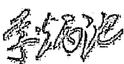
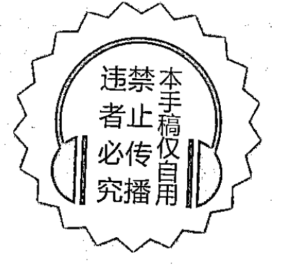
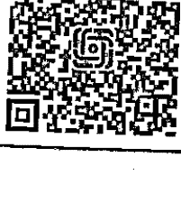

# 吐露心声

# 前言

欢迎你阅读《吐露心声——世界上最好的广告文案撰写秘诀》...

在这里，你将看到迄今为止最有效的一些文案撰写技巧和营销方法。

为了这本手册，我采访了很多世界顶级文案撰稿人，他们都为本手册作出了贡献。当我问他们撰写文案最关键的核心秘诀是什么时，这些专家都非常慷慨地讲述了自己的经验。

此外，这本手册中还包含了一些古老却依旧适用于当今激烈的市场竞争的文案撰写秘诀。

肯定地说，你为自己成为一名优秀的文案撰稿人作出了一次重要且明智的投资。

现在，我邀请你来一窥世界顶级文案撰稿人的撰稿秘密。你会发现他们取得辉煌成就的方法。

本手册中包含了从过去到现在的优秀文案撰稿人，如：丹·肯尼迪，泰德·尼古拉斯，约翰·卡尔顿，赫舍尔·戈登·刘易斯，伊凡·利维森，克莱顿·萨克雷，盖瑞·本茨文加等人的文案撰写秘诀。

现在，请你找个舒适的位置坐下来，阅读本手册吧。

不管你是文案新手，还是经验丰富的文案撰稿人。你都将会体会到和世界上最好的一些文案撰稿人进行内心交流的快乐。在每章标题下面，我列出了此主题的作者，你可以了解来自谁，当你了解了这些文案大师撰写优秀文案时的心理过程，你会受益颇多。

德鲁·埃里克·惠特曼

# 1. 制定强有力 USP 的 3 招

德鲁・埃里克・惠特曼自述

罗瑟・瑞夫斯 1961 年出版了一本经典著作《实效的广告》，在这本书中，他引入了独特卖点，即 USP 的概念。

## 瑞夫斯认为 USP 有以下 3 种属性：

1. 每个广告都向消费者陈述一个主张, 即向消费者说明购买产品会得到具体的好处。

你的标题必须给读者一个好处——一种承诺。

2. 该主张一定要独特, 必须是竞争者不能或不会提出的。这就是独特销售主张中的“独特”所在。仅仅提出一项好处是不够的。你必须把你的产品和竞争对手的产品区别开来。

3. 这个主张一定要强有力地打动广大受众, 比如, 吸引新顾客购买。

独特性绝对不是微不足道的。这种独特性必须能够影响读者, 让读者感觉举足轻重。

为什么这么多广告都失败了？

其中一个原因就是, 营销者没有给自己的产品制定出强有力的 USP, 并以此为基础创作自己的产品广告。

制定 USP 并不难, 但是需要思考, 现在很多人都不喜欢思考。

如果你 的产品本身就有独特点——竞争对手没有的特点——会让你很容易地制定出强有力的 USP，来表述强有力的好处。

这个好处必须是顾客真正关心的。而不是虽然和别的产品有所不同，却可有可无的好处。

克劳德·霍普金斯在《科学的广告》给出了一个经典的 USP 案例，被人们广为传颂。

简短版本：一个广告人从客户的酿酒厂走过，被通过蒸汽清洗啤酒瓶来消毒的场景深深吸引了。

“不要在广告中诉说这点，”厂商告诉广告人：“这没有什么特别的，其他酿酒厂用的也是这种方法。”

“可能吧，”广告者回复：“但是，我以前从来没有听说过这种消毒方法，广大受众也没有听说过。”

然后，他创作了一则成功的“通过蒸汽消毒的洁净啤酒瓶广告。”

还有一点：作为直接营销人，我们和一般广告人的不同之处在于，我们必须创作出能带来净利润，即高于成本的收入。

瑞夫斯认为所有的广告都要做到这点。他把广告定义为“以尽可能最低的成本，把 USP 植入大多数人的内心的艺术。”

## 惊喜！

马上加微信 HD10088，然后回复暗号：神秘文案书籍...

你将得到 98%的文案营销人员都没看过的文案书籍一本（目前互联网上搜索不到）。

# 2、如何在短短10分钟内撰写出强有力的标题

鲍勃·塞林（Bob Serling）

虽然我也认为好标题是任何营销活动能取得成功的一个关键因素，但是我坚决反对你投入过多的精力去撰写标题。

事实上，我一般用5-10分钟的时间就能撰写出重磅标题——而且我撰写过的很多带来几百万美元收益的营销文案，部分原因就在于精彩的标题。

你也能创作出让人无法抗拒的标题，吸引读者，说服他们在百忙之中抽时间阅读你的营销文案。一旦你理解了“依靠大脑的本能反应”这个概念的本质，撰写标题就会变得简单之极。

四五千年之前的人们，生活非常简单。人类每天面临着很多危险。他们整天都在想：“天呐，这里有凶猛的老虎出没。我怎么才能躲开这些猛兽，不被他们吃掉？”或“这个洞穴对我和妻子，孩子们来说太小了，到哪里能找个更大一点的呢？”

这就是你每天要思考的——通过自己的本能，做出关乎生死存亡的决定。战斗还是逃亡，饱餐还是饥饿，生存还是死亡。

现在，我们看看它在如今科技相当发达的社会的运用。

假设，你在午餐休息的时间，在商场闲逛。你刚吃完低碳水化合物，高蛋白，营养均衡的午餐，还有20分钟的休息时间，20分钟后，你就要回去工作。所以，你决定在商场里随便看看。

你想想，在这样的场景下，你的脑海里在想什么。

如果你仔细审视一下独处时，你内心的想法，就会发现我们所想的东西和四五千年之前并没有两样。

> “威尔逊周末来访，我们用什么食物招待他呢？我的贷款还完没有？今天晚上我最好看看。苏西再过 3 年就要上大学了，我们怎么才能负担起 4 年的学费呢？”

你脑海里想的都是诸如此类的事情，没有止境……

## 问题！

非常简单，这就是我们大脑的运作方式。挖掘我们面临的问题。搜索，毁灭，让一切事情尽在掌控中。

## 基于大脑所想的标题

事实上，我们所有人的大脑运作方式都是这样的。一旦你意识到这一点，利用它，在任何时候，你撰写标题，都会拥有巨大的优势。通过简单两步，你就可以通过我们大脑的思考方式，撰写令人着迷的标题。花几分钟时间想想最困扰你的潜在客户的具体问题有哪些。把最困扰潜在客户的问题，以人们无法抗拒的形式展现出来，然后跟进。

下面，我们仔细探讨一下这两个步骤。

## 步骤 1：花几分钟时间想想最困扰你的潜在客户的具体问题有哪些？

你的潜在客户和你我一样。在他们独处——在商场闲逛，开车或看电视时——他们自然而然会想到自己面临的问题。你的任务就是弄清楚最困扰他们的问题是什么。

假设你有一款新的减肥产品，有各种对健康有益的好处。你的目标市场非常广阔，减肥也是一个经久不衰的话题。首先，你要问自己，“这些人真正感兴趣的减肥和健康问题是什么？”

你可能得到的某些回答有：

+   - 减缓衰老速度或逆龄

+   - 让自己比实际年龄看起来更年轻

+   - 避免一些严重影响身体健康的疾病，如心脏病，中风，癌症，以及老年痴呆症

+   - 安享晚年生活

+   - 摆脱疾病困扰，参加一些自己喜欢的活动

我敢肯定问题不知这些，但是这是一个很好的开头。

现在，你问问自己：“从这个列表中来看，最困扰我的潜在客户的问题是什么？哪些问题会让我的潜在客户从睡梦中惊醒，吓出一身冷汗？”

这个潜在问题列表中，有一个问题最突出，你能猜到我指的是哪个吗？

答案是——“避免一些严重影响身体健康的疾病，如心脏病，中风，癌症，以及老年痴呆症。”其他问题和这个问题相比，都显得不那么明显了。

现在，你有了撰写精彩标题的材料。

## 步骤2:把最困扰潜在客户的问题,以人们无法抗拒的形式展现出来,然后跟进。

这个步骤中，一共有两小步：（1）以问题的形式陈述问题；（2）采用令人无法抗拒，不得不读的形式陈述问题。

以问题的形式陈述问题看起来似乎很浅显易懂，但是我敢肯定，大多数人这点都做得不好，他们的标题大多关注的是问题的解决办法，而没有坚持问题本身。

下面，我举一个例子。

假设，通过进一步的市场调查，我们发现你的目标市场最关注的问题是心脏病。

毕竟，我们在电视上看到自然死亡的人，都是挎着心脏，喘息，和最后栽倒在地。而且在晚间新闻中也经常能看到著名的运动员和娱乐人士因心脏病死亡。

因此，你的潜在客户很容易就联想到同样的事情会发生在自己身上。

不幸的是，很多营销人没有在标题中使用问题，而是把目光放在问题的解决上。

但是，让我们看看你在标题中把着重点放在问题的解决方法，而不是问题本身上，会给你带来哪些损失。下面是就人们害怕心脏病突发，你可能使用的两个标题：

## 解决方案标题

“如何在 80 多岁还能拥有健康的心脏……享受更多的生活乐趣！”

## 问题标题

“注意：据医学专家透露，心脏病突发的死亡率是 82%”

好，现在，我们对这些标题进行终端测试。假设你真的意识到自己在慢慢变老，心脏病可能成为致死的第一原因，那么以下标题哪个会促使你停下手中的事情，继续阅读这篇文章？

毫无疑问，是第 2 个，问题标题。

现在，如果你还不愿意使用或强调你的潜在客户面临的恐惧，或最担忧的问题作为标题，那么，我来告诉你，这个问题并不是你创造出来的。你的潜在客户会出于本能地去考虑这个问题。

你的潜在客户日日夜夜生活在这种恐惧中。这个问题不是你创造出来的，你只是在提醒潜在客户他们现在已经清醒地意识到的一个问题。

现在，我们已经有了非常强有力的基于问题的标题，对吗？但是，你的工作还没有完成。

还需要做一件事，确保你的标题有十足的吸引力，吸引尽可能多的人。

## 回顾大脑科学

大脑的运作方式还有一个方面，一旦明白了，利用它你可以获得极大的好处。有个简单的方法，用它来组合你的信息，会让你的大脑无法抗拒，不得不去阅读它。

想想我之前给你举的例子，你在一个商场里独自闲逛，出现在你脑海里的那些问题。在想这些问题的时候，你的大脑自然地采用了一种具体形式。我们再来看看这些问题：

威尔逊这周末来访，我们用什么食物招待他呢？

我的贷款还了没有？今天晚上我最好看看

苏西再过 3 年就要上大学了，我们怎么才能负担起 4 年的学费呢？

这些例子的共同结构特点是什么？

每个例子都是问题的形式。这就是问题出现在你的脑海中的形式。因为你的大脑不仅关注问题，而且还会去寻找解决问题的办法。你的大脑搜寻问题的解决方法采用的形式就是，以问题的形式呈现你遇到的问题。

事实上，我们的大脑总是关于寻找问题的答案，很难避免。你想测试一下？好，和你认识的人说个谜语，然后立即走开。

有 90% 的人都会去跟着你猜这个谜语，或向你索取谜底。我们的大脑无法忍受放过任何一个问题。

因此，如果你想确保客户百分百阅读你的标题，你就要关注他们最关心的问题。并且要百分百确定他们会在阅读完标题后，继续阅读你的文案正文，就请在标题中采用问题的形式，来陈述你的问题。

## 组织标题形式，获取最大阅读量

还以之前提出的那个标题为例，让我们以问题的形式把它写出来。形式有两种。

首先，你可以撰写一个直接的问题标题。或者，你可以撰写一个两部分标题，第一部分是陈述，第二部分是问题。就我们说的这个例子，我选择了一个两部分式的标题：

注意:据医学专家透露心脏病突发的死亡率是 82%……哪 3 个简单的步骤可以保证让你避免突发心脏病呢?

在这个案例中，我采用两部分标题的形式，原因是，标题的第一部分非常有力度，我不想削弱它。

此外，记住我们的潜在客户大脑里一直在搜寻问题，“注意”这个词的使用，是在提醒大脑，有一个非常严重的问题将要困扰它。

好好看看我对原来这个标题的一个变式。里面有问题也有陈述。

如果你是一个上年纪的人，担心突发心脏病，你会觉得没有必要寻找如何避免突发心脏病这个厄运吗？应该很少有人能扔下这封销售信，而不继续阅读如何避免突发心脏病的 3 个简单方法吧。

## 让这 10 分钟的努力发挥它的威力

现在你了解了我撰写标题的步骤，下面你就可以用它在 10 分钟，甚至更短的时间内撰写强有力的标题了。

在刚开始使用这个方法的时候，想要获得最好的结果，最简单的做法就是把每一步都写下来。

首先，列出你的产品能够解决的潜在客户面临的所有问题。这个过程不能超过 5 分钟。

然后，找出列表中最关键的问题。这个过程应该在 30 秒左右，因为相信通过前面的分析，你也看出来了，列表中的某个问题通常会比其他问题突出很多。

最后，把那个最严重的问题以问题的形式呈现出来。这些工作在 2-3 分钟内就可以轻松完成。从 0 到撰写出一个强有力的标题，总共需要的时间是：不到 10 分钟。

此外，你使用这个公式次数越多，它就会变得越简单。

到目前为止，我已经使用这个公式很长时间了，前几个步骤，我在脑海里就可以完成，通常只用不到 1 分钟时间。我唯一写到纸上的就是我最终想到的那个问题标题。

本案例中，我从酝酿，到写出这个两部分标题，只用了不到 2 分钟时间。当想到要写这个标题的时候，灵感很快就来了，我写下了标题的初稿，然后，进行了一点语言的润色，改进，很快就写下了最终版本。

如今，你明白了如何快速撰写标题，以及它的效果为什么这么好，所以，就没有必要再为撰写一个强有力的标题花费数小时的时间了。

任何时候撰写标题，你只要运用我的方法，几分钟内，你就可以拥有一个强有力，且效果非常好的标题。

## 惊喜！

马上加微信 HD10088，然后回复暗号：神秘文案书籍...

你将得到 98%的文案营销人员都没看过的文案书籍一本（目前互联网上搜索不到）。

# 3、通过沟通建立连接的秘诀

艾米·卡莲 (Amy Gahran)

为什么人类还没有灭绝！

如果你正在听我讲述（现在你正在阅读），说明你可能是人类。所以，你可能习惯把大自然赐予的很多重要礼物视作理所当然。我不是在责备你不知感恩，而是希望你能更谦卑，眼光更长远，哪怕仅仅一分钟。

单独来看，人类是极其脆弱和无力的。我们没有毒牙，尖爪，毒液，盔甲，角，翅膀，甚至毛皮。我们的感官和许多所谓的“小生物”相比微弱得可怜。我们需要长时间的妊娠和断奶期。我们容易遭受各种各样的威胁和疾病。我们无法容忍极端的温度。

当然，我们有适合抓握物体的拇指，这非常酷，而且非常有用——但是你可以看看任何一只浣熊，这样的拇指能让你在强弱排序中占有多大优势。

作为一个物种，我们最有价值的特征可能是通过沟通，建立连接的能力。大自然赐予我们的这个礼物拯救了我们，我们可以相互合作，分享经验、感觉、技能和知识。它使我们超越身体上的限制，形成一种“群体思维”。虽然我们很多时候都在宣扬个人主义，但是我们真正的力量在于相互依存。

用知识武装，还有无数代人精心设计的基础设施，人类可以用枪在一个安全的距离杀死巨大，强壮，拥有锋利牙齿的猛兽。更好的是，我们可以通过向别人了解这些野兽的出没，以及他们的狩猎方法，

完全避开这些野兽。如果没有这种知识的积累，我想我们大多数人可能都对付不了一只发怒的浣熊——更不用说美洲狮。

简单来说，没有交流，就没有“远见”。

建设性的沟通：这不只是一个好的想法，这是你的命脉。

显然，沟通这种强大的工具是一把双刃剑。任何个人或组织都可能利用沟通办坏事——从可以很容易地以破坏性的方式使用沟通——从“你有虱子了，ewwww...”，到“啊，你不能只当它是個笑話嗎？”再到“杀死所有的图西人！”

然而，在我看来，人类的一切有用，漂亮，和能治愈疾病的东西，都是依赖人与人之间的沟通建立起来的——要么通过合作，要么根据从他人身上学到的东西，自行研究。这种沟通，可以是直接的面对面沟通，也可以是通过媒体，比如从洞穴壁画、书籍、互联网获得。

沟通可以超越时间和空间。

一个合理、有效的内容策略是建设性的。它着眼于共同的目标和利益。它着眼于你和你需要的人之间产生共鸣，一起创造价值。它是关于认同，并实现共同利益——不管你是一个学生，一个企业，一个联盟，或一个政府。归根到底，我们都只是人。

当然，你也可以开发一个着眼于欺骗，隐瞒，个人利益，剥削，恐吓，或妨碍他人的内容策略。然而，这些虚假的力量非常容易被破坏——因为人们会交流。当人们相互交流的时候，你的这些东西就开始被破坏了。

## 公共交流：你身在其中

公众交流一直存在。而且你一直是其中的一部分。你的家庭，学校，

员工，当地报纸，银行，议会，评论以及政府等，都是公众交流的一部分。很多公众谈话都是公开的，但是也有很多是隐秘的。

参与公众谈话，意味着倾听不同水平，各种各样的人的谈话，并且和他们交流。

建设性的行为意味着，传递你想从别人那里得到的透明，尊重，信誉，批判性思维、和同情。

这适用于任何人，从大公司老总到普通农民。再说一次，不管我们独处还是和他人共处，我们都只是人。

建设性地参与正在进行的公众交流的个人和团体能够取得蓬勃发展。这种交流可以帮助他们学习，成长，和适应。那些试图忽略或控制公众交流的个人或团体，往往会枯萎，天折，淹死，或者崩溃。

有时这些后果需要很长时间才能显现——但如果从长远来看，结果肯定会是这样。

所以，再说一次：不要把交流视作理所当然。不要不计后果，滥用它，破坏它，抵御它，被动地对待它。这样你不仅是在毁灭自己，你还可能伤害很多人（至少会给很多人带来麻烦）。

对成为公众交流的一分子，要心存感激。开始多倾听，去参与交流，而不是指手画脚。开始憧憬你能够实现的美好未来——并考虑实现这个目标，你需要什么人的帮助。

远见可以让你的其他内容策略变得更简单。你会比一般人更具优势。

# 4、属性决定原则

赫舍尔·戈登刘易斯（ Herschell Gordon Lewis ）

属性决定原则，虽小却能增加反应率，往往被很多营销人忽略。属性在提高反应率中起着举足轻重的作用。

虽然这看起来很深奥，其实不然：在数值上，一个关键词要比整句话的影响更大。例如，一英里的距离看起来好像大于 5280 英尺。对于营销人来讲，属性决定原则有两种使用方法。如果想让数量看起来比实际少，你可以说一品脱；如果希望相同的数量看起来更多，可以说这是半夸脱。

要想告诉顾客发货快，可以说：“我们会在 24 小时内为你发货”，而不是“我们会在第二天为你发货。”要显示时间长——显示可退换货时间长——可以说“一整个月”而不是“30 天”。这个威力来源于属性，月或天，而不是数字 1 或 30。

12 个月看起来要比 1 年短暂。所以，“1 年品质保证”看起来要比“12 个月品质保证”时间更长。

证明？如果说某个电视节目“60 分钟”改为“1 小时”，相信它的收视率会大大降低。

你要思考利用属性。

# 5、次要承诺

罗伯特 W.布莱 (Robert W. Bly)

“承诺，重大承诺，是广告之魂”，塞缪尔·约翰逊说到。

现在我们知道他说的是对的：直接营销要在众多广告中脱颖而出，增加反应率创造利润，就必须给出重大承诺。

最近的直邮邮件中的一些重大承诺例子有：

- “退休到海外，一月给你600美元。”
- “这里有一笔钱给你”
- “约翰·肯尼迪有它，戴安娜王妃有它，迈克尔·乔丹现在也拥有了它。这就是为什么数百万人喜欢他们。打开信封看看它是什么，以及你如何能拥有它吧”

测试表明，小承诺是没效果的，至少在直接营销中如此。要获得关注，并激发顾客的兴趣，你需要作出重大，有力的承诺。

但是，还有一个问题：如果读者怀疑你，怎么办……因为你的承诺太大，听起来让人难以置信。这种情况下，你就可以采用“次要承诺”了。

次要承诺中是产品能给予潜在客户的相对较小的好处。尽管不像重大承诺那么大，次要承诺也应该足够大，这样才能给顾客订购你的产品的理由……不过，还要把握好度，让它不那么大，这样顾客才会相信。

这样，即使读者不相信重大承诺，也会相信次要承诺，从而订购。

比如，最近一个关于投资的广告，就在标题中采用了重大承诺：
“这个听起来很疯狂，R&D 这样一个小小的研发公司今天只卖 2 美元的股票，在不久的将来，可能就会飙升到 100 美元。”

这确实是一个重大承诺——每股从 2 美元上升到 100 美元，涨幅高达 4,900%。如果你有 1000 股，你的利润将会是 98000 美元。

问题是，即使是在熊市，这个涨幅对一些读者来说，还是太高，无法相信。但是，在这种情况下读者就会相信了：如果公司的医疗设备获得 FDA 批准，股价增加 50 倍并非不可能。

解决方案：在重大承诺的大标题下，再加一个小标题做一个次要承诺：

“我认为这种治疗肝脏疾病的新技术会有效果。如果这样，股票很轻松就可以上升 50 倍，甚至更多。但是，即使它没有效果……这个公司的治疗技术完全失败了……该股票在未来 24 个月内，仍然可以为早期投资者带来 500%的收益。”

我们可以看到：即使这个治疗方案没有获得 FDA 的批准，该公司仍然可以把该技术运用于不同的方面，赚很多钱（虽然没有被确定赚的那么多）。因此，即使重大承诺没有成功，第二个承诺足以让人觉得值得拥有该股票。

读者怀疑你的重大承诺的真实性的時候，你有很多方法可以去证明。包括：证言……案例研究……测试结果……好评……优秀的产品设计……以往的记录……系统或方法……制造者的信誉。

这些方法都不错。但问题是：如果重大承诺过大，读者就会认为是假的，你会发现当你呈现这些证据的时候，你就陷入了和他们争辩真假，否定他们根深蒂固的信仰的境地。

证据，我依然要呈现，但是消除读者对重大承诺的怀疑的一个相对简单的方法就是，较小且更可信的次要承诺。

次要承诺是你的“支撑”承诺。在同时有重大承诺以及次要承诺的标题中，重大承诺因为其非常重大，能够吸引读者——如果你能提供足够的证据，很多读者都会相信它。

那对于不相信它的潜在客户呢？没有次要承诺，他们会把你的销售信扔了，不会去阅读它。

但是，加上次要承诺，并让它看起来比较显眼（在标题或销售信中突出显示），很多不相信重大承诺的人，会觉得次要承诺比较可信……次要承诺的吸引力足以促使人们购买。

事实上，有了次要标题，不完全相信重大承诺的人，依旧会相信次要标题，而去购买。

他们会想：“如果这个重大承诺是真的，这个产品真的值得购买；但是即使它是假的，根据次要标题——我肯定它是真的——里面说的，这个产品仍然是物超所值。所以，不管怎样，我不能错过。”

如果你在下次推广时同时使用重大承诺和次要承诺，你也会获得你想要的。我保证。

# 6、交叉销售的秘诀

伊万·奥尔特（Ivan Levison）

我最近都快忙疯了。

所以，我有时会叫 Mr. Handyman——做家居维修的人——来帮忙，对我这样的人来说，这简直是上天的恩赐。最近家里有一些事情要做，所以，我约了一个装修工。他准时出现了，并且工作做的非常漂亮。

至少我认为是这样。

几周后，我收到了 Mr. Handyman 的邮件，里面有张宣传页，完美的诠释了什么是“一流的”交叉销售“，以及如何通过有效的”交叉销售“获取更大利润。在我们分析他的宣传页之前，让我们先回答一个重要的问题……

### 究竟什么是交叉销售？

交叉销售，是通过主动向潜在客户提供相关的产品或服务来增加销售的一种方法。

快餐店是使用交叉销售的一个经典案例。你点一个汉堡，服务员会立即问你：“要薯条吗？”也许你并没有想吃薯条，但是你会本能地说“要”。也许你不考虑要薯条，但你本能地说“是的”。

注意：不培训服务员问：“要薯条吗？”以及：“要什么饮料？”的快餐店的经理就应该让他吃一辈子垃圾食品。他们真的是错失了原本可以轻松赚到的钱。

还有一个交叉销售的案例，那就是在亚马逊购物的时候。当你搜索某个题材的书籍时，网页会自动为你显示一些相关书目。
现在，让我们回到我的朋友 Mr. Handyman。我已经把 Mr. Handyman 的宣传页上传到我的网站了，如果你想了解这个有远见的公司是如何进行交叉销售的，可以访问网址：www.levison.com/handy.html。

你也看到了，Mr. Handyman 不是被动地等待我家里的水龙头漏水后再找他，而是主动地进行交叉销售，向我销售相关产品——而不只是他们的维修服务。他们做得太棒了！下面是我对他们的宣传单的一些看法：

- 首先我们来看标题以及副标题：“家居产品。由 Mr. Handyman 配送和安装。”他们清楚地向顾客提供一整套服务，我的朋友杰弗里·摩尔称之为“整套产品解决方案”。Mr. Handyman 让人 们不得不说“是”。
- 里 面有个词“超棒的礼物！”本身就是一个非常棒的想法。也许我不需要他们的产品，但我可能会想把他们的产品当作礼物送给朋友 啊。他们扩大了我的选择范围，开发了我其他的购买可能性。
- 我们再看看他的宣传单平面设计，非常干净，漂亮，有吸引力。干得漂亮！设计这个宣传单的人，清楚地知道自己在做什么。（你的宣传材料是不是也做得这么漂亮呢？你应该这么做。）
- 再看看第三页的标题，“帮你解决所有家居维修问题！” Mr. Handyman 并没有忘记重申自己公司的核心竞争力。

当然，他们是在尝试向你交叉销售其他产品。但是，他们还是提醒了你他们的强项所在——服务。

总之，寻找交叉销售的机会，并向潜在客户销售，可以极大地提高销售额。麦当劳是这么做的。亚马逊是这么做的。Mr. Handyman 是这么做的。你也可以这样做！

# 7、让某人疯狂

李·马克·斯坦（Lee Marc Stein）

不愿改变是现在的营销人面临的一个大问题。我们无法让潜在客户改变现在的消费习惯，甚至无法让他们开口询问可能会发生的改变。

这个问题并不是说：“马上行动吧”或“今天就打电话吧”就能轻松解决的。罪魁祸首就是今天的生活太便利了。同一种产品类别多，潜在客户看不出都有什么差异。

或者，他们根本就不关心这些。

那么，你怎么做才能让潜在客户“有一点点改变”呢？

你可以用额外好处，尤其是你的竞争对手没有的，来贿赂潜在客户。

你可以举行抽奖活动。但是这个可能会转移潜在客户对你的产品/服务的注意力。

幽默在某些情况下可能也可以改变顾客的习惯。

如果你真的想让客户对你的冷门产品兴趣飞涨，想让你的产品脱颖而出，你就要让潜在客户发怒！

当然不是因为你，而是因为某种情形，因为你的竞争对手，因为之前没有遇到你的解决方案。

举个例子：汽车保险。这绝对是冷门产品；大多数州的司机没有选择，都买一种，而且顾客看不出不同公司的保险有什么不一样。

所以，如果你正在为一个担保负责，安全驾驶的司机的保险公司写文案，你需要激发潜在客户的怒气......

- 不负责任，引发事故的司机可能牵扯到潜在客户
- 有些保险公司之所以担保这些不负责的司机，是因为保险公司收取更高的保险费，对事故进行赔偿
- 运营商和代理商尽可能本来简单的程序弄得非常麻烦

所以，如果你是一个直接回应保险公司，你也要让潜在客户对“中间人”赚取佣金，抬高保险费的做法感到生气。

在激起愤怒时，你一定要把握好度。不要弄巧成拙。

记住：“激怒”这个策略只是为了吸引潜在客户的注意力。用它吸引注意力，接着呈现你的产品好处。

在汽车保险这个案例中，这个好处肯定是节省费用。潜在客户对你的竞争对手的做法感到生气，进而选用你的产品，并且还能节省一定的费用。

我举这个例子，希望大家能够举一反三。

# CHAPTER 8

# 8、 “那又怎样” 测试

琼·达米科 (Joan Damico)

这是确保你写下的“产品好处”确实是好处，而不是产品特征的好办法。

如果你在写文案的时候，使用了我的“那又怎样”测试，你就能够写出有力的卖点。

具体用法如下……

“新型咖啡杯，内部有内线圈加热元件，给咖啡保温”

那又怎样！！！

这个标题没有通过那又怎样。

再试试下面这个……

“你不用再喝冷咖啡了！新型咖啡杯能为你的咖啡保温，让它和刚烫出来一样”

这才是产品好处！

# 9. 4U 秘诀

迈克尔·马斯特（Michael Masterson）

潜在客户收到你的营销信息后，他们会在很大程度上，根据你的标题，决定是否继续阅读，通常只要几秒。但是，如今各种宣传广告铺天盖地，你怎么能用寥寥数字告诉忙碌的潜在客户，你的信息是值得关注的呢？

4U 文案撰写公式——代表紧迫感，独特性，具体性，实用性——能够帮到你。

我下面就你和分享一下 4U 秘诀。

根据这个公式，标题应该是：紧迫性，独特性，具体特征，实用性

紧迫性。紧迫性给读者一个立即行动，而不是以后再说的理由。你可以通过在标题中加入时间元素，来制造紧迫性。还可以通过限时特惠来营造紧迫性，比如在某个时间之前订购，可以获得折扣，返现等。

独特性。强有力的标题，要么说一些新颖或独特的读者不知道的东西，要么用新颖的方式说读者已经知道的东西。

具体特征。子弹头的使用，被称为是“非常有魅力”的方法，可以引诱读者进一步阅读，并订购产品。

实用性。强有力的标题，要通过给读者提供有用的好处来迎合读者的私心。

在撰写标题时，问问自己，你的标题中，这 4U 体现的有多强烈。可以通过 1-4 级别给每个特征打分（1 代表弱，4 代表强）。

很少有标题的 4U 能全部达到 3-4 级。但是如果你的标题至少 3U 都没有达到 3-4 级，那么你的标题可能就不够强力——这时重写，会让你的标题变得更好。

人们通常会说某个标题不怎么样，可反应率很好啊，这是一个常见的错误认识。

你可以这么想：如果某个直接营销文案标题在标题不够强力的情况下，依然创造了很高的反应率，带来了利润，可以想象一下，如果它运用了 4U 秘诀，它能多赚多少钱。

一个软件营销人写信告诉我的同事，他用标题“免费白皮书”这个标题，投放了一次非常成功的营销活动。

### 这个标题利用了 4U 秘诀的什么呢？

紧迫性。标题中没有紧迫性，也没有时间限制的感觉。在 1-4 级中，4 是最强，那么“免费白皮书”只能打 1。

独特性。并非所有软件营销人都提供免费白皮书，但是很多都提供。所以，在独特性方面，“免费白皮书”只能打 2。

具体特征。这个营销人“免费白皮书”这个标题还能更有特点吗？可以，他可以只说“免费礼物”，所以，我们给“免费白皮书”打 2，而不是 1。

实用性。我想读者可能想到白纸，对他有用处。另一方面，这种实用性是白纸本身所包含的信息，而不是通过标题透露出来的。并且，对于每天接收到很多营销信息的读者来说，他们真的需要一张“免费白皮书”吗？所以，我给这个标题打 2。

我们可以说的具体一些，这样能提高标题的威力，比如： “本免费白皮书将告诉你，如何通过电子书学习的方式，把培训成本降低高达 90%。”

我强烈建议你每次撰写标题时，都做这么一个评分。

你还可以把这个公式用到线上，线下的其他文案中，包括，直邮邮件信封上使用的手段，广告标题，信件抬头，网页标题，电子邮件主题，副标题，以及子弹头。

用 4U 为你的标题打分。

然后，重写，能让你的标题中至少 2U，最好是 3 或 4U 评级至少提高 1 级。

这个简单的方法，可能让你花非常少的精力，极大地提高你的文案阅读率，以及反应率。

# 10。猴拳结的秘密

盖瑞本茨文加（Gary Bencivenga）

在每次销售中，不管是面对面销售，还是广告，都有两样东西要卖，而不是一种。销售任何东西都是如此，你越早认识到这一点，就能越早成为销售任何东西的专家，不论你面对面向他人销售，还是写广告。

当然主要销售还是你最终想要销售的产品或服务。但是，在你获得销售主要产品的机会之前，你必须首先让潜在客户成为你的观众。

这就是销售之前的销售。简单来说，就是你必须先把可以销售的机会卖出去。很快你就明白我在说什么了。

我是从世界上最伟大的销售传奇之一，人寿保险销售员弗兰克·贝特格那里学到的。

贝特格是在度假时发现的这个策略。当时他正站在准备停泊在迈阿密密码头的一艘船的甲板上。贝特格注意到要把船系到码头上的绳子异常粗壮。很长，而且有人的大腿那么粗。他在想，不管多强壮的水手，恐怕也举不起这么粗的绳子吧，更不用说要把它扔到码头上了。

因此，他决定站在那里观察这些人究竟是怎么做到的......

贝特格发现，船员甚至都没有尝试去扔那个笨重的叫做“缆索”的绳子。

相反，他看到一个船员在用力投掷一个绑在晾衣绳粗细的绳子上的小铁球，那个小铁球被称为“猴拳结”。

他把猴拳结扔给了已经等待在码头上的一个码头装卸工。

装卸工拿到小铁球后，他开始拉拽小铁球上的细绳。这个细绳连接着那个大缆索。然后，贝特格看到那个大缆索随着装卸工的拖拽在水里慢慢向岸上移动了。这就是这个笨重，粗壮的缆索是如何被绑在码头上的。

直接投掷缆索对于任何水手都太难了，就像任何营销人要接近冰冷的潜在客户，并立即说服他们购买一样。

这是俨为人知但异常有效的一个开始，并完成许多的销售的公式，不论是面对面销售，还是直邮邮件销售。销售第一步，要让潜在客户觉得非常非常简单。

这就意味着，不管你是通过邮件，网络，还是空间广告销售，你都不能在开始的时候就推销产品。要把它分成一些小步骤。第一步，要提供潜在客户很容易，很容易接受的东西。

克劳德·霍普金斯，广告的亚里士多德，描述了 20 世纪早期，推销员如何挨家挨户上门推销咖啡。

听起来像一个艰难的谋生方式，不是吗？你想想，每天要吃多少闭门羹。

经过很多不同的测试后，咖啡营销人发现了一个令人难以置信的简单而有效的销售方式。他们用的是“扔猴拳结”的方式——使得销售的第一步变得简单到让人无法抗拒。

它太简单了……

销售员首先会敲门。门开后，一般都是女主人开门，销售员（那时候几乎所有销售员都是男性）不会直接销售咖啡。

相反，他会说“下午好，女士。我今天给您带来了一份特别的礼物，半磅我们的免费精致咖啡。真诚地请您收下它。大约一周后，我会回来，询问您对它的感受。怎么样？”

她怎么能拒绝呢？

第二周，销售员会回来，他不会直接让那位女士购买，而是给她惊喜，为她送上了第二份礼物，如果她首次下单购买，就能免费得到这份礼物。

这种销售方式让销售变得非常简单，因为销售员让销售的第一步变得非常简单。他完全绕过了试图强行向潜在客户推销，然后肯定会被拒绝的方式。

正如霍普金斯说的：“任何明显的销售，都会得到相应的拒绝。”因此，不管是面对面销售，还是书面广告销售，都不要用明显的销售方式向潜在客户推销。

有无数方式都可以让你的销售第一步变得温柔，有诱惑力。产品的免费模型，画册，或直邮邮件里载有有趣，有价值的信息的文案。

免费检查、审计、体验课、咨询等等，还有更多。内附非常能迎合潜在客户兴趣的测试题或寻宝活动，或免费信息指南，或免费信息指南都是不错的方式。

盖瑞·亥尔波特在信件抬头粘贴美元也是一个很好的方式。你可以由此衍变很多不同的方式。

我发现，提供有价值的免费信息来击中目标客户，是最广泛，最经济，通常也是最有效的方式。因为它不仅更容易让你打开销售局面，而且会帮助你完美地达成交易。

比如，如果你销售地毯清洗或家政服务，你可以给潜在客户免费提供《如何让你的房子远离健康杀手尘螨的困扰》。

如果你销售惯于网络营销的课程，你可以提供《目前 100 种最成功的电子邮件广告》之类的免费电子书。

如果经营房地产，玛丽埃塔，你可以提供免费手册《趋势分析——过去的六个月玛丽埃塔房屋、公寓和合租间价格走势》。

如果你是按摩师，你可以提供免费指导《让你 7 周摆脱背痛的 7 个最佳秘诀》。

如果你是一个猎头，你可以提供免费报告《如何快速找到好工作——让优秀雇主主动给你打电话》

如果你销售演讲课程，你可以提供免费 CD《让每次演讲，观众都为你欢呼的秘诀》。

如果你销售育儿杂志，你可以提供免费报告《如何培育出更快乐，更自信的孩子——哈佛大学心理学家最新的惊人发现》。

所有这些都是“猴拳结”的例子，他们更容易让潜在客户放下防卫，给你时间，让你介入他们忙碌的生活。这就是如何做销售之前的销售。

这和求爱一样。你永远不要幻想直接走进一个陌生人，让她能嫁给你。

第一步，你可能需要搭讪，然后有了第一次约会，然后有更多次约会

会，然后订婚，最后结婚。

想要直接简单粗鲁地实现目标，肯定不会成功。

对潜在客户也一样。首先要简单，温柔，愉快，让她不可抗拒！然后同样的方式进行下一步，直到你们坠入爱河。

也许下面的打油诗可以帮你记住这个规则……

> “想泊船，销售产品，或被爱，那么首先请‘投掷猴拳结！’”

# 11、概念的力量

克里斯-马洛（Chris Marlow）

世界上最好的文案撰写秘诀之一是“概念”。我不知道为什么营销人员、文案撰稿人、平面设计师（尤其是平面设计师）一直犯这样的错误...

在创作明信片，信封，研讨会小册子，杂志目录，或其他销售邮件时，90%的邮件上本应印在正面的主要概念都印在了背面。

在我20多年的文案撰稿生涯中，我发现大部分版面设计（在无意间）通常都是错的。他们把主要销售信息放在了邮件背面，正面成了“空白”。

设计师不愿意把它放在邮件正面——放在地址，以及邮票或邮寄标记的旁边，因为这样做可能会让他们的设计看起来凌乱。

和我合作的一些直接反应机构（科恩直接营销，罗森/布朗，创造性直接营销集团，直接营销解决方案）都明白这一点。我有很多案例可以说明这个设计原则。

# 12、着陆页优化秘诀

丹·尼古拉斯（Don Nicholas）

> “我在广告上投入的一半资金都浪费了，糟糕的是，我不知道浪费在那里。”——约翰·沃纳梅克(1838 - 1922)

从书籍、报告和音频会议到现场研讨会，通过销售信息产品可以赚很多钱。但是，你怎么知道你的访客能否转换成客户呢？

这就说到着陆页优化问题了。

我们的线上营销专家开发了 12 种优化着陆页的指导方法。我们的技术师以及着陆页评论都会教你如何增加着陆页转化率。

评估广告或销售信一直都是一项艰巨的任务，因为它受到许多难以控制的变量的影响，而且是根据人的经验，感觉来确定哪些因素可能会有效。广告在互联网上的出现，程序员有了更多选择，超链接、视频以及其他电子形式让评估变得更加困难。

在线社区所需要的是客观地看待着陆页销售信.....计分卡可以帮助我们确定我们始终处在正确的轨道上，不会犯离谱的错误。我们的着陆页就是这么做的。

我们根据网络营销专家小组对优秀着陆页的看法，只做了评分卡。小组里的每个专家都是公认的行业领军人物，取得了辉煌成就。你也可以想到，那是一场多么别开生面的激烈讨论。在讨论的最后，专家们列出了成功的着陆页销售信需要的 12 个关键因素。

我们相信，你一定会觉得它是提高着陆页销售信转化率的一个宝贵工具。

该评分系统的运作方式如下：对每类中的 4 点中的每点回答为“真”即可得 1 分，每类最高可得 4 分。回答完所有真假问题后，我们取分数的平均分，然后评级，4 分=A，3 分=B，2 分=C，1 分=D。如果 1 分都没有得到，为 F。

下面是 12 个指导方法中的前 6 个，我们看看它是如何使用计分卡的：

### 1.标题（战略意图）

（对下面 4 点分别回复“真”或“假”）

- 该标题用吸引人的好处吸引目标客户
- 该标题通过产品或服务名称吸引注意力
- 该标题清晰易读
- 该标题让人觉得有必要购买该产品或服务

这听起来可能令人难以置信，但是太多太多的着陆页标题，以及副标题都没有什么吸引力。在写标题时，请想想你的产品特点以及好处。

### 2.故事&内容

- 销售信讲述了一个故事
- 讲述故事的人非常可信，而且身份清楚
- 故事非常有吸引力，而且十分可信。
- 故事最终鼓励潜在客户购买。

确保你的着陆页包含有一个潜在客户能够理解，并喜欢的有趣，引人入胜，可信的故事。

### 3.内容网络化

- 文本网络化
- 图表网络化
- 着陆页创新式地使用了多媒体技术

“网络化”指的是最有效地使用现有的多种媒体，以及交互技术。技术是用来强化而非代替销售信息的。

### 4.获取 E-MAIL（关系建立）

- 着陆页提供了一个用来换取邮箱或其他联系方式的免费报告，游客输入邮箱或其他联系方式就可以下载。
- 着陆页销售信中提供了免费通讯，游客输入邮箱或其他联系方式就可以下载。
- 在游客准备退出着陆页时，着陆页会自动弹出窗口，索取游客电子邮件。
- 在游客放弃订购的时候，着陆页会自动弹出窗口，索取游客电子邮件。

一旦你激发了潜在客户的兴趣，你就要想办法让你的名字，产品，或服务出现在他面前，这很重要。提供免费时事通讯或报告，是非常方便，且潜在客户容易接受的一种方法。

### 5.客户见证

- 客户见证可信，而且每个客户身份明确
- 证言里有让人信服的结果和好处
- 证言是融入在销售信中的。
- 证言反映出了目标客户以及他们想成为的人。

一个好的，可靠的证言在任何销售信中，都是极其有价值的一部分。最可信的证言是那些客户用自己的话讲述的故事，并且有提供证言的人的明确身份信息。

### 6.立即订购链接

- 销售信语言清晰简洁，语句通顺
- 销售信避免了使用一些晦涩难懂的词汇
- 销售信使用“有威力的词汇”来制造兴奋感和紧迫感
- 销售信前后用辞一致

你有没有见过有的销售信包含了一系列子弹头......在子弹头的最后，通常会说，“还有很多，很多！”其实，情况是这样的...智商正常的人都不会相信还有“更多，更多的好处”。如果你真的有更多好处，或特征，就把它写在列表中。简洁的语言，通顺的语句是讲好故事，或陈述事实的一个重要部分。不要试图用广告文案的陈词滥调欺骗潜在客户。

# 总结

The Mequoda Landing Page Scorecard™评分系统鼓励你用 12 个经过 Mequoda 使用测试，得出的最好的指导原则为你的着陆页打分，然后各个分数相加得出总分。目的就是强调有效，能带来销量的着陆页的重要性。你的着陆页每个部分都应该取得比较好的分数，而不是厚此薄彼，或直接省略某个部分。

2005 年 6 月份，我们开始每个月刊登 2-3 个 Mequoda 着陆页评论。到下一年，这些评论就会汇集许多最好，以及最坏的着陆页。

最好的着陆页 “A” ，在 Mequoda 着陆页 12 个指导原则测评中，得分为满分 48 分，或每项得分为满分 12 分。点击下面链接，查看 Mequoda 着陆页评分系统，12 项 Mequoda 经实践证明最好的指导原则的更深入，更详细的内容。

链接: www.mequodalibrary.com

树立更高的目标，就能走得更远。

# 13、撰稿者的思维障碍——如何打破思维障碍，让你泉思如涌

奥钠·格雷（Aurel Gergey）

打破撰稿者思维障碍的 7 个简单方法：

- 1. 瞒骗你自己：任务分解法
- 2. 全身心投入其中
- 3. 通常只有安静下来，才能投入工作
- 4. 音乐，所有工作最好的助力剂
- 5. 积极地利用醉酒
- 6. 外部活动能带动大脑活动
- 7. 做有益于自己的事，然后写下来

让我们来简单地看看每个方法：

### 1. 瞒骗你自己：任务分解法

写作者的局限（更确切地说是文案撰稿者的局限）通常是因为有太多工作要做，一时无从下手。那么，你可以和我一样：我要做各种各样的事情，而不仅仅是我应该做的——完成本职工作。

因此，我养成了把大型任务或者很难的工作分解成可以逐步完成的部分。这就意味着对自己说：好，我只要把这些完成就可以，没有更多的工作了。分解任务大概需要1个小时，或者更短的时间，因此很好掌握。

这个方法的好处在于，打破常规，让你着手做事。我通常会全身心投入工作，顿时感觉文思泉涌。我说的是通常，而不是总是。

### 2.全身心投入其中

我发现撰写文案非常困难，但是如果在有外界干扰的情况下，撰写文案更困难，让人无法忍受。一旦全身心投入，我在1小时内做的工作，要比无法全身心投入工作时1天内做的工作都多。所以，从工作一开始，我就必须全身心投入，避免文思枯竭。

我听说有的文案撰稿人会穿着游泳短裤，双脚泡在温水里，就开始撰写文案了，为的就是能全身心投入。弗雷德里卡每天早晨在她20米泳池里游泳1小时，然后回到房间里，拉上窗帘，全身心投入研究8小时。

就我来讲，我喜欢在开始写作前，先读一些东西，这样能让我的大脑转起来，营造写作氛围。但是，有时我在打开电脑写作前，会先吃饱肚子，再喝一杯浓咖啡，抽一根维珍尼亚烟。

> 派翠西亚·海史密斯说：“如果我通过信件或电话做完了我需要做的所有工作，并感到满意，那么我会站起来说服自己，刚才的我并不是我，刚才的那1小时什么都没有发生。为了工作，我需要完全忘我。越早进入这个状态，我的文章写得就越好。进入这种状态的能力随着不断实践，在不断提高。”

### 3.通常只有安静下来，才能投入工作

最近我和朋友在布拉格共度周末。我们希望能够放松一下，开个派对。我的工作几乎都做完了，但还剩下一点，所以我带着笔记本过来。别人都在到外面去逛了，我投入了工作。

不幸的是，我们住的宾馆位于一条繁华的街道，我无法集中注意力。因此，我关上电脑，准备出去喝一杯。路过一家武器店时，我看到了头戴式耳套。

我迅速买了一副，冲回酒店，戴上耳套立刻开始写作了。汽车的噪音听不到了，我终于获得了平静。

从那起，我出去经常会带着耳塞。如果出远门，我就带着耳套。戴上耳套，只要很短时间，我就能进入状态，戴着耳机，听着自己的心跳，脉搏，这比绝对安静更能让我打开思路。库尔特·图霍夫斯基已经意识到这一点，他说：“一个人要想完成一些有价值的事情，首先必须有一个安静的环境。”

### 4.通常只有安静下来，才能投入工作

是，我也意识到这个方法和上一个方法有些冲突，但它确实有效。

对我来说，文案撰写是进入内心世界，远离日常琐事和理性思考的一种状态。它和冥想有共同之处。为了进入这种纯粹的思想状态，我不仅采用安静的方法，而且会通过音乐让自己激情澎湃。

如果我觉得雄心勃勃，我会选择重金属摇滚（就像顺势疗法的初步恶化一样），如果我感到无聊，我会选择格伦·古尔德的乐曲，如果我要思索一些方法，我会选择吉米·亨德里克斯的音乐。

然而，重要的一点是这些音乐都没有德语歌词。这让我有点迷茫。在写文案之前，或之中，听听音乐（仅限我知道的音乐）效果也非
常好。尤其是我感觉没有精力，这种情况下，音乐的力量就转移到了我的文案中，人们都会觉得，哇，这个人充满了能量——这种能量是我偷来的。谢谢你们，音乐家。

### 5.积极地利用醉酒

撰稿者的思维障碍是说，本该说是，却说不是。如果我自己无法对付这种情况，我知道有些东西可以帮助。

我不相信毒品能让非文案撰稿人瞬间变成文案撰稿人。但是它们可以帮你打破思维障碍，让你文思泉涌。

我不是说违法的毒品，我可不想沾上那些东西。我说的是啤酒，或白酒。

> 正汉斯-彼得·罗迪在《Du》杂志上说的：“微醺容易让你说是，清醒容易让你说不，宿醉则另当别论。”“演员和作家依赖酒精激发灵感。酒精更容易让你摆脱恐惧：开始写一本书，任由受众评论。书和舞台是孤独的地方：酒精更容易让你承受孤单，同时也更容易让你接近别人。”

但通常完全清醒，需要好的睡眠。晚上休息得好，是写出好文案的先决条件，通常会激发创造力，可以让你灵光乍现。

### 6.外部活动能带动大脑活动

好像有几位瑞士文案撰稿人每年都会购买旅游通票，从而能够每年都往返于全国各处。他们这么做，就是为了在行走中获得创作灵感。

我也是如此——在旅行的途中，我的思想也在路上。但是，我不是很想和陌生人一起旅行，所以，我更喜欢开车旅行。我通常在开车时，会带着纸和笔，因为最令人兴奋的想法，通常是
在漫无目的的路途中产生的。只要把纸放在方向盘上就可以写，稍稍练习一下，你会发现效果非常好。

我试过一段时间录音，用起来更方便，而且安全。但是，之后要再写下来，非常浪费精力。在走路时，用纸笔记效果也非常好。我规划了几个走路线路，这样，我就可以不用费心看路，集中思想创作。

### 7. 做有益于自己的事，然后写下来

> “愚蠢的客户，愚蠢的安排，愚蠢的工作。”

我听到很多文案撰稿人说过这样的话。是，我有时也有这样的想法。幸运的是，在称为文案撰稿人之前，我做过一些其他工作......其中有些比写文案要糟糕很多。

如果这些想法战胜了我，比如，一个营销人因为工作压力大，所以折磨我，我会这么想——用这些想法来打破思维障碍：我不是给这个讨厌的人写文案，而是给公司其他人，他们很无辜，都有朋友，家人，如果我的文案有效，销量暴增，就可以帮助他们。

我似乎看到了一家人其乐融融，坐在电视机前，欢乐无比。养家糊口的人也很幸福，因为他工作一切顺利。你觉得很牵强？一点也不。我相信这正是文案撰稿人存在的意义。

# 14、从别人哪里吸取精华

迈克尔·A·施特尔茨纳（Michael A. Stelzner）

我擅长写白皮书。可能写白皮书的人面临的一个比较大的挑战是，组织优秀内容。

最常见的做法是去谷歌搜索，看看别人在这个主题上是怎么写的。虽然这种方法可以让你获取有价值的信息，但是最有价值的东西在他们脑海里。所以，你的任务是了解他们的思维方式，从中提取你撰写白皮书所需要的有价值的信息。

当我相信你过去一定有被为在白皮书上写哪些东西比较重要，折磨得身心俱疲的经历，为什么你要猜呢？你公司的同事，以及客户端网站上有你正在寻找的关键信息。

下面是我们不主动问问题的几个原因：

- 1. 我们讨厌请示别人
- 2. 我们认为我们什么都知道
- 3. 我们不想让自己看起来像傻瓜
- 4. 我们不知道问谁
- 5. 我们不知道问什么

那怎么办？很简单。有问题直接问。窥视别人内心的关键方法，就是问对问题。

我们看看哪些是好问题，哪些是差问题：

极其糟糕的问题：数据备份计划重要么？

比较差的问题：为什么数据备份计划重要？

好问题：你可以说出 3 点数据备份计划重要的理由吗？

超级棒的问题：没有数据备份计划可能会造成什么后果？

第一步是提出你希望得到某种回答的问题。避免提问可以用简单的“是”或“否”来回答的问题。笼统的问题只能得到笼统的回答。问题的细节是区分问题好坏的标准。

请求举 3 个例子，或者询问某个事情会带来的后果，能够真正激发被询问者的思考，迸发智慧的火花。

如果你不幸在访问中问了一个糟糕的问题，或者得到的回答过于笼统，你可以用以下问题跟进：

- 1. 你可以详细地陈述一下吗？
- 2. 可以举几个例子吗？
- 3. 它为什么很重要？
- 4. 你的言论会对我们的理想读者来说有什么含意？
- 5. 你可以换种说法吗？
- 6. 怎么说才能让行外人听懂？

如果你不是很理解受访者的回答，或者如果你觉得你没有得到你想要的回答，那么请大声重复你听到的答案。这样可以引发更深层的讨论和解释。

当问及涉及一系列事务的问题，比如产品主要好处时，你可以重复询问以下问题：

- 你可以再举一个例子吗？
- 还有什么？
- 你还能想起什么？
- 还有什么值得提及的吗？
- 我们有没有遗漏什么重要信息？

> “一个关键方法就是，安静地倾听，不要试图把你的想法强加给受访者，给他一定的思考时间。”

有时，你能明显感觉到你访问的人并不是该方面的专家。所以，你还要向他询问是否可以推荐其他受访者，这很重要。你甚至可以直接说：“你还有其他这方面的专家推荐吗？我还想访问一下？”访问对的人，询问至关重要的问题，能让你吸取到智慧与精华，为你的白皮书提供宝贵的内容。

# 15、拒绝空泛，拒绝平淡无奇

杰夫瑞布金 (Jeffrey Dobkin)

当你撰写一篇文案感觉很困难，并且文案看起来很糟糕时——回头把第一句话删掉。这时候你写的第一句话通常是空泛的，下面的可能才是文案的核心。

如果你一整天都状态不佳，那么把第一段都删了。

# 16、把“我们”改为“你”

凯文·芬恩（Kevin Finn）

在大卫·奥格威的书籍《奥格威谈广告》（第118页），引用了麦格劳-希尔的一则经典广告。

广告展示了一个65岁的老人，穿着一身西装，坐在椅子上，一脸狐疑，很严肃，不耐烦地看着一个标题，说：“我不知道你是谁。我不知道你的公司。我不知道你公司的产品。我不知道你公司是做什么的。我不知道你公司的客户都是什么类型。我不知道你公司的诚信记录如何。我不知道你公司的声誉如何。现在你想卖给我什么？”

广告下面的文字写道：“格言：在销售员给你打电话之前，销售就开始了——通过商业出版物广告。麦格劳-希尔杂志，业务/专业/技术”

文案撰稿人盖瑞称之为“我-我文案”。“我们做这个……我们做那个……我们有……我们是……我们能……把“我-我文案”转化成“你”文案吧。

# 17、通过销售调查获取高质量潜在客户

鲍勃·麦卡锡（Bob McCarthy）

两种最常见的调查形式，我们都非常熟悉——市场研究调查和客户满意度调查。

但是，还有一种调查方法，我认为是直接营销中非常厉害的秘密武器之一。我们称之为销售调查或潜在客户调查。

尽管很多人都看到了这种方法（并且在使用它）来收集调查数据，其实它的主要目的还是为销售人员收集高质量客户数据。

在我20多年的直接营销生涯中，它为我带来了较高的顾客反应率。重要的是，它为我的销售人员提供了大多数销售人员所渴望的高质量信息。

和一般的市场调硏不同，销售调查更感兴趣的是事实，而不是意见。

尽管每个调查我们需要收集的具体信息都不同，但是，在大多数情况下，我们想了解的是潜在客户正在使用的产品和服务使用的前景，价位如何，以及他们的满意度如何。

我们想知道他们的供应商（我们的竞争对手）是谁，以及他们的满意度如何。

我们想知道他们的购买过程——谁做决定，怎么做决定，以及何时做决定。

我们也可能会问他们读什么商业刊物，或者他们一般参加什么会议——来进一步帮助我们确定广告内容。

再说一次，具体问题随着客户，以及销售目标的改变而改变，但是不管怎样，我们最终寻找的是销售人员能够使用的高质量信息。

在我们进入实际的调查之前,让我们看看我们所说的“资格”的信息。当销售人员评估特定的潜在前景,他们试图问几个关键问题的答案:

- 1. 这个潜在客户对我的产品有需求吗？我的产品真的能够帮助他吗？
- 2. 我的产品适合潜在客户吗？我的产品需不需要特殊设备（比如，专门的电脑桌）？
- 3. 这个潜在客户有钱购买我的产品吗？他们能承担起吗？
- 4. 这个潜在客户有没有权威性，或者能否推荐其他潜在客户购买？
- 5. 这个潜在客户有兴趣做改变吗？他的现状有问题吗？这个问题是他迫切要解决的吗？

销售人员通常每过一段时间都会以各种方式收集这些问题的答案。这些销售调查使他们可以在给客户打电话之前预先获取大部分答案。

如果销售调查问题设计得好，不仅可以获取潜在客户，还会获得一个完整的潜在客户信息。

那么，你决定好问什么了吗？怎么开始？

对我来说，这是一个合作的过程。一有机会我就会去接触销售人员，向他们了解哪些问题需要回答。

在最终问题确定之前，我通常或略作修改。下面是一些问问题的原则：

- 使用多项选择题
- 避免询问涉及个人隐私的问题
- 避免询问太难回答的问题
- 先用几个简单的问题热场，然后逐渐深入
- 多问一些事实性的问题
- 意见性问题应多关注潜在客户对现在的供应商或现状有什么满意或不满意的地方

我设计的所有调查都是放在信封中邮寄。大小通常是 10*10，有的时候也会用 6*9。调查问卷通常为 2 页纸（每页正反面都有），大约 20 个问题，有些问题比较长。通常我还会放一个回复信封。

就介绍信来说，直接营销邮件中一定，一定要放一封信，这是一个总的原则。我也遵循这个原则，但是在调查邮件中，我有时会在调查问卷前附加一封短短的信。

这封信的目的——不管是放在调查问卷前面，还是插入调查文件中间——是解释为什么给读者邮寄这封调查问卷。

许多人都犯了一个错误，他们也写了一封信，却是推销自己的产品或服务的，然后附加一封调查问卷作为回复机制。如果你想让反应率最大化，你需要让这个调查问卷成为邮件的主题,而不是附加部分。

调查邮件最大的优点之一是，它可能会调动读者的参与性。不像其他邮件(包括普通信件、明信片)，读者匆匆看一眼就不再看了，调查问卷读者需要逐字阅读。

读者在回答每个问题之前，都需要仔细阅读问题。这使得读者会在较长一段时间内专心阅读你的邮件（以及你公司的信息）。

因为这种激发读者参与的潜力，我们通常会插入一些旨在传达（而不是收集）信息的问题。例如，我们可能会问这么一个问题：“你知道 ABC 公司最近被评为年度最佳企业了吗？”我们不需要这个问题答案。我们更感兴趣的是让读者了解这个信息。

如果我们的公司因某种产品而广为人知，我们可能会问这样一个问题：“你知道 ABC 公司还提供以下产品吗？”同样，我们也是利用这个问题向潜在客户提供我们产品的最新信息。这听起来可能令人惊讶，但是，如果你问这些问题，不给任何承诺，只说声谢谢，读者通常都会回复。

但是，为了增加反应率，我们通常建议你使用奖励制度——赠送一个普通的礼物，感谢读者花时间回答问题。我们不会赠送昂贵的礼物。通常会赠送 5-10 美元的产品。只是对读者的一种感谢。

有的时候，我们会提供和我们行业相关的产品作为礼物——免费软件或一些和办公用品。有时会赠送电影券，书店礼券或早餐礼券。你可以测试不同的礼物，找到最适合你的。

销售调查通常可以为之后的进一步联系作铺垫。它可以为销售人员或营销部门提供初步信息，从而更好地联系潜在客户。

然而，我们也会邮寄销售调查问卷给现有客户，或者很久没有再次购买的客户——测试他们的满意度，确定我们需要满足的现有或未来的需求。此外，销售调查还为我们提供了交叉销售其他产品的机会。

# 18、俳句—“只留下高纯度的思想”

唐·李贝（Don Libey）

我学习过中国以及日本的古代诗歌。

我的导师强迫我来评估每个音节，删除所有不必要的字母，音节，和词语，有时不得不删除整个句子，段落，章节，甚至一些观点，最后只留下高纯度的思想，像古代东方作家那样。

我第一次在邮购公司工作的时候，和撰写冗长文案的同事不同，我撰写俳句。

（李炳池（LBC333）注：俳句，日本古典短诗，由十七字音组成。源于日本的连歌及俳谐两种诗歌形式。它在日本最初出现于《古今和歌集》（收有“俳谐歌”58首），至江户时代则有从“俳谐连歌”产生的俳句、连句、俳文等。

俳句是一种有特定格式的诗歌。俳句的创作必须遵循两个基本规则：

- 1. 俳句由五、七、五三行十七个日文字母组成(以日文为标准)。
- 2. 俳句中必定要有一个季语。所谓季语是指用以表示春、夏、秋、冬及新年的季节用语。在季语中除“夏季的骤雨”、“雪”等表现气候的用语外，还有像“樱花”、“蝉”等动植物名称。另外，如“压岁钱”、“阳春面”这样的风俗习惯也多有应用。这些“季语”通常带着现代日本人民对于幼小时代或故乡的一种怀念着恋之情。）

# 19、喜剧演员雷·罗曼诺和成功的直邮共同之处

彼得福格尔（Peter Fogel）

想必你非常了解标题的作用之一是为潜在客户提供强大的好处，瞬间抓住潜在客户的注意力：嘿，老兄……这个产品立刻就能解决你的问题！或者激发潜在客户的好奇心，让他不得不继续阅读你的文案，看你的产品为什么对他的生活有帮助。

所以，如果你现在还在读本文，那么上面的标题就发挥作用了。但是，雷·罗曼诺，一个喜剧演员和直邮邮件有什么关系呢？

要明白为什么雷·罗曼诺会有如此强大的粉丝群，并在你的下一次营销活动中应用它，你就必须听取大卫·奥格威的一个建议：“不要让人厌烦。说真话！但一定要以迷人的方式讲述！”

这就是这个成功的电视明星拥有数百万观众，每周定期收看他的节目的原因之一。雷·罗曼诺的 USP 在于，他的节目反映了观众的生活，以及婚姻的真实情况。

美国人每周都“着迷似的”看雷·罗曼诺和他的妻子黛博拉偶尔的小争执，或他和固执的父母之间的故事。因为观众在自己的生活中，也有类似的经历。

这是雷·罗曼诺总结的真理，他用幽默的语言和表演，让观众和他的情境产生共鸣（观众的确和他有类似的经历）。作为喜剧演员，雷·罗曼诺清楚，他不能让人感到无趣，单调，乏味。不幸的是，现在的顾客都有要求立刻被满足的心态……如果潜在客户在读你的文案时，

没有发出“喷喷”的赞叹声——你就不会拥有太高的投资回报率，你的这次营销活动也会夭折。

让潜在客户觉得乏味，无趣，他就不会看你的提议。他不看你的提议，自然不会购买你的产品，对吗？

美国版大众机械杂志就成功地利用了“镜子”法。事实上，他们的整个 USP 都集中在蓝领身上。USP 放在约翰逊框内，它的旁边就是精炼紧凑的标题：

- 如果你想生活得更好……
- 不介意辛苦的工作……
- 想无债一身轻。
- 请让我为你邮寄优秀杂志《大众机械》的第一刊《创业百科全书》（因为你是我菜）

砰！（引用著名电视厨师的话）这里没有一个多余的字。一个强有力的好处——加上潜在客户能够理解的语言，比如“无债一身轻”，以及“不介意辛苦的工作”，让读者和这个出版商的信息产生共鸣……

让整个文案给读者一种真正的“创业”的感觉——让读者感觉他是写这封信的人的“伙伴”，这正好和约翰逊框最下面写的：因为你是我的菜。

事实上，这是一个策略，他的文案从头到尾都有这类语言，目的就是吸引潜在客户阅读。这个文案撰稿人用潜在客户蓝领们的语言撰写文案，清楚地知道他们忧虑什么：

《大众机械杂志》是为……

专门为努力工作（想要生活得更好）的普通人而生。他们知道金钱来之不易。（都是用汗水换来的）。他们想拥有用更少的努力，赚取更多的钱的机会。

直击痛点，毫不留情——接着做出大胆的承诺，杰·亚伯拉罕就是用这样的“钩子”来避免让读者感到无聊。

下面是某句话中的“你能得到什么”部分……

我保证，我的百科全书一定是具有突破性的，它将在半年（甚至更短的时间内）为你的企业带来至少50000美元的收益……

否则……

你可以把它退寄回来……你可以免费保留邮寄给你的价值25000美元的高级磁带和CD，作为我对你给我这次机会的一个回报。

亲爱的亚伯拉罕营销爱好者：

你在读这封信吗？好！因为，在接下来的短短几页里，我想……

亚伯拉罕用他的提议，用短短几页纸，打动了目标客户。在标题中，亚伯拉罕用了他经典的“风险逆转”，告诉潜在客户，如果自己的产品没有像承诺中那样，给他带来惊人效果，他依旧可以保留产品。

但是，亚伯拉罕是不会让这种事情就这么发生的。和狂欢节上的叫卖者一样，亚伯拉罕也利用了人的恐惧的贪婪心里，他在每个句子中都向潜在客户展示了他的承诺能够带来的效果，以及潜在客户的事业能得到怎样的改观：

我说的对吗？你内心深处难道不渴望利用我的营销心态，营销模型，营销策略，营销系统，以及营销战术获取事业上的巨大成功吗？我想要给你一个新的希望，让你成为你们行业最好的营销巨头……

当然，如果他们不选择他的产品，将会失去……

这种普遍存在的思想，将会让你每年损失数百万元的收入，利润，现金流，失去很多很多机会。你不知不觉中将浪费很多时间，金钱，精力做无用功……

亚伯拉罕知道他的受众想被引导，走向成功……你不禁会着迷于亚伯拉罕的热情，他把你带入他的世界，看到了他的成功，他向你承诺，你的企业也将会获得不可思议的巨大利润。亚伯拉罕不仅激发了读者的热情，吸引他们一步步向下阅读……而且，触动了读者的心理，给读者施加了一定压力……

肯定是真的……因为数据说明一切！

统计资料。我们离不开统计数据。给出真实的主张，再加上一系列真实的数据，两者强力结合——搞定！这时，你已经做出了可以驱使潜在客户做出积极的购买决定的强大证据。“数据”是金融出版商的生命所在。

其他行业呢？

Y2 营销公司之前有个新客户，是一家传统的搬运公司，他们之前的广告是传统的黄页广告……和其他传统搬运公司的广告看起来一样。所以，Y2 用直接回应广告颠覆了行业广告，吸引潜在客户立即停下来——他别无选择，只能继续阅读。

去年，在达拉斯，人们对搬运公司一共提起 4350 起诉讼和投诉。

询问这15 个问题，确保你的搬运公司政策，程序以及标准可以让你远离不愉快的搬运经历。

如果你想搬家（不能给搬运公司打个电话就轻松解决），那么，你肯定想听听别人是怎么做到的，对吗？

这个广告成功地聚焦了潜在客户的需求，而不是公司的需求。

结果如何？之前的广告一个月引入70个电话。（17的转化率）新广告？一个月引入955个电话。（68%的转化率）。

不管你的提议是什么，使用数据都可以给你带来有效的结果。下面这则信息发人深省：据全球最大的管理咨询公司埃森哲调查，美国人平均每天，通过电视，广播，印刷媒体，以及网络会接收到大约3000条广告信息。

因此，如何让你的客户从这些竞争对手的广告中跳出来，得到你的帮助呢？向雷·罗曼诺学习吧，永远不要让你的潜在客户感到厌烦，撕掉你的广告……

# 20、文案要始终聚焦客户

布莱恩·艾森伯格 (Bryan Eisenberg)

有个比较古著笑话是这么说的：某女孩儿约会回来。舍友问她感觉如何。她沮丧地回复：“那个人是个唱戏的。”“真的吗？”“是的，他一晚上都在说我-我-我-我-我。”

当我们和那些整天只知道谈论自己的人相处时，我们都会觉得无聊，甚至厌烦。它让我们感觉他不关心我们，或者不关心对我们来说比较重要的事情。遇到这种情况，大多数人都想迅速逃离这个人。

你可能对自己的公司，对自己的提议感到骄傲。但是，顾客更关心的是，你怎么满足他们的需求。如果你想说服大多数顾客，你就必须以他们为焦点。

你应该关注的是：你的用词，以及你的表述方式都要以顾客为焦点。想想那个唱戏的，你再回头审视一下你的文案。你是一直在谈论你引以为豪的产品特点，还是在谈论你如何可以让顾客从你，以及你的产品中获取好处？

换句话说，你是说“你”，还是一直说“我们”。当你聚焦在顾客身上，而不是炫耀自己的时候，人们开始注意你，并听你讲话。

那么，如何转变文案焦点呢？把你的特点（公司，产品或服务）转化为好处。然后，把这些好处传达给顾客。

特点：我们已经在这一行业 120 年了。

好处：你可以拥有我们久经考验，沉淀下来的专业性。你可以完全放心，可以完全依靠我们，不用担心我们不负责任。

当你一直在谈论自己时，你是在把顾客推向竞争对手那里。相反，在文案中强调他们的需求以及愿望。以顾客为焦点！

# 21、理智确认的秘诀

乔治·邓肯（George Duncan）

任何接触直接营销超过一周的人，都明白产品好处在驱动潜在客户购买中的作用。但我的“秘诀”，如果算是秘诀的话，就是：有些人也会被产品特点驱动，而购买。

虽然销售中，产品好处在情感推动上起着关键作用，但是，产品特点体现的理性，在很大程度上影响人们的购买决定。所以，为了兼顾各种情况，我在销售信中，同时提供了从好处到特征的最不可抗拒的信息。在手册中提供了从特征到好处的最不可抗拒的信息。

比如，我在信——“销售文档”中，我可能会说：“你可以根据个人品位（喜好）定制挂历，选择休闲，古典，或时尚风格的封面设计（特点）。”

然后，在手册——“展示文档”中，我可能会详细解释产品的特征，配以相应的标题“多种挂历封面材料可供选择，从实惠的面料到豪华的皮革（特性），让你在家和办公室都充分展示自己的风格（好处）。”潜在客户可能之前在某个地方也听说过，但是，我在这里给出了证明！

# 22、为什么有时使用行话也是不错的选择

鲍勃·麦凯锡（Bob McCarthy）

作为文案撰稿人，从开始学习写文案第一天，老师就告诉我们，文案需要简洁，明了。

“解释一切。”“要假设我们的潜在客户什么都不知道。”

我们要把自己看作“伟大的翻译者”——把复杂的东西，用广告受众能够理解的简单语言表达出来。

我们忍受不了专业强，官方性的语言——这类语言也被称为行话。我们嘲笑那些太过正经，带官腔的文案撰稿人。

但是，我们是对的吗？“所有内容都要写到”适用于任何时候吗？再严重点说，它会不会适得其反？

我觉得是。

是，很多情况下，写信给行业或专业外的人，最好使用简单、易懂的语言。不要使用读者不熟悉的行业术语。

但是，并非一直如此。有时，使用一些行业术语，效果更好。

你有没有听到过两个程序员的对话？或者两个工程师？或两个医生？

他们都有自己的语言-或者看起来是。他们的对话中充满了行业术语，缩略语，代码，或者只有他们行业内的人能听懂的一些语言。

这些充满行业术语的对话不是用来向人解释什么的，而是为了方便。它使得谈话效率更高，更有效，是非常有用的一个捷径。

简单来说，这是他们的谈话方式……如果我们想写信给这些人，我们也应该用这样的方式。

不要误解我的意思。我并不是说你要完全使用他们的语言。好的文案撰稿人，能掌握整个销售信的结构和语言风格，明白什么需要强调，以及如何逐步激励顾客采取行动。我们依旧需要简短，清晰的语言，快速说明要点。

但是，有时候，穿插一些术语，也并非坏事。

事实上，有时可能有必要加上一些行业术语，让顾客感觉你是他们的一分子。没有行业术语，顾客可能会觉得你的内容过于简单，或过于天真——这会降低你的可信度。

我举几个例子：

下面是写给投资专家的一封信中截取的一段话：

“现在，你可以利用（产品名称）提供你以及客户需要的所有信息，比如：业绩评估,资产配置,统计比较,风险评估……”

下面是写给银行总裁的一封信中截取的一段话：

“要同时管理好资金，可变现资产，利率风险，融资风险以及利润率，不是一件容易的事情。”

下面是写给投资专家的一封信中截取的子弹头：

> “*美国投资管理与研究协会承诺——你可以按照美国投资管理与研究协会国际标准计算货币加权回报率，以及时间加权回报率（近似收益率）；”

下面是写给供应链/库存管理专家的一句话：

> “...你将明白我们的库存方案是如何用最低库存，库存周转率，增加客户满意度，降低库存成本，帮你达到，或超越你的订货完成率。”

下面是给投资专家的一封信中的“要点框”：

> “虚拟模型......库存属性......多币种......自定义模型......开放独立的系统......我们邀请你详细了解（产品名称）。”

你在这些信中看到的行业术语，大多数对普通受众并没有什么意义，但是对目标顾客却是非常关键的信息，或卖点。

那么，如何在简单易懂以及适量使用行业术语这两者间取得平衡？

首先，你需要懂得合作。

除非接受过某行业的专业训练，或对某行业经验丰富，否则你就要明白，你的顾客对自己的行业要比你了解的多。他们更了解自己的产品。他们更了解自己的顾客。和他们更了解自己的信息。

你的整体文案撰写策略不应该做太大改变，但是你需要一种声音——一种“来自同行”的声音......你的客户是你寻求帮助的最佳人选。

其次，你需要明白什么是重要的。

在任何直邮邮件活动中，我知道提议比文案更能影响顾客反应率。因此，我一直坚持用我的方法包装，并呈现提议。

我还希望用我的方法撰写标题，前两段，以及呼吁行动和 PS。我在销售信的核心内容，甚至行业术语的使用方面比较灵活，但是我依然努力保持销售信的基本框架。

如果销售信有子弹头（我的销售信大部分都有），我通常会用行业术语开头，随后加上一些好处，或者一些对这个行业术语的解释。

### 第三，向销售人员寻求帮助。

销售人员比任何人都了解顾客。问他们目标顾客——不是大部分目标顾客，而是全部，是否熟悉某个词或短语。

询问你是否可以阅读他们给自己的顾客写的销售信（实体信件或电子邮件），这样你可以了解他们是如何和自己的顾客交流的。

写好草稿后，你可以问问是否有人愿意改写一两段，看看他们是如何处理这封信的。你可以在下次起草过程中使用他们做出的某些改变。

### 第四，询问一些顾客的感受。

这件事做起来不那么容易，但是作用非常大。询问一些顾客是否可以看懂你的销售信，是否有一些词汇或短语需要解释，你的销售信中是否点出了最重要的卖点。

这不是一个完美的方法，但是很有效。

最重要的是，要学会拆表处理。

不论你的文案写得多好，总有客户，老板或同事可以给你一些别的建议。或许很少有人愿意写文案，但是大家都愿意评论，或编辑一个文案。

这无可厚非。作为文案撰稿人，我们要能经得住批评，我们需要听取别人的意见——尤其是我们的顾客的意见。

在有效的文案以及行业术语之间寻求平衡点不是件容易的事情。如果必须二选一，我通常更倾向于选择简单，明了的文案撰写方式。

但是，我还是建议，我们应该再三考虑我们之前奉为真理的一句话 “解释一切东西”，把它改为“解释一切需要解释的东西”。

# 23、证言撰写机

约翰·詹斯奇（John Jantsch）

几乎所有的小型企业营销人都知道证言是营销中必不可少的部分。

问题是让客户，那些了解你的产品伟大之处的人，坐下来，在一张白纸上写下热情洋溢的证言，要费一番功夫。不是他们不愿意写，只是他们还有其他更紧要的事情要做。

我无意中发现一个方法，可以让客户有条理地为你撰写证言。我发现，这个方法效果比我之前用过的任何方法效果都要好很多。

下面就是这个系统。

在给潜在客户提供产品时，不要和以前一样，只提供客户热情洋溢的证言。相反，给他们提供四五个写证言的人的联系方式。鼓励潜在客户联系他们询问更多关于你或者你的产品的_reply信息。

（我甚至提前列举了一系列他们可能会问证明人的问题——这有助于他们把注意力集中在好处上。）不过，在很多情况下，潜在客户都会问到这些问题。

我发现当你的现有客户被问及这些信息时（现在通常是发邮件的方式）他们通常会觉得有必要立刻为你写一个很好的证言。

此处的关键在于，在给另一个客户反馈信息时，客户会感觉到他们是在和潜在客户交谈。这封文案通常都会对你极具溢美之词，以后你都可以用來做证言。（在客户用传统方法撰写证言时，他们好像

是在和你说话。大多数情况下，写出来的证言不像上面说到的方法那么诚恳有说服力。）

接下来，有趣的部分来了。我还发现，你的现有客户和潜在客户沟通时，都会模仿你和他们说的内容。

不错，即时证词，正是你营销中需要的内容。

实际上，这个方法比单纯的书面推荐威力更强。因为它使你的现有客户也参与到了实际营销中，这也可以对激发他们再次向你购买。

唯一要注意的是，要服务好尽可能多的客户，不要让一些不满意的客户给你造成不好的影响。

# 24、全力以赴，走出去

劳拉·萨默斯（Laura Sommers）

以前我只知道读书。后来，我试着去见当地机构的一位创意总监。我给他带了一袋白色内衣，给他留在了前台桌子上，他当时正在工作，不能接见我。

十年后，我碰到他，他依然记得那件事。

现在，我访问人们时，我会立即提到塔吉特，添柏岚，以及威格。不要太过谦虚。大牌通常能让你占据上风。

你最有效的营销就是你有什么样的客户。找理由和他们见面。亲自和客户面对面提出提议。放下手头工作。去邻里间走走。带一些小糕点或咖啡。

每次结识一些新朋友。尝试去见大老板。告诉他们你想找有撰写文案需求的客户。请他们推荐你。我在小区内得到的客户比我知道的通过其他任何营销方法得到的都多。

- 要致力于自由撰稿人。每次做营销时，我都被邀请去做全职工作。我通常会说：“我真的喜欢我的工作。这就是我想做的。”这么做，通常会有更好的事情发生，我会得到更多撰写文案的工作。
- 要极其专业。经常有人告诉我，自由撰稿人不遵守约定期限。说他们不接电话。做工作半途而废。我的营销原则是，我会提供更高水准的服务。如果有不好的消息，我会尽快告诉客户。如果我非常努力，却依旧不能按照期限完成任务，我会尽快告诉他们。如果我太

忙，无法帮助他们，我会告诉他们下次再打电话给我，因为我真的很看重他们的业务。

- 交付工作，然后跟进。我费了一番功夫才学会，只有客户收到你的工作成果，你的工作才算真正交付。递交工作后，再通过邮件或电话，进行跟进。确认客户收到了你的工作成果，尤其是截止日期迫在眉睫时。如果事情进行不顺利，及时给客户打电话。每次交谈，都是得到更多工作的一次机会。
- 拜访客户。自己掏钱去拜访客户。在他们的办公室多坐坐。和他们一起共进午餐。我通常每次出去都能得到更多项目，足以补偿差旅费。而且，我为之后得到更多工作，也做好了铺路。
- 时不时打个电话。当没有客户消息时，我通常会给名单上的人打个电话，问问近况：“最近怎么样？”不需要很正式。只要明白自己的意图就可以。然后，去做。

# 25、利用页面摘要技巧引爆你的搜索引擎转化结果

希瑟·劳埃德·玛丁 (Heather Lloyd-Martin)

想知道如何提高你的谷歌，雅虎，以及 MSN 搜索结果页的点击率？
非常简单（真的！）。你只需要知道如何通过“谷歌页面摘要技巧”让你的页面描述文字最佳。

你要弄明白“网页描述文字”是什么。

虽然它听起来像是程序语言，但很容易理解。在搜索结果页出现的网页描述文字，是一段简短的营销描述，对你公司着陆页内容的提炼。它写出了你的好处，把你的企业和对手区别开来，促使潜在客户访问你的网站。

简单来说，网页描述文字可以成为一个转化利器。

当你在搜索引擎中输入搜索词后，你的网页描述文字会出现在第一条超链接下的“近似”或“免费”结果中（通常在网页中间）。下面我们看一个例子：

### 网上精美 2”小部件

想要找 2”小部件的低成本供应商？WidgetGuys.com 网站上现在有你需要的小部件，可以立即为你发货。这里有最低的起订量，一流的服务。点击链接，立即了解详情。http://www.wowlotsofwidgets.com

“想要找”以及“这里”之间的短语，就是网页描述文字。要查看代码，可以在网页上单击鼠标右键，选择“查看网页源代码。”代码可以这样写，<meta name= “描述” content= “营销陈述” >，这就是网页描述文字。

网页描述文字要简短，且有吸引力：只要写一段大约 150-175 字（包括空格）的有说服力的简介，里面包含该网页的关键词。

记住，你的描述要真实，不要欺骗顾客。如果你的描述中说“免运费”，而着陆页中不提供免运费，你会激怒潜在客户，并失去此次交易。

## 为什么谷歌片段描述这么重要？

因为不管你多么辛苦地撰写自己的描述，谷歌以及其他搜索引擎可能都无法将其全部展示出来。相反，它们会展示你的网页上的一些“片段”。

因此，谷歌搜索“小部件”，可能会出现以下结果……

### 网上精美2”小部件

想要找 2”小部件的低成本供应商？WidgetGuys.com 网站上现在有你需要的小部件……
全网最低起订量……
http://www.wowlotsofwidgets.com

不幸的是，你可能看不到这个片段，或者看不到你撰写的整段描述。没有办法提前计划在谷歌上显示什么描述，也没有办法完全控制片段内容。从营销以及品牌角度来看，这让人觉得很受挫，很恼火，也很无奈。

使用谷歌片段技巧——唯一能够帮你尽可能“控制”谷歌描述的可靠方法......

谷歌片段技巧有作用（而且可以和其他搜索引擎共同起作用）。

程序知识，加上搜索引擎优化；文案撰写技巧，可以帮你拥有杀手级“片段”描述。关键是明白谷歌运作方式。

让我们再看看上面的片段化搜索结果：

### 网上精美2”小部件

想要找 2”小部件的低成本供应商？WidgetGuys.com 网站上现在有你需要的小部件......
全网最低起订量......
http://www.wowlotsofwidgets.com

当谷歌搜索片段时，它会从和搜索词最相似的着陆页中提取一些文字。在上面的例子中，“最低成本供应商”，“WidgetGuys.com”，以及“全网最低起订量”，因为和查询词条相近，所以被谷歌从网页上提取了。

和搜索词越相近的词语，越容易出现在片段中。

想充分利用你最新发现的电脑知识吗？

谷歌片段技巧把可靠的文案撰写技巧和搜索行为结合了起来。尽量包含产品好处，或呼吁行动的关键词，尤其是第一次使用的关键段落。这样做能够增加谷歌片段包含你的产品好处的可能性——让你的搜索列表脱颖而出。

下面是一些例子：

了解更多关于2”小器件的信息。2”小器件免运费。2”小器件限时销售。无所不包！

不需要在每个关键句中都包含一个好处——这样你的转化率会降低，让你的文案看起来很紊乱。然而，在适合加入好处的关键句中，加入好处就可以。这样，你的页面摘要会更有威力。

把谷歌片段技巧和你的描述文案结合起来，你就可以得到一个强大的搜索引擎优化方法——让你充分利用搜索引擎列表。

如果谷歌忽略了你的页面摘要，你的片段描述依旧可以向搜索者展示你的产品好处。

如果谷歌展示了你的页面摘要，这说明你写的文案有吸引力，而且值得一看。就是这么简单——你最终将会拥有对描述片段最强的掌控力。

# 26、写作过程的秘诀

卡尔·盖里提（Carl Galletti）

我们先说说，撰写文案之前，你需要做的第一件事。

你有需要销售的产品。你是做什么的？

首先，在下笔之前，你要尽可能去了解你要销售什么。你要了解你的产品的每个细节。

比如，我准备写一篇文案，销售乔·迪马吉奥的签名石版画，我调查了乔·迪马吉奥，和他的棒球比赛。我知道了他的棒球比赛为什么这么出名，是什么让他成了一个传奇。我详细地调查了他，做了很多工作。

如果你写关于别人的文案，你可以去采访他们。如果你写别人的产品。你要充满好奇，询问关于他们的产品的所有信息。你需要了解一切。

如果你销售自己的产品，也不要大意，你也需要深入了解，研究自己的产品。

尽可能了解到所有你可以了解的有关该类产品，以及该产品的信息。你要从市场的角度考虑来描述它。

经过仔细调查你需要明白：是什么让你的产品和市场上其他产品有所不同。

## 从读者的角度出发撰写文案

然后，组织材料，一定一定要从读者，而非你自己的角度出发。

我从 1992 年开始就教人们撰写文案，到现在已经有 14 年了。刚开始学写文案的人的最大问题就是讲太多关于自己的内容。人们很容易犯这样的错误。即使经验丰富的撰稿人有时也会犯这样的错误。可能是因为他们自己没有意识到。

我们有时候都会犯这样的错误。不过不用担心。

## 一个好文案撰写练习

在开始的时候，我会让学生做个小练习，我称之为“倾注”。就让他们坐下来，不停地写。给自己的产品写文案的时候，你应该坐下来连续写 10-15 分钟，不要停。

有时，你会遇到“再也想不出来写什么”的时候。在这种情况下，不要停。你就一次次地写“我再也想不起些什么了”，直到你想到可以写的东西。然后，继续写。你写下很多东西，你可能觉得自己写了很多没用的信息。没关系。

如果你有非常疯狂的想法，也很好，写下来。这是发挥创造力过程的一部分。

## 发挥创造力过程

很多人不是很熟悉这个过程。我们在这里简单说一下。著名文案撰稿人尤金·施瓦兹曾经有一个系统。他每次写作时间会定为 33 分 33 秒。这段时间中，他除了写作，什么都不干。这是一个固定的时间段。

他会定好闹铃，那就是他的工作——这段时间就是专门写作的。他不一定非得写点什么。他可能只是坐在那里，喝着咖啡，但是他知道这段时间是他的写作时间。留出一定的时间用于写作，对创作过程的顺利进行非常重要。

我从剧作家丹·戈登那里学到一些与之相关的东西，对我很有帮助。他告诉我这是他写剧本用的方法，但是对其他任何形式的写作都很帮助。丹和丹·泽尔·华盛顿一起创作了《飓风》，和克里斯汀·斯莱特一起创作了《谜案追凶》，和凯文·科斯特纳一起创作了《执法悍将》。

他告诉我，要留出一定时间用于写作。在一天的同一个时间，同一个地点，找个舒适宜的位置坐下来，去创作。这是你作为一个作家，应该有的工具。买笔，花费不了太多钱。现在，我们基本上都在电脑上创作。我想每个人都有电脑或笔吧。找一个舒适的椅子；你需要舒舒服服地去创作。坐得舒服了，你才能长时间坐在那张椅子上。

写作，是你的工作。可能它只是你的一个临时工作，但是，你应该把它当作你的本职工作一样。

在规定的时间内写作，然后站起来，再做别的事情。

如果你每天在同一个时间坐下来，让自己形成习惯，你一定会获益颇丰。

我做不到，因为我就不是那样的人。每个人都有自己的习惯。事实上，我们回头看看前面提到的几位剧作家的写作习惯，就能了解到写作的人的不同习惯。

丹·戈登和其他两位剧作家，罗恩·巴斯（《雨人》《喜福会》的作者），丹·佩特里（《妙探出差》《自由自在》的作者）讨论他们的写作习惯时，我正好和他们在一起。

罗恩之前是娱乐纠纷律师，所以他必须早晨3点起床写作。他从3点，一直写到6-7点，然后送孩子上学，之后再去办公室。直到今天，虽然他已经成为奥斯卡金像奖获得者，也不再做律师了，但他依然保持着这个习惯，每天早晨3点-7点写作。他找到了适合自己的写作习惯，并保持了下来。

罗恩说了自己的写作习惯后，丹·佩特里说：“我下午3点开始写作。一直写到下午5点，然后吃饭。”（笑）他喜欢在下午写作。

因此，你也看到了，你可以在早晨写作，也可以在深夜写作，或者任意一个时间。只要找到一个你喜欢的时间去写作，然后坚持。

我之前说过，尤金·施瓦兹的写作时间不超过33分钟33秒。之后，他会起身去做别的事情。找到适合自己的节奏，并坚持下去。

不管你的写作时间定多久，你都应该在那段时间只写作，不做别的，因为那是你那段时间应该做的事情。

然后，休息。休息之后，你会有新的想法和观点。

销售信（你的网页文案，自动回复机回复信息，或者其他文案）写好后，放下，去做别的事情。

如果可以，最好放置一两天的时间。之后，再拿起这个文案，你会发现你有了新的想法。

我们再来说说从顾客的角度写作。写好销售信或网页文案后，放置一两天后，你应该从不同的视角重新审视它。

一种视角是连续性。另一种视角是看它是否简洁明了，是否能激发兴趣。

在写作过程中，你可以运用很多方法，但是不要去检查。检查可能会打断你的创造性思维，可能会打断你的写作。这被称为撰稿人的拦路虎。不要在第一遍写作过程中检查润色。休息之后，以一种新的视角去检查。

比如，我休息过后，可能刚会坐下来告诉我自己：“我要从是否从顾客的角度出发这点来检查文案。我是不是过多地使用了‘我们’？我是不是说了太多关于我自己的事情？在文案开头，从能激发读者兴趣的角度去撰写，这点极为重要。你要抓住读者的注意力，否则他们不会向你购买。

我发现，如果你用了过多的“你”或“你的”，能够推动读者做出购买决定。如果我发现我用了“我们发现这个方法很成功”这样的句子，我会修改为“你可以使用这个方法取得成功。”非常简单。

在写初稿时，文案里可以有“我们”或“我”，但是在你审查的时候，就要想办法把“我”“我们”换成“你”的角度了。

你越不关注读者，越站在自己的角度写文案，读者就越没有兴趣阅读。

人们坐下来读你的网页，或广告时，他们脑海里至少会先想3件事。他们会想“那又怎样？”“谁管你？”“对我有什么好处？”

如果你不强调这几点，你立刻就会失去他们。你要立即抓住读者注意力，因为有很多人都想抓住他们的注意力。要想打败众多的广告文案，吸引读者注意力，你必须用特殊的方式，说一些特别的东西。

即，强调读者，而不是你或者其他人的利益。

很简单。文案对象直接定为读者。谈论他们。而不是你。

想想乡村歌手托比-凯斯的一首歌《我想说说我自己》。这也是读者想要的。他们想要你谈论他们的事情。他们想知道从你那里能得到什么。

我看到过一个网站，看了整整5页内容后，我才明白说的究竟是什么产品。无法相信！那款产品非常棒，问题是大多数读者不会有那么多的耐心去读那么长的文案。他讲的是和他女朋友有关的事情；他想讲一个故事。

首先，你要抓住读者的注意力，至少先说一些他们感兴趣的东西。

这是又一个非常不错的点。你首先要让读者眼前一亮，激发他们的兴趣。在阅读过程中，我发现很多人的文案中最应该说的内容通常都在文案中间，或者文案的三分之一处。

把这个内容放在文章开头，你的销量会增加两倍，三倍，甚至四倍。

## 标题

我最喜欢的标题类型是“如何”类标题。因为它有很多功能。

第一，抓住了我的注意力，因为我想知道怎么做一些事情，我意识到文案中可能会有一些好的信息。第二，我意识到他们要说一些有用的信息——这个产品是什么，有什么作用——因为标题是如何——“如何在3分钟，甚至更短的时间内撰写更好的文案。”

你可以用“你如何才能”。但是，有时用“如何”更好。这里已经暗示是“你”了。“你”在标题中具有一种魔力。

约翰·卡普尔斯对有史以来最好的前十个标题进行分析，他发现那些

最有效果的标题中最常使用的一个词就是“你”或“你的”。“你的”是“你”的一个变形，所以，我把它们归类为一样的词。

第二个最常见的词出现的频率远落后于这个词。所以，“你”和“你的”极具威力。它们可以促使你写出精彩的文案。

此外，如果你学会了如何撰写好标题，同样可以把这个方法用于撰写其他内容，比如书名，章节标题等。有史以来最好的标题之一《如何赢得朋友及影响他人》，也是戴尔·卡耐基的一本书的名字。

这个标题和初稿时的版本完全不同。他们对两个标题都进行了测试，《如何赢得朋友及影响他人》远胜另一个标题。记住有些标题具有一种魔力。如果你正在写一本书，你有权为之命名，那么为什么不想一个同样可以作为你的标题的书名呢？

# 27、撰写更好的销售文案秘诀

埃里克·盖格农（Eric Gagnon）

送给营销经理的撰写销售文案提纲的 3 步练习

作为营销经理，你负责管理广告部，文案撰稿人或外部营销顾问，为各种营销项目创作广告，邮件，网站文案，宣传页，以及其它营销资料。

你是不是应该为这些人提供一些应该出现在这些销售材料中的内容指导，比如产品好处呢？

如果这样，如何确定产品好处在这些材料中的展示形式，如何筛选出更重要的产品好处？

为你的文案撰稿人提供销售文案提纲，列举你的产品好处，确保你的产品关键好处出现在最终的销售文案中，增加广告，邮件，或其他销售材料的有效性。

在引导文案撰写过程中，你还需要摒弃“暗箱操作心态”——那就是，整体把握，确保主要产品好处展现文案中，但是不要对文案撰稿人撰稿初期指指点点。

最重要的是，详细解释你的产品最吸引人的好处，并把告诉自己文案

这可以确保你不会因为营销材料中没有清楚，有效地传达产品好处而导致营销活动的失败。

这也可以确保你在营销活动没有带来预期销售反应的原因时，不用再考虑这方面的因素。

准备一支笔，三张纸，我们开始撰写 3 步营销文案吧！

撰写销售文案提纲时，我采用 3 个步骤，写出产品的所有销售好处，并筛选出哪些好处对销售你的产品是最重要的。

作为营销经理，在任何营销方式中，你都可以用这个过程创作你的销售文案提纲。

现在，拿出一支笔，三张纸，我们开始吧。

在第一张纸的上方写下：

### 详细清单

在第二张纸的上方写下：

### 长椅故事

在第三张纸的上方写下：

### 电梯谈话

## 步骤 1：详细清单

这个过程的第一步，我称为详细清单，就是你能想到的关于你们公司产品或服务的所有好处列表。

在你的第一张纸上写下你的产品或服务的所有好处。这个步骤的目标是在纸上写下你的所有销售好处——是否要按照好处的重要性排列并不重要。

## 销售好处属性

为了教你开始撰写自己的详细清单，下面我列举了一些重要的销售好处属性，你可以根据这些提示，来思考可以用在自己的公司广告中的销售好处。

## 速度·效率·产量

第一组好处和速度，效率，产量相关。比如，你们公司产品的哪些好处使它比竞争对手的产品更快，更有效，或生产率更高？你们公司产品的什么特征使它能够帮助潜在客户完成更多工作，或工作效率更高？

你可以用数字衡量产品生产率吗？比如，节省多少石油，或每个小时能多生产多少件产品？

潜在客户使用了你的产品或服务后，和他之前的方式相比，经济状况有哪些好转？

写下你们公司的产品或服务中和速度，效率，或生产率相关的所有好处。

## 质量·全面性·丰富性

下一组好处与你的产品质量，全面性，以及丰富性相关。如，你们产品的哪些好品质使它比竞争对手的产品更好？有没有和你公司的产品或服务相关的关键部分，比如更好的材料，结构或制作工艺，使得他们的性能更好，或寿命更长久？如果有，是哪些？具体比竞
争对手的产品好在哪里？如果你公司提供的是服务，那么提供这个服务的人资历有多深？

有没有哪些重要，知名的公司使用你们的产品或服务？这些公司愿意为你公司的产品提供证言，让你用在自己的广告中吗？

你的产品线有多广？它能解决你的潜在客户希望你的产品能解决的所有问题吗？

## 低成本·省钱·物有所值

下一组好处和产品的低成本，省钱，或物有所值属性相关。比如，潜在客户使用你们公司的产品或服务，可以省钱，或降低成本吗？如果可以，能节省多少？

使用你的产品，潜在客户的经济状况能有多大改观——比如，使用你们公司的产品后，节省的资金或提升的产量，能让他们的企业有多大改善？如果你能用具体的数字来支撑自己的说法，会很有帮助——比如，现有客户每位平均节省了多少钱？

你可以提供一个客户首单立减多少元的特殊提议吗？如果可以，这个提议是什么？

省钱，低成本，以及物超所值，对潜在客户来说都是非常有吸引力的销售好处，所以尽可能多写几条。

## 最新·升级·改善·不同

下一组好处，是和竞争对手相比，你的产品最新，升级，改善，或不同的地方。比如，你推广的是不是一款全新产品？如果是，这款产品和现有产品相比，有何不同或更好的地方？

你的产品和现有产品相比，是否升级了？如果是，升级后，增加了哪些优点？这些改进有没有在哪些方面极大地改变了你的潜在客户做生意的方法？如果有，把这些方法和你的潜在客户平常做生意或做工作时使用的更熟悉的方法联系起来。描述你们公司的新方法为什么比他们的现有方法更好。

## 步骤 2：长椅故事

第一步的详细清单为长椅故事这个步骤做好了准备，这个步骤中，我们要为你们公司的产品或服务撰写一个故事。

开始的时候，对你的产品及其好处进行描述，就像你第一次告诉一个陌生人那样。告诉这个陌生人购买你的产品，他能得到哪些好处。

你的产品是不是仅对某些特定行业或企业的人有用？

你的产品功效如何？

运用类比法，或者用简单的语言，描述一般人，以及你的潜在客户不能轻易理解的复杂的产品特征。

不断修改，直到完全不知道你的产品的人，也能理解如何使用你的产品。告诉他们在哪里可以找到这款产品，以及如何购买。写下来——以对话的形式述说关于你们公司的产品的故事，里面包含我们刚刚提到的关键事实。

## 步骤 3：电梯谈话

写好详细清单，以及长椅故事后，就可以进行第三步，也就是最后一步了，撰写电梯谈话。这时，你要把你的产品关键好处提炼成非常简短，精炼的销售说辞，它需要回答以下四个问题：

- 你的公司是什么？
- 你的公司销售什么？
- 它好在哪里？
- 对我有什么好处？

电梯谈话是关于你们公司和产品的最有威力，最有吸引力的两三句话。把这些组合起来：就可以从销售好处的角度创作一个广告了。

现在，我们说说究竟如何通过这三步创作广告。写好详细清单，长椅故事，以及电梯谈话后，你就可以把你写好的好处匹配到印刷广告的标题，副标题，正文，以及呼吁行动的关键部分中。

首先，找出在 3 个部分——详细清单，长椅故事，电梯谈话中都重复出现的好处。

因为这些好处既然在 3 个步骤，3 种文案撰写形式中都出现了，说明他们足够有力，可以用在你的广告标题中。

接下来，找出只出现在两个步骤中的好处。这些好处非常重要，可以用在你的广告副标题中。较长篇幅的长椅故事中的关键卖点可以用在广告，手册或其他营销媒介的正文中。

出现在长椅故事，或其他两步中的任何特殊提议或建议“理解购买”的内容，都可以用作广告中的呼吁行动部分。

这三个文案撰写步骤还有一个好处，就是可以帮助你撰写有关你和你们公司产品的从 3 种篇幅的文案——短，中，长。

电梯谈话是有关你的产品好处的短文案，详细清单是中等篇幅文案，

长椅故事是关于产品好处的长文案。

这三个步骤可以帮助你撰写任何形式的销售文案的提纲，不管是商业出版物中的小广告，还是整页广告，亦或是在某个出版物中用来描述你的产品的一段话。

## 撰写销售文案提纲

完成这个 3 步练习后，把这些笔记分成 3 个列表，形成最终的销售文案提纲。第一个列表是主要好处（我们之前提到可以作为标题的好处）。第二个列表是次要好处，第三个列表是任何呼吁潜在客户“立即行动”的推广提议，或其他激励。最后，得到的是从这些练习中提取的简单，分类的子弹头就。

撰写销售文案框架，一些经过深思熟虑撰写的产品主要好处，可以给你的广告部门，或文案撰稿人在撰写文案时需要的一些指导和方向。

销售文案提纲可以帮助你的广告部门或文案撰稿人在为你们公司撰写的广告，或其他营销内容中，更好地向潜在客户传递产品的主要好处。你的销售文案提纲并不是不可改变的，不是广告的最终版本，而是一个指导，一个启发文案撰稿人在自己的文案中使用，并激发他们的创造力的东西。

作为营销经理，你可能不会每次都亲自给公司写广告，但是这个过程可以帮助你为你的广告部提供一个销售文案提纲，让大家都明白你的产品好处，要点，确保你的产品中，最吸引人的好处能出现在最终的广告，或其他营销内容中。

最重要的是，这个过程可以让你确信，自己的广告活动，邮件或其他推广活动中，已经非常清晰，或非常有说服力地说明了产品最有吸引力的好处。

# 28、进一步细分目标客户群的秘诀

罗莉摩根-费雷罗（Lorrie Morgan-Ferrero）

通过无价的客户忠诚和目标受众建立牢固的关系之内部秘诀。

与其把大部分时间花在告诉人们你如何向受众销售你的产品或服务，不如把精力集中在寻找你究竟要对谁讲话——你的目标受众。和打棒球一样，要把注意力集中在接球的人身上，而不是投球的人身上。如果你给孩子扔棒球，你会朝着天台扔过去吗？（显然不会。）你会把球朝着孩子接球的那只手扔过去，让他接住球吧？如果你想得到结果，你就要这么做。

如果你想让男人服用你的经前综合症药剂，不管你的文案写得多好，也无济于事。你的文案可能写的天花乱坠，但是如果你的产品受众是民主党，却把文案放在了共和党眼前，你觉得你能得到多少销量？

应该不多吧。

我给你讲个我17岁的故事。（到目前为止，我已经搬了六次家，我很害羞，很内向。）我最喜欢的娱乐方式就是阅读和写作。怪人！但是这一切在我的少女之心开始萌动之后，都改变了。突然间，我迷恋上了开学致辞人，我们的班长，网球高手佩里埃·弗雷特。他很强壮，是校园里炙手可热的单身男孩。他有将近188cm的个头，浓密的头发，蓝色的眼镜，还有常常的睫毛。我根本配不上他。我意识到，为了引起佩里埃·弗雷特的注意，我最好弄清楚他喜欢什么。

从那时候起，我就开始观察他。我观察他身边的朋友……并尽很大的努力对他们好。他参加了私人俱乐部，我就参加这个俱乐部的姊妹俱乐部。我成了网球迷。

从根本上来讲，我就是在研究我的目标受众。效果很好。我了解到了他的喜好。在成功的“围捕”，不，是研究后，我追到了他，我们谈了两年的恋爱。

总体来讲，要了解目标市场，我们要研究这几组人：

- 1. 之前的客户。
- 2. 理想的未来潜在客户
- 3. 不是我们的潜在客户的群体

大公司，大企业为了了解如何细分并锁定目标市场花费了不止数百万元。相信我，多花点时间去多了解目标市场，很值得。

并非只有你自己在想方设法地努力争取你的目标客户。学习你的竞争对手吸引潜在客户的方法。注意你周围发生的事情。（顺便说一句，竞争不代表敌对。向潜在客户传递信息，你有你的竞争对手难以对抗的方法，他们有你难以相比的优越。研究一个你们可以合作或合资的方法。

有一些研究竞争对手的方法，比如做他们做的事情。订阅他们阅读的刊物；包括线上以及线下的刊物。参加他们参加的团体。关注他们如何推广自己，并照着他们的方法做。

一旦你了解了自己的大众市场，就可以开始细分目标市场了。不要担心。 你不用伤害任何人。是对文案的修改。

你要把目标受众细化，细化为细分受众。细分受众这个词是目标受众和细分市场的结合。我把这两个词结合起来，因为一定要把受众当成一个个人来对待。目标受众听起来太大众。细分受众是一个人。在做任何事之前......我是说任何事，你必须知道如何收集关键信息，

来确定你的细分受众。

## 1.目标受众+细分市场=细分受众

## 2.目标受众是群体

## 3.细分受众是个人

你知道沃尔沃的细分受众是谁？有两个孩子 35 岁的妈妈。不是大学生。甚至不是有两个孩子 35 岁的爸爸。并不是说这些人不会买沃尔沃……而是沃尔沃知道把焦点集中在一个具体的细分受众身上的重要性。

《今日美国》的细分受众呢？他们的细分受众是 40 岁的经常旅行的男性生意人。那么，其他人会买《今日美国》吗？

当然！！但是你一次只能有效地聚焦一个细分受众。

你知道自己的细分受众是谁了吗？

现在我要你想像一下他的头发颜色，性别，年龄，健康状况，婚姻状况……任何关于你的具体细分受众你能想到的地方……在这个练习的最后，你应该能想象出来你要销售产品的是什么样的人。对你的细分受众，你细分的越具体越好。勾画出一个具体的人物形象，可以让你的文案听起来非常个人化。

我的细分受众尼基。

尼基·斯丹顿，37 岁，企业家，离婚了，经营网络业务。她精通网络和业务。把她的大部分利润又重新投资到了新的业务中。她和 10 岁的女儿曼迪迦住在一个封闭式小区内。经常参加女儿学校的活动，带她去参加舞蹈班。有一个家庭办公室，每年大约能赚 117000 美元。

每周在小区附近慢跑 3 次。她喜欢淘一些折扣名牌服饰。希望有一天能带女儿去意大利旅游。

我撰写文案时，会想象尼基就坐在我对面，我向她说明我的想法。然后，我把它写出来。

这并不是说我没有男性客户，或比尼基大，或比她年轻的客户。这只是一个能让我的营销聚焦在一个人——细分受众身上的技巧。

我的朋友，这是让你试图给受众传递信息时避免失败的一个方法。

# 29、如何在线上以及线下销售高价位产品

亚尼克·希尔弗（Yanik Silver）

在我的绝密网络营销研讨会上——我谈论了我的“绝密”秘诀。其中一个就是如何销售超高价高端产品。

就我个人来说，我曾经销售过从低至 17 美元的电子书，到高达 14500 美元的“教学课程”，还有很多中间价位的产品。我最近销售的一款高端产品是针对整容外科医生的 7995 美元/月的课程。

我很喜欢高价位产品，马上你就会知道原因了……

首先，如果你今年想赚 100 万美元——那么，我那些 50 美元的“小书”，你必须销售 20000 册。或者，可以销售 500 美元的书籍 2000 册。或者，最好再高一点，销售 5000 美元的书籍 200 册。

和 200 位顾客打交道比和 20000 位顾客打交道容易得多。想想所有的顾客服务以及基础设施等。此外，有一个总的原则——和购买高价位产品或服务的客户打交道，比和购买 9.95 美元的电子书的顾客打交道要容易得多，购买低价位产品或服务的顾客能把你逼疯。

还有一点是，购买高价位产品的顾客更关注，更尊重自己购买的信息，产品或服务。我参加了 500 场研讨会，和我参加了 1000000 场研讨会。你觉得哪个我会更关注？所以，为你的顾客提供更高价位的更优质产品吧，因为他们会更用心。想想你上次免费给提供意见的客户——后来发生了什么？对了。什么也没发生。但是如果你的咨询服务要收费——他们就会把你的建议记在心里。

还有一点是经济方面......

卖更高的价格，意味着你可以有更多钱来做广告。如果我想和一个人竞争，在同一个市场上，他卖 19 美元的电子书，我卖 199 美元的自学课程——谁能投入更多的钱？

毫无疑问，对吧？

我的竞争者只能最多拿出 19 美元（除非他们有后端产品），但是我就可以投入高达 199 美元。这些钱我可以用来做什么呢？我可以到市场上招收更多代理商，因为我可以给他们更高的佣金。很多联属营销都是这么做的。我可以给他们 100 美元推广我的产品，而我的竞争对手只能给他们 10 美元。

当然，说道钱，你可以赚更多钱。如果你销售高价位产品，那么这个产品的利润必须高。如果利润不高，那么，你还需要提高价格。我是认真的；很多人对自己的产品要价都过低。我的第一原则，也是我每天早晨都会看的一条守则 “我通过让购买我的产品的人，赚到比他们支付给我的钱多 10 倍-100 倍的钱而变得富有。”

他们太划算了。如果你花 1000 美元购买我的产品——我希望我的产品能为你带去 10000 美元的价值。我也希望你这么想。如果你的产品不够好，无法提高价格——那么想办法提高你的产品价值！

下面是你可以在信息市场销售的一些高端产品（我已经成功地销售过这些产品，也教导我的学生这么做）：

- 现场会议，如讲习班，研讨会
- “大”包装的手册，CD，DVD，光碟等。
- 高端策划
- 电子课程
- “为他们做”服务
- 培训
- 转载的权利及许可，等等……

不要觉得只有“如何赚钱”之类的产品才能卖高价。我的一些学生和朋友在健康，约会，强迫症，自立，创业等很多利基市场中都成功地销售过高价位产品。

现在，很多人觉得销售高价位产品比销售低价位产品难。其实不然。销售高价位产品和销售低价位产品相比，你花费的精力通常是一样的。

在销售高价位产品时，很多人都想“一 步实现”，这是不对的。这样做，会把顾客从你的网页上赶走，你的销售信也不会给你带来更多销量。在这种情况下，只有非常少的一部分人会购买。我更倾向于引导顾客，让他们主动“举手”，说“是的，我感兴趣”。这样，我可以投入更多时间和精力来跟进潜在客户。

只发跟进邮件远远不够。如果需要，我喜欢利用多种方式，比如邮件，音频，电话，明信片等。

如果你的产品价值超高——冷静一下，在你的标价后面加一个0。你一定会感谢我！

# 30、通过一封邮件多挣 2000000 美元的秘诀

泰德·尼古拉斯（Ted Nicholas）

今天我要给你一个简单的建议，可以让你通过一封邮件，在每个客户身上多挣 2000000 美元。

想想如果是你，你会怎么做？

今天我们谈谈企业中最重要的话题：为产品定价的最好方法。

经常有人问我是否有“秘诀”能够帮产品定一个理想的价位。我的回答一直一样……我从来不知道理想的价格应该是多少。

因此，我从来不会提前给产品定价。

给产品定什么价位，不应该由企业主说了算。在我看来，应该由市场决定。你应该在确定产品最后的价格之前，对不同的价格进行测试。

**一个真实的故事**

我的一个朋友，也是我一个多年的客户，是一个非常成功的信息产品直接营销人。为了保护他的隐私，我们称他为 RA 吧。他读过我的许多书，参加过我的许多研讨会，也购买过我的许多演讲视频。

两周前，我见到他，他告诉我一个故事。

“泰德，虽然我曾经听你说过多次，要对产品的价格进行测试，但是我从来，从来没有对我推广的任何产品价格进行测试过。

后来，我想明白了，为什么不呢？可能这个方法能增加我的利润呢，尤其是价格比以前高，但是销量比以前好呢？

我的主要产品之一是一个自学课程，定价为 1397 美元的时候，销量很高，利润也不少。

因此，我在其他内容都不变的情况下，把价格调整到了 1997 美元。令我惊讶的是，我们的订单增加了 33%。当然，其他一切包括印刷费、邮寄费、客户列表都是一样的，但是利润却暴增了。

坦白地讲，刚开始我以为这只是偶然现象。但是，我又以同样的方式，发送了一次直邮邮件，结果一样。

我现在非常愿意测试价格，相信我。

事实上，因为之前一直没有采取价格测试这么简单易行的策略，我感到很后悔。毫不夸张地讲，我损失了几百万美元。想想你，泰德，之前一直催促我进行价格测试，并一直强调价格测试的重要性，我就更后悔了。

后来，我测试了一个更高的价格 2997 美元。

我的整个世界都改变了。结果让我非常震惊。我的订单比原来增加了 50%！

不久前，我刚给我的客户列表，以及租来的列表做了一次邮购，产品标价 2977 美元。结果我的纯利润增加了超过 2000000 美元！

有一点可以肯定。我以后再也不会不经过测试就给我的产品定价了。

泰德，我不知道该如何感谢你。”

看完这个真实的故事，你是否相信价格测试是一个成功的营销人员所必须做的？

根据我的经验来看，我发现有时价格低一些，产品销量会更好，利润也会更高。而有时价格高一些，就像上边的例子讲的，产品销量也会更高，利润也会更高。

较低的价格通常会（不总是），增加产品的销量，但是不一定会增加利润。很大程度上它取决于你的潜在客户对你的产品或服务的价值的判断。

作为一名脑部外科医生，你周末放特价，做脑部手术只收 99 美元，结果，你的顾客很少。但是如果你收价 25000 美元，你的顾客可能会多起来。

你选择哪一种？

或者假设你看到了一本之前从未见过的好书，售价 3 美元。你可能不会相信。

我之前有的书售价 20 美元，结果销量惨淡，后来我把价格提高到 70 美元，这些书我售出了 200000 本。（那就是 14000000 美元！）

书名是《公司运营管理大全》。（如果你对此书感兴趣可以联系微信：zixun8，备注：管理大全）

在任何情况下，请不要像大多数企业主一样，随意给你的产品定价，我强烈建议你让市场来决定你的产品的最终价格。我保证结果会让你非常满意。

# 31、通过信件挽回老客户

安德鲁·S 李妮克（Andrew S. Linick）

曾几何时，你有多少次对自己说：“为什么过去的 6 个月里，客户重复购买率直线下降？我想要知道原因是什么？”其中一个原因可能就是你的老客户数据库……正在减少。他们从别的地方购买他们需要的东西了。文案撰稿专家，直接营销传奇人物安德鲁·S 李妮克博士说，在今天这样反复无常的经济形势下，我们需要回归基本营销策略。

现在的趋势是，人们在销售大多数的产品和服务，以及提供一些商业机会时，都更重视吸引新客户，而不是留住老客户。

可以理解，对一个生意人，或企业主来说，没有什么比吸引到新客户购买，尤其是通过长时间，艰难地努力，最后终于争取到新客户时，更令人兴奋。

获取新客户是增加销量的一个方法，但不是唯一的方法。鼓励现有客户购买更多产品，同样可以增加销量。

如果获取的新客户带来的销量和丢失的老客户损失的销量抵消，你又能得到什么呢？最好的销售体系是，同等重视两个主体——获取新客户，留住老客户。

至少你应该做一个年客户量清单。比如，和前年相比，去年新增客户带来的销量比例占多少？有多少老客户停止购买了，为什么？今天科技这么发达，很容易就能监测到新老客户的购买率。

有什么办法能重新找回失去的老客户吗？失去的这些老客户是退出

本行业了，还是换办公地址了？这种情况不常见。他们是不是从别的地方购买了？这种情况很常见。但是，是什么原因呢？为什么客户离开一个公司，转向另一个公司购买了？

一旦确定了最后一个问题——客户为什么离开——的合理原因，你就能更好地：1）采取一些方法排除引发顾客不满意的原因；2）找出明智的方法，挽回一些失去的客户。

为了找出老客户停止购买的原因，我们在一个去年没有一个老客户再次购买的大公司里，选取了一百名具有代表性的老客户。我们请他们坦白地说明究竟发生了什么。为什么他们不再从那个公司购买？答案令人感到惊讶……

客户是因为他们生气，或者别的地方价格更优惠，亦或者受亲戚或朋友的影响，而离开这家公司的吗？

你可能会觉得这些是造成客户丢失的主要原因。但是，这些原因在我们的调查列表中，所占比例并不高。事实上，超过三分之二的客户离开这家公司，并没有什么特殊理由——是这家公司任由他们离开的。

具体数据如下：

- 68 人没有特殊理由。
- 14 个人是因为公司不重视他们，感觉委屈才离开的。
- 9 人是因为别家更优惠的价格，或更好的服务离开的。
- 5 人是因为朋友的影响，而转向别处购买。
- 3 人是因为搬离原来的区域，选择向他们附近的公司购买。
- 1 人死亡。

可以肯定的是，如果抽取其他行业中另外 100 位客户进行调查，刚才引用的这些数字会有差别。但是，可以说在很多情况下，公司冷漠的态度是导致客户离开的主要原因。

客户停止购买，是因为商家让他们这么做。可能公司忘了感谢客户再次惠顾，或者没有欢迎客户下次惠顾。通常情况下，人们核对账户，是为了看收入状况。很少有人注意到有些客户已经流失，或者是否继续购买，很少询问客户为什么停止购买。

当然，并非所有公司以及机构都如此。有些公司紧密跟进自己的客户，就像母鸡保护自己的鸡宝宝一样。当然，那些在自己的领域有很强的代表性，并且有顾问定期打电话拜访客户的公司，和那些很少和客户有一对一联络的公司相比，更有机会留住客户。

然而，在当今的经济形势下，你的机构或公司绝不能忽视任何可以帮助你让客户满意，让客户知道他们对你们公司的重要性的方法。

其中一个已经证明有效的方法就是一封写作上 IL 的销售信——一封不会轻易被扔到垃圾邮件，或“废纸篓”中的销售信。

## 一封有效的销售信

你的客户不再向你购买，并不一定意味着你无法引诱他们重新开始购买。这些“迷途的小羊”中，少部分甚至可能会自己回来，但是绝大多数需要一些小小的鼓励——可能只 需一句话：“我们想你了，你在哪里？”这只需一张邮票，一封专业的销售信，一点点时间，就可以完成。唤回老客户给你带来的收入，是你雇佣经验丰富的直接营销文案撰稿人成本的很多倍。

一些销售分析师坚称：一个公司开发一个新客户所用的时间，是唤回一个老客户所用时间的 20 倍。唤回老客户所用的成本，比开发新客户的成本要低得多。

新顾客对你来说就是一个陌生人。他不知道你的产品，服务或机会的过硬品质。他可能长久以来一直向你的竞争对手购买，没有理由转向别处购买。想要让他下第一笔订单，需要九牛二虎之力。

而你的老客户非常了解你的公司。你的公司实力。你的高品质产品，以及服务。在这种情况下，你销售信中四分之三的销售说辞都可以省去。唯一需要留下的，就是述说委屈。或者告诉客户，他离开后，你感觉失去了什么。

在上面对 100 位不再购买的老客户的调查中，你已经知道，超过三分之二的老客户停止购买，都没有真正的原因。他们轻易地离开了，表明你可以轻易地把他们找回来。

当然，那些不活跃的老客户希望被注意到，如果你或你们公司继续疏远他们，他们可能永远也不会回来。不邀请客户再次购买，会伤害他的自尊。客户为什么要回到一个不想念自己的地方呢？

但是，如果你是不活跃的客户。之前你打交道的公司给你发了这么一封信，你会如何反应？

亲爱的傅朗尼先生：

在我们刚开始创业时，我学到了宝贵的一课。那些天，我们主要是出去拜访客户——在办公室待的时间少。情况是这样的。

有一天，我和一个同事出去到处拜访客户，我们去拜访了一位突然不再向我们购买的老客户。在简单的寒暄之后，我问他为什么再没有收到他的订单。他的回答是：

“其实没有什么原因。我只是碰巧把我的生意给了另外一个公司，他们给我打电话打了好久了——打电话的是一位温柔的女士，我想让她休息一下！

“你们没有做任何尝试向我再次销售，所以，我猜想你们对我的订单不感兴趣了。我从来没有收到你们的来信，问我为什么停止向你们购买了，所以，我就向另外一家公司购买。”

其实，我们对您的订单非常感兴趣。

为了证明这一点，我们会给您写信询问为什么我们没有再收到您的订单。我们不想再犯几年前犯的那个错误。我们想告诉您，您的订单对我们来说非常宝贵，我们希望您能继续向我们购买。如果有什么方法可以恢复我们之前的关系，我们真诚地希望您告诉我们，我们将会非常感激。

可以吗？谢谢！

你真诚的……

P.S. 欢迎打电话，或者发邮件或传真给我们。我们很希望能收到你的信息。

我芝加哥的一个客户通过这封信取得了很大的成功。方法很简单——“我们非常感谢您向我们购买……您为什么停止向我们购买了呢？”中间的故事使得这封信变得比较长，但是这个故事很好，很好的表达了我那位客户的感情。

下面是 3 个非常短的联系信息，和上面的信是一个类型：

## 奥马哈拉丰特内尔酒店使用过的一封信

亲爱的李妮克博士：

不知道您是否意识到，我们在一起的日子不知不觉已经有半年了？

非常高兴您选择了我们酒店。您什么时候回来呢？我们很想念您。

期待您的到来...

福罗里达州一位销售代表使用过的一封信

亲爱的汤普金斯太太：

给您写这简短的信，是为了告诉您我们想您了，真心希望您能来店购买——或在线订购您的化妆品。

我们是不是哪里做的不够好？如果有，希望您告诉我们，我们想尽可能想办法让您满意。

您会来吗？或者更方便一些，您可以打电话给我们——我们的号码是 (800) 777-7711。如果您愿意，您还可以给我们发邮件，我们的邮箱地址是： cosmetics4less.com。非常感谢。

（没有结尾敬语）

批发商，圣·路易斯的一封信

亲爱的罗伯特先生：

可以占用您2分钟时间吗？1分钟用来读这封信，1分钟用来回答： “我们不再购买你的服务，因为......。”

请写好您的回复，然后把这张纸放到随信寄去的那个邮费已付的信封中。（要发电子邮件的话.....也欢迎您在邮件中畅所欲言。）

不强制您回复此信，但是如果您肯花两分钟回复一下我们，我们会非常感谢您。

期待您的回信，

（用蓝色毡尖笔签署的你的亲笔签名）

一个小小的幽默就会打动老客户，让他重新回到你的身边。这样的信，客户肯定会阅读，对你在客户心中重新建立美好的形象大有益处。

有些销售信只简单地表达对客户过去向自己购买的感激，以及现在对他们的思念。有些会看似随意地问一下出什么问题了。有些会表达自己的委屈，保证自己一定会把事情做好。

## 如何唤醒你“丢失的小羊”

- 1. 告诉客户，非常感谢他们之前的购买。如果之前她购买的时候，你没有表达这种感激，你可能需要为之前的疏忽简单地表达一下歉意。
- 2. 告诉她你有多想念她。不要说你是在“浏览客户记录时”注意到她很久没有购买了。如果你是因为看到客户记录才想到她，她不会相信你是真的想念她。她想要你想念她这个人——而不是想念记录本上的某个名字。
- 3. 告诉她，你想再次为她服务。这比请她再次购买要好。
- 4. 告诉她你迫切地想知道她为什么停止购买了。只问这个问题，不会假设她有什么不满，可能要有其他很客观的原因。
- 5. 告诉她有关你的服务或产品的一切最新消息和好处——一切从她停止购买后，发生的事情。或者还可以提及一些其他有趣的，可以诱使她再次购买的因素。可以是某些服务的免费券，或者下次购买的折扣券——一个你希望她能回复邮件，打电话或回复信件给她的礼物。
- 6. 询问是不是发生了让她不开心的事情，表达你想把事情做好的迫切心情。

### 亲爱的贝蒂太太:

您有没有听说过这么一句话：“老朋友就像闹钟的滴答声？”你习惯了它的滴答声，以至于你很少注意到它，直到有一天它突然停了。

我们也习惯了和老客户做生意——以至于有时我们会感觉事情都在顺利进行，有时我们会忘了向老客户表达感激之情，这是本应该做的事情。然后——突然——闹钟停了，我们发现有位老客户不再向我们购买了。

目前我们和你的情况就是这样的——你的公司不再向我们购买了。

我们想知道你是否可以坦白地告诉我们，出了什么麻烦——我们是不是有失职的地方，我们现在做什么事情可以挽回您。如果可以，我们真的非常愿意去做。

如果我们工作哪里做的不够好，让我们一起看看是哪里出了问题。人有时确实会犯错，如果我们犯错了，恳请您告诉我们。我们相信，收到您的回复，我们当天就会解决您反应的问题。

和任何成功的公司一样，我们的进步很大程度上取决于客户的满意度。这就是为什么我们想让您满意，为什么我们真诚地邀请您填写信中那张邮费已付的回复卡。

让我们看看，我们是否能让铜钟重新响起来。

你真诚的，

XXX

# 32、经证明有效的成功写作提纲

克莱顿·梅克皮斯 (Clayton Makepeace)

吸引他们的眼球：以好处为基础，以情感为驱动的强有力的标题，来吸引潜在客户的注意力。

支撑你的标题：用较短的文字，以强有力的方式解释你的标题，让潜在客户彻底明白。

用好处诱使他阅读你的文案：告诉潜在客户你将告诉他什么。在文案中，大声说出你将免费送给他所有超高价值的信息。

让他心潮澎湃：以强有力的，以情感为驱动，以好处为基础的一两段文字开头。

让他相信它：加入可靠的因素——用一系列段落来展示数据，专家背书，以往的成就（如果是投资产品）或者客户见证，证明你真的可以给他们提供这些好处。

回到正题：你说明了你给别人做了什么，以及别人怎么评价。接下来，是时候讨论一下你的潜在客户最喜欢的人：他自己了。

重复你的主要好处，然后逐渐过渡到次要好处，每个好处的表述都要牵动潜在客户最深处的情感——最占主导地位的情感。

如果你的空间比较大，那么可以给每个好处加一个副标题，再用两三段文案（或者更多）展开论述。

如果空间较小，那么，把每个好处作为一个子弹头。

如果空间不算大，也不算小，那么可以把最强烈的好处作为副标题形式，并展开论述，把其他的好处作为子弹头。

提出提议：重复标题中的好处，暗示其他好处，展示你的提议，让你的价格看起来合理化。

解除风险：加上保证，并明确指出它，因为潜在客户知道自己不会有任何损失，他一定会很开心。

总结：重复你的主要好处，以及最强烈的次要好处，再次说明你的价格的合理性，提醒潜在客户你的风险保证，呼吁他们购买。

向潜在客户展示购买有多么轻松：“只要完成，并回寄邮件中的订购单，或者拨打免费电话 1-800-000-0000。”就可以轻松购买。

结尾处，再次强调你的主要好处，强调你的产品多么划算，并再次提及风险保证。我也喜欢用生动的语言描述潜在客户有了我的产品好处，以及没有我的产品好处的感觉。还有一些因素可能会降低这个提议的威力。

加大筹码：我喜欢用 P.S.让我 的潜在客户措手不及。就在他认为“这个提议还不错”的时候，我喜欢再增加一个条件，让这个提议从“还不错”升级为绝对，超级容易，超级划算。

最好的做法是再多提供一些东西：通常是为立即行动的客户赠送额外折扣，或免费礼物。

在 P.S.中增加紧急因素 P.P.S.我喜欢在这里说明最后一点潜在客户需要立即行动的原因。这个“原因”可以是额外奖励，或者可以只是一句话——比如“Fed 在 5 月 15 日要提高利率了，你准备好赚钱了吗？请立即给我们回复吧！”

# 33、如何撰写令人无法抗拒的保证

大卫·L.多伊奇（David L. Deutsch）

如果你以前没有向客户保证让她绝对满意，那么请立即这么做。如果你是服务行业，可以考虑量化并保证服务水准，比如，最短的等待或见效时间。也可以考虑增加你的保证的强度。当你拥有了一个强有力的保证后，在文案中强调它。

简单地说句：“哦，是的，我们保证我们的产品或服务。如果谁觉得不满意，我们会把钱退给他。”是远远不够的。你要让人们清楚地了解。你可以用很多方法增加保证的强度。

其中最重要的一点就是，在保证中让你的承诺变得可信：我们能够做出这么强大的保证，是因为我们可以实现我们的承诺。是因为客户满意对我们太重要了。

让你的保证更突出，更醒目。不要埋没它。大声，清楚地说出来。在保证外边加上重点框。可以把它作为你的标题：“如果 XYZ 没有让你在 30 天内变得更迷人，我们会全额退款给你！”

延长退款保证时间。听起来很奇怪，不过你的退款期越长，客户要求退款的可能性就越小。那些要求退款的客户，会在前几天就提退款。所以，如果你的竞争对手提供 30 天保证，那么你就提供 90 天，甚至 1 年的退款保证！

用更坚定的词语表示。明确表示你真的会坚守自己的承诺。持续强调保证，让人们知道你真的是在很认真地说这件事。我发现了几个效果非常好的词语：

“不管有任何理由，你都可以把它退回来” 或 “无理由退款保证”。

“不用购买它。你可以免费使用 30 天，我们承担风险——你没有任何风险。”

让你的保证比退款更好。两倍或三倍退款，或让他们免费保留购买产品时得到的礼物或奖品：“如果 XYZ 没有让你在 30 天内更加迷人，我们会双倍退款给你！”（或：“...我们会为你退款。并且你可以免费保留我们赠送给你的所有报告。”）

让退款更简单。尽你一切所能让退货手续更快，更轻松，让客户更快地拿到自己的退款。

比如，Rodale 出版社现在通常都会在邮件中附送一个邮资已付的退货签条，表明他们的退款提议是认真的。To get your. 在劳伦斯塔巴克公司购买东西，如果你想要退款，只要拨打他们的 800 电话，他们就会派联邦快递，或 UPS 快递去你家取货。

增强你的保证。电脑公司不仅保证你的电脑坏了以后，他们会为你维修，而且还会在线维修期间，赠送你一个代用品，方便你临时使用，这就是增强保证的一个例子。

降低客户通常能感知到的一些风险。让顾客可在 30 天内用支票支付，或者承诺在收到支票 30 天内，你不会划走信用卡内的钱。

你承担所有风险。只有客户对产品或服务效果满意了，你才会让他们支付费用。比如，如果他们 30 天内没有退货，才会扣除费用。营销人南丁格尔-柯南特，一直就对顾客使用这个策略。

终极保证。在某些特殊情况下，你也可以借鉴宾夕法尼亚州一家餐馆，以及一些大胆的人提供的终极保证：在享用我们的产品或服务后，你认为值多少，你就支付多少。

# 34、和客户建立亲密关系的秘诀

乔·维托 (Joe Vitale)

德鲁，在你刚才读的“傻瓜”网站文案，以及之前，之后的文案中，你可能都会注意到一些东西。你应该注意到你正在读的这些文字的特点。

事实上，你应该注意到所有催眠写作的共同特点。我说的是什么呢？

亲密。

阅读 stupid.com 网站上的历史文章，你可能会感受到文字背后那个人的个性。如果你读我写的文字，可能也会感受到我的个性。

这个秘诀是创作催眠写作最大的关键因素之一：人们会向他喜欢的人购买。当你在文案中表现出你的个性后，会让读者感到亲切。他们会开始相信你。喜欢你。关系就这样建立了。交易自然就会发生。

我能想到的所有优秀文案撰稿人都是用自己的语言撰写。他们不会尝试模仿别人。大卫·奥格威就用大卫·奥格威的语言。丹·肯尼迪就用丹·肯尼迪的语言。乔·维托就用乔·维托的语言。我不想成为丹·肯尼迪，或者大卫·奥格威，他们也不想成为我。

这点非常重要。也就是说：不要试图去模仿任何你崇拜的文案撰稿人。（注意：向别的撰稿人学习，聪明的做法是学习他的写作方法。我不希望你成为另一个他。）不要试着取悦英语老师。忘记你之前学的任何有关“如何写作”的东西。

从现在开始，我建议大家可以任意用你认为对的方式去写。如果你 的风格是使用俚语，那就使用俚语。

如果你来自别的地方，那么在语言中体现出你的方言特色。如果你 喜欢讲有趣的故事，那么去讲。

你的风格就是你的声音，你的声音能给读者营造浓浓的亲切感。

注意：我不是让你在文案中随便写。我会告诉你我的说服力撰写公 式。用我的公式，用你自己的风格，你将会撰写出非常有诱惑力的 文案。你自己的催眠文案。不是我的。也不是其他人的。是你自己 的。

这点再怎么强调也不为过。人们想听到新的声音。他们想读到一个 自己信任的新朋友的文字。那就是你。

下面送你一个百万美元秘诀：很多优秀文案撰稿人会给朋友打电话， 告诉他们自己想销售的产品或服务。然后把电话录音。之后他们会 回放电话录音，听他们描述产品的方式。

他们为什么这么做？

当人们想到写作的时候，内心就会产生压力。之前在学校学到的东 西就会涌现出来，几乎可以淹没他们的创造力思维。

但是，在与人交谈时，他们是放松的。马克·吐温说：“如果我们 从小就被教育和写作一样说话，我们就都口吃了。”

催眠写作需要放松。你不能把它当作写作对待。你需要相信自己， 做自己，表达自己。

真正做自己，才能完成催眠写作。

# 35、文案为王

丹·肯尼迪 (Dan Kennedy)

不论你用什么媒体形式，也不论你在哪一行业。文案——吸引人们阅读，并促使其反应的营销信息——都是第一位的。

之前我把一些策略整理成了远程电话培训的形式，应邀对一组广告人进行培训。接下来，我就将其中最可靠的几个策略告诉大家。

### 1、进入潜在客户脑海里进行的对话

这个策略来自罗伯特·科利切尔。说的是，我们每个人都会有一个和自己的内心对话。你的潜在客户现在内心也有一件事情主导着那个对话，一个接一个地出现。可能是受挫，痛苦，恐惧，怒火，怨恨，欲望，希望，时事新闻等。你需要知道他正在想什么，并把它和你的信息联系起来。

### 2、及时。

密切关注你能够，也应该关联到的事件的最新信息。

比如：几周前，奥普拉/菲尔博士的脱口秀上几位有个性的少年，讨论了最新笨人 listeners 的流行时尚“口爱派对。”那场脱口秀引发了很多广播电台，电视脱口秀，报纸，等媒体的激烈讨论，它很快就成了父母，以及青少年的讨论热点。

武术学校，教堂，教育研讨会等，都需要及时关注这个话题，并及时和现有客户就这个话题进行有益的探讨，也可以通过在广告中体现这个信息，来获取新客户，或寻求媒体宣传。

### 3、让你的文案拥有你的个性，像轻松随意的谈话，而不是说教

人们想和一个人，一个有个性的人建立关系，而不是一个无名的，没有感情的机构。

### 4、文案开头要吸引人

在文案的开头要以大胆，醒目，能给人深刻印象的文字，来吸引人的注意力。不要用死板的书信，商业教科书式的段落开头。你的标题以及手段是不是“切中目标客户内心之事”，可以让他不由自主地放下手中一切事情，来阅读你的信息？如果不可以，那么你的开头就太罗嗖，无力，没有个性了。

### 5、好文案是建立在销售策略的基础上的。

我们称之为“销售思维”。提出一个大胆的想法，一个“钩子”，一个依据。李·艾柯卡在克莱斯勒汽车做总裁的时候，就这么做了。他用了当时汽车行业，时间最长，完全不同的保证。我发明了“这封信是有保证的”策略，如果人们读完整封销售信，觉得它不是很重要，对自己没有好处，我会给他们钱。你需要一个大胆的销售策略。

### 6、优秀销售信框架

在我的书籍《终极销售信指南》中（本书详情可联系 zixun8），我介绍了几个长文案已经证明有效的公式或框架。其中一个例子就是“问题+在问题中注入情感因素+解决方法。”更高级一点的版本是“问题+在问题中注入情感因素+说明除了你的解决方法，别人的都不行+解决方法。”价格展示，保证，异议回应，等都有固定结构。这些结构，你可以随手拿来套用，可以让你的文案撰写越来越轻松。

### 7: 让自己的文案撰写越来越得心应手

我认为没有什么商业技巧比直接营销文案价值更高了。没有比文案更能增加销量的技巧了。

### 8: 结尾要简明，有力

好的销售信结尾简明有力，而不是有气无力。在结尾部分，清楚，直接地告诉读者他下一步该做什么，如何做，他做了这个动作会有什么结果，以及为什么他要立即行动。

### 9: 不要忘记 P.S.

有效地使用 P.S.或 P.P.S 的方法有很多。记住，P.S. 是销售信或广告中阅读率最高的部分之一，所以，它是你的一个黄金时机。

# 36、森菲尔德的简单销售公式

约翰·福德（John Forde）

可口可乐营销革新著塞尔希奥·齐曼说，杰瑞·森菲尔德（Jerry Seinfeld）知道一切关于创造销售的东西：“杰瑞·森菲尔德曾经告诉我‘笑话需要有三个因素铺垫，过渡，以及关键一击。’营销也是如此。它必须有铺垫（推出产品的理由），过渡（为什么购买），以及关键一击（立即购买吧！）”

这是塞尔希奥·齐曼 1999 年在他的书《可口可乐营销革命》中的一段话。

塞尔希奥·齐曼说现代营销大多都有两个重大失败点，一个是忘记给出购买的理由，一个是忘记呼吁购买。

我们都看到了一些广告试图“提高公众的品牌意识”，却从来没有暗示顾客购买什么。

甚至是可口可乐公司，之前也犯过这样的错误。1997 年，可口可乐推出了一个著名的宣传片“Hilltop”。来自世界各个地方的孩子聚到一起，唱着：“我想教世界唱歌。”

可口可乐，或者它能在炎热的夏天给你带来什么——甚至是关于它的任何东西——都没有在那个广告片中体现。

“我真的很喜欢那个宣传片”，塞尔希奥·齐曼说道，“它感人，温暖，是呼吁各个种族人们团结友爱的好影片……但是它增加了可口可乐的销量没有？一点也没有。”

在那段时期，这个优秀的，温暖却又模糊两可的广告发行期间，可口可乐其实丢失了一部分市场份额。

### “虚拟消费”的潜在危险。

塞尔希奥·齐曼说：“我们在处理一种我称为‘虚拟消费’的现象。你不会想要虚拟消费。你不希望人们喜欢你，却从来不会向你购买，就好比，你不希望人们知道你是谁，知道你的长相，或者知道你是什么的，却对你不感兴趣……你想要的是销量。”

任何称职的优秀直邮邮件撰稿人都会告诉你，基于“品牌意识”的广告对创意部门来说比较高兴，而对财务部门就没那么高兴了。

因为，通过广告仅仅加强产品“品牌意识”，很难在销量上有任何直接提升。

真正的广告，直接广告恰当谨慎地向目标受众展示为什么他们要购买，要比只强调“品牌意识”的广告成功的多……如果它能告诉潜在客户何时购买，则会更加成功。

塞尔希奥·齐曼变革了可口可乐的广告，他要求营销部门必须找出可口可乐的 35 个“特征”（好处），让它成为夏天一饮而尽的最好解暑饮料。他们制作了 35 个不同的广告片，分别强调其中的一个好处。

可口可乐的市场份额得到了迅速增长。

### 关键一击：永远记得呼吁购买

如果说给出购买理由是这个公司的两个部分，那么直接呼吁购买就是第三部分。显然，你的要求越具体，越好……

最近一个经济学家在大学校园里做了一个试验。他让一些学生扮演成乞丐，索要零钱。

当这些“乞丐”索要五分钱，或一角钱的时候，他们的成功率有 64%!

而当他们索要任意数字，比如 37 分钱的时候，他们的成功率是 75%!

关键点：模糊的提议只能得到模糊的结果。这听起来可能有点不可思议，但本可以成为优秀的直接营销文案撰稿人，却败在了没有在自己的销售信中提出具体的，精心撰写的提议上。

# 37、通过媒体大胜竞争对手

保罗·哈图尼（Dr. Paul Hartunian）

假设某房地产经纪人住在一个小镇上，那个小镇上还有其他 87 位房地产经纪人（和其他很多小镇情况一样——为什么这些人不找个正经工作呢？？？）那个房产中介如何能从镇上那么多喊着“选我做你的中介吧！”，“选我做你的中介吧！”的中介中脱颖而出？？

很简单。

不像其他中介——比如：提供免费估价服务，赠送免费挂历，把自己的照片挂在别人能长期看到的地方（好像我们真的关心他们长得怎么样一样）等，聪明的房产中介会做以下事情：

撰写一个新闻稿，让当地报纸采访他。在文章中，给出一个理由，让人们给他们打电话（比如，获取免费报告，参加免费研讨会等。）

现在，人们首次在报纸上看到了那个中介。这本身就非常有威力，因为除了在什么美国百万圆桌协会等乱七八糟的媒体上，还没有其他哪个中介因为什么事情在报纸上出现过。

在人们打电话给他们时，他们会故意让人们稍等一会儿。在这期间，电话里播放的铃声不是音乐，这种做法很笨。他们播放的铃声是当地广播电台对他们中介采访。这是顾客第二次在媒体中看到/听到这个房产中介。

当顾客来到这个房产中介的办公室时，他们会故意让顾客等几分钟。在办公室所有墙壁上，他们没有循规蹈矩地和其他中介一样粘贴证书，他们粘贴的是在《今日美国》，《华尔街日报》，以及当地日报《财富杂志》等上面剪切的对他们的报道。这是顾客第三次在媒体上看到这个中介。

此外，在办公室一角，放有电视，播放着一段 VCR。你猜 VCR 里播放的是什么？对了——某脱口秀节目对该代理机构的一段访问。这是顾客第四次在媒体上看到这个中介。

现在，当该中介终于出现了，和顾客打招呼：“嗨，我是吉姆-马克丹尼尔斯”，此时，他得到的不是潜在客户对销售的抗拒，而是欢喜，因为他看到了一个名人。他在全国各地的报纸，广播，杂志，以及电视上都看到了这个人。这就是通过媒体大胜竞争对手策略。

你可以在任何你能想到的细分市场上使用这个策略。它绝对是一个杀手级策略。

# 38、不要仅因为你觉得厌烦了，就更换你的广告

布拉德·弗西斯（Brad Forsythe）

很可能你觉得你的广告厌烦了，而顾客才刚开始明白你的广告说的是什么。

记住，可能在公众注意到你的广告之前，你已经研究它很长时间了。所以，不要主观臆断。

永远记住站在顾客的角度思考问题。

作为一个企业主，你接触自己的广告次数，要比你想吸引的目标受众多得多。

你主动去看它，而顾客是被动地偶尔看一眼。你从研发广告的初期就开始接触它了。你们不停地讨论，修正，改写它。而你的目标受众对你的广告却没有那么浓厚的兴趣。

当你的广告最终出现在公众面前时，你知道广告中会出现什么内容。你甚至知道什么时候它会被播放，在哪里能看到它。当你第一次看到它的时候，你会全神贯注地去看。

广告发行几周后，你对它就已经非常熟悉了。当你的大部分目标受众甚至还没有注意到你的广告时，你对它可能已经太熟悉了。因为你感到厌烦而撤销广告时，可能你的大部分潜在客户甚至还没有看到，或听说过它。

不要因为想更换而更换。不要半途而废。

让自己觉得客户对你的广告已经厌烦透顶了，要比不断更换广告求心安好得多。

不要让顾客无法熟悉你的广告……保持稳定是件好事！

为什么我们经常能看到些糟糕的广告，心想，广告商为什么要不断发行这样的广告呢？……因为很多情况下，保持稳定，能弥补广告创意上的不足。

# 39、聪明点！

贝丝·埃里克森（Beth Erickson）

不，我并不是世界上学识最渊博的人。我甚至不是最好的文案撰稿人。然而，我求知欲旺盛，我热爱阅读。

我阅读每一本我能拿到的书籍。我的书架上有很多丹尼·哈奇，赫舍尔·戈登·刘易斯，尤金·斯瓦茨，大卫·奥格威，丹·肯尼迪，李·马·克斯坦，阿黛尔·霍伊，莱文森，盖瑞·亥尔波特，以及纳什的书籍——这只是其中一小部分。

我还订阅了很多关于写作的电子杂志，以及杂志。这可以帮助我撰写我的电子杂志。阅读使我变得聪明，而且还给我提供了一些如何撰写出版社喜欢的文案的“内部信息”。当出版社发行我的文章时，他们实际上在支付我稿费的同时，也提供给我一个最好的广告平台。

白天我撰写文案，推广我的文案撰写服务，晚上，我躺在沙发上阅读。晚上我们很少看电视，我们会收听我们喜爱的电台广播。

每天晚上，我都会学习有效地直邮邮件撰写方法。我阅读撰写技巧，以及营销产品和服务的创新方式。

每阅读一本书，我都会在我想要尝试的方法那一页进行备注。第二天，我会打开那本书，按照它教的方法去做练习。

我会不断重复适合我的方法，丢掉我认为没有发挥他们应该发挥的作用的方法。在为客户撰写文案时，我会阅读他们提供的所有背景资料。然后，我会亲自去调查，彻底了解他们的行业。我还会去了解他们之前做的营销推广，并且尝试去掌握他们的竞争对手的营销资料。

我从我阅读过的所有资料中寻找灵感，尽可能让我，以及我的客户的营销资料更加有威力。

我与不断参加课程，不断“接受教育”的教育工作者，以及卫生保健工作者一样，我也投入了大量金钱和时间，购买并阅读我能找到的最好的书籍，让我的文案撰写比竞争对手的更有效。但是，我不是一遍遍地重复阅读，我不断学习，并把我学到的方法运用到我写的所有文案中。

# 40、不为人知的心理“引爆点”

约翰·卡尔顿 (John Carlton)

你是否还记得几年前一则愚蠢的啤酒广告，标语为“为什么问为什么？”那个广告公司可能完全不知道他们几乎要发现一个有突破性的营销概念了。

告诉人们为什么你做某件事，是对人的行为最有影响力的方法之一。

罗伯特·西奥迪尼博士 D.在他的书籍《影响力：说服心理学》谈到了哈佛社会心理学家埃伦·兰格的一个实验，结论是人们喜欢为自己做的事情找个理由。

实验中，让一些人在一架复印机前排队等候，一个一个地印，再让另外几个人去插队。

试验结果发现，第一个采用的理由是“打扰一下，我有5页需要复印。我可以先用一下复印机吗，因为我赶时间？”这个有理由的请求，成功率是94%。然而，当实验者只请求：“打扰一下，我有5页需要复印，我可以先用一下复印机吗？”这个请求的成功率只有60%。巨大的差别。

好，让人震惊的消息来了。

这两个请求成功率不同，看起来是因为前者增加了信息“因为我赶时间”，其实这并不是真正原因。

因为，在第三次实验中，实验者问“打扰一下，我有五页需要复印。我可以先用一下复印机吗？因为我要复印一些东西。”这个理由中，并没有提到任何真正的理由，或新信息，只是因为一个词“因为。”

这次 93%的人都说了“可以”，仅因为一个词“因为！”是否真正有理由，并不重要。就一个词“因为”魔力般地引爆了人们的反应。

利用这个心理“引爆点”，你可以极大地增加营销成功率。

我们看看下面的案例：20 世纪世界顶级文案撰稿人之一约翰·E·鲍威尔斯给一家快破产的衣服销售商写了一则广告：

“我们快要破产了。我们欠了 12.5 万美元的债务，我们还没清这笔钱。这个消息会让我们的债主跑过来掐我们的脖子。但是如果你们明天来我们这里‘买’东西，我们就有钱给他们了。否则，我们就死定了。”

这则广告没有像其他广告上一样，叼喝着“叫卖”，而是给出了人们在这个衣服店购买的理由。据说这则广告挽救了那家衣服店。

鲍威尔斯还给另一个商人写了一则广告，内容是：“我们有 1200 袋烂苹果。它们几乎不值多少钱了，可是按照我们的价格买还是合算的。来看看吧。如果你觉得还算值，那就买下吧。”这则广告几乎在一夜之间把那堆用雨布包着的烂苹果都卖完了。

马克·沙克海姆有一则发行了很久的著名广告，“你在英语中犯过这些错误吗？”《每月一节》的发起者说：“每当你在广告中呼吁购买，或提供特殊提议时，要给一个诚恳的理由，然后真诚地陈述你的理由。用这个方法，你可以销售更多产品。”

这个策略在今天也十分有威力。

使用这个秘密武器，我仅用“理由·原因”文案，就帮一个医疗设备公司获得了 1073%的投资回报率。

前提是我们怎么能以低到令人难以置信的低价格 477 美元销售这款产品呢？（这款产品通常的售价是 695 美元-895 美元。）接着，广告中解释了为什么这款产品价格这么低，原因是制造商想要抢占市场份额，让护士以及医生习惯使用他们的产品。这个策略让客户的广告取得了很大成功，他带来了很多收益。

那么，如何把这个策略运用到你的企业中呢？简单。假设你今年的收益不好，你想在这段时间提升销量。那么，撰写一封简单的销售信，为顾客提供一个特殊提议，只在这段经济不景气的时间才有效。

你可能会额外提供免费奖品，免费服务，或特殊折扣，就是因为现在是特殊时期，你的销量不好，你需要钱。

让顾客“了解公司内情”……

- 你是不是因为订购了大量一般规格的产品，恰巧顾客出于某些原因，更偏爱高端产品，所以造成了产品压货？
- 你是否遭遇了洪水，需要清理库存？
- 你需要筹集资金，这样才能完成鼻子整形手术

任何理由都可以。告诉他们真相。

出于某些原因，所有人都对自己的生意内情讳莫如深。但是，如果你降低产品价格，没有人会觉得你是“好人”才这么做的。所以，让人们了解原因。

我知道这么做可能有悖一般的商业理念，但是我向你保证，如果你给人们一个可信的，不错的理由，他们肯定会很乐意购买。

# 41、突破性文案撰写秘诀

杰夫·库姆奇 (Jeff Kuzmich)

我最近创作了一个带有免费《突破性思维》时事通讯的网页。在和同事们闲聊时，他们看到了我的网页，对其赞不停口。

这只是一个开始。一个颇受欢迎的营销网站立即对我的营销通讯进行了特载，一个再就业服务公司请我把它作为一个有效的交流工具去展示。在第一期发行后，40%的订阅者都注册了该网站。

然而，我最近更新的简历却得到了截然不同的反馈。我把第一封草稿发给同事，收到了一连串的责备：太长了，太短了，有点平淡，有点浮华。

我很生气，对我的简历做了一些大的修改，在子弹头，热门的新术语和短语前加上了漂亮的小星星。我甚至把版式都修改了三次。然而，虽然我做了那么多润色，依旧没有什么大的效果。

究竟是怎么了？我写过数百封成功的销售信，所有人都喜欢我的网页和时事通讯。为什么我的简历改写数次，却依旧平平无奇？

突然，灵光一闪——我想到了《突破性思维》！

我之前写的东西，都是给别人写的，是为了让读者明白。

所以，我决定以第三人称来撰写简历。我找出了老客户的证言，以及推荐信。然后我想象像拉里·金这样的主持人采访这些老雇主。

伏在桌子上，你就能想象到拉里提出的各种问题，“那么，杰夫为你做了什么……为你的顾客做了什么……为你的公司做了什么？”

噢。然而，当我开始思考-从别人的角度-我的项目给别人带来的净值，内心深处的想法就会浮现出来。所有事情，就会连成一个故事……故事里有问题挑战，具体行动，以及显著结果。

写好后，我便迫不及待地交给同事看。这次我收起了我的傲气——礼貌地询问他们的意见。

结果？大部分很快都给了我回复，大部分的评价是：“嗯，这次好多了！”“我不知道你竟然这么做了……为什么你之前没有告诉过我？”更棒的是，他们转发了我的简历。有趣的故事——但是，如何把它运用到营销中呢？

首先，这给了我们一个提醒，作为文案撰稿人，我们需要加上众所周知的 4 Ps 营销因素：产品，价格，地点，推广。不真正站在终端客户的角度，我们就像在唱独角戏。4Ps 是相互作用的；我们只有用“联系”的心态去对待它们，它们发挥作用。

第二，不专业的文案撰稿人试图影响读者；而专业的文案撰稿人试图体现读者。自大的人试图影响读者，而要体现读者，需要谦卑。你可以想象一下哪种效果更好。

最终结果是，和读者相关联的方法销量比说服读者更好。人们抗拒销售。但是，他们喜欢购买。用最简单的提议，有效地强调顾客确实有的需求，或欲望，比大多数自认聪明的文案广告带来的反映效果都好。

所以，下次准备撰写文案——或简历——的时候，首先了解终端客户，然后再采用 4Ps 理论。你的对话可以是真实的，也可以是想象的；要真实地反应读者的需求，以及你如何能够帮助他们变得更好。

这是，突破性写作的魔力就应运而生了。

总而言之，你越能站在读者角度考虑，他们就越能帮你写出他们喜欢的文案提议！

你甚至不需要刻意装饰。

# 42、来自一个营销天才的建议

罗伯特·林格（Robert Ringer）

下面是有史以来最优秀的营销大师的一句话：

> “要知道如何销售你的产品。你的产品品质一流，还远远不够，因为人们不会仔细研究你的产品。大多数人喜欢去人多的地方购买，他们去那里，是因为看到别人都去了。宣称只给内行提供某种产品，是大部分人都喜欢的，因为人们要么觉得自己是内行，要么会认为你的产品无法激发人们的欲望。”

你觉得这段关于如何营销产品的建议出自谁？大卫·奥格威？乔·卡伯？克劳德·霍普金斯？

事实上，不是他们之间的任何一个人。这段营销慧语出自 17 世纪的一位神父巴尔塔沙·葛拉西安（如果你想了解葛拉西安的书，可以咨询 zixun8）如果他生于互联网的今天，肯定会让竞争对手一败涂地。

这位伟大的哲学家的话在今天也和当时一样具有深厚的意义，因为生命的基本要素永远不会改变。我说的“生命的基本要素”指的是普遍规律，哲学观点，以及人性。

比如，自亚里士多德，柏拉图，以及苏格拉底时代就能激励人的动机和情感。

比如，依旧能激励人的不朽声名，恐惧，贪婪以及浪漫。

当我的第一本书被 23 家出版社都拒绝之后，我决定自己印刷出版。

这是一次大胆地尝试，从书刚开始发行，到成为纽约时代畅销书榜的第一名，用了将近 3 年时间。

每一步都是精心策划过的。我的策划是在我的“私人直接营销导师巴尔塔沙·葛拉西安”的建议下进行的。

事实上，我的很多策略都来源于我前面讲到的那 119 字箴言。我觉得，大家仔细研究一下那些见解深刻的文字，肯定大有益处。

“要知道如何销售你的产品。你的产品品质一流，还远远不够，因为人们不会仔细研究你的产品。”

这是记忆中我第一次意识到只有一款好产品是不够的。当人们通过直邮邮件，商业信息广告，或网络购买你的产品时，没有一个人会仔细研究你的产品品质。

换句话说，不是产品把自己销售给潜在客户的；而是你告诉他们你的产品如何如何，刺激他们购买的。这为改变我之前的信仰迈出了重要的第一步，之前我天真地认为如果我的书写得好，人们就会争先恐后地购买。

如果你依旧有这么天真地想法，我强烈建议你转变心态。产品品质好，销量就会好，这只是理想的看法，但事实并非如此。

每当我听到初次出书的人，激情高昂地谈论着他们的新书，就像对待刚出生的婴儿一样，我就感到很惋惜。从他们兴奋的语气中，你可以知道他们坚信，人们对他们的新书一定会好评如潮，像野火一样蔓延。

但是，如果一年后，你偶遇他们，你会发现他们通常都比较痛苦。这个痛苦的来源是，他们按照一般的出版流程和思维出版自己的书籍。我说的一般出版流程指的是，找出版商出版 5000 册，然后“强迫”分发给书店一定数量售卖——没有广告，甚至没有公关让人们知道有这么一本书。

这些曾经激情高昂的作者的书几乎总是迅速却悄无声息地死去，出版商只能说，“也许只是因为没有在正确的时间推出正确的书。”我和很多主流出版社直接打过交道，我可以告诉你，关于市场营销，我16岁的儿子也比他们宣传部门的负责人懂得多。

怎么会这样？因为他们接受了太多的传统教育，思维已经僵化了。那些大出版商在营销方面没有太大的能力。

下一部分：

“大多数人喜欢去人多的地方购买，他们去那里，是因为看到别人都去了。”

巴尔塔沙·葛拉西安说：“大多数人喜欢去人多的地方购买。”在我推广我的第一本书时，给予了我启发。我花了很多心思，去把这本书塑造成已经在全世界引发抢购热潮的一个形象。

我的目的，是让看到我的广告的读者感觉到他错过了一样重要的东西，一样别人似乎都已经知道了的东西。这个策略的效果完全超乎我的想象。

这种现象有个流行的心理学学术语叫做：“疯狂的人群。”就是这种现象，推动了历史上的股市泡沫。

毫无疑问，我用过的最成功的广告标题就是《人们怎么这么熙熙攘攘》？标题下面的第二句话是：“这本极其神秘，撼动传统的书中揭秘了什么事实，让全球想赚钱的人为之痴迷？”

我最惊人的发现就是，通过营造书籍被狂热追捧的假象，它最后真的会被狂热追捧。换句话说是，人为地制造的假象，最后成了事实。我用了很长时间，很大努力，但令我高兴的是，最终我发现了“大多数人喜欢去人多的地方购买。”

最后：

“宣称只给内行提供某种产品，是大部分人都喜欢的，因为人们要么觉得自己是内行，要么会认为你的产品无法激发人们的欲望。”

不论是直言，还是暗指，让潜在客户知道你的产品是专门为特别的人准备的，都不失为一个好方法。阅读你的广告的大部分人都会觉得自己高人一等。

但是，正如巴尔塔沙·葛拉西安所说，那些感觉不如别人的，依旧会购买，因为他们想让自己上升到一个新水准。所有人都想让别人觉得自己特殊。

想让人觉得自己特殊，还要从众，有这样的矛盾心理的例子，我还能给出很多。最有趣的事情之一，就是律师们对我的第一本书的反应“用威胁取胜”。

在整本书中，我痛斥了“法人”，说他们是协议无法达成的终极杀手，他们是商业交易无法达成的主要原因。

这些年，我收到了很多读过我的书的律师的反馈。你相信吗，在我记忆中，他们非常喜爱我的书，告诉我说，我的律师是协议无法达成的终结杀手的论断是完全正确的。

到底为什么律师愿意给自己贴上“协议终结者”的标签呢？答案是：他们不是！

毫无疑问，给我反馈的人，都说别的律师是协议终结者，认为自己绝对不会做这么懦弱的事情。

给我反馈的每个律师都明确表示他“不像那些协议终结者律师”。

通过文案撰写，协议达成，谈判等，我从哲学家那里学到的东西，能写一本书，一本很厚的书。更不用说他们教会了我生命的基本原则。然而，我建议如果你还没有学习这些胜任的智慧，从今天开始，你要研读他们的作品了。

# 43、竞争？什么竞争？

罗伯特 W.布莱（Robert W. Bly）

作为文案撰稿人，我注意到，当他们和我介绍自己的竞争对手时，主要有两种心态。

一种是似乎不把竞争对手放在眼里的客户。

在和我讨论文案撰写任务时，他们没有提供任何有关竞争对手的背景信息。我和他们索要竞争对手的几个网站，他们也丝毫不热情。

另一类是，感觉竞争无处不在，时刻想着把自己和竞争对手区别开来，营销策略始终围绕着竞争对手。他们给我提供了关于竞争对手十分详细的情况，包括网站、竞争分析、产品样本、以及推广文案。

这就提出了一个问题：你应该过于关注竞争对手吗？或者，忽视竞争对手，把焦点放在自己的产品能给市场带来的独特价值上，这样做安全吗？

我发现了基于四个因素来认识，并重视你的市场上的竞争产品的重要性：价格，产品种类，营销渠道，以及营销定位：

- 价格。当我撰写直邮邮件销售书籍时，我通常把焦点集中在书籍的内容，和好处上，而不是我的书籍是最好的，或者是读者在该话题上应该选择的唯一一本书。

理由：人们购买非小说类话题的书籍，以及其他信息产品时，关于同一话题，他们会买很多本。

所以，有必要说服他们购买你的书。但是，没有必要说服他们只购买你的书，不买其他人的书。

首要原则：产品价格越低，人们越可能购买更多不同品牌的产品，书籍，或模型，而不会在那个种类上只买一次。

○ 产品种类。我的朋友 MM 喜欢昂贵的名牌皮包，而且好像经常买新包。

当然，购买皮包的人，并不是一定需要它：你可以用塑料袋或纸袋盛放东西。他们购买，是因为拥有一款高质量的皮包，可以满足他们的情感需求，可能会让他们感觉时髦，或富有。由于情感需求永无止境，而且永远不会被完全满足，所以，购买者永远不会觉得自己的包包太多，你可以把自己的包包宣传成他们下一个应该买的包包。

另一方面，一年前，我给我们的新朋友-黄金猎犬买了一个漂亮的狗笼。你只需要一个狗笼。可能你家只能放下一个狗笼。所以，如果你买了我的竞争对手的狗笼，就不会买我的了。

○ 营销渠道。最近，有一个同事在推广一个收费昂贵的营销新兵训练营课程，最近互联网上这类课程很多。

在网络渠道中，最有效的推广方式之一就是联属营销：顾客通过联属营销人的链接进入你的广告购买，你支付联属营销人一定佣金。

但是，我同时发现，联属营销列表多的人，没有一个愿意推广他的新兵训练营课程。

原因：他们也在做自己的新兵训练营，他们觉得他的课程对他们会构成直接竞争。

因此，如果你的主要渠道是网络，你的竞争对手的列表可能是你推广的主要方式，如果你的营销会冲击到他们的品牌，他们可能不会接受你，成为你的联属营销伙伴。

○ 营销定位。如果你的产品是领导品牌，拥有最大的市场份额，以及品牌认知度，你可能不用太担心如何把你和竞争对手区分开来。如果市场上其他竞争对手都是非常非常小的规模，没有一个真正的品牌，或没有一个拥有比较大的市场份额，这点就显得更为明显。

另一方面，如果你在市场上排行老二，或者更低，你上面有一个品牌领导者（这个人不是你），你可能需要投入大量时间和资金，把你和那个品牌领导者区分开来。

在同一个产品种类下，有两个或者更多主要商家，顾客可能会购买你的产品，也可能会购买你的竞争对手的产品，但是不会同时购买。

这种情况下，竞争会发挥最关键作用。

针对主要应用程序的软件，比如防火墙，就是一个恰当的例子。在很多情况下，IT客户都知道各种主要品牌；他的几种选择，我们也都清楚。很多网络可能只需要一个防火墙，所以如果他购买了A品牌，就不会购买B品牌，或C品牌。

在这种情况下，你可以假设潜在客户知道他可以选择的所有品牌，在你的市场中，你必须让你的产品在其他产品中脱颖而出，供他选择。许多软件营销人都通过创建产品介绍来推广，上面着重介绍和主要竞争对手相比，他们的产品优势，然后强调每个竞争品牌的产品劣势。

# 44、营销的 3Es（以及 2Ps）理论

史蒂夫·斯劳怀特（Steve Slaunwhite）

通过渠道销售工业产品时，你需要营销资料能激励经销商，分销商，代理机构，以及其他中间商销售。说起来容易，做起来难。对很多市场销售部经理来说，确定营销资料究竟如何做（小册子？产品规格表？视频？）资料内容如何确定？这都是一个不小的挑战。

本质上来说，在推广资料中，必须考虑 3 个因素。我喜欢称之为 3Es。他们分别是：

### 教育

显然，重点是教育中间商——以及他们的客户——关于你的产品的特征，以及好处。但是，教育也不是一件简单的事情。（你问问任何培训行业的人就知道了。）

想要人们愿意学，你的营销资料就必须结构清晰，内容深刻，有趣，而且易读易懂。采用很多标有数字的列表，关键点，图标，图片以及说明。当中间商有疑问时，确保他们能轻松找到答案。

有些制造商制作《销售指南》以及其他文件，来帮助中间商更好地销售产品。这些方法都非常有效。如果你的指导内容很广泛，确保放入一张一页有关产品特征及好处的快速指南。没有哪个中间商愿意在客户就站在他面前时，还在到处翻资料。

视频，以及多媒体 CD 效果也不错。尤其是在你的产品基于一项新科技，新方法或新应用的情况下。但是，确保同时放入一份包含有同样内容的手册。视频，客户很可能只看一次。

### 装备

中间商也需要销售工具。销售工具有销售信模板，提议模板，展示幻灯片，以及销售脚本，小册子，销售单页，表格，演示工具，以及其他任何能帮助中间商更轻松地解释以及销售你的产品的工具。

根据我的经验，销售工具越好，结果就越好。

市场部经理们犯的最大的错误可能就是，试图制作一个有“两种功能”的小册子——同时针对中间商，和顾客。事实是，你永远不可能有效地同时和不同受众交流。最后的结果可能降低销售信效果，甚至让销售信看起来很乱。这种销售成本省不得。

### 激情

如果中间商对你的产品不感到兴奋，他们就不会销售你的产品。就是那么简单。所以，你的营销资料必须能鼓舞，激励他们。如何做到这点呢？请注意我说的 2Ps，赚取利润的能力，以及受欢迎程度。

赚取利润的能力是指“赚钱”。在合适的时候，使用大量图表来证实你的产品的赚钱能力。数字要真实，还要有远瞻性。不要夸大。

受欢迎程度就是“带给我更多客户”。如果你的产品在其他市场，或领域的带动能力非常强，一定记得在你的营销资料中提及。如果可能，说明你的产品是如何为中间商持有的其他产品吸引更多新客户的。重点突出所有向上销售，以及交叉销售机会。把你的产品打造成顾客吸铁石。

在教育，装备，以及激励中间商后，强调 2Ps，是一个有力的 1-2 组合，能够激励中间商充满激情地销售你的产品。

# 45、撰写针对多类受众的文案

戴安娜·赫夫（Dianna Huff）

上个月，我在波士顿企业营销协会就“最常见的 10 大营销写作错误”做了一次报告。其中我遇到一个问题是“如果预算紧张，如何撰写一封同时针对多类受众的销售信？”

这个听众接着说，他知道他们公司有两类不同受众——技术人员，他们在乎的是产品特征，以及管理人员，他们在乎的是产品好处。然而，他说他们没有足够的预算，分别给每类受众撰写销售辅助材料。

这是一个非常好的问题，因为就如这个人说的，如果你的产品有多类决策者，他们都必须清楚你的产品是什么，以及如何从你的产品获益。但是，CEO 想要的信息和 IT 总监想要的信息不同，甚至一点也不在乎对方想要的信息。

下面的策略可以帮助你在很少的预算下，撰写同时针对两类或多类受众的销售信。

### 印刷广告。

如果你的信息需要直击两组或多组人群，制作载有不同信息的广告，并在细分市场出版物上发行，非常有效。但是，如果你的预算紧张，或者你打算在更广泛的受众内发行一个广告，你可以制作一个同时针对不同目标受众的广告。

销售专家马克·麦金托什说：“撰写广告文案，陈述每类受众关心的要点，销售人员想要这个，IT 人员想要那个，营销人员有想要完全不同的其他东西。怎么才能让他们都满意呢？只用一款产品——XYZ。”

### 并行

如果你和邮购商店或订单服务公司合作，可以问问他们新技术，比如按需印刷怎么能帮你节省成本。和普通平版印刷相比，按需印刷是一种非常划算的方式。根据戴夫·卡纳万，美国 W.A. Wilde 客户执行总监所说，他们把文件数据信息分类存储，根据客户的行业，职位或工作职能，潜在客户个人喜好分类。

销售辅助材料如何兼具不同功能，图形设计师琳达·恩里科说“与其制作一个一册通用的小册子，不如制作一个‘一般’的册子，里面插入为不同顾客定制的信息”多板块小册子也是一个划算的解决方案。你可以针对每类顾客制作不同的板块。”

### 直邮邮件

与其为列表中每个人都做一个成本昂贵的四色邮件，还不如做个一页的直邮邮件信件。制作 5 个版本的直邮邮件信件，比制作 5 个版本的四色邮件容易多了。B-to-B 直邮邮件不仅划算，而且测试表明，它也有较高的反应率。

### 电子时事通讯

如果你有能力，有资源，可以把你的电子时事通讯根据行业或工作职能来细分。比如，我之前工作的一个公司，有 8 个垂直行业——他们每隔一个月就会制作 8 个不同的时事通讯，每个时事通讯中都会有行业新闻，事件，以及其他相关信息。

### 网站

在首页通过链接来划分各类受众。戴尔就非常有效地利用了这个策略，他们分别制作了针对顾客，小，中，大企业，以及公共机构，比如，卫生保健以及联邦政府的链接。你的广告，销售辅助材料，电子时事通讯，以及直邮邮件可以驱使潜在客户去不同的页面查看。

在有限的资金预算下，根据不同受众获取不同信息，并不困难。寻找可以创作“双重任务”的广告和销售辅助材料，考虑更划算的方式，还可以向设计师或其他行业专家请教新方法，融入到你的解决方案中。

# 46、必须拥有 VS 拥有也挺好

约翰·里斯 (John Reese)

在时事通讯方面，我写过很多文案，出版商把他们的产品，大多是时事通讯，分为两大类：“必须拥有”和“拥有也挺好”。

我想这两类可以延伸到任何类型的产品或服务中，我还加了一类，“应该拥有”。

它们有何不同，为什么这种不同对营销人非常重要？

“必须拥有”产品是指对顾客的生活或工作绝对必要的东西。如今工作，手机、电脑就是必须拥有的产品。对大多数顾客来说，电话也是必须拥有的产品。对心脏病患者来说，根据医生的建议，心律调整器就是必须拥有的产品。

“拥有也挺好”的产品指的是不是必须品，但是如果拥有的话，会非常喜欢。是奢侈品，装饰品。

收藏品就是一种“拥有也挺好”的产品。供顾客订阅的各种杂志，读书俱乐部或音乐俱乐部，以及珠宝等都是“拥有也挺好”的产品。对心脏病患者来说，晨起锻炼时，用的脉搏监控器可能就是一款“拥有也挺好”的产品。

“应该拥有”的产品指的是顾客确实需要，也应该拥有，但是她可能不知道，或者她知道，但是没有被完全说服购买。这样的例子有，人生保险，家庭安全系统，以及烟雾探测器。

对心脏病人来说，叶酸可能就是一款“应该拥有”的产品。对他的身体有好处，可以改善他的健康状况。但是，和心律调整器不同，他没有叶酸也完全可以。

那么，我们怎么来销售这三类产品呢？下面是一些重要原则：

*对“必须拥有”的产品来说，顾客很可能已经意识到他需要这款产品，而且没有太多别的选择来解决他的问题。撰写必须拥有的产品的文案，需要注意两个主要因素：

首先，必须清晰明了。不要对这款产品的本质特征遮遮掩掩。在文案前面的标题以及导语中就直接说明产品本质。然后立即介绍这款产品是什么，对使用者有什么作用，以及好处。

其次，虽然顾客必须拥有这款产品，但是他通常不是必须购买你的产品，还有很多竞争品牌供他选择。你的文案要聚焦在，你的产品和竞争对手的不同之处，以及为什么你的产品比他们的更好。

其中一个方法就是把你的产品，以及竞争对手的产品列个表格，上面列出产品性能，向顾客展示你的产品比竞争对手的产品拥有更多他们需要的性能。

如果你的产品性能比竞争对手的少，但是价格低，你可以说：“其实，他们（你的竞争对手）给产品增加了一些不必要的性能，为的就是抬高产品价格。我们只给你需要的，所以我们的产品简单，而且价格更低。”

因为必须拥有的产品是必须或者几乎必须的东西，所以他们的利润颇高。我的朋友，直接营销人迈克尔·马斯特森把这类文案称作“B水平”文案。如果你文案清晰，突出地表明了你的产品好处，而且清楚的把你的产品和竞争对手的产品在类别上区别开来，顾客就会购买你的产品。

“拥有也挺好”产品——比如杂志，书籍，CD，时事通讯，工艺品，爱好，珠宝，时尚等——需要另一类文案，迈克尔·马斯特森称之为“A水平”文案。

你从鲍德鲁，菲利普，以及其他营销人的“拥有也挺好”的产品文案中，就可以看到这类技巧颇高的文案。因为这类产品并不是紧急必须品，文案撰稿人必须用较高的技巧和文笔来抓住顾客的注意力，激发他们的兴趣，说服他们尝试自己的产品。

“应该拥有”产品——营养品就是一个非常好的例子——文案需要非常详细地展示产品好处。和拥有也挺好的产品一样，应该拥有的产品需要A水平文案来销售它们——推广文案必须非常有利，脱颖而出，紧紧抓住顾客注意力。

成功销售必须拥有产品，以及应该拥有产品的另外一个关键因素，是找到正确的顾客列表。不要仅着眼于已经证明是该类产品的客户名单，或者那些拥有的产品可以解决的问题的客户名单。

你还需要那些对你的产品或者它所在领域狂热的顾客列表。是的，很多老年人需要注重心脏健康，应该使用你的产品。

但是，如果你只把产品销售给这类人，你就是在钻牛角尖了，你会损失一大笔钱。你还需要找出一类列表，健康，热衷于养生；服用维他命的人群。

销售拥有也挺好以及必须拥有的产品，一般需要A水平文案，这就是为什么能撰写成功的A水平文案的撰稿人炙手可热，而且报酬较高。

但是随着越来越多的产品，品牌以及顾客选择的出现，许多必须拥有的产品可能被埋没，需要营销来推动销售。

# 47、利用便条信提高反应率的12个方法

约翰·福德（John Forde）

那么，什么是便条信？

它不像用来销售神奇文胸的销售工具一样……尽管我觉得它是。便条信就是一个简单的便条信——一面或两面——附加在直邮邮件中，来提升反应率。

便条信并不神秘。但是一旦你明白了，它在宣传文案中将会给你带来无限的可能性。

在我们深入研究短便条之前，你可能会问：“我应该寄予便条信多少价值呢？”

短便条可以让犹豫不决的顾客下决心购买你的产品。便条信制作成本低，速度快，而且通常是直邮邮件潜在客户首先阅读的信息。虽然便条信很简单，但是好的短便条有时可以让你的反应率增加 25%，或更多。

是不是激起你的兴趣了？好。你可以用各种不同的方式，把便条信应用于各种不同的形式中。

对实体邮件来说，便条信可以做成封面，或信内首页的附加页……

对带信封的邮件包，你会发现便条信常常会被使用，便条信通常是来自公司总裁的一个便条……一个看起来像是手写的便条……一个便利贴 ……甚至是一个“小便条”（它甚至不能叫做信，却有同样的目标。）

对电子信推广来说，也是一种便条信，通常作为背书置于正文上方……上面有一个链接，可以链接到整个推广信……或者可以是一个弹出框，在你进入网页推广信或准备离开时弹出。

适用于其他直邮邮件的规则同样适用于便条信。

比如，个人化比非个人化好……句子以及段落要简短……焦点要放在好处上，永远要聚焦好处。

此外，便条信还可以为你做一些特殊的事情。下面就列举一些：

- 1. 利用便条信来消除异议
- 2. 利用便条信测试“次优”或准备替换的标题。
- 3. 利用便条信给读者额外提供一个证言。
- 4. 利用便条信撰写来自权威或名人的背书（当然是支持类的）。
- 5. 请公司总裁签字，让你的便条信看起来更重要。（注意——这里并不是说让你把信写得过于“正式”。）
- 6. 手写便条信，或者用朋友的语气可以营造更加个人化的感觉。
- 7. 用便条信来强调购买的时间期限。
- 8. 重点聚焦提议中最好的方面（奖品，保证或折扣，等。）
- 9. 用便条信来强调悠久的信誉。（正式的抬头效果也非常好）
- 10. 用便条信来保持有新闻价值的信息。
- 11. 利用便条信来强调你的产品比别人有优势的地方。
- 12. 或者也可以用便条信来强调过去的成就，不同寻常或让人印象深刻的证言，或者让邮件中最重要的好处更加清晰明了。

我还可以列举很多。不过，我们接下来还是>

文案撰稿人大卫·耶鲁（David Yale）给了我们一些例子，这都是他在自己的网站上用的便条信。他的网址是 www.controlbeaters.com。我们看看这个例子。耶鲁曾经写过一个便条信，为一个不是很知名的高尔夫球手的书促销。

> “这是经过测试的——结果证明一切……那个便条信使得顾客反应率增加了超过 25%，为每封邮件的利润增加了大约 33%。”

那个便条是怎么写的呢？

那本书的前言是作者的朋友约翰尼·米勒，比作者名气大许多的一个高尔夫能手写的。米勒的背书写的非常精彩……我只是改编了米勒的前言，把它变成便条信，附加一张照片。

很好的想法，很棒的结果。然后他又给出另外一个例子，这次的结果很不同：

> “大家都知道大量的过往成就对投资类时事通讯很有帮助……我们的编辑就编写了很多很多以往的成就记录……大多数都比较成功。[在便条信中]，他们列举了 8 1/2 x 11 页的记录。我们还加上了我们会计的证言……”

非常棒，对不对？这听起来是个非常棒的主意。效果怎么样？“你真的做好准备了吗？”耶鲁问。“它使得反应率降低了一半！”

啊。通过这个案例，你就能看到测试的重要性了。耶鲁的理论是好东西，太多也会物极必反。这个列表很长，没有人愿意阅读4页的数据，文字。

但是，这并不影响便条信的作用。事实上，它再次突出了便条信的作用。为什么？因为便条信不只是引爆反映率的一个方法，而且——如果你懂得测试——它还是用更低成本进行测试的一个好方法。和创作新的信件或文案来测试相比，便条信的成本会少很多。

差不多就这些内容了。我想你应该明白了。我再给你最后一个自由撰稿人快速赚钱的方法：你可以看看别人的有效推广信……当你看到这个推广信出现多次后……你就可以用它撰写便条信了。

我记得有人就利用我的直邮邮件这么做了，我当时不知道……他收取出版商300美元。我责备他，但是被当作了耳旁风……

他的便条信使得反应率增加了35%！

# 48、通过猎熊和每日新闻，学习撰写更真诚的文案

马克·乔伊纳 (Mark Joyner)

我记得在 2005 年 12 月，新泽西政府为了控制熊的数量，开放了猎熊许可，当时引起了一阵轰动。支持猎熊的人说，他们是为了减少熊的数量，才去猎熊。

不过，人类和熊之间的矛盾确实越来越频繁了。

比如，一个高尔夫球场由于熊不离开草地，不得不关门半天。

争论的另一端，抗议者认为猎熊是残忍的，没有必要的。读了一篇关于猎熊的文章后，我给出版商写了一封简短的邮件，这个内容被刊登在 2005 年 12 月 8 日的《每日新闻》第 60 页。

邮件内容是：“猎熊可能对控制新泽西的熊数量很重要，也可能不重要。但是猎熊者至少应该承认，他们猎熊并不是为了做好事。他们这么做是因为他们喜欢猎杀动物。”

我并不是说狩猎是错的……尽管我个人也这么认为。

但是，我们可以肯定地说，大多数狩猎者喜欢的是狩猎经历。否则，他们也不会去狩猎，对吗？

其中一大部分原因是为了体验猎杀动物的感觉。所以，一个肯定的，符合逻辑的结论就是，如果你是一个猎手，你喜欢猎杀动物。我知道。你知道。反对猎杀动物的人也知道。

所以，当猎人说“ 我这么做是为了控制熊的数量” 或“ 猎杀动物比让他们饿死更人性化” 或假装是为了维护大自然的生态平衡，我们认为这些都是废话……认为这类人都是伪君子。

这对直接营销的启示是：当今的消费者非常善于察觉你是否在胡说八道。

他们可以感觉到一个人，或一个组织什么时候是诚实的，坦然的……然后给予积极的回应。

如果你对你的产品说了谎，不仅是不道德的，而且很可能是违法的……并且效果也不好：顾客会从直觉上不信任你，

因此，不会向你购买。

所有这些都表明了撰写“ 真实的广告”……尤其是直接营销中，如何做到诚实的一些原则：

- 1. 告诉读者有关你产品的真实信息。
- 2. 如果你的产品有一个负面信息，只要不违法，你就可以在推广材料中省略它。你不需要主动指出你的产品弱点，或者你的竞争对手比你优越的方面。
- 3. 不过，指出一两个产品缺点，有时对你也有利。它可以告诉潜在客户，你是诚实的，这可以立即增加你的可信度。
- 4. 在文案中提及产品不足时，你需要立即指出（a） 为什么这个不足无关紧要；或（b） 你是如何解决不足之处的，使得现在你的产品在那方面已经完全超越竞争对手。
- 5. 告诉读者他们可能期待的通过你的产品获得的好处。比如，如果你

的产品重量不大，体积小，还有手柄，你就完全有理由说它轻便易携。

6.不要提及你认为可能会造成不好影响的方面。

7.不要提你无法证明的主张。

8.不要编写证言。

9.如果你的销售说辞你妈妈，或你奶奶听不懂，那么不要把它用在潜在客户身上。

10.只要你注明数据的来源，并且精确地引用，你就可以用这些数据来支撑你的销售主张。

比如，一个邮购营销人鼓吹他的产品很罕见，很特殊“ 一千个人里没有一个人”拥有它。这不是等于说没人购买他的产品吗？

基于这些数字，如果你说自己的产品“畅销”——文案撰稿人经常会说的一个词——这个广告就是一个虚假广告。但是说“一千个人里没有一个人拥有”让这款产品显得非常特殊，就是很聪明，很诚实的做法。

这些“诚实的广告”指导原则对你有帮助吗？

或者，它们就像新泽西猎熊者说自己猎熊是为了生态平衡一样，都是废话？

# 49、难以置信的暂时方向原理

理查德·阿姆斯特朗（ Richard Armstrong ）

多年前，我给客户提了一个建议，建议她用电报的形式邮寄她的销售信。因为她是刚进入直邮邮件这一行业，所以她问了我一个所谓的“专家”自认为很聪明，不会问的问题。

“人们会相信这真是一封电报吗？”她表示怀疑。

好问题。坦白地说，我也不知道答案。但是，这是一个我思考了很久的问题。人们真的相信我们直邮邮件撰稿人煞费苦心，精心策划的花招，技巧，策略吗？比如，他们相信自己接到的真是一个邀请吗？他们真的觉得那个有保罗·纽曼，或玛丽·泰勒·摩尔的签名信是他们写的吗？

经过大量慎重的思考后，我得出一个结论，答案既是又非。换句话说，他们真的相信。在某种程度上来说。

很多年前，我还是一个演员。在剧院，我们经常说起一个原则“读者自愿放弃对作品本身超现实部分的怀疑，从而融入其中，享受该文学作品。”

根据这个著名的戏剧原则，观众愿意接受一些已经知道不现实的东西，为的是享受戏剧本身蕴含的更高层次的真理。

比如，没有一个人真的相信有詹姆斯·泰比里厄斯·柯克舰长，指挥着被称作“进取号”的星舰。但是，数百万人都更愿意暂时放下疑问，为的是享受这部影片中的表演，探险，希望在电影中找到真

相——一个更加超乎寻常的真想，而不是最终只能坐在椅子上喃喃自语：“太荒谬了，这样的事情根本不会发生。”

我在电影院工作时，学习到让读者愿意暂时放下疑问的关键是：提前建立约定，并真诚地坚持下去。换句话说，剧作家，导演，以及演员和观众建立了一种契约。事实上，他们是和观众说：“我们的电影中是有规则的。如果我们承诺遵守规则，你们必须承诺暂时放下疑问，不管这些角色在现实中是否真的存在，剧中的事情是否真的会发生。”

这个约定达成后，观众会欢欣地接受各种荒谬的言行。比如，在星际迷航中，观众自愿接受进取号可以以几倍于光速的速度航行，（尽管从物理上来讲，这不可能发生），遥远星球上的生物可以讲一口流利的英语，人类可以进化到能够轻松地和其他国家以及星球的人一起工作，

而斯科蒂却改不了他奇怪的口音。只要约定还在，观众就可以接受任何荒谬的事情。但是一旦你打破既定规则，一切就会土崩瓦解。

比如，如果约翰·福布斯·克里舰长突然无理由地说，他在国家大选时，给约翰·福布斯·克里投票了，观众就会疯掉。他们会朝着屏幕扔烂西红柿。他们非常生气地写信给影片制作人。他们会气冲冲地离开电影院。不是因为他们恨约翰·福布斯·克里。而是因为他们恨自己愿意暂时放下疑问，但是演员打破了约定。

那么，这个对直邮邮件有什么启示呢？

是不是说，如果我们给某人邮寄了一封假电报，他就会放下手上的事情，撕开电报，好像自己收到的是一个男孩递交给他的来自西联国际汇款公司的电报吗？

不，不一定。

但是，如果我们坚守电报的约定——也就是说，如果我们把电报放在黄色信封中，保持文字简洁明了，诉说一个紧急问题——读者可能会在较长时间内放下疑问，接受信中的特定假设。比如，他会接受这不是一个普通的销售信，这是一个比一般销售信更紧迫的信，需要引起注意，这封信的内容是一些紧迫的问题。

当然，这里会犯的一个很大的错误就是，用电报的形式，写了一封冗长，罗嗦的信，内容还不是特别紧急。这就会让读者把你的信扔到垃圾桶里，然后给编辑写信，抱怨这个“垃圾邮件”。但是，如果你的做法正确，读者不仅会喜欢你的信，还会给你反应。

即使他不是很相信。

# 附一：额外赠送给你的 20 个文案撰写秘诀

1. “在我这一行业，或者任何其他服务行业，成功的最好方式就是相比你的成功，你更关心客户的成功。我并不是说你这么想就可以 了……你需要从内心坚信这一点。

我也不是说你应该扔掉自己的利益，牺牲自己的利润。我的意思是，在你开始第一份新工作时，你应该问的第一个问题是，“我做什么能让这个客户成功？”

而不是“我能从这个人身上赚多少钱……以及多久能赚到这些钱？”

——约翰·克劳森，www.writingformoney.com

2. “运用编辑技巧或免费信息。”

——唐·豪普特曼 donhauptman@nyc.rr.com

3. “根据鲍勃·哈克和阿克塞尔·安德森的定义，文案驱动力有：恐惧-贪婪-罪恶-愤怒-独有-得救-治愈。如果你文案没有其中的一种或多种因素，撕掉，重写。”

——丹尼·哈奇，www.methodmarketing.com

4. “根据我的经验，说服力第一关键因素是：争取信任。如果你这点做好了，你就至少获得了吸引，并说服读者的机会。如果你这方面做不好，任何新奇的文案撰写技巧都拯救不了你。”

——史蒂夫·斯劳怀特 www.steveslaunwhite.com

5. “创造一款你可以要价高达 10 倍的产品。如果你真的有一款价值远高于你的要价的产品，强制销售起来会轻松很多。然后再提供终身保证，就可以了。如果人们不想强制销售，不想提供杀手级保证，那么，要回去重做自己的产品了。过去 17 年，我的退货率不足 1%。这就是我的看法。”

——弗雷德·格里克 www.theproductguru.com

6. “只为你真的喜欢，并且确定的产品撰写文案。如果你为一个你并不是 100%信任的产品撰写文案，你的不信任就会体现在你的文案中。除非你是一个高明的骗子，你创作的文案吸引力，与你对产品或服务是否有效，能否实现你的承诺的信心成正比。”

——弗雷德·格里克 www.theproductguru.com

7. “突然想到一个让人心烦意乱的事实，我们必须时刻警惕（并且不要把自己太当回事）：人们不想阅读太长的文案。

我相信电视分散了我们的注意力的集中时间，所以，文案必须短小精悍，言简意赅。网页文案尤其如此。传播媒介，类似于电视屏幕，可以让人们有限的注意力集中在屏幕前。

所以，高效的网页文案必须是最短的。要用很多文本框元素，副标题等，作为文案中的小插曲，就像电视节目中的小广告一样，对吗？”

——唐纳德·考夫曼（Donald Kaufman）

8. “我相信相关性是撰稿人最强大的工具，比最强大的说服技巧还要强大许多。

与 ‘影响’ 读者相比，你的文案 ‘反应’，有效，直接地和受众交流，读者会让你取得成功。下面是在撰写文案的第一个字之前，你

应该问的几个问题：

+   - 读者是谁？他们有什么特征？是什么让他们对你有价值的提议产生了意向？
- 他们有哪些你的提议可以满足的欲望？
- 你的提议会提供哪些好处（有形的，无形的？）
- 是什么让你的提议对受众尤为有价值？
- 他们想要怎么获取这个提议的信息？怎么才能让你的提议在之前的众多广告中脱颖而出？
- 他们想要受到怎样的重视？想要你怎么和他们交流？像一个可以信任的朋友？
- 他们会有那些异议？什么证据能让他们完全相信你的提议？
- 购买时他们有哪些担心，这个担心怎么才能转化成积极的期待？
- 什么可让他们立即行动？在文案的什么位置呼吁行动最合适？
- 一旦他们决定采取行动了，他们应该有哪些期待？这些信息怎么才能最有效的传达？
- 购买流程能够如何简化？怎么才能卖给他们更多东西？
- 一旦他们收到了你的提议，他们会怎么和他人说？（在他们购买之前撰写他们的证言。）

你可以根据需要任意选择，并且完善这些问题。最重要的一点就是，

在撰写文案的第一个字之前，留出时间反应并向受众传递他们的需求。”

——杰夫·库姆奇（Jeff Kuzmich）

9. “我听到的最好的有关说服力文案撰写的建议之一，是19世纪80年代，来自阿利&加尔加诺机构的一位资深撰稿人。

“他只说了一句话‘和人说话。’非常简单。但是，他的话里有三层含义。

“首先，走出办公室，和真正可能成为你的潜在客户的人谈论你准备销售的产品或服务。找出他们的真正痛点和问题，以及他们的需求和欲望。什么正使他们烦恼，他们真的想要什么。

“然后，用文案‘和人说话’像说话一样撰写文案。交谈的语言通常是对话式的，简单易懂。用潜在客户谈话的方式撰写。

“最后，撰写好广告或直邮邮件后‘和人交谈’。不要害怕把你的广告或直邮邮件展示给可能的潜在客户。对文案做一个‘灾难检查’，确保你击中了潜在客户的敏感问题。或者查看你是否说出了对潜在客户来说非常重要的事实或好处。

“这就是我要告诉你的文案撰写建议。非常简单的四个字，撰写有效销售文案非常不错的指导——和人说话。”

——巴纳比·卡兰 www.reliancemarketing.com

10. “我使用的最好的技巧之一，非常简单。在我检查自己的文案，或给别人检查文案时，我发现他们通常会把最有力的观点放在最后一行。

我就会做一个简单调整，把它移到第一行。文案立即就得到了提升。”

> ——约翰·休梅克（John Shoemaker）

11. “在我的书籍《街头直接营销智慧》中，我建议营销人填写一个短语‘现在，你可以 ___’，在空格中可以填写潜在客户通过这款特殊产品或服务的独特特征，可以采取的行动，或可以得到的优势，好处。

“不管是做脑力练习，还是把它作为销售信的一部分，这个短语都暗示着许可。许可潜在客户做之前他不能做的事情。‘现在’暗示着立即。立即回信，尝试，购买。

“下面是我的书中提到的 10 个文案撰写‘可做’与‘不可做’。你可以随意拿去使用。”

文案不需要热身，或“介绍”你或你的公司。开头立即诉说和读者相关的事情，以及他面临的问题，和你的产品如何能让他受益。

不要对现在的行业或世界形势等展开论述。可能会显得多此一举。（即使他还不知道你告诉他的这个形势，但是他的注意力可能会从你的产品或服务中转移。）

不要用双关语。他们不适合读者阅读的语境。

不要在可以简单回复是或否的引题，或标题中提问问题。这就把交流的主动权放到读者手中了。

不要只用你的产品名称做标题，而不提及产品好处或提议。

围绕产品主要好处创建引题或标题。

在销售信最前面，提及你的建议，然后在销售信中反复重申建议。

对目标受众测试你的引题。

在信件抬头，或卡片上印上你的产品名称，而不是公司名称（像 IBM, AT&T 等）。

尽可能多地提出主张。性能比，可以赚或省多少钱，

几分几秒，增加诚信等。

——乔治·邓肯（George Duncan）

12. “在撰写文案时，一定要确保你的受众能够清楚地意识到你可以解决的状况。如果你的受众能够清楚地意识到自己的状况，他们就会从个人角度来考虑它。这种联系能够培养受众对这个状况的熟悉程度，最终把自己和你的产品联系起来。

“显然，如果一种状况和一个人联系起来了，那么向这个人销售这个状况的解决方案，就胜券在握了。”

——丹尼尔·瑞克（Daniel Zyrek）

13. “在听或读销售信时，我通常会在前 60 秒做出决定，这封信是否值得花精力去继续听或读。对开头语言模糊，而且把自己的产品说的天花乱坠的广告，甚至不用 60 秒，我一般直接就扔到公司门口的回收纸篓里了。

“我一直觉得使用‘华丽’语言的广告文案，就是为了掩盖，或隐藏产品的不足。如果广告语言平实，我会快速确定这款产品是不是我想要的，多少钱。然后，我通常都会继续阅读。

“我都记不清有多少次，在看广告时，我会说，或想说‘直接说重点吧，你是在浪费我的时间！’”

“最后，是的，我很少注意平铺直叙，泛泛而谈的营销内容。主要是因为他们把真正必要的信息藏了起来，是在浪费我的时间——有时我觉得他们有点夸大事实（粉饰）。”

——杰夫·戴维斯（Jeff Davis）

14. “任何数据都可以为你所用，去证明你想证明的观点。比如，哈利和大卫，他们在目录册中说，他们的皇家里维埃拉梨是独家专属，‘在一千个人里也没有一个人尝过。’”

听起来好像这个梨是非常特殊，对吗？但是你想想：他们真正的意义是——没有人买！

——吉姆·里根（Jim Regan）

15. “#1. 我喜欢痛苦。直击读者痛处——这可能是一种主要的激励形式——然后用你的产品或服务，给他们舒心，减轻他们的痛苦。

“#2. 听你最好的销售员怎么说：他们用什么语言，他们认为顾客有哪些问题，以及他们是如何解决的。如果沟通上有地域差异，可以创作不同的文案。”

——奇普·多尔曼（Chip Dorman）

16. “另一个了解受众的好方法是订阅商业出版物。比如，我们公司最大的利润来源是法律方面。因此，我就订阅了一些法律方面的出版物。

> “这不仅是调研市场的一个好方法，而且可以让我通过潜在竞争对手的广告了解他们。”

> “子弹头也是重申重点的一个非常有效的工具。子弹头可以抓住那些可能没有时间阅读整个销售信，或文章的注意力。”

——弗吉尼亚・M・罗伯森（Virginia M. Roberson）

17. “说话要能激发情感。我相信，几乎所有的决定都建立在情感基础上，而不只是事实。通过调查，确定潜在客户做出购买你的产品，或服务的决定背后的情感，然后通过营销语言击中它。

> “比如：对负责公司网络安全的人来说，聚焦在他需要感觉到完全放心，用你的产品能够保护他们的公司不受干扰，不会给公司带来损失，打断大家的工作的需求上。

> “对一个有几个十几岁孩子，还要上班的妈妈，聚焦在给她们的孩子提供他们喜欢吃的营养的餐前点心，妈妈们就会感觉她们尽到了给孩子准备美味食品的责任。

> “要证明大多数决定都基于情感因素，你可以看看自己，看看你开的车。很可能你之前就了解过开过那个牌子的车，并且你开的车和邻居的不同。这是你要求决定购买的一款耗资最大的商品，我敢保证，做购买决定时，情感因素——你对车的感觉怎样，比其他因素所占比重都高。

> “要确定购买决定背后的情感，需要站在对方的角度，思考一些可能的情形。然后利用调查，进行测试。”

——史蒂夫・斯托曼 www.brandingforprofits.com

18. “虽然任何销售信都应该使用‘你’以及‘你的’来和读者直接交谈，但是，记住是不是插入少量（非常少量）的词语，比如“我”“我的”。

“为什么？因为这可以慢慢渗入读者的思想，让他觉得你是在一对一地和他交谈，从而和读者建立融洽的关系——从而更容易说服他阅读你的销售信。

“举例：‘你和我都是这个特殊群体的一员。没有用过飞蝇钓法的人，永远不会理解。’

‘如果你和我一样，你肯定知道如今通过股市赚钱有多艰难。’

‘我认为，像你这样的尊贵客户应该拥有最好的。这就是为什么你的房屋净值信用额度，在2015年全国范围内，年利率将会最低。’

“注意：像“我”“我们”以及“我的”之类的词语，只能用几次，不能太多。“你”以及“你的”使用的频率应该是“我”以及“我的”的3倍，或5倍，甚至更多。”

——约翰·伯特利（John Bethel）

19. “我撰写说服力文案时的方法，和我这些年撰写数千个广播，以及电视故事使用的方法一样。我采用了温斯顿·丘吉尔的‘重磅出击’理论（我是这么称呼它的）。下面是我撰写说服力文案时用的一些方法：

“如果你有重要的点需要提及，不要遮遮掩掩。直接出击要点。一击而中。然后，再次出击。继而，三次出击——重磅出击。”

——理查德·佩里（Richard Perry）

20. “说服对我来说，就是要记住‘这不是关于我的——而是关于他们的。’这种想法可以让我保持向潜在客户介绍我的产品好处，而不是产品特征。

“说服就是要真实，并且时刻关注别人的生活和利益。真实或者如何看起来显得真实？这又是另一个话题了。

“不过，肯定会有这样的问题：你不是农民，那么在向农民销售玉米种子的时候，如何能显得真实呢？

“我从别处看到一个不是很成熟的答案，不过这又引出了另一个问题。‘除非你爱所有人……否则，你无法销售东西给任何人。’

“那什么是爱？关联性。要紧密相关，以至于分不清彼此。（换句话说：伟大的爱，可以让一个人为别人牺牲自己的生命。如果我们把‘生命’想作我们的自我，放下它，我们就能学会爱。）

“爱那个农民，拥有一款好产品，你就可以说服他。你们就可以连接。”

> ——雷·戈尔曼（Ray Gorman）

# 附二：比本手册还有价值的内容

感谢你投资预定了 《吐露心声，世界上最好的广告文案撰写秘密》！

为了帮助你能够更好的学习，了解在手册中出现的每一位文案大师们的背景，通过收集，终于把大部分作者（有个别作者未找到网址。）的介绍，以及他们的网站等详细信 息整理出来。这样，你就可以进入他们的网站了解这些专家们及个人作品。

我想，这些内容应该对你是非常有价值的信息。

在给你寄出本手册时，我和我的助理正在 整理这些数据，预计 3 天内就可以全部完成。只要你联系我（微信号 HD10088），回复：索取数据，我会 发给你。

祝福！

真诚的，

合爐岛创始人
直接苦销导师
小微项目投资人

P. S. 此数据只发给提前预定的朋友。未经允许禁止传播！

# 感谢！

感谢德鲁提供这么有价值的信息，并感谢对本手册做出贡献的专家们……

感谢：

丹·肯尼迪、泰德·尼古拉斯、约翰·卡尔顿，赫舍尔·戈登·刘易斯、伊凡·利维森、克莱顿·萨克雷、盖瑞·本茨文加、亚尼克·希尔弗

……这些专家的贡献！

因为有你们，

《咀嚼心声：世界上最好的广告文案撰写秘诀》

这本手册，才能如期完成。

扫描二维码，
获得后期辅导

